# 守夜人总司令公众号备份 2022.8.14

来源：[`www.yuque.com/books/share/641124b8-5f80-4d26-a995-cf244fceb154?#`](https://www.yuque.com/books/share/641124b8-5f80-4d26-a995-cf244fceb154?#)

# 

# 

来源：[`www.yuque.com/books/share/97051b78-926c-43e6-b0aa-0b72ff163ac4/arf9wb`](https://www.yuque.com/books/share/97051b78-926c-43e6-b0aa-0b72ff163ac4/arf9wb)

# 

# \[守夜人总司令\] - 2022-07-09 安倍之后再无安倍！

> 来源：[`www.yuque.com/books/share/97051b78-926c-43e6-b0aa-0b72ff163ac4/lc7pvz`](https://www.yuque.com/books/share/97051b78-926c-43e6-b0aa-0b72ff163ac4/lc7pvz) 

安倍之后再无安倍！   
原创 觉悟者 守夜人总司令   
守夜人总司令   
微信号 WatcherCommander  
功能介绍 结构学：生命体在其生存结构中的求存之道！  
2022-07-09[原文](https://mp.weixin.qq.com/s?__biz=MzAxNDk1NjI2Mw==&mid=2247488674&idx=1&sn=530f1ed8840558c8f2fa8d4f9e9e53e7&chksm=9b8a372aacfdbe3c6150071dbb6799f375740fa802c425a9c8c741e2186acc8c5f468d8af412#rd\)) 发表于  
收录于合集  
#首相 1 个   
#底层逻辑 86 个   
#结构学 89 个   
#人间正道是沧桑 21 个   
#统治机器 25 个   
如果说韩国是财阀统治，日本就是世家统治。安培的外公是首相，他的父亲做过外相。如果不是突然去世，肯定也能做首相。安倍第一次做首相的时候顶住了美国的压力，与兔子建立友好关系。结果有点眉目的时候，安倍被搞下台了。当安倍再一次上台之后，态度来了 180°大转弯，开始对华采取不那么友好的态度。但总体上还维系着一种政治上的冷淡和经济上的火热关系。  
世家代表的不是一个人，而是一群人，而且是一群盘根错节的势力相互交织而成的势力。安倍来自于长洲，长洲和萨摩是昔日明治维新的两大倒幕势力的两个大本营。其中长洲控制后来的帝国陆军势力，萨摩控制后来的帝国海军势力。这两股势力既争斗又合作，决定了日本上个世纪的国运走向。  
安倍不仅是长洲势力的代表，还是日本各政治派别中最有实力的“清和政策研究会”的老大。目前在台上的都是他的小弟。第二个任期的时候他突然宣布辞职，然后把自己的小弟们一个又一个推到前台，就是因为世家直到疫情等问题到来之后，社会矛盾剧增将无力应对，所以，真正有实力的人会隐退避险，而把一些网红式，缺乏根基的人推到前台。目前欧洲也是如此！芬兰这个国家目前由 4 个 30 岁左右的女生控制，政府首脑就是那个晚上还要去夜店的 34 岁的美女。她的几个主要部长都是 30 来岁的女生，并且在出任政府高官之前完全没啥经验。就连 34 岁的美女首脑也是以环保之类的议题起家，之前只在超市干过 10 年收银员。他们都是被后者真正有实力的势力推到前台的临时性网红角色。因为局势正在恶化，换谁也难以力挽狂澜，所以要推一些临时性的人物到前台去背锅。  
百年的王朝，千年的世家。从长远来看，世家的存在会保持整体的稳定性。这种稳定性建立在深层次的利益交换和整体平衡的基础上。因为所有幕后的世家都是体面人，大家会争斗，会博弈，但斗而不破，不至于彻底掀翻摊子。  
安倍确实是右派，但也是有实力的右派。这样的右派能顾全大局。这里的所谓大局就是他的各种右转式的挑衅不至于让整体的局势失衡。一旦过火了又会回正一点，从而达到总体上的平衡。与之相反，那些完全缺乏根基的前台木偶，则更容易成为不管不顾的激进份子，因为自己的力量控制不住内外势力的挤压，不得不在各种漩涡的裹挟下做出非理性的投机行为。不可否认，安倍的几个小弟虽然先后被推到前台，但行为却比安倍更加充满不确定性。也更加的受制于人——这个人不仅指内部的势力，也包括太平洋对面的势力。  
在这个充满不确定的时代，普通人进入婚姻越来越难。这是因为这种事需要别人配合，而不仅仅是你自己努力就行了。如果缺乏恰到好处的配合者，或者因为这样那样的原因造成了各自的误判，那么建立并维持住稳定关系的难度就会非常大，而且脆弱平衡被打破也就更容易。个体之间都是如此，国与国之间更加如此。  
再大的船都需要锚，如果没有锚，即便是航空母舰停在海面上也会随波逐流。在人与人的关系中，虽然浮在表面上是各种各样的情绪，但起到压仓石作用的是深度捆绑的利益。婚姻本质上是财产制度，如果不需要共同利益的深度捆绑，干嘛要结婚，谈一辈子恋爱不是更好？  
同样的道理，那些能够扮演压舱石角色的东西才能长期稳定的保持一种态势不被改变，即便表面上风起云涌，也只是一种不触及深层次的情绪波动。这种波动就如同池塘中荡起的涟漪，过一阵就会恢复平静。不管是国与国之间还是人与人之间，建立在理性和利益之上的关系才能经得起表层的波动。一个缺乏理性和深度的人很难与人建立起稳定的关系，那样的人就如同一个时不时就爆发地震或喷发火山的地区，这种深层次的不稳定，就不仅仅是池塘表层的涟漪，而是随时掀起吞噬一切的惊涛骇浪。  
理性依赖于更加宽广的视野，同时也建立在更加强大的实力之上。世家有根基，这种根基是相互交织的利益形成的相互支撑又相互制约的稳定状态。出于长远利益和整体利益的考虑，整体上会表现的比较务实和谨慎。为什么许多女生即便找到了比较优秀的人也无法持有？那是因为除了当下的颜值之外没有其它长期优势的女生因为内心的不安会不断的试探，甚至会通过强迫对方不计成本的配合自己的各种情绪波动的诉求来验证自己的重要性。然而，对方一开始就设置了一条止损线，没有超过这条线的所有无理取闹都会被视为无伤大雅的可爱，一旦超过这条线，这个女生就会变成面目可憎的极度可恶。  
世家应对局势也大同小异，只要不危害大局的各种尝试都是可以容忍的，一旦行为可能危及到所有人的根本利益。内生的力量就会及时拽回来，如果拽不回来就会立刻换人。恰恰是这种出于自身长远利益和整体利益的考虑，保障了有恒产者有恒心。这样的势力更愿意谈判，而不是动不动就掀桌子！  
历史是一种轮回，许多事在冥冥之中无比诡异：  
1922 年，世界经济危机大爆发的前夜…  
1922 年，苏俄大地兄弟隙于墙，欧洲大举干涉，支持一方搞另一方。  
1922 年，墨索里尼向罗马进军，希特勒掌控纳粹党，主张扩军备战。  
1921 年 11 月 4 日，日本首相原敬被更激进底层右翼分子中冈艮一刺杀。  
1922 年，华盛顿会议，美国崛起与英国平起平坐，特别是海军力量。  
2022 年，世界经济危机大爆发的前夜…  
2022 年，苏俄大地兄弟隙于墙，欧洲大举干预，支持一方搞另一方…  
2022 年，法国内阁被右翼占据，英国首相约翰逊被迫辞职，前德国党卫军师长弗里茨·冯·舒尔茨的孙子出任德国新总理，开始宣布扩军备战…  
2022 年，日本前首相安倍遇刺身亡，缺乏根基的激进势力将无法约束…  
2022 年，发达国家都进入贸易逆差，唯一贸易顺差的正在追赶鹰酱…  
在这个充满不确定又《[A684：过剩！](http://mp.weixin.qq.com/s?__biz=MzIzMDYwOTM0Mg==&mid=2247487405&idx=1&sn=6f60b1583b09b9c3220290377a3f9a10&chksm=e8b1977cdfc61e6a0077a0bb80055453a839dad4caabb0b595c7e363c052e05cf3e46ac1e22f&scene=21#wechat_redirect)》的时代，我们的下一代将会活得很艰难，说不定还会在战火中度过前半辈子… 美国最高黑人保守大法官推翻了堕胎权，据说还要对这些年闹得欢的各种特权法案下手，社会整体会越来越趋于保守，因为战争需要大家多生男孩！  
加入觉悟社：付费和不公开内容都有，每天 25 块，还能挣回来，下注标的获取需满足条件及时查看更新。公众号发消息：觉悟社  

  
[结构学自序（新）！](http://mp.weixin.qq.com/s?__biz=MzIzMDYwOTM0Mg==&mid=2247485283&idx=1&sn=aa2b8554b8e5040f8f959636feaa06a3&chksm=e8b19fb2dfc616a430aa381b8da0815311244e694a69809cd92d0602ac34cfe5f1f419b3745e&scene=21#wechat_redirect)  
[做局！](http://mp.weixin.qq.com/s?__biz=MzAxNDk1NjI2Mw==&mid=2247488230&idx=1&sn=86e717386c0aa06a0a4bbf4f9ec117aa&chksm=9b8a316eacfdb878aae8ed4ea6817620cc3ac62d7815fdfd85606464c3f2d79fcf2ce72dec77&scene=21#wechat_redirect)  
[算账！](http://mp.weixin.qq.com/s?__biz=MzAxNDk1NjI2Mw==&mid=2247488259&idx=1&sn=2b72f3c0199cdacaa8e48eb9ad30f809&chksm=9b8a308bacfdb99d72ebcd3aaf0015c889b88f4598b093719ee8765aa8be3b3caaad95a445ae&scene=21#wechat_redirect)  
[A667：投降！！](http://mp.weixin.qq.com/s?__biz=MzIzMDYwOTM0Mg==&mid=2247487227&idx=1&sn=3567bf6c0c6612ccf84993824f8cc40f&chksm=e8b1962adfc61f3cff8d335a562ea28615e58579d460d2f65148f46a6311ad5257411d96f655&scene=21#wechat_redirect)  
[A684：过剩！！](http://mp.weixin.qq.com/s?__biz=MzIzMDYwOTM0Mg==&mid=2247487405&idx=1&sn=6f60b1583b09b9c3220290377a3f9a10&chksm=e8b1977cdfc61e6a0077a0bb80055453a839dad4caabb0b595c7e363c052e05cf3e46ac1e22f&scene=21#wechat_redirect)  
[A683：已经是第三波了！！](http://mp.weixin.qq.com/s?__biz=MzIzMDYwOTM0Mg==&mid=2247487397&idx=1&sn=26209d75ef8be499139baf79880704d5&chksm=e8b19774dfc61e62615a5d6c959869dfc2d436e3038fd407716aebb59e278b1f37f0637b68de&scene=21#wechat_redirect)  
[A680：上海的底色！](http://mp.weixin.qq.com/s?__biz=MzIzMDYwOTM0Mg==&mid=2247487369&idx=1&sn=a18e0d719fb0549237274a07964dadbf&chksm=e8b19758dfc61e4ec0cf4343ed7bd19f207616e41dcfd37f655056fc0dcbcacb8cd20da56a5e&scene=21#wechat_redirect)  
[A678：不能说得太细！](http://mp.weixin.qq.com/s?__biz=MzAxNDk1NjI2Mw==&mid=2247488621&idx=1&sn=de619343a166fa2033545096b107a136&chksm=9b8a37e5acfdbef33879aa1c737b5ded3b611c15cf6b7945e400a9293cb0353f2eb5feb120f0&scene=21#wechat_redirect)  
[X11：不婚不育的自由！](http://mp.weixin.qq.com/s?__biz=MzAxNDk1NjI2Mw==&mid=2247488624&idx=1&sn=cfdcf5cd7d234b00245dfa23df2e5d85&chksm=9b8a37f8acfdbeeebe63d985f630872fc5a37f8719f399a3c849a94f33a7bbc7a2a5c3ef6461&scene=21#wechat_redirect)  
[乌克兰的反攻！](http://mp.weixin.qq.com/s?__biz=MzIzMDYwOTM0Mg==&mid=2247487192&idx=1&sn=02b41bfa6bcfa8c503bac90158886b86&chksm=e8b19609dfc61f1fdb5a8fa6032a0013cd18ff59bdaf308e99096f08813d3b24cc6f361dac6d&scene=21#wechat_redirect)  
[伊久姆大反攻！](http://mp.weixin.qq.com/s?__biz=MzIzMDYwOTM0Mg==&mid=2247487223&idx=1&sn=ab3169d841cb6e53507fb5ede0eca8bc&chksm=e8b19626dfc61f306c1786e5cd2a2898cc68c6809f9a8a6b0b16a5891a233ac2653038772039&scene=21#wechat_redirect)  
[A658：经济秩序！](http://mp.weixin.qq.com/s?__biz=MzIzMDYwOTM0Mg==&mid=2247487179&idx=1&sn=12ad76a2b6a86d4dc52eb515f2b00500&chksm=e8b1961adfc61f0c30f16b60b87e2fcd3142b4a788c2ae81604f02182574c50b54c1d9e2974d&scene=21#wechat_redirect)  
[A647：可怕的渗透！](http://mp.weixin.qq.com/s?__biz=MzAxNDk1NjI2Mw==&mid=2247488112&idx=1&sn=d2cdb1bbea5f7a7248e4ba132c2ad922&chksm=9b8a31f8acfdb8ee225327ff157e56571bbf63b8958ad6c47d7da000b5da90fa01379222c8e1&scene=21#wechat_redirect)  
[E35:我们在月之暗面发现了什么？！](http://mp.weixin.qq.com/s?__biz=MzIzMDYwOTM0Mg==&mid=2247486632&idx=1&sn=170aeff87eb36dce354c8b2437f4b27f&chksm=e8b19479dfc61d6f08e6492954a528f20387fe2fa925747cf2b504d2bc69084f24495e972e41&scene=21#wechat_redirect)  
[穷是万恶之源！](http://mp.weixin.qq.com/s?__biz=MzAxNDk1NjI2Mw==&mid=2247483823&idx=1&sn=e54ebe9891b302dc0bf1815c76ccf8b7&chksm=9b8a2227acfdab31a05e273addd9159d4b8263d58d3c58bf214841c8189157519719c3427306&scene=21#wechat_redirect)  
[没有退路的一代人！](http://mp.weixin.qq.com/s?__biz=MzAxNDk1NjI2Mw==&mid=2247486533&idx=1&sn=a0d5cce0656aad467148e0642eb85a00&chksm=9b8a2fcdacfda6db79857186e953a089baf1fb678b2b071cf101c5a26e7fb9768474c94243ca&scene=21#wechat_redirect)  
[全是骗人的！](http://mp.weixin.qq.com/s?__biz=MzAxNDk1NjI2Mw==&mid=2247488130&idx=1&sn=5fe267832478f7d2cb6b09a120555e5b&chksm=9b8a310aacfdb81c8fc93b00e05cfdaa2da89f21513f198ae2233f007a4f9e7747c86595239c&scene=21#wechat_redirect)  
[意见不同时，如何判断人！](http://mp.weixin.qq.com/s?__biz=MzAxNDk1NjI2Mw==&mid=2247488223&idx=1&sn=4860be32308a7b853142c8d799d2b678&chksm=9b8a3157acfdb841242ae974e7ea0dc1582191bb60e7ad12f98c37506e7ddcd62410d67707fc&scene=21#wechat_redirect)  
[婚姻对人的伤害太大了！](http://mp.weixin.qq.com/s?__biz=MzAxNDk1NjI2Mw==&mid=2247487796&idx=1&sn=d28ec342a60e8f8e74c96b548770eb7d&chksm=9b8a32bcacfdbbaaa3c33780116e1353dadb8f5bcdc93ce019a77554980c845e8319c4f432b4&scene=21#wechat_redirect)  
[X21：王力宏和美智子不得不说的秘密](http://mp.weixin.qq.com/s?__biz=MzAxNDk1NjI2Mw==&mid=2247487666&idx=1&sn=433b7a0997c277c09f3605796de5551e&chksm=9b8a333aacfdba2c584b5a5d0dacbd731be4e8789e0f949f8b2ea15507f108b465eb9e3ceafb&scene=21#wechat_redirect)！  
[不要愤愤不平，都是好事！](http://mp.weixin.qq.com/s?__biz=MzAxNDk1NjI2Mw==&mid=2247487130&idx=1&sn=b21138d85455f5692aaf039038c78342&chksm=9b8a2d12acfda404a2b67fe4d446ee0f2805ad64a8b8004902934600fd731191e140df6ac19a&scene=21#wechat_redirect)  
[她都来相亲了，你还要怎么样！](http://mp.weixin.qq.com/s?__biz=MzAxNDk1NjI2Mw==&mid=2247486952&idx=1&sn=698aec6916d2eca5e758c25c4c634346&chksm=9b8a2e60acfda776b80a4f2f0d5c2fe4921fc821cdf029fa9d2fdc52fd708fc5a0b980d5d3d0&scene=21#wechat_redirect)  
[田园女权真正攻击的对象是女人！](http://mp.weixin.qq.com/s?__biz=MzIzMDYwOTM0Mg==&mid=2247486412&idx=1&sn=5dd3e8b2a759838d739e6d61ebab2eab&chksm=e8b1931ddfc61a0bf6f81cd2a9a9232ea8ce86528a8eea66c6635180e8678b819ebb38b4cb86&scene=21#wechat_redirect)  
[A430：美国强力介入台湾的理由！](http://mp.weixin.qq.com/s?__biz=MzIzMDYwOTM0Mg==&mid=2247486587&idx=1&sn=e14d4403bb13c441596f09add1b5f27c&chksm=e8b194aadfc61dbcab0c1d70249910161f8c77b0163ac8278dfe5c2f817d2bb2a3ac3e7ddf89&scene=21#wechat_redirect)  
[卢布升值不可持续！](https://mp.weixin.qq.com/s?__biz=MzAxNDk1NjI2Mw==&mid=2247488186&idx=1&sn=bbaac79bae71799e8140c217bbb9a108&scene=21#wechat_redirect)  
[战争不会很快结束！](https://mp.weixin.qq.com/s?__biz=MzAxNDk1NjI2Mw==&mid=2247488182&idx=1&sn=3d07cd83b71988dd378865d6e40adbec&scene=21#wechat_redirect)  
[鸿沟的自动形成！](http://mp.weixin.qq.com/s?__biz=MzAxNDk1NjI2Mw==&mid=2247488236&idx=1&sn=bfdf4d53034c97075b678327e8a7e773&chksm=9b8a3164acfdb872448fb8f53a436a657580e509ff6963728f7d3b541fb67aab302d754c4b0e&scene=21#wechat_redirect)  
[只有怨恨，没有互相欣赏！](http://mp.weixin.qq.com/s?__biz=MzAxNDk1NjI2Mw==&mid=2247488211&idx=1&sn=73ad89d15a2aaee80830cc5c69de6c58&chksm=9b8a315bacfdb84d0bfeb48b3a272efbc5bd4a109ba8c183dbbc75aa85e0a62dec457694d9eb&scene=21#wechat_redirect)  
[小丑居然是自己！！](http://mp.weixin.qq.com/s?__biz=MzAxNDk1NjI2Mw==&mid=2247488135&idx=1&sn=55e611eea7203a0b5db03bf97ef6fb53&chksm=9b8a310facfdb8195803cc833b8defe1a107a60b9014e10d7b91f809a2d7781c820ae84f9e9a&scene=21#wechat_redirect)  
[只有怨恨，没有互相欣赏！](http://mp.weixin.qq.com/s?__biz=MzAxNDk1NjI2Mw==&mid=2247488211&idx=1&sn=73ad89d15a2aaee80830cc5c69de6c58&chksm=9b8a315bacfdb84d0bfeb48b3a272efbc5bd4a109ba8c183dbbc75aa85e0a62dec457694d9eb&scene=21#wechat_redirect)  
[A639：普京不会崩溃！](http://mp.weixin.qq.com/s?__biz=MzAxNDk1NjI2Mw==&mid=2247488084&idx=1&sn=7c8d1370795dc6496c224b27c0137762&chksm=9b8a31dcacfdb8ca47772d583074c0ce9e16f2a9a2d3a27359cb26cb851d21da814506f6a3df&scene=21#wechat_redirect)  
[A641：吹响了反攻的号角？！](http://mp.weixin.qq.com/s?__biz=MzAxNDk1NjI2Mw==&mid=2247488089&idx=1&sn=c532b7b5b38bb03828c600669804f8cc&chksm=9b8a31d1acfdb8c77d656a7aaf9d77c03603864118e10553cfdfde1061229392a21ea728b8b0&scene=21#wechat_redirect)  
[A647：可怕的渗透！](http://mp.weixin.qq.com/s?__biz=MzAxNDk1NjI2Mw==&mid=2247488112&idx=1&sn=d2cdb1bbea5f7a7248e4ba132c2ad922&chksm=9b8a31f8acfdb8ee225327ff157e56571bbf63b8958ad6c47d7da000b5da90fa01379222c8e1&scene=21#wechat_redirect)  
[A539：京东为什么能绝地反击！](http://mp.weixin.qq.com/s?__biz=MzIzMDYwOTM0Mg==&mid=2247486752&idx=1&sn=3a967e3288db5b7d924e36914086e534&chksm=e8b195f1dfc61ce7c971386eb678d7da286167d0f52fdd51989049844b0a550cc58e00552d2e&scene=21#wechat_redirect)  
[A518：既双减又提高考试难度，要干啥？!](http://mp.weixin.qq.com/s?__biz=MzIzMDYwOTM0Mg==&mid=2247486528&idx=1&sn=837ef39e3c0b47ac84d5096690555ae7&chksm=e8b19491dfc61d87292daf575c1e7c95b3f0543f313b65c7ad4ab369603833704304ec7451d7&scene=21#wechat_redirect)  
[A311：要理解住房不炒的真正含义！](http://mp.weixin.qq.com/s?__biz=MzIzMDYwOTM0Mg==&mid=2247484959&idx=1&sn=090583ec50bfd9febec1de463c2672f6&chksm=e8b19ecedfc617d8629080f6745c8de013cfe875de26eef6767b2d5c10782650223ed15f807b&scene=21#wechat_redirect)  
[A496：为什么兔子在阿富汗很主动？](http://mp.weixin.qq.com/s?__biz=MzIzMDYwOTM0Mg==&mid=2247486278&idx=1&sn=40d09857088bebd3c70bec1c7a500f06&chksm=e8b19397dfc61a810125242c8e395330f934390eb50bd54053ecd3f31ddc91de4e429c0f693a&scene=21#wechat_redirect)  
[E44：情绪化的人为什么会克制不住？！](http://mp.weixin.qq.com/s?__biz=MzIzMDYwOTM0Mg==&mid=2247487062&idx=1&sn=c1af22f2f5d1e79f7245b826bfaf1f30&chksm=e8b19687dfc61f91468cf22b77c0e221d45054df37b2b602c331eb328b5d46802c69e0d87722&scene=21#wechat_redirect)  
[A525：你误会了男孩要穷养和女孩要富养！](http://mp.weixin.qq.com/s?__biz=MzIzMDYwOTM0Mg==&mid=2247486714&idx=1&sn=693d4c55ab2f0ecdebf06c4807848908&chksm=e8b1942bdfc61d3d1d76c11adb860b1b02f1ab58e48ba3349677a44a563764e09d7eb35f930d&scene=21#wechat_redirect)  
[A388：伊朗：用鲜血开路获得中国的投名状！](http://mp.weixin.qq.com/s?__biz=MzIzMDYwOTM0Mg==&mid=2247485591&idx=1&sn=a8443453e3caf1f201006eeec8e6e539&chksm=e8b19046dfc61950e63e29bb93049ce90b3228913e9ecee99a2f01b8fdda7cd8966a054241a9&scene=21#wechat_redirect)  
[A644：收回克里米亚绝对是正确之举！](http://mp.weixin.qq.com/s?__biz=MzIzMDYwOTM0Mg==&mid=2247487112&idx=1&sn=c116d6a79085ad9fe413f42170eca23a&chksm=e8b19659dfc61f4fdb34ac71a7efb0994e7e3c07f7e8b75f34c646b05293f27d2e21423efc1a&scene=21#wechat_redirect)  
[A640：介入叙利亚战争并非虚荣心作祟！](http://mp.weixin.qq.com/s?__biz=MzAxNDk1NjI2Mw==&mid=2247488081&idx=1&sn=adfaf12849fa59e47f412105d2170c75&chksm=9b8a31d9acfdb8cfb8b78731ecb12a5d70c3b6997675397a2f95ba7bf63638aca4ee74acf789&scene=21#wechat_redirect)  
[E35:我们在月之暗面发现了什么？！](http://mp.weixin.qq.com/s?__biz=MzIzMDYwOTM0Mg==&mid=2247486632&idx=1&sn=170aeff87eb36dce354c8b2437f4b27f&chksm=e8b19479dfc61d6f08e6492954a528f20387fe2fa925747cf2b504d2bc69084f24495e972e41&scene=21#wechat_redirect)  
[A518：既双减又提高考试难度，要干啥？!](http://mp.weixin.qq.com/s?__biz=MzIzMDYwOTM0Mg==&mid=2247486528&idx=1&sn=837ef39e3c0b47ac84d5096690555ae7&chksm=e8b19491dfc61d87292daf575c1e7c95b3f0543f313b65c7ad4ab369603833704304ec7451d7&scene=21#wechat_redirect)  
[A311：要理解住房不炒的真正含义！](http://mp.weixin.qq.com/s?__biz=MzIzMDYwOTM0Mg==&mid=2247484959&idx=1&sn=090583ec50bfd9febec1de463c2672f6&chksm=e8b19ecedfc617d8629080f6745c8de013cfe875de26eef6767b2d5c10782650223ed15f807b&scene=21#wechat_redirect)  
[A496：为什么兔子在阿富汗很主动？](http://mp.weixin.qq.com/s?__biz=MzIzMDYwOTM0Mg==&mid=2247486278&idx=1&sn=40d09857088bebd3c70bec1c7a500f06&chksm=e8b19397dfc61a810125242c8e395330f934390eb50bd54053ecd3f31ddc91de4e429c0f693a&scene=21#wechat_redirect)  
[E42：结构学浅释（二）](http://mp.weixin.qq.com/s?__biz=MzAxNDk1NjI2Mw==&mid=2247487869&idx=1&sn=b6f942cf2c9969953971beb5a43a8183&chksm=9b8a32f5acfdbbe33ddd8df1f2b8f73b05522b604676c4ab01f411657e37e8c7226602ce3ad9&scene=21#wechat_redirect)  
[A604：谷爱凌不具有代表性！](http://mp.weixin.qq.com/s?__biz=MzAxNDk1NjI2Mw==&mid=2247487885&idx=1&sn=fa1590be4f0f8be38dd4d8eb877b638d&chksm=9b8a3205acfdbb13039310f86f6e6fce5520a7827afc4e63b4eb6ca7f89ace1950488fa2f17e&scene=21#wechat_redirect)  
[X29：拒绝长大的人群！](http://mp.weixin.qq.com/s?__biz=MzAxNDk1NjI2Mw==&mid=2247487734&idx=1&sn=406322eea52d5ed24ebaf979fdf714c1&chksm=9b8a337eacfdba688c7e6a511a417ec4d9a03b13d1bdb5c91e6ef37e9a7b747460354e0b0e8e&scene=21#wechat_redirect)  
[X45：刚出狼窝，又入虎口！](http://mp.weixin.qq.com/s?__biz=MzIzMDYwOTM0Mg==&mid=2247486954&idx=1&sn=64057c0c18082933600be972c2031139&chksm=e8b1953bdfc61c2df1b3c17fe8416e975e6f3a2bece068540adc6de643aa8e670b0393ba5c1d&scene=21#wechat_redirect)  
[A565：东北为啥难以振兴？！](http://mp.weixin.qq.com/s?__biz=MzAxNDk1NjI2Mw==&mid=2247487834&idx=1&sn=15ef2b4f3f81c4a67f5bc0256f5cb776&chksm=9b8a32d2acfdbbc4cd9c76535f994c4bb53ad6b3e74f367231b7e7465a88541ec7bb77237c42&scene=21#wechat_redirect)  
[向女权主义者致敬！](http://mp.weixin.qq.com/s?__biz=MzIzMDYwOTM0Mg==&mid=2247485914&idx=1&sn=cb260e0cec6b1e24661013278d412581&chksm=e8b1910bdfc6181d9f5f293493e2505dcec25647d0521d5ec62f92be5e32c04d0927583b6eb1&scene=21#wechat_redirect)  
[X25：你忍一下，我的很大！](http://mp.weixin.qq.com/s?__biz=MzAxNDk1NjI2Mw==&mid=2247487691&idx=1&sn=25bf18fb0375ec81c4b02f06b4829131&chksm=9b8a3343acfdba55113abce1ada59a203e08f7fee28d62767bfede2ce6e1bf3ace451af06adf&scene=21#wechat_redirect)  
[红尘热闹，白云冷！](http://mp.weixin.qq.com/s?__biz=MzAxNDk1NjI2Mw==&mid=2247486913&idx=1&sn=6b387c24eb6d5e30ed150e13eded77a1&chksm=9b8a2e49acfda75fdfcfe0a7770792cdd85568a9ecb1bd9b67508b29df853aaba08bf27356d5&scene=21#wechat_redirect)  
[A436：双标是弱者的必然选择！](http://mp.weixin.qq.com/s?__biz=MzIzMDYwOTM0Mg==&mid=2247485909&idx=1&sn=c64a96a6f11c7ff756ce005441035200&chksm=e8b19104dfc61812546950789d22fe83ba04b34c72337fb6dc6041ec4dfa6c2c9ec3005f80c5&scene=21#wechat_redirect)  
[梦醒之时，已经三十！](http://mp.weixin.qq.com/s?__biz=MzIzMDYwOTM0Mg==&mid=2247484378&idx=1&sn=e3a058584a13d7a5267315113964280d&chksm=e8b19b0bdfc6121df4af4b77d2d826fd0f4132ccfdee48132ce8cf86eb1ba45b898be83d1dc7&scene=21#wechat_redirect)[！](http://mp.weixin.qq.com/s?__biz=MzAxNDk1NjI2Mw==&mid=2247486952&idx=1&sn=698aec6916d2eca5e758c25c4c634346&chksm=9b8a2e60acfda776b80a4f2f0d5c2fe4921fc821cdf029fa9d2fdc52fd708fc5a0b980d5d3d0&scene=21#wechat_redirect)  
[E43：统治的关键，争夺年轻人！](http://mp.weixin.qq.com/s?__biz=MzAxNDk1NjI2Mw==&mid=2247487815&idx=1&sn=84f963d6fb37f4f4ae70bb92b60488ae&chksm=9b8a32cfacfdbbd9aeb7089e2d38899684a97159afe1b1f220e3ca472cc321442bf52e5606dd&scene=21#wechat_redirect)  
[我是真的不想睡你！](http://mp.weixin.qq.com/s?__biz=MzAxNDk1NjI2Mw==&mid=2247487023&idx=1&sn=66d63e9f199deee86afff0f76a959c91&chksm=9b8a2da7acfda4b17ebf27c87c446049d0b8c557303b850a69ac971d8cdfcc91e41c0e6d3fcb&scene=21#wechat_redirect)  
[不要愤愤不平，都是好事！](http://mp.weixin.qq.com/s?__biz=MzAxNDk1NjI2Mw==&mid=2247487130&idx=1&sn=b21138d85455f5692aaf039038c78342&chksm=9b8a2d12acfda404a2b67fe4d446ee0f2805ad64a8b8004902934600fd731191e140df6ac19a&scene=21#wechat_redirect)  
[A496：为什么兔子在阿富汗很主动？](http://mp.weixin.qq.com/s?__biz=MzIzMDYwOTM0Mg==&mid=2247486278&idx=1&sn=40d09857088bebd3c70bec1c7a500f06&chksm=e8b19397dfc61a810125242c8e395330f934390eb50bd54053ecd3f31ddc91de4e429c0f693a&scene=21#wechat_redirect)  
[A491：塔利班接下来的两个核心问题！](http://mp.weixin.qq.com/s?__biz=MzAxNDk1NjI2Mw==&mid=2247487097&idx=1&sn=fd7abf4ba489928b7b810d20cbec7dc9&chksm=9b8a2df1acfda4e7ce05f7c03df131e9d266d960945c436b89b871744b21cc352bf3cb668486&scene=21#wechat_redirect)  
[A335：必须与焦虑长期共存！](http://mp.weixin.qq.com/s?__biz=MzIzMDYwOTM0Mg==&mid=2247485165&idx=1&sn=f3f0957c63fa549b288f00c8b117162e&chksm=e8b19e3cdfc6172a188000afd2b522144a04ba774169824cad2067d93b5365537ff0644f6b9f&scene=21#wechat_redirect)  
[A300：这是投机的大机会还是大陷阱？！](http://mp.weixin.qq.com/s?__biz=MzIzMDYwOTM0Mg==&mid=2247484882&idx=1&sn=b103029f41e3aede94e1a45d035cd9ac&chksm=e8b19d03dfc614153863f37ca3f9204b451e2c02ad5ca8680c120e2458e628e5329c76b2d42c&scene=21#wechat_redirect)  
[A284：啊！万箭穿心！！](http://mp.weixin.qq.com/s?__biz=MzIzMDYwOTM0Mg==&mid=2247484966&idx=1&sn=a814f2c1b14425d45f9921f7c08bcec5&chksm=e8b19ef7dfc617e131146f6675328e5088faaae0daa64da92af48b28c8cf19aedceb7a43e40b&scene=21#wechat_redirect)  
[A542：从现在开始，抓紧手中的钱！](http://mp.weixin.qq.com/s?__biz=MzIzMDYwOTM0Mg==&mid=2247486640&idx=1&sn=a96afa7d2b698e33240735ea8d7671f7&chksm=e8b19461dfc61d77a4afce11ecc7558b8d7ff5d495a78bcb609e3eed5c70bcbed5f3d6a66023&scene=21#wechat_redirect)  
[E35:我们在月之暗面发现了什么？！](http://mp.weixin.qq.com/s?__biz=MzIzMDYwOTM0Mg==&mid=2247486632&idx=1&sn=170aeff87eb36dce354c8b2437f4b27f&chksm=e8b19479dfc61d6f08e6492954a528f20387fe2fa925747cf2b504d2bc69084f24495e972e41&scene=21#wechat_redirect)  
[A496：为什么兔子在阿富汗很主动？](http://mp.weixin.qq.com/s?__biz=MzIzMDYwOTM0Mg==&mid=2247486278&idx=1&sn=40d09857088bebd3c70bec1c7a500f06&chksm=e8b19397dfc61a810125242c8e395330f934390eb50bd54053ecd3f31ddc91de4e429c0f693a&scene=21#wechat_redirect)  
[A311：要理解住房不炒的真正含义！](http://mp.weixin.qq.com/s?__biz=MzIzMDYwOTM0Mg==&mid=2247484959&idx=1&sn=090583ec50bfd9febec1de463c2672f6&chksm=e8b19ecedfc617d8629080f6745c8de013cfe875de26eef6767b2d5c10782650223ed15f807b&scene=21#wechat_redirect)  
[不要沉迷于抽象的东西！](http://mp.weixin.qq.com/s?__biz=MzAxNDk1NjI2Mw==&mid=2247487527&idx=1&sn=e24c2dd98e5f9883c8dce2a1e7bb80df&chksm=9b8a33afacfdbab921e90b3eafc3618176a35da53c53bb51f2ef2f9a98e87d05949a4b0ad69b&scene=21#wechat_redirect)  
[A543：元宇宙也做不到！](http://mp.weixin.qq.com/s?__biz=MzAxNDk1NjI2Mw==&mid=2247487476&idx=1&sn=2e2f159d365f00117f8fd47d3ca062f9&chksm=9b8a2c7cacfda56a80b9243d42bc5faabe4622c27fb4f3edad16ca5de7242a9c1345056ee461&scene=21#wechat_redirect)  
[A539：父亲角色在教育中必须做的几点！](http://mp.weixin.qq.com/s?__biz=MzAxNDk1NjI2Mw==&mid=2247487582&idx=1&sn=f4bac1092e8f45f6a86e662d8a68d556&chksm=9b8a33d6acfdbac0b4e01232406db5e9a315180b66b1bc830f17231f167d515d33408ff727b6&scene=21#wechat_redirect)  
[A539：京东为什么能绝地反击！](http://mp.weixin.qq.com/s?__biz=MzIzMDYwOTM0Mg==&mid=2247486752&idx=1&sn=3a967e3288db5b7d924e36914086e534&chksm=e8b195f1dfc61ce7c971386eb678d7da286167d0f52fdd51989049844b0a550cc58e00552d2e&scene=21#wechat_redirect)  
[A518：既双减又提高考试难度，要干啥？!](http://mp.weixin.qq.com/s?__biz=MzIzMDYwOTM0Mg==&mid=2247486528&idx=1&sn=837ef39e3c0b47ac84d5096690555ae7&chksm=e8b19491dfc61d87292daf575c1e7c95b3f0543f313b65c7ad4ab369603833704304ec7451d7&scene=21#wechat_redirect)  
[C1：他们到底怕什么？](http://mp.weixin.qq.com/s?__biz=MzAxNDk1NjI2Mw==&mid=2247483898&idx=1&sn=1b0a50386e9e89d2750dec717236f0aa&chksm=9b8a2272acfdab64235b35ee5e91b8cac6172144207251636e1345fc570aa1601f59eff7f442&scene=21#wechat_redirect)  
[C1：真正的力量（最新）](http://mp.weixin.qq.com/s?__biz=MzAxNDk1NjI2Mw==&mid=2247485209&idx=1&sn=d7b335d2c9632363c72de85ce7834b3e&chksm=9b8a2491acfdad87ae308d74534ec4def57980a2b1db88ffe56ac03e4d76ea55e7eab2343097&scene=21#wechat_redirect)  
[C2：宗教是统治工具吗？](http://mp.weixin.qq.com/s?__biz=MzAxNDk1NjI2Mw==&mid=2247483901&idx=1&sn=f5d9f8c7bd84370c79adae921351e813&chksm=9b8a2275acfdab63fde093d76ff82e01d0e2fd43ea675f77fd17fd51a15873d4d10499f5338d&scene=21#wechat_redirect)  
[A425：这些是书上不会写的！](http://mp.weixin.qq.com/s?__biz=MzIzMDYwOTM0Mg==&mid=2247485662&idx=1&sn=1a8617a9ebd44891c112f3b3f6762f8a&chksm=e8b1900fdfc6191942a3ec1399a47af7cd44582c369a4e6211b0bd114d934785bf0c20fc09ab&scene=21#wechat_redirect)  
[F1：底层逻辑（框架）](http://mp.weixin.qq.com/s?__biz=MzAxNDk1NjI2Mw==&mid=2247485072&idx=1&sn=83d919c9e3bf71d25978a97c8d4c8aa6&chksm=9b8a2518acfdac0ea8a0f84382cc7c0a26d1ac3664d76c6365aee67ac4ebcac1bf280c060249&scene=21#wechat_redirect)  
[F3：结构力量](http://mp.weixin.qq.com/s?__biz=MzAxNDk1NjI2Mw==&mid=2247484256&idx=1&sn=f10d9c530bfd6ea08b25d4bec657c13a&chksm=9b8a20e8acfda9fee057f2df26790f905c898132cac91d833d14e636edb00c20514d63189a88&scene=21#wechat_redirect)  
[A328：2021 年必须加杠杆！](http://mp.weixin.qq.com/s?__biz=MzIzMDYwOTM0Mg==&mid=2247485087&idx=1&sn=24d72f6a71bddb8954a03be5db246538&chksm=e8b19e4edfc617587a8ae645885a89ab8c3c6f67730a026d9c7c9a94ab3051ca480302147fc0&scene=21#wechat_redirect)  
[A311：要理解住房不炒的真正含义！](http://mp.weixin.qq.com/s?__biz=MzIzMDYwOTM0Mg==&mid=2247484959&idx=1&sn=090583ec50bfd9febec1de463c2672f6&chksm=e8b19ecedfc617d8629080f6745c8de013cfe875de26eef6767b2d5c10782650223ed15f807b&scene=21#wechat_redirect)  
[A320：思路变了，可以加杠杆了！](http://mp.weixin.qq.com/s?__biz=MzIzMDYwOTM0Mg==&mid=2247485041&idx=1&sn=add2174fa42806f885a456a072ee4fee&chksm=e8b19ea0dfc617b6734e013f780112fdd88f28ad5312ce423fea1d75da4c3757660dab175208&scene=21#wechat_redirect)  
[E29：一眼看到底！](http://mp.weixin.qq.com/s?__biz=MzIzMDYwOTM0Mg==&mid=2247485301&idx=1&sn=dc6dd50c5d742ea51ce9e394de25351a&chksm=e8b19fa4dfc616b26734c3619c6fa664474fa478d2764c3370dde41d19f6035edc05f9f191e8&scene=21#wechat_redirect)  
[A452：房地产的政策将会松动！](http://mp.weixin.qq.com/s?__biz=MzIzMDYwOTM0Mg==&mid=2247485878&idx=1&sn=4734a99c9336a27d5f802e5ba2495648&chksm=e8b19167dfc618718c2197c8c2b5ad15d0750193a5007806c490b9daf505f1b36f08c5f4d574&scene=21#wechat_redirect)  
[A450：G7 宣言，美元周期，联合绞杀？](http://mp.weixin.qq.com/s?__biz=MzIzMDYwOTM0Mg==&mid=2247485852&idx=1&sn=7b9112d33031e09eae8e3591a6813a3f&chksm=e8b1914ddfc6185b5b91dfd07067729c91349366d409edca7395f9bb3f2fceb656e9e4be6a6f&scene=21#wechat_redirect)  
[A311：要理解住房不炒的真正含义！](http://mp.weixin.qq.com/s?__biz=MzIzMDYwOTM0Mg==&mid=2247484959&idx=1&sn=090583ec50bfd9febec1de463c2672f6&chksm=e8b19ecedfc617d8629080f6745c8de013cfe875de26eef6767b2d5c10782650223ed15f807b&scene=21#wechat_redirect)  
[A394：要理解扶贫政策的真正意图！](http://mp.weixin.qq.com/s?__biz=MzIzMDYwOTM0Mg==&mid=2247485502&idx=1&sn=fffb9911cefa626e6fbcb9c416c1eb98&chksm=e8b190efdfc619f9b0e42f3c3d5d79c17df1619bad2b1bddd6a482242b583ee46d8a79a245e6&scene=21#wechat_redirect)  
[A430：美国强力介入台湾的理由！](http://mp.weixin.qq.com/s?__biz=MzIzMDYwOTM0Mg==&mid=2247486587&idx=1&sn=e14d4403bb13c441596f09add1b5f27c&chksm=e8b194aadfc61dbcab0c1d70249910161f8c77b0163ac8278dfe5c2f817d2bb2a3ac3e7ddf89&scene=21#wechat_redirect)  
[A386：你何必去逼一个普通人！](http://mp.weixin.qq.com/s?__biz=MzAxNDk1NjI2Mw==&mid=2247486567&idx=1&sn=eb1efed18e9e4659d0da10d6088443cd&chksm=9b8a2fefacfda6f99715c659822dc81f9c1aa2147c97f4e58d1f080bb491c4cc91c74b4b7a9e&scene=21#wechat_redirect)  
[X30：男人为什么必须要上缴工资？](http://mp.weixin.qq.com/s?__biz=MzAxNDk1NjI2Mw==&mid=2247487741&idx=1&sn=8a3ea62108b727f9f499c4f443309b07&chksm=9b8a3375acfdba635f90b03d0fe3584e4ceb01ba683217f87806196c2d112d0f4dfa7532a678&scene=21#wechat_redirect)  
觉悟者  
喜欢你就转走吧！  
微信扫一扫赞赏作者 赞赏  
已喜欢，对作者说句悄悄话  
取消   
发送给作者  
发送  
最多 40 字，当前共字  
 人赞赏   
上一页 1/3 下一页  
长按二维码向我转账  
喜欢你就转走吧！  
受苹果公司新规定影响，微信 iOS 版的赞赏功能被关闭，可通过二维码转账支持公众号。  

 

精选留言  
暂无...   
[阅读全文](https://mp.weixin.qq.com/s?__biz=MzIzMDYwOTM0Mg==\x26amp;mid=2247486752\x26amp;idx=1\x26amp;sn=3a967e3288db5b7d924e36914086e534\x26amp;chksm=e8b195f1dfc61ce7c971386eb678d7da286167d0f52fdd51989049844b0a550cc58e00552d2e\x26amp;scene=21#wechat_redirect)  
  

# 

# 

来源：[`www.yuque.com/books/share/97051b78-926c-43e6-b0aa-0b72ff163ac4/gfsyaq`](https://www.yuque.com/books/share/97051b78-926c-43e6-b0aa-0b72ff163ac4/gfsyaq)

# 

# \[守夜人总司令\] - 2022-06-29 35 岁的坎！

> 来源：[`www.yuque.com/books/share/97051b78-926c-43e6-b0aa-0b72ff163ac4/nx490f`](https://www.yuque.com/books/share/97051b78-926c-43e6-b0aa-0b72ff163ac4/nx490f) 

35 岁的坎！   
原创 觉悟者 守夜人总司令   
守夜人总司令   
微信号 WatcherCommander  
功能介绍 结构学：生命体在其生存结构中的求存之道！  
2022-06-29[原文](https://mp.weixin.qq.com/s?__biz=MzAxNDk1NjI2Mw==&mid=2247488647&idx=1&sn=8ed2ee0d3fba03028bfb7d5c95f660b7&chksm=9b8a370facfdbe19add25cb9429c97798b111d0b833b05fc27e56a01b8a150c81a1a9f6ffde3#rd\)) 发表于  
收录于合集  
#入戏太深 38 个   
#底层逻辑 86 个   
#普通人 27 个   
#精神结构 101 个   
#人间正道是沧桑 21 个   
经常听到一些人说 35 岁是职业生涯的一个坎，当然了，吃公家饭的不在此列。这也是普通人开始大量进入体制内的一个原因。未必都是为了为人民服务，更多的是为了混一份安稳，普通人能够混到副科退休也就不错了。在体制内生存，第一道门槛是血缘，第二道门槛才是机遇，第三道门槛才是自身努力。懂的人自然懂，不接受反驳！  
在体制外混的人或多或少都会担心 35 岁这个坎。因为这是一个分水岭。在这个分水岭之前是青年，在此之后就进入中年了。中年人事多，责任大，体力和精力不足，斗志和身体状况一样萎靡。这是没有办法的，因为人生的节奏就是到了什么年纪干什么事，春华秋实各有其美。  
然而，这种美是建立在不缺位的基础上。譬如，冬天的雪很美，你坐在群山之巅的小木屋中，小木屋的屋檐上挂着一盏橘黄色的灯笼，隔着玻璃，你看到了外面的漫天飞雪，也享受着小木屋内的雅致和温暖——这种野奢式的度假体验是极其美妙的。然而，不远处另外一个山峰的角落中，一间破败的茅草屋里有一家冻得瑟瑟发抖的当地人，风雪正在向茅草屋里倒灌，屋里昏暗的马灯在风雪中若隐若现。那家人绝对感受不到这山巅之上大自然的神奇，只会期待风雪早点停息下来…  
许多人的压抑和无奈往往源于一种这样的现实状况：中年处境的疲态下裹挟着一颗少年的心。许多人男人和女人内心深处最向往的状态依然是大学时代的状态：整个社会都对自己充满着期待，对自己的态度无比宽容和友善——不苛责当下却愿意相信未来。身上没有什么责任，可以肆意挥洒青春，可以随意的浪费时间，可以去尝试和体验不同的生活，甚至偶尔颓废也无伤大雅，反正时间多的是，来日方长… 然而，随着时间的推移，许多期待都逐渐在现实面前碰得粉碎。不仅仅是周围的人逐渐对自己沉默不语，甚至是整个世界都越来越对自己没有了耐心，更别说什么未来。  
从集万千宠爱和无数期待于一身的娇子，逐渐被所有人无视。据说无视是对人最大的伤害，因为无视会引发自我攻击。当整个世界都对你无视的时候，你的哀鸣无人听见，你的愤怒无人在意，你的喜怒哀乐都无人在意。这种彻底的无视，就不免会引发人的自我质疑，继而变成各种隐蔽的自我攻击…  
一个人如果经历得多，如果能够反思和成长，就会变得越来越好。如果无法反思也没有获得任何成长，每一次都在精神结构的自我保护机制的引导下原地转圈，从而陷入某种死循环中不可自拔。其结果就如同一艘到处漏水的船，处境越来越艰难。这种内心的不满所滋生出来的愤怒需要排解和转移出去，最简单的方式自然是挑起与周围的人和事的冲突。从而把内部的冲突转化为自己与外部的冲突——就如同高压锅释放掉内部积压的高温高压的热气的同时会烫伤靠近的人一样！然而，高压锅只是一个煮饭的器皿，内部的高温高压释放干净之后，自己也就稳定了。即便是烫伤了别人也无关紧要，因为高压锅不需要追问自己存在的价值和意义，也无需对自己做出判断，更无法从周围的反馈中来形成对自己的判断。即便被认为不好用，丢弃在角落里，落满灰尘也可以心安理得的当它的废品。人则不然：人如果被整个世界无视就会意难平，就会自我质疑并自我攻击！所以，无论自己是一种什么状况，也不管置身于什么样的处境之中。人都需要给自己一个合情合理的解释——这个理由一定不能导向自我否定和自我攻击。  
随着时间的推移，如果自己的状态和处境没有什么太大的变化，反而进一步恶化了，人不仅会变得更加的情绪化，更加的不顺心，更容易愤怒和不安，在与人相处的时候也就只能让别人来迁就自己，而无法让自己去迁就别人。因为自己应对当下的处境都已经精疲力竭，如果还要耗费心力去迁就别人，那就会更加痛苦。所以，随着岁月的推移，不管条件好坏，人都更倾向于独自生活。对于一个能够保障自己生活的女生来说，不管是找一个更好的人还是一个更差的人，都需要耗费自己更多的心力去维持亲密关系。对于一个无法保障自己生活状态的女生而言，不管是找比自己好的男人还是找比自己差的男人都会担惊受怕。那种不安首先源于自身无法驾驭自己的生活，其次源于自己无法有效影响到对方。所以，这种无力和不安是双重叠加的不安。  
对于男生而言则是另外一番景象：根据统计数据，中国社会 80%处于婚姻中的男人只消费自己挣的钱的 3%，30%由配偶消费，剩下的都花在小孩身上和家庭的各项开支。消费数据不骗人，环顾全球，中国男人的责任心其实是最高的——据说在法国 64%的孩子都是非婚生育，而在俄罗斯 60%的孩子都是单亲家庭——他们的父亲要么是去世了，要么是抛下他们母子不知所踪。  
上次央视有个采访，烈日炎炎下挥汗如雨的男人依然在工作，记者问这样做是为了什么。他说一家老小都靠他生活。他住在一个连窗户都没有的单间里，但供养一男一女两个孩子大学毕业！如果他没有这两个孩子，如果他没有结婚，他这一辈子是不是可以不必过得这么辛苦？这不是记者的问题，而是作为旁观者想问他的问题！任何社会的富裕阶层都会力求养育更多的后代，一方面，这些人有足够的能力去保障后代的生存和教育；另一方面，这些人认为自己的基因比较优秀值得传承。在世界其它社会，自己过得不是那么富余的男性都不会去追求后代，更不会去承担责任，在他们的观念中家庭责任是一种比较淡薄的观念，反而个人的自由和权益才是第一位的。只有我们这个文明，才会出现这样的畸形追求：以极度压抑自身的权益和自由去追求后代并试图对其进行教育，同时用自己毕生收入的 97%去承担家庭责任。上个月的统计数据显示在品牌连锁店中 1300 家男装品牌最先倒闭。一旦状况不好的时候，家庭开支首先削减的就是 3%的部分，甚至男主人自己都本能地认为应该如此！这是一种渗透进骨髓的观念，这种根深蒂固的观念潜移默化地牵引着人的行为。这也是那个烈日下挥汗如雨的男人，宁可自己住在一个没有电风扇甚至没有窗户的单间中，也要供养一男一女两个孩子上完大学的驱动力。  
都说 35 岁是男人职场上的一个坎，因为会越来越难。如果是因为内卷，造成 35 岁的男人越来越缺乏竞争力，难道 35 岁的女生在职场上就不需要内卷么？这个时候没有男女，只有工具人！作为工具人，任何组织都只看工作能力和可利用的价值，根本不在乎性别。如果工具如索要某种特权会让组织的利益遭受损失，通常的做法就是设置隐性门槛将这样的工具人如直接排除在外。被排除在外本身就是一个坎，而且是比竞争淘汰更残酷的坎！  
通常情况下普通人中的女性之所以不需要承受 35 岁这个职业生涯上的坎是因为她们转移到别的阵地上去了。坎对任何人来说都逃不掉，除非你有本事跨过去，否则，不是在这里卡住就会在那里卡住。许多人在职业上陷入 35 岁危机并非是因为多么爱那份工作，或者拥有成就一番伟大事业的决心。真是这样的人往往能轻易的跨过去。跨不过去的人，之所以工作，主要是为了活着！没有收入来源就没有安全保障，上不着天下不着地的市民生活会让人当下都举步维艰，更别谈什么以后了。普通的女性即便迈不过去这个坎，只要进入婚姻这个堡垒之中，不管如何不如意和不顺心，至少这种内卷的压力可以卸下来。那个与之结婚的男人再不济，也需要承担起他的责任——要内卷也是他去内卷，而且女生可以理直气壮的指责他无能，他也无话可说！  
所以，女生 35 岁的坎不在职场，而在另一个战场。如果女生不愿意在那个战场内卷，就必须要在这个战场内卷——在那个战场内卷就如同女足与女足去争夺女足的世界杯，而在这个战场内卷就不仅仅是与女足比赛，还需要与男足比赛。中国女足夺得了女子足球的冠军，但作为冠军的女足与垫底的中国男足比赛还真的赢不了。这种残酷的事实就如同职场上的内卷一样！  
不婚不育保平安对许多女生来说是一种能够绕开内卷的策略。但这个策略的后遗症就是：必须加入职场内卷的大军与男性一起同台竞技。从而获取保障自己内心安全感和能够一直体面生活下去所需的收入。这种情况就如同让女足队与男足队一起去争夺世界杯冠军一样残酷！  
除了某些专业性很强的岗位之外，一个 35 岁的男人如果去求职，往往不会被多看一眼。同样的情况也会发生在相亲市场，如果一个 35 岁的女生去参加相亲活动，即便打扮的光彩照人，那些鸡贼的男人也会礼貌的避开，偶尔有两个年轻的小弟弟凑上去也是不怀好意的想尝尝鲜。美团给出的报告显示：平台上的骑手有研究生 7 万人，本科生 24 万多人。滴滴的数据还没有公布，数量未知。总之，这或许是 35 岁之后职场内卷中迈不过坎的男人们的去处。那些在两场内卷中都迈不过坎的女生的去处会在哪里呢？目前没有任何数据可以洞察得到。据说深圳福田区有个著名的高档公寓曾经住满了各种小仙女，三年的疫情让这个群体的退租率高达 70%！随着就业状况的恶化，退租率会更高——因为能够保住这份自由和体面的高薪岗位都在裁员。与那些迈不过坎跑去当骑手或司机的 35 岁男性不同，这些女生的处境更艰难。因为男人为了生存做什么都没关系，只要是在承担责任，不仅不会被鄙夷，反而会让肃然起敬。就如同那个租一个没有窗户的单间的农民工，你不会因此而看不起他，反而会因为他在这种状况下依然坚持供养一男一女两个孩子上完大学，而忍不住盛赞他是一个有责任心的父亲。  
女人则不一样，她们一旦习惯了大城市中自由又体面的生活，无法降低标准。而且女人的社交圈相互捆绑——为什么许多女人拼命鸡娃也鸡老公？就是因为她们的自我价值判断更多的来自于社交圈的反馈，所以女人的社交圈会比男人给自己更大的压力——如果别人的孩子读的是某个贵族学校，学了某种特长，自己的孩子没学，就会觉得自己在社交圈里抬不起头。如果别人家去了哪里旅游，而自己没有去，也会感到浑身不自在。旅游的体验还在其次，主要是不能在朋友圈里掉队。也许别人什么都没说，但当事人总是会觉得自己的一举一动都被社交圈中的其他女性盯着，非要给她们一个交代才能心安！据说幼儿园放学的时刻就是各位全职母亲比拼时尚打扮的秀场。而且她们都是开着豪车去的，虽然距离非常的近！  
如果一个女性在两个战场都跨不过去 35 岁这个坎，她们往往是没有退路的。因为她们的家乡没有给她们预留位置。而且年仅七旬的父母正是依赖子女的时候，哪里还能顾得上她？等父母一走，兄弟姐妹如果有自己的家，也完全顾不上，甚至压根就不愿意管！兄弟姐妹有出息都不会愿意长期管，如果兄弟姐妹和自己一样，甚至更加不如，那就是更加打心眼里抗拒与之扯上关系。对于本身都难以为继的人来说，多一事不如少一事。亲情什么的都非常淡薄，因为自己都无力应对生活，所以这种亲情根本浓烈不起来… 许多女生之所以追求一种独立自由的人设，是因为原有的生存环境真的很冷漠，也很窒息。所以，她们选择逃离，逃离到大城市中，通过获取一份工作来为自己营造一份独立自主的假象。人在二十出头的时候只会在这种独立自主的假象中感受到逃离的喜悦，却意识不到它的时效性：因为没有人指导，所以完全没有章法，只能自己摸索。因为意识不到这种独立自主假像的时效性，所以会本能的把它当作起点，然后去追求这份独立自主下的个人愉悦。或许是一种早年成长环境中的一种补偿心理在作祟，所以，会本能的走向一条更加“放纵”的路，这种“放纵”是指随心所欲的生活，并以取悦自己为生活的全部。因为在曾经的生存环境中，自己永远无法成为焦点，所以，会过于追求一切以自己为中心。在最好的年纪拥有最好筹码的时候会变得漫不经心又可以挑剔，撕开成长环境中压抑自我的封印，在与人相处时变得刁蛮任性，并试图通过这样的方式去找回父母不曾给与的爱。其结果就是：蹉跎岁月，毫无长进，不断遭遇挫败。不管是在职场上的毫无长进，还是在与人相处上的持续挫败，最后都会变成焊在身上的铁锁链，虽然枷锁披了一层又一层，但内心会变得更加的不安，对人和事也变得更加的不信任。不管是自身的竞争力，还是心境和处境都变得更加的力不从心，这种无力已经开始危及当下的自由和体面，更不用说未来十年、二十年后的处境如何去应对，以及如何安身立命！  
加入觉悟社：付费和不公开内容都有，每天 25 块，还能挣回来，下注标的获取需满足条件及时查看更新。公众号发消息：觉悟社  

  
[结构学自序（新）！](http://mp.weixin.qq.com/s?__biz=MzIzMDYwOTM0Mg==&mid=2247485283&idx=1&sn=aa2b8554b8e5040f8f959636feaa06a3&chksm=e8b19fb2dfc616a430aa381b8da0815311244e694a69809cd92d0602ac34cfe5f1f419b3745e&scene=21#wechat_redirect)  
[做局！](http://mp.weixin.qq.com/s?__biz=MzAxNDk1NjI2Mw==&mid=2247488230&idx=1&sn=86e717386c0aa06a0a4bbf4f9ec117aa&chksm=9b8a316eacfdb878aae8ed4ea6817620cc3ac62d7815fdfd85606464c3f2d79fcf2ce72dec77&scene=21#wechat_redirect)  
[算账！](http://mp.weixin.qq.com/s?__biz=MzAxNDk1NjI2Mw==&mid=2247488259&idx=1&sn=2b72f3c0199cdacaa8e48eb9ad30f809&chksm=9b8a308bacfdb99d72ebcd3aaf0015c889b88f4598b093719ee8765aa8be3b3caaad95a445ae&scene=21#wechat_redirect)  
[A667：投降！！](http://mp.weixin.qq.com/s?__biz=MzIzMDYwOTM0Mg==&mid=2247487227&idx=1&sn=3567bf6c0c6612ccf84993824f8cc40f&chksm=e8b1962adfc61f3cff8d335a562ea28615e58579d460d2f65148f46a6311ad5257411d96f655&scene=21#wechat_redirect)  
[A680：上海的底色！](http://mp.weixin.qq.com/s?__biz=MzIzMDYwOTM0Mg==&mid=2247487369&idx=1&sn=a18e0d719fb0549237274a07964dadbf&chksm=e8b19758dfc61e4ec0cf4343ed7bd19f207616e41dcfd37f655056fc0dcbcacb8cd20da56a5e&scene=21#wechat_redirect)  
[A678：不能说得太细！](http://mp.weixin.qq.com/s?__biz=MzAxNDk1NjI2Mw==&mid=2247488621&idx=1&sn=de619343a166fa2033545096b107a136&chksm=9b8a37e5acfdbef33879aa1c737b5ded3b611c15cf6b7945e400a9293cb0353f2eb5feb120f0&scene=21#wechat_redirect)  
[X11：不婚不育的自由！](http://mp.weixin.qq.com/s?__biz=MzAxNDk1NjI2Mw==&mid=2247488624&idx=1&sn=cfdcf5cd7d234b00245dfa23df2e5d85&chksm=9b8a37f8acfdbeeebe63d985f630872fc5a37f8719f399a3c849a94f33a7bbc7a2a5c3ef6461&scene=21#wechat_redirect)  
[乌克兰的反攻！](http://mp.weixin.qq.com/s?__biz=MzIzMDYwOTM0Mg==&mid=2247487192&idx=1&sn=02b41bfa6bcfa8c503bac90158886b86&chksm=e8b19609dfc61f1fdb5a8fa6032a0013cd18ff59bdaf308e99096f08813d3b24cc6f361dac6d&scene=21#wechat_redirect)  
[伊久姆大反攻！](http://mp.weixin.qq.com/s?__biz=MzIzMDYwOTM0Mg==&mid=2247487223&idx=1&sn=ab3169d841cb6e53507fb5ede0eca8bc&chksm=e8b19626dfc61f306c1786e5cd2a2898cc68c6809f9a8a6b0b16a5891a233ac2653038772039&scene=21#wechat_redirect)  
[A658：经济秩序！](http://mp.weixin.qq.com/s?__biz=MzIzMDYwOTM0Mg==&mid=2247487179&idx=1&sn=12ad76a2b6a86d4dc52eb515f2b00500&chksm=e8b1961adfc61f0c30f16b60b87e2fcd3142b4a788c2ae81604f02182574c50b54c1d9e2974d&scene=21#wechat_redirect)  
[A647：可怕的渗透！](http://mp.weixin.qq.com/s?__biz=MzAxNDk1NjI2Mw==&mid=2247488112&idx=1&sn=d2cdb1bbea5f7a7248e4ba132c2ad922&chksm=9b8a31f8acfdb8ee225327ff157e56571bbf63b8958ad6c47d7da000b5da90fa01379222c8e1&scene=21#wechat_redirect)  
[E35:我们在月之暗面发现了什么？！](http://mp.weixin.qq.com/s?__biz=MzIzMDYwOTM0Mg==&mid=2247486632&idx=1&sn=170aeff87eb36dce354c8b2437f4b27f&chksm=e8b19479dfc61d6f08e6492954a528f20387fe2fa925747cf2b504d2bc69084f24495e972e41&scene=21#wechat_redirect)  
[穷是万恶之源！](http://mp.weixin.qq.com/s?__biz=MzAxNDk1NjI2Mw==&mid=2247483823&idx=1&sn=e54ebe9891b302dc0bf1815c76ccf8b7&chksm=9b8a2227acfdab31a05e273addd9159d4b8263d58d3c58bf214841c8189157519719c3427306&scene=21#wechat_redirect)  
[没有退路的一代人！](http://mp.weixin.qq.com/s?__biz=MzAxNDk1NjI2Mw==&mid=2247486533&idx=1&sn=a0d5cce0656aad467148e0642eb85a00&chksm=9b8a2fcdacfda6db79857186e953a089baf1fb678b2b071cf101c5a26e7fb9768474c94243ca&scene=21#wechat_redirect)  
[全是骗人的！](http://mp.weixin.qq.com/s?__biz=MzAxNDk1NjI2Mw==&mid=2247488130&idx=1&sn=5fe267832478f7d2cb6b09a120555e5b&chksm=9b8a310aacfdb81c8fc93b00e05cfdaa2da89f21513f198ae2233f007a4f9e7747c86595239c&scene=21#wechat_redirect)  
[意见不同时，如何判断人！](http://mp.weixin.qq.com/s?__biz=MzAxNDk1NjI2Mw==&mid=2247488223&idx=1&sn=4860be32308a7b853142c8d799d2b678&chksm=9b8a3157acfdb841242ae974e7ea0dc1582191bb60e7ad12f98c37506e7ddcd62410d67707fc&scene=21#wechat_redirect)  
[婚姻对人的伤害太大了！](http://mp.weixin.qq.com/s?__biz=MzAxNDk1NjI2Mw==&mid=2247487796&idx=1&sn=d28ec342a60e8f8e74c96b548770eb7d&chksm=9b8a32bcacfdbbaaa3c33780116e1353dadb8f5bcdc93ce019a77554980c845e8319c4f432b4&scene=21#wechat_redirect)  
[X21：王力宏和美智子不得不说的秘密](http://mp.weixin.qq.com/s?__biz=MzAxNDk1NjI2Mw==&mid=2247487666&idx=1&sn=433b7a0997c277c09f3605796de5551e&chksm=9b8a333aacfdba2c584b5a5d0dacbd731be4e8789e0f949f8b2ea15507f108b465eb9e3ceafb&scene=21#wechat_redirect)！  
[不要愤愤不平，都是好事！](http://mp.weixin.qq.com/s?__biz=MzAxNDk1NjI2Mw==&mid=2247487130&idx=1&sn=b21138d85455f5692aaf039038c78342&chksm=9b8a2d12acfda404a2b67fe4d446ee0f2805ad64a8b8004902934600fd731191e140df6ac19a&scene=21#wechat_redirect)  
[她都来相亲了，你还要怎么样！](http://mp.weixin.qq.com/s?__biz=MzAxNDk1NjI2Mw==&mid=2247486952&idx=1&sn=698aec6916d2eca5e758c25c4c634346&chksm=9b8a2e60acfda776b80a4f2f0d5c2fe4921fc821cdf029fa9d2fdc52fd708fc5a0b980d5d3d0&scene=21#wechat_redirect)  
[田园女权真正攻击的对象是女人！](http://mp.weixin.qq.com/s?__biz=MzIzMDYwOTM0Mg==&mid=2247486412&idx=1&sn=5dd3e8b2a759838d739e6d61ebab2eab&chksm=e8b1931ddfc61a0bf6f81cd2a9a9232ea8ce86528a8eea66c6635180e8678b819ebb38b4cb86&scene=21#wechat_redirect)  
[A430：美国强力介入台湾的理由！](http://mp.weixin.qq.com/s?__biz=MzIzMDYwOTM0Mg==&mid=2247486587&idx=1&sn=e14d4403bb13c441596f09add1b5f27c&chksm=e8b194aadfc61dbcab0c1d70249910161f8c77b0163ac8278dfe5c2f817d2bb2a3ac3e7ddf89&scene=21#wechat_redirect)  
[卢布升值不可持续！](https://mp.weixin.qq.com/s?__biz=MzAxNDk1NjI2Mw==&mid=2247488186&idx=1&sn=bbaac79bae71799e8140c217bbb9a108&scene=21#wechat_redirect)  
[战争不会很快结束！](https://mp.weixin.qq.com/s?__biz=MzAxNDk1NjI2Mw==&mid=2247488182&idx=1&sn=3d07cd83b71988dd378865d6e40adbec&scene=21#wechat_redirect)  
[鸿沟的自动形成！](http://mp.weixin.qq.com/s?__biz=MzAxNDk1NjI2Mw==&mid=2247488236&idx=1&sn=bfdf4d53034c97075b678327e8a7e773&chksm=9b8a3164acfdb872448fb8f53a436a657580e509ff6963728f7d3b541fb67aab302d754c4b0e&scene=21#wechat_redirect)  
[只有怨恨，没有互相欣赏！](http://mp.weixin.qq.com/s?__biz=MzAxNDk1NjI2Mw==&mid=2247488211&idx=1&sn=73ad89d15a2aaee80830cc5c69de6c58&chksm=9b8a315bacfdb84d0bfeb48b3a272efbc5bd4a109ba8c183dbbc75aa85e0a62dec457694d9eb&scene=21#wechat_redirect)  
[小丑居然是自己！！](http://mp.weixin.qq.com/s?__biz=MzAxNDk1NjI2Mw==&mid=2247488135&idx=1&sn=55e611eea7203a0b5db03bf97ef6fb53&chksm=9b8a310facfdb8195803cc833b8defe1a107a60b9014e10d7b91f809a2d7781c820ae84f9e9a&scene=21#wechat_redirect)  
[只有怨恨，没有互相欣赏！](http://mp.weixin.qq.com/s?__biz=MzAxNDk1NjI2Mw==&mid=2247488211&idx=1&sn=73ad89d15a2aaee80830cc5c69de6c58&chksm=9b8a315bacfdb84d0bfeb48b3a272efbc5bd4a109ba8c183dbbc75aa85e0a62dec457694d9eb&scene=21#wechat_redirect)  
[A639：普京不会崩溃！](http://mp.weixin.qq.com/s?__biz=MzAxNDk1NjI2Mw==&mid=2247488084&idx=1&sn=7c8d1370795dc6496c224b27c0137762&chksm=9b8a31dcacfdb8ca47772d583074c0ce9e16f2a9a2d3a27359cb26cb851d21da814506f6a3df&scene=21#wechat_redirect)  
[A641：吹响了反攻的号角？！](http://mp.weixin.qq.com/s?__biz=MzAxNDk1NjI2Mw==&mid=2247488089&idx=1&sn=c532b7b5b38bb03828c600669804f8cc&chksm=9b8a31d1acfdb8c77d656a7aaf9d77c03603864118e10553cfdfde1061229392a21ea728b8b0&scene=21#wechat_redirect)  
[A647：可怕的渗透！](http://mp.weixin.qq.com/s?__biz=MzAxNDk1NjI2Mw==&mid=2247488112&idx=1&sn=d2cdb1bbea5f7a7248e4ba132c2ad922&chksm=9b8a31f8acfdb8ee225327ff157e56571bbf63b8958ad6c47d7da000b5da90fa01379222c8e1&scene=21#wechat_redirect)  
[A539：京东为什么能绝地反击！](http://mp.weixin.qq.com/s?__biz=MzIzMDYwOTM0Mg==&mid=2247486752&idx=1&sn=3a967e3288db5b7d924e36914086e534&chksm=e8b195f1dfc61ce7c971386eb678d7da286167d0f52fdd51989049844b0a550cc58e00552d2e&scene=21#wechat_redirect)  
[A518：既双减又提高考试难度，要干啥？!](http://mp.weixin.qq.com/s?__biz=MzIzMDYwOTM0Mg==&mid=2247486528&idx=1&sn=837ef39e3c0b47ac84d5096690555ae7&chksm=e8b19491dfc61d87292daf575c1e7c95b3f0543f313b65c7ad4ab369603833704304ec7451d7&scene=21#wechat_redirect)  
[A311：要理解住房不炒的真正含义！](http://mp.weixin.qq.com/s?__biz=MzIzMDYwOTM0Mg==&mid=2247484959&idx=1&sn=090583ec50bfd9febec1de463c2672f6&chksm=e8b19ecedfc617d8629080f6745c8de013cfe875de26eef6767b2d5c10782650223ed15f807b&scene=21#wechat_redirect)  
[A496：为什么兔子在阿富汗很主动？](http://mp.weixin.qq.com/s?__biz=MzIzMDYwOTM0Mg==&mid=2247486278&idx=1&sn=40d09857088bebd3c70bec1c7a500f06&chksm=e8b19397dfc61a810125242c8e395330f934390eb50bd54053ecd3f31ddc91de4e429c0f693a&scene=21#wechat_redirect)  
[E44：情绪化的人为什么会克制不住？！](http://mp.weixin.qq.com/s?__biz=MzIzMDYwOTM0Mg==&mid=2247487062&idx=1&sn=c1af22f2f5d1e79f7245b826bfaf1f30&chksm=e8b19687dfc61f91468cf22b77c0e221d45054df37b2b602c331eb328b5d46802c69e0d87722&scene=21#wechat_redirect)  
[A525：你误会了男孩要穷养和女孩要富养！](http://mp.weixin.qq.com/s?__biz=MzIzMDYwOTM0Mg==&mid=2247486714&idx=1&sn=693d4c55ab2f0ecdebf06c4807848908&chksm=e8b1942bdfc61d3d1d76c11adb860b1b02f1ab58e48ba3349677a44a563764e09d7eb35f930d&scene=21#wechat_redirect)  
[A388：伊朗：用鲜血开路获得中国的投名状！](http://mp.weixin.qq.com/s?__biz=MzIzMDYwOTM0Mg==&mid=2247485591&idx=1&sn=a8443453e3caf1f201006eeec8e6e539&chksm=e8b19046dfc61950e63e29bb93049ce90b3228913e9ecee99a2f01b8fdda7cd8966a054241a9&scene=21#wechat_redirect)  
[A644：收回克里米亚绝对是正确之举！](http://mp.weixin.qq.com/s?__biz=MzIzMDYwOTM0Mg==&mid=2247487112&idx=1&sn=c116d6a79085ad9fe413f42170eca23a&chksm=e8b19659dfc61f4fdb34ac71a7efb0994e7e3c07f7e8b75f34c646b05293f27d2e21423efc1a&scene=21#wechat_redirect)  
[A640：介入叙利亚战争并非虚荣心作祟！](http://mp.weixin.qq.com/s?__biz=MzAxNDk1NjI2Mw==&mid=2247488081&idx=1&sn=adfaf12849fa59e47f412105d2170c75&chksm=9b8a31d9acfdb8cfb8b78731ecb12a5d70c3b6997675397a2f95ba7bf63638aca4ee74acf789&scene=21#wechat_redirect)  
[E35:我们在月之暗面发现了什么？！](http://mp.weixin.qq.com/s?__biz=MzIzMDYwOTM0Mg==&mid=2247486632&idx=1&sn=170aeff87eb36dce354c8b2437f4b27f&chksm=e8b19479dfc61d6f08e6492954a528f20387fe2fa925747cf2b504d2bc69084f24495e972e41&scene=21#wechat_redirect)  
[A518：既双减又提高考试难度，要干啥？!](http://mp.weixin.qq.com/s?__biz=MzIzMDYwOTM0Mg==&mid=2247486528&idx=1&sn=837ef39e3c0b47ac84d5096690555ae7&chksm=e8b19491dfc61d87292daf575c1e7c95b3f0543f313b65c7ad4ab369603833704304ec7451d7&scene=21#wechat_redirect)  
[A311：要理解住房不炒的真正含义！](http://mp.weixin.qq.com/s?__biz=MzIzMDYwOTM0Mg==&mid=2247484959&idx=1&sn=090583ec50bfd9febec1de463c2672f6&chksm=e8b19ecedfc617d8629080f6745c8de013cfe875de26eef6767b2d5c10782650223ed15f807b&scene=21#wechat_redirect)  
[A496：为什么兔子在阿富汗很主动？](http://mp.weixin.qq.com/s?__biz=MzIzMDYwOTM0Mg==&mid=2247486278&idx=1&sn=40d09857088bebd3c70bec1c7a500f06&chksm=e8b19397dfc61a810125242c8e395330f934390eb50bd54053ecd3f31ddc91de4e429c0f693a&scene=21#wechat_redirect)  
[E42：结构学浅释（二）](http://mp.weixin.qq.com/s?__biz=MzAxNDk1NjI2Mw==&mid=2247487869&idx=1&sn=b6f942cf2c9969953971beb5a43a8183&chksm=9b8a32f5acfdbbe33ddd8df1f2b8f73b05522b604676c4ab01f411657e37e8c7226602ce3ad9&scene=21#wechat_redirect)  
[A604：谷爱凌不具有代表性！](http://mp.weixin.qq.com/s?__biz=MzAxNDk1NjI2Mw==&mid=2247487885&idx=1&sn=fa1590be4f0f8be38dd4d8eb877b638d&chksm=9b8a3205acfdbb13039310f86f6e6fce5520a7827afc4e63b4eb6ca7f89ace1950488fa2f17e&scene=21#wechat_redirect)  
[X29：拒绝长大的人群！](http://mp.weixin.qq.com/s?__biz=MzAxNDk1NjI2Mw==&mid=2247487734&idx=1&sn=406322eea52d5ed24ebaf979fdf714c1&chksm=9b8a337eacfdba688c7e6a511a417ec4d9a03b13d1bdb5c91e6ef37e9a7b747460354e0b0e8e&scene=21#wechat_redirect)  
[X45：刚出狼窝，又入虎口！](http://mp.weixin.qq.com/s?__biz=MzIzMDYwOTM0Mg==&mid=2247486954&idx=1&sn=64057c0c18082933600be972c2031139&chksm=e8b1953bdfc61c2df1b3c17fe8416e975e6f3a2bece068540adc6de643aa8e670b0393ba5c1d&scene=21#wechat_redirect)  
[A565：东北为啥难以振兴？！](http://mp.weixin.qq.com/s?__biz=MzAxNDk1NjI2Mw==&mid=2247487834&idx=1&sn=15ef2b4f3f81c4a67f5bc0256f5cb776&chksm=9b8a32d2acfdbbc4cd9c76535f994c4bb53ad6b3e74f367231b7e7465a88541ec7bb77237c42&scene=21#wechat_redirect)  
[向女权主义者致敬！](http://mp.weixin.qq.com/s?__biz=MzIzMDYwOTM0Mg==&mid=2247485914&idx=1&sn=cb260e0cec6b1e24661013278d412581&chksm=e8b1910bdfc6181d9f5f293493e2505dcec25647d0521d5ec62f92be5e32c04d0927583b6eb1&scene=21#wechat_redirect)  
[X25：你忍一下，我的很大！](http://mp.weixin.qq.com/s?__biz=MzAxNDk1NjI2Mw==&mid=2247487691&idx=1&sn=25bf18fb0375ec81c4b02f06b4829131&chksm=9b8a3343acfdba55113abce1ada59a203e08f7fee28d62767bfede2ce6e1bf3ace451af06adf&scene=21#wechat_redirect)  
[红尘热闹，白云冷！](http://mp.weixin.qq.com/s?__biz=MzAxNDk1NjI2Mw==&mid=2247486913&idx=1&sn=6b387c24eb6d5e30ed150e13eded77a1&chksm=9b8a2e49acfda75fdfcfe0a7770792cdd85568a9ecb1bd9b67508b29df853aaba08bf27356d5&scene=21#wechat_redirect)  
[A436：双标是弱者的必然选择！](http://mp.weixin.qq.com/s?__biz=MzIzMDYwOTM0Mg==&mid=2247485909&idx=1&sn=c64a96a6f11c7ff756ce005441035200&chksm=e8b19104dfc61812546950789d22fe83ba04b34c72337fb6dc6041ec4dfa6c2c9ec3005f80c5&scene=21#wechat_redirect)  
[梦醒之时，已经三十！](http://mp.weixin.qq.com/s?__biz=MzIzMDYwOTM0Mg==&mid=2247484378&idx=1&sn=e3a058584a13d7a5267315113964280d&chksm=e8b19b0bdfc6121df4af4b77d2d826fd0f4132ccfdee48132ce8cf86eb1ba45b898be83d1dc7&scene=21#wechat_redirect)[！](http://mp.weixin.qq.com/s?__biz=MzAxNDk1NjI2Mw==&mid=2247486952&idx=1&sn=698aec6916d2eca5e758c25c4c634346&chksm=9b8a2e60acfda776b80a4f2f0d5c2fe4921fc821cdf029fa9d2fdc52fd708fc5a0b980d5d3d0&scene=21#wechat_redirect)  
[E43：统治的关键，争夺年轻人！](http://mp.weixin.qq.com/s?__biz=MzAxNDk1NjI2Mw==&mid=2247487815&idx=1&sn=84f963d6fb37f4f4ae70bb92b60488ae&chksm=9b8a32cfacfdbbd9aeb7089e2d38899684a97159afe1b1f220e3ca472cc321442bf52e5606dd&scene=21#wechat_redirect)  
[我是真的不想睡你！](http://mp.weixin.qq.com/s?__biz=MzAxNDk1NjI2Mw==&mid=2247487023&idx=1&sn=66d63e9f199deee86afff0f76a959c91&chksm=9b8a2da7acfda4b17ebf27c87c446049d0b8c557303b850a69ac971d8cdfcc91e41c0e6d3fcb&scene=21#wechat_redirect)  
[不要愤愤不平，都是好事！](http://mp.weixin.qq.com/s?__biz=MzAxNDk1NjI2Mw==&mid=2247487130&idx=1&sn=b21138d85455f5692aaf039038c78342&chksm=9b8a2d12acfda404a2b67fe4d446ee0f2805ad64a8b8004902934600fd731191e140df6ac19a&scene=21#wechat_redirect)  
[A496：为什么兔子在阿富汗很主动？](http://mp.weixin.qq.com/s?__biz=MzIzMDYwOTM0Mg==&mid=2247486278&idx=1&sn=40d09857088bebd3c70bec1c7a500f06&chksm=e8b19397dfc61a810125242c8e395330f934390eb50bd54053ecd3f31ddc91de4e429c0f693a&scene=21#wechat_redirect)  
[A491：塔利班接下来的两个核心问题！](http://mp.weixin.qq.com/s?__biz=MzAxNDk1NjI2Mw==&mid=2247487097&idx=1&sn=fd7abf4ba489928b7b810d20cbec7dc9&chksm=9b8a2df1acfda4e7ce05f7c03df131e9d266d960945c436b89b871744b21cc352bf3cb668486&scene=21#wechat_redirect)  
[A335：必须与焦虑长期共存！](http://mp.weixin.qq.com/s?__biz=MzIzMDYwOTM0Mg==&mid=2247485165&idx=1&sn=f3f0957c63fa549b288f00c8b117162e&chksm=e8b19e3cdfc6172a188000afd2b522144a04ba774169824cad2067d93b5365537ff0644f6b9f&scene=21#wechat_redirect)  
[A300：这是投机的大机会还是大陷阱？！](http://mp.weixin.qq.com/s?__biz=MzIzMDYwOTM0Mg==&mid=2247484882&idx=1&sn=b103029f41e3aede94e1a45d035cd9ac&chksm=e8b19d03dfc614153863f37ca3f9204b451e2c02ad5ca8680c120e2458e628e5329c76b2d42c&scene=21#wechat_redirect)  
[A284：啊！万箭穿心！！](http://mp.weixin.qq.com/s?__biz=MzIzMDYwOTM0Mg==&mid=2247484966&idx=1&sn=a814f2c1b14425d45f9921f7c08bcec5&chksm=e8b19ef7dfc617e131146f6675328e5088faaae0daa64da92af48b28c8cf19aedceb7a43e40b&scene=21#wechat_redirect)  
[A542：从现在开始，抓紧手中的钱！](http://mp.weixin.qq.com/s?__biz=MzIzMDYwOTM0Mg==&mid=2247486640&idx=1&sn=a96afa7d2b698e33240735ea8d7671f7&chksm=e8b19461dfc61d77a4afce11ecc7558b8d7ff5d495a78bcb609e3eed5c70bcbed5f3d6a66023&scene=21#wechat_redirect)  
[E35:我们在月之暗面发现了什么？！](http://mp.weixin.qq.com/s?__biz=MzIzMDYwOTM0Mg==&mid=2247486632&idx=1&sn=170aeff87eb36dce354c8b2437f4b27f&chksm=e8b19479dfc61d6f08e6492954a528f20387fe2fa925747cf2b504d2bc69084f24495e972e41&scene=21#wechat_redirect)  
[A496：为什么兔子在阿富汗很主动？](http://mp.weixin.qq.com/s?__biz=MzIzMDYwOTM0Mg==&mid=2247486278&idx=1&sn=40d09857088bebd3c70bec1c7a500f06&chksm=e8b19397dfc61a810125242c8e395330f934390eb50bd54053ecd3f31ddc91de4e429c0f693a&scene=21#wechat_redirect)  
[A311：要理解住房不炒的真正含义！](http://mp.weixin.qq.com/s?__biz=MzIzMDYwOTM0Mg==&mid=2247484959&idx=1&sn=090583ec50bfd9febec1de463c2672f6&chksm=e8b19ecedfc617d8629080f6745c8de013cfe875de26eef6767b2d5c10782650223ed15f807b&scene=21#wechat_redirect)  
[不要沉迷于抽象的东西！](http://mp.weixin.qq.com/s?__biz=MzAxNDk1NjI2Mw==&mid=2247487527&idx=1&sn=e24c2dd98e5f9883c8dce2a1e7bb80df&chksm=9b8a33afacfdbab921e90b3eafc3618176a35da53c53bb51f2ef2f9a98e87d05949a4b0ad69b&scene=21#wechat_redirect)  
[A543：元宇宙也做不到！](http://mp.weixin.qq.com/s?__biz=MzAxNDk1NjI2Mw==&mid=2247487476&idx=1&sn=2e2f159d365f00117f8fd47d3ca062f9&chksm=9b8a2c7cacfda56a80b9243d42bc5faabe4622c27fb4f3edad16ca5de7242a9c1345056ee461&scene=21#wechat_redirect)  
[A539：父亲角色在教育中必须做的几点！](http://mp.weixin.qq.com/s?__biz=MzAxNDk1NjI2Mw==&mid=2247487582&idx=1&sn=f4bac1092e8f45f6a86e662d8a68d556&chksm=9b8a33d6acfdbac0b4e01232406db5e9a315180b66b1bc830f17231f167d515d33408ff727b6&scene=21#wechat_redirect)  
[A539：京东为什么能绝地反击！](http://mp.weixin.qq.com/s?__biz=MzIzMDYwOTM0Mg==&mid=2247486752&idx=1&sn=3a967e3288db5b7d924e36914086e534&chksm=e8b195f1dfc61ce7c971386eb678d7da286167d0f52fdd51989049844b0a550cc58e00552d2e&scene=21#wechat_redirect)  
[A518：既双减又提高考试难度，要干啥？!](http://mp.weixin.qq.com/s?__biz=MzIzMDYwOTM0Mg==&mid=2247486528&idx=1&sn=837ef39e3c0b47ac84d5096690555ae7&chksm=e8b19491dfc61d87292daf575c1e7c95b3f0543f313b65c7ad4ab369603833704304ec7451d7&scene=21#wechat_redirect)  
[C1：他们到底怕什么？](http://mp.weixin.qq.com/s?__biz=MzAxNDk1NjI2Mw==&mid=2247483898&idx=1&sn=1b0a50386e9e89d2750dec717236f0aa&chksm=9b8a2272acfdab64235b35ee5e91b8cac6172144207251636e1345fc570aa1601f59eff7f442&scene=21#wechat_redirect)  
[C1：真正的力量（最新）](http://mp.weixin.qq.com/s?__biz=MzAxNDk1NjI2Mw==&mid=2247485209&idx=1&sn=d7b335d2c9632363c72de85ce7834b3e&chksm=9b8a2491acfdad87ae308d74534ec4def57980a2b1db88ffe56ac03e4d76ea55e7eab2343097&scene=21#wechat_redirect)  
[C2：宗教是统治工具吗？](http://mp.weixin.qq.com/s?__biz=MzAxNDk1NjI2Mw==&mid=2247483901&idx=1&sn=f5d9f8c7bd84370c79adae921351e813&chksm=9b8a2275acfdab63fde093d76ff82e01d0e2fd43ea675f77fd17fd51a15873d4d10499f5338d&scene=21#wechat_redirect)  
[A425：这些是书上不会写的！](http://mp.weixin.qq.com/s?__biz=MzIzMDYwOTM0Mg==&mid=2247485662&idx=1&sn=1a8617a9ebd44891c112f3b3f6762f8a&chksm=e8b1900fdfc6191942a3ec1399a47af7cd44582c369a4e6211b0bd114d934785bf0c20fc09ab&scene=21#wechat_redirect)  
[F1：底层逻辑（框架）](http://mp.weixin.qq.com/s?__biz=MzAxNDk1NjI2Mw==&mid=2247485072&idx=1&sn=83d919c9e3bf71d25978a97c8d4c8aa6&chksm=9b8a2518acfdac0ea8a0f84382cc7c0a26d1ac3664d76c6365aee67ac4ebcac1bf280c060249&scene=21#wechat_redirect)  
[F3：结构力量](http://mp.weixin.qq.com/s?__biz=MzAxNDk1NjI2Mw==&mid=2247484256&idx=1&sn=f10d9c530bfd6ea08b25d4bec657c13a&chksm=9b8a20e8acfda9fee057f2df26790f905c898132cac91d833d14e636edb00c20514d63189a88&scene=21#wechat_redirect)  
[A328：2021 年必须加杠杆！](http://mp.weixin.qq.com/s?__biz=MzIzMDYwOTM0Mg==&mid=2247485087&idx=1&sn=24d72f6a71bddb8954a03be5db246538&chksm=e8b19e4edfc617587a8ae645885a89ab8c3c6f67730a026d9c7c9a94ab3051ca480302147fc0&scene=21#wechat_redirect)  
[A311：要理解住房不炒的真正含义！](http://mp.weixin.qq.com/s?__biz=MzIzMDYwOTM0Mg==&mid=2247484959&idx=1&sn=090583ec50bfd9febec1de463c2672f6&chksm=e8b19ecedfc617d8629080f6745c8de013cfe875de26eef6767b2d5c10782650223ed15f807b&scene=21#wechat_redirect)  
[A320：思路变了，可以加杠杆了！](http://mp.weixin.qq.com/s?__biz=MzIzMDYwOTM0Mg==&mid=2247485041&idx=1&sn=add2174fa42806f885a456a072ee4fee&chksm=e8b19ea0dfc617b6734e013f780112fdd88f28ad5312ce423fea1d75da4c3757660dab175208&scene=21#wechat_redirect)  
[E29：一眼看到底！](http://mp.weixin.qq.com/s?__biz=MzIzMDYwOTM0Mg==&mid=2247485301&idx=1&sn=dc6dd50c5d742ea51ce9e394de25351a&chksm=e8b19fa4dfc616b26734c3619c6fa664474fa478d2764c3370dde41d19f6035edc05f9f191e8&scene=21#wechat_redirect)  
[A452：房地产的政策将会松动！](http://mp.weixin.qq.com/s?__biz=MzIzMDYwOTM0Mg==&mid=2247485878&idx=1&sn=4734a99c9336a27d5f802e5ba2495648&chksm=e8b19167dfc618718c2197c8c2b5ad15d0750193a5007806c490b9daf505f1b36f08c5f4d574&scene=21#wechat_redirect)  
[A450：G7 宣言，美元周期，联合绞杀？](http://mp.weixin.qq.com/s?__biz=MzIzMDYwOTM0Mg==&mid=2247485852&idx=1&sn=7b9112d33031e09eae8e3591a6813a3f&chksm=e8b1914ddfc6185b5b91dfd07067729c91349366d409edca7395f9bb3f2fceb656e9e4be6a6f&scene=21#wechat_redirect)  
[A311：要理解住房不炒的真正含义！](http://mp.weixin.qq.com/s?__biz=MzIzMDYwOTM0Mg==&mid=2247484959&idx=1&sn=090583ec50bfd9febec1de463c2672f6&chksm=e8b19ecedfc617d8629080f6745c8de013cfe875de26eef6767b2d5c10782650223ed15f807b&scene=21#wechat_redirect)  
[A394：要理解扶贫政策的真正意图！](http://mp.weixin.qq.com/s?__biz=MzIzMDYwOTM0Mg==&mid=2247485502&idx=1&sn=fffb9911cefa626e6fbcb9c416c1eb98&chksm=e8b190efdfc619f9b0e42f3c3d5d79c17df1619bad2b1bddd6a482242b583ee46d8a79a245e6&scene=21#wechat_redirect)  
[A430：美国强力介入台湾的理由！](http://mp.weixin.qq.com/s?__biz=MzIzMDYwOTM0Mg==&mid=2247486587&idx=1&sn=e14d4403bb13c441596f09add1b5f27c&chksm=e8b194aadfc61dbcab0c1d70249910161f8c77b0163ac8278dfe5c2f817d2bb2a3ac3e7ddf89&scene=21#wechat_redirect)  
[A386：你何必去逼一个普通人！](http://mp.weixin.qq.com/s?__biz=MzAxNDk1NjI2Mw==&mid=2247486567&idx=1&sn=eb1efed18e9e4659d0da10d6088443cd&chksm=9b8a2fefacfda6f99715c659822dc81f9c1aa2147c97f4e58d1f080bb491c4cc91c74b4b7a9e&scene=21#wechat_redirect)  
[X30：男人为什么必须要上缴工资？](http://mp.weixin.qq.com/s?__biz=MzAxNDk1NjI2Mw==&mid=2247487741&idx=1&sn=8a3ea62108b727f9f499c4f443309b07&chksm=9b8a3375acfdba635f90b03d0fe3584e4ceb01ba683217f87806196c2d112d0f4dfa7532a678&scene=21#wechat_redirect)  
觉悟者  
喜欢你就转走吧！  
微信扫一扫赞赏作者 赞赏  
已喜欢，对作者说句悄悄话  
取消   
发送给作者  
发送  
最多 40 字，当前共字  
 人赞赏   
上一页 1/3 下一页  
长按二维码向我转账  
喜欢你就转走吧！  
受苹果公司新规定影响，微信 iOS 版的赞赏功能被关闭，可通过二维码转账支持公众号。  

 

精选留言  
暂无...   
[阅读全文](https://mp.weixin.qq.com/s?__biz=MzIzMDYwOTM0Mg==\x26amp;mid=2247486752\x26amp;idx=1\x26amp;sn=3a967e3288db5b7d924e36914086e534\x26amp;chksm=e8b195f1dfc61ce7c971386eb678d7da286167d0f52fdd51989049844b0a550cc58e00552d2e\x26amp;scene=21#wechat_redirect)  
  

# 

# \[守夜人总司令\] - 2022-06-28 A682：中吉铁路！

> 来源：[`www.yuque.com/books/share/97051b78-926c-43e6-b0aa-0b72ff163ac4/ccqaa2`](https://www.yuque.com/books/share/97051b78-926c-43e6-b0aa-0b72ff163ac4/ccqaa2) 

A682：中吉铁路！   
原创 觉悟者 守夜人总司令   
守夜人总司令   
微信号 WatcherCommander  
功能介绍 结构学：生命体在其生存结构中的求存之道！  
2022-06-28[原文](https://mp.weixin.qq.com/s?__biz=MzAxNDk1NjI2Mw==&mid=2247488638&idx=1&sn=c323b5500161cac90d42f27973e2667c&chksm=9b8a37f6acfdbee00f4e619902332846284ff6e6202c18bd6a4c97b7b9d0fe88ba3f8f8f647c#rd\)) 发表于  
收录于合集  
#统治机器 25 个   
#入戏太深 38 个   
#底层逻辑 86 个   
#粮食安全 4 个   
#中欧协议 5 个   
前言  
大毛家几乎完全没有汽车工业，但各种原材料非常充足。在国内卖 22 万人民币的长城 H9，在大毛家卖 80 多万人民币，在国内卖 7 万人民币的奇瑞，在大毛家卖 28 万人民币。在过去的 4 个月中，在大毛家开了生产线的国内某汽车公司的市场份额增长了 150%！在俄乌冲突之前，兔子对大毛的依赖更强，能源和原材料是兔子社会升级的短板。在此之后会反过来——战争拖的越久，西方对大毛的封锁越久，大毛转向的力度就会越大。当然，这并不是本文最主要的！  
购买合集后可阅读全文   
#  
已完结 共个  
合集详情  
正文需付费后才可阅读  
加载中   
 微信豆购买   
微信扫一扫付费阅读本文  
人付费， 人赞赏   

 

精选留言  
暂无...   
  

# 

# \[守夜人总司令\] - 2022-06-26 善意下的恶果！！

> 来源：[`www.yuque.com/books/share/97051b78-926c-43e6-b0aa-0b72ff163ac4/eqlneg`](https://www.yuque.com/books/share/97051b78-926c-43e6-b0aa-0b72ff163ac4/eqlneg) 

善意下的恶果！！   
原创 觉悟者 守夜人总司令   
守夜人总司令   
微信号 WatcherCommander  
功能介绍 结构学：生命体在其生存结构中的求存之道！  
2022-06-26[原文](https://mp.weixin.qq.com/s?__biz=MzAxNDk1NjI2Mw==&mid=2247488633&idx=1&sn=32b474015cfc7120f4975a2c930270af&chksm=9b8a37f1acfdbee70f59b564c0b53108230ff0a74596141fcda33353f51e8851be44a7d8c831#rd\)) 发表于  
收录于合集  
#入戏太深 38 个   
#统治机器 25 个   
#底层逻辑 86 个   
#普通人 27 个   
#精神结构 101 个   
在形势艰难的情况下，大量企业难以为继，有个兄弟认为他如果裁员，许多人可能会彻底失业，大形势不好，换工作只会更难。每一个员工背后都是一个嗷嗷待哺的家庭。于是，他试图通过全体动员的方式让大家降薪留任共渡难关。而结果却是：所有人都心生不满开始摆烂！各项工作都越来越拖沓，执行力也越来越糟糕，整体竞争力持续下滑，本来想勉力维持让所有人都能有点保障，结果不仅事与愿违，而且处境进一步恶化，越来越艰难，压力越来越大。  
我对他说：你这纯粹是书生气导致的后果！人类都是通过痛苦来感受幸福。没有经历走投无路的痛苦，有几个人能够看清全局，并从理性的角度来理解这是当下最好的安排？没有几个人有这样的洞见，更没有几个人能够这样理性。绝大多数人只会降薪导致不如以前的待遇产生巨大的心理落差。消极怠工和心生怨恨是人之常情。理性永远是属于极少数人的品质，而感性才是大多数人的本能反应。应对危机的最好方式是顺着人性的本能，而不是对人提出逆人性的理性要求——讲道理是没用的！  
正确的操作是：公开宣布要给 10%的优秀干部和优秀员工加薪 10%-20%，同时给出裁员 50%的方案，要求各部门按绩效、态度和能力研究裁员名单。在宣布的同一天，立刻裁员 10%，该赔偿就赔偿，绝不拖泥带水！  
随后每一个月都末尾淘汰裁员 10%，半年之内做到裁员 50%！裁员的同时，从已经经历过绝望的候选人中再降薪 30%招 20%的新人来填补岗位。同时告诉被裁掉的人，如果大环境好转，有愿意回来的人会优先考虑，并保持年限不清零。等裁掉的人转一圈，消耗干净所有的储蓄，还不起房贷，走投无路的时候，不仅会同意降薪回归，而且还会感恩戴德！  
就如同没有任何一个幼儿园的小男生毕生的梦想会是在大城市供一套房一样，每个人一开始都不“坏”，也都曾经天真过。随着对现实和人性的深度体验，那些天真和善良的人慢慢变得越来越“坏”。而这种“坏”恰恰又契合人性。所以，成年人的世界没法谈善恶。对人性和现实世界的运行规则理解的更深，即便做了“恶”事，别人也会认为你是大善人。反之，你就算把心掏出来，理解不了的人也会认为你是十恶不赦之人！所有的悲悯和同情都只能发生在能够相互理解的层面，反之，就是费力不讨好的天真和愚蠢。现实和历史都如同一面镜子，你不能久久的凝视它，否则容易感到绝望。为什么普罗大众总是被玩弄于股掌之中？这就好比问一个女生为什么总是被渣。那是因为她对人和事的判断所形成的各种内心诉求只有骗子才能满足！  
研习《[结构学](https://mp.weixin.qq.com/mp/appmsgalbum?action=getalbum&album_id=1318317199878225920&__biz=MzAxNDk1NjI2Mw==#wechat_redirect)》，加入觉悟社：付费和不公开内容都有，每天 25 块，还能挣回来，下注标的获取需满足条件及时查看更新。公众号发消息：觉悟社  

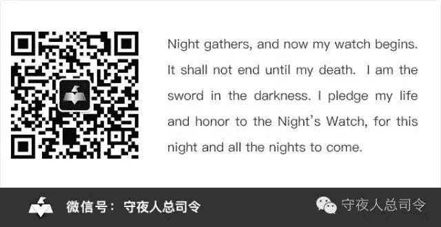

  
[结构学自序（新）！](http://mp.weixin.qq.com/s?__biz=MzIzMDYwOTM0Mg==&mid=2247485283&idx=1&sn=aa2b8554b8e5040f8f959636feaa06a3&chksm=e8b19fb2dfc616a430aa381b8da0815311244e694a69809cd92d0602ac34cfe5f1f419b3745e&scene=21#wechat_redirect)  
[解药！](http://mp.weixin.qq.com/s?__biz=MzIzMDYwOTM0Mg==&mid=2247487354&idx=1&sn=8d233cb332f339f0577f408653090fd3&chksm=e8b197abdfc61ebdfb4d5591ff86fb35f6e0ddf9bb51d18ce569d40a774d45ff5ecbf4109aa8&scene=21#wechat_redirect)  
[A676：不安！](http://mp.weixin.qq.com/s?__biz=MzAxNDk1NjI2Mw==&mid=2247488576&idx=1&sn=775b39993cbb7aafd9d5aa0720cbfcba&chksm=9b8a37c8acfdbede6606165222fd4ccffdd99368777e395261c847d0b6884af0563ff8337f01&scene=21#wechat_redirect)  
[A667：投降！！](http://mp.weixin.qq.com/s?__biz=MzAxNDk1NjI2Mw==&mid=2247488473&idx=1&sn=9ff1ab8aa9a8ed0521705e8e69dc1942&chksm=9b8a3051acfdb94786f6aa85a453b17df68cae420b94a161741a7d4a26f55afea0caa0debbb8&scene=21#wechat_redirect)  
[A678：不能说得太细！](http://mp.weixin.qq.com/s?__biz=MzAxNDk1NjI2Mw==&mid=2247488621&idx=1&sn=de619343a166fa2033545096b107a136&chksm=9b8a37e5acfdbef33879aa1c737b5ded3b611c15cf6b7945e400a9293cb0353f2eb5feb120f0&scene=21#wechat_redirect)  
[A677：河防已破，乌东比失！](http://mp.weixin.qq.com/s?__biz=MzIzMDYwOTM0Mg==&mid=2247487346&idx=1&sn=7f6da93c6544a34130faa84427410779&chksm=e8b197a3dfc61eb5fb452bb2f9dbe2e1dd593fa504466b004c8832f1cfc1cc9e62cf3e1cfe40&scene=21#wechat_redirect)  
[穷是万恶之源！](http://mp.weixin.qq.com/s?__biz=MzAxNDk1NjI2Mw==&mid=2247483823&idx=1&sn=e54ebe9891b302dc0bf1815c76ccf8b7&chksm=9b8a2227acfdab31a05e273addd9159d4b8263d58d3c58bf214841c8189157519719c3427306&scene=21#wechat_redirect)  
[A678：不能说得太细！](http://mp.weixin.qq.com/s?__biz=MzAxNDk1NjI2Mw==&mid=2247488621&idx=1&sn=de619343a166fa2033545096b107a136&chksm=9b8a37e5acfdbef33879aa1c737b5ded3b611c15cf6b7945e400a9293cb0353f2eb5feb120f0&scene=21#wechat_redirect)  
[A680：上海的底色！](http://mp.weixin.qq.com/s?__biz=MzIzMDYwOTM0Mg==&mid=2247487369&idx=1&sn=a18e0d719fb0549237274a07964dadbf&chksm=e8b19758dfc61e4ec0cf4343ed7bd19f207616e41dcfd37f655056fc0dcbcacb8cd20da56a5e&scene=21#wechat_redirect)  
[没有退路的一代人！](http://mp.weixin.qq.com/s?__biz=MzAxNDk1NjI2Mw==&mid=2247486533&idx=1&sn=a0d5cce0656aad467148e0642eb85a00&chksm=9b8a2fcdacfda6db79857186e953a089baf1fb678b2b071cf101c5a26e7fb9768474c94243ca&scene=21#wechat_redirect)  
[A295：当代女性的两难！](http://mp.weixin.qq.com/s?__biz=MzIzMDYwOTM0Mg==&mid=2247484854&idx=1&sn=6851afe306f7b89d23728018ea32b7f2&chksm=e8b19d67dfc61471955b15021ac11c5fff9f1607977e9df1bd2bbfabc2deb3dea5c98e369c55&scene=21#wechat_redirect)  
[毛熊击毁卫星虚张声势，兔子才是重头戏！](http://mp.weixin.qq.com/s?__biz=MzIzMDYwOTM0Mg==&mid=2247486669&idx=1&sn=dbcf25827621743d0d3b5c3abdcb73c2&chksm=e8b1941cdfc61d0aa787095f2852f6249b2a0114b1a721bc70a0f3c945e775977a1899e1e8b0&scene=21#wechat_redirect)  
[不要愤愤不平，都是好事！](http://mp.weixin.qq.com/s?__biz=MzAxNDk1NjI2Mw==&mid=2247487130&idx=1&sn=b21138d85455f5692aaf039038c78342&chksm=9b8a2d12acfda404a2b67fe4d446ee0f2805ad64a8b8004902934600fd731191e140df6ac19a&scene=21#wechat_redirect)  
[她都来相亲了，你还要怎么样！](http://mp.weixin.qq.com/s?__biz=MzAxNDk1NjI2Mw==&mid=2247486952&idx=1&sn=698aec6916d2eca5e758c25c4c634346&chksm=9b8a2e60acfda776b80a4f2f0d5c2fe4921fc821cdf029fa9d2fdc52fd708fc5a0b980d5d3d0&scene=21#wechat_redirect)  
[田园女权真正攻击的对象是女人！](http://mp.weixin.qq.com/s?__biz=MzIzMDYwOTM0Mg==&mid=2247486412&idx=1&sn=5dd3e8b2a759838d739e6d61ebab2eab&chksm=e8b1931ddfc61a0bf6f81cd2a9a9232ea8ce86528a8eea66c6635180e8678b819ebb38b4cb86&scene=21#wechat_redirect)  
[A542：抓紧手中的钱，会越来越紧俏！](http://mp.weixin.qq.com/s?__biz=MzIzMDYwOTM0Mg==&mid=2247486640&idx=1&sn=a96afa7d2b698e33240735ea8d7671f7&chksm=e8b19461dfc61d77a4afce11ecc7558b8d7ff5d495a78bcb609e3eed5c70bcbed5f3d6a66023&scene=21#wechat_redirect)  
[A518：既双减又提高考试难度，要干啥？!](http://mp.weixin.qq.com/s?__biz=MzIzMDYwOTM0Mg==&mid=2247486528&idx=1&sn=837ef39e3c0b47ac84d5096690555ae7&chksm=e8b19491dfc61d87292daf575c1e7c95b3f0543f313b65c7ad4ab369603833704304ec7451d7&scene=21#wechat_redirect)  
[你敬的酒我怎能不喝！](http://mp.weixin.qq.com/s?__biz=MzIzMDYwOTM0Mg==&mid=2247486456&idx=1&sn=7d6377d84f511b80179c5e7648494d6e&chksm=e8b19329dfc61a3f9b91b5b43dbd1a6eea293a02cd80b96aeb6dd1930f7f2c93fd33c0e3b2f3&scene=21#wechat_redirect)  
[男人成长的最快方式！](http://mp.weixin.qq.com/s?__biz=MzAxNDk1NjI2Mw==&mid=2247487435&idx=1&sn=8d1fe9b5f45ab8bd0c98f396ea6f0f1c&chksm=9b8a2c43acfda5557c14b9f4ecd8efc8e844df88c1b9a487906eddbc04860acc06bbd0ef6963&scene=21#wechat_redirect)  
[E35:我们在月之暗面发现了什么？！](http://mp.weixin.qq.com/s?__biz=MzIzMDYwOTM0Mg==&mid=2247486632&idx=1&sn=170aeff87eb36dce354c8b2437f4b27f&chksm=e8b19479dfc61d6f08e6492954a528f20387fe2fa925747cf2b504d2bc69084f24495e972e41&scene=21#wechat_redirect)  
[A496：为什么兔子在阿富汗很主动？](http://mp.weixin.qq.com/s?__biz=MzIzMDYwOTM0Mg==&mid=2247486278&idx=1&sn=40d09857088bebd3c70bec1c7a500f06&chksm=e8b19397dfc61a810125242c8e395330f934390eb50bd54053ecd3f31ddc91de4e429c0f693a&scene=21#wechat_redirect)  
[A432：底层人为何会热衷于互相伤害？！](http://mp.weixin.qq.com/s?__biz=MzAxNDk1NjI2Mw==&mid=2247487443&idx=1&sn=21334752ac2ce642ca1e4e421acfe765&chksm=9b8a2c5bacfda54d1459036c57a31b05271d1b825eadd811cce0bbeca1ea3a7deae31e067133&scene=21#wechat_redirect)  
[A534：嫖娼是绝对不能合法的！](http://mp.weixin.qq.com/s?__biz=MzAxNDk1NjI2Mw==&mid=2247487431&idx=1&sn=78d93492fa71d19501c95eb11e0ea99f&chksm=9b8a2c4facfda559eeb7bffa822a9715b1945a9e9c4f8beaf9d00b8acb0e2cc0b05a63feafaf&scene=21#wechat_redirect)  
[A431：这依然是男人之间的厮杀！](http://mp.weixin.qq.com/s?__biz=MzAxNDk1NjI2Mw==&mid=2247486741&idx=1&sn=f13cf395a8c106f5133951392a20ac5c&chksm=9b8a2e9dacfda78b8f8b9cc727b9740b4213f738fc0375599ce82567b97047631c68178c7ec5&scene=21#wechat_redirect)  
[前天被删的那篇彻底改写后重发！](http://mp.weixin.qq.com/s?__biz=MzAxNDk1NjI2Mw==&mid=2247487425&idx=1&sn=37c59746f0368268dbf1497b341aab93&chksm=9b8a2c49acfda55f770d8082d28911b1ce6406517fb969072d77bc0c8c1f26507ac18360d2f8&scene=21#wechat_redirect)  
[A507 和 A513 都被删，这篇看完记得保存！](http://mp.weixin.qq.com/s?__biz=MzIzMDYwOTM0Mg==&mid=2247486598&idx=1&sn=643ad77a60e4fb7e40dcea6e4585c39a&chksm=e8b19457dfc61d4126c656d773feb6d26d516889077a4f3b8755cf1ee4b0fe2a592b8409dfd8&scene=21#wechat_redirect)  
[A510：努力没结果，被人顶替，怎么办！](http://mp.weixin.qq.com/s?__biz=MzAxNDk1NjI2Mw==&mid=2247487202&idx=1&sn=c4c18c5c793a47e31cd7267152a78d1f&chksm=9b8a2d6aacfda47c47394eb5cbb97fc6233fb7258c0408026e518018a6af33da141b1b0a2bfa&scene=21#wechat_redirect)  
[A514：鹰酱分化毛熊和兔子，并精确阻击！](http://mp.weixin.qq.com/s?__biz=MzIzMDYwOTM0Mg==&mid=2247486421&idx=1&sn=c114599b4fd1016c7f539fca526fe91c&chksm=e8b19304dfc61a127301df6303aedbeace66275a179f7db025e56f2326917c273d443eab53e6&scene=21#wechat_redirect)  
[A504：这个能力我们还不具备！](http://mp.weixin.qq.com/s?__biz=MzIzMDYwOTM0Mg==&mid=2247486364&idx=1&sn=c54714ffeaa4122f08d8ec0c2decb740&chksm=e8b1934ddfc61a5b943cbe55dfc7211561e7d78f163246c3dcfd08325b004bc6d9ee6efbaebf&scene=21#wechat_redirect)  
[A504：当男人不再大男子主义！](http://mp.weixin.qq.com/s?__biz=MzAxNDk1NjI2Mw==&mid=2247487148&idx=1&sn=5151b292f8f882fe9f87aabf52be08df&chksm=9b8a2d24acfda432b5803c25c0c83a4cbfc80a7c83ffd044b72bedc5e32d9670054d861705cf&scene=21#wechat_redirect)  
[A491：塔利班接下来的两个核心问题！](http://mp.weixin.qq.com/s?__biz=MzIzMDYwOTM0Mg==&mid=2247486219&idx=1&sn=8f77517f0244ba31f7eb28e2676e17cd&chksm=e8b193dadfc61acc6d9e6029653aac696f132efc24d3b28f983ba8e4ada269ac887e6165d837&scene=21#wechat_redirect)  
[A499：如何控制一个老实人！](http://mp.weixin.qq.com/s?__biz=MzIzMDYwOTM0Mg==&mid=2247486301&idx=1&sn=f4bfec024d8688c8555dd21b85deea31&chksm=e8b1938cdfc61a9a1e2d8a8fa37d495cf337bc34215939caced14a58dd32b46ad59646d0e928&scene=21#wechat_redirect)  
[A494：对企业财税政策的预判！](http://mp.weixin.qq.com/s?__biz=MzIzMDYwOTM0Mg==&mid=2247486230&idx=1&sn=5fa67e9065c3feae6264765838772136&chksm=e8b193c7dfc61ad15311f10ab8265d667f31cc2e11e404476afbc0310d6ee71e5f1167faf78f&scene=21#wechat_redirect)  
[A474：箭在弦上，不得不发！](http://mp.weixin.qq.com/s?__biz=MzIzMDYwOTM0Mg==&mid=2247486092&idx=1&sn=d93b0ab35ba2828a708658dbd2e5ad9b&chksm=e8b1925ddfc61b4b12bc1b6a7e7e25a2fe7ff149b1c4f64810b2a5eefa97b8dc1bd1899dcf00&scene=21#wechat_redirect)  
[A328：2021 年必须加杠杆！](http://mp.weixin.qq.com/s?__biz=MzIzMDYwOTM0Mg==&mid=2247485087&idx=1&sn=24d72f6a71bddb8954a03be5db246538&chksm=e8b19e4edfc617587a8ae645885a89ab8c3c6f67730a026d9c7c9a94ab3051ca480302147fc0&scene=21#wechat_redirect)  
[A361：人成长的三个关键时刻！](http://mp.weixin.qq.com/s?__biz=MzAxNDk1NjI2Mw==&mid=2247486472&idx=1&sn=8b46d73659ff81e3d7bd544e1718a94f&chksm=9b8a2f80acfda69601b059cb0180f8841eda098200c32c84ad6430bb8fbe33a9021fa7890344&scene=21#wechat_redirect)  
[A311：要理解住房不炒的真正含义！](http://mp.weixin.qq.com/s?__biz=MzIzMDYwOTM0Mg==&mid=2247484959&idx=1&sn=090583ec50bfd9febec1de463c2672f6&chksm=e8b19ecedfc617d8629080f6745c8de013cfe875de26eef6767b2d5c10782650223ed15f807b&scene=21#wechat_redirect)  
[A394：要理解扶贫政策的真正意图！](http://mp.weixin.qq.com/s?__biz=MzIzMDYwOTM0Mg==&mid=2247485502&idx=1&sn=fffb9911cefa626e6fbcb9c416c1eb98&chksm=e8b190efdfc619f9b0e42f3c3d5d79c17df1619bad2b1bddd6a482242b583ee46d8a79a245e6&scene=21#wechat_redirect)  
[A388：用鲜血开路获得的投名状！](http://mp.weixin.qq.com/s?__biz=MzIzMDYwOTM0Mg==&mid=2247485591&idx=1&sn=a8443453e3caf1f201006eeec8e6e539&chksm=e8b19046dfc61950e63e29bb93049ce90b3228913e9ecee99a2f01b8fdda7cd8966a054241a9&scene=21#wechat_redirect)  
[A405：养老对普通人将会是一个深渊！](http://mp.weixin.qq.com/s?__biz=MzIzMDYwOTM0Mg==&mid=2247485587&idx=1&sn=f00402b3fdc5062ee5c5382295ac4dcb&chksm=e8b19042dfc619546bf0a0905d2733d900b7594f1564f1fa7528399053b93dc53f4d14c009fb&scene=21#wechat_redirect)  
[A300：这是投机的大机会还是大陷阱？！](http://mp.weixin.qq.com/s?__biz=MzIzMDYwOTM0Mg==&mid=2247484882&idx=1&sn=b103029f41e3aede94e1a45d035cd9ac&chksm=e8b19d03dfc614153863f37ca3f9204b451e2c02ad5ca8680c120e2458e628e5329c76b2d42c&scene=21#wechat_redirect)  
[A366：从货币驱动到财政驱动的转变！](http://mp.weixin.qq.com/s?__biz=MzIzMDYwOTM0Mg==&mid=2247485347&idx=1&sn=a916df57ddc7230366719fbecc6c1704&chksm=e8b19f72dfc61664fd99844bfe3ffffb5d6f088807c84d99f11ddbc7410b2eed67bc4c615d53&scene=21#wechat_redirect)  
[A376：要换种思维，你才能理解！](http://mp.weixin.qq.com/s?__biz=MzAxNDk1NjI2Mw==&mid=2247486529&idx=1&sn=3a50ada30a5ae0448d686c6a0c809919&chksm=9b8a2fc9acfda6df5e9243deb6e9df9a7cc0912eabd0a9c00322d42ed4c25c2daedc8de6b6ca&scene=21#wechat_redirect)  
[A377：为什么不买武汉的房？](http://mp.weixin.qq.com/s?__biz=MzIzMDYwOTM0Mg==&mid=2247485413&idx=1&sn=1f3339540496eb9e5ea109d8530f29dc&chksm=e8b19f34dfc6162225a694c1c2443d73b51bf6ca8dc53d4c18a30e6e2191e250967e711db589&scene=21#wechat_redirect)  
[E29：一眼看到底！](http://mp.weixin.qq.com/s?__biz=MzIzMDYwOTM0Mg==&mid=2247485301&idx=1&sn=dc6dd50c5d742ea51ce9e394de25351a&chksm=e8b19fa4dfc616b26734c3619c6fa664474fa478d2764c3370dde41d19f6035edc05f9f191e8&scene=21#wechat_redirect)  
[向下兼容是种自我消耗！](http://mp.weixin.qq.com/s?__biz=MzAxNDk1NjI2Mw==&mid=2247486535&idx=1&sn=e87304f3a33f1cd0425186362901eb04&chksm=9b8a2fcfacfda6d92af7f3b026ef129368c01361e40f2db3be32500a1e68fb99f1f35ec22a6b&scene=21#wechat_redirect)  
[A284：啊！万箭穿心！](http://mp.weixin.qq.com/s?__biz=MzAxNDk1NjI2Mw==&mid=2247486135&idx=1&sn=e950149b9b9147e9199cfc6093605950&chksm=9b8a293facfda029419b911d4b4fa91c73bbaf695b206df2cf15124d843f4bf4b80673baa394&scene=21#wechat_redirect)  
[梦醒之时，已经三十！](http://mp.weixin.qq.com/s?__biz=MzIzMDYwOTM0Mg==&mid=2247484378&idx=1&sn=e3a058584a13d7a5267315113964280d&chksm=e8b19b0bdfc6121df4af4b77d2d826fd0f4132ccfdee48132ce8cf86eb1ba45b898be83d1dc7&scene=21#wechat_redirect)  
[五年感情，八万块钱！](http://mp.weixin.qq.com/s?__biz=MzIzMDYwOTM0Mg==&mid=2247484317&idx=1&sn=b22f9fb2e3c084e427a5e3e9895be99a&chksm=e8b19b4cdfc6125adf3ea3b0d2b72a121f38e8ba26e43abc48edff900327ce3e7464b944cafb&scene=21#wechat_redirect)  
[依依东望，望的是时间！](http://mp.weixin.qq.com/s?__biz=MzIzMDYwOTM0Mg==&mid=2247483860&idx=1&sn=b5b01ae82ff764ce2806251e3f2a809f&chksm=e8b19905dfc61013607735eb7782299c9a4d7a39a8b15a7b46182ef20eda3ffe9f6ed6337e1f&scene=21#wechat_redirect)  
[A374：真正的大机会在这里！](http://mp.weixin.qq.com/s?__biz=MzIzMDYwOTM0Mg==&mid=2247485401&idx=1&sn=100967c02c0754759ec4ea0ef8706c29&chksm=e8b19f08dfc6161e92c7cc691f1a1fed9ff74c2b906529a8d42a7703a3c3a3c3a412903e12f7&scene=21#wechat_redirect)  
[关注自己的人，才会活的不错！](http://mp.weixin.qq.com/s?__biz=MzIzMDYwOTM0Mg==&mid=2247485305&idx=1&sn=c719ea57e5c3320c2e2629dd9a7b44e9&chksm=e8b19fa8dfc616be5fa3f8141ea0aa63d5e1335657ed97e62c1086c41eba29effe58e0c8e9dc&scene=21#wechat_redirect)  
[A294：这篇还是别看了，行情已过！](http://mp.weixin.qq.com/s?__biz=MzIzMDYwOTM0Mg==&mid=2247484849&idx=1&sn=5485cd1d6c511e883e25b0c7dd9e2e3e&chksm=e8b19d60dfc614764ffc8405dccf5b8120b31988f3c1cee74e384c06f0e39c3c81bef8263c3d&scene=21#wechat_redirect)  
[A370：被删了，改后重发，欲看从速！](http://mp.weixin.qq.com/s?__biz=MzIzMDYwOTM0Mg==&mid=2247485388&idx=1&sn=a456e8ffdc8a16bb30263818dc86c6a3&chksm=e8b19f1ddfc6160bfd0fea09b006477a095662aa74ac7036fca621b2ef49dc59f4ad4a407eeb&scene=21#wechat_redirect)  
[E26：自卑的形成和自信的重建！](http://mp.weixin.qq.com/s?__biz=MzIzMDYwOTM0Mg==&mid=2247485311&idx=1&sn=28f827c212f9a1ac53e73986742ca5aa&chksm=e8b19faedfc616b8d527f328c2ad55dca966707c8813ceaa5b7c0daee3432edeec88744d842c&scene=21#wechat_redirect)  
[A311：要理解住房不炒的真正含义！](http://mp.weixin.qq.com/s?__biz=MzIzMDYwOTM0Mg==&mid=2247484959&idx=1&sn=090583ec50bfd9febec1de463c2672f6&chksm=e8b19ecedfc617d8629080f6745c8de013cfe875de26eef6767b2d5c10782650223ed15f807b&scene=21#wechat_redirect)  
[A320：思路变了，可以加杠杆了！](http://mp.weixin.qq.com/s?__biz=MzIzMDYwOTM0Mg==&mid=2247485041&idx=1&sn=add2174fa42806f885a456a072ee4fee&chksm=e8b19ea0dfc617b6734e013f780112fdd88f28ad5312ce423fea1d75da4c3757660dab175208&scene=21#wechat_redirect)  
[A345：剥离学区控制贷款也没用！](http://mp.weixin.qq.com/s?__biz=MzIzMDYwOTM0Mg==&mid=2247485208&idx=1&sn=ac3653b56fc18a4a6a809139f935bc45&chksm=e8b19fc9dfc616dfa31b0baf15aa90d994ef8a1262e0fd515739c06698cd0673d1d46e6e4c4f&scene=21#wechat_redirect)  
[A365：他妈一年挣的比你妈 50 年都多！](http://mp.weixin.qq.com/s?__biz=MzIzMDYwOTM0Mg==&mid=2247485336&idx=1&sn=2fba7786d5102be1d639bfdd138185db&chksm=e8b19f49dfc6165f4a1e07062ca1414d977f1a6c15d797233e36f7dec3b27c28b0ed72667f5f&scene=21#wechat_redirect)  
[E18：你想的不够简单！](http://mp.weixin.qq.com/s?__biz=MzIzMDYwOTM0Mg==&mid=2247484775&idx=1&sn=2a8e810e281cd7fe5a4db49002b193d2&chksm=e8b19db6dfc614a0e3360f0d54949c40138c27b184c114a44feaa394bd4400073dbbedf6a049&scene=21#wechat_redirect)  
[为富人办事，为穷人说话！](http://mp.weixin.qq.com/s?__biz=MzIzMDYwOTM0Mg==&mid=2247484462&idx=1&sn=195ebab17907fba73c69ae7a11bc40ad&chksm=e8b19cffdfc615e9b2f88327d492813afa3656859f4d67a6d831ac1cf684a54b760a8b8edcd6&scene=21#wechat_redirect)  
[A284：啊！万箭穿心！](http://mp.weixin.qq.com/s?__biz=MzAxNDk1NjI2Mw==&mid=2247486135&idx=1&sn=e950149b9b9147e9199cfc6093605950&chksm=9b8a293facfda029419b911d4b4fa91c73bbaf695b206df2cf15124d843f4bf4b80673baa394&scene=21#wechat_redirect)  
[父母挖的坑，别人挖的坑，自己挖的坑！](http://mp.weixin.qq.com/s?__biz=MzAxNDk1NjI2Mw==&mid=2247486426&idx=1&sn=8707934ad2fe2f8017d6b7810fd61c17&chksm=9b8a2852acfda1441fded7bab2456dd2493073ad3e5d541e1080d1739879b86c25a3a61df79a&scene=21#wechat_redirect)  
[A351：你为什么也不愿意？！](http://mp.weixin.qq.com/s?__biz=MzIzMDYwOTM0Mg==&mid=2247485242&idx=1&sn=f4a01a5936322120b0b158f225bc78de&chksm=e8b19febdfc616fd2eb1558a3b7c748ecc497a3af00aec5b5c5ca8042cc52eb7d0af7befa399&scene=21#wechat_redirect)  
[A335：必须与焦虑长期共存！](http://mp.weixin.qq.com/s?__biz=MzIzMDYwOTM0Mg==&mid=2247485165&idx=1&sn=f3f0957c63fa549b288f00c8b117162e&chksm=e8b19e3cdfc6172a188000afd2b522144a04ba774169824cad2067d93b5365537ff0644f6b9f&scene=21#wechat_redirect)  
[A315：认命吧，做个普通人也挺好的！](http://mp.weixin.qq.com/s?__biz=MzIzMDYwOTM0Mg==&mid=2247485008&idx=1&sn=bcaf70c42d4676c8f69de9f9ead1e495&chksm=e8b19e81dfc617973ba40200519407186760e32843fc6f379020da6160b0ba89870dadcae5fa&scene=21#wechat_redirect)  
[E15：老洋房的生意没法学！](http://mp.weixin.qq.com/s?__biz=MzAxNDk1NjI2Mw==&mid=2247485113&idx=1&sn=4fc868bf65d5f2ca6eb4d9b776c004ec&chksm=9b8a2531acfdac27c57da12097dfe850ba55cdfd447e35c19df3819bdf4051694bc49f0a218d&scene=21#wechat_redirect)  
[B19：不动产的投资思路！](http://mp.weixin.qq.com/s?__biz=MzAxNDk1NjI2Mw==&mid=2247484650&idx=1&sn=36687887ab7cd444fd324c3906b8d54a&chksm=9b8a2762acfdae74b83a146bdd8994b81cb9879b3de5caa870c13c6253ad22b2f5c42b0fe59a&scene=21#wechat_redirect)  
[为啥会滋生出这样的心态！](http://mp.weixin.qq.com/s?__biz=MzIzMDYwOTM0Mg==&mid=2247486611&idx=1&sn=a50b553412de222c2fc124ef459569f8&chksm=e8b19442dfc61d54295ac1e94d6a860111a49140095d3736cfd81788fe5188d3a4a6459d0daa&scene=21#wechat_redirect)  
觉悟者  
喜欢你就转走吧！  
微信扫一扫赞赏作者 赞赏  
已喜欢，对作者说句悄悄话  
取消   
发送给作者  
发送  
最多 40 字，当前共字  
 人赞赏   
上一页 1/3 下一页  
长按二维码向我转账  
喜欢你就转走吧！  
受苹果公司新规定影响，微信 iOS 版的赞赏功能被关闭，可通过二维码转账支持公众号。  

 

精选留言  
暂无...   
  

# 

# \[守夜人总司令\] - 2022-06-21 A678：不能说得太细！

> 来源：[`www.yuque.com/books/share/97051b78-926c-43e6-b0aa-0b72ff163ac4/kvwewy`](https://www.yuque.com/books/share/97051b78-926c-43e6-b0aa-0b72ff163ac4/kvwewy) 

A678：不能说得太细！   
原创 觉悟者 守夜人总司令   
守夜人总司令   
微信号 WatcherCommander  
功能介绍 结构学：生命体在其生存结构中的求存之道！  
2022-06-21[原文](https://mp.weixin.qq.com/s?__biz=MzAxNDk1NjI2Mw==&mid=2247488621&idx=1&sn=de619343a166fa2033545096b107a136&chksm=9b8a37e5acfdbef33879aa1c737b5ded3b611c15cf6b7945e400a9293cb0353f2eb5feb120f0#rd\)) 发表于  
收录于合集  
#入戏太深 38 个   
#底层逻辑 86 个   
#结构学 89 个   
#统治机器 25 个   
#精神结构 101 个   
前言  
商人群体可以充当工具为权力排忧解难，但绝对不能染指权力，这是我们这个文明的红线——不管哪朝哪代都一样！真正的资本家是这样的存在：他们掌握着一个又一个国家，而不仅仅是权力的工具！中国的商人群体如果没有呈现出士大夫的特征，就一定会呈现出买办特征，但永远无法呈现出既有长远眼光，又极具侵略性的资本家特征。  
购买合集后可阅读全文   
#  
已完结 共个  
合集详情  
正文需付费后才可阅读  
加载中   
 微信豆购买   
微信扫一扫付费阅读本文  
人付费， 人赞赏   

 

精选留言  
暂无...   
  

# 

# \[守夜人总司令\] - 2022-06-19 A678：浪漫的真正面目！

> 来源：[`www.yuque.com/books/share/97051b78-926c-43e6-b0aa-0b72ff163ac4/dvuo61`](https://www.yuque.com/books/share/97051b78-926c-43e6-b0aa-0b72ff163ac4/dvuo61) 

A678：浪漫的真正面目！   
原创 觉悟者 守夜人总司令   
守夜人总司令   
微信号 WatcherCommander  
功能介绍 结构学：生命体在其生存结构中的求存之道！  
2022-06-19[原文](https://mp.weixin.qq.com/s?__biz=MzAxNDk1NjI2Mw==&mid=2247488612&idx=1&sn=d930e4413970f5f09abb578ce6a8319b&chksm=9b8a37ecacfdbefafcaa349aed44d30a8b18e8958887ace24cdcf12355260cdbb44bddaedd42#rd\)) 发表于  
收录于合集  
#底层逻辑 86 个   
#精神结构 101 个   
#结构学 89 个   
#普通人 27 个   
#入戏太深 38 个   
面对复杂和未知的事物，如果无法厘清其内在的结构，人在对超出自己认知的人和事做出评估和判断的时候，往往是用想象替代事实。人之所以会用想象去替代事实，首先源于无知，其次源于无力。无知是因为只见树木不见森林，在形成判断的时候既没有能够洞识全貌的确定性框架，也没有能够抵达现实的路径。而无力则因为看清了全貌和抵达的路径，但事物演变的结果是自己所不能接受的。当人用想象去填补那些无知的空白，用想象去转移那些无法接受的结果，试图将自我引向另一条与结果截然相反的道路之时，浪漫就产生了！  
精神结构的自我保护机制往往会基于自我的需要主动对大脑进行弄虚作假。曾经听一个干过多年刑警的长辈谈起过这样的情况：那些被强奸又在现实条件的多重束缚下不得不嫁给强奸犯的悲惨女性，往往会主动催眠自己，让自己相信这种违背自我意志的侵犯是源于对方深爱着自己才导致的失控。在这种长期自我催眠的状况下，就会越来越坚信这种自我催眠的想象就是事实！  
人为什么会这样？读过之前关于精神结构的阐述就会明白：当一个人判断自己无法改变所处的生存环境之时，会调整自己的心态和观念将一切都合理化。事实上，所谓的爱情就是将所有不符合逻辑和利益的行为都进行合理化所衍生出来的一种虚幻的主导性和满足感。在真实的世界中，除非你自身的价值本来就很高，否则，你无法成为焦点。世间万物都运行在自己的轨道上，并不会停下来多看你一眼。这种现实的反馈会让人产生一种无力的挫败感。这是现实世界的运转逻辑，如果你没有别人欣赏的优势，没有社会认可的价值，你就难以获得社会化的关注和确认自我价值的满足。这样的现实反馈不仅无法满足自我，反而会不断的引发对自我的否定和质疑，并频繁的触发精神结构的自我保护机制，从而让人陷入各种情绪化的内心冲突。读过《[A613：孩子不能防老，真正的作用是这个！](http://mp.weixin.qq.com/s?__biz=MzIzMDYwOTM0Mg==&mid=2247487023&idx=1&sn=3370d17aaf4a8f046e2ebaa995200c87&chksm=e8b196fedfc61fe84dbfe4353d88b51f3077fc0ff82a1446e52742bce73e561b0e8ff1d113a3&scene=21#wechat_redirect)》的人会明白普通人为什么更需要孩子。基于类似的底层逻辑普通人对爱情的渴望之所以强烈就因为爱情能够扭曲现实并满足普通人内在的核心需要！  
纯粹的爱情是什么样子？即便自己变得毫无价值，对方依然不改初衷。即便自己平凡无奇，依然是对方心中的全部。对方能够满足自己对整个外部世界的所有期待，同时不求任何回报。这是一种以满足自我为目标，完全抛弃真实世界的运转规则，将一切不符合逻辑的行为都以爱之名合理化，以美好的预期和唯美的想象编织出来的天堂。在编织的过程中，不断的消耗彼此的能量，从而给人一种无比真实的错觉——因为在现实世界的运作方式中，任何获得都需要消耗能量。但是，在现实世界的规则中，消耗能量并不一定能获得——绝大多数情况下是纯粹的消耗自己的能量却一无所获！这种消耗了自己大量能量依然无法获得的无力感时常会在现实世界中感受得到。所有的愤怒都来自于这种无力感。然而，爱情美好的一面就在于能够绕开这种现实世界的物理规则，从而进入一个随心所欲编织美好的想象世界之中。它不好的一面则在于，如果对方不配合，这种无力感就更加让人愤怒和绝望。因为它的反馈链条非常短而且高频连接的断裂和阻塞往往会被感知得更加剧烈和明显。  
人越长大在现实世界中感受到的挫败感就会越强列。因为小时候你能感受到的世界非常小，而且一切都聚焦在自己身上，围绕自己转——自己的诉求会得到周围的响应，一举一动都会成为周围的焦点——周围给与的这种持续关注和无需代价就得到满足内心的诉求，会成为你在对自我形成判断时的安全感源头。正因为如此，许多从小无法从父母和成长环境中获得关注并满足自我的人，其对自我的判断并不会因为年龄的增长就有所改变。这种安全感的不完整和内在强烈诉求无法满足的匮乏和压抑感，会在以后的岁月中以其它的面目出现，并投射到其他的对象身上。许多年纪不断增长，但内心始终无法形成安全感的人，即便是在长大之后的亲密关系中，也不断的投射最初的内心诉求——说的更加直白一点就是：年龄已经是成年人了，但内心依然在寻找小时候缺失的部分，这样的人无法让自己的心态和观念与现实的处境相契合。如果是女生，会把所有的期待和缺失都投射到爱情上，找一个男朋友就不仅仅要求对方扮演男朋友的角色，还要同时扮演父亲、母亲、男友三重角色，把小时候父母缺失或者不愿意给予的各种内心满足，不计成本不顾后顾无怨无悔的给予自己。否则，内心就会感到不安，就会进一步的感受到不被爱的强烈缺失和求而不得的痛苦。这种内心的不安和不满，会怂恿着她们始终采取一种被动且”高高在上“的姿态，等待着别人主动满足自己的诉求并不要求对等的回报。在与人相处的过程中，容易情绪化且逆反心非常强烈，冲动决策又立刻反悔是常事，犹豫不决又疑神疑鬼也是常事，时常焦虑、恐惧且毫无原则——所有的行为都取决于当下的心境。拥有成年人的躯壳和幼儿的内心，言行就如同与别人的关系一样，总是走极端，不是小心翼翼的讨好，就是不管不顾的破罐子破摔，时常陷入自我消耗的情绪中无法自拔。这样的人很好识别，遇到了一定要绕着走——凝视深渊一定会被深渊吞噬，你不会是那个例外，绝对不要抱有任何侥幸心理！  
精神结构的底层逻辑会作用在方方面面。一个小孩摊上一个情绪化非常严重的母亲，或者一个暴躁的父亲，这样的父母会毫无征兆的把自己的不顺心发泄在孩子身上。而幼小的孩子对父母的依赖源于一种寻求安全的本能。当他/她遭受莫名其妙的训斥和责骂的时候，其内心是无比恐惧的，但自己的弱小又无法改变对父母的高度依赖，所以，这个小孩就必须把这种给自己带来不安的处境合理化。怎么合理化呢？会得出一个这样的确定性结论：我这个人天生让人讨厌！不值得父母善待，所以才招致他们无缘无故的生气和惩罚。这种持续自我否定的结论虽然会造成很多后遗症，但却能给当事人带来一种充满确定性的解释。有了这个结论，不管遭受多少不公正的对待和毫无征兆的惩罚，都可以立刻给自己一个确定性的答案。要知道人心最恐惧的并不是惩罚而是未知和不确定！即便无法避免被伤害，只要能消除这些伤害带来的无知和不确定性，恐惧也就消失了。当然了，这个方法会引导着当事人不断强化自我否定和自我嫌弃的力度。对自己的嫌弃和憎恨越强烈，反而会渴望遭受更强烈的否定和攻击。这种受虐倾向的兴奋点恰恰就在于外部对自己的攻击力度越大，程度越恶劣就越契合彻底摧毁自我的强烈内在诉求！自卑、敏感、自我嫌弃、自我攻击、缺乏安全感、终生叛逆等一系列后遗症都是从这颗种子上生长出来的——即便用一辈子的时间都难以修复！为人父母没有门槛真的是一个天大的漏洞，当然了，这个问题无解，否则就是法西斯了。只能从拯救的角度来想办法，让更多的人意识到，即便自己是一个普通人，只要能够矫正自己的精神结构到不去危害下一代的程度，就已经功德无量！《[溯源！](http://mp.weixin.qq.com/s?__biz=MzAxNDk1NjI2Mw==&mid=2247488581&idx=1&sn=a5084708558058cc3ce6d2859ba2fa3a&chksm=9b8a37cdacfdbedb963042df835f090101159a4a444569bbeac58d7676665fd05c8f5cf0459c&scene=21#wechat_redirect)》  
生活中一个人的状况如果持续不好，越到后面，整个人的思维、心态等方方面面都越来越固化，与自身对话和与外界打交道的能力也越来越弱。不管是长期遭受挫败的男人还是长期求而不得的女人，随着年龄的增加，挫败感的反复叠加，整个人就紧绷的像一块坚硬的石头。外人很难与之打交道，也很难与之正常的沟通和交流。任何一句不经意的话都可能造成误会并引发强烈的情绪反应——那种气急败坏的攻击行为，往往是源于捍卫自尊的需要，或者是对某种自我想象的嘲讽和伤害的强烈反击。虽然自己非常的不好相处，也没法交流，但总会认为是对方情商不够。这种状态的人敏感又脆弱，不能接受不同的意见，完全忽视逻辑和证据链，不能直面事实，不能被拒绝，更不能被无视和否定。如果别人顺着自己，内心就会藐视别人，如果对方无视自己，内心又会仇视别人。总之，所有的作死都是为了将自己彻底孤立起来并隐蔽的摧毁自己！  
生活中你能够观察到这样一种情况，许多人在情绪怂恿下做出了冲动决策后，会用尽全力去捍卫之，任何人提出异议，都会让其更加顽固，并展开气急败坏的反击。因为在当事人看来任何不如预期的答案都是在彻底的否定自己！如果这种状态的人跟你谈论自己引以为傲的朋友的某些不足之处，你要是出于礼貌去附和一下，对方又会疑心你在嘲笑自己最看重的朋友，并间接的嘲笑自己！这种脑回路虽然无比清奇，但却能自洽的运转！  
许多事不能掰开来看，一旦看清楚了内部结构，往往会滋生出更强烈的绝望。还好时间能够让一切都消散，随着生命周期的结束，附着其上的一切都会画上一个句号，尘归尘，土归土！  
研习《[结构学](https://mp.weixin.qq.com/mp/appmsgalbum?action=getalbum&album_id=1318317199878225920&__biz=MzAxNDk1NjI2Mw==#wechat_redirect)》，加入觉悟社：付费和不公开内容都有，每天 25 块，还能挣回来，下注标的获取需满足条件及时查看更新。公众号发消息：觉悟社  
[结构学自序（新）！](http://mp.weixin.qq.com/s?__biz=MzIzMDYwOTM0Mg==&mid=2247485283&idx=1&sn=aa2b8554b8e5040f8f959636feaa06a3&chksm=e8b19fb2dfc616a430aa381b8da0815311244e694a69809cd92d0602ac34cfe5f1f419b3745e&scene=21#wechat_redirect)  
[做局！](http://mp.weixin.qq.com/s?__biz=MzAxNDk1NjI2Mw==&mid=2247488230&idx=1&sn=86e717386c0aa06a0a4bbf4f9ec117aa&chksm=9b8a316eacfdb878aae8ed4ea6817620cc3ac62d7815fdfd85606464c3f2d79fcf2ce72dec77&scene=21#wechat_redirect)  
[算账！](http://mp.weixin.qq.com/s?__biz=MzAxNDk1NjI2Mw==&mid=2247488259&idx=1&sn=2b72f3c0199cdacaa8e48eb9ad30f809&chksm=9b8a308bacfdb99d72ebcd3aaf0015c889b88f4598b093719ee8765aa8be3b3caaad95a445ae&scene=21#wechat_redirect)  
[A667：投降！！](http://mp.weixin.qq.com/s?__biz=MzIzMDYwOTM0Mg==&mid=2247487227&idx=1&sn=3567bf6c0c6612ccf84993824f8cc40f&chksm=e8b1962adfc61f3cff8d335a562ea28615e58579d460d2f65148f46a6311ad5257411d96f655&scene=21#wechat_redirect)  
[乌克兰的反攻！](http://mp.weixin.qq.com/s?__biz=MzIzMDYwOTM0Mg==&mid=2247487192&idx=1&sn=02b41bfa6bcfa8c503bac90158886b86&chksm=e8b19609dfc61f1fdb5a8fa6032a0013cd18ff59bdaf308e99096f08813d3b24cc6f361dac6d&scene=21#wechat_redirect)  
[伊久姆大反攻！](http://mp.weixin.qq.com/s?__biz=MzIzMDYwOTM0Mg==&mid=2247487223&idx=1&sn=ab3169d841cb6e53507fb5ede0eca8bc&chksm=e8b19626dfc61f306c1786e5cd2a2898cc68c6809f9a8a6b0b16a5891a233ac2653038772039&scene=21#wechat_redirect)  
[A658：经济秩序！](http://mp.weixin.qq.com/s?__biz=MzIzMDYwOTM0Mg==&mid=2247487179&idx=1&sn=12ad76a2b6a86d4dc52eb515f2b00500&chksm=e8b1961adfc61f0c30f16b60b87e2fcd3142b4a788c2ae81604f02182574c50b54c1d9e2974d&scene=21#wechat_redirect)  
[A676：不安！](http://mp.weixin.qq.com/s?__biz=MzAxNDk1NjI2Mw==&mid=2247488576&idx=1&sn=775b39993cbb7aafd9d5aa0720cbfcba&chksm=9b8a37c8acfdbede6606165222fd4ccffdd99368777e395261c847d0b6884af0563ff8337f01&scene=21#wechat_redirect)  
[钢铁直男的解药！](http://mp.weixin.qq.com/s?__biz=MzAxNDk1NjI2Mw==&mid=2247488604&idx=1&sn=600e55850fd40581177fb8956e77b879&chksm=9b8a37d4acfdbec2926895c32ce4ae5f527c12a552281059f7eeff99a09e550f7379fa03a9be&scene=21#wechat_redirect)  
[A677：河防已破，乌东比失！](http://mp.weixin.qq.com/s?__biz=MzIzMDYwOTM0Mg==&mid=2247487346&idx=1&sn=7f6da93c6544a34130faa84427410779&chksm=e8b197a3dfc61eb5fb452bb2f9dbe2e1dd593fa504466b004c8832f1cfc1cc9e62cf3e1cfe40&scene=21#wechat_redirect)  
[A431：这依然是男人之间的厮杀！](http://mp.weixin.qq.com/s?__biz=MzAxNDk1NjI2Mw==&mid=2247486741&idx=1&sn=f13cf395a8c106f5133951392a20ac5c&chksm=9b8a2e9dacfda78b8f8b9cc727b9740b4213f738fc0375599ce82567b97047631c68178c7ec5&scene=21#wechat_redirect)  
[A672：女性出轨为啥越来越多？！](http://mp.weixin.qq.com/s?__biz=MzAxNDk1NjI2Mw==&mid=2247488539&idx=1&sn=9c774d66a49b281ced7907e619cddab7&chksm=9b8a3793acfdbe855d956b21b145badfc8f14310c55f620fd8b96d0d2324186232465393ee47&scene=21#wechat_redirect)  
[A671：最危险的时刻！](http://mp.weixin.qq.com/s?__biz=MzIzMDYwOTM0Mg==&mid=2247487288&idx=1&sn=4d3a232ff38bc59b89fb1662ecca965e&chksm=e8b197e9dfc61effe8eb1223f316d41f59a26212c0d84472af505224ce32edda96c15a4aa4f1&scene=21#wechat_redirect)  
[A669：这一代人为啥难以幸福？！](http://mp.weixin.qq.com/s?__biz=MzIzMDYwOTM0Mg==&mid=2247487272&idx=1&sn=19eaf2646ba6345de23e1f744bfcd620&chksm=e8b197f9dfc61eefde9a21b7a844d83b75cc669759e833ab0e278deaeb0b38e04543607d127d&scene=21#wechat_redirect)  
[A647：可怕的渗透！](http://mp.weixin.qq.com/s?__biz=MzAxNDk1NjI2Mw==&mid=2247488112&idx=1&sn=d2cdb1bbea5f7a7248e4ba132c2ad922&chksm=9b8a31f8acfdb8ee225327ff157e56571bbf63b8958ad6c47d7da000b5da90fa01379222c8e1&scene=21#wechat_redirect)  
[E35:我们在月之暗面发现了什么？！](http://mp.weixin.qq.com/s?__biz=MzIzMDYwOTM0Mg==&mid=2247486632&idx=1&sn=170aeff87eb36dce354c8b2437f4b27f&chksm=e8b19479dfc61d6f08e6492954a528f20387fe2fa925747cf2b504d2bc69084f24495e972e41&scene=21#wechat_redirect)  
[A539：京东为什么能绝地反击！](http://mp.weixin.qq.com/s?__biz=MzIzMDYwOTM0Mg==&mid=2247486752&idx=1&sn=3a967e3288db5b7d924e36914086e534&chksm=e8b195f1dfc61ce7c971386eb678d7da286167d0f52fdd51989049844b0a550cc58e00552d2e&scene=21#wechat_redirect)  
[A518：既双减又提高考试难度，要干啥？!](http://mp.weixin.qq.com/s?__biz=MzIzMDYwOTM0Mg==&mid=2247486528&idx=1&sn=837ef39e3c0b47ac84d5096690555ae7&chksm=e8b19491dfc61d87292daf575c1e7c95b3f0543f313b65c7ad4ab369603833704304ec7451d7&scene=21#wechat_redirect)  
[A311：要理解住房不炒的真正含义！](http://mp.weixin.qq.com/s?__biz=MzIzMDYwOTM0Mg==&mid=2247484959&idx=1&sn=090583ec50bfd9febec1de463c2672f6&chksm=e8b19ecedfc617d8629080f6745c8de013cfe875de26eef6767b2d5c10782650223ed15f807b&scene=21#wechat_redirect)  
[A496：为什么兔子在阿富汗很主动？](http://mp.weixin.qq.com/s?__biz=MzIzMDYwOTM0Mg==&mid=2247486278&idx=1&sn=40d09857088bebd3c70bec1c7a500f06&chksm=e8b19397dfc61a810125242c8e395330f934390eb50bd54053ecd3f31ddc91de4e429c0f693a&scene=21#wechat_redirect)  
[E44：情绪化的人为什么会克制不住？！](http://mp.weixin.qq.com/s?__biz=MzIzMDYwOTM0Mg==&mid=2247487062&idx=1&sn=c1af22f2f5d1e79f7245b826bfaf1f30&chksm=e8b19687dfc61f91468cf22b77c0e221d45054df37b2b602c331eb328b5d46802c69e0d87722&scene=21#wechat_redirect)  
[A525：你误会了男孩要穷养和女孩要富养！](http://mp.weixin.qq.com/s?__biz=MzIzMDYwOTM0Mg==&mid=2247486714&idx=1&sn=693d4c55ab2f0ecdebf06c4807848908&chksm=e8b1942bdfc61d3d1d76c11adb860b1b02f1ab58e48ba3349677a44a563764e09d7eb35f930d&scene=21#wechat_redirect)  
[A388：伊朗：用鲜血开路获得中国的投名状！](http://mp.weixin.qq.com/s?__biz=MzIzMDYwOTM0Mg==&mid=2247485591&idx=1&sn=a8443453e3caf1f201006eeec8e6e539&chksm=e8b19046dfc61950e63e29bb93049ce90b3228913e9ecee99a2f01b8fdda7cd8966a054241a9&scene=21#wechat_redirect)  
[穷是万恶之源！](http://mp.weixin.qq.com/s?__biz=MzAxNDk1NjI2Mw==&mid=2247483823&idx=1&sn=e54ebe9891b302dc0bf1815c76ccf8b7&chksm=9b8a2227acfdab31a05e273addd9159d4b8263d58d3c58bf214841c8189157519719c3427306&scene=21#wechat_redirect)  
[没有退路的一代人！](http://mp.weixin.qq.com/s?__biz=MzAxNDk1NjI2Mw==&mid=2247486533&idx=1&sn=a0d5cce0656aad467148e0642eb85a00&chksm=9b8a2fcdacfda6db79857186e953a089baf1fb678b2b071cf101c5a26e7fb9768474c94243ca&scene=21#wechat_redirect)  
[全是骗人的！](http://mp.weixin.qq.com/s?__biz=MzAxNDk1NjI2Mw==&mid=2247488130&idx=1&sn=5fe267832478f7d2cb6b09a120555e5b&chksm=9b8a310aacfdb81c8fc93b00e05cfdaa2da89f21513f198ae2233f007a4f9e7747c86595239c&scene=21#wechat_redirect)  
[做局！](http://mp.weixin.qq.com/s?__biz=MzAxNDk1NjI2Mw==&mid=2247488230&idx=1&sn=86e717386c0aa06a0a4bbf4f9ec117aa&chksm=9b8a316eacfdb878aae8ed4ea6817620cc3ac62d7815fdfd85606464c3f2d79fcf2ce72dec77&scene=21#wechat_redirect)  
[算账！](http://mp.weixin.qq.com/s?__biz=MzAxNDk1NjI2Mw==&mid=2247488259&idx=1&sn=2b72f3c0199cdacaa8e48eb9ad30f809&chksm=9b8a308bacfdb99d72ebcd3aaf0015c889b88f4598b093719ee8765aa8be3b3caaad95a445ae&scene=21#wechat_redirect)  
[A666：大一统市场！](http://mp.weixin.qq.com/s?__biz=MzIzMDYwOTM0Mg==&mid=2247487245&idx=1&sn=f82b8a48375f5a816678a056d1ca0aae&chksm=e8b197dcdfc61eca787ba08a03a27d2e0a2e58c1c8564fe0548d2a1ff46509f8f377893e2728&scene=21#wechat_redirect)  
[A658：经济秩序！](http://mp.weixin.qq.com/s?__biz=MzIzMDYwOTM0Mg==&mid=2247487179&idx=1&sn=12ad76a2b6a86d4dc52eb515f2b00500&chksm=e8b1961adfc61f0c30f16b60b87e2fcd3142b4a788c2ae81604f02182574c50b54c1d9e2974d&scene=21#wechat_redirect)  
[小丑居然是自己！！](http://mp.weixin.qq.com/s?__biz=MzAxNDk1NjI2Mw==&mid=2247488135&idx=1&sn=55e611eea7203a0b5db03bf97ef6fb53&chksm=9b8a310facfdb8195803cc833b8defe1a107a60b9014e10d7b91f809a2d7781c820ae84f9e9a&scene=21#wechat_redirect)  
[A647：可怕的渗透！](http://mp.weixin.qq.com/s?__biz=MzAxNDk1NjI2Mw==&mid=2247488112&idx=1&sn=d2cdb1bbea5f7a7248e4ba132c2ad922&chksm=9b8a31f8acfdb8ee225327ff157e56571bbf63b8958ad6c47d7da000b5da90fa01379222c8e1&scene=21#wechat_redirect)  
[只有怨恨，没有互相欣赏！](http://mp.weixin.qq.com/s?__biz=MzAxNDk1NjI2Mw==&mid=2247488211&idx=1&sn=73ad89d15a2aaee80830cc5c69de6c58&chksm=9b8a315bacfdb84d0bfeb48b3a272efbc5bd4a109ba8c183dbbc75aa85e0a62dec457694d9eb&scene=21#wechat_redirect)  
[A639：普京不会崩溃！](http://mp.weixin.qq.com/s?__biz=MzAxNDk1NjI2Mw==&mid=2247488084&idx=1&sn=7c8d1370795dc6496c224b27c0137762&chksm=9b8a31dcacfdb8ca47772d583074c0ce9e16f2a9a2d3a27359cb26cb851d21da814506f6a3df&scene=21#wechat_redirect)  
[A641：吹响了反攻的号角？！](http://mp.weixin.qq.com/s?__biz=MzAxNDk1NjI2Mw==&mid=2247488089&idx=1&sn=c532b7b5b38bb03828c600669804f8cc&chksm=9b8a31d1acfdb8c77d656a7aaf9d77c03603864118e10553cfdfde1061229392a21ea728b8b0&scene=21#wechat_redirect)  
[2022 年的标的 1 可以先撤！](http://mp.weixin.qq.com/s?__biz=MzAxNDk1NjI2Mw==&mid=2247488307&idx=1&sn=53e8829e2dee94d286e18bd6ee007c50&chksm=9b8a30bbacfdb9ada1b207e0e256b291b5e39bda02967f32247cac4ff11654ed8f85721d3b6a&scene=21#wechat_redirect)  
[A657：上海问题的深层次原因！](http://mp.weixin.qq.com/s?__biz=MzAxNDk1NjI2Mw==&mid=2247488340&idx=1&sn=bb9bfe020176a436e7cad11092756510&chksm=9b8a30dcacfdb9ca404fcb8fa4a5d9f0c13d42875763a9f8ccc28b3c8d9f3fa0868c968026c4&scene=21#wechat_redirect)  
[E35:我们在月之暗面发现了什么？！](http://mp.weixin.qq.com/s?__biz=MzIzMDYwOTM0Mg==&mid=2247486632&idx=1&sn=170aeff87eb36dce354c8b2437f4b27f&chksm=e8b19479dfc61d6f08e6492954a528f20387fe2fa925747cf2b504d2bc69084f24495e972e41&scene=21#wechat_redirect)  
[A652：对作战体系的浅释！](http://mp.weixin.qq.com/s?__biz=MzAxNDk1NjI2Mw==&mid=2247488275&idx=1&sn=9e3ef60d6200664ea8d0eb547ba86709&chksm=9b8a309bacfdb98d5443735b057b83eae59864631e24f285972c496290ca378b2bbf5f6ab94f&scene=21#wechat_redirect)  
[突然感到无比的恐惧！](http://mp.weixin.qq.com/s?__biz=MzAxNDk1NjI2Mw==&mid=2247488317&idx=1&sn=d702e629c4c60c02610df2bc5ca43f72&chksm=9b8a30b5acfdb9a3c17a37b060013361b6f4de3e53e66b2942efd9b00d32692ab63859e68dcd&scene=21#wechat_redirect)  
[A653：最终还是要拼刺刀！](http://mp.weixin.qq.com/s?__biz=MzAxNDk1NjI2Mw==&mid=2247488287&idx=1&sn=a06675f122e711c5d227a76bf61b4c2a&chksm=9b8a3097acfdb98177c380ec03bf9c0225bbc33bc6846dd2840cc3ac1f93b279ffe6f61c90c7&scene=21#wechat_redirect)  
[A651：下注标的的判断逻辑！](http://mp.weixin.qq.com/s?__biz=MzAxNDk1NjI2Mw==&mid=2247488267&idx=1&sn=575aa2951897037ac2b4438cfca0e6ac&chksm=9b8a3083acfdb9953506ee664bf136a7509dadff35769dd996f3f34a992e1eff0d49e186e3cb&scene=21#wechat_redirect)  
[A639：普京不会崩溃！](http://mp.weixin.qq.com/s?__biz=MzAxNDk1NjI2Mw==&mid=2247488084&idx=1&sn=7c8d1370795dc6496c224b27c0137762&chksm=9b8a31dcacfdb8ca47772d583074c0ce9e16f2a9a2d3a27359cb26cb851d21da814506f6a3df&scene=21#wechat_redirect)  
[意见不同时，如何判断人！](http://mp.weixin.qq.com/s?__biz=MzAxNDk1NjI2Mw==&mid=2247488223&idx=1&sn=4860be32308a7b853142c8d799d2b678&chksm=9b8a3157acfdb841242ae974e7ea0dc1582191bb60e7ad12f98c37506e7ddcd62410d67707fc&scene=21#wechat_redirect)  
[卢布升值不可持续！](https://mp.weixin.qq.com/s?__biz=MzAxNDk1NjI2Mw==&mid=2247488186&idx=1&sn=bbaac79bae71799e8140c217bbb9a108&scene=21#wechat_redirect)  
[战争不会很快结束！](https://mp.weixin.qq.com/s?__biz=MzAxNDk1NjI2Mw==&mid=2247488182&idx=1&sn=3d07cd83b71988dd378865d6e40adbec&scene=21#wechat_redirect)  
[每天挣一万的快递员！](http://mp.weixin.qq.com/s?__biz=MzAxNDk1NjI2Mw==&mid=2247488271&idx=1&sn=9115c88f9395acc716687773c9ed6a08&chksm=9b8a3087acfdb9913982c31f3b629f39b9c42dd89579cd53d92508fc7f69af6c752cc5b9ba90&scene=21#wechat_redirect)  
[T2：彻底破碎的前夜！](http://mp.weixin.qq.com/s?__biz=MzAxNDk1NjI2Mw==&mid=2247488278&idx=1&sn=c42101c9a0c0511fef22322ddbdab45c&chksm=9b8a309eacfdb98893b2ce26720b8293337822bddcfdd3ee7972f7b10c09f6627341477879f2&scene=21#wechat_redirect)  
[A644：收回克里米亚绝对是正确之举！](http://mp.weixin.qq.com/s?__biz=MzIzMDYwOTM0Mg==&mid=2247487112&idx=1&sn=c116d6a79085ad9fe413f42170eca23a&chksm=e8b19659dfc61f4fdb34ac71a7efb0994e7e3c07f7e8b75f34c646b05293f27d2e21423efc1a&scene=21#wechat_redirect)  
[A640：介入叙利亚战争并非虚荣心作祟！](http://mp.weixin.qq.com/s?__biz=MzAxNDk1NjI2Mw==&mid=2247488081&idx=1&sn=adfaf12849fa59e47f412105d2170c75&chksm=9b8a31d9acfdb8cfb8b78731ecb12a5d70c3b6997675397a2f95ba7bf63638aca4ee74acf789&scene=21#wechat_redirect)  
[E35:我们在月之暗面发现了什么？！](http://mp.weixin.qq.com/s?__biz=MzIzMDYwOTM0Mg==&mid=2247486632&idx=1&sn=170aeff87eb36dce354c8b2437f4b27f&chksm=e8b19479dfc61d6f08e6492954a528f20387fe2fa925747cf2b504d2bc69084f24495e972e41&scene=21#wechat_redirect)  
[A518：既双减又提高考试难度，要干啥？!](http://mp.weixin.qq.com/s?__biz=MzIzMDYwOTM0Mg==&mid=2247486528&idx=1&sn=837ef39e3c0b47ac84d5096690555ae7&chksm=e8b19491dfc61d87292daf575c1e7c95b3f0543f313b65c7ad4ab369603833704304ec7451d7&scene=21#wechat_redirect)  
[A496：为什么兔子在阿富汗很主动？](http://mp.weixin.qq.com/s?__biz=MzIzMDYwOTM0Mg==&mid=2247486278&idx=1&sn=40d09857088bebd3c70bec1c7a500f06&chksm=e8b19397dfc61a810125242c8e395330f934390eb50bd54053ecd3f31ddc91de4e429c0f693a&scene=21#wechat_redirect)  
[E42：结构学浅释（二）](http://mp.weixin.qq.com/s?__biz=MzAxNDk1NjI2Mw==&mid=2247487869&idx=1&sn=b6f942cf2c9969953971beb5a43a8183&chksm=9b8a32f5acfdbbe33ddd8df1f2b8f73b05522b604676c4ab01f411657e37e8c7226602ce3ad9&scene=21#wechat_redirect)  
[A604：谷爱凌不具有代表性！](http://mp.weixin.qq.com/s?__biz=MzAxNDk1NjI2Mw==&mid=2247487885&idx=1&sn=fa1590be4f0f8be38dd4d8eb877b638d&chksm=9b8a3205acfdbb13039310f86f6e6fce5520a7827afc4e63b4eb6ca7f89ace1950488fa2f17e&scene=21#wechat_redirect)  
[X29：拒绝长大的人群！](http://mp.weixin.qq.com/s?__biz=MzAxNDk1NjI2Mw==&mid=2247487734&idx=1&sn=406322eea52d5ed24ebaf979fdf714c1&chksm=9b8a337eacfdba688c7e6a511a417ec4d9a03b13d1bdb5c91e6ef37e9a7b747460354e0b0e8e&scene=21#wechat_redirect)  
[X45：刚出狼窝，又入虎口！](http://mp.weixin.qq.com/s?__biz=MzIzMDYwOTM0Mg==&mid=2247486954&idx=1&sn=64057c0c18082933600be972c2031139&chksm=e8b1953bdfc61c2df1b3c17fe8416e975e6f3a2bece068540adc6de643aa8e670b0393ba5c1d&scene=21#wechat_redirect)  
觉悟者  
喜欢你就转走吧！  
微信扫一扫赞赏作者 赞赏  
已喜欢，对作者说句悄悄话  
取消   
发送给作者  
发送  
最多 40 字，当前共字  
 人赞赏   
上一页 1/3 下一页  
长按二维码向我转账  
喜欢你就转走吧！  
受苹果公司新规定影响，微信 iOS 版的赞赏功能被关闭，可通过二维码转账支持公众号。  

 

精选留言  
暂无...   
[阅读全文](https://mp.weixin.qq.com/s/nIdk03JhgbTU-TDXQQQ39A#rd)  
  

# 

# 

来源：[`www.yuque.com/books/share/97051b78-926c-43e6-b0aa-0b72ff163ac4/rkh2ok`](https://www.yuque.com/books/share/97051b78-926c-43e6-b0aa-0b72ff163ac4/rkh2ok)

# 

# \[守夜人总司令\] - 2022-06-13 A676：不安！

> 来源：[`www.yuque.com/books/share/97051b78-926c-43e6-b0aa-0b72ff163ac4/ccc9qn`](https://www.yuque.com/books/share/97051b78-926c-43e6-b0aa-0b72ff163ac4/ccc9qn) 

A676：不安！   
原创 觉悟者 守夜人总司令   
守夜人总司令   
微信号 WatcherCommander  
功能介绍 结构学：生命体在其生存结构中的求存之道！  
2022-06-13[原文](https://mp.weixin.qq.com/s?__biz=MzAxNDk1NjI2Mw==&mid=2247488576&idx=1&sn=775b39993cbb7aafd9d5aa0720cbfcba&chksm=9b8a37c8acfdbede6606165222fd4ccffdd99368777e395261c847d0b6884af0563ff8337f01#rd\)) 发表于  
收录于合集  
#精神结构 101 个   
#结构学 89 个   
#人间正道是沧桑 21 个   
#底层逻辑 86 个   
#统治机器 25 个   
前言  
昨天那篇被删除了，觉悟社里还有。这篇设置一点门槛做个筛选，凡是阐述表层现象之下的规律，要读懂需要有一定阅历和理解能力，所以，只能面向真正的成年人！  
购买合集后可阅读全文   
#  
已完结 共个  
合集详情  
正文需付费后才可阅读  
加载中   
 微信豆购买   
微信扫一扫付费阅读本文  
人付费， 人赞赏   

 

精选留言  
暂无...   
  

# 

# \[守夜人总司令\] - 2022-06-09 E33：骗子！

> 来源：[`www.yuque.com/books/share/97051b78-926c-43e6-b0aa-0b72ff163ac4/ou5rfd`](https://www.yuque.com/books/share/97051b78-926c-43e6-b0aa-0b72ff163ac4/ou5rfd) 

E33：骗子！   
原创 觉悟者 守夜人总司令   
守夜人总司令   
微信号 WatcherCommander  
功能介绍 结构学：生命体在其生存结构中的求存之道！  
2022-06-09[原文](https://mp.weixin.qq.com/s?__biz=MzAxNDk1NjI2Mw==&mid=2247488553&idx=1&sn=ba4b99a22df3d14abf67238577f074de&chksm=9b8a37a1acfdbeb7c59bea0f583e4e41025d5ead16b600ab6ccfd80859791247048204a2f90d#rd\)) 发表于  
收录于合集  
#出轨 5 个   
#结构学 89 个   
#底层逻辑 86 个   
#精神结构 101 个   
#离婚 3 个   
越往下人就越需要共情，越往上人就越关心自己的利益。需要共情的人不在乎是非曲直，重要的是要无条件站在自己的立场上考虑自己的感受。哪怕只是讲几句空话哄骗自己，甚至是哄高兴之后转手把自己卖了，只要是顺着自己的好恶，就会把对方当知心人！  
对共情需求强烈的人，一方面对自己深度质疑，同时又极不自知。先会以天真的想法看待外部的人和事，甚至产生一些不切实际的期待，把复杂的社会和人性都简化为自己渴望的那样。然而，一旦外界的反馈并不像自己预期那样，就会老羞成怒，并以最悲观、最恶毒、最极端的想法去臆想一切都是专门针对自己，为难自己，外面的人无比的恶毒，外面的事无比的险恶。自己就如同一个善良的小白兔面对黑暗森林中数不清凶残的眼睛…  
对共情的需求感越强，内心的价值感就越低，挫败和失望积压的就越深厚。因为不知道该如何扭转自己的处境，也无力应对反反复复的求而不得的打击。就会本能的卷缩起来，只有与自己无力驾驭的人和事都彻底隔离开，才能让惊恐不安的内心稍微得到舒缓。虽然内心特别渴望自己受欢迎，成为社交中的焦点，但真正面对众人时又多少有些不自信。而且自尊心强，逆反心重。情绪上来了就不管不顾，事后又极度的懊悔，懊悔也只是偷偷的自责，面子上还是会以强硬的姿态示人，哪怕这种姿态会把本来还可以修复的关系彻底摧毁也再所不惜。为人处世的道理都懂，也时常在夜深人静的时候自我反思，但回到现实中一切照旧，终生叛逆，且无法治愈！  
对共情需求越强烈，其实内心非常压抑和苦楚，本质上属于匮乏感很强的人。所以，在与人打交道的时候，要么志高气杨时刻摆出一副居高临下的姿态，要么就以讨好的方式与外界建立连接。然而，骨子里是自卑的，所有的居高临下和张牙舞爪本质上都是伪装，害怕被人轻视，害怕别人看出自己的不自信和不安。所以，一方面会强烈的索取别人的关注、在意、赞美、包容和呵护，另一方面又害怕别人对自己也有要求。因为内心的自我判断认定自己无力给予，同时害怕对方会因为自己无法对等给予，害怕因为自己缺乏别人想要的价值，害怕自己让别人失望，而不再给予自己向对方索取的情绪价值和物质利益。所以，索取的同时又要把自己的责任推卸的干干净净，搞得像别人求着自己接受，自己是迫不得已才接受的样子。虽然这是自欺欺人，但它恰恰是所有趾高气扬行为背后的驱动力！  
表面看起来，这是又当又立。但所有的行为都不是凭空产生的，都源于其精神结构所形成的脉络。所以，一个人的精神结构的失衡程度越高，拧巴的越厉害，要理解其所有表面行为背后的意图和那些说不出口又渴望外界理解的内心诉求就会变得门槛很高。这些隐性的门槛比现实的物质条件更容易把人派出在外！许多人越到后面就越难以找到与自己匹配的人，最大的障碍恰恰是精神结构所衍生出来的这些隐性屏障。  
因为这些屏障并不像车子、房子、存款、家庭背景等条件那么静态和明显，而是包裹在互动之中，并且会引发大量的误会。要理解这些表层行为背后的真实意图特别考验人的智商、情商和耐心，也特别消耗人的心力。许多时候，自我判断为低价值感，并且内心匮乏感强烈，淤积了太多挫败和压抑的人——无论男女，其行为和言辞往往都会言不由衷。这种张牙舞爪式的虚张声势和言不由衷的试探以及捍卫自尊心的敏感，本质上都是精神结构的自我保护机制衍生出来的弯弯绕。它就如同一团乱麻的线头，需要对方不仅能看清表面行为背后的心理脉络，还要极有耐心的能把一团乱麻的线头抽丝剥茧。所以，这个门槛往往比看得见的有形条件都高，而且高得多！  
为什么有些人总是被骗？因为她们内心的诉求只有骗子才能满足！上文所阐述的那些无形的屏障就如同一堵越垒越高的墙，许多人只要一靠近就已经望而生畏，更别说去攀爬。有的人爬一点发现墙越垒越高就不爬了。这虽然也是一种筛选的障碍，但兵法有云：上兵伐谋，其次伐交，再次伐兵，其下攻城。攻城之法为不得已。修橹轒辒，具器械，三月而后成，距堙，又三月而后已。将不胜其忿而蚁附之，杀士三分之一而城不拔者，此攻之灾也！看见没有，即便是打战，都不提倡去攻打坚城。除非这个坚城的价值特别大，否则，能绕开就尽量绕开！  
要让对方克服千难万险攻陷自己设置的各种无形障碍，就需要一种特别吸引人的价值作为驱动力。然而，绝大多数人并没有这样的价值。人的精神结构之所以衍生出那么多弯弯绕的无形障碍，就是为了保护自己。而子所以需要这样隔离式的保护，恰恰是源于自我判断的价值不足，而且无力化解因为价值不足而导致的各种挫败感。从某种意义上来说，精神结构的自我保护机制之所以衍生出这一系列的心理障碍和行为障碍，恰恰是为了把自己与外界彻底的隔绝开！  
换而言之，精神结构的持续失衡以及精神结构的自我保护机制导致的内在诉求的不断扭曲，根本就不是为了让你能够跟外界匹配，而是导向彻底的无法匹配——这种匹配不仅仅是指人，也包括事：一个人如果与外界隔离太久，就会越来越沉浸在自我想象的世界中，甚至逐渐把想象当作事实，越来越无法正常的与人沟通，也越来越无法与人正常协作。耐心会越来越缺失，而无力的愤怒会越来越频繁。一旦感受都不被理解，或者不如预期，就会立刻变得气急败坏，甚至会立刻去摧毁这件事，或者这种关系，然后迅速逃离现场躲进自己的封闭世界，才能让气急败坏的无力愤怒和内心的惊恐不安逐渐得到缓解…  
渴望与外界建立稳定的连接，但又时刻将关系导向毁灭。渴望外界的理解和包容，但遇到问题又拒绝沟通，渴望被关注且有价值，但又因为害怕失败而不敢尝试。渴望事事都自己做主，但又无法承担责任，甚至不能被否定、不能被拒绝、更不能被指责！这是一种极度拧巴的状态，但我在现实生活中发现许多人处于这种状态。  
说句良心话，即便能从张牙舞爪的表面行为和言不由衷的言语中识别背后真实的内心诉求，也懒得去满足。因为这样真的很累！即便你拥有这样的能力和心智，把这份心力花在其它任何方面都会有所收获。为什么要消耗在这里呢？有病呀！一个人如果不能从自己挖的泥潭中爬出来，在这种精神结构的自我保护机制的牵引下越陷越深，所能等到的救世主只能是骗子！  
研习《[结构学](https://mp.weixin.qq.com/mp/appmsgalbum?action=getalbum&album_id=1318317199878225920&__biz=MzAxNDk1NjI2Mw==#wechat_redirect)》，加入觉悟社：付费和不公开内容都有，每天 25 块，还能挣回来，下注标的获取需满足条件及时查看更新。公众号发消息：觉悟社  
[结构学自序（新）！](http://mp.weixin.qq.com/s?__biz=MzIzMDYwOTM0Mg==&mid=2247485283&idx=1&sn=aa2b8554b8e5040f8f959636feaa06a3&chksm=e8b19fb2dfc616a430aa381b8da0815311244e694a69809cd92d0602ac34cfe5f1f419b3745e&scene=21#wechat_redirect)  
[结构学概论（最新）](http://mp.weixin.qq.com/s?__biz=MzAxNDk1NjI2Mw==&mid=2247485167&idx=1&sn=d5e962eff4a8e9770c83bc87d19d07f3&chksm=9b8a2567acfdac7154f7a62996dca874e5d186b44f3d120dcb633760318788c42d304e325313&scene=21#wechat_redirect)  
[穷是万恶之源！](http://mp.weixin.qq.com/s?__biz=MzAxNDk1NjI2Mw==&mid=2247483823&idx=1&sn=e54ebe9891b302dc0bf1815c76ccf8b7&chksm=9b8a2227acfdab31a05e273addd9159d4b8263d58d3c58bf214841c8189157519719c3427306&scene=21#wechat_redirect)  
[没有退路的一代人！](http://mp.weixin.qq.com/s?__biz=MzAxNDk1NjI2Mw==&mid=2247486533&idx=1&sn=a0d5cce0656aad467148e0642eb85a00&chksm=9b8a2fcdacfda6db79857186e953a089baf1fb678b2b071cf101c5a26e7fb9768474c94243ca&scene=21#wechat_redirect)  
[全是骗人的！](http://mp.weixin.qq.com/s?__biz=MzAxNDk1NjI2Mw==&mid=2247488130&idx=1&sn=5fe267832478f7d2cb6b09a120555e5b&chksm=9b8a310aacfdb81c8fc93b00e05cfdaa2da89f21513f198ae2233f007a4f9e7747c86595239c&scene=21#wechat_redirect)  
[做局！](http://mp.weixin.qq.com/s?__biz=MzAxNDk1NjI2Mw==&mid=2247488230&idx=1&sn=86e717386c0aa06a0a4bbf4f9ec117aa&chksm=9b8a316eacfdb878aae8ed4ea6817620cc3ac62d7815fdfd85606464c3f2d79fcf2ce72dec77&scene=21#wechat_redirect)  
[算账！](http://mp.weixin.qq.com/s?__biz=MzAxNDk1NjI2Mw==&mid=2247488259&idx=1&sn=2b72f3c0199cdacaa8e48eb9ad30f809&chksm=9b8a308bacfdb99d72ebcd3aaf0015c889b88f4598b093719ee8765aa8be3b3caaad95a445ae&scene=21#wechat_redirect)  
[A667：投降！！](http://mp.weixin.qq.com/s?__biz=MzIzMDYwOTM0Mg==&mid=2247487227&idx=1&sn=3567bf6c0c6612ccf84993824f8cc40f&chksm=e8b1962adfc61f3cff8d335a562ea28615e58579d460d2f65148f46a6311ad5257411d96f655&scene=21#wechat_redirect)  
[乌克兰的反攻！](http://mp.weixin.qq.com/s?__biz=MzIzMDYwOTM0Mg==&mid=2247487192&idx=1&sn=02b41bfa6bcfa8c503bac90158886b86&chksm=e8b19609dfc61f1fdb5a8fa6032a0013cd18ff59bdaf308e99096f08813d3b24cc6f361dac6d&scene=21#wechat_redirect)  
[伊久姆大反攻！](http://mp.weixin.qq.com/s?__biz=MzIzMDYwOTM0Mg==&mid=2247487223&idx=1&sn=ab3169d841cb6e53507fb5ede0eca8bc&chksm=e8b19626dfc61f306c1786e5cd2a2898cc68c6809f9a8a6b0b16a5891a233ac2653038772039&scene=21#wechat_redirect)  
[A658：经济秩序！](http://mp.weixin.qq.com/s?__biz=MzIzMDYwOTM0Mg==&mid=2247487179&idx=1&sn=12ad76a2b6a86d4dc52eb515f2b00500&chksm=e8b1961adfc61f0c30f16b60b87e2fcd3142b4a788c2ae81604f02182574c50b54c1d9e2974d&scene=21#wechat_redirect)  
[A647：可怕的渗透！](http://mp.weixin.qq.com/s?__biz=MzAxNDk1NjI2Mw==&mid=2247488112&idx=1&sn=d2cdb1bbea5f7a7248e4ba132c2ad922&chksm=9b8a31f8acfdb8ee225327ff157e56571bbf63b8958ad6c47d7da000b5da90fa01379222c8e1&scene=21#wechat_redirect)  
[血缘就那么重要吗？！](http://mp.weixin.qq.com/s?__biz=MzAxNDk1NjI2Mw==&mid=2247488548&idx=1&sn=aaa5eb7bbaa1b328c76f62c5a9a0b833&chksm=9b8a37acacfdbeba421806cc507917ab6ca542cbfd4356e957410f3467f06285160882ce13dc&scene=21#wechat_redirect)  
[以闹剧开始，以悲剧收场！](http://mp.weixin.qq.com/s?__biz=MzIzMDYwOTM0Mg==&mid=2247487295&idx=1&sn=d35d311a255576b3bedc0861b621c997&chksm=e8b197eedfc61ef89b5cf6f378510a073577dfc17fe27397056577e2514cf0b922b82691428f&scene=21#wechat_redirect)  
[A671：最危险的时刻！](http://mp.weixin.qq.com/s?__biz=MzIzMDYwOTM0Mg==&mid=2247487288&idx=1&sn=4d3a232ff38bc59b89fb1662ecca965e&chksm=e8b197e9dfc61effe8eb1223f316d41f59a26212c0d84472af505224ce32edda96c15a4aa4f1&scene=21#wechat_redirect)  
[A672：女性出轨为啥越来越多？！](http://mp.weixin.qq.com/s?__biz=MzAxNDk1NjI2Mw==&mid=2247488539&idx=1&sn=9c774d66a49b281ced7907e619cddab7&chksm=9b8a3793acfdbe855d956b21b145badfc8f14310c55f620fd8b96d0d2324186232465393ee47&scene=21#wechat_redirect)  
[E35:我们在月之暗面发现了什么？！](http://mp.weixin.qq.com/s?__biz=MzIzMDYwOTM0Mg==&mid=2247486632&idx=1&sn=170aeff87eb36dce354c8b2437f4b27f&chksm=e8b19479dfc61d6f08e6492954a528f20387fe2fa925747cf2b504d2bc69084f24495e972e41&scene=21#wechat_redirect)  
[A539：京东为什么能绝地反击！](http://mp.weixin.qq.com/s?__biz=MzIzMDYwOTM0Mg==&mid=2247486752&idx=1&sn=3a967e3288db5b7d924e36914086e534&chksm=e8b195f1dfc61ce7c971386eb678d7da286167d0f52fdd51989049844b0a550cc58e00552d2e&scene=21#wechat_redirect)  
[A518：既双减又提高考试难度，要干啥？!](http://mp.weixin.qq.com/s?__biz=MzIzMDYwOTM0Mg==&mid=2247486528&idx=1&sn=837ef39e3c0b47ac84d5096690555ae7&chksm=e8b19491dfc61d87292daf575c1e7c95b3f0543f313b65c7ad4ab369603833704304ec7451d7&scene=21#wechat_redirect)  
[A311：要理解住房不炒的真正含义！](http://mp.weixin.qq.com/s?__biz=MzIzMDYwOTM0Mg==&mid=2247484959&idx=1&sn=090583ec50bfd9febec1de463c2672f6&chksm=e8b19ecedfc617d8629080f6745c8de013cfe875de26eef6767b2d5c10782650223ed15f807b&scene=21#wechat_redirect)  
[A496：为什么兔子在阿富汗很主动？](http://mp.weixin.qq.com/s?__biz=MzIzMDYwOTM0Mg==&mid=2247486278&idx=1&sn=40d09857088bebd3c70bec1c7a500f06&chksm=e8b19397dfc61a810125242c8e395330f934390eb50bd54053ecd3f31ddc91de4e429c0f693a&scene=21#wechat_redirect)  
[E44：情绪化的人为什么会克制不住？！](http://mp.weixin.qq.com/s?__biz=MzIzMDYwOTM0Mg==&mid=2247487062&idx=1&sn=c1af22f2f5d1e79f7245b826bfaf1f30&chksm=e8b19687dfc61f91468cf22b77c0e221d45054df37b2b602c331eb328b5d46802c69e0d87722&scene=21#wechat_redirect)  
[A525：你误会了男孩要穷养和女孩要富养！](http://mp.weixin.qq.com/s?__biz=MzIzMDYwOTM0Mg==&mid=2247486714&idx=1&sn=693d4c55ab2f0ecdebf06c4807848908&chksm=e8b1942bdfc61d3d1d76c11adb860b1b02f1ab58e48ba3349677a44a563764e09d7eb35f930d&scene=21#wechat_redirect)  
[A388：伊朗：用鲜血开路获得中国的投名状！](http://mp.weixin.qq.com/s?__biz=MzIzMDYwOTM0Mg==&mid=2247485591&idx=1&sn=a8443453e3caf1f201006eeec8e6e539&chksm=e8b19046dfc61950e63e29bb93049ce90b3228913e9ecee99a2f01b8fdda7cd8966a054241a9&scene=21#wechat_redirect)  
[A666：大一统市场！](http://mp.weixin.qq.com/s?__biz=MzIzMDYwOTM0Mg==&mid=2247487245&idx=1&sn=f82b8a48375f5a816678a056d1ca0aae&chksm=e8b197dcdfc61eca787ba08a03a27d2e0a2e58c1c8564fe0548d2a1ff46509f8f377893e2728&scene=21#wechat_redirect)  
[A658：经济秩序！](http://mp.weixin.qq.com/s?__biz=MzIzMDYwOTM0Mg==&mid=2247487179&idx=1&sn=12ad76a2b6a86d4dc52eb515f2b00500&chksm=e8b1961adfc61f0c30f16b60b87e2fcd3142b4a788c2ae81604f02182574c50b54c1d9e2974d&scene=21#wechat_redirect)  
[小丑居然是自己！！](http://mp.weixin.qq.com/s?__biz=MzAxNDk1NjI2Mw==&mid=2247488135&idx=1&sn=55e611eea7203a0b5db03bf97ef6fb53&chksm=9b8a310facfdb8195803cc833b8defe1a107a60b9014e10d7b91f809a2d7781c820ae84f9e9a&scene=21#wechat_redirect)  
[A647：可怕的渗透！](http://mp.weixin.qq.com/s?__biz=MzAxNDk1NjI2Mw==&mid=2247488112&idx=1&sn=d2cdb1bbea5f7a7248e4ba132c2ad922&chksm=9b8a31f8acfdb8ee225327ff157e56571bbf63b8958ad6c47d7da000b5da90fa01379222c8e1&scene=21#wechat_redirect)  
[只有怨恨，没有互相欣赏！](http://mp.weixin.qq.com/s?__biz=MzAxNDk1NjI2Mw==&mid=2247488211&idx=1&sn=73ad89d15a2aaee80830cc5c69de6c58&chksm=9b8a315bacfdb84d0bfeb48b3a272efbc5bd4a109ba8c183dbbc75aa85e0a62dec457694d9eb&scene=21#wechat_redirect)  
[A639：普京不会崩溃！](http://mp.weixin.qq.com/s?__biz=MzAxNDk1NjI2Mw==&mid=2247488084&idx=1&sn=7c8d1370795dc6496c224b27c0137762&chksm=9b8a31dcacfdb8ca47772d583074c0ce9e16f2a9a2d3a27359cb26cb851d21da814506f6a3df&scene=21#wechat_redirect)  
[A641：吹响了反攻的号角？！](http://mp.weixin.qq.com/s?__biz=MzAxNDk1NjI2Mw==&mid=2247488089&idx=1&sn=c532b7b5b38bb03828c600669804f8cc&chksm=9b8a31d1acfdb8c77d656a7aaf9d77c03603864118e10553cfdfde1061229392a21ea728b8b0&scene=21#wechat_redirect)  
[2022 年的标的 1 可以先撤！](http://mp.weixin.qq.com/s?__biz=MzAxNDk1NjI2Mw==&mid=2247488307&idx=1&sn=53e8829e2dee94d286e18bd6ee007c50&chksm=9b8a30bbacfdb9ada1b207e0e256b291b5e39bda02967f32247cac4ff11654ed8f85721d3b6a&scene=21#wechat_redirect)  
[A657：上海问题的深层次原因！](http://mp.weixin.qq.com/s?__biz=MzAxNDk1NjI2Mw==&mid=2247488340&idx=1&sn=bb9bfe020176a436e7cad11092756510&chksm=9b8a30dcacfdb9ca404fcb8fa4a5d9f0c13d42875763a9f8ccc28b3c8d9f3fa0868c968026c4&scene=21#wechat_redirect)  
[E35:我们在月之暗面发现了什么？！](http://mp.weixin.qq.com/s?__biz=MzIzMDYwOTM0Mg==&mid=2247486632&idx=1&sn=170aeff87eb36dce354c8b2437f4b27f&chksm=e8b19479dfc61d6f08e6492954a528f20387fe2fa925747cf2b504d2bc69084f24495e972e41&scene=21#wechat_redirect)  
[A652：对作战体系的浅释！](http://mp.weixin.qq.com/s?__biz=MzAxNDk1NjI2Mw==&mid=2247488275&idx=1&sn=9e3ef60d6200664ea8d0eb547ba86709&chksm=9b8a309bacfdb98d5443735b057b83eae59864631e24f285972c496290ca378b2bbf5f6ab94f&scene=21#wechat_redirect)  
[突然感到无比的恐惧！](http://mp.weixin.qq.com/s?__biz=MzAxNDk1NjI2Mw==&mid=2247488317&idx=1&sn=d702e629c4c60c02610df2bc5ca43f72&chksm=9b8a30b5acfdb9a3c17a37b060013361b6f4de3e53e66b2942efd9b00d32692ab63859e68dcd&scene=21#wechat_redirect)  
[A653：最终还是要拼刺刀！](http://mp.weixin.qq.com/s?__biz=MzAxNDk1NjI2Mw==&mid=2247488287&idx=1&sn=a06675f122e711c5d227a76bf61b4c2a&chksm=9b8a3097acfdb98177c380ec03bf9c0225bbc33bc6846dd2840cc3ac1f93b279ffe6f61c90c7&scene=21#wechat_redirect)  
[A651：下注标的的判断逻辑！](http://mp.weixin.qq.com/s?__biz=MzAxNDk1NjI2Mw==&mid=2247488267&idx=1&sn=575aa2951897037ac2b4438cfca0e6ac&chksm=9b8a3083acfdb9953506ee664bf136a7509dadff35769dd996f3f34a992e1eff0d49e186e3cb&scene=21#wechat_redirect)  
[A639：普京不会崩溃！](http://mp.weixin.qq.com/s?__biz=MzAxNDk1NjI2Mw==&mid=2247488084&idx=1&sn=7c8d1370795dc6496c224b27c0137762&chksm=9b8a31dcacfdb8ca47772d583074c0ce9e16f2a9a2d3a27359cb26cb851d21da814506f6a3df&scene=21#wechat_redirect)  
[意见不同时，如何判断人！](http://mp.weixin.qq.com/s?__biz=MzAxNDk1NjI2Mw==&mid=2247488223&idx=1&sn=4860be32308a7b853142c8d799d2b678&chksm=9b8a3157acfdb841242ae974e7ea0dc1582191bb60e7ad12f98c37506e7ddcd62410d67707fc&scene=21#wechat_redirect)  
[T2：彻底破碎的前夜！](http://mp.weixin.qq.com/s?__biz=MzAxNDk1NjI2Mw==&mid=2247488278&idx=1&sn=c42101c9a0c0511fef22322ddbdab45c&chksm=9b8a309eacfdb98893b2ce26720b8293337822bddcfdd3ee7972f7b10c09f6627341477879f2&scene=21#wechat_redirect)  
[A644：收回克里米亚绝对是正确之举！](http://mp.weixin.qq.com/s?__biz=MzIzMDYwOTM0Mg==&mid=2247487112&idx=1&sn=c116d6a79085ad9fe413f42170eca23a&chksm=e8b19659dfc61f4fdb34ac71a7efb0994e7e3c07f7e8b75f34c646b05293f27d2e21423efc1a&scene=21#wechat_redirect)  
[A640：介入叙利亚战争并非虚荣心作祟！](http://mp.weixin.qq.com/s?__biz=MzAxNDk1NjI2Mw==&mid=2247488081&idx=1&sn=adfaf12849fa59e47f412105d2170c75&chksm=9b8a31d9acfdb8cfb8b78731ecb12a5d70c3b6997675397a2f95ba7bf63638aca4ee74acf789&scene=21#wechat_redirect)  
[E35:我们在月之暗面发现了什么？！](http://mp.weixin.qq.com/s?__biz=MzIzMDYwOTM0Mg==&mid=2247486632&idx=1&sn=170aeff87eb36dce354c8b2437f4b27f&chksm=e8b19479dfc61d6f08e6492954a528f20387fe2fa925747cf2b504d2bc69084f24495e972e41&scene=21#wechat_redirect)  
[A518：既双减又提高考试难度，要干啥？!](http://mp.weixin.qq.com/s?__biz=MzIzMDYwOTM0Mg==&mid=2247486528&idx=1&sn=837ef39e3c0b47ac84d5096690555ae7&chksm=e8b19491dfc61d87292daf575c1e7c95b3f0543f313b65c7ad4ab369603833704304ec7451d7&scene=21#wechat_redirect)  
[A496：为什么兔子在阿富汗很主动？](http://mp.weixin.qq.com/s?__biz=MzIzMDYwOTM0Mg==&mid=2247486278&idx=1&sn=40d09857088bebd3c70bec1c7a500f06&chksm=e8b19397dfc61a810125242c8e395330f934390eb50bd54053ecd3f31ddc91de4e429c0f693a&scene=21#wechat_redirect)  
[E42：结构学浅释（二）](http://mp.weixin.qq.com/s?__biz=MzAxNDk1NjI2Mw==&mid=2247487869&idx=1&sn=b6f942cf2c9969953971beb5a43a8183&chksm=9b8a32f5acfdbbe33ddd8df1f2b8f73b05522b604676c4ab01f411657e37e8c7226602ce3ad9&scene=21#wechat_redirect)  
[A604：谷爱凌不具有代表性！](http://mp.weixin.qq.com/s?__biz=MzAxNDk1NjI2Mw==&mid=2247487885&idx=1&sn=fa1590be4f0f8be38dd4d8eb877b638d&chksm=9b8a3205acfdbb13039310f86f6e6fce5520a7827afc4e63b4eb6ca7f89ace1950488fa2f17e&scene=21#wechat_redirect)  
[X29：拒绝长大的人群！](http://mp.weixin.qq.com/s?__biz=MzAxNDk1NjI2Mw==&mid=2247487734&idx=1&sn=406322eea52d5ed24ebaf979fdf714c1&chksm=9b8a337eacfdba688c7e6a511a417ec4d9a03b13d1bdb5c91e6ef37e9a7b747460354e0b0e8e&scene=21#wechat_redirect)  
[X45：刚出狼窝，又入虎口！](http://mp.weixin.qq.com/s?__biz=MzIzMDYwOTM0Mg==&mid=2247486954&idx=1&sn=64057c0c18082933600be972c2031139&chksm=e8b1953bdfc61c2df1b3c17fe8416e975e6f3a2bece068540adc6de643aa8e670b0393ba5c1d&scene=21#wechat_redirect)  
[卢布升值不可持续！](https://mp.weixin.qq.com/s?__biz=MzAxNDk1NjI2Mw==&mid=2247488186&idx=1&sn=bbaac79bae71799e8140c217bbb9a108&scene=21#wechat_redirect)  
[战争不会很快结束！](https://mp.weixin.qq.com/s?__biz=MzAxNDk1NjI2Mw==&mid=2247488182&idx=1&sn=3d07cd83b71988dd378865d6e40adbec&scene=21#wechat_redirect)  
觉悟者  
喜欢你就转走吧！  
微信扫一扫赞赏作者 赞赏  
已喜欢，对作者说句悄悄话  
取消   
发送给作者  
发送  
最多 40 字，当前共字  
 人赞赏   
上一页 1/3 下一页  
长按二维码向我转账  
喜欢你就转走吧！  
受苹果公司新规定影响，微信 iOS 版的赞赏功能被关闭，可通过二维码转账支持公众号。  

 

精选留言  
暂无...   
[阅读全文](https://mp.weixin.qq.com/s?__biz=MzIzMDYwOTM0Mg==\x26amp;mid=2247486752\x26amp;idx=1\x26amp;sn=3a967e3288db5b7d924e36914086e534\x26amp;chksm=e8b195f1dfc61ce7c971386eb678d7da286167d0f52fdd51989049844b0a550cc58e00552d2e\x26amp;scene=21#wechat_redirect)  
  

# 

# \[守夜人总司令\] - 2022-06-08 血缘就那么重要吗？！

> 来源：[`www.yuque.com/books/share/97051b78-926c-43e6-b0aa-0b72ff163ac4/cmrg1h`](https://www.yuque.com/books/share/97051b78-926c-43e6-b0aa-0b72ff163ac4/cmrg1h) 

血缘就那么重要吗？！   
原创 觉悟者 守夜人总司令   
守夜人总司令   
微信号 WatcherCommander  
功能介绍 结构学：生命体在其生存结构中的求存之道！  
2022-06-08[原文](https://mp.weixin.qq.com/s?__biz=MzAxNDk1NjI2Mw==&mid=2247488548&idx=1&sn=aaa5eb7bbaa1b328c76f62c5a9a0b833&chksm=9b8a37acacfdbeba421806cc507917ab6ca542cbfd4356e957410f3467f06285160882ce13dc#rd\)) 发表于  
收录于合集  
#出轨 5 个   
#结构学 89 个   
#普通人 27 个   
#血缘 1 个   
#人间正道是沧桑 21 个   
有对夫妻连续生了三个孩子，但三个孩子都与男方没有血缘关系。也就是说，这位女士的丈夫并非她的三个孩子的生物学父亲。当这个结果被爆出来之后，当事人觉得她的丈夫太小题大做，而且丝毫不顾及她的感受。对着镜头吼出了这句话：血缘就那么重要吗？！  
时代在发展，为什么她老公就不能与时俱进呢？难道繁衍这点动物属性的东西就如此的让男人门痴迷。人毕竟不是动物，为什么就不能拥有一种超越动物的爱呢？那些推崇弱肉强食丛林法则的男人是可悲的，他们还没有进化出基于文明和人性的博爱。这让许多现代化的女生们无比失望！  
这个社会传统的价值观正在坍塌，而新的价值观又还未建立起来。在这种青黄不接的阶段，人的脑子里时常是嗡嗡的！读过《[A672：女性出轨为啥越来越多？！](http://mp.weixin.qq.com/s?__biz=MzAxNDk1NjI2Mw==&mid=2247488539&idx=1&sn=9c774d66a49b281ced7907e619cddab7&chksm=9b8a3793acfdbe855d956b21b145badfc8f14310c55f620fd8b96d0d2324186232465393ee47&scene=21#wechat_redirect)》就能理解某些看起来匪夷所思的行为为什么在当事人看来是理所当然而且可以理直气壮！人的行为总是需要一种驱动力，这种驱动力不仅仅是一种欲望，还要能将行为合理化。否则，人就会被束缚住，理不直气不壮！  
姓氏的冠名权和血缘的传承到底是不是一种旧时代的糟糠？要不要与时俱进的抛弃掉？这个问题会引发争议，但又无法回避。通常情况下，会把冠名权视为父权的标志性代表。在男女平等的时代背景下，要不要把它作为一种特权去掉？就如同法国大革命初期，许多东西都被当作封建特权强行去掉，如果谁反对，谁就是与大革命的洪流为敌，就会被送上断头台。有一本反思法国大革命的书叫《旧秩序与大革命》。是法国历史学家托克维尔的著作，探讨的是法国大革命在原有的封建制度崩溃之时，并未带来革命预期的结果，反而致使执政者与民众间的矛盾公开化，社会动荡愈演愈烈。最后在大家都精疲力竭之后，拿破仑以铁腕手段开始逐渐恢复并重建社会秩序，他不仅恢复了大革命打碎的各种社会秩序，甚至他本人还成了法兰西第一帝国的皇帝，而且，他的这个皇帝拥有的权力远超过昔日波旁王朝的国王们。  
人类唯一能够从灾难中吸取的教训就是：不会吸取任何教训！这就像一个车轱辘，上几代人转了一遍之后，下几代人还要再来一遍。早几年动不动喊叫着要颠覆这个行业那个行业，其结果就是撒了一堆钱，什么都没有颠覆。之所以没有颠覆并不是因为投资人撒的钱不够多，而是一个行业——特别是那种比较古老的行业，是经过千百年的进化所形成的格局——行业中的每一个环节随时随地都在进行相互博弈，现有的行业格局是经过充分博弈之后形成的，它就如同威斯伐利亚体系一样。你要去掉某个环节不仅需要为上下游提供同样的服务，还要能把成本做的比原有环节更低，否则，你就去不掉这个中间环节。为什么会产生中间环节呢？当供需双方无法建立起信任链条的时候，就需要增加中间环节，通过提供某种服务来消除不确定性，从而为供需双方建立起信任链条。当然了，每增加一个中间环节，交易的综合成本都会提高。但只要交易还能存在，每一个环节所得到的部分就能够维系其存续下去。扯了这么多闲篇，与上面说的内容有什么关系呢？  
任何一个复杂体系，如同是通过千百年的演化而成。它的存在和韧性往往就不是表面看起来的那个样子。就如同曾经无比自信，试图以持续的资金投入来颠覆行业最后统一收割的某些自大行为造成的结果一样。阿里医生最终铩羽而归，并不是因为阿里系的资源和资金不够，而是源于对原有生态的深度嵌套理解不足。  
虽然好莱坞电影中经常会出现这样的情景：一个强大而温柔的男人会照顾一个与自己毫无血缘关系的倒霉蛋，然后彼此之间演绎出一种类似于父子的温馨。在这样的剧情中，人性和文明被演绎的让人无比感动。然而，遇到较真的人就会忍不住多问一句：他自己的父母呢？！我依稀记得小时候读的《庄子》中有这么一句：夫川竭而谷虚，丘夷而渊实。圣人已死，则大盗不起，天下平而无故矣。圣人不死，大盗不止。虽重圣人而治天下，则是重利盗跖也。  
由此可见，在一个完整的稳定秩序中，并不要求人去做圣人，只需要尽到自己的本分，一切就会呈现出祥和美好的状态。先把事搞砸，再以超出常人的标准来拯救危局。虽然很感人，却不可取！当需要拼命讴歌某种非正常的美好之时，现实处境早就烂得无法收拾了。  
市场经济对人性的要求很低，你不需要博爱，只需要遵守基本的规则，为自己的私立考虑，在不损害他人利益的情况下进行交易即可。与之相反，动不动就要求别人像圣人一样无私奉献的地方，往往更容易滋生虚伪、欺骗和罪恶。关于这一点，我们是有前车之鉴的！  
血缘重不重要？先不管重不重要。有一点是确定的：当一个男人还在意血缘的传承，说明他还拥有很强的私有财产的观念，并且愿意承担责任，甚至还坚信通过自己的努力，还有点东西能够传下去！否则，他就彻底躺平了，物我两忘，心中充满着包容一切的博爱。举手投足之间都尽显自由的洒脱和文明的光辉——他毫不在乎，也一无所求，是那条街最亮的仔！  
[A672：女性出轨为啥越来越多？！](http://mp.weixin.qq.com/s?__biz=MzAxNDk1NjI2Mw==&mid=2247488539&idx=1&sn=9c774d66a49b281ced7907e619cddab7&chksm=9b8a3793acfdbe855d956b21b145badfc8f14310c55f620fd8b96d0d2324186232465393ee47&scene=21#wechat_redirect)  
[A671：最危险的时刻！](http://mp.weixin.qq.com/s?__biz=MzIzMDYwOTM0Mg==&mid=2247487288&idx=1&sn=4d3a232ff38bc59b89fb1662ecca965e&chksm=e8b197e9dfc61effe8eb1223f316d41f59a26212c0d84472af505224ce32edda96c15a4aa4f1&scene=21#wechat_redirect)  
[A669：这一代人为啥难以幸福？！](http://mp.weixin.qq.com/s?__biz=MzIzMDYwOTM0Mg==&mid=2247487272&idx=1&sn=19eaf2646ba6345de23e1f744bfcd620&chksm=e8b197f9dfc61eefde9a21b7a844d83b75cc669759e833ab0e278deaeb0b38e04543607d127d&scene=21#wechat_redirect)  
[做局！](http://mp.weixin.qq.com/s?__biz=MzAxNDk1NjI2Mw==&mid=2247488230&idx=1&sn=86e717386c0aa06a0a4bbf4f9ec117aa&chksm=9b8a316eacfdb878aae8ed4ea6817620cc3ac62d7815fdfd85606464c3f2d79fcf2ce72dec77&scene=21#wechat_redirect)  
[算账！](http://mp.weixin.qq.com/s?__biz=MzAxNDk1NjI2Mw==&mid=2247488259&idx=1&sn=2b72f3c0199cdacaa8e48eb9ad30f809&chksm=9b8a308bacfdb99d72ebcd3aaf0015c889b88f4598b093719ee8765aa8be3b3caaad95a445ae&scene=21#wechat_redirect)  
[A667：投降！！](http://mp.weixin.qq.com/s?__biz=MzIzMDYwOTM0Mg==&mid=2247487227&idx=1&sn=3567bf6c0c6612ccf84993824f8cc40f&chksm=e8b1962adfc61f3cff8d335a562ea28615e58579d460d2f65148f46a6311ad5257411d96f655&scene=21#wechat_redirect)  
[乌克兰的反攻！](http://mp.weixin.qq.com/s?__biz=MzIzMDYwOTM0Mg==&mid=2247487192&idx=1&sn=02b41bfa6bcfa8c503bac90158886b86&chksm=e8b19609dfc61f1fdb5a8fa6032a0013cd18ff59bdaf308e99096f08813d3b24cc6f361dac6d&scene=21#wechat_redirect)  
[伊久姆大反攻！](http://mp.weixin.qq.com/s?__biz=MzIzMDYwOTM0Mg==&mid=2247487223&idx=1&sn=ab3169d841cb6e53507fb5ede0eca8bc&chksm=e8b19626dfc61f306c1786e5cd2a2898cc68c6809f9a8a6b0b16a5891a233ac2653038772039&scene=21#wechat_redirect)  
[A658：经济秩序！](http://mp.weixin.qq.com/s?__biz=MzIzMDYwOTM0Mg==&mid=2247487179&idx=1&sn=12ad76a2b6a86d4dc52eb515f2b00500&chksm=e8b1961adfc61f0c30f16b60b87e2fcd3142b4a788c2ae81604f02182574c50b54c1d9e2974d&scene=21#wechat_redirect)  
[A647：可怕的渗透！](http://mp.weixin.qq.com/s?__biz=MzAxNDk1NjI2Mw==&mid=2247488112&idx=1&sn=d2cdb1bbea5f7a7248e4ba132c2ad922&chksm=9b8a31f8acfdb8ee225327ff157e56571bbf63b8958ad6c47d7da000b5da90fa01379222c8e1&scene=21#wechat_redirect)  
[E35:我们在月之暗面发现了什么？！](http://mp.weixin.qq.com/s?__biz=MzIzMDYwOTM0Mg==&mid=2247486632&idx=1&sn=170aeff87eb36dce354c8b2437f4b27f&chksm=e8b19479dfc61d6f08e6492954a528f20387fe2fa925747cf2b504d2bc69084f24495e972e41&scene=21#wechat_redirect)  
[A539：京东为什么能绝地反击！](http://mp.weixin.qq.com/s?__biz=MzIzMDYwOTM0Mg==&mid=2247486752&idx=1&sn=3a967e3288db5b7d924e36914086e534&chksm=e8b195f1dfc61ce7c971386eb678d7da286167d0f52fdd51989049844b0a550cc58e00552d2e&scene=21#wechat_redirect)  
[A518：既双减又提高考试难度，要干啥？!](http://mp.weixin.qq.com/s?__biz=MzIzMDYwOTM0Mg==&mid=2247486528&idx=1&sn=837ef39e3c0b47ac84d5096690555ae7&chksm=e8b19491dfc61d87292daf575c1e7c95b3f0543f313b65c7ad4ab369603833704304ec7451d7&scene=21#wechat_redirect)  
[A311：要理解住房不炒的真正含义！](http://mp.weixin.qq.com/s?__biz=MzIzMDYwOTM0Mg==&mid=2247484959&idx=1&sn=090583ec50bfd9febec1de463c2672f6&chksm=e8b19ecedfc617d8629080f6745c8de013cfe875de26eef6767b2d5c10782650223ed15f807b&scene=21#wechat_redirect)  
[A496：为什么兔子在阿富汗很主动？](http://mp.weixin.qq.com/s?__biz=MzIzMDYwOTM0Mg==&mid=2247486278&idx=1&sn=40d09857088bebd3c70bec1c7a500f06&chksm=e8b19397dfc61a810125242c8e395330f934390eb50bd54053ecd3f31ddc91de4e429c0f693a&scene=21#wechat_redirect)  
[E44：情绪化的人为什么会克制不住？！](http://mp.weixin.qq.com/s?__biz=MzIzMDYwOTM0Mg==&mid=2247487062&idx=1&sn=c1af22f2f5d1e79f7245b826bfaf1f30&chksm=e8b19687dfc61f91468cf22b77c0e221d45054df37b2b602c331eb328b5d46802c69e0d87722&scene=21#wechat_redirect)  
[A525：你误会了男孩要穷养和女孩要富养！](http://mp.weixin.qq.com/s?__biz=MzIzMDYwOTM0Mg==&mid=2247486714&idx=1&sn=693d4c55ab2f0ecdebf06c4807848908&chksm=e8b1942bdfc61d3d1d76c11adb860b1b02f1ab58e48ba3349677a44a563764e09d7eb35f930d&scene=21#wechat_redirect)  
[A388：伊朗：用鲜血开路获得中国的投名状！](http://mp.weixin.qq.com/s?__biz=MzIzMDYwOTM0Mg==&mid=2247485591&idx=1&sn=a8443453e3caf1f201006eeec8e6e539&chksm=e8b19046dfc61950e63e29bb93049ce90b3228913e9ecee99a2f01b8fdda7cd8966a054241a9&scene=21#wechat_redirect)  
研习《[结构学](https://mp.weixin.qq.com/mp/appmsgalbum?action=getalbum&album_id=1318317199878225920&__biz=MzAxNDk1NjI2Mw==#wechat_redirect)》，加入觉悟社：付费和不公开内容都有，每天 25 块，还能挣回来，下注标的获取需满足条件及时查看更新。公众号发消息：觉悟社  
[结构学自序（新）！](http://mp.weixin.qq.com/s?__biz=MzIzMDYwOTM0Mg==&mid=2247485283&idx=1&sn=aa2b8554b8e5040f8f959636feaa06a3&chksm=e8b19fb2dfc616a430aa381b8da0815311244e694a69809cd92d0602ac34cfe5f1f419b3745e&scene=21#wechat_redirect)  
[穷是万恶之源！](http://mp.weixin.qq.com/s?__biz=MzAxNDk1NjI2Mw==&mid=2247483823&idx=1&sn=e54ebe9891b302dc0bf1815c76ccf8b7&chksm=9b8a2227acfdab31a05e273addd9159d4b8263d58d3c58bf214841c8189157519719c3427306&scene=21#wechat_redirect)  
[没有退路的一代人！](http://mp.weixin.qq.com/s?__biz=MzAxNDk1NjI2Mw==&mid=2247486533&idx=1&sn=a0d5cce0656aad467148e0642eb85a00&chksm=9b8a2fcdacfda6db79857186e953a089baf1fb678b2b071cf101c5a26e7fb9768474c94243ca&scene=21#wechat_redirect)  
[全是骗人的！](http://mp.weixin.qq.com/s?__biz=MzAxNDk1NjI2Mw==&mid=2247488130&idx=1&sn=5fe267832478f7d2cb6b09a120555e5b&chksm=9b8a310aacfdb81c8fc93b00e05cfdaa2da89f21513f198ae2233f007a4f9e7747c86595239c&scene=21#wechat_redirect)  
[做局！](http://mp.weixin.qq.com/s?__biz=MzAxNDk1NjI2Mw==&mid=2247488230&idx=1&sn=86e717386c0aa06a0a4bbf4f9ec117aa&chksm=9b8a316eacfdb878aae8ed4ea6817620cc3ac62d7815fdfd85606464c3f2d79fcf2ce72dec77&scene=21#wechat_redirect)  
[算账！](http://mp.weixin.qq.com/s?__biz=MzAxNDk1NjI2Mw==&mid=2247488259&idx=1&sn=2b72f3c0199cdacaa8e48eb9ad30f809&chksm=9b8a308bacfdb99d72ebcd3aaf0015c889b88f4598b093719ee8765aa8be3b3caaad95a445ae&scene=21#wechat_redirect)  
[A664：教科书！!](http://mp.weixin.qq.com/s?__biz=MzAxNDk1NjI2Mw==&mid=2247488517&idx=1&sn=570afd797ec1ffdabaa8a19740a49bbe&chksm=9b8a378dacfdbe9b1c522cd483a4cc8f8c6fb7b72bf9f2aa6466da54fea2becb1ac7336af757&scene=21#wechat_redirect)  
[A666：大一统市场！](http://mp.weixin.qq.com/s?__biz=MzIzMDYwOTM0Mg==&mid=2247487245&idx=1&sn=f82b8a48375f5a816678a056d1ca0aae&chksm=e8b197dcdfc61eca787ba08a03a27d2e0a2e58c1c8564fe0548d2a1ff46509f8f377893e2728&scene=21#wechat_redirect)  
[A658：经济秩序！](http://mp.weixin.qq.com/s?__biz=MzIzMDYwOTM0Mg==&mid=2247487179&idx=1&sn=12ad76a2b6a86d4dc52eb515f2b00500&chksm=e8b1961adfc61f0c30f16b60b87e2fcd3142b4a788c2ae81604f02182574c50b54c1d9e2974d&scene=21#wechat_redirect)  
[小丑居然是自己！！](http://mp.weixin.qq.com/s?__biz=MzAxNDk1NjI2Mw==&mid=2247488135&idx=1&sn=55e611eea7203a0b5db03bf97ef6fb53&chksm=9b8a310facfdb8195803cc833b8defe1a107a60b9014e10d7b91f809a2d7781c820ae84f9e9a&scene=21#wechat_redirect)  
[A647：可怕的渗透！](http://mp.weixin.qq.com/s?__biz=MzAxNDk1NjI2Mw==&mid=2247488112&idx=1&sn=d2cdb1bbea5f7a7248e4ba132c2ad922&chksm=9b8a31f8acfdb8ee225327ff157e56571bbf63b8958ad6c47d7da000b5da90fa01379222c8e1&scene=21#wechat_redirect)  
[只有怨恨，没有互相欣赏！](http://mp.weixin.qq.com/s?__biz=MzAxNDk1NjI2Mw==&mid=2247488211&idx=1&sn=73ad89d15a2aaee80830cc5c69de6c58&chksm=9b8a315bacfdb84d0bfeb48b3a272efbc5bd4a109ba8c183dbbc75aa85e0a62dec457694d9eb&scene=21#wechat_redirect)  
[A639：普京不会崩溃！](http://mp.weixin.qq.com/s?__biz=MzAxNDk1NjI2Mw==&mid=2247488084&idx=1&sn=7c8d1370795dc6496c224b27c0137762&chksm=9b8a31dcacfdb8ca47772d583074c0ce9e16f2a9a2d3a27359cb26cb851d21da814506f6a3df&scene=21#wechat_redirect)  
[A641：吹响了反攻的号角？！](http://mp.weixin.qq.com/s?__biz=MzAxNDk1NjI2Mw==&mid=2247488089&idx=1&sn=c532b7b5b38bb03828c600669804f8cc&chksm=9b8a31d1acfdb8c77d656a7aaf9d77c03603864118e10553cfdfde1061229392a21ea728b8b0&scene=21#wechat_redirect)  
[2022 年的标的 1 可以先撤！](http://mp.weixin.qq.com/s?__biz=MzAxNDk1NjI2Mw==&mid=2247488307&idx=1&sn=53e8829e2dee94d286e18bd6ee007c50&chksm=9b8a30bbacfdb9ada1b207e0e256b291b5e39bda02967f32247cac4ff11654ed8f85721d3b6a&scene=21#wechat_redirect)  
[A657：上海问题的深层次原因！](http://mp.weixin.qq.com/s?__biz=MzAxNDk1NjI2Mw==&mid=2247488340&idx=1&sn=bb9bfe020176a436e7cad11092756510&chksm=9b8a30dcacfdb9ca404fcb8fa4a5d9f0c13d42875763a9f8ccc28b3c8d9f3fa0868c968026c4&scene=21#wechat_redirect)  
[E35:我们在月之暗面发现了什么？！](http://mp.weixin.qq.com/s?__biz=MzIzMDYwOTM0Mg==&mid=2247486632&idx=1&sn=170aeff87eb36dce354c8b2437f4b27f&chksm=e8b19479dfc61d6f08e6492954a528f20387fe2fa925747cf2b504d2bc69084f24495e972e41&scene=21#wechat_redirect)  
[A652：对作战体系的浅释！](http://mp.weixin.qq.com/s?__biz=MzAxNDk1NjI2Mw==&mid=2247488275&idx=1&sn=9e3ef60d6200664ea8d0eb547ba86709&chksm=9b8a309bacfdb98d5443735b057b83eae59864631e24f285972c496290ca378b2bbf5f6ab94f&scene=21#wechat_redirect)  
[突然感到无比的恐惧！](http://mp.weixin.qq.com/s?__biz=MzAxNDk1NjI2Mw==&mid=2247488317&idx=1&sn=d702e629c4c60c02610df2bc5ca43f72&chksm=9b8a30b5acfdb9a3c17a37b060013361b6f4de3e53e66b2942efd9b00d32692ab63859e68dcd&scene=21#wechat_redirect)  
[A653：最终还是要拼刺刀！](http://mp.weixin.qq.com/s?__biz=MzAxNDk1NjI2Mw==&mid=2247488287&idx=1&sn=a06675f122e711c5d227a76bf61b4c2a&chksm=9b8a3097acfdb98177c380ec03bf9c0225bbc33bc6846dd2840cc3ac1f93b279ffe6f61c90c7&scene=21#wechat_redirect)  
[A651：下注标的的判断逻辑！](http://mp.weixin.qq.com/s?__biz=MzAxNDk1NjI2Mw==&mid=2247488267&idx=1&sn=575aa2951897037ac2b4438cfca0e6ac&chksm=9b8a3083acfdb9953506ee664bf136a7509dadff35769dd996f3f34a992e1eff0d49e186e3cb&scene=21#wechat_redirect)  
[A639：普京不会崩溃！](http://mp.weixin.qq.com/s?__biz=MzAxNDk1NjI2Mw==&mid=2247488084&idx=1&sn=7c8d1370795dc6496c224b27c0137762&chksm=9b8a31dcacfdb8ca47772d583074c0ce9e16f2a9a2d3a27359cb26cb851d21da814506f6a3df&scene=21#wechat_redirect)  
[意见不同时，如何判断人！](http://mp.weixin.qq.com/s?__biz=MzAxNDk1NjI2Mw==&mid=2247488223&idx=1&sn=4860be32308a7b853142c8d799d2b678&chksm=9b8a3157acfdb841242ae974e7ea0dc1582191bb60e7ad12f98c37506e7ddcd62410d67707fc&scene=21#wechat_redirect)  
[卢布升值不可持续！](https://mp.weixin.qq.com/s?__biz=MzAxNDk1NjI2Mw==&mid=2247488186&idx=1&sn=bbaac79bae71799e8140c217bbb9a108&scene=21#wechat_redirect)  
[战争不会很快结束！](https://mp.weixin.qq.com/s?__biz=MzAxNDk1NjI2Mw==&mid=2247488182&idx=1&sn=3d07cd83b71988dd378865d6e40adbec&scene=21#wechat_redirect)  
[每天挣一万的快递员！](http://mp.weixin.qq.com/s?__biz=MzAxNDk1NjI2Mw==&mid=2247488271&idx=1&sn=9115c88f9395acc716687773c9ed6a08&chksm=9b8a3087acfdb9913982c31f3b629f39b9c42dd89579cd53d92508fc7f69af6c752cc5b9ba90&scene=21#wechat_redirect)  
[T2：彻底破碎的前夜！](http://mp.weixin.qq.com/s?__biz=MzAxNDk1NjI2Mw==&mid=2247488278&idx=1&sn=c42101c9a0c0511fef22322ddbdab45c&chksm=9b8a309eacfdb98893b2ce26720b8293337822bddcfdd3ee7972f7b10c09f6627341477879f2&scene=21#wechat_redirect)  
[A644：收回克里米亚绝对是正确之举！](http://mp.weixin.qq.com/s?__biz=MzIzMDYwOTM0Mg==&mid=2247487112&idx=1&sn=c116d6a79085ad9fe413f42170eca23a&chksm=e8b19659dfc61f4fdb34ac71a7efb0994e7e3c07f7e8b75f34c646b05293f27d2e21423efc1a&scene=21#wechat_redirect)  
[A640：介入叙利亚战争并非虚荣心作祟！](http://mp.weixin.qq.com/s?__biz=MzAxNDk1NjI2Mw==&mid=2247488081&idx=1&sn=adfaf12849fa59e47f412105d2170c75&chksm=9b8a31d9acfdb8cfb8b78731ecb12a5d70c3b6997675397a2f95ba7bf63638aca4ee74acf789&scene=21#wechat_redirect)  
[E35:我们在月之暗面发现了什么？！](http://mp.weixin.qq.com/s?__biz=MzIzMDYwOTM0Mg==&mid=2247486632&idx=1&sn=170aeff87eb36dce354c8b2437f4b27f&chksm=e8b19479dfc61d6f08e6492954a528f20387fe2fa925747cf2b504d2bc69084f24495e972e41&scene=21#wechat_redirect)  
[A518：既双减又提高考试难度，要干啥？!](http://mp.weixin.qq.com/s?__biz=MzIzMDYwOTM0Mg==&mid=2247486528&idx=1&sn=837ef39e3c0b47ac84d5096690555ae7&chksm=e8b19491dfc61d87292daf575c1e7c95b3f0543f313b65c7ad4ab369603833704304ec7451d7&scene=21#wechat_redirect)  
[A496：为什么兔子在阿富汗很主动？](http://mp.weixin.qq.com/s?__biz=MzIzMDYwOTM0Mg==&mid=2247486278&idx=1&sn=40d09857088bebd3c70bec1c7a500f06&chksm=e8b19397dfc61a810125242c8e395330f934390eb50bd54053ecd3f31ddc91de4e429c0f693a&scene=21#wechat_redirect)  
[E42：结构学浅释（二）](http://mp.weixin.qq.com/s?__biz=MzAxNDk1NjI2Mw==&mid=2247487869&idx=1&sn=b6f942cf2c9969953971beb5a43a8183&chksm=9b8a32f5acfdbbe33ddd8df1f2b8f73b05522b604676c4ab01f411657e37e8c7226602ce3ad9&scene=21#wechat_redirect)  
[A604：谷爱凌不具有代表性！](http://mp.weixin.qq.com/s?__biz=MzAxNDk1NjI2Mw==&mid=2247487885&idx=1&sn=fa1590be4f0f8be38dd4d8eb877b638d&chksm=9b8a3205acfdbb13039310f86f6e6fce5520a7827afc4e63b4eb6ca7f89ace1950488fa2f17e&scene=21#wechat_redirect)  
[X29：拒绝长大的人群！](http://mp.weixin.qq.com/s?__biz=MzAxNDk1NjI2Mw==&mid=2247487734&idx=1&sn=406322eea52d5ed24ebaf979fdf714c1&chksm=9b8a337eacfdba688c7e6a511a417ec4d9a03b13d1bdb5c91e6ef37e9a7b747460354e0b0e8e&scene=21#wechat_redirect)  
[X45：刚出狼窝，又入虎口！](http://mp.weixin.qq.com/s?__biz=MzIzMDYwOTM0Mg==&mid=2247486954&idx=1&sn=64057c0c18082933600be972c2031139&chksm=e8b1953bdfc61c2df1b3c17fe8416e975e6f3a2bece068540adc6de643aa8e670b0393ba5c1d&scene=21#wechat_redirect)  
觉悟者  
喜欢你就转走吧！  
微信扫一扫赞赏作者 赞赏  
已喜欢，对作者说句悄悄话  
取消   
发送给作者  
发送  
最多 40 字，当前共字  
 人赞赏   
上一页 1/3 下一页  
长按二维码向我转账  
喜欢你就转走吧！  
受苹果公司新规定影响，微信 iOS 版的赞赏功能被关闭，可通过二维码转账支持公众号。  

 

精选留言  
暂无...   
  

# 

# \[守夜人总司令\] - 2022-06-07 A672：女性出轨为啥越来越多？！

> 来源：[`www.yuque.com/books/share/97051b78-926c-43e6-b0aa-0b72ff163ac4/zs8mkp`](https://www.yuque.com/books/share/97051b78-926c-43e6-b0aa-0b72ff163ac4/zs8mkp) 

A672：女性出轨为啥越来越多？！   
原创 觉悟者 守夜人总司令   
守夜人总司令   
微信号 WatcherCommander  
功能介绍 结构学：生命体在其生存结构中的求存之道！  
2022-06-07[原文](https://mp.weixin.qq.com/s?__biz=MzAxNDk1NjI2Mw==&mid=2247488539&idx=1&sn=9c774d66a49b281ced7907e619cddab7&chksm=9b8a3793acfdbe855d956b21b145badfc8f14310c55f620fd8b96d0d2324186232465393ee47#rd\)) 发表于  
收录于合集  
#离婚 3 个   
#出轨 5 个   
#精神结构 101 个   
#结构学 89 个   
#底层逻辑 86 个   
前言  
如果说男性出轨源于动物的本性，女性出轨则需要一个说服自己的理由。当男性站在自己那套价值体系的制高点上进行气急败坏的指责之时，对方根本不屑一顾，因为从底层开始就已经不再处于同一套价值体系之中！人做任何事都由两个力所左右。一个是价值和意义产生的牵引力，另一个是让行为变得不合适的约束力。许多行为会被内在约束所阻止就是因为两个力会持续产生内在冲突。底层价值体系的改变正在让表层的行为变得有意义、合理并且理直气壮！  
购买合集后可阅读全文   
#  
已完结 共个  
合集详情  
正文需付费后才可阅读  
加载中   
 微信豆购买   
微信扫一扫付费阅读本文  
人付费， 人赞赏   

 

精选留言  
暂无...   
  

# 

# \[守夜人总司令\] - 2022-06-05 虚伪！

> 来源：[`www.yuque.com/books/share/97051b78-926c-43e6-b0aa-0b72ff163ac4/pft4ov`](https://www.yuque.com/books/share/97051b78-926c-43e6-b0aa-0b72ff163ac4/pft4ov) 

虚伪！   
原创 觉悟者 守夜人总司令   
守夜人总司令   
微信号 WatcherCommander  
功能介绍 结构学：生命体在其生存结构中的求存之道！  
2022-06-05[原文](https://mp.weixin.qq.com/s?__biz=MzAxNDk1NjI2Mw==&mid=2247488528&idx=1&sn=041bf5c193f096b6551c0d5c5766ec8e&chksm=9b8a3798acfdbe8edef6f704c5f54e412541d707e1d9ad907e1fd34a4151fdb058e5920dd420#rd\)) 发表于  
收录于合集  
#底层逻辑 86 个   
#结构学 89 个   
#精神结构 101 个   
#统治机器 25 个   
#人间正道是沧桑 21 个   
许多人痛恨贪官主要是因为自己没法贪，虽然质疑体制内的人都愚蠢透顶又尸位素餐，为此痛心疾首又愤恨不已，然而，自己又会偷偷去考公务。害怕自己在市场中讨生活朝不保夕的处境。许多人高喊着要打击资本的无序扩张，无比的仇视各种电商平台。然而，作为商家又暗自渴望自己的产品在头部电商平台上成为爆款，作为买家更贪图电商平台上比实体店的同款产品更便宜。许多人无比的痛恨国人不遵守规则，当自己被某种门槛排除在外的时候又无比的渴望能走个后门。其实，你也没有那么喜欢公平、正义和自由，你也跟其他人一样，不过是想在不公平、不自由、非正义的天平上站在更有利的那一端：在我之上，需要众生平等；在我之下，务必等级森严！  
当一个人无法同流合污的时候，就会变得愤世嫉俗。这不仅仅是人性，更是由人构成的社会的运转方式。人做任何事都需要一种价值和意义作为持续投入的驱动力，但你发现你无法做成某件事，无法处好某种关系的时候，你首先会做的就是质疑做这件事的价值和维系某种关系的意义。只有如此，你才能理直气壮又心安理得的放弃。一个不断逃避，习惯性自我放弃的人，往往会本能的觉得世间的一切都毫无意义，一切都没有价值！这种虚无感能够让自己在不断放弃的时候心安理得。人对自己感到绝望的初级阶段是愤怒，高级阶段是虚无！所谓佛系就是一切的价值和意义都让自己感到虚无…  
绝大多数的人不患贫而患不均，这个均不是指分配，而是指落差——因为人与人之间的落差过大会引发处于下风的人进行自我质疑：即便是背景完全一样的两个同学，在能力相同的情况下，你只需要给他们开出落差比较大的薪资待遇，久而久之，那个拿的少的人要么选择离开，要么就会真的开始怀疑自己与同学存在巨大的能力差异——虽然他也说不清楚到底差在哪里，但他逐渐会相信冥冥之中确实存在一种说不清道不明的差距，而且这种差距无法缩小，因为自己没有意识到而且毫无改善的头绪。  
自我质疑才是人最害怕的东西，而不是一时的处境和待遇。为了克服对自我质疑的恐惧感，人的精神结构衍生出一种自我保护机制。这套机制在任何引发自我质疑的反馈触发下会被自动激活。所有抛开事实不谈的自欺欺人都是自我保护机制吹起来的玫瑰色泡泡，从而能够把自己包裹在这样的泡泡里避免否定和质疑的伤害。  
人性对平等的诉求本质上是要抹平人与人之间的落差，如果实在没法抹平，那就不要让自己看到。彼此隔离起来也就可以相安无事。在一个资讯无比发达的社会，战场都变成了混杂着各种欺骗信息的现场直播。即便是最严厉的家庭，最闭塞的国度也无法彻底的控制住信息的流动。所以，通过控制来隔绝已经完全不可能，于是，只能用另外一种方式来进行隔离——那就是信息茧房！  
清末时袁世凯要搞垮一个深受慈禧信赖的大臣，各种离间计都不凑效。最后有人给他介绍了一种叫照相技术的新科技。于是，在专业人员的帮助下，袁世凯拿到了一张这位深受慈禧信赖同时也是自己的拦路虎的大臣与梁启超和康有为合影的照片。从今天回头来看，这是一种非常简单的造假技术，现在别说弄出照片，就是给你合成一段视频，甚至还按照对方彼此的声音配上一段‘私下里的谈话”都非常简单。然而，当年的人不清楚照片还能造假。眼见为实嘛！帝国的末期，风雨飘渺，对于掌握重权力又有影响力的大臣，慈禧的信任本来就余额不足，而且首鼠两端的“证据确凿”，这还得了！  
与其说慈禧是被自己不了解的照相技术欺骗了，不如说她是被根深蒂固的“眼见为实”的观念误导了。当人无法理解全貌的时候，就会以一个截面作为判断一切的原则。这就好比牛顿的经典力学在地球上完全可以作为判断的依据，而放到宇宙中则需要满足一定的前提条件才成立。如果一个人无法理解更高维度的结构体系，凭借自己在地球上生活的经验反馈，将牛顿力学的原则作为放之四海而皆准的唯一判断标准。这几乎是天经地义的事！  
信息茧房不是外部强行营造的，而是自我选择的结果。这种自我选择的筛选偏好与自身本身的状况息息相关。精神结构所营造出来扭曲和缺失肯定是要被着重填补的部分。当一个人缺乏安全感的时候，对确定性的渴望就会更强烈。不管是对工作的选择，对人的选择，对场景的判断，都会本能的偏向于更加稳定，未知和不确定性更少，对自身的要求更少，包容更多，更能让自己心安的那一种——哪怕这是人为营造出来的幻觉，也更愿意去相信。  
在《[捍卫什么？！](http://mp.weixin.qq.com/s?__biz=MzAxNDk1NjI2Mw==&mid=2247488519&idx=1&sn=06b98ba52df5b8d8157bc8488d22559b&chksm=9b8a378facfdbe99cc0f6f3df47fcfb5faf4f2311076753fb65a712dcfcb46b87e1df4028b84&scene=21#wechat_redirect)》一文中详细阐述过：在西方的词汇中，文明对应的是奴隶而不是野蛮，文明意味着人具有自主权，而野蛮意味着奴役。处于奴役状态下的奴隶是完完全全的工具人，不仅无法拥财产，甚至生死都无法由自己决定。在这种语境下，所有反抗都是为了维护自身作为生命体结构的独立性和自主权。所以，拒绝被奴役，为自由而斗争，为了族群和国家的独立性和自主权进行抗争就顺理成章。但这一切都存在一个前提条件，那就是从小到大的独立性和自主权都能得到保障。  
在这种思路之下：保卫国家是在捍卫这个国家的独立性和自主权，而这个国家的独立性和自主权之所以值得大家去捍卫，是因为这个国家的独立性和自主权能够保障族群和个体的独立性和自主权。如果寡头把持着整个社会并垄断社会的所有关键性资源，而且与外部势力共同奴役自家民众，此时此刻，捍卫寡头们把持的共同体的独立性和自主权就与上面产生的原理相违背——个体的独立性和自主权能够得到保障才是整体的独立性和自主权值得被捍卫的前提。  
是基于上面所阐述的价值观，一旦把现实代入到这套语境中就会产生悖论——捍卫整体的独立性和自主权依赖于共同体对个体独立性和自主权的保障。然而，乌克兰整个社会的资源都在寡头们和西方跨国企业手中，属于民众的公共资源被剥夺，民众处于工具化的被奴役状态！乌克兰是欧洲大粮仓，但 90%的土地都归西方跨国企业所有！  
人性就是如此，无所谓对错。它就如同一锅炖菜，喜欢吃肉的人从里面挑出的全是肉，喜欢吃菜的人从里面挑出来的都是菜。所以，重点不在炖菜上，而在挑选者本身！人自身的需要决定着各自的挑选偏好。  
复杂的事物不可能用简单的方式来判断，而是要理解事物的来龙去脉，以及整个结构的关键节点。举一个生活中的例子：遵纪守法是天经地义的吧？亲亲相隐是不是也理所当然？假设某个人的父亲是一位贪腐的官员，作为唯一的亲儿子，要不要大义灭亲去举报？如果举报，那就意味着这个人连自己的亲生父亲都能够出卖，他还有什么事做不出来？！昔日对他友好并与之合作的人会因为他的父亲倒台而离他远去，以后谁还敢跟他一起共事？如果选择包庇，是不是知法犯法？！由此可见，不管是遵纪守法这个原则还是亲亲相隐这个原则，任何一个都对，但有些事就会让两个都对的原则放在一起就变得都不对了！所以，现实中的事情没有那么简单，无法简化为幼儿园小朋友所能理解的那种泾渭分明。  
成年人的世界没有明显的对错，也无法非黑即白，它之所以复杂就是因为相互牵扯，就是因为难以抉择，就是因为它像一局残棋：当你看到棋局的时候，就已经你一步我一步下成这个样子了。无古不成今，棋局已经如此，是一系列历史遗留和内外诉求，已经各种策略失当叠加的结果，对于围观者可以一厢情愿，但对于持棋者，必须冷静和理性的把棋局继续下，下出一个最有利的局面。这也是人面对生活的态度！  
许多时候我们都在纠结应该如何，但事实上，唯一能左右的就是当下能够如何。对于立足于解决问题的人来说，必须理解事物的来龙去脉，就是能够看清棋局是如何一步一步演化成当下这个样子，然后基于现有条件判断接下来会如何演化。在演化的过程中，自己可以做点什么，以及哪些是做不到的。一个成熟又理性的成年人说话，或许在不同的场景说的话相互矛盾，但其导向的目标是一致性的。而一个不成熟也不理性的人，时时刻刻都在追寻确定性和一致性，然而，对于自己所有行为所要导向的目标却模糊不清…  譬如，一个男生在亲密关系中事事都顺着那个女生，结果被女生嫌弃没有主见，无法给自己带来安全感，最后当了大冤种反而被人嫌弃被人甩。为什么遵守了所有的原则却得到这样的结果？这是人性的虚伪么？是！也不是！  
研习《[结构学](https://mp.weixin.qq.com/mp/appmsgalbum?action=getalbum&album_id=1318317199878225920&__biz=MzAxNDk1NjI2Mw==#wechat_redirect)》，加入觉悟社：付费和不公开内容都有，每天 25 块，还能挣回来，下注标的获取需满足条件及时查看更新。公众号发消息：觉悟社  
[结构学自序（新）！](http://mp.weixin.qq.com/s?__biz=MzIzMDYwOTM0Mg==&mid=2247485283&idx=1&sn=aa2b8554b8e5040f8f959636feaa06a3&chksm=e8b19fb2dfc616a430aa381b8da0815311244e694a69809cd92d0602ac34cfe5f1f419b3745e&scene=21#wechat_redirect)  
[做局！](http://mp.weixin.qq.com/s?__biz=MzAxNDk1NjI2Mw==&mid=2247488230&idx=1&sn=86e717386c0aa06a0a4bbf4f9ec117aa&chksm=9b8a316eacfdb878aae8ed4ea6817620cc3ac62d7815fdfd85606464c3f2d79fcf2ce72dec77&scene=21#wechat_redirect)  
[算账！](http://mp.weixin.qq.com/s?__biz=MzAxNDk1NjI2Mw==&mid=2247488259&idx=1&sn=2b72f3c0199cdacaa8e48eb9ad30f809&chksm=9b8a308bacfdb99d72ebcd3aaf0015c889b88f4598b093719ee8765aa8be3b3caaad95a445ae&scene=21#wechat_redirect)  
[A667：投降！！](http://mp.weixin.qq.com/s?__biz=MzIzMDYwOTM0Mg==&mid=2247487227&idx=1&sn=3567bf6c0c6612ccf84993824f8cc40f&chksm=e8b1962adfc61f3cff8d335a562ea28615e58579d460d2f65148f46a6311ad5257411d96f655&scene=21#wechat_redirect)  
[乌克兰的反攻！](http://mp.weixin.qq.com/s?__biz=MzIzMDYwOTM0Mg==&mid=2247487192&idx=1&sn=02b41bfa6bcfa8c503bac90158886b86&chksm=e8b19609dfc61f1fdb5a8fa6032a0013cd18ff59bdaf308e99096f08813d3b24cc6f361dac6d&scene=21#wechat_redirect)  
[伊久姆大反攻！](http://mp.weixin.qq.com/s?__biz=MzIzMDYwOTM0Mg==&mid=2247487223&idx=1&sn=ab3169d841cb6e53507fb5ede0eca8bc&chksm=e8b19626dfc61f306c1786e5cd2a2898cc68c6809f9a8a6b0b16a5891a233ac2653038772039&scene=21#wechat_redirect)  
[A658：经济秩序！](http://mp.weixin.qq.com/s?__biz=MzIzMDYwOTM0Mg==&mid=2247487179&idx=1&sn=12ad76a2b6a86d4dc52eb515f2b00500&chksm=e8b1961adfc61f0c30f16b60b87e2fcd3142b4a788c2ae81604f02182574c50b54c1d9e2974d&scene=21#wechat_redirect)  
[A647：可怕的渗透！](http://mp.weixin.qq.com/s?__biz=MzAxNDk1NjI2Mw==&mid=2247488112&idx=1&sn=d2cdb1bbea5f7a7248e4ba132c2ad922&chksm=9b8a31f8acfdb8ee225327ff157e56571bbf63b8958ad6c47d7da000b5da90fa01379222c8e1&scene=21#wechat_redirect)  
[E35:我们在月之暗面发现了什么？！](http://mp.weixin.qq.com/s?__biz=MzIzMDYwOTM0Mg==&mid=2247486632&idx=1&sn=170aeff87eb36dce354c8b2437f4b27f&chksm=e8b19479dfc61d6f08e6492954a528f20387fe2fa925747cf2b504d2bc69084f24495e972e41&scene=21#wechat_redirect)  
[A539：京东为什么能绝地反击！](http://mp.weixin.qq.com/s?__biz=MzIzMDYwOTM0Mg==&mid=2247486752&idx=1&sn=3a967e3288db5b7d924e36914086e534&chksm=e8b195f1dfc61ce7c971386eb678d7da286167d0f52fdd51989049844b0a550cc58e00552d2e&scene=21#wechat_redirect)  
[A518：既双减又提高考试难度，要干啥？!](http://mp.weixin.qq.com/s?__biz=MzIzMDYwOTM0Mg==&mid=2247486528&idx=1&sn=837ef39e3c0b47ac84d5096690555ae7&chksm=e8b19491dfc61d87292daf575c1e7c95b3f0543f313b65c7ad4ab369603833704304ec7451d7&scene=21#wechat_redirect)  
[A311：要理解住房不炒的真正含义！](http://mp.weixin.qq.com/s?__biz=MzIzMDYwOTM0Mg==&mid=2247484959&idx=1&sn=090583ec50bfd9febec1de463c2672f6&chksm=e8b19ecedfc617d8629080f6745c8de013cfe875de26eef6767b2d5c10782650223ed15f807b&scene=21#wechat_redirect)  
[A496：为什么兔子在阿富汗很主动？](http://mp.weixin.qq.com/s?__biz=MzIzMDYwOTM0Mg==&mid=2247486278&idx=1&sn=40d09857088bebd3c70bec1c7a500f06&chksm=e8b19397dfc61a810125242c8e395330f934390eb50bd54053ecd3f31ddc91de4e429c0f693a&scene=21#wechat_redirect)  
[E44：情绪化的人为什么会克制不住？！](http://mp.weixin.qq.com/s?__biz=MzIzMDYwOTM0Mg==&mid=2247487062&idx=1&sn=c1af22f2f5d1e79f7245b826bfaf1f30&chksm=e8b19687dfc61f91468cf22b77c0e221d45054df37b2b602c331eb328b5d46802c69e0d87722&scene=21#wechat_redirect)  
[A525：你误会了男孩要穷养和女孩要富养！](http://mp.weixin.qq.com/s?__biz=MzIzMDYwOTM0Mg==&mid=2247486714&idx=1&sn=693d4c55ab2f0ecdebf06c4807848908&chksm=e8b1942bdfc61d3d1d76c11adb860b1b02f1ab58e48ba3349677a44a563764e09d7eb35f930d&scene=21#wechat_redirect)  
[A388：伊朗：用鲜血开路获得中国的投名状！](http://mp.weixin.qq.com/s?__biz=MzIzMDYwOTM0Mg==&mid=2247485591&idx=1&sn=a8443453e3caf1f201006eeec8e6e539&chksm=e8b19046dfc61950e63e29bb93049ce90b3228913e9ecee99a2f01b8fdda7cd8966a054241a9&scene=21#wechat_redirect)  
[穷是万恶之源！](http://mp.weixin.qq.com/s?__biz=MzAxNDk1NjI2Mw==&mid=2247483823&idx=1&sn=e54ebe9891b302dc0bf1815c76ccf8b7&chksm=9b8a2227acfdab31a05e273addd9159d4b8263d58d3c58bf214841c8189157519719c3427306&scene=21#wechat_redirect)  
[没有退路的一代人！](http://mp.weixin.qq.com/s?__biz=MzAxNDk1NjI2Mw==&mid=2247486533&idx=1&sn=a0d5cce0656aad467148e0642eb85a00&chksm=9b8a2fcdacfda6db79857186e953a089baf1fb678b2b071cf101c5a26e7fb9768474c94243ca&scene=21#wechat_redirect)  
[全是骗人的！](http://mp.weixin.qq.com/s?__biz=MzAxNDk1NjI2Mw==&mid=2247488130&idx=1&sn=5fe267832478f7d2cb6b09a120555e5b&chksm=9b8a310aacfdb81c8fc93b00e05cfdaa2da89f21513f198ae2233f007a4f9e7747c86595239c&scene=21#wechat_redirect)  
[做局！](http://mp.weixin.qq.com/s?__biz=MzAxNDk1NjI2Mw==&mid=2247488230&idx=1&sn=86e717386c0aa06a0a4bbf4f9ec117aa&chksm=9b8a316eacfdb878aae8ed4ea6817620cc3ac62d7815fdfd85606464c3f2d79fcf2ce72dec77&scene=21#wechat_redirect)  
[算账！](http://mp.weixin.qq.com/s?__biz=MzAxNDk1NjI2Mw==&mid=2247488259&idx=1&sn=2b72f3c0199cdacaa8e48eb9ad30f809&chksm=9b8a308bacfdb99d72ebcd3aaf0015c889b88f4598b093719ee8765aa8be3b3caaad95a445ae&scene=21#wechat_redirect)  
[A666：大一统市场！](http://mp.weixin.qq.com/s?__biz=MzIzMDYwOTM0Mg==&mid=2247487245&idx=1&sn=f82b8a48375f5a816678a056d1ca0aae&chksm=e8b197dcdfc61eca787ba08a03a27d2e0a2e58c1c8564fe0548d2a1ff46509f8f377893e2728&scene=21#wechat_redirect)  
[A658：经济秩序！](http://mp.weixin.qq.com/s?__biz=MzIzMDYwOTM0Mg==&mid=2247487179&idx=1&sn=12ad76a2b6a86d4dc52eb515f2b00500&chksm=e8b1961adfc61f0c30f16b60b87e2fcd3142b4a788c2ae81604f02182574c50b54c1d9e2974d&scene=21#wechat_redirect)  
[小丑居然是自己！！](http://mp.weixin.qq.com/s?__biz=MzAxNDk1NjI2Mw==&mid=2247488135&idx=1&sn=55e611eea7203a0b5db03bf97ef6fb53&chksm=9b8a310facfdb8195803cc833b8defe1a107a60b9014e10d7b91f809a2d7781c820ae84f9e9a&scene=21#wechat_redirect)  
[A647：可怕的渗透！](http://mp.weixin.qq.com/s?__biz=MzAxNDk1NjI2Mw==&mid=2247488112&idx=1&sn=d2cdb1bbea5f7a7248e4ba132c2ad922&chksm=9b8a31f8acfdb8ee225327ff157e56571bbf63b8958ad6c47d7da000b5da90fa01379222c8e1&scene=21#wechat_redirect)  
[只有怨恨，没有互相欣赏！](http://mp.weixin.qq.com/s?__biz=MzAxNDk1NjI2Mw==&mid=2247488211&idx=1&sn=73ad89d15a2aaee80830cc5c69de6c58&chksm=9b8a315bacfdb84d0bfeb48b3a272efbc5bd4a109ba8c183dbbc75aa85e0a62dec457694d9eb&scene=21#wechat_redirect)  
[A639：普京不会崩溃！](http://mp.weixin.qq.com/s?__biz=MzAxNDk1NjI2Mw==&mid=2247488084&idx=1&sn=7c8d1370795dc6496c224b27c0137762&chksm=9b8a31dcacfdb8ca47772d583074c0ce9e16f2a9a2d3a27359cb26cb851d21da814506f6a3df&scene=21#wechat_redirect)  
[A641：吹响了反攻的号角？！](http://mp.weixin.qq.com/s?__biz=MzAxNDk1NjI2Mw==&mid=2247488089&idx=1&sn=c532b7b5b38bb03828c600669804f8cc&chksm=9b8a31d1acfdb8c77d656a7aaf9d77c03603864118e10553cfdfde1061229392a21ea728b8b0&scene=21#wechat_redirect)  
[2022 年的标的 1 可以先撤！](http://mp.weixin.qq.com/s?__biz=MzAxNDk1NjI2Mw==&mid=2247488307&idx=1&sn=53e8829e2dee94d286e18bd6ee007c50&chksm=9b8a30bbacfdb9ada1b207e0e256b291b5e39bda02967f32247cac4ff11654ed8f85721d3b6a&scene=21#wechat_redirect)  
[A657：上海问题的深层次原因！](http://mp.weixin.qq.com/s?__biz=MzAxNDk1NjI2Mw==&mid=2247488340&idx=1&sn=bb9bfe020176a436e7cad11092756510&chksm=9b8a30dcacfdb9ca404fcb8fa4a5d9f0c13d42875763a9f8ccc28b3c8d9f3fa0868c968026c4&scene=21#wechat_redirect)  
[E35:我们在月之暗面发现了什么？！](http://mp.weixin.qq.com/s?__biz=MzIzMDYwOTM0Mg==&mid=2247486632&idx=1&sn=170aeff87eb36dce354c8b2437f4b27f&chksm=e8b19479dfc61d6f08e6492954a528f20387fe2fa925747cf2b504d2bc69084f24495e972e41&scene=21#wechat_redirect)  
[A652：对作战体系的浅释！](http://mp.weixin.qq.com/s?__biz=MzAxNDk1NjI2Mw==&mid=2247488275&idx=1&sn=9e3ef60d6200664ea8d0eb547ba86709&chksm=9b8a309bacfdb98d5443735b057b83eae59864631e24f285972c496290ca378b2bbf5f6ab94f&scene=21#wechat_redirect)  
[突然感到无比的恐惧！](http://mp.weixin.qq.com/s?__biz=MzAxNDk1NjI2Mw==&mid=2247488317&idx=1&sn=d702e629c4c60c02610df2bc5ca43f72&chksm=9b8a30b5acfdb9a3c17a37b060013361b6f4de3e53e66b2942efd9b00d32692ab63859e68dcd&scene=21#wechat_redirect)  
[A653：最终还是要拼刺刀！](http://mp.weixin.qq.com/s?__biz=MzAxNDk1NjI2Mw==&mid=2247488287&idx=1&sn=a06675f122e711c5d227a76bf61b4c2a&chksm=9b8a3097acfdb98177c380ec03bf9c0225bbc33bc6846dd2840cc3ac1f93b279ffe6f61c90c7&scene=21#wechat_redirect)  
[A651：下注标的的判断逻辑！](http://mp.weixin.qq.com/s?__biz=MzAxNDk1NjI2Mw==&mid=2247488267&idx=1&sn=575aa2951897037ac2b4438cfca0e6ac&chksm=9b8a3083acfdb9953506ee664bf136a7509dadff35769dd996f3f34a992e1eff0d49e186e3cb&scene=21#wechat_redirect)  
[A639：普京不会崩溃！](http://mp.weixin.qq.com/s?__biz=MzAxNDk1NjI2Mw==&mid=2247488084&idx=1&sn=7c8d1370795dc6496c224b27c0137762&chksm=9b8a31dcacfdb8ca47772d583074c0ce9e16f2a9a2d3a27359cb26cb851d21da814506f6a3df&scene=21#wechat_redirect)  
[意见不同时，如何判断人！](http://mp.weixin.qq.com/s?__biz=MzAxNDk1NjI2Mw==&mid=2247488223&idx=1&sn=4860be32308a7b853142c8d799d2b678&chksm=9b8a3157acfdb841242ae974e7ea0dc1582191bb60e7ad12f98c37506e7ddcd62410d67707fc&scene=21#wechat_redirect)  
[卢布升值不可持续！](https://mp.weixin.qq.com/s?__biz=MzAxNDk1NjI2Mw==&mid=2247488186&idx=1&sn=bbaac79bae71799e8140c217bbb9a108&scene=21#wechat_redirect)  
[战争不会很快结束！](https://mp.weixin.qq.com/s?__biz=MzAxNDk1NjI2Mw==&mid=2247488182&idx=1&sn=3d07cd83b71988dd378865d6e40adbec&scene=21#wechat_redirect)  
[每天挣一万的快递员！](http://mp.weixin.qq.com/s?__biz=MzAxNDk1NjI2Mw==&mid=2247488271&idx=1&sn=9115c88f9395acc716687773c9ed6a08&chksm=9b8a3087acfdb9913982c31f3b629f39b9c42dd89579cd53d92508fc7f69af6c752cc5b9ba90&scene=21#wechat_redirect)  
[T2：彻底破碎的前夜！](http://mp.weixin.qq.com/s?__biz=MzAxNDk1NjI2Mw==&mid=2247488278&idx=1&sn=c42101c9a0c0511fef22322ddbdab45c&chksm=9b8a309eacfdb98893b2ce26720b8293337822bddcfdd3ee7972f7b10c09f6627341477879f2&scene=21#wechat_redirect)  
[A644：收回克里米亚绝对是正确之举！](http://mp.weixin.qq.com/s?__biz=MzIzMDYwOTM0Mg==&mid=2247487112&idx=1&sn=c116d6a79085ad9fe413f42170eca23a&chksm=e8b19659dfc61f4fdb34ac71a7efb0994e7e3c07f7e8b75f34c646b05293f27d2e21423efc1a&scene=21#wechat_redirect)  
[A640：介入叙利亚战争并非虚荣心作祟！](http://mp.weixin.qq.com/s?__biz=MzAxNDk1NjI2Mw==&mid=2247488081&idx=1&sn=adfaf12849fa59e47f412105d2170c75&chksm=9b8a31d9acfdb8cfb8b78731ecb12a5d70c3b6997675397a2f95ba7bf63638aca4ee74acf789&scene=21#wechat_redirect)  
[E35:我们在月之暗面发现了什么？！](http://mp.weixin.qq.com/s?__biz=MzIzMDYwOTM0Mg==&mid=2247486632&idx=1&sn=170aeff87eb36dce354c8b2437f4b27f&chksm=e8b19479dfc61d6f08e6492954a528f20387fe2fa925747cf2b504d2bc69084f24495e972e41&scene=21#wechat_redirect)  
[A518：既双减又提高考试难度，要干啥？!](http://mp.weixin.qq.com/s?__biz=MzIzMDYwOTM0Mg==&mid=2247486528&idx=1&sn=837ef39e3c0b47ac84d5096690555ae7&chksm=e8b19491dfc61d87292daf575c1e7c95b3f0543f313b65c7ad4ab369603833704304ec7451d7&scene=21#wechat_redirect)  
[A496：为什么兔子在阿富汗很主动？](http://mp.weixin.qq.com/s?__biz=MzIzMDYwOTM0Mg==&mid=2247486278&idx=1&sn=40d09857088bebd3c70bec1c7a500f06&chksm=e8b19397dfc61a810125242c8e395330f934390eb50bd54053ecd3f31ddc91de4e429c0f693a&scene=21#wechat_redirect)  
[E42：结构学浅释（二）](http://mp.weixin.qq.com/s?__biz=MzAxNDk1NjI2Mw==&mid=2247487869&idx=1&sn=b6f942cf2c9969953971beb5a43a8183&chksm=9b8a32f5acfdbbe33ddd8df1f2b8f73b05522b604676c4ab01f411657e37e8c7226602ce3ad9&scene=21#wechat_redirect)  
[A604：谷爱凌不具有代表性！](http://mp.weixin.qq.com/s?__biz=MzAxNDk1NjI2Mw==&mid=2247487885&idx=1&sn=fa1590be4f0f8be38dd4d8eb877b638d&chksm=9b8a3205acfdbb13039310f86f6e6fce5520a7827afc4e63b4eb6ca7f89ace1950488fa2f17e&scene=21#wechat_redirect)  
[X29：拒绝长大的人群！](http://mp.weixin.qq.com/s?__biz=MzAxNDk1NjI2Mw==&mid=2247487734&idx=1&sn=406322eea52d5ed24ebaf979fdf714c1&chksm=9b8a337eacfdba688c7e6a511a417ec4d9a03b13d1bdb5c91e6ef37e9a7b747460354e0b0e8e&scene=21#wechat_redirect)  
[X45：刚出狼窝，又入虎口！](http://mp.weixin.qq.com/s?__biz=MzIzMDYwOTM0Mg==&mid=2247486954&idx=1&sn=64057c0c18082933600be972c2031139&chksm=e8b1953bdfc61c2df1b3c17fe8416e975e6f3a2bece068540adc6de643aa8e670b0393ba5c1d&scene=21#wechat_redirect)  
觉悟者  
喜欢你就转走吧！  
微信扫一扫赞赏作者 赞赏  
已喜欢，对作者说句悄悄话  
取消   
发送给作者  
发送  
最多 40 字，当前共字  
 人赞赏   
上一页 1/3 下一页  
长按二维码向我转账  
喜欢你就转走吧！  
受苹果公司新规定影响，微信 iOS 版的赞赏功能被关闭，可通过二维码转账支持公众号。  

 

精选留言  
暂无...   
[阅读全文](https://mp.weixin.qq.com/s?__biz=MzIzMDYwOTM0Mg==\x26amp;mid=2247486752\x26amp;idx=1\x26amp;sn=3a967e3288db5b7d924e36914086e534\x26amp;chksm=e8b195f1dfc61ce7c971386eb678d7da286167d0f52fdd51989049844b0a550cc58e00552d2e\x26amp;scene=21#wechat_redirect)  
  

# 

# \[守夜人总司令\] - 2022-06-01 A669：会被笑话！

> 来源：[`www.yuque.com/books/share/97051b78-926c-43e6-b0aa-0b72ff163ac4/xn4kb9`](https://www.yuque.com/books/share/97051b78-926c-43e6-b0aa-0b72ff163ac4/xn4kb9) 

A669：会被笑话！   
原创 觉悟者 守夜人总司令   
守夜人总司令   
微信号 WatcherCommander  
功能介绍 结构学：生命体在其生存结构中的求存之道！  
2022-06-01[原文](https://mp.weixin.qq.com/s?__biz=MzAxNDk1NjI2Mw==&mid=2247488515&idx=1&sn=f49179be07bf46881e4dec69e1a98031&chksm=9b8a378bacfdbe9dfc1e45077a2cfebbc20559cc959539ed3d652fc3ae7c94e49ec7548ef728#rd\)) 发表于  
收录于合集  
#精神结构 101 个   
#结构学 89 个   
#底层逻辑 86 个   
#弱势 7 个   
#普通人 27 个   
这是一个真诚会被笑话的时代，人们对操控手段的兴趣远大于理性思辨的兴趣。人在发现彼此关系出现问题的时候，会不约而同地想到直接摧毁，而不是试图解剖并修复。因为彼此都发现自己无法改变，更无法改变对方。因为发现自己无法改变，弱者的索取就会变得更加的没有上限。这种索取无度并试图长期捆绑的难看吃相，让真正能够满足起需要的人不屑一顾，让勉强能满足其诉求的人上了当之后心有余悸，让无法满足其诉求的人心生怨恨。于是，底层的男生总是在拿彩礼说事，而底层的女生不是抱怨他们无法给自己长期的安全感，无法满足自己想要的生活。真正的渣男并非花心大萝卜，而是能满足其所有需求却拒绝捆绑的人。这个层级的男生和女生都求而不得，也都充满怨气。这种怨气会让彼此不约而同的把对方都想象成整体算计一无所有的自己，时刻打算要伤害自己的恶魔。  
人与外部的关系绝对不会仅仅停留在一个方面，而会渗透到日常生活的方方面面，因为这种转变并非源于对待具体事物的态度，而是源于一种普遍性的观念——这种观念所滋生出来的心态驱动着我们的内在需要，也决定着决策时的是非判断和价值取舍。  
在觉悟社中反复说过：弱小首先是一种心态，最后才变成一种状态。既索取无度又渴望深度捆绑就如同硬币的两面。正因为自我判断为弱小，无法通过自我满足来缓解内心的不安和匮乏感。所以才会滋生出强烈的索取感，不仅仅索取物质满足也索取精神满足——事实上，许多精神满足本身就高度的依赖物资满足。当自我判断为弱小之后，不管是成功索取还是无法索取，内心都会变得更加的不安。索取到了害怕失去，索取不到心生怨恨。继而就会滋生出一种更加强烈的深度捆绑的意愿。  
法国的法律规定，如果夫妻离婚，丈夫需要把自己收入的一半给前妻，直到对方再婚。许多中国女生看到这条规定非常兴奋，她们认为应该在中国也推广这样的法律。这本质上是一种渴望深度捆绑的诉求，而这种诉求源于内心安全感的缺失。事实上，法国社会的非婚生育占整个社会生育率的比例高达 64%！也就是说，那些浪漫的法国男人干脆就直接不进入婚姻了。该干的事都没落下，但就是不进入婚姻钻了这条法律的空子。如此一来，不仅没有产生能够保障安全感的深度捆绑，反而滋生出更多的不安。因为那些法国男人浪漫完之后就拍屁股走人了，一点心理负担都没有。  
一旦人心处于极度不确定的状态，一切都充满着变数。然而，普罗大众对确定性的诉求非常强烈。事实上，对许多人来说，安全感就来自于确定性。这也是为什么许多人不断抱怨自己所处的生存环境，甚至对自己各种不满，但就是不会采取行动改变一分一毫的缘故。因为这种熟悉感能够带来确定性。许多亲密关系早就寿终正寝，但置身其中的人不敢面对未知带来的不确定，于是就自我逃避，不断地拖延，同时又对彼此心生厌恶，互相攻击恶语相向。这是一种显而易见的囚徒困境——既不敢彻底摧毁让彼此都解放出来，又无时无刻不在拼命的将关系导向彻底的毁灭。许多人在各种各样的囚徒困境中积压了太多的不满和怨气，久而久之，不需要任何理由，也不需要提供任何证据链，就能基于一种本能的怨恨形成坚不可摧的偏见！  
所有的愤怒都源于一种欲求不满又无能为力。悲观者凡事都喜欢往最坏的情况想象，甚至会把想象当作事实。内心感到无比苦楚的人往往会滋生出一种受虐的精神偏好。会把自己想象的无比悲惨，习惯性的把自己想象成受害者——而且是那种逆来顺受的完美受害者。似乎所有的人都针对自己，然而，自己却扛下了所有！或许整个受害的过程都只存在于当事人的脑海中，但却能让其在这种完美受害者的精神体验中获得一种自我感动式的满足。如果这种自我感动既能带来道德优越感，还能满足内心深处认可自我价值的深切渴望。它就会像精神吸毒一样让人上瘾。看到各种悲惨的故事都会不自觉的把自己代入进去按照内心设定的剧本体验一把自我感动的心路历程。  
为什么弱小最初是一种心态，逐渐就变成了一种生存状态呢？因为自我判断为弱小者，往往不敢直视自己的内心，一旦直视就会发现那些无法接受的丑陋——越是丑陋就越会试图掩盖。当现实的反馈不断的告诉你毫无价值的时候，在这方面就会滋生出一种匮乏感，它驱使着你急于向周围证明自己的价值。你甚至会忍不住去做点什么来让其他人看到自己独特的价值。然而，现实往往会打脸，而且很疼！现实世界的运行规则并不会根据你的内心需要而改变，所以打脸式的挫败就在所难免。如此一来，越是想搞点事来证明自己的价值反而会收到更多指向毫无价值的证据。整个状态就如同深陷泥潭，越挣扎反而越痛苦，不挣扎又极度的不安。这就是“作”的源头！  
既然现实的反馈不断的证明自己没有价值，没有人关注，也没有人会爱自己，那就要切断与现实的连接，以减少这样的证据链。切断的最好方式就是不去尝试，或者在恶化之前主动摧毁。但内心的匮乏感总是会让人变得心有不甘，因为越匮乏就越心存期待。就如同越是缺钱的人就越渴望瞬间发大财，越是缺爱的人就越渴望被爱。但是，过往的现实反馈又不断的提醒自己这种期待不会有结果。于是，整个人就处于这种进退失据患得患失的状态。这种充满不确定的状态会不断的引发内战的冲突，继而不断地进行自我消耗。所以，处于这种状态的人需要找到一种方式把冲突转移出去，并切换到一种确定性的状态。  
所以，人会通过赋予自我行为的自定义价值来拜托这种不确定状态带来的煎熬。具体来说，自我感动就是一种赋予自己某种自定义价值的方式。所有自我感动的自定义价值往往既是抽象的，也是社会化的价值。这里的社会化意味着它是通过人与人之间的关系来体现。这就非常有意思了：人之所以会试图通过自我感动赋予自身一种自定义的价值就是因为无法通过切实可行的行为从现实反馈中获取到一种有利于人与人之间关系的价值反馈。然而，能够滋生出自我感动的自定义价值恰恰又投射在人与人之间关系的社会化价值上。更形象的说，它就等于是一种截胡——本来你需要通过行为的现实反馈来获取你自身在社会关系中的价值。然而，你的自我判断认定无法通过正常的流程来获取这种社会化的价值，继而产生自我质疑。于是，你精神结构的自我保护机制被触发，它就在流程的中间截断，然后用自己虚拟出来的主观世界替代客观反馈——因为那个主观世界你可以随意构造，所以，处于这种状态的人就会以想象替代事实，并将判断建立在这样的基础之上。  
当一个人的自我判断为弱小的时候，往往会不断的逃避也不断的想象。这是一条捷径，因为它无需做出太多的努力就能获得某种梦寐以求的自我价值——虽然这种价值是精神结构虚拟出来的自定义价值，其它人完全感知不到。但这种“不劳而获”很容易让人上瘾。虽然在现实世界中一退再退，能逃避就尽量逃避，现实处境越来越艰难，但通过这条捷径，现实中无法获得的一切都能瞬间找回。  
这是一篇关于精神结构的草稿，纯粹的草稿，想到哪里就写到哪里，还没有整理，先写到这里吧，明天是六一儿童节，儿童是未来，是最重要也是唯一重要的部分：《[A664：教科书事件！](http://mp.weixin.qq.com/s?__biz=MzIzMDYwOTM0Mg==&mid=2247487260&idx=1&sn=6d2d36c44da23728f12e5119af3cb1cb&chksm=e8b197cddfc61edb01b0bff5af5c31d563e88013296031fd5ab5eda204d5c384e51b0f06a5c3&scene=21#wechat_redirect)》  
[做局！](http://mp.weixin.qq.com/s?__biz=MzAxNDk1NjI2Mw==&mid=2247488230&idx=1&sn=86e717386c0aa06a0a4bbf4f9ec117aa&chksm=9b8a316eacfdb878aae8ed4ea6817620cc3ac62d7815fdfd85606464c3f2d79fcf2ce72dec77&scene=21#wechat_redirect)  
[算账！](http://mp.weixin.qq.com/s?__biz=MzAxNDk1NjI2Mw==&mid=2247488259&idx=1&sn=2b72f3c0199cdacaa8e48eb9ad30f809&chksm=9b8a308bacfdb99d72ebcd3aaf0015c889b88f4598b093719ee8765aa8be3b3caaad95a445ae&scene=21#wechat_redirect)  
[A667：投降！！](http://mp.weixin.qq.com/s?__biz=MzIzMDYwOTM0Mg==&mid=2247487227&idx=1&sn=3567bf6c0c6612ccf84993824f8cc40f&chksm=e8b1962adfc61f3cff8d335a562ea28615e58579d460d2f65148f46a6311ad5257411d96f655&scene=21#wechat_redirect)  
[乌克兰的反攻！](http://mp.weixin.qq.com/s?__biz=MzIzMDYwOTM0Mg==&mid=2247487192&idx=1&sn=02b41bfa6bcfa8c503bac90158886b86&chksm=e8b19609dfc61f1fdb5a8fa6032a0013cd18ff59bdaf308e99096f08813d3b24cc6f361dac6d&scene=21#wechat_redirect)  
[伊久姆大反攻！](http://mp.weixin.qq.com/s?__biz=MzIzMDYwOTM0Mg==&mid=2247487223&idx=1&sn=ab3169d841cb6e53507fb5ede0eca8bc&chksm=e8b19626dfc61f306c1786e5cd2a2898cc68c6809f9a8a6b0b16a5891a233ac2653038772039&scene=21#wechat_redirect)  
[A658：经济秩序！](http://mp.weixin.qq.com/s?__biz=MzIzMDYwOTM0Mg==&mid=2247487179&idx=1&sn=12ad76a2b6a86d4dc52eb515f2b00500&chksm=e8b1961adfc61f0c30f16b60b87e2fcd3142b4a788c2ae81604f02182574c50b54c1d9e2974d&scene=21#wechat_redirect)  
[A647：可怕的渗透！](http://mp.weixin.qq.com/s?__biz=MzAxNDk1NjI2Mw==&mid=2247488112&idx=1&sn=d2cdb1bbea5f7a7248e4ba132c2ad922&chksm=9b8a31f8acfdb8ee225327ff157e56571bbf63b8958ad6c47d7da000b5da90fa01379222c8e1&scene=21#wechat_redirect)  
[E35:我们在月之暗面发现了什么？！](http://mp.weixin.qq.com/s?__biz=MzIzMDYwOTM0Mg==&mid=2247486632&idx=1&sn=170aeff87eb36dce354c8b2437f4b27f&chksm=e8b19479dfc61d6f08e6492954a528f20387fe2fa925747cf2b504d2bc69084f24495e972e41&scene=21#wechat_redirect)  
[A539：京东为什么能绝地反击！](http://mp.weixin.qq.com/s?__biz=MzIzMDYwOTM0Mg==&mid=2247486752&idx=1&sn=3a967e3288db5b7d924e36914086e534&chksm=e8b195f1dfc61ce7c971386eb678d7da286167d0f52fdd51989049844b0a550cc58e00552d2e&scene=21#wechat_redirect)  
[A518：既双减又提高考试难度，要干啥？!](http://mp.weixin.qq.com/s?__biz=MzIzMDYwOTM0Mg==&mid=2247486528&idx=1&sn=837ef39e3c0b47ac84d5096690555ae7&chksm=e8b19491dfc61d87292daf575c1e7c95b3f0543f313b65c7ad4ab369603833704304ec7451d7&scene=21#wechat_redirect)  
[A311：要理解住房不炒的真正含义！](http://mp.weixin.qq.com/s?__biz=MzIzMDYwOTM0Mg==&mid=2247484959&idx=1&sn=090583ec50bfd9febec1de463c2672f6&chksm=e8b19ecedfc617d8629080f6745c8de013cfe875de26eef6767b2d5c10782650223ed15f807b&scene=21#wechat_redirect)  
[A496：为什么兔子在阿富汗很主动？](http://mp.weixin.qq.com/s?__biz=MzIzMDYwOTM0Mg==&mid=2247486278&idx=1&sn=40d09857088bebd3c70bec1c7a500f06&chksm=e8b19397dfc61a810125242c8e395330f934390eb50bd54053ecd3f31ddc91de4e429c0f693a&scene=21#wechat_redirect)  
[E44：情绪化的人为什么会克制不住？！](http://mp.weixin.qq.com/s?__biz=MzIzMDYwOTM0Mg==&mid=2247487062&idx=1&sn=c1af22f2f5d1e79f7245b826bfaf1f30&chksm=e8b19687dfc61f91468cf22b77c0e221d45054df37b2b602c331eb328b5d46802c69e0d87722&scene=21#wechat_redirect)  
[A525：你误会了男孩要穷养和女孩要富养！](http://mp.weixin.qq.com/s?__biz=MzIzMDYwOTM0Mg==&mid=2247486714&idx=1&sn=693d4c55ab2f0ecdebf06c4807848908&chksm=e8b1942bdfc61d3d1d76c11adb860b1b02f1ab58e48ba3349677a44a563764e09d7eb35f930d&scene=21#wechat_redirect)  
[A388：伊朗：用鲜血开路获得中国的投名状！](http://mp.weixin.qq.com/s?__biz=MzIzMDYwOTM0Mg==&mid=2247485591&idx=1&sn=a8443453e3caf1f201006eeec8e6e539&chksm=e8b19046dfc61950e63e29bb93049ce90b3228913e9ecee99a2f01b8fdda7cd8966a054241a9&scene=21#wechat_redirect)  
研习《[结构学](https://mp.weixin.qq.com/mp/appmsgalbum?action=getalbum&album_id=1318317199878225920&__biz=MzAxNDk1NjI2Mw==#wechat_redirect)》，加入觉悟社：付费和不公开内容都有，每天 25 块，还能挣回来，下注标的获取需满足条件及时查看更新。公众号发消息：觉悟社  
[结构学自序（新）！](http://mp.weixin.qq.com/s?__biz=MzIzMDYwOTM0Mg==&mid=2247485283&idx=1&sn=aa2b8554b8e5040f8f959636feaa06a3&chksm=e8b19fb2dfc616a430aa381b8da0815311244e694a69809cd92d0602ac34cfe5f1f419b3745e&scene=21#wechat_redirect)  
[结构学概论（最新）](http://mp.weixin.qq.com/s?__biz=MzAxNDk1NjI2Mw==&mid=2247485167&idx=1&sn=d5e962eff4a8e9770c83bc87d19d07f3&chksm=9b8a2567acfdac7154f7a62996dca874e5d186b44f3d120dcb633760318788c42d304e325313&scene=21#wechat_redirect)  
[穷是万恶之源！](http://mp.weixin.qq.com/s?__biz=MzAxNDk1NjI2Mw==&mid=2247483823&idx=1&sn=e54ebe9891b302dc0bf1815c76ccf8b7&chksm=9b8a2227acfdab31a05e273addd9159d4b8263d58d3c58bf214841c8189157519719c3427306&scene=21#wechat_redirect)  
[没有退路的一代人！](http://mp.weixin.qq.com/s?__biz=MzAxNDk1NjI2Mw==&mid=2247486533&idx=1&sn=a0d5cce0656aad467148e0642eb85a00&chksm=9b8a2fcdacfda6db79857186e953a089baf1fb678b2b071cf101c5a26e7fb9768474c94243ca&scene=21#wechat_redirect)  
[全是骗人的！](http://mp.weixin.qq.com/s?__biz=MzAxNDk1NjI2Mw==&mid=2247488130&idx=1&sn=5fe267832478f7d2cb6b09a120555e5b&chksm=9b8a310aacfdb81c8fc93b00e05cfdaa2da89f21513f198ae2233f007a4f9e7747c86595239c&scene=21#wechat_redirect)  
[做局！](http://mp.weixin.qq.com/s?__biz=MzAxNDk1NjI2Mw==&mid=2247488230&idx=1&sn=86e717386c0aa06a0a4bbf4f9ec117aa&chksm=9b8a316eacfdb878aae8ed4ea6817620cc3ac62d7815fdfd85606464c3f2d79fcf2ce72dec77&scene=21#wechat_redirect)  
[算账！](http://mp.weixin.qq.com/s?__biz=MzAxNDk1NjI2Mw==&mid=2247488259&idx=1&sn=2b72f3c0199cdacaa8e48eb9ad30f809&chksm=9b8a308bacfdb99d72ebcd3aaf0015c889b88f4598b093719ee8765aa8be3b3caaad95a445ae&scene=21#wechat_redirect)  
[A666：大一统市场！](http://mp.weixin.qq.com/s?__biz=MzIzMDYwOTM0Mg==&mid=2247487245&idx=1&sn=f82b8a48375f5a816678a056d1ca0aae&chksm=e8b197dcdfc61eca787ba08a03a27d2e0a2e58c1c8564fe0548d2a1ff46509f8f377893e2728&scene=21#wechat_redirect)  
[A658：经济秩序！](http://mp.weixin.qq.com/s?__biz=MzIzMDYwOTM0Mg==&mid=2247487179&idx=1&sn=12ad76a2b6a86d4dc52eb515f2b00500&chksm=e8b1961adfc61f0c30f16b60b87e2fcd3142b4a788c2ae81604f02182574c50b54c1d9e2974d&scene=21#wechat_redirect)  
[小丑居然是自己！！](http://mp.weixin.qq.com/s?__biz=MzAxNDk1NjI2Mw==&mid=2247488135&idx=1&sn=55e611eea7203a0b5db03bf97ef6fb53&chksm=9b8a310facfdb8195803cc833b8defe1a107a60b9014e10d7b91f809a2d7781c820ae84f9e9a&scene=21#wechat_redirect)  
[A647：可怕的渗透！](http://mp.weixin.qq.com/s?__biz=MzAxNDk1NjI2Mw==&mid=2247488112&idx=1&sn=d2cdb1bbea5f7a7248e4ba132c2ad922&chksm=9b8a31f8acfdb8ee225327ff157e56571bbf63b8958ad6c47d7da000b5da90fa01379222c8e1&scene=21#wechat_redirect)  
[只有怨恨，没有互相欣赏！](http://mp.weixin.qq.com/s?__biz=MzAxNDk1NjI2Mw==&mid=2247488211&idx=1&sn=73ad89d15a2aaee80830cc5c69de6c58&chksm=9b8a315bacfdb84d0bfeb48b3a272efbc5bd4a109ba8c183dbbc75aa85e0a62dec457694d9eb&scene=21#wechat_redirect)  
[A639：普京不会崩溃！](http://mp.weixin.qq.com/s?__biz=MzAxNDk1NjI2Mw==&mid=2247488084&idx=1&sn=7c8d1370795dc6496c224b27c0137762&chksm=9b8a31dcacfdb8ca47772d583074c0ce9e16f2a9a2d3a27359cb26cb851d21da814506f6a3df&scene=21#wechat_redirect)  
[A641：吹响了反攻的号角？！](http://mp.weixin.qq.com/s?__biz=MzAxNDk1NjI2Mw==&mid=2247488089&idx=1&sn=c532b7b5b38bb03828c600669804f8cc&chksm=9b8a31d1acfdb8c77d656a7aaf9d77c03603864118e10553cfdfde1061229392a21ea728b8b0&scene=21#wechat_redirect)  
[2022 年的标的 1 可以先撤！](http://mp.weixin.qq.com/s?__biz=MzAxNDk1NjI2Mw==&mid=2247488307&idx=1&sn=53e8829e2dee94d286e18bd6ee007c50&chksm=9b8a30bbacfdb9ada1b207e0e256b291b5e39bda02967f32247cac4ff11654ed8f85721d3b6a&scene=21#wechat_redirect)  
[A657：上海问题的深层次原因！](http://mp.weixin.qq.com/s?__biz=MzAxNDk1NjI2Mw==&mid=2247488340&idx=1&sn=bb9bfe020176a436e7cad11092756510&chksm=9b8a30dcacfdb9ca404fcb8fa4a5d9f0c13d42875763a9f8ccc28b3c8d9f3fa0868c968026c4&scene=21#wechat_redirect)  
[E35:我们在月之暗面发现了什么？！](http://mp.weixin.qq.com/s?__biz=MzIzMDYwOTM0Mg==&mid=2247486632&idx=1&sn=170aeff87eb36dce354c8b2437f4b27f&chksm=e8b19479dfc61d6f08e6492954a528f20387fe2fa925747cf2b504d2bc69084f24495e972e41&scene=21#wechat_redirect)  
[A652：对作战体系的浅释！](http://mp.weixin.qq.com/s?__biz=MzAxNDk1NjI2Mw==&mid=2247488275&idx=1&sn=9e3ef60d6200664ea8d0eb547ba86709&chksm=9b8a309bacfdb98d5443735b057b83eae59864631e24f285972c496290ca378b2bbf5f6ab94f&scene=21#wechat_redirect)  
[突然感到无比的恐惧！](http://mp.weixin.qq.com/s?__biz=MzAxNDk1NjI2Mw==&mid=2247488317&idx=1&sn=d702e629c4c60c02610df2bc5ca43f72&chksm=9b8a30b5acfdb9a3c17a37b060013361b6f4de3e53e66b2942efd9b00d32692ab63859e68dcd&scene=21#wechat_redirect)  
[A653：最终还是要拼刺刀！](http://mp.weixin.qq.com/s?__biz=MzAxNDk1NjI2Mw==&mid=2247488287&idx=1&sn=a06675f122e711c5d227a76bf61b4c2a&chksm=9b8a3097acfdb98177c380ec03bf9c0225bbc33bc6846dd2840cc3ac1f93b279ffe6f61c90c7&scene=21#wechat_redirect)  
[A651：下注标的的判断逻辑！](http://mp.weixin.qq.com/s?__biz=MzAxNDk1NjI2Mw==&mid=2247488267&idx=1&sn=575aa2951897037ac2b4438cfca0e6ac&chksm=9b8a3083acfdb9953506ee664bf136a7509dadff35769dd996f3f34a992e1eff0d49e186e3cb&scene=21#wechat_redirect)  
[A639：普京不会崩溃！](http://mp.weixin.qq.com/s?__biz=MzAxNDk1NjI2Mw==&mid=2247488084&idx=1&sn=7c8d1370795dc6496c224b27c0137762&chksm=9b8a31dcacfdb8ca47772d583074c0ce9e16f2a9a2d3a27359cb26cb851d21da814506f6a3df&scene=21#wechat_redirect)  
[意见不同时，如何判断人！](http://mp.weixin.qq.com/s?__biz=MzAxNDk1NjI2Mw==&mid=2247488223&idx=1&sn=4860be32308a7b853142c8d799d2b678&chksm=9b8a3157acfdb841242ae974e7ea0dc1582191bb60e7ad12f98c37506e7ddcd62410d67707fc&scene=21#wechat_redirect)  
[卢布升值不可持续！](https://mp.weixin.qq.com/s?__biz=MzAxNDk1NjI2Mw==&mid=2247488186&idx=1&sn=bbaac79bae71799e8140c217bbb9a108&scene=21#wechat_redirect)  
[战争不会很快结束！](https://mp.weixin.qq.com/s?__biz=MzAxNDk1NjI2Mw==&mid=2247488182&idx=1&sn=3d07cd83b71988dd378865d6e40adbec&scene=21#wechat_redirect)  
[每天挣一万的快递员！](http://mp.weixin.qq.com/s?__biz=MzAxNDk1NjI2Mw==&mid=2247488271&idx=1&sn=9115c88f9395acc716687773c9ed6a08&chksm=9b8a3087acfdb9913982c31f3b629f39b9c42dd89579cd53d92508fc7f69af6c752cc5b9ba90&scene=21#wechat_redirect)  
[T2：彻底破碎的前夜！](http://mp.weixin.qq.com/s?__biz=MzAxNDk1NjI2Mw==&mid=2247488278&idx=1&sn=c42101c9a0c0511fef22322ddbdab45c&chksm=9b8a309eacfdb98893b2ce26720b8293337822bddcfdd3ee7972f7b10c09f6627341477879f2&scene=21#wechat_redirect)  
[A644：收回克里米亚绝对是正确之举！](http://mp.weixin.qq.com/s?__biz=MzIzMDYwOTM0Mg==&mid=2247487112&idx=1&sn=c116d6a79085ad9fe413f42170eca23a&chksm=e8b19659dfc61f4fdb34ac71a7efb0994e7e3c07f7e8b75f34c646b05293f27d2e21423efc1a&scene=21#wechat_redirect)  
[A640：介入叙利亚战争并非虚荣心作祟！](http://mp.weixin.qq.com/s?__biz=MzAxNDk1NjI2Mw==&mid=2247488081&idx=1&sn=adfaf12849fa59e47f412105d2170c75&chksm=9b8a31d9acfdb8cfb8b78731ecb12a5d70c3b6997675397a2f95ba7bf63638aca4ee74acf789&scene=21#wechat_redirect)  
[E35:我们在月之暗面发现了什么？！](http://mp.weixin.qq.com/s?__biz=MzIzMDYwOTM0Mg==&mid=2247486632&idx=1&sn=170aeff87eb36dce354c8b2437f4b27f&chksm=e8b19479dfc61d6f08e6492954a528f20387fe2fa925747cf2b504d2bc69084f24495e972e41&scene=21#wechat_redirect)  
[A518：既双减又提高考试难度，要干啥？!](http://mp.weixin.qq.com/s?__biz=MzIzMDYwOTM0Mg==&mid=2247486528&idx=1&sn=837ef39e3c0b47ac84d5096690555ae7&chksm=e8b19491dfc61d87292daf575c1e7c95b3f0543f313b65c7ad4ab369603833704304ec7451d7&scene=21#wechat_redirect)  
[A496：为什么兔子在阿富汗很主动？](http://mp.weixin.qq.com/s?__biz=MzIzMDYwOTM0Mg==&mid=2247486278&idx=1&sn=40d09857088bebd3c70bec1c7a500f06&chksm=e8b19397dfc61a810125242c8e395330f934390eb50bd54053ecd3f31ddc91de4e429c0f693a&scene=21#wechat_redirect)  
[E42：结构学浅释（二）](http://mp.weixin.qq.com/s?__biz=MzAxNDk1NjI2Mw==&mid=2247487869&idx=1&sn=b6f942cf2c9969953971beb5a43a8183&chksm=9b8a32f5acfdbbe33ddd8df1f2b8f73b05522b604676c4ab01f411657e37e8c7226602ce3ad9&scene=21#wechat_redirect)  
[A604：谷爱凌不具有代表性！](http://mp.weixin.qq.com/s?__biz=MzAxNDk1NjI2Mw==&mid=2247487885&idx=1&sn=fa1590be4f0f8be38dd4d8eb877b638d&chksm=9b8a3205acfdbb13039310f86f6e6fce5520a7827afc4e63b4eb6ca7f89ace1950488fa2f17e&scene=21#wechat_redirect)  
[X29：拒绝长大的人群！](http://mp.weixin.qq.com/s?__biz=MzAxNDk1NjI2Mw==&mid=2247487734&idx=1&sn=406322eea52d5ed24ebaf979fdf714c1&chksm=9b8a337eacfdba688c7e6a511a417ec4d9a03b13d1bdb5c91e6ef37e9a7b747460354e0b0e8e&scene=21#wechat_redirect)  
[X45：刚出狼窝，又入虎口！](http://mp.weixin.qq.com/s?__biz=MzIzMDYwOTM0Mg==&mid=2247486954&idx=1&sn=64057c0c18082933600be972c2031139&chksm=e8b1953bdfc61c2df1b3c17fe8416e975e6f3a2bece068540adc6de643aa8e670b0393ba5c1d&scene=21#wechat_redirect)  
觉悟者  
喜欢你就转走吧！  
微信扫一扫赞赏作者 赞赏  
已喜欢，对作者说句悄悄话  
取消   
发送给作者  
发送  
最多 40 字，当前共字  
 人赞赏   
上一页 1/3 下一页  
长按二维码向我转账  
喜欢你就转走吧！  
受苹果公司新规定影响，微信 iOS 版的赞赏功能被关闭，可通过二维码转账支持公众号。  

 

精选留言  
暂无...   
[阅读全文](https://mp.weixin.qq.com/s?__biz=MzIzMDYwOTM0Mg==\x26amp;mid=2247486752\x26amp;idx=1\x26amp;sn=3a967e3288db5b7d924e36914086e534\x26amp;chksm=e8b195f1dfc61ce7c971386eb678d7da286167d0f52fdd51989049844b0a550cc58e00552d2e\x26amp;scene=21#wechat_redirect)  
  

# 

# \[守夜人总司令\] - 2022-05-23 保就业与保企业！

> 来源：[`www.yuque.com/books/share/97051b78-926c-43e6-b0aa-0b72ff163ac4/aapk95`](https://www.yuque.com/books/share/97051b78-926c-43e6-b0aa-0b72ff163ac4/aapk95) 

保就业与保企业！   
原创 觉悟者 守夜人总司令   
守夜人总司令   
微信号 WatcherCommander  
功能介绍 结构学：生命体在其生存结构中的求存之道！  
2022-05-23[原文](https://mp.weixin.qq.com/s?__biz=MzAxNDk1NjI2Mw==&mid=2247488481&idx=1&sn=4bbdd3e74018a0837231d76cdfeeca5c&chksm=9b8a3069acfdb97ff81babb5d674946e8f788b33eb9a53fa117b32a328eeaf072101a4e0890a#rd\)) 发表于  
收录于合集  
#人间正道是沧桑 21 个   
#底层逻辑 86 个   
#统治机器 25 个   
#美元 5 个   
#就业 1 个   
前言  
和珅对纪晓岚说：如果你打算救济灾民，救民之前先要救官。否则，灾民是救不活的！这话听起来让人愤怒，但现实中只能这样做才能解决问题。当下最主要的事就是保就业，然而，保就业首先就要保企业。企业要自救就必然会裁员，特别是提供高薪岗位的企业尤其如此，像一线互联网企业，既不需要厂房也不需要机器，最大的成本支出就是人力，裁员就是最直接削减成本的方式。然而，许多东西都依赖这些高薪岗位托举着…而且会形成恶性循环！  
购买合集后可阅读全文   
#  
已完结 共个  
合集详情  
正文需付费后才可阅读  
加载中   
 微信豆购买   
微信扫一扫付费阅读本文  
人付费， 人赞赏   

 

精选留言  
暂无...   
  

# 

# \[守夜人总司令\] - 2022-05-21 A667：战争还要打下去！

> 来源：[`www.yuque.com/books/share/97051b78-926c-43e6-b0aa-0b72ff163ac4/lfsm4f`](https://www.yuque.com/books/share/97051b78-926c-43e6-b0aa-0b72ff163ac4/lfsm4f) 

A667：战争还要打下去！   
原创 觉悟者 守夜人总司令   
守夜人总司令   
微信号 WatcherCommander  
功能介绍 结构学：生命体在其生存结构中的求存之道！  
2022-05-21[原文](https://mp.weixin.qq.com/s?__biz=MzAxNDk1NjI2Mw==&mid=2247488473&idx=1&sn=9ff1ab8aa9a8ed0521705e8e69dc1942&chksm=9b8a3051acfdb94786f6aa85a453b17df68cae420b94a161741a7d4a26f55afea0caa0debbb8#rd\)) 发表于  
收录于合集  
#美元 5 个   
#粮食安全 4 个   
#底层逻辑 86 个   
#结构学 89 个   
#人间正道是沧桑 21 个   
现代战争中后勤补给至关重要！不仅仅是武器弹药还有燃料、粮食、各种必须物资以及维持前线将士所需的军费和战时经济运行下去的最低成本。目前这些必须的资金、物资、燃料、武器弹药都无法自我满足，高度依赖外部的持续供给。  
即便能够从外部获取，也受限于运输能力。在运输能力方面，海运要远优于陆运，铁路运输又远高于公路运输。所以，俄军有针对性的摧毁决定公路运力和前线机动能力的炼油厂、修理厂、生产车间、润滑油厂、电厂等工业基础设施。同时摧毁火车头和变电站以及生产和维修火车头的工厂。再集中兵力攻击乌方仅剩的敖德萨港。  
乌克兰的其它海岸线和港口全部被俄军占领，所以，决定海运的敖德萨港和扼制敖德萨港的蛇岛是首当其冲争夺的焦点。另外，俄罗斯也在恢复占领的各大沿海城市和港口的运输补给能力，此消彼长，会进一步在后勤补给能力方面拉开距离。一旦敖德萨战役打响，通过海运从俄罗斯的东部港口运送兵员和武器弹药等补给到靠近敖德萨的赫尔松或者克里米亚岛会比公路运输快的多——虽然公路已经通畅，但海运更胜一筹！  
除了海运方面的此消彼长，铁路运输能力也已经发生了根本性的改变。乌军目前的补给线比较长，第聂伯河以东的地区，北部的铁路枢纽是哈尔科夫，南部的铁路枢纽是红军城。二者都处于俄军兵锋的威胁中！尤其是南部的红军城，南部俄联的攻击的前锋只距离两个小镇了。哈尔科夫方向乌军亚速营 127 旅的反击虽然夺取了 5 个村庄，但 5 月 19 号有两个重要村庄又被俄罗斯境内过来的俄军收复了！伊久姆方向的俄军并没有回援，而是南下攻击斯拉维杨斯克的外围据点。所以，乌军南北两个主要铁路运输的枢纽中心都处于俄军的炮火威胁中，运力的安全和有效性无法保障。  
随着 5 条导弹生产线的全面恢复和第一批 2000 枚导弹订单的交付，俄军会在前线加大导弹攻击的力度和密集度。19 号俄军分别用导弹攻击了敖德萨的军火库和基辅附近的切尔尼戈夫的训练中心。演员 20 号真实了这些攻击，并承认切尔尼戈夫的训练中心遭受巨大人员损失。随着导弹供应量的增加，这种攻击的力度肯定会加大。导弹攻击最大的瓶颈一方面是生产能力，另一方面就是资金。  
从俄军最新公布的军费数据来看，每一天的军费是 2 亿美金，而财政盈余却超过 10 亿美金。至于芯片等方面的限制，北斗用的都是国产芯片，军工产品对稳定性要求很高，但不会像手机芯片那样必须小巧。5 月 12 日深圳宝安国际机场降落了一批俄罗斯伊尔-76 运输机。只能说这么多！没看到车臣部队的夜视设备和对讲机的性能都大幅提高了么？偶尔还能看清他们身上挂的对讲机是宝峰旗舰款。正常的贸易又不碍事，但正常的贸易就够用了！这两个月的贸易往来量极具攀升以达彼此运力的极限。目前增开了从成都经乌鲁木齐的铁路线路，还增开东北方向的铁路线。同时，俄远东修建五年的港口也开始投入使用。  
印度大量采购 87 美元的打折石油也比战前的油价高。欧洲各国买的可是不打折的价格。接下来大家还需要大量从俄罗斯购买煤炭和小麦。美国南北战争中北方真正的转折点是华尔街发明了一种向个人兜售战争债券的金融方式，从而以后，每一天筹集的资金比战争花掉的还多。而南方在债务膨胀到总收入九倍之后财政彻底崩溃了！南方的李将军在战场上向北方的格兰特将军投降不过是在产生结果之后完成的一道仪式罢了。  
外援  
400 亿援助，一半是武器弹药的援助，其中 100 亿用于从美国军工企业订购武器，另外 90 亿用来支付之前已经运过去的武器款项。也就是说，乌克兰可以通过这笔援助再获得 100 亿的美式武器！  
另外 200 亿需要用来购买油气燃料，给 100 万公务员发工资，发放社会养老金，以及作为军费和政府开支。除此之外，G7 财长也已经确认由 G7 各国再为乌克兰提供 187 亿美元的财政援助，用于乌克兰政府偿还内外债务避免违约。当然了，乌克兰政府可以用这笔钱只偿还欧美国家的外债，而对其它国家的债务置之不管。譬如说，马克西奇公司违约需要赔偿我国的 35 亿美元。另外，也不会偿还那些欠民众的内部债务。  
乌克兰外长 5 月 18 日宣称全国汽油还有 5 天的量，柴油还有 3 天的余量。每一天需要消耗 2 万吨的燃料。目前正在从欧洲进口燃料，计划到 5 月底能进口总量 35 万吨。要达到这个目标需要欧洲提供 4000 辆运油车帮忙运输。根据乌官方公布的数据，即便到 5 月底进口了 35 万吨油气燃料，同时也消耗掉了一大半。剩下的部分依然只能支撑一个星期的使用。这还是按照现在停止一切民用，优先保障前线机动能力的情况下。  
鉴于敖德萨港是转运武器弹药和物资补给以及运出乌克兰唯一能卖的储备粮最有效的运输工具。蛇岛的争夺不仅会继续还会成为焦点。乌方一定会让美国提供能够攻击俄军黑海舰队的导弹和战斗机。因为争夺蛇岛和敖德萨遭受的导弹攻击都来自黑海舰队。也就是说，这场战争在局部关键点的争夺上会打的越来越现代化。  
优势  
乌东地区之所以打的很传统是因为技术落差还未找到应对措施之前，传统的战法虽然不好看也比较耗时，却能让对方的优势无法发挥出来。战法切换之后，标枪毒刺和弹簧刀之类的武器即便有北约的信息技术的指引，再也发挥不出来什么效果。虽然俄军缺乏建立星链这样的卫星检测体系，但俄罗斯的黑客军团具有劫持和损毁星链卫星的技术。这也是一种克制的方式。战争是体系与体系的竞争，哪怕是通过田忌赛马的方式找到克制的办法，就能拼出一种体系上的优势。  
北约要在体系对抗中建立综合性的优势，首先要在金融上摧毁俄方目前的融资方式，在经济上阻断那些能够与之形成互补的国家与俄罗斯的正常贸易。也就是说，找到办法阻止兔子、白象、山狮、哈士奇等主要国家与俄罗斯继续做生意。同时，还要找到办法让中东各产油国不与俄罗斯保持攻守同盟，而是愿意大幅增产。这方面不是没有尝试过，利诱和威胁都用过了。伊拉克稍微增产了一点，土耳其就派兵进入伊拉克境内去打击库尔德人了。所以，现在美国跑去与自己既看不上还一直要推翻人家的委瑞瑞拉商量增产的事，主动取消加在委瑞瑞拉身上的各种制裁。鹰酱此时此刻捏着鼻子吃也是实在没有办法了，可见他搞不定中东那帮爷！  
三十年前搞死苏联的时候，没有全产业链完整的兔子，更没有会与鹰酱对着干的中东产油国。中东产油国不听号令并非源于道义，而是基于利益：当年鹰酱是第一大油气进口国，而毛熊是他们的竞争对手。后来鹰酱自己发展页岩油产业，而且鹰酱国内产业日益空心化，只保留了少量军工和科技产业，其余的就是金融产业发达，服务产业、文娱和数字产业发达。对中东产油国的需要程度日益降低，而且自己还成了他们最大的竞争对手。页岩油产业连带着一堆相关技术的投资，这些由华尔街驱动的投资，在资本的驱使下必然要保障内外政策都服务于让这些投资获得最大收益。事实上，北溪二号就是在这样的驱动力之下被搞黄的！如此一来，美国与中东产油国成了竞争对手。美国在中东的驻军一减再减，现在不足一万人了！反而把百分之六十的军力堵在亚太地区。排兵布阵最能反映哪里才是自己的核心利益所在，也最能反映自己的真是意图！  
其次，北约需要亲自下场。尤其是鹰酱不能只想做稳赚不赔的生意，而必须亲自下场以命相博！不管怎么样，毛熊还没有虚弱到通过代理人战争就能摧毁的地步。  
在原有的经济秩序中，鹰酱在第一层，欧洲 G7 各工业国在第二层。兔子毛熊白象哈士奇红猴子都在第三层，要么提供原材料，要么做简单的生产加工。然而，这些家伙今非昔比，随着欧美国家的产业空心化，他们虽然富足，但这种富足只是金融富足，并非社会产出层面的富足。要理解这一点，看一下上海最近的情况就知道了！这种富足建立在一个必要的前提之下：那些劳心劳力的下游国家愿意忙死忙活持续不断为他们提供产品和服务，并接受他们操控大宗商品和劳动的定价权，以换取他们手上的废纸。一旦这些人不愿意，自己社会的正常运转就难以为继！毕竟人靠吃饭活着，不是靠吃钱活着。  
这就如同旧社会某个长期由佣人伺候日常起居的阔少，一旦解放了，五谷不辩的阔少能够通过种地获得粮食么？目前就处于美元体系统治下的旧社会到了快解放的前夜！这三年来各国都在加速抛售美债。处于第三层的各国之间都在加大绕开美元进行贸易的力度。这就如同有一天家里的佣人、长工和家丁们猛然发现：好像是我们一起分工协作维持着老爷、太太、少爷和小姐们的体面生活。既然如此，能不能改变一下分配方式，不能压迫的这么厉害呀！譬如说，你们可以干一些自己洗脸穿衣服等力所能及的活。给大家多一点工钱，让大家的日子也能过下去。不至于一方面让我们需要一刻不停的辛劳才能勉强维持最低水平的生活，转过身还嘲笑我们活得像动物。  
我们的生活品质之所以这么低，付出却那么多，还不是在经济秩序中我们被压在下面的层级。越往上的层级能量越充足，越往下能量越稀缺，稀缺的状况下还淤积那么多人可不就竞争惨烈却仅够果脯！我们也想发展更高利润的产业，我们也想在全球经济秩序中往上一个层级攀爬到更好的位置。你他娘的在我爬上去的时候拼命踹我干嘛？！不是说好了公平竞争么？  
我猜测鹰酱华尔街应该是这样跟欧洲各国的政客说的：只要能让毛熊的现有体系崩溃，毛熊的社会就能回到昔日七大寡头把持毛熊家所有核心资源的局面。寡头们的董事会中又会有一半席位席位属于我们，他们社会所有核心资源的收益大部分要归我们，而且是通过合法方式！如此一来，再向中东产油国施压，他们没了主心骨就能被风化。然后，缺乏能源和大宗商品的兔子就只能妥协。如此一来，美元体系不仅可以持续下去，还能把他们再次压回第三层，好好为我们生产，并让他们培养的精英分子在自己的社会和产业体系中无用武之地，只能投奔我们。如此一来，他们的普通民众就更加羡慕我们的生活状态，也更加信服我们宣扬的一切！  
变局  
如果鹰酱既无法阻断毛熊当前的融资方式，又无法阻断其它大国与毛熊的互补性经济往来，还无法让中东产油国改变态度。而且鹰酱始终不直接下场拼个你死我活，那么鹰酱的所有投入最终就会打水漂！  
在以上都没有变化的情况下，鹰酱依然可以搞点小浪花。第一朵浪花就是提供更先进的反舰导弹，提供更先进的战机，提供更多的军费和资金援助。首先解除乌克兰的港口封印，解决物资的交付问题，其次就是提供更先进的导弹、防空系统和美军先进战机，夺回制空权！最后是提供 MIA1 这样的美军主战坦克，而且要量大并不计成本。还要解决燃料供应和人员训练的问题。  
不是训练百八十个，而是一批一批的持续不断的训练。武器弹药和战争物资以及军费和社会运转的开支也需要持续不断的无条件援助。而不是讨论一个月才掏出来三瓜俩枣还要限制用途。除此之外，还要乌克兰能一直拖下去，因为装备越先进训练人员的时间就越长。在蛇岛报销的那个特种战队都是北约训练了半年才能用于实战的。飞机坦克防空系统等各种先进玩意的相关人员的训练更是动不动就半年以上才能用于实战。  
综上所述，这是不可能的！如果能做的这样和鹰酱亲自下场打一场你死我活的第三次世界大战没啥区别了。鹰酱此举是为了挣钱，肯定不拼命，拼命了还怎么挣钱！在之前的文章中说过：大家好好拿着买入的卢布，等顿巴斯彻底打下来再卖掉。  
[做局！](http://mp.weixin.qq.com/s?__biz=MzAxNDk1NjI2Mw==&mid=2247488230&idx=1&sn=86e717386c0aa06a0a4bbf4f9ec117aa&chksm=9b8a316eacfdb878aae8ed4ea6817620cc3ac62d7815fdfd85606464c3f2d79fcf2ce72dec77&scene=21#wechat_redirect)  
[算账！](http://mp.weixin.qq.com/s?__biz=MzAxNDk1NjI2Mw==&mid=2247488259&idx=1&sn=2b72f3c0199cdacaa8e48eb9ad30f809&chksm=9b8a308bacfdb99d72ebcd3aaf0015c889b88f4598b093719ee8765aa8be3b3caaad95a445ae&scene=21#wechat_redirect)  
[乌东大局已定！](http://mp.weixin.qq.com/s?__biz=MzIzMDYwOTM0Mg==&mid=2247487219&idx=1&sn=67a79a1254d0a3bac7692e7f6a749b8b&chksm=e8b19622dfc61f34756d1f3e1c576ef5da2399a5a90b22d54f6d656d2ef214512e7f3c00efff&scene=21#wechat_redirect)  
[乌克兰的反攻！](http://mp.weixin.qq.com/s?__biz=MzAxNDk1NjI2Mw==&mid=2247488397&idx=1&sn=4761b8dad0f2071a7a5fd61e413bc1c7&chksm=9b8a3005acfdb9137967595d5f331ce6b0b3d94cd4b0153bc4083c4849934c9ea0e0930b27ef&scene=21#wechat_redirect)  
[微不足道的胜利！](http://mp.weixin.qq.com/s?__biz=MzIzMDYwOTM0Mg==&mid=2247487221&idx=1&sn=17b4c3f08ef489c4f141ed79a2b2926d&chksm=e8b19624dfc61f3232d329d937b3fdd59cad412869edcf43e96f1f3b34edfdad65911666fa7e&scene=21#wechat_redirect)  
[搬空乌克兰的储备粮！](http://mp.weixin.qq.com/s?__biz=MzAxNDk1NjI2Mw==&mid=2247488425&idx=1&sn=4110fa4ec9e6907769550719c42dd88f&chksm=9b8a3021acfdb937b0b1b2b5198bc22759d71200bb4e7db1d06ea6be59f30ee90733105bcd4c&scene=21#wechat_redirect)  
[卢布升值不可持续！](http://mp.weixin.qq.com/s?__biz=MzAxNDk1NjI2Mw==&mid=2247488186&idx=1&sn=bbaac79bae71799e8140c217bbb9a108&chksm=9b8a3132acfdb82483ac12549b12180309fcf11b1e48396891773ace8e4b7082757e13fd14eb&scene=21#wechat_redirect)  
[A658：经济秩序！](http://mp.weixin.qq.com/s?__biz=MzIzMDYwOTM0Mg==&mid=2247487179&idx=1&sn=12ad76a2b6a86d4dc52eb515f2b00500&chksm=e8b1961adfc61f0c30f16b60b87e2fcd3142b4a788c2ae81604f02182574c50b54c1d9e2974d&scene=21#wechat_redirect)  
[A668：粮食安全！](http://mp.weixin.qq.com/s?__biz=MzAxNDk1NjI2Mw==&mid=2247488466&idx=1&sn=2d3180b82a371f1ab3daa33c8f579bef&chksm=9b8a305aacfdb94c67d83f8f9c77fad26f9c7f2afc738e1e84394b8dddb7ddb82c631308693e&scene=21#wechat_redirect)  
[A653：最终还是要拼刺刀！](http://mp.weixin.qq.com/s?__biz=MzAxNDk1NjI2Mw==&mid=2247488287&idx=1&sn=a06675f122e711c5d227a76bf61b4c2a&chksm=9b8a3097acfdb98177c380ec03bf9c0225bbc33bc6846dd2840cc3ac1f93b279ffe6f61c90c7&scene=21#wechat_redirect)  
[E38：美元体系的掠夺步骤！](http://mp.weixin.qq.com/s?__biz=MzAxNDk1NjI2Mw==&mid=2247488448&idx=1&sn=3025bd4aaa21eece35fcb6617158f3c3&chksm=9b8a3048acfdb95e2c0219f76316a53629c535f4dbf2e7e378fd67ff14db024ccad314ee74fb&scene=21#wechat_redirect)  
[A647：可怕的渗透！](http://mp.weixin.qq.com/s?__biz=MzAxNDk1NjI2Mw==&mid=2247488112&idx=1&sn=d2cdb1bbea5f7a7248e4ba132c2ad922&chksm=9b8a31f8acfdb8ee225327ff157e56571bbf63b8958ad6c47d7da000b5da90fa01379222c8e1&scene=21#wechat_redirect)  
[E35:我们在月之暗面发现了什么？！](http://mp.weixin.qq.com/s?__biz=MzIzMDYwOTM0Mg==&mid=2247486632&idx=1&sn=170aeff87eb36dce354c8b2437f4b27f&chksm=e8b19479dfc61d6f08e6492954a528f20387fe2fa925747cf2b504d2bc69084f24495e972e41&scene=21#wechat_redirect)  
[A660：为何你坚信俄罗斯会崩溃？！](http://mp.weixin.qq.com/s?__biz=MzAxNDk1NjI2Mw==&mid=2247488434&idx=1&sn=0a2cfd383cdc1f0ba0583322fa3c5e34&chksm=9b8a303aacfdb92c2abbf3f7601adde5cb05177e58f1259d3b68d0dd107a6976b6e538f001d8&scene=21#wechat_redirect)  
[A539：京东为什么能绝地反击！](http://mp.weixin.qq.com/s?__biz=MzIzMDYwOTM0Mg==&mid=2247486752&idx=1&sn=3a967e3288db5b7d924e36914086e534&chksm=e8b195f1dfc61ce7c971386eb678d7da286167d0f52fdd51989049844b0a550cc58e00552d2e&scene=21#wechat_redirect)  
[A518：既双减又提高考试难度，要干啥？!](http://mp.weixin.qq.com/s?__biz=MzIzMDYwOTM0Mg==&mid=2247486528&idx=1&sn=837ef39e3c0b47ac84d5096690555ae7&chksm=e8b19491dfc61d87292daf575c1e7c95b3f0543f313b65c7ad4ab369603833704304ec7451d7&scene=21#wechat_redirect)  
[A311：要理解住房不炒的真正含义！](http://mp.weixin.qq.com/s?__biz=MzIzMDYwOTM0Mg==&mid=2247484959&idx=1&sn=090583ec50bfd9febec1de463c2672f6&chksm=e8b19ecedfc617d8629080f6745c8de013cfe875de26eef6767b2d5c10782650223ed15f807b&scene=21#wechat_redirect)  
[A496：为什么兔子在阿富汗很主动？](http://mp.weixin.qq.com/s?__biz=MzIzMDYwOTM0Mg==&mid=2247486278&idx=1&sn=40d09857088bebd3c70bec1c7a500f06&chksm=e8b19397dfc61a810125242c8e395330f934390eb50bd54053ecd3f31ddc91de4e429c0f693a&scene=21#wechat_redirect)  
[E44：情绪化的人为什么会克制不住？！](http://mp.weixin.qq.com/s?__biz=MzIzMDYwOTM0Mg==&mid=2247487062&idx=1&sn=c1af22f2f5d1e79f7245b826bfaf1f30&chksm=e8b19687dfc61f91468cf22b77c0e221d45054df37b2b602c331eb328b5d46802c69e0d87722&scene=21#wechat_redirect)  
研习《[结构学](https://mp.weixin.qq.com/mp/appmsgalbum?action=getalbum&album_id=1318317199878225920&__biz=MzAxNDk1NjI2Mw==#wechat_redirect)》，加入觉悟社：付费和不公开内容都在，每天 20 块，还能挣回来，下注标的获取需满足条件及时查看更新。找入口去公众号发消息：觉悟社   
获取《结构学》发消息：觉悟社  
[结构学自序（新）！](http://mp.weixin.qq.com/s?__biz=MzIzMDYwOTM0Mg==&mid=2247485283&idx=1&sn=aa2b8554b8e5040f8f959636feaa06a3&chksm=e8b19fb2dfc616a430aa381b8da0815311244e694a69809cd92d0602ac34cfe5f1f419b3745e&scene=21#wechat_redirect)  
[穷是万恶之源！](http://mp.weixin.qq.com/s?__biz=MzAxNDk1NjI2Mw==&mid=2247483823&idx=1&sn=e54ebe9891b302dc0bf1815c76ccf8b7&chksm=9b8a2227acfdab31a05e273addd9159d4b8263d58d3c58bf214841c8189157519719c3427306&scene=21#wechat_redirect)  
[C12：务必要振兴建设兵团！](http://mp.weixin.qq.com/s?__biz=MzAxNDk1NjI2Mw==&mid=2247484193&idx=1&sn=88c86597191d0c97a411f9ea6f7b7c5d&chksm=9b8a20a9acfda9bfae819e8e42531fe6d523dd244ef0fc0c0787ab812540108c181f7ec2ffa9&scene=21#wechat_redirect)  
[A87：一个时代的终结！](http://mp.weixin.qq.com/s?__biz=MzAxNDk1NjI2Mw==&mid=2247484762&idx=1&sn=d662f3af14db0c25fa540a7a2ddcd9c7&chksm=9b8a26d2acfdafc45a58be632dd4ca60b92b89f4863b60d6e1a8b6790ee3590878cb1669209a&scene=21#wechat_redirect)  
[C1：他们到底怕什么？](http://mp.weixin.qq.com/s?__biz=MzAxNDk1NjI2Mw==&mid=2247483898&idx=1&sn=1b0a50386e9e89d2750dec717236f0aa&chksm=9b8a2272acfdab64235b35ee5e91b8cac6172144207251636e1345fc570aa1601f59eff7f442&scene=21#wechat_redirect)  
[C2：宗教是统治工具吗？](http://mp.weixin.qq.com/s?__biz=MzAxNDk1NjI2Mw==&mid=2247483901&idx=1&sn=f5d9f8c7bd84370c79adae921351e813&chksm=9b8a2275acfdab63fde093d76ff82e01d0e2fd43ea675f77fd17fd51a15873d4d10499f5338d&scene=21#wechat_redirect)  
[E10：升级所需的密度！](http://mp.weixin.qq.com/s?__biz=MzAxNDk1NjI2Mw==&mid=2247485337&idx=1&sn=e93780b3d10de5b467e71f326eb12838&chksm=9b8a2411acfdad07d858079223ba3eda77fe88caa8d769030eb67c15f5511fab584f8d1244ca&scene=21#wechat_redirect)  
[A335：必须与焦虑长期共存！](http://mp.weixin.qq.com/s?__biz=MzIzMDYwOTM0Mg==&mid=2247485165&idx=1&sn=f3f0957c63fa549b288f00c8b117162e&chksm=e8b19e3cdfc6172a188000afd2b522144a04ba774169824cad2067d93b5365537ff0644f6b9f&scene=21#wechat_redirect)  
[A376：要换种思维，你才能理解！](http://mp.weixin.qq.com/s?__biz=MzAxNDk1NjI2Mw==&mid=2247486529&idx=1&sn=3a50ada30a5ae0448d686c6a0c809919&chksm=9b8a2fc9acfda6df5e9243deb6e9df9a7cc0912eabd0a9c00322d42ed4c25c2daedc8de6b6ca&scene=21#wechat_redirect)  
[A377：为什么不买武汉的房？](http://mp.weixin.qq.com/s?__biz=MzIzMDYwOTM0Mg==&mid=2247485413&idx=1&sn=1f3339540496eb9e5ea109d8530f29dc&chksm=e8b19f34dfc6162225a694c1c2443d73b51bf6ca8dc53d4c18a30e6e2191e250967e711db589&scene=21#wechat_redirect)  
[A374：真正的大机会在这里！](http://mp.weixin.qq.com/s?__biz=MzIzMDYwOTM0Mg==&mid=2247485401&idx=1&sn=100967c02c0754759ec4ea0ef8706c29&chksm=e8b19f08dfc6161e92c7cc691f1a1fed9ff74c2b906529a8d42a7703a3c3a3c3a412903e12f7&scene=21#wechat_redirect)  
[A370：被删了，改后重发，欲看从速！](http://mp.weixin.qq.com/s?__biz=MzIzMDYwOTM0Mg==&mid=2247485388&idx=1&sn=a456e8ffdc8a16bb30263818dc86c6a3&chksm=e8b19f1ddfc6160bfd0fea09b006477a095662aa74ac7036fca621b2ef49dc59f4ad4a407eeb&scene=21#wechat_redirect)  
[E29：一眼看到底！](http://mp.weixin.qq.com/s?__biz=MzIzMDYwOTM0Mg==&mid=2247485301&idx=1&sn=dc6dd50c5d742ea51ce9e394de25351a&chksm=e8b19fa4dfc616b26734c3619c6fa664474fa478d2764c3370dde41d19f6035edc05f9f191e8&scene=21#wechat_redirect)  
[A357：利率！利率才是关键！](http://mp.weixin.qq.com/s?__biz=MzIzMDYwOTM0Mg==&mid=2247485288&idx=1&sn=4b9b12c3bc11bdcfd2529edd9ab9a92a&chksm=e8b19fb9dfc616afff8c46c46c2a61dea179cdd40a67ed931cae9d2762948e1ee2359d4037b5&scene=21#wechat_redirect)  
[A318：为何搞银行房产贷款配额？！](http://mp.weixin.qq.com/s?__biz=MzIzMDYwOTM0Mg==&mid=2247485031&idx=1&sn=c4af23061445755fdb12f1196c108b1d&chksm=e8b19eb6dfc617a015821fd94ff2d8f51a2cb8fb456ddd907206b615bf3240c1597d3618609c&scene=21#wechat_redirect)  
[A311：要理解住房不炒的真正含义！](http://mp.weixin.qq.com/s?__biz=MzIzMDYwOTM0Mg==&mid=2247484959&idx=1&sn=090583ec50bfd9febec1de463c2672f6&chksm=e8b19ecedfc617d8629080f6745c8de013cfe875de26eef6767b2d5c10782650223ed15f807b&scene=21#wechat_redirect)  
[A320：思路变了，可以加杠杆了！](http://mp.weixin.qq.com/s?__biz=MzIzMDYwOTM0Mg==&mid=2247485041&idx=1&sn=add2174fa42806f885a456a072ee4fee&chksm=e8b19ea0dfc617b6734e013f780112fdd88f28ad5312ce423fea1d75da4c3757660dab175208&scene=21#wechat_redirect)  
[A345：剥离学区控制贷款也没用！](http://mp.weixin.qq.com/s?__biz=MzIzMDYwOTM0Mg==&mid=2247485208&idx=1&sn=ac3653b56fc18a4a6a809139f935bc45&chksm=e8b19fc9dfc616dfa31b0baf15aa90d994ef8a1262e0fd515739c06698cd0673d1d46e6e4c4f&scene=21#wechat_redirect)  
[E18：你想的不够简单！](http://mp.weixin.qq.com/s?__biz=MzIzMDYwOTM0Mg==&mid=2247484775&idx=1&sn=2a8e810e281cd7fe5a4db49002b193d2&chksm=e8b19db6dfc614a0e3360f0d54949c40138c27b184c114a44feaa394bd4400073dbbedf6a049&scene=21#wechat_redirect)  
[为富人办事，为穷人说话！](http://mp.weixin.qq.com/s?__biz=MzIzMDYwOTM0Mg==&mid=2247484462&idx=1&sn=195ebab17907fba73c69ae7a11bc40ad&chksm=e8b19cffdfc615e9b2f88327d492813afa3656859f4d67a6d831ac1cf684a54b760a8b8edcd6&scene=21#wechat_redirect)  
[A284：啊！万箭穿心！](http://mp.weixin.qq.com/s?__biz=MzAxNDk1NjI2Mw==&mid=2247486135&idx=1&sn=e950149b9b9147e9199cfc6093605950&chksm=9b8a293facfda029419b911d4b4fa91c73bbaf695b206df2cf15124d843f4bf4b80673baa394&scene=21#wechat_redirect)  
[梦醒之时，已经三十！](http://mp.weixin.qq.com/s?__biz=MzIzMDYwOTM0Mg==&mid=2247484378&idx=1&sn=e3a058584a13d7a5267315113964280d&chksm=e8b19b0bdfc6121df4af4b77d2d826fd0f4132ccfdee48132ce8cf86eb1ba45b898be83d1dc7&scene=21#wechat_redirect)  
[A245：北京有的小区涨了 20%！](http://mp.weixin.qq.com/s?__biz=MzIzMDYwOTM0Mg==&mid=2247485265&idx=1&sn=f4bce6f07805cba2db3a1a806215e45c&chksm=e8b19f80dfc616966666979063f2c9fce9fe20308538607cf90eac74f0db85c9adf79299f4b8&scene=21#wechat_redirect)  
[A294：它会创造一波机会！](http://mp.weixin.qq.com/s?__biz=MzIzMDYwOTM0Mg==&mid=2247484849&idx=1&sn=5485cd1d6c511e883e25b0c7dd9e2e3e&chksm=e8b19d60dfc614764ffc8405dccf5b8120b31988f3c1cee74e384c06f0e39c3c81bef8263c3d&scene=21#wechat_redirect)  
[A351：你不愿女儿嫁给和你一样的人！](http://mp.weixin.qq.com/s?__biz=MzIzMDYwOTM0Mg==&mid=2247485242&idx=1&sn=f4a01a5936322120b0b158f225bc78de&chksm=e8b19febdfc616fd2eb1558a3b7c748ecc497a3af00aec5b5c5ca8042cc52eb7d0af7befa399&scene=21#wechat_redirect)  
[A355：情人节，聊点俗的！](http://mp.weixin.qq.com/s?__biz=MzAxNDk1NjI2Mw==&mid=2247486442&idx=1&sn=2ed76ec8cb69dfe51023fb4f426eeb51&chksm=9b8a2862acfda17469215d16d6bfa7210211dfb0cf4418774fc0ea014de0f6184c9b01b82f70&scene=21#wechat_redirect)  
[父母挖的坑，别人挖的坑，自己挖的坑！](http://mp.weixin.qq.com/s?__biz=MzAxNDk1NjI2Mw==&mid=2247486426&idx=1&sn=8707934ad2fe2f8017d6b7810fd61c17&chksm=9b8a2852acfda1441fded7bab2456dd2493073ad3e5d541e1080d1739879b86c25a3a61df79a&scene=21#wechat_redirect)  
[A319：准备迎接一场屠杀！](http://mp.weixin.qq.com/s?__biz=MzIzMDYwOTM0Mg==&mid=2247485036&idx=1&sn=ff52df7559e0a6ed8230922ebd2af71a&chksm=e8b19ebddfc617ab0eca4ed1a66c5227d328155954d6704be456950fb3926e59e5288f7877cf&scene=21#wechat_redirect)  
[A315：认命吧，做个普通人也挺好的！](http://mp.weixin.qq.com/s?__biz=MzIzMDYwOTM0Mg==&mid=2247485008&idx=1&sn=bcaf70c42d4676c8f69de9f9ead1e495&chksm=e8b19e81dfc617973ba40200519407186760e32843fc6f379020da6160b0ba89870dadcae5fa&scene=21#wechat_redirect)  
[A289：蚂蚁金服只是蹲一下，会跳更高！](http://mp.weixin.qq.com/s?__biz=MzIzMDYwOTM0Mg==&mid=2247484822&idx=1&sn=ea2d818adee1bf400b0af9ed69bcd297&chksm=e8b19d47dfc61451b7291d6369b3391b9b8b06e08f9f5eed482a15c58075880a0029c50aed9a&scene=21#wechat_redirect)  
[A295：当代女性的两难！](http://mp.weixin.qq.com/s?__biz=MzIzMDYwOTM0Mg==&mid=2247484854&idx=1&sn=6851afe306f7b89d23728018ea32b7f2&chksm=e8b19d67dfc61471955b15021ac11c5fff9f1607977e9df1bd2bbfabc2deb3dea5c98e369c55&scene=21#wechat_redirect)  
[A316：一心搞钱的深圳女孩！](http://mp.weixin.qq.com/s?__biz=MzAxNDk1NjI2Mw==&mid=2247486289&idx=1&sn=9504efb0a54b228c61c928794417eaef&chksm=9b8a28d9acfda1cf65ca57c386f1c0a90c457c01d6d1f2ba222e38c2059ca3eb07c94252721f&scene=21#wechat_redirect)  
[A301：我生来就是高山而非溪流！](http://mp.weixin.qq.com/s?__biz=MzIzMDYwOTM0Mg==&mid=2247484895&idx=1&sn=241f68fd60c1b47239beef7573364ceb&chksm=e8b19d0edfc6141856def733b4a1fd20332b7083f1234182452387fcfe12cebb015db7bfbeec&scene=21#wechat_redirect)  
觉悟者  
喜欢你就转走吧！  
微信扫一扫赞赏作者 赞赏  
已喜欢，对作者说句悄悄话  
取消   
发送给作者  
发送  
最多 40 字，当前共字  
 人赞赏   
上一页 1/3 下一页  
长按二维码向我转账  
喜欢你就转走吧！  
受苹果公司新规定影响，微信 iOS 版的赞赏功能被关闭，可通过二维码转账支持公众号。  

 

精选留言  
暂无...   
[阅读全文](https://mp.weixin.qq.com/s?__biz=MzIzMDYwOTM0Mg==\x26amp;mid=2247486752\x26amp;idx=1\x26amp;sn=3a967e3288db5b7d924e36914086e534\x26amp;chksm=e8b195f1dfc61ce7c971386eb678d7da286167d0f52fdd51989049844b0a550cc58e00552d2e\x26amp;scene=21#wechat_redirect)  
  

# 

# \[守夜人总司令\] - 2022-05-20 A668：粮食安全！

> 来源：[`www.yuque.com/books/share/97051b78-926c-43e6-b0aa-0b72ff163ac4/dnf1oi`](https://www.yuque.com/books/share/97051b78-926c-43e6-b0aa-0b72ff163ac4/dnf1oi) 

A668：粮食安全！   
原创 觉悟者 守夜人总司令   
守夜人总司令   
微信号 WatcherCommander  
功能介绍 结构学：生命体在其生存结构中的求存之道！  
2022-05-20[原文](https://mp.weixin.qq.com/s?__biz=MzAxNDk1NjI2Mw==&mid=2247488466&idx=1&sn=2d3180b82a371f1ab3daa33c8f579bef&chksm=9b8a305aacfdb94c67d83f8f9c77fad26f9c7f2afc738e1e84394b8dddb7ddb82c631308693e#rd\)) 发表于  
收录于合集  
#粮食安全 4 个   
#底层逻辑 86 个   
#结构学 89 个   
#统治机器 25 个   
#美元 5 个   
前言  
许多人看到农民弃耕自己的一亩三分地就痛心疾首。为什么总是用那么低的价格去收购粮食，为什么不能提高粮价呢？真相与直觉完全不同。这不是什么大棋，也不是什么格局，而是现阶段基于现实情况两害相权取其轻的结果，许多东西往细了扒就会发现当下这个阶段没有更好的办法！  
购买合集后可阅读全文   
#  
已完结 共个  
合集详情  
正文需付费后才可阅读  
加载中   
 微信豆购买   
微信扫一扫付费阅读本文  
人付费， 人赞赏   

 

精选留言  
暂无...   
  

# 

# \[守夜人总司令\] - 2022-05-18 哈尔科夫大捷！

> 来源：[`www.yuque.com/books/share/97051b78-926c-43e6-b0aa-0b72ff163ac4/gg85wx`](https://www.yuque.com/books/share/97051b78-926c-43e6-b0aa-0b72ff163ac4/gg85wx) 

哈尔科夫大捷！   
原创 觉悟者 守夜人总司令   
守夜人总司令   
微信号 WatcherCommander  
功能介绍 结构学：生命体在其生存结构中的求存之道！  
2022-05-18[原文](https://mp.weixin.qq.com/s?__biz=MzAxNDk1NjI2Mw==&mid=2247488456&idx=1&sn=d4c5b695e5b4453550e2e0cc9a528841&chksm=9b8a3040acfdb956039db0794c6274bf3d7f046b8d4d6f77718fb1faf1aa157b099209b6d5a4#rd\)) 发表于  
收录于合集  
#美元 5 个   
#底层逻辑 86 个   
#结构学 89 个   
#精神结构 101 个   
#乌克兰 16 个   
在《[乌东大局已定！](http://mp.weixin.qq.com/s?__biz=MzAxNDk1NjI2Mw==&mid=2247488422&idx=1&sn=66114d6ac7e32fe5bb3823b428779f07&chksm=9b8a302eacfdb9389ec6633c5aea2841f2880268ce1b2110cb2f7a156af815f33eae73fa1852&scene=21#wechat_redirect)》、《[搬空乌克兰的储备粮！](http://mp.weixin.qq.com/s?__biz=MzAxNDk1NjI2Mw==&mid=2247488425&idx=1&sn=4110fa4ec9e6907769550719c42dd88f&chksm=9b8a3021acfdb937b0b1b2b5198bc22759d71200bb4e7db1d06ea6be59f30ee90733105bcd4c&scene=21#wechat_redirect)》和《[微不足道的胜利！](http://mp.weixin.qq.com/s?__biz=MzAxNDk1NjI2Mw==&mid=2247488442&idx=1&sn=5fac3ef6d2f8dce236ef51631a56a16c&chksm=9b8a3032acfdb924e1471cb592ed18d82d95aab2021a30e1eddf1ae0292d7d4b0ea167aa5ab0&scene=21#wechat_redirect)》中已经梳理清楚决定走向的关键点，以及围绕这些关键点，双方下一步会采取什么行动。在《[搬空乌克兰的储备粮！](http://mp.weixin.qq.com/s?__biz=MzAxNDk1NjI2Mw==&mid=2247488425&idx=1&sn=4110fa4ec9e6907769550719c42dd88f&chksm=9b8a3021acfdb937b0b1b2b5198bc22759d71200bb4e7db1d06ea6be59f30ee90733105bcd4c&scene=21#wechat_redirect)》中，提到了亚速营在哈尔科夫新组建了一个叫 127 旅的部队。它的三个营分别是：亚速侦察营，亚速侦察破坏营和亚速坦克营。亚速侦察营是 127 旅 225 营，亚速侦察破坏营是 127 旅 226 营。而亚速坦克营是重建的亚速营坦克连。亚速营坦克连已经在马里乌波尔全军覆灭，亚速营在哈尔科夫重建了这个番号，然后扩编为一个机械化营并编入 127 旅。乌军的独立 127 旅并非国防军，而是在哈尔科夫新组建的亚速营武装，目前还有战斗意志的都是亚速营武装，也为基辅能够依赖的战斗部队。这些天 127 旅对哈尔科夫郊外发动了反击，一口气夺取了 5 个村庄，并且把战线推到了俄罗斯边境，还用大炮轰击了俄罗斯边境的村庄，造成俄罗斯境内平民的 1 死 8 伤。在此之前，哈尔科夫周边的俄军已经被调去进攻顿巴斯地区，仅有的 138 旅和一个炮兵营也撤回到俄罗斯境内的别尔哥罗德进行休整。目前俄军在这个方向没有什么力量，在乌军反攻夺取沿途村庄的时候也没有进行抵抗，只是用炮火轰击反攻的 127 旅，制造出一个炮火隔离带。在别尔哥罗德目前不仅有调回去休整的部队，还有 2 万来自中东的志愿者在这里进行整训。整训完之后，估计会被投入到对南部而不是东线。综合情报来看，只要能形成一个炮火隔离带，保障补给线的安全，在顿巴斯城市堡垒群没有彻底被打下来之前，俄军近期都不会把兵力部署到哈尔科夫方向。目前俄军变得越来越务实了，反而是乌军需要证明自己。  
昨天乌军 127 旅的一支小队跑到边境旁边把旗帜插在界碑的俄罗斯一侧并且拍照上传，宣传他们反攻到了俄罗斯境内。虽然基辅通令嘉奖了 127 旅，并宣称哈尔科夫大捷。不过 5 月 17 号有未剪辑的完整视频放出来：127 旅把乌克兰的国旗插在了界碑的俄罗斯一方的那张照片中，代表国界的那个界碑其实是一个道具，视频中乌军小队扛着那个界碑在跑，然后找了一片空地放下界碑，再在界碑后面插旗拍照。不管怎么样，西方媒体这次没有配合跟进基辅的宣传——在视频还未出来之前，法国和德国的媒体第一次公开说乌军在哈尔科夫的反击和插旗行为只具有象征意义。就目前的情况来看，美国和欧洲的舆论都有所转向，开始爆出一些乌克兰难民与当地人的冲突。譬如说，拉脱维亚的乌克兰难民在当地人的宝马车上用涂料画乌克兰国徽和标语，再譬如说，波兰的一位老奶奶在超市买东西的时候，被强行扣除了 25 欧元支持乌克兰，还有德国柏林发生乌克兰难民捅死当地人的事件。之前这样的消息是不会被爆出来的，因为此类消息明显政治不正确，没有上层的默许，谁都不敢冒险放出来。  
5 月 10 日，美国参议院情报委员会向国家情报总监办公室（DNI）、国防情报局（DIA）和中央情报局（CIA）发函质疑他们在处理情报时对局势的判断模式存在问题。与之同时，拜登要求追加的 400 亿援助，本来之前两党都商量好了特事特办，国会紧急通过立刻批准，结果共和党议员突然变卦，开始在国会拖延和阻扰援助议案的快速通过。这里来出现变速应该来自华尔街的意志而不是华盛顿的意志。华尔街很现实，预期很高的投资会持续加码，一旦预期降低就会考虑及时止损。  
在《[微不足道的胜利！](http://mp.weixin.qq.com/s?__biz=MzAxNDk1NjI2Mw==&mid=2247488442&idx=1&sn=5fac3ef6d2f8dce236ef51631a56a16c&chksm=9b8a3032acfdb924e1471cb592ed18d82d95aab2021a30e1eddf1ae0292d7d4b0ea167aa5ab0&scene=21#wechat_redirect)》中已经详细阐述了为什么乌克兰不能失去援助，甚至持续性的援助不能停止和间断。因为现在的乌克兰自身完全失去了造血能力，需要靠外部的持续输血来维持。这两天有个不起眼却非常重要的细节那就是马里乌波尔的亚速营派代表与俄军商量投降事宜，而且谈妥了，俄军保障伤员会得到救治，俘虏会得到安置。5 月 17 日第一批乌军 307 人从钢铁厂地堡中走出来向俄军投降，并上了俄军的车。总投降人数 2227 人，其中伤员 700 人。投降的人中包括一些美军和北约的中高级军官。至于大鱼是不是美军特种部队司令四星上将埃里克.奥尔森还需等俄军官方确认，目前人在他们手中。重点不是钢铁厂的乌军投降，而是这次投降事宜是由前线自己谈成的，而不是由基辅谈成的！这才是不起眼却具有决定性意义的事。两军交战最不能允许的事就是前线人员自行其事——尤其是战和大计，绝不允许前线人员自行商议。每当出现这种情况的时候，意味着指挥中枢的权威已经不足以约束前方部队了。国共内战进行到前方出现成建制的战场起义或者投诚的时候，南京政府就已经完全约束不了！甚至不得不在每一支前方部队都派出军统人员进行监督。并且在媒体上为前线的行为进行粉饰和辩解。譬如，马里乌波尔的亚速营投降之后，基辅的用词叫撤离，然而，撤离的目的地是俄军控制的医院和战俘营。演员在演讲中强调了他们的巨大贡献，譬如牵制住了俄军保障了扎波罗热没有被攻占。同时，强调了保存士兵生命的重要性，要民众理解他们的投降行为。乌官方用词是他们把马里乌波尔移交给了俄军。然而，基辅此前是下了死命令不允许投降，任何投降行为将会受军法处置。当这种事由前线自作主张进行商议决定的时候，基辅已经控制不住前方的部队了！  
控制不住前线部队其实早有信号：几天前驻扎在南线的独立 101 旅成建制公然抗命，拒绝去增援顿巴斯地区就是一个明确的信号。所以，基辅当局不得不舍近求远，宣布要从几百公里外的苏梅地区抽调 5000 人辗转东行去增援乌东战场。马里乌波尔最具抵抗意志的亚速营都通过自行谈判的方式投降保命，此举必然引发其它乌军部队的效仿：驻守乌东的乌军 115 旅在马里乌波尔达成协议之后，在其旅长的率领下，公开发视频宣称要成建制投降。他在视频上说：“上级把他们当作炮灰，没有支援，没有食物，没有水，更没有武器。我们没有办法再听从基辅的命令，当我们被迫撤到后方时，却没有准备第二道防线和后备阵地，由于部队的士气极其低落，我们无法执行任何战斗任务，我们以后也不会听从乌克兰任何的官方命令！”  

  
X，桥被炸断；圈，俄军新攻下的据点  
115 旅属于国土防御部队，可以算杂牌部队，乌军的主力就那么几只部队，最有战斗力的主力部队，不是在马里乌波尔消耗掉了，就是陷在了乌东的包围圈里：根据 5 月 17 日的状况，俄军抽调到东边的增援部队彻底攻克了红力曼左侧的“德罗比索维”据点，同时攻克了红利曼右侧的“特洛伊茨基”村，乌方守军 110 旅和 54 旅残部损失惨重。红利曼剩余守军唯一能够撤退到河对面的跨北顿涅茨河的大桥被俄军炸毁。困在这里的乌军主力陷入三面包围，一面临水的危险境地，这个区域非常小，没有太多腾挪空间。乌军试图在北顿涅茨河上架设浮桥撤退到对面，目前浮桥反复被俄军炮火炸断。红力曼右侧的俄军已经从“亚姆比尔”方向过河。如果乌军无法通过架设浮桥撤到对岸，过几天已过河的俄军会绕到这支孤军背后并占领对岸，那就彻底被四面包围了！  
另外一支乌军主力被困在利昌斯克南面的据点，不过这两天从南面进攻的俄军攻击速度有所加快，前天提到过，从波珀斯纳亚向北攻击的俄军又占据了一个村庄，乌军 24 旅残部继续向利昌斯克方向撤退。除了从波帕斯纳亚一路北进的俄军 102 摩步团，336 海军旅战旅正在向距离利昌斯克南郊 30 公里处的托什科夫纳北进，另外一支从东边进攻的俄联军正在进攻托什科夫纳，根据最新情报，托什科夫纳已经被俄军占据。两支部队将在此合兵一处，共同向利昌斯克进发。其目标就是为了围困乌军的另外一支主力第 17 坦克旅！  
之前扫清波帕斯纳亚南部城区的车臣部队，目前并没有北上，因为他们是特种兵适合打巷战和攻坚，并不适合与坦克旅对抗。车臣部队从波帕斯纳亚一路向西，目前已经出现在著名的铁路和公路枢纽阿特木斯克的城郊，并为波帕斯纳亚的炮兵以及俄军的导弹和空天军指引轰炸目标。目前补给利昌斯克的 T3012 公路上的阿特木斯克和苏勒答尔都在遭受轰炸。此举应该是为围攻北顿涅茨城市群扫清外围并切断补给线。目前，北顿城市堡垒群中的北顿涅茨克市的市区正在遭受两面夹击，虽然乌军炸毁了鲁别日内通向北顿涅茨克市的高架桥，但北部的几条街区还是已被进攻的俄军夺下，目前正在向市中心挺进。南边的直升机场也被南线的俄军攻占。只不过河对岸的利昌斯克的地势更高，北顿涅茨克的地势在低处。即便是占领北顿涅茨克市之后对利昌斯克也是仰攻，北顿涅茨市区的乌军守不住的时候，一定会过河退往利昌斯克，同时炸毁过河的大桥。所以，南线更可能会成为俄军攻击利昌斯克的主攻方向，而且南线有两股俄军会合兵一处，并且都已在北顿涅茨河的乌军一方，不需要渡河。 除了乌军 127 旅在哈尔科夫方向的那个表演性质的反击之外，伊久姆方向的乌军在获得部分 M777 炮之后也确实发起了反击。乌军第 82 空中突击旅的前锋渡过了北顿涅茨河在伊久姆地区的河段，并从“旧萨尔季夫”这个村庄架设浮桥突击进了河对岸的俄控伊久姆地区的外围，河对面是一片森林，过河的乌军把火炮部署在森林中。M777 的正常炮弹射程都有 20 多公里，足以威胁到伊久姆的核心区域。伊久姆地区最近获得了 300 辆坦克装甲车的增援，俄罗斯让包括乌拉尔机械厂在内的 T90M 坦克生产线恢复生产。伊久姆控制区的军队部署非常密集，原来俄军的精锐坦克第 1 集团军和近卫 76 空中突击师两个团都部署在这一带，这两天有些部队不知去向，轮换到这里的俄军部队是俄罗斯其它军区的部队。俄军似乎在把自己所有军区的部队都轮流派上战场锻炼，让参战一段时间的部队轮流回国休整，如此一来，没有启动动员令，也没有动用义务兵，却间接的让数量更加庞大的非合同兵得到了实战训练。估计是为了预防与北约发生更大规模的战争偷偷做准备。  
不管怎么样，乌军反攻进了俄军伊久姆的核心区域，并且把大炮部署到了河的这一边。5 月 16 日俄军炸毁了乌军在伊久姆方向架设的浮桥，阻止了乌军 82 空中突击旅后续部队的跟进和武器弹药的输送，目前已经派出就近的俄军第 4 近卫坦克师和第 114 近卫摩步师从向反攻到河这一边的乌军发动钳形攻势，并且从正面派出特种兵进入森林清剿。5 月 17 日的情报显示，俄军已经歼灭了过河的乌军并且缴获了数门 M777 榴弹炮。估计缴获了俄军也不会用，这种美军的东西虽然性能好，但需要配套设备才能使用，而且需要培训才会使用。7 人一组相互配合才能正常发射，还需要专门的牵引车来转移和部署。据说乌军炸毁了配套的设备，俄军缴获也无法使用。  
综上所述，《[乌东大局已定！](http://mp.weixin.qq.com/s?__biz=MzAxNDk1NjI2Mw==&mid=2247488422&idx=1&sn=66114d6ac7e32fe5bb3823b428779f07&chksm=9b8a302eacfdb9389ec6633c5aea2841f2880268ce1b2110cb2f7a156af815f33eae73fa1852&scene=21#wechat_redirect)》，而且在更大包围圈的关键枢纽城市红军城方向的核心防线的主要据点“阿瓦迪夫卡”也被俄军突破，目前正在争夺通往红军城的高速公路。这个据点与马林卡等据点形成了一条坚固的防线，乌军自 2014 年以来就在这个区域构建一条号称马奇诺防线的围困工事。这条防线确实阻挡了俄军向扎波罗热和顿涅茨克州北部进攻的步伐，而且阻挡了将近一个月的时间。上周乌军快守不住了，就派主力 128 机械化旅前来增援，又顶了一个星期，5 月 13 号，俄军在这个方面增加了一个旅，估计是伊久姆地区去向不明的某支部队。在获得增援之后，俄军攻破了这条防线的关键据点“阿瓦迪夫卡”，接下来红军城方向南线的进度就看几经易手的马林卡是否也被突破。俄军也开始学习乌军第一阶段的战术：派出特种兵小队渗透到乌军后方去炸毁乌军的铁路运输线，或者在主要公路边部署那种能够感应半米内有装甲部队通过就自动发射到半空中通过红外引导攻击顶部的智能反坦克地雷。  
在《[微不足道的胜利！](http://mp.weixin.qq.com/s?__biz=MzAxNDk1NjI2Mw==&mid=2247488442&idx=1&sn=5fac3ef6d2f8dce236ef51631a56a16c&chksm=9b8a3032acfdb924e1471cb592ed18d82d95aab2021a30e1eddf1ae0292d7d4b0ea167aa5ab0&scene=21#wechat_redirect)》中就系统阐述过战争胜负的关键要素：后勤问题不仅仅是俄军的问题，也是乌军的问题。自古以来，俄军打战从来都不是以少胜多。包括俄罗斯历史上的那些名将和苏军的军神们都是如此。把拿破仑耗死的图库佐夫，你要去研究他的战例你会感到非常失望。即便是朱可夫的经典案例，那也是用大量的装备和人员的损耗堆出来的胜利！不过俄罗斯军人有一个特点，他们会根据自身优劣快速做出调整。当然了，乌克兰军人也有这个特点，因为他们不仅是同一个族群的不同分支，而且脱胎于苏军的训练体系和军事教育。  
如果完全执行基辅为了面子的各种瞎指挥，乌东的守军早就报废了。根据情报，乌东前线的指挥官具有很大的灵活性，其中就包括经常违抗基辅当局的命令，他们根据实际情况做出自己的判断。基辅当局命令他们坚守某处，他们发现情况不对可能会主动撤退，有时候强行命令他们反击，他们也会置若罔闻。这得益于那些完全听命于基辅的国防军的持续消耗，从而让基辅拿他们没办法，还不得不依仗他们坚守住乌东地区为基辅从外面获得更多援助。基辅并非不想指挥前线的乌军部队，只不过随着乌克兰国防军逐渐被消耗掉，前线越来越多的乌军不是地方自己扩充和新组建的部队，就是由亚速营这样的私人武装扩编而成。当他们越来越难以从基辅拿到物资、装备和钱的时候，他们更不会听基辅的指挥。115 旅的成建制投降只是一个开始。这类似于国共内战时，非黄埔系地方军队的自保选择。所以，基辅目前的应对策略就是从西部，特别是利沃夫那样的西部城市征兵组建新的部队，这样的部队因为家眷都在西部，多多少少有所顾忌，往往还能硬着头皮执行基辅的命令。  
在《[微不足道的胜利！](http://mp.weixin.qq.com/s?__biz=MzAxNDk1NjI2Mw==&mid=2247488442&idx=1&sn=5fac3ef6d2f8dce236ef51631a56a16c&chksm=9b8a3032acfdb924e1471cb592ed18d82d95aab2021a30e1eddf1ae0292d7d4b0ea167aa5ab0&scene=21#wechat_redirect)》中阐述过决定胜负的关键点：后勤和补给既会对前线俄军产生致命影响，同样会对乌军产生致命影响。所以，从更宏观的层面，俄方通过金融上的反击，以及对粮食和能源的控制，并与欧佩克等产油各国达成战略上的一致。持续推高全世界的短缺和西方社会的通胀。虽然通胀是双向的，但经过三年疫情对全球供应链体系的摧残之后，油气这种工业社会底层必需品的成本越高，叠加在供应链各环节中的成本也就越高。综合成本越高，综合效率越低，供应链断裂的概率就越大，全球生产生活的供应能力就进一步萎缩。当供应端不足，而需求端旺盛的时候，想不持续通胀都难！美联储连续加息虽然在收割全世界，但美国和欧洲的通胀依然居高不下降不下来。因为你虽然能让美元更值钱，但买不到所需的东西！在供应端严重不足的情况下，货币增值对普通人来毫无意义，只对华尔街有意义！普通人关注自己的生活，CPI 的持续走高加上物资短缺，就会让普通人活得越来越艰难。  
民众更关注自己的生活，生活难以为继就会态度转变，选举政客的态度大多随着民意的改变而逐渐变得模棱两可。第一次爆出“布恰”事件的时候，西方几乎不假思索的迅速做出加码制裁并提供更多援助的决策。整个西方的舆论更是一边倒。然而，最近在基辅又爆出一个千人坑的新闻，不仅西方的舆论没有像上一次那样不问青红皂白就一边倒的指责，反而出现许多质疑的声音。基辅所期待的舆情不仅没有起来，甚至引发普通的西方民众对“布恰”事件真实性和动机的怀疑。这些微妙的变化会影响西方对乌克兰援助的持续性，属于在宏观层面打击后勤补给。  
在更加具体的层面，海运是第一位的，铁路是第二位的，公路是第三位的。公路运输无法断绝，所以，俄军在加大供给炼油厂、润滑油厂、修理厂、油库这些关键性制约因素。铁路方面主要供给变电站、火车头，也开始派特种兵小队渗透进去破坏铁路。海运的核心目前集中在敖德萨港！  
围绕蛇岛双方已经较量过一次了，虽然双方都有损失，但目标蛇岛还在俄军手中，并且蛇岛上部署了防空导弹和探测雷达。这就不仅让乌方海运的问题没有解决，反而更加恶化了。乌军唯一的应对方式就是在敖德萨港部署新到货的 M777 榴弹炮，但蛇岛上的探测雷达不是炮兵雷达，而是专业雷达，这个探测距离比 M777 的最远射程还远得多，它是为黑海上的军舰发射导弹提供指示目标用的。部署在岛上的防空导弹主要是为了防乌军的 TB-2 无人机对探测雷达的攻击。说实在话，战争打到现在，也就敖德萨港门口双方的攻防有点现代战争的影子。  
乌军真正会反攻的方向绝对不是宣传的哈尔科夫方向，那是给外行看的宣传。根据情报，乌军真正会大举反攻的方向在敖德萨的右翼尼古拉耶夫方向，反攻的重点是赫尔松。之前这个方向乌军只有一支不满编的 59 旅驻守尼古拉耶夫市，这两天从西部和北部调来了第 80 空突旅和第 14 机械旅。俄军在赫尔松靠近尼古拉耶夫一侧沿 45°对角线依次部署了第 10 特种旅，第 205 摩步旅，第 7 近卫山地空降师，第 20 近卫摩步师。宣传是一回事，排兵布阵更能反映双方的真实意图。  
虽然俄军的兵力占据优势，但俄军没有轻易进攻，反而开始修筑工事，等待乌军来反攻。因为进攻的一方必然付出更大的代价和损耗。俄军正在利用乌军对付自己的方法以逸待劳。其目的是为了一劳永逸解决掉对方仅剩的有生力量！  
乌军没有将自己剩余的机动部队以及装备 M777 炮的主力往东调去增援乌东被围的部队。可见基辅的指挥部也认为乌东守军没法救援了。早些天宣布要从苏梅边境抽调 5000 人和 300 辆坦克装甲车去支援乌东最后不了了之，拖了几门 M777 炮给伊久姆外围的乌军第 81 空突旅就算支援了！  
事实上，5000 人是一个步兵旅的规模，而 300 辆坦克装甲车则是一个集团军的规模。一个纯粹的机械化坦克集团军也就 500 辆坦克，而机械化步兵旅有 300 辆装备就不错了。想必做宣传的人忘记了跟军队的人确认一下常识问题。退一万步，别说苏梅方向，就是整个第聂伯河以西的乌军加起来也没有 300 辆坦克装甲车了，而且也没有这么多柴油！为什么 101 独立旅公然抗命不愿意去乌东增援？根据其旅长公开拒绝执行命令的理由是：完全没有重装备，而且士兵也没有经过充分的训练，只能白白送死。  
许多事如果不只是停留在大而化之的抽象层面，一旦算账并具体化就一目了然！譬如说大反攻，只需要问：向哪个方向反攻？由哪些部队来进行反攻，它们目前部署在哪里？拥有什么样的部队编制和装备？装备、人员、物资从何而来？当提到外部援助的时候，要算一下援助的东西可以装备一个什么样的部队编制？援助的弹药可以持续用多久？反攻时需要多少必要的物资和什么水平的兵员，这些必要条件具体是如何满足的？在《[微不足道的胜利！](http://mp.weixin.qq.com/s?__biz=MzAxNDk1NjI2Mw==&mid=2247488442&idx=1&sn=5fac3ef6d2f8dce236ef51631a56a16c&chksm=9b8a3032acfdb924e1471cb592ed18d82d95aab2021a30e1eddf1ae0292d7d4b0ea167aa5ab0&scene=21#wechat_redirect)》的最后有这样一句话：看清生存结构，抓住关键支点，找解决问题的方法，不谈无抵达路径的格局！  
乌国防部长早几天在媒体上宣布要组织 100 万军队在 8 月份大反攻。之前说的是 6-7 月份全面反攻，改到八月份，多训练一个月也能理解。因为就算是纯粹的步兵新兵都至少要训练三个月。然而，现在已经 5 月 18 号了，这一百万人目前就必须要征召到位并开始训练。然而，至今基辅政权都未启动三级动员令。乌总统早就签署了二级动员令，所有受过军事训练的人员都已经投入战场。就算马上启动三级动员，按照目前乌克兰的人口比例，刨除老人、妇女、儿童、伤残病号，18-60 岁的所有健康男性都上战场，就需要每三个家庭抽走一个人，谁来负责运输、后勤和生产？妇女老人和儿童还活不活？！  
早些天在“比洛夫里夫卡”强行渡河时遭受了一个装甲营和半个步兵营损失的俄联军部队，其实就是卢甘斯克人民军下属的部队，并不是真正的俄军部队，而且还渡过河了！顿巴斯的民兵，在 2 月份的时候，顿巴斯民兵的士兵手里拿着的是二战时期的莫辛纳甘步枪，现在他们却拥有 200 多辆主战坦克，而且绝大部分是乌克兰生产的 T-64 和改进型 T-72M。5 月 9 号顿巴斯民兵还搞了个阅兵，把自己的装甲部队开了出来。200 多辆坦克是什么概念，当时在基辅方向充当突击力量的俄军第 1 坦克军也就 200 辆 T-80U 主战坦克！顿巴斯民兵能修理坦克就顶天了，完全没有生产能力。那么，这些坦克哪来的？！  
常识是最好的判断依据！所有的一厢情愿都是一种笼统和抽象的情绪，不能容忍将抽象的东西具体化，也不允许抓关键点。就如同有人跟你说某某东西博大精深，但永远说不清楚具体博大在哪里，精深又在何处！要么就撇开结构中的关键性节点，过于强调某个单点细节，并以此得出结论——这就如同许多人认为士兵只要不怕死枪法准就能一步一步升为将军，然而，成为将军并不是因为枪法准。  
在《[微不足道的胜利！](http://mp.weixin.qq.com/s?__biz=MzAxNDk1NjI2Mw==&mid=2247488442&idx=1&sn=5fac3ef6d2f8dce236ef51631a56a16c&chksm=9b8a3032acfdb924e1471cb592ed18d82d95aab2021a30e1eddf1ae0292d7d4b0ea167aa5ab0&scene=21#wechat_redirect)》已经更加系统的阐述过决定一种结构的演化趋势的关键支点：《[乌东大局已定！](http://mp.weixin.qq.com/s?__biz=MzAxNDk1NjI2Mw==&mid=2247488422&idx=1&sn=66114d6ac7e32fe5bb3823b428779f07&chksm=9b8a302eacfdb9389ec6633c5aea2841f2880268ce1b2110cb2f7a156af815f33eae73fa1852&scene=21#wechat_redirect)》，接下来的重点在敖德萨，敖德萨的关键一方面在于蛇岛的再次争夺，另一方面就是尼古拉耶夫方向对赫尔松的反击。而且乌东方向，俄联军会采取保守战法，先吃掉内包围圈，再染指外包围圈。目前在伊久姆南下的进攻，更多的是佯动，做出切断巴文斯沃和斯拉维扬斯克公路连接的姿态，但攻击的重点会放在红里曼包围圈里的主力身上。  
[做局！](http://mp.weixin.qq.com/s?__biz=MzAxNDk1NjI2Mw==&mid=2247488230&idx=1&sn=86e717386c0aa06a0a4bbf4f9ec117aa&chksm=9b8a316eacfdb878aae8ed4ea6817620cc3ac62d7815fdfd85606464c3f2d79fcf2ce72dec77&scene=21#wechat_redirect)  
[算账！](http://mp.weixin.qq.com/s?__biz=MzAxNDk1NjI2Mw==&mid=2247488259&idx=1&sn=2b72f3c0199cdacaa8e48eb9ad30f809&chksm=9b8a308bacfdb99d72ebcd3aaf0015c889b88f4598b093719ee8765aa8be3b3caaad95a445ae&scene=21#wechat_redirect)  
[乌东大局已定！](http://mp.weixin.qq.com/s?__biz=MzAxNDk1NjI2Mw==&mid=2247488422&idx=1&sn=66114d6ac7e32fe5bb3823b428779f07&chksm=9b8a302eacfdb9389ec6633c5aea2841f2880268ce1b2110cb2f7a156af815f33eae73fa1852&scene=21#wechat_redirect)  
[乌克兰的反攻！](http://mp.weixin.qq.com/s?__biz=MzAxNDk1NjI2Mw==&mid=2247488397&idx=1&sn=4761b8dad0f2071a7a5fd61e413bc1c7&chksm=9b8a3005acfdb9137967595d5f331ce6b0b3d94cd4b0153bc4083c4849934c9ea0e0930b27ef&scene=21#wechat_redirect)  
[搬空乌克兰的储备粮！](http://mp.weixin.qq.com/s?__biz=MzAxNDk1NjI2Mw==&mid=2247488425&idx=1&sn=4110fa4ec9e6907769550719c42dd88f&chksm=9b8a3021acfdb937b0b1b2b5198bc22759d71200bb4e7db1d06ea6be59f30ee90733105bcd4c&scene=21#wechat_redirect)  
[锐气不再！](http://mp.weixin.qq.com/s?__biz=MzAxNDk1NjI2Mw==&mid=2247488391&idx=1&sn=f66462020de44e8aee5ad786bb7d4cc1&chksm=9b8a300facfdb919010a65d74fa80b7631cd3d3317004064c9e238791c90a70c8ce7aa5bc983&scene=21#wechat_redirect)  
[A658：经济秩序！](http://mp.weixin.qq.com/s?__biz=MzIzMDYwOTM0Mg==&mid=2247487179&idx=1&sn=12ad76a2b6a86d4dc52eb515f2b00500&chksm=e8b1961adfc61f0c30f16b60b87e2fcd3142b4a788c2ae81604f02182574c50b54c1d9e2974d&scene=21#wechat_redirect)  
[E38：美元体系的掠夺步骤！](http://mp.weixin.qq.com/s?__biz=MzAxNDk1NjI2Mw==&mid=2247488448&idx=1&sn=3025bd4aaa21eece35fcb6617158f3c3&chksm=9b8a3048acfdb95e2c0219f76316a53629c535f4dbf2e7e378fd67ff14db024ccad314ee74fb&scene=21#wechat_redirect)  
[A647：可怕的渗透！](http://mp.weixin.qq.com/s?__biz=MzAxNDk1NjI2Mw==&mid=2247488112&idx=1&sn=d2cdb1bbea5f7a7248e4ba132c2ad922&chksm=9b8a31f8acfdb8ee225327ff157e56571bbf63b8958ad6c47d7da000b5da90fa01379222c8e1&scene=21#wechat_redirect)  
[E35:我们在月之暗面发现了什么？！](http://mp.weixin.qq.com/s?__biz=MzIzMDYwOTM0Mg==&mid=2247486632&idx=1&sn=170aeff87eb36dce354c8b2437f4b27f&chksm=e8b19479dfc61d6f08e6492954a528f20387fe2fa925747cf2b504d2bc69084f24495e972e41&scene=21#wechat_redirect)  
[A660：为何你坚信俄罗斯会崩溃？！](http://mp.weixin.qq.com/s?__biz=MzAxNDk1NjI2Mw==&mid=2247488434&idx=1&sn=0a2cfd383cdc1f0ba0583322fa3c5e34&chksm=9b8a303aacfdb92c2abbf3f7601adde5cb05177e58f1259d3b68d0dd107a6976b6e538f001d8&scene=21#wechat_redirect)  
[A539：京东为什么能绝地反击！](http://mp.weixin.qq.com/s?__biz=MzIzMDYwOTM0Mg==&mid=2247486752&idx=1&sn=3a967e3288db5b7d924e36914086e534&chksm=e8b195f1dfc61ce7c971386eb678d7da286167d0f52fdd51989049844b0a550cc58e00552d2e&scene=21#wechat_redirect)  
[A518：既双减又提高考试难度，要干啥？!](http://mp.weixin.qq.com/s?__biz=MzIzMDYwOTM0Mg==&mid=2247486528&idx=1&sn=837ef39e3c0b47ac84d5096690555ae7&chksm=e8b19491dfc61d87292daf575c1e7c95b3f0543f313b65c7ad4ab369603833704304ec7451d7&scene=21#wechat_redirect)  
[A311：要理解住房不炒的真正含义！](http://mp.weixin.qq.com/s?__biz=MzIzMDYwOTM0Mg==&mid=2247484959&idx=1&sn=090583ec50bfd9febec1de463c2672f6&chksm=e8b19ecedfc617d8629080f6745c8de013cfe875de26eef6767b2d5c10782650223ed15f807b&scene=21#wechat_redirect)  
[A496：为什么兔子在阿富汗很主动？](http://mp.weixin.qq.com/s?__biz=MzIzMDYwOTM0Mg==&mid=2247486278&idx=1&sn=40d09857088bebd3c70bec1c7a500f06&chksm=e8b19397dfc61a810125242c8e395330f934390eb50bd54053ecd3f31ddc91de4e429c0f693a&scene=21#wechat_redirect)  
[E44：情绪化的人为什么会克制不住？！](http://mp.weixin.qq.com/s?__biz=MzIzMDYwOTM0Mg==&mid=2247487062&idx=1&sn=c1af22f2f5d1e79f7245b826bfaf1f30&chksm=e8b19687dfc61f91468cf22b77c0e221d45054df37b2b602c331eb328b5d46802c69e0d87722&scene=21#wechat_redirect)  
[A335：必须与焦虑长期共存！](http://mp.weixin.qq.com/s?__biz=MzIzMDYwOTM0Mg==&mid=2247485165&idx=1&sn=f3f0957c63fa549b288f00c8b117162e&chksm=e8b19e3cdfc6172a188000afd2b522144a04ba774169824cad2067d93b5365537ff0644f6b9f&scene=21#wechat_redirect)  
[A525：你误会了男孩要穷养和女孩要富养！](http://mp.weixin.qq.com/s?__biz=MzIzMDYwOTM0Mg==&mid=2247486714&idx=1&sn=693d4c55ab2f0ecdebf06c4807848908&chksm=e8b1942bdfc61d3d1d76c11adb860b1b02f1ab58e48ba3349677a44a563764e09d7eb35f930d&scene=21#wechat_redirect)  
研习《[结构学](https://mp.weixin.qq.com/mp/appmsgalbum?action=getalbum&album_id=1318317199878225920&__biz=MzAxNDk1NjI2Mw==#wechat_redirect)》，加入觉悟社：付费和不公开内容都有，每天 25 块，还能挣回来，下注标的获取需满足条件及时查看更新。公众号发消息：觉悟社  
[结构学自序（新）！](http://mp.weixin.qq.com/s?__biz=MzIzMDYwOTM0Mg==&mid=2247485283&idx=1&sn=aa2b8554b8e5040f8f959636feaa06a3&chksm=e8b19fb2dfc616a430aa381b8da0815311244e694a69809cd92d0602ac34cfe5f1f419b3745e&scene=21#wechat_redirect)  
[穷是万恶之源！](http://mp.weixin.qq.com/s?__biz=MzAxNDk1NjI2Mw==&mid=2247483823&idx=1&sn=e54ebe9891b302dc0bf1815c76ccf8b7&chksm=9b8a2227acfdab31a05e273addd9159d4b8263d58d3c58bf214841c8189157519719c3427306&scene=21#wechat_redirect)  
[A335：必须与焦虑长期共存！](http://mp.weixin.qq.com/s?__biz=MzIzMDYwOTM0Mg==&mid=2247485165&idx=1&sn=f3f0957c63fa549b288f00c8b117162e&chksm=e8b19e3cdfc6172a188000afd2b522144a04ba774169824cad2067d93b5365537ff0644f6b9f&scene=21#wechat_redirect)  
[A376：要换种思维，你才能理解！](http://mp.weixin.qq.com/s?__biz=MzAxNDk1NjI2Mw==&mid=2247486529&idx=1&sn=3a50ada30a5ae0448d686c6a0c809919&chksm=9b8a2fc9acfda6df5e9243deb6e9df9a7cc0912eabd0a9c00322d42ed4c25c2daedc8de6b6ca&scene=21#wechat_redirect)  
[A377：为什么不买武汉的房？](http://mp.weixin.qq.com/s?__biz=MzIzMDYwOTM0Mg==&mid=2247485413&idx=1&sn=1f3339540496eb9e5ea109d8530f29dc&chksm=e8b19f34dfc6162225a694c1c2443d73b51bf6ca8dc53d4c18a30e6e2191e250967e711db589&scene=21#wechat_redirect)  
[A374：真正的大机会在这里！](http://mp.weixin.qq.com/s?__biz=MzIzMDYwOTM0Mg==&mid=2247485401&idx=1&sn=100967c02c0754759ec4ea0ef8706c29&chksm=e8b19f08dfc6161e92c7cc691f1a1fed9ff74c2b906529a8d42a7703a3c3a3c3a412903e12f7&scene=21#wechat_redirect)  
[A370：被删了，改后重发，欲看从速！](http://mp.weixin.qq.com/s?__biz=MzIzMDYwOTM0Mg==&mid=2247485388&idx=1&sn=a456e8ffdc8a16bb30263818dc86c6a3&chksm=e8b19f1ddfc6160bfd0fea09b006477a095662aa74ac7036fca621b2ef49dc59f4ad4a407eeb&scene=21#wechat_redirect)  
[E29：一眼看到底！](http://mp.weixin.qq.com/s?__biz=MzIzMDYwOTM0Mg==&mid=2247485301&idx=1&sn=dc6dd50c5d742ea51ce9e394de25351a&chksm=e8b19fa4dfc616b26734c3619c6fa664474fa478d2764c3370dde41d19f6035edc05f9f191e8&scene=21#wechat_redirect)  
[A357：利率！利率才是关键！](http://mp.weixin.qq.com/s?__biz=MzIzMDYwOTM0Mg==&mid=2247485288&idx=1&sn=4b9b12c3bc11bdcfd2529edd9ab9a92a&chksm=e8b19fb9dfc616afff8c46c46c2a61dea179cdd40a67ed931cae9d2762948e1ee2359d4037b5&scene=21#wechat_redirect)  
[A318：为何搞银行房产贷款配额？！](http://mp.weixin.qq.com/s?__biz=MzIzMDYwOTM0Mg==&mid=2247485031&idx=1&sn=c4af23061445755fdb12f1196c108b1d&chksm=e8b19eb6dfc617a015821fd94ff2d8f51a2cb8fb456ddd907206b615bf3240c1597d3618609c&scene=21#wechat_redirect)  
[A311：要理解住房不炒的真正含义！](http://mp.weixin.qq.com/s?__biz=MzIzMDYwOTM0Mg==&mid=2247484959&idx=1&sn=090583ec50bfd9febec1de463c2672f6&chksm=e8b19ecedfc617d8629080f6745c8de013cfe875de26eef6767b2d5c10782650223ed15f807b&scene=21#wechat_redirect)  
[A320：思路变了，可以加杠杆了！](http://mp.weixin.qq.com/s?__biz=MzIzMDYwOTM0Mg==&mid=2247485041&idx=1&sn=add2174fa42806f885a456a072ee4fee&chksm=e8b19ea0dfc617b6734e013f780112fdd88f28ad5312ce423fea1d75da4c3757660dab175208&scene=21#wechat_redirect)  
[A345：剥离学区控制贷款也没用！](http://mp.weixin.qq.com/s?__biz=MzIzMDYwOTM0Mg==&mid=2247485208&idx=1&sn=ac3653b56fc18a4a6a809139f935bc45&chksm=e8b19fc9dfc616dfa31b0baf15aa90d994ef8a1262e0fd515739c06698cd0673d1d46e6e4c4f&scene=21#wechat_redirect)  
[E18：你想的不够简单！](http://mp.weixin.qq.com/s?__biz=MzIzMDYwOTM0Mg==&mid=2247484775&idx=1&sn=2a8e810e281cd7fe5a4db49002b193d2&chksm=e8b19db6dfc614a0e3360f0d54949c40138c27b184c114a44feaa394bd4400073dbbedf6a049&scene=21#wechat_redirect)  
[为富人办事，为穷人说话！](http://mp.weixin.qq.com/s?__biz=MzIzMDYwOTM0Mg==&mid=2247484462&idx=1&sn=195ebab17907fba73c69ae7a11bc40ad&chksm=e8b19cffdfc615e9b2f88327d492813afa3656859f4d67a6d831ac1cf684a54b760a8b8edcd6&scene=21#wechat_redirect)  
[A284：啊！万箭穿心！](http://mp.weixin.qq.com/s?__biz=MzAxNDk1NjI2Mw==&mid=2247486135&idx=1&sn=e950149b9b9147e9199cfc6093605950&chksm=9b8a293facfda029419b911d4b4fa91c73bbaf695b206df2cf15124d843f4bf4b80673baa394&scene=21#wechat_redirect)  
[梦醒之时，已经三十！](http://mp.weixin.qq.com/s?__biz=MzIzMDYwOTM0Mg==&mid=2247484378&idx=1&sn=e3a058584a13d7a5267315113964280d&chksm=e8b19b0bdfc6121df4af4b77d2d826fd0f4132ccfdee48132ce8cf86eb1ba45b898be83d1dc7&scene=21#wechat_redirect)  
[A245：北京有的小区涨了 20%！](http://mp.weixin.qq.com/s?__biz=MzIzMDYwOTM0Mg==&mid=2247485265&idx=1&sn=f4bce6f07805cba2db3a1a806215e45c&chksm=e8b19f80dfc616966666979063f2c9fce9fe20308538607cf90eac74f0db85c9adf79299f4b8&scene=21#wechat_redirect)  
[A294：它会创造一波机会！](http://mp.weixin.qq.com/s?__biz=MzIzMDYwOTM0Mg==&mid=2247484849&idx=1&sn=5485cd1d6c511e883e25b0c7dd9e2e3e&chksm=e8b19d60dfc614764ffc8405dccf5b8120b31988f3c1cee74e384c06f0e39c3c81bef8263c3d&scene=21#wechat_redirect)  
[A351：你不愿女儿嫁给和你一样的人！](http://mp.weixin.qq.com/s?__biz=MzIzMDYwOTM0Mg==&mid=2247485242&idx=1&sn=f4a01a5936322120b0b158f225bc78de&chksm=e8b19febdfc616fd2eb1558a3b7c748ecc497a3af00aec5b5c5ca8042cc52eb7d0af7befa399&scene=21#wechat_redirect)  
[A355：情人节，聊点俗的！](http://mp.weixin.qq.com/s?__biz=MzAxNDk1NjI2Mw==&mid=2247486442&idx=1&sn=2ed76ec8cb69dfe51023fb4f426eeb51&chksm=9b8a2862acfda17469215d16d6bfa7210211dfb0cf4418774fc0ea014de0f6184c9b01b82f70&scene=21#wechat_redirect)  
[父母挖的坑，别人挖的坑，自己挖的坑！](http://mp.weixin.qq.com/s?__biz=MzAxNDk1NjI2Mw==&mid=2247486426&idx=1&sn=8707934ad2fe2f8017d6b7810fd61c17&chksm=9b8a2852acfda1441fded7bab2456dd2493073ad3e5d541e1080d1739879b86c25a3a61df79a&scene=21#wechat_redirect)  
[A319：准备迎接一场屠杀！](http://mp.weixin.qq.com/s?__biz=MzIzMDYwOTM0Mg==&mid=2247485036&idx=1&sn=ff52df7559e0a6ed8230922ebd2af71a&chksm=e8b19ebddfc617ab0eca4ed1a66c5227d328155954d6704be456950fb3926e59e5288f7877cf&scene=21#wechat_redirect)  
[A315：认命吧，做个普通人也挺好的！](http://mp.weixin.qq.com/s?__biz=MzIzMDYwOTM0Mg==&mid=2247485008&idx=1&sn=bcaf70c42d4676c8f69de9f9ead1e495&chksm=e8b19e81dfc617973ba40200519407186760e32843fc6f379020da6160b0ba89870dadcae5fa&scene=21#wechat_redirect)  
[A289：蚂蚁金服只是蹲一下，会跳更高！](http://mp.weixin.qq.com/s?__biz=MzIzMDYwOTM0Mg==&mid=2247484822&idx=1&sn=ea2d818adee1bf400b0af9ed69bcd297&chksm=e8b19d47dfc61451b7291d6369b3391b9b8b06e08f9f5eed482a15c58075880a0029c50aed9a&scene=21#wechat_redirect)  
[C12：务必要振兴建设兵团！](http://mp.weixin.qq.com/s?__biz=MzAxNDk1NjI2Mw==&mid=2247484193&idx=1&sn=88c86597191d0c97a411f9ea6f7b7c5d&chksm=9b8a20a9acfda9bfae819e8e42531fe6d523dd244ef0fc0c0787ab812540108c181f7ec2ffa9&scene=21#wechat_redirect)  
[A87：一个时代的终结！](http://mp.weixin.qq.com/s?__biz=MzAxNDk1NjI2Mw==&mid=2247484762&idx=1&sn=d662f3af14db0c25fa540a7a2ddcd9c7&chksm=9b8a26d2acfdafc45a58be632dd4ca60b92b89f4863b60d6e1a8b6790ee3590878cb1669209a&scene=21#wechat_redirect)  
[A295：当代女性的两难！](http://mp.weixin.qq.com/s?__biz=MzIzMDYwOTM0Mg==&mid=2247484854&idx=1&sn=6851afe306f7b89d23728018ea32b7f2&chksm=e8b19d67dfc61471955b15021ac11c5fff9f1607977e9df1bd2bbfabc2deb3dea5c98e369c55&scene=21#wechat_redirect)  
[A316：一心搞钱的深圳女孩！](http://mp.weixin.qq.com/s?__biz=MzAxNDk1NjI2Mw==&mid=2247486289&idx=1&sn=9504efb0a54b228c61c928794417eaef&chksm=9b8a28d9acfda1cf65ca57c386f1c0a90c457c01d6d1f2ba222e38c2059ca3eb07c94252721f&scene=21#wechat_redirect)  
[A301：我生来就是高山而非溪流！](http://mp.weixin.qq.com/s?__biz=MzIzMDYwOTM0Mg==&mid=2247484895&idx=1&sn=241f68fd60c1b47239beef7573364ceb&chksm=e8b19d0edfc6141856def733b4a1fd20332b7083f1234182452387fcfe12cebb015db7bfbeec&scene=21#wechat_redirect)  
[E10：升级所需的密度！](http://mp.weixin.qq.com/s?__biz=MzAxNDk1NjI2Mw==&mid=2247485337&idx=1&sn=e93780b3d10de5b467e71f326eb12838&chksm=9b8a2411acfdad07d858079223ba3eda77fe88caa8d769030eb67c15f5511fab584f8d1244ca&scene=21#wechat_redirect)  
[C1：他们到底怕什么？](http://mp.weixin.qq.com/s?__biz=MzAxNDk1NjI2Mw==&mid=2247483898&idx=1&sn=1b0a50386e9e89d2750dec717236f0aa&chksm=9b8a2272acfdab64235b35ee5e91b8cac6172144207251636e1345fc570aa1601f59eff7f442&scene=21#wechat_redirect)  
[C3：梳理流程也没用！](http://mp.weixin.qq.com/s?__biz=MzAxNDk1NjI2Mw==&mid=2247483989&idx=1&sn=ee70dacfd980f041379d91ae947ece44&chksm=9b8a21ddacfda8cb28bf62d6f53531e8a8ebce2de96396e50ec7e7e144fffe502ec6faee3415&scene=21#wechat_redirect)  
觉悟者  
喜欢你就转走吧！  
微信扫一扫赞赏作者 赞赏  
已喜欢，对作者说句悄悄话  
取消   
发送给作者  
发送  
最多 40 字，当前共字  
 人赞赏   
上一页 1/3 下一页  
长按二维码向我转账  
喜欢你就转走吧！  
受苹果公司新规定影响，微信 iOS 版的赞赏功能被关闭，可通过二维码转账支持公众号。  

 

精选留言  
暂无...   
[阅读全文](https://mp.weixin.qq.com/s?__biz=MzIzMDYwOTM0Mg==\x26amp;mid=2247486752\x26amp;idx=1\x26amp;sn=3a967e3288db5b7d924e36914086e534\x26amp;chksm=e8b195f1dfc61ce7c971386eb678d7da286167d0f52fdd51989049844b0a550cc58e00552d2e\x26amp;scene=21#wechat_redirect)  
  

# 

# \[守夜人总司令\] - 2022-05-17 E38：美元体系的掠夺步骤！

> 来源：[`www.yuque.com/books/share/97051b78-926c-43e6-b0aa-0b72ff163ac4/ehs8o6`](https://www.yuque.com/books/share/97051b78-926c-43e6-b0aa-0b72ff163ac4/ehs8o6) 

E38：美元体系的掠夺步骤！   
原创 觉悟者 守夜人总司令   
守夜人总司令   
微信号 WatcherCommander  
功能介绍 结构学：生命体在其生存结构中的求存之道！  
2022-05-17[原文](https://mp.weixin.qq.com/s?__biz=MzAxNDk1NjI2Mw==&mid=2247488448&idx=1&sn=3025bd4aaa21eece35fcb6617158f3c3&chksm=9b8a3048acfdb95e2c0219f76316a53629c535f4dbf2e7e378fd67ff14db024ccad314ee74fb#rd\)) 发表于  
收录于合集  
#美元 5 个   
#人间正道是沧桑 21 个   
#底层逻辑 86 个   
#结构学 89 个   
#统治机器 25 个   
购买合集后可阅读全文   
#  
已完结 共个  
合集详情  
加载中   
 微信豆购买   
微信扫一扫付费阅读本文  
人付费， 人赞赏   

 

精选留言  
暂无...   
  

# 

# \[守夜人总司令\] - 2022-05-16 微不足道的胜利！

> 来源：[`www.yuque.com/books/share/97051b78-926c-43e6-b0aa-0b72ff163ac4/cl1i43`](https://www.yuque.com/books/share/97051b78-926c-43e6-b0aa-0b72ff163ac4/cl1i43) 

微不足道的胜利！   
原创 觉悟者 守夜人总司令   
守夜人总司令   
微信号 WatcherCommander  
功能介绍 结构学：生命体在其生存结构中的求存之道！  
2022-05-16[原文](https://mp.weixin.qq.com/s?__biz=MzAxNDk1NjI2Mw==&mid=2247488442&idx=1&sn=5fac3ef6d2f8dce236ef51631a56a16c&chksm=9b8a3032acfdb924e1471cb592ed18d82d95aab2021a30e1eddf1ae0292d7d4b0ea167aa5ab0#rd\)) 发表于  
收录于合集  
#入戏太深 38 个   
#底层逻辑 86 个   
#精神结构 101 个   
#结构学 89 个   
#人间正道是沧桑 21 个   
穷人家的孩子大多数会在年少年时期为自己设定宏大的目标，那种目标不是创办一家企业并能解决几百个家庭吃饭问题，或者成为某个领域受人尊重的专业人员。这样的目标往往会被他们嗤之以鼻。他们的目标通常会更加的超凡脱俗，譬如说，在历史上留下自己的名字，或者能在教科书上有一段是关于自己的介绍，又或者成为一个国家的领导者。为什么会产生类似于白日梦一样的宏大目标呢？因为原生家庭的匮乏和成长环境中遭受的冷眼，让他们特别的渴望出人头地，而且是那种让人万众瞩目的出人头地！除此之外，他们还会梦想着这样的情景：绝世美女们一个个上杆子的恋上自己，而且是那种反复驱赶都死皮赖脸不愿意离去，而且还能像众星拱月一样围绕在自己身边和平共处。然而，不管是青史留名式的出人头地，还是集才情和美貌于一身的绝世美女环绕的艳福不浅，他们都只有幻想式的目标，却没有抵达的路径！  
不要笑，这样的人在现实中有很多。他们不会去了解哪种贷款利率更低，哪些手段可以买到房子，以及如何去攒下首付。他们对这些具体的技巧和可以抵达的目标都不屑一顾。然而，他们总是会躺在潮湿的地下室单间中梦想着自己有朝一日能够平步青云，继而，不管是什么样的豪宅都能一掷千金不在话下。然而，三年过去了，五年过去了，甚至十年过去了。他们把自己出人头地的宏大目标抱的更紧，却始终找不到改变现状的方法，更别说抵达的路径！  
人生就如同棋局。它并非把棋子摆上去所呈现出来的态势，而是你一步我一步走到现在的处境。许多时候需要两害相权取其轻，有的时候你未必已经准备好，但你依然需要结合当下的处境，做出自己的判断，并勇敢的走出一步。有的人一开始就抓一手好牌，但把它打的稀烂。有的人一上来就是残局，但通过务实的目标设定和行之有效的手段，打的越来越好。后者的务实、机敏和果决以及抓关键点的能力，是最具参考价值的部分！  
不管是创业还是下围棋，目标的设定和修正是一种再正常不过的事。只有书生才会认为生存竞争就如同盖房子，先画一个蓝图然后按部就班依据蓝图施工就行了。一旦发现施工或预算出现问题，首先就是惊恐，继而坐在地上捶胸顿足懊悔不已，最后破罐子破摔。这恰恰是书生不足以成事的缘故。真正能够在现实中做成一些事——特别是这种事需要组织一群人去完成，中途会遭遇各种意外和反复博弈的事。这样的人不追求完美，但很务实，也会抓重点！书生与做事的人最大的区别就是：书生们精于算计，且热衷于向外界证明自己，但内心充满恐惧，容易被人拿捏。而真正做事的人，不在乎面子，更关注的是目标本身，以及抵达的路径和方式。在推进的过程中可以因地制宜的做出调整。当年丘吉尔与法西斯阵营中的各种仆从国做过一系列私下里的交易，包括西班牙的弗朗哥、维希法国以及与希特勒暗通款曲的土耳其，灵活的身段，老辣的手段皆服务于其最终目标。  
如果你对眼前的处境没有任何行之有效的办法，却坚信会实现最高的目标。就如同一个常年租在潮湿地下室单间里周九晚五只能勉强养活自己，却又坚信有一天自己会青史留名，出人头地，绝世美女环绕一地。任何目标都应该有抵达的路径，任何问题得以解决都必须有行之有效的手段。如果目标缺乏抵达的路径，那就说明目标设定有误，需要立刻调整目标。如果找不到解决问题的手段，这个问题肯定无法解决！  
俄军最初的目标没有抵达的路径。这种情况下，立刻调整目标是务实的行为。如果是恼羞成怒不惜代价的去死抱住最初的目标不放，才是愚蠢的。俄罗斯也没有在 5 月 9 日之前向前线部队施加任何压力，可见普京这个人并不像某些偏见认为的那样为了面子而不顾实际。当他发现水很深，跟想象的完全不一样——面对的不是乌克兰，而是整个西方的组团群殴。此时此刻，坐在地上捶胸顿足是没有用的。既然是组团群殴，不管你跪不跪下，揍得都是你。为什么要揍你？因为美元的加息周期需要你配合一下！  
局中人  
2008 年美国的国内通胀居高不下，美元周期进入加息的升值通道。那一年，鹰酱在格鲁吉亚搞事，他们掐准了毛熊的脾气，有针对性的设了一个局。毛熊钻了进去，但那个局太小，对毛熊的影响不大。而且当时的欧洲德法两国的话事人都还比较务实，欧洲拥有一定的自主权。鹰酱没能割到欧洲的韭菜，转身放了兔子不少血——兔子家第一次举办奥运会，这是头等大事，小布什以不组团抵制为条件，要求兔子允许汇率单边升值，说白了就是让兔子放点血给鹰酱续命。兔子权衡再三，答应了。当时没有力量去拒绝，对方真要组团群殴，还真的顶不住。于是，兔子承受了大量的输入性通胀和不动产的持续暴涨！  
2022 年美国的国内通胀又居高不下，比上次更严重。美元周期又进入加息的升值通道。美联储错过了控制住通胀的机会，或许是过于自信在追求加息利益最大化，一直在等待东边或者西边发生大事，但兔子这一次硬气的拒绝了。鹰酱并非不想搞兔子，只是尝试了许多种方法，兔子见招拆招都扛下了所有。包括中环的乱象、棉花事件和疫情指责，以及宣称要抵制奥运等各种施压。兔子这次一硬到底，死活不松口。于是，重点就转向西边。鹰酱把住了毛熊的脉，你越害怕什么就越拿什么刺激你，就等你下水，再驱赶着欧洲下场群殴。  
各种制裁预案和金融核弹攻击都是现成的，要的就是造成恐慌性的预期。两个月时间，欧元区资产普遍下跌 30%，而美国立刻大幅加息，六、七月份还要连续再加息 50 个基点，同时启动 1.53 万亿美元的缩表计划进一步推高美元升值，驱赶各国的资金去接盘高位的美元资产。兔子已在用各种手段尽量稳住汇率，但还是从 6.3 升到了 6.8！虽然利率降低有利于出口，但主要出口的产品所需的原材料都是需要进口的，虽然可以扩大对美贸易，却不过是为美国提供所需的商品，并不能因此而多挣钱。  
剧本还是十二年前的老剧本，老配方，老味道。只不过主角换了人，男二号依然是大毛，男三号变成了二毛。同室操戈，兄弟相残！鹰酱把欧洲卖了，欧洲还帮鹰酱数钱。鹰酱只是玩弄大毛，但要割肉的对象从来就不是大毛。大半年前就在【觉悟社】里说过：鹰酱自身的困境需要宰杀一个体量足够大，大到能让自己过冬的对象。大毛的体量不够，只有兔子和欧洲才够量。这三年鹰酱超发了 35 万亿的美元，这个雷要是爆了，比 08 年的经济危机更要命！所以，拱火一定不会停，而且，一旦西边榨不出更多油，就会在东边复制一次。没有办法，这就是生存竞争！  
目标  
在《[乌东大局已定！](http://mp.weixin.qq.com/s?__biz=MzAxNDk1NjI2Mw==&mid=2247488422&idx=1&sn=66114d6ac7e32fe5bb3823b428779f07&chksm=9b8a302eacfdb9389ec6633c5aea2841f2880268ce1b2110cb2f7a156af815f33eae73fa1852&scene=21#wechat_redirect)》和《[搬空乌克兰的储备粮！](http://mp.weixin.qq.com/s?__biz=MzAxNDk1NjI2Mw==&mid=2247488425&idx=1&sn=4110fa4ec9e6907769550719c42dd88f&chksm=9b8a3021acfdb937b0b1b2b5198bc22759d71200bb4e7db1d06ea6be59f30ee90733105bcd4c&scene=21#wechat_redirect)》中，已经阐述过了俄罗斯根据自身的实际情况在调整目标和策略。俄军目标只有两个：1. 卡住后勤补给，2. 打掉有生力量。现代战争打的是后勤，卡住后勤，前线就难以为继。  
乌克兰自身目前没有造血能力，如果外部停止援助，很快就会撑不下去。这与 1948 年的蒋介石，1975 年的西贡政权是一样的。当自身的造血功能丧失之后，自身的消耗越大，维系自身有序运转的资金和物资消耗量就越大。所有人都本能的认为乌克兰很小，其实它是欧洲面积第二大的国家，拥有 4000 万人口，马里乌波尔的钢铁厂就是欧洲最大的钢铁厂。体积和规模越大，消耗就越大，如果你许多方面都是最大的或者数一数二的供应方，当你歇菜之后，其他人维持自身的供应都比较困难，哪里还有余力去供应你的缺口。这就好比俄罗斯是欧洲第一小麦生产国，乌克兰是第三大生产国。这两个交战国都不出口小麦，欧洲与小麦相关的食品价格都涨了一倍了，哪里还有多余的供应乌克兰。同样的道理，油气和燃料也是如此。以此类推，那些乌克兰自己占比越高的资源和产品，一旦被摧毁，欧洲都无法提供！这才是后勤问题的致命之处。  
自 2014 年之后，乌克兰各地的州长和市长都由寡头充任。就拿尼古拉耶夫市长来说吧：尼古拉耶夫就一个 59 摩步旅，但他有野心想扩大地盘，强令 59 旅进攻赫尔松，而对面俄军部署了整整一个集团军。59 旅旅长不同意，他就用手段撤换了 59 旅的旅长。然后让孤军深入的 1000 人被包围在海边。演员总统 5 月 9 日在乌军总参谋部强烈反对的情况下强行让好不容易训练出来的特种部队去执行夺取蛇岛的计划，最后遭受惨败，损失了一个旅长，一个副司令，还有一堆本来就缺的重型装备，最重要的是依然未能夺得蛇岛。虽然这种外行干涉内行的行为不对，但出发点至少是为了解决迫在眉睫的后勤问题——只有夺取蛇岛启动敖德萨港口，通过海运向外输送粮食运进武器弹药才能保障前线所需。然而，尼古拉耶夫市长此举就完全是瞎指挥乱干涉了。亚速营之类的国民警卫部队就是这些寡头出钱募集和供养的，基辅无法约束这些人，甚至还不得不依靠这些人维持局面。所以，倒卖援助的武器，以及类似的事情对于乌克兰的整体力量来说都是一种自我消耗。  
如果有源源不断地外部援助的输入，这种自我消耗还能被抵消掉一部分，如果援助减少甚至断绝，不用对方打，维系住内部的秩序就会变得越来越难。乌克兰会变得像东汉末年一样，寡头变成割据军阀。当年蒋介石花光了 4 亿美元的援助，无法继续像美国要到钱，也无法为其美械主力提供弹药。结果先败东北，再败平津，又败淮海。特别是淮海战役的时候，关键时刻让白崇禧派兵压上去，结果白崇禧按兵不动，快收尾的时候，才派蒋介石的嫡系部队去送死。等拼光了蒋介石的黄埔嫡系，马上与李宗仁迫使老蒋下野。经三大战役蒋介石嫡系老兵损失殆尽，虽然长江以南又动员了上百万人，却只守了 24 小时，南京就被解放了！乌克兰目前的处境类似，不仅打战高度依赖外部供给，3500 万人日常生活所需也依赖外部供应，而且许多寡头在这个过程中开始招兵买马组建私兵。亚速营本身就是前第聂伯彼得洛夫州的前州长，乌克兰第三寡头出钱豢养的部队。而且这个寡头掌握乌克兰的媒体网络集团，他的公司还拍摄了一部喜剧叫”人民公仆“，这部喜剧的男一号目前就是乌克兰总统。而这部戏剧的制片人、场务、经纪人、剧场经理等整个团队，目前原封不动的占据着乌克兰政府的核心决策圈！现在知道为什么演员的公关和文宣做的这么好了吧？因为他的团队真的是专业的。  
目前乌克兰战场上最重要的地方其实不在乌东，而是在敖德萨。对于物资的出入而言，海运比陆运的量要打的多。俄军对乌军后勤的打击，首先要卡住其海运能力，其次才是卡住其铁路运输的能力，最后才是卡住公路运输的能力。关于海运能力，目前只剩敖德萨港口。所以，彼此才针对蛇岛进行惨烈的争夺。虽然这一次乌克兰夺岛失败，但一定会卷土重来。因为海运对其后勤的影响是致命的。正因为如此，俄军昨天在蛇岛上部署了 S300 防空系统，还部署了探测雷达，为导弹提供攻击目标。5 月 15 日，敖德萨扎托卡一批刚卸货的 M777 榴弹炮就被俄军导弹击中。与之同时，俄军对敖德萨之前轰炸过的跨海大桥又炸了一次。随着俄军 5 条导弹生产线的重开，俄军的导弹补给会得到加强，对敖德萨方向的后勤控制的破袭行为必将会越来越频繁。  
控制后勤的关键点，除了海运就是铁路运输。炸毁铁路过几天就修好了，目前俄军改为攻击变电站和火车头，因为乌克兰已没有生产和维修火车头的能力，且乌克兰的铁路与西方不同，对方也没法提供补充。当然了，乌军还可以通过卡车从西部跨境运输物资和武器弹药，而且用导弹攻击卡车成本太高及不划算。所以，俄军想完全阻止外部的物资和武器弹药输入乌克兰是不可能的，只能将目标设定为让乌克兰无法使用大型运输工具。  
然而，公路运输不仅运量很少，而且需要消耗大量的油气，乌克兰目前全国都缺乏燃料：90%的加油站都已经没油了，战场上也缺乏燃料，农业机械和民用车辆的油气供应都被剥夺，用来优先满足坦克、装甲车和牵引大炮的拖车的机动所需燃料。除此之外，俄军自从 5 月 13 日开始，不仅攻击乌境内的炼油厂，而且开始轰炸润滑油厂和车辆修理厂这种民用设施。没有润滑油，坦克装甲车和牵引车很快就会损坏，没有修理厂损失的车辆和装备就无法得到补充。其目标聚焦于大幅降低乌军的补给和机动能力。目前俄军的补给线是畅通的，而且油气和粮草充足。彼此所有的行为都是在以自己的优势攻击对方的劣势。  
俄罗斯本来就是欧洲第一小麦生产国，其产量是欧洲之和。今年新增的收成是 8700 万吨，是乌克兰所有战略储备的 4 倍。当乌克兰需要通过运出战略储备粮食换取武器弹药的时候，在小麦产量最高的印度和俄罗斯都静止出口的时候，全球缺粮的国家估计又需要进口高价小麦了，俄罗斯囤积了这么多，肯定又会让欧洲用卢布去买他的小麦，继续打下去的军费又有了。  
之前封存的坦克和导弹生产线被重新启动，俄军预定的 2000 枚导弹将在下下周交付给前线。与之同时，伊久姆方向的俄军于 5 月 14 日获得 300 辆坦克装甲车的增援，以及 50 架海鹰-10 无人机——海鹰-10 的性能比不上 TB-2，但它能够最远探测 120 公里，虽然对地攻击只能击毁轻型装甲车，但它的视距是 M777 最先进的炮弹的最远射程的好几倍，可以为导弹、战机提供视野和坐标。这对于火炮射程不如 M777 的俄军来说，也是一种克制的办法。看来俄军重启封存的生产线之后，装备的生产能力有所恢复。俄军许多生产线之所以封存也是因为没钱。目前处于战争之中，而且收入有盈余，某些封存的生产线被重新激活。一度传言海鹰-10 无人机的生产用的是从浙江义乌采购的民用电子元器件，后来发现传言有误。俄军目前生产海鹰-10 无人机所使用的各种元器件并非义乌批发的民用产品，而是一些进口的元器件。至于是如何搞到的就不知道了，貌似俄罗斯将平行进口合法化了，也就是某些产品的走私合法化了。  
自 5 月以来，虽然俄军在乌东地区取得进展，并占据了一些决定整个区域战局走向的关键枢纽。但整体来说推进的比较缓慢。这是因为俄军调整了战术，这种战术的核心是拖住并消耗掉对方的有生力量。当年在渡江战役之前，发动了三大战役，这三大战役最大的价值就是把蒋军经过八年抗战和十年内战训练出来的老兵和黄埔系的军官都报销了。当年在淮海战场上，蒋二公子亲自率领受过德国装甲训练的坦克旅参战，对于当时的我军而言，这种坦克集群冲锋的黑科技，完全没有破解之法。然而，它并没能改变战局的走向！  
策略  
俄军目前的战术是这样的：先用轰炸机对乌军阵地轰炸一轮，然后马上用炮兵轰击一轮，再派出无人机观察，如果还有喘气的，就马上继续轰炸和炮击，坦克装甲车按兵不动，直到对面没啥动静了，步兵在前面搜索打掉反坦克的小队，然后坦克装甲车压上去撕开防线扩大战果。这还是苏军大纵深的作战思路。德军的闪电战思路：用飞机和坦克撕开防线，后续部队从撕开口子的地方涌入从两翼去包抄防线内的敌军。德军之所以这么打，是因为他们的虎式坦克敌方打不穿，所以，每一次都用装甲部队当尖刀用。苏军的大纵深作战思想则不同，它有点不在乎战机的战备和人员：首先用飞机和大炮轰击要进攻的防线，保障足够的火力让对方的防线陷入混乱，然后派出步兵冲锋，一波接一波的冲锋，在被炮火轰碎的防线上撕开口子，然后装甲部队从步兵撕开的口子上冲进去，快速向纵深推进，如果前队遭受攻击，剩下的继续冲锋，后面的装甲梯队继续跟上，保持突击节奏和持续性的力度。最后再步兵大量涌入，向纵深目标发起连续进攻。  
当然了，在乌东地区目前还没有发生这种精彩的大纵深运动战。因为目前装备和兵员都不足以支撑这种操作。只能在小范围玩一下。譬如说，早两天撕开北顿涅茨河防御体系的战斗：俄军损失了整整一个营的装备。搭建了三座浮桥被乌军召唤炮兵炸毁两座，但俄军后续梯队依然继续抢滩登陆。虽然损失惨重，但兵线还是推过去了，撕开了乌军北顿涅茨河的防御体系。从军事的角度来说，这是值得的。能减少损失当然最好，实在不能，撕开防线达到战术目的就不亏。当年在库尔斯克会战中，36 辆虎王坦克构建的兵线坚不可摧，因为 T34 只能在 400 米击穿虎式的侧面装甲，而虎王能够在 2000 米之外一炮报废一辆 T-34！这样的悬殊完全没法打。但是，苏军在 4.6 公里的正面上集合了 500 辆 T34 坦克，不间断的向德军阵线发起自杀式冲锋。虽然许多 T34 都直接被虎王摧毁，但没有被击毁的 T34 还是冲了过去，与虎王交织在一起混战，最终撕开了德军的防线。防线被撕开之后，德军的阵型就多点突破，最后被迫溃败。库尔斯克会战不仅是推掉了德军的兵线，更重要的是消灭了德军引以为傲的装甲部队这支有生力量。后来，即便德军抓住机会打反击，集结了几十万人的部队，也凑不出一个完整的坦克师来充当尖刀了。  

  
基辅有 5 个旅，乌军把 2 个旅调去防御基辅东北方向的切尔尼戈夫。另一个旅调到南部增援敖德萨，还有一个 72 旅目前驻地不明。为什么乌军不把剩余的主力投入乌东地区去决一死战呢？只有两种解释：1\. 乌军指挥官认为乌东地区不需要增援，自己扛得住。2. 乌军指挥官认为乌东地区早晚会丢失，已经没救了，所以不要把剩余还能一战的剩余主力再投入进去。5 月 15 日，演员在对来访的美国人说：乌东地区的情况比较艰难。按照他的习惯，说出这样的话说明乌东的战局确实出现了不可逆的状况。为什么他提都没提哈尔科夫乌军的反攻，明明又夺取了一个村庄，并且在边境上开炮炸死一个俄罗斯境内的平民，炸伤八个。这一次他居然没有提及哈尔科夫的反击。那是因为这样的反击没啥意义。伊久姆的俄军不仅没有回防，而且还于 14 号攻占了阻击俄军向斯拉维扬斯克推进高达 2 个星期的一道乌军防线：多夫根克。这个小镇部署的是乌军在顿巴斯的三大主力旅之一的第 95 空突旅！这是一支源自于苏联时期的英雄部队，也是顿巴斯乌军的主力。另外一支乌军主力第 17 坦克旅被困在红力曼左郊。  

  
斯拉维扬斯克右边有座海拔 340 米的山，已经被俄军占领，榴弹炮架设在山上可以随便轰击斯拉维扬斯克城区任何位置。如果斯拉维扬斯克的守军试图沿公路向巴文科沃撤退，必然会被伊久姆南下的装甲部队拦截。乌军目前火力和兵力都处于劣势，防守还可以凭借工事固守肆机攻击对方，如果离开城市在旷野上主动进攻俄军，那会正中俄军下怀。早两天在哈尔科夫向北推进的乌军在占领了几个俄军已经撤出的村庄后，组织了一个营向俄乌边境上一个拥有乌军驻扎的小镇发起主动进攻，结果对方的遭受火力覆盖，损失大部。进攻方的火力和兵力都必须要比防守方强一倍以上，否则必然遭受巨大损失。乌东的乌军目前防线都北撕开了，只能依靠城市堡垒来死守。处于北顿涅茨克市和利昌斯克的乌军已经无法撤出，因为向西撤退的 T3012 和 T3013 两条公路都被切断了。目前过河的俄军已经逼近利昌斯克的近郊。南边从波珀斯那亚出发的俄军，向北推进又占领了一个村庄，24 机步师继续向利昌斯克方向退却。另外，车臣部队从波帕斯那亚向阿特木斯克这个铁路和公路的枢纽，以及连接依久姆的 M03 高速公路的关键城市派出了部队。从波珀斯那亚到阿特木斯克中间没有村庄和障碍。  
除了顿巴斯地区的合围正在收紧之外，南线 5 月 15 日也取得了进展。阿瓦迪夫卡的工业区和森林被俄军突破，这个地方是控制北上高速空路的关键城镇，已经争夺了一个多星期了。乌军之前依靠 109 独立旅和 110 独立旅在争夺这个城镇，后来调来了主力 128 山地突击旅来增援，但还是没有守住。南线突破之后沿公路北上就会与伊久姆南下的俄军在一个更大的范围内形成合围。距离目前攻占的据点中间还有两个据点就能抵达乌克兰通往顿巴斯地区的铁路唯一中转站：红军城！5 月 14 日，演员果然不允许顿巴斯地区被围的乌军马上撤出来，而是宣布要增援乌东。然而，不仅基辅的主力不动，连近在咫尺的哈尔科夫的部队都不抽调前去救援。而是宣称要从苏梅方向抽调防御俄军再次从北方攻入的部队 5000 人通过火车长途跋涉去增援利昌斯克。然而，要去增援顿巴斯必须要经过两个地方，第一战就是红军城，第二站就是阿特木斯克。希望这支增援部队能够在阿特木斯克被俄军攻占之前能抵达红军城。否则，来了也进不去包围圈了。红军城是另一个更大包围圈的必须攻取的关键枢纽。  
这些微不足道的胜利正在加速围困和逐渐消耗调乌军仅剩的有生力量。这些经过战火洗礼的老兵是唯一还能一战的力量。一个务实的统帅应该早一点让这些有生力量向西撤退。存人失地，失可复得，存地失人，人地皆失！然而，前期宣传过猛，调门起的太高。一旦放弃投入了八年的顿巴斯城市堡垒群，演员不仅会被亚速营这类极端仇视俄罗斯的武装力量造反，也会被金主们看成是失败，而不愿意继续投资。许多时候，一旦入了局，不管是俄罗斯还是乌克兰都只能咬着牙一条道走到黑。  
俄军一开始的目标设大了，这就如同下围棋，第一步下在了天元。然而，高举高打不可行，就必须要不断调整目标。既然后勤是致命的弱点，那么它就是第一个目标。虽然灰溜溜的从基辅苏梅方向撤军非常丢脸，但确实把薄弱的后勤问题解决了。集中在东部可以利用火车来解决后勤问题，掩护起来也比较容易。继而集中力量打通南部的陆地补给线，然后在有后勤补给的保障下再稳打稳扎。既然后勤是致命问题，在解决了自己的后勤问题之后，俄军开始反过来攻击乌军的后勤补给。事实上，占据马里乌波尔，打通南线的后勤补给线，本身就是在攻击乌军最大的后勤补给能力——海运补给。目前赫尔松俄军部署了整整一个集团军，而对面乌军就一个 59 旅而已。然而，俄军居然没有进攻，而是吸引对方主动反攻来消灭其有生力量。在反击乌军的后勤补给能力的时候，俄军先打击港口和海运，其次打击火车头和变电站，最后攻击炼油厂、润滑油厂、修理厂。每一招都聚焦主题分级打击，打到关键点上。目前乌军的后勤问题确实开始凸显出来——尤其是油不够的问题非常突出，而且无解！  
俄军的包围圈从大兵团穿插席卷整个第聂伯河左岸，缩小为以哈尔科夫和顿涅茨克形成包围圈，再缩小为以伊久姆和红军城形成包围圈。目前真正打下了的包围圈是北顿涅茨克城市堡垒群，这个圈里围困了第 17 坦克旅和第 95 空突旅唯一能打的主力。打下了这个切断了外部补给的包围圈，不仅卢甘斯克全境被夺取，第二个大的包围圈也就坐实了。然后从南线、东线、北线三面往西稳步推进，把曾经吹过的牛一点一点的实现。目标设定的从大到小，再从小到大，这不是什么丢脸的事，反而是一种能够真正抵达目标的路径和解决现实问题的有效方式。对一个人来说，这是一种务实和成熟。所有抵达目标的艰难跋涉都是由一系列切实可行又微不足道的胜利铺设而成的路。包括一个人自信的建立也是如此…   
看清生存结构，抓住关键支点，找解决问题的方法，不谈无抵达路径的格局！  
[乌东大局已定！](http://mp.weixin.qq.com/s?__biz=MzAxNDk1NjI2Mw==&mid=2247488422&idx=1&sn=66114d6ac7e32fe5bb3823b428779f07&chksm=9b8a302eacfdb9389ec6633c5aea2841f2880268ce1b2110cb2f7a156af815f33eae73fa1852&scene=21#wechat_redirect)  
[乌克兰的反攻！](http://mp.weixin.qq.com/s?__biz=MzAxNDk1NjI2Mw==&mid=2247488397&idx=1&sn=4761b8dad0f2071a7a5fd61e413bc1c7&chksm=9b8a3005acfdb9137967595d5f331ce6b0b3d94cd4b0153bc4083c4849934c9ea0e0930b27ef&scene=21#wechat_redirect)  
[搬空乌克兰的储备粮！](http://mp.weixin.qq.com/s?__biz=MzAxNDk1NjI2Mw==&mid=2247488425&idx=1&sn=4110fa4ec9e6907769550719c42dd88f&chksm=9b8a3021acfdb937b0b1b2b5198bc22759d71200bb4e7db1d06ea6be59f30ee90733105bcd4c&scene=21#wechat_redirect)  
[锐气不再！](http://mp.weixin.qq.com/s?__biz=MzAxNDk1NjI2Mw==&mid=2247488391&idx=1&sn=f66462020de44e8aee5ad786bb7d4cc1&chksm=9b8a300facfdb919010a65d74fa80b7631cd3d3317004064c9e238791c90a70c8ce7aa5bc983&scene=21#wechat_redirect)  
[算账！](http://mp.weixin.qq.com/s?__biz=MzAxNDk1NjI2Mw==&mid=2247488259&idx=1&sn=2b72f3c0199cdacaa8e48eb9ad30f809&chksm=9b8a308bacfdb99d72ebcd3aaf0015c889b88f4598b093719ee8765aa8be3b3caaad95a445ae&scene=21#wechat_redirect)  
[A658：经济秩序！](http://mp.weixin.qq.com/s?__biz=MzIzMDYwOTM0Mg==&mid=2247487179&idx=1&sn=12ad76a2b6a86d4dc52eb515f2b00500&chksm=e8b1961adfc61f0c30f16b60b87e2fcd3142b4a788c2ae81604f02182574c50b54c1d9e2974d&scene=21#wechat_redirect)  
[A647：可怕的渗透！](http://mp.weixin.qq.com/s?__biz=MzAxNDk1NjI2Mw==&mid=2247488112&idx=1&sn=d2cdb1bbea5f7a7248e4ba132c2ad922&chksm=9b8a31f8acfdb8ee225327ff157e56571bbf63b8958ad6c47d7da000b5da90fa01379222c8e1&scene=21#wechat_redirect)  
[E35:我们在月之暗面发现了什么？！](http://mp.weixin.qq.com/s?__biz=MzIzMDYwOTM0Mg==&mid=2247486632&idx=1&sn=170aeff87eb36dce354c8b2437f4b27f&chksm=e8b19479dfc61d6f08e6492954a528f20387fe2fa925747cf2b504d2bc69084f24495e972e41&scene=21#wechat_redirect)  
[A660：为何你坚信俄罗斯会崩溃？！](http://mp.weixin.qq.com/s?__biz=MzAxNDk1NjI2Mw==&mid=2247488434&idx=1&sn=0a2cfd383cdc1f0ba0583322fa3c5e34&chksm=9b8a303aacfdb92c2abbf3f7601adde5cb05177e58f1259d3b68d0dd107a6976b6e538f001d8&scene=21#wechat_redirect)  
[A539：京东为什么能绝地反击！](http://mp.weixin.qq.com/s?__biz=MzIzMDYwOTM0Mg==&mid=2247486752&idx=1&sn=3a967e3288db5b7d924e36914086e534&chksm=e8b195f1dfc61ce7c971386eb678d7da286167d0f52fdd51989049844b0a550cc58e00552d2e&scene=21#wechat_redirect)  
[A518：既双减又提高考试难度，要干啥？!](http://mp.weixin.qq.com/s?__biz=MzIzMDYwOTM0Mg==&mid=2247486528&idx=1&sn=837ef39e3c0b47ac84d5096690555ae7&chksm=e8b19491dfc61d87292daf575c1e7c95b3f0543f313b65c7ad4ab369603833704304ec7451d7&scene=21#wechat_redirect)  
[A311：要理解住房不炒的真正含义！](http://mp.weixin.qq.com/s?__biz=MzIzMDYwOTM0Mg==&mid=2247484959&idx=1&sn=090583ec50bfd9febec1de463c2672f6&chksm=e8b19ecedfc617d8629080f6745c8de013cfe875de26eef6767b2d5c10782650223ed15f807b&scene=21#wechat_redirect)  
[A496：为什么兔子在阿富汗很主动？](http://mp.weixin.qq.com/s?__biz=MzIzMDYwOTM0Mg==&mid=2247486278&idx=1&sn=40d09857088bebd3c70bec1c7a500f06&chksm=e8b19397dfc61a810125242c8e395330f934390eb50bd54053ecd3f31ddc91de4e429c0f693a&scene=21#wechat_redirect)  
[E44：情绪化的人为什么会克制不住？！](http://mp.weixin.qq.com/s?__biz=MzIzMDYwOTM0Mg==&mid=2247487062&idx=1&sn=c1af22f2f5d1e79f7245b826bfaf1f30&chksm=e8b19687dfc61f91468cf22b77c0e221d45054df37b2b602c331eb328b5d46802c69e0d87722&scene=21#wechat_redirect)  
[A525：你误会了男孩要穷养和女孩要富养！](http://mp.weixin.qq.com/s?__biz=MzIzMDYwOTM0Mg==&mid=2247486714&idx=1&sn=693d4c55ab2f0ecdebf06c4807848908&chksm=e8b1942bdfc61d3d1d76c11adb860b1b02f1ab58e48ba3349677a44a563764e09d7eb35f930d&scene=21#wechat_redirect)  
研习《[结构学](https://mp.weixin.qq.com/mp/appmsgalbum?action=getalbum&album_id=1318317199878225920&__biz=MzAxNDk1NjI2Mw==#wechat_redirect)》，加入觉悟社：付费和不公开内容都有，每天 25 块，还能挣回来，下注标的获取需满足条件及时查看更新。公众号发消息：觉悟社  
[结构学自序（新）！](http://mp.weixin.qq.com/s?__biz=MzIzMDYwOTM0Mg==&mid=2247485283&idx=1&sn=aa2b8554b8e5040f8f959636feaa06a3&chksm=e8b19fb2dfc616a430aa381b8da0815311244e694a69809cd92d0602ac34cfe5f1f419b3745e&scene=21#wechat_redirect)  
[穷是万恶之源！](http://mp.weixin.qq.com/s?__biz=MzAxNDk1NjI2Mw==&mid=2247483823&idx=1&sn=e54ebe9891b302dc0bf1815c76ccf8b7&chksm=9b8a2227acfdab31a05e273addd9159d4b8263d58d3c58bf214841c8189157519719c3427306&scene=21#wechat_redirect)  
[A335：必须与焦虑长期共存！](http://mp.weixin.qq.com/s?__biz=MzIzMDYwOTM0Mg==&mid=2247485165&idx=1&sn=f3f0957c63fa549b288f00c8b117162e&chksm=e8b19e3cdfc6172a188000afd2b522144a04ba774169824cad2067d93b5365537ff0644f6b9f&scene=21#wechat_redirect)  
[A376：要换种思维，你才能理解！](http://mp.weixin.qq.com/s?__biz=MzAxNDk1NjI2Mw==&mid=2247486529&idx=1&sn=3a50ada30a5ae0448d686c6a0c809919&chksm=9b8a2fc9acfda6df5e9243deb6e9df9a7cc0912eabd0a9c00322d42ed4c25c2daedc8de6b6ca&scene=21#wechat_redirect)  
[A377：为什么不买武汉的房？](http://mp.weixin.qq.com/s?__biz=MzIzMDYwOTM0Mg==&mid=2247485413&idx=1&sn=1f3339540496eb9e5ea109d8530f29dc&chksm=e8b19f34dfc6162225a694c1c2443d73b51bf6ca8dc53d4c18a30e6e2191e250967e711db589&scene=21#wechat_redirect)  
[A374：真正的大机会在这里！](http://mp.weixin.qq.com/s?__biz=MzIzMDYwOTM0Mg==&mid=2247485401&idx=1&sn=100967c02c0754759ec4ea0ef8706c29&chksm=e8b19f08dfc6161e92c7cc691f1a1fed9ff74c2b906529a8d42a7703a3c3a3c3a412903e12f7&scene=21#wechat_redirect)  
[A370：被删了，改后重发，欲看从速！](http://mp.weixin.qq.com/s?__biz=MzIzMDYwOTM0Mg==&mid=2247485388&idx=1&sn=a456e8ffdc8a16bb30263818dc86c6a3&chksm=e8b19f1ddfc6160bfd0fea09b006477a095662aa74ac7036fca621b2ef49dc59f4ad4a407eeb&scene=21#wechat_redirect)  
[E29：一眼看到底！](http://mp.weixin.qq.com/s?__biz=MzIzMDYwOTM0Mg==&mid=2247485301&idx=1&sn=dc6dd50c5d742ea51ce9e394de25351a&chksm=e8b19fa4dfc616b26734c3619c6fa664474fa478d2764c3370dde41d19f6035edc05f9f191e8&scene=21#wechat_redirect)  
[A357：利率！利率才是关键！](http://mp.weixin.qq.com/s?__biz=MzIzMDYwOTM0Mg==&mid=2247485288&idx=1&sn=4b9b12c3bc11bdcfd2529edd9ab9a92a&chksm=e8b19fb9dfc616afff8c46c46c2a61dea179cdd40a67ed931cae9d2762948e1ee2359d4037b5&scene=21#wechat_redirect)  
[A318：为何搞银行房产贷款配额？！](http://mp.weixin.qq.com/s?__biz=MzIzMDYwOTM0Mg==&mid=2247485031&idx=1&sn=c4af23061445755fdb12f1196c108b1d&chksm=e8b19eb6dfc617a015821fd94ff2d8f51a2cb8fb456ddd907206b615bf3240c1597d3618609c&scene=21#wechat_redirect)  
[A311：要理解住房不炒的真正含义！](http://mp.weixin.qq.com/s?__biz=MzIzMDYwOTM0Mg==&mid=2247484959&idx=1&sn=090583ec50bfd9febec1de463c2672f6&chksm=e8b19ecedfc617d8629080f6745c8de013cfe875de26eef6767b2d5c10782650223ed15f807b&scene=21#wechat_redirect)  
[A320：思路变了，可以加杠杆了！](http://mp.weixin.qq.com/s?__biz=MzIzMDYwOTM0Mg==&mid=2247485041&idx=1&sn=add2174fa42806f885a456a072ee4fee&chksm=e8b19ea0dfc617b6734e013f780112fdd88f28ad5312ce423fea1d75da4c3757660dab175208&scene=21#wechat_redirect)  
[A345：剥离学区控制贷款也没用！](http://mp.weixin.qq.com/s?__biz=MzIzMDYwOTM0Mg==&mid=2247485208&idx=1&sn=ac3653b56fc18a4a6a809139f935bc45&chksm=e8b19fc9dfc616dfa31b0baf15aa90d994ef8a1262e0fd515739c06698cd0673d1d46e6e4c4f&scene=21#wechat_redirect)  
[E18：你想的不够简单！](http://mp.weixin.qq.com/s?__biz=MzIzMDYwOTM0Mg==&mid=2247484775&idx=1&sn=2a8e810e281cd7fe5a4db49002b193d2&chksm=e8b19db6dfc614a0e3360f0d54949c40138c27b184c114a44feaa394bd4400073dbbedf6a049&scene=21#wechat_redirect)  
[为富人办事，为穷人说话！](http://mp.weixin.qq.com/s?__biz=MzIzMDYwOTM0Mg==&mid=2247484462&idx=1&sn=195ebab17907fba73c69ae7a11bc40ad&chksm=e8b19cffdfc615e9b2f88327d492813afa3656859f4d67a6d831ac1cf684a54b760a8b8edcd6&scene=21#wechat_redirect)  
[A284：啊！万箭穿心！](http://mp.weixin.qq.com/s?__biz=MzAxNDk1NjI2Mw==&mid=2247486135&idx=1&sn=e950149b9b9147e9199cfc6093605950&chksm=9b8a293facfda029419b911d4b4fa91c73bbaf695b206df2cf15124d843f4bf4b80673baa394&scene=21#wechat_redirect)  
[梦醒之时，已经三十！](http://mp.weixin.qq.com/s?__biz=MzIzMDYwOTM0Mg==&mid=2247484378&idx=1&sn=e3a058584a13d7a5267315113964280d&chksm=e8b19b0bdfc6121df4af4b77d2d826fd0f4132ccfdee48132ce8cf86eb1ba45b898be83d1dc7&scene=21#wechat_redirect)  
[A245：北京有的小区涨了 20%！](http://mp.weixin.qq.com/s?__biz=MzIzMDYwOTM0Mg==&mid=2247485265&idx=1&sn=f4bce6f07805cba2db3a1a806215e45c&chksm=e8b19f80dfc616966666979063f2c9fce9fe20308538607cf90eac74f0db85c9adf79299f4b8&scene=21#wechat_redirect)  
[A294：一个执行多年的政策即将改变，它会创造一波机会！](http://mp.weixin.qq.com/s?__biz=MzIzMDYwOTM0Mg==&mid=2247484849&idx=1&sn=5485cd1d6c511e883e25b0c7dd9e2e3e&chksm=e8b19d60dfc614764ffc8405dccf5b8120b31988f3c1cee74e384c06f0e39c3c81bef8263c3d&scene=21#wechat_redirect)  
[A351：你不愿女儿嫁给和你一样的人！](http://mp.weixin.qq.com/s?__biz=MzIzMDYwOTM0Mg==&mid=2247485242&idx=1&sn=f4a01a5936322120b0b158f225bc78de&chksm=e8b19febdfc616fd2eb1558a3b7c748ecc497a3af00aec5b5c5ca8042cc52eb7d0af7befa399&scene=21#wechat_redirect)  
[A355：情人节，聊点俗的！](http://mp.weixin.qq.com/s?__biz=MzAxNDk1NjI2Mw==&mid=2247486442&idx=1&sn=2ed76ec8cb69dfe51023fb4f426eeb51&chksm=9b8a2862acfda17469215d16d6bfa7210211dfb0cf4418774fc0ea014de0f6184c9b01b82f70&scene=21#wechat_redirect)  
[父母挖的坑，别人挖的坑，自己挖的坑！](http://mp.weixin.qq.com/s?__biz=MzAxNDk1NjI2Mw==&mid=2247486426&idx=1&sn=8707934ad2fe2f8017d6b7810fd61c17&chksm=9b8a2852acfda1441fded7bab2456dd2493073ad3e5d541e1080d1739879b86c25a3a61df79a&scene=21#wechat_redirect)  
[A319：准备迎接一场屠杀！](http://mp.weixin.qq.com/s?__biz=MzIzMDYwOTM0Mg==&mid=2247485036&idx=1&sn=ff52df7559e0a6ed8230922ebd2af71a&chksm=e8b19ebddfc617ab0eca4ed1a66c5227d328155954d6704be456950fb3926e59e5288f7877cf&scene=21#wechat_redirect)  
[A315：认命吧，做个普通人也挺好的！](http://mp.weixin.qq.com/s?__biz=MzIzMDYwOTM0Mg==&mid=2247485008&idx=1&sn=bcaf70c42d4676c8f69de9f9ead1e495&chksm=e8b19e81dfc617973ba40200519407186760e32843fc6f379020da6160b0ba89870dadcae5fa&scene=21#wechat_redirect)  
[A289：蚂蚁金服只是蹲一下，会跳更高！](http://mp.weixin.qq.com/s?__biz=MzIzMDYwOTM0Mg==&mid=2247484822&idx=1&sn=ea2d818adee1bf400b0af9ed69bcd297&chksm=e8b19d47dfc61451b7291d6369b3391b9b8b06e08f9f5eed482a15c58075880a0029c50aed9a&scene=21#wechat_redirect)  
[C12：务必要振兴建设兵团！](http://mp.weixin.qq.com/s?__biz=MzAxNDk1NjI2Mw==&mid=2247484193&idx=1&sn=88c86597191d0c97a411f9ea6f7b7c5d&chksm=9b8a20a9acfda9bfae819e8e42531fe6d523dd244ef0fc0c0787ab812540108c181f7ec2ffa9&scene=21#wechat_redirect)  
[A87：一个时代的终结！](http://mp.weixin.qq.com/s?__biz=MzAxNDk1NjI2Mw==&mid=2247484762&idx=1&sn=d662f3af14db0c25fa540a7a2ddcd9c7&chksm=9b8a26d2acfdafc45a58be632dd4ca60b92b89f4863b60d6e1a8b6790ee3590878cb1669209a&scene=21#wechat_redirect)  
[A295：当代女性的两难！](http://mp.weixin.qq.com/s?__biz=MzIzMDYwOTM0Mg==&mid=2247484854&idx=1&sn=6851afe306f7b89d23728018ea32b7f2&chksm=e8b19d67dfc61471955b15021ac11c5fff9f1607977e9df1bd2bbfabc2deb3dea5c98e369c55&scene=21#wechat_redirect)  
[A316：一心搞钱的深圳女孩！](http://mp.weixin.qq.com/s?__biz=MzAxNDk1NjI2Mw==&mid=2247486289&idx=1&sn=9504efb0a54b228c61c928794417eaef&chksm=9b8a28d9acfda1cf65ca57c386f1c0a90c457c01d6d1f2ba222e38c2059ca3eb07c94252721f&scene=21#wechat_redirect)  
[A301：我生来就是高山而非溪流！](http://mp.weixin.qq.com/s?__biz=MzIzMDYwOTM0Mg==&mid=2247484895&idx=1&sn=241f68fd60c1b47239beef7573364ceb&chksm=e8b19d0edfc6141856def733b4a1fd20332b7083f1234182452387fcfe12cebb015db7bfbeec&scene=21#wechat_redirect)  
[E10：升级所需的密度！](http://mp.weixin.qq.com/s?__biz=MzAxNDk1NjI2Mw==&mid=2247485337&idx=1&sn=e93780b3d10de5b467e71f326eb12838&chksm=9b8a2411acfdad07d858079223ba3eda77fe88caa8d769030eb67c15f5511fab584f8d1244ca&scene=21#wechat_redirect)  
[C1：他们到底怕什么？](http://mp.weixin.qq.com/s?__biz=MzAxNDk1NjI2Mw==&mid=2247483898&idx=1&sn=1b0a50386e9e89d2750dec717236f0aa&chksm=9b8a2272acfdab64235b35ee5e91b8cac6172144207251636e1345fc570aa1601f59eff7f442&scene=21#wechat_redirect)  
[C3：梳理流程也没用！](http://mp.weixin.qq.com/s?__biz=MzAxNDk1NjI2Mw==&mid=2247483989&idx=1&sn=ee70dacfd980f041379d91ae947ece44&chksm=9b8a21ddacfda8cb28bf62d6f53531e8a8ebce2de96396e50ec7e7e144fffe502ec6faee3415&scene=21#wechat_redirect)  
觉悟者  
喜欢你就转走吧！  
微信扫一扫赞赏作者 赞赏  
已喜欢，对作者说句悄悄话  
取消   
发送给作者  
发送  
最多 40 字，当前共字  
 人赞赏   
上一页 1/3 下一页  
长按二维码向我转账  
喜欢你就转走吧！  
受苹果公司新规定影响，微信 iOS 版的赞赏功能被关闭，可通过二维码转账支持公众号。  

 

精选留言  
暂无...   
[阅读全文](https://mp.weixin.qq.com/s?__biz=MzIzMDYwOTM0Mg==\x26amp;mid=2247486752\x26amp;idx=1\x26amp;sn=3a967e3288db5b7d924e36914086e534\x26amp;chksm=e8b195f1dfc61ce7c971386eb678d7da286167d0f52fdd51989049844b0a550cc58e00552d2e\x26amp;scene=21#wechat_redirect)  
  

# 

# \[守夜人总司令\] - 2022-05-14 搬空乌克兰的储备粮！

> 来源：[`www.yuque.com/books/share/97051b78-926c-43e6-b0aa-0b72ff163ac4/xsmygf`](https://www.yuque.com/books/share/97051b78-926c-43e6-b0aa-0b72ff163ac4/xsmygf) 

搬空乌克兰的储备粮！   
原创 觉悟者 守夜人总司令   
守夜人总司令   
微信号 WatcherCommander  
功能介绍 结构学：生命体在其生存结构中的求存之道！  
2022-05-14[原文](https://mp.weixin.qq.com/s?__biz=MzAxNDk1NjI2Mw==&mid=2247488425&idx=1&sn=4110fa4ec9e6907769550719c42dd88f&chksm=9b8a3021acfdb937b0b1b2b5198bc22759d71200bb4e7db1d06ea6be59f30ee90733105bcd4c#rd\)) 发表于  
收录于合集  
#乌克兰 16 个   
#入戏太深 38 个   
#底层逻辑 86 个   
#精神结构 101 个   
#结构学 89 个   
那位欧盟女士的各种行动都极度配合美国的布局。5 月 9 日，那位欧盟女士去了敖德萨，而不是基辅。为什么不是去基辅拍照，而是要去敖德萨呢？因为目前最重要的事与乌克兰唯一还在手中的港口城市敖德萨息息相关！两个多月前在觉悟社中给大家的标的 1 已经涨了两轮了，就是基于俄乌冲突后遗症的判断。不管是下注卢布还是下注标的 1 和标的 2，这种顺手牵羊的小钱都不重要，重要的是判断复杂事物的思路和解决现实问题的手段。关于标的 1 的判断逻辑，我认为大家需要卖出卢布的时间节点，这个趋势才会势微。  
从公开的消息中就可以看到，欧盟的那位女士与乌克兰的那位演员谈论的重点只有两个字：粮食！此时此刻，全球粮食短缺已经是普通人都能理解的事实，这个情况在下半年会反映在国际粮价上。根据高盛的报告，小麦在金融市场上已经溢价 40%，这个趋势还会继续。随着国际粮价的上升和美元加息和缩表造成美元的进一步升值。需要通过美元在国际市场上购买粮食的国家必然遭受双重挤压：一方面的损失来自于需要更高的成本来抢购粮食，另一方面的损失来自于汇率造成的巨大损失。处于美元体系下游的国家只能咬牙忍受！毕竟雷霆雨露皆是恩典。它的空气之所以香甜，是因为他们出于金字塔的顶部，你们家的乌烟瘴气才成就了他们的香甜。读过《[A658：经济秩序！](http://mp.weixin.qq.com/s?__biz=MzIzMDYwOTM0Mg==&mid=2247487179&idx=1&sn=12ad76a2b6a86d4dc52eb515f2b00500&chksm=e8b1961adfc61f0c30f16b60b87e2fcd3142b4a788c2ae81604f02182574c50b54c1d9e2974d&scene=21#wechat_redirect)》的人都能轻易明白过来。当然了，要相信灯塔的组合拳：仅仅是推高国际粮食价格和美元价格还不够，还要去囤积粮食并减少其它国家的粮食储备，迫使他们不得不去国际市场购买粮食并抢购美元。  
就在欧盟的那位女士冒着导弹威胁去敖德萨视察的隔一天，美国总统一方面要求国会追加 70 亿美元的武器援助，并且对国会说之前给乌克兰的援助再过十天就耗尽了，需要继续追加 400 亿美元。当然了，美国也不做亏本的生意。租借法案给予的物资和武器主要是租借，所以还是需要付钱的。乌克兰目前没钱怎么付款呢？聪明的欧美精英想出了用粮食换武器的高招！所以，拜登说乌克兰还有 2000 万吨足以让全国 4000 万人（跑出去 530 万）活命的战略储备粮，我们要去搬空这些粮食，并通过欧洲伙伴运到世界各地——这里的世界应该是指欧盟国家和美国——显然不会运到阿富汗、叙利亚、埃及和斯里兰卡等地方，不管怎么样，他们也买不起！  
事实上，罗马利亚在一个星期前就开始与乌克兰做粮食换武器的生意了。通过西部的铁路把乌克兰的粮食运送到罗马利亚境内，然后再转运到港口，去售卖给欧洲。再以这些卖粮食的钱来向西方的军工企业下订单。德国外长目前去了基辅，一方面表达了乌克兰加入欧盟这事大家都很赞成，但心急吃不了热豆腐，流程还是要走上 5-10 年，小伙伴们已经尽力了，规矩就是规矩。总比法国总统那个不靠谱的好，他说流程要走几年，甚至几十年！德国外长很暖心的只说了 5-10 年。当然了，这份暖心也不是平白无故的，她坦诚的告诉基辅的领导层，德国是全力支持乌克兰的，而且会在几年之类彻底摆脱对俄罗斯油气的依赖。譬如说，投资修建液化天然气的整套设施，放弃便宜且稳定的管道天然气，再用 3 倍的价格从美国进口从大西洋对岸运过来的液化天然气！不管怎么样，总之是全力支持就对了。然后又话锋一转，贴心的告诉基辅：德国的军火仓库已经搬空了，可以帮忙联系德国的军工企业，让基辅向他们下单。德国政府会帮助基辅与这些德国军火企业进行深度合作，并督促他们尽快交付基辅所需要的重武器——如果基辅能下单的话！  
没有钱也没有关系，不是还有一些用来活命的战略储备粮么？虽然今年的春耕错过了，而且也已经无法为耕种的机械农具提供柴油——因为前线的坦克、装甲车、火炮的履带牵引车都需要柴油，必须要优先满足。秋收的情况会比较糟糕。然而，即便发生饥荒也是秋天以后的事。只要在饥荒发生之前赢得战争，一切都还可为。所以，当务之急就别管那么多了，赶紧把粮食都拿出来换武器，一波流推到莫斯科，什么问题都解决了！基辅面对这种善意的建议，虽然犹豫过，但对推到莫斯科的强烈渴望，还是决定豁出去了：舍不了孩子套不住狼，谁说不能在秋天之前取得决定性胜利呢？不管怎么讲，人还是要梦想，万一存在这种可能呢？于是，基辅真的决定把活命的粮食都让欧洲搬空，换取更贵也更先进的重武器。演员已经没有退路了，只能期待一锤定乾坤！  
为了达到这个目的，通过时常遭受导弹威胁的西部铁路运输效率太低，运量太少。而且乌克兰的火车头和铁轨都是前苏联的标准，与北约那些国家的都不同。别人的国家无法为其提供火车头，能够生产火车头的工厂早就被炸毁了。早几天又被俄罗斯从黑海发生的导弹毁掉 6 个火车头，这就让运送粮食的车次变得更少。铁轨炸断可以修复，火车头没了又无法生产，这对运力是致命的限制。所以，必须要恢复敖德萨港口的海运。虽然土耳其封锁了海峡出不去，但至少可以在黑海沿岸航行，把粮食从乌克兰运送到隔壁的北约国家——只要运送过去了就算交货！  
要恢复敖德萨港口与周边北约国家港口之间的近海岸航线的最大障碍就是靠近海岸线的蛇岛！那个岛屿才 1.7 平方公里，开战之初，俄罗斯就占据了这个小岛，驻岛的 82 名乌克兰官兵直接投降了，当时基辅还发了一个宣传说驻岛官兵宁死不降，全部壮烈牺牲，授予他们乌克兰英雄的最高荣誉，结果他们很快在视频中出现说他们是主动投降，结果基辅气的要审判他们。  
早几天有个法国媒体的记者问乌克兰外长，为什么乌军出现成建制的投降，却没有看到俄军主动投降。乌克兰外长叹了一口气说：投降是一件不容易的事，必须是专业人士才知道该怎么做。不知道他是不是在暗中讽刺法国投降很专业，以此来怼对方提这样的问题。总之，在乌军中只有亚速营才是最不容易投降的部队。亚速营因为粗暴的对待乌克兰平民——对，是乌克兰平民，不是俄罗斯平民，如果被俄军抓住也会被残忍对待，所以他们的战斗意志非常强，横竖都是死，肯定不投降。这也是为什么基辅越来越依赖亚速营的缘故，只有他们有战斗力并自带强烈的战斗意志。在乌克兰国防军征兵出现困难的时候，亚速营组织却又扩编了四个作战单元：1. 亚速营，亚速营部署在马里乌波尔，亚速营特种作战部队部署在基辅。部署在基辅的亚速营特种作战单元已经由一个营扩编为一个团。2. 波尔塔瓦营，地方防御部队，部署在从哈尔科夫到基辅的必经之路，波尔塔瓦市。3. 亚速志愿营，这是国际雇佣兵，之前部署在乌东顿巴斯地区，目前乌东被合围，亚速志愿营中的外国雇佣兵跑掉不少。4. 第 98 亚速领土防卫营，这是新编的地方防御部队，部署在扎波罗热市。5. 亚速破坏侦察营，部署在哈尔科夫，属于非主力的国土防御部队，现在升级为乌军 127 旅第 226 营，另外一个同样性质的亚速侦察营，目前也在哈尔科夫升级为乌军 127 旅第 225 营。这个在哈尔科夫新组建的乌军第 127 旅，下属的另外一个营是在马里乌波尔被歼灭的亚速坦克连，目前在哈尔科夫重新组建并扩编为一个机械化营。所以，整个部署在哈尔科夫的乌军 127 旅都是亚速营的部队。之前亚速营这样的武装力量只能属于国民警卫部队或者国土防御部队，现在开始成为乌克兰国防军序列中的正式主力。这就是为什么演员随便发一张乌军士兵的照片都会出现纳粹标志的缘故。现在能理解为什么在 5 月 9 日胜利日乌克兰总统发的照片，士兵身上有纳粹德国党卫军第三机械化师的骷髅标志了吧？因为愿意为基辅卖命而且战斗力比较强的作战单位只有这个极右群体了！  
5 月 9 日发生过一件非常重要的事：蛇岛争夺战！这是一场英国顾问策划、组织实施，却遭到乌克兰国防军总司令极力反对，最终演员强行干预同意执行的行动。坦白讲，从军事角度来说，双方打的都非常精彩！甚至可以作为战术教学的案例。整个俄乌冲突中，就这场战斗打的最像现代化战争。彼此都进行了立体性的攻防和战术欺骗操作。乌军先后发起了三波不间断的进攻。高空有苏 27、苏 34 这样的战斗机和战斗轰炸机相互搏斗，低空有无人机负责战场检测和定点打击，直升机和登陆艇相互配合立体攻占。乌军损失了西部军区仅有的 3 架苏 27 和苏 34 战机，还损失了 8 架米-8 直升机和 TB-2 无人机。除了装备损失，北约帮助训练的 50 多名特种作战的精锐部队一次全部报销了，而且负责特种作战指挥的旅长还被自己人误杀。另外，乌克兰海军副司令，训练出乌海军航空兵的中将在返回途中，乘坐的直升机被俄军用缴获的毒刺导弹击中身亡。与这些巨大的损失比起来，最主要的损失是付出了家底的代价却没有达到夺取蛇岛的目标！夺取蛇岛才能构建一片安全的海域和空域，从而让敖德萨港沿的运输船能在黑海近海向临近的北约国家运出乌克兰的战略储备的口粮，从而换取作战所需的重武器和弹药。  
在此次争夺战中，俄军采取了一个欺骗性的战术。第一轮偷袭造成俄军 20 多个驻岛士兵伤亡，然后俄军做出了全面撤离的战术佯动。乌军在海空立体掩护下派出特种兵部队强行登陆。结果提前在外围等候的俄军从海上形成了一个包围，还用导弹反击摧毁了敖德萨的一个国际雇佣兵训练中心。乌军和俄军都摧毁了对方的快艇和登陆艇。这次行动彼此都是有备而来，只不过后者预判了前者的预判。可见俄军在敖德萨的情报能力有所提升，否则无法做到这么精准。  
这就如同下围棋，整个盘面关键点往往会成为劫争的风暴眼。争夺蛇岛并不是因为蛇岛这 1.7 平方公里的土地有多么重要。其实大家是在争夺对后勤的控制力。第一个阶段乌军就是因为能够很好的打掉俄军的后勤补给，才让处于前线的俄军举步维艰。目前乌军的后勤出现了瓶颈。不管是运出去粮食换武器，还是援助中的武器弹药运送进来，乌西的铁路都成为了瓶颈。如果敖德萨港口能够被利用起来，情况就会好很多。这也是为什么俄军不去进攻哈尔科夫，尔抽调部队南下准备打敖德萨的缘故。从马里乌波尔撤出的部队，有 2 个旅级单位被部署在赫尔松地区，为进攻敖德萨做准备。  
当年古德理安打的顺风顺水，但希特勒强行要求它抽调部队进攻西南方向。古德里安告诉他这不符合军事常识。但希特勒也告诉古德里安，你只看到了战场上的那点事，我考虑的是全局：德国的油气不够，补给线太长，从德国运送燃料和物资到达前线的时候，运输队自己都要消耗一半。所以，必须先去抢占西南方向的油田和粮仓。古德里安最后听从的希特勒的命令，当然了，他也在自己的回忆录《失去的胜利》中抱怨希特勒的瞎指挥，让他们不能集中兵力先打下关键城市。从今天的视角来审视，他们都没有错。从某种意义上来说，希特勒当时是对的。因为不去占领苏联西南的粮仓和油田，即便拿下了莫斯科和斯大林格勒，也是守不住的！这一点已经被拿破仑证明过了。正因为拿下了西南的粮仓和油田，德军还能把苏军的反攻往后拖了两年。  
今天的演员面临着同样的两难。从开战到现在，乌军的那位总司令一直表现的比较务实，坦白讲他是一位非常不错的将领。但是，他面临的处境就如同当年的闪电战之父古德里安面对希特勒的要求一样。演员虽然不懂军事，但他知道怎么样做才能获得援助。他也非常清楚，如果无法持续从外部获得武器弹药是撑不下去的。政治的需要干扰了军事的决策，包括在乌东地区被包围在水库边的那支乌军国民警卫第一旅 1000 人，也是基辅强令他们进行反击的。俘虏交代前线的乌军指挥官不同意，但基辅强行命令他们在那个方向发动反击来配合宣传。这也是没有办法的事，当年国民政府也做过类似的事，必须要打给外界看，才能从外部获得物资援助，只有获得援助才能继续打下去。在《我的团长我的团》中虞啸卿师长对龙文章说过一段经典的话：今天之所以有源源不断地物资运进禅达，我、你和唐副师长各占三分之一的功劳！虞啸卿守住了最后的怒江防线，否则日军兵锋直指重庆；龙文章以少胜多为构筑防线赢得了时间，搞出了吸引所有人目光的大动静；而唐副师长向各方要东西的活动能力一流。三者缺一都撑不起那样的局面！  
现在是一个死局，置身其中的双方都已身不由己。即便明白过来是英美设置的圈套也不得不往里面钻，越到后面就越没有退路。这就如同男女在婚恋问题上一样——随着年龄的增长，不管是男人还是女人都只能一条道走到黑。外人总是指责当事人为什么不妥协，不降低标准，只有当事人自己清楚，一旦进入轨道中，许多事根本就无法妥协也已经回不了头。所以，长辈才有这样的告诫：不要在不懂事的时候，遇到过于让自己感到惊艳的人。如果一个女生在年轻的时候遇到过于让自己感到惊艳的男人，越到后面越无法接受各方面低于这个标准的人，也无法接受带给自己的体验低于这个人的其他男人。如果一个男人在年前的时候遇到过让自己感到惊艳的女人，在耗光自己所有的前途和心力之后，越到后面越抓不住，同时也再也没有与其他女人建立亲密关系的信心、能力和本钱。个体之间尚且如此，由不同诉求和利益交织在一起的群体之间更是如此。这就是结构性的困境，它就如同一个修罗场：角斗士们各自为了活命在场上相互厮杀，以命相搏，而贵族们却在看台上欢呼雀跃，纵情欢笑…  
这场战争是配合美国进行收割的。欧元与美元的汇率已经从 1.2 多降低到 0.9 左右了，等于欧洲的资产在这场战争之后打了个 7 折！就算美元不继续升值，欧洲的资产跌了 30%，而美元资产凭空比同类欧洲资产高 30%的溢价，随着美元升值还会更高。一个正常人会怎么做？当然是卖出估值下跌的资产去买估值会上升的资产了！中国最近的汇率也跌了一些，全世界都是以美元估值资产，这就意味着中国的同类资产也缩水了。美国和英国社会的产业空心化都比较严重，金融和科技发达，但民众日常生活所需的各种东西都通过全球供应来满足。只要自己的钱具有购买力，大家都要去挣他们手上的钱，也就自愿为其生产商品并提供服务。所以，英国和美国最积极，他们要让自己的资产增值，让自己的货币也升值，让全球其他负责生产的地区的资产和劳动都不值钱！  
欧洲被一个局绑架了，只有社会承受力到了极限，实在受不了开始反噬的时候才会去挣脱这种绑架。欧洲没有自己的互联网和数字产业，他们社会的主流观念受制于美国的互联网平台。美国的各种政治正确思潮在欧洲的年轻人中同样风起云涌，有过之而无不及。每一代年轻人都充满着反抗权威的精神，这源于年轻人拥有的资源太少，而老年人掌握的资源很多。尤其是在经济增长停滞的周期中，这种反叛的愤怒就会像野火一样迅速蔓延。你以为德国越演越烈的环保组织真的在乎环保吗？许多政治团体的利益受制于数以万计的各种 NGO 组织。德国的救济产业的就业人数居然高达 200 万之多，不亚于汽车等制造工业。今天德国的总理和外长所属的社民党和绿党之所以崛起，与环保运动息息相关，那些环保组织是谁资助的就不知道了。反正他们上台之后，亦步亦趋，配合的挺好。《[A647：可怕的渗透！](http://mp.weixin.qq.com/s?__biz=MzAxNDk1NjI2Mw==&mid=2247488112&idx=1&sn=d2cdb1bbea5f7a7248e4ba132c2ad922&chksm=9b8a31f8acfdb8ee225327ff157e56571bbf63b8958ad6c47d7da000b5da90fa01379222c8e1&scene=21#wechat_redirect)》  
读过《[A300：这是投机的大机会还是大陷阱？！](http://mp.weixin.qq.com/s?__biz=MzIzMDYwOTM0Mg==&mid=2247484882&idx=1&sn=b103029f41e3aede94e1a45d035cd9ac&chksm=e8b19d03dfc614153863f37ca3f9204b451e2c02ad5ca8680c120e2458e628e5329c76b2d42c&scene=21#wechat_redirect)》的人就会瞬间理解今天北方的小麦为什么会在成熟前被当作清储饲料收购了。特别是在国际小麦价格即将暴涨的前夕。这不是什么新鲜事，2014 年的大豆产业就是被同样的手法弄残的。感谢袁隆平，保障了我们的主粮产量。你不能强迫农民要有什么大局观，人家一年到头就想多挣一点钱，而且化肥种子农药都在涨价，不管怎么卖，什么更划算就卖什么，也合情合理。政治家的责任不能由平民来承担，然后再指责平民不够爱国，没有流尽最后一滴血。这恰恰是为什么一直觉得演员作为政治家不合格的缘故！  
2019 年演员上台的时候，本来已经要达成协议了。演员先是来了一波圣母心爆棚的骚操作，把自己套进去了，然后又觉得委屈，气急败坏下 180°大转弯主动引狼入室，试图通过抱大腿把所有难题一股脑都解决，最后什么问题都没有解决，反而被别人当猴耍。整个国家的民众及其后代都需要承受这种幼稚和冲动所带来的结果。文艺工作者拥有一种情绪的张力是专业优势，但政治家需要务实、冷静、理性，并立足于解决一个又一个现实问题，不存在包治百病的灵丹妙药。所有渴望通过捷径解决积年沉疴的人最后都会掉进更大的坑。为什么有些女生总是被骗，因为她们的诉求只有骗子才能全部满足。  
村落甚荒凉，年年苦旱蝗；老翁佣纳债，稚子卖输粮；壁破风生屋，梁颓月坠床；哪知牧民者，不肯报灾伤！  
[乌东大局已定！](http://mp.weixin.qq.com/s?__biz=MzAxNDk1NjI2Mw==&mid=2247488422&idx=1&sn=66114d6ac7e32fe5bb3823b428779f07&chksm=9b8a302eacfdb9389ec6633c5aea2841f2880268ce1b2110cb2f7a156af815f33eae73fa1852&scene=21#wechat_redirect)  
[乌克兰的反攻！](http://mp.weixin.qq.com/s?__biz=MzAxNDk1NjI2Mw==&mid=2247488397&idx=1&sn=4761b8dad0f2071a7a5fd61e413bc1c7&chksm=9b8a3005acfdb9137967595d5f331ce6b0b3d94cd4b0153bc4083c4849934c9ea0e0930b27ef&scene=21#wechat_redirect)  
[锐气不再！](http://mp.weixin.qq.com/s?__biz=MzAxNDk1NjI2Mw==&mid=2247488391&idx=1&sn=f66462020de44e8aee5ad786bb7d4cc1&chksm=9b8a300facfdb919010a65d74fa80b7631cd3d3317004064c9e238791c90a70c8ce7aa5bc983&scene=21#wechat_redirect)  
[算账！](http://mp.weixin.qq.com/s?__biz=MzAxNDk1NjI2Mw==&mid=2247488259&idx=1&sn=2b72f3c0199cdacaa8e48eb9ad30f809&chksm=9b8a308bacfdb99d72ebcd3aaf0015c889b88f4598b093719ee8765aa8be3b3caaad95a445ae&scene=21#wechat_redirect)  
[A658：经济秩序！](http://mp.weixin.qq.com/s?__biz=MzIzMDYwOTM0Mg==&mid=2247487179&idx=1&sn=12ad76a2b6a86d4dc52eb515f2b00500&chksm=e8b1961adfc61f0c30f16b60b87e2fcd3142b4a788c2ae81604f02182574c50b54c1d9e2974d&scene=21#wechat_redirect)  
[A647：可怕的渗透！](http://mp.weixin.qq.com/s?__biz=MzAxNDk1NjI2Mw==&mid=2247488112&idx=1&sn=d2cdb1bbea5f7a7248e4ba132c2ad922&chksm=9b8a31f8acfdb8ee225327ff157e56571bbf63b8958ad6c47d7da000b5da90fa01379222c8e1&scene=21#wechat_redirect)  
[E35:我们在月之暗面发现了什么？！](http://mp.weixin.qq.com/s?__biz=MzIzMDYwOTM0Mg==&mid=2247486632&idx=1&sn=170aeff87eb36dce354c8b2437f4b27f&chksm=e8b19479dfc61d6f08e6492954a528f20387fe2fa925747cf2b504d2bc69084f24495e972e41&scene=21#wechat_redirect)  
[A539：京东为什么能绝地反击！](http://mp.weixin.qq.com/s?__biz=MzIzMDYwOTM0Mg==&mid=2247486752&idx=1&sn=3a967e3288db5b7d924e36914086e534&chksm=e8b195f1dfc61ce7c971386eb678d7da286167d0f52fdd51989049844b0a550cc58e00552d2e&scene=21#wechat_redirect)  
[A518：既双减又提高考试难度，要干啥？!](http://mp.weixin.qq.com/s?__biz=MzIzMDYwOTM0Mg==&mid=2247486528&idx=1&sn=837ef39e3c0b47ac84d5096690555ae7&chksm=e8b19491dfc61d87292daf575c1e7c95b3f0543f313b65c7ad4ab369603833704304ec7451d7&scene=21#wechat_redirect)  
[A311：要理解住房不炒的真正含义！](http://mp.weixin.qq.com/s?__biz=MzIzMDYwOTM0Mg==&mid=2247484959&idx=1&sn=090583ec50bfd9febec1de463c2672f6&chksm=e8b19ecedfc617d8629080f6745c8de013cfe875de26eef6767b2d5c10782650223ed15f807b&scene=21#wechat_redirect)  
[A496：为什么兔子在阿富汗很主动？](http://mp.weixin.qq.com/s?__biz=MzIzMDYwOTM0Mg==&mid=2247486278&idx=1&sn=40d09857088bebd3c70bec1c7a500f06&chksm=e8b19397dfc61a810125242c8e395330f934390eb50bd54053ecd3f31ddc91de4e429c0f693a&scene=21#wechat_redirect)  
[E44：情绪化的人为什么会克制不住？！](http://mp.weixin.qq.com/s?__biz=MzIzMDYwOTM0Mg==&mid=2247487062&idx=1&sn=c1af22f2f5d1e79f7245b826bfaf1f30&chksm=e8b19687dfc61f91468cf22b77c0e221d45054df37b2b602c331eb328b5d46802c69e0d87722&scene=21#wechat_redirect)  
[A525：你误会了男孩要穷养和女孩要富养！](http://mp.weixin.qq.com/s?__biz=MzIzMDYwOTM0Mg==&mid=2247486714&idx=1&sn=693d4c55ab2f0ecdebf06c4807848908&chksm=e8b1942bdfc61d3d1d76c11adb860b1b02f1ab58e48ba3349677a44a563764e09d7eb35f930d&scene=21#wechat_redirect)  
研习《[结构学](https://mp.weixin.qq.com/mp/appmsgalbum?action=getalbum&album_id=1318317199878225920&__biz=MzAxNDk1NjI2Mw==#wechat_redirect)》，加入觉悟社：付费和不公开内容都有，每天 25 块，还能挣回来，下注标的获取需满足条件及时查看更新。公众号发消息：觉悟社  
[结构学自序（新）！](http://mp.weixin.qq.com/s?__biz=MzIzMDYwOTM0Mg==&mid=2247485283&idx=1&sn=aa2b8554b8e5040f8f959636feaa06a3&chksm=e8b19fb2dfc616a430aa381b8da0815311244e694a69809cd92d0602ac34cfe5f1f419b3745e&scene=21#wechat_redirect)  
[穷是万恶之源！](http://mp.weixin.qq.com/s?__biz=MzAxNDk1NjI2Mw==&mid=2247483823&idx=1&sn=e54ebe9891b302dc0bf1815c76ccf8b7&chksm=9b8a2227acfdab31a05e273addd9159d4b8263d58d3c58bf214841c8189157519719c3427306&scene=21#wechat_redirect)  
[A335：必须与焦虑长期共存！](http://mp.weixin.qq.com/s?__biz=MzIzMDYwOTM0Mg==&mid=2247485165&idx=1&sn=f3f0957c63fa549b288f00c8b117162e&chksm=e8b19e3cdfc6172a188000afd2b522144a04ba774169824cad2067d93b5365537ff0644f6b9f&scene=21#wechat_redirect)  
[A376：要换种思维，你才能理解！](http://mp.weixin.qq.com/s?__biz=MzAxNDk1NjI2Mw==&mid=2247486529&idx=1&sn=3a50ada30a5ae0448d686c6a0c809919&chksm=9b8a2fc9acfda6df5e9243deb6e9df9a7cc0912eabd0a9c00322d42ed4c25c2daedc8de6b6ca&scene=21#wechat_redirect)  
[A377：为什么不买武汉的房？](http://mp.weixin.qq.com/s?__biz=MzIzMDYwOTM0Mg==&mid=2247485413&idx=1&sn=1f3339540496eb9e5ea109d8530f29dc&chksm=e8b19f34dfc6162225a694c1c2443d73b51bf6ca8dc53d4c18a30e6e2191e250967e711db589&scene=21#wechat_redirect)  
[A374：真正的大机会在这里！](http://mp.weixin.qq.com/s?__biz=MzIzMDYwOTM0Mg==&mid=2247485401&idx=1&sn=100967c02c0754759ec4ea0ef8706c29&chksm=e8b19f08dfc6161e92c7cc691f1a1fed9ff74c2b906529a8d42a7703a3c3a3c3a412903e12f7&scene=21#wechat_redirect)  
[A370：被删了，改后重发，欲看从速！](http://mp.weixin.qq.com/s?__biz=MzIzMDYwOTM0Mg==&mid=2247485388&idx=1&sn=a456e8ffdc8a16bb30263818dc86c6a3&chksm=e8b19f1ddfc6160bfd0fea09b006477a095662aa74ac7036fca621b2ef49dc59f4ad4a407eeb&scene=21#wechat_redirect)  
[E29：一眼看到底！](http://mp.weixin.qq.com/s?__biz=MzIzMDYwOTM0Mg==&mid=2247485301&idx=1&sn=dc6dd50c5d742ea51ce9e394de25351a&chksm=e8b19fa4dfc616b26734c3619c6fa664474fa478d2764c3370dde41d19f6035edc05f9f191e8&scene=21#wechat_redirect)  
[A357：利率！利率才是关键！](http://mp.weixin.qq.com/s?__biz=MzIzMDYwOTM0Mg==&mid=2247485288&idx=1&sn=4b9b12c3bc11bdcfd2529edd9ab9a92a&chksm=e8b19fb9dfc616afff8c46c46c2a61dea179cdd40a67ed931cae9d2762948e1ee2359d4037b5&scene=21#wechat_redirect)  
[A318：为何搞银行房产贷款配额？！](http://mp.weixin.qq.com/s?__biz=MzIzMDYwOTM0Mg==&mid=2247485031&idx=1&sn=c4af23061445755fdb12f1196c108b1d&chksm=e8b19eb6dfc617a015821fd94ff2d8f51a2cb8fb456ddd907206b615bf3240c1597d3618609c&scene=21#wechat_redirect)  
[A311：要理解住房不炒的真正含义！](http://mp.weixin.qq.com/s?__biz=MzIzMDYwOTM0Mg==&mid=2247484959&idx=1&sn=090583ec50bfd9febec1de463c2672f6&chksm=e8b19ecedfc617d8629080f6745c8de013cfe875de26eef6767b2d5c10782650223ed15f807b&scene=21#wechat_redirect)  
[A320：思路变了，可以加杠杆了！](http://mp.weixin.qq.com/s?__biz=MzIzMDYwOTM0Mg==&mid=2247485041&idx=1&sn=add2174fa42806f885a456a072ee4fee&chksm=e8b19ea0dfc617b6734e013f780112fdd88f28ad5312ce423fea1d75da4c3757660dab175208&scene=21#wechat_redirect)  
[A345：剥离学区控制贷款也没用！](http://mp.weixin.qq.com/s?__biz=MzIzMDYwOTM0Mg==&mid=2247485208&idx=1&sn=ac3653b56fc18a4a6a809139f935bc45&chksm=e8b19fc9dfc616dfa31b0baf15aa90d994ef8a1262e0fd515739c06698cd0673d1d46e6e4c4f&scene=21#wechat_redirect)  
[E18：你想的不够简单！](http://mp.weixin.qq.com/s?__biz=MzIzMDYwOTM0Mg==&mid=2247484775&idx=1&sn=2a8e810e281cd7fe5a4db49002b193d2&chksm=e8b19db6dfc614a0e3360f0d54949c40138c27b184c114a44feaa394bd4400073dbbedf6a049&scene=21#wechat_redirect)  
[为富人办事，为穷人说话！](http://mp.weixin.qq.com/s?__biz=MzIzMDYwOTM0Mg==&mid=2247484462&idx=1&sn=195ebab17907fba73c69ae7a11bc40ad&chksm=e8b19cffdfc615e9b2f88327d492813afa3656859f4d67a6d831ac1cf684a54b760a8b8edcd6&scene=21#wechat_redirect)  
[A284：啊！万箭穿心！](http://mp.weixin.qq.com/s?__biz=MzAxNDk1NjI2Mw==&mid=2247486135&idx=1&sn=e950149b9b9147e9199cfc6093605950&chksm=9b8a293facfda029419b911d4b4fa91c73bbaf695b206df2cf15124d843f4bf4b80673baa394&scene=21#wechat_redirect)  
[梦醒之时，已经三十！](http://mp.weixin.qq.com/s?__biz=MzIzMDYwOTM0Mg==&mid=2247484378&idx=1&sn=e3a058584a13d7a5267315113964280d&chksm=e8b19b0bdfc6121df4af4b77d2d826fd0f4132ccfdee48132ce8cf86eb1ba45b898be83d1dc7&scene=21#wechat_redirect)  
[A245：北京有的小区涨了 20%！](http://mp.weixin.qq.com/s?__biz=MzIzMDYwOTM0Mg==&mid=2247485265&idx=1&sn=f4bce6f07805cba2db3a1a806215e45c&chksm=e8b19f80dfc616966666979063f2c9fce9fe20308538607cf90eac74f0db85c9adf79299f4b8&scene=21#wechat_redirect)  
[A294：一个执行多年的政策即将改变，它会创造一波机会！](http://mp.weixin.qq.com/s?__biz=MzIzMDYwOTM0Mg==&mid=2247484849&idx=1&sn=5485cd1d6c511e883e25b0c7dd9e2e3e&chksm=e8b19d60dfc614764ffc8405dccf5b8120b31988f3c1cee74e384c06f0e39c3c81bef8263c3d&scene=21#wechat_redirect)  
[A351：你不愿女儿嫁给和你一样的人！](http://mp.weixin.qq.com/s?__biz=MzIzMDYwOTM0Mg==&mid=2247485242&idx=1&sn=f4a01a5936322120b0b158f225bc78de&chksm=e8b19febdfc616fd2eb1558a3b7c748ecc497a3af00aec5b5c5ca8042cc52eb7d0af7befa399&scene=21#wechat_redirect)  
[A355：情人节，聊点俗的！](http://mp.weixin.qq.com/s?__biz=MzAxNDk1NjI2Mw==&mid=2247486442&idx=1&sn=2ed76ec8cb69dfe51023fb4f426eeb51&chksm=9b8a2862acfda17469215d16d6bfa7210211dfb0cf4418774fc0ea014de0f6184c9b01b82f70&scene=21#wechat_redirect)  
[父母挖的坑，别人挖的坑，自己挖的坑！](http://mp.weixin.qq.com/s?__biz=MzAxNDk1NjI2Mw==&mid=2247486426&idx=1&sn=8707934ad2fe2f8017d6b7810fd61c17&chksm=9b8a2852acfda1441fded7bab2456dd2493073ad3e5d541e1080d1739879b86c25a3a61df79a&scene=21#wechat_redirect)  
[A319：准备迎接一场屠杀！](http://mp.weixin.qq.com/s?__biz=MzIzMDYwOTM0Mg==&mid=2247485036&idx=1&sn=ff52df7559e0a6ed8230922ebd2af71a&chksm=e8b19ebddfc617ab0eca4ed1a66c5227d328155954d6704be456950fb3926e59e5288f7877cf&scene=21#wechat_redirect)  
[A315：认命吧，做个普通人也挺好的！](http://mp.weixin.qq.com/s?__biz=MzIzMDYwOTM0Mg==&mid=2247485008&idx=1&sn=bcaf70c42d4676c8f69de9f9ead1e495&chksm=e8b19e81dfc617973ba40200519407186760e32843fc6f379020da6160b0ba89870dadcae5fa&scene=21#wechat_redirect)  
[A289：蚂蚁金服只是蹲一下，会跳更高！](http://mp.weixin.qq.com/s?__biz=MzIzMDYwOTM0Mg==&mid=2247484822&idx=1&sn=ea2d818adee1bf400b0af9ed69bcd297&chksm=e8b19d47dfc61451b7291d6369b3391b9b8b06e08f9f5eed482a15c58075880a0029c50aed9a&scene=21#wechat_redirect)  
[C12：务必要振兴建设兵团！](http://mp.weixin.qq.com/s?__biz=MzAxNDk1NjI2Mw==&mid=2247484193&idx=1&sn=88c86597191d0c97a411f9ea6f7b7c5d&chksm=9b8a20a9acfda9bfae819e8e42531fe6d523dd244ef0fc0c0787ab812540108c181f7ec2ffa9&scene=21#wechat_redirect)  
[A87：一个时代的终结！](http://mp.weixin.qq.com/s?__biz=MzAxNDk1NjI2Mw==&mid=2247484762&idx=1&sn=d662f3af14db0c25fa540a7a2ddcd9c7&chksm=9b8a26d2acfdafc45a58be632dd4ca60b92b89f4863b60d6e1a8b6790ee3590878cb1669209a&scene=21#wechat_redirect)  
[A295：当代女性的两难！](http://mp.weixin.qq.com/s?__biz=MzIzMDYwOTM0Mg==&mid=2247484854&idx=1&sn=6851afe306f7b89d23728018ea32b7f2&chksm=e8b19d67dfc61471955b15021ac11c5fff9f1607977e9df1bd2bbfabc2deb3dea5c98e369c55&scene=21#wechat_redirect)  
[A316：一心搞钱的深圳女孩！](http://mp.weixin.qq.com/s?__biz=MzAxNDk1NjI2Mw==&mid=2247486289&idx=1&sn=9504efb0a54b228c61c928794417eaef&chksm=9b8a28d9acfda1cf65ca57c386f1c0a90c457c01d6d1f2ba222e38c2059ca3eb07c94252721f&scene=21#wechat_redirect)  
[A301：我生来就是高山而非溪流！](http://mp.weixin.qq.com/s?__biz=MzIzMDYwOTM0Mg==&mid=2247484895&idx=1&sn=241f68fd60c1b47239beef7573364ceb&chksm=e8b19d0edfc6141856def733b4a1fd20332b7083f1234182452387fcfe12cebb015db7bfbeec&scene=21#wechat_redirect)  
[E10：升级所需的密度！](http://mp.weixin.qq.com/s?__biz=MzAxNDk1NjI2Mw==&mid=2247485337&idx=1&sn=e93780b3d10de5b467e71f326eb12838&chksm=9b8a2411acfdad07d858079223ba3eda77fe88caa8d769030eb67c15f5511fab584f8d1244ca&scene=21#wechat_redirect)  
[C1：他们到底怕什么？](http://mp.weixin.qq.com/s?__biz=MzAxNDk1NjI2Mw==&mid=2247483898&idx=1&sn=1b0a50386e9e89d2750dec717236f0aa&chksm=9b8a2272acfdab64235b35ee5e91b8cac6172144207251636e1345fc570aa1601f59eff7f442&scene=21#wechat_redirect)  
[C3：梳理流程也没用！](http://mp.weixin.qq.com/s?__biz=MzAxNDk1NjI2Mw==&mid=2247483989&idx=1&sn=ee70dacfd980f041379d91ae947ece44&chksm=9b8a21ddacfda8cb28bf62d6f53531e8a8ebce2de96396e50ec7e7e144fffe502ec6faee3415&scene=21#wechat_redirect)  
觉悟者  
喜欢你就转走吧！  
微信扫一扫赞赏作者 赞赏  
已喜欢，对作者说句悄悄话  
取消   
发送给作者  
发送  
最多 40 字，当前共字  
 人赞赏   
上一页 1/3 下一页  
长按二维码向我转账  
喜欢你就转走吧！  
受苹果公司新规定影响，微信 iOS 版的赞赏功能被关闭，可通过二维码转账支持公众号。  

 

精选留言  
暂无...   
[阅读全文](https://mp.weixin.qq.com/s?__biz=MzIzMDYwOTM0Mg==\x26amp;mid=2247486752\x26amp;idx=1\x26amp;sn=3a967e3288db5b7d924e36914086e534\x26amp;chksm=e8b195f1dfc61ce7c971386eb678d7da286167d0f52fdd51989049844b0a550cc58e00552d2e\x26amp;scene=21#wechat_redirect)  
  

# 

# \[守夜人总司令\] - 2022-05-13 乌东大局已定！

> 来源：[`www.yuque.com/books/share/97051b78-926c-43e6-b0aa-0b72ff163ac4/dlmzmi`](https://www.yuque.com/books/share/97051b78-926c-43e6-b0aa-0b72ff163ac4/dlmzmi) 

乌东大局已定！   
原创 觉悟者 守夜人总司令   
守夜人总司令   
微信号 WatcherCommander  
功能介绍 结构学：生命体在其生存结构中的求存之道！  
2022-05-13[原文](https://mp.weixin.qq.com/s?__biz=MzAxNDk1NjI2Mw==&mid=2247488422&idx=1&sn=66114d6ac7e32fe5bb3823b428779f07&chksm=9b8a302eacfdb9389ec6633c5aea2841f2880268ce1b2110cb2f7a156af815f33eae73fa1852#rd\)) 发表于  
收录于合集  
#人间正道是沧桑 21 个   
#统治机器 25 个   
#底层逻辑 86 个   
#流量明星 12 个   
#入戏太深 38 个   
读过《[A658：经济秩序！](http://mp.weixin.qq.com/s?__biz=MzIzMDYwOTM0Mg==&mid=2247487179&idx=1&sn=12ad76a2b6a86d4dc52eb515f2b00500&chksm=e8b1961adfc61f0c30f16b60b87e2fcd3142b4a788c2ae81604f02182574c50b54c1d9e2974d&scene=21#wechat_redirect)》、《[算账！](http://mp.weixin.qq.com/s?__biz=MzAxNDk1NjI2Mw==&mid=2247488259&idx=1&sn=2b72f3c0199cdacaa8e48eb9ad30f809&chksm=9b8a308bacfdb99d72ebcd3aaf0015c889b88f4598b093719ee8765aa8be3b3caaad95a445ae&scene=21#wechat_redirect)》和《[乌克兰的反攻！](http://mp.weixin.qq.com/s?__biz=MzAxNDk1NjI2Mw==&mid=2247488397&idx=1&sn=4761b8dad0f2071a7a5fd61e413bc1c7&chksm=9b8a3005acfdb9137967595d5f331ce6b0b3d94cd4b0153bc4083c4849934c9ea0e0930b27ef&scene=21#wechat_redirect)》之后，就会对扑朔迷离的复杂事务有个框架性的理解，继而就能理解某些关键性节点的决定性意义。棋在局之外，这场战争本来就是为了配合美元加息的收割周期！俄罗斯这次是不会被收割了，因为美元收割的核心源于大家的国际贸易对美元的依赖，而俄罗斯被彻底隔绝在美元贸易的体系之外了。整个欧洲之前是用欧元购买油气，现在改用卢布购买油气，欧元不仅兑换卢布跌了将近一半，欧元兑换美元也跌了 30%，换而言之，所有的欧元资产与同类美元资产比起来，两个月之间直接变成 7 折了。俄罗斯这两个月的财政盈余是 8000 亿卢布，换算成美元 120 亿美元。所谓盈余就是收入减去开支之后纯粹多出来的钱——包括战争费用、公共开支，额外发放的福利，以及用来稳定物价的补贴等所有支出。事实上，战争双方的军费都是欧洲给的！当然了，美国也没少给。加上新通过的 400 亿美元预算，美国今年的财政支出中为乌克兰提供了 540 多亿的预算，比年度预算中的白宫行政开支总额还要高，占乌克兰 GDP 的一半！  
许多事不能算账，一算账就会发现别有洞天：乌克兰这两个月接收到的武器装备的总价绝对比自己十年的国防开支的预算还要高。从各个渠道接收到的援助款项和物资总额绝对比全国民众正儿八经干一年的 GDP 还高！这就如同一个乌克兰难民跑到德国去，什么都不干，就可以从德国政府获得 1700 欧生活补助外加 800 欧的交通燃料补助，而且不需要交税。如果他正儿八经在德国找份工作挣的钱交完税还没有躺着领取的救济金多！这个事情很魔幻，但它就是这样运转的。因为德国有一个救助产业链，从业人员高达 200 多万人——这个产业以救助难民来谋生！所以，他们的主张都很激进，巴不得制造动乱，然后产生更多需要救助的难民，他们的生意就来了。美国著名的武器公司雷神的 CEO 早两天发了一段视频，他在视频中公开说：我们的武器被运送到乌克兰肯定是用来捍卫自由和民主的，这一点毫无疑问。然而，它同时也是一个好生意。目前包括美国和北约各国的库存都被搬空了，他们肯定是需要补库存的，这对我们而言是一个巨大的机会！他说的一点都没错，对他们而言这确实是一个非常好的生意，战争持续的时间越长越好，战场消耗的武器弹药越多越好。这就如同国内有些单位突然发现原来检测可以日进斗金，于是，开始修改数据。只需要修改几十个人的数据，就能让整个城市都做好几次的全体检测。对他们而言，这也是一个非常好的生意。  
反攻  
乌军这两天在哈尔科夫郊区的外围发起了反攻，沿靠近边境地区的一个大型水库的西岸向北推进，占领四个村镇，没有遇到俄军的任何抵抗。俄军只是炸断了跨越水库的桥梁，让乌军的反攻无法威胁到水库的另一边。因为俄军从别尔哥罗德到库皮扬斯克的交通线在水库的东侧。哈尔科夫地区的俄军基本上都被抽调去攻打顿巴斯方向了。仅剩的 138 独立旅和一个炮营也都撤回别尔哥罗德去休整了。乌军的这支孤军一路向北推进都比较顺利，但也没有对伊久姆的补给线造成什么威胁。但乌军的火炮随机打死了俄罗斯境内靠近边境的一个村子里的 6 个平民。这让在别尔哥罗德休整的俄军开始进行集结。同时，伊久姆方向的俄军开始炮击这支孤军深入的乌军背后的阵地。会不会两路包抄把这支乌军压缩在水库西岸，需要过几天才能看到结果。  

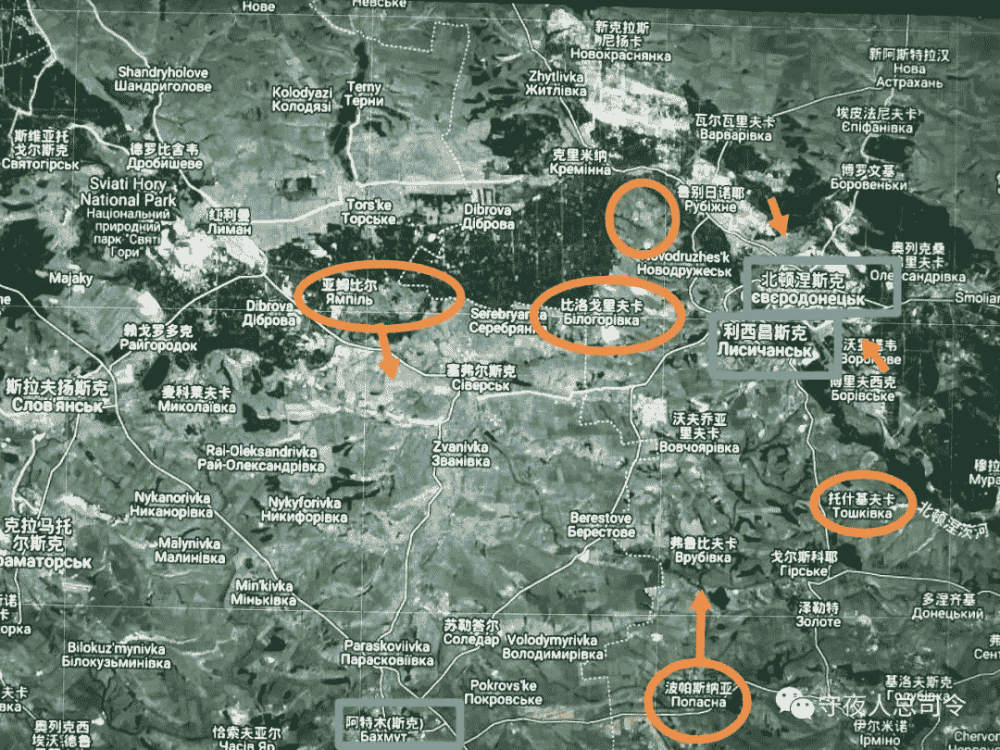

  
顿巴斯形势图草稿  
另一个乌军获得战绩的地方在北顿涅茨河沿岸的一个叫“比洛戈里夫卡”的渡口。这个地方河流比较窄，俄军出动了一个营的先头部队两次试图在河流上搭建浮桥。但两次都被乌军击败，从损失的装备来看，至少一个机械化步兵连，一个坦克连被乌军歼灭，而且用来架设浮桥的工兵连也损失殆尽。估计俄军不会放弃这个渡口，应该还会组织起第三次。因为占领这个渡口，就能切断 T1302 公路，这是北顿涅茨克和利昌斯克两座城市中的守军唯一的退路。  
虽然俄军遭受了近期以来比较大的损失——4 辆坦克，8 辆步战车，还有一个工兵连的架桥设备，损失的士兵应该不少于 100 人。但他们还是从另外两个地方渡过了被顿涅茨河。一个地方就是红力曼的右后方的亚姆比尔，这个地方三天前占领了。另外一个地方就是克里米纳和鲁别日内之间的居民点有一条跨越北顿涅茨河的小路能够抵达对岸。这个居民点的名字太长，我不知道怎么翻译，它在俄军遭受损失的比洛戈里夫那个渡口的右边，距离连接鲁别日内的 T1302 公路很近，也是利昌斯克左上方的屏障。目前过河的俄军正在与利昌斯克赶过来的乌军进行争夺这个桥头堡。这个桥头堡有条无名公路沿着被顿涅茨河通向“比洛戈里夫卡”那个渡口。也就是说，右边过河的俄军可以沿这条公路在河这边占据”比洛里夫卡“，然后让对岸两次假设浮桥都失败的俄军顺利过河。与之同时，左边从亚姆比尔过河的俄军只需要攻克一个叫”塞弗尔斯克“的居民的点，就能沿 T1302 公路抵达”比洛戈里夫“这个渡口。简单的说，就是这个渡口左右两路已经过河的俄军可以夹击”比洛戈里夫“这个渡口。所以，这个渡口的俄军过河是没有太多悬念了。在这个渡口成功阻击俄军两次的乌军今晚应该会撤退到利昌斯克，避免被两路夹击。北顿涅茨河防御体系彻底破碎了，明天俄军就会兵分三路过河，然后切断 T1302 公路。另外一个方向的俄军已经进攻到利昌斯克外围的 T1303 公路上的“托什基夫卡”。南部早几天攻占了波帕斯纳亚的俄军正在北上，攻击退守“利昌斯克”南部郊外的“佛鲁比夫卡”这个居民点。从鲁别日内出发的俄军已经在进攻北顿涅茨市区了。守城的乌军炸断了鲁别日内通向北顿涅茨克市的高架桥，试图延缓俄军向市区推进的速度。但是，北顿涅茨市受到俄军攻击的不仅仅是鲁别日内方向，城市的另一个方向也在受另外一路俄军的攻击。另一个方向的俄军已经占据了市郊的直升机场，正在对角线的方向进攻市区。总之，顿巴斯地区的北顿城市群被彻底包围了！  
乌军这 15000 多精锐本来是可以向西撤退保存下来的，基辅为了面子死活不让受军撤退。有消息称乌军的最高指挥官从军事角度考虑是准备撤出会陷入包围的乌东部队，但演员总统否定这个理性的决策，不顾现实的命令驻军死守！被困在红利曼的那三个旅也是如此——目前乌军试图派兵救援，但通往红利曼的桥梁已经被乌军自己炸毁了——公路和铁路桥都炸毁了！而且红利曼目前三面都出于俄军的包围之中，唯一通向斯拉维扬斯克的乌军的撤退、救援和补给通道被乌军自己切断了。可见乌军的指挥系统出现了混乱——下达命令的人对于是原地固守还是紧急撤退举棋不定。最后造成了前线的精锐陷入这种危险的境地！要知道，顿巴斯的守军都是打了八年的老兵，报销了这些老兵，那些临时征召的士兵可能枪都端不稳。这不是信口开河，而是有事实为依据：昨天基辅命令乌克兰国土防御部队中的 101 旅赶赴顿巴斯前线增援，结果 101 旅直接公然战场抗命！从开战以来，乌军最多发生过连级单位拒绝继续服役，从未有营级单位拒绝执行命令。这次是一个旅级单位直接公然抗命！抗命的理由是：部队没有重武器，士兵根本没有经过充分的训练，上去就是送死。  
重武器  
目前西方提供的进攻性重型武器 M777 榴弹炮已经全部交付，而且还培训出来了 310 名炮兵。M777 发射的时候需要 7 个人一组。6 门炮一个连队，18 门炮一个营再加上维修和运输等后勤人员，西方训练出来的乌军人员差不多能够武装起来两个满编的炮兵营。M777 榴弹炮的口径右 155 毫米，但它是牵引式的，没法打完马上跑，而且需要手动装填弹药。虽然可通过奴干支重型直升机吊装部署，但这种东西只有美国人有。乌克兰的部署必须要先用火车拉到前线，然后用履带车拉到炮兵阵地安装好。打完之后需要在对方的反炮兵雷达找到自己的坐标之前拆掉拉走，否则马上会招来对方的炮兵、火箭弹、导弹或空中飞机的攻击。  
武器的整体优势需要成体系的配合，M777 确实存在火力优势，但它的机动性不足需要用空军来弥补和配合。这 90 门 M777 榴弹炮总计交付了 11 万枚各种炮弹。按照目前俄乌两军在前线的炮击密度，这个弹药量差不多会在两个星期内耗光！印度曾向美国订购过 45 门 M777 榴弹炮，每一套的单价是 500 万美金，炮弹另算。美国军火好是好，就是特别贵，而且还需要许多更贵的先进玩意来配合才能发挥出优势。譬如这个 M777 榴弹炮就需要 C17 战略运输机或者奴干支重型直升机来快速部署。C17 类似于我们的运 20，奴干支就是前后有一对大螺旋桨的那种黑色直升飞机，我们至今都还未能研发出来。如果用飞机吊装部署和转移都非常快。但没有这些配套的东西，部署和拆走都非常麻烦，维护的成本也很高。开一炮就暴露位置了，还没拆下来装车拖走，对面就可能反击——这就是缺乏配套设施的劣势。所以，我们的 155 榴弹炮是车载的，直接架在车上开炮，开完炮直接开走不需要收起来。部署的时候也不需要挖坑、打桩、搬运弹药什么的。弹药都直接在车上，极端情况下一个人都完全能操作并转场。估计下一步乌克兰会要求西方提供这种车载的自动榴弹炮。  
一两件武器真的不会决定战场走势。当年全美械的新 1 军开进东北的时候也是各种无敌，携带了大量从美国采购的 105 榴弹炮。结果消耗太快很快打完了，打电话向南京要弹药，南京回电说，你们再坚持一下，已经向美国下订单采购了，他们很快就会生产，下下个月就可能运送过来！前线的新一军听到这个就开始骂娘了。因为美械的火力优势是建立在后勤供应源源不断地情况下。美军在伊拉克和阿富汗，平均 20 万发子弹才打死一个人，这种消耗是非常惊人的。俄军重开了 5 条导弹生产线，弹药补给会有所改善，目前俄军的补给线比较通畅。乌军的补给线变长了，而且运力慢慢成为了瓶颈。暂时还未能找到改进的有效办法。  
潜力  
战场上的进退必须与战略目标息息相关才有价值。否则，就只能用来鼓舞士气和振奋人心。然而，这种鼓舞也只是暂时的。这就如同我们的人生。出身底层家庭的人并非不努力，只是做事没有章法，许多时候做的事只是为了眼前争口气，或者试图向谁去证明什么。串起来缺乏连贯性也无法形成一种积累性的优势。这就好比一些小镇美女，工作了很久也挣了一点钱，甚至还与不同的人谈过很多次无疾而终的恋爱。但不管是花钱的方式，还是与人建立亲密关系的方式都是纯消耗式的，无法形成任何长期积累——也就是说不会随着时间的递增变得更加有优势。  
乌克兰目前全国只有 10%的加油站还有一点存油，剩下的 90%的加油站都已经完全没有油了。这仅剩的 10%的加油站即便排起长长的加油队伍，也只能提供汽油，因为柴油必须全部用来保障前线——因为所有的坦克、装甲车、履带式大炮牵引车都需要柴油。而且作为平原地区的农业大国，乌克兰所有农业生产的机械都需要柴油驱动。即便停止一切生产生活用油优先提供给前线，东部前线也如同西部一样出现燃料短缺。  
西方目前确实在提供武器，但他们始终无法提供燃料。事实上他们也极度缺乏燃料。乌克兰昨天把过境乌克兰向欧洲供应油气的阀门关闭了。这让已经全部同意用卢布购买油气的欧洲再遭受致命一击，欧洲的油气价格又涨了 6.8%，并且让欧元兑换卢布的汇率第一次跌破 70:1。泽连斯基也是着急了，因为德国和法国都组团忽悠他加入欧盟光走流程也需要 5-10 年，马克龙说的是几年甚至几十年！这等于明摆着拒绝乌克兰加入欧盟。给武器是可以的，但给油气就不行了，持续给钱养一个打的稀巴烂的国家就更不可能了——这个事大家都心知肚明，只有演员一厢情愿。  
演员最近确实有点急，开始外行指挥内行，一切为了宣传，到处插手瞎指挥。蛇岛的夺岛计划乌军的那位最高指挥官是不同意的，但演员听英国顾问的忽悠，强行下令不惜代价去夺岛。结果损失了西部军区仅有的 3 架苏 27、苏 34，还损失了 3 架米-8 直升机和 2 架无人机。这些装备还在其次，主要是损失了 50 多名特种兵，还误杀了自己的一个旅长，损失了一个中将——乌军负责海军航空兵的海军副总司令。最最重要的是，蛇岛没有能够夺回来，敖德萨港口的船依然没法开出去！  
乌东的精锐目前是撤不出来了，包括红利曼的那三个旅一万五千人和北顿那两座城市里被包围的一万五千人。这三万人的命运就会像马里乌波尔被围困的乌军一样，但这些地方可没有亚速钢铁厂那样的堡垒。也没有那么多的食物和弹药。目前斯拉维扬斯克和克拉玛托尔斯克这两个堡垒中的乌军，包括巴文科沃的守军都还可以抓紧时间往西撤退。因为俄军攻克了波帕斯纳亚之后并没有向西去抢占阿特木斯克，把整个顿巴斯地区乌军西撤的大门彻底关上。而是追击从波帕斯纳亚溃逃的乌军 24 机步旅残部，一路北上去包围利昌斯克了。根据演员死要面子的尿性，肯定不会同意这斯拉维扬斯克的乌军西撤的。因为他的形象已经被捧的太高了，他不能容忍瞬间丢掉整个乌东地区这样的事实。这不仅会让自己绷不住，而且会极度影响争取外援。所以，他现在急需一些看得见摸得着的反攻行为来坚定西方金主们的信心。然而，打战必须要沉得住气，要遵守客观规律，等待时机，准备充分之后才有的放矢。演员如果能不那么情绪化，不去越俎代庖干扰乌军指挥官的战场指挥，反而会打的更好一些，他越是这样沉不住气瞎指挥乱干预，反而会把战场上仅剩的那点精锐全部断送掉！  
[乌克兰的反攻！](http://mp.weixin.qq.com/s?__biz=MzAxNDk1NjI2Mw==&mid=2247488397&idx=1&sn=4761b8dad0f2071a7a5fd61e413bc1c7&chksm=9b8a3005acfdb9137967595d5f331ce6b0b3d94cd4b0153bc4083c4849934c9ea0e0930b27ef&scene=21#wechat_redirect)  
[锐气不再！](http://mp.weixin.qq.com/s?__biz=MzAxNDk1NjI2Mw==&mid=2247488391&idx=1&sn=f66462020de44e8aee5ad786bb7d4cc1&chksm=9b8a300facfdb919010a65d74fa80b7631cd3d3317004064c9e238791c90a70c8ce7aa5bc983&scene=21#wechat_redirect)  
[算账！](http://mp.weixin.qq.com/s?__biz=MzAxNDk1NjI2Mw==&mid=2247488259&idx=1&sn=2b72f3c0199cdacaa8e48eb9ad30f809&chksm=9b8a308bacfdb99d72ebcd3aaf0015c889b88f4598b093719ee8765aa8be3b3caaad95a445ae&scene=21#wechat_redirect)  
[A658：经济秩序！](http://mp.weixin.qq.com/s?__biz=MzIzMDYwOTM0Mg==&mid=2247487179&idx=1&sn=12ad76a2b6a86d4dc52eb515f2b00500&chksm=e8b1961adfc61f0c30f16b60b87e2fcd3142b4a788c2ae81604f02182574c50b54c1d9e2974d&scene=21#wechat_redirect)  
[A647：可怕的渗透！](http://mp.weixin.qq.com/s?__biz=MzAxNDk1NjI2Mw==&mid=2247488112&idx=1&sn=d2cdb1bbea5f7a7248e4ba132c2ad922&chksm=9b8a31f8acfdb8ee225327ff157e56571bbf63b8958ad6c47d7da000b5da90fa01379222c8e1&scene=21#wechat_redirect)  
[E35:我们在月之暗面发现了什么？！](http://mp.weixin.qq.com/s?__biz=MzIzMDYwOTM0Mg==&mid=2247486632&idx=1&sn=170aeff87eb36dce354c8b2437f4b27f&chksm=e8b19479dfc61d6f08e6492954a528f20387fe2fa925747cf2b504d2bc69084f24495e972e41&scene=21#wechat_redirect)  
[A539：京东为什么能绝地反击！](http://mp.weixin.qq.com/s?__biz=MzIzMDYwOTM0Mg==&mid=2247486752&idx=1&sn=3a967e3288db5b7d924e36914086e534&chksm=e8b195f1dfc61ce7c971386eb678d7da286167d0f52fdd51989049844b0a550cc58e00552d2e&scene=21#wechat_redirect)  
[A518：既双减又提高考试难度，要干啥？!](http://mp.weixin.qq.com/s?__biz=MzIzMDYwOTM0Mg==&mid=2247486528&idx=1&sn=837ef39e3c0b47ac84d5096690555ae7&chksm=e8b19491dfc61d87292daf575c1e7c95b3f0543f313b65c7ad4ab369603833704304ec7451d7&scene=21#wechat_redirect)  
[A311：要理解住房不炒的真正含义！](http://mp.weixin.qq.com/s?__biz=MzIzMDYwOTM0Mg==&mid=2247484959&idx=1&sn=090583ec50bfd9febec1de463c2672f6&chksm=e8b19ecedfc617d8629080f6745c8de013cfe875de26eef6767b2d5c10782650223ed15f807b&scene=21#wechat_redirect)  
[A496：为什么兔子在阿富汗很主动？](http://mp.weixin.qq.com/s?__biz=MzIzMDYwOTM0Mg==&mid=2247486278&idx=1&sn=40d09857088bebd3c70bec1c7a500f06&chksm=e8b19397dfc61a810125242c8e395330f934390eb50bd54053ecd3f31ddc91de4e429c0f693a&scene=21#wechat_redirect)  
[E44：情绪化的人为什么会克制不住？！](http://mp.weixin.qq.com/s?__biz=MzIzMDYwOTM0Mg==&mid=2247487062&idx=1&sn=c1af22f2f5d1e79f7245b826bfaf1f30&chksm=e8b19687dfc61f91468cf22b77c0e221d45054df37b2b602c331eb328b5d46802c69e0d87722&scene=21#wechat_redirect)  
[A525：你误会了男孩要穷养和女孩要富养！](http://mp.weixin.qq.com/s?__biz=MzIzMDYwOTM0Mg==&mid=2247486714&idx=1&sn=693d4c55ab2f0ecdebf06c4807848908&chksm=e8b1942bdfc61d3d1d76c11adb860b1b02f1ab58e48ba3349677a44a563764e09d7eb35f930d&scene=21#wechat_redirect)  
研习《[结构学](https://mp.weixin.qq.com/mp/appmsgalbum?action=getalbum&album_id=1318317199878225920&__biz=MzAxNDk1NjI2Mw==#wechat_redirect)》，加入觉悟社：付费和不公开内容都有，每天 25 块，还能挣回来，下注标的获取需满足条件及时查看更新。公众号发消息：觉悟社  
[结构学自序（新）！](http://mp.weixin.qq.com/s?__biz=MzIzMDYwOTM0Mg==&mid=2247485283&idx=1&sn=aa2b8554b8e5040f8f959636feaa06a3&chksm=e8b19fb2dfc616a430aa381b8da0815311244e694a69809cd92d0602ac34cfe5f1f419b3745e&scene=21#wechat_redirect)  
[穷是万恶之源！](http://mp.weixin.qq.com/s?__biz=MzAxNDk1NjI2Mw==&mid=2247483823&idx=1&sn=e54ebe9891b302dc0bf1815c76ccf8b7&chksm=9b8a2227acfdab31a05e273addd9159d4b8263d58d3c58bf214841c8189157519719c3427306&scene=21#wechat_redirect)  
[A335：必须与焦虑长期共存！](http://mp.weixin.qq.com/s?__biz=MzIzMDYwOTM0Mg==&mid=2247485165&idx=1&sn=f3f0957c63fa549b288f00c8b117162e&chksm=e8b19e3cdfc6172a188000afd2b522144a04ba774169824cad2067d93b5365537ff0644f6b9f&scene=21#wechat_redirect)  
[A376：要换种思维，你才能理解！](http://mp.weixin.qq.com/s?__biz=MzAxNDk1NjI2Mw==&mid=2247486529&idx=1&sn=3a50ada30a5ae0448d686c6a0c809919&chksm=9b8a2fc9acfda6df5e9243deb6e9df9a7cc0912eabd0a9c00322d42ed4c25c2daedc8de6b6ca&scene=21#wechat_redirect)  
[A377：为什么不买武汉的房？](http://mp.weixin.qq.com/s?__biz=MzIzMDYwOTM0Mg==&mid=2247485413&idx=1&sn=1f3339540496eb9e5ea109d8530f29dc&chksm=e8b19f34dfc6162225a694c1c2443d73b51bf6ca8dc53d4c18a30e6e2191e250967e711db589&scene=21#wechat_redirect)  
[A374：真正的大机会在这里！](http://mp.weixin.qq.com/s?__biz=MzIzMDYwOTM0Mg==&mid=2247485401&idx=1&sn=100967c02c0754759ec4ea0ef8706c29&chksm=e8b19f08dfc6161e92c7cc691f1a1fed9ff74c2b906529a8d42a7703a3c3a3c3a412903e12f7&scene=21#wechat_redirect)  
[A370：被删了，改后重发，欲看从速！](http://mp.weixin.qq.com/s?__biz=MzIzMDYwOTM0Mg==&mid=2247485388&idx=1&sn=a456e8ffdc8a16bb30263818dc86c6a3&chksm=e8b19f1ddfc6160bfd0fea09b006477a095662aa74ac7036fca621b2ef49dc59f4ad4a407eeb&scene=21#wechat_redirect)  
[E29：一眼看到底！](http://mp.weixin.qq.com/s?__biz=MzIzMDYwOTM0Mg==&mid=2247485301&idx=1&sn=dc6dd50c5d742ea51ce9e394de25351a&chksm=e8b19fa4dfc616b26734c3619c6fa664474fa478d2764c3370dde41d19f6035edc05f9f191e8&scene=21#wechat_redirect)  
[A357：利率！利率才是关键！](http://mp.weixin.qq.com/s?__biz=MzIzMDYwOTM0Mg==&mid=2247485288&idx=1&sn=4b9b12c3bc11bdcfd2529edd9ab9a92a&chksm=e8b19fb9dfc616afff8c46c46c2a61dea179cdd40a67ed931cae9d2762948e1ee2359d4037b5&scene=21#wechat_redirect)  
[A311：要理解住房不炒的真正含义！](http://mp.weixin.qq.com/s?__biz=MzIzMDYwOTM0Mg==&mid=2247484959&idx=1&sn=090583ec50bfd9febec1de463c2672f6&chksm=e8b19ecedfc617d8629080f6745c8de013cfe875de26eef6767b2d5c10782650223ed15f807b&scene=21#wechat_redirect)  
[A320：思路变了，可以加杠杆了！](http://mp.weixin.qq.com/s?__biz=MzIzMDYwOTM0Mg==&mid=2247485041&idx=1&sn=add2174fa42806f885a456a072ee4fee&chksm=e8b19ea0dfc617b6734e013f780112fdd88f28ad5312ce423fea1d75da4c3757660dab175208&scene=21#wechat_redirect)  
[A345：剥离学区控制贷款也没用！](http://mp.weixin.qq.com/s?__biz=MzIzMDYwOTM0Mg==&mid=2247485208&idx=1&sn=ac3653b56fc18a4a6a809139f935bc45&chksm=e8b19fc9dfc616dfa31b0baf15aa90d994ef8a1262e0fd515739c06698cd0673d1d46e6e4c4f&scene=21#wechat_redirect)  
[为富人办事，为穷人说话！](http://mp.weixin.qq.com/s?__biz=MzIzMDYwOTM0Mg==&mid=2247484462&idx=1&sn=195ebab17907fba73c69ae7a11bc40ad&chksm=e8b19cffdfc615e9b2f88327d492813afa3656859f4d67a6d831ac1cf684a54b760a8b8edcd6&scene=21#wechat_redirect)  
[A284：啊！万箭穿心！](http://mp.weixin.qq.com/s?__biz=MzAxNDk1NjI2Mw==&mid=2247486135&idx=1&sn=e950149b9b9147e9199cfc6093605950&chksm=9b8a293facfda029419b911d4b4fa91c73bbaf695b206df2cf15124d843f4bf4b80673baa394&scene=21#wechat_redirect)  
[梦醒之时，已经三十！](http://mp.weixin.qq.com/s?__biz=MzIzMDYwOTM0Mg==&mid=2247484378&idx=1&sn=e3a058584a13d7a5267315113964280d&chksm=e8b19b0bdfc6121df4af4b77d2d826fd0f4132ccfdee48132ce8cf86eb1ba45b898be83d1dc7&scene=21#wechat_redirect)  
[A245：北京有的小区涨了 20%！](http://mp.weixin.qq.com/s?__biz=MzIzMDYwOTM0Mg==&mid=2247485265&idx=1&sn=f4bce6f07805cba2db3a1a806215e45c&chksm=e8b19f80dfc616966666979063f2c9fce9fe20308538607cf90eac74f0db85c9adf79299f4b8&scene=21#wechat_redirect)  
[A294：一个执行多年的政策即将改变，它会创造一波机会！](http://mp.weixin.qq.com/s?__biz=MzIzMDYwOTM0Mg==&mid=2247484849&idx=1&sn=5485cd1d6c511e883e25b0c7dd9e2e3e&chksm=e8b19d60dfc614764ffc8405dccf5b8120b31988f3c1cee74e384c06f0e39c3c81bef8263c3d&scene=21#wechat_redirect)  
[A351：你不愿女儿嫁给和你一样的人！](http://mp.weixin.qq.com/s?__biz=MzIzMDYwOTM0Mg==&mid=2247485242&idx=1&sn=f4a01a5936322120b0b158f225bc78de&chksm=e8b19febdfc616fd2eb1558a3b7c748ecc497a3af00aec5b5c5ca8042cc52eb7d0af7befa399&scene=21#wechat_redirect)  
[A355：情人节，聊点俗的！](http://mp.weixin.qq.com/s?__biz=MzAxNDk1NjI2Mw==&mid=2247486442&idx=1&sn=2ed76ec8cb69dfe51023fb4f426eeb51&chksm=9b8a2862acfda17469215d16d6bfa7210211dfb0cf4418774fc0ea014de0f6184c9b01b82f70&scene=21#wechat_redirect)  
[父母挖的坑，别人挖的坑，自己挖的坑！](http://mp.weixin.qq.com/s?__biz=MzAxNDk1NjI2Mw==&mid=2247486426&idx=1&sn=8707934ad2fe2f8017d6b7810fd61c17&chksm=9b8a2852acfda1441fded7bab2456dd2493073ad3e5d541e1080d1739879b86c25a3a61df79a&scene=21#wechat_redirect)  
[A319：准备迎接一场屠杀！](http://mp.weixin.qq.com/s?__biz=MzIzMDYwOTM0Mg==&mid=2247485036&idx=1&sn=ff52df7559e0a6ed8230922ebd2af71a&chksm=e8b19ebddfc617ab0eca4ed1a66c5227d328155954d6704be456950fb3926e59e5288f7877cf&scene=21#wechat_redirect)  
[A315：认命吧，做个普通人也挺好的！](http://mp.weixin.qq.com/s?__biz=MzIzMDYwOTM0Mg==&mid=2247485008&idx=1&sn=bcaf70c42d4676c8f69de9f9ead1e495&chksm=e8b19e81dfc617973ba40200519407186760e32843fc6f379020da6160b0ba89870dadcae5fa&scene=21#wechat_redirect)  
[A289：蚂蚁金服只是蹲一下！](http://mp.weixin.qq.com/s?__biz=MzIzMDYwOTM0Mg==&mid=2247484822&idx=1&sn=ea2d818adee1bf400b0af9ed69bcd297&chksm=e8b19d47dfc61451b7291d6369b3391b9b8b06e08f9f5eed482a15c58075880a0029c50aed9a&scene=21#wechat_redirect)  
[C12：务必要振兴建设兵团！](http://mp.weixin.qq.com/s?__biz=MzAxNDk1NjI2Mw==&mid=2247484193&idx=1&sn=88c86597191d0c97a411f9ea6f7b7c5d&chksm=9b8a20a9acfda9bfae819e8e42531fe6d523dd244ef0fc0c0787ab812540108c181f7ec2ffa9&scene=21#wechat_redirect)  
[A87：一个时代的终结！](http://mp.weixin.qq.com/s?__biz=MzAxNDk1NjI2Mw==&mid=2247484762&idx=1&sn=d662f3af14db0c25fa540a7a2ddcd9c7&chksm=9b8a26d2acfdafc45a58be632dd4ca60b92b89f4863b60d6e1a8b6790ee3590878cb1669209a&scene=21#wechat_redirect)  
[A295：当代女性的两难！](http://mp.weixin.qq.com/s?__biz=MzIzMDYwOTM0Mg==&mid=2247484854&idx=1&sn=6851afe306f7b89d23728018ea32b7f2&chksm=e8b19d67dfc61471955b15021ac11c5fff9f1607977e9df1bd2bbfabc2deb3dea5c98e369c55&scene=21#wechat_redirect)  
[A316：一心搞钱的深圳女孩！](http://mp.weixin.qq.com/s?__biz=MzAxNDk1NjI2Mw==&mid=2247486289&idx=1&sn=9504efb0a54b228c61c928794417eaef&chksm=9b8a28d9acfda1cf65ca57c386f1c0a90c457c01d6d1f2ba222e38c2059ca3eb07c94252721f&scene=21#wechat_redirect)  
[A301：我生来就是高山而非溪流！](http://mp.weixin.qq.com/s?__biz=MzIzMDYwOTM0Mg==&mid=2247484895&idx=1&sn=241f68fd60c1b47239beef7573364ceb&chksm=e8b19d0edfc6141856def733b4a1fd20332b7083f1234182452387fcfe12cebb015db7bfbeec&scene=21#wechat_redirect)  
[E10：升级所需的密度！](http://mp.weixin.qq.com/s?__biz=MzAxNDk1NjI2Mw==&mid=2247485337&idx=1&sn=e93780b3d10de5b467e71f326eb12838&chksm=9b8a2411acfdad07d858079223ba3eda77fe88caa8d769030eb67c15f5511fab584f8d1244ca&scene=21#wechat_redirect)  
觉悟者  
喜欢你就转走吧！  
微信扫一扫赞赏作者 赞赏  
已喜欢，对作者说句悄悄话  
取消   
发送给作者  
发送  
最多 40 字，当前共字  
 人赞赏   
上一页 1/3 下一页  
长按二维码向我转账  
喜欢你就转走吧！  
受苹果公司新规定影响，微信 iOS 版的赞赏功能被关闭，可通过二维码转账支持公众号。  

 

精选留言  
暂无...   
[阅读全文](https://mp.weixin.qq.com/s?__biz=MzIzMDYwOTM0Mg==\x26amp;mid=2247486752\x26amp;idx=1\x26amp;sn=3a967e3288db5b7d924e36914086e534\x26amp;chksm=e8b195f1dfc61ce7c971386eb678d7da286167d0f52fdd51989049844b0a550cc58e00552d2e\x26amp;scene=21#wechat_redirect)  
  

# 

# \[守夜人总司令\] - 2022-05-11 一败涂地！

> 来源：[`www.yuque.com/books/share/97051b78-926c-43e6-b0aa-0b72ff163ac4/gpi31o`](https://www.yuque.com/books/share/97051b78-926c-43e6-b0aa-0b72ff163ac4/gpi31o) 

一败涂地！   
原创 觉悟者 守夜人总司令   
守夜人总司令   
微信号 WatcherCommander  
功能介绍 结构学：生命体在其生存结构中的求存之道！  
2022-05-11[原文](https://mp.weixin.qq.com/s?__biz=MzAxNDk1NjI2Mw==&mid=2247488404&idx=1&sn=8364726fdea4e314c6cd11c41e688b60&chksm=9b8a301cacfdb90a904d86da8773586974e5d4bd183ada42108d117b0de1b4f448a1a3e2c878#rd\)) 发表于  
收录于合集  
#底层逻辑 86 个   
#精神结构 101 个   
#人间正道是沧桑 21 个   
#结构学 89 个   
#统治机器 25 个   
我们的思维方式是格言式的，不是逻辑式的。许多对复杂的人和事做出判断的时候，只需要一个非黑即白的答案，而不在乎现实与结论之间的演化逻辑，这是我们这个文化的思维方式。我们坚信存在一个博大精深的东西，但我们始终说不清楚它到底博大精深在哪里——甚至不愿意说清楚它！  
自然科学之所以能够获得长足发展，在于它立足于把问题说清楚。这种清楚不是捏花一笑以心传心式的清楚，而是像药物的分子成分一样的清晰明了。这就如同拿一笔钱去做一个生意，在没有开始之前，它应该是可以说清楚的：商业模式是什么，以什么方式挣钱，挣谁的钱，需要多少成本，成本构成是什么样子，毛利润在什么水平，同行业的毛利润在什么水平。所有的这些影响成败的关键点越清晰明了，成功率越高。  
这些年风险投资最大的贡献还不是给创业注入资金，而是引入了一套规范的模式。在这种模式的训练下，从业人员不再像当年的草莽英雄那样凭直觉去做生意。凭直觉并非不能判断正确，只不过它适合跑马圈地的时代，细节上的弯路和阶段性的成败都无关紧要，反正没人跟你抢。这就如同《加勒比海盗》中的杰克船长所言：随着地图画的越来越精细，留给海盗的未知岛屿越来越少了，属于他们的时代一去不复返了！  
当年张之洞办汉阳铁厂，花大价钱从德国引入高炉。然而，不同的高炉对应不同的矿石，需要先检测矿石的成份再有针对性的引入高炉。然而，张之洞说：我天朝无所不有，何须如此麻烦。结果引入的高炉与当地的铁矿石的酸碱度不匹配，炼出来的钢经常断裂，根本做不了铁轨。在那个完全一片空白的时代，搞砸了大不了不惜成本再搞一次，虽然损失很大，但再搞一次搞对了依然是开拓者，甚至会因为独一无二不愁没有销路。然而，今天没有那么多得空白让人去试错。想做某件事并且能做这件事的人有很多。以前鲁冠球搞了一个很大的汽车配件的民营企业，想招几个大学生还要求领导给指标，好吃好喝的供着都没人愿意去。今天还会有这样的情况吗？因为大学生不再是稀缺资源，因为整个社会的文化水平都提高了，所以，能做一件事的人很多。谁先做并且做成了就抢占住那个赛道。而因为这样那样的失误，原地转圈几次，这个机会就跟自己没啥关系了！  
小朋友在判断问题的时候只关注好人还是坏人，因为这样能够快速的获得一个确定性的答案。因为小朋友不需要解决现实问题，所以不需要关注手段，也不需要权衡利弊。小朋友觉得你坏，那就是百分之百的离你远远的。如果觉得你好则是百分之百毫无保留的觉得你哪里都好。成年人的世界不是这样的，也不能这样。成年人的世界更关注解决问题的有效手段和得出结论的判断逻辑。准确的说，是不需要别人给出答案，而是需要提供解题思路。因为你给的答案可能是骗人的。但那些行之有效的手段可以借鉴，而那些基于事实演化出来的逻辑则可以被检验。这才是有价值的部分！毕竟成年人不需要别人为自己做主，成年人需要有自己的判断——那种能够说清楚，有理有据的判断逻辑！  
康德在他的《纯粹理性批判》提出了一个思路让我很有启发：即便是面对那些神秘的事物，也应该借鉴自然科学中那些已经被证明有效的逻辑工具，像自然科学的工作方式一样来对待与人有关的各种判断。当我们能够系统的阐述清楚到底哪里博大哪里精深的时候，许多引发相互仇视的争论就会逐渐烟消云散…  
许多问题之所以会演化成互成水火的是非之争，皆源于缺乏行之有效的解决手段。譬如，一对男女到了谈婚论嫁的阶段，女方向男方要一笔彩礼。如果男方能轻易的拿出来，这就是一个结婚的流程和仪式。如果男方拿不出来，这就会上升为人品问题：女方会觉得男方缺乏诚意，人品有问题；男方会觉得女方太物质，人品有问题！任何理性都无法建立在极度的匮乏之上——不管是物资还是精神。随着手段的增强，许多水火不容的争执都能够变成利益均沾的包容和理解。  
贫贱夫妻百事哀，为什么会有这种说法？就是因为这种状态下的彼此面对生活中的各种问题都缺乏行之有效的解决手段，任何无法解决的问题最后都会变成关于是非立场的相互指责。最后失望透顶，怨气冲天，一拍两散，宛如仇敌。所有会引发你情绪激动，甚至让你破口大骂的不同看法，往往都在悄无声息中让你陷入了一种不舒服的状态。这种不舒服的状态并非源自于外部，而是源自于内部。《[意见不同时，如何判断人！](http://mp.weixin.qq.com/s?__biz=MzAxNDk1NjI2Mw==&mid=2247488223&idx=1&sn=4860be32308a7b853142c8d799d2b678&chksm=9b8a3157acfdb841242ae974e7ea0dc1582191bb60e7ad12f98c37506e7ddcd62410d67707fc&scene=21#wechat_redirect)》  
关注认识问题的方法，关注解决问题的手段，关注判断力的形成逻辑，是非一点都不重要，重要的是：为什么对了！以及到底错在哪里？一场球踢完总要学会几个技巧，而不仅仅是一点谈资，否则，多年之后依然会一败涂地。  
[乌克兰的反攻！](http://mp.weixin.qq.com/s?__biz=MzAxNDk1NjI2Mw==&mid=2247488397&idx=1&sn=4761b8dad0f2071a7a5fd61e413bc1c7&chksm=9b8a3005acfdb9137967595d5f331ce6b0b3d94cd4b0153bc4083c4849934c9ea0e0930b27ef&scene=21#wechat_redirect)  
[锐气不再！](http://mp.weixin.qq.com/s?__biz=MzAxNDk1NjI2Mw==&mid=2247488391&idx=1&sn=f66462020de44e8aee5ad786bb7d4cc1&chksm=9b8a300facfdb919010a65d74fa80b7631cd3d3317004064c9e238791c90a70c8ce7aa5bc983&scene=21#wechat_redirect)  
[算账！](http://mp.weixin.qq.com/s?__biz=MzAxNDk1NjI2Mw==&mid=2247488259&idx=1&sn=2b72f3c0199cdacaa8e48eb9ad30f809&chksm=9b8a308bacfdb99d72ebcd3aaf0015c889b88f4598b093719ee8765aa8be3b3caaad95a445ae&scene=21#wechat_redirect)  
[A658：经济秩序！](http://mp.weixin.qq.com/s?__biz=MzIzMDYwOTM0Mg==&mid=2247487179&idx=1&sn=12ad76a2b6a86d4dc52eb515f2b00500&chksm=e8b1961adfc61f0c30f16b60b87e2fcd3142b4a788c2ae81604f02182574c50b54c1d9e2974d&scene=21#wechat_redirect)  
[A647：可怕的渗透！](http://mp.weixin.qq.com/s?__biz=MzAxNDk1NjI2Mw==&mid=2247488112&idx=1&sn=d2cdb1bbea5f7a7248e4ba132c2ad922&chksm=9b8a31f8acfdb8ee225327ff157e56571bbf63b8958ad6c47d7da000b5da90fa01379222c8e1&scene=21#wechat_redirect)  
[E35:我们在月之暗面发现了什么？！](http://mp.weixin.qq.com/s?__biz=MzIzMDYwOTM0Mg==&mid=2247486632&idx=1&sn=170aeff87eb36dce354c8b2437f4b27f&chksm=e8b19479dfc61d6f08e6492954a528f20387fe2fa925747cf2b504d2bc69084f24495e972e41&scene=21#wechat_redirect)  
[A539：京东为什么能绝地反击！](http://mp.weixin.qq.com/s?__biz=MzIzMDYwOTM0Mg==&mid=2247486752&idx=1&sn=3a967e3288db5b7d924e36914086e534&chksm=e8b195f1dfc61ce7c971386eb678d7da286167d0f52fdd51989049844b0a550cc58e00552d2e&scene=21#wechat_redirect)  
[A518：既双减又提高考试难度，要干啥？!](http://mp.weixin.qq.com/s?__biz=MzIzMDYwOTM0Mg==&mid=2247486528&idx=1&sn=837ef39e3c0b47ac84d5096690555ae7&chksm=e8b19491dfc61d87292daf575c1e7c95b3f0543f313b65c7ad4ab369603833704304ec7451d7&scene=21#wechat_redirect)  
[A311：要理解住房不炒的真正含义！](http://mp.weixin.qq.com/s?__biz=MzIzMDYwOTM0Mg==&mid=2247484959&idx=1&sn=090583ec50bfd9febec1de463c2672f6&chksm=e8b19ecedfc617d8629080f6745c8de013cfe875de26eef6767b2d5c10782650223ed15f807b&scene=21#wechat_redirect)  
[A496：为什么兔子在阿富汗很主动？](http://mp.weixin.qq.com/s?__biz=MzIzMDYwOTM0Mg==&mid=2247486278&idx=1&sn=40d09857088bebd3c70bec1c7a500f06&chksm=e8b19397dfc61a810125242c8e395330f934390eb50bd54053ecd3f31ddc91de4e429c0f693a&scene=21#wechat_redirect)  
[E44：情绪化的人为什么会克制不住？！](http://mp.weixin.qq.com/s?__biz=MzIzMDYwOTM0Mg==&mid=2247487062&idx=1&sn=c1af22f2f5d1e79f7245b826bfaf1f30&chksm=e8b19687dfc61f91468cf22b77c0e221d45054df37b2b602c331eb328b5d46802c69e0d87722&scene=21#wechat_redirect)  
[A525：你误会了男孩要穷养和女孩要富养！](http://mp.weixin.qq.com/s?__biz=MzIzMDYwOTM0Mg==&mid=2247486714&idx=1&sn=693d4c55ab2f0ecdebf06c4807848908&chksm=e8b1942bdfc61d3d1d76c11adb860b1b02f1ab58e48ba3349677a44a563764e09d7eb35f930d&scene=21#wechat_redirect)  
研习《[结构学](https://mp.weixin.qq.com/mp/appmsgalbum?action=getalbum&album_id=1318317199878225920&__biz=MzAxNDk1NjI2Mw==#wechat_redirect)》，加入觉悟社：付费和不公开内容都有，每天 25 块，还能挣回来，下注标的获取需满足条件及时查看更新。公众号发消息：觉悟社  
[结构学自序（新）！](http://mp.weixin.qq.com/s?__biz=MzIzMDYwOTM0Mg==&mid=2247485283&idx=1&sn=aa2b8554b8e5040f8f959636feaa06a3&chksm=e8b19fb2dfc616a430aa381b8da0815311244e694a69809cd92d0602ac34cfe5f1f419b3745e&scene=21#wechat_redirect)  
[穷是万恶之源！](http://mp.weixin.qq.com/s?__biz=MzAxNDk1NjI2Mw==&mid=2247483823&idx=1&sn=e54ebe9891b302dc0bf1815c76ccf8b7&chksm=9b8a2227acfdab31a05e273addd9159d4b8263d58d3c58bf214841c8189157519719c3427306&scene=21#wechat_redirect)  
[没有退路的一代人！](http://mp.weixin.qq.com/s?__biz=MzAxNDk1NjI2Mw==&mid=2247486533&idx=1&sn=a0d5cce0656aad467148e0642eb85a00&chksm=9b8a2fcdacfda6db79857186e953a089baf1fb678b2b071cf101c5a26e7fb9768474c94243ca&scene=21#wechat_redirect)  
[A639：普京不会崩溃！](http://mp.weixin.qq.com/s?__biz=MzAxNDk1NjI2Mw==&mid=2247488084&idx=1&sn=7c8d1370795dc6496c224b27c0137762&chksm=9b8a31dcacfdb8ca47772d583074c0ce9e16f2a9a2d3a27359cb26cb851d21da814506f6a3df&scene=21#wechat_redirect)  
[A638：合围已成！](http://mp.weixin.qq.com/s?__biz=MzIzMDYwOTM0Mg==&mid=2247487073&idx=1&sn=5d102355ac65ed1822819d6bbd4e8d59&chksm=e8b196b0dfc61fa674a26fe0bb99b46030acb46ab3ebd4af466cf980fd0a06f9875d33538936&scene=21#wechat_redirect)  
[A647：可怕的渗透！](http://mp.weixin.qq.com/s?__biz=MzAxNDk1NjI2Mw==&mid=2247488112&idx=1&sn=d2cdb1bbea5f7a7248e4ba132c2ad922&chksm=9b8a31f8acfdb8ee225327ff157e56571bbf63b8958ad6c47d7da000b5da90fa01379222c8e1&scene=21#wechat_redirect)  
[A641：吹响了反攻的号角？！](http://mp.weixin.qq.com/s?__biz=MzAxNDk1NjI2Mw==&mid=2247488089&idx=1&sn=c532b7b5b38bb03828c600669804f8cc&chksm=9b8a31d1acfdb8c77d656a7aaf9d77c03603864118e10553cfdfde1061229392a21ea728b8b0&scene=21#wechat_redirect)  
[A443：能不工作，尽量别工作！](http://mp.weixin.qq.com/s?__biz=MzAxNDk1NjI2Mw==&mid=2247486794&idx=1&sn=8621689fcbb0f44c38ab2e8065c54a3d&chksm=9b8a2ec2acfda7d4c55afac9ee027871f7a81338e2da399b1908202c54cc8496ca077748f5a7&scene=21#wechat_redirect)  
[A644：收回克里米亚绝对是正确之举！](http://mp.weixin.qq.com/s?__biz=MzIzMDYwOTM0Mg==&mid=2247487112&idx=1&sn=c116d6a79085ad9fe413f42170eca23a&chksm=e8b19659dfc61f4fdb34ac71a7efb0994e7e3c07f7e8b75f34c646b05293f27d2e21423efc1a&scene=21#wechat_redirect)  
[A640：介入叙利亚战争并非虚荣心作祟！](http://mp.weixin.qq.com/s?__biz=MzAxNDk1NjI2Mw==&mid=2247488081&idx=1&sn=adfaf12849fa59e47f412105d2170c75&chksm=9b8a31d9acfdb8cfb8b78731ecb12a5d70c3b6997675397a2f95ba7bf63638aca4ee74acf789&scene=21#wechat_redirect)  
[E44：弱势的感觉和受害者心态！](http://mp.weixin.qq.com/s?__biz=MzAxNDk1NjI2Mw==&mid=2247488080&idx=1&sn=7726e8fd76e8c053a29ee29f59d96f64&chksm=9b8a31d8acfdb8ce9b0a974811d18f41adb7c03158f4b3979b314b6e18b23b200b2ed472676f&scene=21#wechat_redirect)  
[不要愤愤不平，都是好事！](http://mp.weixin.qq.com/s?__biz=MzAxNDk1NjI2Mw==&mid=2247487130&idx=1&sn=b21138d85455f5692aaf039038c78342&chksm=9b8a2d12acfda404a2b67fe4d446ee0f2805ad64a8b8004902934600fd731191e140df6ac19a&scene=21#wechat_redirect)  
[她都来相亲了，你还要怎么样！](http://mp.weixin.qq.com/s?__biz=MzAxNDk1NjI2Mw==&mid=2247486952&idx=1&sn=698aec6916d2eca5e758c25c4c634346&chksm=9b8a2e60acfda776b80a4f2f0d5c2fe4921fc821cdf029fa9d2fdc52fd708fc5a0b980d5d3d0&scene=21#wechat_redirect)  
[田园女权真正攻击的对象是女人！](http://mp.weixin.qq.com/s?__biz=MzIzMDYwOTM0Mg==&mid=2247486412&idx=1&sn=5dd3e8b2a759838d739e6d61ebab2eab&chksm=e8b1931ddfc61a0bf6f81cd2a9a9232ea8ce86528a8eea66c6635180e8678b819ebb38b4cb86&scene=21#wechat_redirect)  
[A300：这是投机的大机会还是大陷阱？！](http://mp.weixin.qq.com/s?__biz=MzIzMDYwOTM0Mg==&mid=2247484882&idx=1&sn=b103029f41e3aede94e1a45d035cd9ac&chksm=e8b19d03dfc614153863f37ca3f9204b451e2c02ad5ca8680c120e2458e628e5329c76b2d42c&scene=21#wechat_redirect)  
[A366：从货币驱动到财政驱动的转变！](http://mp.weixin.qq.com/s?__biz=MzIzMDYwOTM0Mg==&mid=2247485347&idx=1&sn=a916df57ddc7230366719fbecc6c1704&chksm=e8b19f72dfc61664fd99844bfe3ffffb5d6f088807c84d99f11ddbc7410b2eed67bc4c615d53&scene=21#wechat_redirect)  
[A376：要换种思维，你才能理解！](http://mp.weixin.qq.com/s?__biz=MzAxNDk1NjI2Mw==&mid=2247486529&idx=1&sn=3a50ada30a5ae0448d686c6a0c809919&chksm=9b8a2fc9acfda6df5e9243deb6e9df9a7cc0912eabd0a9c00322d42ed4c25c2daedc8de6b6ca&scene=21#wechat_redirect)  
[A542：从现在开始，抓紧手中的钱！](http://mp.weixin.qq.com/s?__biz=MzIzMDYwOTM0Mg==&mid=2247486640&idx=1&sn=a96afa7d2b698e33240735ea8d7671f7&chksm=e8b19461dfc61d77a4afce11ecc7558b8d7ff5d495a78bcb609e3eed5c70bcbed5f3d6a66023&scene=21#wechat_redirect)  
[A519：缺电不会改变之前的下注逻辑！](http://mp.weixin.qq.com/s?__biz=MzIzMDYwOTM0Mg==&mid=2247486508&idx=1&sn=6fac0f23979fa74983528cb090ad205b&chksm=e8b194fddfc61deb6982573c047fb47cb7af702e87111a0498e1cdc4676b6baf3cc5143f9c92&scene=21#wechat_redirect)  
[A617：前三十年为什么没有光棍村？！](http://mp.weixin.qq.com/s?__biz=MzIzMDYwOTM0Mg==&mid=2247487043&idx=1&sn=d7beb24f486323059a94f3dc920e5e7e&chksm=e8b19692dfc61f84da21ce73dc0aaf1973156a691a8ad6e75b61cc44ebf08b739d580410984e&scene=21#wechat_redirect)  
[A613：孩子不能防老，真正的作用是这个！](http://mp.weixin.qq.com/s?__biz=MzIzMDYwOTM0Mg==&mid=2247487023&idx=1&sn=3370d17aaf4a8f046e2ebaa995200c87&chksm=e8b196fedfc61fe84dbfe4353d88b51f3077fc0ff82a1446e52742bce73e561b0e8ff1d113a3&scene=21#wechat_redirect)  
[你敬的酒我怎能不喝！](http://mp.weixin.qq.com/s?__biz=MzIzMDYwOTM0Mg==&mid=2247486456&idx=1&sn=7d6377d84f511b80179c5e7648494d6e&chksm=e8b19329dfc61a3f9b91b5b43dbd1a6eea293a02cd80b96aeb6dd1930f7f2c93fd33c0e3b2f3&scene=21#wechat_redirect)  
[A496：为什么兔子在阿富汗很主动？](http://mp.weixin.qq.com/s?__biz=MzIzMDYwOTM0Mg==&mid=2247486278&idx=1&sn=40d09857088bebd3c70bec1c7a500f06&chksm=e8b19397dfc61a810125242c8e395330f934390eb50bd54053ecd3f31ddc91de4e429c0f693a&scene=21#wechat_redirect)  
[A432：底层人为何会热衷于互相伤害？！](http://mp.weixin.qq.com/s?__biz=MzAxNDk1NjI2Mw==&mid=2247487443&idx=1&sn=21334752ac2ce642ca1e4e421acfe765&chksm=9b8a2c5bacfda54d1459036c57a31b05271d1b825eadd811cce0bbeca1ea3a7deae31e067133&scene=21#wechat_redirect)  
[男人成长的最快方式！](http://mp.weixin.qq.com/s?__biz=MzAxNDk1NjI2Mw==&mid=2247487435&idx=1&sn=8d1fe9b5f45ab8bd0c98f396ea6f0f1c&chksm=9b8a2c43acfda5557c14b9f4ecd8efc8e844df88c1b9a487906eddbc04860acc06bbd0ef6963&scene=21#wechat_redirect)  
[前天被删的那篇彻底改写后重发！](http://mp.weixin.qq.com/s?__biz=MzAxNDk1NjI2Mw==&mid=2247487425&idx=1&sn=37c59746f0368268dbf1497b341aab93&chksm=9b8a2c49acfda55f770d8082d28911b1ce6406517fb969072d77bc0c8c1f26507ac18360d2f8&scene=21#wechat_redirect)  
[A507 和 A513 都被删，这篇看完记得保存！](http://mp.weixin.qq.com/s?__biz=MzIzMDYwOTM0Mg==&mid=2247486598&idx=1&sn=643ad77a60e4fb7e40dcea6e4585c39a&chksm=e8b19457dfc61d4126c656d773feb6d26d516889077a4f3b8755cf1ee4b0fe2a592b8409dfd8&scene=21#wechat_redirect)  
[A510：努力没结果，被人顶替，怎么办！](http://mp.weixin.qq.com/s?__biz=MzAxNDk1NjI2Mw==&mid=2247487202&idx=1&sn=c4c18c5c793a47e31cd7267152a78d1f&chksm=9b8a2d6aacfda47c47394eb5cbb97fc6233fb7258c0408026e518018a6af33da141b1b0a2bfa&scene=21#wechat_redirect)  
[A514：鹰酱分化毛熊和兔子，并精确阻击！](http://mp.weixin.qq.com/s?__biz=MzIzMDYwOTM0Mg==&mid=2247486421&idx=1&sn=c114599b4fd1016c7f539fca526fe91c&chksm=e8b19304dfc61a127301df6303aedbeace66275a179f7db025e56f2326917c273d443eab53e6&scene=21#wechat_redirect)  
[A504：这个能力我们还不具备！](http://mp.weixin.qq.com/s?__biz=MzIzMDYwOTM0Mg==&mid=2247486364&idx=1&sn=c54714ffeaa4122f08d8ec0c2decb740&chksm=e8b1934ddfc61a5b943cbe55dfc7211561e7d78f163246c3dcfd08325b004bc6d9ee6efbaebf&scene=21#wechat_redirect)  
[A504：当男人不再大男子主义！](http://mp.weixin.qq.com/s?__biz=MzAxNDk1NjI2Mw==&mid=2247487148&idx=1&sn=5151b292f8f882fe9f87aabf52be08df&chksm=9b8a2d24acfda432b5803c25c0c83a4cbfc80a7c83ffd044b72bedc5e32d9670054d861705cf&scene=21#wechat_redirect)  
[A491：塔利班接下来的两个核心问题！](http://mp.weixin.qq.com/s?__biz=MzIzMDYwOTM0Mg==&mid=2247486219&idx=1&sn=8f77517f0244ba31f7eb28e2676e17cd&chksm=e8b193dadfc61acc6d9e6029653aac696f132efc24d3b28f983ba8e4ada269ac887e6165d837&scene=21#wechat_redirect)  
[A499：如何控制一个老实人！](http://mp.weixin.qq.com/s?__biz=MzIzMDYwOTM0Mg==&mid=2247486301&idx=1&sn=f4bfec024d8688c8555dd21b85deea31&chksm=e8b1938cdfc61a9a1e2d8a8fa37d495cf337bc34215939caced14a58dd32b46ad59646d0e928&scene=21#wechat_redirect)  
[A494：对企业财税政策的预判！](http://mp.weixin.qq.com/s?__biz=MzIzMDYwOTM0Mg==&mid=2247486230&idx=1&sn=5fa67e9065c3feae6264765838772136&chksm=e8b193c7dfc61ad15311f10ab8265d667f31cc2e11e404476afbc0310d6ee71e5f1167faf78f&scene=21#wechat_redirect)  
[A474：箭在弦上，不得不发！](http://mp.weixin.qq.com/s?__biz=MzIzMDYwOTM0Mg==&mid=2247486092&idx=1&sn=d93b0ab35ba2828a708658dbd2e5ad9b&chksm=e8b1925ddfc61b4b12bc1b6a7e7e25a2fe7ff149b1c4f64810b2a5eefa97b8dc1bd1899dcf00&scene=21#wechat_redirect)  
[A328：2021 年必须加杠杆！](http://mp.weixin.qq.com/s?__biz=MzIzMDYwOTM0Mg==&mid=2247485087&idx=1&sn=24d72f6a71bddb8954a03be5db246538&chksm=e8b19e4edfc617587a8ae645885a89ab8c3c6f67730a026d9c7c9a94ab3051ca480302147fc0&scene=21#wechat_redirect)  
[A361：人成长的三个关键时刻！](http://mp.weixin.qq.com/s?__biz=MzAxNDk1NjI2Mw==&mid=2247486472&idx=1&sn=8b46d73659ff81e3d7bd544e1718a94f&chksm=9b8a2f80acfda69601b059cb0180f8841eda098200c32c84ad6430bb8fbe33a9021fa7890344&scene=21#wechat_redirect)  
[A311：要理解住房不炒的真正含义！](http://mp.weixin.qq.com/s?__biz=MzIzMDYwOTM0Mg==&mid=2247484959&idx=1&sn=090583ec50bfd9febec1de463c2672f6&chksm=e8b19ecedfc617d8629080f6745c8de013cfe875de26eef6767b2d5c10782650223ed15f807b&scene=21#wechat_redirect)  
[A388：用鲜血开路获得的投名状！](http://mp.weixin.qq.com/s?__biz=MzIzMDYwOTM0Mg==&mid=2247485591&idx=1&sn=a8443453e3caf1f201006eeec8e6e539&chksm=e8b19046dfc61950e63e29bb93049ce90b3228913e9ecee99a2f01b8fdda7cd8966a054241a9&scene=21#wechat_redirect)  
[A405：养老对普通人将会是一个深渊！](http://mp.weixin.qq.com/s?__biz=MzIzMDYwOTM0Mg==&mid=2247485587&idx=1&sn=f00402b3fdc5062ee5c5382295ac4dcb&chksm=e8b19042dfc619546bf0a0905d2733d900b7594f1564f1fa7528399053b93dc53f4d14c009fb&scene=21#wechat_redirect)  
[A377：为什么不买武汉的房？](http://mp.weixin.qq.com/s?__biz=MzIzMDYwOTM0Mg==&mid=2247485413&idx=1&sn=1f3339540496eb9e5ea109d8530f29dc&chksm=e8b19f34dfc6162225a694c1c2443d73b51bf6ca8dc53d4c18a30e6e2191e250967e711db589&scene=21#wechat_redirect)  
[A295：当代女性的两难！](http://mp.weixin.qq.com/s?__biz=MzIzMDYwOTM0Mg==&mid=2247484854&idx=1&sn=6851afe306f7b89d23728018ea32b7f2&chksm=e8b19d67dfc61471955b15021ac11c5fff9f1607977e9df1bd2bbfabc2deb3dea5c98e369c55&scene=21#wechat_redirect)  
[E29：一眼看到底！](http://mp.weixin.qq.com/s?__biz=MzIzMDYwOTM0Mg==&mid=2247485301&idx=1&sn=dc6dd50c5d742ea51ce9e394de25351a&chksm=e8b19fa4dfc616b26734c3619c6fa664474fa478d2764c3370dde41d19f6035edc05f9f191e8&scene=21#wechat_redirect)  
[向下兼容是种自我消耗！](http://mp.weixin.qq.com/s?__biz=MzAxNDk1NjI2Mw==&mid=2247486535&idx=1&sn=e87304f3a33f1cd0425186362901eb04&chksm=9b8a2fcfacfda6d92af7f3b026ef129368c01361e40f2db3be32500a1e68fb99f1f35ec22a6b&scene=21#wechat_redirect)  
[A284：啊！万箭穿心！](http://mp.weixin.qq.com/s?__biz=MzAxNDk1NjI2Mw==&mid=2247486135&idx=1&sn=e950149b9b9147e9199cfc6093605950&chksm=9b8a293facfda029419b911d4b4fa91c73bbaf695b206df2cf15124d843f4bf4b80673baa394&scene=21#wechat_redirect)  
[梦醒之时，已经三十！](http://mp.weixin.qq.com/s?__biz=MzIzMDYwOTM0Mg==&mid=2247484378&idx=1&sn=e3a058584a13d7a5267315113964280d&chksm=e8b19b0bdfc6121df4af4b77d2d826fd0f4132ccfdee48132ce8cf86eb1ba45b898be83d1dc7&scene=21#wechat_redirect)  
[五年感情，八万块钱！](http://mp.weixin.qq.com/s?__biz=MzIzMDYwOTM0Mg==&mid=2247484317&idx=1&sn=b22f9fb2e3c084e427a5e3e9895be99a&chksm=e8b19b4cdfc6125adf3ea3b0d2b72a121f38e8ba26e43abc48edff900327ce3e7464b944cafb&scene=21#wechat_redirect)  
[依依东望，望的是时间！](http://mp.weixin.qq.com/s?__biz=MzIzMDYwOTM0Mg==&mid=2247483860&idx=1&sn=b5b01ae82ff764ce2806251e3f2a809f&chksm=e8b19905dfc61013607735eb7782299c9a4d7a39a8b15a7b46182ef20eda3ffe9f6ed6337e1f&scene=21#wechat_redirect)  
[A374：真正的大机会在这里！](http://mp.weixin.qq.com/s?__biz=MzIzMDYwOTM0Mg==&mid=2247485401&idx=1&sn=100967c02c0754759ec4ea0ef8706c29&chksm=e8b19f08dfc6161e92c7cc691f1a1fed9ff74c2b906529a8d42a7703a3c3a3c3a412903e12f7&scene=21#wechat_redirect)  
[关注自己的人，才会活的不错！](http://mp.weixin.qq.com/s?__biz=MzIzMDYwOTM0Mg==&mid=2247485305&idx=1&sn=c719ea57e5c3320c2e2629dd9a7b44e9&chksm=e8b19fa8dfc616be5fa3f8141ea0aa63d5e1335657ed97e62c1086c41eba29effe58e0c8e9dc&scene=21#wechat_redirect)  
[A294：这篇还是别看了，行情已过！](http://mp.weixin.qq.com/s?__biz=MzIzMDYwOTM0Mg==&mid=2247484849&idx=1&sn=5485cd1d6c511e883e25b0c7dd9e2e3e&chksm=e8b19d60dfc614764ffc8405dccf5b8120b31988f3c1cee74e384c06f0e39c3c81bef8263c3d&scene=21#wechat_redirect)  
[A370：被删了，改后重发，欲看从速！](http://mp.weixin.qq.com/s?__biz=MzIzMDYwOTM0Mg==&mid=2247485388&idx=1&sn=a456e8ffdc8a16bb30263818dc86c6a3&chksm=e8b19f1ddfc6160bfd0fea09b006477a095662aa74ac7036fca621b2ef49dc59f4ad4a407eeb&scene=21#wechat_redirect)  
[A320：思路变了，可以加杠杆了！](http://mp.weixin.qq.com/s?__biz=MzIzMDYwOTM0Mg==&mid=2247485041&idx=1&sn=add2174fa42806f885a456a072ee4fee&chksm=e8b19ea0dfc617b6734e013f780112fdd88f28ad5312ce423fea1d75da4c3757660dab175208&scene=21#wechat_redirect)  
[A345：剥离学区控制贷款也没用！](http://mp.weixin.qq.com/s?__biz=MzIzMDYwOTM0Mg==&mid=2247485208&idx=1&sn=ac3653b56fc18a4a6a809139f935bc45&chksm=e8b19fc9dfc616dfa31b0baf15aa90d994ef8a1262e0fd515739c06698cd0673d1d46e6e4c4f&scene=21#wechat_redirect)  
[A365：他妈一年挣的比你妈 50 年都多！](http://mp.weixin.qq.com/s?__biz=MzIzMDYwOTM0Mg==&mid=2247485336&idx=1&sn=2fba7786d5102be1d639bfdd138185db&chksm=e8b19f49dfc6165f4a1e07062ca1414d977f1a6c15d797233e36f7dec3b27c28b0ed72667f5f&scene=21#wechat_redirect)  
[E18：你想的不够简单！](http://mp.weixin.qq.com/s?__biz=MzIzMDYwOTM0Mg==&mid=2247484775&idx=1&sn=2a8e810e281cd7fe5a4db49002b193d2&chksm=e8b19db6dfc614a0e3360f0d54949c40138c27b184c114a44feaa394bd4400073dbbedf6a049&scene=21#wechat_redirect)  
[为富人办事，为穷人说话！](http://mp.weixin.qq.com/s?__biz=MzIzMDYwOTM0Mg==&mid=2247484462&idx=1&sn=195ebab17907fba73c69ae7a11bc40ad&chksm=e8b19cffdfc615e9b2f88327d492813afa3656859f4d67a6d831ac1cf684a54b760a8b8edcd6&scene=21#wechat_redirect)  
[父母挖的坑，别人挖的坑，自己挖的坑！](http://mp.weixin.qq.com/s?__biz=MzAxNDk1NjI2Mw==&mid=2247486426&idx=1&sn=8707934ad2fe2f8017d6b7810fd61c17&chksm=9b8a2852acfda1441fded7bab2456dd2493073ad3e5d541e1080d1739879b86c25a3a61df79a&scene=21#wechat_redirect)  
[A351：你为什么也不愿意？！](http://mp.weixin.qq.com/s?__biz=MzIzMDYwOTM0Mg==&mid=2247485242&idx=1&sn=f4a01a5936322120b0b158f225bc78de&chksm=e8b19febdfc616fd2eb1558a3b7c748ecc497a3af00aec5b5c5ca8042cc52eb7d0af7befa399&scene=21#wechat_redirect)  
[A335：必须与焦虑长期共存！](http://mp.weixin.qq.com/s?__biz=MzIzMDYwOTM0Mg==&mid=2247485165&idx=1&sn=f3f0957c63fa549b288f00c8b117162e&chksm=e8b19e3cdfc6172a188000afd2b522144a04ba774169824cad2067d93b5365537ff0644f6b9f&scene=21#wechat_redirect)  
[A315：认命吧，做个普通人也挺好的！](http://mp.weixin.qq.com/s?__biz=MzIzMDYwOTM0Mg==&mid=2247485008&idx=1&sn=bcaf70c42d4676c8f69de9f9ead1e495&chksm=e8b19e81dfc617973ba40200519407186760e32843fc6f379020da6160b0ba89870dadcae5fa&scene=21#wechat_redirect)  
[E15：老洋房的生意没法学！](http://mp.weixin.qq.com/s?__biz=MzAxNDk1NjI2Mw==&mid=2247485113&idx=1&sn=4fc868bf65d5f2ca6eb4d9b776c004ec&chksm=9b8a2531acfdac27c57da12097dfe850ba55cdfd447e35c19df3819bdf4051694bc49f0a218d&scene=21#wechat_redirect)  
[B19：不动产的投资思路！](http://mp.weixin.qq.com/s?__biz=MzAxNDk1NjI2Mw==&mid=2247484650&idx=1&sn=36687887ab7cd444fd324c3906b8d54a&chksm=9b8a2762acfdae74b83a146bdd8994b81cb9879b3de5caa870c13c6253ad22b2f5c42b0fe59a&scene=21#wechat_redirect)  
[为啥会滋生出这样的心态！](http://mp.weixin.qq.com/s?__biz=MzIzMDYwOTM0Mg==&mid=2247486611&idx=1&sn=a50b553412de222c2fc124ef459569f8&chksm=e8b19442dfc61d54295ac1e94d6a860111a49140095d3736cfd81788fe5188d3a4a6459d0daa&scene=21#wechat_redirect)  
觉悟者  
喜欢你就转走吧！  
微信扫一扫赞赏作者 赞赏  
已喜欢，对作者说句悄悄话  
取消   
发送给作者  
发送  
最多 40 字，当前共字  
 人赞赏   
上一页 1/3 下一页  
长按二维码向我转账  
喜欢你就转走吧！  
受苹果公司新规定影响，微信 iOS 版的赞赏功能被关闭，可通过二维码转账支持公众号。  

 

精选留言  
暂无...   
[阅读全文](https://mp.weixin.qq.com/s?__biz=MzIzMDYwOTM0Mg==\x26amp;mid=2247486752\x26amp;idx=1\x26amp;sn=3a967e3288db5b7d924e36914086e534\x26amp;chksm=e8b195f1dfc61ce7c971386eb678d7da286167d0f52fdd51989049844b0a550cc58e00552d2e\x26amp;scene=21#wechat_redirect)  
  

# 

# \[守夜人总司令\] - 2022-05-07 A659：让一切重启！

> 来源：[`www.yuque.com/books/share/97051b78-926c-43e6-b0aa-0b72ff163ac4/zav3vu`](https://www.yuque.com/books/share/97051b78-926c-43e6-b0aa-0b72ff163ac4/zav3vu) 

A659：让一切重启！   
原创 觉悟者 守夜人总司令   
守夜人总司令   
微信号 WatcherCommander  
功能介绍 结构学：生命体在其生存结构中的求存之道！  
2022-05-07[原文](https://mp.weixin.qq.com/s?__biz=MzAxNDk1NjI2Mw==&mid=2247488389&idx=1&sn=07b83f90c3f7ca3a0270ea67d0e8c769&chksm=9b8a300dacfdb91b53e5762c6934d8c8a925446e3d9526c48953f55081e40fbda7c2b4c225fc#rd\)) 发表于  
收录于合集  
#底层逻辑 86 个   
#精神结构 101 个   
#结构学 89 个   
#普通人 27 个   
#弱势 7 个   
在现实生活中应该经常遇到这样的人：老公送的生日礼物不合意，马上离婚；与领导意见不一致，一言不发立刻裸辞；与朋友有点分歧就直接拉黑、绝交。伴侣遭遇了事业困境，脑子里最先出来的想法就是离婚… 所有的这些表象都指向同一个驱动力、同一种心态、同一种脑回路。  
你可以说这种人情绪化严重，时常冲动又时常懊悔。你也可以说这种人太自我又太脆弱。你还可以说这样的人因为极度的缺乏安全感，所以在任何方面都逆反心特别强，甚至终生叛逆！但所有这些描述依然只停留在表象，未深入形成这种心态和驱动行为的源头。  
有的人面对一团乱麻，能够沉下心，抽丝剥茧把这团乱麻捋清楚。而有的人遇到一团乱麻，只会气急败坏的乱扯乱抓一顿，最后无比狂躁，又无比沮丧的渴望毁掉眼前的一切。当你拥有判断复杂事物能力的时候，你会更倾向于解决问题。当你缺乏判断问题的能力和解决问题的手段之时，你更倾向于绕过问题，通过摧毁来制造一个更大的困境就能绕开眼前的困境。而最后的摧毁方式就是死亡！  
系统测试人员经常发现这样的情况：用户并不会按照产品设计的方式去操作，而是会按照自己认为的方式去操作。一旦不如预期，用户的第一反应不是去了解规则和原理，而是将系统重启！这种重启操作能够给用户一个确定性的预期：一切都恢复到最初的样子！这种充满确定性的预期能够让人瞬间从失控的沮丧中解脱出来，并重新获得主导权和支配感。于是，它就滋生出一种以“重启”来应对一切困境的心态和思维方式！与其它任何艰难的解决方法比起来，没有什么比重启更容易、也更简单。于是，它就自然而然的成为了许多人应对一切的捷径。  
不断重启的另一个专用名词叫“习惯性放弃”——不管面对的是人还是事，没有什么困境不能通过放弃来解决——如果实在不能，那就再主动放弃一次！做好一桌荤素搭配色香味俱全的菜肴是困难的，但掀翻一桌子菜却非常容易。如果一个人在自身的处境中无法开展建设性的工作，就必然会用尽全力从事破坏性的行为。这就如同持仓很高的人，一旦发现做多无望，绝对会变成做空的主力军！所以，在任何一套秩序中，边缘人就最具破坏性，怨念也最为深厚。那种自我判断下的绝望会怂恿着自己不断的尝试重启——哪怕是处于毫无响应的死机状态，也不会停止重启的尝试。如果电脑没有响应就会愤怒的把电脑砸碎。如果人没有回应，就会气急败坏的滋生出莫名的仇恨，恨不得将对方碎尸万断！用最恶毒的言辞去攻击对方，用最决绝的破坏性去伤害对方，只有彻底的毁灭才能让自己从仇恨的漩涡中解脱出来…  
一个人如果孤独又愤怒的活着，就很容变成极端分子。人的孤僻是一种自我选择的结果，人的情绪化则是一种持续性的主动放弃所积压出来的愤怒感。它就如同一个高压锅，敏感度越高，爆发力越大，破坏性越大就越会在自己周围形成一种隔离带。这种无形之中的隔离带将自己与外部世界彻底疏远开来。不管存在什么样的诉求和内心渴望都不会得到外部世界的回应。于是，就只能在这种无形的隔离带之内形成一种脱离现实的内循环！这种状态的时间一长，人就越来越活在一种自我想象的世界中，并且时常把想象当作事实。这种状态下的人会天然的把别人当作满足自我诉求的耗材。任何试图与之建立连接的尝试都会以悲剧收场，因为这种建立连接的尝试就如同靠近黑洞的宇宙飞船…  
精神结构的层级越低，抵御外部冲击的能力也就越弱，更容易陷入失衡的状态，也就更容易缺乏判断力并放弃自主权。最后被一种结构性的力量所牵引，陷入一个无法挣脱的死循环之中。著名的科幻片《西部世界》中有一个镜头：当你在一个迷宫中摸索前进的时候，你不知道你会走向中心还是走向边缘。走向中心将会完成升级，而走向边缘则会从此沉沦…   
高频短刺激不能给人带来持续的满足感，反而会让人变得更加的焦躁和空虚。打一天游戏，打的时候很兴奋，打完之后就会有种失魂落魄的感觉。有的人刷抖音会上瘾，因为高频的短刺激虽然能让自己陷入时而热泪盈眶时而义愤填膺的情绪剧烈波动的状态，然而，这种状态依赖于持续的刺激，这种频率的刺激一停，整个人都塌陷了。对刺激频率和强度达不到这种程度的事都提不起劲。于是，就只能不断地刷下去。一天很快就刷过去了，虽然充满了懊悔，又摆脱不了。更重要地是，刷的时候似乎在不断接收各种信息，这股劲过去之后，什么都不记得了——就如同醉酒了一次，醒来之后什么都没有留下…   
自我消耗是低能量状态下精神结构的自我保护机制反复重启所触发的混乱状态——这种内生的冲突和混乱会加速能量的消耗，从而向下去寻找一种更低能耗状态下的平衡。你会发现自我消耗非常严重的人，往往都很孤僻，也对什么都提不起劲。这种切换自己与外界一切连接的自我隔离行为，与对什么都提不起劲一样都是在寻找一种舒适感，这种舒适感本质上就是整个人运行于更低能耗状态下的平衡和稳定。  
不管是一个人的状态还是一个社会的状态，总是从一种平衡切换到另一种平衡。这种切换并不一定是升级，也可能是降级。大自然的进化从来就不只是沿着唯一的方向，而是与生存环境息息相关。一个社会在升级的时候，因为不同的人对同样的事会得出不同的判断，也就必然会根据自己的处境和判断采取行动。而这些行动则可能形成一种内在的冲突，让整个社会不断的处于重启状态。个人也是如此，进退失据时的选择就如同迷宫一样，既可能导向升级和突破，也可能滑落到边缘坠落进不断逃避地深渊。  
加入觉悟社：付费和不公开内容都有，每天 25 块，下注挣回来，标的获取需满足条件及时查看觉悟社更新。公众号发消息：觉悟社  
[结构学自序（新）！](http://mp.weixin.qq.com/s?__biz=MzIzMDYwOTM0Mg==&mid=2247485283&idx=1&sn=aa2b8554b8e5040f8f959636feaa06a3&chksm=e8b19fb2dfc616a430aa381b8da0815311244e694a69809cd92d0602ac34cfe5f1f419b3745e&scene=21#wechat_redirect)  
[穷是万恶之源！](http://mp.weixin.qq.com/s?__biz=MzAxNDk1NjI2Mw==&mid=2247483823&idx=1&sn=e54ebe9891b302dc0bf1815c76ccf8b7&chksm=9b8a2227acfdab31a05e273addd9159d4b8263d58d3c58bf214841c8189157519719c3427306&scene=21#wechat_redirect)  
[没有退路的一代人！](http://mp.weixin.qq.com/s?__biz=MzAxNDk1NjI2Mw==&mid=2247486533&idx=1&sn=a0d5cce0656aad467148e0642eb85a00&chksm=9b8a2fcdacfda6db79857186e953a089baf1fb678b2b071cf101c5a26e7fb9768474c94243ca&scene=21#wechat_redirect)  
[全是骗人的！](http://mp.weixin.qq.com/s?__biz=MzAxNDk1NjI2Mw==&mid=2247488130&idx=1&sn=5fe267832478f7d2cb6b09a120555e5b&chksm=9b8a310aacfdb81c8fc93b00e05cfdaa2da89f21513f198ae2233f007a4f9e7747c86595239c&scene=21#wechat_redirect)  
[去解决问题，别自我嫌弃！](http://mp.weixin.qq.com/s?__biz=MzAxNDk1NjI2Mw==&mid=2247488354&idx=1&sn=6ed72a04bf53bca760db318b9e631a7d&chksm=9b8a30eaacfdb9fcda4930d75d497d15d60b8946c44a46e1d0c5971a11006f14fdcbc0f1ba9c&scene=21#wechat_redirect)  
[只有怨恨，没有互相欣赏！](http://mp.weixin.qq.com/s?__biz=MzAxNDk1NjI2Mw==&mid=2247488211&idx=1&sn=73ad89d15a2aaee80830cc5c69de6c58&chksm=9b8a315bacfdb84d0bfeb48b3a272efbc5bd4a109ba8c183dbbc75aa85e0a62dec457694d9eb&scene=21#wechat_redirect)  
[A639：普京不会崩溃！](http://mp.weixin.qq.com/s?__biz=MzAxNDk1NjI2Mw==&mid=2247488084&idx=1&sn=7c8d1370795dc6496c224b27c0137762&chksm=9b8a31dcacfdb8ca47772d583074c0ce9e16f2a9a2d3a27359cb26cb851d21da814506f6a3df&scene=21#wechat_redirect)  
[A641：吹响了反攻的号角？！](http://mp.weixin.qq.com/s?__biz=MzAxNDk1NjI2Mw==&mid=2247488089&idx=1&sn=c532b7b5b38bb03828c600669804f8cc&chksm=9b8a31d1acfdb8c77d656a7aaf9d77c03603864118e10553cfdfde1061229392a21ea728b8b0&scene=21#wechat_redirect)  
[2022 年的标的 1 可以先撤！](http://mp.weixin.qq.com/s?__biz=MzAxNDk1NjI2Mw==&mid=2247488307&idx=1&sn=53e8829e2dee94d286e18bd6ee007c50&chksm=9b8a30bbacfdb9ada1b207e0e256b291b5e39bda02967f32247cac4ff11654ed8f85721d3b6a&scene=21#wechat_redirect)  
[A647：可怕的渗透！](http://mp.weixin.qq.com/s?__biz=MzAxNDk1NjI2Mw==&mid=2247488112&idx=1&sn=d2cdb1bbea5f7a7248e4ba132c2ad922&chksm=9b8a31f8acfdb8ee225327ff157e56571bbf63b8958ad6c47d7da000b5da90fa01379222c8e1&scene=21#wechat_redirect)  
[A657：上海问题的深层次原因！](http://mp.weixin.qq.com/s?__biz=MzAxNDk1NjI2Mw==&mid=2247488340&idx=1&sn=bb9bfe020176a436e7cad11092756510&chksm=9b8a30dcacfdb9ca404fcb8fa4a5d9f0c13d42875763a9f8ccc28b3c8d9f3fa0868c968026c4&scene=21#wechat_redirect)  
[做局！](http://mp.weixin.qq.com/s?__biz=MzAxNDk1NjI2Mw==&mid=2247488230&idx=1&sn=86e717386c0aa06a0a4bbf4f9ec117aa&chksm=9b8a316eacfdb878aae8ed4ea6817620cc3ac62d7815fdfd85606464c3f2d79fcf2ce72dec77&scene=21#wechat_redirect)  
[算账！](http://mp.weixin.qq.com/s?__biz=MzAxNDk1NjI2Mw==&mid=2247488259&idx=1&sn=2b72f3c0199cdacaa8e48eb9ad30f809&chksm=9b8a308bacfdb99d72ebcd3aaf0015c889b88f4598b093719ee8765aa8be3b3caaad95a445ae&scene=21#wechat_redirect)  
[小丑居然是自己！！](http://mp.weixin.qq.com/s?__biz=MzAxNDk1NjI2Mw==&mid=2247488135&idx=1&sn=55e611eea7203a0b5db03bf97ef6fb53&chksm=9b8a310facfdb8195803cc833b8defe1a107a60b9014e10d7b91f809a2d7781c820ae84f9e9a&scene=21#wechat_redirect)  
[E35:我们在月之暗面发现了什么？！](http://mp.weixin.qq.com/s?__biz=MzIzMDYwOTM0Mg==&mid=2247486632&idx=1&sn=170aeff87eb36dce354c8b2437f4b27f&chksm=e8b19479dfc61d6f08e6492954a528f20387fe2fa925747cf2b504d2bc69084f24495e972e41&scene=21#wechat_redirect)  
[A539：京东为什么能绝地反击！](http://mp.weixin.qq.com/s?__biz=MzIzMDYwOTM0Mg==&mid=2247486752&idx=1&sn=3a967e3288db5b7d924e36914086e534&chksm=e8b195f1dfc61ce7c971386eb678d7da286167d0f52fdd51989049844b0a550cc58e00552d2e&scene=21#wechat_redirect)  
[A518：既双减又提高考试难度，要干啥？!](http://mp.weixin.qq.com/s?__biz=MzIzMDYwOTM0Mg==&mid=2247486528&idx=1&sn=837ef39e3c0b47ac84d5096690555ae7&chksm=e8b19491dfc61d87292daf575c1e7c95b3f0543f313b65c7ad4ab369603833704304ec7451d7&scene=21#wechat_redirect)  
[A311：要理解住房不炒的真正含义！](http://mp.weixin.qq.com/s?__biz=MzIzMDYwOTM0Mg==&mid=2247484959&idx=1&sn=090583ec50bfd9febec1de463c2672f6&chksm=e8b19ecedfc617d8629080f6745c8de013cfe875de26eef6767b2d5c10782650223ed15f807b&scene=21#wechat_redirect)  
[A496：为什么兔子在阿富汗很主动？](http://mp.weixin.qq.com/s?__biz=MzIzMDYwOTM0Mg==&mid=2247486278&idx=1&sn=40d09857088bebd3c70bec1c7a500f06&chksm=e8b19397dfc61a810125242c8e395330f934390eb50bd54053ecd3f31ddc91de4e429c0f693a&scene=21#wechat_redirect)  
[E44：情绪化的人为什么会克制不住？！](http://mp.weixin.qq.com/s?__biz=MzIzMDYwOTM0Mg==&mid=2247487062&idx=1&sn=c1af22f2f5d1e79f7245b826bfaf1f30&chksm=e8b19687dfc61f91468cf22b77c0e221d45054df37b2b602c331eb328b5d46802c69e0d87722&scene=21#wechat_redirect)  
[A525：你误会了男孩要穷养和女孩要富养！](http://mp.weixin.qq.com/s?__biz=MzIzMDYwOTM0Mg==&mid=2247486714&idx=1&sn=693d4c55ab2f0ecdebf06c4807848908&chksm=e8b1942bdfc61d3d1d76c11adb860b1b02f1ab58e48ba3349677a44a563764e09d7eb35f930d&scene=21#wechat_redirect)  
[A647：可怕的渗透！](http://mp.weixin.qq.com/s?__biz=MzAxNDk1NjI2Mw==&mid=2247488112&idx=1&sn=d2cdb1bbea5f7a7248e4ba132c2ad922&chksm=9b8a31f8acfdb8ee225327ff157e56571bbf63b8958ad6c47d7da000b5da90fa01379222c8e1&scene=21#wechat_redirect)  
[意见不同时，如何判断人！](http://mp.weixin.qq.com/s?__biz=MzAxNDk1NjI2Mw==&mid=2247488223&idx=1&sn=4860be32308a7b853142c8d799d2b678&chksm=9b8a3157acfdb841242ae974e7ea0dc1582191bb60e7ad12f98c37506e7ddcd62410d67707fc&scene=21#wechat_redirect)  
[不要愤愤不平，都是好事！](http://mp.weixin.qq.com/s?__biz=MzAxNDk1NjI2Mw==&mid=2247487130&idx=1&sn=b21138d85455f5692aaf039038c78342&chksm=9b8a2d12acfda404a2b67fe4d446ee0f2805ad64a8b8004902934600fd731191e140df6ac19a&scene=21#wechat_redirect)  
[她都来相亲了，你还要怎么样！](http://mp.weixin.qq.com/s?__biz=MzAxNDk1NjI2Mw==&mid=2247486952&idx=1&sn=698aec6916d2eca5e758c25c4c634346&chksm=9b8a2e60acfda776b80a4f2f0d5c2fe4921fc821cdf029fa9d2fdc52fd708fc5a0b980d5d3d0&scene=21#wechat_redirect)  
[田园女权真正攻击的对象是女人！](http://mp.weixin.qq.com/s?__biz=MzIzMDYwOTM0Mg==&mid=2247486412&idx=1&sn=5dd3e8b2a759838d739e6d61ebab2eab&chksm=e8b1931ddfc61a0bf6f81cd2a9a9232ea8ce86528a8eea66c6635180e8678b819ebb38b4cb86&scene=21#wechat_redirect)  
[A542：从现在开始，抓紧手中的钱！](http://mp.weixin.qq.com/s?__biz=MzIzMDYwOTM0Mg==&mid=2247486640&idx=1&sn=a96afa7d2b698e33240735ea8d7671f7&chksm=e8b19461dfc61d77a4afce11ecc7558b8d7ff5d495a78bcb609e3eed5c70bcbed5f3d6a66023&scene=21#wechat_redirect)  
[A617：前三十年为什么没有光棍村？！](http://mp.weixin.qq.com/s?__biz=MzIzMDYwOTM0Mg==&mid=2247487043&idx=1&sn=d7beb24f486323059a94f3dc920e5e7e&chksm=e8b19692dfc61f84da21ce73dc0aaf1973156a691a8ad6e75b61cc44ebf08b739d580410984e&scene=21#wechat_redirect)  
[A613：孩子不能防老，真正的作用是这个！](http://mp.weixin.qq.com/s?__biz=MzIzMDYwOTM0Mg==&mid=2247487023&idx=1&sn=3370d17aaf4a8f046e2ebaa995200c87&chksm=e8b196fedfc61fe84dbfe4353d88b51f3077fc0ff82a1446e52742bce73e561b0e8ff1d113a3&scene=21#wechat_redirect)  
[A518：既双减又提高考试难度，要干啥？!](http://mp.weixin.qq.com/s?__biz=MzIzMDYwOTM0Mg==&mid=2247486528&idx=1&sn=837ef39e3c0b47ac84d5096690555ae7&chksm=e8b19491dfc61d87292daf575c1e7c95b3f0543f313b65c7ad4ab369603833704304ec7451d7&scene=21#wechat_redirect)  
[A496：为什么兔子在阿富汗很主动？](http://mp.weixin.qq.com/s?__biz=MzIzMDYwOTM0Mg==&mid=2247486278&idx=1&sn=40d09857088bebd3c70bec1c7a500f06&chksm=e8b19397dfc61a810125242c8e395330f934390eb50bd54053ecd3f31ddc91de4e429c0f693a&scene=21#wechat_redirect)  
[E42：结构学浅释（二）](http://mp.weixin.qq.com/s?__biz=MzAxNDk1NjI2Mw==&mid=2247487869&idx=1&sn=b6f942cf2c9969953971beb5a43a8183&chksm=9b8a32f5acfdbbe33ddd8df1f2b8f73b05522b604676c4ab01f411657e37e8c7226602ce3ad9&scene=21#wechat_redirect)  
[A604：谷爱凌不具有代表性！](http://mp.weixin.qq.com/s?__biz=MzAxNDk1NjI2Mw==&mid=2247487885&idx=1&sn=fa1590be4f0f8be38dd4d8eb877b638d&chksm=9b8a3205acfdbb13039310f86f6e6fce5520a7827afc4e63b4eb6ca7f89ace1950488fa2f17e&scene=21#wechat_redirect)  
[X29：拒绝长大的人群！](http://mp.weixin.qq.com/s?__biz=MzAxNDk1NjI2Mw==&mid=2247487734&idx=1&sn=406322eea52d5ed24ebaf979fdf714c1&chksm=9b8a337eacfdba688c7e6a511a417ec4d9a03b13d1bdb5c91e6ef37e9a7b747460354e0b0e8e&scene=21#wechat_redirect)  
[X45：刚出狼窝，又入虎口！](http://mp.weixin.qq.com/s?__biz=MzIzMDYwOTM0Mg==&mid=2247486954&idx=1&sn=64057c0c18082933600be972c2031139&chksm=e8b1953bdfc61c2df1b3c17fe8416e975e6f3a2bece068540adc6de643aa8e670b0393ba5c1d&scene=21#wechat_redirect)  
觉悟者  
喜欢你就转走吧！  
微信扫一扫赞赏作者 赞赏  
已喜欢，对作者说句悄悄话  
取消   
发送给作者  
发送  
最多 40 字，当前共字  
 人赞赏   
上一页 1/3 下一页  
长按二维码向我转账  
喜欢你就转走吧！  
受苹果公司新规定影响，微信 iOS 版的赞赏功能被关闭，可通过二维码转账支持公众号。  

 

精选留言  
暂无...   
[阅读全文](https://mp.weixin.qq.com/s?__biz=MzIzMDYwOTM0Mg==\x26amp;mid=2247486752\x26amp;idx=1\x26amp;sn=3a967e3288db5b7d924e36914086e534\x26amp;chksm=e8b195f1dfc61ce7c971386eb678d7da286167d0f52fdd51989049844b0a550cc58e00552d2e\x26amp;scene=21#wechat_redirect)  
  

# 

# \[守夜人总司令\] - 2022-05-03 这战没法打了！

> 来源：[`www.yuque.com/books/share/97051b78-926c-43e6-b0aa-0b72ff163ac4/se42gx`](https://www.yuque.com/books/share/97051b78-926c-43e6-b0aa-0b72ff163ac4/se42gx) 

这战没法打了！   
原创 觉悟者 守夜人总司令   
守夜人总司令   
微信号 WatcherCommander  
功能介绍 结构学：生命体在其生存结构中的求存之道！  
2022-05-03[原文](https://mp.weixin.qq.com/s?__biz=MzAxNDk1NjI2Mw==&mid=2247488374&idx=1&sn=4dae7f72ed48605eb15ee00403dfda41&chksm=9b8a30feacfdb9e830b647ff44119c0ec4d4396c2794723d7ced44b2dbb06f88fb93c8b2fff4#rd\)) 发表于  
收录于合集  
#底层逻辑 86 个   
#结构学 89 个   
#统治机器 25 个   
#共同富裕 8 个   
#军民融合 3 个   
第二次世界大战，唯一在战场上受伤的交战双方的统帅只有南斯拉夫的铁托。这是几十年来第一次有一个国家的总参谋长在战场上受伤。而且是指挥部被对方精确集中，而且用的是二战时期的老古董火箭炮，并不是精确制导的导弹！这意味着什么呢？这意味着交战双方中的有一方在另一方眼中，从基层士兵到最高层的统帅的一举一动都完全是透明的，毫无秘密可言！这一点比任何先进武器更加的可怕。估计这一波针对指挥部的袭击并不是针对二号人物的，而是针对负责电子战的那位少将。因为现场有总指挥，二号人物是来提升士气的，但那位负责电子战的少将肯定不是孤身一人，他的团队和这个领域的主要专业人员都聚集在他身边，这一群人如果被一锅端了。比那个二号人物在战场上更加具有实际意义。根据俄军的这个体制，部队的末端完全靠中枢指挥，如果中枢停摆，末端就会被动等待命令。  
俄军最近这几天在东线，不管是包围乌军的国民第一警卫旅 1000 人还是另外一支反击部队的 600 人，或者摧毁乌军的山毛榉防空系统和乌军的雷达，这些都与最新拉上来的电子对抗部队息息相关。虽然不能像北约的卫星系统和预警机那样先进，但至少能在局部形成有针对性的遮蔽和干扰。因此，电子对抗的这个指挥部中的专业人员就必然是乌军首先要干掉的目标。俄军二号人物跑过来给前线打气结果被搂草打兔子了。  
在 20 多年前的台海危机之后，有一次我们沿海的警戒雷达上出现几百架的美军飞机入侵的警报。于是，沿海所有的雷达开机，所有隐蔽和公开的机场的战斗机都紧急升空迎敌，导弹部队立刻进入战斗状态。我们的雷达上敌人的飞机密密麻麻飞过来，但我们的飞机在天上到处乱飞，一架敌机都没遇到。如此反复了好多次，每一次都精疲力竭但又无可奈何。更加要命的是，我们部署的所有雷达、机场、导弹基地全部在这种反复的闹剧中全部暴露了！最后是怎么发现的呢？东海方向有一位 J7 的资深飞行员用肉眼看到了一架美军的电子对抗机。动不动几百架各种飞机集群突击的假象就是美军的电子对抗机在我们的雷达上模拟出来的！这件事让最高层震怒，让全军憋着火，但又能怎么样呢？！  
二十年前有一部小说叫《全频段干扰》，好像就是《三体》的作者刘慈溪写的。他在书中描述了在当时的技术条件和国力的情况下，我们在面对北约的极限压制和武装入侵时奋起反抗，最终一败涂地的悲壮和无奈。作者还是比较理想化的，他在小说中构建了一个代表了当时军队主流思维方式和心态的克敌方法：通过一种同归于尽的方式，让双方都失去通讯和电子信息的能力。然后迫使对方与自己开展传统的“拼刺刀”的战斗模式。最后通过自身的组织度和牺牲精神去获取惨胜的机会。这是一种无奈的臆想，一种悲壮的控诉，一种走投无路的绝望。  
我们曾经把坦克搬运到军舰上，用坦克的主炮来提高海战的火力。那是因为我们的军舰火力不足。南联盟曾经利用美军 F117 在投弹时打开舱门时失去隐身的几秒空隙击毁一架美军的隐身轰炸机——就是今天我们用运 20 把 FK-3 送给他们的那支英雄部队。当时我们也提出过类似的战法，但这也是一种绝望下的无奈。敌人都影身飞到到你的头上来投弹了，图穷匕见之时，这种巧合的机会微乎其微。我们也曾经考虑用大功率对敌人的雷达进行压制，但是在美军的跳频技术下，这种大功率的干扰毫无意义，而且人家的扩频技术在微弱信号的情况下也不影响通讯。这种绝望是无论如何都够不着的那种绝望！  
我们曾经遭受过非常多的委屈。南联盟的大使馆遭受无辜轰炸的时候，当时正在上中学，班主任一大早来到教室，站在讲台上两眼通红，他欲言又止，我们发现他的身体在发抖。他像一个咆哮的受伤野兽，又像一个临死前托孤的父兄。他要我们去考军校，去学理工科！有个同班同学的父亲是当地驻军的大校旅长，他们让我们几个有志于此的同学去军营感受一下真实的高射炮。我依稀还记得他亲自给我们讲解的样子。还有那句意味深长的话：我们这一代人只能去死，你们这一代人才有可能去赢！  
这种心态在当时是普遍存在的，许多题材的作品突出表现的都是不屈和悲壮。这种不屈和悲壮的精神背后恰恰是有效手段的极度缺乏！老爷子曾经最喜欢看的一部电视剧叫《突出重围》讲述的是我军进行改制和升级过程中观念、心态、现实条件的各种挣扎。曾经无比有效的三三制、四组一队，一点两面，四快一慢，阵前潜伏短促突击，在山坡的反斜面挖坑道，这些创造过辉煌的战术技巧，统统变得毫无价值了！在 60 米的钻地炸弹的攻击下，地下几米厚的钢筋混泥土掩体都没用何况土工挖的坑道。在红外线热成像的照射下，即便能像邱少云那样忍受痛苦，也会被敌人看得清清楚楚。  
炸了南联盟的大使馆我们忍了，“银河号”的奇耻大辱和对主权的肆意侵犯，我们也忍了。8 万件衬衣换一架飞机如果是限于经济水平，那么，在产业链的最末端被肆意修改规则进行盘剥，我们也不得不忍。大面积的血汗工厂和廉价劳动力之所以存在是因为你在国际贸易中没有议价权。进口原材料和出口产品都没有议价权，为了保住千千万万普通人的饭碗就只能压低利润。为什么任何一种进口的商品出现替代品，它的进口价格就会瞬间降低一半呢？许多事并不是按照理想的市场交易模型进行的。公平交易只存在势均力敌的状况下！在生存竞争中，或许资源的方式有两种：掠夺和交换，垄断就是一种掠夺，只有掠夺的综合成本高到划不来的时候才会转变为交换，而交换的一方如果拥有某种特权，交易就会转化为垄断，俗称特许经营。上海这次爆出来的许多情况就是非市场因素形成垄断下的特许经营。  
一个国家的贫穷和弱小她的军队感受最深。而在你没有准备好的时候，突如其来的危机，通常只有悲壮的抗争和忍辱负重两条路可以选。我们曾经忍辱负重卧薪尝胆。在那些年中，受过高等教育之后的学子们，最大的愿望是去美国，最不济也是进入美国在北京和上海跨国企业。对于个体而言，追求更好的个人生活无可厚非，每一个人都有自己的选择。一个正常的社会应该允许个体做出符合自己意愿的选择，而不进行道德绑架。然而，那些逆行者的默默奉献和那些明知不敌还坚守岗位穷尽一切手段去争取更多自主权的人们，才为更多的普通人赢得了更加宽松的生存环境和与独立自主的权力！  
政治服务于经济，军事服务于政治。所有的政治和军事斗争，博弈的都是经济秩序和在这个秩序中各自的角色和位置。当我们也开始输出高铁这类东西的时候，我们就与日本和德国、英国、法国这个梯队的国际矛盾重重，当我们也开始用美元在全世界投资的时候，美国就与我们不共戴天。巴黎左岸的精致和悠闲是以法国对非洲 15 国的金融和自然资源的垄断为基础的，美国之音所描述的生活，是以大洋彼岸富士康流水线上的内卷状态支撑起来的。雅典的殿堂中讨论哲学和诗歌的先贤们从容而优雅，城邦外不远处的农田中有成千上万的外邦奴隶在挥汗如雨的劳作，供养着雅典这座璀璨的城邦。生存竞争不仅仅发生在个体之间，也发生在不同的共同体之间。共同体占据的资源更多，共同体中的个体所能享有的资源也就更多，内卷的程度更低，个体的自由度也就越高。无论什么时候，无论什么民族和人种构建起来的社会，文明都是充盈和富足状态下的理性、克制和包容！  
研习《[结构学](https://mp.weixin.qq.com/mp/appmsgalbum?action=getalbum&album_id=1318317199878225920&__biz=MzAxNDk1NjI2Mw==#wechat_redirect)》，加入觉悟社：付费和不公开内容都有，每天 25 块，还能挣回来，下注标的获取需满足条件及时查看更新。公众号发消息：觉悟社  

  
[结构学自序（新）！](http://mp.weixin.qq.com/s?__biz=MzIzMDYwOTM0Mg==&mid=2247485283&idx=1&sn=aa2b8554b8e5040f8f959636feaa06a3&chksm=e8b19fb2dfc616a430aa381b8da0815311244e694a69809cd92d0602ac34cfe5f1f419b3745e&scene=21#wechat_redirect)  
[穷是万恶之源！](http://mp.weixin.qq.com/s?__biz=MzAxNDk1NjI2Mw==&mid=2247483823&idx=1&sn=e54ebe9891b302dc0bf1815c76ccf8b7&chksm=9b8a2227acfdab31a05e273addd9159d4b8263d58d3c58bf214841c8189157519719c3427306&scene=21#wechat_redirect)  
[没有退路的一代人！](http://mp.weixin.qq.com/s?__biz=MzAxNDk1NjI2Mw==&mid=2247486533&idx=1&sn=a0d5cce0656aad467148e0642eb85a00&chksm=9b8a2fcdacfda6db79857186e953a089baf1fb678b2b071cf101c5a26e7fb9768474c94243ca&scene=21#wechat_redirect)  
[A639：普京不会崩溃！](http://mp.weixin.qq.com/s?__biz=MzAxNDk1NjI2Mw==&mid=2247488084&idx=1&sn=7c8d1370795dc6496c224b27c0137762&chksm=9b8a31dcacfdb8ca47772d583074c0ce9e16f2a9a2d3a27359cb26cb851d21da814506f6a3df&scene=21#wechat_redirect)  
[A647：可怕的渗透！](http://mp.weixin.qq.com/s?__biz=MzAxNDk1NjI2Mw==&mid=2247488112&idx=1&sn=d2cdb1bbea5f7a7248e4ba132c2ad922&chksm=9b8a31f8acfdb8ee225327ff157e56571bbf63b8958ad6c47d7da000b5da90fa01379222c8e1&scene=21#wechat_redirect)  
[A645：被低估的拜登！](http://mp.weixin.qq.com/s?__biz=MzAxNDk1NjI2Mw==&mid=2247488107&idx=1&sn=b66c562121252ce27a8b90ec8145ec9f&chksm=9b8a31e3acfdb8f5dbf6392187e49b36d1409fad574f63546bebcb46381b5062c512a5a73edc&scene=21#wechat_redirect)  
[A641：吹响了反攻的号角？！](http://mp.weixin.qq.com/s?__biz=MzAxNDk1NjI2Mw==&mid=2247488089&idx=1&sn=c532b7b5b38bb03828c600669804f8cc&chksm=9b8a31d1acfdb8c77d656a7aaf9d77c03603864118e10553cfdfde1061229392a21ea728b8b0&scene=21#wechat_redirect)  
[A644：收回克里米亚绝对是正确之举！](http://mp.weixin.qq.com/s?__biz=MzIzMDYwOTM0Mg==&mid=2247487112&idx=1&sn=c116d6a79085ad9fe413f42170eca23a&chksm=e8b19659dfc61f4fdb34ac71a7efb0994e7e3c07f7e8b75f34c646b05293f27d2e21423efc1a&scene=21#wechat_redirect)  
[A640：介入叙利亚战争并非虚荣心作祟！](http://mp.weixin.qq.com/s?__biz=MzAxNDk1NjI2Mw==&mid=2247488081&idx=1&sn=adfaf12849fa59e47f412105d2170c75&chksm=9b8a31d9acfdb8cfb8b78731ecb12a5d70c3b6997675397a2f95ba7bf63638aca4ee74acf789&scene=21#wechat_redirect)  
[E35:我们在月之暗面发现了什么？！](http://mp.weixin.qq.com/s?__biz=MzIzMDYwOTM0Mg==&mid=2247486632&idx=1&sn=170aeff87eb36dce354c8b2437f4b27f&chksm=e8b19479dfc61d6f08e6492954a528f20387fe2fa925747cf2b504d2bc69084f24495e972e41&scene=21#wechat_redirect)  
[A539：京东为什么能绝地反击！](http://mp.weixin.qq.com/s?__biz=MzIzMDYwOTM0Mg==&mid=2247486752&idx=1&sn=3a967e3288db5b7d924e36914086e534&chksm=e8b195f1dfc61ce7c971386eb678d7da286167d0f52fdd51989049844b0a550cc58e00552d2e&scene=21#wechat_redirect)  
[A518：既双减又提高考试难度，要干啥？!](http://mp.weixin.qq.com/s?__biz=MzIzMDYwOTM0Mg==&mid=2247486528&idx=1&sn=837ef39e3c0b47ac84d5096690555ae7&chksm=e8b19491dfc61d87292daf575c1e7c95b3f0543f313b65c7ad4ab369603833704304ec7451d7&scene=21#wechat_redirect)  
[A311：要理解住房不炒的真正含义！](http://mp.weixin.qq.com/s?__biz=MzIzMDYwOTM0Mg==&mid=2247484959&idx=1&sn=090583ec50bfd9febec1de463c2672f6&chksm=e8b19ecedfc617d8629080f6745c8de013cfe875de26eef6767b2d5c10782650223ed15f807b&scene=21#wechat_redirect)  
[A496：为什么兔子在阿富汗很主动？](http://mp.weixin.qq.com/s?__biz=MzIzMDYwOTM0Mg==&mid=2247486278&idx=1&sn=40d09857088bebd3c70bec1c7a500f06&chksm=e8b19397dfc61a810125242c8e395330f934390eb50bd54053ecd3f31ddc91de4e429c0f693a&scene=21#wechat_redirect)  
[E44：情绪化的人为什么会克制不住？！](http://mp.weixin.qq.com/s?__biz=MzIzMDYwOTM0Mg==&mid=2247487062&idx=1&sn=c1af22f2f5d1e79f7245b826bfaf1f30&chksm=e8b19687dfc61f91468cf22b77c0e221d45054df37b2b602c331eb328b5d46802c69e0d87722&scene=21#wechat_redirect)  
[A525：你误会了男孩要穷养和女孩要富养！](http://mp.weixin.qq.com/s?__biz=MzIzMDYwOTM0Mg==&mid=2247486714&idx=1&sn=693d4c55ab2f0ecdebf06c4807848908&chksm=e8b1942bdfc61d3d1d76c11adb860b1b02f1ab58e48ba3349677a44a563764e09d7eb35f930d&scene=21#wechat_redirect)  
[E44：弱势的感觉和受害者心态！](http://mp.weixin.qq.com/s?__biz=MzAxNDk1NjI2Mw==&mid=2247488080&idx=1&sn=7726e8fd76e8c053a29ee29f59d96f64&chksm=9b8a31d8acfdb8ce9b0a974811d18f41adb7c03158f4b3979b314b6e18b23b200b2ed472676f&scene=21#wechat_redirect)  
[不要愤愤不平，都是好事！](http://mp.weixin.qq.com/s?__biz=MzAxNDk1NjI2Mw==&mid=2247487130&idx=1&sn=b21138d85455f5692aaf039038c78342&chksm=9b8a2d12acfda404a2b67fe4d446ee0f2805ad64a8b8004902934600fd731191e140df6ac19a&scene=21#wechat_redirect)  
[她都来相亲了，你还要怎么样！](http://mp.weixin.qq.com/s?__biz=MzAxNDk1NjI2Mw==&mid=2247486952&idx=1&sn=698aec6916d2eca5e758c25c4c634346&chksm=9b8a2e60acfda776b80a4f2f0d5c2fe4921fc821cdf029fa9d2fdc52fd708fc5a0b980d5d3d0&scene=21#wechat_redirect)  
[田园女权真正攻击的对象是女人！](http://mp.weixin.qq.com/s?__biz=MzIzMDYwOTM0Mg==&mid=2247486412&idx=1&sn=5dd3e8b2a759838d739e6d61ebab2eab&chksm=e8b1931ddfc61a0bf6f81cd2a9a9232ea8ce86528a8eea66c6635180e8678b819ebb38b4cb86&scene=21#wechat_redirect)  
[A542：从现在开始，抓紧手中的钱！](http://mp.weixin.qq.com/s?__biz=MzIzMDYwOTM0Mg==&mid=2247486640&idx=1&sn=a96afa7d2b698e33240735ea8d7671f7&chksm=e8b19461dfc61d77a4afce11ecc7558b8d7ff5d495a78bcb609e3eed5c70bcbed5f3d6a66023&scene=21#wechat_redirect)  
[A519：缺电不会改变之前的下注逻辑！](http://mp.weixin.qq.com/s?__biz=MzIzMDYwOTM0Mg==&mid=2247486508&idx=1&sn=6fac0f23979fa74983528cb090ad205b&chksm=e8b194fddfc61deb6982573c047fb47cb7af702e87111a0498e1cdc4676b6baf3cc5143f9c92&scene=21#wechat_redirect)  
[A617：前三十年为什么没有光棍村？！](http://mp.weixin.qq.com/s?__biz=MzIzMDYwOTM0Mg==&mid=2247487043&idx=1&sn=d7beb24f486323059a94f3dc920e5e7e&chksm=e8b19692dfc61f84da21ce73dc0aaf1973156a691a8ad6e75b61cc44ebf08b739d580410984e&scene=21#wechat_redirect)  
[A613：孩子不能防老，真正的作用是这个！](http://mp.weixin.qq.com/s?__biz=MzIzMDYwOTM0Mg==&mid=2247487023&idx=1&sn=3370d17aaf4a8f046e2ebaa995200c87&chksm=e8b196fedfc61fe84dbfe4353d88b51f3077fc0ff82a1446e52742bce73e561b0e8ff1d113a3&scene=21#wechat_redirect)  
[A496：为什么兔子在阿富汗很主动？](http://mp.weixin.qq.com/s?__biz=MzIzMDYwOTM0Mg==&mid=2247486278&idx=1&sn=40d09857088bebd3c70bec1c7a500f06&chksm=e8b19397dfc61a810125242c8e395330f934390eb50bd54053ecd3f31ddc91de4e429c0f693a&scene=21#wechat_redirect)  
[A432：底层人为何会热衷于互相伤害？！](http://mp.weixin.qq.com/s?__biz=MzAxNDk1NjI2Mw==&mid=2247487443&idx=1&sn=21334752ac2ce642ca1e4e421acfe765&chksm=9b8a2c5bacfda54d1459036c57a31b05271d1b825eadd811cce0bbeca1ea3a7deae31e067133&scene=21#wechat_redirect)  
[前天被删的那篇彻底改写后重发！](http://mp.weixin.qq.com/s?__biz=MzAxNDk1NjI2Mw==&mid=2247487425&idx=1&sn=37c59746f0368268dbf1497b341aab93&chksm=9b8a2c49acfda55f770d8082d28911b1ce6406517fb969072d77bc0c8c1f26507ac18360d2f8&scene=21#wechat_redirect)  
[A507 和 A513 都被删，这篇看完记得保存！](http://mp.weixin.qq.com/s?__biz=MzIzMDYwOTM0Mg==&mid=2247486598&idx=1&sn=643ad77a60e4fb7e40dcea6e4585c39a&chksm=e8b19457dfc61d4126c656d773feb6d26d516889077a4f3b8755cf1ee4b0fe2a592b8409dfd8&scene=21#wechat_redirect)  
[A510：努力没结果，被人顶替，怎么办！](http://mp.weixin.qq.com/s?__biz=MzAxNDk1NjI2Mw==&mid=2247487202&idx=1&sn=c4c18c5c793a47e31cd7267152a78d1f&chksm=9b8a2d6aacfda47c47394eb5cbb97fc6233fb7258c0408026e518018a6af33da141b1b0a2bfa&scene=21#wechat_redirect)  
[A514：鹰酱分化毛熊和兔子，并精确阻击！](http://mp.weixin.qq.com/s?__biz=MzIzMDYwOTM0Mg==&mid=2247486421&idx=1&sn=c114599b4fd1016c7f539fca526fe91c&chksm=e8b19304dfc61a127301df6303aedbeace66275a179f7db025e56f2326917c273d443eab53e6&scene=21#wechat_redirect)  
[A504：这个能力我们还不具备！](http://mp.weixin.qq.com/s?__biz=MzIzMDYwOTM0Mg==&mid=2247486364&idx=1&sn=c54714ffeaa4122f08d8ec0c2decb740&chksm=e8b1934ddfc61a5b943cbe55dfc7211561e7d78f163246c3dcfd08325b004bc6d9ee6efbaebf&scene=21#wechat_redirect)  
[A504：当男人不再大男子主义！](http://mp.weixin.qq.com/s?__biz=MzAxNDk1NjI2Mw==&mid=2247487148&idx=1&sn=5151b292f8f882fe9f87aabf52be08df&chksm=9b8a2d24acfda432b5803c25c0c83a4cbfc80a7c83ffd044b72bedc5e32d9670054d861705cf&scene=21#wechat_redirect)  
[A491：塔利班接下来的两个核心问题！](http://mp.weixin.qq.com/s?__biz=MzIzMDYwOTM0Mg==&mid=2247486219&idx=1&sn=8f77517f0244ba31f7eb28e2676e17cd&chksm=e8b193dadfc61acc6d9e6029653aac696f132efc24d3b28f983ba8e4ada269ac887e6165d837&scene=21#wechat_redirect)  
[A499：如何控制一个老实人！](http://mp.weixin.qq.com/s?__biz=MzIzMDYwOTM0Mg==&mid=2247486301&idx=1&sn=f4bfec024d8688c8555dd21b85deea31&chksm=e8b1938cdfc61a9a1e2d8a8fa37d495cf337bc34215939caced14a58dd32b46ad59646d0e928&scene=21#wechat_redirect)  
[A494：对企业财税政策的预判！](http://mp.weixin.qq.com/s?__biz=MzIzMDYwOTM0Mg==&mid=2247486230&idx=1&sn=5fa67e9065c3feae6264765838772136&chksm=e8b193c7dfc61ad15311f10ab8265d667f31cc2e11e404476afbc0310d6ee71e5f1167faf78f&scene=21#wechat_redirect)  
[A474：箭在弦上，不得不发！](http://mp.weixin.qq.com/s?__biz=MzIzMDYwOTM0Mg==&mid=2247486092&idx=1&sn=d93b0ab35ba2828a708658dbd2e5ad9b&chksm=e8b1925ddfc61b4b12bc1b6a7e7e25a2fe7ff149b1c4f64810b2a5eefa97b8dc1bd1899dcf00&scene=21#wechat_redirect)  
[A328：2021 年必须加杠杆！](http://mp.weixin.qq.com/s?__biz=MzIzMDYwOTM0Mg==&mid=2247485087&idx=1&sn=24d72f6a71bddb8954a03be5db246538&chksm=e8b19e4edfc617587a8ae645885a89ab8c3c6f67730a026d9c7c9a94ab3051ca480302147fc0&scene=21#wechat_redirect)  
[A361：人成长的三个关键时刻！](http://mp.weixin.qq.com/s?__biz=MzAxNDk1NjI2Mw==&mid=2247486472&idx=1&sn=8b46d73659ff81e3d7bd544e1718a94f&chksm=9b8a2f80acfda69601b059cb0180f8841eda098200c32c84ad6430bb8fbe33a9021fa7890344&scene=21#wechat_redirect)  
[A388：用鲜血开路获得的投名状！](http://mp.weixin.qq.com/s?__biz=MzIzMDYwOTM0Mg==&mid=2247485591&idx=1&sn=a8443453e3caf1f201006eeec8e6e539&chksm=e8b19046dfc61950e63e29bb93049ce90b3228913e9ecee99a2f01b8fdda7cd8966a054241a9&scene=21#wechat_redirect)  
[A405：养老对普通人将会是一个深渊！](http://mp.weixin.qq.com/s?__biz=MzIzMDYwOTM0Mg==&mid=2247485587&idx=1&sn=f00402b3fdc5062ee5c5382295ac4dcb&chksm=e8b19042dfc619546bf0a0905d2733d900b7594f1564f1fa7528399053b93dc53f4d14c009fb&scene=21#wechat_redirect)  
[A300：这是投机的大机会还是大陷阱？！](http://mp.weixin.qq.com/s?__biz=MzIzMDYwOTM0Mg==&mid=2247484882&idx=1&sn=b103029f41e3aede94e1a45d035cd9ac&chksm=e8b19d03dfc614153863f37ca3f9204b451e2c02ad5ca8680c120e2458e628e5329c76b2d42c&scene=21#wechat_redirect)  
[A366：从货币驱动到财政驱动的转变！](http://mp.weixin.qq.com/s?__biz=MzIzMDYwOTM0Mg==&mid=2247485347&idx=1&sn=a916df57ddc7230366719fbecc6c1704&chksm=e8b19f72dfc61664fd99844bfe3ffffb5d6f088807c84d99f11ddbc7410b2eed67bc4c615d53&scene=21#wechat_redirect)  
[A376：要换种思维，你才能理解！](http://mp.weixin.qq.com/s?__biz=MzAxNDk1NjI2Mw==&mid=2247486529&idx=1&sn=3a50ada30a5ae0448d686c6a0c809919&chksm=9b8a2fc9acfda6df5e9243deb6e9df9a7cc0912eabd0a9c00322d42ed4c25c2daedc8de6b6ca&scene=21#wechat_redirect)  
[A377：为什么不买武汉的房？](http://mp.weixin.qq.com/s?__biz=MzIzMDYwOTM0Mg==&mid=2247485413&idx=1&sn=1f3339540496eb9e5ea109d8530f29dc&chksm=e8b19f34dfc6162225a694c1c2443d73b51bf6ca8dc53d4c18a30e6e2191e250967e711db589&scene=21#wechat_redirect)  
[A295：当代女性的两难！](http://mp.weixin.qq.com/s?__biz=MzIzMDYwOTM0Mg==&mid=2247484854&idx=1&sn=6851afe306f7b89d23728018ea32b7f2&chksm=e8b19d67dfc61471955b15021ac11c5fff9f1607977e9df1bd2bbfabc2deb3dea5c98e369c55&scene=21#wechat_redirect)  
[E29：一眼看到底！](http://mp.weixin.qq.com/s?__biz=MzIzMDYwOTM0Mg==&mid=2247485301&idx=1&sn=dc6dd50c5d742ea51ce9e394de25351a&chksm=e8b19fa4dfc616b26734c3619c6fa664474fa478d2764c3370dde41d19f6035edc05f9f191e8&scene=21#wechat_redirect)  
[向下兼容是种自我消耗！](http://mp.weixin.qq.com/s?__biz=MzAxNDk1NjI2Mw==&mid=2247486535&idx=1&sn=e87304f3a33f1cd0425186362901eb04&chksm=9b8a2fcfacfda6d92af7f3b026ef129368c01361e40f2db3be32500a1e68fb99f1f35ec22a6b&scene=21#wechat_redirect)  
[A284：啊！万箭穿心！](http://mp.weixin.qq.com/s?__biz=MzAxNDk1NjI2Mw==&mid=2247486135&idx=1&sn=e950149b9b9147e9199cfc6093605950&chksm=9b8a293facfda029419b911d4b4fa91c73bbaf695b206df2cf15124d843f4bf4b80673baa394&scene=21#wechat_redirect)  
[梦醒之时，已经三十！](http://mp.weixin.qq.com/s?__biz=MzIzMDYwOTM0Mg==&mid=2247484378&idx=1&sn=e3a058584a13d7a5267315113964280d&chksm=e8b19b0bdfc6121df4af4b77d2d826fd0f4132ccfdee48132ce8cf86eb1ba45b898be83d1dc7&scene=21#wechat_redirect)  
[五年感情，八万块钱！](http://mp.weixin.qq.com/s?__biz=MzIzMDYwOTM0Mg==&mid=2247484317&idx=1&sn=b22f9fb2e3c084e427a5e3e9895be99a&chksm=e8b19b4cdfc6125adf3ea3b0d2b72a121f38e8ba26e43abc48edff900327ce3e7464b944cafb&scene=21#wechat_redirect)  
[依依东望，望的是时间！](http://mp.weixin.qq.com/s?__biz=MzIzMDYwOTM0Mg==&mid=2247483860&idx=1&sn=b5b01ae82ff764ce2806251e3f2a809f&chksm=e8b19905dfc61013607735eb7782299c9a4d7a39a8b15a7b46182ef20eda3ffe9f6ed6337e1f&scene=21#wechat_redirect)  
[A374：真正的大机会在这里！](http://mp.weixin.qq.com/s?__biz=MzIzMDYwOTM0Mg==&mid=2247485401&idx=1&sn=100967c02c0754759ec4ea0ef8706c29&chksm=e8b19f08dfc6161e92c7cc691f1a1fed9ff74c2b906529a8d42a7703a3c3a3c3a412903e12f7&scene=21#wechat_redirect)  
[关注自己的人，才会活的不错！](http://mp.weixin.qq.com/s?__biz=MzIzMDYwOTM0Mg==&mid=2247485305&idx=1&sn=c719ea57e5c3320c2e2629dd9a7b44e9&chksm=e8b19fa8dfc616be5fa3f8141ea0aa63d5e1335657ed97e62c1086c41eba29effe58e0c8e9dc&scene=21#wechat_redirect)  
[A294：这篇还是别看了，行情已过！](http://mp.weixin.qq.com/s?__biz=MzIzMDYwOTM0Mg==&mid=2247484849&idx=1&sn=5485cd1d6c511e883e25b0c7dd9e2e3e&chksm=e8b19d60dfc614764ffc8405dccf5b8120b31988f3c1cee74e384c06f0e39c3c81bef8263c3d&scene=21#wechat_redirect)  
[A320：思路变了，可以加杠杆了！](http://mp.weixin.qq.com/s?__biz=MzIzMDYwOTM0Mg==&mid=2247485041&idx=1&sn=add2174fa42806f885a456a072ee4fee&chksm=e8b19ea0dfc617b6734e013f780112fdd88f28ad5312ce423fea1d75da4c3757660dab175208&scene=21#wechat_redirect)  
[A345：剥离学区控制贷款也没用！](http://mp.weixin.qq.com/s?__biz=MzIzMDYwOTM0Mg==&mid=2247485208&idx=1&sn=ac3653b56fc18a4a6a809139f935bc45&chksm=e8b19fc9dfc616dfa31b0baf15aa90d994ef8a1262e0fd515739c06698cd0673d1d46e6e4c4f&scene=21#wechat_redirect)  
[A365：他妈一年挣的比你妈 50 年都多！](http://mp.weixin.qq.com/s?__biz=MzIzMDYwOTM0Mg==&mid=2247485336&idx=1&sn=2fba7786d5102be1d639bfdd138185db&chksm=e8b19f49dfc6165f4a1e07062ca1414d977f1a6c15d797233e36f7dec3b27c28b0ed72667f5f&scene=21#wechat_redirect)  
[E18：你想的不够简单！](http://mp.weixin.qq.com/s?__biz=MzIzMDYwOTM0Mg==&mid=2247484775&idx=1&sn=2a8e810e281cd7fe5a4db49002b193d2&chksm=e8b19db6dfc614a0e3360f0d54949c40138c27b184c114a44feaa394bd4400073dbbedf6a049&scene=21#wechat_redirect)  
[为富人办事，为穷人说话！](http://mp.weixin.qq.com/s?__biz=MzIzMDYwOTM0Mg==&mid=2247484462&idx=1&sn=195ebab17907fba73c69ae7a11bc40ad&chksm=e8b19cffdfc615e9b2f88327d492813afa3656859f4d67a6d831ac1cf684a54b760a8b8edcd6&scene=21#wechat_redirect)  
[父母挖的坑，别人挖的坑，自己挖的坑！](http://mp.weixin.qq.com/s?__biz=MzAxNDk1NjI2Mw==&mid=2247486426&idx=1&sn=8707934ad2fe2f8017d6b7810fd61c17&chksm=9b8a2852acfda1441fded7bab2456dd2493073ad3e5d541e1080d1739879b86c25a3a61df79a&scene=21#wechat_redirect)  
[A351：你为什么也不愿意？！](http://mp.weixin.qq.com/s?__biz=MzIzMDYwOTM0Mg==&mid=2247485242&idx=1&sn=f4a01a5936322120b0b158f225bc78de&chksm=e8b19febdfc616fd2eb1558a3b7c748ecc497a3af00aec5b5c5ca8042cc52eb7d0af7befa399&scene=21#wechat_redirect)  
[A335：必须与焦虑长期共存！](http://mp.weixin.qq.com/s?__biz=MzIzMDYwOTM0Mg==&mid=2247485165&idx=1&sn=f3f0957c63fa549b288f00c8b117162e&chksm=e8b19e3cdfc6172a188000afd2b522144a04ba774169824cad2067d93b5365537ff0644f6b9f&scene=21#wechat_redirect)  
[A315：认命吧，做个普通人也挺好的！](http://mp.weixin.qq.com/s?__biz=MzIzMDYwOTM0Mg==&mid=2247485008&idx=1&sn=bcaf70c42d4676c8f69de9f9ead1e495&chksm=e8b19e81dfc617973ba40200519407186760e32843fc6f379020da6160b0ba89870dadcae5fa&scene=21#wechat_redirect)  
[E15：老洋房的生意没法学！](http://mp.weixin.qq.com/s?__biz=MzAxNDk1NjI2Mw==&mid=2247485113&idx=1&sn=4fc868bf65d5f2ca6eb4d9b776c004ec&chksm=9b8a2531acfdac27c57da12097dfe850ba55cdfd447e35c19df3819bdf4051694bc49f0a218d&scene=21#wechat_redirect)  
[B19：不动产的投资思路！](http://mp.weixin.qq.com/s?__biz=MzAxNDk1NjI2Mw==&mid=2247484650&idx=1&sn=36687887ab7cd444fd324c3906b8d54a&chksm=9b8a2762acfdae74b83a146bdd8994b81cb9879b3de5caa870c13c6253ad22b2f5c42b0fe59a&scene=21#wechat_redirect)  
[为啥会滋生出这样的心态！](http://mp.weixin.qq.com/s?__biz=MzIzMDYwOTM0Mg==&mid=2247486611&idx=1&sn=a50b553412de222c2fc124ef459569f8&chksm=e8b19442dfc61d54295ac1e94d6a860111a49140095d3736cfd81788fe5188d3a4a6459d0daa&scene=21#wechat_redirect)  
觉悟者  
喜欢你就转走吧！  
微信扫一扫赞赏作者 赞赏  
已喜欢，对作者说句悄悄话  
取消   
发送给作者  
发送  
最多 40 字，当前共字  
 人赞赏   
上一页 1/3 下一页  
长按二维码向我转账  
喜欢你就转走吧！  
受苹果公司新规定影响，微信 iOS 版的赞赏功能被关闭，可通过二维码转账支持公众号。  

 

精选留言  
暂无...   
[阅读全文](https://mp.weixin.qq.com/s?__biz=MzIzMDYwOTM0Mg==\x26amp;mid=2247486752\x26amp;idx=1\x26amp;sn=3a967e3288db5b7d924e36914086e534\x26amp;chksm=e8b195f1dfc61ce7c971386eb678d7da286167d0f52fdd51989049844b0a550cc58e00552d2e\x26amp;scene=21#wechat_redirect)  
  

# 

# \[守夜人总司令\] - 2022-05-01 无处回旋！

> 来源：[`www.yuque.com/books/share/97051b78-926c-43e6-b0aa-0b72ff163ac4/pm15ke`](https://www.yuque.com/books/share/97051b78-926c-43e6-b0aa-0b72ff163ac4/pm15ke) 

无处回旋！   
原创 觉悟者 守夜人总司令   
守夜人总司令   
微信号 WatcherCommander  
功能介绍 结构学：生命体在其生存结构中的求存之道！  
2022-05-01[原文](https://mp.weixin.qq.com/s?__biz=MzAxNDk1NjI2Mw==&mid=2247488367&idx=1&sn=8a6e6e1376b467c1101971656bf98738&chksm=9b8a30e7acfdb9f15d89b439459a2a45cbea3c56d4d44eeffcdd10a44328d6133ce903846208#rd\)) 发表于  
收录于合集  
#人间正道是沧桑 21 个   
#底层逻辑 86 个   
#结构学 89 个   
#中欧协议 5 个   
#普通人 27 个   
真正的征服是人口替换。法国人享受了几十年的非洲自然资源的红利，但最大的反噬就是殖民地对宗主国的反向人口替换。发达国家的高福利和优雅的生活条件得益于产业优势和所控制的前殖民地的原材料供应。然而，凡事都需要付出代价。就算当下不付出代价，日后也需要为止付出代价。  
在历史上，俄罗斯的扩张与移民实边是同步进行的。克里米亚之前是鞑靼人建立的汗国。叶卡捷琳娜大帝在征服了现在的乌冬地区和南部地区之后，建造了 400 余座城镇。在黑海上打败了土耳其的舰队，并吞下克里米亚半岛，从而为旧俄帝国打通了出海口。在占据和经营克里米亚的过程中，俄帝国不断地迁徙民众去这些新建立地城镇生活。慢慢的，这些地方的主体人口就变成了俄族人口，克里米亚最后 98%的人都是俄族人口。  
乌冬地区的俄族人从 17 世纪开始逐渐增加，苏联时期开启的工业化进程更加吸引更多的人移居这一地区。从而造成了乌克兰的人口格局。这样的人口格局如果没有超越民族之上的东西把人团结起来，早晚都会变得像南联盟一样！顿巴斯地区的工业产出占据整个乌克兰的 30%，这也在侧面上反映出经济结构与人口矛盾的双重叠加。  
那些原属于苏联的加盟共和国，唯一的共同记忆就是苏联——说的更加准确一点就是卫国战争的并肩战斗。除此之外联系并不深刻，甚至还伴随着各种各样的历史纠葛。人与人的凝聚力必然是源于某种共同的经历。为什么战友之间的感情总是无比深，本来是来自天南地北完全没有交集，甚至饮食文化习俗都不相同的一群人，因为共同的并肩战斗，以命相互托付的浴血经历，就会从此形成紧密的情感连接。他们说着不同的方言，甚至来自不同的民族，但是认可同一身军装，同一面旗帜。战争是一个大融炉，面对同样的命运，一切做过共同的事才会把人与人之间的差异消弭，把共性放大。这比任何宣传都更有效，因为这种融合源于更底层的人性。  
当卫国战争的硝烟逐渐散去，共同的战旗也被踩在脚下。承载记忆的人群随时间逐渐凋零。新一代身上是没有记忆的。于是，历史深处的陈渣与当下的现实矛盾相互交织，滋生出莫名的仇恨和戒备。前苏联地区各国与俄罗斯在经济模式上具有强烈的雷同性质。不仅是经济上，甚至在人口方面都存在千丝万缕的关系。这是因为苏联的少数民族领导人比俄族领导人更加激进——不管是来自格鲁吉亚的苏慈宗，还是来自乌克兰的苏穗宗和苏勋宗，他们更热衷于让俄族人与加盟共和国的人混居。这种混居与当地的工业化进程息息相关。许多落后的加盟共和国没有工业基础，甚至农业和游牧都处于原始阶段，但拥有自然资源，苏联在向那些地方输入工业的同时，也大量输入人口。这在同属于一个国家的状况下是没有问题的。然而，一旦分家。这种问题就凸显出来了——它既是经济问题也会因为经济利益的冲突逐渐演变成民族问题。  
东亚五国为什么对俄罗斯的态度暧昧，特别是哈萨克斯坦！因为哈萨克斯坦境内靠近俄罗斯的地方也有三个行政区是俄族人口占绝大多数，而且苏联在那些区域建立了航天等相关产业的基础设施。这么一类比，它是不是和乌克兰的顿巴斯非常像呀？！所以，哈萨克斯坦会很敏感，态度会非常的谨慎。不仅哈萨克斯坦不会承认顿巴斯独立，连兔子的出版的地图上，至今克里米亚半岛还是在乌克兰的版图上。只不过我们需要俄罗斯去顶住西方的压力而已！  
之前哈萨克斯坦发生紧急情况，集安组织紧急干预。坊间流传着新老大对旧老大的背叛和清算等臆想性的传闻。传的有鼻子有眼的是这样的剧本：旧老大有意骑墙与欧美勾搭，于是，俄罗斯支持了旧老大一手培养和提携的新老大清算了旧老大的势力，并且“拨乱反正”。事实上，政治人物的言行和行为是根据内外处境来决定的。别说一个国家培养几十年的接班人，就是一个非常小的组织，你要是考背叛和出卖上位，其他人难道不会有样学样？一旦人心如此，队伍还怎么带呢？！  
作为一个国家的创始人和统治了几十年的老领导，不管是对外交政策的选择，还是对接班人的选择都是谨慎的。如果要改弦更张，肯定是集体意志，这种集体意志是根据处境，而不是根据某个人的喜好。既然是根据处境形成的集体意志，那就更没有必要去背叛老领导了！这就如同已经开始交班的时候太子勾结外人造反一样荒唐。  
哈萨克斯坦现在处于一种尴尬的境地，如果俄罗斯不步步紧逼，它至少会保持中立的态度。如果俄罗斯的某些人缺乏智慧和耐心，对哈萨克斯坦过于紧逼，从新建经过哈萨克斯坦到俄罗斯这条铁路的全面贯通和提速就可能要往后拖延，这对谁都不好。估计兔子会去斡旋并稳定这个区域，并与之进行更加强烈的经济合作，不至于让其没有选择，被迫加入群殴。  
俄罗斯的大学普及率居然高达 57%，这也是为什么数学强的一塌糊涂的缘故。就如同古巴的医学非常发达，因为一个社会在哪个领域投入的多，那个地方就会具备优势。然而，俄罗斯的黑客超级厉害也从另外一个角度反应出他们缺乏足够的科技岗位来消耗这些数学天才们，他们就只能成为黑客。事实上，从此以后，俄罗斯的半导体行业就彻底没戏了。因为最大的一家俄罗斯本土的芯片设计公司在全面制裁下面临倒闭的风险。因为俄罗斯国内现有的工艺无法承接他们的设计。所以，这些工程师大量离职。想必某些人应该去抢人才了。这不是落井下石而是帮忙，就如同当年乌克兰自废武功之后，大量优秀的军工专家需要有人给碗饭吃一样——我们非常非常感激那些人这些年在我们军工进步上提供的巨大帮助！  
兔子的文化强调做事考虑长远，因为千百年的经验教训告诉我们，今天的优势可能为成为明天的劣势，所以，做人留一线，日后有回旋的余地。采取任何政策都会考虑长远。然而，毛熊的文化不是这样的，所以，毛熊的历史总是在两极之中来回切换，没有任何中庸的选择，个体身上同时交织着神性和兽性，狂热和悲情。你几乎无法想象，他们一个十几岁的孩子会对你说：人反正早晚都会死的！当年核泄漏发生的时候，事实并不像黑他们的那部电影描述的一样，不管是军官，干部，还是工人都表现出一种极大的视死如归的英雄气概，而且明知不测还是前赴后继。然而，在你感动之余又会为搞出这种灾难的官僚体系感到咬牙切齿。不管是大毛还是二毛，都是同样的文化，同样的问题，同样一群人。在第二次世界大战中，二毛总共 3000 万人，却为苏军贡献了 700 多万的士兵。与之同时，德国占领乌克兰的时候，一方对另一方同胞的残忍程度连盖世太保都自愧不如。所以，神性和兽性集于一身，两个极端来回切换，情况不管是向上还是向下都会不断叠加自我强化。  
[A641：吹响了反攻的号角？！](http://mp.weixin.qq.com/s?__biz=MzAxNDk1NjI2Mw==&mid=2247488089&idx=1&sn=c532b7b5b38bb03828c600669804f8cc&chksm=9b8a31d1acfdb8c77d656a7aaf9d77c03603864118e10553cfdfde1061229392a21ea728b8b0&scene=21#wechat_redirect)  
[小丑居然是自己！！](http://mp.weixin.qq.com/s?__biz=MzAxNDk1NjI2Mw==&mid=2247488135&idx=1&sn=55e611eea7203a0b5db03bf97ef6fb53&chksm=9b8a310facfdb8195803cc833b8defe1a107a60b9014e10d7b91f809a2d7781c820ae84f9e9a&scene=21#wechat_redirect)  
加入觉悟社：付费和不公开内容都有，每天 25 块，下注挣回来，标的获取需满足条件及时查看觉悟社更新。公众号发消息：觉悟社  
[结构学自序（新）！](http://mp.weixin.qq.com/s?__biz=MzIzMDYwOTM0Mg==&mid=2247485283&idx=1&sn=aa2b8554b8e5040f8f959636feaa06a3&chksm=e8b19fb2dfc616a430aa381b8da0815311244e694a69809cd92d0602ac34cfe5f1f419b3745e&scene=21#wechat_redirect)  
[穷是万恶之源！](http://mp.weixin.qq.com/s?__biz=MzAxNDk1NjI2Mw==&mid=2247483823&idx=1&sn=e54ebe9891b302dc0bf1815c76ccf8b7&chksm=9b8a2227acfdab31a05e273addd9159d4b8263d58d3c58bf214841c8189157519719c3427306&scene=21#wechat_redirect)  
[没有退路的一代人！](http://mp.weixin.qq.com/s?__biz=MzAxNDk1NjI2Mw==&mid=2247486533&idx=1&sn=a0d5cce0656aad467148e0642eb85a00&chksm=9b8a2fcdacfda6db79857186e953a089baf1fb678b2b071cf101c5a26e7fb9768474c94243ca&scene=21#wechat_redirect)  
[全是骗人的！](http://mp.weixin.qq.com/s?__biz=MzAxNDk1NjI2Mw==&mid=2247488130&idx=1&sn=5fe267832478f7d2cb6b09a120555e5b&chksm=9b8a310aacfdb81c8fc93b00e05cfdaa2da89f21513f198ae2233f007a4f9e7747c86595239c&scene=21#wechat_redirect)  
[小丑居然是自己！！](http://mp.weixin.qq.com/s?__biz=MzAxNDk1NjI2Mw==&mid=2247488135&idx=1&sn=55e611eea7203a0b5db03bf97ef6fb53&chksm=9b8a310facfdb8195803cc833b8defe1a107a60b9014e10d7b91f809a2d7781c820ae84f9e9a&scene=21#wechat_redirect)  
[只有怨恨，没有互相欣赏！](http://mp.weixin.qq.com/s?__biz=MzAxNDk1NjI2Mw==&mid=2247488211&idx=1&sn=73ad89d15a2aaee80830cc5c69de6c58&chksm=9b8a315bacfdb84d0bfeb48b3a272efbc5bd4a109ba8c183dbbc75aa85e0a62dec457694d9eb&scene=21#wechat_redirect)  
[A639：普京不会崩溃！](http://mp.weixin.qq.com/s?__biz=MzAxNDk1NjI2Mw==&mid=2247488084&idx=1&sn=7c8d1370795dc6496c224b27c0137762&chksm=9b8a31dcacfdb8ca47772d583074c0ce9e16f2a9a2d3a27359cb26cb851d21da814506f6a3df&scene=21#wechat_redirect)  
[A641：吹响了反攻的号角？！](http://mp.weixin.qq.com/s?__biz=MzAxNDk1NjI2Mw==&mid=2247488089&idx=1&sn=c532b7b5b38bb03828c600669804f8cc&chksm=9b8a31d1acfdb8c77d656a7aaf9d77c03603864118e10553cfdfde1061229392a21ea728b8b0&scene=21#wechat_redirect)  
[2022 年的标的 1 可以先撤！](http://mp.weixin.qq.com/s?__biz=MzAxNDk1NjI2Mw==&mid=2247488307&idx=1&sn=53e8829e2dee94d286e18bd6ee007c50&chksm=9b8a30bbacfdb9ada1b207e0e256b291b5e39bda02967f32247cac4ff11654ed8f85721d3b6a&scene=21#wechat_redirect)  
[A647：可怕的渗透！](http://mp.weixin.qq.com/s?__biz=MzAxNDk1NjI2Mw==&mid=2247488112&idx=1&sn=d2cdb1bbea5f7a7248e4ba132c2ad922&chksm=9b8a31f8acfdb8ee225327ff157e56571bbf63b8958ad6c47d7da000b5da90fa01379222c8e1&scene=21#wechat_redirect)  
[A657：上海问题的深层次原因！](http://mp.weixin.qq.com/s?__biz=MzAxNDk1NjI2Mw==&mid=2247488340&idx=1&sn=bb9bfe020176a436e7cad11092756510&chksm=9b8a30dcacfdb9ca404fcb8fa4a5d9f0c13d42875763a9f8ccc28b3c8d9f3fa0868c968026c4&scene=21#wechat_redirect)  
[做局！](http://mp.weixin.qq.com/s?__biz=MzAxNDk1NjI2Mw==&mid=2247488230&idx=1&sn=86e717386c0aa06a0a4bbf4f9ec117aa&chksm=9b8a316eacfdb878aae8ed4ea6817620cc3ac62d7815fdfd85606464c3f2d79fcf2ce72dec77&scene=21#wechat_redirect)  
[算账！](http://mp.weixin.qq.com/s?__biz=MzAxNDk1NjI2Mw==&mid=2247488259&idx=1&sn=2b72f3c0199cdacaa8e48eb9ad30f809&chksm=9b8a308bacfdb99d72ebcd3aaf0015c889b88f4598b093719ee8765aa8be3b3caaad95a445ae&scene=21#wechat_redirect)  
[谁会赢？！](http://mp.weixin.qq.com/s?__biz=MzAxNDk1NjI2Mw==&mid=2247488326&idx=1&sn=b1f3a01ac7dadab1f6d1f73553d0b82c&chksm=9b8a30ceacfdb9d85621208589b0482e4a758e715dd991a01fd00d9755037a8d30b8835d5057&scene=21#wechat_redirect)  
[E35:我们在月之暗面发现了什么？！](http://mp.weixin.qq.com/s?__biz=MzIzMDYwOTM0Mg==&mid=2247486632&idx=1&sn=170aeff87eb36dce354c8b2437f4b27f&chksm=e8b19479dfc61d6f08e6492954a528f20387fe2fa925747cf2b504d2bc69084f24495e972e41&scene=21#wechat_redirect)  
[A652：对作战体系的浅释！](http://mp.weixin.qq.com/s?__biz=MzAxNDk1NjI2Mw==&mid=2247488275&idx=1&sn=9e3ef60d6200664ea8d0eb547ba86709&chksm=9b8a309bacfdb98d5443735b057b83eae59864631e24f285972c496290ca378b2bbf5f6ab94f&scene=21#wechat_redirect)  
[突然感到无比的恐惧！](http://mp.weixin.qq.com/s?__biz=MzAxNDk1NjI2Mw==&mid=2247488317&idx=1&sn=d702e629c4c60c02610df2bc5ca43f72&chksm=9b8a30b5acfdb9a3c17a37b060013361b6f4de3e53e66b2942efd9b00d32692ab63859e68dcd&scene=21#wechat_redirect)  
[A651：下注标的的判断逻辑！](http://mp.weixin.qq.com/s?__biz=MzAxNDk1NjI2Mw==&mid=2247488267&idx=1&sn=575aa2951897037ac2b4438cfca0e6ac&chksm=9b8a3083acfdb9953506ee664bf136a7509dadff35769dd996f3f34a992e1eff0d49e186e3cb&scene=21#wechat_redirect)  
[A639：普京不会崩溃！](http://mp.weixin.qq.com/s?__biz=MzAxNDk1NjI2Mw==&mid=2247488084&idx=1&sn=7c8d1370795dc6496c224b27c0137762&chksm=9b8a31dcacfdb8ca47772d583074c0ce9e16f2a9a2d3a27359cb26cb851d21da814506f6a3df&scene=21#wechat_redirect)  
[意见不同时，如何判断人！](http://mp.weixin.qq.com/s?__biz=MzAxNDk1NjI2Mw==&mid=2247488223&idx=1&sn=4860be32308a7b853142c8d799d2b678&chksm=9b8a3157acfdb841242ae974e7ea0dc1582191bb60e7ad12f98c37506e7ddcd62410d67707fc&scene=21#wechat_redirect)  
[卢布升值不可持续！](https://mp.weixin.qq.com/s?__biz=MzAxNDk1NjI2Mw==&mid=2247488186&idx=1&sn=bbaac79bae71799e8140c217bbb9a108&scene=21#wechat_redirect)  
[战争不会很快结束！](https://mp.weixin.qq.com/s?__biz=MzAxNDk1NjI2Mw==&mid=2247488182&idx=1&sn=3d07cd83b71988dd378865d6e40adbec&scene=21#wechat_redirect)  
[每天挣一万的快递员！](http://mp.weixin.qq.com/s?__biz=MzAxNDk1NjI2Mw==&mid=2247488271&idx=1&sn=9115c88f9395acc716687773c9ed6a08&chksm=9b8a3087acfdb9913982c31f3b629f39b9c42dd89579cd53d92508fc7f69af6c752cc5b9ba90&scene=21#wechat_redirect)  
[T2：彻底破碎的前夜！](http://mp.weixin.qq.com/s?__biz=MzAxNDk1NjI2Mw==&mid=2247488278&idx=1&sn=c42101c9a0c0511fef22322ddbdab45c&chksm=9b8a309eacfdb98893b2ce26720b8293337822bddcfdd3ee7972f7b10c09f6627341477879f2&scene=21#wechat_redirect)  
[A644：收回克里米亚绝对是正确之举！](http://mp.weixin.qq.com/s?__biz=MzIzMDYwOTM0Mg==&mid=2247487112&idx=1&sn=c116d6a79085ad9fe413f42170eca23a&chksm=e8b19659dfc61f4fdb34ac71a7efb0994e7e3c07f7e8b75f34c646b05293f27d2e21423efc1a&scene=21#wechat_redirect)  
[A640：介入叙利亚战争并非虚荣心作祟！](http://mp.weixin.qq.com/s?__biz=MzAxNDk1NjI2Mw==&mid=2247488081&idx=1&sn=adfaf12849fa59e47f412105d2170c75&chksm=9b8a31d9acfdb8cfb8b78731ecb12a5d70c3b6997675397a2f95ba7bf63638aca4ee74acf789&scene=21#wechat_redirect)  
[E35:我们在月之暗面发现了什么？！](http://mp.weixin.qq.com/s?__biz=MzIzMDYwOTM0Mg==&mid=2247486632&idx=1&sn=170aeff87eb36dce354c8b2437f4b27f&chksm=e8b19479dfc61d6f08e6492954a528f20387fe2fa925747cf2b504d2bc69084f24495e972e41&scene=21#wechat_redirect)  
[A518：既双减又提高考试难度，要干啥？!](http://mp.weixin.qq.com/s?__biz=MzIzMDYwOTM0Mg==&mid=2247486528&idx=1&sn=837ef39e3c0b47ac84d5096690555ae7&chksm=e8b19491dfc61d87292daf575c1e7c95b3f0543f313b65c7ad4ab369603833704304ec7451d7&scene=21#wechat_redirect)  
[A496：为什么兔子在阿富汗很主动？](http://mp.weixin.qq.com/s?__biz=MzIzMDYwOTM0Mg==&mid=2247486278&idx=1&sn=40d09857088bebd3c70bec1c7a500f06&chksm=e8b19397dfc61a810125242c8e395330f934390eb50bd54053ecd3f31ddc91de4e429c0f693a&scene=21#wechat_redirect)  
[E42：结构学浅释（二）](http://mp.weixin.qq.com/s?__biz=MzAxNDk1NjI2Mw==&mid=2247487869&idx=1&sn=b6f942cf2c9969953971beb5a43a8183&chksm=9b8a32f5acfdbbe33ddd8df1f2b8f73b05522b604676c4ab01f411657e37e8c7226602ce3ad9&scene=21#wechat_redirect)  
[A604：谷爱凌不具有代表性！](http://mp.weixin.qq.com/s?__biz=MzAxNDk1NjI2Mw==&mid=2247487885&idx=1&sn=fa1590be4f0f8be38dd4d8eb877b638d&chksm=9b8a3205acfdbb13039310f86f6e6fce5520a7827afc4e63b4eb6ca7f89ace1950488fa2f17e&scene=21#wechat_redirect)  
[X29：拒绝长大的人群！](http://mp.weixin.qq.com/s?__biz=MzAxNDk1NjI2Mw==&mid=2247487734&idx=1&sn=406322eea52d5ed24ebaf979fdf714c1&chksm=9b8a337eacfdba688c7e6a511a417ec4d9a03b13d1bdb5c91e6ef37e9a7b747460354e0b0e8e&scene=21#wechat_redirect)  
[X45：刚出狼窝，又入虎口！](http://mp.weixin.qq.com/s?__biz=MzIzMDYwOTM0Mg==&mid=2247486954&idx=1&sn=64057c0c18082933600be972c2031139&chksm=e8b1953bdfc61c2df1b3c17fe8416e975e6f3a2bece068540adc6de643aa8e670b0393ba5c1d&scene=21#wechat_redirect)  
觉悟者  
喜欢你就转走吧！  
微信扫一扫赞赏作者 赞赏  
已喜欢，对作者说句悄悄话  
取消   
发送给作者  
发送  
最多 40 字，当前共字  
 人赞赏   
上一页 1/3 下一页  
长按二维码向我转账  
喜欢你就转走吧！  
受苹果公司新规定影响，微信 iOS 版的赞赏功能被关闭，可通过二维码转账支持公众号。  

 

精选留言  
暂无...   
[阅读全文](https://mp.weixin.qq.com/s?__biz=MzIzMDYwOTM0Mg==\x26amp;mid=2247486752\x26amp;idx=1\x26amp;sn=3a967e3288db5b7d924e36914086e534\x26amp;chksm=e8b195f1dfc61ce7c971386eb678d7da286167d0f52fdd51989049844b0a550cc58e00552d2e\x26amp;scene=21#wechat_redirect)  
  

# 

# \[守夜人总司令\] - 2022-04-30 带节奏的基础！

> 来源：[`www.yuque.com/books/share/97051b78-926c-43e6-b0aa-0b72ff163ac4/ixzvhh`](https://www.yuque.com/books/share/97051b78-926c-43e6-b0aa-0b72ff163ac4/ixzvhh) 

带节奏的基础！   
原创 觉悟者 守夜人总司令   
守夜人总司令   
微信号 WatcherCommander  
功能介绍 结构学：生命体在其生存结构中的求存之道！  
2022-04-30[原文](https://mp.weixin.qq.com/s?__biz=MzAxNDk1NjI2Mw==&mid=2247488361&idx=1&sn=ca47f43d4b239da54a5e4b7b9927fb06&chksm=9b8a30e1acfdb9f732f47f25182c43b877c28a0fc6820d9658504d55c251219e2d06df173009#rd\)) 发表于  
收录于合集  
#底层逻辑 86 个   
#结构学 89 个   
#精神结构 101 个   
#人间正道是沧桑 21 个   
#统治机器 25 个   
如果一个家里有三个优秀的孩子，但父母所挣的钱只能供养一个上大学。都考上 985 大学的另外两个孩子则可能因此放弃这样改变人生的机会，而自谋生路，父母曾集中力量供养其中的一个。真实的世界存在层级，不管是个人、家庭或者社会，都各有各的剧本，处于不同的层级——别人所处的层级可能就是你这一代人的终点。这种层级所形成的巨大禁锢不是所谓的咬咬牙就能突破的，那个无形之阵是一种多维度的束缚、牵扯和遮蔽共同形成的边界。拥有这样优秀儿女的家庭，父母难道为什么不多挣点钱去供养三个都上 985 大学呢？这个问题就如同别人问你为什么不去上清华，难道是因为你不喜欢？那种无法突破的边界是所有艰难选择的源头！  
以互联网为基础的社交媒体并没有形成一个互联互通的平面世界。反而构建起一座更加牢固的金字塔。金字塔的核心不是等级，而是统一的标准。等级是在统一的标准下根据个体差异自动形成的。散落在群山之中的村落，彼此之间是没有统一标准的。各个村落之间的人们，终极一生都在按照既定的轨道周而复始的生活。连接这些村落的公路和铁路网络，将这些人都纳入到一个统一的标准之中。于是，北上广深的生活方式和生活状态就成了所有人的唯一标准。这种标准可以很快在人心之中普及，但各自的处境和能力却没法瞬间拉平。有的鸿沟需要几代人的持续接力才够得着。然而，统一标准的反复刺激，会让人越发的感到匮乏。那种匮乏感所滋生出来的痛苦，也就会让人更加的焦虑、愤怒和难以忍受。如果没有见过太阳，可以长期的忍受黑暗，一旦见过了阳光，哪怕一丁点暗淡都会让人感到无比的黑暗——这就是人性使然。这也是为什么贫家败子越来越多的缘故！  
从古罗马沿革而来的政治体系从来都是精英体系。本质上是在社会上占据资源的精英群体之间进行博弈。成员都是体面人都拥有资产和社会人脉网络，所以点到为止不会掀桌子。即便是今天的美国，真正起决定性作用的是参议院和最高法院。大法官任职终生，师徒相承。参议院的滋生政客连任 8 界的都大有人在，拜登就干了几十年的参议员。他们各自代表着一方势力。没有他们通过法案，总统什么都干不了。这就是为什么麦肯锡一个参议员居然能左右整个 50 年代的美国政治的缘故。这是一个表面上隔几年花大价钱让民众狂欢一次，但起决定作用的势力雷打不动，家族相互交织，师徒相承的体系。英剧《是的，首先》也间接的反映了这一点：公务员体系决定大政方针，首相和部长们实际上是公务员体系的前台代言人。  
所有殖民地在获得独立之后，都不约而同的存在一个共同的特征：社会的关键性资源依然掌握在宗主国或者其它跨国公司手中。但是，独立自主的国家却按照美式的民主模式来运转。美式民主的最大特点就是运行的成本太贵！这就如同一个出身贫穷家庭的孩子，学会了花钱太多的生活方式，但挣钱的能力更弱了。其结果就只能受制于人，永世不得翻身。  
许多后发国家都是如此，他们的资源和社会经济生活中的核心产业都控制在跨国集团手中。缺乏基础知识的人可能一下子理解不了，说个更直观的事一下就明白了：埃及的苏伊士运河是地中海到红海的黄金水道。埃及独立的时候，它控制在英国手上。独立时的埃及是一个农业国家，它从哪里去搞钱呢？如果没有钱又如何维系自己整个社会的运转，如何搞建设并给民众相关的基础生活保障呢？没有钱什么都干不了，统治会极度不稳，过几天又会被推翻。百废待兴的社会，要搞钱首先就要能把值钱的东西控制在自己手上。于是，埃及就去收回苏伊士运河。结果英国和法国马上就与埃及开战了！巴拿马运河的情况也是一样，巴拿马政府收回运河的管辖权，美国马上派兵攻占巴拿马，并把巴拿马按照美式民主选举出来的合法总统抓到美国受审。因为这些是不能容忍的，殖民时代过去了，可以放弃表面的东西，但不能放弃实实在在的东西。法国在非洲十几个国家目前也是如此——控制他们国家的核心资源，同时控制他们的金融，通用法郎。  
同一个社会中，两个发展阶段不同的家庭，其成员的处境和生活状态是完全不同的。有的人的母亲在满世界旅游，而有的人的母亲还在三点一线的干活。然而，在统一的生活标准的引导下，这种不同是难以忍受的！因为新式的教育从来都只告诉我们人和人是平等的，应该各方面都一样。  
社交媒体的实名制和显示地址确实有侵犯隐私的嫌疑，但目前处于非常之时，需有非常之策。在一场万里之遥的冲突中，我们看到了认知战的巨大威力：就不恰事件而言，德国最新公布的独立调查结果和尸检报告以及现场的西方记者的录音都显示出真正的凶手是亚速营对那些领取俄军食物的乌克兰平民的惩罚。此时此刻，真相已经不重要了，因为目的已经达到。所有的手段都是为了服务于目标，只要目标达到了，事后就没有人会去在乎手段。这个结论或许让人感到震惊，它与我们从小受的西式教育所秉持的理念南辕北辙，但现实就是如此。文明是一种盈余和富足状态下的理性和克制，并不限于某个特定的地域、人种或宗教！人性在底层都是一样的，所以，需要从生存竞争的角度来审视那些行之有效的手段，并制订应对之策。  
加入觉悟社：付费和不公开内容都有，每天 25 块，下注挣回来，标的获取需满足条件及时查看觉悟社更新。公众号发消息：觉悟社  
[结构学自序（新）！](http://mp.weixin.qq.com/s?__biz=MzIzMDYwOTM0Mg==&mid=2247485283&idx=1&sn=aa2b8554b8e5040f8f959636feaa06a3&chksm=e8b19fb2dfc616a430aa381b8da0815311244e694a69809cd92d0602ac34cfe5f1f419b3745e&scene=21#wechat_redirect)  
[穷是万恶之源！](http://mp.weixin.qq.com/s?__biz=MzAxNDk1NjI2Mw==&mid=2247483823&idx=1&sn=e54ebe9891b302dc0bf1815c76ccf8b7&chksm=9b8a2227acfdab31a05e273addd9159d4b8263d58d3c58bf214841c8189157519719c3427306&scene=21#wechat_redirect)  
[没有退路的一代人！](http://mp.weixin.qq.com/s?__biz=MzAxNDk1NjI2Mw==&mid=2247486533&idx=1&sn=a0d5cce0656aad467148e0642eb85a00&chksm=9b8a2fcdacfda6db79857186e953a089baf1fb678b2b071cf101c5a26e7fb9768474c94243ca&scene=21#wechat_redirect)  
[全是骗人的！](http://mp.weixin.qq.com/s?__biz=MzAxNDk1NjI2Mw==&mid=2247488130&idx=1&sn=5fe267832478f7d2cb6b09a120555e5b&chksm=9b8a310aacfdb81c8fc93b00e05cfdaa2da89f21513f198ae2233f007a4f9e7747c86595239c&scene=21#wechat_redirect)  
[沙中建塔式的热血和自信！](http://mp.weixin.qq.com/s?__biz=MzAxNDk1NjI2Mw==&mid=2247488218&idx=1&sn=fc3ca3d4269591632ebd6ed0630e17f0&chksm=9b8a3152acfdb844910f323acb7f31f56ece88f5be05713ae2de7d2f0cfab7c987c9d8e49221&scene=21#wechat_redirect)  
[只有怨恨，没有互相欣赏！](http://mp.weixin.qq.com/s?__biz=MzAxNDk1NjI2Mw==&mid=2247488211&idx=1&sn=73ad89d15a2aaee80830cc5c69de6c58&chksm=9b8a315bacfdb84d0bfeb48b3a272efbc5bd4a109ba8c183dbbc75aa85e0a62dec457694d9eb&scene=21#wechat_redirect)  
[A639：普京不会崩溃！](http://mp.weixin.qq.com/s?__biz=MzAxNDk1NjI2Mw==&mid=2247488084&idx=1&sn=7c8d1370795dc6496c224b27c0137762&chksm=9b8a31dcacfdb8ca47772d583074c0ce9e16f2a9a2d3a27359cb26cb851d21da814506f6a3df&scene=21#wechat_redirect)  
[A641：吹响了反攻的号角？！](http://mp.weixin.qq.com/s?__biz=MzAxNDk1NjI2Mw==&mid=2247488089&idx=1&sn=c532b7b5b38bb03828c600669804f8cc&chksm=9b8a31d1acfdb8c77d656a7aaf9d77c03603864118e10553cfdfde1061229392a21ea728b8b0&scene=21#wechat_redirect)  
[2022 年的标的 1 可以先撤！](http://mp.weixin.qq.com/s?__biz=MzAxNDk1NjI2Mw==&mid=2247488307&idx=1&sn=53e8829e2dee94d286e18bd6ee007c50&chksm=9b8a30bbacfdb9ada1b207e0e256b291b5e39bda02967f32247cac4ff11654ed8f85721d3b6a&scene=21#wechat_redirect)  
[A647：可怕的渗透！](http://mp.weixin.qq.com/s?__biz=MzAxNDk1NjI2Mw==&mid=2247488112&idx=1&sn=d2cdb1bbea5f7a7248e4ba132c2ad922&chksm=9b8a31f8acfdb8ee225327ff157e56571bbf63b8958ad6c47d7da000b5da90fa01379222c8e1&scene=21#wechat_redirect)  
[A657：上海问题的深层次原因！](http://mp.weixin.qq.com/s?__biz=MzAxNDk1NjI2Mw==&mid=2247488340&idx=1&sn=bb9bfe020176a436e7cad11092756510&chksm=9b8a30dcacfdb9ca404fcb8fa4a5d9f0c13d42875763a9f8ccc28b3c8d9f3fa0868c968026c4&scene=21#wechat_redirect)  
[做局！](http://mp.weixin.qq.com/s?__biz=MzAxNDk1NjI2Mw==&mid=2247488230&idx=1&sn=86e717386c0aa06a0a4bbf4f9ec117aa&chksm=9b8a316eacfdb878aae8ed4ea6817620cc3ac62d7815fdfd85606464c3f2d79fcf2ce72dec77&scene=21#wechat_redirect)  
[算账！](http://mp.weixin.qq.com/s?__biz=MzAxNDk1NjI2Mw==&mid=2247488259&idx=1&sn=2b72f3c0199cdacaa8e48eb9ad30f809&chksm=9b8a308bacfdb99d72ebcd3aaf0015c889b88f4598b093719ee8765aa8be3b3caaad95a445ae&scene=21#wechat_redirect)  
[小丑居然是自己！！](http://mp.weixin.qq.com/s?__biz=MzAxNDk1NjI2Mw==&mid=2247488135&idx=1&sn=55e611eea7203a0b5db03bf97ef6fb53&chksm=9b8a310facfdb8195803cc833b8defe1a107a60b9014e10d7b91f809a2d7781c820ae84f9e9a&scene=21#wechat_redirect)  
[A647：可怕的渗透！](http://mp.weixin.qq.com/s?__biz=MzAxNDk1NjI2Mw==&mid=2247488112&idx=1&sn=d2cdb1bbea5f7a7248e4ba132c2ad922&chksm=9b8a31f8acfdb8ee225327ff157e56571bbf63b8958ad6c47d7da000b5da90fa01379222c8e1&scene=21#wechat_redirect)  
[谁会赢？！](http://mp.weixin.qq.com/s?__biz=MzAxNDk1NjI2Mw==&mid=2247488326&idx=1&sn=b1f3a01ac7dadab1f6d1f73553d0b82c&chksm=9b8a30ceacfdb9d85621208589b0482e4a758e715dd991a01fd00d9755037a8d30b8835d5057&scene=21#wechat_redirect)  
[E35:我们在月之暗面发现了什么？！](http://mp.weixin.qq.com/s?__biz=MzIzMDYwOTM0Mg==&mid=2247486632&idx=1&sn=170aeff87eb36dce354c8b2437f4b27f&chksm=e8b19479dfc61d6f08e6492954a528f20387fe2fa925747cf2b504d2bc69084f24495e972e41&scene=21#wechat_redirect)  
[A652：对作战体系的浅释！](http://mp.weixin.qq.com/s?__biz=MzAxNDk1NjI2Mw==&mid=2247488275&idx=1&sn=9e3ef60d6200664ea8d0eb547ba86709&chksm=9b8a309bacfdb98d5443735b057b83eae59864631e24f285972c496290ca378b2bbf5f6ab94f&scene=21#wechat_redirect)  
[突然感到无比的恐惧！](http://mp.weixin.qq.com/s?__biz=MzAxNDk1NjI2Mw==&mid=2247488317&idx=1&sn=d702e629c4c60c02610df2bc5ca43f72&chksm=9b8a30b5acfdb9a3c17a37b060013361b6f4de3e53e66b2942efd9b00d32692ab63859e68dcd&scene=21#wechat_redirect)  
[A653：最终还是要拼刺刀！](http://mp.weixin.qq.com/s?__biz=MzAxNDk1NjI2Mw==&mid=2247488287&idx=1&sn=a06675f122e711c5d227a76bf61b4c2a&chksm=9b8a3097acfdb98177c380ec03bf9c0225bbc33bc6846dd2840cc3ac1f93b279ffe6f61c90c7&scene=21#wechat_redirect)  
[A651：下注标的的判断逻辑！](http://mp.weixin.qq.com/s?__biz=MzAxNDk1NjI2Mw==&mid=2247488267&idx=1&sn=575aa2951897037ac2b4438cfca0e6ac&chksm=9b8a3083acfdb9953506ee664bf136a7509dadff35769dd996f3f34a992e1eff0d49e186e3cb&scene=21#wechat_redirect)  
[A639：普京不会崩溃！](http://mp.weixin.qq.com/s?__biz=MzAxNDk1NjI2Mw==&mid=2247488084&idx=1&sn=7c8d1370795dc6496c224b27c0137762&chksm=9b8a31dcacfdb8ca47772d583074c0ce9e16f2a9a2d3a27359cb26cb851d21da814506f6a3df&scene=21#wechat_redirect)  
[意见不同时，如何判断人！](http://mp.weixin.qq.com/s?__biz=MzAxNDk1NjI2Mw==&mid=2247488223&idx=1&sn=4860be32308a7b853142c8d799d2b678&chksm=9b8a3157acfdb841242ae974e7ea0dc1582191bb60e7ad12f98c37506e7ddcd62410d67707fc&scene=21#wechat_redirect)  
[卢布升值不可持续！](https://mp.weixin.qq.com/s?__biz=MzAxNDk1NjI2Mw==&mid=2247488186&idx=1&sn=bbaac79bae71799e8140c217bbb9a108&scene=21#wechat_redirect)  
[战争不会很快结束！](https://mp.weixin.qq.com/s?__biz=MzAxNDk1NjI2Mw==&mid=2247488182&idx=1&sn=3d07cd83b71988dd378865d6e40adbec&scene=21#wechat_redirect)  
[每天挣一万的快递员！](http://mp.weixin.qq.com/s?__biz=MzAxNDk1NjI2Mw==&mid=2247488271&idx=1&sn=9115c88f9395acc716687773c9ed6a08&chksm=9b8a3087acfdb9913982c31f3b629f39b9c42dd89579cd53d92508fc7f69af6c752cc5b9ba90&scene=21#wechat_redirect)  
[T2：彻底破碎的前夜！](http://mp.weixin.qq.com/s?__biz=MzAxNDk1NjI2Mw==&mid=2247488278&idx=1&sn=c42101c9a0c0511fef22322ddbdab45c&chksm=9b8a309eacfdb98893b2ce26720b8293337822bddcfdd3ee7972f7b10c09f6627341477879f2&scene=21#wechat_redirect)  
[A644：收回克里米亚绝对是正确之举！](http://mp.weixin.qq.com/s?__biz=MzIzMDYwOTM0Mg==&mid=2247487112&idx=1&sn=c116d6a79085ad9fe413f42170eca23a&chksm=e8b19659dfc61f4fdb34ac71a7efb0994e7e3c07f7e8b75f34c646b05293f27d2e21423efc1a&scene=21#wechat_redirect)  
[A640：介入叙利亚战争并非虚荣心作祟！](http://mp.weixin.qq.com/s?__biz=MzAxNDk1NjI2Mw==&mid=2247488081&idx=1&sn=adfaf12849fa59e47f412105d2170c75&chksm=9b8a31d9acfdb8cfb8b78731ecb12a5d70c3b6997675397a2f95ba7bf63638aca4ee74acf789&scene=21#wechat_redirect)  
[E35:我们在月之暗面发现了什么？！](http://mp.weixin.qq.com/s?__biz=MzIzMDYwOTM0Mg==&mid=2247486632&idx=1&sn=170aeff87eb36dce354c8b2437f4b27f&chksm=e8b19479dfc61d6f08e6492954a528f20387fe2fa925747cf2b504d2bc69084f24495e972e41&scene=21#wechat_redirect)  
[A518：既双减又提高考试难度，要干啥？!](http://mp.weixin.qq.com/s?__biz=MzIzMDYwOTM0Mg==&mid=2247486528&idx=1&sn=837ef39e3c0b47ac84d5096690555ae7&chksm=e8b19491dfc61d87292daf575c1e7c95b3f0543f313b65c7ad4ab369603833704304ec7451d7&scene=21#wechat_redirect)  
[A496：为什么兔子在阿富汗很主动？](http://mp.weixin.qq.com/s?__biz=MzIzMDYwOTM0Mg==&mid=2247486278&idx=1&sn=40d09857088bebd3c70bec1c7a500f06&chksm=e8b19397dfc61a810125242c8e395330f934390eb50bd54053ecd3f31ddc91de4e429c0f693a&scene=21#wechat_redirect)  
[E42：结构学浅释（二）](http://mp.weixin.qq.com/s?__biz=MzAxNDk1NjI2Mw==&mid=2247487869&idx=1&sn=b6f942cf2c9969953971beb5a43a8183&chksm=9b8a32f5acfdbbe33ddd8df1f2b8f73b05522b604676c4ab01f411657e37e8c7226602ce3ad9&scene=21#wechat_redirect)  
[A604：谷爱凌不具有代表性！](http://mp.weixin.qq.com/s?__biz=MzAxNDk1NjI2Mw==&mid=2247487885&idx=1&sn=fa1590be4f0f8be38dd4d8eb877b638d&chksm=9b8a3205acfdbb13039310f86f6e6fce5520a7827afc4e63b4eb6ca7f89ace1950488fa2f17e&scene=21#wechat_redirect)  
[X29：拒绝长大的人群！](http://mp.weixin.qq.com/s?__biz=MzAxNDk1NjI2Mw==&mid=2247487734&idx=1&sn=406322eea52d5ed24ebaf979fdf714c1&chksm=9b8a337eacfdba688c7e6a511a417ec4d9a03b13d1bdb5c91e6ef37e9a7b747460354e0b0e8e&scene=21#wechat_redirect)  
[X45：刚出狼窝，又入虎口！](http://mp.weixin.qq.com/s?__biz=MzIzMDYwOTM0Mg==&mid=2247486954&idx=1&sn=64057c0c18082933600be972c2031139&chksm=e8b1953bdfc61c2df1b3c17fe8416e975e6f3a2bece068540adc6de643aa8e670b0393ba5c1d&scene=21#wechat_redirect)  
觉悟者  
喜欢你就转走吧！  
微信扫一扫赞赏作者 赞赏  
已喜欢，对作者说句悄悄话  
取消   
发送给作者  
发送  
最多 40 字，当前共字  
 人赞赏   
上一页 1/3 下一页  
长按二维码向我转账  
喜欢你就转走吧！  
受苹果公司新规定影响，微信 iOS 版的赞赏功能被关闭，可通过二维码转账支持公众号。  

 

精选留言  
暂无...   
[阅读全文](https://mp.weixin.qq.com/s?__biz=MzIzMDYwOTM0Mg==\x26amp;mid=2247486752\x26amp;idx=1\x26amp;sn=3a967e3288db5b7d924e36914086e534\x26amp;chksm=e8b195f1dfc61ce7c971386eb678d7da286167d0f52fdd51989049844b0a550cc58e00552d2e\x26amp;scene=21#wechat_redirect)  
  

# 

# \[守夜人总司令\] - 2022-04-28 真相！

> 来源：[`www.yuque.com/books/share/97051b78-926c-43e6-b0aa-0b72ff163ac4/hr7r1a`](https://www.yuque.com/books/share/97051b78-926c-43e6-b0aa-0b72ff163ac4/hr7r1a) 

真相！   
原创 觉悟者 守夜人总司令   
守夜人总司令   
微信号 WatcherCommander  
功能介绍 结构学：生命体在其生存结构中的求存之道！  
2022-04-28[原文](https://mp.weixin.qq.com/s?__biz=MzAxNDk1NjI2Mw==&mid=2247488350&idx=1&sn=442c658f4c7e094723fc8976660c813c&chksm=9b8a30d6acfdb9c060962fb32ceb0b3aad7c89c6217fa6c75d0264b413ba64412d9a110208ca#rd\)) 发表于  
收录于合集  
#人间正道是沧桑 21 个   
#弱势 7 个   
#共同富裕 8 个   
#普通人 27 个   
#精神结构 101 个   
王莽这个皇帝是通过选举上台的！当时拥有选举权的是受过教育的士大夫群体，平民没有文化，只会跟着起哄——村里的私塾先生说什么就信什么。王莽被受过儒家教育的士大夫选上去做自己的代表，是因为在此之前王莽的所有道德行为都特别符合儒家的要求。西方的柏拉图写了一本理想国，提出应该由哲人王来统治城邦。而东方的儒家子弟则认为道德水准最高的人才是天下的表率。中国人耳熟能详的尧舜禹，不仅是想象中的黄金时代，而且这三位君主更是儒家道德的典范！人类在那个阶段，即便是互相隔绝的文明也不约而同的提出了相似的主张。这个主张是某个即将成为社会主流群体的核心诉求所投射出来的抽象形象。  
人的许多追求其实都是在填补内心的某种抽象需求。这就如同好比爱情是一个抽象的概念，承载着一系列的内在诉求，然而，成长轨迹，出身环境，家庭背景等方方面面非常接近的群体，爱情这个抽象的符号在他们心中所泛化出来的情景、桥段、形象、诉求都差不多。说的更直白一点就是：你要能搞定某个层次中的一个女生，你也能搞定这个群体中的其他女生，因为她们由内而外的相似性远大于她们宣称的差异性。这是一个很悲惨的事实，就是不管男女，你被某个生存结构所雕塑，你就如同一个批次生产的螺丝或螺母一样。没有什么独一无二，也没有什么非你不可，任何两个同批次的都能拧上！这个同一个批次生产说的就是同一种生存结构雕塑出来的人，彼此的成长轨迹、经历的事、家庭教育方式、生活水平、社会关系、甚至兴趣爱好等方方面面都大同小异。我就说的更加直白一点吧：如果你有一天看到一个四岁的小朋友拉小提琴拉的很好，如果你能跟着这个小朋友去她家，你就会发现她家左邻右舍同年龄的小朋友都会这些，而且水平都能达到她这样的水平。如果某个人的生活方式、兴趣爱好、甚至性格和才能都让你很上头，这并不是说明这个人独一无二，只说明你们不是同一条生产线生产的！  
许多男生最终沦为舔狗，就是因为没有看清一个事实：让你上头的那些特质并不是她所特有的，而是她那条生产线的标配。她之所有让你如此上头，原因不在她，而在你——源于你的这个生产线的批次，拧不上她的那条生产线所生产的批次。强拧也没有用！除非把自己融化了，按照那条生产线的标准进行重塑。这个时候你就会发现，她那些让你上头的特质，在同一个批次里面非常的普遍！有些女生抱怨，为什么结婚之前老公各种好，好的让人爆炸。结婚之后，特别是在自己的鞭策下变得越来越符合自己各种要求之后，反而对自己越来越不耐烦，越来越冷淡了？那是因为人会为自己的匮乏支付高昂的成本，当他不匮乏的时候就不愿意了。为什么不匮乏了呢？因为他已经把自己融化重造了——当他各方面都越来越能满足你的诉求的时候，以为着这种回炉重造已经完成，他突然睁开了眼睛，看清了一个可怕的事实：你的一颦一笑，穿衣打扮，兴趣爱好，生活方式等方方面面曾经让他无比上头的特质之所以吸引他，是因为在他原有的生产线上根本就不是标配。这种源于缺失和匮乏所滋生出来的美化和拔高就如同美颜滤镜一样让人上头。然而，当他融化之后按照你的生产线的标准进行重塑之后，他就会发现这些让他上头的东西不过是这条生产线的标配而已。同一批次的其他人都同样具备！  
真相是：男人和女人是合作关系不是对立关系。没有真正意义上的男女对立，所有的对立本质上都是同属于无法自我满足的匮乏者之间的相互撕咬。最恶毒的怨恨一定是发泄在同类身上，弱者的刀也一定会砍向更弱者。一个人自身的能量越低下，就更容易对一切都充满愤怒，又无可奈何。这种无力感和低价值感所引发的内在冲突会持续不断的折磨自己，也不但的消耗掉自己本来就匮乏的能量，这种煎熬会怂恿着匮乏者以极度情绪化的方式应对所处的生存环境，同时也以非常纠结，进退失据的状态与外界打交道，并持续遭受挫败…   
这些挫败感的积压会让人越来越自我嫌弃，不断的自我否定，同时又恐惧于毫无价值和被孤立。于是，会在精神结构的自我保护机制的牵引下将内心恐惧和嫌弃的一切都反向打包投射到一个抽象的载体或者一片唯美的虚空之上！  
[A641：吹响了反攻的号角？！](http://mp.weixin.qq.com/s?__biz=MzAxNDk1NjI2Mw==&mid=2247488089&idx=1&sn=c532b7b5b38bb03828c600669804f8cc&chksm=9b8a31d1acfdb8c77d656a7aaf9d77c03603864118e10553cfdfde1061229392a21ea728b8b0&scene=21#wechat_redirect)  
加入觉悟社：付费和不公开内容都有，每天 25 块，下注挣回来，标的获取需满足条件及时查看觉悟社更新。公众号发消息：觉悟社  

  
[结构学自序（新）！](http://mp.weixin.qq.com/s?__biz=MzIzMDYwOTM0Mg==&mid=2247485283&idx=1&sn=aa2b8554b8e5040f8f959636feaa06a3&chksm=e8b19fb2dfc616a430aa381b8da0815311244e694a69809cd92d0602ac34cfe5f1f419b3745e&scene=21#wechat_redirect)  
[穷是万恶之源！](http://mp.weixin.qq.com/s?__biz=MzAxNDk1NjI2Mw==&mid=2247483823&idx=1&sn=e54ebe9891b302dc0bf1815c76ccf8b7&chksm=9b8a2227acfdab31a05e273addd9159d4b8263d58d3c58bf214841c8189157519719c3427306&scene=21#wechat_redirect)  
[没有退路的一代人！](http://mp.weixin.qq.com/s?__biz=MzAxNDk1NjI2Mw==&mid=2247486533&idx=1&sn=a0d5cce0656aad467148e0642eb85a00&chksm=9b8a2fcdacfda6db79857186e953a089baf1fb678b2b071cf101c5a26e7fb9768474c94243ca&scene=21#wechat_redirect)  
[全是骗人的！](http://mp.weixin.qq.com/s?__biz=MzAxNDk1NjI2Mw==&mid=2247488130&idx=1&sn=5fe267832478f7d2cb6b09a120555e5b&chksm=9b8a310aacfdb81c8fc93b00e05cfdaa2da89f21513f198ae2233f007a4f9e7747c86595239c&scene=21#wechat_redirect)  
[沙中建塔式的热血和自信！](http://mp.weixin.qq.com/s?__biz=MzAxNDk1NjI2Mw==&mid=2247488218&idx=1&sn=fc3ca3d4269591632ebd6ed0630e17f0&chksm=9b8a3152acfdb844910f323acb7f31f56ece88f5be05713ae2de7d2f0cfab7c987c9d8e49221&scene=21#wechat_redirect)  
[只有怨恨，没有互相欣赏！](http://mp.weixin.qq.com/s?__biz=MzAxNDk1NjI2Mw==&mid=2247488211&idx=1&sn=73ad89d15a2aaee80830cc5c69de6c58&chksm=9b8a315bacfdb84d0bfeb48b3a272efbc5bd4a109ba8c183dbbc75aa85e0a62dec457694d9eb&scene=21#wechat_redirect)  
[A639：普京不会崩溃！](http://mp.weixin.qq.com/s?__biz=MzAxNDk1NjI2Mw==&mid=2247488084&idx=1&sn=7c8d1370795dc6496c224b27c0137762&chksm=9b8a31dcacfdb8ca47772d583074c0ce9e16f2a9a2d3a27359cb26cb851d21da814506f6a3df&scene=21#wechat_redirect)  
[A641：吹响了反攻的号角？！](http://mp.weixin.qq.com/s?__biz=MzAxNDk1NjI2Mw==&mid=2247488089&idx=1&sn=c532b7b5b38bb03828c600669804f8cc&chksm=9b8a31d1acfdb8c77d656a7aaf9d77c03603864118e10553cfdfde1061229392a21ea728b8b0&scene=21#wechat_redirect)  
[2022 年的标的 1 可以先撤！](http://mp.weixin.qq.com/s?__biz=MzAxNDk1NjI2Mw==&mid=2247488307&idx=1&sn=53e8829e2dee94d286e18bd6ee007c50&chksm=9b8a30bbacfdb9ada1b207e0e256b291b5e39bda02967f32247cac4ff11654ed8f85721d3b6a&scene=21#wechat_redirect)  
[A647：可怕的渗透！](http://mp.weixin.qq.com/s?__biz=MzAxNDk1NjI2Mw==&mid=2247488112&idx=1&sn=d2cdb1bbea5f7a7248e4ba132c2ad922&chksm=9b8a31f8acfdb8ee225327ff157e56571bbf63b8958ad6c47d7da000b5da90fa01379222c8e1&scene=21#wechat_redirect)  
[A657：上海问题的深层次原因！](http://mp.weixin.qq.com/s?__biz=MzAxNDk1NjI2Mw==&mid=2247488340&idx=1&sn=bb9bfe020176a436e7cad11092756510&chksm=9b8a30dcacfdb9ca404fcb8fa4a5d9f0c13d42875763a9f8ccc28b3c8d9f3fa0868c968026c4&scene=21#wechat_redirect)  
[做局！](http://mp.weixin.qq.com/s?__biz=MzAxNDk1NjI2Mw==&mid=2247488230&idx=1&sn=86e717386c0aa06a0a4bbf4f9ec117aa&chksm=9b8a316eacfdb878aae8ed4ea6817620cc3ac62d7815fdfd85606464c3f2d79fcf2ce72dec77&scene=21#wechat_redirect)  
[算账！](http://mp.weixin.qq.com/s?__biz=MzAxNDk1NjI2Mw==&mid=2247488259&idx=1&sn=2b72f3c0199cdacaa8e48eb9ad30f809&chksm=9b8a308bacfdb99d72ebcd3aaf0015c889b88f4598b093719ee8765aa8be3b3caaad95a445ae&scene=21#wechat_redirect)  
[小丑居然是自己！！](http://mp.weixin.qq.com/s?__biz=MzAxNDk1NjI2Mw==&mid=2247488135&idx=1&sn=55e611eea7203a0b5db03bf97ef6fb53&chksm=9b8a310facfdb8195803cc833b8defe1a107a60b9014e10d7b91f809a2d7781c820ae84f9e9a&scene=21#wechat_redirect)  
[A647：可怕的渗透！](http://mp.weixin.qq.com/s?__biz=MzAxNDk1NjI2Mw==&mid=2247488112&idx=1&sn=d2cdb1bbea5f7a7248e4ba132c2ad922&chksm=9b8a31f8acfdb8ee225327ff157e56571bbf63b8958ad6c47d7da000b5da90fa01379222c8e1&scene=21#wechat_redirect)  
[谁会赢？！](http://mp.weixin.qq.com/s?__biz=MzAxNDk1NjI2Mw==&mid=2247488326&idx=1&sn=b1f3a01ac7dadab1f6d1f73553d0b82c&chksm=9b8a30ceacfdb9d85621208589b0482e4a758e715dd991a01fd00d9755037a8d30b8835d5057&scene=21#wechat_redirect)  
[E35:我们在月之暗面发现了什么？！](http://mp.weixin.qq.com/s?__biz=MzIzMDYwOTM0Mg==&mid=2247486632&idx=1&sn=170aeff87eb36dce354c8b2437f4b27f&chksm=e8b19479dfc61d6f08e6492954a528f20387fe2fa925747cf2b504d2bc69084f24495e972e41&scene=21#wechat_redirect)  
[A652：对作战体系的浅释！](http://mp.weixin.qq.com/s?__biz=MzAxNDk1NjI2Mw==&mid=2247488275&idx=1&sn=9e3ef60d6200664ea8d0eb547ba86709&chksm=9b8a309bacfdb98d5443735b057b83eae59864631e24f285972c496290ca378b2bbf5f6ab94f&scene=21#wechat_redirect)  
[突然感到无比的恐惧！](http://mp.weixin.qq.com/s?__biz=MzAxNDk1NjI2Mw==&mid=2247488317&idx=1&sn=d702e629c4c60c02610df2bc5ca43f72&chksm=9b8a30b5acfdb9a3c17a37b060013361b6f4de3e53e66b2942efd9b00d32692ab63859e68dcd&scene=21#wechat_redirect)  
[A653：最终还是要拼刺刀！](http://mp.weixin.qq.com/s?__biz=MzAxNDk1NjI2Mw==&mid=2247488287&idx=1&sn=a06675f122e711c5d227a76bf61b4c2a&chksm=9b8a3097acfdb98177c380ec03bf9c0225bbc33bc6846dd2840cc3ac1f93b279ffe6f61c90c7&scene=21#wechat_redirect)  
[A651：下注标的的判断逻辑！](http://mp.weixin.qq.com/s?__biz=MzAxNDk1NjI2Mw==&mid=2247488267&idx=1&sn=575aa2951897037ac2b4438cfca0e6ac&chksm=9b8a3083acfdb9953506ee664bf136a7509dadff35769dd996f3f34a992e1eff0d49e186e3cb&scene=21#wechat_redirect)  
[A639：普京不会崩溃！](http://mp.weixin.qq.com/s?__biz=MzAxNDk1NjI2Mw==&mid=2247488084&idx=1&sn=7c8d1370795dc6496c224b27c0137762&chksm=9b8a31dcacfdb8ca47772d583074c0ce9e16f2a9a2d3a27359cb26cb851d21da814506f6a3df&scene=21#wechat_redirect)  
[意见不同时，如何判断人！](http://mp.weixin.qq.com/s?__biz=MzAxNDk1NjI2Mw==&mid=2247488223&idx=1&sn=4860be32308a7b853142c8d799d2b678&chksm=9b8a3157acfdb841242ae974e7ea0dc1582191bb60e7ad12f98c37506e7ddcd62410d67707fc&scene=21#wechat_redirect)  
[卢布升值不可持续！](https://mp.weixin.qq.com/s?__biz=MzAxNDk1NjI2Mw==&mid=2247488186&idx=1&sn=bbaac79bae71799e8140c217bbb9a108&scene=21#wechat_redirect)  
[战争不会很快结束！](https://mp.weixin.qq.com/s?__biz=MzAxNDk1NjI2Mw==&mid=2247488182&idx=1&sn=3d07cd83b71988dd378865d6e40adbec&scene=21#wechat_redirect)  
[每天挣一万的快递员！](http://mp.weixin.qq.com/s?__biz=MzAxNDk1NjI2Mw==&mid=2247488271&idx=1&sn=9115c88f9395acc716687773c9ed6a08&chksm=9b8a3087acfdb9913982c31f3b629f39b9c42dd89579cd53d92508fc7f69af6c752cc5b9ba90&scene=21#wechat_redirect)  
[T2：彻底破碎的前夜！](http://mp.weixin.qq.com/s?__biz=MzAxNDk1NjI2Mw==&mid=2247488278&idx=1&sn=c42101c9a0c0511fef22322ddbdab45c&chksm=9b8a309eacfdb98893b2ce26720b8293337822bddcfdd3ee7972f7b10c09f6627341477879f2&scene=21#wechat_redirect)  
[A644：收回克里米亚绝对是正确之举！](http://mp.weixin.qq.com/s?__biz=MzIzMDYwOTM0Mg==&mid=2247487112&idx=1&sn=c116d6a79085ad9fe413f42170eca23a&chksm=e8b19659dfc61f4fdb34ac71a7efb0994e7e3c07f7e8b75f34c646b05293f27d2e21423efc1a&scene=21#wechat_redirect)  
[A640：介入叙利亚战争并非虚荣心作祟！](http://mp.weixin.qq.com/s?__biz=MzAxNDk1NjI2Mw==&mid=2247488081&idx=1&sn=adfaf12849fa59e47f412105d2170c75&chksm=9b8a31d9acfdb8cfb8b78731ecb12a5d70c3b6997675397a2f95ba7bf63638aca4ee74acf789&scene=21#wechat_redirect)  
[E35:我们在月之暗面发现了什么？！](http://mp.weixin.qq.com/s?__biz=MzIzMDYwOTM0Mg==&mid=2247486632&idx=1&sn=170aeff87eb36dce354c8b2437f4b27f&chksm=e8b19479dfc61d6f08e6492954a528f20387fe2fa925747cf2b504d2bc69084f24495e972e41&scene=21#wechat_redirect)  
[A518：既双减又提高考试难度，要干啥？!](http://mp.weixin.qq.com/s?__biz=MzIzMDYwOTM0Mg==&mid=2247486528&idx=1&sn=837ef39e3c0b47ac84d5096690555ae7&chksm=e8b19491dfc61d87292daf575c1e7c95b3f0543f313b65c7ad4ab369603833704304ec7451d7&scene=21#wechat_redirect)  
[A496：为什么兔子在阿富汗很主动？](http://mp.weixin.qq.com/s?__biz=MzIzMDYwOTM0Mg==&mid=2247486278&idx=1&sn=40d09857088bebd3c70bec1c7a500f06&chksm=e8b19397dfc61a810125242c8e395330f934390eb50bd54053ecd3f31ddc91de4e429c0f693a&scene=21#wechat_redirect)  
[E42：结构学浅释（二）](http://mp.weixin.qq.com/s?__biz=MzAxNDk1NjI2Mw==&mid=2247487869&idx=1&sn=b6f942cf2c9969953971beb5a43a8183&chksm=9b8a32f5acfdbbe33ddd8df1f2b8f73b05522b604676c4ab01f411657e37e8c7226602ce3ad9&scene=21#wechat_redirect)  
[A604：谷爱凌不具有代表性！](http://mp.weixin.qq.com/s?__biz=MzAxNDk1NjI2Mw==&mid=2247487885&idx=1&sn=fa1590be4f0f8be38dd4d8eb877b638d&chksm=9b8a3205acfdbb13039310f86f6e6fce5520a7827afc4e63b4eb6ca7f89ace1950488fa2f17e&scene=21#wechat_redirect)  
[X29：拒绝长大的人群！](http://mp.weixin.qq.com/s?__biz=MzAxNDk1NjI2Mw==&mid=2247487734&idx=1&sn=406322eea52d5ed24ebaf979fdf714c1&chksm=9b8a337eacfdba688c7e6a511a417ec4d9a03b13d1bdb5c91e6ef37e9a7b747460354e0b0e8e&scene=21#wechat_redirect)  
[X45：刚出狼窝，又入虎口！](http://mp.weixin.qq.com/s?__biz=MzIzMDYwOTM0Mg==&mid=2247486954&idx=1&sn=64057c0c18082933600be972c2031139&chksm=e8b1953bdfc61c2df1b3c17fe8416e975e6f3a2bece068540adc6de643aa8e670b0393ba5c1d&scene=21#wechat_redirect)  
觉悟者  
喜欢你就转走吧！  
微信扫一扫赞赏作者 赞赏  
已喜欢，对作者说句悄悄话  
取消   
发送给作者  
发送  
最多 40 字，当前共字  
 人赞赏   
上一页 1/3 下一页  
长按二维码向我转账  
喜欢你就转走吧！  
受苹果公司新规定影响，微信 iOS 版的赞赏功能被关闭，可通过二维码转账支持公众号。  

 

精选留言  
暂无...   
[阅读全文](https://mp.weixin.qq.com/s?__biz=MzIzMDYwOTM0Mg==\x26amp;mid=2247486752\x26amp;idx=1\x26amp;sn=3a967e3288db5b7d924e36914086e534\x26amp;chksm=e8b195f1dfc61ce7c971386eb678d7da286167d0f52fdd51989049844b0a550cc58e00552d2e\x26amp;scene=21#wechat_redirect)  
  

# 

# \[守夜人总司令\] - 2022-04-27 卸下担子，一身轻松！

> 来源：[`www.yuque.com/books/share/97051b78-926c-43e6-b0aa-0b72ff163ac4/debkmy`](https://www.yuque.com/books/share/97051b78-926c-43e6-b0aa-0b72ff163ac4/debkmy) 

卸下担子，一身轻松！   
原创 觉悟者 守夜人总司令   
守夜人总司令   
微信号 WatcherCommander  
功能介绍 结构学：生命体在其生存结构中的求存之道！  
2022-04-27[原文](https://mp.weixin.qq.com/s?__biz=MzAxNDk1NjI2Mw==&mid=2247488345&idx=1&sn=d82dfcd2926a6afc430f0cb0c03df2bd&chksm=9b8a30d1acfdb9c77ff6065b3fc3e38c1ebc4c4796d98820f5da962a9b44c25bb825875922bc#rd\)) 发表于  
收录于合集  
#人间正道是沧桑 21 个   
#精神结构 101 个   
#共同富裕 8 个   
#普通人 27 个   
#弱势 7 个   
善于搞定女生的男人都有一些内功心法。他们遵循的第一条规则就是：只关注眼下的满足，不考虑长远。当你不需要考虑长远的时候，不管是说话还是做事都会瞻前顾后，不自觉的就会对别人产生诸多要求，并且在内心设置了太多禁区。事实上，善于搞定女生的男人们，既不对别人有任何要求，也不会因为长远的考虑而人为的设置太多顾虑，只关注当下的感受，那种能够让对方感到极大满足的洒脱和包容正是魅力所在。不是每一个人都能坚持跑完马拉松，但每一个人都能跑完 100 米冲刺。以 100 米冲刺的状态去跑马拉松肯定会感到恐惧。这种恐惧感会让人束手束脚，说话做事都瞻前顾后，毫无魅力！  
如果一个男人把许多无形的责任都背负在自己身上，动不动就考虑几十年甚至下一代情况，不仅让自己如牛重负，也会让女生感到巨大的压力。背负承重的枷锁并不是你的错，而是这个社会千百年来的惯性对人的压抑——这种惯性要求女人贤良淑德，要求男人勇于承担责任。从新时代的观念来看，这种秩序是对自由的侵犯和人性的极度压抑。不管是庙堂的国史，还是祠堂的家谱，总是试图将久远的过去和遥远的未来串联起来，每个人都只是连接过去和未来的一个节点。正因为如此，人活着的首要任务就是为这种传承完成接力——它不仅仅是血缘上的传承，也包括精神上的延续，还包括整个族群或者家族的持续接力。想一想这有多可怕，所有的个体都只是完成这宏大工程的电池和燃料，完全感受不到个体的自由意志所呈现出来的活力，也就无法享受短暂人生带来的愉悦。  
改革开放一声炮响，这个社会的男女们，开始从千百年的极度压抑中惊醒。越来越多的男女们开始意识到自己并非传承的节点，也并非整体秩序的电池和燃料。每一个觉醒的灵魂都如同在万古长夜的黑暗中睁开了眼睛。人的觉醒首先是将目光从千秋万代的久远过去和遥远未来的一片虚空中收回来，开始关注自身的喜怒哀乐，关注内心的各种欲望和诉求，关注那些能让自己感到愉悦和快乐的短暂瞬间。夜空中的烟花虽然短暂，但它以惊艳和璀璨给人带来乐愉悦。在这种情绪的满足中，人性开始得到充分的释放…  
尊重人性就是尊重人的欲望，尊重人的各种不完美，将一切不合理的行为都合理化。总之，不需要去攀登高峰，也不再想负重前行，生命就是用来绽放的，青春就是用来挥霍的，在丛林的深处，大家围着篝火，可以尽情的欢愉。那是生命的狂欢，也是被秩序和责任压抑乐太久的人性的充分释放…  
当个体无法独立生存的时候，人才需要结伴同行。当社会生产力已经发展到能让个体通过社会的交易和保障体系独立生存之后。那种将两个人深度捆绑禁锢一生的陈规陋习就已经变得不合时宜。一个社会到了某种状态，与这种状态相适应的价值观、心态、理念、生活方式就会倍受推崇。那些试图开历史倒车的人，不管多么的歇斯底里最终都只会沦为笑谈中的丑角。就如同时代潮流中的老古董…  
一人吃饱全家不饿已经越来越成为时代的主流。当一个男人背负着结婚、买房、教育后代的重任之时。他的一生都处于枷锁中，即便他是一个尽职尽责的人，他的一生其实就是在固定的几个点上不断地循环，而且终极一生如同在高空走钢丝，任何一点闪失都会彻底的前功尽弃。  
假如存在一个这样的男生：出身于西北的某个县城，或者中部的某个四线城市。用尽全力考上东部某 985 的高校，毕业之后留在当地，经过几年的摸索，最终在一家一线互联网企业稳定下来，又过了几年，生到了基层干部，也攒了一点钱，贷款买下了一套不大不小的房子。然后就开始张罗着找个女的结婚。结婚之后每天像老黄牛一样勤勤恳恳。因为背负债务就不得不用尽全力去保住岗位，毕竟一线互联网内部的岗位竞争很厉害，外面的人愿意以更低的成本进去，因此，内卷就变得非常厉害。疯狂的内卷不仅仅消耗时间精力，也消耗人对生活的情趣。又这样耗了几年之后，他老婆越来越精致，而他则变得越来越猥琐，越来越不讲究。矛盾逐渐积累，嫌弃在心底疯长。当孩子出生之后，矛盾更是集中爆发。女生觉得自己不幸福，嫁给他已经降低了打破了自己少女时代内心憧憬的那份美好。没想到还要遭遇这么多无可奈何的现实困境。于是，彼此之间的争吵和隔阂进一步加剧。市场的不景气造成了公司的裁员。于是，男人失去了最后的底气，女人心中的恐惧和焦虑演化成更大的嫌弃和悔恨，不得不以情绪的方式发泄出来。彼此都处于极度焦虑之中，同时将对方的不可理喻看在眼里，痛在心里。争吵之后只剩下沉默，反复的沉默之后，彼此都意识到了，这是一个牢笼，也是一道枷锁，只有彻底摧毁它，彼此才能获得自由。于是，在无法解决债务的冲突中，彼此都心灰意冷，最终曲终人散… 冲冠一怒，失去的不仅仅是房子和人生的黄金时期所攒下的钱，还有在一线立足的机会以及今后的整个人生！不管孩子归谁，彼此都已经没有了重新开启人生的本钱，剩下的只是收拾残局的一路沉沦…  
人一旦背负包袱，许多事就放不开，只能一条路走动黑。譬如说，小区的保安最担心的就是封控结束。否则，他们眼睛中的光就会逐渐的暗淡… 更别说挣的盆满钵满的那些利益集团。  
[做局！](http://mp.weixin.qq.com/s?__biz=MzAxNDk1NjI2Mw==&mid=2247488230&idx=1&sn=86e717386c0aa06a0a4bbf4f9ec117aa&chksm=9b8a316eacfdb878aae8ed4ea6817620cc3ac62d7815fdfd85606464c3f2d79fcf2ce72dec77&scene=21#wechat_redirect)  
[算账！](http://mp.weixin.qq.com/s?__biz=MzAxNDk1NjI2Mw==&mid=2247488259&idx=1&sn=2b72f3c0199cdacaa8e48eb9ad30f809&chksm=9b8a308bacfdb99d72ebcd3aaf0015c889b88f4598b093719ee8765aa8be3b3caaad95a445ae&scene=21#wechat_redirect)  
[小丑居然是自己！！](http://mp.weixin.qq.com/s?__biz=MzAxNDk1NjI2Mw==&mid=2247488135&idx=1&sn=55e611eea7203a0b5db03bf97ef6fb53&chksm=9b8a310facfdb8195803cc833b8defe1a107a60b9014e10d7b91f809a2d7781c820ae84f9e9a&scene=21#wechat_redirect)  
[A647：可怕的渗透！](http://mp.weixin.qq.com/s?__biz=MzAxNDk1NjI2Mw==&mid=2247488112&idx=1&sn=d2cdb1bbea5f7a7248e4ba132c2ad922&chksm=9b8a31f8acfdb8ee225327ff157e56571bbf63b8958ad6c47d7da000b5da90fa01379222c8e1&scene=21#wechat_redirect)  
[A657：上海问题的深层次原因！](http://mp.weixin.qq.com/s?__biz=MzAxNDk1NjI2Mw==&mid=2247488340&idx=1&sn=bb9bfe020176a436e7cad11092756510&chksm=9b8a30dcacfdb9ca404fcb8fa4a5d9f0c13d42875763a9f8ccc28b3c8d9f3fa0868c968026c4&scene=21#wechat_redirect)  
[E35:我们在月之暗面发现了什么？！](http://mp.weixin.qq.com/s?__biz=MzIzMDYwOTM0Mg==&mid=2247486632&idx=1&sn=170aeff87eb36dce354c8b2437f4b27f&chksm=e8b19479dfc61d6f08e6492954a528f20387fe2fa925747cf2b504d2bc69084f24495e972e41&scene=21#wechat_redirect)  
[A652：对作战体系的浅释！](http://mp.weixin.qq.com/s?__biz=MzAxNDk1NjI2Mw==&mid=2247488275&idx=1&sn=9e3ef60d6200664ea8d0eb547ba86709&chksm=9b8a309bacfdb98d5443735b057b83eae59864631e24f285972c496290ca378b2bbf5f6ab94f&scene=21#wechat_redirect)  
[突然感到无比的恐惧！](http://mp.weixin.qq.com/s?__biz=MzAxNDk1NjI2Mw==&mid=2247488317&idx=1&sn=d702e629c4c60c02610df2bc5ca43f72&chksm=9b8a30b5acfdb9a3c17a37b060013361b6f4de3e53e66b2942efd9b00d32692ab63859e68dcd&scene=21#wechat_redirect)  
[2022 年的标的 1 可以先撤！](http://mp.weixin.qq.com/s?__biz=MzAxNDk1NjI2Mw==&mid=2247488307&idx=1&sn=53e8829e2dee94d286e18bd6ee007c50&chksm=9b8a30bbacfdb9ada1b207e0e256b291b5e39bda02967f32247cac4ff11654ed8f85721d3b6a&scene=21#wechat_redirect)  
[A653：最终还是要拼刺刀！](http://mp.weixin.qq.com/s?__biz=MzAxNDk1NjI2Mw==&mid=2247488287&idx=1&sn=a06675f122e711c5d227a76bf61b4c2a&chksm=9b8a3097acfdb98177c380ec03bf9c0225bbc33bc6846dd2840cc3ac1f93b279ffe6f61c90c7&scene=21#wechat_redirect)  
[A651：下注标的的判断逻辑！](http://mp.weixin.qq.com/s?__biz=MzAxNDk1NjI2Mw==&mid=2247488267&idx=1&sn=575aa2951897037ac2b4438cfca0e6ac&chksm=9b8a3083acfdb9953506ee664bf136a7509dadff35769dd996f3f34a992e1eff0d49e186e3cb&scene=21#wechat_redirect)  
[A639：普京不会崩溃！](http://mp.weixin.qq.com/s?__biz=MzAxNDk1NjI2Mw==&mid=2247488084&idx=1&sn=7c8d1370795dc6496c224b27c0137762&chksm=9b8a31dcacfdb8ca47772d583074c0ce9e16f2a9a2d3a27359cb26cb851d21da814506f6a3df&scene=21#wechat_redirect)  
[意见不同时，如何判断人！](http://mp.weixin.qq.com/s?__biz=MzAxNDk1NjI2Mw==&mid=2247488223&idx=1&sn=4860be32308a7b853142c8d799d2b678&chksm=9b8a3157acfdb841242ae974e7ea0dc1582191bb60e7ad12f98c37506e7ddcd62410d67707fc&scene=21#wechat_redirect)  
[卢布升值不可持续！](https://mp.weixin.qq.com/s?__biz=MzAxNDk1NjI2Mw==&mid=2247488186&idx=1&sn=bbaac79bae71799e8140c217bbb9a108&scene=21#wechat_redirect)  
[战争不会很快结束！](https://mp.weixin.qq.com/s?__biz=MzAxNDk1NjI2Mw==&mid=2247488182&idx=1&sn=3d07cd83b71988dd378865d6e40adbec&scene=21#wechat_redirect)  
[每天挣一万的快递员！](http://mp.weixin.qq.com/s?__biz=MzAxNDk1NjI2Mw==&mid=2247488271&idx=1&sn=9115c88f9395acc716687773c9ed6a08&chksm=9b8a3087acfdb9913982c31f3b629f39b9c42dd89579cd53d92508fc7f69af6c752cc5b9ba90&scene=21#wechat_redirect)  
[T2：彻底破碎的前夜！](http://mp.weixin.qq.com/s?__biz=MzAxNDk1NjI2Mw==&mid=2247488278&idx=1&sn=c42101c9a0c0511fef22322ddbdab45c&chksm=9b8a309eacfdb98893b2ce26720b8293337822bddcfdd3ee7972f7b10c09f6627341477879f2&scene=21#wechat_redirect)  
加入觉悟社：付费和不公开内容都有，每天 25 块，下注挣回来，标的获取需满足条件及时查看觉悟社更新。公众号发消息：觉悟社  
[结构学自序（新）！](http://mp.weixin.qq.com/s?__biz=MzIzMDYwOTM0Mg==&mid=2247485283&idx=1&sn=aa2b8554b8e5040f8f959636feaa06a3&chksm=e8b19fb2dfc616a430aa381b8da0815311244e694a69809cd92d0602ac34cfe5f1f419b3745e&scene=21#wechat_redirect)  
[结构学概论（最新）](http://mp.weixin.qq.com/s?__biz=MzAxNDk1NjI2Mw==&mid=2247485167&idx=1&sn=d5e962eff4a8e9770c83bc87d19d07f3&chksm=9b8a2567acfdac7154f7a62996dca874e5d186b44f3d120dcb633760318788c42d304e325313&scene=21#wechat_redirect)  
[穷是万恶之源！](http://mp.weixin.qq.com/s?__biz=MzAxNDk1NjI2Mw==&mid=2247483823&idx=1&sn=e54ebe9891b302dc0bf1815c76ccf8b7&chksm=9b8a2227acfdab31a05e273addd9159d4b8263d58d3c58bf214841c8189157519719c3427306&scene=21#wechat_redirect)  
[她都来相亲了，你还要怎么样！](http://mp.weixin.qq.com/s?__biz=MzAxNDk1NjI2Mw==&mid=2247486952&idx=1&sn=698aec6916d2eca5e758c25c4c634346&chksm=9b8a2e60acfda776b80a4f2f0d5c2fe4921fc821cdf029fa9d2fdc52fd708fc5a0b980d5d3d0&scene=21#wechat_redirect)  
[2022 年的标的 1 可以先撤！](http://mp.weixin.qq.com/s?__biz=MzAxNDk1NjI2Mw==&mid=2247488307&idx=1&sn=53e8829e2dee94d286e18bd6ee007c50&chksm=9b8a30bbacfdb9ada1b207e0e256b291b5e39bda02967f32247cac4ff11654ed8f85721d3b6a&scene=21#wechat_redirect)  
[A431：这依然是男人之间的厮杀！](http://mp.weixin.qq.com/s?__biz=MzIzMDYwOTM0Mg==&mid=2247485701&idx=1&sn=571c99a3870dffc7743e8eef31f21412&chksm=e8b191d4dfc618c29429d8a6ed6d0b9e7a8f0b9224aa332f9c996f4869c95ef44aabf3896670&scene=21#wechat_redirect)  
[A329：最后的大门正在关闭！](http://mp.weixin.qq.com/s?__biz=MzIzMDYwOTM0Mg==&mid=2247485111&idx=1&sn=2083ce35e0b472ce7526e85113d70dac&chksm=e8b19e66dfc61770d3c57843c16c77a0b5591d5f80191b03f4a0013c4a65b1b8c86de2f8361b&scene=21#wechat_redirect)  
[A395：能管好情绪和身材就赢大多数人！](http://mp.weixin.qq.com/s?__biz=MzIzMDYwOTM0Mg==&mid=2247485513&idx=1&sn=1d5d250c1e4db7d1b6d3072e559b4426&chksm=e8b19098dfc6198e415af60c0ba7dfa61e698a502a658c26205b2289bbd2e33502a77154c9a8&scene=21#wechat_redirect)  
[A496：为什么兔子在阿富汗很主动？](http://mp.weixin.qq.com/s?__biz=MzIzMDYwOTM0Mg==&mid=2247486278&idx=1&sn=40d09857088bebd3c70bec1c7a500f06&chksm=e8b19397dfc61a810125242c8e395330f934390eb50bd54053ecd3f31ddc91de4e429c0f693a&scene=21#wechat_redirect)  
[E10：升级所需的密度！](http://mp.weixin.qq.com/s?__biz=MzAxNDk1NjI2Mw==&mid=2247485337&idx=1&sn=e93780b3d10de5b467e71f326eb12838&chksm=9b8a2411acfdad07d858079223ba3eda77fe88caa8d769030eb67c15f5511fab584f8d1244ca&scene=21#wechat_redirect)  
[A284：啊！万箭穿心！](http://mp.weixin.qq.com/s?__biz=MzAxNDk1NjI2Mw==&mid=2247486135&idx=1&sn=e950149b9b9147e9199cfc6093605950&chksm=9b8a293facfda029419b911d4b4fa91c73bbaf695b206df2cf15124d843f4bf4b80673baa394&scene=21#wechat_redirect)  
[梦醒之时，已经三十！](http://mp.weixin.qq.com/s?__biz=MzIzMDYwOTM0Mg==&mid=2247484378&idx=1&sn=e3a058584a13d7a5267315113964280d&chksm=e8b19b0bdfc6121df4af4b77d2d826fd0f4132ccfdee48132ce8cf86eb1ba45b898be83d1dc7&scene=21#wechat_redirect)  
[为富人办事，为穷人说话！](http://mp.weixin.qq.com/s?__biz=MzIzMDYwOTM0Mg==&mid=2247484462&idx=1&sn=195ebab17907fba73c69ae7a11bc40ad&chksm=e8b19cffdfc615e9b2f88327d492813afa3656859f4d67a6d831ac1cf684a54b760a8b8edcd6&scene=21#wechat_redirect)  
[A491：塔利班接下来的两个核心问题！](http://mp.weixin.qq.com/s?__biz=MzAxNDk1NjI2Mw==&mid=2247487097&idx=1&sn=fd7abf4ba489928b7b810d20cbec7dc9&chksm=9b8a2df1acfda4e7ce05f7c03df131e9d266d960945c436b89b871744b21cc352bf3cb668486&scene=21#wechat_redirect)  
[A396：别劝普通人结婚，这是条不归路！](http://mp.weixin.qq.com/s?__biz=MzIzMDYwOTM0Mg==&mid=2247485522&idx=1&sn=1ca0fbcf611840709338762d9b0740ad&chksm=e8b19083dfc61995e3d3342df95fafc121489a87589d719130dd832142d3680bd4ee07ad2d44&scene=21#wechat_redirect)  
[A312：准备迎接渣男遍地的时代！](http://mp.weixin.qq.com/s?__biz=MzAxNDk1NjI2Mw==&mid=2247486258&idx=1&sn=b0520193c2edddabe9eea73a102f0455&chksm=9b8a28baacfda1ac0e54d4268851a8be02c935fd7006b3d527d27be12be8db176322294894dc&scene=21#wechat_redirect)  
[没有退路的一代人！](http://mp.weixin.qq.com/s?__biz=MzAxNDk1NjI2Mw==&mid=2247486533&idx=1&sn=a0d5cce0656aad467148e0642eb85a00&chksm=9b8a2fcdacfda6db79857186e953a089baf1fb678b2b071cf101c5a26e7fb9768474c94243ca&scene=21#wechat_redirect)  
[A482：你有没有被人情感勒索？！](http://mp.weixin.qq.com/s?__biz=MzIzMDYwOTM0Mg==&mid=2247486235&idx=1&sn=6d5629de18d41fb43210c5fb501cfbba&chksm=e8b193cadfc61adcba98b864cdd90e5a2045fdd632b330f8f9ebedd087f8fb6593967f4afe6e&scene=21#wechat_redirect)  
[A491：接下来的两个核心问题！](http://mp.weixin.qq.com/s?__biz=MzIzMDYwOTM0Mg==&mid=2247486219&idx=1&sn=8f77517f0244ba31f7eb28e2676e17cd&chksm=e8b193dadfc61acc6d9e6029653aac696f132efc24d3b28f983ba8e4ada269ac887e6165d837&scene=21#wechat_redirect)  
[A425：这些是书上不会写的！](http://mp.weixin.qq.com/s?__biz=MzIzMDYwOTM0Mg==&mid=2247485662&idx=1&sn=1a8617a9ebd44891c112f3b3f6762f8a&chksm=e8b1900fdfc6191942a3ec1399a47af7cd44582c369a4e6211b0bd114d934785bf0c20fc09ab&scene=21#wechat_redirect)  
[E29：一眼看到底！](http://mp.weixin.qq.com/s?__biz=MzIzMDYwOTM0Mg==&mid=2247485301&idx=1&sn=dc6dd50c5d742ea51ce9e394de25351a&chksm=e8b19fa4dfc616b26734c3619c6fa664474fa478d2764c3370dde41d19f6035edc05f9f191e8&scene=21#wechat_redirect)  
[A361：人成长的三个关键时刻！](http://mp.weixin.qq.com/s?__biz=MzAxNDk1NjI2Mw==&mid=2247486472&idx=1&sn=8b46d73659ff81e3d7bd544e1718a94f&chksm=9b8a2f80acfda69601b059cb0180f8841eda098200c32c84ad6430bb8fbe33a9021fa7890344&scene=21#wechat_redirect)  
[关注自己的人，才会活的不错！](http://mp.weixin.qq.com/s?__biz=MzIzMDYwOTM0Mg==&mid=2247485305&idx=1&sn=c719ea57e5c3320c2e2629dd9a7b44e9&chksm=e8b19fa8dfc616be5fa3f8141ea0aa63d5e1335657ed97e62c1086c41eba29effe58e0c8e9dc&scene=21#wechat_redirect)  
[A411：给舔狗们的一碗醒脑汤！](http://mp.weixin.qq.com/s?__biz=MzIzMDYwOTM0Mg==&mid=2247485578&idx=1&sn=4c1d6ceb83cfe3026bd4ea0a647ee09b&chksm=e8b1905bdfc6194dd390ab83adb8b4b84d90d56c9dcc172ef89e818cc81d5f8ae29e0e19364b&scene=21#wechat_redirect)  
[A415：生育补贴是继房子后的最佳投资！](http://mp.weixin.qq.com/s?__biz=MzIzMDYwOTM0Mg==&mid=2247485632&idx=1&sn=d1de8daf826f5061045828758f8525cf&chksm=e8b19011dfc619077e2f142f763ee35e7c18156513cb8545cb368e53c6d070a6ded504c5be2c&scene=21#wechat_redirect)  
[A416：大多数男人对女人存在一个误解！](http://mp.weixin.qq.com/s?__biz=MzIzMDYwOTM0Mg==&mid=2247485628&idx=1&sn=80723cca31f80ad3392d510361352789&chksm=e8b1906ddfc6197bfee4ffca459efcb4ac2cdae12ca2191cdcfe476a5ee462a905012b58c2aa&scene=21#wechat_redirect)  
[A335：必须与焦虑长期共存！](http://mp.weixin.qq.com/s?__biz=MzIzMDYwOTM0Mg==&mid=2247485165&idx=1&sn=f3f0957c63fa549b288f00c8b117162e&chksm=e8b19e3cdfc6172a188000afd2b522144a04ba774169824cad2067d93b5365537ff0644f6b9f&scene=21#wechat_redirect)  
[A300：这是投机的大机会还是大陷阱？！](http://mp.weixin.qq.com/s?__biz=MzIzMDYwOTM0Mg==&mid=2247484882&idx=1&sn=b103029f41e3aede94e1a45d035cd9ac&chksm=e8b19d03dfc614153863f37ca3f9204b451e2c02ad5ca8680c120e2458e628e5329c76b2d42c&scene=21#wechat_redirect)  
[A315：认命吧，做个普通人也挺好的！](http://mp.weixin.qq.com/s?__biz=MzIzMDYwOTM0Mg==&mid=2247485008&idx=1&sn=bcaf70c42d4676c8f69de9f9ead1e495&chksm=e8b19e81dfc617973ba40200519407186760e32843fc6f379020da6160b0ba89870dadcae5fa&scene=21#wechat_redirect)  
[A366：从货币驱动到财政驱动的转变！](http://mp.weixin.qq.com/s?__biz=MzIzMDYwOTM0Mg==&mid=2247485347&idx=1&sn=a916df57ddc7230366719fbecc6c1704&chksm=e8b19f72dfc61664fd99844bfe3ffffb5d6f088807c84d99f11ddbc7410b2eed67bc4c615d53&scene=21#wechat_redirect)  
[A311：要理解住房不炒的真正含义！](http://mp.weixin.qq.com/s?__biz=MzIzMDYwOTM0Mg==&mid=2247484959&idx=1&sn=090583ec50bfd9febec1de463c2672f6&chksm=e8b19ecedfc617d8629080f6745c8de013cfe875de26eef6767b2d5c10782650223ed15f807b&scene=21#wechat_redirect)  
[A405：养老对普通人将会是一个深渊！](http://mp.weixin.qq.com/s?__biz=MzIzMDYwOTM0Mg==&mid=2247485587&idx=1&sn=f00402b3fdc5062ee5c5382295ac4dcb&chksm=e8b19042dfc619546bf0a0905d2733d900b7594f1564f1fa7528399053b93dc53f4d14c009fb&scene=21#wechat_redirect)  
[A400：65 页 PPT 的控诉，女人已觉醒，男人还没有！](http://mp.weixin.qq.com/s?__biz=MzAxNDk1NjI2Mw==&mid=2247486616&idx=1&sn=137b4c0331b70800453c348e696ddc0e&chksm=9b8a2f10acfda6062c41e5bd66c3df597325b7278638f7c392e1d4420ac031894b3f4fae7d3f&scene=21#wechat_redirect)  
[A328：2021 年必须加杠杆！](http://mp.weixin.qq.com/s?__biz=MzIzMDYwOTM0Mg==&mid=2247485087&idx=1&sn=24d72f6a71bddb8954a03be5db246538&chksm=e8b19e4edfc617587a8ae645885a89ab8c3c6f67730a026d9c7c9a94ab3051ca480302147fc0&scene=21#wechat_redirect)  
[A320：思路变了，可以加杠杆了！](http://mp.weixin.qq.com/s?__biz=MzIzMDYwOTM0Mg==&mid=2247485041&idx=1&sn=add2174fa42806f885a456a072ee4fee&chksm=e8b19ea0dfc617b6734e013f780112fdd88f28ad5312ce423fea1d75da4c3757660dab175208&scene=21#wechat_redirect)  
[父母挖的坑，别人挖的坑，自己挖的坑！](http://mp.weixin.qq.com/s?__biz=MzAxNDk1NjI2Mw==&mid=2247486426&idx=1&sn=8707934ad2fe2f8017d6b7810fd61c17&chksm=9b8a2852acfda1441fded7bab2456dd2493073ad3e5d541e1080d1739879b86c25a3a61df79a&scene=21#wechat_redirect)  
[向下兼容是种自我消耗！](http://mp.weixin.qq.com/s?__biz=MzAxNDk1NjI2Mw==&mid=2247486535&idx=1&sn=e87304f3a33f1cd0425186362901eb04&chksm=9b8a2fcfacfda6d92af7f3b026ef129368c01361e40f2db3be32500a1e68fb99f1f35ec22a6b&scene=21#wechat_redirect)  
觉悟者  
喜欢你就转走吧！  
微信扫一扫赞赏作者 赞赏  
已喜欢，对作者说句悄悄话  
取消   
发送给作者  
发送  
最多 40 字，当前共字  
 人赞赏   
上一页 1/3 下一页  
长按二维码向我转账  
喜欢你就转走吧！  
受苹果公司新规定影响，微信 iOS 版的赞赏功能被关闭，可通过二维码转账支持公众号。  

 

精选留言  
暂无...   
[阅读全文](https://mp.weixin.qq.com/s?__biz=MzIzMDYwOTM0Mg==\x26amp;mid=2247486752\x26amp;idx=1\x26amp;sn=3a967e3288db5b7d924e36914086e534\x26amp;chksm=e8b195f1dfc61ce7c971386eb678d7da286167d0f52fdd51989049844b0a550cc58e00552d2e\x26amp;scene=21#wechat_redirect)  
  

# 

# \[守夜人总司令\] - 2022-04-26 A657：上海问题的深层次原因！

> 来源：[`www.yuque.com/books/share/97051b78-926c-43e6-b0aa-0b72ff163ac4/wgxouz`](https://www.yuque.com/books/share/97051b78-926c-43e6-b0aa-0b72ff163ac4/wgxouz) 

A657：上海问题的深层次原因！   
原创 觉悟者 守夜人总司令   
守夜人总司令   
微信号 WatcherCommander  
功能介绍 结构学：生命体在其生存结构中的求存之道！  
2022-04-26[原文](https://mp.weixin.qq.com/s?__biz=MzAxNDk1NjI2Mw==&mid=2247488340&idx=1&sn=bb9bfe020176a436e7cad11092756510&chksm=9b8a30dcacfdb9ca404fcb8fa4a5d9f0c13d42875763a9f8ccc28b3c8d9f3fa0868c968026c4#rd\)) 发表于  
收录于合集  
#上海 2 个   
#人间正道是沧桑 21 个   
#结构学 89 个   
#底层逻辑 86 个   
#统治机器 25 个   
前言  
这个社会的主流价值观、叙事方式、生活态度、以及消费观念和社会心理都将不可避免地向这个方向转变。由此产生的各种阵痛，以及群体之间的相互鄙夷和隔阂，价值观严重对立，越来越变得自我，更加缺乏信任和安全感，敏感脆弱又富有同情心，并逐渐形成相互隔绝的圈层，都是不可避免的过程。许多人会为此感到沮丧和愤怒，但也没有办法，这就是社会转型的代价！  
购买合集后可阅读全文   
#  
已完结 共个  
合集详情  
正文需付费后才可阅读  
加载中   
 微信豆购买   
微信扫一扫付费阅读本文  
人付费， 人赞赏   

 

精选留言  
暂无...   
  

# 

# \[守夜人总司令\] - 2022-04-25 从无字处读书！

> 来源：[`www.yuque.com/books/share/97051b78-926c-43e6-b0aa-0b72ff163ac4/pht56q`](https://www.yuque.com/books/share/97051b78-926c-43e6-b0aa-0b72ff163ac4/pht56q) 

从无字处读书！   
原创 觉悟者 守夜人总司令   
守夜人总司令   
微信号 WatcherCommander  
功能介绍 结构学：生命体在其生存结构中的求存之道！  
2022-04-25[原文](https://mp.weixin.qq.com/s?__biz=MzAxNDk1NjI2Mw==&mid=2247488333&idx=1&sn=c59041260177a6243f55429435392aa9&chksm=9b8a30c5acfdb9d33d5a2c2dbe498318106a730fb1f13c629ba2d08f56abf026424e2334450d#rd\)) 发表于  
收录于合集  
#军民融合 3 个   
#底层逻辑 86 个   
#结构学 89 个   
#统治机器 25 个   
#人间正道是沧桑 21 个   
古代书籍上关于战争的记载都大而化之，不是大而化之的强调气势，就是聚焦于主帅的道德人品。因为经历过的人写不出来，而负责编撰史书的人又缺乏经历和专业知识。怎么编队，怎么行军，怎么布阵，怎么供给粮草往往一笔带过。三国里面决定北方归属的官渡之战，战役的转折点就是曹操一把火烧了乌巢。袁绍为什么要把全军的粮草都囤积在乌巢？  
袁绍在河北，曹操在河南，隔黄河对峙。大军从河北进入河南必须要渡过黄河。因此，出于黄河渡口及其支流渡口的城市就会成为要紧之地。虽然黄河多处可渡，但大军行动就依赖比较大的登陆场，如果你不通过大渡口渡河，而通过小渡口渡河，大部队半天过不去，半渡而击之，你就死翘翘了。所以，越是大兵团作战就越要抢占大渡口。在黄河北岸有个地方叫黎阳，对面黄河南岸的渡口要塞叫白马（就是关羽诛杀颜良解白马之围的那个地方）。延着黄河北岸向西南方向 20 里的地方有条南北走向的黄河支流叫淇水，在淇水的西边，黄河的北岸，有一个比较大的渡口叫延津。  
袁绍的先头部队从黎阳出发渡过黄河围困白马，为了解白马之围困，曹操亲率领主力进驻白马，同时派出御禁领两千骑兵守住白马西南方向的延津渡口。大张旗鼓，弄出主力要从延津北渡黄河绕到黎阳背后切断袁绍先头部队的后勤补给线的态势。袁绍判断失误，命令先头部队兵分两路，一路由郭图率领延黄河北岸向西南方向进攻延津，另一路由颜良率领从黎阳渡过黄河围困白马。曹操亲率主力去解救白马，在袁军主力渡过黄河立足未稳的时候，派张辽和关羽发动突袭，在混战之中关羽趁乱斩杀了颜良。  
解了白马之围，曹操知道白马这个渡口守不住，不仅黄河北岸黎阳的兵马会源源不断过来，而且白马身后的西南方向的延津渡口于禁的 2000 人马虚张声势还行，受是受不住的。如果被袁绍两路渡过黄河的兵马包抄就死翘翘了。所以曹军从白马撤出，沿着黄河南岸，向延津方向撤退。从黎阳渡过黄河的袁军主力占领白马之后尾随追击，曹操主动丢弃辎重，在袁军争夺物资陷入混乱之时，曹军突然杀个回马枪，率军追击曹军的袁军主将文丑过于靠前，约束不住因争夺物资陷入混乱的部队，被曹军突如其来的回马枪杀死在乱军之中。  
虽然初战告捷，但与袁绍比起来，曹操的兵马实在太少。黄河渡口很多，曹军兵少，绝不能分兵把守被人各个击破。一旦分开部署不仅让本来就处于劣势的兵力更加不足，也增加了各条线上的补给难度。于是，曹操把所有主力都往回收缩到距离河南许昌大本营 70 里的地方。他选的地方是黄河的一个支流上的渡口：官渡——也就是今天河南的中牟县。它西高东低，南北高，中间低，呈现盆地状态。其中北部濒临黄河，是河北进入河南的渡口。而且官渡地处鸿沟上游，濒临汴水，鸿沟运河连接着虎牢关和洛阳等大城市，向东下游连接淮泗，作为水陆连通的要地可以随时增援，也方便为前线大军提供补给。为许昌北方和东面的屏障。距离大本营很近，后勤补给线比较短，也相对安全。  
乌巢在什么地方呢？乌巢就是今天延津县的僧固乡东史固村。这个地方因为靠近乌巢泽而得名。（从延津就能想到天津，从乌巢泽也能想到云梦泽，古代的这些地名的命名都根据其所处地里特征来命名。津是渡口，泽就是水边）乌巢距离官渡 40 里，正北方向就是从河北进入河南的黄河主要渡口——延津渡口！袁绍的后勤基地的选址并没有什么问题，为了方便运输和防火，选择靠近黄河渡口，并囤积粮草于有湖泊的水边，距离大军南下的官渡也只有 40 里的距离。而且在官渡和乌巢之间还有一条支流的阻挡。在支流的渡口封丘，袁绍派了一支军队去警戒。所以，曹操偷袭乌巢这种事要是没有许攸这种级别的内鬼帮忙，真的很难成功！史书上一笔带过的记载是曹军去偷袭的时候打着袁军旗号，穿着袁军衣服，中途还遇到袁军盘查，假冒袁绍派来的增援乌巢的部队才蒙混过关。其实，没有那么容易蒙混过关的，除非你知道对方调动的正确番号，口令，甚至拥有特殊通行证。许攸作为袁绍大本营的高级参谋，这些东西都不在话下，甚至调动部队的虎符和一路通行的袁绍腰牌他都有！  
[做局！](http://mp.weixin.qq.com/s?__biz=MzAxNDk1NjI2Mw==&mid=2247488230&idx=1&sn=86e717386c0aa06a0a4bbf4f9ec117aa&chksm=9b8a316eacfdb878aae8ed4ea6817620cc3ac62d7815fdfd85606464c3f2d79fcf2ce72dec77&scene=21#wechat_redirect)  
[算账！](http://mp.weixin.qq.com/s?__biz=MzAxNDk1NjI2Mw==&mid=2247488259&idx=1&sn=2b72f3c0199cdacaa8e48eb9ad30f809&chksm=9b8a308bacfdb99d72ebcd3aaf0015c889b88f4598b093719ee8765aa8be3b3caaad95a445ae&scene=21#wechat_redirect)  
[小丑居然是自己！！](http://mp.weixin.qq.com/s?__biz=MzAxNDk1NjI2Mw==&mid=2247488135&idx=1&sn=55e611eea7203a0b5db03bf97ef6fb53&chksm=9b8a310facfdb8195803cc833b8defe1a107a60b9014e10d7b91f809a2d7781c820ae84f9e9a&scene=21#wechat_redirect)  
[A647：可怕的渗透！](http://mp.weixin.qq.com/s?__biz=MzAxNDk1NjI2Mw==&mid=2247488112&idx=1&sn=d2cdb1bbea5f7a7248e4ba132c2ad922&chksm=9b8a31f8acfdb8ee225327ff157e56571bbf63b8958ad6c47d7da000b5da90fa01379222c8e1&scene=21#wechat_redirect)  
[E35:我们在月之暗面发现了什么？！](http://mp.weixin.qq.com/s?__biz=MzIzMDYwOTM0Mg==&mid=2247486632&idx=1&sn=170aeff87eb36dce354c8b2437f4b27f&chksm=e8b19479dfc61d6f08e6492954a528f20387fe2fa925747cf2b504d2bc69084f24495e972e41&scene=21#wechat_redirect)  
[A652：对作战体系的浅释！](http://mp.weixin.qq.com/s?__biz=MzAxNDk1NjI2Mw==&mid=2247488275&idx=1&sn=9e3ef60d6200664ea8d0eb547ba86709&chksm=9b8a309bacfdb98d5443735b057b83eae59864631e24f285972c496290ca378b2bbf5f6ab94f&scene=21#wechat_redirect)  
[突然感到无比的恐惧！](http://mp.weixin.qq.com/s?__biz=MzAxNDk1NjI2Mw==&mid=2247488317&idx=1&sn=d702e629c4c60c02610df2bc5ca43f72&chksm=9b8a30b5acfdb9a3c17a37b060013361b6f4de3e53e66b2942efd9b00d32692ab63859e68dcd&scene=21#wechat_redirect)  
[2022 年的标的 1 可以先撤！](http://mp.weixin.qq.com/s?__biz=MzAxNDk1NjI2Mw==&mid=2247488307&idx=1&sn=53e8829e2dee94d286e18bd6ee007c50&chksm=9b8a30bbacfdb9ada1b207e0e256b291b5e39bda02967f32247cac4ff11654ed8f85721d3b6a&scene=21#wechat_redirect)  
[A653：最终还是要拼刺刀！](http://mp.weixin.qq.com/s?__biz=MzAxNDk1NjI2Mw==&mid=2247488287&idx=1&sn=a06675f122e711c5d227a76bf61b4c2a&chksm=9b8a3097acfdb98177c380ec03bf9c0225bbc33bc6846dd2840cc3ac1f93b279ffe6f61c90c7&scene=21#wechat_redirect)  
[A651：下注标的的判断逻辑！](http://mp.weixin.qq.com/s?__biz=MzAxNDk1NjI2Mw==&mid=2247488267&idx=1&sn=575aa2951897037ac2b4438cfca0e6ac&chksm=9b8a3083acfdb9953506ee664bf136a7509dadff35769dd996f3f34a992e1eff0d49e186e3cb&scene=21#wechat_redirect)  
[A639：普京不会崩溃！](http://mp.weixin.qq.com/s?__biz=MzAxNDk1NjI2Mw==&mid=2247488084&idx=1&sn=7c8d1370795dc6496c224b27c0137762&chksm=9b8a31dcacfdb8ca47772d583074c0ce9e16f2a9a2d3a27359cb26cb851d21da814506f6a3df&scene=21#wechat_redirect)  
[意见不同时，如何判断人！](http://mp.weixin.qq.com/s?__biz=MzAxNDk1NjI2Mw==&mid=2247488223&idx=1&sn=4860be32308a7b853142c8d799d2b678&chksm=9b8a3157acfdb841242ae974e7ea0dc1582191bb60e7ad12f98c37506e7ddcd62410d67707fc&scene=21#wechat_redirect)  
[卢布升值不可持续！](https://mp.weixin.qq.com/s?__biz=MzAxNDk1NjI2Mw==&mid=2247488186&idx=1&sn=bbaac79bae71799e8140c217bbb9a108&scene=21#wechat_redirect)  
[战争不会很快结束！](https://mp.weixin.qq.com/s?__biz=MzAxNDk1NjI2Mw==&mid=2247488182&idx=1&sn=3d07cd83b71988dd378865d6e40adbec&scene=21#wechat_redirect)  
[每天挣一万的快递员！](http://mp.weixin.qq.com/s?__biz=MzAxNDk1NjI2Mw==&mid=2247488271&idx=1&sn=9115c88f9395acc716687773c9ed6a08&chksm=9b8a3087acfdb9913982c31f3b629f39b9c42dd89579cd53d92508fc7f69af6c752cc5b9ba90&scene=21#wechat_redirect)  
[T2：彻底破碎的前夜！](http://mp.weixin.qq.com/s?__biz=MzAxNDk1NjI2Mw==&mid=2247488278&idx=1&sn=c42101c9a0c0511fef22322ddbdab45c&chksm=9b8a309eacfdb98893b2ce26720b8293337822bddcfdd3ee7972f7b10c09f6627341477879f2&scene=21#wechat_redirect)  
加入觉悟社：付费和不公开内容都有，每天 25 块，下注挣回来，标的获取需满足条件及时查看觉悟社更新。公众号发消息：觉悟社  
[结构学自序（新）！](http://mp.weixin.qq.com/s?__biz=MzIzMDYwOTM0Mg==&mid=2247485283&idx=1&sn=aa2b8554b8e5040f8f959636feaa06a3&chksm=e8b19fb2dfc616a430aa381b8da0815311244e694a69809cd92d0602ac34cfe5f1f419b3745e&scene=21#wechat_redirect)  
[穷是万恶之源！](http://mp.weixin.qq.com/s?__biz=MzAxNDk1NjI2Mw==&mid=2247483823&idx=1&sn=e54ebe9891b302dc0bf1815c76ccf8b7&chksm=9b8a2227acfdab31a05e273addd9159d4b8263d58d3c58bf214841c8189157519719c3427306&scene=21#wechat_redirect)  
[没有退路的一代人！](http://mp.weixin.qq.com/s?__biz=MzAxNDk1NjI2Mw==&mid=2247486533&idx=1&sn=a0d5cce0656aad467148e0642eb85a00&chksm=9b8a2fcdacfda6db79857186e953a089baf1fb678b2b071cf101c5a26e7fb9768474c94243ca&scene=21#wechat_redirect)  
[全是骗人的！](http://mp.weixin.qq.com/s?__biz=MzAxNDk1NjI2Mw==&mid=2247488130&idx=1&sn=5fe267832478f7d2cb6b09a120555e5b&chksm=9b8a310aacfdb81c8fc93b00e05cfdaa2da89f21513f198ae2233f007a4f9e7747c86595239c&scene=21#wechat_redirect)  
[只有怨恨，没有互相欣赏！](http://mp.weixin.qq.com/s?__biz=MzAxNDk1NjI2Mw==&mid=2247488211&idx=1&sn=73ad89d15a2aaee80830cc5c69de6c58&chksm=9b8a315bacfdb84d0bfeb48b3a272efbc5bd4a109ba8c183dbbc75aa85e0a62dec457694d9eb&scene=21#wechat_redirect)  
[A639：普京不会崩溃！](http://mp.weixin.qq.com/s?__biz=MzAxNDk1NjI2Mw==&mid=2247488084&idx=1&sn=7c8d1370795dc6496c224b27c0137762&chksm=9b8a31dcacfdb8ca47772d583074c0ce9e16f2a9a2d3a27359cb26cb851d21da814506f6a3df&scene=21#wechat_redirect)  
[A641：吹响了反攻的号角？！](http://mp.weixin.qq.com/s?__biz=MzAxNDk1NjI2Mw==&mid=2247488089&idx=1&sn=c532b7b5b38bb03828c600669804f8cc&chksm=9b8a31d1acfdb8c77d656a7aaf9d77c03603864118e10553cfdfde1061229392a21ea728b8b0&scene=21#wechat_redirect)  
[A644：收回克里米亚绝对是正确之举！](http://mp.weixin.qq.com/s?__biz=MzIzMDYwOTM0Mg==&mid=2247487112&idx=1&sn=c116d6a79085ad9fe413f42170eca23a&chksm=e8b19659dfc61f4fdb34ac71a7efb0994e7e3c07f7e8b75f34c646b05293f27d2e21423efc1a&scene=21#wechat_redirect)  
[A640：介入叙利亚战争并非虚荣心作祟！](http://mp.weixin.qq.com/s?__biz=MzAxNDk1NjI2Mw==&mid=2247488081&idx=1&sn=adfaf12849fa59e47f412105d2170c75&chksm=9b8a31d9acfdb8cfb8b78731ecb12a5d70c3b6997675397a2f95ba7bf63638aca4ee74acf789&scene=21#wechat_redirect)  
[E35:我们在月之暗面发现了什么？！](http://mp.weixin.qq.com/s?__biz=MzIzMDYwOTM0Mg==&mid=2247486632&idx=1&sn=170aeff87eb36dce354c8b2437f4b27f&chksm=e8b19479dfc61d6f08e6492954a528f20387fe2fa925747cf2b504d2bc69084f24495e972e41&scene=21#wechat_redirect)  
[A518：既双减又提高考试难度，要干啥？!](http://mp.weixin.qq.com/s?__biz=MzIzMDYwOTM0Mg==&mid=2247486528&idx=1&sn=837ef39e3c0b47ac84d5096690555ae7&chksm=e8b19491dfc61d87292daf575c1e7c95b3f0543f313b65c7ad4ab369603833704304ec7451d7&scene=21#wechat_redirect)  
[A311：要理解住房不炒的真正含义！](http://mp.weixin.qq.com/s?__biz=MzIzMDYwOTM0Mg==&mid=2247484959&idx=1&sn=090583ec50bfd9febec1de463c2672f6&chksm=e8b19ecedfc617d8629080f6745c8de013cfe875de26eef6767b2d5c10782650223ed15f807b&scene=21#wechat_redirect)  
[A496：为什么兔子在阿富汗很主动？](http://mp.weixin.qq.com/s?__biz=MzIzMDYwOTM0Mg==&mid=2247486278&idx=1&sn=40d09857088bebd3c70bec1c7a500f06&chksm=e8b19397dfc61a810125242c8e395330f934390eb50bd54053ecd3f31ddc91de4e429c0f693a&scene=21#wechat_redirect)  
[E42：结构学浅释（二）](http://mp.weixin.qq.com/s?__biz=MzAxNDk1NjI2Mw==&mid=2247487869&idx=1&sn=b6f942cf2c9969953971beb5a43a8183&chksm=9b8a32f5acfdbbe33ddd8df1f2b8f73b05522b604676c4ab01f411657e37e8c7226602ce3ad9&scene=21#wechat_redirect)  
[A604：谷爱凌不具有代表性！](http://mp.weixin.qq.com/s?__biz=MzAxNDk1NjI2Mw==&mid=2247487885&idx=1&sn=fa1590be4f0f8be38dd4d8eb877b638d&chksm=9b8a3205acfdbb13039310f86f6e6fce5520a7827afc4e63b4eb6ca7f89ace1950488fa2f17e&scene=21#wechat_redirect)  
[X29：拒绝长大的人群！](http://mp.weixin.qq.com/s?__biz=MzAxNDk1NjI2Mw==&mid=2247487734&idx=1&sn=406322eea52d5ed24ebaf979fdf714c1&chksm=9b8a337eacfdba688c7e6a511a417ec4d9a03b13d1bdb5c91e6ef37e9a7b747460354e0b0e8e&scene=21#wechat_redirect)  
[X45：刚出狼窝，又入虎口！](http://mp.weixin.qq.com/s?__biz=MzIzMDYwOTM0Mg==&mid=2247486954&idx=1&sn=64057c0c18082933600be972c2031139&chksm=e8b1953bdfc61c2df1b3c17fe8416e975e6f3a2bece068540adc6de643aa8e670b0393ba5c1d&scene=21#wechat_redirect)  
[A565：东北为啥难以振兴？！](http://mp.weixin.qq.com/s?__biz=MzAxNDk1NjI2Mw==&mid=2247487834&idx=1&sn=15ef2b4f3f81c4a67f5bc0256f5cb776&chksm=9b8a32d2acfdbbc4cd9c76535f994c4bb53ad6b3e74f367231b7e7465a88541ec7bb77237c42&scene=21#wechat_redirect)  
[X25：你忍一下，我的很大！](http://mp.weixin.qq.com/s?__biz=MzAxNDk1NjI2Mw==&mid=2247487691&idx=1&sn=25bf18fb0375ec81c4b02f06b4829131&chksm=9b8a3343acfdba55113abce1ada59a203e08f7fee28d62767bfede2ce6e1bf3ace451af06adf&scene=21#wechat_redirect)  
[红尘热闹，白云冷！](http://mp.weixin.qq.com/s?__biz=MzAxNDk1NjI2Mw==&mid=2247486913&idx=1&sn=6b387c24eb6d5e30ed150e13eded77a1&chksm=9b8a2e49acfda75fdfcfe0a7770792cdd85568a9ecb1bd9b67508b29df853aaba08bf27356d5&scene=21#wechat_redirect)  
[A436：双标是弱者的必然选择！](http://mp.weixin.qq.com/s?__biz=MzIzMDYwOTM0Mg==&mid=2247485909&idx=1&sn=c64a96a6f11c7ff756ce005441035200&chksm=e8b19104dfc61812546950789d22fe83ba04b34c72337fb6dc6041ec4dfa6c2c9ec3005f80c5&scene=21#wechat_redirect)  
[梦醒之时，已经三十！](http://mp.weixin.qq.com/s?__biz=MzIzMDYwOTM0Mg==&mid=2247484378&idx=1&sn=e3a058584a13d7a5267315113964280d&chksm=e8b19b0bdfc6121df4af4b77d2d826fd0f4132ccfdee48132ce8cf86eb1ba45b898be83d1dc7&scene=21#wechat_redirect)[！](http://mp.weixin.qq.com/s?__biz=MzAxNDk1NjI2Mw==&mid=2247486952&idx=1&sn=698aec6916d2eca5e758c25c4c634346&chksm=9b8a2e60acfda776b80a4f2f0d5c2fe4921fc821cdf029fa9d2fdc52fd708fc5a0b980d5d3d0&scene=21#wechat_redirect)  
[E43：统治的关键，争夺年轻人！](http://mp.weixin.qq.com/s?__biz=MzAxNDk1NjI2Mw==&mid=2247487815&idx=1&sn=84f963d6fb37f4f4ae70bb92b60488ae&chksm=9b8a32cfacfdbbd9aeb7089e2d38899684a97159afe1b1f220e3ca472cc321442bf52e5606dd&scene=21#wechat_redirect)  
[婚姻对人的伤害太大了！](http://mp.weixin.qq.com/s?__biz=MzAxNDk1NjI2Mw==&mid=2247487796&idx=1&sn=d28ec342a60e8f8e74c96b548770eb7d&chksm=9b8a32bcacfdbbaaa3c33780116e1353dadb8f5bcdc93ce019a77554980c845e8319c4f432b4&scene=21#wechat_redirect)  
[X21：王力宏和美智子不得不说的秘密](http://mp.weixin.qq.com/s?__biz=MzAxNDk1NjI2Mw==&mid=2247487666&idx=1&sn=433b7a0997c277c09f3605796de5551e&chksm=9b8a333aacfdba2c584b5a5d0dacbd731be4e8789e0f949f8b2ea15507f108b465eb9e3ceafb&scene=21#wechat_redirect)！  
[不要愤愤不平，都是好事！](http://mp.weixin.qq.com/s?__biz=MzAxNDk1NjI2Mw==&mid=2247487130&idx=1&sn=b21138d85455f5692aaf039038c78342&chksm=9b8a2d12acfda404a2b67fe4d446ee0f2805ad64a8b8004902934600fd731191e140df6ac19a&scene=21#wechat_redirect)  
[她都来相亲了，你还要怎么样！](http://mp.weixin.qq.com/s?__biz=MzAxNDk1NjI2Mw==&mid=2247486952&idx=1&sn=698aec6916d2eca5e758c25c4c634346&chksm=9b8a2e60acfda776b80a4f2f0d5c2fe4921fc821cdf029fa9d2fdc52fd708fc5a0b980d5d3d0&scene=21#wechat_redirect)  
[田园女权真正攻击的对象是女人！](http://mp.weixin.qq.com/s?__biz=MzIzMDYwOTM0Mg==&mid=2247486412&idx=1&sn=5dd3e8b2a759838d739e6d61ebab2eab&chksm=e8b1931ddfc61a0bf6f81cd2a9a9232ea8ce86528a8eea66c6635180e8678b819ebb38b4cb86&scene=21#wechat_redirect)  
[A430：美国强力介入台湾的理由！](http://mp.weixin.qq.com/s?__biz=MzIzMDYwOTM0Mg==&mid=2247486587&idx=1&sn=e14d4403bb13c441596f09add1b5f27c&chksm=e8b194aadfc61dbcab0c1d70249910161f8c77b0163ac8278dfe5c2f817d2bb2a3ac3e7ddf89&scene=21#wechat_redirect)  
[A496：为什么兔子在阿富汗很主动？](http://mp.weixin.qq.com/s?__biz=MzIzMDYwOTM0Mg==&mid=2247486278&idx=1&sn=40d09857088bebd3c70bec1c7a500f06&chksm=e8b19397dfc61a810125242c8e395330f934390eb50bd54053ecd3f31ddc91de4e429c0f693a&scene=21#wechat_redirect)  
[A491：塔利班接下来的两个核心问题！](http://mp.weixin.qq.com/s?__biz=MzAxNDk1NjI2Mw==&mid=2247487097&idx=1&sn=fd7abf4ba489928b7b810d20cbec7dc9&chksm=9b8a2df1acfda4e7ce05f7c03df131e9d266d960945c436b89b871744b21cc352bf3cb668486&scene=21#wechat_redirect)  
[A335：必须与焦虑长期共存！](http://mp.weixin.qq.com/s?__biz=MzIzMDYwOTM0Mg==&mid=2247485165&idx=1&sn=f3f0957c63fa549b288f00c8b117162e&chksm=e8b19e3cdfc6172a188000afd2b522144a04ba774169824cad2067d93b5365537ff0644f6b9f&scene=21#wechat_redirect)  
[A300：这是投机的大机会还是大陷阱？！](http://mp.weixin.qq.com/s?__biz=MzIzMDYwOTM0Mg==&mid=2247484882&idx=1&sn=b103029f41e3aede94e1a45d035cd9ac&chksm=e8b19d03dfc614153863f37ca3f9204b451e2c02ad5ca8680c120e2458e628e5329c76b2d42c&scene=21#wechat_redirect)  
[A284：啊！万箭穿心！！](http://mp.weixin.qq.com/s?__biz=MzIzMDYwOTM0Mg==&mid=2247484966&idx=1&sn=a814f2c1b14425d45f9921f7c08bcec5&chksm=e8b19ef7dfc617e131146f6675328e5088faaae0daa64da92af48b28c8cf19aedceb7a43e40b&scene=21#wechat_redirect)  
[A542：从现在开始，抓紧手中的钱！](http://mp.weixin.qq.com/s?__biz=MzIzMDYwOTM0Mg==&mid=2247486640&idx=1&sn=a96afa7d2b698e33240735ea8d7671f7&chksm=e8b19461dfc61d77a4afce11ecc7558b8d7ff5d495a78bcb609e3eed5c70bcbed5f3d6a66023&scene=21#wechat_redirect)  
[E35:我们在月之暗面发现了什么？！](http://mp.weixin.qq.com/s?__biz=MzIzMDYwOTM0Mg==&mid=2247486632&idx=1&sn=170aeff87eb36dce354c8b2437f4b27f&chksm=e8b19479dfc61d6f08e6492954a528f20387fe2fa925747cf2b504d2bc69084f24495e972e41&scene=21#wechat_redirect)  
[不要沉迷于抽象的东西！](http://mp.weixin.qq.com/s?__biz=MzAxNDk1NjI2Mw==&mid=2247487527&idx=1&sn=e24c2dd98e5f9883c8dce2a1e7bb80df&chksm=9b8a33afacfdbab921e90b3eafc3618176a35da53c53bb51f2ef2f9a98e87d05949a4b0ad69b&scene=21#wechat_redirect)  
[A543：元宇宙也做不到！](http://mp.weixin.qq.com/s?__biz=MzAxNDk1NjI2Mw==&mid=2247487476&idx=1&sn=2e2f159d365f00117f8fd47d3ca062f9&chksm=9b8a2c7cacfda56a80b9243d42bc5faabe4622c27fb4f3edad16ca5de7242a9c1345056ee461&scene=21#wechat_redirect)  
[A539：父亲角色在教育中必须做的几点！](http://mp.weixin.qq.com/s?__biz=MzAxNDk1NjI2Mw==&mid=2247487582&idx=1&sn=f4bac1092e8f45f6a86e662d8a68d556&chksm=9b8a33d6acfdbac0b4e01232406db5e9a315180b66b1bc830f17231f167d515d33408ff727b6&scene=21#wechat_redirect)  
[A539：京东为什么能绝地反击！](http://mp.weixin.qq.com/s?__biz=MzIzMDYwOTM0Mg==&mid=2247486752&idx=1&sn=3a967e3288db5b7d924e36914086e534&chksm=e8b195f1dfc61ce7c971386eb678d7da286167d0f52fdd51989049844b0a550cc58e00552d2e&scene=21#wechat_redirect)  
[A518：既双减又提高考试难度，要干啥？!](http://mp.weixin.qq.com/s?__biz=MzIzMDYwOTM0Mg==&mid=2247486528&idx=1&sn=837ef39e3c0b47ac84d5096690555ae7&chksm=e8b19491dfc61d87292daf575c1e7c95b3f0543f313b65c7ad4ab369603833704304ec7451d7&scene=21#wechat_redirect)  
[C1：他们到底怕什么？](http://mp.weixin.qq.com/s?__biz=MzAxNDk1NjI2Mw==&mid=2247483898&idx=1&sn=1b0a50386e9e89d2750dec717236f0aa&chksm=9b8a2272acfdab64235b35ee5e91b8cac6172144207251636e1345fc570aa1601f59eff7f442&scene=21#wechat_redirect)  
[C1：真正的力量（最新）](http://mp.weixin.qq.com/s?__biz=MzAxNDk1NjI2Mw==&mid=2247485209&idx=1&sn=d7b335d2c9632363c72de85ce7834b3e&chksm=9b8a2491acfdad87ae308d74534ec4def57980a2b1db88ffe56ac03e4d76ea55e7eab2343097&scene=21#wechat_redirect)  
[C2：宗教是统治工具吗？](http://mp.weixin.qq.com/s?__biz=MzAxNDk1NjI2Mw==&mid=2247483901&idx=1&sn=f5d9f8c7bd84370c79adae921351e813&chksm=9b8a2275acfdab63fde093d76ff82e01d0e2fd43ea675f77fd17fd51a15873d4d10499f5338d&scene=21#wechat_redirect)  
[A425：这些是书上不会写的！](http://mp.weixin.qq.com/s?__biz=MzIzMDYwOTM0Mg==&mid=2247485662&idx=1&sn=1a8617a9ebd44891c112f3b3f6762f8a&chksm=e8b1900fdfc6191942a3ec1399a47af7cd44582c369a4e6211b0bd114d934785bf0c20fc09ab&scene=21#wechat_redirect)  
[F1：底层逻辑（框架）](http://mp.weixin.qq.com/s?__biz=MzAxNDk1NjI2Mw==&mid=2247485072&idx=1&sn=83d919c9e3bf71d25978a97c8d4c8aa6&chksm=9b8a2518acfdac0ea8a0f84382cc7c0a26d1ac3664d76c6365aee67ac4ebcac1bf280c060249&scene=21#wechat_redirect)  
[F3：结构力量](http://mp.weixin.qq.com/s?__biz=MzAxNDk1NjI2Mw==&mid=2247484256&idx=1&sn=f10d9c530bfd6ea08b25d4bec657c13a&chksm=9b8a20e8acfda9fee057f2df26790f905c898132cac91d833d14e636edb00c20514d63189a88&scene=21#wechat_redirect)  
[A328：2021 年必须加杠杆](http://mp.weixin.qq.com/s?__biz=MzIzMDYwOTM0Mg==&mid=2247485087&idx=1&sn=24d72f6a71bddb8954a03be5db246538&chksm=e8b19e4edfc617587a8ae645885a89ab8c3c6f67730a026d9c7c9a94ab3051ca480302147fc0&scene=21#wechat_redirect)  
[A320：思路变了，可以加杠杆了！](http://mp.weixin.qq.com/s?__biz=MzIzMDYwOTM0Mg==&mid=2247485041&idx=1&sn=add2174fa42806f885a456a072ee4fee&chksm=e8b19ea0dfc617b6734e013f780112fdd88f28ad5312ce423fea1d75da4c3757660dab175208&scene=21#wechat_redirect)  
[E29：一眼看到底！](http://mp.weixin.qq.com/s?__biz=MzIzMDYwOTM0Mg==&mid=2247485301&idx=1&sn=dc6dd50c5d742ea51ce9e394de25351a&chksm=e8b19fa4dfc616b26734c3619c6fa664474fa478d2764c3370dde41d19f6035edc05f9f191e8&scene=21#wechat_redirect)  
[A452：房地产的政策将会松动！](http://mp.weixin.qq.com/s?__biz=MzIzMDYwOTM0Mg==&mid=2247485878&idx=1&sn=4734a99c9336a27d5f802e5ba2495648&chksm=e8b19167dfc618718c2197c8c2b5ad15d0750193a5007806c490b9daf505f1b36f08c5f4d574&scene=21#wechat_redirect)  
[A450：G7 宣言，美元周期，联合绞杀？](http://mp.weixin.qq.com/s?__biz=MzIzMDYwOTM0Mg==&mid=2247485852&idx=1&sn=7b9112d33031e09eae8e3591a6813a3f&chksm=e8b1914ddfc6185b5b91dfd07067729c91349366d409edca7395f9bb3f2fceb656e9e4be6a6f&scene=21#wechat_redirect)  
[A430：美国强力介入台湾的理由！](http://mp.weixin.qq.com/s?__biz=MzIzMDYwOTM0Mg==&mid=2247486587&idx=1&sn=e14d4403bb13c441596f09add1b5f27c&chksm=e8b194aadfc61dbcab0c1d70249910161f8c77b0163ac8278dfe5c2f817d2bb2a3ac3e7ddf89&scene=21#wechat_redirect)  
[A386：你何必去逼一个普通人！](http://mp.weixin.qq.com/s?__biz=MzAxNDk1NjI2Mw==&mid=2247486567&idx=1&sn=eb1efed18e9e4659d0da10d6088443cd&chksm=9b8a2fefacfda6f99715c659822dc81f9c1aa2147c97f4e58d1f080bb491c4cc91c74b4b7a9e&scene=21#wechat_redirect)  
觉悟者  
喜欢你就转走吧！  
微信扫一扫赞赏作者 赞赏  
已喜欢，对作者说句悄悄话  
取消   
发送给作者  
发送  
最多 40 字，当前共字  
 人赞赏   
上一页 1/3 下一页  
长按二维码向我转账  
喜欢你就转走吧！  
受苹果公司新规定影响，微信 iOS 版的赞赏功能被关闭，可通过二维码转账支持公众号。  

 

精选留言  
暂无...   
[阅读全文](https://mp.weixin.qq.com/s?__biz=MzIzMDYwOTM0Mg==\x26amp;mid=2247486752\x26amp;idx=1\x26amp;sn=3a967e3288db5b7d924e36914086e534\x26amp;chksm=e8b195f1dfc61ce7c971386eb678d7da286167d0f52fdd51989049844b0a550cc58e00552d2e\x26amp;scene=21#wechat_redirect)  
  

# 

# \[守夜人总司令\] - 2022-04-24 谁会赢？！

> 来源：[`www.yuque.com/books/share/97051b78-926c-43e6-b0aa-0b72ff163ac4/lc1oke`](https://www.yuque.com/books/share/97051b78-926c-43e6-b0aa-0b72ff163ac4/lc1oke) 

谁会赢？！   
原创 觉悟者 守夜人总司令   
守夜人总司令   
微信号 WatcherCommander  
功能介绍 结构学：生命体在其生存结构中的求存之道！  
2022-04-24[原文](https://mp.weixin.qq.com/s?__biz=MzAxNDk1NjI2Mw==&mid=2247488326&idx=1&sn=b1f3a01ac7dadab1f6d1f73553d0b82c&chksm=9b8a30ceacfdb9d85621208589b0482e4a758e715dd991a01fd00d9755037a8d30b8835d5057#rd\)) 发表于  
收录于合集  
#底层逻辑 86 个   
#结构学 89 个   
#俄罗斯 16 个   
#入戏太深 38 个   
#一厢情愿 6 个   
在《[X41：用魔法打败魔法！](http://mp.weixin.qq.com/s?__biz=MzAxNDk1NjI2Mw==&mid=2247488314&idx=1&sn=3a2980b7a62021af74e2cf4187e1c1e8&chksm=9b8a30b2acfdb9a490410979c5e2ae1fa2924bd7e5cd468c9859ef1fe256d06e5a3b797aa7e0&scene=21#wechat_redirect)》中已阐述过为什么不要去对价值观进行争论。是非的争论毫无意义，而且也不会有任何结果。立足于解决问题的人只讨论目标的设定和达成目标的有效手段。二战的时候，苏联和西方结盟对抗纳粹，西方建议苏慈宗放宽对苏联境内的教士群体的政策，苏慈宗的回答一针见血：上帝有几个师？并不是说精神力量没有价值，事实已反复证明：不管是纳粹的党卫军还是苏军的政委，信仰加持之下的战斗力都超级爆表！然而，精神力量是调料，不是主食。调料确实能让你食欲大增，但你不可能靠调料去填饱肚子。  
鉴于这样的事实，要达到目标和解决困境，需要从现实条件和具体约束着手找到切实可行的方法。这就如同我们的人生，残棋已经这样了，如何在现有的条件下获得最好结果才体现出下棋者的水平，也是那些立足于提高自身解决现实问题能力的人审视问题的视角。下注卢布并不表示选择某个立场，只是理性反馈它有利可图。  
在俄军从基辅方向撤军的时候，判断战争并没有结束反而会在东部地区变得更加激烈。在深入研究俄军在基辅和苏梅方向的战斗推进状况的细节之后，试图找出俄军为何打的烂的原因：进攻苏梅市的 60 集团军中将司令都被撤了。因为损失较大，苏梅市有个世界著名的炮兵军校，这个苏梅炮兵技术学院的军官生收集当地驻军追击组建了一个旅，不愧是世界知名军事院校的军官生，他们指挥协同和战斗意志都非常专业，把突入市区的俄军 60 集团军下辖的 200 机械旅的坦克和装甲车成建制摧毁了。这个损失就如同第一次格罗尼茨战役中突入市区的那两个旅一样。基辅方向的进攻就更扯淡了，俄军精锐的近卫第 8 集团军的第四坦克师 200 多辆 T-8U 坦克负责充当突击尖刀。在他们突破乌军外围防线之后，穿插时跑的太快，负责掩护他们侧翼的友邻部队根本就没跟上来，更要命的是 T-8U 是油老虎，后勤的油料供给没有跟上突击部队的节奏，而且也没有空投支援。让担任尖刀角色的近卫第四坦克师，在没有物资补给，没有油料，没有友邻部队增援，也没有步兵掩护的情况下被乌军反击包围，损失过半才撕开口子撤回去。  
俄军从基辅和苏梅方向全面撤退，一方面源于损失惨重，另一方面是意识到了自己确实吃不下，不得不基于现实做出策略上的调整。我们认真研究了俄军的后勤保障体系，发现俄军的一个集团军编有一个独立的后勤保障旅，旅级单位有一个保障营。营级单元只有维修连和通讯连，但没有独立的保障部队。所以，许多物资调配的权限都集中在更高级的单位。俄军作战单元的另外一个特点就是加大火力配比却没有编制相应的保障单位。为什么会这样呢？我发现它的一个集团军中配属的独立保障旅居然有两个列车营，而且还有两个管道营！这是全世界陆军中都没有的编制。这意味着什么呢？意味着集团军这个层面通过列车来集中供应物资，甚至通过铺设临时管道来集中供应油料！意外不意外，惊喜不惊喜？所以，苏联特别喜欢修铁路，也特别喜欢铺设油气管道。只要铁路和管道延申到哪里，他的大军就能集结到哪里。然而，一旦这种方式不灵，它就悲催了。因为保障旅中剩下的两个汽车运输营根本无法保障这么多火力所需要的弹药物资和人员给养。如果一定要保障，它能够推进的距离就非常有限，只能稳打稳扎，步步为营。否则，它的物资、油料和弹药就供应不上！我计算了一下，它现有的火力配属，要让后勤保障对攻击部队的稳定支持最多维持 90 公里。这还是要在物资集结点稳定可靠，运输道路安全通畅的情况下才行！所以，俄军连民用车辆都征用了去给前方的攻击部队拉物资。接下来，俄军在东部一定会按照铁路线往前稳步推进。  
在《[战争不会很快结束！](http://mp.weixin.qq.com/s?__biz=MzAxNDk1NjI2Mw==&mid=2247488182&idx=1&sn=3d07cd83b71988dd378865d6e40adbec&chksm=9b8a313eacfdb828db317d233a523ea3d9dffd100edc52309664d64392a32cef50edf40879bc&scene=21#wechat_redirect)》中判断俄军收缩战线是为了利用东部的铁路运输并不是基于这样的计算，而是从一个指挥官的角度去考虑如何克服现实的困境并利用自身的优势来达成目标。乌军固守堡垒也是充分利用自身的优势去克服自身的不足。战争是一种博弈，所谓战略战术就是利用自己的优势去攻击对方的劣势，用自身的有序让对方陷入无序。  
乌军的优势是开了天眼——在北约卫星系统、预警机、侦测无人机和特斯拉星链的帮助下，乌军几乎能随时看清俄军任何一支部队的调动情况。我不明白俄军明明拥有自己先进的 1RL257（克拉苏哈-C4）和 R-330 自动干扰站，还有 RB-341B（里尔-3）电子战系统和“海雕-10”能联合作战拦截卫星导航信号，以及 3G 和 4G 通信。而 RB-301B 系统则能拦截地面和机载高频和超高频无线电通讯，RB-636 Svet-KU 系统可以定位和截获无线电信号。R-934B“Sinitsa"电子干扰站能够干扰低地球轨道卫星的通讯和制导功能，但这些东西之前从来都没有拉出来用过。4 月 18 号，俄军的参谋总长才下令把这些东西部署到前线去。显然俄军的情报工作做得非常糟糕，根本不清楚乌军背后的科技辅助能达到什么程度，甚至都没有想到北约会如此深度的介入。换句话说，北约的情报和战略战术的欺骗做的非常好。  
战打到现在，观摩者的预期是非常沮丧的，最开始预期看到二战后欧洲工业国家之间基于现代化立体战场的精彩对决，后来把预期降低到二战时期大纵深进攻和大纵深防御的机械化立体攻防。现在都打成一战时期的阵地战了！而且给所有人一种这样的感觉：俄军一直在明处，乌军则一直在暗处。战争中一旦彻底打明牌，任何战略战术都用不上，因为战略战术都建立在隐藏意图和战术欺骗的情况下才能实施。俄军目前还拥有制空权，否则，即便是组织部队穿插包围乌军的一支小股部队，也会被对方的空中支援所阻断。从旁观的角度来说，这场战争一方面让我们看到了舆论场上的话语权在战争中的巨大价值，另一方面也让我们看到了科技赋能下的以小博大。同时，也让我们看到了俄军那种有力使不出来的憋屈和无奈。  
生存竞争决定了当事人不管拿到什么牌都必须用尽一切技巧和策略去把牌打好。在现实处境下，正对自己和对方的优劣，做出有针对性的策略调整，才是整个观摩中最有价值的部分。俄军还有些电子对抗和干扰系统，还有 S400 这样的防空系统，还有能在全球任何地方发射并击中任何目标的核武器以及现行防空网络无法拦截的超高音速导弹。如果换一个国家，譬如说，塞尔维亚，北约只需要按照武装乌克兰的方式武装它的邻居或者内部的反对势力，这个国家就会如同铁牛陷入泥坑一样，任何挣扎都是徒劳的！只能在任何事情上都放弃自主权屈从于北约的意志。  
看到这一点，就越发能够理解 79 年粟裕将军在面对苏修与我们之间巨大落差时感受的压力了。在他的报告中，我看到的不是一个无敌战将的豪迈，而是一个背负千万人生死的将领在面对：天上会失去制空权，地面挡不住钢铁洪流，就算组织力量偷袭敌人的小股部队都要担心撤不出去，会被敌人反杀的忧虑！家族中父辈那一代有好几个人参加了当年的对越自卫反击战。即便再发生这样的事，家族中我们这一代的兄弟也会像父辈一样挺身而出——人不能通过价值观去绑架别人，但可以按照自己的判断守住自主权——就如同愿赌服输的下注一样。当时的苏修利用自身的优势武装起越南，就像今天的北约武装起乌克兰一样。南北两面对我们的生存和改革开放的内外环境都形成巨大的安全压力。虽然战争在南边打，但我们的主力一直在北部枕戈待旦。不知道这次战争中的俄军是不是也担心把全部家当压上去之后，北约突然亲自下场，伙同北欧几个国家从距离列宁格勒很近的港口来一次现代版的仁川登陆。这种模式的可怕之处：真正的对手不直接下场，但随时保持亲自下场的可能性，然后全力武装白手套来以小博大。进可以扩大战果，退可以把白手套脱掉，以清白之身置身事外。总之，当年我们在南线跟越南打，但目光始终盯着北线的动向。因为“乘你病，要你命”这种事，从春秋战国时期开始就不绝于史。科技会发展，但人性不便！  
1996 年，美国用了几架电子战机做了一次侦测，我们的雷达探测到有几百架的美军各种飞机入侵，从天津卫到三亚，东南沿海所有的雷达开机，所有的战机都起飞迎敌。结果我们的战机像无头的苍蝇一样在天上乱飞，没有发现一架敌机。但是所有的机场和雷达站都暴露了！美国人就像玩弄我们一样，来来回回搞了好几次，最后是一架 J7 的飞行员用肉眼看到了美国的电子战机。最高层无比愤怒，但愤怒又有什么用呢！！  
生存竞争就是这样：殖民者来到南美大陆，骑着当地人从未见过的马，用火枪把那些拿竹条为武器的土著杀的血流成河。明明自己远渡重洋是为了抢劫当地的黄金和白银，却要告诉对方：你们之所以遭受杀戮和掠夺，主要是因为你们太愚昧和野蛮！这一切都是你们进入文明社会的阵痛和代价。他不仅抢了你的金银，还给你输入了价值观，让你深深的为自己的落后、愚昧和野蛮感到羞耻，并且认可他们的所作所为才是文明的象征——譬如说，文明的抢劫你的金银——基于价值观的诸多指责，目的是为了引导被抢劫者产生自我嫌弃！  
在《[卢布升值不可持续！](http://mp.weixin.qq.com/s?__biz=MzAxNDk1NjI2Mw==&mid=2247488186&idx=1&sn=bbaac79bae71799e8140c217bbb9a108&chksm=9b8a3132acfdb82483ac12549b12180309fcf11b1e48396891773ace8e4b7082757e13fd14eb&scene=21#wechat_redirect)》一文中说过，顿巴斯打下来之后才是卢布抛售的时间节点。既是这么判断的，也是这么执行的。这与立场毫无关系，成年人不必过于纠结于对错，因为对错是小朋友判断人和事的方式。在生存竞争的底层逻辑之上，所有与人有关的道德和观念，本质上都是用来引导人行为的工具。我们只关注生存竞争本身，以及有利于生存竞争的策略。  
成年人只关注目标的设定和实现目标的有效手段。如果存在自己没有看到的事实盲点或在判断的时候存在忽略的逻辑上的错误。被别人指出来之后，大方承认就好了，面子不重要里子才重要——里子才决定生存竞争的最终胜利。史记中记载：昔日高祖屡败于项羽，而垓下一战而成汉家四百年天下，刘邦是个极度务实的人，就算他无法想项羽那样赢得女孩子的芳心也不要紧。我反而觉得吕雉那样的女人更有魅力。  
不得不承认，乌克兰的国防军的战斗意志和战斗技巧都出乎意料。即便是亚速营那些没底线的人，就战斗力而言，也是非常强悍的——虽然他们对乌克兰的破坏力更大。毕竟任何军队都需要民众支持，否则，再强悍的战斗力都只是昙花一现——这就是为什么军阀都难以长久的缘故。当我们年少的时候，我们推崇曹操的那句：宁可我负天下人，不可天下人负我。等我们经历了一些岁月，经历了一些事情之后往往更认可刘备的那句话：大丈夫行于乱世，当光明磊落，即便处于逆境，也当屈身收份，以待天时，不可与命抗争也！这份坦然、笃定、尽责和不屈，以及对自己和他人的理解、包容、欣赏就是所谓的成熟吧。  
中国第一批人道主义物资交付给乌克兰的时候，中国大使说的那句话很中肯：这些天来，全世界都看到了你们的勇气和实力，我们并对此表达尊重。演员作为政治人物不能基于理性和长远的考虑来处于国家之间的安全问题，主动成为棋子，让民众承担一切后果。对政治人物的评判标准来说，这是不合格的。然而，事已至此，作为职业军人承担起了自己的责任，即便是在弹尽粮绝下选择投降也是无可指责的。赞赏并尊重所有尽职尽责的行为，同时也关注那些行之有效的手段。对这些手段的研究将有利于提高解决问题的能力，并能在事情落到自己头上的时候能挺身而出并从容应对。  
美联储负责人公开说欧洲可以购买俄罗斯的油气，因为供应链问题已经在全球范围内造成持续通胀，美国的通胀率已经达到了 40 年的最高值 8.5%！随后英国批准用卢布购买欧罗斯的油气。早几天英国首相还在威胁如果德国继续购买俄罗斯的油气应该对德国进行制裁。然而，言犹在耳，不但自己买了，还同意用卢布买。随后欧盟也表示，在不违背制裁的原则下，欧盟各国可以用卢布购买俄罗斯的油气。具体的操作就是欧盟各国先通过俄罗斯银行开个卢布账户，然后将欧元按照当天的汇率去购买卢布，再用卢布支付油气的费用。不仅制裁了个寂寞，而且让卢布跟石油天然气捆绑了。随后，联合国秘书长也表示近期会去莫斯科与普京好好谈谈。你会发现，在这个棋局之中，所有的棋子都围绕美国的态度转，而且各种 180°的转弯都是那么的顺畅，并且毫无心理障碍。  
乌克兰确实收到了一些北约的援助武器，后续能不能持续的收到，将会在美方的态度暧昧下充满变数。依据租借法案提供的所有武器都不是免费的。二战的时候美国通过租界法案向苏联提供武器装备和其它物资，这笔债苏联解体的时候都还没有还清，俄罗斯 2006 年才彻底还清。如果乌克兰最终顶不住，甚至失去了东部和南部的工业区和港口，作为一个纯粹的内陆农业国家，各种投入都会彻底打水漂！这将会成为做生意的人会认真考虑的成本。估计联合国秘书长是去递话的，如果美俄之间能够达成某种利益妥协，美国就会把乌克兰这只白手套扔掉。如果美俄之间不能找到利益的妥协点，不仅战还会打下去，而且彼此都会加大力度下狠手，迫使对方屈服。  
从战场态势看，俄调整策略之后，开始回归正常的操作：局部集中兵力，并沿着铁路线稳步推进。进攻之前先火力侦察，再用火炮摧毁前沿阵地，同时用火箭炮和航空兵对纵深的乌军集结点和补给点进行打击。不过有一件事一直困扰着我：一个少尉都知道围歼乌东地区的乌军应该先把第聂伯河上 5 座桥炸掉，让西部的物资和兵员不能增援东部。除非是俄军想把乌军的所有有生力量全部吸引到东部来，拉长对方的补给线并将这些关键点作为威胁对方后勤补给线的筹码。否则，没有理由不炸毁爹聂伯河上那些贯通乌克兰东西方向的 5 座主要桥梁！  
俄军在乌冬地区集结了 87 个营级作战单元，10 万人左右的兵力，精锐的几个近卫坦克集团军都已经拉过来了，马里乌波尔的围城部队将会陆续转场，有一个团的叙利亚老兵参与到顿涅茨克方向的进攻。最近车臣训练完一匹志愿者，也开始开赴前线。虽然铺开的兵力不够，但可以在局部集中兵力。目前看来这也是俄军根据自身的短板和现实状况做出的调整。  
乌军确实从西部调了一些部队增援东部，也在通过北线以哈尔科夫为中转战的铁路和中部的公路对乌冬守军进行补给。现在从后勤的角度来说，乌军的补给线拉长了，而俄军的补给线缩短了。聚集在一起的俄军，即便是被天上的卫星一览无余，其后勤补给线将难以被切断。乌军只能派小股的特种部队去袭扰和破坏。但这种渗透式的破坏在有备而来和俄军拥有群众基础的乌冬地区会比较难。这几天有不少关于乌军渗透到俄军后方的特种小队被伏击的消息。俄军订购了一批深圳生产的民用红外夜视设备，乌军也订购了不少大疆无人机，这都属于正常的生意。  
目前乌东的几个关键据点分别位于北顿涅茨河流域及主要铁路线上的城市。伊久姆是这个区域最北端的据点，它位于哈尔科夫市南方，北顿涅茨克河的河口北岸。沿着北顿涅茨河南岸，有两个相临的城市据点，分别是斯拉维扬斯克和克拉玛托尔斯克，它们与北岸东北方向的鲁别日诺耶和北顿涅茨克市，以及河南岸的利西昌斯克构建起北顿城市群堡垒。  
其中北顿涅茨克市是北顿涅茨克地区的首府。它与鲁别日诺耶、利西昌斯克构建起了北顿涅茨克城市堡垒群。在这个北顿核心城市堡垒中，鲁别日诺耶是北顿涅茨克市的补给点和东北方向的据点。斯拉维扬斯克和克拉玛托尔斯克是沿河流而下的外围据点，河对面掩护这两个据点的小城“红力曼”是北线的补给线铁路和公路的转运站。波帕斯纳亚是外围的南部据点，外围的西部据点是阿特木斯克，它也是南线铁路和公路运输的关键中转站。这几个城市是整个乌东战局的关键！  
目前的北顿涅茨克堡垒群和外围据点形成了一个突出部，处于被俄军三面包围的状态。乌军只能从西面经过进行阿特木斯克进行补给。俄军在 20 号从东北方向沿铁路线南下攻占小镇叫克列缅纳亚，这是北顿涅茨克河东岸靠近俄军控制区域铁路站点，铁路沿线的下个站叫克里米纳，也已于 21 号已经被俄军占领，俄军攻占克里米纳之后，一部分沿铁路线南下于 22 号占领了鲁别日诺耶，另一部分则向西进攻扎里奇涅，威胁北顿乌军补给所依赖的北线铁路和公路的转运点——红力曼！  
乌军在北顿核心城市群部署了乌军第 79 空突旅一个营，乌军第 57 摩步旅的残部，还有乌国民警卫队第 3 快速反应旅。而从东部、东北部、南部包围他们的是俄军的第 5 集团军的第 57 摩步旅和东部军区直属 127 摩步旅，以及卢甘斯克民兵第二军第 2 旅。  
南边的波帕斯纳亚已经被占领 70%，估计这两天就会被彻底占领。卢甘斯克民兵的第 2 军的三个旅在进攻，又调来了俄军的一个主力团来助攻。城中守卫的是乌军第 24 机步旅，他们能够得到城外西南方向阿特木斯克的乌军 30 机步旅的兵力支援，也能得到城外东北方向乌军第 26 炮兵旅的火力支援。阿特木斯克是南线乌军补给的铁路和公路转运点，它与波帕斯纳亚之间毫无屏障，如果波帕斯纳亚被攻占，它就岌岌可危，乌军在北顿地区的南线补给线就彻底被切断。  
所以，乌军将守不住北顿涅茨克这个区域，整个地区的补给转运点就是北部的红力曼和南部据点波帕斯纳亚西北方向的阿特木斯克。红力曼正在被从伊久姆南下的俄军和 3 天前占领克里米纳后西进的俄军围攻。23 号守城的乌军自己炸毁了红力曼城外的铁路桥，北顿乌军北线的铁路补给线中断。波帕斯纳亚被攻克之后，阿特木斯克这个北顿地区乌军唯一的后勤供给转运点就会被包围。所有的补给线都会被彻底切断！因为从波帕斯纳亚到阿特木斯克完全无险可守，中间别说有河流和山口阻隔，就是能用来迟滞俄军的城镇和村庄都没有！  
鲁别日诺耶被占领之后，意味处于北顿涅茨克河东岸的顿涅茨克市将无法获得补给！估计过几天乌军会放弃北顿涅茨克市，将河东岸部队全部撤到西岸来固守西岸的“利西昌斯克”，并收缩兵力沿着北顿涅茨克河的西岸，构建起包括西岸的利西昌斯克、斯拉维扬斯克、克拉玛托尔斯克和波帕斯纳亚这几个核心据点的北顿防御区。在失去后勤补给的情况下完全没法守。因为阿特木斯克本身就是整个被三面包围的北顿地区乌军向西撤出这个突出部包围圈的唯一路口，而掩护它的只有南部的波帕斯纳亚。整个地区北面的伊久姆，南面的波帕斯纳亚都是开启大门的钥匙。就在这几天，将会看到决定乌东的北顿涅茨克地区最终命运的结果了！  
俄军自 23 号开始调兵南下，目标应该是敖德萨。估计不会马上进攻，只是为了让聚集在敖德萨的乌军主力以及还散落在西部的一些小股部队加速聚集去布防而不向东部调动。另外，从伊久姆方向南下的俄军并没有去扣斯拉维扬斯克的大门，而是在向西进攻一些公路沿途的村庄，估计是打算去占据斯拉维杨斯克西北方向的铁路枢纽巴尔文科沃。乌军的 81 步兵旅守护在这里，而且还在抢修了一个临时性的简易机场，估计是为了用来空降物资。俄军 23 号已经攻击前进到迪布罗夫涅，并在一个超大型仓库中缴获了几千吨的武器弹药，包括许多美国送来的武器。65 号仓库是欧洲最大的军用仓库之一，是当年苏德之间爆发哈尔科夫战役时，苏军为了大反攻准备弹药而建立的后勤仓库。这应该是乌军用来支撑整个哈尔科夫方向的弹药补给储备，不知道为什么如此轻易就被占据了。俄军应该也搬走不了多少，接下来乌军肯定会派出特种小队渗透进去炸毁这些武器装备。当然了，俄军肯定也会在此张网以待。  
最终会怎么样，取决于美国和俄罗斯在那个点上能达成利益平衡。就战场而言，乌东的状况很快会出现具有转折性的结果。还是那句话，只关注目标的设定和实现目标的手段。任何行之有效的手段，任何根据现实条件做出的策略调整都值得研究和学习。  
[做局！](http://mp.weixin.qq.com/s?__biz=MzAxNDk1NjI2Mw==&mid=2247488230&idx=1&sn=86e717386c0aa06a0a4bbf4f9ec117aa&chksm=9b8a316eacfdb878aae8ed4ea6817620cc3ac62d7815fdfd85606464c3f2d79fcf2ce72dec77&scene=21#wechat_redirect)  
[算账！](http://mp.weixin.qq.com/s?__biz=MzAxNDk1NjI2Mw==&mid=2247488259&idx=1&sn=2b72f3c0199cdacaa8e48eb9ad30f809&chksm=9b8a308bacfdb99d72ebcd3aaf0015c889b88f4598b093719ee8765aa8be3b3caaad95a445ae&scene=21#wechat_redirect)  
[只有怨恨，没有互相欣赏！](http://mp.weixin.qq.com/s?__biz=MzAxNDk1NjI2Mw==&mid=2247488211&idx=1&sn=73ad89d15a2aaee80830cc5c69de6c58&chksm=9b8a315bacfdb84d0bfeb48b3a272efbc5bd4a109ba8c183dbbc75aa85e0a62dec457694d9eb&scene=21#wechat_redirect)  
[小丑居然是自己！！](http://mp.weixin.qq.com/s?__biz=MzAxNDk1NjI2Mw==&mid=2247488135&idx=1&sn=55e611eea7203a0b5db03bf97ef6fb53&chksm=9b8a310facfdb8195803cc833b8defe1a107a60b9014e10d7b91f809a2d7781c820ae84f9e9a&scene=21#wechat_redirect)  
[A652：对作战体系的浅释！](http://mp.weixin.qq.com/s?__biz=MzAxNDk1NjI2Mw==&mid=2247488275&idx=1&sn=9e3ef60d6200664ea8d0eb547ba86709&chksm=9b8a309bacfdb98d5443735b057b83eae59864631e24f285972c496290ca378b2bbf5f6ab94f&scene=21#wechat_redirect)  
[2022 年的标的 1 可以先撤！](http://mp.weixin.qq.com/s?__biz=MzAxNDk1NjI2Mw==&mid=2247488307&idx=1&sn=53e8829e2dee94d286e18bd6ee007c50&chksm=9b8a30bbacfdb9ada1b207e0e256b291b5e39bda02967f32247cac4ff11654ed8f85721d3b6a&scene=21#wechat_redirect)  
[A653：最终还是要拼刺刀！](http://mp.weixin.qq.com/s?__biz=MzAxNDk1NjI2Mw==&mid=2247488287&idx=1&sn=a06675f122e711c5d227a76bf61b4c2a&chksm=9b8a3097acfdb98177c380ec03bf9c0225bbc33bc6846dd2840cc3ac1f93b279ffe6f61c90c7&scene=21#wechat_redirect)  
[A651：下注标的的判断逻辑！](http://mp.weixin.qq.com/s?__biz=MzAxNDk1NjI2Mw==&mid=2247488267&idx=1&sn=575aa2951897037ac2b4438cfca0e6ac&chksm=9b8a3083acfdb9953506ee664bf136a7509dadff35769dd996f3f34a992e1eff0d49e186e3cb&scene=21#wechat_redirect)  
[A639：普京不会崩溃！](http://mp.weixin.qq.com/s?__biz=MzAxNDk1NjI2Mw==&mid=2247488084&idx=1&sn=7c8d1370795dc6496c224b27c0137762&chksm=9b8a31dcacfdb8ca47772d583074c0ce9e16f2a9a2d3a27359cb26cb851d21da814506f6a3df&scene=21#wechat_redirect)  
[意见不同时，如何判断人！](http://mp.weixin.qq.com/s?__biz=MzAxNDk1NjI2Mw==&mid=2247488223&idx=1&sn=4860be32308a7b853142c8d799d2b678&chksm=9b8a3157acfdb841242ae974e7ea0dc1582191bb60e7ad12f98c37506e7ddcd62410d67707fc&scene=21#wechat_redirect)  
[卢布升值不可持续！](https://mp.weixin.qq.com/s?__biz=MzAxNDk1NjI2Mw==&mid=2247488186&idx=1&sn=bbaac79bae71799e8140c217bbb9a108&scene=21#wechat_redirect)  
[战争不会很快结束！](https://mp.weixin.qq.com/s?__biz=MzAxNDk1NjI2Mw==&mid=2247488182&idx=1&sn=3d07cd83b71988dd378865d6e40adbec&scene=21#wechat_redirect)  
[每天挣一万的快递员！](http://mp.weixin.qq.com/s?__biz=MzAxNDk1NjI2Mw==&mid=2247488271&idx=1&sn=9115c88f9395acc716687773c9ed6a08&chksm=9b8a3087acfdb9913982c31f3b629f39b9c42dd89579cd53d92508fc7f69af6c752cc5b9ba90&scene=21#wechat_redirect)  
[T2：彻底破碎的前夜！](http://mp.weixin.qq.com/s?__biz=MzAxNDk1NjI2Mw==&mid=2247488278&idx=1&sn=c42101c9a0c0511fef22322ddbdab45c&chksm=9b8a309eacfdb98893b2ce26720b8293337822bddcfdd3ee7972f7b10c09f6627341477879f2&scene=21#wechat_redirect)  
加入觉悟社：付费和不公开内容都有，每天 25 块，下注挣回来，标的获取需满足条件及时查看觉悟社更新。公众号发消息：觉悟社  
[结构学自序（新）！](http://mp.weixin.qq.com/s?__biz=MzIzMDYwOTM0Mg==&mid=2247485283&idx=1&sn=aa2b8554b8e5040f8f959636feaa06a3&chksm=e8b19fb2dfc616a430aa381b8da0815311244e694a69809cd92d0602ac34cfe5f1f419b3745e&scene=21#wechat_redirect)  
[穷是万恶之源！](http://mp.weixin.qq.com/s?__biz=MzAxNDk1NjI2Mw==&mid=2247483823&idx=1&sn=e54ebe9891b302dc0bf1815c76ccf8b7&chksm=9b8a2227acfdab31a05e273addd9159d4b8263d58d3c58bf214841c8189157519719c3427306&scene=21#wechat_redirect)  
[没有退路的一代人！](http://mp.weixin.qq.com/s?__biz=MzAxNDk1NjI2Mw==&mid=2247486533&idx=1&sn=a0d5cce0656aad467148e0642eb85a00&chksm=9b8a2fcdacfda6db79857186e953a089baf1fb678b2b071cf101c5a26e7fb9768474c94243ca&scene=21#wechat_redirect)  
[全是骗人的！](http://mp.weixin.qq.com/s?__biz=MzAxNDk1NjI2Mw==&mid=2247488130&idx=1&sn=5fe267832478f7d2cb6b09a120555e5b&chksm=9b8a310aacfdb81c8fc93b00e05cfdaa2da89f21513f198ae2233f007a4f9e7747c86595239c&scene=21#wechat_redirect)  
[只有怨恨，没有互相欣赏！](http://mp.weixin.qq.com/s?__biz=MzAxNDk1NjI2Mw==&mid=2247488211&idx=1&sn=73ad89d15a2aaee80830cc5c69de6c58&chksm=9b8a315bacfdb84d0bfeb48b3a272efbc5bd4a109ba8c183dbbc75aa85e0a62dec457694d9eb&scene=21#wechat_redirect)  
[A639：普京不会崩溃！](http://mp.weixin.qq.com/s?__biz=MzAxNDk1NjI2Mw==&mid=2247488084&idx=1&sn=7c8d1370795dc6496c224b27c0137762&chksm=9b8a31dcacfdb8ca47772d583074c0ce9e16f2a9a2d3a27359cb26cb851d21da814506f6a3df&scene=21#wechat_redirect)  
[A641：吹响了反攻的号角？！](http://mp.weixin.qq.com/s?__biz=MzAxNDk1NjI2Mw==&mid=2247488089&idx=1&sn=c532b7b5b38bb03828c600669804f8cc&chksm=9b8a31d1acfdb8c77d656a7aaf9d77c03603864118e10553cfdfde1061229392a21ea728b8b0&scene=21#wechat_redirect)  
[A647：可怕的渗透！](http://mp.weixin.qq.com/s?__biz=MzAxNDk1NjI2Mw==&mid=2247488112&idx=1&sn=d2cdb1bbea5f7a7248e4ba132c2ad922&chksm=9b8a31f8acfdb8ee225327ff157e56571bbf63b8958ad6c47d7da000b5da90fa01379222c8e1&scene=21#wechat_redirect)  
[A644：收回克里米亚绝对是正确之举！](http://mp.weixin.qq.com/s?__biz=MzIzMDYwOTM0Mg==&mid=2247487112&idx=1&sn=c116d6a79085ad9fe413f42170eca23a&chksm=e8b19659dfc61f4fdb34ac71a7efb0994e7e3c07f7e8b75f34c646b05293f27d2e21423efc1a&scene=21#wechat_redirect)  
[A640：介入叙利亚战争并非虚荣心作祟！](http://mp.weixin.qq.com/s?__biz=MzAxNDk1NjI2Mw==&mid=2247488081&idx=1&sn=adfaf12849fa59e47f412105d2170c75&chksm=9b8a31d9acfdb8cfb8b78731ecb12a5d70c3b6997675397a2f95ba7bf63638aca4ee74acf789&scene=21#wechat_redirect)  
[E35:我们在月之暗面发现了什么？！](http://mp.weixin.qq.com/s?__biz=MzIzMDYwOTM0Mg==&mid=2247486632&idx=1&sn=170aeff87eb36dce354c8b2437f4b27f&chksm=e8b19479dfc61d6f08e6492954a528f20387fe2fa925747cf2b504d2bc69084f24495e972e41&scene=21#wechat_redirect)  
[A518：既双减又提高考试难度，要干啥？!](http://mp.weixin.qq.com/s?__biz=MzIzMDYwOTM0Mg==&mid=2247486528&idx=1&sn=837ef39e3c0b47ac84d5096690555ae7&chksm=e8b19491dfc61d87292daf575c1e7c95b3f0543f313b65c7ad4ab369603833704304ec7451d7&scene=21#wechat_redirect)  
[A311：要理解住房不炒的真正含义！](http://mp.weixin.qq.com/s?__biz=MzIzMDYwOTM0Mg==&mid=2247484959&idx=1&sn=090583ec50bfd9febec1de463c2672f6&chksm=e8b19ecedfc617d8629080f6745c8de013cfe875de26eef6767b2d5c10782650223ed15f807b&scene=21#wechat_redirect)  
[A496：为什么兔子在阿富汗很主动？](http://mp.weixin.qq.com/s?__biz=MzIzMDYwOTM0Mg==&mid=2247486278&idx=1&sn=40d09857088bebd3c70bec1c7a500f06&chksm=e8b19397dfc61a810125242c8e395330f934390eb50bd54053ecd3f31ddc91de4e429c0f693a&scene=21#wechat_redirect)  
[E42：结构学浅释（二）](http://mp.weixin.qq.com/s?__biz=MzAxNDk1NjI2Mw==&mid=2247487869&idx=1&sn=b6f942cf2c9969953971beb5a43a8183&chksm=9b8a32f5acfdbbe33ddd8df1f2b8f73b05522b604676c4ab01f411657e37e8c7226602ce3ad9&scene=21#wechat_redirect)  
[A604：谷爱凌不具有代表性！](http://mp.weixin.qq.com/s?__biz=MzAxNDk1NjI2Mw==&mid=2247487885&idx=1&sn=fa1590be4f0f8be38dd4d8eb877b638d&chksm=9b8a3205acfdbb13039310f86f6e6fce5520a7827afc4e63b4eb6ca7f89ace1950488fa2f17e&scene=21#wechat_redirect)  
[X29：拒绝长大的人群！](http://mp.weixin.qq.com/s?__biz=MzAxNDk1NjI2Mw==&mid=2247487734&idx=1&sn=406322eea52d5ed24ebaf979fdf714c1&chksm=9b8a337eacfdba688c7e6a511a417ec4d9a03b13d1bdb5c91e6ef37e9a7b747460354e0b0e8e&scene=21#wechat_redirect)  
[X45：刚出狼窝，又入虎口！](http://mp.weixin.qq.com/s?__biz=MzIzMDYwOTM0Mg==&mid=2247486954&idx=1&sn=64057c0c18082933600be972c2031139&chksm=e8b1953bdfc61c2df1b3c17fe8416e975e6f3a2bece068540adc6de643aa8e670b0393ba5c1d&scene=21#wechat_redirect)  
[A565：东北为啥难以振兴？！](http://mp.weixin.qq.com/s?__biz=MzAxNDk1NjI2Mw==&mid=2247487834&idx=1&sn=15ef2b4f3f81c4a67f5bc0256f5cb776&chksm=9b8a32d2acfdbbc4cd9c76535f994c4bb53ad6b3e74f367231b7e7465a88541ec7bb77237c42&scene=21#wechat_redirect)  
[X25：你忍一下，我的很大！](http://mp.weixin.qq.com/s?__biz=MzAxNDk1NjI2Mw==&mid=2247487691&idx=1&sn=25bf18fb0375ec81c4b02f06b4829131&chksm=9b8a3343acfdba55113abce1ada59a203e08f7fee28d62767bfede2ce6e1bf3ace451af06adf&scene=21#wechat_redirect)  
[红尘热闹，白云冷！](http://mp.weixin.qq.com/s?__biz=MzAxNDk1NjI2Mw==&mid=2247486913&idx=1&sn=6b387c24eb6d5e30ed150e13eded77a1&chksm=9b8a2e49acfda75fdfcfe0a7770792cdd85568a9ecb1bd9b67508b29df853aaba08bf27356d5&scene=21#wechat_redirect)  
[A436：双标是弱者的必然选择！](http://mp.weixin.qq.com/s?__biz=MzIzMDYwOTM0Mg==&mid=2247485909&idx=1&sn=c64a96a6f11c7ff756ce005441035200&chksm=e8b19104dfc61812546950789d22fe83ba04b34c72337fb6dc6041ec4dfa6c2c9ec3005f80c5&scene=21#wechat_redirect)  
[梦醒之时，已经三十！](http://mp.weixin.qq.com/s?__biz=MzIzMDYwOTM0Mg==&mid=2247484378&idx=1&sn=e3a058584a13d7a5267315113964280d&chksm=e8b19b0bdfc6121df4af4b77d2d826fd0f4132ccfdee48132ce8cf86eb1ba45b898be83d1dc7&scene=21#wechat_redirect)[！](http://mp.weixin.qq.com/s?__biz=MzAxNDk1NjI2Mw==&mid=2247486952&idx=1&sn=698aec6916d2eca5e758c25c4c634346&chksm=9b8a2e60acfda776b80a4f2f0d5c2fe4921fc821cdf029fa9d2fdc52fd708fc5a0b980d5d3d0&scene=21#wechat_redirect)  
[E43：统治的关键，争夺年轻人！](http://mp.weixin.qq.com/s?__biz=MzAxNDk1NjI2Mw==&mid=2247487815&idx=1&sn=84f963d6fb37f4f4ae70bb92b60488ae&chksm=9b8a32cfacfdbbd9aeb7089e2d38899684a97159afe1b1f220e3ca472cc321442bf52e5606dd&scene=21#wechat_redirect)  
[婚姻对人的伤害太大了！](http://mp.weixin.qq.com/s?__biz=MzAxNDk1NjI2Mw==&mid=2247487796&idx=1&sn=d28ec342a60e8f8e74c96b548770eb7d&chksm=9b8a32bcacfdbbaaa3c33780116e1353dadb8f5bcdc93ce019a77554980c845e8319c4f432b4&scene=21#wechat_redirect)  
[X21：王力宏和美智子不得不说的秘密](http://mp.weixin.qq.com/s?__biz=MzAxNDk1NjI2Mw==&mid=2247487666&idx=1&sn=433b7a0997c277c09f3605796de5551e&chksm=9b8a333aacfdba2c584b5a5d0dacbd731be4e8789e0f949f8b2ea15507f108b465eb9e3ceafb&scene=21#wechat_redirect)！  
[不要愤愤不平，都是好事！](http://mp.weixin.qq.com/s?__biz=MzAxNDk1NjI2Mw==&mid=2247487130&idx=1&sn=b21138d85455f5692aaf039038c78342&chksm=9b8a2d12acfda404a2b67fe4d446ee0f2805ad64a8b8004902934600fd731191e140df6ac19a&scene=21#wechat_redirect)  
[她都来相亲了，你还要怎么样！](http://mp.weixin.qq.com/s?__biz=MzAxNDk1NjI2Mw==&mid=2247486952&idx=1&sn=698aec6916d2eca5e758c25c4c634346&chksm=9b8a2e60acfda776b80a4f2f0d5c2fe4921fc821cdf029fa9d2fdc52fd708fc5a0b980d5d3d0&scene=21#wechat_redirect)  
[田园女权真正攻击的对象是女人！](http://mp.weixin.qq.com/s?__biz=MzIzMDYwOTM0Mg==&mid=2247486412&idx=1&sn=5dd3e8b2a759838d739e6d61ebab2eab&chksm=e8b1931ddfc61a0bf6f81cd2a9a9232ea8ce86528a8eea66c6635180e8678b819ebb38b4cb86&scene=21#wechat_redirect)  
[A430：美国强力介入台湾的理由！](http://mp.weixin.qq.com/s?__biz=MzIzMDYwOTM0Mg==&mid=2247486587&idx=1&sn=e14d4403bb13c441596f09add1b5f27c&chksm=e8b194aadfc61dbcab0c1d70249910161f8c77b0163ac8278dfe5c2f817d2bb2a3ac3e7ddf89&scene=21#wechat_redirect)  
[A496：为什么兔子在阿富汗很主动？](http://mp.weixin.qq.com/s?__biz=MzIzMDYwOTM0Mg==&mid=2247486278&idx=1&sn=40d09857088bebd3c70bec1c7a500f06&chksm=e8b19397dfc61a810125242c8e395330f934390eb50bd54053ecd3f31ddc91de4e429c0f693a&scene=21#wechat_redirect)  
[A491：塔利班接下来的两个核心问题！](http://mp.weixin.qq.com/s?__biz=MzAxNDk1NjI2Mw==&mid=2247487097&idx=1&sn=fd7abf4ba489928b7b810d20cbec7dc9&chksm=9b8a2df1acfda4e7ce05f7c03df131e9d266d960945c436b89b871744b21cc352bf3cb668486&scene=21#wechat_redirect)  
[A335：必须与焦虑长期共存！](http://mp.weixin.qq.com/s?__biz=MzIzMDYwOTM0Mg==&mid=2247485165&idx=1&sn=f3f0957c63fa549b288f00c8b117162e&chksm=e8b19e3cdfc6172a188000afd2b522144a04ba774169824cad2067d93b5365537ff0644f6b9f&scene=21#wechat_redirect)  
[A300：这是投机的大机会还是大陷阱？！](http://mp.weixin.qq.com/s?__biz=MzIzMDYwOTM0Mg==&mid=2247484882&idx=1&sn=b103029f41e3aede94e1a45d035cd9ac&chksm=e8b19d03dfc614153863f37ca3f9204b451e2c02ad5ca8680c120e2458e628e5329c76b2d42c&scene=21#wechat_redirect)  
[A284：啊！万箭穿心！！](http://mp.weixin.qq.com/s?__biz=MzIzMDYwOTM0Mg==&mid=2247484966&idx=1&sn=a814f2c1b14425d45f9921f7c08bcec5&chksm=e8b19ef7dfc617e131146f6675328e5088faaae0daa64da92af48b28c8cf19aedceb7a43e40b&scene=21#wechat_redirect)  
[A542：从现在开始，抓紧手中的钱！](http://mp.weixin.qq.com/s?__biz=MzIzMDYwOTM0Mg==&mid=2247486640&idx=1&sn=a96afa7d2b698e33240735ea8d7671f7&chksm=e8b19461dfc61d77a4afce11ecc7558b8d7ff5d495a78bcb609e3eed5c70bcbed5f3d6a66023&scene=21#wechat_redirect)  
[E35:我们在月之暗面发现了什么？！](http://mp.weixin.qq.com/s?__biz=MzIzMDYwOTM0Mg==&mid=2247486632&idx=1&sn=170aeff87eb36dce354c8b2437f4b27f&chksm=e8b19479dfc61d6f08e6492954a528f20387fe2fa925747cf2b504d2bc69084f24495e972e41&scene=21#wechat_redirect)  
[不要沉迷于抽象的东西！](http://mp.weixin.qq.com/s?__biz=MzAxNDk1NjI2Mw==&mid=2247487527&idx=1&sn=e24c2dd98e5f9883c8dce2a1e7bb80df&chksm=9b8a33afacfdbab921e90b3eafc3618176a35da53c53bb51f2ef2f9a98e87d05949a4b0ad69b&scene=21#wechat_redirect)  
[A543：元宇宙也做不到！](http://mp.weixin.qq.com/s?__biz=MzAxNDk1NjI2Mw==&mid=2247487476&idx=1&sn=2e2f159d365f00117f8fd47d3ca062f9&chksm=9b8a2c7cacfda56a80b9243d42bc5faabe4622c27fb4f3edad16ca5de7242a9c1345056ee461&scene=21#wechat_redirect)  
[A539：父亲角色在教育中必须做的几点！](http://mp.weixin.qq.com/s?__biz=MzAxNDk1NjI2Mw==&mid=2247487582&idx=1&sn=f4bac1092e8f45f6a86e662d8a68d556&chksm=9b8a33d6acfdbac0b4e01232406db5e9a315180b66b1bc830f17231f167d515d33408ff727b6&scene=21#wechat_redirect)  
[A539：京东为什么能绝地反击！](http://mp.weixin.qq.com/s?__biz=MzIzMDYwOTM0Mg==&mid=2247486752&idx=1&sn=3a967e3288db5b7d924e36914086e534&chksm=e8b195f1dfc61ce7c971386eb678d7da286167d0f52fdd51989049844b0a550cc58e00552d2e&scene=21#wechat_redirect)  
[A518：既双减又提高考试难度，要干啥？!](http://mp.weixin.qq.com/s?__biz=MzIzMDYwOTM0Mg==&mid=2247486528&idx=1&sn=837ef39e3c0b47ac84d5096690555ae7&chksm=e8b19491dfc61d87292daf575c1e7c95b3f0543f313b65c7ad4ab369603833704304ec7451d7&scene=21#wechat_redirect)  
[C1：他们到底怕什么？](http://mp.weixin.qq.com/s?__biz=MzAxNDk1NjI2Mw==&mid=2247483898&idx=1&sn=1b0a50386e9e89d2750dec717236f0aa&chksm=9b8a2272acfdab64235b35ee5e91b8cac6172144207251636e1345fc570aa1601f59eff7f442&scene=21#wechat_redirect)  
[C1：真正的力量（最新）](http://mp.weixin.qq.com/s?__biz=MzAxNDk1NjI2Mw==&mid=2247485209&idx=1&sn=d7b335d2c9632363c72de85ce7834b3e&chksm=9b8a2491acfdad87ae308d74534ec4def57980a2b1db88ffe56ac03e4d76ea55e7eab2343097&scene=21#wechat_redirect)  
[C2：宗教是统治工具吗？](http://mp.weixin.qq.com/s?__biz=MzAxNDk1NjI2Mw==&mid=2247483901&idx=1&sn=f5d9f8c7bd84370c79adae921351e813&chksm=9b8a2275acfdab63fde093d76ff82e01d0e2fd43ea675f77fd17fd51a15873d4d10499f5338d&scene=21#wechat_redirect)  
[A425：这些是书上不会写的！](http://mp.weixin.qq.com/s?__biz=MzIzMDYwOTM0Mg==&mid=2247485662&idx=1&sn=1a8617a9ebd44891c112f3b3f6762f8a&chksm=e8b1900fdfc6191942a3ec1399a47af7cd44582c369a4e6211b0bd114d934785bf0c20fc09ab&scene=21#wechat_redirect)  
[F1：底层逻辑（框架）](http://mp.weixin.qq.com/s?__biz=MzAxNDk1NjI2Mw==&mid=2247485072&idx=1&sn=83d919c9e3bf71d25978a97c8d4c8aa6&chksm=9b8a2518acfdac0ea8a0f84382cc7c0a26d1ac3664d76c6365aee67ac4ebcac1bf280c060249&scene=21#wechat_redirect)  
[F3：结构力量](http://mp.weixin.qq.com/s?__biz=MzAxNDk1NjI2Mw==&mid=2247484256&idx=1&sn=f10d9c530bfd6ea08b25d4bec657c13a&chksm=9b8a20e8acfda9fee057f2df26790f905c898132cac91d833d14e636edb00c20514d63189a88&scene=21#wechat_redirect)  
[A328：2021 年必须加杠杆！](http://mp.weixin.qq.com/s?__biz=MzIzMDYwOTM0Mg==&mid=2247485087&idx=1&sn=24d72f6a71bddb8954a03be5db246538&chksm=e8b19e4edfc617587a8ae645885a89ab8c3c6f67730a026d9c7c9a94ab3051ca480302147fc0&scene=21#wechat_redirect)  
[A320：思路变了，可以加杠杆了！](http://mp.weixin.qq.com/s?__biz=MzIzMDYwOTM0Mg==&mid=2247485041&idx=1&sn=add2174fa42806f885a456a072ee4fee&chksm=e8b19ea0dfc617b6734e013f780112fdd88f28ad5312ce423fea1d75da4c3757660dab175208&scene=21#wechat_redirect)  
[E29：一眼看到底！](http://mp.weixin.qq.com/s?__biz=MzIzMDYwOTM0Mg==&mid=2247485301&idx=1&sn=dc6dd50c5d742ea51ce9e394de25351a&chksm=e8b19fa4dfc616b26734c3619c6fa664474fa478d2764c3370dde41d19f6035edc05f9f191e8&scene=21#wechat_redirect)  
[A452：房地产的政策将会松动！](http://mp.weixin.qq.com/s?__biz=MzIzMDYwOTM0Mg==&mid=2247485878&idx=1&sn=4734a99c9336a27d5f802e5ba2495648&chksm=e8b19167dfc618718c2197c8c2b5ad15d0750193a5007806c490b9daf505f1b36f08c5f4d574&scene=21#wechat_redirect)  
[A450：G7 宣言，美元周期，联合绞杀？](http://mp.weixin.qq.com/s?__biz=MzIzMDYwOTM0Mg==&mid=2247485852&idx=1&sn=7b9112d33031e09eae8e3591a6813a3f&chksm=e8b1914ddfc6185b5b91dfd07067729c91349366d409edca7395f9bb3f2fceb656e9e4be6a6f&scene=21#wechat_redirect)  
[A430：美国强力介入台湾的理由！](http://mp.weixin.qq.com/s?__biz=MzIzMDYwOTM0Mg==&mid=2247486587&idx=1&sn=e14d4403bb13c441596f09add1b5f27c&chksm=e8b194aadfc61dbcab0c1d70249910161f8c77b0163ac8278dfe5c2f817d2bb2a3ac3e7ddf89&scene=21#wechat_redirect)  
[A386：你何必去逼一个普通人！](http://mp.weixin.qq.com/s?__biz=MzAxNDk1NjI2Mw==&mid=2247486567&idx=1&sn=eb1efed18e9e4659d0da10d6088443cd&chksm=9b8a2fefacfda6f99715c659822dc81f9c1aa2147c97f4e58d1f080bb491c4cc91c74b4b7a9e&scene=21#wechat_redirect)  
[X30：男人为什么必须要上缴工资？](http://mp.weixin.qq.com/s?__biz=MzAxNDk1NjI2Mw==&mid=2247487741&idx=1&sn=8a3ea62108b727f9f499c4f443309b07&chksm=9b8a3375acfdba635f90b03d0fe3584e4ceb01ba683217f87806196c2d112d0f4dfa7532a678&scene=21#wechat_redirect)  
[X26：亲密关系中的精神控制](http://mp.weixin.qq.com/s?__biz=MzAxNDk1NjI2Mw==&mid=2247487736&idx=1&sn=fb39520992bb22568e3a31c89b9f40f0&chksm=9b8a3370acfdba66c77d1425610a5d7cc26e23090708151880b117e45931eceb82e4ad69a020&scene=21#wechat_redirect)  
觉悟者  
喜欢你就转走吧！  
微信扫一扫赞赏作者 赞赏  
已喜欢，对作者说句悄悄话  
取消   
发送给作者  
发送  
最多 40 字，当前共字  
 人赞赏   
上一页 1/3 下一页  
长按二维码向我转账  
喜欢你就转走吧！  
受苹果公司新规定影响，微信 iOS 版的赞赏功能被关闭，可通过二维码转账支持公众号。  

 

精选留言  
暂无...   
[阅读全文](https://mp.weixin.qq.com/s?__biz=MzIzMDYwOTM0Mg==\x26amp;mid=2247486752\x26amp;idx=1\x26amp;sn=3a967e3288db5b7d924e36914086e534\x26amp;chksm=e8b195f1dfc61ce7c971386eb678d7da286167d0f52fdd51989049844b0a550cc58e00552d2e\x26amp;scene=21#wechat_redirect)  
  

# 

# \[守夜人总司令\] - 2022-04-23 突然感到无比的恐惧！

> 来源：[`www.yuque.com/books/share/97051b78-926c-43e6-b0aa-0b72ff163ac4/ehqim8`](https://www.yuque.com/books/share/97051b78-926c-43e6-b0aa-0b72ff163ac4/ehqim8) 

突然感到无比的恐惧！   
原创 觉悟者 守夜人总司令   
守夜人总司令   
微信号 WatcherCommander  
功能介绍 结构学：生命体在其生存结构中的求存之道！  
2022-04-23[原文](https://mp.weixin.qq.com/s?__biz=MzAxNDk1NjI2Mw==&mid=2247488317&idx=1&sn=d702e629c4c60c02610df2bc5ca43f72&chksm=9b8a30b5acfdb9a3c17a37b060013361b6f4de3e53e66b2942efd9b00d32692ab63859e68dcd#rd\)) 发表于  
收录于合集  
#底层逻辑 86 个   
#军民融合 3 个   
#马斯克 1 个   
#结构学 89 个   
#互联网 4 个   
前言  
当大家还在心存侥幸，甚至沾沾自喜的时候，其实危险已经临近！  
购买合集后可阅读全文   
#  
已完结 共个  
合集详情  
正文需付费后才可阅读  
加载中   
 微信豆购买   
微信扫一扫付费阅读本文  
人付费， 人赞赏   

 

精选留言  
暂无...   
  

# 

# \[守夜人总司令\] - 2022-04-22 X41：用魔法打败魔法！

> 来源：[`www.yuque.com/books/share/97051b78-926c-43e6-b0aa-0b72ff163ac4/fzw0xb`](https://www.yuque.com/books/share/97051b78-926c-43e6-b0aa-0b72ff163ac4/fzw0xb) 

X41：用魔法打败魔法！   
原创 觉悟者 守夜人总司令   
守夜人总司令   
微信号 WatcherCommander  
功能介绍 结构学：生命体在其生存结构中的求存之道！  
2022-04-22[原文](https://mp.weixin.qq.com/s?__biz=MzAxNDk1NjI2Mw==&mid=2247488314&idx=1&sn=3a2980b7a62021af74e2cf4187e1c1e8&chksm=9b8a30b2acfdb9a490410979c5e2ae1fa2924bd7e5cd468c9859ef1fe256d06e5a3b797aa7e0#rd\)) 发表于  
收录于合集  
#入戏太深 38 个   
#底层逻辑 86 个   
#结构学 89 个   
#精神结构 101 个   
#俄罗斯 16 个   
那些不善于跟女生打交道的男人总是试图跟女生讲道理，即便讲道理的出发点是为了建立长期的稳定关系，但效果却适得其反。甚至会连短期关系都维系不下去，更别说能建立什么长期关系。或许你付出很多，但别人并不领情，甚至嘲笑你是一个钢铁直男，各种嫌弃。许多男人无法理解，为什么自己明明做了一个大冤种，甚至是接盘侠。但对方心心念念的依然是那个让自己魂牵梦绕的渣男。甜食会蛀牙，引发肥胖和各种疾病，但是，人从小就喜欢吃甜食。宁可忍痛去减肥，也不愿意错过春天里的第一杯奶茶。  
渣男的手段有很多，但所有的手段都指向同一个指导原则：情绪上不对抗，行为上不负责，心态上不在乎！因为不在乎，对方没法拿捏你，因为不打算负责，所以只关注当下的感受，怎么开心怎么来，什么承诺都敢，反正又没有兑现的压力。情绪不对抗是所有操作中的核心部分：绝大多数女生都讨厌讲道理，内心深处渴望的是一种被在乎、被呵护、被关注的感觉。能不能解决问题倒在其次，首先要能提供情绪价值，感觉要对。一旦情绪得到满足，问题反而可以往后推移，甚至视而不见。有些缺乏经验的老实人总是担心自己没有解决实际问题，对方会不会认为自己总是在找借口敷衍和搪塞自己。你放心，只要能及时满足情绪，把人哄开心。你无需为自己无法解决问题而担忧，她会帮你找好借口，并且能够通过自我催眠的方式把一切都合理化…  
高明的男生从来不试图改变对方，从也从不会试图通过编造滴水不漏的谎言去欺骗对方。他们无比坚定的相信，只要抓住一个关键点，即便是信口雌黄漏洞百出也毫无破绽，他们从不打算用谎言去骗人家，但他们非常善于让女生自己骗自己。因为真正叫不醒的只有装睡的人！  
多年前曾在【觉悟社】中说过：只有能量相当的人才能相互识别。真正的辩论一定是建立在逻辑和事实之上，彼此心平气和，探讨的目的是为了发现真相并解决问题。反之，则无论如何都无法进行探讨。在《[意见不同时，如何判断人！](http://mp.weixin.qq.com/s?__biz=MzAxNDk1NjI2Mw==&mid=2247488223&idx=1&sn=4860be32308a7b853142c8d799d2b678&chksm=9b8a3157acfdb841242ae974e7ea0dc1582191bb60e7ad12f98c37506e7ddcd62410d67707fc&scene=21#wechat_redirect)》一文中阐述过为什么无法探讨，更不能进行辩论。讲道理为什么会让对方气急败坏，甚至触发逆反之心呢？去读《[意见不同时，如何判断人！](http://mp.weixin.qq.com/s?__biz=MzAxNDk1NjI2Mw==&mid=2247488223&idx=1&sn=4860be32308a7b853142c8d799d2b678&chksm=9b8a3157acfdb841242ae974e7ea0dc1582191bb60e7ad12f98c37506e7ddcd62410d67707fc&scene=21#wechat_redirect)》所以，只能用魔法打败魔法！  
是非  
是非从来都是一种价值观判断，当彼此的价值观的出发点不一样的时候，既能以 A 为参照系去否定 B，也能以 B 为参照系去否定 A。所有争执都不是探讨，彼此的一切争执都是在一个自洽的闭环中不断的自我证明。要从更底层理解这一点，可以阅读《[C4：是非的源头](http://mp.weixin.qq.com/s?__biz=MzAxNDk1NjI2Mw==&mid=2247485283&idx=1&sn=4f6374be824ea0fb148517f63cae7a95&chksm=9b8a24ebacfdadfd9bb865954cfc7b9621c1450b4c258506347b2201a04c6057c4119a1a0820&scene=21#wechat_redirect)》。总的来说，所有的是非之争，本质上都是因为缺乏解决问题的有效手段。只有不断提高自己解决问题的手段，才能避免陷入各种争执的泥潭。  
通常情况下，人一旦缺乏解决现实问题的手段，许多技术问题和成本问题就会变成一个是非问题：这就好比在相亲的时候，你能拿的出对方要的彩礼，这就是一个谈婚论嫁的生活问题，如果实在没办法拿出这么多彩礼，它就会变成一个道德问题：女方会认为男方缺乏诚意，人品不行；男方则会认为女方过于物质，人品有问题！看见没有？是非和立场的争论就是这么来的：每当缺乏行之有效的手段之时，日常生活的任何问题都会转化为人的品性和道德问题！  
人不管不顾的捍卫某个立场或某种价值观，往往并非基于事实逻辑，而是基于内心的需要：如果某个女生向她的男人讲述一件发生在自己身上的事，而且这个事是因为自己的不小心造成了损失，而且很后悔。这个时候她的内心需要的是安慰和包容。并不是想搞清楚这次失误到底是错在哪里，更害怕因此而被指责和怪罪。因为她们自己经常用指责的方式来拿捏对方，所以内心会本能的害怕对方会以此压自己一头，从而削弱自己在对方那里的影响力。所以，她心理越害怕就越会找其它的由头转移话题，继而从别的方面，譬如态度不好，来反客为主，让男人低头认错，并表现出心悦臣服的顺从。这种顺从的态度才能让她感到影响力依旧，从而让内心的恐惧情绪得到舒缓。  
在《[意见不同时，如何判断人！](http://mp.weixin.qq.com/s?__biz=MzAxNDk1NjI2Mw==&mid=2247488223&idx=1&sn=4860be32308a7b853142c8d799d2b678&chksm=9b8a3157acfdb841242ae974e7ea0dc1582191bb60e7ad12f98c37506e7ddcd62410d67707fc&scene=21#wechat_redirect)》中阐述了一个简单的判断方法：如果对方跟你有分歧，甚至是南辕北辙的严重分歧，但不会气急败坏，能够心平气表达自己的理由，这样的人是安全的。因为让其选择这种立场的支撑力和约束力都在里面，而不在外面。如果对方表现出气急败坏，甚至滋生出莫名的恨意，并富有攻击性，这样的人可以直接拉黑，要务必小心。之所以会这样，是源于对自我判断的深度质疑。极力捍卫的东西其实与事实和逻辑都无关，仅仅是为了获得一种控制欲的满足。所以，不管把什么崇高的词挂在嘴边，都会随时被放弃，而且并不需要太高的成本。当你的内心特别厌恶、嫌弃、鄙夷和恐惧某个人的时候，真正让你内心不安的恰恰就是结局不像你预期的那样。这就好比有些人分手之后，总觉得对方错过了自己这个天底下最好的人，从此之后，对方一定会过得非常糟糕。自己内心最害怕就是对方毫不在意而且过得更好！  
立场  
一个从农村考入大城市并留在大城市的人，在许多关于城乡的话题上都会本能的捍卫乡村的立场。这并非源于一种理性的思考，而是源于一种内心需要的自我代入。这种心理需要本质上是基于一种恐惧：害怕被鄙夷、被嫌弃、被伤害。自我代入触发的情感共鸣会在无形之中产生一种归属感，这种归属感就如同瞬间有许多人站在自己的身后，不再是那种孤身一人置身于充满恐惧的无形之阵。  
如果这个人真的如其宣称的那样热爱自己的家乡，觉得一切都好，就不需要用尽全力去逃离它，更无需背井离乡忍受着各种格格不入的打击留在大城市中。当一个人无法在某个生存环境中立足的时候，肯定要把所处的生存环境否定的一无是处。也只有如此才能把强烈的自我否定转嫁出去！这种行为本质上都是人的精神结构为了缓解自我否定触发的内在冲突而衍生出来的一种自我保护机制。就如同在生活中被反复打击到绝望的人，总是会觉得自己比别人更善良、更纯粹、在道德上更胜一筹，甚至自己的感情比别人更珍贵，自己的一百块钱比别人的一百块钱能够换取更多的东西！  
小到个体生活中的分歧，大到国家行为引出的是非，本质上都无法通过价值观来简化判断。否则，就很容易陷入无法自圆其说的双标处境——就拿俄乌冲突举例：基于理性的安全不可分割原则理解起来有门槛，那就改成没有门槛的方式——以价值观作为是非判断依据。基于人权、主权和人的自由意志这种价值观，来重新审视俄乌冲突。从主权的角度来说，不管乌克兰做什么事，哪怕事把美国的核弹部署在俄乌边境，只要没有进攻俄罗斯，那也是基于自由意识做出的选择。俄罗斯需要尊重乌克兰的主权，你不能因为我威胁到你了，你就武力入侵。基于同样的价值观，顿巴斯地区的民众根据自我意志决定不想跟敌视自己的乌克兰一起过，在民众自由意志的选择下，就像当年的美国人一样，决定独立自主！以便于保护民众免受类似于亚速营这样的敌对势力的伤害，此举完全属于捍卫上天赋予顿巴斯人民的天赋人权。乌克兰应该尊重其意志，也不应该武力入侵顿巴斯。毕竟顿巴斯没有向西进攻乌克兰，而且是基于全民公决的民主流程行使自身的权力。乌克兰大举武力入侵顿巴斯并屠杀当地人，在这种价值观之下是一种不折不扣的侵略行为，而且亚速营八年来一直在顿巴斯地区对妇孺公开杀戮，完全是违背人权的暴政。顿巴斯人民在其政府的领导下进行武力抗争，保家卫国是不是在捍卫自己的自由和天赋人权？答案是肯定的！按照基于人权、主权和自由意志的价值观，不仅顿巴斯人民在遭遇乌克兰入侵的时候有权奋起反抗保家卫国，而且其它也认同这种价值观的国家应该前来帮助顿巴斯人民对抗乌克兰侵略者的杀戮，为自由、人权和独立而战！就如同当年法兰西去帮助那些反抗英国暴政的美国人一样！  
是非争论其实毫无意义，如果一定要深究立场，很容易用魔法去打败魔法！所以，我们只研究达到目的手段，一旦达到目的手段是行之有效的，是非也就不需要争论了！  
[做局！](http://mp.weixin.qq.com/s?__biz=MzAxNDk1NjI2Mw==&mid=2247488230&idx=1&sn=86e717386c0aa06a0a4bbf4f9ec117aa&chksm=9b8a316eacfdb878aae8ed4ea6817620cc3ac62d7815fdfd85606464c3f2d79fcf2ce72dec77&scene=21#wechat_redirect)  
[算账！](http://mp.weixin.qq.com/s?__biz=MzAxNDk1NjI2Mw==&mid=2247488259&idx=1&sn=2b72f3c0199cdacaa8e48eb9ad30f809&chksm=9b8a308bacfdb99d72ebcd3aaf0015c889b88f4598b093719ee8765aa8be3b3caaad95a445ae&scene=21#wechat_redirect)  
[只有怨恨，没有互相欣赏！](http://mp.weixin.qq.com/s?__biz=MzAxNDk1NjI2Mw==&mid=2247488211&idx=1&sn=73ad89d15a2aaee80830cc5c69de6c58&chksm=9b8a315bacfdb84d0bfeb48b3a272efbc5bd4a109ba8c183dbbc75aa85e0a62dec457694d9eb&scene=21#wechat_redirect)  
[小丑居然是自己！！](http://mp.weixin.qq.com/s?__biz=MzAxNDk1NjI2Mw==&mid=2247488135&idx=1&sn=55e611eea7203a0b5db03bf97ef6fb53&chksm=9b8a310facfdb8195803cc833b8defe1a107a60b9014e10d7b91f809a2d7781c820ae84f9e9a&scene=21#wechat_redirect)  
[A639：普京不会崩溃！](http://mp.weixin.qq.com/s?__biz=MzAxNDk1NjI2Mw==&mid=2247488084&idx=1&sn=7c8d1370795dc6496c224b27c0137762&chksm=9b8a31dcacfdb8ca47772d583074c0ce9e16f2a9a2d3a27359cb26cb851d21da814506f6a3df&scene=21#wechat_redirect)  
[A652：对作战体系的浅释！](http://mp.weixin.qq.com/s?__biz=MzAxNDk1NjI2Mw==&mid=2247488275&idx=1&sn=9e3ef60d6200664ea8d0eb547ba86709&chksm=9b8a309bacfdb98d5443735b057b83eae59864631e24f285972c496290ca378b2bbf5f6ab94f&scene=21#wechat_redirect)  
[意见不同时，如何判断人！](http://mp.weixin.qq.com/s?__biz=MzAxNDk1NjI2Mw==&mid=2247488223&idx=1&sn=4860be32308a7b853142c8d799d2b678&chksm=9b8a3157acfdb841242ae974e7ea0dc1582191bb60e7ad12f98c37506e7ddcd62410d67707fc&scene=21#wechat_redirect)  
[卢布升值不可持续！](https://mp.weixin.qq.com/s?__biz=MzAxNDk1NjI2Mw==&mid=2247488186&idx=1&sn=bbaac79bae71799e8140c217bbb9a108&scene=21#wechat_redirect)  
[战争不会很快结束！](https://mp.weixin.qq.com/s?__biz=MzAxNDk1NjI2Mw==&mid=2247488182&idx=1&sn=3d07cd83b71988dd378865d6e40adbec&scene=21#wechat_redirect)  
[2022 年的标的 1 可以先撤！](http://mp.weixin.qq.com/s?__biz=MzAxNDk1NjI2Mw==&mid=2247488307&idx=1&sn=53e8829e2dee94d286e18bd6ee007c50&chksm=9b8a30bbacfdb9ada1b207e0e256b291b5e39bda02967f32247cac4ff11654ed8f85721d3b6a&scene=21#wechat_redirect)  
[A653：最终还是要拼刺刀！](http://mp.weixin.qq.com/s?__biz=MzAxNDk1NjI2Mw==&mid=2247488287&idx=1&sn=a06675f122e711c5d227a76bf61b4c2a&chksm=9b8a3097acfdb98177c380ec03bf9c0225bbc33bc6846dd2840cc3ac1f93b279ffe6f61c90c7&scene=21#wechat_redirect)  
[A651：下注标的的判断逻辑！](http://mp.weixin.qq.com/s?__biz=MzAxNDk1NjI2Mw==&mid=2247488267&idx=1&sn=575aa2951897037ac2b4438cfca0e6ac&chksm=9b8a3083acfdb9953506ee664bf136a7509dadff35769dd996f3f34a992e1eff0d49e186e3cb&scene=21#wechat_redirect)  
[每天挣一万的快递员！](http://mp.weixin.qq.com/s?__biz=MzAxNDk1NjI2Mw==&mid=2247488271&idx=1&sn=9115c88f9395acc716687773c9ed6a08&chksm=9b8a3087acfdb9913982c31f3b629f39b9c42dd89579cd53d92508fc7f69af6c752cc5b9ba90&scene=21#wechat_redirect)  
[T2：彻底破碎的前夜！](http://mp.weixin.qq.com/s?__biz=MzAxNDk1NjI2Mw==&mid=2247488278&idx=1&sn=c42101c9a0c0511fef22322ddbdab45c&chksm=9b8a309eacfdb98893b2ce26720b8293337822bddcfdd3ee7972f7b10c09f6627341477879f2&scene=21#wechat_redirect)  
加入觉悟社：付费和不公开内容都有，每天 25 块，还能挣回来，下注标的获取需满足条件及时查看更新。公众号发消息：觉悟社  

  
[结构学自序（新）！](http://mp.weixin.qq.com/s?__biz=MzIzMDYwOTM0Mg==&mid=2247485283&idx=1&sn=aa2b8554b8e5040f8f959636feaa06a3&chksm=e8b19fb2dfc616a430aa381b8da0815311244e694a69809cd92d0602ac34cfe5f1f419b3745e&scene=21#wechat_redirect)  
[穷是万恶之源！](http://mp.weixin.qq.com/s?__biz=MzAxNDk1NjI2Mw==&mid=2247483823&idx=1&sn=e54ebe9891b302dc0bf1815c76ccf8b7&chksm=9b8a2227acfdab31a05e273addd9159d4b8263d58d3c58bf214841c8189157519719c3427306&scene=21#wechat_redirect)  
[没有退路的一代人！](http://mp.weixin.qq.com/s?__biz=MzAxNDk1NjI2Mw==&mid=2247486533&idx=1&sn=a0d5cce0656aad467148e0642eb85a00&chksm=9b8a2fcdacfda6db79857186e953a089baf1fb678b2b071cf101c5a26e7fb9768474c94243ca&scene=21#wechat_redirect)  
[全是骗人的！](http://mp.weixin.qq.com/s?__biz=MzAxNDk1NjI2Mw==&mid=2247488130&idx=1&sn=5fe267832478f7d2cb6b09a120555e5b&chksm=9b8a310aacfdb81c8fc93b00e05cfdaa2da89f21513f198ae2233f007a4f9e7747c86595239c&scene=21#wechat_redirect)  
[沙中建塔式的热血和自信！](http://mp.weixin.qq.com/s?__biz=MzAxNDk1NjI2Mw==&mid=2247488218&idx=1&sn=fc3ca3d4269591632ebd6ed0630e17f0&chksm=9b8a3152acfdb844910f323acb7f31f56ece88f5be05713ae2de7d2f0cfab7c987c9d8e49221&scene=21#wechat_redirect)  
[只有怨恨，没有互相欣赏！](http://mp.weixin.qq.com/s?__biz=MzAxNDk1NjI2Mw==&mid=2247488211&idx=1&sn=73ad89d15a2aaee80830cc5c69de6c58&chksm=9b8a315bacfdb84d0bfeb48b3a272efbc5bd4a109ba8c183dbbc75aa85e0a62dec457694d9eb&scene=21#wechat_redirect)  
[A639：普京不会崩溃！](http://mp.weixin.qq.com/s?__biz=MzAxNDk1NjI2Mw==&mid=2247488084&idx=1&sn=7c8d1370795dc6496c224b27c0137762&chksm=9b8a31dcacfdb8ca47772d583074c0ce9e16f2a9a2d3a27359cb26cb851d21da814506f6a3df&scene=21#wechat_redirect)  
[A641：吹响了反攻的号角？！](http://mp.weixin.qq.com/s?__biz=MzAxNDk1NjI2Mw==&mid=2247488089&idx=1&sn=c532b7b5b38bb03828c600669804f8cc&chksm=9b8a31d1acfdb8c77d656a7aaf9d77c03603864118e10553cfdfde1061229392a21ea728b8b0&scene=21#wechat_redirect)  
[A647：可怕的渗透！](http://mp.weixin.qq.com/s?__biz=MzAxNDk1NjI2Mw==&mid=2247488112&idx=1&sn=d2cdb1bbea5f7a7248e4ba132c2ad922&chksm=9b8a31f8acfdb8ee225327ff157e56571bbf63b8958ad6c47d7da000b5da90fa01379222c8e1&scene=21#wechat_redirect)  
[大事糊涂，小事精明！](http://mp.weixin.qq.com/s?__biz=MzAxNDk1NjI2Mw==&mid=2247488207&idx=1&sn=4ca33dbad9387896f274f2e8dd97a5bf&chksm=9b8a3147acfdb851a9ed20bbab0888d5870556033de8eb293a08ad7601ce1c726654ffcd79ee&scene=21#wechat_redirect)  
[A645：被低估的拜登！](http://mp.weixin.qq.com/s?__biz=MzAxNDk1NjI2Mw==&mid=2247488107&idx=1&sn=b66c562121252ce27a8b90ec8145ec9f&chksm=9b8a31e3acfdb8f5dbf6392187e49b36d1409fad574f63546bebcb46381b5062c512a5a73edc&scene=21#wechat_redirect)  
[A644：收回克里米亚绝对是正确之举！](http://mp.weixin.qq.com/s?__biz=MzIzMDYwOTM0Mg==&mid=2247487112&idx=1&sn=c116d6a79085ad9fe413f42170eca23a&chksm=e8b19659dfc61f4fdb34ac71a7efb0994e7e3c07f7e8b75f34c646b05293f27d2e21423efc1a&scene=21#wechat_redirect)  
[A640：介入叙利亚战争并非虚荣心作祟！](http://mp.weixin.qq.com/s?__biz=MzAxNDk1NjI2Mw==&mid=2247488081&idx=1&sn=adfaf12849fa59e47f412105d2170c75&chksm=9b8a31d9acfdb8cfb8b78731ecb12a5d70c3b6997675397a2f95ba7bf63638aca4ee74acf789&scene=21#wechat_redirect)  
[E35:我们在月之暗面发现了什么？！](http://mp.weixin.qq.com/s?__biz=MzIzMDYwOTM0Mg==&mid=2247486632&idx=1&sn=170aeff87eb36dce354c8b2437f4b27f&chksm=e8b19479dfc61d6f08e6492954a528f20387fe2fa925747cf2b504d2bc69084f24495e972e41&scene=21#wechat_redirect)  
[A518：既双减又提高考试难度，要干啥？!](http://mp.weixin.qq.com/s?__biz=MzIzMDYwOTM0Mg==&mid=2247486528&idx=1&sn=837ef39e3c0b47ac84d5096690555ae7&chksm=e8b19491dfc61d87292daf575c1e7c95b3f0543f313b65c7ad4ab369603833704304ec7451d7&scene=21#wechat_redirect)  
[A311：要理解住房不炒的真正含义！](http://mp.weixin.qq.com/s?__biz=MzIzMDYwOTM0Mg==&mid=2247484959&idx=1&sn=090583ec50bfd9febec1de463c2672f6&chksm=e8b19ecedfc617d8629080f6745c8de013cfe875de26eef6767b2d5c10782650223ed15f807b&scene=21#wechat_redirect)  
[A496：为什么兔子在阿富汗很主动？](http://mp.weixin.qq.com/s?__biz=MzIzMDYwOTM0Mg==&mid=2247486278&idx=1&sn=40d09857088bebd3c70bec1c7a500f06&chksm=e8b19397dfc61a810125242c8e395330f934390eb50bd54053ecd3f31ddc91de4e429c0f693a&scene=21#wechat_redirect)  
[E42：结构学浅释（二）](http://mp.weixin.qq.com/s?__biz=MzAxNDk1NjI2Mw==&mid=2247487869&idx=1&sn=b6f942cf2c9969953971beb5a43a8183&chksm=9b8a32f5acfdbbe33ddd8df1f2b8f73b05522b604676c4ab01f411657e37e8c7226602ce3ad9&scene=21#wechat_redirect)  
[A604：谷爱凌不具有代表性！](http://mp.weixin.qq.com/s?__biz=MzAxNDk1NjI2Mw==&mid=2247487885&idx=1&sn=fa1590be4f0f8be38dd4d8eb877b638d&chksm=9b8a3205acfdbb13039310f86f6e6fce5520a7827afc4e63b4eb6ca7f89ace1950488fa2f17e&scene=21#wechat_redirect)  
[X29：拒绝长大的人群！](http://mp.weixin.qq.com/s?__biz=MzAxNDk1NjI2Mw==&mid=2247487734&idx=1&sn=406322eea52d5ed24ebaf979fdf714c1&chksm=9b8a337eacfdba688c7e6a511a417ec4d9a03b13d1bdb5c91e6ef37e9a7b747460354e0b0e8e&scene=21#wechat_redirect)  
[X45：刚出狼窝，又入虎口！](http://mp.weixin.qq.com/s?__biz=MzIzMDYwOTM0Mg==&mid=2247486954&idx=1&sn=64057c0c18082933600be972c2031139&chksm=e8b1953bdfc61c2df1b3c17fe8416e975e6f3a2bece068540adc6de643aa8e670b0393ba5c1d&scene=21#wechat_redirect)  
[A565：东北为啥难以振兴？！](http://mp.weixin.qq.com/s?__biz=MzAxNDk1NjI2Mw==&mid=2247487834&idx=1&sn=15ef2b4f3f81c4a67f5bc0256f5cb776&chksm=9b8a32d2acfdbbc4cd9c76535f994c4bb53ad6b3e74f367231b7e7465a88541ec7bb77237c42&scene=21#wechat_redirect)  
[向女权主义者致敬！](http://mp.weixin.qq.com/s?__biz=MzIzMDYwOTM0Mg==&mid=2247485914&idx=1&sn=cb260e0cec6b1e24661013278d412581&chksm=e8b1910bdfc6181d9f5f293493e2505dcec25647d0521d5ec62f92be5e32c04d0927583b6eb1&scene=21#wechat_redirect)  
[X25：你忍一下，我的很大！](http://mp.weixin.qq.com/s?__biz=MzAxNDk1NjI2Mw==&mid=2247487691&idx=1&sn=25bf18fb0375ec81c4b02f06b4829131&chksm=9b8a3343acfdba55113abce1ada59a203e08f7fee28d62767bfede2ce6e1bf3ace451af06adf&scene=21#wechat_redirect)  
[红尘热闹，白云冷！](http://mp.weixin.qq.com/s?__biz=MzAxNDk1NjI2Mw==&mid=2247486913&idx=1&sn=6b387c24eb6d5e30ed150e13eded77a1&chksm=9b8a2e49acfda75fdfcfe0a7770792cdd85568a9ecb1bd9b67508b29df853aaba08bf27356d5&scene=21#wechat_redirect)  
[A436：双标是弱者的必然选择！](http://mp.weixin.qq.com/s?__biz=MzIzMDYwOTM0Mg==&mid=2247485909&idx=1&sn=c64a96a6f11c7ff756ce005441035200&chksm=e8b19104dfc61812546950789d22fe83ba04b34c72337fb6dc6041ec4dfa6c2c9ec3005f80c5&scene=21#wechat_redirect)  
[梦醒之时，已经三十！](http://mp.weixin.qq.com/s?__biz=MzIzMDYwOTM0Mg==&mid=2247484378&idx=1&sn=e3a058584a13d7a5267315113964280d&chksm=e8b19b0bdfc6121df4af4b77d2d826fd0f4132ccfdee48132ce8cf86eb1ba45b898be83d1dc7&scene=21#wechat_redirect)[！](http://mp.weixin.qq.com/s?__biz=MzAxNDk1NjI2Mw==&mid=2247486952&idx=1&sn=698aec6916d2eca5e758c25c4c634346&chksm=9b8a2e60acfda776b80a4f2f0d5c2fe4921fc821cdf029fa9d2fdc52fd708fc5a0b980d5d3d0&scene=21#wechat_redirect)  
[E43：统治的关键，争夺年轻人！](http://mp.weixin.qq.com/s?__biz=MzAxNDk1NjI2Mw==&mid=2247487815&idx=1&sn=84f963d6fb37f4f4ae70bb92b60488ae&chksm=9b8a32cfacfdbbd9aeb7089e2d38899684a97159afe1b1f220e3ca472cc321442bf52e5606dd&scene=21#wechat_redirect)  
[婚姻对人的伤害太大了！](http://mp.weixin.qq.com/s?__biz=MzAxNDk1NjI2Mw==&mid=2247487796&idx=1&sn=d28ec342a60e8f8e74c96b548770eb7d&chksm=9b8a32bcacfdbbaaa3c33780116e1353dadb8f5bcdc93ce019a77554980c845e8319c4f432b4&scene=21#wechat_redirect)  
[X21：王力宏和美智子不得不说的秘密](http://mp.weixin.qq.com/s?__biz=MzAxNDk1NjI2Mw==&mid=2247487666&idx=1&sn=433b7a0997c277c09f3605796de5551e&chksm=9b8a333aacfdba2c584b5a5d0dacbd731be4e8789e0f949f8b2ea15507f108b465eb9e3ceafb&scene=21#wechat_redirect)！  
[不要愤愤不平，都是好事！](http://mp.weixin.qq.com/s?__biz=MzAxNDk1NjI2Mw==&mid=2247487130&idx=1&sn=b21138d85455f5692aaf039038c78342&chksm=9b8a2d12acfda404a2b67fe4d446ee0f2805ad64a8b8004902934600fd731191e140df6ac19a&scene=21#wechat_redirect)  
[她都来相亲了，你还要怎么样！](http://mp.weixin.qq.com/s?__biz=MzAxNDk1NjI2Mw==&mid=2247486952&idx=1&sn=698aec6916d2eca5e758c25c4c634346&chksm=9b8a2e60acfda776b80a4f2f0d5c2fe4921fc821cdf029fa9d2fdc52fd708fc5a0b980d5d3d0&scene=21#wechat_redirect)  
[田园女权真正攻击的对象是女人！](http://mp.weixin.qq.com/s?__biz=MzIzMDYwOTM0Mg==&mid=2247486412&idx=1&sn=5dd3e8b2a759838d739e6d61ebab2eab&chksm=e8b1931ddfc61a0bf6f81cd2a9a9232ea8ce86528a8eea66c6635180e8678b819ebb38b4cb86&scene=21#wechat_redirect)  
[A430：美国强力介入台湾的理由！](http://mp.weixin.qq.com/s?__biz=MzIzMDYwOTM0Mg==&mid=2247486587&idx=1&sn=e14d4403bb13c441596f09add1b5f27c&chksm=e8b194aadfc61dbcab0c1d70249910161f8c77b0163ac8278dfe5c2f817d2bb2a3ac3e7ddf89&scene=21#wechat_redirect)  
[我是真的不想睡你！](http://mp.weixin.qq.com/s?__biz=MzAxNDk1NjI2Mw==&mid=2247487023&idx=1&sn=66d63e9f199deee86afff0f76a959c91&chksm=9b8a2da7acfda4b17ebf27c87c446049d0b8c557303b850a69ac971d8cdfcc91e41c0e6d3fcb&scene=21#wechat_redirect)  
[不要愤愤不平，都是好事！](http://mp.weixin.qq.com/s?__biz=MzAxNDk1NjI2Mw==&mid=2247487130&idx=1&sn=b21138d85455f5692aaf039038c78342&chksm=9b8a2d12acfda404a2b67fe4d446ee0f2805ad64a8b8004902934600fd731191e140df6ac19a&scene=21#wechat_redirect)  
[A496：为什么兔子在阿富汗很主动？](http://mp.weixin.qq.com/s?__biz=MzIzMDYwOTM0Mg==&mid=2247486278&idx=1&sn=40d09857088bebd3c70bec1c7a500f06&chksm=e8b19397dfc61a810125242c8e395330f934390eb50bd54053ecd3f31ddc91de4e429c0f693a&scene=21#wechat_redirect)  
[A491：塔利班接下来的两个核心问题！](http://mp.weixin.qq.com/s?__biz=MzAxNDk1NjI2Mw==&mid=2247487097&idx=1&sn=fd7abf4ba489928b7b810d20cbec7dc9&chksm=9b8a2df1acfda4e7ce05f7c03df131e9d266d960945c436b89b871744b21cc352bf3cb668486&scene=21#wechat_redirect)  
[A335：必须与焦虑长期共存！](http://mp.weixin.qq.com/s?__biz=MzIzMDYwOTM0Mg==&mid=2247485165&idx=1&sn=f3f0957c63fa549b288f00c8b117162e&chksm=e8b19e3cdfc6172a188000afd2b522144a04ba774169824cad2067d93b5365537ff0644f6b9f&scene=21#wechat_redirect)  
[A300：这是投机的大机会还是大陷阱？！](http://mp.weixin.qq.com/s?__biz=MzIzMDYwOTM0Mg==&mid=2247484882&idx=1&sn=b103029f41e3aede94e1a45d035cd9ac&chksm=e8b19d03dfc614153863f37ca3f9204b451e2c02ad5ca8680c120e2458e628e5329c76b2d42c&scene=21#wechat_redirect)  
[A284：啊！万箭穿心！！](http://mp.weixin.qq.com/s?__biz=MzIzMDYwOTM0Mg==&mid=2247484966&idx=1&sn=a814f2c1b14425d45f9921f7c08bcec5&chksm=e8b19ef7dfc617e131146f6675328e5088faaae0daa64da92af48b28c8cf19aedceb7a43e40b&scene=21#wechat_redirect)  
[A542：从现在开始，抓紧手中的钱！](http://mp.weixin.qq.com/s?__biz=MzIzMDYwOTM0Mg==&mid=2247486640&idx=1&sn=a96afa7d2b698e33240735ea8d7671f7&chksm=e8b19461dfc61d77a4afce11ecc7558b8d7ff5d495a78bcb609e3eed5c70bcbed5f3d6a66023&scene=21#wechat_redirect)  
[E35:我们在月之暗面发现了什么？！](http://mp.weixin.qq.com/s?__biz=MzIzMDYwOTM0Mg==&mid=2247486632&idx=1&sn=170aeff87eb36dce354c8b2437f4b27f&chksm=e8b19479dfc61d6f08e6492954a528f20387fe2fa925747cf2b504d2bc69084f24495e972e41&scene=21#wechat_redirect)  
[A496：为什么兔子在阿富汗很主动？](http://mp.weixin.qq.com/s?__biz=MzIzMDYwOTM0Mg==&mid=2247486278&idx=1&sn=40d09857088bebd3c70bec1c7a500f06&chksm=e8b19397dfc61a810125242c8e395330f934390eb50bd54053ecd3f31ddc91de4e429c0f693a&scene=21#wechat_redirect)  
[A311：要理解住房不炒的真正含义！](http://mp.weixin.qq.com/s?__biz=MzIzMDYwOTM0Mg==&mid=2247484959&idx=1&sn=090583ec50bfd9febec1de463c2672f6&chksm=e8b19ecedfc617d8629080f6745c8de013cfe875de26eef6767b2d5c10782650223ed15f807b&scene=21#wechat_redirect)  
[不要沉迷于抽象的东西！](http://mp.weixin.qq.com/s?__biz=MzAxNDk1NjI2Mw==&mid=2247487527&idx=1&sn=e24c2dd98e5f9883c8dce2a1e7bb80df&chksm=9b8a33afacfdbab921e90b3eafc3618176a35da53c53bb51f2ef2f9a98e87d05949a4b0ad69b&scene=21#wechat_redirect)  
[A543：元宇宙也做不到！](http://mp.weixin.qq.com/s?__biz=MzAxNDk1NjI2Mw==&mid=2247487476&idx=1&sn=2e2f159d365f00117f8fd47d3ca062f9&chksm=9b8a2c7cacfda56a80b9243d42bc5faabe4622c27fb4f3edad16ca5de7242a9c1345056ee461&scene=21#wechat_redirect)  
[A539：父亲角色在教育中必须做的几点！](http://mp.weixin.qq.com/s?__biz=MzAxNDk1NjI2Mw==&mid=2247487582&idx=1&sn=f4bac1092e8f45f6a86e662d8a68d556&chksm=9b8a33d6acfdbac0b4e01232406db5e9a315180b66b1bc830f17231f167d515d33408ff727b6&scene=21#wechat_redirect)  
[A539：京东为什么能绝地反击！](http://mp.weixin.qq.com/s?__biz=MzIzMDYwOTM0Mg==&mid=2247486752&idx=1&sn=3a967e3288db5b7d924e36914086e534&chksm=e8b195f1dfc61ce7c971386eb678d7da286167d0f52fdd51989049844b0a550cc58e00552d2e&scene=21#wechat_redirect)  
[A518：既双减又提高考试难度，要干啥？!](http://mp.weixin.qq.com/s?__biz=MzIzMDYwOTM0Mg==&mid=2247486528&idx=1&sn=837ef39e3c0b47ac84d5096690555ae7&chksm=e8b19491dfc61d87292daf575c1e7c95b3f0543f313b65c7ad4ab369603833704304ec7451d7&scene=21#wechat_redirect)  
[C1：他们到底怕什么？](http://mp.weixin.qq.com/s?__biz=MzAxNDk1NjI2Mw==&mid=2247483898&idx=1&sn=1b0a50386e9e89d2750dec717236f0aa&chksm=9b8a2272acfdab64235b35ee5e91b8cac6172144207251636e1345fc570aa1601f59eff7f442&scene=21#wechat_redirect)  
[C1：真正的力量（最新）](http://mp.weixin.qq.com/s?__biz=MzAxNDk1NjI2Mw==&mid=2247485209&idx=1&sn=d7b335d2c9632363c72de85ce7834b3e&chksm=9b8a2491acfdad87ae308d74534ec4def57980a2b1db88ffe56ac03e4d76ea55e7eab2343097&scene=21#wechat_redirect)  
[C2：宗教是统治工具吗？](http://mp.weixin.qq.com/s?__biz=MzAxNDk1NjI2Mw==&mid=2247483901&idx=1&sn=f5d9f8c7bd84370c79adae921351e813&chksm=9b8a2275acfdab63fde093d76ff82e01d0e2fd43ea675f77fd17fd51a15873d4d10499f5338d&scene=21#wechat_redirect)  
[A425：这些是书上不会写的！](http://mp.weixin.qq.com/s?__biz=MzIzMDYwOTM0Mg==&mid=2247485662&idx=1&sn=1a8617a9ebd44891c112f3b3f6762f8a&chksm=e8b1900fdfc6191942a3ec1399a47af7cd44582c369a4e6211b0bd114d934785bf0c20fc09ab&scene=21#wechat_redirect)  
[F1：底层逻辑（框架）](http://mp.weixin.qq.com/s?__biz=MzAxNDk1NjI2Mw==&mid=2247485072&idx=1&sn=83d919c9e3bf71d25978a97c8d4c8aa6&chksm=9b8a2518acfdac0ea8a0f84382cc7c0a26d1ac3664d76c6365aee67ac4ebcac1bf280c060249&scene=21#wechat_redirect)  
[F3：结构力量](http://mp.weixin.qq.com/s?__biz=MzAxNDk1NjI2Mw==&mid=2247484256&idx=1&sn=f10d9c530bfd6ea08b25d4bec657c13a&chksm=9b8a20e8acfda9fee057f2df26790f905c898132cac91d833d14e636edb00c20514d63189a88&scene=21#wechat_redirect)  
[A328：2021 年必须加杠杆！](http://mp.weixin.qq.com/s?__biz=MzIzMDYwOTM0Mg==&mid=2247485087&idx=1&sn=24d72f6a71bddb8954a03be5db246538&chksm=e8b19e4edfc617587a8ae645885a89ab8c3c6f67730a026d9c7c9a94ab3051ca480302147fc0&scene=21#wechat_redirect)  
[A311：要理解住房不炒的真正含义！](http://mp.weixin.qq.com/s?__biz=MzIzMDYwOTM0Mg==&mid=2247484959&idx=1&sn=090583ec50bfd9febec1de463c2672f6&chksm=e8b19ecedfc617d8629080f6745c8de013cfe875de26eef6767b2d5c10782650223ed15f807b&scene=21#wechat_redirect)  
[A320：思路变了，可以加杠杆了！](http://mp.weixin.qq.com/s?__biz=MzIzMDYwOTM0Mg==&mid=2247485041&idx=1&sn=add2174fa42806f885a456a072ee4fee&chksm=e8b19ea0dfc617b6734e013f780112fdd88f28ad5312ce423fea1d75da4c3757660dab175208&scene=21#wechat_redirect)  
[E29：一眼看到底！](http://mp.weixin.qq.com/s?__biz=MzIzMDYwOTM0Mg==&mid=2247485301&idx=1&sn=dc6dd50c5d742ea51ce9e394de25351a&chksm=e8b19fa4dfc616b26734c3619c6fa664474fa478d2764c3370dde41d19f6035edc05f9f191e8&scene=21#wechat_redirect)  
[A452：房地产的政策将会松动！](http://mp.weixin.qq.com/s?__biz=MzIzMDYwOTM0Mg==&mid=2247485878&idx=1&sn=4734a99c9336a27d5f802e5ba2495648&chksm=e8b19167dfc618718c2197c8c2b5ad15d0750193a5007806c490b9daf505f1b36f08c5f4d574&scene=21#wechat_redirect)  
[A450：G7 宣言，美元周期，联合绞杀？](http://mp.weixin.qq.com/s?__biz=MzIzMDYwOTM0Mg==&mid=2247485852&idx=1&sn=7b9112d33031e09eae8e3591a6813a3f&chksm=e8b1914ddfc6185b5b91dfd07067729c91349366d409edca7395f9bb3f2fceb656e9e4be6a6f&scene=21#wechat_redirect)  
[A311：要理解住房不炒的真正含义！](http://mp.weixin.qq.com/s?__biz=MzIzMDYwOTM0Mg==&mid=2247484959&idx=1&sn=090583ec50bfd9febec1de463c2672f6&chksm=e8b19ecedfc617d8629080f6745c8de013cfe875de26eef6767b2d5c10782650223ed15f807b&scene=21#wechat_redirect)  
[A394：要理解扶贫政策的真正意图！](http://mp.weixin.qq.com/s?__biz=MzIzMDYwOTM0Mg==&mid=2247485502&idx=1&sn=fffb9911cefa626e6fbcb9c416c1eb98&chksm=e8b190efdfc619f9b0e42f3c3d5d79c17df1619bad2b1bddd6a482242b583ee46d8a79a245e6&scene=21#wechat_redirect)  
[A430：美国强力介入台湾的理由！](http://mp.weixin.qq.com/s?__biz=MzIzMDYwOTM0Mg==&mid=2247486587&idx=1&sn=e14d4403bb13c441596f09add1b5f27c&chksm=e8b194aadfc61dbcab0c1d70249910161f8c77b0163ac8278dfe5c2f817d2bb2a3ac3e7ddf89&scene=21#wechat_redirect)  
[A386：你何必去逼一个普通人！](http://mp.weixin.qq.com/s?__biz=MzAxNDk1NjI2Mw==&mid=2247486567&idx=1&sn=eb1efed18e9e4659d0da10d6088443cd&chksm=9b8a2fefacfda6f99715c659822dc81f9c1aa2147c97f4e58d1f080bb491c4cc91c74b4b7a9e&scene=21#wechat_redirect)  
[X30：男人为什么必须要上缴工资？](http://mp.weixin.qq.com/s?__biz=MzAxNDk1NjI2Mw==&mid=2247487741&idx=1&sn=8a3ea62108b727f9f499c4f443309b07&chksm=9b8a3375acfdba635f90b03d0fe3584e4ceb01ba683217f87806196c2d112d0f4dfa7532a678&scene=21#wechat_redirect)  
[X26：亲密关系中的精神控制](http://mp.weixin.qq.com/s?__biz=MzAxNDk1NjI2Mw==&mid=2247487736&idx=1&sn=fb39520992bb22568e3a31c89b9f40f0&chksm=9b8a3370acfdba66c77d1425610a5d7cc26e23090708151880b117e45931eceb82e4ad69a020&scene=21#wechat_redirect)  
觉悟者  
喜欢你就转走吧！  
微信扫一扫赞赏作者 赞赏  
已喜欢，对作者说句悄悄话  
取消   
发送给作者  
发送  
最多 40 字，当前共字  
 人赞赏   
上一页 1/3 下一页  
长按二维码向我转账  
喜欢你就转走吧！  
受苹果公司新规定影响，微信 iOS 版的赞赏功能被关闭，可通过二维码转账支持公众号。  

 

精选留言  
暂无...   
[阅读全文](https://mp.weixin.qq.com/s?__biz=MzIzMDYwOTM0Mg==\x26amp;mid=2247486752\x26amp;idx=1\x26amp;sn=3a967e3288db5b7d924e36914086e534\x26amp;chksm=e8b195f1dfc61ce7c971386eb678d7da286167d0f52fdd51989049844b0a550cc58e00552d2e\x26amp;scene=21#wechat_redirect)  
  

# 

# \[守夜人总司令\] - 2022-04-21 2022 年的标的 1 可以先撤！

> 来源：[`www.yuque.com/books/share/97051b78-926c-43e6-b0aa-0b72ff163ac4/sg1apb`](https://www.yuque.com/books/share/97051b78-926c-43e6-b0aa-0b72ff163ac4/sg1apb) 

2022 年的标的 1 可以先撤！   
原创 觉悟者 守夜人总司令   
守夜人总司令   
微信号 WatcherCommander  
功能介绍 结构学：生命体在其生存结构中的求存之道！  
2022-04-21[原文](https://mp.weixin.qq.com/s?__biz=MzAxNDk1NjI2Mw==&mid=2247488307&idx=1&sn=53e8829e2dee94d286e18bd6ee007c50&chksm=9b8a30bbacfdb9ada1b207e0e256b291b5e39bda02967f32247cac4ff11654ed8f85721d3b6a#rd\)) 发表于  
收录于合集  
#底层逻辑 86 个   
#结构学 89 个   
#一厢情愿 6 个   
#入戏太深 38 个   
#统治机器 25 个   
前言  
判断力的训练是可以得到回报的，但这只是搂草打兔子，顺带的。判断力真正的价值会影响自己生活的方方面面。不管是对人和判断，还是对事的判断。有句话叫选择大于努力，选择依赖于什么？依赖于你的判断力！你看有多少女人在抱怨自己不幸福，那是因为她缺乏对男人的判断力。一个多月前，在觉悟社里给了符合条件的同志们 2022 年的标的 1，已经突破了第一和第二各阻力点，接近第三个阻力点。判断力没有提升这三瓜两枣毫无意义！  
购买合集后可阅读全文   
#  
已完结 共个  
合集详情  
正文需付费后才可阅读  
加载中   
 微信豆购买   
微信扫一扫付费阅读本文  
人付费， 人赞赏   

 

精选留言  
暂无...   
  

# 

# \[守夜人总司令\] - 2022-04-20 只关注手段的有效性！

> 来源：[`www.yuque.com/books/share/97051b78-926c-43e6-b0aa-0b72ff163ac4/ycl8mo`](https://www.yuque.com/books/share/97051b78-926c-43e6-b0aa-0b72ff163ac4/ycl8mo) 

只关注手段的有效性！   
原创 觉悟者 守夜人总司令   
守夜人总司令   
微信号 WatcherCommander  
功能介绍 结构学：生命体在其生存结构中的求存之道！  
2022-04-20[原文](https://mp.weixin.qq.com/s?__biz=MzAxNDk1NjI2Mw==&mid=2247488298&idx=1&sn=835dcfc44b014534b7018571ebdc3119&chksm=9b8a30a2acfdb9b44987694b5ced4580fa60e1863a4ad8cf363520458aaa4b6a683e92ce12a8#rd\)) 发表于  
收录于合集  
#底层逻辑 86 个   
#精神结构 101 个   
#共同富裕 8 个   
#一厢情愿 6 个   
#结构学 89 个   
军人以服从命令为天职，不做是非判断，但亚速营偷袭伤兵，抢平民食物，拿平民做肉盾的诸多行为确实不断突破底线。当年志愿军虽然各方面也不如敌方，血海深仇虽然深重，但从不虐待俘虏。有位战斗英雄因为气愤的时候打了美国俘虏耳光，还被处分了！  
不管怎么样，也不管什么时候，平民都是兵源所在，也是物资供应所在，更是抗争的意义所在！保家卫国，家和国都很具体，具体到一个个有血有肉的人，而不是一个空洞又抽象的概念！在生活中各种不如意，对一切都充满愤怒又感到无力的人，往往更热衷于把自己对力量的诉求和对感情的宣泄都投射到一个抽象的概念上。在这种状态下，时而义愤填膺，时而热泪盈眶，但这种力量或情感不仅虚幻而且脆弱。真正能持续输出力量的人就如同大海中的波涛，而不像溪涧轻佻的浪花。  
人可以暂时处于弱势的状态，但不能有一种弱者的心态：不卑不亢，有条不絮，理性务实，坚守底线，都是一种自信的表现：当你认为某种东西早晚属于自己的时候，你会主动爱护，如果你认定自己永远也得不到，就只会不管不顾的破坏！弱者心态最大的问题就是本能的认为自己不配拥有任何美好，也永远不会赢得任何尊重，所以，只会以攻击性的姿态和破坏式的方式与外界打交道。甚至本能的认为所有人都厌恶自己、针对自己、嫌弃自己、痛恨自己，在这种思维和心态的引导下，其行为获得的外部反馈只会不断地验证这种自我判断，继而就更加坚定的确认这种自我判断，行为上也更加疯狂！  
所有的是非之争，本质上都是因为缺乏切实可行解决问题的有效手段。提高解决问题的手段，能够避免让自己陷入争执的泥潭。当别人提出不同看法的时候，你之所以会情绪激动和破口大骂，是因为你的判断力不足以进行反驳，而潜意识反而在不断的确认，这恰恰是让你感到恐惧和愤怒的地方！因为潜意识中的这种认可会触发对自我的否定。人有的时候不管不顾的捍卫某个东西并非是基于事实逻辑，而是基于心理需要，更准确的说就是触发了精神结构的自我保护机制。在《[意见不同时，如何判断人！](http://mp.weixin.qq.com/s?__biz=MzAxNDk1NjI2Mw==&mid=2247488223&idx=1&sn=4860be32308a7b853142c8d799d2b678&chksm=9b8a3157acfdb841242ae974e7ea0dc1582191bb60e7ad12f98c37506e7ddcd62410d67707fc&scene=21#wechat_redirect)》一文中，我们阐述了一个最简单的判断方式：如果对方不认可你说的每一句话，做的每一件事，但对方能够心平气和的与你打交道，这样的人是靠谱的，也是可以合作的。因为这样的人有自己的底线，而且所坚守的原则是充满确定性的。如果对方气急败坏并富有攻击性，这样的人要务必小心。因为对方对事实和逻辑都不感兴趣，其唯一的诉求是外界对自己无条件的顺从。这种情绪化的本后是高度的不稳定。所谓的不稳定不仅仅是指情绪，还包括宣称的原则和高举的道义都可能随时被放弃——而且并不需要太高的成本。  
一旦缺乏解决现实问题的手段，许多技术问题和成本问题就会变成一个是非问题：这就好比在相亲的时候，你能拿的出对方要的彩礼，这就是一个谈婚论嫁的生活问题，如果实在没办法拿出这么多彩礼，它就会变成一个道德问题：女方会认为男方缺乏诚意，人品不行；男方则会认为女方过于物质，人品有问题！看见没有？是非和立场的争论就是这么来的：每当缺乏行之有效的手段之时，日常生活的任何问题都会转化为人的品性和道德问题！  
不喜欢争论是非，只关注行之有效的手段。判断和决策都高度依赖于手段。白猫黑猫抓住老鼠就是好猫！虽然不做是非判断，但弱者心态引导下的那些完全没底线的行为确实是不是什么行之有效的手段。  
注：《[A653：最终还是要拼刺刀！](http://mp.weixin.qq.com/s?__biz=MzAxNDk1NjI2Mw==&mid=2247488287&idx=1&sn=a06675f122e711c5d227a76bf61b4c2a&chksm=9b8a3097acfdb98177c380ec03bf9c0225bbc33bc6846dd2840cc3ac1f93b279ffe6f61c90c7&scene=21#wechat_redirect)》这篇是近期最满意的万字长篇，但简介不能写的太直白，否则不仅发不出来，还会封了。虽值得一读，但对理解力有要求！  
[做局！](http://mp.weixin.qq.com/s?__biz=MzAxNDk1NjI2Mw==&mid=2247488230&idx=1&sn=86e717386c0aa06a0a4bbf4f9ec117aa&chksm=9b8a316eacfdb878aae8ed4ea6817620cc3ac62d7815fdfd85606464c3f2d79fcf2ce72dec77&scene=21#wechat_redirect)  
[算账！](http://mp.weixin.qq.com/s?__biz=MzAxNDk1NjI2Mw==&mid=2247488259&idx=1&sn=2b72f3c0199cdacaa8e48eb9ad30f809&chksm=9b8a308bacfdb99d72ebcd3aaf0015c889b88f4598b093719ee8765aa8be3b3caaad95a445ae&scene=21#wechat_redirect)  
[意见不同时，如何判断人！](http://mp.weixin.qq.com/s?__biz=MzAxNDk1NjI2Mw==&mid=2247488223&idx=1&sn=4860be32308a7b853142c8d799d2b678&chksm=9b8a3157acfdb841242ae974e7ea0dc1582191bb60e7ad12f98c37506e7ddcd62410d67707fc&scene=21#wechat_redirect)  
[卢布升值不可持续！](https://mp.weixin.qq.com/s?__biz=MzAxNDk1NjI2Mw==&mid=2247488186&idx=1&sn=bbaac79bae71799e8140c217bbb9a108&scene=21#wechat_redirect)  
[战争不会很快结束！](https://mp.weixin.qq.com/s?__biz=MzAxNDk1NjI2Mw==&mid=2247488182&idx=1&sn=3d07cd83b71988dd378865d6e40adbec&scene=21#wechat_redirect)  
[鸿沟的自动形成！](http://mp.weixin.qq.com/s?__biz=MzAxNDk1NjI2Mw==&mid=2247488236&idx=1&sn=bfdf4d53034c97075b678327e8a7e773&chksm=9b8a3164acfdb872448fb8f53a436a657580e509ff6963728f7d3b541fb67aab302d754c4b0e&scene=21#wechat_redirect)  
[只有怨恨，没有互相欣赏！](http://mp.weixin.qq.com/s?__biz=MzAxNDk1NjI2Mw==&mid=2247488211&idx=1&sn=73ad89d15a2aaee80830cc5c69de6c58&chksm=9b8a315bacfdb84d0bfeb48b3a272efbc5bd4a109ba8c183dbbc75aa85e0a62dec457694d9eb&scene=21#wechat_redirect)  
[小丑居然是自己！！](http://mp.weixin.qq.com/s?__biz=MzAxNDk1NjI2Mw==&mid=2247488135&idx=1&sn=55e611eea7203a0b5db03bf97ef6fb53&chksm=9b8a310facfdb8195803cc833b8defe1a107a60b9014e10d7b91f809a2d7781c820ae84f9e9a&scene=21#wechat_redirect)  
[A639：普京不会崩溃！](http://mp.weixin.qq.com/s?__biz=MzAxNDk1NjI2Mw==&mid=2247488084&idx=1&sn=7c8d1370795dc6496c224b27c0137762&chksm=9b8a31dcacfdb8ca47772d583074c0ce9e16f2a9a2d3a27359cb26cb851d21da814506f6a3df&scene=21#wechat_redirect)  
[A652：对作战体系的浅释！](http://mp.weixin.qq.com/s?__biz=MzAxNDk1NjI2Mw==&mid=2247488275&idx=1&sn=9e3ef60d6200664ea8d0eb547ba86709&chksm=9b8a309bacfdb98d5443735b057b83eae59864631e24f285972c496290ca378b2bbf5f6ab94f&scene=21#wechat_redirect)  
[A640：介入叙利亚战争并非虚荣心作祟！](http://mp.weixin.qq.com/s?__biz=MzAxNDk1NjI2Mw==&mid=2247488081&idx=1&sn=adfaf12849fa59e47f412105d2170c75&chksm=9b8a31d9acfdb8cfb8b78731ecb12a5d70c3b6997675397a2f95ba7bf63638aca4ee74acf789&scene=21#wechat_redirect)  
[E35:我们在月之暗面发现了什么？！](http://mp.weixin.qq.com/s?__biz=MzIzMDYwOTM0Mg==&mid=2247486632&idx=1&sn=170aeff87eb36dce354c8b2437f4b27f&chksm=e8b19479dfc61d6f08e6492954a528f20387fe2fa925747cf2b504d2bc69084f24495e972e41&scene=21#wechat_redirect)  
加入觉悟社：付费和不公开内容都有，每天 25 块，还能挣回来，下注标的获取需满足条件及时查看更新。公众号发消息：觉悟社  
[结构学自序（新）！](http://mp.weixin.qq.com/s?__biz=MzIzMDYwOTM0Mg==&mid=2247485283&idx=1&sn=aa2b8554b8e5040f8f959636feaa06a3&chksm=e8b19fb2dfc616a430aa381b8da0815311244e694a69809cd92d0602ac34cfe5f1f419b3745e&scene=21#wechat_redirect)  
[穷是万恶之源！](http://mp.weixin.qq.com/s?__biz=MzAxNDk1NjI2Mw==&mid=2247483823&idx=1&sn=e54ebe9891b302dc0bf1815c76ccf8b7&chksm=9b8a2227acfdab31a05e273addd9159d4b8263d58d3c58bf214841c8189157519719c3427306&scene=21#wechat_redirect)  
[没有退路的一代人！](http://mp.weixin.qq.com/s?__biz=MzAxNDk1NjI2Mw==&mid=2247486533&idx=1&sn=a0d5cce0656aad467148e0642eb85a00&chksm=9b8a2fcdacfda6db79857186e953a089baf1fb678b2b071cf101c5a26e7fb9768474c94243ca&scene=21#wechat_redirect)  
[全是骗人的！](http://mp.weixin.qq.com/s?__biz=MzAxNDk1NjI2Mw==&mid=2247488130&idx=1&sn=5fe267832478f7d2cb6b09a120555e5b&chksm=9b8a310aacfdb81c8fc93b00e05cfdaa2da89f21513f198ae2233f007a4f9e7747c86595239c&scene=21#wechat_redirect)  
[能看到的只剩下扯淡了！](http://mp.weixin.qq.com/s?__biz=MzAxNDk1NjI2Mw==&mid=2247488292&idx=1&sn=7e8f94b6f2bff7965e05d6982c2c22df&chksm=9b8a30acacfdb9ba72080fc40c8fd09e1e0c54e5138afe196fb300fe6de58d7929f1eee9aa16&scene=21#wechat_redirect)  
[T2：彻底破碎的前夜！](http://mp.weixin.qq.com/s?__biz=MzAxNDk1NjI2Mw==&mid=2247488278&idx=1&sn=c42101c9a0c0511fef22322ddbdab45c&chksm=9b8a309eacfdb98893b2ce26720b8293337822bddcfdd3ee7972f7b10c09f6627341477879f2&scene=21#wechat_redirect)  
[A653：最终还是要拼刺刀！](http://mp.weixin.qq.com/s?__biz=MzAxNDk1NjI2Mw==&mid=2247488287&idx=1&sn=a06675f122e711c5d227a76bf61b4c2a&chksm=9b8a3097acfdb98177c380ec03bf9c0225bbc33bc6846dd2840cc3ac1f93b279ffe6f61c90c7&scene=21#wechat_redirect)  
[只有怨恨，没有互相欣赏！](http://mp.weixin.qq.com/s?__biz=MzAxNDk1NjI2Mw==&mid=2247488211&idx=1&sn=73ad89d15a2aaee80830cc5c69de6c58&chksm=9b8a315bacfdb84d0bfeb48b3a272efbc5bd4a109ba8c183dbbc75aa85e0a62dec457694d9eb&scene=21#wechat_redirect)  
[A639：普京不会崩溃！](http://mp.weixin.qq.com/s?__biz=MzAxNDk1NjI2Mw==&mid=2247488084&idx=1&sn=7c8d1370795dc6496c224b27c0137762&chksm=9b8a31dcacfdb8ca47772d583074c0ce9e16f2a9a2d3a27359cb26cb851d21da814506f6a3df&scene=21#wechat_redirect)  
[A641：吹响了反攻的号角？！](http://mp.weixin.qq.com/s?__biz=MzAxNDk1NjI2Mw==&mid=2247488089&idx=1&sn=c532b7b5b38bb03828c600669804f8cc&chksm=9b8a31d1acfdb8c77d656a7aaf9d77c03603864118e10553cfdfde1061229392a21ea728b8b0&scene=21#wechat_redirect)  
[A647：可怕的渗透！](http://mp.weixin.qq.com/s?__biz=MzAxNDk1NjI2Mw==&mid=2247488112&idx=1&sn=d2cdb1bbea5f7a7248e4ba132c2ad922&chksm=9b8a31f8acfdb8ee225327ff157e56571bbf63b8958ad6c47d7da000b5da90fa01379222c8e1&scene=21#wechat_redirect)  
[大事糊涂，小事精明！](http://mp.weixin.qq.com/s?__biz=MzAxNDk1NjI2Mw==&mid=2247488207&idx=1&sn=4ca33dbad9387896f274f2e8dd97a5bf&chksm=9b8a3147acfdb851a9ed20bbab0888d5870556033de8eb293a08ad7601ce1c726654ffcd79ee&scene=21#wechat_redirect)  
[A645：被低估的拜登！](http://mp.weixin.qq.com/s?__biz=MzAxNDk1NjI2Mw==&mid=2247488107&idx=1&sn=b66c562121252ce27a8b90ec8145ec9f&chksm=9b8a31e3acfdb8f5dbf6392187e49b36d1409fad574f63546bebcb46381b5062c512a5a73edc&scene=21#wechat_redirect)  
[A496：为什么兔子在阿富汗很主动？](http://mp.weixin.qq.com/s?__biz=MzIzMDYwOTM0Mg==&mid=2247486278&idx=1&sn=40d09857088bebd3c70bec1c7a500f06&chksm=e8b19397dfc61a810125242c8e395330f934390eb50bd54053ecd3f31ddc91de4e429c0f693a&scene=21#wechat_redirect)  
[A491：塔利班接下来的两个核心问题！](http://mp.weixin.qq.com/s?__biz=MzAxNDk1NjI2Mw==&mid=2247487097&idx=1&sn=fd7abf4ba489928b7b810d20cbec7dc9&chksm=9b8a2df1acfda4e7ce05f7c03df131e9d266d960945c436b89b871744b21cc352bf3cb668486&scene=21#wechat_redirect)  
[A335：必须与焦虑长期共存！](http://mp.weixin.qq.com/s?__biz=MzIzMDYwOTM0Mg==&mid=2247485165&idx=1&sn=f3f0957c63fa549b288f00c8b117162e&chksm=e8b19e3cdfc6172a188000afd2b522144a04ba774169824cad2067d93b5365537ff0644f6b9f&scene=21#wechat_redirect)  
[A644：收回克里米亚绝对是正确之举！](http://mp.weixin.qq.com/s?__biz=MzIzMDYwOTM0Mg==&mid=2247487112&idx=1&sn=c116d6a79085ad9fe413f42170eca23a&chksm=e8b19659dfc61f4fdb34ac71a7efb0994e7e3c07f7e8b75f34c646b05293f27d2e21423efc1a&scene=21#wechat_redirect)  
[A640：介入叙利亚战争并非虚荣心作祟！](http://mp.weixin.qq.com/s?__biz=MzAxNDk1NjI2Mw==&mid=2247488081&idx=1&sn=adfaf12849fa59e47f412105d2170c75&chksm=9b8a31d9acfdb8cfb8b78731ecb12a5d70c3b6997675397a2f95ba7bf63638aca4ee74acf789&scene=21#wechat_redirect)  
[E35:我们在月之暗面发现了什么？！](http://mp.weixin.qq.com/s?__biz=MzIzMDYwOTM0Mg==&mid=2247486632&idx=1&sn=170aeff87eb36dce354c8b2437f4b27f&chksm=e8b19479dfc61d6f08e6492954a528f20387fe2fa925747cf2b504d2bc69084f24495e972e41&scene=21#wechat_redirect)  
[A518：既双减又提高考试难度，要干啥？!](http://mp.weixin.qq.com/s?__biz=MzIzMDYwOTM0Mg==&mid=2247486528&idx=1&sn=837ef39e3c0b47ac84d5096690555ae7&chksm=e8b19491dfc61d87292daf575c1e7c95b3f0543f313b65c7ad4ab369603833704304ec7451d7&scene=21#wechat_redirect)  
[A311：要理解住房不炒的真正含义！](http://mp.weixin.qq.com/s?__biz=MzIzMDYwOTM0Mg==&mid=2247484959&idx=1&sn=090583ec50bfd9febec1de463c2672f6&chksm=e8b19ecedfc617d8629080f6745c8de013cfe875de26eef6767b2d5c10782650223ed15f807b&scene=21#wechat_redirect)  
[A496：为什么兔子在阿富汗很主动？](http://mp.weixin.qq.com/s?__biz=MzIzMDYwOTM0Mg==&mid=2247486278&idx=1&sn=40d09857088bebd3c70bec1c7a500f06&chksm=e8b19397dfc61a810125242c8e395330f934390eb50bd54053ecd3f31ddc91de4e429c0f693a&scene=21#wechat_redirect)  
[E42：结构学浅释（二）](http://mp.weixin.qq.com/s?__biz=MzAxNDk1NjI2Mw==&mid=2247487869&idx=1&sn=b6f942cf2c9969953971beb5a43a8183&chksm=9b8a32f5acfdbbe33ddd8df1f2b8f73b05522b604676c4ab01f411657e37e8c7226602ce3ad9&scene=21#wechat_redirect)  
[A604：谷爱凌不具有代表性！](http://mp.weixin.qq.com/s?__biz=MzAxNDk1NjI2Mw==&mid=2247487885&idx=1&sn=fa1590be4f0f8be38dd4d8eb877b638d&chksm=9b8a3205acfdbb13039310f86f6e6fce5520a7827afc4e63b4eb6ca7f89ace1950488fa2f17e&scene=21#wechat_redirect)  
[X29：拒绝长大的人群！](http://mp.weixin.qq.com/s?__biz=MzAxNDk1NjI2Mw==&mid=2247487734&idx=1&sn=406322eea52d5ed24ebaf979fdf714c1&chksm=9b8a337eacfdba688c7e6a511a417ec4d9a03b13d1bdb5c91e6ef37e9a7b747460354e0b0e8e&scene=21#wechat_redirect)  
[X45：刚出狼窝，又入虎口！](http://mp.weixin.qq.com/s?__biz=MzIzMDYwOTM0Mg==&mid=2247486954&idx=1&sn=64057c0c18082933600be972c2031139&chksm=e8b1953bdfc61c2df1b3c17fe8416e975e6f3a2bece068540adc6de643aa8e670b0393ba5c1d&scene=21#wechat_redirect)  
[A565：东北为啥难以振兴？！](http://mp.weixin.qq.com/s?__biz=MzAxNDk1NjI2Mw==&mid=2247487834&idx=1&sn=15ef2b4f3f81c4a67f5bc0256f5cb776&chksm=9b8a32d2acfdbbc4cd9c76535f994c4bb53ad6b3e74f367231b7e7465a88541ec7bb77237c42&scene=21#wechat_redirect)  
[向女权主义者致敬！](http://mp.weixin.qq.com/s?__biz=MzIzMDYwOTM0Mg==&mid=2247485914&idx=1&sn=cb260e0cec6b1e24661013278d412581&chksm=e8b1910bdfc6181d9f5f293493e2505dcec25647d0521d5ec62f92be5e32c04d0927583b6eb1&scene=21#wechat_redirect)  
[X25：你忍一下，我的很大！](http://mp.weixin.qq.com/s?__biz=MzAxNDk1NjI2Mw==&mid=2247487691&idx=1&sn=25bf18fb0375ec81c4b02f06b4829131&chksm=9b8a3343acfdba55113abce1ada59a203e08f7fee28d62767bfede2ce6e1bf3ace451af06adf&scene=21#wechat_redirect)  
[红尘热闹，白云冷！](http://mp.weixin.qq.com/s?__biz=MzAxNDk1NjI2Mw==&mid=2247486913&idx=1&sn=6b387c24eb6d5e30ed150e13eded77a1&chksm=9b8a2e49acfda75fdfcfe0a7770792cdd85568a9ecb1bd9b67508b29df853aaba08bf27356d5&scene=21#wechat_redirect)  
[A436：双标是弱者的必然选择！](http://mp.weixin.qq.com/s?__biz=MzIzMDYwOTM0Mg==&mid=2247485909&idx=1&sn=c64a96a6f11c7ff756ce005441035200&chksm=e8b19104dfc61812546950789d22fe83ba04b34c72337fb6dc6041ec4dfa6c2c9ec3005f80c5&scene=21#wechat_redirect)  
[梦醒之时，已经三十！](http://mp.weixin.qq.com/s?__biz=MzIzMDYwOTM0Mg==&mid=2247484378&idx=1&sn=e3a058584a13d7a5267315113964280d&chksm=e8b19b0bdfc6121df4af4b77d2d826fd0f4132ccfdee48132ce8cf86eb1ba45b898be83d1dc7&scene=21#wechat_redirect)[！](http://mp.weixin.qq.com/s?__biz=MzAxNDk1NjI2Mw==&mid=2247486952&idx=1&sn=698aec6916d2eca5e758c25c4c634346&chksm=9b8a2e60acfda776b80a4f2f0d5c2fe4921fc821cdf029fa9d2fdc52fd708fc5a0b980d5d3d0&scene=21#wechat_redirect)  
[E43：统治的关键，争夺年轻人！](http://mp.weixin.qq.com/s?__biz=MzAxNDk1NjI2Mw==&mid=2247487815&idx=1&sn=84f963d6fb37f4f4ae70bb92b60488ae&chksm=9b8a32cfacfdbbd9aeb7089e2d38899684a97159afe1b1f220e3ca472cc321442bf52e5606dd&scene=21#wechat_redirect)  
[婚姻对人的伤害太大了！](http://mp.weixin.qq.com/s?__biz=MzAxNDk1NjI2Mw==&mid=2247487796&idx=1&sn=d28ec342a60e8f8e74c96b548770eb7d&chksm=9b8a32bcacfdbbaaa3c33780116e1353dadb8f5bcdc93ce019a77554980c845e8319c4f432b4&scene=21#wechat_redirect)  
[X21：王力宏和美智子不得不说的秘密](http://mp.weixin.qq.com/s?__biz=MzAxNDk1NjI2Mw==&mid=2247487666&idx=1&sn=433b7a0997c277c09f3605796de5551e&chksm=9b8a333aacfdba2c584b5a5d0dacbd731be4e8789e0f949f8b2ea15507f108b465eb9e3ceafb&scene=21#wechat_redirect)！  
[不要愤愤不平，都是好事！](http://mp.weixin.qq.com/s?__biz=MzAxNDk1NjI2Mw==&mid=2247487130&idx=1&sn=b21138d85455f5692aaf039038c78342&chksm=9b8a2d12acfda404a2b67fe4d446ee0f2805ad64a8b8004902934600fd731191e140df6ac19a&scene=21#wechat_redirect)  
[她都来相亲了，你还要怎么样！](http://mp.weixin.qq.com/s?__biz=MzAxNDk1NjI2Mw==&mid=2247486952&idx=1&sn=698aec6916d2eca5e758c25c4c634346&chksm=9b8a2e60acfda776b80a4f2f0d5c2fe4921fc821cdf029fa9d2fdc52fd708fc5a0b980d5d3d0&scene=21#wechat_redirect)  
[田园女权真正攻击的对象是女人！](http://mp.weixin.qq.com/s?__biz=MzIzMDYwOTM0Mg==&mid=2247486412&idx=1&sn=5dd3e8b2a759838d739e6d61ebab2eab&chksm=e8b1931ddfc61a0bf6f81cd2a9a9232ea8ce86528a8eea66c6635180e8678b819ebb38b4cb86&scene=21#wechat_redirect)  
[A430：美国强力介入台湾的理由！](http://mp.weixin.qq.com/s?__biz=MzIzMDYwOTM0Mg==&mid=2247486587&idx=1&sn=e14d4403bb13c441596f09add1b5f27c&chksm=e8b194aadfc61dbcab0c1d70249910161f8c77b0163ac8278dfe5c2f817d2bb2a3ac3e7ddf89&scene=21#wechat_redirect)  
[我是真的不想睡你！](http://mp.weixin.qq.com/s?__biz=MzAxNDk1NjI2Mw==&mid=2247487023&idx=1&sn=66d63e9f199deee86afff0f76a959c91&chksm=9b8a2da7acfda4b17ebf27c87c446049d0b8c557303b850a69ac971d8cdfcc91e41c0e6d3fcb&scene=21#wechat_redirect)  
[不要愤愤不平，都是好事！](http://mp.weixin.qq.com/s?__biz=MzAxNDk1NjI2Mw==&mid=2247487130&idx=1&sn=b21138d85455f5692aaf039038c78342&chksm=9b8a2d12acfda404a2b67fe4d446ee0f2805ad64a8b8004902934600fd731191e140df6ac19a&scene=21#wechat_redirect)  
[A300：这是投机的大机会还是大陷阱？！](http://mp.weixin.qq.com/s?__biz=MzIzMDYwOTM0Mg==&mid=2247484882&idx=1&sn=b103029f41e3aede94e1a45d035cd9ac&chksm=e8b19d03dfc614153863f37ca3f9204b451e2c02ad5ca8680c120e2458e628e5329c76b2d42c&scene=21#wechat_redirect)  
[A284：啊！万箭穿心！！](http://mp.weixin.qq.com/s?__biz=MzIzMDYwOTM0Mg==&mid=2247484966&idx=1&sn=a814f2c1b14425d45f9921f7c08bcec5&chksm=e8b19ef7dfc617e131146f6675328e5088faaae0daa64da92af48b28c8cf19aedceb7a43e40b&scene=21#wechat_redirect)  
[A542：从现在开始，抓紧手中的钱！](http://mp.weixin.qq.com/s?__biz=MzIzMDYwOTM0Mg==&mid=2247486640&idx=1&sn=a96afa7d2b698e33240735ea8d7671f7&chksm=e8b19461dfc61d77a4afce11ecc7558b8d7ff5d495a78bcb609e3eed5c70bcbed5f3d6a66023&scene=21#wechat_redirect)  
[E35:我们在月之暗面发现了什么？！](http://mp.weixin.qq.com/s?__biz=MzIzMDYwOTM0Mg==&mid=2247486632&idx=1&sn=170aeff87eb36dce354c8b2437f4b27f&chksm=e8b19479dfc61d6f08e6492954a528f20387fe2fa925747cf2b504d2bc69084f24495e972e41&scene=21#wechat_redirect)  
[A311：要理解住房不炒的真正含义！](http://mp.weixin.qq.com/s?__biz=MzIzMDYwOTM0Mg==&mid=2247484959&idx=1&sn=090583ec50bfd9febec1de463c2672f6&chksm=e8b19ecedfc617d8629080f6745c8de013cfe875de26eef6767b2d5c10782650223ed15f807b&scene=21#wechat_redirect)  
[不要沉迷于抽象的东西！](http://mp.weixin.qq.com/s?__biz=MzAxNDk1NjI2Mw==&mid=2247487527&idx=1&sn=e24c2dd98e5f9883c8dce2a1e7bb80df&chksm=9b8a33afacfdbab921e90b3eafc3618176a35da53c53bb51f2ef2f9a98e87d05949a4b0ad69b&scene=21#wechat_redirect)  
[A543：元宇宙也做不到！](http://mp.weixin.qq.com/s?__biz=MzAxNDk1NjI2Mw==&mid=2247487476&idx=1&sn=2e2f159d365f00117f8fd47d3ca062f9&chksm=9b8a2c7cacfda56a80b9243d42bc5faabe4622c27fb4f3edad16ca5de7242a9c1345056ee461&scene=21#wechat_redirect)  
[A539：父亲角色在教育中必须做的几点！](http://mp.weixin.qq.com/s?__biz=MzAxNDk1NjI2Mw==&mid=2247487582&idx=1&sn=f4bac1092e8f45f6a86e662d8a68d556&chksm=9b8a33d6acfdbac0b4e01232406db5e9a315180b66b1bc830f17231f167d515d33408ff727b6&scene=21#wechat_redirect)  
[A539：京东为什么能绝地反击！](http://mp.weixin.qq.com/s?__biz=MzIzMDYwOTM0Mg==&mid=2247486752&idx=1&sn=3a967e3288db5b7d924e36914086e534&chksm=e8b195f1dfc61ce7c971386eb678d7da286167d0f52fdd51989049844b0a550cc58e00552d2e&scene=21#wechat_redirect)  
[A518：既双减又提高考试难度，要干啥？!](http://mp.weixin.qq.com/s?__biz=MzIzMDYwOTM0Mg==&mid=2247486528&idx=1&sn=837ef39e3c0b47ac84d5096690555ae7&chksm=e8b19491dfc61d87292daf575c1e7c95b3f0543f313b65c7ad4ab369603833704304ec7451d7&scene=21#wechat_redirect)  
[C1：他们到底怕什么？](http://mp.weixin.qq.com/s?__biz=MzAxNDk1NjI2Mw==&mid=2247483898&idx=1&sn=1b0a50386e9e89d2750dec717236f0aa&chksm=9b8a2272acfdab64235b35ee5e91b8cac6172144207251636e1345fc570aa1601f59eff7f442&scene=21#wechat_redirect)  
[C1：真正的力量（最新）](http://mp.weixin.qq.com/s?__biz=MzAxNDk1NjI2Mw==&mid=2247485209&idx=1&sn=d7b335d2c9632363c72de85ce7834b3e&chksm=9b8a2491acfdad87ae308d74534ec4def57980a2b1db88ffe56ac03e4d76ea55e7eab2343097&scene=21#wechat_redirect)  
[C2：宗教是统治工具吗？](http://mp.weixin.qq.com/s?__biz=MzAxNDk1NjI2Mw==&mid=2247483901&idx=1&sn=f5d9f8c7bd84370c79adae921351e813&chksm=9b8a2275acfdab63fde093d76ff82e01d0e2fd43ea675f77fd17fd51a15873d4d10499f5338d&scene=21#wechat_redirect)  
[A425：这些是书上不会写的！](http://mp.weixin.qq.com/s?__biz=MzIzMDYwOTM0Mg==&mid=2247485662&idx=1&sn=1a8617a9ebd44891c112f3b3f6762f8a&chksm=e8b1900fdfc6191942a3ec1399a47af7cd44582c369a4e6211b0bd114d934785bf0c20fc09ab&scene=21#wechat_redirect)  
[F1：底层逻辑（框架）](http://mp.weixin.qq.com/s?__biz=MzAxNDk1NjI2Mw==&mid=2247485072&idx=1&sn=83d919c9e3bf71d25978a97c8d4c8aa6&chksm=9b8a2518acfdac0ea8a0f84382cc7c0a26d1ac3664d76c6365aee67ac4ebcac1bf280c060249&scene=21#wechat_redirect)  
[F3：结构力量](http://mp.weixin.qq.com/s?__biz=MzAxNDk1NjI2Mw==&mid=2247484256&idx=1&sn=f10d9c530bfd6ea08b25d4bec657c13a&chksm=9b8a20e8acfda9fee057f2df26790f905c898132cac91d833d14e636edb00c20514d63189a88&scene=21#wechat_redirect)  
[A328：2021 年必须加杠杆！](http://mp.weixin.qq.com/s?__biz=MzIzMDYwOTM0Mg==&mid=2247485087&idx=1&sn=24d72f6a71bddb8954a03be5db246538&chksm=e8b19e4edfc617587a8ae645885a89ab8c3c6f67730a026d9c7c9a94ab3051ca480302147fc0&scene=21#wechat_redirect)  
[A311：要理解住房不炒的真正含义！](http://mp.weixin.qq.com/s?__biz=MzIzMDYwOTM0Mg==&mid=2247484959&idx=1&sn=090583ec50bfd9febec1de463c2672f6&chksm=e8b19ecedfc617d8629080f6745c8de013cfe875de26eef6767b2d5c10782650223ed15f807b&scene=21#wechat_redirect)  
[A320：思路变了，可以加杠杆了！](http://mp.weixin.qq.com/s?__biz=MzIzMDYwOTM0Mg==&mid=2247485041&idx=1&sn=add2174fa42806f885a456a072ee4fee&chksm=e8b19ea0dfc617b6734e013f780112fdd88f28ad5312ce423fea1d75da4c3757660dab175208&scene=21#wechat_redirect)  
[E29：一眼看到底！](http://mp.weixin.qq.com/s?__biz=MzIzMDYwOTM0Mg==&mid=2247485301&idx=1&sn=dc6dd50c5d742ea51ce9e394de25351a&chksm=e8b19fa4dfc616b26734c3619c6fa664474fa478d2764c3370dde41d19f6035edc05f9f191e8&scene=21#wechat_redirect)  
[A452：房地产的政策将会松动！](http://mp.weixin.qq.com/s?__biz=MzIzMDYwOTM0Mg==&mid=2247485878&idx=1&sn=4734a99c9336a27d5f802e5ba2495648&chksm=e8b19167dfc618718c2197c8c2b5ad15d0750193a5007806c490b9daf505f1b36f08c5f4d574&scene=21#wechat_redirect)  
[A450：G7 宣言，美元周期，联合绞杀？](http://mp.weixin.qq.com/s?__biz=MzIzMDYwOTM0Mg==&mid=2247485852&idx=1&sn=7b9112d33031e09eae8e3591a6813a3f&chksm=e8b1914ddfc6185b5b91dfd07067729c91349366d409edca7395f9bb3f2fceb656e9e4be6a6f&scene=21#wechat_redirect)  
[A311：要理解住房不炒的真正含义！](http://mp.weixin.qq.com/s?__biz=MzIzMDYwOTM0Mg==&mid=2247484959&idx=1&sn=090583ec50bfd9febec1de463c2672f6&chksm=e8b19ecedfc617d8629080f6745c8de013cfe875de26eef6767b2d5c10782650223ed15f807b&scene=21#wechat_redirect)  
[A394：要理解扶贫政策的真正意图！](http://mp.weixin.qq.com/s?__biz=MzIzMDYwOTM0Mg==&mid=2247485502&idx=1&sn=fffb9911cefa626e6fbcb9c416c1eb98&chksm=e8b190efdfc619f9b0e42f3c3d5d79c17df1619bad2b1bddd6a482242b583ee46d8a79a245e6&scene=21#wechat_redirect)  
[A430：美国强力介入台湾的理由！](http://mp.weixin.qq.com/s?__biz=MzIzMDYwOTM0Mg==&mid=2247486587&idx=1&sn=e14d4403bb13c441596f09add1b5f27c&chksm=e8b194aadfc61dbcab0c1d70249910161f8c77b0163ac8278dfe5c2f817d2bb2a3ac3e7ddf89&scene=21#wechat_redirect)  
[A386：你何必去逼一个普通人！](http://mp.weixin.qq.com/s?__biz=MzAxNDk1NjI2Mw==&mid=2247486567&idx=1&sn=eb1efed18e9e4659d0da10d6088443cd&chksm=9b8a2fefacfda6f99715c659822dc81f9c1aa2147c97f4e58d1f080bb491c4cc91c74b4b7a9e&scene=21#wechat_redirect)  
[X30：男人为什么必须要上缴工资？](http://mp.weixin.qq.com/s?__biz=MzAxNDk1NjI2Mw==&mid=2247487741&idx=1&sn=8a3ea62108b727f9f499c4f443309b07&chksm=9b8a3375acfdba635f90b03d0fe3584e4ceb01ba683217f87806196c2d112d0f4dfa7532a678&scene=21#wechat_redirect)  
觉悟者  
喜欢你就转走吧！  
微信扫一扫赞赏作者 赞赏  
已喜欢，对作者说句悄悄话  
取消   
发送给作者  
发送  
最多 40 字，当前共字  
 人赞赏   
上一页 1/3 下一页  
长按二维码向我转账  
喜欢你就转走吧！  
受苹果公司新规定影响，微信 iOS 版的赞赏功能被关闭，可通过二维码转账支持公众号。  

 

精选留言  
暂无...   
[阅读全文](https://mp.weixin.qq.com/s?__biz=MzIzMDYwOTM0Mg==\x26amp;mid=2247486752\x26amp;idx=1\x26amp;sn=3a967e3288db5b7d924e36914086e534\x26amp;chksm=e8b195f1dfc61ce7c971386eb678d7da286167d0f52fdd51989049844b0a550cc58e00552d2e\x26amp;scene=21#wechat_redirect)  
  

# 

# \[守夜人总司令\] - 2022-04-19 能看到的只剩下扯淡了！

> 来源：[`www.yuque.com/books/share/97051b78-926c-43e6-b0aa-0b72ff163ac4/vqe4l3`](https://www.yuque.com/books/share/97051b78-926c-43e6-b0aa-0b72ff163ac4/vqe4l3) 

能看到的只剩下扯淡了！   
原创 觉悟者 守夜人总司令   
守夜人总司令   
微信号 WatcherCommander  
功能介绍 结构学：生命体在其生存结构中的求存之道！  
2022-04-19[原文](https://mp.weixin.qq.com/s?__biz=MzAxNDk1NjI2Mw==&mid=2247488292&idx=1&sn=7e8f94b6f2bff7965e05d6982c2c22df&chksm=9b8a30acacfdb9ba72080fc40c8fd09e1e0c54e5138afe196fb300fe6de58d7929f1eee9aa16#rd\)) 发表于  
收录于合集 #底层逻辑 86 个  
待在大城市中的许多普通女生被生存环境中高度内卷的节奏折磨的死去活来，于是，试图通过旅游来缓解——然而，事实反复证明：这种临时性的逃离并不能缓解各种让自己感到焦虑的现实问题，反而消耗掉了原本就不多的积累。让自身的处境变得更加艰难。古往今来，所有试图把自身问题往后拖延的逃避行为都只会让一切进一步恶化。  
十几年前的网络给人一种天高地阔的自由感觉。随着参与的人越来越多，各种限制越来越多，人与人之间的主动隔离也越来越与现实中的状况如出一辙。互联网并没有建立起一个平行的网状世界，反而将人与人之间的对立和撕裂变得更加尖锐。因为它本质上只是一个工具，就如同所谓的元宇宙一样，本质上也只是一个工具——一个可以搞出更多逃避空间的工具。就如同散落在群山之中千百年来一直相互隔绝的村落最终会被高速公路、高铁、手机等立体连接网络渗透并连接起来一样。任何一种可以暂时逃避的虚拟空间也并不会是世外桃源。  
所有对当下的自己感到不满的人，都会试图在记忆中营造出一个静态并唯美的场景作为自己精神上的最后避难所。譬如说你的家乡和青少年时代生活的环境并不像你现在想象的那样恬静祥和。你很清楚你记忆中的那个世外桃源从来就不曾存在过，它就如同网络空间和所谓的元宇宙下面衍生出来的某个虚拟空间一样——仅仅是自己为了暂时逃避构建出来的避难所。  
人的自我觉醒是一种幻觉，人总是试图将毫无意义的行为赋予各种各样自定义的价值和意义。只有如此才能自我麻痹，并对还未过完的生活心存一丝期待和幻想。  
人需要靠一点自欺欺人的精神支撑才能活下去，就如同一个独自在外面漂泊的人，经过生活反复揉捏，精疲力竭心力憔悴的时候会思念远方的家乡和亲人。然而，他或者她心里都很清楚：自己所有挣扎其实就是为了逃离那个家乡和亲人。他们在电影院里被各种煽情的亲情、友情、爱情感动的稀里哗啦！然而，当她们在这种情绪余波的推动下，试图打个电话给自己亲情、友情、爱情的承载对象的时候，对方往往不会按照电影中的桥段或者自己内心渴望的样子配合。于是，内心再一次幻灭，紧接着会迸发出一种被羞辱和被欺骗愤怒、压抑、痛苦、恐惧、绝望…  
崇高的道义，有可能只是更高一个层级的人用来驱动更底层的人群采取某种行为的工具。当你意识到自己置身于步步惊心的无形之阵，但你发现所有的常量都变成了变量。当你意识到你所接收的信息都是不完整的拼盘，你会感到不知所措。人最大的需要是安全感，从小没有获得足够安全感的人，往往会情绪不稳定并且终生叛逆——不管男女都是一样！  
本来转了一篇半年前关于兔子对阿富汗的相关政策的预测，因为现实恰好验证了文中的预测。然而，之前还能发出去，现在转载都是违禁内容了！大门正在加速关闭，真正的思辨是不允许的，但允许人无脑的基于不同的立场进行情绪化的撕扯。这是谁的悲哀？反正不是我的悲哀。  
[A386：何必逼一个普通人！](https://mp.weixin.qq.com/s?__biz=MzIzMDYwOTM0Mg==&mid=2247486694&idx=1&sn=177767e47169a265e3e20c7251bab649&scene=21#wechat_redirect)  
[X11：不结婚才是时代的主流！](https://mp.weixin.qq.com/s?__biz=MzIzMDYwOTM0Mg==&mid=2247486675&idx=1&sn=3aa906957832fbb79029b88ca0ea691c&scene=21#wechat_redirect)  
[不要沉迷于抽象的东西！](https://mp.weixin.qq.com/s?__biz=MzIzMDYwOTM0Mg==&mid=2247486651&idx=1&sn=a4e4df668dc91b3022a2de6b49d335ac&scene=21#wechat_redirect)  
[E35:我们在月之暗面发现了什么？！](http://mp.weixin.qq.com/s?__biz=MzIzMDYwOTM0Mg==&mid=2247486632&idx=1&sn=170aeff87eb36dce354c8b2437f4b27f&chksm=e8b19479dfc61d6f08e6492954a528f20387fe2fa925747cf2b504d2bc69084f24495e972e41&scene=21#wechat_redirect)  
研习《[结构学](https://mp.weixin.qq.com/mp/appmsgalbum?action=getalbum&album_id=1318317199878225920&__biz=MzAxNDk1NjI2Mw==#wechat_redirect)》，加入觉悟社：付费和不公开内容都有，每天 25 块，还能挣回来，下注标的获取需满足条件及时查看更新。公众号发消息：觉悟社  

  
[结构学自序（新）！](http://mp.weixin.qq.com/s?__biz=MzIzMDYwOTM0Mg==&mid=2247485283&idx=1&sn=aa2b8554b8e5040f8f959636feaa06a3&chksm=e8b19fb2dfc616a430aa381b8da0815311244e694a69809cd92d0602ac34cfe5f1f419b3745e&scene=21#wechat_redirect)  
[穷是万恶之源！](http://mp.weixin.qq.com/s?__biz=MzAxNDk1NjI2Mw==&mid=2247483823&idx=1&sn=e54ebe9891b302dc0bf1815c76ccf8b7&chksm=9b8a2227acfdab31a05e273addd9159d4b8263d58d3c58bf214841c8189157519719c3427306&scene=21#wechat_redirect)  
[没有退路的一代人！](http://mp.weixin.qq.com/s?__biz=MzAxNDk1NjI2Mw==&mid=2247486533&idx=1&sn=a0d5cce0656aad467148e0642eb85a00&chksm=9b8a2fcdacfda6db79857186e953a089baf1fb678b2b071cf101c5a26e7fb9768474c94243ca&scene=21#wechat_redirect)  
[不要愤愤不平，都是好事！](http://mp.weixin.qq.com/s?__biz=MzAxNDk1NjI2Mw==&mid=2247487130&idx=1&sn=b21138d85455f5692aaf039038c78342&chksm=9b8a2d12acfda404a2b67fe4d446ee0f2805ad64a8b8004902934600fd731191e140df6ac19a&scene=21#wechat_redirect)  
[她都来相亲了，你还要怎么样！](http://mp.weixin.qq.com/s?__biz=MzAxNDk1NjI2Mw==&mid=2247486952&idx=1&sn=698aec6916d2eca5e758c25c4c634346&chksm=9b8a2e60acfda776b80a4f2f0d5c2fe4921fc821cdf029fa9d2fdc52fd708fc5a0b980d5d3d0&scene=21#wechat_redirect)  
[田园女权真正攻击的对象是女人！](http://mp.weixin.qq.com/s?__biz=MzIzMDYwOTM0Mg==&mid=2247486412&idx=1&sn=5dd3e8b2a759838d739e6d61ebab2eab&chksm=e8b1931ddfc61a0bf6f81cd2a9a9232ea8ce86528a8eea66c6635180e8678b819ebb38b4cb86&scene=21#wechat_redirect)  
[A542：抓紧手中的钱，会越来越紧俏！](http://mp.weixin.qq.com/s?__biz=MzIzMDYwOTM0Mg==&mid=2247486640&idx=1&sn=a96afa7d2b698e33240735ea8d7671f7&chksm=e8b19461dfc61d77a4afce11ecc7558b8d7ff5d495a78bcb609e3eed5c70bcbed5f3d6a66023&scene=21#wechat_redirect)  
[你敬的酒我怎能不喝！](http://mp.weixin.qq.com/s?__biz=MzIzMDYwOTM0Mg==&mid=2247486456&idx=1&sn=7d6377d84f511b80179c5e7648494d6e&chksm=e8b19329dfc61a3f9b91b5b43dbd1a6eea293a02cd80b96aeb6dd1930f7f2c93fd33c0e3b2f3&scene=21#wechat_redirect)  
[男人成长的最快方式！](http://mp.weixin.qq.com/s?__biz=MzIzMDYwOTM0Mg==&mid=2247486644&idx=1&sn=78264134c694bb81550f3da5114d8237&chksm=e8b19465dfc61d73da4c5e8241e473bc65ec3642af12191acd55416552a7ac7de2507bf6ed3a&scene=21#wechat_redirect)  
[E35:我们在月之暗面发现了什么？！](http://mp.weixin.qq.com/s?__biz=MzIzMDYwOTM0Mg==&mid=2247486632&idx=1&sn=170aeff87eb36dce354c8b2437f4b27f&chksm=e8b19479dfc61d6f08e6492954a528f20387fe2fa925747cf2b504d2bc69084f24495e972e41&scene=21#wechat_redirect)  
[A496：为什么兔子在阿富汗很主动？](http://mp.weixin.qq.com/s?__biz=MzIzMDYwOTM0Mg==&mid=2247486278&idx=1&sn=40d09857088bebd3c70bec1c7a500f06&chksm=e8b19397dfc61a810125242c8e395330f934390eb50bd54053ecd3f31ddc91de4e429c0f693a&scene=21#wechat_redirect)  
[A519：缺电不会改变之前的下注逻辑](http://mp.weixin.qq.com/s?__biz=MzIzMDYwOTM0Mg==&mid=2247486508&idx=1&sn=6fac0f23979fa74983528cb090ad205b&chksm=e8b194fddfc61deb6982573c047fb47cb7af702e87111a0498e1cdc4676b6baf3cc5143f9c92&scene=21#wechat_redirect)  
觉悟者  
喜欢你就转走吧！  
微信扫一扫赞赏作者 赞赏  
已喜欢，对作者说句悄悄话  
取消   
发送给作者  
发送  
最多 40 字，当前共字  
 人赞赏   
上一页 1/3 下一页  
长按二维码向我转账  
喜欢你就转走吧！  
受苹果公司新规定影响，微信 iOS 版的赞赏功能被关闭，可通过二维码转账支持公众号。  

 

精选留言  
暂无...   
  

# 

# \[守夜人总司令\] - 2022-04-18 A653：最终还是要拼刺刀！

> 来源：[`www.yuque.com/books/share/97051b78-926c-43e6-b0aa-0b72ff163ac4/pvbyh6`](https://www.yuque.com/books/share/97051b78-926c-43e6-b0aa-0b72ff163ac4/pvbyh6) 

A653：最终还是要拼刺刀！   
原创 觉悟者 守夜人总司令   
守夜人总司令   
微信号 WatcherCommander  
功能介绍 结构学：生命体在其生存结构中的求存之道！  
2022-04-18[原文](https://mp.weixin.qq.com/s?__biz=MzAxNDk1NjI2Mw==&mid=2247488287&idx=1&sn=a06675f122e711c5d227a76bf61b4c2a&chksm=9b8a3097acfdb98177c380ec03bf9c0225bbc33bc6846dd2840cc3ac1f93b279ffe6f61c90c7#rd\)) 发表于  
收录于合集  
#底层逻辑 86 个   
#结构学 89 个   
#乌克兰 16 个   
#俄罗斯 16 个   
#人间正道是沧桑 21 个   
前言  
不管是个体，还是群体之间的许多是非争论，本质上都是因为缺乏解决现实问题的手段！一旦市场的运转被外力阻断——不管是因为当下，还是未来的战争和全面制裁，只要存在让市场无法正常运转的关键因素，就会呈现出整体的脆弱性。  
购买合集后可阅读全文   
#  
已完结 共个  
合集详情  
正文需付费后才可阅读  
加载中   
 微信豆购买   
微信扫一扫付费阅读本文  
人付费， 人赞赏   

 

精选留言  
暂无...   
  

# 

# \[守夜人总司令\] - 2022-04-12 A651：下注标的的判断逻辑！

> 来源：[`www.yuque.com/books/share/97051b78-926c-43e6-b0aa-0b72ff163ac4/oc58qg`](https://www.yuque.com/books/share/97051b78-926c-43e6-b0aa-0b72ff163ac4/oc58qg) 

A651：下注标的的判断逻辑！   
原创 觉悟者 守夜人总司令   
守夜人总司令   
微信号 WatcherCommander  
功能介绍 结构学：生命体在其生存结构中的求存之道！  
2022-04-12[原文](https://mp.weixin.qq.com/s?__biz=MzAxNDk1NjI2Mw==&mid=2247488267&idx=1&sn=575aa2951897037ac2b4438cfca0e6ac&chksm=9b8a3083acfdb9953506ee664bf136a7509dadff35769dd996f3f34a992e1eff0d49e186e3cb#rd\)) 发表于  
收录于合集  
#底层逻辑 86 个   
#结构学 89 个   
#共同富裕 8 个   
#精神结构 101 个   
#中欧协议 5 个   
前言  
这是一个多星期前给大家的第二个下注标的的判断逻辑。一个星期前发在觉悟社里。这两天新出台的公共政策正在落地预判的内容。标的 2 突破了第一个阻力点，正在向第二个阻力点迈进。包括《做局》和《算账》两篇都是从我提交的一份报告里截取的一小段改写而成，立足点都是总结经验教训，借鉴有用的手段，提高下残局的能力。任何事都会出现意外，如何应对才是重点。不要去与别人做无谓的争论，实在闲得慌，可以顺着判断的思路挣两小钱也比争论有价值。  
购买合集后可阅读全文   
#  
已完结 共个  
合集详情  
正文需付费后才可阅读  
加载中   
 微信豆购买   
微信扫一扫付费阅读本文  
人付费， 人赞赏   

 

精选留言  
暂无...   
  

# 

# \[守夜人总司令\] - 2022-04-11 算账！

> 来源：[`www.yuque.com/books/share/97051b78-926c-43e6-b0aa-0b72ff163ac4/cid4f0`](https://www.yuque.com/books/share/97051b78-926c-43e6-b0aa-0b72ff163ac4/cid4f0) 

算账！   
原创 觉悟者 守夜人总司令   
守夜人总司令   
微信号 WatcherCommander  
功能介绍 结构学：生命体在其生存结构中的求存之道！  
2022-04-11[原文](https://mp.weixin.qq.com/s?__biz=MzAxNDk1NjI2Mw==&mid=2247488259&idx=1&sn=2b72f3c0199cdacaa8e48eb9ad30f809&chksm=9b8a308bacfdb99d72ebcd3aaf0015c889b88f4598b093719ee8765aa8be3b3caaad95a445ae#rd\)) 发表于  
收录于合集  
#乌克兰 16 个   
#底层逻辑 86 个   
#一厢情愿 6 个   
#俄罗斯 16 个   
#结构学 89 个   
人在年轻的时候，生活过得像一首诗。青春烂漫的本质不是朦胧、唯美和疯狂，而是生活中不需要算账。因为没有责任在身上，而且时间也很充裕，可以用来随便挥霍。  
那种朦胧的唯美和浪漫是从什么时候消失的呢？是从你开始算账的时候消失的！当你考虑买房子的时候，你就会算账户上有多少钱，收入除去开支还能够攒下多少钱。据说不成熟的女生追求的是当下的感觉，对方会哄就行。而成熟的女生追求的是未来生活的模式，需要对方会算账。一个具体的生活模式不是悬浮在空中的玫瑰色泡泡，更像砖木石头在地上垒起的建筑。既然是实实在在的建筑，就会涉及到一系列非常具体的东西，这些非常具体的东西最后都会以成本的方式呈现出来。所以，要会算账！  
生活终究会从旅游、打卡、下午茶、烛光晚餐、音乐会和仪式感满满的浪漫惊喜，逐渐变成柴米油盐酱醋茶，变成孩子的学费，老人的医药费，家里的房贷、车贷、人情往来及家庭投资等现实议题。前者是不惜成本满足当下的感受，后者就变成了务实的规划以便让整个家庭能够稳定的运行下去…  
在《是的，大臣》这部经典英剧中，借用汉弗莱之口道出了政治家视角和平民视角的根本性差异。汉弗莱对大臣说：政治不关心是非对错，只关心治乱状态——以谨慎和务实的态度应对各种内外冲突，避免最糟糕的局面，从而让整个社会平稳的运行，不至于陷入失序和混乱，让社会中的每一个人都能找到自己的位置，而不至于互相杀戮，这就是政治家最主要的工作。不管是正义、是非或道德主张，都只是为了达到这个终极目标所采取的策略。正因为如此，政治家可能言不由衷，也可能前后矛盾，但没人拿这个来判断政治家的优劣，唯一的判断标准就是他的一系列行为是给整个社会造成了混乱，还是把整个社会从混乱中拯救出来，或者规避了可能的混乱，从而让社会得到治理，变得稳定有序并充满活力。  
越往上，人越喜欢算账；越往下，人越不喜欢算账。因为账算清楚了，许多事会变得一目了然，连回避的余地都没有了。不去算账反而能够心存侥幸的保留着一丝希望。因此，越是状态不好的人就越容易相信冥冥之中的神秘力量会帮助自己逆天改命。能把账算清楚的人，并非没有期待，而是会立足于现实，查漏补缺，创造条件，慢慢逼近目标，但不是试图通过把水搞浑去摸到鱼！  
经济账  
干什么事都得花钱，通常情况下，花钱更多的一方比花钱更少的一方胜率要高。关于这一点，不管是美国总统候选人赢得选举，还是普通人去弄个稀缺的指标，概莫能外。俗话说，大炮一响，黄金万两。没有什么比打战更花钱了，真的是花钱如流水呀！  
乌克兰之前拨款 5 亿美金，欧盟援助了 10 亿欧元，抛开欧盟免费给的那些物资和装备，就实打实的资金开支，一个月出头的时间，乌克兰的国库彻底见底了，截至到 4 越 7 日，只剩下 245 万美金。要知道一辆 T72 坦克的售价都在 300 万美金！俄罗斯在这次战争中也花掉了近 10 亿美金的军费。只不过欧盟各国在这个月中给俄罗斯送了 350 亿欧元的军费，因为能源涨价了，买同样多的油气需要支付原来好几倍的价格。从军费的角度来说，俄罗斯打仗的钱是欧盟各国给的。这一点欧洲的政客最近公开承认了，觉得非常具有讽刺意味，因为他们给俄罗斯的军费是给乌克兰的军费的 35 倍！  
俄罗斯在经济制裁的打击下，汇率一度从 90:1 下跌到 136:1，从而造成了俄罗斯社会的日常生活的巨大压力。但是在俄罗斯央行行长的两波专业的操作之后，汇率不仅恢复到了战前，还创下了历史新高。4 月 8 号的时候，卢布兑换美元的汇率居然史无前例的突破了 73:1！比最糟糕的时候，几乎翻了一倍。除了欧洲的塞匈两国同意用卢布支付油气之外，印度和土耳其以及兔子都在与大毛形成彼此之间通过本币结算的机制。大毛知道自己的卢布在国际上没啥号召力，主要是因为自己有粮食和能源，最近也提出在国际贸易中可以用人民币结算。所以，这些天兔子也更积极了一些。不仅投了反对票，还派了 6 架胖妞去给老塞送二脚踢。总之，这是两场战争同时打，比俄乌之间的冲突更重要的一场战争是全世界主要大国之间的去美元体系的战争。这场打赢了才是真正的赢，也是彻底釜底抽薪的赢！  
汇率下降的时候民生承受压力，当时物价上涨了 10%，目前汇率不仅恢复到战前，而且还涨了不止 10%，物价基本稳定，特别是与普通居民日常生活息息相关的食品价值一直比较稳定，目前就更稳定了。相比较而言，目前乌克兰的通货膨胀上涨了 13.7%，特别是食物的价格上涨了 20%！自从 2014 年俄罗斯有针对性的扶持粮食产业之后，俄罗斯的小麦产量几乎等于整个欧洲之和。这个欧洲之和还包括产量第三名的乌克兰！第二名是德国，但是德国已经短缺到需要强制限购面包和食用油的地步。德国的通胀率达到 7.6%就已经是 40 年来的最高值了，民众开始受不了。乌克兰的通胀率几乎达到德国峰值的一倍。虽然处于战争中的民众的忍受力更强一些，但人总是要吃饭的。  
欧洲无法援助乌克兰粮食，甚至欧洲还等着乌克兰的粮食去救他们的民众。美国要是有粮食支援的话，欧洲就不至于面包都需要开始凭人头限制购买了。接下来全世界都会缺粮。埃及已经缺粮两个星期了，现在在四处找人救援。中东北非许多国家都将步埃及后尘。民以食为天，人总不能饿着肚子。  
现代社会能够持续运转的基石就是能源和粮食。除了食品短缺和国际粮食价格上涨之外，燃料的短缺不仅影响民生和经济，同样制约着军队的战斗力。即便能够通过美国的租界法案从欧洲获得一些置换出来的装备，但燃料呢？没有足够的燃料，这些装备用不了也开不动。当年二战末期，德军在诺曼底登陆之后，试图发起反击夺取盟军的补给港口。只要夺取港口，登陆的盟军失去了补给，就难以立足，然后还有把他们赶下海的机会。所以，德军抽调装甲部队组织了突出部战役。本来出其不意，一路势如破竹，就在距离没来得及设防的港口 100 公里的地方，德军装甲部队实在是没油了。只能丢弃装备徒步撤退。因为一群轻步兵即便到了港口也受不住盟军的反扑。如果不快点撤退，反而会被对方赶来的机械部队包围吃掉。事实上，在这场战争的早期，俄军在穿插过程中，因为后勤保障跟不上，也丢弃了许多完好无损但没油开不动的坦克和装甲车。西方是可以给乌克兰提供一些装备，但没法给乌克兰持续的输入人所需要的食物和装备所需要的燃料。自从俄罗斯调整策略之后，每天出动 300 架次的飞机，对乌克兰全境的物资储存地、油气燃料存储地、炼油厂进行轰炸。乌军的装备得到了一些补充，但燃料却和国库中的资金一样日益告急。  
政治帐  
欧盟其实在为交战双方提供军费，虽然两边都给钱，但自己反对的那一方居然给的是自己支持的那一方的 35 倍。并且还让自己的通胀率达到 40 年来最高水平，备受社会诟病。彭博社预测俄罗斯今年仅油气出口就会达到 3200 亿美元，比 2021 年还要增加 30%的收入。因为除了欧洲在高价买，其他人也没闲着。如果这场战争的军费不超过 1000 亿就等于自己完全没出钱！  
大众很容易倍情绪煽动，但这种状态也就是一阵风，一旦这股劲过去了，态度就会立刻改变，而且没有任何不好意思的心理负担。不久前还对你欢呼的民众，一旦自己的生活受到影响，就会开始变得对你愤恨不已，甚至咬牙切齿恨你入骨。所以，民众就如同一头喜怒无常的怪兽，政治人物就如同坐在这头怪兽的背上，一旦驾驭不好就会被它的突然扭头转身弄的跌下来并被其踩踏。高卢大统领就是一个鲜活的例子，一个月前马克龙遥遥领先，而现在只有不到 2%的微弱优势，有可能在第二轮中败下阵来！  
民生压力越大，欧洲体系下的各国政治人物的地位就越微妙。民众很容易被道义煽动情绪，然后一股脑的支持某项主张，但也很容易为了生活而放弃道义。对于他们而言，虚无的道义远比不上自己日常的生活所需。所以，通胀率越高，对民生的影响和经济的危害越大，反对的声音和力量就会越大。所以，西方也在孤注一掷，急切地希望俄罗斯能够认怂妥协。  
但这对于俄罗斯来说是命运之战。此举的目的就是为了避免原苏联势力范围倒向北约，以及核弹能 5 分钟之内飞到莫斯科上空。如果这个目标做不到，反而让生存环境更加恶化了。那就真的要彻底被西方按在地上摩擦了，其实，那种情况下，不仅大毛要被按在地上摩擦，甚至是兔子和这次反骨已现的白象也要被按在地上摩擦。因为此战关系的不仅仅是俄罗斯的安全，还有美元的霸权地位。要知道，在这场才一个月的冲突中，它的后遗症就已经让埃及缺粮、黎巴嫩和斯里兰卡破产，北非和中东的选多国家将难以为继。正是在这种脆弱的时候，美国还要强硬加息，而且是连续加息。这对那些濒临破产和缺粮的国家来说，无异于雪上加霜。大家都能按照自己的利益来选择立场，才有希望去美元化，如果大家都无法独立稳定的运转，不得不依靠外力的支撑。那就不仅去不了美元，反而会被套上一根更紧的绳子。战争是为政治服务的，而政治是为经济服务的。  
军事帐  
这方面涉及一些专业性的知识，如果缺乏常识就理解不了。总的来说，乌克兰战场上对俄军来说，最核心的东西只有两个：燃料和制空权！  
乌克兰是平原，东西的最大落差才不到 200 米，特别是乌东地区，完全是一马平川的开阔地。这样的地形作战，再多的步兵在机械化装甲集群的突击下都束手无策。许多缺乏尝试的人会夸大标枪这种单兵武器的作用，一个小队去伏击一辆落单的坦克这玩意还有效，真面对坦克集群配合装甲车的时候，就完全没用了。首先，坦克的有效射程在 2000-2500 米，而标枪要去打坦克，你需要跑到距离坦克 1000 米地方去瞄准，当一大群坦克装甲车冲过来的时候，坦克和步兵战车上有红外装置早就发现你了，别说大炮，在你还未瞄准之前，上面的机枪也会把你打成筛子，而且突击集群会相互掩护，BMPT 这样的步战车就是用来清理狙击手和反坦克步兵的。这种状态就如同步兵在草原上遇到一大队的骑兵一样。真正的战斗是体系对体系，不是单点对单点。  
所以，真正要想打败俄军，需要乌克兰集中同样的空中和地面装甲力量，进行大纵深防御和大纵深进攻。不管是大纵深防御还是大纵深进攻，装备是需要的，但燃料更需要！没有燃料，所有的装备都只是摆在那里好看。当年德军与苏军在这个地方互有攻防，但德军不管是打赢无法扩大战果，还是大输最终顶不住，一个最核心的要素就是缺燃料！事实上，德军始终缺燃料，缺乏燃料德军闪电战的战术和战役优势就发挥不出来。总不可能让一群步兵去发起什么闪电战的攻击吧。  
你用卫星去观察乌克兰的机场，特别是西部的机场，许多飞机从开战第一天到现在还在原地一动不动。要么就是废弃的，要么就是起飞不了，要么就是没燃料。俄军在前期大规模穿插的时候，因为后勤补给跟不上，也是燃料供应不上，许多完整的坦克装甲车不得不丢弃在路上。一辆坦克加满油，不打战就纯粹在比较好的公路上以 60 公里/时的速度，加上附加的邮箱也只能开 500 公里。一旦在泥泞的路上开就更加开不了多远了。当年苏军反攻的时候，T-34 的改进型不仅增加装甲厚度和主炮口径，还增加了装弹量和油箱容量，可以多跑 150 公里。  
自从调整策略之后，俄罗斯开始大规模炸毁乌克兰的燃料存储和炼油厂，每天出动 300 架次的飞机去轰炸这些与燃料相关的基础设施。最近比较多的也是这类信息，除了毁掉对方的燃料供应之外，另一种主要信息就是又炸毁掉乌军多少套 S300 防空系统。  
目前乌军对俄军最大的威胁并非什么标枪、毒刺、星光这类低空防空武器，甚至都不是地堡和城市中的地下工事。单兵武器作用有限，找个落单的打伏击还行。真正的威胁是 S300 和山毛榉这样的防空导弹系统。这样的导弹系统对中高空高速目标具有很大威胁，反而对低空目标威胁不大。俄军的先进战机为啥低空飞行，就是因为乌军的防空导弹还没被清理干净。许多人不了解乌克兰，乌克兰是苏联的第二大加盟共和国，在开战之前，它拥有 200 多套 S300 系统。虽然俄军一开始就宣布摧毁了乌军的空军和海军。但那只是摧毁了乌军的舰艇和飞机而已。防空导弹系统并没有全部被摧毁，飞机停在机场上，舰艇停在港口里，但防空导弹会隐蔽部署。刚开始俄军连通讯设施、机场和油库都没有破坏，甚至装甲部队推进的时候还等红绿灯。可能是情报造成了错觉，期待着民众箪食壶浆以迎王师的局面吧。结果不仅没有出现这样的局面，反而让对方在舆论上掌握了话语权。俄军一直在用反辐射导弹去摧毁乌军的 S300 和山毛榉防空系统。但乌军后面学乖了，不轻易开启雷达就没法被捕捉到。俄军只能靠无人机和直升机低空巡逻，以及通过特工去发现它们隐藏之处并提供坐标，再用远程火力或派飞机低空轰炸。在这个过程中损失了一些直升机，甚至是高空高速的先进战机。不是他们蠢，而是没有办法。彻底掌握制空权才会在体系对抗中占据决定性的优势。否则，就只能被对方拉到地面上去打消耗战。  
昨天爆出敖德萨的一个 S300 防空导弹营被炸毁就是因为坐标暴露了。俄罗斯对欧洲援助乌克兰装甲车和坦克没有吭声，但对斯洛伐克要把自己以前的 S300 给乌克兰的时候，反应很激烈，还对其发出了警告。因为俄军最担心的就是乌军的高空防空导弹系统的存在。4 月 10 号，俄军的通报中又摧毁了西方援助的 4 套 S300 防空系统。这是俄军特别关注的重点。因为战争不是单点对单点，而是体系对体系。在体系的对抗中，最大的优势就是能够形成田忌赛马式的优势。  
俄罗斯目前的制空权是不完整的，彻底解除对方对中高空域的安全威胁之后，俄军的空天军就能在对方低空单兵导弹够不着的中高空域进行巡航、监视、侦查和肆意打击。就算不用精确制导武器，纯粹的丢苏联时代的航空炸弹，下面不管有多少坦克装甲车，在空中降维打击下，都是毫无还手之力的活靶子。在叙利亚战场上，俄罗斯的空天军就是在中高空的安全距离之上，配合叙利亚第四装甲师和第 25 特种装甲师对城市堡垒中的敌人进行立体清剿。所以，俄罗斯最在意的不是西方给乌克兰送坦克装甲车，坦克装甲车又不能防空，在平原上缺乏空中掩护的坦克对天空的对地攻击没有还手之力。最在意的是乌军的燃料和能威胁到轰炸机的中高空的防空导弹系统。虽然 TB-2 无人机具有对地打击能力，但是，连我们的翼龙 2 都不如，只有 250 公里的有效航程，150 公斤的载弹能力，5200 米的作战高度。我们最新试飞成功的猎鹰才具有察打一体功能，和一万多米高空的长时间巡航能力，最大载弹量 3500 公斤，自身就具有对空作战能力。对俄军来说，目前完整制空权的关键还是彻底摧毁对方拥有的 S300 这样的中高空防空导弹系统。  
乌军确实可以从北约国家得到一些坦克，但没燃料这些装备也没用。何况第一批送来的坦克在运到哈尔科夫中转站的时候被俄空军直接炸毁了。乌克兰是平原，在一望无际的平原地区进行主力对决，面对机械化突击力量和不受威胁的空中打击，就只能依托工事。而那种一炮能直接拆掉一栋楼的 240 毫米重型榴弹炮拉上来，就是专门对付城市堡垒的。  
总之，在军事上俄军要想取得最终胜利，当务之急需要解决三个核心问题：1. 任命具有实战经验的将领负责前线的统一指挥！邵伊古可能搞军队建设有一套，但指挥方面就实在是外行了。目前俄军各种掉链子的状况都是缺乏统一协调和现场指挥导致的。2. 不遗余力的摧毁掉乌克兰全境的燃料储备和生产能力。3. 摧毁乌军中高空域的防空能力，夺取完整的制空权！在处理好这三个关键要素之后，采用苏军的大纵深立体打击的战术进行主力决战！  
[意见不同时，如何判断人！](http://mp.weixin.qq.com/s?__biz=MzAxNDk1NjI2Mw==&mid=2247488223&idx=1&sn=4860be32308a7b853142c8d799d2b678&chksm=9b8a3157acfdb841242ae974e7ea0dc1582191bb60e7ad12f98c37506e7ddcd62410d67707fc&scene=21#wechat_redirect)  
[卢布升值不可持续！](https://mp.weixin.qq.com/s?__biz=MzAxNDk1NjI2Mw==&mid=2247488186&idx=1&sn=bbaac79bae71799e8140c217bbb9a108&scene=21#wechat_redirect)  
[战争不会很快结束！](https://mp.weixin.qq.com/s?__biz=MzAxNDk1NjI2Mw==&mid=2247488182&idx=1&sn=3d07cd83b71988dd378865d6e40adbec&scene=21#wechat_redirect)  
[鸿沟的自动形成！](http://mp.weixin.qq.com/s?__biz=MzAxNDk1NjI2Mw==&mid=2247488236&idx=1&sn=bfdf4d53034c97075b678327e8a7e773&chksm=9b8a3164acfdb872448fb8f53a436a657580e509ff6963728f7d3b541fb67aab302d754c4b0e&scene=21#wechat_redirect)  
[只有怨恨，没有互相欣赏！](http://mp.weixin.qq.com/s?__biz=MzAxNDk1NjI2Mw==&mid=2247488211&idx=1&sn=73ad89d15a2aaee80830cc5c69de6c58&chksm=9b8a315bacfdb84d0bfeb48b3a272efbc5bd4a109ba8c183dbbc75aa85e0a62dec457694d9eb&scene=21#wechat_redirect)  
[小丑居然是自己！！](http://mp.weixin.qq.com/s?__biz=MzAxNDk1NjI2Mw==&mid=2247488135&idx=1&sn=55e611eea7203a0b5db03bf97ef6fb53&chksm=9b8a310facfdb8195803cc833b8defe1a107a60b9014e10d7b91f809a2d7781c820ae84f9e9a&scene=21#wechat_redirect)  
[做局！](http://mp.weixin.qq.com/s?__biz=MzAxNDk1NjI2Mw==&mid=2247488230&idx=1&sn=86e717386c0aa06a0a4bbf4f9ec117aa&chksm=9b8a316eacfdb878aae8ed4ea6817620cc3ac62d7815fdfd85606464c3f2d79fcf2ce72dec77&scene=21#wechat_redirect)  
加入觉悟社：付费和不公开内容都有，每天 25 块，还能挣回来，下注标的获取需满足条件及时查看更新。公众号发消息：觉悟社  

  
[结构学自序（新）！](http://mp.weixin.qq.com/s?__biz=MzIzMDYwOTM0Mg==&mid=2247485283&idx=1&sn=aa2b8554b8e5040f8f959636feaa06a3&chksm=e8b19fb2dfc616a430aa381b8da0815311244e694a69809cd92d0602ac34cfe5f1f419b3745e&scene=21#wechat_redirect)  
[穷是万恶之源！](http://mp.weixin.qq.com/s?__biz=MzAxNDk1NjI2Mw==&mid=2247483823&idx=1&sn=e54ebe9891b302dc0bf1815c76ccf8b7&chksm=9b8a2227acfdab31a05e273addd9159d4b8263d58d3c58bf214841c8189157519719c3427306&scene=21#wechat_redirect)  
[没有退路的一代人！](http://mp.weixin.qq.com/s?__biz=MzAxNDk1NjI2Mw==&mid=2247486533&idx=1&sn=a0d5cce0656aad467148e0642eb85a00&chksm=9b8a2fcdacfda6db79857186e953a089baf1fb678b2b071cf101c5a26e7fb9768474c94243ca&scene=21#wechat_redirect)  
[全是骗人的！](http://mp.weixin.qq.com/s?__biz=MzAxNDk1NjI2Mw==&mid=2247488130&idx=1&sn=5fe267832478f7d2cb6b09a120555e5b&chksm=9b8a310aacfdb81c8fc93b00e05cfdaa2da89f21513f198ae2233f007a4f9e7747c86595239c&scene=21#wechat_redirect)  
[清树坪大捷！](http://mp.weixin.qq.com/s?__biz=MzAxNDk1NjI2Mw==&mid=2247488248&idx=1&sn=54b8b954ead158cf60aeb1cc6cdb2d81&chksm=9b8a3170acfdb866e440b36ba0f9c25ce3822280650d3a7323538c12608d7573a024ee9a46b3&scene=21#wechat_redirect)  
[沙中建塔式的热血和自信！](http://mp.weixin.qq.com/s?__biz=MzAxNDk1NjI2Mw==&mid=2247488218&idx=1&sn=fc3ca3d4269591632ebd6ed0630e17f0&chksm=9b8a3152acfdb844910f323acb7f31f56ece88f5be05713ae2de7d2f0cfab7c987c9d8e49221&scene=21#wechat_redirect)  
[只有怨恨，没有互相欣赏！](http://mp.weixin.qq.com/s?__biz=MzAxNDk1NjI2Mw==&mid=2247488211&idx=1&sn=73ad89d15a2aaee80830cc5c69de6c58&chksm=9b8a315bacfdb84d0bfeb48b3a272efbc5bd4a109ba8c183dbbc75aa85e0a62dec457694d9eb&scene=21#wechat_redirect)  
[A639：普京不会崩溃！](http://mp.weixin.qq.com/s?__biz=MzAxNDk1NjI2Mw==&mid=2247488084&idx=1&sn=7c8d1370795dc6496c224b27c0137762&chksm=9b8a31dcacfdb8ca47772d583074c0ce9e16f2a9a2d3a27359cb26cb851d21da814506f6a3df&scene=21#wechat_redirect)  
[A641：吹响了反攻的号角？！](http://mp.weixin.qq.com/s?__biz=MzAxNDk1NjI2Mw==&mid=2247488089&idx=1&sn=c532b7b5b38bb03828c600669804f8cc&chksm=9b8a31d1acfdb8c77d656a7aaf9d77c03603864118e10553cfdfde1061229392a21ea728b8b0&scene=21#wechat_redirect)  
[A647：可怕的渗透！](http://mp.weixin.qq.com/s?__biz=MzAxNDk1NjI2Mw==&mid=2247488112&idx=1&sn=d2cdb1bbea5f7a7248e4ba132c2ad922&chksm=9b8a31f8acfdb8ee225327ff157e56571bbf63b8958ad6c47d7da000b5da90fa01379222c8e1&scene=21#wechat_redirect)  
[鸿沟的自动形成！](http://mp.weixin.qq.com/s?__biz=MzAxNDk1NjI2Mw==&mid=2247488236&idx=1&sn=bfdf4d53034c97075b678327e8a7e773&chksm=9b8a3164acfdb872448fb8f53a436a657580e509ff6963728f7d3b541fb67aab302d754c4b0e&scene=21#wechat_redirect)  
[意见不同时，如何判断人！](http://mp.weixin.qq.com/s?__biz=MzAxNDk1NjI2Mw==&mid=2247488223&idx=1&sn=4860be32308a7b853142c8d799d2b678&chksm=9b8a3157acfdb841242ae974e7ea0dc1582191bb60e7ad12f98c37506e7ddcd62410d67707fc&scene=21#wechat_redirect)  
[A645：被低估的拜登！](http://mp.weixin.qq.com/s?__biz=MzAxNDk1NjI2Mw==&mid=2247488107&idx=1&sn=b66c562121252ce27a8b90ec8145ec9f&chksm=9b8a31e3acfdb8f5dbf6392187e49b36d1409fad574f63546bebcb46381b5062c512a5a73edc&scene=21#wechat_redirect)  
[A644：收回克里米亚绝对是正确之举！](http://mp.weixin.qq.com/s?__biz=MzIzMDYwOTM0Mg==&mid=2247487112&idx=1&sn=c116d6a79085ad9fe413f42170eca23a&chksm=e8b19659dfc61f4fdb34ac71a7efb0994e7e3c07f7e8b75f34c646b05293f27d2e21423efc1a&scene=21#wechat_redirect)  
[A640：介入叙利亚战争并非虚荣心作祟！](http://mp.weixin.qq.com/s?__biz=MzAxNDk1NjI2Mw==&mid=2247488081&idx=1&sn=adfaf12849fa59e47f412105d2170c75&chksm=9b8a31d9acfdb8cfb8b78731ecb12a5d70c3b6997675397a2f95ba7bf63638aca4ee74acf789&scene=21#wechat_redirect)  
[E35:我们在月之暗面发现了什么？！](http://mp.weixin.qq.com/s?__biz=MzIzMDYwOTM0Mg==&mid=2247486632&idx=1&sn=170aeff87eb36dce354c8b2437f4b27f&chksm=e8b19479dfc61d6f08e6492954a528f20387fe2fa925747cf2b504d2bc69084f24495e972e41&scene=21#wechat_redirect)  
[A518：既双减又提高考试难度，要干啥？!](http://mp.weixin.qq.com/s?__biz=MzIzMDYwOTM0Mg==&mid=2247486528&idx=1&sn=837ef39e3c0b47ac84d5096690555ae7&chksm=e8b19491dfc61d87292daf575c1e7c95b3f0543f313b65c7ad4ab369603833704304ec7451d7&scene=21#wechat_redirect)  
[A311：要理解住房不炒的真正含义！](http://mp.weixin.qq.com/s?__biz=MzIzMDYwOTM0Mg==&mid=2247484959&idx=1&sn=090583ec50bfd9febec1de463c2672f6&chksm=e8b19ecedfc617d8629080f6745c8de013cfe875de26eef6767b2d5c10782650223ed15f807b&scene=21#wechat_redirect)  
[A496：为什么兔子在阿富汗很主动？](http://mp.weixin.qq.com/s?__biz=MzIzMDYwOTM0Mg==&mid=2247486278&idx=1&sn=40d09857088bebd3c70bec1c7a500f06&chksm=e8b19397dfc61a810125242c8e395330f934390eb50bd54053ecd3f31ddc91de4e429c0f693a&scene=21#wechat_redirect)  
[E42：结构学浅释（二）](http://mp.weixin.qq.com/s?__biz=MzAxNDk1NjI2Mw==&mid=2247487869&idx=1&sn=b6f942cf2c9969953971beb5a43a8183&chksm=9b8a32f5acfdbbe33ddd8df1f2b8f73b05522b604676c4ab01f411657e37e8c7226602ce3ad9&scene=21#wechat_redirect)  
[A604：谷爱凌不具有代表性！](http://mp.weixin.qq.com/s?__biz=MzAxNDk1NjI2Mw==&mid=2247487885&idx=1&sn=fa1590be4f0f8be38dd4d8eb877b638d&chksm=9b8a3205acfdbb13039310f86f6e6fce5520a7827afc4e63b4eb6ca7f89ace1950488fa2f17e&scene=21#wechat_redirect)  
[X29：拒绝长大的人群！](http://mp.weixin.qq.com/s?__biz=MzAxNDk1NjI2Mw==&mid=2247487734&idx=1&sn=406322eea52d5ed24ebaf979fdf714c1&chksm=9b8a337eacfdba688c7e6a511a417ec4d9a03b13d1bdb5c91e6ef37e9a7b747460354e0b0e8e&scene=21#wechat_redirect)  
[X45：刚出狼窝，又入虎口！](http://mp.weixin.qq.com/s?__biz=MzIzMDYwOTM0Mg==&mid=2247486954&idx=1&sn=64057c0c18082933600be972c2031139&chksm=e8b1953bdfc61c2df1b3c17fe8416e975e6f3a2bece068540adc6de643aa8e670b0393ba5c1d&scene=21#wechat_redirect)  
[A565：东北为啥难以振兴？！](http://mp.weixin.qq.com/s?__biz=MzAxNDk1NjI2Mw==&mid=2247487834&idx=1&sn=15ef2b4f3f81c4a67f5bc0256f5cb776&chksm=9b8a32d2acfdbbc4cd9c76535f994c4bb53ad6b3e74f367231b7e7465a88541ec7bb77237c42&scene=21#wechat_redirect)  
[向女权主义者致敬！](http://mp.weixin.qq.com/s?__biz=MzIzMDYwOTM0Mg==&mid=2247485914&idx=1&sn=cb260e0cec6b1e24661013278d412581&chksm=e8b1910bdfc6181d9f5f293493e2505dcec25647d0521d5ec62f92be5e32c04d0927583b6eb1&scene=21#wechat_redirect)  
[X25：你忍一下，我的很大！](http://mp.weixin.qq.com/s?__biz=MzAxNDk1NjI2Mw==&mid=2247487691&idx=1&sn=25bf18fb0375ec81c4b02f06b4829131&chksm=9b8a3343acfdba55113abce1ada59a203e08f7fee28d62767bfede2ce6e1bf3ace451af06adf&scene=21#wechat_redirect)  
[红尘热闹，白云冷！](http://mp.weixin.qq.com/s?__biz=MzAxNDk1NjI2Mw==&mid=2247486913&idx=1&sn=6b387c24eb6d5e30ed150e13eded77a1&chksm=9b8a2e49acfda75fdfcfe0a7770792cdd85568a9ecb1bd9b67508b29df853aaba08bf27356d5&scene=21#wechat_redirect)  
[A436：双标是弱者的必然选择！](http://mp.weixin.qq.com/s?__biz=MzIzMDYwOTM0Mg==&mid=2247485909&idx=1&sn=c64a96a6f11c7ff756ce005441035200&chksm=e8b19104dfc61812546950789d22fe83ba04b34c72337fb6dc6041ec4dfa6c2c9ec3005f80c5&scene=21#wechat_redirect)  
[梦醒之时，已经三十！](http://mp.weixin.qq.com/s?__biz=MzIzMDYwOTM0Mg==&mid=2247484378&idx=1&sn=e3a058584a13d7a5267315113964280d&chksm=e8b19b0bdfc6121df4af4b77d2d826fd0f4132ccfdee48132ce8cf86eb1ba45b898be83d1dc7&scene=21#wechat_redirect)[！](http://mp.weixin.qq.com/s?__biz=MzAxNDk1NjI2Mw==&mid=2247486952&idx=1&sn=698aec6916d2eca5e758c25c4c634346&chksm=9b8a2e60acfda776b80a4f2f0d5c2fe4921fc821cdf029fa9d2fdc52fd708fc5a0b980d5d3d0&scene=21#wechat_redirect)  
[E43：统治的关键，争夺年轻人！](http://mp.weixin.qq.com/s?__biz=MzAxNDk1NjI2Mw==&mid=2247487815&idx=1&sn=84f963d6fb37f4f4ae70bb92b60488ae&chksm=9b8a32cfacfdbbd9aeb7089e2d38899684a97159afe1b1f220e3ca472cc321442bf52e5606dd&scene=21#wechat_redirect)  
[婚姻对人的伤害太大了！](http://mp.weixin.qq.com/s?__biz=MzAxNDk1NjI2Mw==&mid=2247487796&idx=1&sn=d28ec342a60e8f8e74c96b548770eb7d&chksm=9b8a32bcacfdbbaaa3c33780116e1353dadb8f5bcdc93ce019a77554980c845e8319c4f432b4&scene=21#wechat_redirect)  
[X21：王力宏和美智子不得不说的秘密](http://mp.weixin.qq.com/s?__biz=MzAxNDk1NjI2Mw==&mid=2247487666&idx=1&sn=433b7a0997c277c09f3605796de5551e&chksm=9b8a333aacfdba2c584b5a5d0dacbd731be4e8789e0f949f8b2ea15507f108b465eb9e3ceafb&scene=21#wechat_redirect)！  
[不要愤愤不平，都是好事！](http://mp.weixin.qq.com/s?__biz=MzAxNDk1NjI2Mw==&mid=2247487130&idx=1&sn=b21138d85455f5692aaf039038c78342&chksm=9b8a2d12acfda404a2b67fe4d446ee0f2805ad64a8b8004902934600fd731191e140df6ac19a&scene=21#wechat_redirect)  
[她都来相亲了，你还要怎么样！](http://mp.weixin.qq.com/s?__biz=MzAxNDk1NjI2Mw==&mid=2247486952&idx=1&sn=698aec6916d2eca5e758c25c4c634346&chksm=9b8a2e60acfda776b80a4f2f0d5c2fe4921fc821cdf029fa9d2fdc52fd708fc5a0b980d5d3d0&scene=21#wechat_redirect)  
[田园女权真正攻击的对象是女人！](http://mp.weixin.qq.com/s?__biz=MzIzMDYwOTM0Mg==&mid=2247486412&idx=1&sn=5dd3e8b2a759838d739e6d61ebab2eab&chksm=e8b1931ddfc61a0bf6f81cd2a9a9232ea8ce86528a8eea66c6635180e8678b819ebb38b4cb86&scene=21#wechat_redirect)  
[A430：美国强力介入台湾的理由！](http://mp.weixin.qq.com/s?__biz=MzIzMDYwOTM0Mg==&mid=2247486587&idx=1&sn=e14d4403bb13c441596f09add1b5f27c&chksm=e8b194aadfc61dbcab0c1d70249910161f8c77b0163ac8278dfe5c2f817d2bb2a3ac3e7ddf89&scene=21#wechat_redirect)  
[我是真的不想睡你！](http://mp.weixin.qq.com/s?__biz=MzAxNDk1NjI2Mw==&mid=2247487023&idx=1&sn=66d63e9f199deee86afff0f76a959c91&chksm=9b8a2da7acfda4b17ebf27c87c446049d0b8c557303b850a69ac971d8cdfcc91e41c0e6d3fcb&scene=21#wechat_redirect)  
[不要愤愤不平，都是好事！](http://mp.weixin.qq.com/s?__biz=MzAxNDk1NjI2Mw==&mid=2247487130&idx=1&sn=b21138d85455f5692aaf039038c78342&chksm=9b8a2d12acfda404a2b67fe4d446ee0f2805ad64a8b8004902934600fd731191e140df6ac19a&scene=21#wechat_redirect)  
[A496：为什么兔子在阿富汗很主动？](http://mp.weixin.qq.com/s?__biz=MzIzMDYwOTM0Mg==&mid=2247486278&idx=1&sn=40d09857088bebd3c70bec1c7a500f06&chksm=e8b19397dfc61a810125242c8e395330f934390eb50bd54053ecd3f31ddc91de4e429c0f693a&scene=21#wechat_redirect)  
[A491：塔利班接下来的两个核心问题！](http://mp.weixin.qq.com/s?__biz=MzAxNDk1NjI2Mw==&mid=2247487097&idx=1&sn=fd7abf4ba489928b7b810d20cbec7dc9&chksm=9b8a2df1acfda4e7ce05f7c03df131e9d266d960945c436b89b871744b21cc352bf3cb668486&scene=21#wechat_redirect)  
[A335：必须与焦虑长期共存！](http://mp.weixin.qq.com/s?__biz=MzIzMDYwOTM0Mg==&mid=2247485165&idx=1&sn=f3f0957c63fa549b288f00c8b117162e&chksm=e8b19e3cdfc6172a188000afd2b522144a04ba774169824cad2067d93b5365537ff0644f6b9f&scene=21#wechat_redirect)  
[A300：这是投机的大机会还是大陷阱？！](http://mp.weixin.qq.com/s?__biz=MzIzMDYwOTM0Mg==&mid=2247484882&idx=1&sn=b103029f41e3aede94e1a45d035cd9ac&chksm=e8b19d03dfc614153863f37ca3f9204b451e2c02ad5ca8680c120e2458e628e5329c76b2d42c&scene=21#wechat_redirect)  
[A284：啊！万箭穿心！！](http://mp.weixin.qq.com/s?__biz=MzIzMDYwOTM0Mg==&mid=2247484966&idx=1&sn=a814f2c1b14425d45f9921f7c08bcec5&chksm=e8b19ef7dfc617e131146f6675328e5088faaae0daa64da92af48b28c8cf19aedceb7a43e40b&scene=21#wechat_redirect)  
[A542：从现在开始，抓紧手中的钱！](http://mp.weixin.qq.com/s?__biz=MzIzMDYwOTM0Mg==&mid=2247486640&idx=1&sn=a96afa7d2b698e33240735ea8d7671f7&chksm=e8b19461dfc61d77a4afce11ecc7558b8d7ff5d495a78bcb609e3eed5c70bcbed5f3d6a66023&scene=21#wechat_redirect)  
[A496：为什么兔子在阿富汗很主动？](http://mp.weixin.qq.com/s?__biz=MzIzMDYwOTM0Mg==&mid=2247486278&idx=1&sn=40d09857088bebd3c70bec1c7a500f06&chksm=e8b19397dfc61a810125242c8e395330f934390eb50bd54053ecd3f31ddc91de4e429c0f693a&scene=21#wechat_redirect)  
[A311：要理解住房不炒的真正含义！](http://mp.weixin.qq.com/s?__biz=MzIzMDYwOTM0Mg==&mid=2247484959&idx=1&sn=090583ec50bfd9febec1de463c2672f6&chksm=e8b19ecedfc617d8629080f6745c8de013cfe875de26eef6767b2d5c10782650223ed15f807b&scene=21#wechat_redirect)  
[不要沉迷于抽象的东西！](http://mp.weixin.qq.com/s?__biz=MzAxNDk1NjI2Mw==&mid=2247487527&idx=1&sn=e24c2dd98e5f9883c8dce2a1e7bb80df&chksm=9b8a33afacfdbab921e90b3eafc3618176a35da53c53bb51f2ef2f9a98e87d05949a4b0ad69b&scene=21#wechat_redirect)  
[A543：元宇宙也做不到！](http://mp.weixin.qq.com/s?__biz=MzAxNDk1NjI2Mw==&mid=2247487476&idx=1&sn=2e2f159d365f00117f8fd47d3ca062f9&chksm=9b8a2c7cacfda56a80b9243d42bc5faabe4622c27fb4f3edad16ca5de7242a9c1345056ee461&scene=21#wechat_redirect)  
[A539：父亲角色在教育中必须做的几点！](http://mp.weixin.qq.com/s?__biz=MzAxNDk1NjI2Mw==&mid=2247487582&idx=1&sn=f4bac1092e8f45f6a86e662d8a68d556&chksm=9b8a33d6acfdbac0b4e01232406db5e9a315180b66b1bc830f17231f167d515d33408ff727b6&scene=21#wechat_redirect)  
[A539：京东为什么能绝地反击！](http://mp.weixin.qq.com/s?__biz=MzIzMDYwOTM0Mg==&mid=2247486752&idx=1&sn=3a967e3288db5b7d924e36914086e534&chksm=e8b195f1dfc61ce7c971386eb678d7da286167d0f52fdd51989049844b0a550cc58e00552d2e&scene=21#wechat_redirect)  
[A518：既双减又提高考试难度，要干啥？!](http://mp.weixin.qq.com/s?__biz=MzIzMDYwOTM0Mg==&mid=2247486528&idx=1&sn=837ef39e3c0b47ac84d5096690555ae7&chksm=e8b19491dfc61d87292daf575c1e7c95b3f0543f313b65c7ad4ab369603833704304ec7451d7&scene=21#wechat_redirect)  
[C1：他们到底怕什么？](http://mp.weixin.qq.com/s?__biz=MzAxNDk1NjI2Mw==&mid=2247483898&idx=1&sn=1b0a50386e9e89d2750dec717236f0aa&chksm=9b8a2272acfdab64235b35ee5e91b8cac6172144207251636e1345fc570aa1601f59eff7f442&scene=21#wechat_redirect)  
[C1：真正的力量（最新）](http://mp.weixin.qq.com/s?__biz=MzAxNDk1NjI2Mw==&mid=2247485209&idx=1&sn=d7b335d2c9632363c72de85ce7834b3e&chksm=9b8a2491acfdad87ae308d74534ec4def57980a2b1db88ffe56ac03e4d76ea55e7eab2343097&scene=21#wechat_redirect)  
[C2：宗教是统治工具吗？](http://mp.weixin.qq.com/s?__biz=MzAxNDk1NjI2Mw==&mid=2247483901&idx=1&sn=f5d9f8c7bd84370c79adae921351e813&chksm=9b8a2275acfdab63fde093d76ff82e01d0e2fd43ea675f77fd17fd51a15873d4d10499f5338d&scene=21#wechat_redirect)  
[A425：这些是书上不会写的！](http://mp.weixin.qq.com/s?__biz=MzIzMDYwOTM0Mg==&mid=2247485662&idx=1&sn=1a8617a9ebd44891c112f3b3f6762f8a&chksm=e8b1900fdfc6191942a3ec1399a47af7cd44582c369a4e6211b0bd114d934785bf0c20fc09ab&scene=21#wechat_redirect)  
[F1：底层逻辑（框架）](http://mp.weixin.qq.com/s?__biz=MzAxNDk1NjI2Mw==&mid=2247485072&idx=1&sn=83d919c9e3bf71d25978a97c8d4c8aa6&chksm=9b8a2518acfdac0ea8a0f84382cc7c0a26d1ac3664d76c6365aee67ac4ebcac1bf280c060249&scene=21#wechat_redirect)  
[F3：结构力量](http://mp.weixin.qq.com/s?__biz=MzAxNDk1NjI2Mw==&mid=2247484256&idx=1&sn=f10d9c530bfd6ea08b25d4bec657c13a&chksm=9b8a20e8acfda9fee057f2df26790f905c898132cac91d833d14e636edb00c20514d63189a88&scene=21#wechat_redirect)  
[A328：2021 年必须加杠杆！](http://mp.weixin.qq.com/s?__biz=MzIzMDYwOTM0Mg==&mid=2247485087&idx=1&sn=24d72f6a71bddb8954a03be5db246538&chksm=e8b19e4edfc617587a8ae645885a89ab8c3c6f67730a026d9c7c9a94ab3051ca480302147fc0&scene=21#wechat_redirect)  
[A311：要理解住房不炒的真正含义！](http://mp.weixin.qq.com/s?__biz=MzIzMDYwOTM0Mg==&mid=2247484959&idx=1&sn=090583ec50bfd9febec1de463c2672f6&chksm=e8b19ecedfc617d8629080f6745c8de013cfe875de26eef6767b2d5c10782650223ed15f807b&scene=21#wechat_redirect)  
[A320：思路变了，可以加杠杆了！](http://mp.weixin.qq.com/s?__biz=MzIzMDYwOTM0Mg==&mid=2247485041&idx=1&sn=add2174fa42806f885a456a072ee4fee&chksm=e8b19ea0dfc617b6734e013f780112fdd88f28ad5312ce423fea1d75da4c3757660dab175208&scene=21#wechat_redirect)  
[E29：一眼看到底！](http://mp.weixin.qq.com/s?__biz=MzIzMDYwOTM0Mg==&mid=2247485301&idx=1&sn=dc6dd50c5d742ea51ce9e394de25351a&chksm=e8b19fa4dfc616b26734c3619c6fa664474fa478d2764c3370dde41d19f6035edc05f9f191e8&scene=21#wechat_redirect)  
[A452：房地产的政策将会松动！](http://mp.weixin.qq.com/s?__biz=MzIzMDYwOTM0Mg==&mid=2247485878&idx=1&sn=4734a99c9336a27d5f802e5ba2495648&chksm=e8b19167dfc618718c2197c8c2b5ad15d0750193a5007806c490b9daf505f1b36f08c5f4d574&scene=21#wechat_redirect)  
[A450：G7 宣言，美元周期，联合绞杀？](http://mp.weixin.qq.com/s?__biz=MzIzMDYwOTM0Mg==&mid=2247485852&idx=1&sn=7b9112d33031e09eae8e3591a6813a3f&chksm=e8b1914ddfc6185b5b91dfd07067729c91349366d409edca7395f9bb3f2fceb656e9e4be6a6f&scene=21#wechat_redirect)  
[A311：要理解住房不炒的真正含义！](http://mp.weixin.qq.com/s?__biz=MzIzMDYwOTM0Mg==&mid=2247484959&idx=1&sn=090583ec50bfd9febec1de463c2672f6&chksm=e8b19ecedfc617d8629080f6745c8de013cfe875de26eef6767b2d5c10782650223ed15f807b&scene=21#wechat_redirect)  
[A394：要理解扶贫政策的真正意图！](http://mp.weixin.qq.com/s?__biz=MzIzMDYwOTM0Mg==&mid=2247485502&idx=1&sn=fffb9911cefa626e6fbcb9c416c1eb98&chksm=e8b190efdfc619f9b0e42f3c3d5d79c17df1619bad2b1bddd6a482242b583ee46d8a79a245e6&scene=21#wechat_redirect)  
[A430：美国强力介入台湾的理由！](http://mp.weixin.qq.com/s?__biz=MzIzMDYwOTM0Mg==&mid=2247486587&idx=1&sn=e14d4403bb13c441596f09add1b5f27c&chksm=e8b194aadfc61dbcab0c1d70249910161f8c77b0163ac8278dfe5c2f817d2bb2a3ac3e7ddf89&scene=21#wechat_redirect)  
[A386：你何必去逼一个普通人！](http://mp.weixin.qq.com/s?__biz=MzAxNDk1NjI2Mw==&mid=2247486567&idx=1&sn=eb1efed18e9e4659d0da10d6088443cd&chksm=9b8a2fefacfda6f99715c659822dc81f9c1aa2147c97f4e58d1f080bb491c4cc91c74b4b7a9e&scene=21#wechat_redirect)  
[X30：男人为什么必须要上缴工资？](http://mp.weixin.qq.com/s?__biz=MzAxNDk1NjI2Mw==&mid=2247487741&idx=1&sn=8a3ea62108b727f9f499c4f443309b07&chksm=9b8a3375acfdba635f90b03d0fe3584e4ceb01ba683217f87806196c2d112d0f4dfa7532a678&scene=21#wechat_redirect)  
觉悟者  
喜欢你就转走吧！  
微信扫一扫赞赏作者 赞赏  
已喜欢，对作者说句悄悄话  
取消   
发送给作者  
发送  
最多 40 字，当前共字  
 人赞赏   
上一页 1/3 下一页  
长按二维码向我转账  
喜欢你就转走吧！  
受苹果公司新规定影响，微信 iOS 版的赞赏功能被关闭，可通过二维码转账支持公众号。  

 

精选留言  
暂无...   
[阅读全文](https://mp.weixin.qq.com/s/nIdk03JhgbTU-TDXQQQ39A#rd)  
  

# 

# \[守夜人总司令\] - 2022-04-10 清树坪大捷！

> 来源：[`www.yuque.com/books/share/97051b78-926c-43e6-b0aa-0b72ff163ac4/osmu9l`](https://www.yuque.com/books/share/97051b78-926c-43e6-b0aa-0b72ff163ac4/osmu9l) 

清树坪大捷！   
原创 觉悟者 守夜人总司令   
守夜人总司令   
微信号 WatcherCommander  
功能介绍 结构学：生命体在其生存结构中的求存之道！  
2022-04-10[原文](https://mp.weixin.qq.com/s?__biz=MzAxNDk1NjI2Mw==&mid=2247488248&idx=1&sn=54b8b954ead158cf60aeb1cc6cdb2d81&chksm=9b8a3170acfdb866e440b36ba0f9c25ce3822280650d3a7323538c12608d7573a024ee9a46b3#rd\)) 发表于  
收录于合集  
#人间正道是沧桑 21 个   
#一厢情愿 6 个   
#底层逻辑 86 个   
#俄罗斯 16 个   
#乌克兰 16 个   
在解放战争的尾声，四野的前锋逼近长沙，在隐蔽战线的努力工作下，陶潜和陈明仁通电起义，湖南得以和平解放。电视剧《人间正道是沧桑》中董建昌的身上就有陶潜的影子，在电视剧中，董建昌知道四野派来接收城防的将领是自己昔日极力栽培的小舅子之后，苦笑的说了一句：本来以为自己是伯乐，谁料到最后做了千里马的草料！  
四野在和平解放湖南之后，湖南有 10 万起义部队。然而，我们有暗线操作，对方也有暗线操作。在军统（当时叫保密局）的运作下，跟着起义的 4 万国军主动向南溃逃。四野的主力还相隔太远，于是，101 就命令最近的部队南下截住这 4 万叛军。因为四野一路势如破竹，将士们难免信心十足情绪高涨，钟伟的 146 师在追击的过程中孤军深入抵达清树坪。在湖南的那些地名中，坪意味着这个地方是山谷中的一块面积不大的平地。因为追的太猛，大家都很疲惫，又因为对方跑的太快，一路没有任何阻击，于是 146 师的将士就轻敌冒进，甚至都没有派出侦察分队去搜索两边的山岗，大队人马就径直从山谷中的空地上通过。事实上，这是白崇禧的一个阴谋。他派了自己的嫡系主力第七军和 46 军的三个师四面包围钟伟追击的 146 师，准备一口吃掉这个师！  
白崇禧的 46 军 236 师在青树坪的山岗后设下了埋伏，等着钟伟的 146 师上钩。四野 146 师的前锋一个营率先进入青树坪伏击圈，密集的火炮覆盖之后，国军的 46 军的 236 师率先居高临下发起冲锋。但是，他们混战一阵之后，且战且退引诱着 146 师的后续部队追击追击。然后，白崇禧命令第 7 军的 171 师和 172 师从两翼迂回，把整个 146 师包围起来。  
当时被伏击的时候，146 师的先头营在 10 分钟的激战中消灭敌方两个连，并俘虏连长以下 50 人。因为一个营总共才 3 各连，而且还是在被伏击的混战中打出这样的战损比。这个胜利被报告上去之后，师长认定伏击他们的敌人数量不多，最多一个团的兵力而且战斗力不足。于是，四野 146 师决定全力追击残敌并一举消灭之。前卫 437 团通过青树坪向前推进到界岭，为全师开路。然后全师攻击前进，结果越打越激烈，发现对方似乎不止一个团。然而，146 师一路南下还未遇到过像样的抵抗，变得异常兴奋，以为逮住大鱼了，准备先咬住等后续部队赶来消灭。结果电台被打坏了，联系不上。于是，146 师在白崇禧三个师的包围圈中一直打到天黑。白崇禧动用了 4 架飞机和 20 余门大口径火炮的远程火力支持，171，172 和 236 三个师不间断的向包围圈中的四野 146 师发起攻击压缩包围圈。钟伟的 49 军和 13 兵团以及更高一个层级的四野司令部都联系不上包围圈中的 146 师。146 师在青树坪周围的山头上与包围他们的三个国军师进行反复拉锯。达到天黑的时候，开始意识到敌方精锐的重兵包围，开始向北部制高点的几个山头交替撤出收缩兵力转为防御。还好对方不善夜战，他们得以喘息，但天一亮，对方又发起了攻击。在半个小时之内，阵地上就落下近 2000 发炮弹，从声音就能听出来来自于不远处不同位置的多个炮兵阵地。坚持到中午的时候，电台终于修好了。才知道知道自己陷入了对方精锐部队的重兵包围。四野命令他们立刻撤退，但 146 师的师长冷静后发现，对方天上有飞机，地上有坦克和重炮，此时此刻撤退只会被打成筛子。他决定利用制高点和山岗为依托继续坚持到天黑。利用夜色的掩护和对方不善夜战乘机突围。与之同时，钟伟电令 145 师全速前进去接应 146 师突围。顶住了 37 轮冲锋之后，终于等到天黑，在 145 师撕开口子的接应下，突围而出。146 师牺牲 877 人，受伤 2000 多人，战损高达 30%，元气大伤，在此后的战斗中开始被当作预备队使用。  
重点不是这些战斗，因为这是真正决定桂系命运的大西南衡宝战役的序幕。白崇禧之所以策划了这次伏击，目标也不是在于这一个师。因为自从淮海战役以来，国军在任何战场都已经兵败如山倒。甚至在程潜陈明仁通电起义的时候，美国居然背后捅刀发表了艾奇逊中美关系白皮书，把蒋统治下的国民政府说的一无是处，这于几年前的吹捧完全不同。美国人就是这么现实！正因为如此现实，所以需要重新找一个代理人，当时的美国太平洋舰队准备了 40 个师的美械装备和 7500 万美元（当时的美元可不是现在的美元）的援助，但务实的人不见兔子不撒鹰，相对保存完整的桂系需要能证明自己！唯一能证明自己值得被投资的方式就是在战场上取胜。  
于是，就有了这次伏击。在伏击之前和之后也是做足了文章。在此之前，李宗仁大造舆论说白崇禧打算把主力从湖南撤出，撤到广西去。湖南衡阳是湘桂铁路和粤汉天路的交汇处。正常的情况下，白崇禧应该守住这里，并在此布置防线，因为西南边当时还在国军手中，有人掩护他的左翼，而右翼的广东地区也在国军手中。他要是能守住中间，就还能形成当年南明占据的态势。获得军援之后，就战场态势的位置而言，既可以东出江西恢复闽浙，也可以夺回长沙，北进武汉。凡事都有利弊，如果他真的在此布防，他的主力就会留在湘南，而不会退回到经营多年的两广。而且四野主力抵达湖南还需要时间，他的主力留在湘南，就为四野主力的抵达争取了时间。如果在四野主力还未抵达的时候，他主动撤退到广西，利用主场优势和广西的多山地形还真的不好搞！要知道解放之后，光在广西十万大山剿匪都大费周章。四野其实是非常害怕他把主力撤回广西的。因此，在这种舆论出来之后，四野就急切地电令最近的部队加速追击，既要拦住叛军与桂系主力汇合，还要拖住桂系不使之南撤。  
以上是之前的骚操作，打完之后，白崇禧离开召开发布会，在媒体上大肆宣扬清树坪大捷。对于当时拥兵上百万的四野来说，这连三千人的伤亡真的算不了什么。即便是对白崇禧集团，这样的胜利从军事上来说，也根本没改变任何敌我态势的力量变化。然而，此战的重点不在战场上，棋在局之外！白崇禧号称小诸葛，在当时的军阀中，确实非常善于搞这一套：当年他负责堵截长征的红军，在湘江会战中，他为了保持实力，特别是害怕自己跟红军打成焦灼状态时，蒋介石以帮助他围剿为名，派嫡系进驻广西。所以，他摆出围堵红军的态势，但不截头，不击身，只象征性的尾随追击一下，礼送出境就算完事。糊弄归糊弄，在湘江会战中，湖南本地的军阀被打的只剩残渣的时候，他赶去摘桃子了。还特意拍了部叫七千俘虏的纪录片公映。从而向老蒋邀功，又堵住天下悠悠之口。而缺乏脑子的湖南军阀何健却费力不讨好，还被进驻湖南的中央军架空，最后蒋的弟子薛岳成了新的湖南老大。  
总之，白崇禧的小聪明还是很厉害的。他在青树坪大捷之后大肆宣扬，试图把所有的目光都集中在自己身上，反复宣称这是自从内战国军转为守势之后唯一的胜仗。极力的把自己打造成自己所属的那个阵营中唯一值得内外势力投资和下注的希望。这对于失望透顶又心有不甘的美国人来说，份量是沉甸甸的，而对于一败涂地的反动阵营来说，更是救命的稻草。于是，各种媒体 360 度无死角的大肆宣传，各种夸张的吹捧，至少在媒体上造成了马上就要大反攻的热烈氛围。国民政府的官方甚至宣称：此役打破了四野林大军神不可战胜的神话，笼罩在国军心头的阴霾一扫而空。更出格的是，有些极端反动的媒体不仅夸大解放军的战损规模，甚至编造出砸断了四野林帅的一只胳膊。远在京师的统帅从报纸上看到那种夸张的宣传之后对四野的轻敌冒进大为愤怒，告诉 101 白崇禧是中国最狡猾的军阀，要他们好好总结这次的教训。  
101 的应对策略非常有意思：他命令把这些夸张的敌方宣传都拍成照片发给各兵团、各军和各师。因为内部人知道实际情况，所以看了之后都非常愤怒。匹夫一怒血溅十步，何况四野各师那些名将们。除了激发全军的斗志也让他们更加理性的分析敌我优劣，总结经验教训。总结的反馈非常有意思：桂系不同于其他军阀部队，都是广西子弟兵依照原始的宗族方式组织严密，善于山地作战，短促突击和机动能力斗很强，一旦发起攻击，攻势凛冽悍不畏死。如果与他们擅长的地形相结合，往往如虎添翼，战斗意志也非常顽强。 然而，敌军三个精锐主力师 3 万余人包围了解放军一个二线师 1 万人，凭借飞机坦克和大炮的 37 此轮番攻击，没能吃掉。而且在最初的伏击中，对方一个团伏击一个营，居然在遭遇战中 10 分钟被消灭 2 连个连，还俘虏包裹连长在内的 50 名俘虏。说明单兵战斗力和基层指挥的灵活度更胜一筹。这得益于解放军的单兵武器更先进，火力更猛。虽然对方拥有远程火力，但在这些山谷之中，坦克和飞机的优势发挥不出来，至于其它步兵支援火炮以及轻重机枪和冲锋枪，桂军三个精锐师居然只和 146 师差不多。  
事实也是如此，因为白崇禧常年跟蒋介石斗，他的桂系无法获得后来比较先进的美械装备，士兵大多用的还是比较落后的单兵武器，甚至有些用的还是清朝汉阳兵工厂生产的汉阳造步枪。而解放军在打赢了三大战役之后，获得了运输大队长送来的大量美国好东西，而且在东北也接收了一些苏军的先进装备。特别是接收了东北的兵工厂，我们自己都能生产 105 榴弹炮和炮弹。在打长春的时候，组织起上千门的大口径炮兵集群。而国军的美械武器，弹药是需要从美国订购的。小米加步枪是早期，打到后期的时候，解放军有自己的坦克部队，自己的汽车运输部队，自己的空军和炮兵，而且在东北拥有能独立生产和维修这些装备的军工体系。  
然而，白崇禧被各方抬上去了下不来。他们把这一次的胜利看成了国共对决的巨大转机，恰恰是在这样的期待和氛围的压力之下，白崇禧再也不能把有生力量从湘南撤到广西境内，凭借山川险发挥己方长处。只能在湘南的盆地上构筑起无险可守而且缺乏纵深支撑的防线等待着四野集结完毕之后的雷霆一击！等白崇禧这把硬着头皮的豪赌输光最后的有生力量之后，广西的大门洞开，就只剩下剿匪了…  
[意见不同时，如何判断人！](http://mp.weixin.qq.com/s?__biz=MzAxNDk1NjI2Mw==&mid=2247488223&idx=1&sn=4860be32308a7b853142c8d799d2b678&chksm=9b8a3157acfdb841242ae974e7ea0dc1582191bb60e7ad12f98c37506e7ddcd62410d67707fc&scene=21#wechat_redirect)  
[卢布升值不可持续！](https://mp.weixin.qq.com/s?__biz=MzAxNDk1NjI2Mw==&mid=2247488186&idx=1&sn=bbaac79bae71799e8140c217bbb9a108&scene=21#wechat_redirect)  
[战争不会很快结束！](https://mp.weixin.qq.com/s?__biz=MzAxNDk1NjI2Mw==&mid=2247488182&idx=1&sn=3d07cd83b71988dd378865d6e40adbec&scene=21#wechat_redirect)  
[鸿沟的自动形成！](http://mp.weixin.qq.com/s?__biz=MzAxNDk1NjI2Mw==&mid=2247488236&idx=1&sn=bfdf4d53034c97075b678327e8a7e773&chksm=9b8a3164acfdb872448fb8f53a436a657580e509ff6963728f7d3b541fb67aab302d754c4b0e&scene=21#wechat_redirect)  
[只有怨恨，没有互相欣赏！](http://mp.weixin.qq.com/s?__biz=MzAxNDk1NjI2Mw==&mid=2247488211&idx=1&sn=73ad89d15a2aaee80830cc5c69de6c58&chksm=9b8a315bacfdb84d0bfeb48b3a272efbc5bd4a109ba8c183dbbc75aa85e0a62dec457694d9eb&scene=21#wechat_redirect)  
[小丑居然是自己！！](http://mp.weixin.qq.com/s?__biz=MzAxNDk1NjI2Mw==&mid=2247488135&idx=1&sn=55e611eea7203a0b5db03bf97ef6fb53&chksm=9b8a310facfdb8195803cc833b8defe1a107a60b9014e10d7b91f809a2d7781c820ae84f9e9a&scene=21#wechat_redirect)  
加入觉悟社：付费和不公开内容都有，每天 25 块，还能挣回来，下注标的获取需满足条件及时查看更新。公众号发消息：觉悟社  
[结构学自序（新）！](http://mp.weixin.qq.com/s?__biz=MzIzMDYwOTM0Mg==&mid=2247485283&idx=1&sn=aa2b8554b8e5040f8f959636feaa06a3&chksm=e8b19fb2dfc616a430aa381b8da0815311244e694a69809cd92d0602ac34cfe5f1f419b3745e&scene=21#wechat_redirect)  
[穷是万恶之源！](http://mp.weixin.qq.com/s?__biz=MzAxNDk1NjI2Mw==&mid=2247483823&idx=1&sn=e54ebe9891b302dc0bf1815c76ccf8b7&chksm=9b8a2227acfdab31a05e273addd9159d4b8263d58d3c58bf214841c8189157519719c3427306&scene=21#wechat_redirect)  
[没有退路的一代人！](http://mp.weixin.qq.com/s?__biz=MzAxNDk1NjI2Mw==&mid=2247486533&idx=1&sn=a0d5cce0656aad467148e0642eb85a00&chksm=9b8a2fcdacfda6db79857186e953a089baf1fb678b2b071cf101c5a26e7fb9768474c94243ca&scene=21#wechat_redirect)  
[全是骗人的！](http://mp.weixin.qq.com/s?__biz=MzAxNDk1NjI2Mw==&mid=2247488130&idx=1&sn=5fe267832478f7d2cb6b09a120555e5b&chksm=9b8a310aacfdb81c8fc93b00e05cfdaa2da89f21513f198ae2233f007a4f9e7747c86595239c&scene=21#wechat_redirect)  
[沙中建塔式的热血和自信！](http://mp.weixin.qq.com/s?__biz=MzAxNDk1NjI2Mw==&mid=2247488218&idx=1&sn=fc3ca3d4269591632ebd6ed0630e17f0&chksm=9b8a3152acfdb844910f323acb7f31f56ece88f5be05713ae2de7d2f0cfab7c987c9d8e49221&scene=21#wechat_redirect)  
[只有怨恨，没有互相欣赏！](http://mp.weixin.qq.com/s?__biz=MzAxNDk1NjI2Mw==&mid=2247488211&idx=1&sn=73ad89d15a2aaee80830cc5c69de6c58&chksm=9b8a315bacfdb84d0bfeb48b3a272efbc5bd4a109ba8c183dbbc75aa85e0a62dec457694d9eb&scene=21#wechat_redirect)  
[A639：普京不会崩溃！](http://mp.weixin.qq.com/s?__biz=MzAxNDk1NjI2Mw==&mid=2247488084&idx=1&sn=7c8d1370795dc6496c224b27c0137762&chksm=9b8a31dcacfdb8ca47772d583074c0ce9e16f2a9a2d3a27359cb26cb851d21da814506f6a3df&scene=21#wechat_redirect)  
[A641：吹响了反攻的号角？！](http://mp.weixin.qq.com/s?__biz=MzAxNDk1NjI2Mw==&mid=2247488089&idx=1&sn=c532b7b5b38bb03828c600669804f8cc&chksm=9b8a31d1acfdb8c77d656a7aaf9d77c03603864118e10553cfdfde1061229392a21ea728b8b0&scene=21#wechat_redirect)  
[A647：可怕的渗透！](http://mp.weixin.qq.com/s?__biz=MzAxNDk1NjI2Mw==&mid=2247488112&idx=1&sn=d2cdb1bbea5f7a7248e4ba132c2ad922&chksm=9b8a31f8acfdb8ee225327ff157e56571bbf63b8958ad6c47d7da000b5da90fa01379222c8e1&scene=21#wechat_redirect)  
[大事糊涂，小事精明！](http://mp.weixin.qq.com/s?__biz=MzAxNDk1NjI2Mw==&mid=2247488207&idx=1&sn=4ca33dbad9387896f274f2e8dd97a5bf&chksm=9b8a3147acfdb851a9ed20bbab0888d5870556033de8eb293a08ad7601ce1c726654ffcd79ee&scene=21#wechat_redirect)  
[A645：被低估的拜登！](http://mp.weixin.qq.com/s?__biz=MzAxNDk1NjI2Mw==&mid=2247488107&idx=1&sn=b66c562121252ce27a8b90ec8145ec9f&chksm=9b8a31e3acfdb8f5dbf6392187e49b36d1409fad574f63546bebcb46381b5062c512a5a73edc&scene=21#wechat_redirect)  
[A644：收回克里米亚绝对是正确之举！](http://mp.weixin.qq.com/s?__biz=MzIzMDYwOTM0Mg==&mid=2247487112&idx=1&sn=c116d6a79085ad9fe413f42170eca23a&chksm=e8b19659dfc61f4fdb34ac71a7efb0994e7e3c07f7e8b75f34c646b05293f27d2e21423efc1a&scene=21#wechat_redirect)  
[A640：介入叙利亚战争并非虚荣心作祟！](http://mp.weixin.qq.com/s?__biz=MzAxNDk1NjI2Mw==&mid=2247488081&idx=1&sn=adfaf12849fa59e47f412105d2170c75&chksm=9b8a31d9acfdb8cfb8b78731ecb12a5d70c3b6997675397a2f95ba7bf63638aca4ee74acf789&scene=21#wechat_redirect)  
[E35:我们在月之暗面发现了什么？！](http://mp.weixin.qq.com/s?__biz=MzIzMDYwOTM0Mg==&mid=2247486632&idx=1&sn=170aeff87eb36dce354c8b2437f4b27f&chksm=e8b19479dfc61d6f08e6492954a528f20387fe2fa925747cf2b504d2bc69084f24495e972e41&scene=21#wechat_redirect)  
[A518：既双减又提高考试难度，要干啥？!](http://mp.weixin.qq.com/s?__biz=MzIzMDYwOTM0Mg==&mid=2247486528&idx=1&sn=837ef39e3c0b47ac84d5096690555ae7&chksm=e8b19491dfc61d87292daf575c1e7c95b3f0543f313b65c7ad4ab369603833704304ec7451d7&scene=21#wechat_redirect)  
[A311：要理解住房不炒的真正含义！](http://mp.weixin.qq.com/s?__biz=MzIzMDYwOTM0Mg==&mid=2247484959&idx=1&sn=090583ec50bfd9febec1de463c2672f6&chksm=e8b19ecedfc617d8629080f6745c8de013cfe875de26eef6767b2d5c10782650223ed15f807b&scene=21#wechat_redirect)  
[A496：为什么兔子在阿富汗很主动？](http://mp.weixin.qq.com/s?__biz=MzIzMDYwOTM0Mg==&mid=2247486278&idx=1&sn=40d09857088bebd3c70bec1c7a500f06&chksm=e8b19397dfc61a810125242c8e395330f934390eb50bd54053ecd3f31ddc91de4e429c0f693a&scene=21#wechat_redirect)  
[E42：结构学浅释（二）](http://mp.weixin.qq.com/s?__biz=MzAxNDk1NjI2Mw==&mid=2247487869&idx=1&sn=b6f942cf2c9969953971beb5a43a8183&chksm=9b8a32f5acfdbbe33ddd8df1f2b8f73b05522b604676c4ab01f411657e37e8c7226602ce3ad9&scene=21#wechat_redirect)  
[A604：谷爱凌不具有代表性！](http://mp.weixin.qq.com/s?__biz=MzAxNDk1NjI2Mw==&mid=2247487885&idx=1&sn=fa1590be4f0f8be38dd4d8eb877b638d&chksm=9b8a3205acfdbb13039310f86f6e6fce5520a7827afc4e63b4eb6ca7f89ace1950488fa2f17e&scene=21#wechat_redirect)  
[X29：拒绝长大的人群！](http://mp.weixin.qq.com/s?__biz=MzAxNDk1NjI2Mw==&mid=2247487734&idx=1&sn=406322eea52d5ed24ebaf979fdf714c1&chksm=9b8a337eacfdba688c7e6a511a417ec4d9a03b13d1bdb5c91e6ef37e9a7b747460354e0b0e8e&scene=21#wechat_redirect)  
[X45：刚出狼窝，又入虎口！](http://mp.weixin.qq.com/s?__biz=MzIzMDYwOTM0Mg==&mid=2247486954&idx=1&sn=64057c0c18082933600be972c2031139&chksm=e8b1953bdfc61c2df1b3c17fe8416e975e6f3a2bece068540adc6de643aa8e670b0393ba5c1d&scene=21#wechat_redirect)  
[A565：东北为啥难以振兴？！](http://mp.weixin.qq.com/s?__biz=MzAxNDk1NjI2Mw==&mid=2247487834&idx=1&sn=15ef2b4f3f81c4a67f5bc0256f5cb776&chksm=9b8a32d2acfdbbc4cd9c76535f994c4bb53ad6b3e74f367231b7e7465a88541ec7bb77237c42&scene=21#wechat_redirect)  
[向女权主义者致敬！](http://mp.weixin.qq.com/s?__biz=MzIzMDYwOTM0Mg==&mid=2247485914&idx=1&sn=cb260e0cec6b1e24661013278d412581&chksm=e8b1910bdfc6181d9f5f293493e2505dcec25647d0521d5ec62f92be5e32c04d0927583b6eb1&scene=21#wechat_redirect)  
[X25：你忍一下，我的很大！](http://mp.weixin.qq.com/s?__biz=MzAxNDk1NjI2Mw==&mid=2247487691&idx=1&sn=25bf18fb0375ec81c4b02f06b4829131&chksm=9b8a3343acfdba55113abce1ada59a203e08f7fee28d62767bfede2ce6e1bf3ace451af06adf&scene=21#wechat_redirect)  
[红尘热闹，白云冷！](http://mp.weixin.qq.com/s?__biz=MzAxNDk1NjI2Mw==&mid=2247486913&idx=1&sn=6b387c24eb6d5e30ed150e13eded77a1&chksm=9b8a2e49acfda75fdfcfe0a7770792cdd85568a9ecb1bd9b67508b29df853aaba08bf27356d5&scene=21#wechat_redirect)  
[A436：双标是弱者的必然选择！](http://mp.weixin.qq.com/s?__biz=MzIzMDYwOTM0Mg==&mid=2247485909&idx=1&sn=c64a96a6f11c7ff756ce005441035200&chksm=e8b19104dfc61812546950789d22fe83ba04b34c72337fb6dc6041ec4dfa6c2c9ec3005f80c5&scene=21#wechat_redirect)  
[梦醒之时，已经三十！](http://mp.weixin.qq.com/s?__biz=MzIzMDYwOTM0Mg==&mid=2247484378&idx=1&sn=e3a058584a13d7a5267315113964280d&chksm=e8b19b0bdfc6121df4af4b77d2d826fd0f4132ccfdee48132ce8cf86eb1ba45b898be83d1dc7&scene=21#wechat_redirect)[！](http://mp.weixin.qq.com/s?__biz=MzAxNDk1NjI2Mw==&mid=2247486952&idx=1&sn=698aec6916d2eca5e758c25c4c634346&chksm=9b8a2e60acfda776b80a4f2f0d5c2fe4921fc821cdf029fa9d2fdc52fd708fc5a0b980d5d3d0&scene=21#wechat_redirect)  
[E43：统治的关键，争夺年轻人！](http://mp.weixin.qq.com/s?__biz=MzAxNDk1NjI2Mw==&mid=2247487815&idx=1&sn=84f963d6fb37f4f4ae70bb92b60488ae&chksm=9b8a32cfacfdbbd9aeb7089e2d38899684a97159afe1b1f220e3ca472cc321442bf52e5606dd&scene=21#wechat_redirect)  
[婚姻对人的伤害太大了！](http://mp.weixin.qq.com/s?__biz=MzAxNDk1NjI2Mw==&mid=2247487796&idx=1&sn=d28ec342a60e8f8e74c96b548770eb7d&chksm=9b8a32bcacfdbbaaa3c33780116e1353dadb8f5bcdc93ce019a77554980c845e8319c4f432b4&scene=21#wechat_redirect)  
[X21：王力宏和美智子不得不说的秘密](http://mp.weixin.qq.com/s?__biz=MzAxNDk1NjI2Mw==&mid=2247487666&idx=1&sn=433b7a0997c277c09f3605796de5551e&chksm=9b8a333aacfdba2c584b5a5d0dacbd731be4e8789e0f949f8b2ea15507f108b465eb9e3ceafb&scene=21#wechat_redirect)！  
[不要愤愤不平，都是好事！](http://mp.weixin.qq.com/s?__biz=MzAxNDk1NjI2Mw==&mid=2247487130&idx=1&sn=b21138d85455f5692aaf039038c78342&chksm=9b8a2d12acfda404a2b67fe4d446ee0f2805ad64a8b8004902934600fd731191e140df6ac19a&scene=21#wechat_redirect)  
[她都来相亲了，你还要怎么样！](http://mp.weixin.qq.com/s?__biz=MzAxNDk1NjI2Mw==&mid=2247486952&idx=1&sn=698aec6916d2eca5e758c25c4c634346&chksm=9b8a2e60acfda776b80a4f2f0d5c2fe4921fc821cdf029fa9d2fdc52fd708fc5a0b980d5d3d0&scene=21#wechat_redirect)  
[田园女权真正攻击的对象是女人！](http://mp.weixin.qq.com/s?__biz=MzIzMDYwOTM0Mg==&mid=2247486412&idx=1&sn=5dd3e8b2a759838d739e6d61ebab2eab&chksm=e8b1931ddfc61a0bf6f81cd2a9a9232ea8ce86528a8eea66c6635180e8678b819ebb38b4cb86&scene=21#wechat_redirect)  
[A430：美国强力介入台湾的理由！](http://mp.weixin.qq.com/s?__biz=MzIzMDYwOTM0Mg==&mid=2247486587&idx=1&sn=e14d4403bb13c441596f09add1b5f27c&chksm=e8b194aadfc61dbcab0c1d70249910161f8c77b0163ac8278dfe5c2f817d2bb2a3ac3e7ddf89&scene=21#wechat_redirect)  
[我是真的不想睡你！](http://mp.weixin.qq.com/s?__biz=MzAxNDk1NjI2Mw==&mid=2247487023&idx=1&sn=66d63e9f199deee86afff0f76a959c91&chksm=9b8a2da7acfda4b17ebf27c87c446049d0b8c557303b850a69ac971d8cdfcc91e41c0e6d3fcb&scene=21#wechat_redirect)  
[不要愤愤不平，都是好事！](http://mp.weixin.qq.com/s?__biz=MzAxNDk1NjI2Mw==&mid=2247487130&idx=1&sn=b21138d85455f5692aaf039038c78342&chksm=9b8a2d12acfda404a2b67fe4d446ee0f2805ad64a8b8004902934600fd731191e140df6ac19a&scene=21#wechat_redirect)  
[A496：为什么兔子在阿富汗很主动？](http://mp.weixin.qq.com/s?__biz=MzIzMDYwOTM0Mg==&mid=2247486278&idx=1&sn=40d09857088bebd3c70bec1c7a500f06&chksm=e8b19397dfc61a810125242c8e395330f934390eb50bd54053ecd3f31ddc91de4e429c0f693a&scene=21#wechat_redirect)  
[A491：塔利班接下来的两个核心问题！](http://mp.weixin.qq.com/s?__biz=MzAxNDk1NjI2Mw==&mid=2247487097&idx=1&sn=fd7abf4ba489928b7b810d20cbec7dc9&chksm=9b8a2df1acfda4e7ce05f7c03df131e9d266d960945c436b89b871744b21cc352bf3cb668486&scene=21#wechat_redirect)  
[A335：必须与焦虑长期共存！](http://mp.weixin.qq.com/s?__biz=MzIzMDYwOTM0Mg==&mid=2247485165&idx=1&sn=f3f0957c63fa549b288f00c8b117162e&chksm=e8b19e3cdfc6172a188000afd2b522144a04ba774169824cad2067d93b5365537ff0644f6b9f&scene=21#wechat_redirect)  
[A300：这是投机的大机会还是大陷阱？！](http://mp.weixin.qq.com/s?__biz=MzIzMDYwOTM0Mg==&mid=2247484882&idx=1&sn=b103029f41e3aede94e1a45d035cd9ac&chksm=e8b19d03dfc614153863f37ca3f9204b451e2c02ad5ca8680c120e2458e628e5329c76b2d42c&scene=21#wechat_redirect)  
[A284：啊！万箭穿心！！](http://mp.weixin.qq.com/s?__biz=MzIzMDYwOTM0Mg==&mid=2247484966&idx=1&sn=a814f2c1b14425d45f9921f7c08bcec5&chksm=e8b19ef7dfc617e131146f6675328e5088faaae0daa64da92af48b28c8cf19aedceb7a43e40b&scene=21#wechat_redirect)  
[A542：从现在开始，抓紧手中的钱！](http://mp.weixin.qq.com/s?__biz=MzIzMDYwOTM0Mg==&mid=2247486640&idx=1&sn=a96afa7d2b698e33240735ea8d7671f7&chksm=e8b19461dfc61d77a4afce11ecc7558b8d7ff5d495a78bcb609e3eed5c70bcbed5f3d6a66023&scene=21#wechat_redirect)  
[E35:我们在月之暗面发现了什么？！](http://mp.weixin.qq.com/s?__biz=MzIzMDYwOTM0Mg==&mid=2247486632&idx=1&sn=170aeff87eb36dce354c8b2437f4b27f&chksm=e8b19479dfc61d6f08e6492954a528f20387fe2fa925747cf2b504d2bc69084f24495e972e41&scene=21#wechat_redirect)  
[A496：为什么兔子在阿富汗很主动？](http://mp.weixin.qq.com/s?__biz=MzIzMDYwOTM0Mg==&mid=2247486278&idx=1&sn=40d09857088bebd3c70bec1c7a500f06&chksm=e8b19397dfc61a810125242c8e395330f934390eb50bd54053ecd3f31ddc91de4e429c0f693a&scene=21#wechat_redirect)  
[A311：要理解住房不炒的真正含义！](http://mp.weixin.qq.com/s?__biz=MzIzMDYwOTM0Mg==&mid=2247484959&idx=1&sn=090583ec50bfd9febec1de463c2672f6&chksm=e8b19ecedfc617d8629080f6745c8de013cfe875de26eef6767b2d5c10782650223ed15f807b&scene=21#wechat_redirect)  
[不要沉迷于抽象的东西！](http://mp.weixin.qq.com/s?__biz=MzAxNDk1NjI2Mw==&mid=2247487527&idx=1&sn=e24c2dd98e5f9883c8dce2a1e7bb80df&chksm=9b8a33afacfdbab921e90b3eafc3618176a35da53c53bb51f2ef2f9a98e87d05949a4b0ad69b&scene=21#wechat_redirect)  
[A543：元宇宙也做不到！](http://mp.weixin.qq.com/s?__biz=MzAxNDk1NjI2Mw==&mid=2247487476&idx=1&sn=2e2f159d365f00117f8fd47d3ca062f9&chksm=9b8a2c7cacfda56a80b9243d42bc5faabe4622c27fb4f3edad16ca5de7242a9c1345056ee461&scene=21#wechat_redirect)  
[A539：父亲角色在教育中必须做的几点！](http://mp.weixin.qq.com/s?__biz=MzAxNDk1NjI2Mw==&mid=2247487582&idx=1&sn=f4bac1092e8f45f6a86e662d8a68d556&chksm=9b8a33d6acfdbac0b4e01232406db5e9a315180b66b1bc830f17231f167d515d33408ff727b6&scene=21#wechat_redirect)  
[A539：京东为什么能绝地反击！](http://mp.weixin.qq.com/s?__biz=MzIzMDYwOTM0Mg==&mid=2247486752&idx=1&sn=3a967e3288db5b7d924e36914086e534&chksm=e8b195f1dfc61ce7c971386eb678d7da286167d0f52fdd51989049844b0a550cc58e00552d2e&scene=21#wechat_redirect)  
[A518：既双减又提高考试难度，要干啥？!](http://mp.weixin.qq.com/s?__biz=MzIzMDYwOTM0Mg==&mid=2247486528&idx=1&sn=837ef39e3c0b47ac84d5096690555ae7&chksm=e8b19491dfc61d87292daf575c1e7c95b3f0543f313b65c7ad4ab369603833704304ec7451d7&scene=21#wechat_redirect)  
[C1：他们到底怕什么？](http://mp.weixin.qq.com/s?__biz=MzAxNDk1NjI2Mw==&mid=2247483898&idx=1&sn=1b0a50386e9e89d2750dec717236f0aa&chksm=9b8a2272acfdab64235b35ee5e91b8cac6172144207251636e1345fc570aa1601f59eff7f442&scene=21#wechat_redirect)  
[C1：真正的力量（最新）](http://mp.weixin.qq.com/s?__biz=MzAxNDk1NjI2Mw==&mid=2247485209&idx=1&sn=d7b335d2c9632363c72de85ce7834b3e&chksm=9b8a2491acfdad87ae308d74534ec4def57980a2b1db88ffe56ac03e4d76ea55e7eab2343097&scene=21#wechat_redirect)  
[C2：宗教是统治工具吗？](http://mp.weixin.qq.com/s?__biz=MzAxNDk1NjI2Mw==&mid=2247483901&idx=1&sn=f5d9f8c7bd84370c79adae921351e813&chksm=9b8a2275acfdab63fde093d76ff82e01d0e2fd43ea675f77fd17fd51a15873d4d10499f5338d&scene=21#wechat_redirect)  
[A425：这些是书上不会写的！](http://mp.weixin.qq.com/s?__biz=MzIzMDYwOTM0Mg==&mid=2247485662&idx=1&sn=1a8617a9ebd44891c112f3b3f6762f8a&chksm=e8b1900fdfc6191942a3ec1399a47af7cd44582c369a4e6211b0bd114d934785bf0c20fc09ab&scene=21#wechat_redirect)  
[F1：底层逻辑（框架）](http://mp.weixin.qq.com/s?__biz=MzAxNDk1NjI2Mw==&mid=2247485072&idx=1&sn=83d919c9e3bf71d25978a97c8d4c8aa6&chksm=9b8a2518acfdac0ea8a0f84382cc7c0a26d1ac3664d76c6365aee67ac4ebcac1bf280c060249&scene=21#wechat_redirect)  
[F3：结构力量](http://mp.weixin.qq.com/s?__biz=MzAxNDk1NjI2Mw==&mid=2247484256&idx=1&sn=f10d9c530bfd6ea08b25d4bec657c13a&chksm=9b8a20e8acfda9fee057f2df26790f905c898132cac91d833d14e636edb00c20514d63189a88&scene=21#wechat_redirect)  
[A328：2021 年必须加杠杆！](http://mp.weixin.qq.com/s?__biz=MzIzMDYwOTM0Mg==&mid=2247485087&idx=1&sn=24d72f6a71bddb8954a03be5db246538&chksm=e8b19e4edfc617587a8ae645885a89ab8c3c6f67730a026d9c7c9a94ab3051ca480302147fc0&scene=21#wechat_redirect)  
[A311：要理解住房不炒的真正含义！](http://mp.weixin.qq.com/s?__biz=MzIzMDYwOTM0Mg==&mid=2247484959&idx=1&sn=090583ec50bfd9febec1de463c2672f6&chksm=e8b19ecedfc617d8629080f6745c8de013cfe875de26eef6767b2d5c10782650223ed15f807b&scene=21#wechat_redirect)  
[A320：思路变了，可以加杠杆了！](http://mp.weixin.qq.com/s?__biz=MzIzMDYwOTM0Mg==&mid=2247485041&idx=1&sn=add2174fa42806f885a456a072ee4fee&chksm=e8b19ea0dfc617b6734e013f780112fdd88f28ad5312ce423fea1d75da4c3757660dab175208&scene=21#wechat_redirect)  
[E29：一眼看到底！](http://mp.weixin.qq.com/s?__biz=MzIzMDYwOTM0Mg==&mid=2247485301&idx=1&sn=dc6dd50c5d742ea51ce9e394de25351a&chksm=e8b19fa4dfc616b26734c3619c6fa664474fa478d2764c3370dde41d19f6035edc05f9f191e8&scene=21#wechat_redirect)  
[A452：房地产的政策将会松动！](http://mp.weixin.qq.com/s?__biz=MzIzMDYwOTM0Mg==&mid=2247485878&idx=1&sn=4734a99c9336a27d5f802e5ba2495648&chksm=e8b19167dfc618718c2197c8c2b5ad15d0750193a5007806c490b9daf505f1b36f08c5f4d574&scene=21#wechat_redirect)  
[A450：G7 宣言，美元周期，联合绞杀？](http://mp.weixin.qq.com/s?__biz=MzIzMDYwOTM0Mg==&mid=2247485852&idx=1&sn=7b9112d33031e09eae8e3591a6813a3f&chksm=e8b1914ddfc6185b5b91dfd07067729c91349366d409edca7395f9bb3f2fceb656e9e4be6a6f&scene=21#wechat_redirect)  
[A311：要理解住房不炒的真正含义！](http://mp.weixin.qq.com/s?__biz=MzIzMDYwOTM0Mg==&mid=2247484959&idx=1&sn=090583ec50bfd9febec1de463c2672f6&chksm=e8b19ecedfc617d8629080f6745c8de013cfe875de26eef6767b2d5c10782650223ed15f807b&scene=21#wechat_redirect)  
[A394：要理解扶贫政策的真正意图！](http://mp.weixin.qq.com/s?__biz=MzIzMDYwOTM0Mg==&mid=2247485502&idx=1&sn=fffb9911cefa626e6fbcb9c416c1eb98&chksm=e8b190efdfc619f9b0e42f3c3d5d79c17df1619bad2b1bddd6a482242b583ee46d8a79a245e6&scene=21#wechat_redirect)  
[A430：美国强力介入台湾的理由！](http://mp.weixin.qq.com/s?__biz=MzIzMDYwOTM0Mg==&mid=2247486587&idx=1&sn=e14d4403bb13c441596f09add1b5f27c&chksm=e8b194aadfc61dbcab0c1d70249910161f8c77b0163ac8278dfe5c2f817d2bb2a3ac3e7ddf89&scene=21#wechat_redirect)  
[A386：你何必去逼一个普通人！](http://mp.weixin.qq.com/s?__biz=MzAxNDk1NjI2Mw==&mid=2247486567&idx=1&sn=eb1efed18e9e4659d0da10d6088443cd&chksm=9b8a2fefacfda6f99715c659822dc81f9c1aa2147c97f4e58d1f080bb491c4cc91c74b4b7a9e&scene=21#wechat_redirect)  
[X30：男人为什么必须要上缴工资？](http://mp.weixin.qq.com/s?__biz=MzAxNDk1NjI2Mw==&mid=2247487741&idx=1&sn=8a3ea62108b727f9f499c4f443309b07&chksm=9b8a3375acfdba635f90b03d0fe3584e4ceb01ba683217f87806196c2d112d0f4dfa7532a678&scene=21#wechat_redirect)  
觉悟者  
喜欢你就转走吧！  
微信扫一扫赞赏作者 赞赏  
已喜欢，对作者说句悄悄话  
取消   
发送给作者  
发送  
最多 40 字，当前共字  
 人赞赏   
上一页 1/3 下一页  
长按二维码向我转账  
喜欢你就转走吧！  
受苹果公司新规定影响，微信 iOS 版的赞赏功能被关闭，可通过二维码转账支持公众号。  

 

精选留言  
暂无...   
[阅读全文](https://mp.weixin.qq.com/s/nIdk03JhgbTU-TDXQQQ39A#rd)  
  

# 

# \[守夜人总司令\] - 2022-04-09 一厢情愿！

> 来源：[`www.yuque.com/books/share/97051b78-926c-43e6-b0aa-0b72ff163ac4/rm9p7e`](https://www.yuque.com/books/share/97051b78-926c-43e6-b0aa-0b72ff163ac4/rm9p7e) 

一厢情愿！   
原创 觉悟者 守夜人总司令   
守夜人总司令   
微信号 WatcherCommander  
功能介绍 结构学：生命体在其生存结构中的求存之道！  
2022-04-09[原文](https://mp.weixin.qq.com/s?__biz=MzAxNDk1NjI2Mw==&mid=2247488242&idx=1&sn=0d101bd79ee2d96e27f763781fd2d371&chksm=9b8a317aacfdb86cd287ee16997ade8b9091b07ceb4cd33030b6596904d07f9df616799c11eb#rd\)) 发表于  
收录于合集  
#一厢情愿 6 个   
#底层逻辑 86 个   
#精神结构 101 个   
#入戏太深 38 个   
#结构学 89 个   
善良  
实验室做完实验的小白兔要被安乐死。有个女生极力反对，她觉得小白兔如此的可爱，居然对它进行安乐死，简直太血腥太残忍了。她无比愤怒的质问两个试图对小白兔进行安乐死注射的师兄没有人性。搞得她的两位师兄像做了见不得人的事一样，愣在原地不知所措又百口莫辩！她温柔的看着小白兔，眼中泛滥着天真又善良的光芒，就如同一个母亲深情的凝视着她的孩子…  
当她试图把一小截胡萝卜片塞进小白兔的嘴里的时候，小白兔一不小心咬到了她的手指。她突然大叫一声，愤怒不已的她抓起手边的扳手狠狠的砸在小白兔的头上。打的鲜血从小白兔的眼睛里渗了出来… 然后她扔掉扳手，向放着小白兔的台子踢了一脚才解恨！  
两位师兄再次愣在原地不知所措。她委屈巴巴的对他们说：我的手都被咬伤了，你们都不怜香惜玉送我去医务室，也太冷血了吧！  
正义  
一个 15 岁的小女孩因为家庭破碎被父母抛弃，不得不流落街头。有个小饮品店的老板看到她可怜就收留了她，让她给自己打工当店员，凭借自己的劳动养活自己。她很感激老板的收留，也认真工作，并在心底感觉到人间还有真情在，燃起对生活的希望。有一天她在卖饮品的时候跟一个打扮时尚的客人聊天，客人得知她只有 15 岁之后就不淡定了。客人的正义感让自己接受不了看到有人雇佣未成年人而熟视无睹，怀揣着强烈的正义感，举报了这家小店。  
然后这家店的老板认识到了自己的错误，并接受了处罚和教育。然后，那个女孩再一次两眼空洞一脸茫然地走进熙熙攘攘的人流之中，消失在某个没有路灯的街角… 没有人知道她将如何解决自己的吃住问题，将会遇到什么样的人，遭遇什么样的危险，最终会走上什么样的命运轨道——她就如同凛冬将至时被狂风从树干上拽下的一片还未枯黄的嫩叶，不知道会被吹到哪里去，但终究会变成烂在地里的枯叶——当她被风从树梢上拽落的那一刻起，她的命运就注定了！  
就如同在《[鸿沟的自动形成！](http://mp.weixin.qq.com/s?__biz=MzAxNDk1NjI2Mw==&mid=2247488236&idx=1&sn=bfdf4d53034c97075b678327e8a7e773&chksm=9b8a3164acfdb872448fb8f53a436a657580e509ff6963728f7d3b541fb67aab302d754c4b0e&scene=21#wechat_redirect)》中阐述的一样：掐头去尾的视野决定了对许多事物的判断局限在某种自以为是的范围内。那些精雕细琢的技巧要能发挥作用必须高度依赖于某个必然成立的预设条件。所有通向地狱之门，都是由自以为是的善意所铺就的。在三体之中，彻底毁掉人类文明的持剑人程心是一个无比善良的人，甚至是人类道德的最高标准。事实上，她的所有行为都符合道德和流程的要求。但这些完全符合道德和流程的善良所驱动的行为，最终彻底毁灭了人类文明，将千千万万的人置身无法逆转的灾难之中，并且让他们在痛苦的挣扎中慢慢的死去。面对这样的结局，程心流下了善良又充满同情的眼泪…  
期待  
许多人在挑选人的时候总是会有这样不切实际的想法：他/她以后会变得更好！一个人长到二三十岁才出现在你的面前，这个人的原生家庭和成长环境对这个人方方面面的深度雕塑已经沁入骨髓。除非自己能破茧而出，没有人能够通过外力改变。因此，不要产生任何期待！  
许多男生不会处理与女生的关系，时常引发冲突，最终让对方感到讨厌。这源于一种渴望改变对方来满足自己内心需要的驱动力。当你觉得自己这一辈子只能买这一套房子的时候，你是不是非常的斤斤计较？几乎与这个房子有关的任何事你都会从几十年的时间跨度来考虑。恰恰是这样沉甸甸的包袱让你变得非常的没有魅力。如果你觉得自己这一辈子只能买一辆车，你是不是希望这辆车能满足所有场景的任何需求？最好是：既能越野，又能载人，还能拉货！不仅你会对这个车产生不正常的诉求，而且你买回来之后，也免不了各种小心翼翼。恰恰是这样不切实际的诉求和小心翼翼的方式，更加会让人觉得你毫无魅力！为什么呢？因为前者会让你显得幼稚、粗暴且大男子主义，后者则会显得你优柔寡断和娘娘腔。  
当一个男人觉得自己配不上对方的时候就会拼命的舔，当一个女人觉得自己配不上对方的时候就会拼命的作死。这些行为特征往往不受理性的控制，总是会不经意地流露出来。你看，对方自己都控制不了，你还指望能改变么？  
有些女生会选择一个自己能拿捏得住的男生，然后拼命的逼他，试图让他变得更好。有期待是好事，但有脑子更容易获得幸福。当你能死死地拿捏住他的时候，你就是他的天花板！他应对外部世界的能力、手段、心智、认知等方方面面，就如同孙猴子逃不出如来佛的手掌心。你选择了这种安全就必须要接受这份平庸。人可以追逐悖论，但绝大多数情况下不会有什么结果。  
有些人的成长环境存在着这样那样的缺陷，即便是成年之后，也会终生叛逆。精神结构中存在着一些自己都浑然不觉的失衡，由此形成的各种缺陷如果不是遭遇到巨大的人生变故，往往很难调整过来。因为没有意识，也就不会审视，甚至精神结构的自我保护机制还会特意为其笼罩起一片迷雾，从而彻底回避被触碰到。有些自身都深陷泥潭的人总是觉得自己能够成为拯救别人的救世主。事实上，并不是自己真正拥有那样的能量，仅仅是存在这样的强烈需要。这种对力量和价值的需要，源自于精神结构的自我保护机制营造出来的一种虚幻！  
就如同上面第一个人的善良和第二个人的正义感一样！  
[意见不同时，如何判断人！](http://mp.weixin.qq.com/s?__biz=MzAxNDk1NjI2Mw==&mid=2247488223&idx=1&sn=4860be32308a7b853142c8d799d2b678&chksm=9b8a3157acfdb841242ae974e7ea0dc1582191bb60e7ad12f98c37506e7ddcd62410d67707fc&scene=21#wechat_redirect)  
[卢布升值不可持续！](https://mp.weixin.qq.com/s?__biz=MzAxNDk1NjI2Mw==&mid=2247488186&idx=1&sn=bbaac79bae71799e8140c217bbb9a108&scene=21#wechat_redirect)  
[战争不会很快结束！](https://mp.weixin.qq.com/s?__biz=MzAxNDk1NjI2Mw==&mid=2247488182&idx=1&sn=3d07cd83b71988dd378865d6e40adbec&scene=21#wechat_redirect)  
[鸿沟的自动形成！](http://mp.weixin.qq.com/s?__biz=MzAxNDk1NjI2Mw==&mid=2247488236&idx=1&sn=bfdf4d53034c97075b678327e8a7e773&chksm=9b8a3164acfdb872448fb8f53a436a657580e509ff6963728f7d3b541fb67aab302d754c4b0e&scene=21#wechat_redirect)  
[只有怨恨，没有互相欣赏！](http://mp.weixin.qq.com/s?__biz=MzAxNDk1NjI2Mw==&mid=2247488211&idx=1&sn=73ad89d15a2aaee80830cc5c69de6c58&chksm=9b8a315bacfdb84d0bfeb48b3a272efbc5bd4a109ba8c183dbbc75aa85e0a62dec457694d9eb&scene=21#wechat_redirect)  
[小丑居然是自己！！](http://mp.weixin.qq.com/s?__biz=MzAxNDk1NjI2Mw==&mid=2247488135&idx=1&sn=55e611eea7203a0b5db03bf97ef6fb53&chksm=9b8a310facfdb8195803cc833b8defe1a107a60b9014e10d7b91f809a2d7781c820ae84f9e9a&scene=21#wechat_redirect)  
加入觉悟社：付费和不公开内容都有，每天 25 块，还能挣回来，下注标的获取需满足条件及时查看更新。公众号发消息：觉悟社  

  
[结构学自序（新）！](http://mp.weixin.qq.com/s?__biz=MzIzMDYwOTM0Mg==&mid=2247485283&idx=1&sn=aa2b8554b8e5040f8f959636feaa06a3&chksm=e8b19fb2dfc616a430aa381b8da0815311244e694a69809cd92d0602ac34cfe5f1f419b3745e&scene=21#wechat_redirect)  
[穷是万恶之源！](http://mp.weixin.qq.com/s?__biz=MzAxNDk1NjI2Mw==&mid=2247483823&idx=1&sn=e54ebe9891b302dc0bf1815c76ccf8b7&chksm=9b8a2227acfdab31a05e273addd9159d4b8263d58d3c58bf214841c8189157519719c3427306&scene=21#wechat_redirect)  
[没有退路的一代人！](http://mp.weixin.qq.com/s?__biz=MzAxNDk1NjI2Mw==&mid=2247486533&idx=1&sn=a0d5cce0656aad467148e0642eb85a00&chksm=9b8a2fcdacfda6db79857186e953a089baf1fb678b2b071cf101c5a26e7fb9768474c94243ca&scene=21#wechat_redirect)  
[全是骗人的！](http://mp.weixin.qq.com/s?__biz=MzAxNDk1NjI2Mw==&mid=2247488130&idx=1&sn=5fe267832478f7d2cb6b09a120555e5b&chksm=9b8a310aacfdb81c8fc93b00e05cfdaa2da89f21513f198ae2233f007a4f9e7747c86595239c&scene=21#wechat_redirect)  
[沙中建塔式的热血和自信！](http://mp.weixin.qq.com/s?__biz=MzAxNDk1NjI2Mw==&mid=2247488218&idx=1&sn=fc3ca3d4269591632ebd6ed0630e17f0&chksm=9b8a3152acfdb844910f323acb7f31f56ece88f5be05713ae2de7d2f0cfab7c987c9d8e49221&scene=21#wechat_redirect)  
[只有怨恨，没有互相欣赏！](http://mp.weixin.qq.com/s?__biz=MzAxNDk1NjI2Mw==&mid=2247488211&idx=1&sn=73ad89d15a2aaee80830cc5c69de6c58&chksm=9b8a315bacfdb84d0bfeb48b3a272efbc5bd4a109ba8c183dbbc75aa85e0a62dec457694d9eb&scene=21#wechat_redirect)  
[A639：普京不会崩溃！](http://mp.weixin.qq.com/s?__biz=MzAxNDk1NjI2Mw==&mid=2247488084&idx=1&sn=7c8d1370795dc6496c224b27c0137762&chksm=9b8a31dcacfdb8ca47772d583074c0ce9e16f2a9a2d3a27359cb26cb851d21da814506f6a3df&scene=21#wechat_redirect)  
[A641：吹响了反攻的号角？！](http://mp.weixin.qq.com/s?__biz=MzAxNDk1NjI2Mw==&mid=2247488089&idx=1&sn=c532b7b5b38bb03828c600669804f8cc&chksm=9b8a31d1acfdb8c77d656a7aaf9d77c03603864118e10553cfdfde1061229392a21ea728b8b0&scene=21#wechat_redirect)  
[A647：可怕的渗透！](http://mp.weixin.qq.com/s?__biz=MzAxNDk1NjI2Mw==&mid=2247488112&idx=1&sn=d2cdb1bbea5f7a7248e4ba132c2ad922&chksm=9b8a31f8acfdb8ee225327ff157e56571bbf63b8958ad6c47d7da000b5da90fa01379222c8e1&scene=21#wechat_redirect)  
[大事糊涂，小事精明！](http://mp.weixin.qq.com/s?__biz=MzAxNDk1NjI2Mw==&mid=2247488207&idx=1&sn=4ca33dbad9387896f274f2e8dd97a5bf&chksm=9b8a3147acfdb851a9ed20bbab0888d5870556033de8eb293a08ad7601ce1c726654ffcd79ee&scene=21#wechat_redirect)  
[A645：被低估的拜登！](http://mp.weixin.qq.com/s?__biz=MzAxNDk1NjI2Mw==&mid=2247488107&idx=1&sn=b66c562121252ce27a8b90ec8145ec9f&chksm=9b8a31e3acfdb8f5dbf6392187e49b36d1409fad574f63546bebcb46381b5062c512a5a73edc&scene=21#wechat_redirect)  
[A644：收回克里米亚绝对是正确之举！](http://mp.weixin.qq.com/s?__biz=MzIzMDYwOTM0Mg==&mid=2247487112&idx=1&sn=c116d6a79085ad9fe413f42170eca23a&chksm=e8b19659dfc61f4fdb34ac71a7efb0994e7e3c07f7e8b75f34c646b05293f27d2e21423efc1a&scene=21#wechat_redirect)  
[A640：介入叙利亚战争并非虚荣心作祟！](http://mp.weixin.qq.com/s?__biz=MzAxNDk1NjI2Mw==&mid=2247488081&idx=1&sn=adfaf12849fa59e47f412105d2170c75&chksm=9b8a31d9acfdb8cfb8b78731ecb12a5d70c3b6997675397a2f95ba7bf63638aca4ee74acf789&scene=21#wechat_redirect)  
[E35:我们在月之暗面发现了什么？！](http://mp.weixin.qq.com/s?__biz=MzIzMDYwOTM0Mg==&mid=2247486632&idx=1&sn=170aeff87eb36dce354c8b2437f4b27f&chksm=e8b19479dfc61d6f08e6492954a528f20387fe2fa925747cf2b504d2bc69084f24495e972e41&scene=21#wechat_redirect)  
[A518：既双减又提高考试难度，要干啥？!](http://mp.weixin.qq.com/s?__biz=MzIzMDYwOTM0Mg==&mid=2247486528&idx=1&sn=837ef39e3c0b47ac84d5096690555ae7&chksm=e8b19491dfc61d87292daf575c1e7c95b3f0543f313b65c7ad4ab369603833704304ec7451d7&scene=21#wechat_redirect)  
[A311：要理解住房不炒的真正含义！](http://mp.weixin.qq.com/s?__biz=MzIzMDYwOTM0Mg==&mid=2247484959&idx=1&sn=090583ec50bfd9febec1de463c2672f6&chksm=e8b19ecedfc617d8629080f6745c8de013cfe875de26eef6767b2d5c10782650223ed15f807b&scene=21#wechat_redirect)  
[A496：为什么兔子在阿富汗很主动？](http://mp.weixin.qq.com/s?__biz=MzIzMDYwOTM0Mg==&mid=2247486278&idx=1&sn=40d09857088bebd3c70bec1c7a500f06&chksm=e8b19397dfc61a810125242c8e395330f934390eb50bd54053ecd3f31ddc91de4e429c0f693a&scene=21#wechat_redirect)  
[E42：结构学浅释（二）](http://mp.weixin.qq.com/s?__biz=MzAxNDk1NjI2Mw==&mid=2247487869&idx=1&sn=b6f942cf2c9969953971beb5a43a8183&chksm=9b8a32f5acfdbbe33ddd8df1f2b8f73b05522b604676c4ab01f411657e37e8c7226602ce3ad9&scene=21#wechat_redirect)  
[A604：谷爱凌不具有代表性！](http://mp.weixin.qq.com/s?__biz=MzAxNDk1NjI2Mw==&mid=2247487885&idx=1&sn=fa1590be4f0f8be38dd4d8eb877b638d&chksm=9b8a3205acfdbb13039310f86f6e6fce5520a7827afc4e63b4eb6ca7f89ace1950488fa2f17e&scene=21#wechat_redirect)  
[X29：拒绝长大的人群！](http://mp.weixin.qq.com/s?__biz=MzAxNDk1NjI2Mw==&mid=2247487734&idx=1&sn=406322eea52d5ed24ebaf979fdf714c1&chksm=9b8a337eacfdba688c7e6a511a417ec4d9a03b13d1bdb5c91e6ef37e9a7b747460354e0b0e8e&scene=21#wechat_redirect)  
[X45：刚出狼窝，又入虎口！](http://mp.weixin.qq.com/s?__biz=MzIzMDYwOTM0Mg==&mid=2247486954&idx=1&sn=64057c0c18082933600be972c2031139&chksm=e8b1953bdfc61c2df1b3c17fe8416e975e6f3a2bece068540adc6de643aa8e670b0393ba5c1d&scene=21#wechat_redirect)  
[A565：东北为啥难以振兴？！](http://mp.weixin.qq.com/s?__biz=MzAxNDk1NjI2Mw==&mid=2247487834&idx=1&sn=15ef2b4f3f81c4a67f5bc0256f5cb776&chksm=9b8a32d2acfdbbc4cd9c76535f994c4bb53ad6b3e74f367231b7e7465a88541ec7bb77237c42&scene=21#wechat_redirect)  
[向女权主义者致敬！](http://mp.weixin.qq.com/s?__biz=MzIzMDYwOTM0Mg==&mid=2247485914&idx=1&sn=cb260e0cec6b1e24661013278d412581&chksm=e8b1910bdfc6181d9f5f293493e2505dcec25647d0521d5ec62f92be5e32c04d0927583b6eb1&scene=21#wechat_redirect)  
[X25：你忍一下，我的很大！](http://mp.weixin.qq.com/s?__biz=MzAxNDk1NjI2Mw==&mid=2247487691&idx=1&sn=25bf18fb0375ec81c4b02f06b4829131&chksm=9b8a3343acfdba55113abce1ada59a203e08f7fee28d62767bfede2ce6e1bf3ace451af06adf&scene=21#wechat_redirect)  
[红尘热闹，白云冷！](http://mp.weixin.qq.com/s?__biz=MzAxNDk1NjI2Mw==&mid=2247486913&idx=1&sn=6b387c24eb6d5e30ed150e13eded77a1&chksm=9b8a2e49acfda75fdfcfe0a7770792cdd85568a9ecb1bd9b67508b29df853aaba08bf27356d5&scene=21#wechat_redirect)  
[A436：双标是弱者的必然选择！](http://mp.weixin.qq.com/s?__biz=MzIzMDYwOTM0Mg==&mid=2247485909&idx=1&sn=c64a96a6f11c7ff756ce005441035200&chksm=e8b19104dfc61812546950789d22fe83ba04b34c72337fb6dc6041ec4dfa6c2c9ec3005f80c5&scene=21#wechat_redirect)  
[梦醒之时，已经三十！](http://mp.weixin.qq.com/s?__biz=MzIzMDYwOTM0Mg==&mid=2247484378&idx=1&sn=e3a058584a13d7a5267315113964280d&chksm=e8b19b0bdfc6121df4af4b77d2d826fd0f4132ccfdee48132ce8cf86eb1ba45b898be83d1dc7&scene=21#wechat_redirect)[！](http://mp.weixin.qq.com/s?__biz=MzAxNDk1NjI2Mw==&mid=2247486952&idx=1&sn=698aec6916d2eca5e758c25c4c634346&chksm=9b8a2e60acfda776b80a4f2f0d5c2fe4921fc821cdf029fa9d2fdc52fd708fc5a0b980d5d3d0&scene=21#wechat_redirect)  
[E43：统治的关键，争夺年轻人！](http://mp.weixin.qq.com/s?__biz=MzAxNDk1NjI2Mw==&mid=2247487815&idx=1&sn=84f963d6fb37f4f4ae70bb92b60488ae&chksm=9b8a32cfacfdbbd9aeb7089e2d38899684a97159afe1b1f220e3ca472cc321442bf52e5606dd&scene=21#wechat_redirect)  
[婚姻对人的伤害太大了！](http://mp.weixin.qq.com/s?__biz=MzAxNDk1NjI2Mw==&mid=2247487796&idx=1&sn=d28ec342a60e8f8e74c96b548770eb7d&chksm=9b8a32bcacfdbbaaa3c33780116e1353dadb8f5bcdc93ce019a77554980c845e8319c4f432b4&scene=21#wechat_redirect)  
[X21：王力宏和美智子不得不说的秘密](http://mp.weixin.qq.com/s?__biz=MzAxNDk1NjI2Mw==&mid=2247487666&idx=1&sn=433b7a0997c277c09f3605796de5551e&chksm=9b8a333aacfdba2c584b5a5d0dacbd731be4e8789e0f949f8b2ea15507f108b465eb9e3ceafb&scene=21#wechat_redirect)！  
[不要愤愤不平，都是好事！](http://mp.weixin.qq.com/s?__biz=MzAxNDk1NjI2Mw==&mid=2247487130&idx=1&sn=b21138d85455f5692aaf039038c78342&chksm=9b8a2d12acfda404a2b67fe4d446ee0f2805ad64a8b8004902934600fd731191e140df6ac19a&scene=21#wechat_redirect)  
[她都来相亲了，你还要怎么样！](http://mp.weixin.qq.com/s?__biz=MzAxNDk1NjI2Mw==&mid=2247486952&idx=1&sn=698aec6916d2eca5e758c25c4c634346&chksm=9b8a2e60acfda776b80a4f2f0d5c2fe4921fc821cdf029fa9d2fdc52fd708fc5a0b980d5d3d0&scene=21#wechat_redirect)  
[田园女权真正攻击的对象是女人！](http://mp.weixin.qq.com/s?__biz=MzIzMDYwOTM0Mg==&mid=2247486412&idx=1&sn=5dd3e8b2a759838d739e6d61ebab2eab&chksm=e8b1931ddfc61a0bf6f81cd2a9a9232ea8ce86528a8eea66c6635180e8678b819ebb38b4cb86&scene=21#wechat_redirect)  
[A430：美国强力介入台湾的理由！](http://mp.weixin.qq.com/s?__biz=MzIzMDYwOTM0Mg==&mid=2247486587&idx=1&sn=e14d4403bb13c441596f09add1b5f27c&chksm=e8b194aadfc61dbcab0c1d70249910161f8c77b0163ac8278dfe5c2f817d2bb2a3ac3e7ddf89&scene=21#wechat_redirect)  
[我是真的不想睡你！](http://mp.weixin.qq.com/s?__biz=MzAxNDk1NjI2Mw==&mid=2247487023&idx=1&sn=66d63e9f199deee86afff0f76a959c91&chksm=9b8a2da7acfda4b17ebf27c87c446049d0b8c557303b850a69ac971d8cdfcc91e41c0e6d3fcb&scene=21#wechat_redirect)  
[不要愤愤不平，都是好事！](http://mp.weixin.qq.com/s?__biz=MzAxNDk1NjI2Mw==&mid=2247487130&idx=1&sn=b21138d85455f5692aaf039038c78342&chksm=9b8a2d12acfda404a2b67fe4d446ee0f2805ad64a8b8004902934600fd731191e140df6ac19a&scene=21#wechat_redirect)  
[A496：为什么兔子在阿富汗很主动？](http://mp.weixin.qq.com/s?__biz=MzIzMDYwOTM0Mg==&mid=2247486278&idx=1&sn=40d09857088bebd3c70bec1c7a500f06&chksm=e8b19397dfc61a810125242c8e395330f934390eb50bd54053ecd3f31ddc91de4e429c0f693a&scene=21#wechat_redirect)  
[A491：塔利班接下来的两个核心问题！](http://mp.weixin.qq.com/s?__biz=MzAxNDk1NjI2Mw==&mid=2247487097&idx=1&sn=fd7abf4ba489928b7b810d20cbec7dc9&chksm=9b8a2df1acfda4e7ce05f7c03df131e9d266d960945c436b89b871744b21cc352bf3cb668486&scene=21#wechat_redirect)  
[A335：必须与焦虑长期共存！](http://mp.weixin.qq.com/s?__biz=MzIzMDYwOTM0Mg==&mid=2247485165&idx=1&sn=f3f0957c63fa549b288f00c8b117162e&chksm=e8b19e3cdfc6172a188000afd2b522144a04ba774169824cad2067d93b5365537ff0644f6b9f&scene=21#wechat_redirect)  
[A300：这是投机的大机会还是大陷阱？！](http://mp.weixin.qq.com/s?__biz=MzIzMDYwOTM0Mg==&mid=2247484882&idx=1&sn=b103029f41e3aede94e1a45d035cd9ac&chksm=e8b19d03dfc614153863f37ca3f9204b451e2c02ad5ca8680c120e2458e628e5329c76b2d42c&scene=21#wechat_redirect)  
[A284：啊！万箭穿心！！](http://mp.weixin.qq.com/s?__biz=MzIzMDYwOTM0Mg==&mid=2247484966&idx=1&sn=a814f2c1b14425d45f9921f7c08bcec5&chksm=e8b19ef7dfc617e131146f6675328e5088faaae0daa64da92af48b28c8cf19aedceb7a43e40b&scene=21#wechat_redirect)  
[A542：从现在开始，抓紧手中的钱！](http://mp.weixin.qq.com/s?__biz=MzIzMDYwOTM0Mg==&mid=2247486640&idx=1&sn=a96afa7d2b698e33240735ea8d7671f7&chksm=e8b19461dfc61d77a4afce11ecc7558b8d7ff5d495a78bcb609e3eed5c70bcbed5f3d6a66023&scene=21#wechat_redirect)  
[E35:我们在月之暗面发现了什么？！](http://mp.weixin.qq.com/s?__biz=MzIzMDYwOTM0Mg==&mid=2247486632&idx=1&sn=170aeff87eb36dce354c8b2437f4b27f&chksm=e8b19479dfc61d6f08e6492954a528f20387fe2fa925747cf2b504d2bc69084f24495e972e41&scene=21#wechat_redirect)  
[A496：为什么兔子在阿富汗很主动？](http://mp.weixin.qq.com/s?__biz=MzIzMDYwOTM0Mg==&mid=2247486278&idx=1&sn=40d09857088bebd3c70bec1c7a500f06&chksm=e8b19397dfc61a810125242c8e395330f934390eb50bd54053ecd3f31ddc91de4e429c0f693a&scene=21#wechat_redirect)  
[A311：要理解住房不炒的真正含义！](http://mp.weixin.qq.com/s?__biz=MzIzMDYwOTM0Mg==&mid=2247484959&idx=1&sn=090583ec50bfd9febec1de463c2672f6&chksm=e8b19ecedfc617d8629080f6745c8de013cfe875de26eef6767b2d5c10782650223ed15f807b&scene=21#wechat_redirect)  
[不要沉迷于抽象的东西！](http://mp.weixin.qq.com/s?__biz=MzAxNDk1NjI2Mw==&mid=2247487527&idx=1&sn=e24c2dd98e5f9883c8dce2a1e7bb80df&chksm=9b8a33afacfdbab921e90b3eafc3618176a35da53c53bb51f2ef2f9a98e87d05949a4b0ad69b&scene=21#wechat_redirect)  
[A543：元宇宙也做不到！](http://mp.weixin.qq.com/s?__biz=MzAxNDk1NjI2Mw==&mid=2247487476&idx=1&sn=2e2f159d365f00117f8fd47d3ca062f9&chksm=9b8a2c7cacfda56a80b9243d42bc5faabe4622c27fb4f3edad16ca5de7242a9c1345056ee461&scene=21#wechat_redirect)  
[A539：父亲角色在教育中必须做的几点！](http://mp.weixin.qq.com/s?__biz=MzAxNDk1NjI2Mw==&mid=2247487582&idx=1&sn=f4bac1092e8f45f6a86e662d8a68d556&chksm=9b8a33d6acfdbac0b4e01232406db5e9a315180b66b1bc830f17231f167d515d33408ff727b6&scene=21#wechat_redirect)  
[A539：京东为什么能绝地反击！](http://mp.weixin.qq.com/s?__biz=MzIzMDYwOTM0Mg==&mid=2247486752&idx=1&sn=3a967e3288db5b7d924e36914086e534&chksm=e8b195f1dfc61ce7c971386eb678d7da286167d0f52fdd51989049844b0a550cc58e00552d2e&scene=21#wechat_redirect)  
[A518：既双减又提高考试难度，要干啥？!](http://mp.weixin.qq.com/s?__biz=MzIzMDYwOTM0Mg==&mid=2247486528&idx=1&sn=837ef39e3c0b47ac84d5096690555ae7&chksm=e8b19491dfc61d87292daf575c1e7c95b3f0543f313b65c7ad4ab369603833704304ec7451d7&scene=21#wechat_redirect)  
[C1：他们到底怕什么？](http://mp.weixin.qq.com/s?__biz=MzAxNDk1NjI2Mw==&mid=2247483898&idx=1&sn=1b0a50386e9e89d2750dec717236f0aa&chksm=9b8a2272acfdab64235b35ee5e91b8cac6172144207251636e1345fc570aa1601f59eff7f442&scene=21#wechat_redirect)  
[C1：真正的力量（最新）](http://mp.weixin.qq.com/s?__biz=MzAxNDk1NjI2Mw==&mid=2247485209&idx=1&sn=d7b335d2c9632363c72de85ce7834b3e&chksm=9b8a2491acfdad87ae308d74534ec4def57980a2b1db88ffe56ac03e4d76ea55e7eab2343097&scene=21#wechat_redirect)  
[C2：宗教是统治工具吗？](http://mp.weixin.qq.com/s?__biz=MzAxNDk1NjI2Mw==&mid=2247483901&idx=1&sn=f5d9f8c7bd84370c79adae921351e813&chksm=9b8a2275acfdab63fde093d76ff82e01d0e2fd43ea675f77fd17fd51a15873d4d10499f5338d&scene=21#wechat_redirect)  
[A425：这些是书上不会写的！](http://mp.weixin.qq.com/s?__biz=MzIzMDYwOTM0Mg==&mid=2247485662&idx=1&sn=1a8617a9ebd44891c112f3b3f6762f8a&chksm=e8b1900fdfc6191942a3ec1399a47af7cd44582c369a4e6211b0bd114d934785bf0c20fc09ab&scene=21#wechat_redirect)  
[F1：底层逻辑（框架）](http://mp.weixin.qq.com/s?__biz=MzAxNDk1NjI2Mw==&mid=2247485072&idx=1&sn=83d919c9e3bf71d25978a97c8d4c8aa6&chksm=9b8a2518acfdac0ea8a0f84382cc7c0a26d1ac3664d76c6365aee67ac4ebcac1bf280c060249&scene=21#wechat_redirect)  
[F3：结构力量](http://mp.weixin.qq.com/s?__biz=MzAxNDk1NjI2Mw==&mid=2247484256&idx=1&sn=f10d9c530bfd6ea08b25d4bec657c13a&chksm=9b8a20e8acfda9fee057f2df26790f905c898132cac91d833d14e636edb00c20514d63189a88&scene=21#wechat_redirect)  
[A328：2021 年必须加杠杆！](http://mp.weixin.qq.com/s?__biz=MzIzMDYwOTM0Mg==&mid=2247485087&idx=1&sn=24d72f6a71bddb8954a03be5db246538&chksm=e8b19e4edfc617587a8ae645885a89ab8c3c6f67730a026d9c7c9a94ab3051ca480302147fc0&scene=21#wechat_redirect)  
[A311：要理解住房不炒的真正含义！](http://mp.weixin.qq.com/s?__biz=MzIzMDYwOTM0Mg==&mid=2247484959&idx=1&sn=090583ec50bfd9febec1de463c2672f6&chksm=e8b19ecedfc617d8629080f6745c8de013cfe875de26eef6767b2d5c10782650223ed15f807b&scene=21#wechat_redirect)  
[A320：思路变了，可以加杠杆了！](http://mp.weixin.qq.com/s?__biz=MzIzMDYwOTM0Mg==&mid=2247485041&idx=1&sn=add2174fa42806f885a456a072ee4fee&chksm=e8b19ea0dfc617b6734e013f780112fdd88f28ad5312ce423fea1d75da4c3757660dab175208&scene=21#wechat_redirect)  
[E29：一眼看到底！](http://mp.weixin.qq.com/s?__biz=MzIzMDYwOTM0Mg==&mid=2247485301&idx=1&sn=dc6dd50c5d742ea51ce9e394de25351a&chksm=e8b19fa4dfc616b26734c3619c6fa664474fa478d2764c3370dde41d19f6035edc05f9f191e8&scene=21#wechat_redirect)  
[A452：房地产的政策将会松动！](http://mp.weixin.qq.com/s?__biz=MzIzMDYwOTM0Mg==&mid=2247485878&idx=1&sn=4734a99c9336a27d5f802e5ba2495648&chksm=e8b19167dfc618718c2197c8c2b5ad15d0750193a5007806c490b9daf505f1b36f08c5f4d574&scene=21#wechat_redirect)  
[A450：G7 宣言，美元周期，联合绞杀？](http://mp.weixin.qq.com/s?__biz=MzIzMDYwOTM0Mg==&mid=2247485852&idx=1&sn=7b9112d33031e09eae8e3591a6813a3f&chksm=e8b1914ddfc6185b5b91dfd07067729c91349366d409edca7395f9bb3f2fceb656e9e4be6a6f&scene=21#wechat_redirect)  
[A311：要理解住房不炒的真正含义！](http://mp.weixin.qq.com/s?__biz=MzIzMDYwOTM0Mg==&mid=2247484959&idx=1&sn=090583ec50bfd9febec1de463c2672f6&chksm=e8b19ecedfc617d8629080f6745c8de013cfe875de26eef6767b2d5c10782650223ed15f807b&scene=21#wechat_redirect)  
[A394：要理解扶贫政策的真正意图！](http://mp.weixin.qq.com/s?__biz=MzIzMDYwOTM0Mg==&mid=2247485502&idx=1&sn=fffb9911cefa626e6fbcb9c416c1eb98&chksm=e8b190efdfc619f9b0e42f3c3d5d79c17df1619bad2b1bddd6a482242b583ee46d8a79a245e6&scene=21#wechat_redirect)  
[A430：美国强力介入台湾的理由！](http://mp.weixin.qq.com/s?__biz=MzIzMDYwOTM0Mg==&mid=2247486587&idx=1&sn=e14d4403bb13c441596f09add1b5f27c&chksm=e8b194aadfc61dbcab0c1d70249910161f8c77b0163ac8278dfe5c2f817d2bb2a3ac3e7ddf89&scene=21#wechat_redirect)  
[A386：你何必去逼一个普通人！](http://mp.weixin.qq.com/s?__biz=MzAxNDk1NjI2Mw==&mid=2247486567&idx=1&sn=eb1efed18e9e4659d0da10d6088443cd&chksm=9b8a2fefacfda6f99715c659822dc81f9c1aa2147c97f4e58d1f080bb491c4cc91c74b4b7a9e&scene=21#wechat_redirect)  
[X30：男人为什么必须要上缴工资？](http://mp.weixin.qq.com/s?__biz=MzAxNDk1NjI2Mw==&mid=2247487741&idx=1&sn=8a3ea62108b727f9f499c4f443309b07&chksm=9b8a3375acfdba635f90b03d0fe3584e4ceb01ba683217f87806196c2d112d0f4dfa7532a678&scene=21#wechat_redirect)  
觉悟者  
喜欢你就转走吧！  
微信扫一扫赞赏作者 赞赏  
已喜欢，对作者说句悄悄话  
取消   
发送给作者  
发送  
最多 40 字，当前共字  
 人赞赏   
上一页 1/3 下一页  
长按二维码向我转账  
喜欢你就转走吧！  
受苹果公司新规定影响，微信 iOS 版的赞赏功能被关闭，可通过二维码转账支持公众号。  

 

精选留言  
暂无...   
[阅读全文](https://mp.weixin.qq.com/s/nIdk03JhgbTU-TDXQQQ39A#rd)  
  

# 

# \[守夜人总司令\] - 2022-04-08 鸿沟的自动形成！

> 来源：[`www.yuque.com/books/share/97051b78-926c-43e6-b0aa-0b72ff163ac4/mna9uq`](https://www.yuque.com/books/share/97051b78-926c-43e6-b0aa-0b72ff163ac4/mna9uq) 

鸿沟的自动形成！   
原创 觉悟者 守夜人总司令   
守夜人总司令   
微信号 WatcherCommander  
功能介绍 结构学：生命体在其生存结构中的求存之道！  
2022-04-08[原文](https://mp.weixin.qq.com/s?__biz=MzAxNDk1NjI2Mw==&mid=2247488236&idx=1&sn=bfdf4d53034c97075b678327e8a7e773&chksm=9b8a3164acfdb872448fb8f53a436a657580e509ff6963728f7d3b541fb67aab302d754c4b0e#rd\)) 发表于  
收录于合集  
#底层逻辑 86 个   
#互联网 4 个   
#弱势 7 个   
#共同富裕 8 个   
#普通人 27 个   
当城市化率越来越高之后，城市人口就开始替代农村人口成为社会的主流人群。城市中的工薪阶层替代农民成为税收的主要载体。一切商品和服务都可以拆解为土地和劳动。所以，城市中有限的土地会越来越贵，因为它是那个区域内所有经济活动的承载单元。这个区域的人数越多，分工协作的密度越高，这个区域中的人所产生的经济活动越频繁，产出越高。这个区域的土地就越值钱，而这个区域中的劳动则会两极分化，处于内卷状态的劳动会越来越不值钱，而处于短缺状态的劳动则会越来越贵。短缺有两种，一种是没人愿意干造成的短缺，另一种大多数人都干不了造成的稀缺。第二种劳动才会值钱！  
任何社会创造财富的过程都遵循这样的阶段：劳动创造财富，创新创造财富，投资创造财富，垄断创造财富。前三者的性质都属于交易，最后的性质属于抢劫。获取资源的方式从来都是两种交替，当掠夺的综合成本太高的时候就会切换为交易。当供需关系出现完全不对等的状况时，又会切换为掠夺模式。  
西方社会目前处于第四个阶段，特别是美国。完全平等的自由市场是不存在的，市场的各要素能够进行平等交易，得益于非市场因素的暴力平衡。简而言之，市场的交易建立在契约和规则之上，但参与者选择遵守契约并维护规则，源于破坏的成本太高。当市场的参与者通过违反规则去获利，而这套规则本身却无力惩罚。那么，整套规则就会随即破裂。在兵荒马乱的时代，即便存在高昂的回报率，在无法保障安全的情况下，也没有人去贩卖货物。所以，公平交易以及与之相关的契约和规则需要外力来维持！  
美国社会中的最新计算机加密算法，即便作者自己愿意开源共享，但美国法律也禁止出口。更别说其他的科技产品和技术服务。这就是非市场因素对自由交易的限制。这种限制就形成了一种有线也买不到的现实状况。这种人为制造的供需不对等能够形成技术代差，从而让自身在供需关系中拥有垄断性的优势。如果这种技术代差对某些产业形成发展瓶颈的限制，久而久之，就能在经济和产业上，甚至是武力对抗中的己方优势。不管是用经济制裁的手段还是通过暴力打击的手段，都能为己方创造不可抗拒的优势。这种优势能够将交易转变为掠夺。  
不管怎么样，这种鸿沟的形成原因是非常明显的，任何人都能看清它的来龙去脉。但另一种鸿沟的形成则非常隐蔽：当动车成为主流之后，绿皮就必然会退出——因为这种服务依赖于一整套配套设施及服务体系，所以二者不可兼顾。但它无形之中让某条线以下的群体需要支付更多的成本才能享有这种服务。而类似于这样的各种支出叠加起来，就形成了一条无形的沟壑——收入在这条成本线以下的人只会越来越难以维系在这个生存环境中的生活。  
当一个社会的城市化进程达到一定程度之后。人群必然发生分化。虽然同属于不掌握生产资料的群体，但有一部分人会通过购买力的差异滋生出一种不属于没掌握生产资料群体的幻觉。通常情况下，把这个群体冠名为中产阶级。这个群体寄生于组织之中，无需对最终结果负责，只需要对中间流程负责。所有的技巧和能力都围绕中间环节而展开。这种掐头去尾的视野时常会让他们产生一种幻觉：回到家按下开关灯就会亮，拧开水龙头水就自动流出，久而久之，就逐渐忘记了需要一套电网系统和供水系统能够持续稳定且廉价高效的运转才能保障这一点。反而认为这一切都是理所当然的！这种幻觉归根结底一句话：看不清自身的脆弱性和只能面对中间环节的那种能力的局限性，错把平台和体系的力量当作自己的竞争力！  
我小时候读过一本美国人写的书，名字忘记了。讲述的是一个人如何拯救一家亏损的工厂同时把已经破碎的亲密关系彻底修复的过程。作者讲述的是自己的亲身经历，那是一个现场解剖的案例。读这本书的年纪我对后半部分不感兴趣，只对他为什么能够拯救一家工厂非常感兴趣，因为那是组织力和领导力的具体呈现。  
他开篇就说：所有还未卖出去的存货和半成品以及工厂内部的一切开支都是成本！就是这句话吸引我读完了整本书。这句话是什么意思呢？就是过程中自我赋予的所有价值其实都毫无价值！这就好比一群幼儿园小朋友排着间隔半米的长队往前行进，只要其中任何一个小朋友不走或走不动，整条长队其实都没有前进。在那家工厂中，每一个人都很勤勉负责，也都认真的遵守流程和规则，甚至不少人会努力超过流程和规则对岗位提出的要求标准。然而，他们一直亏损，存货和半成品也越来越多，虽然人力成本不断上涨但许多岗位依然反馈极度缺人手。他发现每一个人的行为都符合规范和流程的要求，但没有任何人对最终结果负责，更没人在意工厂是否会倒闭。市场部门的人总是抱怨好不容易搞定客户，但生产部门的人总是没法按时交货。而生产各环节则抱怨客户临时变更需求，以及采购部门总是跟不上自己的生产要求，需要的原材料严重短缺，不需要的反而库存过高。然而，采购部门的人说，都是按照他们的计划要求进行采购的。总之，谁都符合流程和规范，但合在一起就没法挣钱！  
作者是把它当作一个案例在剖析，所以写的很细，把自己每一个阶段的发现、观察、思考、总结、调整、反馈、效果等方方面面都描绘的非常详细，包括自己的心理活动和认知误区，甚至包括自己跟不同的因为观点不同而吵架的细节。最后他是如何成功拯救了自己的工厂的呢？让每一个人的行为都直接对最终结果负责，以做成每一单盈利的生意为所有人工资的唯一指引。  
看清自己所处的生存结构，才能真正发现它的脆弱性，从而有针对性的采取查漏补缺的求存行为，而不是被临时性的幻觉所蒙蔽。短短三年时间，多少人自以为体面的生活，突然发现原来如此的脆弱，而且自己也并不是像一直认为的那样具有生存竞争能力！  
[意见不同时，如何判断人！](http://mp.weixin.qq.com/s?__biz=MzAxNDk1NjI2Mw==&mid=2247488223&idx=1&sn=4860be32308a7b853142c8d799d2b678&chksm=9b8a3157acfdb841242ae974e7ea0dc1582191bb60e7ad12f98c37506e7ddcd62410d67707fc&scene=21#wechat_redirect)  
[卢布升值不可持续！](https://mp.weixin.qq.com/s?__biz=MzAxNDk1NjI2Mw==&mid=2247488186&idx=1&sn=bbaac79bae71799e8140c217bbb9a108&scene=21#wechat_redirect)  
[战争不会很快结束！](https://mp.weixin.qq.com/s?__biz=MzAxNDk1NjI2Mw==&mid=2247488182&idx=1&sn=3d07cd83b71988dd378865d6e40adbec&scene=21#wechat_redirect)  
加入觉悟社：付费和不公开内容都有，每天 25 块，还能挣回来，下注标的获取需满足条件及时查看更新。公众号发消息：觉悟社  

  
[结构学自序（新）！](http://mp.weixin.qq.com/s?__biz=MzIzMDYwOTM0Mg==&mid=2247485283&idx=1&sn=aa2b8554b8e5040f8f959636feaa06a3&chksm=e8b19fb2dfc616a430aa381b8da0815311244e694a69809cd92d0602ac34cfe5f1f419b3745e&scene=21#wechat_redirect)  
[穷是万恶之源！](http://mp.weixin.qq.com/s?__biz=MzAxNDk1NjI2Mw==&mid=2247483823&idx=1&sn=e54ebe9891b302dc0bf1815c76ccf8b7&chksm=9b8a2227acfdab31a05e273addd9159d4b8263d58d3c58bf214841c8189157519719c3427306&scene=21#wechat_redirect)  
[没有退路的一代人！](http://mp.weixin.qq.com/s?__biz=MzAxNDk1NjI2Mw==&mid=2247486533&idx=1&sn=a0d5cce0656aad467148e0642eb85a00&chksm=9b8a2fcdacfda6db79857186e953a089baf1fb678b2b071cf101c5a26e7fb9768474c94243ca&scene=21#wechat_redirect)  
[全是骗人的！](http://mp.weixin.qq.com/s?__biz=MzAxNDk1NjI2Mw==&mid=2247488130&idx=1&sn=5fe267832478f7d2cb6b09a120555e5b&chksm=9b8a310aacfdb81c8fc93b00e05cfdaa2da89f21513f198ae2233f007a4f9e7747c86595239c&scene=21#wechat_redirect)  
[沙中建塔式的热血和自信！](http://mp.weixin.qq.com/s?__biz=MzAxNDk1NjI2Mw==&mid=2247488218&idx=1&sn=fc3ca3d4269591632ebd6ed0630e17f0&chksm=9b8a3152acfdb844910f323acb7f31f56ece88f5be05713ae2de7d2f0cfab7c987c9d8e49221&scene=21#wechat_redirect)  
[只有怨恨，没有互相欣赏！](http://mp.weixin.qq.com/s?__biz=MzAxNDk1NjI2Mw==&mid=2247488211&idx=1&sn=73ad89d15a2aaee80830cc5c69de6c58&chksm=9b8a315bacfdb84d0bfeb48b3a272efbc5bd4a109ba8c183dbbc75aa85e0a62dec457694d9eb&scene=21#wechat_redirect)  
[A639：普京不会崩溃！](http://mp.weixin.qq.com/s?__biz=MzAxNDk1NjI2Mw==&mid=2247488084&idx=1&sn=7c8d1370795dc6496c224b27c0137762&chksm=9b8a31dcacfdb8ca47772d583074c0ce9e16f2a9a2d3a27359cb26cb851d21da814506f6a3df&scene=21#wechat_redirect)  
[A641：吹响了反攻的号角？！](http://mp.weixin.qq.com/s?__biz=MzAxNDk1NjI2Mw==&mid=2247488089&idx=1&sn=c532b7b5b38bb03828c600669804f8cc&chksm=9b8a31d1acfdb8c77d656a7aaf9d77c03603864118e10553cfdfde1061229392a21ea728b8b0&scene=21#wechat_redirect)  
[A647：可怕的渗透！](http://mp.weixin.qq.com/s?__biz=MzAxNDk1NjI2Mw==&mid=2247488112&idx=1&sn=d2cdb1bbea5f7a7248e4ba132c2ad922&chksm=9b8a31f8acfdb8ee225327ff157e56571bbf63b8958ad6c47d7da000b5da90fa01379222c8e1&scene=21#wechat_redirect)  
[大事糊涂，小事精明！](http://mp.weixin.qq.com/s?__biz=MzAxNDk1NjI2Mw==&mid=2247488207&idx=1&sn=4ca33dbad9387896f274f2e8dd97a5bf&chksm=9b8a3147acfdb851a9ed20bbab0888d5870556033de8eb293a08ad7601ce1c726654ffcd79ee&scene=21#wechat_redirect)  
[A645：被低估的拜登！](http://mp.weixin.qq.com/s?__biz=MzAxNDk1NjI2Mw==&mid=2247488107&idx=1&sn=b66c562121252ce27a8b90ec8145ec9f&chksm=9b8a31e3acfdb8f5dbf6392187e49b36d1409fad574f63546bebcb46381b5062c512a5a73edc&scene=21#wechat_redirect)  
[A644：收回克里米亚绝对是正确之举！](http://mp.weixin.qq.com/s?__biz=MzIzMDYwOTM0Mg==&mid=2247487112&idx=1&sn=c116d6a79085ad9fe413f42170eca23a&chksm=e8b19659dfc61f4fdb34ac71a7efb0994e7e3c07f7e8b75f34c646b05293f27d2e21423efc1a&scene=21#wechat_redirect)  
[A640：介入叙利亚战争并非虚荣心作祟！](http://mp.weixin.qq.com/s?__biz=MzAxNDk1NjI2Mw==&mid=2247488081&idx=1&sn=adfaf12849fa59e47f412105d2170c75&chksm=9b8a31d9acfdb8cfb8b78731ecb12a5d70c3b6997675397a2f95ba7bf63638aca4ee74acf789&scene=21#wechat_redirect)  
[E35:我们在月之暗面发现了什么？！](http://mp.weixin.qq.com/s?__biz=MzIzMDYwOTM0Mg==&mid=2247486632&idx=1&sn=170aeff87eb36dce354c8b2437f4b27f&chksm=e8b19479dfc61d6f08e6492954a528f20387fe2fa925747cf2b504d2bc69084f24495e972e41&scene=21#wechat_redirect)  
[A518：既双减又提高考试难度，要干啥？!](http://mp.weixin.qq.com/s?__biz=MzIzMDYwOTM0Mg==&mid=2247486528&idx=1&sn=837ef39e3c0b47ac84d5096690555ae7&chksm=e8b19491dfc61d87292daf575c1e7c95b3f0543f313b65c7ad4ab369603833704304ec7451d7&scene=21#wechat_redirect)  
[A311：要理解住房不炒的真正含义！](http://mp.weixin.qq.com/s?__biz=MzIzMDYwOTM0Mg==&mid=2247484959&idx=1&sn=090583ec50bfd9febec1de463c2672f6&chksm=e8b19ecedfc617d8629080f6745c8de013cfe875de26eef6767b2d5c10782650223ed15f807b&scene=21#wechat_redirect)  
[A496：为什么兔子在阿富汗很主动？](http://mp.weixin.qq.com/s?__biz=MzIzMDYwOTM0Mg==&mid=2247486278&idx=1&sn=40d09857088bebd3c70bec1c7a500f06&chksm=e8b19397dfc61a810125242c8e395330f934390eb50bd54053ecd3f31ddc91de4e429c0f693a&scene=21#wechat_redirect)  
[E42：结构学浅释（二）](http://mp.weixin.qq.com/s?__biz=MzAxNDk1NjI2Mw==&mid=2247487869&idx=1&sn=b6f942cf2c9969953971beb5a43a8183&chksm=9b8a32f5acfdbbe33ddd8df1f2b8f73b05522b604676c4ab01f411657e37e8c7226602ce3ad9&scene=21#wechat_redirect)  
[A604：谷爱凌不具有代表性！](http://mp.weixin.qq.com/s?__biz=MzAxNDk1NjI2Mw==&mid=2247487885&idx=1&sn=fa1590be4f0f8be38dd4d8eb877b638d&chksm=9b8a3205acfdbb13039310f86f6e6fce5520a7827afc4e63b4eb6ca7f89ace1950488fa2f17e&scene=21#wechat_redirect)  
[X29：拒绝长大的人群！](http://mp.weixin.qq.com/s?__biz=MzAxNDk1NjI2Mw==&mid=2247487734&idx=1&sn=406322eea52d5ed24ebaf979fdf714c1&chksm=9b8a337eacfdba688c7e6a511a417ec4d9a03b13d1bdb5c91e6ef37e9a7b747460354e0b0e8e&scene=21#wechat_redirect)  
[X45：刚出狼窝，又入虎口！](http://mp.weixin.qq.com/s?__biz=MzIzMDYwOTM0Mg==&mid=2247486954&idx=1&sn=64057c0c18082933600be972c2031139&chksm=e8b1953bdfc61c2df1b3c17fe8416e975e6f3a2bece068540adc6de643aa8e670b0393ba5c1d&scene=21#wechat_redirect)  
[A565：东北为啥难以振兴？！](http://mp.weixin.qq.com/s?__biz=MzAxNDk1NjI2Mw==&mid=2247487834&idx=1&sn=15ef2b4f3f81c4a67f5bc0256f5cb776&chksm=9b8a32d2acfdbbc4cd9c76535f994c4bb53ad6b3e74f367231b7e7465a88541ec7bb77237c42&scene=21#wechat_redirect)  
[向女权主义者致敬！](http://mp.weixin.qq.com/s?__biz=MzIzMDYwOTM0Mg==&mid=2247485914&idx=1&sn=cb260e0cec6b1e24661013278d412581&chksm=e8b1910bdfc6181d9f5f293493e2505dcec25647d0521d5ec62f92be5e32c04d0927583b6eb1&scene=21#wechat_redirect)  
[X25：你忍一下，我的很大！](http://mp.weixin.qq.com/s?__biz=MzAxNDk1NjI2Mw==&mid=2247487691&idx=1&sn=25bf18fb0375ec81c4b02f06b4829131&chksm=9b8a3343acfdba55113abce1ada59a203e08f7fee28d62767bfede2ce6e1bf3ace451af06adf&scene=21#wechat_redirect)  
[红尘热闹，白云冷！](http://mp.weixin.qq.com/s?__biz=MzAxNDk1NjI2Mw==&mid=2247486913&idx=1&sn=6b387c24eb6d5e30ed150e13eded77a1&chksm=9b8a2e49acfda75fdfcfe0a7770792cdd85568a9ecb1bd9b67508b29df853aaba08bf27356d5&scene=21#wechat_redirect)  
[A436：双标是弱者的必然选择！](http://mp.weixin.qq.com/s?__biz=MzIzMDYwOTM0Mg==&mid=2247485909&idx=1&sn=c64a96a6f11c7ff756ce005441035200&chksm=e8b19104dfc61812546950789d22fe83ba04b34c72337fb6dc6041ec4dfa6c2c9ec3005f80c5&scene=21#wechat_redirect)  
[梦醒之时，已经三十！](http://mp.weixin.qq.com/s?__biz=MzIzMDYwOTM0Mg==&mid=2247484378&idx=1&sn=e3a058584a13d7a5267315113964280d&chksm=e8b19b0bdfc6121df4af4b77d2d826fd0f4132ccfdee48132ce8cf86eb1ba45b898be83d1dc7&scene=21#wechat_redirect)[！](http://mp.weixin.qq.com/s?__biz=MzAxNDk1NjI2Mw==&mid=2247486952&idx=1&sn=698aec6916d2eca5e758c25c4c634346&chksm=9b8a2e60acfda776b80a4f2f0d5c2fe4921fc821cdf029fa9d2fdc52fd708fc5a0b980d5d3d0&scene=21#wechat_redirect)  
[E43：统治的关键，争夺年轻人！](http://mp.weixin.qq.com/s?__biz=MzAxNDk1NjI2Mw==&mid=2247487815&idx=1&sn=84f963d6fb37f4f4ae70bb92b60488ae&chksm=9b8a32cfacfdbbd9aeb7089e2d38899684a97159afe1b1f220e3ca472cc321442bf52e5606dd&scene=21#wechat_redirect)  
[婚姻对人的伤害太大了！](http://mp.weixin.qq.com/s?__biz=MzAxNDk1NjI2Mw==&mid=2247487796&idx=1&sn=d28ec342a60e8f8e74c96b548770eb7d&chksm=9b8a32bcacfdbbaaa3c33780116e1353dadb8f5bcdc93ce019a77554980c845e8319c4f432b4&scene=21#wechat_redirect)  
[X21：王力宏和美智子不得不说的秘密](http://mp.weixin.qq.com/s?__biz=MzAxNDk1NjI2Mw==&mid=2247487666&idx=1&sn=433b7a0997c277c09f3605796de5551e&chksm=9b8a333aacfdba2c584b5a5d0dacbd731be4e8789e0f949f8b2ea15507f108b465eb9e3ceafb&scene=21#wechat_redirect)！  
[不要愤愤不平，都是好事！](http://mp.weixin.qq.com/s?__biz=MzAxNDk1NjI2Mw==&mid=2247487130&idx=1&sn=b21138d85455f5692aaf039038c78342&chksm=9b8a2d12acfda404a2b67fe4d446ee0f2805ad64a8b8004902934600fd731191e140df6ac19a&scene=21#wechat_redirect)  
[她都来相亲了，你还要怎么样！](http://mp.weixin.qq.com/s?__biz=MzAxNDk1NjI2Mw==&mid=2247486952&idx=1&sn=698aec6916d2eca5e758c25c4c634346&chksm=9b8a2e60acfda776b80a4f2f0d5c2fe4921fc821cdf029fa9d2fdc52fd708fc5a0b980d5d3d0&scene=21#wechat_redirect)  
[田园女权真正攻击的对象是女人！](http://mp.weixin.qq.com/s?__biz=MzIzMDYwOTM0Mg==&mid=2247486412&idx=1&sn=5dd3e8b2a759838d739e6d61ebab2eab&chksm=e8b1931ddfc61a0bf6f81cd2a9a9232ea8ce86528a8eea66c6635180e8678b819ebb38b4cb86&scene=21#wechat_redirect)  
[A430：美国强力介入台湾的理由！](http://mp.weixin.qq.com/s?__biz=MzIzMDYwOTM0Mg==&mid=2247486587&idx=1&sn=e14d4403bb13c441596f09add1b5f27c&chksm=e8b194aadfc61dbcab0c1d70249910161f8c77b0163ac8278dfe5c2f817d2bb2a3ac3e7ddf89&scene=21#wechat_redirect)  
[我是真的不想睡你！](http://mp.weixin.qq.com/s?__biz=MzAxNDk1NjI2Mw==&mid=2247487023&idx=1&sn=66d63e9f199deee86afff0f76a959c91&chksm=9b8a2da7acfda4b17ebf27c87c446049d0b8c557303b850a69ac971d8cdfcc91e41c0e6d3fcb&scene=21#wechat_redirect)  
[不要愤愤不平，都是好事！](http://mp.weixin.qq.com/s?__biz=MzAxNDk1NjI2Mw==&mid=2247487130&idx=1&sn=b21138d85455f5692aaf039038c78342&chksm=9b8a2d12acfda404a2b67fe4d446ee0f2805ad64a8b8004902934600fd731191e140df6ac19a&scene=21#wechat_redirect)  
[A496：为什么兔子在阿富汗很主动？](http://mp.weixin.qq.com/s?__biz=MzIzMDYwOTM0Mg==&mid=2247486278&idx=1&sn=40d09857088bebd3c70bec1c7a500f06&chksm=e8b19397dfc61a810125242c8e395330f934390eb50bd54053ecd3f31ddc91de4e429c0f693a&scene=21#wechat_redirect)  
[A491：塔利班接下来的两个核心问题！](http://mp.weixin.qq.com/s?__biz=MzAxNDk1NjI2Mw==&mid=2247487097&idx=1&sn=fd7abf4ba489928b7b810d20cbec7dc9&chksm=9b8a2df1acfda4e7ce05f7c03df131e9d266d960945c436b89b871744b21cc352bf3cb668486&scene=21#wechat_redirect)  
[A335：必须与焦虑长期共存！](http://mp.weixin.qq.com/s?__biz=MzIzMDYwOTM0Mg==&mid=2247485165&idx=1&sn=f3f0957c63fa549b288f00c8b117162e&chksm=e8b19e3cdfc6172a188000afd2b522144a04ba774169824cad2067d93b5365537ff0644f6b9f&scene=21#wechat_redirect)  
[A300：这是投机的大机会还是大陷阱？！](http://mp.weixin.qq.com/s?__biz=MzIzMDYwOTM0Mg==&mid=2247484882&idx=1&sn=b103029f41e3aede94e1a45d035cd9ac&chksm=e8b19d03dfc614153863f37ca3f9204b451e2c02ad5ca8680c120e2458e628e5329c76b2d42c&scene=21#wechat_redirect)  
[A284：啊！万箭穿心！！](http://mp.weixin.qq.com/s?__biz=MzIzMDYwOTM0Mg==&mid=2247484966&idx=1&sn=a814f2c1b14425d45f9921f7c08bcec5&chksm=e8b19ef7dfc617e131146f6675328e5088faaae0daa64da92af48b28c8cf19aedceb7a43e40b&scene=21#wechat_redirect)  
[A542：从现在开始，抓紧手中的钱！](http://mp.weixin.qq.com/s?__biz=MzIzMDYwOTM0Mg==&mid=2247486640&idx=1&sn=a96afa7d2b698e33240735ea8d7671f7&chksm=e8b19461dfc61d77a4afce11ecc7558b8d7ff5d495a78bcb609e3eed5c70bcbed5f3d6a66023&scene=21#wechat_redirect)  
[E35:我们在月之暗面发现了什么？！](http://mp.weixin.qq.com/s?__biz=MzIzMDYwOTM0Mg==&mid=2247486632&idx=1&sn=170aeff87eb36dce354c8b2437f4b27f&chksm=e8b19479dfc61d6f08e6492954a528f20387fe2fa925747cf2b504d2bc69084f24495e972e41&scene=21#wechat_redirect)  
[A496：为什么兔子在阿富汗很主动？](http://mp.weixin.qq.com/s?__biz=MzIzMDYwOTM0Mg==&mid=2247486278&idx=1&sn=40d09857088bebd3c70bec1c7a500f06&chksm=e8b19397dfc61a810125242c8e395330f934390eb50bd54053ecd3f31ddc91de4e429c0f693a&scene=21#wechat_redirect)  
[A311：要理解住房不炒的真正含义！](http://mp.weixin.qq.com/s?__biz=MzIzMDYwOTM0Mg==&mid=2247484959&idx=1&sn=090583ec50bfd9febec1de463c2672f6&chksm=e8b19ecedfc617d8629080f6745c8de013cfe875de26eef6767b2d5c10782650223ed15f807b&scene=21#wechat_redirect)  
[不要沉迷于抽象的东西！](http://mp.weixin.qq.com/s?__biz=MzAxNDk1NjI2Mw==&mid=2247487527&idx=1&sn=e24c2dd98e5f9883c8dce2a1e7bb80df&chksm=9b8a33afacfdbab921e90b3eafc3618176a35da53c53bb51f2ef2f9a98e87d05949a4b0ad69b&scene=21#wechat_redirect)  
[A543：元宇宙也做不到！](http://mp.weixin.qq.com/s?__biz=MzAxNDk1NjI2Mw==&mid=2247487476&idx=1&sn=2e2f159d365f00117f8fd47d3ca062f9&chksm=9b8a2c7cacfda56a80b9243d42bc5faabe4622c27fb4f3edad16ca5de7242a9c1345056ee461&scene=21#wechat_redirect)  
[A539：父亲角色在教育中必须做的几点！](http://mp.weixin.qq.com/s?__biz=MzAxNDk1NjI2Mw==&mid=2247487582&idx=1&sn=f4bac1092e8f45f6a86e662d8a68d556&chksm=9b8a33d6acfdbac0b4e01232406db5e9a315180b66b1bc830f17231f167d515d33408ff727b6&scene=21#wechat_redirect)  
[A539：京东为什么能绝地反击！](http://mp.weixin.qq.com/s?__biz=MzIzMDYwOTM0Mg==&mid=2247486752&idx=1&sn=3a967e3288db5b7d924e36914086e534&chksm=e8b195f1dfc61ce7c971386eb678d7da286167d0f52fdd51989049844b0a550cc58e00552d2e&scene=21#wechat_redirect)  
[A518：既双减又提高考试难度，要干啥？!](http://mp.weixin.qq.com/s?__biz=MzIzMDYwOTM0Mg==&mid=2247486528&idx=1&sn=837ef39e3c0b47ac84d5096690555ae7&chksm=e8b19491dfc61d87292daf575c1e7c95b3f0543f313b65c7ad4ab369603833704304ec7451d7&scene=21#wechat_redirect)  
[C1：他们到底怕什么？](http://mp.weixin.qq.com/s?__biz=MzAxNDk1NjI2Mw==&mid=2247483898&idx=1&sn=1b0a50386e9e89d2750dec717236f0aa&chksm=9b8a2272acfdab64235b35ee5e91b8cac6172144207251636e1345fc570aa1601f59eff7f442&scene=21#wechat_redirect)  
[C1：真正的力量（最新）](http://mp.weixin.qq.com/s?__biz=MzAxNDk1NjI2Mw==&mid=2247485209&idx=1&sn=d7b335d2c9632363c72de85ce7834b3e&chksm=9b8a2491acfdad87ae308d74534ec4def57980a2b1db88ffe56ac03e4d76ea55e7eab2343097&scene=21#wechat_redirect)  
[C2：宗教是统治工具吗？](http://mp.weixin.qq.com/s?__biz=MzAxNDk1NjI2Mw==&mid=2247483901&idx=1&sn=f5d9f8c7bd84370c79adae921351e813&chksm=9b8a2275acfdab63fde093d76ff82e01d0e2fd43ea675f77fd17fd51a15873d4d10499f5338d&scene=21#wechat_redirect)  
[A425：这些是书上不会写的！](http://mp.weixin.qq.com/s?__biz=MzIzMDYwOTM0Mg==&mid=2247485662&idx=1&sn=1a8617a9ebd44891c112f3b3f6762f8a&chksm=e8b1900fdfc6191942a3ec1399a47af7cd44582c369a4e6211b0bd114d934785bf0c20fc09ab&scene=21#wechat_redirect)  
[F1：底层逻辑（框架）](http://mp.weixin.qq.com/s?__biz=MzAxNDk1NjI2Mw==&mid=2247485072&idx=1&sn=83d919c9e3bf71d25978a97c8d4c8aa6&chksm=9b8a2518acfdac0ea8a0f84382cc7c0a26d1ac3664d76c6365aee67ac4ebcac1bf280c060249&scene=21#wechat_redirect)  
[F3：结构力量](http://mp.weixin.qq.com/s?__biz=MzAxNDk1NjI2Mw==&mid=2247484256&idx=1&sn=f10d9c530bfd6ea08b25d4bec657c13a&chksm=9b8a20e8acfda9fee057f2df26790f905c898132cac91d833d14e636edb00c20514d63189a88&scene=21#wechat_redirect)  
[A328：2021 年必须加杠杆！](http://mp.weixin.qq.com/s?__biz=MzIzMDYwOTM0Mg==&mid=2247485087&idx=1&sn=24d72f6a71bddb8954a03be5db246538&chksm=e8b19e4edfc617587a8ae645885a89ab8c3c6f67730a026d9c7c9a94ab3051ca480302147fc0&scene=21#wechat_redirect)  
[A311：要理解住房不炒的真正含义！](http://mp.weixin.qq.com/s?__biz=MzIzMDYwOTM0Mg==&mid=2247484959&idx=1&sn=090583ec50bfd9febec1de463c2672f6&chksm=e8b19ecedfc617d8629080f6745c8de013cfe875de26eef6767b2d5c10782650223ed15f807b&scene=21#wechat_redirect)  
[A320：思路变了，可以加杠杆了！](http://mp.weixin.qq.com/s?__biz=MzIzMDYwOTM0Mg==&mid=2247485041&idx=1&sn=add2174fa42806f885a456a072ee4fee&chksm=e8b19ea0dfc617b6734e013f780112fdd88f28ad5312ce423fea1d75da4c3757660dab175208&scene=21#wechat_redirect)  
[E29：一眼看到底！](http://mp.weixin.qq.com/s?__biz=MzIzMDYwOTM0Mg==&mid=2247485301&idx=1&sn=dc6dd50c5d742ea51ce9e394de25351a&chksm=e8b19fa4dfc616b26734c3619c6fa664474fa478d2764c3370dde41d19f6035edc05f9f191e8&scene=21#wechat_redirect)  
[A452：房地产的政策将会松动！](http://mp.weixin.qq.com/s?__biz=MzIzMDYwOTM0Mg==&mid=2247485878&idx=1&sn=4734a99c9336a27d5f802e5ba2495648&chksm=e8b19167dfc618718c2197c8c2b5ad15d0750193a5007806c490b9daf505f1b36f08c5f4d574&scene=21#wechat_redirect)  
[A450：G7 宣言，美元周期，联合绞杀？](http://mp.weixin.qq.com/s?__biz=MzIzMDYwOTM0Mg==&mid=2247485852&idx=1&sn=7b9112d33031e09eae8e3591a6813a3f&chksm=e8b1914ddfc6185b5b91dfd07067729c91349366d409edca7395f9bb3f2fceb656e9e4be6a6f&scene=21#wechat_redirect)  
[A311：要理解住房不炒的真正含义！](http://mp.weixin.qq.com/s?__biz=MzIzMDYwOTM0Mg==&mid=2247484959&idx=1&sn=090583ec50bfd9febec1de463c2672f6&chksm=e8b19ecedfc617d8629080f6745c8de013cfe875de26eef6767b2d5c10782650223ed15f807b&scene=21#wechat_redirect)  
[A394：要理解扶贫政策的真正意图！](http://mp.weixin.qq.com/s?__biz=MzIzMDYwOTM0Mg==&mid=2247485502&idx=1&sn=fffb9911cefa626e6fbcb9c416c1eb98&chksm=e8b190efdfc619f9b0e42f3c3d5d79c17df1619bad2b1bddd6a482242b583ee46d8a79a245e6&scene=21#wechat_redirect)  
[A430：美国强力介入台湾的理由！](http://mp.weixin.qq.com/s?__biz=MzIzMDYwOTM0Mg==&mid=2247486587&idx=1&sn=e14d4403bb13c441596f09add1b5f27c&chksm=e8b194aadfc61dbcab0c1d70249910161f8c77b0163ac8278dfe5c2f817d2bb2a3ac3e7ddf89&scene=21#wechat_redirect)  
[A386：你何必去逼一个普通人！](http://mp.weixin.qq.com/s?__biz=MzAxNDk1NjI2Mw==&mid=2247486567&idx=1&sn=eb1efed18e9e4659d0da10d6088443cd&chksm=9b8a2fefacfda6f99715c659822dc81f9c1aa2147c97f4e58d1f080bb491c4cc91c74b4b7a9e&scene=21#wechat_redirect)  
[X30：男人为什么必须要上缴工资？](http://mp.weixin.qq.com/s?__biz=MzAxNDk1NjI2Mw==&mid=2247487741&idx=1&sn=8a3ea62108b727f9f499c4f443309b07&chksm=9b8a3375acfdba635f90b03d0fe3584e4ceb01ba683217f87806196c2d112d0f4dfa7532a678&scene=21#wechat_redirect)  
[X26：亲密关系中的精神控制](http://mp.weixin.qq.com/s?__biz=MzAxNDk1NjI2Mw==&mid=2247487736&idx=1&sn=fb39520992bb22568e3a31c89b9f40f0&chksm=9b8a3370acfdba66c77d1425610a5d7cc26e23090708151880b117e45931eceb82e4ad69a020&scene=21#wechat_redirect)  
觉悟者  
喜欢你就转走吧！  
微信扫一扫赞赏作者 赞赏  
已喜欢，对作者说句悄悄话  
取消   
发送给作者  
发送  
最多 40 字，当前共字  
 人赞赏   
上一页 1/3 下一页  
长按二维码向我转账  
喜欢你就转走吧！  
受苹果公司新规定影响，微信 iOS 版的赞赏功能被关闭，可通过二维码转账支持公众号。  

 

精选留言  
暂无...   
[阅读全文](https://mp.weixin.qq.com/s/nIdk03JhgbTU-TDXQQQ39A#rd)  
  

# 

# \[守夜人总司令\] - 2022-04-07 做局！

> 来源：[`www.yuque.com/books/share/97051b78-926c-43e6-b0aa-0b72ff163ac4/vn138q`](https://www.yuque.com/books/share/97051b78-926c-43e6-b0aa-0b72ff163ac4/vn138q) 

做局！   
原创 觉悟者 守夜人总司令   
守夜人总司令   
微信号 WatcherCommander  
功能介绍 结构学：生命体在其生存结构中的求存之道！  
2022-04-07[原文](https://mp.weixin.qq.com/s?__biz=MzAxNDk1NjI2Mw==&mid=2247488230&idx=1&sn=86e717386c0aa06a0a4bbf4f9ec117aa&chksm=9b8a316eacfdb878aae8ed4ea6817620cc3ac62d7815fdfd85606464c3f2d79fcf2ce72dec77#rd\)) 发表于  
收录于合集  
#入戏太深 38 个   
#底层逻辑 86 个   
#结构学 89 个   
#流量明星 12 个   
#俄罗斯 16 个   
乌克兰的演员总统就很会做局：本来他需要向别人乞讨武器、装备、人员、技术、培训、通讯等各种物资和支援。但你看到他在以伏低做小的姿态在乞讨吗？并没有！他硬生生把自己弄成了能够站在道德制高点上对欧洲各国的领导人横加指责的高姿态：他指责德国前总理的时候，默大妈还需要特意发正式声明为自己辩护。他指责德国给的武器不够多的时候，德国外长还需要特意向他证明德国目前的武器库存中能给的都已经搬光给他了。看见没有，软饭硬吃，才是乞讨的最高境界！  
虽然我经常以调侃的语气来描绘他，但他在舆论战上的许多手段确实很高明。任何有效的手段都值得研究，哪怕是那些突破底线的手段，只要有效就应该好好研究。因为他用的这些手段，有一天东南小岛上的人一定会全盘照抄。如果这些手段很有效，那这种杀伤力也一定会作用在我们身上。所以必须深入研究并找到反制的措施！  
演员为什么能够做成这样的局并且堂而皇之的软饭硬吃？他明明是向别人索要东西，却是那样的理直气壮，那样的居高临下，而欧洲的各种网红政客却如同臣仆一样乖乖听命。并且在被道德指责之后，还像舔狗一样急于向他证明自己的忠诚，然后按照他的要求以自杀的方式去采取制裁措施，或者送上他想要的东西。之所以能够做成这样的局，是因为他利用关键支点形成了结构力量！  
大众化的民主政治越来越将影响深远的重大决策交给最缺乏理性和远见的乌合之众。希特勒当年也是在这套体系下通过完全合乎大众民主政治的流程被大众选上去的。许多人说如果希特勒 1939 年打下波兰之后就停下来消化已有成果，第三帝国就会如何如何。说这样话的人，既不了解大众化民主制度的本质，更不了解人性。1945 年苏军都要攻陷柏林了，第三帝国宁可让军队的军靴更加粗糙并且为了节省成本不再用牛皮，也不敢削减柏林民众的福利。不管是反犹，还是对外扩张，本质上都是通过掠夺外部来满足内部的各种诉求。  
水晶之夜是在内部抢劫最有钱的那群人，抢完内部这群人之后就只能去外部抢了，谁让他们 1933 年以救世主的面目闪亮登场的时候，把调子起的太高，这吊起了德国民众的期待，不管怎么样，都只能增加而不能削减，必须要按这个调一直唱下去！一旦唱不下去的时候，大众就会抛弃你并强烈要求换人！为啥密集的刺杀行动都发生在东欧战场彻底失利之后。如果真的如同刺杀者所言是为了从纳粹魔爪下拯救德国。之前为什么不干？刚开始的时候，希特勒对德国陆军忌惮三分，陆军让他们灭掉自己的冲锋队他们就被迫清理冲锋队。陆军不让他们从内部招人扩充武装党卫军，他们也就真的不敢越线。所以，刺杀希特勒试图颠覆纳粹统治的人以拯救德国为理由来为自己的背叛行为洗白，其实非常的扯淡：在你们自己力量最强大的时候，在他们还需要对你们忌惮三分的时候，在你们还能给他们划红线的时候，你不清除他们去拯救德国，反而为虎作伥，一个比一个积极。等到他们威名日盛，已经完全控制整个社会，同时又在对外抢劫变得无望之时，你们就行动了！所以，它间接验证了前面的结论：德三调子起高了，但不得不按这个高调唱下去，唱不下去就会粉身碎骨。  
今天的欧洲同样是各种高福利政策，各种政治正确以及单方面的无限包容。虽然已经难以为继，但是，任何人胆敢提出削减福利或者触碰政治正确的红线，谁的政治生命就会瞬间结束。于是，政客们不仅对现实中难以为继的危机装聋作哑，甚至故意迎合普罗大众各种政治正确的观念和行为。自古以来都是：人自辱而后人辱之，家自毁而后人毁之！任何能够被控制的系统本身就存在严重且致命的漏洞——只需要找到那个漏洞即可。  
演员不管是用各种表演树立人设，还是以各种政治正确的剧本去撩拨西方普罗大众的神经，目的都是占据道德的制高点，并牢牢抓住话语权。他始终控制着节奏，哪怕让别人看见自己的前后矛盾极不靠谱也毫不在乎，能够始终处于创造议题并带节奏的主导地位才是他真正关注的点。他的所有表演都不是给政客们看的，而是给普罗大众看的。这些年来，西方社会的各种政治正确思潮已经成功的驯服了所有胆小甚微的政客。因此，只要始终占据政治道德的制高点，就能以民意裹挟那些不敢越雷池半步的政客们乖乖的俯首听命，从而反客为主！漩涡一旦形成，置身于漩涡之中的所有人都必然形成相互支撑右相互挤压的状态，理性在这样的挤压下是起不了作用的，就如同看见了眼前是万丈深渊的瀑布也只能咬牙闭眼顺流而下！这就是做局。  
欧洲的制裁已经达到自身能够承受的极限了。德国的通胀率已经突破 7.6%，达到了 40 年来的最高值。立陶宛更夸张，已经达到 15%通胀率。所以它跳的最高，因为它最着急，特别渴望对方快速屈服。波兰最近态度越来越强硬，那是因为 420 万难民有一半以上在它境内，难民的人数已经超过它全国人数的 6%，对粮食、药品、物资的需求，正在给它自己的社会保障体系带来崩溃性的冲击力。别看波兰傻傻的说话做事很疯狂，那是因为他真的没有退路，所以它也要做自己的局。它的局就是要把美国彻底拉下水，并迫使美国亲自下场去摧毁俄罗斯。波兰为什么要这样做呢？因为它非常清楚，包括波罗的海三国也非常清楚，欧盟是指望不上的。只要美国不亲自下场，这场战争就赢不了！一旦赢不了，后果是显而易见的，不管对方有没有意图，自己都首当其冲。如果乌克兰这样的底子都扛不住，自己就更扛不住了。到时候美国人袖手旁观，自己就只有被按在地上摩擦的份。所以，它极度强硬，一会儿要求欧盟往死里制裁，一会儿让美国到自己家部署核武器，不惜弄成第三次世界大战。它也试去图做局，然而，对美国来说，不下场才是自己做的局，亲自下场了，那就是入了别人做的局了！  
美国人没打算彻底搞死俄罗斯，更不打算冒着会同归于尽的风险去把俄罗斯搞崩溃。项庄舞剑，意在沛公。沛公是欧盟和兔子，并非俄罗斯。打劫是为了求财，并不是为了杀人。欧洲也撑不了太久，快到自身能够承受的临界点了。所以，鹰酱的目标是乘泄气之前乘机在亚洲也铸造一把类似于北约的剑就达到目的了——这是鹰酱要做的第二个局。  
[意见不同时，如何判断人！](http://mp.weixin.qq.com/s?__biz=MzAxNDk1NjI2Mw==&mid=2247488223&idx=1&sn=4860be32308a7b853142c8d799d2b678&chksm=9b8a3157acfdb841242ae974e7ea0dc1582191bb60e7ad12f98c37506e7ddcd62410d67707fc&scene=21#wechat_redirect)  
[卢布升值不可持续！](https://mp.weixin.qq.com/s?__biz=MzAxNDk1NjI2Mw==&mid=2247488186&idx=1&sn=bbaac79bae71799e8140c217bbb9a108&scene=21#wechat_redirect)  
[战争不会很快结束！](https://mp.weixin.qq.com/s?__biz=MzAxNDk1NjI2Mw==&mid=2247488182&idx=1&sn=3d07cd83b71988dd378865d6e40adbec&scene=21#wechat_redirect)  
加入觉悟社：付费和不公开内容都有，每天 25 块，还能挣回来，下注标的获取需满足条件及时查看更新。公众号发消息：觉悟社  
[结构学自序（新）！](http://mp.weixin.qq.com/s?__biz=MzIzMDYwOTM0Mg==&mid=2247485283&idx=1&sn=aa2b8554b8e5040f8f959636feaa06a3&chksm=e8b19fb2dfc616a430aa381b8da0815311244e694a69809cd92d0602ac34cfe5f1f419b3745e&scene=21#wechat_redirect)  
[穷是万恶之源！](http://mp.weixin.qq.com/s?__biz=MzAxNDk1NjI2Mw==&mid=2247483823&idx=1&sn=e54ebe9891b302dc0bf1815c76ccf8b7&chksm=9b8a2227acfdab31a05e273addd9159d4b8263d58d3c58bf214841c8189157519719c3427306&scene=21#wechat_redirect)  
[没有退路的一代人！](http://mp.weixin.qq.com/s?__biz=MzAxNDk1NjI2Mw==&mid=2247486533&idx=1&sn=a0d5cce0656aad467148e0642eb85a00&chksm=9b8a2fcdacfda6db79857186e953a089baf1fb678b2b071cf101c5a26e7fb9768474c94243ca&scene=21#wechat_redirect)  
[全是骗人的！](http://mp.weixin.qq.com/s?__biz=MzAxNDk1NjI2Mw==&mid=2247488130&idx=1&sn=5fe267832478f7d2cb6b09a120555e5b&chksm=9b8a310aacfdb81c8fc93b00e05cfdaa2da89f21513f198ae2233f007a4f9e7747c86595239c&scene=21#wechat_redirect)  
[沙中建塔式的热血和自信！](http://mp.weixin.qq.com/s?__biz=MzAxNDk1NjI2Mw==&mid=2247488218&idx=1&sn=fc3ca3d4269591632ebd6ed0630e17f0&chksm=9b8a3152acfdb844910f323acb7f31f56ece88f5be05713ae2de7d2f0cfab7c987c9d8e49221&scene=21#wechat_redirect)  
[只有怨恨，没有互相欣赏！](http://mp.weixin.qq.com/s?__biz=MzAxNDk1NjI2Mw==&mid=2247488211&idx=1&sn=73ad89d15a2aaee80830cc5c69de6c58&chksm=9b8a315bacfdb84d0bfeb48b3a272efbc5bd4a109ba8c183dbbc75aa85e0a62dec457694d9eb&scene=21#wechat_redirect)  
[A639：普京不会崩溃！](http://mp.weixin.qq.com/s?__biz=MzAxNDk1NjI2Mw==&mid=2247488084&idx=1&sn=7c8d1370795dc6496c224b27c0137762&chksm=9b8a31dcacfdb8ca47772d583074c0ce9e16f2a9a2d3a27359cb26cb851d21da814506f6a3df&scene=21#wechat_redirect)  
[A641：吹响了反攻的号角？！](http://mp.weixin.qq.com/s?__biz=MzAxNDk1NjI2Mw==&mid=2247488089&idx=1&sn=c532b7b5b38bb03828c600669804f8cc&chksm=9b8a31d1acfdb8c77d656a7aaf9d77c03603864118e10553cfdfde1061229392a21ea728b8b0&scene=21#wechat_redirect)  
[A647：可怕的渗透！](http://mp.weixin.qq.com/s?__biz=MzAxNDk1NjI2Mw==&mid=2247488112&idx=1&sn=d2cdb1bbea5f7a7248e4ba132c2ad922&chksm=9b8a31f8acfdb8ee225327ff157e56571bbf63b8958ad6c47d7da000b5da90fa01379222c8e1&scene=21#wechat_redirect)  
[大事糊涂，小事精明！](http://mp.weixin.qq.com/s?__biz=MzAxNDk1NjI2Mw==&mid=2247488207&idx=1&sn=4ca33dbad9387896f274f2e8dd97a5bf&chksm=9b8a3147acfdb851a9ed20bbab0888d5870556033de8eb293a08ad7601ce1c726654ffcd79ee&scene=21#wechat_redirect)  
[A645：被低估的拜登！](http://mp.weixin.qq.com/s?__biz=MzAxNDk1NjI2Mw==&mid=2247488107&idx=1&sn=b66c562121252ce27a8b90ec8145ec9f&chksm=9b8a31e3acfdb8f5dbf6392187e49b36d1409fad574f63546bebcb46381b5062c512a5a73edc&scene=21#wechat_redirect)  
[A644：收回克里米亚绝对是正确之举！](http://mp.weixin.qq.com/s?__biz=MzIzMDYwOTM0Mg==&mid=2247487112&idx=1&sn=c116d6a79085ad9fe413f42170eca23a&chksm=e8b19659dfc61f4fdb34ac71a7efb0994e7e3c07f7e8b75f34c646b05293f27d2e21423efc1a&scene=21#wechat_redirect)  
[A640：介入叙利亚战争并非虚荣心作祟！](http://mp.weixin.qq.com/s?__biz=MzAxNDk1NjI2Mw==&mid=2247488081&idx=1&sn=adfaf12849fa59e47f412105d2170c75&chksm=9b8a31d9acfdb8cfb8b78731ecb12a5d70c3b6997675397a2f95ba7bf63638aca4ee74acf789&scene=21#wechat_redirect)  
[E35:我们在月之暗面发现了什么？！](http://mp.weixin.qq.com/s?__biz=MzIzMDYwOTM0Mg==&mid=2247486632&idx=1&sn=170aeff87eb36dce354c8b2437f4b27f&chksm=e8b19479dfc61d6f08e6492954a528f20387fe2fa925747cf2b504d2bc69084f24495e972e41&scene=21#wechat_redirect)  
[A518：既双减又提高考试难度，要干啥？!](http://mp.weixin.qq.com/s?__biz=MzIzMDYwOTM0Mg==&mid=2247486528&idx=1&sn=837ef39e3c0b47ac84d5096690555ae7&chksm=e8b19491dfc61d87292daf575c1e7c95b3f0543f313b65c7ad4ab369603833704304ec7451d7&scene=21#wechat_redirect)  
[A311：要理解住房不炒的真正含义！](http://mp.weixin.qq.com/s?__biz=MzIzMDYwOTM0Mg==&mid=2247484959&idx=1&sn=090583ec50bfd9febec1de463c2672f6&chksm=e8b19ecedfc617d8629080f6745c8de013cfe875de26eef6767b2d5c10782650223ed15f807b&scene=21#wechat_redirect)  
[A496：为什么兔子在阿富汗很主动？](http://mp.weixin.qq.com/s?__biz=MzIzMDYwOTM0Mg==&mid=2247486278&idx=1&sn=40d09857088bebd3c70bec1c7a500f06&chksm=e8b19397dfc61a810125242c8e395330f934390eb50bd54053ecd3f31ddc91de4e429c0f693a&scene=21#wechat_redirect)  
[E42：结构学浅释（二）](http://mp.weixin.qq.com/s?__biz=MzAxNDk1NjI2Mw==&mid=2247487869&idx=1&sn=b6f942cf2c9969953971beb5a43a8183&chksm=9b8a32f5acfdbbe33ddd8df1f2b8f73b05522b604676c4ab01f411657e37e8c7226602ce3ad9&scene=21#wechat_redirect)  
[A604：谷爱凌不具有代表性！](http://mp.weixin.qq.com/s?__biz=MzAxNDk1NjI2Mw==&mid=2247487885&idx=1&sn=fa1590be4f0f8be38dd4d8eb877b638d&chksm=9b8a3205acfdbb13039310f86f6e6fce5520a7827afc4e63b4eb6ca7f89ace1950488fa2f17e&scene=21#wechat_redirect)  
[X29：拒绝长大的人群！](http://mp.weixin.qq.com/s?__biz=MzAxNDk1NjI2Mw==&mid=2247487734&idx=1&sn=406322eea52d5ed24ebaf979fdf714c1&chksm=9b8a337eacfdba688c7e6a511a417ec4d9a03b13d1bdb5c91e6ef37e9a7b747460354e0b0e8e&scene=21#wechat_redirect)  
[X45：刚出狼窝，又入虎口！](http://mp.weixin.qq.com/s?__biz=MzIzMDYwOTM0Mg==&mid=2247486954&idx=1&sn=64057c0c18082933600be972c2031139&chksm=e8b1953bdfc61c2df1b3c17fe8416e975e6f3a2bece068540adc6de643aa8e670b0393ba5c1d&scene=21#wechat_redirect)  
[A565：东北为啥难以振兴？！](http://mp.weixin.qq.com/s?__biz=MzAxNDk1NjI2Mw==&mid=2247487834&idx=1&sn=15ef2b4f3f81c4a67f5bc0256f5cb776&chksm=9b8a32d2acfdbbc4cd9c76535f994c4bb53ad6b3e74f367231b7e7465a88541ec7bb77237c42&scene=21#wechat_redirect)  
[向女权主义者致敬！](http://mp.weixin.qq.com/s?__biz=MzIzMDYwOTM0Mg==&mid=2247485914&idx=1&sn=cb260e0cec6b1e24661013278d412581&chksm=e8b1910bdfc6181d9f5f293493e2505dcec25647d0521d5ec62f92be5e32c04d0927583b6eb1&scene=21#wechat_redirect)  
[X25：你忍一下，我的很大！](http://mp.weixin.qq.com/s?__biz=MzAxNDk1NjI2Mw==&mid=2247487691&idx=1&sn=25bf18fb0375ec81c4b02f06b4829131&chksm=9b8a3343acfdba55113abce1ada59a203e08f7fee28d62767bfede2ce6e1bf3ace451af06adf&scene=21#wechat_redirect)  
[红尘热闹，白云冷！](http://mp.weixin.qq.com/s?__biz=MzAxNDk1NjI2Mw==&mid=2247486913&idx=1&sn=6b387c24eb6d5e30ed150e13eded77a1&chksm=9b8a2e49acfda75fdfcfe0a7770792cdd85568a9ecb1bd9b67508b29df853aaba08bf27356d5&scene=21#wechat_redirect)  
[A436：双标是弱者的必然选择！](http://mp.weixin.qq.com/s?__biz=MzIzMDYwOTM0Mg==&mid=2247485909&idx=1&sn=c64a96a6f11c7ff756ce005441035200&chksm=e8b19104dfc61812546950789d22fe83ba04b34c72337fb6dc6041ec4dfa6c2c9ec3005f80c5&scene=21#wechat_redirect)  
[梦醒之时，已经三十！](http://mp.weixin.qq.com/s?__biz=MzIzMDYwOTM0Mg==&mid=2247484378&idx=1&sn=e3a058584a13d7a5267315113964280d&chksm=e8b19b0bdfc6121df4af4b77d2d826fd0f4132ccfdee48132ce8cf86eb1ba45b898be83d1dc7&scene=21#wechat_redirect)[！](http://mp.weixin.qq.com/s?__biz=MzAxNDk1NjI2Mw==&mid=2247486952&idx=1&sn=698aec6916d2eca5e758c25c4c634346&chksm=9b8a2e60acfda776b80a4f2f0d5c2fe4921fc821cdf029fa9d2fdc52fd708fc5a0b980d5d3d0&scene=21#wechat_redirect)  
[E43：统治的关键，争夺年轻人！](http://mp.weixin.qq.com/s?__biz=MzAxNDk1NjI2Mw==&mid=2247487815&idx=1&sn=84f963d6fb37f4f4ae70bb92b60488ae&chksm=9b8a32cfacfdbbd9aeb7089e2d38899684a97159afe1b1f220e3ca472cc321442bf52e5606dd&scene=21#wechat_redirect)  
[婚姻对人的伤害太大了！](http://mp.weixin.qq.com/s?__biz=MzAxNDk1NjI2Mw==&mid=2247487796&idx=1&sn=d28ec342a60e8f8e74c96b548770eb7d&chksm=9b8a32bcacfdbbaaa3c33780116e1353dadb8f5bcdc93ce019a77554980c845e8319c4f432b4&scene=21#wechat_redirect)  
[X21：王力宏和美智子不得不说的秘密](http://mp.weixin.qq.com/s?__biz=MzAxNDk1NjI2Mw==&mid=2247487666&idx=1&sn=433b7a0997c277c09f3605796de5551e&chksm=9b8a333aacfdba2c584b5a5d0dacbd731be4e8789e0f949f8b2ea15507f108b465eb9e3ceafb&scene=21#wechat_redirect)！  
[不要愤愤不平，都是好事！](http://mp.weixin.qq.com/s?__biz=MzAxNDk1NjI2Mw==&mid=2247487130&idx=1&sn=b21138d85455f5692aaf039038c78342&chksm=9b8a2d12acfda404a2b67fe4d446ee0f2805ad64a8b8004902934600fd731191e140df6ac19a&scene=21#wechat_redirect)  
[她都来相亲了，你还要怎么样！](http://mp.weixin.qq.com/s?__biz=MzAxNDk1NjI2Mw==&mid=2247486952&idx=1&sn=698aec6916d2eca5e758c25c4c634346&chksm=9b8a2e60acfda776b80a4f2f0d5c2fe4921fc821cdf029fa9d2fdc52fd708fc5a0b980d5d3d0&scene=21#wechat_redirect)  
[田园女权真正攻击的对象是女人！](http://mp.weixin.qq.com/s?__biz=MzIzMDYwOTM0Mg==&mid=2247486412&idx=1&sn=5dd3e8b2a759838d739e6d61ebab2eab&chksm=e8b1931ddfc61a0bf6f81cd2a9a9232ea8ce86528a8eea66c6635180e8678b819ebb38b4cb86&scene=21#wechat_redirect)  
[A430：美国强力介入台湾的理由！](http://mp.weixin.qq.com/s?__biz=MzIzMDYwOTM0Mg==&mid=2247486587&idx=1&sn=e14d4403bb13c441596f09add1b5f27c&chksm=e8b194aadfc61dbcab0c1d70249910161f8c77b0163ac8278dfe5c2f817d2bb2a3ac3e7ddf89&scene=21#wechat_redirect)  
[我是真的不想睡你！](http://mp.weixin.qq.com/s?__biz=MzAxNDk1NjI2Mw==&mid=2247487023&idx=1&sn=66d63e9f199deee86afff0f76a959c91&chksm=9b8a2da7acfda4b17ebf27c87c446049d0b8c557303b850a69ac971d8cdfcc91e41c0e6d3fcb&scene=21#wechat_redirect)  
[不要愤愤不平，都是好事！](http://mp.weixin.qq.com/s?__biz=MzAxNDk1NjI2Mw==&mid=2247487130&idx=1&sn=b21138d85455f5692aaf039038c78342&chksm=9b8a2d12acfda404a2b67fe4d446ee0f2805ad64a8b8004902934600fd731191e140df6ac19a&scene=21#wechat_redirect)  
[A496：为什么兔子在阿富汗很主动？](http://mp.weixin.qq.com/s?__biz=MzIzMDYwOTM0Mg==&mid=2247486278&idx=1&sn=40d09857088bebd3c70bec1c7a500f06&chksm=e8b19397dfc61a810125242c8e395330f934390eb50bd54053ecd3f31ddc91de4e429c0f693a&scene=21#wechat_redirect)  
[A491：塔利班接下来的两个核心问题！](http://mp.weixin.qq.com/s?__biz=MzAxNDk1NjI2Mw==&mid=2247487097&idx=1&sn=fd7abf4ba489928b7b810d20cbec7dc9&chksm=9b8a2df1acfda4e7ce05f7c03df131e9d266d960945c436b89b871744b21cc352bf3cb668486&scene=21#wechat_redirect)  
[A335：必须与焦虑长期共存！](http://mp.weixin.qq.com/s?__biz=MzIzMDYwOTM0Mg==&mid=2247485165&idx=1&sn=f3f0957c63fa549b288f00c8b117162e&chksm=e8b19e3cdfc6172a188000afd2b522144a04ba774169824cad2067d93b5365537ff0644f6b9f&scene=21#wechat_redirect)  
[A300：这是投机的大机会还是大陷阱？！](http://mp.weixin.qq.com/s?__biz=MzIzMDYwOTM0Mg==&mid=2247484882&idx=1&sn=b103029f41e3aede94e1a45d035cd9ac&chksm=e8b19d03dfc614153863f37ca3f9204b451e2c02ad5ca8680c120e2458e628e5329c76b2d42c&scene=21#wechat_redirect)  
[A284：啊！万箭穿心！！](http://mp.weixin.qq.com/s?__biz=MzIzMDYwOTM0Mg==&mid=2247484966&idx=1&sn=a814f2c1b14425d45f9921f7c08bcec5&chksm=e8b19ef7dfc617e131146f6675328e5088faaae0daa64da92af48b28c8cf19aedceb7a43e40b&scene=21#wechat_redirect)  
[A542：从现在开始，抓紧手中的钱！](http://mp.weixin.qq.com/s?__biz=MzIzMDYwOTM0Mg==&mid=2247486640&idx=1&sn=a96afa7d2b698e33240735ea8d7671f7&chksm=e8b19461dfc61d77a4afce11ecc7558b8d7ff5d495a78bcb609e3eed5c70bcbed5f3d6a66023&scene=21#wechat_redirect)  
[E35:我们在月之暗面发现了什么？！](http://mp.weixin.qq.com/s?__biz=MzIzMDYwOTM0Mg==&mid=2247486632&idx=1&sn=170aeff87eb36dce354c8b2437f4b27f&chksm=e8b19479dfc61d6f08e6492954a528f20387fe2fa925747cf2b504d2bc69084f24495e972e41&scene=21#wechat_redirect)  
[A496：为什么兔子在阿富汗很主动？](http://mp.weixin.qq.com/s?__biz=MzIzMDYwOTM0Mg==&mid=2247486278&idx=1&sn=40d09857088bebd3c70bec1c7a500f06&chksm=e8b19397dfc61a810125242c8e395330f934390eb50bd54053ecd3f31ddc91de4e429c0f693a&scene=21#wechat_redirect)  
[A311：要理解住房不炒的真正含义！](http://mp.weixin.qq.com/s?__biz=MzIzMDYwOTM0Mg==&mid=2247484959&idx=1&sn=090583ec50bfd9febec1de463c2672f6&chksm=e8b19ecedfc617d8629080f6745c8de013cfe875de26eef6767b2d5c10782650223ed15f807b&scene=21#wechat_redirect)  
[不要沉迷于抽象的东西！](http://mp.weixin.qq.com/s?__biz=MzAxNDk1NjI2Mw==&mid=2247487527&idx=1&sn=e24c2dd98e5f9883c8dce2a1e7bb80df&chksm=9b8a33afacfdbab921e90b3eafc3618176a35da53c53bb51f2ef2f9a98e87d05949a4b0ad69b&scene=21#wechat_redirect)  
[A543：元宇宙也做不到！](http://mp.weixin.qq.com/s?__biz=MzAxNDk1NjI2Mw==&mid=2247487476&idx=1&sn=2e2f159d365f00117f8fd47d3ca062f9&chksm=9b8a2c7cacfda56a80b9243d42bc5faabe4622c27fb4f3edad16ca5de7242a9c1345056ee461&scene=21#wechat_redirect)  
[A539：父亲角色在教育中必须做的几点！](http://mp.weixin.qq.com/s?__biz=MzAxNDk1NjI2Mw==&mid=2247487582&idx=1&sn=f4bac1092e8f45f6a86e662d8a68d556&chksm=9b8a33d6acfdbac0b4e01232406db5e9a315180b66b1bc830f17231f167d515d33408ff727b6&scene=21#wechat_redirect)  
[A539：京东为什么能绝地反击！](http://mp.weixin.qq.com/s?__biz=MzIzMDYwOTM0Mg==&mid=2247486752&idx=1&sn=3a967e3288db5b7d924e36914086e534&chksm=e8b195f1dfc61ce7c971386eb678d7da286167d0f52fdd51989049844b0a550cc58e00552d2e&scene=21#wechat_redirect)  
[A518：既双减又提高考试难度，要干啥？!](http://mp.weixin.qq.com/s?__biz=MzIzMDYwOTM0Mg==&mid=2247486528&idx=1&sn=837ef39e3c0b47ac84d5096690555ae7&chksm=e8b19491dfc61d87292daf575c1e7c95b3f0543f313b65c7ad4ab369603833704304ec7451d7&scene=21#wechat_redirect)  
[C1：他们到底怕什么？](http://mp.weixin.qq.com/s?__biz=MzAxNDk1NjI2Mw==&mid=2247483898&idx=1&sn=1b0a50386e9e89d2750dec717236f0aa&chksm=9b8a2272acfdab64235b35ee5e91b8cac6172144207251636e1345fc570aa1601f59eff7f442&scene=21#wechat_redirect)  
[C1：真正的力量（最新）](http://mp.weixin.qq.com/s?__biz=MzAxNDk1NjI2Mw==&mid=2247485209&idx=1&sn=d7b335d2c9632363c72de85ce7834b3e&chksm=9b8a2491acfdad87ae308d74534ec4def57980a2b1db88ffe56ac03e4d76ea55e7eab2343097&scene=21#wechat_redirect)  
[C2：宗教是统治工具吗？](http://mp.weixin.qq.com/s?__biz=MzAxNDk1NjI2Mw==&mid=2247483901&idx=1&sn=f5d9f8c7bd84370c79adae921351e813&chksm=9b8a2275acfdab63fde093d76ff82e01d0e2fd43ea675f77fd17fd51a15873d4d10499f5338d&scene=21#wechat_redirect)  
[A425：这些是书上不会写的！](http://mp.weixin.qq.com/s?__biz=MzIzMDYwOTM0Mg==&mid=2247485662&idx=1&sn=1a8617a9ebd44891c112f3b3f6762f8a&chksm=e8b1900fdfc6191942a3ec1399a47af7cd44582c369a4e6211b0bd114d934785bf0c20fc09ab&scene=21#wechat_redirect)  
[F1：底层逻辑（框架）](http://mp.weixin.qq.com/s?__biz=MzAxNDk1NjI2Mw==&mid=2247485072&idx=1&sn=83d919c9e3bf71d25978a97c8d4c8aa6&chksm=9b8a2518acfdac0ea8a0f84382cc7c0a26d1ac3664d76c6365aee67ac4ebcac1bf280c060249&scene=21#wechat_redirect)  
[F3：结构力量](http://mp.weixin.qq.com/s?__biz=MzAxNDk1NjI2Mw==&mid=2247484256&idx=1&sn=f10d9c530bfd6ea08b25d4bec657c13a&chksm=9b8a20e8acfda9fee057f2df26790f905c898132cac91d833d14e636edb00c20514d63189a88&scene=21#wechat_redirect)  
[A328：2021 年必须加杠杆！](http://mp.weixin.qq.com/s?__biz=MzIzMDYwOTM0Mg==&mid=2247485087&idx=1&sn=24d72f6a71bddb8954a03be5db246538&chksm=e8b19e4edfc617587a8ae645885a89ab8c3c6f67730a026d9c7c9a94ab3051ca480302147fc0&scene=21#wechat_redirect)  
[A311：要理解住房不炒的真正含义！](http://mp.weixin.qq.com/s?__biz=MzIzMDYwOTM0Mg==&mid=2247484959&idx=1&sn=090583ec50bfd9febec1de463c2672f6&chksm=e8b19ecedfc617d8629080f6745c8de013cfe875de26eef6767b2d5c10782650223ed15f807b&scene=21#wechat_redirect)  
[A320：思路变了，可以加杠杆了！](http://mp.weixin.qq.com/s?__biz=MzIzMDYwOTM0Mg==&mid=2247485041&idx=1&sn=add2174fa42806f885a456a072ee4fee&chksm=e8b19ea0dfc617b6734e013f780112fdd88f28ad5312ce423fea1d75da4c3757660dab175208&scene=21#wechat_redirect)  
[E29：一眼看到底！](http://mp.weixin.qq.com/s?__biz=MzIzMDYwOTM0Mg==&mid=2247485301&idx=1&sn=dc6dd50c5d742ea51ce9e394de25351a&chksm=e8b19fa4dfc616b26734c3619c6fa664474fa478d2764c3370dde41d19f6035edc05f9f191e8&scene=21#wechat_redirect)  
[A452：房地产的政策将会松动！](http://mp.weixin.qq.com/s?__biz=MzIzMDYwOTM0Mg==&mid=2247485878&idx=1&sn=4734a99c9336a27d5f802e5ba2495648&chksm=e8b19167dfc618718c2197c8c2b5ad15d0750193a5007806c490b9daf505f1b36f08c5f4d574&scene=21#wechat_redirect)  
[A450：G7 宣言，美元周期，联合绞杀？](http://mp.weixin.qq.com/s?__biz=MzIzMDYwOTM0Mg==&mid=2247485852&idx=1&sn=7b9112d33031e09eae8e3591a6813a3f&chksm=e8b1914ddfc6185b5b91dfd07067729c91349366d409edca7395f9bb3f2fceb656e9e4be6a6f&scene=21#wechat_redirect)  
[A311：要理解住房不炒的真正含义！](http://mp.weixin.qq.com/s?__biz=MzIzMDYwOTM0Mg==&mid=2247484959&idx=1&sn=090583ec50bfd9febec1de463c2672f6&chksm=e8b19ecedfc617d8629080f6745c8de013cfe875de26eef6767b2d5c10782650223ed15f807b&scene=21#wechat_redirect)  
[A394：要理解扶贫政策的真正意图！](http://mp.weixin.qq.com/s?__biz=MzIzMDYwOTM0Mg==&mid=2247485502&idx=1&sn=fffb9911cefa626e6fbcb9c416c1eb98&chksm=e8b190efdfc619f9b0e42f3c3d5d79c17df1619bad2b1bddd6a482242b583ee46d8a79a245e6&scene=21#wechat_redirect)  
[A430：美国强力介入台湾的理由！](http://mp.weixin.qq.com/s?__biz=MzIzMDYwOTM0Mg==&mid=2247486587&idx=1&sn=e14d4403bb13c441596f09add1b5f27c&chksm=e8b194aadfc61dbcab0c1d70249910161f8c77b0163ac8278dfe5c2f817d2bb2a3ac3e7ddf89&scene=21#wechat_redirect)  
[A386：你何必去逼一个普通人！](http://mp.weixin.qq.com/s?__biz=MzAxNDk1NjI2Mw==&mid=2247486567&idx=1&sn=eb1efed18e9e4659d0da10d6088443cd&chksm=9b8a2fefacfda6f99715c659822dc81f9c1aa2147c97f4e58d1f080bb491c4cc91c74b4b7a9e&scene=21#wechat_redirect)  
[X30：男人为什么必须要上缴工资？](http://mp.weixin.qq.com/s?__biz=MzAxNDk1NjI2Mw==&mid=2247487741&idx=1&sn=8a3ea62108b727f9f499c4f443309b07&chksm=9b8a3375acfdba635f90b03d0fe3584e4ceb01ba683217f87806196c2d112d0f4dfa7532a678&scene=21#wechat_redirect)  
[X26：亲密关系中的精神控制](http://mp.weixin.qq.com/s?__biz=MzAxNDk1NjI2Mw==&mid=2247487736&idx=1&sn=fb39520992bb22568e3a31c89b9f40f0&chksm=9b8a3370acfdba66c77d1425610a5d7cc26e23090708151880b117e45931eceb82e4ad69a020&scene=21#wechat_redirect)  
觉悟者  
喜欢你就转走吧！  
微信扫一扫赞赏作者 赞赏  
已喜欢，对作者说句悄悄话  
取消   
发送给作者  
发送  
最多 40 字，当前共字  
 人赞赏   
上一页 1/3 下一页  
长按二维码向我转账  
喜欢你就转走吧！  
受苹果公司新规定影响，微信 iOS 版的赞赏功能被关闭，可通过二维码转账支持公众号。  

 

精选留言  
暂无...   
[阅读全文](https://mp.weixin.qq.com/s/nIdk03JhgbTU-TDXQQQ39A#rd)  
  

# 

# \[守夜人总司令\] - 2022-04-06 意见不同时，如何判断人！

> 来源：[`www.yuque.com/books/share/97051b78-926c-43e6-b0aa-0b72ff163ac4/dy9v12`](https://www.yuque.com/books/share/97051b78-926c-43e6-b0aa-0b72ff163ac4/dy9v12) 

意见不同时，如何判断人！   
原创 觉悟者 守夜人总司令   
守夜人总司令   
微信号 WatcherCommander  
功能介绍 结构学：生命体在其生存结构中的求存之道！  
2022-04-06[原文](https://mp.weixin.qq.com/s?__biz=MzAxNDk1NjI2Mw==&mid=2247488223&idx=1&sn=4860be32308a7b853142c8d799d2b678&chksm=9b8a3157acfdb841242ae974e7ea0dc1582191bb60e7ad12f98c37506e7ddcd62410d67707fc#rd\)) 发表于  
收录于合集  
#底层逻辑 86 个   
#精神结构 101 个   
#招渣体质 3 个   
#结构学 89 个   
#入戏太深 38 个   
前言  
如果对方因为你与之产生不同的观点而气急败坏，甚至会滋生出莫名的仇恨。这种人要务必小心！虽然这样的人会把无比高尚的词汇挂在嘴边，但本质上并不看重是非，真正渴望的是别人的顺从。这并不是什么性格偏执，而是源于深层次的恐惧——这种恐惧来自于对自我价值的不确定性，需要通过外部的顺从来反复的向自己证明。就如同你的领导强迫你喝酒一样，喝的不是酒本身，而是一种顺从和屈服的态度！  
购买合集后可阅读全文   
#  
已完结 共个  
合集详情  
正文需付费后才可阅读  
加载中   
 微信豆购买   
微信扫一扫付费阅读本文  
人付费， 人赞赏   

 

精选留言  
暂无...   
  

# 

# \[守夜人总司令\] - 2022-04-05 沙中建塔式的热血和自信！

> 来源：[`www.yuque.com/books/share/97051b78-926c-43e6-b0aa-0b72ff163ac4/sho55p`](https://www.yuque.com/books/share/97051b78-926c-43e6-b0aa-0b72ff163ac4/sho55p) 

沙中建塔式的热血和自信！   
原创 觉悟者 守夜人总司令   
守夜人总司令   
微信号 WatcherCommander  
功能介绍 结构学：生命体在其生存结构中的求存之道！  
2022-04-05[原文](https://mp.weixin.qq.com/s?__biz=MzAxNDk1NjI2Mw==&mid=2247488218&idx=1&sn=fc3ca3d4269591632ebd6ed0630e17f0&chksm=9b8a3152acfdb844910f323acb7f31f56ece88f5be05713ae2de7d2f0cfab7c987c9d8e49221#rd\)) 发表于  
收录于合集  
#入戏太深 38 个   
#精神结构 101 个   
#底层逻辑 86 个   
#互联网 4 个   
#流量明星 12 个   
许多人很容易被宏大的叙事所感动，时而热泪盈眶，时而义愤填膺，时而热血沸腾。然而，那种架空现实的抽象表达就如同夜空中的烟火一样，虽然能让人瞬间兴奋，但很快又会沉寂下去。沉寂之后的幻灭感往往更加的痛苦，更加的让人难以忍受…  
出身不仅普通，甚至还抵达不了普通水平的女生，往往比那些看起来更“市侩”的城市中长大的女生更加的憧憬美好的爱情。并不是说她们更加的渴望通过爱情来改变命运，主要是她们更像卖火柴的小女孩那样需要一种想象中的美好来逃避现实的残酷和无助。  
人的一生不论贵贱在成长的路上都会经历三个层级的蜕变，只不过大多数人会永远的停留在第一个层级，无法向上自我突破。人在能量小的时候，更愿意将外部世界简化到自己能够理解和能够应付的样子。并以道德化的方式来评判一切。并不是说这些人更加朴实和善良，主要是没有办法。我在边疆的时候就发现：同样是少数民族的人，而且同一个族群的人，在山区的牧民和生活在城市的人就完全不一样。这种不一样不是体现在语言、服饰、生活习惯方面，而是体现在心态和思维方式等更加抽象的方面。为什么会这样呢？生存环境的雕塑！人的心态、思维、观念等与精神结构息息相关的东西必然会与其所处的生存结构日益趋于契合状态，如此才能以一种平稳运转的方式让其在这样的生存结构中如鱼得水。否则，就会格格不入，寸步难行，进退失据，焦虑、恐惧、愤怒还非常无力。  
山区的牧民真的非常的淳朴，那是因为这样的接人待物的方式更有利于他们在这个环境中生存。我们曾经有一次骑牧民的马上山，最后一段距离没有路了，我就让他在那里等着，我给了他钱，然后对他说，如果 3 个小时之后我们没有下来，你就自己下山。他满口答应，然后就在那里等着。3 个多小时之后我们从另外一条路下山，在半山腰的地方有一个岔口，两条路汇聚在一起，我惊讶的发现他牵着一群马在那个地方等我们。我就过去跟他说：我已经把钱给你了呀？！他憨厚的笑了笑用并不流利的国语说：我知道，我怕你们下来还需要骑马，任何一条下山的路都会到这里，我就在这里等你们，除非你们坐直升机下山，那我就等到天黑再下去。我们当时确实非常的感动！感叹少数民族牧民的淳朴和善意。  
事实上，祖祖辈辈都生活在这种环境中的牧民拥有许多互帮互助和一诺千金的传统习俗。之所以会进化出这样的习俗和观念，是因为这样的习俗和观念才能更有利于他们在这样的环境中生存。大家并不在乎眼下自己的得失，而是以维护这种习俗和规则为第一要务，因为在这样的生存环境中，个体的力量太弱小，只有当大家都遵守习俗的时候，才能最大限度的提高整体生存的概率。在那样的生存环境中，时间是不值钱的，但口碑和风评非常重要。譬如我们约定你带着水和干粮到某个山口去接应我，如果你没有去，或者提前走了，我就可能活不下去。这张安全网络需要彼此通过对自我行为的约束来实现，任何人都是网络中的一个节点，个体越是稳定可靠认死理，这张网就越结实。越是务实到顾及自身利益得失的人越不受欢迎，因为这样的人一多整张安全网络就编织不起来，从而让所有人的利益都受损！  
什么情况下会发生改变呢？就是有另外一种力量为所有置身其中的个体编织起另一张安全网的时候。为什么同样族群的人从牧区迁徙到城市中生活，就慢慢变了呢？因为城市本身就为大家编织起了一张安全网：公交车会按时开出，按时到站停靠；只要是在商店的营业时间之内，去了就能买到东西；按一下家里的开关灯就会亮，拧开水龙头就会有水用；去银行就能存取款；普通人只要按规定上班，到时间就会发工资。所有的这一切共同的编织起了一张更加宽广也更加密集的安全之网。它所提供的保障和确定性能够让置身其中的人拥有足够的安全感去面对生活中基本需求的日常。有了这样的安全网之后，人的时间就开始值钱了，大家也更多的关注自身的利益得失，从而驱使着人的行为去追逐反馈链条更短的直观回报。  
这里就会产生第二个问题：牧民们知道，如果自己破坏了那张生活在这个环境中的人共同编织起来的安全网，生存环境就会立刻惩罚自己。所以，他们不会去这么做，即便有不懂事的晚辈试图这样做的时候，年长的人都会惩罚和教育。但城市中的那张安全网因为过于庞大和抽象，编织起来的节点也太多，偶尔有几个节点出问题，也并不影响它的正常运转。久而久之，普通人就不会再去维系它的存在，反而会为了最大限度地顾及自己当下的利益而不惜主动破坏和摧毁它。但他们意识不到真正的危险，就是这张安全网一旦破碎，个体在所处的生存环境中将会更加的难以生存。之前有多便利，之后就会有多么无力：建立起一套电网系统需要投入巨大的成本，而维系其正常运转也需要投入大量的人力物力和成本。最终才能让每个人以低廉的电价支撑起日常生活所需。如果这套系统崩溃了，那么就需要自己购买柴油和发电机，自己发电供应自己的小区。即便是一个小区自己发电都组织不起来，更何况一家一户。即便能够忍受没有电带来的不便，那么粮食呢？并不是你去楼下的超市去买就会有供应。最近华东某一线城市就发生大量的抢菜的问题，并不是没有钱，大家都有钱，而且愿意支付高价，但没有菜供应！这是一整套体系，楼下超市紧急是平时看不见的整套体系正常运转下的末端窗口而已。  
体系搭建的越庞杂，越便利，越精巧，越能给人一种确定性和安全感。当它无法维系之后，人的处境就会反向叠加！以前外卖骑手没有女的，或者极少看家女骑手。但现在越来越多，为啥？曾经许多在一线互联网企业的人认为自己拿到高出其它行业一大截的薪资是因为自己有本事。甚至觉得自己只要在不同的互联网企业中跳槽就能三五年之内获得更高的收入——这种美好的幻觉源于非常表层的结论。当整个行业都开始大幅裁员之后，突然发现，不仅跳槽加薪的机会微乎其微，甚至守住现有的一切都变得越来越难了。本来认为自己是个人才，突然发现一堆比自己更加资深，更加有本质的人才们，姿态一个比一个低都来抢自己的位置了！  
许多人非常的热血，动不动要支持这个打那个，貌似正义感爆棚，实则满心恐惧。最近有件打死人的事出来之后，许多热血的人内心中瞬间就产生了幻灭感——前一秒还英勇无畏，后一秒就觉得一切都不值——这种幻灭感主要来自于自己内心那种毫无依托的恐惧。一个真正热血的人不会追求那种架空现实的抽象且虚幻的力量，而是能够守住自家的水晶，然后安顿好自己在乎的人，最后才义无反顾不惜慷慨赴死！  
[卢布升值不可持续！](https://mp.weixin.qq.com/s?__biz=MzAxNDk1NjI2Mw==&mid=2247488186&idx=1&sn=bbaac79bae71799e8140c217bbb9a108&scene=21#wechat_redirect)  
[战争不会很快结束！](https://mp.weixin.qq.com/s?__biz=MzAxNDk1NjI2Mw==&mid=2247488182&idx=1&sn=3d07cd83b71988dd378865d6e40adbec&scene=21#wechat_redirect)  
[A647：可怕的渗透！](http://mp.weixin.qq.com/s?__biz=MzAxNDk1NjI2Mw==&mid=2247488112&idx=1&sn=d2cdb1bbea5f7a7248e4ba132c2ad922&chksm=9b8a31f8acfdb8ee225327ff157e56571bbf63b8958ad6c47d7da000b5da90fa01379222c8e1&scene=21#wechat_redirect)  
[大事糊涂，小事精明！](http://mp.weixin.qq.com/s?__biz=MzAxNDk1NjI2Mw==&mid=2247488207&idx=1&sn=4ca33dbad9387896f274f2e8dd97a5bf&chksm=9b8a3147acfdb851a9ed20bbab0888d5870556033de8eb293a08ad7601ce1c726654ffcd79ee&scene=21#wechat_redirect)  
[再也不会有凤凰男的问题了！](http://mp.weixin.qq.com/s?__biz=MzAxNDk1NjI2Mw==&mid=2247488178&idx=1&sn=65c944bd197785fd8857dda418884796&chksm=9b8a313aacfdb82cd43c843a30d8f94fdd4687cd8a7f9f156f494a9bc633d5fd14b9764f25b1&scene=21#wechat_redirect)  
[A650：无论如何都不能接受！](http://mp.weixin.qq.com/s?__biz=MzAxNDk1NjI2Mw==&mid=2247488142&idx=1&sn=49a516b0d4109e013348d465c8642284&chksm=9b8a3106acfdb8102dd5d4d38f16b67cc0902b97ac8514a898ee9c264c5fc6fdec4792370d8c&scene=21#wechat_redirect)  
[A640：介入叙利亚战争并非虚荣心作祟！](http://mp.weixin.qq.com/s?__biz=MzAxNDk1NjI2Mw==&mid=2247488081&idx=1&sn=adfaf12849fa59e47f412105d2170c75&chksm=9b8a31d9acfdb8cfb8b78731ecb12a5d70c3b6997675397a2f95ba7bf63638aca4ee74acf789&scene=21#wechat_redirect)  
加入觉悟社：付费和不公开内容都有，每天 25 块，还能挣回来，下注标的获取需满足条件及时查看更新。公众号发消息：觉悟社  

  
[结构学自序（新）！](http://mp.weixin.qq.com/s?__biz=MzIzMDYwOTM0Mg==&mid=2247485283&idx=1&sn=aa2b8554b8e5040f8f959636feaa06a3&chksm=e8b19fb2dfc616a430aa381b8da0815311244e694a69809cd92d0602ac34cfe5f1f419b3745e&scene=21#wechat_redirect)  
[穷是万恶之源！](http://mp.weixin.qq.com/s?__biz=MzAxNDk1NjI2Mw==&mid=2247483823&idx=1&sn=e54ebe9891b302dc0bf1815c76ccf8b7&chksm=9b8a2227acfdab31a05e273addd9159d4b8263d58d3c58bf214841c8189157519719c3427306&scene=21#wechat_redirect)  
[没有退路的一代人！](http://mp.weixin.qq.com/s?__biz=MzAxNDk1NjI2Mw==&mid=2247486533&idx=1&sn=a0d5cce0656aad467148e0642eb85a00&chksm=9b8a2fcdacfda6db79857186e953a089baf1fb678b2b071cf101c5a26e7fb9768474c94243ca&scene=21#wechat_redirect)  
[全是骗人的！](http://mp.weixin.qq.com/s?__biz=MzAxNDk1NjI2Mw==&mid=2247488130&idx=1&sn=5fe267832478f7d2cb6b09a120555e5b&chksm=9b8a310aacfdb81c8fc93b00e05cfdaa2da89f21513f198ae2233f007a4f9e7747c86595239c&scene=21#wechat_redirect)  
[A639：普京不会崩溃！](http://mp.weixin.qq.com/s?__biz=MzAxNDk1NjI2Mw==&mid=2247488084&idx=1&sn=7c8d1370795dc6496c224b27c0137762&chksm=9b8a31dcacfdb8ca47772d583074c0ce9e16f2a9a2d3a27359cb26cb851d21da814506f6a3df&scene=21#wechat_redirect)  
[A641：吹响了反攻的号角？！](http://mp.weixin.qq.com/s?__biz=MzAxNDk1NjI2Mw==&mid=2247488089&idx=1&sn=c532b7b5b38bb03828c600669804f8cc&chksm=9b8a31d1acfdb8c77d656a7aaf9d77c03603864118e10553cfdfde1061229392a21ea728b8b0&scene=21#wechat_redirect)  
[A647：可怕的渗透！](http://mp.weixin.qq.com/s?__biz=MzAxNDk1NjI2Mw==&mid=2247488112&idx=1&sn=d2cdb1bbea5f7a7248e4ba132c2ad922&chksm=9b8a31f8acfdb8ee225327ff157e56571bbf63b8958ad6c47d7da000b5da90fa01379222c8e1&scene=21#wechat_redirect)  
[A645：被低估的拜登！](http://mp.weixin.qq.com/s?__biz=MzAxNDk1NjI2Mw==&mid=2247488107&idx=1&sn=b66c562121252ce27a8b90ec8145ec9f&chksm=9b8a31e3acfdb8f5dbf6392187e49b36d1409fad574f63546bebcb46381b5062c512a5a73edc&scene=21#wechat_redirect)  
[A644：收回克里米亚绝对是正确之举！](http://mp.weixin.qq.com/s?__biz=MzIzMDYwOTM0Mg==&mid=2247487112&idx=1&sn=c116d6a79085ad9fe413f42170eca23a&chksm=e8b19659dfc61f4fdb34ac71a7efb0994e7e3c07f7e8b75f34c646b05293f27d2e21423efc1a&scene=21#wechat_redirect)  
[A640：介入叙利亚战争并非虚荣心作祟！](http://mp.weixin.qq.com/s?__biz=MzAxNDk1NjI2Mw==&mid=2247488081&idx=1&sn=adfaf12849fa59e47f412105d2170c75&chksm=9b8a31d9acfdb8cfb8b78731ecb12a5d70c3b6997675397a2f95ba7bf63638aca4ee74acf789&scene=21#wechat_redirect)  
[E35:我们在月之暗面发现了什么？！](http://mp.weixin.qq.com/s?__biz=MzIzMDYwOTM0Mg==&mid=2247486632&idx=1&sn=170aeff87eb36dce354c8b2437f4b27f&chksm=e8b19479dfc61d6f08e6492954a528f20387fe2fa925747cf2b504d2bc69084f24495e972e41&scene=21#wechat_redirect)  
[A518：既双减又提高考试难度，要干啥？!](http://mp.weixin.qq.com/s?__biz=MzIzMDYwOTM0Mg==&mid=2247486528&idx=1&sn=837ef39e3c0b47ac84d5096690555ae7&chksm=e8b19491dfc61d87292daf575c1e7c95b3f0543f313b65c7ad4ab369603833704304ec7451d7&scene=21#wechat_redirect)  
[A311：要理解住房不炒的真正含义！](http://mp.weixin.qq.com/s?__biz=MzIzMDYwOTM0Mg==&mid=2247484959&idx=1&sn=090583ec50bfd9febec1de463c2672f6&chksm=e8b19ecedfc617d8629080f6745c8de013cfe875de26eef6767b2d5c10782650223ed15f807b&scene=21#wechat_redirect)  
[A496：为什么兔子在阿富汗很主动？](http://mp.weixin.qq.com/s?__biz=MzIzMDYwOTM0Mg==&mid=2247486278&idx=1&sn=40d09857088bebd3c70bec1c7a500f06&chksm=e8b19397dfc61a810125242c8e395330f934390eb50bd54053ecd3f31ddc91de4e429c0f693a&scene=21#wechat_redirect)  
[E42：结构学浅释（二）](http://mp.weixin.qq.com/s?__biz=MzAxNDk1NjI2Mw==&mid=2247487869&idx=1&sn=b6f942cf2c9969953971beb5a43a8183&chksm=9b8a32f5acfdbbe33ddd8df1f2b8f73b05522b604676c4ab01f411657e37e8c7226602ce3ad9&scene=21#wechat_redirect)  
[A604：谷爱凌不具有代表性！](http://mp.weixin.qq.com/s?__biz=MzAxNDk1NjI2Mw==&mid=2247487885&idx=1&sn=fa1590be4f0f8be38dd4d8eb877b638d&chksm=9b8a3205acfdbb13039310f86f6e6fce5520a7827afc4e63b4eb6ca7f89ace1950488fa2f17e&scene=21#wechat_redirect)  
[X29：拒绝长大的人群！](http://mp.weixin.qq.com/s?__biz=MzAxNDk1NjI2Mw==&mid=2247487734&idx=1&sn=406322eea52d5ed24ebaf979fdf714c1&chksm=9b8a337eacfdba688c7e6a511a417ec4d9a03b13d1bdb5c91e6ef37e9a7b747460354e0b0e8e&scene=21#wechat_redirect)  
[X45：刚出狼窝，又入虎口！](http://mp.weixin.qq.com/s?__biz=MzIzMDYwOTM0Mg==&mid=2247486954&idx=1&sn=64057c0c18082933600be972c2031139&chksm=e8b1953bdfc61c2df1b3c17fe8416e975e6f3a2bece068540adc6de643aa8e670b0393ba5c1d&scene=21#wechat_redirect)  
[A565：东北为啥难以振兴？！](http://mp.weixin.qq.com/s?__biz=MzAxNDk1NjI2Mw==&mid=2247487834&idx=1&sn=15ef2b4f3f81c4a67f5bc0256f5cb776&chksm=9b8a32d2acfdbbc4cd9c76535f994c4bb53ad6b3e74f367231b7e7465a88541ec7bb77237c42&scene=21#wechat_redirect)  
[向女权主义者致敬！](http://mp.weixin.qq.com/s?__biz=MzIzMDYwOTM0Mg==&mid=2247485914&idx=1&sn=cb260e0cec6b1e24661013278d412581&chksm=e8b1910bdfc6181d9f5f293493e2505dcec25647d0521d5ec62f92be5e32c04d0927583b6eb1&scene=21#wechat_redirect)  
[X25：你忍一下，我的很大！](http://mp.weixin.qq.com/s?__biz=MzAxNDk1NjI2Mw==&mid=2247487691&idx=1&sn=25bf18fb0375ec81c4b02f06b4829131&chksm=9b8a3343acfdba55113abce1ada59a203e08f7fee28d62767bfede2ce6e1bf3ace451af06adf&scene=21#wechat_redirect)  
[红尘热闹，白云冷！](http://mp.weixin.qq.com/s?__biz=MzAxNDk1NjI2Mw==&mid=2247486913&idx=1&sn=6b387c24eb6d5e30ed150e13eded77a1&chksm=9b8a2e49acfda75fdfcfe0a7770792cdd85568a9ecb1bd9b67508b29df853aaba08bf27356d5&scene=21#wechat_redirect)  
[A436：双标是弱者的必然选择！](http://mp.weixin.qq.com/s?__biz=MzIzMDYwOTM0Mg==&mid=2247485909&idx=1&sn=c64a96a6f11c7ff756ce005441035200&chksm=e8b19104dfc61812546950789d22fe83ba04b34c72337fb6dc6041ec4dfa6c2c9ec3005f80c5&scene=21#wechat_redirect)  
[梦醒之时，已经三十！](http://mp.weixin.qq.com/s?__biz=MzIzMDYwOTM0Mg==&mid=2247484378&idx=1&sn=e3a058584a13d7a5267315113964280d&chksm=e8b19b0bdfc6121df4af4b77d2d826fd0f4132ccfdee48132ce8cf86eb1ba45b898be83d1dc7&scene=21#wechat_redirect)[！](http://mp.weixin.qq.com/s?__biz=MzAxNDk1NjI2Mw==&mid=2247486952&idx=1&sn=698aec6916d2eca5e758c25c4c634346&chksm=9b8a2e60acfda776b80a4f2f0d5c2fe4921fc821cdf029fa9d2fdc52fd708fc5a0b980d5d3d0&scene=21#wechat_redirect)  
[E43：统治的关键，争夺年轻人！](http://mp.weixin.qq.com/s?__biz=MzAxNDk1NjI2Mw==&mid=2247487815&idx=1&sn=84f963d6fb37f4f4ae70bb92b60488ae&chksm=9b8a32cfacfdbbd9aeb7089e2d38899684a97159afe1b1f220e3ca472cc321442bf52e5606dd&scene=21#wechat_redirect)  
[婚姻对人的伤害太大了！](http://mp.weixin.qq.com/s?__biz=MzAxNDk1NjI2Mw==&mid=2247487796&idx=1&sn=d28ec342a60e8f8e74c96b548770eb7d&chksm=9b8a32bcacfdbbaaa3c33780116e1353dadb8f5bcdc93ce019a77554980c845e8319c4f432b4&scene=21#wechat_redirect)  
[X21：王力宏和美智子不得不说的秘密](http://mp.weixin.qq.com/s?__biz=MzAxNDk1NjI2Mw==&mid=2247487666&idx=1&sn=433b7a0997c277c09f3605796de5551e&chksm=9b8a333aacfdba2c584b5a5d0dacbd731be4e8789e0f949f8b2ea15507f108b465eb9e3ceafb&scene=21#wechat_redirect)！  
[不要愤愤不平，都是好事！](http://mp.weixin.qq.com/s?__biz=MzAxNDk1NjI2Mw==&mid=2247487130&idx=1&sn=b21138d85455f5692aaf039038c78342&chksm=9b8a2d12acfda404a2b67fe4d446ee0f2805ad64a8b8004902934600fd731191e140df6ac19a&scene=21#wechat_redirect)  
[她都来相亲了，你还要怎么样！](http://mp.weixin.qq.com/s?__biz=MzAxNDk1NjI2Mw==&mid=2247486952&idx=1&sn=698aec6916d2eca5e758c25c4c634346&chksm=9b8a2e60acfda776b80a4f2f0d5c2fe4921fc821cdf029fa9d2fdc52fd708fc5a0b980d5d3d0&scene=21#wechat_redirect)  
[田园女权真正攻击的对象是女人！](http://mp.weixin.qq.com/s?__biz=MzIzMDYwOTM0Mg==&mid=2247486412&idx=1&sn=5dd3e8b2a759838d739e6d61ebab2eab&chksm=e8b1931ddfc61a0bf6f81cd2a9a9232ea8ce86528a8eea66c6635180e8678b819ebb38b4cb86&scene=21#wechat_redirect)  
[A430：美国强力介入台湾的理由！](http://mp.weixin.qq.com/s?__biz=MzIzMDYwOTM0Mg==&mid=2247486587&idx=1&sn=e14d4403bb13c441596f09add1b5f27c&chksm=e8b194aadfc61dbcab0c1d70249910161f8c77b0163ac8278dfe5c2f817d2bb2a3ac3e7ddf89&scene=21#wechat_redirect)  
[我是真的不想睡你！](http://mp.weixin.qq.com/s?__biz=MzAxNDk1NjI2Mw==&mid=2247487023&idx=1&sn=66d63e9f199deee86afff0f76a959c91&chksm=9b8a2da7acfda4b17ebf27c87c446049d0b8c557303b850a69ac971d8cdfcc91e41c0e6d3fcb&scene=21#wechat_redirect)  
[不要愤愤不平，都是好事！](http://mp.weixin.qq.com/s?__biz=MzAxNDk1NjI2Mw==&mid=2247487130&idx=1&sn=b21138d85455f5692aaf039038c78342&chksm=9b8a2d12acfda404a2b67fe4d446ee0f2805ad64a8b8004902934600fd731191e140df6ac19a&scene=21#wechat_redirect)  
[A496：为什么兔子在阿富汗很主动？](http://mp.weixin.qq.com/s?__biz=MzIzMDYwOTM0Mg==&mid=2247486278&idx=1&sn=40d09857088bebd3c70bec1c7a500f06&chksm=e8b19397dfc61a810125242c8e395330f934390eb50bd54053ecd3f31ddc91de4e429c0f693a&scene=21#wechat_redirect)  
[A491：塔利班接下来的两个核心问题！](http://mp.weixin.qq.com/s?__biz=MzAxNDk1NjI2Mw==&mid=2247487097&idx=1&sn=fd7abf4ba489928b7b810d20cbec7dc9&chksm=9b8a2df1acfda4e7ce05f7c03df131e9d266d960945c436b89b871744b21cc352bf3cb668486&scene=21#wechat_redirect)  
[A335：必须与焦虑长期共存！](http://mp.weixin.qq.com/s?__biz=MzIzMDYwOTM0Mg==&mid=2247485165&idx=1&sn=f3f0957c63fa549b288f00c8b117162e&chksm=e8b19e3cdfc6172a188000afd2b522144a04ba774169824cad2067d93b5365537ff0644f6b9f&scene=21#wechat_redirect)  
[A300：这是投机的大机会还是大陷阱？！](http://mp.weixin.qq.com/s?__biz=MzIzMDYwOTM0Mg==&mid=2247484882&idx=1&sn=b103029f41e3aede94e1a45d035cd9ac&chksm=e8b19d03dfc614153863f37ca3f9204b451e2c02ad5ca8680c120e2458e628e5329c76b2d42c&scene=21#wechat_redirect)  
[A284：啊！万箭穿心！！](http://mp.weixin.qq.com/s?__biz=MzIzMDYwOTM0Mg==&mid=2247484966&idx=1&sn=a814f2c1b14425d45f9921f7c08bcec5&chksm=e8b19ef7dfc617e131146f6675328e5088faaae0daa64da92af48b28c8cf19aedceb7a43e40b&scene=21#wechat_redirect)  
[A542：从现在开始，抓紧手中的钱！](http://mp.weixin.qq.com/s?__biz=MzIzMDYwOTM0Mg==&mid=2247486640&idx=1&sn=a96afa7d2b698e33240735ea8d7671f7&chksm=e8b19461dfc61d77a4afce11ecc7558b8d7ff5d495a78bcb609e3eed5c70bcbed5f3d6a66023&scene=21#wechat_redirect)  
[E35:我们在月之暗面发现了什么？！](http://mp.weixin.qq.com/s?__biz=MzIzMDYwOTM0Mg==&mid=2247486632&idx=1&sn=170aeff87eb36dce354c8b2437f4b27f&chksm=e8b19479dfc61d6f08e6492954a528f20387fe2fa925747cf2b504d2bc69084f24495e972e41&scene=21#wechat_redirect)  
[A496：为什么兔子在阿富汗很主动？](http://mp.weixin.qq.com/s?__biz=MzIzMDYwOTM0Mg==&mid=2247486278&idx=1&sn=40d09857088bebd3c70bec1c7a500f06&chksm=e8b19397dfc61a810125242c8e395330f934390eb50bd54053ecd3f31ddc91de4e429c0f693a&scene=21#wechat_redirect)  
[A311：要理解住房不炒的真正含义！](http://mp.weixin.qq.com/s?__biz=MzIzMDYwOTM0Mg==&mid=2247484959&idx=1&sn=090583ec50bfd9febec1de463c2672f6&chksm=e8b19ecedfc617d8629080f6745c8de013cfe875de26eef6767b2d5c10782650223ed15f807b&scene=21#wechat_redirect)  
[不要沉迷于抽象的东西！](http://mp.weixin.qq.com/s?__biz=MzAxNDk1NjI2Mw==&mid=2247487527&idx=1&sn=e24c2dd98e5f9883c8dce2a1e7bb80df&chksm=9b8a33afacfdbab921e90b3eafc3618176a35da53c53bb51f2ef2f9a98e87d05949a4b0ad69b&scene=21#wechat_redirect)  
[A543：元宇宙也做不到！](http://mp.weixin.qq.com/s?__biz=MzAxNDk1NjI2Mw==&mid=2247487476&idx=1&sn=2e2f159d365f00117f8fd47d3ca062f9&chksm=9b8a2c7cacfda56a80b9243d42bc5faabe4622c27fb4f3edad16ca5de7242a9c1345056ee461&scene=21#wechat_redirect)  
[A539：父亲角色在教育中必须做的几点！](http://mp.weixin.qq.com/s?__biz=MzAxNDk1NjI2Mw==&mid=2247487582&idx=1&sn=f4bac1092e8f45f6a86e662d8a68d556&chksm=9b8a33d6acfdbac0b4e01232406db5e9a315180b66b1bc830f17231f167d515d33408ff727b6&scene=21#wechat_redirect)  
[A539：京东为什么能绝地反击！](http://mp.weixin.qq.com/s?__biz=MzIzMDYwOTM0Mg==&mid=2247486752&idx=1&sn=3a967e3288db5b7d924e36914086e534&chksm=e8b195f1dfc61ce7c971386eb678d7da286167d0f52fdd51989049844b0a550cc58e00552d2e&scene=21#wechat_redirect)  
[A518：既双减又提高考试难度，要干啥？!](http://mp.weixin.qq.com/s?__biz=MzIzMDYwOTM0Mg==&mid=2247486528&idx=1&sn=837ef39e3c0b47ac84d5096690555ae7&chksm=e8b19491dfc61d87292daf575c1e7c95b3f0543f313b65c7ad4ab369603833704304ec7451d7&scene=21#wechat_redirect)  
[C1：他们到底怕什么？](http://mp.weixin.qq.com/s?__biz=MzAxNDk1NjI2Mw==&mid=2247483898&idx=1&sn=1b0a50386e9e89d2750dec717236f0aa&chksm=9b8a2272acfdab64235b35ee5e91b8cac6172144207251636e1345fc570aa1601f59eff7f442&scene=21#wechat_redirect)  
[C1：真正的力量（最新）](http://mp.weixin.qq.com/s?__biz=MzAxNDk1NjI2Mw==&mid=2247485209&idx=1&sn=d7b335d2c9632363c72de85ce7834b3e&chksm=9b8a2491acfdad87ae308d74534ec4def57980a2b1db88ffe56ac03e4d76ea55e7eab2343097&scene=21#wechat_redirect)  
[C2：宗教是统治工具吗？](http://mp.weixin.qq.com/s?__biz=MzAxNDk1NjI2Mw==&mid=2247483901&idx=1&sn=f5d9f8c7bd84370c79adae921351e813&chksm=9b8a2275acfdab63fde093d76ff82e01d0e2fd43ea675f77fd17fd51a15873d4d10499f5338d&scene=21#wechat_redirect)  
[A425：这些是书上不会写的！](http://mp.weixin.qq.com/s?__biz=MzIzMDYwOTM0Mg==&mid=2247485662&idx=1&sn=1a8617a9ebd44891c112f3b3f6762f8a&chksm=e8b1900fdfc6191942a3ec1399a47af7cd44582c369a4e6211b0bd114d934785bf0c20fc09ab&scene=21#wechat_redirect)  
[F1：底层逻辑（框架）](http://mp.weixin.qq.com/s?__biz=MzAxNDk1NjI2Mw==&mid=2247485072&idx=1&sn=83d919c9e3bf71d25978a97c8d4c8aa6&chksm=9b8a2518acfdac0ea8a0f84382cc7c0a26d1ac3664d76c6365aee67ac4ebcac1bf280c060249&scene=21#wechat_redirect)  
[F3：结构力量](http://mp.weixin.qq.com/s?__biz=MzAxNDk1NjI2Mw==&mid=2247484256&idx=1&sn=f10d9c530bfd6ea08b25d4bec657c13a&chksm=9b8a20e8acfda9fee057f2df26790f905c898132cac91d833d14e636edb00c20514d63189a88&scene=21#wechat_redirect)  
[A328：2021 年必须加杠杆！](http://mp.weixin.qq.com/s?__biz=MzIzMDYwOTM0Mg==&mid=2247485087&idx=1&sn=24d72f6a71bddb8954a03be5db246538&chksm=e8b19e4edfc617587a8ae645885a89ab8c3c6f67730a026d9c7c9a94ab3051ca480302147fc0&scene=21#wechat_redirect)  
[A311：要理解住房不炒的真正含义！](http://mp.weixin.qq.com/s?__biz=MzIzMDYwOTM0Mg==&mid=2247484959&idx=1&sn=090583ec50bfd9febec1de463c2672f6&chksm=e8b19ecedfc617d8629080f6745c8de013cfe875de26eef6767b2d5c10782650223ed15f807b&scene=21#wechat_redirect)  
[A320：思路变了，可以加杠杆了！](http://mp.weixin.qq.com/s?__biz=MzIzMDYwOTM0Mg==&mid=2247485041&idx=1&sn=add2174fa42806f885a456a072ee4fee&chksm=e8b19ea0dfc617b6734e013f780112fdd88f28ad5312ce423fea1d75da4c3757660dab175208&scene=21#wechat_redirect)  
[E29：一眼看到底！](http://mp.weixin.qq.com/s?__biz=MzIzMDYwOTM0Mg==&mid=2247485301&idx=1&sn=dc6dd50c5d742ea51ce9e394de25351a&chksm=e8b19fa4dfc616b26734c3619c6fa664474fa478d2764c3370dde41d19f6035edc05f9f191e8&scene=21#wechat_redirect)  
[A452：房地产的政策将会松动！](http://mp.weixin.qq.com/s?__biz=MzIzMDYwOTM0Mg==&mid=2247485878&idx=1&sn=4734a99c9336a27d5f802e5ba2495648&chksm=e8b19167dfc618718c2197c8c2b5ad15d0750193a5007806c490b9daf505f1b36f08c5f4d574&scene=21#wechat_redirect)  
[A450：G7 宣言，美元周期，联合绞杀？](http://mp.weixin.qq.com/s?__biz=MzIzMDYwOTM0Mg==&mid=2247485852&idx=1&sn=7b9112d33031e09eae8e3591a6813a3f&chksm=e8b1914ddfc6185b5b91dfd07067729c91349366d409edca7395f9bb3f2fceb656e9e4be6a6f&scene=21#wechat_redirect)  
[A311：要理解住房不炒的真正含义！](http://mp.weixin.qq.com/s?__biz=MzIzMDYwOTM0Mg==&mid=2247484959&idx=1&sn=090583ec50bfd9febec1de463c2672f6&chksm=e8b19ecedfc617d8629080f6745c8de013cfe875de26eef6767b2d5c10782650223ed15f807b&scene=21#wechat_redirect)  
[A394：要理解扶贫政策的真正意图！](http://mp.weixin.qq.com/s?__biz=MzIzMDYwOTM0Mg==&mid=2247485502&idx=1&sn=fffb9911cefa626e6fbcb9c416c1eb98&chksm=e8b190efdfc619f9b0e42f3c3d5d79c17df1619bad2b1bddd6a482242b583ee46d8a79a245e6&scene=21#wechat_redirect)  
[A430：美国强力介入台湾的理由！](http://mp.weixin.qq.com/s?__biz=MzIzMDYwOTM0Mg==&mid=2247486587&idx=1&sn=e14d4403bb13c441596f09add1b5f27c&chksm=e8b194aadfc61dbcab0c1d70249910161f8c77b0163ac8278dfe5c2f817d2bb2a3ac3e7ddf89&scene=21#wechat_redirect)  
[A386：你何必去逼一个普通人！](http://mp.weixin.qq.com/s?__biz=MzAxNDk1NjI2Mw==&mid=2247486567&idx=1&sn=eb1efed18e9e4659d0da10d6088443cd&chksm=9b8a2fefacfda6f99715c659822dc81f9c1aa2147c97f4e58d1f080bb491c4cc91c74b4b7a9e&scene=21#wechat_redirect)  
[X30：男人为什么必须要上缴工资？](http://mp.weixin.qq.com/s?__biz=MzAxNDk1NjI2Mw==&mid=2247487741&idx=1&sn=8a3ea62108b727f9f499c4f443309b07&chksm=9b8a3375acfdba635f90b03d0fe3584e4ceb01ba683217f87806196c2d112d0f4dfa7532a678&scene=21#wechat_redirect)  
[X26：亲密关系中的精神控制](http://mp.weixin.qq.com/s?__biz=MzAxNDk1NjI2Mw==&mid=2247487736&idx=1&sn=fb39520992bb22568e3a31c89b9f40f0&chksm=9b8a3370acfdba66c77d1425610a5d7cc26e23090708151880b117e45931eceb82e4ad69a020&scene=21#wechat_redirect)  
觉悟者  
喜欢你就转走吧！  
微信扫一扫赞赏作者 赞赏  
已喜欢，对作者说句悄悄话  
取消   
发送给作者  
发送  
最多 40 字，当前共字  
 人赞赏   
上一页 1/3 下一页  
长按二维码向我转账  
喜欢你就转走吧！  
受苹果公司新规定影响，微信 iOS 版的赞赏功能被关闭，可通过二维码转账支持公众号。  

 

精选留言  
暂无...   
[阅读全文](https://mp.weixin.qq.com/s/nIdk03JhgbTU-TDXQQQ39A#rd)  
  

# 

# \[守夜人总司令\] - 2022-04-04 只有怨恨，没有互相欣赏！

> 来源：[`www.yuque.com/books/share/97051b78-926c-43e6-b0aa-0b72ff163ac4/yg87fr`](https://www.yuque.com/books/share/97051b78-926c-43e6-b0aa-0b72ff163ac4/yg87fr) 

只有怨恨，没有互相欣赏！   
原创 觉悟者 守夜人总司令   
守夜人总司令   
微信号 WatcherCommander  
功能介绍 结构学：生命体在其生存结构中的求存之道！  
2022-04-04[原文](https://mp.weixin.qq.com/s?__biz=MzAxNDk1NjI2Mw==&mid=2247488211&idx=1&sn=73ad89d15a2aaee80830cc5c69de6c58&chksm=9b8a315bacfdb84d0bfeb48b3a272efbc5bd4a109ba8c183dbbc75aa85e0a62dec457694d9eb#rd\)) 发表于  
收录于合集  
#枷锁 1 个   
#入戏太深 38 个   
#精神结构 101 个   
#招渣体质 3 个   
#弱势 7 个   
一个人如果能够改变，早就改变了。之所以不能改变，是因为有太多无形的枷锁束缚住了这个人。让这个人进退失据又举步维艰。为什么有些人什么事都搞不成但特别喜欢找借口？因为这是自我判断下触发的精神结构的自我保护机制。换句话说，如果这个人认为自己能够改变，早就采取行动，也真的改变了，而变得更好的自己就不需要去找借口了！  
人的精神结构所驱动的一系列自我保护行为，虽然连当事人自己都受不了，但每一次还是会像条件反射一样，一而再再而三的这样做。这就如同情绪化严重的人，一旦冷静下来就会为自己情绪化的反应感到懊悔，但下一次还是会如此！这就是精神结构中自我判断引发的自我否定和自我攻击，以及由此触发的自我保护所形成的死循环。  
一个自我判断为糟糕和低价值的人，最害怕的就是再次遭受挫败。因为这会验证对自己的否定式判断。一个自我嫌弃的人，最害怕的就是外部的评价和别人对自己的看法。因为自我嫌弃，所以渴望被重视，渴望被关注，不仅对此会非常敏感。而且会时常因为臆想中的被轻视所带来的伤害，做出破坏性的过激反应。似乎不如此就不足以捍卫自己的尊严。然而，这种不可预知又超出正常反应的行为，往往会更加让别人觉得难以相处，于是小心翼翼的主动疏远和隔离。这种行为又进一步刺激到了当事人最害怕的点——不被关注，不被在乎，不受欢迎，自身缺乏价值还被人讨厌。这些反馈所形成的证据链恰好完美的验证了自我判断中对自己的无比嫌弃和痛恨的结论。可谓证据确凿！  
自我糟糕的人是不会欣赏别人的，因为连自己都不欣赏。每当夜深人静独自回味的时候，就能想起自己种种的不好，以及各种悲催的遭遇。并且感叹命运的不公，怪罪遇到的人和事。似乎自己来到这个世界上就是一个笑话，似乎整个世界都在嘲讽自己、嫌弃自己、针对自己…  
一个讨厌自己的人，一个时常感到挫败和无力的人，在生活中一定会不断挑起与周围人的冲突。在工作中，一定会觉得别人都针对自己，不配合自己，故意让自己不顺心。总之，心中时常压抑，时常苦闷，时常一切都充满愤怒，同时又感到恐惧…  
这样的人内心的冲突就如同饭煮熟时候的高压锅。如果不能通过一个气孔释放出来就有爆炸的危险。所以，这样的人往往极度敏感，还特别情绪化，油盐不进，还一点就炸。这样的人对人和事的认知比较偏执。这种偏执源于内在的需要。时常误会别人，并且喜欢罔顾事实的认定别人就是那样想的。事实上，别人并没有那个意思，但当事人自己只有在那个圈里面，才会有一种掌控感。所以才会强行认定别人就是那样想的，别人的行为就是那个目的。  
如果你认真观察，你会发现这样的人挺可怜的。因为主动陷在自我臆想的剧本中，然后，把身边的人和事对号入座。这种偏执的行为虽然让人无比讨厌，只能主动隔离。但当事人只有这样活着才会觉得自己拥有主动权和支配感。越是无力、恐惧、逃避的人越容易陷入这种状态。  
许多人在生活中发现人越老越虚弱就越固执。这主要是因为人老了之后，不管是身体机能还是精神状况，或者智力和判断力都在退化。如果把它比喻成一台电脑就如同一台旧电脑，不管是存储还是运算都不足以支撑起复杂的程序。于是，就只能跑简单的小程序。当它只能跑简单的小程序的时候，它的功能就越低，愿意用的人也就越少。如此一来，它已经无法去改造自身去适应现实世界，只能自我营造出一个简化的世界及其运转方式，然后强迫外部去适应自己的那个世界！  
大多数普通人越到后面越难以脱单，好不容易脱单也难以相处。这其中最大的障碍并非钱和年龄，而是彼此都彻底固化了！这种固化突出表现为没有活在同一个世界中。即便在理性的驱使下极力做出一种友好的合作姿态，但骨子里都是一种自循环的状态——而且任何不如意和风吹草动都会强化这种状态。  
即便是迫于压力和形势结了婚的人，也彼此非常无语。在挣扎和拉扯之后，逐渐变得沉默。男人的心态就变成了：她想干啥就干啥，她让干啥就干啥，不招惹，不在乎，不干涉。女人的心态就变成了：他能挣钱就挣钱，能干活就让他干活，内心没有期待，不指望也不沟通，不闻不问，把他当工具用。  
彼此都感到失望，又都无能为力。彼此都活在自己的闭环之中，都觉得自己不幸福。觉得自己牺牲了太多却获得太少。觉得自己内心的诸多诉求和一系列玫瑰色的梦想都因为对方而碎了一地！怨和恨由此而生，又哪里还会互相欣赏…  
这个世界最大的恶就是在一个部落社会引入美式民主。它所造成的后遗症，往往需要毁掉一代人才能恢复到正常的社会进程…  
[卢布升值不可持续！](https://mp.weixin.qq.com/s?__biz=MzAxNDk1NjI2Mw==&mid=2247488186&idx=1&sn=bbaac79bae71799e8140c217bbb9a108&scene=21#wechat_redirect)  
[战争不会很快结束！](https://mp.weixin.qq.com/s?__biz=MzAxNDk1NjI2Mw==&mid=2247488182&idx=1&sn=3d07cd83b71988dd378865d6e40adbec&scene=21#wechat_redirect)  
[A647：可怕的渗透！](http://mp.weixin.qq.com/s?__biz=MzAxNDk1NjI2Mw==&mid=2247488112&idx=1&sn=d2cdb1bbea5f7a7248e4ba132c2ad922&chksm=9b8a31f8acfdb8ee225327ff157e56571bbf63b8958ad6c47d7da000b5da90fa01379222c8e1&scene=21#wechat_redirect)  
[大事糊涂，小事精明！](http://mp.weixin.qq.com/s?__biz=MzAxNDk1NjI2Mw==&mid=2247488207&idx=1&sn=4ca33dbad9387896f274f2e8dd97a5bf&chksm=9b8a3147acfdb851a9ed20bbab0888d5870556033de8eb293a08ad7601ce1c726654ffcd79ee&scene=21#wechat_redirect)  
[再也不会有凤凰男的问题了！](http://mp.weixin.qq.com/s?__biz=MzAxNDk1NjI2Mw==&mid=2247488178&idx=1&sn=65c944bd197785fd8857dda418884796&chksm=9b8a313aacfdb82cd43c843a30d8f94fdd4687cd8a7f9f156f494a9bc633d5fd14b9764f25b1&scene=21#wechat_redirect)  
[A650：无论如何都不能接受！](http://mp.weixin.qq.com/s?__biz=MzAxNDk1NjI2Mw==&mid=2247488142&idx=1&sn=49a516b0d4109e013348d465c8642284&chksm=9b8a3106acfdb8102dd5d4d38f16b67cc0902b97ac8514a898ee9c264c5fc6fdec4792370d8c&scene=21#wechat_redirect)  
[A640：介入叙利亚战争并非虚荣心作祟！](http://mp.weixin.qq.com/s?__biz=MzAxNDk1NjI2Mw==&mid=2247488081&idx=1&sn=adfaf12849fa59e47f412105d2170c75&chksm=9b8a31d9acfdb8cfb8b78731ecb12a5d70c3b6997675397a2f95ba7bf63638aca4ee74acf789&scene=21#wechat_redirect)  
加入觉悟社：付费和不公开内容都有，每天 25 块，还能挣回来，下注标的获取需满足条件及时查看更新。公众号发消息：觉悟社  

  
[结构学自序（新）！](http://mp.weixin.qq.com/s?__biz=MzIzMDYwOTM0Mg==&mid=2247485283&idx=1&sn=aa2b8554b8e5040f8f959636feaa06a3&chksm=e8b19fb2dfc616a430aa381b8da0815311244e694a69809cd92d0602ac34cfe5f1f419b3745e&scene=21#wechat_redirect)  
[穷是万恶之源！](http://mp.weixin.qq.com/s?__biz=MzAxNDk1NjI2Mw==&mid=2247483823&idx=1&sn=e54ebe9891b302dc0bf1815c76ccf8b7&chksm=9b8a2227acfdab31a05e273addd9159d4b8263d58d3c58bf214841c8189157519719c3427306&scene=21#wechat_redirect)  
[没有退路的一代人！](http://mp.weixin.qq.com/s?__biz=MzAxNDk1NjI2Mw==&mid=2247486533&idx=1&sn=a0d5cce0656aad467148e0642eb85a00&chksm=9b8a2fcdacfda6db79857186e953a089baf1fb678b2b071cf101c5a26e7fb9768474c94243ca&scene=21#wechat_redirect)  
[全是骗人的！](http://mp.weixin.qq.com/s?__biz=MzAxNDk1NjI2Mw==&mid=2247488130&idx=1&sn=5fe267832478f7d2cb6b09a120555e5b&chksm=9b8a310aacfdb81c8fc93b00e05cfdaa2da89f21513f198ae2233f007a4f9e7747c86595239c&scene=21#wechat_redirect)  
[A639：普京不会崩溃！](http://mp.weixin.qq.com/s?__biz=MzAxNDk1NjI2Mw==&mid=2247488084&idx=1&sn=7c8d1370795dc6496c224b27c0137762&chksm=9b8a31dcacfdb8ca47772d583074c0ce9e16f2a9a2d3a27359cb26cb851d21da814506f6a3df&scene=21#wechat_redirect)  
[A641：吹响了反攻的号角？！](http://mp.weixin.qq.com/s?__biz=MzAxNDk1NjI2Mw==&mid=2247488089&idx=1&sn=c532b7b5b38bb03828c600669804f8cc&chksm=9b8a31d1acfdb8c77d656a7aaf9d77c03603864118e10553cfdfde1061229392a21ea728b8b0&scene=21#wechat_redirect)  
[A647：可怕的渗透！](http://mp.weixin.qq.com/s?__biz=MzAxNDk1NjI2Mw==&mid=2247488112&idx=1&sn=d2cdb1bbea5f7a7248e4ba132c2ad922&chksm=9b8a31f8acfdb8ee225327ff157e56571bbf63b8958ad6c47d7da000b5da90fa01379222c8e1&scene=21#wechat_redirect)  
[A645：被低估的拜登！](http://mp.weixin.qq.com/s?__biz=MzAxNDk1NjI2Mw==&mid=2247488107&idx=1&sn=b66c562121252ce27a8b90ec8145ec9f&chksm=9b8a31e3acfdb8f5dbf6392187e49b36d1409fad574f63546bebcb46381b5062c512a5a73edc&scene=21#wechat_redirect)  
[A644：收回克里米亚绝对是正确之举！](http://mp.weixin.qq.com/s?__biz=MzIzMDYwOTM0Mg==&mid=2247487112&idx=1&sn=c116d6a79085ad9fe413f42170eca23a&chksm=e8b19659dfc61f4fdb34ac71a7efb0994e7e3c07f7e8b75f34c646b05293f27d2e21423efc1a&scene=21#wechat_redirect)  
[A640：介入叙利亚战争并非虚荣心作祟！](http://mp.weixin.qq.com/s?__biz=MzAxNDk1NjI2Mw==&mid=2247488081&idx=1&sn=adfaf12849fa59e47f412105d2170c75&chksm=9b8a31d9acfdb8cfb8b78731ecb12a5d70c3b6997675397a2f95ba7bf63638aca4ee74acf789&scene=21#wechat_redirect)  
[E35:我们在月之暗面发现了什么？！](http://mp.weixin.qq.com/s?__biz=MzIzMDYwOTM0Mg==&mid=2247486632&idx=1&sn=170aeff87eb36dce354c8b2437f4b27f&chksm=e8b19479dfc61d6f08e6492954a528f20387fe2fa925747cf2b504d2bc69084f24495e972e41&scene=21#wechat_redirect)  
[A518：既双减又提高考试难度，要干啥？!](http://mp.weixin.qq.com/s?__biz=MzIzMDYwOTM0Mg==&mid=2247486528&idx=1&sn=837ef39e3c0b47ac84d5096690555ae7&chksm=e8b19491dfc61d87292daf575c1e7c95b3f0543f313b65c7ad4ab369603833704304ec7451d7&scene=21#wechat_redirect)  
[A311：要理解住房不炒的真正含义！](http://mp.weixin.qq.com/s?__biz=MzIzMDYwOTM0Mg==&mid=2247484959&idx=1&sn=090583ec50bfd9febec1de463c2672f6&chksm=e8b19ecedfc617d8629080f6745c8de013cfe875de26eef6767b2d5c10782650223ed15f807b&scene=21#wechat_redirect)  
[A496：为什么兔子在阿富汗很主动？](http://mp.weixin.qq.com/s?__biz=MzIzMDYwOTM0Mg==&mid=2247486278&idx=1&sn=40d09857088bebd3c70bec1c7a500f06&chksm=e8b19397dfc61a810125242c8e395330f934390eb50bd54053ecd3f31ddc91de4e429c0f693a&scene=21#wechat_redirect)  
[E42：结构学浅释（二）](http://mp.weixin.qq.com/s?__biz=MzAxNDk1NjI2Mw==&mid=2247487869&idx=1&sn=b6f942cf2c9969953971beb5a43a8183&chksm=9b8a32f5acfdbbe33ddd8df1f2b8f73b05522b604676c4ab01f411657e37e8c7226602ce3ad9&scene=21#wechat_redirect)  
[A604：谷爱凌不具有代表性！](http://mp.weixin.qq.com/s?__biz=MzAxNDk1NjI2Mw==&mid=2247487885&idx=1&sn=fa1590be4f0f8be38dd4d8eb877b638d&chksm=9b8a3205acfdbb13039310f86f6e6fce5520a7827afc4e63b4eb6ca7f89ace1950488fa2f17e&scene=21#wechat_redirect)  
[X29：拒绝长大的人群！](http://mp.weixin.qq.com/s?__biz=MzAxNDk1NjI2Mw==&mid=2247487734&idx=1&sn=406322eea52d5ed24ebaf979fdf714c1&chksm=9b8a337eacfdba688c7e6a511a417ec4d9a03b13d1bdb5c91e6ef37e9a7b747460354e0b0e8e&scene=21#wechat_redirect)  
[X45：刚出狼窝，又入虎口！](http://mp.weixin.qq.com/s?__biz=MzIzMDYwOTM0Mg==&mid=2247486954&idx=1&sn=64057c0c18082933600be972c2031139&chksm=e8b1953bdfc61c2df1b3c17fe8416e975e6f3a2bece068540adc6de643aa8e670b0393ba5c1d&scene=21#wechat_redirect)  
[A565：东北为啥难以振兴？！](http://mp.weixin.qq.com/s?__biz=MzAxNDk1NjI2Mw==&mid=2247487834&idx=1&sn=15ef2b4f3f81c4a67f5bc0256f5cb776&chksm=9b8a32d2acfdbbc4cd9c76535f994c4bb53ad6b3e74f367231b7e7465a88541ec7bb77237c42&scene=21#wechat_redirect)  
[向女权主义者致敬！](http://mp.weixin.qq.com/s?__biz=MzIzMDYwOTM0Mg==&mid=2247485914&idx=1&sn=cb260e0cec6b1e24661013278d412581&chksm=e8b1910bdfc6181d9f5f293493e2505dcec25647d0521d5ec62f92be5e32c04d0927583b6eb1&scene=21#wechat_redirect)  
[X25：你忍一下，我的很大！](http://mp.weixin.qq.com/s?__biz=MzAxNDk1NjI2Mw==&mid=2247487691&idx=1&sn=25bf18fb0375ec81c4b02f06b4829131&chksm=9b8a3343acfdba55113abce1ada59a203e08f7fee28d62767bfede2ce6e1bf3ace451af06adf&scene=21#wechat_redirect)  
[红尘热闹，白云冷！](http://mp.weixin.qq.com/s?__biz=MzAxNDk1NjI2Mw==&mid=2247486913&idx=1&sn=6b387c24eb6d5e30ed150e13eded77a1&chksm=9b8a2e49acfda75fdfcfe0a7770792cdd85568a9ecb1bd9b67508b29df853aaba08bf27356d5&scene=21#wechat_redirect)  
[A436：双标是弱者的必然选择！](http://mp.weixin.qq.com/s?__biz=MzIzMDYwOTM0Mg==&mid=2247485909&idx=1&sn=c64a96a6f11c7ff756ce005441035200&chksm=e8b19104dfc61812546950789d22fe83ba04b34c72337fb6dc6041ec4dfa6c2c9ec3005f80c5&scene=21#wechat_redirect)  
[梦醒之时，已经三十！](http://mp.weixin.qq.com/s?__biz=MzIzMDYwOTM0Mg==&mid=2247484378&idx=1&sn=e3a058584a13d7a5267315113964280d&chksm=e8b19b0bdfc6121df4af4b77d2d826fd0f4132ccfdee48132ce8cf86eb1ba45b898be83d1dc7&scene=21#wechat_redirect)[！](http://mp.weixin.qq.com/s?__biz=MzAxNDk1NjI2Mw==&mid=2247486952&idx=1&sn=698aec6916d2eca5e758c25c4c634346&chksm=9b8a2e60acfda776b80a4f2f0d5c2fe4921fc821cdf029fa9d2fdc52fd708fc5a0b980d5d3d0&scene=21#wechat_redirect)  
[E43：统治的关键，争夺年轻人！](http://mp.weixin.qq.com/s?__biz=MzAxNDk1NjI2Mw==&mid=2247487815&idx=1&sn=84f963d6fb37f4f4ae70bb92b60488ae&chksm=9b8a32cfacfdbbd9aeb7089e2d38899684a97159afe1b1f220e3ca472cc321442bf52e5606dd&scene=21#wechat_redirect)  
[婚姻对人的伤害太大了！](http://mp.weixin.qq.com/s?__biz=MzAxNDk1NjI2Mw==&mid=2247487796&idx=1&sn=d28ec342a60e8f8e74c96b548770eb7d&chksm=9b8a32bcacfdbbaaa3c33780116e1353dadb8f5bcdc93ce019a77554980c845e8319c4f432b4&scene=21#wechat_redirect)  
[X21：王力宏和美智子不得不说的秘密](http://mp.weixin.qq.com/s?__biz=MzAxNDk1NjI2Mw==&mid=2247487666&idx=1&sn=433b7a0997c277c09f3605796de5551e&chksm=9b8a333aacfdba2c584b5a5d0dacbd731be4e8789e0f949f8b2ea15507f108b465eb9e3ceafb&scene=21#wechat_redirect)！  
[不要愤愤不平，都是好事！](http://mp.weixin.qq.com/s?__biz=MzAxNDk1NjI2Mw==&mid=2247487130&idx=1&sn=b21138d85455f5692aaf039038c78342&chksm=9b8a2d12acfda404a2b67fe4d446ee0f2805ad64a8b8004902934600fd731191e140df6ac19a&scene=21#wechat_redirect)  
[她都来相亲了，你还要怎么样！](http://mp.weixin.qq.com/s?__biz=MzAxNDk1NjI2Mw==&mid=2247486952&idx=1&sn=698aec6916d2eca5e758c25c4c634346&chksm=9b8a2e60acfda776b80a4f2f0d5c2fe4921fc821cdf029fa9d2fdc52fd708fc5a0b980d5d3d0&scene=21#wechat_redirect)  
[田园女权真正攻击的对象是女人！](http://mp.weixin.qq.com/s?__biz=MzIzMDYwOTM0Mg==&mid=2247486412&idx=1&sn=5dd3e8b2a759838d739e6d61ebab2eab&chksm=e8b1931ddfc61a0bf6f81cd2a9a9232ea8ce86528a8eea66c6635180e8678b819ebb38b4cb86&scene=21#wechat_redirect)  
[A430：美国强力介入台湾的理由！](http://mp.weixin.qq.com/s?__biz=MzIzMDYwOTM0Mg==&mid=2247486587&idx=1&sn=e14d4403bb13c441596f09add1b5f27c&chksm=e8b194aadfc61dbcab0c1d70249910161f8c77b0163ac8278dfe5c2f817d2bb2a3ac3e7ddf89&scene=21#wechat_redirect)  
[我是真的不想睡你！](http://mp.weixin.qq.com/s?__biz=MzAxNDk1NjI2Mw==&mid=2247487023&idx=1&sn=66d63e9f199deee86afff0f76a959c91&chksm=9b8a2da7acfda4b17ebf27c87c446049d0b8c557303b850a69ac971d8cdfcc91e41c0e6d3fcb&scene=21#wechat_redirect)  
[不要愤愤不平，都是好事！](http://mp.weixin.qq.com/s?__biz=MzAxNDk1NjI2Mw==&mid=2247487130&idx=1&sn=b21138d85455f5692aaf039038c78342&chksm=9b8a2d12acfda404a2b67fe4d446ee0f2805ad64a8b8004902934600fd731191e140df6ac19a&scene=21#wechat_redirect)  
[A496：为什么兔子在阿富汗很主动？](http://mp.weixin.qq.com/s?__biz=MzIzMDYwOTM0Mg==&mid=2247486278&idx=1&sn=40d09857088bebd3c70bec1c7a500f06&chksm=e8b19397dfc61a810125242c8e395330f934390eb50bd54053ecd3f31ddc91de4e429c0f693a&scene=21#wechat_redirect)  
[A491：塔利班接下来的两个核心问题！](http://mp.weixin.qq.com/s?__biz=MzAxNDk1NjI2Mw==&mid=2247487097&idx=1&sn=fd7abf4ba489928b7b810d20cbec7dc9&chksm=9b8a2df1acfda4e7ce05f7c03df131e9d266d960945c436b89b871744b21cc352bf3cb668486&scene=21#wechat_redirect)  
[A335：必须与焦虑长期共存！](http://mp.weixin.qq.com/s?__biz=MzIzMDYwOTM0Mg==&mid=2247485165&idx=1&sn=f3f0957c63fa549b288f00c8b117162e&chksm=e8b19e3cdfc6172a188000afd2b522144a04ba774169824cad2067d93b5365537ff0644f6b9f&scene=21#wechat_redirect)  
[A300：这是投机的大机会还是大陷阱？！](http://mp.weixin.qq.com/s?__biz=MzIzMDYwOTM0Mg==&mid=2247484882&idx=1&sn=b103029f41e3aede94e1a45d035cd9ac&chksm=e8b19d03dfc614153863f37ca3f9204b451e2c02ad5ca8680c120e2458e628e5329c76b2d42c&scene=21#wechat_redirect)  
[A284：啊！万箭穿心！！](http://mp.weixin.qq.com/s?__biz=MzIzMDYwOTM0Mg==&mid=2247484966&idx=1&sn=a814f2c1b14425d45f9921f7c08bcec5&chksm=e8b19ef7dfc617e131146f6675328e5088faaae0daa64da92af48b28c8cf19aedceb7a43e40b&scene=21#wechat_redirect)  
[A542：从现在开始，抓紧手中的钱！](http://mp.weixin.qq.com/s?__biz=MzIzMDYwOTM0Mg==&mid=2247486640&idx=1&sn=a96afa7d2b698e33240735ea8d7671f7&chksm=e8b19461dfc61d77a4afce11ecc7558b8d7ff5d495a78bcb609e3eed5c70bcbed5f3d6a66023&scene=21#wechat_redirect)  
[E35:我们在月之暗面发现了什么？！](http://mp.weixin.qq.com/s?__biz=MzIzMDYwOTM0Mg==&mid=2247486632&idx=1&sn=170aeff87eb36dce354c8b2437f4b27f&chksm=e8b19479dfc61d6f08e6492954a528f20387fe2fa925747cf2b504d2bc69084f24495e972e41&scene=21#wechat_redirect)  
[A496：为什么兔子在阿富汗很主动？](http://mp.weixin.qq.com/s?__biz=MzIzMDYwOTM0Mg==&mid=2247486278&idx=1&sn=40d09857088bebd3c70bec1c7a500f06&chksm=e8b19397dfc61a810125242c8e395330f934390eb50bd54053ecd3f31ddc91de4e429c0f693a&scene=21#wechat_redirect)  
[A311：要理解住房不炒的真正含义！](http://mp.weixin.qq.com/s?__biz=MzIzMDYwOTM0Mg==&mid=2247484959&idx=1&sn=090583ec50bfd9febec1de463c2672f6&chksm=e8b19ecedfc617d8629080f6745c8de013cfe875de26eef6767b2d5c10782650223ed15f807b&scene=21#wechat_redirect)  
[不要沉迷于抽象的东西！](http://mp.weixin.qq.com/s?__biz=MzAxNDk1NjI2Mw==&mid=2247487527&idx=1&sn=e24c2dd98e5f9883c8dce2a1e7bb80df&chksm=9b8a33afacfdbab921e90b3eafc3618176a35da53c53bb51f2ef2f9a98e87d05949a4b0ad69b&scene=21#wechat_redirect)  
[A543：元宇宙也做不到！](http://mp.weixin.qq.com/s?__biz=MzAxNDk1NjI2Mw==&mid=2247487476&idx=1&sn=2e2f159d365f00117f8fd47d3ca062f9&chksm=9b8a2c7cacfda56a80b9243d42bc5faabe4622c27fb4f3edad16ca5de7242a9c1345056ee461&scene=21#wechat_redirect)  
[A539：父亲角色在教育中必须做的几点！](http://mp.weixin.qq.com/s?__biz=MzAxNDk1NjI2Mw==&mid=2247487582&idx=1&sn=f4bac1092e8f45f6a86e662d8a68d556&chksm=9b8a33d6acfdbac0b4e01232406db5e9a315180b66b1bc830f17231f167d515d33408ff727b6&scene=21#wechat_redirect)  
[A539：京东为什么能绝地反击！](http://mp.weixin.qq.com/s?__biz=MzIzMDYwOTM0Mg==&mid=2247486752&idx=1&sn=3a967e3288db5b7d924e36914086e534&chksm=e8b195f1dfc61ce7c971386eb678d7da286167d0f52fdd51989049844b0a550cc58e00552d2e&scene=21#wechat_redirect)  
[A518：既双减又提高考试难度，要干啥？!](http://mp.weixin.qq.com/s?__biz=MzIzMDYwOTM0Mg==&mid=2247486528&idx=1&sn=837ef39e3c0b47ac84d5096690555ae7&chksm=e8b19491dfc61d87292daf575c1e7c95b3f0543f313b65c7ad4ab369603833704304ec7451d7&scene=21#wechat_redirect)  
[C1：他们到底怕什么？](http://mp.weixin.qq.com/s?__biz=MzAxNDk1NjI2Mw==&mid=2247483898&idx=1&sn=1b0a50386e9e89d2750dec717236f0aa&chksm=9b8a2272acfdab64235b35ee5e91b8cac6172144207251636e1345fc570aa1601f59eff7f442&scene=21#wechat_redirect)  
[C1：真正的力量（最新）](http://mp.weixin.qq.com/s?__biz=MzAxNDk1NjI2Mw==&mid=2247485209&idx=1&sn=d7b335d2c9632363c72de85ce7834b3e&chksm=9b8a2491acfdad87ae308d74534ec4def57980a2b1db88ffe56ac03e4d76ea55e7eab2343097&scene=21#wechat_redirect)  
[C2：宗教是统治工具吗？](http://mp.weixin.qq.com/s?__biz=MzAxNDk1NjI2Mw==&mid=2247483901&idx=1&sn=f5d9f8c7bd84370c79adae921351e813&chksm=9b8a2275acfdab63fde093d76ff82e01d0e2fd43ea675f77fd17fd51a15873d4d10499f5338d&scene=21#wechat_redirect)  
[A425：这些是书上不会写的！](http://mp.weixin.qq.com/s?__biz=MzIzMDYwOTM0Mg==&mid=2247485662&idx=1&sn=1a8617a9ebd44891c112f3b3f6762f8a&chksm=e8b1900fdfc6191942a3ec1399a47af7cd44582c369a4e6211b0bd114d934785bf0c20fc09ab&scene=21#wechat_redirect)  
[F1：底层逻辑（框架）](http://mp.weixin.qq.com/s?__biz=MzAxNDk1NjI2Mw==&mid=2247485072&idx=1&sn=83d919c9e3bf71d25978a97c8d4c8aa6&chksm=9b8a2518acfdac0ea8a0f84382cc7c0a26d1ac3664d76c6365aee67ac4ebcac1bf280c060249&scene=21#wechat_redirect)  
[F3：结构力量](http://mp.weixin.qq.com/s?__biz=MzAxNDk1NjI2Mw==&mid=2247484256&idx=1&sn=f10d9c530bfd6ea08b25d4bec657c13a&chksm=9b8a20e8acfda9fee057f2df26790f905c898132cac91d833d14e636edb00c20514d63189a88&scene=21#wechat_redirect)  
[A328：2021 年必须加杠杆！](http://mp.weixin.qq.com/s?__biz=MzIzMDYwOTM0Mg==&mid=2247485087&idx=1&sn=24d72f6a71bddb8954a03be5db246538&chksm=e8b19e4edfc617587a8ae645885a89ab8c3c6f67730a026d9c7c9a94ab3051ca480302147fc0&scene=21#wechat_redirect)  
[A311：要理解住房不炒的真正含义！](http://mp.weixin.qq.com/s?__biz=MzIzMDYwOTM0Mg==&mid=2247484959&idx=1&sn=090583ec50bfd9febec1de463c2672f6&chksm=e8b19ecedfc617d8629080f6745c8de013cfe875de26eef6767b2d5c10782650223ed15f807b&scene=21#wechat_redirect)  
[A320：思路变了，可以加杠杆了！](http://mp.weixin.qq.com/s?__biz=MzIzMDYwOTM0Mg==&mid=2247485041&idx=1&sn=add2174fa42806f885a456a072ee4fee&chksm=e8b19ea0dfc617b6734e013f780112fdd88f28ad5312ce423fea1d75da4c3757660dab175208&scene=21#wechat_redirect)  
[E29：一眼看到底！](http://mp.weixin.qq.com/s?__biz=MzIzMDYwOTM0Mg==&mid=2247485301&idx=1&sn=dc6dd50c5d742ea51ce9e394de25351a&chksm=e8b19fa4dfc616b26734c3619c6fa664474fa478d2764c3370dde41d19f6035edc05f9f191e8&scene=21#wechat_redirect)  
[A452：房地产的政策将会松动！](http://mp.weixin.qq.com/s?__biz=MzIzMDYwOTM0Mg==&mid=2247485878&idx=1&sn=4734a99c9336a27d5f802e5ba2495648&chksm=e8b19167dfc618718c2197c8c2b5ad15d0750193a5007806c490b9daf505f1b36f08c5f4d574&scene=21#wechat_redirect)  
[A450：G7 宣言，美元周期，联合绞杀？](http://mp.weixin.qq.com/s?__biz=MzIzMDYwOTM0Mg==&mid=2247485852&idx=1&sn=7b9112d33031e09eae8e3591a6813a3f&chksm=e8b1914ddfc6185b5b91dfd07067729c91349366d409edca7395f9bb3f2fceb656e9e4be6a6f&scene=21#wechat_redirect)  
[A311：要理解住房不炒的真正含义！](http://mp.weixin.qq.com/s?__biz=MzIzMDYwOTM0Mg==&mid=2247484959&idx=1&sn=090583ec50bfd9febec1de463c2672f6&chksm=e8b19ecedfc617d8629080f6745c8de013cfe875de26eef6767b2d5c10782650223ed15f807b&scene=21#wechat_redirect)  
[A394：要理解扶贫政策的真正意图！](http://mp.weixin.qq.com/s?__biz=MzIzMDYwOTM0Mg==&mid=2247485502&idx=1&sn=fffb9911cefa626e6fbcb9c416c1eb98&chksm=e8b190efdfc619f9b0e42f3c3d5d79c17df1619bad2b1bddd6a482242b583ee46d8a79a245e6&scene=21#wechat_redirect)  
[A430：美国强力介入台湾的理由！](http://mp.weixin.qq.com/s?__biz=MzIzMDYwOTM0Mg==&mid=2247486587&idx=1&sn=e14d4403bb13c441596f09add1b5f27c&chksm=e8b194aadfc61dbcab0c1d70249910161f8c77b0163ac8278dfe5c2f817d2bb2a3ac3e7ddf89&scene=21#wechat_redirect)  
[A386：你何必去逼一个普通人！](http://mp.weixin.qq.com/s?__biz=MzAxNDk1NjI2Mw==&mid=2247486567&idx=1&sn=eb1efed18e9e4659d0da10d6088443cd&chksm=9b8a2fefacfda6f99715c659822dc81f9c1aa2147c97f4e58d1f080bb491c4cc91c74b4b7a9e&scene=21#wechat_redirect)  
[X30：男人为什么必须要上缴工资？](http://mp.weixin.qq.com/s?__biz=MzAxNDk1NjI2Mw==&mid=2247487741&idx=1&sn=8a3ea62108b727f9f499c4f443309b07&chksm=9b8a3375acfdba635f90b03d0fe3584e4ceb01ba683217f87806196c2d112d0f4dfa7532a678&scene=21#wechat_redirect)  
[X26：亲密关系中的精神控制](http://mp.weixin.qq.com/s?__biz=MzAxNDk1NjI2Mw==&mid=2247487736&idx=1&sn=fb39520992bb22568e3a31c89b9f40f0&chksm=9b8a3370acfdba66c77d1425610a5d7cc26e23090708151880b117e45931eceb82e4ad69a020&scene=21#wechat_redirect)  
觉悟者  
喜欢你就转走吧！  
微信扫一扫赞赏作者 赞赏  
已喜欢，对作者说句悄悄话  
取消   
发送给作者  
发送  
最多 40 字，当前共字  
 人赞赏   
上一页 1/3 下一页  
长按二维码向我转账  
喜欢你就转走吧！  
受苹果公司新规定影响，微信 iOS 版的赞赏功能被关闭，可通过二维码转账支持公众号。  

 

精选留言  
暂无...   
[阅读全文](https://mp.weixin.qq.com/s/nIdk03JhgbTU-TDXQQQ39A#rd)  
  

# 

# \[守夜人总司令\] - 2022-04-03 大事糊涂，小事精明！

> 来源：[`www.yuque.com/books/share/97051b78-926c-43e6-b0aa-0b72ff163ac4/uco3ae`](https://www.yuque.com/books/share/97051b78-926c-43e6-b0aa-0b72ff163ac4/uco3ae) 

大事糊涂，小事精明！   
原创 觉悟者 守夜人总司令   
守夜人总司令   
微信号 WatcherCommander  
功能介绍 结构学：生命体在其生存结构中的求存之道！  
2022-04-03[原文](https://mp.weixin.qq.com/s?__biz=MzAxNDk1NjI2Mw==&mid=2247488207&idx=1&sn=4ca33dbad9387896f274f2e8dd97a5bf&chksm=9b8a3147acfdb851a9ed20bbab0888d5870556033de8eb293a08ad7601ce1c726654ffcd79ee#rd\)) 发表于  
收录于合集  
#入戏太深 38 个   
#精神结构 101 个   
#俄罗斯 16 个   
#乌克兰 16 个   
#中欧协议 5 个   
生活中不乏这种情况，在影响深远的大事上表现的非常随意，不敢承担责任，能躲则躲，能逃则逃。但是在微不足道的细节上总是斤斤计较，甚至以极其夸张的方式高调介入以彰显自身的价值。  
欧盟委员会副主席居然公开建议欧洲人控制自己和孩子的洗澡时间，然后关闭水龙头说：接招吧，普京！这些花瓶和网红们忝居高位，自己把事情搞砸了，却大言不惭的让欧洲社会的普通人去承受生活不可承受之重。这就是典型的大事糊涂，小事精明。  
现代文明的欧洲社会居然开始对日常生活必需品和食物搞起了类似于凭票供应的限购。这可是 21 世纪，真是闻所未闻，见所未见！惊喜不惊喜？意外不意外？！  
食用油从不足 1 欧元涨到 3.6 欧元了。用来生产食用油的原材料，全世界供应量分别是二毛家占 46.8%，大毛家占 29.6%，二毛家的港口全部出不去，大毛家刚签署法令，5 个月内禁止葵花籽出口。这食用油的价格很大概率还要涨。日常生活必需品的价格按照权重组成了一个非常重要的经济指标 CPI，它会显示一个社会的经济通胀状况。过高的通胀率不仅抑制消费，同时减少能够转化为交易的需求。要知道是能够转化为交易的需求在拉动生产，没有这样的拉动力，也就没有生产的动力。何况生产的综合性成本会因为供应链的断裂，原材料的涨价，能源成本和供应的不确定造成生产成本的水涨船高。生产和流通成本的逐级叠加，只会进一步推高物价，降低可支配收入和消费支出。这将会造成经济衰退，从而让普通人的生活更加艰难。  
生活中你时常会发现这样的行为：譬如说，草率的选择一个人，然后用各种破罐子破摔的方式去试图把对方的方方面面都改造成自己喜欢的样子。其结果可想而知，彼此撕扯不断，心累之极，相互怨恨。那种仇视和恨意不需要任何理由，也不再建立在任何事实之上，总之失望透顶，恶从胆边生。不将对方彻底摧毁就不解心头之恨。所以，中国的夫妻之间的称呼往往不是亲爱的，而是杀千刀的！  
曾经有个做社会调查的社会学家说过一句这样的话：传统的中国女性勤劳善良任劳任怨，但就是对丈夫充满了恨意。这源于她们缺乏独立性，整个人的所有内心诉求都依赖于丈夫的配合和给予才能实现。如果丈夫不配合，特别是那些精神方面的需求，她们就无法通过其它的方式获得满足。从而滋生出一种强烈的匮乏感。人越是匮乏就越渴望，越求而不得就越痛苦，越痛苦就容易攻击自己。所有的怨恨本质上都是对自己无能为力的愤怒。只不过，这种愤怒引发的强烈内在冲突需要转移出去。然而，传统的家庭和社会关系的各种观念束缚，决定了她们只能以平白无故对孩子发火的方式发泄出来。因为对于丈夫，她们也不敢平白无故的发火，只能压在心里碎碎念的怨恨。这种长期压抑必然造成人更加的情绪化，也更加极端和残忍。  
什么事情是大事？影响深远的事是大事。哪怕这种事需要两害相权取其轻，也必须当机立断，用理性的勇气克制住感性的恐惧。选择大于努力。选择错了，在细节上即便费劲心力试图做的滴水不漏，最终也仅仅是爬出坑来而已。许多人之所以过得无比心累，就是因为缺乏判断力。从而在漫长的岁月中，不是在坑里挣扎，就是正处于掉进下一个坑里的路上…  
缺乏主见的人都缺乏判断力，而缺乏判断力，不管做人还是做事都会陷入进退失据的尴尬境地。这种反复的挫败感会让人更加不信任自己的判断。面对任何无法做出判断的人和事就只会想拖延和逃避。似乎不面对问题就不存在了一样。然而，到了不得不面对，已经无处可逃的时候，就只能抓住那些微不足道的细节去拼命的自我感动。在生活中是不是经常听到这样的话：我都这么辛苦了，你还要怎么样？！  
问题是：在下暴雨之前你把晾晒的稻谷都收好，就不必在顶着狂风暴雨去收，人不必那么辛苦，搞得像落汤鸡，稻谷也不会湿漉漉的发霉。然而，大多数人更加享受在狂风暴雨中那种于事无补却能够让自我感动的行为。  
许多刚被提拔到管理岗位的人都容易犯这样的毛病：不懂得抓大放小，大事糊涂，小事精明。任何领导者都不是因为比别人更勤奋才成为领导者的，而是因为比其他人更有判断力，更能看清问题的关键要素并能够避免最坏的结果，提前做出艰难的决策。人家让你做领导者需要的是你的判断和决策，以及承担责任的勇气，而不是你毫无价值的勤奋和自我感动！  
卢布升值不可持续！  
[战争不会很快结束！](https://mp.weixin.qq.com/s?__biz=MzAxNDk1NjI2Mw==&mid=2247488182&idx=1&sn=3d07cd83b71988dd378865d6e40adbec&scene=21#wechat_redirect)  
加入觉悟社：付费和不公开内容都有，每天 25 块，还能挣回来，下注标的获取需满足条件及时查看更新。公众号发消息：觉悟社  

  
[结构学自序（新）！](http://mp.weixin.qq.com/s?__biz=MzIzMDYwOTM0Mg==&mid=2247485283&idx=1&sn=aa2b8554b8e5040f8f959636feaa06a3&chksm=e8b19fb2dfc616a430aa381b8da0815311244e694a69809cd92d0602ac34cfe5f1f419b3745e&scene=21#wechat_redirect)  
[穷是万恶之源！](http://mp.weixin.qq.com/s?__biz=MzAxNDk1NjI2Mw==&mid=2247483823&idx=1&sn=e54ebe9891b302dc0bf1815c76ccf8b7&chksm=9b8a2227acfdab31a05e273addd9159d4b8263d58d3c58bf214841c8189157519719c3427306&scene=21#wechat_redirect)  
[没有退路的一代人！](http://mp.weixin.qq.com/s?__biz=MzAxNDk1NjI2Mw==&mid=2247486533&idx=1&sn=a0d5cce0656aad467148e0642eb85a00&chksm=9b8a2fcdacfda6db79857186e953a089baf1fb678b2b071cf101c5a26e7fb9768474c94243ca&scene=21#wechat_redirect)  
[全是骗人的！](http://mp.weixin.qq.com/s?__biz=MzAxNDk1NjI2Mw==&mid=2247488130&idx=1&sn=5fe267832478f7d2cb6b09a120555e5b&chksm=9b8a310aacfdb81c8fc93b00e05cfdaa2da89f21513f198ae2233f007a4f9e7747c86595239c&scene=21#wechat_redirect)  
[A639：普京不会崩溃！](http://mp.weixin.qq.com/s?__biz=MzAxNDk1NjI2Mw==&mid=2247488084&idx=1&sn=7c8d1370795dc6496c224b27c0137762&chksm=9b8a31dcacfdb8ca47772d583074c0ce9e16f2a9a2d3a27359cb26cb851d21da814506f6a3df&scene=21#wechat_redirect)  
[A641：吹响了反攻的号角？！](http://mp.weixin.qq.com/s?__biz=MzAxNDk1NjI2Mw==&mid=2247488089&idx=1&sn=c532b7b5b38bb03828c600669804f8cc&chksm=9b8a31d1acfdb8c77d656a7aaf9d77c03603864118e10553cfdfde1061229392a21ea728b8b0&scene=21#wechat_redirect)  
[A647：可怕的渗透！](http://mp.weixin.qq.com/s?__biz=MzAxNDk1NjI2Mw==&mid=2247488112&idx=1&sn=d2cdb1bbea5f7a7248e4ba132c2ad922&chksm=9b8a31f8acfdb8ee225327ff157e56571bbf63b8958ad6c47d7da000b5da90fa01379222c8e1&scene=21#wechat_redirect)  
[A645：被低估的拜登！](http://mp.weixin.qq.com/s?__biz=MzAxNDk1NjI2Mw==&mid=2247488107&idx=1&sn=b66c562121252ce27a8b90ec8145ec9f&chksm=9b8a31e3acfdb8f5dbf6392187e49b36d1409fad574f63546bebcb46381b5062c512a5a73edc&scene=21#wechat_redirect)  
[A644：收回克里米亚绝对是正确之举！](http://mp.weixin.qq.com/s?__biz=MzIzMDYwOTM0Mg==&mid=2247487112&idx=1&sn=c116d6a79085ad9fe413f42170eca23a&chksm=e8b19659dfc61f4fdb34ac71a7efb0994e7e3c07f7e8b75f34c646b05293f27d2e21423efc1a&scene=21#wechat_redirect)  
[A640：介入叙利亚战争并非虚荣心作祟！](http://mp.weixin.qq.com/s?__biz=MzAxNDk1NjI2Mw==&mid=2247488081&idx=1&sn=adfaf12849fa59e47f412105d2170c75&chksm=9b8a31d9acfdb8cfb8b78731ecb12a5d70c3b6997675397a2f95ba7bf63638aca4ee74acf789&scene=21#wechat_redirect)  
[E35:我们在月之暗面发现了什么？！](http://mp.weixin.qq.com/s?__biz=MzIzMDYwOTM0Mg==&mid=2247486632&idx=1&sn=170aeff87eb36dce354c8b2437f4b27f&chksm=e8b19479dfc61d6f08e6492954a528f20387fe2fa925747cf2b504d2bc69084f24495e972e41&scene=21#wechat_redirect)  
[A518：既双减又提高考试难度，要干啥？!](http://mp.weixin.qq.com/s?__biz=MzIzMDYwOTM0Mg==&mid=2247486528&idx=1&sn=837ef39e3c0b47ac84d5096690555ae7&chksm=e8b19491dfc61d87292daf575c1e7c95b3f0543f313b65c7ad4ab369603833704304ec7451d7&scene=21#wechat_redirect)  
[A311：要理解住房不炒的真正含义！](http://mp.weixin.qq.com/s?__biz=MzIzMDYwOTM0Mg==&mid=2247484959&idx=1&sn=090583ec50bfd9febec1de463c2672f6&chksm=e8b19ecedfc617d8629080f6745c8de013cfe875de26eef6767b2d5c10782650223ed15f807b&scene=21#wechat_redirect)  
[A496：为什么兔子在阿富汗很主动？](http://mp.weixin.qq.com/s?__biz=MzIzMDYwOTM0Mg==&mid=2247486278&idx=1&sn=40d09857088bebd3c70bec1c7a500f06&chksm=e8b19397dfc61a810125242c8e395330f934390eb50bd54053ecd3f31ddc91de4e429c0f693a&scene=21#wechat_redirect)  
[E42：结构学浅释（二）](http://mp.weixin.qq.com/s?__biz=MzAxNDk1NjI2Mw==&mid=2247487869&idx=1&sn=b6f942cf2c9969953971beb5a43a8183&chksm=9b8a32f5acfdbbe33ddd8df1f2b8f73b05522b604676c4ab01f411657e37e8c7226602ce3ad9&scene=21#wechat_redirect)  
[A604：谷爱凌不具有代表性！](http://mp.weixin.qq.com/s?__biz=MzAxNDk1NjI2Mw==&mid=2247487885&idx=1&sn=fa1590be4f0f8be38dd4d8eb877b638d&chksm=9b8a3205acfdbb13039310f86f6e6fce5520a7827afc4e63b4eb6ca7f89ace1950488fa2f17e&scene=21#wechat_redirect)  
[X29：拒绝长大的人群！](http://mp.weixin.qq.com/s?__biz=MzAxNDk1NjI2Mw==&mid=2247487734&idx=1&sn=406322eea52d5ed24ebaf979fdf714c1&chksm=9b8a337eacfdba688c7e6a511a417ec4d9a03b13d1bdb5c91e6ef37e9a7b747460354e0b0e8e&scene=21#wechat_redirect)  
[X45：刚出狼窝，又入虎口！](http://mp.weixin.qq.com/s?__biz=MzIzMDYwOTM0Mg==&mid=2247486954&idx=1&sn=64057c0c18082933600be972c2031139&chksm=e8b1953bdfc61c2df1b3c17fe8416e975e6f3a2bece068540adc6de643aa8e670b0393ba5c1d&scene=21#wechat_redirect)  
[A565：东北为啥难以振兴？！](http://mp.weixin.qq.com/s?__biz=MzAxNDk1NjI2Mw==&mid=2247487834&idx=1&sn=15ef2b4f3f81c4a67f5bc0256f5cb776&chksm=9b8a32d2acfdbbc4cd9c76535f994c4bb53ad6b3e74f367231b7e7465a88541ec7bb77237c42&scene=21#wechat_redirect)  
[向女权主义者致敬！](http://mp.weixin.qq.com/s?__biz=MzIzMDYwOTM0Mg==&mid=2247485914&idx=1&sn=cb260e0cec6b1e24661013278d412581&chksm=e8b1910bdfc6181d9f5f293493e2505dcec25647d0521d5ec62f92be5e32c04d0927583b6eb1&scene=21#wechat_redirect)  
[X25：你忍一下，我的很大！](http://mp.weixin.qq.com/s?__biz=MzAxNDk1NjI2Mw==&mid=2247487691&idx=1&sn=25bf18fb0375ec81c4b02f06b4829131&chksm=9b8a3343acfdba55113abce1ada59a203e08f7fee28d62767bfede2ce6e1bf3ace451af06adf&scene=21#wechat_redirect)  
[红尘热闹，白云冷！](http://mp.weixin.qq.com/s?__biz=MzAxNDk1NjI2Mw==&mid=2247486913&idx=1&sn=6b387c24eb6d5e30ed150e13eded77a1&chksm=9b8a2e49acfda75fdfcfe0a7770792cdd85568a9ecb1bd9b67508b29df853aaba08bf27356d5&scene=21#wechat_redirect)  
[A436：双标是弱者的必然选择！](http://mp.weixin.qq.com/s?__biz=MzIzMDYwOTM0Mg==&mid=2247485909&idx=1&sn=c64a96a6f11c7ff756ce005441035200&chksm=e8b19104dfc61812546950789d22fe83ba04b34c72337fb6dc6041ec4dfa6c2c9ec3005f80c5&scene=21#wechat_redirect)  
[梦醒之时，已经三十！](http://mp.weixin.qq.com/s?__biz=MzIzMDYwOTM0Mg==&mid=2247484378&idx=1&sn=e3a058584a13d7a5267315113964280d&chksm=e8b19b0bdfc6121df4af4b77d2d826fd0f4132ccfdee48132ce8cf86eb1ba45b898be83d1dc7&scene=21#wechat_redirect)[！](http://mp.weixin.qq.com/s?__biz=MzAxNDk1NjI2Mw==&mid=2247486952&idx=1&sn=698aec6916d2eca5e758c25c4c634346&chksm=9b8a2e60acfda776b80a4f2f0d5c2fe4921fc821cdf029fa9d2fdc52fd708fc5a0b980d5d3d0&scene=21#wechat_redirect)  
[E43：统治的关键，争夺年轻人！](http://mp.weixin.qq.com/s?__biz=MzAxNDk1NjI2Mw==&mid=2247487815&idx=1&sn=84f963d6fb37f4f4ae70bb92b60488ae&chksm=9b8a32cfacfdbbd9aeb7089e2d38899684a97159afe1b1f220e3ca472cc321442bf52e5606dd&scene=21#wechat_redirect)  
[婚姻对人的伤害太大了！](http://mp.weixin.qq.com/s?__biz=MzAxNDk1NjI2Mw==&mid=2247487796&idx=1&sn=d28ec342a60e8f8e74c96b548770eb7d&chksm=9b8a32bcacfdbbaaa3c33780116e1353dadb8f5bcdc93ce019a77554980c845e8319c4f432b4&scene=21#wechat_redirect)  
[X21：王力宏和美智子不得不说的秘密](http://mp.weixin.qq.com/s?__biz=MzAxNDk1NjI2Mw==&mid=2247487666&idx=1&sn=433b7a0997c277c09f3605796de5551e&chksm=9b8a333aacfdba2c584b5a5d0dacbd731be4e8789e0f949f8b2ea15507f108b465eb9e3ceafb&scene=21#wechat_redirect)！  
[不要愤愤不平，都是好事！](http://mp.weixin.qq.com/s?__biz=MzAxNDk1NjI2Mw==&mid=2247487130&idx=1&sn=b21138d85455f5692aaf039038c78342&chksm=9b8a2d12acfda404a2b67fe4d446ee0f2805ad64a8b8004902934600fd731191e140df6ac19a&scene=21#wechat_redirect)  
[她都来相亲了，你还要怎么样！](http://mp.weixin.qq.com/s?__biz=MzAxNDk1NjI2Mw==&mid=2247486952&idx=1&sn=698aec6916d2eca5e758c25c4c634346&chksm=9b8a2e60acfda776b80a4f2f0d5c2fe4921fc821cdf029fa9d2fdc52fd708fc5a0b980d5d3d0&scene=21#wechat_redirect)  
[田园女权真正攻击的对象是女人！](http://mp.weixin.qq.com/s?__biz=MzIzMDYwOTM0Mg==&mid=2247486412&idx=1&sn=5dd3e8b2a759838d739e6d61ebab2eab&chksm=e8b1931ddfc61a0bf6f81cd2a9a9232ea8ce86528a8eea66c6635180e8678b819ebb38b4cb86&scene=21#wechat_redirect)  
[A430：美国强力介入台湾的理由！](http://mp.weixin.qq.com/s?__biz=MzIzMDYwOTM0Mg==&mid=2247486587&idx=1&sn=e14d4403bb13c441596f09add1b5f27c&chksm=e8b194aadfc61dbcab0c1d70249910161f8c77b0163ac8278dfe5c2f817d2bb2a3ac3e7ddf89&scene=21#wechat_redirect)  
[我是真的不想睡你！](http://mp.weixin.qq.com/s?__biz=MzAxNDk1NjI2Mw==&mid=2247487023&idx=1&sn=66d63e9f199deee86afff0f76a959c91&chksm=9b8a2da7acfda4b17ebf27c87c446049d0b8c557303b850a69ac971d8cdfcc91e41c0e6d3fcb&scene=21#wechat_redirect)  
[不要愤愤不平，都是好事！](http://mp.weixin.qq.com/s?__biz=MzAxNDk1NjI2Mw==&mid=2247487130&idx=1&sn=b21138d85455f5692aaf039038c78342&chksm=9b8a2d12acfda404a2b67fe4d446ee0f2805ad64a8b8004902934600fd731191e140df6ac19a&scene=21#wechat_redirect)  
[A496：为什么兔子在阿富汗很主动？](http://mp.weixin.qq.com/s?__biz=MzIzMDYwOTM0Mg==&mid=2247486278&idx=1&sn=40d09857088bebd3c70bec1c7a500f06&chksm=e8b19397dfc61a810125242c8e395330f934390eb50bd54053ecd3f31ddc91de4e429c0f693a&scene=21#wechat_redirect)  
[A491：塔利班接下来的两个核心问题！](http://mp.weixin.qq.com/s?__biz=MzAxNDk1NjI2Mw==&mid=2247487097&idx=1&sn=fd7abf4ba489928b7b810d20cbec7dc9&chksm=9b8a2df1acfda4e7ce05f7c03df131e9d266d960945c436b89b871744b21cc352bf3cb668486&scene=21#wechat_redirect)  
[A335：必须与焦虑长期共存！](http://mp.weixin.qq.com/s?__biz=MzIzMDYwOTM0Mg==&mid=2247485165&idx=1&sn=f3f0957c63fa549b288f00c8b117162e&chksm=e8b19e3cdfc6172a188000afd2b522144a04ba774169824cad2067d93b5365537ff0644f6b9f&scene=21#wechat_redirect)  
[A300：这是投机的大机会还是大陷阱？！](http://mp.weixin.qq.com/s?__biz=MzIzMDYwOTM0Mg==&mid=2247484882&idx=1&sn=b103029f41e3aede94e1a45d035cd9ac&chksm=e8b19d03dfc614153863f37ca3f9204b451e2c02ad5ca8680c120e2458e628e5329c76b2d42c&scene=21#wechat_redirect)  
[A284：啊！万箭穿心！！](http://mp.weixin.qq.com/s?__biz=MzIzMDYwOTM0Mg==&mid=2247484966&idx=1&sn=a814f2c1b14425d45f9921f7c08bcec5&chksm=e8b19ef7dfc617e131146f6675328e5088faaae0daa64da92af48b28c8cf19aedceb7a43e40b&scene=21#wechat_redirect)  
[A542：从现在开始，抓紧手中的钱！](http://mp.weixin.qq.com/s?__biz=MzIzMDYwOTM0Mg==&mid=2247486640&idx=1&sn=a96afa7d2b698e33240735ea8d7671f7&chksm=e8b19461dfc61d77a4afce11ecc7558b8d7ff5d495a78bcb609e3eed5c70bcbed5f3d6a66023&scene=21#wechat_redirect)  
[E35:我们在月之暗面发现了什么？！](http://mp.weixin.qq.com/s?__biz=MzIzMDYwOTM0Mg==&mid=2247486632&idx=1&sn=170aeff87eb36dce354c8b2437f4b27f&chksm=e8b19479dfc61d6f08e6492954a528f20387fe2fa925747cf2b504d2bc69084f24495e972e41&scene=21#wechat_redirect)  
[A496：为什么兔子在阿富汗很主动？](http://mp.weixin.qq.com/s?__biz=MzIzMDYwOTM0Mg==&mid=2247486278&idx=1&sn=40d09857088bebd3c70bec1c7a500f06&chksm=e8b19397dfc61a810125242c8e395330f934390eb50bd54053ecd3f31ddc91de4e429c0f693a&scene=21#wechat_redirect)  
[A311：要理解住房不炒的真正含义！](http://mp.weixin.qq.com/s?__biz=MzIzMDYwOTM0Mg==&mid=2247484959&idx=1&sn=090583ec50bfd9febec1de463c2672f6&chksm=e8b19ecedfc617d8629080f6745c8de013cfe875de26eef6767b2d5c10782650223ed15f807b&scene=21#wechat_redirect)  
[不要沉迷于抽象的东西！](http://mp.weixin.qq.com/s?__biz=MzAxNDk1NjI2Mw==&mid=2247487527&idx=1&sn=e24c2dd98e5f9883c8dce2a1e7bb80df&chksm=9b8a33afacfdbab921e90b3eafc3618176a35da53c53bb51f2ef2f9a98e87d05949a4b0ad69b&scene=21#wechat_redirect)  
[A543：元宇宙也做不到！](http://mp.weixin.qq.com/s?__biz=MzAxNDk1NjI2Mw==&mid=2247487476&idx=1&sn=2e2f159d365f00117f8fd47d3ca062f9&chksm=9b8a2c7cacfda56a80b9243d42bc5faabe4622c27fb4f3edad16ca5de7242a9c1345056ee461&scene=21#wechat_redirect)  
[A539：父亲角色在教育中必须做的几点！](http://mp.weixin.qq.com/s?__biz=MzAxNDk1NjI2Mw==&mid=2247487582&idx=1&sn=f4bac1092e8f45f6a86e662d8a68d556&chksm=9b8a33d6acfdbac0b4e01232406db5e9a315180b66b1bc830f17231f167d515d33408ff727b6&scene=21#wechat_redirect)  
[A539：京东为什么能绝地反击！](http://mp.weixin.qq.com/s?__biz=MzIzMDYwOTM0Mg==&mid=2247486752&idx=1&sn=3a967e3288db5b7d924e36914086e534&chksm=e8b195f1dfc61ce7c971386eb678d7da286167d0f52fdd51989049844b0a550cc58e00552d2e&scene=21#wechat_redirect)  
[A518：既双减又提高考试难度，要干啥？!](http://mp.weixin.qq.com/s?__biz=MzIzMDYwOTM0Mg==&mid=2247486528&idx=1&sn=837ef39e3c0b47ac84d5096690555ae7&chksm=e8b19491dfc61d87292daf575c1e7c95b3f0543f313b65c7ad4ab369603833704304ec7451d7&scene=21#wechat_redirect)  
[C1：他们到底怕什么？](http://mp.weixin.qq.com/s?__biz=MzAxNDk1NjI2Mw==&mid=2247483898&idx=1&sn=1b0a50386e9e89d2750dec717236f0aa&chksm=9b8a2272acfdab64235b35ee5e91b8cac6172144207251636e1345fc570aa1601f59eff7f442&scene=21#wechat_redirect)  
[C1：真正的力量（最新）](http://mp.weixin.qq.com/s?__biz=MzAxNDk1NjI2Mw==&mid=2247485209&idx=1&sn=d7b335d2c9632363c72de85ce7834b3e&chksm=9b8a2491acfdad87ae308d74534ec4def57980a2b1db88ffe56ac03e4d76ea55e7eab2343097&scene=21#wechat_redirect)  
[C2：宗教是统治工具吗？](http://mp.weixin.qq.com/s?__biz=MzAxNDk1NjI2Mw==&mid=2247483901&idx=1&sn=f5d9f8c7bd84370c79adae921351e813&chksm=9b8a2275acfdab63fde093d76ff82e01d0e2fd43ea675f77fd17fd51a15873d4d10499f5338d&scene=21#wechat_redirect)  
[A425：这些是书上不会写的！](http://mp.weixin.qq.com/s?__biz=MzIzMDYwOTM0Mg==&mid=2247485662&idx=1&sn=1a8617a9ebd44891c112f3b3f6762f8a&chksm=e8b1900fdfc6191942a3ec1399a47af7cd44582c369a4e6211b0bd114d934785bf0c20fc09ab&scene=21#wechat_redirect)  
[F1：底层逻辑（框架）](http://mp.weixin.qq.com/s?__biz=MzAxNDk1NjI2Mw==&mid=2247485072&idx=1&sn=83d919c9e3bf71d25978a97c8d4c8aa6&chksm=9b8a2518acfdac0ea8a0f84382cc7c0a26d1ac3664d76c6365aee67ac4ebcac1bf280c060249&scene=21#wechat_redirect)  
[F3：结构力量](http://mp.weixin.qq.com/s?__biz=MzAxNDk1NjI2Mw==&mid=2247484256&idx=1&sn=f10d9c530bfd6ea08b25d4bec657c13a&chksm=9b8a20e8acfda9fee057f2df26790f905c898132cac91d833d14e636edb00c20514d63189a88&scene=21#wechat_redirect)  
[A328：2021 年必须加杠杆！](http://mp.weixin.qq.com/s?__biz=MzIzMDYwOTM0Mg==&mid=2247485087&idx=1&sn=24d72f6a71bddb8954a03be5db246538&chksm=e8b19e4edfc617587a8ae645885a89ab8c3c6f67730a026d9c7c9a94ab3051ca480302147fc0&scene=21#wechat_redirect)  
[A311：要理解住房不炒的真正含义！](http://mp.weixin.qq.com/s?__biz=MzIzMDYwOTM0Mg==&mid=2247484959&idx=1&sn=090583ec50bfd9febec1de463c2672f6&chksm=e8b19ecedfc617d8629080f6745c8de013cfe875de26eef6767b2d5c10782650223ed15f807b&scene=21#wechat_redirect)  
[A320：思路变了，可以加杠杆了！](http://mp.weixin.qq.com/s?__biz=MzIzMDYwOTM0Mg==&mid=2247485041&idx=1&sn=add2174fa42806f885a456a072ee4fee&chksm=e8b19ea0dfc617b6734e013f780112fdd88f28ad5312ce423fea1d75da4c3757660dab175208&scene=21#wechat_redirect)  
[E29：一眼看到底！](http://mp.weixin.qq.com/s?__biz=MzIzMDYwOTM0Mg==&mid=2247485301&idx=1&sn=dc6dd50c5d742ea51ce9e394de25351a&chksm=e8b19fa4dfc616b26734c3619c6fa664474fa478d2764c3370dde41d19f6035edc05f9f191e8&scene=21#wechat_redirect)  
[A452：房地产的政策将会松动！](http://mp.weixin.qq.com/s?__biz=MzIzMDYwOTM0Mg==&mid=2247485878&idx=1&sn=4734a99c9336a27d5f802e5ba2495648&chksm=e8b19167dfc618718c2197c8c2b5ad15d0750193a5007806c490b9daf505f1b36f08c5f4d574&scene=21#wechat_redirect)  
[A450：G7 宣言，美元周期，联合绞杀？](http://mp.weixin.qq.com/s?__biz=MzIzMDYwOTM0Mg==&mid=2247485852&idx=1&sn=7b9112d33031e09eae8e3591a6813a3f&chksm=e8b1914ddfc6185b5b91dfd07067729c91349366d409edca7395f9bb3f2fceb656e9e4be6a6f&scene=21#wechat_redirect)  
[A311：要理解住房不炒的真正含义！](http://mp.weixin.qq.com/s?__biz=MzIzMDYwOTM0Mg==&mid=2247484959&idx=1&sn=090583ec50bfd9febec1de463c2672f6&chksm=e8b19ecedfc617d8629080f6745c8de013cfe875de26eef6767b2d5c10782650223ed15f807b&scene=21#wechat_redirect)  
[A394：要理解扶贫政策的真正意图！](http://mp.weixin.qq.com/s?__biz=MzIzMDYwOTM0Mg==&mid=2247485502&idx=1&sn=fffb9911cefa626e6fbcb9c416c1eb98&chksm=e8b190efdfc619f9b0e42f3c3d5d79c17df1619bad2b1bddd6a482242b583ee46d8a79a245e6&scene=21#wechat_redirect)  
[A430：美国强力介入台湾的理由！](http://mp.weixin.qq.com/s?__biz=MzIzMDYwOTM0Mg==&mid=2247486587&idx=1&sn=e14d4403bb13c441596f09add1b5f27c&chksm=e8b194aadfc61dbcab0c1d70249910161f8c77b0163ac8278dfe5c2f817d2bb2a3ac3e7ddf89&scene=21#wechat_redirect)  
[A386：你何必去逼一个普通人！](http://mp.weixin.qq.com/s?__biz=MzAxNDk1NjI2Mw==&mid=2247486567&idx=1&sn=eb1efed18e9e4659d0da10d6088443cd&chksm=9b8a2fefacfda6f99715c659822dc81f9c1aa2147c97f4e58d1f080bb491c4cc91c74b4b7a9e&scene=21#wechat_redirect)  
[X30：男人为什么必须要上缴工资？](http://mp.weixin.qq.com/s?__biz=MzAxNDk1NjI2Mw==&mid=2247487741&idx=1&sn=8a3ea62108b727f9f499c4f443309b07&chksm=9b8a3375acfdba635f90b03d0fe3584e4ceb01ba683217f87806196c2d112d0f4dfa7532a678&scene=21#wechat_redirect)  
[X26：亲密关系中的精神控制](http://mp.weixin.qq.com/s?__biz=MzAxNDk1NjI2Mw==&mid=2247487736&idx=1&sn=fb39520992bb22568e3a31c89b9f40f0&chksm=9b8a3370acfdba66c77d1425610a5d7cc26e23090708151880b117e45931eceb82e4ad69a020&scene=21#wechat_redirect)  
觉悟者  
喜欢你就转走吧！  
微信扫一扫赞赏作者 赞赏  
已喜欢，对作者说句悄悄话  
取消   
发送给作者  
发送  
最多 40 字，当前共字  
 人赞赏   
上一页 1/3 下一页  
长按二维码向我转账  
喜欢你就转走吧！  
受苹果公司新规定影响，微信 iOS 版的赞赏功能被关闭，可通过二维码转账支持公众号。  

 

精选留言  
暂无...   
  

# 

# \[守夜人总司令\] - 2022-04-01 卢布升值不可持续！

> 来源：[`www.yuque.com/books/share/97051b78-926c-43e6-b0aa-0b72ff163ac4/uqbk2n`](https://www.yuque.com/books/share/97051b78-926c-43e6-b0aa-0b72ff163ac4/uqbk2n) 

卢布升值不可持续！   
原创 觉悟者 守夜人总司令   
守夜人总司令   
微信号 WatcherCommander  
功能介绍 结构学：生命体在其生存结构中的求存之道！  
2022-04-01[原文](https://mp.weixin.qq.com/s?__biz=MzAxNDk1NjI2Mw==&mid=2247488186&idx=1&sn=bbaac79bae71799e8140c217bbb9a108&chksm=9b8a3132acfdb82483ac12549b12180309fcf11b1e48396891773ace8e4b7082757e13fd14eb#rd\)) 发表于  
收录于合集  
#卢布 1 个   
#入戏太深 38 个   
#底层逻辑 86 个   
#俄罗斯 16 个   
#结构学 89 个   
我不是乌拉党，做判断不根据情感偏好，也不根据价值观所选择的立场。坦白讲，我缺乏道德，只关心生存竞争本身的利弊得失。  
就如同这次冲突中暴露出来的诸多问题，既没有幸灾乐祸也没有义愤填膺，只有冷静的观察和合乎利益的决策。以解决问题的视角而不是以吃瓜群众的视角来审视彼此高明的攻防策略。为了验证判断，132:1 的时候买了卢布，这并非基于某种立场，而是基于《普京不会崩溃》、《收回克里米亚是正确的》等一系列的理性判断。毕竟用的是真金白银，总不能连自己都骗！值得庆幸的是，无论是买的卢布，还是在觉悟社里给大家的下注标的都如预期涨了！接下来还有一个判断，由此筛选的标的晚点再给大家。  
不得不承认泽连斯基的舆论战非常成功。特别是造型和文宣，他在各国议会中有针对性的演讲连《华盛顿邮报》都不得不啧啧称奇：泽连斯基将他专业上的天赋带入政治领域产生了非常棒的效果，虽然战场上不如人意，但你不得不承认他在舆论战方面非常成功！《华盛顿邮报》的这个评论是中肯而且恰当的，这是一场多纬度的混合战争，世界各国都会认真研究。任何一个领域的可取之处都值得学习！  
乌军禁止平民出逃，把火力部署在居民区，虽然不人道但很有效。俄军有好几个高级军官都是在疏散平民的时候被狙击手干掉的。以平民为诱饵，干掉对方的高级将领，所造成的影响力是实实在在的，外人并不关心这些高级军官是如何死的，只知道乌军把对方那么高级别的高级军官都打死了！如此一来，目的就达到了。利用平民这一招虽然不那么道德，但很有效。换而言之，他们充分利用可利用的一切战场资源去达到自己的目的，这显然是美军顾问的策略。  
事实上，俄罗斯并不是在跟乌克兰作战，而是在乌克兰的土地上与美国和西方作战。美国人除了没有派出成建制的现役军人直接参战之外，其它一切一切作战资源都用上了。而且派遣了非现役的人员或以顾问，或以教官，或以雇佣兵的角色参与其中。他们不仅提供了作战所需的物资、武器、通讯设备、指挥链，并且还负责指定具体的战术。坦白讲，在开战之处，俄军四面突进的时候，果断的让乌军主力不离开城市就地凭借工事并以平民为人质进行就地坚守，而不是沿着公路西撤，确实是高招！乌东不是没有部队西撤过，因为任何意识到自己陷入包围的军队主动跳出包围圈是军事常识。只不过西撤的那支部队被俄军的空中力量消灭在公路上。这正是俄军一开始搞那么大动静四面出击想要的效果。但这招被美军顾问识破，命令乌东主力停止西撤反而进驻城市就地组织抵抗。  
当年抗美援朝的前几次战役，我军集中兵力想一口气吃掉美军师级单位，美军也是本能的快速后撤。直到具有敏锐洞察力的李奇微从局部战报反馈的信息中发现我们缺乏重火力的轻步兵虽然人数众多却并不能快速解决掉陷入包围圈的美军机械化部队。于是，他改变思路，即便是被数倍于他们的我军包围，也不允许美军指挥官后撤，而是让他们凭借火力就地组织防御，并提供空中和远程火力支援，然后组织机械化的机动部队反扑。这一招非常凑效。我们遭受了巨大损失之后也相应调整策略，不再试图集中兵力包围美军的师级单位，因为包围了也吃不下，反而会被敌人的反扑把自己的包围圈撕的粉碎。于是，我们转变为集中优势兵力，利用机械化部队只能沿公路运动的缺陷，通过自身翻山越岭的穿插优势去包围敌人的一个营，甚至一个连。彼此都根据自身的优势，规避自身的劣势，从而在战争中学习战争。根据现有条件去创造有利于自身的局面。这就如同下棋，棋逢对手，有来有往，非常精彩。  
俄乌冲突打到第二阶段，大家都调整了策略。打的越来越像当年的格罗尼次战役了！第一次车臣战争，俄军也是一开战就灭掉了对方的空军。然后四面调兵遣将，装甲部队快速推进，造成一种泰山压顶的态势。然而，攻入格罗尼次的俄军两个机械化摩步旅和两个装甲旅都被暗藏在市区的车臣叛军和欧美雇佣兵打了个措手不及：126 辆坦克被反坦克武器干掉 102 辆。不是几乎，而是实实在在的全军覆没！  
后来俄军吸取经验教训，开始重点摧毁包括电厂、油料库、物资转运点、修理厂、兵工厂、机械加工厂、通信设施和训练营等各种影响战争潜力的目标。同时，将装甲部队集中部署在城市外围，抢占主要交通枢纽，并切断对方的补给线，而不轻易挺进城市。通过重型火力摧毁建筑物和掩体，让狙击手和反坦克小队无处藏身。先头侦查的坦克和步战车遇到阻击就立刻后撤，然后用重炮直接摧毁建筑物，牛刀杀鸡非常有效。  
任何一场战争，后勤都是关键。当年沙漠之狐隆美尔在北非战场以少胜多，长驱直入上千里横扫英军，最后为什么败在阿曼战役中？不是蒙哥马利有什么过人之处，而是因为盟军的海军在地中海切断了德军的补给线：隆美尔本来在北非就人员装备不足，补给线被切断之后就更是越打越少了。在这种情况下，局部的胜利已经没有意义了，它改变不了最终的结果！  
1942 年初，德军在前线遭受巨大挫败，燃料、飞机、装甲车和汽车运输都急需补充，特别是缺乏作战和运输飞机、中型坦克、补给卡车和有经验的初级军官。纳粹帝国本来在 1942 年就难以为继了。但阿尔伯特.施佩尔以创造性的组织方式让军备生产提升了 50%，奇迹般的保障战场所需，从而让战争又拖了两年多。  
战场上彼此的随机应变非常精彩，战场之外其他纬度的攻防策略更是刀刀见血——那些决定战争潜力的攻防更具有决定性作用！  
目前是俄军的军备物资的生产和输送能力与美国及西方的物资输送能力在赛跑。只不过俄军具有随时打击决定战争潜力的那些目标的能力，而乌军缺乏打击影响俄军战争潜力的目标的能力。关于这一些已经在《[战争不会很快结束！](https://mp.weixin.qq.com/s?__biz=MzAxNDk1NjI2Mw==&mid=2247488182&idx=1&sn=3d07cd83b71988dd378865d6e40adbec&scene=21#wechat_redirect)》一文中已经清晰的阐述了战场上的策略调整和兵力部署及消耗情况。  
美国要利用这场冲突，从政治、军事、外交、经济等所有方面彻底拖垮俄罗斯，不达目的绝对不会停止继续拱火。事实上，俄罗斯一直在跟美国打，而且是全方位多领域立体性的攻防。然而，全球 190 个国家中有 140 多个国家并没有跟风制裁俄罗斯。今非昔比，美国不再有那样的号召力了！如果美国强行迫使大家封锁俄罗斯，其结果就如同拿破仑强迫所有国家参与大陆封锁政策去孤立英国一样，最终会反噬自身！首先，各国与被孤立的大国存在基于现实利益的依存度。即便迫于米国淫威也会偷偷摸摸的进行。如果美国以切断经济联系来对不听话的国家进行制裁，只会让美元体系所能覆盖的人口、资源和市场范围更小。事到如今，美国社会自身的消耗量需要通过美元体系剥削全世界才能支撑得住。这种缩小美元体系覆盖范围的行为无异于自杀！你不可能彻底孤立和封锁住一个粮食、能源、自然资源都异常丰富，幅员辽阔并拥有上亿人口，且拥有核毁灭能力的大国。拿破仑如日中天的时候，试图裹挟整个欧洲封锁和孤立英国，最后把自己搞崩溃了！  
美国拉着西方对俄进行全方位制裁在刚开始的时候确实把所有人都吓了一跳。随后普京发表了凝聚内部共识的《接下来怎么办》，冷静的分析了局势并审视了自身的优劣：不缺粮食，能源、自然资源，拥有完备的军工产业体系和捍卫终极安全的暴力。读过《[小丑居然是自己！！](https://mp.weixin.qq.com/s?__biz=MzAxNDk1NjI2Mw==&mid=2247488135&idx=1&sn=55e611eea7203a0b5db03bf97ef6fb53&scene=21#wechat_redirect)》就能明白他们拥有打造完整战时经济体系的天然优势。事实上，俄罗斯的小麦产量接近欧洲其它国家的总和。这并非天然的，而是未雨绸缪的结果，根据统计数据，2014 年乌克兰颜色革命之后，俄罗斯收回克里米亚遭受制裁，他们的政策就开始补贴粮食生产，也是从那个时间节点开始，俄罗斯的小麦产量到 2020 年几乎翻了一倍，把欧洲其它国家的产量远远甩在后面。与之同时，他们在 2014 年之后，逐渐将持有的美国债券全部清理干净了。不能说一点准备都没有，从某种意义上来说，俄罗斯一直在做准备。  
美国在等待俄罗斯社会的民众在制裁之下受不了。俄罗斯社会有一个特点，在艰难的时刻，如果有意志坚定的人做主心骨他们就会凝聚的更紧密，承受能力也更强。如果是犹豫和软弱的人主政，哪怕对他们再宽容和仁慈，他们也会掀桌子。前面因为汇率的原因俄罗斯的物价上涨 10%，但日常生活所需的食品价格基本稳定，没有像德国那样面包都限购。目前汇率不仅恢复到战前，还涨得比战前更高了。事实上，美国在等俄罗斯人滋生不满，俄罗斯也在等欧洲人在生活困境和经济衰退中坚持不下去。整个欧洲都是缺能源的，也缺乏粮食。德国的油气有 66%依赖俄罗斯，德国的超市早就开始限购面包和食用油了。德国最大的天然气公司的负责人警告说：如果真的断气，必须优先供应民众的生活所需，德国的化工、造纸和一些机械制造会被迫停产，而供应链也会断裂，从而推高通胀并让经济陷入衰退…  
欧洲国家虽多，但真正能在经济上创造增量的也只有德法，其它国家都是需要被救急的。这就如同我国历史上的王朝虽然疆域广大，但真正支撑整个国家运转的赋税之地只有东南五省。一旦赋税之地都难以为继，再大的疆域也没法平稳运行下去。欧洲其它国家不管跳得多高，就看德法的民众能撑到什么时候！  
早几天德国的一位前大使说了一段意味深长的话：我们西方人高估了自身，没有想到那些非西方的国家是如此的恨我们，他们未必支持普京，之所以不参与制裁更多的是在表达对我们的讨厌，更乐意看到制裁失败！  
卢布升值不可持续，什么时候抛？彻底扫清顿巴斯地区的时候！每当油价要跌的时候，也门的胡塞武装总会出来炸掉沙特几个炼油厂，怎么就这么巧合！  
加入觉悟社：付费和不公开内容都有，每天 25 块，还能挣回来，下注标的获取需满足条件及时查看更新。公众号发消息：觉悟社  

  
[结构学自序（新）！](http://mp.weixin.qq.com/s?__biz=MzIzMDYwOTM0Mg==&mid=2247485283&idx=1&sn=aa2b8554b8e5040f8f959636feaa06a3&chksm=e8b19fb2dfc616a430aa381b8da0815311244e694a69809cd92d0602ac34cfe5f1f419b3745e&scene=21#wechat_redirect)  
[穷是万恶之源！](http://mp.weixin.qq.com/s?__biz=MzAxNDk1NjI2Mw==&mid=2247483823&idx=1&sn=e54ebe9891b302dc0bf1815c76ccf8b7&chksm=9b8a2227acfdab31a05e273addd9159d4b8263d58d3c58bf214841c8189157519719c3427306&scene=21#wechat_redirect)  
[没有退路的一代人！](http://mp.weixin.qq.com/s?__biz=MzAxNDk1NjI2Mw==&mid=2247486533&idx=1&sn=a0d5cce0656aad467148e0642eb85a00&chksm=9b8a2fcdacfda6db79857186e953a089baf1fb678b2b071cf101c5a26e7fb9768474c94243ca&scene=21#wechat_redirect)  
[全是骗人的！](http://mp.weixin.qq.com/s?__biz=MzAxNDk1NjI2Mw==&mid=2247488130&idx=1&sn=5fe267832478f7d2cb6b09a120555e5b&chksm=9b8a310aacfdb81c8fc93b00e05cfdaa2da89f21513f198ae2233f007a4f9e7747c86595239c&scene=21#wechat_redirect)  
[A639：普京不会崩溃！](http://mp.weixin.qq.com/s?__biz=MzAxNDk1NjI2Mw==&mid=2247488084&idx=1&sn=7c8d1370795dc6496c224b27c0137762&chksm=9b8a31dcacfdb8ca47772d583074c0ce9e16f2a9a2d3a27359cb26cb851d21da814506f6a3df&scene=21#wechat_redirect)  
[A641：吹响了反攻的号角？！](http://mp.weixin.qq.com/s?__biz=MzAxNDk1NjI2Mw==&mid=2247488089&idx=1&sn=c532b7b5b38bb03828c600669804f8cc&chksm=9b8a31d1acfdb8c77d656a7aaf9d77c03603864118e10553cfdfde1061229392a21ea728b8b0&scene=21#wechat_redirect)  
[A647：可怕的渗透！](http://mp.weixin.qq.com/s?__biz=MzAxNDk1NjI2Mw==&mid=2247488112&idx=1&sn=d2cdb1bbea5f7a7248e4ba132c2ad922&chksm=9b8a31f8acfdb8ee225327ff157e56571bbf63b8958ad6c47d7da000b5da90fa01379222c8e1&scene=21#wechat_redirect)  
[A645：被低估的拜登！](http://mp.weixin.qq.com/s?__biz=MzAxNDk1NjI2Mw==&mid=2247488107&idx=1&sn=b66c562121252ce27a8b90ec8145ec9f&chksm=9b8a31e3acfdb8f5dbf6392187e49b36d1409fad574f63546bebcb46381b5062c512a5a73edc&scene=21#wechat_redirect)  
[A644：收回克里米亚绝对是正确之举！](http://mp.weixin.qq.com/s?__biz=MzIzMDYwOTM0Mg==&mid=2247487112&idx=1&sn=c116d6a79085ad9fe413f42170eca23a&chksm=e8b19659dfc61f4fdb34ac71a7efb0994e7e3c07f7e8b75f34c646b05293f27d2e21423efc1a&scene=21#wechat_redirect)  
[A640：介入叙利亚战争并非虚荣心作祟！](http://mp.weixin.qq.com/s?__biz=MzAxNDk1NjI2Mw==&mid=2247488081&idx=1&sn=adfaf12849fa59e47f412105d2170c75&chksm=9b8a31d9acfdb8cfb8b78731ecb12a5d70c3b6997675397a2f95ba7bf63638aca4ee74acf789&scene=21#wechat_redirect)  
[E35:我们在月之暗面发现了什么？！](http://mp.weixin.qq.com/s?__biz=MzIzMDYwOTM0Mg==&mid=2247486632&idx=1&sn=170aeff87eb36dce354c8b2437f4b27f&chksm=e8b19479dfc61d6f08e6492954a528f20387fe2fa925747cf2b504d2bc69084f24495e972e41&scene=21#wechat_redirect)  
[A518：既双减又提高考试难度，要干啥？!](http://mp.weixin.qq.com/s?__biz=MzIzMDYwOTM0Mg==&mid=2247486528&idx=1&sn=837ef39e3c0b47ac84d5096690555ae7&chksm=e8b19491dfc61d87292daf575c1e7c95b3f0543f313b65c7ad4ab369603833704304ec7451d7&scene=21#wechat_redirect)  
[A311：要理解住房不炒的真正含义！](http://mp.weixin.qq.com/s?__biz=MzIzMDYwOTM0Mg==&mid=2247484959&idx=1&sn=090583ec50bfd9febec1de463c2672f6&chksm=e8b19ecedfc617d8629080f6745c8de013cfe875de26eef6767b2d5c10782650223ed15f807b&scene=21#wechat_redirect)  
[A496：为什么兔子在阿富汗很主动？](http://mp.weixin.qq.com/s?__biz=MzIzMDYwOTM0Mg==&mid=2247486278&idx=1&sn=40d09857088bebd3c70bec1c7a500f06&chksm=e8b19397dfc61a810125242c8e395330f934390eb50bd54053ecd3f31ddc91de4e429c0f693a&scene=21#wechat_redirect)  
[E42：结构学浅释（二）](http://mp.weixin.qq.com/s?__biz=MzAxNDk1NjI2Mw==&mid=2247487869&idx=1&sn=b6f942cf2c9969953971beb5a43a8183&chksm=9b8a32f5acfdbbe33ddd8df1f2b8f73b05522b604676c4ab01f411657e37e8c7226602ce3ad9&scene=21#wechat_redirect)  
[A604：谷爱凌不具有代表性！](http://mp.weixin.qq.com/s?__biz=MzAxNDk1NjI2Mw==&mid=2247487885&idx=1&sn=fa1590be4f0f8be38dd4d8eb877b638d&chksm=9b8a3205acfdbb13039310f86f6e6fce5520a7827afc4e63b4eb6ca7f89ace1950488fa2f17e&scene=21#wechat_redirect)  
[X29：拒绝长大的人群！](http://mp.weixin.qq.com/s?__biz=MzAxNDk1NjI2Mw==&mid=2247487734&idx=1&sn=406322eea52d5ed24ebaf979fdf714c1&chksm=9b8a337eacfdba688c7e6a511a417ec4d9a03b13d1bdb5c91e6ef37e9a7b747460354e0b0e8e&scene=21#wechat_redirect)  
[X45：刚出狼窝，又入虎口！](http://mp.weixin.qq.com/s?__biz=MzIzMDYwOTM0Mg==&mid=2247486954&idx=1&sn=64057c0c18082933600be972c2031139&chksm=e8b1953bdfc61c2df1b3c17fe8416e975e6f3a2bece068540adc6de643aa8e670b0393ba5c1d&scene=21#wechat_redirect)  
[A565：东北为啥难以振兴？！](http://mp.weixin.qq.com/s?__biz=MzAxNDk1NjI2Mw==&mid=2247487834&idx=1&sn=15ef2b4f3f81c4a67f5bc0256f5cb776&chksm=9b8a32d2acfdbbc4cd9c76535f994c4bb53ad6b3e74f367231b7e7465a88541ec7bb77237c42&scene=21#wechat_redirect)  
[向女权主义者致敬！](http://mp.weixin.qq.com/s?__biz=MzIzMDYwOTM0Mg==&mid=2247485914&idx=1&sn=cb260e0cec6b1e24661013278d412581&chksm=e8b1910bdfc6181d9f5f293493e2505dcec25647d0521d5ec62f92be5e32c04d0927583b6eb1&scene=21#wechat_redirect)  
[X25：你忍一下，我的很大！](http://mp.weixin.qq.com/s?__biz=MzAxNDk1NjI2Mw==&mid=2247487691&idx=1&sn=25bf18fb0375ec81c4b02f06b4829131&chksm=9b8a3343acfdba55113abce1ada59a203e08f7fee28d62767bfede2ce6e1bf3ace451af06adf&scene=21#wechat_redirect)  
[红尘热闹，白云冷！](http://mp.weixin.qq.com/s?__biz=MzAxNDk1NjI2Mw==&mid=2247486913&idx=1&sn=6b387c24eb6d5e30ed150e13eded77a1&chksm=9b8a2e49acfda75fdfcfe0a7770792cdd85568a9ecb1bd9b67508b29df853aaba08bf27356d5&scene=21#wechat_redirect)  
[A436：双标是弱者的必然选择！](http://mp.weixin.qq.com/s?__biz=MzIzMDYwOTM0Mg==&mid=2247485909&idx=1&sn=c64a96a6f11c7ff756ce005441035200&chksm=e8b19104dfc61812546950789d22fe83ba04b34c72337fb6dc6041ec4dfa6c2c9ec3005f80c5&scene=21#wechat_redirect)  
[梦醒之时，已经三十！](http://mp.weixin.qq.com/s?__biz=MzIzMDYwOTM0Mg==&mid=2247484378&idx=1&sn=e3a058584a13d7a5267315113964280d&chksm=e8b19b0bdfc6121df4af4b77d2d826fd0f4132ccfdee48132ce8cf86eb1ba45b898be83d1dc7&scene=21#wechat_redirect)[！](http://mp.weixin.qq.com/s?__biz=MzAxNDk1NjI2Mw==&mid=2247486952&idx=1&sn=698aec6916d2eca5e758c25c4c634346&chksm=9b8a2e60acfda776b80a4f2f0d5c2fe4921fc821cdf029fa9d2fdc52fd708fc5a0b980d5d3d0&scene=21#wechat_redirect)  
[E43：统治的关键，争夺年轻人！](http://mp.weixin.qq.com/s?__biz=MzAxNDk1NjI2Mw==&mid=2247487815&idx=1&sn=84f963d6fb37f4f4ae70bb92b60488ae&chksm=9b8a32cfacfdbbd9aeb7089e2d38899684a97159afe1b1f220e3ca472cc321442bf52e5606dd&scene=21#wechat_redirect)  
[婚姻对人的伤害太大了！](http://mp.weixin.qq.com/s?__biz=MzAxNDk1NjI2Mw==&mid=2247487796&idx=1&sn=d28ec342a60e8f8e74c96b548770eb7d&chksm=9b8a32bcacfdbbaaa3c33780116e1353dadb8f5bcdc93ce019a77554980c845e8319c4f432b4&scene=21#wechat_redirect)  
[X21：王力宏和美智子不得不说的秘密](http://mp.weixin.qq.com/s?__biz=MzAxNDk1NjI2Mw==&mid=2247487666&idx=1&sn=433b7a0997c277c09f3605796de5551e&chksm=9b8a333aacfdba2c584b5a5d0dacbd731be4e8789e0f949f8b2ea15507f108b465eb9e3ceafb&scene=21#wechat_redirect)！  
[不要愤愤不平，都是好事！](http://mp.weixin.qq.com/s?__biz=MzAxNDk1NjI2Mw==&mid=2247487130&idx=1&sn=b21138d85455f5692aaf039038c78342&chksm=9b8a2d12acfda404a2b67fe4d446ee0f2805ad64a8b8004902934600fd731191e140df6ac19a&scene=21#wechat_redirect)  
[她都来相亲了，你还要怎么样！](http://mp.weixin.qq.com/s?__biz=MzAxNDk1NjI2Mw==&mid=2247486952&idx=1&sn=698aec6916d2eca5e758c25c4c634346&chksm=9b8a2e60acfda776b80a4f2f0d5c2fe4921fc821cdf029fa9d2fdc52fd708fc5a0b980d5d3d0&scene=21#wechat_redirect)  
[田园女权真正攻击的对象是女人！](http://mp.weixin.qq.com/s?__biz=MzIzMDYwOTM0Mg==&mid=2247486412&idx=1&sn=5dd3e8b2a759838d739e6d61ebab2eab&chksm=e8b1931ddfc61a0bf6f81cd2a9a9232ea8ce86528a8eea66c6635180e8678b819ebb38b4cb86&scene=21#wechat_redirect)  
[A430：美国强力介入台湾的理由！](http://mp.weixin.qq.com/s?__biz=MzIzMDYwOTM0Mg==&mid=2247486587&idx=1&sn=e14d4403bb13c441596f09add1b5f27c&chksm=e8b194aadfc61dbcab0c1d70249910161f8c77b0163ac8278dfe5c2f817d2bb2a3ac3e7ddf89&scene=21#wechat_redirect)  
[我是真的不想睡你！](http://mp.weixin.qq.com/s?__biz=MzAxNDk1NjI2Mw==&mid=2247487023&idx=1&sn=66d63e9f199deee86afff0f76a959c91&chksm=9b8a2da7acfda4b17ebf27c87c446049d0b8c557303b850a69ac971d8cdfcc91e41c0e6d3fcb&scene=21#wechat_redirect)  
[不要愤愤不平，都是好事！](http://mp.weixin.qq.com/s?__biz=MzAxNDk1NjI2Mw==&mid=2247487130&idx=1&sn=b21138d85455f5692aaf039038c78342&chksm=9b8a2d12acfda404a2b67fe4d446ee0f2805ad64a8b8004902934600fd731191e140df6ac19a&scene=21#wechat_redirect)  
[A496：为什么兔子在阿富汗很主动？](http://mp.weixin.qq.com/s?__biz=MzIzMDYwOTM0Mg==&mid=2247486278&idx=1&sn=40d09857088bebd3c70bec1c7a500f06&chksm=e8b19397dfc61a810125242c8e395330f934390eb50bd54053ecd3f31ddc91de4e429c0f693a&scene=21#wechat_redirect)  
[A491：塔利班接下来的两个核心问题！](http://mp.weixin.qq.com/s?__biz=MzAxNDk1NjI2Mw==&mid=2247487097&idx=1&sn=fd7abf4ba489928b7b810d20cbec7dc9&chksm=9b8a2df1acfda4e7ce05f7c03df131e9d266d960945c436b89b871744b21cc352bf3cb668486&scene=21#wechat_redirect)  
[A335：必须与焦虑长期共存！](http://mp.weixin.qq.com/s?__biz=MzIzMDYwOTM0Mg==&mid=2247485165&idx=1&sn=f3f0957c63fa549b288f00c8b117162e&chksm=e8b19e3cdfc6172a188000afd2b522144a04ba774169824cad2067d93b5365537ff0644f6b9f&scene=21#wechat_redirect)  
[A300：这是投机的大机会还是大陷阱？！](http://mp.weixin.qq.com/s?__biz=MzIzMDYwOTM0Mg==&mid=2247484882&idx=1&sn=b103029f41e3aede94e1a45d035cd9ac&chksm=e8b19d03dfc614153863f37ca3f9204b451e2c02ad5ca8680c120e2458e628e5329c76b2d42c&scene=21#wechat_redirect)  
[A284：啊！万箭穿心！！](http://mp.weixin.qq.com/s?__biz=MzIzMDYwOTM0Mg==&mid=2247484966&idx=1&sn=a814f2c1b14425d45f9921f7c08bcec5&chksm=e8b19ef7dfc617e131146f6675328e5088faaae0daa64da92af48b28c8cf19aedceb7a43e40b&scene=21#wechat_redirect)  
[A542：从现在开始，抓紧手中的钱！](http://mp.weixin.qq.com/s?__biz=MzIzMDYwOTM0Mg==&mid=2247486640&idx=1&sn=a96afa7d2b698e33240735ea8d7671f7&chksm=e8b19461dfc61d77a4afce11ecc7558b8d7ff5d495a78bcb609e3eed5c70bcbed5f3d6a66023&scene=21#wechat_redirect)  
[E35:我们在月之暗面发现了什么？！](http://mp.weixin.qq.com/s?__biz=MzIzMDYwOTM0Mg==&mid=2247486632&idx=1&sn=170aeff87eb36dce354c8b2437f4b27f&chksm=e8b19479dfc61d6f08e6492954a528f20387fe2fa925747cf2b504d2bc69084f24495e972e41&scene=21#wechat_redirect)  
[A496：为什么兔子在阿富汗很主动？](http://mp.weixin.qq.com/s?__biz=MzIzMDYwOTM0Mg==&mid=2247486278&idx=1&sn=40d09857088bebd3c70bec1c7a500f06&chksm=e8b19397dfc61a810125242c8e395330f934390eb50bd54053ecd3f31ddc91de4e429c0f693a&scene=21#wechat_redirect)  
[A311：要理解住房不炒的真正含义！](http://mp.weixin.qq.com/s?__biz=MzIzMDYwOTM0Mg==&mid=2247484959&idx=1&sn=090583ec50bfd9febec1de463c2672f6&chksm=e8b19ecedfc617d8629080f6745c8de013cfe875de26eef6767b2d5c10782650223ed15f807b&scene=21#wechat_redirect)  
[不要沉迷于抽象的东西！](http://mp.weixin.qq.com/s?__biz=MzAxNDk1NjI2Mw==&mid=2247487527&idx=1&sn=e24c2dd98e5f9883c8dce2a1e7bb80df&chksm=9b8a33afacfdbab921e90b3eafc3618176a35da53c53bb51f2ef2f9a98e87d05949a4b0ad69b&scene=21#wechat_redirect)  
[A543：元宇宙也做不到！](http://mp.weixin.qq.com/s?__biz=MzAxNDk1NjI2Mw==&mid=2247487476&idx=1&sn=2e2f159d365f00117f8fd47d3ca062f9&chksm=9b8a2c7cacfda56a80b9243d42bc5faabe4622c27fb4f3edad16ca5de7242a9c1345056ee461&scene=21#wechat_redirect)  
[A539：父亲角色在教育中必须做的几点！](http://mp.weixin.qq.com/s?__biz=MzAxNDk1NjI2Mw==&mid=2247487582&idx=1&sn=f4bac1092e8f45f6a86e662d8a68d556&chksm=9b8a33d6acfdbac0b4e01232406db5e9a315180b66b1bc830f17231f167d515d33408ff727b6&scene=21#wechat_redirect)  
[A539：京东为什么能绝地反击！](http://mp.weixin.qq.com/s?__biz=MzIzMDYwOTM0Mg==&mid=2247486752&idx=1&sn=3a967e3288db5b7d924e36914086e534&chksm=e8b195f1dfc61ce7c971386eb678d7da286167d0f52fdd51989049844b0a550cc58e00552d2e&scene=21#wechat_redirect)  
[A518：既双减又提高考试难度，要干啥？!](http://mp.weixin.qq.com/s?__biz=MzIzMDYwOTM0Mg==&mid=2247486528&idx=1&sn=837ef39e3c0b47ac84d5096690555ae7&chksm=e8b19491dfc61d87292daf575c1e7c95b3f0543f313b65c7ad4ab369603833704304ec7451d7&scene=21#wechat_redirect)  
[C1：他们到底怕什么？](http://mp.weixin.qq.com/s?__biz=MzAxNDk1NjI2Mw==&mid=2247483898&idx=1&sn=1b0a50386e9e89d2750dec717236f0aa&chksm=9b8a2272acfdab64235b35ee5e91b8cac6172144207251636e1345fc570aa1601f59eff7f442&scene=21#wechat_redirect)  
[C1：真正的力量（最新）](http://mp.weixin.qq.com/s?__biz=MzAxNDk1NjI2Mw==&mid=2247485209&idx=1&sn=d7b335d2c9632363c72de85ce7834b3e&chksm=9b8a2491acfdad87ae308d74534ec4def57980a2b1db88ffe56ac03e4d76ea55e7eab2343097&scene=21#wechat_redirect)  
[C2：宗教是统治工具吗？](http://mp.weixin.qq.com/s?__biz=MzAxNDk1NjI2Mw==&mid=2247483901&idx=1&sn=f5d9f8c7bd84370c79adae921351e813&chksm=9b8a2275acfdab63fde093d76ff82e01d0e2fd43ea675f77fd17fd51a15873d4d10499f5338d&scene=21#wechat_redirect)  
[A425：这些是书上不会写的！](http://mp.weixin.qq.com/s?__biz=MzIzMDYwOTM0Mg==&mid=2247485662&idx=1&sn=1a8617a9ebd44891c112f3b3f6762f8a&chksm=e8b1900fdfc6191942a3ec1399a47af7cd44582c369a4e6211b0bd114d934785bf0c20fc09ab&scene=21#wechat_redirect)  
[F1：底层逻辑（框架）](http://mp.weixin.qq.com/s?__biz=MzAxNDk1NjI2Mw==&mid=2247485072&idx=1&sn=83d919c9e3bf71d25978a97c8d4c8aa6&chksm=9b8a2518acfdac0ea8a0f84382cc7c0a26d1ac3664d76c6365aee67ac4ebcac1bf280c060249&scene=21#wechat_redirect)  
[F3：结构力量](http://mp.weixin.qq.com/s?__biz=MzAxNDk1NjI2Mw==&mid=2247484256&idx=1&sn=f10d9c530bfd6ea08b25d4bec657c13a&chksm=9b8a20e8acfda9fee057f2df26790f905c898132cac91d833d14e636edb00c20514d63189a88&scene=21#wechat_redirect)  
[A328：2021 年必须加杠杆！](http://mp.weixin.qq.com/s?__biz=MzIzMDYwOTM0Mg==&mid=2247485087&idx=1&sn=24d72f6a71bddb8954a03be5db246538&chksm=e8b19e4edfc617587a8ae645885a89ab8c3c6f67730a026d9c7c9a94ab3051ca480302147fc0&scene=21#wechat_redirect)  
[A311：要理解住房不炒的真正含义！](http://mp.weixin.qq.com/s?__biz=MzIzMDYwOTM0Mg==&mid=2247484959&idx=1&sn=090583ec50bfd9febec1de463c2672f6&chksm=e8b19ecedfc617d8629080f6745c8de013cfe875de26eef6767b2d5c10782650223ed15f807b&scene=21#wechat_redirect)  
[A320：思路变了，可以加杠杆了！](http://mp.weixin.qq.com/s?__biz=MzIzMDYwOTM0Mg==&mid=2247485041&idx=1&sn=add2174fa42806f885a456a072ee4fee&chksm=e8b19ea0dfc617b6734e013f780112fdd88f28ad5312ce423fea1d75da4c3757660dab175208&scene=21#wechat_redirect)  
[E29：一眼看到底！](http://mp.weixin.qq.com/s?__biz=MzIzMDYwOTM0Mg==&mid=2247485301&idx=1&sn=dc6dd50c5d742ea51ce9e394de25351a&chksm=e8b19fa4dfc616b26734c3619c6fa664474fa478d2764c3370dde41d19f6035edc05f9f191e8&scene=21#wechat_redirect)  
[A452：房地产的政策将会松动！](http://mp.weixin.qq.com/s?__biz=MzIzMDYwOTM0Mg==&mid=2247485878&idx=1&sn=4734a99c9336a27d5f802e5ba2495648&chksm=e8b19167dfc618718c2197c8c2b5ad15d0750193a5007806c490b9daf505f1b36f08c5f4d574&scene=21#wechat_redirect)  
[A450：G7 宣言，美元周期，联合绞杀？](http://mp.weixin.qq.com/s?__biz=MzIzMDYwOTM0Mg==&mid=2247485852&idx=1&sn=7b9112d33031e09eae8e3591a6813a3f&chksm=e8b1914ddfc6185b5b91dfd07067729c91349366d409edca7395f9bb3f2fceb656e9e4be6a6f&scene=21#wechat_redirect)  
[A311：要理解住房不炒的真正含义！](http://mp.weixin.qq.com/s?__biz=MzIzMDYwOTM0Mg==&mid=2247484959&idx=1&sn=090583ec50bfd9febec1de463c2672f6&chksm=e8b19ecedfc617d8629080f6745c8de013cfe875de26eef6767b2d5c10782650223ed15f807b&scene=21#wechat_redirect)  
[A394：要理解扶贫政策的真正意图！](http://mp.weixin.qq.com/s?__biz=MzIzMDYwOTM0Mg==&mid=2247485502&idx=1&sn=fffb9911cefa626e6fbcb9c416c1eb98&chksm=e8b190efdfc619f9b0e42f3c3d5d79c17df1619bad2b1bddd6a482242b583ee46d8a79a245e6&scene=21#wechat_redirect)  
[A430：美国强力介入台湾的理由！](http://mp.weixin.qq.com/s?__biz=MzIzMDYwOTM0Mg==&mid=2247486587&idx=1&sn=e14d4403bb13c441596f09add1b5f27c&chksm=e8b194aadfc61dbcab0c1d70249910161f8c77b0163ac8278dfe5c2f817d2bb2a3ac3e7ddf89&scene=21#wechat_redirect)  
[A386：你何必去逼一个普通人！](http://mp.weixin.qq.com/s?__biz=MzAxNDk1NjI2Mw==&mid=2247486567&idx=1&sn=eb1efed18e9e4659d0da10d6088443cd&chksm=9b8a2fefacfda6f99715c659822dc81f9c1aa2147c97f4e58d1f080bb491c4cc91c74b4b7a9e&scene=21#wechat_redirect)  
[X30：男人为什么必须要上缴工资？](http://mp.weixin.qq.com/s?__biz=MzAxNDk1NjI2Mw==&mid=2247487741&idx=1&sn=8a3ea62108b727f9f499c4f443309b07&chksm=9b8a3375acfdba635f90b03d0fe3584e4ceb01ba683217f87806196c2d112d0f4dfa7532a678&scene=21#wechat_redirect)  
[X26：亲密关系中的精神控制！](http://mp.weixin.qq.com/s?__biz=MzAxNDk1NjI2Mw==&mid=2247487736&idx=1&sn=fb39520992bb22568e3a31c89b9f40f0&chksm=9b8a3370acfdba66c77d1425610a5d7cc26e23090708151880b117e45931eceb82e4ad69a020&scene=21#wechat_redirect)  
觉悟者  
喜欢你就转走吧！  
微信扫一扫赞赏作者 赞赏  
已喜欢，对作者说句悄悄话  
取消   
发送给作者  
发送  
最多 40 字，当前共字  
 人赞赏   
上一页 1/3 下一页  
长按二维码向我转账  
喜欢你就转走吧！  
受苹果公司新规定影响，微信 iOS 版的赞赏功能被关闭，可通过二维码转账支持公众号。  

 

精选留言  
暂无...   
[阅读全文](https://mp.weixin.qq.com/s/nIdk03JhgbTU-TDXQQQ39A#rd)  
  

# 

# \[守夜人总司令\] - 2022-03-27 分水岭！

> 来源：[`www.yuque.com/books/share/97051b78-926c-43e6-b0aa-0b72ff163ac4/gbwsq5`](https://www.yuque.com/books/share/97051b78-926c-43e6-b0aa-0b72ff163ac4/gbwsq5) 

分水岭！   
原创 觉悟者 守夜人总司令   
守夜人总司令   
微信号 WatcherCommander  
功能介绍 结构学：生命体在其生存结构中的求存之道！  
2022-03-27[原文](https://mp.weixin.qq.com/s?__biz=MzAxNDk1NjI2Mw==&mid=2247488140&idx=1&sn=ba443138c615eb9ff3b28cbc7b661439&chksm=9b8a3104acfdb8128b7ce38469d1b8e8890e22007c72207a56a6aa1447ddd381f978ade60ce9#rd\)) 发表于  
收录于合集  
#入戏太深 38 个   
#底层逻辑 86 个   
#普通人 27 个   
#精神结构 101 个   
#结构学 89 个   
人在拥有更多的资源之后，脾气也会变得更好，在接人待物之时，自然而然地表现出更多的包容和理解。这似乎是一种人格魅力的日益增长，但人格的魅力为什么会与人的处境和状态息息相关呢？十指不沾阳春水的女人们总会凑在一起探讨一个让她们百思不得其解的终极问题：为什么各方面都优秀的老公总经不起那些年轻漂亮的心机绿茶们的引诱？因为这些年轻漂亮的心机绿茶根本就不会去勾引那些不优秀的老公！即便兼顾如君士坦丁堡那样的要塞，还是扛不住乌尔班大炮持续的轰击。常在河边走，哪有不湿鞋。  
已经占据优质雄性资源的女生们，总是会忍不住怀念那个传说中的过去：车马慢，一切都慢，一辈子只够爱一个人。在没有高铁和高速公路的时候，即便是赶着马车在崎岖的山路上摇摇晃晃，一天真的走不出几里地。更何况绝大多数人的状态都处于通讯基本靠吼，安全基本靠狗，娱乐基本靠手的状态。一辈子围绕方圆二十里打转，根本就看不到外面的人。村里的翠花自从懂事的那一刻开始就在盘算着是嫁给村东头的二狗，还是嫁给村西头的铁蛋，要是能被村长的傻儿子看上，全家人晚上做梦都能笑醒。人在匮乏的心智和没有选择的处境下所表现出来的稳定和忠诚，为什么不会被看成是压抑、憋屈和无奈，反而会被拼命讴歌呢？  
当村里的翠花只需要买张票就能在当天下午出现在繁华的南京路步行街的人群中，或者以极其时髦的打扮出现在春熙街的镜头下。她还会把自己对爱情的美好想象投射到村里那几个“父愁者联盟”成员的身上么？显然不会了！她之前体验到的最浪漫的事就是回家路上，狗剩在路边的草地里顺手摘了一朵油菜花给她。而此时此刻，她坐在顶楼的旋转餐厅中，面对着铺满玫瑰花瓣的大理石餐桌和正在摇晃着高脚杯的王总，虽然不一定有可能，但她已经开了眼，知道了什么才是她想要的浪漫，什么叫做用心和仪式感。如果没有见过太阳，本来还可以忍受黑暗，一旦见过了太阳，就更加的无法忍受黑暗，哪怕是一分一秒都已经无法忍受！  
昔日的小伙们即便是私下里谈论着哪个姑娘漂亮，也无非是同一个办公室的候选人，或者家附加的那几个人。然而，今天的小伙子们，即便是在上班路上坐一趟地铁，每两分钟就能爱上一个新上车的姑娘！更别说抖音和一本道、东京热这些东西随着智能手机普及之后。他们就拿起手机不断的刷出新人，那感觉就如同皇帝选妃一样，一分钟能爱上好几个！都说韩剧毁掉了中国的女人，日剧毁掉了中国的男人。其实，谈不上什么毁，人性本身就是如此。只是世人不愿意承认，也不敢面对而已。  
曾经听一个女生说过这样的话：我喜欢那种经历丰富的男人，他是看尽了人间春色之后再选择我，而不是选择了我之后还想去看尽人间春色。当时不知道该怎么接话比较合适。但心里想说的是：按照你自身的状态和你所期望的各种要求筛选出来的男人，如果真的阅尽人间春色，人家根本就不会多看你一眼，更别说选择！人总是会为自己的匮乏支付高昂的成本，所有的错配都源于当事人自身的某种内在缺失。改革开放总共才 40 年，20 年前，出身贫寒的村花和乡镇小美女是真的能随便嫁给老板的，而且从此全家人的生活状态都彻底改变。因为当时的乡镇企业家前几年还是不受待见的农民，村里的翠花都看不上自己，没见过世面，骨子里还是自卑的，甚至觉得自己配不上。人一旦在心里认为自己配不上对方，就会忍不住去为自己的这种匮乏感支付高昂的成本。  
社会的发展让一切散落的资源都加速聚集，这就好比把所有的尖子生都聚集到一个重点中学的重点班，然后又把全国的重点学校的重点班的尖子生再聚集到全国的头部高校。然后再让全国所有学生都看到尖子生中的尖子生的各种优秀和霸气。这造成的结果将会是什么呢？好的方面就是：竞争更加惨烈，优秀的人更加的优秀，一骑绝尘的那种优秀。不好的方面就是：无形之中拔高了所有人的自我预期的上限，从而让更多的人彻底陷入绝望。特别是那种看得见摸不着的绝望，是所有绝望中最让人感到绝望的部分！  
村里的二狗之前只需要跟铁蛋和村长家的傻儿子竞争村花翠花，现在不仅需要跟千里之外素未谋面的王总、张总、李总竞争翠花，甚至还需要跟韩国欧巴争夺翠花心中的幸福高地。即便他集合三代之余力拼命跪舔也不过是杯水车薪，在这个无形之阵中，他还未发起攻击就已经败下阵来了。在绝对的实力碾压面前，所有的技巧和挣扎都是多余。而这个绝对实力并不是某个人，而是一种光怪陆离编织而成的神秘存在。它在翠花的心中勾勒出了一幅量身定做的美妙图景，就在前方不远处等着她。所有自不量力冲上去的男人都不过是她通向那个美妙彼岸的垫脚石…  
反过来也是一样的。你去看中国古代的神话故事就能窥见端倪：织女美丽动人，而且还是天庭王母娘娘的女儿。仅仅因为一个穷的只剩一头牛，而且毫无过人之处的偷窥狂把自己的衣服藏起来了就委身于他，还跟他生了两个孩子。尼玛，但凡有碟花生米也不至于喝成这样。她是神仙呀！还是玉帝和王母的女儿，天庭什么样的青年才俊她没见过，居然会在没有任何铺垫的情况下爱上一个偷窥狂，还主动给他生孩子。即便牛郎再器大活好也不至于呀！后来才想明白：这些神话故事都是古代一些落魄书生编的。他们一事无成，毫无存在感，肯定也没有任何女人能看上自己，就只能以这种方式来获得满足了。  
社会的发展加剧了人的变化。最终少部分人勇敢地迈向充满危险和未知的远方，而大部分人逐渐自我弱化，开始沉迷于一种自我满足的幻想。就如同《黑客帝国》中那些被养在器皿中当作电池的人一样。那种幻境营造的美好和唾手可得的满足，必然会在冥冥之中形成一种无形的力量，让虚弱的个体越发的难以逃离它的束缚——就如同吸毒者无法摆脱对毒品的依赖一样。与之同时，也存在一种向上的巨大力量，托起一种类似于角斗场一样的无形之阵，让置身其中的人以更加残酷的方式完成进化和淘汰，从而进化出更加强大、更加优秀、更加智慧的新人类。有一种神秘的力量在推动着加速社会的原子化进程，因为原子化更有利于这个目标的早日实现。  
在一条流水线上，一个最优秀的工人也最多能抵得上两个劳动力，而在一个优秀的半导体设计公司，一个优秀的架构师能够抵得上一百个、一千个、一万个普通的工程师。在硅谷有一个大神级的人物，他每加入一家企业都能设计出一种全新的主流架构的芯片。之前我们强调人与人的差异主要体现在工具方面，包括锻造的工具和由人搭建起来的组织结构工具，它确实会赋予人巨大的力量。然而，我们一大早就在《[C1：真正的力量](http://mp.weixin.qq.com/s?__biz=MzAxNDk1NjI2Mw==&mid=2247485209&idx=1&sn=d7b335d2c9632363c72de85ce7834b3e&chksm=9b8a2491acfdad87ae308d74534ec4def57980a2b1db88ffe56ac03e4d76ea55e7eab2343097&scene=21#wechat_redirect)》和《[结构学概论](http://mp.weixin.qq.com/s?__biz=MzAxNDk1NjI2Mw==&mid=2247485167&idx=1&sn=d5e962eff4a8e9770c83bc87d19d07f3&chksm=9b8a2567acfdac7154f7a62996dca874e5d186b44f3d120dcb633760318788c42d304e325313&scene=21#wechat_redirect)》中反复强调过：工具的增强并不足以解决生命体基本结构中所蕴含的根本性问题，真正的力量源于生命体结构本身！  
[A639：普京不会崩溃！](http://mp.weixin.qq.com/s?__biz=MzAxNDk1NjI2Mw==&mid=2247488084&idx=1&sn=7c8d1370795dc6496c224b27c0137762&chksm=9b8a31dcacfdb8ca47772d583074c0ce9e16f2a9a2d3a27359cb26cb851d21da814506f6a3df&scene=21#wechat_redirect)  
[A647：可怕的渗透！](http://mp.weixin.qq.com/s?__biz=MzAxNDk1NjI2Mw==&mid=2247488112&idx=1&sn=d2cdb1bbea5f7a7248e4ba132c2ad922&chksm=9b8a31f8acfdb8ee225327ff157e56571bbf63b8958ad6c47d7da000b5da90fa01379222c8e1&scene=21#wechat_redirect)  
[A645：被低估的拜登！](http://mp.weixin.qq.com/s?__biz=MzAxNDk1NjI2Mw==&mid=2247488107&idx=1&sn=b66c562121252ce27a8b90ec8145ec9f&chksm=9b8a31e3acfdb8f5dbf6392187e49b36d1409fad574f63546bebcb46381b5062c512a5a73edc&scene=21#wechat_redirect)  
[A650：无论如何都不能接受！](http://mp.weixin.qq.com/s?__biz=MzIzMDYwOTM0Mg==&mid=2247487135&idx=1&sn=efabcd676e52dc14a1745afaf4e719a9&chksm=e8b1964edfc61f58d74fe86078b3ce74b1934121eaefa4fedb6df0ddbcdaa41244dd221b1514&scene=21#wechat_redirect)  
[A641：吹响了反攻的号角？！](http://mp.weixin.qq.com/s?__biz=MzAxNDk1NjI2Mw==&mid=2247488089&idx=1&sn=c532b7b5b38bb03828c600669804f8cc&chksm=9b8a31d1acfdb8c77d656a7aaf9d77c03603864118e10553cfdfde1061229392a21ea728b8b0&scene=21#wechat_redirect)  
[A644：收回克里米亚绝对是正确之举！](http://mp.weixin.qq.com/s?__biz=MzIzMDYwOTM0Mg==&mid=2247487112&idx=1&sn=c116d6a79085ad9fe413f42170eca23a&chksm=e8b19659dfc61f4fdb34ac71a7efb0994e7e3c07f7e8b75f34c646b05293f27d2e21423efc1a&scene=21#wechat_redirect)  
[A640：介入叙利亚战争并非虚荣心作祟！](http://mp.weixin.qq.com/s?__biz=MzAxNDk1NjI2Mw==&mid=2247488081&idx=1&sn=adfaf12849fa59e47f412105d2170c75&chksm=9b8a31d9acfdb8cfb8b78731ecb12a5d70c3b6997675397a2f95ba7bf63638aca4ee74acf789&scene=21#wechat_redirect)  
[E35:我们在月之暗面发现了什么？！](http://mp.weixin.qq.com/s?__biz=MzIzMDYwOTM0Mg==&mid=2247486632&idx=1&sn=170aeff87eb36dce354c8b2437f4b27f&chksm=e8b19479dfc61d6f08e6492954a528f20387fe2fa925747cf2b504d2bc69084f24495e972e41&scene=21#wechat_redirect)  
[A539：京东为什么能绝地反击！](http://mp.weixin.qq.com/s?__biz=MzIzMDYwOTM0Mg==&mid=2247486752&idx=1&sn=3a967e3288db5b7d924e36914086e534&chksm=e8b195f1dfc61ce7c971386eb678d7da286167d0f52fdd51989049844b0a550cc58e00552d2e&scene=21#wechat_redirect)  
[A518：既双减又提高考试难度，要干啥？!](http://mp.weixin.qq.com/s?__biz=MzIzMDYwOTM0Mg==&mid=2247486528&idx=1&sn=837ef39e3c0b47ac84d5096690555ae7&chksm=e8b19491dfc61d87292daf575c1e7c95b3f0543f313b65c7ad4ab369603833704304ec7451d7&scene=21#wechat_redirect)  
[A311：要理解住房不炒的真正含义！](http://mp.weixin.qq.com/s?__biz=MzIzMDYwOTM0Mg==&mid=2247484959&idx=1&sn=090583ec50bfd9febec1de463c2672f6&chksm=e8b19ecedfc617d8629080f6745c8de013cfe875de26eef6767b2d5c10782650223ed15f807b&scene=21#wechat_redirect)  
[A496：为什么兔子在阿富汗很主动？](http://mp.weixin.qq.com/s?__biz=MzIzMDYwOTM0Mg==&mid=2247486278&idx=1&sn=40d09857088bebd3c70bec1c7a500f06&chksm=e8b19397dfc61a810125242c8e395330f934390eb50bd54053ecd3f31ddc91de4e429c0f693a&scene=21#wechat_redirect)  
[E44：情绪化的人为什么会克制不住？！](http://mp.weixin.qq.com/s?__biz=MzIzMDYwOTM0Mg==&mid=2247487062&idx=1&sn=c1af22f2f5d1e79f7245b826bfaf1f30&chksm=e8b19687dfc61f91468cf22b77c0e221d45054df37b2b602c331eb328b5d46802c69e0d87722&scene=21#wechat_redirect)  
[A525：你误会了男孩要穷养和女孩要富养！](http://mp.weixin.qq.com/s?__biz=MzIzMDYwOTM0Mg==&mid=2247486714&idx=1&sn=693d4c55ab2f0ecdebf06c4807848908&chksm=e8b1942bdfc61d3d1d76c11adb860b1b02f1ab58e48ba3349677a44a563764e09d7eb35f930d&scene=21#wechat_redirect)  
研习《[结构学](https://mp.weixin.qq.com/mp/appmsgalbum?action=getalbum&album_id=1318317199878225920&__biz=MzAxNDk1NjI2Mw==#wechat_redirect)》，加入觉悟社：付费和不公开内容都有，每天 25 块，还能挣回来，下注标的获取需满足条件及时查看更新。公众号发消息：觉悟社  

  
[结构学自序（新）！](http://mp.weixin.qq.com/s?__biz=MzIzMDYwOTM0Mg==&mid=2247485283&idx=1&sn=aa2b8554b8e5040f8f959636feaa06a3&chksm=e8b19fb2dfc616a430aa381b8da0815311244e694a69809cd92d0602ac34cfe5f1f419b3745e&scene=21#wechat_redirect)  
[穷是万恶之源！](http://mp.weixin.qq.com/s?__biz=MzAxNDk1NjI2Mw==&mid=2247483823&idx=1&sn=e54ebe9891b302dc0bf1815c76ccf8b7&chksm=9b8a2227acfdab31a05e273addd9159d4b8263d58d3c58bf214841c8189157519719c3427306&scene=21#wechat_redirect)  
[没有退路的一代人！](http://mp.weixin.qq.com/s?__biz=MzAxNDk1NjI2Mw==&mid=2247486533&idx=1&sn=a0d5cce0656aad467148e0642eb85a00&chksm=9b8a2fcdacfda6db79857186e953a089baf1fb678b2b071cf101c5a26e7fb9768474c94243ca&scene=21#wechat_redirect)  
[A639：普京不会崩溃！](http://mp.weixin.qq.com/s?__biz=MzAxNDk1NjI2Mw==&mid=2247488084&idx=1&sn=7c8d1370795dc6496c224b27c0137762&chksm=9b8a31dcacfdb8ca47772d583074c0ce9e16f2a9a2d3a27359cb26cb851d21da814506f6a3df&scene=21#wechat_redirect)  
[A638：合围已成！](http://mp.weixin.qq.com/s?__biz=MzIzMDYwOTM0Mg==&mid=2247487073&idx=1&sn=5d102355ac65ed1822819d6bbd4e8d59&chksm=e8b196b0dfc61fa674a26fe0bb99b46030acb46ab3ebd4af466cf980fd0a06f9875d33538936&scene=21#wechat_redirect)  
[A647：可怕的渗透！](http://mp.weixin.qq.com/s?__biz=MzAxNDk1NjI2Mw==&mid=2247488112&idx=1&sn=d2cdb1bbea5f7a7248e4ba132c2ad922&chksm=9b8a31f8acfdb8ee225327ff157e56571bbf63b8958ad6c47d7da000b5da90fa01379222c8e1&scene=21#wechat_redirect)  
[A641：吹响了反攻的号角？！](http://mp.weixin.qq.com/s?__biz=MzAxNDk1NjI2Mw==&mid=2247488089&idx=1&sn=c532b7b5b38bb03828c600669804f8cc&chksm=9b8a31d1acfdb8c77d656a7aaf9d77c03603864118e10553cfdfde1061229392a21ea728b8b0&scene=21#wechat_redirect)  
[A644：收回克里米亚绝对是正确之举！](http://mp.weixin.qq.com/s?__biz=MzIzMDYwOTM0Mg==&mid=2247487112&idx=1&sn=c116d6a79085ad9fe413f42170eca23a&chksm=e8b19659dfc61f4fdb34ac71a7efb0994e7e3c07f7e8b75f34c646b05293f27d2e21423efc1a&scene=21#wechat_redirect)  
[A640：介入叙利亚战争并非虚荣心作祟！](http://mp.weixin.qq.com/s?__biz=MzAxNDk1NjI2Mw==&mid=2247488081&idx=1&sn=adfaf12849fa59e47f412105d2170c75&chksm=9b8a31d9acfdb8cfb8b78731ecb12a5d70c3b6997675397a2f95ba7bf63638aca4ee74acf789&scene=21#wechat_redirect)  
[E44：弱势的感觉和受害者心态！](http://mp.weixin.qq.com/s?__biz=MzAxNDk1NjI2Mw==&mid=2247488080&idx=1&sn=7726e8fd76e8c053a29ee29f59d96f64&chksm=9b8a31d8acfdb8ce9b0a974811d18f41adb7c03158f4b3979b314b6e18b23b200b2ed472676f&scene=21#wechat_redirect)  
[A640：介入叙利亚战争并非虚荣心作祟！](http://mp.weixin.qq.com/s?__biz=MzAxNDk1NjI2Mw==&mid=2247488081&idx=1&sn=adfaf12849fa59e47f412105d2170c75&chksm=9b8a31d9acfdb8cfb8b78731ecb12a5d70c3b6997675397a2f95ba7bf63638aca4ee74acf789&scene=21#wechat_redirect)  
[不要愤愤不平，都是好事！](http://mp.weixin.qq.com/s?__biz=MzAxNDk1NjI2Mw==&mid=2247487130&idx=1&sn=b21138d85455f5692aaf039038c78342&chksm=9b8a2d12acfda404a2b67fe4d446ee0f2805ad64a8b8004902934600fd731191e140df6ac19a&scene=21#wechat_redirect)  
[她都来相亲了，你还要怎么样！](http://mp.weixin.qq.com/s?__biz=MzAxNDk1NjI2Mw==&mid=2247486952&idx=1&sn=698aec6916d2eca5e758c25c4c634346&chksm=9b8a2e60acfda776b80a4f2f0d5c2fe4921fc821cdf029fa9d2fdc52fd708fc5a0b980d5d3d0&scene=21#wechat_redirect)  
[田园女权真正攻击的对象是女人！](http://mp.weixin.qq.com/s?__biz=MzIzMDYwOTM0Mg==&mid=2247486412&idx=1&sn=5dd3e8b2a759838d739e6d61ebab2eab&chksm=e8b1931ddfc61a0bf6f81cd2a9a9232ea8ce86528a8eea66c6635180e8678b819ebb38b4cb86&scene=21#wechat_redirect)  
[A542：从现在开始，抓紧手中的钱！](http://mp.weixin.qq.com/s?__biz=MzIzMDYwOTM0Mg==&mid=2247486640&idx=1&sn=a96afa7d2b698e33240735ea8d7671f7&chksm=e8b19461dfc61d77a4afce11ecc7558b8d7ff5d495a78bcb609e3eed5c70bcbed5f3d6a66023&scene=21#wechat_redirect)  
[A519：缺电不会改变之前的下注逻辑！](http://mp.weixin.qq.com/s?__biz=MzIzMDYwOTM0Mg==&mid=2247486508&idx=1&sn=6fac0f23979fa74983528cb090ad205b&chksm=e8b194fddfc61deb6982573c047fb47cb7af702e87111a0498e1cdc4676b6baf3cc5143f9c92&scene=21#wechat_redirect)  
[A617：前三十年为什么没有光棍村？！](http://mp.weixin.qq.com/s?__biz=MzIzMDYwOTM0Mg==&mid=2247487043&idx=1&sn=d7beb24f486323059a94f3dc920e5e7e&chksm=e8b19692dfc61f84da21ce73dc0aaf1973156a691a8ad6e75b61cc44ebf08b739d580410984e&scene=21#wechat_redirect)  
[A613：孩子不能防老，真正的作用是这个！](http://mp.weixin.qq.com/s?__biz=MzIzMDYwOTM0Mg==&mid=2247487023&idx=1&sn=3370d17aaf4a8f046e2ebaa995200c87&chksm=e8b196fedfc61fe84dbfe4353d88b51f3077fc0ff82a1446e52742bce73e561b0e8ff1d113a3&scene=21#wechat_redirect)  
[你敬的酒我怎能不喝！](http://mp.weixin.qq.com/s?__biz=MzIzMDYwOTM0Mg==&mid=2247486456&idx=1&sn=7d6377d84f511b80179c5e7648494d6e&chksm=e8b19329dfc61a3f9b91b5b43dbd1a6eea293a02cd80b96aeb6dd1930f7f2c93fd33c0e3b2f3&scene=21#wechat_redirect)  
[E35:我们在月之暗面发现了什么？！](http://mp.weixin.qq.com/s?__biz=MzIzMDYwOTM0Mg==&mid=2247486632&idx=1&sn=170aeff87eb36dce354c8b2437f4b27f&chksm=e8b19479dfc61d6f08e6492954a528f20387fe2fa925747cf2b504d2bc69084f24495e972e41&scene=21#wechat_redirect)  
[A496：为什么兔子在阿富汗很主动？](http://mp.weixin.qq.com/s?__biz=MzIzMDYwOTM0Mg==&mid=2247486278&idx=1&sn=40d09857088bebd3c70bec1c7a500f06&chksm=e8b19397dfc61a810125242c8e395330f934390eb50bd54053ecd3f31ddc91de4e429c0f693a&scene=21#wechat_redirect)  
[A432：底层人为何会热衷于互相伤害？！](http://mp.weixin.qq.com/s?__biz=MzAxNDk1NjI2Mw==&mid=2247487443&idx=1&sn=21334752ac2ce642ca1e4e421acfe765&chksm=9b8a2c5bacfda54d1459036c57a31b05271d1b825eadd811cce0bbeca1ea3a7deae31e067133&scene=21#wechat_redirect)  
[男人成长的最快方式！](http://mp.weixin.qq.com/s?__biz=MzAxNDk1NjI2Mw==&mid=2247487435&idx=1&sn=8d1fe9b5f45ab8bd0c98f396ea6f0f1c&chksm=9b8a2c43acfda5557c14b9f4ecd8efc8e844df88c1b9a487906eddbc04860acc06bbd0ef6963&scene=21#wechat_redirect)  
[前天被删的那篇彻底改写后重发！](http://mp.weixin.qq.com/s?__biz=MzAxNDk1NjI2Mw==&mid=2247487425&idx=1&sn=37c59746f0368268dbf1497b341aab93&chksm=9b8a2c49acfda55f770d8082d28911b1ce6406517fb969072d77bc0c8c1f26507ac18360d2f8&scene=21#wechat_redirect)  
[A507 和 A513 都被删，这篇看完记得保存！](http://mp.weixin.qq.com/s?__biz=MzIzMDYwOTM0Mg==&mid=2247486598&idx=1&sn=643ad77a60e4fb7e40dcea6e4585c39a&chksm=e8b19457dfc61d4126c656d773feb6d26d516889077a4f3b8755cf1ee4b0fe2a592b8409dfd8&scene=21#wechat_redirect)  
[A510：努力没结果，被人顶替，怎么办！](http://mp.weixin.qq.com/s?__biz=MzAxNDk1NjI2Mw==&mid=2247487202&idx=1&sn=c4c18c5c793a47e31cd7267152a78d1f&chksm=9b8a2d6aacfda47c47394eb5cbb97fc6233fb7258c0408026e518018a6af33da141b1b0a2bfa&scene=21#wechat_redirect)  
[A514：鹰酱分化毛熊和兔子，并精确阻击！](http://mp.weixin.qq.com/s?__biz=MzIzMDYwOTM0Mg==&mid=2247486421&idx=1&sn=c114599b4fd1016c7f539fca526fe91c&chksm=e8b19304dfc61a127301df6303aedbeace66275a179f7db025e56f2326917c273d443eab53e6&scene=21#wechat_redirect)  
[A504：这个能力我们还不具备！](http://mp.weixin.qq.com/s?__biz=MzIzMDYwOTM0Mg==&mid=2247486364&idx=1&sn=c54714ffeaa4122f08d8ec0c2decb740&chksm=e8b1934ddfc61a5b943cbe55dfc7211561e7d78f163246c3dcfd08325b004bc6d9ee6efbaebf&scene=21#wechat_redirect)  
[A504：当男人不再大男子主义！](http://mp.weixin.qq.com/s?__biz=MzAxNDk1NjI2Mw==&mid=2247487148&idx=1&sn=5151b292f8f882fe9f87aabf52be08df&chksm=9b8a2d24acfda432b5803c25c0c83a4cbfc80a7c83ffd044b72bedc5e32d9670054d861705cf&scene=21#wechat_redirect)  
[A491：塔利班接下来的两个核心问题！](http://mp.weixin.qq.com/s?__biz=MzIzMDYwOTM0Mg==&mid=2247486219&idx=1&sn=8f77517f0244ba31f7eb28e2676e17cd&chksm=e8b193dadfc61acc6d9e6029653aac696f132efc24d3b28f983ba8e4ada269ac887e6165d837&scene=21#wechat_redirect)  
[A499：如何控制一个老实人！](http://mp.weixin.qq.com/s?__biz=MzIzMDYwOTM0Mg==&mid=2247486301&idx=1&sn=f4bfec024d8688c8555dd21b85deea31&chksm=e8b1938cdfc61a9a1e2d8a8fa37d495cf337bc34215939caced14a58dd32b46ad59646d0e928&scene=21#wechat_redirect)  
[A494：对企业财税政策的预判！](http://mp.weixin.qq.com/s?__biz=MzIzMDYwOTM0Mg==&mid=2247486230&idx=1&sn=5fa67e9065c3feae6264765838772136&chksm=e8b193c7dfc61ad15311f10ab8265d667f31cc2e11e404476afbc0310d6ee71e5f1167faf78f&scene=21#wechat_redirect)  
[A474：箭在弦上，不得不发！](http://mp.weixin.qq.com/s?__biz=MzIzMDYwOTM0Mg==&mid=2247486092&idx=1&sn=d93b0ab35ba2828a708658dbd2e5ad9b&chksm=e8b1925ddfc61b4b12bc1b6a7e7e25a2fe7ff149b1c4f64810b2a5eefa97b8dc1bd1899dcf00&scene=21#wechat_redirect)  
[A328：2021 年必须加杠杆！](http://mp.weixin.qq.com/s?__biz=MzIzMDYwOTM0Mg==&mid=2247485087&idx=1&sn=24d72f6a71bddb8954a03be5db246538&chksm=e8b19e4edfc617587a8ae645885a89ab8c3c6f67730a026d9c7c9a94ab3051ca480302147fc0&scene=21#wechat_redirect)  
[A361：人成长的三个关键时刻！](http://mp.weixin.qq.com/s?__biz=MzAxNDk1NjI2Mw==&mid=2247486472&idx=1&sn=8b46d73659ff81e3d7bd544e1718a94f&chksm=9b8a2f80acfda69601b059cb0180f8841eda098200c32c84ad6430bb8fbe33a9021fa7890344&scene=21#wechat_redirect)  
[A311：要理解住房不炒的真正含义！](http://mp.weixin.qq.com/s?__biz=MzIzMDYwOTM0Mg==&mid=2247484959&idx=1&sn=090583ec50bfd9febec1de463c2672f6&chksm=e8b19ecedfc617d8629080f6745c8de013cfe875de26eef6767b2d5c10782650223ed15f807b&scene=21#wechat_redirect)  
[A388：用鲜血开路获得的投名状！](http://mp.weixin.qq.com/s?__biz=MzIzMDYwOTM0Mg==&mid=2247485591&idx=1&sn=a8443453e3caf1f201006eeec8e6e539&chksm=e8b19046dfc61950e63e29bb93049ce90b3228913e9ecee99a2f01b8fdda7cd8966a054241a9&scene=21#wechat_redirect)  
[A405：养老对普通人将会是一个深渊！](http://mp.weixin.qq.com/s?__biz=MzIzMDYwOTM0Mg==&mid=2247485587&idx=1&sn=f00402b3fdc5062ee5c5382295ac4dcb&chksm=e8b19042dfc619546bf0a0905d2733d900b7594f1564f1fa7528399053b93dc53f4d14c009fb&scene=21#wechat_redirect)  
[A300：这是投机的大机会还是大陷阱？！](http://mp.weixin.qq.com/s?__biz=MzIzMDYwOTM0Mg==&mid=2247484882&idx=1&sn=b103029f41e3aede94e1a45d035cd9ac&chksm=e8b19d03dfc614153863f37ca3f9204b451e2c02ad5ca8680c120e2458e628e5329c76b2d42c&scene=21#wechat_redirect)  
[A366：从货币驱动到财政驱动的转变！](http://mp.weixin.qq.com/s?__biz=MzIzMDYwOTM0Mg==&mid=2247485347&idx=1&sn=a916df57ddc7230366719fbecc6c1704&chksm=e8b19f72dfc61664fd99844bfe3ffffb5d6f088807c84d99f11ddbc7410b2eed67bc4c615d53&scene=21#wechat_redirect)  
[A376：要换种思维，你才能理解！](http://mp.weixin.qq.com/s?__biz=MzAxNDk1NjI2Mw==&mid=2247486529&idx=1&sn=3a50ada30a5ae0448d686c6a0c809919&chksm=9b8a2fc9acfda6df5e9243deb6e9df9a7cc0912eabd0a9c00322d42ed4c25c2daedc8de6b6ca&scene=21#wechat_redirect)  
[A377：为什么不买武汉的房？](http://mp.weixin.qq.com/s?__biz=MzIzMDYwOTM0Mg==&mid=2247485413&idx=1&sn=1f3339540496eb9e5ea109d8530f29dc&chksm=e8b19f34dfc6162225a694c1c2443d73b51bf6ca8dc53d4c18a30e6e2191e250967e711db589&scene=21#wechat_redirect)  
[A295：当代女性的两难！](http://mp.weixin.qq.com/s?__biz=MzIzMDYwOTM0Mg==&mid=2247484854&idx=1&sn=6851afe306f7b89d23728018ea32b7f2&chksm=e8b19d67dfc61471955b15021ac11c5fff9f1607977e9df1bd2bbfabc2deb3dea5c98e369c55&scene=21#wechat_redirect)  
[E29：一眼看到底！](http://mp.weixin.qq.com/s?__biz=MzIzMDYwOTM0Mg==&mid=2247485301&idx=1&sn=dc6dd50c5d742ea51ce9e394de25351a&chksm=e8b19fa4dfc616b26734c3619c6fa664474fa478d2764c3370dde41d19f6035edc05f9f191e8&scene=21#wechat_redirect)  
[向下兼容是种自我消耗！](http://mp.weixin.qq.com/s?__biz=MzAxNDk1NjI2Mw==&mid=2247486535&idx=1&sn=e87304f3a33f1cd0425186362901eb04&chksm=9b8a2fcfacfda6d92af7f3b026ef129368c01361e40f2db3be32500a1e68fb99f1f35ec22a6b&scene=21#wechat_redirect)  
[A284：啊！万箭穿心！](http://mp.weixin.qq.com/s?__biz=MzAxNDk1NjI2Mw==&mid=2247486135&idx=1&sn=e950149b9b9147e9199cfc6093605950&chksm=9b8a293facfda029419b911d4b4fa91c73bbaf695b206df2cf15124d843f4bf4b80673baa394&scene=21#wechat_redirect)  
[梦醒之时，已经三十！](http://mp.weixin.qq.com/s?__biz=MzIzMDYwOTM0Mg==&mid=2247484378&idx=1&sn=e3a058584a13d7a5267315113964280d&chksm=e8b19b0bdfc6121df4af4b77d2d826fd0f4132ccfdee48132ce8cf86eb1ba45b898be83d1dc7&scene=21#wechat_redirect)  
[五年感情，八万块钱！](http://mp.weixin.qq.com/s?__biz=MzIzMDYwOTM0Mg==&mid=2247484317&idx=1&sn=b22f9fb2e3c084e427a5e3e9895be99a&chksm=e8b19b4cdfc6125adf3ea3b0d2b72a121f38e8ba26e43abc48edff900327ce3e7464b944cafb&scene=21#wechat_redirect)  
[依依东望，望的是时间！](http://mp.weixin.qq.com/s?__biz=MzIzMDYwOTM0Mg==&mid=2247483860&idx=1&sn=b5b01ae82ff764ce2806251e3f2a809f&chksm=e8b19905dfc61013607735eb7782299c9a4d7a39a8b15a7b46182ef20eda3ffe9f6ed6337e1f&scene=21#wechat_redirect)  
[A374：真正的大机会在这里！](http://mp.weixin.qq.com/s?__biz=MzIzMDYwOTM0Mg==&mid=2247485401&idx=1&sn=100967c02c0754759ec4ea0ef8706c29&chksm=e8b19f08dfc6161e92c7cc691f1a1fed9ff74c2b906529a8d42a7703a3c3a3c3a412903e12f7&scene=21#wechat_redirect)  
[关注自己的人，才会活的不错！](http://mp.weixin.qq.com/s?__biz=MzIzMDYwOTM0Mg==&mid=2247485305&idx=1&sn=c719ea57e5c3320c2e2629dd9a7b44e9&chksm=e8b19fa8dfc616be5fa3f8141ea0aa63d5e1335657ed97e62c1086c41eba29effe58e0c8e9dc&scene=21#wechat_redirect)  
[A294：这篇还是别看了，行情已过！](http://mp.weixin.qq.com/s?__biz=MzIzMDYwOTM0Mg==&mid=2247484849&idx=1&sn=5485cd1d6c511e883e25b0c7dd9e2e3e&chksm=e8b19d60dfc614764ffc8405dccf5b8120b31988f3c1cee74e384c06f0e39c3c81bef8263c3d&scene=21#wechat_redirect)  
[A370：被删了，改后重发，欲看从速！](http://mp.weixin.qq.com/s?__biz=MzIzMDYwOTM0Mg==&mid=2247485388&idx=1&sn=a456e8ffdc8a16bb30263818dc86c6a3&chksm=e8b19f1ddfc6160bfd0fea09b006477a095662aa74ac7036fca621b2ef49dc59f4ad4a407eeb&scene=21#wechat_redirect)  
[A320：思路变了，可以加杠杆了！](http://mp.weixin.qq.com/s?__biz=MzIzMDYwOTM0Mg==&mid=2247485041&idx=1&sn=add2174fa42806f885a456a072ee4fee&chksm=e8b19ea0dfc617b6734e013f780112fdd88f28ad5312ce423fea1d75da4c3757660dab175208&scene=21#wechat_redirect)  
[A345：剥离学区控制贷款也没用！](http://mp.weixin.qq.com/s?__biz=MzIzMDYwOTM0Mg==&mid=2247485208&idx=1&sn=ac3653b56fc18a4a6a809139f935bc45&chksm=e8b19fc9dfc616dfa31b0baf15aa90d994ef8a1262e0fd515739c06698cd0673d1d46e6e4c4f&scene=21#wechat_redirect)  
[A365：他妈一年挣的比你妈 50 年都多！](http://mp.weixin.qq.com/s?__biz=MzIzMDYwOTM0Mg==&mid=2247485336&idx=1&sn=2fba7786d5102be1d639bfdd138185db&chksm=e8b19f49dfc6165f4a1e07062ca1414d977f1a6c15d797233e36f7dec3b27c28b0ed72667f5f&scene=21#wechat_redirect)  
[E18：你想的不够简单！](http://mp.weixin.qq.com/s?__biz=MzIzMDYwOTM0Mg==&mid=2247484775&idx=1&sn=2a8e810e281cd7fe5a4db49002b193d2&chksm=e8b19db6dfc614a0e3360f0d54949c40138c27b184c114a44feaa394bd4400073dbbedf6a049&scene=21#wechat_redirect)  
[为富人办事，为穷人说话！](http://mp.weixin.qq.com/s?__biz=MzIzMDYwOTM0Mg==&mid=2247484462&idx=1&sn=195ebab17907fba73c69ae7a11bc40ad&chksm=e8b19cffdfc615e9b2f88327d492813afa3656859f4d67a6d831ac1cf684a54b760a8b8edcd6&scene=21#wechat_redirect)  
[父母挖的坑，别人挖的坑，自己挖的坑！](http://mp.weixin.qq.com/s?__biz=MzAxNDk1NjI2Mw==&mid=2247486426&idx=1&sn=8707934ad2fe2f8017d6b7810fd61c17&chksm=9b8a2852acfda1441fded7bab2456dd2493073ad3e5d541e1080d1739879b86c25a3a61df79a&scene=21#wechat_redirect)  
[A351：你为什么也不愿意？！](http://mp.weixin.qq.com/s?__biz=MzIzMDYwOTM0Mg==&mid=2247485242&idx=1&sn=f4a01a5936322120b0b158f225bc78de&chksm=e8b19febdfc616fd2eb1558a3b7c748ecc497a3af00aec5b5c5ca8042cc52eb7d0af7befa399&scene=21#wechat_redirect)  
[A335：必须与焦虑长期共存！](http://mp.weixin.qq.com/s?__biz=MzIzMDYwOTM0Mg==&mid=2247485165&idx=1&sn=f3f0957c63fa549b288f00c8b117162e&chksm=e8b19e3cdfc6172a188000afd2b522144a04ba774169824cad2067d93b5365537ff0644f6b9f&scene=21#wechat_redirect)  
[A315：认命吧，做个普通人也挺好的！](http://mp.weixin.qq.com/s?__biz=MzIzMDYwOTM0Mg==&mid=2247485008&idx=1&sn=bcaf70c42d4676c8f69de9f9ead1e495&chksm=e8b19e81dfc617973ba40200519407186760e32843fc6f379020da6160b0ba89870dadcae5fa&scene=21#wechat_redirect)  
[E15：老洋房的生意没法学！](http://mp.weixin.qq.com/s?__biz=MzAxNDk1NjI2Mw==&mid=2247485113&idx=1&sn=4fc868bf65d5f2ca6eb4d9b776c004ec&chksm=9b8a2531acfdac27c57da12097dfe850ba55cdfd447e35c19df3819bdf4051694bc49f0a218d&scene=21#wechat_redirect)  
[B19：不动产的投资思路！](http://mp.weixin.qq.com/s?__biz=MzAxNDk1NjI2Mw==&mid=2247484650&idx=1&sn=36687887ab7cd444fd324c3906b8d54a&chksm=9b8a2762acfdae74b83a146bdd8994b81cb9879b3de5caa870c13c6253ad22b2f5c42b0fe59a&scene=21#wechat_redirect)  
[为啥会滋生出这样的心态！](http://mp.weixin.qq.com/s?__biz=MzIzMDYwOTM0Mg==&mid=2247486611&idx=1&sn=a50b553412de222c2fc124ef459569f8&chksm=e8b19442dfc61d54295ac1e94d6a860111a49140095d3736cfd81788fe5188d3a4a6459d0daa&scene=21#wechat_redirect)  
觉悟者  
喜欢你就转走吧！  
微信扫一扫赞赏作者 赞赏  
已喜欢，对作者说句悄悄话  
取消   
发送给作者  
发送  
最多 40 字，当前共字  
 人赞赏   
上一页 1/3 下一页  
长按二维码向我转账  
喜欢你就转走吧！  
受苹果公司新规定影响，微信 iOS 版的赞赏功能被关闭，可通过二维码转账支持公众号。  

 

精选留言  
暂无...   
[阅读全文](https://mp.weixin.qq.com/s/nIdk03JhgbTU-TDXQQQ39A#rd)  
  

# 

# \[守夜人总司令\] - 2022-03-25 小丑居然是自己！！

> 来源：[`www.yuque.com/books/share/97051b78-926c-43e6-b0aa-0b72ff163ac4/opxt4z`](https://www.yuque.com/books/share/97051b78-926c-43e6-b0aa-0b72ff163ac4/opxt4z) 

小丑居然是自己！！   
原创 觉悟者 守夜人总司令   
守夜人总司令   
微信号 WatcherCommander  
功能介绍 结构学：生命体在其生存结构中的求存之道！  
2022-03-25[原文](https://mp.weixin.qq.com/s?__biz=MzAxNDk1NjI2Mw==&mid=2247488135&idx=1&sn=55e611eea7203a0b5db03bf97ef6fb53&chksm=9b8a310facfdb8195803cc833b8defe1a107a60b9014e10d7b91f809a2d7781c820ae84f9e9a#rd\)) 发表于  
收录于合集  
#入戏太深 38 个   
#流量明星 12 个   
#俄罗斯 16 个   
#底层逻辑 86 个   
#乌克兰 16 个   
时常听到人把这句话挂在嘴边：俄罗斯的 GDP 仅仅相当于广东省而已。这话怎么听都是一种居高临下的瞧不上。事实上，单独把广东省拧出来与全世界的国家来比，也能排在 15 位之内。更加重要的是：2021 年中国人均 GDP 超过 1 万美元的时候，我们举国上下激动不已：锣鼓喧天，鞭炮齐鸣，红旗招展。然而，你不知道的是，我们终于差一点就赶上俄罗斯的人均数了！俄罗斯在 2014 年后就被整个西方社会全面制裁，在此之前，他们的人均 GDP 达到了 15000 美元——这个数我们再过十年能达到就已经非常非常非常了不起了！  
要知道目前全世界有 140 多个国家的最大贸易对象都是中国，我们在没有遭受过任何经济封锁和制裁的情况下，人均也刚达到 1 万美元！你一个不得不依靠 996 拼命内卷才能勉强养家糊口的打工仔，有什么资格去嘲笑那些家里有矿的人呢？在一线互联网企业中打一份年薪百万的工，是不是看起来比较优质？我看到很多这样的男生会滋生出一种莫名的优越感。其实都是自己给自己强行加戏。算一下帐就能瞬间把底裤都扒掉：一个年薪百万的岗位，先不说能干多久，就算在干的这段时间内，税后扣除各自七七八八的东西，拿到手也就不足 70 万。你知不知道，如果一个女孩生活在你所在的一线城市，家里有 3000 万存在银行，一年的利息就会有这么多。假设她一个月还能挣一万，她一年的实际收入比你还多几万，但她并不会因此而产生优越感！  
残酷的事实总是让人下不了台。但如果你不去算账，不去细看，往往就会高估自己。越是站在悬崖边缘的人往往更容易高估自己的优势，譬如说小镇青年会高估自己的能力和学历的优势，而乡镇小美女会高估自己的美貌的优势。短短三年的疫情，让许多曾经觉得自己已经很不错的人开始感受到了绝望：包括互联网一线企业都开始大规模裁员，高薪职位大量减少，许多企业难以为继，要么关门要么并岗降薪。昔日自认为有效的人为了生计不得不拼命去竞争市场上仅存的岗位。考研和考公务员的人以翻倍的速度往上翻，但财政压力很大，地方的债务很高，公务员的名额也在压缩，北方某些等待财务重置的地方政府已经停止新招公务员了。任何一个低门槛的行业都瞬间爆满又马上难以为继。许多曾经沾沾自喜，认为凭借自己的“优势”足以在大城市维系住一种高品质的独立生活，这种虚幻很快被现实击得粉碎！突然发现，自以为精致美好的高品质生活原来是如此的脆弱，整个人的生存状态其实就是踩在高空的钢丝绳上！  
读过《[梦醒之时，已经三十！](http://mp.weixin.qq.com/s?__biz=MzIzMDYwOTM0Mg==&mid=2247484378&idx=1&sn=e3a058584a13d7a5267315113964280d&chksm=e8b19b0bdfc6121df4af4b77d2d826fd0f4132ccfdee48132ce8cf86eb1ba45b898be83d1dc7&scene=21#wechat_redirect)》的人对此应该理解的更加深刻。大家在看电视剧《三十而已》的时候，许多人最先自我代入的是钟晓芹那个角色。因为剧中她是一个非常普通的女生，嫁给了一个同样普通的男生，过着非常普通的生活。钟晓芹和她的老公都是普通人，普通人面对生活的琐碎时往往存在着同样的缺陷，各自都容易陷入一种挫败和无力的状态——在遇到生活困境之时，彼此首先想到的都是逃避…  
许多人都会本能的把自己与钟晓芹对号入座：你只看到了她身上对岁月静好的小确幸的诉求。似乎这些和自己的现实状况很匹配。然而，你没有看到能拥有这种脆弱的小日子所需的前提条件：钟晓芹是上海本地人，老公也在稳定的事业单位工作。她的父母不仅没有眼巴巴的指望着她们这个小家的救助，还在不断的补贴她们这个小家——无论是情感上、生活上还是别的方面——即便如此，她的小日子依然过的提襟见肘和支离破碎。请问，有多少普通人够具备这样的生活条件？当真相浮出水面的时候，许多人瞬间就沉默了——这就像放榜时，你在嘲笑着榜上有名的最后一名，却发现自己的名字根本就不在榜上！  
福耀玻璃的曹德旺有句对俄罗斯的评价比较中肯：圣彼得堡那样的城市是几百年前规划建设的，后面都没做什么大的改动。这种规划的前瞻性和现代化城市体系的完整性是我们现在都不具有的。俄罗斯的资源非常丰富，包括各自农作物，包括水资源、木材、能源以及各类自然资源都非常丰富，而且幅员辽阔，纵深很大。整个社会的高等教育普及率高达百分之二十多，不低于美国社会，劳动力的文化素质很高。与我们社会绝大部分劳动力的文化水平都比较低比起来，对高端一些的产业来说，人力资源会更有优势，只不过这种优势还没有条件充分释放出来。我们现在搞任何产业都需要立足于解决整个社会主流人群的就业问题，当整体人员素质不够高的时候，为了解决就业问题就只能搞一些与之相适应的劳动密集型产业，虽然过剩但还是要维系主。这些产业既大量消耗资源，还利润低，在国际贸易中没有议价权。同时，这种生产所需的许多资源我们是缺乏的，依赖于大量进口，原材料的定价权也不在我们手里，往往被两头挤压！  
这就能够解释为什么 140 多个国家的最大贸易国都是中国，但是我们在未遭受任何制裁和限制的情况下，人均也仅仅与被全面制裁了 8 年的俄罗斯的人均接近。人均才反应出一个社会的综合水平。因为人均代表着这个社会在经济活动采用的组织方式、应用的科技水平、以及使用的管理工具和人力资源和自然资源等各要素所呈现出来的综合效率。  
除此之外，短短三年的疫情就让我们看到了个体自身的脆弱性和整个社会的底色。当我把统计数据弄到地图上的时候，惊讶的发现：除了东南五省和北上广深之外，其它地方都是入不敷出，财政上都是在等着拨款救济！最搞笑的是黑龙江，20 年前还能上缴 98 亿，20 年后每年需要中央从别的省市腾挪近千亿给他们填补财政开支的缺口——非常严峻，但这就是现实…   
事实上，我们这个社会比俄罗斯那个社会更脆弱。首先，我们的人口基数大，每年光喝酒都喝掉两个西湖。即便生产体系越来越完善，但满足这么多人维系某个层面的生活生产所需的资源其实存在很大的缺口。工业社会的血液是石油天然气，我们和德国一样，在这方面无法自给自足。目前俄罗斯的小麦产量几乎是欧洲其它国家产量之和。农作物最依赖的还不是土地，而是淡水资源，我们这个社会整体是缺淡水的。我们每一年都需要从国外进口大量的粮食，包括小麦、大豆、玉米，甚至是大米。一方面是成本原因，更主要的是：如果这些进口的量全部转为国内供应，那就需要开垦更多的土地，消耗更多的淡水，让生存环境的压力更大。之所以能够退耕还林，本质上是通过进口别国的淡水资源来存储自己的淡水资源——因为任何农作物本质上都是消耗土地和淡水资源。  
英国工业革命之后为什么要拼命发展海军，而且英国的海军吨位数和武力值不仅比第二名高出一大截，还超过全世界其他国家总吨位数之和。之所要保持这种优势就是因为岛国切断与外界的连接之后，无法凭借自己的资源维系住一个当下生活水平的工业社会。日本最怕被孤立，因为日本岛除了硫磺什么都不盛产。它自身的资源也不足以维系一个工业化社会的持续运转。俄罗斯即便是被隔绝了，它自身的资源也能维系起一个战时经济体系的持续运转。读过《[A639：普京不会崩溃！](http://mp.weixin.qq.com/s?__biz=MzAxNDk1NjI2Mw==&mid=2247488084&idx=1&sn=7c8d1370795dc6496c224b27c0137762&chksm=9b8a31dcacfdb8ca47772d583074c0ce9e16f2a9a2d3a27359cb26cb851d21da814506f6a3df&scene=21#wechat_redirect)》就会明白，经济制裁核弹会让他们难受，但不会摧毁他们维持独立运转的能力。事实上，我们这个社会比他们更害怕这种全面封锁的经济制裁。  
古往今来，俄罗斯虽属欧洲，却没有参与文艺复兴，也没参与宗教改革，还没参与大航海——它是完全独立的一个体系，是欧洲文明的一个异类。这个群体一直有个特点，只要有一个强大的狠人作为整个社会的旗杆，面对危机的时候就会加速向旗杆凝聚起来。如果不是一个意志坚定的狠人充当社会主心骨，反而呈现出犹豫和软弱性，他们就会乘机闹事把仁慈的统治者掀翻在地：尼古拉二世的时候是这样，戈尔巴乔夫的时候也是如此。然而，叶卡捷琳娜对战土耳其，亚历山大对抗拿破仑，斯大林抵抗纳粹的时候，哪怕是遭遇巨大损失之后，他们不仅没有崩溃和内乱，反而会更加紧密的团结起来后发制人！梅特涅有句话非常贴切的描述了这种类似于草原民族的性格：当四周动荡不定时，最重要的是要有点什么——无论是什么——能在任何情况下都岿然不动，这样迷途的人才能确定方位，离散的人才能找到避风港。  
最近俄罗斯有个国家经济持续发展委员会的人辞职了，这个人是当年主张全面西化和彻底私有化最主要的鼓吹者。读过《[A639：普京不会崩溃！](http://mp.weixin.qq.com/s?__biz=MzAxNDk1NjI2Mw==&mid=2247488084&idx=1&sn=7c8d1370795dc6496c224b27c0137762&chksm=9b8a31dcacfdb8ca47772d583074c0ce9e16f2a9a2d3a27359cb26cb851d21da814506f6a3df&scene=21#wechat_redirect)》的人就会明白，普京这些年最主要的工作就是把当年苏联解体时，俄罗斯采取经济全面私有化的休克疗法所造成的恶果矫正过来。当年的那一套全面私有化，把所有的国有资产和社会生活中的主要资源彻底弄进了寡头的腰包。从而让大大小小的寡头把持着社会经济生活的命脉。这些寡头天然具有买办性质——他们非法占有许多资源却不具有社会权力的根基，所以只能出卖内部的整体利益去从外部势力那里获得支持。在任何社会这种人都是如此。所以，美国社会也存在两个派系，一个是全球利益派，一个是本土利益派。只不过今天他们是世界老大，不需要勾结别人，而是别人家的买办去勾结他们以求得支持和保护。普京用了两个任期才收拾掉 7 个主要寡头并把他们控制的资源收归国有。然而，每打击一个寡头都会伤害到寡头背后的外部势力在俄的切身利益，从而引发一轮新的制裁。  
其实所有苏联国家都存在类似的问题，只不过有的是一家独大，有的是诸侯遍地各有后台。二毛家的寡头比大毛家的寡头有过之而无不及，但他们缺乏一个强有力能压住所有诸侯的人，寡头不仅控制社会经济生活的所有关键资源，还逐渐走向前台直接获取国家权力。那个糖果大王就是通过颜色革命被美国人推上台的，他获得合法权力之后，家族生意就更大了，垄断了二毛家的好几个行业。二毛家已经错过了解决寡头控制社会资源这个核心问题的最佳时间窗口期。只能在内外势力的双向作用下越陷越深，越来越不能自主，最后由普通百姓位这一切买单！  
寡头天然具有买办特征，在内部秩序还未彻底崩溃之时，会通过出卖总体利益依附外部势力来维系自身利益和安全，一旦内部秩序彻底崩溃之后，就会开始在内部培育私人势力，新纳粹组织亚速营这样的武装就是其中一个寡头出资豢养的。然而，对这个社会来说是灾难性的！我们当年就经历过漫长的军阀混战的阶段，那时候每个军阀都依附于外部势力并出卖内部的整体利益来维系自身的权力和地盘。所有的外部问题，本质上都是内部问题引发的。人自辱而后人辱之，家自毁而后人毁之！  
一个缺乏主见的人，在涉及到自身利益的重大问题时，自己做不了主，别人就会做你的主。而别人一旦替你做主，肯定不会以你的利益为重。许多女生往往都存在这样的诉求：我缺乏主见，也做不了主，面对现实生活中的许多难题，无法抉择，进退失据，心惊胆颤，焦虑不安，但是我希望能够遇到一个良人，他各方面都比我强大和优秀，能够遇事的时候为我做决定，指导我处理人情世故，还对我无限包容。你爹都不愿意这样，更别指望什么良人了，还是打开电视，瘫在沙发上，一边看新闻联播，一边做个中国梦来得实在！  
[A639：普京不会崩溃！](http://mp.weixin.qq.com/s?__biz=MzAxNDk1NjI2Mw==&mid=2247488084&idx=1&sn=7c8d1370795dc6496c224b27c0137762&chksm=9b8a31dcacfdb8ca47772d583074c0ce9e16f2a9a2d3a27359cb26cb851d21da814506f6a3df&scene=21#wechat_redirect)  
[A647：可怕的渗透！](http://mp.weixin.qq.com/s?__biz=MzAxNDk1NjI2Mw==&mid=2247488112&idx=1&sn=d2cdb1bbea5f7a7248e4ba132c2ad922&chksm=9b8a31f8acfdb8ee225327ff157e56571bbf63b8958ad6c47d7da000b5da90fa01379222c8e1&scene=21#wechat_redirect)  
[A645：被低估的拜登！](http://mp.weixin.qq.com/s?__biz=MzAxNDk1NjI2Mw==&mid=2247488107&idx=1&sn=b66c562121252ce27a8b90ec8145ec9f&chksm=9b8a31e3acfdb8f5dbf6392187e49b36d1409fad574f63546bebcb46381b5062c512a5a73edc&scene=21#wechat_redirect)  
[A650：无论如何都不能接受！](http://mp.weixin.qq.com/s?__biz=MzIzMDYwOTM0Mg==&mid=2247487135&idx=1&sn=efabcd676e52dc14a1745afaf4e719a9&chksm=e8b1964edfc61f58d74fe86078b3ce74b1934121eaefa4fedb6df0ddbcdaa41244dd221b1514&scene=21#wechat_redirect)  
[A641：吹响了反攻的号角？！](http://mp.weixin.qq.com/s?__biz=MzAxNDk1NjI2Mw==&mid=2247488089&idx=1&sn=c532b7b5b38bb03828c600669804f8cc&chksm=9b8a31d1acfdb8c77d656a7aaf9d77c03603864118e10553cfdfde1061229392a21ea728b8b0&scene=21#wechat_redirect)  
[A644：收回克里米亚绝对是正确之举！](http://mp.weixin.qq.com/s?__biz=MzIzMDYwOTM0Mg==&mid=2247487112&idx=1&sn=c116d6a79085ad9fe413f42170eca23a&chksm=e8b19659dfc61f4fdb34ac71a7efb0994e7e3c07f7e8b75f34c646b05293f27d2e21423efc1a&scene=21#wechat_redirect)  
[A640：介入叙利亚战争并非虚荣心作祟！](http://mp.weixin.qq.com/s?__biz=MzAxNDk1NjI2Mw==&mid=2247488081&idx=1&sn=adfaf12849fa59e47f412105d2170c75&chksm=9b8a31d9acfdb8cfb8b78731ecb12a5d70c3b6997675397a2f95ba7bf63638aca4ee74acf789&scene=21#wechat_redirect)  
[E35:我们在月之暗面发现了什么？！](http://mp.weixin.qq.com/s?__biz=MzIzMDYwOTM0Mg==&mid=2247486632&idx=1&sn=170aeff87eb36dce354c8b2437f4b27f&chksm=e8b19479dfc61d6f08e6492954a528f20387fe2fa925747cf2b504d2bc69084f24495e972e41&scene=21#wechat_redirect)  
[A539：京东为什么能绝地反击！](http://mp.weixin.qq.com/s?__biz=MzIzMDYwOTM0Mg==&mid=2247486752&idx=1&sn=3a967e3288db5b7d924e36914086e534&chksm=e8b195f1dfc61ce7c971386eb678d7da286167d0f52fdd51989049844b0a550cc58e00552d2e&scene=21#wechat_redirect)  
[A518：既双减又提高考试难度，要干啥？!](http://mp.weixin.qq.com/s?__biz=MzIzMDYwOTM0Mg==&mid=2247486528&idx=1&sn=837ef39e3c0b47ac84d5096690555ae7&chksm=e8b19491dfc61d87292daf575c1e7c95b3f0543f313b65c7ad4ab369603833704304ec7451d7&scene=21#wechat_redirect)  
[A311：要理解住房不炒的真正含义！](http://mp.weixin.qq.com/s?__biz=MzIzMDYwOTM0Mg==&mid=2247484959&idx=1&sn=090583ec50bfd9febec1de463c2672f6&chksm=e8b19ecedfc617d8629080f6745c8de013cfe875de26eef6767b2d5c10782650223ed15f807b&scene=21#wechat_redirect)  
[A496：为什么兔子在阿富汗很主动？](http://mp.weixin.qq.com/s?__biz=MzIzMDYwOTM0Mg==&mid=2247486278&idx=1&sn=40d09857088bebd3c70bec1c7a500f06&chksm=e8b19397dfc61a810125242c8e395330f934390eb50bd54053ecd3f31ddc91de4e429c0f693a&scene=21#wechat_redirect)  
[E44：情绪化的人为什么会克制不住？！](http://mp.weixin.qq.com/s?__biz=MzIzMDYwOTM0Mg==&mid=2247487062&idx=1&sn=c1af22f2f5d1e79f7245b826bfaf1f30&chksm=e8b19687dfc61f91468cf22b77c0e221d45054df37b2b602c331eb328b5d46802c69e0d87722&scene=21#wechat_redirect)  
[A525：你误会了男孩要穷养和女孩要富养！](http://mp.weixin.qq.com/s?__biz=MzIzMDYwOTM0Mg==&mid=2247486714&idx=1&sn=693d4c55ab2f0ecdebf06c4807848908&chksm=e8b1942bdfc61d3d1d76c11adb860b1b02f1ab58e48ba3349677a44a563764e09d7eb35f930d&scene=21#wechat_redirect)  
研习《[结构学](https://mp.weixin.qq.com/mp/appmsgalbum?action=getalbum&album_id=1318317199878225920&__biz=MzAxNDk1NjI2Mw==#wechat_redirect)》，加入觉悟社：付费和不公开内容都有，每天 25 块，还能挣回来，下注标的获取需满足条件及时查看更新。公众号发消息：觉悟社  

  
[结构学自序（新）！](http://mp.weixin.qq.com/s?__biz=MzIzMDYwOTM0Mg==&mid=2247485283&idx=1&sn=aa2b8554b8e5040f8f959636feaa06a3&chksm=e8b19fb2dfc616a430aa381b8da0815311244e694a69809cd92d0602ac34cfe5f1f419b3745e&scene=21#wechat_redirect)  
[穷是万恶之源！](http://mp.weixin.qq.com/s?__biz=MzAxNDk1NjI2Mw==&mid=2247483823&idx=1&sn=e54ebe9891b302dc0bf1815c76ccf8b7&chksm=9b8a2227acfdab31a05e273addd9159d4b8263d58d3c58bf214841c8189157519719c3427306&scene=21#wechat_redirect)  
[没有退路的一代人！](http://mp.weixin.qq.com/s?__biz=MzAxNDk1NjI2Mw==&mid=2247486533&idx=1&sn=a0d5cce0656aad467148e0642eb85a00&chksm=9b8a2fcdacfda6db79857186e953a089baf1fb678b2b071cf101c5a26e7fb9768474c94243ca&scene=21#wechat_redirect)  
[A639：普京不会崩溃！](http://mp.weixin.qq.com/s?__biz=MzAxNDk1NjI2Mw==&mid=2247488084&idx=1&sn=7c8d1370795dc6496c224b27c0137762&chksm=9b8a31dcacfdb8ca47772d583074c0ce9e16f2a9a2d3a27359cb26cb851d21da814506f6a3df&scene=21#wechat_redirect)  
[A638：合围已成！](http://mp.weixin.qq.com/s?__biz=MzIzMDYwOTM0Mg==&mid=2247487073&idx=1&sn=5d102355ac65ed1822819d6bbd4e8d59&chksm=e8b196b0dfc61fa674a26fe0bb99b46030acb46ab3ebd4af466cf980fd0a06f9875d33538936&scene=21#wechat_redirect)  
[A647：可怕的渗透！](http://mp.weixin.qq.com/s?__biz=MzAxNDk1NjI2Mw==&mid=2247488112&idx=1&sn=d2cdb1bbea5f7a7248e4ba132c2ad922&chksm=9b8a31f8acfdb8ee225327ff157e56571bbf63b8958ad6c47d7da000b5da90fa01379222c8e1&scene=21#wechat_redirect)  
[A641：吹响了反攻的号角？！](http://mp.weixin.qq.com/s?__biz=MzAxNDk1NjI2Mw==&mid=2247488089&idx=1&sn=c532b7b5b38bb03828c600669804f8cc&chksm=9b8a31d1acfdb8c77d656a7aaf9d77c03603864118e10553cfdfde1061229392a21ea728b8b0&scene=21#wechat_redirect)  
[A644：收回克里米亚绝对是正确之举！](http://mp.weixin.qq.com/s?__biz=MzIzMDYwOTM0Mg==&mid=2247487112&idx=1&sn=c116d6a79085ad9fe413f42170eca23a&chksm=e8b19659dfc61f4fdb34ac71a7efb0994e7e3c07f7e8b75f34c646b05293f27d2e21423efc1a&scene=21#wechat_redirect)  
[A640：介入叙利亚战争并非虚荣心作祟！](http://mp.weixin.qq.com/s?__biz=MzAxNDk1NjI2Mw==&mid=2247488081&idx=1&sn=adfaf12849fa59e47f412105d2170c75&chksm=9b8a31d9acfdb8cfb8b78731ecb12a5d70c3b6997675397a2f95ba7bf63638aca4ee74acf789&scene=21#wechat_redirect)  
[E44：弱势的感觉和受害者心态！](http://mp.weixin.qq.com/s?__biz=MzAxNDk1NjI2Mw==&mid=2247488080&idx=1&sn=7726e8fd76e8c053a29ee29f59d96f64&chksm=9b8a31d8acfdb8ce9b0a974811d18f41adb7c03158f4b3979b314b6e18b23b200b2ed472676f&scene=21#wechat_redirect)  
[A640：介入叙利亚战争并非虚荣心作祟！](http://mp.weixin.qq.com/s?__biz=MzAxNDk1NjI2Mw==&mid=2247488081&idx=1&sn=adfaf12849fa59e47f412105d2170c75&chksm=9b8a31d9acfdb8cfb8b78731ecb12a5d70c3b6997675397a2f95ba7bf63638aca4ee74acf789&scene=21#wechat_redirect)  
[不要愤愤不平，都是好事！](http://mp.weixin.qq.com/s?__biz=MzAxNDk1NjI2Mw==&mid=2247487130&idx=1&sn=b21138d85455f5692aaf039038c78342&chksm=9b8a2d12acfda404a2b67fe4d446ee0f2805ad64a8b8004902934600fd731191e140df6ac19a&scene=21#wechat_redirect)  
[她都来相亲了，你还要怎么样！](http://mp.weixin.qq.com/s?__biz=MzAxNDk1NjI2Mw==&mid=2247486952&idx=1&sn=698aec6916d2eca5e758c25c4c634346&chksm=9b8a2e60acfda776b80a4f2f0d5c2fe4921fc821cdf029fa9d2fdc52fd708fc5a0b980d5d3d0&scene=21#wechat_redirect)  
[田园女权真正攻击的对象是女人！](http://mp.weixin.qq.com/s?__biz=MzIzMDYwOTM0Mg==&mid=2247486412&idx=1&sn=5dd3e8b2a759838d739e6d61ebab2eab&chksm=e8b1931ddfc61a0bf6f81cd2a9a9232ea8ce86528a8eea66c6635180e8678b819ebb38b4cb86&scene=21#wechat_redirect)  
[A542：从现在开始，抓紧手中的钱！](http://mp.weixin.qq.com/s?__biz=MzIzMDYwOTM0Mg==&mid=2247486640&idx=1&sn=a96afa7d2b698e33240735ea8d7671f7&chksm=e8b19461dfc61d77a4afce11ecc7558b8d7ff5d495a78bcb609e3eed5c70bcbed5f3d6a66023&scene=21#wechat_redirect)  
[A519：缺电不会改变之前的下注逻辑！](http://mp.weixin.qq.com/s?__biz=MzIzMDYwOTM0Mg==&mid=2247486508&idx=1&sn=6fac0f23979fa74983528cb090ad205b&chksm=e8b194fddfc61deb6982573c047fb47cb7af702e87111a0498e1cdc4676b6baf3cc5143f9c92&scene=21#wechat_redirect)  
[A617：前三十年为什么没有光棍村？！](http://mp.weixin.qq.com/s?__biz=MzIzMDYwOTM0Mg==&mid=2247487043&idx=1&sn=d7beb24f486323059a94f3dc920e5e7e&chksm=e8b19692dfc61f84da21ce73dc0aaf1973156a691a8ad6e75b61cc44ebf08b739d580410984e&scene=21#wechat_redirect)  
[A613：孩子不能防老，真正的作用是这个！](http://mp.weixin.qq.com/s?__biz=MzIzMDYwOTM0Mg==&mid=2247487023&idx=1&sn=3370d17aaf4a8f046e2ebaa995200c87&chksm=e8b196fedfc61fe84dbfe4353d88b51f3077fc0ff82a1446e52742bce73e561b0e8ff1d113a3&scene=21#wechat_redirect)  
[你敬的酒我怎能不喝！](http://mp.weixin.qq.com/s?__biz=MzIzMDYwOTM0Mg==&mid=2247486456&idx=1&sn=7d6377d84f511b80179c5e7648494d6e&chksm=e8b19329dfc61a3f9b91b5b43dbd1a6eea293a02cd80b96aeb6dd1930f7f2c93fd33c0e3b2f3&scene=21#wechat_redirect)  
[E35:我们在月之暗面发现了什么？！](http://mp.weixin.qq.com/s?__biz=MzIzMDYwOTM0Mg==&mid=2247486632&idx=1&sn=170aeff87eb36dce354c8b2437f4b27f&chksm=e8b19479dfc61d6f08e6492954a528f20387fe2fa925747cf2b504d2bc69084f24495e972e41&scene=21#wechat_redirect)  
[A496：为什么兔子在阿富汗很主动？](http://mp.weixin.qq.com/s?__biz=MzIzMDYwOTM0Mg==&mid=2247486278&idx=1&sn=40d09857088bebd3c70bec1c7a500f06&chksm=e8b19397dfc61a810125242c8e395330f934390eb50bd54053ecd3f31ddc91de4e429c0f693a&scene=21#wechat_redirect)  
[A432：底层人为何会热衷于互相伤害？！](http://mp.weixin.qq.com/s?__biz=MzAxNDk1NjI2Mw==&mid=2247487443&idx=1&sn=21334752ac2ce642ca1e4e421acfe765&chksm=9b8a2c5bacfda54d1459036c57a31b05271d1b825eadd811cce0bbeca1ea3a7deae31e067133&scene=21#wechat_redirect)  
[男人成长的最快方式！](http://mp.weixin.qq.com/s?__biz=MzAxNDk1NjI2Mw==&mid=2247487435&idx=1&sn=8d1fe9b5f45ab8bd0c98f396ea6f0f1c&chksm=9b8a2c43acfda5557c14b9f4ecd8efc8e844df88c1b9a487906eddbc04860acc06bbd0ef6963&scene=21#wechat_redirect)  
[前天被删的那篇彻底改写后重发！](http://mp.weixin.qq.com/s?__biz=MzAxNDk1NjI2Mw==&mid=2247487425&idx=1&sn=37c59746f0368268dbf1497b341aab93&chksm=9b8a2c49acfda55f770d8082d28911b1ce6406517fb969072d77bc0c8c1f26507ac18360d2f8&scene=21#wechat_redirect)  
[A507 和 A513 都被删，这篇看完记得保存！](http://mp.weixin.qq.com/s?__biz=MzIzMDYwOTM0Mg==&mid=2247486598&idx=1&sn=643ad77a60e4fb7e40dcea6e4585c39a&chksm=e8b19457dfc61d4126c656d773feb6d26d516889077a4f3b8755cf1ee4b0fe2a592b8409dfd8&scene=21#wechat_redirect)  
[A510：努力没结果，被人顶替，怎么办！](http://mp.weixin.qq.com/s?__biz=MzAxNDk1NjI2Mw==&mid=2247487202&idx=1&sn=c4c18c5c793a47e31cd7267152a78d1f&chksm=9b8a2d6aacfda47c47394eb5cbb97fc6233fb7258c0408026e518018a6af33da141b1b0a2bfa&scene=21#wechat_redirect)  
[A514：鹰酱分化毛熊和兔子，并精确阻击！](http://mp.weixin.qq.com/s?__biz=MzIzMDYwOTM0Mg==&mid=2247486421&idx=1&sn=c114599b4fd1016c7f539fca526fe91c&chksm=e8b19304dfc61a127301df6303aedbeace66275a179f7db025e56f2326917c273d443eab53e6&scene=21#wechat_redirect)  
[A504：这个能力我们还不具备！](http://mp.weixin.qq.com/s?__biz=MzIzMDYwOTM0Mg==&mid=2247486364&idx=1&sn=c54714ffeaa4122f08d8ec0c2decb740&chksm=e8b1934ddfc61a5b943cbe55dfc7211561e7d78f163246c3dcfd08325b004bc6d9ee6efbaebf&scene=21#wechat_redirect)  
[A504：当男人不再大男子主义！](http://mp.weixin.qq.com/s?__biz=MzAxNDk1NjI2Mw==&mid=2247487148&idx=1&sn=5151b292f8f882fe9f87aabf52be08df&chksm=9b8a2d24acfda432b5803c25c0c83a4cbfc80a7c83ffd044b72bedc5e32d9670054d861705cf&scene=21#wechat_redirect)  
[A491：塔利班接下来的两个核心问题！](http://mp.weixin.qq.com/s?__biz=MzIzMDYwOTM0Mg==&mid=2247486219&idx=1&sn=8f77517f0244ba31f7eb28e2676e17cd&chksm=e8b193dadfc61acc6d9e6029653aac696f132efc24d3b28f983ba8e4ada269ac887e6165d837&scene=21#wechat_redirect)  
[A499：如何控制一个老实人！](http://mp.weixin.qq.com/s?__biz=MzIzMDYwOTM0Mg==&mid=2247486301&idx=1&sn=f4bfec024d8688c8555dd21b85deea31&chksm=e8b1938cdfc61a9a1e2d8a8fa37d495cf337bc34215939caced14a58dd32b46ad59646d0e928&scene=21#wechat_redirect)  
[A494：对企业财税政策的预判！](http://mp.weixin.qq.com/s?__biz=MzIzMDYwOTM0Mg==&mid=2247486230&idx=1&sn=5fa67e9065c3feae6264765838772136&chksm=e8b193c7dfc61ad15311f10ab8265d667f31cc2e11e404476afbc0310d6ee71e5f1167faf78f&scene=21#wechat_redirect)  
[A474：箭在弦上，不得不发！](http://mp.weixin.qq.com/s?__biz=MzIzMDYwOTM0Mg==&mid=2247486092&idx=1&sn=d93b0ab35ba2828a708658dbd2e5ad9b&chksm=e8b1925ddfc61b4b12bc1b6a7e7e25a2fe7ff149b1c4f64810b2a5eefa97b8dc1bd1899dcf00&scene=21#wechat_redirect)  
[A328：2021 年必须加杠杆！](http://mp.weixin.qq.com/s?__biz=MzIzMDYwOTM0Mg==&mid=2247485087&idx=1&sn=24d72f6a71bddb8954a03be5db246538&chksm=e8b19e4edfc617587a8ae645885a89ab8c3c6f67730a026d9c7c9a94ab3051ca480302147fc0&scene=21#wechat_redirect)  
[A361：人成长的三个关键时刻！](http://mp.weixin.qq.com/s?__biz=MzAxNDk1NjI2Mw==&mid=2247486472&idx=1&sn=8b46d73659ff81e3d7bd544e1718a94f&chksm=9b8a2f80acfda69601b059cb0180f8841eda098200c32c84ad6430bb8fbe33a9021fa7890344&scene=21#wechat_redirect)  
[A311：要理解住房不炒的真正含义！](http://mp.weixin.qq.com/s?__biz=MzIzMDYwOTM0Mg==&mid=2247484959&idx=1&sn=090583ec50bfd9febec1de463c2672f6&chksm=e8b19ecedfc617d8629080f6745c8de013cfe875de26eef6767b2d5c10782650223ed15f807b&scene=21#wechat_redirect)  
[A388：用鲜血开路获得的投名状！](http://mp.weixin.qq.com/s?__biz=MzIzMDYwOTM0Mg==&mid=2247485591&idx=1&sn=a8443453e3caf1f201006eeec8e6e539&chksm=e8b19046dfc61950e63e29bb93049ce90b3228913e9ecee99a2f01b8fdda7cd8966a054241a9&scene=21#wechat_redirect)  
[A405：养老对普通人将会是一个深渊！](http://mp.weixin.qq.com/s?__biz=MzIzMDYwOTM0Mg==&mid=2247485587&idx=1&sn=f00402b3fdc5062ee5c5382295ac4dcb&chksm=e8b19042dfc619546bf0a0905d2733d900b7594f1564f1fa7528399053b93dc53f4d14c009fb&scene=21#wechat_redirect)  
[A300：这是投机的大机会还是大陷阱？！](http://mp.weixin.qq.com/s?__biz=MzIzMDYwOTM0Mg==&mid=2247484882&idx=1&sn=b103029f41e3aede94e1a45d035cd9ac&chksm=e8b19d03dfc614153863f37ca3f9204b451e2c02ad5ca8680c120e2458e628e5329c76b2d42c&scene=21#wechat_redirect)  
[A366：从货币驱动到财政驱动的转变！](http://mp.weixin.qq.com/s?__biz=MzIzMDYwOTM0Mg==&mid=2247485347&idx=1&sn=a916df57ddc7230366719fbecc6c1704&chksm=e8b19f72dfc61664fd99844bfe3ffffb5d6f088807c84d99f11ddbc7410b2eed67bc4c615d53&scene=21#wechat_redirect)  
[A376：要换种思维，你才能理解！](http://mp.weixin.qq.com/s?__biz=MzAxNDk1NjI2Mw==&mid=2247486529&idx=1&sn=3a50ada30a5ae0448d686c6a0c809919&chksm=9b8a2fc9acfda6df5e9243deb6e9df9a7cc0912eabd0a9c00322d42ed4c25c2daedc8de6b6ca&scene=21#wechat_redirect)  
[A377：为什么不买武汉的房？](http://mp.weixin.qq.com/s?__biz=MzIzMDYwOTM0Mg==&mid=2247485413&idx=1&sn=1f3339540496eb9e5ea109d8530f29dc&chksm=e8b19f34dfc6162225a694c1c2443d73b51bf6ca8dc53d4c18a30e6e2191e250967e711db589&scene=21#wechat_redirect)  
[A295：当代女性的两难！](http://mp.weixin.qq.com/s?__biz=MzIzMDYwOTM0Mg==&mid=2247484854&idx=1&sn=6851afe306f7b89d23728018ea32b7f2&chksm=e8b19d67dfc61471955b15021ac11c5fff9f1607977e9df1bd2bbfabc2deb3dea5c98e369c55&scene=21#wechat_redirect)  
[E29：一眼看到底！](http://mp.weixin.qq.com/s?__biz=MzIzMDYwOTM0Mg==&mid=2247485301&idx=1&sn=dc6dd50c5d742ea51ce9e394de25351a&chksm=e8b19fa4dfc616b26734c3619c6fa664474fa478d2764c3370dde41d19f6035edc05f9f191e8&scene=21#wechat_redirect)  
[向下兼容是种自我消耗！](http://mp.weixin.qq.com/s?__biz=MzAxNDk1NjI2Mw==&mid=2247486535&idx=1&sn=e87304f3a33f1cd0425186362901eb04&chksm=9b8a2fcfacfda6d92af7f3b026ef129368c01361e40f2db3be32500a1e68fb99f1f35ec22a6b&scene=21#wechat_redirect)  
[A284：啊！万箭穿心！](http://mp.weixin.qq.com/s?__biz=MzAxNDk1NjI2Mw==&mid=2247486135&idx=1&sn=e950149b9b9147e9199cfc6093605950&chksm=9b8a293facfda029419b911d4b4fa91c73bbaf695b206df2cf15124d843f4bf4b80673baa394&scene=21#wechat_redirect)  
[梦醒之时，已经三十！](http://mp.weixin.qq.com/s?__biz=MzIzMDYwOTM0Mg==&mid=2247484378&idx=1&sn=e3a058584a13d7a5267315113964280d&chksm=e8b19b0bdfc6121df4af4b77d2d826fd0f4132ccfdee48132ce8cf86eb1ba45b898be83d1dc7&scene=21#wechat_redirect)  
[五年感情，八万块钱！](http://mp.weixin.qq.com/s?__biz=MzIzMDYwOTM0Mg==&mid=2247484317&idx=1&sn=b22f9fb2e3c084e427a5e3e9895be99a&chksm=e8b19b4cdfc6125adf3ea3b0d2b72a121f38e8ba26e43abc48edff900327ce3e7464b944cafb&scene=21#wechat_redirect)  
[依依东望，望的是时间！](http://mp.weixin.qq.com/s?__biz=MzIzMDYwOTM0Mg==&mid=2247483860&idx=1&sn=b5b01ae82ff764ce2806251e3f2a809f&chksm=e8b19905dfc61013607735eb7782299c9a4d7a39a8b15a7b46182ef20eda3ffe9f6ed6337e1f&scene=21#wechat_redirect)  
[A374：真正的大机会在这里！](http://mp.weixin.qq.com/s?__biz=MzIzMDYwOTM0Mg==&mid=2247485401&idx=1&sn=100967c02c0754759ec4ea0ef8706c29&chksm=e8b19f08dfc6161e92c7cc691f1a1fed9ff74c2b906529a8d42a7703a3c3a3c3a412903e12f7&scene=21#wechat_redirect)  
[关注自己的人，才会活的不错！](http://mp.weixin.qq.com/s?__biz=MzIzMDYwOTM0Mg==&mid=2247485305&idx=1&sn=c719ea57e5c3320c2e2629dd9a7b44e9&chksm=e8b19fa8dfc616be5fa3f8141ea0aa63d5e1335657ed97e62c1086c41eba29effe58e0c8e9dc&scene=21#wechat_redirect)  
[A294：这篇还是别看了，行情已过！](http://mp.weixin.qq.com/s?__biz=MzIzMDYwOTM0Mg==&mid=2247484849&idx=1&sn=5485cd1d6c511e883e25b0c7dd9e2e3e&chksm=e8b19d60dfc614764ffc8405dccf5b8120b31988f3c1cee74e384c06f0e39c3c81bef8263c3d&scene=21#wechat_redirect)  
[A370：被删了，改后重发，欲看从速！](http://mp.weixin.qq.com/s?__biz=MzIzMDYwOTM0Mg==&mid=2247485388&idx=1&sn=a456e8ffdc8a16bb30263818dc86c6a3&chksm=e8b19f1ddfc6160bfd0fea09b006477a095662aa74ac7036fca621b2ef49dc59f4ad4a407eeb&scene=21#wechat_redirect)  
[A320：思路变了，可以加杠杆了！](http://mp.weixin.qq.com/s?__biz=MzIzMDYwOTM0Mg==&mid=2247485041&idx=1&sn=add2174fa42806f885a456a072ee4fee&chksm=e8b19ea0dfc617b6734e013f780112fdd88f28ad5312ce423fea1d75da4c3757660dab175208&scene=21#wechat_redirect)  
[A345：剥离学区控制贷款也没用！](http://mp.weixin.qq.com/s?__biz=MzIzMDYwOTM0Mg==&mid=2247485208&idx=1&sn=ac3653b56fc18a4a6a809139f935bc45&chksm=e8b19fc9dfc616dfa31b0baf15aa90d994ef8a1262e0fd515739c06698cd0673d1d46e6e4c4f&scene=21#wechat_redirect)  
[A365：他妈一年挣的比你妈 50 年都多！](http://mp.weixin.qq.com/s?__biz=MzIzMDYwOTM0Mg==&mid=2247485336&idx=1&sn=2fba7786d5102be1d639bfdd138185db&chksm=e8b19f49dfc6165f4a1e07062ca1414d977f1a6c15d797233e36f7dec3b27c28b0ed72667f5f&scene=21#wechat_redirect)  
[E18：你想的不够简单！](http://mp.weixin.qq.com/s?__biz=MzIzMDYwOTM0Mg==&mid=2247484775&idx=1&sn=2a8e810e281cd7fe5a4db49002b193d2&chksm=e8b19db6dfc614a0e3360f0d54949c40138c27b184c114a44feaa394bd4400073dbbedf6a049&scene=21#wechat_redirect)  
[为富人办事，为穷人说话！](http://mp.weixin.qq.com/s?__biz=MzIzMDYwOTM0Mg==&mid=2247484462&idx=1&sn=195ebab17907fba73c69ae7a11bc40ad&chksm=e8b19cffdfc615e9b2f88327d492813afa3656859f4d67a6d831ac1cf684a54b760a8b8edcd6&scene=21#wechat_redirect)  
[父母挖的坑，别人挖的坑，自己挖的坑！](http://mp.weixin.qq.com/s?__biz=MzAxNDk1NjI2Mw==&mid=2247486426&idx=1&sn=8707934ad2fe2f8017d6b7810fd61c17&chksm=9b8a2852acfda1441fded7bab2456dd2493073ad3e5d541e1080d1739879b86c25a3a61df79a&scene=21#wechat_redirect)  
[A351：你为什么也不愿意？！](http://mp.weixin.qq.com/s?__biz=MzIzMDYwOTM0Mg==&mid=2247485242&idx=1&sn=f4a01a5936322120b0b158f225bc78de&chksm=e8b19febdfc616fd2eb1558a3b7c748ecc497a3af00aec5b5c5ca8042cc52eb7d0af7befa399&scene=21#wechat_redirect)  
[A335：必须与焦虑长期共存！](http://mp.weixin.qq.com/s?__biz=MzIzMDYwOTM0Mg==&mid=2247485165&idx=1&sn=f3f0957c63fa549b288f00c8b117162e&chksm=e8b19e3cdfc6172a188000afd2b522144a04ba774169824cad2067d93b5365537ff0644f6b9f&scene=21#wechat_redirect)  
[A315：认命吧，做个普通人也挺好的！](http://mp.weixin.qq.com/s?__biz=MzIzMDYwOTM0Mg==&mid=2247485008&idx=1&sn=bcaf70c42d4676c8f69de9f9ead1e495&chksm=e8b19e81dfc617973ba40200519407186760e32843fc6f379020da6160b0ba89870dadcae5fa&scene=21#wechat_redirect)  
[E15：老洋房的生意没法学！](http://mp.weixin.qq.com/s?__biz=MzAxNDk1NjI2Mw==&mid=2247485113&idx=1&sn=4fc868bf65d5f2ca6eb4d9b776c004ec&chksm=9b8a2531acfdac27c57da12097dfe850ba55cdfd447e35c19df3819bdf4051694bc49f0a218d&scene=21#wechat_redirect)  
[B19：不动产的投资思路！](http://mp.weixin.qq.com/s?__biz=MzAxNDk1NjI2Mw==&mid=2247484650&idx=1&sn=36687887ab7cd444fd324c3906b8d54a&chksm=9b8a2762acfdae74b83a146bdd8994b81cb9879b3de5caa870c13c6253ad22b2f5c42b0fe59a&scene=21#wechat_redirect)  
[为啥会滋生出这样的心态！](http://mp.weixin.qq.com/s?__biz=MzIzMDYwOTM0Mg==&mid=2247486611&idx=1&sn=a50b553412de222c2fc124ef459569f8&chksm=e8b19442dfc61d54295ac1e94d6a860111a49140095d3736cfd81788fe5188d3a4a6459d0daa&scene=21#wechat_redirect)  
觉悟者  
喜欢你就转走吧！  
微信扫一扫赞赏作者 赞赏  
已喜欢，对作者说句悄悄话  
取消   
发送给作者  
发送  
最多 40 字，当前共字  
 人赞赏   
上一页 1/3 下一页  
长按二维码向我转账  
喜欢你就转走吧！  
受苹果公司新规定影响，微信 iOS 版的赞赏功能被关闭，可通过二维码转账支持公众号。  

 

精选留言  
暂无...   
[阅读全文](https://mp.weixin.qq.com/s/nIdk03JhgbTU-TDXQQQ39A#rd)  
  

# 

# \[守夜人总司令\] - 2022-03-24 全是骗人的！

> 来源：[`www.yuque.com/books/share/97051b78-926c-43e6-b0aa-0b72ff163ac4/itgdmg`](https://www.yuque.com/books/share/97051b78-926c-43e6-b0aa-0b72ff163ac4/itgdmg) 

全是骗人的！   
原创 觉悟者 守夜人总司令   
守夜人总司令   
微信号 WatcherCommander  
功能介绍 结构学：生命体在其生存结构中的求存之道！  
2022-03-24[原文](https://mp.weixin.qq.com/s?__biz=MzAxNDk1NjI2Mw==&mid=2247488130&idx=1&sn=5fe267832478f7d2cb6b09a120555e5b&chksm=9b8a310aacfdb81c8fc93b00e05cfdaa2da89f21513f198ae2233f007a4f9e7747c86595239c#rd\)) 发表于  
收录于合集  
#入戏太深 38 个   
#精神结构 101 个   
#底层逻辑 86 个   
#普通人 27 个   
#流量明星 12 个   
许多人都认为古代的男人都是三妻四妾，这种错觉源于一种错位的自我代入——就如同女生在看古装剧的时候都会本能的把自己代入公主和贵族小姐，却没有任何人把自己代入随从和丫鬟是一样的。不管在哪个时代，娶媳妇这种事都需要钱——就是在大自然中，那些雄性要能弄个窝，雌性才会下蛋。所以，即便是在古代，底层男性也根本不会有什么三妻四妾，真实的情况往往是食不果腹，打一辈子光棍。  
中国人为什么不太看重血统呢？因为要从血统来追溯的话，现存于世的中国人祖上都是贵族——因为宗法体系下，即便是皇族，经过几代的开枝散叶，旁枝小宗的后代都逐渐沦为贩夫走卒和平民百姓。古代那些娶不上媳妇底层男性都逐渐消亡在历史的长河中，能够留下后代到今天的，都是些古代贵族和大户人家的后代。昔日鲁迅去世时，周公说自己祖籍绍兴，与鲁迅是本家。后来从谱系考证还真的就是一家，都是同理学开山鼻祖周敦颐的后人，而且鲁迅还高一个辈分。大家族以一种隐蔽的方式在继续传承，其子孙中的优秀分子不仅从基因、血缘和谱系上实现着家族的传承，也不断的从精神和文化上实现着这种传承。而那些不肖子孙无法承担起任何一种传承的责任，只能悄无声息的消失在时空的尘埃之中…  
不管是哪个时代，婚姻对底层男人最大的价值就是续香火：自古以来，底层男性往往娶不上媳妇，能娶上媳妇不至于断了香火就是自己对列祖列宗最大的贡献，也是自己作为家族成员最大的价值。  
婚姻对中层男人而言是找帮手：独立供房养家有困难，找个帮手一起承担。这不仅仅是社会中间层级的男性的最大诉求，也是处于这个阶段的女性的核心诉求。通常情况下，处于这个阶段的女性是看不上这个阶层的男性的，她们会努力向上匹配。只不过在反复尝试过，最终无法进入那道窄门之后，会退而求其次，在这个阶层进行匹配。事实上，这个层级的男性所能提供的能量不足以支撑起她们已经开过眼的综合性诉求。这也是这个层级的婚姻时常出问题的缘故。因为一方在认为自己已经非常委屈的向下兼容，而另外一方则认为自己倾其所有却换来一种不值的结果。  
之所以会产生这样强烈的错位，都源于彼此的不完整性。彼此的综合能量都不足以满足自我的诉求，也不足以支撑其一个独立的自我。不管是在精神方面还是在物质方面，或者在应对危机和供养家庭等方方面面都不具有独立性，而只能寄希望于合作。这就对合作的双方提出了非常高的要求——就如同两个人在高空钢丝上徒手骑一辆车所需要的默契和平衡能力。这往往不是普通的两个合作者所能达到的状态，于是，掉下来摔的稀烂就成了常态！  
你打开社交媒体，各种以身说法的抱怨和充满怨恨的小作文，绝大多数都是处于这个状态的人在发泄。她们确实过得不好，也没办法过好。随着越来越多的人和事与自己扯上关系，随着岁月的摧残和生活琐碎的煎熬，当事人双方都会越来越感到力不从心。一个自身能量不足以自我满足，也无法独立支撑的人，找另外一个人是寄希望对方能满足自己，并获得一种支撑。结果，对方也是这样想的！  
任何契约能够有效必须建立在缔约双方都处于能够履行约定的状态下。当一个人处于朝不保夕的状态下，前一秒信誓旦旦，后一秒就会翻脸不认人。承若之所以在他那里分文不值是因为他不具有履行契约的能力。如果你还是选择相信，那你活该被骗！对于一个生活在底层人朝不保夕的人而言，讲不讲信用对他而言都一样，他的身上不存在任何社会关系的约束，也不会损害自己的任何社会价值——因为他根本就没有这些东西！迫在眉睫的生计需要或某种本能需求的满足，才是他所关注的重点。如果能通过欺骗的方式获得，他只会觉得自己比同类更厉害！  
读过《[梦醒之时，已经三十！](http://mp.weixin.qq.com/s?__biz=MzIzMDYwOTM0Mg==&mid=2247484378&idx=1&sn=e3a058584a13d7a5267315113964280d&chksm=e8b19b0bdfc6121df4af4b77d2d826fd0f4132ccfdee48132ce8cf86eb1ba45b898be83d1dc7&scene=21#wechat_redirect)》的人，或许那三个角色所代表的人群会有新的认识。生活中许多事并不是表面上看起来那样。人们总活在一个自己认为的世界中，却不愿意活在一种真实的世界中。并不是因为世界不够真实，主要是自己不够真实。据说有部叫《人世间》剧非常火，讲述的是一种非常接地气的普通人的生活。对于朴实又善良的男主角，人们总是会把自己投射到角色身上，从而去寻找一种共鸣的力量。  
如果你的哥哥是北大毕业，并且成为掌握实权的部长级高官，而且他的岳父还是省委书记。你的姐姐也是北大毕业，还是著名的诗人，你的姐夫是著名的导演。你的父亲虽然是一名工人，却是最高等级的技术专家，工资待遇和县长一个水平。你们全家都是城市户口。你的养子和外甥女都是清华毕业，最差的小儿子也是 958 重点大学毕业。你的这种状态和所享有的生活哪里是什么人间疾苦，而是全国 99%的人所梦寐以求的诗和远方！据说《人世间》中的那个让大家自我代入的普通人就是这么一个状况。  
婚姻对于高层人而言是联盟：精神和物资上的双重资源整合，创造增量并延续优势。能够自我满足自身诉求并拥有独立性的个体，为了创造 1+1 大于 2 的效果而试图构建起一个更大的共同体。这个共同体建立在这样的基础之上：即便它坍塌了也不会损害构建起共同体的所有个体的完整性。  
明明是为了续香火，却非要说那是爱情，明明是为了搭伙过日子，却非要把它打扮成爱情的样子。各自的诉求无法得到满足的时候，就相互指责对方背叛了自己的爱情——哪有什么背叛，彼此的能量都不足以孕育出这种东西，不曾拥有何来背叛？人世间所有美好的东西都是对生存竞争的优胜者的奖励。无限风光在险峰！这个世界上最大的欺骗就是：最稀缺的美好事物，却能让任何人都轻易获得。  
当人不再试图欺骗自己的时候，往往能得到更多！  
[A639：普京不会崩溃！](http://mp.weixin.qq.com/s?__biz=MzAxNDk1NjI2Mw==&mid=2247488084&idx=1&sn=7c8d1370795dc6496c224b27c0137762&chksm=9b8a31dcacfdb8ca47772d583074c0ce9e16f2a9a2d3a27359cb26cb851d21da814506f6a3df&scene=21#wechat_redirect)  
[A647：可怕的渗透！](http://mp.weixin.qq.com/s?__biz=MzAxNDk1NjI2Mw==&mid=2247488112&idx=1&sn=d2cdb1bbea5f7a7248e4ba132c2ad922&chksm=9b8a31f8acfdb8ee225327ff157e56571bbf63b8958ad6c47d7da000b5da90fa01379222c8e1&scene=21#wechat_redirect)  
[A648：生死无常，一切皆虚幻！](http://mp.weixin.qq.com/s?__biz=MzIzMDYwOTM0Mg==&mid=2247487128&idx=1&sn=d26634862d7483a84634035ad166ce75&chksm=e8b19649dfc61f5f894b19f9aa0fba522c17a4593bdf130871d3e508f8a1046756b4e550c918&scene=21#wechat_redirect)  
[A645：被低估的拜登！](http://mp.weixin.qq.com/s?__biz=MzAxNDk1NjI2Mw==&mid=2247488107&idx=1&sn=b66c562121252ce27a8b90ec8145ec9f&chksm=9b8a31e3acfdb8f5dbf6392187e49b36d1409fad574f63546bebcb46381b5062c512a5a73edc&scene=21#wechat_redirect)  
[A641：吹响了反攻的号角？！](http://mp.weixin.qq.com/s?__biz=MzAxNDk1NjI2Mw==&mid=2247488089&idx=1&sn=c532b7b5b38bb03828c600669804f8cc&chksm=9b8a31d1acfdb8c77d656a7aaf9d77c03603864118e10553cfdfde1061229392a21ea728b8b0&scene=21#wechat_redirect)  
[A644：收回克里米亚绝对是正确之举！](http://mp.weixin.qq.com/s?__biz=MzIzMDYwOTM0Mg==&mid=2247487112&idx=1&sn=c116d6a79085ad9fe413f42170eca23a&chksm=e8b19659dfc61f4fdb34ac71a7efb0994e7e3c07f7e8b75f34c646b05293f27d2e21423efc1a&scene=21#wechat_redirect)  
[A640：介入叙利亚战争并非虚荣心作祟！](http://mp.weixin.qq.com/s?__biz=MzAxNDk1NjI2Mw==&mid=2247488081&idx=1&sn=adfaf12849fa59e47f412105d2170c75&chksm=9b8a31d9acfdb8cfb8b78731ecb12a5d70c3b6997675397a2f95ba7bf63638aca4ee74acf789&scene=21#wechat_redirect)  
[E35:我们在月之暗面发现了什么？！](http://mp.weixin.qq.com/s?__biz=MzIzMDYwOTM0Mg==&mid=2247486632&idx=1&sn=170aeff87eb36dce354c8b2437f4b27f&chksm=e8b19479dfc61d6f08e6492954a528f20387fe2fa925747cf2b504d2bc69084f24495e972e41&scene=21#wechat_redirect)  
[A539：京东为什么能绝地反击！](http://mp.weixin.qq.com/s?__biz=MzIzMDYwOTM0Mg==&mid=2247486752&idx=1&sn=3a967e3288db5b7d924e36914086e534&chksm=e8b195f1dfc61ce7c971386eb678d7da286167d0f52fdd51989049844b0a550cc58e00552d2e&scene=21#wechat_redirect)  
[A518：既双减又提高考试难度，要干啥？!](http://mp.weixin.qq.com/s?__biz=MzIzMDYwOTM0Mg==&mid=2247486528&idx=1&sn=837ef39e3c0b47ac84d5096690555ae7&chksm=e8b19491dfc61d87292daf575c1e7c95b3f0543f313b65c7ad4ab369603833704304ec7451d7&scene=21#wechat_redirect)  
[A311：要理解住房不炒的真正含义！](http://mp.weixin.qq.com/s?__biz=MzIzMDYwOTM0Mg==&mid=2247484959&idx=1&sn=090583ec50bfd9febec1de463c2672f6&chksm=e8b19ecedfc617d8629080f6745c8de013cfe875de26eef6767b2d5c10782650223ed15f807b&scene=21#wechat_redirect)  
[A496：为什么兔子在阿富汗很主动？](http://mp.weixin.qq.com/s?__biz=MzIzMDYwOTM0Mg==&mid=2247486278&idx=1&sn=40d09857088bebd3c70bec1c7a500f06&chksm=e8b19397dfc61a810125242c8e395330f934390eb50bd54053ecd3f31ddc91de4e429c0f693a&scene=21#wechat_redirect)  
[E44：情绪化的人为什么会克制不住？！](http://mp.weixin.qq.com/s?__biz=MzIzMDYwOTM0Mg==&mid=2247487062&idx=1&sn=c1af22f2f5d1e79f7245b826bfaf1f30&chksm=e8b19687dfc61f91468cf22b77c0e221d45054df37b2b602c331eb328b5d46802c69e0d87722&scene=21#wechat_redirect)  
[A525：你误会了男孩要穷养和女孩要富养！](http://mp.weixin.qq.com/s?__biz=MzIzMDYwOTM0Mg==&mid=2247486714&idx=1&sn=693d4c55ab2f0ecdebf06c4807848908&chksm=e8b1942bdfc61d3d1d76c11adb860b1b02f1ab58e48ba3349677a44a563764e09d7eb35f930d&scene=21#wechat_redirect)  
研习《[结构学](https://mp.weixin.qq.com/mp/appmsgalbum?action=getalbum&album_id=1318317199878225920&__biz=MzAxNDk1NjI2Mw==#wechat_redirect)》，加入觉悟社：付费和不公开内容都有，每天 25 块，还能挣回来，下注标的获取需满足条件及时查看更新。公众号发消息：觉悟社  

  
[结构学自序（新）！](http://mp.weixin.qq.com/s?__biz=MzIzMDYwOTM0Mg==&mid=2247485283&idx=1&sn=aa2b8554b8e5040f8f959636feaa06a3&chksm=e8b19fb2dfc616a430aa381b8da0815311244e694a69809cd92d0602ac34cfe5f1f419b3745e&scene=21#wechat_redirect)  
[穷是万恶之源！](http://mp.weixin.qq.com/s?__biz=MzAxNDk1NjI2Mw==&mid=2247483823&idx=1&sn=e54ebe9891b302dc0bf1815c76ccf8b7&chksm=9b8a2227acfdab31a05e273addd9159d4b8263d58d3c58bf214841c8189157519719c3427306&scene=21#wechat_redirect)  
[没有退路的一代人！](http://mp.weixin.qq.com/s?__biz=MzAxNDk1NjI2Mw==&mid=2247486533&idx=1&sn=a0d5cce0656aad467148e0642eb85a00&chksm=9b8a2fcdacfda6db79857186e953a089baf1fb678b2b071cf101c5a26e7fb9768474c94243ca&scene=21#wechat_redirect)  
[A639：普京不会崩溃！](http://mp.weixin.qq.com/s?__biz=MzAxNDk1NjI2Mw==&mid=2247488084&idx=1&sn=7c8d1370795dc6496c224b27c0137762&chksm=9b8a31dcacfdb8ca47772d583074c0ce9e16f2a9a2d3a27359cb26cb851d21da814506f6a3df&scene=21#wechat_redirect)  
[A638：合围已成！](http://mp.weixin.qq.com/s?__biz=MzIzMDYwOTM0Mg==&mid=2247487073&idx=1&sn=5d102355ac65ed1822819d6bbd4e8d59&chksm=e8b196b0dfc61fa674a26fe0bb99b46030acb46ab3ebd4af466cf980fd0a06f9875d33538936&scene=21#wechat_redirect)  
[A647：可怕的渗透！](http://mp.weixin.qq.com/s?__biz=MzAxNDk1NjI2Mw==&mid=2247488112&idx=1&sn=d2cdb1bbea5f7a7248e4ba132c2ad922&chksm=9b8a31f8acfdb8ee225327ff157e56571bbf63b8958ad6c47d7da000b5da90fa01379222c8e1&scene=21#wechat_redirect)  
[A641：吹响了反攻的号角？！](http://mp.weixin.qq.com/s?__biz=MzAxNDk1NjI2Mw==&mid=2247488089&idx=1&sn=c532b7b5b38bb03828c600669804f8cc&chksm=9b8a31d1acfdb8c77d656a7aaf9d77c03603864118e10553cfdfde1061229392a21ea728b8b0&scene=21#wechat_redirect)  
[A644：收回克里米亚绝对是正确之举！](http://mp.weixin.qq.com/s?__biz=MzIzMDYwOTM0Mg==&mid=2247487112&idx=1&sn=c116d6a79085ad9fe413f42170eca23a&chksm=e8b19659dfc61f4fdb34ac71a7efb0994e7e3c07f7e8b75f34c646b05293f27d2e21423efc1a&scene=21#wechat_redirect)  
[A640：介入叙利亚战争并非虚荣心作祟！](http://mp.weixin.qq.com/s?__biz=MzAxNDk1NjI2Mw==&mid=2247488081&idx=1&sn=adfaf12849fa59e47f412105d2170c75&chksm=9b8a31d9acfdb8cfb8b78731ecb12a5d70c3b6997675397a2f95ba7bf63638aca4ee74acf789&scene=21#wechat_redirect)  
[E44：弱势的感觉和受害者心态！](http://mp.weixin.qq.com/s?__biz=MzAxNDk1NjI2Mw==&mid=2247488080&idx=1&sn=7726e8fd76e8c053a29ee29f59d96f64&chksm=9b8a31d8acfdb8ce9b0a974811d18f41adb7c03158f4b3979b314b6e18b23b200b2ed472676f&scene=21#wechat_redirect)  
[A640：介入叙利亚战争并非虚荣心作祟！](http://mp.weixin.qq.com/s?__biz=MzAxNDk1NjI2Mw==&mid=2247488081&idx=1&sn=adfaf12849fa59e47f412105d2170c75&chksm=9b8a31d9acfdb8cfb8b78731ecb12a5d70c3b6997675397a2f95ba7bf63638aca4ee74acf789&scene=21#wechat_redirect)  
[不要愤愤不平，都是好事！](http://mp.weixin.qq.com/s?__biz=MzAxNDk1NjI2Mw==&mid=2247487130&idx=1&sn=b21138d85455f5692aaf039038c78342&chksm=9b8a2d12acfda404a2b67fe4d446ee0f2805ad64a8b8004902934600fd731191e140df6ac19a&scene=21#wechat_redirect)  
[她都来相亲了，你还要怎么样！](http://mp.weixin.qq.com/s?__biz=MzAxNDk1NjI2Mw==&mid=2247486952&idx=1&sn=698aec6916d2eca5e758c25c4c634346&chksm=9b8a2e60acfda776b80a4f2f0d5c2fe4921fc821cdf029fa9d2fdc52fd708fc5a0b980d5d3d0&scene=21#wechat_redirect)  
[田园女权真正攻击的对象是女人！](http://mp.weixin.qq.com/s?__biz=MzIzMDYwOTM0Mg==&mid=2247486412&idx=1&sn=5dd3e8b2a759838d739e6d61ebab2eab&chksm=e8b1931ddfc61a0bf6f81cd2a9a9232ea8ce86528a8eea66c6635180e8678b819ebb38b4cb86&scene=21#wechat_redirect)  
[A542：从现在开始，抓紧手中的钱！](http://mp.weixin.qq.com/s?__biz=MzIzMDYwOTM0Mg==&mid=2247486640&idx=1&sn=a96afa7d2b698e33240735ea8d7671f7&chksm=e8b19461dfc61d77a4afce11ecc7558b8d7ff5d495a78bcb609e3eed5c70bcbed5f3d6a66023&scene=21#wechat_redirect)  
[A519：缺电不会改变之前的下注逻辑！](http://mp.weixin.qq.com/s?__biz=MzIzMDYwOTM0Mg==&mid=2247486508&idx=1&sn=6fac0f23979fa74983528cb090ad205b&chksm=e8b194fddfc61deb6982573c047fb47cb7af702e87111a0498e1cdc4676b6baf3cc5143f9c92&scene=21#wechat_redirect)  
[A617：前三十年为什么没有光棍村？！](http://mp.weixin.qq.com/s?__biz=MzIzMDYwOTM0Mg==&mid=2247487043&idx=1&sn=d7beb24f486323059a94f3dc920e5e7e&chksm=e8b19692dfc61f84da21ce73dc0aaf1973156a691a8ad6e75b61cc44ebf08b739d580410984e&scene=21#wechat_redirect)  
[A613：孩子不能防老，真正的作用是这个！](http://mp.weixin.qq.com/s?__biz=MzIzMDYwOTM0Mg==&mid=2247487023&idx=1&sn=3370d17aaf4a8f046e2ebaa995200c87&chksm=e8b196fedfc61fe84dbfe4353d88b51f3077fc0ff82a1446e52742bce73e561b0e8ff1d113a3&scene=21#wechat_redirect)  
[你敬的酒我怎能不喝！](http://mp.weixin.qq.com/s?__biz=MzIzMDYwOTM0Mg==&mid=2247486456&idx=1&sn=7d6377d84f511b80179c5e7648494d6e&chksm=e8b19329dfc61a3f9b91b5b43dbd1a6eea293a02cd80b96aeb6dd1930f7f2c93fd33c0e3b2f3&scene=21#wechat_redirect)  
[E35:我们在月之暗面发现了什么？！](http://mp.weixin.qq.com/s?__biz=MzIzMDYwOTM0Mg==&mid=2247486632&idx=1&sn=170aeff87eb36dce354c8b2437f4b27f&chksm=e8b19479dfc61d6f08e6492954a528f20387fe2fa925747cf2b504d2bc69084f24495e972e41&scene=21#wechat_redirect)  
[A496：为什么兔子在阿富汗很主动？](http://mp.weixin.qq.com/s?__biz=MzIzMDYwOTM0Mg==&mid=2247486278&idx=1&sn=40d09857088bebd3c70bec1c7a500f06&chksm=e8b19397dfc61a810125242c8e395330f934390eb50bd54053ecd3f31ddc91de4e429c0f693a&scene=21#wechat_redirect)  
[A432：底层人为何会热衷于互相伤害？！](http://mp.weixin.qq.com/s?__biz=MzAxNDk1NjI2Mw==&mid=2247487443&idx=1&sn=21334752ac2ce642ca1e4e421acfe765&chksm=9b8a2c5bacfda54d1459036c57a31b05271d1b825eadd811cce0bbeca1ea3a7deae31e067133&scene=21#wechat_redirect)  
[男人成长的最快方式！](http://mp.weixin.qq.com/s?__biz=MzAxNDk1NjI2Mw==&mid=2247487435&idx=1&sn=8d1fe9b5f45ab8bd0c98f396ea6f0f1c&chksm=9b8a2c43acfda5557c14b9f4ecd8efc8e844df88c1b9a487906eddbc04860acc06bbd0ef6963&scene=21#wechat_redirect)  
[前天被删的那篇彻底改写后重发！](http://mp.weixin.qq.com/s?__biz=MzAxNDk1NjI2Mw==&mid=2247487425&idx=1&sn=37c59746f0368268dbf1497b341aab93&chksm=9b8a2c49acfda55f770d8082d28911b1ce6406517fb969072d77bc0c8c1f26507ac18360d2f8&scene=21#wechat_redirect)  
[A507 和 A513 都被删，这篇看完记得保存！](http://mp.weixin.qq.com/s?__biz=MzIzMDYwOTM0Mg==&mid=2247486598&idx=1&sn=643ad77a60e4fb7e40dcea6e4585c39a&chksm=e8b19457dfc61d4126c656d773feb6d26d516889077a4f3b8755cf1ee4b0fe2a592b8409dfd8&scene=21#wechat_redirect)  
[A510：努力没结果，被人顶替，怎么办！](http://mp.weixin.qq.com/s?__biz=MzAxNDk1NjI2Mw==&mid=2247487202&idx=1&sn=c4c18c5c793a47e31cd7267152a78d1f&chksm=9b8a2d6aacfda47c47394eb5cbb97fc6233fb7258c0408026e518018a6af33da141b1b0a2bfa&scene=21#wechat_redirect)  
[A514：鹰酱分化毛熊和兔子，并精确阻击！](http://mp.weixin.qq.com/s?__biz=MzIzMDYwOTM0Mg==&mid=2247486421&idx=1&sn=c114599b4fd1016c7f539fca526fe91c&chksm=e8b19304dfc61a127301df6303aedbeace66275a179f7db025e56f2326917c273d443eab53e6&scene=21#wechat_redirect)  
[A504：这个能力我们还不具备！](http://mp.weixin.qq.com/s?__biz=MzIzMDYwOTM0Mg==&mid=2247486364&idx=1&sn=c54714ffeaa4122f08d8ec0c2decb740&chksm=e8b1934ddfc61a5b943cbe55dfc7211561e7d78f163246c3dcfd08325b004bc6d9ee6efbaebf&scene=21#wechat_redirect)  
[A504：当男人不再大男子主义！](http://mp.weixin.qq.com/s?__biz=MzAxNDk1NjI2Mw==&mid=2247487148&idx=1&sn=5151b292f8f882fe9f87aabf52be08df&chksm=9b8a2d24acfda432b5803c25c0c83a4cbfc80a7c83ffd044b72bedc5e32d9670054d861705cf&scene=21#wechat_redirect)  
[A491：塔利班接下来的两个核心问题！](http://mp.weixin.qq.com/s?__biz=MzIzMDYwOTM0Mg==&mid=2247486219&idx=1&sn=8f77517f0244ba31f7eb28e2676e17cd&chksm=e8b193dadfc61acc6d9e6029653aac696f132efc24d3b28f983ba8e4ada269ac887e6165d837&scene=21#wechat_redirect)  
[A499：如何控制一个老实人！](http://mp.weixin.qq.com/s?__biz=MzIzMDYwOTM0Mg==&mid=2247486301&idx=1&sn=f4bfec024d8688c8555dd21b85deea31&chksm=e8b1938cdfc61a9a1e2d8a8fa37d495cf337bc34215939caced14a58dd32b46ad59646d0e928&scene=21#wechat_redirect)  
[A494：对企业财税政策的预判！](http://mp.weixin.qq.com/s?__biz=MzIzMDYwOTM0Mg==&mid=2247486230&idx=1&sn=5fa67e9065c3feae6264765838772136&chksm=e8b193c7dfc61ad15311f10ab8265d667f31cc2e11e404476afbc0310d6ee71e5f1167faf78f&scene=21#wechat_redirect)  
[A474：箭在弦上，不得不发！](http://mp.weixin.qq.com/s?__biz=MzIzMDYwOTM0Mg==&mid=2247486092&idx=1&sn=d93b0ab35ba2828a708658dbd2e5ad9b&chksm=e8b1925ddfc61b4b12bc1b6a7e7e25a2fe7ff149b1c4f64810b2a5eefa97b8dc1bd1899dcf00&scene=21#wechat_redirect)  
[A328：2021 年必须加杠杆！](http://mp.weixin.qq.com/s?__biz=MzIzMDYwOTM0Mg==&mid=2247485087&idx=1&sn=24d72f6a71bddb8954a03be5db246538&chksm=e8b19e4edfc617587a8ae645885a89ab8c3c6f67730a026d9c7c9a94ab3051ca480302147fc0&scene=21#wechat_redirect)  
[A361：人成长的三个关键时刻！](http://mp.weixin.qq.com/s?__biz=MzAxNDk1NjI2Mw==&mid=2247486472&idx=1&sn=8b46d73659ff81e3d7bd544e1718a94f&chksm=9b8a2f80acfda69601b059cb0180f8841eda098200c32c84ad6430bb8fbe33a9021fa7890344&scene=21#wechat_redirect)  
[A311：要理解住房不炒的真正含义！](http://mp.weixin.qq.com/s?__biz=MzIzMDYwOTM0Mg==&mid=2247484959&idx=1&sn=090583ec50bfd9febec1de463c2672f6&chksm=e8b19ecedfc617d8629080f6745c8de013cfe875de26eef6767b2d5c10782650223ed15f807b&scene=21#wechat_redirect)  
[A388：用鲜血开路获得的投名状！](http://mp.weixin.qq.com/s?__biz=MzIzMDYwOTM0Mg==&mid=2247485591&idx=1&sn=a8443453e3caf1f201006eeec8e6e539&chksm=e8b19046dfc61950e63e29bb93049ce90b3228913e9ecee99a2f01b8fdda7cd8966a054241a9&scene=21#wechat_redirect)  
[A405：养老对普通人将会是一个深渊！](http://mp.weixin.qq.com/s?__biz=MzIzMDYwOTM0Mg==&mid=2247485587&idx=1&sn=f00402b3fdc5062ee5c5382295ac4dcb&chksm=e8b19042dfc619546bf0a0905d2733d900b7594f1564f1fa7528399053b93dc53f4d14c009fb&scene=21#wechat_redirect)  
[A300：这是投机的大机会还是大陷阱？！](http://mp.weixin.qq.com/s?__biz=MzIzMDYwOTM0Mg==&mid=2247484882&idx=1&sn=b103029f41e3aede94e1a45d035cd9ac&chksm=e8b19d03dfc614153863f37ca3f9204b451e2c02ad5ca8680c120e2458e628e5329c76b2d42c&scene=21#wechat_redirect)  
[A366：从货币驱动到财政驱动的转变！](http://mp.weixin.qq.com/s?__biz=MzIzMDYwOTM0Mg==&mid=2247485347&idx=1&sn=a916df57ddc7230366719fbecc6c1704&chksm=e8b19f72dfc61664fd99844bfe3ffffb5d6f088807c84d99f11ddbc7410b2eed67bc4c615d53&scene=21#wechat_redirect)  
[A376：要换种思维，你才能理解！](http://mp.weixin.qq.com/s?__biz=MzAxNDk1NjI2Mw==&mid=2247486529&idx=1&sn=3a50ada30a5ae0448d686c6a0c809919&chksm=9b8a2fc9acfda6df5e9243deb6e9df9a7cc0912eabd0a9c00322d42ed4c25c2daedc8de6b6ca&scene=21#wechat_redirect)  
[A377：为什么不买武汉的房？](http://mp.weixin.qq.com/s?__biz=MzIzMDYwOTM0Mg==&mid=2247485413&idx=1&sn=1f3339540496eb9e5ea109d8530f29dc&chksm=e8b19f34dfc6162225a694c1c2443d73b51bf6ca8dc53d4c18a30e6e2191e250967e711db589&scene=21#wechat_redirect)  
[A295：当代女性的两难！](http://mp.weixin.qq.com/s?__biz=MzIzMDYwOTM0Mg==&mid=2247484854&idx=1&sn=6851afe306f7b89d23728018ea32b7f2&chksm=e8b19d67dfc61471955b15021ac11c5fff9f1607977e9df1bd2bbfabc2deb3dea5c98e369c55&scene=21#wechat_redirect)  
[E29：一眼看到底！](http://mp.weixin.qq.com/s?__biz=MzIzMDYwOTM0Mg==&mid=2247485301&idx=1&sn=dc6dd50c5d742ea51ce9e394de25351a&chksm=e8b19fa4dfc616b26734c3619c6fa664474fa478d2764c3370dde41d19f6035edc05f9f191e8&scene=21#wechat_redirect)  
[向下兼容是种自我消耗！](http://mp.weixin.qq.com/s?__biz=MzAxNDk1NjI2Mw==&mid=2247486535&idx=1&sn=e87304f3a33f1cd0425186362901eb04&chksm=9b8a2fcfacfda6d92af7f3b026ef129368c01361e40f2db3be32500a1e68fb99f1f35ec22a6b&scene=21#wechat_redirect)  
[A284：啊！万箭穿心！](http://mp.weixin.qq.com/s?__biz=MzAxNDk1NjI2Mw==&mid=2247486135&idx=1&sn=e950149b9b9147e9199cfc6093605950&chksm=9b8a293facfda029419b911d4b4fa91c73bbaf695b206df2cf15124d843f4bf4b80673baa394&scene=21#wechat_redirect)  
[梦醒之时，已经三十！](http://mp.weixin.qq.com/s?__biz=MzIzMDYwOTM0Mg==&mid=2247484378&idx=1&sn=e3a058584a13d7a5267315113964280d&chksm=e8b19b0bdfc6121df4af4b77d2d826fd0f4132ccfdee48132ce8cf86eb1ba45b898be83d1dc7&scene=21#wechat_redirect)  
[五年感情，八万块钱！](http://mp.weixin.qq.com/s?__biz=MzIzMDYwOTM0Mg==&mid=2247484317&idx=1&sn=b22f9fb2e3c084e427a5e3e9895be99a&chksm=e8b19b4cdfc6125adf3ea3b0d2b72a121f38e8ba26e43abc48edff900327ce3e7464b944cafb&scene=21#wechat_redirect)  
[依依东望，望的是时间！](http://mp.weixin.qq.com/s?__biz=MzIzMDYwOTM0Mg==&mid=2247483860&idx=1&sn=b5b01ae82ff764ce2806251e3f2a809f&chksm=e8b19905dfc61013607735eb7782299c9a4d7a39a8b15a7b46182ef20eda3ffe9f6ed6337e1f&scene=21#wechat_redirect)  
[A374：真正的大机会在这里！](http://mp.weixin.qq.com/s?__biz=MzIzMDYwOTM0Mg==&mid=2247485401&idx=1&sn=100967c02c0754759ec4ea0ef8706c29&chksm=e8b19f08dfc6161e92c7cc691f1a1fed9ff74c2b906529a8d42a7703a3c3a3c3a412903e12f7&scene=21#wechat_redirect)  
[关注自己的人，才会活的不错！](http://mp.weixin.qq.com/s?__biz=MzIzMDYwOTM0Mg==&mid=2247485305&idx=1&sn=c719ea57e5c3320c2e2629dd9a7b44e9&chksm=e8b19fa8dfc616be5fa3f8141ea0aa63d5e1335657ed97e62c1086c41eba29effe58e0c8e9dc&scene=21#wechat_redirect)  
[A294：这篇还是别看了，行情已过！](http://mp.weixin.qq.com/s?__biz=MzIzMDYwOTM0Mg==&mid=2247484849&idx=1&sn=5485cd1d6c511e883e25b0c7dd9e2e3e&chksm=e8b19d60dfc614764ffc8405dccf5b8120b31988f3c1cee74e384c06f0e39c3c81bef8263c3d&scene=21#wechat_redirect)  
[A370：被删了，改后重发，欲看从速！](http://mp.weixin.qq.com/s?__biz=MzIzMDYwOTM0Mg==&mid=2247485388&idx=1&sn=a456e8ffdc8a16bb30263818dc86c6a3&chksm=e8b19f1ddfc6160bfd0fea09b006477a095662aa74ac7036fca621b2ef49dc59f4ad4a407eeb&scene=21#wechat_redirect)  
[A320：思路变了，可以加杠杆了！](http://mp.weixin.qq.com/s?__biz=MzIzMDYwOTM0Mg==&mid=2247485041&idx=1&sn=add2174fa42806f885a456a072ee4fee&chksm=e8b19ea0dfc617b6734e013f780112fdd88f28ad5312ce423fea1d75da4c3757660dab175208&scene=21#wechat_redirect)  
[A345：剥离学区控制贷款也没用！](http://mp.weixin.qq.com/s?__biz=MzIzMDYwOTM0Mg==&mid=2247485208&idx=1&sn=ac3653b56fc18a4a6a809139f935bc45&chksm=e8b19fc9dfc616dfa31b0baf15aa90d994ef8a1262e0fd515739c06698cd0673d1d46e6e4c4f&scene=21#wechat_redirect)  
[A365：他妈一年挣的比你妈 50 年都多！](http://mp.weixin.qq.com/s?__biz=MzIzMDYwOTM0Mg==&mid=2247485336&idx=1&sn=2fba7786d5102be1d639bfdd138185db&chksm=e8b19f49dfc6165f4a1e07062ca1414d977f1a6c15d797233e36f7dec3b27c28b0ed72667f5f&scene=21#wechat_redirect)  
[E18：你想的不够简单！](http://mp.weixin.qq.com/s?__biz=MzIzMDYwOTM0Mg==&mid=2247484775&idx=1&sn=2a8e810e281cd7fe5a4db49002b193d2&chksm=e8b19db6dfc614a0e3360f0d54949c40138c27b184c114a44feaa394bd4400073dbbedf6a049&scene=21#wechat_redirect)  
[为富人办事，为穷人说话！](http://mp.weixin.qq.com/s?__biz=MzIzMDYwOTM0Mg==&mid=2247484462&idx=1&sn=195ebab17907fba73c69ae7a11bc40ad&chksm=e8b19cffdfc615e9b2f88327d492813afa3656859f4d67a6d831ac1cf684a54b760a8b8edcd6&scene=21#wechat_redirect)  
[父母挖的坑，别人挖的坑，自己挖的坑！](http://mp.weixin.qq.com/s?__biz=MzAxNDk1NjI2Mw==&mid=2247486426&idx=1&sn=8707934ad2fe2f8017d6b7810fd61c17&chksm=9b8a2852acfda1441fded7bab2456dd2493073ad3e5d541e1080d1739879b86c25a3a61df79a&scene=21#wechat_redirect)  
[A351：你为什么也不愿意？！](http://mp.weixin.qq.com/s?__biz=MzIzMDYwOTM0Mg==&mid=2247485242&idx=1&sn=f4a01a5936322120b0b158f225bc78de&chksm=e8b19febdfc616fd2eb1558a3b7c748ecc497a3af00aec5b5c5ca8042cc52eb7d0af7befa399&scene=21#wechat_redirect)  
[A335：必须与焦虑长期共存！](http://mp.weixin.qq.com/s?__biz=MzIzMDYwOTM0Mg==&mid=2247485165&idx=1&sn=f3f0957c63fa549b288f00c8b117162e&chksm=e8b19e3cdfc6172a188000afd2b522144a04ba774169824cad2067d93b5365537ff0644f6b9f&scene=21#wechat_redirect)  
[A315：认命吧，做个普通人也挺好的！](http://mp.weixin.qq.com/s?__biz=MzIzMDYwOTM0Mg==&mid=2247485008&idx=1&sn=bcaf70c42d4676c8f69de9f9ead1e495&chksm=e8b19e81dfc617973ba40200519407186760e32843fc6f379020da6160b0ba89870dadcae5fa&scene=21#wechat_redirect)  
[E15：老洋房的生意没法学！](http://mp.weixin.qq.com/s?__biz=MzAxNDk1NjI2Mw==&mid=2247485113&idx=1&sn=4fc868bf65d5f2ca6eb4d9b776c004ec&chksm=9b8a2531acfdac27c57da12097dfe850ba55cdfd447e35c19df3819bdf4051694bc49f0a218d&scene=21#wechat_redirect)  
[B19：不动产的投资思路！](http://mp.weixin.qq.com/s?__biz=MzAxNDk1NjI2Mw==&mid=2247484650&idx=1&sn=36687887ab7cd444fd324c3906b8d54a&chksm=9b8a2762acfdae74b83a146bdd8994b81cb9879b3de5caa870c13c6253ad22b2f5c42b0fe59a&scene=21#wechat_redirect)  
[为啥会滋生出这样的心态！](http://mp.weixin.qq.com/s?__biz=MzIzMDYwOTM0Mg==&mid=2247486611&idx=1&sn=a50b553412de222c2fc124ef459569f8&chksm=e8b19442dfc61d54295ac1e94d6a860111a49140095d3736cfd81788fe5188d3a4a6459d0daa&scene=21#wechat_redirect)  
觉悟者  
喜欢你就转走吧！  
微信扫一扫赞赏作者 赞赏  
已喜欢，对作者说句悄悄话  
取消   
发送给作者  
发送  
最多 40 字，当前共字  
 人赞赏   
上一页 1/3 下一页  
长按二维码向我转账  
喜欢你就转走吧！  
受苹果公司新规定影响，微信 iOS 版的赞赏功能被关闭，可通过二维码转账支持公众号。  

 

精选留言  
暂无...   
[阅读全文](https://mp.weixin.qq.com/s/nIdk03JhgbTU-TDXQQQ39A#rd)  
  

# 

# \[守夜人总司令\] - 2022-03-22 A648：生命无常，你是否也感到悲观？！

> 来源：[`www.yuque.com/books/share/97051b78-926c-43e6-b0aa-0b72ff163ac4/ce0a2o`](https://www.yuque.com/books/share/97051b78-926c-43e6-b0aa-0b72ff163ac4/ce0a2o) 

A648：生命无常，你是否也感到悲观？！   
原创 觉悟者 守夜人总司令   
守夜人总司令   
微信号 WatcherCommander  
功能介绍 结构学：生命体在其生存结构中的求存之道！  
2022-03-22[原文](https://mp.weixin.qq.com/s?__biz=MzAxNDk1NjI2Mw==&mid=2247488120&idx=1&sn=1763b7e7f4e5802b91a0db70cc8397f4&chksm=9b8a31f0acfdb8e6ef79f81376dd3fd69666bf138a8167b34de0046933b4446984df8892bbf3#rd\)) 发表于  
收录于合集  
#入戏太深 38 个   
#统治机器 25 个   
#底层逻辑 86 个   
#结构学 89 个   
#俄罗斯 16 个   
在第二次世界大战中，美国海军的一艘舰艇遭受攻击，其中有 5 个水手是亲兄弟，遭受团灭。从此之后，美国军方明确规定，有直系血亲的人不能在同一个单位服役。《拯救大兵瑞恩》中就是因为这个缘故才派出一支小分队去寻找瑞恩并把他带离战场。青少年时代看这部电影的时候感受到的是一腔热血，一种“唯有牺牲多壮志，敢叫日月换新天”的豪情。随着年龄的增长，在这份英雄豪情的背后，依稀能读懂更多的东西。譬如说，影片中那些非战斗场面的对话，往往更加的触动我的内心，让我明白真正的力量源自于为何二战，坚守和忍耐，甚至牺牲都是因为心底的那份记忆和美好。那些美好，那些记忆如果不是透过生与死的战争，你或许察觉不到它的珍贵，因为它就是生活中的点点滴滴，就是亲人朋友之间日复一日的日常。我记得里面有个人说他妈妈每天都需要上夜班，回来之后本来应该抓紧时间睡觉，但他妈妈强打着精神不睡就是为了能跟他说几句话，但是当时的他宁可装睡都不跟他妈妈说话。在他与战友们分享这些东西的那一刻，他的内心应该是后悔的，但一切都回不去了！  
世事无常，你不知道什么时候会被封禁，也不知道什么时候会被裁员，更不知道什么时候你用尽全力想维持住的企业会经营不下去。你甚至不知道你坐的飞机会不会突然掉下去！人最恐惧的就是不确定，但这个时代又不得不面对越来越多的不确定，而且是那种你完全驾驭不了的不确定。譬如说突然爆发疫情，再譬如说突然爆发战争，又譬如说突然发生天灾人祸…  
承平日久，人就越来越追求一些小确幸和能立刻带来感官刺激的表层事物。人们会把支撑起当下生活的一切都看成理所当然。回到家里，按一下开关灯就亮了，扭开水龙头就一定会流出干净的水，丢到楼下的垃圾一定会定时有人收走。渐渐的，会觉得这一切都是理所当然的，甚至有些无聊和乏味。得找点刺激性的乐子来抵御这种日复一日的无聊，譬如说以各种破坏性的方式对待自己的健康、亲密关系以及过于稳定的生活。人总是通过失去来感受到拥有，也总是通过苦难来感受到幸福！  
1898 年米塞斯从那些天天打交道的数据上看到了欧洲经济增长和放缓与社会和人口问题的结构性扭曲，从而对欧洲的未来感到忧心忡忡。这种经济增长的停滞和社会结构的变化所形成的内生矛盾，一定会外化为不同社会阶层和不同族群、宗教、国家之间的冲突。在那个时代，尼采提出了超人哲学，他认为过往的一切价值都需要被重新评估，并呼唤强有力的生命力。从另一个角度来说，一切价值的重新评估就意味着再也不存在确定性的东西，这种不确定的感觉会在人心之中引发更多的焦虑、愤怒、恐惧，继而催生更加偏执的主张和更加激进的行为…   
一个月前，如果哪个德国政治人物提出德国应该重新武装起来，一定会被当作新纳粹分子。然而，当下不安的紧张感瞬间改变了整个德国社会的观念和心态。当德国总理宣布要增加 1000 亿欧元的军费开支，重振德军的时候，下面的议员集体起来并热烈鼓掌。人们在平和的秩序中会推崇温文尔雅，而在动荡的不确定中，则更加推崇孔武有力。越是彻底破碎的社会，极端的思想、观念和行为就更加吸引人。  
人类一直试图组织起来，应对自身所处的生存环境。但是任何一种秩序的建立和维系都需要成本。当成本高到不足以支撑之时，秩序就会逐渐瓦解和坍塌。破坏性的行为将缺乏内在的约束力的制约。于是，潜移默化的规则被打破，长期坚守的原则被抛弃，一切都让位于当下最现实的需要。继而让相互支撑又相互约束的个体更加的互不信任，并争先恐后的突破各种约束的限制，以自我保护的姿态为自身谋求最大的利益。合作的基础从此瓦解，追求综合性的效率将让位于各自追求安全的需要…  
一个体系的崩溃往往从悄无声息的地方开始。三年以来各大航空公司的业务大幅缩水，设备是国有资产不能流失，但在现实的成本压力下，人员就是唯一能控制成本的地方。不管是降薪、并岗还是向社会输送专业人才，这都是经营中的正常操作。然而，有些东西需要依赖整个体系的有效性，当体系中的某些密度降低到一个阈值之后，整个体系的稳定和有效性就会大打折扣。就拿航空来说，飞行员肯定是最重要的岗位，但地勤和相关辅助性的配套岗位就不会那么凸出。恰恰是这种不够凸出的性质，更容易被忽视。然而，像航空这种极度依赖体系的服务，遵循着安全不可分割原则。整体有效的时候它才安全有效，不管是哪个环节因为各种现实考虑造成缺失，它都会让整体无效。剩下的其它环节即便全部有效也没有意义了。根据最后的飞行轨迹，我们看到飞行员在用尽全力把飞机拉升，同时避开右边的那个城镇。  
在悲剧出现之前，零零星星有一些没有造成人员伤亡的失误和疏忽造成的小事故在日常运营中发生。因为没有造成人员伤亡也就没有传开，更不会引起世人的关注。收紧成本是正常的经营行为，也是应对当下行业现实状况的无奈之举，但一个体系的稳定性决定了有些成本是无法压缩的，有些岗位是无法合并的，有些冗余和繁琐的流程看起来不重要，甚至浪费成本，但在关键时刻往往是决定整体价值的开关。  
看电影和电视剧，我们经常看到英雄人物高喊着要战至一兵一足。真实的战争和真实的军队是不可能战到一兵一足的，越是现代这种体系对抗就越不可能。任何一支部队都有一个战损比，通常是 10%，15%已经是极限。美军手册如果能够坚持到 15%的战损才投降不仅无罪还会受奖。因为战损达到这个临界点之后，组织起来的这个体系的稳定性和有效期就不存在了。这种时候如果强行对抗，很容易被对方打破相互支撑的平衡，继而内部失序，变成单方面的屠杀。在纯粹为轻步兵的陆军中，因为党组织的存在，可以承受的战损比可以更高。但是，在需要各种装备协同的现代化合成作战单元中，一个独立的战斗单元就如同一个稳定有序的结构，依赖于关键支点的支撑，当支撑点的数量和质量少于最小的需要时，整个单元就无法形成战斗力。  
体系的对抗和体系的有效性，以及安全的不可分割原则，提供了重新审视各要素价值的角度。同时也让许多事变得更加的缺乏回旋的余地。譬如说，打破一个支撑整体稳定的东西，就不仅仅是损失这一个节点，而是整个体系以及依赖于这个体系的稳定，附着其上的一切都会不存在！就好比这次美国冻结了俄罗斯在其金融体系中的外汇储备，你以为这仅仅是美国和俄罗斯之间的事吗？它摧毁了整个世界建立在这套体系之上的所有经济活动的基础。要知道，回到家按一下开关灯就亮了，打开水龙头就有水，而且能够以很低的成本使用水电。并不是因为你安装了节能灯泡和水龙头，而是存在一套成熟且稳定，综合成本还很低的城市供水体系和供电体系。当这套成熟、稳定且成本很低的体系不存在的时候，大家就需要自己购买发电机和柴油去发电，自己去井里排队打水，自己买水缸存储。那种情况下可别指望着能尽情的在浴室洗一个小时不出来。  
从小受老爷子训练，造成了一种不正常的心态和思维方式：总是从最惨烈的生存竞争的状态下去看待一件事情的价值和有效性，总是想着为最糟糕的状况未雨绸缪。一个健壮的程序 70%的逻辑都是在处理各种可能的异常，只有 30%的逻辑在处理业务。我总是会想如果我明天突然死了，那些我在乎的人是否都已经安顿好，在没有我的情况下是否也能衣食无忧。如果还没有，这就是目标，应该围绕这个目标去做点什么。  
人生无常，但真正的艰难和更大的无常都发端于秩序破碎之后…   
注：觉悟社里满足条件的人赶紧发私信拿 2022 年第一个正式的下注标的，觉悟社里已经发了消息，还没看到的这里也通知一下。赶紧的！  
[A639：普京不会崩溃！](http://mp.weixin.qq.com/s?__biz=MzAxNDk1NjI2Mw==&mid=2247488084&idx=1&sn=7c8d1370795dc6496c224b27c0137762&chksm=9b8a31dcacfdb8ca47772d583074c0ce9e16f2a9a2d3a27359cb26cb851d21da814506f6a3df&scene=21#wechat_redirect)  
[A647：可怕的渗透！](http://mp.weixin.qq.com/s?__biz=MzAxNDk1NjI2Mw==&mid=2247488112&idx=1&sn=d2cdb1bbea5f7a7248e4ba132c2ad922&chksm=9b8a31f8acfdb8ee225327ff157e56571bbf63b8958ad6c47d7da000b5da90fa01379222c8e1&scene=21#wechat_redirect)  
[A645：被低估的拜登！](http://mp.weixin.qq.com/s?__biz=MzAxNDk1NjI2Mw==&mid=2247488107&idx=1&sn=b66c562121252ce27a8b90ec8145ec9f&chksm=9b8a31e3acfdb8f5dbf6392187e49b36d1409fad574f63546bebcb46381b5062c512a5a73edc&scene=21#wechat_redirect)  
[A641：吹响了反攻的号角？！](http://mp.weixin.qq.com/s?__biz=MzAxNDk1NjI2Mw==&mid=2247488089&idx=1&sn=c532b7b5b38bb03828c600669804f8cc&chksm=9b8a31d1acfdb8c77d656a7aaf9d77c03603864118e10553cfdfde1061229392a21ea728b8b0&scene=21#wechat_redirect)  
[A644：收回克里米亚绝对是正确之举！](http://mp.weixin.qq.com/s?__biz=MzIzMDYwOTM0Mg==&mid=2247487112&idx=1&sn=c116d6a79085ad9fe413f42170eca23a&chksm=e8b19659dfc61f4fdb34ac71a7efb0994e7e3c07f7e8b75f34c646b05293f27d2e21423efc1a&scene=21#wechat_redirect)  
[A640：介入叙利亚战争并非虚荣心作祟！](http://mp.weixin.qq.com/s?__biz=MzAxNDk1NjI2Mw==&mid=2247488081&idx=1&sn=adfaf12849fa59e47f412105d2170c75&chksm=9b8a31d9acfdb8cfb8b78731ecb12a5d70c3b6997675397a2f95ba7bf63638aca4ee74acf789&scene=21#wechat_redirect)  
[E35:我们在月之暗面发现了什么？！](http://mp.weixin.qq.com/s?__biz=MzIzMDYwOTM0Mg==&mid=2247486632&idx=1&sn=170aeff87eb36dce354c8b2437f4b27f&chksm=e8b19479dfc61d6f08e6492954a528f20387fe2fa925747cf2b504d2bc69084f24495e972e41&scene=21#wechat_redirect)  
[A539：京东为什么能绝地反击！](http://mp.weixin.qq.com/s?__biz=MzIzMDYwOTM0Mg==&mid=2247486752&idx=1&sn=3a967e3288db5b7d924e36914086e534&chksm=e8b195f1dfc61ce7c971386eb678d7da286167d0f52fdd51989049844b0a550cc58e00552d2e&scene=21#wechat_redirect)  
[A518：既双减又提高考试难度，要干啥？!](http://mp.weixin.qq.com/s?__biz=MzIzMDYwOTM0Mg==&mid=2247486528&idx=1&sn=837ef39e3c0b47ac84d5096690555ae7&chksm=e8b19491dfc61d87292daf575c1e7c95b3f0543f313b65c7ad4ab369603833704304ec7451d7&scene=21#wechat_redirect)  
[A311：要理解住房不炒的真正含义！](http://mp.weixin.qq.com/s?__biz=MzIzMDYwOTM0Mg==&mid=2247484959&idx=1&sn=090583ec50bfd9febec1de463c2672f6&chksm=e8b19ecedfc617d8629080f6745c8de013cfe875de26eef6767b2d5c10782650223ed15f807b&scene=21#wechat_redirect)  
[A496：为什么兔子在阿富汗很主动？](http://mp.weixin.qq.com/s?__biz=MzIzMDYwOTM0Mg==&mid=2247486278&idx=1&sn=40d09857088bebd3c70bec1c7a500f06&chksm=e8b19397dfc61a810125242c8e395330f934390eb50bd54053ecd3f31ddc91de4e429c0f693a&scene=21#wechat_redirect)  
[E44：情绪化的人为什么会克制不住？！](http://mp.weixin.qq.com/s?__biz=MzIzMDYwOTM0Mg==&mid=2247487062&idx=1&sn=c1af22f2f5d1e79f7245b826bfaf1f30&chksm=e8b19687dfc61f91468cf22b77c0e221d45054df37b2b602c331eb328b5d46802c69e0d87722&scene=21#wechat_redirect)  
[A525：你误会了男孩要穷养和女孩要富养！](http://mp.weixin.qq.com/s?__biz=MzIzMDYwOTM0Mg==&mid=2247486714&idx=1&sn=693d4c55ab2f0ecdebf06c4807848908&chksm=e8b1942bdfc61d3d1d76c11adb860b1b02f1ab58e48ba3349677a44a563764e09d7eb35f930d&scene=21#wechat_redirect)  
研习《[结构学](https://mp.weixin.qq.com/mp/appmsgalbum?action=getalbum&album_id=1318317199878225920&__biz=MzAxNDk1NjI2Mw==#wechat_redirect)》，加入觉悟社：付费和不公开内容都有，每天 25 块，还能挣回来，下注标的获取需满足条件及时查看更新。公众号发消息：觉悟社  

  
[结构学自序（新）！](http://mp.weixin.qq.com/s?__biz=MzIzMDYwOTM0Mg==&mid=2247485283&idx=1&sn=aa2b8554b8e5040f8f959636feaa06a3&chksm=e8b19fb2dfc616a430aa381b8da0815311244e694a69809cd92d0602ac34cfe5f1f419b3745e&scene=21#wechat_redirect)  
[穷是万恶之源！](http://mp.weixin.qq.com/s?__biz=MzAxNDk1NjI2Mw==&mid=2247483823&idx=1&sn=e54ebe9891b302dc0bf1815c76ccf8b7&chksm=9b8a2227acfdab31a05e273addd9159d4b8263d58d3c58bf214841c8189157519719c3427306&scene=21#wechat_redirect)  
[没有退路的一代人！](http://mp.weixin.qq.com/s?__biz=MzAxNDk1NjI2Mw==&mid=2247486533&idx=1&sn=a0d5cce0656aad467148e0642eb85a00&chksm=9b8a2fcdacfda6db79857186e953a089baf1fb678b2b071cf101c5a26e7fb9768474c94243ca&scene=21#wechat_redirect)  
[A639：普京不会崩溃！](http://mp.weixin.qq.com/s?__biz=MzAxNDk1NjI2Mw==&mid=2247488084&idx=1&sn=7c8d1370795dc6496c224b27c0137762&chksm=9b8a31dcacfdb8ca47772d583074c0ce9e16f2a9a2d3a27359cb26cb851d21da814506f6a3df&scene=21#wechat_redirect)  
[A638：合围已成！](http://mp.weixin.qq.com/s?__biz=MzIzMDYwOTM0Mg==&mid=2247487073&idx=1&sn=5d102355ac65ed1822819d6bbd4e8d59&chksm=e8b196b0dfc61fa674a26fe0bb99b46030acb46ab3ebd4af466cf980fd0a06f9875d33538936&scene=21#wechat_redirect)  
[A647：可怕的渗透！](http://mp.weixin.qq.com/s?__biz=MzAxNDk1NjI2Mw==&mid=2247488112&idx=1&sn=d2cdb1bbea5f7a7248e4ba132c2ad922&chksm=9b8a31f8acfdb8ee225327ff157e56571bbf63b8958ad6c47d7da000b5da90fa01379222c8e1&scene=21#wechat_redirect)  
[A641：吹响了反攻的号角？！](http://mp.weixin.qq.com/s?__biz=MzAxNDk1NjI2Mw==&mid=2247488089&idx=1&sn=c532b7b5b38bb03828c600669804f8cc&chksm=9b8a31d1acfdb8c77d656a7aaf9d77c03603864118e10553cfdfde1061229392a21ea728b8b0&scene=21#wechat_redirect)  
[A644：收回克里米亚绝对是正确之举！](http://mp.weixin.qq.com/s?__biz=MzIzMDYwOTM0Mg==&mid=2247487112&idx=1&sn=c116d6a79085ad9fe413f42170eca23a&chksm=e8b19659dfc61f4fdb34ac71a7efb0994e7e3c07f7e8b75f34c646b05293f27d2e21423efc1a&scene=21#wechat_redirect)  
[A640：介入叙利亚战争并非虚荣心作祟！](http://mp.weixin.qq.com/s?__biz=MzAxNDk1NjI2Mw==&mid=2247488081&idx=1&sn=adfaf12849fa59e47f412105d2170c75&chksm=9b8a31d9acfdb8cfb8b78731ecb12a5d70c3b6997675397a2f95ba7bf63638aca4ee74acf789&scene=21#wechat_redirect)  
[E44：弱势的感觉和受害者心态！](http://mp.weixin.qq.com/s?__biz=MzAxNDk1NjI2Mw==&mid=2247488080&idx=1&sn=7726e8fd76e8c053a29ee29f59d96f64&chksm=9b8a31d8acfdb8ce9b0a974811d18f41adb7c03158f4b3979b314b6e18b23b200b2ed472676f&scene=21#wechat_redirect)  
[A640：介入叙利亚战争并非虚荣心作祟！](http://mp.weixin.qq.com/s?__biz=MzAxNDk1NjI2Mw==&mid=2247488081&idx=1&sn=adfaf12849fa59e47f412105d2170c75&chksm=9b8a31d9acfdb8cfb8b78731ecb12a5d70c3b6997675397a2f95ba7bf63638aca4ee74acf789&scene=21#wechat_redirect)  
[不要愤愤不平，都是好事！](http://mp.weixin.qq.com/s?__biz=MzAxNDk1NjI2Mw==&mid=2247487130&idx=1&sn=b21138d85455f5692aaf039038c78342&chksm=9b8a2d12acfda404a2b67fe4d446ee0f2805ad64a8b8004902934600fd731191e140df6ac19a&scene=21#wechat_redirect)  
[她都来相亲了，你还要怎么样！](http://mp.weixin.qq.com/s?__biz=MzAxNDk1NjI2Mw==&mid=2247486952&idx=1&sn=698aec6916d2eca5e758c25c4c634346&chksm=9b8a2e60acfda776b80a4f2f0d5c2fe4921fc821cdf029fa9d2fdc52fd708fc5a0b980d5d3d0&scene=21#wechat_redirect)  
[田园女权真正攻击的对象是女人！](http://mp.weixin.qq.com/s?__biz=MzIzMDYwOTM0Mg==&mid=2247486412&idx=1&sn=5dd3e8b2a759838d739e6d61ebab2eab&chksm=e8b1931ddfc61a0bf6f81cd2a9a9232ea8ce86528a8eea66c6635180e8678b819ebb38b4cb86&scene=21#wechat_redirect)  
[A542：从现在开始，抓紧手中的钱！](http://mp.weixin.qq.com/s?__biz=MzIzMDYwOTM0Mg==&mid=2247486640&idx=1&sn=a96afa7d2b698e33240735ea8d7671f7&chksm=e8b19461dfc61d77a4afce11ecc7558b8d7ff5d495a78bcb609e3eed5c70bcbed5f3d6a66023&scene=21#wechat_redirect)  
[A519：缺电不会改变之前的下注逻辑！](http://mp.weixin.qq.com/s?__biz=MzIzMDYwOTM0Mg==&mid=2247486508&idx=1&sn=6fac0f23979fa74983528cb090ad205b&chksm=e8b194fddfc61deb6982573c047fb47cb7af702e87111a0498e1cdc4676b6baf3cc5143f9c92&scene=21#wechat_redirect)  
[A617：前三十年为什么没有光棍村？！](http://mp.weixin.qq.com/s?__biz=MzIzMDYwOTM0Mg==&mid=2247487043&idx=1&sn=d7beb24f486323059a94f3dc920e5e7e&chksm=e8b19692dfc61f84da21ce73dc0aaf1973156a691a8ad6e75b61cc44ebf08b739d580410984e&scene=21#wechat_redirect)  
[A613：孩子不能防老，真正的作用是这个！](http://mp.weixin.qq.com/s?__biz=MzIzMDYwOTM0Mg==&mid=2247487023&idx=1&sn=3370d17aaf4a8f046e2ebaa995200c87&chksm=e8b196fedfc61fe84dbfe4353d88b51f3077fc0ff82a1446e52742bce73e561b0e8ff1d113a3&scene=21#wechat_redirect)  
[你敬的酒我怎能不喝！](http://mp.weixin.qq.com/s?__biz=MzIzMDYwOTM0Mg==&mid=2247486456&idx=1&sn=7d6377d84f511b80179c5e7648494d6e&chksm=e8b19329dfc61a3f9b91b5b43dbd1a6eea293a02cd80b96aeb6dd1930f7f2c93fd33c0e3b2f3&scene=21#wechat_redirect)  
[E35:我们在月之暗面发现了什么？！](http://mp.weixin.qq.com/s?__biz=MzIzMDYwOTM0Mg==&mid=2247486632&idx=1&sn=170aeff87eb36dce354c8b2437f4b27f&chksm=e8b19479dfc61d6f08e6492954a528f20387fe2fa925747cf2b504d2bc69084f24495e972e41&scene=21#wechat_redirect)  
[A496：为什么兔子在阿富汗很主动？](http://mp.weixin.qq.com/s?__biz=MzIzMDYwOTM0Mg==&mid=2247486278&idx=1&sn=40d09857088bebd3c70bec1c7a500f06&chksm=e8b19397dfc61a810125242c8e395330f934390eb50bd54053ecd3f31ddc91de4e429c0f693a&scene=21#wechat_redirect)  
[A432：底层人为何会热衷于互相伤害？！](http://mp.weixin.qq.com/s?__biz=MzAxNDk1NjI2Mw==&mid=2247487443&idx=1&sn=21334752ac2ce642ca1e4e421acfe765&chksm=9b8a2c5bacfda54d1459036c57a31b05271d1b825eadd811cce0bbeca1ea3a7deae31e067133&scene=21#wechat_redirect)  
[男人成长的最快方式！](http://mp.weixin.qq.com/s?__biz=MzAxNDk1NjI2Mw==&mid=2247487435&idx=1&sn=8d1fe9b5f45ab8bd0c98f396ea6f0f1c&chksm=9b8a2c43acfda5557c14b9f4ecd8efc8e844df88c1b9a487906eddbc04860acc06bbd0ef6963&scene=21#wechat_redirect)  
[前天被删的那篇彻底改写后重发！](http://mp.weixin.qq.com/s?__biz=MzAxNDk1NjI2Mw==&mid=2247487425&idx=1&sn=37c59746f0368268dbf1497b341aab93&chksm=9b8a2c49acfda55f770d8082d28911b1ce6406517fb969072d77bc0c8c1f26507ac18360d2f8&scene=21#wechat_redirect)  
[A507 和 A513 都被删，这篇看完记得保存！](http://mp.weixin.qq.com/s?__biz=MzIzMDYwOTM0Mg==&mid=2247486598&idx=1&sn=643ad77a60e4fb7e40dcea6e4585c39a&chksm=e8b19457dfc61d4126c656d773feb6d26d516889077a4f3b8755cf1ee4b0fe2a592b8409dfd8&scene=21#wechat_redirect)  
[A510：努力没结果，被人顶替，怎么办！](http://mp.weixin.qq.com/s?__biz=MzAxNDk1NjI2Mw==&mid=2247487202&idx=1&sn=c4c18c5c793a47e31cd7267152a78d1f&chksm=9b8a2d6aacfda47c47394eb5cbb97fc6233fb7258c0408026e518018a6af33da141b1b0a2bfa&scene=21#wechat_redirect)  
[A514：鹰酱分化毛熊和兔子，并精确阻击！](http://mp.weixin.qq.com/s?__biz=MzIzMDYwOTM0Mg==&mid=2247486421&idx=1&sn=c114599b4fd1016c7f539fca526fe91c&chksm=e8b19304dfc61a127301df6303aedbeace66275a179f7db025e56f2326917c273d443eab53e6&scene=21#wechat_redirect)  
[A504：这个能力我们还不具备！](http://mp.weixin.qq.com/s?__biz=MzIzMDYwOTM0Mg==&mid=2247486364&idx=1&sn=c54714ffeaa4122f08d8ec0c2decb740&chksm=e8b1934ddfc61a5b943cbe55dfc7211561e7d78f163246c3dcfd08325b004bc6d9ee6efbaebf&scene=21#wechat_redirect)  
[A504：当男人不再大男子主义！](http://mp.weixin.qq.com/s?__biz=MzAxNDk1NjI2Mw==&mid=2247487148&idx=1&sn=5151b292f8f882fe9f87aabf52be08df&chksm=9b8a2d24acfda432b5803c25c0c83a4cbfc80a7c83ffd044b72bedc5e32d9670054d861705cf&scene=21#wechat_redirect)  
[A491：塔利班接下来的两个核心问题！](http://mp.weixin.qq.com/s?__biz=MzIzMDYwOTM0Mg==&mid=2247486219&idx=1&sn=8f77517f0244ba31f7eb28e2676e17cd&chksm=e8b193dadfc61acc6d9e6029653aac696f132efc24d3b28f983ba8e4ada269ac887e6165d837&scene=21#wechat_redirect)  
[A499：如何控制一个老实人！](http://mp.weixin.qq.com/s?__biz=MzIzMDYwOTM0Mg==&mid=2247486301&idx=1&sn=f4bfec024d8688c8555dd21b85deea31&chksm=e8b1938cdfc61a9a1e2d8a8fa37d495cf337bc34215939caced14a58dd32b46ad59646d0e928&scene=21#wechat_redirect)  
[A494：对企业财税政策的预判！](http://mp.weixin.qq.com/s?__biz=MzIzMDYwOTM0Mg==&mid=2247486230&idx=1&sn=5fa67e9065c3feae6264765838772136&chksm=e8b193c7dfc61ad15311f10ab8265d667f31cc2e11e404476afbc0310d6ee71e5f1167faf78f&scene=21#wechat_redirect)  
[A474：箭在弦上，不得不发！](http://mp.weixin.qq.com/s?__biz=MzIzMDYwOTM0Mg==&mid=2247486092&idx=1&sn=d93b0ab35ba2828a708658dbd2e5ad9b&chksm=e8b1925ddfc61b4b12bc1b6a7e7e25a2fe7ff149b1c4f64810b2a5eefa97b8dc1bd1899dcf00&scene=21#wechat_redirect)  
[A328：2021 年必须加杠杆！](http://mp.weixin.qq.com/s?__biz=MzIzMDYwOTM0Mg==&mid=2247485087&idx=1&sn=24d72f6a71bddb8954a03be5db246538&chksm=e8b19e4edfc617587a8ae645885a89ab8c3c6f67730a026d9c7c9a94ab3051ca480302147fc0&scene=21#wechat_redirect)  
[A361：人成长的三个关键时刻！](http://mp.weixin.qq.com/s?__biz=MzAxNDk1NjI2Mw==&mid=2247486472&idx=1&sn=8b46d73659ff81e3d7bd544e1718a94f&chksm=9b8a2f80acfda69601b059cb0180f8841eda098200c32c84ad6430bb8fbe33a9021fa7890344&scene=21#wechat_redirect)  
[A311：要理解住房不炒的真正含义！](http://mp.weixin.qq.com/s?__biz=MzIzMDYwOTM0Mg==&mid=2247484959&idx=1&sn=090583ec50bfd9febec1de463c2672f6&chksm=e8b19ecedfc617d8629080f6745c8de013cfe875de26eef6767b2d5c10782650223ed15f807b&scene=21#wechat_redirect)  
[A388：用鲜血开路获得的投名状！](http://mp.weixin.qq.com/s?__biz=MzIzMDYwOTM0Mg==&mid=2247485591&idx=1&sn=a8443453e3caf1f201006eeec8e6e539&chksm=e8b19046dfc61950e63e29bb93049ce90b3228913e9ecee99a2f01b8fdda7cd8966a054241a9&scene=21#wechat_redirect)  
[A405：养老对普通人将会是一个深渊！](http://mp.weixin.qq.com/s?__biz=MzIzMDYwOTM0Mg==&mid=2247485587&idx=1&sn=f00402b3fdc5062ee5c5382295ac4dcb&chksm=e8b19042dfc619546bf0a0905d2733d900b7594f1564f1fa7528399053b93dc53f4d14c009fb&scene=21#wechat_redirect)  
[A300：这是投机的大机会还是大陷阱？！](http://mp.weixin.qq.com/s?__biz=MzIzMDYwOTM0Mg==&mid=2247484882&idx=1&sn=b103029f41e3aede94e1a45d035cd9ac&chksm=e8b19d03dfc614153863f37ca3f9204b451e2c02ad5ca8680c120e2458e628e5329c76b2d42c&scene=21#wechat_redirect)  
[A366：从货币驱动到财政驱动的转变！](http://mp.weixin.qq.com/s?__biz=MzIzMDYwOTM0Mg==&mid=2247485347&idx=1&sn=a916df57ddc7230366719fbecc6c1704&chksm=e8b19f72dfc61664fd99844bfe3ffffb5d6f088807c84d99f11ddbc7410b2eed67bc4c615d53&scene=21#wechat_redirect)  
[A376：要换种思维，你才能理解！](http://mp.weixin.qq.com/s?__biz=MzAxNDk1NjI2Mw==&mid=2247486529&idx=1&sn=3a50ada30a5ae0448d686c6a0c809919&chksm=9b8a2fc9acfda6df5e9243deb6e9df9a7cc0912eabd0a9c00322d42ed4c25c2daedc8de6b6ca&scene=21#wechat_redirect)  
[A377：为什么不买武汉的房？](http://mp.weixin.qq.com/s?__biz=MzIzMDYwOTM0Mg==&mid=2247485413&idx=1&sn=1f3339540496eb9e5ea109d8530f29dc&chksm=e8b19f34dfc6162225a694c1c2443d73b51bf6ca8dc53d4c18a30e6e2191e250967e711db589&scene=21#wechat_redirect)  
[A295：当代女性的两难！](http://mp.weixin.qq.com/s?__biz=MzIzMDYwOTM0Mg==&mid=2247484854&idx=1&sn=6851afe306f7b89d23728018ea32b7f2&chksm=e8b19d67dfc61471955b15021ac11c5fff9f1607977e9df1bd2bbfabc2deb3dea5c98e369c55&scene=21#wechat_redirect)  
[E29：一眼看到底！](http://mp.weixin.qq.com/s?__biz=MzIzMDYwOTM0Mg==&mid=2247485301&idx=1&sn=dc6dd50c5d742ea51ce9e394de25351a&chksm=e8b19fa4dfc616b26734c3619c6fa664474fa478d2764c3370dde41d19f6035edc05f9f191e8&scene=21#wechat_redirect)  
[向下兼容是种自我消耗！](http://mp.weixin.qq.com/s?__biz=MzAxNDk1NjI2Mw==&mid=2247486535&idx=1&sn=e87304f3a33f1cd0425186362901eb04&chksm=9b8a2fcfacfda6d92af7f3b026ef129368c01361e40f2db3be32500a1e68fb99f1f35ec22a6b&scene=21#wechat_redirect)  
[A284：啊！万箭穿心！](http://mp.weixin.qq.com/s?__biz=MzAxNDk1NjI2Mw==&mid=2247486135&idx=1&sn=e950149b9b9147e9199cfc6093605950&chksm=9b8a293facfda029419b911d4b4fa91c73bbaf695b206df2cf15124d843f4bf4b80673baa394&scene=21#wechat_redirect)  
[梦醒之时，已经三十！](http://mp.weixin.qq.com/s?__biz=MzIzMDYwOTM0Mg==&mid=2247484378&idx=1&sn=e3a058584a13d7a5267315113964280d&chksm=e8b19b0bdfc6121df4af4b77d2d826fd0f4132ccfdee48132ce8cf86eb1ba45b898be83d1dc7&scene=21#wechat_redirect)  
[五年感情，八万块钱！](http://mp.weixin.qq.com/s?__biz=MzIzMDYwOTM0Mg==&mid=2247484317&idx=1&sn=b22f9fb2e3c084e427a5e3e9895be99a&chksm=e8b19b4cdfc6125adf3ea3b0d2b72a121f38e8ba26e43abc48edff900327ce3e7464b944cafb&scene=21#wechat_redirect)  
[依依东望，望的是时间！](http://mp.weixin.qq.com/s?__biz=MzIzMDYwOTM0Mg==&mid=2247483860&idx=1&sn=b5b01ae82ff764ce2806251e3f2a809f&chksm=e8b19905dfc61013607735eb7782299c9a4d7a39a8b15a7b46182ef20eda3ffe9f6ed6337e1f&scene=21#wechat_redirect)  
[A374：真正的大机会在这里！](http://mp.weixin.qq.com/s?__biz=MzIzMDYwOTM0Mg==&mid=2247485401&idx=1&sn=100967c02c0754759ec4ea0ef8706c29&chksm=e8b19f08dfc6161e92c7cc691f1a1fed9ff74c2b906529a8d42a7703a3c3a3c3a412903e12f7&scene=21#wechat_redirect)  
[关注自己的人，才会活的不错！](http://mp.weixin.qq.com/s?__biz=MzIzMDYwOTM0Mg==&mid=2247485305&idx=1&sn=c719ea57e5c3320c2e2629dd9a7b44e9&chksm=e8b19fa8dfc616be5fa3f8141ea0aa63d5e1335657ed97e62c1086c41eba29effe58e0c8e9dc&scene=21#wechat_redirect)  
[A294：这篇还是别看了，行情已过！](http://mp.weixin.qq.com/s?__biz=MzIzMDYwOTM0Mg==&mid=2247484849&idx=1&sn=5485cd1d6c511e883e25b0c7dd9e2e3e&chksm=e8b19d60dfc614764ffc8405dccf5b8120b31988f3c1cee74e384c06f0e39c3c81bef8263c3d&scene=21#wechat_redirect)  
[A370：被删了，改后重发，欲看从速！](http://mp.weixin.qq.com/s?__biz=MzIzMDYwOTM0Mg==&mid=2247485388&idx=1&sn=a456e8ffdc8a16bb30263818dc86c6a3&chksm=e8b19f1ddfc6160bfd0fea09b006477a095662aa74ac7036fca621b2ef49dc59f4ad4a407eeb&scene=21#wechat_redirect)  
[A320：思路变了，可以加杠杆了！](http://mp.weixin.qq.com/s?__biz=MzIzMDYwOTM0Mg==&mid=2247485041&idx=1&sn=add2174fa42806f885a456a072ee4fee&chksm=e8b19ea0dfc617b6734e013f780112fdd88f28ad5312ce423fea1d75da4c3757660dab175208&scene=21#wechat_redirect)  
[A345：剥离学区控制贷款也没用！](http://mp.weixin.qq.com/s?__biz=MzIzMDYwOTM0Mg==&mid=2247485208&idx=1&sn=ac3653b56fc18a4a6a809139f935bc45&chksm=e8b19fc9dfc616dfa31b0baf15aa90d994ef8a1262e0fd515739c06698cd0673d1d46e6e4c4f&scene=21#wechat_redirect)  
[A365：他妈一年挣的比你妈 50 年都多！](http://mp.weixin.qq.com/s?__biz=MzIzMDYwOTM0Mg==&mid=2247485336&idx=1&sn=2fba7786d5102be1d639bfdd138185db&chksm=e8b19f49dfc6165f4a1e07062ca1414d977f1a6c15d797233e36f7dec3b27c28b0ed72667f5f&scene=21#wechat_redirect)  
[E18：你想的不够简单！](http://mp.weixin.qq.com/s?__biz=MzIzMDYwOTM0Mg==&mid=2247484775&idx=1&sn=2a8e810e281cd7fe5a4db49002b193d2&chksm=e8b19db6dfc614a0e3360f0d54949c40138c27b184c114a44feaa394bd4400073dbbedf6a049&scene=21#wechat_redirect)  
[为富人办事，为穷人说话！](http://mp.weixin.qq.com/s?__biz=MzIzMDYwOTM0Mg==&mid=2247484462&idx=1&sn=195ebab17907fba73c69ae7a11bc40ad&chksm=e8b19cffdfc615e9b2f88327d492813afa3656859f4d67a6d831ac1cf684a54b760a8b8edcd6&scene=21#wechat_redirect)  
[父母挖的坑，别人挖的坑，自己挖的坑！](http://mp.weixin.qq.com/s?__biz=MzAxNDk1NjI2Mw==&mid=2247486426&idx=1&sn=8707934ad2fe2f8017d6b7810fd61c17&chksm=9b8a2852acfda1441fded7bab2456dd2493073ad3e5d541e1080d1739879b86c25a3a61df79a&scene=21#wechat_redirect)  
[A351：你为什么也不愿意？！](http://mp.weixin.qq.com/s?__biz=MzIzMDYwOTM0Mg==&mid=2247485242&idx=1&sn=f4a01a5936322120b0b158f225bc78de&chksm=e8b19febdfc616fd2eb1558a3b7c748ecc497a3af00aec5b5c5ca8042cc52eb7d0af7befa399&scene=21#wechat_redirect)  
[A335：必须与焦虑长期共存！](http://mp.weixin.qq.com/s?__biz=MzIzMDYwOTM0Mg==&mid=2247485165&idx=1&sn=f3f0957c63fa549b288f00c8b117162e&chksm=e8b19e3cdfc6172a188000afd2b522144a04ba774169824cad2067d93b5365537ff0644f6b9f&scene=21#wechat_redirect)  
[A315：认命吧，做个普通人也挺好的！](http://mp.weixin.qq.com/s?__biz=MzIzMDYwOTM0Mg==&mid=2247485008&idx=1&sn=bcaf70c42d4676c8f69de9f9ead1e495&chksm=e8b19e81dfc617973ba40200519407186760e32843fc6f379020da6160b0ba89870dadcae5fa&scene=21#wechat_redirect)  
[E15：老洋房的生意没法学！](http://mp.weixin.qq.com/s?__biz=MzAxNDk1NjI2Mw==&mid=2247485113&idx=1&sn=4fc868bf65d5f2ca6eb4d9b776c004ec&chksm=9b8a2531acfdac27c57da12097dfe850ba55cdfd447e35c19df3819bdf4051694bc49f0a218d&scene=21#wechat_redirect)  
[B19：不动产的投资思路！](http://mp.weixin.qq.com/s?__biz=MzAxNDk1NjI2Mw==&mid=2247484650&idx=1&sn=36687887ab7cd444fd324c3906b8d54a&chksm=9b8a2762acfdae74b83a146bdd8994b81cb9879b3de5caa870c13c6253ad22b2f5c42b0fe59a&scene=21#wechat_redirect)  
[为啥会滋生出这样的心态！](http://mp.weixin.qq.com/s?__biz=MzIzMDYwOTM0Mg==&mid=2247486611&idx=1&sn=a50b553412de222c2fc124ef459569f8&chksm=e8b19442dfc61d54295ac1e94d6a860111a49140095d3736cfd81788fe5188d3a4a6459d0daa&scene=21#wechat_redirect)  
觉悟者  
喜欢你就转走吧！  
微信扫一扫赞赏作者 赞赏  
已喜欢，对作者说句悄悄话  
取消   
发送给作者  
发送  
最多 40 字，当前共字  
 人赞赏   
上一页 1/3 下一页  
长按二维码向我转账  
喜欢你就转走吧！  
受苹果公司新规定影响，微信 iOS 版的赞赏功能被关闭，可通过二维码转账支持公众号。  

 

精选留言  
暂无...   
[阅读全文](https://mp.weixin.qq.com/s/nIdk03JhgbTU-TDXQQQ39A#rd)  
  

# 

# \[守夜人总司令\] - 2022-03-21 A647：可怕的渗透！

> 来源：[`www.yuque.com/books/share/97051b78-926c-43e6-b0aa-0b72ff163ac4/dxf0qp`](https://www.yuque.com/books/share/97051b78-926c-43e6-b0aa-0b72ff163ac4/dxf0qp) 

A647：可怕的渗透！   
原创 觉悟者 守夜人总司令   
守夜人总司令   
微信号 WatcherCommander  
功能介绍 结构学：生命体在其生存结构中的求存之道！  
2022-03-21[原文](https://mp.weixin.qq.com/s?__biz=MzAxNDk1NjI2Mw==&mid=2247488112&idx=1&sn=d2cdb1bbea5f7a7248e4ba132c2ad922&chksm=9b8a31f8acfdb8ee225327ff157e56571bbf63b8958ad6c47d7da000b5da90fa01379222c8e1#rd\)) 发表于  
收录于合集  
#底层逻辑 86 个   
#结构学 89 个   
#入戏太深 38 个   
#统治机器 25 个   
#精神结构 101 个   
当一个组织空降了一位领导之后，这位空降者首先要做的事就是建立起自己的权力传导体系。通常情况下，会去发掘某个有能力又有野心的新人，或者拉拢某个有一定能力但因为各种原因而无法升迁的人。再者就是用明升暗降的手法把当前占据关键岗位又不太愿意与自己一条心的人挪开。否则，一纸任命就形同废纸。  
在这一系列的操作中，最核心的东西就是让愿意合作的人占据组织中权力传导体系的关键节点，并且培育起后备势力准备接手。如此一来，整个组织就被控制住了。组织中最底层的普通人是靠规则去约束，但不占据传导体系的关键节点，这种规则就是挂在墙上的口号，而不能成为约束个体行为的规则。  
由此看来，不管一个组织规模有多大，关键节点就那么几个，占据了关键节点，权力的传导体系就顺畅了，整个组织也就能够按照内部的规则有序运转起来。统兵多多益善的韩信有句名言：我只需要十个得力的将军就能有效控制百万大军。所以，任何组织中都只有三个核心权力：财政权、人事权和否决权！  
财政权就是批准花钱的权力，有钱才能使鬼推磨，没钱则寸步难行，有赏才有罚。我们党在革命初期，为什么要听共产国际的，而且他们瞎指挥我们都还不能反抗，甚至陈独秀作为创始人都一度为共产国际的瞎指挥背锅。之所以会这样是因为革命不是过家家，干什么都需要钱。当时的革命者还没有找到一条自力更生的路，还不能自己筹集经费，只能从共产国际融资，所以就只能听他的，哪怕他是瞎指挥你也得忍着。许多创业者也遭遇过一些不懂行的投资人瞎指挥的情况，在还未盈利之前，还不是要忍着，甚至替人背锅。  
人事权就是用谁去占据组织中某个关键节点的决定权。关键岗位就那么几个，决定用谁还是不用谁，就是人事权的核心内容。原则上是德才兼备，实在不行肯定是忠诚优先，然后配属一个业务能力强但背后没人的副手。虽然这些东西说出来有点龌龊，但任何一个组织的有序运转都是这么玩的，不这么搞还真的会玩不转。在用人的时候，越是公开公平透明到接近于理想状态的那种岗位就越不重要。如果螺丝和螺母可以随意都能拧上，这种绝对是批量生产的标准件，一点都不值钱。不管你认为是纳投名状也好，还是利益捆绑也好，总之，作为权力传导体系的关键节点，并且捆绑了太多的利益和特权，它就必然会存在明确的偏向性。  
领导的核心是什么？无非就是出主意和用干部！用干部就是人事权，而出主意就是对否决权的使用。不管是钱还是人都围绕做事去配置。所以，做什么事或者不做什么事，这种否决权决定要不要用这笔钱和要不要用这些人。  
阐述完这些常识性的东西之后，再进入本文的主题：组织的渗透和社会的渗透。关于组织的渗透先从一个历史上的真实案例开始：南京解放前夕，国民党政府里有个负责向国军传达命令的部门，这个部门召开了一次紧急会议，主持会议的是管事的副局长，因为正局长是挂职常年不在岗。这位国军的副局长把部门所有的军官都召集起来开会，他站起来说的第一句话就是：同志们，我们中间出现了一个国民党的叛徒！要知道屋子里正在开会的所有人都是在国民政府上班的国军军官。可见这个部门已经被渗透到了什么程度！一个组织被渗透最开始肯定只是某个或者某几个关键节点，紧接着，被渗透的岗位可以利用岗位所拥有的特权开始拉拢、策反、威逼、感化其它关键节点的人，不管是处于被动还是主动，不管是先被动后主动，还是半推半就，总之，越来越多节点被感染，并且被逐步拉下水。最后，就是这个部门的正职不再是挂职，而由一个忠诚和干练的人来担任，他下达的任何命令都已经没有了传导体系。符合渗透方诉求的命令会被加速传达落实，不符合渗透方诉求的命令则会被截断、敷衍、篡改、拖延… 在任何组织中，一旦失去传导体系，就如同老虎被拔掉了牙，即便站在金字塔的塔尖，也只能按照对方的意愿妥协并逐渐沦为傀儡。  
一个社会的渗透往往是从出现拥有特权的封闭性人群开始的。当某个群体拥有能够不遵守整体秩序的权利，它就像人体中出现了一个肿瘤。这样的肿瘤越多、越大、越无法穿透，整个人体就会变得越来越虚弱。就如同一个虚弱的老人，更害怕折腾，也更容易妥协。  
为什么在《[C12：务必要振兴建设兵团！](http://mp.weixin.qq.com/s?__biz=MzAxNDk1NjI2Mw==&mid=2247484193&idx=1&sn=88c86597191d0c97a411f9ea6f7b7c5d&chksm=9b8a20a9acfda9bfae819e8e42531fe6d523dd244ef0fc0c0787ab812540108c181f7ec2ffa9&scene=21#wechat_redirect)》中提出边疆地区的治理绝对不能按照书生之见培育一个特权阶层，而必须一视同仁的进行现代化社会改造。因为割肉喂狼和以身饲虎的行为只会不断地刺激虎狼永无止境的欲望，让肌体中的肿瘤越长越大，也越来越多。  
任何形式的社会渗透，首先都是极力去构建一个封闭的堡垒。这个堡垒通过获得的特权阻断整体秩序向内部延伸。也就是说，内部的一切外面都管不着。于是，这些封闭的堡垒就变成了整体秩序中的异类，成了某种意义上的国中之国。如此一来，这些封闭堡垒就必然会用尽全力去获取更多的特权，从而在更大的范围内形成这种封闭堡垒并进一步让外部的秩序无法穿透。这会形成一种循环叠加的效果，最终完全失控！  
在唐王朝后期，藩镇割据就形成了这样的局面。整个社会被这种封闭的堡垒割裂得支离破碎。从而唐王朝的朝廷无论对内对外都变得越发的无力。然而，这种软弱和无力以及整体秩序的破碎，只会形成越来越糟糕的局面，并且被内外的势力拿捏住，彻底沦为工具。  
法国上次因为油价上涨 7 分就引发了黄马褂运动。直到想露脸的帅哥硬扛不下去选择了退缩，才息事宁人。这次上涨 7 毛都不止了，已经从 1 欧元涨到 2 欧元，翻倍了。类似黄马褂的抗议街头运动却没有遍布大街小巷！为什么法国人对上涨七分钱如此的敏感，而在油价比之前的上涨 10 倍之上却毫不在意了呢？显然当年的黄马褂运动与当年油价上涨 7 分钱关系并不大，而跟组织者的意愿和收到的指令息息相关。  
法兰西与澳大利亚的数百亿欧元的潜艇合同被美国以羞辱的方式撬了生意。骄傲的高卢雄鸡却在发泄一下情绪之后选择了忍耐。这就像电影《树先生》中王宝强的那句台词：你平白无故占了我们家的地，好歹跟我说一声嘛… 这种小心翼翼的抗议显得既卑微又无可奈何，而且根本就得不到对方一丁点的尊重。  
马克龙早些天跟普京打电话，各种沟通和斡旋，虽然都是场面上做个样子，并没有什么效果。但是，好歹也还是向美国人表达了占我们家的地好歹跟我说一声的这个诉求。只不过想表现出自己还有点面子，毕竟制裁造成的损失都是欧洲在承担后果，美国却袖手旁观。于是，他说了一句：普京和俄罗斯需要被尊重，通过沟通和协商解决问题。结果话才落音，后院起火，科西嘉岛就出现暴乱并且闹独立了。这个点踩得这么准，你说巧不巧。更巧的是，科西嘉一闹独立，法国政府马上就宣布冻结俄罗斯在法国机构账户中的资金 1500 亿欧元，以及俄罗斯人在法国价值 5 亿欧元的房地产。想必要不了太久，科西嘉闹独立的事就会平息下去…  
美国民主基金会每一年拨款培育了大量的 NGO 组织，这些平时看起来没什么的组织对社会和人群的渗透是潜移默化的和潜伏式的。但他们对社会人群的组织和动员能力，以及在这个时代与媒体的熟练配合，再辅助于舆论上带节奏以及背后经济政治势力的配合，往往能达到意想不到的美妙效果。而且这种效果往往是那种权力体系下的政治人物承受不起的。于是，整个欧洲那些缺乏根基又被某种势力推向前台的网红式政客，一个个就如同傀儡。  
[A639：普京不会崩溃！](http://mp.weixin.qq.com/s?__biz=MzAxNDk1NjI2Mw==&mid=2247488084&idx=1&sn=7c8d1370795dc6496c224b27c0137762&chksm=9b8a31dcacfdb8ca47772d583074c0ce9e16f2a9a2d3a27359cb26cb851d21da814506f6a3df&scene=21#wechat_redirect)  
[A641：吹响了反攻的号角？！](http://mp.weixin.qq.com/s?__biz=MzAxNDk1NjI2Mw==&mid=2247488089&idx=1&sn=c532b7b5b38bb03828c600669804f8cc&chksm=9b8a31d1acfdb8c77d656a7aaf9d77c03603864118e10553cfdfde1061229392a21ea728b8b0&scene=21#wechat_redirect)  
[A644：收回克里米亚绝对是正确之举！](http://mp.weixin.qq.com/s?__biz=MzIzMDYwOTM0Mg==&mid=2247487112&idx=1&sn=c116d6a79085ad9fe413f42170eca23a&chksm=e8b19659dfc61f4fdb34ac71a7efb0994e7e3c07f7e8b75f34c646b05293f27d2e21423efc1a&scene=21#wechat_redirect)  
[A640：介入叙利亚战争并非虚荣心作祟！](http://mp.weixin.qq.com/s?__biz=MzAxNDk1NjI2Mw==&mid=2247488081&idx=1&sn=adfaf12849fa59e47f412105d2170c75&chksm=9b8a31d9acfdb8cfb8b78731ecb12a5d70c3b6997675397a2f95ba7bf63638aca4ee74acf789&scene=21#wechat_redirect)  
[E35:我们在月之暗面发现了什么？！](http://mp.weixin.qq.com/s?__biz=MzIzMDYwOTM0Mg==&mid=2247486632&idx=1&sn=170aeff87eb36dce354c8b2437f4b27f&chksm=e8b19479dfc61d6f08e6492954a528f20387fe2fa925747cf2b504d2bc69084f24495e972e41&scene=21#wechat_redirect)  
[A539：京东为什么能绝地反击！](http://mp.weixin.qq.com/s?__biz=MzIzMDYwOTM0Mg==&mid=2247486752&idx=1&sn=3a967e3288db5b7d924e36914086e534&chksm=e8b195f1dfc61ce7c971386eb678d7da286167d0f52fdd51989049844b0a550cc58e00552d2e&scene=21#wechat_redirect)  
[A518：既双减又提高考试难度，要干啥？!](http://mp.weixin.qq.com/s?__biz=MzIzMDYwOTM0Mg==&mid=2247486528&idx=1&sn=837ef39e3c0b47ac84d5096690555ae7&chksm=e8b19491dfc61d87292daf575c1e7c95b3f0543f313b65c7ad4ab369603833704304ec7451d7&scene=21#wechat_redirect)  
[A311：要理解住房不炒的真正含义！](http://mp.weixin.qq.com/s?__biz=MzIzMDYwOTM0Mg==&mid=2247484959&idx=1&sn=090583ec50bfd9febec1de463c2672f6&chksm=e8b19ecedfc617d8629080f6745c8de013cfe875de26eef6767b2d5c10782650223ed15f807b&scene=21#wechat_redirect)  
[A496：为什么兔子在阿富汗很主动？](http://mp.weixin.qq.com/s?__biz=MzIzMDYwOTM0Mg==&mid=2247486278&idx=1&sn=40d09857088bebd3c70bec1c7a500f06&chksm=e8b19397dfc61a810125242c8e395330f934390eb50bd54053ecd3f31ddc91de4e429c0f693a&scene=21#wechat_redirect)  
[E44：情绪化的人为什么会克制不住？！](http://mp.weixin.qq.com/s?__biz=MzIzMDYwOTM0Mg==&mid=2247487062&idx=1&sn=c1af22f2f5d1e79f7245b826bfaf1f30&chksm=e8b19687dfc61f91468cf22b77c0e221d45054df37b2b602c331eb328b5d46802c69e0d87722&scene=21#wechat_redirect)  
[A525：你误会了男孩要穷养和女孩要富养！](http://mp.weixin.qq.com/s?__biz=MzIzMDYwOTM0Mg==&mid=2247486714&idx=1&sn=693d4c55ab2f0ecdebf06c4807848908&chksm=e8b1942bdfc61d3d1d76c11adb860b1b02f1ab58e48ba3349677a44a563764e09d7eb35f930d&scene=21#wechat_redirect)  
研习《[结构学](https://mp.weixin.qq.com/mp/appmsgalbum?action=getalbum&album_id=1318317199878225920&__biz=MzAxNDk1NjI2Mw==#wechat_redirect)》，加入觉悟社：付费和不公开内容都有，每天 25 块，还能挣回来，下注标的获取需满足条件及时查看更新。公众号发消息：觉悟社  

  
[结构学自序（新）！](http://mp.weixin.qq.com/s?__biz=MzIzMDYwOTM0Mg==&mid=2247485283&idx=1&sn=aa2b8554b8e5040f8f959636feaa06a3&chksm=e8b19fb2dfc616a430aa381b8da0815311244e694a69809cd92d0602ac34cfe5f1f419b3745e&scene=21#wechat_redirect)  
[穷是万恶之源！](http://mp.weixin.qq.com/s?__biz=MzAxNDk1NjI2Mw==&mid=2247483823&idx=1&sn=e54ebe9891b302dc0bf1815c76ccf8b7&chksm=9b8a2227acfdab31a05e273addd9159d4b8263d58d3c58bf214841c8189157519719c3427306&scene=21#wechat_redirect)  
[没有退路的一代人！](http://mp.weixin.qq.com/s?__biz=MzAxNDk1NjI2Mw==&mid=2247486533&idx=1&sn=a0d5cce0656aad467148e0642eb85a00&chksm=9b8a2fcdacfda6db79857186e953a089baf1fb678b2b071cf101c5a26e7fb9768474c94243ca&scene=21#wechat_redirect)  
[A639：普京不会崩溃！](http://mp.weixin.qq.com/s?__biz=MzAxNDk1NjI2Mw==&mid=2247488084&idx=1&sn=7c8d1370795dc6496c224b27c0137762&chksm=9b8a31dcacfdb8ca47772d583074c0ce9e16f2a9a2d3a27359cb26cb851d21da814506f6a3df&scene=21#wechat_redirect)  
[A638：合围已成！](http://mp.weixin.qq.com/s?__biz=MzIzMDYwOTM0Mg==&mid=2247487073&idx=1&sn=5d102355ac65ed1822819d6bbd4e8d59&chksm=e8b196b0dfc61fa674a26fe0bb99b46030acb46ab3ebd4af466cf980fd0a06f9875d33538936&scene=21#wechat_redirect)  
[A641：吹响了反攻的号角？！](http://mp.weixin.qq.com/s?__biz=MzAxNDk1NjI2Mw==&mid=2247488089&idx=1&sn=c532b7b5b38bb03828c600669804f8cc&chksm=9b8a31d1acfdb8c77d656a7aaf9d77c03603864118e10553cfdfde1061229392a21ea728b8b0&scene=21#wechat_redirect)  
[A644：收回克里米亚绝对是正确之举！](http://mp.weixin.qq.com/s?__biz=MzIzMDYwOTM0Mg==&mid=2247487112&idx=1&sn=c116d6a79085ad9fe413f42170eca23a&chksm=e8b19659dfc61f4fdb34ac71a7efb0994e7e3c07f7e8b75f34c646b05293f27d2e21423efc1a&scene=21#wechat_redirect)  
[A640：介入叙利亚战争并非虚荣心作祟！](http://mp.weixin.qq.com/s?__biz=MzAxNDk1NjI2Mw==&mid=2247488081&idx=1&sn=adfaf12849fa59e47f412105d2170c75&chksm=9b8a31d9acfdb8cfb8b78731ecb12a5d70c3b6997675397a2f95ba7bf63638aca4ee74acf789&scene=21#wechat_redirect)  
[E44：弱势的感觉和受害者心态！](http://mp.weixin.qq.com/s?__biz=MzAxNDk1NjI2Mw==&mid=2247488080&idx=1&sn=7726e8fd76e8c053a29ee29f59d96f64&chksm=9b8a31d8acfdb8ce9b0a974811d18f41adb7c03158f4b3979b314b6e18b23b200b2ed472676f&scene=21#wechat_redirect)  
[A640：介入叙利亚战争并非虚荣心作祟！](http://mp.weixin.qq.com/s?__biz=MzAxNDk1NjI2Mw==&mid=2247488081&idx=1&sn=adfaf12849fa59e47f412105d2170c75&chksm=9b8a31d9acfdb8cfb8b78731ecb12a5d70c3b6997675397a2f95ba7bf63638aca4ee74acf789&scene=21#wechat_redirect)  
[不要愤愤不平，都是好事！](http://mp.weixin.qq.com/s?__biz=MzAxNDk1NjI2Mw==&mid=2247487130&idx=1&sn=b21138d85455f5692aaf039038c78342&chksm=9b8a2d12acfda404a2b67fe4d446ee0f2805ad64a8b8004902934600fd731191e140df6ac19a&scene=21#wechat_redirect)  
[她都来相亲了，你还要怎么样！](http://mp.weixin.qq.com/s?__biz=MzAxNDk1NjI2Mw==&mid=2247486952&idx=1&sn=698aec6916d2eca5e758c25c4c634346&chksm=9b8a2e60acfda776b80a4f2f0d5c2fe4921fc821cdf029fa9d2fdc52fd708fc5a0b980d5d3d0&scene=21#wechat_redirect)  
[田园女权真正攻击的对象是女人！](http://mp.weixin.qq.com/s?__biz=MzIzMDYwOTM0Mg==&mid=2247486412&idx=1&sn=5dd3e8b2a759838d739e6d61ebab2eab&chksm=e8b1931ddfc61a0bf6f81cd2a9a9232ea8ce86528a8eea66c6635180e8678b819ebb38b4cb86&scene=21#wechat_redirect)  
[A542：从现在开始，抓紧手中的钱！](http://mp.weixin.qq.com/s?__biz=MzIzMDYwOTM0Mg==&mid=2247486640&idx=1&sn=a96afa7d2b698e33240735ea8d7671f7&chksm=e8b19461dfc61d77a4afce11ecc7558b8d7ff5d495a78bcb609e3eed5c70bcbed5f3d6a66023&scene=21#wechat_redirect)  
[A519：缺电不会改变之前的下注逻辑！](http://mp.weixin.qq.com/s?__biz=MzIzMDYwOTM0Mg==&mid=2247486508&idx=1&sn=6fac0f23979fa74983528cb090ad205b&chksm=e8b194fddfc61deb6982573c047fb47cb7af702e87111a0498e1cdc4676b6baf3cc5143f9c92&scene=21#wechat_redirect)  
[A617：前三十年为什么没有光棍村？！](http://mp.weixin.qq.com/s?__biz=MzIzMDYwOTM0Mg==&mid=2247487043&idx=1&sn=d7beb24f486323059a94f3dc920e5e7e&chksm=e8b19692dfc61f84da21ce73dc0aaf1973156a691a8ad6e75b61cc44ebf08b739d580410984e&scene=21#wechat_redirect)  
[A613：孩子不能防老，真正的作用是这个！](http://mp.weixin.qq.com/s?__biz=MzIzMDYwOTM0Mg==&mid=2247487023&idx=1&sn=3370d17aaf4a8f046e2ebaa995200c87&chksm=e8b196fedfc61fe84dbfe4353d88b51f3077fc0ff82a1446e52742bce73e561b0e8ff1d113a3&scene=21#wechat_redirect)  
[你敬的酒我怎能不喝！](http://mp.weixin.qq.com/s?__biz=MzIzMDYwOTM0Mg==&mid=2247486456&idx=1&sn=7d6377d84f511b80179c5e7648494d6e&chksm=e8b19329dfc61a3f9b91b5b43dbd1a6eea293a02cd80b96aeb6dd1930f7f2c93fd33c0e3b2f3&scene=21#wechat_redirect)  
[E35:我们在月之暗面发现了什么？！](http://mp.weixin.qq.com/s?__biz=MzIzMDYwOTM0Mg==&mid=2247486632&idx=1&sn=170aeff87eb36dce354c8b2437f4b27f&chksm=e8b19479dfc61d6f08e6492954a528f20387fe2fa925747cf2b504d2bc69084f24495e972e41&scene=21#wechat_redirect)  
[A496：为什么兔子在阿富汗很主动？](http://mp.weixin.qq.com/s?__biz=MzIzMDYwOTM0Mg==&mid=2247486278&idx=1&sn=40d09857088bebd3c70bec1c7a500f06&chksm=e8b19397dfc61a810125242c8e395330f934390eb50bd54053ecd3f31ddc91de4e429c0f693a&scene=21#wechat_redirect)  
[A432：底层人为何会热衷于互相伤害？！](http://mp.weixin.qq.com/s?__biz=MzAxNDk1NjI2Mw==&mid=2247487443&idx=1&sn=21334752ac2ce642ca1e4e421acfe765&chksm=9b8a2c5bacfda54d1459036c57a31b05271d1b825eadd811cce0bbeca1ea3a7deae31e067133&scene=21#wechat_redirect)  
[男人成长的最快方式！](http://mp.weixin.qq.com/s?__biz=MzAxNDk1NjI2Mw==&mid=2247487435&idx=1&sn=8d1fe9b5f45ab8bd0c98f396ea6f0f1c&chksm=9b8a2c43acfda5557c14b9f4ecd8efc8e844df88c1b9a487906eddbc04860acc06bbd0ef6963&scene=21#wechat_redirect)  
[前天被删的那篇彻底改写后重发！](http://mp.weixin.qq.com/s?__biz=MzAxNDk1NjI2Mw==&mid=2247487425&idx=1&sn=37c59746f0368268dbf1497b341aab93&chksm=9b8a2c49acfda55f770d8082d28911b1ce6406517fb969072d77bc0c8c1f26507ac18360d2f8&scene=21#wechat_redirect)  
[A507 和 A513 都被删，这篇看完记得保存！](http://mp.weixin.qq.com/s?__biz=MzIzMDYwOTM0Mg==&mid=2247486598&idx=1&sn=643ad77a60e4fb7e40dcea6e4585c39a&chksm=e8b19457dfc61d4126c656d773feb6d26d516889077a4f3b8755cf1ee4b0fe2a592b8409dfd8&scene=21#wechat_redirect)  
[A510：努力没结果，被人顶替，怎么办！](http://mp.weixin.qq.com/s?__biz=MzAxNDk1NjI2Mw==&mid=2247487202&idx=1&sn=c4c18c5c793a47e31cd7267152a78d1f&chksm=9b8a2d6aacfda47c47394eb5cbb97fc6233fb7258c0408026e518018a6af33da141b1b0a2bfa&scene=21#wechat_redirect)  
[A514：鹰酱分化毛熊和兔子，并精确阻击！](http://mp.weixin.qq.com/s?__biz=MzIzMDYwOTM0Mg==&mid=2247486421&idx=1&sn=c114599b4fd1016c7f539fca526fe91c&chksm=e8b19304dfc61a127301df6303aedbeace66275a179f7db025e56f2326917c273d443eab53e6&scene=21#wechat_redirect)  
[A504：这个能力我们还不具备！](http://mp.weixin.qq.com/s?__biz=MzIzMDYwOTM0Mg==&mid=2247486364&idx=1&sn=c54714ffeaa4122f08d8ec0c2decb740&chksm=e8b1934ddfc61a5b943cbe55dfc7211561e7d78f163246c3dcfd08325b004bc6d9ee6efbaebf&scene=21#wechat_redirect)  
[A504：当男人不再大男子主义！](http://mp.weixin.qq.com/s?__biz=MzAxNDk1NjI2Mw==&mid=2247487148&idx=1&sn=5151b292f8f882fe9f87aabf52be08df&chksm=9b8a2d24acfda432b5803c25c0c83a4cbfc80a7c83ffd044b72bedc5e32d9670054d861705cf&scene=21#wechat_redirect)  
[A491：塔利班接下来的两个核心问题！](http://mp.weixin.qq.com/s?__biz=MzIzMDYwOTM0Mg==&mid=2247486219&idx=1&sn=8f77517f0244ba31f7eb28e2676e17cd&chksm=e8b193dadfc61acc6d9e6029653aac696f132efc24d3b28f983ba8e4ada269ac887e6165d837&scene=21#wechat_redirect)  
[A499：如何控制一个老实人！](http://mp.weixin.qq.com/s?__biz=MzIzMDYwOTM0Mg==&mid=2247486301&idx=1&sn=f4bfec024d8688c8555dd21b85deea31&chksm=e8b1938cdfc61a9a1e2d8a8fa37d495cf337bc34215939caced14a58dd32b46ad59646d0e928&scene=21#wechat_redirect)  
[A494：对企业财税政策的预判！](http://mp.weixin.qq.com/s?__biz=MzIzMDYwOTM0Mg==&mid=2247486230&idx=1&sn=5fa67e9065c3feae6264765838772136&chksm=e8b193c7dfc61ad15311f10ab8265d667f31cc2e11e404476afbc0310d6ee71e5f1167faf78f&scene=21#wechat_redirect)  
[A474：箭在弦上，不得不发！](http://mp.weixin.qq.com/s?__biz=MzIzMDYwOTM0Mg==&mid=2247486092&idx=1&sn=d93b0ab35ba2828a708658dbd2e5ad9b&chksm=e8b1925ddfc61b4b12bc1b6a7e7e25a2fe7ff149b1c4f64810b2a5eefa97b8dc1bd1899dcf00&scene=21#wechat_redirect)  
[A328：2021 年必须加杠杆！](http://mp.weixin.qq.com/s?__biz=MzIzMDYwOTM0Mg==&mid=2247485087&idx=1&sn=24d72f6a71bddb8954a03be5db246538&chksm=e8b19e4edfc617587a8ae645885a89ab8c3c6f67730a026d9c7c9a94ab3051ca480302147fc0&scene=21#wechat_redirect)  
[A361：人成长的三个关键时刻！](http://mp.weixin.qq.com/s?__biz=MzAxNDk1NjI2Mw==&mid=2247486472&idx=1&sn=8b46d73659ff81e3d7bd544e1718a94f&chksm=9b8a2f80acfda69601b059cb0180f8841eda098200c32c84ad6430bb8fbe33a9021fa7890344&scene=21#wechat_redirect)  
[A311：要理解住房不炒的真正含义！](http://mp.weixin.qq.com/s?__biz=MzIzMDYwOTM0Mg==&mid=2247484959&idx=1&sn=090583ec50bfd9febec1de463c2672f6&chksm=e8b19ecedfc617d8629080f6745c8de013cfe875de26eef6767b2d5c10782650223ed15f807b&scene=21#wechat_redirect)  
[A388：用鲜血开路获得的投名状！](http://mp.weixin.qq.com/s?__biz=MzIzMDYwOTM0Mg==&mid=2247485591&idx=1&sn=a8443453e3caf1f201006eeec8e6e539&chksm=e8b19046dfc61950e63e29bb93049ce90b3228913e9ecee99a2f01b8fdda7cd8966a054241a9&scene=21#wechat_redirect)  
[A405：养老对普通人将会是一个深渊！](http://mp.weixin.qq.com/s?__biz=MzIzMDYwOTM0Mg==&mid=2247485587&idx=1&sn=f00402b3fdc5062ee5c5382295ac4dcb&chksm=e8b19042dfc619546bf0a0905d2733d900b7594f1564f1fa7528399053b93dc53f4d14c009fb&scene=21#wechat_redirect)  
[A300：这是投机的大机会还是大陷阱？！](http://mp.weixin.qq.com/s?__biz=MzIzMDYwOTM0Mg==&mid=2247484882&idx=1&sn=b103029f41e3aede94e1a45d035cd9ac&chksm=e8b19d03dfc614153863f37ca3f9204b451e2c02ad5ca8680c120e2458e628e5329c76b2d42c&scene=21#wechat_redirect)  
[A366：从货币驱动到财政驱动的转变！](http://mp.weixin.qq.com/s?__biz=MzIzMDYwOTM0Mg==&mid=2247485347&idx=1&sn=a916df57ddc7230366719fbecc6c1704&chksm=e8b19f72dfc61664fd99844bfe3ffffb5d6f088807c84d99f11ddbc7410b2eed67bc4c615d53&scene=21#wechat_redirect)  
[A376：要换种思维，你才能理解！](http://mp.weixin.qq.com/s?__biz=MzAxNDk1NjI2Mw==&mid=2247486529&idx=1&sn=3a50ada30a5ae0448d686c6a0c809919&chksm=9b8a2fc9acfda6df5e9243deb6e9df9a7cc0912eabd0a9c00322d42ed4c25c2daedc8de6b6ca&scene=21#wechat_redirect)  
[A377：为什么不买武汉的房？](http://mp.weixin.qq.com/s?__biz=MzIzMDYwOTM0Mg==&mid=2247485413&idx=1&sn=1f3339540496eb9e5ea109d8530f29dc&chksm=e8b19f34dfc6162225a694c1c2443d73b51bf6ca8dc53d4c18a30e6e2191e250967e711db589&scene=21#wechat_redirect)  
[A295：当代女性的两难！](http://mp.weixin.qq.com/s?__biz=MzIzMDYwOTM0Mg==&mid=2247484854&idx=1&sn=6851afe306f7b89d23728018ea32b7f2&chksm=e8b19d67dfc61471955b15021ac11c5fff9f1607977e9df1bd2bbfabc2deb3dea5c98e369c55&scene=21#wechat_redirect)  
[E29：一眼看到底！](http://mp.weixin.qq.com/s?__biz=MzIzMDYwOTM0Mg==&mid=2247485301&idx=1&sn=dc6dd50c5d742ea51ce9e394de25351a&chksm=e8b19fa4dfc616b26734c3619c6fa664474fa478d2764c3370dde41d19f6035edc05f9f191e8&scene=21#wechat_redirect)  
[向下兼容是种自我消耗！](http://mp.weixin.qq.com/s?__biz=MzAxNDk1NjI2Mw==&mid=2247486535&idx=1&sn=e87304f3a33f1cd0425186362901eb04&chksm=9b8a2fcfacfda6d92af7f3b026ef129368c01361e40f2db3be32500a1e68fb99f1f35ec22a6b&scene=21#wechat_redirect)  
[A284：啊！万箭穿心！](http://mp.weixin.qq.com/s?__biz=MzAxNDk1NjI2Mw==&mid=2247486135&idx=1&sn=e950149b9b9147e9199cfc6093605950&chksm=9b8a293facfda029419b911d4b4fa91c73bbaf695b206df2cf15124d843f4bf4b80673baa394&scene=21#wechat_redirect)  
[梦醒之时，已经三十！](http://mp.weixin.qq.com/s?__biz=MzIzMDYwOTM0Mg==&mid=2247484378&idx=1&sn=e3a058584a13d7a5267315113964280d&chksm=e8b19b0bdfc6121df4af4b77d2d826fd0f4132ccfdee48132ce8cf86eb1ba45b898be83d1dc7&scene=21#wechat_redirect)  
[五年感情，八万块钱！](http://mp.weixin.qq.com/s?__biz=MzIzMDYwOTM0Mg==&mid=2247484317&idx=1&sn=b22f9fb2e3c084e427a5e3e9895be99a&chksm=e8b19b4cdfc6125adf3ea3b0d2b72a121f38e8ba26e43abc48edff900327ce3e7464b944cafb&scene=21#wechat_redirect)  
[依依东望，望的是时间！](http://mp.weixin.qq.com/s?__biz=MzIzMDYwOTM0Mg==&mid=2247483860&idx=1&sn=b5b01ae82ff764ce2806251e3f2a809f&chksm=e8b19905dfc61013607735eb7782299c9a4d7a39a8b15a7b46182ef20eda3ffe9f6ed6337e1f&scene=21#wechat_redirect)  
[A374：真正的大机会在这里！](http://mp.weixin.qq.com/s?__biz=MzIzMDYwOTM0Mg==&mid=2247485401&idx=1&sn=100967c02c0754759ec4ea0ef8706c29&chksm=e8b19f08dfc6161e92c7cc691f1a1fed9ff74c2b906529a8d42a7703a3c3a3c3a412903e12f7&scene=21#wechat_redirect)  
[关注自己的人，才会活的不错！](http://mp.weixin.qq.com/s?__biz=MzIzMDYwOTM0Mg==&mid=2247485305&idx=1&sn=c719ea57e5c3320c2e2629dd9a7b44e9&chksm=e8b19fa8dfc616be5fa3f8141ea0aa63d5e1335657ed97e62c1086c41eba29effe58e0c8e9dc&scene=21#wechat_redirect)  
[A294：这篇还是别看了，行情已过！](http://mp.weixin.qq.com/s?__biz=MzIzMDYwOTM0Mg==&mid=2247484849&idx=1&sn=5485cd1d6c511e883e25b0c7dd9e2e3e&chksm=e8b19d60dfc614764ffc8405dccf5b8120b31988f3c1cee74e384c06f0e39c3c81bef8263c3d&scene=21#wechat_redirect)  
[A370：被删了，改后重发，欲看从速！](http://mp.weixin.qq.com/s?__biz=MzIzMDYwOTM0Mg==&mid=2247485388&idx=1&sn=a456e8ffdc8a16bb30263818dc86c6a3&chksm=e8b19f1ddfc6160bfd0fea09b006477a095662aa74ac7036fca621b2ef49dc59f4ad4a407eeb&scene=21#wechat_redirect)  
[A320：思路变了，可以加杠杆了！](http://mp.weixin.qq.com/s?__biz=MzIzMDYwOTM0Mg==&mid=2247485041&idx=1&sn=add2174fa42806f885a456a072ee4fee&chksm=e8b19ea0dfc617b6734e013f780112fdd88f28ad5312ce423fea1d75da4c3757660dab175208&scene=21#wechat_redirect)  
[A345：剥离学区控制贷款也没用！](http://mp.weixin.qq.com/s?__biz=MzIzMDYwOTM0Mg==&mid=2247485208&idx=1&sn=ac3653b56fc18a4a6a809139f935bc45&chksm=e8b19fc9dfc616dfa31b0baf15aa90d994ef8a1262e0fd515739c06698cd0673d1d46e6e4c4f&scene=21#wechat_redirect)  
[A365：他妈一年挣的比你妈 50 年都多！](http://mp.weixin.qq.com/s?__biz=MzIzMDYwOTM0Mg==&mid=2247485336&idx=1&sn=2fba7786d5102be1d639bfdd138185db&chksm=e8b19f49dfc6165f4a1e07062ca1414d977f1a6c15d797233e36f7dec3b27c28b0ed72667f5f&scene=21#wechat_redirect)  
[E18：你想的不够简单！](http://mp.weixin.qq.com/s?__biz=MzIzMDYwOTM0Mg==&mid=2247484775&idx=1&sn=2a8e810e281cd7fe5a4db49002b193d2&chksm=e8b19db6dfc614a0e3360f0d54949c40138c27b184c114a44feaa394bd4400073dbbedf6a049&scene=21#wechat_redirect)  
[为富人办事，为穷人说话！](http://mp.weixin.qq.com/s?__biz=MzIzMDYwOTM0Mg==&mid=2247484462&idx=1&sn=195ebab17907fba73c69ae7a11bc40ad&chksm=e8b19cffdfc615e9b2f88327d492813afa3656859f4d67a6d831ac1cf684a54b760a8b8edcd6&scene=21#wechat_redirect)  
[父母挖的坑，别人挖的坑，自己挖的坑！](http://mp.weixin.qq.com/s?__biz=MzAxNDk1NjI2Mw==&mid=2247486426&idx=1&sn=8707934ad2fe2f8017d6b7810fd61c17&chksm=9b8a2852acfda1441fded7bab2456dd2493073ad3e5d541e1080d1739879b86c25a3a61df79a&scene=21#wechat_redirect)  
[A351：你为什么也不愿意？！](http://mp.weixin.qq.com/s?__biz=MzIzMDYwOTM0Mg==&mid=2247485242&idx=1&sn=f4a01a5936322120b0b158f225bc78de&chksm=e8b19febdfc616fd2eb1558a3b7c748ecc497a3af00aec5b5c5ca8042cc52eb7d0af7befa399&scene=21#wechat_redirect)  
[A335：必须与焦虑长期共存！](http://mp.weixin.qq.com/s?__biz=MzIzMDYwOTM0Mg==&mid=2247485165&idx=1&sn=f3f0957c63fa549b288f00c8b117162e&chksm=e8b19e3cdfc6172a188000afd2b522144a04ba774169824cad2067d93b5365537ff0644f6b9f&scene=21#wechat_redirect)  
[A315：认命吧，做个普通人也挺好的！](http://mp.weixin.qq.com/s?__biz=MzIzMDYwOTM0Mg==&mid=2247485008&idx=1&sn=bcaf70c42d4676c8f69de9f9ead1e495&chksm=e8b19e81dfc617973ba40200519407186760e32843fc6f379020da6160b0ba89870dadcae5fa&scene=21#wechat_redirect)  
[E15：老洋房的生意没法学！](http://mp.weixin.qq.com/s?__biz=MzAxNDk1NjI2Mw==&mid=2247485113&idx=1&sn=4fc868bf65d5f2ca6eb4d9b776c004ec&chksm=9b8a2531acfdac27c57da12097dfe850ba55cdfd447e35c19df3819bdf4051694bc49f0a218d&scene=21#wechat_redirect)  
[B19：不动产的投资思路！](http://mp.weixin.qq.com/s?__biz=MzAxNDk1NjI2Mw==&mid=2247484650&idx=1&sn=36687887ab7cd444fd324c3906b8d54a&chksm=9b8a2762acfdae74b83a146bdd8994b81cb9879b3de5caa870c13c6253ad22b2f5c42b0fe59a&scene=21#wechat_redirect)  
[为啥会滋生出这样的心态！](http://mp.weixin.qq.com/s?__biz=MzIzMDYwOTM0Mg==&mid=2247486611&idx=1&sn=a50b553412de222c2fc124ef459569f8&chksm=e8b19442dfc61d54295ac1e94d6a860111a49140095d3736cfd81788fe5188d3a4a6459d0daa&scene=21#wechat_redirect)  
觉悟者  
喜欢你就转走吧！  
微信扫一扫赞赏作者 赞赏  
已喜欢，对作者说句悄悄话  
取消   
发送给作者  
发送  
最多 40 字，当前共字  
 人赞赏   
上一页 1/3 下一页  
长按二维码向我转账  
喜欢你就转走吧！  
受苹果公司新规定影响，微信 iOS 版的赞赏功能被关闭，可通过二维码转账支持公众号。  

 

精选留言  
暂无...   
[阅读全文](https://mp.weixin.qq.com/s/nIdk03JhgbTU-TDXQQQ39A#rd)  
  

# 

# \[守夜人总司令\] - 2022-03-17 A641：吹响了反攻的号角？！

> 来源：[`www.yuque.com/books/share/97051b78-926c-43e6-b0aa-0b72ff163ac4/rgbhoe`](https://www.yuque.com/books/share/97051b78-926c-43e6-b0aa-0b72ff163ac4/rgbhoe) 

A641：吹响了反攻的号角？！   
原创 觉悟者 守夜人总司令   
守夜人总司令   
微信号 WatcherCommander  
功能介绍 结构学：生命体在其生存结构中的求存之道！  
2022-03-17[原文](https://mp.weixin.qq.com/s?__biz=MzAxNDk1NjI2Mw==&mid=2247488089&idx=1&sn=c532b7b5b38bb03828c600669804f8cc&chksm=9b8a31d1acfdb8c77d656a7aaf9d77c03603864118e10553cfdfde1061229392a21ea728b8b0#rd\)) 发表于  
收录于合集  
#债务 1 个   
#俄罗斯 16 个   
#结构学 89 个   
#乌克兰 16 个   
#底层逻辑 86 个   
前言  
这是一场战场沦为配角，战场之外反而更激烈也更起决定性作用的冲突。鹰酱的制裁造成大毛存在 1500 亿美元债务违约风险，这些风险对双方都会产生核弹级影响。这是一场看谁更不怕死的对决：目前大毛宣布用卢布支付等同于不支付并让它在金融市场上酝酿叠加的风险，接下来就看鹰酱是否顶得住了。显然鹰酱有点急，它所造成的敞口会与加息造成的市场预期相叠加…  
购买合集后可阅读全文   
#  
已完结 共个  
合集详情  
正文需付费后才可阅读  
加载中   
 微信豆购买   
微信扫一扫付费阅读本文  
人付费， 人赞赏   

 

精选留言  
暂无...   
  

# 

# \[守夜人总司令\] - 2022-03-16 A639：普京不会崩溃！

> 来源：[`www.yuque.com/books/share/97051b78-926c-43e6-b0aa-0b72ff163ac4/db7na1`](https://www.yuque.com/books/share/97051b78-926c-43e6-b0aa-0b72ff163ac4/db7na1) 

A639：普京不会崩溃！   
原创 觉悟者 守夜人总司令   
守夜人总司令   
微信号 WatcherCommander  
功能介绍 结构学：生命体在其生存结构中的求存之道！  
2022-03-16[原文](https://mp.weixin.qq.com/s?__biz=MzAxNDk1NjI2Mw==&mid=2247488084&idx=1&sn=7c8d1370795dc6496c224b27c0137762&chksm=9b8a31dcacfdb8ca47772d583074c0ce9e16f2a9a2d3a27359cb26cb851d21da814506f6a3df#rd\)) 发表于  
收录于合集 #结构学 89 个  
前言  
这篇只要你能看得到，绝对非常值得！已经尽量用比喻去隐藏敏感性，但逻辑和事实是清晰的。综合性的视角去理解现实中的决策，而不是刻舟求剑。兔子目前处于最佳位置，兔子肯定会调停，但在此之前，需要拿出点筹码来换，否则，不管怎么叫唤都没用。大毛顶得住，能制裁的手段都用完了，大毛顶的越久，兔子的出场费就越高。在此之前，兔子要遭受鹰酱一轮明里暗里的攻击。接下来看 4 月份欧洲在中欧贸易协定中的出价… 所以，演员要延长一个月。  
购买合集后可阅读全文   
#  
已完结 共个  
合集详情  
正文需付费后才可阅读  
加载中   
 微信豆购买   
微信扫一扫付费阅读本文  
人付费， 人赞赏   

 

精选留言  
暂无...   
  

# 

# \[守夜人总司令\] - 2022-03-15 A640：介入叙利亚战争并非虚荣心作祟！

> 来源：[`www.yuque.com/books/share/97051b78-926c-43e6-b0aa-0b72ff163ac4/yesxg3`](https://www.yuque.com/books/share/97051b78-926c-43e6-b0aa-0b72ff163ac4/yesxg3) 

A640：介入叙利亚战争并非虚荣心作祟！   
原创 觉悟者 守夜人总司令   
守夜人总司令   
微信号 WatcherCommander  
功能介绍 结构学：生命体在其生存结构中的求存之道！  
2022-03-15[原文](https://mp.weixin.qq.com/s?__biz=MzAxNDk1NjI2Mw==&mid=2247488081&idx=1&sn=adfaf12849fa59e47f412105d2170c75&chksm=9b8a31d9acfdb8cfb8b78731ecb12a5d70c3b6997675397a2f95ba7bf63638aca4ee74acf789#rd\)) 发表于  
收录于合集  
#叙利亚 1 个   
#大毛 1 个   
#叙利亚战争 1 个   
#入戏太深 38 个   
#底层逻辑 86 个   
前言  
在这个时代，包括战争在内的一切事物都是一场秀。判断事物的利弊得失，绝对不是线性逻辑。因为棋在局之外！书生善于算计却内心恐惧，许多时候这种内在的恐惧会抵消掉专业上的优势——刻舟求剑难免聪明反被聪明误。解剖这个案例，看清楚复杂又两难的事务在形成决策的过程中的多维度思维模型。上一个这种案例剖析是已经被现实验证的是关于治疆策略的判断《C12：务必要建设好兵团》  
购买合集后可阅读全文   
#  
已完结 共个  
合集详情  
正文需付费后才可阅读  
加载中   
 微信豆购买   
微信扫一扫付费阅读本文  
人付费， 人赞赏   

 

精选留言  
暂无...   
  

# 

# \[守夜人总司令\] - 2022-03-13 E44：弱势的感觉和受害者心态！

> 来源：[`www.yuque.com/books/share/97051b78-926c-43e6-b0aa-0b72ff163ac4/dweoql`](https://www.yuque.com/books/share/97051b78-926c-43e6-b0aa-0b72ff163ac4/dweoql) 

E44：弱势的感觉和受害者心态！   
原创 觉悟者 守夜人总司令   
守夜人总司令   
微信号 WatcherCommander  
功能介绍 结构学：生命体在其生存结构中的求存之道！  
2022-03-13[原文](https://mp.weixin.qq.com/s?__biz=MzAxNDk1NjI2Mw==&mid=2247488080&idx=1&sn=7726e8fd76e8c053a29ee29f59d96f64&chksm=9b8a31d8acfdb8ce9b0a974811d18f41adb7c03158f4b3979b314b6e18b23b200b2ed472676f#rd\)) 发表于  
收录于合集  
#弱势 7 个   
#入戏太深 38 个   
#底层逻辑 86 个   
#结构学 89 个   
#精神结构 101 个   
如果你去做社会调查与不占据任何生产资料的人群沟通，就会发现他们对一切都充满愤怒。在他们的口中，所有的官员都是贪官污吏，所有做企业的都是泯灭良心的黑心资本家。总之，没有一个好人，所有人都针对自己，想方设法要害自己！如果你问他，这些人具体做了哪些伤天害理的事，具体是怎么贪污的？他们又说不出一个所以然来。总而言之，是自身的感觉得出的结论，最后确定的立场，然后再为此找一个既抽象又安全的仇恨对象。为什么需要既抽象又安全的仇恨对象呢？因为稍微具象一点，稍微距离自己近一点就不敢恨了！  
多年前滴滴还如日中天的时候，有一次滴滴发生一次公关事件，就是一位年轻漂亮的女乘客因为乘坐滴滴遭遇不幸。由此引发轩然大波，整个社会都在指责滴滴对安全监管的不到位，对司机身份审查的不到位。有一次在一个群里面，大家在火力全开的对滴滴做痛心疾首的道德批判。有的人以过来人的姿态在阐述滴滴管理的弊端，有的人则以专业人士的面目在阐述滴滴整个体系的问题，还有的人则深入剖析滴滴的企业文化缺陷。总之，大家义愤填膺、各显神通、自说自话、不亦乐乎。如果你也在群里，你就能明显的感觉到那是一个团结的大会，胜利的大会，惩前毖后治病救人的大会。就在大家很起劲的时候，突然有一个人说了一句辩驳的话。整个群里突然安静了，在沉默了几秒之后，所有人的态度都一百八十度大转弯，氛围立刻就变成了奉承和颂扬… 因为那个说话的人的备注显示他是滴滴的集团高管。群里的那些人没人想到滴滴的高管会在这样的群里潜水。这种意料之外的信息瞬间击破了所有人的心理安全防线——因为那个被无情批判的对象，不再抽象和安全，而是变得无比的具象，也非常的近距离。如此一来，就不安全了！所以，批判瞬间就停止了，辩护和颂扬的气氛马上弥漫了整个群。  
在现实生活中，许多人不敢与自己的邻居据理力争，哪怕邻居的行为确实伤害到了自己的利益，更别说只是伤害了公共利益还没有伤害到自己的私人利益的那种情况。因为邻居是一个很具体的对象，具体到抬头不见低头见。所以，退缩和忍让才是弱势者本能的选择。如果这个被仇恨的对象很遥远，遥远到无论如何都不会找自己的麻烦；如果这个被仇恨的对象无比的抽象，抽象到可以承受自己所有的愤怒、恐惧和怨恨，而不会具体到任何一个有血有肉的个体。那么，对这种对象进行情绪的宣泄不仅毫无后顾之忧，而且可以肆无忌惮！  
多年以前亲眼目睹过一次反日游行，而且还被游行队伍堵在华强北出不去。游行的主力军都穿着灰色的厂服，男生都留着长长的头发，油腻而且凌乱。一看就是很长时间没有理发了。他们情绪激动，把沿途的日系车都砸了，其中有一个车主试图跟他们解释，表明自己的立场与他们是一样的，但车是多年前买的，上面贴了国旗来表达立场。然而，他们不依不饶还是把他的车砸了，车主试图阻止，最终被游行的人群打的满脸是血… 他们沿途高喊着口号，咬牙切齿又瑟瑟发抖的发出怒吼，那情形如同冰天雪地的黑夜中受伤的野兽所发出的声音一样。越是在生活中感到无力，自我判断为弱势者，往往内心会积压许多的怨恨，他们无比的渴望力量，特别是毁灭一切的力量！他们需要以破坏的方式来宣泄内心的无力、恐惧和压抑。同时，又特别需要为自己极具破坏性的攻击行为赋予一种神圣的道德优越感。最好是能够赋予一种代表弱小在反馈强权的无所畏惧，或者代表善良在惩罚邪恶。总是，需要一个唯美的故事，并且能够顺利的把自己代入其中成为聚光灯下的主角！最最重要的是，这一切行为都必须要是安全的，不需要自己为之支付成本并承担后果。  
人如果染上了受害者心态，就会永远欲求不满。内心如同烂了一个窟窿，各种作死都填不满它源源不断产生的匮乏感。如果你跟一个低自尊的人打交道，你就需要时刻注意自己的言行举止，时刻理解对方的脆弱、敏感、无力和强烈的自尊心。言行举止都需要随时抬举对方，任何一个不小心都会遭受怨恨和误解，一旦误解之后，任何解释都无济于事。对方会有一套自己的误解流程和归因机制。这套运转逻辑会将任何事和别人的任何行为都导向同一个目标——自我攻击！因为，受害者心态就是需要不断的追求一种受害的感觉。恰恰是这种被伤害的感觉让当事人感受到一份确定性和熟悉感。听起来很变态是吧？但当事人的精神结构的运转机制就是如此。所以，其行为的导向轨迹也就必然会如此演化。为什么弱势感比较强的人更容易同情弱者？有的时候甚至会不问是非，只看谁更弱小就自我代入到弱势的一方。因为，能够从这种自我代入的情绪共鸣中感受到一种被伤害的熟悉感。  
读过《[A284：啊！万箭穿心！！](http://mp.weixin.qq.com/s?__biz=MzAxNDk1NjI2Mw==&mid=2247486135&idx=1&sn=e950149b9b9147e9199cfc6093605950&chksm=9b8a293facfda029419b911d4b4fa91c73bbaf695b206df2cf15124d843f4bf4b80673baa394&scene=21#wechat_redirect)》的人应该还记得，那些从小不曾被善待过的女生，在长大之后，内心深处会处于极度的矛盾之中。一方面渴望被善待，渴望被尊重和在乎。同时，其自我判断又认定自己没有价值不值得被善待，甚至打心眼里无比嫌弃自己。所以，当真的有人善待自己的时候，反而会感到极度的不安，总认为这只是临时性的幻觉，最终还是会失去。恰恰是这种不安会一直怂恿着自己去破坏关系，甚至忍不住以各种无理取闹的方式去折磨对方，将对方彻底推开。只有当对方转向冷漠、粗暴的态度，不再善待自己的时候，反而内心会感到无比的确定。因为现实状态恰好与内心的期待对接上了。这份确定性反而能够消除之前的忐忑不安。你或许会觉得，这他妈不是贱么？人性就是如此，没有什么好与坏，只有合适与不合适。  
弱首先是一种心态，最后就变成了一种状态——什么都动弹不了，什么都改变不了，退无可退，逃无可逃，树欲静而风不止。勉强维持都已经力不从心，没有任何多余的能量来应对任何变化和意外，任何责任都是无法忍受的负担。  
弱势的感觉源于一种坚定的自我判断。这个自我判断首先来自于生存环境的反馈。当大家都住在茅草屋中的时候，这种普遍的匮乏能够抹去个体之间的差异，它就如同一层迷雾，让所有人都可以在迷雾中滥竽充数，甚至浑水摸鱼。人之所以不患贫而患不均，是因为任何凸显差异性的反馈都会形成对自我的否定和攻击。人最恐惧的恰恰就是这种自我否定。因为在远古优胜劣汰的记忆中，差异就意味着落后，而落后就意味着淘汰，淘汰则意味着死亡！  
除了少数自我觉醒，精神结构完成升级的人除外，绝大多数人能够忍受茅草屋的匮乏，但无论如何不能接受茅草屋的旁边出现宫殿！因为它所反馈的不仅仅是茅草屋和宫殿之间的差异，而是人与人之间的巨大差异。为什么人生而自由平等这种鬼话最吸引普罗大众，因为它无意中迎合了普通人心中最强劲的诉求——消除差异性！  
自我判断为弱势的人，受害者心态必然会越来越深重。弱势所对应并非强势而是主流。换而言之，所谓弱势这种感觉，在自我判断中，指的是远离主流的边缘地带。更加直白一点就是：自我判断为跟不上主流节奏，被抛弃、忽视和无关紧要的边缘群体。为什么自我判断为弱势的人群受害者心态会越来越深重呢？因为它的自我判断导向的是一种低价值的自我嫌弃，引导的是一种隐性的自我攻击！大多数时候，一个人对整个外部环境的愤怒源于对自我的愤怒，这种对自我的愤怒则来源于对自己感到不满和嫌弃所滋生出来的恨意。  
正因为如此，它就会引导你不断地去攻击自己。受害者心态为什么会越来越重呢？因为这种攻击的力度和自我嫌弃的剂量需要不断加大，直到彻底摧毁才善罢甘休。摧毁什么呢？摧毁精神结构中那个独立完整的抽象自我。当精神结构中的抽象自我在持续的攻击下消散之后，人就会彻底工具化，变得像行尸走肉一样麻木。精神结构中的抽象自我失去独立运转和调度能力之后，才会停止自我攻击。同时，对一切都不感兴趣，既茫然，也冷漠，物我两忘，得过且过。  
关于摆脱受害者心态的原理和方法，下一篇再阐述。  
[A335：必须与焦虑长期共存！](http://mp.weixin.qq.com/s?__biz=MzIzMDYwOTM0Mg==&mid=2247485165&idx=1&sn=f3f0957c63fa549b288f00c8b117162e&chksm=e8b19e3cdfc6172a188000afd2b522144a04ba774169824cad2067d93b5365537ff0644f6b9f&scene=21#wechat_redirect)  
[A300：这是投机的大机会还是大陷阱？！](http://mp.weixin.qq.com/s?__biz=MzIzMDYwOTM0Mg==&mid=2247484882&idx=1&sn=b103029f41e3aede94e1a45d035cd9ac&chksm=e8b19d03dfc614153863f37ca3f9204b451e2c02ad5ca8680c120e2458e628e5329c76b2d42c&scene=21#wechat_redirect)  
[A539：京东为什么能笑到最后！](http://mp.weixin.qq.com/s?__biz=MzIzMDYwOTM0Mg==&mid=2247486752&idx=1&sn=3a967e3288db5b7d924e36914086e534&chksm=e8b195f1dfc61ce7c971386eb678d7da286167d0f52fdd51989049844b0a550cc58e00552d2e&scene=21#wechat_redirect)  
[A542：从现在开始，抓紧手中的钱！](http://mp.weixin.qq.com/s?__biz=MzIzMDYwOTM0Mg==&mid=2247486640&idx=1&sn=a96afa7d2b698e33240735ea8d7671f7&chksm=e8b19461dfc61d77a4afce11ecc7558b8d7ff5d495a78bcb609e3eed5c70bcbed5f3d6a66023&scene=21#wechat_redirect)  
研习《[结构学](https://mp.weixin.qq.com/mp/appmsgalbum?action=getalbum&album_id=1318317199878225920&__biz=MzAxNDk1NjI2Mw==#wechat_redirect)》，加入觉悟社：付费和不公开内容都有，每天 25 块，还能挣回来，下注标的获取需满足条件及时查看更新。公众号发消息：觉悟社  

  
[结构学自序（新）！](http://mp.weixin.qq.com/s?__biz=MzIzMDYwOTM0Mg==&mid=2247485283&idx=1&sn=aa2b8554b8e5040f8f959636feaa06a3&chksm=e8b19fb2dfc616a430aa381b8da0815311244e694a69809cd92d0602ac34cfe5f1f419b3745e&scene=21#wechat_redirect)  
[穷是万恶之源！](http://mp.weixin.qq.com/s?__biz=MzAxNDk1NjI2Mw==&mid=2247483823&idx=1&sn=e54ebe9891b302dc0bf1815c76ccf8b7&chksm=9b8a2227acfdab31a05e273addd9159d4b8263d58d3c58bf214841c8189157519719c3427306&scene=21#wechat_redirect)  
[没有退路的一代人！](http://mp.weixin.qq.com/s?__biz=MzAxNDk1NjI2Mw==&mid=2247486533&idx=1&sn=a0d5cce0656aad467148e0642eb85a00&chksm=9b8a2fcdacfda6db79857186e953a089baf1fb678b2b071cf101c5a26e7fb9768474c94243ca&scene=21#wechat_redirect)  
[入戏太深！](http://mp.weixin.qq.com/s?__biz=MzAxNDk1NjI2Mw==&mid=2247487984&idx=1&sn=276185c4fdbe1fc66bd1bb24b169c1f6&chksm=9b8a3278acfdbb6e68f9fed9df39f502057711afbe9ed0f4c5bf89a1ae57382eae78bc8741e6&scene=21#wechat_redirect)  
[X29：拒绝长大的人群！](http://mp.weixin.qq.com/s?__biz=MzAxNDk1NjI2Mw==&mid=2247487734&idx=1&sn=406322eea52d5ed24ebaf979fdf714c1&chksm=9b8a337eacfdba688c7e6a511a417ec4d9a03b13d1bdb5c91e6ef37e9a7b747460354e0b0e8e&scene=21#wechat_redirect)  
[A629：唇亡齿寒！！](http://mp.weixin.qq.com/s?__biz=MzAxNDk1NjI2Mw==&mid=2247488002&idx=1&sn=2bc6a839026786526244b30eee446608&chksm=9b8a318aacfdb89ca6cf38266047c892293a5fe4e767b883a7626a5a523e8b6d50d35e1e2b7f&scene=21#wechat_redirect)  
[A625：算了，还是发不出来！](http://mp.weixin.qq.com/s?__biz=MzAxNDk1NjI2Mw==&mid=2247487977&idx=1&sn=83a4d537e28179a0d42a336b85887ad2&chksm=9b8a3261acfdbb77501a7b03e6f73dbe48a619a00c8248765b96d8a8e3fde46ae910c0e74d78&scene=21#wechat_redirect)  
[A608：鹰酱到底要干什么？！](http://mp.weixin.qq.com/s?__biz=MzAxNDk1NjI2Mw==&mid=2247487921&idx=1&sn=926fce56b2c5e3254a86e76db23f3889&chksm=9b8a3239acfdbb2ff9b21b311f3433485f77c1122f920b2a3e3e2df4c7f2cefbbb3caa144e74&scene=21#wechat_redirect)  
[A430：美国强力介入台湾的理由！](http://mp.weixin.qq.com/s?__biz=MzIzMDYwOTM0Mg==&mid=2247486587&idx=1&sn=e14d4403bb13c441596f09add1b5f27c&chksm=e8b194aadfc61dbcab0c1d70249910161f8c77b0163ac8278dfe5c2f817d2bb2a3ac3e7ddf89&scene=21#wechat_redirect)  
[A615：香港疫情最大的问题！](http://mp.weixin.qq.com/s?__biz=MzIzMDYwOTM0Mg==&mid=2247487032&idx=1&sn=285203d189979ccdc43a179a70015a7c&chksm=e8b196e9dfc61fff80a766e4f9b7d3751ea07edc5dc634e9a72d932ad5bcbe13dd62aab971d2&scene=21#wechat_redirect)  
[A613：孩子不能防老，真正的作用是这个！](http://mp.weixin.qq.com/s?__biz=MzIzMDYwOTM0Mg==&mid=2247487023&idx=1&sn=3370d17aaf4a8f046e2ebaa995200c87&chksm=e8b196fedfc61fe84dbfe4353d88b51f3077fc0ff82a1446e52742bce73e561b0e8ff1d113a3&scene=21#wechat_redirect)  
[A610：锁链下的女人！](http://mp.weixin.qq.com/s?__biz=MzIzMDYwOTM0Mg==&mid=2247487017&idx=1&sn=15141e99a4d301e876545d4c7fdaac94&chksm=e8b196f8dfc61feee1de6b14ce74c2cf712b6d598a09c505a42b7b970267c3100769960def05&scene=21#wechat_redirect)  
[梦醒之时，已经三十！](http://mp.weixin.qq.com/s?__biz=MzIzMDYwOTM0Mg==&mid=2247484378&idx=1&sn=e3a058584a13d7a5267315113964280d&chksm=e8b19b0bdfc6121df4af4b77d2d826fd0f4132ccfdee48132ce8cf86eb1ba45b898be83d1dc7&scene=21#wechat_redirect)[！](http://mp.weixin.qq.com/s?__biz=MzAxNDk1NjI2Mw==&mid=2247486952&idx=1&sn=698aec6916d2eca5e758c25c4c634346&chksm=9b8a2e60acfda776b80a4f2f0d5c2fe4921fc821cdf029fa9d2fdc52fd708fc5a0b980d5d3d0&scene=21#wechat_redirect)  
[A311：要理解住房不炒的真正含义！](http://mp.weixin.qq.com/s?__biz=MzIzMDYwOTM0Mg==&mid=2247484959&idx=1&sn=090583ec50bfd9febec1de463c2672f6&chksm=e8b19ecedfc617d8629080f6745c8de013cfe875de26eef6767b2d5c10782650223ed15f807b&scene=21#wechat_redirect)  
[女士优先车厢！](http://mp.weixin.qq.com/s?__biz=MzAxNDk1NjI2Mw==&mid=2247487729&idx=1&sn=eb26eb14541fcabb690d3ad4556d6ac0&chksm=9b8a3379acfdba6f1fb9bf4c1884dea0da63edaa02a088ce8bb554aa9b1cf845897e7a22f6fd&scene=21#wechat_redirect)  
[X25：你忍一下，我的很大！](http://mp.weixin.qq.com/s?__biz=MzAxNDk1NjI2Mw==&mid=2247487691&idx=1&sn=25bf18fb0375ec81c4b02f06b4829131&chksm=9b8a3343acfdba55113abce1ada59a203e08f7fee28d62767bfede2ce6e1bf3ace451af06adf&scene=21#wechat_redirect)  
[红尘热闹，白云冷！](http://mp.weixin.qq.com/s?__biz=MzAxNDk1NjI2Mw==&mid=2247486913&idx=1&sn=6b387c24eb6d5e30ed150e13eded77a1&chksm=9b8a2e49acfda75fdfcfe0a7770792cdd85568a9ecb1bd9b67508b29df853aaba08bf27356d5&scene=21#wechat_redirect)  
[A565：东北为啥难以振兴？！](http://mp.weixin.qq.com/s?__biz=MzAxNDk1NjI2Mw==&mid=2247487834&idx=1&sn=15ef2b4f3f81c4a67f5bc0256f5cb776&chksm=9b8a32d2acfdbbc4cd9c76535f994c4bb53ad6b3e74f367231b7e7465a88541ec7bb77237c42&scene=21#wechat_redirect)  
[向女权主义者致敬！](http://mp.weixin.qq.com/s?__biz=MzIzMDYwOTM0Mg==&mid=2247485914&idx=1&sn=cb260e0cec6b1e24661013278d412581&chksm=e8b1910bdfc6181d9f5f293493e2505dcec25647d0521d5ec62f92be5e32c04d0927583b6eb1&scene=21#wechat_redirect)  
[A436：双标是弱者的必然选择！](http://mp.weixin.qq.com/s?__biz=MzIzMDYwOTM0Mg==&mid=2247485909&idx=1&sn=c64a96a6f11c7ff756ce005441035200&chksm=e8b19104dfc61812546950789d22fe83ba04b34c72337fb6dc6041ec4dfa6c2c9ec3005f80c5&scene=21#wechat_redirect)  
[X39：扶贫式的关系和带血的反噬！](http://mp.weixin.qq.com/s?__biz=MzAxNDk1NjI2Mw==&mid=2247487823&idx=1&sn=2add0df28f12101176ece7bbdd18f01b&chksm=9b8a32c7acfdbbd1c06dcbfe21683ef82c6770a1ca7f1035833f7a6683dba546fced92103560&scene=21#wechat_redirect)  
[E43：统治的关键，争夺年轻人！](http://mp.weixin.qq.com/s?__biz=MzAxNDk1NjI2Mw==&mid=2247487815&idx=1&sn=84f963d6fb37f4f4ae70bb92b60488ae&chksm=9b8a32cfacfdbbd9aeb7089e2d38899684a97159afe1b1f220e3ca472cc321442bf52e5606dd&scene=21#wechat_redirect)  
[婚姻对人的伤害太大了！](http://mp.weixin.qq.com/s?__biz=MzAxNDk1NjI2Mw==&mid=2247487796&idx=1&sn=d28ec342a60e8f8e74c96b548770eb7d&chksm=9b8a32bcacfdbbaaa3c33780116e1353dadb8f5bcdc93ce019a77554980c845e8319c4f432b4&scene=21#wechat_redirect)  
[X21：王力宏和美智子不得不说的秘密](http://mp.weixin.qq.com/s?__biz=MzAxNDk1NjI2Mw==&mid=2247487666&idx=1&sn=433b7a0997c277c09f3605796de5551e&chksm=9b8a333aacfdba2c584b5a5d0dacbd731be4e8789e0f949f8b2ea15507f108b465eb9e3ceafb&scene=21#wechat_redirect)！  
[不要愤愤不平，都是好事！](http://mp.weixin.qq.com/s?__biz=MzAxNDk1NjI2Mw==&mid=2247487130&idx=1&sn=b21138d85455f5692aaf039038c78342&chksm=9b8a2d12acfda404a2b67fe4d446ee0f2805ad64a8b8004902934600fd731191e140df6ac19a&scene=21#wechat_redirect)  
[她都来相亲了，你还要怎么样！](http://mp.weixin.qq.com/s?__biz=MzAxNDk1NjI2Mw==&mid=2247486952&idx=1&sn=698aec6916d2eca5e758c25c4c634346&chksm=9b8a2e60acfda776b80a4f2f0d5c2fe4921fc821cdf029fa9d2fdc52fd708fc5a0b980d5d3d0&scene=21#wechat_redirect)  
[田园女权真正攻击的对象是女人！](http://mp.weixin.qq.com/s?__biz=MzIzMDYwOTM0Mg==&mid=2247486412&idx=1&sn=5dd3e8b2a759838d739e6d61ebab2eab&chksm=e8b1931ddfc61a0bf6f81cd2a9a9232ea8ce86528a8eea66c6635180e8678b819ebb38b4cb86&scene=21#wechat_redirect)  
[我是真的不想睡你！](http://mp.weixin.qq.com/s?__biz=MzAxNDk1NjI2Mw==&mid=2247487023&idx=1&sn=66d63e9f199deee86afff0f76a959c91&chksm=9b8a2da7acfda4b17ebf27c87c446049d0b8c557303b850a69ac971d8cdfcc91e41c0e6d3fcb&scene=21#wechat_redirect)  
[A496：为什么兔子在阿富汗很主动？](http://mp.weixin.qq.com/s?__biz=MzIzMDYwOTM0Mg==&mid=2247486278&idx=1&sn=40d09857088bebd3c70bec1c7a500f06&chksm=e8b19397dfc61a810125242c8e395330f934390eb50bd54053ecd3f31ddc91de4e429c0f693a&scene=21#wechat_redirect)  
[A491：塔利班接下来的两个核心问题！](http://mp.weixin.qq.com/s?__biz=MzAxNDk1NjI2Mw==&mid=2247487097&idx=1&sn=fd7abf4ba489928b7b810d20cbec7dc9&chksm=9b8a2df1acfda4e7ce05f7c03df131e9d266d960945c436b89b871744b21cc352bf3cb668486&scene=21#wechat_redirect)  
[A335：必须与焦虑长期共存！](http://mp.weixin.qq.com/s?__biz=MzIzMDYwOTM0Mg==&mid=2247485165&idx=1&sn=f3f0957c63fa549b288f00c8b117162e&chksm=e8b19e3cdfc6172a188000afd2b522144a04ba774169824cad2067d93b5365537ff0644f6b9f&scene=21#wechat_redirect)  
[A300：这是投机的大机会还是大陷阱？！](http://mp.weixin.qq.com/s?__biz=MzIzMDYwOTM0Mg==&mid=2247484882&idx=1&sn=b103029f41e3aede94e1a45d035cd9ac&chksm=e8b19d03dfc614153863f37ca3f9204b451e2c02ad5ca8680c120e2458e628e5329c76b2d42c&scene=21#wechat_redirect)  
[A284：啊！万箭穿心！！](http://mp.weixin.qq.com/s?__biz=MzIzMDYwOTM0Mg==&mid=2247484966&idx=1&sn=a814f2c1b14425d45f9921f7c08bcec5&chksm=e8b19ef7dfc617e131146f6675328e5088faaae0daa64da92af48b28c8cf19aedceb7a43e40b&scene=21#wechat_redirect)  
[A542：从现在开始，抓紧手中的钱！](http://mp.weixin.qq.com/s?__biz=MzIzMDYwOTM0Mg==&mid=2247486640&idx=1&sn=a96afa7d2b698e33240735ea8d7671f7&chksm=e8b19461dfc61d77a4afce11ecc7558b8d7ff5d495a78bcb609e3eed5c70bcbed5f3d6a66023&scene=21#wechat_redirect)  
[E35:我们在月之暗面发现了什么？！](http://mp.weixin.qq.com/s?__biz=MzIzMDYwOTM0Mg==&mid=2247486632&idx=1&sn=170aeff87eb36dce354c8b2437f4b27f&chksm=e8b19479dfc61d6f08e6492954a528f20387fe2fa925747cf2b504d2bc69084f24495e972e41&scene=21#wechat_redirect)  
[不要沉迷于抽象的东西！](http://mp.weixin.qq.com/s?__biz=MzAxNDk1NjI2Mw==&mid=2247487527&idx=1&sn=e24c2dd98e5f9883c8dce2a1e7bb80df&chksm=9b8a33afacfdbab921e90b3eafc3618176a35da53c53bb51f2ef2f9a98e87d05949a4b0ad69b&scene=21#wechat_redirect)  
[A543：元宇宙也做不到！](http://mp.weixin.qq.com/s?__biz=MzAxNDk1NjI2Mw==&mid=2247487476&idx=1&sn=2e2f159d365f00117f8fd47d3ca062f9&chksm=9b8a2c7cacfda56a80b9243d42bc5faabe4622c27fb4f3edad16ca5de7242a9c1345056ee461&scene=21#wechat_redirect)  
[A539：父亲角色在教育中必须做的几点！](http://mp.weixin.qq.com/s?__biz=MzAxNDk1NjI2Mw==&mid=2247487582&idx=1&sn=f4bac1092e8f45f6a86e662d8a68d556&chksm=9b8a33d6acfdbac0b4e01232406db5e9a315180b66b1bc830f17231f167d515d33408ff727b6&scene=21#wechat_redirect)  
[A539：京东为什么能绝地反击！](http://mp.weixin.qq.com/s?__biz=MzIzMDYwOTM0Mg==&mid=2247486752&idx=1&sn=3a967e3288db5b7d924e36914086e534&chksm=e8b195f1dfc61ce7c971386eb678d7da286167d0f52fdd51989049844b0a550cc58e00552d2e&scene=21#wechat_redirect)  
[A518：既双减又提高考试难度，要干啥？!](http://mp.weixin.qq.com/s?__biz=MzIzMDYwOTM0Mg==&mid=2247486528&idx=1&sn=837ef39e3c0b47ac84d5096690555ae7&chksm=e8b19491dfc61d87292daf575c1e7c95b3f0543f313b65c7ad4ab369603833704304ec7451d7&scene=21#wechat_redirect)  
[C1：他们到底怕什么？](http://mp.weixin.qq.com/s?__biz=MzAxNDk1NjI2Mw==&mid=2247483898&idx=1&sn=1b0a50386e9e89d2750dec717236f0aa&chksm=9b8a2272acfdab64235b35ee5e91b8cac6172144207251636e1345fc570aa1601f59eff7f442&scene=21#wechat_redirect)  
[C1：真正的力量（最新）](http://mp.weixin.qq.com/s?__biz=MzAxNDk1NjI2Mw==&mid=2247485209&idx=1&sn=d7b335d2c9632363c72de85ce7834b3e&chksm=9b8a2491acfdad87ae308d74534ec4def57980a2b1db88ffe56ac03e4d76ea55e7eab2343097&scene=21#wechat_redirect)  
[C2：宗教是统治工具吗？](http://mp.weixin.qq.com/s?__biz=MzAxNDk1NjI2Mw==&mid=2247483901&idx=1&sn=f5d9f8c7bd84370c79adae921351e813&chksm=9b8a2275acfdab63fde093d76ff82e01d0e2fd43ea675f77fd17fd51a15873d4d10499f5338d&scene=21#wechat_redirect)  
[A425：这些是书上不会写的！](http://mp.weixin.qq.com/s?__biz=MzIzMDYwOTM0Mg==&mid=2247485662&idx=1&sn=1a8617a9ebd44891c112f3b3f6762f8a&chksm=e8b1900fdfc6191942a3ec1399a47af7cd44582c369a4e6211b0bd114d934785bf0c20fc09ab&scene=21#wechat_redirect)  
[F1：底层逻辑（框架）](http://mp.weixin.qq.com/s?__biz=MzAxNDk1NjI2Mw==&mid=2247485072&idx=1&sn=83d919c9e3bf71d25978a97c8d4c8aa6&chksm=9b8a2518acfdac0ea8a0f84382cc7c0a26d1ac3664d76c6365aee67ac4ebcac1bf280c060249&scene=21#wechat_redirect)  
[F3：结构力量](http://mp.weixin.qq.com/s?__biz=MzAxNDk1NjI2Mw==&mid=2247484256&idx=1&sn=f10d9c530bfd6ea08b25d4bec657c13a&chksm=9b8a20e8acfda9fee057f2df26790f905c898132cac91d833d14e636edb00c20514d63189a88&scene=21#wechat_redirect)  
[A328：2021 年必须加杠杆！](http://mp.weixin.qq.com/s?__biz=MzIzMDYwOTM0Mg==&mid=2247485087&idx=1&sn=24d72f6a71bddb8954a03be5db246538&chksm=e8b19e4edfc617587a8ae645885a89ab8c3c6f67730a026d9c7c9a94ab3051ca480302147fc0&scene=21#wechat_redirect)  
[A311：要理解住房不炒的真正含义！](http://mp.weixin.qq.com/s?__biz=MzIzMDYwOTM0Mg==&mid=2247484959&idx=1&sn=090583ec50bfd9febec1de463c2672f6&chksm=e8b19ecedfc617d8629080f6745c8de013cfe875de26eef6767b2d5c10782650223ed15f807b&scene=21#wechat_redirect)  
[A320：思路变了，可以加杠杆了！](http://mp.weixin.qq.com/s?__biz=MzIzMDYwOTM0Mg==&mid=2247485041&idx=1&sn=add2174fa42806f885a456a072ee4fee&chksm=e8b19ea0dfc617b6734e013f780112fdd88f28ad5312ce423fea1d75da4c3757660dab175208&scene=21#wechat_redirect)  
[E29：一眼看到底！](http://mp.weixin.qq.com/s?__biz=MzIzMDYwOTM0Mg==&mid=2247485301&idx=1&sn=dc6dd50c5d742ea51ce9e394de25351a&chksm=e8b19fa4dfc616b26734c3619c6fa664474fa478d2764c3370dde41d19f6035edc05f9f191e8&scene=21#wechat_redirect)  
[A452：房地产的政策将会松动！](http://mp.weixin.qq.com/s?__biz=MzIzMDYwOTM0Mg==&mid=2247485878&idx=1&sn=4734a99c9336a27d5f802e5ba2495648&chksm=e8b19167dfc618718c2197c8c2b5ad15d0750193a5007806c490b9daf505f1b36f08c5f4d574&scene=21#wechat_redirect)  
[A451：可怜之人为什么一定会变得可恨？！](http://mp.weixin.qq.com/s?__biz=MzIzMDYwOTM0Mg==&mid=2247485857&idx=1&sn=75866aff662c66a186e00a3a47086161&chksm=e8b19170dfc6186673189998e7a84d6dde4c85002650674bfd113b5384ae24088f9a46fd11ae&scene=21#wechat_redirect)  
[A450：G7 宣言，美元周期，联合绞杀？](http://mp.weixin.qq.com/s?__biz=MzIzMDYwOTM0Mg==&mid=2247485852&idx=1&sn=7b9112d33031e09eae8e3591a6813a3f&chksm=e8b1914ddfc6185b5b91dfd07067729c91349366d409edca7395f9bb3f2fceb656e9e4be6a6f&scene=21#wechat_redirect)  
[A311：要理解住房不炒的真正含义！](http://mp.weixin.qq.com/s?__biz=MzIzMDYwOTM0Mg==&mid=2247484959&idx=1&sn=090583ec50bfd9febec1de463c2672f6&chksm=e8b19ecedfc617d8629080f6745c8de013cfe875de26eef6767b2d5c10782650223ed15f807b&scene=21#wechat_redirect)  
[A394：要理解扶贫政策的真正意图！](http://mp.weixin.qq.com/s?__biz=MzIzMDYwOTM0Mg==&mid=2247485502&idx=1&sn=fffb9911cefa626e6fbcb9c416c1eb98&chksm=e8b190efdfc619f9b0e42f3c3d5d79c17df1619bad2b1bddd6a482242b583ee46d8a79a245e6&scene=21#wechat_redirect)  
[A430：美国强力介入台湾的理由！](http://mp.weixin.qq.com/s?__biz=MzIzMDYwOTM0Mg==&mid=2247486587&idx=1&sn=e14d4403bb13c441596f09add1b5f27c&chksm=e8b194aadfc61dbcab0c1d70249910161f8c77b0163ac8278dfe5c2f817d2bb2a3ac3e7ddf89&scene=21#wechat_redirect)  
[A386：你何必去逼一个普通人！](http://mp.weixin.qq.com/s?__biz=MzAxNDk1NjI2Mw==&mid=2247486567&idx=1&sn=eb1efed18e9e4659d0da10d6088443cd&chksm=9b8a2fefacfda6f99715c659822dc81f9c1aa2147c97f4e58d1f080bb491c4cc91c74b4b7a9e&scene=21#wechat_redirect)  
[X30：男人为什么必须要上缴工资？](http://mp.weixin.qq.com/s?__biz=MzAxNDk1NjI2Mw==&mid=2247487741&idx=1&sn=8a3ea62108b727f9f499c4f443309b07&chksm=9b8a3375acfdba635f90b03d0fe3584e4ceb01ba683217f87806196c2d112d0f4dfa7532a678&scene=21#wechat_redirect)  
[X26：亲密关系中的精神控制！](http://mp.weixin.qq.com/s?__biz=MzAxNDk1NjI2Mw==&mid=2247487736&idx=1&sn=fb39520992bb22568e3a31c89b9f40f0&chksm=9b8a3370acfdba66c77d1425610a5d7cc26e23090708151880b117e45931eceb82e4ad69a020&scene=21#wechat_redirect)  
觉悟者  
喜欢你就转走吧！  
微信扫一扫赞赏作者 赞赏  
已喜欢，对作者说句悄悄话  
取消   
发送给作者  
发送  
最多 40 字，当前共字  
 人赞赏   
上一页 1/3 下一页  
长按二维码向我转账  
喜欢你就转走吧！  
受苹果公司新规定影响，微信 iOS 版的赞赏功能被关闭，可通过二维码转账支持公众号。  

 

精选留言  
暂无...   
[阅读全文](https://mp.weixin.qq.com/s/nIdk03JhgbTU-TDXQQQ39A#rd)  
  

# 

# \[守夜人总司令\] - 2022-03-12 A638：合围已成，见招拆招！

> 来源：[`www.yuque.com/books/share/97051b78-926c-43e6-b0aa-0b72ff163ac4/gs9htw`](https://www.yuque.com/books/share/97051b78-926c-43e6-b0aa-0b72ff163ac4/gs9htw) 

A638：合围已成，见招拆招！   
原创 觉悟者 守夜人总司令   
守夜人总司令   
微信号 WatcherCommander  
功能介绍 结构学：生命体在其生存结构中的求存之道！  
2022-03-12[原文](https://mp.weixin.qq.com/s?__biz=MzAxNDk1NjI2Mw==&mid=2247488070&idx=1&sn=42027f073f60134d991dd4f11da04152&chksm=9b8a31ceacfdb8d8dbf4ae6f19193b43f8831b1b60a9ec7aea8d9b2ef5ff2b79b8d7f31568fd#rd\)) 发表于  
收录于合集  
#入戏太深 38 个   
#底层逻辑 86 个   
#结构学 89 个   
#互联网企业 2 个   
#信息技术 2 个   
前言  
前天监管部门连夜发公告，直接斥责鹰酱出于政治需要干涉市场的正常运转。这源于有针对性的攻击中概，并试图以此让处于惊弓之鸟状态的香港市场加剧动荡，从而传染到内地市场引发恐慌和踩踏。  
购买合集后可阅读全文   
#  
已完结 共个  
合集详情  
正文需付费后才可阅读  
加载中   
 微信豆购买   
微信扫一扫付费阅读本文  
人付费， 人赞赏   

 

精选留言  
暂无...   
  

# 

# \[守夜人总司令\] - 2022-03-11 A636：没什么好谈的！

> 来源：[`www.yuque.com/books/share/97051b78-926c-43e6-b0aa-0b72ff163ac4/hc5en9`](https://www.yuque.com/books/share/97051b78-926c-43e6-b0aa-0b72ff163ac4/hc5en9) 

A636：没什么好谈的！   
原创 觉悟者 守夜人总司令   
守夜人总司令   
微信号 WatcherCommander  
功能介绍 结构学：生命体在其生存结构中的求存之道！  
2022-03-11[原文](https://mp.weixin.qq.com/s?__biz=MzAxNDk1NjI2Mw==&mid=2247488064&idx=1&sn=77e052589ad52bed4b91bad2f9f75c11&chksm=9b8a31c8acfdb8deb53045650ee3fcd013ac6575330b0a0bc017528b2c385865a944a99739aa#rd\)) 发表于  
收录于合集  
#入戏太深 38 个   
#流量明星 12 个   
#底层逻辑 86 个   
#俄罗斯 16 个   
#乌克兰 16 个   
众所周知，打是为了谈。但不是跟演员谈，而是跟演员背后的是势力谈，并且不是为了跟他们一起谈，而是为了跟他们分开谈！如果对方不愿意跟你谈，你就只能创造条件来谈。读书是为了能跟讲道理的人好好讲道理，而健身是为了能跟不讲道理的人好好讲道理。  
就如同握手这个国际通用的礼仪，它源于远古时代的一种传统：主动伸出手来让对方看见自己手上没有武器。当彼此都这样做的时候，就能放下戒备，同时也就表达了友好。安全的不可分割原则，对于群体而言叫做相处原则，对于国家而言叫做地缘格局，对于个人而言叫做心理安全距离。  
任何外部的冲突都发端于内部的结构性问题。而这种结构性问题皆源于自我的失误和无能。这一点应该很好理解，当你读书的时候不好好读书，工作的时候抓不住好机会。生存环境恶化之后，挫败、焦虑和无力就会持续的积压，继而又造成人难以心平气和的去做好任何一件事，总是像一个赌徒一样，不是遇到问题就逃避，就是急功近利追求瞬间逆袭的捷径。久而久之，既无法面对自身的无能，又不能接受当下的状态和处境。为了缓解现实反对带给自己的否定和打击，就只能把这种内部结构性失衡造成痛苦、压抑、焦虑、愤怒统统转移出去。而这种转移的捷径就是找出一个让自己可以恨的对象来怪罪。而且把任何无能为力带来的痛苦和不如意都怪罪到这个对象身上。  
生命体的行为具有其自身的运行逻辑，不管在什么规模的生命体上都一样！上面描述的是现实生活中的个体行为。如果把它扩大到一个社会，依然是如此！想一想 1929-1933 年的德国，无力应对自身处境的德国人把所有的问题都怪罪在一个仇恨对象身上，然后，各个阶层的人都瞬间找到了一条解决一切问题的捷径，那就是清除和消灭掉这个仇恨对象。于是，犹太人就被德国社会挑选出来当成了解决所有问题的那个捷径。  
如果你去看过一部叫《意志的胜利》的纪录片，你就会发现，即便是把全社会的问题都怪罪到犹太人身上的杀戮和掠夺行为，也会被描绘为极其神圣，不仅圣神而且还特别触动人心——抛弃我们已知的背景，就把纪录片中演讲的内容单独提出来看，它绝对是极度鼓舞人心的演说词，而且每一句都迎合生命体基本属性所呈现出来的那些特质。  
这就是为了任何生命体形式的载体获得新生都源于某种接近神话的壮举，它是意志、组织方式和自我牺牲，以及预言的自我实现的集合体。如果演员真的要锻造一个全新的国家，他不应该选择当一个傀儡，哪怕是被迫当一个提线木偶也应该主动死在战场上，让鲜血浸染土地，用自己的血去献祭于那种自我标榜的崇高和理想！真正的力量从来就不源自于器物和工具，而是源于生命体本身，那是前仆后继又生生不息的抽象生命意志，它并不是附着于潮流之上的装饰，它自始至终都是潮流本身！  
那些附着于潮流之上的装饰因为自身并非潮流，不能源源不断地产生力量，所以才热衷于各种精于算计的技巧，力不足，则巧多！所有的表演都只能创造临时性的效果，就如同夜空中的烟花，虽然能在瞬间吸引所有人的目光，但终究只是稍纵即逝。在夜幕降临的荒野之中，熊熊燃烧的篝火更能让人感受到力量和温暖…  
在一个极具变化的大时代中，那些开天辟地的人，纯粹得如同未曾雕琢得石木，总是意志坚定又毫无畏惧。半吊子最大的毛病还不是缺乏远见，更多的心存恐惧——许多善于技巧的知识分子最大的毛病就是恐惧，这种致命的缺陷会让自己所有的优势都黯然失色。  
时无英雄，使竖子成名！今天的舞台上活跃的都是一群网红。既没有力量，也没有远见，还没有勇气，唯一拥有的就是各种装腔作势的技巧。即便此时此刻后悔了，也已经骑虎难下。在《[A633：除了胜利，已经别无选择！](http://mp.weixin.qq.com/s?__biz=MzAxNDk1NjI2Mw==&mid=2247488046&idx=1&sn=c6b9bc1b1a05bdd600d7092cb42c2db0&chksm=9b8a31a6acfdb8b0438740221ed63a365106f48f6028a962ff7e598df8289e9c593aac0b15bb&scene=21#wechat_redirect)》中已经阐述过了，这事的关键不在于演员，而在于鹰酱。更准确的说，取决于鹰酱自身的危机如何度过去。只要无法度过去，鹰酱就必然抓住这个溃烂的伤口使劲的抓，来来回回的撕扯。恰恰是这种不确定性对他们最有利。几个月前在《[A608：鹰酱到底要干什么？！](http://mp.weixin.qq.com/s?__biz=MzAxNDk1NjI2Mw==&mid=2247487921&idx=1&sn=926fce56b2c5e3254a86e76db23f3889&chksm=9b8a3239acfdbb2ff9b21b311f3433485f77c1122f920b2a3e3e2df4c7f2cefbbb3caa144e74&scene=21#wechat_redirect)》一文中就提前阐述过。  
当然了，这也是欧洲千千万万普通人的选择。正因为如此，任何人都应该吞下自我选择酿成的苦果——不管它如何苦涩难忍。昨天有个在德国的朋友告诉我，不仅油价涨 60%了，欧元跌了 40%，而且火车上难民越来越多… 生命体的基本特征不管在什么规模上都呈现出相同的轨迹，不仅是个体在精神结构失衡的时候会不断作死，由个体构建而成的共同体也是如此。  
1945 年柏林在被苏军攻下的前夕，小胡子下令要把整个柏林的所有基础设施都彻底破坏掉，并且不允许撤出那 300 万平民。理由是：是德国的民众选择了我们，选择了这条路，现在失败了，就说明他们不配活下去！幸运的是，著名的战时组织天才，军备和战时生产部长施佩尔没有执行这个极端的命令去彻底破坏平民生活所依赖的基础设施。不幸的是，小胡子都没有办到的事，今天的德国人办到了…  
[A335：必须与焦虑长期共存！](http://mp.weixin.qq.com/s?__biz=MzIzMDYwOTM0Mg==&mid=2247485165&idx=1&sn=f3f0957c63fa549b288f00c8b117162e&chksm=e8b19e3cdfc6172a188000afd2b522144a04ba774169824cad2067d93b5365537ff0644f6b9f&scene=21#wechat_redirect)  
[A300：这是投机的大机会还是大陷阱？！](http://mp.weixin.qq.com/s?__biz=MzIzMDYwOTM0Mg==&mid=2247484882&idx=1&sn=b103029f41e3aede94e1a45d035cd9ac&chksm=e8b19d03dfc614153863f37ca3f9204b451e2c02ad5ca8680c120e2458e628e5329c76b2d42c&scene=21#wechat_redirect)  
[A539：京东为什么能笑到最后！](http://mp.weixin.qq.com/s?__biz=MzIzMDYwOTM0Mg==&mid=2247486752&idx=1&sn=3a967e3288db5b7d924e36914086e534&chksm=e8b195f1dfc61ce7c971386eb678d7da286167d0f52fdd51989049844b0a550cc58e00552d2e&scene=21#wechat_redirect)  
[A542：从现在开始，抓紧手中的钱！](http://mp.weixin.qq.com/s?__biz=MzIzMDYwOTM0Mg==&mid=2247486640&idx=1&sn=a96afa7d2b698e33240735ea8d7671f7&chksm=e8b19461dfc61d77a4afce11ecc7558b8d7ff5d495a78bcb609e3eed5c70bcbed5f3d6a66023&scene=21#wechat_redirect)  
研习《[结构学](https://mp.weixin.qq.com/mp/appmsgalbum?action=getalbum&album_id=1318317199878225920&__biz=MzAxNDk1NjI2Mw==#wechat_redirect)》，加入觉悟社：付费和不公开内容都有，每天 25 块，还能挣回来，下注标的获取需满足条件及时查看更新。公众号发消息：觉悟社  

  
[结构学自序（新）！](http://mp.weixin.qq.com/s?__biz=MzIzMDYwOTM0Mg==&mid=2247485283&idx=1&sn=aa2b8554b8e5040f8f959636feaa06a3&chksm=e8b19fb2dfc616a430aa381b8da0815311244e694a69809cd92d0602ac34cfe5f1f419b3745e&scene=21#wechat_redirect)  
[穷是万恶之源！](http://mp.weixin.qq.com/s?__biz=MzAxNDk1NjI2Mw==&mid=2247483823&idx=1&sn=e54ebe9891b302dc0bf1815c76ccf8b7&chksm=9b8a2227acfdab31a05e273addd9159d4b8263d58d3c58bf214841c8189157519719c3427306&scene=21#wechat_redirect)  
[没有退路的一代人！](http://mp.weixin.qq.com/s?__biz=MzAxNDk1NjI2Mw==&mid=2247486533&idx=1&sn=a0d5cce0656aad467148e0642eb85a00&chksm=9b8a2fcdacfda6db79857186e953a089baf1fb678b2b071cf101c5a26e7fb9768474c94243ca&scene=21#wechat_redirect)  
[入戏太深！](http://mp.weixin.qq.com/s?__biz=MzAxNDk1NjI2Mw==&mid=2247487984&idx=1&sn=276185c4fdbe1fc66bd1bb24b169c1f6&chksm=9b8a3278acfdbb6e68f9fed9df39f502057711afbe9ed0f4c5bf89a1ae57382eae78bc8741e6&scene=21#wechat_redirect)  
[X29：拒绝长大的人群！](http://mp.weixin.qq.com/s?__biz=MzAxNDk1NjI2Mw==&mid=2247487734&idx=1&sn=406322eea52d5ed24ebaf979fdf714c1&chksm=9b8a337eacfdba688c7e6a511a417ec4d9a03b13d1bdb5c91e6ef37e9a7b747460354e0b0e8e&scene=21#wechat_redirect)  
[A629：唇亡齿寒！！](http://mp.weixin.qq.com/s?__biz=MzAxNDk1NjI2Mw==&mid=2247488002&idx=1&sn=2bc6a839026786526244b30eee446608&chksm=9b8a318aacfdb89ca6cf38266047c892293a5fe4e767b883a7626a5a523e8b6d50d35e1e2b7f&scene=21#wechat_redirect)  
[A625：算了，还是发不出来！](http://mp.weixin.qq.com/s?__biz=MzAxNDk1NjI2Mw==&mid=2247487977&idx=1&sn=83a4d537e28179a0d42a336b85887ad2&chksm=9b8a3261acfdbb77501a7b03e6f73dbe48a619a00c8248765b96d8a8e3fde46ae910c0e74d78&scene=21#wechat_redirect)  
[A608：鹰酱到底要干什么？！](http://mp.weixin.qq.com/s?__biz=MzAxNDk1NjI2Mw==&mid=2247487921&idx=1&sn=926fce56b2c5e3254a86e76db23f3889&chksm=9b8a3239acfdbb2ff9b21b311f3433485f77c1122f920b2a3e3e2df4c7f2cefbbb3caa144e74&scene=21#wechat_redirect)  
[A430：美国强力介入台湾的理由！](http://mp.weixin.qq.com/s?__biz=MzIzMDYwOTM0Mg==&mid=2247486587&idx=1&sn=e14d4403bb13c441596f09add1b5f27c&chksm=e8b194aadfc61dbcab0c1d70249910161f8c77b0163ac8278dfe5c2f817d2bb2a3ac3e7ddf89&scene=21#wechat_redirect)  
[A615：香港疫情最大的问题！](http://mp.weixin.qq.com/s?__biz=MzIzMDYwOTM0Mg==&mid=2247487032&idx=1&sn=285203d189979ccdc43a179a70015a7c&chksm=e8b196e9dfc61fff80a766e4f9b7d3751ea07edc5dc634e9a72d932ad5bcbe13dd62aab971d2&scene=21#wechat_redirect)  
[A613：孩子不能防老，真正的作用是这个！](http://mp.weixin.qq.com/s?__biz=MzIzMDYwOTM0Mg==&mid=2247487023&idx=1&sn=3370d17aaf4a8f046e2ebaa995200c87&chksm=e8b196fedfc61fe84dbfe4353d88b51f3077fc0ff82a1446e52742bce73e561b0e8ff1d113a3&scene=21#wechat_redirect)  
[A610：锁链下的女人！](http://mp.weixin.qq.com/s?__biz=MzIzMDYwOTM0Mg==&mid=2247487017&idx=1&sn=15141e99a4d301e876545d4c7fdaac94&chksm=e8b196f8dfc61feee1de6b14ce74c2cf712b6d598a09c505a42b7b970267c3100769960def05&scene=21#wechat_redirect)  
[梦醒之时，已经三十！](http://mp.weixin.qq.com/s?__biz=MzIzMDYwOTM0Mg==&mid=2247484378&idx=1&sn=e3a058584a13d7a5267315113964280d&chksm=e8b19b0bdfc6121df4af4b77d2d826fd0f4132ccfdee48132ce8cf86eb1ba45b898be83d1dc7&scene=21#wechat_redirect)[！](http://mp.weixin.qq.com/s?__biz=MzAxNDk1NjI2Mw==&mid=2247486952&idx=1&sn=698aec6916d2eca5e758c25c4c634346&chksm=9b8a2e60acfda776b80a4f2f0d5c2fe4921fc821cdf029fa9d2fdc52fd708fc5a0b980d5d3d0&scene=21#wechat_redirect)  
[A311：要理解住房不炒的真正含义！](http://mp.weixin.qq.com/s?__biz=MzIzMDYwOTM0Mg==&mid=2247484959&idx=1&sn=090583ec50bfd9febec1de463c2672f6&chksm=e8b19ecedfc617d8629080f6745c8de013cfe875de26eef6767b2d5c10782650223ed15f807b&scene=21#wechat_redirect)  
[女士优先车厢！](http://mp.weixin.qq.com/s?__biz=MzAxNDk1NjI2Mw==&mid=2247487729&idx=1&sn=eb26eb14541fcabb690d3ad4556d6ac0&chksm=9b8a3379acfdba6f1fb9bf4c1884dea0da63edaa02a088ce8bb554aa9b1cf845897e7a22f6fd&scene=21#wechat_redirect)  
[X25：你忍一下，我的很大！](http://mp.weixin.qq.com/s?__biz=MzAxNDk1NjI2Mw==&mid=2247487691&idx=1&sn=25bf18fb0375ec81c4b02f06b4829131&chksm=9b8a3343acfdba55113abce1ada59a203e08f7fee28d62767bfede2ce6e1bf3ace451af06adf&scene=21#wechat_redirect)  
[红尘热闹，白云冷！](http://mp.weixin.qq.com/s?__biz=MzAxNDk1NjI2Mw==&mid=2247486913&idx=1&sn=6b387c24eb6d5e30ed150e13eded77a1&chksm=9b8a2e49acfda75fdfcfe0a7770792cdd85568a9ecb1bd9b67508b29df853aaba08bf27356d5&scene=21#wechat_redirect)  
[A565：东北为啥难以振兴？！](http://mp.weixin.qq.com/s?__biz=MzAxNDk1NjI2Mw==&mid=2247487834&idx=1&sn=15ef2b4f3f81c4a67f5bc0256f5cb776&chksm=9b8a32d2acfdbbc4cd9c76535f994c4bb53ad6b3e74f367231b7e7465a88541ec7bb77237c42&scene=21#wechat_redirect)  
[向女权主义者致敬！](http://mp.weixin.qq.com/s?__biz=MzIzMDYwOTM0Mg==&mid=2247485914&idx=1&sn=cb260e0cec6b1e24661013278d412581&chksm=e8b1910bdfc6181d9f5f293493e2505dcec25647d0521d5ec62f92be5e32c04d0927583b6eb1&scene=21#wechat_redirect)  
[A436：双标是弱者的必然选择！](http://mp.weixin.qq.com/s?__biz=MzIzMDYwOTM0Mg==&mid=2247485909&idx=1&sn=c64a96a6f11c7ff756ce005441035200&chksm=e8b19104dfc61812546950789d22fe83ba04b34c72337fb6dc6041ec4dfa6c2c9ec3005f80c5&scene=21#wechat_redirect)  
[X39：扶贫式的关系和带血的反噬！](http://mp.weixin.qq.com/s?__biz=MzAxNDk1NjI2Mw==&mid=2247487823&idx=1&sn=2add0df28f12101176ece7bbdd18f01b&chksm=9b8a32c7acfdbbd1c06dcbfe21683ef82c6770a1ca7f1035833f7a6683dba546fced92103560&scene=21#wechat_redirect)  
[E43：统治的关键，争夺年轻人！](http://mp.weixin.qq.com/s?__biz=MzAxNDk1NjI2Mw==&mid=2247487815&idx=1&sn=84f963d6fb37f4f4ae70bb92b60488ae&chksm=9b8a32cfacfdbbd9aeb7089e2d38899684a97159afe1b1f220e3ca472cc321442bf52e5606dd&scene=21#wechat_redirect)  
[婚姻对人的伤害太大了！](http://mp.weixin.qq.com/s?__biz=MzAxNDk1NjI2Mw==&mid=2247487796&idx=1&sn=d28ec342a60e8f8e74c96b548770eb7d&chksm=9b8a32bcacfdbbaaa3c33780116e1353dadb8f5bcdc93ce019a77554980c845e8319c4f432b4&scene=21#wechat_redirect)  
[X21：王力宏和美智子不得不说的秘密](http://mp.weixin.qq.com/s?__biz=MzAxNDk1NjI2Mw==&mid=2247487666&idx=1&sn=433b7a0997c277c09f3605796de5551e&chksm=9b8a333aacfdba2c584b5a5d0dacbd731be4e8789e0f949f8b2ea15507f108b465eb9e3ceafb&scene=21#wechat_redirect)！  
[不要愤愤不平，都是好事！](http://mp.weixin.qq.com/s?__biz=MzAxNDk1NjI2Mw==&mid=2247487130&idx=1&sn=b21138d85455f5692aaf039038c78342&chksm=9b8a2d12acfda404a2b67fe4d446ee0f2805ad64a8b8004902934600fd731191e140df6ac19a&scene=21#wechat_redirect)  
[她都来相亲了，你还要怎么样！](http://mp.weixin.qq.com/s?__biz=MzAxNDk1NjI2Mw==&mid=2247486952&idx=1&sn=698aec6916d2eca5e758c25c4c634346&chksm=9b8a2e60acfda776b80a4f2f0d5c2fe4921fc821cdf029fa9d2fdc52fd708fc5a0b980d5d3d0&scene=21#wechat_redirect)  
[田园女权真正攻击的对象是女人！](http://mp.weixin.qq.com/s?__biz=MzIzMDYwOTM0Mg==&mid=2247486412&idx=1&sn=5dd3e8b2a759838d739e6d61ebab2eab&chksm=e8b1931ddfc61a0bf6f81cd2a9a9232ea8ce86528a8eea66c6635180e8678b819ebb38b4cb86&scene=21#wechat_redirect)  
[我是真的不想睡你！](http://mp.weixin.qq.com/s?__biz=MzAxNDk1NjI2Mw==&mid=2247487023&idx=1&sn=66d63e9f199deee86afff0f76a959c91&chksm=9b8a2da7acfda4b17ebf27c87c446049d0b8c557303b850a69ac971d8cdfcc91e41c0e6d3fcb&scene=21#wechat_redirect)  
[A496：为什么兔子在阿富汗很主动？](http://mp.weixin.qq.com/s?__biz=MzIzMDYwOTM0Mg==&mid=2247486278&idx=1&sn=40d09857088bebd3c70bec1c7a500f06&chksm=e8b19397dfc61a810125242c8e395330f934390eb50bd54053ecd3f31ddc91de4e429c0f693a&scene=21#wechat_redirect)  
[A491：塔利班接下来的两个核心问题！](http://mp.weixin.qq.com/s?__biz=MzAxNDk1NjI2Mw==&mid=2247487097&idx=1&sn=fd7abf4ba489928b7b810d20cbec7dc9&chksm=9b8a2df1acfda4e7ce05f7c03df131e9d266d960945c436b89b871744b21cc352bf3cb668486&scene=21#wechat_redirect)  
[A335：必须与焦虑长期共存！](http://mp.weixin.qq.com/s?__biz=MzIzMDYwOTM0Mg==&mid=2247485165&idx=1&sn=f3f0957c63fa549b288f00c8b117162e&chksm=e8b19e3cdfc6172a188000afd2b522144a04ba774169824cad2067d93b5365537ff0644f6b9f&scene=21#wechat_redirect)  
[A300：这是投机的大机会还是大陷阱？！](http://mp.weixin.qq.com/s?__biz=MzIzMDYwOTM0Mg==&mid=2247484882&idx=1&sn=b103029f41e3aede94e1a45d035cd9ac&chksm=e8b19d03dfc614153863f37ca3f9204b451e2c02ad5ca8680c120e2458e628e5329c76b2d42c&scene=21#wechat_redirect)  
[A284：啊！万箭穿心！！](http://mp.weixin.qq.com/s?__biz=MzIzMDYwOTM0Mg==&mid=2247484966&idx=1&sn=a814f2c1b14425d45f9921f7c08bcec5&chksm=e8b19ef7dfc617e131146f6675328e5088faaae0daa64da92af48b28c8cf19aedceb7a43e40b&scene=21#wechat_redirect)  
[A542：从现在开始，抓紧手中的钱！](http://mp.weixin.qq.com/s?__biz=MzIzMDYwOTM0Mg==&mid=2247486640&idx=1&sn=a96afa7d2b698e33240735ea8d7671f7&chksm=e8b19461dfc61d77a4afce11ecc7558b8d7ff5d495a78bcb609e3eed5c70bcbed5f3d6a66023&scene=21#wechat_redirect)  
[E35:我们在月之暗面发现了什么？！](http://mp.weixin.qq.com/s?__biz=MzIzMDYwOTM0Mg==&mid=2247486632&idx=1&sn=170aeff87eb36dce354c8b2437f4b27f&chksm=e8b19479dfc61d6f08e6492954a528f20387fe2fa925747cf2b504d2bc69084f24495e972e41&scene=21#wechat_redirect)  
[不要沉迷于抽象的东西！](http://mp.weixin.qq.com/s?__biz=MzAxNDk1NjI2Mw==&mid=2247487527&idx=1&sn=e24c2dd98e5f9883c8dce2a1e7bb80df&chksm=9b8a33afacfdbab921e90b3eafc3618176a35da53c53bb51f2ef2f9a98e87d05949a4b0ad69b&scene=21#wechat_redirect)  
[A543：元宇宙也做不到！](http://mp.weixin.qq.com/s?__biz=MzAxNDk1NjI2Mw==&mid=2247487476&idx=1&sn=2e2f159d365f00117f8fd47d3ca062f9&chksm=9b8a2c7cacfda56a80b9243d42bc5faabe4622c27fb4f3edad16ca5de7242a9c1345056ee461&scene=21#wechat_redirect)  
[A539：父亲角色在教育中必须做的几点！](http://mp.weixin.qq.com/s?__biz=MzAxNDk1NjI2Mw==&mid=2247487582&idx=1&sn=f4bac1092e8f45f6a86e662d8a68d556&chksm=9b8a33d6acfdbac0b4e01232406db5e9a315180b66b1bc830f17231f167d515d33408ff727b6&scene=21#wechat_redirect)  
[A539：京东为什么能绝地反击！](http://mp.weixin.qq.com/s?__biz=MzIzMDYwOTM0Mg==&mid=2247486752&idx=1&sn=3a967e3288db5b7d924e36914086e534&chksm=e8b195f1dfc61ce7c971386eb678d7da286167d0f52fdd51989049844b0a550cc58e00552d2e&scene=21#wechat_redirect)  
[A518：既双减又提高考试难度，要干啥？!](http://mp.weixin.qq.com/s?__biz=MzIzMDYwOTM0Mg==&mid=2247486528&idx=1&sn=837ef39e3c0b47ac84d5096690555ae7&chksm=e8b19491dfc61d87292daf575c1e7c95b3f0543f313b65c7ad4ab369603833704304ec7451d7&scene=21#wechat_redirect)  
[C1：他们到底怕什么？](http://mp.weixin.qq.com/s?__biz=MzAxNDk1NjI2Mw==&mid=2247483898&idx=1&sn=1b0a50386e9e89d2750dec717236f0aa&chksm=9b8a2272acfdab64235b35ee5e91b8cac6172144207251636e1345fc570aa1601f59eff7f442&scene=21#wechat_redirect)  
[C1：真正的力量（最新）](http://mp.weixin.qq.com/s?__biz=MzAxNDk1NjI2Mw==&mid=2247485209&idx=1&sn=d7b335d2c9632363c72de85ce7834b3e&chksm=9b8a2491acfdad87ae308d74534ec4def57980a2b1db88ffe56ac03e4d76ea55e7eab2343097&scene=21#wechat_redirect)  
[C2：宗教是统治工具吗？](http://mp.weixin.qq.com/s?__biz=MzAxNDk1NjI2Mw==&mid=2247483901&idx=1&sn=f5d9f8c7bd84370c79adae921351e813&chksm=9b8a2275acfdab63fde093d76ff82e01d0e2fd43ea675f77fd17fd51a15873d4d10499f5338d&scene=21#wechat_redirect)  
[A425：这些是书上不会写的！](http://mp.weixin.qq.com/s?__biz=MzIzMDYwOTM0Mg==&mid=2247485662&idx=1&sn=1a8617a9ebd44891c112f3b3f6762f8a&chksm=e8b1900fdfc6191942a3ec1399a47af7cd44582c369a4e6211b0bd114d934785bf0c20fc09ab&scene=21#wechat_redirect)  
[F1：底层逻辑（框架）](http://mp.weixin.qq.com/s?__biz=MzAxNDk1NjI2Mw==&mid=2247485072&idx=1&sn=83d919c9e3bf71d25978a97c8d4c8aa6&chksm=9b8a2518acfdac0ea8a0f84382cc7c0a26d1ac3664d76c6365aee67ac4ebcac1bf280c060249&scene=21#wechat_redirect)  
[F3：结构力量](http://mp.weixin.qq.com/s?__biz=MzAxNDk1NjI2Mw==&mid=2247484256&idx=1&sn=f10d9c530bfd6ea08b25d4bec657c13a&chksm=9b8a20e8acfda9fee057f2df26790f905c898132cac91d833d14e636edb00c20514d63189a88&scene=21#wechat_redirect)  
[A328：2021 年必须加杠杆！](http://mp.weixin.qq.com/s?__biz=MzIzMDYwOTM0Mg==&mid=2247485087&idx=1&sn=24d72f6a71bddb8954a03be5db246538&chksm=e8b19e4edfc617587a8ae645885a89ab8c3c6f67730a026d9c7c9a94ab3051ca480302147fc0&scene=21#wechat_redirect)  
[A311：要理解住房不炒的真正含义！](http://mp.weixin.qq.com/s?__biz=MzIzMDYwOTM0Mg==&mid=2247484959&idx=1&sn=090583ec50bfd9febec1de463c2672f6&chksm=e8b19ecedfc617d8629080f6745c8de013cfe875de26eef6767b2d5c10782650223ed15f807b&scene=21#wechat_redirect)  
[A320：思路变了，可以加杠杆了！](http://mp.weixin.qq.com/s?__biz=MzIzMDYwOTM0Mg==&mid=2247485041&idx=1&sn=add2174fa42806f885a456a072ee4fee&chksm=e8b19ea0dfc617b6734e013f780112fdd88f28ad5312ce423fea1d75da4c3757660dab175208&scene=21#wechat_redirect)  
[E29：一眼看到底！](http://mp.weixin.qq.com/s?__biz=MzIzMDYwOTM0Mg==&mid=2247485301&idx=1&sn=dc6dd50c5d742ea51ce9e394de25351a&chksm=e8b19fa4dfc616b26734c3619c6fa664474fa478d2764c3370dde41d19f6035edc05f9f191e8&scene=21#wechat_redirect)  
[A452：房地产的政策将会松动！](http://mp.weixin.qq.com/s?__biz=MzIzMDYwOTM0Mg==&mid=2247485878&idx=1&sn=4734a99c9336a27d5f802e5ba2495648&chksm=e8b19167dfc618718c2197c8c2b5ad15d0750193a5007806c490b9daf505f1b36f08c5f4d574&scene=21#wechat_redirect)  
[A451：可怜之人为什么一定会变得可恨？！](http://mp.weixin.qq.com/s?__biz=MzIzMDYwOTM0Mg==&mid=2247485857&idx=1&sn=75866aff662c66a186e00a3a47086161&chksm=e8b19170dfc6186673189998e7a84d6dde4c85002650674bfd113b5384ae24088f9a46fd11ae&scene=21#wechat_redirect)  
[A450：G7 宣言，美元周期，联合绞杀？](http://mp.weixin.qq.com/s?__biz=MzIzMDYwOTM0Mg==&mid=2247485852&idx=1&sn=7b9112d33031e09eae8e3591a6813a3f&chksm=e8b1914ddfc6185b5b91dfd07067729c91349366d409edca7395f9bb3f2fceb656e9e4be6a6f&scene=21#wechat_redirect)  
[A311：要理解住房不炒的真正含义！](http://mp.weixin.qq.com/s?__biz=MzIzMDYwOTM0Mg==&mid=2247484959&idx=1&sn=090583ec50bfd9febec1de463c2672f6&chksm=e8b19ecedfc617d8629080f6745c8de013cfe875de26eef6767b2d5c10782650223ed15f807b&scene=21#wechat_redirect)  
[A394：要理解扶贫政策的真正意图！](http://mp.weixin.qq.com/s?__biz=MzIzMDYwOTM0Mg==&mid=2247485502&idx=1&sn=fffb9911cefa626e6fbcb9c416c1eb98&chksm=e8b190efdfc619f9b0e42f3c3d5d79c17df1619bad2b1bddd6a482242b583ee46d8a79a245e6&scene=21#wechat_redirect)  
[A430：美国强力介入台湾的理由！](http://mp.weixin.qq.com/s?__biz=MzIzMDYwOTM0Mg==&mid=2247486587&idx=1&sn=e14d4403bb13c441596f09add1b5f27c&chksm=e8b194aadfc61dbcab0c1d70249910161f8c77b0163ac8278dfe5c2f817d2bb2a3ac3e7ddf89&scene=21#wechat_redirect)  
[A386：你何必去逼一个普通人！](http://mp.weixin.qq.com/s?__biz=MzAxNDk1NjI2Mw==&mid=2247486567&idx=1&sn=eb1efed18e9e4659d0da10d6088443cd&chksm=9b8a2fefacfda6f99715c659822dc81f9c1aa2147c97f4e58d1f080bb491c4cc91c74b4b7a9e&scene=21#wechat_redirect)  
[X30：男人为什么必须要上缴工资？](http://mp.weixin.qq.com/s?__biz=MzAxNDk1NjI2Mw==&mid=2247487741&idx=1&sn=8a3ea62108b727f9f499c4f443309b07&chksm=9b8a3375acfdba635f90b03d0fe3584e4ceb01ba683217f87806196c2d112d0f4dfa7532a678&scene=21#wechat_redirect)  
[X26：亲密关系中的精神控制！](http://mp.weixin.qq.com/s?__biz=MzAxNDk1NjI2Mw==&mid=2247487736&idx=1&sn=fb39520992bb22568e3a31c89b9f40f0&chksm=9b8a3370acfdba66c77d1425610a5d7cc26e23090708151880b117e45931eceb82e4ad69a020&scene=21#wechat_redirect)  
觉悟者  
喜欢你就转走吧！  
微信扫一扫赞赏作者 赞赏  
已喜欢，对作者说句悄悄话  
取消   
发送给作者  
发送  
最多 40 字，当前共字  
 人赞赏   
上一页 1/3 下一页  
长按二维码向我转账  
喜欢你就转走吧！  
受苹果公司新规定影响，微信 iOS 版的赞赏功能被关闭，可通过二维码转账支持公众号。  

 

精选留言  
暂无...   
[阅读全文](https://mp.weixin.qq.com/s/nIdk03JhgbTU-TDXQQQ39A#rd)  
  

# 

# \[守夜人总司令\] - 2022-03-10 A632：这不是两代人的冲突！

> 来源：[`www.yuque.com/books/share/97051b78-926c-43e6-b0aa-0b72ff163ac4/vuwo06`](https://www.yuque.com/books/share/97051b78-926c-43e6-b0aa-0b72ff163ac4/vuwo06) 

A632：这不是两代人的冲突！   
原创 觉悟者 守夜人总司令   
守夜人总司令   
微信号 WatcherCommander  
功能介绍 结构学：生命体在其生存结构中的求存之道！  
2022-03-10[原文](https://mp.weixin.qq.com/s?__biz=MzAxNDk1NjI2Mw==&mid=2247488059&idx=1&sn=2367e2b67f3c9788b870dfa2a3814f6b&chksm=9b8a31b3acfdb8a5f098a8264e76c26310ff3d10d496ab95deb843c2c692e63078ef09a99b42#rd\)) 发表于  
收录于合集  
#入戏太深 38 个   
#底层逻辑 86 个   
#精神结构 101 个   
#结构学 89 个   
#流量明星 12 个   
在《[A629：唇亡齿寒！](http://mp.weixin.qq.com/s?__biz=MzAxNDk1NjI2Mw==&mid=2247488002&idx=1&sn=2bc6a839026786526244b30eee446608&chksm=9b8a318aacfdb89ca6cf38266047c892293a5fe4e767b883a7626a5a523e8b6d50d35e1e2b7f&scene=21#wechat_redirect)》中，以不至触发封号的含蓄方式阐述了许多两难的事情的决策形成过程。成年人的世界总是处于两难之中，就拿日常生活中的例子来说吧：许多来自底层的农村学子或者小镇青年，当他们出来工作之后，他们所处的生存环境与他们的父母长期生活的环境是截然不同的。但是他们的父母是不能理解他们所置身的生存环境的状况以及运行方式。反而会按照自己的想象和诉求向儿女提要求。这个群体在好不容易离开原有的阶层努力融入新的阶层之时，会滋生出一种这样的感觉：身后不仅空无一人，一切只能靠自己去摸索，并且时刻站在悬崖边缘，却还有一双手拼命的把自己往下拽——他们的原生家庭不仅在物质和精神上帮不上任何忙，还会生怕自己的儿女受新的环境影响滋生出与自己不一样的想法和生活方式，这样会削弱自己对儿女的影响力，那种失控的感觉会让他们极度不安。于是，在内心诉求的驱动下，会用尽各种手段进行道德指责和亲情捆绑，以便能控制住自己的儿女，并让其为自己所用！  
社会层级越往下，亲人之间的关系越趋于工具化，这种工具化突出表现为实用性。这与人品无关，而跟人的现实处境息息相关。人的生存环境很大程度决定了自己最在意的东西，继而决定人的观念、心态并以此驱动人的行为。人在处于匮乏和弱势状态的时候，习惯性挂在嘴边的东西都是试图用来约束别人的，而约束别人是为了能让对方在这样的约束下满足自己的诉求。对于在自己的生活环境中不受待见，既没有突出的优势也没有特殊的价值，无人在乎和关注，社会关系也极度简单的人而言，亲人是唯一能抓住的救命稻草——就如同你发现前面有一条狗，你感到害怕又不得不往前走，哪怕只是抓根枯树枝在手上，恐惧感也能缓解一点。对于无力应对自身所处的生存环境的人而言，不能工具化为己所用的人就会被看成是累赘。低价值的自我判断所形成的匮乏感和无力感，更强化了这一点！  
从这个角度来审视落后地区重男轻女的观念，你就会瞬间豁然开朗：养儿是为了防老，就如同养狗是为了看家。底层社会没有人去养宠物狗，都是养功能性非常明确的狗，如果这条狗不能看家，不但不受待见，甚至会被宰了吃掉。匮乏的父母更容易指责自己的儿女，因为自己无能，所以不能容许儿女无能，如果儿女也和自己一样无能，自己的后半辈子就没有保障。在《[A436：双标是弱者的必然选择！](http://mp.weixin.qq.com/s?__biz=MzAxNDk1NjI2Mw==&mid=2247486897&idx=1&sn=1a80f7f60c541515156c8e3357cf7b9f&chksm=9b8a2e39acfda72fd0b156a55fa5fc7cfe2ed806971083d7e1f8ffeda428d6a9cfc226e38946&scene=21#wechat_redirect)》中阐述过原理，在此不复赘述。总之，匮乏和无力的自我判断决定了人只能自私、无情又双标。这些都跟人品无关，而跟所处生存结构和精神结构的自我判断有关。  
养儿是为了让自己在失去劳动能力后有保障，养狗是为了人不在家的时候能看门。但是在传统的农耕文明中，女儿长大了是要嫁入别人家并成为那个家族中的成员。所以，在她出嫁之前的投入往往就没有收益和回报。这就造成了越是处于匮乏状态的人就越会把养育女儿当作一种纯粹的负担。那种源于生命体对占据资源的态度，以及由这种朴素的利弊得失所形成的内生驱动力，怂恿着处于匮乏状态的人依据趋利避害的本能对待人和事！  
有些特别渴望逃离这种原生家庭的女生认为自己的父母完全把自己当作工具是源于重男轻女的传统观念，事实上不是这么回事。那些同样渴望逃离这种父母的男生们也会发现他们的父母本能的把自己当作工具。这种事跟性别无关，只跟穷有关——匮乏的不仅仅是物质，还有心态、观念、精神等方方面面。感情也是一种资源，而且，抽象的东西需要消耗更多的具象资源区锻造。纯度越高，锻造时消耗的能量和物资也就越多。不要存在一种误解，认为精神上类似于感情这样的东西是任何人就天生拥有并且取之不尽用之不竭的东西——这真的是天大的误解！匮乏者对感情的索取往往比对物质的索取更强烈，也更加的没有节制。这种索取无度和道德捆绑都以自身为出发点和落脚点。当然，这也不能全怪他们，因为匮乏的父母，自身的能量很低，不管是认知的升级还是眼界的扩展都需要能量，这就如同看片，高带宽可以看高清画质的内容，低带宽只能看模糊的内容。模糊的画质看不起很正常。所以，他们完全想象不到自己儿女所处的生存环境的艰难。因为没有这样的认知，自然也就无法感同身受；越是匮乏的人，自我感受就大过天，因为能够感知的世界很小，但自己的匮乏感和无力感却无比深重。这就好比房间很小所以床就显得很大——只要走进房间，目光都会停留在那张床上。匮乏的人必然会更加的自私，因为这样的人感受到的世界就是那个憋屈的房间，而自己就是那张床！  
在《[入戏太深！](http://mp.weixin.qq.com/s?__biz=MzAxNDk1NjI2Mw==&mid=2247487984&idx=1&sn=276185c4fdbe1fc66bd1bb24b169c1f6&chksm=9b8a3278acfdbb6e68f9fed9df39f502057711afbe9ed0f4c5bf89a1ae57382eae78bc8741e6&scene=21#wechat_redirect)》中开篇就有这样一段话：一件事真正让人感到恐惧或者兴奋，不在于它当下的状况。因为当下的状况一目了然，得失利弊清清楚楚。真正会让人感到兴奋和痛苦的点，是基于这个起点将会演化成什么样的趋势。人们的痛苦或者兴奋都源于对这种趋势的想象。  
不同层级的人之间发生冲突的时候，冲突之所以会被不断放大，是因为彼此都会在自己的轨道中，按照那个轨道中的模型来判断它将会造成的潜在危害性，并以此臆想出最坏的结果。一旦发现最坏的结果自己不能接受，就会以强烈的情绪反应来阻止当下冲突中那个微不足道的状况。这种彼此激烈的反应都不是基于当下具体的问题，而是基于彼此在自己熟悉的那套生活体系中臆想出来的最坏的情况！只有彼此处于同一套体系中的时候，才能避免这种自动放大的情况。  
[A335：必须与焦虑长期共存！](http://mp.weixin.qq.com/s?__biz=MzIzMDYwOTM0Mg==&mid=2247485165&idx=1&sn=f3f0957c63fa549b288f00c8b117162e&chksm=e8b19e3cdfc6172a188000afd2b522144a04ba774169824cad2067d93b5365537ff0644f6b9f&scene=21#wechat_redirect)  
[A300：这是投机的大机会还是大陷阱？！](http://mp.weixin.qq.com/s?__biz=MzIzMDYwOTM0Mg==&mid=2247484882&idx=1&sn=b103029f41e3aede94e1a45d035cd9ac&chksm=e8b19d03dfc614153863f37ca3f9204b451e2c02ad5ca8680c120e2458e628e5329c76b2d42c&scene=21#wechat_redirect)  
[A539：京东为什么能笑到最后！](http://mp.weixin.qq.com/s?__biz=MzIzMDYwOTM0Mg==&mid=2247486752&idx=1&sn=3a967e3288db5b7d924e36914086e534&chksm=e8b195f1dfc61ce7c971386eb678d7da286167d0f52fdd51989049844b0a550cc58e00552d2e&scene=21#wechat_redirect)  
[A542：从现在开始，抓紧手中的钱！](http://mp.weixin.qq.com/s?__biz=MzIzMDYwOTM0Mg==&mid=2247486640&idx=1&sn=a96afa7d2b698e33240735ea8d7671f7&chksm=e8b19461dfc61d77a4afce11ecc7558b8d7ff5d495a78bcb609e3eed5c70bcbed5f3d6a66023&scene=21#wechat_redirect)  
研习《[结构学](https://mp.weixin.qq.com/mp/appmsgalbum?action=getalbum&album_id=1318317199878225920&__biz=MzAxNDk1NjI2Mw==#wechat_redirect)》，加入觉悟社：付费和不公开内容都有，每天 25 块，还能挣回来，下注标的获取需满足条件及时查看更新。公众号发消息：觉悟社  

  
[结构学自序（新）！](http://mp.weixin.qq.com/s?__biz=MzIzMDYwOTM0Mg==&mid=2247485283&idx=1&sn=aa2b8554b8e5040f8f959636feaa06a3&chksm=e8b19fb2dfc616a430aa381b8da0815311244e694a69809cd92d0602ac34cfe5f1f419b3745e&scene=21#wechat_redirect)  
[穷是万恶之源！](http://mp.weixin.qq.com/s?__biz=MzAxNDk1NjI2Mw==&mid=2247483823&idx=1&sn=e54ebe9891b302dc0bf1815c76ccf8b7&chksm=9b8a2227acfdab31a05e273addd9159d4b8263d58d3c58bf214841c8189157519719c3427306&scene=21#wechat_redirect)  
[没有退路的一代人！](http://mp.weixin.qq.com/s?__biz=MzAxNDk1NjI2Mw==&mid=2247486533&idx=1&sn=a0d5cce0656aad467148e0642eb85a00&chksm=9b8a2fcdacfda6db79857186e953a089baf1fb678b2b071cf101c5a26e7fb9768474c94243ca&scene=21#wechat_redirect)  
[入戏太深！](http://mp.weixin.qq.com/s?__biz=MzAxNDk1NjI2Mw==&mid=2247487984&idx=1&sn=276185c4fdbe1fc66bd1bb24b169c1f6&chksm=9b8a3278acfdbb6e68f9fed9df39f502057711afbe9ed0f4c5bf89a1ae57382eae78bc8741e6&scene=21#wechat_redirect)  
[X29：拒绝长大的人群！](http://mp.weixin.qq.com/s?__biz=MzAxNDk1NjI2Mw==&mid=2247487734&idx=1&sn=406322eea52d5ed24ebaf979fdf714c1&chksm=9b8a337eacfdba688c7e6a511a417ec4d9a03b13d1bdb5c91e6ef37e9a7b747460354e0b0e8e&scene=21#wechat_redirect)  
[A629：唇亡齿寒！！](http://mp.weixin.qq.com/s?__biz=MzAxNDk1NjI2Mw==&mid=2247488002&idx=1&sn=2bc6a839026786526244b30eee446608&chksm=9b8a318aacfdb89ca6cf38266047c892293a5fe4e767b883a7626a5a523e8b6d50d35e1e2b7f&scene=21#wechat_redirect)  
[A625：算了，还是发不出来！](http://mp.weixin.qq.com/s?__biz=MzAxNDk1NjI2Mw==&mid=2247487977&idx=1&sn=83a4d537e28179a0d42a336b85887ad2&chksm=9b8a3261acfdbb77501a7b03e6f73dbe48a619a00c8248765b96d8a8e3fde46ae910c0e74d78&scene=21#wechat_redirect)  
[A608：鹰酱到底要干什么？！](http://mp.weixin.qq.com/s?__biz=MzAxNDk1NjI2Mw==&mid=2247487921&idx=1&sn=926fce56b2c5e3254a86e76db23f3889&chksm=9b8a3239acfdbb2ff9b21b311f3433485f77c1122f920b2a3e3e2df4c7f2cefbbb3caa144e74&scene=21#wechat_redirect)  
[A430：美国强力介入台湾的理由！](http://mp.weixin.qq.com/s?__biz=MzIzMDYwOTM0Mg==&mid=2247486587&idx=1&sn=e14d4403bb13c441596f09add1b5f27c&chksm=e8b194aadfc61dbcab0c1d70249910161f8c77b0163ac8278dfe5c2f817d2bb2a3ac3e7ddf89&scene=21#wechat_redirect)  
[A615：香港疫情最大的问题！](http://mp.weixin.qq.com/s?__biz=MzIzMDYwOTM0Mg==&mid=2247487032&idx=1&sn=285203d189979ccdc43a179a70015a7c&chksm=e8b196e9dfc61fff80a766e4f9b7d3751ea07edc5dc634e9a72d932ad5bcbe13dd62aab971d2&scene=21#wechat_redirect)  
[A613：孩子不能防老，真正的作用是这个！](http://mp.weixin.qq.com/s?__biz=MzIzMDYwOTM0Mg==&mid=2247487023&idx=1&sn=3370d17aaf4a8f046e2ebaa995200c87&chksm=e8b196fedfc61fe84dbfe4353d88b51f3077fc0ff82a1446e52742bce73e561b0e8ff1d113a3&scene=21#wechat_redirect)  
[A610：锁链下的女人！](http://mp.weixin.qq.com/s?__biz=MzIzMDYwOTM0Mg==&mid=2247487017&idx=1&sn=15141e99a4d301e876545d4c7fdaac94&chksm=e8b196f8dfc61feee1de6b14ce74c2cf712b6d598a09c505a42b7b970267c3100769960def05&scene=21#wechat_redirect)  
[梦醒之时，已经三十！](http://mp.weixin.qq.com/s?__biz=MzIzMDYwOTM0Mg==&mid=2247484378&idx=1&sn=e3a058584a13d7a5267315113964280d&chksm=e8b19b0bdfc6121df4af4b77d2d826fd0f4132ccfdee48132ce8cf86eb1ba45b898be83d1dc7&scene=21#wechat_redirect)[！](http://mp.weixin.qq.com/s?__biz=MzAxNDk1NjI2Mw==&mid=2247486952&idx=1&sn=698aec6916d2eca5e758c25c4c634346&chksm=9b8a2e60acfda776b80a4f2f0d5c2fe4921fc821cdf029fa9d2fdc52fd708fc5a0b980d5d3d0&scene=21#wechat_redirect)  
[A311：要理解住房不炒的真正含义！](http://mp.weixin.qq.com/s?__biz=MzIzMDYwOTM0Mg==&mid=2247484959&idx=1&sn=090583ec50bfd9febec1de463c2672f6&chksm=e8b19ecedfc617d8629080f6745c8de013cfe875de26eef6767b2d5c10782650223ed15f807b&scene=21#wechat_redirect)  
[女士优先车厢！](http://mp.weixin.qq.com/s?__biz=MzAxNDk1NjI2Mw==&mid=2247487729&idx=1&sn=eb26eb14541fcabb690d3ad4556d6ac0&chksm=9b8a3379acfdba6f1fb9bf4c1884dea0da63edaa02a088ce8bb554aa9b1cf845897e7a22f6fd&scene=21#wechat_redirect)  
[X25：你忍一下，我的很大！](http://mp.weixin.qq.com/s?__biz=MzAxNDk1NjI2Mw==&mid=2247487691&idx=1&sn=25bf18fb0375ec81c4b02f06b4829131&chksm=9b8a3343acfdba55113abce1ada59a203e08f7fee28d62767bfede2ce6e1bf3ace451af06adf&scene=21#wechat_redirect)  
[红尘热闹，白云冷！](http://mp.weixin.qq.com/s?__biz=MzAxNDk1NjI2Mw==&mid=2247486913&idx=1&sn=6b387c24eb6d5e30ed150e13eded77a1&chksm=9b8a2e49acfda75fdfcfe0a7770792cdd85568a9ecb1bd9b67508b29df853aaba08bf27356d5&scene=21#wechat_redirect)  
[A565：东北为啥难以振兴？！](http://mp.weixin.qq.com/s?__biz=MzAxNDk1NjI2Mw==&mid=2247487834&idx=1&sn=15ef2b4f3f81c4a67f5bc0256f5cb776&chksm=9b8a32d2acfdbbc4cd9c76535f994c4bb53ad6b3e74f367231b7e7465a88541ec7bb77237c42&scene=21#wechat_redirect)  
[向女权主义者致敬！](http://mp.weixin.qq.com/s?__biz=MzIzMDYwOTM0Mg==&mid=2247485914&idx=1&sn=cb260e0cec6b1e24661013278d412581&chksm=e8b1910bdfc6181d9f5f293493e2505dcec25647d0521d5ec62f92be5e32c04d0927583b6eb1&scene=21#wechat_redirect)  
[A436：双标是弱者的必然选择！](http://mp.weixin.qq.com/s?__biz=MzIzMDYwOTM0Mg==&mid=2247485909&idx=1&sn=c64a96a6f11c7ff756ce005441035200&chksm=e8b19104dfc61812546950789d22fe83ba04b34c72337fb6dc6041ec4dfa6c2c9ec3005f80c5&scene=21#wechat_redirect)  
[X39：扶贫式的关系和带血的反噬！](http://mp.weixin.qq.com/s?__biz=MzAxNDk1NjI2Mw==&mid=2247487823&idx=1&sn=2add0df28f12101176ece7bbdd18f01b&chksm=9b8a32c7acfdbbd1c06dcbfe21683ef82c6770a1ca7f1035833f7a6683dba546fced92103560&scene=21#wechat_redirect)  
[E43：统治的关键，争夺年轻人！](http://mp.weixin.qq.com/s?__biz=MzAxNDk1NjI2Mw==&mid=2247487815&idx=1&sn=84f963d6fb37f4f4ae70bb92b60488ae&chksm=9b8a32cfacfdbbd9aeb7089e2d38899684a97159afe1b1f220e3ca472cc321442bf52e5606dd&scene=21#wechat_redirect)  
[婚姻对人的伤害太大了！](http://mp.weixin.qq.com/s?__biz=MzAxNDk1NjI2Mw==&mid=2247487796&idx=1&sn=d28ec342a60e8f8e74c96b548770eb7d&chksm=9b8a32bcacfdbbaaa3c33780116e1353dadb8f5bcdc93ce019a77554980c845e8319c4f432b4&scene=21#wechat_redirect)  
[X21：王力宏和美智子不得不说的秘密](http://mp.weixin.qq.com/s?__biz=MzAxNDk1NjI2Mw==&mid=2247487666&idx=1&sn=433b7a0997c277c09f3605796de5551e&chksm=9b8a333aacfdba2c584b5a5d0dacbd731be4e8789e0f949f8b2ea15507f108b465eb9e3ceafb&scene=21#wechat_redirect)！  
[不要愤愤不平，都是好事！](http://mp.weixin.qq.com/s?__biz=MzAxNDk1NjI2Mw==&mid=2247487130&idx=1&sn=b21138d85455f5692aaf039038c78342&chksm=9b8a2d12acfda404a2b67fe4d446ee0f2805ad64a8b8004902934600fd731191e140df6ac19a&scene=21#wechat_redirect)  
[她都来相亲了，你还要怎么样！](http://mp.weixin.qq.com/s?__biz=MzAxNDk1NjI2Mw==&mid=2247486952&idx=1&sn=698aec6916d2eca5e758c25c4c634346&chksm=9b8a2e60acfda776b80a4f2f0d5c2fe4921fc821cdf029fa9d2fdc52fd708fc5a0b980d5d3d0&scene=21#wechat_redirect)  
[田园女权真正攻击的对象是女人！](http://mp.weixin.qq.com/s?__biz=MzIzMDYwOTM0Mg==&mid=2247486412&idx=1&sn=5dd3e8b2a759838d739e6d61ebab2eab&chksm=e8b1931ddfc61a0bf6f81cd2a9a9232ea8ce86528a8eea66c6635180e8678b819ebb38b4cb86&scene=21#wechat_redirect)  
[我是真的不想睡你！](http://mp.weixin.qq.com/s?__biz=MzAxNDk1NjI2Mw==&mid=2247487023&idx=1&sn=66d63e9f199deee86afff0f76a959c91&chksm=9b8a2da7acfda4b17ebf27c87c446049d0b8c557303b850a69ac971d8cdfcc91e41c0e6d3fcb&scene=21#wechat_redirect)  
[A496：为什么兔子在阿富汗很主动？](http://mp.weixin.qq.com/s?__biz=MzIzMDYwOTM0Mg==&mid=2247486278&idx=1&sn=40d09857088bebd3c70bec1c7a500f06&chksm=e8b19397dfc61a810125242c8e395330f934390eb50bd54053ecd3f31ddc91de4e429c0f693a&scene=21#wechat_redirect)  
[A491：塔利班接下来的两个核心问题！](http://mp.weixin.qq.com/s?__biz=MzAxNDk1NjI2Mw==&mid=2247487097&idx=1&sn=fd7abf4ba489928b7b810d20cbec7dc9&chksm=9b8a2df1acfda4e7ce05f7c03df131e9d266d960945c436b89b871744b21cc352bf3cb668486&scene=21#wechat_redirect)  
[A335：必须与焦虑长期共存！](http://mp.weixin.qq.com/s?__biz=MzIzMDYwOTM0Mg==&mid=2247485165&idx=1&sn=f3f0957c63fa549b288f00c8b117162e&chksm=e8b19e3cdfc6172a188000afd2b522144a04ba774169824cad2067d93b5365537ff0644f6b9f&scene=21#wechat_redirect)  
[A300：这是投机的大机会还是大陷阱？！](http://mp.weixin.qq.com/s?__biz=MzIzMDYwOTM0Mg==&mid=2247484882&idx=1&sn=b103029f41e3aede94e1a45d035cd9ac&chksm=e8b19d03dfc614153863f37ca3f9204b451e2c02ad5ca8680c120e2458e628e5329c76b2d42c&scene=21#wechat_redirect)  
[A284：啊！万箭穿心！！](http://mp.weixin.qq.com/s?__biz=MzIzMDYwOTM0Mg==&mid=2247484966&idx=1&sn=a814f2c1b14425d45f9921f7c08bcec5&chksm=e8b19ef7dfc617e131146f6675328e5088faaae0daa64da92af48b28c8cf19aedceb7a43e40b&scene=21#wechat_redirect)  
[A542：从现在开始，抓紧手中的钱！](http://mp.weixin.qq.com/s?__biz=MzIzMDYwOTM0Mg==&mid=2247486640&idx=1&sn=a96afa7d2b698e33240735ea8d7671f7&chksm=e8b19461dfc61d77a4afce11ecc7558b8d7ff5d495a78bcb609e3eed5c70bcbed5f3d6a66023&scene=21#wechat_redirect)  
[E35:我们在月之暗面发现了什么？！](http://mp.weixin.qq.com/s?__biz=MzIzMDYwOTM0Mg==&mid=2247486632&idx=1&sn=170aeff87eb36dce354c8b2437f4b27f&chksm=e8b19479dfc61d6f08e6492954a528f20387fe2fa925747cf2b504d2bc69084f24495e972e41&scene=21#wechat_redirect)  
[不要沉迷于抽象的东西！](http://mp.weixin.qq.com/s?__biz=MzAxNDk1NjI2Mw==&mid=2247487527&idx=1&sn=e24c2dd98e5f9883c8dce2a1e7bb80df&chksm=9b8a33afacfdbab921e90b3eafc3618176a35da53c53bb51f2ef2f9a98e87d05949a4b0ad69b&scene=21#wechat_redirect)  
[A543：元宇宙也做不到！](http://mp.weixin.qq.com/s?__biz=MzAxNDk1NjI2Mw==&mid=2247487476&idx=1&sn=2e2f159d365f00117f8fd47d3ca062f9&chksm=9b8a2c7cacfda56a80b9243d42bc5faabe4622c27fb4f3edad16ca5de7242a9c1345056ee461&scene=21#wechat_redirect)  
[A539：父亲角色在教育中必须做的几点！](http://mp.weixin.qq.com/s?__biz=MzAxNDk1NjI2Mw==&mid=2247487582&idx=1&sn=f4bac1092e8f45f6a86e662d8a68d556&chksm=9b8a33d6acfdbac0b4e01232406db5e9a315180b66b1bc830f17231f167d515d33408ff727b6&scene=21#wechat_redirect)  
[A539：京东为什么能绝地反击！](http://mp.weixin.qq.com/s?__biz=MzIzMDYwOTM0Mg==&mid=2247486752&idx=1&sn=3a967e3288db5b7d924e36914086e534&chksm=e8b195f1dfc61ce7c971386eb678d7da286167d0f52fdd51989049844b0a550cc58e00552d2e&scene=21#wechat_redirect)  
[A518：既双减又提高考试难度，要干啥？!](http://mp.weixin.qq.com/s?__biz=MzIzMDYwOTM0Mg==&mid=2247486528&idx=1&sn=837ef39e3c0b47ac84d5096690555ae7&chksm=e8b19491dfc61d87292daf575c1e7c95b3f0543f313b65c7ad4ab369603833704304ec7451d7&scene=21#wechat_redirect)  
[C1：他们到底怕什么？](http://mp.weixin.qq.com/s?__biz=MzAxNDk1NjI2Mw==&mid=2247483898&idx=1&sn=1b0a50386e9e89d2750dec717236f0aa&chksm=9b8a2272acfdab64235b35ee5e91b8cac6172144207251636e1345fc570aa1601f59eff7f442&scene=21#wechat_redirect)  
[C1：真正的力量（最新）](http://mp.weixin.qq.com/s?__biz=MzAxNDk1NjI2Mw==&mid=2247485209&idx=1&sn=d7b335d2c9632363c72de85ce7834b3e&chksm=9b8a2491acfdad87ae308d74534ec4def57980a2b1db88ffe56ac03e4d76ea55e7eab2343097&scene=21#wechat_redirect)  
[C2：宗教是统治工具吗？](http://mp.weixin.qq.com/s?__biz=MzAxNDk1NjI2Mw==&mid=2247483901&idx=1&sn=f5d9f8c7bd84370c79adae921351e813&chksm=9b8a2275acfdab63fde093d76ff82e01d0e2fd43ea675f77fd17fd51a15873d4d10499f5338d&scene=21#wechat_redirect)  
[A425：这些是书上不会写的！](http://mp.weixin.qq.com/s?__biz=MzIzMDYwOTM0Mg==&mid=2247485662&idx=1&sn=1a8617a9ebd44891c112f3b3f6762f8a&chksm=e8b1900fdfc6191942a3ec1399a47af7cd44582c369a4e6211b0bd114d934785bf0c20fc09ab&scene=21#wechat_redirect)  
[F1：底层逻辑（框架）](http://mp.weixin.qq.com/s?__biz=MzAxNDk1NjI2Mw==&mid=2247485072&idx=1&sn=83d919c9e3bf71d25978a97c8d4c8aa6&chksm=9b8a2518acfdac0ea8a0f84382cc7c0a26d1ac3664d76c6365aee67ac4ebcac1bf280c060249&scene=21#wechat_redirect)  
[F3：结构力量](http://mp.weixin.qq.com/s?__biz=MzAxNDk1NjI2Mw==&mid=2247484256&idx=1&sn=f10d9c530bfd6ea08b25d4bec657c13a&chksm=9b8a20e8acfda9fee057f2df26790f905c898132cac91d833d14e636edb00c20514d63189a88&scene=21#wechat_redirect)  
[A328：2021 年必须加杠杆！](http://mp.weixin.qq.com/s?__biz=MzIzMDYwOTM0Mg==&mid=2247485087&idx=1&sn=24d72f6a71bddb8954a03be5db246538&chksm=e8b19e4edfc617587a8ae645885a89ab8c3c6f67730a026d9c7c9a94ab3051ca480302147fc0&scene=21#wechat_redirect)  
[A311：要理解住房不炒的真正含义！](http://mp.weixin.qq.com/s?__biz=MzIzMDYwOTM0Mg==&mid=2247484959&idx=1&sn=090583ec50bfd9febec1de463c2672f6&chksm=e8b19ecedfc617d8629080f6745c8de013cfe875de26eef6767b2d5c10782650223ed15f807b&scene=21#wechat_redirect)  
[A320：思路变了，可以加杠杆了！](http://mp.weixin.qq.com/s?__biz=MzIzMDYwOTM0Mg==&mid=2247485041&idx=1&sn=add2174fa42806f885a456a072ee4fee&chksm=e8b19ea0dfc617b6734e013f780112fdd88f28ad5312ce423fea1d75da4c3757660dab175208&scene=21#wechat_redirect)  
[E29：一眼看到底！](http://mp.weixin.qq.com/s?__biz=MzIzMDYwOTM0Mg==&mid=2247485301&idx=1&sn=dc6dd50c5d742ea51ce9e394de25351a&chksm=e8b19fa4dfc616b26734c3619c6fa664474fa478d2764c3370dde41d19f6035edc05f9f191e8&scene=21#wechat_redirect)  
[A452：房地产的政策将会松动！](http://mp.weixin.qq.com/s?__biz=MzIzMDYwOTM0Mg==&mid=2247485878&idx=1&sn=4734a99c9336a27d5f802e5ba2495648&chksm=e8b19167dfc618718c2197c8c2b5ad15d0750193a5007806c490b9daf505f1b36f08c5f4d574&scene=21#wechat_redirect)  
[A451：可怜之人为什么一定会变得可恨？！](http://mp.weixin.qq.com/s?__biz=MzIzMDYwOTM0Mg==&mid=2247485857&idx=1&sn=75866aff662c66a186e00a3a47086161&chksm=e8b19170dfc6186673189998e7a84d6dde4c85002650674bfd113b5384ae24088f9a46fd11ae&scene=21#wechat_redirect)  
[A450：G7 宣言，美元周期，联合绞杀？](http://mp.weixin.qq.com/s?__biz=MzIzMDYwOTM0Mg==&mid=2247485852&idx=1&sn=7b9112d33031e09eae8e3591a6813a3f&chksm=e8b1914ddfc6185b5b91dfd07067729c91349366d409edca7395f9bb3f2fceb656e9e4be6a6f&scene=21#wechat_redirect)  
[A311：要理解住房不炒的真正含义！](http://mp.weixin.qq.com/s?__biz=MzIzMDYwOTM0Mg==&mid=2247484959&idx=1&sn=090583ec50bfd9febec1de463c2672f6&chksm=e8b19ecedfc617d8629080f6745c8de013cfe875de26eef6767b2d5c10782650223ed15f807b&scene=21#wechat_redirect)  
[A394：要理解扶贫政策的真正意图！](http://mp.weixin.qq.com/s?__biz=MzIzMDYwOTM0Mg==&mid=2247485502&idx=1&sn=fffb9911cefa626e6fbcb9c416c1eb98&chksm=e8b190efdfc619f9b0e42f3c3d5d79c17df1619bad2b1bddd6a482242b583ee46d8a79a245e6&scene=21#wechat_redirect)  
[A430：美国强力介入台湾的理由！](http://mp.weixin.qq.com/s?__biz=MzIzMDYwOTM0Mg==&mid=2247486587&idx=1&sn=e14d4403bb13c441596f09add1b5f27c&chksm=e8b194aadfc61dbcab0c1d70249910161f8c77b0163ac8278dfe5c2f817d2bb2a3ac3e7ddf89&scene=21#wechat_redirect)  
[A386：你何必去逼一个普通人！](http://mp.weixin.qq.com/s?__biz=MzAxNDk1NjI2Mw==&mid=2247486567&idx=1&sn=eb1efed18e9e4659d0da10d6088443cd&chksm=9b8a2fefacfda6f99715c659822dc81f9c1aa2147c97f4e58d1f080bb491c4cc91c74b4b7a9e&scene=21#wechat_redirect)  
[X30：男人为什么必须要上缴工资？](http://mp.weixin.qq.com/s?__biz=MzAxNDk1NjI2Mw==&mid=2247487741&idx=1&sn=8a3ea62108b727f9f499c4f443309b07&chksm=9b8a3375acfdba635f90b03d0fe3584e4ceb01ba683217f87806196c2d112d0f4dfa7532a678&scene=21#wechat_redirect)  
[X26：亲密关系中的精神控制！](http://mp.weixin.qq.com/s?__biz=MzAxNDk1NjI2Mw==&mid=2247487736&idx=1&sn=fb39520992bb22568e3a31c89b9f40f0&chksm=9b8a3370acfdba66c77d1425610a5d7cc26e23090708151880b117e45931eceb82e4ad69a020&scene=21#wechat_redirect)  
觉悟者  
喜欢你就转走吧！  
微信扫一扫赞赏作者 赞赏  
已喜欢，对作者说句悄悄话  
取消   
发送给作者  
发送  
最多 40 字，当前共字  
 人赞赏   
上一页 1/3 下一页  
长按二维码向我转账  
喜欢你就转走吧！  
受苹果公司新规定影响，微信 iOS 版的赞赏功能被关闭，可通过二维码转账支持公众号。  

 

精选留言  
暂无...   
[阅读全文](https://mp.weixin.qq.com/s/nIdk03JhgbTU-TDXQQQ39A#rd)  
  

# 

# \[守夜人总司令\] - 2022-03-09 A635：你可以使劲骗她，但别讲道理！

> 来源：[`www.yuque.com/books/share/97051b78-926c-43e6-b0aa-0b72ff163ac4/mhdyxf`](https://www.yuque.com/books/share/97051b78-926c-43e6-b0aa-0b72ff163ac4/mhdyxf) 

A635：你可以使劲骗她，但别讲道理！   
原创 觉悟者 守夜人总司令   
守夜人总司令   
微信号 WatcherCommander  
功能介绍 结构学：生命体在其生存结构中的求存之道！  
2022-03-09[原文](https://mp.weixin.qq.com/s?__biz=MzAxNDk1NjI2Mw==&mid=2247488055&idx=1&sn=a2c86965b919c81ddb857543bea25945&chksm=9b8a31bfacfdb8a9c71c8d214487f80ba1218c430f6a5454fd67d405b8592327864ab79b6bfd#rd\)) 发表于  
收录于合集  
#入戏太深 38 个   
#底层逻辑 86 个   
#精神结构 101 个   
#普通人 27 个   
#结构学 89 个   
偏向理性的人会以问题为出发点，一切反应都立足于解决问题。但感性的人则立足于同频共鸣为出发点，一切行为都围绕产生情绪共鸣并追求在这种同频共振中获得一种自我满足。  
男人比女人更容易绝望恰恰就源于此：只要这个问题解决不了，处境改变不了，不管你怎么安慰都没用。因为他的判断会无比清晰的告诉他，这个问题没解决！因为关注的重点就是解决问题——只有解决问题才能改变处境，继而才能从产生这种情绪的环境中解脱出去。当他意识到完全无法解决，彻底无法改变的时候，他就绝望了、崩溃了、放弃了！  
而偏感性一些的女性对人和事的关注点并不是在解决问题上，而侧重于强烈同频共振下的共鸣带来的自我满足。不管是人、事还是双边关系，出问题的时候，偏理性的人会把它当作一个工程去拆解，找出与预期的蓝图不相符的异常部分，并试图修正它，从而让其回到蓝图预期的运行状态。而偏感性的人，往往会把它看成是自我的投射，各种问题反而是触发各种感觉的源头，每一种感觉都给自己不同的情绪体验。她们通过情绪共鸣来感悟彼此并体验自身状态的不同侧面。共鸣这种事与问题能不能被解决，整体状态是否运行稳定都毫无关系——两个都很情绪化的人往往能非常默契并高度的情绪共鸣，但彼此的关系也极度的不稳定！  
在追求情绪共鸣和自我满足的过程中，事实、证据链、是非、对错，统统不重要！唯一重要的是那个自我投射的目标所呈现出来的状态与自我内心的预期和感受是否处于同一频段上，并能够引发高度的情绪共鸣。所谓恋爱脑就是由情绪共鸣形成的自我满足能够让自己在形成判断的时候完全枉顾事实。那么，形成什么样的判断呢？当然是对人和事的判断！  
我们来剖析一下这种人的精神结构：你让我很开心，我判断你是一个好人。即便有成堆的证据证明你十恶不赦，我的判断依然认定你是一个好人，因为你我之间构建起来的这种关系，作为自我的一种自我投射，能够满足我内心的期待和诉求，这种同频共鸣的体验所带来的满足，让我能够感受到一种确定性的安全感。我越是依赖于这种确定性安全感带来的自我满足，我就越会本能的忽视掉，甚至是排斥和敌视那些会破坏掉这种坚定判断的外部反馈和证据链！  
如果外部的反馈不断地引发对自己的否定和质疑，久而久之，人就会非常痛苦，感受到极度的无力和压抑，甚至会滋生出各种形式的自我嫌弃。恰恰是这种低价值感的自我嫌弃会引导着自己对自身采取潜在的攻击行为。譬如说，对一切都充满愤怒，以各种作死的方式摧毁自己与别人的关系，不断地挑起与周围一切人和事的冲突，并滋生出一种整个世界都与自己作对、专门针对自己的委屈感。  
通常这种情况下，人的精神结构中的自我保护机制会被触发。这种自我保护机制为了抵消掉现实反馈对真实自我的彻底否定，往往会像直升机在面对精确制导的防空导弹时采取的策略一样——发射出诱导弹来充当被攻击的目标。具体说来，它会以你的自我判断为模板，并根据你的内在需要修改模板中的内容，然后像投影仪一样投射到幕布上。于是，你看到了你想要的自己！那是加了滤镜还动过手脚的自己，但这个投射在幕布上的自己可以抵御那些来自现实反馈的攻击。当有人不断的给你讲道理，试图证明那不是真实的你，这个时候你肯定无比的愤怒。因为对方不仅是在讲道理，摆事实，而是要把那个引诱弹拿掉，让防空导弹直接击落你这架直升机！  
越是重症就越需要无菌病房，自身的处境和状况越糟糕就越需要自我欺骗。越是对自己感到绝望和无力，在任何方面都不相信自己能采取行动改变什么，做任何事都虎头蛇尾，不断地下决心、发毒誓、采取极端行为，但每一次都让自己失望的那种人，就越无法接受真实的自己，也无法面对真实的处境。这种状况下的人最需要什么呢？捷径！这条捷径将会通向哪里呢？你猜！  
[梦醒之时，已经三十！](http://mp.weixin.qq.com/s?__biz=MzIzMDYwOTM0Mg==&mid=2247484378&idx=1&sn=e3a058584a13d7a5267315113964280d&chksm=e8b19b0bdfc6121df4af4b77d2d826fd0f4132ccfdee48132ce8cf86eb1ba45b898be83d1dc7&scene=21#wechat_redirect)[！](http://mp.weixin.qq.com/s?__biz=MzAxNDk1NjI2Mw==&mid=2247486952&idx=1&sn=698aec6916d2eca5e758c25c4c634346&chksm=9b8a2e60acfda776b80a4f2f0d5c2fe4921fc821cdf029fa9d2fdc52fd708fc5a0b980d5d3d0&scene=21#wechat_redirect)  
[X29：拒绝长大的人群！](http://mp.weixin.qq.com/s?__biz=MzAxNDk1NjI2Mw==&mid=2247487734&idx=1&sn=406322eea52d5ed24ebaf979fdf714c1&chksm=9b8a337eacfdba688c7e6a511a417ec4d9a03b13d1bdb5c91e6ef37e9a7b747460354e0b0e8e&scene=21#wechat_redirect)  
[A284：啊！万箭穿心！！](http://mp.weixin.qq.com/s?__biz=MzIzMDYwOTM0Mg==&mid=2247484966&idx=1&sn=a814f2c1b14425d45f9921f7c08bcec5&chksm=e8b19ef7dfc617e131146f6675328e5088faaae0daa64da92af48b28c8cf19aedceb7a43e40b&scene=21#wechat_redirect)  
[A542：从现在开始，抓紧手中的钱！](http://mp.weixin.qq.com/s?__biz=MzIzMDYwOTM0Mg==&mid=2247486640&idx=1&sn=a96afa7d2b698e33240735ea8d7671f7&chksm=e8b19461dfc61d77a4afce11ecc7558b8d7ff5d495a78bcb609e3eed5c70bcbed5f3d6a66023&scene=21#wechat_redirect)  
[A633：除了胜利，已经别无选择！](http://mp.weixin.qq.com/s?__biz=MzAxNDk1NjI2Mw==&mid=2247488046&idx=1&sn=c6b9bc1b1a05bdd600d7092cb42c2db0&chksm=9b8a31a6acfdb8b0438740221ed63a365106f48f6028a962ff7e598df8289e9c593aac0b15bb&scene=21#wechat_redirect)  
研习《[结构学](https://mp.weixin.qq.com/mp/appmsgalbum?action=getalbum&album_id=1318317199878225920&__biz=MzAxNDk1NjI2Mw==#wechat_redirect)》，加入觉悟社：付费和不公开内容都有，每天 25 块，还能挣回来，下注标的获取需满足条件及时查看更新。公众号发消息：觉悟社  

  
[结构学自序（新）！](http://mp.weixin.qq.com/s?__biz=MzIzMDYwOTM0Mg==&mid=2247485283&idx=1&sn=aa2b8554b8e5040f8f959636feaa06a3&chksm=e8b19fb2dfc616a430aa381b8da0815311244e694a69809cd92d0602ac34cfe5f1f419b3745e&scene=21#wechat_redirect)  
[穷是万恶之源！](http://mp.weixin.qq.com/s?__biz=MzAxNDk1NjI2Mw==&mid=2247483823&idx=1&sn=e54ebe9891b302dc0bf1815c76ccf8b7&chksm=9b8a2227acfdab31a05e273addd9159d4b8263d58d3c58bf214841c8189157519719c3427306&scene=21#wechat_redirect)  
[没有退路的一代人！](http://mp.weixin.qq.com/s?__biz=MzAxNDk1NjI2Mw==&mid=2247486533&idx=1&sn=a0d5cce0656aad467148e0642eb85a00&chksm=9b8a2fcdacfda6db79857186e953a089baf1fb678b2b071cf101c5a26e7fb9768474c94243ca&scene=21#wechat_redirect)  
[X29：拒绝长大的人群！](http://mp.weixin.qq.com/s?__biz=MzAxNDk1NjI2Mw==&mid=2247487734&idx=1&sn=406322eea52d5ed24ebaf979fdf714c1&chksm=9b8a337eacfdba688c7e6a511a417ec4d9a03b13d1bdb5c91e6ef37e9a7b747460354e0b0e8e&scene=21#wechat_redirect)  
[A633：除了胜利，已经别无选择！](http://mp.weixin.qq.com/s?__biz=MzAxNDk1NjI2Mw==&mid=2247488046&idx=1&sn=c6b9bc1b1a05bdd600d7092cb42c2db0&chksm=9b8a31a6acfdb8b0438740221ed63a365106f48f6028a962ff7e598df8289e9c593aac0b15bb&scene=21#wechat_redirect)  
[A609：长大了才能看懂的三国故事！](http://mp.weixin.qq.com/s?__biz=MzAxNDk1NjI2Mw==&mid=2247488008&idx=1&sn=6228b304db9a787c68001670b3efa3e9&chksm=9b8a3180acfdb896d2d4412f82c74184e31ebbca2f7c26c0cd87a59e9462e623553c68b85eb6&scene=21#wechat_redirect)  
[A629：唇亡齿寒！！](http://mp.weixin.qq.com/s?__biz=MzAxNDk1NjI2Mw==&mid=2247488002&idx=1&sn=2bc6a839026786526244b30eee446608&chksm=9b8a318aacfdb89ca6cf38266047c892293a5fe4e767b883a7626a5a523e8b6d50d35e1e2b7f&scene=21#wechat_redirect)  
[X45：刚出狼窝，又入虎口！](http://mp.weixin.qq.com/s?__biz=MzIzMDYwOTM0Mg==&mid=2247486954&idx=1&sn=64057c0c18082933600be972c2031139&chksm=e8b1953bdfc61c2df1b3c17fe8416e975e6f3a2bece068540adc6de643aa8e670b0393ba5c1d&scene=21#wechat_redirect)  
[A565：东北为啥难以振兴？！](http://mp.weixin.qq.com/s?__biz=MzAxNDk1NjI2Mw==&mid=2247487834&idx=1&sn=15ef2b4f3f81c4a67f5bc0256f5cb776&chksm=9b8a32d2acfdbbc4cd9c76535f994c4bb53ad6b3e74f367231b7e7465a88541ec7bb77237c42&scene=21#wechat_redirect)  
[B25：你没有看清的真正优势！](http://mp.weixin.qq.com/s?__biz=MzIzMDYwOTM0Mg==&mid=2247484397&idx=1&sn=27132ec1912c70e752f7869429505a80&chksm=e8b19b3cdfc6122a7731db9eb66341a9909e9d973b25a6e228a62e7f360c1f0eff906591ed04&scene=21#wechat_redirect)  
[A479：大国角力在看不见的战场！](http://mp.weixin.qq.com/s?__biz=MzAxNDk1NjI2Mw==&mid=2247487030&idx=1&sn=5905529dc4cb2a6b385e9cf9d8dfaad7&chksm=9b8a2dbeacfda4a80dc0c2897e3272b5994d47bd3df434b95dc4a85a370e051c81857c9409f8&scene=21#wechat_redirect)  
[X25：你忍一下，我的很大！](http://mp.weixin.qq.com/s?__biz=MzAxNDk1NjI2Mw==&mid=2247487691&idx=1&sn=25bf18fb0375ec81c4b02f06b4829131&chksm=9b8a3343acfdba55113abce1ada59a203e08f7fee28d62767bfede2ce6e1bf3ace451af06adf&scene=21#wechat_redirect)  
[红尘热闹，白云冷！](http://mp.weixin.qq.com/s?__biz=MzAxNDk1NjI2Mw==&mid=2247486913&idx=1&sn=6b387c24eb6d5e30ed150e13eded77a1&chksm=9b8a2e49acfda75fdfcfe0a7770792cdd85568a9ecb1bd9b67508b29df853aaba08bf27356d5&scene=21#wechat_redirect)  
[识别结构，英明决策！](http://mp.weixin.qq.com/s?__biz=MzAxNDk1NjI2Mw==&mid=2247483799&idx=1&sn=d017eefeb7ec6bb47a61a99744e6cd76&chksm=9b8a221facfdab096074c2bf69c773dd75ee8f7ad2eccf84505160c98bc33b98aad3d5bc7c84&scene=21#wechat_redirect)  
[A436：双标是弱者的必然选择！](http://mp.weixin.qq.com/s?__biz=MzIzMDYwOTM0Mg==&mid=2247485909&idx=1&sn=c64a96a6f11c7ff756ce005441035200&chksm=e8b19104dfc61812546950789d22fe83ba04b34c72337fb6dc6041ec4dfa6c2c9ec3005f80c5&scene=21#wechat_redirect)  
[梦醒之时，已经三十！](http://mp.weixin.qq.com/s?__biz=MzIzMDYwOTM0Mg==&mid=2247484378&idx=1&sn=e3a058584a13d7a5267315113964280d&chksm=e8b19b0bdfc6121df4af4b77d2d826fd0f4132ccfdee48132ce8cf86eb1ba45b898be83d1dc7&scene=21#wechat_redirect)[！](http://mp.weixin.qq.com/s?__biz=MzAxNDk1NjI2Mw==&mid=2247486952&idx=1&sn=698aec6916d2eca5e758c25c4c634346&chksm=9b8a2e60acfda776b80a4f2f0d5c2fe4921fc821cdf029fa9d2fdc52fd708fc5a0b980d5d3d0&scene=21#wechat_redirect)  
[E43：统治的关键，争夺年轻人！](http://mp.weixin.qq.com/s?__biz=MzAxNDk1NjI2Mw==&mid=2247487815&idx=1&sn=84f963d6fb37f4f4ae70bb92b60488ae&chksm=9b8a32cfacfdbbd9aeb7089e2d38899684a97159afe1b1f220e3ca472cc321442bf52e5606dd&scene=21#wechat_redirect)  
[婚姻对人的伤害太大了！](http://mp.weixin.qq.com/s?__biz=MzAxNDk1NjI2Mw==&mid=2247487796&idx=1&sn=d28ec342a60e8f8e74c96b548770eb7d&chksm=9b8a32bcacfdbbaaa3c33780116e1353dadb8f5bcdc93ce019a77554980c845e8319c4f432b4&scene=21#wechat_redirect)  
[X21：王力宏和美智子不得不说的秘密](http://mp.weixin.qq.com/s?__biz=MzAxNDk1NjI2Mw==&mid=2247487666&idx=1&sn=433b7a0997c277c09f3605796de5551e&chksm=9b8a333aacfdba2c584b5a5d0dacbd731be4e8789e0f949f8b2ea15507f108b465eb9e3ceafb&scene=21#wechat_redirect)！  
[不要愤愤不平，都是好事！](http://mp.weixin.qq.com/s?__biz=MzAxNDk1NjI2Mw==&mid=2247487130&idx=1&sn=b21138d85455f5692aaf039038c78342&chksm=9b8a2d12acfda404a2b67fe4d446ee0f2805ad64a8b8004902934600fd731191e140df6ac19a&scene=21#wechat_redirect)  
[她都来相亲了，你还要怎么样！](http://mp.weixin.qq.com/s?__biz=MzAxNDk1NjI2Mw==&mid=2247486952&idx=1&sn=698aec6916d2eca5e758c25c4c634346&chksm=9b8a2e60acfda776b80a4f2f0d5c2fe4921fc821cdf029fa9d2fdc52fd708fc5a0b980d5d3d0&scene=21#wechat_redirect)  
[田园女权真正攻击的对象是女人！](http://mp.weixin.qq.com/s?__biz=MzIzMDYwOTM0Mg==&mid=2247486412&idx=1&sn=5dd3e8b2a759838d739e6d61ebab2eab&chksm=e8b1931ddfc61a0bf6f81cd2a9a9232ea8ce86528a8eea66c6635180e8678b819ebb38b4cb86&scene=21#wechat_redirect)  
[A430：美国强力介入台湾的理由！](http://mp.weixin.qq.com/s?__biz=MzIzMDYwOTM0Mg==&mid=2247486587&idx=1&sn=e14d4403bb13c441596f09add1b5f27c&chksm=e8b194aadfc61dbcab0c1d70249910161f8c77b0163ac8278dfe5c2f817d2bb2a3ac3e7ddf89&scene=21#wechat_redirect)  
[我是真的不想睡你！](http://mp.weixin.qq.com/s?__biz=MzAxNDk1NjI2Mw==&mid=2247487023&idx=1&sn=66d63e9f199deee86afff0f76a959c91&chksm=9b8a2da7acfda4b17ebf27c87c446049d0b8c557303b850a69ac971d8cdfcc91e41c0e6d3fcb&scene=21#wechat_redirect)  
[A496：为什么兔子在阿富汗很主动？](http://mp.weixin.qq.com/s?__biz=MzIzMDYwOTM0Mg==&mid=2247486278&idx=1&sn=40d09857088bebd3c70bec1c7a500f06&chksm=e8b19397dfc61a810125242c8e395330f934390eb50bd54053ecd3f31ddc91de4e429c0f693a&scene=21#wechat_redirect)  
[A491：塔利班接下来的两个核心问题！](http://mp.weixin.qq.com/s?__biz=MzAxNDk1NjI2Mw==&mid=2247487097&idx=1&sn=fd7abf4ba489928b7b810d20cbec7dc9&chksm=9b8a2df1acfda4e7ce05f7c03df131e9d266d960945c436b89b871744b21cc352bf3cb668486&scene=21#wechat_redirect)  
[A335：必须与焦虑长期共存！](http://mp.weixin.qq.com/s?__biz=MzIzMDYwOTM0Mg==&mid=2247485165&idx=1&sn=f3f0957c63fa549b288f00c8b117162e&chksm=e8b19e3cdfc6172a188000afd2b522144a04ba774169824cad2067d93b5365537ff0644f6b9f&scene=21#wechat_redirect)  
[A300：这是投机的大机会还是大陷阱？！](http://mp.weixin.qq.com/s?__biz=MzIzMDYwOTM0Mg==&mid=2247484882&idx=1&sn=b103029f41e3aede94e1a45d035cd9ac&chksm=e8b19d03dfc614153863f37ca3f9204b451e2c02ad5ca8680c120e2458e628e5329c76b2d42c&scene=21#wechat_redirect)  
[A284：啊！万箭穿心！！](http://mp.weixin.qq.com/s?__biz=MzIzMDYwOTM0Mg==&mid=2247484966&idx=1&sn=a814f2c1b14425d45f9921f7c08bcec5&chksm=e8b19ef7dfc617e131146f6675328e5088faaae0daa64da92af48b28c8cf19aedceb7a43e40b&scene=21#wechat_redirect)  
[A542：从现在开始，抓紧手中的钱！](http://mp.weixin.qq.com/s?__biz=MzIzMDYwOTM0Mg==&mid=2247486640&idx=1&sn=a96afa7d2b698e33240735ea8d7671f7&chksm=e8b19461dfc61d77a4afce11ecc7558b8d7ff5d495a78bcb609e3eed5c70bcbed5f3d6a66023&scene=21#wechat_redirect)  
[E35:我们在月之暗面发现了什么？！](http://mp.weixin.qq.com/s?__biz=MzIzMDYwOTM0Mg==&mid=2247486632&idx=1&sn=170aeff87eb36dce354c8b2437f4b27f&chksm=e8b19479dfc61d6f08e6492954a528f20387fe2fa925747cf2b504d2bc69084f24495e972e41&scene=21#wechat_redirect)  
[A311：要理解住房不炒的真正含义！](http://mp.weixin.qq.com/s?__biz=MzIzMDYwOTM0Mg==&mid=2247484959&idx=1&sn=090583ec50bfd9febec1de463c2672f6&chksm=e8b19ecedfc617d8629080f6745c8de013cfe875de26eef6767b2d5c10782650223ed15f807b&scene=21#wechat_redirect)  
[不要沉迷于抽象的东西！](http://mp.weixin.qq.com/s?__biz=MzAxNDk1NjI2Mw==&mid=2247487527&idx=1&sn=e24c2dd98e5f9883c8dce2a1e7bb80df&chksm=9b8a33afacfdbab921e90b3eafc3618176a35da53c53bb51f2ef2f9a98e87d05949a4b0ad69b&scene=21#wechat_redirect)  
[A543：元宇宙也做不到！](http://mp.weixin.qq.com/s?__biz=MzAxNDk1NjI2Mw==&mid=2247487476&idx=1&sn=2e2f159d365f00117f8fd47d3ca062f9&chksm=9b8a2c7cacfda56a80b9243d42bc5faabe4622c27fb4f3edad16ca5de7242a9c1345056ee461&scene=21#wechat_redirect)  
[A539：父亲角色在教育中必须做的几点！](http://mp.weixin.qq.com/s?__biz=MzAxNDk1NjI2Mw==&mid=2247487582&idx=1&sn=f4bac1092e8f45f6a86e662d8a68d556&chksm=9b8a33d6acfdbac0b4e01232406db5e9a315180b66b1bc830f17231f167d515d33408ff727b6&scene=21#wechat_redirect)  
[A539：京东为什么能绝地反击！](http://mp.weixin.qq.com/s?__biz=MzIzMDYwOTM0Mg==&mid=2247486752&idx=1&sn=3a967e3288db5b7d924e36914086e534&chksm=e8b195f1dfc61ce7c971386eb678d7da286167d0f52fdd51989049844b0a550cc58e00552d2e&scene=21#wechat_redirect)  
[A518：既双减又提高考试难度，要干啥？!](http://mp.weixin.qq.com/s?__biz=MzIzMDYwOTM0Mg==&mid=2247486528&idx=1&sn=837ef39e3c0b47ac84d5096690555ae7&chksm=e8b19491dfc61d87292daf575c1e7c95b3f0543f313b65c7ad4ab369603833704304ec7451d7&scene=21#wechat_redirect)  
[C1：他们到底怕什么？](http://mp.weixin.qq.com/s?__biz=MzAxNDk1NjI2Mw==&mid=2247483898&idx=1&sn=1b0a50386e9e89d2750dec717236f0aa&chksm=9b8a2272acfdab64235b35ee5e91b8cac6172144207251636e1345fc570aa1601f59eff7f442&scene=21#wechat_redirect)  
[C1：真正的力量（最新）](http://mp.weixin.qq.com/s?__biz=MzAxNDk1NjI2Mw==&mid=2247485209&idx=1&sn=d7b335d2c9632363c72de85ce7834b3e&chksm=9b8a2491acfdad87ae308d74534ec4def57980a2b1db88ffe56ac03e4d76ea55e7eab2343097&scene=21#wechat_redirect)  
[C2：宗教是统治工具吗？](http://mp.weixin.qq.com/s?__biz=MzAxNDk1NjI2Mw==&mid=2247483901&idx=1&sn=f5d9f8c7bd84370c79adae921351e813&chksm=9b8a2275acfdab63fde093d76ff82e01d0e2fd43ea675f77fd17fd51a15873d4d10499f5338d&scene=21#wechat_redirect)  
[A425：这些是书上不会写的！](http://mp.weixin.qq.com/s?__biz=MzIzMDYwOTM0Mg==&mid=2247485662&idx=1&sn=1a8617a9ebd44891c112f3b3f6762f8a&chksm=e8b1900fdfc6191942a3ec1399a47af7cd44582c369a4e6211b0bd114d934785bf0c20fc09ab&scene=21#wechat_redirect)  
[F1：底层逻辑（框架）](http://mp.weixin.qq.com/s?__biz=MzAxNDk1NjI2Mw==&mid=2247485072&idx=1&sn=83d919c9e3bf71d25978a97c8d4c8aa6&chksm=9b8a2518acfdac0ea8a0f84382cc7c0a26d1ac3664d76c6365aee67ac4ebcac1bf280c060249&scene=21#wechat_redirect)  
[F3：结构力量](http://mp.weixin.qq.com/s?__biz=MzAxNDk1NjI2Mw==&mid=2247484256&idx=1&sn=f10d9c530bfd6ea08b25d4bec657c13a&chksm=9b8a20e8acfda9fee057f2df26790f905c898132cac91d833d14e636edb00c20514d63189a88&scene=21#wechat_redirect)  
[A328：2021 年必须加杠杆！](http://mp.weixin.qq.com/s?__biz=MzIzMDYwOTM0Mg==&mid=2247485087&idx=1&sn=24d72f6a71bddb8954a03be5db246538&chksm=e8b19e4edfc617587a8ae645885a89ab8c3c6f67730a026d9c7c9a94ab3051ca480302147fc0&scene=21#wechat_redirect)  
[A320：思路变了，可以加杠杆了！](http://mp.weixin.qq.com/s?__biz=MzIzMDYwOTM0Mg==&mid=2247485041&idx=1&sn=add2174fa42806f885a456a072ee4fee&chksm=e8b19ea0dfc617b6734e013f780112fdd88f28ad5312ce423fea1d75da4c3757660dab175208&scene=21#wechat_redirect)  
[E29：一眼看到底！](http://mp.weixin.qq.com/s?__biz=MzIzMDYwOTM0Mg==&mid=2247485301&idx=1&sn=dc6dd50c5d742ea51ce9e394de25351a&chksm=e8b19fa4dfc616b26734c3619c6fa664474fa478d2764c3370dde41d19f6035edc05f9f191e8&scene=21#wechat_redirect)  
[A452：房地产的政策将会松动！](http://mp.weixin.qq.com/s?__biz=MzIzMDYwOTM0Mg==&mid=2247485878&idx=1&sn=4734a99c9336a27d5f802e5ba2495648&chksm=e8b19167dfc618718c2197c8c2b5ad15d0750193a5007806c490b9daf505f1b36f08c5f4d574&scene=21#wechat_redirect)  
[A451：可怜之人为什么一定会变得可恨？！](http://mp.weixin.qq.com/s?__biz=MzIzMDYwOTM0Mg==&mid=2247485857&idx=1&sn=75866aff662c66a186e00a3a47086161&chksm=e8b19170dfc6186673189998e7a84d6dde4c85002650674bfd113b5384ae24088f9a46fd11ae&scene=21#wechat_redirect)  
[A450：G7 宣言，美元周期，联合绞杀？](http://mp.weixin.qq.com/s?__biz=MzIzMDYwOTM0Mg==&mid=2247485852&idx=1&sn=7b9112d33031e09eae8e3591a6813a3f&chksm=e8b1914ddfc6185b5b91dfd07067729c91349366d409edca7395f9bb3f2fceb656e9e4be6a6f&scene=21#wechat_redirect)  
[A430：美国强力介入台湾的理由！](http://mp.weixin.qq.com/s?__biz=MzIzMDYwOTM0Mg==&mid=2247486587&idx=1&sn=e14d4403bb13c441596f09add1b5f27c&chksm=e8b194aadfc61dbcab0c1d70249910161f8c77b0163ac8278dfe5c2f817d2bb2a3ac3e7ddf89&scene=21#wechat_redirect)  
[A386：你何必去逼一个普通人！](http://mp.weixin.qq.com/s?__biz=MzAxNDk1NjI2Mw==&mid=2247486567&idx=1&sn=eb1efed18e9e4659d0da10d6088443cd&chksm=9b8a2fefacfda6f99715c659822dc81f9c1aa2147c97f4e58d1f080bb491c4cc91c74b4b7a9e&scene=21#wechat_redirect)  
[X30：男人为什么必须要上缴工资？](http://mp.weixin.qq.com/s?__biz=MzAxNDk1NjI2Mw==&mid=2247487741&idx=1&sn=8a3ea62108b727f9f499c4f443309b07&chksm=9b8a3375acfdba635f90b03d0fe3584e4ceb01ba683217f87806196c2d112d0f4dfa7532a678&scene=21#wechat_redirect)  
[X51：过年如渡劫，父母只会逼和吵！](http://mp.weixin.qq.com/s?__biz=MzAxNDk1NjI2Mw==&mid=2247487893&idx=1&sn=0c5e786640f99ccdbc73474501916227&chksm=9b8a321dacfdbb0b4570916848f3c25f7353d8e65af990cdfcf68624602bdca3f51b87d30c1d&scene=21#wechat_redirect)  
[A56：刘邦为什么要换太子？](http://mp.weixin.qq.com/s?__biz=MzIzMDYwOTM0Mg==&mid=2247485508&idx=1&sn=c4947010489a0675286c22023a80c233&chksm=e8b19095dfc61983493f9b3d27415b0a4e0c87b1bb03206a3a584ae5764743acafa8ef5d5fd6&scene=21#wechat_redirect)  
觉悟者  
喜欢你就转走吧！  
微信扫一扫赞赏作者 赞赏  
已喜欢，对作者说句悄悄话  
取消   
发送给作者  
发送  
最多 40 字，当前共字  
 人赞赏   
上一页 1/3 下一页  
长按二维码向我转账  
喜欢你就转走吧！  
受苹果公司新规定影响，微信 iOS 版的赞赏功能被关闭，可通过二维码转账支持公众号。  

 

精选留言  
暂无...   
[阅读全文](https://mp.weixin.qq.com/s/nIdk03JhgbTU-TDXQQQ39A#rd)  
  

# 

# \[守夜人总司令\] - 2022-03-07 A633：除了胜利，已经别无选择！

> 来源：[`www.yuque.com/books/share/97051b78-926c-43e6-b0aa-0b72ff163ac4/csmzhy`](https://www.yuque.com/books/share/97051b78-926c-43e6-b0aa-0b72ff163ac4/csmzhy) 

A633：除了胜利，已经别无选择！   
原创 觉悟者 守夜人总司令   
守夜人总司令   
微信号 WatcherCommander  
功能介绍 结构学：生命体在其生存结构中的求存之道！  
2022-03-07[原文](https://mp.weixin.qq.com/s?__biz=MzAxNDk1NjI2Mw==&mid=2247488046&idx=1&sn=c6b9bc1b1a05bdd600d7092cb42c2db0&chksm=9b8a31a6acfdb8b0438740221ed63a365106f48f6028a962ff7e598df8289e9c593aac0b15bb#rd\)) 发表于  
收录于合集  
#入戏太深 38 个   
#底层逻辑 86 个   
#乌克兰 16 个   
#俄罗斯 16 个   
#结构学 89 个   
前言  
大毛不会倒下，差不多快要合围了！鹰酱这次项庄舞剑意在沛公，只不过这个沛公并非大毛：一周时间内，大量资金从欧洲流向了美国。同时，150 万难民开始进入欧洲，再过一周可能会高达 400 万以上。  
  
兔子供应链的综合成本优势和效率还无可替代，只会被进一步强化。总的来说，兔子不会轻易卷入任何大的冲突，反而会成为更加频繁的冲突各方的依赖对象。做生意需要好脾气！  
购买合集后可阅读全文   
#  
已完结 共个  
合集详情  
正文需付费后才可阅读  
加载中   
 微信豆购买   
微信扫一扫付费阅读本文  
人付费， 人赞赏   

 

精选留言  
暂无...   
  

# 

# \[守夜人总司令\] - 2022-03-06 A632：生命可以被摧毁，但不可以被打败！

> 来源：[`www.yuque.com/books/share/97051b78-926c-43e6-b0aa-0b72ff163ac4/qk913n`](https://www.yuque.com/books/share/97051b78-926c-43e6-b0aa-0b72ff163ac4/qk913n) 

A632：生命可以被摧毁，但不可以被打败！   
原创 觉悟者 守夜人总司令   
守夜人总司令   
微信号 WatcherCommander  
功能介绍 结构学：生命体在其生存结构中的求存之道！  
2022-03-06[原文](https://mp.weixin.qq.com/s?__biz=MzAxNDk1NjI2Mw==&mid=2247488041&idx=1&sn=79df554d40753c0ac2808dbba74dd81d&chksm=9b8a31a1acfdb8b7a2ad73c9d5c2fe2ad582192f29925554cb3f2820ed8b9fbe471adbf107f6#rd\)) 发表于  
收录于合集  
#入戏太深 38 个   
#底层逻辑 86 个   
在《[A629：唇亡齿寒！！](http://mp.weixin.qq.com/s?__biz=MzAxNDk1NjI2Mw==&mid=2247488002&idx=1&sn=2bc6a839026786526244b30eee446608&chksm=9b8a318aacfdb89ca6cf38266047c892293a5fe4e767b883a7626a5a523e8b6d50d35e1e2b7f&scene=21#wechat_redirect)》中已经详细阐述过，在此就不再赘述。假如你的枕边人拿把锋利的刀放在枕头下，或者握在手上，你是否还能在旁边安然入睡？一个正常人肯定是睡不着的，一定会强烈要求对方把刀拿走，否则就报警。然而，对方会说：拿不拿刀是我的自由，我只是把刀放在我的枕头下，又没放刀你那边，你睡你的嘛！面对这种情况，你会怎么办？1962 年，苏联在古巴部署导弹，当时的美国不惜与苏联打核战，强迫苏联把部署在古巴的导弹撤走。在此之前，还发生过著名的猪湾登陆事件，因为古巴发生了革命，美国人感受到了不安，于是，中情局策划了著名的猪湾登陆，进行武装干涉。只不过战斗力不行，被古巴的军队击败了。  
1950 年隔壁的朝鲜半岛爆发战争，美国人在仁川登陆之后，不仅越过了 38 线，还一路把战火烧到了鸭绿江的对岸。此时此刻，我们是出兵还是不出兵呢？按照圣母们的想法，美国人只是在朝鲜的土地上，又没有大规模进攻中国，你睡你的嘛！问题是，你这样会让我们睡不着呀！东北是重工业基地，当时全部的家底都在这一江之隔的地方。你在对面杀人放火，耀武扬威。卧榻之旁，你在不停的挥舞着寒光闪闪的尖刀，让我如何安然入睡呢？！不管怎么样，我都必须要让你把刀拿开吧。  
在日常生活中，如果两个人打架，旁边往往会围一圈看热闹的，如果你三下五除二把对方打趴在地，他们也就只是观望而已。如果你很犹豫，那些看热闹的人都可能趁机踢你一脚、推你一下。他们会吃定你，并毫无顾忌的加入对你的群殴。甚至是最弱小的旁观者，并且是跟冲突双方都不认识的人，也会趁机对你喊打喊杀。这是人性使然，小到个体，大到国家这样的共同体，概莫能外！  
凡事做最坏的打算反而有可能取得最好的结果。如果一开始就没有做最坏的打算，最后的结果一定是最糟糕的。自从 2014 年开始，北方的邻居就开始逐步清空手上的美债。他们并非没有做准备，事实上，他们一直在做准备。08 年经济危机的时候，北方曾经约我们一起大规模抛售美债，给金融风暴中的鹰酱致命一击。我们综合考虑了各方面的因素和时机，婉拒了这个建议。自古以来，他们虽然属于欧洲却自成体系。许多人嘲笑苏式武器粗糙，但它依然很有效，不是吗？他们每一次在最绝望时刻，总是能够以超乎想象的方式挺过去。当年斯大林格勒被围困 199 天，第三帝国的专业人员计算过城市中平均每人每天所能获得的食物所能提供的热量不足以维系人的基本生存。然而，他们不但停住了，还逮住对方攻击受挫的间隙，组织起大规模的反攻。要不是德军的防守大师莫德尔盯住了这种大规模反扑，二战提前就结束了！  
知识分子之所以不能当老大是因为他们精于算计而不敢决断。更没有勇气和能力去面对最糟糕的状态。所以，他们自以为精明，却很容易患得患失——不是膝盖天生缺钙，而是知识分子往往存在三个自己无法克服的天然缺陷。这导致他们能够成为很好的辅助人员，只能附着于潮流之上，却永远无法成为潮流本身！这也是为什么许多学霸型的专业人士只能做辅助，而一些带有草莽气息的人则能独当一面。因为领导者只输出两种东西：1. 远见和决断，2. 意志和勇气。  
北方邻居的整个社会都比较崇尚科学家，热爱体育，崇拜英雄，也热衷于自己当英雄，连女性都非常彪悍：二战的时候，有位女性的丈夫牺牲了，她决定要给丈夫报仇，把自己所有的财产都变卖，买了一辆 T-34 坦克捐给前线，但有一个条件，她要成为这辆坦克的驾驶员。经过 5 个多月的训练后，她如愿以偿，开着自己的坦克去为丈夫报仇，她在战场上不仅丝毫不输男性战友，反而表现得更加勇敢和不顾一切，并且成为了让人敬佩得战斗英雄。虽然她在胜利前的 1945 年牺牲了，但她凸显了这个族群女性身上的特征。这样的女儿，这样的妻子，这样的母亲，孕育了一个族群最基本的特征——这种彪悍和简单粗暴的背后呈现出的是一种在极度恶劣环境下生存下去的顽强生命力。千百年来，他们给欧洲的整体感觉是这样的：不管怎么打击他们都依然能够保持自己的独立性，蛰伏一段时间之后，又会再一次以更加强大的面目冲过来！19 世纪是这样，20 世界更是这样，而且后一次比前一次更强大也更让人恐惧。  
在《三国》中，曹操为什么对天下实力派都不放在眼里，反而对眼前走投无路的刘备推崇备至，甚至说：天下英雄，唯使君与操耳！因为刘备一直能保持自己的独立性，不管遭遇什么困难都从来没有放弃这一点。有些人就像刘备，每一次你认为他没戏了，他却总是能死灰复燃，绝处逢生。那种韧性让你感到绝望，那种能够将自己变成潮流的能力又让你总是提心吊胆。门捷列夫的元素周期表，柴可夫斯基的交响曲，普希金的诗歌，托尔斯泰的小说，代表人类第一个上太空的加加林，还有列宁的思想和他亲手在现实中建立起来的体系——所有的这一切既是原创现的，也是能引领潮流的开创！  
一个家庭条件并不好的农村姑娘，因为在城市中生活了几年，模仿别人的生活方式，学会了到网红酒店和旅游景点打卡，学会了化妆、消费和穿衣打扮，就开始嘲笑考上那些家里有矿还能考上清华的女生不够洋气并且咄咄逼人缺乏女性的魅力。她可能完全搞不清楚什么才是真正的魅力，什么才是真正的力量！  
钟老说过这样一句话：生命可以被摧毁，但不可以被打败！这听起来简直不像一个医生说的话，而像一个政治家和哲学家说的话，你能从中感受到一种莫大的鼓舞，那是来自生命本源的力量！  
鹰酱看到了这次针对北方邻居的各种措施的效果，已在某个岛上如法炮制开始拱火了，这是要把亚欧大陆这边的火也点燃。假如亚欧大陆的两端都起纷争，并被切断所有的经济往来，请问钱会往哪里流动？你猜对了，钱会加速从亚欧大陆向华尔街流动。鹰酱不仅要你的钱，还要你的命，而你还圣母心爆棚，在为鹰酱的阴谋诡计摇旗呐喊，这属于被人卖了还帮人家数钱的行为！  
研习《[结构学](https://mp.weixin.qq.com/mp/appmsgalbum?action=getalbum&album_id=1318317199878225920&__biz=MzAxNDk1NjI2Mw==#wechat_redirect)》，加入觉悟社：付费和不公开内容都有，每天 25 块，还能挣回来，下注标的获取需满足条件及时查看更新。公众号发消息：觉悟社  

  
[结构学自序（新）！](http://mp.weixin.qq.com/s?__biz=MzIzMDYwOTM0Mg==&mid=2247485283&idx=1&sn=aa2b8554b8e5040f8f959636feaa06a3&chksm=e8b19fb2dfc616a430aa381b8da0815311244e694a69809cd92d0602ac34cfe5f1f419b3745e&scene=21#wechat_redirect)  
[穷是万恶之源！](http://mp.weixin.qq.com/s?__biz=MzAxNDk1NjI2Mw==&mid=2247483823&idx=1&sn=e54ebe9891b302dc0bf1815c76ccf8b7&chksm=9b8a2227acfdab31a05e273addd9159d4b8263d58d3c58bf214841c8189157519719c3427306&scene=21#wechat_redirect)  
[没有退路的一代人！](http://mp.weixin.qq.com/s?__biz=MzAxNDk1NjI2Mw==&mid=2247486533&idx=1&sn=a0d5cce0656aad467148e0642eb85a00&chksm=9b8a2fcdacfda6db79857186e953a089baf1fb678b2b071cf101c5a26e7fb9768474c94243ca&scene=21#wechat_redirect)  
[入戏太深！](http://mp.weixin.qq.com/s?__biz=MzAxNDk1NjI2Mw==&mid=2247487984&idx=1&sn=276185c4fdbe1fc66bd1bb24b169c1f6&chksm=9b8a3278acfdbb6e68f9fed9df39f502057711afbe9ed0f4c5bf89a1ae57382eae78bc8741e6&scene=21#wechat_redirect)  
[X29：拒绝长大的人群！](http://mp.weixin.qq.com/s?__biz=MzAxNDk1NjI2Mw==&mid=2247487734&idx=1&sn=406322eea52d5ed24ebaf979fdf714c1&chksm=9b8a337eacfdba688c7e6a511a417ec4d9a03b13d1bdb5c91e6ef37e9a7b747460354e0b0e8e&scene=21#wechat_redirect)  
[A629：唇亡齿寒！！](http://mp.weixin.qq.com/s?__biz=MzAxNDk1NjI2Mw==&mid=2247488002&idx=1&sn=2bc6a839026786526244b30eee446608&chksm=9b8a318aacfdb89ca6cf38266047c892293a5fe4e767b883a7626a5a523e8b6d50d35e1e2b7f&scene=21#wechat_redirect)  
[X25：你忍一下，我的很大！](http://mp.weixin.qq.com/s?__biz=MzAxNDk1NjI2Mw==&mid=2247487691&idx=1&sn=25bf18fb0375ec81c4b02f06b4829131&chksm=9b8a3343acfdba55113abce1ada59a203e08f7fee28d62767bfede2ce6e1bf3ace451af06adf&scene=21#wechat_redirect)  
[不要愤愤不平，都是好事！](http://mp.weixin.qq.com/s?__biz=MzAxNDk1NjI2Mw==&mid=2247487130&idx=1&sn=b21138d85455f5692aaf039038c78342&chksm=9b8a2d12acfda404a2b67fe4d446ee0f2805ad64a8b8004902934600fd731191e140df6ac19a&scene=21#wechat_redirect)  
[她都来相亲了，你还要怎么样！](http://mp.weixin.qq.com/s?__biz=MzAxNDk1NjI2Mw==&mid=2247486952&idx=1&sn=698aec6916d2eca5e758c25c4c634346&chksm=9b8a2e60acfda776b80a4f2f0d5c2fe4921fc821cdf029fa9d2fdc52fd708fc5a0b980d5d3d0&scene=21#wechat_redirect)  
[田园女权真正攻击的对象是女人！](http://mp.weixin.qq.com/s?__biz=MzIzMDYwOTM0Mg==&mid=2247486412&idx=1&sn=5dd3e8b2a759838d739e6d61ebab2eab&chksm=e8b1931ddfc61a0bf6f81cd2a9a9232ea8ce86528a8eea66c6635180e8678b819ebb38b4cb86&scene=21#wechat_redirect)  
[我是真的不想睡你！](http://mp.weixin.qq.com/s?__biz=MzAxNDk1NjI2Mw==&mid=2247487023&idx=1&sn=66d63e9f199deee86afff0f76a959c91&chksm=9b8a2da7acfda4b17ebf27c87c446049d0b8c557303b850a69ac971d8cdfcc91e41c0e6d3fcb&scene=21#wechat_redirect)  
[A625：算了，还是发不出来！](http://mp.weixin.qq.com/s?__biz=MzAxNDk1NjI2Mw==&mid=2247487977&idx=1&sn=83a4d537e28179a0d42a336b85887ad2&chksm=9b8a3261acfdbb77501a7b03e6f73dbe48a619a00c8248765b96d8a8e3fde46ae910c0e74d78&scene=21#wechat_redirect)  
[A608：鹰酱到底要干什么？！](http://mp.weixin.qq.com/s?__biz=MzAxNDk1NjI2Mw==&mid=2247487921&idx=1&sn=926fce56b2c5e3254a86e76db23f3889&chksm=9b8a3239acfdbb2ff9b21b311f3433485f77c1122f920b2a3e3e2df4c7f2cefbbb3caa144e74&scene=21#wechat_redirect)  
[A430：美国强力介入台湾的理由！](http://mp.weixin.qq.com/s?__biz=MzIzMDYwOTM0Mg==&mid=2247486587&idx=1&sn=e14d4403bb13c441596f09add1b5f27c&chksm=e8b194aadfc61dbcab0c1d70249910161f8c77b0163ac8278dfe5c2f817d2bb2a3ac3e7ddf89&scene=21#wechat_redirect)  
[A615：香港疫情最大的问题！](http://mp.weixin.qq.com/s?__biz=MzIzMDYwOTM0Mg==&mid=2247487032&idx=1&sn=285203d189979ccdc43a179a70015a7c&chksm=e8b196e9dfc61fff80a766e4f9b7d3751ea07edc5dc634e9a72d932ad5bcbe13dd62aab971d2&scene=21#wechat_redirect)  
[A613：孩子不能防老，真正的作用是这个！](http://mp.weixin.qq.com/s?__biz=MzIzMDYwOTM0Mg==&mid=2247487023&idx=1&sn=3370d17aaf4a8f046e2ebaa995200c87&chksm=e8b196fedfc61fe84dbfe4353d88b51f3077fc0ff82a1446e52742bce73e561b0e8ff1d113a3&scene=21#wechat_redirect)  
[A610：锁链下的女人！](http://mp.weixin.qq.com/s?__biz=MzIzMDYwOTM0Mg==&mid=2247487017&idx=1&sn=15141e99a4d301e876545d4c7fdaac94&chksm=e8b196f8dfc61feee1de6b14ce74c2cf712b6d598a09c505a42b7b970267c3100769960def05&scene=21#wechat_redirect)  
[梦醒之时，已经三十！](http://mp.weixin.qq.com/s?__biz=MzIzMDYwOTM0Mg==&mid=2247484378&idx=1&sn=e3a058584a13d7a5267315113964280d&chksm=e8b19b0bdfc6121df4af4b77d2d826fd0f4132ccfdee48132ce8cf86eb1ba45b898be83d1dc7&scene=21#wechat_redirect)[！](http://mp.weixin.qq.com/s?__biz=MzAxNDk1NjI2Mw==&mid=2247486952&idx=1&sn=698aec6916d2eca5e758c25c4c634346&chksm=9b8a2e60acfda776b80a4f2f0d5c2fe4921fc821cdf029fa9d2fdc52fd708fc5a0b980d5d3d0&scene=21#wechat_redirect)  
[A311：要理解住房不炒的真正含义！](http://mp.weixin.qq.com/s?__biz=MzIzMDYwOTM0Mg==&mid=2247484959&idx=1&sn=090583ec50bfd9febec1de463c2672f6&chksm=e8b19ecedfc617d8629080f6745c8de013cfe875de26eef6767b2d5c10782650223ed15f807b&scene=21#wechat_redirect)  
[女士优先车厢！](http://mp.weixin.qq.com/s?__biz=MzAxNDk1NjI2Mw==&mid=2247487729&idx=1&sn=eb26eb14541fcabb690d3ad4556d6ac0&chksm=9b8a3379acfdba6f1fb9bf4c1884dea0da63edaa02a088ce8bb554aa9b1cf845897e7a22f6fd&scene=21#wechat_redirect)  
[红尘热闹，白云冷！](http://mp.weixin.qq.com/s?__biz=MzAxNDk1NjI2Mw==&mid=2247486913&idx=1&sn=6b387c24eb6d5e30ed150e13eded77a1&chksm=9b8a2e49acfda75fdfcfe0a7770792cdd85568a9ecb1bd9b67508b29df853aaba08bf27356d5&scene=21#wechat_redirect)  
[A565：东北为啥难以振兴？！](http://mp.weixin.qq.com/s?__biz=MzAxNDk1NjI2Mw==&mid=2247487834&idx=1&sn=15ef2b4f3f81c4a67f5bc0256f5cb776&chksm=9b8a32d2acfdbbc4cd9c76535f994c4bb53ad6b3e74f367231b7e7465a88541ec7bb77237c42&scene=21#wechat_redirect)  
[向女权主义者致敬！](http://mp.weixin.qq.com/s?__biz=MzIzMDYwOTM0Mg==&mid=2247485914&idx=1&sn=cb260e0cec6b1e24661013278d412581&chksm=e8b1910bdfc6181d9f5f293493e2505dcec25647d0521d5ec62f92be5e32c04d0927583b6eb1&scene=21#wechat_redirect)  
[A436：双标是弱者的必然选择！](http://mp.weixin.qq.com/s?__biz=MzIzMDYwOTM0Mg==&mid=2247485909&idx=1&sn=c64a96a6f11c7ff756ce005441035200&chksm=e8b19104dfc61812546950789d22fe83ba04b34c72337fb6dc6041ec4dfa6c2c9ec3005f80c5&scene=21#wechat_redirect)  
[X39：扶贫式的关系和带血的反噬！](http://mp.weixin.qq.com/s?__biz=MzAxNDk1NjI2Mw==&mid=2247487823&idx=1&sn=2add0df28f12101176ece7bbdd18f01b&chksm=9b8a32c7acfdbbd1c06dcbfe21683ef82c6770a1ca7f1035833f7a6683dba546fced92103560&scene=21#wechat_redirect)  
[E43：统治的关键，争夺年轻人！](http://mp.weixin.qq.com/s?__biz=MzAxNDk1NjI2Mw==&mid=2247487815&idx=1&sn=84f963d6fb37f4f4ae70bb92b60488ae&chksm=9b8a32cfacfdbbd9aeb7089e2d38899684a97159afe1b1f220e3ca472cc321442bf52e5606dd&scene=21#wechat_redirect)  
[婚姻对人的伤害太大了！](http://mp.weixin.qq.com/s?__biz=MzAxNDk1NjI2Mw==&mid=2247487796&idx=1&sn=d28ec342a60e8f8e74c96b548770eb7d&chksm=9b8a32bcacfdbbaaa3c33780116e1353dadb8f5bcdc93ce019a77554980c845e8319c4f432b4&scene=21#wechat_redirect)  
[X21：王力宏和美智子不得不说的秘密](http://mp.weixin.qq.com/s?__biz=MzAxNDk1NjI2Mw==&mid=2247487666&idx=1&sn=433b7a0997c277c09f3605796de5551e&chksm=9b8a333aacfdba2c584b5a5d0dacbd731be4e8789e0f949f8b2ea15507f108b465eb9e3ceafb&scene=21#wechat_redirect)！  
[A496：为什么兔子在阿富汗很主动？](http://mp.weixin.qq.com/s?__biz=MzIzMDYwOTM0Mg==&mid=2247486278&idx=1&sn=40d09857088bebd3c70bec1c7a500f06&chksm=e8b19397dfc61a810125242c8e395330f934390eb50bd54053ecd3f31ddc91de4e429c0f693a&scene=21#wechat_redirect)  
[A491：塔利班接下来的两个核心问题！](http://mp.weixin.qq.com/s?__biz=MzAxNDk1NjI2Mw==&mid=2247487097&idx=1&sn=fd7abf4ba489928b7b810d20cbec7dc9&chksm=9b8a2df1acfda4e7ce05f7c03df131e9d266d960945c436b89b871744b21cc352bf3cb668486&scene=21#wechat_redirect)  
[A335：必须与焦虑长期共存！](http://mp.weixin.qq.com/s?__biz=MzIzMDYwOTM0Mg==&mid=2247485165&idx=1&sn=f3f0957c63fa549b288f00c8b117162e&chksm=e8b19e3cdfc6172a188000afd2b522144a04ba774169824cad2067d93b5365537ff0644f6b9f&scene=21#wechat_redirect)  
[A300：这是投机的大机会还是大陷阱？！](http://mp.weixin.qq.com/s?__biz=MzIzMDYwOTM0Mg==&mid=2247484882&idx=1&sn=b103029f41e3aede94e1a45d035cd9ac&chksm=e8b19d03dfc614153863f37ca3f9204b451e2c02ad5ca8680c120e2458e628e5329c76b2d42c&scene=21#wechat_redirect)  
[A284：啊！万箭穿心！！](http://mp.weixin.qq.com/s?__biz=MzIzMDYwOTM0Mg==&mid=2247484966&idx=1&sn=a814f2c1b14425d45f9921f7c08bcec5&chksm=e8b19ef7dfc617e131146f6675328e5088faaae0daa64da92af48b28c8cf19aedceb7a43e40b&scene=21#wechat_redirect)  
[A542：从现在开始，抓紧手中的钱！](http://mp.weixin.qq.com/s?__biz=MzIzMDYwOTM0Mg==&mid=2247486640&idx=1&sn=a96afa7d2b698e33240735ea8d7671f7&chksm=e8b19461dfc61d77a4afce11ecc7558b8d7ff5d495a78bcb609e3eed5c70bcbed5f3d6a66023&scene=21#wechat_redirect)  
[E35:我们在月之暗面发现了什么？！](http://mp.weixin.qq.com/s?__biz=MzIzMDYwOTM0Mg==&mid=2247486632&idx=1&sn=170aeff87eb36dce354c8b2437f4b27f&chksm=e8b19479dfc61d6f08e6492954a528f20387fe2fa925747cf2b504d2bc69084f24495e972e41&scene=21#wechat_redirect)  
[不要沉迷于抽象的东西！](http://mp.weixin.qq.com/s?__biz=MzAxNDk1NjI2Mw==&mid=2247487527&idx=1&sn=e24c2dd98e5f9883c8dce2a1e7bb80df&chksm=9b8a33afacfdbab921e90b3eafc3618176a35da53c53bb51f2ef2f9a98e87d05949a4b0ad69b&scene=21#wechat_redirect)  
[A543：元宇宙也做不到！](http://mp.weixin.qq.com/s?__biz=MzAxNDk1NjI2Mw==&mid=2247487476&idx=1&sn=2e2f159d365f00117f8fd47d3ca062f9&chksm=9b8a2c7cacfda56a80b9243d42bc5faabe4622c27fb4f3edad16ca5de7242a9c1345056ee461&scene=21#wechat_redirect)  
[A539：父亲角色在教育中必须做的几点！](http://mp.weixin.qq.com/s?__biz=MzAxNDk1NjI2Mw==&mid=2247487582&idx=1&sn=f4bac1092e8f45f6a86e662d8a68d556&chksm=9b8a33d6acfdbac0b4e01232406db5e9a315180b66b1bc830f17231f167d515d33408ff727b6&scene=21#wechat_redirect)  
[A539：京东为什么能绝地反击！](http://mp.weixin.qq.com/s?__biz=MzIzMDYwOTM0Mg==&mid=2247486752&idx=1&sn=3a967e3288db5b7d924e36914086e534&chksm=e8b195f1dfc61ce7c971386eb678d7da286167d0f52fdd51989049844b0a550cc58e00552d2e&scene=21#wechat_redirect)  
[A518：既双减又提高考试难度，要干啥？!](http://mp.weixin.qq.com/s?__biz=MzIzMDYwOTM0Mg==&mid=2247486528&idx=1&sn=837ef39e3c0b47ac84d5096690555ae7&chksm=e8b19491dfc61d87292daf575c1e7c95b3f0543f313b65c7ad4ab369603833704304ec7451d7&scene=21#wechat_redirect)  
[C1：他们到底怕什么？](http://mp.weixin.qq.com/s?__biz=MzAxNDk1NjI2Mw==&mid=2247483898&idx=1&sn=1b0a50386e9e89d2750dec717236f0aa&chksm=9b8a2272acfdab64235b35ee5e91b8cac6172144207251636e1345fc570aa1601f59eff7f442&scene=21#wechat_redirect)  
[C1：真正的力量（最新）](http://mp.weixin.qq.com/s?__biz=MzAxNDk1NjI2Mw==&mid=2247485209&idx=1&sn=d7b335d2c9632363c72de85ce7834b3e&chksm=9b8a2491acfdad87ae308d74534ec4def57980a2b1db88ffe56ac03e4d76ea55e7eab2343097&scene=21#wechat_redirect)  
[C2：宗教是统治工具吗？](http://mp.weixin.qq.com/s?__biz=MzAxNDk1NjI2Mw==&mid=2247483901&idx=1&sn=f5d9f8c7bd84370c79adae921351e813&chksm=9b8a2275acfdab63fde093d76ff82e01d0e2fd43ea675f77fd17fd51a15873d4d10499f5338d&scene=21#wechat_redirect)  
[A425：这些是书上不会写的！](http://mp.weixin.qq.com/s?__biz=MzIzMDYwOTM0Mg==&mid=2247485662&idx=1&sn=1a8617a9ebd44891c112f3b3f6762f8a&chksm=e8b1900fdfc6191942a3ec1399a47af7cd44582c369a4e6211b0bd114d934785bf0c20fc09ab&scene=21#wechat_redirect)  
[F1：底层逻辑（框架）](http://mp.weixin.qq.com/s?__biz=MzAxNDk1NjI2Mw==&mid=2247485072&idx=1&sn=83d919c9e3bf71d25978a97c8d4c8aa6&chksm=9b8a2518acfdac0ea8a0f84382cc7c0a26d1ac3664d76c6365aee67ac4ebcac1bf280c060249&scene=21#wechat_redirect)  
[F3：结构力量](http://mp.weixin.qq.com/s?__biz=MzAxNDk1NjI2Mw==&mid=2247484256&idx=1&sn=f10d9c530bfd6ea08b25d4bec657c13a&chksm=9b8a20e8acfda9fee057f2df26790f905c898132cac91d833d14e636edb00c20514d63189a88&scene=21#wechat_redirect)  
[A328：2021 年必须加杠杆！](http://mp.weixin.qq.com/s?__biz=MzIzMDYwOTM0Mg==&mid=2247485087&idx=1&sn=24d72f6a71bddb8954a03be5db246538&chksm=e8b19e4edfc617587a8ae645885a89ab8c3c6f67730a026d9c7c9a94ab3051ca480302147fc0&scene=21#wechat_redirect)  
[A311：要理解住房不炒的真正含义！](http://mp.weixin.qq.com/s?__biz=MzIzMDYwOTM0Mg==&mid=2247484959&idx=1&sn=090583ec50bfd9febec1de463c2672f6&chksm=e8b19ecedfc617d8629080f6745c8de013cfe875de26eef6767b2d5c10782650223ed15f807b&scene=21#wechat_redirect)  
[A320：思路变了，可以加杠杆了！](http://mp.weixin.qq.com/s?__biz=MzIzMDYwOTM0Mg==&mid=2247485041&idx=1&sn=add2174fa42806f885a456a072ee4fee&chksm=e8b19ea0dfc617b6734e013f780112fdd88f28ad5312ce423fea1d75da4c3757660dab175208&scene=21#wechat_redirect)  
[E29：一眼看到底！](http://mp.weixin.qq.com/s?__biz=MzIzMDYwOTM0Mg==&mid=2247485301&idx=1&sn=dc6dd50c5d742ea51ce9e394de25351a&chksm=e8b19fa4dfc616b26734c3619c6fa664474fa478d2764c3370dde41d19f6035edc05f9f191e8&scene=21#wechat_redirect)  
[A452：房地产的政策将会松动！](http://mp.weixin.qq.com/s?__biz=MzIzMDYwOTM0Mg==&mid=2247485878&idx=1&sn=4734a99c9336a27d5f802e5ba2495648&chksm=e8b19167dfc618718c2197c8c2b5ad15d0750193a5007806c490b9daf505f1b36f08c5f4d574&scene=21#wechat_redirect)  
[A451：可怜之人为什么一定会变得可恨？！](http://mp.weixin.qq.com/s?__biz=MzIzMDYwOTM0Mg==&mid=2247485857&idx=1&sn=75866aff662c66a186e00a3a47086161&chksm=e8b19170dfc6186673189998e7a84d6dde4c85002650674bfd113b5384ae24088f9a46fd11ae&scene=21#wechat_redirect)  
[A450：G7 宣言，美元周期，联合绞杀？](http://mp.weixin.qq.com/s?__biz=MzIzMDYwOTM0Mg==&mid=2247485852&idx=1&sn=7b9112d33031e09eae8e3591a6813a3f&chksm=e8b1914ddfc6185b5b91dfd07067729c91349366d409edca7395f9bb3f2fceb656e9e4be6a6f&scene=21#wechat_redirect)  
[A311：要理解住房不炒的真正含义！](http://mp.weixin.qq.com/s?__biz=MzIzMDYwOTM0Mg==&mid=2247484959&idx=1&sn=090583ec50bfd9febec1de463c2672f6&chksm=e8b19ecedfc617d8629080f6745c8de013cfe875de26eef6767b2d5c10782650223ed15f807b&scene=21#wechat_redirect)  
[A394：要理解扶贫政策的真正意图！](http://mp.weixin.qq.com/s?__biz=MzIzMDYwOTM0Mg==&mid=2247485502&idx=1&sn=fffb9911cefa626e6fbcb9c416c1eb98&chksm=e8b190efdfc619f9b0e42f3c3d5d79c17df1619bad2b1bddd6a482242b583ee46d8a79a245e6&scene=21#wechat_redirect)  
[A430：美国强力介入台湾的理由！](http://mp.weixin.qq.com/s?__biz=MzIzMDYwOTM0Mg==&mid=2247486587&idx=1&sn=e14d4403bb13c441596f09add1b5f27c&chksm=e8b194aadfc61dbcab0c1d70249910161f8c77b0163ac8278dfe5c2f817d2bb2a3ac3e7ddf89&scene=21#wechat_redirect)  
[A386：你何必去逼一个普通人！](http://mp.weixin.qq.com/s?__biz=MzAxNDk1NjI2Mw==&mid=2247486567&idx=1&sn=eb1efed18e9e4659d0da10d6088443cd&chksm=9b8a2fefacfda6f99715c659822dc81f9c1aa2147c97f4e58d1f080bb491c4cc91c74b4b7a9e&scene=21#wechat_redirect)  
[X30：男人为什么必须要上缴工资？](http://mp.weixin.qq.com/s?__biz=MzAxNDk1NjI2Mw==&mid=2247487741&idx=1&sn=8a3ea62108b727f9f499c4f443309b07&chksm=9b8a3375acfdba635f90b03d0fe3584e4ceb01ba683217f87806196c2d112d0f4dfa7532a678&scene=21#wechat_redirect)  
[X26：亲密关系中的精神控制！](http://mp.weixin.qq.com/s?__biz=MzAxNDk1NjI2Mw==&mid=2247487736&idx=1&sn=fb39520992bb22568e3a31c89b9f40f0&chksm=9b8a3370acfdba66c77d1425610a5d7cc26e23090708151880b117e45931eceb82e4ad69a020&scene=21#wechat_redirect)  
觉悟者  
喜欢你就转走吧！  
微信扫一扫赞赏作者 赞赏  
已喜欢，对作者说句悄悄话  
取消   
发送给作者  
发送  
最多 40 字，当前共字  
 人赞赏   
上一页 1/3 下一页  
长按二维码向我转账  
喜欢你就转走吧！  
受苹果公司新规定影响，微信 iOS 版的赞赏功能被关闭，可通过二维码转账支持公众号。  

 

精选留言  
暂无...   
[阅读全文](https://mp.weixin.qq.com/s/nIdk03JhgbTU-TDXQQQ39A#rd)  
  

# 

# \[守夜人总司令\] - 2022-03-04 A630：下狠手了！！

> 来源：[`www.yuque.com/books/share/97051b78-926c-43e6-b0aa-0b72ff163ac4/xv4qs0`](https://www.yuque.com/books/share/97051b78-926c-43e6-b0aa-0b72ff163ac4/xv4qs0) 

A630：下狠手了！！   
原创 觉悟者 守夜人总司令   
守夜人总司令   
微信号 WatcherCommander  
功能介绍 结构学：生命体在其生存结构中的求存之道！  
2022-03-04[原文](https://mp.weixin.qq.com/s?__biz=MzAxNDk1NjI2Mw==&mid=2247488035&idx=1&sn=4e19198b8cb9fc0232ca7cd41bd8ecf2&chksm=9b8a31abacfdb8bdb61950a2e6b7143564288cda08e28805fd2af976ece95c0525b6fe6bacf9#rd\)) 发表于  
收录于合集  
#入戏太深 38 个   
#俄罗斯 16 个   
#乌克兰 16 个   
#流量明星 12 个   
#底层逻辑 86 个   
在《韩非子》的《亡徵》篇中有这样一段话：大心而无悔，国乱而自多，不料境内之资而易其邻敌者，可亡也！国小而不处卑，力少而不畏强，无礼而侮大邻，贪愎而拙交者， 可亡也！太子已置，而娶於强敌以为后妻，则太子危，如是，则群臣易虑者，可亡也！  
翻译成白话文就是：君主狂妄自大而不思悔改，国家混乱还自我夸耀，不评估本国实力而轻视邻近敌国的可能会灭亡。国小力弱却不懂审时度势，人菜却瘾大，还经常挑衅和侮辱邻近大国，贪婪固执而不懂进退的可能会灭亡。太子已经确立，君主却又娶强大敌国的女子作为正妻，太子的地位就会危险，这样一来，群臣就会根据利益改变立场，利益格局被打破内乱会持续不断，给外部干涉制造可乘之机，内争变成列国纷争，最终导致自己灭亡。  
在《[A629：唇亡齿寒！！](http://mp.weixin.qq.com/s?__biz=MzAxNDk1NjI2Mw==&mid=2247488002&idx=1&sn=2bc6a839026786526244b30eee446608&chksm=9b8a318aacfdb89ca6cf38266047c892293a5fe4e767b883a7626a5a523e8b6d50d35e1e2b7f&scene=21#wechat_redirect)》一文中阐述过：稳定的秩序是对所有人的保护，为了临时性的诉求而破坏稳定的秩序，最终将会导致不可预知，也完全失控的危险。古人云：小乱入城，大乱入野。意思就是：局部发生混乱的时候，就往秩序井然的地方跑，那地方才有保障。一旦整体秩序完全失控了，就要跑到没人的野外跑，整体失序的时候，什么保障都不会再有，一切温情脉脉的底线都会逐渐丧失。这个时候没人的地方反而更加安全！  
我们的祖辈生于天下失序的动荡之中，苍生离乱，朝不保夕。所以，谁能恢复秩序，给予一份安宁，就会不计后果跟谁走。因为除了自己这条命，已经再也没有什么可以失去了！我们的父辈生于长期匮乏的环境中，所以，谁能创造条件让自己能够摆脱匮乏就跟谁走。因为他们什么苦都吃过，所以不怕累也不怕苦。我们这一代人没有饥饿的记忆，更没有流离失所的记忆，所以，当我们成年之后，整个人的状态处于一种非常尴尬的境地：大开大合跑马圈地的时代已经结束，精耕细作的时代正在成型。出人头地的机会依然存在，但对于绝大多数人而言，出人头地的机会就如同海市蜃楼，看起来很美但真正起身去追逐的时候又摸不着！但不管怎么样，不管多么的不上道，也不会沦落到饿死自己的地步。不像祖辈处于这个年纪的时代，能够在朝不保夕的状况下活下来本身就是淘汰之后的优胜者。也不像父辈处于这个年纪的时代，积极勤劳逆流而上都不一定能吃饱，躺平的话早就饿死了。我们这一代人当下就处于一种躺平也饿不死，努力也够不着的时代。这种状态下的人最显著的特征是什么呢？时而焦虑，时而无聊，时而义愤填膺，时而热泪盈眶，受到了刺激就挣扎几下，刺激的烈度下来之后又不自觉地躺下了。沉迷于各种短暂刺激、以及各种表面性的细节，不敢面对任何形式的不确定，恐婚恐育还社恐。总之，越来越多的人讨厌承担责任，渴望活成小朋友——《[X29：拒绝长大的人群！](http://mp.weixin.qq.com/s?__biz=MzAxNDk1NjI2Mw==&mid=2247487734&idx=1&sn=406322eea52d5ed24ebaf979fdf714c1&chksm=9b8a337eacfdba688c7e6a511a417ec4d9a03b13d1bdb5c91e6ef37e9a7b747460354e0b0e8e&scene=21#wechat_redirect)》  
小朋友都很天真，习惯性把人和事想象的非常简单，把自己想象的无所不能，自己的感受绝对是大过天。对人和事的判断，往往是通过自我代入产生情绪共振来完成是非曲直的判断。于是，一种软乎乎的幸福主义的观念，一种懒洋洋的乐观主义的心态，日益蔓延开来。为什么女性化的流量明星那么受欢迎？因为小朋友都喜好外表好看，能给自己带来快乐的东西。在他们简单的世界中，拥有爱就拥有了一切。因此，对复杂世界的理解和关注也就只会集中在这种表面的漂亮装饰上。会主张用爱发电，甚至会相信自己能用爱解决所有问题…  
残酷和充满不确定的生存环境会让人快速成长，这个成长集中体现在激活生命力并提升精神结构的层次上，而舒适的环境则会让长出的菱角逐渐退化。非洲人之所以没有进化出农耕文明是因为他们所处的环境太容易获得食物了。根本就不需要升级自身的精神结构，也不需要激发生存竞争所需的生命力。于是，他们就一直这样躺平，直到有一天殖民者带着枪炮前来，轻易夺取了他们的土地，掠夺了他们赖以生存的资源，并将他们贩卖到大洋另一边的种植园里充当永恒的奴隶！  
越往下，人越追求感情、道德、尊严这些简单又抽象的美好。越往上，观念、心态、行为就越接近生存竞争最本质的样子。所以，人在懵懂无知或者低层次的状态下，往往会动不动就要为一个人或者一件事去死。而随着这个人的成长和层次的提高，对于人和事就不会再那么冲动，而是先暗中观察，待机而动。但同时，也愿意为一个人或者一件事忍气吞声地活着。看到了更大的世界，认清了人性的复杂和生活的本质，并不表示这个人失去了牺牲精神。只是在这种情况下，当这个人决定去牺牲的时候不再需要向外界索取某种回报，也不会抱怨和后悔。所以，这样的温度不再表面化如同夜空中稍纵即逝的烟火，而会像烧红的烙铁那样不容易冷却…  
在《三体》中，程心绝对是善良的，她既是大众选择的结果，也是大众对自我的投射。然而，就是这种善良和对朴素感情的追求，让程心作为面壁者放弃了对三体文明的死亡威慑，恰是这种威慑的存在，三体人才对地球人呈现出一种温情脉脉的友好。威慑一旦被程心主动毁掉，三体人立刻撕掉所有温情的面纱，一秒都没有耽搁立刻开启了毁灭和掠夺地球的行为。而看到这一幕的程心除了痛苦之外也干不了任何事来阻止悲剧的发生…  
社会之所以会在无形之中设置许多门槛，并通过门槛把许多人阻挡在门外，主要是为了让决策权和承担责任的能力相匹配。因为德不配位者无法对自己的行为负责，也负不起责，不管是判断还是行为，最终在自认为的善意的引导下一定会把事情搞得更糟，然而又无力控制，最终为所有人铺就通向地狱之路…  
当一个人一无是处的时候往往会本能的觉得自己别人更加的善良，也更加的重情重义，事实上，这种幻觉是人的精神结构为了抵御外部反馈对自我的彻底否定虚拟出来的假象，之所以会形成这样自欺欺人的假象，源于精神结构的自我保护机制！  
研习《[结构学](https://mp.weixin.qq.com/mp/appmsgalbum?action=getalbum&album_id=1318317199878225920&__biz=MzAxNDk1NjI2Mw==#wechat_redirect)》，加入觉悟社：付费和不公开内容都有，每天 25 块，还能挣回来，下注标的获取需满足条件及时查看更新。公众号发消息：觉悟社  

  
[结构学自序（新）！](http://mp.weixin.qq.com/s?__biz=MzIzMDYwOTM0Mg==&mid=2247485283&idx=1&sn=aa2b8554b8e5040f8f959636feaa06a3&chksm=e8b19fb2dfc616a430aa381b8da0815311244e694a69809cd92d0602ac34cfe5f1f419b3745e&scene=21#wechat_redirect)  
[穷是万恶之源！](http://mp.weixin.qq.com/s?__biz=MzAxNDk1NjI2Mw==&mid=2247483823&idx=1&sn=e54ebe9891b302dc0bf1815c76ccf8b7&chksm=9b8a2227acfdab31a05e273addd9159d4b8263d58d3c58bf214841c8189157519719c3427306&scene=21#wechat_redirect)  
[没有退路的一代人！](http://mp.weixin.qq.com/s?__biz=MzAxNDk1NjI2Mw==&mid=2247486533&idx=1&sn=a0d5cce0656aad467148e0642eb85a00&chksm=9b8a2fcdacfda6db79857186e953a089baf1fb678b2b071cf101c5a26e7fb9768474c94243ca&scene=21#wechat_redirect)  
[入戏太深！](http://mp.weixin.qq.com/s?__biz=MzAxNDk1NjI2Mw==&mid=2247487984&idx=1&sn=276185c4fdbe1fc66bd1bb24b169c1f6&chksm=9b8a3278acfdbb6e68f9fed9df39f502057711afbe9ed0f4c5bf89a1ae57382eae78bc8741e6&scene=21#wechat_redirect)  
[X29：拒绝长大的人群！](http://mp.weixin.qq.com/s?__biz=MzAxNDk1NjI2Mw==&mid=2247487734&idx=1&sn=406322eea52d5ed24ebaf979fdf714c1&chksm=9b8a337eacfdba688c7e6a511a417ec4d9a03b13d1bdb5c91e6ef37e9a7b747460354e0b0e8e&scene=21#wechat_redirect)  
[A629：唇亡齿寒！！](http://mp.weixin.qq.com/s?__biz=MzAxNDk1NjI2Mw==&mid=2247488002&idx=1&sn=2bc6a839026786526244b30eee446608&chksm=9b8a318aacfdb89ca6cf38266047c892293a5fe4e767b883a7626a5a523e8b6d50d35e1e2b7f&scene=21#wechat_redirect)  
[X25：你忍一下，我的很大！](http://mp.weixin.qq.com/s?__biz=MzAxNDk1NjI2Mw==&mid=2247487691&idx=1&sn=25bf18fb0375ec81c4b02f06b4829131&chksm=9b8a3343acfdba55113abce1ada59a203e08f7fee28d62767bfede2ce6e1bf3ace451af06adf&scene=21#wechat_redirect)  
[不要愤愤不平，都是好事！](http://mp.weixin.qq.com/s?__biz=MzAxNDk1NjI2Mw==&mid=2247487130&idx=1&sn=b21138d85455f5692aaf039038c78342&chksm=9b8a2d12acfda404a2b67fe4d446ee0f2805ad64a8b8004902934600fd731191e140df6ac19a&scene=21#wechat_redirect)  
[她都来相亲了，你还要怎么样！](http://mp.weixin.qq.com/s?__biz=MzAxNDk1NjI2Mw==&mid=2247486952&idx=1&sn=698aec6916d2eca5e758c25c4c634346&chksm=9b8a2e60acfda776b80a4f2f0d5c2fe4921fc821cdf029fa9d2fdc52fd708fc5a0b980d5d3d0&scene=21#wechat_redirect)  
[田园女权真正攻击的对象是女人！](http://mp.weixin.qq.com/s?__biz=MzIzMDYwOTM0Mg==&mid=2247486412&idx=1&sn=5dd3e8b2a759838d739e6d61ebab2eab&chksm=e8b1931ddfc61a0bf6f81cd2a9a9232ea8ce86528a8eea66c6635180e8678b819ebb38b4cb86&scene=21#wechat_redirect)  
[我是真的不想睡你！](http://mp.weixin.qq.com/s?__biz=MzAxNDk1NjI2Mw==&mid=2247487023&idx=1&sn=66d63e9f199deee86afff0f76a959c91&chksm=9b8a2da7acfda4b17ebf27c87c446049d0b8c557303b850a69ac971d8cdfcc91e41c0e6d3fcb&scene=21#wechat_redirect)  
[A625：算了，还是发不出来！](http://mp.weixin.qq.com/s?__biz=MzAxNDk1NjI2Mw==&mid=2247487977&idx=1&sn=83a4d537e28179a0d42a336b85887ad2&chksm=9b8a3261acfdbb77501a7b03e6f73dbe48a619a00c8248765b96d8a8e3fde46ae910c0e74d78&scene=21#wechat_redirect)  
[A608：鹰酱到底要干什么？！](http://mp.weixin.qq.com/s?__biz=MzAxNDk1NjI2Mw==&mid=2247487921&idx=1&sn=926fce56b2c5e3254a86e76db23f3889&chksm=9b8a3239acfdbb2ff9b21b311f3433485f77c1122f920b2a3e3e2df4c7f2cefbbb3caa144e74&scene=21#wechat_redirect)  
[A430：美国强力介入台湾的理由！](http://mp.weixin.qq.com/s?__biz=MzIzMDYwOTM0Mg==&mid=2247486587&idx=1&sn=e14d4403bb13c441596f09add1b5f27c&chksm=e8b194aadfc61dbcab0c1d70249910161f8c77b0163ac8278dfe5c2f817d2bb2a3ac3e7ddf89&scene=21#wechat_redirect)  
[A615：香港疫情最大的问题！](http://mp.weixin.qq.com/s?__biz=MzIzMDYwOTM0Mg==&mid=2247487032&idx=1&sn=285203d189979ccdc43a179a70015a7c&chksm=e8b196e9dfc61fff80a766e4f9b7d3751ea07edc5dc634e9a72d932ad5bcbe13dd62aab971d2&scene=21#wechat_redirect)  
[A613：孩子不能防老，真正的作用是这个！](http://mp.weixin.qq.com/s?__biz=MzIzMDYwOTM0Mg==&mid=2247487023&idx=1&sn=3370d17aaf4a8f046e2ebaa995200c87&chksm=e8b196fedfc61fe84dbfe4353d88b51f3077fc0ff82a1446e52742bce73e561b0e8ff1d113a3&scene=21#wechat_redirect)  
[A610：锁链下的女人！](http://mp.weixin.qq.com/s?__biz=MzIzMDYwOTM0Mg==&mid=2247487017&idx=1&sn=15141e99a4d301e876545d4c7fdaac94&chksm=e8b196f8dfc61feee1de6b14ce74c2cf712b6d598a09c505a42b7b970267c3100769960def05&scene=21#wechat_redirect)  
[梦醒之时，已经三十！](http://mp.weixin.qq.com/s?__biz=MzIzMDYwOTM0Mg==&mid=2247484378&idx=1&sn=e3a058584a13d7a5267315113964280d&chksm=e8b19b0bdfc6121df4af4b77d2d826fd0f4132ccfdee48132ce8cf86eb1ba45b898be83d1dc7&scene=21#wechat_redirect)[！](http://mp.weixin.qq.com/s?__biz=MzAxNDk1NjI2Mw==&mid=2247486952&idx=1&sn=698aec6916d2eca5e758c25c4c634346&chksm=9b8a2e60acfda776b80a4f2f0d5c2fe4921fc821cdf029fa9d2fdc52fd708fc5a0b980d5d3d0&scene=21#wechat_redirect)  
[A311：要理解住房不炒的真正含义！](http://mp.weixin.qq.com/s?__biz=MzIzMDYwOTM0Mg==&mid=2247484959&idx=1&sn=090583ec50bfd9febec1de463c2672f6&chksm=e8b19ecedfc617d8629080f6745c8de013cfe875de26eef6767b2d5c10782650223ed15f807b&scene=21#wechat_redirect)  
[女士优先车厢！](http://mp.weixin.qq.com/s?__biz=MzAxNDk1NjI2Mw==&mid=2247487729&idx=1&sn=eb26eb14541fcabb690d3ad4556d6ac0&chksm=9b8a3379acfdba6f1fb9bf4c1884dea0da63edaa02a088ce8bb554aa9b1cf845897e7a22f6fd&scene=21#wechat_redirect)  
[红尘热闹，白云冷！](http://mp.weixin.qq.com/s?__biz=MzAxNDk1NjI2Mw==&mid=2247486913&idx=1&sn=6b387c24eb6d5e30ed150e13eded77a1&chksm=9b8a2e49acfda75fdfcfe0a7770792cdd85568a9ecb1bd9b67508b29df853aaba08bf27356d5&scene=21#wechat_redirect)  
[A565：东北为啥难以振兴？！](http://mp.weixin.qq.com/s?__biz=MzAxNDk1NjI2Mw==&mid=2247487834&idx=1&sn=15ef2b4f3f81c4a67f5bc0256f5cb776&chksm=9b8a32d2acfdbbc4cd9c76535f994c4bb53ad6b3e74f367231b7e7465a88541ec7bb77237c42&scene=21#wechat_redirect)  
[向女权主义者致敬！](http://mp.weixin.qq.com/s?__biz=MzIzMDYwOTM0Mg==&mid=2247485914&idx=1&sn=cb260e0cec6b1e24661013278d412581&chksm=e8b1910bdfc6181d9f5f293493e2505dcec25647d0521d5ec62f92be5e32c04d0927583b6eb1&scene=21#wechat_redirect)  
[A436：双标是弱者的必然选择！](http://mp.weixin.qq.com/s?__biz=MzIzMDYwOTM0Mg==&mid=2247485909&idx=1&sn=c64a96a6f11c7ff756ce005441035200&chksm=e8b19104dfc61812546950789d22fe83ba04b34c72337fb6dc6041ec4dfa6c2c9ec3005f80c5&scene=21#wechat_redirect)  
[X39：扶贫式的关系和带血的反噬！](http://mp.weixin.qq.com/s?__biz=MzAxNDk1NjI2Mw==&mid=2247487823&idx=1&sn=2add0df28f12101176ece7bbdd18f01b&chksm=9b8a32c7acfdbbd1c06dcbfe21683ef82c6770a1ca7f1035833f7a6683dba546fced92103560&scene=21#wechat_redirect)  
[E43：统治的关键，争夺年轻人！](http://mp.weixin.qq.com/s?__biz=MzAxNDk1NjI2Mw==&mid=2247487815&idx=1&sn=84f963d6fb37f4f4ae70bb92b60488ae&chksm=9b8a32cfacfdbbd9aeb7089e2d38899684a97159afe1b1f220e3ca472cc321442bf52e5606dd&scene=21#wechat_redirect)  
[婚姻对人的伤害太大了！](http://mp.weixin.qq.com/s?__biz=MzAxNDk1NjI2Mw==&mid=2247487796&idx=1&sn=d28ec342a60e8f8e74c96b548770eb7d&chksm=9b8a32bcacfdbbaaa3c33780116e1353dadb8f5bcdc93ce019a77554980c845e8319c4f432b4&scene=21#wechat_redirect)  
[X21：王力宏和美智子不得不说的秘密](http://mp.weixin.qq.com/s?__biz=MzAxNDk1NjI2Mw==&mid=2247487666&idx=1&sn=433b7a0997c277c09f3605796de5551e&chksm=9b8a333aacfdba2c584b5a5d0dacbd731be4e8789e0f949f8b2ea15507f108b465eb9e3ceafb&scene=21#wechat_redirect)！  
[A496：为什么兔子在阿富汗很主动？](http://mp.weixin.qq.com/s?__biz=MzIzMDYwOTM0Mg==&mid=2247486278&idx=1&sn=40d09857088bebd3c70bec1c7a500f06&chksm=e8b19397dfc61a810125242c8e395330f934390eb50bd54053ecd3f31ddc91de4e429c0f693a&scene=21#wechat_redirect)  
[A491：塔利班接下来的两个核心问题！](http://mp.weixin.qq.com/s?__biz=MzAxNDk1NjI2Mw==&mid=2247487097&idx=1&sn=fd7abf4ba489928b7b810d20cbec7dc9&chksm=9b8a2df1acfda4e7ce05f7c03df131e9d266d960945c436b89b871744b21cc352bf3cb668486&scene=21#wechat_redirect)  
[A335：必须与焦虑长期共存！](http://mp.weixin.qq.com/s?__biz=MzIzMDYwOTM0Mg==&mid=2247485165&idx=1&sn=f3f0957c63fa549b288f00c8b117162e&chksm=e8b19e3cdfc6172a188000afd2b522144a04ba774169824cad2067d93b5365537ff0644f6b9f&scene=21#wechat_redirect)  
[A300：这是投机的大机会还是大陷阱？！](http://mp.weixin.qq.com/s?__biz=MzIzMDYwOTM0Mg==&mid=2247484882&idx=1&sn=b103029f41e3aede94e1a45d035cd9ac&chksm=e8b19d03dfc614153863f37ca3f9204b451e2c02ad5ca8680c120e2458e628e5329c76b2d42c&scene=21#wechat_redirect)  
[A284：啊！万箭穿心！！](http://mp.weixin.qq.com/s?__biz=MzIzMDYwOTM0Mg==&mid=2247484966&idx=1&sn=a814f2c1b14425d45f9921f7c08bcec5&chksm=e8b19ef7dfc617e131146f6675328e5088faaae0daa64da92af48b28c8cf19aedceb7a43e40b&scene=21#wechat_redirect)  
[A542：从现在开始，抓紧手中的钱！](http://mp.weixin.qq.com/s?__biz=MzIzMDYwOTM0Mg==&mid=2247486640&idx=1&sn=a96afa7d2b698e33240735ea8d7671f7&chksm=e8b19461dfc61d77a4afce11ecc7558b8d7ff5d495a78bcb609e3eed5c70bcbed5f3d6a66023&scene=21#wechat_redirect)  
[E35:我们在月之暗面发现了什么？！](http://mp.weixin.qq.com/s?__biz=MzIzMDYwOTM0Mg==&mid=2247486632&idx=1&sn=170aeff87eb36dce354c8b2437f4b27f&chksm=e8b19479dfc61d6f08e6492954a528f20387fe2fa925747cf2b504d2bc69084f24495e972e41&scene=21#wechat_redirect)  
[不要沉迷于抽象的东西！](http://mp.weixin.qq.com/s?__biz=MzAxNDk1NjI2Mw==&mid=2247487527&idx=1&sn=e24c2dd98e5f9883c8dce2a1e7bb80df&chksm=9b8a33afacfdbab921e90b3eafc3618176a35da53c53bb51f2ef2f9a98e87d05949a4b0ad69b&scene=21#wechat_redirect)  
[A543：元宇宙也做不到！](http://mp.weixin.qq.com/s?__biz=MzAxNDk1NjI2Mw==&mid=2247487476&idx=1&sn=2e2f159d365f00117f8fd47d3ca062f9&chksm=9b8a2c7cacfda56a80b9243d42bc5faabe4622c27fb4f3edad16ca5de7242a9c1345056ee461&scene=21#wechat_redirect)  
[A539：父亲角色在教育中必须做的几点！](http://mp.weixin.qq.com/s?__biz=MzAxNDk1NjI2Mw==&mid=2247487582&idx=1&sn=f4bac1092e8f45f6a86e662d8a68d556&chksm=9b8a33d6acfdbac0b4e01232406db5e9a315180b66b1bc830f17231f167d515d33408ff727b6&scene=21#wechat_redirect)  
[A539：京东为什么能绝地反击！](http://mp.weixin.qq.com/s?__biz=MzIzMDYwOTM0Mg==&mid=2247486752&idx=1&sn=3a967e3288db5b7d924e36914086e534&chksm=e8b195f1dfc61ce7c971386eb678d7da286167d0f52fdd51989049844b0a550cc58e00552d2e&scene=21#wechat_redirect)  
[A518：既双减又提高考试难度，要干啥？!](http://mp.weixin.qq.com/s?__biz=MzIzMDYwOTM0Mg==&mid=2247486528&idx=1&sn=837ef39e3c0b47ac84d5096690555ae7&chksm=e8b19491dfc61d87292daf575c1e7c95b3f0543f313b65c7ad4ab369603833704304ec7451d7&scene=21#wechat_redirect)  
[C1：他们到底怕什么？](http://mp.weixin.qq.com/s?__biz=MzAxNDk1NjI2Mw==&mid=2247483898&idx=1&sn=1b0a50386e9e89d2750dec717236f0aa&chksm=9b8a2272acfdab64235b35ee5e91b8cac6172144207251636e1345fc570aa1601f59eff7f442&scene=21#wechat_redirect)  
[C1：真正的力量（最新）](http://mp.weixin.qq.com/s?__biz=MzAxNDk1NjI2Mw==&mid=2247485209&idx=1&sn=d7b335d2c9632363c72de85ce7834b3e&chksm=9b8a2491acfdad87ae308d74534ec4def57980a2b1db88ffe56ac03e4d76ea55e7eab2343097&scene=21#wechat_redirect)  
[C2：宗教是统治工具吗？](http://mp.weixin.qq.com/s?__biz=MzAxNDk1NjI2Mw==&mid=2247483901&idx=1&sn=f5d9f8c7bd84370c79adae921351e813&chksm=9b8a2275acfdab63fde093d76ff82e01d0e2fd43ea675f77fd17fd51a15873d4d10499f5338d&scene=21#wechat_redirect)  
[A425：这些是书上不会写的！](http://mp.weixin.qq.com/s?__biz=MzIzMDYwOTM0Mg==&mid=2247485662&idx=1&sn=1a8617a9ebd44891c112f3b3f6762f8a&chksm=e8b1900fdfc6191942a3ec1399a47af7cd44582c369a4e6211b0bd114d934785bf0c20fc09ab&scene=21#wechat_redirect)  
[F1：底层逻辑（框架）](http://mp.weixin.qq.com/s?__biz=MzAxNDk1NjI2Mw==&mid=2247485072&idx=1&sn=83d919c9e3bf71d25978a97c8d4c8aa6&chksm=9b8a2518acfdac0ea8a0f84382cc7c0a26d1ac3664d76c6365aee67ac4ebcac1bf280c060249&scene=21#wechat_redirect)  
[F3：结构力量](http://mp.weixin.qq.com/s?__biz=MzAxNDk1NjI2Mw==&mid=2247484256&idx=1&sn=f10d9c530bfd6ea08b25d4bec657c13a&chksm=9b8a20e8acfda9fee057f2df26790f905c898132cac91d833d14e636edb00c20514d63189a88&scene=21#wechat_redirect)  
[A328：2021 年必须加杠杆！](http://mp.weixin.qq.com/s?__biz=MzIzMDYwOTM0Mg==&mid=2247485087&idx=1&sn=24d72f6a71bddb8954a03be5db246538&chksm=e8b19e4edfc617587a8ae645885a89ab8c3c6f67730a026d9c7c9a94ab3051ca480302147fc0&scene=21#wechat_redirect)  
[A311：要理解住房不炒的真正含义！](http://mp.weixin.qq.com/s?__biz=MzIzMDYwOTM0Mg==&mid=2247484959&idx=1&sn=090583ec50bfd9febec1de463c2672f6&chksm=e8b19ecedfc617d8629080f6745c8de013cfe875de26eef6767b2d5c10782650223ed15f807b&scene=21#wechat_redirect)  
[A320：思路变了，可以加杠杆了！](http://mp.weixin.qq.com/s?__biz=MzIzMDYwOTM0Mg==&mid=2247485041&idx=1&sn=add2174fa42806f885a456a072ee4fee&chksm=e8b19ea0dfc617b6734e013f780112fdd88f28ad5312ce423fea1d75da4c3757660dab175208&scene=21#wechat_redirect)  
[E29：一眼看到底！](http://mp.weixin.qq.com/s?__biz=MzIzMDYwOTM0Mg==&mid=2247485301&idx=1&sn=dc6dd50c5d742ea51ce9e394de25351a&chksm=e8b19fa4dfc616b26734c3619c6fa664474fa478d2764c3370dde41d19f6035edc05f9f191e8&scene=21#wechat_redirect)  
[A452：房地产的政策将会松动！](http://mp.weixin.qq.com/s?__biz=MzIzMDYwOTM0Mg==&mid=2247485878&idx=1&sn=4734a99c9336a27d5f802e5ba2495648&chksm=e8b19167dfc618718c2197c8c2b5ad15d0750193a5007806c490b9daf505f1b36f08c5f4d574&scene=21#wechat_redirect)  
[A451：可怜之人为什么一定会变得可恨？！](http://mp.weixin.qq.com/s?__biz=MzIzMDYwOTM0Mg==&mid=2247485857&idx=1&sn=75866aff662c66a186e00a3a47086161&chksm=e8b19170dfc6186673189998e7a84d6dde4c85002650674bfd113b5384ae24088f9a46fd11ae&scene=21#wechat_redirect)  
[A450：G7 宣言，美元周期，联合绞杀？](http://mp.weixin.qq.com/s?__biz=MzIzMDYwOTM0Mg==&mid=2247485852&idx=1&sn=7b9112d33031e09eae8e3591a6813a3f&chksm=e8b1914ddfc6185b5b91dfd07067729c91349366d409edca7395f9bb3f2fceb656e9e4be6a6f&scene=21#wechat_redirect)  
[A311：要理解住房不炒的真正含义！](http://mp.weixin.qq.com/s?__biz=MzIzMDYwOTM0Mg==&mid=2247484959&idx=1&sn=090583ec50bfd9febec1de463c2672f6&chksm=e8b19ecedfc617d8629080f6745c8de013cfe875de26eef6767b2d5c10782650223ed15f807b&scene=21#wechat_redirect)  
[A394：要理解扶贫政策的真正意图！](http://mp.weixin.qq.com/s?__biz=MzIzMDYwOTM0Mg==&mid=2247485502&idx=1&sn=fffb9911cefa626e6fbcb9c416c1eb98&chksm=e8b190efdfc619f9b0e42f3c3d5d79c17df1619bad2b1bddd6a482242b583ee46d8a79a245e6&scene=21#wechat_redirect)  
[A430：美国强力介入台湾的理由！](http://mp.weixin.qq.com/s?__biz=MzIzMDYwOTM0Mg==&mid=2247486587&idx=1&sn=e14d4403bb13c441596f09add1b5f27c&chksm=e8b194aadfc61dbcab0c1d70249910161f8c77b0163ac8278dfe5c2f817d2bb2a3ac3e7ddf89&scene=21#wechat_redirect)  
[A386：你何必去逼一个普通人！](http://mp.weixin.qq.com/s?__biz=MzAxNDk1NjI2Mw==&mid=2247486567&idx=1&sn=eb1efed18e9e4659d0da10d6088443cd&chksm=9b8a2fefacfda6f99715c659822dc81f9c1aa2147c97f4e58d1f080bb491c4cc91c74b4b7a9e&scene=21#wechat_redirect)  
[X30：男人为什么必须要上缴工资？](http://mp.weixin.qq.com/s?__biz=MzAxNDk1NjI2Mw==&mid=2247487741&idx=1&sn=8a3ea62108b727f9f499c4f443309b07&chksm=9b8a3375acfdba635f90b03d0fe3584e4ceb01ba683217f87806196c2d112d0f4dfa7532a678&scene=21#wechat_redirect)  
[X26：亲密关系中的精神控制！](http://mp.weixin.qq.com/s?__biz=MzAxNDk1NjI2Mw==&mid=2247487736&idx=1&sn=fb39520992bb22568e3a31c89b9f40f0&chksm=9b8a3370acfdba66c77d1425610a5d7cc26e23090708151880b117e45931eceb82e4ad69a020&scene=21#wechat_redirect)  
觉悟者  
喜欢你就转走吧！  
微信扫一扫赞赏作者 赞赏  
已喜欢，对作者说句悄悄话  
取消   
发送给作者  
发送  
最多 40 字，当前共字  
 人赞赏   
上一页 1/3 下一页  
长按二维码向我转账  
喜欢你就转走吧！  
受苹果公司新规定影响，微信 iOS 版的赞赏功能被关闭，可通过二维码转账支持公众号。  

 

精选留言  
暂无...   
[阅读全文](https://mp.weixin.qq.com/s/nIdk03JhgbTU-TDXQQQ39A#rd)  
  

# 

# \[守夜人总司令\] - 2022-03-03 A630：可怜的猫，你与这事有什么关系！！

> 来源：[`www.yuque.com/books/share/97051b78-926c-43e6-b0aa-0b72ff163ac4/nqib3i`](https://www.yuque.com/books/share/97051b78-926c-43e6-b0aa-0b72ff163ac4/nqib3i) 

A630：可怜的猫，你与这事有什么关系！！   
原创 觉悟者 守夜人总司令   
守夜人总司令   
微信号 WatcherCommander  
功能介绍 结构学：生命体在其生存结构中的求存之道！  
2022-03-03[原文](https://mp.weixin.qq.com/s?__biz=MzAxNDk1NjI2Mw==&mid=2247488029&idx=1&sn=619c8f4d44a3f258b852e70b77cc4351&chksm=9b8a3195acfdb883545d63fc58ef28e77a225ac1a4e3d41cc6c50cdd136a86c04bffffe2b744#rd\)) 发表于  
收录于合集  
#出轨 5 个   
#入戏太深 38 个   
#乌克兰 16 个   
#流量明星 12 个   
#俄罗斯 16 个   
出轨这事最大的损害并不是绿了对方或者被对方绿，就行为本身而言并不是最重要的！最重要而且不可逆的不是生理上这点事，而是彼此之间的信任被彻底摧毁。信任一旦被摧毁之后，彼此之间的任何行为都变得不可信。于是，彼此之间不仅会滋生出各种戒心，也会从保护自己和维护自身利益的角度渐行渐远。任何一点的误会都会导致连锁反应并形成更深的裂痕，从而加深这种不信任的氛围。这就如同推倒了多米诺骨牌，一发不可收拾！  
契约也好，诺言也罢，总的来说，它都只是一种仅存在各自脑子中的观念，当大家都认可并主动遵守的时候，它就是一种约束，并由此形成确定性的边界。然而，当彼此都不再相信，也不再遵守的时候，它就变得毫无约束力，而且这种曾经不可逾越的边界就会先变得模糊，随即就消失的无影无踪。一旦没有了边界，也就没有了确定性。所有的边界，无论好坏，都能够给人一种确定性。一旦这种边界被突破并无法恢复，这种确定性也就消失了。置身其中的个体在做判断时就需要到更大的混乱中去寻找新的确定性因素并确立新的边界！  
我们对人和事的判断都是通过一切确定性的边界为依托，基于其上，搭建起稳定的演进逻辑。律师的作用是什么？律师最大的作用就是在法条和事实之间通过逻辑搭建起一座稳定的桥梁，从而做出是非曲直的判断。法律为什么需要不断修改？因为法条所搭建起来的规则是一个理想的社会模型，一个静态且充满确定性的法理世界，但生命体的求存行为所演化出来的现实状况时刻处于变化之中。有些冲突本身就是对生命体在生存竞争中产生的力量变化对原有确定性边界的冲击和改变。什么是国界？就是上一次战争停下来的地方！  
构建起秩序非常的困难，需要足够的资源和能量。维系住确定性的秩序也需要持续的消耗资源和能量。任何秩序的构建都是生命体在生存竞争中经过充分生存博弈之后呈现的最佳形态。不仅法律在与时俱进，日常生活习俗是不是也在随着人的变化而做相应的改变？一代人有一代人的规矩。  
当科学无国界、艺术无国界、公共服务无国界的原则都被主动打破，当“我不同意你说的每一句话但我誓死捍卫你说话的权力”的准则被彻底抛弃，当"尊重私有财产“需要以共同立场为前提。曾经被千万人当作确定性边界遵奉的最高原则，被昔日的宣扬者主动撕碎。不仅音乐需要根据国籍来决定是否具备演奏的资格，连同猫都不例外，而且它还无法为自己辩护，甚至无法表达自己的选择和立场——这些猫在一脸懵逼的情况下被动的卷入了一场决定自己命运和待遇的漩涡。今天无比仇恨它们，并把它们打入另册的人，昨天还曾温柔的抱着它们，宣称要做它们的保护神，爱它们一辈子——我们只好用魔法来打败魔法：猫猫那么可爱，你们于心何忍？！  
以信息技术为代表的互联网并没有让这个世界变得更加紧密，反而让这个世界变得更加的疯狂——就如同让一群幼儿园小朋友冲进了古董店… 谷爱凌让许多焦虑的妈妈们第一次认清了自己——不是娃不行，主要是自己不行！什么样的土壤就长出什么样的果实。信息技术的高速发展和互联网渗透到生活的方方面面，第一次让参与公共事务的门槛如此之低。以至于哪个群体人数最多，整个事的是非曲直的判断就会以那个群体的认知、心态和自我代入后的感受来决定。不管在什么社会，不管采用什么社会组织方式，高度聚集的民意不仅会干扰对复杂事物的判断，而且会形成一种无形的压力。阿里的那件轰动一时的事，最后真相大白之后，阿里愤然开除了策划这一切的当事人。然而，在舆情汹汹的时候，阿里只能把策划人当作完美受害者去对待，明知是坑也要咬紧牙先跳进去再说。否则，面对乌合之众汹涌澎拜的情绪叠加所形成的压力，任何讲道理摆事实的行为都是自取灭亡。你只能顺着对方，让其将情绪宣泄完，然后充分的抚慰并转移其注意力。这套应对之策就是许多父母应对幼儿哭闹的有效方法。  
在《[入戏太深！](http://mp.weixin.qq.com/s?__biz=MzAxNDk1NjI2Mw==&mid=2247487984&idx=1&sn=276185c4fdbe1fc66bd1bb24b169c1f6&chksm=9b8a3278acfdbb6e68f9fed9df39f502057711afbe9ed0f4c5bf89a1ae57382eae78bc8741e6&scene=21#wechat_redirect)》中我们揭示过当下许多事情的背后逻辑：归根结底一句话——什么样的土壤就会长出什么样的果子！当下最流行的东西一定是最能代表那个土壤的东西。当社会动荡不安的时候，英雄最受欢迎，因为安全感的缺失是大众最普遍的状态。当社会处于贫困中的时候，企业家最受欢迎，因为匮乏感是大众最普遍的状态。当社会逐渐进入稳定状态，流量明星最受欢迎，因为无聊是大众最普遍的状态。网络所能连接的人越多，疯狂和轻率的行为也就必然会越来越频繁，越来越没有底线，越来越匪夷所思。因为在喧嚣的环境中，声音越大行为越极端才更吸引人。  
强者的理性和克制源于自己需要为自己的任何行为承担责任并付出成本。而弱者的疯狂恰恰在于自己不能为任何行为承担责任也无法为任何行为支付成本。这就好比一个上幼儿园的小朋友在家里疯，把家里贵重的瓷器砸碎了，你能怎么办呢？你甚至连打都不能下狠手打，只能做个样子吓唬一下！这也恰恰是为什么未成年人需要监护人的缘故，因为不需要对自己的行为负责，也无法为自己的行为支付成本，还不会受到惩罚的人，一旦拥有超出其认知范围的决策权，一定会酿成不可收拾的恶果。  
这个社会之所以会在无形之中设置许多门槛，并通过门槛把许多人阻挡在门外，主要是为了让决策权和承担责任的能力相匹配。因为德不配位者无法对自己的行为负责，也负不起责。人一旦负不起责又拥有这种权力，肯定会无所不用其极！因为人只有能够负得起责任的时候才会越来越具有责任意识。任何责任都负不起的人，连这种意识都不会有。所以不管不顾，胆子大的很，但认知有限，眼界和经验更有限，把一切都想的很天真。  
研习《[结构学](https://mp.weixin.qq.com/mp/appmsgalbum?action=getalbum&album_id=1318317199878225920&__biz=MzAxNDk1NjI2Mw==#wechat_redirect)》，加入觉悟社：付费和不公开内容都有，每天 25 块，还能挣回来，下注标的获取需满足条件及时查看更新。公众号发消息：觉悟社  

  
[结构学自序（新）！](http://mp.weixin.qq.com/s?__biz=MzIzMDYwOTM0Mg==&mid=2247485283&idx=1&sn=aa2b8554b8e5040f8f959636feaa06a3&chksm=e8b19fb2dfc616a430aa381b8da0815311244e694a69809cd92d0602ac34cfe5f1f419b3745e&scene=21#wechat_redirect)  
[穷是万恶之源！](http://mp.weixin.qq.com/s?__biz=MzAxNDk1NjI2Mw==&mid=2247483823&idx=1&sn=e54ebe9891b302dc0bf1815c76ccf8b7&chksm=9b8a2227acfdab31a05e273addd9159d4b8263d58d3c58bf214841c8189157519719c3427306&scene=21#wechat_redirect)  
[没有退路的一代人！](http://mp.weixin.qq.com/s?__biz=MzAxNDk1NjI2Mw==&mid=2247486533&idx=1&sn=a0d5cce0656aad467148e0642eb85a00&chksm=9b8a2fcdacfda6db79857186e953a089baf1fb678b2b071cf101c5a26e7fb9768474c94243ca&scene=21#wechat_redirect)  
[入戏太深！](http://mp.weixin.qq.com/s?__biz=MzAxNDk1NjI2Mw==&mid=2247487984&idx=1&sn=276185c4fdbe1fc66bd1bb24b169c1f6&chksm=9b8a3278acfdbb6e68f9fed9df39f502057711afbe9ed0f4c5bf89a1ae57382eae78bc8741e6&scene=21#wechat_redirect)  
[X29：拒绝长大的人群！](http://mp.weixin.qq.com/s?__biz=MzAxNDk1NjI2Mw==&mid=2247487734&idx=1&sn=406322eea52d5ed24ebaf979fdf714c1&chksm=9b8a337eacfdba688c7e6a511a417ec4d9a03b13d1bdb5c91e6ef37e9a7b747460354e0b0e8e&scene=21#wechat_redirect)  
[A629：唇亡齿寒！！](http://mp.weixin.qq.com/s?__biz=MzAxNDk1NjI2Mw==&mid=2247488002&idx=1&sn=2bc6a839026786526244b30eee446608&chksm=9b8a318aacfdb89ca6cf38266047c892293a5fe4e767b883a7626a5a523e8b6d50d35e1e2b7f&scene=21#wechat_redirect)  
[X25：你忍一下，我的很大！](http://mp.weixin.qq.com/s?__biz=MzAxNDk1NjI2Mw==&mid=2247487691&idx=1&sn=25bf18fb0375ec81c4b02f06b4829131&chksm=9b8a3343acfdba55113abce1ada59a203e08f7fee28d62767bfede2ce6e1bf3ace451af06adf&scene=21#wechat_redirect)  
[不要愤愤不平，都是好事！](http://mp.weixin.qq.com/s?__biz=MzAxNDk1NjI2Mw==&mid=2247487130&idx=1&sn=b21138d85455f5692aaf039038c78342&chksm=9b8a2d12acfda404a2b67fe4d446ee0f2805ad64a8b8004902934600fd731191e140df6ac19a&scene=21#wechat_redirect)  
[她都来相亲了，你还要怎么样！](http://mp.weixin.qq.com/s?__biz=MzAxNDk1NjI2Mw==&mid=2247486952&idx=1&sn=698aec6916d2eca5e758c25c4c634346&chksm=9b8a2e60acfda776b80a4f2f0d5c2fe4921fc821cdf029fa9d2fdc52fd708fc5a0b980d5d3d0&scene=21#wechat_redirect)  
[田园女权真正攻击的对象是女人！](http://mp.weixin.qq.com/s?__biz=MzIzMDYwOTM0Mg==&mid=2247486412&idx=1&sn=5dd3e8b2a759838d739e6d61ebab2eab&chksm=e8b1931ddfc61a0bf6f81cd2a9a9232ea8ce86528a8eea66c6635180e8678b819ebb38b4cb86&scene=21#wechat_redirect)  
[我是真的不想睡你！](http://mp.weixin.qq.com/s?__biz=MzAxNDk1NjI2Mw==&mid=2247487023&idx=1&sn=66d63e9f199deee86afff0f76a959c91&chksm=9b8a2da7acfda4b17ebf27c87c446049d0b8c557303b850a69ac971d8cdfcc91e41c0e6d3fcb&scene=21#wechat_redirect)  
[A625：算了，还是发不出来！](http://mp.weixin.qq.com/s?__biz=MzAxNDk1NjI2Mw==&mid=2247487977&idx=1&sn=83a4d537e28179a0d42a336b85887ad2&chksm=9b8a3261acfdbb77501a7b03e6f73dbe48a619a00c8248765b96d8a8e3fde46ae910c0e74d78&scene=21#wechat_redirect)  
[A608：鹰酱到底要干什么？！](http://mp.weixin.qq.com/s?__biz=MzAxNDk1NjI2Mw==&mid=2247487921&idx=1&sn=926fce56b2c5e3254a86e76db23f3889&chksm=9b8a3239acfdbb2ff9b21b311f3433485f77c1122f920b2a3e3e2df4c7f2cefbbb3caa144e74&scene=21#wechat_redirect)  
[A430：美国强力介入台湾的理由！](http://mp.weixin.qq.com/s?__biz=MzIzMDYwOTM0Mg==&mid=2247486587&idx=1&sn=e14d4403bb13c441596f09add1b5f27c&chksm=e8b194aadfc61dbcab0c1d70249910161f8c77b0163ac8278dfe5c2f817d2bb2a3ac3e7ddf89&scene=21#wechat_redirect)  
[A615：香港疫情最大的问题！](http://mp.weixin.qq.com/s?__biz=MzIzMDYwOTM0Mg==&mid=2247487032&idx=1&sn=285203d189979ccdc43a179a70015a7c&chksm=e8b196e9dfc61fff80a766e4f9b7d3751ea07edc5dc634e9a72d932ad5bcbe13dd62aab971d2&scene=21#wechat_redirect)  
[A613：孩子不能防老，真正的作用是这个！](http://mp.weixin.qq.com/s?__biz=MzIzMDYwOTM0Mg==&mid=2247487023&idx=1&sn=3370d17aaf4a8f046e2ebaa995200c87&chksm=e8b196fedfc61fe84dbfe4353d88b51f3077fc0ff82a1446e52742bce73e561b0e8ff1d113a3&scene=21#wechat_redirect)  
[A610：锁链下的女人！](http://mp.weixin.qq.com/s?__biz=MzIzMDYwOTM0Mg==&mid=2247487017&idx=1&sn=15141e99a4d301e876545d4c7fdaac94&chksm=e8b196f8dfc61feee1de6b14ce74c2cf712b6d598a09c505a42b7b970267c3100769960def05&scene=21#wechat_redirect)  
[梦醒之时，已经三十！](http://mp.weixin.qq.com/s?__biz=MzIzMDYwOTM0Mg==&mid=2247484378&idx=1&sn=e3a058584a13d7a5267315113964280d&chksm=e8b19b0bdfc6121df4af4b77d2d826fd0f4132ccfdee48132ce8cf86eb1ba45b898be83d1dc7&scene=21#wechat_redirect)[！](http://mp.weixin.qq.com/s?__biz=MzAxNDk1NjI2Mw==&mid=2247486952&idx=1&sn=698aec6916d2eca5e758c25c4c634346&chksm=9b8a2e60acfda776b80a4f2f0d5c2fe4921fc821cdf029fa9d2fdc52fd708fc5a0b980d5d3d0&scene=21#wechat_redirect)  
[A311：要理解住房不炒的真正含义！](http://mp.weixin.qq.com/s?__biz=MzIzMDYwOTM0Mg==&mid=2247484959&idx=1&sn=090583ec50bfd9febec1de463c2672f6&chksm=e8b19ecedfc617d8629080f6745c8de013cfe875de26eef6767b2d5c10782650223ed15f807b&scene=21#wechat_redirect)  
[女士优先车厢！](http://mp.weixin.qq.com/s?__biz=MzAxNDk1NjI2Mw==&mid=2247487729&idx=1&sn=eb26eb14541fcabb690d3ad4556d6ac0&chksm=9b8a3379acfdba6f1fb9bf4c1884dea0da63edaa02a088ce8bb554aa9b1cf845897e7a22f6fd&scene=21#wechat_redirect)  
[红尘热闹，白云冷！](http://mp.weixin.qq.com/s?__biz=MzAxNDk1NjI2Mw==&mid=2247486913&idx=1&sn=6b387c24eb6d5e30ed150e13eded77a1&chksm=9b8a2e49acfda75fdfcfe0a7770792cdd85568a9ecb1bd9b67508b29df853aaba08bf27356d5&scene=21#wechat_redirect)  
[A565：东北为啥难以振兴？！](http://mp.weixin.qq.com/s?__biz=MzAxNDk1NjI2Mw==&mid=2247487834&idx=1&sn=15ef2b4f3f81c4a67f5bc0256f5cb776&chksm=9b8a32d2acfdbbc4cd9c76535f994c4bb53ad6b3e74f367231b7e7465a88541ec7bb77237c42&scene=21#wechat_redirect)  
[向女权主义者致敬！](http://mp.weixin.qq.com/s?__biz=MzIzMDYwOTM0Mg==&mid=2247485914&idx=1&sn=cb260e0cec6b1e24661013278d412581&chksm=e8b1910bdfc6181d9f5f293493e2505dcec25647d0521d5ec62f92be5e32c04d0927583b6eb1&scene=21#wechat_redirect)  
[A436：双标是弱者的必然选择！](http://mp.weixin.qq.com/s?__biz=MzIzMDYwOTM0Mg==&mid=2247485909&idx=1&sn=c64a96a6f11c7ff756ce005441035200&chksm=e8b19104dfc61812546950789d22fe83ba04b34c72337fb6dc6041ec4dfa6c2c9ec3005f80c5&scene=21#wechat_redirect)  
[X39：扶贫式的关系和带血的反噬！](http://mp.weixin.qq.com/s?__biz=MzAxNDk1NjI2Mw==&mid=2247487823&idx=1&sn=2add0df28f12101176ece7bbdd18f01b&chksm=9b8a32c7acfdbbd1c06dcbfe21683ef82c6770a1ca7f1035833f7a6683dba546fced92103560&scene=21#wechat_redirect)  
[E43：统治的关键，争夺年轻人！](http://mp.weixin.qq.com/s?__biz=MzAxNDk1NjI2Mw==&mid=2247487815&idx=1&sn=84f963d6fb37f4f4ae70bb92b60488ae&chksm=9b8a32cfacfdbbd9aeb7089e2d38899684a97159afe1b1f220e3ca472cc321442bf52e5606dd&scene=21#wechat_redirect)  
[婚姻对人的伤害太大了！](http://mp.weixin.qq.com/s?__biz=MzAxNDk1NjI2Mw==&mid=2247487796&idx=1&sn=d28ec342a60e8f8e74c96b548770eb7d&chksm=9b8a32bcacfdbbaaa3c33780116e1353dadb8f5bcdc93ce019a77554980c845e8319c4f432b4&scene=21#wechat_redirect)  
[X21：王力宏和美智子不得不说的秘密](http://mp.weixin.qq.com/s?__biz=MzAxNDk1NjI2Mw==&mid=2247487666&idx=1&sn=433b7a0997c277c09f3605796de5551e&chksm=9b8a333aacfdba2c584b5a5d0dacbd731be4e8789e0f949f8b2ea15507f108b465eb9e3ceafb&scene=21#wechat_redirect)！  
[A496：为什么兔子在阿富汗很主动？](http://mp.weixin.qq.com/s?__biz=MzIzMDYwOTM0Mg==&mid=2247486278&idx=1&sn=40d09857088bebd3c70bec1c7a500f06&chksm=e8b19397dfc61a810125242c8e395330f934390eb50bd54053ecd3f31ddc91de4e429c0f693a&scene=21#wechat_redirect)  
[A491：塔利班接下来的两个核心问题！](http://mp.weixin.qq.com/s?__biz=MzAxNDk1NjI2Mw==&mid=2247487097&idx=1&sn=fd7abf4ba489928b7b810d20cbec7dc9&chksm=9b8a2df1acfda4e7ce05f7c03df131e9d266d960945c436b89b871744b21cc352bf3cb668486&scene=21#wechat_redirect)  
[A335：必须与焦虑长期共存！](http://mp.weixin.qq.com/s?__biz=MzIzMDYwOTM0Mg==&mid=2247485165&idx=1&sn=f3f0957c63fa549b288f00c8b117162e&chksm=e8b19e3cdfc6172a188000afd2b522144a04ba774169824cad2067d93b5365537ff0644f6b9f&scene=21#wechat_redirect)  
[A300：这是投机的大机会还是大陷阱？！](http://mp.weixin.qq.com/s?__biz=MzIzMDYwOTM0Mg==&mid=2247484882&idx=1&sn=b103029f41e3aede94e1a45d035cd9ac&chksm=e8b19d03dfc614153863f37ca3f9204b451e2c02ad5ca8680c120e2458e628e5329c76b2d42c&scene=21#wechat_redirect)  
[A284：啊！万箭穿心！！](http://mp.weixin.qq.com/s?__biz=MzIzMDYwOTM0Mg==&mid=2247484966&idx=1&sn=a814f2c1b14425d45f9921f7c08bcec5&chksm=e8b19ef7dfc617e131146f6675328e5088faaae0daa64da92af48b28c8cf19aedceb7a43e40b&scene=21#wechat_redirect)  
[A542：从现在开始，抓紧手中的钱！](http://mp.weixin.qq.com/s?__biz=MzIzMDYwOTM0Mg==&mid=2247486640&idx=1&sn=a96afa7d2b698e33240735ea8d7671f7&chksm=e8b19461dfc61d77a4afce11ecc7558b8d7ff5d495a78bcb609e3eed5c70bcbed5f3d6a66023&scene=21#wechat_redirect)  
[E35:我们在月之暗面发现了什么？！](http://mp.weixin.qq.com/s?__biz=MzIzMDYwOTM0Mg==&mid=2247486632&idx=1&sn=170aeff87eb36dce354c8b2437f4b27f&chksm=e8b19479dfc61d6f08e6492954a528f20387fe2fa925747cf2b504d2bc69084f24495e972e41&scene=21#wechat_redirect)  
[不要沉迷于抽象的东西！](http://mp.weixin.qq.com/s?__biz=MzAxNDk1NjI2Mw==&mid=2247487527&idx=1&sn=e24c2dd98e5f9883c8dce2a1e7bb80df&chksm=9b8a33afacfdbab921e90b3eafc3618176a35da53c53bb51f2ef2f9a98e87d05949a4b0ad69b&scene=21#wechat_redirect)  
[A543：元宇宙也做不到！](http://mp.weixin.qq.com/s?__biz=MzAxNDk1NjI2Mw==&mid=2247487476&idx=1&sn=2e2f159d365f00117f8fd47d3ca062f9&chksm=9b8a2c7cacfda56a80b9243d42bc5faabe4622c27fb4f3edad16ca5de7242a9c1345056ee461&scene=21#wechat_redirect)  
[A539：父亲角色在教育中必须做的几点！](http://mp.weixin.qq.com/s?__biz=MzAxNDk1NjI2Mw==&mid=2247487582&idx=1&sn=f4bac1092e8f45f6a86e662d8a68d556&chksm=9b8a33d6acfdbac0b4e01232406db5e9a315180b66b1bc830f17231f167d515d33408ff727b6&scene=21#wechat_redirect)  
[A539：京东为什么能绝地反击！](http://mp.weixin.qq.com/s?__biz=MzIzMDYwOTM0Mg==&mid=2247486752&idx=1&sn=3a967e3288db5b7d924e36914086e534&chksm=e8b195f1dfc61ce7c971386eb678d7da286167d0f52fdd51989049844b0a550cc58e00552d2e&scene=21#wechat_redirect)  
[A518：既双减又提高考试难度，要干啥？!](http://mp.weixin.qq.com/s?__biz=MzIzMDYwOTM0Mg==&mid=2247486528&idx=1&sn=837ef39e3c0b47ac84d5096690555ae7&chksm=e8b19491dfc61d87292daf575c1e7c95b3f0543f313b65c7ad4ab369603833704304ec7451d7&scene=21#wechat_redirect)  
[C1：他们到底怕什么？](http://mp.weixin.qq.com/s?__biz=MzAxNDk1NjI2Mw==&mid=2247483898&idx=1&sn=1b0a50386e9e89d2750dec717236f0aa&chksm=9b8a2272acfdab64235b35ee5e91b8cac6172144207251636e1345fc570aa1601f59eff7f442&scene=21#wechat_redirect)  
[C1：真正的力量（最新）](http://mp.weixin.qq.com/s?__biz=MzAxNDk1NjI2Mw==&mid=2247485209&idx=1&sn=d7b335d2c9632363c72de85ce7834b3e&chksm=9b8a2491acfdad87ae308d74534ec4def57980a2b1db88ffe56ac03e4d76ea55e7eab2343097&scene=21#wechat_redirect)  
[C2：宗教是统治工具吗？](http://mp.weixin.qq.com/s?__biz=MzAxNDk1NjI2Mw==&mid=2247483901&idx=1&sn=f5d9f8c7bd84370c79adae921351e813&chksm=9b8a2275acfdab63fde093d76ff82e01d0e2fd43ea675f77fd17fd51a15873d4d10499f5338d&scene=21#wechat_redirect)  
[A425：这些是书上不会写的！](http://mp.weixin.qq.com/s?__biz=MzIzMDYwOTM0Mg==&mid=2247485662&idx=1&sn=1a8617a9ebd44891c112f3b3f6762f8a&chksm=e8b1900fdfc6191942a3ec1399a47af7cd44582c369a4e6211b0bd114d934785bf0c20fc09ab&scene=21#wechat_redirect)  
[F1：底层逻辑（框架）](http://mp.weixin.qq.com/s?__biz=MzAxNDk1NjI2Mw==&mid=2247485072&idx=1&sn=83d919c9e3bf71d25978a97c8d4c8aa6&chksm=9b8a2518acfdac0ea8a0f84382cc7c0a26d1ac3664d76c6365aee67ac4ebcac1bf280c060249&scene=21#wechat_redirect)  
[F3：结构力量](http://mp.weixin.qq.com/s?__biz=MzAxNDk1NjI2Mw==&mid=2247484256&idx=1&sn=f10d9c530bfd6ea08b25d4bec657c13a&chksm=9b8a20e8acfda9fee057f2df26790f905c898132cac91d833d14e636edb00c20514d63189a88&scene=21#wechat_redirect)  
[A328：2021 年必须加杠杆！](http://mp.weixin.qq.com/s?__biz=MzIzMDYwOTM0Mg==&mid=2247485087&idx=1&sn=24d72f6a71bddb8954a03be5db246538&chksm=e8b19e4edfc617587a8ae645885a89ab8c3c6f67730a026d9c7c9a94ab3051ca480302147fc0&scene=21#wechat_redirect)  
[A311：要理解住房不炒的真正含义！](http://mp.weixin.qq.com/s?__biz=MzIzMDYwOTM0Mg==&mid=2247484959&idx=1&sn=090583ec50bfd9febec1de463c2672f6&chksm=e8b19ecedfc617d8629080f6745c8de013cfe875de26eef6767b2d5c10782650223ed15f807b&scene=21#wechat_redirect)  
[A320：思路变了，可以加杠杆了！](http://mp.weixin.qq.com/s?__biz=MzIzMDYwOTM0Mg==&mid=2247485041&idx=1&sn=add2174fa42806f885a456a072ee4fee&chksm=e8b19ea0dfc617b6734e013f780112fdd88f28ad5312ce423fea1d75da4c3757660dab175208&scene=21#wechat_redirect)  
[E29：一眼看到底！](http://mp.weixin.qq.com/s?__biz=MzIzMDYwOTM0Mg==&mid=2247485301&idx=1&sn=dc6dd50c5d742ea51ce9e394de25351a&chksm=e8b19fa4dfc616b26734c3619c6fa664474fa478d2764c3370dde41d19f6035edc05f9f191e8&scene=21#wechat_redirect)  
[A452：房地产的政策将会松动！](http://mp.weixin.qq.com/s?__biz=MzIzMDYwOTM0Mg==&mid=2247485878&idx=1&sn=4734a99c9336a27d5f802e5ba2495648&chksm=e8b19167dfc618718c2197c8c2b5ad15d0750193a5007806c490b9daf505f1b36f08c5f4d574&scene=21#wechat_redirect)  
[A451：可怜之人为什么一定会变得可恨？！](http://mp.weixin.qq.com/s?__biz=MzIzMDYwOTM0Mg==&mid=2247485857&idx=1&sn=75866aff662c66a186e00a3a47086161&chksm=e8b19170dfc6186673189998e7a84d6dde4c85002650674bfd113b5384ae24088f9a46fd11ae&scene=21#wechat_redirect)  
[A450：G7 宣言，美元周期，联合绞杀？](http://mp.weixin.qq.com/s?__biz=MzIzMDYwOTM0Mg==&mid=2247485852&idx=1&sn=7b9112d33031e09eae8e3591a6813a3f&chksm=e8b1914ddfc6185b5b91dfd07067729c91349366d409edca7395f9bb3f2fceb656e9e4be6a6f&scene=21#wechat_redirect)  
[A311：要理解住房不炒的真正含义！](http://mp.weixin.qq.com/s?__biz=MzIzMDYwOTM0Mg==&mid=2247484959&idx=1&sn=090583ec50bfd9febec1de463c2672f6&chksm=e8b19ecedfc617d8629080f6745c8de013cfe875de26eef6767b2d5c10782650223ed15f807b&scene=21#wechat_redirect)  
[A394：要理解扶贫政策的真正意图！](http://mp.weixin.qq.com/s?__biz=MzIzMDYwOTM0Mg==&mid=2247485502&idx=1&sn=fffb9911cefa626e6fbcb9c416c1eb98&chksm=e8b190efdfc619f9b0e42f3c3d5d79c17df1619bad2b1bddd6a482242b583ee46d8a79a245e6&scene=21#wechat_redirect)  
[A430：美国强力介入台湾的理由！](http://mp.weixin.qq.com/s?__biz=MzIzMDYwOTM0Mg==&mid=2247486587&idx=1&sn=e14d4403bb13c441596f09add1b5f27c&chksm=e8b194aadfc61dbcab0c1d70249910161f8c77b0163ac8278dfe5c2f817d2bb2a3ac3e7ddf89&scene=21#wechat_redirect)  
[A386：你何必去逼一个普通人！](http://mp.weixin.qq.com/s?__biz=MzAxNDk1NjI2Mw==&mid=2247486567&idx=1&sn=eb1efed18e9e4659d0da10d6088443cd&chksm=9b8a2fefacfda6f99715c659822dc81f9c1aa2147c97f4e58d1f080bb491c4cc91c74b4b7a9e&scene=21#wechat_redirect)  
[X30：男人为什么必须要上缴工资？](http://mp.weixin.qq.com/s?__biz=MzAxNDk1NjI2Mw==&mid=2247487741&idx=1&sn=8a3ea62108b727f9f499c4f443309b07&chksm=9b8a3375acfdba635f90b03d0fe3584e4ceb01ba683217f87806196c2d112d0f4dfa7532a678&scene=21#wechat_redirect)  
[X26：亲密关系中的精神控制！](http://mp.weixin.qq.com/s?__biz=MzAxNDk1NjI2Mw==&mid=2247487736&idx=1&sn=fb39520992bb22568e3a31c89b9f40f0&chksm=9b8a3370acfdba66c77d1425610a5d7cc26e23090708151880b117e45931eceb82e4ad69a020&scene=21#wechat_redirect)  
觉悟者  
喜欢你就转走吧！  
微信扫一扫赞赏作者 赞赏  
已喜欢，对作者说句悄悄话  
取消   
发送给作者  
发送  
最多 40 字，当前共字  
 人赞赏   
上一页 1/3 下一页  
长按二维码向我转账  
喜欢你就转走吧！  
受苹果公司新规定影响，微信 iOS 版的赞赏功能被关闭，可通过二维码转账支持公众号。  

 

精选留言  
暂无...   
[阅读全文](https://mp.weixin.qq.com/s/nIdk03JhgbTU-TDXQQQ39A#rd)  
  

# 

# \[守夜人总司令\] - 2022-03-03 A630：可怜的猫，你与这事有什么关系！！

> 来源：[`www.yuque.com/books/share/97051b78-926c-43e6-b0aa-0b72ff163ac4/nqib3i`](https://www.yuque.com/books/share/97051b78-926c-43e6-b0aa-0b72ff163ac4/nqib3i) 

A630：可怜的猫，你与这事有什么关系！！   
原创 觉悟者 守夜人总司令   
守夜人总司令   
微信号 WatcherCommander  
功能介绍 结构学：生命体在其生存结构中的求存之道！  
2022-03-03[原文](https://mp.weixin.qq.com/s?__biz=MzAxNDk1NjI2Mw==&mid=2247488029&idx=1&sn=619c8f4d44a3f258b852e70b77cc4351&chksm=9b8a3195acfdb883545d63fc58ef28e77a225ac1a4e3d41cc6c50cdd136a86c04bffffe2b744#rd\)) 发表于  
收录于合集  
#出轨 5 个   
#入戏太深 38 个   
#乌克兰 16 个   
#流量明星 12 个   
#俄罗斯 16 个   
出轨这事最大的损害并不是绿了对方或者被对方绿，就行为本身而言并不是最重要的！最重要而且不可逆的不是生理上这点事，而是彼此之间的信任被彻底摧毁。信任一旦被摧毁之后，彼此之间的任何行为都变得不可信。于是，彼此之间不仅会滋生出各种戒心，也会从保护自己和维护自身利益的角度渐行渐远。任何一点的误会都会导致连锁反应并形成更深的裂痕，从而加深这种不信任的氛围。这就如同推倒了多米诺骨牌，一发不可收拾！  
契约也好，诺言也罢，总的来说，它都只是一种仅存在各自脑子中的观念，当大家都认可并主动遵守的时候，它就是一种约束，并由此形成确定性的边界。然而，当彼此都不再相信，也不再遵守的时候，它就变得毫无约束力，而且这种曾经不可逾越的边界就会先变得模糊，随即就消失的无影无踪。一旦没有了边界，也就没有了确定性。所有的边界，无论好坏，都能够给人一种确定性。一旦这种边界被突破并无法恢复，这种确定性也就消失了。置身其中的个体在做判断时就需要到更大的混乱中去寻找新的确定性因素并确立新的边界！  
我们对人和事的判断都是通过一切确定性的边界为依托，基于其上，搭建起稳定的演进逻辑。律师的作用是什么？律师最大的作用就是在法条和事实之间通过逻辑搭建起一座稳定的桥梁，从而做出是非曲直的判断。法律为什么需要不断修改？因为法条所搭建起来的规则是一个理想的社会模型，一个静态且充满确定性的法理世界，但生命体的求存行为所演化出来的现实状况时刻处于变化之中。有些冲突本身就是对生命体在生存竞争中产生的力量变化对原有确定性边界的冲击和改变。什么是国界？就是上一次战争停下来的地方！  
构建起秩序非常的困难，需要足够的资源和能量。维系住确定性的秩序也需要持续的消耗资源和能量。任何秩序的构建都是生命体在生存竞争中经过充分生存博弈之后呈现的最佳形态。不仅法律在与时俱进，日常生活习俗是不是也在随着人的变化而做相应的改变？一代人有一代人的规矩。  
当科学无国界、艺术无国界、公共服务无国界的原则都被主动打破，当“我不同意你说的每一句话但我誓死捍卫你说话的权力”的准则被彻底抛弃，当"尊重私有财产“需要以共同立场为前提。曾经被千万人当作确定性边界遵奉的最高原则，被昔日的宣扬者主动撕碎。不仅音乐需要根据国籍来决定是否具备演奏的资格，连同猫都不例外，而且它还无法为自己辩护，甚至无法表达自己的选择和立场——这些猫在一脸懵逼的情况下被动的卷入了一场决定自己命运和待遇的漩涡。今天无比仇恨它们，并把它们打入另册的人，昨天还曾温柔的抱着它们，宣称要做它们的保护神，爱它们一辈子——我们只好用魔法来打败魔法：猫猫那么可爱，你们于心何忍？！  
以信息技术为代表的互联网并没有让这个世界变得更加紧密，反而让这个世界变得更加的疯狂——就如同让一群幼儿园小朋友冲进了古董店… 谷爱凌让许多焦虑的妈妈们第一次认清了自己——不是娃不行，主要是自己不行！什么样的土壤就长出什么样的果实。信息技术的高速发展和互联网渗透到生活的方方面面，第一次让参与公共事务的门槛如此之低。以至于哪个群体人数最多，整个事的是非曲直的判断就会以那个群体的认知、心态和自我代入后的感受来决定。不管在什么社会，不管采用什么社会组织方式，高度聚集的民意不仅会干扰对复杂事物的判断，而且会形成一种无形的压力。阿里的那件轰动一时的事，最后真相大白之后，阿里愤然开除了策划这一切的当事人。然而，在舆情汹汹的时候，阿里只能把策划人当作完美受害者去对待，明知是坑也要咬紧牙先跳进去再说。否则，面对乌合之众汹涌澎拜的情绪叠加所形成的压力，任何讲道理摆事实的行为都是自取灭亡。你只能顺着对方，让其将情绪宣泄完，然后充分的抚慰并转移其注意力。这套应对之策就是许多父母应对幼儿哭闹的有效方法。  
在《[入戏太深！](http://mp.weixin.qq.com/s?__biz=MzAxNDk1NjI2Mw==&mid=2247487984&idx=1&sn=276185c4fdbe1fc66bd1bb24b169c1f6&chksm=9b8a3278acfdbb6e68f9fed9df39f502057711afbe9ed0f4c5bf89a1ae57382eae78bc8741e6&scene=21#wechat_redirect)》中我们揭示过当下许多事情的背后逻辑：归根结底一句话——什么样的土壤就会长出什么样的果子！当下最流行的东西一定是最能代表那个土壤的东西。当社会动荡不安的时候，英雄最受欢迎，因为安全感的缺失是大众最普遍的状态。当社会处于贫困中的时候，企业家最受欢迎，因为匮乏感是大众最普遍的状态。当社会逐渐进入稳定状态，流量明星最受欢迎，因为无聊是大众最普遍的状态。网络所能连接的人越多，疯狂和轻率的行为也就必然会越来越频繁，越来越没有底线，越来越匪夷所思。因为在喧嚣的环境中，声音越大行为越极端才更吸引人。  
强者的理性和克制源于自己需要为自己的任何行为承担责任并付出成本。而弱者的疯狂恰恰在于自己不能为任何行为承担责任也无法为任何行为支付成本。这就好比一个上幼儿园的小朋友在家里疯，把家里贵重的瓷器砸碎了，你能怎么办呢？你甚至连打都不能下狠手打，只能做个样子吓唬一下！这也恰恰是为什么未成年人需要监护人的缘故，因为不需要对自己的行为负责，也无法为自己的行为支付成本，还不会受到惩罚的人，一旦拥有超出其认知范围的决策权，一定会酿成不可收拾的恶果。  
这个社会之所以会在无形之中设置许多门槛，并通过门槛把许多人阻挡在门外，主要是为了让决策权和承担责任的能力相匹配。因为德不配位者无法对自己的行为负责，也负不起责。人一旦负不起责又拥有这种权力，肯定会无所不用其极！因为人只有能够负得起责任的时候才会越来越具有责任意识。任何责任都负不起的人，连这种意识都不会有。所以不管不顾，胆子大的很，但认知有限，眼界和经验更有限，把一切都想的很天真。  
研习《[结构学](https://mp.weixin.qq.com/mp/appmsgalbum?action=getalbum&album_id=1318317199878225920&__biz=MzAxNDk1NjI2Mw==#wechat_redirect)》，加入觉悟社：付费和不公开内容都有，每天 25 块，还能挣回来，下注标的获取需满足条件及时查看更新。公众号发消息：觉悟社  

  
[结构学自序（新）！](http://mp.weixin.qq.com/s?__biz=MzIzMDYwOTM0Mg==&mid=2247485283&idx=1&sn=aa2b8554b8e5040f8f959636feaa06a3&chksm=e8b19fb2dfc616a430aa381b8da0815311244e694a69809cd92d0602ac34cfe5f1f419b3745e&scene=21#wechat_redirect)  
[穷是万恶之源！](http://mp.weixin.qq.com/s?__biz=MzAxNDk1NjI2Mw==&mid=2247483823&idx=1&sn=e54ebe9891b302dc0bf1815c76ccf8b7&chksm=9b8a2227acfdab31a05e273addd9159d4b8263d58d3c58bf214841c8189157519719c3427306&scene=21#wechat_redirect)  
[没有退路的一代人！](http://mp.weixin.qq.com/s?__biz=MzAxNDk1NjI2Mw==&mid=2247486533&idx=1&sn=a0d5cce0656aad467148e0642eb85a00&chksm=9b8a2fcdacfda6db79857186e953a089baf1fb678b2b071cf101c5a26e7fb9768474c94243ca&scene=21#wechat_redirect)  
[入戏太深！](http://mp.weixin.qq.com/s?__biz=MzAxNDk1NjI2Mw==&mid=2247487984&idx=1&sn=276185c4fdbe1fc66bd1bb24b169c1f6&chksm=9b8a3278acfdbb6e68f9fed9df39f502057711afbe9ed0f4c5bf89a1ae57382eae78bc8741e6&scene=21#wechat_redirect)  
[X29：拒绝长大的人群！](http://mp.weixin.qq.com/s?__biz=MzAxNDk1NjI2Mw==&mid=2247487734&idx=1&sn=406322eea52d5ed24ebaf979fdf714c1&chksm=9b8a337eacfdba688c7e6a511a417ec4d9a03b13d1bdb5c91e6ef37e9a7b747460354e0b0e8e&scene=21#wechat_redirect)  
[A629：唇亡齿寒！！](http://mp.weixin.qq.com/s?__biz=MzAxNDk1NjI2Mw==&mid=2247488002&idx=1&sn=2bc6a839026786526244b30eee446608&chksm=9b8a318aacfdb89ca6cf38266047c892293a5fe4e767b883a7626a5a523e8b6d50d35e1e2b7f&scene=21#wechat_redirect)  
[X25：你忍一下，我的很大！](http://mp.weixin.qq.com/s?__biz=MzAxNDk1NjI2Mw==&mid=2247487691&idx=1&sn=25bf18fb0375ec81c4b02f06b4829131&chksm=9b8a3343acfdba55113abce1ada59a203e08f7fee28d62767bfede2ce6e1bf3ace451af06adf&scene=21#wechat_redirect)  
[不要愤愤不平，都是好事！](http://mp.weixin.qq.com/s?__biz=MzAxNDk1NjI2Mw==&mid=2247487130&idx=1&sn=b21138d85455f5692aaf039038c78342&chksm=9b8a2d12acfda404a2b67fe4d446ee0f2805ad64a8b8004902934600fd731191e140df6ac19a&scene=21#wechat_redirect)  
[她都来相亲了，你还要怎么样！](http://mp.weixin.qq.com/s?__biz=MzAxNDk1NjI2Mw==&mid=2247486952&idx=1&sn=698aec6916d2eca5e758c25c4c634346&chksm=9b8a2e60acfda776b80a4f2f0d5c2fe4921fc821cdf029fa9d2fdc52fd708fc5a0b980d5d3d0&scene=21#wechat_redirect)  
[田园女权真正攻击的对象是女人！](http://mp.weixin.qq.com/s?__biz=MzIzMDYwOTM0Mg==&mid=2247486412&idx=1&sn=5dd3e8b2a759838d739e6d61ebab2eab&chksm=e8b1931ddfc61a0bf6f81cd2a9a9232ea8ce86528a8eea66c6635180e8678b819ebb38b4cb86&scene=21#wechat_redirect)  
[我是真的不想睡你！](http://mp.weixin.qq.com/s?__biz=MzAxNDk1NjI2Mw==&mid=2247487023&idx=1&sn=66d63e9f199deee86afff0f76a959c91&chksm=9b8a2da7acfda4b17ebf27c87c446049d0b8c557303b850a69ac971d8cdfcc91e41c0e6d3fcb&scene=21#wechat_redirect)  
[A625：算了，还是发不出来！](http://mp.weixin.qq.com/s?__biz=MzAxNDk1NjI2Mw==&mid=2247487977&idx=1&sn=83a4d537e28179a0d42a336b85887ad2&chksm=9b8a3261acfdbb77501a7b03e6f73dbe48a619a00c8248765b96d8a8e3fde46ae910c0e74d78&scene=21#wechat_redirect)  
[A608：鹰酱到底要干什么？！](http://mp.weixin.qq.com/s?__biz=MzAxNDk1NjI2Mw==&mid=2247487921&idx=1&sn=926fce56b2c5e3254a86e76db23f3889&chksm=9b8a3239acfdbb2ff9b21b311f3433485f77c1122f920b2a3e3e2df4c7f2cefbbb3caa144e74&scene=21#wechat_redirect)  
[A430：美国强力介入台湾的理由！](http://mp.weixin.qq.com/s?__biz=MzIzMDYwOTM0Mg==&mid=2247486587&idx=1&sn=e14d4403bb13c441596f09add1b5f27c&chksm=e8b194aadfc61dbcab0c1d70249910161f8c77b0163ac8278dfe5c2f817d2bb2a3ac3e7ddf89&scene=21#wechat_redirect)  
[A615：香港疫情最大的问题！](http://mp.weixin.qq.com/s?__biz=MzIzMDYwOTM0Mg==&mid=2247487032&idx=1&sn=285203d189979ccdc43a179a70015a7c&chksm=e8b196e9dfc61fff80a766e4f9b7d3751ea07edc5dc634e9a72d932ad5bcbe13dd62aab971d2&scene=21#wechat_redirect)  
[A613：孩子不能防老，真正的作用是这个！](http://mp.weixin.qq.com/s?__biz=MzIzMDYwOTM0Mg==&mid=2247487023&idx=1&sn=3370d17aaf4a8f046e2ebaa995200c87&chksm=e8b196fedfc61fe84dbfe4353d88b51f3077fc0ff82a1446e52742bce73e561b0e8ff1d113a3&scene=21#wechat_redirect)  
[A610：锁链下的女人！](http://mp.weixin.qq.com/s?__biz=MzIzMDYwOTM0Mg==&mid=2247487017&idx=1&sn=15141e99a4d301e876545d4c7fdaac94&chksm=e8b196f8dfc61feee1de6b14ce74c2cf712b6d598a09c505a42b7b970267c3100769960def05&scene=21#wechat_redirect)  
[梦醒之时，已经三十！](http://mp.weixin.qq.com/s?__biz=MzIzMDYwOTM0Mg==&mid=2247484378&idx=1&sn=e3a058584a13d7a5267315113964280d&chksm=e8b19b0bdfc6121df4af4b77d2d826fd0f4132ccfdee48132ce8cf86eb1ba45b898be83d1dc7&scene=21#wechat_redirect)[！](http://mp.weixin.qq.com/s?__biz=MzAxNDk1NjI2Mw==&mid=2247486952&idx=1&sn=698aec6916d2eca5e758c25c4c634346&chksm=9b8a2e60acfda776b80a4f2f0d5c2fe4921fc821cdf029fa9d2fdc52fd708fc5a0b980d5d3d0&scene=21#wechat_redirect)  
[A311：要理解住房不炒的真正含义！](http://mp.weixin.qq.com/s?__biz=MzIzMDYwOTM0Mg==&mid=2247484959&idx=1&sn=090583ec50bfd9febec1de463c2672f6&chksm=e8b19ecedfc617d8629080f6745c8de013cfe875de26eef6767b2d5c10782650223ed15f807b&scene=21#wechat_redirect)  
[女士优先车厢！](http://mp.weixin.qq.com/s?__biz=MzAxNDk1NjI2Mw==&mid=2247487729&idx=1&sn=eb26eb14541fcabb690d3ad4556d6ac0&chksm=9b8a3379acfdba6f1fb9bf4c1884dea0da63edaa02a088ce8bb554aa9b1cf845897e7a22f6fd&scene=21#wechat_redirect)  
[红尘热闹，白云冷！](http://mp.weixin.qq.com/s?__biz=MzAxNDk1NjI2Mw==&mid=2247486913&idx=1&sn=6b387c24eb6d5e30ed150e13eded77a1&chksm=9b8a2e49acfda75fdfcfe0a7770792cdd85568a9ecb1bd9b67508b29df853aaba08bf27356d5&scene=21#wechat_redirect)  
[A565：东北为啥难以振兴？！](http://mp.weixin.qq.com/s?__biz=MzAxNDk1NjI2Mw==&mid=2247487834&idx=1&sn=15ef2b4f3f81c4a67f5bc0256f5cb776&chksm=9b8a32d2acfdbbc4cd9c76535f994c4bb53ad6b3e74f367231b7e7465a88541ec7bb77237c42&scene=21#wechat_redirect)  
[向女权主义者致敬！](http://mp.weixin.qq.com/s?__biz=MzIzMDYwOTM0Mg==&mid=2247485914&idx=1&sn=cb260e0cec6b1e24661013278d412581&chksm=e8b1910bdfc6181d9f5f293493e2505dcec25647d0521d5ec62f92be5e32c04d0927583b6eb1&scene=21#wechat_redirect)  
[A436：双标是弱者的必然选择！](http://mp.weixin.qq.com/s?__biz=MzIzMDYwOTM0Mg==&mid=2247485909&idx=1&sn=c64a96a6f11c7ff756ce005441035200&chksm=e8b19104dfc61812546950789d22fe83ba04b34c72337fb6dc6041ec4dfa6c2c9ec3005f80c5&scene=21#wechat_redirect)  
[X39：扶贫式的关系和带血的反噬！](http://mp.weixin.qq.com/s?__biz=MzAxNDk1NjI2Mw==&mid=2247487823&idx=1&sn=2add0df28f12101176ece7bbdd18f01b&chksm=9b8a32c7acfdbbd1c06dcbfe21683ef82c6770a1ca7f1035833f7a6683dba546fced92103560&scene=21#wechat_redirect)  
[E43：统治的关键，争夺年轻人！](http://mp.weixin.qq.com/s?__biz=MzAxNDk1NjI2Mw==&mid=2247487815&idx=1&sn=84f963d6fb37f4f4ae70bb92b60488ae&chksm=9b8a32cfacfdbbd9aeb7089e2d38899684a97159afe1b1f220e3ca472cc321442bf52e5606dd&scene=21#wechat_redirect)  
[婚姻对人的伤害太大了！](http://mp.weixin.qq.com/s?__biz=MzAxNDk1NjI2Mw==&mid=2247487796&idx=1&sn=d28ec342a60e8f8e74c96b548770eb7d&chksm=9b8a32bcacfdbbaaa3c33780116e1353dadb8f5bcdc93ce019a77554980c845e8319c4f432b4&scene=21#wechat_redirect)  
[X21：王力宏和美智子不得不说的秘密](http://mp.weixin.qq.com/s?__biz=MzAxNDk1NjI2Mw==&mid=2247487666&idx=1&sn=433b7a0997c277c09f3605796de5551e&chksm=9b8a333aacfdba2c584b5a5d0dacbd731be4e8789e0f949f8b2ea15507f108b465eb9e3ceafb&scene=21#wechat_redirect)！  
[A496：为什么兔子在阿富汗很主动？](http://mp.weixin.qq.com/s?__biz=MzIzMDYwOTM0Mg==&mid=2247486278&idx=1&sn=40d09857088bebd3c70bec1c7a500f06&chksm=e8b19397dfc61a810125242c8e395330f934390eb50bd54053ecd3f31ddc91de4e429c0f693a&scene=21#wechat_redirect)  
[A491：塔利班接下来的两个核心问题！](http://mp.weixin.qq.com/s?__biz=MzAxNDk1NjI2Mw==&mid=2247487097&idx=1&sn=fd7abf4ba489928b7b810d20cbec7dc9&chksm=9b8a2df1acfda4e7ce05f7c03df131e9d266d960945c436b89b871744b21cc352bf3cb668486&scene=21#wechat_redirect)  
[A335：必须与焦虑长期共存！](http://mp.weixin.qq.com/s?__biz=MzIzMDYwOTM0Mg==&mid=2247485165&idx=1&sn=f3f0957c63fa549b288f00c8b117162e&chksm=e8b19e3cdfc6172a188000afd2b522144a04ba774169824cad2067d93b5365537ff0644f6b9f&scene=21#wechat_redirect)  
[A300：这是投机的大机会还是大陷阱？！](http://mp.weixin.qq.com/s?__biz=MzIzMDYwOTM0Mg==&mid=2247484882&idx=1&sn=b103029f41e3aede94e1a45d035cd9ac&chksm=e8b19d03dfc614153863f37ca3f9204b451e2c02ad5ca8680c120e2458e628e5329c76b2d42c&scene=21#wechat_redirect)  
[A284：啊！万箭穿心！！](http://mp.weixin.qq.com/s?__biz=MzIzMDYwOTM0Mg==&mid=2247484966&idx=1&sn=a814f2c1b14425d45f9921f7c08bcec5&chksm=e8b19ef7dfc617e131146f6675328e5088faaae0daa64da92af48b28c8cf19aedceb7a43e40b&scene=21#wechat_redirect)  
[A542：从现在开始，抓紧手中的钱！](http://mp.weixin.qq.com/s?__biz=MzIzMDYwOTM0Mg==&mid=2247486640&idx=1&sn=a96afa7d2b698e33240735ea8d7671f7&chksm=e8b19461dfc61d77a4afce11ecc7558b8d7ff5d495a78bcb609e3eed5c70bcbed5f3d6a66023&scene=21#wechat_redirect)  
[E35:我们在月之暗面发现了什么？！](http://mp.weixin.qq.com/s?__biz=MzIzMDYwOTM0Mg==&mid=2247486632&idx=1&sn=170aeff87eb36dce354c8b2437f4b27f&chksm=e8b19479dfc61d6f08e6492954a528f20387fe2fa925747cf2b504d2bc69084f24495e972e41&scene=21#wechat_redirect)  
[不要沉迷于抽象的东西！](http://mp.weixin.qq.com/s?__biz=MzAxNDk1NjI2Mw==&mid=2247487527&idx=1&sn=e24c2dd98e5f9883c8dce2a1e7bb80df&chksm=9b8a33afacfdbab921e90b3eafc3618176a35da53c53bb51f2ef2f9a98e87d05949a4b0ad69b&scene=21#wechat_redirect)  
[A543：元宇宙也做不到！](http://mp.weixin.qq.com/s?__biz=MzAxNDk1NjI2Mw==&mid=2247487476&idx=1&sn=2e2f159d365f00117f8fd47d3ca062f9&chksm=9b8a2c7cacfda56a80b9243d42bc5faabe4622c27fb4f3edad16ca5de7242a9c1345056ee461&scene=21#wechat_redirect)  
[A539：父亲角色在教育中必须做的几点！](http://mp.weixin.qq.com/s?__biz=MzAxNDk1NjI2Mw==&mid=2247487582&idx=1&sn=f4bac1092e8f45f6a86e662d8a68d556&chksm=9b8a33d6acfdbac0b4e01232406db5e9a315180b66b1bc830f17231f167d515d33408ff727b6&scene=21#wechat_redirect)  
[A539：京东为什么能绝地反击！](http://mp.weixin.qq.com/s?__biz=MzIzMDYwOTM0Mg==&mid=2247486752&idx=1&sn=3a967e3288db5b7d924e36914086e534&chksm=e8b195f1dfc61ce7c971386eb678d7da286167d0f52fdd51989049844b0a550cc58e00552d2e&scene=21#wechat_redirect)  
[A518：既双减又提高考试难度，要干啥？!](http://mp.weixin.qq.com/s?__biz=MzIzMDYwOTM0Mg==&mid=2247486528&idx=1&sn=837ef39e3c0b47ac84d5096690555ae7&chksm=e8b19491dfc61d87292daf575c1e7c95b3f0543f313b65c7ad4ab369603833704304ec7451d7&scene=21#wechat_redirect)  
[C1：他们到底怕什么？](http://mp.weixin.qq.com/s?__biz=MzAxNDk1NjI2Mw==&mid=2247483898&idx=1&sn=1b0a50386e9e89d2750dec717236f0aa&chksm=9b8a2272acfdab64235b35ee5e91b8cac6172144207251636e1345fc570aa1601f59eff7f442&scene=21#wechat_redirect)  
[C1：真正的力量（最新）](http://mp.weixin.qq.com/s?__biz=MzAxNDk1NjI2Mw==&mid=2247485209&idx=1&sn=d7b335d2c9632363c72de85ce7834b3e&chksm=9b8a2491acfdad87ae308d74534ec4def57980a2b1db88ffe56ac03e4d76ea55e7eab2343097&scene=21#wechat_redirect)  
[C2：宗教是统治工具吗？](http://mp.weixin.qq.com/s?__biz=MzAxNDk1NjI2Mw==&mid=2247483901&idx=1&sn=f5d9f8c7bd84370c79adae921351e813&chksm=9b8a2275acfdab63fde093d76ff82e01d0e2fd43ea675f77fd17fd51a15873d4d10499f5338d&scene=21#wechat_redirect)  
[A425：这些是书上不会写的！](http://mp.weixin.qq.com/s?__biz=MzIzMDYwOTM0Mg==&mid=2247485662&idx=1&sn=1a8617a9ebd44891c112f3b3f6762f8a&chksm=e8b1900fdfc6191942a3ec1399a47af7cd44582c369a4e6211b0bd114d934785bf0c20fc09ab&scene=21#wechat_redirect)  
[F1：底层逻辑（框架）](http://mp.weixin.qq.com/s?__biz=MzAxNDk1NjI2Mw==&mid=2247485072&idx=1&sn=83d919c9e3bf71d25978a97c8d4c8aa6&chksm=9b8a2518acfdac0ea8a0f84382cc7c0a26d1ac3664d76c6365aee67ac4ebcac1bf280c060249&scene=21#wechat_redirect)  
[F3：结构力量](http://mp.weixin.qq.com/s?__biz=MzAxNDk1NjI2Mw==&mid=2247484256&idx=1&sn=f10d9c530bfd6ea08b25d4bec657c13a&chksm=9b8a20e8acfda9fee057f2df26790f905c898132cac91d833d14e636edb00c20514d63189a88&scene=21#wechat_redirect)  
[A328：2021 年必须加杠杆！](http://mp.weixin.qq.com/s?__biz=MzIzMDYwOTM0Mg==&mid=2247485087&idx=1&sn=24d72f6a71bddb8954a03be5db246538&chksm=e8b19e4edfc617587a8ae645885a89ab8c3c6f67730a026d9c7c9a94ab3051ca480302147fc0&scene=21#wechat_redirect)  
[A311：要理解住房不炒的真正含义！](http://mp.weixin.qq.com/s?__biz=MzIzMDYwOTM0Mg==&mid=2247484959&idx=1&sn=090583ec50bfd9febec1de463c2672f6&chksm=e8b19ecedfc617d8629080f6745c8de013cfe875de26eef6767b2d5c10782650223ed15f807b&scene=21#wechat_redirect)  
[A320：思路变了，可以加杠杆了！](http://mp.weixin.qq.com/s?__biz=MzIzMDYwOTM0Mg==&mid=2247485041&idx=1&sn=add2174fa42806f885a456a072ee4fee&chksm=e8b19ea0dfc617b6734e013f780112fdd88f28ad5312ce423fea1d75da4c3757660dab175208&scene=21#wechat_redirect)  
[E29：一眼看到底！](http://mp.weixin.qq.com/s?__biz=MzIzMDYwOTM0Mg==&mid=2247485301&idx=1&sn=dc6dd50c5d742ea51ce9e394de25351a&chksm=e8b19fa4dfc616b26734c3619c6fa664474fa478d2764c3370dde41d19f6035edc05f9f191e8&scene=21#wechat_redirect)  
[A452：房地产的政策将会松动！](http://mp.weixin.qq.com/s?__biz=MzIzMDYwOTM0Mg==&mid=2247485878&idx=1&sn=4734a99c9336a27d5f802e5ba2495648&chksm=e8b19167dfc618718c2197c8c2b5ad15d0750193a5007806c490b9daf505f1b36f08c5f4d574&scene=21#wechat_redirect)  
[A451：可怜之人为什么一定会变得可恨？！](http://mp.weixin.qq.com/s?__biz=MzIzMDYwOTM0Mg==&mid=2247485857&idx=1&sn=75866aff662c66a186e00a3a47086161&chksm=e8b19170dfc6186673189998e7a84d6dde4c85002650674bfd113b5384ae24088f9a46fd11ae&scene=21#wechat_redirect)  
[A450：G7 宣言，美元周期，联合绞杀？](http://mp.weixin.qq.com/s?__biz=MzIzMDYwOTM0Mg==&mid=2247485852&idx=1&sn=7b9112d33031e09eae8e3591a6813a3f&chksm=e8b1914ddfc6185b5b91dfd07067729c91349366d409edca7395f9bb3f2fceb656e9e4be6a6f&scene=21#wechat_redirect)  
[A311：要理解住房不炒的真正含义！](http://mp.weixin.qq.com/s?__biz=MzIzMDYwOTM0Mg==&mid=2247484959&idx=1&sn=090583ec50bfd9febec1de463c2672f6&chksm=e8b19ecedfc617d8629080f6745c8de013cfe875de26eef6767b2d5c10782650223ed15f807b&scene=21#wechat_redirect)  
[A394：要理解扶贫政策的真正意图！](http://mp.weixin.qq.com/s?__biz=MzIzMDYwOTM0Mg==&mid=2247485502&idx=1&sn=fffb9911cefa626e6fbcb9c416c1eb98&chksm=e8b190efdfc619f9b0e42f3c3d5d79c17df1619bad2b1bddd6a482242b583ee46d8a79a245e6&scene=21#wechat_redirect)  
[A430：美国强力介入台湾的理由！](http://mp.weixin.qq.com/s?__biz=MzIzMDYwOTM0Mg==&mid=2247486587&idx=1&sn=e14d4403bb13c441596f09add1b5f27c&chksm=e8b194aadfc61dbcab0c1d70249910161f8c77b0163ac8278dfe5c2f817d2bb2a3ac3e7ddf89&scene=21#wechat_redirect)  
[A386：你何必去逼一个普通人！](http://mp.weixin.qq.com/s?__biz=MzAxNDk1NjI2Mw==&mid=2247486567&idx=1&sn=eb1efed18e9e4659d0da10d6088443cd&chksm=9b8a2fefacfda6f99715c659822dc81f9c1aa2147c97f4e58d1f080bb491c4cc91c74b4b7a9e&scene=21#wechat_redirect)  
[X30：男人为什么必须要上缴工资？](http://mp.weixin.qq.com/s?__biz=MzAxNDk1NjI2Mw==&mid=2247487741&idx=1&sn=8a3ea62108b727f9f499c4f443309b07&chksm=9b8a3375acfdba635f90b03d0fe3584e4ceb01ba683217f87806196c2d112d0f4dfa7532a678&scene=21#wechat_redirect)  
[X26：亲密关系中的精神控制！](http://mp.weixin.qq.com/s?__biz=MzAxNDk1NjI2Mw==&mid=2247487736&idx=1&sn=fb39520992bb22568e3a31c89b9f40f0&chksm=9b8a3370acfdba66c77d1425610a5d7cc26e23090708151880b117e45931eceb82e4ad69a020&scene=21#wechat_redirect)  
觉悟者  
喜欢你就转走吧！  
微信扫一扫赞赏作者 赞赏  
已喜欢，对作者说句悄悄话  
取消   
发送给作者  
发送  
最多 40 字，当前共字  
 人赞赏   
上一页 1/3 下一页  
长按二维码向我转账  
喜欢你就转走吧！  
受苹果公司新规定影响，微信 iOS 版的赞赏功能被关闭，可通过二维码转账支持公众号。  

 

精选留言  
暂无...   
[阅读全文](https://mp.weixin.qq.com/s/nIdk03JhgbTU-TDXQQQ39A#rd)  
  

# 

# \[守夜人总司令\] - 2022-03-02 A609：长大了才能看懂的三国故事！

> 来源：[`www.yuque.com/books/share/97051b78-926c-43e6-b0aa-0b72ff163ac4/ak7mmw`](https://www.yuque.com/books/share/97051b78-926c-43e6-b0aa-0b72ff163ac4/ak7mmw) 

A609：长大了才能看懂的三国故事！   
守夜人总司令   
守夜人总司令   
微信号 WatcherCommander  
功能介绍 结构学：生命体在其生存结构中的求存之道！  
2022-03-02[原文](https://mp.weixin.qq.com/s?__biz=MzAxNDk1NjI2Mw==&mid=2247488008&idx=1&sn=6228b304db9a787c68001670b3efa3e9&chksm=9b8a3180acfdb896d2d4412f82c74184e31ebbca2f7c26c0cd87a59e9462e623553c68b85eb6#rd\)) 发表于  
收录于合集  
以下文章来源于结构学 ，作者觉悟者  

  
结构学  
.   
《结构学》：生命体在其生存结构中的求存之道！ 训练营：觉悟社  
  
小时候家父不让我看电视，只让看书，从小就对三国特别喜欢：大丈夫生于天地间，岂能郁郁旧居人下。生逢乱世，当克己守份，百折不饶，以待天时。我觉得我的钢铁直男性格的养成一半跟家父的身体力行有关，另一半就跟三国演义有关。先读的是罗贯中的三国演义，后来读了陈寿的《三国志》。总之，它所描绘的世界中，几乎没有一个女性视角的女人。即便偶尔点缀了几个女性角色，也是非常的爷们。糜夫人在乱军之中被赵云找到的时候，第一反应不是哭哭啼啼的说：赵将军快来救我，我好怕呀！她没有这样，反而像一个士大夫一样对赵云说：刘豫州漂泊半生只有阿斗这一点骨肉，请将军护他周全。赵云让她上马，她说武将冲杀怎么能没有马，为了不连累赵云，转身就投井而死。这是一个女人的正常行为吗？何况阿斗还不是她亲生的孩子！  
她是一个女人，行为却很爷们。如果一定要为找个行为找个理由，那大概是因为她出身于大户人家，受过士大夫一样的教育吧：糜夫人的亲哥哥是糜竺，糜竺是徐州的大户人家，当时是徐州的别驾从事。当年把妹妹嫁给刘备的时候，陪嫁的仆人和家丁就高达 2000 人，还有不计其数的金银钱粮。  
孙乾糜竺这类最早追随刘备的班底都是徐州的豪族和大户人家，徐州历来不缺名帅猛将，即使在东汉三国时期，吴魏两国许多大将皆出自徐州境内，如臧霸、孙观、徐盛、吕岱等，但他们有一个共同特点，那就是皆出身贫寒。而徐州牧陶谦此人却喜贵嫌贫，看不起寒门之人，所以将才皆流落他乡。要知道刘备的两个核心人员一个是杀猪的张飞，一个是逃犯关羽。所以，刘备虽以汉室宗亲自居，但对人才不存在偏见，无论世家还是寒门他都极力的笼络。  
当时看《三国演义》的时候有个章节是三让徐州。我就很纳闷，为啥陶谦要把一个州的城池让给别人。刘表倒是没有把一州城池让给别人，结果身死家灭。在乱世之中，受不住的东西都不是你的，而且你的儿孙会因为受不住而被杀。当年刘备占据了刘璋的益州，却没有杀他。然而，当刘备讨伐孙权的时候，孙权就把没有被杀掉的刘璋搬出来，让他驻扎在靠近益州的地方，并承认他为益州牧。这是什么意思呢？即便你是一个废物，只要你没有被杀死，你对旧部就有号召力，就是一面可以被别人利用的旗帜。刘表的儿子刘琦和刘琮也分别被刘备和曹操在争夺荆州的时候当这样的旗帜用过。越是如此，别人一旦夺了你的基业，你的子孙就更会被弄死。陶谦知道自己的儿子没用，无法在纷争不断的乱世中守住基业，只能托福一个有实力的人来庇护自己的子孙。除此之外，徐州那块地自古就是兵家必争之地，而且是四站之地。这个诸侯不夺取，那个诸侯也会觊觎。天下大乱的时候，谁抢到算谁的，毫无道义可言。  
陶谦是丹阳人，从卢县县令做起，一路升迁到幽州刺史、议郎。后来，还以参军的身份跟随车骑将军张温去讨伐韩遂。徐州有黄巾军作乱时，陶谦当了徐州刺史，镇压黄巾军。在打仗上，陶谦有两下子，率领手下丹阳兵在招安来的泰山诸将的配合下，很快就击败黄巾军，坐稳了徐州刺史的位子。  
但对陶谦来说，徐州刺史明显份量还不够。一州的最高长官是州牧，其次才是州刺史。身为徐州刺史虽也有管辖一州的权力，陶谦怕朝廷空降州牧，为了升官，陶谦派人不远千里地前去都城讨好当时掌握中央实权的董卓，换得朝廷敕封“徐州牧”稳稳坐拥徐州，成为东汉末年割据一方的诸侯。  
曹操的父亲经过徐州，他本来是想讨好一下，结果弄巧成拙，部将贪图钱财把曹操一家老小都杀了。因为曹操打徐州，陶谦请公孙瓒任命的太守田楷帮忙，刘备这才作为田楷下属抵达徐州，然后留下帮助陶谦。  
陶谦是通过镇压黄巾起义、安抚徐州各大世家，这才坐稳徐州州牧的。但是徐州的两个势力之间一直存在矛盾，一个是陶谦夺下徐州的军队班底丹阳派，代表人物就是曹豹，但曹豹并非良将，更别说具有治理州郡的能力了。另一派就是本地的豪族和世家士族，豪族就是土豪，有钱财但并不一定有根基。世家则是长期扎根在此的士族。豪族的代表人物是糜竺、孙乾这类人，而世族代表是赵昱、陈登这类人。陶谦不喜欢当地豪族，所以，最先投奔刘备的就是糜竺这样的人，糜竺的职位是别驾从事，别驾为州府中总理众务之官，也就是徐州的二号人物，文官之首，却把妹妹嫁给了刘备这个平原县令。刘备在搞定了徐州的豪族之后，也在极力的争取徐州的世家。但是世家与豪族不同，本地士族是任何势力在徐州地区建立有效统治的官僚集团，只要保障他们的利益，谁来当老大都可以。所以，陈登在陶谦死后，先投靠刘备，刘备倒霉了马上又投靠了曹操。丹阳派则跟刘备始终尿不到一个壶里去。因为有关羽张飞赵云在，他们永远无出头之日。所以，以曹豹为代表的丹阳派，在吕布到徐州的时候，就立刻投靠了吕布，曹豹还主动把女儿嫁给了吕布。  
吕布当时可是东汉朝堂正式册封的温侯，这是侯爵中的最高等级的县侯，是有封地的，封地温县的所有税赋和人口都归他所有。温县在今天的河南省境内也是创立晋王朝的司马家族的老家所在地。吕布这个爵位与当时的袁绍是平级的，袁绍当时的爵位是邺侯，也就是封地在邺县的万户侯。在汉朝的爵位体系中，侯爵最高是县侯，其次是乡侯，再次是都乡侯，再次是亭侯，再次是都亭侯，最后是关内侯，关内侯没有封地，顾名思义，县侯的封地是一个县，乡侯的封地只有一个乡，亭侯的封地只有十里范围，汉高祖当年就是一个方圆十里的亭长。关羽一辈子都把他获得的汉寿亭侯的招牌拿在外面炫耀，可见当时多么看重爵位。刘备称帝之前职位已经是行大司马兼任司录校尉（代理天下兵马统帅兼任京畿卫戍指挥官），但爵位依然是宜城亭侯。官职可以私相授受，但爵位必须朝廷授予。含金量高，大家也更加认可。  
但是刘备在前线受挫，曹豹就乘机与吕布里应外合占据了徐州，陈登这样的本地士族没有为刘备做任何抗争就接受了吕布，但吕布和丹阳派都是外来的军阀，陶谦的丹阳派已经损害过以此徐州本土势力的利益了，吕布这种外来户又和当年陶谦一样带来一批自己的嫡系，还有言听计从的陈登这样的嫡系文官。这就比刘备更难以接受了，因为刘备没有自己的势力，几千兵马都是找公孙瓒借的，将领也就是张飞关羽和赵云，这些人都出生寒门并无根基，而刘备能够用来治理徐州的文官集团的成员都是徐州本地的豪族。豪族投靠了刘备，士族也不会帮吕布，那么吕布就只能重用丹阳派，这反而进一步激发了徐州的本土派和外来的丹阳派的矛盾，加上吕布自己带来的外来势力简直是火上浇油。于是，以陈登为代表的本地士族在曹操抢到天子之后，毫不犹豫的投靠了曹操并与曹操里应外合干掉了吕布，陈登被封为太守，实现了本地士族治理的目标。  
而徐州的豪族则选择了与刘备一起去浪尽天涯，因为他们本来就没有根基，有陶谦这样的丹阳派势力压住的时候，他们还能成为治理所依仗的对象，当本地根深蒂固的世家上台统治的时候，他们这些有点钱的暴发户是站不稳脚跟的。所以，干脆随刘备去创业，毕竟刘备是英雄，搞不好还真能闯出一番天地。最后刘备确实闯出了一番比徐州牧更大的天地，只不过又来了一次后者据上的老把戏，最后刘备阵营的徐州派也因为边缘化而主动选择切换阵营。这就是糜芳他们在关羽战败之后立刻投降了东吴的深层次原因。因此此时此刻，出了被刘备随时带在身边的铁哥们孙乾和妻舅兼外交专家糜竺之外，其它的徐州派都被边缘化到无足轻重的地步了——在他们上面有益州派、东洲派和荆州派，所以，他们让荆州派的关羽失去了荆州！  
坦白讲，越是能看懂历史背后的脉络，我就越是无比的敬佩那位老乡，他在 28 年的创业历程中，能够把来自五湖四海各种山头和派系的人都糅合在一起，不仅能达到平衡还能拧成一股绳，锻造出一支能够自我进化，战斗力极强，善于学习的队伍。即便是胜利后论功行赏都能做到充分的平衡，而且人才辈出，真是太厉害了：往事越千年，魏武挥鞭，东临碣石有遗篇…… 今又是，换了人间！  
研习《[结构学](https://mp.weixin.qq.com/mp/appmsgalbum?action=getalbum&album_id=1318317199878225920&__biz=MzAxNDk1NjI2Mw==#wechat_redirect)》，加入觉悟社：付费和不公开内容都有，每天 25 块，还能挣回来，下注标的获取需满足条件及时查看更新。公众号发消息：觉悟社  

  
[结构学自序（新）！](http://mp.weixin.qq.com/s?__biz=MzIzMDYwOTM0Mg==&mid=2247485283&idx=1&sn=aa2b8554b8e5040f8f959636feaa06a3&chksm=e8b19fb2dfc616a430aa381b8da0815311244e694a69809cd92d0602ac34cfe5f1f419b3745e&scene=21#wechat_redirect)  
[穷是万恶之源！](http://mp.weixin.qq.com/s?__biz=MzAxNDk1NjI2Mw==&mid=2247483823&idx=1&sn=e54ebe9891b302dc0bf1815c76ccf8b7&chksm=9b8a2227acfdab31a05e273addd9159d4b8263d58d3c58bf214841c8189157519719c3427306&scene=21#wechat_redirect)  
[没有退路的一代人！](http://mp.weixin.qq.com/s?__biz=MzAxNDk1NjI2Mw==&mid=2247486533&idx=1&sn=a0d5cce0656aad467148e0642eb85a00&chksm=9b8a2fcdacfda6db79857186e953a089baf1fb678b2b071cf101c5a26e7fb9768474c94243ca&scene=21#wechat_redirect)  
[入戏太深！](http://mp.weixin.qq.com/s?__biz=MzAxNDk1NjI2Mw==&mid=2247487984&idx=1&sn=276185c4fdbe1fc66bd1bb24b169c1f6&chksm=9b8a3278acfdbb6e68f9fed9df39f502057711afbe9ed0f4c5bf89a1ae57382eae78bc8741e6&scene=21#wechat_redirect)  
[X29：拒绝长大的人群！](http://mp.weixin.qq.com/s?__biz=MzAxNDk1NjI2Mw==&mid=2247487734&idx=1&sn=406322eea52d5ed24ebaf979fdf714c1&chksm=9b8a337eacfdba688c7e6a511a417ec4d9a03b13d1bdb5c91e6ef37e9a7b747460354e0b0e8e&scene=21#wechat_redirect)  
[A629：唇亡齿寒！！](http://mp.weixin.qq.com/s?__biz=MzAxNDk1NjI2Mw==&mid=2247488002&idx=1&sn=2bc6a839026786526244b30eee446608&chksm=9b8a318aacfdb89ca6cf38266047c892293a5fe4e767b883a7626a5a523e8b6d50d35e1e2b7f&scene=21#wechat_redirect)  
[A625：算了，还是发不出来！](http://mp.weixin.qq.com/s?__biz=MzAxNDk1NjI2Mw==&mid=2247487977&idx=1&sn=83a4d537e28179a0d42a336b85887ad2&chksm=9b8a3261acfdbb77501a7b03e6f73dbe48a619a00c8248765b96d8a8e3fde46ae910c0e74d78&scene=21#wechat_redirect)  
[A608：鹰酱到底要干什么？！](http://mp.weixin.qq.com/s?__biz=MzAxNDk1NjI2Mw==&mid=2247487921&idx=1&sn=926fce56b2c5e3254a86e76db23f3889&chksm=9b8a3239acfdbb2ff9b21b311f3433485f77c1122f920b2a3e3e2df4c7f2cefbbb3caa144e74&scene=21#wechat_redirect)  
[A430：美国强力介入台湾的理由！](http://mp.weixin.qq.com/s?__biz=MzIzMDYwOTM0Mg==&mid=2247486587&idx=1&sn=e14d4403bb13c441596f09add1b5f27c&chksm=e8b194aadfc61dbcab0c1d70249910161f8c77b0163ac8278dfe5c2f817d2bb2a3ac3e7ddf89&scene=21#wechat_redirect)  
[A615：香港疫情最大的问题！](http://mp.weixin.qq.com/s?__biz=MzIzMDYwOTM0Mg==&mid=2247487032&idx=1&sn=285203d189979ccdc43a179a70015a7c&chksm=e8b196e9dfc61fff80a766e4f9b7d3751ea07edc5dc634e9a72d932ad5bcbe13dd62aab971d2&scene=21#wechat_redirect)  
[A613：孩子不能防老，真正的作用是这个！](http://mp.weixin.qq.com/s?__biz=MzIzMDYwOTM0Mg==&mid=2247487023&idx=1&sn=3370d17aaf4a8f046e2ebaa995200c87&chksm=e8b196fedfc61fe84dbfe4353d88b51f3077fc0ff82a1446e52742bce73e561b0e8ff1d113a3&scene=21#wechat_redirect)  
[A610：锁链下的女人！](http://mp.weixin.qq.com/s?__biz=MzIzMDYwOTM0Mg==&mid=2247487017&idx=1&sn=15141e99a4d301e876545d4c7fdaac94&chksm=e8b196f8dfc61feee1de6b14ce74c2cf712b6d598a09c505a42b7b970267c3100769960def05&scene=21#wechat_redirect)  
[梦醒之时，已经三十！](http://mp.weixin.qq.com/s?__biz=MzIzMDYwOTM0Mg==&mid=2247484378&idx=1&sn=e3a058584a13d7a5267315113964280d&chksm=e8b19b0bdfc6121df4af4b77d2d826fd0f4132ccfdee48132ce8cf86eb1ba45b898be83d1dc7&scene=21#wechat_redirect)[！](http://mp.weixin.qq.com/s?__biz=MzAxNDk1NjI2Mw==&mid=2247486952&idx=1&sn=698aec6916d2eca5e758c25c4c634346&chksm=9b8a2e60acfda776b80a4f2f0d5c2fe4921fc821cdf029fa9d2fdc52fd708fc5a0b980d5d3d0&scene=21#wechat_redirect)  
[A311：要理解住房不炒的真正含义！](http://mp.weixin.qq.com/s?__biz=MzIzMDYwOTM0Mg==&mid=2247484959&idx=1&sn=090583ec50bfd9febec1de463c2672f6&chksm=e8b19ecedfc617d8629080f6745c8de013cfe875de26eef6767b2d5c10782650223ed15f807b&scene=21#wechat_redirect)  
[女士优先车厢！](http://mp.weixin.qq.com/s?__biz=MzAxNDk1NjI2Mw==&mid=2247487729&idx=1&sn=eb26eb14541fcabb690d3ad4556d6ac0&chksm=9b8a3379acfdba6f1fb9bf4c1884dea0da63edaa02a088ce8bb554aa9b1cf845897e7a22f6fd&scene=21#wechat_redirect)  
[X25：你忍一下，我的很大！](http://mp.weixin.qq.com/s?__biz=MzAxNDk1NjI2Mw==&mid=2247487691&idx=1&sn=25bf18fb0375ec81c4b02f06b4829131&chksm=9b8a3343acfdba55113abce1ada59a203e08f7fee28d62767bfede2ce6e1bf3ace451af06adf&scene=21#wechat_redirect)  
[红尘热闹，白云冷！](http://mp.weixin.qq.com/s?__biz=MzAxNDk1NjI2Mw==&mid=2247486913&idx=1&sn=6b387c24eb6d5e30ed150e13eded77a1&chksm=9b8a2e49acfda75fdfcfe0a7770792cdd85568a9ecb1bd9b67508b29df853aaba08bf27356d5&scene=21#wechat_redirect)  
[A565：东北为啥难以振兴？！](http://mp.weixin.qq.com/s?__biz=MzAxNDk1NjI2Mw==&mid=2247487834&idx=1&sn=15ef2b4f3f81c4a67f5bc0256f5cb776&chksm=9b8a32d2acfdbbc4cd9c76535f994c4bb53ad6b3e74f367231b7e7465a88541ec7bb77237c42&scene=21#wechat_redirect)  
[向女权主义者致敬！](http://mp.weixin.qq.com/s?__biz=MzIzMDYwOTM0Mg==&mid=2247485914&idx=1&sn=cb260e0cec6b1e24661013278d412581&chksm=e8b1910bdfc6181d9f5f293493e2505dcec25647d0521d5ec62f92be5e32c04d0927583b6eb1&scene=21#wechat_redirect)  
[A436：双标是弱者的必然选择！](http://mp.weixin.qq.com/s?__biz=MzIzMDYwOTM0Mg==&mid=2247485909&idx=1&sn=c64a96a6f11c7ff756ce005441035200&chksm=e8b19104dfc61812546950789d22fe83ba04b34c72337fb6dc6041ec4dfa6c2c9ec3005f80c5&scene=21#wechat_redirect)  
[X39：扶贫式的关系和带血的反噬！](http://mp.weixin.qq.com/s?__biz=MzAxNDk1NjI2Mw==&mid=2247487823&idx=1&sn=2add0df28f12101176ece7bbdd18f01b&chksm=9b8a32c7acfdbbd1c06dcbfe21683ef82c6770a1ca7f1035833f7a6683dba546fced92103560&scene=21#wechat_redirect)  
[E43：统治的关键，争夺年轻人！](http://mp.weixin.qq.com/s?__biz=MzAxNDk1NjI2Mw==&mid=2247487815&idx=1&sn=84f963d6fb37f4f4ae70bb92b60488ae&chksm=9b8a32cfacfdbbd9aeb7089e2d38899684a97159afe1b1f220e3ca472cc321442bf52e5606dd&scene=21#wechat_redirect)  
[婚姻对人的伤害太大了！](http://mp.weixin.qq.com/s?__biz=MzAxNDk1NjI2Mw==&mid=2247487796&idx=1&sn=d28ec342a60e8f8e74c96b548770eb7d&chksm=9b8a32bcacfdbbaaa3c33780116e1353dadb8f5bcdc93ce019a77554980c845e8319c4f432b4&scene=21#wechat_redirect)  
[X21：王力宏和美智子不得不说的秘密](http://mp.weixin.qq.com/s?__biz=MzAxNDk1NjI2Mw==&mid=2247487666&idx=1&sn=433b7a0997c277c09f3605796de5551e&chksm=9b8a333aacfdba2c584b5a5d0dacbd731be4e8789e0f949f8b2ea15507f108b465eb9e3ceafb&scene=21#wechat_redirect)！  
[不要愤愤不平，都是好事！](http://mp.weixin.qq.com/s?__biz=MzAxNDk1NjI2Mw==&mid=2247487130&idx=1&sn=b21138d85455f5692aaf039038c78342&chksm=9b8a2d12acfda404a2b67fe4d446ee0f2805ad64a8b8004902934600fd731191e140df6ac19a&scene=21#wechat_redirect)  
[她都来相亲了，你还要怎么样！](http://mp.weixin.qq.com/s?__biz=MzAxNDk1NjI2Mw==&mid=2247486952&idx=1&sn=698aec6916d2eca5e758c25c4c634346&chksm=9b8a2e60acfda776b80a4f2f0d5c2fe4921fc821cdf029fa9d2fdc52fd708fc5a0b980d5d3d0&scene=21#wechat_redirect)  
[田园女权真正攻击的对象是女人！](http://mp.weixin.qq.com/s?__biz=MzIzMDYwOTM0Mg==&mid=2247486412&idx=1&sn=5dd3e8b2a759838d739e6d61ebab2eab&chksm=e8b1931ddfc61a0bf6f81cd2a9a9232ea8ce86528a8eea66c6635180e8678b819ebb38b4cb86&scene=21#wechat_redirect)  
[我是真的不想睡你！](http://mp.weixin.qq.com/s?__biz=MzAxNDk1NjI2Mw==&mid=2247487023&idx=1&sn=66d63e9f199deee86afff0f76a959c91&chksm=9b8a2da7acfda4b17ebf27c87c446049d0b8c557303b850a69ac971d8cdfcc91e41c0e6d3fcb&scene=21#wechat_redirect)  
[A496：为什么兔子在阿富汗很主动？](http://mp.weixin.qq.com/s?__biz=MzIzMDYwOTM0Mg==&mid=2247486278&idx=1&sn=40d09857088bebd3c70bec1c7a500f06&chksm=e8b19397dfc61a810125242c8e395330f934390eb50bd54053ecd3f31ddc91de4e429c0f693a&scene=21#wechat_redirect)  
[A491：塔利班接下来的两个核心问题！](http://mp.weixin.qq.com/s?__biz=MzAxNDk1NjI2Mw==&mid=2247487097&idx=1&sn=fd7abf4ba489928b7b810d20cbec7dc9&chksm=9b8a2df1acfda4e7ce05f7c03df131e9d266d960945c436b89b871744b21cc352bf3cb668486&scene=21#wechat_redirect)  
[A335：必须与焦虑长期共存！](http://mp.weixin.qq.com/s?__biz=MzIzMDYwOTM0Mg==&mid=2247485165&idx=1&sn=f3f0957c63fa549b288f00c8b117162e&chksm=e8b19e3cdfc6172a188000afd2b522144a04ba774169824cad2067d93b5365537ff0644f6b9f&scene=21#wechat_redirect)  
[A300：这是投机的大机会还是大陷阱？！](http://mp.weixin.qq.com/s?__biz=MzIzMDYwOTM0Mg==&mid=2247484882&idx=1&sn=b103029f41e3aede94e1a45d035cd9ac&chksm=e8b19d03dfc614153863f37ca3f9204b451e2c02ad5ca8680c120e2458e628e5329c76b2d42c&scene=21#wechat_redirect)  
[A284：啊！万箭穿心！！](http://mp.weixin.qq.com/s?__biz=MzIzMDYwOTM0Mg==&mid=2247484966&idx=1&sn=a814f2c1b14425d45f9921f7c08bcec5&chksm=e8b19ef7dfc617e131146f6675328e5088faaae0daa64da92af48b28c8cf19aedceb7a43e40b&scene=21#wechat_redirect)  
[A542：从现在开始，抓紧手中的钱！](http://mp.weixin.qq.com/s?__biz=MzIzMDYwOTM0Mg==&mid=2247486640&idx=1&sn=a96afa7d2b698e33240735ea8d7671f7&chksm=e8b19461dfc61d77a4afce11ecc7558b8d7ff5d495a78bcb609e3eed5c70bcbed5f3d6a66023&scene=21#wechat_redirect)  
[E35:我们在月之暗面发现了什么？！](http://mp.weixin.qq.com/s?__biz=MzIzMDYwOTM0Mg==&mid=2247486632&idx=1&sn=170aeff87eb36dce354c8b2437f4b27f&chksm=e8b19479dfc61d6f08e6492954a528f20387fe2fa925747cf2b504d2bc69084f24495e972e41&scene=21#wechat_redirect)  
[不要沉迷于抽象的东西！](http://mp.weixin.qq.com/s?__biz=MzAxNDk1NjI2Mw==&mid=2247487527&idx=1&sn=e24c2dd98e5f9883c8dce2a1e7bb80df&chksm=9b8a33afacfdbab921e90b3eafc3618176a35da53c53bb51f2ef2f9a98e87d05949a4b0ad69b&scene=21#wechat_redirect)  
[A543：元宇宙也做不到！](http://mp.weixin.qq.com/s?__biz=MzAxNDk1NjI2Mw==&mid=2247487476&idx=1&sn=2e2f159d365f00117f8fd47d3ca062f9&chksm=9b8a2c7cacfda56a80b9243d42bc5faabe4622c27fb4f3edad16ca5de7242a9c1345056ee461&scene=21#wechat_redirect)  
[A539：父亲角色在教育中必须做的几点！](http://mp.weixin.qq.com/s?__biz=MzAxNDk1NjI2Mw==&mid=2247487582&idx=1&sn=f4bac1092e8f45f6a86e662d8a68d556&chksm=9b8a33d6acfdbac0b4e01232406db5e9a315180b66b1bc830f17231f167d515d33408ff727b6&scene=21#wechat_redirect)  
[A539：京东为什么能绝地反击！](http://mp.weixin.qq.com/s?__biz=MzIzMDYwOTM0Mg==&mid=2247486752&idx=1&sn=3a967e3288db5b7d924e36914086e534&chksm=e8b195f1dfc61ce7c971386eb678d7da286167d0f52fdd51989049844b0a550cc58e00552d2e&scene=21#wechat_redirect)  
[A518：既双减又提高考试难度，要干啥？!](http://mp.weixin.qq.com/s?__biz=MzIzMDYwOTM0Mg==&mid=2247486528&idx=1&sn=837ef39e3c0b47ac84d5096690555ae7&chksm=e8b19491dfc61d87292daf575c1e7c95b3f0543f313b65c7ad4ab369603833704304ec7451d7&scene=21#wechat_redirect)  
[C1：他们到底怕什么？](http://mp.weixin.qq.com/s?__biz=MzAxNDk1NjI2Mw==&mid=2247483898&idx=1&sn=1b0a50386e9e89d2750dec717236f0aa&chksm=9b8a2272acfdab64235b35ee5e91b8cac6172144207251636e1345fc570aa1601f59eff7f442&scene=21#wechat_redirect)  
[C1：真正的力量（最新）](http://mp.weixin.qq.com/s?__biz=MzAxNDk1NjI2Mw==&mid=2247485209&idx=1&sn=d7b335d2c9632363c72de85ce7834b3e&chksm=9b8a2491acfdad87ae308d74534ec4def57980a2b1db88ffe56ac03e4d76ea55e7eab2343097&scene=21#wechat_redirect)  
[C2：宗教是统治工具吗？](http://mp.weixin.qq.com/s?__biz=MzAxNDk1NjI2Mw==&mid=2247483901&idx=1&sn=f5d9f8c7bd84370c79adae921351e813&chksm=9b8a2275acfdab63fde093d76ff82e01d0e2fd43ea675f77fd17fd51a15873d4d10499f5338d&scene=21#wechat_redirect)  
[A425：这些是书上不会写的！](http://mp.weixin.qq.com/s?__biz=MzIzMDYwOTM0Mg==&mid=2247485662&idx=1&sn=1a8617a9ebd44891c112f3b3f6762f8a&chksm=e8b1900fdfc6191942a3ec1399a47af7cd44582c369a4e6211b0bd114d934785bf0c20fc09ab&scene=21#wechat_redirect)  
[F1：底层逻辑（框架）](http://mp.weixin.qq.com/s?__biz=MzAxNDk1NjI2Mw==&mid=2247485072&idx=1&sn=83d919c9e3bf71d25978a97c8d4c8aa6&chksm=9b8a2518acfdac0ea8a0f84382cc7c0a26d1ac3664d76c6365aee67ac4ebcac1bf280c060249&scene=21#wechat_redirect)  
[F3：结构力量](http://mp.weixin.qq.com/s?__biz=MzAxNDk1NjI2Mw==&mid=2247484256&idx=1&sn=f10d9c530bfd6ea08b25d4bec657c13a&chksm=9b8a20e8acfda9fee057f2df26790f905c898132cac91d833d14e636edb00c20514d63189a88&scene=21#wechat_redirect)  
[A328：2021 年必须加杠杆！](http://mp.weixin.qq.com/s?__biz=MzIzMDYwOTM0Mg==&mid=2247485087&idx=1&sn=24d72f6a71bddb8954a03be5db246538&chksm=e8b19e4edfc617587a8ae645885a89ab8c3c6f67730a026d9c7c9a94ab3051ca480302147fc0&scene=21#wechat_redirect)  
[A311：要理解住房不炒的真正含义！](http://mp.weixin.qq.com/s?__biz=MzIzMDYwOTM0Mg==&mid=2247484959&idx=1&sn=090583ec50bfd9febec1de463c2672f6&chksm=e8b19ecedfc617d8629080f6745c8de013cfe875de26eef6767b2d5c10782650223ed15f807b&scene=21#wechat_redirect)  
[A320：思路变了，可以加杠杆了！](http://mp.weixin.qq.com/s?__biz=MzIzMDYwOTM0Mg==&mid=2247485041&idx=1&sn=add2174fa42806f885a456a072ee4fee&chksm=e8b19ea0dfc617b6734e013f780112fdd88f28ad5312ce423fea1d75da4c3757660dab175208&scene=21#wechat_redirect)  
[E29：一眼看到底！](http://mp.weixin.qq.com/s?__biz=MzIzMDYwOTM0Mg==&mid=2247485301&idx=1&sn=dc6dd50c5d742ea51ce9e394de25351a&chksm=e8b19fa4dfc616b26734c3619c6fa664474fa478d2764c3370dde41d19f6035edc05f9f191e8&scene=21#wechat_redirect)  
[A452：房地产的政策将会松动！](http://mp.weixin.qq.com/s?__biz=MzIzMDYwOTM0Mg==&mid=2247485878&idx=1&sn=4734a99c9336a27d5f802e5ba2495648&chksm=e8b19167dfc618718c2197c8c2b5ad15d0750193a5007806c490b9daf505f1b36f08c5f4d574&scene=21#wechat_redirect)  
[A451：可怜之人为什么一定会变得可恨？！](http://mp.weixin.qq.com/s?__biz=MzIzMDYwOTM0Mg==&mid=2247485857&idx=1&sn=75866aff662c66a186e00a3a47086161&chksm=e8b19170dfc6186673189998e7a84d6dde4c85002650674bfd113b5384ae24088f9a46fd11ae&scene=21#wechat_redirect)  
[A450：G7 宣言，美元周期，联合绞杀？](http://mp.weixin.qq.com/s?__biz=MzIzMDYwOTM0Mg==&mid=2247485852&idx=1&sn=7b9112d33031e09eae8e3591a6813a3f&chksm=e8b1914ddfc6185b5b91dfd07067729c91349366d409edca7395f9bb3f2fceb656e9e4be6a6f&scene=21#wechat_redirect)  
[A311：要理解住房不炒的真正含义！](http://mp.weixin.qq.com/s?__biz=MzIzMDYwOTM0Mg==&mid=2247484959&idx=1&sn=090583ec50bfd9febec1de463c2672f6&chksm=e8b19ecedfc617d8629080f6745c8de013cfe875de26eef6767b2d5c10782650223ed15f807b&scene=21#wechat_redirect)  
[A394：要理解扶贫政策的真正意图！](http://mp.weixin.qq.com/s?__biz=MzIzMDYwOTM0Mg==&mid=2247485502&idx=1&sn=fffb9911cefa626e6fbcb9c416c1eb98&chksm=e8b190efdfc619f9b0e42f3c3d5d79c17df1619bad2b1bddd6a482242b583ee46d8a79a245e6&scene=21#wechat_redirect)  
[A430：美国强力介入台湾的理由！](http://mp.weixin.qq.com/s?__biz=MzIzMDYwOTM0Mg==&mid=2247486587&idx=1&sn=e14d4403bb13c441596f09add1b5f27c&chksm=e8b194aadfc61dbcab0c1d70249910161f8c77b0163ac8278dfe5c2f817d2bb2a3ac3e7ddf89&scene=21#wechat_redirect)  
[A386：你何必去逼一个普通人！](http://mp.weixin.qq.com/s?__biz=MzAxNDk1NjI2Mw==&mid=2247486567&idx=1&sn=eb1efed18e9e4659d0da10d6088443cd&chksm=9b8a2fefacfda6f99715c659822dc81f9c1aa2147c97f4e58d1f080bb491c4cc91c74b4b7a9e&scene=21#wechat_redirect)  
[X30：男人为什么必须要上缴工资？](http://mp.weixin.qq.com/s?__biz=MzAxNDk1NjI2Mw==&mid=2247487741&idx=1&sn=8a3ea62108b727f9f499c4f443309b07&chksm=9b8a3375acfdba635f90b03d0fe3584e4ceb01ba683217f87806196c2d112d0f4dfa7532a678&scene=21#wechat_redirect)  
[X26：亲密关系中的精神控制！](http://mp.weixin.qq.com/s?__biz=MzAxNDk1NjI2Mw==&mid=2247487736&idx=1&sn=fb39520992bb22568e3a31c89b9f40f0&chksm=9b8a3370acfdba66c77d1425610a5d7cc26e23090708151880b117e45931eceb82e4ad69a020&scene=21#wechat_redirect)  

 

精选留言  
暂无...   
[阅读全文](https://mp.weixin.qq.com/s/nIdk03JhgbTU-TDXQQQ39A#rd)  
  

# 

# \[守夜人总司令\] - 2022-03-01 A629：唇亡齿寒！！

> 来源：[`www.yuque.com/books/share/97051b78-926c-43e6-b0aa-0b72ff163ac4/nug8fe`](https://www.yuque.com/books/share/97051b78-926c-43e6-b0aa-0b72ff163ac4/nug8fe) 

A629：唇亡齿寒！！   
原创 觉悟者 守夜人总司令   
守夜人总司令   
微信号 WatcherCommander  
功能介绍 结构学：生命体在其生存结构中的求存之道！  
2022-03-01[原文](https://mp.weixin.qq.com/s?__biz=MzAxNDk1NjI2Mw==&mid=2247488002&idx=1&sn=2bc6a839026786526244b30eee446608&chksm=9b8a318aacfdb89ca6cf38266047c892293a5fe4e767b883a7626a5a523e8b6d50d35e1e2b7f#rd\)) 发表于  
收录于合集  
#入戏太深 38 个   
#流量明星 12 个   
#底层逻辑 86 个   
#精神结构 101 个   
#乌克兰 16 个   
前言  
真正能保障大众安全和切身利益的是规则，平时极力会指责缺乏规则的人，当需要自己遵守的时候，往往最讨厌规则。越是弱小者越习惯性以不遵守规则的方式来展现自己的力量——真正的力量是能够学会并利用规则，而不是以自杀的方式去挑衅和破坏它。  
  
话不多说，唇亡齿寒！！  
购买合集后可阅读全文   
#  
已完结 共个  
合集详情  
正文需付费后才可阅读  
加载中   
 微信豆购买   
微信扫一扫付费阅读本文  
人付费， 人赞赏   

 

精选留言  
暂无...   
  

# 

# \[守夜人总司令\] - 2022-02-28 A627：舆论场上的手法和新动向！

> 来源：[`www.yuque.com/books/share/97051b78-926c-43e6-b0aa-0b72ff163ac4/uvktn2`](https://www.yuque.com/books/share/97051b78-926c-43e6-b0aa-0b72ff163ac4/uvktn2) 

A627：舆论场上的手法和新动向！   
原创 觉悟者 守夜人总司令   
守夜人总司令   
微信号 WatcherCommander  
功能介绍 结构学：生命体在其生存结构中的求存之道！  
2022-02-28[原文](https://mp.weixin.qq.com/s?__biz=MzAxNDk1NjI2Mw==&mid=2247487994&idx=1&sn=fed5a492f546e51613f03dc0fb73cf14&chksm=9b8a3272acfdbb64451e427a3e748d64b940de0a8fdb28e7ec950ff1936f4a64f9fd3b666d4e#rd\)) 发表于  
收录于合集  
#信息技术 2 个   
#流量明星 12 个   
#入戏太深 38 个   
#底层逻辑 86 个   
#统治机器 25 个   
在《[入戏太深！](http://mp.weixin.qq.com/s?__biz=MzAxNDk1NjI2Mw==&mid=2247487984&idx=1&sn=276185c4fdbe1fc66bd1bb24b169c1f6&chksm=9b8a3278acfdbb6e68f9fed9df39f502057711afbe9ed0f4c5bf89a1ae57382eae78bc8741e6&scene=21#wechat_redirect)》一文中已经阐述过这个时代会因为信息技术的发展把一些流量明星推到前台，在聚光灯下表演。不管表演的多么有烟火气，多么的贴近生活，多么的真实，终究还是一种表演。一件事参与的人越多，门槛就会越低。越是普罗大众都交口称赞的行为一定蕴藏着惊人的灾难！你要让所有人都说你好，有一个最简单的方式：不断给所有人发钱！问题是，你有没有这么多钱一直发下去。当胃口越来越大，剂量的需求越来越高的时候，你是否会后继无力？！到那个时候，你的风评就会从交口称赞变成千夫所指！  
现在存在一个这样的叙事方式：演员是新时代的英雄，虽然他恐惧，但他在现场！他通过现时代的方式——社交媒体上的私人账号发布自己站在街角的视频，宣誓自己还在，就在现场。而且还时常通过这种方式向大众讲诉自己的家庭，讲诉自己成长过程中的琐碎小事。这种行为被看成是符合新时代大众的行为方式——虽然害怕，但还是在“现场”。在这种叙事方式中，那些行为被描绘成一种接地气的真实和勇气！就如同当年电视台记者问一个德克萨斯州的选民为什么投票给小布什，那个人的回答是：他看起来憨憨的，就如同隔壁家那个修车的小伙子一样朴实。普罗大众会本能的选择跟自己像的人，因为这样的人和自己差不多，最能代表自己，至少不具有欺骗和玩弄自己的能力。恰恰是这种无能反而让自己感到安全，如果太优秀太精明反而会感到不安！  
事实上，基辅现在的天气是零度及以下，正常镜头下的普通人都是穿羽绒服和棉裤的，近郊的雪都没有化。演员那个所谓街头现场的视频，他和四个眼神怎么看都像保镖的所谓官员们就穿了两件衣服。最后喊口号的时候，在零度以下的室外，口里应该有白气，但视频中没有。而且视频中的背景一直避免出现真正的街道。那地方显然不是寒冷的基辅，而是欧洲某个温暖的地方，其实真正要表达在现场，根本用不着这种个人社交媒体作秀。让国营媒体现场直播自己当着议会所有成员演讲就行了。当年丘吉尔站在刚刚被德军炸毁的废墟中，让普通民众直接能够看到他。这远比讲任何小时候的故事和家人的琐事更真实，也更在现场！丘吉尔可从来不是平民主义者，他是天生的大贵族，所有的思想、观念和做派都是老式贵族的做派，但这并不妨碍他的真实和勇气！  
然而，在上面那种叙事方式中，另一方则以此为标准反向的描述成旧时代的君主做派——因为另一方总是一眼严肃的对着官方的电视镜头，展现出来的是威权的严肃形象。不够真实，高高在上，没有个人社交媒体账号，更不会以这种方式与大众交流。始终给人一种冷酷无情的距离，以及策划于密室和操弄权力的旧式人物的感觉。  
在这样的话语体系之下，严肃的军国大事就被简化成新时代的青年反抗旧权威。这就是屠龙少年战胜恶龙的故事了，每一个人都会把自己代入屠龙少年，并对恶龙产生不需要理由的厌恶感。从而把复杂的事物简化到再简单拿的大脑都能理解的非黑即白的立场选择和情感表达。从技巧上来说，这种手法是高明的，充分的利用了人性的特征。事实上，这个手法在商业上也非常成功。  
当年小米搞饥渴营销的时候，也是类似的叙事方式：明明是最低端的型号只能卖给这个群体，但在营销上却采用的是另外一套极具煽动性的话语——青春、梦想、发烧、反叛！你虽然没钱，此时此刻只能买最低端的小米智能机，但是，你的这种选择代表着一种青春的热情，一种梦想的追求，一种发烧的纯粹，一种对权威的反叛精神！这种能够赋予行为重大意义的宏大叙事和情绪共鸣，最能撩拨原本处于弱小却极度渴望获得强大的群体。它把人当下的购买行为抬升到以燃烧自我的方式去反抗旧秩序这样的高度！不仅格局一下打开了，而且让一个缺乏力量的人对力量的渴望，一个缺乏社会价值的人对价值追求和道德感动的诉求，都在情绪上瞬间获得了满足！这简直像鸦片一样，是一条能够让人快速获得精神满足的捷径，怎么能让人不上头呢？！  
当人与人没有接触而相距甚远的时候，一个有血有肉的人就会简化为一个符号。为什么大家都不喜欢与身边具体的人打交道，甚至一群人聚会都是在餐桌上各自看各自的手机，面对面都没啥交流？这个时代的人越来越缺乏与具体的人打交道的能力，甚至滋生出各种社恐症状。但对遥远的人和事，总是感情过剩，时而义愤填膺，时而热泪盈眶。看到一段文案，一个视频，一首音乐，就能在内心演绎出一段自我代入的丰富的人生——剧情跌宕起伏，时而感人肺腑，时而惊恐不安，时而温馨甜蜜，时而相爱相杀，时而英雄豪情。归根结底，就是越来越难以面对真实的生活，也越来越无力应对真实、立体还不受控制的人和事。于是，就会把热情投射到一片虚空之中，就如同在梦中获得各种体验和满足。同时又可以避免危及自身，不用去受伤害，也不用真的去面对艰难和遭受苦难，以一种躲在安全距离之外的方式，“深度”参与到各种满足内心诉求的情绪体验之中。久而久之，它就必然滋生出这样的状况：自身的判断力和行动力，以及应对未知的能力持续下降，自身的能量和价值感也越来越低，但却越来越容易感动和愤怒，越来越容易被一种遥远又抽象的东西所吸引。具体去读《[不要沉迷于抽象的东西！](http://mp.weixin.qq.com/s?__biz=MzAxNDk1NjI2Mw==&mid=2247487527&idx=1&sn=e24c2dd98e5f9883c8dce2a1e7bb80df&chksm=9b8a33afacfdbab921e90b3eafc3618176a35da53c53bb51f2ef2f9a98e87d05949a4b0ad69b&scene=21#wechat_redirect)》和《[A543：元宇宙也做不到！](http://mp.weixin.qq.com/s?__biz=MzAxNDk1NjI2Mw==&mid=2247487476&idx=1&sn=2e2f159d365f00117f8fd47d3ca062f9&chksm=9b8a2c7cacfda56a80b9243d42bc5faabe4622c27fb4f3edad16ca5de7242a9c1345056ee461&scene=21#wechat_redirect)》  
鉴于这种普遍性的状况越来越成为大众的常态，利用这一点达到操弄大众的手段也就越来越具有针对性。不管是利用这一点进行商业营销，还是在公共事务中利用这种手段带节奏。它都是精确的利用了人本事的状况，就如同所有的网络攻击都是利用了系统本身的缺陷一样！  
虽然不必卷入那些遥远是非的漩涡，但任何纷争都如同棋局一样是你一步我一步走出来的态势。跳到局之外再来审视当事人在应对纷争的过程中每一步的得失和技巧，才是整个观摩过程中最具价值的部分。吃瓜群众吃过很多瓜，但似乎从未长进过。就如同一个漂亮的姑娘谈过很多次无疾而终的恋爱，每一次都很投入，每一次都用自己的一切去赌，但每一次都没有任何长进，除了耗费了最宝贵的时光之外，没有获得任何经验教训。就如同许多底层的老员工一样——不是拥有十年的工作经验，而是唯一的工作经验一直用了十年！所以才不值钱。  
[A613：孩子不能防老，真正的作用是这个！](http://mp.weixin.qq.com/s?__biz=MzIzMDYwOTM0Mg==&mid=2247487023&idx=1&sn=3370d17aaf4a8f046e2ebaa995200c87&chksm=e8b196fedfc61fe84dbfe4353d88b51f3077fc0ff82a1446e52742bce73e561b0e8ff1d113a3&scene=21#wechat_redirect)  
[A621：不是不阳光，是穷的没有底气！](http://mp.weixin.qq.com/s?__biz=MzAxNDk1NjI2Mw==&mid=2247487958&idx=1&sn=aca6951ec25549ea866ffd6a752b7bc6&chksm=9b8a325eacfdbb487d7f18b0da9c80ffb009009772adbc9eb6ccdb3fc7ac09a18d9d88e8d008&scene=21#wechat_redirect)  
[A544：从留守儿童到留守老人！](http://mp.weixin.qq.com/s?__biz=MzIzMDYwOTM0Mg==&mid=2247486800&idx=1&sn=1b9d987acf45d205c1cc74665826639d&chksm=e8b19581dfc61c971ad9b20f6739894437f102188548f94d27a9e67e8334043446893fdd1b36&scene=21#wechat_redirect)  
研习《[结构学](https://mp.weixin.qq.com/mp/appmsgalbum?action=getalbum&album_id=1318317199878225920&__biz=MzAxNDk1NjI2Mw==#wechat_redirect)》，加入觉悟社：付费和不公开内容都有，每天 25 块，还能挣回来，获取下注标的需满一年之后。公众号发消息：觉悟社  

  
[结构学自序（新）！](http://mp.weixin.qq.com/s?__biz=MzIzMDYwOTM0Mg==&mid=2247485283&idx=1&sn=aa2b8554b8e5040f8f959636feaa06a3&chksm=e8b19fb2dfc616a430aa381b8da0815311244e694a69809cd92d0602ac34cfe5f1f419b3745e&scene=21#wechat_redirect)  
[穷是万恶之源！](http://mp.weixin.qq.com/s?__biz=MzAxNDk1NjI2Mw==&mid=2247483823&idx=1&sn=e54ebe9891b302dc0bf1815c76ccf8b7&chksm=9b8a2227acfdab31a05e273addd9159d4b8263d58d3c58bf214841c8189157519719c3427306&scene=21#wechat_redirect)  
[没有退路的一代人！](http://mp.weixin.qq.com/s?__biz=MzAxNDk1NjI2Mw==&mid=2247486533&idx=1&sn=a0d5cce0656aad467148e0642eb85a00&chksm=9b8a2fcdacfda6db79857186e953a089baf1fb678b2b071cf101c5a26e7fb9768474c94243ca&scene=21#wechat_redirect)  
[A452：房地产的政策将会松动！](http://mp.weixin.qq.com/s?__biz=MzIzMDYwOTM0Mg==&mid=2247485878&idx=1&sn=4734a99c9336a27d5f802e5ba2495648&chksm=e8b19167dfc618718c2197c8c2b5ad15d0750193a5007806c490b9daf505f1b36f08c5f4d574&scene=21#wechat_redirect)  
[X29：拒绝长大的人群！](http://mp.weixin.qq.com/s?__biz=MzAxNDk1NjI2Mw==&mid=2247487734&idx=1&sn=406322eea52d5ed24ebaf979fdf714c1&chksm=9b8a337eacfdba688c7e6a511a417ec4d9a03b13d1bdb5c91e6ef37e9a7b747460354e0b0e8e&scene=21#wechat_redirect)  
[A624：心脏和字节只跳动一个！](http://mp.weixin.qq.com/s?__biz=MzAxNDk1NjI2Mw==&mid=2247487964&idx=1&sn=11adb8eb8d05b27c249909701e8e4c5b&chksm=9b8a3254acfdbb42c21e0fe54dff23c6aa198d5b559be6f6c8a9e10329de4108434e03c2893b&scene=21#wechat_redirect)  
[A621：不是不阳光，是穷的没有底气！](http://mp.weixin.qq.com/s?__biz=MzAxNDk1NjI2Mw==&mid=2247487958&idx=1&sn=aca6951ec25549ea866ffd6a752b7bc6&chksm=9b8a325eacfdbb487d7f18b0da9c80ffb009009772adbc9eb6ccdb3fc7ac09a18d9d88e8d008&scene=21#wechat_redirect)  
[E44：情绪化的人为什么会克制不住？！](http://mp.weixin.qq.com/s?__biz=MzIzMDYwOTM0Mg==&mid=2247487062&idx=1&sn=c1af22f2f5d1e79f7245b826bfaf1f30&chksm=e8b19687dfc61f91468cf22b77c0e221d45054df37b2b602c331eb328b5d46802c69e0d87722&scene=21#wechat_redirect)  
[A613：孩子不能防老，真正的作用是这个！](http://mp.weixin.qq.com/s?__biz=MzIzMDYwOTM0Mg==&mid=2247487023&idx=1&sn=3370d17aaf4a8f046e2ebaa995200c87&chksm=e8b196fedfc61fe84dbfe4353d88b51f3077fc0ff82a1446e52742bce73e561b0e8ff1d113a3&scene=21#wechat_redirect)  
[A608：鹰酱这番折腾到底要干什么？！](http://mp.weixin.qq.com/s?__biz=MzAxNDk1NjI2Mw==&mid=2247487921&idx=1&sn=926fce56b2c5e3254a86e76db23f3889&chksm=9b8a3239acfdbb2ff9b21b311f3433485f77c1122f920b2a3e3e2df4c7f2cefbbb3caa144e74&scene=21#wechat_redirect)  
[X45：刚出狼窝，又入虎口！](http://mp.weixin.qq.com/s?__biz=MzIzMDYwOTM0Mg==&mid=2247486954&idx=1&sn=64057c0c18082933600be972c2031139&chksm=e8b1953bdfc61c2df1b3c17fe8416e975e6f3a2bece068540adc6de643aa8e670b0393ba5c1d&scene=21#wechat_redirect)  
[A565：东北为啥难以振兴？！](http://mp.weixin.qq.com/s?__biz=MzAxNDk1NjI2Mw==&mid=2247487834&idx=1&sn=15ef2b4f3f81c4a67f5bc0256f5cb776&chksm=9b8a32d2acfdbbc4cd9c76535f994c4bb53ad6b3e74f367231b7e7465a88541ec7bb77237c42&scene=21#wechat_redirect)  
[X51：过年如渡劫，父母只会逼和吵！](http://mp.weixin.qq.com/s?__biz=MzAxNDk1NjI2Mw==&mid=2247487893&idx=1&sn=0c5e786640f99ccdbc73474501916227&chksm=9b8a321dacfdbb0b4570916848f3c25f7353d8e65af990cdfcf68624602bdca3f51b87d30c1d&scene=21#wechat_redirect)  
[X25：你忍一下，我的很大！](http://mp.weixin.qq.com/s?__biz=MzAxNDk1NjI2Mw==&mid=2247487691&idx=1&sn=25bf18fb0375ec81c4b02f06b4829131&chksm=9b8a3343acfdba55113abce1ada59a203e08f7fee28d62767bfede2ce6e1bf3ace451af06adf&scene=21#wechat_redirect)  
[我是真的不想睡你！](http://mp.weixin.qq.com/s?__biz=MzAxNDk1NjI2Mw==&mid=2247487023&idx=1&sn=66d63e9f199deee86afff0f76a959c91&chksm=9b8a2da7acfda4b17ebf27c87c446049d0b8c557303b850a69ac971d8cdfcc91e41c0e6d3fcb&scene=21#wechat_redirect)  
[红尘热闹，白云冷！](http://mp.weixin.qq.com/s?__biz=MzAxNDk1NjI2Mw==&mid=2247486913&idx=1&sn=6b387c24eb6d5e30ed150e13eded77a1&chksm=9b8a2e49acfda75fdfcfe0a7770792cdd85568a9ecb1bd9b67508b29df853aaba08bf27356d5&scene=21#wechat_redirect)  
[A436：双标是弱者的必然选择！](http://mp.weixin.qq.com/s?__biz=MzIzMDYwOTM0Mg==&mid=2247485909&idx=1&sn=c64a96a6f11c7ff756ce005441035200&chksm=e8b19104dfc61812546950789d22fe83ba04b34c72337fb6dc6041ec4dfa6c2c9ec3005f80c5&scene=21#wechat_redirect)  
[梦醒之时，已经三十！](http://mp.weixin.qq.com/s?__biz=MzIzMDYwOTM0Mg==&mid=2247484378&idx=1&sn=e3a058584a13d7a5267315113964280d&chksm=e8b19b0bdfc6121df4af4b77d2d826fd0f4132ccfdee48132ce8cf86eb1ba45b898be83d1dc7&scene=21#wechat_redirect)[！](http://mp.weixin.qq.com/s?__biz=MzAxNDk1NjI2Mw==&mid=2247486952&idx=1&sn=698aec6916d2eca5e758c25c4c634346&chksm=9b8a2e60acfda776b80a4f2f0d5c2fe4921fc821cdf029fa9d2fdc52fd708fc5a0b980d5d3d0&scene=21#wechat_redirect)  
[E43：统治的关键，争夺年轻人！](http://mp.weixin.qq.com/s?__biz=MzAxNDk1NjI2Mw==&mid=2247487815&idx=1&sn=84f963d6fb37f4f4ae70bb92b60488ae&chksm=9b8a32cfacfdbbd9aeb7089e2d38899684a97159afe1b1f220e3ca472cc321442bf52e5606dd&scene=21#wechat_redirect)  
[婚姻对人的伤害太大了！](http://mp.weixin.qq.com/s?__biz=MzAxNDk1NjI2Mw==&mid=2247487796&idx=1&sn=d28ec342a60e8f8e74c96b548770eb7d&chksm=9b8a32bcacfdbbaaa3c33780116e1353dadb8f5bcdc93ce019a77554980c845e8319c4f432b4&scene=21#wechat_redirect)  
[X21：王力宏和美智子不得不说的秘密](http://mp.weixin.qq.com/s?__biz=MzAxNDk1NjI2Mw==&mid=2247487666&idx=1&sn=433b7a0997c277c09f3605796de5551e&chksm=9b8a333aacfdba2c584b5a5d0dacbd731be4e8789e0f949f8b2ea15507f108b465eb9e3ceafb&scene=21#wechat_redirect)！  
[不要愤愤不平，都是好事！](http://mp.weixin.qq.com/s?__biz=MzAxNDk1NjI2Mw==&mid=2247487130&idx=1&sn=b21138d85455f5692aaf039038c78342&chksm=9b8a2d12acfda404a2b67fe4d446ee0f2805ad64a8b8004902934600fd731191e140df6ac19a&scene=21#wechat_redirect)  
[她都来相亲了，你还要怎么样！](http://mp.weixin.qq.com/s?__biz=MzAxNDk1NjI2Mw==&mid=2247486952&idx=1&sn=698aec6916d2eca5e758c25c4c634346&chksm=9b8a2e60acfda776b80a4f2f0d5c2fe4921fc821cdf029fa9d2fdc52fd708fc5a0b980d5d3d0&scene=21#wechat_redirect)  
[田园女权真正攻击的对象是女人！](http://mp.weixin.qq.com/s?__biz=MzIzMDYwOTM0Mg==&mid=2247486412&idx=1&sn=5dd3e8b2a759838d739e6d61ebab2eab&chksm=e8b1931ddfc61a0bf6f81cd2a9a9232ea8ce86528a8eea66c6635180e8678b819ebb38b4cb86&scene=21#wechat_redirect)  
[A430：美国强力介入台湾的理由！](http://mp.weixin.qq.com/s?__biz=MzIzMDYwOTM0Mg==&mid=2247486587&idx=1&sn=e14d4403bb13c441596f09add1b5f27c&chksm=e8b194aadfc61dbcab0c1d70249910161f8c77b0163ac8278dfe5c2f817d2bb2a3ac3e7ddf89&scene=21#wechat_redirect)  
[A496：为什么兔子在阿富汗很主动？](http://mp.weixin.qq.com/s?__biz=MzIzMDYwOTM0Mg==&mid=2247486278&idx=1&sn=40d09857088bebd3c70bec1c7a500f06&chksm=e8b19397dfc61a810125242c8e395330f934390eb50bd54053ecd3f31ddc91de4e429c0f693a&scene=21#wechat_redirect)  
[A491：塔利班接下来的两个核心问题！](http://mp.weixin.qq.com/s?__biz=MzAxNDk1NjI2Mw==&mid=2247487097&idx=1&sn=fd7abf4ba489928b7b810d20cbec7dc9&chksm=9b8a2df1acfda4e7ce05f7c03df131e9d266d960945c436b89b871744b21cc352bf3cb668486&scene=21#wechat_redirect)  
[A335：必须与焦虑长期共存！](http://mp.weixin.qq.com/s?__biz=MzIzMDYwOTM0Mg==&mid=2247485165&idx=1&sn=f3f0957c63fa549b288f00c8b117162e&chksm=e8b19e3cdfc6172a188000afd2b522144a04ba774169824cad2067d93b5365537ff0644f6b9f&scene=21#wechat_redirect)  
[A300：这是投机的大机会还是大陷阱？！](http://mp.weixin.qq.com/s?__biz=MzIzMDYwOTM0Mg==&mid=2247484882&idx=1&sn=b103029f41e3aede94e1a45d035cd9ac&chksm=e8b19d03dfc614153863f37ca3f9204b451e2c02ad5ca8680c120e2458e628e5329c76b2d42c&scene=21#wechat_redirect)  
[A284：啊！万箭穿心！！](http://mp.weixin.qq.com/s?__biz=MzIzMDYwOTM0Mg==&mid=2247484966&idx=1&sn=a814f2c1b14425d45f9921f7c08bcec5&chksm=e8b19ef7dfc617e131146f6675328e5088faaae0daa64da92af48b28c8cf19aedceb7a43e40b&scene=21#wechat_redirect)  
[A542：从现在开始，抓紧手中的钱！](http://mp.weixin.qq.com/s?__biz=MzIzMDYwOTM0Mg==&mid=2247486640&idx=1&sn=a96afa7d2b698e33240735ea8d7671f7&chksm=e8b19461dfc61d77a4afce11ecc7558b8d7ff5d495a78bcb609e3eed5c70bcbed5f3d6a66023&scene=21#wechat_redirect)  
[E35:我们在月之暗面发现了什么？！](http://mp.weixin.qq.com/s?__biz=MzIzMDYwOTM0Mg==&mid=2247486632&idx=1&sn=170aeff87eb36dce354c8b2437f4b27f&chksm=e8b19479dfc61d6f08e6492954a528f20387fe2fa925747cf2b504d2bc69084f24495e972e41&scene=21#wechat_redirect)  
[A496：为什么兔子在阿富汗很主动？](http://mp.weixin.qq.com/s?__biz=MzIzMDYwOTM0Mg==&mid=2247486278&idx=1&sn=40d09857088bebd3c70bec1c7a500f06&chksm=e8b19397dfc61a810125242c8e395330f934390eb50bd54053ecd3f31ddc91de4e429c0f693a&scene=21#wechat_redirect)  
[A311：要理解住房不炒的真正含义！](http://mp.weixin.qq.com/s?__biz=MzIzMDYwOTM0Mg==&mid=2247484959&idx=1&sn=090583ec50bfd9febec1de463c2672f6&chksm=e8b19ecedfc617d8629080f6745c8de013cfe875de26eef6767b2d5c10782650223ed15f807b&scene=21#wechat_redirect)  
[不要沉迷于抽象的东西！](http://mp.weixin.qq.com/s?__biz=MzAxNDk1NjI2Mw==&mid=2247487527&idx=1&sn=e24c2dd98e5f9883c8dce2a1e7bb80df&chksm=9b8a33afacfdbab921e90b3eafc3618176a35da53c53bb51f2ef2f9a98e87d05949a4b0ad69b&scene=21#wechat_redirect)  
[A543：元宇宙也做不到！](http://mp.weixin.qq.com/s?__biz=MzAxNDk1NjI2Mw==&mid=2247487476&idx=1&sn=2e2f159d365f00117f8fd47d3ca062f9&chksm=9b8a2c7cacfda56a80b9243d42bc5faabe4622c27fb4f3edad16ca5de7242a9c1345056ee461&scene=21#wechat_redirect)  
[A539：父亲角色在教育中必须做的几点！](http://mp.weixin.qq.com/s?__biz=MzAxNDk1NjI2Mw==&mid=2247487582&idx=1&sn=f4bac1092e8f45f6a86e662d8a68d556&chksm=9b8a33d6acfdbac0b4e01232406db5e9a315180b66b1bc830f17231f167d515d33408ff727b6&scene=21#wechat_redirect)  
[A539：京东为什么能绝地反击！](http://mp.weixin.qq.com/s?__biz=MzIzMDYwOTM0Mg==&mid=2247486752&idx=1&sn=3a967e3288db5b7d924e36914086e534&chksm=e8b195f1dfc61ce7c971386eb678d7da286167d0f52fdd51989049844b0a550cc58e00552d2e&scene=21#wechat_redirect)  
[A518：既双减又提高考试难度，要干啥？!](http://mp.weixin.qq.com/s?__biz=MzIzMDYwOTM0Mg==&mid=2247486528&idx=1&sn=837ef39e3c0b47ac84d5096690555ae7&chksm=e8b19491dfc61d87292daf575c1e7c95b3f0543f313b65c7ad4ab369603833704304ec7451d7&scene=21#wechat_redirect)  
[C1：他们到底怕什么？](http://mp.weixin.qq.com/s?__biz=MzAxNDk1NjI2Mw==&mid=2247483898&idx=1&sn=1b0a50386e9e89d2750dec717236f0aa&chksm=9b8a2272acfdab64235b35ee5e91b8cac6172144207251636e1345fc570aa1601f59eff7f442&scene=21#wechat_redirect)  
[C1：真正的力量（最新）](http://mp.weixin.qq.com/s?__biz=MzAxNDk1NjI2Mw==&mid=2247485209&idx=1&sn=d7b335d2c9632363c72de85ce7834b3e&chksm=9b8a2491acfdad87ae308d74534ec4def57980a2b1db88ffe56ac03e4d76ea55e7eab2343097&scene=21#wechat_redirect)  
[C2：宗教是统治工具吗？](http://mp.weixin.qq.com/s?__biz=MzAxNDk1NjI2Mw==&mid=2247483901&idx=1&sn=f5d9f8c7bd84370c79adae921351e813&chksm=9b8a2275acfdab63fde093d76ff82e01d0e2fd43ea675f77fd17fd51a15873d4d10499f5338d&scene=21#wechat_redirect)  
[A425：这些是书上不会写的！](http://mp.weixin.qq.com/s?__biz=MzIzMDYwOTM0Mg==&mid=2247485662&idx=1&sn=1a8617a9ebd44891c112f3b3f6762f8a&chksm=e8b1900fdfc6191942a3ec1399a47af7cd44582c369a4e6211b0bd114d934785bf0c20fc09ab&scene=21#wechat_redirect)  
[F1：底层逻辑（框架）](http://mp.weixin.qq.com/s?__biz=MzAxNDk1NjI2Mw==&mid=2247485072&idx=1&sn=83d919c9e3bf71d25978a97c8d4c8aa6&chksm=9b8a2518acfdac0ea8a0f84382cc7c0a26d1ac3664d76c6365aee67ac4ebcac1bf280c060249&scene=21#wechat_redirect)  
[F3：结构力量](http://mp.weixin.qq.com/s?__biz=MzAxNDk1NjI2Mw==&mid=2247484256&idx=1&sn=f10d9c530bfd6ea08b25d4bec657c13a&chksm=9b8a20e8acfda9fee057f2df26790f905c898132cac91d833d14e636edb00c20514d63189a88&scene=21#wechat_redirect)  
[A328：2021 年必须加杠杆！](http://mp.weixin.qq.com/s?__biz=MzIzMDYwOTM0Mg==&mid=2247485087&idx=1&sn=24d72f6a71bddb8954a03be5db246538&chksm=e8b19e4edfc617587a8ae645885a89ab8c3c6f67730a026d9c7c9a94ab3051ca480302147fc0&scene=21#wechat_redirect)  
[A311：要理解住房不炒的真正含义！](http://mp.weixin.qq.com/s?__biz=MzIzMDYwOTM0Mg==&mid=2247484959&idx=1&sn=090583ec50bfd9febec1de463c2672f6&chksm=e8b19ecedfc617d8629080f6745c8de013cfe875de26eef6767b2d5c10782650223ed15f807b&scene=21#wechat_redirect)  
[A320：思路变了，可以加杠杆了！](http://mp.weixin.qq.com/s?__biz=MzIzMDYwOTM0Mg==&mid=2247485041&idx=1&sn=add2174fa42806f885a456a072ee4fee&chksm=e8b19ea0dfc617b6734e013f780112fdd88f28ad5312ce423fea1d75da4c3757660dab175208&scene=21#wechat_redirect)  
[E29：一眼看到底！](http://mp.weixin.qq.com/s?__biz=MzIzMDYwOTM0Mg==&mid=2247485301&idx=1&sn=dc6dd50c5d742ea51ce9e394de25351a&chksm=e8b19fa4dfc616b26734c3619c6fa664474fa478d2764c3370dde41d19f6035edc05f9f191e8&scene=21#wechat_redirect)  
[A451：可怜之人为什么一定会变得可恨？！](http://mp.weixin.qq.com/s?__biz=MzIzMDYwOTM0Mg==&mid=2247485857&idx=1&sn=75866aff662c66a186e00a3a47086161&chksm=e8b19170dfc6186673189998e7a84d6dde4c85002650674bfd113b5384ae24088f9a46fd11ae&scene=21#wechat_redirect)  
[A450：G7 宣言，美元周期，联合绞杀？](http://mp.weixin.qq.com/s?__biz=MzIzMDYwOTM0Mg==&mid=2247485852&idx=1&sn=7b9112d33031e09eae8e3591a6813a3f&chksm=e8b1914ddfc6185b5b91dfd07067729c91349366d409edca7395f9bb3f2fceb656e9e4be6a6f&scene=21#wechat_redirect)  
[A430：美国强力介入台湾的理由！](http://mp.weixin.qq.com/s?__biz=MzIzMDYwOTM0Mg==&mid=2247486587&idx=1&sn=e14d4403bb13c441596f09add1b5f27c&chksm=e8b194aadfc61dbcab0c1d70249910161f8c77b0163ac8278dfe5c2f817d2bb2a3ac3e7ddf89&scene=21#wechat_redirect)  
[A386：你何必去逼一个普通人！](http://mp.weixin.qq.com/s?__biz=MzAxNDk1NjI2Mw==&mid=2247486567&idx=1&sn=eb1efed18e9e4659d0da10d6088443cd&chksm=9b8a2fefacfda6f99715c659822dc81f9c1aa2147c97f4e58d1f080bb491c4cc91c74b4b7a9e&scene=21#wechat_redirect)  
[X30：男人为什么必须要上缴工资？](http://mp.weixin.qq.com/s?__biz=MzAxNDk1NjI2Mw==&mid=2247487741&idx=1&sn=8a3ea62108b727f9f499c4f443309b07&chksm=9b8a3375acfdba635f90b03d0fe3584e4ceb01ba683217f87806196c2d112d0f4dfa7532a678&scene=21#wechat_redirect)  
[X26：亲密关系中的精神控制！](http://mp.weixin.qq.com/s?__biz=MzAxNDk1NjI2Mw==&mid=2247487736&idx=1&sn=fb39520992bb22568e3a31c89b9f40f0&chksm=9b8a3370acfdba66c77d1425610a5d7cc26e23090708151880b117e45931eceb82e4ad69a020&scene=21#wechat_redirect)  
[A621：不是不阳光，是穷的没有底气！](http://mp.weixin.qq.com/s?__biz=MzAxNDk1NjI2Mw==&mid=2247487958&idx=1&sn=aca6951ec25549ea866ffd6a752b7bc6&chksm=9b8a325eacfdbb487d7f18b0da9c80ffb009009772adbc9eb6ccdb3fc7ac09a18d9d88e8d008&scene=21#wechat_redirect)  
[A617：前三十年为什么没有光棍村？！](http://mp.weixin.qq.com/s?__biz=MzAxNDk1NjI2Mw==&mid=2247487942&idx=1&sn=06a8c30e2e7ea88e96a860c80902a60d&chksm=9b8a324eacfdbb58154d502ef01670d75b5150239b004ca8afac57e89061bd750a7ef77f045b&scene=21#wechat_redirect)  
[识别结构，英明决策！](http://mp.weixin.qq.com/s?__biz=MzAxNDk1NjI2Mw==&mid=2247483799&idx=1&sn=d017eefeb7ec6bb47a61a99744e6cd76&chksm=9b8a221facfdab096074c2bf69c773dd75ee8f7ad2eccf84505160c98bc33b98aad3d5bc7c84&scene=21#wechat_redirect)  
[A608：不是俄乌在打，是美欧在博弈！](http://mp.weixin.qq.com/s?__biz=MzAxNDk1NjI2Mw==&mid=2247487921&idx=1&sn=926fce56b2c5e3254a86e76db23f3889&chksm=9b8a3239acfdbb2ff9b21b311f3433485f77c1122f920b2a3e3e2df4c7f2cefbbb3caa144e74&scene=21#wechat_redirect)  
觉悟者  
喜欢你就转走吧！  
微信扫一扫赞赏作者 赞赏  
已喜欢，对作者说句悄悄话  
取消   
发送给作者  
发送  
最多 40 字，当前共字  
 人赞赏   
上一页 1/3 下一页  
长按二维码向我转账  
喜欢你就转走吧！  
受苹果公司新规定影响，微信 iOS 版的赞赏功能被关闭，可通过二维码转账支持公众号。  

 

精选留言  
暂无...   
  

# 

# \[守夜人总司令\] - 2022-02-27 A626：你看到了什么？看到了恐惧和无奈！

> 来源：[`www.yuque.com/books/share/97051b78-926c-43e6-b0aa-0b72ff163ac4/aei8y9`](https://www.yuque.com/books/share/97051b78-926c-43e6-b0aa-0b72ff163ac4/aei8y9) 

A626：你看到了什么？看到了恐惧和无奈！   
原创 觉悟者 守夜人总司令   
守夜人总司令   
微信号 WatcherCommander  
功能介绍 结构学：生命体在其生存结构中的求存之道！  
2022-02-27[原文](https://mp.weixin.qq.com/s?__biz=MzAxNDk1NjI2Mw==&mid=2247487989&idx=1&sn=bc612e33999e9894fe103c523afa13a1&chksm=9b8a327dacfdbb6ba24f35d793f918020b4896e6cad75ac316015532096e43bbb770399687f7#rd\)) 发表于  
收录于合集  
#结构学 89 个   
#底层逻辑 86 个   
#精神结构 101 个   
#入戏太深 38 个   
#加息 3 个   
昨天准备发《A265：XX 的这一步走的是好棋吗？》，从一个民族的精神结构剖析其决策思路的内在驱动力。然而，文章没发出来，却收到消息，【结构学】那个号因为这篇给封了！现在写的越深刻，越有用的内容就越容易被封。这些有价值的内容只能去【觉悟社】了…  
两次格罗尼茨战役促进了组织方式、火力配置和指导思想的改革，经过叙利亚和这次的实战检验，这种改革还是比较成功的。看热闹没啥意义，从中吸取一点有价值的经验教训，以便于改进自身并在真正的危险到来的时候能够自保才有意义！或者提高预判能力并能从中获利才是正确的打开方式。  
隔岸的房子烧起来了，而且火焰很大，这不是叫好的理由，因为这么大的火，能烧左岸的房子，也能烧右岸的房子！亮剑中李云龙的老丈人有一句经典的名言：如果从综合安全的角度来看，只要周边出现一个强大的势力，不管对方是否有意图，都对自己构成巨大威胁。你不能只为锋利的刀叫好，但可以学习如何把自己的刀磨得更锋利！因为，没有永恒的朋友，也没有永恒的敌人，只有永恒的利益！  
当一个农村的孩子费了全家的力好不容易考进一线名校之后，他或许能够获得在一线城市扎根的机会。如果他能够做到，他就能完成初步的阶层跃升。然而，绝大多数人在度过了前 3-5 年的高光时刻之后，接下来就会后劲不足，处处碰壁，然后发现自己的普通和无能为力，逐渐热情耗尽，怨念丛生，整个人被一种莫名的恐惧所笼罩，于是，逐渐把热情投射到某种虚空之中，时而义愤填膺，时而热泪盈眶，焦虑和挫败总会驱使着男人对力量、女人对爱充满着不切实际又极为强烈的渴望——就如同一个长期小心翼翼又极度压抑的内心总是会强烈的渴望不管不顾的放纵一下。然而，这种热情总是有一阵没一阵，被刺激了就会瞬间变得激烈又狂热，就如同人发烧的时候想脱掉衣服暴走，然而，退烧之后又感到更加的虚弱和寒冷。一旦冷静下来就会发现自己的人生似乎卡住了，根本无法完成内心期待的阶层跃升，更别说什么出人头地…  
为什么会发生这样的情况呢？因为上学时的竞争是线性竞争，而工作之后的竞争是体系竞争。像成绩好这样的单点突破的优势会暂时带来镜头前的高光，然而，单木不成林，能够构建起什么样的稳固体系才决定自己真正能突破到什么程度。许多人连单点突破的优势都没有，最开始还能依靠年轻的资本和不管不顾的勇气去摸索，遭受社会毒打之后，人不再年轻，胆子也越来越小，面对未知，敢于进行不计后果的摸索的勇气都没有了。刚开始的时候，同学之间还相互联系，除了年轻的资本之外，还会感觉自己活在一种安全的社会关系网之中——恰同学少年，街边撸串，两瓶啤酒下肚，指点江三，粪土当年万户侯。然而，随着时间的推移，同学们之间逐渐拉开了距离。只需要短短的几年，大家就不在同一个阶层了。而不在一个阶层的连接自然也就会慢慢的断裂。于是，失去了年轻的资本，没有了探索的勇气，在越来越务实的生活中，不管你多么的热情，只要你没有可取之处，再也不能像学生时代那样编织起让你感到安全并带着温度的人际网…  
虽然你认识很多朋友，甚至攒局的时候都能叫来几车人。然而，当你要借钱的时候，你猜还会剩下几个？虽然你的微信里加满了上千个联系人，当你无比痛苦的时候，你会打给谁？根据对现实生活的观察，看到的都各种人前的卖力表演和人后的焦虑、恐惧和孤独…   
一个人能够搭建起什么样的体系决定了能够控制的资源，以及编织的安全网。而这些又决定了自己对周围安全的判断和对自己状态的判断，从而决定自己会选择什么样的观点，产生什么样的心态，以及采取什么样的行为。最终决定这种行为是有的放矢还是自我消耗。大多数人的各种行为都是自我消耗，而无法聚集全部的力量去突破生存结构中的那些关键点，从而改变自己的处境，也改变对自身的判断！  
对于生命体而言，强烈的恐惧很大程度源于那种深层次的孤独。这种孤独源于自身的普通和平凡，恰恰是这种普通和平凡无法与人构建起一种紧密的连接，充其量也只是与同类构建起一种非常浅层次的连接。譬如说，你在单位里人缘很好，什么活动都参加，大家都跟你点头微笑，攒局和撸串都会叫你。然而，当你真正遇到棘手的事情的时候，你觉得这些人会伸出援手么？有的时候别人不帮你，并不是因为帮不了你，而是因为你不值得！有的时候别人不借钱不是因为别人拿不出钱，而是怕你还不起！  
当一个人既无法自我突破，也无法与外界编织起深层次的安全连接网的时候，这个人本质上是孤独的。这个人可能对谁都眉开眼笑，但这个人也非常清楚，窗外的繁华和人间的冷暖都与自己无关，自己就如同站在夜空下的悬崖边上，孤零零的…  
孤独会滋生出无助、虚无和压抑。既然会对包括自己在内的一切都充满愤怒。不管是一个人，还是一个群体，如果长期孤独且愤怒的活着，往往会变得很极端——这种极端对周围人造成的恐惧效果，甚至会大于其实际的威胁，但反过来又让自身陷入更大的孤独和恐惧的阴影。从某种意义上来说，真正孤独又恐惧的人极度的依赖自己营造的处境，也只有在这种处境中才会感到自在——因为它能给自己一种强有力的反馈，恰恰是这种反馈会让自己感受到一种控制的力量！精神结构不管是对个体而言还是对族群这样的共同体而言，有的时候会形成一种死局，但很难改变。所以，许多时候做决策就是在糟糕和更糟糕之间两害相权取起轻！  
[A613：孩子不能防老，真正的作用是这个！](http://mp.weixin.qq.com/s?__biz=MzIzMDYwOTM0Mg==&mid=2247487023&idx=1&sn=3370d17aaf4a8f046e2ebaa995200c87&chksm=e8b196fedfc61fe84dbfe4353d88b51f3077fc0ff82a1446e52742bce73e561b0e8ff1d113a3&scene=21#wechat_redirect)  
[A621：不是不阳光，是穷的没有底气！](http://mp.weixin.qq.com/s?__biz=MzAxNDk1NjI2Mw==&mid=2247487958&idx=1&sn=aca6951ec25549ea866ffd6a752b7bc6&chksm=9b8a325eacfdbb487d7f18b0da9c80ffb009009772adbc9eb6ccdb3fc7ac09a18d9d88e8d008&scene=21#wechat_redirect)  
[A544：从留守儿童到留守老人！](http://mp.weixin.qq.com/s?__biz=MzIzMDYwOTM0Mg==&mid=2247486800&idx=1&sn=1b9d987acf45d205c1cc74665826639d&chksm=e8b19581dfc61c971ad9b20f6739894437f102188548f94d27a9e67e8334043446893fdd1b36&scene=21#wechat_redirect)  
研习《[结构学](https://mp.weixin.qq.com/mp/appmsgalbum?action=getalbum&album_id=1318317199878225920&__biz=MzAxNDk1NjI2Mw==#wechat_redirect)》，加入觉悟社：付费和不公开内容都有，每天 25 块，还能挣回来，获取下注标的需满一年之后。公众号发消息：觉悟社  

  
[结构学自序（新）！](http://mp.weixin.qq.com/s?__biz=MzIzMDYwOTM0Mg==&mid=2247485283&idx=1&sn=aa2b8554b8e5040f8f959636feaa06a3&chksm=e8b19fb2dfc616a430aa381b8da0815311244e694a69809cd92d0602ac34cfe5f1f419b3745e&scene=21#wechat_redirect)  
[穷是万恶之源！](http://mp.weixin.qq.com/s?__biz=MzAxNDk1NjI2Mw==&mid=2247483823&idx=1&sn=e54ebe9891b302dc0bf1815c76ccf8b7&chksm=9b8a2227acfdab31a05e273addd9159d4b8263d58d3c58bf214841c8189157519719c3427306&scene=21#wechat_redirect)  
[没有退路的一代人！](http://mp.weixin.qq.com/s?__biz=MzAxNDk1NjI2Mw==&mid=2247486533&idx=1&sn=a0d5cce0656aad467148e0642eb85a00&chksm=9b8a2fcdacfda6db79857186e953a089baf1fb678b2b071cf101c5a26e7fb9768474c94243ca&scene=21#wechat_redirect)  
[A452：房地产的政策将会松动！](http://mp.weixin.qq.com/s?__biz=MzIzMDYwOTM0Mg==&mid=2247485878&idx=1&sn=4734a99c9336a27d5f802e5ba2495648&chksm=e8b19167dfc618718c2197c8c2b5ad15d0750193a5007806c490b9daf505f1b36f08c5f4d574&scene=21#wechat_redirect)  
[X29：拒绝长大的人群！](http://mp.weixin.qq.com/s?__biz=MzAxNDk1NjI2Mw==&mid=2247487734&idx=1&sn=406322eea52d5ed24ebaf979fdf714c1&chksm=9b8a337eacfdba688c7e6a511a417ec4d9a03b13d1bdb5c91e6ef37e9a7b747460354e0b0e8e&scene=21#wechat_redirect)  
[A624：心脏和字节只跳动一个！](http://mp.weixin.qq.com/s?__biz=MzAxNDk1NjI2Mw==&mid=2247487964&idx=1&sn=11adb8eb8d05b27c249909701e8e4c5b&chksm=9b8a3254acfdbb42c21e0fe54dff23c6aa198d5b559be6f6c8a9e10329de4108434e03c2893b&scene=21#wechat_redirect)  
[A621：不是不阳光，是穷的没有底气！](http://mp.weixin.qq.com/s?__biz=MzAxNDk1NjI2Mw==&mid=2247487958&idx=1&sn=aca6951ec25549ea866ffd6a752b7bc6&chksm=9b8a325eacfdbb487d7f18b0da9c80ffb009009772adbc9eb6ccdb3fc7ac09a18d9d88e8d008&scene=21#wechat_redirect)  
[E44：情绪化的人为什么会克制不住？！](http://mp.weixin.qq.com/s?__biz=MzIzMDYwOTM0Mg==&mid=2247487062&idx=1&sn=c1af22f2f5d1e79f7245b826bfaf1f30&chksm=e8b19687dfc61f91468cf22b77c0e221d45054df37b2b602c331eb328b5d46802c69e0d87722&scene=21#wechat_redirect)  
[A613：孩子不能防老，真正的作用是这个！](http://mp.weixin.qq.com/s?__biz=MzIzMDYwOTM0Mg==&mid=2247487023&idx=1&sn=3370d17aaf4a8f046e2ebaa995200c87&chksm=e8b196fedfc61fe84dbfe4353d88b51f3077fc0ff82a1446e52742bce73e561b0e8ff1d113a3&scene=21#wechat_redirect)  
[A608：鹰酱这番折腾到底要干什么？！](http://mp.weixin.qq.com/s?__biz=MzAxNDk1NjI2Mw==&mid=2247487921&idx=1&sn=926fce56b2c5e3254a86e76db23f3889&chksm=9b8a3239acfdbb2ff9b21b311f3433485f77c1122f920b2a3e3e2df4c7f2cefbbb3caa144e74&scene=21#wechat_redirect)  
[A607：繁衍后代不是天经地义的权利！](http://mp.weixin.qq.com/s?__biz=MzIzMDYwOTM0Mg==&mid=2247487003&idx=1&sn=85f8cc887d1ddf3f8279e86601418af6&chksm=e8b196cadfc61fdcf0cb3259334876784c86d7737bb6c6a5f02364f819e8ec6bb7e55a10cbae&scene=21#wechat_redirect)  
[A614：谷爱凌你就别想了，范可新还可以借鉴一下！](http://mp.weixin.qq.com/s?__biz=MzAxNDk1NjI2Mw==&mid=2247487928&idx=1&sn=ab81d04bdcd1c9610e6d657cb1091b03&chksm=9b8a3230acfdbb261be6afbbd96e981ce3833b5b4819c9ef90b68a2c0d10af35e0f64ca300c6&scene=21#wechat_redirect)  
[X45：刚出狼窝，又入虎口！](http://mp.weixin.qq.com/s?__biz=MzIzMDYwOTM0Mg==&mid=2247486954&idx=1&sn=64057c0c18082933600be972c2031139&chksm=e8b1953bdfc61c2df1b3c17fe8416e975e6f3a2bece068540adc6de643aa8e670b0393ba5c1d&scene=21#wechat_redirect)  
[A565：东北为啥难以振兴？！](http://mp.weixin.qq.com/s?__biz=MzAxNDk1NjI2Mw==&mid=2247487834&idx=1&sn=15ef2b4f3f81c4a67f5bc0256f5cb776&chksm=9b8a32d2acfdbbc4cd9c76535f994c4bb53ad6b3e74f367231b7e7465a88541ec7bb77237c42&scene=21#wechat_redirect)  
[X51：过年如渡劫，父母只会逼和吵！](http://mp.weixin.qq.com/s?__biz=MzAxNDk1NjI2Mw==&mid=2247487893&idx=1&sn=0c5e786640f99ccdbc73474501916227&chksm=9b8a321dacfdbb0b4570916848f3c25f7353d8e65af990cdfcf68624602bdca3f51b87d30c1d&scene=21#wechat_redirect)  
[X25：你忍一下，我的很大！](http://mp.weixin.qq.com/s?__biz=MzAxNDk1NjI2Mw==&mid=2247487691&idx=1&sn=25bf18fb0375ec81c4b02f06b4829131&chksm=9b8a3343acfdba55113abce1ada59a203e08f7fee28d62767bfede2ce6e1bf3ace451af06adf&scene=21#wechat_redirect)  
[我是真的不想睡你！](http://mp.weixin.qq.com/s?__biz=MzAxNDk1NjI2Mw==&mid=2247487023&idx=1&sn=66d63e9f199deee86afff0f76a959c91&chksm=9b8a2da7acfda4b17ebf27c87c446049d0b8c557303b850a69ac971d8cdfcc91e41c0e6d3fcb&scene=21#wechat_redirect)  
[红尘热闹，白云冷！](http://mp.weixin.qq.com/s?__biz=MzAxNDk1NjI2Mw==&mid=2247486913&idx=1&sn=6b387c24eb6d5e30ed150e13eded77a1&chksm=9b8a2e49acfda75fdfcfe0a7770792cdd85568a9ecb1bd9b67508b29df853aaba08bf27356d5&scene=21#wechat_redirect)  
[A436：双标是弱者的必然选择！](http://mp.weixin.qq.com/s?__biz=MzIzMDYwOTM0Mg==&mid=2247485909&idx=1&sn=c64a96a6f11c7ff756ce005441035200&chksm=e8b19104dfc61812546950789d22fe83ba04b34c72337fb6dc6041ec4dfa6c2c9ec3005f80c5&scene=21#wechat_redirect)  
[梦醒之时，已经三十！](http://mp.weixin.qq.com/s?__biz=MzIzMDYwOTM0Mg==&mid=2247484378&idx=1&sn=e3a058584a13d7a5267315113964280d&chksm=e8b19b0bdfc6121df4af4b77d2d826fd0f4132ccfdee48132ce8cf86eb1ba45b898be83d1dc7&scene=21#wechat_redirect)[！](http://mp.weixin.qq.com/s?__biz=MzAxNDk1NjI2Mw==&mid=2247486952&idx=1&sn=698aec6916d2eca5e758c25c4c634346&chksm=9b8a2e60acfda776b80a4f2f0d5c2fe4921fc821cdf029fa9d2fdc52fd708fc5a0b980d5d3d0&scene=21#wechat_redirect)  
[A603：中国男人的玻璃心要碎了！](http://mp.weixin.qq.com/s?__biz=MzIzMDYwOTM0Mg==&mid=2247486952&idx=1&sn=133e1c02134415ac15a0f76599bf969c&chksm=e8b19539dfc61c2f0addaa34fd5564165dffd65bfe9f4c62446cff56e4375bd69d303ba66a73&scene=21#wechat_redirect)  
[E43：统治的关键，争夺年轻人！](http://mp.weixin.qq.com/s?__biz=MzAxNDk1NjI2Mw==&mid=2247487815&idx=1&sn=84f963d6fb37f4f4ae70bb92b60488ae&chksm=9b8a32cfacfdbbd9aeb7089e2d38899684a97159afe1b1f220e3ca472cc321442bf52e5606dd&scene=21#wechat_redirect)  
[婚姻对人的伤害太大了！](http://mp.weixin.qq.com/s?__biz=MzAxNDk1NjI2Mw==&mid=2247487796&idx=1&sn=d28ec342a60e8f8e74c96b548770eb7d&chksm=9b8a32bcacfdbbaaa3c33780116e1353dadb8f5bcdc93ce019a77554980c845e8319c4f432b4&scene=21#wechat_redirect)  
[X21：王力宏和美智子不得不说的秘密](http://mp.weixin.qq.com/s?__biz=MzAxNDk1NjI2Mw==&mid=2247487666&idx=1&sn=433b7a0997c277c09f3605796de5551e&chksm=9b8a333aacfdba2c584b5a5d0dacbd731be4e8789e0f949f8b2ea15507f108b465eb9e3ceafb&scene=21#wechat_redirect)！  
[不要愤愤不平，都是好事！](http://mp.weixin.qq.com/s?__biz=MzAxNDk1NjI2Mw==&mid=2247487130&idx=1&sn=b21138d85455f5692aaf039038c78342&chksm=9b8a2d12acfda404a2b67fe4d446ee0f2805ad64a8b8004902934600fd731191e140df6ac19a&scene=21#wechat_redirect)  
[她都来相亲了，你还要怎么样！](http://mp.weixin.qq.com/s?__biz=MzAxNDk1NjI2Mw==&mid=2247486952&idx=1&sn=698aec6916d2eca5e758c25c4c634346&chksm=9b8a2e60acfda776b80a4f2f0d5c2fe4921fc821cdf029fa9d2fdc52fd708fc5a0b980d5d3d0&scene=21#wechat_redirect)  
[田园女权真正攻击的对象是女人！](http://mp.weixin.qq.com/s?__biz=MzIzMDYwOTM0Mg==&mid=2247486412&idx=1&sn=5dd3e8b2a759838d739e6d61ebab2eab&chksm=e8b1931ddfc61a0bf6f81cd2a9a9232ea8ce86528a8eea66c6635180e8678b819ebb38b4cb86&scene=21#wechat_redirect)  
[A430：美国强力介入台湾的理由！](http://mp.weixin.qq.com/s?__biz=MzIzMDYwOTM0Mg==&mid=2247486587&idx=1&sn=e14d4403bb13c441596f09add1b5f27c&chksm=e8b194aadfc61dbcab0c1d70249910161f8c77b0163ac8278dfe5c2f817d2bb2a3ac3e7ddf89&scene=21#wechat_redirect)  
[A496：为什么兔子在阿富汗很主动？](http://mp.weixin.qq.com/s?__biz=MzIzMDYwOTM0Mg==&mid=2247486278&idx=1&sn=40d09857088bebd3c70bec1c7a500f06&chksm=e8b19397dfc61a810125242c8e395330f934390eb50bd54053ecd3f31ddc91de4e429c0f693a&scene=21#wechat_redirect)  
[A491：塔利班接下来的两个核心问题！](http://mp.weixin.qq.com/s?__biz=MzAxNDk1NjI2Mw==&mid=2247487097&idx=1&sn=fd7abf4ba489928b7b810d20cbec7dc9&chksm=9b8a2df1acfda4e7ce05f7c03df131e9d266d960945c436b89b871744b21cc352bf3cb668486&scene=21#wechat_redirect)  
[A335：必须与焦虑长期共存！](http://mp.weixin.qq.com/s?__biz=MzIzMDYwOTM0Mg==&mid=2247485165&idx=1&sn=f3f0957c63fa549b288f00c8b117162e&chksm=e8b19e3cdfc6172a188000afd2b522144a04ba774169824cad2067d93b5365537ff0644f6b9f&scene=21#wechat_redirect)  
[A300：这是投机的大机会还是大陷阱？！](http://mp.weixin.qq.com/s?__biz=MzIzMDYwOTM0Mg==&mid=2247484882&idx=1&sn=b103029f41e3aede94e1a45d035cd9ac&chksm=e8b19d03dfc614153863f37ca3f9204b451e2c02ad5ca8680c120e2458e628e5329c76b2d42c&scene=21#wechat_redirect)  
[A284：啊！万箭穿心！！](http://mp.weixin.qq.com/s?__biz=MzIzMDYwOTM0Mg==&mid=2247484966&idx=1&sn=a814f2c1b14425d45f9921f7c08bcec5&chksm=e8b19ef7dfc617e131146f6675328e5088faaae0daa64da92af48b28c8cf19aedceb7a43e40b&scene=21#wechat_redirect)  
[A542：从现在开始，抓紧手中的钱！](http://mp.weixin.qq.com/s?__biz=MzIzMDYwOTM0Mg==&mid=2247486640&idx=1&sn=a96afa7d2b698e33240735ea8d7671f7&chksm=e8b19461dfc61d77a4afce11ecc7558b8d7ff5d495a78bcb609e3eed5c70bcbed5f3d6a66023&scene=21#wechat_redirect)  
[E35:我们在月之暗面发现了什么？！](http://mp.weixin.qq.com/s?__biz=MzIzMDYwOTM0Mg==&mid=2247486632&idx=1&sn=170aeff87eb36dce354c8b2437f4b27f&chksm=e8b19479dfc61d6f08e6492954a528f20387fe2fa925747cf2b504d2bc69084f24495e972e41&scene=21#wechat_redirect)  
[A496：为什么兔子在阿富汗很主动？](http://mp.weixin.qq.com/s?__biz=MzIzMDYwOTM0Mg==&mid=2247486278&idx=1&sn=40d09857088bebd3c70bec1c7a500f06&chksm=e8b19397dfc61a810125242c8e395330f934390eb50bd54053ecd3f31ddc91de4e429c0f693a&scene=21#wechat_redirect)  
[A311：要理解住房不炒的真正含义！](http://mp.weixin.qq.com/s?__biz=MzIzMDYwOTM0Mg==&mid=2247484959&idx=1&sn=090583ec50bfd9febec1de463c2672f6&chksm=e8b19ecedfc617d8629080f6745c8de013cfe875de26eef6767b2d5c10782650223ed15f807b&scene=21#wechat_redirect)  
[不要沉迷于抽象的东西！](http://mp.weixin.qq.com/s?__biz=MzAxNDk1NjI2Mw==&mid=2247487527&idx=1&sn=e24c2dd98e5f9883c8dce2a1e7bb80df&chksm=9b8a33afacfdbab921e90b3eafc3618176a35da53c53bb51f2ef2f9a98e87d05949a4b0ad69b&scene=21#wechat_redirect)  
[A543：元宇宙也做不到！](http://mp.weixin.qq.com/s?__biz=MzAxNDk1NjI2Mw==&mid=2247487476&idx=1&sn=2e2f159d365f00117f8fd47d3ca062f9&chksm=9b8a2c7cacfda56a80b9243d42bc5faabe4622c27fb4f3edad16ca5de7242a9c1345056ee461&scene=21#wechat_redirect)  
[A539：父亲角色在教育中必须做的几点！](http://mp.weixin.qq.com/s?__biz=MzAxNDk1NjI2Mw==&mid=2247487582&idx=1&sn=f4bac1092e8f45f6a86e662d8a68d556&chksm=9b8a33d6acfdbac0b4e01232406db5e9a315180b66b1bc830f17231f167d515d33408ff727b6&scene=21#wechat_redirect)  
[A539：京东为什么能绝地反击！](http://mp.weixin.qq.com/s?__biz=MzIzMDYwOTM0Mg==&mid=2247486752&idx=1&sn=3a967e3288db5b7d924e36914086e534&chksm=e8b195f1dfc61ce7c971386eb678d7da286167d0f52fdd51989049844b0a550cc58e00552d2e&scene=21#wechat_redirect)  
[A518：既双减又提高考试难度，要干啥？!](http://mp.weixin.qq.com/s?__biz=MzIzMDYwOTM0Mg==&mid=2247486528&idx=1&sn=837ef39e3c0b47ac84d5096690555ae7&chksm=e8b19491dfc61d87292daf575c1e7c95b3f0543f313b65c7ad4ab369603833704304ec7451d7&scene=21#wechat_redirect)  
[C1：他们到底怕什么？](http://mp.weixin.qq.com/s?__biz=MzAxNDk1NjI2Mw==&mid=2247483898&idx=1&sn=1b0a50386e9e89d2750dec717236f0aa&chksm=9b8a2272acfdab64235b35ee5e91b8cac6172144207251636e1345fc570aa1601f59eff7f442&scene=21#wechat_redirect)  
[C1：真正的力量（最新）](http://mp.weixin.qq.com/s?__biz=MzAxNDk1NjI2Mw==&mid=2247485209&idx=1&sn=d7b335d2c9632363c72de85ce7834b3e&chksm=9b8a2491acfdad87ae308d74534ec4def57980a2b1db88ffe56ac03e4d76ea55e7eab2343097&scene=21#wechat_redirect)  
[C2：宗教是统治工具吗？](http://mp.weixin.qq.com/s?__biz=MzAxNDk1NjI2Mw==&mid=2247483901&idx=1&sn=f5d9f8c7bd84370c79adae921351e813&chksm=9b8a2275acfdab63fde093d76ff82e01d0e2fd43ea675f77fd17fd51a15873d4d10499f5338d&scene=21#wechat_redirect)  
[A425：这些是书上不会写的！](http://mp.weixin.qq.com/s?__biz=MzIzMDYwOTM0Mg==&mid=2247485662&idx=1&sn=1a8617a9ebd44891c112f3b3f6762f8a&chksm=e8b1900fdfc6191942a3ec1399a47af7cd44582c369a4e6211b0bd114d934785bf0c20fc09ab&scene=21#wechat_redirect)  
[F1：底层逻辑（框架）](http://mp.weixin.qq.com/s?__biz=MzAxNDk1NjI2Mw==&mid=2247485072&idx=1&sn=83d919c9e3bf71d25978a97c8d4c8aa6&chksm=9b8a2518acfdac0ea8a0f84382cc7c0a26d1ac3664d76c6365aee67ac4ebcac1bf280c060249&scene=21#wechat_redirect)  
[F3：结构力量](http://mp.weixin.qq.com/s?__biz=MzAxNDk1NjI2Mw==&mid=2247484256&idx=1&sn=f10d9c530bfd6ea08b25d4bec657c13a&chksm=9b8a20e8acfda9fee057f2df26790f905c898132cac91d833d14e636edb00c20514d63189a88&scene=21#wechat_redirect)  
[A328：2021 年必须加杠杆！](http://mp.weixin.qq.com/s?__biz=MzIzMDYwOTM0Mg==&mid=2247485087&idx=1&sn=24d72f6a71bddb8954a03be5db246538&chksm=e8b19e4edfc617587a8ae645885a89ab8c3c6f67730a026d9c7c9a94ab3051ca480302147fc0&scene=21#wechat_redirect)  
[A311：要理解住房不炒的真正含义！](http://mp.weixin.qq.com/s?__biz=MzIzMDYwOTM0Mg==&mid=2247484959&idx=1&sn=090583ec50bfd9febec1de463c2672f6&chksm=e8b19ecedfc617d8629080f6745c8de013cfe875de26eef6767b2d5c10782650223ed15f807b&scene=21#wechat_redirect)  
[A320：思路变了，可以加杠杆了！](http://mp.weixin.qq.com/s?__biz=MzIzMDYwOTM0Mg==&mid=2247485041&idx=1&sn=add2174fa42806f885a456a072ee4fee&chksm=e8b19ea0dfc617b6734e013f780112fdd88f28ad5312ce423fea1d75da4c3757660dab175208&scene=21#wechat_redirect)  
[E29：一眼看到底！](http://mp.weixin.qq.com/s?__biz=MzIzMDYwOTM0Mg==&mid=2247485301&idx=1&sn=dc6dd50c5d742ea51ce9e394de25351a&chksm=e8b19fa4dfc616b26734c3619c6fa664474fa478d2764c3370dde41d19f6035edc05f9f191e8&scene=21#wechat_redirect)  
[A451：可怜之人为什么一定会变得可恨？！](http://mp.weixin.qq.com/s?__biz=MzIzMDYwOTM0Mg==&mid=2247485857&idx=1&sn=75866aff662c66a186e00a3a47086161&chksm=e8b19170dfc6186673189998e7a84d6dde4c85002650674bfd113b5384ae24088f9a46fd11ae&scene=21#wechat_redirect)  
[A450：G7 宣言，美元周期，联合绞杀？](http://mp.weixin.qq.com/s?__biz=MzIzMDYwOTM0Mg==&mid=2247485852&idx=1&sn=7b9112d33031e09eae8e3591a6813a3f&chksm=e8b1914ddfc6185b5b91dfd07067729c91349366d409edca7395f9bb3f2fceb656e9e4be6a6f&scene=21#wechat_redirect)  
[A430：美国强力介入台湾的理由！](http://mp.weixin.qq.com/s?__biz=MzIzMDYwOTM0Mg==&mid=2247486587&idx=1&sn=e14d4403bb13c441596f09add1b5f27c&chksm=e8b194aadfc61dbcab0c1d70249910161f8c77b0163ac8278dfe5c2f817d2bb2a3ac3e7ddf89&scene=21#wechat_redirect)  
[A386：你何必去逼一个普通人！](http://mp.weixin.qq.com/s?__biz=MzAxNDk1NjI2Mw==&mid=2247486567&idx=1&sn=eb1efed18e9e4659d0da10d6088443cd&chksm=9b8a2fefacfda6f99715c659822dc81f9c1aa2147c97f4e58d1f080bb491c4cc91c74b4b7a9e&scene=21#wechat_redirect)  
[X30：男人为什么必须要上缴工资？](http://mp.weixin.qq.com/s?__biz=MzAxNDk1NjI2Mw==&mid=2247487741&idx=1&sn=8a3ea62108b727f9f499c4f443309b07&chksm=9b8a3375acfdba635f90b03d0fe3584e4ceb01ba683217f87806196c2d112d0f4dfa7532a678&scene=21#wechat_redirect)  
[X26：亲密关系中的精神控制！](http://mp.weixin.qq.com/s?__biz=MzAxNDk1NjI2Mw==&mid=2247487736&idx=1&sn=fb39520992bb22568e3a31c89b9f40f0&chksm=9b8a3370acfdba66c77d1425610a5d7cc26e23090708151880b117e45931eceb82e4ad69a020&scene=21#wechat_redirect)  
[A621：不是不阳光，是穷的没有底气！](http://mp.weixin.qq.com/s?__biz=MzAxNDk1NjI2Mw==&mid=2247487958&idx=1&sn=aca6951ec25549ea866ffd6a752b7bc6&chksm=9b8a325eacfdbb487d7f18b0da9c80ffb009009772adbc9eb6ccdb3fc7ac09a18d9d88e8d008&scene=21#wechat_redirect)  
[A617：前三十年为什么没有光棍村？！](http://mp.weixin.qq.com/s?__biz=MzAxNDk1NjI2Mw==&mid=2247487942&idx=1&sn=06a8c30e2e7ea88e96a860c80902a60d&chksm=9b8a324eacfdbb58154d502ef01670d75b5150239b004ca8afac57e89061bd750a7ef77f045b&scene=21#wechat_redirect)  
觉悟者  
喜欢你就转走吧！  
微信扫一扫赞赏作者 赞赏  
已喜欢，对作者说句悄悄话  
取消   
发送给作者  
发送  
最多 40 字，当前共字  
 人赞赏   
上一页 1/3 下一页  
长按二维码向我转账  
喜欢你就转走吧！  
受苹果公司新规定影响，微信 iOS 版的赞赏功能被关闭，可通过二维码转账支持公众号。  

 

精选留言  
暂无...   
[阅读全文](https://mp.weixin.qq.com/s/nIdk03JhgbTU-TDXQQQ39A#rd)  
  

# 

# \[守夜人总司令\] - 2022-02-26 入戏太深！

> 来源：[`www.yuque.com/books/share/97051b78-926c-43e6-b0aa-0b72ff163ac4/cn11ds`](https://www.yuque.com/books/share/97051b78-926c-43e6-b0aa-0b72ff163ac4/cn11ds) 

入戏太深！   
原创 觉悟者 守夜人总司令   
守夜人总司令   
微信号 WatcherCommander  
功能介绍 结构学：生命体在其生存结构中的求存之道！  
2022-02-26[原文](https://mp.weixin.qq.com/s?__biz=MzAxNDk1NjI2Mw==&mid=2247487984&idx=1&sn=276185c4fdbe1fc66bd1bb24b169c1f6&chksm=9b8a3278acfdbb6e68f9fed9df39f502057711afbe9ed0f4c5bf89a1ae57382eae78bc8741e6#rd\)) 发表于  
收录于合集  
#入戏太深 38 个   
#俄罗斯 16 个   
#普通人 27 个   
#乌克兰 16 个   
#统治机器 25 个   
一件事真正让人感到恐惧或者兴奋，不在于它当下的状况。因为当下的状况一目了然，得失利弊清清楚楚。真正会让人感到兴奋和痛苦的点，是基于这个起点将会演化成什么样的趋势。人们的痛苦或者兴奋都源于对这种趋势的想象。为什么是想象而不是判断呢？因为绝大多数人都没有判断能力，但习惯性一厢情愿的想象，并把想象当作事实去撩拨自己的情绪并驱动自己的行为。  
有一个这样的传闻，未知真假：陈道明老师在扮演康熙王朝中的康熙帝的时候非常成功，据说他刚演完戏的那段时间，在家里的言行举止亦如戏中的康熙皇帝，他太太就问他：你是不是入戏太深了？他突然站起来，看都不看她说道：朕… 并未如此！  
对于专业演员来说，入戏太深是好事，入戏深才能与角色更好融为一体。但对于普通人来说，生活不是表演，如果不是在活出真实的自己，而是在极力扮演一个自己认为的自己。那样不仅很累，而且会时常出现走错片场的错觉。  
互联网时代凭借着信息技术的发展和资讯网络的普及，民众对社会公共事务的参与度异常高涨，而参与的门槛也足够的低，但聚集起来的人数却非常大。乌合之众更容易以情绪的共鸣替代理性的思考，以冲动的行为替代谨慎的决策。更重要的是，当这股力量拥有影响力和决定权的时候，这个群体的喜好会将那些能够迎合自身偏好的代表者推到前台，作为自己的代表。  
最近这些年，西方出现了一堆年轻漂亮又毫无经验的网红式统治者。他们没有根基只有民意，因此，他们的权力基础非常的脆弱。除了表演也干不了什么别的事。一个社会错综复杂的利益纠葛和各种势力的相互博弈，是通过说几句漂亮话，做做秀就能搞定的么？难道之前一直搞不定是因为统治者长得不够帅气或漂亮么？！  
在《[X29：拒绝长大的人群！](http://mp.weixin.qq.com/s?__biz=MzAxNDk1NjI2Mw==&mid=2247487734&idx=1&sn=406322eea52d5ed24ebaf979fdf714c1&chksm=9b8a337eacfdba688c7e6a511a417ec4d9a03b13d1bdb5c91e6ef37e9a7b747460354e0b0e8e&scene=21#wechat_redirect)》中描述过现实生活中一些人的真实状况：这些人虽然年纪增长了，到了要背负责任成为别人依靠的对象的时候，其内心依然停留在小孩的状态。小孩是什么状态呢？有很多诉求和想法，爱恨鲜明，对人和事的态度非黑即白。力量弱小但诉求强烈，习惯性以情绪化的撒泼来获得自己想要的一切。  
生活之艰难，世事之复杂往往不是非黑即白的是非观所能理解的。也不是小朋友的心智所能应对的。但小朋友自己不会这样想，他们会认为自己无所不能，因为他们的所有诉求都是父母买单，一旦不如预期就只需要发泄情绪打滚撒泼或者以自我伤害的方式迫使父母为达成自己的心愿支付成本。首先会把一切都想的很简单，不如预期之后又不能承担责任，反而总是需要被原谅、被关注和被包容。真正区分人的不是实际年龄，而是精神结构所处的层次和运行状态。  
当你上幼儿园之前，你会觉得你是宇宙的中心，周围的一切都围绕你转。当你上幼儿园之后，你会发现其它的宇宙中心可能会过来抢你的玩具还把你打哭。当你上小学的时候，你的世界是简单的，简单到你认为自己是那个世界独一无二的存在，直到你需要升学考试的时候才发现，这个世界中还有其它比自己更厉害的英雄。当你上高中大学的时候，你觉得你懂了很多与众不同，未来可能出人头地。当你刚参加工作的时候，你会觉得老板缺乏格局，上司没追求，自己是潜龙在渊，绝对不会活成那个样子。工作几年之后，你就会发现自己好像并不像想象中那样优秀，那些曾经看不上，只关心房子车子这种俗事，毫无追求的人却过的比自己好得多，甚至开始偷偷得羡慕起这样的生活状态… 也越来越发现那个曾经入不了自己法眼的上司好像也还有点本事！反而是自己，并无所长，也不曾做出过任何上得了台面的成绩。那些自己每天在重复的事，好像也没有什么门槛。  
在《[F1：底层逻辑（框架）](http://mp.weixin.qq.com/s?__biz=MzAxNDk1NjI2Mw==&mid=2247485072&idx=1&sn=83d919c9e3bf71d25978a97c8d4c8aa6&chksm=9b8a2518acfdac0ea8a0f84382cc7c0a26d1ac3664d76c6365aee67ac4ebcac1bf280c060249&scene=21#wechat_redirect)》中阐述过：建造和连接是构建更大生命体的两种演进方式。这几十年全世界的基础科技都没有什么突破性的发展，唯一得到迅猛发展的就是网络技术。连接之所以能够形成力量，是因为它能够突破时空的限制指数级的提高连接点的数量。并且能够快速形成一致性并引导所有节点向一个点聚集。当然了，就如同网络攻击只能利用对方自身的缺陷，而不能由外而内形成真正的破坏一样。这种方式聚集的万钧之力，也如同夜空中的烟火一样缺乏持续性并且只浮于表面。  
在古典时代，驾驭整个社会的代表，要么是残酷的生存竞争中的胜出者，要么占据社会资源并编织了社会势力网络的家族代表，要么是能够调动大量社会资源的新崛起者。总之，他们更能代表真实社会的生存竞争格局，并拥有应对真实社会中各种现实问题的经验、能力和资源。这种产生的过程就如同沿着一座无形的金字塔往上攀爬，同时又随时置身于角斗场之中，真正能够爬到顶端的人，往往经历过无数次的淘汰，也就拥有了应对各种挑战的能力、经验和资源。然而，信息技术的井喷式发展和人群的广泛参与，就让一切都越来越趋于表面化——不仅是五官决定三观，而且越契合心智更低的群体，就越受欢迎，因为那样的群体数量最多！  
要迎合这样的群体就需要善于演戏，也仅仅只需要演戏就行了。入戏越深就越容易自我感动，也更容易得到受众的喜欢。然后，表演者和受众之间就如同一群幼儿园的小朋友都沉浸在自己想象的简单美好的故事中尽情狂欢。一旦事情搞砸了，除了哭之外也没有其它的办法，最后连哭都会变成一种自欺欺人的表演…  
以这种方式产生的人就如同流量明星一样都只是临时的过客，真正的艺术家必然要靠作品说话。每一次社会组织方式的改变，就如同池塘下一个巨大的生物搅动了一池涟漪，水面上会浮出一堆泡泡，但这种状况都只是临时的，那样的代表人物也都只是临时的——不管是台上的表演者，还是台下众人狂欢的状态，都只是临时的过眼云烟！  
说一句题外话：人有的时候会把一时的鼓噪当作永恒的状态，然后就跟风去追逐一些临时的泡泡，最后得不偿失，悔恨不已，这都是没有判断力的表现。举个例子，姑娘们会去追逐一些看起来符合当下流行趋势的完美男人，然而，真正优质的筹码，流通率非常低，你如果发现一根金条，肯定会拿回家藏起来——哪有货真价实的金条在市场上频繁转手的？！  
[A613：孩子不能防老，真正的作用是这个！](http://mp.weixin.qq.com/s?__biz=MzIzMDYwOTM0Mg==&mid=2247487023&idx=1&sn=3370d17aaf4a8f046e2ebaa995200c87&chksm=e8b196fedfc61fe84dbfe4353d88b51f3077fc0ff82a1446e52742bce73e561b0e8ff1d113a3&scene=21#wechat_redirect)  
[A621：不是不阳光，是穷的没有底气！](http://mp.weixin.qq.com/s?__biz=MzAxNDk1NjI2Mw==&mid=2247487958&idx=1&sn=aca6951ec25549ea866ffd6a752b7bc6&chksm=9b8a325eacfdbb487d7f18b0da9c80ffb009009772adbc9eb6ccdb3fc7ac09a18d9d88e8d008&scene=21#wechat_redirect)  
[A544：从留守儿童到留守老人！](http://mp.weixin.qq.com/s?__biz=MzIzMDYwOTM0Mg==&mid=2247486800&idx=1&sn=1b9d987acf45d205c1cc74665826639d&chksm=e8b19581dfc61c971ad9b20f6739894437f102188548f94d27a9e67e8334043446893fdd1b36&scene=21#wechat_redirect)  
研习《[结构学](https://mp.weixin.qq.com/mp/appmsgalbum?action=getalbum&album_id=1318317199878225920&__biz=MzAxNDk1NjI2Mw==#wechat_redirect)》，加入觉悟社：付费和不公开内容都有，每天 25 块，还能挣回来，获取下注标的需满一年之后。公众号发消息：觉悟社  

  
[结构学自序（新）！](http://mp.weixin.qq.com/s?__biz=MzIzMDYwOTM0Mg==&mid=2247485283&idx=1&sn=aa2b8554b8e5040f8f959636feaa06a3&chksm=e8b19fb2dfc616a430aa381b8da0815311244e694a69809cd92d0602ac34cfe5f1f419b3745e&scene=21#wechat_redirect)  
[穷是万恶之源！](http://mp.weixin.qq.com/s?__biz=MzAxNDk1NjI2Mw==&mid=2247483823&idx=1&sn=e54ebe9891b302dc0bf1815c76ccf8b7&chksm=9b8a2227acfdab31a05e273addd9159d4b8263d58d3c58bf214841c8189157519719c3427306&scene=21#wechat_redirect)  
[没有退路的一代人！](http://mp.weixin.qq.com/s?__biz=MzAxNDk1NjI2Mw==&mid=2247486533&idx=1&sn=a0d5cce0656aad467148e0642eb85a00&chksm=9b8a2fcdacfda6db79857186e953a089baf1fb678b2b071cf101c5a26e7fb9768474c94243ca&scene=21#wechat_redirect)  
[A452：房地产的政策将会松动！](http://mp.weixin.qq.com/s?__biz=MzIzMDYwOTM0Mg==&mid=2247485878&idx=1&sn=4734a99c9336a27d5f802e5ba2495648&chksm=e8b19167dfc618718c2197c8c2b5ad15d0750193a5007806c490b9daf505f1b36f08c5f4d574&scene=21#wechat_redirect)  
[X29：拒绝长大的人群！](http://mp.weixin.qq.com/s?__biz=MzAxNDk1NjI2Mw==&mid=2247487734&idx=1&sn=406322eea52d5ed24ebaf979fdf714c1&chksm=9b8a337eacfdba688c7e6a511a417ec4d9a03b13d1bdb5c91e6ef37e9a7b747460354e0b0e8e&scene=21#wechat_redirect)  
[A624：心脏和字节只跳动一个！](http://mp.weixin.qq.com/s?__biz=MzAxNDk1NjI2Mw==&mid=2247487964&idx=1&sn=11adb8eb8d05b27c249909701e8e4c5b&chksm=9b8a3254acfdbb42c21e0fe54dff23c6aa198d5b559be6f6c8a9e10329de4108434e03c2893b&scene=21#wechat_redirect)  
[A621：不是不阳光，是穷的没有底气！](http://mp.weixin.qq.com/s?__biz=MzAxNDk1NjI2Mw==&mid=2247487958&idx=1&sn=aca6951ec25549ea866ffd6a752b7bc6&chksm=9b8a325eacfdbb487d7f18b0da9c80ffb009009772adbc9eb6ccdb3fc7ac09a18d9d88e8d008&scene=21#wechat_redirect)  
[E44：情绪化的人为什么会克制不住？！](http://mp.weixin.qq.com/s?__biz=MzIzMDYwOTM0Mg==&mid=2247487062&idx=1&sn=c1af22f2f5d1e79f7245b826bfaf1f30&chksm=e8b19687dfc61f91468cf22b77c0e221d45054df37b2b602c331eb328b5d46802c69e0d87722&scene=21#wechat_redirect)  
[A613：孩子不能防老，真正的作用是这个！](http://mp.weixin.qq.com/s?__biz=MzIzMDYwOTM0Mg==&mid=2247487023&idx=1&sn=3370d17aaf4a8f046e2ebaa995200c87&chksm=e8b196fedfc61fe84dbfe4353d88b51f3077fc0ff82a1446e52742bce73e561b0e8ff1d113a3&scene=21#wechat_redirect)  
[A608：鹰酱这番折腾到底要干什么？！](http://mp.weixin.qq.com/s?__biz=MzAxNDk1NjI2Mw==&mid=2247487921&idx=1&sn=926fce56b2c5e3254a86e76db23f3889&chksm=9b8a3239acfdbb2ff9b21b311f3433485f77c1122f920b2a3e3e2df4c7f2cefbbb3caa144e74&scene=21#wechat_redirect)  
[A607：繁衍后代不是天经地义的权利！](http://mp.weixin.qq.com/s?__biz=MzIzMDYwOTM0Mg==&mid=2247487003&idx=1&sn=85f8cc887d1ddf3f8279e86601418af6&chksm=e8b196cadfc61fdcf0cb3259334876784c86d7737bb6c6a5f02364f819e8ec6bb7e55a10cbae&scene=21#wechat_redirect)  
[A614：谷爱凌你就别想了，范可新还可以借鉴一下！](http://mp.weixin.qq.com/s?__biz=MzAxNDk1NjI2Mw==&mid=2247487928&idx=1&sn=ab81d04bdcd1c9610e6d657cb1091b03&chksm=9b8a3230acfdbb261be6afbbd96e981ce3833b5b4819c9ef90b68a2c0d10af35e0f64ca300c6&scene=21#wechat_redirect)  
[X45：刚出狼窝，又入虎口！](http://mp.weixin.qq.com/s?__biz=MzIzMDYwOTM0Mg==&mid=2247486954&idx=1&sn=64057c0c18082933600be972c2031139&chksm=e8b1953bdfc61c2df1b3c17fe8416e975e6f3a2bece068540adc6de643aa8e670b0393ba5c1d&scene=21#wechat_redirect)  
[A565：东北为啥难以振兴？！](http://mp.weixin.qq.com/s?__biz=MzAxNDk1NjI2Mw==&mid=2247487834&idx=1&sn=15ef2b4f3f81c4a67f5bc0256f5cb776&chksm=9b8a32d2acfdbbc4cd9c76535f994c4bb53ad6b3e74f367231b7e7465a88541ec7bb77237c42&scene=21#wechat_redirect)  
[X51：过年如渡劫，父母只会逼和吵！](http://mp.weixin.qq.com/s?__biz=MzAxNDk1NjI2Mw==&mid=2247487893&idx=1&sn=0c5e786640f99ccdbc73474501916227&chksm=9b8a321dacfdbb0b4570916848f3c25f7353d8e65af990cdfcf68624602bdca3f51b87d30c1d&scene=21#wechat_redirect)  
[X25：你忍一下，我的很大！](http://mp.weixin.qq.com/s?__biz=MzAxNDk1NjI2Mw==&mid=2247487691&idx=1&sn=25bf18fb0375ec81c4b02f06b4829131&chksm=9b8a3343acfdba55113abce1ada59a203e08f7fee28d62767bfede2ce6e1bf3ace451af06adf&scene=21#wechat_redirect)  
[我是真的不想睡你！](http://mp.weixin.qq.com/s?__biz=MzAxNDk1NjI2Mw==&mid=2247487023&idx=1&sn=66d63e9f199deee86afff0f76a959c91&chksm=9b8a2da7acfda4b17ebf27c87c446049d0b8c557303b850a69ac971d8cdfcc91e41c0e6d3fcb&scene=21#wechat_redirect)  
[红尘热闹，白云冷！](http://mp.weixin.qq.com/s?__biz=MzAxNDk1NjI2Mw==&mid=2247486913&idx=1&sn=6b387c24eb6d5e30ed150e13eded77a1&chksm=9b8a2e49acfda75fdfcfe0a7770792cdd85568a9ecb1bd9b67508b29df853aaba08bf27356d5&scene=21#wechat_redirect)  
[A436：双标是弱者的必然选择！](http://mp.weixin.qq.com/s?__biz=MzIzMDYwOTM0Mg==&mid=2247485909&idx=1&sn=c64a96a6f11c7ff756ce005441035200&chksm=e8b19104dfc61812546950789d22fe83ba04b34c72337fb6dc6041ec4dfa6c2c9ec3005f80c5&scene=21#wechat_redirect)  
[梦醒之时，已经三十！](http://mp.weixin.qq.com/s?__biz=MzIzMDYwOTM0Mg==&mid=2247484378&idx=1&sn=e3a058584a13d7a5267315113964280d&chksm=e8b19b0bdfc6121df4af4b77d2d826fd0f4132ccfdee48132ce8cf86eb1ba45b898be83d1dc7&scene=21#wechat_redirect)[！](http://mp.weixin.qq.com/s?__biz=MzAxNDk1NjI2Mw==&mid=2247486952&idx=1&sn=698aec6916d2eca5e758c25c4c634346&chksm=9b8a2e60acfda776b80a4f2f0d5c2fe4921fc821cdf029fa9d2fdc52fd708fc5a0b980d5d3d0&scene=21#wechat_redirect)  
[A603：中国男人的玻璃心要碎了！](http://mp.weixin.qq.com/s?__biz=MzIzMDYwOTM0Mg==&mid=2247486952&idx=1&sn=133e1c02134415ac15a0f76599bf969c&chksm=e8b19539dfc61c2f0addaa34fd5564165dffd65bfe9f4c62446cff56e4375bd69d303ba66a73&scene=21#wechat_redirect)  
[E43：统治的关键，争夺年轻人！](http://mp.weixin.qq.com/s?__biz=MzAxNDk1NjI2Mw==&mid=2247487815&idx=1&sn=84f963d6fb37f4f4ae70bb92b60488ae&chksm=9b8a32cfacfdbbd9aeb7089e2d38899684a97159afe1b1f220e3ca472cc321442bf52e5606dd&scene=21#wechat_redirect)  
[婚姻对人的伤害太大了！](http://mp.weixin.qq.com/s?__biz=MzAxNDk1NjI2Mw==&mid=2247487796&idx=1&sn=d28ec342a60e8f8e74c96b548770eb7d&chksm=9b8a32bcacfdbbaaa3c33780116e1353dadb8f5bcdc93ce019a77554980c845e8319c4f432b4&scene=21#wechat_redirect)  
[X21：王力宏和美智子不得不说的秘密](http://mp.weixin.qq.com/s?__biz=MzAxNDk1NjI2Mw==&mid=2247487666&idx=1&sn=433b7a0997c277c09f3605796de5551e&chksm=9b8a333aacfdba2c584b5a5d0dacbd731be4e8789e0f949f8b2ea15507f108b465eb9e3ceafb&scene=21#wechat_redirect)！  
[不要愤愤不平，都是好事！](http://mp.weixin.qq.com/s?__biz=MzAxNDk1NjI2Mw==&mid=2247487130&idx=1&sn=b21138d85455f5692aaf039038c78342&chksm=9b8a2d12acfda404a2b67fe4d446ee0f2805ad64a8b8004902934600fd731191e140df6ac19a&scene=21#wechat_redirect)  
[她都来相亲了，你还要怎么样！](http://mp.weixin.qq.com/s?__biz=MzAxNDk1NjI2Mw==&mid=2247486952&idx=1&sn=698aec6916d2eca5e758c25c4c634346&chksm=9b8a2e60acfda776b80a4f2f0d5c2fe4921fc821cdf029fa9d2fdc52fd708fc5a0b980d5d3d0&scene=21#wechat_redirect)  
[田园女权真正攻击的对象是女人！](http://mp.weixin.qq.com/s?__biz=MzIzMDYwOTM0Mg==&mid=2247486412&idx=1&sn=5dd3e8b2a759838d739e6d61ebab2eab&chksm=e8b1931ddfc61a0bf6f81cd2a9a9232ea8ce86528a8eea66c6635180e8678b819ebb38b4cb86&scene=21#wechat_redirect)  
[A430：美国强力介入台湾的理由！](http://mp.weixin.qq.com/s?__biz=MzIzMDYwOTM0Mg==&mid=2247486587&idx=1&sn=e14d4403bb13c441596f09add1b5f27c&chksm=e8b194aadfc61dbcab0c1d70249910161f8c77b0163ac8278dfe5c2f817d2bb2a3ac3e7ddf89&scene=21#wechat_redirect)  
[A496：为什么兔子在阿富汗很主动？](http://mp.weixin.qq.com/s?__biz=MzIzMDYwOTM0Mg==&mid=2247486278&idx=1&sn=40d09857088bebd3c70bec1c7a500f06&chksm=e8b19397dfc61a810125242c8e395330f934390eb50bd54053ecd3f31ddc91de4e429c0f693a&scene=21#wechat_redirect)  
[A491：塔利班接下来的两个核心问题！](http://mp.weixin.qq.com/s?__biz=MzAxNDk1NjI2Mw==&mid=2247487097&idx=1&sn=fd7abf4ba489928b7b810d20cbec7dc9&chksm=9b8a2df1acfda4e7ce05f7c03df131e9d266d960945c436b89b871744b21cc352bf3cb668486&scene=21#wechat_redirect)  
[A335：必须与焦虑长期共存！](http://mp.weixin.qq.com/s?__biz=MzIzMDYwOTM0Mg==&mid=2247485165&idx=1&sn=f3f0957c63fa549b288f00c8b117162e&chksm=e8b19e3cdfc6172a188000afd2b522144a04ba774169824cad2067d93b5365537ff0644f6b9f&scene=21#wechat_redirect)  
[A300：这是投机的大机会还是大陷阱？！](http://mp.weixin.qq.com/s?__biz=MzIzMDYwOTM0Mg==&mid=2247484882&idx=1&sn=b103029f41e3aede94e1a45d035cd9ac&chksm=e8b19d03dfc614153863f37ca3f9204b451e2c02ad5ca8680c120e2458e628e5329c76b2d42c&scene=21#wechat_redirect)  
[A284：啊！万箭穿心！！](http://mp.weixin.qq.com/s?__biz=MzIzMDYwOTM0Mg==&mid=2247484966&idx=1&sn=a814f2c1b14425d45f9921f7c08bcec5&chksm=e8b19ef7dfc617e131146f6675328e5088faaae0daa64da92af48b28c8cf19aedceb7a43e40b&scene=21#wechat_redirect)  
[A542：从现在开始，抓紧手中的钱！](http://mp.weixin.qq.com/s?__biz=MzIzMDYwOTM0Mg==&mid=2247486640&idx=1&sn=a96afa7d2b698e33240735ea8d7671f7&chksm=e8b19461dfc61d77a4afce11ecc7558b8d7ff5d495a78bcb609e3eed5c70bcbed5f3d6a66023&scene=21#wechat_redirect)  
[E35:我们在月之暗面发现了什么？！](http://mp.weixin.qq.com/s?__biz=MzIzMDYwOTM0Mg==&mid=2247486632&idx=1&sn=170aeff87eb36dce354c8b2437f4b27f&chksm=e8b19479dfc61d6f08e6492954a528f20387fe2fa925747cf2b504d2bc69084f24495e972e41&scene=21#wechat_redirect)  
[A496：为什么兔子在阿富汗很主动？](http://mp.weixin.qq.com/s?__biz=MzIzMDYwOTM0Mg==&mid=2247486278&idx=1&sn=40d09857088bebd3c70bec1c7a500f06&chksm=e8b19397dfc61a810125242c8e395330f934390eb50bd54053ecd3f31ddc91de4e429c0f693a&scene=21#wechat_redirect)  
[A311：要理解住房不炒的真正含义！](http://mp.weixin.qq.com/s?__biz=MzIzMDYwOTM0Mg==&mid=2247484959&idx=1&sn=090583ec50bfd9febec1de463c2672f6&chksm=e8b19ecedfc617d8629080f6745c8de013cfe875de26eef6767b2d5c10782650223ed15f807b&scene=21#wechat_redirect)  
[不要沉迷于抽象的东西！](http://mp.weixin.qq.com/s?__biz=MzAxNDk1NjI2Mw==&mid=2247487527&idx=1&sn=e24c2dd98e5f9883c8dce2a1e7bb80df&chksm=9b8a33afacfdbab921e90b3eafc3618176a35da53c53bb51f2ef2f9a98e87d05949a4b0ad69b&scene=21#wechat_redirect)  
[A543：元宇宙也做不到！](http://mp.weixin.qq.com/s?__biz=MzAxNDk1NjI2Mw==&mid=2247487476&idx=1&sn=2e2f159d365f00117f8fd47d3ca062f9&chksm=9b8a2c7cacfda56a80b9243d42bc5faabe4622c27fb4f3edad16ca5de7242a9c1345056ee461&scene=21#wechat_redirect)  
[A539：父亲角色在教育中必须做的几点！](http://mp.weixin.qq.com/s?__biz=MzAxNDk1NjI2Mw==&mid=2247487582&idx=1&sn=f4bac1092e8f45f6a86e662d8a68d556&chksm=9b8a33d6acfdbac0b4e01232406db5e9a315180b66b1bc830f17231f167d515d33408ff727b6&scene=21#wechat_redirect)  
[A539：京东为什么能绝地反击！](http://mp.weixin.qq.com/s?__biz=MzIzMDYwOTM0Mg==&mid=2247486752&idx=1&sn=3a967e3288db5b7d924e36914086e534&chksm=e8b195f1dfc61ce7c971386eb678d7da286167d0f52fdd51989049844b0a550cc58e00552d2e&scene=21#wechat_redirect)  
[A518：既双减又提高考试难度，要干啥？!](http://mp.weixin.qq.com/s?__biz=MzIzMDYwOTM0Mg==&mid=2247486528&idx=1&sn=837ef39e3c0b47ac84d5096690555ae7&chksm=e8b19491dfc61d87292daf575c1e7c95b3f0543f313b65c7ad4ab369603833704304ec7451d7&scene=21#wechat_redirect)  
[C1：他们到底怕什么？](http://mp.weixin.qq.com/s?__biz=MzAxNDk1NjI2Mw==&mid=2247483898&idx=1&sn=1b0a50386e9e89d2750dec717236f0aa&chksm=9b8a2272acfdab64235b35ee5e91b8cac6172144207251636e1345fc570aa1601f59eff7f442&scene=21#wechat_redirect)  
[C1：真正的力量（最新）](http://mp.weixin.qq.com/s?__biz=MzAxNDk1NjI2Mw==&mid=2247485209&idx=1&sn=d7b335d2c9632363c72de85ce7834b3e&chksm=9b8a2491acfdad87ae308d74534ec4def57980a2b1db88ffe56ac03e4d76ea55e7eab2343097&scene=21#wechat_redirect)  
[C2：宗教是统治工具吗？](http://mp.weixin.qq.com/s?__biz=MzAxNDk1NjI2Mw==&mid=2247483901&idx=1&sn=f5d9f8c7bd84370c79adae921351e813&chksm=9b8a2275acfdab63fde093d76ff82e01d0e2fd43ea675f77fd17fd51a15873d4d10499f5338d&scene=21#wechat_redirect)  
[A425：这些是书上不会写的！](http://mp.weixin.qq.com/s?__biz=MzIzMDYwOTM0Mg==&mid=2247485662&idx=1&sn=1a8617a9ebd44891c112f3b3f6762f8a&chksm=e8b1900fdfc6191942a3ec1399a47af7cd44582c369a4e6211b0bd114d934785bf0c20fc09ab&scene=21#wechat_redirect)  
[F1：底层逻辑（框架）](http://mp.weixin.qq.com/s?__biz=MzAxNDk1NjI2Mw==&mid=2247485072&idx=1&sn=83d919c9e3bf71d25978a97c8d4c8aa6&chksm=9b8a2518acfdac0ea8a0f84382cc7c0a26d1ac3664d76c6365aee67ac4ebcac1bf280c060249&scene=21#wechat_redirect)  
[F3：结构力量](http://mp.weixin.qq.com/s?__biz=MzAxNDk1NjI2Mw==&mid=2247484256&idx=1&sn=f10d9c530bfd6ea08b25d4bec657c13a&chksm=9b8a20e8acfda9fee057f2df26790f905c898132cac91d833d14e636edb00c20514d63189a88&scene=21#wechat_redirect)  
[A328：2021 年必须加杠杆！](http://mp.weixin.qq.com/s?__biz=MzIzMDYwOTM0Mg==&mid=2247485087&idx=1&sn=24d72f6a71bddb8954a03be5db246538&chksm=e8b19e4edfc617587a8ae645885a89ab8c3c6f67730a026d9c7c9a94ab3051ca480302147fc0&scene=21#wechat_redirect)  
[A311：要理解住房不炒的真正含义！](http://mp.weixin.qq.com/s?__biz=MzIzMDYwOTM0Mg==&mid=2247484959&idx=1&sn=090583ec50bfd9febec1de463c2672f6&chksm=e8b19ecedfc617d8629080f6745c8de013cfe875de26eef6767b2d5c10782650223ed15f807b&scene=21#wechat_redirect)  
[A320：思路变了，可以加杠杆了！](http://mp.weixin.qq.com/s?__biz=MzIzMDYwOTM0Mg==&mid=2247485041&idx=1&sn=add2174fa42806f885a456a072ee4fee&chksm=e8b19ea0dfc617b6734e013f780112fdd88f28ad5312ce423fea1d75da4c3757660dab175208&scene=21#wechat_redirect)  
[E29：一眼看到底！](http://mp.weixin.qq.com/s?__biz=MzIzMDYwOTM0Mg==&mid=2247485301&idx=1&sn=dc6dd50c5d742ea51ce9e394de25351a&chksm=e8b19fa4dfc616b26734c3619c6fa664474fa478d2764c3370dde41d19f6035edc05f9f191e8&scene=21#wechat_redirect)  
[A451：可怜之人为什么一定会变得可恨？！](http://mp.weixin.qq.com/s?__biz=MzIzMDYwOTM0Mg==&mid=2247485857&idx=1&sn=75866aff662c66a186e00a3a47086161&chksm=e8b19170dfc6186673189998e7a84d6dde4c85002650674bfd113b5384ae24088f9a46fd11ae&scene=21#wechat_redirect)  
[A450：G7 宣言，美元周期，联合绞杀？](http://mp.weixin.qq.com/s?__biz=MzIzMDYwOTM0Mg==&mid=2247485852&idx=1&sn=7b9112d33031e09eae8e3591a6813a3f&chksm=e8b1914ddfc6185b5b91dfd07067729c91349366d409edca7395f9bb3f2fceb656e9e4be6a6f&scene=21#wechat_redirect)  
[A430：美国强力介入台湾的理由！](http://mp.weixin.qq.com/s?__biz=MzIzMDYwOTM0Mg==&mid=2247486587&idx=1&sn=e14d4403bb13c441596f09add1b5f27c&chksm=e8b194aadfc61dbcab0c1d70249910161f8c77b0163ac8278dfe5c2f817d2bb2a3ac3e7ddf89&scene=21#wechat_redirect)  
[A386：你何必去逼一个普通人！](http://mp.weixin.qq.com/s?__biz=MzAxNDk1NjI2Mw==&mid=2247486567&idx=1&sn=eb1efed18e9e4659d0da10d6088443cd&chksm=9b8a2fefacfda6f99715c659822dc81f9c1aa2147c97f4e58d1f080bb491c4cc91c74b4b7a9e&scene=21#wechat_redirect)  
[X30：男人为什么必须要上缴工资？](http://mp.weixin.qq.com/s?__biz=MzAxNDk1NjI2Mw==&mid=2247487741&idx=1&sn=8a3ea62108b727f9f499c4f443309b07&chksm=9b8a3375acfdba635f90b03d0fe3584e4ceb01ba683217f87806196c2d112d0f4dfa7532a678&scene=21#wechat_redirect)  
[X26：亲密关系中的精神控制！](http://mp.weixin.qq.com/s?__biz=MzAxNDk1NjI2Mw==&mid=2247487736&idx=1&sn=fb39520992bb22568e3a31c89b9f40f0&chksm=9b8a3370acfdba66c77d1425610a5d7cc26e23090708151880b117e45931eceb82e4ad69a020&scene=21#wechat_redirect)  
[A621：不是不阳光，是穷的没有底气！](http://mp.weixin.qq.com/s?__biz=MzAxNDk1NjI2Mw==&mid=2247487958&idx=1&sn=aca6951ec25549ea866ffd6a752b7bc6&chksm=9b8a325eacfdbb487d7f18b0da9c80ffb009009772adbc9eb6ccdb3fc7ac09a18d9d88e8d008&scene=21#wechat_redirect)  
[A617：前三十年为什么没有光棍村？！](http://mp.weixin.qq.com/s?__biz=MzAxNDk1NjI2Mw==&mid=2247487942&idx=1&sn=06a8c30e2e7ea88e96a860c80902a60d&chksm=9b8a324eacfdbb58154d502ef01670d75b5150239b004ca8afac57e89061bd750a7ef77f045b&scene=21#wechat_redirect)  
觉悟者  
喜欢你就转走吧！  
微信扫一扫赞赏作者 赞赏  
已喜欢，对作者说句悄悄话  
取消   
发送给作者  
发送  
最多 40 字，当前共字  
 人赞赏   
上一页 1/3 下一页  
长按二维码向我转账  
喜欢你就转走吧！  
受苹果公司新规定影响，微信 iOS 版的赞赏功能被关闭，可通过二维码转账支持公众号。  

 

精选留言  
暂无...   
[阅读全文](https://mp.weixin.qq.com/s/nIdk03JhgbTU-TDXQQQ39A#rd)  
  

# 

# \[守夜人总司令\] - 2022-02-25 A625：算了，还是发不出来！

> 来源：[`www.yuque.com/books/share/97051b78-926c-43e6-b0aa-0b72ff163ac4/cwf03f`](https://www.yuque.com/books/share/97051b78-926c-43e6-b0aa-0b72ff163ac4/cwf03f) 

A625：算了，还是发不出来！   
觉悟者 守夜人总司令   
守夜人总司令   
微信号 WatcherCommander  
功能介绍 结构学：生命体在其生存结构中的求存之道！  
2022-02-25[原文](https://mp.weixin.qq.com/s?__biz=MzAxNDk1NjI2Mw==&mid=2247487977&idx=1&sn=83a4d537e28179a0d42a336b85887ad2&chksm=9b8a3261acfdbb77501a7b03e6f73dbe48a619a00c8248765b96d8a8e3fde46ae910c0e74d78#rd\)) 发表于  
收录于合集  
从《A608：鹰酱到底要干什么？！》开始，特别是前几天的《A621：从更底层的视角看机会和风险！》阐述了从更底层去透视风险和机会。可惜都发不出来！只能去【觉悟社】里看。  
之前说不要乱动，昨天说过快刀斩乱麻只会是临时情绪波动。算了，本文也发不出去，试了两次还是不行。里面的人看吧，外面就算了。  
[A621：不是不阳光，是穷的没有底气！](http://mp.weixin.qq.com/s?__biz=MzAxNDk1NjI2Mw==&mid=2247487958&idx=1&sn=aca6951ec25549ea866ffd6a752b7bc6&chksm=9b8a325eacfdbb487d7f18b0da9c80ffb009009772adbc9eb6ccdb3fc7ac09a18d9d88e8d008&scene=21#wechat_redirect)  
[A544：从留守儿童到留守老人！](http://mp.weixin.qq.com/s?__biz=MzIzMDYwOTM0Mg==&mid=2247486800&idx=1&sn=1b9d987acf45d205c1cc74665826639d&chksm=e8b19581dfc61c971ad9b20f6739894437f102188548f94d27a9e67e8334043446893fdd1b36&scene=21#wechat_redirect)  
研习《[结构学](https://mp.weixin.qq.com/mp/appmsgalbum?action=getalbum&album_id=1318317199878225920&__biz=MzAxNDk1NjI2Mw==#wechat_redirect)》，加入觉悟社：付费和不公开内容都有，每天 25 块，还能挣回来，获取下注标的需满一年之后。公众号发消息：觉悟社  

  
[结构学自序（新）！](http://mp.weixin.qq.com/s?__biz=MzIzMDYwOTM0Mg==&mid=2247485283&idx=1&sn=aa2b8554b8e5040f8f959636feaa06a3&chksm=e8b19fb2dfc616a430aa381b8da0815311244e694a69809cd92d0602ac34cfe5f1f419b3745e&scene=21#wechat_redirect)  
[穷是万恶之源！](http://mp.weixin.qq.com/s?__biz=MzAxNDk1NjI2Mw==&mid=2247483823&idx=1&sn=e54ebe9891b302dc0bf1815c76ccf8b7&chksm=9b8a2227acfdab31a05e273addd9159d4b8263d58d3c58bf214841c8189157519719c3427306&scene=21#wechat_redirect)  
[没有退路的一代人！](http://mp.weixin.qq.com/s?__biz=MzAxNDk1NjI2Mw==&mid=2247486533&idx=1&sn=a0d5cce0656aad467148e0642eb85a00&chksm=9b8a2fcdacfda6db79857186e953a089baf1fb678b2b071cf101c5a26e7fb9768474c94243ca&scene=21#wechat_redirect)  
[A452：房地产的政策将会松动！](http://mp.weixin.qq.com/s?__biz=MzIzMDYwOTM0Mg==&mid=2247485878&idx=1&sn=4734a99c9336a27d5f802e5ba2495648&chksm=e8b19167dfc618718c2197c8c2b5ad15d0750193a5007806c490b9daf505f1b36f08c5f4d574&scene=21#wechat_redirect)  
[X29：拒绝长大的人群！](http://mp.weixin.qq.com/s?__biz=MzAxNDk1NjI2Mw==&mid=2247487734&idx=1&sn=406322eea52d5ed24ebaf979fdf714c1&chksm=9b8a337eacfdba688c7e6a511a417ec4d9a03b13d1bdb5c91e6ef37e9a7b747460354e0b0e8e&scene=21#wechat_redirect)  
[A613：孩子不能防老，真正的作用是这个！](http://mp.weixin.qq.com/s?__biz=MzIzMDYwOTM0Mg==&mid=2247487023&idx=1&sn=3370d17aaf4a8f046e2ebaa995200c87&chksm=e8b196fedfc61fe84dbfe4353d88b51f3077fc0ff82a1446e52742bce73e561b0e8ff1d113a3&scene=21#wechat_redirect)  
[A608：鹰酱这番折腾到底要干什么？！](http://mp.weixin.qq.com/s?__biz=MzAxNDk1NjI2Mw==&mid=2247487921&idx=1&sn=926fce56b2c5e3254a86e76db23f3889&chksm=9b8a3239acfdbb2ff9b21b311f3433485f77c1122f920b2a3e3e2df4c7f2cefbbb3caa144e74&scene=21#wechat_redirect)  
[A607：繁衍后代不是天经地义的权利！](http://mp.weixin.qq.com/s?__biz=MzIzMDYwOTM0Mg==&mid=2247487003&idx=1&sn=85f8cc887d1ddf3f8279e86601418af6&chksm=e8b196cadfc61fdcf0cb3259334876784c86d7737bb6c6a5f02364f819e8ec6bb7e55a10cbae&scene=21#wechat_redirect)  
[A614：谷爱凌你就别想了，范可新还可以借鉴一下！](http://mp.weixin.qq.com/s?__biz=MzAxNDk1NjI2Mw==&mid=2247487928&idx=1&sn=ab81d04bdcd1c9610e6d657cb1091b03&chksm=9b8a3230acfdbb261be6afbbd96e981ce3833b5b4819c9ef90b68a2c0d10af35e0f64ca300c6&scene=21#wechat_redirect)  
[X45：刚出狼窝，又入虎口！](http://mp.weixin.qq.com/s?__biz=MzIzMDYwOTM0Mg==&mid=2247486954&idx=1&sn=64057c0c18082933600be972c2031139&chksm=e8b1953bdfc61c2df1b3c17fe8416e975e6f3a2bece068540adc6de643aa8e670b0393ba5c1d&scene=21#wechat_redirect)  
[A565：东北为啥难以振兴？！](http://mp.weixin.qq.com/s?__biz=MzAxNDk1NjI2Mw==&mid=2247487834&idx=1&sn=15ef2b4f3f81c4a67f5bc0256f5cb776&chksm=9b8a32d2acfdbbc4cd9c76535f994c4bb53ad6b3e74f367231b7e7465a88541ec7bb77237c42&scene=21#wechat_redirect)  
[X51：过年如渡劫，父母只会逼和吵！](http://mp.weixin.qq.com/s?__biz=MzAxNDk1NjI2Mw==&mid=2247487893&idx=1&sn=0c5e786640f99ccdbc73474501916227&chksm=9b8a321dacfdbb0b4570916848f3c25f7353d8e65af990cdfcf68624602bdca3f51b87d30c1d&scene=21#wechat_redirect)  
[X25：你忍一下，我的很大！](http://mp.weixin.qq.com/s?__biz=MzAxNDk1NjI2Mw==&mid=2247487691&idx=1&sn=25bf18fb0375ec81c4b02f06b4829131&chksm=9b8a3343acfdba55113abce1ada59a203e08f7fee28d62767bfede2ce6e1bf3ace451af06adf&scene=21#wechat_redirect)  
[我是真的不想睡你！](http://mp.weixin.qq.com/s?__biz=MzAxNDk1NjI2Mw==&mid=2247487023&idx=1&sn=66d63e9f199deee86afff0f76a959c91&chksm=9b8a2da7acfda4b17ebf27c87c446049d0b8c557303b850a69ac971d8cdfcc91e41c0e6d3fcb&scene=21#wechat_redirect)  
[红尘热闹，白云冷！](http://mp.weixin.qq.com/s?__biz=MzAxNDk1NjI2Mw==&mid=2247486913&idx=1&sn=6b387c24eb6d5e30ed150e13eded77a1&chksm=9b8a2e49acfda75fdfcfe0a7770792cdd85568a9ecb1bd9b67508b29df853aaba08bf27356d5&scene=21#wechat_redirect)  
[A436：双标是弱者的必然选择！](http://mp.weixin.qq.com/s?__biz=MzIzMDYwOTM0Mg==&mid=2247485909&idx=1&sn=c64a96a6f11c7ff756ce005441035200&chksm=e8b19104dfc61812546950789d22fe83ba04b34c72337fb6dc6041ec4dfa6c2c9ec3005f80c5&scene=21#wechat_redirect)  
[梦醒之时，已经三十！](http://mp.weixin.qq.com/s?__biz=MzIzMDYwOTM0Mg==&mid=2247484378&idx=1&sn=e3a058584a13d7a5267315113964280d&chksm=e8b19b0bdfc6121df4af4b77d2d826fd0f4132ccfdee48132ce8cf86eb1ba45b898be83d1dc7&scene=21#wechat_redirect)[！](http://mp.weixin.qq.com/s?__biz=MzAxNDk1NjI2Mw==&mid=2247486952&idx=1&sn=698aec6916d2eca5e758c25c4c634346&chksm=9b8a2e60acfda776b80a4f2f0d5c2fe4921fc821cdf029fa9d2fdc52fd708fc5a0b980d5d3d0&scene=21#wechat_redirect)  
[A603：中国男人的玻璃心要碎了！](http://mp.weixin.qq.com/s?__biz=MzIzMDYwOTM0Mg==&mid=2247486952&idx=1&sn=133e1c02134415ac15a0f76599bf969c&chksm=e8b19539dfc61c2f0addaa34fd5564165dffd65bfe9f4c62446cff56e4375bd69d303ba66a73&scene=21#wechat_redirect)  
[E43：统治的关键，争夺年轻人！](http://mp.weixin.qq.com/s?__biz=MzAxNDk1NjI2Mw==&mid=2247487815&idx=1&sn=84f963d6fb37f4f4ae70bb92b60488ae&chksm=9b8a32cfacfdbbd9aeb7089e2d38899684a97159afe1b1f220e3ca472cc321442bf52e5606dd&scene=21#wechat_redirect)  
[婚姻对人的伤害太大了！](http://mp.weixin.qq.com/s?__biz=MzAxNDk1NjI2Mw==&mid=2247487796&idx=1&sn=d28ec342a60e8f8e74c96b548770eb7d&chksm=9b8a32bcacfdbbaaa3c33780116e1353dadb8f5bcdc93ce019a77554980c845e8319c4f432b4&scene=21#wechat_redirect)  
[X21：王力宏和美智子不得不说的秘密](http://mp.weixin.qq.com/s?__biz=MzAxNDk1NjI2Mw==&mid=2247487666&idx=1&sn=433b7a0997c277c09f3605796de5551e&chksm=9b8a333aacfdba2c584b5a5d0dacbd731be4e8789e0f949f8b2ea15507f108b465eb9e3ceafb&scene=21#wechat_redirect)！  
[不要愤愤不平，都是好事！](http://mp.weixin.qq.com/s?__biz=MzAxNDk1NjI2Mw==&mid=2247487130&idx=1&sn=b21138d85455f5692aaf039038c78342&chksm=9b8a2d12acfda404a2b67fe4d446ee0f2805ad64a8b8004902934600fd731191e140df6ac19a&scene=21#wechat_redirect)  
[她都来相亲了，你还要怎么样！](http://mp.weixin.qq.com/s?__biz=MzAxNDk1NjI2Mw==&mid=2247486952&idx=1&sn=698aec6916d2eca5e758c25c4c634346&chksm=9b8a2e60acfda776b80a4f2f0d5c2fe4921fc821cdf029fa9d2fdc52fd708fc5a0b980d5d3d0&scene=21#wechat_redirect)  
[田园女权真正攻击的对象是女人！](http://mp.weixin.qq.com/s?__biz=MzIzMDYwOTM0Mg==&mid=2247486412&idx=1&sn=5dd3e8b2a759838d739e6d61ebab2eab&chksm=e8b1931ddfc61a0bf6f81cd2a9a9232ea8ce86528a8eea66c6635180e8678b819ebb38b4cb86&scene=21#wechat_redirect)  
[A430：美国强力介入台湾的理由！](http://mp.weixin.qq.com/s?__biz=MzIzMDYwOTM0Mg==&mid=2247486587&idx=1&sn=e14d4403bb13c441596f09add1b5f27c&chksm=e8b194aadfc61dbcab0c1d70249910161f8c77b0163ac8278dfe5c2f817d2bb2a3ac3e7ddf89&scene=21#wechat_redirect)  
[A496：为什么兔子在阿富汗很主动？](http://mp.weixin.qq.com/s?__biz=MzIzMDYwOTM0Mg==&mid=2247486278&idx=1&sn=40d09857088bebd3c70bec1c7a500f06&chksm=e8b19397dfc61a810125242c8e395330f934390eb50bd54053ecd3f31ddc91de4e429c0f693a&scene=21#wechat_redirect)  
[A491：塔利班接下来的两个核心问题！](http://mp.weixin.qq.com/s?__biz=MzAxNDk1NjI2Mw==&mid=2247487097&idx=1&sn=fd7abf4ba489928b7b810d20cbec7dc9&chksm=9b8a2df1acfda4e7ce05f7c03df131e9d266d960945c436b89b871744b21cc352bf3cb668486&scene=21#wechat_redirect)  
[A335：必须与焦虑长期共存！](http://mp.weixin.qq.com/s?__biz=MzIzMDYwOTM0Mg==&mid=2247485165&idx=1&sn=f3f0957c63fa549b288f00c8b117162e&chksm=e8b19e3cdfc6172a188000afd2b522144a04ba774169824cad2067d93b5365537ff0644f6b9f&scene=21#wechat_redirect)  
[A300：这是投机的大机会还是大陷阱？！](http://mp.weixin.qq.com/s?__biz=MzIzMDYwOTM0Mg==&mid=2247484882&idx=1&sn=b103029f41e3aede94e1a45d035cd9ac&chksm=e8b19d03dfc614153863f37ca3f9204b451e2c02ad5ca8680c120e2458e628e5329c76b2d42c&scene=21#wechat_redirect)  
[A284：啊！万箭穿心！！](http://mp.weixin.qq.com/s?__biz=MzIzMDYwOTM0Mg==&mid=2247484966&idx=1&sn=a814f2c1b14425d45f9921f7c08bcec5&chksm=e8b19ef7dfc617e131146f6675328e5088faaae0daa64da92af48b28c8cf19aedceb7a43e40b&scene=21#wechat_redirect)  
[A542：从现在开始，抓紧手中的钱！](http://mp.weixin.qq.com/s?__biz=MzIzMDYwOTM0Mg==&mid=2247486640&idx=1&sn=a96afa7d2b698e33240735ea8d7671f7&chksm=e8b19461dfc61d77a4afce11ecc7558b8d7ff5d495a78bcb609e3eed5c70bcbed5f3d6a66023&scene=21#wechat_redirect)  
[E35:我们在月之暗面发现了什么？！](http://mp.weixin.qq.com/s?__biz=MzIzMDYwOTM0Mg==&mid=2247486632&idx=1&sn=170aeff87eb36dce354c8b2437f4b27f&chksm=e8b19479dfc61d6f08e6492954a528f20387fe2fa925747cf2b504d2bc69084f24495e972e41&scene=21#wechat_redirect)  
[A496：为什么兔子在阿富汗很主动？](http://mp.weixin.qq.com/s?__biz=MzIzMDYwOTM0Mg==&mid=2247486278&idx=1&sn=40d09857088bebd3c70bec1c7a500f06&chksm=e8b19397dfc61a810125242c8e395330f934390eb50bd54053ecd3f31ddc91de4e429c0f693a&scene=21#wechat_redirect)  
[A311：要理解住房不炒的真正含义！](http://mp.weixin.qq.com/s?__biz=MzIzMDYwOTM0Mg==&mid=2247484959&idx=1&sn=090583ec50bfd9febec1de463c2672f6&chksm=e8b19ecedfc617d8629080f6745c8de013cfe875de26eef6767b2d5c10782650223ed15f807b&scene=21#wechat_redirect)  
[不要沉迷于抽象的东西！](http://mp.weixin.qq.com/s?__biz=MzAxNDk1NjI2Mw==&mid=2247487527&idx=1&sn=e24c2dd98e5f9883c8dce2a1e7bb80df&chksm=9b8a33afacfdbab921e90b3eafc3618176a35da53c53bb51f2ef2f9a98e87d05949a4b0ad69b&scene=21#wechat_redirect)  
[A543：元宇宙也做不到！](http://mp.weixin.qq.com/s?__biz=MzAxNDk1NjI2Mw==&mid=2247487476&idx=1&sn=2e2f159d365f00117f8fd47d3ca062f9&chksm=9b8a2c7cacfda56a80b9243d42bc5faabe4622c27fb4f3edad16ca5de7242a9c1345056ee461&scene=21#wechat_redirect)  
[A539：父亲角色在教育中必须做的几点！](http://mp.weixin.qq.com/s?__biz=MzAxNDk1NjI2Mw==&mid=2247487582&idx=1&sn=f4bac1092e8f45f6a86e662d8a68d556&chksm=9b8a33d6acfdbac0b4e01232406db5e9a315180b66b1bc830f17231f167d515d33408ff727b6&scene=21#wechat_redirect)  
[A539：京东为什么能绝地反击！](http://mp.weixin.qq.com/s?__biz=MzIzMDYwOTM0Mg==&mid=2247486752&idx=1&sn=3a967e3288db5b7d924e36914086e534&chksm=e8b195f1dfc61ce7c971386eb678d7da286167d0f52fdd51989049844b0a550cc58e00552d2e&scene=21#wechat_redirect)  
[A518：既双减又提高考试难度，要干啥？!](http://mp.weixin.qq.com/s?__biz=MzIzMDYwOTM0Mg==&mid=2247486528&idx=1&sn=837ef39e3c0b47ac84d5096690555ae7&chksm=e8b19491dfc61d87292daf575c1e7c95b3f0543f313b65c7ad4ab369603833704304ec7451d7&scene=21#wechat_redirect)  
[C1：他们到底怕什么？](http://mp.weixin.qq.com/s?__biz=MzAxNDk1NjI2Mw==&mid=2247483898&idx=1&sn=1b0a50386e9e89d2750dec717236f0aa&chksm=9b8a2272acfdab64235b35ee5e91b8cac6172144207251636e1345fc570aa1601f59eff7f442&scene=21#wechat_redirect)  
[C1：真正的力量（最新）](http://mp.weixin.qq.com/s?__biz=MzAxNDk1NjI2Mw==&mid=2247485209&idx=1&sn=d7b335d2c9632363c72de85ce7834b3e&chksm=9b8a2491acfdad87ae308d74534ec4def57980a2b1db88ffe56ac03e4d76ea55e7eab2343097&scene=21#wechat_redirect)  
[C2：宗教是统治工具吗？](http://mp.weixin.qq.com/s?__biz=MzAxNDk1NjI2Mw==&mid=2247483901&idx=1&sn=f5d9f8c7bd84370c79adae921351e813&chksm=9b8a2275acfdab63fde093d76ff82e01d0e2fd43ea675f77fd17fd51a15873d4d10499f5338d&scene=21#wechat_redirect)  
[A425：这些是书上不会写的！](http://mp.weixin.qq.com/s?__biz=MzIzMDYwOTM0Mg==&mid=2247485662&idx=1&sn=1a8617a9ebd44891c112f3b3f6762f8a&chksm=e8b1900fdfc6191942a3ec1399a47af7cd44582c369a4e6211b0bd114d934785bf0c20fc09ab&scene=21#wechat_redirect)  
[F1：底层逻辑（框架）](http://mp.weixin.qq.com/s?__biz=MzAxNDk1NjI2Mw==&mid=2247485072&idx=1&sn=83d919c9e3bf71d25978a97c8d4c8aa6&chksm=9b8a2518acfdac0ea8a0f84382cc7c0a26d1ac3664d76c6365aee67ac4ebcac1bf280c060249&scene=21#wechat_redirect)  
[F3：结构力量](http://mp.weixin.qq.com/s?__biz=MzAxNDk1NjI2Mw==&mid=2247484256&idx=1&sn=f10d9c530bfd6ea08b25d4bec657c13a&chksm=9b8a20e8acfda9fee057f2df26790f905c898132cac91d833d14e636edb00c20514d63189a88&scene=21#wechat_redirect)  
[A328：2021 年必须加杠杆！](http://mp.weixin.qq.com/s?__biz=MzIzMDYwOTM0Mg==&mid=2247485087&idx=1&sn=24d72f6a71bddb8954a03be5db246538&chksm=e8b19e4edfc617587a8ae645885a89ab8c3c6f67730a026d9c7c9a94ab3051ca480302147fc0&scene=21#wechat_redirect)  
[A311：要理解住房不炒的真正含义！](http://mp.weixin.qq.com/s?__biz=MzIzMDYwOTM0Mg==&mid=2247484959&idx=1&sn=090583ec50bfd9febec1de463c2672f6&chksm=e8b19ecedfc617d8629080f6745c8de013cfe875de26eef6767b2d5c10782650223ed15f807b&scene=21#wechat_redirect)  
[A320：思路变了，可以加杠杆了！](http://mp.weixin.qq.com/s?__biz=MzIzMDYwOTM0Mg==&mid=2247485041&idx=1&sn=add2174fa42806f885a456a072ee4fee&chksm=e8b19ea0dfc617b6734e013f780112fdd88f28ad5312ce423fea1d75da4c3757660dab175208&scene=21#wechat_redirect)  
[E29：一眼看到底！](http://mp.weixin.qq.com/s?__biz=MzIzMDYwOTM0Mg==&mid=2247485301&idx=1&sn=dc6dd50c5d742ea51ce9e394de25351a&chksm=e8b19fa4dfc616b26734c3619c6fa664474fa478d2764c3370dde41d19f6035edc05f9f191e8&scene=21#wechat_redirect)  
[A451：可怜之人为什么一定会变得可恨？！](http://mp.weixin.qq.com/s?__biz=MzIzMDYwOTM0Mg==&mid=2247485857&idx=1&sn=75866aff662c66a186e00a3a47086161&chksm=e8b19170dfc6186673189998e7a84d6dde4c85002650674bfd113b5384ae24088f9a46fd11ae&scene=21#wechat_redirect)  
[A450：G7 宣言，美元周期，联合绞杀？](http://mp.weixin.qq.com/s?__biz=MzIzMDYwOTM0Mg==&mid=2247485852&idx=1&sn=7b9112d33031e09eae8e3591a6813a3f&chksm=e8b1914ddfc6185b5b91dfd07067729c91349366d409edca7395f9bb3f2fceb656e9e4be6a6f&scene=21#wechat_redirect)  
[A430：美国强力介入台湾的理由！](http://mp.weixin.qq.com/s?__biz=MzIzMDYwOTM0Mg==&mid=2247486587&idx=1&sn=e14d4403bb13c441596f09add1b5f27c&chksm=e8b194aadfc61dbcab0c1d70249910161f8c77b0163ac8278dfe5c2f817d2bb2a3ac3e7ddf89&scene=21#wechat_redirect)  
[A386：你何必去逼一个普通人！](http://mp.weixin.qq.com/s?__biz=MzAxNDk1NjI2Mw==&mid=2247486567&idx=1&sn=eb1efed18e9e4659d0da10d6088443cd&chksm=9b8a2fefacfda6f99715c659822dc81f9c1aa2147c97f4e58d1f080bb491c4cc91c74b4b7a9e&scene=21#wechat_redirect)  
[X30：男人为什么必须要上缴工资？](http://mp.weixin.qq.com/s?__biz=MzAxNDk1NjI2Mw==&mid=2247487741&idx=1&sn=8a3ea62108b727f9f499c4f443309b07&chksm=9b8a3375acfdba635f90b03d0fe3584e4ceb01ba683217f87806196c2d112d0f4dfa7532a678&scene=21#wechat_redirect)  
[X26：亲密关系中的精神控制！](http://mp.weixin.qq.com/s?__biz=MzAxNDk1NjI2Mw==&mid=2247487736&idx=1&sn=fb39520992bb22568e3a31c89b9f40f0&chksm=9b8a3370acfdba66c77d1425610a5d7cc26e23090708151880b117e45931eceb82e4ad69a020&scene=21#wechat_redirect)  
[A621：不是不阳光，是穷的没有底气！](http://mp.weixin.qq.com/s?__biz=MzAxNDk1NjI2Mw==&mid=2247487958&idx=1&sn=aca6951ec25549ea866ffd6a752b7bc6&chksm=9b8a325eacfdbb487d7f18b0da9c80ffb009009772adbc9eb6ccdb3fc7ac09a18d9d88e8d008&scene=21#wechat_redirect)  
[A617：前三十年为什么没有光棍村？！](http://mp.weixin.qq.com/s?__biz=MzAxNDk1NjI2Mw==&mid=2247487942&idx=1&sn=06a8c30e2e7ea88e96a860c80902a60d&chksm=9b8a324eacfdbb58154d502ef01670d75b5150239b004ca8afac57e89061bd750a7ef77f045b&scene=21#wechat_redirect)  

 

精选留言  
暂无...   
  

# 

# \[守夜人总司令\] - 2022-02-24 A624：心脏和字节只跳动一个！

> 来源：[`www.yuque.com/books/share/97051b78-926c-43e6-b0aa-0b72ff163ac4/wstzng`](https://www.yuque.com/books/share/97051b78-926c-43e6-b0aa-0b72ff163ac4/wstzng) 

A624：心脏和字节只跳动一个！   
原创 觉悟者 守夜人总司令   
守夜人总司令   
微信号 WatcherCommander  
功能介绍 结构学：生命体在其生存结构中的求存之道！  
2022-02-24[原文](https://mp.weixin.qq.com/s?__biz=MzAxNDk1NjI2Mw==&mid=2247487964&idx=1&sn=11adb8eb8d05b27c249909701e8e4c5b&chksm=9b8a3254acfdbb42c21e0fe54dff23c6aa198d5b559be6f6c8a9e10329de4108434e03c2893b#rd\)) 发表于  
收录于合集  
#互联网企业 2 个   
#普通人 27 个   
#底层逻辑 86 个   
#稀有资源 7 个   
#内卷 6 个   
在互联网企业工作的人因为各种原因猝死这种事在近十年屡见不鲜，任何一家知名的企业都曾经发生过类似的悲剧。大家一方面在网上炫耀自己在互联网企业上班获得的高薪，另一方面又会对 996 之类的互联网企业的恶习愤恨不已。钱多、活少、离家近的事是大众热烈期盼的事。只不过大自然的任何馈赠一开始就标好了价格，只是当时我们太年轻，浑然不觉而已。  
大家之所以感受到生存环境越来越恶劣，就是因为维系自身所渴望的生活方式的成本越来越高。这种水涨船高的状况是人和资源高度聚集造成的结果。当大家都不约而同的涌入一个地方的时候，那个地方人人都想占有的资源必然会因为稀缺而涨价！  
当所有人都想住在某个地段的时候，那个地段的房子一定会暴涨，因为不断有人愿意为之出价。当某个岗位能够带来比较高的收入的时候，一定会有大量的人去争夺这种岗位，而且已经占据的人也会用尽全力去守住它。为了能够胜出必然会形成一种螺旋上升式的相互挤压。这就是常说的内卷！  
所谓内卷本质上是人的同质化加剧——当大家拥有同样的技能，以同样的方式去占据同样的东西的时候，必然会淤积在同一个地方相互暗自较劲。因为你没有其它的出路，却又不得不去占据你想要的资源。在一个大企业中，不要小看了绩效的差异。有些人咬咬牙毕业几年就上升了一两个等级，而每一次绩效差一点的同学，越到后面就越难以升上去。几年过后，彼此的差距就会拉的很大——不仅仅是职位的差距，这种实实在在的差距会扩展到生活的方方面面。就随便拿一个现实中的样本来说：任何一个组织中，每一个层级都存在一个收入和福利的天花板。你如果一直待在这个层级中，那就是你的天花板，要突破它就必须要升到另外一个层级——这个层级不一定是管理岗位，但不管是什么层级都会根据绩效和晋升标准次第分布，每一个层级对应着一种收入区间。假如同时毕业的 A 和 B，因为绩效的差异，A 在 5 年之内上升了两级成为管理层，而 B 因为绩效差一点，总是错过机会，5 年后还在基层。那么，5 年之后 A 和 B 之间的收入差异会是好几倍，而彼此的社会关系的差距则更大——因为那差距几倍的收入变成房子、车子和其它东西，继而 A 会比 B 获得更多的这偶优先权。诸如此类的东西一旦叠加起来，A 和 B 这两个同时进去的同学，5 年之后就完全风属于两个不同的群体了！  
恰恰就是这些现实的不能再现实的具体生活，由内而外的驱使着参与其中的每一个人拼命内卷。这些能够提供高薪岗位的行业存在一个共同的特点，那就是遵循着赢者通吃的流量原则——所有的行业资源和关注力都只集中在头部！不是什么二八分布，而是顶尖的 1%和剩下的 99%的分布态势。正因为市场上是赢者通吃，所以屈居第二都不能接受，必须争第一！正式企业的这种生存模式决定了企业的生存策略，恰恰是企业的生存策略决定了企业内部的资源配置方式，继而驱动内部的人为了获得资源而将这种生存策略执行到极致。这种极致的后果就是让优胜者获得让同龄人羡慕的收入，同时也付出更大的代价！  
任何一种风光无限都是险象环生的征兆！当你的阅历足够之后，你把生活掰开来仔细端详，就往往会惊出一身冷汗：如果你是一个非常普通的家庭出来的小镇青年，在不足 30 岁的时候凭借自己的双手在一线城市的头部企业中年薪百万，买了房子还娶了漂亮的老婆，甚至怀了孩子。此时此刻，你是不是很享受这种生活状态，甚至在同龄人中还会滋生出一点优越感来？你甚至会产生一种错觉，认为自己扎根于一线城市并在头部企业中春风得意，似乎跃升了阶层，而且未来可期。然而，你真正的生活就如同小朋友用积木搭建起来的城堡，轻轻一抽就会瞬间坍塌！  
当这位发生意外的时候，他怀有身孕的妻子，遭遇的第一个困境就是房贷将无以为继！如果运气好，她只是失去房子，并赔偿总价 5%的违约金把房子退了。如果运气不好，她将在失去房子的同时还背负自己支付不起的债务。遇到的第二个困境就是她没有收入去维系自己现有的生活状态。她不得不从一线城市有房有车有高收入的中产阶层生活状态，回退到回老家小县城的生活状态。遭遇的第三个问题就是孩子的问题：一个没有收入又失去丈夫的女人如何单独拉扯大一个孩子，又能给孩子什么样的生活？对于是否生下孩子，婆家和娘家的态度肯定是不同的，这个漩涡本身不存在，因为失去了丈夫又刚怀了孩子，这个漩涡就出现了！另外，他的父母将如何面对接下来的养老问题。如此种种，都是现实生活中绕不开的问题，也是必须要面对的问题，然而，每一个问题都是那么的残忍又迫在眉睫！  
如果从更底层去审视自身和自己搭建的生活，许多看起来无比美好的景象不过是吹起来的泡泡而已。青年人的侧重点是强调对未来的憧憬，而越往后，人的侧重点就越会集中在各种查漏补缺上面。所谓成熟，无非就是看到了泡泡下的危险并提前未雨绸缪……  
[A613：孩子不能防老，真正的作用是这个！](http://mp.weixin.qq.com/s?__biz=MzIzMDYwOTM0Mg==&mid=2247487023&idx=1&sn=3370d17aaf4a8f046e2ebaa995200c87&chksm=e8b196fedfc61fe84dbfe4353d88b51f3077fc0ff82a1446e52742bce73e561b0e8ff1d113a3&scene=21#wechat_redirect)  
[A621：不是不阳光，是穷的没有底气！](http://mp.weixin.qq.com/s?__biz=MzAxNDk1NjI2Mw==&mid=2247487958&idx=1&sn=aca6951ec25549ea866ffd6a752b7bc6&chksm=9b8a325eacfdbb487d7f18b0da9c80ffb009009772adbc9eb6ccdb3fc7ac09a18d9d88e8d008&scene=21#wechat_redirect)  
[A544：从留守儿童到留守老人！](http://mp.weixin.qq.com/s?__biz=MzIzMDYwOTM0Mg==&mid=2247486800&idx=1&sn=1b9d987acf45d205c1cc74665826639d&chksm=e8b19581dfc61c971ad9b20f6739894437f102188548f94d27a9e67e8334043446893fdd1b36&scene=21#wechat_redirect)  
研习《[结构学](https://mp.weixin.qq.com/mp/appmsgalbum?action=getalbum&album_id=1318317199878225920&__biz=MzAxNDk1NjI2Mw==#wechat_redirect)》，加入觉悟社：付费和不公开内容都有，每天 25 块，还能挣回来，获取下注标的需满一年之后。公众号发消息：觉悟社  

  
[结构学自序（新）！](http://mp.weixin.qq.com/s?__biz=MzIzMDYwOTM0Mg==&mid=2247485283&idx=1&sn=aa2b8554b8e5040f8f959636feaa06a3&chksm=e8b19fb2dfc616a430aa381b8da0815311244e694a69809cd92d0602ac34cfe5f1f419b3745e&scene=21#wechat_redirect)  
[穷是万恶之源！](http://mp.weixin.qq.com/s?__biz=MzAxNDk1NjI2Mw==&mid=2247483823&idx=1&sn=e54ebe9891b302dc0bf1815c76ccf8b7&chksm=9b8a2227acfdab31a05e273addd9159d4b8263d58d3c58bf214841c8189157519719c3427306&scene=21#wechat_redirect)  
[没有退路的一代人！](http://mp.weixin.qq.com/s?__biz=MzAxNDk1NjI2Mw==&mid=2247486533&idx=1&sn=a0d5cce0656aad467148e0642eb85a00&chksm=9b8a2fcdacfda6db79857186e953a089baf1fb678b2b071cf101c5a26e7fb9768474c94243ca&scene=21#wechat_redirect)  
[A452：房地产的政策将会松动！](http://mp.weixin.qq.com/s?__biz=MzIzMDYwOTM0Mg==&mid=2247485878&idx=1&sn=4734a99c9336a27d5f802e5ba2495648&chksm=e8b19167dfc618718c2197c8c2b5ad15d0750193a5007806c490b9daf505f1b36f08c5f4d574&scene=21#wechat_redirect)  
[X29：拒绝长大的人群！](http://mp.weixin.qq.com/s?__biz=MzAxNDk1NjI2Mw==&mid=2247487734&idx=1&sn=406322eea52d5ed24ebaf979fdf714c1&chksm=9b8a337eacfdba688c7e6a511a417ec4d9a03b13d1bdb5c91e6ef37e9a7b747460354e0b0e8e&scene=21#wechat_redirect)  
[A613：孩子不能防老，真正的作用是这个！](http://mp.weixin.qq.com/s?__biz=MzIzMDYwOTM0Mg==&mid=2247487023&idx=1&sn=3370d17aaf4a8f046e2ebaa995200c87&chksm=e8b196fedfc61fe84dbfe4353d88b51f3077fc0ff82a1446e52742bce73e561b0e8ff1d113a3&scene=21#wechat_redirect)  
[A608：鹰酱这番折腾到底要干什么？！](http://mp.weixin.qq.com/s?__biz=MzAxNDk1NjI2Mw==&mid=2247487921&idx=1&sn=926fce56b2c5e3254a86e76db23f3889&chksm=9b8a3239acfdbb2ff9b21b311f3433485f77c1122f920b2a3e3e2df4c7f2cefbbb3caa144e74&scene=21#wechat_redirect)  
[A607：繁衍后代不是天经地义的权利！](http://mp.weixin.qq.com/s?__biz=MzIzMDYwOTM0Mg==&mid=2247487003&idx=1&sn=85f8cc887d1ddf3f8279e86601418af6&chksm=e8b196cadfc61fdcf0cb3259334876784c86d7737bb6c6a5f02364f819e8ec6bb7e55a10cbae&scene=21#wechat_redirect)  
[A614：谷爱凌你就别想了，范可新还可以借鉴一下！](http://mp.weixin.qq.com/s?__biz=MzAxNDk1NjI2Mw==&mid=2247487928&idx=1&sn=ab81d04bdcd1c9610e6d657cb1091b03&chksm=9b8a3230acfdbb261be6afbbd96e981ce3833b5b4819c9ef90b68a2c0d10af35e0f64ca300c6&scene=21#wechat_redirect)  
[X45：刚出狼窝，又入虎口！](http://mp.weixin.qq.com/s?__biz=MzIzMDYwOTM0Mg==&mid=2247486954&idx=1&sn=64057c0c18082933600be972c2031139&chksm=e8b1953bdfc61c2df1b3c17fe8416e975e6f3a2bece068540adc6de643aa8e670b0393ba5c1d&scene=21#wechat_redirect)  
[A565：东北为啥难以振兴？！](http://mp.weixin.qq.com/s?__biz=MzAxNDk1NjI2Mw==&mid=2247487834&idx=1&sn=15ef2b4f3f81c4a67f5bc0256f5cb776&chksm=9b8a32d2acfdbbc4cd9c76535f994c4bb53ad6b3e74f367231b7e7465a88541ec7bb77237c42&scene=21#wechat_redirect)  
[X51：过年如渡劫，父母只会逼和吵！](http://mp.weixin.qq.com/s?__biz=MzAxNDk1NjI2Mw==&mid=2247487893&idx=1&sn=0c5e786640f99ccdbc73474501916227&chksm=9b8a321dacfdbb0b4570916848f3c25f7353d8e65af990cdfcf68624602bdca3f51b87d30c1d&scene=21#wechat_redirect)  
[X25：你忍一下，我的很大！](http://mp.weixin.qq.com/s?__biz=MzAxNDk1NjI2Mw==&mid=2247487691&idx=1&sn=25bf18fb0375ec81c4b02f06b4829131&chksm=9b8a3343acfdba55113abce1ada59a203e08f7fee28d62767bfede2ce6e1bf3ace451af06adf&scene=21#wechat_redirect)  
[我是真的不想睡你！](http://mp.weixin.qq.com/s?__biz=MzAxNDk1NjI2Mw==&mid=2247487023&idx=1&sn=66d63e9f199deee86afff0f76a959c91&chksm=9b8a2da7acfda4b17ebf27c87c446049d0b8c557303b850a69ac971d8cdfcc91e41c0e6d3fcb&scene=21#wechat_redirect)  
[红尘热闹，白云冷！](http://mp.weixin.qq.com/s?__biz=MzAxNDk1NjI2Mw==&mid=2247486913&idx=1&sn=6b387c24eb6d5e30ed150e13eded77a1&chksm=9b8a2e49acfda75fdfcfe0a7770792cdd85568a9ecb1bd9b67508b29df853aaba08bf27356d5&scene=21#wechat_redirect)  
[A436：双标是弱者的必然选择！](http://mp.weixin.qq.com/s?__biz=MzIzMDYwOTM0Mg==&mid=2247485909&idx=1&sn=c64a96a6f11c7ff756ce005441035200&chksm=e8b19104dfc61812546950789d22fe83ba04b34c72337fb6dc6041ec4dfa6c2c9ec3005f80c5&scene=21#wechat_redirect)  
[梦醒之时，已经三十！](http://mp.weixin.qq.com/s?__biz=MzIzMDYwOTM0Mg==&mid=2247484378&idx=1&sn=e3a058584a13d7a5267315113964280d&chksm=e8b19b0bdfc6121df4af4b77d2d826fd0f4132ccfdee48132ce8cf86eb1ba45b898be83d1dc7&scene=21#wechat_redirect)[！](http://mp.weixin.qq.com/s?__biz=MzAxNDk1NjI2Mw==&mid=2247486952&idx=1&sn=698aec6916d2eca5e758c25c4c634346&chksm=9b8a2e60acfda776b80a4f2f0d5c2fe4921fc821cdf029fa9d2fdc52fd708fc5a0b980d5d3d0&scene=21#wechat_redirect)  
[A603：中国男人的玻璃心要碎了！](http://mp.weixin.qq.com/s?__biz=MzIzMDYwOTM0Mg==&mid=2247486952&idx=1&sn=133e1c02134415ac15a0f76599bf969c&chksm=e8b19539dfc61c2f0addaa34fd5564165dffd65bfe9f4c62446cff56e4375bd69d303ba66a73&scene=21#wechat_redirect)  
[E43：统治的关键，争夺年轻人！](http://mp.weixin.qq.com/s?__biz=MzAxNDk1NjI2Mw==&mid=2247487815&idx=1&sn=84f963d6fb37f4f4ae70bb92b60488ae&chksm=9b8a32cfacfdbbd9aeb7089e2d38899684a97159afe1b1f220e3ca472cc321442bf52e5606dd&scene=21#wechat_redirect)  
[婚姻对人的伤害太大了！](http://mp.weixin.qq.com/s?__biz=MzAxNDk1NjI2Mw==&mid=2247487796&idx=1&sn=d28ec342a60e8f8e74c96b548770eb7d&chksm=9b8a32bcacfdbbaaa3c33780116e1353dadb8f5bcdc93ce019a77554980c845e8319c4f432b4&scene=21#wechat_redirect)  
[X21：王力宏和美智子不得不说的秘密](http://mp.weixin.qq.com/s?__biz=MzAxNDk1NjI2Mw==&mid=2247487666&idx=1&sn=433b7a0997c277c09f3605796de5551e&chksm=9b8a333aacfdba2c584b5a5d0dacbd731be4e8789e0f949f8b2ea15507f108b465eb9e3ceafb&scene=21#wechat_redirect)！  
[不要愤愤不平，都是好事！](http://mp.weixin.qq.com/s?__biz=MzAxNDk1NjI2Mw==&mid=2247487130&idx=1&sn=b21138d85455f5692aaf039038c78342&chksm=9b8a2d12acfda404a2b67fe4d446ee0f2805ad64a8b8004902934600fd731191e140df6ac19a&scene=21#wechat_redirect)  
[她都来相亲了，你还要怎么样！](http://mp.weixin.qq.com/s?__biz=MzAxNDk1NjI2Mw==&mid=2247486952&idx=1&sn=698aec6916d2eca5e758c25c4c634346&chksm=9b8a2e60acfda776b80a4f2f0d5c2fe4921fc821cdf029fa9d2fdc52fd708fc5a0b980d5d3d0&scene=21#wechat_redirect)  
[田园女权真正攻击的对象是女人！](http://mp.weixin.qq.com/s?__biz=MzIzMDYwOTM0Mg==&mid=2247486412&idx=1&sn=5dd3e8b2a759838d739e6d61ebab2eab&chksm=e8b1931ddfc61a0bf6f81cd2a9a9232ea8ce86528a8eea66c6635180e8678b819ebb38b4cb86&scene=21#wechat_redirect)  
[A430：美国强力介入台湾的理由！](http://mp.weixin.qq.com/s?__biz=MzIzMDYwOTM0Mg==&mid=2247486587&idx=1&sn=e14d4403bb13c441596f09add1b5f27c&chksm=e8b194aadfc61dbcab0c1d70249910161f8c77b0163ac8278dfe5c2f817d2bb2a3ac3e7ddf89&scene=21#wechat_redirect)  
[A496：为什么兔子在阿富汗很主动？](http://mp.weixin.qq.com/s?__biz=MzIzMDYwOTM0Mg==&mid=2247486278&idx=1&sn=40d09857088bebd3c70bec1c7a500f06&chksm=e8b19397dfc61a810125242c8e395330f934390eb50bd54053ecd3f31ddc91de4e429c0f693a&scene=21#wechat_redirect)  
[A491：塔利班接下来的两个核心问题！](http://mp.weixin.qq.com/s?__biz=MzAxNDk1NjI2Mw==&mid=2247487097&idx=1&sn=fd7abf4ba489928b7b810d20cbec7dc9&chksm=9b8a2df1acfda4e7ce05f7c03df131e9d266d960945c436b89b871744b21cc352bf3cb668486&scene=21#wechat_redirect)  
[A335：必须与焦虑长期共存！](http://mp.weixin.qq.com/s?__biz=MzIzMDYwOTM0Mg==&mid=2247485165&idx=1&sn=f3f0957c63fa549b288f00c8b117162e&chksm=e8b19e3cdfc6172a188000afd2b522144a04ba774169824cad2067d93b5365537ff0644f6b9f&scene=21#wechat_redirect)  
[A300：这是投机的大机会还是大陷阱？！](http://mp.weixin.qq.com/s?__biz=MzIzMDYwOTM0Mg==&mid=2247484882&idx=1&sn=b103029f41e3aede94e1a45d035cd9ac&chksm=e8b19d03dfc614153863f37ca3f9204b451e2c02ad5ca8680c120e2458e628e5329c76b2d42c&scene=21#wechat_redirect)  
[A284：啊！万箭穿心！！](http://mp.weixin.qq.com/s?__biz=MzIzMDYwOTM0Mg==&mid=2247484966&idx=1&sn=a814f2c1b14425d45f9921f7c08bcec5&chksm=e8b19ef7dfc617e131146f6675328e5088faaae0daa64da92af48b28c8cf19aedceb7a43e40b&scene=21#wechat_redirect)  
[A542：从现在开始，抓紧手中的钱！](http://mp.weixin.qq.com/s?__biz=MzIzMDYwOTM0Mg==&mid=2247486640&idx=1&sn=a96afa7d2b698e33240735ea8d7671f7&chksm=e8b19461dfc61d77a4afce11ecc7558b8d7ff5d495a78bcb609e3eed5c70bcbed5f3d6a66023&scene=21#wechat_redirect)  
[E35:我们在月之暗面发现了什么？！](http://mp.weixin.qq.com/s?__biz=MzIzMDYwOTM0Mg==&mid=2247486632&idx=1&sn=170aeff87eb36dce354c8b2437f4b27f&chksm=e8b19479dfc61d6f08e6492954a528f20387fe2fa925747cf2b504d2bc69084f24495e972e41&scene=21#wechat_redirect)  
[A496：为什么兔子在阿富汗很主动？](http://mp.weixin.qq.com/s?__biz=MzIzMDYwOTM0Mg==&mid=2247486278&idx=1&sn=40d09857088bebd3c70bec1c7a500f06&chksm=e8b19397dfc61a810125242c8e395330f934390eb50bd54053ecd3f31ddc91de4e429c0f693a&scene=21#wechat_redirect)  
[A311：要理解住房不炒的真正含义！](http://mp.weixin.qq.com/s?__biz=MzIzMDYwOTM0Mg==&mid=2247484959&idx=1&sn=090583ec50bfd9febec1de463c2672f6&chksm=e8b19ecedfc617d8629080f6745c8de013cfe875de26eef6767b2d5c10782650223ed15f807b&scene=21#wechat_redirect)  
[不要沉迷于抽象的东西！](http://mp.weixin.qq.com/s?__biz=MzAxNDk1NjI2Mw==&mid=2247487527&idx=1&sn=e24c2dd98e5f9883c8dce2a1e7bb80df&chksm=9b8a33afacfdbab921e90b3eafc3618176a35da53c53bb51f2ef2f9a98e87d05949a4b0ad69b&scene=21#wechat_redirect)  
[A543：元宇宙也做不到！](http://mp.weixin.qq.com/s?__biz=MzAxNDk1NjI2Mw==&mid=2247487476&idx=1&sn=2e2f159d365f00117f8fd47d3ca062f9&chksm=9b8a2c7cacfda56a80b9243d42bc5faabe4622c27fb4f3edad16ca5de7242a9c1345056ee461&scene=21#wechat_redirect)  
[A539：父亲角色在教育中必须做的几点！](http://mp.weixin.qq.com/s?__biz=MzAxNDk1NjI2Mw==&mid=2247487582&idx=1&sn=f4bac1092e8f45f6a86e662d8a68d556&chksm=9b8a33d6acfdbac0b4e01232406db5e9a315180b66b1bc830f17231f167d515d33408ff727b6&scene=21#wechat_redirect)  
[A539：京东为什么能绝地反击！](http://mp.weixin.qq.com/s?__biz=MzIzMDYwOTM0Mg==&mid=2247486752&idx=1&sn=3a967e3288db5b7d924e36914086e534&chksm=e8b195f1dfc61ce7c971386eb678d7da286167d0f52fdd51989049844b0a550cc58e00552d2e&scene=21#wechat_redirect)  
[A518：既双减又提高考试难度，要干啥？!](http://mp.weixin.qq.com/s?__biz=MzIzMDYwOTM0Mg==&mid=2247486528&idx=1&sn=837ef39e3c0b47ac84d5096690555ae7&chksm=e8b19491dfc61d87292daf575c1e7c95b3f0543f313b65c7ad4ab369603833704304ec7451d7&scene=21#wechat_redirect)  
[C1：他们到底怕什么？](http://mp.weixin.qq.com/s?__biz=MzAxNDk1NjI2Mw==&mid=2247483898&idx=1&sn=1b0a50386e9e89d2750dec717236f0aa&chksm=9b8a2272acfdab64235b35ee5e91b8cac6172144207251636e1345fc570aa1601f59eff7f442&scene=21#wechat_redirect)  
[C1：真正的力量（最新）](http://mp.weixin.qq.com/s?__biz=MzAxNDk1NjI2Mw==&mid=2247485209&idx=1&sn=d7b335d2c9632363c72de85ce7834b3e&chksm=9b8a2491acfdad87ae308d74534ec4def57980a2b1db88ffe56ac03e4d76ea55e7eab2343097&scene=21#wechat_redirect)  
[C2：宗教是统治工具吗？](http://mp.weixin.qq.com/s?__biz=MzAxNDk1NjI2Mw==&mid=2247483901&idx=1&sn=f5d9f8c7bd84370c79adae921351e813&chksm=9b8a2275acfdab63fde093d76ff82e01d0e2fd43ea675f77fd17fd51a15873d4d10499f5338d&scene=21#wechat_redirect)  
[A425：这些是书上不会写的！](http://mp.weixin.qq.com/s?__biz=MzIzMDYwOTM0Mg==&mid=2247485662&idx=1&sn=1a8617a9ebd44891c112f3b3f6762f8a&chksm=e8b1900fdfc6191942a3ec1399a47af7cd44582c369a4e6211b0bd114d934785bf0c20fc09ab&scene=21#wechat_redirect)  
[F1：底层逻辑（框架）](http://mp.weixin.qq.com/s?__biz=MzAxNDk1NjI2Mw==&mid=2247485072&idx=1&sn=83d919c9e3bf71d25978a97c8d4c8aa6&chksm=9b8a2518acfdac0ea8a0f84382cc7c0a26d1ac3664d76c6365aee67ac4ebcac1bf280c060249&scene=21#wechat_redirect)  
[F3：结构力量](http://mp.weixin.qq.com/s?__biz=MzAxNDk1NjI2Mw==&mid=2247484256&idx=1&sn=f10d9c530bfd6ea08b25d4bec657c13a&chksm=9b8a20e8acfda9fee057f2df26790f905c898132cac91d833d14e636edb00c20514d63189a88&scene=21#wechat_redirect)  
[A328：2021 年必须加杠杆！](http://mp.weixin.qq.com/s?__biz=MzIzMDYwOTM0Mg==&mid=2247485087&idx=1&sn=24d72f6a71bddb8954a03be5db246538&chksm=e8b19e4edfc617587a8ae645885a89ab8c3c6f67730a026d9c7c9a94ab3051ca480302147fc0&scene=21#wechat_redirect)  
[A311：要理解住房不炒的真正含义！](http://mp.weixin.qq.com/s?__biz=MzIzMDYwOTM0Mg==&mid=2247484959&idx=1&sn=090583ec50bfd9febec1de463c2672f6&chksm=e8b19ecedfc617d8629080f6745c8de013cfe875de26eef6767b2d5c10782650223ed15f807b&scene=21#wechat_redirect)  
[A320：思路变了，可以加杠杆了！](http://mp.weixin.qq.com/s?__biz=MzIzMDYwOTM0Mg==&mid=2247485041&idx=1&sn=add2174fa42806f885a456a072ee4fee&chksm=e8b19ea0dfc617b6734e013f780112fdd88f28ad5312ce423fea1d75da4c3757660dab175208&scene=21#wechat_redirect)  
[E29：一眼看到底！](http://mp.weixin.qq.com/s?__biz=MzIzMDYwOTM0Mg==&mid=2247485301&idx=1&sn=dc6dd50c5d742ea51ce9e394de25351a&chksm=e8b19fa4dfc616b26734c3619c6fa664474fa478d2764c3370dde41d19f6035edc05f9f191e8&scene=21#wechat_redirect)  
[A451：可怜之人为什么一定会变得可恨？！](http://mp.weixin.qq.com/s?__biz=MzIzMDYwOTM0Mg==&mid=2247485857&idx=1&sn=75866aff662c66a186e00a3a47086161&chksm=e8b19170dfc6186673189998e7a84d6dde4c85002650674bfd113b5384ae24088f9a46fd11ae&scene=21#wechat_redirect)  
[A450：G7 宣言，美元周期，联合绞杀？](http://mp.weixin.qq.com/s?__biz=MzIzMDYwOTM0Mg==&mid=2247485852&idx=1&sn=7b9112d33031e09eae8e3591a6813a3f&chksm=e8b1914ddfc6185b5b91dfd07067729c91349366d409edca7395f9bb3f2fceb656e9e4be6a6f&scene=21#wechat_redirect)  
[A430：美国强力介入台湾的理由！](http://mp.weixin.qq.com/s?__biz=MzIzMDYwOTM0Mg==&mid=2247486587&idx=1&sn=e14d4403bb13c441596f09add1b5f27c&chksm=e8b194aadfc61dbcab0c1d70249910161f8c77b0163ac8278dfe5c2f817d2bb2a3ac3e7ddf89&scene=21#wechat_redirect)  
[A386：你何必去逼一个普通人！](http://mp.weixin.qq.com/s?__biz=MzAxNDk1NjI2Mw==&mid=2247486567&idx=1&sn=eb1efed18e9e4659d0da10d6088443cd&chksm=9b8a2fefacfda6f99715c659822dc81f9c1aa2147c97f4e58d1f080bb491c4cc91c74b4b7a9e&scene=21#wechat_redirect)  
[X30：男人为什么必须要上缴工资？](http://mp.weixin.qq.com/s?__biz=MzAxNDk1NjI2Mw==&mid=2247487741&idx=1&sn=8a3ea62108b727f9f499c4f443309b07&chksm=9b8a3375acfdba635f90b03d0fe3584e4ceb01ba683217f87806196c2d112d0f4dfa7532a678&scene=21#wechat_redirect)  
[X26：亲密关系中的精神控制！](http://mp.weixin.qq.com/s?__biz=MzAxNDk1NjI2Mw==&mid=2247487736&idx=1&sn=fb39520992bb22568e3a31c89b9f40f0&chksm=9b8a3370acfdba66c77d1425610a5d7cc26e23090708151880b117e45931eceb82e4ad69a020&scene=21#wechat_redirect)  
[A621：不是不阳光，是穷的没有底气！](http://mp.weixin.qq.com/s?__biz=MzAxNDk1NjI2Mw==&mid=2247487958&idx=1&sn=aca6951ec25549ea866ffd6a752b7bc6&chksm=9b8a325eacfdbb487d7f18b0da9c80ffb009009772adbc9eb6ccdb3fc7ac09a18d9d88e8d008&scene=21#wechat_redirect)  
[A617：前三十年为什么没有光棍村？！](http://mp.weixin.qq.com/s?__biz=MzAxNDk1NjI2Mw==&mid=2247487942&idx=1&sn=06a8c30e2e7ea88e96a860c80902a60d&chksm=9b8a324eacfdbb58154d502ef01670d75b5150239b004ca8afac57e89061bd750a7ef77f045b&scene=21#wechat_redirect)  
觉悟者  
喜欢你就转走吧！  
微信扫一扫赞赏作者 赞赏  
已喜欢，对作者说句悄悄话  
取消   
发送给作者  
发送  
最多 40 字，当前共字  
 人赞赏   
上一页 1/3 下一页  
长按二维码向我转账  
喜欢你就转走吧！  
受苹果公司新规定影响，微信 iOS 版的赞赏功能被关闭，可通过二维码转账支持公众号。  

 

精选留言  
暂无...   
[阅读全文](https://mp.weixin.qq.com/s/nIdk03JhgbTU-TDXQQQ39A#rd)  
  

# 

# \[守夜人总司令\] - 2022-02-23 A621：不是不阳光，是穷的没有底气！

> 来源：[`www.yuque.com/books/share/97051b78-926c-43e6-b0aa-0b72ff163ac4/icg7rf`](https://www.yuque.com/books/share/97051b78-926c-43e6-b0aa-0b72ff163ac4/icg7rf) 

A621：不是不阳光，是穷的没有底气！   
原创 觉悟者 守夜人总司令   
守夜人总司令   
微信号 WatcherCommander  
功能介绍 结构学：生命体在其生存结构中的求存之道！  
2022-02-23[原文](https://mp.weixin.qq.com/s?__biz=MzAxNDk1NjI2Mw==&mid=2247487958&idx=1&sn=aca6951ec25549ea866ffd6a752b7bc6&chksm=9b8a325eacfdbb487d7f18b0da9c80ffb009009772adbc9eb6ccdb3fc7ac09a18d9d88e8d008#rd\)) 发表于  
收录于合集  
#统治机器 25 个   
#普通人 27 个   
#底层逻辑 86 个   
#精神结构 101 个   
#政策转向 1 个   
前言  
A615 貌似被删了！被删的这些只有【觉悟社】里有备份。  
  
有人接受不了真实的自己，也接受不了真实的世界，大众需要被简单的美好欺骗，那就只能建立门槛，貌似有个赠送选项，可以通过分享的方式带一个人阅读。  
  
本文会比较尖锐，有些人甚至会对号入座。但是读懂的人就会看到指出的解决方案。所以，有些阅历，能够面对真实的世界，内心强大的人去读。  
购买合集后可阅读全文   
#  
已完结 共个  
合集详情  
正文需付费后才可阅读  
加载中   
 微信豆购买   
微信扫一扫付费阅读本文  
人付费， 人赞赏   

 

精选留言  
暂无...   
  

# 

# \[守夜人总司令\] - 2022-02-18 A614：谷爱凌你就别想了，范可新还可以借鉴一下！

> 来源：[`www.yuque.com/books/share/97051b78-926c-43e6-b0aa-0b72ff163ac4/moryg5`](https://www.yuque.com/books/share/97051b78-926c-43e6-b0aa-0b72ff163ac4/moryg5) 

A614：谷爱凌你就别想了，范可新还可以借鉴一下！   
原创 觉悟者 守夜人总司令   
守夜人总司令   
微信号 WatcherCommander  
功能介绍 结构学：生命体在其生存结构中的求存之道！  
2022-02-18[原文](https://mp.weixin.qq.com/s?__biz=MzAxNDk1NjI2Mw==&mid=2247487928&idx=1&sn=ab81d04bdcd1c9610e6d657cb1091b03&chksm=9b8a3230acfdbb261be6afbbd96e981ce3833b5b4819c9ef90b68a2c0d10af35e0f64ca300c6#rd\)) 发表于  
收录于合集  
#谷爱凌 1 个   
#底层逻辑 86 个   
#普通人 27 个   
#精神结构 101 个   
购买合集后可阅读全文   
#  
已完结 共个  
合集详情  
加载中   
 微信豆购买   
微信扫一扫付费阅读本文  
人付费， 人赞赏   

 

精选留言  
暂无...   
  

# 

# \[守夜人总司令\] - 2022-02-17 A608：鹰酱到底要干什么？！

> 来源：[`www.yuque.com/books/share/97051b78-926c-43e6-b0aa-0b72ff163ac4/kfbzru`](https://www.yuque.com/books/share/97051b78-926c-43e6-b0aa-0b72ff163ac4/kfbzru) 

A608：鹰酱到底要干什么？！   
原创 觉悟者 守夜人总司令   
守夜人总司令   
微信号 WatcherCommander  
功能介绍 结构学：生命体在其生存结构中的求存之道！  
2022-02-17[原文](https://mp.weixin.qq.com/s?__biz=MzAxNDk1NjI2Mw==&mid=2247487921&idx=1&sn=926fce56b2c5e3254a86e76db23f3889&chksm=9b8a3239acfdbb2ff9b21b311f3433485f77c1122f920b2a3e3e2df4c7f2cefbbb3caa144e74#rd\)) 发表于  
收录于合集  
#鹰酱 2 个   
#美联储 2 个   
#乌克兰 16 个   
#底层逻辑 86 个   
#加息 3 个   
前言  
兵法有云，攻其必救。兔子的命脉在房子，鹰酱的命脉在华尔街，都需要软着地！但有些事迫在眉睫又不得不采取措施，因此，如何软着地就变得极具考验战术的技术活了！  
  
上篇发不了，这篇改了，看运气，抓紧时间看！  
购买合集后可阅读全文   
#  
已完结 共个  
合集详情  
正文需付费后才可阅读  
加载中   
 微信豆购买   
微信扫一扫付费阅读本文  
人付费， 人赞赏   

 

精选留言  
暂无...   
  

# 

# \[守夜人总司令\] - 2022-02-15 A608：鹰酱近期上蹿下跳为了啥？！

> 来源：[`www.yuque.com/books/share/97051b78-926c-43e6-b0aa-0b72ff163ac4/ht812e`](https://www.yuque.com/books/share/97051b78-926c-43e6-b0aa-0b72ff163ac4/ht812e) 

A608：鹰酱近期上蹿下跳为了啥？！   
原创 觉悟者 守夜人总司令   
守夜人总司令   
微信号 WatcherCommander  
功能介绍 结构学：生命体在其生存结构中的求存之道！  
2022-02-15[原文](https://mp.weixin.qq.com/s?__biz=MzAxNDk1NjI2Mw==&mid=2247487913&idx=1&sn=5d1631b011726959fde0588b3c474e64&chksm=9b8a3221acfdbb371eddfcb46557bd7402993918632d91b9bbc14c9dd6e7546a6f59a9b39ca7#rd\)) 发表于  
收录于合集  
#鹰酱 2 个   
#美联储 2 个   
#乌克兰 16 个   
#权力体系 3 个   
#底层逻辑 86 个   
这篇写的很好，但发不出去！  

 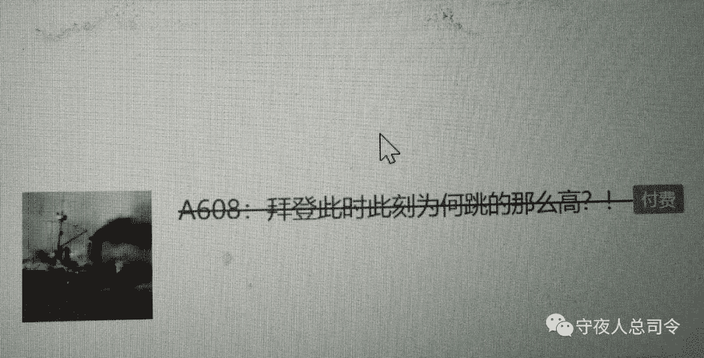

  

 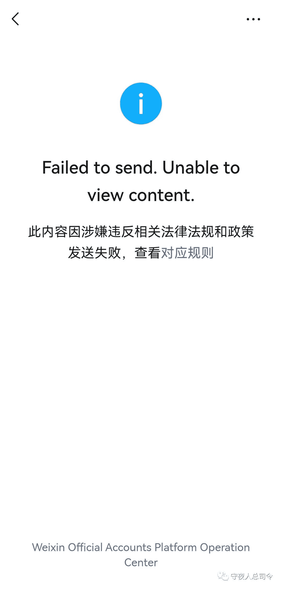

  
A606 那篇更是让人击节赞叹的内容，但是更发不出去！  
这些发不出来的内容只能放【觉悟社】里了。门槛越来越高，这是没有办法的事——谈风月和扯闲篇的门槛很低，但揭示规律和预判政策并从中获利的门槛只会越来越高。  
我现在都不敢随便删除之前写的不够好的内容了，因为删除之后，原文内容都会发不出来。谈风月的水平能力越来越强，遣词造句信手捏来，比喻也能恰到其分，但是，内容只能越来越寡淡。因为真正深层的内容会让人感到害怕，所以，越来越看不到了。  
真正的固化是父辈那种——那些一辈子生活在农村的人根本就不知道生活在城市中的人是如何生活的。在那种彻底隔绝的状态下，人从来都不焦虑，因为连看一眼的资格都没有！只是负责按时缴纳粮食和税费，反正他们一辈子都不会离开那个村镇，他们终其一生在原地打转，把口粮之外的一切都缴纳上去了，但不知道为什么要这样做，也不知道自己缴纳的这些粮食和税费将会用在何处。为什么闹饥荒的时候，城市里的人能够保障粮食供应，而种粮食的人却饿着。他们只是单纯的羡慕，却从未思考过这些问题，因为他们的脑子里连基本的框架和概念都没有，也就完全无从思考。  
研习《[结构学](https://mp.weixin.qq.com/mp/appmsgalbum?action=getalbum&album_id=1318317199878225920&__biz=MzAxNDk1NjI2Mw==#wechat_redirect)》，加入觉悟社：发不出来和付费内容都在里面，每天 25 块，能挣回来，获取下注标的需要满一年。进入的入口去公众号发消息：觉悟社  

 

  
[结构学自序（新）！](http://mp.weixin.qq.com/s?__biz=MzIzMDYwOTM0Mg==&mid=2247485283&idx=1&sn=aa2b8554b8e5040f8f959636feaa06a3&chksm=e8b19fb2dfc616a430aa381b8da0815311244e694a69809cd92d0602ac34cfe5f1f419b3745e&scene=21#wechat_redirect)  
[穷是万恶之源！](http://mp.weixin.qq.com/s?__biz=MzAxNDk1NjI2Mw==&mid=2247483823&idx=1&sn=e54ebe9891b302dc0bf1815c76ccf8b7&chksm=9b8a2227acfdab31a05e273addd9159d4b8263d58d3c58bf214841c8189157519719c3427306&scene=21#wechat_redirect)  
[C1：他们到底怕什么？](http://mp.weixin.qq.com/s?__biz=MzAxNDk1NjI2Mw==&mid=2247483898&idx=1&sn=1b0a50386e9e89d2750dec717236f0aa&chksm=9b8a2272acfdab64235b35ee5e91b8cac6172144207251636e1345fc570aa1601f59eff7f442&scene=21#wechat_redirect)  
[C1：真正的力量（最新）](http://mp.weixin.qq.com/s?__biz=MzAxNDk1NjI2Mw==&mid=2247485209&idx=1&sn=d7b335d2c9632363c72de85ce7834b3e&chksm=9b8a2491acfdad87ae308d74534ec4def57980a2b1db88ffe56ac03e4d76ea55e7eab2343097&scene=21#wechat_redirect)  
[C2：宗教是统治工具吗？](http://mp.weixin.qq.com/s?__biz=MzAxNDk1NjI2Mw==&mid=2247483901&idx=1&sn=f5d9f8c7bd84370c79adae921351e813&chksm=9b8a2275acfdab63fde093d76ff82e01d0e2fd43ea675f77fd17fd51a15873d4d10499f5338d&scene=21#wechat_redirect)  
[A425：这些是书上不会写的！](http://mp.weixin.qq.com/s?__biz=MzIzMDYwOTM0Mg==&mid=2247485662&idx=1&sn=1a8617a9ebd44891c112f3b3f6762f8a&chksm=e8b1900fdfc6191942a3ec1399a47af7cd44582c369a4e6211b0bd114d934785bf0c20fc09ab&scene=21#wechat_redirect)  
[F1：底层逻辑（框架）](http://mp.weixin.qq.com/s?__biz=MzAxNDk1NjI2Mw==&mid=2247485072&idx=1&sn=83d919c9e3bf71d25978a97c8d4c8aa6&chksm=9b8a2518acfdac0ea8a0f84382cc7c0a26d1ac3664d76c6365aee67ac4ebcac1bf280c060249&scene=21#wechat_redirect)  
[F3：结构力量](http://mp.weixin.qq.com/s?__biz=MzAxNDk1NjI2Mw==&mid=2247484256&idx=1&sn=f10d9c530bfd6ea08b25d4bec657c13a&chksm=9b8a20e8acfda9fee057f2df26790f905c898132cac91d833d14e636edb00c20514d63189a88&scene=21#wechat_redirect)  
[没有退路的一代人！](http://mp.weixin.qq.com/s?__biz=MzAxNDk1NjI2Mw==&mid=2247486533&idx=1&sn=a0d5cce0656aad467148e0642eb85a00&chksm=9b8a2fcdacfda6db79857186e953a089baf1fb678b2b071cf101c5a26e7fb9768474c94243ca&scene=21#wechat_redirect)  
[X29：拒绝长大的人群！](http://mp.weixin.qq.com/s?__biz=MzAxNDk1NjI2Mw==&mid=2247487734&idx=1&sn=406322eea52d5ed24ebaf979fdf714c1&chksm=9b8a337eacfdba688c7e6a511a417ec4d9a03b13d1bdb5c91e6ef37e9a7b747460354e0b0e8e&scene=21#wechat_redirect)  
[X45：刚出狼窝，又入虎口！](http://mp.weixin.qq.com/s?__biz=MzIzMDYwOTM0Mg==&mid=2247486954&idx=1&sn=64057c0c18082933600be972c2031139&chksm=e8b1953bdfc61c2df1b3c17fe8416e975e6f3a2bece068540adc6de643aa8e670b0393ba5c1d&scene=21#wechat_redirect)  
[A565：东北为啥难以振兴？！](http://mp.weixin.qq.com/s?__biz=MzAxNDk1NjI2Mw==&mid=2247487834&idx=1&sn=15ef2b4f3f81c4a67f5bc0256f5cb776&chksm=9b8a32d2acfdbbc4cd9c76535f994c4bb53ad6b3e74f367231b7e7465a88541ec7bb77237c42&scene=21#wechat_redirect)  
[向女权主义者致敬！](http://mp.weixin.qq.com/s?__biz=MzIzMDYwOTM0Mg==&mid=2247485914&idx=1&sn=cb260e0cec6b1e24661013278d412581&chksm=e8b1910bdfc6181d9f5f293493e2505dcec25647d0521d5ec62f92be5e32c04d0927583b6eb1&scene=21#wechat_redirect)  
[不要愤愤不平，都是好事！](http://mp.weixin.qq.com/s?__biz=MzAxNDk1NjI2Mw==&mid=2247487130&idx=1&sn=b21138d85455f5692aaf039038c78342&chksm=9b8a2d12acfda404a2b67fe4d446ee0f2805ad64a8b8004902934600fd731191e140df6ac19a&scene=21#wechat_redirect)  
[她都来相亲了，你还要怎么样！](http://mp.weixin.qq.com/s?__biz=MzAxNDk1NjI2Mw==&mid=2247486952&idx=1&sn=698aec6916d2eca5e758c25c4c634346&chksm=9b8a2e60acfda776b80a4f2f0d5c2fe4921fc821cdf029fa9d2fdc52fd708fc5a0b980d5d3d0&scene=21#wechat_redirect)  
[田园女权真正攻击的对象是女人！](http://mp.weixin.qq.com/s?__biz=MzIzMDYwOTM0Mg==&mid=2247486412&idx=1&sn=5dd3e8b2a759838d739e6d61ebab2eab&chksm=e8b1931ddfc61a0bf6f81cd2a9a9232ea8ce86528a8eea66c6635180e8678b819ebb38b4cb86&scene=21#wechat_redirect)  
[A430：美国强力介入台湾的理由！](http://mp.weixin.qq.com/s?__biz=MzIzMDYwOTM0Mg==&mid=2247486587&idx=1&sn=e14d4403bb13c441596f09add1b5f27c&chksm=e8b194aadfc61dbcab0c1d70249910161f8c77b0163ac8278dfe5c2f817d2bb2a3ac3e7ddf89&scene=21#wechat_redirect)  
[X25：你忍一下，我的很大！](http://mp.weixin.qq.com/s?__biz=MzAxNDk1NjI2Mw==&mid=2247487691&idx=1&sn=25bf18fb0375ec81c4b02f06b4829131&chksm=9b8a3343acfdba55113abce1ada59a203e08f7fee28d62767bfede2ce6e1bf3ace451af06adf&scene=21#wechat_redirect)  
[红尘热闹，白云冷！](http://mp.weixin.qq.com/s?__biz=MzAxNDk1NjI2Mw==&mid=2247486913&idx=1&sn=6b387c24eb6d5e30ed150e13eded77a1&chksm=9b8a2e49acfda75fdfcfe0a7770792cdd85568a9ecb1bd9b67508b29df853aaba08bf27356d5&scene=21#wechat_redirect)  
[依依东望，望的是时间！](http://mp.weixin.qq.com/s?__biz=MzAxNDk1NjI2Mw==&mid=2247483947&idx=1&sn=1dcdd529b9dad09a00b6e3e2b14c8245&chksm=9b8a21a3acfda8b5fe1dae1c8979dec0be990a569bc03372af815b4e0f08913e938d57aa6b25&scene=21#wechat_redirect)  
[A436：双标是弱者的必然选择！](http://mp.weixin.qq.com/s?__biz=MzIzMDYwOTM0Mg==&mid=2247485909&idx=1&sn=c64a96a6f11c7ff756ce005441035200&chksm=e8b19104dfc61812546950789d22fe83ba04b34c72337fb6dc6041ec4dfa6c2c9ec3005f80c5&scene=21#wechat_redirect)  
[梦醒之时，已经三十！](http://mp.weixin.qq.com/s?__biz=MzIzMDYwOTM0Mg==&mid=2247484378&idx=1&sn=e3a058584a13d7a5267315113964280d&chksm=e8b19b0bdfc6121df4af4b77d2d826fd0f4132ccfdee48132ce8cf86eb1ba45b898be83d1dc7&scene=21#wechat_redirect)[！](http://mp.weixin.qq.com/s?__biz=MzAxNDk1NjI2Mw==&mid=2247486952&idx=1&sn=698aec6916d2eca5e758c25c4c634346&chksm=9b8a2e60acfda776b80a4f2f0d5c2fe4921fc821cdf029fa9d2fdc52fd708fc5a0b980d5d3d0&scene=21#wechat_redirect)  
[A603：中国男人的玻璃心又要碎了！](http://mp.weixin.qq.com/s?__biz=MzIzMDYwOTM0Mg==&mid=2247486952&idx=1&sn=133e1c02134415ac15a0f76599bf969c&chksm=e8b19539dfc61c2f0addaa34fd5564165dffd65bfe9f4c62446cff56e4375bd69d303ba66a73&scene=21#wechat_redirect)  
[X39：扶贫式的关系和带血的反噬！](http://mp.weixin.qq.com/s?__biz=MzAxNDk1NjI2Mw==&mid=2247487823&idx=1&sn=2add0df28f12101176ece7bbdd18f01b&chksm=9b8a32c7acfdbbd1c06dcbfe21683ef82c6770a1ca7f1035833f7a6683dba546fced92103560&scene=21#wechat_redirect)  
[E43：统治的关键，争夺年轻人！](http://mp.weixin.qq.com/s?__biz=MzAxNDk1NjI2Mw==&mid=2247487815&idx=1&sn=84f963d6fb37f4f4ae70bb92b60488ae&chksm=9b8a32cfacfdbbd9aeb7089e2d38899684a97159afe1b1f220e3ca472cc321442bf52e5606dd&scene=21#wechat_redirect)  
[婚姻对人的伤害太大了！](http://mp.weixin.qq.com/s?__biz=MzAxNDk1NjI2Mw==&mid=2247487796&idx=1&sn=d28ec342a60e8f8e74c96b548770eb7d&chksm=9b8a32bcacfdbbaaa3c33780116e1353dadb8f5bcdc93ce019a77554980c845e8319c4f432b4&scene=21#wechat_redirect)  
[X21：王力宏和美智子不得不说的秘密](http://mp.weixin.qq.com/s?__biz=MzAxNDk1NjI2Mw==&mid=2247487666&idx=1&sn=433b7a0997c277c09f3605796de5551e&chksm=9b8a333aacfdba2c584b5a5d0dacbd731be4e8789e0f949f8b2ea15507f108b465eb9e3ceafb&scene=21#wechat_redirect)！  
[我是真的不想睡你！](http://mp.weixin.qq.com/s?__biz=MzAxNDk1NjI2Mw==&mid=2247487023&idx=1&sn=66d63e9f199deee86afff0f76a959c91&chksm=9b8a2da7acfda4b17ebf27c87c446049d0b8c557303b850a69ac971d8cdfcc91e41c0e6d3fcb&scene=21#wechat_redirect)  
[不要愤愤不平，都是好事！](http://mp.weixin.qq.com/s?__biz=MzAxNDk1NjI2Mw==&mid=2247487130&idx=1&sn=b21138d85455f5692aaf039038c78342&chksm=9b8a2d12acfda404a2b67fe4d446ee0f2805ad64a8b8004902934600fd731191e140df6ac19a&scene=21#wechat_redirect)  
[A496：为什么兔子在阿富汗很主动？](http://mp.weixin.qq.com/s?__biz=MzIzMDYwOTM0Mg==&mid=2247486278&idx=1&sn=40d09857088bebd3c70bec1c7a500f06&chksm=e8b19397dfc61a810125242c8e395330f934390eb50bd54053ecd3f31ddc91de4e429c0f693a&scene=21#wechat_redirect)  
[A491：塔利班接下来的两个核心问题！](http://mp.weixin.qq.com/s?__biz=MzAxNDk1NjI2Mw==&mid=2247487097&idx=1&sn=fd7abf4ba489928b7b810d20cbec7dc9&chksm=9b8a2df1acfda4e7ce05f7c03df131e9d266d960945c436b89b871744b21cc352bf3cb668486&scene=21#wechat_redirect)  
[A335：必须与焦虑长期共存！](http://mp.weixin.qq.com/s?__biz=MzIzMDYwOTM0Mg==&mid=2247485165&idx=1&sn=f3f0957c63fa549b288f00c8b117162e&chksm=e8b19e3cdfc6172a188000afd2b522144a04ba774169824cad2067d93b5365537ff0644f6b9f&scene=21#wechat_redirect)  
[A300：这是投机的大机会还是大陷阱？！](http://mp.weixin.qq.com/s?__biz=MzIzMDYwOTM0Mg==&mid=2247484882&idx=1&sn=b103029f41e3aede94e1a45d035cd9ac&chksm=e8b19d03dfc614153863f37ca3f9204b451e2c02ad5ca8680c120e2458e628e5329c76b2d42c&scene=21#wechat_redirect)  
[A284：啊！万箭穿心！！](http://mp.weixin.qq.com/s?__biz=MzIzMDYwOTM0Mg==&mid=2247484966&idx=1&sn=a814f2c1b14425d45f9921f7c08bcec5&chksm=e8b19ef7dfc617e131146f6675328e5088faaae0daa64da92af48b28c8cf19aedceb7a43e40b&scene=21#wechat_redirect)  
[A542：从现在开始，抓紧手中的钱！](http://mp.weixin.qq.com/s?__biz=MzIzMDYwOTM0Mg==&mid=2247486640&idx=1&sn=a96afa7d2b698e33240735ea8d7671f7&chksm=e8b19461dfc61d77a4afce11ecc7558b8d7ff5d495a78bcb609e3eed5c70bcbed5f3d6a66023&scene=21#wechat_redirect)  
[E35:我们在月之暗面发现了什么？！](http://mp.weixin.qq.com/s?__biz=MzIzMDYwOTM0Mg==&mid=2247486632&idx=1&sn=170aeff87eb36dce354c8b2437f4b27f&chksm=e8b19479dfc61d6f08e6492954a528f20387fe2fa925747cf2b504d2bc69084f24495e972e41&scene=21#wechat_redirect)  
[A496：为什么兔子在阿富汗很主动？](http://mp.weixin.qq.com/s?__biz=MzIzMDYwOTM0Mg==&mid=2247486278&idx=1&sn=40d09857088bebd3c70bec1c7a500f06&chksm=e8b19397dfc61a810125242c8e395330f934390eb50bd54053ecd3f31ddc91de4e429c0f693a&scene=21#wechat_redirect)  
[A311：要理解住房不炒的真正含义！](http://mp.weixin.qq.com/s?__biz=MzIzMDYwOTM0Mg==&mid=2247484959&idx=1&sn=090583ec50bfd9febec1de463c2672f6&chksm=e8b19ecedfc617d8629080f6745c8de013cfe875de26eef6767b2d5c10782650223ed15f807b&scene=21#wechat_redirect)  
[不要沉迷于抽象的东西！](http://mp.weixin.qq.com/s?__biz=MzAxNDk1NjI2Mw==&mid=2247487527&idx=1&sn=e24c2dd98e5f9883c8dce2a1e7bb80df&chksm=9b8a33afacfdbab921e90b3eafc3618176a35da53c53bb51f2ef2f9a98e87d05949a4b0ad69b&scene=21#wechat_redirect)  
[A543：元宇宙也做不到！](http://mp.weixin.qq.com/s?__biz=MzAxNDk1NjI2Mw==&mid=2247487476&idx=1&sn=2e2f159d365f00117f8fd47d3ca062f9&chksm=9b8a2c7cacfda56a80b9243d42bc5faabe4622c27fb4f3edad16ca5de7242a9c1345056ee461&scene=21#wechat_redirect)  
[A539：父亲角色在教育中必须做的几点！](http://mp.weixin.qq.com/s?__biz=MzAxNDk1NjI2Mw==&mid=2247487582&idx=1&sn=f4bac1092e8f45f6a86e662d8a68d556&chksm=9b8a33d6acfdbac0b4e01232406db5e9a315180b66b1bc830f17231f167d515d33408ff727b6&scene=21#wechat_redirect)  
[A539：京东为什么能绝地反击！](http://mp.weixin.qq.com/s?__biz=MzIzMDYwOTM0Mg==&mid=2247486752&idx=1&sn=3a967e3288db5b7d924e36914086e534&chksm=e8b195f1dfc61ce7c971386eb678d7da286167d0f52fdd51989049844b0a550cc58e00552d2e&scene=21#wechat_redirect)  
[A518：既双减又提高考试难度，要干啥？!](http://mp.weixin.qq.com/s?__biz=MzIzMDYwOTM0Mg==&mid=2247486528&idx=1&sn=837ef39e3c0b47ac84d5096690555ae7&chksm=e8b19491dfc61d87292daf575c1e7c95b3f0543f313b65c7ad4ab369603833704304ec7451d7&scene=21#wechat_redirect)  
[A328：2021 年必须加杠杆！](http://mp.weixin.qq.com/s?__biz=MzIzMDYwOTM0Mg==&mid=2247485087&idx=1&sn=24d72f6a71bddb8954a03be5db246538&chksm=e8b19e4edfc617587a8ae645885a89ab8c3c6f67730a026d9c7c9a94ab3051ca480302147fc0&scene=21#wechat_redirect)  
[A311：要理解住房不炒的真正含义！](http://mp.weixin.qq.com/s?__biz=MzIzMDYwOTM0Mg==&mid=2247484959&idx=1&sn=090583ec50bfd9febec1de463c2672f6&chksm=e8b19ecedfc617d8629080f6745c8de013cfe875de26eef6767b2d5c10782650223ed15f807b&scene=21#wechat_redirect)  
[A320：思路变了，可以加杠杆了！](http://mp.weixin.qq.com/s?__biz=MzIzMDYwOTM0Mg==&mid=2247485041&idx=1&sn=add2174fa42806f885a456a072ee4fee&chksm=e8b19ea0dfc617b6734e013f780112fdd88f28ad5312ce423fea1d75da4c3757660dab175208&scene=21#wechat_redirect)  
[E29：一眼看到底！](http://mp.weixin.qq.com/s?__biz=MzIzMDYwOTM0Mg==&mid=2247485301&idx=1&sn=dc6dd50c5d742ea51ce9e394de25351a&chksm=e8b19fa4dfc616b26734c3619c6fa664474fa478d2764c3370dde41d19f6035edc05f9f191e8&scene=21#wechat_redirect)  
[A452：房地产的政策将会松动！](http://mp.weixin.qq.com/s?__biz=MzIzMDYwOTM0Mg==&mid=2247485878&idx=1&sn=4734a99c9336a27d5f802e5ba2495648&chksm=e8b19167dfc618718c2197c8c2b5ad15d0750193a5007806c490b9daf505f1b36f08c5f4d574&scene=21#wechat_redirect)  
[A451：可怜之人为什么一定会变得可恨？！](http://mp.weixin.qq.com/s?__biz=MzIzMDYwOTM0Mg==&mid=2247485857&idx=1&sn=75866aff662c66a186e00a3a47086161&chksm=e8b19170dfc6186673189998e7a84d6dde4c85002650674bfd113b5384ae24088f9a46fd11ae&scene=21#wechat_redirect)  
[A450：G7 宣言，美元周期，联合绞杀？](http://mp.weixin.qq.com/s?__biz=MzIzMDYwOTM0Mg==&mid=2247485852&idx=1&sn=7b9112d33031e09eae8e3591a6813a3f&chksm=e8b1914ddfc6185b5b91dfd07067729c91349366d409edca7395f9bb3f2fceb656e9e4be6a6f&scene=21#wechat_redirect)  
[A311：要理解住房不炒的真正含义！](http://mp.weixin.qq.com/s?__biz=MzIzMDYwOTM0Mg==&mid=2247484959&idx=1&sn=090583ec50bfd9febec1de463c2672f6&chksm=e8b19ecedfc617d8629080f6745c8de013cfe875de26eef6767b2d5c10782650223ed15f807b&scene=21#wechat_redirect)  
[A394：要理解扶贫政策的真正意图！](http://mp.weixin.qq.com/s?__biz=MzIzMDYwOTM0Mg==&mid=2247485502&idx=1&sn=fffb9911cefa626e6fbcb9c416c1eb98&chksm=e8b190efdfc619f9b0e42f3c3d5d79c17df1619bad2b1bddd6a482242b583ee46d8a79a245e6&scene=21#wechat_redirect)  
[A430：美国强力介入台湾的理由！](http://mp.weixin.qq.com/s?__biz=MzIzMDYwOTM0Mg==&mid=2247486587&idx=1&sn=e14d4403bb13c441596f09add1b5f27c&chksm=e8b194aadfc61dbcab0c1d70249910161f8c77b0163ac8278dfe5c2f817d2bb2a3ac3e7ddf89&scene=21#wechat_redirect)  
[A386：你何必去逼一个普通人！](http://mp.weixin.qq.com/s?__biz=MzAxNDk1NjI2Mw==&mid=2247486567&idx=1&sn=eb1efed18e9e4659d0da10d6088443cd&chksm=9b8a2fefacfda6f99715c659822dc81f9c1aa2147c97f4e58d1f080bb491c4cc91c74b4b7a9e&scene=21#wechat_redirect)  
[X30：男人为什么必须要上缴工资？](http://mp.weixin.qq.com/s?__biz=MzAxNDk1NjI2Mw==&mid=2247487741&idx=1&sn=8a3ea62108b727f9f499c4f443309b07&chksm=9b8a3375acfdba635f90b03d0fe3584e4ceb01ba683217f87806196c2d112d0f4dfa7532a678&scene=21#wechat_redirect)  
[X26：亲密关系中的精神控制！](http://mp.weixin.qq.com/s?__biz=MzAxNDk1NjI2Mw==&mid=2247487736&idx=1&sn=fb39520992bb22568e3a31c89b9f40f0&chksm=9b8a3370acfdba66c77d1425610a5d7cc26e23090708151880b117e45931eceb82e4ad69a020&scene=21#wechat_redirect)  
觉悟者  
喜欢你就转走吧！  
微信扫一扫赞赏作者 赞赏  
已喜欢，对作者说句悄悄话  
取消   
发送给作者  
发送  
最多 40 字，当前共字  
 人赞赏   
上一页 1/3 下一页  
长按二维码向我转账  
喜欢你就转走吧！  
受苹果公司新规定影响，微信 iOS 版的赞赏功能被关闭，可通过二维码转账支持公众号。  

 

精选留言  
暂无...   
[阅读全文](https://mp.weixin.qq.com/s/nIdk03JhgbTU-TDXQQQ39A#rd)  
  

# 

# \[守夜人总司令\] - 2022-02-12 X51：过年如渡劫，父母只会逼和吵！

> 来源：[`www.yuque.com/books/share/97051b78-926c-43e6-b0aa-0b72ff163ac4/pun8va`](https://www.yuque.com/books/share/97051b78-926c-43e6-b0aa-0b72ff163ac4/pun8va) 

X51：过年如渡劫，父母只会逼和吵！   
原创 觉悟者 守夜人总司令   
守夜人总司令   
微信号 WatcherCommander  
功能介绍 结构学：生命体在其生存结构中的求存之道！  
2022-02-12[原文](https://mp.weixin.qq.com/s?__biz=MzAxNDk1NjI2Mw==&mid=2247487893&idx=1&sn=0c5e786640f99ccdbc73474501916227&chksm=9b8a321dacfdbb0b4570916848f3c25f7353d8e65af990cdfcf68624602bdca3f51b87d30c1d#rd\)) 发表于  
收录于合集  
#精神结构 101 个   
#情感教育 22 个   
#相亲 7 个   
#精神控制 7 个   
#普通人 27 个   
许多家庭从来就没有真正的沟通，平时井水不犯河水，小心翼翼的维系着一种表面上的关系，谁都不信任谁，彼此之间的戒备心非常重，所以才会小心翼翼的维系着一种场面上的和谐。这种表面上的关系非常的脆弱，一句话的误会就会马上演变为大吵大闹，继而各种情绪叠加，恶语相向，把成芝麻烂谷子的各种不满都翻出来火上浇油。  
许多家庭两代人之间的关系是非常糟糕的，多年的积怨隐藏在各自的内心之中从来都不敞开谈透，也没法谈，就这样闷着发霉，化脓生蛆。这种家庭成员之间维系着的表面和谐，就如同盖着的沼气池，一个小火星就能点燃并产生剧烈的爆炸！  
根据对许多样本的观察，越是匮乏的家庭这种情况就越明显。人长期处于匮乏的状态，往往就会变得自卑、敏感、固执、自私且虚荣。如果展开篇幅，可以通过对精神结构的剖析这些外显的特征是怎么形成的，以及呈现出这种特征的各种行为又是如何驱动的。限于篇幅，这里就不阐述那些更底层的原理了，以后用专门的篇幅来阐述，在此先一笔带过。总之，人的心态、行为与糟糕的自我判断和处境是高度吻合的，那种糟糕的自我判断和挫败感会衍生出一系列基于自我保护的破坏性行为，从而将自己锁死在这种处境之中！这种死锁不仅作用于自己身上，也作用在自己的后代和身边其它人身上。  
一个糟糕的家庭，其成员在遇到事情的时候会本能的躲开和逃避，推卸责任的技巧往往炉火纯青！如果你的同学或者同事有这种行为习惯，如果你有幸去这个人家里，你就会惊讶的发现——这个人全家所有成员都是这样的！  
一个人会本能的采取什么样的生存策略与其所处的生存环境息息相关！从某种意义上来说，所处的生存环境雕塑了这个人的自我判断和对其所处生存结构的判断，继而形成了最适合这种生存环境的生存策略。用大白话说就是：如果这个人家里父母之间在表达拒绝或者表达诉求的时候需要采用粗暴的语气和强迫的态度，久而久之，家庭成员都会变成这样。一个极度没有安全感的母亲，一定高度敏感又控制欲极强！这种环境一定会训练出态度蛮横又撒谎成性的女儿和遇事就装死或者躲开的儿子。不如此就没法在这样的环境中长期生存下去。如果父母动不动就吼，揪着一点小事就能情绪化发泄半天。这种家庭的儿女，要么很早就对着干，要么就一直怂，遇事就逃避，为了不惹到父母，只会小心翼翼的欺骗，绝对不会有一句实话。这些让人无比讨厌的行为，恰恰是这种生存环境下最好的生存策略！  
有些家庭条件不是很好，但是比普通女生长得又好看那么一点的女生，拖到最后错失了最佳的婚配时间窗口。这个时候她的父母不仅拼命催婚，还会心急如焚的恶语中伤，不断指责。这种指责其实就是在推卸责任。但这种事他们却要负主要的责任！匮乏的父母会过于高估儿子的学历和女儿的相貌的价值，在合适的婚配对象出现的时候，比当事人更加挑剔的往往就是其父母，尤其是当事人的母亲。虽然错失之后，当事人的母亲会指责当事人自己太挑，从而把自己的责任推的干干净净。但事实上，当时反对更强烈，或者挑剔的更厉害，觉得对方配不上自己儿女的人绝对是当事人的父母。不管他们当时是因为自己的虚荣心作祟，还是缺乏判断力高估了自家儿女的优势，总之，错失之后，这个责任他们是不愿意承担的，而是用恶毒的指责甩锅给儿女。因为这就是这种家庭中处理问题的常规方式！  
越是匮乏的人就越会高估自身的优势。就如同他们会觉得自己的一百块钱比别人的一百块钱更有购买力！但事实上，一百块钱就只能买一百块钱的东西，不管你觉得你那一百块钱多么的珍贵，也不管你那一百块钱是不是挣起来更辛苦，它都只值一百块！父母的这种心态必然会影响儿女的判断，然而，越是匮乏又虚荣的父母，往往就越不能面对现实。匮乏感和虚荣心会怂恿他们追逐最高的回报，同时又不能忍受失败的压力。他们之所以会无比粗暴的催婚甚至是气急败坏的指责和咒骂，主要源于他们感受到的社会压力——如果真实的社交关系的压力是 50%，那么，这种父母所能感受到的社会压力一定会超过 150%——不是因为他们的虚荣心遭受到了毁灭性的打击，而是因为匮乏者会比正常人更加敏感，本来打算露脸，结果变成了丢人现眼，这种想象带来的伤害比事实的社会压力更加让他们喘不过气来。唯一的出口就是转移给儿女，尤其是女儿！有些母亲在暴力催婚的时候，会越说越激动，最后以无比恶毒的话对女儿破口大骂，简直跟仇人一样——似乎不如此就无法把内心的压力发泄干净。强硬一点的女儿会与之对骂，怂一点的女儿就默默忍受着，年没过完就会赶紧逃离。  
许多人被灌输这样的观念：家是温暖的港湾，母亲就是你永远可以回去的故乡，而父亲就是你通向更大世界的阶梯和桥梁。这样的家庭和这样的父母在现实中比较少，因为要达到这种境界存在很高的门槛。当这一代人做父母的时候，这种状态可能会多一些，上一代人要达到这种效果，必须非富即贵——那就需要从爷爷那一代开始就很棒。然而，绝大多数人别说往上追溯三代，就是自己这一代都很普通，上一代就可想而知了。正因为如此，许多中国家庭过年就变成了渡劫。不久前看到一个新闻，一位小哥开车几天回家过年，结果与他母亲吵起来了，大年三十当天他铁了心要回去。新闻中看到他的父亲拦住他的车，在那里神情黯淡的劝阻。然而，冰冻三尺非一日之寒，这种和稀泥的劝阻不管对那一边都是无效的。这个新闻出来之后引发广泛的共鸣，因为亲子之间的积怨太深又互不信任的状况越来越普遍。或许彼此之间从小到大从来就未曾真正的沟通过。慢慢的就变得越来越无法沟通，彼此只能用粗暴的方式迫使另一方屈服。否则，一旦儿女能够自己养活自己，就会变成老死不相往来。  
过年的时候，那些粗暴催婚的父母，总是觉得是自家儿女没有努力去找对象，一个个都假装不知道是因为完全不够资格，找了也白找。儿女们还有点自知之明，反而是父母们，既无法创造条件，还假装不知道现实状况，只是一味的怪罪自己的儿子或者女人没有努力去尝试——好像尝试就有用一样：这就如同你拿着大刀，而敌人开着虎式坦克，你的上级却说你是因为不够勇敢！在力量过于悬殊的时候，避免过早的与敌人交战其实是最明智的策略——也是唯一可行的策略！  
研习《[结构学](https://mp.weixin.qq.com/mp/appmsgalbum?action=getalbum&album_id=1318317199878225920&__biz=MzAxNDk1NjI2Mw==#wechat_redirect)》，加入觉悟社：付费和不公开内容都在，每天 25 块，还能挣回来，下注标的获取需满足条件。入口：公众号发消息：觉悟社  

  
[结构学自序（新）！](http://mp.weixin.qq.com/s?__biz=MzIzMDYwOTM0Mg==&mid=2247485283&idx=1&sn=aa2b8554b8e5040f8f959636feaa06a3&chksm=e8b19fb2dfc616a430aa381b8da0815311244e694a69809cd92d0602ac34cfe5f1f419b3745e&scene=21#wechat_redirect)  
[穷是万恶之源！](http://mp.weixin.qq.com/s?__biz=MzAxNDk1NjI2Mw==&mid=2247483823&idx=1&sn=e54ebe9891b302dc0bf1815c76ccf8b7&chksm=9b8a2227acfdab31a05e273addd9159d4b8263d58d3c58bf214841c8189157519719c3427306&scene=21#wechat_redirect)  
[没有退路的一代人！](http://mp.weixin.qq.com/s?__biz=MzAxNDk1NjI2Mw==&mid=2247486533&idx=1&sn=a0d5cce0656aad467148e0642eb85a00&chksm=9b8a2fcdacfda6db79857186e953a089baf1fb678b2b071cf101c5a26e7fb9768474c94243ca&scene=21#wechat_redirect)  
[反复被删，发不出去！](http://mp.weixin.qq.com/s?__biz=MzAxNDk1NjI2Mw==&mid=2247487888&idx=1&sn=5e5b61b86ce5cb49b2455e3d4a3a04e4&chksm=9b8a3218acfdbb0e3880a925530e53c9974a1392539448f30a8d02522124d21c27532b0e84cd&scene=21#wechat_redirect)  
[X25：你忍一下，我的很大！](http://mp.weixin.qq.com/s?__biz=MzAxNDk1NjI2Mw==&mid=2247487691&idx=1&sn=25bf18fb0375ec81c4b02f06b4829131&chksm=9b8a3343acfdba55113abce1ada59a203e08f7fee28d62767bfede2ce6e1bf3ace451af06adf&scene=21#wechat_redirect)  
[红尘热闹，白云冷！](http://mp.weixin.qq.com/s?__biz=MzAxNDk1NjI2Mw==&mid=2247486913&idx=1&sn=6b387c24eb6d5e30ed150e13eded77a1&chksm=9b8a2e49acfda75fdfcfe0a7770792cdd85568a9ecb1bd9b67508b29df853aaba08bf27356d5&scene=21#wechat_redirect)  
[A436：双标是弱者的必然选择！](http://mp.weixin.qq.com/s?__biz=MzIzMDYwOTM0Mg==&mid=2247485909&idx=1&sn=c64a96a6f11c7ff756ce005441035200&chksm=e8b19104dfc61812546950789d22fe83ba04b34c72337fb6dc6041ec4dfa6c2c9ec3005f80c5&scene=21#wechat_redirect)  
[梦醒之时，已经三十！](http://mp.weixin.qq.com/s?__biz=MzIzMDYwOTM0Mg==&mid=2247484378&idx=1&sn=e3a058584a13d7a5267315113964280d&chksm=e8b19b0bdfc6121df4af4b77d2d826fd0f4132ccfdee48132ce8cf86eb1ba45b898be83d1dc7&scene=21#wechat_redirect)[！](http://mp.weixin.qq.com/s?__biz=MzAxNDk1NjI2Mw==&mid=2247486952&idx=1&sn=698aec6916d2eca5e758c25c4c634346&chksm=9b8a2e60acfda776b80a4f2f0d5c2fe4921fc821cdf029fa9d2fdc52fd708fc5a0b980d5d3d0&scene=21#wechat_redirect)  
[婚姻对人的伤害太大了！](http://mp.weixin.qq.com/s?__biz=MzAxNDk1NjI2Mw==&mid=2247487796&idx=1&sn=d28ec342a60e8f8e74c96b548770eb7d&chksm=9b8a32bcacfdbbaaa3c33780116e1353dadb8f5bcdc93ce019a77554980c845e8319c4f432b4&scene=21#wechat_redirect)  
[X21：王力宏和美智子不得不说的秘密](http://mp.weixin.qq.com/s?__biz=MzAxNDk1NjI2Mw==&mid=2247487666&idx=1&sn=433b7a0997c277c09f3605796de5551e&chksm=9b8a333aacfdba2c584b5a5d0dacbd731be4e8789e0f949f8b2ea15507f108b465eb9e3ceafb&scene=21#wechat_redirect)！  
[不要愤愤不平，都是好事！](http://mp.weixin.qq.com/s?__biz=MzAxNDk1NjI2Mw==&mid=2247487130&idx=1&sn=b21138d85455f5692aaf039038c78342&chksm=9b8a2d12acfda404a2b67fe4d446ee0f2805ad64a8b8004902934600fd731191e140df6ac19a&scene=21#wechat_redirect)  
[她都来相亲了，你还要怎么样！](http://mp.weixin.qq.com/s?__biz=MzAxNDk1NjI2Mw==&mid=2247486952&idx=1&sn=698aec6916d2eca5e758c25c4c634346&chksm=9b8a2e60acfda776b80a4f2f0d5c2fe4921fc821cdf029fa9d2fdc52fd708fc5a0b980d5d3d0&scene=21#wechat_redirect)  
[田园女权真正攻击的对象是女人！](http://mp.weixin.qq.com/s?__biz=MzIzMDYwOTM0Mg==&mid=2247486412&idx=1&sn=5dd3e8b2a759838d739e6d61ebab2eab&chksm=e8b1931ddfc61a0bf6f81cd2a9a9232ea8ce86528a8eea66c6635180e8678b819ebb38b4cb86&scene=21#wechat_redirect)  
[A430：美国强力介入台湾的理由！](http://mp.weixin.qq.com/s?__biz=MzIzMDYwOTM0Mg==&mid=2247486587&idx=1&sn=e14d4403bb13c441596f09add1b5f27c&chksm=e8b194aadfc61dbcab0c1d70249910161f8c77b0163ac8278dfe5c2f817d2bb2a3ac3e7ddf89&scene=21#wechat_redirect)  
[X29：拒绝长大的人群！](http://mp.weixin.qq.com/s?__biz=MzAxNDk1NjI2Mw==&mid=2247487734&idx=1&sn=406322eea52d5ed24ebaf979fdf714c1&chksm=9b8a337eacfdba688c7e6a511a417ec4d9a03b13d1bdb5c91e6ef37e9a7b747460354e0b0e8e&scene=21#wechat_redirect)  
[A569：你可能误会了共同富裕！](http://mp.weixin.qq.com/s?__biz=MzIzMDYwOTM0Mg==&mid=2247486940&idx=1&sn=e230b91e4e73b72527d74ee0d87638b0&chksm=e8b1950ddfc61c1b08d3436011ba79f030129637591f89a1789805b56199e8fdad0c1a9fcabf&scene=21#wechat_redirect)  
[X45：刚出狼窝，又入虎口！](http://mp.weixin.qq.com/s?__biz=MzIzMDYwOTM0Mg==&mid=2247486954&idx=1&sn=64057c0c18082933600be972c2031139&chksm=e8b1953bdfc61c2df1b3c17fe8416e975e6f3a2bece068540adc6de643aa8e670b0393ba5c1d&scene=21#wechat_redirect)  
[A604：谷爱凌不具有代表性！](http://mp.weixin.qq.com/s?__biz=MzAxNDk1NjI2Mw==&mid=2247487885&idx=1&sn=fa1590be4f0f8be38dd4d8eb877b638d&chksm=9b8a3205acfdbb13039310f86f6e6fce5520a7827afc4e63b4eb6ca7f89ace1950488fa2f17e&scene=21#wechat_redirect)  
[A565：东北为啥难以振兴？！](http://mp.weixin.qq.com/s?__biz=MzAxNDk1NjI2Mw==&mid=2247487834&idx=1&sn=15ef2b4f3f81c4a67f5bc0256f5cb776&chksm=9b8a32d2acfdbbc4cd9c76535f994c4bb53ad6b3e74f367231b7e7465a88541ec7bb77237c42&scene=21#wechat_redirect)  
[向女权主义者致敬！](http://mp.weixin.qq.com/s?__biz=MzIzMDYwOTM0Mg==&mid=2247485914&idx=1&sn=cb260e0cec6b1e24661013278d412581&chksm=e8b1910bdfc6181d9f5f293493e2505dcec25647d0521d5ec62f92be5e32c04d0927583b6eb1&scene=21#wechat_redirect)  
[A603：中国男人的玻璃心又要碎了！](http://mp.weixin.qq.com/s?__biz=MzIzMDYwOTM0Mg==&mid=2247486952&idx=1&sn=133e1c02134415ac15a0f76599bf969c&chksm=e8b19539dfc61c2f0addaa34fd5564165dffd65bfe9f4c62446cff56e4375bd69d303ba66a73&scene=21#wechat_redirect)  
[X39：扶贫式的关系和带血的反噬！](http://mp.weixin.qq.com/s?__biz=MzAxNDk1NjI2Mw==&mid=2247487823&idx=1&sn=2add0df28f12101176ece7bbdd18f01b&chksm=9b8a32c7acfdbbd1c06dcbfe21683ef82c6770a1ca7f1035833f7a6683dba546fced92103560&scene=21#wechat_redirect)  
[E43：统治的关键，争夺年轻人！](http://mp.weixin.qq.com/s?__biz=MzAxNDk1NjI2Mw==&mid=2247487815&idx=1&sn=84f963d6fb37f4f4ae70bb92b60488ae&chksm=9b8a32cfacfdbbd9aeb7089e2d38899684a97159afe1b1f220e3ca472cc321442bf52e5606dd&scene=21#wechat_redirect)  
[我是真的不想睡你！](http://mp.weixin.qq.com/s?__biz=MzAxNDk1NjI2Mw==&mid=2247487023&idx=1&sn=66d63e9f199deee86afff0f76a959c91&chksm=9b8a2da7acfda4b17ebf27c87c446049d0b8c557303b850a69ac971d8cdfcc91e41c0e6d3fcb&scene=21#wechat_redirect)  
[不要愤愤不平，都是好事！](http://mp.weixin.qq.com/s?__biz=MzAxNDk1NjI2Mw==&mid=2247487130&idx=1&sn=b21138d85455f5692aaf039038c78342&chksm=9b8a2d12acfda404a2b67fe4d446ee0f2805ad64a8b8004902934600fd731191e140df6ac19a&scene=21#wechat_redirect)  
[A496：为什么兔子在阿富汗很主动？](http://mp.weixin.qq.com/s?__biz=MzIzMDYwOTM0Mg==&mid=2247486278&idx=1&sn=40d09857088bebd3c70bec1c7a500f06&chksm=e8b19397dfc61a810125242c8e395330f934390eb50bd54053ecd3f31ddc91de4e429c0f693a&scene=21#wechat_redirect)  
[A491：塔利班接下来的两个核心问题！](http://mp.weixin.qq.com/s?__biz=MzAxNDk1NjI2Mw==&mid=2247487097&idx=1&sn=fd7abf4ba489928b7b810d20cbec7dc9&chksm=9b8a2df1acfda4e7ce05f7c03df131e9d266d960945c436b89b871744b21cc352bf3cb668486&scene=21#wechat_redirect)  
[A335：必须与焦虑长期共存！](http://mp.weixin.qq.com/s?__biz=MzIzMDYwOTM0Mg==&mid=2247485165&idx=1&sn=f3f0957c63fa549b288f00c8b117162e&chksm=e8b19e3cdfc6172a188000afd2b522144a04ba774169824cad2067d93b5365537ff0644f6b9f&scene=21#wechat_redirect)  
[A300：这是投机的大机会还是大陷阱？！](http://mp.weixin.qq.com/s?__biz=MzIzMDYwOTM0Mg==&mid=2247484882&idx=1&sn=b103029f41e3aede94e1a45d035cd9ac&chksm=e8b19d03dfc614153863f37ca3f9204b451e2c02ad5ca8680c120e2458e628e5329c76b2d42c&scene=21#wechat_redirect)  
[A284：啊！万箭穿心！！](http://mp.weixin.qq.com/s?__biz=MzIzMDYwOTM0Mg==&mid=2247484966&idx=1&sn=a814f2c1b14425d45f9921f7c08bcec5&chksm=e8b19ef7dfc617e131146f6675328e5088faaae0daa64da92af48b28c8cf19aedceb7a43e40b&scene=21#wechat_redirect)  
[A542：从现在开始，抓紧手中的钱！](http://mp.weixin.qq.com/s?__biz=MzIzMDYwOTM0Mg==&mid=2247486640&idx=1&sn=a96afa7d2b698e33240735ea8d7671f7&chksm=e8b19461dfc61d77a4afce11ecc7558b8d7ff5d495a78bcb609e3eed5c70bcbed5f3d6a66023&scene=21#wechat_redirect)  
[E35:我们在月之暗面发现了什么？！](http://mp.weixin.qq.com/s?__biz=MzIzMDYwOTM0Mg==&mid=2247486632&idx=1&sn=170aeff87eb36dce354c8b2437f4b27f&chksm=e8b19479dfc61d6f08e6492954a528f20387fe2fa925747cf2b504d2bc69084f24495e972e41&scene=21#wechat_redirect)  
[A496：为什么兔子在阿富汗很主动？](http://mp.weixin.qq.com/s?__biz=MzIzMDYwOTM0Mg==&mid=2247486278&idx=1&sn=40d09857088bebd3c70bec1c7a500f06&chksm=e8b19397dfc61a810125242c8e395330f934390eb50bd54053ecd3f31ddc91de4e429c0f693a&scene=21#wechat_redirect)  
[A311：要理解住房不炒的真正含义！](http://mp.weixin.qq.com/s?__biz=MzIzMDYwOTM0Mg==&mid=2247484959&idx=1&sn=090583ec50bfd9febec1de463c2672f6&chksm=e8b19ecedfc617d8629080f6745c8de013cfe875de26eef6767b2d5c10782650223ed15f807b&scene=21#wechat_redirect)  
[不要沉迷于抽象的东西！](http://mp.weixin.qq.com/s?__biz=MzAxNDk1NjI2Mw==&mid=2247487527&idx=1&sn=e24c2dd98e5f9883c8dce2a1e7bb80df&chksm=9b8a33afacfdbab921e90b3eafc3618176a35da53c53bb51f2ef2f9a98e87d05949a4b0ad69b&scene=21#wechat_redirect)  
[A543：元宇宙也做不到！](http://mp.weixin.qq.com/s?__biz=MzAxNDk1NjI2Mw==&mid=2247487476&idx=1&sn=2e2f159d365f00117f8fd47d3ca062f9&chksm=9b8a2c7cacfda56a80b9243d42bc5faabe4622c27fb4f3edad16ca5de7242a9c1345056ee461&scene=21#wechat_redirect)  
[A539：父亲角色在教育中必须做的几点！](http://mp.weixin.qq.com/s?__biz=MzAxNDk1NjI2Mw==&mid=2247487582&idx=1&sn=f4bac1092e8f45f6a86e662d8a68d556&chksm=9b8a33d6acfdbac0b4e01232406db5e9a315180b66b1bc830f17231f167d515d33408ff727b6&scene=21#wechat_redirect)  
[A539：京东为什么能绝地反击！](http://mp.weixin.qq.com/s?__biz=MzIzMDYwOTM0Mg==&mid=2247486752&idx=1&sn=3a967e3288db5b7d924e36914086e534&chksm=e8b195f1dfc61ce7c971386eb678d7da286167d0f52fdd51989049844b0a550cc58e00552d2e&scene=21#wechat_redirect)  
[A518：既双减又提高考试难度，要干啥？!](http://mp.weixin.qq.com/s?__biz=MzIzMDYwOTM0Mg==&mid=2247486528&idx=1&sn=837ef39e3c0b47ac84d5096690555ae7&chksm=e8b19491dfc61d87292daf575c1e7c95b3f0543f313b65c7ad4ab369603833704304ec7451d7&scene=21#wechat_redirect)  
[C1：他们到底怕什么？](http://mp.weixin.qq.com/s?__biz=MzAxNDk1NjI2Mw==&mid=2247483898&idx=1&sn=1b0a50386e9e89d2750dec717236f0aa&chksm=9b8a2272acfdab64235b35ee5e91b8cac6172144207251636e1345fc570aa1601f59eff7f442&scene=21#wechat_redirect)  
[C1：真正的力量（最新）](http://mp.weixin.qq.com/s?__biz=MzAxNDk1NjI2Mw==&mid=2247485209&idx=1&sn=d7b335d2c9632363c72de85ce7834b3e&chksm=9b8a2491acfdad87ae308d74534ec4def57980a2b1db88ffe56ac03e4d76ea55e7eab2343097&scene=21#wechat_redirect)  
[C2：宗教是统治工具吗？](http://mp.weixin.qq.com/s?__biz=MzAxNDk1NjI2Mw==&mid=2247483901&idx=1&sn=f5d9f8c7bd84370c79adae921351e813&chksm=9b8a2275acfdab63fde093d76ff82e01d0e2fd43ea675f77fd17fd51a15873d4d10499f5338d&scene=21#wechat_redirect)  
[A425：这些是书上不会写的！](http://mp.weixin.qq.com/s?__biz=MzIzMDYwOTM0Mg==&mid=2247485662&idx=1&sn=1a8617a9ebd44891c112f3b3f6762f8a&chksm=e8b1900fdfc6191942a3ec1399a47af7cd44582c369a4e6211b0bd114d934785bf0c20fc09ab&scene=21#wechat_redirect)  
[F1：底层逻辑（框架）](http://mp.weixin.qq.com/s?__biz=MzAxNDk1NjI2Mw==&mid=2247485072&idx=1&sn=83d919c9e3bf71d25978a97c8d4c8aa6&chksm=9b8a2518acfdac0ea8a0f84382cc7c0a26d1ac3664d76c6365aee67ac4ebcac1bf280c060249&scene=21#wechat_redirect)  
[F3：结构力量](http://mp.weixin.qq.com/s?__biz=MzAxNDk1NjI2Mw==&mid=2247484256&idx=1&sn=f10d9c530bfd6ea08b25d4bec657c13a&chksm=9b8a20e8acfda9fee057f2df26790f905c898132cac91d833d14e636edb00c20514d63189a88&scene=21#wechat_redirect)  
[A328：2021 年必须加杠杆！](http://mp.weixin.qq.com/s?__biz=MzIzMDYwOTM0Mg==&mid=2247485087&idx=1&sn=24d72f6a71bddb8954a03be5db246538&chksm=e8b19e4edfc617587a8ae645885a89ab8c3c6f67730a026d9c7c9a94ab3051ca480302147fc0&scene=21#wechat_redirect)  
[A311：要理解住房不炒的真正含义！](http://mp.weixin.qq.com/s?__biz=MzIzMDYwOTM0Mg==&mid=2247484959&idx=1&sn=090583ec50bfd9febec1de463c2672f6&chksm=e8b19ecedfc617d8629080f6745c8de013cfe875de26eef6767b2d5c10782650223ed15f807b&scene=21#wechat_redirect)  
[A320：思路变了，可以加杠杆了！](http://mp.weixin.qq.com/s?__biz=MzIzMDYwOTM0Mg==&mid=2247485041&idx=1&sn=add2174fa42806f885a456a072ee4fee&chksm=e8b19ea0dfc617b6734e013f780112fdd88f28ad5312ce423fea1d75da4c3757660dab175208&scene=21#wechat_redirect)  
[E29：一眼看到底！](http://mp.weixin.qq.com/s?__biz=MzIzMDYwOTM0Mg==&mid=2247485301&idx=1&sn=dc6dd50c5d742ea51ce9e394de25351a&chksm=e8b19fa4dfc616b26734c3619c6fa664474fa478d2764c3370dde41d19f6035edc05f9f191e8&scene=21#wechat_redirect)  
[A452：房地产的政策将会松动！](http://mp.weixin.qq.com/s?__biz=MzIzMDYwOTM0Mg==&mid=2247485878&idx=1&sn=4734a99c9336a27d5f802e5ba2495648&chksm=e8b19167dfc618718c2197c8c2b5ad15d0750193a5007806c490b9daf505f1b36f08c5f4d574&scene=21#wechat_redirect)  
[A451：可怜之人为什么一定会变得可恨？！](http://mp.weixin.qq.com/s?__biz=MzIzMDYwOTM0Mg==&mid=2247485857&idx=1&sn=75866aff662c66a186e00a3a47086161&chksm=e8b19170dfc6186673189998e7a84d6dde4c85002650674bfd113b5384ae24088f9a46fd11ae&scene=21#wechat_redirect)  
[A450：G7 宣言，美元周期，联合绞杀？](http://mp.weixin.qq.com/s?__biz=MzIzMDYwOTM0Mg==&mid=2247485852&idx=1&sn=7b9112d33031e09eae8e3591a6813a3f&chksm=e8b1914ddfc6185b5b91dfd07067729c91349366d409edca7395f9bb3f2fceb656e9e4be6a6f&scene=21#wechat_redirect)  
[A311：要理解住房不炒的真正含义！](http://mp.weixin.qq.com/s?__biz=MzIzMDYwOTM0Mg==&mid=2247484959&idx=1&sn=090583ec50bfd9febec1de463c2672f6&chksm=e8b19ecedfc617d8629080f6745c8de013cfe875de26eef6767b2d5c10782650223ed15f807b&scene=21#wechat_redirect)  
[A394：要理解扶贫政策的真正意图！](http://mp.weixin.qq.com/s?__biz=MzIzMDYwOTM0Mg==&mid=2247485502&idx=1&sn=fffb9911cefa626e6fbcb9c416c1eb98&chksm=e8b190efdfc619f9b0e42f3c3d5d79c17df1619bad2b1bddd6a482242b583ee46d8a79a245e6&scene=21#wechat_redirect)  
[A430：美国强力介入台湾的理由！](http://mp.weixin.qq.com/s?__biz=MzIzMDYwOTM0Mg==&mid=2247486587&idx=1&sn=e14d4403bb13c441596f09add1b5f27c&chksm=e8b194aadfc61dbcab0c1d70249910161f8c77b0163ac8278dfe5c2f817d2bb2a3ac3e7ddf89&scene=21#wechat_redirect)  
[A386：你何必去逼一个普通人！](http://mp.weixin.qq.com/s?__biz=MzAxNDk1NjI2Mw==&mid=2247486567&idx=1&sn=eb1efed18e9e4659d0da10d6088443cd&chksm=9b8a2fefacfda6f99715c659822dc81f9c1aa2147c97f4e58d1f080bb491c4cc91c74b4b7a9e&scene=21#wechat_redirect)  
[X30：男人为什么必须要上缴工资？](http://mp.weixin.qq.com/s?__biz=MzAxNDk1NjI2Mw==&mid=2247487741&idx=1&sn=8a3ea62108b727f9f499c4f443309b07&chksm=9b8a3375acfdba635f90b03d0fe3584e4ceb01ba683217f87806196c2d112d0f4dfa7532a678&scene=21#wechat_redirect)  
[X26：亲密关系中的精神控制！](http://mp.weixin.qq.com/s?__biz=MzAxNDk1NjI2Mw==&mid=2247487736&idx=1&sn=fb39520992bb22568e3a31c89b9f40f0&chksm=9b8a3370acfdba66c77d1425610a5d7cc26e23090708151880b117e45931eceb82e4ad69a020&scene=21#wechat_redirect)  

 

精选留言  
暂无...   
[阅读全文](https://mp.weixin.qq.com/s/nIdk03JhgbTU-TDXQQQ39A#rd)  
  

# 

# \[守夜人总司令\] - 2022-02-04 E42：结构学浅释（二）

> 来源：[`www.yuque.com/books/share/97051b78-926c-43e6-b0aa-0b72ff163ac4/ohmlb0`](https://www.yuque.com/books/share/97051b78-926c-43e6-b0aa-0b72ff163ac4/ohmlb0) 

E42：结构学浅释（二）   
原创 觉悟者 守夜人总司令   
守夜人总司令   
微信号 WatcherCommander  
功能介绍 结构学：生命体在其生存结构中的求存之道！  
2022-02-04[原文](https://mp.weixin.qq.com/s?__biz=MzAxNDk1NjI2Mw==&mid=2247487869&idx=1&sn=b6f942cf2c9969953971beb5a43a8183&chksm=9b8a32f5acfdbbe33ddd8df1f2b8f73b05522b604676c4ab01f411657e37e8c7226602ce3ad9#rd\)) 发表于  
收录于合集  
#结构学 89 个   
#底层逻辑 86 个   
#统治机器 25 个   
#精神结构 101 个   
#权力体系 3 个   
前言  
内容比较深刻，读得懂的人会眼前一亮，读不懂的人则会一脸懵逼。主要是阐述原理，需要一定的阅历和抽象逻辑思维能力才能读懂。请量力而行！  
  
受过教育和没有受过教育最大的区别是受过教育的人更容易把自己置身于一个更加宏大的共同体之中，并被一个超越自身的抽象生命体所牵引。文明的本质是由个体会将自己置身于更宏大的抽象共同体之中，并在它所衍生出来的秩序的指引下，形成对自我的克制和约束，从而让个体行为更加有利于共同体的有序运转！  
购买合集后可阅读全文   
#  
已完结 共个  
合集详情  
正文需付费后才可阅读  
加载中   
 微信豆购买   
微信扫一扫付费阅读本文  
人付费， 人赞赏   

 

精选留言  
暂无...   
  

# 

# \[守夜人总司令\] - 2022-02-02 A601：催婚根本没用，为什么非要催？！

> 来源：[`www.yuque.com/books/share/97051b78-926c-43e6-b0aa-0b72ff163ac4/wkabmc`](https://www.yuque.com/books/share/97051b78-926c-43e6-b0aa-0b72ff163ac4/wkabmc) 

A601：催婚根本没用，为什么非要催？！   
原创 觉悟者 守夜人总司令   
守夜人总司令   
微信号 WatcherCommander  
功能介绍 结构学：生命体在其生存结构中的求存之道！  
2022-02-02[原文](https://mp.weixin.qq.com/s?__biz=MzAxNDk1NjI2Mw==&mid=2247487866&idx=1&sn=6a1c3e2453992baf125c920b9c027210&chksm=9b8a32f2acfdbbe4f5fb9f25b18ca027403cecc73c889a69768fe23bed8a844a81427b2b01af#rd\)) 发表于  
收录于合集  
#稀有资源 7 个   
#底层逻辑 86 个   
#情感教育 22 个   
#结构学 89 个   
#相亲 7 个   
每当过年的时候，不仅父母，而且七大姑八大姨都会积聚一起给晚辈催婚。刚刚打电话给长辈拜年，将近小我十岁的表妹跟我抱怨她被父母催婚了。我真的非常惊讶。如果是别人家摧我能够理解，她的父母可是受过高等教育的，而且家庭条件不错，从小就对她非常的尊重，对她的教育与许多其他亲戚对儿女的教育比起来，简直是一股清流。没想到她的父母也沦落到随大流的地步了…  
我就安慰她说，你不是带男朋友回去过一次了么？为什么还催呀！她说，她妈妈不停的跟她说现在形势挺严峻的，那个小伙挺不错的，年纪差不多了，抓紧时间结婚。我就问她你在犹豫什么呢？她说，他各方面是挺好的，但自己的内心还没有那么强烈想结婚，需要更多的时间给自己的内心多一些确定性。我大概能理解她所说的这种内心的确定性和强烈愿望。我也能理解她父母考虑问题的角度。这就是感性和理性的冲突在同一个人身上形成的拉扯…  
瓜熟蒂落是一种无比美好的状态，它意味着所有的不确定都被排除了。然而，人在对未来下注的时候，5 成把握都已经晚了，何况是 9 成和 10 成！我们经常会忘记自己处于一种动态竞争的生存环境，并且把已经拥有的东西都看成理所当然，所以会用尽全力在细节上追求完美。生活条件越好，人就越缺乏抓关键和做决策的能力。越是没有经历过风浪的人，那些小布尔乔亚式的伤感就是生活的全部；从而会为一个猫抓杯而疯狂，为抢到一双联名的鞋子而欣喜若狂；为朋友圈没有达到预期的点赞数而心情低落；为过生日的仪式感没有达到预期而闷闷不乐。在没有风浪的安稳岁月中，人的感情就只会被投射到这些微不足道的细节上，这些稍纵即逝的感受就是生命的全部。然而，当你试图通过这些稍纵即逝的感受来累积出一种坚定不移的确定性的时候，你就会总是感觉还欠点火候。就如同在沙滩上用沙子建筑起来的城堡，总是感觉它可能瞬间就坍塌了——似乎任何一个点都会造成这样的后果，说不清楚那种感受，但又隐隐约约的心有不安。  
她妈妈催婚的理由居然是：现在的形势挺严峻的！我这位阿姨可是天不怕地不怕的人，当年她工厂的干部借着酒疯鼓动工人罢工闹事，她只身一人前去，恩威并用化解了危机，还让大家都服服帖帖的。然而，这位什么都不怕的阿姨居然害怕挺严峻的形势，开始催促女儿早点结婚了。她的理性判断是对的：女孩子的婚配是不能往下兼容的，不仅自身条件不能往下兼容，对方的家庭条件也不能往下兼容。因此，可选择的范围并不像看起来那么多。在匹配各种条件的情况下还能找到一个两情相悦的对象，真的是太难得了。此时此刻，还在为细节的火候犹豫不决，过了这个村还真的就没这个店了！  
判断和决策永远是人最核心的技能，看不清形势就抓不住关键点。这就如同打仗一样：三皇会战的时候，在势均力敌的关键时刻，拿破仑一眼就看出了打破战场平衡的关键位置，仅仅用了 50 个骑兵，在关键时刻的关键点上打破了战场格局的整体平衡，从而形成了分割碾压的态势，局势一旦形成，即便对方是库图索夫这样的名将也无力回天。  
人在爬悬崖峭壁的时候才会意识到这样一个现实问题：上去的时候可以一步一步攀爬，但是无法一步一步的原路返回，掉下去往往是瞬间坠落！其实，生活中的许多事都是在爬悬崖峭壁。你以为可以从容的一步一步爬上去，然后再按照自己的意愿一步一步从容的爬下来，事实上，爬上去之后除非瞬间坠落，否则是下不去的。因此，许多事看起来是量的增减，但本质上却是在做 0 和 1 的选择！  
不仅仅是体制内为了守住位置明争暗斗非常厉害，即便是市场中的民营企业，只要规模达到一定程度，或者岗位利益比较丰厚，人的争斗也非常厉害。为什么呢？举一个最简单的例子：假设一个人在组织中拥有一个年薪百万的岗位，那么，围绕在这个岗位上的福利待遇，其它人想要吗？外部的人想要么？那些还没有达到这个层次的人肯定垂涎三尺。还没有得到的人肯定也愿意付出更大的代价——同样是一个武大毕业的人，在武汉的待遇可能只有在深圳同类的一半，最多三分之二。同样是这个人，水平素养都是一样的，当这个人迁徙到深圳的时候，水平没减少，但预期会更低，比他原来的多一点，他都愿意接受。如此一来，就对占据深圳同类岗位的人形成了巨大挑战，而且每一年都会有这样的人涌入。同样的道理，不管是内部还未抵达某个职位的人寻求晋升，还是外部同类水平的人寻求替代，这种横向和纵向的压力时常都在。但占据某个位置的人而言，眼前拥有的一切不能失去的另一个深层次的原因就是：人的收入到了一个水平，开销也必然会到一个水平，而且只能上不能下。如此一来，就更加本能失去稳定的收入。一个年薪百万的人供一套 1500 万的房子是不成问题的。拥有这样的收入和这样的房子，找一个还过得去的女人也自然不成问题。然而，在享受到这种生活水准的同时，也就必须要能保持着不能低于这个水平的稳定收入。否则，精心编制起来的整个生活都会瞬间坍塌！他的稳定收入一旦断绝，那么，用不了多久，他的房子、车子、妻子都必然会失去。现在应该能够理解那些人为什么会为了守住自己的位置明争暗斗了吧，因为没有退路，也输不起！  
现代社会最核心的特点就是：一切由杠杆搭建起来的精致和唯美蕴藏着瞬间坍塌的风险，然而，除了这条陡峭的悬崖峭壁也没有其它的路可以上去。只要开启了攀爬的行程，就已经没有了退路。鱼离开了水就不是鱼了，如果不能进化成新的物种，那它就只能变成一条脱水的死鱼！ 在《[A351：你为什么也不愿意？！](http://mp.weixin.qq.com/s?__biz=MzIzMDYwOTM0Mg==&mid=2247485242&idx=1&sn=f4a01a5936322120b0b158f225bc78de&chksm=e8b19febdfc616fd2eb1558a3b7c748ecc497a3af00aec5b5c5ca8042cc52eb7d0af7befa399&scene=21#wechat_redirect)》一文中深入阐述过这样的现实问题：当一个从底层攀爬上来的男人在更高的生活层面站稳脚跟之后，假如养育了一个女儿，他最不能接受的就是嫁给和自己一样的人！这似乎是对一种对原有阶层的背叛。然而，只有这样的人才知道那条路有多么艰难和危险，攀爬上来有多么的不容易，天时地利人和的加持才有如此幸运的万里挑一。他绝对不会愿意去赌那个小概率，甚至把自己置身那个场景中都不一定有信心能再爬上来一次。正因为如此，内心深处就绝对不会允许让自己毕生的努力化为泡影，并且让一切又回到原点。如此一来，可选择的范围就会越来越窄。自己越努力，在女儿身上投入的成本越高，这个范围就会进一步收窄！然而，范围一旦收窄，竞争就必然会加剧。所以，形势的严峻是迫在眉睫的。  
人的一生有三个会影响一辈子的转折点，分别是：原生家庭、结婚对象和自我觉醒。绝大多少人都没法自我觉醒，但会用一辈子去拆解自身身上由原生家庭埋下的雷，然后再用尽全力去修复这些雷所带来的创伤。如果婚姻对象又成了新的雷区，那这一辈子就只能永远处于这种填坑的状态了…  
为什么符合自身诉求的人越来越少？因为优质资产的流通率都很低。发现优质资产需要眼光，更需要魄力和主动性，因为优质资产人人都想要，所以早就被抢光了，真正有眼光、有条件、有魄力的人，一旦抢到，肯定不会随便扔掉。所以，优质资产在外部的流通率非常低，反而是非优质资产换手率非常高，但往往徒有其表。  
许多父母自己缺乏识别优质资产的能力，也无法给出什么指引，为获取优质资产创造条件，却只会不断的指责和谩骂。他们自己拥有识别的能力和持有优质资产的行动力，他们自己就不会过成这个样子。许多家庭的催婚是只提目标不讲方法，也讲不出来个所以然。究其根本，并非是为了让儿女获得幸福，不过是为了把社会压力转嫁出去罢了——这行为像极了你上学时敷衍他们的样子：每天晚上都会装模做样的拿出书本坐到深夜，至于是不是真的在学习就两说了，反正每天都这样做了，所以，结果如何自己是没有责任的！  
研习《[结构学](https://mp.weixin.qq.com/mp/appmsgalbum?action=getalbum&album_id=1318317199878225920&__biz=MzAxNDk1NjI2Mw==#wechat_redirect)》，加入觉悟社：付费和不公开内容都有，每天 25 块，还能挣回来，下注标的获取需满足条件及时查看更新。公众号发消息：觉悟社  

  
[结构学自序（新）！](http://mp.weixin.qq.com/s?__biz=MzIzMDYwOTM0Mg==&mid=2247485283&idx=1&sn=aa2b8554b8e5040f8f959636feaa06a3&chksm=e8b19fb2dfc616a430aa381b8da0815311244e694a69809cd92d0602ac34cfe5f1f419b3745e&scene=21#wechat_redirect)  
[穷是万恶之源！](http://mp.weixin.qq.com/s?__biz=MzAxNDk1NjI2Mw==&mid=2247483823&idx=1&sn=e54ebe9891b302dc0bf1815c76ccf8b7&chksm=9b8a2227acfdab31a05e273addd9159d4b8263d58d3c58bf214841c8189157519719c3427306&scene=21#wechat_redirect)  
[没有退路的一代人！](http://mp.weixin.qq.com/s?__biz=MzAxNDk1NjI2Mw==&mid=2247486533&idx=1&sn=a0d5cce0656aad467148e0642eb85a00&chksm=9b8a2fcdacfda6db79857186e953a089baf1fb678b2b071cf101c5a26e7fb9768474c94243ca&scene=21#wechat_redirect)  
[X29：拒绝长大的人群！](http://mp.weixin.qq.com/s?__biz=MzAxNDk1NjI2Mw==&mid=2247487734&idx=1&sn=406322eea52d5ed24ebaf979fdf714c1&chksm=9b8a337eacfdba688c7e6a511a417ec4d9a03b13d1bdb5c91e6ef37e9a7b747460354e0b0e8e&scene=21#wechat_redirect)  
[女士优先车厢！](http://mp.weixin.qq.com/s?__biz=MzAxNDk1NjI2Mw==&mid=2247487729&idx=1&sn=eb26eb14541fcabb690d3ad4556d6ac0&chksm=9b8a3379acfdba6f1fb9bf4c1884dea0da63edaa02a088ce8bb554aa9b1cf845897e7a22f6fd&scene=21#wechat_redirect)  
[虎虎生威，一往无前！](http://mp.weixin.qq.com/s?__biz=MzAxNDk1NjI2Mw==&mid=2247487858&idx=1&sn=6862cb3e132aa93f39cc82d8b2f057ec&chksm=9b8a32faacfdbbec4da4b04f8bd35060221b5a3ccda573b8fe87a95f31b3554ea09e305ae324&scene=21#wechat_redirect)  
[A569：你可能误会了共同富裕！](http://mp.weixin.qq.com/s?__biz=MzIzMDYwOTM0Mg==&mid=2247486940&idx=1&sn=e230b91e4e73b72527d74ee0d87638b0&chksm=e8b1950ddfc61c1b08d3436011ba79f030129637591f89a1789805b56199e8fdad0c1a9fcabf&scene=21#wechat_redirect)  
[A565：东北为啥难以振兴？！](http://mp.weixin.qq.com/s?__biz=MzAxNDk1NjI2Mw==&mid=2247487834&idx=1&sn=15ef2b4f3f81c4a67f5bc0256f5cb776&chksm=9b8a32d2acfdbbc4cd9c76535f994c4bb53ad6b3e74f367231b7e7465a88541ec7bb77237c42&scene=21#wechat_redirect)  
[向女权主义者致敬！](http://mp.weixin.qq.com/s?__biz=MzIzMDYwOTM0Mg==&mid=2247485914&idx=1&sn=cb260e0cec6b1e24661013278d412581&chksm=e8b1910bdfc6181d9f5f293493e2505dcec25647d0521d5ec62f92be5e32c04d0927583b6eb1&scene=21#wechat_redirect)  
[X25：你忍一下，我的很大！](http://mp.weixin.qq.com/s?__biz=MzAxNDk1NjI2Mw==&mid=2247487691&idx=1&sn=25bf18fb0375ec81c4b02f06b4829131&chksm=9b8a3343acfdba55113abce1ada59a203e08f7fee28d62767bfede2ce6e1bf3ace451af06adf&scene=21#wechat_redirect)  
[红尘热闹，白云冷！](http://mp.weixin.qq.com/s?__biz=MzAxNDk1NjI2Mw==&mid=2247486913&idx=1&sn=6b387c24eb6d5e30ed150e13eded77a1&chksm=9b8a2e49acfda75fdfcfe0a7770792cdd85568a9ecb1bd9b67508b29df853aaba08bf27356d5&scene=21#wechat_redirect)  
[A436：双标是弱者的必然选择！](http://mp.weixin.qq.com/s?__biz=MzIzMDYwOTM0Mg==&mid=2247485909&idx=1&sn=c64a96a6f11c7ff756ce005441035200&chksm=e8b19104dfc61812546950789d22fe83ba04b34c72337fb6dc6041ec4dfa6c2c9ec3005f80c5&scene=21#wechat_redirect)  
[梦醒之时，已经三十！](http://mp.weixin.qq.com/s?__biz=MzIzMDYwOTM0Mg==&mid=2247484378&idx=1&sn=e3a058584a13d7a5267315113964280d&chksm=e8b19b0bdfc6121df4af4b77d2d826fd0f4132ccfdee48132ce8cf86eb1ba45b898be83d1dc7&scene=21#wechat_redirect)[！](http://mp.weixin.qq.com/s?__biz=MzAxNDk1NjI2Mw==&mid=2247486952&idx=1&sn=698aec6916d2eca5e758c25c4c634346&chksm=9b8a2e60acfda776b80a4f2f0d5c2fe4921fc821cdf029fa9d2fdc52fd708fc5a0b980d5d3d0&scene=21#wechat_redirect)  
[X39：扶贫式的关系和带血的反噬！](http://mp.weixin.qq.com/s?__biz=MzAxNDk1NjI2Mw==&mid=2247487823&idx=1&sn=2add0df28f12101176ece7bbdd18f01b&chksm=9b8a32c7acfdbbd1c06dcbfe21683ef82c6770a1ca7f1035833f7a6683dba546fced92103560&scene=21#wechat_redirect)  
[E43：统治的关键，争夺年轻人！](http://mp.weixin.qq.com/s?__biz=MzAxNDk1NjI2Mw==&mid=2247487815&idx=1&sn=84f963d6fb37f4f4ae70bb92b60488ae&chksm=9b8a32cfacfdbbd9aeb7089e2d38899684a97159afe1b1f220e3ca472cc321442bf52e5606dd&scene=21#wechat_redirect)  
[婚姻对人的伤害太大了！](http://mp.weixin.qq.com/s?__biz=MzAxNDk1NjI2Mw==&mid=2247487796&idx=1&sn=d28ec342a60e8f8e74c96b548770eb7d&chksm=9b8a32bcacfdbbaaa3c33780116e1353dadb8f5bcdc93ce019a77554980c845e8319c4f432b4&scene=21#wechat_redirect)  
[X21：王力宏和美智子不得不说的秘密](http://mp.weixin.qq.com/s?__biz=MzAxNDk1NjI2Mw==&mid=2247487666&idx=1&sn=433b7a0997c277c09f3605796de5551e&chksm=9b8a333aacfdba2c584b5a5d0dacbd731be4e8789e0f949f8b2ea15507f108b465eb9e3ceafb&scene=21#wechat_redirect)！  
[不要愤愤不平，都是好事！](http://mp.weixin.qq.com/s?__biz=MzAxNDk1NjI2Mw==&mid=2247487130&idx=1&sn=b21138d85455f5692aaf039038c78342&chksm=9b8a2d12acfda404a2b67fe4d446ee0f2805ad64a8b8004902934600fd731191e140df6ac19a&scene=21#wechat_redirect)  
[她都来相亲了，你还要怎么样！](http://mp.weixin.qq.com/s?__biz=MzAxNDk1NjI2Mw==&mid=2247486952&idx=1&sn=698aec6916d2eca5e758c25c4c634346&chksm=9b8a2e60acfda776b80a4f2f0d5c2fe4921fc821cdf029fa9d2fdc52fd708fc5a0b980d5d3d0&scene=21#wechat_redirect)  
[田园女权真正攻击的对象是女人！](http://mp.weixin.qq.com/s?__biz=MzIzMDYwOTM0Mg==&mid=2247486412&idx=1&sn=5dd3e8b2a759838d739e6d61ebab2eab&chksm=e8b1931ddfc61a0bf6f81cd2a9a9232ea8ce86528a8eea66c6635180e8678b819ebb38b4cb86&scene=21#wechat_redirect)  
[A430：美国强力介入台湾的理由！](http://mp.weixin.qq.com/s?__biz=MzIzMDYwOTM0Mg==&mid=2247486587&idx=1&sn=e14d4403bb13c441596f09add1b5f27c&chksm=e8b194aadfc61dbcab0c1d70249910161f8c77b0163ac8278dfe5c2f817d2bb2a3ac3e7ddf89&scene=21#wechat_redirect)  
[我是真的不想睡你！](http://mp.weixin.qq.com/s?__biz=MzAxNDk1NjI2Mw==&mid=2247487023&idx=1&sn=66d63e9f199deee86afff0f76a959c91&chksm=9b8a2da7acfda4b17ebf27c87c446049d0b8c557303b850a69ac971d8cdfcc91e41c0e6d3fcb&scene=21#wechat_redirect)  
[不要愤愤不平，都是好事！](http://mp.weixin.qq.com/s?__biz=MzAxNDk1NjI2Mw==&mid=2247487130&idx=1&sn=b21138d85455f5692aaf039038c78342&chksm=9b8a2d12acfda404a2b67fe4d446ee0f2805ad64a8b8004902934600fd731191e140df6ac19a&scene=21#wechat_redirect)  
[A496：为什么兔子在阿富汗很主动？](http://mp.weixin.qq.com/s?__biz=MzIzMDYwOTM0Mg==&mid=2247486278&idx=1&sn=40d09857088bebd3c70bec1c7a500f06&chksm=e8b19397dfc61a810125242c8e395330f934390eb50bd54053ecd3f31ddc91de4e429c0f693a&scene=21#wechat_redirect)  
[A491：塔利班接下来的两个核心问题！](http://mp.weixin.qq.com/s?__biz=MzAxNDk1NjI2Mw==&mid=2247487097&idx=1&sn=fd7abf4ba489928b7b810d20cbec7dc9&chksm=9b8a2df1acfda4e7ce05f7c03df131e9d266d960945c436b89b871744b21cc352bf3cb668486&scene=21#wechat_redirect)  
[A335：必须与焦虑长期共存！](http://mp.weixin.qq.com/s?__biz=MzIzMDYwOTM0Mg==&mid=2247485165&idx=1&sn=f3f0957c63fa549b288f00c8b117162e&chksm=e8b19e3cdfc6172a188000afd2b522144a04ba774169824cad2067d93b5365537ff0644f6b9f&scene=21#wechat_redirect)  
[A300：这是投机的大机会还是大陷阱？！](http://mp.weixin.qq.com/s?__biz=MzIzMDYwOTM0Mg==&mid=2247484882&idx=1&sn=b103029f41e3aede94e1a45d035cd9ac&chksm=e8b19d03dfc614153863f37ca3f9204b451e2c02ad5ca8680c120e2458e628e5329c76b2d42c&scene=21#wechat_redirect)  
[A284：啊！万箭穿心！！](http://mp.weixin.qq.com/s?__biz=MzIzMDYwOTM0Mg==&mid=2247484966&idx=1&sn=a814f2c1b14425d45f9921f7c08bcec5&chksm=e8b19ef7dfc617e131146f6675328e5088faaae0daa64da92af48b28c8cf19aedceb7a43e40b&scene=21#wechat_redirect)  
[A542：从现在开始，抓紧手中的钱！](http://mp.weixin.qq.com/s?__biz=MzIzMDYwOTM0Mg==&mid=2247486640&idx=1&sn=a96afa7d2b698e33240735ea8d7671f7&chksm=e8b19461dfc61d77a4afce11ecc7558b8d7ff5d495a78bcb609e3eed5c70bcbed5f3d6a66023&scene=21#wechat_redirect)  
[E35:我们在月之暗面发现了什么？！](http://mp.weixin.qq.com/s?__biz=MzIzMDYwOTM0Mg==&mid=2247486632&idx=1&sn=170aeff87eb36dce354c8b2437f4b27f&chksm=e8b19479dfc61d6f08e6492954a528f20387fe2fa925747cf2b504d2bc69084f24495e972e41&scene=21#wechat_redirect)  
[A496：为什么兔子在阿富汗很主动？](http://mp.weixin.qq.com/s?__biz=MzIzMDYwOTM0Mg==&mid=2247486278&idx=1&sn=40d09857088bebd3c70bec1c7a500f06&chksm=e8b19397dfc61a810125242c8e395330f934390eb50bd54053ecd3f31ddc91de4e429c0f693a&scene=21#wechat_redirect)  
[A311：要理解住房不炒的真正含义！](http://mp.weixin.qq.com/s?__biz=MzIzMDYwOTM0Mg==&mid=2247484959&idx=1&sn=090583ec50bfd9febec1de463c2672f6&chksm=e8b19ecedfc617d8629080f6745c8de013cfe875de26eef6767b2d5c10782650223ed15f807b&scene=21#wechat_redirect)  
[不要沉迷于抽象的东西！](http://mp.weixin.qq.com/s?__biz=MzAxNDk1NjI2Mw==&mid=2247487527&idx=1&sn=e24c2dd98e5f9883c8dce2a1e7bb80df&chksm=9b8a33afacfdbab921e90b3eafc3618176a35da53c53bb51f2ef2f9a98e87d05949a4b0ad69b&scene=21#wechat_redirect)  
[A543：元宇宙也做不到！](http://mp.weixin.qq.com/s?__biz=MzAxNDk1NjI2Mw==&mid=2247487476&idx=1&sn=2e2f159d365f00117f8fd47d3ca062f9&chksm=9b8a2c7cacfda56a80b9243d42bc5faabe4622c27fb4f3edad16ca5de7242a9c1345056ee461&scene=21#wechat_redirect)  
[A539：父亲角色在教育中必须做的几点！](http://mp.weixin.qq.com/s?__biz=MzAxNDk1NjI2Mw==&mid=2247487582&idx=1&sn=f4bac1092e8f45f6a86e662d8a68d556&chksm=9b8a33d6acfdbac0b4e01232406db5e9a315180b66b1bc830f17231f167d515d33408ff727b6&scene=21#wechat_redirect)  
[A539：京东为什么能绝地反击！](http://mp.weixin.qq.com/s?__biz=MzIzMDYwOTM0Mg==&mid=2247486752&idx=1&sn=3a967e3288db5b7d924e36914086e534&chksm=e8b195f1dfc61ce7c971386eb678d7da286167d0f52fdd51989049844b0a550cc58e00552d2e&scene=21#wechat_redirect)  
[A518：既双减又提高考试难度，要干啥？!](http://mp.weixin.qq.com/s?__biz=MzIzMDYwOTM0Mg==&mid=2247486528&idx=1&sn=837ef39e3c0b47ac84d5096690555ae7&chksm=e8b19491dfc61d87292daf575c1e7c95b3f0543f313b65c7ad4ab369603833704304ec7451d7&scene=21#wechat_redirect)  
[C1：他们到底怕什么？](http://mp.weixin.qq.com/s?__biz=MzAxNDk1NjI2Mw==&mid=2247483898&idx=1&sn=1b0a50386e9e89d2750dec717236f0aa&chksm=9b8a2272acfdab64235b35ee5e91b8cac6172144207251636e1345fc570aa1601f59eff7f442&scene=21#wechat_redirect)  
[C1：真正的力量（最新）](http://mp.weixin.qq.com/s?__biz=MzAxNDk1NjI2Mw==&mid=2247485209&idx=1&sn=d7b335d2c9632363c72de85ce7834b3e&chksm=9b8a2491acfdad87ae308d74534ec4def57980a2b1db88ffe56ac03e4d76ea55e7eab2343097&scene=21#wechat_redirect)  
[C2：宗教是统治工具吗？](http://mp.weixin.qq.com/s?__biz=MzAxNDk1NjI2Mw==&mid=2247483901&idx=1&sn=f5d9f8c7bd84370c79adae921351e813&chksm=9b8a2275acfdab63fde093d76ff82e01d0e2fd43ea675f77fd17fd51a15873d4d10499f5338d&scene=21#wechat_redirect)  
[A425：这些是书上不会写的！](http://mp.weixin.qq.com/s?__biz=MzIzMDYwOTM0Mg==&mid=2247485662&idx=1&sn=1a8617a9ebd44891c112f3b3f6762f8a&chksm=e8b1900fdfc6191942a3ec1399a47af7cd44582c369a4e6211b0bd114d934785bf0c20fc09ab&scene=21#wechat_redirect)  
[F1：底层逻辑（框架）](http://mp.weixin.qq.com/s?__biz=MzAxNDk1NjI2Mw==&mid=2247485072&idx=1&sn=83d919c9e3bf71d25978a97c8d4c8aa6&chksm=9b8a2518acfdac0ea8a0f84382cc7c0a26d1ac3664d76c6365aee67ac4ebcac1bf280c060249&scene=21#wechat_redirect)  
[F3：结构力量](http://mp.weixin.qq.com/s?__biz=MzAxNDk1NjI2Mw==&mid=2247484256&idx=1&sn=f10d9c530bfd6ea08b25d4bec657c13a&chksm=9b8a20e8acfda9fee057f2df26790f905c898132cac91d833d14e636edb00c20514d63189a88&scene=21#wechat_redirect)  
[A328：2021 年必须加杠杆！](http://mp.weixin.qq.com/s?__biz=MzIzMDYwOTM0Mg==&mid=2247485087&idx=1&sn=24d72f6a71bddb8954a03be5db246538&chksm=e8b19e4edfc617587a8ae645885a89ab8c3c6f67730a026d9c7c9a94ab3051ca480302147fc0&scene=21#wechat_redirect)  
[A311：要理解住房不炒的真正含义！](http://mp.weixin.qq.com/s?__biz=MzIzMDYwOTM0Mg==&mid=2247484959&idx=1&sn=090583ec50bfd9febec1de463c2672f6&chksm=e8b19ecedfc617d8629080f6745c8de013cfe875de26eef6767b2d5c10782650223ed15f807b&scene=21#wechat_redirect)  
[A320：思路变了，可以加杠杆了！](http://mp.weixin.qq.com/s?__biz=MzIzMDYwOTM0Mg==&mid=2247485041&idx=1&sn=add2174fa42806f885a456a072ee4fee&chksm=e8b19ea0dfc617b6734e013f780112fdd88f28ad5312ce423fea1d75da4c3757660dab175208&scene=21#wechat_redirect)  
[E29：一眼看到底！](http://mp.weixin.qq.com/s?__biz=MzIzMDYwOTM0Mg==&mid=2247485301&idx=1&sn=dc6dd50c5d742ea51ce9e394de25351a&chksm=e8b19fa4dfc616b26734c3619c6fa664474fa478d2764c3370dde41d19f6035edc05f9f191e8&scene=21#wechat_redirect)  
[A452：房地产的政策将会松动！](http://mp.weixin.qq.com/s?__biz=MzIzMDYwOTM0Mg==&mid=2247485878&idx=1&sn=4734a99c9336a27d5f802e5ba2495648&chksm=e8b19167dfc618718c2197c8c2b5ad15d0750193a5007806c490b9daf505f1b36f08c5f4d574&scene=21#wechat_redirect)  
[A451：可怜之人为什么一定会变得可恨？！](http://mp.weixin.qq.com/s?__biz=MzIzMDYwOTM0Mg==&mid=2247485857&idx=1&sn=75866aff662c66a186e00a3a47086161&chksm=e8b19170dfc6186673189998e7a84d6dde4c85002650674bfd113b5384ae24088f9a46fd11ae&scene=21#wechat_redirect)  
[A450：G7 宣言，美元周期，联合绞杀？](http://mp.weixin.qq.com/s?__biz=MzIzMDYwOTM0Mg==&mid=2247485852&idx=1&sn=7b9112d33031e09eae8e3591a6813a3f&chksm=e8b1914ddfc6185b5b91dfd07067729c91349366d409edca7395f9bb3f2fceb656e9e4be6a6f&scene=21#wechat_redirect)  
[A311：要理解住房不炒的真正含义！](http://mp.weixin.qq.com/s?__biz=MzIzMDYwOTM0Mg==&mid=2247484959&idx=1&sn=090583ec50bfd9febec1de463c2672f6&chksm=e8b19ecedfc617d8629080f6745c8de013cfe875de26eef6767b2d5c10782650223ed15f807b&scene=21#wechat_redirect)  
[A394：要理解扶贫政策的真正意图！](http://mp.weixin.qq.com/s?__biz=MzIzMDYwOTM0Mg==&mid=2247485502&idx=1&sn=fffb9911cefa626e6fbcb9c416c1eb98&chksm=e8b190efdfc619f9b0e42f3c3d5d79c17df1619bad2b1bddd6a482242b583ee46d8a79a245e6&scene=21#wechat_redirect)  
[A430：美国强力介入台湾的理由！](http://mp.weixin.qq.com/s?__biz=MzIzMDYwOTM0Mg==&mid=2247486587&idx=1&sn=e14d4403bb13c441596f09add1b5f27c&chksm=e8b194aadfc61dbcab0c1d70249910161f8c77b0163ac8278dfe5c2f817d2bb2a3ac3e7ddf89&scene=21#wechat_redirect)  
[A386：你何必去逼一个普通人！](http://mp.weixin.qq.com/s?__biz=MzAxNDk1NjI2Mw==&mid=2247486567&idx=1&sn=eb1efed18e9e4659d0da10d6088443cd&chksm=9b8a2fefacfda6f99715c659822dc81f9c1aa2147c97f4e58d1f080bb491c4cc91c74b4b7a9e&scene=21#wechat_redirect)  
[X30：男人为什么必须要上缴工资？](http://mp.weixin.qq.com/s?__biz=MzAxNDk1NjI2Mw==&mid=2247487741&idx=1&sn=8a3ea62108b727f9f499c4f443309b07&chksm=9b8a3375acfdba635f90b03d0fe3584e4ceb01ba683217f87806196c2d112d0f4dfa7532a678&scene=21#wechat_redirect)  
[X26：亲密关系中的精神控制！](http://mp.weixin.qq.com/s?__biz=MzAxNDk1NjI2Mw==&mid=2247487736&idx=1&sn=fb39520992bb22568e3a31c89b9f40f0&chksm=9b8a3370acfdba66c77d1425610a5d7cc26e23090708151880b117e45931eceb82e4ad69a020&scene=21#wechat_redirect)  
觉悟者  
喜欢你就转走吧！  
微信扫一扫赞赏作者 赞赏  
已喜欢，对作者说句悄悄话  
取消   
发送给作者  
发送  
最多 40 字，当前共字  
 人赞赏   
上一页 1/3 下一页  
长按二维码向我转账  
喜欢你就转走吧！  
受苹果公司新规定影响，微信 iOS 版的赞赏功能被关闭，可通过二维码转账支持公众号。  

 

精选留言  
暂无...   
[阅读全文](https://mp.weixin.qq.com/s/nIdk03JhgbTU-TDXQQQ39A#rd)  
  

# 

# \[守夜人总司令\] - 2022-01-30 X45：为什么缘分总是等不来？！

> 来源：[`www.yuque.com/books/share/97051b78-926c-43e6-b0aa-0b72ff163ac4/dd6lu0`](https://www.yuque.com/books/share/97051b78-926c-43e6-b0aa-0b72ff163ac4/dd6lu0) 

X45：为什么缘分总是等不来？！   
原创 觉悟者 守夜人总司令   
守夜人总司令   
微信号 WatcherCommander  
功能介绍 结构学：生命体在其生存结构中的求存之道！  
2022-01-30[原文](https://mp.weixin.qq.com/s?__biz=MzAxNDk1NjI2Mw==&mid=2247487856&idx=1&sn=cd11f29dc64a6091e6982f36b2f164ea&chksm=9b8a32f8acfdbbee325175c723280fe7500b0cb0b7d45cd827aef80f2b9c69eb8c1862e93f9e#rd\)) 发表于  
收录于合集  
#工业化 3 个   
#结构学 89 个   
#稀有资源 7 个   
#底层逻辑 86 个   
#情感教育 22 个   
在《[X43：排三个小时队相亲都没能见到人！](http://mp.weixin.qq.com/s?__biz=MzAxNDk1NjI2Mw==&mid=2247487839&idx=1&sn=5d6815128a494ec1265c6730e1a95efd&chksm=9b8a32d7acfdbbc139fbb37186865008536f02a5fc5d5b3f5de9a1d6aefa332291f0bcea4062&scene=21#wechat_redirect)》一文中，我们已经用细腻的笔触描绘出社会变迁对人的行为的深刻影响：第三产业的蓬勃发展，让大城市中涌现出许多女性能够胜任的工作岗位，虽然并不是高薪岗位，但与待在老家比起来，这些岗位能够让普通家庭的女性获得远超家乡的经济收入，同时也赋予她们更多的自主权。正因为如此，大量的女性从农村和乡镇迁徙到城市，特别是一线大城市。这间接造成了农村和乡镇适婚男女的严重失调。以至于江西省某县居然公开提出让大龄的女干部与那些无业和待业的男青年组建家庭。而湖南省的某县则搞起了“暖被窝工程“，公开要求年轻女性不要迁徙到大城市里去，留下了建设家乡。这些病急乱投医的行为并不能解决问题，因为整体的趋势是不可逆的！  
强烈对立的男女问题，本质上都是经济问题。不仅是个人的经济问题，也是区域经济发展所存在的结构性问题！只不过普通人看不清这个脉络，只会把所有的问题归咎于自己唯一能抓得住的个体。一个女人无力应对生活中的各种问题的时候，就会把气撒在自己的老公身上，因为这是她唯一能抓得住的人。一个男人无力应对生活中的各种问题的时候，就会一味的怪罪父母无能，因为这也是自己唯一能怪罪的人。人的许多行为具有普遍性特征，因为这些行为的驱动力和底层逻辑都是一样的。  
不管是普通家庭的男生，还是出生在农村和乡镇的女生。离开自己的家乡进入一线城市可以获得更高的经济收入和更多的自主权。能够不必在生活上依赖父母，从而不受制于自己父母不合时宜的观念及行为的控制。然而，这并不意味着脱离了苦海登上了幸福的彼岸。  
当我们无法安顿下来的时候，我们就只能告诉自己天生热爱自由。当我们无法积累的时候，我们就只能告诉自己喜欢随性。这类说辞并非是为了在别人面前进行掩饰，主要是为了用于自欺——人之所要骗自己是因为承认事实就会形成对自我的强烈否定，而这种自我质疑和自我否定是痛苦和焦虑的源头，会在心头不断积压情绪并久久地挥之不去。当外部的现实反馈不断的给自己传递会形成自我否定的证据链的时候，我们的精神结构中的自我保护机制通常会引导着自己将自己的处境和行为合理化。  
结婚与否其实并不重要，我们不要陷入男女对立的漩涡之中，先绕开这层迷雾，从更底层来审视自身和自身所要面对的生活现实，再回过头来观察这团迷雾就会变得豁然开朗：一个人不管结不结婚都必须要面对生老病死这种事，也必须要面对父母这层推脱不掉的强绑定的关系。不管是应付生老病死这些现实的生活问题，还是搞定父母这层强绑定关系所带来的一切问题，最终都会落在一个钱字上！  
有钱有有钱的活法，没钱有没钱的活法，就连死这种事也是如此：有钱就风光大葬，没钱就草草掩埋。落后地区的那种让人窒息的人情网，既是束缚也是支撑。它是在大家都匮乏的情况下，以人情的方式结成一张互帮互助的安全网。从而把生老病死这种生活中绕不过去的事情的处理成本分摊到每一个人身上。最后形成一种人人帮我，我帮人人的互助人情网络。这种网络在为你提供最低保障的同时也会将所有人都捆绑住，从而让所有人都处于一种低水平的匮乏状态。因为它本身就是整体匮乏状况下进化出来的一种保障机制，也与这种匮乏的处境高度契合。所以，它越是有效，置身其中的个体对它的依赖程度越高，它也就会将所有人都导向整体的匮乏和最低水平的安全保障。这就是几千年来农业社会最基层的状况和维系并支撑这种状况的运行机制。  
不管是男人还是女人，在完成迁徙之后，就如同鱼离开了谁，就如同猿猴下了树。就必须要变成一种全新的物种，并适应新的生存环境中的全新规则。  
生活中的细节往往最能凸显背后截然不同的运行机制。我在上学的时候就发现这样的情况：去一个出生并生活在城市中的同学的家里，人家的父母在做饭之前会问你吃几碗饭。而去农村和乡镇同学的家里，对方的父母绝对不会问这样的问题。事实上，不同的同学家待客都非常热情，但这种细微的差异所凸显出来的是两套完全不同的运行机制的差异。问你吃几碗饭就做几碗饭，并不是他们家没有多余的粮食，而是因为生活中的一切都处于流程之中，不浪费的背后是这种生活中的一切资源配置都充斥着精确的计划性和节奏感。而我的农村同学家里在招待我们的时候，生怕我们吃不饱失礼，做了超级多的饭。他们宁可吃不完浪费都不能不够吃，但是他们又不能问我们吃多少，因为在他们的习惯中，这样问就等同于要赶客人走。晚上聊天的时候我随口说了一句野兔肉应该很好吃，他爸爸第二天本来计划要去田间干活的，但他临时决定带我们去打猎。真的是对我们非常的周到和热情，搞得我们很不好意思，觉得耽误了他的正事。结果他哈哈一笑的说：只要天气不变，田里那些活早一天晚一天都是一样的。不管是前面的那种“浪费”，还是后面的这种“不把计划当回事”，本质上都是因为那个社会分工协作的精确度不需要那么高。整个社会运行在一种强调人与人之间的连接程度而不强调资源利用效率的规则之上。人情世故的本质是把自己编织进一张安全保障网，只要进了这种网就如同考进了编制一样，不管生活中发生什么样的危机都有了最低的保障。至于资源的浪费和做事的效率都不需要那么精细。因为农业生产是按照季节这样的节奏，而不是分和秒。至于对浪费的不在乎是因为这种资源对他们而言不值钱也不缺。就如同他们在自己家的西瓜地摘西瓜的时候也非常粗暴和浪费，因为反正吃也吃不完，卖也卖不出去，大家都种了，谁家都不缺。但也没有其它的方式能把它们变成钱，所以，才会有这种浪费。  
我在 20 出头的时候，通过这些生活中的观察，发现了人的行为、心态、观念都在冥冥之中受到某种神秘牵引力的主导。那些看似不可思议的行为，其实都是合理的。只不过需要能看清整个生存结构内部的脉络。  
我们现在再回到主线上来：当这些男女从农村和乡镇迁徙到大城市之后，获得的好处就是能够挣到原有的生存环境中无法企及的钱，同时获得更多的自主权，不仅摆脱父母的控制，还摆脱了原有生存环境中那张无形之网的深层次束缚。然而，那张网在束缚人的同时，也在把人应对生活中生老病死这类主要问题的成本分摊了出去，从而能够让人以极低的成本度过人生中的这些坎。在摆脱束缚的同时，也就失去了这种保障。从而让自己生活中与衣食住行和生老病死有关的任何事都需要高昂的成本来应对！  
别的不说，就拿父母去世这种都绕不开的事来举例。当一个农村或者乡镇中的人处于那张安全网中的时候，只要这个人没有把所有人都得罪光，这种时候大家都会主动去帮忙。而且，他们那些平时其貌不扬的人群中能够迅速的找出厨师、鼓乐手、司仪、以及各种仪式和宴席的组织人员，他们似乎天生就具有一种组织能力，把整个流程中的所有事都安排的明明白白，清清楚楚。  
大约 30 年前，当时正在小学上课，突然老爷子手上戴了个黑色的袖章出现在教室外，他来带我去乡下参加奶奶的葬礼。因为宾客太多，吉普车和小汽车几乎把目光所及之处的所有空地都填满了。各路临时组建的团队在处理各种事。我和哥哥们以及侄儿们披麻戴孝跪在灵堂前，任何过来吊孝的宾客我们都需要磕头回礼。一天下来我的头都磕破了。  
我记忆中那么多的宾客来吊孝、登记、上礼、开流水席，还有各种需要子孙后代参加的仪式，并为每一位宾客准备不同的回礼。整个排面无比繁杂，但是却有条不絮，几乎每一个人都知道自己该干什么。我记得老爷子甚至组织了一队人专门给每一个桌的客人添饭，就像现在的海底捞的服务一样，有组长负责盯人，每一个组员负责几个桌子的客人，谁的饭快吃完了马上会给人家添上。当时没有手机，也没有看到谁给大家发一个详细计划和操作步骤的手册，都是口头吩咐却能够应对这么多人的多样化需求。  
依稀记得奶奶葬礼上的人至少是 1000 人以上的规模，宾客和子孙从四面八方涌来，但帮忙的绝大多数都是本地的普通人，一切都组织得很好，井然有序，热情周到，各种仪式都到位，没有出纰漏。而且所有帮忙的人都是免费的，老爷子告诉我除了烟酒和回礼中的一些东西是买的外，所有需要用到的工具都是临时从各家各户借来的，食材中有一些也是，用完有人会负责清洗干净再还回去。上礼的登记、公证和收钱，帮忙的人都会弄好，而且收钱的人和记账的人是分开的，他们没有任何人学过财务和会计知识，但是他们天生就知道该怎么搞避免账和钱出错。我们下车抵达的时候，一切都已经运转起来了：灵堂扎起来了，厨房早就投入使用，流水席已经布置妥当。宾客来了之后有人引导，仪式的各种流程自动运转。我们自己停车的时候就有人负责引导找空地，然后有人带我去换了一身白衣，告诉我应该跪在哪里，该干什么。我在此真正想说的是：我们可能大大低估了那一套能够自动运转的体系为置身其中的人应对生活中生老病死等问题所抵消掉的成本！  
它悄无声息以免费自组织的方式把殡仪馆的活干了，把酒店千人宴席的活干了，费用削减到只剩食材和酒水，还把组织各种仪式的费用免了，甚至把买墓地和安葬的费用也免掉了。这一切在城市生活的规则体系中都需要折算成钱并交给专业的服务团队来处理。因此，当一个人迁徙过来之后，他曾经认为许多理所当然，甚至免费就可以获得的东西，就必须要为之支付成本。不仅仅是生老病死，还包括衣食住行。就算你买不起房子，房租也是需要支付的，一旦你断了收入支付不起衣食住行的费用，你就必然会流离失所。  
一个体系有一个体系的运转方式，农业时代的社会以人情世故的方式编织起安全网，并将置身其中的人应对生活中重大问题的成本分摊到这张网中所有人的身上。而工业时代的社会以市场的方式构建起安全网，社会分工协作和交易行为会为人的各种需求提供保障，但它需要以购买力来获得这种保障。  
因此，占据稀缺资源并提升购买力就成了这套规则中最核心的任务。无论是公共的社会保险体系、公共的医疗保障体系，还是商业保险体系，都是在为置身其中的个体增加抗击风险的能力。但是，生活中不仅生老病死，包括衣食住行的成本都是随市场而波动，甚至因为生存竞争的加剧造成的资源稀缺性让成本不断水涨船高。那些无法提高自己的购买力，也没有占据稀有资源能力的人要维系基本的生活保障都会越来越艰难。  
爱情很抽象，婚姻很具体，爱情是婚姻这副药的药引子，而婚姻这副药是来治什么病的呢？不可否认，婚姻是解决生活问题的最后一条捷径。只要你能够应对生活中的那些具体问题，结婚与否其实都不打紧。因为这个节奏控制在你自己手上，你想的时候就可以结，不想的时候就可以不结。然而对于大多数人来说，它本身就是用来解决自己无力应对的生活问题的最后捷径。所以无法降低标准。它本身就是用来解决自己无力解决的生活问题的，如果不能治病，即便降低标准去拿到这副药又有什么用呢？因为对许多人而言，最核心的问题不是为了拿到这副药，最核心的问题是能治好病。什么病呢？穷病！  
以前只有女生看男生的自身条件和家庭条件，现在男生也开始看女生的自身条件和家庭条件了。这里的自身条件不仅仅是漂亮和身材好这种附加条件，更主要的是一些硬核条件和潜在风险。人都变得俗气了，不再对抽象唯美的爱情上头，开始关注日常生活中那些非常具体的问题以及所需要的成本。如此一来只会造成更多的无可奈何。当你自己无法解决自己生活中的那些现实需求的时候，不管打着什么唯美的旗号，连拉一把的人都不会有了！  
那些好不容易从农村和乡镇迁徙进大城市的男女，在头几年毫无负担的情况下享受了经济收入和自主权的红利之后，终究会猛然发现：新的生存环境及其运行规则，会更加让人感到窒息并身不由己！许多这类男生在祈祷冥冥之中出现一夜暴富的好运，许多这类女生在祈祷冥冥之中出现逆天改命的缘分。然而，不管是好运还是缘分都一直不肯现身——往后看，后路不平坦；往前看，前路也茫然…  
研习《[结构学](https://mp.weixin.qq.com/mp/appmsgalbum?action=getalbum&album_id=1318317199878225920&__biz=MzAxNDk1NjI2Mw==#wechat_redirect)》，加入觉悟社：付费和不公开内容都有，每天 25 块，还能挣回来，下注标的获取需满足条件及时查看更新。公众号发消息：觉悟社  

  
[结构学自序（新）！](http://mp.weixin.qq.com/s?__biz=MzIzMDYwOTM0Mg==&mid=2247485283&idx=1&sn=aa2b8554b8e5040f8f959636feaa06a3&chksm=e8b19fb2dfc616a430aa381b8da0815311244e694a69809cd92d0602ac34cfe5f1f419b3745e&scene=21#wechat_redirect)  
[穷是万恶之源！](http://mp.weixin.qq.com/s?__biz=MzAxNDk1NjI2Mw==&mid=2247483823&idx=1&sn=e54ebe9891b302dc0bf1815c76ccf8b7&chksm=9b8a2227acfdab31a05e273addd9159d4b8263d58d3c58bf214841c8189157519719c3427306&scene=21#wechat_redirect)  
[没有退路的一代人！](http://mp.weixin.qq.com/s?__biz=MzAxNDk1NjI2Mw==&mid=2247486533&idx=1&sn=a0d5cce0656aad467148e0642eb85a00&chksm=9b8a2fcdacfda6db79857186e953a089baf1fb678b2b071cf101c5a26e7fb9768474c94243ca&scene=21#wechat_redirect)  
[E43：统治的关键，争夺年轻人！](http://mp.weixin.qq.com/s?__biz=MzAxNDk1NjI2Mw==&mid=2247487815&idx=1&sn=84f963d6fb37f4f4ae70bb92b60488ae&chksm=9b8a32cfacfdbbd9aeb7089e2d38899684a97159afe1b1f220e3ca472cc321442bf52e5606dd&scene=21#wechat_redirect)  
[X43：排三个小时队相亲都没能见到人！](http://mp.weixin.qq.com/s?__biz=MzAxNDk1NjI2Mw==&mid=2247487839&idx=1&sn=5d6815128a494ec1265c6730e1a95efd&chksm=9b8a32d7acfdbbc139fbb37186865008536f02a5fc5d5b3f5de9a1d6aefa332291f0bcea4062&scene=21#wechat_redirect)  
[X25：你忍一下，我的很大！](http://mp.weixin.qq.com/s?__biz=MzAxNDk1NjI2Mw==&mid=2247487691&idx=1&sn=25bf18fb0375ec81c4b02f06b4829131&chksm=9b8a3343acfdba55113abce1ada59a203e08f7fee28d62767bfede2ce6e1bf3ace451af06adf&scene=21#wechat_redirect)  
[X39：扶贫式的关系和带血的反噬！](http://mp.weixin.qq.com/s?__biz=MzAxNDk1NjI2Mw==&mid=2247487823&idx=1&sn=2add0df28f12101176ece7bbdd18f01b&chksm=9b8a32c7acfdbbd1c06dcbfe21683ef82c6770a1ca7f1035833f7a6683dba546fced92103560&scene=21#wechat_redirect)  
[A567：房子为什么会是那个例外？！](http://mp.weixin.qq.com/s?__biz=MzAxNDk1NjI2Mw==&mid=2247487780&idx=1&sn=3b20226bf3c2987844648da3761b0ef0&chksm=9b8a32acacfdbbbac12be812fa28293fffe0f2220f58702135872a8362c2c4e30c6f67e88e62&scene=21#wechat_redirect)  
[E41：人为什么会自我攻击？！](http://mp.weixin.qq.com/s?__biz=MzIzMDYwOTM0Mg==&mid=2247486881&idx=1&sn=aaca61538c74e3339689efa842356ab2&chksm=e8b19570dfc61c667812788ad486f9a2864ada22523d02e1403afcc3403039ffd7ea01b9a107&scene=21#wechat_redirect)  
[X32：千万不要向下兼容找对象！](http://mp.weixin.qq.com/s?__biz=MzIzMDYwOTM0Mg==&mid=2247486864&idx=1&sn=6f11987ae5bb16a7772f0829f6c1f414&chksm=e8b19541dfc61c57719e7bdb4cadd58d9676648949acc92c66a82d833031928185e14cfb3495&scene=21#wechat_redirect)  
[A550：为什么必须向发达地区迁徙？！](http://mp.weixin.qq.com/s?__biz=MzIzMDYwOTM0Mg==&mid=2247486858&idx=1&sn=956c82b082c441fa042f2acf337e8b1b&chksm=e8b1955bdfc61c4d450d4f22cd7aec8efbb69f5457bbf3db44ba550998b00c5dadd043227939&scene=21#wechat_redirect)  
[X30：男人为什么必须要上缴工资？](http://mp.weixin.qq.com/s?__biz=MzAxNDk1NjI2Mw==&mid=2247487741&idx=1&sn=8a3ea62108b727f9f499c4f443309b07&chksm=9b8a3375acfdba635f90b03d0fe3584e4ceb01ba683217f87806196c2d112d0f4dfa7532a678&scene=21#wechat_redirect)  
[X26：亲密关系中的精神控制！](http://mp.weixin.qq.com/s?__biz=MzAxNDk1NjI2Mw==&mid=2247487736&idx=1&sn=fb39520992bb22568e3a31c89b9f40f0&chksm=9b8a3370acfdba66c77d1425610a5d7cc26e23090708151880b117e45931eceb82e4ad69a020&scene=21#wechat_redirect)  
[X29：拒绝长大的人群！](http://mp.weixin.qq.com/s?__biz=MzAxNDk1NjI2Mw==&mid=2247487734&idx=1&sn=406322eea52d5ed24ebaf979fdf714c1&chksm=9b8a337eacfdba688c7e6a511a417ec4d9a03b13d1bdb5c91e6ef37e9a7b747460354e0b0e8e&scene=21#wechat_redirect)  
[A447：我想要一个能玩王者荣耀的手机！](http://mp.weixin.qq.com/s?__biz=MzIzMDYwOTM0Mg==&mid=2247485819&idx=1&sn=ed66aa0f6c9babbd3b2125904895a72e&chksm=e8b191aadfc618bc28e075861fdf70f66757736a2843e91f60aea5cdb6d641ec579a38bac82d&scene=21#wechat_redirect)  
[女士优先车厢！](http://mp.weixin.qq.com/s?__biz=MzAxNDk1NjI2Mw==&mid=2247487729&idx=1&sn=eb26eb14541fcabb690d3ad4556d6ac0&chksm=9b8a3379acfdba6f1fb9bf4c1884dea0da63edaa02a088ce8bb554aa9b1cf845897e7a22f6fd&scene=21#wechat_redirect)  
[不要愤愤不平，都是好事！](http://mp.weixin.qq.com/s?__biz=MzAxNDk1NjI2Mw==&mid=2247487130&idx=1&sn=b21138d85455f5692aaf039038c78342&chksm=9b8a2d12acfda404a2b67fe4d446ee0f2805ad64a8b8004902934600fd731191e140df6ac19a&scene=21#wechat_redirect)  
[她都来相亲了，你还要怎么样！](http://mp.weixin.qq.com/s?__biz=MzAxNDk1NjI2Mw==&mid=2247486952&idx=1&sn=698aec6916d2eca5e758c25c4c634346&chksm=9b8a2e60acfda776b80a4f2f0d5c2fe4921fc821cdf029fa9d2fdc52fd708fc5a0b980d5d3d0&scene=21#wechat_redirect)  
[田园女权真正攻击的对象是女人！](http://mp.weixin.qq.com/s?__biz=MzIzMDYwOTM0Mg==&mid=2247486412&idx=1&sn=5dd3e8b2a759838d739e6d61ebab2eab&chksm=e8b1931ddfc61a0bf6f81cd2a9a9232ea8ce86528a8eea66c6635180e8678b819ebb38b4cb86&scene=21#wechat_redirect)  
[A430：美国强力介入台湾的理由！](http://mp.weixin.qq.com/s?__biz=MzIzMDYwOTM0Mg==&mid=2247486587&idx=1&sn=e14d4403bb13c441596f09add1b5f27c&chksm=e8b194aadfc61dbcab0c1d70249910161f8c77b0163ac8278dfe5c2f817d2bb2a3ac3e7ddf89&scene=21#wechat_redirect)  
[你敬的酒我怎能不喝！](http://mp.weixin.qq.com/s?__biz=MzIzMDYwOTM0Mg==&mid=2247486456&idx=1&sn=7d6377d84f511b80179c5e7648494d6e&chksm=e8b19329dfc61a3f9b91b5b43dbd1a6eea293a02cd80b96aeb6dd1930f7f2c93fd33c0e3b2f3&scene=21#wechat_redirect)  
[E35:我们在月之暗面发现了什么？！](http://mp.weixin.qq.com/s?__biz=MzIzMDYwOTM0Mg==&mid=2247486632&idx=1&sn=170aeff87eb36dce354c8b2437f4b27f&chksm=e8b19479dfc61d6f08e6492954a528f20387fe2fa925747cf2b504d2bc69084f24495e972e41&scene=21#wechat_redirect)  
[A496：为什么兔子在阿富汗很主动？](http://mp.weixin.qq.com/s?__biz=MzIzMDYwOTM0Mg==&mid=2247486278&idx=1&sn=40d09857088bebd3c70bec1c7a500f06&chksm=e8b19397dfc61a810125242c8e395330f934390eb50bd54053ecd3f31ddc91de4e429c0f693a&scene=21#wechat_redirect)  
[A311：要理解住房不炒的真正含义！](http://mp.weixin.qq.com/s?__biz=MzIzMDYwOTM0Mg==&mid=2247484959&idx=1&sn=090583ec50bfd9febec1de463c2672f6&chksm=e8b19ecedfc617d8629080f6745c8de013cfe875de26eef6767b2d5c10782650223ed15f807b&scene=21#wechat_redirect)  
[大衣哥为什么不值得被同情？！](http://mp.weixin.qq.com/s?__biz=MzAxNDk1NjI2Mw==&mid=2247487598&idx=1&sn=96df866800e5e546b2e945af60227ed4&chksm=9b8a33e6acfdbaf061f8713492ddd97b05e91e9bd566c4aa7d5e4f58b4395346513ec9f12eec&scene=21#wechat_redirect)  
[E21：打铁还需自身硬！](http://mp.weixin.qq.com/s?__biz=MzA3ODI4NTY4OQ==&mid=2247483839&idx=1&sn=cb80029b7f82ba1144ceb58664afa44a&chksm=9f445fa9a833d6bf70c54e9029f69e952823ff25ff6b7e7b8d6a4a43fc9ec553ffb960210ccb&scene=21#wechat_redirect)  
[A542：从现在开始，抓紧手中的钱！](http://mp.weixin.qq.com/s?__biz=MzIzMDYwOTM0Mg==&mid=2247486640&idx=1&sn=a96afa7d2b698e33240735ea8d7671f7&chksm=e8b19461dfc61d77a4afce11ecc7558b8d7ff5d495a78bcb609e3eed5c70bcbed5f3d6a66023&scene=21#wechat_redirect)  
[X1：用魔法打败魔法！](http://mp.weixin.qq.com/s?__biz=MzIzMDYwOTM0Mg==&mid=2247486542&idx=1&sn=0e26afc62c7171bb2132a86d6d3f349b&chksm=e8b1949fdfc61d893ec07610d457e7544bcaa90387ae31f0e0663645c744fcc69d27a74c44c4&scene=21#wechat_redirect)  
[X2：打击彩礼的政策是不对的！](http://mp.weixin.qq.com/s?__biz=MzIzMDYwOTM0Mg==&mid=2247486547&idx=1&sn=84cdf1a658ba1719848662f0e56f64e8&chksm=e8b19482dfc61d944c77148828ddf9718b3690f306319be04eb791b403f7fa68f9a9b13857b0&scene=21#wechat_redirect)  
[A518：既双减又提高考试难度，要干啥？!](http://mp.weixin.qq.com/s?__biz=MzIzMDYwOTM0Mg==&mid=2247486528&idx=1&sn=837ef39e3c0b47ac84d5096690555ae7&chksm=e8b19491dfc61d87292daf575c1e7c95b3f0543f313b65c7ad4ab369603833704304ec7451d7&scene=21#wechat_redirect)  
[A519：缺电不会改变之前的下注逻辑！](http://mp.weixin.qq.com/s?__biz=MzIzMDYwOTM0Mg==&mid=2247486508&idx=1&sn=6fac0f23979fa74983528cb090ad205b&chksm=e8b194fddfc61deb6982573c047fb47cb7af702e87111a0498e1cdc4676b6baf3cc5143f9c92&scene=21#wechat_redirect)  
[A517：从酒肉朋友到酒肉情侣！](http://mp.weixin.qq.com/s?__biz=MzAxNDk1NjI2Mw==&mid=2247487217&idx=1&sn=5defa9de19a22d6bea269defa65b4b91&chksm=9b8a2d79acfda46fa1fe57755d52f85dba61aa31fdeed8e400ef0f92459388da9ae86b7b6273&scene=21#wechat_redirect)  
[A510：努力没结果，被人顶替，怎么办！](http://mp.weixin.qq.com/s?__biz=MzAxNDk1NjI2Mw==&mid=2247487202&idx=1&sn=c4c18c5c793a47e31cd7267152a78d1f&chksm=9b8a2d6aacfda47c47394eb5cbb97fc6233fb7258c0408026e518018a6af33da141b1b0a2bfa&scene=21#wechat_redirect)  
[A514：鹰酱分化毛熊和兔子，并精确阻击！](http://mp.weixin.qq.com/s?__biz=MzIzMDYwOTM0Mg==&mid=2247486421&idx=1&sn=c114599b4fd1016c7f539fca526fe91c&chksm=e8b19304dfc61a127301df6303aedbeace66275a179f7db025e56f2326917c273d443eab53e6&scene=21#wechat_redirect)  
[A496：为什么兔子在阿富汗很主动？](http://mp.weixin.qq.com/s?__biz=MzIzMDYwOTM0Mg==&mid=2247486278&idx=1&sn=40d09857088bebd3c70bec1c7a500f06&chksm=e8b19397dfc61a810125242c8e395330f934390eb50bd54053ecd3f31ddc91de4e429c0f693a&scene=21#wechat_redirect)  
[A491：塔利班接下来的两个核心问题！](http://mp.weixin.qq.com/s?__biz=MzIzMDYwOTM0Mg==&mid=2247486219&idx=1&sn=8f77517f0244ba31f7eb28e2676e17cd&chksm=e8b193dadfc61acc6d9e6029653aac696f132efc24d3b28f983ba8e4ada269ac887e6165d837&scene=21#wechat_redirect)  
[没有信仰的中国人？](http://mp.weixin.qq.com/s?__biz=MzIzMDYwOTM0Mg==&mid=2247486407&idx=1&sn=9a80a9025d4d375b279e55be877a62d8&chksm=e8b19316dfc61a00b5b914a5a63d952874bd62283d40c73574940eb7bfb73a25be2e8f2d82b3&scene=21#wechat_redirect)  
[X33：女人越拜金社会越发达！](http://mp.weixin.qq.com/s?__biz=MzIzMDYwOTM0Mg==&mid=2247486873&idx=1&sn=5d998b2726683562beb8e3b2a9be1898&chksm=e8b19548dfc61c5e2760adf73962a7aea3f2720d366d1abdf7efe7507013d14755d9c13f3f15&scene=21#wechat_redirect)  
[T1：那是一次流产的混合战争！](http://mp.weixin.qq.com/s?__biz=MzIzMDYwOTM0Mg==&mid=2247486867&idx=1&sn=59be2ed423f1bc933f569b9d1ab5d72c&chksm=e8b19542dfc61c541fc87943d45ad3bff709100d8cd6f9b66211c5b5365188b4378c74fd9923&scene=21#wechat_redirect)  
[依依东望，望的是时间！](http://mp.weixin.qq.com/s?__biz=MzAxNDk1NjI2Mw==&mid=2247483947&idx=1&sn=1dcdd529b9dad09a00b6e3e2b14c8245&chksm=9b8a21a3acfda8b5fe1dae1c8979dec0be990a569bc03372af815b4e0f08913e938d57aa6b25&scene=21#wechat_redirect)  
[A62：为什么需要外汇储备？](http://mp.weixin.qq.com/s?__biz=MzAxNDk1NjI2Mw==&mid=2247484604&idx=1&sn=2217abffb62dc6bd2fd19929e13f745c&chksm=9b8a2734acfdae22952edbb235321e2d155694f0b44635f4c6e612365cf0f7302d5683d89c6a&scene=21#wechat_redirect)  
[A56：刘邦为什么要换太子？](http://mp.weixin.qq.com/s?__biz=MzAxNDk1NjI2Mw==&mid=2247484574&idx=1&sn=5ed4d23f15b1523357c663394fe17eed&chksm=9b8a2716acfdae0067c043e7f714afa42a672e6d43d777dff978f561399710e4a4f977a43ede&scene=21#wechat_redirect)  
[C12：务必要振兴建设兵团！](http://mp.weixin.qq.com/s?__biz=MzAxNDk1NjI2Mw==&mid=2247484193&idx=1&sn=88c86597191d0c97a411f9ea6f7b7c5d&chksm=9b8a20a9acfda9bfae819e8e42531fe6d523dd244ef0fc0c0787ab812540108c181f7ec2ffa9&scene=21#wechat_redirect)  
[A28：40 年前的今天改变了世界！](http://mp.weixin.qq.com/s?__biz=MzAxNDk1NjI2Mw==&mid=2247484305&idx=1&sn=34b19d12210bf9f765c6eb615b787ac6&chksm=9b8a2019acfda90fff45ea8c17ccb37c75e04c7420ad9b303a0fb0069110cee644e6f592d95f&scene=21#wechat_redirect)  
[书读得比你少，为何混的比你好？](http://mp.weixin.qq.com/s?__biz=MzAxNDk1NjI2Mw==&mid=2247484296&idx=1&sn=b0e0f11f50023aa8a20e8eeb51d39e10&chksm=9b8a2000acfda916885455b30687e2f18099abba31c78b2fabb95ca1b89ddc40f2415317d368&scene=21#wechat_redirect)  
[A34：烂父亲的危害到底有多大！](http://mp.weixin.qq.com/s?__biz=MzAxNDk1NjI2Mw==&mid=2247484348&idx=1&sn=944a6aac1e8035011b56508ea74fb48e&chksm=9b8a2034acfda922b803681a568bf7b75ce8342cf507080d2e636098b7ee9dfc1391836f7341&scene=21#wechat_redirect)  
觉悟者  
喜欢你就转走吧！  
微信扫一扫赞赏作者 赞赏  
已喜欢，对作者说句悄悄话  
取消   
发送给作者  
发送  
最多 40 字，当前共字  
 人赞赏   
上一页 1/3 下一页  
长按二维码向我转账  
喜欢你就转走吧！  
受苹果公司新规定影响，微信 iOS 版的赞赏功能被关闭，可通过二维码转账支持公众号。  

 

精选留言  
暂无...   
[阅读全文](https://mp.weixin.qq.com/s/nIdk03JhgbTU-TDXQQQ39A#rd)  
  

# 

# \[守夜人总司令\] - 2022-01-29 X44：来看看 00 后都嫁给了谁！

> 来源：[`www.yuque.com/books/share/97051b78-926c-43e6-b0aa-0b72ff163ac4/dkta27`](https://www.yuque.com/books/share/97051b78-926c-43e6-b0aa-0b72ff163ac4/dkta27) 

X44：来看看 00 后都嫁给了谁！   
原创 觉悟者 守夜人总司令   
守夜人总司令   
微信号 WatcherCommander  
功能介绍 结构学：生命体在其生存结构中的求存之道！  
2022-01-29[原文](https://mp.weixin.qq.com/s?__biz=MzAxNDk1NjI2Mw==&mid=2247487848&idx=1&sn=89ec34136f2d8755c0e1040d4e59d755&chksm=9b8a32e0acfdbbf6a65e66b2e5690e966ea3d7141daf7c5f687383eccdd851d0993eb64f9703#rd\)) 发表于  
收录于合集  
今年是 2022 年，00 后已经达到法定结婚年纪。看到一个省的最新统计数据，有 12809 名 00 后女性和 22 名 00 后男性登记结婚。其中 99%的 00 后女性都嫁给了 80 和 90 后的男生，而不是选择同龄人。这个样本还不够大，但全国也只有 31 个省市自治区和直辖市，即便放大 31 倍，这个比例还是不变。80 后和 90 后有一定经济基础的男生也是 80 后和 90 后女生比较适合的目标对象。这会造成一种什么样的情况呢？造成 80 后和 90 后的女生从这场游戏中集体溢出的现象。80 后和 90 后的大多数女生必然会选择终生不婚。不管是主动选择还是被迫接受，这个局面都不可逆转。而且这不是降低标准就能解决的问题！  
人的行为是由于观念和心态决定的，人的处境是由一系列的行为搞出来的。我们必须要承认，00 后与 80 后和 90 后不是同一个物种。如果说 80 后和 90 后是数字时代的移民，00 后就是数字时代的原住民。她们出生的时候就是完全的数字时代了。所以才不会出现身子在这边，而脑子却在那边这样的问题——说的抽象一点就是生存策略滞后于生存环境变化的问题。大概在十几年前，我曾经留心过不同的同学对待房子的态度。我惊讶的发现出生在城市中的同学早早的就在盘算着如何凑钱买房子的事。而出生在农村的同学完全没有这样的概念，还嘲笑出生在城市的同学没有人生抱负。用他们当时的话来说，叫做小市民气息太浓。许多时候人不屑于具体的事情，而一味的追求抽象的感觉，本质上是一种对现实的无奈。虽然不是每一个人都这样，但很大概率是这样。出生在城市中的同学会更加关注具体的生活，或许他们的父母从自己的亲身经历中早早的就告诉他们房子对于在城市中生活的人的重要性，以及稀缺性。但出生在农村的同学对于日后在大城市中生活的具体情况是没有概念的。在他们的脑海中，功成名就之后，房子车子这种小事还不是手到擒来！然而，许多人完全没有功不成，名也不就后的生存预案。还是那句话，人的观念和心态决定自己的行为，行为的叠加就形成自己的处境。真实的世界一旦不是按照自己相信的方式运行就会在一厢情愿的牵引下碰的头破血流。到那个时候，什么机会窗口都消失了！  
   
人生许多事都存在自己的节奏，时间窗口关闭之后，只能一条道走到黑。不管我们用什么样的说辞去解释这种行为，也不管我们以什么样的心态去面对它，结果都是一样的。先不忙着从个人生活的视角来审视它所造成的影响。从整个社会的宏观视角来看，人口必将出现断代。也就是说，无法进入婚姻的 80 后和 90 后的女性群体，必然是不会生育的。就算 00 后接上，中间也会出现一个时间断的空档。所以，在接下来的十年内必然会出现人口增长的高度萎缩。  
如果一个人总是在你面前晃，慢慢的你就会觉得这个人在你的生活中无处不在。市场营销中有一个这样的策略：产品对应着某个群体，就把这个群体经常出入的场景都铺满这种产品的广告。如此一来，不仅产品的潜在购买群体会感觉到这个产品在自己的生活中无处不在，而且目标受众的同类也会有这种感觉——因为同类经常光顾的场景高度重叠。然后，彼此在交流之中还会相互验证那个产品无处不在的自我判断。继而就更加坚定的认为这个产品非常知名而且大受欢迎。事实上，只有这个群体的人才会这样认为，也才会有这样的判断和感受。因为这个产品和投放的广告本身就是特意针对她们的！社会上许多男女对立的撕扯，借助于社交媒体的推波助澜也给人造成了一种这样的感觉。但事实上，不管对立和撕裂的多么厉害，它只集中在一个特定的群体身上——只不过这个群体目前处于档口上。只需再过十年，今天的这些对立和撕裂都会逐渐黯淡下去，不再那么尖锐。为什么呢？因为错失机会窗口的人集中在 80 后和 90 后这个群体。再过十年，80 后和 90 后的女生分别处于 40-50 岁的年纪，无论是骄傲的选择独身，还是被迫接受不婚，整个人生已经彻底定型。所有的争执都已经变得毫无意义，也不再有人聆听。人与人之间所有的争执和指责本质上都是因为还存在合作的可能性，彼此之间的指责无非都是为了让对方做出让步。当完全没有合作的可能性的时候，连指责和争吵都没有，只有沉默不语——那是一种彻底的无视！  
每一次时代变迁的时候都有它的牺牲者，这是不可避免的。就如同中国的工业化基础是以国内剪刀差的方式来完成的。不优先发展工业和城市就无法创造增量，会永远被锁死在一种低水平的崩溃边缘。一旦要进行社会基础结构的升级，要发展城市化进程和工业体系，就需要这种剪刀差，因为时过境迁，不能再像欧美国家那样通过海外掠夺来为社会的工业化和城市化进程支付成本。所以，只能通过国内的剪刀差来聚集原始资本，从而间接的牺牲了农民整个群体的利益。  
80 后和 90 后的男生如果很穷的话，也就只能一条道走到黑了。不是不负责任，而是他们确实担负不起更多的责任。80 后和 90 后的女生因为这样或者那样的观念和心态所从此的错位，与 80 后和 90 后中能匹配上的那个男生群体失之交臂，现在 00 后的女生已经成功补位。在淤积了大量女生的城市中，这个错失了机会窗口的群体也就只能一条道走到黑了。所以，不管是 80 后和 90 后的男生，还是 80 后和 90 后的女生，虽然彼此撕扯的非常厉害，这种对立也只是一时的。时间会让无法上车的人找到自己接下来最合适的生活方式，并随着时间而慢慢凋零。整个社会会再次回到平衡，因为接下来出生的人一开始就会全盘接受新的游戏规则，不会患得患失，不再东张西望。  
我们的父辈是建国后人口高速增长的一代人，他们那一代人的高出生率和高存活率，为上世纪 70-80 年代创造了过剩的劳动力，这就是所谓的人口红利。然而，当时的人口增长有多高，接下来 10 年的老龄化就会有多严重。因为他们集中在那个时间窗口出生，也就必然会集中在接下来的时间窗口中老去。在接下来的十年内，我们的社会将会集中出现老龄化极具加速和新生人口极具萎缩的双重叠加。不管是什么社会问题，最后都会变成钱的问题。有一个比我大几岁的朋友，去年四个父母治病的花费就高达 130 万——这还是在有退休金和医保的情况下！人老了许多事情就不可避免，但又不能不管。最后通通都会变成钱的事！  
许多事必须提前未雨绸缪，如果一拖再拖，拖到手忙脚乱的时候，最终必然会酿成苦果和悲剧。人与人之间的各种冲突都是因为没有应付困境的能力和预案，然而，现实的问题又绕不过去。譬如说，父母年纪大了会生病这种事你就绕不过去。当你感到力不从心的时候，你就会以恶劣的态度和各种理由怪他们给你带来了额外的负担。而他们在遭遇这个年纪绕不开的问题时，因为自己无力应对又担心被抛弃，难免会以道德捆绑的方式向你施加压力。如此一来，彼此的冲突就不可避免。许多人间惨剧都是由这种双方都无力的现实困境所滋生出来的冲突和互不信任发酵而成。  
我忘记是哪位老人说过这样一段话：当我们逐渐老去的时候，钱并不能保障什么，因为记忆衰退和意识模糊之后，钱放在哪里都不会再记得。钱只有一个作用，就是用钱去浇灌一个与自己有着深度连接的生命，在两代人之间培育起一种叫感情的东西，它会让另一个生命在我们失去记忆之后给我们保命！  
这事挺难的。现实生活中的许多人既没有钱，也没有感情。自身的各种缺陷不仅无法与别人编织起深度连接的感情，还会在自身缺陷的驱使下以各种充满破坏力的方式将自己与别人的关系搞的一团糟——哪怕是至亲之间也是如此。  
虽然也存在大器晚成的少数案例，但 80 后和 90 后基本上都 30 多快 40 岁了。古人说，三十而立，四十而知天命。如果实在立不起来，也就立不起来了。奇迹虽有，但概率很低。不说那些宏图大志，就安生立命所必须的东西，生老病死所必须的本钱，如果这个时候依然八字没一撇，两个老人都背不动，更别说再背负一个新的家庭，外加两个老人。对于 80 后和 90 后的女生来说，挑了一圈都没有挑到合适的，越到后面就越会不如意。因为你所能找到的人绝对是与自身的状况相匹配的。  
总是拿生育能力说事显得有点不尊重女性，我们不说这个，就以生活中其它绕不过去的东西来举例：80 后和 90 后的父母通常都快 60-70 岁了，那些家庭条件差一点的还没有社保和退休金，也就更加没有安全感。年纪大身体会越来越不好，帮忙这种事就别想了，反而会需要花费更多的时间精力和钱去照顾老人。人到了这个年纪，工作上会遇到瓶颈，也就意味着收入的增长很难，而且存在各种未知的风险：20 多岁的时候失业可以承受，但 30 多岁的时候失去稳定的收入是完全承受不起的。为了守住这份稳定的收入，就不得不投入更多的时间和精力。然而，这个年纪不管是男人还是女人，最缺的就是时间精力和钱——因为所有人都指望你，而且都会理直气壮的认为你应该负责！  
生老病死这些与生活息息相关的东西，最终会拼凑出一个完整的风险和价值评估体系。这是一个综合性的价值评估体系不仅仅看一个单点。恰恰是这些综合性的风险和价值评估，决定了入你这个坑的最低门槛。这个门槛还不包括满足个人偏好等个性化诉求所需要的成本，仅仅是那些跟生活息息相关的部分。所以，生活中的许多事，一旦没有踩中节奏，错过了就真错过了。心有不甘的焦虑和患得患失的痛苦是没有必要的，也无济于事。人长大了，还是务实一点，为必将经历的生活做一些关于生老病死的预案吧。  
研习《[结构学](https://mp.weixin.qq.com/mp/appmsgalbum?action=getalbum&album_id=1318317199878225920&__biz=MzAxNDk1NjI2Mw==#wechat_redirect)》，加入觉悟社：付费和不公开内容都有，每天 25 块，还能挣回来，下注标的获取需满足条件及时查看更新。公众号发消息：觉悟社  

  
[结构学自序（新）！](http://mp.weixin.qq.com/s?__biz=MzIzMDYwOTM0Mg==&mid=2247485283&idx=1&sn=aa2b8554b8e5040f8f959636feaa06a3&chksm=e8b19fb2dfc616a430aa381b8da0815311244e694a69809cd92d0602ac34cfe5f1f419b3745e&scene=21#wechat_redirect)  
[穷是万恶之源！](http://mp.weixin.qq.com/s?__biz=MzAxNDk1NjI2Mw==&mid=2247483823&idx=1&sn=e54ebe9891b302dc0bf1815c76ccf8b7&chksm=9b8a2227acfdab31a05e273addd9159d4b8263d58d3c58bf214841c8189157519719c3427306&scene=21#wechat_redirect)  
[没有退路的一代人！](http://mp.weixin.qq.com/s?__biz=MzAxNDk1NjI2Mw==&mid=2247486533&idx=1&sn=a0d5cce0656aad467148e0642eb85a00&chksm=9b8a2fcdacfda6db79857186e953a089baf1fb678b2b071cf101c5a26e7fb9768474c94243ca&scene=21#wechat_redirect)  
[E43：统治的关键，争夺年轻人！](http://mp.weixin.qq.com/s?__biz=MzAxNDk1NjI2Mw==&mid=2247487815&idx=1&sn=84f963d6fb37f4f4ae70bb92b60488ae&chksm=9b8a32cfacfdbbd9aeb7089e2d38899684a97159afe1b1f220e3ca472cc321442bf52e5606dd&scene=21#wechat_redirect)  
[X43：排三个小时队相亲都没能见到人！](http://mp.weixin.qq.com/s?__biz=MzAxNDk1NjI2Mw==&mid=2247487839&idx=1&sn=5d6815128a494ec1265c6730e1a95efd&chksm=9b8a32d7acfdbbc139fbb37186865008536f02a5fc5d5b3f5de9a1d6aefa332291f0bcea4062&scene=21#wechat_redirect)  
[X25：你忍一下，我的很大！](http://mp.weixin.qq.com/s?__biz=MzAxNDk1NjI2Mw==&mid=2247487691&idx=1&sn=25bf18fb0375ec81c4b02f06b4829131&chksm=9b8a3343acfdba55113abce1ada59a203e08f7fee28d62767bfede2ce6e1bf3ace451af06adf&scene=21#wechat_redirect)  
[X39：扶贫式的关系和带血的反噬！](http://mp.weixin.qq.com/s?__biz=MzAxNDk1NjI2Mw==&mid=2247487823&idx=1&sn=2add0df28f12101176ece7bbdd18f01b&chksm=9b8a32c7acfdbbd1c06dcbfe21683ef82c6770a1ca7f1035833f7a6683dba546fced92103560&scene=21#wechat_redirect)  
[A567：房子为什么会是那个例外？！](http://mp.weixin.qq.com/s?__biz=MzAxNDk1NjI2Mw==&mid=2247487780&idx=1&sn=3b20226bf3c2987844648da3761b0ef0&chksm=9b8a32acacfdbbbac12be812fa28293fffe0f2220f58702135872a8362c2c4e30c6f67e88e62&scene=21#wechat_redirect)  
[E41：人为什么会自我攻击？！](http://mp.weixin.qq.com/s?__biz=MzIzMDYwOTM0Mg==&mid=2247486881&idx=1&sn=aaca61538c74e3339689efa842356ab2&chksm=e8b19570dfc61c667812788ad486f9a2864ada22523d02e1403afcc3403039ffd7ea01b9a107&scene=21#wechat_redirect)  
[X32：千万不要向下兼容找对象！](http://mp.weixin.qq.com/s?__biz=MzIzMDYwOTM0Mg==&mid=2247486864&idx=1&sn=6f11987ae5bb16a7772f0829f6c1f414&chksm=e8b19541dfc61c57719e7bdb4cadd58d9676648949acc92c66a82d833031928185e14cfb3495&scene=21#wechat_redirect)  
[A550：为什么必须向发达地区迁徙？！](http://mp.weixin.qq.com/s?__biz=MzIzMDYwOTM0Mg==&mid=2247486858&idx=1&sn=956c82b082c441fa042f2acf337e8b1b&chksm=e8b1955bdfc61c4d450d4f22cd7aec8efbb69f5457bbf3db44ba550998b00c5dadd043227939&scene=21#wechat_redirect)  
[X30：男人为什么必须要上缴工资？](http://mp.weixin.qq.com/s?__biz=MzAxNDk1NjI2Mw==&mid=2247487741&idx=1&sn=8a3ea62108b727f9f499c4f443309b07&chksm=9b8a3375acfdba635f90b03d0fe3584e4ceb01ba683217f87806196c2d112d0f4dfa7532a678&scene=21#wechat_redirect)  
[X26：亲密关系中的精神控制！](http://mp.weixin.qq.com/s?__biz=MzAxNDk1NjI2Mw==&mid=2247487736&idx=1&sn=fb39520992bb22568e3a31c89b9f40f0&chksm=9b8a3370acfdba66c77d1425610a5d7cc26e23090708151880b117e45931eceb82e4ad69a020&scene=21#wechat_redirect)  
[X29：拒绝长大的人群！](http://mp.weixin.qq.com/s?__biz=MzAxNDk1NjI2Mw==&mid=2247487734&idx=1&sn=406322eea52d5ed24ebaf979fdf714c1&chksm=9b8a337eacfdba688c7e6a511a417ec4d9a03b13d1bdb5c91e6ef37e9a7b747460354e0b0e8e&scene=21#wechat_redirect)  
[A447：我想要一个能玩王者荣耀的手机！](http://mp.weixin.qq.com/s?__biz=MzIzMDYwOTM0Mg==&mid=2247485819&idx=1&sn=ed66aa0f6c9babbd3b2125904895a72e&chksm=e8b191aadfc618bc28e075861fdf70f66757736a2843e91f60aea5cdb6d641ec579a38bac82d&scene=21#wechat_redirect)  
[女士优先车厢！](http://mp.weixin.qq.com/s?__biz=MzAxNDk1NjI2Mw==&mid=2247487729&idx=1&sn=eb26eb14541fcabb690d3ad4556d6ac0&chksm=9b8a3379acfdba6f1fb9bf4c1884dea0da63edaa02a088ce8bb554aa9b1cf845897e7a22f6fd&scene=21#wechat_redirect)  
[不要愤愤不平，都是好事！](http://mp.weixin.qq.com/s?__biz=MzAxNDk1NjI2Mw==&mid=2247487130&idx=1&sn=b21138d85455f5692aaf039038c78342&chksm=9b8a2d12acfda404a2b67fe4d446ee0f2805ad64a8b8004902934600fd731191e140df6ac19a&scene=21#wechat_redirect)  
[她都来相亲了，你还要怎么样！](http://mp.weixin.qq.com/s?__biz=MzAxNDk1NjI2Mw==&mid=2247486952&idx=1&sn=698aec6916d2eca5e758c25c4c634346&chksm=9b8a2e60acfda776b80a4f2f0d5c2fe4921fc821cdf029fa9d2fdc52fd708fc5a0b980d5d3d0&scene=21#wechat_redirect)  
[田园女权真正攻击的对象是女人！](http://mp.weixin.qq.com/s?__biz=MzIzMDYwOTM0Mg==&mid=2247486412&idx=1&sn=5dd3e8b2a759838d739e6d61ebab2eab&chksm=e8b1931ddfc61a0bf6f81cd2a9a9232ea8ce86528a8eea66c6635180e8678b819ebb38b4cb86&scene=21#wechat_redirect)  
[A430：美国强力介入台湾的理由！](http://mp.weixin.qq.com/s?__biz=MzIzMDYwOTM0Mg==&mid=2247486587&idx=1&sn=e14d4403bb13c441596f09add1b5f27c&chksm=e8b194aadfc61dbcab0c1d70249910161f8c77b0163ac8278dfe5c2f817d2bb2a3ac3e7ddf89&scene=21#wechat_redirect)  
[你敬的酒我怎能不喝！](http://mp.weixin.qq.com/s?__biz=MzIzMDYwOTM0Mg==&mid=2247486456&idx=1&sn=7d6377d84f511b80179c5e7648494d6e&chksm=e8b19329dfc61a3f9b91b5b43dbd1a6eea293a02cd80b96aeb6dd1930f7f2c93fd33c0e3b2f3&scene=21#wechat_redirect)  
[E35:我们在月之暗面发现了什么？！](http://mp.weixin.qq.com/s?__biz=MzIzMDYwOTM0Mg==&mid=2247486632&idx=1&sn=170aeff87eb36dce354c8b2437f4b27f&chksm=e8b19479dfc61d6f08e6492954a528f20387fe2fa925747cf2b504d2bc69084f24495e972e41&scene=21#wechat_redirect)  
[A496：为什么兔子在阿富汗很主动？](http://mp.weixin.qq.com/s?__biz=MzIzMDYwOTM0Mg==&mid=2247486278&idx=1&sn=40d09857088bebd3c70bec1c7a500f06&chksm=e8b19397dfc61a810125242c8e395330f934390eb50bd54053ecd3f31ddc91de4e429c0f693a&scene=21#wechat_redirect)  
[A311：要理解住房不炒的真正含义！](http://mp.weixin.qq.com/s?__biz=MzIzMDYwOTM0Mg==&mid=2247484959&idx=1&sn=090583ec50bfd9febec1de463c2672f6&chksm=e8b19ecedfc617d8629080f6745c8de013cfe875de26eef6767b2d5c10782650223ed15f807b&scene=21#wechat_redirect)  
[大衣哥为什么不值得被同情？！](http://mp.weixin.qq.com/s?__biz=MzAxNDk1NjI2Mw==&mid=2247487598&idx=1&sn=96df866800e5e546b2e945af60227ed4&chksm=9b8a33e6acfdbaf061f8713492ddd97b05e91e9bd566c4aa7d5e4f58b4395346513ec9f12eec&scene=21#wechat_redirect)  
[E21：打铁还需自身硬！](http://mp.weixin.qq.com/s?__biz=MzA3ODI4NTY4OQ==&mid=2247483839&idx=1&sn=cb80029b7f82ba1144ceb58664afa44a&chksm=9f445fa9a833d6bf70c54e9029f69e952823ff25ff6b7e7b8d6a4a43fc9ec553ffb960210ccb&scene=21#wechat_redirect)  
[A542：从现在开始，抓紧手中的钱！](http://mp.weixin.qq.com/s?__biz=MzIzMDYwOTM0Mg==&mid=2247486640&idx=1&sn=a96afa7d2b698e33240735ea8d7671f7&chksm=e8b19461dfc61d77a4afce11ecc7558b8d7ff5d495a78bcb609e3eed5c70bcbed5f3d6a66023&scene=21#wechat_redirect)  
[X1：用魔法打败魔法！](http://mp.weixin.qq.com/s?__biz=MzIzMDYwOTM0Mg==&mid=2247486542&idx=1&sn=0e26afc62c7171bb2132a86d6d3f349b&chksm=e8b1949fdfc61d893ec07610d457e7544bcaa90387ae31f0e0663645c744fcc69d27a74c44c4&scene=21#wechat_redirect)  
[X2：打击彩礼的政策是不对的！](http://mp.weixin.qq.com/s?__biz=MzIzMDYwOTM0Mg==&mid=2247486547&idx=1&sn=84cdf1a658ba1719848662f0e56f64e8&chksm=e8b19482dfc61d944c77148828ddf9718b3690f306319be04eb791b403f7fa68f9a9b13857b0&scene=21#wechat_redirect)  
[A518：既双减又提高考试难度，要干啥？!](http://mp.weixin.qq.com/s?__biz=MzIzMDYwOTM0Mg==&mid=2247486528&idx=1&sn=837ef39e3c0b47ac84d5096690555ae7&chksm=e8b19491dfc61d87292daf575c1e7c95b3f0543f313b65c7ad4ab369603833704304ec7451d7&scene=21#wechat_redirect)  
[A519：缺电不会改变之前的下注逻辑！](http://mp.weixin.qq.com/s?__biz=MzIzMDYwOTM0Mg==&mid=2247486508&idx=1&sn=6fac0f23979fa74983528cb090ad205b&chksm=e8b194fddfc61deb6982573c047fb47cb7af702e87111a0498e1cdc4676b6baf3cc5143f9c92&scene=21#wechat_redirect)  
[A517：从酒肉朋友到酒肉情侣！](http://mp.weixin.qq.com/s?__biz=MzAxNDk1NjI2Mw==&mid=2247487217&idx=1&sn=5defa9de19a22d6bea269defa65b4b91&chksm=9b8a2d79acfda46fa1fe57755d52f85dba61aa31fdeed8e400ef0f92459388da9ae86b7b6273&scene=21#wechat_redirect)  
[A510：努力没结果，被人顶替，怎么办！](http://mp.weixin.qq.com/s?__biz=MzAxNDk1NjI2Mw==&mid=2247487202&idx=1&sn=c4c18c5c793a47e31cd7267152a78d1f&chksm=9b8a2d6aacfda47c47394eb5cbb97fc6233fb7258c0408026e518018a6af33da141b1b0a2bfa&scene=21#wechat_redirect)  
[A514：鹰酱分化毛熊和兔子，并精确阻击！](http://mp.weixin.qq.com/s?__biz=MzIzMDYwOTM0Mg==&mid=2247486421&idx=1&sn=c114599b4fd1016c7f539fca526fe91c&chksm=e8b19304dfc61a127301df6303aedbeace66275a179f7db025e56f2326917c273d443eab53e6&scene=21#wechat_redirect)  
[A496：为什么兔子在阿富汗很主动？](http://mp.weixin.qq.com/s?__biz=MzIzMDYwOTM0Mg==&mid=2247486278&idx=1&sn=40d09857088bebd3c70bec1c7a500f06&chksm=e8b19397dfc61a810125242c8e395330f934390eb50bd54053ecd3f31ddc91de4e429c0f693a&scene=21#wechat_redirect)  
[A491：塔利班接下来的两个核心问题！](http://mp.weixin.qq.com/s?__biz=MzIzMDYwOTM0Mg==&mid=2247486219&idx=1&sn=8f77517f0244ba31f7eb28e2676e17cd&chksm=e8b193dadfc61acc6d9e6029653aac696f132efc24d3b28f983ba8e4ada269ac887e6165d837&scene=21#wechat_redirect)  
[没有信仰的中国人？](http://mp.weixin.qq.com/s?__biz=MzIzMDYwOTM0Mg==&mid=2247486407&idx=1&sn=9a80a9025d4d375b279e55be877a62d8&chksm=e8b19316dfc61a00b5b914a5a63d952874bd62283d40c73574940eb7bfb73a25be2e8f2d82b3&scene=21#wechat_redirect)  
[X33：女人越拜金社会越发达！](http://mp.weixin.qq.com/s?__biz=MzIzMDYwOTM0Mg==&mid=2247486873&idx=1&sn=5d998b2726683562beb8e3b2a9be1898&chksm=e8b19548dfc61c5e2760adf73962a7aea3f2720d366d1abdf7efe7507013d14755d9c13f3f15&scene=21#wechat_redirect)  
[T1：那是一次流产的混合战争！](http://mp.weixin.qq.com/s?__biz=MzIzMDYwOTM0Mg==&mid=2247486867&idx=1&sn=59be2ed423f1bc933f569b9d1ab5d72c&chksm=e8b19542dfc61c541fc87943d45ad3bff709100d8cd6f9b66211c5b5365188b4378c74fd9923&scene=21#wechat_redirect)  
[依依东望，望的是时间！](http://mp.weixin.qq.com/s?__biz=MzAxNDk1NjI2Mw==&mid=2247483947&idx=1&sn=1dcdd529b9dad09a00b6e3e2b14c8245&chksm=9b8a21a3acfda8b5fe1dae1c8979dec0be990a569bc03372af815b4e0f08913e938d57aa6b25&scene=21#wechat_redirect)  
[A62：为什么需要外汇储备？](http://mp.weixin.qq.com/s?__biz=MzAxNDk1NjI2Mw==&mid=2247484604&idx=1&sn=2217abffb62dc6bd2fd19929e13f745c&chksm=9b8a2734acfdae22952edbb235321e2d155694f0b44635f4c6e612365cf0f7302d5683d89c6a&scene=21#wechat_redirect)  
[A56：刘邦为什么要换太子？](http://mp.weixin.qq.com/s?__biz=MzAxNDk1NjI2Mw==&mid=2247484574&idx=1&sn=5ed4d23f15b1523357c663394fe17eed&chksm=9b8a2716acfdae0067c043e7f714afa42a672e6d43d777dff978f561399710e4a4f977a43ede&scene=21#wechat_redirect)  
[C12：务必要振兴建设兵团！](http://mp.weixin.qq.com/s?__biz=MzAxNDk1NjI2Mw==&mid=2247484193&idx=1&sn=88c86597191d0c97a411f9ea6f7b7c5d&chksm=9b8a20a9acfda9bfae819e8e42531fe6d523dd244ef0fc0c0787ab812540108c181f7ec2ffa9&scene=21#wechat_redirect)  
[A28：40 年前的今天改变了世界！](http://mp.weixin.qq.com/s?__biz=MzAxNDk1NjI2Mw==&mid=2247484305&idx=1&sn=34b19d12210bf9f765c6eb615b787ac6&chksm=9b8a2019acfda90fff45ea8c17ccb37c75e04c7420ad9b303a0fb0069110cee644e6f592d95f&scene=21#wechat_redirect)  
[书读得比你少，为何混的比你好？](http://mp.weixin.qq.com/s?__biz=MzAxNDk1NjI2Mw==&mid=2247484296&idx=1&sn=b0e0f11f50023aa8a20e8eeb51d39e10&chksm=9b8a2000acfda916885455b30687e2f18099abba31c78b2fabb95ca1b89ddc40f2415317d368&scene=21#wechat_redirect)  
[A34：烂父亲的危害到底有多大！](http://mp.weixin.qq.com/s?__biz=MzAxNDk1NjI2Mw==&mid=2247484348&idx=1&sn=944a6aac1e8035011b56508ea74fb48e&chksm=9b8a2034acfda922b803681a568bf7b75ce8342cf507080d2e636098b7ee9dfc1391836f7341&scene=21#wechat_redirect)  
觉悟者  
喜欢你就转走吧！  
微信扫一扫赞赏作者 赞赏  
已喜欢，对作者说句悄悄话  
取消   
发送给作者  
发送  
最多 40 字，当前共字  
 人赞赏   
上一页 1/3 下一页  
长按二维码向我转账  
喜欢你就转走吧！  
受苹果公司新规定影响，微信 iOS 版的赞赏功能被关闭，可通过二维码转账支持公众号。  

 

精选留言  
暂无...   
  

# 

# \[守夜人总司令\] - 2022-01-27 X43：排三个小时队相亲都没能见到人！

> 来源：[`www.yuque.com/books/share/97051b78-926c-43e6-b0aa-0b72ff163ac4/cag9bf`](https://www.yuque.com/books/share/97051b78-926c-43e6-b0aa-0b72ff163ac4/cag9bf) 

X43：排三个小时队相亲都没能见到人！   
原创 觉悟者 守夜人总司令   
守夜人总司令   
微信号 WatcherCommander  
功能介绍 结构学：生命体在其生存结构中的求存之道！  
2022-01-27[原文](https://mp.weixin.qq.com/s?__biz=MzAxNDk1NjI2Mw==&mid=2247487839&idx=1&sn=5d6815128a494ec1265c6730e1a95efd&chksm=9b8a32d7acfdbbc139fbb37186865008536f02a5fc5d5b3f5de9a1d6aefa332291f0bcea4062#rd\)) 发表于  
收录于合集  
#相亲 7 个   
#工业化 3 个   
#产业 3 个   
#底层逻辑 86 个   
#婚姻 5 个   
快过年了，大姑娘小伙子都开始从大城市撤离，打扮得花枝招展的 Tony，Richard，July，James，John 开始变回铁蛋、二丫、翠花、二狗、瓜娃子。每到过年的时候，都是适龄青年婚配的高峰期，一年到头见不到人，好不容易都回来了，自然要优先解决这种头等大事。真是三十年河东，三十年河西，风水轮流转，今年到你家。最近不断爆出来的相亲奇闻真是不断刷新三观和认知下限。  
早些他湖南省的某个农村里，男孩家耗尽所有家财娶了一个新媳妇，没过多久就闹离婚，理由是女方怀了别人的孩子。要求女方退回三十万的彩礼，但女方只肯退 15 万。女方的理由也很理直气壮，说男方在结婚之前就知道自己怀了别人的孩子，所以不属于骗婚。记者追问男方的母亲是不是在结婚之前就知情女方怀了别人的孩子。面对镜头，男方的母亲支支吾吾的说：之前有听别人说过这事，但抱着侥幸心理，觉得可能是其他也想娶媳妇的人使的手段，就没有太当真，我当时心里想，就算是真的，现在看不出来，到时候生下来也跟亲的一样，现在这十里八乡的娶个媳妇不容易！只要那女孩好好对他，踏踏实实跟他过日子，这事就不去深究。我觉得吧，如果这事我们都能替她遮住，接纳她，她应该会感激我们，会对我儿子好。我们把一辈子攒的钱都给了她，合计着让他们好好过日子。没想到那女的依然不收心，不能好好对他，嫌他太老实，不浪漫，还跟他闹离婚。  
我不知道记者在现场采访的时候是不是憋住没笑出声，反正屏幕前的我笑出声了——这世界真的是太魔幻了！曾经有记者采访一位知名的小说家，问他为什么近十年来都没有新作品。他的回答耐人寻味：这十年来，现实生活中发生的事情比任何小说都更加离奇和精彩！  
自古以来，都是婆婆居高临下，而儿媳各种讨好。现在的婆婆居然已经低三下四到这种地步，如此的卑微，以至于完全到了不顾原则的地步。那一段自我催眠的心里话，真是充满了苦涩和无奈！怀了别人的孩子都可以接受，还主动去为女孩遮掩，甚至愿意当作亲生的养大，并且把一辈子积攒的钱都全压上，仅仅是祈求对方能感念自己的一片苦心。这不仅是一厢情愿的乡愿，几乎是跪在地上乞讨。然而，大自然的法则就是：金钱都流向不缺钱的人，爱都流向不缺爱的人，苦难和羞辱也都流向能吃苦耐劳和能忍辱负重的人！  
这种情况已经不是个例，河南有个小伙子拍了一个视频记录自己相亲的情况。那个女孩家的门口居然排起了长队，都是年轻的小伙子等着与她相亲。那个拍视频的小伙子抱怨自己排了三个小时的队，好不容易轮到自己，那个女孩觉得累了，已经没有继续相亲的意愿了。他抱怨自己白白排了三个小时的队，人都没见着！  
经济学中有一个基本常识：价值取决于稀缺性，价格则取决于供需之间的扭曲程度。看来这种稀缺程度和供需的扭曲程度确实非常严重。随着迁村并镇和城市化进程的发展，这种供需扭曲的形势只会越来越严峻。许多试图打拳的人肯定会认为这是上一代人重男轻女思想酿出的苦果，事实上，当年即便是农村地区存在重男轻女的观念，但出生的男女比例也远不至于如此失衡。今天的局面更主要的是因为女生进城了——这是社会基础结构升级的后遗症！  
许多农村和乡镇，甚至县城和内陆四五线城市的父母当年生男孩的时候是怀揣着美好期待的，期待他能出人头地和光宗耀祖。根本不会觉得传宗接代都会成为问题。然而，当他们用尽全力把这个男孩送入大学，等他毕业之后，可能连工作都找不到，更别说什么出人头地了！这个时候男孩会猛然发现父辈投射在自己身上的各种期待自己完全背不起。而他的父母却无法理解时过境迁，这个世界的运行规则已经悄然改变。不管是父母教给他们的东西，还是学校教给他们的东西，都与现实世界的运行规则格格不入。他们不得不从零开始重新摸索，重新学习。然而，生活中的人和事却不会把他们当作一个需要从零开始学习的婴幼儿，而是以成年人的期待来要求他。这个时候，他猛然发现自己是那么的弱小、孤独和无助——连在现实生活的巨浪中站稳都力不从心，更别说去背负责任和家人的期待。然而，他的家庭却会把他当作唯一的希望，就如同一个农民在忙碌了一年之后，等待秋天的收成。如果这个时候不仅颗粒无收，还需要借粮过冬。本身就处于压抑和匮乏中的父母，可能连杀你的心都有。肯定难免会说一些偏激的话来发泄心中的不满和失望。  
稍微还有点能力的父母在发泄完情绪之后，大多会认命并接受眼前的事实。开始降低对儿子的期望，并咬着牙去给儿子张罗婚事，不再期待他能出人头地把自己一家拉出泥潭，只求他能成家立业，不要一代不如一代。这已经算不错的了，遇到那些糟糕也没有能力的父母，除了会一味的用各种难听的话责骂和嘲讽之外什么都不会做，也什么都做不了。即便是那种还有点能力，像上面那种至少还能拿出 30 万彩礼的父母，也不得不接受现实委曲求全。因为愿意留在农村的适婚女生真的越来越少。不是农村没有人生女儿，而是生了女儿到了适婚年纪也不会愿意一辈子留在农村生活。乡下的女生至少想到县城安家，而县城的女生则想到城市里买房。四五线的女生肯定希望能像小姐妹一样到一线城市去享受现代生活的便利…  
从个人的角度来说，这样并没有错。人往高处走，水往低处流是千古不变的自然法则，也是人本能的生存策略。只不过相应的成本会水涨船高，需要有接得住的人来为之支付成本。然而，不管是忍辱负重的那家人还是排队三个小时相亲的这群人都支付不起这样的成本。那家人不反对女人要求离婚，只是强烈要求把 30 万彩礼退给他们。因为这 30 万不仅是这个家一辈子的积蓄，更是他们的儿子能不能再娶媳妇的唯一保障！  
社会是一层一层的，当你的洞察力渗透得越深，你就越会看清楚那个生活场景中的人和事的各种轨迹，它所呈现出来的一切，也更加的接近原始的纯粹——那种纯粹就如同动物世界中的杀戮——虽然无比的血腥却并不带一丝一毫的怜悯和悲伤。  
在那个环境中，因为稀缺性和供需关系的扭曲，那些女生可以让对方为自己的各种出格的行为买单，也可以漫天要价。但这种特权也存在一种先天性的约束条件——愿意一辈子生活在当地！换句话说，生存环境本身就很贫瘠，其他人都不愿意待在这个环境中，也具备迁徙的能力。当你具备迁徙的能力还愿意待在这个恶劣和贫瘠的生存环境中，你的那些挑剔的特权和周围对你出格行为的包容都是对你选择留下的奖励。  
一旦这些女生迁徙到城市，特别是一线的大城市，她们拥有的这些特权瞬间就消失了。在当地所拥有的那些特权是以自己主动选择人往低处走为代价。就如同一个自愿慷慨赴死的人，他要临行前吃顿好的，你不能不满足他。当他不是去慷慨赴死却不断向别人提出过分要求的时候，就没有人愿意去满足他了！  
喜欢打拳的人会忽略掉这个基本前提，把特殊环境下的情况扩大到整个性别上面，从而让许多不明真相的仙女们被假象所误导。俗话说，在什么山上唱什么歌。任何一种生存策略都与自己所处的生存环境息息相关。罔顾生存环境的现实处境去强调诉求只能自欺欺人。战争中有一个朴素的原则：把敌人引导有利于自己的战场上来，在局部集中优势兵力进行决战。  
那些女生在农村和乡镇拥有如此大的溢价能力，就是因为她们的同类都迁徙到城市去了，从而人为的造成一个结构性的真空和极度扭曲的供需关系。然而，出生在农村或者乡镇，却生活在城市，尤其是一线大城市的女生，即便是受过高等教育，甚至有几分姿色，在当前的生存环境中，处境也是比较艰难的。那是一个进退两难的状态，只能眼睁睁的看着最宝贵的青春年华随着时间而流逝，眼睁睁的看着阳光下娇艳的花瓣逐渐的枯萎下去，在秋风和寒霜之中逐渐凋零… 这并非个人之过，而是时代趋势下个人选择和大量同质化竞争所造成的必然结果。在《[X39：扶贫式的关系和带血的反噬！](http://mp.weixin.qq.com/s?__biz=MzAxNDk1NjI2Mw==&mid=2247487823&idx=1&sn=2add0df28f12101176ece7bbdd18f01b&chksm=9b8a32c7acfdbbd1c06dcbfe21683ef82c6770a1ca7f1035833f7a6683dba546fced92103560&scene=21#wechat_redirect)》中有一段关于最后可能进行匹配的双方必然会产生心里错位并最终导致擦肩而过的描写。那是一种无法逆转的必然，就如同你坐在木筏上，顺流而下，你就算能看到前面的瀑布和万丈深渊，你也做不了什么，只能顺着水流坠落…  
随着时代的发展，人的迁徙是无法阻止的，就如同谁都无法按住东北人不往海南跑一样。只要无法阻止人按照自己意愿进行迁徙，就无法阻止广大农村和乡镇地区持续的失去女性。你可以用政策限制不允许跨区招生，不允许优秀的老师跑到更发达的地区去谋求薪资更高的机会。当谁都没办法限制当地的女生跑到经济更发达的地区去工作和谋生。只要她们去了，就不会想回去了。因为她们去了之后会获得两样当地特别缺的东西：1. 自主权，2. 经济来源。越是不发达的地区，陈规陋习就越多。经济不发达也就缺乏高薪职位，连同男性都没有经济来源，就更别说女性了。人没有经济来源往往就需要靠家里生活，这样就越发的没有自主权。那就不得不屈从于父母的意志，即便是自己的事情往往也做不了主。  
当年国内革命时期，各路军阀都招兵，穷苦农民去当兵主要是为了吃饱饭并不没有什么崇高的追求。然而，军阀的部队都发军饷，但红军不发军饷，却更能稀有这些穷苦的农家子弟。并不是什么为穷人打天下这种口号吸引他们，以他们当时的生存状况和思想觉悟，既听不懂，也不会相信。然而，红军有一个其它军阀部队没有的优势：吃穿用度官兵一律平等且不体罚士兵，立了功能分地。对于习惯性被欺压和蹂躏的穷苦农民来说，这两点太有吸引力了！  
大城市中的机会能让出生于小地方的女生拥有经济来源和自主权，这对她们来说也非常的有吸引力。这就意味着可以按照自己的意愿去生活，自己的人生能够自己做主。且不管这种自己做主所造成的结果是好是坏，但这种感觉绝对是好极了！鱼离开了水就不再是鱼了。她们的迁徙不仅仅是从家乡跑到城市，而是从一个极度缺乏自主权和活动空间的生存环境，跳到一个能够独立自主并能让这种独立自主延续下去的宽松环境。所以，她们宁可无比焦虑和茫然的面对自己的未来，也不愿意回到那套旧规则之中。所以，农村和乡镇的适婚女性的稀缺程度和供需的扭曲程度不仅会长期存在，而且会越来越突出。并不会因为提高当地女性的出生率就能解决问题。即便生的再多，她们早晚也会离开，这种排队三小时相亲都见不到人的局面会依旧严峻。  
为了改善这种情况，虽然也在做一些调整，但根本性的问题无法解决。譬如说，千百年来农村一直是按照男丁户主的名额来分配土地，现在不分儿女只按人头来分配土地，父母财产的继承权也是按人头。这些看似增加了更多的公平，但不管怎么搞都是在存量中打转。然而，问题的核心是缺乏增量！那个地方之所以形成那些明的暗的规矩并且运行了千百年，就是因为那个生存环境只能产出这么多，所以才进化出那样的规则和资源配置方式。举一个例子，在土地里刨食一年到头都不挣钱，远没有她去发达地区打工挣得多。你即便是分给她与家里男丁一样的土地，她也只能在土地中刨出那么多收入。即便与兄弟拥有同等的继承权，但父母根本就没财产给大家继承，这种公平又有什么意义呢？！如果没有其它的出路还可以用来自我安慰一下。如果可以通过迁徙找到更好的出路，她还会在乎这些么？！所以，不管搞多少存量中的公平分配都不解决根本性的问题。然而，社会上创造增量的优势必然集中在分工协作密度更高的城市地区。所以，谁都挡不住这个趋势…  
虽然这些女生淤积在城市，尤其是一线大城市之中未必能有一个更好的未来。但是，女性比男性更容易坚信冥冥之中的幸运。所以，北上广深的著名寺庙里总是能看到许多打扮的花枝招展的姑娘们以无比虔诚的仪式在求佛祖赐下一段美妙的姻缘。这种姻缘就是那些逃离家乡但凭借自己的力量还无法立足大城市的女生们最后的期盼。  
不管是淤积在农村的普通男生，还是淤积在城市的普通女生，未来的生活如同雾中看花一样扑朔迷离。许多时候不敢去多想，也无从规划，只能先走一步看一步，如果被外力驱赶，被不可抗拒的人催促，也只能躲一时算一时。恐惧和焦虑时常在心头翻滚，挣扎和愤怒终究无济于事。因此，让自己能够保持当下的快乐就成了最要紧的事！  
研习《[结构学](https://mp.weixin.qq.com/mp/appmsgalbum?action=getalbum&album_id=1318317199878225920&__biz=MzAxNDk1NjI2Mw==#wechat_redirect)》，加入觉悟社：付费和不公开内容都有，每天 25 块，还能挣回来，下注标的获取需满足条件及时查看更新。公众号发消息：觉悟社  

  
[结构学自序（新）！](http://mp.weixin.qq.com/s?__biz=MzIzMDYwOTM0Mg==&mid=2247485283&idx=1&sn=aa2b8554b8e5040f8f959636feaa06a3&chksm=e8b19fb2dfc616a430aa381b8da0815311244e694a69809cd92d0602ac34cfe5f1f419b3745e&scene=21#wechat_redirect)  
[穷是万恶之源！](http://mp.weixin.qq.com/s?__biz=MzAxNDk1NjI2Mw==&mid=2247483823&idx=1&sn=e54ebe9891b302dc0bf1815c76ccf8b7&chksm=9b8a2227acfdab31a05e273addd9159d4b8263d58d3c58bf214841c8189157519719c3427306&scene=21#wechat_redirect)  
[没有退路的一代人！](http://mp.weixin.qq.com/s?__biz=MzAxNDk1NjI2Mw==&mid=2247486533&idx=1&sn=a0d5cce0656aad467148e0642eb85a00&chksm=9b8a2fcdacfda6db79857186e953a089baf1fb678b2b071cf101c5a26e7fb9768474c94243ca&scene=21#wechat_redirect)  
[X29：拒绝长大的人群！](http://mp.weixin.qq.com/s?__biz=MzAxNDk1NjI2Mw==&mid=2247487734&idx=1&sn=406322eea52d5ed24ebaf979fdf714c1&chksm=9b8a337eacfdba688c7e6a511a417ec4d9a03b13d1bdb5c91e6ef37e9a7b747460354e0b0e8e&scene=21#wechat_redirect)  
[女士优先车厢！](http://mp.weixin.qq.com/s?__biz=MzAxNDk1NjI2Mw==&mid=2247487729&idx=1&sn=eb26eb14541fcabb690d3ad4556d6ac0&chksm=9b8a3379acfdba6f1fb9bf4c1884dea0da63edaa02a088ce8bb554aa9b1cf845897e7a22f6fd&scene=21#wechat_redirect)  
[A565：东北为啥难以振兴？！](http://mp.weixin.qq.com/s?__biz=MzAxNDk1NjI2Mw==&mid=2247487834&idx=1&sn=15ef2b4f3f81c4a67f5bc0256f5cb776&chksm=9b8a32d2acfdbbc4cd9c76535f994c4bb53ad6b3e74f367231b7e7465a88541ec7bb77237c42&scene=21#wechat_redirect)  
[向女权主义者致敬！](http://mp.weixin.qq.com/s?__biz=MzIzMDYwOTM0Mg==&mid=2247485914&idx=1&sn=cb260e0cec6b1e24661013278d412581&chksm=e8b1910bdfc6181d9f5f293493e2505dcec25647d0521d5ec62f92be5e32c04d0927583b6eb1&scene=21#wechat_redirect)  
[X25：你忍一下，我的很大！](http://mp.weixin.qq.com/s?__biz=MzAxNDk1NjI2Mw==&mid=2247487691&idx=1&sn=25bf18fb0375ec81c4b02f06b4829131&chksm=9b8a3343acfdba55113abce1ada59a203e08f7fee28d62767bfede2ce6e1bf3ace451af06adf&scene=21#wechat_redirect)  
[红尘热闹，白云冷！](http://mp.weixin.qq.com/s?__biz=MzAxNDk1NjI2Mw==&mid=2247486913&idx=1&sn=6b387c24eb6d5e30ed150e13eded77a1&chksm=9b8a2e49acfda75fdfcfe0a7770792cdd85568a9ecb1bd9b67508b29df853aaba08bf27356d5&scene=21#wechat_redirect)  
[A436：双标是弱者的必然选择！](http://mp.weixin.qq.com/s?__biz=MzIzMDYwOTM0Mg==&mid=2247485909&idx=1&sn=c64a96a6f11c7ff756ce005441035200&chksm=e8b19104dfc61812546950789d22fe83ba04b34c72337fb6dc6041ec4dfa6c2c9ec3005f80c5&scene=21#wechat_redirect)  
[梦醒之时，已经三十！](http://mp.weixin.qq.com/s?__biz=MzIzMDYwOTM0Mg==&mid=2247484378&idx=1&sn=e3a058584a13d7a5267315113964280d&chksm=e8b19b0bdfc6121df4af4b77d2d826fd0f4132ccfdee48132ce8cf86eb1ba45b898be83d1dc7&scene=21#wechat_redirect)[！](http://mp.weixin.qq.com/s?__biz=MzAxNDk1NjI2Mw==&mid=2247486952&idx=1&sn=698aec6916d2eca5e758c25c4c634346&chksm=9b8a2e60acfda776b80a4f2f0d5c2fe4921fc821cdf029fa9d2fdc52fd708fc5a0b980d5d3d0&scene=21#wechat_redirect)  
[X39：扶贫式的关系和带血的反噬！](http://mp.weixin.qq.com/s?__biz=MzAxNDk1NjI2Mw==&mid=2247487823&idx=1&sn=2add0df28f12101176ece7bbdd18f01b&chksm=9b8a32c7acfdbbd1c06dcbfe21683ef82c6770a1ca7f1035833f7a6683dba546fced92103560&scene=21#wechat_redirect)  
[E43：统治的关键，争夺年轻人！](http://mp.weixin.qq.com/s?__biz=MzAxNDk1NjI2Mw==&mid=2247487815&idx=1&sn=84f963d6fb37f4f4ae70bb92b60488ae&chksm=9b8a32cfacfdbbd9aeb7089e2d38899684a97159afe1b1f220e3ca472cc321442bf52e5606dd&scene=21#wechat_redirect)  
[婚姻对人的伤害太大了！](http://mp.weixin.qq.com/s?__biz=MzAxNDk1NjI2Mw==&mid=2247487796&idx=1&sn=d28ec342a60e8f8e74c96b548770eb7d&chksm=9b8a32bcacfdbbaaa3c33780116e1353dadb8f5bcdc93ce019a77554980c845e8319c4f432b4&scene=21#wechat_redirect)  
[X21：王力宏和美智子不得不说的秘密](http://mp.weixin.qq.com/s?__biz=MzAxNDk1NjI2Mw==&mid=2247487666&idx=1&sn=433b7a0997c277c09f3605796de5551e&chksm=9b8a333aacfdba2c584b5a5d0dacbd731be4e8789e0f949f8b2ea15507f108b465eb9e3ceafb&scene=21#wechat_redirect)！  
[不要愤愤不平，都是好事！](http://mp.weixin.qq.com/s?__biz=MzAxNDk1NjI2Mw==&mid=2247487130&idx=1&sn=b21138d85455f5692aaf039038c78342&chksm=9b8a2d12acfda404a2b67fe4d446ee0f2805ad64a8b8004902934600fd731191e140df6ac19a&scene=21#wechat_redirect)  
[她都来相亲了，你还要怎么样！](http://mp.weixin.qq.com/s?__biz=MzAxNDk1NjI2Mw==&mid=2247486952&idx=1&sn=698aec6916d2eca5e758c25c4c634346&chksm=9b8a2e60acfda776b80a4f2f0d5c2fe4921fc821cdf029fa9d2fdc52fd708fc5a0b980d5d3d0&scene=21#wechat_redirect)  
[田园女权真正攻击的对象是女人！](http://mp.weixin.qq.com/s?__biz=MzIzMDYwOTM0Mg==&mid=2247486412&idx=1&sn=5dd3e8b2a759838d739e6d61ebab2eab&chksm=e8b1931ddfc61a0bf6f81cd2a9a9232ea8ce86528a8eea66c6635180e8678b819ebb38b4cb86&scene=21#wechat_redirect)  
[A430：美国强力介入台湾的理由！](http://mp.weixin.qq.com/s?__biz=MzIzMDYwOTM0Mg==&mid=2247486587&idx=1&sn=e14d4403bb13c441596f09add1b5f27c&chksm=e8b194aadfc61dbcab0c1d70249910161f8c77b0163ac8278dfe5c2f817d2bb2a3ac3e7ddf89&scene=21#wechat_redirect)  
[我是真的不想睡你！](http://mp.weixin.qq.com/s?__biz=MzAxNDk1NjI2Mw==&mid=2247487023&idx=1&sn=66d63e9f199deee86afff0f76a959c91&chksm=9b8a2da7acfda4b17ebf27c87c446049d0b8c557303b850a69ac971d8cdfcc91e41c0e6d3fcb&scene=21#wechat_redirect)  
[不要愤愤不平，都是好事！](http://mp.weixin.qq.com/s?__biz=MzAxNDk1NjI2Mw==&mid=2247487130&idx=1&sn=b21138d85455f5692aaf039038c78342&chksm=9b8a2d12acfda404a2b67fe4d446ee0f2805ad64a8b8004902934600fd731191e140df6ac19a&scene=21#wechat_redirect)  
[A496：为什么兔子在阿富汗很主动？](http://mp.weixin.qq.com/s?__biz=MzIzMDYwOTM0Mg==&mid=2247486278&idx=1&sn=40d09857088bebd3c70bec1c7a500f06&chksm=e8b19397dfc61a810125242c8e395330f934390eb50bd54053ecd3f31ddc91de4e429c0f693a&scene=21#wechat_redirect)  
[A491：塔利班接下来的两个核心问题！](http://mp.weixin.qq.com/s?__biz=MzAxNDk1NjI2Mw==&mid=2247487097&idx=1&sn=fd7abf4ba489928b7b810d20cbec7dc9&chksm=9b8a2df1acfda4e7ce05f7c03df131e9d266d960945c436b89b871744b21cc352bf3cb668486&scene=21#wechat_redirect)  
[A335：必须与焦虑长期共存！](http://mp.weixin.qq.com/s?__biz=MzIzMDYwOTM0Mg==&mid=2247485165&idx=1&sn=f3f0957c63fa549b288f00c8b117162e&chksm=e8b19e3cdfc6172a188000afd2b522144a04ba774169824cad2067d93b5365537ff0644f6b9f&scene=21#wechat_redirect)  
[A300：这是投机的大机会还是大陷阱？！](http://mp.weixin.qq.com/s?__biz=MzIzMDYwOTM0Mg==&mid=2247484882&idx=1&sn=b103029f41e3aede94e1a45d035cd9ac&chksm=e8b19d03dfc614153863f37ca3f9204b451e2c02ad5ca8680c120e2458e628e5329c76b2d42c&scene=21#wechat_redirect)  
[A284：啊！万箭穿心！！](http://mp.weixin.qq.com/s?__biz=MzIzMDYwOTM0Mg==&mid=2247484966&idx=1&sn=a814f2c1b14425d45f9921f7c08bcec5&chksm=e8b19ef7dfc617e131146f6675328e5088faaae0daa64da92af48b28c8cf19aedceb7a43e40b&scene=21#wechat_redirect)  
[A542：从现在开始，抓紧手中的钱！](http://mp.weixin.qq.com/s?__biz=MzIzMDYwOTM0Mg==&mid=2247486640&idx=1&sn=a96afa7d2b698e33240735ea8d7671f7&chksm=e8b19461dfc61d77a4afce11ecc7558b8d7ff5d495a78bcb609e3eed5c70bcbed5f3d6a66023&scene=21#wechat_redirect)  
[E35:我们在月之暗面发现了什么？！](http://mp.weixin.qq.com/s?__biz=MzIzMDYwOTM0Mg==&mid=2247486632&idx=1&sn=170aeff87eb36dce354c8b2437f4b27f&chksm=e8b19479dfc61d6f08e6492954a528f20387fe2fa925747cf2b504d2bc69084f24495e972e41&scene=21#wechat_redirect)  
[A496：为什么兔子在阿富汗很主动？](http://mp.weixin.qq.com/s?__biz=MzIzMDYwOTM0Mg==&mid=2247486278&idx=1&sn=40d09857088bebd3c70bec1c7a500f06&chksm=e8b19397dfc61a810125242c8e395330f934390eb50bd54053ecd3f31ddc91de4e429c0f693a&scene=21#wechat_redirect)  
[A311：要理解住房不炒的真正含义！](http://mp.weixin.qq.com/s?__biz=MzIzMDYwOTM0Mg==&mid=2247484959&idx=1&sn=090583ec50bfd9febec1de463c2672f6&chksm=e8b19ecedfc617d8629080f6745c8de013cfe875de26eef6767b2d5c10782650223ed15f807b&scene=21#wechat_redirect)  
[不要沉迷于抽象的东西！](http://mp.weixin.qq.com/s?__biz=MzAxNDk1NjI2Mw==&mid=2247487527&idx=1&sn=e24c2dd98e5f9883c8dce2a1e7bb80df&chksm=9b8a33afacfdbab921e90b3eafc3618176a35da53c53bb51f2ef2f9a98e87d05949a4b0ad69b&scene=21#wechat_redirect)  
[A543：元宇宙也做不到！](http://mp.weixin.qq.com/s?__biz=MzAxNDk1NjI2Mw==&mid=2247487476&idx=1&sn=2e2f159d365f00117f8fd47d3ca062f9&chksm=9b8a2c7cacfda56a80b9243d42bc5faabe4622c27fb4f3edad16ca5de7242a9c1345056ee461&scene=21#wechat_redirect)  
[A539：父亲角色在教育中必须做的几点！](http://mp.weixin.qq.com/s?__biz=MzAxNDk1NjI2Mw==&mid=2247487582&idx=1&sn=f4bac1092e8f45f6a86e662d8a68d556&chksm=9b8a33d6acfdbac0b4e01232406db5e9a315180b66b1bc830f17231f167d515d33408ff727b6&scene=21#wechat_redirect)  
[A539：京东为什么能绝地反击！](http://mp.weixin.qq.com/s?__biz=MzIzMDYwOTM0Mg==&mid=2247486752&idx=1&sn=3a967e3288db5b7d924e36914086e534&chksm=e8b195f1dfc61ce7c971386eb678d7da286167d0f52fdd51989049844b0a550cc58e00552d2e&scene=21#wechat_redirect)  
[A518：既双减又提高考试难度，要干啥？!](http://mp.weixin.qq.com/s?__biz=MzIzMDYwOTM0Mg==&mid=2247486528&idx=1&sn=837ef39e3c0b47ac84d5096690555ae7&chksm=e8b19491dfc61d87292daf575c1e7c95b3f0543f313b65c7ad4ab369603833704304ec7451d7&scene=21#wechat_redirect)  
[C1：他们到底怕什么？](http://mp.weixin.qq.com/s?__biz=MzAxNDk1NjI2Mw==&mid=2247483898&idx=1&sn=1b0a50386e9e89d2750dec717236f0aa&chksm=9b8a2272acfdab64235b35ee5e91b8cac6172144207251636e1345fc570aa1601f59eff7f442&scene=21#wechat_redirect)  
[C1：真正的力量（最新）](http://mp.weixin.qq.com/s?__biz=MzAxNDk1NjI2Mw==&mid=2247485209&idx=1&sn=d7b335d2c9632363c72de85ce7834b3e&chksm=9b8a2491acfdad87ae308d74534ec4def57980a2b1db88ffe56ac03e4d76ea55e7eab2343097&scene=21#wechat_redirect)  
[C2：宗教是统治工具吗？](http://mp.weixin.qq.com/s?__biz=MzAxNDk1NjI2Mw==&mid=2247483901&idx=1&sn=f5d9f8c7bd84370c79adae921351e813&chksm=9b8a2275acfdab63fde093d76ff82e01d0e2fd43ea675f77fd17fd51a15873d4d10499f5338d&scene=21#wechat_redirect)  
[A425：这些是书上不会写的！](http://mp.weixin.qq.com/s?__biz=MzIzMDYwOTM0Mg==&mid=2247485662&idx=1&sn=1a8617a9ebd44891c112f3b3f6762f8a&chksm=e8b1900fdfc6191942a3ec1399a47af7cd44582c369a4e6211b0bd114d934785bf0c20fc09ab&scene=21#wechat_redirect)  
[F1：底层逻辑（框架）](http://mp.weixin.qq.com/s?__biz=MzAxNDk1NjI2Mw==&mid=2247485072&idx=1&sn=83d919c9e3bf71d25978a97c8d4c8aa6&chksm=9b8a2518acfdac0ea8a0f84382cc7c0a26d1ac3664d76c6365aee67ac4ebcac1bf280c060249&scene=21#wechat_redirect)  
[F3：结构力量](http://mp.weixin.qq.com/s?__biz=MzAxNDk1NjI2Mw==&mid=2247484256&idx=1&sn=f10d9c530bfd6ea08b25d4bec657c13a&chksm=9b8a20e8acfda9fee057f2df26790f905c898132cac91d833d14e636edb00c20514d63189a88&scene=21#wechat_redirect)  
[A328：2021 年必须加杠杆！](http://mp.weixin.qq.com/s?__biz=MzIzMDYwOTM0Mg==&mid=2247485087&idx=1&sn=24d72f6a71bddb8954a03be5db246538&chksm=e8b19e4edfc617587a8ae645885a89ab8c3c6f67730a026d9c7c9a94ab3051ca480302147fc0&scene=21#wechat_redirect)  
[A311：要理解住房不炒的真正含义！](http://mp.weixin.qq.com/s?__biz=MzIzMDYwOTM0Mg==&mid=2247484959&idx=1&sn=090583ec50bfd9febec1de463c2672f6&chksm=e8b19ecedfc617d8629080f6745c8de013cfe875de26eef6767b2d5c10782650223ed15f807b&scene=21#wechat_redirect)  
[A320：思路变了，可以加杠杆了！](http://mp.weixin.qq.com/s?__biz=MzIzMDYwOTM0Mg==&mid=2247485041&idx=1&sn=add2174fa42806f885a456a072ee4fee&chksm=e8b19ea0dfc617b6734e013f780112fdd88f28ad5312ce423fea1d75da4c3757660dab175208&scene=21#wechat_redirect)  
[E29：一眼看到底！](http://mp.weixin.qq.com/s?__biz=MzIzMDYwOTM0Mg==&mid=2247485301&idx=1&sn=dc6dd50c5d742ea51ce9e394de25351a&chksm=e8b19fa4dfc616b26734c3619c6fa664474fa478d2764c3370dde41d19f6035edc05f9f191e8&scene=21#wechat_redirect)  
[A452：房地产的政策将会松动！](http://mp.weixin.qq.com/s?__biz=MzIzMDYwOTM0Mg==&mid=2247485878&idx=1&sn=4734a99c9336a27d5f802e5ba2495648&chksm=e8b19167dfc618718c2197c8c2b5ad15d0750193a5007806c490b9daf505f1b36f08c5f4d574&scene=21#wechat_redirect)  
[A451：可怜之人为什么一定会变得可恨？！](http://mp.weixin.qq.com/s?__biz=MzIzMDYwOTM0Mg==&mid=2247485857&idx=1&sn=75866aff662c66a186e00a3a47086161&chksm=e8b19170dfc6186673189998e7a84d6dde4c85002650674bfd113b5384ae24088f9a46fd11ae&scene=21#wechat_redirect)  
[A450：G7 宣言，美元周期，联合绞杀？](http://mp.weixin.qq.com/s?__biz=MzIzMDYwOTM0Mg==&mid=2247485852&idx=1&sn=7b9112d33031e09eae8e3591a6813a3f&chksm=e8b1914ddfc6185b5b91dfd07067729c91349366d409edca7395f9bb3f2fceb656e9e4be6a6f&scene=21#wechat_redirect)  
[A311：要理解住房不炒的真正含义！](http://mp.weixin.qq.com/s?__biz=MzIzMDYwOTM0Mg==&mid=2247484959&idx=1&sn=090583ec50bfd9febec1de463c2672f6&chksm=e8b19ecedfc617d8629080f6745c8de013cfe875de26eef6767b2d5c10782650223ed15f807b&scene=21#wechat_redirect)  
[A394：要理解扶贫政策的真正意图！](http://mp.weixin.qq.com/s?__biz=MzIzMDYwOTM0Mg==&mid=2247485502&idx=1&sn=fffb9911cefa626e6fbcb9c416c1eb98&chksm=e8b190efdfc619f9b0e42f3c3d5d79c17df1619bad2b1bddd6a482242b583ee46d8a79a245e6&scene=21#wechat_redirect)  
[A430：美国强力介入台湾的理由！](http://mp.weixin.qq.com/s?__biz=MzIzMDYwOTM0Mg==&mid=2247486587&idx=1&sn=e14d4403bb13c441596f09add1b5f27c&chksm=e8b194aadfc61dbcab0c1d70249910161f8c77b0163ac8278dfe5c2f817d2bb2a3ac3e7ddf89&scene=21#wechat_redirect)  
[A386：你何必去逼一个普通人！](http://mp.weixin.qq.com/s?__biz=MzAxNDk1NjI2Mw==&mid=2247486567&idx=1&sn=eb1efed18e9e4659d0da10d6088443cd&chksm=9b8a2fefacfda6f99715c659822dc81f9c1aa2147c97f4e58d1f080bb491c4cc91c74b4b7a9e&scene=21#wechat_redirect)  
[X30：男人为什么必须要上缴工资？](http://mp.weixin.qq.com/s?__biz=MzAxNDk1NjI2Mw==&mid=2247487741&idx=1&sn=8a3ea62108b727f9f499c4f443309b07&chksm=9b8a3375acfdba635f90b03d0fe3584e4ceb01ba683217f87806196c2d112d0f4dfa7532a678&scene=21#wechat_redirect)  
[X26：亲密关系中的精神控制！](http://mp.weixin.qq.com/s?__biz=MzAxNDk1NjI2Mw==&mid=2247487736&idx=1&sn=fb39520992bb22568e3a31c89b9f40f0&chksm=9b8a3370acfdba66c77d1425610a5d7cc26e23090708151880b117e45931eceb82e4ad69a020&scene=21#wechat_redirect)  
觉悟者  
喜欢你就转走吧！  
微信扫一扫赞赏作者 赞赏  
已喜欢，对作者说句悄悄话  
取消   
发送给作者  
发送  
最多 40 字，当前共字  
 人赞赏   
上一页 1/3 下一页  
长按二维码向我转账  
喜欢你就转走吧！  
受苹果公司新规定影响，微信 iOS 版的赞赏功能被关闭，可通过二维码转账支持公众号。  

 

精选留言  
暂无...   
[阅读全文](https://mp.weixin.qq.com/s/nIdk03JhgbTU-TDXQQQ39A#rd)  
  

# 

# \[守夜人总司令\] - 2022-01-26 A565：东北为啥难以振兴？！

> 来源：[`www.yuque.com/books/share/97051b78-926c-43e6-b0aa-0b72ff163ac4/rmxu0q`](https://www.yuque.com/books/share/97051b78-926c-43e6-b0aa-0b72ff163ac4/rmxu0q) 

A565：东北为啥难以振兴？！   
原创 觉悟者 守夜人总司令   
守夜人总司令   
微信号 WatcherCommander  
功能介绍 结构学：生命体在其生存结构中的求存之道！  
2022-01-26[原文](https://mp.weixin.qq.com/s?__biz=MzAxNDk1NjI2Mw==&mid=2247487834&idx=1&sn=15ef2b4f3f81c4a67f5bc0256f5cb776&chksm=9b8a32d2acfdbbc4cd9c76535f994c4bb53ad6b3e74f367231b7e7465a88541ec7bb77237c42#rd\)) 发表于  
收录于合集  
#东北 1 个   
#工业化 3 个   
#底层逻辑 86 个   
#产业 3 个   
#统治机器 25 个   
东北曾经是共和国的重工业基地，也是社会刚启动工业化时的关键产业的集中地。今天的东北有多落寞，昔日的东北就有多辉煌。整个东北事实上是处于大兴安岭和长白山之间的平原，有几条自北向南注入大海的河流。河流灌溉的平原地区自然是适合农作物的生长，但天寒地冻的环境也让资源高度集中。如果你摊开地图，就会发现，东北的主要资源和城市以及人口都高度聚集在一条叫南满铁路的沿线。整条铁路呈现南北走向，北段叫北满铁路，南段叫南满铁路。上世界上半叶发生在东北的所有事，其实都围绕这条南满铁路展开。为什么呢？因为东北的钱、矿、人和权都深度捆绑在这条铁路上。  
南满铁路沿线区域城市、人口和资源高度集中。日本人自从 1905 年日俄战争胜利之后，就开始加大力度在这条线沿岸逐渐渗透。当年东北的根据地建立不起来就是因为东北的一切资源和人口都过于集中于这个区域而且被严密控制，相关资源和绝大部分的人口都集中在沿途的城市中。即便是城市外的村镇，在自然条件的限制下也高度集中并与城市形成了千丝万缕的高度伴生关系。如此一来，只要占据南满天铁沿线的主要城市和资源点并构建起一个高度控制的体系，在此体系之外就无法生存。抗联的杨靖宇将军在牺牲的时候身上带着不少现金，但胃里却没有一颗粮食。因为林海雪原中的密营被捣毁之后，根本无法获得物资补充，就算能弄到钱也买不到粮食！华北可以建立根据地，甚至在敌人的核心区域江浙的村镇和山区都能建立稳定的根据地，但在东北不行：人员和物资都被高度控制，在体系之外没有什么活动的空间，甚至存活都很困难。所以当年在东北的人，实在顶不住了就转移到苏联境内，恢复点元气再转回去骚扰一下。  
建国之后东北继续发展自身资源和工业基础的优势，成为共和国长子。在朝鲜发生的战事更加强化了东北的固有优势，从而集全国之力优先发展东北。那个时候东北有许多干部都是直接从南方调过去的，需要什么就调拨什么。因为战情如火，一切都需要服务于胜利。这种情况造成的后果是什么呢？就如同某个企业在某个领域具有优势，那么，所有的资金、人才和计划都会围绕这个优势去展开，并用尽全力去巩固这个优势。它的好处是在当时能够烈火烹油，其隐患就如同在沙漠公路中开车——你只能沿着道一路走到黑。  
据说吉林大学有六个校区，在那座城市的任何一个地方问任何一个当地人吉林大学在哪里，人家都会顺手指着身后不远处说：不就在那里么？！这可能是最能代表东北状况的案例了：别的城市是弄个角落去办一所大学，而吉林大学的校区占据城市的各个角落，等于把整座城市包在了自己的校园里。同样的情况也发生在社会的其它方面，譬如说，改革开放初期，整个东北城市人口中的 70%都在各种形式的国企上班。不是东北人不愿意到市场中去闯荡，现实生活中应该能够发现东北人做生意那真的是天生的！然而，在改革开放初期，东北是下岗和失业的重灾区。当一个城市 70%的人口都在国企上班，几代人在一个单位，生老病死都是单位包干。这样的社会结构，就如同当年抗联的生存空间一样：在那个控制了一切资源、物资和人员的体系之外，完全无法生存！  
不管是个人还是地区，甚至一个国家。一个阶段的优势在另外一个阶段就会成为劣势。就好比你刚毕业那会儿，因为大家都是一张白纸，所以最关心的是哪个学校毕业的。毕业于名校的人自然会显得更加的未来可期，自然就会被人高看一眼。毕业五年之后大家就不太关心你是哪个学校毕业的了，而比较关心你在什么单位，处于什么职位。这个时候为什么毕业于哪个学校反而不那么重要了呢？因为只有在无法做出价值判断的时候才会以预期判断为核心，一旦能做出价值判断，预期的判断也会以价值判断为基础做出调整。  
刚毕业的时候，譬如说有这样两个机会同时摆在面前：一个是创业公司的新业务，另一个是知名企业的成熟业务。对于非名校毕业的人来说，后者未必会要自己，前者是新事物，刚开始门槛没那么高，不如搏一把。那年北京有家新成立的创业公司叫小米，还有一家知名的上市公司叫新浪。如果你是北大清华毕业的，你肯定不会优先选择去小米，因为初创公司朝不保夕，当时雷军自己都确定能不能做起来，所以当时都不敢公开承认是自己搞的创业公司。而上市公司各种保障和福利以及业务肯定是稳定的。你毕业的学校比别人好，只有去稳定的知名企业才能让毕业名校这个优势最大化。  
然而，毕业五年之后，新浪还在原地踏步甚至还不如之前了，但小米突飞猛进成为了巨头。也许两个人的业务水平差不多，甚至去小米的那个还更差一点，但他作为早期员工，就如同坐上了电梯，随着水涨船高获得更多选择带来的奖励。虽然这是拿个人的际遇和选择举例，但它反映的问题是一样的：前一个阶段的优势会成为后一个阶段的劣势。你在某个方面拥有的优势，往往也会成为拖住你的包袱。  
东北的优势是重工业，因为资源丰富，而且日本人在那里经营多年，为了强化殖民统治，确实也搞了一点东西，他们的本意是为了更好的掠夺和殖民，但间接的也完成了一些工业基础的布局和资源的开放利用。这就为我们建国之后系统性的重工业建设提供了一点基础。当年在争夺东北的内战中，国军的精锐新 1 军和新 6 军是完全的美械陆军。但国军的 105 榴弹炮弹需要去美国采购，战场上打一发就少一发。而我军的 105 榴弹炮是东北本地的军工企业生产的，而且炮也是。所以，越打到后面，我们不仅兵员数量上去了，火力也上去了。  
任何一个社会开启社会基础结构升级的时候，都是首先从重工业开始的，因为重工业是对基础资源的利用。譬如说，开矿、冶炼、化工、发电、机械制造等。这些产业在为构建起工业社会提供最基础的动力、工具和能源。在改革开放初期，武汉的 GDP 中，重工业占百分之四十多，轻工业占据百分之四十，而今天第二产业下降到不足 16%，第一产业的重工业下降到不足 8%，绝大部分的份额都是被新兴产业和服务业占据。为什么拿武汉的数据举例呢？因为产业的变迁与产业的南移是同步的，而武汉处于地理上的中间位置。  
多年以来，我们总是说要振兴东北老工业基地，问题是：你到底要振兴什么？如果要振兴重工业，那是不可能的！因为产业是一层一层的，第一产业是最先发展的产业，是对基础资源的开发利用，是为整个工业社会架构提供最底层的动力、工具、能量以及二次加工所需的原材料。它就如同一座房子的地基，房子建的越高，那地基占比肯定就越少。地基只需要结构稳定就行了，不需要花里胡哨。而东北自身的状况，不管是人口分布，土地产出，资源结构还是产业和城市的布局，都由内而外形成了一种相互支撑又相互制约的体系。所以，逆潮流而动，振兴他们占优势的产业是不可能的。而试图让他们打破层层死锁形成的障碍，从底层完成颠覆，搞出全新的产业，也是不可能的！我们提出搞数字产业，它的基础设施是芯片、传感器、通讯、存储、计算、操作系统等数理逻辑和材料结构的硬东西。数字产业绝对不是在抖音上用东北人天生的幽默感去逗个笑，所以，这事也没法搞。  
东北人正在加速转移自己的资产，甚至是自己和家人。有人在三亚看到哈尔滨市人民医院的三亚分院，还看到哈尔滨公安局的三亚办事处，不知道三亚有没有哈尔滨市政府的分部，照这个趋势下去，三亚迟早要成为东北的一块飞地。有句开玩笑的话是这样说的：东北人不能失去三亚，就如同西方人不能失去耶路撒冷！  
研习《[结构学](https://mp.weixin.qq.com/mp/appmsgalbum?action=getalbum&album_id=1318317199878225920&__biz=MzAxNDk1NjI2Mw==#wechat_redirect)》，加入觉悟社：付费和不公开内容都有，每天 25 块，还能挣回来，下注标的获取需满足条件及时查看更新。公众号发消息：觉悟社  

  
[结构学自序（新）！](http://mp.weixin.qq.com/s?__biz=MzIzMDYwOTM0Mg==&mid=2247485283&idx=1&sn=aa2b8554b8e5040f8f959636feaa06a3&chksm=e8b19fb2dfc616a430aa381b8da0815311244e694a69809cd92d0602ac34cfe5f1f419b3745e&scene=21#wechat_redirect)  
[穷是万恶之源！](http://mp.weixin.qq.com/s?__biz=MzAxNDk1NjI2Mw==&mid=2247483823&idx=1&sn=e54ebe9891b302dc0bf1815c76ccf8b7&chksm=9b8a2227acfdab31a05e273addd9159d4b8263d58d3c58bf214841c8189157519719c3427306&scene=21#wechat_redirect)  
[没有退路的一代人！](http://mp.weixin.qq.com/s?__biz=MzAxNDk1NjI2Mw==&mid=2247486533&idx=1&sn=a0d5cce0656aad467148e0642eb85a00&chksm=9b8a2fcdacfda6db79857186e953a089baf1fb678b2b071cf101c5a26e7fb9768474c94243ca&scene=21#wechat_redirect)  
[X29：拒绝长大的人群！](http://mp.weixin.qq.com/s?__biz=MzAxNDk1NjI2Mw==&mid=2247487734&idx=1&sn=406322eea52d5ed24ebaf979fdf714c1&chksm=9b8a337eacfdba688c7e6a511a417ec4d9a03b13d1bdb5c91e6ef37e9a7b747460354e0b0e8e&scene=21#wechat_redirect)  
[女士优先车厢！](http://mp.weixin.qq.com/s?__biz=MzAxNDk1NjI2Mw==&mid=2247487729&idx=1&sn=eb26eb14541fcabb690d3ad4556d6ac0&chksm=9b8a3379acfdba6f1fb9bf4c1884dea0da63edaa02a088ce8bb554aa9b1cf845897e7a22f6fd&scene=21#wechat_redirect)  
[E43：统治的关键，争夺年轻人！](http://mp.weixin.qq.com/s?__biz=MzAxNDk1NjI2Mw==&mid=2247487815&idx=1&sn=84f963d6fb37f4f4ae70bb92b60488ae&chksm=9b8a32cfacfdbbd9aeb7089e2d38899684a97159afe1b1f220e3ca472cc321442bf52e5606dd&scene=21#wechat_redirect)  
[X39：扶贫式的关系和带血的反噬！](http://mp.weixin.qq.com/s?__biz=MzAxNDk1NjI2Mw==&mid=2247487823&idx=1&sn=2add0df28f12101176ece7bbdd18f01b&chksm=9b8a32c7acfdbbd1c06dcbfe21683ef82c6770a1ca7f1035833f7a6683dba546fced92103560&scene=21#wechat_redirect)  
[婚姻对人的伤害太大了！](http://mp.weixin.qq.com/s?__biz=MzAxNDk1NjI2Mw==&mid=2247487796&idx=1&sn=d28ec342a60e8f8e74c96b548770eb7d&chksm=9b8a32bcacfdbbaaa3c33780116e1353dadb8f5bcdc93ce019a77554980c845e8319c4f432b4&scene=21#wechat_redirect)  
[向女权主义者致敬！](http://mp.weixin.qq.com/s?__biz=MzIzMDYwOTM0Mg==&mid=2247485914&idx=1&sn=cb260e0cec6b1e24661013278d412581&chksm=e8b1910bdfc6181d9f5f293493e2505dcec25647d0521d5ec62f92be5e32c04d0927583b6eb1&scene=21#wechat_redirect)  
[X25：你忍一下，我的很大！](http://mp.weixin.qq.com/s?__biz=MzAxNDk1NjI2Mw==&mid=2247487691&idx=1&sn=25bf18fb0375ec81c4b02f06b4829131&chksm=9b8a3343acfdba55113abce1ada59a203e08f7fee28d62767bfede2ce6e1bf3ace451af06adf&scene=21#wechat_redirect)  
[红尘热闹，白云冷！](http://mp.weixin.qq.com/s?__biz=MzAxNDk1NjI2Mw==&mid=2247486913&idx=1&sn=6b387c24eb6d5e30ed150e13eded77a1&chksm=9b8a2e49acfda75fdfcfe0a7770792cdd85568a9ecb1bd9b67508b29df853aaba08bf27356d5&scene=21#wechat_redirect)  
[A436：双标是弱者的必然选择！](http://mp.weixin.qq.com/s?__biz=MzIzMDYwOTM0Mg==&mid=2247485909&idx=1&sn=c64a96a6f11c7ff756ce005441035200&chksm=e8b19104dfc61812546950789d22fe83ba04b34c72337fb6dc6041ec4dfa6c2c9ec3005f80c5&scene=21#wechat_redirect)  
[梦醒之时，已经三十！](http://mp.weixin.qq.com/s?__biz=MzIzMDYwOTM0Mg==&mid=2247484378&idx=1&sn=e3a058584a13d7a5267315113964280d&chksm=e8b19b0bdfc6121df4af4b77d2d826fd0f4132ccfdee48132ce8cf86eb1ba45b898be83d1dc7&scene=21#wechat_redirect)[！](http://mp.weixin.qq.com/s?__biz=MzAxNDk1NjI2Mw==&mid=2247486952&idx=1&sn=698aec6916d2eca5e758c25c4c634346&chksm=9b8a2e60acfda776b80a4f2f0d5c2fe4921fc821cdf029fa9d2fdc52fd708fc5a0b980d5d3d0&scene=21#wechat_redirect)  
[X21：王力宏和美智子不得不说的秘密](http://mp.weixin.qq.com/s?__biz=MzAxNDk1NjI2Mw==&mid=2247487666&idx=1&sn=433b7a0997c277c09f3605796de5551e&chksm=9b8a333aacfdba2c584b5a5d0dacbd731be4e8789e0f949f8b2ea15507f108b465eb9e3ceafb&scene=21#wechat_redirect)！  
[不要愤愤不平，都是好事！](http://mp.weixin.qq.com/s?__biz=MzAxNDk1NjI2Mw==&mid=2247487130&idx=1&sn=b21138d85455f5692aaf039038c78342&chksm=9b8a2d12acfda404a2b67fe4d446ee0f2805ad64a8b8004902934600fd731191e140df6ac19a&scene=21#wechat_redirect)  
[她都来相亲了，你还要怎么样！](http://mp.weixin.qq.com/s?__biz=MzAxNDk1NjI2Mw==&mid=2247486952&idx=1&sn=698aec6916d2eca5e758c25c4c634346&chksm=9b8a2e60acfda776b80a4f2f0d5c2fe4921fc821cdf029fa9d2fdc52fd708fc5a0b980d5d3d0&scene=21#wechat_redirect)  
[田园女权真正攻击的对象是女人！](http://mp.weixin.qq.com/s?__biz=MzIzMDYwOTM0Mg==&mid=2247486412&idx=1&sn=5dd3e8b2a759838d739e6d61ebab2eab&chksm=e8b1931ddfc61a0bf6f81cd2a9a9232ea8ce86528a8eea66c6635180e8678b819ebb38b4cb86&scene=21#wechat_redirect)  
[A430：美国强力介入台湾的理由！](http://mp.weixin.qq.com/s?__biz=MzIzMDYwOTM0Mg==&mid=2247486587&idx=1&sn=e14d4403bb13c441596f09add1b5f27c&chksm=e8b194aadfc61dbcab0c1d70249910161f8c77b0163ac8278dfe5c2f817d2bb2a3ac3e7ddf89&scene=21#wechat_redirect)  
[我是真的不想睡你！](http://mp.weixin.qq.com/s?__biz=MzAxNDk1NjI2Mw==&mid=2247487023&idx=1&sn=66d63e9f199deee86afff0f76a959c91&chksm=9b8a2da7acfda4b17ebf27c87c446049d0b8c557303b850a69ac971d8cdfcc91e41c0e6d3fcb&scene=21#wechat_redirect)  
[不要愤愤不平，都是好事！](http://mp.weixin.qq.com/s?__biz=MzAxNDk1NjI2Mw==&mid=2247487130&idx=1&sn=b21138d85455f5692aaf039038c78342&chksm=9b8a2d12acfda404a2b67fe4d446ee0f2805ad64a8b8004902934600fd731191e140df6ac19a&scene=21#wechat_redirect)  
[A496：为什么兔子在阿富汗很主动？](http://mp.weixin.qq.com/s?__biz=MzIzMDYwOTM0Mg==&mid=2247486278&idx=1&sn=40d09857088bebd3c70bec1c7a500f06&chksm=e8b19397dfc61a810125242c8e395330f934390eb50bd54053ecd3f31ddc91de4e429c0f693a&scene=21#wechat_redirect)  
[A491：塔利班接下来的两个核心问题！](http://mp.weixin.qq.com/s?__biz=MzAxNDk1NjI2Mw==&mid=2247487097&idx=1&sn=fd7abf4ba489928b7b810d20cbec7dc9&chksm=9b8a2df1acfda4e7ce05f7c03df131e9d266d960945c436b89b871744b21cc352bf3cb668486&scene=21#wechat_redirect)  
[A335：必须与焦虑长期共存！](http://mp.weixin.qq.com/s?__biz=MzIzMDYwOTM0Mg==&mid=2247485165&idx=1&sn=f3f0957c63fa549b288f00c8b117162e&chksm=e8b19e3cdfc6172a188000afd2b522144a04ba774169824cad2067d93b5365537ff0644f6b9f&scene=21#wechat_redirect)  
[A300：这是投机的大机会还是大陷阱？！](http://mp.weixin.qq.com/s?__biz=MzIzMDYwOTM0Mg==&mid=2247484882&idx=1&sn=b103029f41e3aede94e1a45d035cd9ac&chksm=e8b19d03dfc614153863f37ca3f9204b451e2c02ad5ca8680c120e2458e628e5329c76b2d42c&scene=21#wechat_redirect)  
[A284：啊！万箭穿心！！](http://mp.weixin.qq.com/s?__biz=MzIzMDYwOTM0Mg==&mid=2247484966&idx=1&sn=a814f2c1b14425d45f9921f7c08bcec5&chksm=e8b19ef7dfc617e131146f6675328e5088faaae0daa64da92af48b28c8cf19aedceb7a43e40b&scene=21#wechat_redirect)  
[A542：从现在开始，抓紧手中的钱！](http://mp.weixin.qq.com/s?__biz=MzIzMDYwOTM0Mg==&mid=2247486640&idx=1&sn=a96afa7d2b698e33240735ea8d7671f7&chksm=e8b19461dfc61d77a4afce11ecc7558b8d7ff5d495a78bcb609e3eed5c70bcbed5f3d6a66023&scene=21#wechat_redirect)  
[E35:我们在月之暗面发现了什么？！](http://mp.weixin.qq.com/s?__biz=MzIzMDYwOTM0Mg==&mid=2247486632&idx=1&sn=170aeff87eb36dce354c8b2437f4b27f&chksm=e8b19479dfc61d6f08e6492954a528f20387fe2fa925747cf2b504d2bc69084f24495e972e41&scene=21#wechat_redirect)  
[A496：为什么兔子在阿富汗很主动？](http://mp.weixin.qq.com/s?__biz=MzIzMDYwOTM0Mg==&mid=2247486278&idx=1&sn=40d09857088bebd3c70bec1c7a500f06&chksm=e8b19397dfc61a810125242c8e395330f934390eb50bd54053ecd3f31ddc91de4e429c0f693a&scene=21#wechat_redirect)  
[A311：要理解住房不炒的真正含义！](http://mp.weixin.qq.com/s?__biz=MzIzMDYwOTM0Mg==&mid=2247484959&idx=1&sn=090583ec50bfd9febec1de463c2672f6&chksm=e8b19ecedfc617d8629080f6745c8de013cfe875de26eef6767b2d5c10782650223ed15f807b&scene=21#wechat_redirect)  
[不要沉迷于抽象的东西！](http://mp.weixin.qq.com/s?__biz=MzAxNDk1NjI2Mw==&mid=2247487527&idx=1&sn=e24c2dd98e5f9883c8dce2a1e7bb80df&chksm=9b8a33afacfdbab921e90b3eafc3618176a35da53c53bb51f2ef2f9a98e87d05949a4b0ad69b&scene=21#wechat_redirect)  
[婚姻对人的伤害太大了！](http://mp.weixin.qq.com/s?__biz=MzAxNDk1NjI2Mw==&mid=2247487796&idx=1&sn=d28ec342a60e8f8e74c96b548770eb7d&chksm=9b8a32bcacfdbbaaa3c33780116e1353dadb8f5bcdc93ce019a77554980c845e8319c4f432b4&scene=21#wechat_redirect)  
[A543：元宇宙也做不到！](http://mp.weixin.qq.com/s?__biz=MzAxNDk1NjI2Mw==&mid=2247487476&idx=1&sn=2e2f159d365f00117f8fd47d3ca062f9&chksm=9b8a2c7cacfda56a80b9243d42bc5faabe4622c27fb4f3edad16ca5de7242a9c1345056ee461&scene=21#wechat_redirect)  
[A539：父亲角色在教育中必须做的几点！](http://mp.weixin.qq.com/s?__biz=MzAxNDk1NjI2Mw==&mid=2247487582&idx=1&sn=f4bac1092e8f45f6a86e662d8a68d556&chksm=9b8a33d6acfdbac0b4e01232406db5e9a315180b66b1bc830f17231f167d515d33408ff727b6&scene=21#wechat_redirect)  
[A539：京东为什么能绝地反击！](http://mp.weixin.qq.com/s?__biz=MzIzMDYwOTM0Mg==&mid=2247486752&idx=1&sn=3a967e3288db5b7d924e36914086e534&chksm=e8b195f1dfc61ce7c971386eb678d7da286167d0f52fdd51989049844b0a550cc58e00552d2e&scene=21#wechat_redirect)  
[A518：既双减又提高考试难度，要干啥？!](http://mp.weixin.qq.com/s?__biz=MzIzMDYwOTM0Mg==&mid=2247486528&idx=1&sn=837ef39e3c0b47ac84d5096690555ae7&chksm=e8b19491dfc61d87292daf575c1e7c95b3f0543f313b65c7ad4ab369603833704304ec7451d7&scene=21#wechat_redirect)  
[E43：统治的关键，争夺年轻人！](http://mp.weixin.qq.com/s?__biz=MzAxNDk1NjI2Mw==&mid=2247487815&idx=1&sn=84f963d6fb37f4f4ae70bb92b60488ae&chksm=9b8a32cfacfdbbd9aeb7089e2d38899684a97159afe1b1f220e3ca472cc321442bf52e5606dd&scene=21#wechat_redirect)  
[C1：他们到底怕什么？](http://mp.weixin.qq.com/s?__biz=MzAxNDk1NjI2Mw==&mid=2247483898&idx=1&sn=1b0a50386e9e89d2750dec717236f0aa&chksm=9b8a2272acfdab64235b35ee5e91b8cac6172144207251636e1345fc570aa1601f59eff7f442&scene=21#wechat_redirect)  
[C1：真正的力量（最新）](http://mp.weixin.qq.com/s?__biz=MzAxNDk1NjI2Mw==&mid=2247485209&idx=1&sn=d7b335d2c9632363c72de85ce7834b3e&chksm=9b8a2491acfdad87ae308d74534ec4def57980a2b1db88ffe56ac03e4d76ea55e7eab2343097&scene=21#wechat_redirect)  
[C2：宗教是统治工具吗？](http://mp.weixin.qq.com/s?__biz=MzAxNDk1NjI2Mw==&mid=2247483901&idx=1&sn=f5d9f8c7bd84370c79adae921351e813&chksm=9b8a2275acfdab63fde093d76ff82e01d0e2fd43ea675f77fd17fd51a15873d4d10499f5338d&scene=21#wechat_redirect)  
[A425：这些是书上不会写的！](http://mp.weixin.qq.com/s?__biz=MzIzMDYwOTM0Mg==&mid=2247485662&idx=1&sn=1a8617a9ebd44891c112f3b3f6762f8a&chksm=e8b1900fdfc6191942a3ec1399a47af7cd44582c369a4e6211b0bd114d934785bf0c20fc09ab&scene=21#wechat_redirect)  
[F1：底层逻辑（框架）](http://mp.weixin.qq.com/s?__biz=MzAxNDk1NjI2Mw==&mid=2247485072&idx=1&sn=83d919c9e3bf71d25978a97c8d4c8aa6&chksm=9b8a2518acfdac0ea8a0f84382cc7c0a26d1ac3664d76c6365aee67ac4ebcac1bf280c060249&scene=21#wechat_redirect)  
[F3：结构力量](http://mp.weixin.qq.com/s?__biz=MzAxNDk1NjI2Mw==&mid=2247484256&idx=1&sn=f10d9c530bfd6ea08b25d4bec657c13a&chksm=9b8a20e8acfda9fee057f2df26790f905c898132cac91d833d14e636edb00c20514d63189a88&scene=21#wechat_redirect)  
[A328：2021 年必须加杠杆！](http://mp.weixin.qq.com/s?__biz=MzIzMDYwOTM0Mg==&mid=2247485087&idx=1&sn=24d72f6a71bddb8954a03be5db246538&chksm=e8b19e4edfc617587a8ae645885a89ab8c3c6f67730a026d9c7c9a94ab3051ca480302147fc0&scene=21#wechat_redirect)  
[A311：要理解住房不炒的真正含义！](http://mp.weixin.qq.com/s?__biz=MzIzMDYwOTM0Mg==&mid=2247484959&idx=1&sn=090583ec50bfd9febec1de463c2672f6&chksm=e8b19ecedfc617d8629080f6745c8de013cfe875de26eef6767b2d5c10782650223ed15f807b&scene=21#wechat_redirect)  
[A320：思路变了，可以加杠杆了！](http://mp.weixin.qq.com/s?__biz=MzIzMDYwOTM0Mg==&mid=2247485041&idx=1&sn=add2174fa42806f885a456a072ee4fee&chksm=e8b19ea0dfc617b6734e013f780112fdd88f28ad5312ce423fea1d75da4c3757660dab175208&scene=21#wechat_redirect)  
[E29：一眼看到底！](http://mp.weixin.qq.com/s?__biz=MzIzMDYwOTM0Mg==&mid=2247485301&idx=1&sn=dc6dd50c5d742ea51ce9e394de25351a&chksm=e8b19fa4dfc616b26734c3619c6fa664474fa478d2764c3370dde41d19f6035edc05f9f191e8&scene=21#wechat_redirect)  
[A452：房地产的政策将会松动！](http://mp.weixin.qq.com/s?__biz=MzIzMDYwOTM0Mg==&mid=2247485878&idx=1&sn=4734a99c9336a27d5f802e5ba2495648&chksm=e8b19167dfc618718c2197c8c2b5ad15d0750193a5007806c490b9daf505f1b36f08c5f4d574&scene=21#wechat_redirect)  
[A451：可怜之人为什么一定会变得可恨？！](http://mp.weixin.qq.com/s?__biz=MzIzMDYwOTM0Mg==&mid=2247485857&idx=1&sn=75866aff662c66a186e00a3a47086161&chksm=e8b19170dfc6186673189998e7a84d6dde4c85002650674bfd113b5384ae24088f9a46fd11ae&scene=21#wechat_redirect)  
[A450：G7 宣言，美元周期，联合绞杀？](http://mp.weixin.qq.com/s?__biz=MzIzMDYwOTM0Mg==&mid=2247485852&idx=1&sn=7b9112d33031e09eae8e3591a6813a3f&chksm=e8b1914ddfc6185b5b91dfd07067729c91349366d409edca7395f9bb3f2fceb656e9e4be6a6f&scene=21#wechat_redirect)  
[A311：要理解住房不炒的真正含义！](http://mp.weixin.qq.com/s?__biz=MzIzMDYwOTM0Mg==&mid=2247484959&idx=1&sn=090583ec50bfd9febec1de463c2672f6&chksm=e8b19ecedfc617d8629080f6745c8de013cfe875de26eef6767b2d5c10782650223ed15f807b&scene=21#wechat_redirect)  
[A394：要理解扶贫政策的真正意图！](http://mp.weixin.qq.com/s?__biz=MzIzMDYwOTM0Mg==&mid=2247485502&idx=1&sn=fffb9911cefa626e6fbcb9c416c1eb98&chksm=e8b190efdfc619f9b0e42f3c3d5d79c17df1619bad2b1bddd6a482242b583ee46d8a79a245e6&scene=21#wechat_redirect)  
[A430：美国强力介入台湾的理由！](http://mp.weixin.qq.com/s?__biz=MzIzMDYwOTM0Mg==&mid=2247486587&idx=1&sn=e14d4403bb13c441596f09add1b5f27c&chksm=e8b194aadfc61dbcab0c1d70249910161f8c77b0163ac8278dfe5c2f817d2bb2a3ac3e7ddf89&scene=21#wechat_redirect)  
[A386：你何必去逼一个普通人！](http://mp.weixin.qq.com/s?__biz=MzAxNDk1NjI2Mw==&mid=2247486567&idx=1&sn=eb1efed18e9e4659d0da10d6088443cd&chksm=9b8a2fefacfda6f99715c659822dc81f9c1aa2147c97f4e58d1f080bb491c4cc91c74b4b7a9e&scene=21#wechat_redirect)  
[X30：男人为什么必须要上缴工资？](http://mp.weixin.qq.com/s?__biz=MzAxNDk1NjI2Mw==&mid=2247487741&idx=1&sn=8a3ea62108b727f9f499c4f443309b07&chksm=9b8a3375acfdba635f90b03d0fe3584e4ceb01ba683217f87806196c2d112d0f4dfa7532a678&scene=21#wechat_redirect)  
[X26：亲密关系中的精神控制！](http://mp.weixin.qq.com/s?__biz=MzAxNDk1NjI2Mw==&mid=2247487736&idx=1&sn=fb39520992bb22568e3a31c89b9f40f0&chksm=9b8a3370acfdba66c77d1425610a5d7cc26e23090708151880b117e45931eceb82e4ad69a020&scene=21#wechat_redirect)  
觉悟者  
喜欢你就转走吧！  
微信扫一扫赞赏作者 赞赏  
已喜欢，对作者说句悄悄话  
取消   
发送给作者  
发送  
最多 40 字，当前共字  
 人赞赏   
上一页 1/3 下一页  
长按二维码向我转账  
喜欢你就转走吧！  
受苹果公司新规定影响，微信 iOS 版的赞赏功能被关闭，可通过二维码转账支持公众号。  

 

精选留言  
暂无...   
[阅读全文](https://mp.weixin.qq.com/s/nIdk03JhgbTU-TDXQQQ39A#rd)  
  

# 

# \[守夜人总司令\] - 2022-01-24 X39：扶贫式的关系和带血的反噬！

> 来源：[`www.yuque.com/books/share/97051b78-926c-43e6-b0aa-0b72ff163ac4/dgi66g`](https://www.yuque.com/books/share/97051b78-926c-43e6-b0aa-0b72ff163ac4/dgi66g) 

X39：扶贫式的关系和带血的反噬！   
原创 觉悟者 守夜人总司令   
守夜人总司令   
微信号 WatcherCommander  
功能介绍 结构学：生命体在其生存结构中的求存之道！  
2022-01-24[原文](https://mp.weixin.qq.com/s?__biz=MzAxNDk1NjI2Mw==&mid=2247487823&idx=1&sn=2add0df28f12101176ece7bbdd18f01b&chksm=9b8a32c7acfdbbd1c06dcbfe21683ef82c6770a1ca7f1035833f7a6683dba546fced92103560#rd\)) 发表于  
收录于合集  
#扶贫 1 个   
#结构学 89 个   
#精神控制 7 个   
#精神结构 101 个   
#择偶标准 8 个   
一个人为什么会去建立一种扶贫式的亲密关系呢？那是因为对自己缺乏信心，认为自己配不上更好的，所以才主动选择向下看。许多人劝别人放低标准，我从来不劝人放低标准，那些劝人放低标准的人，是因为自己够不着，想捡漏。人一旦放低标准，哪怕是建立起一种畸形的关系，也会彼此都心有不甘。因为放低标准的一方会觉得自己有恩于对方——虽然这种心理很奇怪，但却普遍存在。你放低了标准去屈就，你就会希望别人以别的形式来补偿，而且总是会觉得对方补偿的不够。而对方则总是处于一种压抑的状态，就如同背负着永远都还不清的债务。人不怕背负暂时的压力，但某种状态一旦给自己的感觉是看不到尽头的时候，就会彻底的绝望。这种绝望感会怂恿着当事人去以破坏性的行为摧毁和摆脱它无穷无尽的缠绕！  
为什么经历丰富的资深女士非常难建立长期稳定的亲密关系呢？就是因为这种彼此感受形成的错位：当一个经历丰富的资深女生愿意降下标准试图接受一个自己以前完全看不上的男性的时候。她内心的真实感受是对这个男生的一种恩赐。这种居高临下的恩赐心态会渴望对方能够懂事，并以加倍的付出去补偿自己内心的失落感——那种失落感就如同一个破落贵族被迫接受现实的心境是一样的。然而，对方不仅无法理解这种心境，反而会滋生出另外一种心境：当癞蛤蟆吃上天鹅肉的那一刻，癞蛤蟆绝对不会心生感激，反而会更加坚定的相信是自己变优秀了——天鹅肉就是实实在在的证据呀！人愿意也会为自己的匮乏支付高昂的成本，然而，当这种匮乏感消失之后，不仅不愿意支付过高的成本，之前支付的成本都觉得不值。这个匮乏感是怎么消失的呢？就是存在确凿的证据链能够改变之前对自我的价值判断！  
除此之外，一个经历丰富的资深女生如果要建立稳定关系并走入婚姻。那么心中的美好憧憬还没有消散，而现实生活中的诸多问题又变得迫在眉睫。一旦结婚必须要考虑买房子，要考虑两个家庭之间的诸多问题，甚至要考虑孩子的问题。这些迫在眉睫的现实问题没有一个不牵扯到双方的切身利益，而且没有一个不需要大笔花钱。这里又会成为各自内心的剧本完全对不上的第二道鬼门关。虽然本质上都是利益冲突，但争吵的重点肯定都是集中在对彼此人品道德的指责上。什么样的算好人品呢？就是你完全满足我的诉求并为之支付成本就是好人品。反之，就是垃圾人。关于这个评判标准彼此都适应！所以，这些道德人品的相互指责本质上都是利益的冲突。只不过人都很虚伪，才不愿明说。  
不管是男人还是女人，只要是人，其精神结构的运转方式都大同小异。那些内生的东西驱动着人的观念、心理和行为。有饥者无食，与之升米则德我，与之斗米则仇我。何哉? 升以利一时，生彼而我不薄，我以重也。斗之则彼且厚，彼厚反不思我德，以我利也。这就是人性呀！所以，扶贫式的关系长久不了，而且必然会滋生出带血的反噬。因为屈就得越厉害，帮助的越多，就越会体现对方的无能，并未自我否定的自我判断提供确凿的证据链。人的精神结构在遭受自我否定的攻击之时，会自动启动其自我保护机制。为什么自卑的人会特别敏感？就是因为周围的反馈时刻让其感受到自我否定的攻击，继而激活了精神结构中的自我保护机制。这种保护机制往往会怂恿着自己去攻击、打压和否定对方。那些习惯性恶语伤人的人本质上是在进行自我攻击。自我嫌弃越重的人，敏感度就越高，捍卫自尊的行为就越频繁，力度也非常大。  
那些跑到你家里去借钱的穷亲戚，明明是有求于人，为什么还特别的挑礼并且态度蛮横？事实上，这是一种虚张声势，其内心是自卑和恐惧的。其自带攻击性的各自行为，譬如说，故意找茬挑剔你礼节不周或不够尊重。所有这些虚张声势的行为都是为了让自己站在道德的制高点上，制造出你在某些方面亏欠自己的理由，从而说服自己，给自己鼓劲，让接下来的索取行为变得心安理得和理直气壮。  
在扶贫式的亲密关系，有一方就会时常处于跑到你家里去借钱的穷亲戚的那种心理状态，必须要攻击和打压你，才能缓解精神结构失衡状态下持续对自我的隐蔽性攻击。如果一个人对周围的一切都充满愤怒，事实上这个人是对自己充满着嫌弃和厌恶。但是这个人不可能拿刀捅自己，所以只能采取隐蔽性攻击的方式，而这种攻击不断在内心激发的内在冲突，就如同高压锅里不断加压的高温蒸汽一样，一定会转化为自己与外界的冲突。有的时候会故意挑起事端，并激发矛盾，从而把内部的冲突转化为外部的冲突。激烈的情况下甚至会演变成一种高度情绪化的破坏行为，甚至是语言暴力和行为暴力。  
我们总是存在一种自欺欺人的误解：如果一个人搞不定一件事，再增加一个同类也搞不定，何况增加一个更糟糕的人。因为我们从小就被灌输了错误的观念，譬如这句：成功等于百分之一的天赋加上百分之九十九的汗水。相信任何人在上学的时候都在教室里看到过这段话。这句话确实是爱迪生说的，但是被有心人断章取义截取了一半，后面还有一句更重要的被人为的去掉了。爱迪生的原话是：成功等于百分之一的天赋加上百分之九十九的汗水，但那百分之一更为重要！哈哈，被老师骗了吧！加上后半句就完全不是那个意思了。  
人在自身的状况比较糟糕的时候，首要任务应该是让自己变得不那么糟糕，而不是试图去与别人构建起一个共同体。两个都要破产的公司即便强行重组也还是会破产，甚至破产的更快一些！一个濒临破产的公司找一个比较好的公司重组，存在极大的概率把那个运行较好的公司也整破产——就如同面包上出现第一个霉点之后，很快就会出现更多霉点，最后面包就只能丢掉一样。  
对于绝大多数普通人而言，所谓的人生意义、理想、爱情这些抽象的概念都是一种彻头彻尾的虚妄。自身抵抗力好，生活自律，勤洗手，注意个人卫生还出门戴口罩的人不容易感染新冠。苍蝇不叮无缝的蛋，自身的缺陷才会给病毒入侵的机会。普通人的生活本质上是一个爬出泥潭的过程，也是一个持续接力的过程，一飞冲天是别指望了，那不现实。那些总是相信神秘力量的人都有一个共同特点，那就是自己先陷入一种失控状态，然后再给自己吹起一个能够完全接纳自己的失控状态的泡泡，最后强行将自己催眠。关注自我精神结构的调节和与日常生活息息相关的衣食住行及生老病死等现实问题，并为之做好应对的准备才是正事。抽象的东西特别容易让人迷惑，而具体的东西总是能让人瞬间清醒！《[不要沉迷于抽象的东西！](http://mp.weixin.qq.com/s?__biz=MzAxNDk1NjI2Mw==&mid=2247487527&idx=1&sn=e24c2dd98e5f9883c8dce2a1e7bb80df&chksm=9b8a33afacfdbab921e90b3eafc3618176a35da53c53bb51f2ef2f9a98e87d05949a4b0ad69b&scene=21#wechat_redirect)》  
研习《[结构学](https://mp.weixin.qq.com/mp/appmsgalbum?action=getalbum&album_id=1318317199878225920&__biz=MzAxNDk1NjI2Mw==#wechat_redirect)》，加入觉悟社：付费和不公开内容都有，每天 25 块，还能挣回来，下注标的获取需满足条件及时查看更新。公众号发消息：觉悟社  

  
[结构学自序（新）！](http://mp.weixin.qq.com/s?__biz=MzIzMDYwOTM0Mg==&mid=2247485283&idx=1&sn=aa2b8554b8e5040f8f959636feaa06a3&chksm=e8b19fb2dfc616a430aa381b8da0815311244e694a69809cd92d0602ac34cfe5f1f419b3745e&scene=21#wechat_redirect)  
[穷是万恶之源！](http://mp.weixin.qq.com/s?__biz=MzAxNDk1NjI2Mw==&mid=2247483823&idx=1&sn=e54ebe9891b302dc0bf1815c76ccf8b7&chksm=9b8a2227acfdab31a05e273addd9159d4b8263d58d3c58bf214841c8189157519719c3427306&scene=21#wechat_redirect)  
[没有退路的一代人！](http://mp.weixin.qq.com/s?__biz=MzAxNDk1NjI2Mw==&mid=2247486533&idx=1&sn=a0d5cce0656aad467148e0642eb85a00&chksm=9b8a2fcdacfda6db79857186e953a089baf1fb678b2b071cf101c5a26e7fb9768474c94243ca&scene=21#wechat_redirect)  
[X29：拒绝长大的人群！](http://mp.weixin.qq.com/s?__biz=MzAxNDk1NjI2Mw==&mid=2247487734&idx=1&sn=406322eea52d5ed24ebaf979fdf714c1&chksm=9b8a337eacfdba688c7e6a511a417ec4d9a03b13d1bdb5c91e6ef37e9a7b747460354e0b0e8e&scene=21#wechat_redirect)  
[女士优先车厢！](http://mp.weixin.qq.com/s?__biz=MzAxNDk1NjI2Mw==&mid=2247487729&idx=1&sn=eb26eb14541fcabb690d3ad4556d6ac0&chksm=9b8a3379acfdba6f1fb9bf4c1884dea0da63edaa02a088ce8bb554aa9b1cf845897e7a22f6fd&scene=21#wechat_redirect)  
[向女权主义者致敬！](http://mp.weixin.qq.com/s?__biz=MzIzMDYwOTM0Mg==&mid=2247485914&idx=1&sn=cb260e0cec6b1e24661013278d412581&chksm=e8b1910bdfc6181d9f5f293493e2505dcec25647d0521d5ec62f92be5e32c04d0927583b6eb1&scene=21#wechat_redirect)  
[X25：你忍一下，我的很大！](http://mp.weixin.qq.com/s?__biz=MzAxNDk1NjI2Mw==&mid=2247487691&idx=1&sn=25bf18fb0375ec81c4b02f06b4829131&chksm=9b8a3343acfdba55113abce1ada59a203e08f7fee28d62767bfede2ce6e1bf3ace451af06adf&scene=21#wechat_redirect)  
[红尘热闹，白云冷！](http://mp.weixin.qq.com/s?__biz=MzAxNDk1NjI2Mw==&mid=2247486913&idx=1&sn=6b387c24eb6d5e30ed150e13eded77a1&chksm=9b8a2e49acfda75fdfcfe0a7770792cdd85568a9ecb1bd9b67508b29df853aaba08bf27356d5&scene=21#wechat_redirect)  
[A436：双标是弱者的必然选择！](http://mp.weixin.qq.com/s?__biz=MzIzMDYwOTM0Mg==&mid=2247485909&idx=1&sn=c64a96a6f11c7ff756ce005441035200&chksm=e8b19104dfc61812546950789d22fe83ba04b34c72337fb6dc6041ec4dfa6c2c9ec3005f80c5&scene=21#wechat_redirect)  
[梦醒之时，已经三十！](http://mp.weixin.qq.com/s?__biz=MzIzMDYwOTM0Mg==&mid=2247484378&idx=1&sn=e3a058584a13d7a5267315113964280d&chksm=e8b19b0bdfc6121df4af4b77d2d826fd0f4132ccfdee48132ce8cf86eb1ba45b898be83d1dc7&scene=21#wechat_redirect)[！](http://mp.weixin.qq.com/s?__biz=MzAxNDk1NjI2Mw==&mid=2247486952&idx=1&sn=698aec6916d2eca5e758c25c4c634346&chksm=9b8a2e60acfda776b80a4f2f0d5c2fe4921fc821cdf029fa9d2fdc52fd708fc5a0b980d5d3d0&scene=21#wechat_redirect)  
[X21：王力宏和美智子不得不说的秘密](http://mp.weixin.qq.com/s?__biz=MzAxNDk1NjI2Mw==&mid=2247487666&idx=1&sn=433b7a0997c277c09f3605796de5551e&chksm=9b8a333aacfdba2c584b5a5d0dacbd731be4e8789e0f949f8b2ea15507f108b465eb9e3ceafb&scene=21#wechat_redirect)！  
[不要愤愤不平，都是好事！](http://mp.weixin.qq.com/s?__biz=MzAxNDk1NjI2Mw==&mid=2247487130&idx=1&sn=b21138d85455f5692aaf039038c78342&chksm=9b8a2d12acfda404a2b67fe4d446ee0f2805ad64a8b8004902934600fd731191e140df6ac19a&scene=21#wechat_redirect)  
[她都来相亲了，你还要怎么样！](http://mp.weixin.qq.com/s?__biz=MzAxNDk1NjI2Mw==&mid=2247486952&idx=1&sn=698aec6916d2eca5e758c25c4c634346&chksm=9b8a2e60acfda776b80a4f2f0d5c2fe4921fc821cdf029fa9d2fdc52fd708fc5a0b980d5d3d0&scene=21#wechat_redirect)  
[田园女权真正攻击的对象是女人！](http://mp.weixin.qq.com/s?__biz=MzIzMDYwOTM0Mg==&mid=2247486412&idx=1&sn=5dd3e8b2a759838d739e6d61ebab2eab&chksm=e8b1931ddfc61a0bf6f81cd2a9a9232ea8ce86528a8eea66c6635180e8678b819ebb38b4cb86&scene=21#wechat_redirect)  
[A430：美国强力介入台湾的理由！](http://mp.weixin.qq.com/s?__biz=MzIzMDYwOTM0Mg==&mid=2247486587&idx=1&sn=e14d4403bb13c441596f09add1b5f27c&chksm=e8b194aadfc61dbcab0c1d70249910161f8c77b0163ac8278dfe5c2f817d2bb2a3ac3e7ddf89&scene=21#wechat_redirect)  
[我是真的不想睡你！](http://mp.weixin.qq.com/s?__biz=MzAxNDk1NjI2Mw==&mid=2247487023&idx=1&sn=66d63e9f199deee86afff0f76a959c91&chksm=9b8a2da7acfda4b17ebf27c87c446049d0b8c557303b850a69ac971d8cdfcc91e41c0e6d3fcb&scene=21#wechat_redirect)  
[不要愤愤不平，都是好事！](http://mp.weixin.qq.com/s?__biz=MzAxNDk1NjI2Mw==&mid=2247487130&idx=1&sn=b21138d85455f5692aaf039038c78342&chksm=9b8a2d12acfda404a2b67fe4d446ee0f2805ad64a8b8004902934600fd731191e140df6ac19a&scene=21#wechat_redirect)  
[A496：为什么兔子在阿富汗很主动？](http://mp.weixin.qq.com/s?__biz=MzIzMDYwOTM0Mg==&mid=2247486278&idx=1&sn=40d09857088bebd3c70bec1c7a500f06&chksm=e8b19397dfc61a810125242c8e395330f934390eb50bd54053ecd3f31ddc91de4e429c0f693a&scene=21#wechat_redirect)  
[A491：塔利班接下来的两个核心问题！](http://mp.weixin.qq.com/s?__biz=MzAxNDk1NjI2Mw==&mid=2247487097&idx=1&sn=fd7abf4ba489928b7b810d20cbec7dc9&chksm=9b8a2df1acfda4e7ce05f7c03df131e9d266d960945c436b89b871744b21cc352bf3cb668486&scene=21#wechat_redirect)  
[A335：必须与焦虑长期共存！](http://mp.weixin.qq.com/s?__biz=MzIzMDYwOTM0Mg==&mid=2247485165&idx=1&sn=f3f0957c63fa549b288f00c8b117162e&chksm=e8b19e3cdfc6172a188000afd2b522144a04ba774169824cad2067d93b5365537ff0644f6b9f&scene=21#wechat_redirect)  
[A300：这是投机的大机会还是大陷阱？！](http://mp.weixin.qq.com/s?__biz=MzIzMDYwOTM0Mg==&mid=2247484882&idx=1&sn=b103029f41e3aede94e1a45d035cd9ac&chksm=e8b19d03dfc614153863f37ca3f9204b451e2c02ad5ca8680c120e2458e628e5329c76b2d42c&scene=21#wechat_redirect)  
[A284：啊！万箭穿心！！](http://mp.weixin.qq.com/s?__biz=MzIzMDYwOTM0Mg==&mid=2247484966&idx=1&sn=a814f2c1b14425d45f9921f7c08bcec5&chksm=e8b19ef7dfc617e131146f6675328e5088faaae0daa64da92af48b28c8cf19aedceb7a43e40b&scene=21#wechat_redirect)  
[A542：从现在开始，抓紧手中的钱！](http://mp.weixin.qq.com/s?__biz=MzIzMDYwOTM0Mg==&mid=2247486640&idx=1&sn=a96afa7d2b698e33240735ea8d7671f7&chksm=e8b19461dfc61d77a4afce11ecc7558b8d7ff5d495a78bcb609e3eed5c70bcbed5f3d6a66023&scene=21#wechat_redirect)  
[E35:我们在月之暗面发现了什么？！](http://mp.weixin.qq.com/s?__biz=MzIzMDYwOTM0Mg==&mid=2247486632&idx=1&sn=170aeff87eb36dce354c8b2437f4b27f&chksm=e8b19479dfc61d6f08e6492954a528f20387fe2fa925747cf2b504d2bc69084f24495e972e41&scene=21#wechat_redirect)  
[A496：为什么兔子在阿富汗很主动？](http://mp.weixin.qq.com/s?__biz=MzIzMDYwOTM0Mg==&mid=2247486278&idx=1&sn=40d09857088bebd3c70bec1c7a500f06&chksm=e8b19397dfc61a810125242c8e395330f934390eb50bd54053ecd3f31ddc91de4e429c0f693a&scene=21#wechat_redirect)  
[A311：要理解住房不炒的真正含义！](http://mp.weixin.qq.com/s?__biz=MzIzMDYwOTM0Mg==&mid=2247484959&idx=1&sn=090583ec50bfd9febec1de463c2672f6&chksm=e8b19ecedfc617d8629080f6745c8de013cfe875de26eef6767b2d5c10782650223ed15f807b&scene=21#wechat_redirect)  
[不要沉迷于抽象的东西！](http://mp.weixin.qq.com/s?__biz=MzAxNDk1NjI2Mw==&mid=2247487527&idx=1&sn=e24c2dd98e5f9883c8dce2a1e7bb80df&chksm=9b8a33afacfdbab921e90b3eafc3618176a35da53c53bb51f2ef2f9a98e87d05949a4b0ad69b&scene=21#wechat_redirect)  
[婚姻对人的伤害太大了！](http://mp.weixin.qq.com/s?__biz=MzAxNDk1NjI2Mw==&mid=2247487796&idx=1&sn=d28ec342a60e8f8e74c96b548770eb7d&chksm=9b8a32bcacfdbbaaa3c33780116e1353dadb8f5bcdc93ce019a77554980c845e8319c4f432b4&scene=21#wechat_redirect)  
[A543：元宇宙也做不到！](http://mp.weixin.qq.com/s?__biz=MzAxNDk1NjI2Mw==&mid=2247487476&idx=1&sn=2e2f159d365f00117f8fd47d3ca062f9&chksm=9b8a2c7cacfda56a80b9243d42bc5faabe4622c27fb4f3edad16ca5de7242a9c1345056ee461&scene=21#wechat_redirect)  
[A539：父亲角色在教育中必须做的几点！](http://mp.weixin.qq.com/s?__biz=MzAxNDk1NjI2Mw==&mid=2247487582&idx=1&sn=f4bac1092e8f45f6a86e662d8a68d556&chksm=9b8a33d6acfdbac0b4e01232406db5e9a315180b66b1bc830f17231f167d515d33408ff727b6&scene=21#wechat_redirect)  
[A539：京东为什么能绝地反击！](http://mp.weixin.qq.com/s?__biz=MzIzMDYwOTM0Mg==&mid=2247486752&idx=1&sn=3a967e3288db5b7d924e36914086e534&chksm=e8b195f1dfc61ce7c971386eb678d7da286167d0f52fdd51989049844b0a550cc58e00552d2e&scene=21#wechat_redirect)  
[A518：既双减又提高考试难度，要干啥？!](http://mp.weixin.qq.com/s?__biz=MzIzMDYwOTM0Mg==&mid=2247486528&idx=1&sn=837ef39e3c0b47ac84d5096690555ae7&chksm=e8b19491dfc61d87292daf575c1e7c95b3f0543f313b65c7ad4ab369603833704304ec7451d7&scene=21#wechat_redirect)  
[E43：统治的关键，争夺年轻人！](http://mp.weixin.qq.com/s?__biz=MzAxNDk1NjI2Mw==&mid=2247487815&idx=1&sn=84f963d6fb37f4f4ae70bb92b60488ae&chksm=9b8a32cfacfdbbd9aeb7089e2d38899684a97159afe1b1f220e3ca472cc321442bf52e5606dd&scene=21#wechat_redirect)  
[C1：他们到底怕什么？](http://mp.weixin.qq.com/s?__biz=MzAxNDk1NjI2Mw==&mid=2247483898&idx=1&sn=1b0a50386e9e89d2750dec717236f0aa&chksm=9b8a2272acfdab64235b35ee5e91b8cac6172144207251636e1345fc570aa1601f59eff7f442&scene=21#wechat_redirect)  
[C1：真正的力量（最新）](http://mp.weixin.qq.com/s?__biz=MzAxNDk1NjI2Mw==&mid=2247485209&idx=1&sn=d7b335d2c9632363c72de85ce7834b3e&chksm=9b8a2491acfdad87ae308d74534ec4def57980a2b1db88ffe56ac03e4d76ea55e7eab2343097&scene=21#wechat_redirect)  
[C2：宗教是统治工具吗？](http://mp.weixin.qq.com/s?__biz=MzAxNDk1NjI2Mw==&mid=2247483901&idx=1&sn=f5d9f8c7bd84370c79adae921351e813&chksm=9b8a2275acfdab63fde093d76ff82e01d0e2fd43ea675f77fd17fd51a15873d4d10499f5338d&scene=21#wechat_redirect)  
[A425：这些是书上不会写的！](http://mp.weixin.qq.com/s?__biz=MzIzMDYwOTM0Mg==&mid=2247485662&idx=1&sn=1a8617a9ebd44891c112f3b3f6762f8a&chksm=e8b1900fdfc6191942a3ec1399a47af7cd44582c369a4e6211b0bd114d934785bf0c20fc09ab&scene=21#wechat_redirect)  
[F1：底层逻辑（框架）](http://mp.weixin.qq.com/s?__biz=MzAxNDk1NjI2Mw==&mid=2247485072&idx=1&sn=83d919c9e3bf71d25978a97c8d4c8aa6&chksm=9b8a2518acfdac0ea8a0f84382cc7c0a26d1ac3664d76c6365aee67ac4ebcac1bf280c060249&scene=21#wechat_redirect)  
[F3：结构力量](http://mp.weixin.qq.com/s?__biz=MzAxNDk1NjI2Mw==&mid=2247484256&idx=1&sn=f10d9c530bfd6ea08b25d4bec657c13a&chksm=9b8a20e8acfda9fee057f2df26790f905c898132cac91d833d14e636edb00c20514d63189a88&scene=21#wechat_redirect)  
[A328：2021 年必须加杠杆！](http://mp.weixin.qq.com/s?__biz=MzIzMDYwOTM0Mg==&mid=2247485087&idx=1&sn=24d72f6a71bddb8954a03be5db246538&chksm=e8b19e4edfc617587a8ae645885a89ab8c3c6f67730a026d9c7c9a94ab3051ca480302147fc0&scene=21#wechat_redirect)  
[A311：要理解住房不炒的真正含义！](http://mp.weixin.qq.com/s?__biz=MzIzMDYwOTM0Mg==&mid=2247484959&idx=1&sn=090583ec50bfd9febec1de463c2672f6&chksm=e8b19ecedfc617d8629080f6745c8de013cfe875de26eef6767b2d5c10782650223ed15f807b&scene=21#wechat_redirect)  
[A320：思路变了，可以加杠杆了！](http://mp.weixin.qq.com/s?__biz=MzIzMDYwOTM0Mg==&mid=2247485041&idx=1&sn=add2174fa42806f885a456a072ee4fee&chksm=e8b19ea0dfc617b6734e013f780112fdd88f28ad5312ce423fea1d75da4c3757660dab175208&scene=21#wechat_redirect)  
[E29：一眼看到底！](http://mp.weixin.qq.com/s?__biz=MzIzMDYwOTM0Mg==&mid=2247485301&idx=1&sn=dc6dd50c5d742ea51ce9e394de25351a&chksm=e8b19fa4dfc616b26734c3619c6fa664474fa478d2764c3370dde41d19f6035edc05f9f191e8&scene=21#wechat_redirect)  
[A452：房地产的政策将会松动！](http://mp.weixin.qq.com/s?__biz=MzIzMDYwOTM0Mg==&mid=2247485878&idx=1&sn=4734a99c9336a27d5f802e5ba2495648&chksm=e8b19167dfc618718c2197c8c2b5ad15d0750193a5007806c490b9daf505f1b36f08c5f4d574&scene=21#wechat_redirect)  
[A451：可怜之人为什么一定会变得可恨？！](http://mp.weixin.qq.com/s?__biz=MzIzMDYwOTM0Mg==&mid=2247485857&idx=1&sn=75866aff662c66a186e00a3a47086161&chksm=e8b19170dfc6186673189998e7a84d6dde4c85002650674bfd113b5384ae24088f9a46fd11ae&scene=21#wechat_redirect)  
[A450：G7 宣言，美元周期，联合绞杀？](http://mp.weixin.qq.com/s?__biz=MzIzMDYwOTM0Mg==&mid=2247485852&idx=1&sn=7b9112d33031e09eae8e3591a6813a3f&chksm=e8b1914ddfc6185b5b91dfd07067729c91349366d409edca7395f9bb3f2fceb656e9e4be6a6f&scene=21#wechat_redirect)  
[A311：要理解住房不炒的真正含义！](http://mp.weixin.qq.com/s?__biz=MzIzMDYwOTM0Mg==&mid=2247484959&idx=1&sn=090583ec50bfd9febec1de463c2672f6&chksm=e8b19ecedfc617d8629080f6745c8de013cfe875de26eef6767b2d5c10782650223ed15f807b&scene=21#wechat_redirect)  
[A394：要理解扶贫政策的真正意图！](http://mp.weixin.qq.com/s?__biz=MzIzMDYwOTM0Mg==&mid=2247485502&idx=1&sn=fffb9911cefa626e6fbcb9c416c1eb98&chksm=e8b190efdfc619f9b0e42f3c3d5d79c17df1619bad2b1bddd6a482242b583ee46d8a79a245e6&scene=21#wechat_redirect)  
[A430：美国强力介入台湾的理由！](http://mp.weixin.qq.com/s?__biz=MzIzMDYwOTM0Mg==&mid=2247486587&idx=1&sn=e14d4403bb13c441596f09add1b5f27c&chksm=e8b194aadfc61dbcab0c1d70249910161f8c77b0163ac8278dfe5c2f817d2bb2a3ac3e7ddf89&scene=21#wechat_redirect)  
[A386：你何必去逼一个普通人！](http://mp.weixin.qq.com/s?__biz=MzAxNDk1NjI2Mw==&mid=2247486567&idx=1&sn=eb1efed18e9e4659d0da10d6088443cd&chksm=9b8a2fefacfda6f99715c659822dc81f9c1aa2147c97f4e58d1f080bb491c4cc91c74b4b7a9e&scene=21#wechat_redirect)  
[X30：男人为什么必须要上缴工资？](http://mp.weixin.qq.com/s?__biz=MzAxNDk1NjI2Mw==&mid=2247487741&idx=1&sn=8a3ea62108b727f9f499c4f443309b07&chksm=9b8a3375acfdba635f90b03d0fe3584e4ceb01ba683217f87806196c2d112d0f4dfa7532a678&scene=21#wechat_redirect)  
[X26：亲密关系中的精神控制！](http://mp.weixin.qq.com/s?__biz=MzAxNDk1NjI2Mw==&mid=2247487736&idx=1&sn=fb39520992bb22568e3a31c89b9f40f0&chksm=9b8a3370acfdba66c77d1425610a5d7cc26e23090708151880b117e45931eceb82e4ad69a020&scene=21#wechat_redirect)  
觉悟者  
喜欢你就转走吧！  
微信扫一扫赞赏作者 赞赏  
已喜欢，对作者说句悄悄话  
取消   
发送给作者  
发送  
最多 40 字，当前共字  
 人赞赏   
上一页 1/3 下一页  
长按二维码向我转账  
喜欢你就转走吧！  
受苹果公司新规定影响，微信 iOS 版的赞赏功能被关闭，可通过二维码转账支持公众号。  

 

精选留言  
暂无...   
[阅读全文](https://mp.weixin.qq.com/s/nIdk03JhgbTU-TDXQQQ39A#rd)  
  

# 

# \[守夜人总司令\] - 2022-01-23 E43：统治的关键，争夺年轻人！

> 来源：[`www.yuque.com/books/share/97051b78-926c-43e6-b0aa-0b72ff163ac4/hxqau0`](https://www.yuque.com/books/share/97051b78-926c-43e6-b0aa-0b72ff163ac4/hxqau0) 

E43：统治的关键，争夺年轻人！   
原创 觉悟者 守夜人总司令   
守夜人总司令   
微信号 WatcherCommander  
功能介绍 结构学：生命体在其生存结构中的求存之道！  
2022-01-23[原文](https://mp.weixin.qq.com/s?__biz=MzAxNDk1NjI2Mw==&mid=2247487815&idx=1&sn=84f963d6fb37f4f4ae70bb92b60488ae&chksm=9b8a32cfacfdbbd9aeb7089e2d38899684a97159afe1b1f220e3ca472cc321442bf52e5606dd#rd\)) 发表于  
收录于合集  
#稀有资源 7 个   
#底层逻辑 86 个   
#结构学 89 个   
#统治机器 25 个   
#权力体系 3 个   
前言  
这篇超级干货，需要一定的背景知识和理解能力才能读懂。能读懂的人一定会击节赞叹。我已经写的非常隐晦了，否则，绝对发不出去，还会招来不测之祸。大家量力而行，读之前，先评估一下阅历和理解能力。中国人不骗中国人，真的请量力而行！  
购买合集后可阅读全文   
#  
已完结 共个  
合集详情  
正文需付费后才可阅读  
加载中   
 微信豆购买   
微信扫一扫付费阅读本文  
人付费， 人赞赏   

 

精选留言  
暂无...   
  

# 

# \[守夜人总司令\] - 2022-01-21 婚姻对人的伤害太大了！

> 来源：[`www.yuque.com/books/share/97051b78-926c-43e6-b0aa-0b72ff163ac4/upk3es`](https://www.yuque.com/books/share/97051b78-926c-43e6-b0aa-0b72ff163ac4/upk3es) 

婚姻对人的伤害太大了！   
原创 觉悟者 守夜人总司令   
守夜人总司令   
微信号 WatcherCommander  
功能介绍 结构学：生命体在其生存结构中的求存之道！  
2022-01-21[原文](https://mp.weixin.qq.com/s?__biz=MzAxNDk1NjI2Mw==&mid=2247487796&idx=1&sn=d28ec342a60e8f8e74c96b548770eb7d&chksm=9b8a32bcacfdbbaaa3c33780116e1353dadb8f5bcdc93ce019a77554980c845e8319c4f432b4#rd\)) 发表于  
收录于合集  
#婚姻 5 个   
#稀有资源 7 个   
#精神结构 101 个   
#精神控制 7 个   
#底层逻辑 86 个   
又有干部家属实名举报丈夫家暴的事，这种事屡禁不止就是因为边界和底线的消失。没有规矩不成方圆，而没有底线就会酿成苦果。说一千道一万，归根结底都是是婚姻对女性的伤害太大了——许多痛苦其实是可以从源头上规避的。真的建议普通姑娘学会自我保护，远离婚姻和男人。  
真的不是每一个人都需要结婚，也不是每一个人都需要养育孩子。古往今来，不是每一个人都有后代存世。那些消失在历史长河中被人遗忘的人们难道影响到了人类的历史进程吗？人类的历史并没有因为他们没有后代存世就中断了，难道不是吗？  
事实上，古往今来都只有大家族才会枝繁叶茂，有句古话叫做做：族繁不及载备。形容这个家族的人丁兴旺。不仅是中国如此，西方社会也是如此。我们被近一百年的时代烟尘遮住了双眼，有些观念并不是自古以来就具有的，而是近一百年来强行被灌输的！譬如说，人人都自由平等，人人都有幸福的权力。不管是平等的资格还是幸福的权力，它来自何方？你有没有想过这个问题？西方人近代以来一直坚持说是造物主赋予的。造物主赋予了每一个人平等、自由和幸福的权力。当这些名词只是抽象概念的时候，自然是可以人人都拥有，因为它只是一个空洞的概念。然而，这些概念一旦要变成现实中实实在在的东西并渗透到具体人的生活中，这种获取的资格、拥有的代价，维系的成本由谁来支付？造物主吗？上帝才不管你呢！上帝说，我也就打个嘴炮，你要真的想拥有，还得按地上的规矩自己去努力获得，你自己为之支付成本，并付出代价。如果你没有这个能力，支付不了相应的成本，不愿意付出相应的代价。那你最好不要把这些抽象概念当回事，我就开了个玩笑而已！  
这世界上最难判断的就是人，虽然每一个出问题的婚姻，对象都是自己选的，但结果却不如意。虽然未必都始乱终弃，但终究都会各种不如意。能够幸福过完一生的案例有吗？有，但非常少。概率应该比中国福利彩票中头奖的概率还低！然而，那些普通又自信的人们却总认为自己就会是那个中奖的人。你有这样的好运，干嘛不去买彩票呀！那个概率不是更高么？如果你认为中奖的事轮不到自己，为什么你会觉得这种还需要别人配合的事你就能中大奖？这不是自欺欺人么？！  
有几个人敢说非常了解自己？你跟自己朝夕相处几十年都不了解自己，都无法对自己会变成什么样子，会有什么样的生活两眼一抹黑，凭什么你能通过三五次简单的接触就对另一个陌生人做出一辈子的判断？！许多事稍微讲一点逻辑就一目了然，然而，总是有那么一群人本能的忽略基本的概率和逻辑，一味的强调自己的诉求，却完全不关心是否存在抵达的路径！站在珠峰之巅所能看见的风景应该非常壮丽，然而，70 亿人中有几个爬上去了？！就因为人人平等你就能像别人一样站在珠峰之巅看到那样的风景。人人平等的概念并不能让你爬山去，真正能看到的人必须要有爬上去的能力，能够经历生与死的考验，必须一步一个脚印去攀爬。  
两个陌生男女在公共场所往往能够非常友好和礼貌，为什么在婚姻中的两个人就能变成要置对方于死地的仇敌呢？真的太奇怪了！以前听老人说，不要与自己的亲戚和朋友一起做生意，因为不管挣钱还是赔钱，最后都会变成仇人。以前不理解为什么会这样，后来理解了。亲戚和朋友一开始就没有边界，一旦没有边界，随着生意的展开，诉求、问题和利益就会夹杂其中，又缺乏清晰的边界作为评判标准，最后就变成了各自的内心中都有一本账，而同样的事在各自的账上回呈现出完全不同的样子。一旦对不上账的地方越来越多，彼此都会觉得自己才是那个受害人！于是，逐渐内化为一种莫名的仇恨，并不断的自我强化…  
什么样的人不愿意甚至讨厌明确的边界和清晰的标准？自己无法达标的人！举一个最简单的例子。一个自身能力有限，家庭条件普通，还缺乏安全感的女人，在准备谈婚论嫁的时候，内心渴望对方能给自己一套一线城市的房子并只写自己的名字，这能让她感到有保障。但她不能明说，因为她自己缺乏这种能力，害怕明说了对方会觉得自己太物质，索取无度，从而不给机会继续下去。所以，她要极力的表现出自己并不在意。但这种内心对安全感的强烈诉求会因为她不明确的表达出她的安全边界就消失吗？诉求还是存在，不安也依然存在，而且会暗中转化，并在生活中以其它的冲突方式呈现出来。假如这个男人的偏好是不小于 34D，但对方没有，他也不敢明说。因为他表达出来之后，对方会跟他吵闹，会指责他庸俗，并且物化和不尊重女性。于是，他也假装不在乎，但这种偏好会因为不表达出来就消失么？肯定不会啦！一定会转化为其它的补偿方式。这些无法明确表达的诉求越多，随着时间的推移，隐蔽的冲突就会越来越强烈，当然了，可以在日后的互动中修正和转化一部分，但这对双方的要求本身就很高。绝大多数婚姻的轨迹都是一个反向的抛物线，结婚那一刻是最高的顶点，然后就是一路滑落…   
当我们本身不达标的时候，我们就会害怕甚至抵触别人把具有清晰边界的真实诉求说出来。因为自己无法达到那个标准，只好浑水摸鱼，只要对方没表达出来就假装不存在。许多最后变成仇敌，互相失望的关系，其实一开始就是不合适的，但彼此都互相欺骗，最后都演变成了相互之间的仇恨和撕扯，甚至升级为背叛和暴力！  
清晰的表达出各自最真实的诉求，如果不匹配，一开始就相互排除掉不好么？！  
研习《[结构学](https://mp.weixin.qq.com/mp/appmsgalbum?action=getalbum&album_id=1318317199878225920&__biz=MzAxNDk1NjI2Mw==#wechat_redirect)》，加入觉悟社：付费和不公开内容都有，每天 25 块，还能挣回来，下注标的获取需满足条件及时查看更新。公众号发消息：觉悟社  

  
[结构学自序（新）！](http://mp.weixin.qq.com/s?__biz=MzIzMDYwOTM0Mg==&mid=2247485283&idx=1&sn=aa2b8554b8e5040f8f959636feaa06a3&chksm=e8b19fb2dfc616a430aa381b8da0815311244e694a69809cd92d0602ac34cfe5f1f419b3745e&scene=21#wechat_redirect)  
[穷是万恶之源！](http://mp.weixin.qq.com/s?__biz=MzAxNDk1NjI2Mw==&mid=2247483823&idx=1&sn=e54ebe9891b302dc0bf1815c76ccf8b7&chksm=9b8a2227acfdab31a05e273addd9159d4b8263d58d3c58bf214841c8189157519719c3427306&scene=21#wechat_redirect)  
[没有退路的一代人！](http://mp.weixin.qq.com/s?__biz=MzAxNDk1NjI2Mw==&mid=2247486533&idx=1&sn=a0d5cce0656aad467148e0642eb85a00&chksm=9b8a2fcdacfda6db79857186e953a089baf1fb678b2b071cf101c5a26e7fb9768474c94243ca&scene=21#wechat_redirect)  
[X29：拒绝长大的人群！](http://mp.weixin.qq.com/s?__biz=MzAxNDk1NjI2Mw==&mid=2247487734&idx=1&sn=406322eea52d5ed24ebaf979fdf714c1&chksm=9b8a337eacfdba688c7e6a511a417ec4d9a03b13d1bdb5c91e6ef37e9a7b747460354e0b0e8e&scene=21#wechat_redirect)  
[女士优先车厢！](http://mp.weixin.qq.com/s?__biz=MzAxNDk1NjI2Mw==&mid=2247487729&idx=1&sn=eb26eb14541fcabb690d3ad4556d6ac0&chksm=9b8a3379acfdba6f1fb9bf4c1884dea0da63edaa02a088ce8bb554aa9b1cf845897e7a22f6fd&scene=21#wechat_redirect)  
[向女权主义者致敬！](http://mp.weixin.qq.com/s?__biz=MzIzMDYwOTM0Mg==&mid=2247485914&idx=1&sn=cb260e0cec6b1e24661013278d412581&chksm=e8b1910bdfc6181d9f5f293493e2505dcec25647d0521d5ec62f92be5e32c04d0927583b6eb1&scene=21#wechat_redirect)  
[X25：你忍一下，我的很大！](http://mp.weixin.qq.com/s?__biz=MzAxNDk1NjI2Mw==&mid=2247487691&idx=1&sn=25bf18fb0375ec81c4b02f06b4829131&chksm=9b8a3343acfdba55113abce1ada59a203e08f7fee28d62767bfede2ce6e1bf3ace451af06adf&scene=21#wechat_redirect)  
[红尘热闹，白云冷！](http://mp.weixin.qq.com/s?__biz=MzAxNDk1NjI2Mw==&mid=2247486913&idx=1&sn=6b387c24eb6d5e30ed150e13eded77a1&chksm=9b8a2e49acfda75fdfcfe0a7770792cdd85568a9ecb1bd9b67508b29df853aaba08bf27356d5&scene=21#wechat_redirect)  
[A436：双标是弱者的必然选择！](http://mp.weixin.qq.com/s?__biz=MzIzMDYwOTM0Mg==&mid=2247485909&idx=1&sn=c64a96a6f11c7ff756ce005441035200&chksm=e8b19104dfc61812546950789d22fe83ba04b34c72337fb6dc6041ec4dfa6c2c9ec3005f80c5&scene=21#wechat_redirect)  
[梦醒之时，已经三十！](http://mp.weixin.qq.com/s?__biz=MzIzMDYwOTM0Mg==&mid=2247484378&idx=1&sn=e3a058584a13d7a5267315113964280d&chksm=e8b19b0bdfc6121df4af4b77d2d826fd0f4132ccfdee48132ce8cf86eb1ba45b898be83d1dc7&scene=21#wechat_redirect)[！](http://mp.weixin.qq.com/s?__biz=MzAxNDk1NjI2Mw==&mid=2247486952&idx=1&sn=698aec6916d2eca5e758c25c4c634346&chksm=9b8a2e60acfda776b80a4f2f0d5c2fe4921fc821cdf029fa9d2fdc52fd708fc5a0b980d5d3d0&scene=21#wechat_redirect)  
[X21：王力宏和美智子不得不说的秘密](http://mp.weixin.qq.com/s?__biz=MzAxNDk1NjI2Mw==&mid=2247487666&idx=1&sn=433b7a0997c277c09f3605796de5551e&chksm=9b8a333aacfdba2c584b5a5d0dacbd731be4e8789e0f949f8b2ea15507f108b465eb9e3ceafb&scene=21#wechat_redirect)！  
[不要愤愤不平，都是好事！](http://mp.weixin.qq.com/s?__biz=MzAxNDk1NjI2Mw==&mid=2247487130&idx=1&sn=b21138d85455f5692aaf039038c78342&chksm=9b8a2d12acfda404a2b67fe4d446ee0f2805ad64a8b8004902934600fd731191e140df6ac19a&scene=21#wechat_redirect)  
[她都来相亲了，你还要怎么样！](http://mp.weixin.qq.com/s?__biz=MzAxNDk1NjI2Mw==&mid=2247486952&idx=1&sn=698aec6916d2eca5e758c25c4c634346&chksm=9b8a2e60acfda776b80a4f2f0d5c2fe4921fc821cdf029fa9d2fdc52fd708fc5a0b980d5d3d0&scene=21#wechat_redirect)  
[田园女权真正攻击的对象是女人！](http://mp.weixin.qq.com/s?__biz=MzIzMDYwOTM0Mg==&mid=2247486412&idx=1&sn=5dd3e8b2a759838d739e6d61ebab2eab&chksm=e8b1931ddfc61a0bf6f81cd2a9a9232ea8ce86528a8eea66c6635180e8678b819ebb38b4cb86&scene=21#wechat_redirect)  
[A430：美国强力介入台湾的理由！](http://mp.weixin.qq.com/s?__biz=MzIzMDYwOTM0Mg==&mid=2247486587&idx=1&sn=e14d4403bb13c441596f09add1b5f27c&chksm=e8b194aadfc61dbcab0c1d70249910161f8c77b0163ac8278dfe5c2f817d2bb2a3ac3e7ddf89&scene=21#wechat_redirect)  
[我是真的不想睡你！](http://mp.weixin.qq.com/s?__biz=MzAxNDk1NjI2Mw==&mid=2247487023&idx=1&sn=66d63e9f199deee86afff0f76a959c91&chksm=9b8a2da7acfda4b17ebf27c87c446049d0b8c557303b850a69ac971d8cdfcc91e41c0e6d3fcb&scene=21#wechat_redirect)  
[不要愤愤不平，都是好事！](http://mp.weixin.qq.com/s?__biz=MzAxNDk1NjI2Mw==&mid=2247487130&idx=1&sn=b21138d85455f5692aaf039038c78342&chksm=9b8a2d12acfda404a2b67fe4d446ee0f2805ad64a8b8004902934600fd731191e140df6ac19a&scene=21#wechat_redirect)  
[A496：为什么兔子在阿富汗很主动？](http://mp.weixin.qq.com/s?__biz=MzIzMDYwOTM0Mg==&mid=2247486278&idx=1&sn=40d09857088bebd3c70bec1c7a500f06&chksm=e8b19397dfc61a810125242c8e395330f934390eb50bd54053ecd3f31ddc91de4e429c0f693a&scene=21#wechat_redirect)  
[A491：塔利班接下来的两个核心问题！](http://mp.weixin.qq.com/s?__biz=MzAxNDk1NjI2Mw==&mid=2247487097&idx=1&sn=fd7abf4ba489928b7b810d20cbec7dc9&chksm=9b8a2df1acfda4e7ce05f7c03df131e9d266d960945c436b89b871744b21cc352bf3cb668486&scene=21#wechat_redirect)  
[A335：必须与焦虑长期共存！](http://mp.weixin.qq.com/s?__biz=MzIzMDYwOTM0Mg==&mid=2247485165&idx=1&sn=f3f0957c63fa549b288f00c8b117162e&chksm=e8b19e3cdfc6172a188000afd2b522144a04ba774169824cad2067d93b5365537ff0644f6b9f&scene=21#wechat_redirect)  
[A300：这是投机的大机会还是大陷阱？！](http://mp.weixin.qq.com/s?__biz=MzIzMDYwOTM0Mg==&mid=2247484882&idx=1&sn=b103029f41e3aede94e1a45d035cd9ac&chksm=e8b19d03dfc614153863f37ca3f9204b451e2c02ad5ca8680c120e2458e628e5329c76b2d42c&scene=21#wechat_redirect)  
[A284：啊！万箭穿心！！](http://mp.weixin.qq.com/s?__biz=MzIzMDYwOTM0Mg==&mid=2247484966&idx=1&sn=a814f2c1b14425d45f9921f7c08bcec5&chksm=e8b19ef7dfc617e131146f6675328e5088faaae0daa64da92af48b28c8cf19aedceb7a43e40b&scene=21#wechat_redirect)  
[A542：从现在开始，抓紧手中的钱！](http://mp.weixin.qq.com/s?__biz=MzIzMDYwOTM0Mg==&mid=2247486640&idx=1&sn=a96afa7d2b698e33240735ea8d7671f7&chksm=e8b19461dfc61d77a4afce11ecc7558b8d7ff5d495a78bcb609e3eed5c70bcbed5f3d6a66023&scene=21#wechat_redirect)  
[E35:我们在月之暗面发现了什么？！](http://mp.weixin.qq.com/s?__biz=MzIzMDYwOTM0Mg==&mid=2247486632&idx=1&sn=170aeff87eb36dce354c8b2437f4b27f&chksm=e8b19479dfc61d6f08e6492954a528f20387fe2fa925747cf2b504d2bc69084f24495e972e41&scene=21#wechat_redirect)  
[A496：为什么兔子在阿富汗很主动？](http://mp.weixin.qq.com/s?__biz=MzIzMDYwOTM0Mg==&mid=2247486278&idx=1&sn=40d09857088bebd3c70bec1c7a500f06&chksm=e8b19397dfc61a810125242c8e395330f934390eb50bd54053ecd3f31ddc91de4e429c0f693a&scene=21#wechat_redirect)  
[A311：要理解住房不炒的真正含义！](http://mp.weixin.qq.com/s?__biz=MzIzMDYwOTM0Mg==&mid=2247484959&idx=1&sn=090583ec50bfd9febec1de463c2672f6&chksm=e8b19ecedfc617d8629080f6745c8de013cfe875de26eef6767b2d5c10782650223ed15f807b&scene=21#wechat_redirect)  
[不要沉迷于抽象的东西！](http://mp.weixin.qq.com/s?__biz=MzAxNDk1NjI2Mw==&mid=2247487527&idx=1&sn=e24c2dd98e5f9883c8dce2a1e7bb80df&chksm=9b8a33afacfdbab921e90b3eafc3618176a35da53c53bb51f2ef2f9a98e87d05949a4b0ad69b&scene=21#wechat_redirect)  
[A543：元宇宙也做不到！](http://mp.weixin.qq.com/s?__biz=MzAxNDk1NjI2Mw==&mid=2247487476&idx=1&sn=2e2f159d365f00117f8fd47d3ca062f9&chksm=9b8a2c7cacfda56a80b9243d42bc5faabe4622c27fb4f3edad16ca5de7242a9c1345056ee461&scene=21#wechat_redirect)  
[A539：父亲角色在教育中必须做的几点！](http://mp.weixin.qq.com/s?__biz=MzAxNDk1NjI2Mw==&mid=2247487582&idx=1&sn=f4bac1092e8f45f6a86e662d8a68d556&chksm=9b8a33d6acfdbac0b4e01232406db5e9a315180b66b1bc830f17231f167d515d33408ff727b6&scene=21#wechat_redirect)  
[A539：京东为什么能绝地反击！](http://mp.weixin.qq.com/s?__biz=MzIzMDYwOTM0Mg==&mid=2247486752&idx=1&sn=3a967e3288db5b7d924e36914086e534&chksm=e8b195f1dfc61ce7c971386eb678d7da286167d0f52fdd51989049844b0a550cc58e00552d2e&scene=21#wechat_redirect)  
[A518：既双减又提高考试难度，要干啥？!](http://mp.weixin.qq.com/s?__biz=MzIzMDYwOTM0Mg==&mid=2247486528&idx=1&sn=837ef39e3c0b47ac84d5096690555ae7&chksm=e8b19491dfc61d87292daf575c1e7c95b3f0543f313b65c7ad4ab369603833704304ec7451d7&scene=21#wechat_redirect)  
[C1：他们到底怕什么？](http://mp.weixin.qq.com/s?__biz=MzAxNDk1NjI2Mw==&mid=2247483898&idx=1&sn=1b0a50386e9e89d2750dec717236f0aa&chksm=9b8a2272acfdab64235b35ee5e91b8cac6172144207251636e1345fc570aa1601f59eff7f442&scene=21#wechat_redirect)  
[C1：真正的力量（最新）](http://mp.weixin.qq.com/s?__biz=MzAxNDk1NjI2Mw==&mid=2247485209&idx=1&sn=d7b335d2c9632363c72de85ce7834b3e&chksm=9b8a2491acfdad87ae308d74534ec4def57980a2b1db88ffe56ac03e4d76ea55e7eab2343097&scene=21#wechat_redirect)  
[C2：宗教是统治工具吗？](http://mp.weixin.qq.com/s?__biz=MzAxNDk1NjI2Mw==&mid=2247483901&idx=1&sn=f5d9f8c7bd84370c79adae921351e813&chksm=9b8a2275acfdab63fde093d76ff82e01d0e2fd43ea675f77fd17fd51a15873d4d10499f5338d&scene=21#wechat_redirect)  
[A425：这些是书上不会写的！](http://mp.weixin.qq.com/s?__biz=MzIzMDYwOTM0Mg==&mid=2247485662&idx=1&sn=1a8617a9ebd44891c112f3b3f6762f8a&chksm=e8b1900fdfc6191942a3ec1399a47af7cd44582c369a4e6211b0bd114d934785bf0c20fc09ab&scene=21#wechat_redirect)  
[F1：底层逻辑（框架）](http://mp.weixin.qq.com/s?__biz=MzAxNDk1NjI2Mw==&mid=2247485072&idx=1&sn=83d919c9e3bf71d25978a97c8d4c8aa6&chksm=9b8a2518acfdac0ea8a0f84382cc7c0a26d1ac3664d76c6365aee67ac4ebcac1bf280c060249&scene=21#wechat_redirect)  
[F3：结构力量](http://mp.weixin.qq.com/s?__biz=MzAxNDk1NjI2Mw==&mid=2247484256&idx=1&sn=f10d9c530bfd6ea08b25d4bec657c13a&chksm=9b8a20e8acfda9fee057f2df26790f905c898132cac91d833d14e636edb00c20514d63189a88&scene=21#wechat_redirect)  
[A328：2021 年必须加杠杆！](http://mp.weixin.qq.com/s?__biz=MzIzMDYwOTM0Mg==&mid=2247485087&idx=1&sn=24d72f6a71bddb8954a03be5db246538&chksm=e8b19e4edfc617587a8ae645885a89ab8c3c6f67730a026d9c7c9a94ab3051ca480302147fc0&scene=21#wechat_redirect)  
[A311：要理解住房不炒的真正含义！](http://mp.weixin.qq.com/s?__biz=MzIzMDYwOTM0Mg==&mid=2247484959&idx=1&sn=090583ec50bfd9febec1de463c2672f6&chksm=e8b19ecedfc617d8629080f6745c8de013cfe875de26eef6767b2d5c10782650223ed15f807b&scene=21#wechat_redirect)  
[A320：思路变了，可以加杠杆了！](http://mp.weixin.qq.com/s?__biz=MzIzMDYwOTM0Mg==&mid=2247485041&idx=1&sn=add2174fa42806f885a456a072ee4fee&chksm=e8b19ea0dfc617b6734e013f780112fdd88f28ad5312ce423fea1d75da4c3757660dab175208&scene=21#wechat_redirect)  
[E29：一眼看到底！](http://mp.weixin.qq.com/s?__biz=MzIzMDYwOTM0Mg==&mid=2247485301&idx=1&sn=dc6dd50c5d742ea51ce9e394de25351a&chksm=e8b19fa4dfc616b26734c3619c6fa664474fa478d2764c3370dde41d19f6035edc05f9f191e8&scene=21#wechat_redirect)  
[A452：房地产的政策将会松动！](http://mp.weixin.qq.com/s?__biz=MzIzMDYwOTM0Mg==&mid=2247485878&idx=1&sn=4734a99c9336a27d5f802e5ba2495648&chksm=e8b19167dfc618718c2197c8c2b5ad15d0750193a5007806c490b9daf505f1b36f08c5f4d574&scene=21#wechat_redirect)  
[A451：可怜之人为什么一定会变得可恨？！](http://mp.weixin.qq.com/s?__biz=MzIzMDYwOTM0Mg==&mid=2247485857&idx=1&sn=75866aff662c66a186e00a3a47086161&chksm=e8b19170dfc6186673189998e7a84d6dde4c85002650674bfd113b5384ae24088f9a46fd11ae&scene=21#wechat_redirect)  
[A450：G7 宣言，美元周期，联合绞杀？](http://mp.weixin.qq.com/s?__biz=MzIzMDYwOTM0Mg==&mid=2247485852&idx=1&sn=7b9112d33031e09eae8e3591a6813a3f&chksm=e8b1914ddfc6185b5b91dfd07067729c91349366d409edca7395f9bb3f2fceb656e9e4be6a6f&scene=21#wechat_redirect)  
[A311：要理解住房不炒的真正含义！](http://mp.weixin.qq.com/s?__biz=MzIzMDYwOTM0Mg==&mid=2247484959&idx=1&sn=090583ec50bfd9febec1de463c2672f6&chksm=e8b19ecedfc617d8629080f6745c8de013cfe875de26eef6767b2d5c10782650223ed15f807b&scene=21#wechat_redirect)  
[A394：要理解扶贫政策的真正意图！](http://mp.weixin.qq.com/s?__biz=MzIzMDYwOTM0Mg==&mid=2247485502&idx=1&sn=fffb9911cefa626e6fbcb9c416c1eb98&chksm=e8b190efdfc619f9b0e42f3c3d5d79c17df1619bad2b1bddd6a482242b583ee46d8a79a245e6&scene=21#wechat_redirect)  
[A430：美国强力介入台湾的理由！](http://mp.weixin.qq.com/s?__biz=MzIzMDYwOTM0Mg==&mid=2247486587&idx=1&sn=e14d4403bb13c441596f09add1b5f27c&chksm=e8b194aadfc61dbcab0c1d70249910161f8c77b0163ac8278dfe5c2f817d2bb2a3ac3e7ddf89&scene=21#wechat_redirect)  
[A386：你何必去逼一个普通人！](http://mp.weixin.qq.com/s?__biz=MzAxNDk1NjI2Mw==&mid=2247486567&idx=1&sn=eb1efed18e9e4659d0da10d6088443cd&chksm=9b8a2fefacfda6f99715c659822dc81f9c1aa2147c97f4e58d1f080bb491c4cc91c74b4b7a9e&scene=21#wechat_redirect)  
[X30：男人为什么必须要上缴工资？](http://mp.weixin.qq.com/s?__biz=MzAxNDk1NjI2Mw==&mid=2247487741&idx=1&sn=8a3ea62108b727f9f499c4f443309b07&chksm=9b8a3375acfdba635f90b03d0fe3584e4ceb01ba683217f87806196c2d112d0f4dfa7532a678&scene=21#wechat_redirect)  
[X26：亲密关系中的精神控制！](http://mp.weixin.qq.com/s?__biz=MzAxNDk1NjI2Mw==&mid=2247487736&idx=1&sn=fb39520992bb22568e3a31c89b9f40f0&chksm=9b8a3370acfdba66c77d1425610a5d7cc26e23090708151880b117e45931eceb82e4ad69a020&scene=21#wechat_redirect)  
觉悟者  
喜欢你就转走吧！  
微信扫一扫赞赏作者 赞赏  
已喜欢，对作者说句悄悄话  
取消   
发送给作者  
发送  
最多 40 字，当前共字  
 人赞赏   
上一页 1/3 下一页  
长按二维码向我转账  
喜欢你就转走吧！  
受苹果公司新规定影响，微信 iOS 版的赞赏功能被关闭，可通过二维码转账支持公众号。  

 

精选留言  
暂无...   
[阅读全文](https://mp.weixin.qq.com/s/nIdk03JhgbTU-TDXQQQ39A#rd)  
  

# 

# \[守夜人总司令\] - 2022-01-20 X38：同时表现出极度的恐惧和凶残！

> 来源：[`www.yuque.com/books/share/97051b78-926c-43e6-b0aa-0b72ff163ac4/wlrzit`](https://www.yuque.com/books/share/97051b78-926c-43e6-b0aa-0b72ff163ac4/wlrzit) 

X38：同时表现出极度的恐惧和凶残！   
原创 觉悟者 守夜人总司令   
守夜人总司令   
微信号 WatcherCommander  
功能介绍 结构学：生命体在其生存结构中的求存之道！  
2022-01-20[原文](https://mp.weixin.qq.com/s?__biz=MzAxNDk1NjI2Mw==&mid=2247487790&idx=1&sn=0b8573340da871f8ddd794d4110e7870&chksm=9b8a32a6acfdbbb097f857eab81b3e1abeb077c5485c23b890c7129d095caa4c3673cce05cc5#rd\)) 发表于  
收录于合集  
#稀有资源 7 个   
#精神结构 101 个   
#普通人 27 个   
#情感教育 22 个   
#精神控制 7 个   
有记者到正在开的列车上问旅客都买到票了没有，结果周围的人都说买到票了。于是，她在报导的时候说，看来今年春运买票没那么困难。然而，她忽略了一个事实：正在开动的列车上的所有的乘客肯定是买到票的乘客，那些买不到票的都没能上车！  
生活就如同一锅炖菜，如果你只挑肉吃，你就会觉得它全是肉。如果你只挑选菜吃，你就会觉得它全是菜，如果你专门挑葱蒜吃，你就会感觉它全是佐料，其它什么都没有！许多时候，你选择相信什么，你极力的维护什么，取决于你的处境，并由此衍生出来的立场。人的自我欺骗即便表面上是无意的，但底层的驱动力依然是故意的。所以才有自欺欺人一说，自欺占是主要的，而欺人是附带的。  
有些人总是做事犹豫不决，瞻前顾后。说话总试图面面俱到，八面讨好。不管是做事还是说话，就如同扭秧歌一样——进半步又退一步。做什么都放不开手脚，拿不起又放不下，如同用烟熏湿木头，既费时又无效，最后只能用很努力来进行自我安慰。其实，一个人做盐不咸，当醋不酸，中规中矩，可有可无，既不会被人记住，也不会被看见，费力不讨好，除了自我感动一番之外，对别人是没啥价值的，所以也不受待见。  
这样的人通常很难相信任何人和任何事，每天患得患失，总感觉有未知的危险在靠近。明明做无用功却不敢让自己停下来！在小事上斤斤计较，还洋洋自得。遇到问题的时候，别人明明告诉了解决方法，却总是在逆反心理的怂恿下主动走一条不通的路，以显示自己掌握主动权。似乎听了别人的劝就损失了天大的自尊。总试图躲起来憋大招，然后惊艳所有人。事实上，这是绝望者的自我安慰，也是一种幻觉。这就好比你在动物园都打不着猎，却希望独自走进森林深处能打到野生的老虎。  
他们时常会陷入焦虑，而焦虑的人又会习惯性拖延，拖延之后又懊悔。不管是大人还是小孩，这种现象越来越普遍。这个时代的节奏随着社会分工协作密度的加大而变得日益精准。这种精准的快节奏有利于分工协作的效率提升。但同时会把任何跟不上节奏的人远远的抛在后面。生活就如同工厂的流水线，一切行为都被高度量化，而且存在一条无形的传送带，控制着进度、时间和节奏。  
一个流水线上的工人如果做事的速度不够快，跟不上传送带的节奏，前面一件还没有做完，后面一件又到了面前，而且自己的进度还会影响其他人的进度和利益，因此，还要担心被其他人责怪和孤立。面对这种情况，唯一摆脱当下力不从心的焦虑状态的最好方式就是直接放弃。放弃在这条生产线上做事总行了吧？这样你们就不用催促和责怪我了！事实上，这也是绝大多数人应对焦虑的方式：习惯性的放弃！  
逆流而上的人毕竟是少数，而顺流而下的人才是多数。越是没有门槛的地方淤积的人越多，越是经过高门槛筛选过的地方，竞争的烈度反而没有那么大。但习惯性放弃会让绝大多数人走上更加艰难的路。这就是所谓的把一手烂牌打的更烂。  
你的内心深处有多么害怕自我否定，你的精神结构的自我保护机制就会有多么强烈的驱动力去怂恿你走上一条更糟糕的路——这个力和反作用力是对等的！人的所有自欺行为本质上都是你精神结构的自我保护机制为了撕碎自我判断形成过程中由现实反馈所提供的证据链编制而成的自我否定。这句话有点拗口，不够口语化。直白的说就是：一堆现实反馈让你在对自己做出判断的时候证明自己很烂，但你不能接受这些证据链指向的结论，于是，你的精神结构启动了自我保护机制，以自欺欺人的方式去将那个自我判断的结论撕碎。从而缓解自我否定触发的痛苦。这玩意就如同抽鸦片止痛一样，只能暂时的缓解一下——当自身的处境和状态越来越糟糕，越来越被动，越来越无力改变的时候，剂量的需求就会越来越大，自我催眠的程度也会越来越离谱，否则你就无法止痛。  
大家按照同样的节奏一起跑，你掉队了，本来咬咬牙也能跟上。但你觉得太痛苦就启动拖延机制，拖延就像一种止痛的鸦片，虽然不解决问题，而且会让状况进一步恶化，但它能让人获得片刻的安逸。它有效的迎合了处于无力状态下在哪里跌倒就在哪里躺下的舒适性需要。如此一来，越是感到无力，对这种舒适性需要就越频繁，拖延的时间也会越来越长。  
它就如同一张作茧自缚的网，是你自己一次又一次把它编织的越来越密，随着时间的推移，越到后面就越难以冲破它的束缚，而且冲破它所需要消耗的能量也越来越大于你所能聚集起来的能量，于是，它就成为了一种无法突破的边界。这种约束力不仅把你死死的按在这种状态下无法动弹，而且逐渐让你适应了这种状态，甚至对它产生依赖。就如同在监狱中待久了的人，被放出来反而会感到害怕。这种恐惧和不适的感觉，会驱使他们再次犯罪，重新回到充满确定性的熟悉环境中去…  
自欺欺人的神奇之处就在于，它特别像大棚中的蔬菜：虽然外面冰天雪地，甚至狂风即将掀翻大棚，但处于大棚之中的蔬菜无法感知狂风和冰天雪地，周围所有的反馈都在营造一个春日花开的假象。环境越恶劣，自身越弱小，对大鹏的需求感就必然越强烈。上世纪 90 年代的女性表达的是《致橡树》中的那种精神面貌。这一代的女性普遍性的诉求则是《三生三世》中的那种精神面貌。可见环境的恶化确实在加速，面对生存竞争日益恶化的环境，持续弱化，并渴望躲起来的人也越来越多…  
随着生存环境在充分竞争下变得越来越不轻松，不管是因为自我作死的原因还是其它的原因，所有跟不上节奏的人都会像受伤的狼一样同时表现出极度的恐惧和凶残——所有激烈的对立，本质上都是想躲起来的人害怕别人也躲起来——这样就没有人去遮风挡雨了！这一点应该很好理解：自身家庭条件很差，自身能力一般，自身状态很糟糕的人，最不能接受的就是对方也和自己一样！对于急切的渴望有人拉一把的人来说，最不能接受的就是对方真的处于和自己门当户对的糟糕状态。  
研习《[结构学](https://mp.weixin.qq.com/mp/appmsgalbum?action=getalbum&album_id=1318317199878225920&__biz=MzAxNDk1NjI2Mw==#wechat_redirect)》，加入觉悟社：付费和不公开内容都有，每天 25 块，还能挣回来，下注标的获取需满足条件及时查看更新。公众号发消息：觉悟社  

  
[结构学自序（新）！](http://mp.weixin.qq.com/s?__biz=MzIzMDYwOTM0Mg==&mid=2247485283&idx=1&sn=aa2b8554b8e5040f8f959636feaa06a3&chksm=e8b19fb2dfc616a430aa381b8da0815311244e694a69809cd92d0602ac34cfe5f1f419b3745e&scene=21#wechat_redirect)  
[穷是万恶之源！](http://mp.weixin.qq.com/s?__biz=MzAxNDk1NjI2Mw==&mid=2247483823&idx=1&sn=e54ebe9891b302dc0bf1815c76ccf8b7&chksm=9b8a2227acfdab31a05e273addd9159d4b8263d58d3c58bf214841c8189157519719c3427306&scene=21#wechat_redirect)  
[没有退路的一代人！](http://mp.weixin.qq.com/s?__biz=MzAxNDk1NjI2Mw==&mid=2247486533&idx=1&sn=a0d5cce0656aad467148e0642eb85a00&chksm=9b8a2fcdacfda6db79857186e953a089baf1fb678b2b071cf101c5a26e7fb9768474c94243ca&scene=21#wechat_redirect)  
[X29：拒绝长大的人群！](http://mp.weixin.qq.com/s?__biz=MzAxNDk1NjI2Mw==&mid=2247487734&idx=1&sn=406322eea52d5ed24ebaf979fdf714c1&chksm=9b8a337eacfdba688c7e6a511a417ec4d9a03b13d1bdb5c91e6ef37e9a7b747460354e0b0e8e&scene=21#wechat_redirect)  
[女士优先车厢！](http://mp.weixin.qq.com/s?__biz=MzAxNDk1NjI2Mw==&mid=2247487729&idx=1&sn=eb26eb14541fcabb690d3ad4556d6ac0&chksm=9b8a3379acfdba6f1fb9bf4c1884dea0da63edaa02a088ce8bb554aa9b1cf845897e7a22f6fd&scene=21#wechat_redirect)  
[向女权主义者致敬！](http://mp.weixin.qq.com/s?__biz=MzIzMDYwOTM0Mg==&mid=2247485914&idx=1&sn=cb260e0cec6b1e24661013278d412581&chksm=e8b1910bdfc6181d9f5f293493e2505dcec25647d0521d5ec62f92be5e32c04d0927583b6eb1&scene=21#wechat_redirect)  
[X25：你忍一下，我的很大！](http://mp.weixin.qq.com/s?__biz=MzAxNDk1NjI2Mw==&mid=2247487691&idx=1&sn=25bf18fb0375ec81c4b02f06b4829131&chksm=9b8a3343acfdba55113abce1ada59a203e08f7fee28d62767bfede2ce6e1bf3ace451af06adf&scene=21#wechat_redirect)  
[红尘热闹，白云冷！](http://mp.weixin.qq.com/s?__biz=MzAxNDk1NjI2Mw==&mid=2247486913&idx=1&sn=6b387c24eb6d5e30ed150e13eded77a1&chksm=9b8a2e49acfda75fdfcfe0a7770792cdd85568a9ecb1bd9b67508b29df853aaba08bf27356d5&scene=21#wechat_redirect)  
[A436：双标是弱者的必然选择！](http://mp.weixin.qq.com/s?__biz=MzIzMDYwOTM0Mg==&mid=2247485909&idx=1&sn=c64a96a6f11c7ff756ce005441035200&chksm=e8b19104dfc61812546950789d22fe83ba04b34c72337fb6dc6041ec4dfa6c2c9ec3005f80c5&scene=21#wechat_redirect)  
[梦醒之时，已经三十！](http://mp.weixin.qq.com/s?__biz=MzIzMDYwOTM0Mg==&mid=2247484378&idx=1&sn=e3a058584a13d7a5267315113964280d&chksm=e8b19b0bdfc6121df4af4b77d2d826fd0f4132ccfdee48132ce8cf86eb1ba45b898be83d1dc7&scene=21#wechat_redirect)[！](http://mp.weixin.qq.com/s?__biz=MzAxNDk1NjI2Mw==&mid=2247486952&idx=1&sn=698aec6916d2eca5e758c25c4c634346&chksm=9b8a2e60acfda776b80a4f2f0d5c2fe4921fc821cdf029fa9d2fdc52fd708fc5a0b980d5d3d0&scene=21#wechat_redirect)  
[X21：王力宏和美智子不得不说的秘密](http://mp.weixin.qq.com/s?__biz=MzAxNDk1NjI2Mw==&mid=2247487666&idx=1&sn=433b7a0997c277c09f3605796de5551e&chksm=9b8a333aacfdba2c584b5a5d0dacbd731be4e8789e0f949f8b2ea15507f108b465eb9e3ceafb&scene=21#wechat_redirect)！  
[不要愤愤不平，都是好事！](http://mp.weixin.qq.com/s?__biz=MzAxNDk1NjI2Mw==&mid=2247487130&idx=1&sn=b21138d85455f5692aaf039038c78342&chksm=9b8a2d12acfda404a2b67fe4d446ee0f2805ad64a8b8004902934600fd731191e140df6ac19a&scene=21#wechat_redirect)  
[她都来相亲了，你还要怎么样！](http://mp.weixin.qq.com/s?__biz=MzAxNDk1NjI2Mw==&mid=2247486952&idx=1&sn=698aec6916d2eca5e758c25c4c634346&chksm=9b8a2e60acfda776b80a4f2f0d5c2fe4921fc821cdf029fa9d2fdc52fd708fc5a0b980d5d3d0&scene=21#wechat_redirect)  
[田园女权真正攻击的对象是女人！](http://mp.weixin.qq.com/s?__biz=MzIzMDYwOTM0Mg==&mid=2247486412&idx=1&sn=5dd3e8b2a759838d739e6d61ebab2eab&chksm=e8b1931ddfc61a0bf6f81cd2a9a9232ea8ce86528a8eea66c6635180e8678b819ebb38b4cb86&scene=21#wechat_redirect)  
[A430：美国强力介入台湾的理由！](http://mp.weixin.qq.com/s?__biz=MzIzMDYwOTM0Mg==&mid=2247486587&idx=1&sn=e14d4403bb13c441596f09add1b5f27c&chksm=e8b194aadfc61dbcab0c1d70249910161f8c77b0163ac8278dfe5c2f817d2bb2a3ac3e7ddf89&scene=21#wechat_redirect)  
[我是真的不想睡你！](http://mp.weixin.qq.com/s?__biz=MzAxNDk1NjI2Mw==&mid=2247487023&idx=1&sn=66d63e9f199deee86afff0f76a959c91&chksm=9b8a2da7acfda4b17ebf27c87c446049d0b8c557303b850a69ac971d8cdfcc91e41c0e6d3fcb&scene=21#wechat_redirect)  
[不要愤愤不平，都是好事！](http://mp.weixin.qq.com/s?__biz=MzAxNDk1NjI2Mw==&mid=2247487130&idx=1&sn=b21138d85455f5692aaf039038c78342&chksm=9b8a2d12acfda404a2b67fe4d446ee0f2805ad64a8b8004902934600fd731191e140df6ac19a&scene=21#wechat_redirect)  
[A496：为什么兔子在阿富汗很主动？](http://mp.weixin.qq.com/s?__biz=MzIzMDYwOTM0Mg==&mid=2247486278&idx=1&sn=40d09857088bebd3c70bec1c7a500f06&chksm=e8b19397dfc61a810125242c8e395330f934390eb50bd54053ecd3f31ddc91de4e429c0f693a&scene=21#wechat_redirect)  
[A491：塔利班接下来的两个核心问题！](http://mp.weixin.qq.com/s?__biz=MzAxNDk1NjI2Mw==&mid=2247487097&idx=1&sn=fd7abf4ba489928b7b810d20cbec7dc9&chksm=9b8a2df1acfda4e7ce05f7c03df131e9d266d960945c436b89b871744b21cc352bf3cb668486&scene=21#wechat_redirect)  
[A335：必须与焦虑长期共存！](http://mp.weixin.qq.com/s?__biz=MzIzMDYwOTM0Mg==&mid=2247485165&idx=1&sn=f3f0957c63fa549b288f00c8b117162e&chksm=e8b19e3cdfc6172a188000afd2b522144a04ba774169824cad2067d93b5365537ff0644f6b9f&scene=21#wechat_redirect)  
[A300：这是投机的大机会还是大陷阱？！](http://mp.weixin.qq.com/s?__biz=MzIzMDYwOTM0Mg==&mid=2247484882&idx=1&sn=b103029f41e3aede94e1a45d035cd9ac&chksm=e8b19d03dfc614153863f37ca3f9204b451e2c02ad5ca8680c120e2458e628e5329c76b2d42c&scene=21#wechat_redirect)  
[A284：啊！万箭穿心！！](http://mp.weixin.qq.com/s?__biz=MzIzMDYwOTM0Mg==&mid=2247484966&idx=1&sn=a814f2c1b14425d45f9921f7c08bcec5&chksm=e8b19ef7dfc617e131146f6675328e5088faaae0daa64da92af48b28c8cf19aedceb7a43e40b&scene=21#wechat_redirect)  
[A542：从现在开始，抓紧手中的钱！](http://mp.weixin.qq.com/s?__biz=MzIzMDYwOTM0Mg==&mid=2247486640&idx=1&sn=a96afa7d2b698e33240735ea8d7671f7&chksm=e8b19461dfc61d77a4afce11ecc7558b8d7ff5d495a78bcb609e3eed5c70bcbed5f3d6a66023&scene=21#wechat_redirect)  
[E35:我们在月之暗面发现了什么？！](http://mp.weixin.qq.com/s?__biz=MzIzMDYwOTM0Mg==&mid=2247486632&idx=1&sn=170aeff87eb36dce354c8b2437f4b27f&chksm=e8b19479dfc61d6f08e6492954a528f20387fe2fa925747cf2b504d2bc69084f24495e972e41&scene=21#wechat_redirect)  
[A496：为什么兔子在阿富汗很主动？](http://mp.weixin.qq.com/s?__biz=MzIzMDYwOTM0Mg==&mid=2247486278&idx=1&sn=40d09857088bebd3c70bec1c7a500f06&chksm=e8b19397dfc61a810125242c8e395330f934390eb50bd54053ecd3f31ddc91de4e429c0f693a&scene=21#wechat_redirect)  
[A311：要理解住房不炒的真正含义！](http://mp.weixin.qq.com/s?__biz=MzIzMDYwOTM0Mg==&mid=2247484959&idx=1&sn=090583ec50bfd9febec1de463c2672f6&chksm=e8b19ecedfc617d8629080f6745c8de013cfe875de26eef6767b2d5c10782650223ed15f807b&scene=21#wechat_redirect)  
[不要沉迷于抽象的东西！](http://mp.weixin.qq.com/s?__biz=MzAxNDk1NjI2Mw==&mid=2247487527&idx=1&sn=e24c2dd98e5f9883c8dce2a1e7bb80df&chksm=9b8a33afacfdbab921e90b3eafc3618176a35da53c53bb51f2ef2f9a98e87d05949a4b0ad69b&scene=21#wechat_redirect)  
[A543：元宇宙也做不到！](http://mp.weixin.qq.com/s?__biz=MzAxNDk1NjI2Mw==&mid=2247487476&idx=1&sn=2e2f159d365f00117f8fd47d3ca062f9&chksm=9b8a2c7cacfda56a80b9243d42bc5faabe4622c27fb4f3edad16ca5de7242a9c1345056ee461&scene=21#wechat_redirect)  
[A539：父亲角色在教育中必须做的几点！](http://mp.weixin.qq.com/s?__biz=MzAxNDk1NjI2Mw==&mid=2247487582&idx=1&sn=f4bac1092e8f45f6a86e662d8a68d556&chksm=9b8a33d6acfdbac0b4e01232406db5e9a315180b66b1bc830f17231f167d515d33408ff727b6&scene=21#wechat_redirect)  
[A539：京东为什么能绝地反击！](http://mp.weixin.qq.com/s?__biz=MzIzMDYwOTM0Mg==&mid=2247486752&idx=1&sn=3a967e3288db5b7d924e36914086e534&chksm=e8b195f1dfc61ce7c971386eb678d7da286167d0f52fdd51989049844b0a550cc58e00552d2e&scene=21#wechat_redirect)  
[A518：既双减又提高考试难度，要干啥？!](http://mp.weixin.qq.com/s?__biz=MzIzMDYwOTM0Mg==&mid=2247486528&idx=1&sn=837ef39e3c0b47ac84d5096690555ae7&chksm=e8b19491dfc61d87292daf575c1e7c95b3f0543f313b65c7ad4ab369603833704304ec7451d7&scene=21#wechat_redirect)  
[C1：他们到底怕什么？](http://mp.weixin.qq.com/s?__biz=MzAxNDk1NjI2Mw==&mid=2247483898&idx=1&sn=1b0a50386e9e89d2750dec717236f0aa&chksm=9b8a2272acfdab64235b35ee5e91b8cac6172144207251636e1345fc570aa1601f59eff7f442&scene=21#wechat_redirect)  
[C1：真正的力量（最新）](http://mp.weixin.qq.com/s?__biz=MzAxNDk1NjI2Mw==&mid=2247485209&idx=1&sn=d7b335d2c9632363c72de85ce7834b3e&chksm=9b8a2491acfdad87ae308d74534ec4def57980a2b1db88ffe56ac03e4d76ea55e7eab2343097&scene=21#wechat_redirect)  
[C2：宗教是统治工具吗？](http://mp.weixin.qq.com/s?__biz=MzAxNDk1NjI2Mw==&mid=2247483901&idx=1&sn=f5d9f8c7bd84370c79adae921351e813&chksm=9b8a2275acfdab63fde093d76ff82e01d0e2fd43ea675f77fd17fd51a15873d4d10499f5338d&scene=21#wechat_redirect)  
[A425：这些是书上不会写的！](http://mp.weixin.qq.com/s?__biz=MzIzMDYwOTM0Mg==&mid=2247485662&idx=1&sn=1a8617a9ebd44891c112f3b3f6762f8a&chksm=e8b1900fdfc6191942a3ec1399a47af7cd44582c369a4e6211b0bd114d934785bf0c20fc09ab&scene=21#wechat_redirect)  
[F1：底层逻辑（框架）](http://mp.weixin.qq.com/s?__biz=MzAxNDk1NjI2Mw==&mid=2247485072&idx=1&sn=83d919c9e3bf71d25978a97c8d4c8aa6&chksm=9b8a2518acfdac0ea8a0f84382cc7c0a26d1ac3664d76c6365aee67ac4ebcac1bf280c060249&scene=21#wechat_redirect)  
[F3：结构力量](http://mp.weixin.qq.com/s?__biz=MzAxNDk1NjI2Mw==&mid=2247484256&idx=1&sn=f10d9c530bfd6ea08b25d4bec657c13a&chksm=9b8a20e8acfda9fee057f2df26790f905c898132cac91d833d14e636edb00c20514d63189a88&scene=21#wechat_redirect)  
[A328：2021 年必须加杠杆！](http://mp.weixin.qq.com/s?__biz=MzIzMDYwOTM0Mg==&mid=2247485087&idx=1&sn=24d72f6a71bddb8954a03be5db246538&chksm=e8b19e4edfc617587a8ae645885a89ab8c3c6f67730a026d9c7c9a94ab3051ca480302147fc0&scene=21#wechat_redirect)  
[A311：要理解住房不炒的真正含义！](http://mp.weixin.qq.com/s?__biz=MzIzMDYwOTM0Mg==&mid=2247484959&idx=1&sn=090583ec50bfd9febec1de463c2672f6&chksm=e8b19ecedfc617d8629080f6745c8de013cfe875de26eef6767b2d5c10782650223ed15f807b&scene=21#wechat_redirect)  
[A320：思路变了，可以加杠杆了！](http://mp.weixin.qq.com/s?__biz=MzIzMDYwOTM0Mg==&mid=2247485041&idx=1&sn=add2174fa42806f885a456a072ee4fee&chksm=e8b19ea0dfc617b6734e013f780112fdd88f28ad5312ce423fea1d75da4c3757660dab175208&scene=21#wechat_redirect)  
[E29：一眼看到底！](http://mp.weixin.qq.com/s?__biz=MzIzMDYwOTM0Mg==&mid=2247485301&idx=1&sn=dc6dd50c5d742ea51ce9e394de25351a&chksm=e8b19fa4dfc616b26734c3619c6fa664474fa478d2764c3370dde41d19f6035edc05f9f191e8&scene=21#wechat_redirect)  
[A452：房地产的政策将会松动！](http://mp.weixin.qq.com/s?__biz=MzIzMDYwOTM0Mg==&mid=2247485878&idx=1&sn=4734a99c9336a27d5f802e5ba2495648&chksm=e8b19167dfc618718c2197c8c2b5ad15d0750193a5007806c490b9daf505f1b36f08c5f4d574&scene=21#wechat_redirect)  
[A451：可怜之人为什么一定会变得可恨？！](http://mp.weixin.qq.com/s?__biz=MzIzMDYwOTM0Mg==&mid=2247485857&idx=1&sn=75866aff662c66a186e00a3a47086161&chksm=e8b19170dfc6186673189998e7a84d6dde4c85002650674bfd113b5384ae24088f9a46fd11ae&scene=21#wechat_redirect)  
[A450：G7 宣言，美元周期，联合绞杀？](http://mp.weixin.qq.com/s?__biz=MzIzMDYwOTM0Mg==&mid=2247485852&idx=1&sn=7b9112d33031e09eae8e3591a6813a3f&chksm=e8b1914ddfc6185b5b91dfd07067729c91349366d409edca7395f9bb3f2fceb656e9e4be6a6f&scene=21#wechat_redirect)  
[A311：要理解住房不炒的真正含义！](http://mp.weixin.qq.com/s?__biz=MzIzMDYwOTM0Mg==&mid=2247484959&idx=1&sn=090583ec50bfd9febec1de463c2672f6&chksm=e8b19ecedfc617d8629080f6745c8de013cfe875de26eef6767b2d5c10782650223ed15f807b&scene=21#wechat_redirect)  
[A394：要理解扶贫政策的真正意图！](http://mp.weixin.qq.com/s?__biz=MzIzMDYwOTM0Mg==&mid=2247485502&idx=1&sn=fffb9911cefa626e6fbcb9c416c1eb98&chksm=e8b190efdfc619f9b0e42f3c3d5d79c17df1619bad2b1bddd6a482242b583ee46d8a79a245e6&scene=21#wechat_redirect)  
[A430：美国强力介入台湾的理由！](http://mp.weixin.qq.com/s?__biz=MzIzMDYwOTM0Mg==&mid=2247486587&idx=1&sn=e14d4403bb13c441596f09add1b5f27c&chksm=e8b194aadfc61dbcab0c1d70249910161f8c77b0163ac8278dfe5c2f817d2bb2a3ac3e7ddf89&scene=21#wechat_redirect)  
[A386：你何必去逼一个普通人！](http://mp.weixin.qq.com/s?__biz=MzAxNDk1NjI2Mw==&mid=2247486567&idx=1&sn=eb1efed18e9e4659d0da10d6088443cd&chksm=9b8a2fefacfda6f99715c659822dc81f9c1aa2147c97f4e58d1f080bb491c4cc91c74b4b7a9e&scene=21#wechat_redirect)  
[X30：男人为什么必须要上缴工资？](http://mp.weixin.qq.com/s?__biz=MzAxNDk1NjI2Mw==&mid=2247487741&idx=1&sn=8a3ea62108b727f9f499c4f443309b07&chksm=9b8a3375acfdba635f90b03d0fe3584e4ceb01ba683217f87806196c2d112d0f4dfa7532a678&scene=21#wechat_redirect)  
[X26：亲密关系中的精神控制！](http://mp.weixin.qq.com/s?__biz=MzAxNDk1NjI2Mw==&mid=2247487736&idx=1&sn=fb39520992bb22568e3a31c89b9f40f0&chksm=9b8a3370acfdba66c77d1425610a5d7cc26e23090708151880b117e45931eceb82e4ad69a020&scene=21#wechat_redirect)  
觉悟者  
喜欢你就转走吧！  
微信扫一扫赞赏作者 赞赏  
已喜欢，对作者说句悄悄话  
取消   
发送给作者  
发送  
最多 40 字，当前共字  
 人赞赏   
上一页 1/3 下一页  
长按二维码向我转账  
喜欢你就转走吧！  
受苹果公司新规定影响，微信 iOS 版的赞赏功能被关闭，可通过二维码转账支持公众号。  

 

精选留言  
暂无...   
[阅读全文](https://mp.weixin.qq.com/s/nIdk03JhgbTU-TDXQQQ39A#rd)  
  

# 

# \[守夜人总司令\] - 2022-01-16 A567：房子为什么会是那个例外？！

> 来源：[`www.yuque.com/books/share/97051b78-926c-43e6-b0aa-0b72ff163ac4/adn8hk`](https://www.yuque.com/books/share/97051b78-926c-43e6-b0aa-0b72ff163ac4/adn8hk) 

A567：房子为什么会是那个例外？！   
原创 觉悟者 守夜人总司令   
守夜人总司令   
微信号 WatcherCommander  
功能介绍 结构学：生命体在其生存结构中的求存之道！  
2022-01-16[原文](https://mp.weixin.qq.com/s?__biz=MzAxNDk1NjI2Mw==&mid=2247487780&idx=1&sn=3b20226bf3c2987844648da3761b0ef0&chksm=9b8a32acacfdbbbac12be812fa28293fffe0f2220f58702135872a8362c2c4e30c6f67e88e62#rd\)) 发表于  
收录于合集  
#房子 1 个   
#底层逻辑 86 个   
#结构学 89 个   
#产业 3 个   
#稀有资源 7 个   
前言  
房子是唯一没法通过产业的方式来解决的问题。它不是经济中关于供需关系的问题。事实上，它的本质是关于稀有资源的分配问题。权力也是稀有资源，任何社会都需要解决如何分配权力的问题。解决的不好，整个社会的组织方式都会长期处于不稳定状态。你无法让每一个人都拥有稀有资源，但人人都渴望拥有稀有资源，而且每一个人都认为自己和别人拥有同样的资格。  
购买合集后可阅读全文   
#  
已完结 共个  
合集详情  
正文需付费后才可阅读  
加载中   
 微信豆购买   
微信扫一扫付费阅读本文  
人付费， 人赞赏   

 

精选留言  
暂无...   
  

# 

# \[守夜人总司令\] - 2022-01-13 X10：越是缺乏主见，反而四处插手！

> 来源：[`www.yuque.com/books/share/97051b78-926c-43e6-b0aa-0b72ff163ac4/klzbfe`](https://www.yuque.com/books/share/97051b78-926c-43e6-b0aa-0b72ff163ac4/klzbfe) 

X10：越是缺乏主见，反而四处插手！   
原创 觉悟者 守夜人总司令   
守夜人总司令   
微信号 WatcherCommander  
功能介绍 结构学：生命体在其生存结构中的求存之道！  
2022-01-13[原文](https://mp.weixin.qq.com/s?__biz=MzAxNDk1NjI2Mw==&mid=2247487768&idx=1&sn=659a9cb35f39ec3798ebf4e7a0b4278c&chksm=9b8a3290acfdbb86bd083ed1fdcfd4c41342294686d7b31d2d69130bf887c22ee75257ffdbfc#rd\)) 发表于  
收录于合集 #精神结构 101 个  
人的行为总是充满悖论，如若浮于表面看不清驱使这些行为的脉络，既感到匪夷所思又会无所适从。如果不得不与这样的人打交道，你就会费力不讨好，而且你所费的力都是白费，最终还会遭到指责！  
一个总是追求悖论的人，一定会攻击帮助自己的人并通过各种作死去摧毁与别人的关系。如同一个人总是遭受挫败又无法跳出来反思，就会如同在一个坑里对着四周咆哮——气急败坏之时，只会无比的渴望将一切都毁灭掉。  
自我作死的人是精神结构陷入了失衡状态而且处于一个被不断自我强化的死循环之中。人如果认知太低，经历太少，或者一路都是由别人安排好一切，其精神结构的层次和复杂度往往很低，运行中的稳定性就很脆弱。它所能理解的世界是被高度简化的——就如同一条没有岔路的沙漠公路，既转不了弯，又掉不了头，离开公路就会葬身于茫茫沙漠。  
那些生活在城市中毫无根基的新市民，也往往比昔日生活在农村的父辈们更焦虑。因为他们正沿着一条陡峭的山路徒手攀爬。往上走是陡峭的天险，往下看是万丈悬崖。那种上不着天下不着地，进无门，退无路的处境，必然会让置身其中的人多一份焦躁不安！任何风吹草动都会紧张兮兮。同时，在任任何方面比同类好一点又会沾沾自喜。因为这意味着自己在生存竞争中多了一份生存的概率。各种显性和隐性的约束，让处于这种生存环境中的人缺乏尝试和开拓的勇气，却无比的热衷于权谋和算计。  
只有极少数人会通过理性打破自我遮蔽，并选择一条充满未知的路，然后改变自己的处境。绝大多数人都是根据自己的处境来选择相信什么。简而言之，人会在所有的观念中选择一种与自己的生存状况和自身处境高度契合的观念作为指引自己生活，并以此作为自己判断一切是非对错的依据。  
这里并非在宣扬受害者有罪论。但那些反复遇到渣男的女生，其内心深处的某些需求真的只有渣男刻意编织的幻境才能满足。她们并非运气不好，一而再，再而三的被渣，而是她们内心本身就追求这样的结果。内心深处的那些充满悖论的诉求牵引着自己专门找渣自己的人。如果对方不渣，还会主动避开。  
一个女大学生在上课之余用出卖肉体的方式去挣钱满足自己内心对消费的渴望。这种行为是一种会被人唾弃的道德败坏！同样一件事，如果换一个视角：一个做皮肉生意的风尘女子在用出卖肉体的方式挣钱满足自己内心深处的消费需求之余还坚持每天都去大学里上课学习。这就有点让人感动了——甚至是一种担得起道德赞誉的励志行为！  
对于生活中各种追求悖论的行为，你无法改变事实和结果，但可以换一个视角去看待，就如同上面描述的那件事一样。人类一直在用这种自欺欺人的方式应对自己无法改变的人和事，而且很有效！这也是你不得不与自我作死的人打交道时的唯一应对策略。否则，你就会被那些追求悖论和不断自己作死的人带节奏，最后自己也跟着发疯。  
越是缺乏主见的人，就越会害怕自己被伤害或遭受损失。所以，任何事都喜欢横插一杠子。而且，每次事情有了好的结果就把功劳都揽在自己身上，事情不如预期就把责任推卸得干干净净。明明无法接受被怪罪，也无法接受被指责，更无法承担任何责任，也无力解决任何现实问题，为什么反而喜欢到处插手呢？这种试图掌控一切的行为源于安全感的缺失——具体来说，就是总害怕某种未知的事会把自己拖进去，会伤害到自己。越是帮自己的人就越无法信任，但对与自己不近的人却特别容易轻信。一个不信任又不安的人，往往会更加渴望事无巨细都由自己来决定。然而，真正把决策权放在自己面前的时候，又什么都决定不了！  
不敢做任何决定，是因为不相信自己的判断，又害怕决策错误被指责，特别在意周围的评价。通常情况下会迫使别人一直等自己做决定，但自己又不断的拖延，什么决定都不做。同时，又害怕因为自己犹豫不决的拖延而遭到别人的质疑和指责。所以，任何一点事，最终都会在各种内心戏和追求悖论的执念下搞成隐蔽的自我攻击和自我嫌弃的情绪化。  
研习《[结构学](https://mp.weixin.qq.com/mp/appmsgalbum?action=getalbum&album_id=1318317199878225920&__biz=MzAxNDk1NjI2Mw==#wechat_redirect)》，加入觉悟社：付费和不公开内容都有，每天 25 块，还能挣回来，下注标的获取需满足条件及时查看更新。公众号发消息：觉悟社  

  
[结构学自序（新）！](http://mp.weixin.qq.com/s?__biz=MzIzMDYwOTM0Mg==&mid=2247485283&idx=1&sn=aa2b8554b8e5040f8f959636feaa06a3&chksm=e8b19fb2dfc616a430aa381b8da0815311244e694a69809cd92d0602ac34cfe5f1f419b3745e&scene=21#wechat_redirect)  
[穷是万恶之源！](http://mp.weixin.qq.com/s?__biz=MzAxNDk1NjI2Mw==&mid=2247483823&idx=1&sn=e54ebe9891b302dc0bf1815c76ccf8b7&chksm=9b8a2227acfdab31a05e273addd9159d4b8263d58d3c58bf214841c8189157519719c3427306&scene=21#wechat_redirect)  
[没有退路的一代人！](http://mp.weixin.qq.com/s?__biz=MzAxNDk1NjI2Mw==&mid=2247486533&idx=1&sn=a0d5cce0656aad467148e0642eb85a00&chksm=9b8a2fcdacfda6db79857186e953a089baf1fb678b2b071cf101c5a26e7fb9768474c94243ca&scene=21#wechat_redirect)  
[X30：男人为什么必须要上缴工资？](http://mp.weixin.qq.com/s?__biz=MzAxNDk1NjI2Mw==&mid=2247487741&idx=1&sn=8a3ea62108b727f9f499c4f443309b07&chksm=9b8a3375acfdba635f90b03d0fe3584e4ceb01ba683217f87806196c2d112d0f4dfa7532a678&scene=21#wechat_redirect)  
[X26：亲密关系中的精神控制！](http://mp.weixin.qq.com/s?__biz=MzAxNDk1NjI2Mw==&mid=2247487736&idx=1&sn=fb39520992bb22568e3a31c89b9f40f0&chksm=9b8a3370acfdba66c77d1425610a5d7cc26e23090708151880b117e45931eceb82e4ad69a020&scene=21#wechat_redirect)  
[X29：拒绝长大的人群！](http://mp.weixin.qq.com/s?__biz=MzAxNDk1NjI2Mw==&mid=2247487734&idx=1&sn=406322eea52d5ed24ebaf979fdf714c1&chksm=9b8a337eacfdba688c7e6a511a417ec4d9a03b13d1bdb5c91e6ef37e9a7b747460354e0b0e8e&scene=21#wechat_redirect)  
[女士优先车厢！](http://mp.weixin.qq.com/s?__biz=MzAxNDk1NjI2Mw==&mid=2247487729&idx=1&sn=eb26eb14541fcabb690d3ad4556d6ac0&chksm=9b8a3379acfdba6f1fb9bf4c1884dea0da63edaa02a088ce8bb554aa9b1cf845897e7a22f6fd&scene=21#wechat_redirect)  
[不要愤愤不平，都是好事！](http://mp.weixin.qq.com/s?__biz=MzAxNDk1NjI2Mw==&mid=2247487130&idx=1&sn=b21138d85455f5692aaf039038c78342&chksm=9b8a2d12acfda404a2b67fe4d446ee0f2805ad64a8b8004902934600fd731191e140df6ac19a&scene=21#wechat_redirect)  
[她都来相亲了，你还要怎么样！](http://mp.weixin.qq.com/s?__biz=MzAxNDk1NjI2Mw==&mid=2247486952&idx=1&sn=698aec6916d2eca5e758c25c4c634346&chksm=9b8a2e60acfda776b80a4f2f0d5c2fe4921fc821cdf029fa9d2fdc52fd708fc5a0b980d5d3d0&scene=21#wechat_redirect)  
[田园女权真正攻击的对象是女人！](http://mp.weixin.qq.com/s?__biz=MzIzMDYwOTM0Mg==&mid=2247486412&idx=1&sn=5dd3e8b2a759838d739e6d61ebab2eab&chksm=e8b1931ddfc61a0bf6f81cd2a9a9232ea8ce86528a8eea66c6635180e8678b819ebb38b4cb86&scene=21#wechat_redirect)  
[A430：美国强力介入台湾的理由！](http://mp.weixin.qq.com/s?__biz=MzIzMDYwOTM0Mg==&mid=2247486587&idx=1&sn=e14d4403bb13c441596f09add1b5f27c&chksm=e8b194aadfc61dbcab0c1d70249910161f8c77b0163ac8278dfe5c2f817d2bb2a3ac3e7ddf89&scene=21#wechat_redirect)  
[你敬的酒我怎能不喝！](http://mp.weixin.qq.com/s?__biz=MzIzMDYwOTM0Mg==&mid=2247486456&idx=1&sn=7d6377d84f511b80179c5e7648494d6e&chksm=e8b19329dfc61a3f9b91b5b43dbd1a6eea293a02cd80b96aeb6dd1930f7f2c93fd33c0e3b2f3&scene=21#wechat_redirect)  
[E35:我们在月之暗面发现了什么？！](http://mp.weixin.qq.com/s?__biz=MzIzMDYwOTM0Mg==&mid=2247486632&idx=1&sn=170aeff87eb36dce354c8b2437f4b27f&chksm=e8b19479dfc61d6f08e6492954a528f20387fe2fa925747cf2b504d2bc69084f24495e972e41&scene=21#wechat_redirect)  
[A496：为什么兔子在阿富汗很主动？](http://mp.weixin.qq.com/s?__biz=MzIzMDYwOTM0Mg==&mid=2247486278&idx=1&sn=40d09857088bebd3c70bec1c7a500f06&chksm=e8b19397dfc61a810125242c8e395330f934390eb50bd54053ecd3f31ddc91de4e429c0f693a&scene=21#wechat_redirect)  
[A311：要理解住房不炒的真正含义！](http://mp.weixin.qq.com/s?__biz=MzIzMDYwOTM0Mg==&mid=2247484959&idx=1&sn=090583ec50bfd9febec1de463c2672f6&chksm=e8b19ecedfc617d8629080f6745c8de013cfe875de26eef6767b2d5c10782650223ed15f807b&scene=21#wechat_redirect)  
[大衣哥为什么不值得被同情？！](http://mp.weixin.qq.com/s?__biz=MzAxNDk1NjI2Mw==&mid=2247487598&idx=1&sn=96df866800e5e546b2e945af60227ed4&chksm=9b8a33e6acfdbaf061f8713492ddd97b05e91e9bd566c4aa7d5e4f58b4395346513ec9f12eec&scene=21#wechat_redirect)  
[E21：打铁还需自身硬！](http://mp.weixin.qq.com/s?__biz=MzA3ODI4NTY4OQ==&mid=2247483839&idx=1&sn=cb80029b7f82ba1144ceb58664afa44a&chksm=9f445fa9a833d6bf70c54e9029f69e952823ff25ff6b7e7b8d6a4a43fc9ec553ffb960210ccb&scene=21#wechat_redirect)  
[A542：从现在开始，抓紧手中的钱！](http://mp.weixin.qq.com/s?__biz=MzIzMDYwOTM0Mg==&mid=2247486640&idx=1&sn=a96afa7d2b698e33240735ea8d7671f7&chksm=e8b19461dfc61d77a4afce11ecc7558b8d7ff5d495a78bcb609e3eed5c70bcbed5f3d6a66023&scene=21#wechat_redirect)  
[X1：用魔法打败魔法！](http://mp.weixin.qq.com/s?__biz=MzIzMDYwOTM0Mg==&mid=2247486542&idx=1&sn=0e26afc62c7171bb2132a86d6d3f349b&chksm=e8b1949fdfc61d893ec07610d457e7544bcaa90387ae31f0e0663645c744fcc69d27a74c44c4&scene=21#wechat_redirect)  
[X2：打击彩礼的政策是不对的！](http://mp.weixin.qq.com/s?__biz=MzIzMDYwOTM0Mg==&mid=2247486547&idx=1&sn=84cdf1a658ba1719848662f0e56f64e8&chksm=e8b19482dfc61d944c77148828ddf9718b3690f306319be04eb791b403f7fa68f9a9b13857b0&scene=21#wechat_redirect)  
[A518：既双减又提高考试难度，要干啥？!](http://mp.weixin.qq.com/s?__biz=MzIzMDYwOTM0Mg==&mid=2247486528&idx=1&sn=837ef39e3c0b47ac84d5096690555ae7&chksm=e8b19491dfc61d87292daf575c1e7c95b3f0543f313b65c7ad4ab369603833704304ec7451d7&scene=21#wechat_redirect)  
[A519：缺电不会改变之前的下注逻辑！](http://mp.weixin.qq.com/s?__biz=MzIzMDYwOTM0Mg==&mid=2247486508&idx=1&sn=6fac0f23979fa74983528cb090ad205b&chksm=e8b194fddfc61deb6982573c047fb47cb7af702e87111a0498e1cdc4676b6baf3cc5143f9c92&scene=21#wechat_redirect)  
[A517：从酒肉朋友到酒肉情侣！](http://mp.weixin.qq.com/s?__biz=MzAxNDk1NjI2Mw==&mid=2247487217&idx=1&sn=5defa9de19a22d6bea269defa65b4b91&chksm=9b8a2d79acfda46fa1fe57755d52f85dba61aa31fdeed8e400ef0f92459388da9ae86b7b6273&scene=21#wechat_redirect)  
[A510：努力没结果，被人顶替，怎么办！](http://mp.weixin.qq.com/s?__biz=MzAxNDk1NjI2Mw==&mid=2247487202&idx=1&sn=c4c18c5c793a47e31cd7267152a78d1f&chksm=9b8a2d6aacfda47c47394eb5cbb97fc6233fb7258c0408026e518018a6af33da141b1b0a2bfa&scene=21#wechat_redirect)  
[A514：鹰酱分化毛熊和兔子，并精确阻击！](http://mp.weixin.qq.com/s?__biz=MzIzMDYwOTM0Mg==&mid=2247486421&idx=1&sn=c114599b4fd1016c7f539fca526fe91c&chksm=e8b19304dfc61a127301df6303aedbeace66275a179f7db025e56f2326917c273d443eab53e6&scene=21#wechat_redirect)  
[A496：为什么兔子在阿富汗很主动？](http://mp.weixin.qq.com/s?__biz=MzIzMDYwOTM0Mg==&mid=2247486278&idx=1&sn=40d09857088bebd3c70bec1c7a500f06&chksm=e8b19397dfc61a810125242c8e395330f934390eb50bd54053ecd3f31ddc91de4e429c0f693a&scene=21#wechat_redirect)  
[A491：塔利班接下来的两个核心问题！](http://mp.weixin.qq.com/s?__biz=MzIzMDYwOTM0Mg==&mid=2247486219&idx=1&sn=8f77517f0244ba31f7eb28e2676e17cd&chksm=e8b193dadfc61acc6d9e6029653aac696f132efc24d3b28f983ba8e4ada269ac887e6165d837&scene=21#wechat_redirect)  
[没有信仰的中国人？](http://mp.weixin.qq.com/s?__biz=MzIzMDYwOTM0Mg==&mid=2247486407&idx=1&sn=9a80a9025d4d375b279e55be877a62d8&chksm=e8b19316dfc61a00b5b914a5a63d952874bd62283d40c73574940eb7bfb73a25be2e8f2d82b3&scene=21#wechat_redirect)  
觉悟者  
喜欢你就转走吧！  
微信扫一扫赞赏作者 赞赏  
已喜欢，对作者说句悄悄话  
取消   
发送给作者  
发送  
最多 40 字，当前共字  
 人赞赏   
上一页 1/3 下一页  
长按二维码向我转账  
喜欢你就转走吧！  
受苹果公司新规定影响，微信 iOS 版的赞赏功能被关闭，可通过二维码转账支持公众号。  

 

精选留言  
暂无...   
  

# 

# \[守夜人总司令\] - 2022-01-08 X30：男人为什么必须要上缴工资？

> 来源：[`www.yuque.com/books/share/97051b78-926c-43e6-b0aa-0b72ff163ac4/ua7swq`](https://www.yuque.com/books/share/97051b78-926c-43e6-b0aa-0b72ff163ac4/ua7swq) 

X30：男人为什么必须要上缴工资？   
原创 觉悟者 守夜人总司令   
守夜人总司令   
微信号 WatcherCommander  
功能介绍 结构学：生命体在其生存结构中的求存之道！  
2022-01-08[原文](https://mp.weixin.qq.com/s?__biz=MzAxNDk1NjI2Mw==&mid=2247487741&idx=1&sn=8a3ea62108b727f9f499c4f443309b07&chksm=9b8a3375acfdba635f90b03d0fe3584e4ceb01ba683217f87806196c2d112d0f4dfa7532a678#rd\)) 发表于  
收录于合集  
#工资 1 个   
#精神控制 7 个   
#普通人 27 个   
#精神结构 101 个   
#择偶标准 8 个   
曾经有一个女孩问她妈妈，家里面谁的文化水平更高。她妈妈想都没想就说，当然是你爸了。然后女孩又问她妈妈，家里面谁更懂挣钱。她妈妈笑着说，当然是你爸更会挣钱。女孩不死心，再问她妈妈，家里谁更善于解决问题处理各种人际关系和麻烦事。她妈妈有点困惑的看着她，依然很坚定的说：当然是你爸爸更擅长这些！你到底要说什么呀？女孩小声的说：那为什么家里所有的钱都要交给你去支配，家里的所有事都要听你的，跟我们每一个人与别人的关系都要由你做主呢？那个母亲一时居然不知道该如何跟自己的女儿解释，只好发一顿脾气把这个问题掩盖了过去。  
这应该是绝大多数普通家庭的现实状况。小女孩不懂事，所以从理性的角度，试图通过逻辑来理解这种反常的行为，结果被母亲上了人生的第一课。要真正理解生活中许多反常的行为就不能从理性的角度去理解，而是要从人的精神结构的角度去理解驱动这一切行为的原始动力是什么。  
有一个男生和他的女朋友毕业之后一起来到一线城市打拼。因为女生的专业不太好，人也比较内向，在找工作中遭受了几次挫败之后就不愿意再尝试了。男生就建议她安心考公务员，自己去挣钱养家。就这样过了好几年，女生考了好几次，终于考上了一个偏冷岗位的公务员。当女生考上公务员之后，他们彼此都很开心，男生更是觉得苍天不负有心人，自己这几年的幸苦都是值得的。然鹅人，在一年之后，女生开始发现男生规划的未来并不是她想要的，因为她现在已经是公务员了，不再是一个无法在这个城市立足，找不到工作需要依靠男生供养的人，自己的人生站在一个更高的起点上。渐渐的，她越来越发现男生生活中的一些小细节让自己很不喜欢，甚至开始讨厌。后来在工作中认识了一个同为公务员的男生，两相比较，她越来越清晰的看清了自己要的生活。于是，她就向那个男生提出了分手。那个男生非常绝望，语无伦次的说出了一些狠话，这就让女生更加的死心。最后女生冷冷的对他说：大不了我把这几年花你的钱还你就是了！  
这种事情很多，对于当事人而言，彼此都会从自己的角度出发觉得自己已经仁至义尽，可以理直气壮。从女生的角度来说，追求自己的幸福和更好的生活有错吗？没有错！从女生的角度来说：是那个男生提议去让她考公务员，也是他自愿挣钱供养她，并非自己强迫他这样做，是他自己要做自己登山的阶梯，拉车的老黄牛。周瑜打黄盖，一个愿打一个愿挨。自己甚至愿意去还他钱了，还有什么错呢？难道要放弃唾手可得的幸福生活以及更好的人生，与一个自己已经看不上的人深度捆绑一辈子吗？如果是这样，是不是对自己太残忍了，毕竟人只能活一辈子！  
如果从男生的视角来看这个结果则会是另外一番景象：男生会觉得自己在她无法立足不断遭受挫败的时候，给与了坚定的支持和和呵护，并且像老黄牛一样拼死拼活的供养着她，为她建立起一道篱笆，让她能够在宽松和安全的氛围中一而再再而三的去考公务员。自己尽心尽力的做好各种辅助工作，这种心血的付出，不仅仅是花掉的钱，还有中途为了这份守护而放弃的各种机会。总而言之，在男生看来，自己在用一点一滴的付出编织一个把女生揽括进去的未来。现在他觉得自己用尽全力废了九牛二虎之力终于要编织成功了，结果竹篮打水一场空。让自己的一切付出和由此放弃的所有机会成本都瞬间变得毫无意义。所以他会觉得这是一种背叛，而女生说的大不了把这几年花他的钱还给他，则是生活对自己的莫大嘲讽！  
这种事虽然很常见，但最后的结果往往是公说公有理，婆说婆有理，大家各持立场就永远无法达成共识。即便是旁观者也会彼此自我代入，并在恐惧的驱使下相互指责，无穷无尽的争吵。  
当一个男人一开始就以跪舔的方式去对待一个女生的时候，就意味着他的内心存在一个这样的自我判断：自己配不上对方！只有觉得自己配不上对方的男生才会习惯性以跪舔的方式去编织未来。粗俗一点的说，这叫死缠烂打，过去这招有用，现在只会自取其辱。  
为什么呢？以前的人圈子窄。村花二丫的可选对象不是村东头的狗剩，就是村西头的铁蛋，最多包括隔壁村的二愣子。在这些有限的潜在可选对象中，谁舔的的勤快，最后就是谁的。为什么呢？因为社会变化幅度不大，人的流动性非常低。人这一辈子也就在十里八乡活动，跟谁都是这么过。  
当今这个时代，人的流动性和信息的流动性都非常快。村花的可选对象可不止狗剩、铁蛋和二愣子，千里之外还有更好的在等着二丫。即便是千里之外，也就是一张火车票的事，门槛并没有高的无法迁徙。这种情况下死缠烂打是没有用的，到头来竹篮打水一场空，只能当备胎。以前我去一些企业调研的时候听到一个厂长说过这么一句很经典的话：你不要看我这里每天热火朝天，只要是还没有卖出去的产品，包括那些库存和正在生产的一切都只能算作成本！高明的人总是能说到点子上，这位厂长就是高人。虽然我没有学过会计，但他一句话就让我理解了所有生产活动中最核心的关键点。对照上面的案例，只要摘不了桃子，所有的跪舔、付出和死缠烂打都是沉没成本！在经济活动中，成本越高死的越快。而在人与人的合作和博弈中，沉没成本越高，除了自我感动之外没有任何价值，只会让自己的路越走越窄，自己的人生变得更糟糕！  
现在回到最初的那个问题：明明是各方面爸爸更擅长，为什么绝大多数家庭都会把所有的权力都集中在妈妈手上呢？因为妈妈的内心不安！为了让妈妈感到心安，只能把一切资源和配置资源的权力都集中在妈妈手上——如果一个家是一个木桶，装水量取决于最短的那根木板。这是不是不利于整个家庭的资源增值和最优配置呢？当然不利于！然而，大自然就是这么奇妙：人最大的问题并非没有机会，而是无法抓住机会，为什么抓不住机会呢？因为其精神结构时常会让自己陷入各种形式的自我消耗之中，恰恰是这种自我消耗在无形之中形成一张网把自己锁死在原地动弹不得。普通家庭的状况也是如此——你选择了一个会时常不安的人，就必须要为这种不安支付成本——这个成本就是放弃家庭资源的增值机会，也放弃让所有成员变得更好的机会，从而换取一种叫做家和万事兴的自我安慰。  
有的时候所谓的温馨和生活气息都是自己主动放弃住更大房子的机会所获得的——这源于自己的状况和基于自我状况的判断所选择的人，并由此决定自己的生活方式和人生轨迹！  
研习《[结构学](https://mp.weixin.qq.com/mp/appmsgalbum?action=getalbum&album_id=1318317199878225920&__biz=MzAxNDk1NjI2Mw==#wechat_redirect)》，加入觉悟社：付费和不公开内容都有，每天 25 块，还能挣回来，下注标的获取需满足条件及时查看更新。公众号发消息：觉悟社  

  
[结构学自序（新）！](http://mp.weixin.qq.com/s?__biz=MzIzMDYwOTM0Mg==&mid=2247485283&idx=1&sn=aa2b8554b8e5040f8f959636feaa06a3&chksm=e8b19fb2dfc616a430aa381b8da0815311244e694a69809cd92d0602ac34cfe5f1f419b3745e&scene=21#wechat_redirect)  
[穷是万恶之源！](http://mp.weixin.qq.com/s?__biz=MzAxNDk1NjI2Mw==&mid=2247483823&idx=1&sn=e54ebe9891b302dc0bf1815c76ccf8b7&chksm=9b8a2227acfdab31a05e273addd9159d4b8263d58d3c58bf214841c8189157519719c3427306&scene=21#wechat_redirect)  
[没有退路的一代人！](http://mp.weixin.qq.com/s?__biz=MzAxNDk1NjI2Mw==&mid=2247486533&idx=1&sn=a0d5cce0656aad467148e0642eb85a00&chksm=9b8a2fcdacfda6db79857186e953a089baf1fb678b2b071cf101c5a26e7fb9768474c94243ca&scene=21#wechat_redirect)  
[向女权主义者致敬！](http://mp.weixin.qq.com/s?__biz=MzIzMDYwOTM0Mg==&mid=2247485914&idx=1&sn=cb260e0cec6b1e24661013278d412581&chksm=e8b1910bdfc6181d9f5f293493e2505dcec25647d0521d5ec62f92be5e32c04d0927583b6eb1&scene=21#wechat_redirect)  
[女人拜金有什么错？！](http://mp.weixin.qq.com/s?__biz=MzAxNDk1NjI2Mw==&mid=2247487707&idx=1&sn=484131febbe6e3507b669f7cb7c269b9&chksm=9b8a3353acfdba4545eab34e73c60e427d9cb55e9aadc42da1d73bfec4b5740e7164aaac6ed2&scene=21#wechat_redirect)  
[应该设置女士专用车厢！](http://mp.weixin.qq.com/s?__biz=MzAxNDk1NjI2Mw==&mid=2247487729&idx=1&sn=eb26eb14541fcabb690d3ad4556d6ac0&chksm=9b8a3379acfdba6f1fb9bf4c1884dea0da63edaa02a088ce8bb554aa9b1cf845897e7a22f6fd&scene=21#wechat_redirect)  
[X26：亲密关系中的精神控制！](http://mp.weixin.qq.com/s?__biz=MzAxNDk1NjI2Mw==&mid=2247487736&idx=1&sn=fb39520992bb22568e3a31c89b9f40f0&chksm=9b8a3370acfdba66c77d1425610a5d7cc26e23090708151880b117e45931eceb82e4ad69a020&scene=21#wechat_redirect) [X29：拒绝长大的人群！](http://mp.weixin.qq.com/s?__biz=MzAxNDk1NjI2Mw==&mid=2247487734&idx=1&sn=406322eea52d5ed24ebaf979fdf714c1&chksm=9b8a337eacfdba688c7e6a511a417ec4d9a03b13d1bdb5c91e6ef37e9a7b747460354e0b0e8e&scene=21#wechat_redirect)  
[X25：你忍一下，我的很大！](http://mp.weixin.qq.com/s?__biz=MzAxNDk1NjI2Mw==&mid=2247487691&idx=1&sn=25bf18fb0375ec81c4b02f06b4829131&chksm=9b8a3343acfdba55113abce1ada59a203e08f7fee28d62767bfede2ce6e1bf3ace451af06adf&scene=21#wechat_redirect)  
[大衣哥为什么不值得被同情？！](http://mp.weixin.qq.com/s?__biz=MzAxNDk1NjI2Mw==&mid=2247487598&idx=1&sn=96df866800e5e546b2e945af60227ed4&chksm=9b8a33e6acfdbaf061f8713492ddd97b05e91e9bd566c4aa7d5e4f58b4395346513ec9f12eec&scene=21#wechat_redirect)  
[不要愤愤不平，都是好事！](http://mp.weixin.qq.com/s?__biz=MzAxNDk1NjI2Mw==&mid=2247487130&idx=1&sn=b21138d85455f5692aaf039038c78342&chksm=9b8a2d12acfda404a2b67fe4d446ee0f2805ad64a8b8004902934600fd731191e140df6ac19a&scene=21#wechat_redirect)  
[她都来相亲了，你还要怎么样！](http://mp.weixin.qq.com/s?__biz=MzAxNDk1NjI2Mw==&mid=2247486952&idx=1&sn=698aec6916d2eca5e758c25c4c634346&chksm=9b8a2e60acfda776b80a4f2f0d5c2fe4921fc821cdf029fa9d2fdc52fd708fc5a0b980d5d3d0&scene=21#wechat_redirect)  
[田园女权真正攻击的对象是女人！](http://mp.weixin.qq.com/s?__biz=MzIzMDYwOTM0Mg==&mid=2247486412&idx=1&sn=5dd3e8b2a759838d739e6d61ebab2eab&chksm=e8b1931ddfc61a0bf6f81cd2a9a9232ea8ce86528a8eea66c6635180e8678b819ebb38b4cb86&scene=21#wechat_redirect)  
[A542：封闭也没用呀！](http://mp.weixin.qq.com/s?__biz=MzAxNDk1NjI2Mw==&mid=2247487620&idx=1&sn=8e1353152e650b72e735ceb1b2f2dd1d&chksm=9b8a330cacfdba1a31a1d6271bd8cf08701ca1a18406d2605bc48404fe9ca2f4fa78d5501bc7&scene=21#wechat_redirect)  
[A543：元宇宙也做不到！](http://mp.weixin.qq.com/s?__biz=MzAxNDk1NjI2Mw==&mid=2247487476&idx=1&sn=2e2f159d365f00117f8fd47d3ca062f9&chksm=9b8a2c7cacfda56a80b9243d42bc5faabe4622c27fb4f3edad16ca5de7242a9c1345056ee461&scene=21#wechat_redirect)  
[A539：导致封号的那篇！](http://mp.weixin.qq.com/s?__biz=MzIzMDYwOTM0Mg==&mid=2247486752&idx=1&sn=3a967e3288db5b7d924e36914086e534&chksm=e8b195f1dfc61ce7c971386eb678d7da286167d0f52fdd51989049844b0a550cc58e00552d2e&scene=21#wechat_redirect)  
[X21：第一步错了，后面都是错！](http://mp.weixin.qq.com/s?__biz=MzIzMDYwOTM0Mg==&mid=2247486793&idx=1&sn=d2d3aa92a5f751831c09d74e73ab8701&chksm=e8b19598dfc61c8ef000c3aa641d2c48c61c94a3958291fad9b555f0aa128f747d3f349a7c3e&scene=21#wechat_redirect)  
[X23：以色事他人，能得几时好？！](http://mp.weixin.qq.com/s?__biz=MzAxNDk1NjI2Mw==&mid=2247487681&idx=1&sn=957d1c1d978962e0be0e6393f52f4787&chksm=9b8a3349acfdba5f26d6c83445c9bcce3ff92034327b5ff7a44b659b287b85145d80b7deec77&scene=21#wechat_redirect)  
[从不喜欢白瘦幼！](http://mp.weixin.qq.com/s?__biz=MzAxNDk1NjI2Mw==&mid=2247487612&idx=1&sn=0e185f9ece207fb397565812fd6bcd9e&chksm=9b8a33f4acfdbae2477b51f9ce494aaf36bb779f8911e41cdde6f96c71a3b2d708feaa1d4d18&scene=21#wechat_redirect)  
[习惯性靠墙坐在角落里！](http://mp.weixin.qq.com/s?__biz=MzAxNDk1NjI2Mw==&mid=2247487609&idx=1&sn=08068cfce108617e4a41d0c813ce131d&chksm=9b8a33f1acfdbae7a578b59c045f6336afe6ed1f2fcd7a0b38c0279078002f04767e391f4f18&scene=21#wechat_redirect)  
[A547：做个普通人挺好的！](http://mp.weixin.qq.com/s?__biz=MzAxNDk1NjI2Mw==&mid=2247487656&idx=1&sn=829631501f55233a5505d61fe990c731&chksm=9b8a3320acfdba360477b5f1e528c337ed849efb0a22e1579aa994b4b97916b09033124f68c1&scene=21#wechat_redirect)  
[A542：抓紧手中的钱，会越来越紧俏！](http://mp.weixin.qq.com/s?__biz=MzIzMDYwOTM0Mg==&mid=2247486640&idx=1&sn=a96afa7d2b698e33240735ea8d7671f7&chksm=e8b19461dfc61d77a4afce11ecc7558b8d7ff5d495a78bcb609e3eed5c70bcbed5f3d6a66023&scene=21#wechat_redirect)  
[A518：既双减又提高考试难度，要干啥？!](http://mp.weixin.qq.com/s?__biz=MzIzMDYwOTM0Mg==&mid=2247486528&idx=1&sn=837ef39e3c0b47ac84d5096690555ae7&chksm=e8b19491dfc61d87292daf575c1e7c95b3f0543f313b65c7ad4ab369603833704304ec7451d7&scene=21#wechat_redirect)  
[X20：太优秀的男人不能嫁！](http://mp.weixin.qq.com/s?__biz=MzAxNDk1NjI2Mw==&mid=2247487659&idx=1&sn=48282765daf6ff8ec66e20f495c01bef&chksm=9b8a3323acfdba35ac55127644737fe2fde75b00bd5b7cae10b844c4b32dfafb36d7ea4c38f4&scene=21#wechat_redirect)  
[A547：大门关上了，做个普通人就挺好！](http://mp.weixin.qq.com/s?__biz=MzAxNDk1NjI2Mw==&mid=2247487656&idx=1&sn=829631501f55233a5505d61fe990c731&chksm=9b8a3320acfdba360477b5f1e528c337ed849efb0a22e1579aa994b4b97916b09033124f68c1&scene=21#wechat_redirect)  
[A546：科学无法普及又有什么关系呢？！](http://mp.weixin.qq.com/s?__biz=MzAxNDk1NjI2Mw==&mid=2247487652&idx=1&sn=6f0542b4b8d08dc05ccc9bc4c99a0f29&chksm=9b8a332cacfdba3af82ebacc2984582b118b8bb4eccb9a0fa252e8cacd5ec29759cd0739259a&scene=21#wechat_redirect)  
[政权的本质：生命体实现存续的工具！](http://mp.weixin.qq.com/s?__biz=MzAxNDk1NjI2Mw==&mid=2247487554&idx=1&sn=df20affabcac7b2df7d871c27735ed1e&chksm=9b8a33caacfdbadc411427ed1ab7cdbde4c133aae2bc35242a5c913540dd3bf497640e526194&scene=21#wechat_redirect)  
[A546：夜壶又要拿出来用了？！](http://mp.weixin.qq.com/s?__biz=MzAxNDk1NjI2Mw==&mid=2247487487&idx=1&sn=1899dc61b52e00ef53fee2fece6fa9e6&chksm=9b8a2c77acfda561dd78f8a9d41ca8f6b604b1410e246bd38451bc63aab7e1b0840d3e7c9e9b&scene=21#wechat_redirect)  
[A534：嫖娼是绝对不能合法的！](http://mp.weixin.qq.com/s?__biz=MzAxNDk1NjI2Mw==&mid=2247487431&idx=1&sn=78d93492fa71d19501c95eb11e0ea99f&chksm=9b8a2c4facfda559eeb7bffa822a9715b1945a9e9c4f8beaf9d00b8acb0e2cc0b05a63feafaf&scene=21#wechat_redirect)  
[A443：能不工作，尽量别工作！](http://mp.weixin.qq.com/s?__biz=MzAxNDk1NjI2Mw==&mid=2247486794&idx=1&sn=8621689fcbb0f44c38ab2e8065c54a3d&chksm=9b8a2ec2acfda7d4c55afac9ee027871f7a81338e2da399b1908202c54cc8496ca077748f5a7&scene=21#wechat_redirect)  
[A473：脱贫、职业教育、大分流！](http://mp.weixin.qq.com/s?__biz=MzIzMDYwOTM0Mg==&mid=2247486053&idx=1&sn=813ce406173ba4c47dd4500ec026a6da&chksm=e8b192b4dfc61ba243267b483d16f60aaeed76ece21adde38b4de1597140df83fceea028a6f5&scene=21#wechat_redirect)  
[你误解了门当户对！](http://mp.weixin.qq.com/s?__biz=MzAxNDk1NjI2Mw==&mid=2247486972&idx=1&sn=374297ef4332b1dc1c96c6e2f10e3212&chksm=9b8a2e74acfda762739dd58bec2cabe8b8d44717705d356953b94089dacb9225f702d4f76b31&scene=21#wechat_redirect)  
[红尘热闹，白云冷！](http://mp.weixin.qq.com/s?__biz=MzAxNDk1NjI2Mw==&mid=2247486913&idx=1&sn=6b387c24eb6d5e30ed150e13eded77a1&chksm=9b8a2e49acfda75fdfcfe0a7770792cdd85568a9ecb1bd9b67508b29df853aaba08bf27356d5&scene=21#wechat_redirect)  
[你敬的酒我怎能不喝！](http://mp.weixin.qq.com/s?__biz=MzIzMDYwOTM0Mg==&mid=2247486456&idx=1&sn=7d6377d84f511b80179c5e7648494d6e&chksm=e8b19329dfc61a3f9b91b5b43dbd1a6eea293a02cd80b96aeb6dd1930f7f2c93fd33c0e3b2f3&scene=21#wechat_redirect)  
[E35:我们在月之暗面发现了什么？！](http://mp.weixin.qq.com/s?__biz=MzIzMDYwOTM0Mg==&mid=2247486632&idx=1&sn=170aeff87eb36dce354c8b2437f4b27f&chksm=e8b19479dfc61d6f08e6492954a528f20387fe2fa925747cf2b504d2bc69084f24495e972e41&scene=21#wechat_redirect)  
[关注自己的人，才会活的不错！](http://mp.weixin.qq.com/s?__biz=MzIzMDYwOTM0Mg==&mid=2247485305&idx=1&sn=c719ea57e5c3320c2e2629dd9a7b44e9&chksm=e8b19fa8dfc616be5fa3f8141ea0aa63d5e1335657ed97e62c1086c41eba29effe58e0c8e9dc&scene=21#wechat_redirect)  
[A311：要理解住房不炒的真正含义！](http://mp.weixin.qq.com/s?__biz=MzIzMDYwOTM0Mg==&mid=2247484959&idx=1&sn=090583ec50bfd9febec1de463c2672f6&chksm=e8b19ecedfc617d8629080f6745c8de013cfe875de26eef6767b2d5c10782650223ed15f807b&scene=21#wechat_redirect)  
[A368：准备承接更大的压力！](http://mp.weixin.qq.com/s?__biz=MzIzMDYwOTM0Mg==&mid=2247485369&idx=1&sn=2667c5f16cee9442898e6e5841394ceb&chksm=e8b19f68dfc6167e4e104d37c61b859327f4b8ce37941da84bd412d3e27bb4a51c7dee8e1a7a&scene=21#wechat_redirect)  
[A366：从货币驱动到财政驱动的转变！](http://mp.weixin.qq.com/s?__biz=MzIzMDYwOTM0Mg==&mid=2247485347&idx=1&sn=a916df57ddc7230366719fbecc6c1704&chksm=e8b19f72dfc61664fd99844bfe3ffffb5d6f088807c84d99f11ddbc7410b2eed67bc4c615d53&scene=21#wechat_redirect)  
[A294：快快下注，开始挣钱了！](http://mp.weixin.qq.com/s?__biz=MzIzMDYwOTM0Mg==&mid=2247484849&idx=1&sn=5485cd1d6c511e883e25b0c7dd9e2e3e&chksm=e8b19d60dfc614764ffc8405dccf5b8120b31988f3c1cee74e384c06f0e39c3c81bef8263c3d&scene=21#wechat_redirect)  
[A320：思路变了，可以加杠杆了！](http://mp.weixin.qq.com/s?__biz=MzIzMDYwOTM0Mg==&mid=2247485041&idx=1&sn=add2174fa42806f885a456a072ee4fee&chksm=e8b19ea0dfc617b6734e013f780112fdd88f28ad5312ce423fea1d75da4c3757660dab175208&scene=21#wechat_redirect)  
[A496：为什么兔子在阿富汗很主动？](http://mp.weixin.qq.com/s?__biz=MzIzMDYwOTM0Mg==&mid=2247486278&idx=1&sn=40d09857088bebd3c70bec1c7a500f06&chksm=e8b19397dfc61a810125242c8e395330f934390eb50bd54053ecd3f31ddc91de4e429c0f693a&scene=21#wechat_redirect)  
[A491：塔利班接下来的两个核心问题！](http://mp.weixin.qq.com/s?__biz=MzIzMDYwOTM0Mg==&mid=2247486219&idx=1&sn=8f77517f0244ba31f7eb28e2676e17cd&chksm=e8b193dadfc61acc6d9e6029653aac696f132efc24d3b28f983ba8e4ada269ac887e6165d837&scene=21#wechat_redirect)  
[A539：父亲角色在教育中必须做的几点！](http://mp.weixin.qq.com/s?__biz=MzAxNDk1NjI2Mw==&mid=2247487582&idx=1&sn=f4bac1092e8f45f6a86e662d8a68d556&chksm=9b8a33d6acfdbac0b4e01232406db5e9a315180b66b1bc830f17231f167d515d33408ff727b6&scene=21#wechat_redirect)  
[A430：美国强力介入台湾的理由！](http://mp.weixin.qq.com/s?__biz=MzIzMDYwOTM0Mg==&mid=2247486587&idx=1&sn=e14d4403bb13c441596f09add1b5f27c&chksm=e8b194aadfc61dbcab0c1d70249910161f8c77b0163ac8278dfe5c2f817d2bb2a3ac3e7ddf89&scene=21#wechat_redirect)  
[A541：为什么要降低标准？！](http://mp.weixin.qq.com/s?__biz=MzAxNDk1NjI2Mw==&mid=2247487621&idx=1&sn=f429046c9b1760d8d45ee7c759a3d5da&chksm=9b8a330dacfdba1bf16d516acacfddf4492f721d14504ed52e1049013a54819e6ee778c93097&scene=21#wechat_redirect)  
[X11：不结婚才是时代的主流！](http://mp.weixin.qq.com/s?__biz=MzAxNDk1NjI2Mw==&mid=2247487535&idx=1&sn=5d229e0d87a0acb3db07c098f4aa606c&chksm=9b8a33a7acfdbab1bb37e4efe94ec13d8d8bbe94cd25a6689f5f316dc75bdbb1469463ce2446&scene=21#wechat_redirect)  
[X13：姑娘，下一个目标是争夺冠名权！](http://mp.weixin.qq.com/s?__biz=MzAxNDk1NjI2Mw==&mid=2247487532&idx=1&sn=543e4e8c2063c62c48def85204f0a6ef&chksm=9b8a33a4acfdbab2535686b2a135a56c146816d8d692e946d51f4422e5caf2aca3e2260b40f9&scene=21#wechat_redirect)  
[不要沉迷于抽象的东西！](http://mp.weixin.qq.com/s?__biz=MzAxNDk1NjI2Mw==&mid=2247487527&idx=1&sn=e24c2dd98e5f9883c8dce2a1e7bb80df&chksm=9b8a33afacfdbab921e90b3eafc3618176a35da53c53bb51f2ef2f9a98e87d05949a4b0ad69b&scene=21#wechat_redirect)  
[祸兮福所倚，福兮祸所伏！](http://mp.weixin.qq.com/s?__biz=MzAxNDk1NjI2Mw==&mid=2247487672&idx=1&sn=f34f8948e03154f5136b69141e4b6027&chksm=9b8a3330acfdba2631e99b876b6dc96630767ed74ff78f1627186140e0161913c1201cabe1b9&scene=21#wechat_redirect)  
觉悟者  
喜欢你就转走吧！  
微信扫一扫赞赏作者 赞赏  
已喜欢，对作者说句悄悄话  
取消   
发送给作者  
发送  
最多 40 字，当前共字  
 人赞赏   
上一页 1/3 下一页  
长按二维码向我转账  
喜欢你就转走吧！  
受苹果公司新规定影响，微信 iOS 版的赞赏功能被关闭，可通过二维码转账支持公众号。  

 

精选留言  
暂无...   
[阅读全文](https://mp.weixin.qq.com/s/nIdk03JhgbTU-TDXQQQ39A#rd)  
  

# 

# \[守夜人总司令\] - 2022-01-07 X26：亲密关系中的精神控制！

> 来源：[`www.yuque.com/books/share/97051b78-926c-43e6-b0aa-0b72ff163ac4/rg6qiu`](https://www.yuque.com/books/share/97051b78-926c-43e6-b0aa-0b72ff163ac4/rg6qiu) 

X26：亲密关系中的精神控制！   
原创 觉悟者 守夜人总司令   
守夜人总司令   
微信号 WatcherCommander  
功能介绍 结构学：生命体在其生存结构中的求存之道！  
2022-01-07[原文](https://mp.weixin.qq.com/s?__biz=MzAxNDk1NjI2Mw==&mid=2247487736&idx=1&sn=fb39520992bb22568e3a31c89b9f40f0&chksm=9b8a3370acfdba66c77d1425610a5d7cc26e23090708151880b117e45931eceb82e4ad69a020#rd\)) 发表于  
收录于合集  
#精神控制 7 个   
#普通人 27 个   
#成长 11 个   
#精神结构 101 个   
#情感教育 22 个   
前言  
对自己感到绝望的人不会相信自己能够变得更好，为了消弭现实反馈带来的自我否定的痛苦，只能采取第二种方式去消弭现实反馈带来的持续冲击。  
  
通过控制手段切断对方与外界的连接，从而让自己成为对方在形成自我判断之时唯一能够获得反馈的对象。打击积极性，对细枝末节斤斤计较，否定所有行为的价值，也否定人的价值——所有的这些否定都是为了引导当事人对自己产生质疑和对自己的判断系统产生质疑。  
购买合集后可阅读全文   
#  
已完结 共个  
合集详情  
正文需付费后才可阅读  
加载中   
 微信豆购买   
微信扫一扫付费阅读本文  
人付费， 人赞赏   

 

精选留言  
暂无...   
  

# 

# \[守夜人总司令\] - 2022-01-03 女士优先车厢！

> 来源：[`www.yuque.com/books/share/97051b78-926c-43e6-b0aa-0b72ff163ac4/uobgz8`](https://www.yuque.com/books/share/97051b78-926c-43e6-b0aa-0b72ff163ac4/uobgz8) 

女士优先车厢！   
原创 觉悟者 守夜人总司令   
守夜人总司令   
微信号 WatcherCommander  
功能介绍 结构学：生命体在其生存结构中的求存之道！  
2022-01-03[原文](https://mp.weixin.qq.com/s?__biz=MzAxNDk1NjI2Mw==&mid=2247487729&idx=1&sn=eb26eb14541fcabb690d3ad4556d6ac0&chksm=9b8a3379acfdba6f1fb9bf4c1884dea0da63edaa02a088ce8bb554aa9b1cf845897e7a22f6fd#rd\)) 发表于  
收录于合集  
#精神结构 101 个   
#底层逻辑 86 个   
#情感教育 22 个   
#精神控制 7 个   
#精彩人生 4 个   
深圳地铁中的那位女士代表了一群人，她们的观点用极端一点的方式来表述就是：女士优先车厢即便是空着也不能让男人们坐，否则就失去了设置这种车厢的意义。对于这种试图自我隔离的想法，我们不仅应该支持，而且应该支持的更加彻底一些——公共场所应该采取严格的隔离政策，以避造成各种不必要的冲突。许多不必要的冲突和撕扯只有通过彻底隔绝，才能从根本上解决。  
这就如同许多家庭中，父母与儿女既互不信任又无法沟通，不管是说任何话做任何事都误解，并自我保护机制的怂恿下变得情绪化，形成互相伤害的剧烈冲突并在彼此的心头不断叠加伤痕。彼此之间越发难以沟通也更加的互不信任，最后只能小心翼翼的维持一种形式上的关系。这种表面上的关系极度脆弱，生活中任何一点小事，一句不经意的话或一个不经意的眼神造成的误解都会把它彻底摧毁。对于无力应对的彼此而言，相互彻底隔离是最好的解决方案！  
就如同婚姻中所有让无数女生心碎、压抑、痛苦又幽怨的问题都能通过一个简单的办法解决一样——那个简单的办法就是不结婚！如果你在一个坑里痛苦的挣扎，感到痛苦不堪又力不从心，你真正需要解决的问题就不是“如何挣扎的舒服一点”，而是“如何避免掉进坑里”！请注意这二者的本质性区别！  
许多人的一生之所以痛苦不堪又碌碌无为，不就是因为不断掉进各种坑里，消耗了太多的时间、精力和成本在坑里挣扎么？这种挣扎有什么意义么？除了搞得精疲力竭，伤痕累累之外，毫无实际意义，最多换来一种自我安慰式的道德满足感。反而是那些没有掉进坑里的人，过得风生水起。人家一点都不羡慕你经历的那些痛苦的挣扎和无边的苦难！  
婚姻本质上是一种基于安全保障和财产增值的社会分工协作形式。对于下层而言侧重于安全保障，对于上层而言侧重于财产增值。中层人群既像从婚姻这种合作方式中获得安全保障，又想实现财产的积累和增值。因为目标不唯一而且诉求过多，反而搞得完全没有主次，将有限的时间、精力、资产像撒胡椒面一样消耗掉了。最后任何一种目标都无法实现，搞得一地鸡毛——一系列疯狂的操作之后，收获的只有心累和失望。  
不管做什么事都需要目标明确，而且必须要有主次。这就好比攻城扒寨的时候，必须集中兵力和火力于主攻方向，其它次要方向不值得浪费过多的资源。否则，不管你有多少兵力，在添油战术的持续消耗中，金山银山都会被你败光，何况本来各方面都提襟见肘。  
已经好多年没坐过地铁了，依然非常清晰的记得深圳最早的一号线是没有什么女士优先车厢的！不出意外的话，搞这种表面上的东西应该是从港铁运营的线路传染开的。在这个 2300 万人口的城市中，什么公共资源都非常短缺——不仅仅是学校和医院。深圳的公路上每一公里平均车辆数高达 330 辆，居全国第一！这还得益于深圳有钱，投入了大量的资金去建设现代化的交通管理和调度系统。否则，会堵的更厉害。衣食足而后知荣辱，仓禀实而后知礼仪。只有在资源过剩的时候才能追求各种雅致，在资源严重不足的时候，先解决基本需求，再去满足个性化需求。  
依稀记得当年深圳只有一千多万人的时候，每天早上的地铁都人挤人，挤的外面的人都贴在玻璃门上。这个时候即便想男女间隔一米，客观条件也不允许。大家都活在同一个层次，都需要以赶上上班时间为第一要务。那个时候的女生还没有现在这么喜欢打拳。男女之间不小心挤到了也只是尴尬的笑一下，互相说一声不好意思。男男之间挤的更厉害，因为就算挤的非常尴尬也都心照不宣，反正不会被指责为流氓，所以挤得更加毫无顾忌。于是，男人们上车之后会不约而同的用公文包或者电脑背包挡住关键部位，以免在不可避免的挤压中造成无法明言的极端尴尬…  
现在深圳的人口突破 2300 万，而且还在增加。汽车保有量已经接近道路能够承受的极限，所以才开始限行和摇号。因此，公共交通依然是大多数人首选的出行方式。在资源严重不足，同一时段通过地铁这种出行方式赶时间的人越来越多的时候，那个女士优先车厢完全是形同虚设。这就好比什么呢？好比景区的厕所不够，男人掏家伙就能直接放水，抖两下就能完事走人，而女性的步骤可能更加耗时，这就进一步造成女厕排队时间更长。这种时候许多女性会在情急之下跑到男厕的隔间里解决，虽然占据封闭的坑位，但男士们也不会说什么！  
这世界上许多事如果能从实事求是的角度，立足于解决问题的出发点来审视和理解，往往能够做到体谅和包容。然而，有一小撮人就是喜欢打拳——习惯性打拳的人有一个共同特点，那就是：强迫别人为自己的诉求、缺陷和无能为力去买单！  
其实，要打拳也可以，但不是向同处于一个层次的异性，而是去强迫地铁运营商对地铁车厢进行彻底的分类隔离。不属于这个类别的人根本就不让进——譬如说，设置女性专用车厢，男性完全不让进。这种彻底隔离的方式可以让任何拳都打不起来。只有地铁运营商愿意为这种隔离增加的运营成本掏钱就行！然而，那一小撮人是没有这个能耐的，只能把恶毒宣泄在同类身上。  
如果无法让地铁运营商为这种性别隔离支付成本。自己努力买辆车就能完成自我隔离——未经允许，不仅副驾驶位不会有人，后面两个位置也不会有人，甚至后备箱也不会有人。然而，那一小撮同样做不到这一点——凡是自己能够变得更好一点，谁还有闲工夫去打拳呀！  
研习《[结构学](https://mp.weixin.qq.com/mp/appmsgalbum?action=getalbum&album_id=1318317199878225920&__biz=MzAxNDk1NjI2Mw==#wechat_redirect)》，加入觉悟社：付费和不公开内容都有，每天 25 块，还能挣回来，下注标的获取需满足条件及时查看更新。公众号发消息：觉悟社  

  
[结构学自序（新）！](http://mp.weixin.qq.com/s?__biz=MzIzMDYwOTM0Mg==&mid=2247485283&idx=1&sn=aa2b8554b8e5040f8f959636feaa06a3&chksm=e8b19fb2dfc616a430aa381b8da0815311244e694a69809cd92d0602ac34cfe5f1f419b3745e&scene=21#wechat_redirect)  
[穷是万恶之源！](http://mp.weixin.qq.com/s?__biz=MzAxNDk1NjI2Mw==&mid=2247483823&idx=1&sn=e54ebe9891b302dc0bf1815c76ccf8b7&chksm=9b8a2227acfdab31a05e273addd9159d4b8263d58d3c58bf214841c8189157519719c3427306&scene=21#wechat_redirect)  
[没有退路的一代人！](http://mp.weixin.qq.com/s?__biz=MzAxNDk1NjI2Mw==&mid=2247486533&idx=1&sn=a0d5cce0656aad467148e0642eb85a00&chksm=9b8a2fcdacfda6db79857186e953a089baf1fb678b2b071cf101c5a26e7fb9768474c94243ca&scene=21#wechat_redirect)  
[X25：你忍一下，我的很大！](http://mp.weixin.qq.com/s?__biz=MzAxNDk1NjI2Mw==&mid=2247487691&idx=1&sn=25bf18fb0375ec81c4b02f06b4829131&chksm=9b8a3343acfdba55113abce1ada59a203e08f7fee28d62767bfede2ce6e1bf3ace451af06adf&scene=21#wechat_redirect)  
[A542：封闭也没用呀！](http://mp.weixin.qq.com/s?__biz=MzAxNDk1NjI2Mw==&mid=2247487620&idx=1&sn=8e1353152e650b72e735ceb1b2f2dd1d&chksm=9b8a330cacfdba1a31a1d6271bd8cf08701ca1a18406d2605bc48404fe9ca2f4fa78d5501bc7&scene=21#wechat_redirect)  
[A543：元宇宙也做不到！](http://mp.weixin.qq.com/s?__biz=MzAxNDk1NjI2Mw==&mid=2247487476&idx=1&sn=2e2f159d365f00117f8fd47d3ca062f9&chksm=9b8a2c7cacfda56a80b9243d42bc5faabe4622c27fb4f3edad16ca5de7242a9c1345056ee461&scene=21#wechat_redirect)  
[大衣哥为什么不值得被同情？！](http://mp.weixin.qq.com/s?__biz=MzIzMDYwOTM0Mg==&mid=2247486778&idx=1&sn=dadc2e8dcf837ccdd6f1f4da8c67eae4&chksm=e8b195ebdfc61cfdc1ff3bbdfed028f36c5a217890384aaa890618664158799a8d6c30132cb8&scene=21#wechat_redirect)  
[A539：导致封号的那篇！](http://mp.weixin.qq.com/s?__biz=MzIzMDYwOTM0Mg==&mid=2247486752&idx=1&sn=3a967e3288db5b7d924e36914086e534&chksm=e8b195f1dfc61ce7c971386eb678d7da286167d0f52fdd51989049844b0a550cc58e00552d2e&scene=21#wechat_redirect)  
[X21：第一步错了，后面都是错！](http://mp.weixin.qq.com/s?__biz=MzIzMDYwOTM0Mg==&mid=2247486793&idx=1&sn=d2d3aa92a5f751831c09d74e73ab8701&chksm=e8b19598dfc61c8ef000c3aa641d2c48c61c94a3958291fad9b555f0aa128f747d3f349a7c3e&scene=21#wechat_redirect)  
[X23：以色事他人，能得几时好？！](http://mp.weixin.qq.com/s?__biz=MzAxNDk1NjI2Mw==&mid=2247487681&idx=1&sn=957d1c1d978962e0be0e6393f52f4787&chksm=9b8a3349acfdba5f26d6c83445c9bcce3ff92034327b5ff7a44b659b287b85145d80b7deec77&scene=21#wechat_redirect)  
[从不喜欢白瘦幼！](http://mp.weixin.qq.com/s?__biz=MzAxNDk1NjI2Mw==&mid=2247487612&idx=1&sn=0e185f9ece207fb397565812fd6bcd9e&chksm=9b8a33f4acfdbae2477b51f9ce494aaf36bb779f8911e41cdde6f96c71a3b2d708feaa1d4d18&scene=21#wechat_redirect)  
[习惯性靠墙坐在角落里！](http://mp.weixin.qq.com/s?__biz=MzAxNDk1NjI2Mw==&mid=2247487609&idx=1&sn=08068cfce108617e4a41d0c813ce131d&chksm=9b8a33f1acfdbae7a578b59c045f6336afe6ed1f2fcd7a0b38c0279078002f04767e391f4f18&scene=21#wechat_redirect)  
[A547：做个普通人挺好的！](http://mp.weixin.qq.com/s?__biz=MzAxNDk1NjI2Mw==&mid=2247487656&idx=1&sn=829631501f55233a5505d61fe990c731&chksm=9b8a3320acfdba360477b5f1e528c337ed849efb0a22e1579aa994b4b97916b09033124f68c1&scene=21#wechat_redirect)  
[A518：既双减又提高考试难度，要干啥？!](http://mp.weixin.qq.com/s?__biz=MzIzMDYwOTM0Mg==&mid=2247486528&idx=1&sn=837ef39e3c0b47ac84d5096690555ae7&chksm=e8b19491dfc61d87292daf575c1e7c95b3f0543f313b65c7ad4ab369603833704304ec7451d7&scene=21#wechat_redirect)  
[大衣哥为什么不值得被同情？！](http://mp.weixin.qq.com/s?__biz=MzAxNDk1NjI2Mw==&mid=2247487598&idx=1&sn=96df866800e5e546b2e945af60227ed4&chksm=9b8a33e6acfdbaf061f8713492ddd97b05e91e9bd566c4aa7d5e4f58b4395346513ec9f12eec&scene=21#wechat_redirect)  
[不要愤愤不平，都是好事！](http://mp.weixin.qq.com/s?__biz=MzAxNDk1NjI2Mw==&mid=2247487130&idx=1&sn=b21138d85455f5692aaf039038c78342&chksm=9b8a2d12acfda404a2b67fe4d446ee0f2805ad64a8b8004902934600fd731191e140df6ac19a&scene=21#wechat_redirect)  
[她都来相亲了，你还要怎么样！](http://mp.weixin.qq.com/s?__biz=MzAxNDk1NjI2Mw==&mid=2247486952&idx=1&sn=698aec6916d2eca5e758c25c4c634346&chksm=9b8a2e60acfda776b80a4f2f0d5c2fe4921fc821cdf029fa9d2fdc52fd708fc5a0b980d5d3d0&scene=21#wechat_redirect)  
[田园女权真正攻击的对象是女人！](http://mp.weixin.qq.com/s?__biz=MzIzMDYwOTM0Mg==&mid=2247486412&idx=1&sn=5dd3e8b2a759838d739e6d61ebab2eab&chksm=e8b1931ddfc61a0bf6f81cd2a9a9232ea8ce86528a8eea66c6635180e8678b819ebb38b4cb86&scene=21#wechat_redirect)  
[X20：太优秀的男人不能嫁！](http://mp.weixin.qq.com/s?__biz=MzAxNDk1NjI2Mw==&mid=2247487659&idx=1&sn=48282765daf6ff8ec66e20f495c01bef&chksm=9b8a3323acfdba35ac55127644737fe2fde75b00bd5b7cae10b844c4b32dfafb36d7ea4c38f4&scene=21#wechat_redirect)  
[A547：大门关上了，做个普通人就挺好！](http://mp.weixin.qq.com/s?__biz=MzAxNDk1NjI2Mw==&mid=2247487656&idx=1&sn=829631501f55233a5505d61fe990c731&chksm=9b8a3320acfdba360477b5f1e528c337ed849efb0a22e1579aa994b4b97916b09033124f68c1&scene=21#wechat_redirect)  
[A546：科学无法普及又有什么关系呢？！](http://mp.weixin.qq.com/s?__biz=MzAxNDk1NjI2Mw==&mid=2247487652&idx=1&sn=6f0542b4b8d08dc05ccc9bc4c99a0f29&chksm=9b8a332cacfdba3af82ebacc2984582b118b8bb4eccb9a0fa252e8cacd5ec29759cd0739259a&scene=21#wechat_redirect)  
[政权的本质：生命体实现存续的工具！](http://mp.weixin.qq.com/s?__biz=MzAxNDk1NjI2Mw==&mid=2247487554&idx=1&sn=df20affabcac7b2df7d871c27735ed1e&chksm=9b8a33caacfdbadc411427ed1ab7cdbde4c133aae2bc35242a5c913540dd3bf497640e526194&scene=21#wechat_redirect)  
[A546：夜壶又要拿出来用了？！](http://mp.weixin.qq.com/s?__biz=MzAxNDk1NjI2Mw==&mid=2247487487&idx=1&sn=1899dc61b52e00ef53fee2fece6fa9e6&chksm=9b8a2c77acfda561dd78f8a9d41ca8f6b604b1410e246bd38451bc63aab7e1b0840d3e7c9e9b&scene=21#wechat_redirect)  
[A534：嫖娼是绝对不能合法的！](http://mp.weixin.qq.com/s?__biz=MzAxNDk1NjI2Mw==&mid=2247487431&idx=1&sn=78d93492fa71d19501c95eb11e0ea99f&chksm=9b8a2c4facfda559eeb7bffa822a9715b1945a9e9c4f8beaf9d00b8acb0e2cc0b05a63feafaf&scene=21#wechat_redirect)  
[A443：能不工作，尽量别工作！](http://mp.weixin.qq.com/s?__biz=MzAxNDk1NjI2Mw==&mid=2247486794&idx=1&sn=8621689fcbb0f44c38ab2e8065c54a3d&chksm=9b8a2ec2acfda7d4c55afac9ee027871f7a81338e2da399b1908202c54cc8496ca077748f5a7&scene=21#wechat_redirect)  
[A473：脱贫、职业教育、大分流！](http://mp.weixin.qq.com/s?__biz=MzIzMDYwOTM0Mg==&mid=2247486053&idx=1&sn=813ce406173ba4c47dd4500ec026a6da&chksm=e8b192b4dfc61ba243267b483d16f60aaeed76ece21adde38b4de1597140df83fceea028a6f5&scene=21#wechat_redirect)  
[A542：抓紧手中的钱，会越来越紧俏！](http://mp.weixin.qq.com/s?__biz=MzIzMDYwOTM0Mg==&mid=2247486640&idx=1&sn=a96afa7d2b698e33240735ea8d7671f7&chksm=e8b19461dfc61d77a4afce11ecc7558b8d7ff5d495a78bcb609e3eed5c70bcbed5f3d6a66023&scene=21#wechat_redirect)  
[你误解了门当户对！](http://mp.weixin.qq.com/s?__biz=MzAxNDk1NjI2Mw==&mid=2247486972&idx=1&sn=374297ef4332b1dc1c96c6e2f10e3212&chksm=9b8a2e74acfda762739dd58bec2cabe8b8d44717705d356953b94089dacb9225f702d4f76b31&scene=21#wechat_redirect)  
[红尘热闹，白云冷！](http://mp.weixin.qq.com/s?__biz=MzAxNDk1NjI2Mw==&mid=2247486913&idx=1&sn=6b387c24eb6d5e30ed150e13eded77a1&chksm=9b8a2e49acfda75fdfcfe0a7770792cdd85568a9ecb1bd9b67508b29df853aaba08bf27356d5&scene=21#wechat_redirect)  
[你敬的酒我怎能不喝！](http://mp.weixin.qq.com/s?__biz=MzIzMDYwOTM0Mg==&mid=2247486456&idx=1&sn=7d6377d84f511b80179c5e7648494d6e&chksm=e8b19329dfc61a3f9b91b5b43dbd1a6eea293a02cd80b96aeb6dd1930f7f2c93fd33c0e3b2f3&scene=21#wechat_redirect)  
[E35:我们在月之暗面发现了什么？！](http://mp.weixin.qq.com/s?__biz=MzIzMDYwOTM0Mg==&mid=2247486632&idx=1&sn=170aeff87eb36dce354c8b2437f4b27f&chksm=e8b19479dfc61d6f08e6492954a528f20387fe2fa925747cf2b504d2bc69084f24495e972e41&scene=21#wechat_redirect)  
[关注自己的人，才会活的不错！](http://mp.weixin.qq.com/s?__biz=MzIzMDYwOTM0Mg==&mid=2247485305&idx=1&sn=c719ea57e5c3320c2e2629dd9a7b44e9&chksm=e8b19fa8dfc616be5fa3f8141ea0aa63d5e1335657ed97e62c1086c41eba29effe58e0c8e9dc&scene=21#wechat_redirect)  
[A311：要理解住房不炒的真正含义！](http://mp.weixin.qq.com/s?__biz=MzIzMDYwOTM0Mg==&mid=2247484959&idx=1&sn=090583ec50bfd9febec1de463c2672f6&chksm=e8b19ecedfc617d8629080f6745c8de013cfe875de26eef6767b2d5c10782650223ed15f807b&scene=21#wechat_redirect)  
[A368：准备承接更大的压力！](http://mp.weixin.qq.com/s?__biz=MzIzMDYwOTM0Mg==&mid=2247485369&idx=1&sn=2667c5f16cee9442898e6e5841394ceb&chksm=e8b19f68dfc6167e4e104d37c61b859327f4b8ce37941da84bd412d3e27bb4a51c7dee8e1a7a&scene=21#wechat_redirect)  
[A366：从货币驱动到财政驱动的转变！](http://mp.weixin.qq.com/s?__biz=MzIzMDYwOTM0Mg==&mid=2247485347&idx=1&sn=a916df57ddc7230366719fbecc6c1704&chksm=e8b19f72dfc61664fd99844bfe3ffffb5d6f088807c84d99f11ddbc7410b2eed67bc4c615d53&scene=21#wechat_redirect)  
[A294：快快下注，开始挣钱了！](http://mp.weixin.qq.com/s?__biz=MzIzMDYwOTM0Mg==&mid=2247484849&idx=1&sn=5485cd1d6c511e883e25b0c7dd9e2e3e&chksm=e8b19d60dfc614764ffc8405dccf5b8120b31988f3c1cee74e384c06f0e39c3c81bef8263c3d&scene=21#wechat_redirect)  
[A320：思路变了，可以加杠杆了！](http://mp.weixin.qq.com/s?__biz=MzIzMDYwOTM0Mg==&mid=2247485041&idx=1&sn=add2174fa42806f885a456a072ee4fee&chksm=e8b19ea0dfc617b6734e013f780112fdd88f28ad5312ce423fea1d75da4c3757660dab175208&scene=21#wechat_redirect)  
[A496：为什么兔子在阿富汗很主动？](http://mp.weixin.qq.com/s?__biz=MzIzMDYwOTM0Mg==&mid=2247486278&idx=1&sn=40d09857088bebd3c70bec1c7a500f06&chksm=e8b19397dfc61a810125242c8e395330f934390eb50bd54053ecd3f31ddc91de4e429c0f693a&scene=21#wechat_redirect)  
[A491：塔利班接下来的两个核心问题！](http://mp.weixin.qq.com/s?__biz=MzIzMDYwOTM0Mg==&mid=2247486219&idx=1&sn=8f77517f0244ba31f7eb28e2676e17cd&chksm=e8b193dadfc61acc6d9e6029653aac696f132efc24d3b28f983ba8e4ada269ac887e6165d837&scene=21#wechat_redirect)  
[A539：父亲角色在教育中必须做的几点！](http://mp.weixin.qq.com/s?__biz=MzAxNDk1NjI2Mw==&mid=2247487582&idx=1&sn=f4bac1092e8f45f6a86e662d8a68d556&chksm=9b8a33d6acfdbac0b4e01232406db5e9a315180b66b1bc830f17231f167d515d33408ff727b6&scene=21#wechat_redirect)  
[A430：美国强力介入台湾的理由！](http://mp.weixin.qq.com/s?__biz=MzIzMDYwOTM0Mg==&mid=2247486587&idx=1&sn=e14d4403bb13c441596f09add1b5f27c&chksm=e8b194aadfc61dbcab0c1d70249910161f8c77b0163ac8278dfe5c2f817d2bb2a3ac3e7ddf89&scene=21#wechat_redirect)  
[A541：为什么要降低标准？！](http://mp.weixin.qq.com/s?__biz=MzAxNDk1NjI2Mw==&mid=2247487621&idx=1&sn=f429046c9b1760d8d45ee7c759a3d5da&chksm=9b8a330dacfdba1bf16d516acacfddf4492f721d14504ed52e1049013a54819e6ee778c93097&scene=21#wechat_redirect)  
[X11：不结婚才是时代的主流！](http://mp.weixin.qq.com/s?__biz=MzAxNDk1NjI2Mw==&mid=2247487535&idx=1&sn=5d229e0d87a0acb3db07c098f4aa606c&chksm=9b8a33a7acfdbab1bb37e4efe94ec13d8d8bbe94cd25a6689f5f316dc75bdbb1469463ce2446&scene=21#wechat_redirect)  
[X13：姑娘，下一个目标是争夺冠名权！](http://mp.weixin.qq.com/s?__biz=MzAxNDk1NjI2Mw==&mid=2247487532&idx=1&sn=543e4e8c2063c62c48def85204f0a6ef&chksm=9b8a33a4acfdbab2535686b2a135a56c146816d8d692e946d51f4422e5caf2aca3e2260b40f9&scene=21#wechat_redirect)  
[不要沉迷于抽象的东西！](http://mp.weixin.qq.com/s?__biz=MzAxNDk1NjI2Mw==&mid=2247487527&idx=1&sn=e24c2dd98e5f9883c8dce2a1e7bb80df&chksm=9b8a33afacfdbab921e90b3eafc3618176a35da53c53bb51f2ef2f9a98e87d05949a4b0ad69b&scene=21#wechat_redirect)  
[从不喜欢白瘦幼！](http://mp.weixin.qq.com/s?__biz=MzAxNDk1NjI2Mw==&mid=2247487612&idx=1&sn=0e185f9ece207fb397565812fd6bcd9e&chksm=9b8a33f4acfdbae2477b51f9ce494aaf36bb779f8911e41cdde6f96c71a3b2d708feaa1d4d18&scene=21#wechat_redirect)  
觉悟者  
喜欢你就转走吧！  
微信扫一扫赞赏作者 赞赏  
已喜欢，对作者说句悄悄话  
取消   
发送给作者  
发送  
最多 40 字，当前共字  
 人赞赏   
上一页 1/3 下一页  
长按二维码向我转账  
喜欢你就转走吧！  
受苹果公司新规定影响，微信 iOS 版的赞赏功能被关闭，可通过二维码转账支持公众号。  

 

精选留言  
暂无...   
  

# 

# \[守夜人总司令\] - 2022-01-02 2022 年的新年致辞！

> 来源：[`www.yuque.com/books/share/97051b78-926c-43e6-b0aa-0b72ff163ac4/em8k2v`](https://www.yuque.com/books/share/97051b78-926c-43e6-b0aa-0b72ff163ac4/em8k2v) 

2022 年的新年致辞！   
原创 觉悟者 守夜人总司令   
守夜人总司令   
微信号 WatcherCommander  
功能介绍 结构学：生命体在其生存结构中的求存之道！  
2022-01-02[原文](https://mp.weixin.qq.com/s?__biz=MzAxNDk1NjI2Mw==&mid=2247487710&idx=1&sn=92c418a9290b66687cb83fa94b32742c&chksm=9b8a3356acfdba40330bf1f8291f8451a5632d3cfd13bb5cda4b6812090ffb6627d6d49dc579#rd\)) 发表于  
收录于合集  
#元旦 1 个   
#精神结构 101 个   
#底层逻辑 86 个   
#普通人 27 个   
#2022 1 个   
往前看，前路很茫然；往后看，后路不平坦。不管你是挣扎了一年，还是奋斗了一年，或者躺平了一年，这一年都已经过去！中国人把生活叫做过日子，把升职叫做熬资历：一个熬字尽显无奈和心酸，然而，又恰恰是这个熬字，凸显出一种坚韧和希望！  
成年人的世界没有那么泾渭分明，没有那么清晰的黑白分明。所以，成年人在判断人的时候先看处境，先找边界，成年人在谈感情的时候会非常直接，因为诗和远方都需要花钱！因此，成年人的世界不兼容那就是不兼容！没有试试看这回事，只能一开始就拒绝，完全不给机会，否则就是自欺欺人。  
成年人的世界就如同一盘残局，不管是因为什么原因，它都已经下成这个样子了。残局不是双方把棋子摆上去呈现出来的态势，而是你一步我一步走到现在的轨迹。所以，需要能看清残局背后的轨迹并理解当下和未来的不易才能下残局——这对人的要求很高，所以棋逢对手不只是说说而已！  
虽然拖延大多是出于无奈，但拖延会给当事人造成一个错觉并在事实上形成无形的自我分裂：生存环境已经沧海桑田，但内心诉求却站在原地不动。许多人的痛苦和纠结，各种求而不得都源于此。人这一辈子就如同跑马拉松，到补给点的时候，就应该喝水和吃东西，如果因为这样那样的原因错过了，在接下来很长的一段旅程中，你就会觉得特别的干渴和饥饿。这不仅仅是匮乏感，还会不断怂恿着你回头去吃上那一口。虽然难以承认，但许多人就是时常处于这种节奏错乱的状态中——不愿意接受残局，只好弄出更难走的残局！  
每一个时代都有它的主流观念和思潮，这些主流的观念反映了人群状态的变化。当这个社会处于上升周期，需要开拓进取创造增量的时候，会极力凸显个体的差异，怂恿着大家去创造、去竞争、去开拓，并从社会评价体系的各个方面奖励那些生存竞争中的优胜者。  
伟大的改革开放并非得益于蛇口工业区的那句“时间就是金钱，效率就是生命”，而是始于四分钱的奖励！普罗大众是听不懂那句文绉绉的口号的，但每一个讨生活的人都直到那四分钱的奖励能够改善自己和全家的生活。所有的伟大都是由后往前追溯的，在这个追溯的过程中，必然会将它提升到非常的雅致的程度。然而，生活的底色并不那么雅致。在《大明王朝》中胡宗宪曾经对谭纶说：你本不该做官任事，因为圣人的那套东西只适合于翰林院，而无法用来解决现实问题。现实往往要苦涩得多，也艰难得多！  
当一个时代进入停滞和下行周期，主流就会由跑马圈地就会变成精耕细作。这个时候再凸显人与人之间的差异只会激发更强烈的嫉妒之心。这个时代的主流观念会逐渐切换到以整体为出发点，强调公平和保障。因为这是生存竞争中处于不安和不满状态的人群的心生。更重要的是：随着生存环境的持续恶化，不安和不满的状态逐渐变成了主流。社会的主流观念和心态也会随之改变。  
普罗大众对是非对错的判断往往都是通过自我代入的程度来做出。说的更具体一点，普罗大众都是以自我的处境和感受为出发点，并根据这种处境下和感受中的诉求来选择立场。根据自己的诉求和恐惧来判断是非。虽然这种诉求的表达，立场的选择和是非的判断并不能解决现实问题，也无法让自己摆脱当下的处境，但至少能够在情绪和道德上得到瞬间满足。事实上，情绪和道德的满足就是这个群体追求的全部。因为他们非常清楚自身的处境无法改变，自身的状态也无力改变。唯一能做的就是再骗自己一次！  
千百年来，在历史的长河中，每一次在周期切换的时候，均贫富的口号总是能让千万人沦为火中取栗的炮灰。然而，却每一次都依然有效！秦人无暇自哀而后人哀之，后人哀之而不鉴之，则后人复哀后人也。事实上，这都是旁观者的自作多情，当事人并不觉得自己需要被同情。因为每个人其实都只能运行在自己固定的轨道上——就如同一座高架桥，虽然不同层级的车可能在空间中的某个点形成一种交汇的错觉，但事实上是各走各的路。  
有时候，人的观念、心态和行为，在外人看来匪夷所思，诉求也完全不切实际。但在当事人的世界中，这一切就是这样运行的，没有其它路可走。自己所能理解的世界就如同那座立交桥，所能前行的轨迹，就是那些能够看清的路牌上自己所能理解的指示…  
2021 年，我们的人均 GDP 第一次超过一万美金，达到发达国家的标准，也第一次在总量上超过欧盟。与之同时，2021 年的大学毕业生数量首次突破 1000 万人。这种反差所呈现出来的是结构性的扭曲，说的更直白一点就是：大时代的机会与多数人日益恶劣的生存环境相互呼应。然而，这种更恶劣的生存环境并非缘于匮乏和控制而是源于自主选择下的竞争！就如同一句俗话说的那样：所有的焦虑都源于你还有选择，完全没有选择的人是不焦虑的。对于绝大多数人而言，2022 年更需要的是被理解和抚慰，而不是解剖、进化和突破…  
研习《[结构学](https://mp.weixin.qq.com/mp/appmsgalbum?action=getalbum&album_id=1318317199878225920&__biz=MzAxNDk1NjI2Mw==#wechat_redirect)》，加入觉悟社：付费和不公开内容都有，每天 25 块，还能挣回来，下注标的获取需满足条件及时查看更新。公众号发消息：觉悟社  

  
[结构学自序（新）！](http://mp.weixin.qq.com/s?__biz=MzIzMDYwOTM0Mg==&mid=2247485283&idx=1&sn=aa2b8554b8e5040f8f959636feaa06a3&chksm=e8b19fb2dfc616a430aa381b8da0815311244e694a69809cd92d0602ac34cfe5f1f419b3745e&scene=21#wechat_redirect)  
[穷是万恶之源！](http://mp.weixin.qq.com/s?__biz=MzAxNDk1NjI2Mw==&mid=2247483823&idx=1&sn=e54ebe9891b302dc0bf1815c76ccf8b7&chksm=9b8a2227acfdab31a05e273addd9159d4b8263d58d3c58bf214841c8189157519719c3427306&scene=21#wechat_redirect)  
[没有退路的一代人！](http://mp.weixin.qq.com/s?__biz=MzAxNDk1NjI2Mw==&mid=2247486533&idx=1&sn=a0d5cce0656aad467148e0642eb85a00&chksm=9b8a2fcdacfda6db79857186e953a089baf1fb678b2b071cf101c5a26e7fb9768474c94243ca&scene=21#wechat_redirect)  
[X25：你忍一下，我的很大！](http://mp.weixin.qq.com/s?__biz=MzAxNDk1NjI2Mw==&mid=2247487691&idx=1&sn=25bf18fb0375ec81c4b02f06b4829131&chksm=9b8a3343acfdba55113abce1ada59a203e08f7fee28d62767bfede2ce6e1bf3ace451af06adf&scene=21#wechat_redirect)  
[A542：封闭也没用呀！](http://mp.weixin.qq.com/s?__biz=MzAxNDk1NjI2Mw==&mid=2247487620&idx=1&sn=8e1353152e650b72e735ceb1b2f2dd1d&chksm=9b8a330cacfdba1a31a1d6271bd8cf08701ca1a18406d2605bc48404fe9ca2f4fa78d5501bc7&scene=21#wechat_redirect)  
[A543：元宇宙也做不到！](http://mp.weixin.qq.com/s?__biz=MzAxNDk1NjI2Mw==&mid=2247487476&idx=1&sn=2e2f159d365f00117f8fd47d3ca062f9&chksm=9b8a2c7cacfda56a80b9243d42bc5faabe4622c27fb4f3edad16ca5de7242a9c1345056ee461&scene=21#wechat_redirect)  
[大衣哥为什么不值得被同情？！](http://mp.weixin.qq.com/s?__biz=MzIzMDYwOTM0Mg==&mid=2247486778&idx=1&sn=dadc2e8dcf837ccdd6f1f4da8c67eae4&chksm=e8b195ebdfc61cfdc1ff3bbdfed028f36c5a217890384aaa890618664158799a8d6c30132cb8&scene=21#wechat_redirect)  
[A539：导致封号的那篇！](http://mp.weixin.qq.com/s?__biz=MzIzMDYwOTM0Mg==&mid=2247486752&idx=1&sn=3a967e3288db5b7d924e36914086e534&chksm=e8b195f1dfc61ce7c971386eb678d7da286167d0f52fdd51989049844b0a550cc58e00552d2e&scene=21#wechat_redirect)  
[X21：第一步错了，后面都是错！](http://mp.weixin.qq.com/s?__biz=MzIzMDYwOTM0Mg==&mid=2247486793&idx=1&sn=d2d3aa92a5f751831c09d74e73ab8701&chksm=e8b19598dfc61c8ef000c3aa641d2c48c61c94a3958291fad9b555f0aa128f747d3f349a7c3e&scene=21#wechat_redirect)  
[X23：以色事他人，能得几时好？！](http://mp.weixin.qq.com/s?__biz=MzAxNDk1NjI2Mw==&mid=2247487681&idx=1&sn=957d1c1d978962e0be0e6393f52f4787&chksm=9b8a3349acfdba5f26d6c83445c9bcce3ff92034327b5ff7a44b659b287b85145d80b7deec77&scene=21#wechat_redirect)  
[从不喜欢白瘦幼！](http://mp.weixin.qq.com/s?__biz=MzAxNDk1NjI2Mw==&mid=2247487612&idx=1&sn=0e185f9ece207fb397565812fd6bcd9e&chksm=9b8a33f4acfdbae2477b51f9ce494aaf36bb779f8911e41cdde6f96c71a3b2d708feaa1d4d18&scene=21#wechat_redirect)  
[习惯性靠墙坐在角落里！](http://mp.weixin.qq.com/s?__biz=MzAxNDk1NjI2Mw==&mid=2247487609&idx=1&sn=08068cfce108617e4a41d0c813ce131d&chksm=9b8a33f1acfdbae7a578b59c045f6336afe6ed1f2fcd7a0b38c0279078002f04767e391f4f18&scene=21#wechat_redirect)  
[A547：做个普通人挺好的！](http://mp.weixin.qq.com/s?__biz=MzAxNDk1NjI2Mw==&mid=2247487656&idx=1&sn=829631501f55233a5505d61fe990c731&chksm=9b8a3320acfdba360477b5f1e528c337ed849efb0a22e1579aa994b4b97916b09033124f68c1&scene=21#wechat_redirect)  
[A518：既双减又提高考试难度，要干啥？!](http://mp.weixin.qq.com/s?__biz=MzIzMDYwOTM0Mg==&mid=2247486528&idx=1&sn=837ef39e3c0b47ac84d5096690555ae7&chksm=e8b19491dfc61d87292daf575c1e7c95b3f0543f313b65c7ad4ab369603833704304ec7451d7&scene=21#wechat_redirect)  
[大衣哥为什么不值得被同情？！](http://mp.weixin.qq.com/s?__biz=MzAxNDk1NjI2Mw==&mid=2247487598&idx=1&sn=96df866800e5e546b2e945af60227ed4&chksm=9b8a33e6acfdbaf061f8713492ddd97b05e91e9bd566c4aa7d5e4f58b4395346513ec9f12eec&scene=21#wechat_redirect)  
[不要愤愤不平，都是好事！](http://mp.weixin.qq.com/s?__biz=MzAxNDk1NjI2Mw==&mid=2247487130&idx=1&sn=b21138d85455f5692aaf039038c78342&chksm=9b8a2d12acfda404a2b67fe4d446ee0f2805ad64a8b8004902934600fd731191e140df6ac19a&scene=21#wechat_redirect)  
[她都来相亲了，你还要怎么样！](http://mp.weixin.qq.com/s?__biz=MzAxNDk1NjI2Mw==&mid=2247486952&idx=1&sn=698aec6916d2eca5e758c25c4c634346&chksm=9b8a2e60acfda776b80a4f2f0d5c2fe4921fc821cdf029fa9d2fdc52fd708fc5a0b980d5d3d0&scene=21#wechat_redirect)  
[田园女权真正攻击的对象是女人！](http://mp.weixin.qq.com/s?__biz=MzIzMDYwOTM0Mg==&mid=2247486412&idx=1&sn=5dd3e8b2a759838d739e6d61ebab2eab&chksm=e8b1931ddfc61a0bf6f81cd2a9a9232ea8ce86528a8eea66c6635180e8678b819ebb38b4cb86&scene=21#wechat_redirect)  
[X20：太优秀的男人不能嫁！](http://mp.weixin.qq.com/s?__biz=MzAxNDk1NjI2Mw==&mid=2247487659&idx=1&sn=48282765daf6ff8ec66e20f495c01bef&chksm=9b8a3323acfdba35ac55127644737fe2fde75b00bd5b7cae10b844c4b32dfafb36d7ea4c38f4&scene=21#wechat_redirect)  
[A547：大门关上了，做个普通人就挺好！](http://mp.weixin.qq.com/s?__biz=MzAxNDk1NjI2Mw==&mid=2247487656&idx=1&sn=829631501f55233a5505d61fe990c731&chksm=9b8a3320acfdba360477b5f1e528c337ed849efb0a22e1579aa994b4b97916b09033124f68c1&scene=21#wechat_redirect)  
[A546：科学无法普及又有什么关系呢？！](http://mp.weixin.qq.com/s?__biz=MzAxNDk1NjI2Mw==&mid=2247487652&idx=1&sn=6f0542b4b8d08dc05ccc9bc4c99a0f29&chksm=9b8a332cacfdba3af82ebacc2984582b118b8bb4eccb9a0fa252e8cacd5ec29759cd0739259a&scene=21#wechat_redirect)  
[政权的本质：生命体实现存续的工具！](http://mp.weixin.qq.com/s?__biz=MzAxNDk1NjI2Mw==&mid=2247487554&idx=1&sn=df20affabcac7b2df7d871c27735ed1e&chksm=9b8a33caacfdbadc411427ed1ab7cdbde4c133aae2bc35242a5c913540dd3bf497640e526194&scene=21#wechat_redirect)  
[A546：夜壶又要拿出来用了？！](http://mp.weixin.qq.com/s?__biz=MzAxNDk1NjI2Mw==&mid=2247487487&idx=1&sn=1899dc61b52e00ef53fee2fece6fa9e6&chksm=9b8a2c77acfda561dd78f8a9d41ca8f6b604b1410e246bd38451bc63aab7e1b0840d3e7c9e9b&scene=21#wechat_redirect)  
[A534：嫖娼是绝对不能合法的！](http://mp.weixin.qq.com/s?__biz=MzAxNDk1NjI2Mw==&mid=2247487431&idx=1&sn=78d93492fa71d19501c95eb11e0ea99f&chksm=9b8a2c4facfda559eeb7bffa822a9715b1945a9e9c4f8beaf9d00b8acb0e2cc0b05a63feafaf&scene=21#wechat_redirect)  
[A443：能不工作，尽量别工作！](http://mp.weixin.qq.com/s?__biz=MzAxNDk1NjI2Mw==&mid=2247486794&idx=1&sn=8621689fcbb0f44c38ab2e8065c54a3d&chksm=9b8a2ec2acfda7d4c55afac9ee027871f7a81338e2da399b1908202c54cc8496ca077748f5a7&scene=21#wechat_redirect)  
[A473：脱贫、职业教育、大分流！](http://mp.weixin.qq.com/s?__biz=MzIzMDYwOTM0Mg==&mid=2247486053&idx=1&sn=813ce406173ba4c47dd4500ec026a6da&chksm=e8b192b4dfc61ba243267b483d16f60aaeed76ece21adde38b4de1597140df83fceea028a6f5&scene=21#wechat_redirect)  
[A542：抓紧手中的钱，会越来越紧俏！](http://mp.weixin.qq.com/s?__biz=MzIzMDYwOTM0Mg==&mid=2247486640&idx=1&sn=a96afa7d2b698e33240735ea8d7671f7&chksm=e8b19461dfc61d77a4afce11ecc7558b8d7ff5d495a78bcb609e3eed5c70bcbed5f3d6a66023&scene=21#wechat_redirect)  
[你误解了门当户对！](http://mp.weixin.qq.com/s?__biz=MzAxNDk1NjI2Mw==&mid=2247486972&idx=1&sn=374297ef4332b1dc1c96c6e2f10e3212&chksm=9b8a2e74acfda762739dd58bec2cabe8b8d44717705d356953b94089dacb9225f702d4f76b31&scene=21#wechat_redirect)  
[红尘热闹，白云冷！](http://mp.weixin.qq.com/s?__biz=MzAxNDk1NjI2Mw==&mid=2247486913&idx=1&sn=6b387c24eb6d5e30ed150e13eded77a1&chksm=9b8a2e49acfda75fdfcfe0a7770792cdd85568a9ecb1bd9b67508b29df853aaba08bf27356d5&scene=21#wechat_redirect)  
[你敬的酒我怎能不喝！](http://mp.weixin.qq.com/s?__biz=MzIzMDYwOTM0Mg==&mid=2247486456&idx=1&sn=7d6377d84f511b80179c5e7648494d6e&chksm=e8b19329dfc61a3f9b91b5b43dbd1a6eea293a02cd80b96aeb6dd1930f7f2c93fd33c0e3b2f3&scene=21#wechat_redirect)  
[E35:我们在月之暗面发现了什么？！](http://mp.weixin.qq.com/s?__biz=MzIzMDYwOTM0Mg==&mid=2247486632&idx=1&sn=170aeff87eb36dce354c8b2437f4b27f&chksm=e8b19479dfc61d6f08e6492954a528f20387fe2fa925747cf2b504d2bc69084f24495e972e41&scene=21#wechat_redirect)  
[关注自己的人，才会活的不错！](http://mp.weixin.qq.com/s?__biz=MzIzMDYwOTM0Mg==&mid=2247485305&idx=1&sn=c719ea57e5c3320c2e2629dd9a7b44e9&chksm=e8b19fa8dfc616be5fa3f8141ea0aa63d5e1335657ed97e62c1086c41eba29effe58e0c8e9dc&scene=21#wechat_redirect)  
[A311：要理解住房不炒的真正含义！](http://mp.weixin.qq.com/s?__biz=MzIzMDYwOTM0Mg==&mid=2247484959&idx=1&sn=090583ec50bfd9febec1de463c2672f6&chksm=e8b19ecedfc617d8629080f6745c8de013cfe875de26eef6767b2d5c10782650223ed15f807b&scene=21#wechat_redirect)  
[A368：准备承接更大的压力！](http://mp.weixin.qq.com/s?__biz=MzIzMDYwOTM0Mg==&mid=2247485369&idx=1&sn=2667c5f16cee9442898e6e5841394ceb&chksm=e8b19f68dfc6167e4e104d37c61b859327f4b8ce37941da84bd412d3e27bb4a51c7dee8e1a7a&scene=21#wechat_redirect)  
[A366：从货币驱动到财政驱动的转变！](http://mp.weixin.qq.com/s?__biz=MzIzMDYwOTM0Mg==&mid=2247485347&idx=1&sn=a916df57ddc7230366719fbecc6c1704&chksm=e8b19f72dfc61664fd99844bfe3ffffb5d6f088807c84d99f11ddbc7410b2eed67bc4c615d53&scene=21#wechat_redirect)  
[A294：快快下注，开始挣钱了！](http://mp.weixin.qq.com/s?__biz=MzIzMDYwOTM0Mg==&mid=2247484849&idx=1&sn=5485cd1d6c511e883e25b0c7dd9e2e3e&chksm=e8b19d60dfc614764ffc8405dccf5b8120b31988f3c1cee74e384c06f0e39c3c81bef8263c3d&scene=21#wechat_redirect)  
[A320：思路变了，可以加杠杆了！](http://mp.weixin.qq.com/s?__biz=MzIzMDYwOTM0Mg==&mid=2247485041&idx=1&sn=add2174fa42806f885a456a072ee4fee&chksm=e8b19ea0dfc617b6734e013f780112fdd88f28ad5312ce423fea1d75da4c3757660dab175208&scene=21#wechat_redirect)  
[A496：为什么兔子在阿富汗很主动？](http://mp.weixin.qq.com/s?__biz=MzIzMDYwOTM0Mg==&mid=2247486278&idx=1&sn=40d09857088bebd3c70bec1c7a500f06&chksm=e8b19397dfc61a810125242c8e395330f934390eb50bd54053ecd3f31ddc91de4e429c0f693a&scene=21#wechat_redirect)  
[A491：塔利班接下来的两个核心问题！](http://mp.weixin.qq.com/s?__biz=MzIzMDYwOTM0Mg==&mid=2247486219&idx=1&sn=8f77517f0244ba31f7eb28e2676e17cd&chksm=e8b193dadfc61acc6d9e6029653aac696f132efc24d3b28f983ba8e4ada269ac887e6165d837&scene=21#wechat_redirect)  
[A539：父亲角色在教育中必须做的几点！](http://mp.weixin.qq.com/s?__biz=MzAxNDk1NjI2Mw==&mid=2247487582&idx=1&sn=f4bac1092e8f45f6a86e662d8a68d556&chksm=9b8a33d6acfdbac0b4e01232406db5e9a315180b66b1bc830f17231f167d515d33408ff727b6&scene=21#wechat_redirect)  
[A430：美国强力介入台湾的理由！](http://mp.weixin.qq.com/s?__biz=MzIzMDYwOTM0Mg==&mid=2247486587&idx=1&sn=e14d4403bb13c441596f09add1b5f27c&chksm=e8b194aadfc61dbcab0c1d70249910161f8c77b0163ac8278dfe5c2f817d2bb2a3ac3e7ddf89&scene=21#wechat_redirect)  
[A541：为什么要降低标准？！](http://mp.weixin.qq.com/s?__biz=MzAxNDk1NjI2Mw==&mid=2247487621&idx=1&sn=f429046c9b1760d8d45ee7c759a3d5da&chksm=9b8a330dacfdba1bf16d516acacfddf4492f721d14504ed52e1049013a54819e6ee778c93097&scene=21#wechat_redirect)  
[X11：不结婚才是时代的主流！](http://mp.weixin.qq.com/s?__biz=MzAxNDk1NjI2Mw==&mid=2247487535&idx=1&sn=5d229e0d87a0acb3db07c098f4aa606c&chksm=9b8a33a7acfdbab1bb37e4efe94ec13d8d8bbe94cd25a6689f5f316dc75bdbb1469463ce2446&scene=21#wechat_redirect)  
[X13：姑娘，下一个目标是争夺冠名权！](http://mp.weixin.qq.com/s?__biz=MzAxNDk1NjI2Mw==&mid=2247487532&idx=1&sn=543e4e8c2063c62c48def85204f0a6ef&chksm=9b8a33a4acfdbab2535686b2a135a56c146816d8d692e946d51f4422e5caf2aca3e2260b40f9&scene=21#wechat_redirect)  
[不要沉迷于抽象的东西！](http://mp.weixin.qq.com/s?__biz=MzAxNDk1NjI2Mw==&mid=2247487527&idx=1&sn=e24c2dd98e5f9883c8dce2a1e7bb80df&chksm=9b8a33afacfdbab921e90b3eafc3618176a35da53c53bb51f2ef2f9a98e87d05949a4b0ad69b&scene=21#wechat_redirect)  
[从不喜欢白瘦幼！](http://mp.weixin.qq.com/s?__biz=MzAxNDk1NjI2Mw==&mid=2247487612&idx=1&sn=0e185f9ece207fb397565812fd6bcd9e&chksm=9b8a33f4acfdbae2477b51f9ce494aaf36bb779f8911e41cdde6f96c71a3b2d708feaa1d4d18&scene=21#wechat_redirect)  
觉悟者  
喜欢你就转走吧！  
微信扫一扫赞赏作者 赞赏  
已喜欢，对作者说句悄悄话  
取消   
发送给作者  
发送  
最多 40 字，当前共字  
 人赞赏   
上一页 1/3 下一页  
长按二维码向我转账  
喜欢你就转走吧！  
受苹果公司新规定影响，微信 iOS 版的赞赏功能被关闭，可通过二维码转账支持公众号。  

 

精选留言  
暂无...   
  

# 

# \[守夜人总司令\] - 2021-12-31 女人拜金有什么错？！

> 来源：[`www.yuque.com/books/share/97051b78-926c-43e6-b0aa-0b72ff163ac4/qxn1gy`](https://www.yuque.com/books/share/97051b78-926c-43e6-b0aa-0b72ff163ac4/qxn1gy) 

女人拜金有什么错？！   
原创 觉悟者 守夜人总司令   
守夜人总司令   
微信号 WatcherCommander  
功能介绍 结构学：生命体在其生存结构中的求存之道！  
2021-12-31[原文](https://mp.weixin.qq.com/s?__biz=MzAxNDk1NjI2Mw==&mid=2247487707&idx=1&sn=484131febbe6e3507b669f7cb7c269b9&chksm=9b8a3353acfdba4545eab34e73c60e427d9cb55e9aadc42da1d73bfec4b5740e7164aaac6ed2#rd\)) 发表于  
收录于合集  
#精神结构 101 个   
#择偶标准 8 个   
#底层逻辑 86 个   
#彩礼 3 个   
#情感教育 22 个   
似乎整个社会都在指责女性的拜金行为，为何如此的不约而同？这背后肯定存在某种不便明言的诉求。任何社会思潮的泛滥都是对人群行为的引导。安贫乐道的劝诫和对女性拜金的批评不绝于史。人人都想过好日子，没有人天生就喜欢过苦日子。好东西人人都想占为己有，优秀的人也一样。这本没有什么错。为什么女性拜金就大错特错呢？因为它会造成男性的内卷！读过《[A431：这依然是男人之间的厮杀！](http://mp.weixin.qq.com/s?__biz=MzIzMDYwOTM0Mg==&mid=2247485701&idx=1&sn=571c99a3870dffc7743e8eef31f21412&chksm=e8b191d4dfc618c29429d8a6ed6d0b9e7a8f0b9224aa332f9c996f4869c95ef44aabf3896670&scene=21#wechat_redirect)》就能理解所有的广告和宣传的背后，看似在挑拨女性的消费欲望，本质上都是在挤兑男人。  
谁都想过上好日子，谁都想占据稀有资源，谁都想不劳而获。虽然生命中的任何一种获得都事先标好了价格。然而，只要自己愿意为之支付成本，至于是先甜后苦还是先苦后甜都是各自的选择。有的人选择结婚生子，几十年忙死忙活的承担责任，养大儿女，最后或许能够安详的度过余生。也有的人选择放弃任何责任，不结婚也不生孩子，先好好爽上十几二十年，到老了没有保障了，找个地方跳下去一了百了，这一辈子也就结束了。这都是各自对自己生命的选择，我们应该把这样的选择权交给每一个人，根据自己的意愿去生活。  
然而，这个社会自古以来就一直存在一种隐蔽的约束力，让人无法自主的选择自己的生活，无法支配自己的命运。而且它事先就为人的观念、行为、心态都设定了标准，决定什么样的行为是对的，什么样的行为是错的。这种冥冥之中的约束会驱使着人们去赞美它认为是对的行为，而批判它认为不对的行为。由此形成一条无形的枷锁把人的观念和行为都限定在预设的方寸之间。  
千百年来，它一直鼓励女性嫁鸡随鸡嫁狗随狗。从而造成了命运不由自己做主的痛苦和压抑。或许这就是为什么中国的女性都普遍仇视自己的丈夫的缘故吧。婚姻这种制度确实一直压迫着中国女性，所以，这一代的女性不再愿意重复她们的母亲和祖母们的悲惨命运，开始主动选择不进入婚姻这座监牢。对此，中国的男性应该予以鼓励！因为大家的目标是一致的，那就是彻底摧毁婚姻这种剥削人和压迫人的旧制度。让彼此都不再受这种长期捆绑的束缚，而将新型的关系彻底的建立在两情相悦的自愿和平等的基础之上。  
关系的维系与否，完全取决于彼此的意愿和感情的浓烈程度。当意愿不足或者感情浓度下降的时候，可以自行解除。时代总是在进步，曾经强行分配工作并包干一辈子的铁饭碗终究随着时代的发展而瓦解。人们开始按照自己的意愿自主选择职业。虽然人换工作的频率可能越来越频繁，但它都是自我选择的结果，不再需要一辈子都干一份固定的工作，挣固定的工资。人们从羞于谈钱到双向选择，理直气壮的谈薪资待遇——这完全是社会的进步！彼此把你想要的和我想要的都明明白白的列出来，看能不能两两匹配上，如果能就合作，不能就不合作。我可以随时辞职，你也可以随时裁员。彼此都以最有利于自身的方式建立合作关系或者解除合作关系。  
刚开始走向市场化的时候，有些跟不上时代的人也曾经忧心忡忡，跳脚咒骂。然而，事实证明他们的担心是多余的。人们在充分的自由竞争的市场节奏中都能找到自己的位置和自主选择的人生轨迹。不管是企业还是个人都在这种自由选择中获得了自己想要的东西。  
女人变得物质和拜金就如同当年刚从吃大锅饭的单位里出来凭借自己的本事在社会上吃饭的人直接提出要多少薪资待遇一样。如果说这是物化女性，当年改革开放的时候，所有从吃大锅饭的单位里出来走向市场的开拓者们是不是都在物化自己呢？一个国企的高级工程师，一个知识分子，拉下面子到一个民营企业去求职，就是为了五斗米折腰，是不是很下贱，很丢脸，很不道德？当时确实有人这样批评他们。然而，他们在民营企业不仅发挥平生所学，还能挣到比之前多好几倍的钱，能够养活自己全家，尽到为人父、为人子、为人夫的责任。  
当然了，它确实会造成一定的社会影响。这种影响就是加剧了人与人之间的竞争，通过市场这支无形的手将人与人的差异通过显性的方式迅速拉大。昔日有本事和没本事的人都吃大锅饭，都一样的混日子，都能按时拿差不多的工作，获得一样的福利。经过市场化的自由选择之后，优秀的人就开始能够人尽其才物尽其用，而糟糕的人就没法浑水摸鱼了。因为市场的节奏会撕开他们身上最后的遮羞布，让其彻底暴露出窘迫和悲催的真实面目。于是，他们无比的愤怒。  
不管是男人还是女人都不应该担心女性拜金造成的影响。因为，一个人真实的价值决定了自己所能获得的东西。许多人之所以老实，并不是因为天性如此，而是因为实力不济——不是不想坏，实在是没能耐：能做的最大的恶，也不过是顺包餐巾纸回去这种程度！  
一个自身非常糟糕的女生，即便再拜金，即便掉进钱眼里，即便无比的势利。也并不能改变自身的处境和接下来的命运。生活中，长期穷困的人特别看重钱，甚至会把自己的一百块钱比别人的一百块钱看得更珍贵。然而，这种特别看重钱，对钱的心态非常极端的人，不管向谁借钱，别人都不会借给他，为什么呢？因为别人担心他还不起，所以干脆不借！同样的道理，不会因为一个女人拜金，就有一堆人跪舔。真正有价值的女人，不拜金也会有人跪舔。可见，让人跪舔的是自身的价值并非物质与否的态度。  
需求是一层一层累积的，最底层的需求是生理需求。越往上的需要要想满足，对人要求就越高。许多女生即便是拜金，自身的价值所能满足的需求也只能停在第一个层级，而无法往上。人会为自己的匮乏支付高昂的成本，但不会一直支付，总有一天会突然觉醒。这种觉醒突出表现为，能够以更低的成本拥有同类或更好的。这个时候就会反思之前是不是付出的成本有点高。因为这个层面的体验都是一样的，有成本更低的为何不换？继而就会突然发现自己处于一个什么样的供需关系中，自己的角色是什么样的。  
当所有供应商都直接报价的时候，对采购方而言不仅是好事，而且是大好事。因为你可以快速筛选而无需耗费时间精力和成本去与之打太极。传统行业谈供应商，不先喝三顿酒根本不会跟你报价，总是需要在来回的交际试探中确定价位和合作方式。反而是现代的供应商高效简单的多。他们会把自己的优势和诉求清晰的列出来，行就行，不行拉倒。不需要去谈心、喝酒、建立感情。牢固的感情总是建立在深厚的互利之上，合适之后随着互利合作的深入，感情自然会越来越深，再吃饭喝酒都变得既轻松又有的放矢。  
如果你是女生，完全可以变得更加的物质和拜金，没有任何问题。因为市场是公平的，有对手盘才能成交。如果你是男生，也可以坦然的接受女性的物质和拜金，因为自身的价值决定你能获得什么。这就好比你手上拿着钱害怕买不到东西？！  
研习《[结构学](https://mp.weixin.qq.com/mp/appmsgalbum?action=getalbum&album_id=1318317199878225920&__biz=MzAxNDk1NjI2Mw==#wechat_redirect)》，加入觉悟社：付费和不公开内容都有，每天 25 块，还能挣回来，下注标的获取需满足条件及时查看更新。公众号发消息：觉悟社  

  
[结构学自序（新）！](http://mp.weixin.qq.com/s?__biz=MzIzMDYwOTM0Mg==&mid=2247485283&idx=1&sn=aa2b8554b8e5040f8f959636feaa06a3&chksm=e8b19fb2dfc616a430aa381b8da0815311244e694a69809cd92d0602ac34cfe5f1f419b3745e&scene=21#wechat_redirect)  
[穷是万恶之源！](http://mp.weixin.qq.com/s?__biz=MzAxNDk1NjI2Mw==&mid=2247483823&idx=1&sn=e54ebe9891b302dc0bf1815c76ccf8b7&chksm=9b8a2227acfdab31a05e273addd9159d4b8263d58d3c58bf214841c8189157519719c3427306&scene=21#wechat_redirect)  
[没有退路的一代人！](http://mp.weixin.qq.com/s?__biz=MzAxNDk1NjI2Mw==&mid=2247486533&idx=1&sn=a0d5cce0656aad467148e0642eb85a00&chksm=9b8a2fcdacfda6db79857186e953a089baf1fb678b2b071cf101c5a26e7fb9768474c94243ca&scene=21#wechat_redirect)  
[X25：你忍一下，我的很大！](http://mp.weixin.qq.com/s?__biz=MzAxNDk1NjI2Mw==&mid=2247487691&idx=1&sn=25bf18fb0375ec81c4b02f06b4829131&chksm=9b8a3343acfdba55113abce1ada59a203e08f7fee28d62767bfede2ce6e1bf3ace451af06adf&scene=21#wechat_redirect)  
[A542：封闭也没用呀！](http://mp.weixin.qq.com/s?__biz=MzAxNDk1NjI2Mw==&mid=2247487620&idx=1&sn=8e1353152e650b72e735ceb1b2f2dd1d&chksm=9b8a330cacfdba1a31a1d6271bd8cf08701ca1a18406d2605bc48404fe9ca2f4fa78d5501bc7&scene=21#wechat_redirect)  
[A543：元宇宙也做不到！](http://mp.weixin.qq.com/s?__biz=MzAxNDk1NjI2Mw==&mid=2247487476&idx=1&sn=2e2f159d365f00117f8fd47d3ca062f9&chksm=9b8a2c7cacfda56a80b9243d42bc5faabe4622c27fb4f3edad16ca5de7242a9c1345056ee461&scene=21#wechat_redirect)  
[大衣哥为什么不值得被同情？！](http://mp.weixin.qq.com/s?__biz=MzIzMDYwOTM0Mg==&mid=2247486778&idx=1&sn=dadc2e8dcf837ccdd6f1f4da8c67eae4&chksm=e8b195ebdfc61cfdc1ff3bbdfed028f36c5a217890384aaa890618664158799a8d6c30132cb8&scene=21#wechat_redirect)  
[A539：导致封号的那篇！](http://mp.weixin.qq.com/s?__biz=MzIzMDYwOTM0Mg==&mid=2247486752&idx=1&sn=3a967e3288db5b7d924e36914086e534&chksm=e8b195f1dfc61ce7c971386eb678d7da286167d0f52fdd51989049844b0a550cc58e00552d2e&scene=21#wechat_redirect)  
[X21：第一步错了，后面都是错！](http://mp.weixin.qq.com/s?__biz=MzIzMDYwOTM0Mg==&mid=2247486793&idx=1&sn=d2d3aa92a5f751831c09d74e73ab8701&chksm=e8b19598dfc61c8ef000c3aa641d2c48c61c94a3958291fad9b555f0aa128f747d3f349a7c3e&scene=21#wechat_redirect)  
[X23：以色事他人，能得几时好？！](http://mp.weixin.qq.com/s?__biz=MzAxNDk1NjI2Mw==&mid=2247487681&idx=1&sn=957d1c1d978962e0be0e6393f52f4787&chksm=9b8a3349acfdba5f26d6c83445c9bcce3ff92034327b5ff7a44b659b287b85145d80b7deec77&scene=21#wechat_redirect)  
[从不喜欢白瘦幼！](http://mp.weixin.qq.com/s?__biz=MzAxNDk1NjI2Mw==&mid=2247487612&idx=1&sn=0e185f9ece207fb397565812fd6bcd9e&chksm=9b8a33f4acfdbae2477b51f9ce494aaf36bb779f8911e41cdde6f96c71a3b2d708feaa1d4d18&scene=21#wechat_redirect)  
[习惯性靠墙坐在角落里！](http://mp.weixin.qq.com/s?__biz=MzAxNDk1NjI2Mw==&mid=2247487609&idx=1&sn=08068cfce108617e4a41d0c813ce131d&chksm=9b8a33f1acfdbae7a578b59c045f6336afe6ed1f2fcd7a0b38c0279078002f04767e391f4f18&scene=21#wechat_redirect)  
[A547：做个普通人挺好的！](http://mp.weixin.qq.com/s?__biz=MzAxNDk1NjI2Mw==&mid=2247487656&idx=1&sn=829631501f55233a5505d61fe990c731&chksm=9b8a3320acfdba360477b5f1e528c337ed849efb0a22e1579aa994b4b97916b09033124f68c1&scene=21#wechat_redirect)  
[A518：既双减又提高考试难度，要干啥？!](http://mp.weixin.qq.com/s?__biz=MzIzMDYwOTM0Mg==&mid=2247486528&idx=1&sn=837ef39e3c0b47ac84d5096690555ae7&chksm=e8b19491dfc61d87292daf575c1e7c95b3f0543f313b65c7ad4ab369603833704304ec7451d7&scene=21#wechat_redirect)  
[大衣哥为什么不值得被同情？！](http://mp.weixin.qq.com/s?__biz=MzAxNDk1NjI2Mw==&mid=2247487598&idx=1&sn=96df866800e5e546b2e945af60227ed4&chksm=9b8a33e6acfdbaf061f8713492ddd97b05e91e9bd566c4aa7d5e4f58b4395346513ec9f12eec&scene=21#wechat_redirect)  
[不要愤愤不平，都是好事！](http://mp.weixin.qq.com/s?__biz=MzAxNDk1NjI2Mw==&mid=2247487130&idx=1&sn=b21138d85455f5692aaf039038c78342&chksm=9b8a2d12acfda404a2b67fe4d446ee0f2805ad64a8b8004902934600fd731191e140df6ac19a&scene=21#wechat_redirect)  
[她都来相亲了，你还要怎么样！](http://mp.weixin.qq.com/s?__biz=MzAxNDk1NjI2Mw==&mid=2247486952&idx=1&sn=698aec6916d2eca5e758c25c4c634346&chksm=9b8a2e60acfda776b80a4f2f0d5c2fe4921fc821cdf029fa9d2fdc52fd708fc5a0b980d5d3d0&scene=21#wechat_redirect)  
[田园女权真正攻击的对象是女人！](http://mp.weixin.qq.com/s?__biz=MzIzMDYwOTM0Mg==&mid=2247486412&idx=1&sn=5dd3e8b2a759838d739e6d61ebab2eab&chksm=e8b1931ddfc61a0bf6f81cd2a9a9232ea8ce86528a8eea66c6635180e8678b819ebb38b4cb86&scene=21#wechat_redirect)  
[X20：太优秀的男人不能嫁！](http://mp.weixin.qq.com/s?__biz=MzAxNDk1NjI2Mw==&mid=2247487659&idx=1&sn=48282765daf6ff8ec66e20f495c01bef&chksm=9b8a3323acfdba35ac55127644737fe2fde75b00bd5b7cae10b844c4b32dfafb36d7ea4c38f4&scene=21#wechat_redirect)  
[A547：大门关上了，做个普通人就挺好！](http://mp.weixin.qq.com/s?__biz=MzAxNDk1NjI2Mw==&mid=2247487656&idx=1&sn=829631501f55233a5505d61fe990c731&chksm=9b8a3320acfdba360477b5f1e528c337ed849efb0a22e1579aa994b4b97916b09033124f68c1&scene=21#wechat_redirect)  
[A546：科学无法普及又有什么关系呢？！](http://mp.weixin.qq.com/s?__biz=MzAxNDk1NjI2Mw==&mid=2247487652&idx=1&sn=6f0542b4b8d08dc05ccc9bc4c99a0f29&chksm=9b8a332cacfdba3af82ebacc2984582b118b8bb4eccb9a0fa252e8cacd5ec29759cd0739259a&scene=21#wechat_redirect)  
[政权的本质：生命体实现存续的工具！](http://mp.weixin.qq.com/s?__biz=MzAxNDk1NjI2Mw==&mid=2247487554&idx=1&sn=df20affabcac7b2df7d871c27735ed1e&chksm=9b8a33caacfdbadc411427ed1ab7cdbde4c133aae2bc35242a5c913540dd3bf497640e526194&scene=21#wechat_redirect)  
[A546：夜壶又要拿出来用了？！](http://mp.weixin.qq.com/s?__biz=MzAxNDk1NjI2Mw==&mid=2247487487&idx=1&sn=1899dc61b52e00ef53fee2fece6fa9e6&chksm=9b8a2c77acfda561dd78f8a9d41ca8f6b604b1410e246bd38451bc63aab7e1b0840d3e7c9e9b&scene=21#wechat_redirect)  
[A534：嫖娼是绝对不能合法的！](http://mp.weixin.qq.com/s?__biz=MzAxNDk1NjI2Mw==&mid=2247487431&idx=1&sn=78d93492fa71d19501c95eb11e0ea99f&chksm=9b8a2c4facfda559eeb7bffa822a9715b1945a9e9c4f8beaf9d00b8acb0e2cc0b05a63feafaf&scene=21#wechat_redirect)  
[A443：能不工作，尽量别工作！](http://mp.weixin.qq.com/s?__biz=MzAxNDk1NjI2Mw==&mid=2247486794&idx=1&sn=8621689fcbb0f44c38ab2e8065c54a3d&chksm=9b8a2ec2acfda7d4c55afac9ee027871f7a81338e2da399b1908202c54cc8496ca077748f5a7&scene=21#wechat_redirect)  
[A473：脱贫、职业教育、大分流！](http://mp.weixin.qq.com/s?__biz=MzIzMDYwOTM0Mg==&mid=2247486053&idx=1&sn=813ce406173ba4c47dd4500ec026a6da&chksm=e8b192b4dfc61ba243267b483d16f60aaeed76ece21adde38b4de1597140df83fceea028a6f5&scene=21#wechat_redirect)  
[A542：抓紧手中的钱，会越来越紧俏！](http://mp.weixin.qq.com/s?__biz=MzIzMDYwOTM0Mg==&mid=2247486640&idx=1&sn=a96afa7d2b698e33240735ea8d7671f7&chksm=e8b19461dfc61d77a4afce11ecc7558b8d7ff5d495a78bcb609e3eed5c70bcbed5f3d6a66023&scene=21#wechat_redirect)  
[你误解了门当户对！](http://mp.weixin.qq.com/s?__biz=MzAxNDk1NjI2Mw==&mid=2247486972&idx=1&sn=374297ef4332b1dc1c96c6e2f10e3212&chksm=9b8a2e74acfda762739dd58bec2cabe8b8d44717705d356953b94089dacb9225f702d4f76b31&scene=21#wechat_redirect)  
[红尘热闹，白云冷！](http://mp.weixin.qq.com/s?__biz=MzAxNDk1NjI2Mw==&mid=2247486913&idx=1&sn=6b387c24eb6d5e30ed150e13eded77a1&chksm=9b8a2e49acfda75fdfcfe0a7770792cdd85568a9ecb1bd9b67508b29df853aaba08bf27356d5&scene=21#wechat_redirect)  
[你敬的酒我怎能不喝！](http://mp.weixin.qq.com/s?__biz=MzIzMDYwOTM0Mg==&mid=2247486456&idx=1&sn=7d6377d84f511b80179c5e7648494d6e&chksm=e8b19329dfc61a3f9b91b5b43dbd1a6eea293a02cd80b96aeb6dd1930f7f2c93fd33c0e3b2f3&scene=21#wechat_redirect)  
[E35:我们在月之暗面发现了什么？！](http://mp.weixin.qq.com/s?__biz=MzIzMDYwOTM0Mg==&mid=2247486632&idx=1&sn=170aeff87eb36dce354c8b2437f4b27f&chksm=e8b19479dfc61d6f08e6492954a528f20387fe2fa925747cf2b504d2bc69084f24495e972e41&scene=21#wechat_redirect)  
[关注自己的人，才会活的不错！](http://mp.weixin.qq.com/s?__biz=MzIzMDYwOTM0Mg==&mid=2247485305&idx=1&sn=c719ea57e5c3320c2e2629dd9a7b44e9&chksm=e8b19fa8dfc616be5fa3f8141ea0aa63d5e1335657ed97e62c1086c41eba29effe58e0c8e9dc&scene=21#wechat_redirect)  
[A311：要理解住房不炒的真正含义！](http://mp.weixin.qq.com/s?__biz=MzIzMDYwOTM0Mg==&mid=2247484959&idx=1&sn=090583ec50bfd9febec1de463c2672f6&chksm=e8b19ecedfc617d8629080f6745c8de013cfe875de26eef6767b2d5c10782650223ed15f807b&scene=21#wechat_redirect)  
[A368：准备承接更大的压力！](http://mp.weixin.qq.com/s?__biz=MzIzMDYwOTM0Mg==&mid=2247485369&idx=1&sn=2667c5f16cee9442898e6e5841394ceb&chksm=e8b19f68dfc6167e4e104d37c61b859327f4b8ce37941da84bd412d3e27bb4a51c7dee8e1a7a&scene=21#wechat_redirect)  
[A366：从货币驱动到财政驱动的转变！](http://mp.weixin.qq.com/s?__biz=MzIzMDYwOTM0Mg==&mid=2247485347&idx=1&sn=a916df57ddc7230366719fbecc6c1704&chksm=e8b19f72dfc61664fd99844bfe3ffffb5d6f088807c84d99f11ddbc7410b2eed67bc4c615d53&scene=21#wechat_redirect)  
[A294：快快下注，开始挣钱了！](http://mp.weixin.qq.com/s?__biz=MzIzMDYwOTM0Mg==&mid=2247484849&idx=1&sn=5485cd1d6c511e883e25b0c7dd9e2e3e&chksm=e8b19d60dfc614764ffc8405dccf5b8120b31988f3c1cee74e384c06f0e39c3c81bef8263c3d&scene=21#wechat_redirect)  
[A320：思路变了，可以加杠杆了！](http://mp.weixin.qq.com/s?__biz=MzIzMDYwOTM0Mg==&mid=2247485041&idx=1&sn=add2174fa42806f885a456a072ee4fee&chksm=e8b19ea0dfc617b6734e013f780112fdd88f28ad5312ce423fea1d75da4c3757660dab175208&scene=21#wechat_redirect)  
[A496：为什么兔子在阿富汗很主动？](http://mp.weixin.qq.com/s?__biz=MzIzMDYwOTM0Mg==&mid=2247486278&idx=1&sn=40d09857088bebd3c70bec1c7a500f06&chksm=e8b19397dfc61a810125242c8e395330f934390eb50bd54053ecd3f31ddc91de4e429c0f693a&scene=21#wechat_redirect)  
[A491：塔利班接下来的两个核心问题！](http://mp.weixin.qq.com/s?__biz=MzIzMDYwOTM0Mg==&mid=2247486219&idx=1&sn=8f77517f0244ba31f7eb28e2676e17cd&chksm=e8b193dadfc61acc6d9e6029653aac696f132efc24d3b28f983ba8e4ada269ac887e6165d837&scene=21#wechat_redirect)  
[A539：父亲角色在教育中必须做的几点！](http://mp.weixin.qq.com/s?__biz=MzAxNDk1NjI2Mw==&mid=2247487582&idx=1&sn=f4bac1092e8f45f6a86e662d8a68d556&chksm=9b8a33d6acfdbac0b4e01232406db5e9a315180b66b1bc830f17231f167d515d33408ff727b6&scene=21#wechat_redirect)  
[A430：美国强力介入台湾的理由！](http://mp.weixin.qq.com/s?__biz=MzIzMDYwOTM0Mg==&mid=2247486587&idx=1&sn=e14d4403bb13c441596f09add1b5f27c&chksm=e8b194aadfc61dbcab0c1d70249910161f8c77b0163ac8278dfe5c2f817d2bb2a3ac3e7ddf89&scene=21#wechat_redirect)  
[A541：为什么要降低标准？！](http://mp.weixin.qq.com/s?__biz=MzAxNDk1NjI2Mw==&mid=2247487621&idx=1&sn=f429046c9b1760d8d45ee7c759a3d5da&chksm=9b8a330dacfdba1bf16d516acacfddf4492f721d14504ed52e1049013a54819e6ee778c93097&scene=21#wechat_redirect)  
[X11：不结婚才是时代的主流！](http://mp.weixin.qq.com/s?__biz=MzAxNDk1NjI2Mw==&mid=2247487535&idx=1&sn=5d229e0d87a0acb3db07c098f4aa606c&chksm=9b8a33a7acfdbab1bb37e4efe94ec13d8d8bbe94cd25a6689f5f316dc75bdbb1469463ce2446&scene=21#wechat_redirect)  
[X13：姑娘，下一个目标是争夺冠名权！](http://mp.weixin.qq.com/s?__biz=MzAxNDk1NjI2Mw==&mid=2247487532&idx=1&sn=543e4e8c2063c62c48def85204f0a6ef&chksm=9b8a33a4acfdbab2535686b2a135a56c146816d8d692e946d51f4422e5caf2aca3e2260b40f9&scene=21#wechat_redirect)  
[不要沉迷于抽象的东西！](http://mp.weixin.qq.com/s?__biz=MzAxNDk1NjI2Mw==&mid=2247487527&idx=1&sn=e24c2dd98e5f9883c8dce2a1e7bb80df&chksm=9b8a33afacfdbab921e90b3eafc3618176a35da53c53bb51f2ef2f9a98e87d05949a4b0ad69b&scene=21#wechat_redirect)  
[从不喜欢白瘦幼！](http://mp.weixin.qq.com/s?__biz=MzAxNDk1NjI2Mw==&mid=2247487612&idx=1&sn=0e185f9ece207fb397565812fd6bcd9e&chksm=9b8a33f4acfdbae2477b51f9ce494aaf36bb779f8911e41cdde6f96c71a3b2d708feaa1d4d18&scene=21#wechat_redirect)  
觉悟者  
喜欢你就转走吧！  
微信扫一扫赞赏作者 赞赏  
已喜欢，对作者说句悄悄话  
取消   
发送给作者  
发送  
最多 40 字，当前共字  
 人赞赏   
上一页 1/3 下一页  
长按二维码向我转账  
喜欢你就转走吧！  
受苹果公司新规定影响，微信 iOS 版的赞赏功能被关闭，可通过二维码转账支持公众号。  

 

精选留言  
暂无...   
[阅读全文](https://mp.weixin.qq.com/s/nIdk03JhgbTU-TDXQQQ39A#rd)  
  

# 

# \[守夜人总司令\] - 2021-12-28 A548：错误的自我期许导致的痛苦！

> 来源：[`www.yuque.com/books/share/97051b78-926c-43e6-b0aa-0b72ff163ac4/kaipi7`](https://www.yuque.com/books/share/97051b78-926c-43e6-b0aa-0b72ff163ac4/kaipi7) 

A548：错误的自我期许导致的痛苦！   
原创 觉悟者 守夜人总司令   
守夜人总司令   
微信号 WatcherCommander  
功能介绍 结构学：生命体在其生存结构中的求存之道！  
2021-12-28[原文](https://mp.weixin.qq.com/s?__biz=MzAxNDk1NjI2Mw==&mid=2247487698&idx=1&sn=d3b5828180853cfd711fee1018949126&chksm=9b8a335aacfdba4c22c1e5f57a1661b0e6b563fd70c1a6e6554e773255bc2c41cd15913c0e9d#rd\)) 发表于  
收录于合集  
#大学生 1 个   
#普通人 27 个   
#成长 11 个   
#精神结构 101 个   
#精彩人生 4 个   
在 1949 年之前，中国社会的总人口将近 4 亿人，而大学生最高记录不足 13 万人。2021 年中国社会人口 14 亿，在校大学生数量突破 3000 万人，而且毕业的大学生就超过 1000 万人！不算往年毕业的人数，就以在校大学生的数量来对比，可以看出基数扩大了 70 多倍。所以，今天的大学教育并非精英教育，而是大众教育，而且投入的成本也由个体家庭自行承担。这意味着什么呢？  
当一个群体规模扩大几倍、几十倍、甚至上百倍之后，它的稀缺性就会直线下降，稀缺性一旦降低，围绕它的一切都会发生改变，但当事人往往接受不了这种改变。一勺糖放到小杯子里会很甜，一勺糖放到水桶中就没啥味道了，如果放进大水缸里，大水缸里水的味道就跟没放糖一样。所以，从大水缸里舀水喝的人不会认为这勺糖有什么价值，也自然就不会在意。  
许多人说让一个读完研究生的人靠编制最后到街道办扫地，这是对社会精英份子的浪费。说这话的人观念还停留在过去，并没有看清现实。人在与现实脱节的观念的指导下对自己和别人做出判断，往往会遭受失落和受挫的痛苦。  
韩国人均 3 万美元，刚刚被西方认定为发达国家。然而，韩国的年轻人失业率达到了 4 个人中就有一个失业的状况，更重要的是，韩国社会的大学生普及率已经达到了平均 10 个人中就有 7 个大学生的程度。即便是这样，韩国 70 岁以上的老人也有 34%的人需要继续工作来养活自己。韩国年轻人的失业率排在东亚第一，年轻人找不到工作也不完全是因为没有工作岗位，而是受过教育的年轻人前期的家庭投入无法从那些微薄收入的岗位中挣回来。于是，他们会加速聚集去竞争少数高薪水的岗位。而大企业的高薪岗位有限，而且在内卷的情况下门槛越抬越高，绝大多数人都进不去。就如同现在国内考公务员，虽然是万里挑一的筛选门槛，但找不到好工作的大学生宁可待在家里年复一年的考也不愿意出去从事那些与受过高等教育不匹配的工作。  
韩国主要的十个财团企业加起来占据韩国全国 GDP 的 82%，而它们总共只能提供 5%的就业岗位。一个汉城就占据了整个韩国 50%的人口，高达 2500 多万人生活在这个比广州和上海还小的区域内。这种内卷的程度必然造成生活成本水涨船高。这种趋势可逆吗？不可逆！美国 70%的 GDP 也是由十个城市群创造的。你去看看统计数据就知道了，这不是一个地区的发展趋势，而是全球范围内社会升级造成的必然结果。因为分工协作密度越高的地方才能让资源利用率更高，从而创造更多的增量。自古以来，中国社会的有序运转都是由核心经济区创造的增量来供应的。就目前而言，东南五省加三个直辖市的产出就占据全国 GDP 的大头，而且也占据消费市场的主要份额。  
趋势的发展对人的自我判断和选择影响深远。这篇《[A544：从留守儿童到留守老人！](http://mp.weixin.qq.com/s?__biz=MzIzMDYwOTM0Mg==&mid=2247486800&idx=1&sn=1b9d987acf45d205c1cc74665826639d&chksm=e8b19581dfc61c971ad9b20f6739894437f102188548f94d27a9e67e8334043446893fdd1b36&scene=21#wechat_redirect)》就是一个非常现实的案例和应对之策。北京考生的高考成绩已经与其它高考大省的分数不相上下，这就是趋势发展的结果。许多人的记忆和印象还停留在北京考生四百多分上北大，外地 600 多分还上不了北大的历史记忆中。然而，这种状况只会越来越成为老皇历。之前那些唯一能够让自己感到安慰的道德优越感会逐渐被趋势发展的现实碾压的粉碎！人总是会追逐稀缺资源，不管这种稀缺资源是什么，越是优秀的人就越会去追逐。如此一来，越是拥有稀缺资源的地区，就越会吸引优秀的人——这会是一种必然！北京的教育资源吸引了上一代的优秀人才，纠合四方的英才聚集于京师，他们不仅成绩优异，智力超群，而且还通过各种努力留了下来，并且与同样能够留下了并具有同样高的文化素养的人组建了家庭。这样家庭的孩子，你觉得他会考不了高分吗？即便他们是最底层的那一批，他们也是拥有高考状元的父母和北京户口作为起跑线。而且，他们之间的竞争只会把起点的门槛抬的更高。如此一来，这帮人的孩子不仅见识和素养超出一大截，连成绩也赶上来了。在下一代的竞争中，他们即便是作为普通人，起点也是三四线以下普通孩子的终点。  
不管是教师、医生、甚至美女，都在加速向能支付得起更高薪酬的地区聚集，这就如同把地下水抽掉可能会导致地面塌陷一样。各种稀缺的资源是每一个基础社会结构的支点，但这些支点被抽离之后，整个某种社会基础结构就坍塌了。为什么农村的光棍越来越多？因为农村的女性都进城了！为什么大城市中淤积的大龄单身女青年特别多？因为她们所争夺的男性资源高度一致，而且极度稀少。随着越来越多的年轻女性的涌入，她们之间的内卷程度只会越来越惨烈。这些趋势不会因为你的遭遇而改变，也不会因为你的悲惨而止步。革命先行者孙先生曾经说过：时代潮流，浩浩荡荡，顺之者昌，逆之者亡。  
作为个体，我们都是附着在潮流上的冲浪者，认清自己的状况和所处环境的变化趋势，不自欺欺人，能够接受现实，并基于现实和自身状况，两害相权取其轻，就是最务实的求存之道。  
当然了，你也可以拒绝接受正在变化的一切，你可以在华灯初上的时候站在横穿主干道的立交桥上，对着下面车水马龙的车流挥舞着拳头大声的咆哮，表达你对这一切的愤怒和无法接受。然而，车里的人听不见你的怒吼，也看不见你的愤怒。没有人在意，没有人聆听，没有人关注——等你发泄完之后，拖着沉重的脚步，缓缓的向某个漆黑的住处走去，周围的噪杂声此起彼伏，你打了一个寒颤，突然发现变天了。寒风吹过脸庞，路灯下只有一个孤独的身影…   
研习《[结构学](https://mp.weixin.qq.com/mp/appmsgalbum?action=getalbum&album_id=1318317199878225920&__biz=MzAxNDk1NjI2Mw==#wechat_redirect)》，加入觉悟社：付费和不公开内容都有，每天 25 块，还能挣回来，下注标的获取需满足条件及时查看更新。公众号发消息：觉悟社  

  
[结构学自序（新）！](http://mp.weixin.qq.com/s?__biz=MzIzMDYwOTM0Mg==&mid=2247485283&idx=1&sn=aa2b8554b8e5040f8f959636feaa06a3&chksm=e8b19fb2dfc616a430aa381b8da0815311244e694a69809cd92d0602ac34cfe5f1f419b3745e&scene=21#wechat_redirect)  
[穷是万恶之源！](http://mp.weixin.qq.com/s?__biz=MzAxNDk1NjI2Mw==&mid=2247483823&idx=1&sn=e54ebe9891b302dc0bf1815c76ccf8b7&chksm=9b8a2227acfdab31a05e273addd9159d4b8263d58d3c58bf214841c8189157519719c3427306&scene=21#wechat_redirect)  
[没有退路的一代人！](http://mp.weixin.qq.com/s?__biz=MzAxNDk1NjI2Mw==&mid=2247486533&idx=1&sn=a0d5cce0656aad467148e0642eb85a00&chksm=9b8a2fcdacfda6db79857186e953a089baf1fb678b2b071cf101c5a26e7fb9768474c94243ca&scene=21#wechat_redirect)  
[X25：你忍一下，我的很大！](http://mp.weixin.qq.com/s?__biz=MzAxNDk1NjI2Mw==&mid=2247487691&idx=1&sn=25bf18fb0375ec81c4b02f06b4829131&chksm=9b8a3343acfdba55113abce1ada59a203e08f7fee28d62767bfede2ce6e1bf3ace451af06adf&scene=21#wechat_redirect)  
[A542：封闭也没用呀！](http://mp.weixin.qq.com/s?__biz=MzAxNDk1NjI2Mw==&mid=2247487620&idx=1&sn=8e1353152e650b72e735ceb1b2f2dd1d&chksm=9b8a330cacfdba1a31a1d6271bd8cf08701ca1a18406d2605bc48404fe9ca2f4fa78d5501bc7&scene=21#wechat_redirect)  
[A543：元宇宙也做不到！](http://mp.weixin.qq.com/s?__biz=MzAxNDk1NjI2Mw==&mid=2247487476&idx=1&sn=2e2f159d365f00117f8fd47d3ca062f9&chksm=9b8a2c7cacfda56a80b9243d42bc5faabe4622c27fb4f3edad16ca5de7242a9c1345056ee461&scene=21#wechat_redirect)  
[大衣哥为什么不值得被同情？！](http://mp.weixin.qq.com/s?__biz=MzIzMDYwOTM0Mg==&mid=2247486778&idx=1&sn=dadc2e8dcf837ccdd6f1f4da8c67eae4&chksm=e8b195ebdfc61cfdc1ff3bbdfed028f36c5a217890384aaa890618664158799a8d6c30132cb8&scene=21#wechat_redirect)  
[A539：导致封号的那篇！](http://mp.weixin.qq.com/s?__biz=MzIzMDYwOTM0Mg==&mid=2247486752&idx=1&sn=3a967e3288db5b7d924e36914086e534&chksm=e8b195f1dfc61ce7c971386eb678d7da286167d0f52fdd51989049844b0a550cc58e00552d2e&scene=21#wechat_redirect)  
[X21：第一步错了，后面都是错！](http://mp.weixin.qq.com/s?__biz=MzIzMDYwOTM0Mg==&mid=2247486793&idx=1&sn=d2d3aa92a5f751831c09d74e73ab8701&chksm=e8b19598dfc61c8ef000c3aa641d2c48c61c94a3958291fad9b555f0aa128f747d3f349a7c3e&scene=21#wechat_redirect)  
[X23：以色事他人，能得几时好？！](http://mp.weixin.qq.com/s?__biz=MzAxNDk1NjI2Mw==&mid=2247487681&idx=1&sn=957d1c1d978962e0be0e6393f52f4787&chksm=9b8a3349acfdba5f26d6c83445c9bcce3ff92034327b5ff7a44b659b287b85145d80b7deec77&scene=21#wechat_redirect)  
[从不喜欢白瘦幼！](http://mp.weixin.qq.com/s?__biz=MzAxNDk1NjI2Mw==&mid=2247487612&idx=1&sn=0e185f9ece207fb397565812fd6bcd9e&chksm=9b8a33f4acfdbae2477b51f9ce494aaf36bb779f8911e41cdde6f96c71a3b2d708feaa1d4d18&scene=21#wechat_redirect)  
[习惯性靠墙坐在角落里！](http://mp.weixin.qq.com/s?__biz=MzAxNDk1NjI2Mw==&mid=2247487609&idx=1&sn=08068cfce108617e4a41d0c813ce131d&chksm=9b8a33f1acfdbae7a578b59c045f6336afe6ed1f2fcd7a0b38c0279078002f04767e391f4f18&scene=21#wechat_redirect)  
[A547：做个普通人挺好的！](http://mp.weixin.qq.com/s?__biz=MzAxNDk1NjI2Mw==&mid=2247487656&idx=1&sn=829631501f55233a5505d61fe990c731&chksm=9b8a3320acfdba360477b5f1e528c337ed849efb0a22e1579aa994b4b97916b09033124f68c1&scene=21#wechat_redirect)  
[A518：既双减又提高考试难度，要干啥？!](http://mp.weixin.qq.com/s?__biz=MzIzMDYwOTM0Mg==&mid=2247486528&idx=1&sn=837ef39e3c0b47ac84d5096690555ae7&chksm=e8b19491dfc61d87292daf575c1e7c95b3f0543f313b65c7ad4ab369603833704304ec7451d7&scene=21#wechat_redirect)  
[大衣哥为什么不值得被同情？！](http://mp.weixin.qq.com/s?__biz=MzAxNDk1NjI2Mw==&mid=2247487598&idx=1&sn=96df866800e5e546b2e945af60227ed4&chksm=9b8a33e6acfdbaf061f8713492ddd97b05e91e9bd566c4aa7d5e4f58b4395346513ec9f12eec&scene=21#wechat_redirect)  
[不要愤愤不平，都是好事！](http://mp.weixin.qq.com/s?__biz=MzAxNDk1NjI2Mw==&mid=2247487130&idx=1&sn=b21138d85455f5692aaf039038c78342&chksm=9b8a2d12acfda404a2b67fe4d446ee0f2805ad64a8b8004902934600fd731191e140df6ac19a&scene=21#wechat_redirect)  
[她都来相亲了，你还要怎么样！](http://mp.weixin.qq.com/s?__biz=MzAxNDk1NjI2Mw==&mid=2247486952&idx=1&sn=698aec6916d2eca5e758c25c4c634346&chksm=9b8a2e60acfda776b80a4f2f0d5c2fe4921fc821cdf029fa9d2fdc52fd708fc5a0b980d5d3d0&scene=21#wechat_redirect)  
[田园女权真正攻击的对象是女人！](http://mp.weixin.qq.com/s?__biz=MzIzMDYwOTM0Mg==&mid=2247486412&idx=1&sn=5dd3e8b2a759838d739e6d61ebab2eab&chksm=e8b1931ddfc61a0bf6f81cd2a9a9232ea8ce86528a8eea66c6635180e8678b819ebb38b4cb86&scene=21#wechat_redirect)  
[X20：太优秀的男人不能嫁！](http://mp.weixin.qq.com/s?__biz=MzAxNDk1NjI2Mw==&mid=2247487659&idx=1&sn=48282765daf6ff8ec66e20f495c01bef&chksm=9b8a3323acfdba35ac55127644737fe2fde75b00bd5b7cae10b844c4b32dfafb36d7ea4c38f4&scene=21#wechat_redirect)  
[A547：大门关上了，做个普通人就挺好！](http://mp.weixin.qq.com/s?__biz=MzAxNDk1NjI2Mw==&mid=2247487656&idx=1&sn=829631501f55233a5505d61fe990c731&chksm=9b8a3320acfdba360477b5f1e528c337ed849efb0a22e1579aa994b4b97916b09033124f68c1&scene=21#wechat_redirect)  
[A546：科学无法普及又有什么关系呢？！](http://mp.weixin.qq.com/s?__biz=MzAxNDk1NjI2Mw==&mid=2247487652&idx=1&sn=6f0542b4b8d08dc05ccc9bc4c99a0f29&chksm=9b8a332cacfdba3af82ebacc2984582b118b8bb4eccb9a0fa252e8cacd5ec29759cd0739259a&scene=21#wechat_redirect)  
[政权的本质：生命体实现存续的工具！](http://mp.weixin.qq.com/s?__biz=MzAxNDk1NjI2Mw==&mid=2247487554&idx=1&sn=df20affabcac7b2df7d871c27735ed1e&chksm=9b8a33caacfdbadc411427ed1ab7cdbde4c133aae2bc35242a5c913540dd3bf497640e526194&scene=21#wechat_redirect)  
[A546：夜壶又要拿出来用了？！](http://mp.weixin.qq.com/s?__biz=MzAxNDk1NjI2Mw==&mid=2247487487&idx=1&sn=1899dc61b52e00ef53fee2fece6fa9e6&chksm=9b8a2c77acfda561dd78f8a9d41ca8f6b604b1410e246bd38451bc63aab7e1b0840d3e7c9e9b&scene=21#wechat_redirect)  
[A534：嫖娼是绝对不能合法的！](http://mp.weixin.qq.com/s?__biz=MzAxNDk1NjI2Mw==&mid=2247487431&idx=1&sn=78d93492fa71d19501c95eb11e0ea99f&chksm=9b8a2c4facfda559eeb7bffa822a9715b1945a9e9c4f8beaf9d00b8acb0e2cc0b05a63feafaf&scene=21#wechat_redirect)  
[A443：能不工作，尽量别工作！](http://mp.weixin.qq.com/s?__biz=MzAxNDk1NjI2Mw==&mid=2247486794&idx=1&sn=8621689fcbb0f44c38ab2e8065c54a3d&chksm=9b8a2ec2acfda7d4c55afac9ee027871f7a81338e2da399b1908202c54cc8496ca077748f5a7&scene=21#wechat_redirect)  
[A473：脱贫、职业教育、大分流！](http://mp.weixin.qq.com/s?__biz=MzIzMDYwOTM0Mg==&mid=2247486053&idx=1&sn=813ce406173ba4c47dd4500ec026a6da&chksm=e8b192b4dfc61ba243267b483d16f60aaeed76ece21adde38b4de1597140df83fceea028a6f5&scene=21#wechat_redirect)  
[A542：抓紧手中的钱，会越来越紧俏！](http://mp.weixin.qq.com/s?__biz=MzIzMDYwOTM0Mg==&mid=2247486640&idx=1&sn=a96afa7d2b698e33240735ea8d7671f7&chksm=e8b19461dfc61d77a4afce11ecc7558b8d7ff5d495a78bcb609e3eed5c70bcbed5f3d6a66023&scene=21#wechat_redirect)  
[你误解了门当户对！](http://mp.weixin.qq.com/s?__biz=MzAxNDk1NjI2Mw==&mid=2247486972&idx=1&sn=374297ef4332b1dc1c96c6e2f10e3212&chksm=9b8a2e74acfda762739dd58bec2cabe8b8d44717705d356953b94089dacb9225f702d4f76b31&scene=21#wechat_redirect)  
[红尘热闹，白云冷！](http://mp.weixin.qq.com/s?__biz=MzAxNDk1NjI2Mw==&mid=2247486913&idx=1&sn=6b387c24eb6d5e30ed150e13eded77a1&chksm=9b8a2e49acfda75fdfcfe0a7770792cdd85568a9ecb1bd9b67508b29df853aaba08bf27356d5&scene=21#wechat_redirect)  
[你敬的酒我怎能不喝！](http://mp.weixin.qq.com/s?__biz=MzIzMDYwOTM0Mg==&mid=2247486456&idx=1&sn=7d6377d84f511b80179c5e7648494d6e&chksm=e8b19329dfc61a3f9b91b5b43dbd1a6eea293a02cd80b96aeb6dd1930f7f2c93fd33c0e3b2f3&scene=21#wechat_redirect)  
[E35:我们在月之暗面发现了什么？！](http://mp.weixin.qq.com/s?__biz=MzIzMDYwOTM0Mg==&mid=2247486632&idx=1&sn=170aeff87eb36dce354c8b2437f4b27f&chksm=e8b19479dfc61d6f08e6492954a528f20387fe2fa925747cf2b504d2bc69084f24495e972e41&scene=21#wechat_redirect)  
[关注自己的人，才会活的不错！](http://mp.weixin.qq.com/s?__biz=MzIzMDYwOTM0Mg==&mid=2247485305&idx=1&sn=c719ea57e5c3320c2e2629dd9a7b44e9&chksm=e8b19fa8dfc616be5fa3f8141ea0aa63d5e1335657ed97e62c1086c41eba29effe58e0c8e9dc&scene=21#wechat_redirect)  
[A311：要理解住房不炒的真正含义！](http://mp.weixin.qq.com/s?__biz=MzIzMDYwOTM0Mg==&mid=2247484959&idx=1&sn=090583ec50bfd9febec1de463c2672f6&chksm=e8b19ecedfc617d8629080f6745c8de013cfe875de26eef6767b2d5c10782650223ed15f807b&scene=21#wechat_redirect)  
[A368：准备承接更大的压力！](http://mp.weixin.qq.com/s?__biz=MzIzMDYwOTM0Mg==&mid=2247485369&idx=1&sn=2667c5f16cee9442898e6e5841394ceb&chksm=e8b19f68dfc6167e4e104d37c61b859327f4b8ce37941da84bd412d3e27bb4a51c7dee8e1a7a&scene=21#wechat_redirect)  
[A366：从货币驱动到财政驱动的转变！](http://mp.weixin.qq.com/s?__biz=MzIzMDYwOTM0Mg==&mid=2247485347&idx=1&sn=a916df57ddc7230366719fbecc6c1704&chksm=e8b19f72dfc61664fd99844bfe3ffffb5d6f088807c84d99f11ddbc7410b2eed67bc4c615d53&scene=21#wechat_redirect)  
[A294：快快下注，开始挣钱了！](http://mp.weixin.qq.com/s?__biz=MzIzMDYwOTM0Mg==&mid=2247484849&idx=1&sn=5485cd1d6c511e883e25b0c7dd9e2e3e&chksm=e8b19d60dfc614764ffc8405dccf5b8120b31988f3c1cee74e384c06f0e39c3c81bef8263c3d&scene=21#wechat_redirect)  
[A320：思路变了，可以加杠杆了！](http://mp.weixin.qq.com/s?__biz=MzIzMDYwOTM0Mg==&mid=2247485041&idx=1&sn=add2174fa42806f885a456a072ee4fee&chksm=e8b19ea0dfc617b6734e013f780112fdd88f28ad5312ce423fea1d75da4c3757660dab175208&scene=21#wechat_redirect)  
[A496：为什么兔子在阿富汗很主动？](http://mp.weixin.qq.com/s?__biz=MzIzMDYwOTM0Mg==&mid=2247486278&idx=1&sn=40d09857088bebd3c70bec1c7a500f06&chksm=e8b19397dfc61a810125242c8e395330f934390eb50bd54053ecd3f31ddc91de4e429c0f693a&scene=21#wechat_redirect)  
[A491：塔利班接下来的两个核心问题！](http://mp.weixin.qq.com/s?__biz=MzIzMDYwOTM0Mg==&mid=2247486219&idx=1&sn=8f77517f0244ba31f7eb28e2676e17cd&chksm=e8b193dadfc61acc6d9e6029653aac696f132efc24d3b28f983ba8e4ada269ac887e6165d837&scene=21#wechat_redirect)  
[A539：父亲角色在教育中必须做的几点！](http://mp.weixin.qq.com/s?__biz=MzAxNDk1NjI2Mw==&mid=2247487582&idx=1&sn=f4bac1092e8f45f6a86e662d8a68d556&chksm=9b8a33d6acfdbac0b4e01232406db5e9a315180b66b1bc830f17231f167d515d33408ff727b6&scene=21#wechat_redirect)  
[A430：美国强力介入台湾的理由！](http://mp.weixin.qq.com/s?__biz=MzIzMDYwOTM0Mg==&mid=2247486587&idx=1&sn=e14d4403bb13c441596f09add1b5f27c&chksm=e8b194aadfc61dbcab0c1d70249910161f8c77b0163ac8278dfe5c2f817d2bb2a3ac3e7ddf89&scene=21#wechat_redirect)  
[A541：为什么要降低标准？！](http://mp.weixin.qq.com/s?__biz=MzAxNDk1NjI2Mw==&mid=2247487621&idx=1&sn=f429046c9b1760d8d45ee7c759a3d5da&chksm=9b8a330dacfdba1bf16d516acacfddf4492f721d14504ed52e1049013a54819e6ee778c93097&scene=21#wechat_redirect)  
[X11：不结婚才是时代的主流！](http://mp.weixin.qq.com/s?__biz=MzAxNDk1NjI2Mw==&mid=2247487535&idx=1&sn=5d229e0d87a0acb3db07c098f4aa606c&chksm=9b8a33a7acfdbab1bb37e4efe94ec13d8d8bbe94cd25a6689f5f316dc75bdbb1469463ce2446&scene=21#wechat_redirect)  
[X13：姑娘，下一个目标是争夺冠名权！](http://mp.weixin.qq.com/s?__biz=MzAxNDk1NjI2Mw==&mid=2247487532&idx=1&sn=543e4e8c2063c62c48def85204f0a6ef&chksm=9b8a33a4acfdbab2535686b2a135a56c146816d8d692e946d51f4422e5caf2aca3e2260b40f9&scene=21#wechat_redirect)  
[不要沉迷于抽象的东西！](http://mp.weixin.qq.com/s?__biz=MzAxNDk1NjI2Mw==&mid=2247487527&idx=1&sn=e24c2dd98e5f9883c8dce2a1e7bb80df&chksm=9b8a33afacfdbab921e90b3eafc3618176a35da53c53bb51f2ef2f9a98e87d05949a4b0ad69b&scene=21#wechat_redirect)  
[从不喜欢白瘦幼！](http://mp.weixin.qq.com/s?__biz=MzAxNDk1NjI2Mw==&mid=2247487612&idx=1&sn=0e185f9ece207fb397565812fd6bcd9e&chksm=9b8a33f4acfdbae2477b51f9ce494aaf36bb779f8911e41cdde6f96c71a3b2d708feaa1d4d18&scene=21#wechat_redirect)  
觉悟者  
喜欢你就转走吧！  
微信扫一扫赞赏作者 赞赏  
已喜欢，对作者说句悄悄话  
取消   
发送给作者  
发送  
最多 40 字，当前共字  
 人赞赏   
上一页 1/3 下一页  
长按二维码向我转账  
喜欢你就转走吧！  
受苹果公司新规定影响，微信 iOS 版的赞赏功能被关闭，可通过二维码转账支持公众号。  

 

精选留言  
暂无...   
[阅读全文](https://mp.weixin.qq.com/s/nIdk03JhgbTU-TDXQQQ39A#rd)  
  

# 

# \[守夜人总司令\] - 2021-12-26 X25：你忍一下，我的很大！

> 来源：[`www.yuque.com/books/share/97051b78-926c-43e6-b0aa-0b72ff163ac4/mn8zgg`](https://www.yuque.com/books/share/97051b78-926c-43e6-b0aa-0b72ff163ac4/mn8zgg) 

X25：你忍一下，我的很大！   
原创 觉悟者 守夜人总司令   
守夜人总司令   
微信号 WatcherCommander  
功能介绍 结构学：生命体在其生存结构中的求存之道！  
2021-12-26[原文](https://mp.weixin.qq.com/s?__biz=MzAxNDk1NjI2Mw==&mid=2247487691&idx=1&sn=25bf18fb0375ec81c4b02f06b4829131&chksm=9b8a3343acfdba55113abce1ada59a203e08f7fee28d62767bfede2ce6e1bf3ace451af06adf#rd\)) 发表于  
收录于合集  
#流量明星 12 个   
#普通人 27 个   
#成长 11 个   
#情感教育 22 个   
#精神结构 101 个   
依稀记得有一篇把一个流量明星拉下马的小作文中有这么经典的一句：你忍一下，我的很大！短短的一句话，不免让人血脉膨胀，还让人想入非非。无意中击中了吃瓜群众最敏感的神经。语言之所以有杀伤力主要是因为它能精准的传递情感，不仅能够让受众自我代入，还能引发感情上的共鸣！  
在整个人类历史的长河中，在与理性的交锋之中，感情从来就未曾失手过！理性拥有属于少数人，而感性属于大众。所以，搞臭一个人的时候，永远都是从道德入手。而且，是通过讲述一个道德败坏的故事来激发大众的情绪，从而形成千夫所指的局面。当道德不再是个体进行自我约束的私德之时，它就一定会成为一根用来打人的棍子。吃瓜群众获得了一种参与感，这种参与感能够让平时缺乏影响力的个体能够以一种安全的方式表达内心的诉求，并宣泄积压的情绪。它不仅能够让生活中时常感到无力的人获得一种虚幻的力量感、存在感和道德优越感。这种赋能的效果就如同有人对着一群乞丐不断撒钱一样。  
绝大多数人对观念和心态的选择都是基于自己当下的处境。你选择相信什么，或者不相信什么，并不是基于事实，而是基于需要。这种需要源于自己的内心，而内心中之所以会产生这样的需要，源于你精神结构对自我和对自己所处环境的判断。基于对自己的判断和对自己与外部关系的判断，形成了一种生存策略，这种生存策略会驱动着你主动选择与自己的处境相适应的观念、心态和行为——恰恰是这些选择能为你营造出确定性和安全感！  
绝大多数人会为自己的匮乏感支付高昂贵的成本。在面对人和事的抉择之时，不仅仅是那些明面上的利弊得失在起作用，精神结构中的自我判断和对感知的主观世界的判断往往会起更重要的决定性作用。所以，在人类漫长的历史长河中，理性的决策总是会败给感性的选择。  
一个出身底层的人，如果每一步都走对，是能够脱离自己原生的阶层和生存环境的。但现实生活中这种情况凤毛麟角，反而呈现出把一手烂牌打的更烂的趋势。为什么会这样呢？让我们简单的捋一捋：出生于普通家庭的人，不管是农民还是普通工薪阶层，父母在人生大事上不仅缺乏指引的能力和眼界，也没有应对未知风险的预案，在无足轻重的小事上反而会斤斤计较。因为只能在这些微不足道的事情上表现自己的权威、经验和存在感。然而，这种表现除了制造亲子之间的撕裂和争吵之外，不会增进任何价值。于是，家庭成员之间就演变成一种互不信任的状态，彼此都受限于责任和义务的约束，勉强在形式上维系着一种若有若无的关系。实际上，既不能沟通也互不信任。在要求对方满足自己的某种诉求的时候，就只剩下通过道德捆绑和指责的方式来迫使对方屈服。这就是我观察到的大多数普通家庭最真实的状况，也是所有衍生出来的其它问题的源头！  
说的更加具体一点：父母让儿女结婚并非源于内心深处对儿女人生的祝福，而是源于周围人施加的压力，各种催促行为的原始驱动力源于转嫁压力的需要！真相往往很伤人，然而，再让人感到悲哀也依然是真相。父母自己越无能，越在自己的社交圈中抬不起头，缺乏价值观和存在感，就越会把这种出人头地的压力转嫁给自己的儿女——驱使着他们去为自己扳回一局，以求能弥补自己内心的匮乏感。你会发现，那些看似自己做主的行为并非源自其自身，而是源自于他们所处生存环境的驱使。人类一直试图组织起来以应对自己所处的生存环境。当人能够建房屋就不必躲在洞穴之中或者长出一身毛来熬过寒冬。同样的道理，当一个人通过自己的努力，改变了视野、能力、处境之后，就能在更大程度上低于生存环境的驱使，而不至于沦落为随波逐流的奴隶。否则，就之只能应急反应，身边唯一能抓住的人就成了你转嫁压力的最后牺牲品。  
人对未知和不确定都会心生焦虑和恐惧，只不过他的视野是方圆 100 米，而你的视野只有 1 米见方，他的力气和奔跑能力是你的一倍。他遇到危险的时候有三个人策应，而你只有孤身一人。你觉得谁在面对未知和不确定的时候会更加的焦虑和恐惧？自卑和敏感就如同硬币的两面，因为长期处于焦虑和恐惧之中的人肯定更容易反应过度。反应过度最显著的特征就是在判断和决策的时候情绪更容易占据上风。因为理性的优先级更低，不利于立刻采取行动。事实上，真正挣钱的人并不会频繁的交易，而频繁交易的人往往不挣钱。然而，绝大多数人都会频繁交易。年初的时候，曾经在【觉悟社】里给满一年的人一个下注标的。绝大多数人在 1.5 倍的时候就跑掉了，有的人甚至在 50%的时候就跑掉了。事实上，根据 A294 的预判筛选出来的这个标的翻了整整 7 倍。当然了，这个周期也长达 7、8 个月。绝大多数人都受不了波动对情绪的冲击，即便提前告知了阻力点依然没用——这就是人性！  
自身越糟糕，处境越糟糕的人就越容易成为情绪的奴隶。那些为了自己的利益对普罗大众的情绪进行操控和利用的手段，往往都充分的利用人精神结构的天然缺陷。譬如说，把复杂的问题简化为非黑即白的对错。把麻里有布，布里有麻的利益撕扯，简化为一个善良又无辜的弱者的悲惨遭遇。别人吃瓜，我只关注那些跌宕起伏的剧目中那些操控普罗大众情绪的套路。因为在整个让大众狂欢的舞台剧中，只有这些才是有点价值的东西，也是对结构学的实际应用！  
研习《[结构学](https://mp.weixin.qq.com/mp/appmsgalbum?action=getalbum&album_id=1318317199878225920&__biz=MzAxNDk1NjI2Mw==#wechat_redirect)》，加入觉悟社：付费和不公开内容都有，每天 25 块，还能挣回来，下注标的获取需满足条件及时查看更新。公众号发消息：觉悟社  

  
[结构学自序（新）！](http://mp.weixin.qq.com/s?__biz=MzIzMDYwOTM0Mg==&mid=2247485283&idx=1&sn=aa2b8554b8e5040f8f959636feaa06a3&chksm=e8b19fb2dfc616a430aa381b8da0815311244e694a69809cd92d0602ac34cfe5f1f419b3745e&scene=21#wechat_redirect)  
[穷是万恶之源！](http://mp.weixin.qq.com/s?__biz=MzAxNDk1NjI2Mw==&mid=2247483823&idx=1&sn=e54ebe9891b302dc0bf1815c76ccf8b7&chksm=9b8a2227acfdab31a05e273addd9159d4b8263d58d3c58bf214841c8189157519719c3427306&scene=21#wechat_redirect)  
[没有退路的一代人！](http://mp.weixin.qq.com/s?__biz=MzAxNDk1NjI2Mw==&mid=2247486533&idx=1&sn=a0d5cce0656aad467148e0642eb85a00&chksm=9b8a2fcdacfda6db79857186e953a089baf1fb678b2b071cf101c5a26e7fb9768474c94243ca&scene=21#wechat_redirect)  
[A542：封闭也没用呀！](http://mp.weixin.qq.com/s?__biz=MzAxNDk1NjI2Mw==&mid=2247487620&idx=1&sn=8e1353152e650b72e735ceb1b2f2dd1d&chksm=9b8a330cacfdba1a31a1d6271bd8cf08701ca1a18406d2605bc48404fe9ca2f4fa78d5501bc7&scene=21#wechat_redirect)  
[A543：元宇宙也做不到！](http://mp.weixin.qq.com/s?__biz=MzAxNDk1NjI2Mw==&mid=2247487476&idx=1&sn=2e2f159d365f00117f8fd47d3ca062f9&chksm=9b8a2c7cacfda56a80b9243d42bc5faabe4622c27fb4f3edad16ca5de7242a9c1345056ee461&scene=21#wechat_redirect)  
[A544：从留守儿童到留守老人！](http://mp.weixin.qq.com/s?__biz=MzIzMDYwOTM0Mg==&mid=2247486800&idx=1&sn=1b9d987acf45d205c1cc74665826639d&chksm=e8b19581dfc61c971ad9b20f6739894437f102188548f94d27a9e67e8334043446893fdd1b36&scene=21#wechat_redirect)  
[X23：以色事他人，能得几时好？！](http://mp.weixin.qq.com/s?__biz=MzAxNDk1NjI2Mw==&mid=2247487681&idx=1&sn=957d1c1d978962e0be0e6393f52f4787&chksm=9b8a3349acfdba5f26d6c83445c9bcce3ff92034327b5ff7a44b659b287b85145d80b7deec77&scene=21#wechat_redirect)  
[大衣哥为什么不值得被同情？！](http://mp.weixin.qq.com/s?__biz=MzIzMDYwOTM0Mg==&mid=2247486778&idx=1&sn=dadc2e8dcf837ccdd6f1f4da8c67eae4&chksm=e8b195ebdfc61cfdc1ff3bbdfed028f36c5a217890384aaa890618664158799a8d6c30132cb8&scene=21#wechat_redirect)  
[A539：导致封号的那篇！](http://mp.weixin.qq.com/s?__biz=MzIzMDYwOTM0Mg==&mid=2247486752&idx=1&sn=3a967e3288db5b7d924e36914086e534&chksm=e8b195f1dfc61ce7c971386eb678d7da286167d0f52fdd51989049844b0a550cc58e00552d2e&scene=21#wechat_redirect)  
[X21：第一步错了，后面都是错！](http://mp.weixin.qq.com/s?__biz=MzIzMDYwOTM0Mg==&mid=2247486793&idx=1&sn=d2d3aa92a5f751831c09d74e73ab8701&chksm=e8b19598dfc61c8ef000c3aa641d2c48c61c94a3958291fad9b555f0aa128f747d3f349a7c3e&scene=21#wechat_redirect)  
[X23：以色事他人，能得几时好？！](http://mp.weixin.qq.com/s?__biz=MzAxNDk1NjI2Mw==&mid=2247487681&idx=1&sn=957d1c1d978962e0be0e6393f52f4787&chksm=9b8a3349acfdba5f26d6c83445c9bcce3ff92034327b5ff7a44b659b287b85145d80b7deec77&scene=21#wechat_redirect)  
[从不喜欢白瘦幼！](http://mp.weixin.qq.com/s?__biz=MzAxNDk1NjI2Mw==&mid=2247487612&idx=1&sn=0e185f9ece207fb397565812fd6bcd9e&chksm=9b8a33f4acfdbae2477b51f9ce494aaf36bb779f8911e41cdde6f96c71a3b2d708feaa1d4d18&scene=21#wechat_redirect)  
[习惯性靠墙坐在角落里！](http://mp.weixin.qq.com/s?__biz=MzAxNDk1NjI2Mw==&mid=2247487609&idx=1&sn=08068cfce108617e4a41d0c813ce131d&chksm=9b8a33f1acfdbae7a578b59c045f6336afe6ed1f2fcd7a0b38c0279078002f04767e391f4f18&scene=21#wechat_redirect)  
[A547：做个普通人挺好的！](http://mp.weixin.qq.com/s?__biz=MzAxNDk1NjI2Mw==&mid=2247487656&idx=1&sn=829631501f55233a5505d61fe990c731&chksm=9b8a3320acfdba360477b5f1e528c337ed849efb0a22e1579aa994b4b97916b09033124f68c1&scene=21#wechat_redirect)  
[A518：既双减又提高考试难度，要干啥？!](http://mp.weixin.qq.com/s?__biz=MzIzMDYwOTM0Mg==&mid=2247486528&idx=1&sn=837ef39e3c0b47ac84d5096690555ae7&chksm=e8b19491dfc61d87292daf575c1e7c95b3f0543f313b65c7ad4ab369603833704304ec7451d7&scene=21#wechat_redirect)  
[大衣哥为什么不值得被同情？！](http://mp.weixin.qq.com/s?__biz=MzAxNDk1NjI2Mw==&mid=2247487598&idx=1&sn=96df866800e5e546b2e945af60227ed4&chksm=9b8a33e6acfdbaf061f8713492ddd97b05e91e9bd566c4aa7d5e4f58b4395346513ec9f12eec&scene=21#wechat_redirect)  
[不要愤愤不平，都是好事！](http://mp.weixin.qq.com/s?__biz=MzAxNDk1NjI2Mw==&mid=2247487130&idx=1&sn=b21138d85455f5692aaf039038c78342&chksm=9b8a2d12acfda404a2b67fe4d446ee0f2805ad64a8b8004902934600fd731191e140df6ac19a&scene=21#wechat_redirect)  
[她都来相亲了，你还要怎么样！](http://mp.weixin.qq.com/s?__biz=MzAxNDk1NjI2Mw==&mid=2247486952&idx=1&sn=698aec6916d2eca5e758c25c4c634346&chksm=9b8a2e60acfda776b80a4f2f0d5c2fe4921fc821cdf029fa9d2fdc52fd708fc5a0b980d5d3d0&scene=21#wechat_redirect)  
[田园女权真正攻击的对象是女人！](http://mp.weixin.qq.com/s?__biz=MzIzMDYwOTM0Mg==&mid=2247486412&idx=1&sn=5dd3e8b2a759838d739e6d61ebab2eab&chksm=e8b1931ddfc61a0bf6f81cd2a9a9232ea8ce86528a8eea66c6635180e8678b819ebb38b4cb86&scene=21#wechat_redirect)  
[X20：太优秀的男人不能嫁！](http://mp.weixin.qq.com/s?__biz=MzAxNDk1NjI2Mw==&mid=2247487659&idx=1&sn=48282765daf6ff8ec66e20f495c01bef&chksm=9b8a3323acfdba35ac55127644737fe2fde75b00bd5b7cae10b844c4b32dfafb36d7ea4c38f4&scene=21#wechat_redirect)  
[A547：大门关上了，做个普通人就挺好！](http://mp.weixin.qq.com/s?__biz=MzAxNDk1NjI2Mw==&mid=2247487656&idx=1&sn=829631501f55233a5505d61fe990c731&chksm=9b8a3320acfdba360477b5f1e528c337ed849efb0a22e1579aa994b4b97916b09033124f68c1&scene=21#wechat_redirect)  
[A546：科学无法普及又有什么关系呢？！](http://mp.weixin.qq.com/s?__biz=MzAxNDk1NjI2Mw==&mid=2247487652&idx=1&sn=6f0542b4b8d08dc05ccc9bc4c99a0f29&chksm=9b8a332cacfdba3af82ebacc2984582b118b8bb4eccb9a0fa252e8cacd5ec29759cd0739259a&scene=21#wechat_redirect)  
[政权的本质：生命体实现存续的工具！](http://mp.weixin.qq.com/s?__biz=MzAxNDk1NjI2Mw==&mid=2247487554&idx=1&sn=df20affabcac7b2df7d871c27735ed1e&chksm=9b8a33caacfdbadc411427ed1ab7cdbde4c133aae2bc35242a5c913540dd3bf497640e526194&scene=21#wechat_redirect)  
[A546：夜壶又要拿出来用了？！](http://mp.weixin.qq.com/s?__biz=MzAxNDk1NjI2Mw==&mid=2247487487&idx=1&sn=1899dc61b52e00ef53fee2fece6fa9e6&chksm=9b8a2c77acfda561dd78f8a9d41ca8f6b604b1410e246bd38451bc63aab7e1b0840d3e7c9e9b&scene=21#wechat_redirect)  
[A534：嫖娼是绝对不能合法的！](http://mp.weixin.qq.com/s?__biz=MzAxNDk1NjI2Mw==&mid=2247487431&idx=1&sn=78d93492fa71d19501c95eb11e0ea99f&chksm=9b8a2c4facfda559eeb7bffa822a9715b1945a9e9c4f8beaf9d00b8acb0e2cc0b05a63feafaf&scene=21#wechat_redirect)  
[A443：能不工作，尽量别工作！](http://mp.weixin.qq.com/s?__biz=MzAxNDk1NjI2Mw==&mid=2247486794&idx=1&sn=8621689fcbb0f44c38ab2e8065c54a3d&chksm=9b8a2ec2acfda7d4c55afac9ee027871f7a81338e2da399b1908202c54cc8496ca077748f5a7&scene=21#wechat_redirect)  
[A473：脱贫、职业教育、大分流！](http://mp.weixin.qq.com/s?__biz=MzIzMDYwOTM0Mg==&mid=2247486053&idx=1&sn=813ce406173ba4c47dd4500ec026a6da&chksm=e8b192b4dfc61ba243267b483d16f60aaeed76ece21adde38b4de1597140df83fceea028a6f5&scene=21#wechat_redirect)  
[A542：抓紧手中的钱，会越来越紧俏！](http://mp.weixin.qq.com/s?__biz=MzIzMDYwOTM0Mg==&mid=2247486640&idx=1&sn=a96afa7d2b698e33240735ea8d7671f7&chksm=e8b19461dfc61d77a4afce11ecc7558b8d7ff5d495a78bcb609e3eed5c70bcbed5f3d6a66023&scene=21#wechat_redirect)  
[你误解了门当户对！](http://mp.weixin.qq.com/s?__biz=MzAxNDk1NjI2Mw==&mid=2247486972&idx=1&sn=374297ef4332b1dc1c96c6e2f10e3212&chksm=9b8a2e74acfda762739dd58bec2cabe8b8d44717705d356953b94089dacb9225f702d4f76b31&scene=21#wechat_redirect)  
[红尘热闹，白云冷！](http://mp.weixin.qq.com/s?__biz=MzAxNDk1NjI2Mw==&mid=2247486913&idx=1&sn=6b387c24eb6d5e30ed150e13eded77a1&chksm=9b8a2e49acfda75fdfcfe0a7770792cdd85568a9ecb1bd9b67508b29df853aaba08bf27356d5&scene=21#wechat_redirect)  
[你敬的酒我怎能不喝！](http://mp.weixin.qq.com/s?__biz=MzIzMDYwOTM0Mg==&mid=2247486456&idx=1&sn=7d6377d84f511b80179c5e7648494d6e&chksm=e8b19329dfc61a3f9b91b5b43dbd1a6eea293a02cd80b96aeb6dd1930f7f2c93fd33c0e3b2f3&scene=21#wechat_redirect)  
[E35:我们在月之暗面发现了什么？！](http://mp.weixin.qq.com/s?__biz=MzIzMDYwOTM0Mg==&mid=2247486632&idx=1&sn=170aeff87eb36dce354c8b2437f4b27f&chksm=e8b19479dfc61d6f08e6492954a528f20387fe2fa925747cf2b504d2bc69084f24495e972e41&scene=21#wechat_redirect)  
[关注自己的人，才会活的不错！](http://mp.weixin.qq.com/s?__biz=MzIzMDYwOTM0Mg==&mid=2247485305&idx=1&sn=c719ea57e5c3320c2e2629dd9a7b44e9&chksm=e8b19fa8dfc616be5fa3f8141ea0aa63d5e1335657ed97e62c1086c41eba29effe58e0c8e9dc&scene=21#wechat_redirect)  
[A311：要理解住房不炒的真正含义！](http://mp.weixin.qq.com/s?__biz=MzIzMDYwOTM0Mg==&mid=2247484959&idx=1&sn=090583ec50bfd9febec1de463c2672f6&chksm=e8b19ecedfc617d8629080f6745c8de013cfe875de26eef6767b2d5c10782650223ed15f807b&scene=21#wechat_redirect)  
[A368：准备承接更大的压力！](http://mp.weixin.qq.com/s?__biz=MzIzMDYwOTM0Mg==&mid=2247485369&idx=1&sn=2667c5f16cee9442898e6e5841394ceb&chksm=e8b19f68dfc6167e4e104d37c61b859327f4b8ce37941da84bd412d3e27bb4a51c7dee8e1a7a&scene=21#wechat_redirect)  
[A366：从货币驱动到财政驱动的转变！](http://mp.weixin.qq.com/s?__biz=MzIzMDYwOTM0Mg==&mid=2247485347&idx=1&sn=a916df57ddc7230366719fbecc6c1704&chksm=e8b19f72dfc61664fd99844bfe3ffffb5d6f088807c84d99f11ddbc7410b2eed67bc4c615d53&scene=21#wechat_redirect)  
[A294：快快下注，开始挣钱了！](http://mp.weixin.qq.com/s?__biz=MzIzMDYwOTM0Mg==&mid=2247484849&idx=1&sn=5485cd1d6c511e883e25b0c7dd9e2e3e&chksm=e8b19d60dfc614764ffc8405dccf5b8120b31988f3c1cee74e384c06f0e39c3c81bef8263c3d&scene=21#wechat_redirect)  
[A320：思路变了，可以加杠杆了！](http://mp.weixin.qq.com/s?__biz=MzIzMDYwOTM0Mg==&mid=2247485041&idx=1&sn=add2174fa42806f885a456a072ee4fee&chksm=e8b19ea0dfc617b6734e013f780112fdd88f28ad5312ce423fea1d75da4c3757660dab175208&scene=21#wechat_redirect)  
[A496：为什么兔子在阿富汗很主动？](http://mp.weixin.qq.com/s?__biz=MzIzMDYwOTM0Mg==&mid=2247486278&idx=1&sn=40d09857088bebd3c70bec1c7a500f06&chksm=e8b19397dfc61a810125242c8e395330f934390eb50bd54053ecd3f31ddc91de4e429c0f693a&scene=21#wechat_redirect)  
[A491：塔利班接下来的两个核心问题！](http://mp.weixin.qq.com/s?__biz=MzIzMDYwOTM0Mg==&mid=2247486219&idx=1&sn=8f77517f0244ba31f7eb28e2676e17cd&chksm=e8b193dadfc61acc6d9e6029653aac696f132efc24d3b28f983ba8e4ada269ac887e6165d837&scene=21#wechat_redirect)  
[A539：父亲角色在教育中必须做的几点！](http://mp.weixin.qq.com/s?__biz=MzAxNDk1NjI2Mw==&mid=2247487582&idx=1&sn=f4bac1092e8f45f6a86e662d8a68d556&chksm=9b8a33d6acfdbac0b4e01232406db5e9a315180b66b1bc830f17231f167d515d33408ff727b6&scene=21#wechat_redirect)  
[A430：美国强力介入台湾的理由！](http://mp.weixin.qq.com/s?__biz=MzIzMDYwOTM0Mg==&mid=2247486587&idx=1&sn=e14d4403bb13c441596f09add1b5f27c&chksm=e8b194aadfc61dbcab0c1d70249910161f8c77b0163ac8278dfe5c2f817d2bb2a3ac3e7ddf89&scene=21#wechat_redirect)  
[A541：为什么要降低标准？！](http://mp.weixin.qq.com/s?__biz=MzAxNDk1NjI2Mw==&mid=2247487621&idx=1&sn=f429046c9b1760d8d45ee7c759a3d5da&chksm=9b8a330dacfdba1bf16d516acacfddf4492f721d14504ed52e1049013a54819e6ee778c93097&scene=21#wechat_redirect)  
[X11：不结婚才是时代的主流！](http://mp.weixin.qq.com/s?__biz=MzAxNDk1NjI2Mw==&mid=2247487535&idx=1&sn=5d229e0d87a0acb3db07c098f4aa606c&chksm=9b8a33a7acfdbab1bb37e4efe94ec13d8d8bbe94cd25a6689f5f316dc75bdbb1469463ce2446&scene=21#wechat_redirect)  
[X13：姑娘，下一个目标是争夺冠名权！](http://mp.weixin.qq.com/s?__biz=MzAxNDk1NjI2Mw==&mid=2247487532&idx=1&sn=543e4e8c2063c62c48def85204f0a6ef&chksm=9b8a33a4acfdbab2535686b2a135a56c146816d8d692e946d51f4422e5caf2aca3e2260b40f9&scene=21#wechat_redirect)  
[不要沉迷于抽象的东西！](http://mp.weixin.qq.com/s?__biz=MzAxNDk1NjI2Mw==&mid=2247487527&idx=1&sn=e24c2dd98e5f9883c8dce2a1e7bb80df&chksm=9b8a33afacfdbab921e90b3eafc3618176a35da53c53bb51f2ef2f9a98e87d05949a4b0ad69b&scene=21#wechat_redirect)  
[从不喜欢白瘦幼！](http://mp.weixin.qq.com/s?__biz=MzAxNDk1NjI2Mw==&mid=2247487612&idx=1&sn=0e185f9ece207fb397565812fd6bcd9e&chksm=9b8a33f4acfdbae2477b51f9ce494aaf36bb779f8911e41cdde6f96c71a3b2d708feaa1d4d18&scene=21#wechat_redirect)  
觉悟者  
喜欢你就转走吧！  
微信扫一扫赞赏作者 赞赏  
已喜欢，对作者说句悄悄话  
取消   
发送给作者  
发送  
最多 40 字，当前共字  
 人赞赏   
上一页 1/3 下一页  
长按二维码向我转账  
喜欢你就转走吧！  
受苹果公司新规定影响，微信 iOS 版的赞赏功能被关闭，可通过二维码转账支持公众号。  

 

精选留言  
暂无...   
[阅读全文](https://mp.weixin.qq.com/s/nIdk03JhgbTU-TDXQQQ39A#rd)  
  

# 

# \[守夜人总司令\] - 2021-12-24 X23：以色事他人，能得几时好？！

> 来源：[`www.yuque.com/books/share/97051b78-926c-43e6-b0aa-0b72ff163ac4/ux4d58`](https://www.yuque.com/books/share/97051b78-926c-43e6-b0aa-0b72ff163ac4/ux4d58) 

X23：以色事他人，能得几时好？！   
原创 觉悟者 守夜人总司令   
守夜人总司令   
微信号 WatcherCommander  
功能介绍 结构学：生命体在其生存结构中的求存之道！  
2021-12-24[原文](https://mp.weixin.qq.com/s?__biz=MzAxNDk1NjI2Mw==&mid=2247487681&idx=1&sn=957d1c1d978962e0be0e6393f52f4787&chksm=9b8a3349acfdba5f26d6c83445c9bcce3ff92034327b5ff7a44b659b287b85145d80b7deec77#rd\)) 发表于  
收录于合集  
#精神结构 101 个   
#成长 11 个   
#情感教育 22 个   
#择偶标准 8 个   
#结构学 89 个   
前言  
越是内心深处的自我判断为不配，就越会滋生出证明自己值得拥有的强烈渴望。只有如此，才能抵消掉自我否定和匮乏感的反复腐蚀。所以，先会筛选出各方面都能满足自身内在诉求的目标，继而强行催眠，告诉自己与之极度匹配。在这个过程中为什么不在乎对方的诉求，也不掂量自身的状况呢？因为这些过于具体的东西会把人从梦中叫醒。所以，就直接忽视掉它们的存在。那么，又如何进行自我催眠说服自己对方与自己极度匹配呢？  
购买合集后可阅读全文   
#  
已完结 共个  
合集详情  
正文需付费后才可阅读  
加载中   
 微信豆购买   
微信扫一扫付费阅读本文  
人付费， 人赞赏   

 

精选留言  
暂无...   
  

# 

# \[守夜人总司令\] - 2021-12-22 祸兮福所倚，福兮祸所伏！

> 来源：[`www.yuque.com/books/share/97051b78-926c-43e6-b0aa-0b72ff163ac4/gyni9z`](https://www.yuque.com/books/share/97051b78-926c-43e6-b0aa-0b72ff163ac4/gyni9z) 

祸兮福所倚，福兮祸所伏！   
原创 觉悟者 守夜人总司令   
守夜人总司令   
微信号 WatcherCommander  
功能介绍 结构学：生命体在其生存结构中的求存之道！  
2021-12-22[原文](https://mp.weixin.qq.com/s?__biz=MzAxNDk1NjI2Mw==&mid=2247487672&idx=1&sn=f34f8948e03154f5136b69141e4b6027&chksm=9b8a3330acfdba2631e99b876b6dc96630767ed74ff78f1627186140e0161913c1201cabe1b9#rd\)) 发表于  
收录于合集  
#精彩人生 4 个   
#精神结构 101 个   
#情感教育 22 个   
#结构学 89 个   
#成长 11 个   
夫难平者，事也。昔先帝败军于楚，当此时，曹操拊手，谓天下以定。然后先帝东连吴越，西取巴蜀，举兵北征，夏侯授首，此操之失计，而汉事将成也。然后吴更违盟，关羽毁败，秭归蹉跌，曹丕称帝。凡事如是，难可逆见。臣鞠躬尽瘁，死而后已！ 一个朋友半夜突然问了我一个莫名其妙的问题。我搜肠刮肚找不到比较合适的说词，最后就背诵了上面这段话，对方马上就明白了：人生之际遇变幻莫测，胜不足骄，败不足懊——这世间的一切权柄、荣耀和财富都终究尘归尘土归土。所以，首先，要能看得透；其次，要能看得开。  
陷入自我消耗的人就是既看不透又看不开！人有时候确实需要自我欺骗，因为有些自身的缺陷以及由此滋生出来的匮乏感，需要用自欺欺人的方式去止痛，才能长期支撑下去。一个精神结构长期处于失衡状态的人，往往更容易追求极端。一个长期处于压抑中的人，往往会更强烈的追求过把瘾就死：即便是瞬间燃烧带来的光芒，也能稍微照亮一下内心深处被无力感长期腐蚀的角落。人在长期不如意的挫败中，为了对抗这种锥心之痛的腐蚀，往往会有意无意的吹起一些虚幻的泡泡，那些引以为傲的虚幻不过是精神结构的自我保护机制虚拟出来的幻象。虽然成败利钝难以逆见，然而，自己能够补上一个缺陷才能松开一个虚幻的泡泡，否则，人的精神结构的自我保护机制会引导你抱的更紧。从而不能面对事实，更不能面对真实的自己！ 受家父影响，从小就喜欢三国。小时候问他三国讲什么？他的回答我至今还记忆犹新——他告诉我：三国讲男人的志向、气节、谋略和忠勇；讲建功立业、讲绝处逢生、讲功亏一篑！讲人的一生该如何安身立命！ 反复读过《三国志》和《三国演义》之后，前面那些都逐渐理解了，但最后一句还是不太理解。直到自己有了一些阅历，经历过人生的沉浮之后，才明白最后那句才是画龙点睛的总结：滚滚长江东逝水，浪花淘尽英雄，是非成败转头空，青山依旧在，几度夕阳红；白发鱼樵江渚上，惯看秋月春风；一壶浊酒喜相逢，古今多少事，都付笑谈中… 不管是过去，还是现在，或者将来，那些围绕生命体基本特征展开的故事总是在变换了时空和场景的舞台上周而复始的上演——昨日坐上宾，受万众瞩目；今日阶下囚，被千夫所指——抬轿子吹喇叭最起劲的人，也一定是踩得最凶的那群人。  
人的行为源于对自我的判断和对自己与生存环境的判断。基于这二者形成的生存策略会驱动人的观念、心态和行为。不管是抬举还是挤兑都无所谓对错，它是不同的生命体运行在自己轨道上形成的结果——严嵩倒台的时候，想起十几年来每年都会按时给他送酱菜的六必居，心中突发感念，决定破例一次给六必居题写店名。结果六必居的老板直接跪倒在他面前请求不要题字。严嵩无比感慨的说：昔日多少人一字千金的求我题词我都不愿意，今日我感念你多年来的行为，主动给你题写店名，你却严辞不受急于撇清！你能以此指责六必居的老板吗？你不能！他不过是运行在他自己的轨道上，那条无形的轨道由他的判断和选择所构建而成… 当许多轨道在某个点上交汇之时，置身其中的你很容易产生一种错觉；然而，当他们继续沿着自己的轨道四散之后，置身其中的你很容易产生另一种错觉——只不过你会把前一种错觉揽在自己身上，而把后一种错觉都归咎在别人身上。  
祸兮福所依，福兮祸所伏。天道无常，不为尧存，不为桀亡。人生在世，如大海行舟，成败利钝难以逆见，唯鞠躬尽力，死而后已，如此而已。  
研习《[结构学](https://mp.weixin.qq.com/mp/appmsgalbum?action=getalbum&album_id=1318317199878225920&__biz=MzAxNDk1NjI2Mw==#wechat_redirect)》，加入觉悟社：付费和不公开内容都有，每天 25 块，还能挣回来，下注标的获取需满足条件及时查看更新。公众号发消息：觉悟社  

  
[结构学自序（新）！](http://mp.weixin.qq.com/s?__biz=MzIzMDYwOTM0Mg==&mid=2247485283&idx=1&sn=aa2b8554b8e5040f8f959636feaa06a3&chksm=e8b19fb2dfc616a430aa381b8da0815311244e694a69809cd92d0602ac34cfe5f1f419b3745e&scene=21#wechat_redirect)  
[穷是万恶之源！](http://mp.weixin.qq.com/s?__biz=MzAxNDk1NjI2Mw==&mid=2247483823&idx=1&sn=e54ebe9891b302dc0bf1815c76ccf8b7&chksm=9b8a2227acfdab31a05e273addd9159d4b8263d58d3c58bf214841c8189157519719c3427306&scene=21#wechat_redirect)  
[没有退路的一代人！](http://mp.weixin.qq.com/s?__biz=MzAxNDk1NjI2Mw==&mid=2247486533&idx=1&sn=a0d5cce0656aad467148e0642eb85a00&chksm=9b8a2fcdacfda6db79857186e953a089baf1fb678b2b071cf101c5a26e7fb9768474c94243ca&scene=21#wechat_redirect)  
[A542：封闭也没用呀！](http://mp.weixin.qq.com/s?__biz=MzAxNDk1NjI2Mw==&mid=2247487620&idx=1&sn=8e1353152e650b72e735ceb1b2f2dd1d&chksm=9b8a330cacfdba1a31a1d6271bd8cf08701ca1a18406d2605bc48404fe9ca2f4fa78d5501bc7&scene=21#wechat_redirect)  
[大衣哥为什么不值得被同情？！](http://mp.weixin.qq.com/s?__biz=MzIzMDYwOTM0Mg==&mid=2247486778&idx=1&sn=dadc2e8dcf837ccdd6f1f4da8c67eae4&chksm=e8b195ebdfc61cfdc1ff3bbdfed028f36c5a217890384aaa890618664158799a8d6c30132cb8&scene=21#wechat_redirect)  
[A539：导致封号的那篇！](http://mp.weixin.qq.com/s?__biz=MzIzMDYwOTM0Mg==&mid=2247486752&idx=1&sn=3a967e3288db5b7d924e36914086e534&chksm=e8b195f1dfc61ce7c971386eb678d7da286167d0f52fdd51989049844b0a550cc58e00552d2e&scene=21#wechat_redirect)  
[X21：国际友人在中国撕逼？](http://mp.weixin.qq.com/s?__biz=MzAxNDk1NjI2Mw==&mid=2247487666&idx=1&sn=433b7a0997c277c09f3605796de5551e&chksm=9b8a333aacfdba2c584b5a5d0dacbd731be4e8789e0f949f8b2ea15507f108b465eb9e3ceafb&scene=21#wechat_redirect)  
[从不喜欢白瘦幼！](http://mp.weixin.qq.com/s?__biz=MzAxNDk1NjI2Mw==&mid=2247487612&idx=1&sn=0e185f9ece207fb397565812fd6bcd9e&chksm=9b8a33f4acfdbae2477b51f9ce494aaf36bb779f8911e41cdde6f96c71a3b2d708feaa1d4d18&scene=21#wechat_redirect)  
[习惯性靠墙坐在角落里！](http://mp.weixin.qq.com/s?__biz=MzAxNDk1NjI2Mw==&mid=2247487609&idx=1&sn=08068cfce108617e4a41d0c813ce131d&chksm=9b8a33f1acfdbae7a578b59c045f6336afe6ed1f2fcd7a0b38c0279078002f04767e391f4f18&scene=21#wechat_redirect)  
[A547：做个普通人挺好的！](http://mp.weixin.qq.com/s?__biz=MzAxNDk1NjI2Mw==&mid=2247487656&idx=1&sn=829631501f55233a5505d61fe990c731&chksm=9b8a3320acfdba360477b5f1e528c337ed849efb0a22e1579aa994b4b97916b09033124f68c1&scene=21#wechat_redirect)  
[A518：既双减又提高考试难度，要干啥？!](http://mp.weixin.qq.com/s?__biz=MzIzMDYwOTM0Mg==&mid=2247486528&idx=1&sn=837ef39e3c0b47ac84d5096690555ae7&chksm=e8b19491dfc61d87292daf575c1e7c95b3f0543f313b65c7ad4ab369603833704304ec7451d7&scene=21#wechat_redirect)  
[大衣哥为什么不值得被同情？！](http://mp.weixin.qq.com/s?__biz=MzAxNDk1NjI2Mw==&mid=2247487598&idx=1&sn=96df866800e5e546b2e945af60227ed4&chksm=9b8a33e6acfdbaf061f8713492ddd97b05e91e9bd566c4aa7d5e4f58b4395346513ec9f12eec&scene=21#wechat_redirect)  
[不要愤愤不平，都是好事！](http://mp.weixin.qq.com/s?__biz=MzAxNDk1NjI2Mw==&mid=2247487130&idx=1&sn=b21138d85455f5692aaf039038c78342&chksm=9b8a2d12acfda404a2b67fe4d446ee0f2805ad64a8b8004902934600fd731191e140df6ac19a&scene=21#wechat_redirect)  
[她都来相亲了，你还要怎么样！](http://mp.weixin.qq.com/s?__biz=MzAxNDk1NjI2Mw==&mid=2247486952&idx=1&sn=698aec6916d2eca5e758c25c4c634346&chksm=9b8a2e60acfda776b80a4f2f0d5c2fe4921fc821cdf029fa9d2fdc52fd708fc5a0b980d5d3d0&scene=21#wechat_redirect)  
[田园女权真正攻击的对象是女人！](http://mp.weixin.qq.com/s?__biz=MzIzMDYwOTM0Mg==&mid=2247486412&idx=1&sn=5dd3e8b2a759838d739e6d61ebab2eab&chksm=e8b1931ddfc61a0bf6f81cd2a9a9232ea8ce86528a8eea66c6635180e8678b819ebb38b4cb86&scene=21#wechat_redirect)  
[X20：太优秀的男人不能嫁！](http://mp.weixin.qq.com/s?__biz=MzAxNDk1NjI2Mw==&mid=2247487659&idx=1&sn=48282765daf6ff8ec66e20f495c01bef&chksm=9b8a3323acfdba35ac55127644737fe2fde75b00bd5b7cae10b844c4b32dfafb36d7ea4c38f4&scene=21#wechat_redirect)  
[A547：大门关上了，做个普通人就挺好！](http://mp.weixin.qq.com/s?__biz=MzAxNDk1NjI2Mw==&mid=2247487656&idx=1&sn=829631501f55233a5505d61fe990c731&chksm=9b8a3320acfdba360477b5f1e528c337ed849efb0a22e1579aa994b4b97916b09033124f68c1&scene=21#wechat_redirect)  
[A546：科学无法普及又有什么关系呢？！](http://mp.weixin.qq.com/s?__biz=MzAxNDk1NjI2Mw==&mid=2247487652&idx=1&sn=6f0542b4b8d08dc05ccc9bc4c99a0f29&chksm=9b8a332cacfdba3af82ebacc2984582b118b8bb4eccb9a0fa252e8cacd5ec29759cd0739259a&scene=21#wechat_redirect)  
[政权的本质：生命体实现存续的工具！](http://mp.weixin.qq.com/s?__biz=MzAxNDk1NjI2Mw==&mid=2247487554&idx=1&sn=df20affabcac7b2df7d871c27735ed1e&chksm=9b8a33caacfdbadc411427ed1ab7cdbde4c133aae2bc35242a5c913540dd3bf497640e526194&scene=21#wechat_redirect)  
[A546：夜壶又要拿出来用了？！](http://mp.weixin.qq.com/s?__biz=MzAxNDk1NjI2Mw==&mid=2247487487&idx=1&sn=1899dc61b52e00ef53fee2fece6fa9e6&chksm=9b8a2c77acfda561dd78f8a9d41ca8f6b604b1410e246bd38451bc63aab7e1b0840d3e7c9e9b&scene=21#wechat_redirect)  
[A534：嫖娼是绝对不能合法的！](http://mp.weixin.qq.com/s?__biz=MzAxNDk1NjI2Mw==&mid=2247487431&idx=1&sn=78d93492fa71d19501c95eb11e0ea99f&chksm=9b8a2c4facfda559eeb7bffa822a9715b1945a9e9c4f8beaf9d00b8acb0e2cc0b05a63feafaf&scene=21#wechat_redirect)  
[A443：能不工作，尽量别工作！](http://mp.weixin.qq.com/s?__biz=MzAxNDk1NjI2Mw==&mid=2247486794&idx=1&sn=8621689fcbb0f44c38ab2e8065c54a3d&chksm=9b8a2ec2acfda7d4c55afac9ee027871f7a81338e2da399b1908202c54cc8496ca077748f5a7&scene=21#wechat_redirect)  
[A473：脱贫、职业教育、大分流！](http://mp.weixin.qq.com/s?__biz=MzIzMDYwOTM0Mg==&mid=2247486053&idx=1&sn=813ce406173ba4c47dd4500ec026a6da&chksm=e8b192b4dfc61ba243267b483d16f60aaeed76ece21adde38b4de1597140df83fceea028a6f5&scene=21#wechat_redirect)  
[A542：抓紧手中的钱，会越来越紧俏！](http://mp.weixin.qq.com/s?__biz=MzIzMDYwOTM0Mg==&mid=2247486640&idx=1&sn=a96afa7d2b698e33240735ea8d7671f7&chksm=e8b19461dfc61d77a4afce11ecc7558b8d7ff5d495a78bcb609e3eed5c70bcbed5f3d6a66023&scene=21#wechat_redirect)  
[你误解了门当户对！](http://mp.weixin.qq.com/s?__biz=MzAxNDk1NjI2Mw==&mid=2247486972&idx=1&sn=374297ef4332b1dc1c96c6e2f10e3212&chksm=9b8a2e74acfda762739dd58bec2cabe8b8d44717705d356953b94089dacb9225f702d4f76b31&scene=21#wechat_redirect)  
[红尘热闹，白云冷！](http://mp.weixin.qq.com/s?__biz=MzAxNDk1NjI2Mw==&mid=2247486913&idx=1&sn=6b387c24eb6d5e30ed150e13eded77a1&chksm=9b8a2e49acfda75fdfcfe0a7770792cdd85568a9ecb1bd9b67508b29df853aaba08bf27356d5&scene=21#wechat_redirect)  
[你敬的酒我怎能不喝！](http://mp.weixin.qq.com/s?__biz=MzIzMDYwOTM0Mg==&mid=2247486456&idx=1&sn=7d6377d84f511b80179c5e7648494d6e&chksm=e8b19329dfc61a3f9b91b5b43dbd1a6eea293a02cd80b96aeb6dd1930f7f2c93fd33c0e3b2f3&scene=21#wechat_redirect)  
[E35:我们在月之暗面发现了什么？！](http://mp.weixin.qq.com/s?__biz=MzIzMDYwOTM0Mg==&mid=2247486632&idx=1&sn=170aeff87eb36dce354c8b2437f4b27f&chksm=e8b19479dfc61d6f08e6492954a528f20387fe2fa925747cf2b504d2bc69084f24495e972e41&scene=21#wechat_redirect)  
[关注自己的人，才会活的不错！](http://mp.weixin.qq.com/s?__biz=MzIzMDYwOTM0Mg==&mid=2247485305&idx=1&sn=c719ea57e5c3320c2e2629dd9a7b44e9&chksm=e8b19fa8dfc616be5fa3f8141ea0aa63d5e1335657ed97e62c1086c41eba29effe58e0c8e9dc&scene=21#wechat_redirect)  
[A311：要理解住房不炒的真正含义！](http://mp.weixin.qq.com/s?__biz=MzIzMDYwOTM0Mg==&mid=2247484959&idx=1&sn=090583ec50bfd9febec1de463c2672f6&chksm=e8b19ecedfc617d8629080f6745c8de013cfe875de26eef6767b2d5c10782650223ed15f807b&scene=21#wechat_redirect)  
[A368：准备承接更大的压力！](http://mp.weixin.qq.com/s?__biz=MzIzMDYwOTM0Mg==&mid=2247485369&idx=1&sn=2667c5f16cee9442898e6e5841394ceb&chksm=e8b19f68dfc6167e4e104d37c61b859327f4b8ce37941da84bd412d3e27bb4a51c7dee8e1a7a&scene=21#wechat_redirect)  
[A366：从货币驱动到财政驱动的转变！](http://mp.weixin.qq.com/s?__biz=MzIzMDYwOTM0Mg==&mid=2247485347&idx=1&sn=a916df57ddc7230366719fbecc6c1704&chksm=e8b19f72dfc61664fd99844bfe3ffffb5d6f088807c84d99f11ddbc7410b2eed67bc4c615d53&scene=21#wechat_redirect)  
[A294：快快下注，开始挣钱了！](http://mp.weixin.qq.com/s?__biz=MzIzMDYwOTM0Mg==&mid=2247484849&idx=1&sn=5485cd1d6c511e883e25b0c7dd9e2e3e&chksm=e8b19d60dfc614764ffc8405dccf5b8120b31988f3c1cee74e384c06f0e39c3c81bef8263c3d&scene=21#wechat_redirect)  
[A320：思路变了，可以加杠杆了！](http://mp.weixin.qq.com/s?__biz=MzIzMDYwOTM0Mg==&mid=2247485041&idx=1&sn=add2174fa42806f885a456a072ee4fee&chksm=e8b19ea0dfc617b6734e013f780112fdd88f28ad5312ce423fea1d75da4c3757660dab175208&scene=21#wechat_redirect)  
[A496：为什么兔子在阿富汗很主动？](http://mp.weixin.qq.com/s?__biz=MzIzMDYwOTM0Mg==&mid=2247486278&idx=1&sn=40d09857088bebd3c70bec1c7a500f06&chksm=e8b19397dfc61a810125242c8e395330f934390eb50bd54053ecd3f31ddc91de4e429c0f693a&scene=21#wechat_redirect)  
[A491：塔利班接下来的两个核心问题！](http://mp.weixin.qq.com/s?__biz=MzIzMDYwOTM0Mg==&mid=2247486219&idx=1&sn=8f77517f0244ba31f7eb28e2676e17cd&chksm=e8b193dadfc61acc6d9e6029653aac696f132efc24d3b28f983ba8e4ada269ac887e6165d837&scene=21#wechat_redirect)  
[A539：父亲角色在教育中必须做的几点！](http://mp.weixin.qq.com/s?__biz=MzAxNDk1NjI2Mw==&mid=2247487582&idx=1&sn=f4bac1092e8f45f6a86e662d8a68d556&chksm=9b8a33d6acfdbac0b4e01232406db5e9a315180b66b1bc830f17231f167d515d33408ff727b6&scene=21#wechat_redirect)  
[A430：美国强力介入台湾的理由！](http://mp.weixin.qq.com/s?__biz=MzIzMDYwOTM0Mg==&mid=2247486587&idx=1&sn=e14d4403bb13c441596f09add1b5f27c&chksm=e8b194aadfc61dbcab0c1d70249910161f8c77b0163ac8278dfe5c2f817d2bb2a3ac3e7ddf89&scene=21#wechat_redirect)  
[A541：为什么要降低标准？！](http://mp.weixin.qq.com/s?__biz=MzAxNDk1NjI2Mw==&mid=2247487621&idx=1&sn=f429046c9b1760d8d45ee7c759a3d5da&chksm=9b8a330dacfdba1bf16d516acacfddf4492f721d14504ed52e1049013a54819e6ee778c93097&scene=21#wechat_redirect)  
[X11：不结婚才是时代的主流！](http://mp.weixin.qq.com/s?__biz=MzAxNDk1NjI2Mw==&mid=2247487535&idx=1&sn=5d229e0d87a0acb3db07c098f4aa606c&chksm=9b8a33a7acfdbab1bb37e4efe94ec13d8d8bbe94cd25a6689f5f316dc75bdbb1469463ce2446&scene=21#wechat_redirect)  
[X13：姑娘，下一个目标是争夺冠名权！](http://mp.weixin.qq.com/s?__biz=MzAxNDk1NjI2Mw==&mid=2247487532&idx=1&sn=543e4e8c2063c62c48def85204f0a6ef&chksm=9b8a33a4acfdbab2535686b2a135a56c146816d8d692e946d51f4422e5caf2aca3e2260b40f9&scene=21#wechat_redirect)  
[不要沉迷于抽象的东西！](http://mp.weixin.qq.com/s?__biz=MzAxNDk1NjI2Mw==&mid=2247487527&idx=1&sn=e24c2dd98e5f9883c8dce2a1e7bb80df&chksm=9b8a33afacfdbab921e90b3eafc3618176a35da53c53bb51f2ef2f9a98e87d05949a4b0ad69b&scene=21#wechat_redirect)  
[从不喜欢白瘦幼！](http://mp.weixin.qq.com/s?__biz=MzAxNDk1NjI2Mw==&mid=2247487612&idx=1&sn=0e185f9ece207fb397565812fd6bcd9e&chksm=9b8a33f4acfdbae2477b51f9ce494aaf36bb779f8911e41cdde6f96c71a3b2d708feaa1d4d18&scene=21#wechat_redirect)  
[A543：元宇宙也做不到！](http://mp.weixin.qq.com/s?__biz=MzAxNDk1NjI2Mw==&mid=2247487476&idx=1&sn=2e2f159d365f00117f8fd47d3ca062f9&chksm=9b8a2c7cacfda56a80b9243d42bc5faabe4622c27fb4f3edad16ca5de7242a9c1345056ee461&scene=21#wechat_redirect)  
觉悟者  
喜欢你就转走吧！  
微信扫一扫赞赏作者 赞赏  
已喜欢，对作者说句悄悄话  
取消   
发送给作者  
发送  
最多 40 字，当前共字  
 人赞赏   
上一页 1/3 下一页  
长按二维码向我转账  
喜欢你就转走吧！  
受苹果公司新规定影响，微信 iOS 版的赞赏功能被关闭，可通过二维码转账支持公众号。  

 

精选留言  
暂无...   
[阅读全文](https://mp.weixin.qq.com/s/nIdk03JhgbTU-TDXQQQ39A#rd)  
  

# 

# 

来源：[`www.yuque.com/books/share/97051b78-926c-43e6-b0aa-0b72ff163ac4/tltqe4`](https://www.yuque.com/books/share/97051b78-926c-43e6-b0aa-0b72ff163ac4/tltqe4)

# 

# \[守夜人总司令\] - 2021-12-19 X20：太优秀的男人不能嫁！

> 来源：[`www.yuque.com/books/share/97051b78-926c-43e6-b0aa-0b72ff163ac4/gcom2p`](https://www.yuque.com/books/share/97051b78-926c-43e6-b0aa-0b72ff163ac4/gcom2p) 

X20：太优秀的男人不能嫁！   
原创 觉悟者 守夜人总司令   
守夜人总司令   
微信号 WatcherCommander  
功能介绍 结构学：生命体在其生存结构中的求存之道！  
2021-12-19[原文](https://mp.weixin.qq.com/s?__biz=MzAxNDk1NjI2Mw==&mid=2247487659&idx=1&sn=48282765daf6ff8ec66e20f495c01bef&chksm=9b8a3323acfdba35ac55127644737fe2fde75b00bd5b7cae10b844c4b32dfafb36d7ea4c38f4#rd\)) 发表于  
收录于合集  
#普通人 27 个   
#精神结构 101 个   
太优秀的男人都比较自恋，自恋的人不管表面上做的如何滴水不漏，不管如何的雅致和浪漫，不管被多少光环所笼罩，但有一个内核是会被人忽视却永远都绕不过去的——这个内核就是只关注自身，其它人都是工具人。虽然人都是自私的，然而，太优秀的男人就如同孔雀一样骄傲，那种浸透到骨子里的骄傲很能发自肺腑的平等待人。所有的包容和宠溺，更多的是一种临时性的姿态，而不是一种发自肺腑的尊重。因为你没有什么值得他尊重的——虽然真话很伤人，但男人比女人更加的慕强，也更加的理性，男人的尊重首先是基于实力，其次才是基于感激。爱是一种不稳定的感觉，它柔和了自己对实力的尊重，对获得的感激，以及对匮乏感的补偿性需求——从某种意义上来说，一个男人对一个女人如何，跪舔到什么程度，其实与这个女人自身的价值无关，而跟这个男人自身的匮乏感息息相关。当他内心的这种匮乏感消失之后，他就再也不会愿意为这个女人付出了，甚至会认为自己以前的行为非常可笑。为什么会产生这样截然不同的态度变化，后面会阐述。  
一个身居高位的人对你很客气，永远的包容、大度、鼓励，让你有一种如沐春风的惬意，然而，这套娴熟的技巧就如同他对着镜头时那样习惯成自然——你看不透他，但他却能一眼就看透你。你无比感动的细节，对他而言不过都是些轻车熟路的习惯。  
人们都喜欢美好的东西，美好的人和事不仅能让自己感到赏心悦目，而且也能满足自己的各种内在诉求——包括那些无法名言的隐蔽诉求。然而，魔神皆以血饲，无限风光在险峰！雪莲虽美，却生长在 4000 米的雪线之上。而攀爬到雪线之上去采摘的危险难免会粉身碎骨，这对于普通人而言是极度不可控的风险。如果你是登山爱好者，愿意用生命去体验这份惊险和刺激，悉听尊便。如果你只是普通人，即便九死一生爬上去了也未必能据为己有。因为稀缺的东西总是会撩拨人的心弦，想要的肯定不止你一个人。在战争中有个原则：自己守不住的地，即便临时占据也没有任何意义，还不如不去攻占。  
生产力的变化会改变生产关系，这是大家都坚信不疑的底层逻辑，然而，唯一的意外发生在亲密关系之中——你需要对方各方面变得更好，只有变得更好才能满足你的各种内在诉求并消弭内心的不安。这本质上就是生产力的提升！根据上面的基本原理，生产力的提升一定会改变生产关系。然而，这是你所不能接受的。于是就需要形成这样的局面：生产力的提升不能改变生产关系！  
经济体系变得越来越复杂，但归根结底还是投入和产出的关系。不管怎么眼花缭乱，说破大天，只要产出不足以抵消投入的综合成本并创造增量，就一定会造成坍塌并引发反噬。华尔街聚集了一群最会变戏法玩债务杠杆的人，然而，只要产出低于投入，不管他们的帽子戏法玩的多么炫目，最后都一样会被经济危机打脸。根本性的底层逻辑不会因为那些眼花缭乱的技巧而改变。同样的道理，不管你能不能接受，生产力的改变就是会改变生产关系！  
普通男人并非不想三妻四妾，并非不想，实因不能——因为承担不起那个成本，心有余而力不足，最后想想还是算了——所谓持续稳定的忠诚，就是想了许多次最后因为无能为力而没有采取行动。所以，恶行论迹不论心，论心天下无完人。善行论心不论迹，论迹贫家无孝子。大自然中所有的稳定性，都源于某些相互作用形成的死锁。说的更露骨一点就是：我很糟糕，你也不咋地，大家谁都别嫌弃谁，凑合着过，慢慢的熬。虽然撕扯不断，但又扯也扯不断，离也离不开。许多女人之所以还未离婚并不是因为还对丈夫有什么感情，主要是离婚之后无法保障现有的生活水平，想一想就忍了。然而，生活中的各种烦躁和无力的愤怒却时常积压在心头，所以会忍不住隔一段时间就找个由头与老公大吵一架，发泄心中的不满。为什么中国的普通女性一个个都苦大仇深？因为许多人并不愿意接受自己当下的生活状态和身边的那个男人，但自己又无力改变，既心有不甘又无能为力，只能陷入反复的自我撕扯状态，在这种不断自我消耗的状态中慢慢的熬完剩下的日子。从这个角度来看，不管是男人还是女人被外力强行捆绑在一起似乎都是迫于无奈。所以，生活如同中药越熬越苦，普通人就是在这煎熬和挣扎中熬过一个又一个春秋，熬到两鬓斑白，熬到儿女成年，熬到心如死灰…  
这貌似是大众的宿命，然而，如果不这样选择也没有办法：河豚好吃，但有毒。豆浆油条虽然稀松平常，却是普罗大众每天都在吃的安全早餐。那些被大众接受的东西才是这个社会的底蕴——虽然这种并不亮眼的经济适应型很百搭，可替代性也极高，绝大多数反而会长期处于稳定状态。为什么呢？因为常年不会有什么变化！当你选择他的那一刻你就知道他的家庭条件帮不上什么忙，也知道他只能挣这么多，还知道他就是不懂浪漫，不太注重仪式感，与之同时，他对自己也没啥要求，并会像老黄牛一样承担起自己的责任，或许偶尔油腻，但也只有色心没有色胆更没有那个实力。即便是十年二十年后依然是这个样子——这种持续的稳定得益于他由内而外长期处于一种死锁的状态——无法自我突破，也无法做出任何改变。  
为天地立心，为生民立命，为往圣继绝学，为万世开太平，那是少数自强不息的强者的责任和使命。少数人抬头看天，多数人低头拉磨，这并非宿命，而是天道使然——千百年前老子就说过：不尚贤，使民不争；不贵难得之货，使民不为盗；不见可欲，使民心不乱。是以圣人之治，虚其心，实其腹，弱其志，强其骨，常使民无知无欲。使夫知者不敢为也。为无为，则无不治。  
要求无力振作的人振作起来是一种残忍，选择一个木讷人却逼他浪漫也是一种残忍，选择一个缺乏安全感的人却试图让其变得独立，更是一种残忍。不管是人还是事，从一开始就要进行筛选，而不是草率的做出选择，然后用尽全力去试图改变，这是不可能的！成年人只筛选，不教育；只选择，不改变。  
每个人都渴望富足并幸福美满，每一个人都有追求幸福的资格，但并不意味着没有一个人都能得偿所愿，更不意味着每个人都天生就拥有这样的能力——五个手指头还长短不一呢！人的痛苦源于这样的悖论：现实的无能为力和心态上的心有不甘——这种心有不甘源于人与人生来自由平等的观念。当我们无法改变现实的时候，只能改变观念，调整心态，这就是所谓的与自己和解。在高速增长的周期中，要凸出人与人的差异性，以此来刺激大家努力奋斗，在各个方向进行突破。当整个社会的周期切换之后，不仅不能刺激，还要消弭这种人与人之间的巨大差异给人造成的压力。目前一切都在收紧，《A450：扶贫的真正价值》是阐述权力体系的干货，但是发不出来，昨天试图发的时候被删除了，以后许多有点价值的内容只能在觉悟社里看了，不是我要为难你们，是形势所迫——好看的皮囊经不起扫黄打非，有趣的灵魂又免不了封号违规：不尚贤，使民不争；不贵难得之货，使民不为盗；不见可欲，使民心不乱！  
研习《[结构学](https://mp.weixin.qq.com/mp/appmsgalbum?action=getalbum&album_id=1318317199878225920&__biz=MzAxNDk1NjI2Mw==#wechat_redirect)》，加入觉悟社：付费和不公开内容都有，每天 25 块，还能挣回来，下注标的获取需满足条件及时查看更新。公众号发消息：觉悟社  

  
[结构学自序（新）！](http://mp.weixin.qq.com/s?__biz=MzIzMDYwOTM0Mg==&mid=2247485283&idx=1&sn=aa2b8554b8e5040f8f959636feaa06a3&chksm=e8b19fb2dfc616a430aa381b8da0815311244e694a69809cd92d0602ac34cfe5f1f419b3745e&scene=21#wechat_redirect)  
[穷是万恶之源！](http://mp.weixin.qq.com/s?__biz=MzAxNDk1NjI2Mw==&mid=2247483823&idx=1&sn=e54ebe9891b302dc0bf1815c76ccf8b7&chksm=9b8a2227acfdab31a05e273addd9159d4b8263d58d3c58bf214841c8189157519719c3427306&scene=21#wechat_redirect)  
[没有退路的一代人！](http://mp.weixin.qq.com/s?__biz=MzAxNDk1NjI2Mw==&mid=2247486533&idx=1&sn=a0d5cce0656aad467148e0642eb85a00&chksm=9b8a2fcdacfda6db79857186e953a089baf1fb678b2b071cf101c5a26e7fb9768474c94243ca&scene=21#wechat_redirect)  
[A542：封闭也没用呀！](http://mp.weixin.qq.com/s?__biz=MzAxNDk1NjI2Mw==&mid=2247487620&idx=1&sn=8e1353152e650b72e735ceb1b2f2dd1d&chksm=9b8a330cacfdba1a31a1d6271bd8cf08701ca1a18406d2605bc48404fe9ca2f4fa78d5501bc7&scene=21#wechat_redirect)  
[从不喜欢白瘦幼！](http://mp.weixin.qq.com/s?__biz=MzAxNDk1NjI2Mw==&mid=2247487612&idx=1&sn=0e185f9ece207fb397565812fd6bcd9e&chksm=9b8a33f4acfdbae2477b51f9ce494aaf36bb779f8911e41cdde6f96c71a3b2d708feaa1d4d18&scene=21#wechat_redirect)  
[习惯性靠墙坐在角落里！](http://mp.weixin.qq.com/s?__biz=MzAxNDk1NjI2Mw==&mid=2247487609&idx=1&sn=08068cfce108617e4a41d0c813ce131d&chksm=9b8a33f1acfdbae7a578b59c045f6336afe6ed1f2fcd7a0b38c0279078002f04767e391f4f18&scene=21#wechat_redirect)  
[A547：做个普通人挺好的！](http://mp.weixin.qq.com/s?__biz=MzAxNDk1NjI2Mw==&mid=2247487656&idx=1&sn=829631501f55233a5505d61fe990c731&chksm=9b8a3320acfdba360477b5f1e528c337ed849efb0a22e1579aa994b4b97916b09033124f68c1&scene=21#wechat_redirect)  
[A518：既双减又提高考试难度，要干啥？!](http://mp.weixin.qq.com/s?__biz=MzIzMDYwOTM0Mg==&mid=2247486528&idx=1&sn=837ef39e3c0b47ac84d5096690555ae7&chksm=e8b19491dfc61d87292daf575c1e7c95b3f0543f313b65c7ad4ab369603833704304ec7451d7&scene=21#wechat_redirect)  
[大衣哥为什么不值得被同情？！](http://mp.weixin.qq.com/s?__biz=MzAxNDk1NjI2Mw==&mid=2247487598&idx=1&sn=96df866800e5e546b2e945af60227ed4&chksm=9b8a33e6acfdbaf061f8713492ddd97b05e91e9bd566c4aa7d5e4f58b4395346513ec9f12eec&scene=21#wechat_redirect)  
[不要愤愤不平，都是好事！](http://mp.weixin.qq.com/s?__biz=MzAxNDk1NjI2Mw==&mid=2247487130&idx=1&sn=b21138d85455f5692aaf039038c78342&chksm=9b8a2d12acfda404a2b67fe4d446ee0f2805ad64a8b8004902934600fd731191e140df6ac19a&scene=21#wechat_redirect)  
[她都来相亲了，你还要怎么样！](http://mp.weixin.qq.com/s?__biz=MzAxNDk1NjI2Mw==&mid=2247486952&idx=1&sn=698aec6916d2eca5e758c25c4c634346&chksm=9b8a2e60acfda776b80a4f2f0d5c2fe4921fc821cdf029fa9d2fdc52fd708fc5a0b980d5d3d0&scene=21#wechat_redirect)  
[田园女权真正攻击的对象是女人！](http://mp.weixin.qq.com/s?__biz=MzIzMDYwOTM0Mg==&mid=2247486412&idx=1&sn=5dd3e8b2a759838d739e6d61ebab2eab&chksm=e8b1931ddfc61a0bf6f81cd2a9a9232ea8ce86528a8eea66c6635180e8678b819ebb38b4cb86&scene=21#wechat_redirect)  
[A546：科学无法普及又有什么关系呢？！](http://mp.weixin.qq.com/s?__biz=MzAxNDk1NjI2Mw==&mid=2247487652&idx=1&sn=6f0542b4b8d08dc05ccc9bc4c99a0f29&chksm=9b8a332cacfdba3af82ebacc2984582b118b8bb4eccb9a0fa252e8cacd5ec29759cd0739259a&scene=21#wechat_redirect)  
[政权的本质：生命体实现存续的工具！](http://mp.weixin.qq.com/s?__biz=MzAxNDk1NjI2Mw==&mid=2247487554&idx=1&sn=df20affabcac7b2df7d871c27735ed1e&chksm=9b8a33caacfdbadc411427ed1ab7cdbde4c133aae2bc35242a5c913540dd3bf497640e526194&scene=21#wechat_redirect)  
[A546：夜壶又要拿出来用了？！](http://mp.weixin.qq.com/s?__biz=MzAxNDk1NjI2Mw==&mid=2247487487&idx=1&sn=1899dc61b52e00ef53fee2fece6fa9e6&chksm=9b8a2c77acfda561dd78f8a9d41ca8f6b604b1410e246bd38451bc63aab7e1b0840d3e7c9e9b&scene=21#wechat_redirect)  
[A534：嫖娼是绝对不能合法的！](http://mp.weixin.qq.com/s?__biz=MzAxNDk1NjI2Mw==&mid=2247487431&idx=1&sn=78d93492fa71d19501c95eb11e0ea99f&chksm=9b8a2c4facfda559eeb7bffa822a9715b1945a9e9c4f8beaf9d00b8acb0e2cc0b05a63feafaf&scene=21#wechat_redirect)  
[A443：能不工作，尽量别工作！](http://mp.weixin.qq.com/s?__biz=MzAxNDk1NjI2Mw==&mid=2247486794&idx=1&sn=8621689fcbb0f44c38ab2e8065c54a3d&chksm=9b8a2ec2acfda7d4c55afac9ee027871f7a81338e2da399b1908202c54cc8496ca077748f5a7&scene=21#wechat_redirect)  
[A473：脱贫、职业教育、大分流！](http://mp.weixin.qq.com/s?__biz=MzIzMDYwOTM0Mg==&mid=2247486053&idx=1&sn=813ce406173ba4c47dd4500ec026a6da&chksm=e8b192b4dfc61ba243267b483d16f60aaeed76ece21adde38b4de1597140df83fceea028a6f5&scene=21#wechat_redirect)  
[A542：抓紧手中的钱，会越来越紧俏！](http://mp.weixin.qq.com/s?__biz=MzIzMDYwOTM0Mg==&mid=2247486640&idx=1&sn=a96afa7d2b698e33240735ea8d7671f7&chksm=e8b19461dfc61d77a4afce11ecc7558b8d7ff5d495a78bcb609e3eed5c70bcbed5f3d6a66023&scene=21#wechat_redirect)  
[你误解了门当户对！](http://mp.weixin.qq.com/s?__biz=MzAxNDk1NjI2Mw==&mid=2247486972&idx=1&sn=374297ef4332b1dc1c96c6e2f10e3212&chksm=9b8a2e74acfda762739dd58bec2cabe8b8d44717705d356953b94089dacb9225f702d4f76b31&scene=21#wechat_redirect)  
[红尘热闹，白云冷！](http://mp.weixin.qq.com/s?__biz=MzAxNDk1NjI2Mw==&mid=2247486913&idx=1&sn=6b387c24eb6d5e30ed150e13eded77a1&chksm=9b8a2e49acfda75fdfcfe0a7770792cdd85568a9ecb1bd9b67508b29df853aaba08bf27356d5&scene=21#wechat_redirect)  
[你敬的酒我怎能不喝！](http://mp.weixin.qq.com/s?__biz=MzIzMDYwOTM0Mg==&mid=2247486456&idx=1&sn=7d6377d84f511b80179c5e7648494d6e&chksm=e8b19329dfc61a3f9b91b5b43dbd1a6eea293a02cd80b96aeb6dd1930f7f2c93fd33c0e3b2f3&scene=21#wechat_redirect)  
[E35:我们在月之暗面发现了什么？！](http://mp.weixin.qq.com/s?__biz=MzIzMDYwOTM0Mg==&mid=2247486632&idx=1&sn=170aeff87eb36dce354c8b2437f4b27f&chksm=e8b19479dfc61d6f08e6492954a528f20387fe2fa925747cf2b504d2bc69084f24495e972e41&scene=21#wechat_redirect)  
[关注自己的人，才会活的不错！](http://mp.weixin.qq.com/s?__biz=MzIzMDYwOTM0Mg==&mid=2247485305&idx=1&sn=c719ea57e5c3320c2e2629dd9a7b44e9&chksm=e8b19fa8dfc616be5fa3f8141ea0aa63d5e1335657ed97e62c1086c41eba29effe58e0c8e9dc&scene=21#wechat_redirect)  
[A311：要理解住房不炒的真正含义！](http://mp.weixin.qq.com/s?__biz=MzIzMDYwOTM0Mg==&mid=2247484959&idx=1&sn=090583ec50bfd9febec1de463c2672f6&chksm=e8b19ecedfc617d8629080f6745c8de013cfe875de26eef6767b2d5c10782650223ed15f807b&scene=21#wechat_redirect)  
[A368：准备承接更大的压力！](http://mp.weixin.qq.com/s?__biz=MzIzMDYwOTM0Mg==&mid=2247485369&idx=1&sn=2667c5f16cee9442898e6e5841394ceb&chksm=e8b19f68dfc6167e4e104d37c61b859327f4b8ce37941da84bd412d3e27bb4a51c7dee8e1a7a&scene=21#wechat_redirect)  
[A366：从货币驱动到财政驱动的转变！](http://mp.weixin.qq.com/s?__biz=MzIzMDYwOTM0Mg==&mid=2247485347&idx=1&sn=a916df57ddc7230366719fbecc6c1704&chksm=e8b19f72dfc61664fd99844bfe3ffffb5d6f088807c84d99f11ddbc7410b2eed67bc4c615d53&scene=21#wechat_redirect)  
[A294：快快下注，开始挣钱了！](http://mp.weixin.qq.com/s?__biz=MzIzMDYwOTM0Mg==&mid=2247484849&idx=1&sn=5485cd1d6c511e883e25b0c7dd9e2e3e&chksm=e8b19d60dfc614764ffc8405dccf5b8120b31988f3c1cee74e384c06f0e39c3c81bef8263c3d&scene=21#wechat_redirect)  
[A320：思路变了，可以加杠杆了！](http://mp.weixin.qq.com/s?__biz=MzIzMDYwOTM0Mg==&mid=2247485041&idx=1&sn=add2174fa42806f885a456a072ee4fee&chksm=e8b19ea0dfc617b6734e013f780112fdd88f28ad5312ce423fea1d75da4c3757660dab175208&scene=21#wechat_redirect)  
[A496：为什么兔子在阿富汗很主动？](http://mp.weixin.qq.com/s?__biz=MzIzMDYwOTM0Mg==&mid=2247486278&idx=1&sn=40d09857088bebd3c70bec1c7a500f06&chksm=e8b19397dfc61a810125242c8e395330f934390eb50bd54053ecd3f31ddc91de4e429c0f693a&scene=21#wechat_redirect)  
[A491：塔利班接下来的两个核心问题！](http://mp.weixin.qq.com/s?__biz=MzIzMDYwOTM0Mg==&mid=2247486219&idx=1&sn=8f77517f0244ba31f7eb28e2676e17cd&chksm=e8b193dadfc61acc6d9e6029653aac696f132efc24d3b28f983ba8e4ada269ac887e6165d837&scene=21#wechat_redirect)  
[A539：父亲角色在教育中必须做的几点！](http://mp.weixin.qq.com/s?__biz=MzAxNDk1NjI2Mw==&mid=2247487582&idx=1&sn=f4bac1092e8f45f6a86e662d8a68d556&chksm=9b8a33d6acfdbac0b4e01232406db5e9a315180b66b1bc830f17231f167d515d33408ff727b6&scene=21#wechat_redirect)  
[A430：美国强力介入台湾的理由！](http://mp.weixin.qq.com/s?__biz=MzIzMDYwOTM0Mg==&mid=2247486587&idx=1&sn=e14d4403bb13c441596f09add1b5f27c&chksm=e8b194aadfc61dbcab0c1d70249910161f8c77b0163ac8278dfe5c2f817d2bb2a3ac3e7ddf89&scene=21#wechat_redirect)  
[A541：为什么要降低标准？！](http://mp.weixin.qq.com/s?__biz=MzAxNDk1NjI2Mw==&mid=2247487621&idx=1&sn=f429046c9b1760d8d45ee7c759a3d5da&chksm=9b8a330dacfdba1bf16d516acacfddf4492f721d14504ed52e1049013a54819e6ee778c93097&scene=21#wechat_redirect)  
[X11：不结婚才是时代的主流！](http://mp.weixin.qq.com/s?__biz=MzAxNDk1NjI2Mw==&mid=2247487535&idx=1&sn=5d229e0d87a0acb3db07c098f4aa606c&chksm=9b8a33a7acfdbab1bb37e4efe94ec13d8d8bbe94cd25a6689f5f316dc75bdbb1469463ce2446&scene=21#wechat_redirect)  
[X13：姑娘，下一个目标是争夺冠名权！](http://mp.weixin.qq.com/s?__biz=MzAxNDk1NjI2Mw==&mid=2247487532&idx=1&sn=543e4e8c2063c62c48def85204f0a6ef&chksm=9b8a33a4acfdbab2535686b2a135a56c146816d8d692e946d51f4422e5caf2aca3e2260b40f9&scene=21#wechat_redirect)  
[不要沉迷于抽象的东西！](http://mp.weixin.qq.com/s?__biz=MzAxNDk1NjI2Mw==&mid=2247487527&idx=1&sn=e24c2dd98e5f9883c8dce2a1e7bb80df&chksm=9b8a33afacfdbab921e90b3eafc3618176a35da53c53bb51f2ef2f9a98e87d05949a4b0ad69b&scene=21#wechat_redirect)  
[从不喜欢白瘦幼！](http://mp.weixin.qq.com/s?__biz=MzAxNDk1NjI2Mw==&mid=2247487612&idx=1&sn=0e185f9ece207fb397565812fd6bcd9e&chksm=9b8a33f4acfdbae2477b51f9ce494aaf36bb779f8911e41cdde6f96c71a3b2d708feaa1d4d18&scene=21#wechat_redirect)  
[A543：元宇宙也做不到！](http://mp.weixin.qq.com/s?__biz=MzAxNDk1NjI2Mw==&mid=2247487476&idx=1&sn=2e2f159d365f00117f8fd47d3ca062f9&chksm=9b8a2c7cacfda56a80b9243d42bc5faabe4622c27fb4f3edad16ca5de7242a9c1345056ee461&scene=21#wechat_redirect)  

 

精选留言  
暂无...   
[阅读全文](https://mp.weixin.qq.com/s/nIdk03JhgbTU-TDXQQQ39A#rd)  
  

# 

# \[守夜人总司令\] - 2021-12-18 A547：做个普通人挺好的！

> 来源：[`www.yuque.com/books/share/97051b78-926c-43e6-b0aa-0b72ff163ac4/gavg2w`](https://www.yuque.com/books/share/97051b78-926c-43e6-b0aa-0b72ff163ac4/gavg2w) 

A547：做个普通人挺好的！   
原创 觉悟者 守夜人总司令   
守夜人总司令   
微信号 WatcherCommander  
功能介绍 结构学：生命体在其生存结构中的求存之道！  
2021-12-18[原文](https://mp.weixin.qq.com/s?__biz=MzAxNDk1NjI2Mw==&mid=2247487656&idx=1&sn=829631501f55233a5505d61fe990c731&chksm=9b8a3320acfdba360477b5f1e528c337ed849efb0a22e1579aa994b4b97916b09033124f68c1#rd\)) 发表于  
收录于合集  
#普通人 27 个   
#精彩人生 4 个   
#择偶标准 8 个   
#彩礼 3 个   
#精神结构 101 个   
前言  
我们只看到源源不断的美女从小地方来到大城市所造成的淤积，却没有看到源源不断的优秀人才也从小地方考入大城市并扎根下来对下一代的竞争烈度造成的潜在影响！研究那些趋势的形成就是为生存环境的变化和自我生存策略的制订提供参照的坐标系。最大机会和最大的风险都基于这些趋势的形成！  
购买合集后可阅读全文   
#  
已完结 共个  
合集详情  
正文需付费后才可阅读  
加载中   
 微信豆购买   
微信扫一扫付费阅读本文  
人付费， 人赞赏   

 

精选留言  
暂无...   
  

# 

# \[守夜人总司令\] - 2021-12-16 A543：要彩礼是因为看不到希望！

> 来源：[`www.yuque.com/books/share/97051b78-926c-43e6-b0aa-0b72ff163ac4/yhq2lq`](https://www.yuque.com/books/share/97051b78-926c-43e6-b0aa-0b72ff163ac4/yhq2lq) 

A543：要彩礼是因为看不到希望！   
原创 觉悟者 守夜人总司令   
守夜人总司令   
微信号 WatcherCommander  
功能介绍 结构学：生命体在其生存结构中的求存之道！  
2021-12-16[原文](https://mp.weixin.qq.com/s?__biz=MzAxNDk1NjI2Mw==&mid=2247487627&idx=1&sn=0a618f46844c1398338dbe51a952427a&chksm=9b8a3303acfdba151f21b7e0328cf72dbe95e65ef3860dd8d6ae7624dec79a82b61a4bfeb4be#rd\)) 发表于  
收录于合集  
#彩礼 3 个   
#希望 1 个   
#择偶标准 8 个   
#情感教育 22 个   
#精神避难所 2 个   
长这么大没有向任何女人支付过彩礼钱，不是我不愿意给，主要是没人要过！为什么就没人提过这种事呢？不是说彩礼是在要一个态度吗？难道我的态度就这么不重要，如此的不值钱么？这不是侮辱人嘛！  
一件事比较棘手，办事的成本就会要价很高。如果这件事办起来很轻松，能够办这种事的人就会很多，竞争的烈度就会很强，办事成本自然就会非常低。不管什么事，风险程度与所要的价钱总是成正比的。即便是现代化的金融行业中那些基于各种风险对冲和转嫁模型的业务也必然遵循这个朴素的常识。  
一个男人平均每个月能挣 100 万，你会担心跟着他日子会过的很艰难吗？也许存在另一个层面的艰难并伴随着更大的风险，但你也坚信日后的日子会过的风生水起，因为在你所能看见和能理解的风险中，他的收入能够烫平风险。至于他自己搞出的那些你看不见的风险，反正你也理解不了，在你形成判断的时候，那些风险自然就不存在。因此，你会得出一个非常确定的结论：这个人是安全的，是能够为日后美好的生活持续提供保障的，因为他拥有这样的能力！一旦形成这样的坚定判断，你就不会要彩礼，因为不愿意让自己显得太掉价。  
一个男人平均每个月挣 10 万，你会担心跟着他日子会过的很艰难吗？你会有一丝担心，害怕中途发生什么意想不到的意外情况，譬如说，这个人突然猝死或者得一场大病。因为这钱是拿命拼出来的，它是处于某个层级的超负荷运转状态才能获得。即便存在这样的隐忧，然而，只要不出现类似今年某些特殊行业遭遇的政策性限制带来的灭顶之灾，大体上你还是觉得这个人能够给你一份保障和比较稳定的生活。毕竟，在这个层面上已经是很优秀的人了，能力摆在那里。你可能会半开玩笑半认真的提一句彩礼的事，然而，当对方真的打算掏钱的时候，你反而会掩饰过去，并告诉对方：这不过是左手捣右手，心意领了，不用多此一举！这反而让对方觉得你是一个值得尊重又善解人意的人。  
一个男人平均每个月只能挣 1 万，你会担心跟着他日子会过的很艰难吗？当然会！生活在大城市中，衣食住行的成本只会居高不下，水涨船高，以这个收入来应对日后居高不下的各种生活开支，即便左支右绌也会提襟见肘。贫贱夫妻百事哀，日后相互埋怨、指责和撕扯的日子还长着呢！如果再牵扯进缺乏社保的父母有个病痛什么的，以及上不了大城市户口的小孩的读书问题等诸如此类日常生活的鸡毛蒜皮。最后会被生活毒打的灰头土脸，脾气越来越差，充满怨念，对自己和周围的一切都充满了愤怒又无可奈何，而且，在形象、身材和自身状态等方方面面都会比同龄人至少老上十岁，自卑到极点，生活越来越单调和封闭，各种自愧形秽，在昔日的同学和闺蜜们面前永远都抬不起头…   
想到这些实实在在的问题和即将发生在自己身上的事情，是不是很可怕，是不是感觉自己正站在悬崖边上不寒而栗？害怕就对了！当你顶不住周围的压力，咬牙闭眼纵身一跳误入婚姻的深渊之后，就不会再有回头路了。所以，正确的方式应该是不要受周围人的蛊惑，更不要纵身跳下悬崖的同时期待能长出翅膀——这是不可能的！  
许多女生受不了周围人的压力，为了说服自己咬牙闭眼纵身跳下悬崖，就会通过要对方支付一笔大额彩礼的方式来对冲风险。你向一个平均一个月只能挣一万的人要 50 万彩礼，看似为充满不确定的未来获得一份保障。事实上，这 50 万能保障什么呢？它是能够付房子的首付，还是能给家里的老人弄份退休金和后半辈子的医疗保障呢？似乎都不能！在审视过自身条件和匹配对象的状况和能力之后，真正保护自己不受后续一系列伤害的最佳方式应该是不跳进婚姻这个深渊。做一个高贵而独立的灵魂，只要不入套，就没有人能够把悲惨和艰难的生活带给你。也就可以完美的避开那些让自己心烦意乱和力不从心的各种责任——譬如说赡养四个老人，再譬如说抚养和教育孩子。  
虽然一万块钱养家糊口是不够的，但让一个高贵的灵魂保障最低生活水平还是绰绰有余的。许多时候人不能掌握自己命运的主动权，总是被周围的人和事裹挟着往前走——当你不能自己做主的时候，别人就会做你的主，一旦别人替你做主，肯定是为了优先满足自己的诉求，而不会优先考虑你的感受。许多人就是这样明明力不从心却被周围的人连哄带骗，连拖带拽，半推半就的推进了深渊。然后就患得患失的在里面痛苦的挣扎着——犹如一根油条在沸腾的油锅中被炸的不断翻滚，一切都由不得自己，真是惨不忍睹… 难道像天使一样的公主们是为了到人间受这种苦吗？！  
人不管处于什么样的状况，一定要对自己负责：低质量的婚姻远不如高质量的单身，一定要坚持住！站在十字路口的人，迫于某种压力，不得不往前走，但内心是非常焦躁、恐惧和不情愿的。这个时候往往没有人会聆听你内心的不安，只会催促你不要慢吞吞的止步不前。为了缓解自己内心的恐惧并说服自己往前纵身一跳，许多人会向外界提出一个过分的要求，这种要求并非针对对方，实际上是在针对自己——是为了拖延和阻止自己。人之所以不敢决策是因为吃不准，在看不到希望的时候，人会本能的以拖延的方式来缓解焦虑。事实上，每一个当事人内心都非常清楚：不管是自己还是对方，只要有一方能够让自己看到希望，都无需以索要巨额彩礼的方式来拖延和说服自己往前走。正因为对自己和对方都感到绝望，又没有能力顶住周围的压力，才会以这种方式来拖延和说服自己接受！  
研习《[结构学](https://mp.weixin.qq.com/mp/appmsgalbum?action=getalbum&album_id=1318317199878225920&__biz=MzAxNDk1NjI2Mw==#wechat_redirect)》，加入觉悟社：付费和不公开内容都有，每天 25 块，还能挣回来，下注标的获取需满足条件及时查看更新。公众号发消息：觉悟社  

  
[结构学自序（新）！](http://mp.weixin.qq.com/s?__biz=MzIzMDYwOTM0Mg==&mid=2247485283&idx=1&sn=aa2b8554b8e5040f8f959636feaa06a3&chksm=e8b19fb2dfc616a430aa381b8da0815311244e694a69809cd92d0602ac34cfe5f1f419b3745e&scene=21#wechat_redirect)  
[穷是万恶之源！](http://mp.weixin.qq.com/s?__biz=MzAxNDk1NjI2Mw==&mid=2247483823&idx=1&sn=e54ebe9891b302dc0bf1815c76ccf8b7&chksm=9b8a2227acfdab31a05e273addd9159d4b8263d58d3c58bf214841c8189157519719c3427306&scene=21#wechat_redirect)  
[没有退路的一代人！](http://mp.weixin.qq.com/s?__biz=MzAxNDk1NjI2Mw==&mid=2247486533&idx=1&sn=a0d5cce0656aad467148e0642eb85a00&chksm=9b8a2fcdacfda6db79857186e953a089baf1fb678b2b071cf101c5a26e7fb9768474c94243ca&scene=21#wechat_redirect)  
[A542：封闭也没用呀！](http://mp.weixin.qq.com/s?__biz=MzAxNDk1NjI2Mw==&mid=2247487620&idx=1&sn=8e1353152e650b72e735ceb1b2f2dd1d&chksm=9b8a330cacfdba1a31a1d6271bd8cf08701ca1a18406d2605bc48404fe9ca2f4fa78d5501bc7&scene=21#wechat_redirect)  
[从不喜欢白瘦幼！](http://mp.weixin.qq.com/s?__biz=MzAxNDk1NjI2Mw==&mid=2247487612&idx=1&sn=0e185f9ece207fb397565812fd6bcd9e&chksm=9b8a33f4acfdbae2477b51f9ce494aaf36bb779f8911e41cdde6f96c71a3b2d708feaa1d4d18&scene=21#wechat_redirect)  
[A496：为什么兔子在阿富汗很主动？](http://mp.weixin.qq.com/s?__biz=MzIzMDYwOTM0Mg==&mid=2247486278&idx=1&sn=40d09857088bebd3c70bec1c7a500f06&chksm=e8b19397dfc61a810125242c8e395330f934390eb50bd54053ecd3f31ddc91de4e429c0f693a&scene=21#wechat_redirect)  
[A491：塔利班接下来的两个核心问题！](http://mp.weixin.qq.com/s?__biz=MzIzMDYwOTM0Mg==&mid=2247486219&idx=1&sn=8f77517f0244ba31f7eb28e2676e17cd&chksm=e8b193dadfc61acc6d9e6029653aac696f132efc24d3b28f983ba8e4ada269ac887e6165d837&scene=21#wechat_redirect)  
[A539：父亲角色在教育中必须做的几点！](http://mp.weixin.qq.com/s?__biz=MzAxNDk1NjI2Mw==&mid=2247487582&idx=1&sn=f4bac1092e8f45f6a86e662d8a68d556&chksm=9b8a33d6acfdbac0b4e01232406db5e9a315180b66b1bc830f17231f167d515d33408ff727b6&scene=21#wechat_redirect)  
[不要愤愤不平，都是好事！](http://mp.weixin.qq.com/s?__biz=MzAxNDk1NjI2Mw==&mid=2247487130&idx=1&sn=b21138d85455f5692aaf039038c78342&chksm=9b8a2d12acfda404a2b67fe4d446ee0f2805ad64a8b8004902934600fd731191e140df6ac19a&scene=21#wechat_redirect)  
[她都来相亲了，你还要怎么样！](http://mp.weixin.qq.com/s?__biz=MzAxNDk1NjI2Mw==&mid=2247486952&idx=1&sn=698aec6916d2eca5e758c25c4c634346&chksm=9b8a2e60acfda776b80a4f2f0d5c2fe4921fc821cdf029fa9d2fdc52fd708fc5a0b980d5d3d0&scene=21#wechat_redirect)  
[田园女权真正攻击的对象是女人！](http://mp.weixin.qq.com/s?__biz=MzIzMDYwOTM0Mg==&mid=2247486412&idx=1&sn=5dd3e8b2a759838d739e6d61ebab2eab&chksm=e8b1931ddfc61a0bf6f81cd2a9a9232ea8ce86528a8eea66c6635180e8678b819ebb38b4cb86&scene=21#wechat_redirect)  
[A430：美国强力介入台湾的理由！](http://mp.weixin.qq.com/s?__biz=MzIzMDYwOTM0Mg==&mid=2247486587&idx=1&sn=e14d4403bb13c441596f09add1b5f27c&chksm=e8b194aadfc61dbcab0c1d70249910161f8c77b0163ac8278dfe5c2f817d2bb2a3ac3e7ddf89&scene=21#wechat_redirect)  
[A541：为什么要降低标准？！](http://mp.weixin.qq.com/s?__biz=MzAxNDk1NjI2Mw==&mid=2247487621&idx=1&sn=f429046c9b1760d8d45ee7c759a3d5da&chksm=9b8a330dacfdba1bf16d516acacfddf4492f721d14504ed52e1049013a54819e6ee778c93097&scene=21#wechat_redirect)  
[大衣哥为什么不值得被同情？！](http://mp.weixin.qq.com/s?__biz=MzAxNDk1NjI2Mw==&mid=2247487598&idx=1&sn=96df866800e5e546b2e945af60227ed4&chksm=9b8a33e6acfdbaf061f8713492ddd97b05e91e9bd566c4aa7d5e4f58b4395346513ec9f12eec&scene=21#wechat_redirect)  
[习惯性靠墙坐在角落里！](http://mp.weixin.qq.com/s?__biz=MzAxNDk1NjI2Mw==&mid=2247487609&idx=1&sn=08068cfce108617e4a41d0c813ce131d&chksm=9b8a33f1acfdbae7a578b59c045f6336afe6ed1f2fcd7a0b38c0279078002f04767e391f4f18&scene=21#wechat_redirect)  
[X17：做渣男其实很难！](http://mp.weixin.qq.com/s?__biz=MzAxNDk1NjI2Mw==&mid=2247487605&idx=1&sn=fc9561d856c58842f72ba24465608862&chksm=9b8a33fdacfdbaebbb38b043f52e484db8351fe55e205a0e0d97d8ca7a2d82443e6c10054c74&scene=21#wechat_redirect)  
[缘尽于此，各自珍重！](http://mp.weixin.qq.com/s?__biz=MzAxNDk1NjI2Mw==&mid=2247487602&idx=1&sn=f1f39973e0336e368005f01ebe4a3ef4&chksm=9b8a33faacfdbaec3344071c7f8a925fef5586e9787a6ebfa34fd736498773fdd2ab52bf4bbb&scene=21#wechat_redirect)  
[E21：打铁还需自身硬！](http://mp.weixin.qq.com/s?__biz=MzA3ODI4NTY4OQ==&mid=2247483839&idx=1&sn=cb80029b7f82ba1144ceb58664afa44a&chksm=9f445fa9a833d6bf70c54e9029f69e952823ff25ff6b7e7b8d6a4a43fc9ec553ffb960210ccb&scene=21#wechat_redirect)  
[A542：从现在开始，抓紧手中的钱！](http://mp.weixin.qq.com/s?__biz=MzIzMDYwOTM0Mg==&mid=2247486640&idx=1&sn=a96afa7d2b698e33240735ea8d7671f7&chksm=e8b19461dfc61d77a4afce11ecc7558b8d7ff5d495a78bcb609e3eed5c70bcbed5f3d6a66023&scene=21#wechat_redirect)  
[X1：用魔法打败魔法！](http://mp.weixin.qq.com/s?__biz=MzIzMDYwOTM0Mg==&mid=2247486542&idx=1&sn=0e26afc62c7171bb2132a86d6d3f349b&chksm=e8b1949fdfc61d893ec07610d457e7544bcaa90387ae31f0e0663645c744fcc69d27a74c44c4&scene=21#wechat_redirect)  
[X2：打击彩礼的政策是不对的！](http://mp.weixin.qq.com/s?__biz=MzIzMDYwOTM0Mg==&mid=2247486547&idx=1&sn=84cdf1a658ba1719848662f0e56f64e8&chksm=e8b19482dfc61d944c77148828ddf9718b3690f306319be04eb791b403f7fa68f9a9b13857b0&scene=21#wechat_redirect)  
[A518：既双减又提高考试难度，要干啥？!](http://mp.weixin.qq.com/s?__biz=MzIzMDYwOTM0Mg==&mid=2247486528&idx=1&sn=837ef39e3c0b47ac84d5096690555ae7&chksm=e8b19491dfc61d87292daf575c1e7c95b3f0543f313b65c7ad4ab369603833704304ec7451d7&scene=21#wechat_redirect)  
[A519：缺电不会改变之前的下注逻辑！](http://mp.weixin.qq.com/s?__biz=MzIzMDYwOTM0Mg==&mid=2247486508&idx=1&sn=6fac0f23979fa74983528cb090ad205b&chksm=e8b194fddfc61deb6982573c047fb47cb7af702e87111a0498e1cdc4676b6baf3cc5143f9c92&scene=21#wechat_redirect)  
[A517：从酒肉朋友到酒肉情侣！](http://mp.weixin.qq.com/s?__biz=MzAxNDk1NjI2Mw==&mid=2247487217&idx=1&sn=5defa9de19a22d6bea269defa65b4b91&chksm=9b8a2d79acfda46fa1fe57755d52f85dba61aa31fdeed8e400ef0f92459388da9ae86b7b6273&scene=21#wechat_redirect)  
[A510：努力没结果，被人顶替，怎么办！](http://mp.weixin.qq.com/s?__biz=MzAxNDk1NjI2Mw==&mid=2247487202&idx=1&sn=c4c18c5c793a47e31cd7267152a78d1f&chksm=9b8a2d6aacfda47c47394eb5cbb97fc6233fb7258c0408026e518018a6af33da141b1b0a2bfa&scene=21#wechat_redirect)  
[A514：鹰酱分化毛熊和兔子，并精确阻击！](http://mp.weixin.qq.com/s?__biz=MzIzMDYwOTM0Mg==&mid=2247486421&idx=1&sn=c114599b4fd1016c7f539fca526fe91c&chksm=e8b19304dfc61a127301df6303aedbeace66275a179f7db025e56f2326917c273d443eab53e6&scene=21#wechat_redirect)  
[没有信仰的中国人？](http://mp.weixin.qq.com/s?__biz=MzIzMDYwOTM0Mg==&mid=2247486407&idx=1&sn=9a80a9025d4d375b279e55be877a62d8&chksm=e8b19316dfc61a00b5b914a5a63d952874bd62283d40c73574940eb7bfb73a25be2e8f2d82b3&scene=21#wechat_redirect)  
[你敬的酒我怎能不喝！](http://mp.weixin.qq.com/s?__biz=MzIzMDYwOTM0Mg==&mid=2247486456&idx=1&sn=7d6377d84f511b80179c5e7648494d6e&chksm=e8b19329dfc61a3f9b91b5b43dbd1a6eea293a02cd80b96aeb6dd1930f7f2c93fd33c0e3b2f3&scene=21#wechat_redirect)  
[E35:我们在月之暗面发现了什么？！](http://mp.weixin.qq.com/s?__biz=MzIzMDYwOTM0Mg==&mid=2247486632&idx=1&sn=170aeff87eb36dce354c8b2437f4b27f&chksm=e8b19479dfc61d6f08e6492954a528f20387fe2fa925747cf2b504d2bc69084f24495e972e41&scene=21#wechat_redirect)  
[A496：为什么兔子在阿富汗很主动？](http://mp.weixin.qq.com/s?__biz=MzIzMDYwOTM0Mg==&mid=2247486278&idx=1&sn=40d09857088bebd3c70bec1c7a500f06&chksm=e8b19397dfc61a810125242c8e395330f934390eb50bd54053ecd3f31ddc91de4e429c0f693a&scene=21#wechat_redirect)  
[A311：要理解住房不炒的真正含义！](http://mp.weixin.qq.com/s?__biz=MzIzMDYwOTM0Mg==&mid=2247484959&idx=1&sn=090583ec50bfd9febec1de463c2672f6&chksm=e8b19ecedfc617d8629080f6745c8de013cfe875de26eef6767b2d5c10782650223ed15f807b&scene=21#wechat_redirect)  
[E31：结构性进攻策略！](http://mp.weixin.qq.com/s?__biz=MzA3ODI4NTY4OQ==&mid=2247483831&idx=1&sn=80d5943dc71f5dd1f2c36362f3971d2a&chksm=9f445fa1a833d6b7987a3e6448e3211bf8b56f4f13b98298a3b49b475ee0a56a5347f782be59&scene=21#wechat_redirect)  
[政权的本质：生命体实现存续的工具！](http://mp.weixin.qq.com/s?__biz=MzAxNDk1NjI2Mw==&mid=2247487554&idx=1&sn=df20affabcac7b2df7d871c27735ed1e&chksm=9b8a33caacfdbadc411427ed1ab7cdbde4c133aae2bc35242a5c913540dd3bf497640e526194&scene=21#wechat_redirect)  
[X11：不结婚才是时代的主流！](http://mp.weixin.qq.com/s?__biz=MzAxNDk1NjI2Mw==&mid=2247487535&idx=1&sn=5d229e0d87a0acb3db07c098f4aa606c&chksm=9b8a33a7acfdbab1bb37e4efe94ec13d8d8bbe94cd25a6689f5f316dc75bdbb1469463ce2446&scene=21#wechat_redirect)  
[不要沉迷于抽象的东西！](http://mp.weixin.qq.com/s?__biz=MzAxNDk1NjI2Mw==&mid=2247487527&idx=1&sn=e24c2dd98e5f9883c8dce2a1e7bb80df&chksm=9b8a33afacfdbab921e90b3eafc3618176a35da53c53bb51f2ef2f9a98e87d05949a4b0ad69b&scene=21#wechat_redirect)  
[X13：姑娘，下一个目标是争夺冠名权！](http://mp.weixin.qq.com/s?__biz=MzAxNDk1NjI2Mw==&mid=2247487532&idx=1&sn=543e4e8c2063c62c48def85204f0a6ef&chksm=9b8a33a4acfdbab2535686b2a135a56c146816d8d692e946d51f4422e5caf2aca3e2260b40f9&scene=21#wechat_redirect)  
[A546：夜壶又要拿出来用了？！](http://mp.weixin.qq.com/s?__biz=MzAxNDk1NjI2Mw==&mid=2247487487&idx=1&sn=1899dc61b52e00ef53fee2fece6fa9e6&chksm=9b8a2c77acfda561dd78f8a9d41ca8f6b604b1410e246bd38451bc63aab7e1b0840d3e7c9e9b&scene=21#wechat_redirect)  
[A543：元宇宙也做不到！](http://mp.weixin.qq.com/s?__biz=MzAxNDk1NjI2Mw==&mid=2247487476&idx=1&sn=2e2f159d365f00117f8fd47d3ca062f9&chksm=9b8a2c7cacfda56a80b9243d42bc5faabe4622c27fb4f3edad16ca5de7242a9c1345056ee461&scene=21#wechat_redirect)  
觉悟者  
喜欢你就转走吧！  
微信扫一扫赞赏作者 赞赏  
已喜欢，对作者说句悄悄话  
取消   
发送给作者  
发送  
最多 40 字，当前共字  
 人赞赏   
上一页 1/3 下一页  
长按二维码向我转账  
喜欢你就转走吧！  
受苹果公司新规定影响，微信 iOS 版的赞赏功能被关闭，可通过二维码转账支持公众号。  

 

精选留言  
暂无...   
[阅读全文](https://mp.weixin.qq.com/s/nIdk03JhgbTU-TDXQQQ39A#rd)  
  

# 

# \[守夜人总司令\] - 2021-12-15 A541：为什么要降低标准？！

> 来源：[`www.yuque.com/books/share/97051b78-926c-43e6-b0aa-0b72ff163ac4/pgx18x`](https://www.yuque.com/books/share/97051b78-926c-43e6-b0aa-0b72ff163ac4/pgx18x) 

A541：为什么要降低标准？！   
原创 觉悟者 守夜人总司令   
守夜人总司令   
微信号 WatcherCommander  
功能介绍 结构学：生命体在其生存结构中的求存之道！  
2021-12-15[原文](https://mp.weixin.qq.com/s?__biz=MzAxNDk1NjI2Mw==&mid=2247487621&idx=1&sn=f429046c9b1760d8d45ee7c759a3d5da&chksm=9b8a330dacfdba1bf16d516acacfddf4492f721d14504ed52e1049013a54819e6ee778c93097#rd\)) 发表于  
收录于合集  
#择偶标准 8 个   
#精神结构 101 个   
#情感教育 22 个   
#成长 11 个   
#自我保护 16 个   
不知道你发现没有，所有人都在劝女生放低条件，尤其是劝年龄偏大的女生要降低择偶标准。事出反常必有妖，为什么如此的整齐划一，不约而同？到底是什么力量在驱使着这种行为，有着什么样不可告人的目的？ 与这些不断劝女生放低条件降低择偶标准的人不同，我们一直非常耐心并有理有据的劝阻姑娘们千万不要上当受骗——结不结婚无所谓，能够自我满足的人，不管以什么方式生活都会过的很好；无法自我满足的人，不管是结婚还是不结婚都会把生活搞得一地鸡毛！一个自己生活家里乱七八糟的人，难道结婚了就会变得干净整洁，热爱收拾了吗？肯定不会啦！一个能改变的人早就改变了，剩下的都是些改变不了的人。所谓江山易改，本性难移。如果一个人无力让自己变得更好，迫于压力与别人组队，对方在要求你做出改变的时候就会理直气壮，事实上你根本就做不到，多年的现实已经证明了这一点，如此一来，不但自己痛苦，还会被人责难并引发无穷无尽的争吵。这不是给自己找不痛快么？！ 本来你自己还可以自由自在的生活，按照自己的意愿体验当下的快乐，一旦结了婚，对方肯定会理所当然的认为你应该做出改变，且不说变得符合自己的要求，至少也会要求你变得更好，然而，恰恰是这种变得更好是最难的。就如同你让一个毕业十年都没有一分钱积蓄的人突然能拿出几百万一样不现实。一个人如果真的能变得更好，早就会有迹象了。强人所难是最痛苦的，就等于在自己的脖子上套一根绳子，然后把绳子的另一头交到别人的手中。到时候你就会很被动，陷入进退失据的处境，里外不是人。已经有太多不幸福的女人站出来以身说法，难道还不足以惊醒后来者？  
所有还未深陷婚姻的女生都憧憬着有一个能够对自己没有任何要求，能够包容自己的一切，并主动满足自己各种隐蔽诉求，强大又温柔的男人出现。这样的人自己很优秀，很自律，很上进，很强大，没有任何需求感，还能细致入微的洞察到你的不容易，对你无力改变的那些方面都能无比宽容和理解。能够一直跟在你身后收拾烂摊子，主动为你的各种诉求支付成本而无怨无悔。这样的男人存在吗？当然存在！只不过，任何一种大众都需要的资源就会变得非常稀缺，而所有稀缺资源都只能归少数人所有——从某种意义上来说，稀缺资源是用来奖励生存竞争中最后的优胜者的奖品。对绝大多数人来说，自己的现实处境恰恰是源于并不擅长生存竞争——这种没有标准的生存竞争是多维度的综合性竞争，它的难度远高于学生时代做最难的题。  
所有凭空指责的人本质上是为了引导你放低标准，从而让其得偿所愿。如此一来，你就上当了！这就好比一个买不起的人，总是会指责卖家，说人家想钱想疯了，说人家穷疯了。所有的指责都是为了让对方降价，从而好让自己有资格获得。曾经有两个不同的女生向我表白，我都礼貌又坚定的回绝了。其中有一个没有再纠缠，但从她零碎的分享中，我依稀看到她的诸多变化，有些点还是挺让人欣赏的。而另一个在被拒绝之后，自身的状况没有任何改变，却会反反复复的纠缠，不断的诉说着自己的感受，似乎这是对你的天大恩赐，你居然不领情，如果你不予理睬就不断的进行各种指责，其情绪化和恶毒程度不断刷新底线。人的精神结构非常有意思，不管男女老幼，许多时候时常会试图用推开的方式抓住，试图以破坏的方式获得，试图以指责的方式拥有。  
之所以会造成这种追求悖论的行为，其精神结构中的驱动力形成过程，以后再用别的篇幅系统阐述原理，在此先一笔带过。总之，人的各种行为都并非心血来潮，都存在着有迹可循的底层脉络。如果你能识别这些脉络，也就能从更底层清晰的识别人的处境、状态和其行为的导向性。如此一来，你就能对人做出正确的判断，并提前做出果断又理性的决策：许多掉进坑里爬不出来的人，都是因为凭借表层的感觉和自欺欺人的一厢情愿做出判断和决策，最后被现实处境和各种客观存在的限制性约束裹挟着，进退失据，被现实像切香肠一样一点一点的消耗殆尽，虽心有不甘又无可奈何。  
许多人认为婚姻是一座城堡，是自己最后的避难所。别听那些人胡说八道，如果它是一种城堡，这座城堡是谁建的？谁在为维护这座城堡的正常运转持续的支付成本呢？你是进来逃难的，你能匹配的人也是呀！显然你们都无力建造这样的城堡并为止支付维护成本。当你的处境比较艰难，需要对方让自己安心，给自己一份慰籍，甚至拉自己一把的时候，你能匹配的人也对你也心存同样的期待和诉求。这就尴尬了，当你认为对方手里拿着能让你幸福的钥匙就是不给你的时候，对方也是这样的感觉。于是，你们彼此都在期待，又都在等待。每一次期待的落空都会加剧内心的仇恨程度——它会让你滋生出一种对方故意让你不幸福的愤怒感。你会觉得你的整个美好人生都彻底毁在这个人手上了，恨不得将其碎尸万段方解心头之恨！各种社交媒体上经常有这样的女生以自己亲身的经历和切实的感受现身说法，她们苦口婆心的告诫后来者，当自身的处境和状态都糟糕的时候，面对婚姻和男人的追求，正确的姿态应该像《三体》中那个三体人对地球人发出的警讯一样：不要回应！不要回应！不要回应！  
降低标准勉强凑合并不能解决自己的问题，更加无法改善自己的处境，只会让自己的状况和自身的处境更糟糕——本来还可以聚焦当下，从自娱自乐中获得些许安慰，最终也不过是悄无声息的自生自灭，如果降低标准强行组队，自己就会被牵扯进一堆力不从心的关系和事情之中，并且疲于奔命、饱受指责、不得安生… 人生既可以如四季分明，到了什么阶段干什么事，如果办不到，永远停留在春夏也未尝不是另一种精彩——想一想，多少东北举家迁徙到三亚去体验永远只有春夏的日子。其实，人的一生并没有想象的那么漫长，眼睛一睁一闭，很快就过去了！古人说：达则兼济天下，穷则独善其身。它的意思就是说，当你变得强大又优秀的时候，你应该去为千秋万代的传承承担责任，并享受四季分明的人生；当你各方面都很糟糕的时候，你独自待着就好了，静静的看岁月流逝，聆听别人的故事，也是一种参与感，不是吗？！  
研习《[结构学](https://mp.weixin.qq.com/mp/appmsgalbum?action=getalbum&album_id=1318317199878225920&__biz=MzAxNDk1NjI2Mw==#wechat_redirect)》，加入觉悟社：付费和不公开内容都有，每天 25 块，还能挣回来，下注标的获取需满足条件及时查看更新。公众号发消息：觉悟社  

  
[结构学自序（新）！](http://mp.weixin.qq.com/s?__biz=MzIzMDYwOTM0Mg==&mid=2247485283&idx=1&sn=aa2b8554b8e5040f8f959636feaa06a3&chksm=e8b19fb2dfc616a430aa381b8da0815311244e694a69809cd92d0602ac34cfe5f1f419b3745e&scene=21#wechat_redirect)  
[穷是万恶之源！](http://mp.weixin.qq.com/s?__biz=MzAxNDk1NjI2Mw==&mid=2247483823&idx=1&sn=e54ebe9891b302dc0bf1815c76ccf8b7&chksm=9b8a2227acfdab31a05e273addd9159d4b8263d58d3c58bf214841c8189157519719c3427306&scene=21#wechat_redirect)  
[没有退路的一代人！](http://mp.weixin.qq.com/s?__biz=MzAxNDk1NjI2Mw==&mid=2247486533&idx=1&sn=a0d5cce0656aad467148e0642eb85a00&chksm=9b8a2fcdacfda6db79857186e953a089baf1fb678b2b071cf101c5a26e7fb9768474c94243ca&scene=21#wechat_redirect)  
[A542：封闭也没用呀！](http://mp.weixin.qq.com/s?__biz=MzAxNDk1NjI2Mw==&mid=2247487620&idx=1&sn=8e1353152e650b72e735ceb1b2f2dd1d&chksm=9b8a330cacfdba1a31a1d6271bd8cf08701ca1a18406d2605bc48404fe9ca2f4fa78d5501bc7&scene=21#wechat_redirect)  
[从不喜欢白瘦幼！](http://mp.weixin.qq.com/s?__biz=MzAxNDk1NjI2Mw==&mid=2247487612&idx=1&sn=0e185f9ece207fb397565812fd6bcd9e&chksm=9b8a33f4acfdbae2477b51f9ce494aaf36bb779f8911e41cdde6f96c71a3b2d708feaa1d4d18&scene=21#wechat_redirect)  
[A496：为什么兔子在阿富汗很主动？](http://mp.weixin.qq.com/s?__biz=MzIzMDYwOTM0Mg==&mid=2247486278&idx=1&sn=40d09857088bebd3c70bec1c7a500f06&chksm=e8b19397dfc61a810125242c8e395330f934390eb50bd54053ecd3f31ddc91de4e429c0f693a&scene=21#wechat_redirect)  
[A491：塔利班接下来的两个核心问题！](http://mp.weixin.qq.com/s?__biz=MzIzMDYwOTM0Mg==&mid=2247486219&idx=1&sn=8f77517f0244ba31f7eb28e2676e17cd&chksm=e8b193dadfc61acc6d9e6029653aac696f132efc24d3b28f983ba8e4ada269ac887e6165d837&scene=21#wechat_redirect)  
[A539：父亲角色在教育中必须做的几点！](http://mp.weixin.qq.com/s?__biz=MzAxNDk1NjI2Mw==&mid=2247487582&idx=1&sn=f4bac1092e8f45f6a86e662d8a68d556&chksm=9b8a33d6acfdbac0b4e01232406db5e9a315180b66b1bc830f17231f167d515d33408ff727b6&scene=21#wechat_redirect)  
[不要愤愤不平，都是好事！](http://mp.weixin.qq.com/s?__biz=MzAxNDk1NjI2Mw==&mid=2247487130&idx=1&sn=b21138d85455f5692aaf039038c78342&chksm=9b8a2d12acfda404a2b67fe4d446ee0f2805ad64a8b8004902934600fd731191e140df6ac19a&scene=21#wechat_redirect)  
[她都来相亲了，你还要怎么样！](http://mp.weixin.qq.com/s?__biz=MzAxNDk1NjI2Mw==&mid=2247486952&idx=1&sn=698aec6916d2eca5e758c25c4c634346&chksm=9b8a2e60acfda776b80a4f2f0d5c2fe4921fc821cdf029fa9d2fdc52fd708fc5a0b980d5d3d0&scene=21#wechat_redirect)  
[田园女权真正攻击的对象是女人！](http://mp.weixin.qq.com/s?__biz=MzIzMDYwOTM0Mg==&mid=2247486412&idx=1&sn=5dd3e8b2a759838d739e6d61ebab2eab&chksm=e8b1931ddfc61a0bf6f81cd2a9a9232ea8ce86528a8eea66c6635180e8678b819ebb38b4cb86&scene=21#wechat_redirect)  
[A430：美国强力介入台湾的理由！](http://mp.weixin.qq.com/s?__biz=MzIzMDYwOTM0Mg==&mid=2247486587&idx=1&sn=e14d4403bb13c441596f09add1b5f27c&chksm=e8b194aadfc61dbcab0c1d70249910161f8c77b0163ac8278dfe5c2f817d2bb2a3ac3e7ddf89&scene=21#wechat_redirect)  
[大衣哥为什么不值得被同情？！](http://mp.weixin.qq.com/s?__biz=MzAxNDk1NjI2Mw==&mid=2247487598&idx=1&sn=96df866800e5e546b2e945af60227ed4&chksm=9b8a33e6acfdbaf061f8713492ddd97b05e91e9bd566c4aa7d5e4f58b4395346513ec9f12eec&scene=21#wechat_redirect)  
[习惯性靠墙坐在角落里！](http://mp.weixin.qq.com/s?__biz=MzAxNDk1NjI2Mw==&mid=2247487609&idx=1&sn=08068cfce108617e4a41d0c813ce131d&chksm=9b8a33f1acfdbae7a578b59c045f6336afe6ed1f2fcd7a0b38c0279078002f04767e391f4f18&scene=21#wechat_redirect)  
[X17：做渣男其实很难！](http://mp.weixin.qq.com/s?__biz=MzAxNDk1NjI2Mw==&mid=2247487605&idx=1&sn=fc9561d856c58842f72ba24465608862&chksm=9b8a33fdacfdbaebbb38b043f52e484db8351fe55e205a0e0d97d8ca7a2d82443e6c10054c74&scene=21#wechat_redirect)  
[缘尽于此，各自珍重！](http://mp.weixin.qq.com/s?__biz=MzAxNDk1NjI2Mw==&mid=2247487602&idx=1&sn=f1f39973e0336e368005f01ebe4a3ef4&chksm=9b8a33faacfdbaec3344071c7f8a925fef5586e9787a6ebfa34fd736498773fdd2ab52bf4bbb&scene=21#wechat_redirect)  
[E21：打铁还需自身硬！](http://mp.weixin.qq.com/s?__biz=MzA3ODI4NTY4OQ==&mid=2247483839&idx=1&sn=cb80029b7f82ba1144ceb58664afa44a&chksm=9f445fa9a833d6bf70c54e9029f69e952823ff25ff6b7e7b8d6a4a43fc9ec553ffb960210ccb&scene=21#wechat_redirect)  
[A542：从现在开始，抓紧手中的钱！](http://mp.weixin.qq.com/s?__biz=MzIzMDYwOTM0Mg==&mid=2247486640&idx=1&sn=a96afa7d2b698e33240735ea8d7671f7&chksm=e8b19461dfc61d77a4afce11ecc7558b8d7ff5d495a78bcb609e3eed5c70bcbed5f3d6a66023&scene=21#wechat_redirect)  
[X1：用魔法打败魔法！](http://mp.weixin.qq.com/s?__biz=MzIzMDYwOTM0Mg==&mid=2247486542&idx=1&sn=0e26afc62c7171bb2132a86d6d3f349b&chksm=e8b1949fdfc61d893ec07610d457e7544bcaa90387ae31f0e0663645c744fcc69d27a74c44c4&scene=21#wechat_redirect)  
[X2：打击彩礼的政策是不对的！](http://mp.weixin.qq.com/s?__biz=MzIzMDYwOTM0Mg==&mid=2247486547&idx=1&sn=84cdf1a658ba1719848662f0e56f64e8&chksm=e8b19482dfc61d944c77148828ddf9718b3690f306319be04eb791b403f7fa68f9a9b13857b0&scene=21#wechat_redirect)  
[A518：既双减又提高考试难度，要干啥？!](http://mp.weixin.qq.com/s?__biz=MzIzMDYwOTM0Mg==&mid=2247486528&idx=1&sn=837ef39e3c0b47ac84d5096690555ae7&chksm=e8b19491dfc61d87292daf575c1e7c95b3f0543f313b65c7ad4ab369603833704304ec7451d7&scene=21#wechat_redirect)  
[A519：缺电不会改变之前的下注逻辑！](http://mp.weixin.qq.com/s?__biz=MzIzMDYwOTM0Mg==&mid=2247486508&idx=1&sn=6fac0f23979fa74983528cb090ad205b&chksm=e8b194fddfc61deb6982573c047fb47cb7af702e87111a0498e1cdc4676b6baf3cc5143f9c92&scene=21#wechat_redirect)  
[A517：从酒肉朋友到酒肉情侣！](http://mp.weixin.qq.com/s?__biz=MzAxNDk1NjI2Mw==&mid=2247487217&idx=1&sn=5defa9de19a22d6bea269defa65b4b91&chksm=9b8a2d79acfda46fa1fe57755d52f85dba61aa31fdeed8e400ef0f92459388da9ae86b7b6273&scene=21#wechat_redirect)  
[A510：努力没结果，被人顶替，怎么办！](http://mp.weixin.qq.com/s?__biz=MzAxNDk1NjI2Mw==&mid=2247487202&idx=1&sn=c4c18c5c793a47e31cd7267152a78d1f&chksm=9b8a2d6aacfda47c47394eb5cbb97fc6233fb7258c0408026e518018a6af33da141b1b0a2bfa&scene=21#wechat_redirect)  
[A514：鹰酱分化毛熊和兔子，并精确阻击！](http://mp.weixin.qq.com/s?__biz=MzIzMDYwOTM0Mg==&mid=2247486421&idx=1&sn=c114599b4fd1016c7f539fca526fe91c&chksm=e8b19304dfc61a127301df6303aedbeace66275a179f7db025e56f2326917c273d443eab53e6&scene=21#wechat_redirect)  
[没有信仰的中国人？](http://mp.weixin.qq.com/s?__biz=MzIzMDYwOTM0Mg==&mid=2247486407&idx=1&sn=9a80a9025d4d375b279e55be877a62d8&chksm=e8b19316dfc61a00b5b914a5a63d952874bd62283d40c73574940eb7bfb73a25be2e8f2d82b3&scene=21#wechat_redirect)  
[你敬的酒我怎能不喝！](http://mp.weixin.qq.com/s?__biz=MzIzMDYwOTM0Mg==&mid=2247486456&idx=1&sn=7d6377d84f511b80179c5e7648494d6e&chksm=e8b19329dfc61a3f9b91b5b43dbd1a6eea293a02cd80b96aeb6dd1930f7f2c93fd33c0e3b2f3&scene=21#wechat_redirect)  
[E35:我们在月之暗面发现了什么？！](http://mp.weixin.qq.com/s?__biz=MzIzMDYwOTM0Mg==&mid=2247486632&idx=1&sn=170aeff87eb36dce354c8b2437f4b27f&chksm=e8b19479dfc61d6f08e6492954a528f20387fe2fa925747cf2b504d2bc69084f24495e972e41&scene=21#wechat_redirect)  
[A496：为什么兔子在阿富汗很主动？](http://mp.weixin.qq.com/s?__biz=MzIzMDYwOTM0Mg==&mid=2247486278&idx=1&sn=40d09857088bebd3c70bec1c7a500f06&chksm=e8b19397dfc61a810125242c8e395330f934390eb50bd54053ecd3f31ddc91de4e429c0f693a&scene=21#wechat_redirect)  
[A311：要理解住房不炒的真正含义！](http://mp.weixin.qq.com/s?__biz=MzIzMDYwOTM0Mg==&mid=2247484959&idx=1&sn=090583ec50bfd9febec1de463c2672f6&chksm=e8b19ecedfc617d8629080f6745c8de013cfe875de26eef6767b2d5c10782650223ed15f807b&scene=21#wechat_redirect)  
[E31：结构性进攻策略！](http://mp.weixin.qq.com/s?__biz=MzA3ODI4NTY4OQ==&mid=2247483831&idx=1&sn=80d5943dc71f5dd1f2c36362f3971d2a&chksm=9f445fa1a833d6b7987a3e6448e3211bf8b56f4f13b98298a3b49b475ee0a56a5347f782be59&scene=21#wechat_redirect)  
[政权的本质：生命体实现存续的工具！](http://mp.weixin.qq.com/s?__biz=MzAxNDk1NjI2Mw==&mid=2247487554&idx=1&sn=df20affabcac7b2df7d871c27735ed1e&chksm=9b8a33caacfdbadc411427ed1ab7cdbde4c133aae2bc35242a5c913540dd3bf497640e526194&scene=21#wechat_redirect)  
[X11：不结婚才是时代的主流！](http://mp.weixin.qq.com/s?__biz=MzAxNDk1NjI2Mw==&mid=2247487535&idx=1&sn=5d229e0d87a0acb3db07c098f4aa606c&chksm=9b8a33a7acfdbab1bb37e4efe94ec13d8d8bbe94cd25a6689f5f316dc75bdbb1469463ce2446&scene=21#wechat_redirect)  
[不要沉迷于抽象的东西！](http://mp.weixin.qq.com/s?__biz=MzAxNDk1NjI2Mw==&mid=2247487527&idx=1&sn=e24c2dd98e5f9883c8dce2a1e7bb80df&chksm=9b8a33afacfdbab921e90b3eafc3618176a35da53c53bb51f2ef2f9a98e87d05949a4b0ad69b&scene=21#wechat_redirect)  
[X13：姑娘，下一个目标是争夺冠名权！](http://mp.weixin.qq.com/s?__biz=MzAxNDk1NjI2Mw==&mid=2247487532&idx=1&sn=543e4e8c2063c62c48def85204f0a6ef&chksm=9b8a33a4acfdbab2535686b2a135a56c146816d8d692e946d51f4422e5caf2aca3e2260b40f9&scene=21#wechat_redirect)  
[A546：夜壶又要拿出来用了？！](http://mp.weixin.qq.com/s?__biz=MzAxNDk1NjI2Mw==&mid=2247487487&idx=1&sn=1899dc61b52e00ef53fee2fece6fa9e6&chksm=9b8a2c77acfda561dd78f8a9d41ca8f6b604b1410e246bd38451bc63aab7e1b0840d3e7c9e9b&scene=21#wechat_redirect)  
[A543：元宇宙也做不到！](http://mp.weixin.qq.com/s?__biz=MzAxNDk1NjI2Mw==&mid=2247487476&idx=1&sn=2e2f159d365f00117f8fd47d3ca062f9&chksm=9b8a2c7cacfda56a80b9243d42bc5faabe4622c27fb4f3edad16ca5de7242a9c1345056ee461&scene=21#wechat_redirect)  
觉悟者  
喜欢你就转走吧！  
微信扫一扫赞赏作者 赞赏  
已喜欢，对作者说句悄悄话  
取消   
发送给作者  
发送  
最多 40 字，当前共字  
 人赞赏   
上一页 1/3 下一页  
长按二维码向我转账  
喜欢你就转走吧！  
受苹果公司新规定影响，微信 iOS 版的赞赏功能被关闭，可通过二维码转账支持公众号。  

 

精选留言  
暂无...   
[阅读全文](https://mp.weixin.qq.com/s/nIdk03JhgbTU-TDXQQQ39A#rd)  
  

# 

# \[守夜人总司令\] - 2021-12-08 大衣哥为什么不值得被同情？！

> 来源：[`www.yuque.com/books/share/97051b78-926c-43e6-b0aa-0b72ff163ac4/bw8ma3`](https://www.yuque.com/books/share/97051b78-926c-43e6-b0aa-0b72ff163ac4/bw8ma3) 

大衣哥为什么不值得被同情？！   
原创 觉悟者 守夜人总司令   
守夜人总司令   
微信号 WatcherCommander  
功能介绍 结构学：生命体在其生存结构中的求存之道！  
2021-12-08[原文](https://mp.weixin.qq.com/s?__biz=MzAxNDk1NjI2Mw==&mid=2247487598&idx=1&sn=96df866800e5e546b2e945af60227ed4&chksm=9b8a33e6acfdbaf061f8713492ddd97b05e91e9bd566c4aa7d5e4f58b4395346513ec9f12eec#rd\)) 发表于  
收录于合集  
#大衣哥 1 个   
#成长 11 个   
#自我保护 16 个   
#精神结构 101 个   
#底层逻辑 86 个   
大衣哥本来就是一个朴实的农民，误入红尘变成了流量。于是，围绕着流量展开了人性的撕扯和一系列的表演。可以看得出来，大衣哥的想法还是农民式的想法。然而，鱼离开了水就不再是鱼了。他不能理解这一点，无法进化成新的物种，最终的结局就是被各种看到机会的人耗尽最后一点利用价值。  
朝堂从来都比战场危险！战场上你知道敌人是谁，而朝堂上不知道敌人是谁。朝堂上聚集的都是四面八方顶级的人才，权力和利益高度聚集的时候，矛盾和危险也聚集于此，时时刻刻处于腥风血雨的漩涡之中，存活的人都是人精。  
所以，德不配位的人无法长期忝居高位。因为稀缺资源是所有人都想占据的，而人占据资源——尤其是稀缺资源又是一种本能，在生存竞争中还彬彬有礼温文尔雅是不可能的。革命不是请客吃饭，是一个群体从另外一个群体手中掠夺生存资源的暴力行为。自然无法做到那么雅致。为什么千百年来总是讴歌一些逆人性的品格？因为太稀少了嘛！  
落后就要挨打这句话未必正确，如果你毫无用处，即便再落后也没人理睬你，任你自生自灭。如果你家院子里埋着石油或者矿，你还那么愚昧和落后，这就免不了被挨打的命运了！落后和愚昧并不要紧，要紧的是愚蠢和落后还占据着某种别人想要的资源。为什么穷人家的美女往往命运多劫难呢？因为美貌也是一种稀缺资源，一旦你缺乏驾驭这种稀缺资源的眼界、认知、心态等诸多能力，它反而会给你带来灾难。有些时候，甚至是通过你的自我选择，主动走进坑里的…  
有些大龄女性并不是没有人追求，也不是没有机会获得幸福。然而，她们总是会把自己最宝贵的青春消耗在一个自己内心也非常清楚不合适的男人之间的反复拉扯中。许多时候，别人怎么对待你，取决于你的态度。俗话说，苍蝇不叮无缝的蛋。人自辱，而后人辱之；家自毁，而后人毁之！  
如果大家都不待见你，那是因为最开始有人羞辱你的时候，你没有表明立场。是你自己先放弃了原则和尊严，其他人才肆无忌惮的羞辱你。在《[A539：父亲角色在教育中必须做的几点！](http://mp.weixin.qq.com/s?__biz=MzAxNDk1NjI2Mw==&mid=2247487582&idx=1&sn=f4bac1092e8f45f6a86e662d8a68d556&chksm=9b8a33d6acfdbac0b4e01232406db5e9a315180b66b1bc830f17231f167d515d33408ff727b6&scene=21#wechat_redirect)》一文中忘记加上这一点了：照顾人，但不要伺候人。怎么区分照顾和伺候？别人会做也做得到的事，你非要去越俎代庖，这叫伺候人。别人不会做或做不到的事，你去帮忙或者引导对方做到，这叫照顾。照顾的本意是让其远离危险，获得成长和胜任感。当你习惯性以讨好的方式与这个世界打交道的时候，你能怪别人不尊重你吗？！  
大衣哥之所以被一个底层的女人算计，在村里费力不讨好，付出代价却被村民憎恨，都源于他自己的认知、诉求和选择。他拥有了自己驾驭不了的资源，却在以讨好的方式与周围的人打交道。是他自己允许别人那样对待他，一点都不值得同情！这就如同你家院子里发现了金矿，你却不愿意垒砌围墙，举起猎枪。有一句话在女人之间非常流行：所有你守不住的人，本来就不属于你！这句话经常被女人用来安慰失恋的闺蜜。事实上，不仅仅是人，任何资源、荣誉、权柄，只要你没有能力守住，它就一定会失去，本来就不属于你。  
那个来自底层的娘们吃相是很难看，但这对她和她的家庭而言，绝对是一个千载难逢的捷径。衣食足而后知荣辱，仓禀实而后知礼仪。雅致和温柔从来都属于不匮乏的群体。对于极度匮乏的人而言，掠夺资源比什么都要紧，本来就没啥体面，又哪里会在乎呢？正因为如此，才需要高墙的隔离，才需要锁链和监牢的警戒，才需要刀枪的震慑。人的精神结构不能与所处的生存结构相契合是最痛苦的阶段——就如同你在一个动荡不安的环境中过于天真和迂腐，就如同你在一个秩序重建的周期中总是试图通过不讲规矩而逆天改命。这种生存策略滞后于生存环境的状况，往往都是以悲剧收场。  
当别人在你的大腿上撕下第一口肉之后，别人绝对不会同情你，反而会招来更多的恶狼，成功的示范效果只会让其它跃跃欲试者信心倍增。做过市场的人都知道，如果你的产品是著名品牌，你给代理商的利润点很低，他们也很乐意，并且还很积极。反之，如果你的产品是小品牌，你就不得不给代理商更高的利润返点，代理商才有动力。如果你是一个很知名的大品牌，却给一个末端代理商非常高的利润。对方似乎都不会感激，反而会滋生出一种幻觉：我可能低估了自己的价值和在这个地区的影响力吧，否则这么知名的大品牌为什么会如此跪舔？！别人不尊重你，不重视你，不在乎你，都是你自己的错——是你自己让别人这样对待你的！  
[A525：你误会了男孩要穷养和女孩要富养！](http://mp.weixin.qq.com/s?__biz=MzIzMDYwOTM0Mg==&mid=2247486714&idx=1&sn=693d4c55ab2f0ecdebf06c4807848908&chksm=e8b1942bdfc61d3d1d76c11adb860b1b02f1ab58e48ba3349677a44a563764e09d7eb35f930d&scene=21#wechat_redirect)  
[A539：父亲角色在教育中必须做的几点！](http://mp.weixin.qq.com/s?__biz=MzAxNDk1NjI2Mw==&mid=2247487582&idx=1&sn=f4bac1092e8f45f6a86e662d8a68d556&chksm=9b8a33d6acfdbac0b4e01232406db5e9a315180b66b1bc830f17231f167d515d33408ff727b6&scene=21#wechat_redirect)  
[E35:我们在月之暗面发现了什么？！](http://mp.weixin.qq.com/s?__biz=MzIzMDYwOTM0Mg==&mid=2247486632&idx=1&sn=170aeff87eb36dce354c8b2437f4b27f&chksm=e8b19479dfc61d6f08e6492954a528f20387fe2fa925747cf2b504d2bc69084f24495e972e41&scene=21#wechat_redirect)  
[糟糕，被人表白了！](http://mp.weixin.qq.com/s?__biz=MzIzMDYwOTM0Mg==&mid=2247486700&idx=1&sn=6082bcf183b8f222cd3fd585cd891fb0&chksm=e8b1943ddfc61d2b0f0050c89216adf4caf9ddd0111a9bd1cb14c7f37ce9dda7e002a3922921&scene=21#wechat_redirect)  
[X15：男生如何克服自卑（序）](http://mp.weixin.qq.com/s?__biz=MzAxNDk1NjI2Mw==&mid=2247487559&idx=1&sn=b5a4c631dc8cabe6558323ba803fcc90&chksm=9b8a33cfacfdbad9a234f02c60ac3afc43081ba8b13ab31a7a1071f23502d18babb14be76688&scene=21#wechat_redirect)  
[X17：做渣男其实很难！](http://mp.weixin.qq.com/s?__biz=MzIzMDYwOTM0Mg==&mid=2247486746&idx=1&sn=eab4ea378048234c7b59cf279363e03c&chksm=e8b195cbdfc61cdd4cc37732126c95e7280d3d2a484f8156ba688993a29ac5abceb187346f8c&scene=21#wechat_redirect)  
[A539：他为什么能绝地反击！](http://mp.weixin.qq.com/s?__biz=MzIzMDYwOTM0Mg==&mid=2247486752&idx=1&sn=3a967e3288db5b7d924e36914086e534&chksm=e8b195f1dfc61ce7c971386eb678d7da286167d0f52fdd51989049844b0a550cc58e00552d2e&scene=21#wechat_redirect)  
[A518：既双减又提高考试难度，要干啥？!](http://mp.weixin.qq.com/s?__biz=MzIzMDYwOTM0Mg==&mid=2247486528&idx=1&sn=837ef39e3c0b47ac84d5096690555ae7&chksm=e8b19491dfc61d87292daf575c1e7c95b3f0543f313b65c7ad4ab369603833704304ec7451d7&scene=21#wechat_redirect)  
[A311：要理解住房不炒的真正含义！](http://mp.weixin.qq.com/s?__biz=MzIzMDYwOTM0Mg==&mid=2247484959&idx=1&sn=090583ec50bfd9febec1de463c2672f6&chksm=e8b19ecedfc617d8629080f6745c8de013cfe875de26eef6767b2d5c10782650223ed15f807b&scene=21#wechat_redirect)  
[A496：为什么兔子在阿富汗很主动？](http://mp.weixin.qq.com/s?__biz=MzIzMDYwOTM0Mg==&mid=2247486278&idx=1&sn=40d09857088bebd3c70bec1c7a500f06&chksm=e8b19397dfc61a810125242c8e395330f934390eb50bd54053ecd3f31ddc91de4e429c0f693a&scene=21#wechat_redirect)  
研习《[结构学](https://mp.weixin.qq.com/mp/appmsgalbum?action=getalbum&album_id=1318317199878225920&__biz=MzAxNDk1NjI2Mw==#wechat_redirect)》，加入觉悟社：付费和不公开内容都有，每天 20 块，还能挣回来，下注标的获取需满足条件及时查看更新。公众号发消息：觉悟社  

  
[结构学自序（新）！](http://mp.weixin.qq.com/s?__biz=MzIzMDYwOTM0Mg==&mid=2247485283&idx=1&sn=aa2b8554b8e5040f8f959636feaa06a3&chksm=e8b19fb2dfc616a430aa381b8da0815311244e694a69809cd92d0602ac34cfe5f1f419b3745e&scene=21#wechat_redirect)  
[穷是万恶之源！](http://mp.weixin.qq.com/s?__biz=MzAxNDk1NjI2Mw==&mid=2247483823&idx=1&sn=e54ebe9891b302dc0bf1815c76ccf8b7&chksm=9b8a2227acfdab31a05e273addd9159d4b8263d58d3c58bf214841c8189157519719c3427306&scene=21#wechat_redirect)  
[没有退路的一代人！](http://mp.weixin.qq.com/s?__biz=MzAxNDk1NjI2Mw==&mid=2247486533&idx=1&sn=a0d5cce0656aad467148e0642eb85a00&chksm=9b8a2fcdacfda6db79857186e953a089baf1fb678b2b071cf101c5a26e7fb9768474c94243ca&scene=21#wechat_redirect)  
[不要愤愤不平，都是好事！](http://mp.weixin.qq.com/s?__biz=MzAxNDk1NjI2Mw==&mid=2247487130&idx=1&sn=b21138d85455f5692aaf039038c78342&chksm=9b8a2d12acfda404a2b67fe4d446ee0f2805ad64a8b8004902934600fd731191e140df6ac19a&scene=21#wechat_redirect)  
[她都来相亲了，你还要怎么样！](http://mp.weixin.qq.com/s?__biz=MzAxNDk1NjI2Mw==&mid=2247486952&idx=1&sn=698aec6916d2eca5e758c25c4c634346&chksm=9b8a2e60acfda776b80a4f2f0d5c2fe4921fc821cdf029fa9d2fdc52fd708fc5a0b980d5d3d0&scene=21#wechat_redirect)  
[田园女权真正攻击的对象是女人！](http://mp.weixin.qq.com/s?__biz=MzIzMDYwOTM0Mg==&mid=2247486412&idx=1&sn=5dd3e8b2a759838d739e6d61ebab2eab&chksm=e8b1931ddfc61a0bf6f81cd2a9a9232ea8ce86528a8eea66c6635180e8678b819ebb38b4cb86&scene=21#wechat_redirect)  
[A542：从现在开始，抓紧手中的钱！](http://mp.weixin.qq.com/s?__biz=MzIzMDYwOTM0Mg==&mid=2247486640&idx=1&sn=a96afa7d2b698e33240735ea8d7671f7&chksm=e8b19461dfc61d77a4afce11ecc7558b8d7ff5d495a78bcb609e3eed5c70bcbed5f3d6a66023&scene=21#wechat_redirect)  
[A519：缺电不会改变之前的下注逻辑！](http://mp.weixin.qq.com/s?__biz=MzIzMDYwOTM0Mg==&mid=2247486508&idx=1&sn=6fac0f23979fa74983528cb090ad205b&chksm=e8b194fddfc61deb6982573c047fb47cb7af702e87111a0498e1cdc4676b6baf3cc5143f9c92&scene=21#wechat_redirect)  
[你敬的酒我怎能不喝！](http://mp.weixin.qq.com/s?__biz=MzIzMDYwOTM0Mg==&mid=2247486456&idx=1&sn=7d6377d84f511b80179c5e7648494d6e&chksm=e8b19329dfc61a3f9b91b5b43dbd1a6eea293a02cd80b96aeb6dd1930f7f2c93fd33c0e3b2f3&scene=21#wechat_redirect)  
[E35:我们在月之暗面发现了什么？！](http://mp.weixin.qq.com/s?__biz=MzIzMDYwOTM0Mg==&mid=2247486632&idx=1&sn=170aeff87eb36dce354c8b2437f4b27f&chksm=e8b19479dfc61d6f08e6492954a528f20387fe2fa925747cf2b504d2bc69084f24495e972e41&scene=21#wechat_redirect)  
[A496：为什么兔子在阿富汗很主动？](http://mp.weixin.qq.com/s?__biz=MzIzMDYwOTM0Mg==&mid=2247486278&idx=1&sn=40d09857088bebd3c70bec1c7a500f06&chksm=e8b19397dfc61a810125242c8e395330f934390eb50bd54053ecd3f31ddc91de4e429c0f693a&scene=21#wechat_redirect)  
[A432：底层人为何会热衷于互相伤害？！](http://mp.weixin.qq.com/s?__biz=MzAxNDk1NjI2Mw==&mid=2247487443&idx=1&sn=21334752ac2ce642ca1e4e421acfe765&chksm=9b8a2c5bacfda54d1459036c57a31b05271d1b825eadd811cce0bbeca1ea3a7deae31e067133&scene=21#wechat_redirect)  
[A534：嫖娼是绝对不能合法的！](http://mp.weixin.qq.com/s?__biz=MzAxNDk1NjI2Mw==&mid=2247487431&idx=1&sn=78d93492fa71d19501c95eb11e0ea99f&chksm=9b8a2c4facfda559eeb7bffa822a9715b1945a9e9c4f8beaf9d00b8acb0e2cc0b05a63feafaf&scene=21#wechat_redirect)  
[男人成长的最快方式！](http://mp.weixin.qq.com/s?__biz=MzAxNDk1NjI2Mw==&mid=2247487435&idx=1&sn=8d1fe9b5f45ab8bd0c98f396ea6f0f1c&chksm=9b8a2c43acfda5557c14b9f4ecd8efc8e844df88c1b9a487906eddbc04860acc06bbd0ef6963&scene=21#wechat_redirect)  
[前天被删的那篇彻底改写后重发！](http://mp.weixin.qq.com/s?__biz=MzAxNDk1NjI2Mw==&mid=2247487425&idx=1&sn=37c59746f0368268dbf1497b341aab93&chksm=9b8a2c49acfda55f770d8082d28911b1ce6406517fb969072d77bc0c8c1f26507ac18360d2f8&scene=21#wechat_redirect)  
[A507 和 A513 都被删，这篇看完记得保存！](http://mp.weixin.qq.com/s?__biz=MzIzMDYwOTM0Mg==&mid=2247486598&idx=1&sn=643ad77a60e4fb7e40dcea6e4585c39a&chksm=e8b19457dfc61d4126c656d773feb6d26d516889077a4f3b8755cf1ee4b0fe2a592b8409dfd8&scene=21#wechat_redirect)  
[A517：从酒肉朋友到酒肉情侣！](http://mp.weixin.qq.com/s?__biz=MzAxNDk1NjI2Mw==&mid=2247487217&idx=1&sn=5defa9de19a22d6bea269defa65b4b91&chksm=9b8a2d79acfda46fa1fe57755d52f85dba61aa31fdeed8e400ef0f92459388da9ae86b7b6273&scene=21#wechat_redirect)  
[A510：努力没结果，被人顶替，怎么办！](http://mp.weixin.qq.com/s?__biz=MzAxNDk1NjI2Mw==&mid=2247487202&idx=1&sn=c4c18c5c793a47e31cd7267152a78d1f&chksm=9b8a2d6aacfda47c47394eb5cbb97fc6233fb7258c0408026e518018a6af33da141b1b0a2bfa&scene=21#wechat_redirect)  
[A514：鹰酱分化毛熊和兔子，并精确阻击！](http://mp.weixin.qq.com/s?__biz=MzIzMDYwOTM0Mg==&mid=2247486421&idx=1&sn=c114599b4fd1016c7f539fca526fe91c&chksm=e8b19304dfc61a127301df6303aedbeace66275a179f7db025e56f2326917c273d443eab53e6&scene=21#wechat_redirect)  
[A504：这个能力我们还不具备！](http://mp.weixin.qq.com/s?__biz=MzIzMDYwOTM0Mg==&mid=2247486364&idx=1&sn=c54714ffeaa4122f08d8ec0c2decb740&chksm=e8b1934ddfc61a5b943cbe55dfc7211561e7d78f163246c3dcfd08325b004bc6d9ee6efbaebf&scene=21#wechat_redirect)  
[A504：当男人不再大男子主义！](http://mp.weixin.qq.com/s?__biz=MzAxNDk1NjI2Mw==&mid=2247487148&idx=1&sn=5151b292f8f882fe9f87aabf52be08df&chksm=9b8a2d24acfda432b5803c25c0c83a4cbfc80a7c83ffd044b72bedc5e32d9670054d861705cf&scene=21#wechat_redirect)  
[A491：塔利班接下来的两个核心问题！](http://mp.weixin.qq.com/s?__biz=MzIzMDYwOTM0Mg==&mid=2247486219&idx=1&sn=8f77517f0244ba31f7eb28e2676e17cd&chksm=e8b193dadfc61acc6d9e6029653aac696f132efc24d3b28f983ba8e4ada269ac887e6165d837&scene=21#wechat_redirect)  
[A499：如何控制一个老实人！](http://mp.weixin.qq.com/s?__biz=MzIzMDYwOTM0Mg==&mid=2247486301&idx=1&sn=f4bfec024d8688c8555dd21b85deea31&chksm=e8b1938cdfc61a9a1e2d8a8fa37d495cf337bc34215939caced14a58dd32b46ad59646d0e928&scene=21#wechat_redirect)  
[来来来，我教你怎么攻击我！](http://mp.weixin.qq.com/s?__biz=MzIzMDYwOTM0Mg==&mid=2247486306&idx=1&sn=f48e33b5940f74a11011debfe3e5c8a2&chksm=e8b193b3dfc61aa53a82eeb81220ce252b0667925a9479e4d6a215e2b43244ba91c58e934264&scene=21#wechat_redirect)  
[A494：对企业财税政策的预判！](http://mp.weixin.qq.com/s?__biz=MzIzMDYwOTM0Mg==&mid=2247486230&idx=1&sn=5fa67e9065c3feae6264765838772136&chksm=e8b193c7dfc61ad15311f10ab8265d667f31cc2e11e404476afbc0310d6ee71e5f1167faf78f&scene=21#wechat_redirect)  
[A474：箭在弦上，不得不发！](http://mp.weixin.qq.com/s?__biz=MzIzMDYwOTM0Mg==&mid=2247486092&idx=1&sn=d93b0ab35ba2828a708658dbd2e5ad9b&chksm=e8b1925ddfc61b4b12bc1b6a7e7e25a2fe7ff149b1c4f64810b2a5eefa97b8dc1bd1899dcf00&scene=21#wechat_redirect)  
[A328：2021 年必须加杠杆！](http://mp.weixin.qq.com/s?__biz=MzIzMDYwOTM0Mg==&mid=2247485087&idx=1&sn=24d72f6a71bddb8954a03be5db246538&chksm=e8b19e4edfc617587a8ae645885a89ab8c3c6f67730a026d9c7c9a94ab3051ca480302147fc0&scene=21#wechat_redirect)  
[A361：人成长的三个关键时刻！](http://mp.weixin.qq.com/s?__biz=MzAxNDk1NjI2Mw==&mid=2247486472&idx=1&sn=8b46d73659ff81e3d7bd544e1718a94f&chksm=9b8a2f80acfda69601b059cb0180f8841eda098200c32c84ad6430bb8fbe33a9021fa7890344&scene=21#wechat_redirect)  
[A311：要理解住房不炒的真正含义！](http://mp.weixin.qq.com/s?__biz=MzIzMDYwOTM0Mg==&mid=2247484959&idx=1&sn=090583ec50bfd9febec1de463c2672f6&chksm=e8b19ecedfc617d8629080f6745c8de013cfe875de26eef6767b2d5c10782650223ed15f807b&scene=21#wechat_redirect)  
[A394：要理解扶贫政策的真正意图！](http://mp.weixin.qq.com/s?__biz=MzIzMDYwOTM0Mg==&mid=2247485502&idx=1&sn=fffb9911cefa626e6fbcb9c416c1eb98&chksm=e8b190efdfc619f9b0e42f3c3d5d79c17df1619bad2b1bddd6a482242b583ee46d8a79a245e6&scene=21#wechat_redirect)  
[A388：用鲜血开路获得的投名状！](http://mp.weixin.qq.com/s?__biz=MzIzMDYwOTM0Mg==&mid=2247485591&idx=1&sn=a8443453e3caf1f201006eeec8e6e539&chksm=e8b19046dfc61950e63e29bb93049ce90b3228913e9ecee99a2f01b8fdda7cd8966a054241a9&scene=21#wechat_redirect)  
[A405：养老对普通人将会是一个深渊！](http://mp.weixin.qq.com/s?__biz=MzIzMDYwOTM0Mg==&mid=2247485587&idx=1&sn=f00402b3fdc5062ee5c5382295ac4dcb&chksm=e8b19042dfc619546bf0a0905d2733d900b7594f1564f1fa7528399053b93dc53f4d14c009fb&scene=21#wechat_redirect)  
[A300：这是投机的大机会还是大陷阱？！](http://mp.weixin.qq.com/s?__biz=MzIzMDYwOTM0Mg==&mid=2247484882&idx=1&sn=b103029f41e3aede94e1a45d035cd9ac&chksm=e8b19d03dfc614153863f37ca3f9204b451e2c02ad5ca8680c120e2458e628e5329c76b2d42c&scene=21#wechat_redirect)  
[A366：从货币驱动到财政驱动的转变！](http://mp.weixin.qq.com/s?__biz=MzIzMDYwOTM0Mg==&mid=2247485347&idx=1&sn=a916df57ddc7230366719fbecc6c1704&chksm=e8b19f72dfc61664fd99844bfe3ffffb5d6f088807c84d99f11ddbc7410b2eed67bc4c615d53&scene=21#wechat_redirect)  
[A376：要换种思维，你才能理解！](http://mp.weixin.qq.com/s?__biz=MzAxNDk1NjI2Mw==&mid=2247486529&idx=1&sn=3a50ada30a5ae0448d686c6a0c809919&chksm=9b8a2fc9acfda6df5e9243deb6e9df9a7cc0912eabd0a9c00322d42ed4c25c2daedc8de6b6ca&scene=21#wechat_redirect)  
[A377：为什么不买武汉的房？](http://mp.weixin.qq.com/s?__biz=MzIzMDYwOTM0Mg==&mid=2247485413&idx=1&sn=1f3339540496eb9e5ea109d8530f29dc&chksm=e8b19f34dfc6162225a694c1c2443d73b51bf6ca8dc53d4c18a30e6e2191e250967e711db589&scene=21#wechat_redirect)  
[A295：当代女性的两难！](http://mp.weixin.qq.com/s?__biz=MzIzMDYwOTM0Mg==&mid=2247484854&idx=1&sn=6851afe306f7b89d23728018ea32b7f2&chksm=e8b19d67dfc61471955b15021ac11c5fff9f1607977e9df1bd2bbfabc2deb3dea5c98e369c55&scene=21#wechat_redirect)  
[E29：一眼看到底！](http://mp.weixin.qq.com/s?__biz=MzIzMDYwOTM0Mg==&mid=2247485301&idx=1&sn=dc6dd50c5d742ea51ce9e394de25351a&chksm=e8b19fa4dfc616b26734c3619c6fa664474fa478d2764c3370dde41d19f6035edc05f9f191e8&scene=21#wechat_redirect)  
[向下兼容是种自我消耗！](http://mp.weixin.qq.com/s?__biz=MzAxNDk1NjI2Mw==&mid=2247486535&idx=1&sn=e87304f3a33f1cd0425186362901eb04&chksm=9b8a2fcfacfda6d92af7f3b026ef129368c01361e40f2db3be32500a1e68fb99f1f35ec22a6b&scene=21#wechat_redirect)  
[A284：啊！万箭穿心！](http://mp.weixin.qq.com/s?__biz=MzAxNDk1NjI2Mw==&mid=2247486135&idx=1&sn=e950149b9b9147e9199cfc6093605950&chksm=9b8a293facfda029419b911d4b4fa91c73bbaf695b206df2cf15124d843f4bf4b80673baa394&scene=21#wechat_redirect)  
[梦醒之时，已经三十！](http://mp.weixin.qq.com/s?__biz=MzIzMDYwOTM0Mg==&mid=2247484378&idx=1&sn=e3a058584a13d7a5267315113964280d&chksm=e8b19b0bdfc6121df4af4b77d2d826fd0f4132ccfdee48132ce8cf86eb1ba45b898be83d1dc7&scene=21#wechat_redirect)  
[五年感情，八万块钱！](http://mp.weixin.qq.com/s?__biz=MzIzMDYwOTM0Mg==&mid=2247484317&idx=1&sn=b22f9fb2e3c084e427a5e3e9895be99a&chksm=e8b19b4cdfc6125adf3ea3b0d2b72a121f38e8ba26e43abc48edff900327ce3e7464b944cafb&scene=21#wechat_redirect)  
[依依东望，望的是时间！](http://mp.weixin.qq.com/s?__biz=MzIzMDYwOTM0Mg==&mid=2247483860&idx=1&sn=b5b01ae82ff764ce2806251e3f2a809f&chksm=e8b19905dfc61013607735eb7782299c9a4d7a39a8b15a7b46182ef20eda3ffe9f6ed6337e1f&scene=21#wechat_redirect)  
[A374：真正的大机会在这里！](http://mp.weixin.qq.com/s?__biz=MzIzMDYwOTM0Mg==&mid=2247485401&idx=1&sn=100967c02c0754759ec4ea0ef8706c29&chksm=e8b19f08dfc6161e92c7cc691f1a1fed9ff74c2b906529a8d42a7703a3c3a3c3a412903e12f7&scene=21#wechat_redirect)  
[关注自己的人，才会活的不错！](http://mp.weixin.qq.com/s?__biz=MzIzMDYwOTM0Mg==&mid=2247485305&idx=1&sn=c719ea57e5c3320c2e2629dd9a7b44e9&chksm=e8b19fa8dfc616be5fa3f8141ea0aa63d5e1335657ed97e62c1086c41eba29effe58e0c8e9dc&scene=21#wechat_redirect)  
[A294：这篇还是别看了，行情已过！](http://mp.weixin.qq.com/s?__biz=MzIzMDYwOTM0Mg==&mid=2247484849&idx=1&sn=5485cd1d6c511e883e25b0c7dd9e2e3e&chksm=e8b19d60dfc614764ffc8405dccf5b8120b31988f3c1cee74e384c06f0e39c3c81bef8263c3d&scene=21#wechat_redirect)  
[A370：被删了，改后重发，欲看从速！](http://mp.weixin.qq.com/s?__biz=MzIzMDYwOTM0Mg==&mid=2247485388&idx=1&sn=a456e8ffdc8a16bb30263818dc86c6a3&chksm=e8b19f1ddfc6160bfd0fea09b006477a095662aa74ac7036fca621b2ef49dc59f4ad4a407eeb&scene=21#wechat_redirect)  
[E26：自卑的形成和自信的重建！](http://mp.weixin.qq.com/s?__biz=MzIzMDYwOTM0Mg==&mid=2247485311&idx=1&sn=28f827c212f9a1ac53e73986742ca5aa&chksm=e8b19faedfc616b8d527f328c2ad55dca966707c8813ceaa5b7c0daee3432edeec88744d842c&scene=21#wechat_redirect)  
[A311：要理解住房不炒的真正含义！](http://mp.weixin.qq.com/s?__biz=MzIzMDYwOTM0Mg==&mid=2247484959&idx=1&sn=090583ec50bfd9febec1de463c2672f6&chksm=e8b19ecedfc617d8629080f6745c8de013cfe875de26eef6767b2d5c10782650223ed15f807b&scene=21#wechat_redirect)  
[A320：思路变了，可以加杠杆了！](http://mp.weixin.qq.com/s?__biz=MzIzMDYwOTM0Mg==&mid=2247485041&idx=1&sn=add2174fa42806f885a456a072ee4fee&chksm=e8b19ea0dfc617b6734e013f780112fdd88f28ad5312ce423fea1d75da4c3757660dab175208&scene=21#wechat_redirect)  
[A345：剥离学区控制贷款也没用！](http://mp.weixin.qq.com/s?__biz=MzIzMDYwOTM0Mg==&mid=2247485208&idx=1&sn=ac3653b56fc18a4a6a809139f935bc45&chksm=e8b19fc9dfc616dfa31b0baf15aa90d994ef8a1262e0fd515739c06698cd0673d1d46e6e4c4f&scene=21#wechat_redirect)  
[A365：他妈一年挣的比你妈 50 年都多！](http://mp.weixin.qq.com/s?__biz=MzIzMDYwOTM0Mg==&mid=2247485336&idx=1&sn=2fba7786d5102be1d639bfdd138185db&chksm=e8b19f49dfc6165f4a1e07062ca1414d977f1a6c15d797233e36f7dec3b27c28b0ed72667f5f&scene=21#wechat_redirect)  
[E18：你想的不够简单！](http://mp.weixin.qq.com/s?__biz=MzIzMDYwOTM0Mg==&mid=2247484775&idx=1&sn=2a8e810e281cd7fe5a4db49002b193d2&chksm=e8b19db6dfc614a0e3360f0d54949c40138c27b184c114a44feaa394bd4400073dbbedf6a049&scene=21#wechat_redirect)  
[为富人办事，为穷人说话！](http://mp.weixin.qq.com/s?__biz=MzIzMDYwOTM0Mg==&mid=2247484462&idx=1&sn=195ebab17907fba73c69ae7a11bc40ad&chksm=e8b19cffdfc615e9b2f88327d492813afa3656859f4d67a6d831ac1cf684a54b760a8b8edcd6&scene=21#wechat_redirect)  
[A284：啊！万箭穿心！](http://mp.weixin.qq.com/s?__biz=MzAxNDk1NjI2Mw==&mid=2247486135&idx=1&sn=e950149b9b9147e9199cfc6093605950&chksm=9b8a293facfda029419b911d4b4fa91c73bbaf695b206df2cf15124d843f4bf4b80673baa394&scene=21#wechat_redirect)  
[父母挖的坑，别人挖的坑，自己挖的坑！](http://mp.weixin.qq.com/s?__biz=MzAxNDk1NjI2Mw==&mid=2247486426&idx=1&sn=8707934ad2fe2f8017d6b7810fd61c17&chksm=9b8a2852acfda1441fded7bab2456dd2493073ad3e5d541e1080d1739879b86c25a3a61df79a&scene=21#wechat_redirect)  
[A351：你为什么也不愿意？！](http://mp.weixin.qq.com/s?__biz=MzIzMDYwOTM0Mg==&mid=2247485242&idx=1&sn=f4a01a5936322120b0b158f225bc78de&chksm=e8b19febdfc616fd2eb1558a3b7c748ecc497a3af00aec5b5c5ca8042cc52eb7d0af7befa399&scene=21#wechat_redirect)  
[A335：必须与焦虑长期共存！](http://mp.weixin.qq.com/s?__biz=MzIzMDYwOTM0Mg==&mid=2247485165&idx=1&sn=f3f0957c63fa549b288f00c8b117162e&chksm=e8b19e3cdfc6172a188000afd2b522144a04ba774169824cad2067d93b5365537ff0644f6b9f&scene=21#wechat_redirect)  
[A315：认命吧，做个普通人也挺好的！](http://mp.weixin.qq.com/s?__biz=MzIzMDYwOTM0Mg==&mid=2247485008&idx=1&sn=bcaf70c42d4676c8f69de9f9ead1e495&chksm=e8b19e81dfc617973ba40200519407186760e32843fc6f379020da6160b0ba89870dadcae5fa&scene=21#wechat_redirect)  
[E15：老洋房的生意没法学！](http://mp.weixin.qq.com/s?__biz=MzAxNDk1NjI2Mw==&mid=2247485113&idx=1&sn=4fc868bf65d5f2ca6eb4d9b776c004ec&chksm=9b8a2531acfdac27c57da12097dfe850ba55cdfd447e35c19df3819bdf4051694bc49f0a218d&scene=21#wechat_redirect)  
[B19：不动产的投资思路！](http://mp.weixin.qq.com/s?__biz=MzAxNDk1NjI2Mw==&mid=2247484650&idx=1&sn=36687887ab7cd444fd324c3906b8d54a&chksm=9b8a2762acfdae74b83a146bdd8994b81cb9879b3de5caa870c13c6253ad22b2f5c42b0fe59a&scene=21#wechat_redirect)  
[为啥会滋生出这样的心态！](http://mp.weixin.qq.com/s?__biz=MzIzMDYwOTM0Mg==&mid=2247486611&idx=1&sn=a50b553412de222c2fc124ef459569f8&chksm=e8b19442dfc61d54295ac1e94d6a860111a49140095d3736cfd81788fe5188d3a4a6459d0daa&scene=21#wechat_redirect)  
觉悟者  
喜欢你就转走吧！  
微信扫一扫赞赏作者 赞赏  
已喜欢，对作者说句悄悄话  
取消   
发送给作者  
发送  
最多 40 字，当前共字  
 人赞赏   
上一页 1/3 下一页  
长按二维码向我转账  
喜欢你就转走吧！  
受苹果公司新规定影响，微信 iOS 版的赞赏功能被关闭，可通过二维码转账支持公众号。  

 

精选留言  
暂无...   
[阅读全文](https://mp.weixin.qq.com/s/nIdk03JhgbTU-TDXQQQ39A#rd)  
  

# 

# \[守夜人总司令\] - 2021-12-04 A539：父亲角色在教育中必须做的几点！

> 来源：[`www.yuque.com/books/share/97051b78-926c-43e6-b0aa-0b72ff163ac4/goizyk`](https://www.yuque.com/books/share/97051b78-926c-43e6-b0aa-0b72ff163ac4/goizyk) 

A539：父亲角色在教育中必须做的几点！   
原创 觉悟者 守夜人总司令   
守夜人总司令   
微信号 WatcherCommander  
功能介绍 结构学：生命体在其生存结构中的求存之道！  
2021-12-04[原文](https://mp.weixin.qq.com/s?__biz=MzAxNDk1NjI2Mw==&mid=2247487582&idx=1&sn=f4bac1092e8f45f6a86e662d8a68d556&chksm=9b8a33d6acfdbac0b4e01232406db5e9a315180b66b1bc830f17231f167d515d33408ff727b6#rd\)) 发表于  
收录于合集  
#父亲 1 个   
#底层逻辑 86 个   
#成长 11 个   
#情感教育 22 个   
#精神结构 101 个   
前言  
人长大之后的许多问题都发端于小时候，成长环境和最初的生存结构中的关键角色对其精神结构的初始化和与外界建立关系的最初模型具有不可磨灭的影响力。它决定了高楼大厦的地基稳不稳！本文适合有孩子的人，或者打算有孩子并教育好的那些人。如果说母亲角色侧重于打磨细节，父亲角色则侧重于设计膜具。基础不牢地动山摇，那些极度缺乏安全感的男女无一不是源于父亲角色的缺位或不够鲜明！  
购买合集后可阅读全文   
#  
已完结 共个  
合集详情  
正文需付费后才可阅读  
加载中   
 微信豆购买   
微信扫一扫付费阅读本文  
人付费， 人赞赏   

 

精选留言  
暂无...   
  

# 

# \[守夜人总司令\] - 2021-11-29 政权的本质：生命体实现存续的工具！

> 来源：[`www.yuque.com/books/share/97051b78-926c-43e6-b0aa-0b72ff163ac4/bh71po`](https://www.yuque.com/books/share/97051b78-926c-43e6-b0aa-0b72ff163ac4/bh71po) 

政权的本质：生命体实现存续的工具！   
原创 觉悟者 守夜人总司令   
守夜人总司令   
微信号 WatcherCommander  
功能介绍 结构学：生命体在其生存结构中的求存之道！  
2021-11-29[原文](https://mp.weixin.qq.com/s?__biz=MzAxNDk1NjI2Mw==&mid=2247487554&idx=1&sn=df20affabcac7b2df7d871c27735ed1e&chksm=9b8a33caacfdbadc411427ed1ab7cdbde4c133aae2bc35242a5c913540dd3bf497640e526194#rd\)) 发表于  
收录于合集  
#底层逻辑 86 个   
#结构学 89 个   
#判断 27 个   
#政权 1 个   
#暴力 1 个   
前言  
看到有人传播谬误，愤然写下这篇科普！通篇干货，非常非常干的那种。因为涉及到深层次的东西，甚至扯到权力和政治，不得不设置过滤的门槛，有缘者读之！  
购买合集后可阅读全文   
#  
已完结 共个  
合集详情  
正文需付费后才可阅读  
加载中   
 微信豆购买   
微信扫一扫付费阅读本文  
人付费， 人赞赏   

 

精选留言  
暂无...   
  

# 

# \[守夜人总司令\] - 2021-11-25 X14：表面带刺，内心带伤！

> 来源：[`www.yuque.com/books/share/97051b78-926c-43e6-b0aa-0b72ff163ac4/xgel2m`](https://www.yuque.com/books/share/97051b78-926c-43e6-b0aa-0b72ff163ac4/xgel2m) 

X14：表面带刺，内心带伤！   
原创 觉悟者 守夜人总司令   
守夜人总司令   
微信号 WatcherCommander  
功能介绍 结构学：生命体在其生存结构中的求存之道！  
2021-11-25[原文](https://mp.weixin.qq.com/s?__biz=MzAxNDk1NjI2Mw==&mid=2247487540&idx=1&sn=e06e14e21d5d282cfb7bf97dcc28fc3c&chksm=9b8a33bcacfdbaaaccf83b2045028b4bd5d4d6c9f5165f4aa74270d6bd6d1c2aa793eb9e8742#rd\)) 发表于  
收录于合集  
#精神结构 101 个   
#乌海 1 个   
#困境 46 个   
#情感教育 22 个   
#自我保护 16 个   
有部电影叫《乌海》，整个影片都比较压抑，男一号可能引发很多人的共鸣，但这种共鸣引发的思考大于提供的情绪价值。通常情况下，电影要给人充足的情绪价值才会让人心潮彭拜。才会让人在瞬间完成灵魂的升华——其实就是一种暂时的自我麻醉。所有能够卖座的电影都必须要门槛够低，并善于点燃情绪，让观众爽。至于爽过之后，能否改变人的心态和行为并不重要！  
鉴于普罗大众的这种特征，影视作品就专注于给无法舒展自我的人，持续的提供一种自我代入并充分释放情绪的缓解方式。为什么自 2018 年影视行业遇冷以来，唯独批量制造工业糖精的甜宠剧，每一部都能挣的盆满钵满呢？因为需求强劲！  
如果你去一线大城市的那些著名寺庙里，每当节假日的时候，都会发现有许多妙龄美女拿着一朵花跪在佛前无比虔诚的喃喃自语。有的是自己去，有的是跟闺蜜一起，还有的是由母亲陪着。我在上海的玉佛寺和深圳的弘法寺都看见不少这种情景。我就很纳闷了：九年义务教育和大学的唯物主义教育都不足以让这些受过高等教育的人明白泥菩萨根本就帮不上什么忙吗？原来这些人是去求姻缘的！有些是自己病急乱投医，见菩萨就拜。有的是被母亲逼着病急乱投医试图借助神秘力量的加持能够得偿所愿！  
上次在玉佛寺参观的时候，看到一位打扮时髦的阿姨进门的时候有点生气的在推她女儿，好像是怪她女儿心不够诚。玉佛寺的购票处在大门旁边临街的一个小窗口，居然不能用支付宝和微信，只能用现金买。虽然虔诚和仪式感满满，却给我们这些习惯了不带现金的人添了不少麻烦。我坐了一个多小时的车特意来参观，走的门口不进去又心有不甘。于是走上前找前面的这对母女换点现金。换完现金，为了缓解尴尬，没话找话的问了一句问：这个灵吗？那对母女中的母亲有说：大家都说心诚则灵，诚心诚意总会多一份希望。突然她猛的一抬头打量了我一下，笑着问我：小伙子，你看起来跟我女儿年纪差不多耶，你也是… 不不不，您误会了！我赶紧挥挥手急忙的说：我不是上海本地人，我是从外地来这里出差，得空过来参观这座著名寺庙的。在进门的闲聊中，我得知这位阿姨退休前还是一位副教授！一个高级知识分子居然开始相信类似于封建迷信的神秘力量！可见那些让人无能为力的事足以动摇人的所有知识和理性。  
当你踏上探索精神结构的旅程之后，随着旅程的深入，就越会为人性感到悲哀——它似乎在以一种嘲讽的姿态面带微笑的注视着普罗大众各种完全无效的挣扎… 无论是教育，理性，知识、科技等所有工具努力搭建起来的篱笆，都会被瞬间被击破。人在那种无助的状态下，会放心一切理性，并心甘情愿的跪下，像乞丐一样乞讨一份自欺欺人的安慰。  
人总是会为自身的匮乏支付高昂的成本。也会在面对未知带来的恐慌和挫败之时，不计成本的去获得一份确定性的安慰——哪怕它只是一种虚假和暂时的安慰。真正把自己戏耍的团团转的骗子，从来都不是别人，而是自己！  
生活中有太多的人处于这种纠结的状况：表面带刺，内心带伤。有一种动物特别像这个群体——这种动物就是刺猬：它们浑身都长满了坚硬的刺，但被硬刺所包裹的躯体却异常的柔软。我之前也不知道刺猬的核心区域是柔软的，想当然的认为刺猬那个区域应该和乌龟差不多是一种由细碎的鳞甲组成的硬壳。任何风吹草动的危险感觉都会让刺猬本能的卷缩起来，把自己最柔软的部分深深的包裹起来，然后把满身的硬刺对着周围的一切。我没有去请教生物学家，不知道那种状况下的刺猬会不会瑟瑟发抖并是处于一种高度自我消耗的非正常状态。也不知道长期处于这种状况下的刺猬是不是活的更艰难。刺猬与刺猬是不能相互靠近的，因为它们身上的刺会扎到对方。所以，刺猬永远是孤独的，即便是最柔软的区域受了伤的刺猬，也必须忍受无法获得安慰的孤独。因为受伤的刺猬会更加频繁的卷缩起来用刺对着周围的一切——这种本能的自我保护机制恰恰有效的阻断了外部的救援。  
觉悟者  
喜欢你就转走吧！  
微信扫一扫赞赏作者 赞赏  
已喜欢，对作者说句悄悄话  
取消   
发送给作者  
发送  
最多 40 字，当前共字  
 人赞赏   
上一页 1/3 下一页  
长按二维码向我转账  
喜欢你就转走吧！  
受苹果公司新规定影响，微信 iOS 版的赞赏功能被关闭，可通过二维码转账支持公众号。  

 

精选留言  
暂无...   
[阅读全文](https://mp.weixin.qq.com/s/nIdk03JhgbTU-TDXQQQ39A#rd)  
  

# 

# \[守夜人总司令\] - 2021-11-22 X13：姑娘，下一个目标是争夺冠名权！

> 来源：[`www.yuque.com/books/share/97051b78-926c-43e6-b0aa-0b72ff163ac4/ekbh98`](https://www.yuque.com/books/share/97051b78-926c-43e6-b0aa-0b72ff163ac4/ekbh98) 

X13：姑娘，下一个目标是争夺冠名权！   
原创 觉悟者 守夜人总司令   
守夜人总司令   
微信号 WatcherCommander  
功能介绍 结构学：生命体在其生存结构中的求存之道！  
2021-11-22[原文](https://mp.weixin.qq.com/s?__biz=MzAxNDk1NjI2Mw==&mid=2247487532&idx=1&sn=543e4e8c2063c62c48def85204f0a6ef&chksm=9b8a33a4acfdbab2535686b2a135a56c146816d8d692e946d51f4422e5caf2aca3e2260b40f9#rd\)) 发表于  
收录于合集  
#精神结构 101 个   
#底层逻辑 86 个   
#结构学 89 个   
#困境 46 个   
#元宇宙 2 个   
当一种旧的稳定关系走向破裂之时，就必须要建立新的稳定关系。小到个人之间，大到国家之间概莫能外。最近的官方表述中第一次出现了中美之间的关系回不到过去，应该要面向未来建立新的稳定关系的表述。其实，要面向未来建立新的稳定关系的不仅仅是国家之间，也包括个人之间。  
中国社会在基础结构转型升级的过程中，产生了一种非常尴尬的局面：传统的父子关系是基于血缘和姓氏传承的伦理建立起来不分你我的命运共同体。而现代的父子关系是独立个体之间基于法律上的责任和义务建立起来的契约关系。所以，前者会强调父债子还，而后者强调人死帐烂。  
今天两代人之间的剧烈冲突还不仅仅是源于生活习惯，更主要的是两种建立稳定关系的方式同时作用在当事人身上形成无穷无尽的撕扯。所以，任何细枝末节的差异都会被无限放大。不仅仅是两代人之间如此，男人和女人之间的冲突也源于此。这是社会基础结构碎裂和重建过程中衍生出来的各种冲突、焦躁、恐慌和纠结。  
在《结构学概论》中就已经阐述过：人以自身为标尺丈量外部的一切，唯独无法以此标尺丈量自己。就如同今天把婆婆说的一无是处的女人，等自己当婆婆的时候又会把儿媳妇说的一无是处。当自己感到无比匮乏的时候，就会本能的觉得周围的所有人都欠自己的。当人无比嫌弃自己的时候，就会本能的挑起与周围所有人的冲突。这种行为源于自我嫌弃所滋生出来的内在冲突，为了转移这种冲突，人会什么都看不惯，动不动就攻击和厌恶周围的一切，从而挑起与周围的冲突。从而将自己内部的冲突转移为自己与别人的冲突。如此一来，一切的不如意都不再是自己的责任，而是由别人造成的。从而能给自己一个解释，也就暂时缓解了由自我嫌弃引发的对自我的隐蔽攻击。  
在传统的社会结构中，女性在娘家是没有地位的，也没有财产，甚至不得写入家谱。在依靠姓氏传承的传统规则中，女性在自家的传承体系中根本就不存在！这也是为什么她们会自愿成为夫家的一员，并以夫家的利益为自己的利益的缘故。即便是大户人家的闺女，即便是娘家为自己在夫家的地位撑腰，也仅仅是为保住其在夫家的地位撑腰而已。她的兄弟们绝对不会同意把家产分一份给她。在《结构学》的《底层逻辑》中阐述过这样的一个原理：资源的流向决定了权力之所在，利益聚集的方向决定了自身的归属。这适应于一个地区，也适应个人，是生命体求存行为的底层逻辑。  
这样的底色决定了覆盖其上的三常五纲。通俗的说，任何观念、心态、行为、规则都与底层的生存逻辑相契合。芸芸众生极度的认可什么观念，肯定是源于自己的处境。对于绝大多数人而言，自己的处境决定了自己对待人和事的看法，也决定了自己的心态和立场，还决定了自己会选择相信什么不愿意相信什么。为什么不要去跟掉在坑里的人摆事实讲道理？因为没有用呀！在坑里的人并非不懂你说的道理，也并非不知道你说的事实，只是 Ta 的处境会怂恿 Ta 选择不信。所以，成年人的世界只筛选，不教育，只选择，不改变！  
不仅是独生子女政策让许多家庭中唯一的女儿不得不扮演传承的角色。而且现代的法律体系在追求人与人的平等过程中悄无声息的改变了底层的利益逻辑——即便是有两个孩子的家庭，女孩和男孩拥有同样的继承权。这就意味着女孩再也没有动力把夫家的利益当作自己的利益。随时拥有退路的人已经没有必要去跟你深度捆绑形成利益共同体！许多男性因为观念的惯性还没有理解到这一点——这是他们没有改弦更张，费力不讨好又求而不得的源头！  
很久之前就在《结构学》的《底层逻辑》中阐述过：生存策略滞后于生存结构的变化是所有悲剧的源头！关于这一点就多说一句，许多人十年前就开始工作了，在那个房价还没有离谱的时候为啥不买呢？因为成长过程中被反复灌输的思维惯性让其看不起生存环境的变化。他们本能的认为城市生活和乡下生活最大的区别就是多了一些高楼大厦和便捷的生活基础设施。而完全没有意识到城市中的一切在完全不同的游戏规则下运行。一万块的时候你不买，十万块的时候搜刮干净所有亲友的钱包咬牙背负自己都感到恐怖的债务也要去买。这种悲剧源于生存策略滞后于生存环境的变化。  
在这个社会还未从农业社会完全进化为工业社会之前，男人和女人的关系用一个简单的比喻就是：我出去打猎，你在家教育孩子，顺手采集和缝补。我们彼此互为表里，分工协作，离开了另外一方都活不下去。但是今天这种分工协作已经没有必要了，许多本来需要在这种协作中才能获得的满足，已经逐渐被剥离出来成为一种能够低价购买的公共服务。譬如说，现在没有几个女生会做饭了，因为可以点外卖。就没有必要让每一个人都具备这种生存技能。在传统社会中只能在家庭内部获得满足的这些功能在接下来的社会发展周期中只会加速的剥离出去。最后只剩下繁衍和性两个功能会剥离的慢一些。繁衍这个功能之所以对男性具有很大的诱惑力，是源自周公为中华文明确立的宗法制度。不能绝祀是一种社会制度也是一种大众信仰。株连九族是最额度的惩罚，因为它会直接让一个家族彻底断绝。这种断绝的显性表现就是没有后人祭祀祖先，这个姓氏从此无法传承。现代的法律框架追求人与人的彻底平等，这就让冠名权的争夺变得理所当然！这就意味着姓氏不一定能获得传承。  
过去还有一个过继制度，为了让姓氏得到传承，家族不绝祭祀，可以没有血缘关系，但过继之后就拥有了宗法上的一切权力。后周太祖郭威立国的时候自己的子侄都被敌人杀了，他过继了自己的外甥柴荣为子，柴荣改名为郭荣被立为太子。后来周荣即位就是著名的周世宗。他的亲生父亲还在世，他一直都叫他舅舅，也只当作皇亲国戚对待。因为他在宗法上是郭家的子孙，他的儿子也是。正史上只有周荣，宋太祖在人家去世后抢了人家儿子的江山，为了彰显自己的合法性，特意把人家改为柴姓，以凸显是外姓继承后周郭家的天下，所以自己这个外姓继承后周的郭家也是合法的。其实，他是非法抢的，赵匡胤不具有法理的正当性。人家是以郭家子孙合法继承的，符合法统也符合道统。  
古往今来发生过许多次抢班夺权的事，为什么事都做了，还要拼命搞一个合法性的传承呢？因为缺乏合法性和合理性，许多事就会缺乏天然的自我制约。许多事你并不是做不到，也不是不能做，而是有一种制约的力量发自内心的让你觉得这样做是不对的！不要小看了这种不合理就不做的内在的制约力。它是整个社会能够有序低成本运行的法宝。所以，从长远计，捍卫规则比掠夺一时的利益更为重要。  
千百年来，繁衍真正的意义是传承，这种传承并不是以血脉的形式，而是以宗法的形式。通过基因测序就会发现，许多著名姓氏的后代中存在着多种完全不一样的基因。也就是说他们在血缘上毫无关系，但在宗法体系上他们是代代传承的本家。千百年来我们从来都不是以血统论归属，而是以文化道统的认同来确定归属。当文明从中原渗透到边疆的时候，当地部落的首领和贵族就会被赐姓。当地的大户人家也会学着中原的样子，建立宗祠，找各种牵强的理由把自己的祖先挂靠在某个著名历史人物的身上，并无比骄傲的成为其宗法体系上的子孙。  
当下最时髦的追求男女平等的方式就是争夺冠名权。这个真的不是什么不平等的父权压迫，而是千百年来驱动着男性负起责任的宗法体系的驱动力。这种驱动力不仅仅存在于当事人身上，还存在这个姓氏的族谱和宗祠之中。什么意思呢？这种约束当事人行为的压力来源于宗法体系所连接起来的所有人的驱动。这里保护了所有紧密的社会关系和血缘连接的强制性的约束。当这个紧箍咒被解除之后，那就彻底没有驱动力了！中国人不鸟上帝，跟菩萨也只是做交易——临时抱佛脚，无事不登三宝殿。敬天是做个样子，法祖则是因为有整个宗法体系的约束。关系好的两个陌生人会称兄道弟，这是宗法体系的泛血缘化的表现。一个男人不管受多么高的教育，骨子里依然会有光宗耀祖的诉求，同样还有青出于蓝而胜于蓝的诉求。这本质上就是在追求一种传承！  
冠名权的丢失会让这种宗法体系的传承缺乏根基。现实生活中跟母亲姓的小孩，爷爷奶奶那边的人并不把这个小孩当作自家人。同样是同父同母的血脉，仅仅是姓氏的不同。在嘲笑这种现象的迂腐时，似乎又能理解这种本能的驱动力源于何处。这似乎并不是开明和大度的问题，对于普罗大众而言，这是在彻底摧毁运行了几千年的宗法体系。它让基于宗法体系的家族姓氏的传承变得毫无意义。不管是否存在后代，这一脉的姓氏都可能会断绝。所以，千百年来对男性的责任和义务设置了边界的那股来自宗法体系的驱动力也将逐渐消散…  
当传承的驱动力逐渐消散，不孝有三，无后为大的驱动力也就没有那么大了。繁衍一旦不那么急迫，人生中的许多事就会逐渐变得无足轻重。除了极少数人会自我驱动之外，对于绝大多数人而言，没有了压力，自然也就没有了动力。曾经有一篇文章叫《[A534：为什么嫖娼不能允许合法！](http://mp.weixin.qq.com/s?__biz=MzAxNDk1NjI2Mw==&mid=2247487431&idx=1&sn=78d93492fa71d19501c95eb11e0ea99f&chksm=9b8a2c4facfda559eeb7bffa822a9715b1945a9e9c4f8beaf9d00b8acb0e2cc0b05a63feafaf&scene=21#wechat_redirect)》，这事其实跟道德无关，而是一个驱动力的问题。去好好读一下这篇就会看清那些隐藏的脉络被连接起来时呈现出来的景象。  
家庭中的各种功能都在逐渐被剥离出来成为可以低价购买的公共服务，冠名权的争夺让传承的意义变得扑朔迷离，也就达到了剥离的目的。就算嫖娼不允许合法，但性的剥离也会加速。它会以人的自我解放的形式呈现出来，不仅解除道德上的约束，也会逐渐绕开法律上的约束。当年法国处于我们类似的社会发展周期的时候，还是一个保守的天主教国家。然而，这并没有妨碍法国人的自我解放——即便是合法的夫妻也都各自拥有情人，公开各玩各的。  
[X11：不结婚才是时代的主流！](http://mp.weixin.qq.com/s?__biz=MzIzMDYwOTM0Mg==&mid=2247486675&idx=1&sn=3aa906957832fbb79029b88ca0ea691c&chksm=e8b19402dfc61d14cc2695cd22826c13ca8d87ccb49b190572249707ac53f50d734623b9ea25&scene=21#wechat_redirect)今天男女双方所有感到委屈的控诉都源于那个被称为婚姻的东西对于普罗大众而言只剩下了一个完全过时的空壳。下一篇再详细剖析！  
先放一个彩蛋：不知道大家注意没有，以宣扬自由民主为最高准则的好莱坞近几年特别火的影视剧都以封建领主相互博弈的面目出现：《权力的游戏》是玄幻，讲的是七大家族博弈的故事，《沙丘》也描述未来的科幻，讲的依然是几大家族在不同星球之间的博弈。  
[A518：既双减又提高考试难度，要干啥？!](http://mp.weixin.qq.com/s?__biz=MzIzMDYwOTM0Mg==&mid=2247486528&idx=1&sn=837ef39e3c0b47ac84d5096690555ae7&chksm=e8b19491dfc61d87292daf575c1e7c95b3f0543f313b65c7ad4ab369603833704304ec7451d7&scene=21#wechat_redirect)  
研习《[结构学](https://mp.weixin.qq.com/mp/appmsgalbum?action=getalbum&album_id=1318317199878225920&__biz=MzAxNDk1NjI2Mw==#wechat_redirect)》，加入觉悟社：付费和不公开内容都有，每天 25 块，还能挣回来，下注标的获取需满足条件及时查看更新。公众号发消息：觉悟社  

  
[结构学自序（新）！](http://mp.weixin.qq.com/s?__biz=MzIzMDYwOTM0Mg==&mid=2247485283&idx=1&sn=aa2b8554b8e5040f8f959636feaa06a3&chksm=e8b19fb2dfc616a430aa381b8da0815311244e694a69809cd92d0602ac34cfe5f1f419b3745e&scene=21#wechat_redirect)  
[穷是万恶之源！](http://mp.weixin.qq.com/s?__biz=MzAxNDk1NjI2Mw==&mid=2247483823&idx=1&sn=e54ebe9891b302dc0bf1815c76ccf8b7&chksm=9b8a2227acfdab31a05e273addd9159d4b8263d58d3c58bf214841c8189157519719c3427306&scene=21#wechat_redirect)  
[没有退路的一代人！](http://mp.weixin.qq.com/s?__biz=MzAxNDk1NjI2Mw==&mid=2247486533&idx=1&sn=a0d5cce0656aad467148e0642eb85a00&chksm=9b8a2fcdacfda6db79857186e953a089baf1fb678b2b071cf101c5a26e7fb9768474c94243ca&scene=21#wechat_redirect)  
[不要愤愤不平，都是好事！](http://mp.weixin.qq.com/s?__biz=MzAxNDk1NjI2Mw==&mid=2247487130&idx=1&sn=b21138d85455f5692aaf039038c78342&chksm=9b8a2d12acfda404a2b67fe4d446ee0f2805ad64a8b8004902934600fd731191e140df6ac19a&scene=21#wechat_redirect)  
[她都来相亲了，你还要怎么样！](http://mp.weixin.qq.com/s?__biz=MzAxNDk1NjI2Mw==&mid=2247486952&idx=1&sn=698aec6916d2eca5e758c25c4c634346&chksm=9b8a2e60acfda776b80a4f2f0d5c2fe4921fc821cdf029fa9d2fdc52fd708fc5a0b980d5d3d0&scene=21#wechat_redirect)  
[田园女权真正攻击的对象是女人！](http://mp.weixin.qq.com/s?__biz=MzIzMDYwOTM0Mg==&mid=2247486412&idx=1&sn=5dd3e8b2a759838d739e6d61ebab2eab&chksm=e8b1931ddfc61a0bf6f81cd2a9a9232ea8ce86528a8eea66c6635180e8678b819ebb38b4cb86&scene=21#wechat_redirect)  
[不要沉迷于抽象的东西！](http://mp.weixin.qq.com/s?__biz=MzAxNDk1NjI2Mw==&mid=2247487527&idx=1&sn=e24c2dd98e5f9883c8dce2a1e7bb80df&chksm=9b8a33afacfdbab921e90b3eafc3618176a35da53c53bb51f2ef2f9a98e87d05949a4b0ad69b&scene=21#wechat_redirect)  
[A542：抓紧手中的钱，会越来越紧俏！](http://mp.weixin.qq.com/s?__biz=MzIzMDYwOTM0Mg==&mid=2247486640&idx=1&sn=a96afa7d2b698e33240735ea8d7671f7&chksm=e8b19461dfc61d77a4afce11ecc7558b8d7ff5d495a78bcb609e3eed5c70bcbed5f3d6a66023&scene=21#wechat_redirect)  
[A543：除了胜利已经别无退路！](http://mp.weixin.qq.com/s?__biz=MzIzMDYwOTM0Mg==&mid=2247486646&idx=1&sn=d88c6920b8f92e497bd065eaf2cdf5f3&chksm=e8b19467dfc61d718fe65a803a59fe3f25672bdfec1f25bd86ffb00e3dca06ec77d6076e7855&scene=21#wechat_redirect)  
[A518：既双减又提高考试难度，要干啥？!](http://mp.weixin.qq.com/s?__biz=MzIzMDYwOTM0Mg==&mid=2247486528&idx=1&sn=837ef39e3c0b47ac84d5096690555ae7&chksm=e8b19491dfc61d87292daf575c1e7c95b3f0543f313b65c7ad4ab369603833704304ec7451d7&scene=21#wechat_redirect)  
[A519：缺电不会改变之前的下注逻辑！](http://mp.weixin.qq.com/s?__biz=MzIzMDYwOTM0Mg==&mid=2247486508&idx=1&sn=6fac0f23979fa74983528cb090ad205b&chksm=e8b194fddfc61deb6982573c047fb47cb7af702e87111a0498e1cdc4676b6baf3cc5143f9c92&scene=21#wechat_redirect)  
[你敬的酒我怎能不喝！](http://mp.weixin.qq.com/s?__biz=MzIzMDYwOTM0Mg==&mid=2247486456&idx=1&sn=7d6377d84f511b80179c5e7648494d6e&chksm=e8b19329dfc61a3f9b91b5b43dbd1a6eea293a02cd80b96aeb6dd1930f7f2c93fd33c0e3b2f3&scene=21#wechat_redirect)  
[E35:我们在月之暗面发现了什么？！](http://mp.weixin.qq.com/s?__biz=MzIzMDYwOTM0Mg==&mid=2247486632&idx=1&sn=170aeff87eb36dce354c8b2437f4b27f&chksm=e8b19479dfc61d6f08e6492954a528f20387fe2fa925747cf2b504d2bc69084f24495e972e41&scene=21#wechat_redirect)  
[A496：为什么兔子在阿富汗很主动？](http://mp.weixin.qq.com/s?__biz=MzIzMDYwOTM0Mg==&mid=2247486278&idx=1&sn=40d09857088bebd3c70bec1c7a500f06&chksm=e8b19397dfc61a810125242c8e395330f934390eb50bd54053ecd3f31ddc91de4e429c0f693a&scene=21#wechat_redirect)  
[A432：底层人为何会热衷于互相伤害？！](http://mp.weixin.qq.com/s?__biz=MzAxNDk1NjI2Mw==&mid=2247487443&idx=1&sn=21334752ac2ce642ca1e4e421acfe765&chksm=9b8a2c5bacfda54d1459036c57a31b05271d1b825eadd811cce0bbeca1ea3a7deae31e067133&scene=21#wechat_redirect)  
[A534：嫖娼是绝对不能合法的！](http://mp.weixin.qq.com/s?__biz=MzAxNDk1NjI2Mw==&mid=2247487431&idx=1&sn=78d93492fa71d19501c95eb11e0ea99f&chksm=9b8a2c4facfda559eeb7bffa822a9715b1945a9e9c4f8beaf9d00b8acb0e2cc0b05a63feafaf&scene=21#wechat_redirect)  
[男人成长的最快方式！](http://mp.weixin.qq.com/s?__biz=MzAxNDk1NjI2Mw==&mid=2247487435&idx=1&sn=8d1fe9b5f45ab8bd0c98f396ea6f0f1c&chksm=9b8a2c43acfda5557c14b9f4ecd8efc8e844df88c1b9a487906eddbc04860acc06bbd0ef6963&scene=21#wechat_redirect)  
[前天被删的那篇彻底改写后重发！](http://mp.weixin.qq.com/s?__biz=MzAxNDk1NjI2Mw==&mid=2247487425&idx=1&sn=37c59746f0368268dbf1497b341aab93&chksm=9b8a2c49acfda55f770d8082d28911b1ce6406517fb969072d77bc0c8c1f26507ac18360d2f8&scene=21#wechat_redirect)  
[A507 和 A513 都被删，这篇看完记得保存！](http://mp.weixin.qq.com/s?__biz=MzIzMDYwOTM0Mg==&mid=2247486598&idx=1&sn=643ad77a60e4fb7e40dcea6e4585c39a&chksm=e8b19457dfc61d4126c656d773feb6d26d516889077a4f3b8755cf1ee4b0fe2a592b8409dfd8&scene=21#wechat_redirect)  
[A517：从酒肉朋友到酒肉情侣！](http://mp.weixin.qq.com/s?__biz=MzAxNDk1NjI2Mw==&mid=2247487217&idx=1&sn=5defa9de19a22d6bea269defa65b4b91&chksm=9b8a2d79acfda46fa1fe57755d52f85dba61aa31fdeed8e400ef0f92459388da9ae86b7b6273&scene=21#wechat_redirect)  
[A510：努力没结果，被人顶替，怎么办！](http://mp.weixin.qq.com/s?__biz=MzAxNDk1NjI2Mw==&mid=2247487202&idx=1&sn=c4c18c5c793a47e31cd7267152a78d1f&chksm=9b8a2d6aacfda47c47394eb5cbb97fc6233fb7258c0408026e518018a6af33da141b1b0a2bfa&scene=21#wechat_redirect)  
[A514：鹰酱分化毛熊和兔子，并精确阻击！](http://mp.weixin.qq.com/s?__biz=MzIzMDYwOTM0Mg==&mid=2247486421&idx=1&sn=c114599b4fd1016c7f539fca526fe91c&chksm=e8b19304dfc61a127301df6303aedbeace66275a179f7db025e56f2326917c273d443eab53e6&scene=21#wechat_redirect)  
[A504：这个能力我们还不具备！](http://mp.weixin.qq.com/s?__biz=MzIzMDYwOTM0Mg==&mid=2247486364&idx=1&sn=c54714ffeaa4122f08d8ec0c2decb740&chksm=e8b1934ddfc61a5b943cbe55dfc7211561e7d78f163246c3dcfd08325b004bc6d9ee6efbaebf&scene=21#wechat_redirect)  
[A504：当男人不再大男子主义！](http://mp.weixin.qq.com/s?__biz=MzAxNDk1NjI2Mw==&mid=2247487148&idx=1&sn=5151b292f8f882fe9f87aabf52be08df&chksm=9b8a2d24acfda432b5803c25c0c83a4cbfc80a7c83ffd044b72bedc5e32d9670054d861705cf&scene=21#wechat_redirect)  
[A491：塔利班接下来的两个核心问题！](http://mp.weixin.qq.com/s?__biz=MzIzMDYwOTM0Mg==&mid=2247486219&idx=1&sn=8f77517f0244ba31f7eb28e2676e17cd&chksm=e8b193dadfc61acc6d9e6029653aac696f132efc24d3b28f983ba8e4ada269ac887e6165d837&scene=21#wechat_redirect)  
[A499：如何控制一个老实人！](http://mp.weixin.qq.com/s?__biz=MzIzMDYwOTM0Mg==&mid=2247486301&idx=1&sn=f4bfec024d8688c8555dd21b85deea31&chksm=e8b1938cdfc61a9a1e2d8a8fa37d495cf337bc34215939caced14a58dd32b46ad59646d0e928&scene=21#wechat_redirect)  
[来来来，我教你怎么攻击我！](http://mp.weixin.qq.com/s?__biz=MzIzMDYwOTM0Mg==&mid=2247486306&idx=1&sn=f48e33b5940f74a11011debfe3e5c8a2&chksm=e8b193b3dfc61aa53a82eeb81220ce252b0667925a9479e4d6a215e2b43244ba91c58e934264&scene=21#wechat_redirect)  
[A494：对企业财税政策的预判！](http://mp.weixin.qq.com/s?__biz=MzIzMDYwOTM0Mg==&mid=2247486230&idx=1&sn=5fa67e9065c3feae6264765838772136&chksm=e8b193c7dfc61ad15311f10ab8265d667f31cc2e11e404476afbc0310d6ee71e5f1167faf78f&scene=21#wechat_redirect)  
[A474：箭在弦上，不得不发！](http://mp.weixin.qq.com/s?__biz=MzIzMDYwOTM0Mg==&mid=2247486092&idx=1&sn=d93b0ab35ba2828a708658dbd2e5ad9b&chksm=e8b1925ddfc61b4b12bc1b6a7e7e25a2fe7ff149b1c4f64810b2a5eefa97b8dc1bd1899dcf00&scene=21#wechat_redirect)  
[A328：2021 年必须加杠杆！](http://mp.weixin.qq.com/s?__biz=MzIzMDYwOTM0Mg==&mid=2247485087&idx=1&sn=24d72f6a71bddb8954a03be5db246538&chksm=e8b19e4edfc617587a8ae645885a89ab8c3c6f67730a026d9c7c9a94ab3051ca480302147fc0&scene=21#wechat_redirect)  
[A361：人成长的三个关键时刻！](http://mp.weixin.qq.com/s?__biz=MzAxNDk1NjI2Mw==&mid=2247486472&idx=1&sn=8b46d73659ff81e3d7bd544e1718a94f&chksm=9b8a2f80acfda69601b059cb0180f8841eda098200c32c84ad6430bb8fbe33a9021fa7890344&scene=21#wechat_redirect)  
[A311：要理解住房不炒的真正含义！](http://mp.weixin.qq.com/s?__biz=MzIzMDYwOTM0Mg==&mid=2247484959&idx=1&sn=090583ec50bfd9febec1de463c2672f6&chksm=e8b19ecedfc617d8629080f6745c8de013cfe875de26eef6767b2d5c10782650223ed15f807b&scene=21#wechat_redirect)  
[A394：要理解扶贫政策的真正意图！](http://mp.weixin.qq.com/s?__biz=MzIzMDYwOTM0Mg==&mid=2247485502&idx=1&sn=fffb9911cefa626e6fbcb9c416c1eb98&chksm=e8b190efdfc619f9b0e42f3c3d5d79c17df1619bad2b1bddd6a482242b583ee46d8a79a245e6&scene=21#wechat_redirect)  
[A388：用鲜血开路获得的投名状！](http://mp.weixin.qq.com/s?__biz=MzIzMDYwOTM0Mg==&mid=2247485591&idx=1&sn=a8443453e3caf1f201006eeec8e6e539&chksm=e8b19046dfc61950e63e29bb93049ce90b3228913e9ecee99a2f01b8fdda7cd8966a054241a9&scene=21#wechat_redirect)  
[A405：养老对普通人将会是一个深渊！](http://mp.weixin.qq.com/s?__biz=MzIzMDYwOTM0Mg==&mid=2247485587&idx=1&sn=f00402b3fdc5062ee5c5382295ac4dcb&chksm=e8b19042dfc619546bf0a0905d2733d900b7594f1564f1fa7528399053b93dc53f4d14c009fb&scene=21#wechat_redirect)  
[A300：这是投机的大机会还是大陷阱？！](http://mp.weixin.qq.com/s?__biz=MzIzMDYwOTM0Mg==&mid=2247484882&idx=1&sn=b103029f41e3aede94e1a45d035cd9ac&chksm=e8b19d03dfc614153863f37ca3f9204b451e2c02ad5ca8680c120e2458e628e5329c76b2d42c&scene=21#wechat_redirect)  
[A366：从货币驱动到财政驱动的转变！](http://mp.weixin.qq.com/s?__biz=MzIzMDYwOTM0Mg==&mid=2247485347&idx=1&sn=a916df57ddc7230366719fbecc6c1704&chksm=e8b19f72dfc61664fd99844bfe3ffffb5d6f088807c84d99f11ddbc7410b2eed67bc4c615d53&scene=21#wechat_redirect)  
[A376：要换种思维，你才能理解！](http://mp.weixin.qq.com/s?__biz=MzAxNDk1NjI2Mw==&mid=2247486529&idx=1&sn=3a50ada30a5ae0448d686c6a0c809919&chksm=9b8a2fc9acfda6df5e9243deb6e9df9a7cc0912eabd0a9c00322d42ed4c25c2daedc8de6b6ca&scene=21#wechat_redirect)  
[A377：为什么不买武汉的房？](http://mp.weixin.qq.com/s?__biz=MzIzMDYwOTM0Mg==&mid=2247485413&idx=1&sn=1f3339540496eb9e5ea109d8530f29dc&chksm=e8b19f34dfc6162225a694c1c2443d73b51bf6ca8dc53d4c18a30e6e2191e250967e711db589&scene=21#wechat_redirect)  
[A295：当代女性的两难！](http://mp.weixin.qq.com/s?__biz=MzIzMDYwOTM0Mg==&mid=2247484854&idx=1&sn=6851afe306f7b89d23728018ea32b7f2&chksm=e8b19d67dfc61471955b15021ac11c5fff9f1607977e9df1bd2bbfabc2deb3dea5c98e369c55&scene=21#wechat_redirect)  
[E29：一眼看到底！](http://mp.weixin.qq.com/s?__biz=MzIzMDYwOTM0Mg==&mid=2247485301&idx=1&sn=dc6dd50c5d742ea51ce9e394de25351a&chksm=e8b19fa4dfc616b26734c3619c6fa664474fa478d2764c3370dde41d19f6035edc05f9f191e8&scene=21#wechat_redirect)  
[向下兼容是种自我消耗！](http://mp.weixin.qq.com/s?__biz=MzAxNDk1NjI2Mw==&mid=2247486535&idx=1&sn=e87304f3a33f1cd0425186362901eb04&chksm=9b8a2fcfacfda6d92af7f3b026ef129368c01361e40f2db3be32500a1e68fb99f1f35ec22a6b&scene=21#wechat_redirect)  
[A284：啊！万箭穿心！](http://mp.weixin.qq.com/s?__biz=MzAxNDk1NjI2Mw==&mid=2247486135&idx=1&sn=e950149b9b9147e9199cfc6093605950&chksm=9b8a293facfda029419b911d4b4fa91c73bbaf695b206df2cf15124d843f4bf4b80673baa394&scene=21#wechat_redirect)  
[梦醒之时，已经三十！](http://mp.weixin.qq.com/s?__biz=MzIzMDYwOTM0Mg==&mid=2247484378&idx=1&sn=e3a058584a13d7a5267315113964280d&chksm=e8b19b0bdfc6121df4af4b77d2d826fd0f4132ccfdee48132ce8cf86eb1ba45b898be83d1dc7&scene=21#wechat_redirect)  
[五年感情，八万块钱！](http://mp.weixin.qq.com/s?__biz=MzIzMDYwOTM0Mg==&mid=2247484317&idx=1&sn=b22f9fb2e3c084e427a5e3e9895be99a&chksm=e8b19b4cdfc6125adf3ea3b0d2b72a121f38e8ba26e43abc48edff900327ce3e7464b944cafb&scene=21#wechat_redirect)  
[依依东望，望的是时间！](http://mp.weixin.qq.com/s?__biz=MzIzMDYwOTM0Mg==&mid=2247483860&idx=1&sn=b5b01ae82ff764ce2806251e3f2a809f&chksm=e8b19905dfc61013607735eb7782299c9a4d7a39a8b15a7b46182ef20eda3ffe9f6ed6337e1f&scene=21#wechat_redirect)  
[A374：真正的大机会在这里！](http://mp.weixin.qq.com/s?__biz=MzIzMDYwOTM0Mg==&mid=2247485401&idx=1&sn=100967c02c0754759ec4ea0ef8706c29&chksm=e8b19f08dfc6161e92c7cc691f1a1fed9ff74c2b906529a8d42a7703a3c3a3c3a412903e12f7&scene=21#wechat_redirect)  
[关注自己的人，才会活的不错！](http://mp.weixin.qq.com/s?__biz=MzIzMDYwOTM0Mg==&mid=2247485305&idx=1&sn=c719ea57e5c3320c2e2629dd9a7b44e9&chksm=e8b19fa8dfc616be5fa3f8141ea0aa63d5e1335657ed97e62c1086c41eba29effe58e0c8e9dc&scene=21#wechat_redirect)  
[A294：这篇还是别看了，行情已过！](http://mp.weixin.qq.com/s?__biz=MzIzMDYwOTM0Mg==&mid=2247484849&idx=1&sn=5485cd1d6c511e883e25b0c7dd9e2e3e&chksm=e8b19d60dfc614764ffc8405dccf5b8120b31988f3c1cee74e384c06f0e39c3c81bef8263c3d&scene=21#wechat_redirect)  
[A370：被删了，改后重发，欲看从速！](http://mp.weixin.qq.com/s?__biz=MzIzMDYwOTM0Mg==&mid=2247485388&idx=1&sn=a456e8ffdc8a16bb30263818dc86c6a3&chksm=e8b19f1ddfc6160bfd0fea09b006477a095662aa74ac7036fca621b2ef49dc59f4ad4a407eeb&scene=21#wechat_redirect)  
[E26：自卑的形成和自信的重建！](http://mp.weixin.qq.com/s?__biz=MzIzMDYwOTM0Mg==&mid=2247485311&idx=1&sn=28f827c212f9a1ac53e73986742ca5aa&chksm=e8b19faedfc616b8d527f328c2ad55dca966707c8813ceaa5b7c0daee3432edeec88744d842c&scene=21#wechat_redirect)  
[A311：要理解住房不炒的真正含义！](http://mp.weixin.qq.com/s?__biz=MzIzMDYwOTM0Mg==&mid=2247484959&idx=1&sn=090583ec50bfd9febec1de463c2672f6&chksm=e8b19ecedfc617d8629080f6745c8de013cfe875de26eef6767b2d5c10782650223ed15f807b&scene=21#wechat_redirect)  
[A320：思路变了，可以加杠杆了！](http://mp.weixin.qq.com/s?__biz=MzIzMDYwOTM0Mg==&mid=2247485041&idx=1&sn=add2174fa42806f885a456a072ee4fee&chksm=e8b19ea0dfc617b6734e013f780112fdd88f28ad5312ce423fea1d75da4c3757660dab175208&scene=21#wechat_redirect)  
[A345：剥离学区控制贷款也没用！](http://mp.weixin.qq.com/s?__biz=MzIzMDYwOTM0Mg==&mid=2247485208&idx=1&sn=ac3653b56fc18a4a6a809139f935bc45&chksm=e8b19fc9dfc616dfa31b0baf15aa90d994ef8a1262e0fd515739c06698cd0673d1d46e6e4c4f&scene=21#wechat_redirect)  
[A365：他妈一年挣的比你妈 50 年都多！](http://mp.weixin.qq.com/s?__biz=MzIzMDYwOTM0Mg==&mid=2247485336&idx=1&sn=2fba7786d5102be1d639bfdd138185db&chksm=e8b19f49dfc6165f4a1e07062ca1414d977f1a6c15d797233e36f7dec3b27c28b0ed72667f5f&scene=21#wechat_redirect)  
[E18：你想的不够简单！](http://mp.weixin.qq.com/s?__biz=MzIzMDYwOTM0Mg==&mid=2247484775&idx=1&sn=2a8e810e281cd7fe5a4db49002b193d2&chksm=e8b19db6dfc614a0e3360f0d54949c40138c27b184c114a44feaa394bd4400073dbbedf6a049&scene=21#wechat_redirect)  
[为富人办事，为穷人说话！](http://mp.weixin.qq.com/s?__biz=MzIzMDYwOTM0Mg==&mid=2247484462&idx=1&sn=195ebab17907fba73c69ae7a11bc40ad&chksm=e8b19cffdfc615e9b2f88327d492813afa3656859f4d67a6d831ac1cf684a54b760a8b8edcd6&scene=21#wechat_redirect)  
[A284：啊！万箭穿心！](http://mp.weixin.qq.com/s?__biz=MzAxNDk1NjI2Mw==&mid=2247486135&idx=1&sn=e950149b9b9147e9199cfc6093605950&chksm=9b8a293facfda029419b911d4b4fa91c73bbaf695b206df2cf15124d843f4bf4b80673baa394&scene=21#wechat_redirect)  
[父母挖的坑，别人挖的坑，自己挖的坑！](http://mp.weixin.qq.com/s?__biz=MzAxNDk1NjI2Mw==&mid=2247486426&idx=1&sn=8707934ad2fe2f8017d6b7810fd61c17&chksm=9b8a2852acfda1441fded7bab2456dd2493073ad3e5d541e1080d1739879b86c25a3a61df79a&scene=21#wechat_redirect)  
[A351：你为什么也不愿意？！](http://mp.weixin.qq.com/s?__biz=MzIzMDYwOTM0Mg==&mid=2247485242&idx=1&sn=f4a01a5936322120b0b158f225bc78de&chksm=e8b19febdfc616fd2eb1558a3b7c748ecc497a3af00aec5b5c5ca8042cc52eb7d0af7befa399&scene=21#wechat_redirect)  
[A335：必须与焦虑长期共存！](http://mp.weixin.qq.com/s?__biz=MzIzMDYwOTM0Mg==&mid=2247485165&idx=1&sn=f3f0957c63fa549b288f00c8b117162e&chksm=e8b19e3cdfc6172a188000afd2b522144a04ba774169824cad2067d93b5365537ff0644f6b9f&scene=21#wechat_redirect)  
[A315：认命吧，做个普通人也挺好的！](http://mp.weixin.qq.com/s?__biz=MzIzMDYwOTM0Mg==&mid=2247485008&idx=1&sn=bcaf70c42d4676c8f69de9f9ead1e495&chksm=e8b19e81dfc617973ba40200519407186760e32843fc6f379020da6160b0ba89870dadcae5fa&scene=21#wechat_redirect)  
[E15：老洋房的生意没法学！](http://mp.weixin.qq.com/s?__biz=MzAxNDk1NjI2Mw==&mid=2247485113&idx=1&sn=4fc868bf65d5f2ca6eb4d9b776c004ec&chksm=9b8a2531acfdac27c57da12097dfe850ba55cdfd447e35c19df3819bdf4051694bc49f0a218d&scene=21#wechat_redirect)  
[B19：不动产的投资思路！](http://mp.weixin.qq.com/s?__biz=MzAxNDk1NjI2Mw==&mid=2247484650&idx=1&sn=36687887ab7cd444fd324c3906b8d54a&chksm=9b8a2762acfdae74b83a146bdd8994b81cb9879b3de5caa870c13c6253ad22b2f5c42b0fe59a&scene=21#wechat_redirect)  
[为啥会滋生出这样的心态！](http://mp.weixin.qq.com/s?__biz=MzIzMDYwOTM0Mg==&mid=2247486611&idx=1&sn=a50b553412de222c2fc124ef459569f8&chksm=e8b19442dfc61d54295ac1e94d6a860111a49140095d3736cfd81788fe5188d3a4a6459d0daa&scene=21#wechat_redirect)  
觉悟者  
喜欢你就转走吧！  
微信扫一扫赞赏作者 赞赏  
已喜欢，对作者说句悄悄话  
取消   
发送给作者  
发送  
最多 40 字，当前共字  
 人赞赏   
上一页 1/3 下一页  
长按二维码向我转账  
喜欢你就转走吧！  
受苹果公司新规定影响，微信 iOS 版的赞赏功能被关闭，可通过二维码转账支持公众号。  

 

精选留言  
暂无...   
[阅读全文](https://mp.weixin.qq.com/s/nIdk03JhgbTU-TDXQQQ39A#rd)  
  

# 

# \[守夜人总司令\] - 2021-11-17 X8：寇可往，我亦可往！

> 来源：[`www.yuque.com/books/share/97051b78-926c-43e6-b0aa-0b72ff163ac4/lgc2nk`](https://www.yuque.com/books/share/97051b78-926c-43e6-b0aa-0b72ff163ac4/lgc2nk) 

X8：寇可往，我亦可往！   
原创 觉悟者 守夜人总司令   
守夜人总司令   
微信号 WatcherCommander  
功能介绍 结构学：生命体在其生存结构中的求存之道！  
2021-11-17[原文](https://mp.weixin.qq.com/s?__biz=MzAxNDk1NjI2Mw==&mid=2247487497&idx=1&sn=26856aa5efc5b7547a7e3a0012e97b09&chksm=9b8a3381acfdba975f82b0edc19e4adef0d05bcb4945ffc3973e4e0e85cc5218ccb7603a3997#rd\)) 发表于  
收录于合集  
#底层逻辑 86 个   
#判断 27 个   
#情感教育 22 个   
#精神结构 101 个   
#成长 11 个   
这是用魔法打败魔法系列的又一篇，读这一篇之前，去温习一下《[X7：是你的坑就一定会踩一次！](http://mp.weixin.qq.com/s?__biz=MzAxNDk1NjI2Mw==&mid=2247487492&idx=1&sn=91970feaf6400af5ef3ad43b34feded1&chksm=9b8a338cacfdba9a2821a633a895991167ed356b82428be3081860a2bb6446a8b1055d9f1783&scene=21#wechat_redirect)》。许多时候你总是费力不讨好，总是会花费比别人多的多的精力、时间和成本却无法像别人那样轻易的建立起稳定的关系。你心有不甘的地方还不是这些投入和挫败带来的痛苦。最大的意不平更突出的体现在自己并不认为自己各方面的条件并不胜利者差，甚至更好。  
生存是一种竞争，而合作则是一场博弈。虽然我们打着各种温情脉脉的名号，但归根结底还是人与人之间的博弈。信任是博弈的结果，不信任同样是。是不是天下所有的父母都本能的爱自己的孩子？这个未必，人如果处于匮乏和弱小的自我判断中，任何人试图从自己这里索取都会被本能的当作累赘——不管索取的是金钱、帮助或者感情的抚慰。即便是为人父母，也依然是独立的人，遵循人的基本特征——如果自我判断为匮乏和弱小，自我满足能力就很低，自我消耗就很好，对于一个自顾不暇的人而言，其他人任何形式的索取都会打破自己好不容易才勉强维持住的平静。哪怕是自己的孩子也会被看成是累赘，会用各种情绪化的反馈来阻止别人找上自己。如果孩子成年了，同样的自我判断会驱使着他们去理直气壮的索取——不管是用道德捆绑还是咒骂或指责，弱者的自我判断和生存策略或让这种双标变成一种必然。这也是其唯一的捷径。  
亲子关系是诸多稳定的长期关系中的一种，也是最主要的一种。摊上这样的父母你没有办法，只能先治愈自己，再封印住对方——就如同对待核泄漏一样。关于具体怎么操作，之前有过零星的阐述，以后再在这个系列中系统的阐述。本文的重点不在这里。本文的重点将围绕另一种关系展开。  
为什么不能与弱者建立任何形式的长期关系，更不能与之构建起共同体？遗害之深远不是你当下所能想象的。如果自我判断一直处于弱者状态，不要试图通过建立一种稳定关系来获得拯救。这不取决于别人，而取决于自己。能量不够不仅无法建立起一种稳定结构，而且也无法维持——这是生命体最底层的逻辑，不要用一厢情愿去对抗它。即便你勉为其难的与别的个体构建起这样的关系，也一定会滋生出一种力量怂恿着你以各种破坏性行为将它导向破裂。摧毁关系的内在驱动力不是你的理性所能控制的，它源于能量不足以维系住结构稳定性就必然要摧毁这种生命体结构的底层逻辑。  
为什么有些人在稳定关系中会特别的“作”——这不仅限于女性，也适应于男性，只不过女性表现的更突出，也更有代表性。因为女性高配的比例非常高，而男性低配的比例非常高。即便非常的作，低配者本来就在提供情绪价值以换取生存资源。所以，没有人会过于关注男性在亲密关系中的这种追求悖论和摧毁关系的行为。不管男性还是女性，底层的驱动力都是一样的，都来自于生命体结构的基本属性和底层逻辑。  
所谓的“作”本质上是因为不满和不安。这种不满和不安都源于一种无法自我满足的匮乏感的驱使。感觉上的匮乏比现实中的匮乏更能驱使人采取行动。不管是索取、指责、冲突、或者退缩，都是为了摆脱当下被匮乏感像蛇一样缠绕着自己所带来的不安。内在的冲突一旦无法调节就必须要转变为与外部的冲突，那些无名之火就是对这种不安的转移行为。或许当事人自己都意识不到为什么会这么做——不管是口出恶言还是大打出手，总之，会主动并故意的挑起与周期其它人的冲突。虽然这种冲突会让自己与别人的关系变得更糟，也把自己推向更糟糕的处境。然而，当事人每一次都控制不住自己。因为有一个心底的声音就如同冥冥之中的诅咒一样怂恿着你摧毁这一切，因为你现有的能量值与之不匹配。你在无法提升自己的能量值之前，不管怎么腾挪都没用。能量在共同体内部的流动和动态平衡是维系结构稳定的关键所在。不管是个体与个体构建的共同体，还是群体与群体构建的共同体都概莫能外。  
我们会粗略的把一个人的能量高低简化为三个指标：社会价值、生活价值、情绪价值，不管是哪一种量化指标，都不约而同的指向同一个点：就是自己能够为别人提供什么价值。能量的大小取决于自己能为别人提供价值的大小。所以我们在《[不要沉迷于抽象的东西！](http://mp.weixin.qq.com/s?__biz=MzIzMDYwOTM0Mg==&mid=2247486651&idx=1&sn=a4e4df668dc91b3022a2de6b49d335ac&chksm=e8b1946adfc61d7cc5efdd165e852ba2196864dd2df740be48003cea3d4c27c6ffb19e20fc2f&scene=21#wechat_redirect)》中说：只有建设才会创造价值，没有谁能以破坏的方式变得对别人有价值。当然了，破坏力的大小也会成为结构中的关键节点，但它不是价值。它的力量来自于其它部分为了维系共同体的存在而做出的妥协，而且这种妥协是为了重新恢复平衡。  
能量值越低的人越容易得出低价值感的自我判断，这种判断会驱使着自己以破坏的方式去索取。就如同你感到很饿就会找吃的，饿的越狠就越会不管不顾。所有问题的解决都聚焦在如何提升自身的能量值这个关键点上。低价值感的人会频繁启动自己的自我保护机制。《[X7：是你的坑就一定会踩一次！](http://mp.weixin.qq.com/s?__biz=MzAxNDk1NjI2Mw==&mid=2247487492&idx=1&sn=91970feaf6400af5ef3ad43b34feded1&chksm=9b8a338cacfdba9a2821a633a895991167ed356b82428be3081860a2bb6446a8b1055d9f1783&scene=21#wechat_redirect)》一文中已经阐述过了：自我保护机制往往会干扰甚至误导你的自我判断和对外部的判断。它就如同通过吸毒来止痛一样，虽然立竿见影却遗害无穷，而且会产生依赖性，这种依赖性会进一步的降低你的能量值，并逐渐将你推进黑暗的绝望深渊。  
关于自救的话题本系列的后续篇幅会陆续展开，本文先阐述一个应对这种人的有效策略。弱者的索取是不可避免的，双标也是必然的。所以，改变是不可能的！早点死了改变别人的心，就早一天觉醒。成年人的世界，只筛选，不教育，只选择，不改变！这就好比领导岗位，你说你是来学习的，这不扯淡吗？任何领导岗位都是用来解决问题的，你的学习应该在到这个岗位之前就完成。你要到这个岗位上来，就要准备好，就是来解决别人解决不了的问题的！所以，首先要做筛选，其次要做选择。筛选是过滤，而选择则是拒绝！  
所有的海王和绿茶都不是无的放矢，而是苍蝇不叮无缝的蛋。这是什么意思呢？就是下手之前先做过筛选了。筛选过的目标本身就是容易被攻击的目标。这无形之中契合了孙子兵法中所说的：古之所谓善战者，胜于易胜者也！许多人反复的挫败来自于他们凭借一厢情愿往前冲，从来就不侦察摸底，更不对攻击目标做筛选。孙子兵法还说：庙算多者胜，庙算少者不胜，何况于无算？！男生中那些各方面还不错也有责任心的老实人总是自带墨镜看待女生，他们会本能的把目标女生想象的无限美好。因为他们没有摸底也没有侦察过，仅仅凭借一腔热情和满脑子的美好想象。这种黑灯瞎火的遭遇战不是被动的被人牵着鼻子走，就必然是铩羽而归。摘下墨镜是第一步，摘下墨镜之后，看看自己的状态和处境，同时，也要摸清对方的状态和处境。  
这里就涉及到一个具有实操性质的战术问题。如何摸底和侦察？其实真正阻碍你搞清楚状况的并不是缺乏手段，而是脑子里错误的观念形成的盲区。一个打扮的光鲜亮丽，各种仪式感满满的精致女生，她们在努力的营造一种高贵的感觉。请问，她为什么要营造高贵的感觉？因为不熟，你不可能看到她真实生活的细节，不可能看到她凌乱的卧室和同样凌乱的冰箱及衣柜。但是，你能从行为举止和走路的气质中看出端倪。一个需要极力掩饰的人总是会那么不自信——坐卧立行无法做到气定神闲，那种眼神的游离会习惯性去寻找是不是有人关注自己，在其能量值提高之前是无法改变的！人都是从外包去判断别人，所以，也会针对这一点通过外在的装饰来误导别人的判断。以不变应万变的方式就是不要去认识那些奢侈品品牌——不管是什么品牌的衣服、包、饰品，只要你都不认识，它所传递的信号就无法被你接受，就更没法影响你的判断。当它不再具有附加的信息之后，你反而能看出这个人的品味：它是环境长期熏陶出来的审美风格，不管是衣服、饰品、颜色、妆容、风格都与自身状况甚至场合形成有机的统一，具有一种浑然天成的完整性。就如同每一个围棋九段都有自己独特的风格一样，而且总是恰到好处。  
出差的时候，每次到酒店打开旅行箱，里面的衣服都是收纳的整整齐齐的。哪怕只是临时出门，也会把鞋子摆整齐。家里卧室里也是整整齐齐的，每天起来都会把被子折好才去浴室。鞋柜里的鞋子总是分区摆放，哪怕只是下楼丢垃圾，换下的拖鞋也必须先放进鞋柜里，等下回来再拿出来换。餐桌上除了按时换一束花之外，不能放任何东西。不仅工作的电脑，就是私人电脑的屏幕上也不会出现满屏的图标，所有的文件都分门别类放好。客厅、卧室、浴室、厨房都需要换不同的鞋子，这似乎非常的繁琐，但如果你从小就是这样，它就会习以为常。因此，某些更能代表一个人的东西会在任何一个方面都悄无声息的呈现出来。忽视掉那些干扰因素，你就能看到它！  
一个总是乱七八糟的人，情绪化的概率会更大。这样的人不管试图给外人呈现多么精致的一面，其自身的状况往往都缺乏规划。更多的是凭借感觉走，这种凭借感觉走的习惯会贯彻到生活的方方面面。由于缺乏边界和规划，太容易陷入各种形式的漩涡之中——斩不断理还乱，追求完美结果又事事不如意。最后只能演变成汹涌澎拜的情绪困扰。这种情绪反复波动引发的自我消耗会促使其不断追求更表面的刺激来转移自己的注意力并让自己开心。久而久之，自己编织起来的社会圈子都比较浅——这里的浅说的是当事人与周围一切的关系很浅，而且缺乏影响力，大多浮于表面。这样的人并非天生虚荣，而是当事人的处境迫使其不得不如此。不管是日常生活的状态，还是其所处的生存处境都让其疲于奔命，又力不从心。如果你不能识别这一点，你就会被对方可以营造出来的幻觉所牵引，并成为那个冤大头。这样的人无法改变自己，也无法改变自己的处境——那是一个由内而外都漏的跟筛子一样的窟窿，急需要有人去填——而且是全方位的填补。  
[X7：是你的坑就一定会踩一次！](http://mp.weixin.qq.com/s?__biz=MzAxNDk1NjI2Mw==&mid=2247487492&idx=1&sn=91970feaf6400af5ef3ad43b34feded1&chksm=9b8a338cacfdba9a2821a633a895991167ed356b82428be3081860a2bb6446a8b1055d9f1783&scene=21#wechat_redirect)  
[E35:我们在月之暗面发现了什么？！](http://mp.weixin.qq.com/s?__biz=MzIzMDYwOTM0Mg==&mid=2247486632&idx=1&sn=170aeff87eb36dce354c8b2437f4b27f&chksm=e8b19479dfc61d6f08e6492954a528f20387fe2fa925747cf2b504d2bc69084f24495e972e41&scene=21#wechat_redirect)  
研习《[结构学](https://mp.weixin.qq.com/mp/appmsgalbum?action=getalbum&album_id=1318317199878225920&__biz=MzAxNDk1NjI2Mw==#wechat_redirect)》，加入觉悟社：付费和不公开内容都有，每天 20 块，还能挣回来，下注标的获取需满足条件及时查看更新。公众号发消息：觉悟社  

  
[结构学自序（新）！](http://mp.weixin.qq.com/s?__biz=MzIzMDYwOTM0Mg==&mid=2247485283&idx=1&sn=aa2b8554b8e5040f8f959636feaa06a3&chksm=e8b19fb2dfc616a430aa381b8da0815311244e694a69809cd92d0602ac34cfe5f1f419b3745e&scene=21#wechat_redirect)  
[穷是万恶之源！](http://mp.weixin.qq.com/s?__biz=MzAxNDk1NjI2Mw==&mid=2247483823&idx=1&sn=e54ebe9891b302dc0bf1815c76ccf8b7&chksm=9b8a2227acfdab31a05e273addd9159d4b8263d58d3c58bf214841c8189157519719c3427306&scene=21#wechat_redirect)  
[没有退路的一代人！](http://mp.weixin.qq.com/s?__biz=MzAxNDk1NjI2Mw==&mid=2247486533&idx=1&sn=a0d5cce0656aad467148e0642eb85a00&chksm=9b8a2fcdacfda6db79857186e953a089baf1fb678b2b071cf101c5a26e7fb9768474c94243ca&scene=21#wechat_redirect)  
[不要愤愤不平，都是好事！](http://mp.weixin.qq.com/s?__biz=MzAxNDk1NjI2Mw==&mid=2247487130&idx=1&sn=b21138d85455f5692aaf039038c78342&chksm=9b8a2d12acfda404a2b67fe4d446ee0f2805ad64a8b8004902934600fd731191e140df6ac19a&scene=21#wechat_redirect)  
[她都来相亲了，你还要怎么样！](http://mp.weixin.qq.com/s?__biz=MzAxNDk1NjI2Mw==&mid=2247486952&idx=1&sn=698aec6916d2eca5e758c25c4c634346&chksm=9b8a2e60acfda776b80a4f2f0d5c2fe4921fc821cdf029fa9d2fdc52fd708fc5a0b980d5d3d0&scene=21#wechat_redirect)  
[田园女权真正攻击的对象是女人！](http://mp.weixin.qq.com/s?__biz=MzIzMDYwOTM0Mg==&mid=2247486412&idx=1&sn=5dd3e8b2a759838d739e6d61ebab2eab&chksm=e8b1931ddfc61a0bf6f81cd2a9a9232ea8ce86528a8eea66c6635180e8678b819ebb38b4cb86&scene=21#wechat_redirect)  
[A519：缺电不会改变之前的下注逻辑！](http://mp.weixin.qq.com/s?__biz=MzIzMDYwOTM0Mg==&mid=2247486508&idx=1&sn=6fac0f23979fa74983528cb090ad205b&chksm=e8b194fddfc61deb6982573c047fb47cb7af702e87111a0498e1cdc4676b6baf3cc5143f9c92&scene=21#wechat_redirect)  
[A546：夜壶又要拿出来用了？！](http://mp.weixin.qq.com/s?__biz=MzAxNDk1NjI2Mw==&mid=2247487487&idx=1&sn=1899dc61b52e00ef53fee2fece6fa9e6&chksm=9b8a2c77acfda561dd78f8a9d41ca8f6b604b1410e246bd38451bc63aab7e1b0840d3e7c9e9b&scene=21#wechat_redirect)  
[X7：是你的坑就一定会踩一次！](http://mp.weixin.qq.com/s?__biz=MzAxNDk1NjI2Mw==&mid=2247487492&idx=1&sn=91970feaf6400af5ef3ad43b34feded1&chksm=9b8a338cacfdba9a2821a633a895991167ed356b82428be3081860a2bb6446a8b1055d9f1783&scene=21#wechat_redirect)  
[你敬的酒我怎能不喝！](http://mp.weixin.qq.com/s?__biz=MzIzMDYwOTM0Mg==&mid=2247486456&idx=1&sn=7d6377d84f511b80179c5e7648494d6e&chksm=e8b19329dfc61a3f9b91b5b43dbd1a6eea293a02cd80b96aeb6dd1930f7f2c93fd33c0e3b2f3&scene=21#wechat_redirect)  
[E35:我们在月之暗面发现了什么？！](http://mp.weixin.qq.com/s?__biz=MzIzMDYwOTM0Mg==&mid=2247486632&idx=1&sn=170aeff87eb36dce354c8b2437f4b27f&chksm=e8b19479dfc61d6f08e6492954a528f20387fe2fa925747cf2b504d2bc69084f24495e972e41&scene=21#wechat_redirect)  
[A496：为什么兔子在阿富汗很主动？](http://mp.weixin.qq.com/s?__biz=MzIzMDYwOTM0Mg==&mid=2247486278&idx=1&sn=40d09857088bebd3c70bec1c7a500f06&chksm=e8b19397dfc61a810125242c8e395330f934390eb50bd54053ecd3f31ddc91de4e429c0f693a&scene=21#wechat_redirect)  
[A432：底层人为何会热衷于互相伤害？！](http://mp.weixin.qq.com/s?__biz=MzAxNDk1NjI2Mw==&mid=2247487443&idx=1&sn=21334752ac2ce642ca1e4e421acfe765&chksm=9b8a2c5bacfda54d1459036c57a31b05271d1b825eadd811cce0bbeca1ea3a7deae31e067133&scene=21#wechat_redirect)  
[A534：嫖娼是绝对不能合法的！](http://mp.weixin.qq.com/s?__biz=MzAxNDk1NjI2Mw==&mid=2247487431&idx=1&sn=78d93492fa71d19501c95eb11e0ea99f&chksm=9b8a2c4facfda559eeb7bffa822a9715b1945a9e9c4f8beaf9d00b8acb0e2cc0b05a63feafaf&scene=21#wechat_redirect)  
[男人成长的最快方式！](http://mp.weixin.qq.com/s?__biz=MzAxNDk1NjI2Mw==&mid=2247487435&idx=1&sn=8d1fe9b5f45ab8bd0c98f396ea6f0f1c&chksm=9b8a2c43acfda5557c14b9f4ecd8efc8e844df88c1b9a487906eddbc04860acc06bbd0ef6963&scene=21#wechat_redirect)  
[前天被删的那篇彻底改写后重发！](http://mp.weixin.qq.com/s?__biz=MzAxNDk1NjI2Mw==&mid=2247487425&idx=1&sn=37c59746f0368268dbf1497b341aab93&chksm=9b8a2c49acfda55f770d8082d28911b1ce6406517fb969072d77bc0c8c1f26507ac18360d2f8&scene=21#wechat_redirect)  
[A507 和 A513 都被删，这篇看完记得保存！](http://mp.weixin.qq.com/s?__biz=MzIzMDYwOTM0Mg==&mid=2247486598&idx=1&sn=643ad77a60e4fb7e40dcea6e4585c39a&chksm=e8b19457dfc61d4126c656d773feb6d26d516889077a4f3b8755cf1ee4b0fe2a592b8409dfd8&scene=21#wechat_redirect)  
[A517：从酒肉朋友到酒肉情侣！](http://mp.weixin.qq.com/s?__biz=MzAxNDk1NjI2Mw==&mid=2247487217&idx=1&sn=5defa9de19a22d6bea269defa65b4b91&chksm=9b8a2d79acfda46fa1fe57755d52f85dba61aa31fdeed8e400ef0f92459388da9ae86b7b6273&scene=21#wechat_redirect)  
[A510：努力没结果，被人顶替，怎么办！](http://mp.weixin.qq.com/s?__biz=MzAxNDk1NjI2Mw==&mid=2247487202&idx=1&sn=c4c18c5c793a47e31cd7267152a78d1f&chksm=9b8a2d6aacfda47c47394eb5cbb97fc6233fb7258c0408026e518018a6af33da141b1b0a2bfa&scene=21#wechat_redirect)  
[A514：鹰酱分化毛熊和兔子，并精确阻击！](http://mp.weixin.qq.com/s?__biz=MzIzMDYwOTM0Mg==&mid=2247486421&idx=1&sn=c114599b4fd1016c7f539fca526fe91c&chksm=e8b19304dfc61a127301df6303aedbeace66275a179f7db025e56f2326917c273d443eab53e6&scene=21#wechat_redirect)  
[A504：这个能力我们还不具备！](http://mp.weixin.qq.com/s?__biz=MzIzMDYwOTM0Mg==&mid=2247486364&idx=1&sn=c54714ffeaa4122f08d8ec0c2decb740&chksm=e8b1934ddfc61a5b943cbe55dfc7211561e7d78f163246c3dcfd08325b004bc6d9ee6efbaebf&scene=21#wechat_redirect)  
[A504：当男人不再大男子主义！](http://mp.weixin.qq.com/s?__biz=MzAxNDk1NjI2Mw==&mid=2247487148&idx=1&sn=5151b292f8f882fe9f87aabf52be08df&chksm=9b8a2d24acfda432b5803c25c0c83a4cbfc80a7c83ffd044b72bedc5e32d9670054d861705cf&scene=21#wechat_redirect)  
[A491：塔利班接下来的两个核心问题！](http://mp.weixin.qq.com/s?__biz=MzIzMDYwOTM0Mg==&mid=2247486219&idx=1&sn=8f77517f0244ba31f7eb28e2676e17cd&chksm=e8b193dadfc61acc6d9e6029653aac696f132efc24d3b28f983ba8e4ada269ac887e6165d837&scene=21#wechat_redirect)  
[A499：如何控制一个老实人！](http://mp.weixin.qq.com/s?__biz=MzIzMDYwOTM0Mg==&mid=2247486301&idx=1&sn=f4bfec024d8688c8555dd21b85deea31&chksm=e8b1938cdfc61a9a1e2d8a8fa37d495cf337bc34215939caced14a58dd32b46ad59646d0e928&scene=21#wechat_redirect)  
[来来来，我教你怎么攻击我！](http://mp.weixin.qq.com/s?__biz=MzIzMDYwOTM0Mg==&mid=2247486306&idx=1&sn=f48e33b5940f74a11011debfe3e5c8a2&chksm=e8b193b3dfc61aa53a82eeb81220ce252b0667925a9479e4d6a215e2b43244ba91c58e934264&scene=21#wechat_redirect)  
[A494：对企业财税政策的预判！](http://mp.weixin.qq.com/s?__biz=MzIzMDYwOTM0Mg==&mid=2247486230&idx=1&sn=5fa67e9065c3feae6264765838772136&chksm=e8b193c7dfc61ad15311f10ab8265d667f31cc2e11e404476afbc0310d6ee71e5f1167faf78f&scene=21#wechat_redirect)  
[A474：箭在弦上，不得不发！](http://mp.weixin.qq.com/s?__biz=MzIzMDYwOTM0Mg==&mid=2247486092&idx=1&sn=d93b0ab35ba2828a708658dbd2e5ad9b&chksm=e8b1925ddfc61b4b12bc1b6a7e7e25a2fe7ff149b1c4f64810b2a5eefa97b8dc1bd1899dcf00&scene=21#wechat_redirect)  
[A328：2021 年必须加杠杆！](http://mp.weixin.qq.com/s?__biz=MzIzMDYwOTM0Mg==&mid=2247485087&idx=1&sn=24d72f6a71bddb8954a03be5db246538&chksm=e8b19e4edfc617587a8ae645885a89ab8c3c6f67730a026d9c7c9a94ab3051ca480302147fc0&scene=21#wechat_redirect)  
[A361：人成长的三个关键时刻！](http://mp.weixin.qq.com/s?__biz=MzAxNDk1NjI2Mw==&mid=2247486472&idx=1&sn=8b46d73659ff81e3d7bd544e1718a94f&chksm=9b8a2f80acfda69601b059cb0180f8841eda098200c32c84ad6430bb8fbe33a9021fa7890344&scene=21#wechat_redirect)  
[A311：要理解住房不炒的真正含义！](http://mp.weixin.qq.com/s?__biz=MzIzMDYwOTM0Mg==&mid=2247484959&idx=1&sn=090583ec50bfd9febec1de463c2672f6&chksm=e8b19ecedfc617d8629080f6745c8de013cfe875de26eef6767b2d5c10782650223ed15f807b&scene=21#wechat_redirect)  
[A394：要理解扶贫政策的真正意图！](http://mp.weixin.qq.com/s?__biz=MzIzMDYwOTM0Mg==&mid=2247485502&idx=1&sn=fffb9911cefa626e6fbcb9c416c1eb98&chksm=e8b190efdfc619f9b0e42f3c3d5d79c17df1619bad2b1bddd6a482242b583ee46d8a79a245e6&scene=21#wechat_redirect)  
[A388：用鲜血开路获得的投名状！](http://mp.weixin.qq.com/s?__biz=MzIzMDYwOTM0Mg==&mid=2247485591&idx=1&sn=a8443453e3caf1f201006eeec8e6e539&chksm=e8b19046dfc61950e63e29bb93049ce90b3228913e9ecee99a2f01b8fdda7cd8966a054241a9&scene=21#wechat_redirect)  
[A405：养老对普通人将会是一个深渊！](http://mp.weixin.qq.com/s?__biz=MzIzMDYwOTM0Mg==&mid=2247485587&idx=1&sn=f00402b3fdc5062ee5c5382295ac4dcb&chksm=e8b19042dfc619546bf0a0905d2733d900b7594f1564f1fa7528399053b93dc53f4d14c009fb&scene=21#wechat_redirect)  
[A300：这是投机的大机会还是大陷阱？！](http://mp.weixin.qq.com/s?__biz=MzIzMDYwOTM0Mg==&mid=2247484882&idx=1&sn=b103029f41e3aede94e1a45d035cd9ac&chksm=e8b19d03dfc614153863f37ca3f9204b451e2c02ad5ca8680c120e2458e628e5329c76b2d42c&scene=21#wechat_redirect)  
[A366：从货币驱动到财政驱动的转变！](http://mp.weixin.qq.com/s?__biz=MzIzMDYwOTM0Mg==&mid=2247485347&idx=1&sn=a916df57ddc7230366719fbecc6c1704&chksm=e8b19f72dfc61664fd99844bfe3ffffb5d6f088807c84d99f11ddbc7410b2eed67bc4c615d53&scene=21#wechat_redirect)  
[A376：要换种思维，你才能理解！](http://mp.weixin.qq.com/s?__biz=MzAxNDk1NjI2Mw==&mid=2247486529&idx=1&sn=3a50ada30a5ae0448d686c6a0c809919&chksm=9b8a2fc9acfda6df5e9243deb6e9df9a7cc0912eabd0a9c00322d42ed4c25c2daedc8de6b6ca&scene=21#wechat_redirect)  
[A377：为什么不买武汉的房？](http://mp.weixin.qq.com/s?__biz=MzIzMDYwOTM0Mg==&mid=2247485413&idx=1&sn=1f3339540496eb9e5ea109d8530f29dc&chksm=e8b19f34dfc6162225a694c1c2443d73b51bf6ca8dc53d4c18a30e6e2191e250967e711db589&scene=21#wechat_redirect)  
[A295：当代女性的两难！](http://mp.weixin.qq.com/s?__biz=MzIzMDYwOTM0Mg==&mid=2247484854&idx=1&sn=6851afe306f7b89d23728018ea32b7f2&chksm=e8b19d67dfc61471955b15021ac11c5fff9f1607977e9df1bd2bbfabc2deb3dea5c98e369c55&scene=21#wechat_redirect)  
[E29：一眼看到底！](http://mp.weixin.qq.com/s?__biz=MzIzMDYwOTM0Mg==&mid=2247485301&idx=1&sn=dc6dd50c5d742ea51ce9e394de25351a&chksm=e8b19fa4dfc616b26734c3619c6fa664474fa478d2764c3370dde41d19f6035edc05f9f191e8&scene=21#wechat_redirect)  
[向下兼容是种自我消耗！](http://mp.weixin.qq.com/s?__biz=MzAxNDk1NjI2Mw==&mid=2247486535&idx=1&sn=e87304f3a33f1cd0425186362901eb04&chksm=9b8a2fcfacfda6d92af7f3b026ef129368c01361e40f2db3be32500a1e68fb99f1f35ec22a6b&scene=21#wechat_redirect)  
[A284：啊！万箭穿心！](http://mp.weixin.qq.com/s?__biz=MzAxNDk1NjI2Mw==&mid=2247486135&idx=1&sn=e950149b9b9147e9199cfc6093605950&chksm=9b8a293facfda029419b911d4b4fa91c73bbaf695b206df2cf15124d843f4bf4b80673baa394&scene=21#wechat_redirect)  
[梦醒之时，已经三十！](http://mp.weixin.qq.com/s?__biz=MzIzMDYwOTM0Mg==&mid=2247484378&idx=1&sn=e3a058584a13d7a5267315113964280d&chksm=e8b19b0bdfc6121df4af4b77d2d826fd0f4132ccfdee48132ce8cf86eb1ba45b898be83d1dc7&scene=21#wechat_redirect)  
[五年感情，八万块钱！](http://mp.weixin.qq.com/s?__biz=MzIzMDYwOTM0Mg==&mid=2247484317&idx=1&sn=b22f9fb2e3c084e427a5e3e9895be99a&chksm=e8b19b4cdfc6125adf3ea3b0d2b72a121f38e8ba26e43abc48edff900327ce3e7464b944cafb&scene=21#wechat_redirect)  
[依依东望，望的是时间！](http://mp.weixin.qq.com/s?__biz=MzIzMDYwOTM0Mg==&mid=2247483860&idx=1&sn=b5b01ae82ff764ce2806251e3f2a809f&chksm=e8b19905dfc61013607735eb7782299c9a4d7a39a8b15a7b46182ef20eda3ffe9f6ed6337e1f&scene=21#wechat_redirect)  
[A374：真正的大机会在这里！](http://mp.weixin.qq.com/s?__biz=MzIzMDYwOTM0Mg==&mid=2247485401&idx=1&sn=100967c02c0754759ec4ea0ef8706c29&chksm=e8b19f08dfc6161e92c7cc691f1a1fed9ff74c2b906529a8d42a7703a3c3a3c3a412903e12f7&scene=21#wechat_redirect)  
[关注自己的人，才会活的不错！](http://mp.weixin.qq.com/s?__biz=MzIzMDYwOTM0Mg==&mid=2247485305&idx=1&sn=c719ea57e5c3320c2e2629dd9a7b44e9&chksm=e8b19fa8dfc616be5fa3f8141ea0aa63d5e1335657ed97e62c1086c41eba29effe58e0c8e9dc&scene=21#wechat_redirect)  
[A294：这篇还是别看了，行情已过！](http://mp.weixin.qq.com/s?__biz=MzIzMDYwOTM0Mg==&mid=2247484849&idx=1&sn=5485cd1d6c511e883e25b0c7dd9e2e3e&chksm=e8b19d60dfc614764ffc8405dccf5b8120b31988f3c1cee74e384c06f0e39c3c81bef8263c3d&scene=21#wechat_redirect)  
[A370：被删了，改后重发，欲看从速！](http://mp.weixin.qq.com/s?__biz=MzIzMDYwOTM0Mg==&mid=2247485388&idx=1&sn=a456e8ffdc8a16bb30263818dc86c6a3&chksm=e8b19f1ddfc6160bfd0fea09b006477a095662aa74ac7036fca621b2ef49dc59f4ad4a407eeb&scene=21#wechat_redirect)  
[E26：自卑的形成和自信的重建！](http://mp.weixin.qq.com/s?__biz=MzIzMDYwOTM0Mg==&mid=2247485311&idx=1&sn=28f827c212f9a1ac53e73986742ca5aa&chksm=e8b19faedfc616b8d527f328c2ad55dca966707c8813ceaa5b7c0daee3432edeec88744d842c&scene=21#wechat_redirect)  
[A311：要理解住房不炒的真正含义！](http://mp.weixin.qq.com/s?__biz=MzIzMDYwOTM0Mg==&mid=2247484959&idx=1&sn=090583ec50bfd9febec1de463c2672f6&chksm=e8b19ecedfc617d8629080f6745c8de013cfe875de26eef6767b2d5c10782650223ed15f807b&scene=21#wechat_redirect)  
[A320：思路变了，可以加杠杆了！](http://mp.weixin.qq.com/s?__biz=MzIzMDYwOTM0Mg==&mid=2247485041&idx=1&sn=add2174fa42806f885a456a072ee4fee&chksm=e8b19ea0dfc617b6734e013f780112fdd88f28ad5312ce423fea1d75da4c3757660dab175208&scene=21#wechat_redirect)  
[A345：剥离学区控制贷款也没用！](http://mp.weixin.qq.com/s?__biz=MzIzMDYwOTM0Mg==&mid=2247485208&idx=1&sn=ac3653b56fc18a4a6a809139f935bc45&chksm=e8b19fc9dfc616dfa31b0baf15aa90d994ef8a1262e0fd515739c06698cd0673d1d46e6e4c4f&scene=21#wechat_redirect)  
[A365：他妈一年挣的比你妈 50 年都多！](http://mp.weixin.qq.com/s?__biz=MzIzMDYwOTM0Mg==&mid=2247485336&idx=1&sn=2fba7786d5102be1d639bfdd138185db&chksm=e8b19f49dfc6165f4a1e07062ca1414d977f1a6c15d797233e36f7dec3b27c28b0ed72667f5f&scene=21#wechat_redirect)  
[E18：你想的不够简单！](http://mp.weixin.qq.com/s?__biz=MzIzMDYwOTM0Mg==&mid=2247484775&idx=1&sn=2a8e810e281cd7fe5a4db49002b193d2&chksm=e8b19db6dfc614a0e3360f0d54949c40138c27b184c114a44feaa394bd4400073dbbedf6a049&scene=21#wechat_redirect)  
[为富人办事，为穷人说话！](http://mp.weixin.qq.com/s?__biz=MzIzMDYwOTM0Mg==&mid=2247484462&idx=1&sn=195ebab17907fba73c69ae7a11bc40ad&chksm=e8b19cffdfc615e9b2f88327d492813afa3656859f4d67a6d831ac1cf684a54b760a8b8edcd6&scene=21#wechat_redirect)  
[A284：啊！万箭穿心！](http://mp.weixin.qq.com/s?__biz=MzAxNDk1NjI2Mw==&mid=2247486135&idx=1&sn=e950149b9b9147e9199cfc6093605950&chksm=9b8a293facfda029419b911d4b4fa91c73bbaf695b206df2cf15124d843f4bf4b80673baa394&scene=21#wechat_redirect)  
[父母挖的坑，别人挖的坑，自己挖的坑！](http://mp.weixin.qq.com/s?__biz=MzAxNDk1NjI2Mw==&mid=2247486426&idx=1&sn=8707934ad2fe2f8017d6b7810fd61c17&chksm=9b8a2852acfda1441fded7bab2456dd2493073ad3e5d541e1080d1739879b86c25a3a61df79a&scene=21#wechat_redirect)  
[A351：你为什么也不愿意？！](http://mp.weixin.qq.com/s?__biz=MzIzMDYwOTM0Mg==&mid=2247485242&idx=1&sn=f4a01a5936322120b0b158f225bc78de&chksm=e8b19febdfc616fd2eb1558a3b7c748ecc497a3af00aec5b5c5ca8042cc52eb7d0af7befa399&scene=21#wechat_redirect)  
[A335：必须与焦虑长期共存！](http://mp.weixin.qq.com/s?__biz=MzIzMDYwOTM0Mg==&mid=2247485165&idx=1&sn=f3f0957c63fa549b288f00c8b117162e&chksm=e8b19e3cdfc6172a188000afd2b522144a04ba774169824cad2067d93b5365537ff0644f6b9f&scene=21#wechat_redirect)  
[A315：认命吧，做个普通人也挺好的！](http://mp.weixin.qq.com/s?__biz=MzIzMDYwOTM0Mg==&mid=2247485008&idx=1&sn=bcaf70c42d4676c8f69de9f9ead1e495&chksm=e8b19e81dfc617973ba40200519407186760e32843fc6f379020da6160b0ba89870dadcae5fa&scene=21#wechat_redirect)  
[E15：老洋房的生意没法学！](http://mp.weixin.qq.com/s?__biz=MzAxNDk1NjI2Mw==&mid=2247485113&idx=1&sn=4fc868bf65d5f2ca6eb4d9b776c004ec&chksm=9b8a2531acfdac27c57da12097dfe850ba55cdfd447e35c19df3819bdf4051694bc49f0a218d&scene=21#wechat_redirect)  
[B19：不动产的投资思路！](http://mp.weixin.qq.com/s?__biz=MzAxNDk1NjI2Mw==&mid=2247484650&idx=1&sn=36687887ab7cd444fd324c3906b8d54a&chksm=9b8a2762acfdae74b83a146bdd8994b81cb9879b3de5caa870c13c6253ad22b2f5c42b0fe59a&scene=21#wechat_redirect)  
[为啥会滋生出这样的心态！](http://mp.weixin.qq.com/s?__biz=MzIzMDYwOTM0Mg==&mid=2247486611&idx=1&sn=a50b553412de222c2fc124ef459569f8&chksm=e8b19442dfc61d54295ac1e94d6a860111a49140095d3736cfd81788fe5188d3a4a6459d0daa&scene=21#wechat_redirect)  
觉悟者  
喜欢你就转走吧！  
微信扫一扫赞赏作者 赞赏  
已喜欢，对作者说句悄悄话  
取消   
发送给作者  
发送  
最多 40 字，当前共字  
 人赞赏   
上一页 1/3 下一页  
长按二维码向我转账  
喜欢你就转走吧！  
受苹果公司新规定影响，微信 iOS 版的赞赏功能被关闭，可通过二维码转账支持公众号。  

 

精选留言  
暂无...   
[阅读全文](https://mp.weixin.qq.com/s/nIdk03JhgbTU-TDXQQQ39A#rd)  
  

# 

# \[守夜人总司令\] - 2021-11-16 X7：是你的坑就一定会踩一次！

> 来源：[`www.yuque.com/books/share/97051b78-926c-43e6-b0aa-0b72ff163ac4/rb17kq`](https://www.yuque.com/books/share/97051b78-926c-43e6-b0aa-0b72ff163ac4/rb17kq) 

X7：是你的坑就一定会踩一次！   
原创 觉悟者 守夜人总司令   
守夜人总司令   
微信号 WatcherCommander  
功能介绍 结构学：生命体在其生存结构中的求存之道！  
2021-11-16[原文](https://mp.weixin.qq.com/s?__biz=MzAxNDk1NjI2Mw==&mid=2247487492&idx=1&sn=91970feaf6400af5ef3ad43b34feded1&chksm=9b8a338cacfdba9a2821a633a895991167ed356b82428be3081860a2bb6446a8b1055d9f1783#rd\)) 发表于  
收录于合集  
凡是能把复杂的问题简化并以对方能够理解的方式阐述出来，对于沟通而言就是一种非常厉害的能力。简化通常有两个方向：爱因斯坦的相对论最后简化为一个公式。这是一个方向，懂的人会击节赞叹它的精妙和简洁。不懂的人依然是一头雾水。俗话说的三观一致，归根结底一句话就是：你的一切我都能明白。因为我一旦不明白，就等于被无形的隔离在外。  
这种被隔离的现实状况通常会产生两种恐惧：1. 缺乏影响力并滋生出一种无力感。这将意味着彼此的连接会一直处于不稳定状态。这种有一顿没一顿的不确定感太折磨人了——要知道人总是会愿意为获得某种确定性而不惜代价。所以，宁可选择与一个自己完全能够掌控得住的人建立稳定的连接——也许这不过是自己一厢情愿的想象，即便是一种自欺欺人的一厢情愿也能给自己带来确定性的安慰。在建立任何形式的关系的时候，为什么人会拼命追求影响力呢？这就引出了第二个恐惧。2. 价值感缺失会滋生出被玩弄、被欺骗和被抛弃的恐惧。大人骗小孩一篇一个准，因为存在智商碾压的优势。如果在一个小孩很小的时候，父母在与之打交道的时候，如果言行不一，或者态度上无法保持一致性，总是情绪波动的很厉害，让其无所适从。那么，这个小孩不仅极度缺乏安全感，还会对一切都缺乏信任感。因为他自己的判断能力无法分辨出真伪，也就不确定别人说的话是不是真的，别人对自己的态度是不是真的。在做任何事说任何话之前都会变得小心翼翼不敢尝试，因为外部的一切都无章可循，自己既理解不了也无力应对。长期处于这种状况下，人就只有一个出口：逃避！  
摧毁关系是一种逃避的形式，把一切都想的很糟糕，渴望被粗暴对待，热衷坏消息，敏感自卑，时常以自我嫌弃的方式攻击自己，这些外在表现形式统统都是为了逃避。逃到哪里去并不清楚，不愿意接受自己当下的处境和状态的驱动力却非常强烈。在生活中你会看到许多成年人也具有极强的逆反之心。非得破罐子破摔的对着干，虽然这样干的结果自己承受不起，但每一次都控制不住自己，以极度情绪化的形式驱动着自己干一些极具破坏性的事。而且，这种行为往往会让自己的状态和处境变得更加糟糕。不仅旁观者觉得匪夷所思，甚至是当事人自己在冷静之后也倍感后悔。然而，另外一种自我保护机制会怂恿着自己极力的将其合理化，并以极度嘴硬的形式催眠自己。只有到夜深人静隐匿在无人的黑夜之中，彻底感到安全之后，才会一幕一幕的复盘自己的行为，并为之感到后悔。然而，这种后悔只会让自己更加的绝望。所以，精神结构中的自我保护机制会启动。如此一来，两股相反的力量会同时撕裂自己，两个自己时常在打架。这样的人时常处于情绪汹涌的自我消耗中，即便是什么都不干，依然会每天都无比的心累。  
只有能量相当的人才能相互识别。你很好，我也不差。这样才不会相互消耗。然而，这种好和不差并非源于自以为是的主观感受。许多人会本能的认为自己很好，那只是你认为——在《[结构学概论](http://mp.weixin.qq.com/s?__biz=MzAxNDk1NjI2Mw==&mid=2247485167&idx=1&sn=d5e962eff4a8e9770c83bc87d19d07f3&chksm=9b8a2567acfdac7154f7a62996dca874e5d186b44f3d120dcb633760318788c42d304e325313&scene=21#wechat_redirect)》中阐述过：人以自己为丈量外部一切的标尺，唯独没法以此标尺丈量自己。人对自己的判断存在两种可能，一种是真实的自己，另一种是精神结构的保护机制虚拟出来的自己。前面说过两个自己不停打架造成持续的自我消耗的状况，这其中的一个自己就是精神结构的自我保护机制虚拟出来的。譬如说，当你一无是处的时候，你就会觉得自己很善良。当你一无所有的时候，就比较容易认为自己重情重义。你甚至会认为自己的感情比别人的感情更加珍贵，就如同你会认为自己的一百块钱比别人的一百块钱更值钱一样。自身的处境和状况越糟糕，自我的逃避和嫌弃程度越高，那种你认为的自己就越容易指向精神结构的自我保护机制所虚拟出来的自我形象。也就是说，自己的状况越糟糕，越对自己感到绝望，就越需要一个用来进行自我催眠和自我欺骗的自我形象。  
为什么极度匮乏和绝望的人群中容易滋生极端分子？极端分子都有一个共同的特征：他们无比坚定的相信一个极度完美、纯粹、抽象的自我形象。人越是无力就越会渴望力量——特别是毁灭性的力量。人越是糟糕，就越会推崇完美——那种高度抽象的完美。[不要沉迷于抽象的东西！](http://mp.weixin.qq.com/s?__biz=MzIzMDYwOTM0Mg==&mid=2247486651&idx=1&sn=a4e4df668dc91b3022a2de6b49d335ac&chksm=e8b1946adfc61d7cc5efdd165e852ba2196864dd2df740be48003cea3d4c27c6ffb19e20fc2f&scene=21#wechat_redirect)  
一个人的状况越糟糕就越难以接受自己，这种跟自己过不去的行为会体现在生活的方方面面。当一个人不知道如何与外界打交道的时候，总是会渴望能像武侠小说中的男主角一样，掉进某个与世隔绝的山洞，无意间练成了绝世神功，然后独步江湖，四方英豪趋之若鹜，一路开挂，风光无限。金庸写的小说与东京热和一本道拍的小电影，恰好从两个方面满足了男性的核心需求。这种恰到好处的迎合让人爽的不要不要的。就如同韩剧衍生出来的整个产业链——包括电视剧、整容、医美、服装、化妆品等一系列东西都围绕一个点展开。360°无死角以一条龙的方式满足了女性的核心需求。  
经常受东京热和一本道熏陶的男青年们越来越对现实中的女性没啥兴趣，要么就是身材不完美，要么就是动作不娴熟，要么就是眼神不到位——总之，你吃过了山珍海味再去吃糠咽菜是无论如何都做不到的。就算有人像唐僧一样天天在你耳朵边嗡嗡嗡的给你讲道理摆事实，你也无法接受！这是符合人性的。就如同你去三亚待几个月，你看到那些海边酒店中的女生们，在这里享受过了星级酒店的服务，游艇和海鲜大餐都有人买单，就算她们被人甩了，也不会愿意找一个只会带她逛公园的老实人——哪怕那个老实人是一线企业年薪百万的员工，而她们自己的收入不及人家十分之一，她们的内心会嫌弃对方没品，土气，不够浪漫。以前的老人有句话还是在理的：人不能过早的遇到那些会让自己感到无比惊艳的人。  
眼高手低是一件非常痛苦的事。信息技术的发展让普通人都普遍性的变的眼高。而整个社会秩序重建周期中的现实状况又让[内卷变得不可避免](http://mp.weixin.qq.com/s?__biz=MzIzMDYwOTM0Mg==&mid=2247485349&idx=1&sn=8e4c86d17531099e093c77c02375468a&chksm=e8b19f74dfc61662844bb08edb73aeb0fd3bd77bd0924a6fe88dc48f0e94f879a528193b03d1&scene=21#wechat_redirect)。从而让手低变成一种普遍现象。在思维被算法控制的时代中，不被那些刻意迎合自己的噪音所干扰很难。因为所有恰到好处的迎合都恰好按摩在你特别爽的点上，让你无法拒绝。良药苦口利于病，但谁又愿意喝苦涩的药呢? 不打针不吃药不开刀包治百病的小广告满天飞，而且还真的有那么多人愿意信。就是因为它恰好满足了那些无法逆流而上，只能就地躺下的人内心深处的需求。人性其实是很贱的，我们并不拒绝被欺骗，我们主要是拒绝你不用让我感到舒服的方式对我进行欺骗。女性比男性更不拒绝被欺骗，只要方式是对的就行。  
下一篇再阐述什么样的方法才是对的。以及哪些固有观念的惯性束缚了自己，让自己在与别人建立连接的时候总是费力不讨好，里外不是人。  
[E35:我们在月之暗面发现了什么？！](http://mp.weixin.qq.com/s?__biz=MzIzMDYwOTM0Mg==&mid=2247486632&idx=1&sn=170aeff87eb36dce354c8b2437f4b27f&chksm=e8b19479dfc61d6f08e6492954a528f20387fe2fa925747cf2b504d2bc69084f24495e972e41&scene=21#wechat_redirect)  
[A534：嫖娼为什么不能合法，它不是道德问题，是经济问题！](http://mp.weixin.qq.com/s?__biz=MzAxNDk1NjI2Mw==&mid=2247487431&idx=1&sn=78d93492fa71d19501c95eb11e0ea99f&chksm=9b8a2c4facfda559eeb7bffa822a9715b1945a9e9c4f8beaf9d00b8acb0e2cc0b05a63feafaf&scene=21#wechat_redirect)  
研习《[结构学](https://mp.weixin.qq.com/mp/appmsgalbum?action=getalbum&album_id=1318317199878225920&__biz=MzAxNDk1NjI2Mw==#wechat_redirect)》，加入觉悟社：付费和不公开内容都有，每天 25 块，还能挣回来，下注标的获取需满足条件及时查看更新。公众号发消息：觉悟社  

  
[结构学自序（新）！](http://mp.weixin.qq.com/s?__biz=MzIzMDYwOTM0Mg==&mid=2247485283&idx=1&sn=aa2b8554b8e5040f8f959636feaa06a3&chksm=e8b19fb2dfc616a430aa381b8da0815311244e694a69809cd92d0602ac34cfe5f1f419b3745e&scene=21#wechat_redirect)  
[穷是万恶之源！](http://mp.weixin.qq.com/s?__biz=MzAxNDk1NjI2Mw==&mid=2247483823&idx=1&sn=e54ebe9891b302dc0bf1815c76ccf8b7&chksm=9b8a2227acfdab31a05e273addd9159d4b8263d58d3c58bf214841c8189157519719c3427306&scene=21#wechat_redirect)  
[没有退路的一代人！](http://mp.weixin.qq.com/s?__biz=MzAxNDk1NjI2Mw==&mid=2247486533&idx=1&sn=a0d5cce0656aad467148e0642eb85a00&chksm=9b8a2fcdacfda6db79857186e953a089baf1fb678b2b071cf101c5a26e7fb9768474c94243ca&scene=21#wechat_redirect)  
[不要愤愤不平，都是好事！](http://mp.weixin.qq.com/s?__biz=MzAxNDk1NjI2Mw==&mid=2247487130&idx=1&sn=b21138d85455f5692aaf039038c78342&chksm=9b8a2d12acfda404a2b67fe4d446ee0f2805ad64a8b8004902934600fd731191e140df6ac19a&scene=21#wechat_redirect)  
[她都来相亲了，你还要怎么样！](http://mp.weixin.qq.com/s?__biz=MzAxNDk1NjI2Mw==&mid=2247486952&idx=1&sn=698aec6916d2eca5e758c25c4c634346&chksm=9b8a2e60acfda776b80a4f2f0d5c2fe4921fc821cdf029fa9d2fdc52fd708fc5a0b980d5d3d0&scene=21#wechat_redirect)  
[田园女权真正攻击的对象是女人！](http://mp.weixin.qq.com/s?__biz=MzIzMDYwOTM0Mg==&mid=2247486412&idx=1&sn=5dd3e8b2a759838d739e6d61ebab2eab&chksm=e8b1931ddfc61a0bf6f81cd2a9a9232ea8ce86528a8eea66c6635180e8678b819ebb38b4cb86&scene=21#wechat_redirect)  
[A546：夜壶又要拿出来用了？！](http://mp.weixin.qq.com/s?__biz=MzAxNDk1NjI2Mw==&mid=2247487487&idx=1&sn=1899dc61b52e00ef53fee2fece6fa9e6&chksm=9b8a2c77acfda561dd78f8a9d41ca8f6b604b1410e246bd38451bc63aab7e1b0840d3e7c9e9b&scene=21#wechat_redirect)  
[A542：抓紧手中的钱，会越来越紧俏！](http://mp.weixin.qq.com/s?__biz=MzIzMDYwOTM0Mg==&mid=2247486640&idx=1&sn=a96afa7d2b698e33240735ea8d7671f7&chksm=e8b19461dfc61d77a4afce11ecc7558b8d7ff5d495a78bcb609e3eed5c70bcbed5f3d6a66023&scene=21#wechat_redirect)  
[A543：除了胜利已经别无退路！](http://mp.weixin.qq.com/s?__biz=MzIzMDYwOTM0Mg==&mid=2247486646&idx=1&sn=d88c6920b8f92e497bd065eaf2cdf5f3&chksm=e8b19467dfc61d718fe65a803a59fe3f25672bdfec1f25bd86ffb00e3dca06ec77d6076e7855&scene=21#wechat_redirect)  
[不要沉迷于抽象的东西！](http://mp.weixin.qq.com/s?__biz=MzIzMDYwOTM0Mg==&mid=2247486651&idx=1&sn=a4e4df668dc91b3022a2de6b49d335ac&chksm=e8b1946adfc61d7cc5efdd165e852ba2196864dd2df740be48003cea3d4c27c6ffb19e20fc2f&scene=21#wechat_redirect)  
[男人成长的最快方式！](http://mp.weixin.qq.com/s?__biz=MzIzMDYwOTM0Mg==&mid=2247486644&idx=1&sn=78264134c694bb81550f3da5114d8237&chksm=e8b19465dfc61d73da4c5e8241e473bc65ec3642af12191acd55416552a7ac7de2507bf6ed3a&scene=21#wechat_redirect)  
[A519：缺电不会改变之前的下注逻辑！](http://mp.weixin.qq.com/s?__biz=MzIzMDYwOTM0Mg==&mid=2247486508&idx=1&sn=6fac0f23979fa74983528cb090ad205b&chksm=e8b194fddfc61deb6982573c047fb47cb7af702e87111a0498e1cdc4676b6baf3cc5143f9c92&scene=21#wechat_redirect)  
[你敬的酒我怎能不喝！](http://mp.weixin.qq.com/s?__biz=MzIzMDYwOTM0Mg==&mid=2247486456&idx=1&sn=7d6377d84f511b80179c5e7648494d6e&chksm=e8b19329dfc61a3f9b91b5b43dbd1a6eea293a02cd80b96aeb6dd1930f7f2c93fd33c0e3b2f3&scene=21#wechat_redirect)  
[E35:我们在月之暗面发现了什么？！](http://mp.weixin.qq.com/s?__biz=MzIzMDYwOTM0Mg==&mid=2247486632&idx=1&sn=170aeff87eb36dce354c8b2437f4b27f&chksm=e8b19479dfc61d6f08e6492954a528f20387fe2fa925747cf2b504d2bc69084f24495e972e41&scene=21#wechat_redirect)  
[A496：为什么兔子在阿富汗很主动？](http://mp.weixin.qq.com/s?__biz=MzIzMDYwOTM0Mg==&mid=2247486278&idx=1&sn=40d09857088bebd3c70bec1c7a500f06&chksm=e8b19397dfc61a810125242c8e395330f934390eb50bd54053ecd3f31ddc91de4e429c0f693a&scene=21#wechat_redirect)  
[A432：底层人为何会热衷于互相伤害？！](http://mp.weixin.qq.com/s?__biz=MzAxNDk1NjI2Mw==&mid=2247487443&idx=1&sn=21334752ac2ce642ca1e4e421acfe765&chksm=9b8a2c5bacfda54d1459036c57a31b05271d1b825eadd811cce0bbeca1ea3a7deae31e067133&scene=21#wechat_redirect)  
[A534：嫖娼是个社会经济问题！](http://mp.weixin.qq.com/s?__biz=MzAxNDk1NjI2Mw==&mid=2247487431&idx=1&sn=78d93492fa71d19501c95eb11e0ea99f&chksm=9b8a2c4facfda559eeb7bffa822a9715b1945a9e9c4f8beaf9d00b8acb0e2cc0b05a63feafaf&scene=21#wechat_redirect)  
[前天被删的那篇彻底改写后重发！](http://mp.weixin.qq.com/s?__biz=MzAxNDk1NjI2Mw==&mid=2247487425&idx=1&sn=37c59746f0368268dbf1497b341aab93&chksm=9b8a2c49acfda55f770d8082d28911b1ce6406517fb969072d77bc0c8c1f26507ac18360d2f8&scene=21#wechat_redirect)  
[A507 和 A513 都被删，这篇看完记得保存！](http://mp.weixin.qq.com/s?__biz=MzIzMDYwOTM0Mg==&mid=2247486598&idx=1&sn=643ad77a60e4fb7e40dcea6e4585c39a&chksm=e8b19457dfc61d4126c656d773feb6d26d516889077a4f3b8755cf1ee4b0fe2a592b8409dfd8&scene=21#wechat_redirect)  
[A517：从酒肉朋友到酒肉情侣！](http://mp.weixin.qq.com/s?__biz=MzAxNDk1NjI2Mw==&mid=2247487217&idx=1&sn=5defa9de19a22d6bea269defa65b4b91&chksm=9b8a2d79acfda46fa1fe57755d52f85dba61aa31fdeed8e400ef0f92459388da9ae86b7b6273&scene=21#wechat_redirect)  
[A510：努力没结果，被人顶替，怎么办！](http://mp.weixin.qq.com/s?__biz=MzAxNDk1NjI2Mw==&mid=2247487202&idx=1&sn=c4c18c5c793a47e31cd7267152a78d1f&chksm=9b8a2d6aacfda47c47394eb5cbb97fc6233fb7258c0408026e518018a6af33da141b1b0a2bfa&scene=21#wechat_redirect)  
[A514：鹰酱分化毛熊和兔子，并精确阻击！](http://mp.weixin.qq.com/s?__biz=MzIzMDYwOTM0Mg==&mid=2247486421&idx=1&sn=c114599b4fd1016c7f539fca526fe91c&chksm=e8b19304dfc61a127301df6303aedbeace66275a179f7db025e56f2326917c273d443eab53e6&scene=21#wechat_redirect)  
[A504：这个能力我们还不具备！](http://mp.weixin.qq.com/s?__biz=MzIzMDYwOTM0Mg==&mid=2247486364&idx=1&sn=c54714ffeaa4122f08d8ec0c2decb740&chksm=e8b1934ddfc61a5b943cbe55dfc7211561e7d78f163246c3dcfd08325b004bc6d9ee6efbaebf&scene=21#wechat_redirect)  
[A504：当男人不再大男子主义！](http://mp.weixin.qq.com/s?__biz=MzAxNDk1NjI2Mw==&mid=2247487148&idx=1&sn=5151b292f8f882fe9f87aabf52be08df&chksm=9b8a2d24acfda432b5803c25c0c83a4cbfc80a7c83ffd044b72bedc5e32d9670054d861705cf&scene=21#wechat_redirect)  
[A491：塔利班接下来的两个核心问题！](http://mp.weixin.qq.com/s?__biz=MzIzMDYwOTM0Mg==&mid=2247486219&idx=1&sn=8f77517f0244ba31f7eb28e2676e17cd&chksm=e8b193dadfc61acc6d9e6029653aac696f132efc24d3b28f983ba8e4ada269ac887e6165d837&scene=21#wechat_redirect)  
[A499：如何控制一个老实人！](http://mp.weixin.qq.com/s?__biz=MzIzMDYwOTM0Mg==&mid=2247486301&idx=1&sn=f4bfec024d8688c8555dd21b85deea31&chksm=e8b1938cdfc61a9a1e2d8a8fa37d495cf337bc34215939caced14a58dd32b46ad59646d0e928&scene=21#wechat_redirect)  
[A494：对企业财税政策的预判！](http://mp.weixin.qq.com/s?__biz=MzIzMDYwOTM0Mg==&mid=2247486230&idx=1&sn=5fa67e9065c3feae6264765838772136&chksm=e8b193c7dfc61ad15311f10ab8265d667f31cc2e11e404476afbc0310d6ee71e5f1167faf78f&scene=21#wechat_redirect)  
[A474：箭在弦上，不得不发！](http://mp.weixin.qq.com/s?__biz=MzIzMDYwOTM0Mg==&mid=2247486092&idx=1&sn=d93b0ab35ba2828a708658dbd2e5ad9b&chksm=e8b1925ddfc61b4b12bc1b6a7e7e25a2fe7ff149b1c4f64810b2a5eefa97b8dc1bd1899dcf00&scene=21#wechat_redirect)  
[A328：2021 年必须加杠杆！](http://mp.weixin.qq.com/s?__biz=MzIzMDYwOTM0Mg==&mid=2247485087&idx=1&sn=24d72f6a71bddb8954a03be5db246538&chksm=e8b19e4edfc617587a8ae645885a89ab8c3c6f67730a026d9c7c9a94ab3051ca480302147fc0&scene=21#wechat_redirect)  
[A361：人成长的三个关键时刻！](http://mp.weixin.qq.com/s?__biz=MzAxNDk1NjI2Mw==&mid=2247486472&idx=1&sn=8b46d73659ff81e3d7bd544e1718a94f&chksm=9b8a2f80acfda69601b059cb0180f8841eda098200c32c84ad6430bb8fbe33a9021fa7890344&scene=21#wechat_redirect)  
[A311：要理解住房不炒的真正含义！](http://mp.weixin.qq.com/s?__biz=MzIzMDYwOTM0Mg==&mid=2247484959&idx=1&sn=090583ec50bfd9febec1de463c2672f6&chksm=e8b19ecedfc617d8629080f6745c8de013cfe875de26eef6767b2d5c10782650223ed15f807b&scene=21#wechat_redirect)  
[A394：要理解扶贫政策的真正意图！](http://mp.weixin.qq.com/s?__biz=MzIzMDYwOTM0Mg==&mid=2247485502&idx=1&sn=fffb9911cefa626e6fbcb9c416c1eb98&chksm=e8b190efdfc619f9b0e42f3c3d5d79c17df1619bad2b1bddd6a482242b583ee46d8a79a245e6&scene=21#wechat_redirect)  
[A388：用鲜血开路获得的投名状！](http://mp.weixin.qq.com/s?__biz=MzIzMDYwOTM0Mg==&mid=2247485591&idx=1&sn=a8443453e3caf1f201006eeec8e6e539&chksm=e8b19046dfc61950e63e29bb93049ce90b3228913e9ecee99a2f01b8fdda7cd8966a054241a9&scene=21#wechat_redirect)  
[A405：养老对普通人将会是一个深渊！](http://mp.weixin.qq.com/s?__biz=MzIzMDYwOTM0Mg==&mid=2247485587&idx=1&sn=f00402b3fdc5062ee5c5382295ac4dcb&chksm=e8b19042dfc619546bf0a0905d2733d900b7594f1564f1fa7528399053b93dc53f4d14c009fb&scene=21#wechat_redirect)  
[A300：这是投机的大机会还是大陷阱？！](http://mp.weixin.qq.com/s?__biz=MzIzMDYwOTM0Mg==&mid=2247484882&idx=1&sn=b103029f41e3aede94e1a45d035cd9ac&chksm=e8b19d03dfc614153863f37ca3f9204b451e2c02ad5ca8680c120e2458e628e5329c76b2d42c&scene=21#wechat_redirect)  
[A366：从货币驱动到财政驱动的转变！](http://mp.weixin.qq.com/s?__biz=MzIzMDYwOTM0Mg==&mid=2247485347&idx=1&sn=a916df57ddc7230366719fbecc6c1704&chksm=e8b19f72dfc61664fd99844bfe3ffffb5d6f088807c84d99f11ddbc7410b2eed67bc4c615d53&scene=21#wechat_redirect)  
[A376：要换种思维，你才能理解！](http://mp.weixin.qq.com/s?__biz=MzAxNDk1NjI2Mw==&mid=2247486529&idx=1&sn=3a50ada30a5ae0448d686c6a0c809919&chksm=9b8a2fc9acfda6df5e9243deb6e9df9a7cc0912eabd0a9c00322d42ed4c25c2daedc8de6b6ca&scene=21#wechat_redirect)  
[A377：为什么不买武汉的房？](http://mp.weixin.qq.com/s?__biz=MzIzMDYwOTM0Mg==&mid=2247485413&idx=1&sn=1f3339540496eb9e5ea109d8530f29dc&chksm=e8b19f34dfc6162225a694c1c2443d73b51bf6ca8dc53d4c18a30e6e2191e250967e711db589&scene=21#wechat_redirect)  
[A295：当代女性的两难！](http://mp.weixin.qq.com/s?__biz=MzIzMDYwOTM0Mg==&mid=2247484854&idx=1&sn=6851afe306f7b89d23728018ea32b7f2&chksm=e8b19d67dfc61471955b15021ac11c5fff9f1607977e9df1bd2bbfabc2deb3dea5c98e369c55&scene=21#wechat_redirect)  
[E29：一眼看到底！](http://mp.weixin.qq.com/s?__biz=MzIzMDYwOTM0Mg==&mid=2247485301&idx=1&sn=dc6dd50c5d742ea51ce9e394de25351a&chksm=e8b19fa4dfc616b26734c3619c6fa664474fa478d2764c3370dde41d19f6035edc05f9f191e8&scene=21#wechat_redirect)  
[向下兼容是种自我消耗！](http://mp.weixin.qq.com/s?__biz=MzAxNDk1NjI2Mw==&mid=2247486535&idx=1&sn=e87304f3a33f1cd0425186362901eb04&chksm=9b8a2fcfacfda6d92af7f3b026ef129368c01361e40f2db3be32500a1e68fb99f1f35ec22a6b&scene=21#wechat_redirect)  
[A284：啊！万箭穿心！](http://mp.weixin.qq.com/s?__biz=MzAxNDk1NjI2Mw==&mid=2247486135&idx=1&sn=e950149b9b9147e9199cfc6093605950&chksm=9b8a293facfda029419b911d4b4fa91c73bbaf695b206df2cf15124d843f4bf4b80673baa394&scene=21#wechat_redirect)  
[梦醒之时，已经三十！](http://mp.weixin.qq.com/s?__biz=MzIzMDYwOTM0Mg==&mid=2247484378&idx=1&sn=e3a058584a13d7a5267315113964280d&chksm=e8b19b0bdfc6121df4af4b77d2d826fd0f4132ccfdee48132ce8cf86eb1ba45b898be83d1dc7&scene=21#wechat_redirect)  
[五年感情，八万块钱！](http://mp.weixin.qq.com/s?__biz=MzIzMDYwOTM0Mg==&mid=2247484317&idx=1&sn=b22f9fb2e3c084e427a5e3e9895be99a&chksm=e8b19b4cdfc6125adf3ea3b0d2b72a121f38e8ba26e43abc48edff900327ce3e7464b944cafb&scene=21#wechat_redirect)  
[依依东望，望的是时间！](http://mp.weixin.qq.com/s?__biz=MzIzMDYwOTM0Mg==&mid=2247483860&idx=1&sn=b5b01ae82ff764ce2806251e3f2a809f&chksm=e8b19905dfc61013607735eb7782299c9a4d7a39a8b15a7b46182ef20eda3ffe9f6ed6337e1f&scene=21#wechat_redirect)  
[A374：真正的大机会在这里！](http://mp.weixin.qq.com/s?__biz=MzIzMDYwOTM0Mg==&mid=2247485401&idx=1&sn=100967c02c0754759ec4ea0ef8706c29&chksm=e8b19f08dfc6161e92c7cc691f1a1fed9ff74c2b906529a8d42a7703a3c3a3c3a412903e12f7&scene=21#wechat_redirect)  
[关注自己的人，才会活的不错！](http://mp.weixin.qq.com/s?__biz=MzIzMDYwOTM0Mg==&mid=2247485305&idx=1&sn=c719ea57e5c3320c2e2629dd9a7b44e9&chksm=e8b19fa8dfc616be5fa3f8141ea0aa63d5e1335657ed97e62c1086c41eba29effe58e0c8e9dc&scene=21#wechat_redirect)  
[A294：这篇还是别看了，行情已过！](http://mp.weixin.qq.com/s?__biz=MzIzMDYwOTM0Mg==&mid=2247484849&idx=1&sn=5485cd1d6c511e883e25b0c7dd9e2e3e&chksm=e8b19d60dfc614764ffc8405dccf5b8120b31988f3c1cee74e384c06f0e39c3c81bef8263c3d&scene=21#wechat_redirect)  
[A370：被删了，改后重发，欲看从速！](http://mp.weixin.qq.com/s?__biz=MzIzMDYwOTM0Mg==&mid=2247485388&idx=1&sn=a456e8ffdc8a16bb30263818dc86c6a3&chksm=e8b19f1ddfc6160bfd0fea09b006477a095662aa74ac7036fca621b2ef49dc59f4ad4a407eeb&scene=21#wechat_redirect)  
[E26：自卑的形成和自信的重建！](http://mp.weixin.qq.com/s?__biz=MzIzMDYwOTM0Mg==&mid=2247485311&idx=1&sn=28f827c212f9a1ac53e73986742ca5aa&chksm=e8b19faedfc616b8d527f328c2ad55dca966707c8813ceaa5b7c0daee3432edeec88744d842c&scene=21#wechat_redirect)  
[A311：要理解住房不炒的真正含义！](http://mp.weixin.qq.com/s?__biz=MzIzMDYwOTM0Mg==&mid=2247484959&idx=1&sn=090583ec50bfd9febec1de463c2672f6&chksm=e8b19ecedfc617d8629080f6745c8de013cfe875de26eef6767b2d5c10782650223ed15f807b&scene=21#wechat_redirect)  
[A320：思路变了，可以加杠杆了！](http://mp.weixin.qq.com/s?__biz=MzIzMDYwOTM0Mg==&mid=2247485041&idx=1&sn=add2174fa42806f885a456a072ee4fee&chksm=e8b19ea0dfc617b6734e013f780112fdd88f28ad5312ce423fea1d75da4c3757660dab175208&scene=21#wechat_redirect)  
[A345：剥离学区控制贷款也没用！](http://mp.weixin.qq.com/s?__biz=MzIzMDYwOTM0Mg==&mid=2247485208&idx=1&sn=ac3653b56fc18a4a6a809139f935bc45&chksm=e8b19fc9dfc616dfa31b0baf15aa90d994ef8a1262e0fd515739c06698cd0673d1d46e6e4c4f&scene=21#wechat_redirect)  
[A365：他妈一年挣的比你妈 50 年都多！](http://mp.weixin.qq.com/s?__biz=MzIzMDYwOTM0Mg==&mid=2247485336&idx=1&sn=2fba7786d5102be1d639bfdd138185db&chksm=e8b19f49dfc6165f4a1e07062ca1414d977f1a6c15d797233e36f7dec3b27c28b0ed72667f5f&scene=21#wechat_redirect)  
[E18：你想的不够简单！](http://mp.weixin.qq.com/s?__biz=MzIzMDYwOTM0Mg==&mid=2247484775&idx=1&sn=2a8e810e281cd7fe5a4db49002b193d2&chksm=e8b19db6dfc614a0e3360f0d54949c40138c27b184c114a44feaa394bd4400073dbbedf6a049&scene=21#wechat_redirect)  
[为富人办事，为穷人说话！](http://mp.weixin.qq.com/s?__biz=MzIzMDYwOTM0Mg==&mid=2247484462&idx=1&sn=195ebab17907fba73c69ae7a11bc40ad&chksm=e8b19cffdfc615e9b2f88327d492813afa3656859f4d67a6d831ac1cf684a54b760a8b8edcd6&scene=21#wechat_redirect)  
[A284：啊！万箭穿心！](http://mp.weixin.qq.com/s?__biz=MzAxNDk1NjI2Mw==&mid=2247486135&idx=1&sn=e950149b9b9147e9199cfc6093605950&chksm=9b8a293facfda029419b911d4b4fa91c73bbaf695b206df2cf15124d843f4bf4b80673baa394&scene=21#wechat_redirect)  
[父母挖的坑，别人挖的坑，自己挖的坑！](http://mp.weixin.qq.com/s?__biz=MzAxNDk1NjI2Mw==&mid=2247486426&idx=1&sn=8707934ad2fe2f8017d6b7810fd61c17&chksm=9b8a2852acfda1441fded7bab2456dd2493073ad3e5d541e1080d1739879b86c25a3a61df79a&scene=21#wechat_redirect)  
[A351：你为什么也不愿意？！](http://mp.weixin.qq.com/s?__biz=MzIzMDYwOTM0Mg==&mid=2247485242&idx=1&sn=f4a01a5936322120b0b158f225bc78de&chksm=e8b19febdfc616fd2eb1558a3b7c748ecc497a3af00aec5b5c5ca8042cc52eb7d0af7befa399&scene=21#wechat_redirect)  
[A335：必须与焦虑长期共存！](http://mp.weixin.qq.com/s?__biz=MzIzMDYwOTM0Mg==&mid=2247485165&idx=1&sn=f3f0957c63fa549b288f00c8b117162e&chksm=e8b19e3cdfc6172a188000afd2b522144a04ba774169824cad2067d93b5365537ff0644f6b9f&scene=21#wechat_redirect)  
[A315：认命吧，做个普通人也挺好的！](http://mp.weixin.qq.com/s?__biz=MzIzMDYwOTM0Mg==&mid=2247485008&idx=1&sn=bcaf70c42d4676c8f69de9f9ead1e495&chksm=e8b19e81dfc617973ba40200519407186760e32843fc6f379020da6160b0ba89870dadcae5fa&scene=21#wechat_redirect)  
[E15：老洋房的生意没法学！](http://mp.weixin.qq.com/s?__biz=MzAxNDk1NjI2Mw==&mid=2247485113&idx=1&sn=4fc868bf65d5f2ca6eb4d9b776c004ec&chksm=9b8a2531acfdac27c57da12097dfe850ba55cdfd447e35c19df3819bdf4051694bc49f0a218d&scene=21#wechat_redirect)  
[B19：不动产的投资思路！](http://mp.weixin.qq.com/s?__biz=MzAxNDk1NjI2Mw==&mid=2247484650&idx=1&sn=36687887ab7cd444fd324c3906b8d54a&chksm=9b8a2762acfdae74b83a146bdd8994b81cb9879b3de5caa870c13c6253ad22b2f5c42b0fe59a&scene=21#wechat_redirect)  
[为啥会滋生出这样的心态！](http://mp.weixin.qq.com/s?__biz=MzIzMDYwOTM0Mg==&mid=2247486611&idx=1&sn=a50b553412de222c2fc124ef459569f8&chksm=e8b19442dfc61d54295ac1e94d6a860111a49140095d3736cfd81788fe5188d3a4a6459d0daa&scene=21#wechat_redirect)  
觉悟者  
喜欢你就转走吧！  
微信扫一扫赞赏作者 赞赏  
已喜欢，对作者说句悄悄话  
取消   
发送给作者  
发送  
最多 40 字，当前共字  
 人赞赏   
上一页 1/3 下一页  
长按二维码向我转账  
喜欢你就转走吧！  
受苹果公司新规定影响，微信 iOS 版的赞赏功能被关闭，可通过二维码转账支持公众号。  

 

精选留言  
暂无...   
  

# 

# \[守夜人总司令\] - 2021-11-15 A546：夜壶又要拿出来用了？！

> 来源：[`www.yuque.com/books/share/97051b78-926c-43e6-b0aa-0b72ff163ac4/rzuez8`](https://www.yuque.com/books/share/97051b78-926c-43e6-b0aa-0b72ff163ac4/rzuez8) 

A546：夜壶又要拿出来用了？！   
原创 觉悟者 守夜人总司令   
守夜人总司令   
微信号 WatcherCommander  
功能介绍 结构学：生命体在其生存结构中的求存之道！  
2021-11-15[原文](https://mp.weixin.qq.com/s?__biz=MzAxNDk1NjI2Mw==&mid=2247487487&idx=1&sn=1899dc61b52e00ef53fee2fece6fa9e6&chksm=9b8a2c77acfda561dd78f8a9d41ca8f6b604b1410e246bd38451bc63aab7e1b0840d3e7c9e9b#rd\)) 发表于  
收录于合集  
#房产税 1 个   
#判断 27 个   
#困境 46 个   
#结构学 89 个   
#底层逻辑 86 个   
前言  
有些人没有看清楚真实的脉络，就开始鼓噪反攻的号角。目前的现状只能走钢丝，走钢丝式的调节也确实不容易，但没有办法——只能像扭秧歌一样前进一步退半步，还要结合外部的对抗形势的发展来踩准节奏。  
购买合集后可阅读全文   
#  
已完结 共个  
合集详情  
正文需付费后才可阅读  
加载中   
 微信豆购买   
微信扫一扫付费阅读本文  
人付费， 人赞赏   

 

精选留言  
暂无...   
  

# 

# \[守夜人总司令\] - 2021-11-14 X6：接受吧，少年！

> 来源：[`www.yuque.com/books/share/97051b78-926c-43e6-b0aa-0b72ff163ac4/oao8g5`](https://www.yuque.com/books/share/97051b78-926c-43e6-b0aa-0b72ff163ac4/oao8g5) 

X6：接受吧，少年！   
原创 觉悟者 守夜人总司令   
守夜人总司令   
微信号 WatcherCommander  
功能介绍 结构学：生命体在其生存结构中的求存之道！  
2021-11-14[原文](https://mp.weixin.qq.com/s?__biz=MzAxNDk1NjI2Mw==&mid=2247487482&idx=1&sn=14579025a8edd40a4f9d920b0c2fa80d&chksm=9b8a2c72acfda5648cdb2ed6ed3a0718ec05e41cd50c6434243e94ed46eae5ba2b64e8d92243#rd\)) 发表于  
收录于合集  
#自我保护 16 个   
#精神结构 101 个   
#成长 11 个   
#情感教育 22 个   
#婚姻 5 个   
女生之间会相互分享如何识别男人的虚伪，如何判断男人的价值，她们会把彼此的实践经验进行交流和汇总，从而提高彼此识别及拿捏男人的技能——甚至会交流关于自己与男人有关的任何私密性内容，哪怕是闺房之乐也会被拿出来像解剖青蛙一样详尽的探讨。不可否认，女性闺蜜之间的无话不谈在某种程度上实现了彼此在这个方向的共同进化。男人之间不会交流这些，最好的兄弟也只会交流游戏的技巧和挣钱的门路。涉及到女人的部分，仅限于一种大而化之的泛泛而谈。所以，女性天生就具有领导思维和社交体质——领导思维是搞定人，执行者思维是搞定事。劳心者治人，劳力者治于人，这是老祖宗传承上千年的经验之谈。劳力者就是以解决问题为导向的执行者，他们往往会受制于人，这种被拿捏的状态并不是源于对方的手段，而是源于他们从小被灌输的一些错误观念。事实上，所有的海王都更具有女性特质，而且完全不受那些从小被灌输的观念所约束。  
女生们这种乐于探讨和经验分享的行为特征造成的结果就是：女人比男人更懂人性，也更懂得如何识别和操控人心。除了男人中少数的海王，绝大多数人勤勉、愿意承担责任，还朴实的男人们只会像老黄牛一样坚守早已过时的情感观念，从而在两性关系中总是处于一种拧巴的状态——他们心中或许也时常窝火，但又描述不出到底是哪里出了问题。极度压抑的状况下他们只会以偏激和仇视的口气发泄心中的压抑。如此一来，反而让他们费力不讨好局面里外不是人。这种局面的关键就源于男性在情感教育上的缺失。  
情感教育的缺失是我们这个社会最突出的问题。许多家庭中的长子，从小到大都被教育要让着弟妹们，不管因为什么缘故与弟妹起了冲突，父母都会本能的惩罚这个长子。有时候弟妹们会有恃无恐的破坏他无比珍贵的东西，他也只能忍着。因为他的反抗不仅会遭受父母的惩罚，甚至在道义上都是错的——这种道义就是从小被灌输的观念。即便这些人长大独立之后，开始反思造成这种局面的前因后果，最多也只会追溯到父母处事不公这个层面，却从未质疑过那种从小灌输给他们的观念是有问题的！  
举一个最简单的例子来剖析一下这种观念的时过境迁：我们的祖辈一生可能会生十几个孩子，至少也五六个。长子与幺妹之间的年纪差距隔一代人都不足为奇——甚至长子的孩子都比幺妹要大。所以，长兄如父，长姐如母，在这种情况下确实没有问题的！然而，我们这一代在独生子女政策下，即便是农村也只有 2-3 个孩子，而且老大跟老幺差不了几岁，完全是同龄人。这个时候，如果还灌输“长兄如父”这样的观念，按照这样的标准去要求那个大不了几岁的大孩子，就非常不恰当。在实际操作中不仅极度的不公平，而且把所有申诉和沟通的渠道都堵死了，即便是至亲之间，人与人之间的关系就变成了零和博弈——要么忍受一切不公，要么就彻底摧毁。这是一种从小训练的示范行为，久而久之，它就变成了今天许多人在与别人建立和维系关系时的常规操作——要么你完全顺从，要么我就摧毁。这不是一种处理人与人之间关系的正常方式，但它就是在生活中随处可见。因此许多人从小就是被这样训练的！  
当今社会男人和女人之间的对立是被煽动的吗？不是的！所有的诅咒式的宣泄都源于一种求而不得。这种求而不得并不源于对方，而源于自身。虽然我们不愿意承认这一点。当某种长期合作依赖于高度信任的时候，你的内心越是不敢信任对方，这种合作就根本无法建立起来。我们在《[男人成长的最快方式！](http://mp.weixin.qq.com/s?__biz=MzIzMDYwOTM0Mg==&mid=2247486644&idx=1&sn=78264134c694bb81550f3da5114d8237&chksm=e8b19465dfc61d73da4c5e8241e473bc65ec3642af12191acd55416552a7ac7de2507bf6ed3a&scene=21#wechat_redirect)》一文中举了一个现实的例子：女性在与人建立亲密关系的尝试中每一次都以自身去赌，但缺乏判断力的人总是被自己的想象牵着鼻子走，在不断的挫败中会变得越来越现实。这种现实主要表现在两个方面：1. 会越来越看重眼前触手可及的利益。2. 拒绝任何形式的自我投入。因为任何起心动念最后都没有结果，再一次满怀希望的落空就只会进一步用更多的证据佐证自己不配拥有这个结论。所以，最好的自保方式就是拒绝——拒绝起心动念，拒绝任何形势的付出，只要不曾投入过，也就不怕失去。除此之外，会拒绝延迟满足，要求立刻满足。有任何一点不如意就立刻退缩，越到后面也就越容易轻易放弃。那些经历过太多挫败的女生就如同冰冷的石头，即便是极品舔狗也捂不热。  
这种信任感的高度缺失，必然引发另一方的激烈反弹。毕竟没有人愿意当冤大头和傻子。在缺乏信任的合作中，任何风吹草动都会引发双方的退缩和自保。这就如同地基建造在松软泥土上的高楼，随时都有坍塌的危险。所以，也就没有人敢在这样的地基上不惜成本的去建造高楼大厦。真正的障碍其实并不是年龄、房子、车子和彩礼的问题，而是地基本身存在问题，任何沙中建塔的尝试，最终都是以坍塌收场。事实上，这才是许多大龄女生真正的困境所在。  
把完全没有受过训练的人推上战场就是让他们去送死。即便少数人能够在这种血雨腥风中存活下来并完成自我教育——也就是所谓的在战争中学习战争。但绝大多数未受训练就被推上战场的人绝对会成为纯粹的炮灰。没有受过情感教育的男男女女今天就被推上了战场，结果就变成这样了——所有的咒骂、对立、嘲讽、撕裂都无济于事。它就如同一曲低沉又充满哀怨的挽歌，那些渴望得到幸福的冤魂们，徘徊在地狱的门口，彼此以最恶毒的咒骂发泄着一种渴望从对方那里获取的情感需要。就如同一个渴望得到孩子关注的老人总是以指责和咒骂的口吻与子女沟通一样。其结果就是彼此越发的疏远、怨恨和反感…  
当一个人与自己血缘最近的人之间的关系都处理不好的时候，你能指望他/她能从容的与另外的陌生人建立起稳定的情感依存关系么？长期在不公平的压抑下长大的人突然醒悟，往往会非常的仇恨那些在他/她的情感方面造成不可逆摧残的人和事。所以，在现实生活中，越来越多这种成长环境下的有过抱怨，但这种抱怨也仅限于对人的指责，却从没有质疑过某些旧观念在新的生存环境中一开始就是错的。而且那些被自己指责的人也不过是这种错误观念的奴隶！  
每一个人都应该对自己的人生负责，没有人应该为别人的人生负责——除非是作为监护人对未成年的儿女负起责任。独立的个体之间是平等的——这种平等应该贯彻始终，并渗透到生活的方方面面。如果你都做不到的事你要求别人做到是不对的，你自己无法获得的东西，你需要别人给予也是不对的。人与人之间的关系应该纯粹，越是亲密的关系越应该纯粹。当做父母在为儿女进行任何投入的时候都反复强调自己的恩典，并从儿女那里索取回报。这样的亲子关系是极度压抑的，虽然嘴上都是道义，心中满是算计。这种算计源于自我内心的匮乏感，那种以感情和道德捆绑方式进行的索取行为不仅虚伪而且缺乏边界和基本的底线。现实生活中，这样的亲子关系一定是相互怨恨又极度压抑的，彼此即便不得不维持一种表面上的客气，内心也极度的戒备和疏远。  
一个成年人主动去帮助和照顾另外一个成年人是情份，但并不是天经地义的义务。父母生育小孩并非什么恩典，坦白讲，小孩被带到这个世界上之前并没有人征求过他们的意见。而且养育小孩的原始动力并非源于一种什么恩情，而是源于基因传递的原始驱动力。因此，孩子在情感上不必背负一种天生就亏欠了父母一条命的”原罪“，这种观念是被人为灌输的。而且许多父母在任何事情上都反复的向儿女强调自己对他们的恩典——它让儿女从小就背负一种深深的负罪感，似乎自己的任何花销都是一种罪过。长大之后也会变得极度的自卑和缺乏安全感，并且特别害怕亏欠别人。这样的人往往难以与任何人建立深层次的信任关系和健康稳定的情感连接。  
事实上，父母应该感谢孩子，而不是反过来——事实上，你之所以能够成为父母，你的基因和血脉之所以能够延续，你的姓氏之所以被继承，都是因为他们成为了你的孩子！父母之所以能够成为父母是因为自己有了孩子，所以，父母应该感谢孩子选择自己做他们的父母，从而让自己能够成为父母。  
同样的道理，如果自己是个烂人存在这样那样的问题，你无法自我满足的时候，没有资格去指责别人没有拉你一把。因为别人并不是救世主，没有拯救的义务。一个人自己首先要拥有一个好的状态，然后再与另一个处于好的状态的人构建起一个共同体，这个共同体也处于一种比较好的状态。如果自己各方面的状态都不好，根本就不应该试图与任何人去构建一个共同体，这是一种不负责任的行为。因为两只火鸡无论如何都无法成为一只老鹰，两个都无法自我满足的人根本就无法建立稳定的良性互动，只会无穷无尽的撕扯。那些必然会没有结果的事，应该从源头上就掐灭。许多伤害和痛苦不都源于轻率的尝试么？  
人的绝大多数痛苦都源于观念，观念和心态对人的影响具有画地为牢的效果，它比任何监狱和枷锁更加有效。只不过许多观念是人为从小被灌输的，所以，接受的人也就觉得理所当然，浑然不觉，从未去质疑过这种观念存在的合理性，以及去思考它为什么会存在。  
在《[A523：男孩的情感教育！](http://mp.weixin.qq.com/s?__biz=MzAxNDk1NjI2Mw==&mid=2247487376&idx=1&sn=5d96584d96ad74a16e506f7510e4ed3c&chksm=9b8a2c18acfda50ef9cae1d48340051088d305f520b065edf4255aceaa8504a652bab5137155&scene=21#wechat_redirect)》的最后部分，为了便于理解还用了一个生活中的案例——这个案例也是我们平常经常视而不见的。一个自身就缺乏安全感，甚至自我嫌弃的父母，时常会陷入各种匮乏感之中，并且把彼此和儿女都视为累赘。这种状态下的人往往会更加自私，也更加关注自己的感受。他们会本能的认为自己的情感比别人更珍贵，自己的一百块钱比别人的一百块钱能买更多的东西。正因为如此，即便是在彼此之间或者在自己与儿女之间，自己的任何一点付出都会被自己看成是给予对方的巨大恩赐，并期待对方加倍奉还。  
一个自身缺爱的人，自身的情感往往是扭曲的还浑然不知。即便是与最亲近的人也无法建立起正常且健康的稳定情感关系。所有的方式都会怂恿着自己以情感控制的方式对待别人——哪怕这个别人是自己的伴侣或者儿女。年轻的时候无法建立正常的情感关系，年老之后也只会变本加厉。匮乏的人会本能的视与自己建立亲密关系的人为累赘，需要自己给予的时候会很痛苦，当向对方索取的时候却理直气壮——不管这个对方是儿女还是伴侣。  
所有的问题都需要自己变得更加强大才能迎刃而解。弱小和匮乏的自我判断会裹挟着自己投入一个又一个完全无法控制的漩涡。虽然道理都懂，但心态和行为往往是当事人自己控制不了的——就如同吸毒的人明明知道这样贻害无穷，但毒瘾发作的时候往往也不受控制。人与外部的关系，以及自身的生存状态，就如同一步一步走到今天的棋局。我们必须要接受这个结果——有些事已经搞砸，不接受也回不了头了。能做的就是接受现实和自身的状况，然后从残局中去求得最好的结果。实在不愿意接受也没有关系，一辈很快就过去了，下辈子小心一点别搞砸了就是！  
[E35:我们在月之暗面发现了什么？！](http://mp.weixin.qq.com/s?__biz=MzIzMDYwOTM0Mg==&mid=2247486632&idx=1&sn=170aeff87eb36dce354c8b2437f4b27f&chksm=e8b19479dfc61d6f08e6492954a528f20387fe2fa925747cf2b504d2bc69084f24495e972e41&scene=21#wechat_redirect)  
研习《[结构学](https://mp.weixin.qq.com/mp/appmsgalbum?action=getalbum&album_id=1318317199878225920&__biz=MzAxNDk1NjI2Mw==#wechat_redirect)》，加入觉悟社：付费和不公开内容都有，每天 20 块，还能挣回来，下注标的获取需满足条件及时查看更新。公众号发消息：觉悟社  

  
[结构学自序（新）！](http://mp.weixin.qq.com/s?__biz=MzIzMDYwOTM0Mg==&mid=2247485283&idx=1&sn=aa2b8554b8e5040f8f959636feaa06a3&chksm=e8b19fb2dfc616a430aa381b8da0815311244e694a69809cd92d0602ac34cfe5f1f419b3745e&scene=21#wechat_redirect)  
[穷是万恶之源！](http://mp.weixin.qq.com/s?__biz=MzAxNDk1NjI2Mw==&mid=2247483823&idx=1&sn=e54ebe9891b302dc0bf1815c76ccf8b7&chksm=9b8a2227acfdab31a05e273addd9159d4b8263d58d3c58bf214841c8189157519719c3427306&scene=21#wechat_redirect)  
[没有退路的一代人！](http://mp.weixin.qq.com/s?__biz=MzAxNDk1NjI2Mw==&mid=2247486533&idx=1&sn=a0d5cce0656aad467148e0642eb85a00&chksm=9b8a2fcdacfda6db79857186e953a089baf1fb678b2b071cf101c5a26e7fb9768474c94243ca&scene=21#wechat_redirect)  
[不要愤愤不平，都是好事！](http://mp.weixin.qq.com/s?__biz=MzAxNDk1NjI2Mw==&mid=2247487130&idx=1&sn=b21138d85455f5692aaf039038c78342&chksm=9b8a2d12acfda404a2b67fe4d446ee0f2805ad64a8b8004902934600fd731191e140df6ac19a&scene=21#wechat_redirect)  
[她都来相亲了，你还要怎么样！](http://mp.weixin.qq.com/s?__biz=MzAxNDk1NjI2Mw==&mid=2247486952&idx=1&sn=698aec6916d2eca5e758c25c4c634346&chksm=9b8a2e60acfda776b80a4f2f0d5c2fe4921fc821cdf029fa9d2fdc52fd708fc5a0b980d5d3d0&scene=21#wechat_redirect)  
[田园女权真正攻击的对象是女人！](http://mp.weixin.qq.com/s?__biz=MzIzMDYwOTM0Mg==&mid=2247486412&idx=1&sn=5dd3e8b2a759838d739e6d61ebab2eab&chksm=e8b1931ddfc61a0bf6f81cd2a9a9232ea8ce86528a8eea66c6635180e8678b819ebb38b4cb86&scene=21#wechat_redirect)  
[A542：从现在开始，抓紧手中的钱！](http://mp.weixin.qq.com/s?__biz=MzIzMDYwOTM0Mg==&mid=2247486640&idx=1&sn=a96afa7d2b698e33240735ea8d7671f7&chksm=e8b19461dfc61d77a4afce11ecc7558b8d7ff5d495a78bcb609e3eed5c70bcbed5f3d6a66023&scene=21#wechat_redirect)  
[A519：缺电不会改变之前的下注逻辑！](http://mp.weixin.qq.com/s?__biz=MzIzMDYwOTM0Mg==&mid=2247486508&idx=1&sn=6fac0f23979fa74983528cb090ad205b&chksm=e8b194fddfc61deb6982573c047fb47cb7af702e87111a0498e1cdc4676b6baf3cc5143f9c92&scene=21#wechat_redirect)  
[你敬的酒我怎能不喝！](http://mp.weixin.qq.com/s?__biz=MzIzMDYwOTM0Mg==&mid=2247486456&idx=1&sn=7d6377d84f511b80179c5e7648494d6e&chksm=e8b19329dfc61a3f9b91b5b43dbd1a6eea293a02cd80b96aeb6dd1930f7f2c93fd33c0e3b2f3&scene=21#wechat_redirect)  
[E35:我们在月之暗面发现了什么？！](http://mp.weixin.qq.com/s?__biz=MzIzMDYwOTM0Mg==&mid=2247486632&idx=1&sn=170aeff87eb36dce354c8b2437f4b27f&chksm=e8b19479dfc61d6f08e6492954a528f20387fe2fa925747cf2b504d2bc69084f24495e972e41&scene=21#wechat_redirect)  
[A496：为什么兔子在阿富汗很主动？](http://mp.weixin.qq.com/s?__biz=MzIzMDYwOTM0Mg==&mid=2247486278&idx=1&sn=40d09857088bebd3c70bec1c7a500f06&chksm=e8b19397dfc61a810125242c8e395330f934390eb50bd54053ecd3f31ddc91de4e429c0f693a&scene=21#wechat_redirect)  
[A432：底层人为何会热衷于互相伤害？！](http://mp.weixin.qq.com/s?__biz=MzAxNDk1NjI2Mw==&mid=2247487443&idx=1&sn=21334752ac2ce642ca1e4e421acfe765&chksm=9b8a2c5bacfda54d1459036c57a31b05271d1b825eadd811cce0bbeca1ea3a7deae31e067133&scene=21#wechat_redirect)  
[A534：嫖娼是绝对不能合法的！](http://mp.weixin.qq.com/s?__biz=MzAxNDk1NjI2Mw==&mid=2247487431&idx=1&sn=78d93492fa71d19501c95eb11e0ea99f&chksm=9b8a2c4facfda559eeb7bffa822a9715b1945a9e9c4f8beaf9d00b8acb0e2cc0b05a63feafaf&scene=21#wechat_redirect)  
[男人成长的最快方式！](http://mp.weixin.qq.com/s?__biz=MzAxNDk1NjI2Mw==&mid=2247487435&idx=1&sn=8d1fe9b5f45ab8bd0c98f396ea6f0f1c&chksm=9b8a2c43acfda5557c14b9f4ecd8efc8e844df88c1b9a487906eddbc04860acc06bbd0ef6963&scene=21#wechat_redirect)  
[前天被删的那篇彻底改写后重发！](http://mp.weixin.qq.com/s?__biz=MzAxNDk1NjI2Mw==&mid=2247487425&idx=1&sn=37c59746f0368268dbf1497b341aab93&chksm=9b8a2c49acfda55f770d8082d28911b1ce6406517fb969072d77bc0c8c1f26507ac18360d2f8&scene=21#wechat_redirect)  
[A507 和 A513 都被删，这篇看完记得保存！](http://mp.weixin.qq.com/s?__biz=MzIzMDYwOTM0Mg==&mid=2247486598&idx=1&sn=643ad77a60e4fb7e40dcea6e4585c39a&chksm=e8b19457dfc61d4126c656d773feb6d26d516889077a4f3b8755cf1ee4b0fe2a592b8409dfd8&scene=21#wechat_redirect)  
[A517：从酒肉朋友到酒肉情侣！](http://mp.weixin.qq.com/s?__biz=MzAxNDk1NjI2Mw==&mid=2247487217&idx=1&sn=5defa9de19a22d6bea269defa65b4b91&chksm=9b8a2d79acfda46fa1fe57755d52f85dba61aa31fdeed8e400ef0f92459388da9ae86b7b6273&scene=21#wechat_redirect)  
[A510：努力没结果，被人顶替，怎么办！](http://mp.weixin.qq.com/s?__biz=MzAxNDk1NjI2Mw==&mid=2247487202&idx=1&sn=c4c18c5c793a47e31cd7267152a78d1f&chksm=9b8a2d6aacfda47c47394eb5cbb97fc6233fb7258c0408026e518018a6af33da141b1b0a2bfa&scene=21#wechat_redirect)  
[A514：鹰酱分化毛熊和兔子，并精确阻击！](http://mp.weixin.qq.com/s?__biz=MzIzMDYwOTM0Mg==&mid=2247486421&idx=1&sn=c114599b4fd1016c7f539fca526fe91c&chksm=e8b19304dfc61a127301df6303aedbeace66275a179f7db025e56f2326917c273d443eab53e6&scene=21#wechat_redirect)  
[A504：这个能力我们还不具备！](http://mp.weixin.qq.com/s?__biz=MzIzMDYwOTM0Mg==&mid=2247486364&idx=1&sn=c54714ffeaa4122f08d8ec0c2decb740&chksm=e8b1934ddfc61a5b943cbe55dfc7211561e7d78f163246c3dcfd08325b004bc6d9ee6efbaebf&scene=21#wechat_redirect)  
[A504：当男人不再大男子主义！](http://mp.weixin.qq.com/s?__biz=MzAxNDk1NjI2Mw==&mid=2247487148&idx=1&sn=5151b292f8f882fe9f87aabf52be08df&chksm=9b8a2d24acfda432b5803c25c0c83a4cbfc80a7c83ffd044b72bedc5e32d9670054d861705cf&scene=21#wechat_redirect)  
[A491：塔利班接下来的两个核心问题！](http://mp.weixin.qq.com/s?__biz=MzIzMDYwOTM0Mg==&mid=2247486219&idx=1&sn=8f77517f0244ba31f7eb28e2676e17cd&chksm=e8b193dadfc61acc6d9e6029653aac696f132efc24d3b28f983ba8e4ada269ac887e6165d837&scene=21#wechat_redirect)  
[A499：如何控制一个老实人！](http://mp.weixin.qq.com/s?__biz=MzIzMDYwOTM0Mg==&mid=2247486301&idx=1&sn=f4bfec024d8688c8555dd21b85deea31&chksm=e8b1938cdfc61a9a1e2d8a8fa37d495cf337bc34215939caced14a58dd32b46ad59646d0e928&scene=21#wechat_redirect)  
[来来来，我教你怎么攻击我！](http://mp.weixin.qq.com/s?__biz=MzIzMDYwOTM0Mg==&mid=2247486306&idx=1&sn=f48e33b5940f74a11011debfe3e5c8a2&chksm=e8b193b3dfc61aa53a82eeb81220ce252b0667925a9479e4d6a215e2b43244ba91c58e934264&scene=21#wechat_redirect)  
[A494：对企业财税政策的预判！](http://mp.weixin.qq.com/s?__biz=MzIzMDYwOTM0Mg==&mid=2247486230&idx=1&sn=5fa67e9065c3feae6264765838772136&chksm=e8b193c7dfc61ad15311f10ab8265d667f31cc2e11e404476afbc0310d6ee71e5f1167faf78f&scene=21#wechat_redirect)  
[A474：箭在弦上，不得不发！](http://mp.weixin.qq.com/s?__biz=MzIzMDYwOTM0Mg==&mid=2247486092&idx=1&sn=d93b0ab35ba2828a708658dbd2e5ad9b&chksm=e8b1925ddfc61b4b12bc1b6a7e7e25a2fe7ff149b1c4f64810b2a5eefa97b8dc1bd1899dcf00&scene=21#wechat_redirect)  
[A328：2021 年必须加杠杆！](http://mp.weixin.qq.com/s?__biz=MzIzMDYwOTM0Mg==&mid=2247485087&idx=1&sn=24d72f6a71bddb8954a03be5db246538&chksm=e8b19e4edfc617587a8ae645885a89ab8c3c6f67730a026d9c7c9a94ab3051ca480302147fc0&scene=21#wechat_redirect)  
[A361：人成长的三个关键时刻！](http://mp.weixin.qq.com/s?__biz=MzAxNDk1NjI2Mw==&mid=2247486472&idx=1&sn=8b46d73659ff81e3d7bd544e1718a94f&chksm=9b8a2f80acfda69601b059cb0180f8841eda098200c32c84ad6430bb8fbe33a9021fa7890344&scene=21#wechat_redirect)  
[A311：要理解住房不炒的真正含义！](http://mp.weixin.qq.com/s?__biz=MzIzMDYwOTM0Mg==&mid=2247484959&idx=1&sn=090583ec50bfd9febec1de463c2672f6&chksm=e8b19ecedfc617d8629080f6745c8de013cfe875de26eef6767b2d5c10782650223ed15f807b&scene=21#wechat_redirect)  
[A394：要理解扶贫政策的真正意图！](http://mp.weixin.qq.com/s?__biz=MzIzMDYwOTM0Mg==&mid=2247485502&idx=1&sn=fffb9911cefa626e6fbcb9c416c1eb98&chksm=e8b190efdfc619f9b0e42f3c3d5d79c17df1619bad2b1bddd6a482242b583ee46d8a79a245e6&scene=21#wechat_redirect)  
[A388：用鲜血开路获得的投名状！](http://mp.weixin.qq.com/s?__biz=MzIzMDYwOTM0Mg==&mid=2247485591&idx=1&sn=a8443453e3caf1f201006eeec8e6e539&chksm=e8b19046dfc61950e63e29bb93049ce90b3228913e9ecee99a2f01b8fdda7cd8966a054241a9&scene=21#wechat_redirect)  
[A405：养老对普通人将会是一个深渊！](http://mp.weixin.qq.com/s?__biz=MzIzMDYwOTM0Mg==&mid=2247485587&idx=1&sn=f00402b3fdc5062ee5c5382295ac4dcb&chksm=e8b19042dfc619546bf0a0905d2733d900b7594f1564f1fa7528399053b93dc53f4d14c009fb&scene=21#wechat_redirect)  
[A300：这是投机的大机会还是大陷阱？！](http://mp.weixin.qq.com/s?__biz=MzIzMDYwOTM0Mg==&mid=2247484882&idx=1&sn=b103029f41e3aede94e1a45d035cd9ac&chksm=e8b19d03dfc614153863f37ca3f9204b451e2c02ad5ca8680c120e2458e628e5329c76b2d42c&scene=21#wechat_redirect)  
[A366：从货币驱动到财政驱动的转变！](http://mp.weixin.qq.com/s?__biz=MzIzMDYwOTM0Mg==&mid=2247485347&idx=1&sn=a916df57ddc7230366719fbecc6c1704&chksm=e8b19f72dfc61664fd99844bfe3ffffb5d6f088807c84d99f11ddbc7410b2eed67bc4c615d53&scene=21#wechat_redirect)  
[A376：要换种思维，你才能理解！](http://mp.weixin.qq.com/s?__biz=MzAxNDk1NjI2Mw==&mid=2247486529&idx=1&sn=3a50ada30a5ae0448d686c6a0c809919&chksm=9b8a2fc9acfda6df5e9243deb6e9df9a7cc0912eabd0a9c00322d42ed4c25c2daedc8de6b6ca&scene=21#wechat_redirect)  
[A377：为什么不买武汉的房？](http://mp.weixin.qq.com/s?__biz=MzIzMDYwOTM0Mg==&mid=2247485413&idx=1&sn=1f3339540496eb9e5ea109d8530f29dc&chksm=e8b19f34dfc6162225a694c1c2443d73b51bf6ca8dc53d4c18a30e6e2191e250967e711db589&scene=21#wechat_redirect)  
[A295：当代女性的两难！](http://mp.weixin.qq.com/s?__biz=MzIzMDYwOTM0Mg==&mid=2247484854&idx=1&sn=6851afe306f7b89d23728018ea32b7f2&chksm=e8b19d67dfc61471955b15021ac11c5fff9f1607977e9df1bd2bbfabc2deb3dea5c98e369c55&scene=21#wechat_redirect)  
[E29：一眼看到底！](http://mp.weixin.qq.com/s?__biz=MzIzMDYwOTM0Mg==&mid=2247485301&idx=1&sn=dc6dd50c5d742ea51ce9e394de25351a&chksm=e8b19fa4dfc616b26734c3619c6fa664474fa478d2764c3370dde41d19f6035edc05f9f191e8&scene=21#wechat_redirect)  
[向下兼容是种自我消耗！](http://mp.weixin.qq.com/s?__biz=MzAxNDk1NjI2Mw==&mid=2247486535&idx=1&sn=e87304f3a33f1cd0425186362901eb04&chksm=9b8a2fcfacfda6d92af7f3b026ef129368c01361e40f2db3be32500a1e68fb99f1f35ec22a6b&scene=21#wechat_redirect)  
[A284：啊！万箭穿心！](http://mp.weixin.qq.com/s?__biz=MzAxNDk1NjI2Mw==&mid=2247486135&idx=1&sn=e950149b9b9147e9199cfc6093605950&chksm=9b8a293facfda029419b911d4b4fa91c73bbaf695b206df2cf15124d843f4bf4b80673baa394&scene=21#wechat_redirect)  
[梦醒之时，已经三十！](http://mp.weixin.qq.com/s?__biz=MzIzMDYwOTM0Mg==&mid=2247484378&idx=1&sn=e3a058584a13d7a5267315113964280d&chksm=e8b19b0bdfc6121df4af4b77d2d826fd0f4132ccfdee48132ce8cf86eb1ba45b898be83d1dc7&scene=21#wechat_redirect)  
[五年感情，八万块钱！](http://mp.weixin.qq.com/s?__biz=MzIzMDYwOTM0Mg==&mid=2247484317&idx=1&sn=b22f9fb2e3c084e427a5e3e9895be99a&chksm=e8b19b4cdfc6125adf3ea3b0d2b72a121f38e8ba26e43abc48edff900327ce3e7464b944cafb&scene=21#wechat_redirect)  
[依依东望，望的是时间！](http://mp.weixin.qq.com/s?__biz=MzIzMDYwOTM0Mg==&mid=2247483860&idx=1&sn=b5b01ae82ff764ce2806251e3f2a809f&chksm=e8b19905dfc61013607735eb7782299c9a4d7a39a8b15a7b46182ef20eda3ffe9f6ed6337e1f&scene=21#wechat_redirect)  
[A374：真正的大机会在这里！](http://mp.weixin.qq.com/s?__biz=MzIzMDYwOTM0Mg==&mid=2247485401&idx=1&sn=100967c02c0754759ec4ea0ef8706c29&chksm=e8b19f08dfc6161e92c7cc691f1a1fed9ff74c2b906529a8d42a7703a3c3a3c3a412903e12f7&scene=21#wechat_redirect)  
[关注自己的人，才会活的不错！](http://mp.weixin.qq.com/s?__biz=MzIzMDYwOTM0Mg==&mid=2247485305&idx=1&sn=c719ea57e5c3320c2e2629dd9a7b44e9&chksm=e8b19fa8dfc616be5fa3f8141ea0aa63d5e1335657ed97e62c1086c41eba29effe58e0c8e9dc&scene=21#wechat_redirect)  
[A294：这篇还是别看了，行情已过！](http://mp.weixin.qq.com/s?__biz=MzIzMDYwOTM0Mg==&mid=2247484849&idx=1&sn=5485cd1d6c511e883e25b0c7dd9e2e3e&chksm=e8b19d60dfc614764ffc8405dccf5b8120b31988f3c1cee74e384c06f0e39c3c81bef8263c3d&scene=21#wechat_redirect)  
[A370：被删了，改后重发，欲看从速！](http://mp.weixin.qq.com/s?__biz=MzIzMDYwOTM0Mg==&mid=2247485388&idx=1&sn=a456e8ffdc8a16bb30263818dc86c6a3&chksm=e8b19f1ddfc6160bfd0fea09b006477a095662aa74ac7036fca621b2ef49dc59f4ad4a407eeb&scene=21#wechat_redirect)  
[E26：自卑的形成和自信的重建！](http://mp.weixin.qq.com/s?__biz=MzIzMDYwOTM0Mg==&mid=2247485311&idx=1&sn=28f827c212f9a1ac53e73986742ca5aa&chksm=e8b19faedfc616b8d527f328c2ad55dca966707c8813ceaa5b7c0daee3432edeec88744d842c&scene=21#wechat_redirect)  
[A311：要理解住房不炒的真正含义！](http://mp.weixin.qq.com/s?__biz=MzIzMDYwOTM0Mg==&mid=2247484959&idx=1&sn=090583ec50bfd9febec1de463c2672f6&chksm=e8b19ecedfc617d8629080f6745c8de013cfe875de26eef6767b2d5c10782650223ed15f807b&scene=21#wechat_redirect)  
[A320：思路变了，可以加杠杆了！](http://mp.weixin.qq.com/s?__biz=MzIzMDYwOTM0Mg==&mid=2247485041&idx=1&sn=add2174fa42806f885a456a072ee4fee&chksm=e8b19ea0dfc617b6734e013f780112fdd88f28ad5312ce423fea1d75da4c3757660dab175208&scene=21#wechat_redirect)  
[A345：剥离学区控制贷款也没用！](http://mp.weixin.qq.com/s?__biz=MzIzMDYwOTM0Mg==&mid=2247485208&idx=1&sn=ac3653b56fc18a4a6a809139f935bc45&chksm=e8b19fc9dfc616dfa31b0baf15aa90d994ef8a1262e0fd515739c06698cd0673d1d46e6e4c4f&scene=21#wechat_redirect)  
[A365：他妈一年挣的比你妈 50 年都多！](http://mp.weixin.qq.com/s?__biz=MzIzMDYwOTM0Mg==&mid=2247485336&idx=1&sn=2fba7786d5102be1d639bfdd138185db&chksm=e8b19f49dfc6165f4a1e07062ca1414d977f1a6c15d797233e36f7dec3b27c28b0ed72667f5f&scene=21#wechat_redirect)  
[E18：你想的不够简单！](http://mp.weixin.qq.com/s?__biz=MzIzMDYwOTM0Mg==&mid=2247484775&idx=1&sn=2a8e810e281cd7fe5a4db49002b193d2&chksm=e8b19db6dfc614a0e3360f0d54949c40138c27b184c114a44feaa394bd4400073dbbedf6a049&scene=21#wechat_redirect)  
[为富人办事，为穷人说话！](http://mp.weixin.qq.com/s?__biz=MzIzMDYwOTM0Mg==&mid=2247484462&idx=1&sn=195ebab17907fba73c69ae7a11bc40ad&chksm=e8b19cffdfc615e9b2f88327d492813afa3656859f4d67a6d831ac1cf684a54b760a8b8edcd6&scene=21#wechat_redirect)  
[A284：啊！万箭穿心！](http://mp.weixin.qq.com/s?__biz=MzAxNDk1NjI2Mw==&mid=2247486135&idx=1&sn=e950149b9b9147e9199cfc6093605950&chksm=9b8a293facfda029419b911d4b4fa91c73bbaf695b206df2cf15124d843f4bf4b80673baa394&scene=21#wechat_redirect)  
[父母挖的坑，别人挖的坑，自己挖的坑！](http://mp.weixin.qq.com/s?__biz=MzAxNDk1NjI2Mw==&mid=2247486426&idx=1&sn=8707934ad2fe2f8017d6b7810fd61c17&chksm=9b8a2852acfda1441fded7bab2456dd2493073ad3e5d541e1080d1739879b86c25a3a61df79a&scene=21#wechat_redirect)  
[A351：你为什么也不愿意？！](http://mp.weixin.qq.com/s?__biz=MzIzMDYwOTM0Mg==&mid=2247485242&idx=1&sn=f4a01a5936322120b0b158f225bc78de&chksm=e8b19febdfc616fd2eb1558a3b7c748ecc497a3af00aec5b5c5ca8042cc52eb7d0af7befa399&scene=21#wechat_redirect)  
[A335：必须与焦虑长期共存！](http://mp.weixin.qq.com/s?__biz=MzIzMDYwOTM0Mg==&mid=2247485165&idx=1&sn=f3f0957c63fa549b288f00c8b117162e&chksm=e8b19e3cdfc6172a188000afd2b522144a04ba774169824cad2067d93b5365537ff0644f6b9f&scene=21#wechat_redirect)  
[A315：认命吧，做个普通人也挺好的！](http://mp.weixin.qq.com/s?__biz=MzIzMDYwOTM0Mg==&mid=2247485008&idx=1&sn=bcaf70c42d4676c8f69de9f9ead1e495&chksm=e8b19e81dfc617973ba40200519407186760e32843fc6f379020da6160b0ba89870dadcae5fa&scene=21#wechat_redirect)  
[E15：老洋房的生意没法学！](http://mp.weixin.qq.com/s?__biz=MzAxNDk1NjI2Mw==&mid=2247485113&idx=1&sn=4fc868bf65d5f2ca6eb4d9b776c004ec&chksm=9b8a2531acfdac27c57da12097dfe850ba55cdfd447e35c19df3819bdf4051694bc49f0a218d&scene=21#wechat_redirect)  
[B19：不动产的投资思路！](http://mp.weixin.qq.com/s?__biz=MzAxNDk1NjI2Mw==&mid=2247484650&idx=1&sn=36687887ab7cd444fd324c3906b8d54a&chksm=9b8a2762acfdae74b83a146bdd8994b81cb9879b3de5caa870c13c6253ad22b2f5c42b0fe59a&scene=21#wechat_redirect)  
[为啥会滋生出这样的心态！](http://mp.weixin.qq.com/s?__biz=MzIzMDYwOTM0Mg==&mid=2247486611&idx=1&sn=a50b553412de222c2fc124ef459569f8&chksm=e8b19442dfc61d54295ac1e94d6a860111a49140095d3736cfd81788fe5188d3a4a6459d0daa&scene=21#wechat_redirect)  
觉悟者  
喜欢你就转走吧！  
微信扫一扫赞赏作者 赞赏  
已喜欢，对作者说句悄悄话  
取消   
发送给作者  
发送  
最多 40 字，当前共字  
 人赞赏   
上一页 1/3 下一页  
长按二维码向我转账  
喜欢你就转走吧！  
受苹果公司新规定影响，微信 iOS 版的赞赏功能被关闭，可通过二维码转账支持公众号。  

 

精选留言  
暂无...   
[阅读全文](https://mp.weixin.qq.com/s/nIdk03JhgbTU-TDXQQQ39A#rd)  
  

# 

# \[守夜人总司令\] - 2021-11-11 A543：元宇宙也做不到！

> 来源：[`www.yuque.com/books/share/97051b78-926c-43e6-b0aa-0b72ff163ac4/xd4g33`](https://www.yuque.com/books/share/97051b78-926c-43e6-b0aa-0b72ff163ac4/xd4g33) 

A543：元宇宙也做不到！   
原创 觉悟者 守夜人总司令   
守夜人总司令   
微信号 WatcherCommander  
功能介绍 结构学：生命体在其生存结构中的求存之道！  
2021-11-11[原文](https://mp.weixin.qq.com/s?__biz=MzAxNDk1NjI2Mw==&mid=2247487476&idx=1&sn=2e2f159d365f00117f8fd47d3ca062f9&chksm=9b8a2c7cacfda56a80b9243d42bc5faabe4622c27fb4f3edad16ca5de7242a9c1345056ee461#rd\)) 发表于  
收录于合集  
#精神结构 101 个   
#自我保护 16 个   
#结构学 89 个   
#精神避难所 2 个   
#元宇宙 2 个   
什么是被宠爱？就是可以满足自身的诉求却不需要为此支付成本，并且不需要为自己的行为承担任何责任。即便自己再无能，毫不起眼，一无是处依然能够被包容、理解和原谅，永远不会因为自己的各种问题对别人产生的消耗而被抛弃！总之，就是能够完美的回避无力胜任的生存竞争，却能获得各种满足。  
生存环境越恶劣，各种形式的内卷就不可避免。同质化的竞争又会让生存环境变得更加的恶劣。由此滋生出来的恐惧和焦虑都是自我判断形成的驱动力——这种驱动力怂恿着你立刻逃离现场。  
上天无路，入地无门。这是一种无处可逃的窘迫状态，也是人被自我判断衍生出来的情景逼到墙角时瑟瑟发抖的绝望。读过《卖火柴的小女孩》就会明白：人在绝望的时候会产生幻觉，那是处于绝望状态下的人最后能够寻求的终极安慰。现实状况中卖火柴的小女孩冻死在街头，并没有温暖的小木屋，也没有蜡烛、餐桌和火鸡，更没有慈祥的奶奶——什么都没有，只有奄奄一息的小女孩在寒冷和饥饿中逐渐僵硬的身体在做最后的挣扎…  
避难所  
人是需要安慰的，这种需要从人类诞生之初的远古时代就存在。当人无法理解风雨雷电带来的恐慌之时，先民们创造出一种叫宗教的东西。不管哪个文明的哪种宗教都存在一个共同的特征：为它的受众提供确定性的指引，这种指引并不一定能解决问题却能够给人营造出一种确定性。它像遥远星空中一团朦胧的星云，似乎能看见，又永远无法触碰。恰恰是这份不可触摸的朦胧承载了人们对终极安慰的美好寄托！当环境恶劣的时候，人会更喜欢抽象的爱情而不愿意面对具体的人。人们热衷于通过电影去感受探索的刺激，却越来越不愿意在现实中迈开脚步。所有这些外在形式的悄然变化，都无声无息的指向同一条暗流涌动的轨迹！  
人群的淤积是不可避免的，即便沉浸在虚拟世界中，也会越来越拥挤。并不是说虚拟世界不过是对现实的模拟，而是在阐述由生命体结构构建而成的共同体的本质。不管它是机器上的一组有序的信号所模拟出来的人，还是在三维空间中吃五谷杂粮的人，作为生命体结构的载体，其一切行为和驱动力都遵循着生命体结构的基本属性所衍生出来的底层逻辑。  
待在大城市中的许多普通女生被生存环境中高度内卷的节奏折磨的死去活来，于是，试图通过旅游来缓解——然而，事实反复证明：这种临时性的逃离并不能缓解各种让自己感到焦虑的现实问题，反而消耗掉了原本就不多的积累。让自身的处境变得更加艰难。古往今来，所有试图把自身问题往后拖延的逃避行为都只会让一切进一步恶化。  
十几年前的网络给人一种天高地阔的自由感觉。随着参与的人越来越多，各种限制越来越多，人与人之间的主动隔离也越来越与现实中的状况如出一辙。互联网并没有建立起一个平行的网状世界，反而将人与人之间的对立和撕裂变得更加尖锐。因为它本质上只是一个工具，就如同所谓的元宇宙一样，本质上也只是一个工具——一个可以搞出更多逃避空间的工具。就如同散落在群山之中千百年来一直相互隔绝的村落最终会被高速公路、高铁、手机等立体连接网络渗透并连接起来一样。任何一种可以暂时逃避的虚拟空间也并不会是世外桃源。  
所有对当下的自己感到不满的人，都会试图在记忆中营造出一个静态并唯美的场景作为自己精神上的最后避难所。譬如说你的家乡和青少年时代生活的环境并不像你现在想象的那样恬静祥和。你很清楚你记忆中的那个世外桃源从来就不曾存在过，它就如同网络空间和所谓的元宇宙下面衍生出来的某个虚拟空间一样——仅仅是自己为了暂时逃避构建出来的避难所！  
终极安慰  
英姿飒爽五尺枪，晨光初照演兵场，中华儿女多奇志，不爱红装爱武装！在我们父辈所处的青年时代，整个社会呈现出一种自强不息的斗争姿态，试图通过的现实努力去突破各种有型和无限束缚。那是跑马圈地的黄金时期——他们初生牛犊不畏虎，真的相信广阔天地大有作为——而且我们的母亲在她们的这个年纪，也真的相信妇女能顶半边天！  
人在没有经历过时代碾压之前都是积极的。祖辈们经历过更加糟糕的时代，他们在那样的生存环境中流离失所，危如累卵，朝不保夕——他们挣扎过，也彻底绝望过——那种绝望是上一个周期中完全不可控的生存环境造成的，就如同在山崩地裂的自然灾害面前，不管置身其中的人如何挣扎结果都完全一样！所以，整个社会能够恢复秩序对劫后余生的他们而言，就等于获得了一种终极安慰。人类总是通过痛苦来感受到幸福，总是通过失去来感受到拥有。  
父辈在恢复了秩序的环境中成长，他们从小被灌输人定胜天的观念，他们从小就耳熏目染个体被有序组织起来是能够突破生存环境的约束并创造出奇迹的。他们的前半生都生活在有组织的集体中，集体为一个相同的群体所提供的无差别待遇，让他们产生了一种被尊重和公平对待的虚幻。至少在他们的前半生是无比信任组织的，也自觉的服从组织的指引。那一代人内心深处对组织的依赖和信任就如同婴儿对父母的信任和依赖一样。直到组织自身难以为继把他们推向市场让其自谋生路之前，那是他们的终极安慰！  
直到今天，父辈中许多人的内心深处依然以能吃到公家饭为能够获得尊严和安全感保障的终极目标。越是后半生不如意的父辈，这种渴望就越强烈！有句调侃的话是这样说的：宇宙的尽头是考编！当个体置身于竞争日益激烈的生存环境，在生存竞争中又处于不利局面的时候，对确定性保障的渴望就变成了类似于被拉上岸的终极安慰。在宗教语境中往往会把获得永恒的幸福和安详称之为登临彼岸。所表达的就是类似的隐喻！  
缺少父爱的女生即便是成年之后，内心深处也无比的渴望被某个男人像父亲宠溺未成年的女儿那样温柔对待——无条件的付出，永远被理解、被包容、被原谅，不管自己怎么样，永远都不会被抛弃，被嫌弃，被放弃。她们的内心所追求的并非一个完美的男人，而是一个可以逃避的梦境！那是她们在无力应对生活的不如意和自身的无能为力时，最后的避难所。是对自身感到绝望的人所渴望的终极安慰！  
现实生活的残忍往往会表现为：绝望者连最后的终极安慰都无法获得！就如同卖火柴的小女孩在冻死前的那一刻无法从最后一根火柴燃烧时产生的幻觉中获得些许安慰，并带着微笑安然离去。这是作者刻意为我们营造出来的终极安慰。在现实中，所有冻毙于风雪者，最后一刻也在痛苦的挣扎…   
在《三体》中大刘留下了一个关于生命进化的隐喻：少数强者完成自我进化，勇敢的选择去面对未知的凶险，踏上永恒的孤独征程。多数人选择彻底的自我弱化，永远的躲起来！我相信前一种选择所对应的隐喻——鱼离开了水就不再是鱼了！但我认为后一种隐喻是另一种一厢情愿——即便主动自废武功，彻底自我弱化也无法安然无恙的藏匿起来，树欲静而风不止，群山中日出而作日落而息的村民未必会想到有一天一条路会修到村口。  
千百年来，在生存竞争中遭受压力的人们，一直在试图寻找一个可以逃避的地方——世外桃源做不到，天堂做不到，通过构建元宇宙下的虚拟存在依然做不到…  生命进化到今天这种状态，从来就不是源于逃避。所有存在的生命都是在残酷的生存竞争中完成自我进化的优胜者遗留下来的！  
[E35:我们在月之暗面发现了什么？！](http://mp.weixin.qq.com/s?__biz=MzIzMDYwOTM0Mg==&mid=2247486632&idx=1&sn=170aeff87eb36dce354c8b2437f4b27f&chksm=e8b19479dfc61d6f08e6492954a528f20387fe2fa925747cf2b504d2bc69084f24495e972e41&scene=21#wechat_redirect)  
研习《[结构学](https://mp.weixin.qq.com/mp/appmsgalbum?action=getalbum&album_id=1318317199878225920&__biz=MzAxNDk1NjI2Mw==#wechat_redirect)》，加入觉悟社：付费和不公开内容都有，每天 20 块，还能挣回来，下注标的获取需满足条件及时查看更新。公众号发消息：觉悟社  

  
[结构学自序（新）！](http://mp.weixin.qq.com/s?__biz=MzIzMDYwOTM0Mg==&mid=2247485283&idx=1&sn=aa2b8554b8e5040f8f959636feaa06a3&chksm=e8b19fb2dfc616a430aa381b8da0815311244e694a69809cd92d0602ac34cfe5f1f419b3745e&scene=21#wechat_redirect)  
[穷是万恶之源！](http://mp.weixin.qq.com/s?__biz=MzAxNDk1NjI2Mw==&mid=2247483823&idx=1&sn=e54ebe9891b302dc0bf1815c76ccf8b7&chksm=9b8a2227acfdab31a05e273addd9159d4b8263d58d3c58bf214841c8189157519719c3427306&scene=21#wechat_redirect)  
[没有退路的一代人！](http://mp.weixin.qq.com/s?__biz=MzAxNDk1NjI2Mw==&mid=2247486533&idx=1&sn=a0d5cce0656aad467148e0642eb85a00&chksm=9b8a2fcdacfda6db79857186e953a089baf1fb678b2b071cf101c5a26e7fb9768474c94243ca&scene=21#wechat_redirect)  
[不要愤愤不平，都是好事！](http://mp.weixin.qq.com/s?__biz=MzAxNDk1NjI2Mw==&mid=2247487130&idx=1&sn=b21138d85455f5692aaf039038c78342&chksm=9b8a2d12acfda404a2b67fe4d446ee0f2805ad64a8b8004902934600fd731191e140df6ac19a&scene=21#wechat_redirect)  
[她都来相亲了，你还要怎么样！](http://mp.weixin.qq.com/s?__biz=MzAxNDk1NjI2Mw==&mid=2247486952&idx=1&sn=698aec6916d2eca5e758c25c4c634346&chksm=9b8a2e60acfda776b80a4f2f0d5c2fe4921fc821cdf029fa9d2fdc52fd708fc5a0b980d5d3d0&scene=21#wechat_redirect)  
[田园女权真正攻击的对象是女人！](http://mp.weixin.qq.com/s?__biz=MzIzMDYwOTM0Mg==&mid=2247486412&idx=1&sn=5dd3e8b2a759838d739e6d61ebab2eab&chksm=e8b1931ddfc61a0bf6f81cd2a9a9232ea8ce86528a8eea66c6635180e8678b819ebb38b4cb86&scene=21#wechat_redirect)  
[A519：缺电不会改变之前的下注逻辑！](http://mp.weixin.qq.com/s?__biz=MzIzMDYwOTM0Mg==&mid=2247486508&idx=1&sn=6fac0f23979fa74983528cb090ad205b&chksm=e8b194fddfc61deb6982573c047fb47cb7af702e87111a0498e1cdc4676b6baf3cc5143f9c92&scene=21#wechat_redirect)  
[你敬的酒我怎能不喝！](http://mp.weixin.qq.com/s?__biz=MzIzMDYwOTM0Mg==&mid=2247486456&idx=1&sn=7d6377d84f511b80179c5e7648494d6e&chksm=e8b19329dfc61a3f9b91b5b43dbd1a6eea293a02cd80b96aeb6dd1930f7f2c93fd33c0e3b2f3&scene=21#wechat_redirect)  
[E35:我们在月之暗面发现了什么？！](http://mp.weixin.qq.com/s?__biz=MzIzMDYwOTM0Mg==&mid=2247486632&idx=1&sn=170aeff87eb36dce354c8b2437f4b27f&chksm=e8b19479dfc61d6f08e6492954a528f20387fe2fa925747cf2b504d2bc69084f24495e972e41&scene=21#wechat_redirect)  
[A496：为什么兔子在阿富汗很主动？](http://mp.weixin.qq.com/s?__biz=MzIzMDYwOTM0Mg==&mid=2247486278&idx=1&sn=40d09857088bebd3c70bec1c7a500f06&chksm=e8b19397dfc61a810125242c8e395330f934390eb50bd54053ecd3f31ddc91de4e429c0f693a&scene=21#wechat_redirect)  
[A432：底层人为何会热衷于互相伤害？！](http://mp.weixin.qq.com/s?__biz=MzAxNDk1NjI2Mw==&mid=2247487443&idx=1&sn=21334752ac2ce642ca1e4e421acfe765&chksm=9b8a2c5bacfda54d1459036c57a31b05271d1b825eadd811cce0bbeca1ea3a7deae31e067133&scene=21#wechat_redirect)  
[A534：嫖娼是绝对不能合法的！](http://mp.weixin.qq.com/s?__biz=MzAxNDk1NjI2Mw==&mid=2247487431&idx=1&sn=78d93492fa71d19501c95eb11e0ea99f&chksm=9b8a2c4facfda559eeb7bffa822a9715b1945a9e9c4f8beaf9d00b8acb0e2cc0b05a63feafaf&scene=21#wechat_redirect)  
[男人成长的最快方式！](http://mp.weixin.qq.com/s?__biz=MzAxNDk1NjI2Mw==&mid=2247487435&idx=1&sn=8d1fe9b5f45ab8bd0c98f396ea6f0f1c&chksm=9b8a2c43acfda5557c14b9f4ecd8efc8e844df88c1b9a487906eddbc04860acc06bbd0ef6963&scene=21#wechat_redirect)  
[前天被删的那篇彻底改写后重发！](http://mp.weixin.qq.com/s?__biz=MzAxNDk1NjI2Mw==&mid=2247487425&idx=1&sn=37c59746f0368268dbf1497b341aab93&chksm=9b8a2c49acfda55f770d8082d28911b1ce6406517fb969072d77bc0c8c1f26507ac18360d2f8&scene=21#wechat_redirect)  
[A507 和 A513 都被删，这篇看完记得保存！](http://mp.weixin.qq.com/s?__biz=MzIzMDYwOTM0Mg==&mid=2247486598&idx=1&sn=643ad77a60e4fb7e40dcea6e4585c39a&chksm=e8b19457dfc61d4126c656d773feb6d26d516889077a4f3b8755cf1ee4b0fe2a592b8409dfd8&scene=21#wechat_redirect)  
[A517：从酒肉朋友到酒肉情侣！](http://mp.weixin.qq.com/s?__biz=MzAxNDk1NjI2Mw==&mid=2247487217&idx=1&sn=5defa9de19a22d6bea269defa65b4b91&chksm=9b8a2d79acfda46fa1fe57755d52f85dba61aa31fdeed8e400ef0f92459388da9ae86b7b6273&scene=21#wechat_redirect)  
[A510：努力没结果，被人顶替，怎么办！](http://mp.weixin.qq.com/s?__biz=MzAxNDk1NjI2Mw==&mid=2247487202&idx=1&sn=c4c18c5c793a47e31cd7267152a78d1f&chksm=9b8a2d6aacfda47c47394eb5cbb97fc6233fb7258c0408026e518018a6af33da141b1b0a2bfa&scene=21#wechat_redirect)  
[A514：鹰酱分化毛熊和兔子，并精确阻击！](http://mp.weixin.qq.com/s?__biz=MzIzMDYwOTM0Mg==&mid=2247486421&idx=1&sn=c114599b4fd1016c7f539fca526fe91c&chksm=e8b19304dfc61a127301df6303aedbeace66275a179f7db025e56f2326917c273d443eab53e6&scene=21#wechat_redirect)  
[A504：这个能力我们还不具备！](http://mp.weixin.qq.com/s?__biz=MzIzMDYwOTM0Mg==&mid=2247486364&idx=1&sn=c54714ffeaa4122f08d8ec0c2decb740&chksm=e8b1934ddfc61a5b943cbe55dfc7211561e7d78f163246c3dcfd08325b004bc6d9ee6efbaebf&scene=21#wechat_redirect)  
[A504：当男人不再大男子主义！](http://mp.weixin.qq.com/s?__biz=MzAxNDk1NjI2Mw==&mid=2247487148&idx=1&sn=5151b292f8f882fe9f87aabf52be08df&chksm=9b8a2d24acfda432b5803c25c0c83a4cbfc80a7c83ffd044b72bedc5e32d9670054d861705cf&scene=21#wechat_redirect)  
[A491：塔利班接下来的两个核心问题！](http://mp.weixin.qq.com/s?__biz=MzIzMDYwOTM0Mg==&mid=2247486219&idx=1&sn=8f77517f0244ba31f7eb28e2676e17cd&chksm=e8b193dadfc61acc6d9e6029653aac696f132efc24d3b28f983ba8e4ada269ac887e6165d837&scene=21#wechat_redirect)  
[A499：如何控制一个老实人！](http://mp.weixin.qq.com/s?__biz=MzIzMDYwOTM0Mg==&mid=2247486301&idx=1&sn=f4bfec024d8688c8555dd21b85deea31&chksm=e8b1938cdfc61a9a1e2d8a8fa37d495cf337bc34215939caced14a58dd32b46ad59646d0e928&scene=21#wechat_redirect)  
[来来来，我教你怎么攻击我！](http://mp.weixin.qq.com/s?__biz=MzIzMDYwOTM0Mg==&mid=2247486306&idx=1&sn=f48e33b5940f74a11011debfe3e5c8a2&chksm=e8b193b3dfc61aa53a82eeb81220ce252b0667925a9479e4d6a215e2b43244ba91c58e934264&scene=21#wechat_redirect)  
[A494：对企业财税政策的预判！](http://mp.weixin.qq.com/s?__biz=MzIzMDYwOTM0Mg==&mid=2247486230&idx=1&sn=5fa67e9065c3feae6264765838772136&chksm=e8b193c7dfc61ad15311f10ab8265d667f31cc2e11e404476afbc0310d6ee71e5f1167faf78f&scene=21#wechat_redirect)  
[A474：箭在弦上，不得不发！](http://mp.weixin.qq.com/s?__biz=MzIzMDYwOTM0Mg==&mid=2247486092&idx=1&sn=d93b0ab35ba2828a708658dbd2e5ad9b&chksm=e8b1925ddfc61b4b12bc1b6a7e7e25a2fe7ff149b1c4f64810b2a5eefa97b8dc1bd1899dcf00&scene=21#wechat_redirect)  
[A328：2021 年必须加杠杆！](http://mp.weixin.qq.com/s?__biz=MzIzMDYwOTM0Mg==&mid=2247485087&idx=1&sn=24d72f6a71bddb8954a03be5db246538&chksm=e8b19e4edfc617587a8ae645885a89ab8c3c6f67730a026d9c7c9a94ab3051ca480302147fc0&scene=21#wechat_redirect)  
[A361：人成长的三个关键时刻！](http://mp.weixin.qq.com/s?__biz=MzAxNDk1NjI2Mw==&mid=2247486472&idx=1&sn=8b46d73659ff81e3d7bd544e1718a94f&chksm=9b8a2f80acfda69601b059cb0180f8841eda098200c32c84ad6430bb8fbe33a9021fa7890344&scene=21#wechat_redirect)  
[A311：要理解住房不炒的真正含义！](http://mp.weixin.qq.com/s?__biz=MzIzMDYwOTM0Mg==&mid=2247484959&idx=1&sn=090583ec50bfd9febec1de463c2672f6&chksm=e8b19ecedfc617d8629080f6745c8de013cfe875de26eef6767b2d5c10782650223ed15f807b&scene=21#wechat_redirect)  
[A394：要理解扶贫政策的真正意图！](http://mp.weixin.qq.com/s?__biz=MzIzMDYwOTM0Mg==&mid=2247485502&idx=1&sn=fffb9911cefa626e6fbcb9c416c1eb98&chksm=e8b190efdfc619f9b0e42f3c3d5d79c17df1619bad2b1bddd6a482242b583ee46d8a79a245e6&scene=21#wechat_redirect)  
[A388：用鲜血开路获得的投名状！](http://mp.weixin.qq.com/s?__biz=MzIzMDYwOTM0Mg==&mid=2247485591&idx=1&sn=a8443453e3caf1f201006eeec8e6e539&chksm=e8b19046dfc61950e63e29bb93049ce90b3228913e9ecee99a2f01b8fdda7cd8966a054241a9&scene=21#wechat_redirect)  
[A405：养老对普通人将会是一个深渊！](http://mp.weixin.qq.com/s?__biz=MzIzMDYwOTM0Mg==&mid=2247485587&idx=1&sn=f00402b3fdc5062ee5c5382295ac4dcb&chksm=e8b19042dfc619546bf0a0905d2733d900b7594f1564f1fa7528399053b93dc53f4d14c009fb&scene=21#wechat_redirect)  
[A300：这是投机的大机会还是大陷阱？！](http://mp.weixin.qq.com/s?__biz=MzIzMDYwOTM0Mg==&mid=2247484882&idx=1&sn=b103029f41e3aede94e1a45d035cd9ac&chksm=e8b19d03dfc614153863f37ca3f9204b451e2c02ad5ca8680c120e2458e628e5329c76b2d42c&scene=21#wechat_redirect)  
[A366：从货币驱动到财政驱动的转变！](http://mp.weixin.qq.com/s?__biz=MzIzMDYwOTM0Mg==&mid=2247485347&idx=1&sn=a916df57ddc7230366719fbecc6c1704&chksm=e8b19f72dfc61664fd99844bfe3ffffb5d6f088807c84d99f11ddbc7410b2eed67bc4c615d53&scene=21#wechat_redirect)  
[A376：要换种思维，你才能理解！](http://mp.weixin.qq.com/s?__biz=MzAxNDk1NjI2Mw==&mid=2247486529&idx=1&sn=3a50ada30a5ae0448d686c6a0c809919&chksm=9b8a2fc9acfda6df5e9243deb6e9df9a7cc0912eabd0a9c00322d42ed4c25c2daedc8de6b6ca&scene=21#wechat_redirect)  
[A377：为什么不买武汉的房？](http://mp.weixin.qq.com/s?__biz=MzIzMDYwOTM0Mg==&mid=2247485413&idx=1&sn=1f3339540496eb9e5ea109d8530f29dc&chksm=e8b19f34dfc6162225a694c1c2443d73b51bf6ca8dc53d4c18a30e6e2191e250967e711db589&scene=21#wechat_redirect)  
[A295：当代女性的两难！](http://mp.weixin.qq.com/s?__biz=MzIzMDYwOTM0Mg==&mid=2247484854&idx=1&sn=6851afe306f7b89d23728018ea32b7f2&chksm=e8b19d67dfc61471955b15021ac11c5fff9f1607977e9df1bd2bbfabc2deb3dea5c98e369c55&scene=21#wechat_redirect)  
[E29：一眼看到底！](http://mp.weixin.qq.com/s?__biz=MzIzMDYwOTM0Mg==&mid=2247485301&idx=1&sn=dc6dd50c5d742ea51ce9e394de25351a&chksm=e8b19fa4dfc616b26734c3619c6fa664474fa478d2764c3370dde41d19f6035edc05f9f191e8&scene=21#wechat_redirect)  
[向下兼容是种自我消耗！](http://mp.weixin.qq.com/s?__biz=MzAxNDk1NjI2Mw==&mid=2247486535&idx=1&sn=e87304f3a33f1cd0425186362901eb04&chksm=9b8a2fcfacfda6d92af7f3b026ef129368c01361e40f2db3be32500a1e68fb99f1f35ec22a6b&scene=21#wechat_redirect)  
[A284：啊！万箭穿心！](http://mp.weixin.qq.com/s?__biz=MzAxNDk1NjI2Mw==&mid=2247486135&idx=1&sn=e950149b9b9147e9199cfc6093605950&chksm=9b8a293facfda029419b911d4b4fa91c73bbaf695b206df2cf15124d843f4bf4b80673baa394&scene=21#wechat_redirect)  
[梦醒之时，已经三十！](http://mp.weixin.qq.com/s?__biz=MzIzMDYwOTM0Mg==&mid=2247484378&idx=1&sn=e3a058584a13d7a5267315113964280d&chksm=e8b19b0bdfc6121df4af4b77d2d826fd0f4132ccfdee48132ce8cf86eb1ba45b898be83d1dc7&scene=21#wechat_redirect)  
[五年感情，八万块钱！](http://mp.weixin.qq.com/s?__biz=MzIzMDYwOTM0Mg==&mid=2247484317&idx=1&sn=b22f9fb2e3c084e427a5e3e9895be99a&chksm=e8b19b4cdfc6125adf3ea3b0d2b72a121f38e8ba26e43abc48edff900327ce3e7464b944cafb&scene=21#wechat_redirect)  
[依依东望，望的是时间！](http://mp.weixin.qq.com/s?__biz=MzIzMDYwOTM0Mg==&mid=2247483860&idx=1&sn=b5b01ae82ff764ce2806251e3f2a809f&chksm=e8b19905dfc61013607735eb7782299c9a4d7a39a8b15a7b46182ef20eda3ffe9f6ed6337e1f&scene=21#wechat_redirect)  
[A374：真正的大机会在这里！](http://mp.weixin.qq.com/s?__biz=MzIzMDYwOTM0Mg==&mid=2247485401&idx=1&sn=100967c02c0754759ec4ea0ef8706c29&chksm=e8b19f08dfc6161e92c7cc691f1a1fed9ff74c2b906529a8d42a7703a3c3a3c3a412903e12f7&scene=21#wechat_redirect)  
[关注自己的人，才会活的不错！](http://mp.weixin.qq.com/s?__biz=MzIzMDYwOTM0Mg==&mid=2247485305&idx=1&sn=c719ea57e5c3320c2e2629dd9a7b44e9&chksm=e8b19fa8dfc616be5fa3f8141ea0aa63d5e1335657ed97e62c1086c41eba29effe58e0c8e9dc&scene=21#wechat_redirect)  
[A294：这篇还是别看了，行情已过！](http://mp.weixin.qq.com/s?__biz=MzIzMDYwOTM0Mg==&mid=2247484849&idx=1&sn=5485cd1d6c511e883e25b0c7dd9e2e3e&chksm=e8b19d60dfc614764ffc8405dccf5b8120b31988f3c1cee74e384c06f0e39c3c81bef8263c3d&scene=21#wechat_redirect)  
[A370：被删了，改后重发，欲看从速！](http://mp.weixin.qq.com/s?__biz=MzIzMDYwOTM0Mg==&mid=2247485388&idx=1&sn=a456e8ffdc8a16bb30263818dc86c6a3&chksm=e8b19f1ddfc6160bfd0fea09b006477a095662aa74ac7036fca621b2ef49dc59f4ad4a407eeb&scene=21#wechat_redirect)  
[E26：自卑的形成和自信的重建！](http://mp.weixin.qq.com/s?__biz=MzIzMDYwOTM0Mg==&mid=2247485311&idx=1&sn=28f827c212f9a1ac53e73986742ca5aa&chksm=e8b19faedfc616b8d527f328c2ad55dca966707c8813ceaa5b7c0daee3432edeec88744d842c&scene=21#wechat_redirect)  
[A311：要理解住房不炒的真正含义！](http://mp.weixin.qq.com/s?__biz=MzIzMDYwOTM0Mg==&mid=2247484959&idx=1&sn=090583ec50bfd9febec1de463c2672f6&chksm=e8b19ecedfc617d8629080f6745c8de013cfe875de26eef6767b2d5c10782650223ed15f807b&scene=21#wechat_redirect)  
[A320：思路变了，可以加杠杆了！](http://mp.weixin.qq.com/s?__biz=MzIzMDYwOTM0Mg==&mid=2247485041&idx=1&sn=add2174fa42806f885a456a072ee4fee&chksm=e8b19ea0dfc617b6734e013f780112fdd88f28ad5312ce423fea1d75da4c3757660dab175208&scene=21#wechat_redirect)  
[A345：剥离学区控制贷款也没用！](http://mp.weixin.qq.com/s?__biz=MzIzMDYwOTM0Mg==&mid=2247485208&idx=1&sn=ac3653b56fc18a4a6a809139f935bc45&chksm=e8b19fc9dfc616dfa31b0baf15aa90d994ef8a1262e0fd515739c06698cd0673d1d46e6e4c4f&scene=21#wechat_redirect)  
[A365：他妈一年挣的比你妈 50 年都多！](http://mp.weixin.qq.com/s?__biz=MzIzMDYwOTM0Mg==&mid=2247485336&idx=1&sn=2fba7786d5102be1d639bfdd138185db&chksm=e8b19f49dfc6165f4a1e07062ca1414d977f1a6c15d797233e36f7dec3b27c28b0ed72667f5f&scene=21#wechat_redirect)  
[E18：你想的不够简单！](http://mp.weixin.qq.com/s?__biz=MzIzMDYwOTM0Mg==&mid=2247484775&idx=1&sn=2a8e810e281cd7fe5a4db49002b193d2&chksm=e8b19db6dfc614a0e3360f0d54949c40138c27b184c114a44feaa394bd4400073dbbedf6a049&scene=21#wechat_redirect)  
[为富人办事，为穷人说话！](http://mp.weixin.qq.com/s?__biz=MzIzMDYwOTM0Mg==&mid=2247484462&idx=1&sn=195ebab17907fba73c69ae7a11bc40ad&chksm=e8b19cffdfc615e9b2f88327d492813afa3656859f4d67a6d831ac1cf684a54b760a8b8edcd6&scene=21#wechat_redirect)  
[A284：啊！万箭穿心！](http://mp.weixin.qq.com/s?__biz=MzAxNDk1NjI2Mw==&mid=2247486135&idx=1&sn=e950149b9b9147e9199cfc6093605950&chksm=9b8a293facfda029419b911d4b4fa91c73bbaf695b206df2cf15124d843f4bf4b80673baa394&scene=21#wechat_redirect)  
[父母挖的坑，别人挖的坑，自己挖的坑！](http://mp.weixin.qq.com/s?__biz=MzAxNDk1NjI2Mw==&mid=2247486426&idx=1&sn=8707934ad2fe2f8017d6b7810fd61c17&chksm=9b8a2852acfda1441fded7bab2456dd2493073ad3e5d541e1080d1739879b86c25a3a61df79a&scene=21#wechat_redirect)  
[A351：你为什么也不愿意？！](http://mp.weixin.qq.com/s?__biz=MzIzMDYwOTM0Mg==&mid=2247485242&idx=1&sn=f4a01a5936322120b0b158f225bc78de&chksm=e8b19febdfc616fd2eb1558a3b7c748ecc497a3af00aec5b5c5ca8042cc52eb7d0af7befa399&scene=21#wechat_redirect)  
[A335：必须与焦虑长期共存！](http://mp.weixin.qq.com/s?__biz=MzIzMDYwOTM0Mg==&mid=2247485165&idx=1&sn=f3f0957c63fa549b288f00c8b117162e&chksm=e8b19e3cdfc6172a188000afd2b522144a04ba774169824cad2067d93b5365537ff0644f6b9f&scene=21#wechat_redirect)  
[A315：认命吧，做个普通人也挺好的！](http://mp.weixin.qq.com/s?__biz=MzIzMDYwOTM0Mg==&mid=2247485008&idx=1&sn=bcaf70c42d4676c8f69de9f9ead1e495&chksm=e8b19e81dfc617973ba40200519407186760e32843fc6f379020da6160b0ba89870dadcae5fa&scene=21#wechat_redirect)  
[E15：老洋房的生意没法学！](http://mp.weixin.qq.com/s?__biz=MzAxNDk1NjI2Mw==&mid=2247485113&idx=1&sn=4fc868bf65d5f2ca6eb4d9b776c004ec&chksm=9b8a2531acfdac27c57da12097dfe850ba55cdfd447e35c19df3819bdf4051694bc49f0a218d&scene=21#wechat_redirect)  
[B19：不动产的投资思路！](http://mp.weixin.qq.com/s?__biz=MzAxNDk1NjI2Mw==&mid=2247484650&idx=1&sn=36687887ab7cd444fd324c3906b8d54a&chksm=9b8a2762acfdae74b83a146bdd8994b81cb9879b3de5caa870c13c6253ad22b2f5c42b0fe59a&scene=21#wechat_redirect)  
[为啥会滋生出这样的心态！](http://mp.weixin.qq.com/s?__biz=MzIzMDYwOTM0Mg==&mid=2247486611&idx=1&sn=a50b553412de222c2fc124ef459569f8&chksm=e8b19442dfc61d54295ac1e94d6a860111a49140095d3736cfd81788fe5188d3a4a6459d0daa&scene=21#wechat_redirect)  

 

精选留言  
暂无...   
[阅读全文](https://mp.weixin.qq.com/s/nIdk03JhgbTU-TDXQQQ39A#rd)  
  

# 

# \[守夜人总司令\] - 2021-11-10 A432：底层人为何会热衷于互相伤害？！

> 来源：[`www.yuque.com/books/share/97051b78-926c-43e6-b0aa-0b72ff163ac4/dnrxg0`](https://www.yuque.com/books/share/97051b78-926c-43e6-b0aa-0b72ff163ac4/dnrxg0) 

A432：底层人为何会热衷于互相伤害？！   
原创 觉悟者 守夜人总司令   
守夜人总司令   
微信号 WatcherCommander  
功能介绍 结构学：生命体在其生存结构中的求存之道！  
2021-11-10[原文](https://mp.weixin.qq.com/s?__biz=MzAxNDk1NjI2Mw==&mid=2247487443&idx=1&sn=21334752ac2ce642ca1e4e421acfe765&chksm=9b8a2c5bacfda54d1459036c57a31b05271d1b825eadd811cce0bbeca1ea3a7deae31e067133#rd\)) 发表于  
收录于合集  
#精神结构 101 个   
#朝阳群众 1 个   
#自我保护 16 个   
#困境 46 个   
#判断 27 个   
胡适有一句话是对的：这个社会其实只有两个阶级：一个是缴税的阶级，不管他是士农工商，只要需要缴税就是负责供养的阶级。另一个是食利的阶级，他们的生计来自于供养的阶级所缴纳的税款。事实上，对于缴税阶级来说，食利阶级的扩大会增加整个缴税阶级的负担。然而，食利阶层会鼓动缴税阶级中的一部分人向另一部分人发难。  
一个底层母亲带着孩子走过一片工地，看到烈日下挥汗如雨的工人穿的破破烂烂的，她会对自己的孩子说：你要努力读书，不要像他一样！本来大家是同类，为什么鄙夷和仇视起来比非同类更恶劣？  
电影《1942》拍摄之后，凤凰卫视有个节目的主持人问张国立：假如你是灾难中一个底层的灾民，当你走过一个巷口看到有人在卖儿卖女时，你的表情会是什么样子？大家以为他会表演一个充满悲悯的眼色和痛苦的表情。结果他没有，反而表演了一个带着幸灾乐祸的暗暗窃喜的猥琐样。随后他解释了一下：真正生活中的底层民众，在看到别人卖儿卖女的时候，第一反应绝对不是同情，而是觉得：我还行，没有混到他这种地步。如果你跟这个人之前还有点过节，那就会更加高兴！张国立不愧是资深演员。他对人性的把握是准确的。为什么越是底层的人反而会呈现出：端起碗吃肉，放下筷子就骂娘，事到临头坐地哀嚎，不落到自己头上就幸灾乐祸，甚至还会滋生出一种虚幻的优越感和力量感——似乎上苍站在自己这一边，让自己把别人比下去了，或者在替自己惩罚自己报复不了的人？  
这并非东方所特有的，西方人也好不到哪里去。弱者的匮乏感如影随形，虽然习惯性把道德拔高到无以复加的地步，但从来就不觉得道德使用来约束自己的，而会本能的觉得道德是一根自己能够拿来抽在别人身上的鞭子。之所以需要这根鞭子是因为它能够赋予自己一种虚幻的力量感——而这种力量恰恰是自己最匮乏而且也无力获取的东西。  
在文革期间，曾经尝试过砸乱公检法把审判权交给普通民众的社会实验，结果每一个由群众来判定的案件，没有一个不是死刑的。哪怕只是因为饿偷了一点公家的东西吃，也被站在道德制高点上的群众判处死刑。最后这种社会实践实在没法执行不下去，不得不取消。人民群众为什么要为难同为劳苦大众的同类呢？有人说这出于一种嫉妒心，见不得别人好。问题是当事人与自己并没有什么交集，更别说会对自己的生活产生什么不好的影响。无力和匮乏者更加的渴望力量——特别是那种毁灭性的力量。当他们肆意挥舞着自己本来够不着的惩罚力量的时候，毁灭和破坏所带来的快感能够让自己获得极大的满足。这也就解释了为什么一个低价值感的人在任何关系中都会本能的以各种会摧毁关系的破坏性行为不断去消耗对方。这是一种不受理性控制的本能，它源于精神结构中的一种内在驱动力。  
为什么弱者不会去反抗更高一个层级的人和事，反而会习惯性的挥刀向自己的同类呢？穷人彼此之间的斗争是如此之激烈，导致他们无法团结起来与给他们的生存环境设置人为边界的势力做斗争，争取能够惠及彼此的共同利益。这个情况的悲剧性在整个人类社会中都普遍存在。  
人的行为需要牵引力，普罗大众最缺乏的就是能够牵引自己的主导权，这个主导权并不是别人剥夺的，更多的情况下是自己主动放弃的。一个缺乏主见的人并不是没有看法，而是没有判断力。安全感的缺失，源于对自我面对未知时不知所措的彻底质疑。所以，才会具有那么强烈的依赖性，才无比的渴望别人为自己做主并照顾好自己的一切。遇到任何不如预期的状况，本能的反应就是指责自己唯一能抓住的依赖对象。  
缺乏目标的人，时间、精力都是过剩的，需要找乐子来消磨掉这些过剩的宝贵资源。当一个人用尽全力为一个更高的目标努力的时候，首先得看得到那个目标——如果你根本看不见它，它就如同遥远星空中的一团朦胧的星云绝对无法对你产生多少牵引力。所以，你的时间精力和所有资源都不会被它调动。内卷的本质是越来越多的同类淤积在同一个区间中无处可去，继而为了各自的生存展开残酷的厮杀。这种无处可去并不是真正的无路可走，而是因为大家目光所及之处都在同一个地方。简而言之，你看不见的路我也看不见，你看到的机会我也看到了。你想要的资源我也想要。所以，同类才会加速淤积在同一个区间中，同时，又被周围反馈所形成的恐惧感所驱使，从而形成加速内卷的生存状态。  
你看不见的地方，我也看不见，你做不到的事我也做不到，你动不了我也动不了。于是你我的生存状态的就变成了存量市场的同质化竞争，并逐渐演变成类似于古罗马角斗场上你死我活的杀戮。  
未完待续…  
[站在边境线上！](http://mp.weixin.qq.com/s?__biz=MzAxNDk1NjI2Mw==&mid=2247487351&idx=1&sn=b7df365f3edae84c70a217a3980eec93&chksm=9b8a2cffacfda5e96aaf41a024770d4efd047d412bfc119832a2b9c6da611f3d4dc2aebca7f1&scene=21#wechat_redirect)  
研习《[结构学](https://mp.weixin.qq.com/mp/appmsgalbum?action=getalbum&album_id=1318317199878225920&__biz=MzAxNDk1NjI2Mw==#wechat_redirect)》，加入觉悟社：付费和不公开内容都有，每天 25 块，还能挣回来，下注标的获取需满足条件及时查看更新。公众号发消息：觉悟社  

  
[结构学自序（新）！](http://mp.weixin.qq.com/s?__biz=MzIzMDYwOTM0Mg==&mid=2247485283&idx=1&sn=aa2b8554b8e5040f8f959636feaa06a3&chksm=e8b19fb2dfc616a430aa381b8da0815311244e694a69809cd92d0602ac34cfe5f1f419b3745e&scene=21#wechat_redirect)  
[没有退路的一代人！](http://mp.weixin.qq.com/s?__biz=MzAxNDk1NjI2Mw==&mid=2247486533&idx=1&sn=a0d5cce0656aad467148e0642eb85a00&chksm=9b8a2fcdacfda6db79857186e953a089baf1fb678b2b071cf101c5a26e7fb9768474c94243ca&scene=21#wechat_redirect)  
[E31：结构性攻击策略！](http://mp.weixin.qq.com/s?__biz=MzAxNDk1NjI2Mw==&mid=2247487410&idx=1&sn=6e59797f650adcb4a1813a29786dd9e7&chksm=9b8a2c3aacfda52ceca29caeaf4074cd66b697ce845b6edb2490fd4543657f26019540766257&scene=21#wechat_redirect)  
[A507 和 A513 都不在了，这篇看完记得保存！](http://mp.weixin.qq.com/s?__biz=MzIzMDYwOTM0Mg==&mid=2247486598&idx=1&sn=643ad77a60e4fb7e40dcea6e4585c39a&chksm=e8b19457dfc61d4126c656d773feb6d26d516889077a4f3b8755cf1ee4b0fe2a592b8409dfd8&scene=21#wechat_redirect)  
[A430：美国强力介入台湾的理由！](http://mp.weixin.qq.com/s?__biz=MzIzMDYwOTM0Mg==&mid=2247486587&idx=1&sn=e14d4403bb13c441596f09add1b5f27c&chksm=e8b194aadfc61dbcab0c1d70249910161f8c77b0163ac8278dfe5c2f817d2bb2a3ac3e7ddf89&scene=21#wechat_redirect)  
[E35:我们在月之暗面发现了什么？！](http://mp.weixin.qq.com/s?__biz=MzIzMDYwOTM0Mg==&mid=2247486632&idx=1&sn=170aeff87eb36dce354c8b2437f4b27f&chksm=e8b19479dfc61d6f08e6492954a528f20387fe2fa925747cf2b504d2bc69084f24495e972e41&scene=21#wechat_redirect)  
[A536：立场不重要，为什么选它才重要！](http://mp.weixin.qq.com/s?__biz=MzAxNDk1NjI2Mw==&mid=2247487437&idx=1&sn=d2a4738b5870b60304f206bbd02acb5e&chksm=9b8a2c45acfda553c0e12a8ec5ee810da20a0d57f38d03f6c3c894e3563c603539de98d9f2fe&scene=21#wechat_redirect)  
[A534：嫖娼是绝对不能合法的！](http://mp.weixin.qq.com/s?__biz=MzAxNDk1NjI2Mw==&mid=2247487431&idx=1&sn=78d93492fa71d19501c95eb11e0ea99f&chksm=9b8a2c4facfda559eeb7bffa822a9715b1945a9e9c4f8beaf9d00b8acb0e2cc0b05a63feafaf&scene=21#wechat_redirect)  
[A533：不管是谁掀起的战争都以摧毁旧秩序为目的！](http://mp.weixin.qq.com/s?__biz=MzIzMDYwOTM0Mg==&mid=2247486606&idx=1&sn=3d91850ed863d4eccccce8fbd3ae73c6&chksm=e8b1945fdfc61d4934be74c7a252c4bdb2a895c55dd781dd2aa4249482180ddbc6b5c1e2f63d&scene=21#wechat_redirect)  
[不要愤愤不平，都是好事！](http://mp.weixin.qq.com/s?__biz=MzAxNDk1NjI2Mw==&mid=2247487130&idx=1&sn=b21138d85455f5692aaf039038c78342&chksm=9b8a2d12acfda404a2b67fe4d446ee0f2805ad64a8b8004902934600fd731191e140df6ac19a&scene=21#wechat_redirect)  
[她都来相亲了，你还要怎么样！](http://mp.weixin.qq.com/s?__biz=MzAxNDk1NjI2Mw==&mid=2247486952&idx=1&sn=698aec6916d2eca5e758c25c4c634346&chksm=9b8a2e60acfda776b80a4f2f0d5c2fe4921fc821cdf029fa9d2fdc52fd708fc5a0b980d5d3d0&scene=21#wechat_redirect)  
[田园女权真正攻击的对象是女人！](http://mp.weixin.qq.com/s?__biz=MzIzMDYwOTM0Mg==&mid=2247486412&idx=1&sn=5dd3e8b2a759838d739e6d61ebab2eab&chksm=e8b1931ddfc61a0bf6f81cd2a9a9232ea8ce86528a8eea66c6635180e8678b819ebb38b4cb86&scene=21#wechat_redirect)  
[A518：既双减又提高考试难度，要干啥？!](http://mp.weixin.qq.com/s?__biz=MzIzMDYwOTM0Mg==&mid=2247486528&idx=1&sn=837ef39e3c0b47ac84d5096690555ae7&chksm=e8b19491dfc61d87292daf575c1e7c95b3f0543f313b65c7ad4ab369603833704304ec7451d7&scene=21#wechat_redirect)  
[X1：用魔法打败魔法！](http://mp.weixin.qq.com/s?__biz=MzIzMDYwOTM0Mg==&mid=2247486542&idx=1&sn=0e26afc62c7171bb2132a86d6d3f349b&chksm=e8b1949fdfc61d893ec07610d457e7544bcaa90387ae31f0e0663645c744fcc69d27a74c44c4&scene=21#wechat_redirect)  
[X2：打击彩礼的政策是不对的！](http://mp.weixin.qq.com/s?__biz=MzIzMDYwOTM0Mg==&mid=2247486547&idx=1&sn=84cdf1a658ba1719848662f0e56f64e8&chksm=e8b19482dfc61d944c77148828ddf9718b3690f306319be04eb791b403f7fa68f9a9b13857b0&scene=21#wechat_redirect)  
[A491：塔利班接下来的两个核心问题！](http://mp.weixin.qq.com/s?__biz=MzIzMDYwOTM0Mg==&mid=2247486219&idx=1&sn=8f77517f0244ba31f7eb28e2676e17cd&chksm=e8b193dadfc61acc6d9e6029653aac696f132efc24d3b28f983ba8e4ada269ac887e6165d837&scene=21#wechat_redirect)  
[为啥会滋生出这样的心态！](http://mp.weixin.qq.com/s?__biz=MzIzMDYwOTM0Mg==&mid=2247486611&idx=1&sn=a50b553412de222c2fc124ef459569f8&chksm=e8b19442dfc61d54295ac1e94d6a860111a49140095d3736cfd81788fe5188d3a4a6459d0daa&scene=21#wechat_redirect)  
[老实人为什么越来越不够用了？！](http://mp.weixin.qq.com/s?__biz=MzIzMDYwOTM0Mg==&mid=2247486582&idx=1&sn=1ae20a12fabf1225eae6c377cfb3aecc&chksm=e8b194a7dfc61db11d36bc46de055758243192309ff5d6415ef90b8cd88f40a3bdde824f1ad8&scene=21#wechat_redirect)  
[C21：情绪化也是一种上瘾！](http://mp.weixin.qq.com/s?__biz=MzIzMDYwOTM0Mg==&mid=2247486574&idx=1&sn=d80ed31659baba4804658e4c68e0e024&chksm=e8b194bfdfc61da9f5bac329b4ead9a43beef94bfe4eaf5085abfe1a2a6ad435194e7405aec8&scene=21#wechat_redirect)  
[A496：为什么兔子在阿富汗很主动？](http://mp.weixin.qq.com/s?__biz=MzIzMDYwOTM0Mg==&mid=2247486278&idx=1&sn=40d09857088bebd3c70bec1c7a500f06&chksm=e8b19397dfc61a810125242c8e395330f934390eb50bd54053ecd3f31ddc91de4e429c0f693a&scene=21#wechat_redirect)  
[A519：缺电不会改变之前的下注逻辑！](http://mp.weixin.qq.com/s?__biz=MzIzMDYwOTM0Mg==&mid=2247486508&idx=1&sn=6fac0f23979fa74983528cb090ad205b&chksm=e8b194fddfc61deb6982573c047fb47cb7af702e87111a0498e1cdc4676b6baf3cc5143f9c92&scene=21#wechat_redirect)  
[A520：追求完美才是痛苦的根源！](http://mp.weixin.qq.com/s?__biz=MzIzMDYwOTM0Mg==&mid=2247486514&idx=1&sn=292fe5d187ae1a608bf27b41c0032170&chksm=e8b194e3dfc61df5349e9ce26712a8e2137ddccca9f0808bcecedbc3add382b226d67e3c73c4&scene=21#wechat_redirect)  
[A517：从酒肉朋友到酒肉情侣！](http://mp.weixin.qq.com/s?__biz=MzAxNDk1NjI2Mw==&mid=2247487217&idx=1&sn=5defa9de19a22d6bea269defa65b4b91&chksm=9b8a2d79acfda46fa1fe57755d52f85dba61aa31fdeed8e400ef0f92459388da9ae86b7b6273&scene=21#wechat_redirect)  
[A510：努力没结果，被人顶替，怎么办！](http://mp.weixin.qq.com/s?__biz=MzAxNDk1NjI2Mw==&mid=2247487202&idx=1&sn=c4c18c5c793a47e31cd7267152a78d1f&chksm=9b8a2d6aacfda47c47394eb5cbb97fc6233fb7258c0408026e518018a6af33da141b1b0a2bfa&scene=21#wechat_redirect)  
[A514：鹰酱分化毛熊和兔子，并精确阻击！](http://mp.weixin.qq.com/s?__biz=MzIzMDYwOTM0Mg==&mid=2247486421&idx=1&sn=c114599b4fd1016c7f539fca526fe91c&chksm=e8b19304dfc61a127301df6303aedbeace66275a179f7db025e56f2326917c273d443eab53e6&scene=21#wechat_redirect)  
[A474：箭在弦上，不得不发！](http://mp.weixin.qq.com/s?__biz=MzIzMDYwOTM0Mg==&mid=2247486092&idx=1&sn=d93b0ab35ba2828a708658dbd2e5ad9b&chksm=e8b1925ddfc61b4b12bc1b6a7e7e25a2fe7ff149b1c4f64810b2a5eefa97b8dc1bd1899dcf00&scene=21#wechat_redirect)  
[A523：男孩的情感教育！](http://mp.weixin.qq.com/s?__biz=MzAxNDk1NjI2Mw==&mid=2247487376&idx=1&sn=5d96584d96ad74a16e506f7510e4ed3c&chksm=9b8a2c18acfda50ef9cae1d48340051088d305f520b065edf4255aceaa8504a652bab5137155&scene=21#wechat_redirect)  
[A428：婚姻的供给侧改革！](http://mp.weixin.qq.com/s?__biz=MzAxNDk1NjI2Mw==&mid=2247487396&idx=1&sn=d0b030e8b15fb0674d2bcf410c6a4036&chksm=9b8a2c2cacfda53aec0647dc06790f5924984aaf8da5e991aeeb3325c3f6c779830500b2454a&scene=21#wechat_redirect)  
[A311：要理解住房不炒的真正含义！](http://mp.weixin.qq.com/s?__biz=MzIzMDYwOTM0Mg==&mid=2247484959&idx=1&sn=090583ec50bfd9febec1de463c2672f6&chksm=e8b19ecedfc617d8629080f6745c8de013cfe875de26eef6767b2d5c10782650223ed15f807b&scene=21#wechat_redirect)  
[A328：2021 年必须加杠杆！](http://mp.weixin.qq.com/s?__biz=MzIzMDYwOTM0Mg==&mid=2247485087&idx=1&sn=24d72f6a71bddb8954a03be5db246538&chksm=e8b19e4edfc617587a8ae645885a89ab8c3c6f67730a026d9c7c9a94ab3051ca480302147fc0&scene=21#wechat_redirect)  
[A394：要理解扶贫政策的真正意图！](http://mp.weixin.qq.com/s?__biz=MzIzMDYwOTM0Mg==&mid=2247485502&idx=1&sn=fffb9911cefa626e6fbcb9c416c1eb98&chksm=e8b190efdfc619f9b0e42f3c3d5d79c17df1619bad2b1bddd6a482242b583ee46d8a79a245e6&scene=21#wechat_redirect)  
[A391：要理解“碳中和”背后的深意！](http://mp.weixin.qq.com/s?__biz=MzIzMDYwOTM0Mg==&mid=2247485475&idx=1&sn=a3620d306aa5fb9218ee4e542313dac4&chksm=e8b190f2dfc619e4f1e09e08dc340ca1095204432212fc8fef1554e306c03467e8eceb555a3a&scene=21#wechat_redirect)  
[A317：要理解什么是真正的内卷！](http://mp.weixin.qq.com/s?__biz=MzIzMDYwOTM0Mg==&mid=2247485061&idx=1&sn=ca29269a607917fc496e804188be831d&chksm=e8b19e54dfc617420d461820d8dd260c6fc1be85fb3e11bc1ebf0f9227e7be5ebb50f9ff2bdf&scene=21#wechat_redirect)  
[A377：为什么不买武汉的房？](http://mp.weixin.qq.com/s?__biz=MzIzMDYwOTM0Mg==&mid=2247485413&idx=1&sn=1f3339540496eb9e5ea109d8530f29dc&chksm=e8b19f34dfc6162225a694c1c2443d73b51bf6ca8dc53d4c18a30e6e2191e250967e711db589&scene=21#wechat_redirect)  
[E10：升级所需的密度！](http://mp.weixin.qq.com/s?__biz=MzIzMDYwOTM0Mg==&mid=2247485099&idx=1&sn=c2fa1a04227f737e7f4ac870e166877a&chksm=e8b19e7adfc6176c801943309a2ea0c3b9cfea7898e813326f25636dc91d0d0ab1e88a1d9865&scene=21#wechat_redirect)  
[A324：无法避免的内卷！](http://mp.weixin.qq.com/s?__biz=MzIzMDYwOTM0Mg==&mid=2247485349&idx=1&sn=8e4c86d17531099e093c77c02375468a&chksm=e8b19f74dfc61662844bb08edb73aeb0fd3bd77bd0924a6fe88dc48f0e94f879a528193b03d1&scene=21#wechat_redirect)  
[A304：为啥会拉闸限电，心里没点数吗？](http://mp.weixin.qq.com/s?__biz=MzIzMDYwOTM0Mg==&mid=2247484921&idx=1&sn=0f74dcad5b3cecf8e438493543b5457e&chksm=e8b19d28dfc6143eb8a9bdcdc8a57259580a9267ecea4e54032b9a803540f314e3c6a3cb50ca&scene=21#wechat_redirect)  
[E14：总抱怨的人为什么不离开？](http://mp.weixin.qq.com/s?__biz=MzIzMDYwOTM0Mg==&mid=2247484341&idx=1&sn=c266eb0136273f0b1219e0fd659daafc&chksm=e8b19b64dfc61272f157e1e17a76b2e83c6fd62a1beb78d60ea73a65463109b428cd9dd6ce7a&scene=21#wechat_redirect)  
[A185：挣不挣扎都没用，他没有选择！](http://mp.weixin.qq.com/s?__biz=MzIzMDYwOTM0Mg==&mid=2247484300&idx=1&sn=a46a73b22dfb72b1960fc1e76abae830&chksm=e8b19b5ddfc6124b953d1e3a48faecb8cd61848e12dc5a23b332b483f77066396fa8e1224a64&scene=21#wechat_redirect)  
[A110：穷家败子会越来越多！](http://mp.weixin.qq.com/s?__biz=MzIzMDYwOTM0Mg==&mid=2247484200&idx=1&sn=0948bd1a38f7653f59a4249ae31c9c4e&chksm=e8b19bf9dfc612ef8bc76f8b04b55f480c55800d2c93e31fca592fbacc1e60aefb9ec525ab08&scene=21#wechat_redirect)  
[A84：改革的步骤！](http://mp.weixin.qq.com/s?__biz=MzIzMDYwOTM0Mg==&mid=2247484098&idx=1&sn=8a28fd5dce47b485ed38e4f3cfdb7d05&chksm=e8b19a13dfc61305fde13511d297aa1d6b59184825c7998f338e7d5f36742e3c06c717d78fe8&scene=21#wechat_redirect)  
[E4：时代需要更多的炮灰！](http://mp.weixin.qq.com/s?__biz=MzIzMDYwOTM0Mg==&mid=2247485652&idx=1&sn=6df54d92a7247c8cbb56272fdc952a4d&chksm=e8b19005dfc61913d1225a5871ee63c23cacaf002209995e5a15fd3db4e99ee588aefcb592ef&scene=21#wechat_redirect)  
[A249：自我封闭的时代](http://mp.weixin.qq.com/s?__biz=MzIzMDYwOTM0Mg==&mid=2247485556&idx=1&sn=6f33efb76f9df6cb63cd03b95d655a51&chksm=e8b190a5dfc619b3924e612e5520191a4b2859a9555e886ba8acbc713b118c1f63b7b1a266ec&scene=21#wechat_redirect)  
[A312：准备迎接渣男遍地的时代！](http://mp.weixin.qq.com/s?__biz=MzIzMDYwOTM0Mg==&mid=2247485517&idx=1&sn=8abe0c9275dee114bbcfa8f63fc24cb0&chksm=e8b1909cdfc6198acfdf13a6752bf9f406e0628dec2f409a64fbaa44800094f16ab296359145&scene=21#wechat_redirect)  
[长津湖之战！](http://mp.weixin.qq.com/s?__biz=MzIzMDYwOTM0Mg==&mid=2247486504&idx=1&sn=90042cc08e89e83d751f65972b6bb8cb&chksm=e8b194f9dfc61def8e62071d0834572bf5ce45175a4b24a14b21d2e113113aedc98b70ebcdb2&scene=21#wechat_redirect)  

 

精选留言  
暂无...   
[阅读全文](https://mp.weixin.qq.com/s/nIdk03JhgbTU-TDXQQQ39A#rd)  
  

# 

# \[守夜人总司令\] - 2021-11-07 男人成长的最快方式！

> 来源：[`www.yuque.com/books/share/97051b78-926c-43e6-b0aa-0b72ff163ac4/svnase`](https://www.yuque.com/books/share/97051b78-926c-43e6-b0aa-0b72ff163ac4/svnase) 

男人成长的最快方式！   
原创 觉悟者 守夜人总司令   
守夜人总司令   
微信号 WatcherCommander  
功能介绍 结构学：生命体在其生存结构中的求存之道！  
2021-11-07[原文](https://mp.weixin.qq.com/s?__biz=MzAxNDk1NjI2Mw==&mid=2247487435&idx=1&sn=8d1fe9b5f45ab8bd0c98f396ea6f0f1c&chksm=9b8a2c43acfda5557c14b9f4ecd8efc8e844df88c1b9a487906eddbc04860acc06bbd0ef6963#rd\)) 发表于  
收录于合集  
#成长 11 个   
#婚姻 5 个   
#情感教育 22 个   
#精神结构 101 个   
#教育 46 个   
社会之所以复杂是因为社会由人构成，人的复杂决定了社会的复杂。要能看清真实的社会运转方式，不管是从技术元素还是从规则和制度方面，看到的都是约束和边界。形成约束和突破边界的源动力都来自于人自身那些充满悖论的诉求！  
理解人性最快的方式有三个地方：官场，生意场和情场。对于绝大多数的普通人来说，官场不仅进不去，看看不见。生意场中的搏杀也是许多人进不去也看不见的修罗场。因此，对于普通人而言，情场才是最好的训练基地。  
在洞察人性的训练中，男人要克服自己观念中许多与生俱来的诸多禁锢。谈恋爱是你情我愿的事，没有那么多的责任和后果——合适就水到渠成，不合适就一拍两散。重要的是你要能从中洞察到人性的虚伪和纠结。  
在这个过程中，之前你认为理所当然的事，会在另一个视角呈现出极度不可思议的状况，而且人和人的脑回路真的不同。我一直保留这个观察的窗口就是能够从留言中看到人间百态——我未必每一次都会去看留言，但每一次看的时候都感觉别有洞天：每一个人都按照自己的状况、心态和思维方式去理解，并坚定的认为自己的想法、看法、诉求和判断都理所当然——如果我不是跳出来看的观察者，或许完全不会发现这些人的看法和行为有什么异常。在《[结构学概论](http://mp.weixin.qq.com/s?__biz=MzAxNDk1NjI2Mw==&mid=2247485167&idx=1&sn=d5e962eff4a8e9770c83bc87d19d07f3&chksm=9b8a2567acfdac7154f7a62996dca874e5d186b44f3d120dcb633760318788c42d304e325313&scene=21#wechat_redirect)》中有这么一句：人以自身为丈量一切的标尺，唯独无法用此标尺来丈量自己。道理很好懂，但人要做到从这种自我遮蔽的惯性中跳出来，往往会非常难。因为这种自我遮蔽具有一种把你拉住的内生力量。这种力量来自于你对熟悉的一切和确定性的一切的本能依赖。你在吃不准的时候，会相信一个跟自己朝夕相处的人还是会相信一个陌生人？肯定会本能的相信前者，这是人之常情。当时，你想过没有，如果这个人长期与你朝夕相处，那么，这个人在许多方面与你是完全雷同的。换句话说，你能看见的，对方也能看见，你的盲区也是对方的盲区。如此一来，当局者迷。然而，你对熟悉感带来的确定性所产生的高度依赖，就会让你天然的做出偏向性的选择。从而就一直待在盲区之中。  
人最痛苦的阶段并非贫穷和匮乏的时候，而是开始意识到自己处于贫穷和匮乏之中的那一刻。它就如同你从一个美梦中惊醒，惊醒的那一刻你会感到茫然和不适，既无法继续进入梦乡，也无法立刻适应周围充满未知和不确定的一切。这种痛苦特别折磨人，人在这种反复拉锯的折磨中最容易心态失衡，一旦失衡，整个判断力系统就会不受控制。急于摆脱内在冲突所造成的煎熬，往往会滋生出一种非理性的驱动力并以自欺欺人的方式去干扰判断系统。继而在这这种被干扰的判断下形成一种极具破坏性的冲动行为。有时候这种破坏性的行为就是为了摧毁现有的状态——哪怕它将会让自己陷入更糟糕的境地，也在所不惜！  
不仅个人如此，当一个组织，甚至是一个社会从旧秩序中逐渐觉醒之后，也是充满了愤怒和焦虑，这种急于求成的心态会让内部的个体越来越缺乏心平气和解决分歧的耐心，并且会越发的把对方看成是危机自身生存的最大阻碍。所以，社会处于这个阶段，各种激进的观念和主张必然大行其道，并且逐渐演化为强烈的群体对立，这种对立会加剧彼此的仇恨与厌恶，不断相互刺激，持续的自我强化撕裂的程度——这一切的底层驱动力都是在导向加速摧毁旧秩序。  
任何一个男生刚开始面对女生的时候都或多或少的会把对方想象的过于美好。这种美好的想象如同滤镜一样，容易在心中营造出一个唯美的幻象。恰恰是自己营造的这种美好的幻象，驱使着自己弯曲了膝盖，伸出了舌头… 当一个男人以跪舔的方式去对待一个女人的时候，他的自我判断是无比确定和清晰的，那就是——自己配不上对方！一个男人只有觉得自己配不上对方的时候，才会跪下并伸出舌头——准备以跪舔的方式与对方建立某种稳定连接。然而，这种舔的力度越大，效果反而越差，对方就越会看不上自己。因为你自己都觉得不配，对方就更觉得你不配了。  
女人在反复的求而不得中会变得越来越现实，因为任何起心动念最后都没有结果，再一次满怀希望的落空只会进一步得出自己不配拥有的结论。所以，最好的自保方式就是拒绝，拒绝起心动念，拒绝任何形势的付出，只要不曾投入过，也就不怕失去了。所以，越到后面就越容易轻易的放弃。那些经历过太多挫败的女生就如同冰冷的石头，即便是极品舔狗也捂不热。这就如同建造在松软泥土上的地基，随时有坍塌的危险，因为，没有人敢在这样的地基上不惜成本的建造高楼大厦——它还不是房子、车子和彩礼的问题，而是地基本身就存在问题，所有试图在沙中建塔的人，最终都将是以坍塌收场。事实上，这才是许多大龄女生真正的困境所在。  
与女人在反复的挫败之后变得越来越现实不同，男人在情场中的挫败只会变得越来越通透。这种通透就如同迷雾逐渐散去，一切显露出它本来的样子。在最初阶段，男生在试图与女生建立亲密关系的时候是自卑的，这种自卑说的文艺一点就是：还未触碰就已经缩回的手，还未动心就已经颤抖的心！它并非源于对方真的有那么高贵无比，这种无限拔高源于缺乏经验的男生内心中的自我想象。这种如同开了十级美颜外加各种滤镜的美好想象就像一层笼罩在真实对象身上的迷雾。姑娘们会充分的利用这团迷雾去牵引你的期待和想象，并让你在追逐幻象的过程中不断的满足自己的各种诉求——既包括有形的诉求，也包括无形的诉求。  
然而，反复的求而不得会让人重新审视自己及目标——人的觉醒总是伴随着痛苦和挣扎。只不过这种痛苦更多是源于观念上的自我遮蔽——所有的痛苦都发端于困在一个由自我观念编织起来的幻境之中，却总是试图通过简单的重复来得到自己期待的结果。所以，这种觉醒首先是看清自己，看清自己的处境和状态，其次是看清对方，看清对方的状态和处境。这些不加滤镜的真实状况所构建起来的模型才是覆盖其上的所有装饰的基础。在缺乏基础支撑的时候，任何无比美好的装饰都不过是一缕又一缕的过眼云烟。人之所以会困在幻境中不断的自我消耗是因为被自我想象营造的出来的迷雾遮住了眼睛，从而漫无目标又缺乏指引，所以才会在迷诱导之下摸进了死胡同… 总之，所有的尝试和痛苦的挣扎都是为了能主动摘下墨镜，主动放下所有的过眼云烟，主动拒绝临时性的机会。通透的人才能力出一孔，才能做到：将军赶路不追小兔！  
研习《[结构学](https://mp.weixin.qq.com/mp/appmsgalbum?action=getalbum&album_id=1318317199878225920&__biz=MzAxNDk1NjI2Mw==#wechat_redirect)》，加入觉悟社：付费和不公开内容都有，每天 25 块，还能挣回来，下注标的获取需满足条件及时查看更新。公众号发消息：觉悟社  

  
[结构学自序（新）！](http://mp.weixin.qq.com/s?__biz=MzIzMDYwOTM0Mg==&mid=2247485283&idx=1&sn=aa2b8554b8e5040f8f959636feaa06a3&chksm=e8b19fb2dfc616a430aa381b8da0815311244e694a69809cd92d0602ac34cfe5f1f419b3745e&scene=21#wechat_redirect)  
[穷是万恶之源！](http://mp.weixin.qq.com/s?__biz=MzAxNDk1NjI2Mw==&mid=2247483823&idx=1&sn=e54ebe9891b302dc0bf1815c76ccf8b7&chksm=9b8a2227acfdab31a05e273addd9159d4b8263d58d3c58bf214841c8189157519719c3427306&scene=21#wechat_redirect)  
[没有退路的一代人！](http://mp.weixin.qq.com/s?__biz=MzAxNDk1NjI2Mw==&mid=2247486533&idx=1&sn=a0d5cce0656aad467148e0642eb85a00&chksm=9b8a2fcdacfda6db79857186e953a089baf1fb678b2b071cf101c5a26e7fb9768474c94243ca&scene=21#wechat_redirect)  
[不要愤愤不平，都是好事！](http://mp.weixin.qq.com/s?__biz=MzAxNDk1NjI2Mw==&mid=2247487130&idx=1&sn=b21138d85455f5692aaf039038c78342&chksm=9b8a2d12acfda404a2b67fe4d446ee0f2805ad64a8b8004902934600fd731191e140df6ac19a&scene=21#wechat_redirect)  
[她都来相亲了，你还要怎么样！](http://mp.weixin.qq.com/s?__biz=MzAxNDk1NjI2Mw==&mid=2247486952&idx=1&sn=698aec6916d2eca5e758c25c4c634346&chksm=9b8a2e60acfda776b80a4f2f0d5c2fe4921fc821cdf029fa9d2fdc52fd708fc5a0b980d5d3d0&scene=21#wechat_redirect)  
[田园女权真正攻击的对象是女人！](http://mp.weixin.qq.com/s?__biz=MzIzMDYwOTM0Mg==&mid=2247486412&idx=1&sn=5dd3e8b2a759838d739e6d61ebab2eab&chksm=e8b1931ddfc61a0bf6f81cd2a9a9232ea8ce86528a8eea66c6635180e8678b819ebb38b4cb86&scene=21#wechat_redirect)  
[A518：既双减又提高考试难度，要干啥？!](http://mp.weixin.qq.com/s?__biz=MzIzMDYwOTM0Mg==&mid=2247486528&idx=1&sn=837ef39e3c0b47ac84d5096690555ae7&chksm=e8b19491dfc61d87292daf575c1e7c95b3f0543f313b65c7ad4ab369603833704304ec7451d7&scene=21#wechat_redirect)  
[A507 和 A513 都不在了，这篇看完记得保存！](http://mp.weixin.qq.com/s?__biz=MzIzMDYwOTM0Mg==&mid=2247486598&idx=1&sn=643ad77a60e4fb7e40dcea6e4585c39a&chksm=e8b19457dfc61d4126c656d773feb6d26d516889077a4f3b8755cf1ee4b0fe2a592b8409dfd8&scene=21#wechat_redirect)  
[E31：结构性攻击策略！](http://mp.weixin.qq.com/s?__biz=MzAxNDk1NjI2Mw==&mid=2247487410&idx=1&sn=6e59797f650adcb4a1813a29786dd9e7&chksm=9b8a2c3aacfda52ceca29caeaf4074cd66b697ce845b6edb2490fd4543657f26019540766257&scene=21#wechat_redirect)  
[A533：这是一场不可避免的战争！](http://mp.weixin.qq.com/s?__biz=MzIzMDYwOTM0Mg==&mid=2247486606&idx=1&sn=3d91850ed863d4eccccce8fbd3ae73c6&chksm=e8b1945fdfc61d4934be74c7a252c4bdb2a895c55dd781dd2aa4249482180ddbc6b5c1e2f63d&scene=21#wechat_redirect)  
[A430：美国强力介入台湾的理由！](http://mp.weixin.qq.com/s?__biz=MzIzMDYwOTM0Mg==&mid=2247486587&idx=1&sn=e14d4403bb13c441596f09add1b5f27c&chksm=e8b194aadfc61dbcab0c1d70249910161f8c77b0163ac8278dfe5c2f817d2bb2a3ac3e7ddf89&scene=21#wechat_redirect)  
[A474：箭在弦上，不得不发！](http://mp.weixin.qq.com/s?__biz=MzIzMDYwOTM0Mg==&mid=2247486092&idx=1&sn=d93b0ab35ba2828a708658dbd2e5ad9b&chksm=e8b1925ddfc61b4b12bc1b6a7e7e25a2fe7ff149b1c4f64810b2a5eefa97b8dc1bd1899dcf00&scene=21#wechat_redirect)  
[A311：要理解住房不炒的真正含义！](http://mp.weixin.qq.com/s?__biz=MzIzMDYwOTM0Mg==&mid=2247484959&idx=1&sn=090583ec50bfd9febec1de463c2672f6&chksm=e8b19ecedfc617d8629080f6745c8de013cfe875de26eef6767b2d5c10782650223ed15f807b&scene=21#wechat_redirect)  
[A526：印度在等待一个机会！](http://mp.weixin.qq.com/s?__biz=MzIzMDYwOTM0Mg==&mid=2247486569&idx=1&sn=cc36834c421f9705203f569d9597d64d&chksm=e8b194b8dfc61dae10f68f92db0f18f526d5a0422ab8b45b306b072e493e6a21ff5116464879&scene=21#wechat_redirect)  
[X1：用魔法打败魔法！](http://mp.weixin.qq.com/s?__biz=MzIzMDYwOTM0Mg==&mid=2247486542&idx=1&sn=0e26afc62c7171bb2132a86d6d3f349b&chksm=e8b1949fdfc61d893ec07610d457e7544bcaa90387ae31f0e0663645c744fcc69d27a74c44c4&scene=21#wechat_redirect)  
[X2：打击彩礼的政策是不对的！](http://mp.weixin.qq.com/s?__biz=MzIzMDYwOTM0Mg==&mid=2247486547&idx=1&sn=84cdf1a658ba1719848662f0e56f64e8&chksm=e8b19482dfc61d944c77148828ddf9718b3690f306319be04eb791b403f7fa68f9a9b13857b0&scene=21#wechat_redirect)  
[别作了，一切都源于你不值得！](http://mp.weixin.qq.com/s?__biz=MzAxNDk1NjI2Mw==&mid=2247487357&idx=1&sn=3df05b7beafcc5bc3a2a8b13a35a83f3&chksm=9b8a2cf5acfda5e3d08ca0ed106138607bcb749c1d75aa618e5379a3266e27cdacc314e9b9a8&scene=21#wechat_redirect)  
[A521：她们看不到危险正在靠近！](http://mp.weixin.qq.com/s?__biz=MzIzMDYwOTM0Mg==&mid=2247486519&idx=1&sn=7520068e7c48a1681d579d115c2b86e8&chksm=e8b194e6dfc61df026b3e05bc3a7c14cd5a27fcb52592279d06186ac692d653c7f7c2b64f491&scene=21#wechat_redirect)  
[A519：缺电不会改变之前的下注逻辑！](http://mp.weixin.qq.com/s?__biz=MzIzMDYwOTM0Mg==&mid=2247486508&idx=1&sn=6fac0f23979fa74983528cb090ad205b&chksm=e8b194fddfc61deb6982573c047fb47cb7af702e87111a0498e1cdc4676b6baf3cc5143f9c92&scene=21#wechat_redirect)  
[A507：这篇不让发，再试试！](http://mp.weixin.qq.com/s?__biz=MzIzMDYwOTM0Mg==&mid=2247486381&idx=1&sn=ff54feb308d92ab0329957d3b1e6ffe0&chksm=e8b1937cdfc61a6a551fd5459a063cf08ee00693e3d52e5691d3df22e0bbc5b91618b9ead52e&scene=21#wechat_redirect)  
[A520：追求完美才是痛苦的根源！](http://mp.weixin.qq.com/s?__biz=MzIzMDYwOTM0Mg==&mid=2247486514&idx=1&sn=292fe5d187ae1a608bf27b41c0032170&chksm=e8b194e3dfc61df5349e9ce26712a8e2137ddccca9f0808bcecedbc3add382b226d67e3c73c4&scene=21#wechat_redirect)  
[A517：从酒肉朋友到酒肉情侣！](http://mp.weixin.qq.com/s?__biz=MzAxNDk1NjI2Mw==&mid=2247487217&idx=1&sn=5defa9de19a22d6bea269defa65b4b91&chksm=9b8a2d79acfda46fa1fe57755d52f85dba61aa31fdeed8e400ef0f92459388da9ae86b7b6273&scene=21#wechat_redirect)  
[A510：努力没结果，被人顶替，怎么办！](http://mp.weixin.qq.com/s?__biz=MzAxNDk1NjI2Mw==&mid=2247487202&idx=1&sn=c4c18c5c793a47e31cd7267152a78d1f&chksm=9b8a2d6aacfda47c47394eb5cbb97fc6233fb7258c0408026e518018a6af33da141b1b0a2bfa&scene=21#wechat_redirect)  
[A514：鹰酱分化毛熊和兔子，并精确阻击！](http://mp.weixin.qq.com/s?__biz=MzIzMDYwOTM0Mg==&mid=2247486421&idx=1&sn=c114599b4fd1016c7f539fca526fe91c&chksm=e8b19304dfc61a127301df6303aedbeace66275a179f7db025e56f2326917c273d443eab53e6&scene=21#wechat_redirect)  
[A496：为什么兔子在阿富汗很主动？](http://mp.weixin.qq.com/s?__biz=MzIzMDYwOTM0Mg==&mid=2247486278&idx=1&sn=40d09857088bebd3c70bec1c7a500f06&chksm=e8b19397dfc61a810125242c8e395330f934390eb50bd54053ecd3f31ddc91de4e429c0f693a&scene=21#wechat_redirect)  
[A504：当男人不再大男子主义！](http://mp.weixin.qq.com/s?__biz=MzAxNDk1NjI2Mw==&mid=2247487148&idx=1&sn=5151b292f8f882fe9f87aabf52be08df&chksm=9b8a2d24acfda432b5803c25c0c83a4cbfc80a7c83ffd044b72bedc5e32d9670054d861705cf&scene=21#wechat_redirect)  
[A491：塔利班接下来的两个核心问题！](http://mp.weixin.qq.com/s?__biz=MzIzMDYwOTM0Mg==&mid=2247486219&idx=1&sn=8f77517f0244ba31f7eb28e2676e17cd&chksm=e8b193dadfc61acc6d9e6029653aac696f132efc24d3b28f983ba8e4ada269ac887e6165d837&scene=21#wechat_redirect)  
[没有信仰的中国人？](http://mp.weixin.qq.com/s?__biz=MzIzMDYwOTM0Mg==&mid=2247486407&idx=1&sn=9a80a9025d4d375b279e55be877a62d8&chksm=e8b19316dfc61a00b5b914a5a63d952874bd62283d40c73574940eb7bfb73a25be2e8f2d82b3&scene=21#wechat_redirect)  
[A523：男孩的情感教育！](http://mp.weixin.qq.com/s?__biz=MzAxNDk1NjI2Mw==&mid=2247487376&idx=1&sn=5d96584d96ad74a16e506f7510e4ed3c&chksm=9b8a2c18acfda50ef9cae1d48340051088d305f520b065edf4255aceaa8504a652bab5137155&scene=21#wechat_redirect)  
[A428：婚姻的供给侧改革！](http://mp.weixin.qq.com/s?__biz=MzAxNDk1NjI2Mw==&mid=2247487396&idx=1&sn=d0b030e8b15fb0674d2bcf410c6a4036&chksm=9b8a2c2cacfda53aec0647dc06790f5924984aaf8da5e991aeeb3325c3f6c779830500b2454a&scene=21#wechat_redirect)  
[站在祖国的边境线上！](http://mp.weixin.qq.com/s?__biz=MzAxNDk1NjI2Mw==&mid=2247487351&idx=1&sn=b7df365f3edae84c70a217a3980eec93&chksm=9b8a2cffacfda5e96aaf41a024770d4efd047d412bfc119832a2b9c6da611f3d4dc2aebca7f1&scene=21#wechat_redirect)  
[前天被删的那篇彻底改写后重发！](http://mp.weixin.qq.com/s?__biz=MzAxNDk1NjI2Mw==&mid=2247487425&idx=1&sn=37c59746f0368268dbf1497b341aab93&chksm=9b8a2c49acfda55f770d8082d28911b1ce6406517fb969072d77bc0c8c1f26507ac18360d2f8&scene=21#wechat_redirect)  
[C21：人对情绪化会逐渐上瘾！](http://mp.weixin.qq.com/s?__biz=MzAxNDk1NjI2Mw==&mid=2247487400&idx=1&sn=5a918621db6dee9c750c9e004847489d&chksm=9b8a2c20acfda536749505cae0fa48998c3174ffce43ba93ce457de95942a90495c4e379b03c&scene=21#wechat_redirect)  
[A523：男孩的情感教育！](http://mp.weixin.qq.com/s?__biz=MzAxNDk1NjI2Mw==&mid=2247487376&idx=1&sn=5d96584d96ad74a16e506f7510e4ed3c&chksm=9b8a2c18acfda50ef9cae1d48340051088d305f520b065edf4255aceaa8504a652bab5137155&scene=21#wechat_redirect)  
[这就是你要的门当户对呀！](http://mp.weixin.qq.com/s?__biz=MzAxNDk1NjI2Mw==&mid=2247487364&idx=1&sn=445f12aaf82aa93ef42a1891db728fda&chksm=9b8a2c0cacfda51a1de35e586b4bcfc28693f9943845b7edcbc864873cc4e74c918894f25079&scene=21#wechat_redirect)  
[长津湖！长津湖！](http://mp.weixin.qq.com/s?__biz=MzAxNDk1NjI2Mw==&mid=2247487338&idx=1&sn=d75f421728d64e1df4b60d1702cb01eb&chksm=9b8a2ce2acfda5f4aeadb872d6f00d160a6e328bfa389a686956fdb0025bca744dc7355b8def&scene=21#wechat_redirect)  
[结构学概论（最新）](http://mp.weixin.qq.com/s?__biz=MzAxNDk1NjI2Mw==&mid=2247485167&idx=1&sn=d5e962eff4a8e9770c83bc87d19d07f3&chksm=9b8a2567acfdac7154f7a62996dca874e5d186b44f3d120dcb633760318788c42d304e325313&scene=21#wechat_redirect)  
[E4：后浪，时代需要更多的炮灰！](http://mp.weixin.qq.com/s?__biz=MzAxNDk1NjI2Mw==&mid=2247485174&idx=1&sn=e3a702db58f3c2ec0d06b89f8435c73a&chksm=9b8a257eacfdac680d37903d2d05385f5c9401c189321cc109c96b1063e9753c8498d1553f72&scene=21#wechat_redirect)  
[F3：结构力量](http://mp.weixin.qq.com/s?__biz=MzAxNDk1NjI2Mw==&mid=2247484256&idx=1&sn=f10d9c530bfd6ea08b25d4bec657c13a&chksm=9b8a20e8acfda9fee057f2df26790f905c898132cac91d833d14e636edb00c20514d63189a88&scene=21#wechat_redirect)  
[C1：他们到底怕什么？](http://mp.weixin.qq.com/s?__biz=MzAxNDk1NjI2Mw==&mid=2247483898&idx=1&sn=1b0a50386e9e89d2750dec717236f0aa&chksm=9b8a2272acfdab64235b35ee5e91b8cac6172144207251636e1345fc570aa1601f59eff7f442&scene=21#wechat_redirect)  
[B19：不动产的投资思路！](http://mp.weixin.qq.com/s?__biz=MzAxNDk1NjI2Mw==&mid=2247484650&idx=1&sn=36687887ab7cd444fd324c3906b8d54a&chksm=9b8a2762acfdae74b83a146bdd8994b81cb9879b3de5caa870c13c6253ad22b2f5c42b0fe59a&scene=21#wechat_redirect)  
[B1：去不掉的中间环节](http://mp.weixin.qq.com/s?__biz=MzAxNDk1NjI2Mw==&mid=2247484061&idx=1&sn=1209c5618c7a801825c4d601715c442d&chksm=9b8a2115acfda803a021253d6a306e6c95fffb1fdfae4daedf94c8f602c7d2c9e52452759093&scene=21#wechat_redirect)  
[C3：梳理流程也没用！](http://mp.weixin.qq.com/s?__biz=MzAxNDk1NjI2Mw==&mid=2247483989&idx=1&sn=ee70dacfd980f041379d91ae947ece44&chksm=9b8a21ddacfda8cb28bf62d6f53531e8a8ebce2de96396e50ec7e7e144fffe502ec6faee3415&scene=21#wechat_redirect)  
[沉迷幻象，身处囚笼!](http://mp.weixin.qq.com/s?__biz=MzAxNDk1NjI2Mw==&mid=2247483826&idx=1&sn=f2f30d227efd6015e6174d05c29208fb&chksm=9b8a223aacfdab2cbcea9e944dd2bdcabe53478dde6eed3b657f4c42edba1ae8bdbff5714bee&scene=21#wechat_redirect)  
[F1：见大行远](http://mp.weixin.qq.com/s?__biz=MzAxNDk1NjI2Mw==&mid=2247483815&idx=1&sn=3ef0a28f13360d542e1fe295b25cbd9a&chksm=9b8a222facfdab3920ee4384bc60709209747c50a7da243c69a345cd69a301cd194d921d643d&scene=21#wechat_redirect)  
[F2：底层逻辑](http://mp.weixin.qq.com/s?__biz=MzAxNDk1NjI2Mw==&mid=2247483905&idx=1&sn=e13c2886d004d818f12f6981f4c4e35a&chksm=9b8a2189acfda89f1a2b2326514ec0f5e6696cb737fc89b123afad6198807fa669769a850cd3&scene=21#wechat_redirect)  
[C2：宗教是统治工具吗？](http://mp.weixin.qq.com/s?__biz=MzAxNDk1NjI2Mw==&mid=2247483901&idx=1&sn=f5d9f8c7bd84370c79adae921351e813&chksm=9b8a2275acfdab63fde093d76ff82e01d0e2fd43ea675f77fd17fd51a15873d4d10499f5338d&scene=21#wechat_redirect)  
[A87：一个时代的终结！](http://mp.weixin.qq.com/s?__biz=MzAxNDk1NjI2Mw==&mid=2247484762&idx=1&sn=d662f3af14db0c25fa540a7a2ddcd9c7&chksm=9b8a26d2acfdafc45a58be632dd4ca60b92b89f4863b60d6e1a8b6790ee3590878cb1669209a&scene=21#wechat_redirect)  
[教育之道！](http://mp.weixin.qq.com/s?__biz=MzAxNDk1NjI2Mw==&mid=2247483932&idx=1&sn=6b810ad6e04eec3ed188da154477d6fb&chksm=9b8a2194acfda882acdd8236493ccaa582c298d14f25de943a2230c90a9707fe7d72d335bc7c&scene=21#wechat_redirect)  
[依依东望，望的是时间！](http://mp.weixin.qq.com/s?__biz=MzAxNDk1NjI2Mw==&mid=2247483947&idx=1&sn=1dcdd529b9dad09a00b6e3e2b14c8245&chksm=9b8a21a3acfda8b5fe1dae1c8979dec0be990a569bc03372af815b4e0f08913e938d57aa6b25&scene=21#wechat_redirect)  
[别去抢不属于你的角色！](http://mp.weixin.qq.com/s?__biz=MzAxNDk1NjI2Mw==&mid=2247484029&idx=1&sn=4468cd35b5dfa71d932a601ed59da256&chksm=9b8a21f5acfda8e3589b3a23804ac9705e847572f02165212389830fd9ee6f9226e709dac4a5&scene=21#wechat_redirect)  
[A386：你何必去逼一个普通人！](http://mp.weixin.qq.com/s?__biz=MzAxNDk1NjI2Mw==&mid=2247486567&idx=1&sn=eb1efed18e9e4659d0da10d6088443cd&chksm=9b8a2fefacfda6f99715c659822dc81f9c1aa2147c97f4e58d1f080bb491c4cc91c74b4b7a9e&scene=21#wechat_redirect)  
[C12：务必要振兴建设兵团！](http://mp.weixin.qq.com/s?__biz=MzAxNDk1NjI2Mw==&mid=2247484193&idx=1&sn=88c86597191d0c97a411f9ea6f7b7c5d&chksm=9b8a20a9acfda9bfae819e8e42531fe6d523dd244ef0fc0c0787ab812540108c181f7ec2ffa9&scene=21#wechat_redirect)  
觉悟者  
喜欢你就转走吧！  
微信扫一扫赞赏作者 赞赏  
已喜欢，对作者说句悄悄话  
取消   
发送给作者  
发送  
最多 40 字，当前共字  
 人赞赏   
上一页 1/3 下一页  
长按二维码向我转账  
喜欢你就转走吧！  
受苹果公司新规定影响，微信 iOS 版的赞赏功能被关闭，可通过二维码转账支持公众号。  

 

精选留言  
暂无...   
[阅读全文](https://mp.weixin.qq.com/s/nIdk03JhgbTU-TDXQQQ39A#rd)  
  

# 

# \[守夜人总司令\] - 2021-11-06 A534：嫖娼是绝对不能合法的！

> 来源：[`www.yuque.com/books/share/97051b78-926c-43e6-b0aa-0b72ff163ac4/nbgppv`](https://www.yuque.com/books/share/97051b78-926c-43e6-b0aa-0b72ff163ac4/nbgppv) 

A534：嫖娼是绝对不能合法的！   
原创 觉悟者 守夜人总司令   
守夜人总司令   
微信号 WatcherCommander  
功能介绍 结构学：生命体在其生存结构中的求存之道！  
2021-11-06[原文](https://mp.weixin.qq.com/s?__biz=MzAxNDk1NjI2Mw==&mid=2247487431&idx=1&sn=78d93492fa71d19501c95eb11e0ea99f&chksm=9b8a2c4facfda559eeb7bffa822a9715b1945a9e9c4f8beaf9d00b8acb0e2cc0b05a63feafaf#rd\)) 发表于  
收录于合集  
#管仲 1 个   
#教育 46 个   
#情感教育 22 个   
#婚姻 5 个   
#精神结构 101 个   
前言  
恰恰是这种高成本才能驱使人去工作，去努力挣钱，去参与社会分工协作的各种事项。读过《A431：这依然是男人之间的厮杀！》就会明白这种无形之中的珍珑棋局的精妙之处。想一想，为什么消费主义瞄准的对象永远是女性，而这个社会挣钱的主力明明是男性，为什么消费主义不瞄准男人？  
购买合集后可阅读全文   
#  
已完结 共个  
合集详情  
正文需付费后才可阅读  
加载中   
 微信豆购买   
微信扫一扫付费阅读本文  
人付费， 人赞赏   

 

精选留言  
暂无...   
  

# 

# \[守夜人总司令\] - 2021-10-25 千万不要与这种人为伍！

> 来源：[`www.yuque.com/books/share/97051b78-926c-43e6-b0aa-0b72ff163ac4/vnzxtx`](https://www.yuque.com/books/share/97051b78-926c-43e6-b0aa-0b72ff163ac4/vnzxtx) 

千万不要与这种人为伍！   
原创 觉悟者 守夜人总司令   
守夜人总司令   
微信号 WatcherCommander  
功能介绍 结构学：生命体在其生存结构中的求存之道！  
2021-10-25[原文](https://mp.weixin.qq.com/s?__biz=MzAxNDk1NjI2Mw==&mid=2247487391&idx=1&sn=eb95a7a5aad165efb5ffb0d96c55f18b&chksm=9b8a2c17acfda501b73b89df979b0fb63990b4469716217f4a20305fb1e593d1661e200bd9d6#rd\)) 发表于  
收录于合集  
#精神结构 101 个   
#减肥 1 个   
#困境 46 个   
#情感教育 22 个   
#自我保护 16 个   
昨天在一个咖啡厅，听到背后一桌的女的在劝她的闺蜜：这种说戒烟就真的把烟戒了，说减肥就真的能减下来的男人，绝对不能找。你想一想，戒烟和减肥多难，这种人对自己都这么狠，他的心得有多硬。这样的男人会缺乏与别人共情的能力，也不会同情弱小。太自律的男人往往具有极强的控制力，他不仅会高标准要求自己，也会这样要求你。他觉得他能做到，也会觉得你也应该做到。这好有压力呀！只有那些本身就很柔软、心地善良能与你共情的男人才不会给别人压力。才能理解别人的脆弱…  
后面还巴拉巴拉说了一堆，我就懒得听了。她说的有错吗？似乎没有错。在《[A340：只有同类才能满足你的诉求！](http://mp.weixin.qq.com/s?__biz=MzAxNDk1NjI2Mw==&mid=2247486392&idx=1&sn=489fb81bde8fc978f8c685be9916b4f1&chksm=9b8a2830acfda126c1fb3b9388cdba8194ee96e815d1508fb6d2a6c2b8ced92312d4952898e4&scene=21#wechat_redirect)》中就已经阐述过这种状况了。能与你共情的人，绝对是你的同类。许多女生觉得跟自己的闺蜜一起做什么都非常的开心也有默契。但跟自己的男朋友或者老公去干点啥总是觉得对方无法及时的捕捉到自己的感受和诉求。于是，她们特别推崇迎合她们的电视剧中演绎出来的那种男主形象，并且试图用那个模板来改造自己身边的男人。结果时常引发冲突，事与愿违！  
不管是男女老幼，当你试图去说服别人的时候都是在讲道理。这就意味着你假定对方处于理性状态，而且能够理解你所阐述的逻辑。现实中人对别人产生影响力的方式并不是这样：一个广告之所以能打动人，主要是它引发了受众的情感共鸣。这种共鸣让接受者感同身受，这个广告把自己两难的处境了描述的特别准确，甚至把一些自己都没有意识到，或者只有朦朦胧胧的感觉无法准确表述的问题都直接挑明了。  
俗话说：响鼓不用重锤。能讲道理的人自己就能够捋清楚，即便是因为认知的盲区产生了误判。但是，这样的人更关注逻辑而不是认结论。从某种意义上来说，自信阳光的人本身就拥有一个牵引自己的更高目标。在挑战的过程中感受到突破的喜悦。人的行为由自我驱动，而不是被周围的环境所驱使。人之所以缺乏自律并不是因为这个人性格存在什么缺陷，而是缺乏内在的目标指引。所有缺乏主见的人，都会特别在乎周围的评价，同时又害怕周围的评价，却又极度的依赖周围的评价来为自己的一切事务做出判断。换句话说，缺乏主见的人对自己的判断系统是彻底质疑的。因此，才极度的依赖别人的判断。对自己本身也是比较失望的，所以，渴望周围的环境能逼着自己往某条路上走。这些的人由内而外的高度依赖别人，其安全感也高度的依赖周围环境的确定性反馈。更重要的是，这些人的自我判断非常清楚自己很烂，而且知道自己烂的无药可救，所以，对自己的嫌弃会扩散到别人身上——因为自己高度依赖周围的反馈，所以会特别害怕周围人的嫌弃。为了避免这种反馈所带来的痛苦，有一种底层的力量会驱使着自己主动筛选周围人的成色。  
物以类聚，人以群分就是这种自然筛选的结果！特别能理解你感受的人，却不愿意拉你出去。每一次都能说到你的心坎上，高度与你共情的人，却并不打算改变你的处境并解决你的问题。在《[A215：为富人办事，为穷人说话！](http://mp.weixin.qq.com/s?__biz=MzAxNDk1NjI2Mw==&mid=2247485551&idx=1&sn=73c6eccb8f9f841ae33bef7f3f4abbcc&chksm=9b8a2be7acfda2f182b69d83448189f4db97be5e35acefbf86f8e6b1e3f0646838e968f871a0&scene=21#wechat_redirect)》中已经阐述过缘由，这里就不再赘述了。  
研习《[结构学](https://mp.weixin.qq.com/mp/appmsgalbum?action=getalbum&album_id=1318317199878225920&__biz=MzAxNDk1NjI2Mw==#wechat_redirect)》，加入觉悟社：付费和不公开内容都有，每天 25 块，还能挣回来，下注标的获取需满足条件及时查看更新。公众号发消息：觉悟社  

  
[结构学自序（新）！](http://mp.weixin.qq.com/s?__biz=MzIzMDYwOTM0Mg==&mid=2247485283&idx=1&sn=aa2b8554b8e5040f8f959636feaa06a3&chksm=e8b19fb2dfc616a430aa381b8da0815311244e694a69809cd92d0602ac34cfe5f1f419b3745e&scene=21#wechat_redirect)  
[穷是万恶之源！](http://mp.weixin.qq.com/s?__biz=MzAxNDk1NjI2Mw==&mid=2247483823&idx=1&sn=e54ebe9891b302dc0bf1815c76ccf8b7&chksm=9b8a2227acfdab31a05e273addd9159d4b8263d58d3c58bf214841c8189157519719c3427306&scene=21#wechat_redirect)  
[没有退路的一代人！](http://mp.weixin.qq.com/s?__biz=MzAxNDk1NjI2Mw==&mid=2247486533&idx=1&sn=a0d5cce0656aad467148e0642eb85a00&chksm=9b8a2fcdacfda6db79857186e953a089baf1fb678b2b071cf101c5a26e7fb9768474c94243ca&scene=21#wechat_redirect)  
[不要愤愤不平，都是好事！](http://mp.weixin.qq.com/s?__biz=MzAxNDk1NjI2Mw==&mid=2247487130&idx=1&sn=b21138d85455f5692aaf039038c78342&chksm=9b8a2d12acfda404a2b67fe4d446ee0f2805ad64a8b8004902934600fd731191e140df6ac19a&scene=21#wechat_redirect)  
[她都来相亲了，你还要怎么样！](http://mp.weixin.qq.com/s?__biz=MzAxNDk1NjI2Mw==&mid=2247486952&idx=1&sn=698aec6916d2eca5e758c25c4c634346&chksm=9b8a2e60acfda776b80a4f2f0d5c2fe4921fc821cdf029fa9d2fdc52fd708fc5a0b980d5d3d0&scene=21#wechat_redirect)  
[田园女权真正攻击的对象是女人！](http://mp.weixin.qq.com/s?__biz=MzIzMDYwOTM0Mg==&mid=2247486412&idx=1&sn=5dd3e8b2a759838d739e6d61ebab2eab&chksm=e8b1931ddfc61a0bf6f81cd2a9a9232ea8ce86528a8eea66c6635180e8678b819ebb38b4cb86&scene=21#wechat_redirect)  
[A513：这能全怪恒大吗？！](http://mp.weixin.qq.com/s?__biz=MzIzMDYwOTM0Mg==&mid=2247486532&idx=1&sn=6ffaae99087d9222a5075f412f620801&chksm=e8b19495dfc61d83f982c3f7e1402f56940e739359d266b870967b3b0b6decdb694413b0b5c6&scene=21#wechat_redirect)  
[A518：既双减又提高考试难度，要干啥？!](http://mp.weixin.qq.com/s?__biz=MzIzMDYwOTM0Mg==&mid=2247486528&idx=1&sn=837ef39e3c0b47ac84d5096690555ae7&chksm=e8b19491dfc61d87292daf575c1e7c95b3f0543f313b65c7ad4ab369603833704304ec7451d7&scene=21#wechat_redirect)  
[X2：打击彩礼的政策是不对的！](http://mp.weixin.qq.com/s?__biz=MzIzMDYwOTM0Mg==&mid=2247486547&idx=1&sn=84cdf1a658ba1719848662f0e56f64e8&chksm=e8b19482dfc61d944c77148828ddf9718b3690f306319be04eb791b403f7fa68f9a9b13857b0&scene=21#wechat_redirect)  
[X1：用魔法打败魔法！](http://mp.weixin.qq.com/s?__biz=MzIzMDYwOTM0Mg==&mid=2247486542&idx=1&sn=0e26afc62c7171bb2132a86d6d3f349b&chksm=e8b1949fdfc61d893ec07610d457e7544bcaa90387ae31f0e0663645c744fcc69d27a74c44c4&scene=21#wechat_redirect)  
[别作了，一切都源于你不值得！](http://mp.weixin.qq.com/s?__biz=MzAxNDk1NjI2Mw==&mid=2247487357&idx=1&sn=3df05b7beafcc5bc3a2a8b13a35a83f3&chksm=9b8a2cf5acfda5e3d08ca0ed106138607bcb749c1d75aa618e5379a3266e27cdacc314e9b9a8&scene=21#wechat_redirect)  
[固执的等待整个世界向自己低头！](http://mp.weixin.qq.com/s?__biz=MzAxNDk1NjI2Mw==&mid=2247487344&idx=1&sn=0b84fd239a735b8812da59b4fa02d8a0&chksm=9b8a2cf8acfda5ee8d1ed539a156c7708bbc3a6ee16627a28389bebd338c072ba28e05c95c4f&scene=21#wechat_redirect)  
[不上进的男人和太上进的女人！](http://mp.weixin.qq.com/s?__biz=MzIzMDYwOTM0Mg==&mid=2247486430&idx=1&sn=7f5bc0b0990883a4e2fb5b7206bec905&chksm=e8b1930fdfc61a190d76241bf61a10a6a911a18c1dd3e7636ad78e4373d683a94e91b7e7ce7d&scene=21#wechat_redirect)  
[A521：她们看不到危险正在靠近！](http://mp.weixin.qq.com/s?__biz=MzIzMDYwOTM0Mg==&mid=2247486519&idx=1&sn=7520068e7c48a1681d579d115c2b86e8&chksm=e8b194e6dfc61df026b3e05bc3a7c14cd5a27fcb52592279d06186ac692d653c7f7c2b64f491&scene=21#wechat_redirect)  
[A519：缺电不会改变之前的下注逻辑！](http://mp.weixin.qq.com/s?__biz=MzIzMDYwOTM0Mg==&mid=2247486508&idx=1&sn=6fac0f23979fa74983528cb090ad205b&chksm=e8b194fddfc61deb6982573c047fb47cb7af702e87111a0498e1cdc4676b6baf3cc5143f9c92&scene=21#wechat_redirect)  
[A507：这篇不让发，再试试！](http://mp.weixin.qq.com/s?__biz=MzIzMDYwOTM0Mg==&mid=2247486381&idx=1&sn=ff54feb308d92ab0329957d3b1e6ffe0&chksm=e8b1937cdfc61a6a551fd5459a063cf08ee00693e3d52e5691d3df22e0bbc5b91618b9ead52e&scene=21#wechat_redirect)  
[A520：追求完美才是痛苦的根源！](http://mp.weixin.qq.com/s?__biz=MzIzMDYwOTM0Mg==&mid=2247486514&idx=1&sn=292fe5d187ae1a608bf27b41c0032170&chksm=e8b194e3dfc61df5349e9ce26712a8e2137ddccca9f0808bcecedbc3add382b226d67e3c73c4&scene=21#wechat_redirect)  
[A517：从酒肉朋友到酒肉情侣！](http://mp.weixin.qq.com/s?__biz=MzAxNDk1NjI2Mw==&mid=2247487217&idx=1&sn=5defa9de19a22d6bea269defa65b4b91&chksm=9b8a2d79acfda46fa1fe57755d52f85dba61aa31fdeed8e400ef0f92459388da9ae86b7b6273&scene=21#wechat_redirect)  
[A510：努力没结果，被人顶替，怎么办！](http://mp.weixin.qq.com/s?__biz=MzAxNDk1NjI2Mw==&mid=2247487202&idx=1&sn=c4c18c5c793a47e31cd7267152a78d1f&chksm=9b8a2d6aacfda47c47394eb5cbb97fc6233fb7258c0408026e518018a6af33da141b1b0a2bfa&scene=21#wechat_redirect)  
[A514：鹰酱分化毛熊和兔子，并精确阻击！](http://mp.weixin.qq.com/s?__biz=MzIzMDYwOTM0Mg==&mid=2247486421&idx=1&sn=c114599b4fd1016c7f539fca526fe91c&chksm=e8b19304dfc61a127301df6303aedbeace66275a179f7db025e56f2326917c273d443eab53e6&scene=21#wechat_redirect)  
[A496：为什么兔子在阿富汗很主动？](http://mp.weixin.qq.com/s?__biz=MzIzMDYwOTM0Mg==&mid=2247486278&idx=1&sn=40d09857088bebd3c70bec1c7a500f06&chksm=e8b19397dfc61a810125242c8e395330f934390eb50bd54053ecd3f31ddc91de4e429c0f693a&scene=21#wechat_redirect)  
[A504：当男人不再大男子主义！](http://mp.weixin.qq.com/s?__biz=MzAxNDk1NjI2Mw==&mid=2247487148&idx=1&sn=5151b292f8f882fe9f87aabf52be08df&chksm=9b8a2d24acfda432b5803c25c0c83a4cbfc80a7c83ffd044b72bedc5e32d9670054d861705cf&scene=21#wechat_redirect)  
[A491：塔利班接下来的两个核心问题！](http://mp.weixin.qq.com/s?__biz=MzIzMDYwOTM0Mg==&mid=2247486219&idx=1&sn=8f77517f0244ba31f7eb28e2676e17cd&chksm=e8b193dadfc61acc6d9e6029653aac696f132efc24d3b28f983ba8e4ada269ac887e6165d837&scene=21#wechat_redirect)  
[没有信仰的中国人？](http://mp.weixin.qq.com/s?__biz=MzIzMDYwOTM0Mg==&mid=2247486407&idx=1&sn=9a80a9025d4d375b279e55be877a62d8&chksm=e8b19316dfc61a00b5b914a5a63d952874bd62283d40c73574940eb7bfb73a25be2e8f2d82b3&scene=21#wechat_redirect)  
[A494：对企业财税政策的预判！](http://mp.weixin.qq.com/s?__biz=MzIzMDYwOTM0Mg==&mid=2247486230&idx=1&sn=5fa67e9065c3feae6264765838772136&chksm=e8b193c7dfc61ad15311f10ab8265d667f31cc2e11e404476afbc0310d6ee71e5f1167faf78f&scene=21#wechat_redirect)  
[A474：箭在弦上，不得不发！](http://mp.weixin.qq.com/s?__biz=MzIzMDYwOTM0Mg==&mid=2247486092&idx=1&sn=d93b0ab35ba2828a708658dbd2e5ad9b&chksm=e8b1925ddfc61b4b12bc1b6a7e7e25a2fe7ff149b1c4f64810b2a5eefa97b8dc1bd1899dcf00&scene=21#wechat_redirect)  
[A328：2021 年必须加杠杆！](http://mp.weixin.qq.com/s?__biz=MzIzMDYwOTM0Mg==&mid=2247485087&idx=1&sn=24d72f6a71bddb8954a03be5db246538&chksm=e8b19e4edfc617587a8ae645885a89ab8c3c6f67730a026d9c7c9a94ab3051ca480302147fc0&scene=21#wechat_redirect)  
[A361：人成长的三个关键时刻！](http://mp.weixin.qq.com/s?__biz=MzAxNDk1NjI2Mw==&mid=2247486472&idx=1&sn=8b46d73659ff81e3d7bd544e1718a94f&chksm=9b8a2f80acfda69601b059cb0180f8841eda098200c32c84ad6430bb8fbe33a9021fa7890344&scene=21#wechat_redirect)  
[A311：要理解住房不炒的真正含义！](http://mp.weixin.qq.com/s?__biz=MzIzMDYwOTM0Mg==&mid=2247484959&idx=1&sn=090583ec50bfd9febec1de463c2672f6&chksm=e8b19ecedfc617d8629080f6745c8de013cfe875de26eef6767b2d5c10782650223ed15f807b&scene=21#wechat_redirect)  
[A394：要理解扶贫政策的真正意图！](http://mp.weixin.qq.com/s?__biz=MzIzMDYwOTM0Mg==&mid=2247485502&idx=1&sn=fffb9911cefa626e6fbcb9c416c1eb98&chksm=e8b190efdfc619f9b0e42f3c3d5d79c17df1619bad2b1bddd6a482242b583ee46d8a79a245e6&scene=21#wechat_redirect)  
[A504：6 天撤出 12.9 万人，这个能力我们还不具备！](http://mp.weixin.qq.com/s?__biz=MzIzMDYwOTM0Mg==&mid=2247486364&idx=1&sn=c54714ffeaa4122f08d8ec0c2decb740&chksm=e8b1934ddfc61a5b943cbe55dfc7211561e7d78f163246c3dcfd08325b004bc6d9ee6efbaebf&scene=21#wechat_redirect)  
[A518：法国之事只是几百亿欧元的事吗？](http://mp.weixin.qq.com/s?__biz=MzIzMDYwOTM0Mg==&mid=2247486440&idx=1&sn=5f04c2242b53a3f7d3deacdbfa4fab19&chksm=e8b19339dfc61a2fad7247d7e60502508f330e9721943077c715de77bd240be910edc9c1f724&scene=21#wechat_redirect)  
[A499：如何控制一个老实人！](http://mp.weixin.qq.com/s?__biz=MzIzMDYwOTM0Mg==&mid=2247486301&idx=1&sn=f4bfec024d8688c8555dd21b85deea31&chksm=e8b1938cdfc61a9a1e2d8a8fa37d495cf337bc34215939caced14a58dd32b46ad59646d0e928&scene=21#wechat_redirect)  
[来来来，我教你怎么攻击我！](http://mp.weixin.qq.com/s?__biz=MzIzMDYwOTM0Mg==&mid=2247486306&idx=1&sn=f48e33b5940f74a11011debfe3e5c8a2&chksm=e8b193b3dfc61aa53a82eeb81220ce252b0667925a9479e4d6a215e2b43244ba91c58e934264&scene=21#wechat_redirect)  
[A388：用鲜血开路获得的投名状！](http://mp.weixin.qq.com/s?__biz=MzIzMDYwOTM0Mg==&mid=2247485591&idx=1&sn=a8443453e3caf1f201006eeec8e6e539&chksm=e8b19046dfc61950e63e29bb93049ce90b3228913e9ecee99a2f01b8fdda7cd8966a054241a9&scene=21#wechat_redirect)  
[A405：养老对普通人将会是一个深渊！](http://mp.weixin.qq.com/s?__biz=MzIzMDYwOTM0Mg==&mid=2247485587&idx=1&sn=f00402b3fdc5062ee5c5382295ac4dcb&chksm=e8b19042dfc619546bf0a0905d2733d900b7594f1564f1fa7528399053b93dc53f4d14c009fb&scene=21#wechat_redirect)  
[A300：这是投机的大机会还是大陷阱？！](http://mp.weixin.qq.com/s?__biz=MzIzMDYwOTM0Mg==&mid=2247484882&idx=1&sn=b103029f41e3aede94e1a45d035cd9ac&chksm=e8b19d03dfc614153863f37ca3f9204b451e2c02ad5ca8680c120e2458e628e5329c76b2d42c&scene=21#wechat_redirect)  
[A366：从货币驱动到财政驱动的转变！](http://mp.weixin.qq.com/s?__biz=MzIzMDYwOTM0Mg==&mid=2247485347&idx=1&sn=a916df57ddc7230366719fbecc6c1704&chksm=e8b19f72dfc61664fd99844bfe3ffffb5d6f088807c84d99f11ddbc7410b2eed67bc4c615d53&scene=21#wechat_redirect)  
[A376：要换种思维，你才能理解！](http://mp.weixin.qq.com/s?__biz=MzAxNDk1NjI2Mw==&mid=2247486529&idx=1&sn=3a50ada30a5ae0448d686c6a0c809919&chksm=9b8a2fc9acfda6df5e9243deb6e9df9a7cc0912eabd0a9c00322d42ed4c25c2daedc8de6b6ca&scene=21#wechat_redirect)  
[A377：为什么不买武汉的房？](http://mp.weixin.qq.com/s?__biz=MzIzMDYwOTM0Mg==&mid=2247485413&idx=1&sn=1f3339540496eb9e5ea109d8530f29dc&chksm=e8b19f34dfc6162225a694c1c2443d73b51bf6ca8dc53d4c18a30e6e2191e250967e711db589&scene=21#wechat_redirect)  
[A295：当代女性的两难！](http://mp.weixin.qq.com/s?__biz=MzIzMDYwOTM0Mg==&mid=2247484854&idx=1&sn=6851afe306f7b89d23728018ea32b7f2&chksm=e8b19d67dfc61471955b15021ac11c5fff9f1607977e9df1bd2bbfabc2deb3dea5c98e369c55&scene=21#wechat_redirect)  
[A375：你修炼错了方向！](http://mp.weixin.qq.com/s?__biz=MzIzMDYwOTM0Mg==&mid=2247485407&idx=1&sn=9febe7868b7205ac865541d88423d9b9&chksm=e8b19f0edfc61618c7f22fb7bf48181c5f974463c5d3a8849b0f76b96eeac73b0dd074ea4737&scene=21#wechat_redirect)  
[E29：一眼看到底！](http://mp.weixin.qq.com/s?__biz=MzIzMDYwOTM0Mg==&mid=2247485301&idx=1&sn=dc6dd50c5d742ea51ce9e394de25351a&chksm=e8b19fa4dfc616b26734c3619c6fa664474fa478d2764c3370dde41d19f6035edc05f9f191e8&scene=21#wechat_redirect)  
[向下兼容是种自我消耗！](http://mp.weixin.qq.com/s?__biz=MzAxNDk1NjI2Mw==&mid=2247486535&idx=1&sn=e87304f3a33f1cd0425186362901eb04&chksm=9b8a2fcfacfda6d92af7f3b026ef129368c01361e40f2db3be32500a1e68fb99f1f35ec22a6b&scene=21#wechat_redirect)  
[A284：啊！万箭穿心！](http://mp.weixin.qq.com/s?__biz=MzAxNDk1NjI2Mw==&mid=2247486135&idx=1&sn=e950149b9b9147e9199cfc6093605950&chksm=9b8a293facfda029419b911d4b4fa91c73bbaf695b206df2cf15124d843f4bf4b80673baa394&scene=21#wechat_redirect)  
[梦醒之时，已经三十！](http://mp.weixin.qq.com/s?__biz=MzIzMDYwOTM0Mg==&mid=2247484378&idx=1&sn=e3a058584a13d7a5267315113964280d&chksm=e8b19b0bdfc6121df4af4b77d2d826fd0f4132ccfdee48132ce8cf86eb1ba45b898be83d1dc7&scene=21#wechat_redirect)  
[五年感情，八万块钱！](http://mp.weixin.qq.com/s?__biz=MzIzMDYwOTM0Mg==&mid=2247484317&idx=1&sn=b22f9fb2e3c084e427a5e3e9895be99a&chksm=e8b19b4cdfc6125adf3ea3b0d2b72a121f38e8ba26e43abc48edff900327ce3e7464b944cafb&scene=21#wechat_redirect)  
[赶紧看，待会儿又没了！](http://mp.weixin.qq.com/s?__biz=MzAxNDk1NjI2Mw==&mid=2247486485&idx=1&sn=59010caa3e68d45d1ae578d4ab76a4db&chksm=9b8a2f9dacfda68b06ee592a02eead0f174b54fa7501f4c0f4221f3c6fff0c625e90a7675460&scene=21#wechat_redirect)  
[依依东望，望的是时间！](http://mp.weixin.qq.com/s?__biz=MzIzMDYwOTM0Mg==&mid=2247483860&idx=1&sn=b5b01ae82ff764ce2806251e3f2a809f&chksm=e8b19905dfc61013607735eb7782299c9a4d7a39a8b15a7b46182ef20eda3ffe9f6ed6337e1f&scene=21#wechat_redirect)  
[A374：真正的大机会在这里！](http://mp.weixin.qq.com/s?__biz=MzIzMDYwOTM0Mg==&mid=2247485401&idx=1&sn=100967c02c0754759ec4ea0ef8706c29&chksm=e8b19f08dfc6161e92c7cc691f1a1fed9ff74c2b906529a8d42a7703a3c3a3c3a412903e12f7&scene=21#wechat_redirect)  
[关注自己的人，才会活的不错！](http://mp.weixin.qq.com/s?__biz=MzIzMDYwOTM0Mg==&mid=2247485305&idx=1&sn=c719ea57e5c3320c2e2629dd9a7b44e9&chksm=e8b19fa8dfc616be5fa3f8141ea0aa63d5e1335657ed97e62c1086c41eba29effe58e0c8e9dc&scene=21#wechat_redirect)  
[A294：快快下注，开始挣钱了！](http://mp.weixin.qq.com/s?__biz=MzIzMDYwOTM0Mg==&mid=2247484849&idx=1&sn=5485cd1d6c511e883e25b0c7dd9e2e3e&chksm=e8b19d60dfc614764ffc8405dccf5b8120b31988f3c1cee74e384c06f0e39c3c81bef8263c3d&scene=21#wechat_redirect)  
[A370：被删了，改后重发，欲看从速！](http://mp.weixin.qq.com/s?__biz=MzIzMDYwOTM0Mg==&mid=2247485388&idx=1&sn=a456e8ffdc8a16bb30263818dc86c6a3&chksm=e8b19f1ddfc6160bfd0fea09b006477a095662aa74ac7036fca621b2ef49dc59f4ad4a407eeb&scene=21#wechat_redirect)  
[E26：自卑的形成和自信的重建！](http://mp.weixin.qq.com/s?__biz=MzIzMDYwOTM0Mg==&mid=2247485311&idx=1&sn=28f827c212f9a1ac53e73986742ca5aa&chksm=e8b19faedfc616b8d527f328c2ad55dca966707c8813ceaa5b7c0daee3432edeec88744d842c&scene=21#wechat_redirect)  
[A318：为何搞银行房产贷款配额？！](http://mp.weixin.qq.com/s?__biz=MzIzMDYwOTM0Mg==&mid=2247485031&idx=1&sn=c4af23061445755fdb12f1196c108b1d&chksm=e8b19eb6dfc617a015821fd94ff2d8f51a2cb8fb456ddd907206b615bf3240c1597d3618609c&scene=21#wechat_redirect)  
[A311：要理解住房不炒的真正含义！](http://mp.weixin.qq.com/s?__biz=MzIzMDYwOTM0Mg==&mid=2247484959&idx=1&sn=090583ec50bfd9febec1de463c2672f6&chksm=e8b19ecedfc617d8629080f6745c8de013cfe875de26eef6767b2d5c10782650223ed15f807b&scene=21#wechat_redirect)  
[A320：思路变了，可以加杠杆了！](http://mp.weixin.qq.com/s?__biz=MzIzMDYwOTM0Mg==&mid=2247485041&idx=1&sn=add2174fa42806f885a456a072ee4fee&chksm=e8b19ea0dfc617b6734e013f780112fdd88f28ad5312ce423fea1d75da4c3757660dab175208&scene=21#wechat_redirect)  
[A345：剥离学区控制贷款也没用！](http://mp.weixin.qq.com/s?__biz=MzIzMDYwOTM0Mg==&mid=2247485208&idx=1&sn=ac3653b56fc18a4a6a809139f935bc45&chksm=e8b19fc9dfc616dfa31b0baf15aa90d994ef8a1262e0fd515739c06698cd0673d1d46e6e4c4f&scene=21#wechat_redirect)  
[A365：他妈一年挣的比你妈 50 年都多！](http://mp.weixin.qq.com/s?__biz=MzIzMDYwOTM0Mg==&mid=2247485336&idx=1&sn=2fba7786d5102be1d639bfdd138185db&chksm=e8b19f49dfc6165f4a1e07062ca1414d977f1a6c15d797233e36f7dec3b27c28b0ed72667f5f&scene=21#wechat_redirect)  
[E18：你想的不够简单！](http://mp.weixin.qq.com/s?__biz=MzIzMDYwOTM0Mg==&mid=2247484775&idx=1&sn=2a8e810e281cd7fe5a4db49002b193d2&chksm=e8b19db6dfc614a0e3360f0d54949c40138c27b184c114a44feaa394bd4400073dbbedf6a049&scene=21#wechat_redirect)  
[为富人办事，为穷人说话！](http://mp.weixin.qq.com/s?__biz=MzIzMDYwOTM0Mg==&mid=2247484462&idx=1&sn=195ebab17907fba73c69ae7a11bc40ad&chksm=e8b19cffdfc615e9b2f88327d492813afa3656859f4d67a6d831ac1cf684a54b760a8b8edcd6&scene=21#wechat_redirect)  
[A284：啊！万箭穿心！](http://mp.weixin.qq.com/s?__biz=MzAxNDk1NjI2Mw==&mid=2247486135&idx=1&sn=e950149b9b9147e9199cfc6093605950&chksm=9b8a293facfda029419b911d4b4fa91c73bbaf695b206df2cf15124d843f4bf4b80673baa394&scene=21#wechat_redirect)  
[梦醒之时，已经三十！](http://mp.weixin.qq.com/s?__biz=MzIzMDYwOTM0Mg==&mid=2247484378&idx=1&sn=e3a058584a13d7a5267315113964280d&chksm=e8b19b0bdfc6121df4af4b77d2d826fd0f4132ccfdee48132ce8cf86eb1ba45b898be83d1dc7&scene=21#wechat_redirect)  
[父母挖的坑，别人挖的坑，自己挖的坑！](http://mp.weixin.qq.com/s?__biz=MzAxNDk1NjI2Mw==&mid=2247486426&idx=1&sn=8707934ad2fe2f8017d6b7810fd61c17&chksm=9b8a2852acfda1441fded7bab2456dd2493073ad3e5d541e1080d1739879b86c25a3a61df79a&scene=21#wechat_redirect)  
[A245：北京有的小区涨了 20%！](http://mp.weixin.qq.com/s?__biz=MzIzMDYwOTM0Mg==&mid=2247485265&idx=1&sn=f4bce6f07805cba2db3a1a806215e45c&chksm=e8b19f80dfc616966666979063f2c9fce9fe20308538607cf90eac74f0db85c9adf79299f4b8&scene=21#wechat_redirect)  
[A351：你为什么也不愿意？！](http://mp.weixin.qq.com/s?__biz=MzIzMDYwOTM0Mg==&mid=2247485242&idx=1&sn=f4a01a5936322120b0b158f225bc78de&chksm=e8b19febdfc616fd2eb1558a3b7c748ecc497a3af00aec5b5c5ca8042cc52eb7d0af7befa399&scene=21#wechat_redirect)  
[A335：必须与焦虑长期共存！](http://mp.weixin.qq.com/s?__biz=MzIzMDYwOTM0Mg==&mid=2247485165&idx=1&sn=f3f0957c63fa549b288f00c8b117162e&chksm=e8b19e3cdfc6172a188000afd2b522144a04ba774169824cad2067d93b5365537ff0644f6b9f&scene=21#wechat_redirect)  
[A315：认命吧，做个普通人也挺好的！](http://mp.weixin.qq.com/s?__biz=MzIzMDYwOTM0Mg==&mid=2247485008&idx=1&sn=bcaf70c42d4676c8f69de9f9ead1e495&chksm=e8b19e81dfc617973ba40200519407186760e32843fc6f379020da6160b0ba89870dadcae5fa&scene=21#wechat_redirect)  
[E15：老洋房的生意没法学！](http://mp.weixin.qq.com/s?__biz=MzAxNDk1NjI2Mw==&mid=2247485113&idx=1&sn=4fc868bf65d5f2ca6eb4d9b776c004ec&chksm=9b8a2531acfdac27c57da12097dfe850ba55cdfd447e35c19df3819bdf4051694bc49f0a218d&scene=21#wechat_redirect)  
觉悟者  
喜欢你就转走吧！  
微信扫一扫赞赏作者 赞赏  
已喜欢，对作者说句悄悄话  
取消   
发送给作者  
发送  
最多 40 字，当前共字  
 人赞赏   
上一页 1/3 下一页  
长按二维码向我转账  
喜欢你就转走吧！  
受苹果公司新规定影响，微信 iOS 版的赞赏功能被关闭，可通过二维码转账支持公众号。  

 

精选留言  
暂无...   
  

# 

# \[守夜人总司令\] - 2021-10-23 A527：厌倦了 996、KPI 和末位淘汰！

> 来源：[`www.yuque.com/books/share/97051b78-926c-43e6-b0aa-0b72ff163ac4/zrorxg`](https://www.yuque.com/books/share/97051b78-926c-43e6-b0aa-0b72ff163ac4/zrorxg) 

A527：厌倦了 996、KPI 和末位淘汰！   
原创 觉悟者 守夜人总司令   
守夜人总司令   
微信号 WatcherCommander  
功能介绍 结构学：生命体在其生存结构中的求存之道！  
2021-10-23[原文](https://mp.weixin.qq.com/s?__biz=MzAxNDk1NjI2Mw==&mid=2247487386&idx=1&sn=19b2dd9e6beb455740d3d115dfe15bf7&chksm=9b8a2c12acfda50467a191a5417f9229367c390863c54d90f2bbd279779d2ec980ab45c9fbb8#rd\)) 发表于  
收录于合集  
#精神结构 101 个   
#教育 46 个   
#困境 46 个   
#智慧 4 个   
#可可托海 7 个   
一个自认为自己弱小的人，最渴望的就是被同情。这种渴望基于一个自己无比确定的判断——自己完全无力改变自己，也完全不可能改变自己的处境。正是基于这样的判断，才会滋生出极度渴望被关注和同情的内在诉求。这种渴望本质上是一种索取，一种不需要自己支付任何成本就能获得外部给予的资源——这种资源可以是有形的物质资源，也可能是无形的精神抚慰，甚至是一种关注和在意。  
一个自认为自己弱小的人总是会渴望一种保障。潜意识中存在一种这样的诉求：在我毫无价值，一无所有的时候，依然存在某种组织或者个人对自己不离不弃，无限包容，无比的在乎。  
没有人比婴儿更理解弱小和无助的感觉。弱小和无助是人刻在记忆深处中的本能印记。刚出来工作的时候，许多父母以过来人的口气劝解他们的儿女去考公务员或者事业编。他们的儿女不乐意重复父辈的生活，不愿意在读完 211 和 985 之后依然卷缩在一个小县城的单位中过一辈子。这种端茶倒水买烟扫地的事谁都能干，收入不高，人也没啥长进，更重要的是，岗位就那么多，比自己大 20 岁的人都还没升职，自己熬一辈子，也差不多混个副科退休。这样的生活，想想都心有不甘。于是，他们决定到广大天地去闯荡一番，憧憬着自己将青春和热心挥洒在人生的大舞台上，必然会载誉而归，大有作为。然而，十年之后，他们中的许多人后悔了。后悔没有听从父母的安排，在老家的县城中混个安稳的编制。他们害怕了，退缩了，不再憧憬大有作为，也不再需要什么舞台，只想不再漂泊，不再每一天面对竞争和挫败，不再被各种不确定带来的恐惧和焦虑所折磨。他们想躲进一个安静的世外桃源，哪怕让自己交出所有的自主和自由也心甘情愿。他们厌倦了各种 KPI，也厌倦了加班和末位淘汰。他们的内心开始憧憬按部就班的稳定，开始期待哪怕自己一事无成也不会被开除。  
你以为辛苦读完研究生的人真的那么乐意在街道办扫地吗？你以为那些拼命读完博士毕业的人真的那么想去当初中老师吗？所有这一切的背后都是为了获得一份保障。人的自我判断越是偏向弱小，就越会对确定性的安稳有一份发自肺腑的期待。  
对于大多数男人而言，最害怕的是在婚姻中，当自己无法继续为家庭提供价值的时候，或者自己所提供的价值不再能满足家庭成员的诉求的时候被嫌弃。所以，他们的内心深处为自己编织了一个这样的童话：存在一个温柔的妻子，无论自己变成什么样子，那个深明大义的妻子总是对自己不离不弃，与自己同甘共苦——当然了，主要是共苦！大多数女人也在自己的内心编织了一个这样的童话：存在一位温柔又强大的丈夫，总是对自己百般呵护，无论是自己变丑了，还是变胖了，还是变得无比邋遢和懒惰，总而言之，即便自己一无是处，也总是对自己不离不弃，百依百顺。  
马克思说过：宗教是穷人的鸦片。人之所以会为自己编织一个美好的幻境就是用来止痛的。那天大眼睛姑娘问我什么是天堂，什么是地狱。我告诉她：人把自己想象的最美好的地方叫天堂，人把自己想象的最糟糕的地方叫地狱。天堂不在天上，地狱也不在地下，它们都只存在在于人心之中。她睁大着眼睛望着我，似懂非懂！  
我们中国人在很得意的时候，会强调要为天地立心，为生民立命，为往圣继绝学，为万世开太平。一副手握乾坤，口衔日月的装逼样。一旦遭受了打击，遇到了挫败，就会开始怀疑自己的能力，否定追逐的意义。摆出一副跳出三界之外，不在五行之中的死样子。如果再次遭受毁灭性的打击，陷入了彻底的自我质疑和愤怒之后深深的绝望，就会整个人卷缩起来，呈现出物我两忘，万事皆空的行尸走肉状态。  
大多数人无法接受生存竞争的底层逻辑，也无法接受真实的残酷。所以，要强行给自己加戏，试图在上面覆盖一层温情脉脉的装饰。什么叫登临彼岸，根本就没有彼岸！人终极一生都漂泊在无穷无尽的汪洋大海上，直到你生命停止的那一刻，依然漂泊在这种漫无边际又毫无意义的不确定之中。一切都稍纵而逝，无法永恒。所有的价值和意义都是人为赋予的。连同历史都是大家共同相信的一种解释。你也可以重新解释，只要言之有据，让人信服。此时此刻，你是不是有点慌乱？  
你站在河边，看到一条蜿蜒曲折的河流从天边延伸过来，又蜿蜒曲折的消失在更远的另一端。那河水不断地流淌着，流淌着… 你看到了河水中各式各样的生命体在展开各种形式的生存竞争，它们时而相互协作，时而相互撕扯，时而相互杀戮。形式各种各样，纷争此起彼伏。那条河就是所谓的时间，那些水就是所谓的看空间，而像一锅粥一样沸腾不止各种生命体结构就是时间和空间中吹起的一个又一个气泡：帝国的崛起和消亡，家族的兴旺与衰败，个人的生与死——各种形式，各种规模的生命体结构，如同奔腾不息的河流中偶尔生成的气泡，它们会慢慢变大，偶尔会分裂成两个，两列再分裂成四个，偶尔会好几个汇聚成一个更大的气泡，在阳光的照射下显得异常的美妙，然而，又突然就破裂了，消失的无影无踪…  
小时候读《老子》，不仅周围的人说《老子》这本书消极，而且书的序言上都以棺盖定论的口气说《老子》消息，我读完之后，忍不住问一句：老子哪里消极了？！你受不了的冷峻，你受不了的残酷，你所看到的消极，它只是用最写实的手法，描述了一切最真实的样子。如此而已！只不过，当你意识到自己正置身于一个无穷无尽的不确定之中，将在没有方向的指引下，永远的漂泊下去，你感受到了虚无带来的恐慌！你感受到了自己的弱小和无助！所以，你拒绝接受，也拒绝承认。你需要一个充满确定和温暖的梦境，哪怕明明知道自己在自欺欺人也好。  
个人是生命体，家庭是由个体构建而成的具有生命体结构的共同体，单位也是由于个体构建而成的共同体，政府和国家同样是由个体构建而成具有生命体结构特征的共同体。所有的共同体都遵循生命体结构的底层逻辑，也拥有生命体结构的基本属性。  
如果人总是要受苦，不在这里受苦就会在那里受苦。不在今日受苦就会在明日受苦——所谓苦就是陷在生存结构中无法突破的煎熬：当别人的爷爷把脑袋挂在裤腰带上参加革命的时候，你的爷爷躲在一个安稳的地方平静的过完了一生。当别人的父亲深入戈壁大漠搞两弹一星和三线建设的时候，你的父亲每天笑呵呵的在村里放牛也是一辈子。当两个孙子今天被迫在同一个竞技场上争夺生存资源之际，被斩落马下是理所当然的事情。拉开更长的时间跨度来看这次接力赛中，你出场的那一刻他就已经胜了两场。  
活着本来就没意义，是生命体每次突破自己的生存结构，才赋予了它意义！  
研习《[结构学](https://mp.weixin.qq.com/mp/appmsgalbum?action=getalbum&album_id=1318317199878225920&__biz=MzAxNDk1NjI2Mw==#wechat_redirect)》，加入觉悟社：付费和不公开内容都有，每天 25 块，还能挣回来，下注标的获取需满足条件及时查看更新。公众号发消息：觉悟社  

  
[结构学自序（新）！](http://mp.weixin.qq.com/s?__biz=MzIzMDYwOTM0Mg==&mid=2247485283&idx=1&sn=aa2b8554b8e5040f8f959636feaa06a3&chksm=e8b19fb2dfc616a430aa381b8da0815311244e694a69809cd92d0602ac34cfe5f1f419b3745e&scene=21#wechat_redirect)  
[穷是万恶之源！](http://mp.weixin.qq.com/s?__biz=MzAxNDk1NjI2Mw==&mid=2247483823&idx=1&sn=e54ebe9891b302dc0bf1815c76ccf8b7&chksm=9b8a2227acfdab31a05e273addd9159d4b8263d58d3c58bf214841c8189157519719c3427306&scene=21#wechat_redirect)  
[没有退路的一代人！](http://mp.weixin.qq.com/s?__biz=MzAxNDk1NjI2Mw==&mid=2247486533&idx=1&sn=a0d5cce0656aad467148e0642eb85a00&chksm=9b8a2fcdacfda6db79857186e953a089baf1fb678b2b071cf101c5a26e7fb9768474c94243ca&scene=21#wechat_redirect)  
[不要愤愤不平，都是好事！](http://mp.weixin.qq.com/s?__biz=MzAxNDk1NjI2Mw==&mid=2247487130&idx=1&sn=b21138d85455f5692aaf039038c78342&chksm=9b8a2d12acfda404a2b67fe4d446ee0f2805ad64a8b8004902934600fd731191e140df6ac19a&scene=21#wechat_redirect)  
[她都来相亲了，你还要怎么样！](http://mp.weixin.qq.com/s?__biz=MzAxNDk1NjI2Mw==&mid=2247486952&idx=1&sn=698aec6916d2eca5e758c25c4c634346&chksm=9b8a2e60acfda776b80a4f2f0d5c2fe4921fc821cdf029fa9d2fdc52fd708fc5a0b980d5d3d0&scene=21#wechat_redirect)  
[田园女权真正攻击的对象是女人！](http://mp.weixin.qq.com/s?__biz=MzIzMDYwOTM0Mg==&mid=2247486412&idx=1&sn=5dd3e8b2a759838d739e6d61ebab2eab&chksm=e8b1931ddfc61a0bf6f81cd2a9a9232ea8ce86528a8eea66c6635180e8678b819ebb38b4cb86&scene=21#wechat_redirect)  
[A513：这能全怪恒大吗？！](http://mp.weixin.qq.com/s?__biz=MzIzMDYwOTM0Mg==&mid=2247486532&idx=1&sn=6ffaae99087d9222a5075f412f620801&chksm=e8b19495dfc61d83f982c3f7e1402f56940e739359d266b870967b3b0b6decdb694413b0b5c6&scene=21#wechat_redirect)  
[A518：既双减又提高考试难度，要干啥？!](http://mp.weixin.qq.com/s?__biz=MzIzMDYwOTM0Mg==&mid=2247486528&idx=1&sn=837ef39e3c0b47ac84d5096690555ae7&chksm=e8b19491dfc61d87292daf575c1e7c95b3f0543f313b65c7ad4ab369603833704304ec7451d7&scene=21#wechat_redirect)  
[别作了，一切都源于你不值得！](http://mp.weixin.qq.com/s?__biz=MzAxNDk1NjI2Mw==&mid=2247487357&idx=1&sn=3df05b7beafcc5bc3a2a8b13a35a83f3&chksm=9b8a2cf5acfda5e3d08ca0ed106138607bcb749c1d75aa618e5379a3266e27cdacc314e9b9a8&scene=21#wechat_redirect)  
[固执的等待整个世界向自己低头！](http://mp.weixin.qq.com/s?__biz=MzAxNDk1NjI2Mw==&mid=2247487344&idx=1&sn=0b84fd239a735b8812da59b4fa02d8a0&chksm=9b8a2cf8acfda5ee8d1ed539a156c7708bbc3a6ee16627a28389bebd338c072ba28e05c95c4f&scene=21#wechat_redirect)  
[X3：相互折磨 57 年！](http://mp.weixin.qq.com/s?__biz=MzAxNDk1NjI2Mw==&mid=2247487382&idx=1&sn=54f1007775c41a1a343fa2edf7a59241&chksm=9b8a2c1eacfda5088106827d64078f5811b6c997f7ebdf1b00bb2fd1be3da73bd1b7183edfe9&scene=21#wechat_redirect)  
[X1：用魔法打败魔法！](http://mp.weixin.qq.com/s?__biz=MzAxNDk1NjI2Mw==&mid=2247487378&idx=1&sn=2622d67980d7549a0058434ed052fb6b&chksm=9b8a2c1aacfda50c79f6c459e3f6c36dbc06a83c83978267e38673f0b448dcb30039a1e6665e&scene=21#wechat_redirect)  
[A523：男孩的情感教育！](http://mp.weixin.qq.com/s?__biz=MzAxNDk1NjI2Mw==&mid=2247487376&idx=1&sn=5d96584d96ad74a16e506f7510e4ed3c&chksm=9b8a2c18acfda50ef9cae1d48340051088d305f520b065edf4255aceaa8504a652bab5137155&scene=21#wechat_redirect)  
[不上进的男人和太上进的女人！](http://mp.weixin.qq.com/s?__biz=MzIzMDYwOTM0Mg==&mid=2247486430&idx=1&sn=7f5bc0b0990883a4e2fb5b7206bec905&chksm=e8b1930fdfc61a190d76241bf61a10a6a911a18c1dd3e7636ad78e4373d683a94e91b7e7ce7d&scene=21#wechat_redirect)  
[A521：她们看不到危险正在靠近！](http://mp.weixin.qq.com/s?__biz=MzIzMDYwOTM0Mg==&mid=2247486519&idx=1&sn=7520068e7c48a1681d579d115c2b86e8&chksm=e8b194e6dfc61df026b3e05bc3a7c14cd5a27fcb52592279d06186ac692d653c7f7c2b64f491&scene=21#wechat_redirect)  
[A519：缺电不会改变之前的下注逻辑！](http://mp.weixin.qq.com/s?__biz=MzIzMDYwOTM0Mg==&mid=2247486508&idx=1&sn=6fac0f23979fa74983528cb090ad205b&chksm=e8b194fddfc61deb6982573c047fb47cb7af702e87111a0498e1cdc4676b6baf3cc5143f9c92&scene=21#wechat_redirect)  
[可可托海的牧羊人！](http://mp.weixin.qq.com/s?__biz=MzAxNDk1NjI2Mw==&mid=2247487232&idx=1&sn=b6960f8a48871772d4b404a83cb5c7e0&chksm=9b8a2c88acfda59efdc4f5818b75ef13f4b04754440e16d1670baef9041a20b80fdf8a817540&scene=21#wechat_redirect)  
[可可托海没有牧羊人！](http://mp.weixin.qq.com/s?__biz=MzAxNDk1NjI2Mw==&mid=2247487272&idx=1&sn=8f44fbf66bf8e0f27a9d1fdfeb82a146&chksm=9b8a2ca0acfda5b68763a03b7aa206e852180f5de8083d1909228b008fe8484bd5f2f38e3812&scene=21#wechat_redirect)  
[A520：追求完美才是痛苦的根源！](http://mp.weixin.qq.com/s?__biz=MzIzMDYwOTM0Mg==&mid=2247486514&idx=1&sn=292fe5d187ae1a608bf27b41c0032170&chksm=e8b194e3dfc61df5349e9ce26712a8e2137ddccca9f0808bcecedbc3add382b226d67e3c73c4&scene=21#wechat_redirect)  
[A517：从酒肉朋友到酒肉情侣！](http://mp.weixin.qq.com/s?__biz=MzAxNDk1NjI2Mw==&mid=2247487217&idx=1&sn=5defa9de19a22d6bea269defa65b4b91&chksm=9b8a2d79acfda46fa1fe57755d52f85dba61aa31fdeed8e400ef0f92459388da9ae86b7b6273&scene=21#wechat_redirect)  
[A510：努力没结果，被人顶替，怎么办！](http://mp.weixin.qq.com/s?__biz=MzAxNDk1NjI2Mw==&mid=2247487202&idx=1&sn=c4c18c5c793a47e31cd7267152a78d1f&chksm=9b8a2d6aacfda47c47394eb5cbb97fc6233fb7258c0408026e518018a6af33da141b1b0a2bfa&scene=21#wechat_redirect)  
[A514：鹰酱分化毛熊和兔子，并精确阻击！](http://mp.weixin.qq.com/s?__biz=MzIzMDYwOTM0Mg==&mid=2247486421&idx=1&sn=c114599b4fd1016c7f539fca526fe91c&chksm=e8b19304dfc61a127301df6303aedbeace66275a179f7db025e56f2326917c273d443eab53e6&scene=21#wechat_redirect)  
[A496：为什么兔子在阿富汗很主动？](http://mp.weixin.qq.com/s?__biz=MzIzMDYwOTM0Mg==&mid=2247486278&idx=1&sn=40d09857088bebd3c70bec1c7a500f06&chksm=e8b19397dfc61a810125242c8e395330f934390eb50bd54053ecd3f31ddc91de4e429c0f693a&scene=21#wechat_redirect)  
[A504：当男人不再大男子主义！](http://mp.weixin.qq.com/s?__biz=MzAxNDk1NjI2Mw==&mid=2247487148&idx=1&sn=5151b292f8f882fe9f87aabf52be08df&chksm=9b8a2d24acfda432b5803c25c0c83a4cbfc80a7c83ffd044b72bedc5e32d9670054d861705cf&scene=21#wechat_redirect)  
[A491：塔利班接下来的两个核心问题！](http://mp.weixin.qq.com/s?__biz=MzIzMDYwOTM0Mg==&mid=2247486219&idx=1&sn=8f77517f0244ba31f7eb28e2676e17cd&chksm=e8b193dadfc61acc6d9e6029653aac696f132efc24d3b28f983ba8e4ada269ac887e6165d837&scene=21#wechat_redirect)  
[没有信仰的中国人？](http://mp.weixin.qq.com/s?__biz=MzIzMDYwOTM0Mg==&mid=2247486407&idx=1&sn=9a80a9025d4d375b279e55be877a62d8&chksm=e8b19316dfc61a00b5b914a5a63d952874bd62283d40c73574940eb7bfb73a25be2e8f2d82b3&scene=21#wechat_redirect)  
[A494：对企业财税政策的预判！](http://mp.weixin.qq.com/s?__biz=MzIzMDYwOTM0Mg==&mid=2247486230&idx=1&sn=5fa67e9065c3feae6264765838772136&chksm=e8b193c7dfc61ad15311f10ab8265d667f31cc2e11e404476afbc0310d6ee71e5f1167faf78f&scene=21#wechat_redirect)  
[A474：箭在弦上，不得不发！](http://mp.weixin.qq.com/s?__biz=MzIzMDYwOTM0Mg==&mid=2247486092&idx=1&sn=d93b0ab35ba2828a708658dbd2e5ad9b&chksm=e8b1925ddfc61b4b12bc1b6a7e7e25a2fe7ff149b1c4f64810b2a5eefa97b8dc1bd1899dcf00&scene=21#wechat_redirect)  
[A328：2021 年必须加杠杆！](http://mp.weixin.qq.com/s?__biz=MzIzMDYwOTM0Mg==&mid=2247485087&idx=1&sn=24d72f6a71bddb8954a03be5db246538&chksm=e8b19e4edfc617587a8ae645885a89ab8c3c6f67730a026d9c7c9a94ab3051ca480302147fc0&scene=21#wechat_redirect)  
[A361：人成长的三个关键时刻！](http://mp.weixin.qq.com/s?__biz=MzAxNDk1NjI2Mw==&mid=2247486472&idx=1&sn=8b46d73659ff81e3d7bd544e1718a94f&chksm=9b8a2f80acfda69601b059cb0180f8841eda098200c32c84ad6430bb8fbe33a9021fa7890344&scene=21#wechat_redirect)  
[A311：要理解住房不炒的真正含义！](http://mp.weixin.qq.com/s?__biz=MzIzMDYwOTM0Mg==&mid=2247484959&idx=1&sn=090583ec50bfd9febec1de463c2672f6&chksm=e8b19ecedfc617d8629080f6745c8de013cfe875de26eef6767b2d5c10782650223ed15f807b&scene=21#wechat_redirect)  
[A394：要理解扶贫政策的真正意图！](http://mp.weixin.qq.com/s?__biz=MzIzMDYwOTM0Mg==&mid=2247485502&idx=1&sn=fffb9911cefa626e6fbcb9c416c1eb98&chksm=e8b190efdfc619f9b0e42f3c3d5d79c17df1619bad2b1bddd6a482242b583ee46d8a79a245e6&scene=21#wechat_redirect)  
[A504：6 天撤出 12.9 万人，这个能力我们还不具备！](http://mp.weixin.qq.com/s?__biz=MzIzMDYwOTM0Mg==&mid=2247486364&idx=1&sn=c54714ffeaa4122f08d8ec0c2decb740&chksm=e8b1934ddfc61a5b943cbe55dfc7211561e7d78f163246c3dcfd08325b004bc6d9ee6efbaebf&scene=21#wechat_redirect)  
[A518：法国之事只是几百亿欧元的事吗？](http://mp.weixin.qq.com/s?__biz=MzIzMDYwOTM0Mg==&mid=2247486440&idx=1&sn=5f04c2242b53a3f7d3deacdbfa4fab19&chksm=e8b19339dfc61a2fad7247d7e60502508f330e9721943077c715de77bd240be910edc9c1f724&scene=21#wechat_redirect)  
[A499：如何控制一个老实人！](http://mp.weixin.qq.com/s?__biz=MzIzMDYwOTM0Mg==&mid=2247486301&idx=1&sn=f4bfec024d8688c8555dd21b85deea31&chksm=e8b1938cdfc61a9a1e2d8a8fa37d495cf337bc34215939caced14a58dd32b46ad59646d0e928&scene=21#wechat_redirect)  
[来来来，我教你怎么攻击我！](http://mp.weixin.qq.com/s?__biz=MzIzMDYwOTM0Mg==&mid=2247486306&idx=1&sn=f48e33b5940f74a11011debfe3e5c8a2&chksm=e8b193b3dfc61aa53a82eeb81220ce252b0667925a9479e4d6a215e2b43244ba91c58e934264&scene=21#wechat_redirect)  
[A388：用鲜血开路获得的投名状！](http://mp.weixin.qq.com/s?__biz=MzIzMDYwOTM0Mg==&mid=2247485591&idx=1&sn=a8443453e3caf1f201006eeec8e6e539&chksm=e8b19046dfc61950e63e29bb93049ce90b3228913e9ecee99a2f01b8fdda7cd8966a054241a9&scene=21#wechat_redirect)  
[A405：养老对普通人将会是一个深渊！](http://mp.weixin.qq.com/s?__biz=MzIzMDYwOTM0Mg==&mid=2247485587&idx=1&sn=f00402b3fdc5062ee5c5382295ac4dcb&chksm=e8b19042dfc619546bf0a0905d2733d900b7594f1564f1fa7528399053b93dc53f4d14c009fb&scene=21#wechat_redirect)  
[A300：这是投机的大机会还是大陷阱？！](http://mp.weixin.qq.com/s?__biz=MzIzMDYwOTM0Mg==&mid=2247484882&idx=1&sn=b103029f41e3aede94e1a45d035cd9ac&chksm=e8b19d03dfc614153863f37ca3f9204b451e2c02ad5ca8680c120e2458e628e5329c76b2d42c&scene=21#wechat_redirect)  
[A366：从货币驱动到财政驱动的转变！](http://mp.weixin.qq.com/s?__biz=MzIzMDYwOTM0Mg==&mid=2247485347&idx=1&sn=a916df57ddc7230366719fbecc6c1704&chksm=e8b19f72dfc61664fd99844bfe3ffffb5d6f088807c84d99f11ddbc7410b2eed67bc4c615d53&scene=21#wechat_redirect)  
[A376：要换种思维，你才能理解！](http://mp.weixin.qq.com/s?__biz=MzAxNDk1NjI2Mw==&mid=2247486529&idx=1&sn=3a50ada30a5ae0448d686c6a0c809919&chksm=9b8a2fc9acfda6df5e9243deb6e9df9a7cc0912eabd0a9c00322d42ed4c25c2daedc8de6b6ca&scene=21#wechat_redirect)  
[A377：为什么不买武汉的房？](http://mp.weixin.qq.com/s?__biz=MzIzMDYwOTM0Mg==&mid=2247485413&idx=1&sn=1f3339540496eb9e5ea109d8530f29dc&chksm=e8b19f34dfc6162225a694c1c2443d73b51bf6ca8dc53d4c18a30e6e2191e250967e711db589&scene=21#wechat_redirect)  
[A295：当代女性的两难！](http://mp.weixin.qq.com/s?__biz=MzIzMDYwOTM0Mg==&mid=2247484854&idx=1&sn=6851afe306f7b89d23728018ea32b7f2&chksm=e8b19d67dfc61471955b15021ac11c5fff9f1607977e9df1bd2bbfabc2deb3dea5c98e369c55&scene=21#wechat_redirect)  
[A375：你修炼错了方向！](http://mp.weixin.qq.com/s?__biz=MzIzMDYwOTM0Mg==&mid=2247485407&idx=1&sn=9febe7868b7205ac865541d88423d9b9&chksm=e8b19f0edfc61618c7f22fb7bf48181c5f974463c5d3a8849b0f76b96eeac73b0dd074ea4737&scene=21#wechat_redirect)  
[E29：一眼看到底！](http://mp.weixin.qq.com/s?__biz=MzIzMDYwOTM0Mg==&mid=2247485301&idx=1&sn=dc6dd50c5d742ea51ce9e394de25351a&chksm=e8b19fa4dfc616b26734c3619c6fa664474fa478d2764c3370dde41d19f6035edc05f9f191e8&scene=21#wechat_redirect)  
[向下兼容是种自我消耗！](http://mp.weixin.qq.com/s?__biz=MzAxNDk1NjI2Mw==&mid=2247486535&idx=1&sn=e87304f3a33f1cd0425186362901eb04&chksm=9b8a2fcfacfda6d92af7f3b026ef129368c01361e40f2db3be32500a1e68fb99f1f35ec22a6b&scene=21#wechat_redirect)  
[A284：啊！万箭穿心！](http://mp.weixin.qq.com/s?__biz=MzAxNDk1NjI2Mw==&mid=2247486135&idx=1&sn=e950149b9b9147e9199cfc6093605950&chksm=9b8a293facfda029419b911d4b4fa91c73bbaf695b206df2cf15124d843f4bf4b80673baa394&scene=21#wechat_redirect)  
[梦醒之时，已经三十！](http://mp.weixin.qq.com/s?__biz=MzIzMDYwOTM0Mg==&mid=2247484378&idx=1&sn=e3a058584a13d7a5267315113964280d&chksm=e8b19b0bdfc6121df4af4b77d2d826fd0f4132ccfdee48132ce8cf86eb1ba45b898be83d1dc7&scene=21#wechat_redirect)  
[五年感情，八万块钱！](http://mp.weixin.qq.com/s?__biz=MzIzMDYwOTM0Mg==&mid=2247484317&idx=1&sn=b22f9fb2e3c084e427a5e3e9895be99a&chksm=e8b19b4cdfc6125adf3ea3b0d2b72a121f38e8ba26e43abc48edff900327ce3e7464b944cafb&scene=21#wechat_redirect)  
[赶紧看，待会儿又没了！](http://mp.weixin.qq.com/s?__biz=MzAxNDk1NjI2Mw==&mid=2247486485&idx=1&sn=59010caa3e68d45d1ae578d4ab76a4db&chksm=9b8a2f9dacfda68b06ee592a02eead0f174b54fa7501f4c0f4221f3c6fff0c625e90a7675460&scene=21#wechat_redirect)  
[依依东望，望的是时间！](http://mp.weixin.qq.com/s?__biz=MzIzMDYwOTM0Mg==&mid=2247483860&idx=1&sn=b5b01ae82ff764ce2806251e3f2a809f&chksm=e8b19905dfc61013607735eb7782299c9a4d7a39a8b15a7b46182ef20eda3ffe9f6ed6337e1f&scene=21#wechat_redirect)  
[A374：真正的大机会在这里！](http://mp.weixin.qq.com/s?__biz=MzIzMDYwOTM0Mg==&mid=2247485401&idx=1&sn=100967c02c0754759ec4ea0ef8706c29&chksm=e8b19f08dfc6161e92c7cc691f1a1fed9ff74c2b906529a8d42a7703a3c3a3c3a412903e12f7&scene=21#wechat_redirect)  
[关注自己的人，才会活的不错！](http://mp.weixin.qq.com/s?__biz=MzIzMDYwOTM0Mg==&mid=2247485305&idx=1&sn=c719ea57e5c3320c2e2629dd9a7b44e9&chksm=e8b19fa8dfc616be5fa3f8141ea0aa63d5e1335657ed97e62c1086c41eba29effe58e0c8e9dc&scene=21#wechat_redirect)  
[A294：快快下注，开始挣钱了！](http://mp.weixin.qq.com/s?__biz=MzIzMDYwOTM0Mg==&mid=2247484849&idx=1&sn=5485cd1d6c511e883e25b0c7dd9e2e3e&chksm=e8b19d60dfc614764ffc8405dccf5b8120b31988f3c1cee74e384c06f0e39c3c81bef8263c3d&scene=21#wechat_redirect)  
[A370：被删了，改后重发，欲看从速！](http://mp.weixin.qq.com/s?__biz=MzIzMDYwOTM0Mg==&mid=2247485388&idx=1&sn=a456e8ffdc8a16bb30263818dc86c6a3&chksm=e8b19f1ddfc6160bfd0fea09b006477a095662aa74ac7036fca621b2ef49dc59f4ad4a407eeb&scene=21#wechat_redirect)  
[E26：自卑的形成和自信的重建！](http://mp.weixin.qq.com/s?__biz=MzIzMDYwOTM0Mg==&mid=2247485311&idx=1&sn=28f827c212f9a1ac53e73986742ca5aa&chksm=e8b19faedfc616b8d527f328c2ad55dca966707c8813ceaa5b7c0daee3432edeec88744d842c&scene=21#wechat_redirect)  
[A318：为何搞银行房产贷款配额？！](http://mp.weixin.qq.com/s?__biz=MzIzMDYwOTM0Mg==&mid=2247485031&idx=1&sn=c4af23061445755fdb12f1196c108b1d&chksm=e8b19eb6dfc617a015821fd94ff2d8f51a2cb8fb456ddd907206b615bf3240c1597d3618609c&scene=21#wechat_redirect)  
[A311：要理解住房不炒的真正含义！](http://mp.weixin.qq.com/s?__biz=MzIzMDYwOTM0Mg==&mid=2247484959&idx=1&sn=090583ec50bfd9febec1de463c2672f6&chksm=e8b19ecedfc617d8629080f6745c8de013cfe875de26eef6767b2d5c10782650223ed15f807b&scene=21#wechat_redirect)  
[A320：思路变了，可以加杠杆了！](http://mp.weixin.qq.com/s?__biz=MzIzMDYwOTM0Mg==&mid=2247485041&idx=1&sn=add2174fa42806f885a456a072ee4fee&chksm=e8b19ea0dfc617b6734e013f780112fdd88f28ad5312ce423fea1d75da4c3757660dab175208&scene=21#wechat_redirect)  
[A345：剥离学区控制贷款也没用！](http://mp.weixin.qq.com/s?__biz=MzIzMDYwOTM0Mg==&mid=2247485208&idx=1&sn=ac3653b56fc18a4a6a809139f935bc45&chksm=e8b19fc9dfc616dfa31b0baf15aa90d994ef8a1262e0fd515739c06698cd0673d1d46e6e4c4f&scene=21#wechat_redirect)  
[A365：他妈一年挣的比你妈 50 年都多！](http://mp.weixin.qq.com/s?__biz=MzIzMDYwOTM0Mg==&mid=2247485336&idx=1&sn=2fba7786d5102be1d639bfdd138185db&chksm=e8b19f49dfc6165f4a1e07062ca1414d977f1a6c15d797233e36f7dec3b27c28b0ed72667f5f&scene=21#wechat_redirect)  
[E18：你想的不够简单！](http://mp.weixin.qq.com/s?__biz=MzIzMDYwOTM0Mg==&mid=2247484775&idx=1&sn=2a8e810e281cd7fe5a4db49002b193d2&chksm=e8b19db6dfc614a0e3360f0d54949c40138c27b184c114a44feaa394bd4400073dbbedf6a049&scene=21#wechat_redirect)  
[为富人办事，为穷人说话！](http://mp.weixin.qq.com/s?__biz=MzIzMDYwOTM0Mg==&mid=2247484462&idx=1&sn=195ebab17907fba73c69ae7a11bc40ad&chksm=e8b19cffdfc615e9b2f88327d492813afa3656859f4d67a6d831ac1cf684a54b760a8b8edcd6&scene=21#wechat_redirect)  
[A284：啊！万箭穿心！](http://mp.weixin.qq.com/s?__biz=MzAxNDk1NjI2Mw==&mid=2247486135&idx=1&sn=e950149b9b9147e9199cfc6093605950&chksm=9b8a293facfda029419b911d4b4fa91c73bbaf695b206df2cf15124d843f4bf4b80673baa394&scene=21#wechat_redirect)  
[梦醒之时，已经三十！](http://mp.weixin.qq.com/s?__biz=MzIzMDYwOTM0Mg==&mid=2247484378&idx=1&sn=e3a058584a13d7a5267315113964280d&chksm=e8b19b0bdfc6121df4af4b77d2d826fd0f4132ccfdee48132ce8cf86eb1ba45b898be83d1dc7&scene=21#wechat_redirect)  
[父母挖的坑，别人挖的坑，自己挖的坑！](http://mp.weixin.qq.com/s?__biz=MzAxNDk1NjI2Mw==&mid=2247486426&idx=1&sn=8707934ad2fe2f8017d6b7810fd61c17&chksm=9b8a2852acfda1441fded7bab2456dd2493073ad3e5d541e1080d1739879b86c25a3a61df79a&scene=21#wechat_redirect)  
[A245：北京有的小区涨了 20%！](http://mp.weixin.qq.com/s?__biz=MzIzMDYwOTM0Mg==&mid=2247485265&idx=1&sn=f4bce6f07805cba2db3a1a806215e45c&chksm=e8b19f80dfc616966666979063f2c9fce9fe20308538607cf90eac74f0db85c9adf79299f4b8&scene=21#wechat_redirect)  
[A351：你为什么也不愿意？！](http://mp.weixin.qq.com/s?__biz=MzIzMDYwOTM0Mg==&mid=2247485242&idx=1&sn=f4a01a5936322120b0b158f225bc78de&chksm=e8b19febdfc616fd2eb1558a3b7c748ecc497a3af00aec5b5c5ca8042cc52eb7d0af7befa399&scene=21#wechat_redirect)  
[A335：必须与焦虑长期共存！](http://mp.weixin.qq.com/s?__biz=MzIzMDYwOTM0Mg==&mid=2247485165&idx=1&sn=f3f0957c63fa549b288f00c8b117162e&chksm=e8b19e3cdfc6172a188000afd2b522144a04ba774169824cad2067d93b5365537ff0644f6b9f&scene=21#wechat_redirect)  
[A315：认命吧，做个普通人也挺好的！](http://mp.weixin.qq.com/s?__biz=MzIzMDYwOTM0Mg==&mid=2247485008&idx=1&sn=bcaf70c42d4676c8f69de9f9ead1e495&chksm=e8b19e81dfc617973ba40200519407186760e32843fc6f379020da6160b0ba89870dadcae5fa&scene=21#wechat_redirect)  
[E15：老洋房的生意没法学！](http://mp.weixin.qq.com/s?__biz=MzAxNDk1NjI2Mw==&mid=2247485113&idx=1&sn=4fc868bf65d5f2ca6eb4d9b776c004ec&chksm=9b8a2531acfdac27c57da12097dfe850ba55cdfd447e35c19df3819bdf4051694bc49f0a218d&scene=21#wechat_redirect)  
[B19：不动产的投资思路！](http://mp.weixin.qq.com/s?__biz=MzAxNDk1NjI2Mw==&mid=2247484650&idx=1&sn=36687887ab7cd444fd324c3906b8d54a&chksm=9b8a2762acfdae74b83a146bdd8994b81cb9879b3de5caa870c13c6253ad22b2f5c42b0fe59a&scene=21#wechat_redirect)  
觉悟者  
喜欢你就转走吧！  
微信扫一扫赞赏作者 赞赏  
已喜欢，对作者说句悄悄话  
取消   
发送给作者  
发送  
最多 40 字，当前共字  
 人赞赏   
上一页 1/3 下一页  
长按二维码向我转账  
喜欢你就转走吧！  
受苹果公司新规定影响，微信 iOS 版的赞赏功能被关闭，可通过二维码转账支持公众号。  

 

精选留言  
暂无...   
[阅读全文](https://mp.weixin.qq.com/s/nIdk03JhgbTU-TDXQQQ39A#rd)  
  

# 

# \[守夜人总司令\] - 2021-10-22 X3：相互折磨 57 年！

> 来源：[`www.yuque.com/books/share/97051b78-926c-43e6-b0aa-0b72ff163ac4/qznwia`](https://www.yuque.com/books/share/97051b78-926c-43e6-b0aa-0b72ff163ac4/qznwia) 

X3：相互折磨 57 年！   
原创 觉悟者 守夜人总司令   
守夜人总司令   
微信号 WatcherCommander  
功能介绍 结构学：生命体在其生存结构中的求存之道！  
2021-10-22[原文](https://mp.weixin.qq.com/s?__biz=MzAxNDk1NjI2Mw==&mid=2247487382&idx=1&sn=54f1007775c41a1a343fa2edf7a59241&chksm=9b8a2c1eacfda5088106827d64078f5811b6c997f7ebdf1b00bb2fd1be3da73bd1b7183edfe9#rd\)) 发表于  
收录于合集  
#离婚 3 个   
#情感教育 22 个   
#自我保护 16 个   
#困境 46 个   
#精神结构 101 个   
天津有一对老夫妻办离婚的事上了热搜，虽然 86 岁和 84 岁的老头老太太办离婚还撕破脸有点出人意料，但也不是什么大事。真正让世人关注的点是他们彼此相互折磨了 57 年才松手。而且生活上高度的 AA 制，连厨房都是错开时段各用各的，冰箱里的东西，每个人放一层，菜刀都是两把，真正做到数十年井水不犯河水。更重要的是两个亲生女儿都相互对立，各自站队，彼此仇恨。事实上，这并非个案，而是在现实生活存在的普遍现象。我依稀记得小时候我们街上就有一户人家的父母就是这种状态，儿女去看他们的时候，东西都买两份。只不过与这对老夫妻不同的是，他们家的儿女并没有因为父母的敌对态度而各自站队，相互撕咬和敌对。这也算不幸中的万幸吧！  
这个时代的女性害怕成为婚姻中的工具人，这个时代的男性既害怕成为婚姻中的工具人，也害怕成为恋爱中的工具人。所以，这个时代的人在加速往原子化的方向发展。这属于人的自我觉醒。从社会层面来说，人的原子化有利于生产和消费。当社会经济的基本参与单位由部落，变成家族，由家族变成家庭，再由家庭变成个人的时候。家庭就越来越成为一种束缚。原子化的社会建立在人的觉醒之上，这种觉醒就如同文艺复兴时期，把人的目光从中世纪那种维护秩序的禁锢中解放出来，开始把注意力全部转移到自己身上。这种转变造成了旧秩序的碎裂，也是所有自由观念的源头。  
如同本文开头时列举的案例一样，中国社会中许多家庭都是这样的模式。彼此被迫生活了一辈子，却未能建立长期的亲密关系，但彼此都被包裹在一个稳定的家庭结构中，通过经年累月的相互折磨维系着一种结构性的稳定。所有的冲突都被封印在家庭内部，不管怎么相互折磨，不管如何隔阂，建立在家庭之上的社会秩序是完整的。这在上一代人看来没什么，但在这一代人看来就无比残忍。因为这一代人生活在不太匮乏的经济周期和社会周期中，从而拥有了在乎自身感受的底气。  
我记得刚毕业的时候，我们会嘲笑考公务员的同学，因为那个时候大家都讨厌公务员和事业单位那种一眼看到头的生活，以及各种有形和无形的束缚。几乎每一个人都对外面的广阔天地充满着憧憬，认为那将是自己改变命运的舞台，广阔天地大有作为！因此，我们会本能的嘲笑毕业后依托家里的关系在一个小地方找一份事业编工作的同学。然而，今天的毕业生，已经 70%以考编为自己未来职业规划的优先选项。被生活毒打过之后，他们开始害怕广阔天地的不确定带给自己恐惧感。宁可主动交出那些自由，宁可选择一眼看到头的生活，宁可安稳的待在一个小地方，以此来换取一份有保障的安稳。  
人的观念和选择总是随着社会周期而变化。《[A521：她们看不到危险正在靠近！](http://mp.weixin.qq.com/s?__biz=MzIzMDYwOTM0Mg==&mid=2247486519&idx=1&sn=7520068e7c48a1681d579d115c2b86e8&chksm=e8b194e6dfc61df026b3e05bc3a7c14cd5a27fcb52592279d06186ac692d653c7f7c2b64f491&scene=21#wechat_redirect)》中阐述了社会经济周期的变化导致人对自己和自身处境的判断相应改变。而且，这种判断的改变，往往会被看成是永恒性的，而不是暂时的。就如同今天社会加速原子化的过程也不过是当下经济周期的社会底层驱动力所导致的，所以，人的观念也会与之相适应。人拼命从婚姻和家庭中挣脱出来，把更多的目光聚焦在自己身上，更多的在乎自己的感受。这种理直气壮得益于当下的社会经济的分工协作体系编织出来的安全网。说的更通俗一点：同样一个人在一线城市能够随便找到工作并挣到钱养活自己的时候。绝对不会再愿意受千里之外的父母所约束，更不愿意遵循老家那些让自己感到不爽的禁忌和习俗——特别是女生更会如此。这种生存状态和观念、心态以及自我判断都基于一个前提条件——而且是一个被自己都忽视的前提条件：社会经济基础所提供的宽松生存环境。你或许会认为只要自己有本事，能挣到钱，就是能够一直牛逼下去。从过去十年来看，同一个学校的同学，学计算机专业从事互联网行业的人和学机械专业从事机械相关工作的同学比起来，收入的差距是巨大的。这难道是彼此能力的差距？事实上并非如此，你与同学之间收入的巨大差距源于行业的差距，源于这些年互联网行业比机械行业机会更多，也更挣钱，置身其中的人才会水涨船高——这就是所谓的生存环境对个体生存状况的影响。  
日本在上世界 90 年代初期，广场协议的魔咒还未产生经济海啸的时候。整个日本社会的经济异常繁荣。当时日本社会的宽松程度不亚于我们今天。自己买房买车的女性也多不胜数。无论是年轻的男人还是年轻的女人都对自己的未来充满着美好的憧憬。直到日本社会进入连续三十年的经济大滑坡…  
日本连续几十年的经济大萧条不仅刺破了日本年轻一代对未来的美好憧憬，而且让昔日风光无限的青年男女都变成非常压抑，他们不仅背负高昂的债务，而且社会上的工作机会也越来越少。之前自己都看不上的机会，后来不仅有同类去争抢，而且已经反过来看不上自己了。在这种极度内卷的持续恶化中，女性的工作岗位逐渐被成本更低工作强度更大的男们性抢走了。昔日在繁荣的时期各种尊重女性的政策都开始明里暗里被取消，在赤裸裸的生存压力面前，所有温情脉脉的面纱都已经变得不重要了。日本社会的女性被迫再次回归家庭…千百年来，家庭这种结构从来都不是为了培育美好而产生的，之所以能够跨越千年长期存在，或许它最有利于在艰难时刻为普通人提供最后的保障吧。  
坦白讲，婚姻是没有意义的。不管是男人还是女人，结不结婚都无所谓。最重要的是什么呢？最重要的是不管环境如何恶化，你始终都有办法维持住现有的生存状态。许多人被迫走进婚姻是因为依靠自己的力量无法对抗生存环境的持续恶化。婚姻这种社会结构的存在并非是为了繁衍。繁衍有很多种方式，以后一定会进化出脱离婚姻的人类繁衍方式和养育方式，整个人类不会因为不结婚就会亡国灭种。科技会解决这个问题。婚姻自始至终都是一个经济结构，在传统的家庭中，男耕女织的特点本身反映的就是社会分工协作的最小经济单元。不管一个男人对一个女人多么好，到了中年他上有老下有小的时候，只要他无法弄钱回家，没有任何一个家庭成员不埋怨和嫌弃他。因为那些迫在眉睫的现实生存问题都需要他拿钱回去解决。他解决不了，在这个结构中就毫无价值，因为他没有承担起这个分工协作的结构中属于他的那个角色。就如同你在一个公司里总是不能胜任自己的本职工作，大家肯定会嫌弃你。多年的同事也是很熟的，也是有互动的，甚至也一起做过一些感动彼此的事情，也存在一定的感情基础。但是，这一切都基于你能够胜任自己的工作，不会老掉链子，拖累到其它人。否则，大家肯定渴望你滚蛋。这并非什么绝情，而是这种结构就是这样运作的。只不过你的内心存在强烈的安全保障的诉求，所以就自欺欺人的把这种期待投射到其它人身上了。  
研习《[结构学](https://mp.weixin.qq.com/mp/appmsgalbum?action=getalbum&album_id=1318317199878225920&__biz=MzAxNDk1NjI2Mw==#wechat_redirect)》，加入觉悟社：付费和不公开内容都有，每天 25 块，还能挣回来，下注标的获取需满足条件及时查看更新。公众号发消息：觉悟社  

  
[结构学自序（新）！](http://mp.weixin.qq.com/s?__biz=MzIzMDYwOTM0Mg==&mid=2247485283&idx=1&sn=aa2b8554b8e5040f8f959636feaa06a3&chksm=e8b19fb2dfc616a430aa381b8da0815311244e694a69809cd92d0602ac34cfe5f1f419b3745e&scene=21#wechat_redirect)  
[穷是万恶之源！](http://mp.weixin.qq.com/s?__biz=MzAxNDk1NjI2Mw==&mid=2247483823&idx=1&sn=e54ebe9891b302dc0bf1815c76ccf8b7&chksm=9b8a2227acfdab31a05e273addd9159d4b8263d58d3c58bf214841c8189157519719c3427306&scene=21#wechat_redirect)  
[没有退路的一代人！](http://mp.weixin.qq.com/s?__biz=MzAxNDk1NjI2Mw==&mid=2247486533&idx=1&sn=a0d5cce0656aad467148e0642eb85a00&chksm=9b8a2fcdacfda6db79857186e953a089baf1fb678b2b071cf101c5a26e7fb9768474c94243ca&scene=21#wechat_redirect)  
[不要愤愤不平，都是好事！](http://mp.weixin.qq.com/s?__biz=MzAxNDk1NjI2Mw==&mid=2247487130&idx=1&sn=b21138d85455f5692aaf039038c78342&chksm=9b8a2d12acfda404a2b67fe4d446ee0f2805ad64a8b8004902934600fd731191e140df6ac19a&scene=21#wechat_redirect)  
[她都来相亲了，你还要怎么样！](http://mp.weixin.qq.com/s?__biz=MzAxNDk1NjI2Mw==&mid=2247486952&idx=1&sn=698aec6916d2eca5e758c25c4c634346&chksm=9b8a2e60acfda776b80a4f2f0d5c2fe4921fc821cdf029fa9d2fdc52fd708fc5a0b980d5d3d0&scene=21#wechat_redirect)  
[田园女权真正攻击的对象是女人！](http://mp.weixin.qq.com/s?__biz=MzIzMDYwOTM0Mg==&mid=2247486412&idx=1&sn=5dd3e8b2a759838d739e6d61ebab2eab&chksm=e8b1931ddfc61a0bf6f81cd2a9a9232ea8ce86528a8eea66c6635180e8678b819ebb38b4cb86&scene=21#wechat_redirect)  
[A513：这能全怪恒大吗？！](http://mp.weixin.qq.com/s?__biz=MzIzMDYwOTM0Mg==&mid=2247486532&idx=1&sn=6ffaae99087d9222a5075f412f620801&chksm=e8b19495dfc61d83f982c3f7e1402f56940e739359d266b870967b3b0b6decdb694413b0b5c6&scene=21#wechat_redirect)  
[A518：既双减又提高考试难度，要干啥？!](http://mp.weixin.qq.com/s?__biz=MzIzMDYwOTM0Mg==&mid=2247486528&idx=1&sn=837ef39e3c0b47ac84d5096690555ae7&chksm=e8b19491dfc61d87292daf575c1e7c95b3f0543f313b65c7ad4ab369603833704304ec7451d7&scene=21#wechat_redirect)  
[X2：打击彩礼的政策是不对的！](http://mp.weixin.qq.com/s?__biz=MzIzMDYwOTM0Mg==&mid=2247486547&idx=1&sn=84cdf1a658ba1719848662f0e56f64e8&chksm=e8b19482dfc61d944c77148828ddf9718b3690f306319be04eb791b403f7fa68f9a9b13857b0&scene=21#wechat_redirect)  
[X1：用魔法打败魔法！](http://mp.weixin.qq.com/s?__biz=MzIzMDYwOTM0Mg==&mid=2247486542&idx=1&sn=0e26afc62c7171bb2132a86d6d3f349b&chksm=e8b1949fdfc61d893ec07610d457e7544bcaa90387ae31f0e0663645c744fcc69d27a74c44c4&scene=21#wechat_redirect)  
[别作了，一切都源于你不值得！](http://mp.weixin.qq.com/s?__biz=MzAxNDk1NjI2Mw==&mid=2247487357&idx=1&sn=3df05b7beafcc5bc3a2a8b13a35a83f3&chksm=9b8a2cf5acfda5e3d08ca0ed106138607bcb749c1d75aa618e5379a3266e27cdacc314e9b9a8&scene=21#wechat_redirect)  
[固执的等待整个世界向自己低头！](http://mp.weixin.qq.com/s?__biz=MzAxNDk1NjI2Mw==&mid=2247487344&idx=1&sn=0b84fd239a735b8812da59b4fa02d8a0&chksm=9b8a2cf8acfda5ee8d1ed539a156c7708bbc3a6ee16627a28389bebd338c072ba28e05c95c4f&scene=21#wechat_redirect)  
[不上进的男人和太上进的女人！](http://mp.weixin.qq.com/s?__biz=MzIzMDYwOTM0Mg==&mid=2247486430&idx=1&sn=7f5bc0b0990883a4e2fb5b7206bec905&chksm=e8b1930fdfc61a190d76241bf61a10a6a911a18c1dd3e7636ad78e4373d683a94e91b7e7ce7d&scene=21#wechat_redirect)  
[A521：她们看不到危险正在靠近！](http://mp.weixin.qq.com/s?__biz=MzIzMDYwOTM0Mg==&mid=2247486519&idx=1&sn=7520068e7c48a1681d579d115c2b86e8&chksm=e8b194e6dfc61df026b3e05bc3a7c14cd5a27fcb52592279d06186ac692d653c7f7c2b64f491&scene=21#wechat_redirect)  
[A519：缺电不会改变之前的下注逻辑！](http://mp.weixin.qq.com/s?__biz=MzIzMDYwOTM0Mg==&mid=2247486508&idx=1&sn=6fac0f23979fa74983528cb090ad205b&chksm=e8b194fddfc61deb6982573c047fb47cb7af702e87111a0498e1cdc4676b6baf3cc5143f9c92&scene=21#wechat_redirect)  
[A507：这篇不让发，再试试！](http://mp.weixin.qq.com/s?__biz=MzIzMDYwOTM0Mg==&mid=2247486381&idx=1&sn=ff54feb308d92ab0329957d3b1e6ffe0&chksm=e8b1937cdfc61a6a551fd5459a063cf08ee00693e3d52e5691d3df22e0bbc5b91618b9ead52e&scene=21#wechat_redirect)  
[A520：追求完美才是痛苦的根源！](http://mp.weixin.qq.com/s?__biz=MzIzMDYwOTM0Mg==&mid=2247486514&idx=1&sn=292fe5d187ae1a608bf27b41c0032170&chksm=e8b194e3dfc61df5349e9ce26712a8e2137ddccca9f0808bcecedbc3add382b226d67e3c73c4&scene=21#wechat_redirect)  
[A517：从酒肉朋友到酒肉情侣！](http://mp.weixin.qq.com/s?__biz=MzAxNDk1NjI2Mw==&mid=2247487217&idx=1&sn=5defa9de19a22d6bea269defa65b4b91&chksm=9b8a2d79acfda46fa1fe57755d52f85dba61aa31fdeed8e400ef0f92459388da9ae86b7b6273&scene=21#wechat_redirect)  
[A510：努力没结果，被人顶替，怎么办！](http://mp.weixin.qq.com/s?__biz=MzAxNDk1NjI2Mw==&mid=2247487202&idx=1&sn=c4c18c5c793a47e31cd7267152a78d1f&chksm=9b8a2d6aacfda47c47394eb5cbb97fc6233fb7258c0408026e518018a6af33da141b1b0a2bfa&scene=21#wechat_redirect)  
[A514：鹰酱分化毛熊和兔子，并精确阻击！](http://mp.weixin.qq.com/s?__biz=MzIzMDYwOTM0Mg==&mid=2247486421&idx=1&sn=c114599b4fd1016c7f539fca526fe91c&chksm=e8b19304dfc61a127301df6303aedbeace66275a179f7db025e56f2326917c273d443eab53e6&scene=21#wechat_redirect)  
[A496：为什么兔子在阿富汗很主动？](http://mp.weixin.qq.com/s?__biz=MzIzMDYwOTM0Mg==&mid=2247486278&idx=1&sn=40d09857088bebd3c70bec1c7a500f06&chksm=e8b19397dfc61a810125242c8e395330f934390eb50bd54053ecd3f31ddc91de4e429c0f693a&scene=21#wechat_redirect)  
[A504：当男人不再大男子主义！](http://mp.weixin.qq.com/s?__biz=MzAxNDk1NjI2Mw==&mid=2247487148&idx=1&sn=5151b292f8f882fe9f87aabf52be08df&chksm=9b8a2d24acfda432b5803c25c0c83a4cbfc80a7c83ffd044b72bedc5e32d9670054d861705cf&scene=21#wechat_redirect)  
[A491：塔利班接下来的两个核心问题！](http://mp.weixin.qq.com/s?__biz=MzIzMDYwOTM0Mg==&mid=2247486219&idx=1&sn=8f77517f0244ba31f7eb28e2676e17cd&chksm=e8b193dadfc61acc6d9e6029653aac696f132efc24d3b28f983ba8e4ada269ac887e6165d837&scene=21#wechat_redirect)  
[没有信仰的中国人？](http://mp.weixin.qq.com/s?__biz=MzIzMDYwOTM0Mg==&mid=2247486407&idx=1&sn=9a80a9025d4d375b279e55be877a62d8&chksm=e8b19316dfc61a00b5b914a5a63d952874bd62283d40c73574940eb7bfb73a25be2e8f2d82b3&scene=21#wechat_redirect)  
[A494：对企业财税政策的预判！](http://mp.weixin.qq.com/s?__biz=MzIzMDYwOTM0Mg==&mid=2247486230&idx=1&sn=5fa67e9065c3feae6264765838772136&chksm=e8b193c7dfc61ad15311f10ab8265d667f31cc2e11e404476afbc0310d6ee71e5f1167faf78f&scene=21#wechat_redirect)  
[A474：箭在弦上，不得不发！](http://mp.weixin.qq.com/s?__biz=MzIzMDYwOTM0Mg==&mid=2247486092&idx=1&sn=d93b0ab35ba2828a708658dbd2e5ad9b&chksm=e8b1925ddfc61b4b12bc1b6a7e7e25a2fe7ff149b1c4f64810b2a5eefa97b8dc1bd1899dcf00&scene=21#wechat_redirect)  
[A328：2021 年必须加杠杆！](http://mp.weixin.qq.com/s?__biz=MzIzMDYwOTM0Mg==&mid=2247485087&idx=1&sn=24d72f6a71bddb8954a03be5db246538&chksm=e8b19e4edfc617587a8ae645885a89ab8c3c6f67730a026d9c7c9a94ab3051ca480302147fc0&scene=21#wechat_redirect)  
[A361：人成长的三个关键时刻！](http://mp.weixin.qq.com/s?__biz=MzAxNDk1NjI2Mw==&mid=2247486472&idx=1&sn=8b46d73659ff81e3d7bd544e1718a94f&chksm=9b8a2f80acfda69601b059cb0180f8841eda098200c32c84ad6430bb8fbe33a9021fa7890344&scene=21#wechat_redirect)  
[A311：要理解住房不炒的真正含义！](http://mp.weixin.qq.com/s?__biz=MzIzMDYwOTM0Mg==&mid=2247484959&idx=1&sn=090583ec50bfd9febec1de463c2672f6&chksm=e8b19ecedfc617d8629080f6745c8de013cfe875de26eef6767b2d5c10782650223ed15f807b&scene=21#wechat_redirect)  
[A394：要理解扶贫政策的真正意图！](http://mp.weixin.qq.com/s?__biz=MzIzMDYwOTM0Mg==&mid=2247485502&idx=1&sn=fffb9911cefa626e6fbcb9c416c1eb98&chksm=e8b190efdfc619f9b0e42f3c3d5d79c17df1619bad2b1bddd6a482242b583ee46d8a79a245e6&scene=21#wechat_redirect)  
[A504：6 天撤出 12.9 万人，这个能力我们还不具备！](http://mp.weixin.qq.com/s?__biz=MzIzMDYwOTM0Mg==&mid=2247486364&idx=1&sn=c54714ffeaa4122f08d8ec0c2decb740&chksm=e8b1934ddfc61a5b943cbe55dfc7211561e7d78f163246c3dcfd08325b004bc6d9ee6efbaebf&scene=21#wechat_redirect)  
[A518：法国之事只是几百亿欧元的事吗？](http://mp.weixin.qq.com/s?__biz=MzIzMDYwOTM0Mg==&mid=2247486440&idx=1&sn=5f04c2242b53a3f7d3deacdbfa4fab19&chksm=e8b19339dfc61a2fad7247d7e60502508f330e9721943077c715de77bd240be910edc9c1f724&scene=21#wechat_redirect)  
[A499：如何控制一个老实人！](http://mp.weixin.qq.com/s?__biz=MzIzMDYwOTM0Mg==&mid=2247486301&idx=1&sn=f4bfec024d8688c8555dd21b85deea31&chksm=e8b1938cdfc61a9a1e2d8a8fa37d495cf337bc34215939caced14a58dd32b46ad59646d0e928&scene=21#wechat_redirect)  
[来来来，我教你怎么攻击我！](http://mp.weixin.qq.com/s?__biz=MzIzMDYwOTM0Mg==&mid=2247486306&idx=1&sn=f48e33b5940f74a11011debfe3e5c8a2&chksm=e8b193b3dfc61aa53a82eeb81220ce252b0667925a9479e4d6a215e2b43244ba91c58e934264&scene=21#wechat_redirect)  
[A388：用鲜血开路获得的投名状！](http://mp.weixin.qq.com/s?__biz=MzIzMDYwOTM0Mg==&mid=2247485591&idx=1&sn=a8443453e3caf1f201006eeec8e6e539&chksm=e8b19046dfc61950e63e29bb93049ce90b3228913e9ecee99a2f01b8fdda7cd8966a054241a9&scene=21#wechat_redirect)  
[A405：养老对普通人将会是一个深渊！](http://mp.weixin.qq.com/s?__biz=MzIzMDYwOTM0Mg==&mid=2247485587&idx=1&sn=f00402b3fdc5062ee5c5382295ac4dcb&chksm=e8b19042dfc619546bf0a0905d2733d900b7594f1564f1fa7528399053b93dc53f4d14c009fb&scene=21#wechat_redirect)  
[A300：这是投机的大机会还是大陷阱？！](http://mp.weixin.qq.com/s?__biz=MzIzMDYwOTM0Mg==&mid=2247484882&idx=1&sn=b103029f41e3aede94e1a45d035cd9ac&chksm=e8b19d03dfc614153863f37ca3f9204b451e2c02ad5ca8680c120e2458e628e5329c76b2d42c&scene=21#wechat_redirect)  
[A366：从货币驱动到财政驱动的转变！](http://mp.weixin.qq.com/s?__biz=MzIzMDYwOTM0Mg==&mid=2247485347&idx=1&sn=a916df57ddc7230366719fbecc6c1704&chksm=e8b19f72dfc61664fd99844bfe3ffffb5d6f088807c84d99f11ddbc7410b2eed67bc4c615d53&scene=21#wechat_redirect)  
[A376：要换种思维，你才能理解！](http://mp.weixin.qq.com/s?__biz=MzAxNDk1NjI2Mw==&mid=2247486529&idx=1&sn=3a50ada30a5ae0448d686c6a0c809919&chksm=9b8a2fc9acfda6df5e9243deb6e9df9a7cc0912eabd0a9c00322d42ed4c25c2daedc8de6b6ca&scene=21#wechat_redirect)  
[A377：为什么不买武汉的房？](http://mp.weixin.qq.com/s?__biz=MzIzMDYwOTM0Mg==&mid=2247485413&idx=1&sn=1f3339540496eb9e5ea109d8530f29dc&chksm=e8b19f34dfc6162225a694c1c2443d73b51bf6ca8dc53d4c18a30e6e2191e250967e711db589&scene=21#wechat_redirect)  
[A295：当代女性的两难！](http://mp.weixin.qq.com/s?__biz=MzIzMDYwOTM0Mg==&mid=2247484854&idx=1&sn=6851afe306f7b89d23728018ea32b7f2&chksm=e8b19d67dfc61471955b15021ac11c5fff9f1607977e9df1bd2bbfabc2deb3dea5c98e369c55&scene=21#wechat_redirect)  
[A375：你修炼错了方向！](http://mp.weixin.qq.com/s?__biz=MzIzMDYwOTM0Mg==&mid=2247485407&idx=1&sn=9febe7868b7205ac865541d88423d9b9&chksm=e8b19f0edfc61618c7f22fb7bf48181c5f974463c5d3a8849b0f76b96eeac73b0dd074ea4737&scene=21#wechat_redirect)  
[E29：一眼看到底！](http://mp.weixin.qq.com/s?__biz=MzIzMDYwOTM0Mg==&mid=2247485301&idx=1&sn=dc6dd50c5d742ea51ce9e394de25351a&chksm=e8b19fa4dfc616b26734c3619c6fa664474fa478d2764c3370dde41d19f6035edc05f9f191e8&scene=21#wechat_redirect)  
[向下兼容是种自我消耗！](http://mp.weixin.qq.com/s?__biz=MzAxNDk1NjI2Mw==&mid=2247486535&idx=1&sn=e87304f3a33f1cd0425186362901eb04&chksm=9b8a2fcfacfda6d92af7f3b026ef129368c01361e40f2db3be32500a1e68fb99f1f35ec22a6b&scene=21#wechat_redirect)  
[A284：啊！万箭穿心！](http://mp.weixin.qq.com/s?__biz=MzAxNDk1NjI2Mw==&mid=2247486135&idx=1&sn=e950149b9b9147e9199cfc6093605950&chksm=9b8a293facfda029419b911d4b4fa91c73bbaf695b206df2cf15124d843f4bf4b80673baa394&scene=21#wechat_redirect)  
[梦醒之时，已经三十！](http://mp.weixin.qq.com/s?__biz=MzIzMDYwOTM0Mg==&mid=2247484378&idx=1&sn=e3a058584a13d7a5267315113964280d&chksm=e8b19b0bdfc6121df4af4b77d2d826fd0f4132ccfdee48132ce8cf86eb1ba45b898be83d1dc7&scene=21#wechat_redirect)  
[五年感情，八万块钱！](http://mp.weixin.qq.com/s?__biz=MzIzMDYwOTM0Mg==&mid=2247484317&idx=1&sn=b22f9fb2e3c084e427a5e3e9895be99a&chksm=e8b19b4cdfc6125adf3ea3b0d2b72a121f38e8ba26e43abc48edff900327ce3e7464b944cafb&scene=21#wechat_redirect)  
[赶紧看，待会儿又没了！](http://mp.weixin.qq.com/s?__biz=MzAxNDk1NjI2Mw==&mid=2247486485&idx=1&sn=59010caa3e68d45d1ae578d4ab76a4db&chksm=9b8a2f9dacfda68b06ee592a02eead0f174b54fa7501f4c0f4221f3c6fff0c625e90a7675460&scene=21#wechat_redirect)  
[依依东望，望的是时间！](http://mp.weixin.qq.com/s?__biz=MzIzMDYwOTM0Mg==&mid=2247483860&idx=1&sn=b5b01ae82ff764ce2806251e3f2a809f&chksm=e8b19905dfc61013607735eb7782299c9a4d7a39a8b15a7b46182ef20eda3ffe9f6ed6337e1f&scene=21#wechat_redirect)  
[A374：真正的大机会在这里！](http://mp.weixin.qq.com/s?__biz=MzIzMDYwOTM0Mg==&mid=2247485401&idx=1&sn=100967c02c0754759ec4ea0ef8706c29&chksm=e8b19f08dfc6161e92c7cc691f1a1fed9ff74c2b906529a8d42a7703a3c3a3c3a412903e12f7&scene=21#wechat_redirect)  
[关注自己的人，才会活的不错！](http://mp.weixin.qq.com/s?__biz=MzIzMDYwOTM0Mg==&mid=2247485305&idx=1&sn=c719ea57e5c3320c2e2629dd9a7b44e9&chksm=e8b19fa8dfc616be5fa3f8141ea0aa63d5e1335657ed97e62c1086c41eba29effe58e0c8e9dc&scene=21#wechat_redirect)  
[A294：快快下注，开始挣钱了！](http://mp.weixin.qq.com/s?__biz=MzIzMDYwOTM0Mg==&mid=2247484849&idx=1&sn=5485cd1d6c511e883e25b0c7dd9e2e3e&chksm=e8b19d60dfc614764ffc8405dccf5b8120b31988f3c1cee74e384c06f0e39c3c81bef8263c3d&scene=21#wechat_redirect)  
[A370：被删了，改后重发，欲看从速！](http://mp.weixin.qq.com/s?__biz=MzIzMDYwOTM0Mg==&mid=2247485388&idx=1&sn=a456e8ffdc8a16bb30263818dc86c6a3&chksm=e8b19f1ddfc6160bfd0fea09b006477a095662aa74ac7036fca621b2ef49dc59f4ad4a407eeb&scene=21#wechat_redirect)  
[E26：自卑的形成和自信的重建！](http://mp.weixin.qq.com/s?__biz=MzIzMDYwOTM0Mg==&mid=2247485311&idx=1&sn=28f827c212f9a1ac53e73986742ca5aa&chksm=e8b19faedfc616b8d527f328c2ad55dca966707c8813ceaa5b7c0daee3432edeec88744d842c&scene=21#wechat_redirect)  
[A318：为何搞银行房产贷款配额？！](http://mp.weixin.qq.com/s?__biz=MzIzMDYwOTM0Mg==&mid=2247485031&idx=1&sn=c4af23061445755fdb12f1196c108b1d&chksm=e8b19eb6dfc617a015821fd94ff2d8f51a2cb8fb456ddd907206b615bf3240c1597d3618609c&scene=21#wechat_redirect)  
[A311：要理解住房不炒的真正含义！](http://mp.weixin.qq.com/s?__biz=MzIzMDYwOTM0Mg==&mid=2247484959&idx=1&sn=090583ec50bfd9febec1de463c2672f6&chksm=e8b19ecedfc617d8629080f6745c8de013cfe875de26eef6767b2d5c10782650223ed15f807b&scene=21#wechat_redirect)  
[A320：思路变了，可以加杠杆了！](http://mp.weixin.qq.com/s?__biz=MzIzMDYwOTM0Mg==&mid=2247485041&idx=1&sn=add2174fa42806f885a456a072ee4fee&chksm=e8b19ea0dfc617b6734e013f780112fdd88f28ad5312ce423fea1d75da4c3757660dab175208&scene=21#wechat_redirect)  
[A345：剥离学区控制贷款也没用！](http://mp.weixin.qq.com/s?__biz=MzIzMDYwOTM0Mg==&mid=2247485208&idx=1&sn=ac3653b56fc18a4a6a809139f935bc45&chksm=e8b19fc9dfc616dfa31b0baf15aa90d994ef8a1262e0fd515739c06698cd0673d1d46e6e4c4f&scene=21#wechat_redirect)  
[A365：他妈一年挣的比你妈 50 年都多！](http://mp.weixin.qq.com/s?__biz=MzIzMDYwOTM0Mg==&mid=2247485336&idx=1&sn=2fba7786d5102be1d639bfdd138185db&chksm=e8b19f49dfc6165f4a1e07062ca1414d977f1a6c15d797233e36f7dec3b27c28b0ed72667f5f&scene=21#wechat_redirect)  
[E18：你想的不够简单！](http://mp.weixin.qq.com/s?__biz=MzIzMDYwOTM0Mg==&mid=2247484775&idx=1&sn=2a8e810e281cd7fe5a4db49002b193d2&chksm=e8b19db6dfc614a0e3360f0d54949c40138c27b184c114a44feaa394bd4400073dbbedf6a049&scene=21#wechat_redirect)  
[为富人办事，为穷人说话！](http://mp.weixin.qq.com/s?__biz=MzIzMDYwOTM0Mg==&mid=2247484462&idx=1&sn=195ebab17907fba73c69ae7a11bc40ad&chksm=e8b19cffdfc615e9b2f88327d492813afa3656859f4d67a6d831ac1cf684a54b760a8b8edcd6&scene=21#wechat_redirect)  
[A284：啊！万箭穿心！](http://mp.weixin.qq.com/s?__biz=MzAxNDk1NjI2Mw==&mid=2247486135&idx=1&sn=e950149b9b9147e9199cfc6093605950&chksm=9b8a293facfda029419b911d4b4fa91c73bbaf695b206df2cf15124d843f4bf4b80673baa394&scene=21#wechat_redirect)  
[梦醒之时，已经三十！](http://mp.weixin.qq.com/s?__biz=MzIzMDYwOTM0Mg==&mid=2247484378&idx=1&sn=e3a058584a13d7a5267315113964280d&chksm=e8b19b0bdfc6121df4af4b77d2d826fd0f4132ccfdee48132ce8cf86eb1ba45b898be83d1dc7&scene=21#wechat_redirect)  
[父母挖的坑，别人挖的坑，自己挖的坑！](http://mp.weixin.qq.com/s?__biz=MzAxNDk1NjI2Mw==&mid=2247486426&idx=1&sn=8707934ad2fe2f8017d6b7810fd61c17&chksm=9b8a2852acfda1441fded7bab2456dd2493073ad3e5d541e1080d1739879b86c25a3a61df79a&scene=21#wechat_redirect)  
[A245：北京有的小区涨了 20%！](http://mp.weixin.qq.com/s?__biz=MzIzMDYwOTM0Mg==&mid=2247485265&idx=1&sn=f4bce6f07805cba2db3a1a806215e45c&chksm=e8b19f80dfc616966666979063f2c9fce9fe20308538607cf90eac74f0db85c9adf79299f4b8&scene=21#wechat_redirect)  
[A351：你为什么也不愿意？！](http://mp.weixin.qq.com/s?__biz=MzIzMDYwOTM0Mg==&mid=2247485242&idx=1&sn=f4a01a5936322120b0b158f225bc78de&chksm=e8b19febdfc616fd2eb1558a3b7c748ecc497a3af00aec5b5c5ca8042cc52eb7d0af7befa399&scene=21#wechat_redirect)  
[A335：必须与焦虑长期共存！](http://mp.weixin.qq.com/s?__biz=MzIzMDYwOTM0Mg==&mid=2247485165&idx=1&sn=f3f0957c63fa549b288f00c8b117162e&chksm=e8b19e3cdfc6172a188000afd2b522144a04ba774169824cad2067d93b5365537ff0644f6b9f&scene=21#wechat_redirect)  
[A315：认命吧，做个普通人也挺好的！](http://mp.weixin.qq.com/s?__biz=MzIzMDYwOTM0Mg==&mid=2247485008&idx=1&sn=bcaf70c42d4676c8f69de9f9ead1e495&chksm=e8b19e81dfc617973ba40200519407186760e32843fc6f379020da6160b0ba89870dadcae5fa&scene=21#wechat_redirect)  
[E15：老洋房的生意没法学！](http://mp.weixin.qq.com/s?__biz=MzAxNDk1NjI2Mw==&mid=2247485113&idx=1&sn=4fc868bf65d5f2ca6eb4d9b776c004ec&chksm=9b8a2531acfdac27c57da12097dfe850ba55cdfd447e35c19df3819bdf4051694bc49f0a218d&scene=21#wechat_redirect)  
[B19：不动产的投资思路！](http://mp.weixin.qq.com/s?__biz=MzAxNDk1NjI2Mw==&mid=2247484650&idx=1&sn=36687887ab7cd444fd324c3906b8d54a&chksm=9b8a2762acfdae74b83a146bdd8994b81cb9879b3de5caa870c13c6253ad22b2f5c42b0fe59a&scene=21#wechat_redirect)  
觉悟者  
喜欢你就转走吧！  
微信扫一扫赞赏作者 赞赏  
已喜欢，对作者说句悄悄话  
取消   
发送给作者  
发送  
最多 40 字，当前共字  
 人赞赏   
上一页 1/3 下一页  
长按二维码向我转账  
喜欢你就转走吧！  
受苹果公司新规定影响，微信 iOS 版的赞赏功能被关闭，可通过二维码转账支持公众号。  

 

精选留言  
暂无...   
[阅读全文](https://mp.weixin.qq.com/s/nIdk03JhgbTU-TDXQQQ39A#rd)  
  

# 

# \[守夜人总司令\] - 2021-10-20 A523：男孩的情感教育！

> 来源：[`www.yuque.com/books/share/97051b78-926c-43e6-b0aa-0b72ff163ac4/dx4sed`](https://www.yuque.com/books/share/97051b78-926c-43e6-b0aa-0b72ff163ac4/dx4sed) 

A523：男孩的情感教育！   
原创 觉悟者 守夜人总司令   
守夜人总司令   
微信号 WatcherCommander  
功能介绍 结构学：生命体在其生存结构中的求存之道！  
2021-10-20[原文](https://mp.weixin.qq.com/s?__biz=MzAxNDk1NjI2Mw==&mid=2247487376&idx=1&sn=5d96584d96ad74a16e506f7510e4ed3c&chksm=9b8a2c18acfda50ef9cae1d48340051088d305f520b065edf4255aceaa8504a652bab5137155#rd\)) 发表于  
收录于合集  
#情感教育 22 个   
#自我保护 16 个   
#精神结构 101 个   
#教育 46 个   
#困境 46 个   
前言  
所有为人父母者都应该看一下，所有试图重新审视自身的男女都应该看一下。判断一个人与人长期相处时会呈现出什么状况只需要看两个点就行了：  
购买合集后可阅读全文   
#  
已完结 共个  
合集详情  
正文需付费后才可阅读  
加载中   
 微信豆购买   
微信扫一扫付费阅读本文  
人付费， 人赞赏   

 

精选留言  
暂无...   
  

# 

# \[守夜人总司令\] - 2021-10-14 别作了，一切都源于你不值得！

> 来源：[`www.yuque.com/books/share/97051b78-926c-43e6-b0aa-0b72ff163ac4/kz8wgf`](https://www.yuque.com/books/share/97051b78-926c-43e6-b0aa-0b72ff163ac4/kz8wgf) 

别作了，一切都源于你不值得！   
原创 觉悟者 守夜人总司令   
守夜人总司令   
微信号 WatcherCommander  
功能介绍 结构学：生命体在其生存结构中的求存之道！  
2021-10-14[原文](https://mp.weixin.qq.com/s?__biz=MzAxNDk1NjI2Mw==&mid=2247487357&idx=1&sn=3df05b7beafcc5bc3a2a8b13a35a83f3&chksm=9b8a2cf5acfda5e3d08ca0ed106138607bcb749c1d75aa618e5379a3266e27cdacc314e9b9a8#rd\)) 发表于  
收录于合集  
#自我保护 16 个   
#判断 27 个   
#精神结构 101 个   
#教育 46 个   
#渣男 6 个   
天下有真正的直男吗？应该没有！任何人一开始都是笨拙的，缺乏经验的人只需要假以时日，菜鸟就会变成老鸟。一个人之如果总是在新手区徘徊，主要是因为缺乏意愿！胜任感会强化人的意愿，而挫败感则会逐渐消磨人的热情。一个人对什么都提不起劲，通常有两种情况，一种情况是他已经处于高处不胜寒的位置上，他能够轻易的搞定同一层次的人和事，这些没有挑战性的东西无法激发他的兴趣。他需要一个更高层面的引领和挑战来激发自己的斗志。这种情况属于少数人，绝大多数人呈现出佛系则属于后一种状况：长期挫败的累计引发了深深的自我质疑，已经对一切都不抱希望，虽然心存渴望却并不相信自己能够拥有或者改变。通常把这种状况叫做对自己感到绝望！  
人的经验是通过实践获得的。但任何实践都需要一个驱动力。萝卜和大棒是两种外在的驱动力，通常情况下我们把它称之为引诱和恐吓。外在的驱动力需要高昂的成本来维系。举一个生活中的例子就更能感同身受：你之所以不敢做违法乱纪的事，是因为你想象维系秩序和公平正义的警察一定会找到你并通过司法系统惩罚你。恰恰是这种潜在的威胁，剿灭了你内心隐藏的邪恶火苗。然而，维系这种约束的成本是高昂的，一旦维系成本撑不住，这种威胁力就会松懈，违法乱纪的行为就会躲起来。所以，每当经济形势不好，政府财政紧张的时候，社会治安也会加剧恶化，并在局部地区呈现出完全无序和失控的状态。  
这就是为什么在现代社会法律体系越来越详尽，越来越包罗万象深入到生活的方方面面的时候，依然要进行社会的道德建设的缘故。因为道德约束是一种源于人的内在驱动力的自我约束，它的成本很低，并不想法律体系这种外在约束需要高昂的成本来建立一套完善的体系来达到约束人的行为的目的。  
铺垫了这么久，终于转到主题上来了。西方的政治学教科书上阐述的是民主能够如何如何，民主有哪些好处。但是，这种语境存在一个先决条件的假设。他们预先假设了民主体系的稳定运行是不言而喻的，就如同地球围绕太阳转一样自然而然。然而，即便是地球围绕太阳转，也是因为引力的存在。事实上，任何体系的建立和运行都不是天生的。  
现实世界中，许多社会都无法建立起这套完整的民主体系更无法维系其稳定有序的运转，更别说让它具有自我纠错能力。事实上，所有依葫芦画瓢的其它国家都失败了。因为这些模仿者无法解决那个核心问题：这套体系为社么能够建立并维系有序的运转？在现实中存在太多的因素能够轻易的破坏这套体系的正常运转，或者这样的民主体系在那样的社会中完全缺乏支撑点，根本就运转不起来，所以只能以失败告终。  
所有兜售给女性的毒鸡汤都会告诉那些姑娘们：爱你的男人会如何如何的对你，爱你的男人会为你做什么什么事。于是，那些没有脑子的姑娘就按照毒鸡汤列出的清单作为判断的标准。结果搞的鸡飞狗跳，求仁得仁。所有的毒鸡汤都会告诉那些缺乏主见和自我判断能力的女生，爱你的男人会如何如何对你。但这类毒鸡汤从来不会触及这个核心问题：人家为什么会爱你？你又有哪一点值得人家这样去做？这种内在的驱动力源于何处？！  
真相虽然很残酷，但真相就是真相。许多人之所以没有得到善待——更准确的说，是求而不得，没有人按自己期待的样子对待自己。之所以会这样，主要是自己不值得别人去这样做。人的任何行为都需要一个驱动力。一个人没有动力的时候，必然会什么都不想做。  
生活中许多人都是缺爱的，所以她们总是在纠结别人为什么没有能像自己期待的那样对待自己。这种观察会让她们得出一个内心无比恐惧的答案：没有人爱惜自己。匮乏的人往往就越渴望拥有，越是求而不得，内心的诉求也就越强烈。这种强烈的诉求不仅仅是为了补内心的窟窿，也是为了向自己证明自己是值得被爱的。因为缺爱的人自我价值感很低，也极度的缺乏安全感、自卑又敏感。所以，会本能的用尽全力去试图向自己证明：自己也是值得被关注，被在意，被认可的人。缺爱的人最大的不安源自于自我嫌弃被反馈所验证——不被关注，不被在乎，没人聆听，所以自己一无是处又毫无价值，终究会被孤立和抛弃。  
反复的挫败和成长环境中的雕塑会加剧这种低价值的自我判断。也会引申出对自己整个判断系统的彻底质疑。人不但的自我卷缩，也就是坠落对自己彻底绝望的黑暗深渊的过程。一个人越是嫌弃自己，越是讨厌和看不起自己，越是在潜意识中认定自己毫无价值，也就越自卑，越容易自暴自弃。在与外界打交道的时候就会突出表现为特别的作，特别的自我，追求悖论，极具破坏性，并特别容易与人起冲突——既敏感又脆弱，既偏执又特别容易放弃。  
所有的毒鸡汤都迎合的这种状态，所有的毒鸡汤本质上都是在引导受众进行自我放弃。越是对自己感到绝望，越是无法自我满足并不断叠加新的挫败感，卷缩的越厉害，就越会依赖这种极力迎合自己，并让自己能够理直气壮放弃的毒鸡汤。这是一个恶性循环，利用的恰恰是人的精神结构中的缺陷。  
并不是因为人喝了毒鸡汤才陷入某种越来越糟糕的处境，事实上，本身就很糟糕，已经处于那种糟糕处境中的人才会主动寻找与自己的处境高度契合的毒鸡汤。处于这种状态中的人急需有个力量来推自己一把——从而能说服自己理直气壮的自我放弃。自卑、敏感、虚弱又缺乏安全感的绝望者，对于任何人和任何事都会本能的渴望回避。只不过，自身的状况同时会滋生出另外一种内在诉求，这种诉求会驱使自己去证明自己判断的结论。所以就会产生一种内在的冲突，这种同时被两个方向的力量相互拉扯带来的纠结和不确定性会让自己无比痛苦。所以，就特别需要一个理由能说服自己理直气壮的放弃，从而摆脱不安造成的持续痛苦。  
在哪里跌倒就在哪里躺下极容易也很舒服，反向操作则无比的困难。即便从长远的角度来看，后者更能彻底的解决问题，彻底的把自己从泥潭中拉出来。但绝大多数人会选择前者，因为后者是一条更难走的进化之路。它永远只属于极少的人。所以，有句话是这么说的：普罗大众所遭受的苦难，往往都源于自我的选择，从某种意义上来说，都是自作自受。话虽然很难听，但事就是这么一个事！[A521：她们看不到危险正在靠近！](http://mp.weixin.qq.com/s?__biz=MzIzMDYwOTM0Mg==&mid=2247486519&idx=1&sn=7520068e7c48a1681d579d115c2b86e8&chksm=e8b194e6dfc61df026b3e05bc3a7c14cd5a27fcb52592279d06186ac692d653c7f7c2b64f491&scene=21#wechat_redirect)  
研习《[结构学](https://mp.weixin.qq.com/mp/appmsgalbum?action=getalbum&album_id=1318317199878225920&__biz=MzAxNDk1NjI2Mw==#wechat_redirect)》，加入觉悟社：付费和不公开内容都有，每天 20 块，还能挣回来，下注标的获取需满足条件及时查看更新。公众号发消息：觉悟社  

  
[结构学自序（新）！](http://mp.weixin.qq.com/s?__biz=MzIzMDYwOTM0Mg==&mid=2247485283&idx=1&sn=aa2b8554b8e5040f8f959636feaa06a3&chksm=e8b19fb2dfc616a430aa381b8da0815311244e694a69809cd92d0602ac34cfe5f1f419b3745e&scene=21#wechat_redirect)  
[不要愤愤不平，都是好事！](http://mp.weixin.qq.com/s?__biz=MzAxNDk1NjI2Mw==&mid=2247487130&idx=1&sn=b21138d85455f5692aaf039038c78342&chksm=9b8a2d12acfda404a2b67fe4d446ee0f2805ad64a8b8004902934600fd731191e140df6ac19a&scene=21#wechat_redirect)  
[她都来相亲了，你还要怎么样！](http://mp.weixin.qq.com/s?__biz=MzAxNDk1NjI2Mw==&mid=2247486952&idx=1&sn=698aec6916d2eca5e758c25c4c634346&chksm=9b8a2e60acfda776b80a4f2f0d5c2fe4921fc821cdf029fa9d2fdc52fd708fc5a0b980d5d3d0&scene=21#wechat_redirect)  
[田园女权真正攻击的对象是女人！](http://mp.weixin.qq.com/s?__biz=MzIzMDYwOTM0Mg==&mid=2247486412&idx=1&sn=5dd3e8b2a759838d739e6d61ebab2eab&chksm=e8b1931ddfc61a0bf6f81cd2a9a9232ea8ce86528a8eea66c6635180e8678b819ebb38b4cb86&scene=21#wechat_redirect)  
[A520：追求完美才是痛苦的根源！](http://mp.weixin.qq.com/s?__biz=MzAxNDk1NjI2Mw==&mid=2247487353&idx=1&sn=5f9e74ad8e47c03f52654c2c68034b46&chksm=9b8a2cf1acfda5e7c2c52365a5ef3142afa0ee9f73e0058173da0c08a150745d71ff6740266e&scene=21#wechat_redirect)  
[站在祖国的边境线上！](http://mp.weixin.qq.com/s?__biz=MzAxNDk1NjI2Mw==&mid=2247487351&idx=1&sn=b7df365f3edae84c70a217a3980eec93&chksm=9b8a2cffacfda5e96aaf41a024770d4efd047d412bfc119832a2b9c6da611f3d4dc2aebca7f1&scene=21#wechat_redirect)  
[A521：她们看不到危险正在靠近！](http://mp.weixin.qq.com/s?__biz=MzIzMDYwOTM0Mg==&mid=2247486519&idx=1&sn=7520068e7c48a1681d579d115c2b86e8&chksm=e8b194e6dfc61df026b3e05bc3a7c14cd5a27fcb52592279d06186ac692d653c7f7c2b64f491&scene=21#wechat_redirect)  
[A519：缺电不会改变之前的下注逻辑！](http://mp.weixin.qq.com/s?__biz=MzIzMDYwOTM0Mg==&mid=2247486508&idx=1&sn=6fac0f23979fa74983528cb090ad205b&chksm=e8b194fddfc61deb6982573c047fb47cb7af702e87111a0498e1cdc4676b6baf3cc5143f9c92&scene=21#wechat_redirect)  
[穷是万恶之源！](http://mp.weixin.qq.com/s?__biz=MzAxNDk1NjI2Mw==&mid=2247483823&idx=1&sn=e54ebe9891b302dc0bf1815c76ccf8b7&chksm=9b8a2227acfdab31a05e273addd9159d4b8263d58d3c58bf214841c8189157519719c3427306&scene=21#wechat_redirect)  
[没有退路的一代人！](http://mp.weixin.qq.com/s?__biz=MzAxNDk1NjI2Mw==&mid=2247486533&idx=1&sn=a0d5cce0656aad467148e0642eb85a00&chksm=9b8a2fcdacfda6db79857186e953a089baf1fb678b2b071cf101c5a26e7fb9768474c94243ca&scene=21#wechat_redirect)  
[可可托海的牧羊人！](http://mp.weixin.qq.com/s?__biz=MzAxNDk1NjI2Mw==&mid=2247487232&idx=1&sn=b6960f8a48871772d4b404a83cb5c7e0&chksm=9b8a2c88acfda59efdc4f5818b75ef13f4b04754440e16d1670baef9041a20b80fdf8a817540&scene=21#wechat_redirect)  
[十八年后的天池！](http://mp.weixin.qq.com/s?__biz=MzAxNDk1NjI2Mw==&mid=2247487257&idx=1&sn=27c585c94b09c0a57fcc8212468c8021&chksm=9b8a2c91acfda587d85c71de190b0168caed45a6296d84d71800adeaa01aa2d986e9247d03a4&scene=21#wechat_redirect)  
[可可托海没有牧羊人！](http://mp.weixin.qq.com/s?__biz=MzAxNDk1NjI2Mw==&mid=2247487272&idx=1&sn=8f44fbf66bf8e0f27a9d1fdfeb82a146&chksm=9b8a2ca0acfda5b68763a03b7aa206e852180f5de8083d1909228b008fe8484bd5f2f38e3812&scene=21#wechat_redirect)  
[A517：从酒肉朋友到酒肉情侣！](http://mp.weixin.qq.com/s?__biz=MzAxNDk1NjI2Mw==&mid=2247487217&idx=1&sn=5defa9de19a22d6bea269defa65b4b91&chksm=9b8a2d79acfda46fa1fe57755d52f85dba61aa31fdeed8e400ef0f92459388da9ae86b7b6273&scene=21#wechat_redirect)  
[A510：努力没结果，被人顶替，怎么办！](http://mp.weixin.qq.com/s?__biz=MzAxNDk1NjI2Mw==&mid=2247487202&idx=1&sn=c4c18c5c793a47e31cd7267152a78d1f&chksm=9b8a2d6aacfda47c47394eb5cbb97fc6233fb7258c0408026e518018a6af33da141b1b0a2bfa&scene=21#wechat_redirect)  
[A518：法国之事只是几百亿欧元的事吗？](http://mp.weixin.qq.com/s?__biz=MzIzMDYwOTM0Mg==&mid=2247486440&idx=1&sn=5f04c2242b53a3f7d3deacdbfa4fab19&chksm=e8b19339dfc61a2fad7247d7e60502508f330e9721943077c715de77bd240be910edc9c1f724&scene=21#wechat_redirect)  
[A507：这篇不让发，再试试！](http://mp.weixin.qq.com/s?__biz=MzIzMDYwOTM0Mg==&mid=2247486381&idx=1&sn=ff54feb308d92ab0329957d3b1e6ffe0&chksm=e8b1937cdfc61a6a551fd5459a063cf08ee00693e3d52e5691d3df22e0bbc5b91618b9ead52e&scene=21#wechat_redirect)  
[A514：鹰酱分化毛熊和兔子，并精确阻击！](http://mp.weixin.qq.com/s?__biz=MzIzMDYwOTM0Mg==&mid=2247486421&idx=1&sn=c114599b4fd1016c7f539fca526fe91c&chksm=e8b19304dfc61a127301df6303aedbeace66275a179f7db025e56f2326917c273d443eab53e6&scene=21#wechat_redirect)  
[A496：为什么兔子在阿富汗很主动？](http://mp.weixin.qq.com/s?__biz=MzIzMDYwOTM0Mg==&mid=2247486278&idx=1&sn=40d09857088bebd3c70bec1c7a500f06&chksm=e8b19397dfc61a810125242c8e395330f934390eb50bd54053ecd3f31ddc91de4e429c0f693a&scene=21#wechat_redirect)  
[不上进的男人和太上进的女人！](http://mp.weixin.qq.com/s?__biz=MzIzMDYwOTM0Mg==&mid=2247486430&idx=1&sn=7f5bc0b0990883a4e2fb5b7206bec905&chksm=e8b1930fdfc61a190d76241bf61a10a6a911a18c1dd3e7636ad78e4373d683a94e91b7e7ce7d&scene=21#wechat_redirect)  
[没有信仰的中国人？](http://mp.weixin.qq.com/s?__biz=MzIzMDYwOTM0Mg==&mid=2247486407&idx=1&sn=9a80a9025d4d375b279e55be877a62d8&chksm=e8b19316dfc61a00b5b914a5a63d952874bd62283d40c73574940eb7bfb73a25be2e8f2d82b3&scene=21#wechat_redirect)  
[可可托海的牧羊人！](http://mp.weixin.qq.com/s?__biz=MzAxNDk1NjI2Mw==&mid=2247487232&idx=1&sn=b6960f8a48871772d4b404a83cb5c7e0&chksm=9b8a2c88acfda59efdc4f5818b75ef13f4b04754440e16d1670baef9041a20b80fdf8a817540&scene=21#wechat_redirect)  
[A504：6 天撤出 12.9 万人，这个能力我们还不具备！](http://mp.weixin.qq.com/s?__biz=MzIzMDYwOTM0Mg==&mid=2247486364&idx=1&sn=c54714ffeaa4122f08d8ec0c2decb740&chksm=e8b1934ddfc61a5b943cbe55dfc7211561e7d78f163246c3dcfd08325b004bc6d9ee6efbaebf&scene=21#wechat_redirect)  
[A504：当男人不再大男子主义！](http://mp.weixin.qq.com/s?__biz=MzAxNDk1NjI2Mw==&mid=2247487148&idx=1&sn=5151b292f8f882fe9f87aabf52be08df&chksm=9b8a2d24acfda432b5803c25c0c83a4cbfc80a7c83ffd044b72bedc5e32d9670054d861705cf&scene=21#wechat_redirect)  
[A491：塔利班接下来的两个核心问题！](http://mp.weixin.qq.com/s?__biz=MzIzMDYwOTM0Mg==&mid=2247486219&idx=1&sn=8f77517f0244ba31f7eb28e2676e17cd&chksm=e8b193dadfc61acc6d9e6029653aac696f132efc24d3b28f983ba8e4ada269ac887e6165d837&scene=21#wechat_redirect)  
[A499：如何控制一个老实人！](http://mp.weixin.qq.com/s?__biz=MzIzMDYwOTM0Mg==&mid=2247486301&idx=1&sn=f4bfec024d8688c8555dd21b85deea31&chksm=e8b1938cdfc61a9a1e2d8a8fa37d495cf337bc34215939caced14a58dd32b46ad59646d0e928&scene=21#wechat_redirect)  
[来来来，我教你怎么攻击我！](http://mp.weixin.qq.com/s?__biz=MzIzMDYwOTM0Mg==&mid=2247486306&idx=1&sn=f48e33b5940f74a11011debfe3e5c8a2&chksm=e8b193b3dfc61aa53a82eeb81220ce252b0667925a9479e4d6a215e2b43244ba91c58e934264&scene=21#wechat_redirect)  
[A494：对企业财税政策的预判！](http://mp.weixin.qq.com/s?__biz=MzIzMDYwOTM0Mg==&mid=2247486230&idx=1&sn=5fa67e9065c3feae6264765838772136&chksm=e8b193c7dfc61ad15311f10ab8265d667f31cc2e11e404476afbc0310d6ee71e5f1167faf78f&scene=21#wechat_redirect)  
[A474：箭在弦上，不得不发！](http://mp.weixin.qq.com/s?__biz=MzIzMDYwOTM0Mg==&mid=2247486092&idx=1&sn=d93b0ab35ba2828a708658dbd2e5ad9b&chksm=e8b1925ddfc61b4b12bc1b6a7e7e25a2fe7ff149b1c4f64810b2a5eefa97b8dc1bd1899dcf00&scene=21#wechat_redirect)  
[A328：2021 年必须加杠杆！](http://mp.weixin.qq.com/s?__biz=MzIzMDYwOTM0Mg==&mid=2247485087&idx=1&sn=24d72f6a71bddb8954a03be5db246538&chksm=e8b19e4edfc617587a8ae645885a89ab8c3c6f67730a026d9c7c9a94ab3051ca480302147fc0&scene=21#wechat_redirect)  
[A361：人成长的三个关键时刻！](http://mp.weixin.qq.com/s?__biz=MzAxNDk1NjI2Mw==&mid=2247486472&idx=1&sn=8b46d73659ff81e3d7bd544e1718a94f&chksm=9b8a2f80acfda69601b059cb0180f8841eda098200c32c84ad6430bb8fbe33a9021fa7890344&scene=21#wechat_redirect)  
[A311：要理解住房不炒的真正含义！](http://mp.weixin.qq.com/s?__biz=MzIzMDYwOTM0Mg==&mid=2247484959&idx=1&sn=090583ec50bfd9febec1de463c2672f6&chksm=e8b19ecedfc617d8629080f6745c8de013cfe875de26eef6767b2d5c10782650223ed15f807b&scene=21#wechat_redirect)  
[A394：要理解扶贫政策的真正意图！](http://mp.weixin.qq.com/s?__biz=MzIzMDYwOTM0Mg==&mid=2247485502&idx=1&sn=fffb9911cefa626e6fbcb9c416c1eb98&chksm=e8b190efdfc619f9b0e42f3c3d5d79c17df1619bad2b1bddd6a482242b583ee46d8a79a245e6&scene=21#wechat_redirect)  
[A388：用鲜血开路获得的投名状！](http://mp.weixin.qq.com/s?__biz=MzIzMDYwOTM0Mg==&mid=2247485591&idx=1&sn=a8443453e3caf1f201006eeec8e6e539&chksm=e8b19046dfc61950e63e29bb93049ce90b3228913e9ecee99a2f01b8fdda7cd8966a054241a9&scene=21#wechat_redirect)  
[A405：养老对普通人将会是一个深渊！](http://mp.weixin.qq.com/s?__biz=MzIzMDYwOTM0Mg==&mid=2247485587&idx=1&sn=f00402b3fdc5062ee5c5382295ac4dcb&chksm=e8b19042dfc619546bf0a0905d2733d900b7594f1564f1fa7528399053b93dc53f4d14c009fb&scene=21#wechat_redirect)  
[A300：这是投机的大机会还是大陷阱？！](http://mp.weixin.qq.com/s?__biz=MzIzMDYwOTM0Mg==&mid=2247484882&idx=1&sn=b103029f41e3aede94e1a45d035cd9ac&chksm=e8b19d03dfc614153863f37ca3f9204b451e2c02ad5ca8680c120e2458e628e5329c76b2d42c&scene=21#wechat_redirect)  
[A366：从货币驱动到财政驱动的转变！](http://mp.weixin.qq.com/s?__biz=MzIzMDYwOTM0Mg==&mid=2247485347&idx=1&sn=a916df57ddc7230366719fbecc6c1704&chksm=e8b19f72dfc61664fd99844bfe3ffffb5d6f088807c84d99f11ddbc7410b2eed67bc4c615d53&scene=21#wechat_redirect)  
[A376：要换种思维，你才能理解！](http://mp.weixin.qq.com/s?__biz=MzAxNDk1NjI2Mw==&mid=2247486529&idx=1&sn=3a50ada30a5ae0448d686c6a0c809919&chksm=9b8a2fc9acfda6df5e9243deb6e9df9a7cc0912eabd0a9c00322d42ed4c25c2daedc8de6b6ca&scene=21#wechat_redirect)  
[A377：为什么不买武汉的房？](http://mp.weixin.qq.com/s?__biz=MzIzMDYwOTM0Mg==&mid=2247485413&idx=1&sn=1f3339540496eb9e5ea109d8530f29dc&chksm=e8b19f34dfc6162225a694c1c2443d73b51bf6ca8dc53d4c18a30e6e2191e250967e711db589&scene=21#wechat_redirect)  
[A295：当代女性的两难！](http://mp.weixin.qq.com/s?__biz=MzIzMDYwOTM0Mg==&mid=2247484854&idx=1&sn=6851afe306f7b89d23728018ea32b7f2&chksm=e8b19d67dfc61471955b15021ac11c5fff9f1607977e9df1bd2bbfabc2deb3dea5c98e369c55&scene=21#wechat_redirect)  
[A375：你修炼错了方向！](http://mp.weixin.qq.com/s?__biz=MzIzMDYwOTM0Mg==&mid=2247485407&idx=1&sn=9febe7868b7205ac865541d88423d9b9&chksm=e8b19f0edfc61618c7f22fb7bf48181c5f974463c5d3a8849b0f76b96eeac73b0dd074ea4737&scene=21#wechat_redirect)  
[E29：一眼看到底！](http://mp.weixin.qq.com/s?__biz=MzIzMDYwOTM0Mg==&mid=2247485301&idx=1&sn=dc6dd50c5d742ea51ce9e394de25351a&chksm=e8b19fa4dfc616b26734c3619c6fa664474fa478d2764c3370dde41d19f6035edc05f9f191e8&scene=21#wechat_redirect)  
[向下兼容是种自我消耗！](http://mp.weixin.qq.com/s?__biz=MzAxNDk1NjI2Mw==&mid=2247486535&idx=1&sn=e87304f3a33f1cd0425186362901eb04&chksm=9b8a2fcfacfda6d92af7f3b026ef129368c01361e40f2db3be32500a1e68fb99f1f35ec22a6b&scene=21#wechat_redirect)  
[A284：啊！万箭穿心！](http://mp.weixin.qq.com/s?__biz=MzAxNDk1NjI2Mw==&mid=2247486135&idx=1&sn=e950149b9b9147e9199cfc6093605950&chksm=9b8a293facfda029419b911d4b4fa91c73bbaf695b206df2cf15124d843f4bf4b80673baa394&scene=21#wechat_redirect)  
[梦醒之时，已经三十！](http://mp.weixin.qq.com/s?__biz=MzIzMDYwOTM0Mg==&mid=2247484378&idx=1&sn=e3a058584a13d7a5267315113964280d&chksm=e8b19b0bdfc6121df4af4b77d2d826fd0f4132ccfdee48132ce8cf86eb1ba45b898be83d1dc7&scene=21#wechat_redirect)  
[五年感情，八万块钱！](http://mp.weixin.qq.com/s?__biz=MzIzMDYwOTM0Mg==&mid=2247484317&idx=1&sn=b22f9fb2e3c084e427a5e3e9895be99a&chksm=e8b19b4cdfc6125adf3ea3b0d2b72a121f38e8ba26e43abc48edff900327ce3e7464b944cafb&scene=21#wechat_redirect)  
[赶紧看，待会儿又没了！](http://mp.weixin.qq.com/s?__biz=MzAxNDk1NjI2Mw==&mid=2247486485&idx=1&sn=59010caa3e68d45d1ae578d4ab76a4db&chksm=9b8a2f9dacfda68b06ee592a02eead0f174b54fa7501f4c0f4221f3c6fff0c625e90a7675460&scene=21#wechat_redirect)  
[依依东望，望的是时间！](http://mp.weixin.qq.com/s?__biz=MzIzMDYwOTM0Mg==&mid=2247483860&idx=1&sn=b5b01ae82ff764ce2806251e3f2a809f&chksm=e8b19905dfc61013607735eb7782299c9a4d7a39a8b15a7b46182ef20eda3ffe9f6ed6337e1f&scene=21#wechat_redirect)  
[A374：真正的大机会在这里！](http://mp.weixin.qq.com/s?__biz=MzIzMDYwOTM0Mg==&mid=2247485401&idx=1&sn=100967c02c0754759ec4ea0ef8706c29&chksm=e8b19f08dfc6161e92c7cc691f1a1fed9ff74c2b906529a8d42a7703a3c3a3c3a412903e12f7&scene=21#wechat_redirect)  
[关注自己的人，才会活的不错！](http://mp.weixin.qq.com/s?__biz=MzIzMDYwOTM0Mg==&mid=2247485305&idx=1&sn=c719ea57e5c3320c2e2629dd9a7b44e9&chksm=e8b19fa8dfc616be5fa3f8141ea0aa63d5e1335657ed97e62c1086c41eba29effe58e0c8e9dc&scene=21#wechat_redirect)  
[A294：快快下注，开始挣钱了！](http://mp.weixin.qq.com/s?__biz=MzIzMDYwOTM0Mg==&mid=2247484849&idx=1&sn=5485cd1d6c511e883e25b0c7dd9e2e3e&chksm=e8b19d60dfc614764ffc8405dccf5b8120b31988f3c1cee74e384c06f0e39c3c81bef8263c3d&scene=21#wechat_redirect)  
[A370：被删了，改后重发，欲看从速！](http://mp.weixin.qq.com/s?__biz=MzIzMDYwOTM0Mg==&mid=2247485388&idx=1&sn=a456e8ffdc8a16bb30263818dc86c6a3&chksm=e8b19f1ddfc6160bfd0fea09b006477a095662aa74ac7036fca621b2ef49dc59f4ad4a407eeb&scene=21#wechat_redirect)  
[E26：自卑的形成和自信的重建！](http://mp.weixin.qq.com/s?__biz=MzIzMDYwOTM0Mg==&mid=2247485311&idx=1&sn=28f827c212f9a1ac53e73986742ca5aa&chksm=e8b19faedfc616b8d527f328c2ad55dca966707c8813ceaa5b7c0daee3432edeec88744d842c&scene=21#wechat_redirect)  
[A318：为何搞银行房产贷款配额？！](http://mp.weixin.qq.com/s?__biz=MzIzMDYwOTM0Mg==&mid=2247485031&idx=1&sn=c4af23061445755fdb12f1196c108b1d&chksm=e8b19eb6dfc617a015821fd94ff2d8f51a2cb8fb456ddd907206b615bf3240c1597d3618609c&scene=21#wechat_redirect)  
[A311：要理解住房不炒的真正含义！](http://mp.weixin.qq.com/s?__biz=MzIzMDYwOTM0Mg==&mid=2247484959&idx=1&sn=090583ec50bfd9febec1de463c2672f6&chksm=e8b19ecedfc617d8629080f6745c8de013cfe875de26eef6767b2d5c10782650223ed15f807b&scene=21#wechat_redirect)  
[A320：思路变了，可以加杠杆了！](http://mp.weixin.qq.com/s?__biz=MzIzMDYwOTM0Mg==&mid=2247485041&idx=1&sn=add2174fa42806f885a456a072ee4fee&chksm=e8b19ea0dfc617b6734e013f780112fdd88f28ad5312ce423fea1d75da4c3757660dab175208&scene=21#wechat_redirect)  
[A345：剥离学区控制贷款也没用！](http://mp.weixin.qq.com/s?__biz=MzIzMDYwOTM0Mg==&mid=2247485208&idx=1&sn=ac3653b56fc18a4a6a809139f935bc45&chksm=e8b19fc9dfc616dfa31b0baf15aa90d994ef8a1262e0fd515739c06698cd0673d1d46e6e4c4f&scene=21#wechat_redirect)  
[A365：他妈一年挣的比你妈 50 年都多！](http://mp.weixin.qq.com/s?__biz=MzIzMDYwOTM0Mg==&mid=2247485336&idx=1&sn=2fba7786d5102be1d639bfdd138185db&chksm=e8b19f49dfc6165f4a1e07062ca1414d977f1a6c15d797233e36f7dec3b27c28b0ed72667f5f&scene=21#wechat_redirect)  
[E18：你想的不够简单！](http://mp.weixin.qq.com/s?__biz=MzIzMDYwOTM0Mg==&mid=2247484775&idx=1&sn=2a8e810e281cd7fe5a4db49002b193d2&chksm=e8b19db6dfc614a0e3360f0d54949c40138c27b184c114a44feaa394bd4400073dbbedf6a049&scene=21#wechat_redirect)  
[为富人办事，为穷人说话！](http://mp.weixin.qq.com/s?__biz=MzIzMDYwOTM0Mg==&mid=2247484462&idx=1&sn=195ebab17907fba73c69ae7a11bc40ad&chksm=e8b19cffdfc615e9b2f88327d492813afa3656859f4d67a6d831ac1cf684a54b760a8b8edcd6&scene=21#wechat_redirect)  
[A284：啊！万箭穿心！](http://mp.weixin.qq.com/s?__biz=MzAxNDk1NjI2Mw==&mid=2247486135&idx=1&sn=e950149b9b9147e9199cfc6093605950&chksm=9b8a293facfda029419b911d4b4fa91c73bbaf695b206df2cf15124d843f4bf4b80673baa394&scene=21#wechat_redirect)  
[梦醒之时，已经三十！](http://mp.weixin.qq.com/s?__biz=MzIzMDYwOTM0Mg==&mid=2247484378&idx=1&sn=e3a058584a13d7a5267315113964280d&chksm=e8b19b0bdfc6121df4af4b77d2d826fd0f4132ccfdee48132ce8cf86eb1ba45b898be83d1dc7&scene=21#wechat_redirect)  
[父母挖的坑，别人挖的坑，自己挖的坑！](http://mp.weixin.qq.com/s?__biz=MzAxNDk1NjI2Mw==&mid=2247486426&idx=1&sn=8707934ad2fe2f8017d6b7810fd61c17&chksm=9b8a2852acfda1441fded7bab2456dd2493073ad3e5d541e1080d1739879b86c25a3a61df79a&scene=21#wechat_redirect)  
[A245：北京有的小区涨了 20%！](http://mp.weixin.qq.com/s?__biz=MzIzMDYwOTM0Mg==&mid=2247485265&idx=1&sn=f4bce6f07805cba2db3a1a806215e45c&chksm=e8b19f80dfc616966666979063f2c9fce9fe20308538607cf90eac74f0db85c9adf79299f4b8&scene=21#wechat_redirect)  
[A351：你为什么也不愿意？！](http://mp.weixin.qq.com/s?__biz=MzIzMDYwOTM0Mg==&mid=2247485242&idx=1&sn=f4a01a5936322120b0b158f225bc78de&chksm=e8b19febdfc616fd2eb1558a3b7c748ecc497a3af00aec5b5c5ca8042cc52eb7d0af7befa399&scene=21#wechat_redirect)  
[A335：必须与焦虑长期共存！](http://mp.weixin.qq.com/s?__biz=MzIzMDYwOTM0Mg==&mid=2247485165&idx=1&sn=f3f0957c63fa549b288f00c8b117162e&chksm=e8b19e3cdfc6172a188000afd2b522144a04ba774169824cad2067d93b5365537ff0644f6b9f&scene=21#wechat_redirect)  
[A315：认命吧，做个普通人也挺好的！](http://mp.weixin.qq.com/s?__biz=MzIzMDYwOTM0Mg==&mid=2247485008&idx=1&sn=bcaf70c42d4676c8f69de9f9ead1e495&chksm=e8b19e81dfc617973ba40200519407186760e32843fc6f379020da6160b0ba89870dadcae5fa&scene=21#wechat_redirect)  
[E15：老洋房的生意没法学！](http://mp.weixin.qq.com/s?__biz=MzAxNDk1NjI2Mw==&mid=2247485113&idx=1&sn=4fc868bf65d5f2ca6eb4d9b776c004ec&chksm=9b8a2531acfdac27c57da12097dfe850ba55cdfd447e35c19df3819bdf4051694bc49f0a218d&scene=21#wechat_redirect)  
[B19：不动产的投资思路！](http://mp.weixin.qq.com/s?__biz=MzAxNDk1NjI2Mw==&mid=2247484650&idx=1&sn=36687887ab7cd444fd324c3906b8d54a&chksm=9b8a2762acfdae74b83a146bdd8994b81cb9879b3de5caa870c13c6253ad22b2f5c42b0fe59a&scene=21#wechat_redirect)  
觉悟者  
喜欢你就转走吧！  
微信扫一扫赞赏作者 赞赏  
已喜欢，对作者说句悄悄话  
取消   
发送给作者  
发送  
最多 40 字，当前共字  
 人赞赏   
上一页 1/3 下一页  
长按二维码向我转账  
喜欢你就转走吧！  
受苹果公司新规定影响，微信 iOS 版的赞赏功能被关闭，可通过二维码转账支持公众号。  

 

精选留言  
暂无...   
[阅读全文](https://mp.weixin.qq.com/s/nIdk03JhgbTU-TDXQQQ39A#rd)  
  

# 

# 

来源：[`www.yuque.com/books/share/97051b78-926c-43e6-b0aa-0b72ff163ac4/wfvecr`](https://www.yuque.com/books/share/97051b78-926c-43e6-b0aa-0b72ff163ac4/wfvecr)

# 

# \[守夜人总司令\] - 2021-10-10 固执的等待整个世界向自己低头！

> 来源：[`www.yuque.com/books/share/97051b78-926c-43e6-b0aa-0b72ff163ac4/wphnm2`](https://www.yuque.com/books/share/97051b78-926c-43e6-b0aa-0b72ff163ac4/wphnm2) 

固执的等待整个世界向自己低头！   
原创 觉悟者 守夜人总司令   
守夜人总司令   
微信号 WatcherCommander  
功能介绍 结构学：生命体在其生存结构中的求存之道！  
2021-10-10[原文](https://mp.weixin.qq.com/s?__biz=MzAxNDk1NjI2Mw==&mid=2247487344&idx=1&sn=0b84fd239a735b8812da59b4fa02d8a0&chksm=9b8a2cf8acfda5ee8d1ed539a156c7708bbc3a6ee16627a28389bebd338c072ba28e05c95c4f#rd\)) 发表于  
收录于合集  
#判断 27 个   
#困境 46 个   
#教育 46 个   
#自我保护 16 个   
#精神结构 101 个   
当你历经千辛万苦登山山巅，对着群山深谷呐喊，你能感受到天地的广阔。这世间的一切都在试图治愈你，唯独你自己不肯放过自己！许多人一直处于一种自己编织的陷阱之中，想逃离又逃离不了，只能慢慢的空耗掉自己的热情、勇气、信心、甚至对其它可能的憧憬… 人太容易陷入自己编织的死循环之中出不来。而且这种死循环首先是一种观念或者内心的诉求，慢慢的才变成了一种处境。两相叠加如同铁窗上又加上了锁链。  
女生时常对男生说：在你给我糖的时候，有人给了我蛋糕，我当时为了你的糖而拒绝了蛋糕。拒绝蛋糕我并不后悔，我后悔的是，我以为你的糖会一直甜…  
其实，蛋糕也不会一直甜。当人对当下感到不满的时候，就会在心里把曾经的岔路想象的无比美好。其实上，即便时光能够倒流，让她再选一次，她又会在另一个路口想象着这颗糖果会无比的甜…  
这并不是一种人心不足，即得陇复望蜀。而是一种彻头彻尾的无能为力。这种无能并非源于外部，而是源于自己！那种时常为自己的选择感到后悔的人，那些冲动决策又立刻反悔的人，那些会轻信别人，又什么都不信的人。本质上都是没有主见，缺乏安全感，还不知道自己要什么的人！这样的人无法构建起任何形式的共同体，如果说稳固的共同体是构建一种稳定的结构，并且让这个结构来保护置身其中的个体。那么，这样的人，就如同一栋建筑的地基处于部分悬空的状态…  
一个自己糟糕透顶的人，不管与谁组队都是整个团队的拖累。这样的人不仅无法让团队发挥合力，还会成为团队内部最具破坏力的不稳定因素。精神结构中的各种自我保护的防御机制会怂恿着自己采取各种应急反应。越是糟糕的人越事多，也越作。这种作是一种疯狂的消耗，通过对周围人的索取、折磨和消耗来反复向自己证明自己拥有存在的价值。不管如何信誓旦旦，都改变不了什么，因为这种人所有的不自律，所有的作死行为都不受自己控制。也无法对自己负责，所以才会要求周围的人无条件的包容、关注和信任自己。与之同时，又会本能的嫌弃和质疑自身的一切，也无比的痛恨自己的状态…  
人是如何一点一点的陷入这种痛恨自己的状态，却又只能眼睁睁看着自己越陷越深，一路滑落的死循环之中的呢？人在最初的十几年中，不管出生于什么家庭，人生的轨迹都大同小异。即便是他在北京四中上学，你在一个小县城的初中读书，你们用的也是同一套教材，并处于同样的作息时间和生活节奏上。这就如同在景区中拿着同样的导游图一个接一个的体验，即便体验上存在些许差异，但剧本都是一样的。  
接下来，大家开始进入没有剧本，没有导演组的自由发挥的阶段。生活变成了在沙漠中漫无目标的求存实践。越是周围的环境一眼望去毫无变化，四周的一切处于万籁寂静的时候，也就越是险象环生之时。然而，能够这样看问题的人不多，能够从这个视角去重新审视四周并针对性的采取行动的人就更少了。绝大多数人会就地坐下，玩起沙子来… 直到喝光了最后一滴水，吃完了最后一口粮。  
突如其来的恐惧、无助和慌乱会像商量好似的同时涌上心头，情急之下，除了就地打滚式的崩溃，似乎什么也做不了。如果周围有人就会不管三七二十一像溺水者抓住稻草一样紧紧的抓住——哪怕让对方喘不过气来也毫不顾忌。这种浑然不觉的行为都源于无力应对当下处境所形成的焦虑和恐惧。它会怂恿自己既不管不顾，又小心翼翼。这种相互矛盾的拉扯会让自己变得越发的敏感和反应过度，同时又进退失据，左右不是人，从而越发的质疑起自我的任何判断——明明什么都没有，却无比的害怕失去，明明一事无成，却特别害怕再遭遇挫败。  
有些人换了许多份工作，一份都没干好。有些人稀里糊涂的耗光了自己的整个青春，换了好几个男人，都是无疾而终，而且在悄无声息之中，把自己仅有的筹码逐渐的消耗殆尽。即便是最感性的部分，其实也是存在章法的。所有跟着感觉走，脚踩西瓜皮滑到哪里算哪里的人，就如同被困在沙漠中，却坐下来漫不经心玩沙子的人一样。千百年后，在荒凉的沙漠中，考古队员们会通过你最后挣扎的姿势，去猜测你为什么会处于这种境地，以及你是如何度过那最后的痛苦时光的…  
据说人的求存策略最核心的技能包括两点：1. 卡位，2. 逃离。每一个生存结构中都存在不同的角色，占据那个角色就能享受这个角色在整个生存结构中所占有的资源和便利。这就如同公务员的晋升体系，如果你 27 岁无法卡住正科级的位置，即便到了 41 岁，正处级也与你无缘了。当然，也存在例外，但这种例外往往凤毛麟角。你非要去堵这个绝对十堵九输！如果你从后往前看，许多节奏和点位都非常清晰，只不过当时缺乏指引，也缺乏视野。混混沌的的与那些关键点插肩而过，或者熟视无睹。  
人的求存策略最核心的就是突破生存结构的禁锢，然而，在无法突破之前，要么适应要么逃离。大多数人的痛苦恰恰就在于，精神结构中的防御机制会反向的为自己编织出了一个虚空的泡泡，如同那作茧自缚的春蚕。最后不仅无法逃离，甚至连正视的勇气和逃离的意愿都没有了。面对当下的困局和日益恶化的处境明明毫无还手之力，却固执的等待着整个世界向自己低头…  
研习《[结构学](https://mp.weixin.qq.com/mp/appmsgalbum?action=getalbum&album_id=1318317199878225920&__biz=MzAxNDk1NjI2Mw==#wechat_redirect)》，加入觉悟社：付费和不公开内容都有，每天 20 块，还能挣回来，下注标的获取需满足条件及时查看更新。公众号发消息：觉悟社  

  
[结构学自序（新）！](http://mp.weixin.qq.com/s?__biz=MzIzMDYwOTM0Mg==&mid=2247485283&idx=1&sn=aa2b8554b8e5040f8f959636feaa06a3&chksm=e8b19fb2dfc616a430aa381b8da0815311244e694a69809cd92d0602ac34cfe5f1f419b3745e&scene=21#wechat_redirect)  
[穷是万恶之源！](http://mp.weixin.qq.com/s?__biz=MzAxNDk1NjI2Mw==&mid=2247483823&idx=1&sn=e54ebe9891b302dc0bf1815c76ccf8b7&chksm=9b8a2227acfdab31a05e273addd9159d4b8263d58d3c58bf214841c8189157519719c3427306&scene=21#wechat_redirect)  
[没有退路的一代人！](http://mp.weixin.qq.com/s?__biz=MzAxNDk1NjI2Mw==&mid=2247486533&idx=1&sn=a0d5cce0656aad467148e0642eb85a00&chksm=9b8a2fcdacfda6db79857186e953a089baf1fb678b2b071cf101c5a26e7fb9768474c94243ca&scene=21#wechat_redirect)  
[不上进的男人和太上进的女人！](http://mp.weixin.qq.com/s?__biz=MzIzMDYwOTM0Mg==&mid=2247486430&idx=1&sn=7f5bc0b0990883a4e2fb5b7206bec905&chksm=e8b1930fdfc61a190d76241bf61a10a6a911a18c1dd3e7636ad78e4373d683a94e91b7e7ce7d&scene=21#wechat_redirect)  
[不要愤愤不平，都是好事！](http://mp.weixin.qq.com/s?__biz=MzAxNDk1NjI2Mw==&mid=2247487130&idx=1&sn=b21138d85455f5692aaf039038c78342&chksm=9b8a2d12acfda404a2b67fe4d446ee0f2805ad64a8b8004902934600fd731191e140df6ac19a&scene=21#wechat_redirect)  
[她都来相亲了，你还要怎么样！](http://mp.weixin.qq.com/s?__biz=MzAxNDk1NjI2Mw==&mid=2247486952&idx=1&sn=698aec6916d2eca5e758c25c4c634346&chksm=9b8a2e60acfda776b80a4f2f0d5c2fe4921fc821cdf029fa9d2fdc52fd708fc5a0b980d5d3d0&scene=21#wechat_redirect)  
[田园女权真正攻击的对象是女人！](http://mp.weixin.qq.com/s?__biz=MzIzMDYwOTM0Mg==&mid=2247486412&idx=1&sn=5dd3e8b2a759838d739e6d61ebab2eab&chksm=e8b1931ddfc61a0bf6f81cd2a9a9232ea8ce86528a8eea66c6635180e8678b819ebb38b4cb86&scene=21#wechat_redirect)  
[A519：缺电不会改变之前的下注逻辑！](http://mp.weixin.qq.com/s?__biz=MzIzMDYwOTM0Mg==&mid=2247486508&idx=1&sn=6fac0f23979fa74983528cb090ad205b&chksm=e8b194fddfc61deb6982573c047fb47cb7af702e87111a0498e1cdc4676b6baf3cc5143f9c92&scene=21#wechat_redirect)  
[你敬的酒我怎能不喝！](http://mp.weixin.qq.com/s?__biz=MzIzMDYwOTM0Mg==&mid=2247486456&idx=1&sn=7d6377d84f511b80179c5e7648494d6e&chksm=e8b19329dfc61a3f9b91b5b43dbd1a6eea293a02cd80b96aeb6dd1930f7f2c93fd33c0e3b2f3&scene=21#wechat_redirect)  
[A517：从酒肉朋友到酒肉情侣！](http://mp.weixin.qq.com/s?__biz=MzAxNDk1NjI2Mw==&mid=2247487217&idx=1&sn=5defa9de19a22d6bea269defa65b4b91&chksm=9b8a2d79acfda46fa1fe57755d52f85dba61aa31fdeed8e400ef0f92459388da9ae86b7b6273&scene=21#wechat_redirect)  
[A510：努力没结果，被人顶替，怎么办！](http://mp.weixin.qq.com/s?__biz=MzAxNDk1NjI2Mw==&mid=2247487202&idx=1&sn=c4c18c5c793a47e31cd7267152a78d1f&chksm=9b8a2d6aacfda47c47394eb5cbb97fc6233fb7258c0408026e518018a6af33da141b1b0a2bfa&scene=21#wechat_redirect)  
[A518：法国之事只是几百亿欧元的事吗？](http://mp.weixin.qq.com/s?__biz=MzIzMDYwOTM0Mg==&mid=2247486440&idx=1&sn=5f04c2242b53a3f7d3deacdbfa4fab19&chksm=e8b19339dfc61a2fad7247d7e60502508f330e9721943077c715de77bd240be910edc9c1f724&scene=21#wechat_redirect)  
[A507：这篇不让发，再试试！](http://mp.weixin.qq.com/s?__biz=MzIzMDYwOTM0Mg==&mid=2247486381&idx=1&sn=ff54feb308d92ab0329957d3b1e6ffe0&chksm=e8b1937cdfc61a6a551fd5459a063cf08ee00693e3d52e5691d3df22e0bbc5b91618b9ead52e&scene=21#wechat_redirect)  
[A514：鹰酱分化毛熊和兔子，并精确阻击！](http://mp.weixin.qq.com/s?__biz=MzIzMDYwOTM0Mg==&mid=2247486421&idx=1&sn=c114599b4fd1016c7f539fca526fe91c&chksm=e8b19304dfc61a127301df6303aedbeace66275a179f7db025e56f2326917c273d443eab53e6&scene=21#wechat_redirect)  
[A496：为什么兔子在阿富汗很主动？](http://mp.weixin.qq.com/s?__biz=MzIzMDYwOTM0Mg==&mid=2247486278&idx=1&sn=40d09857088bebd3c70bec1c7a500f06&chksm=e8b19397dfc61a810125242c8e395330f934390eb50bd54053ecd3f31ddc91de4e429c0f693a&scene=21#wechat_redirect)  
[没有信仰的中国人？](http://mp.weixin.qq.com/s?__biz=MzIzMDYwOTM0Mg==&mid=2247486407&idx=1&sn=9a80a9025d4d375b279e55be877a62d8&chksm=e8b19316dfc61a00b5b914a5a63d952874bd62283d40c73574940eb7bfb73a25be2e8f2d82b3&scene=21#wechat_redirect)  
[A504：6 天撤出 12.9 万人，这个能力我们还不具备！](http://mp.weixin.qq.com/s?__biz=MzIzMDYwOTM0Mg==&mid=2247486364&idx=1&sn=c54714ffeaa4122f08d8ec0c2decb740&chksm=e8b1934ddfc61a5b943cbe55dfc7211561e7d78f163246c3dcfd08325b004bc6d9ee6efbaebf&scene=21#wechat_redirect)  
[A504：当男人不再大男子主义！](http://mp.weixin.qq.com/s?__biz=MzAxNDk1NjI2Mw==&mid=2247487148&idx=1&sn=5151b292f8f882fe9f87aabf52be08df&chksm=9b8a2d24acfda432b5803c25c0c83a4cbfc80a7c83ffd044b72bedc5e32d9670054d861705cf&scene=21#wechat_redirect)  
[A491：塔利班接下来的两个核心问题！](http://mp.weixin.qq.com/s?__biz=MzIzMDYwOTM0Mg==&mid=2247486219&idx=1&sn=8f77517f0244ba31f7eb28e2676e17cd&chksm=e8b193dadfc61acc6d9e6029653aac696f132efc24d3b28f983ba8e4ada269ac887e6165d837&scene=21#wechat_redirect)  
[A499：如何控制一个老实人！](http://mp.weixin.qq.com/s?__biz=MzIzMDYwOTM0Mg==&mid=2247486301&idx=1&sn=f4bfec024d8688c8555dd21b85deea31&chksm=e8b1938cdfc61a9a1e2d8a8fa37d495cf337bc34215939caced14a58dd32b46ad59646d0e928&scene=21#wechat_redirect)  
[来来来，我教你怎么攻击我！](http://mp.weixin.qq.com/s?__biz=MzIzMDYwOTM0Mg==&mid=2247486306&idx=1&sn=f48e33b5940f74a11011debfe3e5c8a2&chksm=e8b193b3dfc61aa53a82eeb81220ce252b0667925a9479e4d6a215e2b43244ba91c58e934264&scene=21#wechat_redirect)  
[A494：对企业财税政策的预判！](http://mp.weixin.qq.com/s?__biz=MzIzMDYwOTM0Mg==&mid=2247486230&idx=1&sn=5fa67e9065c3feae6264765838772136&chksm=e8b193c7dfc61ad15311f10ab8265d667f31cc2e11e404476afbc0310d6ee71e5f1167faf78f&scene=21#wechat_redirect)  
[A474：箭在弦上，不得不发！](http://mp.weixin.qq.com/s?__biz=MzIzMDYwOTM0Mg==&mid=2247486092&idx=1&sn=d93b0ab35ba2828a708658dbd2e5ad9b&chksm=e8b1925ddfc61b4b12bc1b6a7e7e25a2fe7ff149b1c4f64810b2a5eefa97b8dc1bd1899dcf00&scene=21#wechat_redirect)  
[A328：2021 年必须加杠杆！](http://mp.weixin.qq.com/s?__biz=MzIzMDYwOTM0Mg==&mid=2247485087&idx=1&sn=24d72f6a71bddb8954a03be5db246538&chksm=e8b19e4edfc617587a8ae645885a89ab8c3c6f67730a026d9c7c9a94ab3051ca480302147fc0&scene=21#wechat_redirect)  
[A361：人成长的三个关键时刻！](http://mp.weixin.qq.com/s?__biz=MzAxNDk1NjI2Mw==&mid=2247486472&idx=1&sn=8b46d73659ff81e3d7bd544e1718a94f&chksm=9b8a2f80acfda69601b059cb0180f8841eda098200c32c84ad6430bb8fbe33a9021fa7890344&scene=21#wechat_redirect)  
[A311：要理解住房不炒的真正含义！](http://mp.weixin.qq.com/s?__biz=MzIzMDYwOTM0Mg==&mid=2247484959&idx=1&sn=090583ec50bfd9febec1de463c2672f6&chksm=e8b19ecedfc617d8629080f6745c8de013cfe875de26eef6767b2d5c10782650223ed15f807b&scene=21#wechat_redirect)  
[A394：要理解扶贫政策的真正意图！](http://mp.weixin.qq.com/s?__biz=MzIzMDYwOTM0Mg==&mid=2247485502&idx=1&sn=fffb9911cefa626e6fbcb9c416c1eb98&chksm=e8b190efdfc619f9b0e42f3c3d5d79c17df1619bad2b1bddd6a482242b583ee46d8a79a245e6&scene=21#wechat_redirect)  
[A388：用鲜血开路获得的投名状！](http://mp.weixin.qq.com/s?__biz=MzIzMDYwOTM0Mg==&mid=2247485591&idx=1&sn=a8443453e3caf1f201006eeec8e6e539&chksm=e8b19046dfc61950e63e29bb93049ce90b3228913e9ecee99a2f01b8fdda7cd8966a054241a9&scene=21#wechat_redirect)  
[A405：养老对普通人将会是一个深渊！](http://mp.weixin.qq.com/s?__biz=MzIzMDYwOTM0Mg==&mid=2247485587&idx=1&sn=f00402b3fdc5062ee5c5382295ac4dcb&chksm=e8b19042dfc619546bf0a0905d2733d900b7594f1564f1fa7528399053b93dc53f4d14c009fb&scene=21#wechat_redirect)  
[A300：这是投机的大机会还是大陷阱？！](http://mp.weixin.qq.com/s?__biz=MzIzMDYwOTM0Mg==&mid=2247484882&idx=1&sn=b103029f41e3aede94e1a45d035cd9ac&chksm=e8b19d03dfc614153863f37ca3f9204b451e2c02ad5ca8680c120e2458e628e5329c76b2d42c&scene=21#wechat_redirect)  
[A366：从货币驱动到财政驱动的转变！](http://mp.weixin.qq.com/s?__biz=MzIzMDYwOTM0Mg==&mid=2247485347&idx=1&sn=a916df57ddc7230366719fbecc6c1704&chksm=e8b19f72dfc61664fd99844bfe3ffffb5d6f088807c84d99f11ddbc7410b2eed67bc4c615d53&scene=21#wechat_redirect)  
[A376：要换种思维，你才能理解！](http://mp.weixin.qq.com/s?__biz=MzAxNDk1NjI2Mw==&mid=2247486529&idx=1&sn=3a50ada30a5ae0448d686c6a0c809919&chksm=9b8a2fc9acfda6df5e9243deb6e9df9a7cc0912eabd0a9c00322d42ed4c25c2daedc8de6b6ca&scene=21#wechat_redirect)  
[A377：为什么不买武汉的房？](http://mp.weixin.qq.com/s?__biz=MzIzMDYwOTM0Mg==&mid=2247485413&idx=1&sn=1f3339540496eb9e5ea109d8530f29dc&chksm=e8b19f34dfc6162225a694c1c2443d73b51bf6ca8dc53d4c18a30e6e2191e250967e711db589&scene=21#wechat_redirect)  
[A295：当代女性的两难！](http://mp.weixin.qq.com/s?__biz=MzIzMDYwOTM0Mg==&mid=2247484854&idx=1&sn=6851afe306f7b89d23728018ea32b7f2&chksm=e8b19d67dfc61471955b15021ac11c5fff9f1607977e9df1bd2bbfabc2deb3dea5c98e369c55&scene=21#wechat_redirect)  
[A375：你修炼错了方向！](http://mp.weixin.qq.com/s?__biz=MzIzMDYwOTM0Mg==&mid=2247485407&idx=1&sn=9febe7868b7205ac865541d88423d9b9&chksm=e8b19f0edfc61618c7f22fb7bf48181c5f974463c5d3a8849b0f76b96eeac73b0dd074ea4737&scene=21#wechat_redirect)  
[E29：一眼看到底！](http://mp.weixin.qq.com/s?__biz=MzIzMDYwOTM0Mg==&mid=2247485301&idx=1&sn=dc6dd50c5d742ea51ce9e394de25351a&chksm=e8b19fa4dfc616b26734c3619c6fa664474fa478d2764c3370dde41d19f6035edc05f9f191e8&scene=21#wechat_redirect)  
[向下兼容是种自我消耗！](http://mp.weixin.qq.com/s?__biz=MzAxNDk1NjI2Mw==&mid=2247486535&idx=1&sn=e87304f3a33f1cd0425186362901eb04&chksm=9b8a2fcfacfda6d92af7f3b026ef129368c01361e40f2db3be32500a1e68fb99f1f35ec22a6b&scene=21#wechat_redirect)  
[A284：啊！万箭穿心！](http://mp.weixin.qq.com/s?__biz=MzAxNDk1NjI2Mw==&mid=2247486135&idx=1&sn=e950149b9b9147e9199cfc6093605950&chksm=9b8a293facfda029419b911d4b4fa91c73bbaf695b206df2cf15124d843f4bf4b80673baa394&scene=21#wechat_redirect)  
[梦醒之时，已经三十！](http://mp.weixin.qq.com/s?__biz=MzIzMDYwOTM0Mg==&mid=2247484378&idx=1&sn=e3a058584a13d7a5267315113964280d&chksm=e8b19b0bdfc6121df4af4b77d2d826fd0f4132ccfdee48132ce8cf86eb1ba45b898be83d1dc7&scene=21#wechat_redirect)  
[五年感情，八万块钱！](http://mp.weixin.qq.com/s?__biz=MzIzMDYwOTM0Mg==&mid=2247484317&idx=1&sn=b22f9fb2e3c084e427a5e3e9895be99a&chksm=e8b19b4cdfc6125adf3ea3b0d2b72a121f38e8ba26e43abc48edff900327ce3e7464b944cafb&scene=21#wechat_redirect)  
[赶紧看，待会儿又没了！](http://mp.weixin.qq.com/s?__biz=MzAxNDk1NjI2Mw==&mid=2247486485&idx=1&sn=59010caa3e68d45d1ae578d4ab76a4db&chksm=9b8a2f9dacfda68b06ee592a02eead0f174b54fa7501f4c0f4221f3c6fff0c625e90a7675460&scene=21#wechat_redirect)  
[依依东望，望的是时间！](http://mp.weixin.qq.com/s?__biz=MzIzMDYwOTM0Mg==&mid=2247483860&idx=1&sn=b5b01ae82ff764ce2806251e3f2a809f&chksm=e8b19905dfc61013607735eb7782299c9a4d7a39a8b15a7b46182ef20eda3ffe9f6ed6337e1f&scene=21#wechat_redirect)  
[A374：真正的大机会在这里！](http://mp.weixin.qq.com/s?__biz=MzIzMDYwOTM0Mg==&mid=2247485401&idx=1&sn=100967c02c0754759ec4ea0ef8706c29&chksm=e8b19f08dfc6161e92c7cc691f1a1fed9ff74c2b906529a8d42a7703a3c3a3c3a412903e12f7&scene=21#wechat_redirect)  
[关注自己的人，才会活的不错！](http://mp.weixin.qq.com/s?__biz=MzIzMDYwOTM0Mg==&mid=2247485305&idx=1&sn=c719ea57e5c3320c2e2629dd9a7b44e9&chksm=e8b19fa8dfc616be5fa3f8141ea0aa63d5e1335657ed97e62c1086c41eba29effe58e0c8e9dc&scene=21#wechat_redirect)  
[A294：快快下注，开始挣钱了！](http://mp.weixin.qq.com/s?__biz=MzIzMDYwOTM0Mg==&mid=2247484849&idx=1&sn=5485cd1d6c511e883e25b0c7dd9e2e3e&chksm=e8b19d60dfc614764ffc8405dccf5b8120b31988f3c1cee74e384c06f0e39c3c81bef8263c3d&scene=21#wechat_redirect)  
[A370：被删了，改后重发，欲看从速！](http://mp.weixin.qq.com/s?__biz=MzIzMDYwOTM0Mg==&mid=2247485388&idx=1&sn=a456e8ffdc8a16bb30263818dc86c6a3&chksm=e8b19f1ddfc6160bfd0fea09b006477a095662aa74ac7036fca621b2ef49dc59f4ad4a407eeb&scene=21#wechat_redirect)  
[E26：自卑的形成和自信的重建！](http://mp.weixin.qq.com/s?__biz=MzIzMDYwOTM0Mg==&mid=2247485311&idx=1&sn=28f827c212f9a1ac53e73986742ca5aa&chksm=e8b19faedfc616b8d527f328c2ad55dca966707c8813ceaa5b7c0daee3432edeec88744d842c&scene=21#wechat_redirect)  
[A318：为何搞银行房产贷款配额？！](http://mp.weixin.qq.com/s?__biz=MzIzMDYwOTM0Mg==&mid=2247485031&idx=1&sn=c4af23061445755fdb12f1196c108b1d&chksm=e8b19eb6dfc617a015821fd94ff2d8f51a2cb8fb456ddd907206b615bf3240c1597d3618609c&scene=21#wechat_redirect)  
[A311：要理解住房不炒的真正含义！](http://mp.weixin.qq.com/s?__biz=MzIzMDYwOTM0Mg==&mid=2247484959&idx=1&sn=090583ec50bfd9febec1de463c2672f6&chksm=e8b19ecedfc617d8629080f6745c8de013cfe875de26eef6767b2d5c10782650223ed15f807b&scene=21#wechat_redirect)  
[A320：思路变了，可以加杠杆了！](http://mp.weixin.qq.com/s?__biz=MzIzMDYwOTM0Mg==&mid=2247485041&idx=1&sn=add2174fa42806f885a456a072ee4fee&chksm=e8b19ea0dfc617b6734e013f780112fdd88f28ad5312ce423fea1d75da4c3757660dab175208&scene=21#wechat_redirect)  
[A345：剥离学区控制贷款也没用！](http://mp.weixin.qq.com/s?__biz=MzIzMDYwOTM0Mg==&mid=2247485208&idx=1&sn=ac3653b56fc18a4a6a809139f935bc45&chksm=e8b19fc9dfc616dfa31b0baf15aa90d994ef8a1262e0fd515739c06698cd0673d1d46e6e4c4f&scene=21#wechat_redirect)  
[A365：他妈一年挣的比你妈 50 年都多！](http://mp.weixin.qq.com/s?__biz=MzIzMDYwOTM0Mg==&mid=2247485336&idx=1&sn=2fba7786d5102be1d639bfdd138185db&chksm=e8b19f49dfc6165f4a1e07062ca1414d977f1a6c15d797233e36f7dec3b27c28b0ed72667f5f&scene=21#wechat_redirect)  
[E18：你想的不够简单！](http://mp.weixin.qq.com/s?__biz=MzIzMDYwOTM0Mg==&mid=2247484775&idx=1&sn=2a8e810e281cd7fe5a4db49002b193d2&chksm=e8b19db6dfc614a0e3360f0d54949c40138c27b184c114a44feaa394bd4400073dbbedf6a049&scene=21#wechat_redirect)  
[为富人办事，为穷人说话！](http://mp.weixin.qq.com/s?__biz=MzIzMDYwOTM0Mg==&mid=2247484462&idx=1&sn=195ebab17907fba73c69ae7a11bc40ad&chksm=e8b19cffdfc615e9b2f88327d492813afa3656859f4d67a6d831ac1cf684a54b760a8b8edcd6&scene=21#wechat_redirect)  
[A284：啊！万箭穿心！](http://mp.weixin.qq.com/s?__biz=MzAxNDk1NjI2Mw==&mid=2247486135&idx=1&sn=e950149b9b9147e9199cfc6093605950&chksm=9b8a293facfda029419b911d4b4fa91c73bbaf695b206df2cf15124d843f4bf4b80673baa394&scene=21#wechat_redirect)  
[梦醒之时，已经三十！](http://mp.weixin.qq.com/s?__biz=MzIzMDYwOTM0Mg==&mid=2247484378&idx=1&sn=e3a058584a13d7a5267315113964280d&chksm=e8b19b0bdfc6121df4af4b77d2d826fd0f4132ccfdee48132ce8cf86eb1ba45b898be83d1dc7&scene=21#wechat_redirect)  
[父母挖的坑，别人挖的坑，自己挖的坑！](http://mp.weixin.qq.com/s?__biz=MzAxNDk1NjI2Mw==&mid=2247486426&idx=1&sn=8707934ad2fe2f8017d6b7810fd61c17&chksm=9b8a2852acfda1441fded7bab2456dd2493073ad3e5d541e1080d1739879b86c25a3a61df79a&scene=21#wechat_redirect)  
[A245：北京有的小区涨了 20%！](http://mp.weixin.qq.com/s?__biz=MzIzMDYwOTM0Mg==&mid=2247485265&idx=1&sn=f4bce6f07805cba2db3a1a806215e45c&chksm=e8b19f80dfc616966666979063f2c9fce9fe20308538607cf90eac74f0db85c9adf79299f4b8&scene=21#wechat_redirect)  
[A351：你为什么也不愿意？！](http://mp.weixin.qq.com/s?__biz=MzIzMDYwOTM0Mg==&mid=2247485242&idx=1&sn=f4a01a5936322120b0b158f225bc78de&chksm=e8b19febdfc616fd2eb1558a3b7c748ecc497a3af00aec5b5c5ca8042cc52eb7d0af7befa399&scene=21#wechat_redirect)  
[A335：必须与焦虑长期共存！](http://mp.weixin.qq.com/s?__biz=MzIzMDYwOTM0Mg==&mid=2247485165&idx=1&sn=f3f0957c63fa549b288f00c8b117162e&chksm=e8b19e3cdfc6172a188000afd2b522144a04ba774169824cad2067d93b5365537ff0644f6b9f&scene=21#wechat_redirect)  
[A315：认命吧，做个普通人也挺好的！](http://mp.weixin.qq.com/s?__biz=MzIzMDYwOTM0Mg==&mid=2247485008&idx=1&sn=bcaf70c42d4676c8f69de9f9ead1e495&chksm=e8b19e81dfc617973ba40200519407186760e32843fc6f379020da6160b0ba89870dadcae5fa&scene=21#wechat_redirect)  
[E15：老洋房的生意没法学！](http://mp.weixin.qq.com/s?__biz=MzAxNDk1NjI2Mw==&mid=2247485113&idx=1&sn=4fc868bf65d5f2ca6eb4d9b776c004ec&chksm=9b8a2531acfdac27c57da12097dfe850ba55cdfd447e35c19df3819bdf4051694bc49f0a218d&scene=21#wechat_redirect)  
[B19：不动产的投资思路！](http://mp.weixin.qq.com/s?__biz=MzAxNDk1NjI2Mw==&mid=2247484650&idx=1&sn=36687887ab7cd444fd324c3906b8d54a&chksm=9b8a2762acfdae74b83a146bdd8994b81cb9879b3de5caa870c13c6253ad22b2f5c42b0fe59a&scene=21#wechat_redirect)  
觉悟者  
喜欢你就转走吧！  
微信扫一扫赞赏作者 赞赏  
已喜欢，对作者说句悄悄话  
取消   
发送给作者  
发送  
最多 40 字，当前共字  
 人赞赏   
上一页 1/3 下一页  
长按二维码向我转账  
喜欢你就转走吧！  
受苹果公司新规定影响，微信 iOS 版的赞赏功能被关闭，可通过二维码转账支持公众号。  

 

精选留言  
暂无...   
[阅读全文](https://mp.weixin.qq.com/s/nIdk03JhgbTU-TDXQQQ39A#rd)  
  

# 

# \[守夜人总司令\] - 2021-10-08 长津湖！长津湖！

> 来源：[`www.yuque.com/books/share/97051b78-926c-43e6-b0aa-0b72ff163ac4/nznh9g`](https://www.yuque.com/books/share/97051b78-926c-43e6-b0aa-0b72ff163ac4/nznh9g) 

长津湖！长津湖！   
原创 觉悟者 守夜人总司令   
守夜人总司令   
微信号 WatcherCommander  
功能介绍 结构学：生命体在其生存结构中的求存之道！  
2021-10-08[原文](https://mp.weixin.qq.com/s?__biz=MzAxNDk1NjI2Mw==&mid=2247487338&idx=1&sn=d75f421728d64e1df4b60d1702cb01eb&chksm=9b8a2ce2acfda5f4aeadb872d6f00d160a6e328bfa389a686956fdb0025bca744dc7355b8def#rd\)) 发表于  
收录于合集  
#教育 46 个   
#智慧 4 个   
#判断 27 个   
#困境 46 个   
#长津湖 1 个   
家族中的男丁参加过共和国的每一场战争，所以，煽情的话就不说了。这就好比一个风景，你历经千辛万苦置身其中的时候，什么都不想说了，因为你会发现语言是苍白的。只有那些从未去过的人，才能用动人的词句描述风景的种种美好。那种美好如同隔岸观火，虽然绚烂却不真切。  
历史上的长津湖之战惊心动魄，因为彼此都不了解，不打不相识。这场战争让我们认识到了什么是现代化战争。美军的各作战单元协调起来是如此的高效，间距几十米都能让步兵召唤飞机投掷汽油燃烧弹形成隔离带。坦克和远程大炮配合步兵的攻防就更加轻车熟路。正因为拥有这样的基础，美军在被数倍于己的志愿军包围的时候，依然能临危不乱，阻止火力反击。这种借助武器装备形成的战术优势恰是我们始料未及的。  
美军的意外，首先是战略层面和心理层面的出乎意料，他们没有想到我们会大规模的主动进攻，甚至会在整体水平存在代差的情况下试图成建制的吃掉他们！我军不仅火力密度严重不足，后勤保障更是严重拉跨，信息密度就更加不可与美军同日共语了。经此一战，我们知道了美军不仅仅是拥有美械装备，敌人也明白了一支有信仰被高度组织起来的军队能在一定程度上弥补火力和信息的不足。在以后漫长的岁月中，中美两军开始拼命学习对方身上的长处，以期在下一次较量中来验证这种学习成果。  
早些天我去了可可托海，并不是去寻找牧羊人，而是去看那个著名的 3 号功勋矿。越是深入阿尔泰山内部，越是靠近可可托海，我就越发的感觉到当年那群人的伟大和不易。可可托海的牧羊人所吟唱出来的意境很唯美，但现实中的可可托海却无比荒凉。我在电视上看到阿富汗的潘杰希尔的时候，感受还不深，当我的车从阿尔泰山的山谷中穿行越来越靠近可可托海的时候，对潘杰希尔的生存环境的感受就越来越真切——这源于四周环境的反馈。  
可可托海闻名全国并非源于那首流行歌曲，而是它的 3 号功勋矿。站在露天矿井的边缘往下看的时候我感到无比的震撼，它就如同一个无比巨大的海螺内部结构，一层一层的挖下去，那深不见底的地方试图直通地狱！当年之所以如此挖这个矿就是为了还债。还什么债呢？还我们在抗美援朝时期购买苏联武器弹药的债！  
大炮一响，黄金万两！第五次战役的收尾之作叫金城战役，那一次我们集中了 1400 门火炮，总算打了一次富裕战。然而，这种富裕战的巨大消耗则需要我们日后咬紧牙关去还债。美国人之所以也急切的寻求停战是因为他们的财政也撑不住了。仁川登陆之初，美国国会关于这场战争的预算是 190 亿美元，结果仁川登陆太顺利，麦克阿瑟忍不住越过 38 线北上，兔子一入朝，190 亿美元的预算不仅消耗殆尽，而且瞬间又多消耗了 190 亿美金。战争刚开始，美国 10%以上的 GDP 就打了水漂了。昔日的美元是能与黄金直接兑换的，可不是现在这种注水到无以复加的美元所能比拟的。这种消耗谁都没法长期扛下去！  
大国之间的战争就是如此，如果不能迅速的摧毁对方，一旦陷入长期的战争泥潭，谁都耗不起。这就是为什么冷战几十年，美苏双方虽然都不断的跃跃欲试，但在关键时刻又都极度的保持克制的缘故。今天的中美亦是如此。当对方疯狂试探的时候，你也疯狂起来，对方往往就会退回去。就接下来而言，菲律宾的大选才是棋盘上的劫。如果保持中立的杜特尔特的势力被全面清剿并反攻倒算，那么台湾就必须要打，否则就会形成合围。只要锁链存在一个缺口，不管唱什么高调都是做个样子。所以，从日本，到东南亚，再到印度，拉起的整条锁链必须要存在一个缺口，一旦没有，就必须要打开一个缺口。台湾就是这个链条上最适合用来打开缺口的节点，而且合乎法理能够理直气壮。当然了，存在其它劫眼的时候，可以留着这个劫，用于牵制和博弈。  
在《亮剑》中楚云飞问李云龙：你凭什么判断敌人就一定会从这条路上来呢？李云龙的回答耐人寻味，他对楚云飞说：就凭敌人不知道我的厉害！不管是东线的长津湖还是西线的云山之战，我们之所以能够在前三次战役中占到大便宜主要还是依靠敌人没有想到我们会主动大规模出击。从麦克阿瑟到下面每个军每个师，甚至团营的军官都一致认为我们不会大规模主动参战。这就等于敌人在明处，我们在暗处，打了敌人一个措手不及。当敌人开始重视我们，并认真研究我们的长短优劣之后，我们就很难占到便宜了。后两次战役，我们的武器装备在苏联的帮助下确实升级了不少，但战果却较前三次战役有了巨大的落差。再也没有之前的辉煌战绩了。在长津湖地区伏击并全歼了美军的北极熊团是整个抗美援朝战争中，唯一的一次成建制的歼灭一个团。虽然后续投入的兵力更多，武器装备和后勤保障也越来越好，但这样的战绩再也没有了。甚至才出现了 180 师整体被俘的情况。  
在整个朝鲜战争的敌军将领中，我最欣赏李奇微，其次就是长津湖的现场指挥官斯密斯少将。李奇微的冷静和理性让美军重新变得凶残和狡猾，而斯密斯的理性和谨慎则未雨绸缪的避免了全军覆没。要不是他提前在下界隅里抢修了一个简易机场，他根本无法带着那 4000 多伤员逃出去！  
我们的胜利并非源于不惜人命的人海战术，而是源于就地取材的正确策略。我们的失误也并非源于不够勇敢或者人的精神力量没有发挥到极限，而是源于敌人对我们的深入研究制定了针对性的反制策略。李奇微从我们的攻势中发现了我们的后勤只能支撑七天的规律，于是制定了有针对性的磁性战术——前六天一接触就主动后撤，学我们诱敌深入，第七天等我们所能携带的粮草弹药消耗的差不多的时候，他们就阻止力量，利用自身武器装备的优势疯狂反扑。这一招用己之长攻我之短，每一次都很凑效。  
在这个局之中，要想破解就必须要提高我们的后勤保障能力，否则，即便再不怕死，不惜代价也是人为刀俎我为鱼肉。所以，一个真正被触动的人，绝对不会只停留在煽情的感动上，而是会去思考自己的专业和才能可以做点什么才能帮助最可爱的人打赢下一场战争。我曾经在北京认识一个创业者，他们团队在研究一种石墨烯的材料，他现在正在努力把这种即轻便又保暖的材料用在军装上，为驻守边疆高寒地区的将士提供更灵活轻便又更保暖的军装被褥。  
士兵用勇敢，指挥官用战术，将帅用策略，其他人提供工具。战争是体系与体系的较量，是意志与意志的对决。缺乏体系的意志虽然无比悲壮却不能转化为胜利。缺乏意志的体系自然也不能很好的运转起来，这一点二战中的意大利军队表现的最为突出。  
小时候老爷子教我们下棋都是从残局开始，因为他认为不管是生活还是战斗，一开始就是残局，不可能等你什么都准备好了才开打，通常是有什么就使什么，充分的利用现有资源，用灵魂的策略结合现有条件，再加上超越别人的勇气、意志和智慧去取得胜利。在此之前，各种行为都应该是在为之做准备，宁可让人看不上你，也不要让人高估你。  
我们随时处于各种形式的遭遇战之中，绝大多数人的人都没有准备好就稀里糊涂的卷入其中。与之同时，绝大多数人也不会冷静下来观察一下周围的环境和要面对的“敌人”，并制定针对性的策略和利用周围能够用得上的一切去争取胜利。绝大多数人不是吓坏了自我卷缩起来，就是无比愤怒的渴望“壮烈牺牲”——虽然这两种方式都不解决问题。我们对战争的想象都是浪漫的，轻快的，绚丽的理想状态，而现实确实无比的残酷、艰辛、琐碎、痛苦和无助… 如果在生活中都一直是个想逃跑的懦夫，不要相信在更加残酷的战场上会成为英雄。  
研习《[结构学](https://mp.weixin.qq.com/mp/appmsgalbum?action=getalbum&album_id=1318317199878225920&__biz=MzAxNDk1NjI2Mw==#wechat_redirect)》，加入觉悟社：付费和不公开内容都有，每天 20 块，还能挣回来，下注标的获取需满足条件及时查看更新。公众号发消息：觉悟社  

  
[结构学自序（新）！](http://mp.weixin.qq.com/s?__biz=MzIzMDYwOTM0Mg==&mid=2247485283&idx=1&sn=aa2b8554b8e5040f8f959636feaa06a3&chksm=e8b19fb2dfc616a430aa381b8da0815311244e694a69809cd92d0602ac34cfe5f1f419b3745e&scene=21#wechat_redirect)  
[不要愤愤不平，都是好事！](http://mp.weixin.qq.com/s?__biz=MzAxNDk1NjI2Mw==&mid=2247487130&idx=1&sn=b21138d85455f5692aaf039038c78342&chksm=9b8a2d12acfda404a2b67fe4d446ee0f2805ad64a8b8004902934600fd731191e140df6ac19a&scene=21#wechat_redirect)  
[她都来相亲了，你还要怎么样！](http://mp.weixin.qq.com/s?__biz=MzAxNDk1NjI2Mw==&mid=2247486952&idx=1&sn=698aec6916d2eca5e758c25c4c634346&chksm=9b8a2e60acfda776b80a4f2f0d5c2fe4921fc821cdf029fa9d2fdc52fd708fc5a0b980d5d3d0&scene=21#wechat_redirect)  
[田园女权真正攻击的对象是女人！](http://mp.weixin.qq.com/s?__biz=MzIzMDYwOTM0Mg==&mid=2247486412&idx=1&sn=5dd3e8b2a759838d739e6d61ebab2eab&chksm=e8b1931ddfc61a0bf6f81cd2a9a9232ea8ce86528a8eea66c6635180e8678b819ebb38b4cb86&scene=21#wechat_redirect)  
[穷是万恶之源！](http://mp.weixin.qq.com/s?__biz=MzAxNDk1NjI2Mw==&mid=2247483823&idx=1&sn=e54ebe9891b302dc0bf1815c76ccf8b7&chksm=9b8a2227acfdab31a05e273addd9159d4b8263d58d3c58bf214841c8189157519719c3427306&scene=21#wechat_redirect)  
[没有退路的一代人！](http://mp.weixin.qq.com/s?__biz=MzAxNDk1NjI2Mw==&mid=2247486533&idx=1&sn=a0d5cce0656aad467148e0642eb85a00&chksm=9b8a2fcdacfda6db79857186e953a089baf1fb678b2b071cf101c5a26e7fb9768474c94243ca&scene=21#wechat_redirect)  
[可可托海的牧羊人！](http://mp.weixin.qq.com/s?__biz=MzAxNDk1NjI2Mw==&mid=2247487232&idx=1&sn=b6960f8a48871772d4b404a83cb5c7e0&chksm=9b8a2c88acfda59efdc4f5818b75ef13f4b04754440e16d1670baef9041a20b80fdf8a817540&scene=21#wechat_redirect)  
[十八年后的天池！](http://mp.weixin.qq.com/s?__biz=MzAxNDk1NjI2Mw==&mid=2247487257&idx=1&sn=27c585c94b09c0a57fcc8212468c8021&chksm=9b8a2c91acfda587d85c71de190b0168caed45a6296d84d71800adeaa01aa2d986e9247d03a4&scene=21#wechat_redirect)  
[可可托海没有牧羊人！](http://mp.weixin.qq.com/s?__biz=MzAxNDk1NjI2Mw==&mid=2247487272&idx=1&sn=8f44fbf66bf8e0f27a9d1fdfeb82a146&chksm=9b8a2ca0acfda5b68763a03b7aa206e852180f5de8083d1909228b008fe8484bd5f2f38e3812&scene=21#wechat_redirect)  
[A517：从酒肉朋友到酒肉情侣！](http://mp.weixin.qq.com/s?__biz=MzAxNDk1NjI2Mw==&mid=2247487217&idx=1&sn=5defa9de19a22d6bea269defa65b4b91&chksm=9b8a2d79acfda46fa1fe57755d52f85dba61aa31fdeed8e400ef0f92459388da9ae86b7b6273&scene=21#wechat_redirect)  
[A510：努力没结果，被人顶替，怎么办！](http://mp.weixin.qq.com/s?__biz=MzAxNDk1NjI2Mw==&mid=2247487202&idx=1&sn=c4c18c5c793a47e31cd7267152a78d1f&chksm=9b8a2d6aacfda47c47394eb5cbb97fc6233fb7258c0408026e518018a6af33da141b1b0a2bfa&scene=21#wechat_redirect)  
[大眼睛姑娘生病了！](http://mp.weixin.qq.com/s?__biz=MzAxNDk1NjI2Mw==&mid=2247487277&idx=1&sn=a93743faaef5fa3bc59ecc0b2e327fe4&chksm=9b8a2ca5acfda5b3c13c04b86c5038612d36a3bad248a16bbcdfbff94b25a35d3778b7e47163&scene=21#wechat_redirect)  
[A507：这篇不让发，再试试！](http://mp.weixin.qq.com/s?__biz=MzIzMDYwOTM0Mg==&mid=2247486381&idx=1&sn=ff54feb308d92ab0329957d3b1e6ffe0&chksm=e8b1937cdfc61a6a551fd5459a063cf08ee00693e3d52e5691d3df22e0bbc5b91618b9ead52e&scene=21#wechat_redirect)  
[A514：鹰酱分化毛熊和兔子，并精确阻击！](http://mp.weixin.qq.com/s?__biz=MzIzMDYwOTM0Mg==&mid=2247486421&idx=1&sn=c114599b4fd1016c7f539fca526fe91c&chksm=e8b19304dfc61a127301df6303aedbeace66275a179f7db025e56f2326917c273d443eab53e6&scene=21#wechat_redirect)  
[A496：为什么兔子在阿富汗很主动？](http://mp.weixin.qq.com/s?__biz=MzIzMDYwOTM0Mg==&mid=2247486278&idx=1&sn=40d09857088bebd3c70bec1c7a500f06&chksm=e8b19397dfc61a810125242c8e395330f934390eb50bd54053ecd3f31ddc91de4e429c0f693a&scene=21#wechat_redirect)  
[不上进的男人和太上进的女人！](http://mp.weixin.qq.com/s?__biz=MzIzMDYwOTM0Mg==&mid=2247486430&idx=1&sn=7f5bc0b0990883a4e2fb5b7206bec905&chksm=e8b1930fdfc61a190d76241bf61a10a6a911a18c1dd3e7636ad78e4373d683a94e91b7e7ce7d&scene=21#wechat_redirect)  
[没有信仰的中国人？](http://mp.weixin.qq.com/s?__biz=MzIzMDYwOTM0Mg==&mid=2247486407&idx=1&sn=9a80a9025d4d375b279e55be877a62d8&chksm=e8b19316dfc61a00b5b914a5a63d952874bd62283d40c73574940eb7bfb73a25be2e8f2d82b3&scene=21#wechat_redirect)  
[可可托海的牧羊人！](http://mp.weixin.qq.com/s?__biz=MzAxNDk1NjI2Mw==&mid=2247487232&idx=1&sn=b6960f8a48871772d4b404a83cb5c7e0&chksm=9b8a2c88acfda59efdc4f5818b75ef13f4b04754440e16d1670baef9041a20b80fdf8a817540&scene=21#wechat_redirect)  
[A504：6 天撤出 12.9 万人，这个能力我们还不具备！](http://mp.weixin.qq.com/s?__biz=MzIzMDYwOTM0Mg==&mid=2247486364&idx=1&sn=c54714ffeaa4122f08d8ec0c2decb740&chksm=e8b1934ddfc61a5b943cbe55dfc7211561e7d78f163246c3dcfd08325b004bc6d9ee6efbaebf&scene=21#wechat_redirect)  
[A504：当男人不再大男子主义！](http://mp.weixin.qq.com/s?__biz=MzAxNDk1NjI2Mw==&mid=2247487148&idx=1&sn=5151b292f8f882fe9f87aabf52be08df&chksm=9b8a2d24acfda432b5803c25c0c83a4cbfc80a7c83ffd044b72bedc5e32d9670054d861705cf&scene=21#wechat_redirect)  
[A491：塔利班接下来的两个核心问题！](http://mp.weixin.qq.com/s?__biz=MzIzMDYwOTM0Mg==&mid=2247486219&idx=1&sn=8f77517f0244ba31f7eb28e2676e17cd&chksm=e8b193dadfc61acc6d9e6029653aac696f132efc24d3b28f983ba8e4ada269ac887e6165d837&scene=21#wechat_redirect)  
[A499：如何控制一个老实人！](http://mp.weixin.qq.com/s?__biz=MzIzMDYwOTM0Mg==&mid=2247486301&idx=1&sn=f4bfec024d8688c8555dd21b85deea31&chksm=e8b1938cdfc61a9a1e2d8a8fa37d495cf337bc34215939caced14a58dd32b46ad59646d0e928&scene=21#wechat_redirect)  
[来来来，我教你怎么攻击我！](http://mp.weixin.qq.com/s?__biz=MzIzMDYwOTM0Mg==&mid=2247486306&idx=1&sn=f48e33b5940f74a11011debfe3e5c8a2&chksm=e8b193b3dfc61aa53a82eeb81220ce252b0667925a9479e4d6a215e2b43244ba91c58e934264&scene=21#wechat_redirect)  
[A494：对企业财税政策的预判！](http://mp.weixin.qq.com/s?__biz=MzIzMDYwOTM0Mg==&mid=2247486230&idx=1&sn=5fa67e9065c3feae6264765838772136&chksm=e8b193c7dfc61ad15311f10ab8265d667f31cc2e11e404476afbc0310d6ee71e5f1167faf78f&scene=21#wechat_redirect)  
[A474：箭在弦上，不得不发！](http://mp.weixin.qq.com/s?__biz=MzIzMDYwOTM0Mg==&mid=2247486092&idx=1&sn=d93b0ab35ba2828a708658dbd2e5ad9b&chksm=e8b1925ddfc61b4b12bc1b6a7e7e25a2fe7ff149b1c4f64810b2a5eefa97b8dc1bd1899dcf00&scene=21#wechat_redirect)  
[A328：2021 年必须加杠杆！](http://mp.weixin.qq.com/s?__biz=MzIzMDYwOTM0Mg==&mid=2247485087&idx=1&sn=24d72f6a71bddb8954a03be5db246538&chksm=e8b19e4edfc617587a8ae645885a89ab8c3c6f67730a026d9c7c9a94ab3051ca480302147fc0&scene=21#wechat_redirect)  
[A361：人成长的三个关键时刻！](http://mp.weixin.qq.com/s?__biz=MzAxNDk1NjI2Mw==&mid=2247486472&idx=1&sn=8b46d73659ff81e3d7bd544e1718a94f&chksm=9b8a2f80acfda69601b059cb0180f8841eda098200c32c84ad6430bb8fbe33a9021fa7890344&scene=21#wechat_redirect)  
[A311：要理解住房不炒的真正含义！](http://mp.weixin.qq.com/s?__biz=MzIzMDYwOTM0Mg==&mid=2247484959&idx=1&sn=090583ec50bfd9febec1de463c2672f6&chksm=e8b19ecedfc617d8629080f6745c8de013cfe875de26eef6767b2d5c10782650223ed15f807b&scene=21#wechat_redirect)  
[A394：要理解扶贫政策的真正意图！](http://mp.weixin.qq.com/s?__biz=MzIzMDYwOTM0Mg==&mid=2247485502&idx=1&sn=fffb9911cefa626e6fbcb9c416c1eb98&chksm=e8b190efdfc619f9b0e42f3c3d5d79c17df1619bad2b1bddd6a482242b583ee46d8a79a245e6&scene=21#wechat_redirect)  
[A388：用鲜血开路获得的投名状！](http://mp.weixin.qq.com/s?__biz=MzIzMDYwOTM0Mg==&mid=2247485591&idx=1&sn=a8443453e3caf1f201006eeec8e6e539&chksm=e8b19046dfc61950e63e29bb93049ce90b3228913e9ecee99a2f01b8fdda7cd8966a054241a9&scene=21#wechat_redirect)  
[A405：养老对普通人将会是一个深渊！](http://mp.weixin.qq.com/s?__biz=MzIzMDYwOTM0Mg==&mid=2247485587&idx=1&sn=f00402b3fdc5062ee5c5382295ac4dcb&chksm=e8b19042dfc619546bf0a0905d2733d900b7594f1564f1fa7528399053b93dc53f4d14c009fb&scene=21#wechat_redirect)  
[A300：这是投机的大机会还是大陷阱？！](http://mp.weixin.qq.com/s?__biz=MzIzMDYwOTM0Mg==&mid=2247484882&idx=1&sn=b103029f41e3aede94e1a45d035cd9ac&chksm=e8b19d03dfc614153863f37ca3f9204b451e2c02ad5ca8680c120e2458e628e5329c76b2d42c&scene=21#wechat_redirect)  
[A366：从货币驱动到财政驱动的转变！](http://mp.weixin.qq.com/s?__biz=MzIzMDYwOTM0Mg==&mid=2247485347&idx=1&sn=a916df57ddc7230366719fbecc6c1704&chksm=e8b19f72dfc61664fd99844bfe3ffffb5d6f088807c84d99f11ddbc7410b2eed67bc4c615d53&scene=21#wechat_redirect)  
[A376：要换种思维，你才能理解！](http://mp.weixin.qq.com/s?__biz=MzAxNDk1NjI2Mw==&mid=2247486529&idx=1&sn=3a50ada30a5ae0448d686c6a0c809919&chksm=9b8a2fc9acfda6df5e9243deb6e9df9a7cc0912eabd0a9c00322d42ed4c25c2daedc8de6b6ca&scene=21#wechat_redirect)  
[A377：为什么不买武汉的房？](http://mp.weixin.qq.com/s?__biz=MzIzMDYwOTM0Mg==&mid=2247485413&idx=1&sn=1f3339540496eb9e5ea109d8530f29dc&chksm=e8b19f34dfc6162225a694c1c2443d73b51bf6ca8dc53d4c18a30e6e2191e250967e711db589&scene=21#wechat_redirect)  
[A295：当代女性的两难！](http://mp.weixin.qq.com/s?__biz=MzIzMDYwOTM0Mg==&mid=2247484854&idx=1&sn=6851afe306f7b89d23728018ea32b7f2&chksm=e8b19d67dfc61471955b15021ac11c5fff9f1607977e9df1bd2bbfabc2deb3dea5c98e369c55&scene=21#wechat_redirect)  
[A375：你修炼错了方向！](http://mp.weixin.qq.com/s?__biz=MzIzMDYwOTM0Mg==&mid=2247485407&idx=1&sn=9febe7868b7205ac865541d88423d9b9&chksm=e8b19f0edfc61618c7f22fb7bf48181c5f974463c5d3a8849b0f76b96eeac73b0dd074ea4737&scene=21#wechat_redirect)  
[E29：一眼看到底！](http://mp.weixin.qq.com/s?__biz=MzIzMDYwOTM0Mg==&mid=2247485301&idx=1&sn=dc6dd50c5d742ea51ce9e394de25351a&chksm=e8b19fa4dfc616b26734c3619c6fa664474fa478d2764c3370dde41d19f6035edc05f9f191e8&scene=21#wechat_redirect)  
[向下兼容是种自我消耗！](http://mp.weixin.qq.com/s?__biz=MzAxNDk1NjI2Mw==&mid=2247486535&idx=1&sn=e87304f3a33f1cd0425186362901eb04&chksm=9b8a2fcfacfda6d92af7f3b026ef129368c01361e40f2db3be32500a1e68fb99f1f35ec22a6b&scene=21#wechat_redirect)  
[A284：啊！万箭穿心！](http://mp.weixin.qq.com/s?__biz=MzAxNDk1NjI2Mw==&mid=2247486135&idx=1&sn=e950149b9b9147e9199cfc6093605950&chksm=9b8a293facfda029419b911d4b4fa91c73bbaf695b206df2cf15124d843f4bf4b80673baa394&scene=21#wechat_redirect)  
[梦醒之时，已经三十！](http://mp.weixin.qq.com/s?__biz=MzIzMDYwOTM0Mg==&mid=2247484378&idx=1&sn=e3a058584a13d7a5267315113964280d&chksm=e8b19b0bdfc6121df4af4b77d2d826fd0f4132ccfdee48132ce8cf86eb1ba45b898be83d1dc7&scene=21#wechat_redirect)  
[五年感情，八万块钱！](http://mp.weixin.qq.com/s?__biz=MzIzMDYwOTM0Mg==&mid=2247484317&idx=1&sn=b22f9fb2e3c084e427a5e3e9895be99a&chksm=e8b19b4cdfc6125adf3ea3b0d2b72a121f38e8ba26e43abc48edff900327ce3e7464b944cafb&scene=21#wechat_redirect)  
[赶紧看，待会儿又没了！](http://mp.weixin.qq.com/s?__biz=MzAxNDk1NjI2Mw==&mid=2247486485&idx=1&sn=59010caa3e68d45d1ae578d4ab76a4db&chksm=9b8a2f9dacfda68b06ee592a02eead0f174b54fa7501f4c0f4221f3c6fff0c625e90a7675460&scene=21#wechat_redirect)  
[依依东望，望的是时间！](http://mp.weixin.qq.com/s?__biz=MzIzMDYwOTM0Mg==&mid=2247483860&idx=1&sn=b5b01ae82ff764ce2806251e3f2a809f&chksm=e8b19905dfc61013607735eb7782299c9a4d7a39a8b15a7b46182ef20eda3ffe9f6ed6337e1f&scene=21#wechat_redirect)  
[A374：真正的大机会在这里！](http://mp.weixin.qq.com/s?__biz=MzIzMDYwOTM0Mg==&mid=2247485401&idx=1&sn=100967c02c0754759ec4ea0ef8706c29&chksm=e8b19f08dfc6161e92c7cc691f1a1fed9ff74c2b906529a8d42a7703a3c3a3c3a412903e12f7&scene=21#wechat_redirect)  
[关注自己的人，才会活的不错！](http://mp.weixin.qq.com/s?__biz=MzIzMDYwOTM0Mg==&mid=2247485305&idx=1&sn=c719ea57e5c3320c2e2629dd9a7b44e9&chksm=e8b19fa8dfc616be5fa3f8141ea0aa63d5e1335657ed97e62c1086c41eba29effe58e0c8e9dc&scene=21#wechat_redirect)  
[A294：快快下注，开始挣钱了！](http://mp.weixin.qq.com/s?__biz=MzIzMDYwOTM0Mg==&mid=2247484849&idx=1&sn=5485cd1d6c511e883e25b0c7dd9e2e3e&chksm=e8b19d60dfc614764ffc8405dccf5b8120b31988f3c1cee74e384c06f0e39c3c81bef8263c3d&scene=21#wechat_redirect)  
[A370：被删了，改后重发，欲看从速！](http://mp.weixin.qq.com/s?__biz=MzIzMDYwOTM0Mg==&mid=2247485388&idx=1&sn=a456e8ffdc8a16bb30263818dc86c6a3&chksm=e8b19f1ddfc6160bfd0fea09b006477a095662aa74ac7036fca621b2ef49dc59f4ad4a407eeb&scene=21#wechat_redirect)  
[E26：自卑的形成和自信的重建！](http://mp.weixin.qq.com/s?__biz=MzIzMDYwOTM0Mg==&mid=2247485311&idx=1&sn=28f827c212f9a1ac53e73986742ca5aa&chksm=e8b19faedfc616b8d527f328c2ad55dca966707c8813ceaa5b7c0daee3432edeec88744d842c&scene=21#wechat_redirect)  
[A318：为何搞银行房产贷款配额？！](http://mp.weixin.qq.com/s?__biz=MzIzMDYwOTM0Mg==&mid=2247485031&idx=1&sn=c4af23061445755fdb12f1196c108b1d&chksm=e8b19eb6dfc617a015821fd94ff2d8f51a2cb8fb456ddd907206b615bf3240c1597d3618609c&scene=21#wechat_redirect)  
[A311：要理解住房不炒的真正含义！](http://mp.weixin.qq.com/s?__biz=MzIzMDYwOTM0Mg==&mid=2247484959&idx=1&sn=090583ec50bfd9febec1de463c2672f6&chksm=e8b19ecedfc617d8629080f6745c8de013cfe875de26eef6767b2d5c10782650223ed15f807b&scene=21#wechat_redirect)  
[A320：思路变了，可以加杠杆了！](http://mp.weixin.qq.com/s?__biz=MzIzMDYwOTM0Mg==&mid=2247485041&idx=1&sn=add2174fa42806f885a456a072ee4fee&chksm=e8b19ea0dfc617b6734e013f780112fdd88f28ad5312ce423fea1d75da4c3757660dab175208&scene=21#wechat_redirect)  
[A345：剥离学区控制贷款也没用！](http://mp.weixin.qq.com/s?__biz=MzIzMDYwOTM0Mg==&mid=2247485208&idx=1&sn=ac3653b56fc18a4a6a809139f935bc45&chksm=e8b19fc9dfc616dfa31b0baf15aa90d994ef8a1262e0fd515739c06698cd0673d1d46e6e4c4f&scene=21#wechat_redirect)  
[A365：他妈一年挣的比你妈 50 年都多！](http://mp.weixin.qq.com/s?__biz=MzIzMDYwOTM0Mg==&mid=2247485336&idx=1&sn=2fba7786d5102be1d639bfdd138185db&chksm=e8b19f49dfc6165f4a1e07062ca1414d977f1a6c15d797233e36f7dec3b27c28b0ed72667f5f&scene=21#wechat_redirect)  
[E18：你想的不够简单！](http://mp.weixin.qq.com/s?__biz=MzIzMDYwOTM0Mg==&mid=2247484775&idx=1&sn=2a8e810e281cd7fe5a4db49002b193d2&chksm=e8b19db6dfc614a0e3360f0d54949c40138c27b184c114a44feaa394bd4400073dbbedf6a049&scene=21#wechat_redirect)  
[为富人办事，为穷人说话！](http://mp.weixin.qq.com/s?__biz=MzIzMDYwOTM0Mg==&mid=2247484462&idx=1&sn=195ebab17907fba73c69ae7a11bc40ad&chksm=e8b19cffdfc615e9b2f88327d492813afa3656859f4d67a6d831ac1cf684a54b760a8b8edcd6&scene=21#wechat_redirect)  
[A284：啊！万箭穿心！](http://mp.weixin.qq.com/s?__biz=MzAxNDk1NjI2Mw==&mid=2247486135&idx=1&sn=e950149b9b9147e9199cfc6093605950&chksm=9b8a293facfda029419b911d4b4fa91c73bbaf695b206df2cf15124d843f4bf4b80673baa394&scene=21#wechat_redirect)  
[梦醒之时，已经三十！](http://mp.weixin.qq.com/s?__biz=MzIzMDYwOTM0Mg==&mid=2247484378&idx=1&sn=e3a058584a13d7a5267315113964280d&chksm=e8b19b0bdfc6121df4af4b77d2d826fd0f4132ccfdee48132ce8cf86eb1ba45b898be83d1dc7&scene=21#wechat_redirect)  
[父母挖的坑，别人挖的坑，自己挖的坑！](http://mp.weixin.qq.com/s?__biz=MzAxNDk1NjI2Mw==&mid=2247486426&idx=1&sn=8707934ad2fe2f8017d6b7810fd61c17&chksm=9b8a2852acfda1441fded7bab2456dd2493073ad3e5d541e1080d1739879b86c25a3a61df79a&scene=21#wechat_redirect)  
[A245：北京有的小区涨了 20%！](http://mp.weixin.qq.com/s?__biz=MzIzMDYwOTM0Mg==&mid=2247485265&idx=1&sn=f4bce6f07805cba2db3a1a806215e45c&chksm=e8b19f80dfc616966666979063f2c9fce9fe20308538607cf90eac74f0db85c9adf79299f4b8&scene=21#wechat_redirect)  
[A351：你为什么也不愿意？！](http://mp.weixin.qq.com/s?__biz=MzIzMDYwOTM0Mg==&mid=2247485242&idx=1&sn=f4a01a5936322120b0b158f225bc78de&chksm=e8b19febdfc616fd2eb1558a3b7c748ecc497a3af00aec5b5c5ca8042cc52eb7d0af7befa399&scene=21#wechat_redirect)  
[A335：必须与焦虑长期共存！](http://mp.weixin.qq.com/s?__biz=MzIzMDYwOTM0Mg==&mid=2247485165&idx=1&sn=f3f0957c63fa549b288f00c8b117162e&chksm=e8b19e3cdfc6172a188000afd2b522144a04ba774169824cad2067d93b5365537ff0644f6b9f&scene=21#wechat_redirect)  
[A315：认命吧，做个普通人也挺好的！](http://mp.weixin.qq.com/s?__biz=MzIzMDYwOTM0Mg==&mid=2247485008&idx=1&sn=bcaf70c42d4676c8f69de9f9ead1e495&chksm=e8b19e81dfc617973ba40200519407186760e32843fc6f379020da6160b0ba89870dadcae5fa&scene=21#wechat_redirect)  
[E15：老洋房的生意没法学！](http://mp.weixin.qq.com/s?__biz=MzAxNDk1NjI2Mw==&mid=2247485113&idx=1&sn=4fc868bf65d5f2ca6eb4d9b776c004ec&chksm=9b8a2531acfdac27c57da12097dfe850ba55cdfd447e35c19df3819bdf4051694bc49f0a218d&scene=21#wechat_redirect)  
[B19：不动产的投资思路！](http://mp.weixin.qq.com/s?__biz=MzAxNDk1NjI2Mw==&mid=2247484650&idx=1&sn=36687887ab7cd444fd324c3906b8d54a&chksm=9b8a2762acfdae74b83a146bdd8994b81cb9879b3de5caa870c13c6253ad22b2f5c42b0fe59a&scene=21#wechat_redirect)  
觉悟者  
喜欢你就转走吧！  
微信扫一扫赞赏作者 赞赏  
已喜欢，对作者说句悄悄话  
取消   
发送给作者  
发送  
最多 40 字，当前共字  
 人赞赏   
上一页 1/3 下一页  
长按二维码向我转账  
喜欢你就转走吧！  
受苹果公司新规定影响，微信 iOS 版的赞赏功能被关闭，可通过二维码转账支持公众号。  

 

精选留言  
暂无...   
[阅读全文](https://mp.weixin.qq.com/s/nIdk03JhgbTU-TDXQQQ39A#rd)  
  

# 

# \[守夜人总司令\] - 2021-10-07 累死了，腰痛！

> 来源：[`www.yuque.com/books/share/97051b78-926c-43e6-b0aa-0b72ff163ac4/zi3kh4`](https://www.yuque.com/books/share/97051b78-926c-43e6-b0aa-0b72ff163ac4/zi3kh4) 

累死了，腰痛！   
原创 觉悟者 守夜人总司令   
守夜人总司令   
微信号 WatcherCommander  
功能介绍 结构学：生命体在其生存结构中的求存之道！  
2021-10-07[原文](https://mp.weixin.qq.com/s?__biz=MzAxNDk1NjI2Mw==&mid=2247487324&idx=1&sn=e83a09ad5c92d7c7c82505fb78a777e2&chksm=9b8a2cd4acfda5c25819331bf8a2410082a0bdc726d640adee14dc4d695b6880159ebcf82440#rd\)) 发表于  
收录于合集  
#布尔津 3 个   
#戈壁滩 3 个   
#天池 5 个   
#乌鲁木齐 2 个   
#可可托海 7 个   

 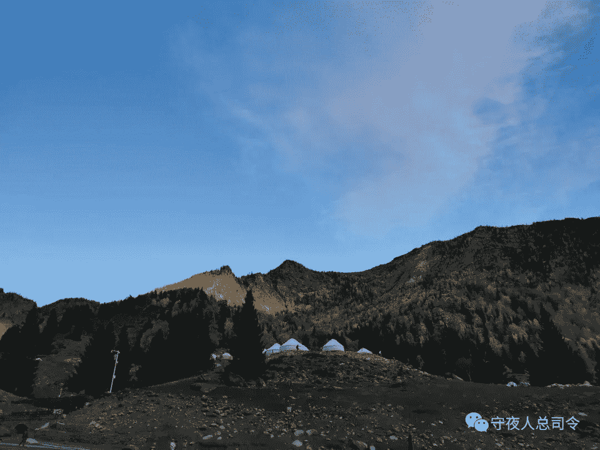

  
骑了一个半小时的马，才登上阿尔泰山。这些蒙古马虽然没有阿拉伯马那么高大，但耐力真好。不仅适合长途奔袭，也适合长期爬山。天生万物，相生相克，人与环境的相互雕塑既能造成一种优势叠加的效果，也能造成一种深度捆绑的死锁。一个物种在某个环境中越是如鱼得水，它往往对这个环境的依赖度也就越高！  
这一趟走下来，与形形色色的人打交道，每一个人所呈现给你的世界都是完全不一样的——就如同一个水晶的不同侧面。在这些相互叠加在同一个物理空间中的不同世界中，我更立体的看清楚不同的人所感知到的世界的边界和他们所认定的运行规则。有一句话叫：未经他人苦，莫劝他人善。你不能理解一个人的精神结构，你就无法理解为什么在你看来无比荒唐的事在对方眼中却是那样的理所当然，甚至除此之外没有其它的选项。  
我以前不明白为什么东北人的父母会无比的痴迷于编制。在新疆转了一圈，深入到那些县城之后，就越发理解了：如果沙漠中存在一种稀有的资源，能够开采和利用它的只能是国企。为什么是国企呢？因为这些资源属于国家，能够代表国家这个抽象概念的具体对象是政府，而政府不是经济体系的参与者，能够代表政府意志的经济参与实体就是国企。  
当你试图在沙漠戈壁中造出一座城市的时候，这种投资和建设在最初未知成败的阶段是由权力驱动的，并不是由市场驱动的。正因为它的第一驱动力源于权力，所以，后续的一切都或多或少的被某种惯性裹挟着前行。  
这种路径依赖作用于人群的时候，与普通人生活息息相关的内容就是工作岗位。所有的岗位都源于某种需要，而这种需要由牵引力来决定。如果这个牵引力是权力，那么，它的意志就决定是否设定某个岗位。这种地方最好的工作就是体制内的工作，因为体制内的岗位是在贯彻权力的意志，具有持续且稳定的驱动力。  
当年的东北就是这样的一种发展路径。当某个城市的 70%的人口都在国企上班的时候，不管是市场经济还是市场本身都不存在！为什么呢？因为交易需要对手盘，没有对手盘的交易是无法存在的。所以，问题的关键是为什么 70%的人会在国企中讨生活。  
一种资源被广泛应用的时候，围绕着对这种资源的利用，会构建起一个产业，这个产业的最初形态是从无到有，无比艰苦并极具开拓性。关于这一点，我在可可托海的 3 号矿和周围的环境中感受非常深刻。大屏幕上放映着第一代人的开拓、第二代人的建设、第三代人的回忆。它就如同一棵小树从戈壁沙漠中艰难的生长出来，长成一篇胡杨林。筚路蓝缕的背后是一种由信仰和权力驱动的行为。  
随着对资源利用的日益成熟，在最初的基础之上逐渐衍生出配套的产业。然而，这些配套设施也是服务于这个主题的，并不存在除此之外的市场——我在克拉玛依住的酒店，从装修风格和建筑布局，以及服务人员的行为特征就能明显的发现：所有的一切都与真正面向市场的酒店行业不同，它的一切都紧紧围绕着接待这个主题在建设——即便它的功能已经开始延申到市场活动之后依然被最初的惯性所裹挟着。关于这一点，我与这家酒店的总经理聊了半个小时，他的许多反馈验证了我的观察和结论。  

 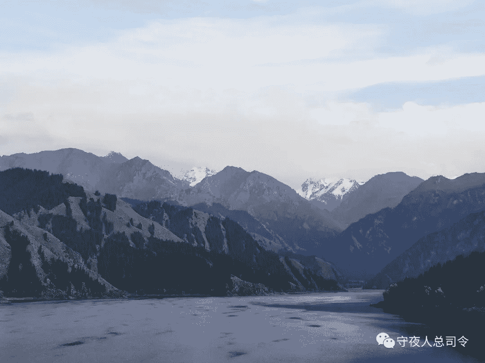

  
这只是一个缩影，它其实呈现出来的是许多三四五线城市和县城的产业状况和就业状况：所有的产业都是围绕一种非市场因素的资源衍生出来的，最初的驱动力来自于政府的权力！在这样的环境中，凡是能做点事的人都必须要跟权力有各种拐弯抹角的关系，否则，就打不上这根线，也承接不了某种配套服务的业务。当社会资源的流动呈现出这样的结构，人员的分布状态就如同覆盖在骨架上的肌肉，一开始就被决定了：进入体制内是最有保障的，其实才是与政府存在紧密关系的事业单位和国有企业。再不济就是国有企业的子公司或者服务于国企的次级单位。当资源高度集中之后，人情世故就会变得越来越重要。当交易不存在其它能够养活自己的对手盘之时，那个唯一的交易对象就是所有人都需要争夺的稀缺资源。  
任何生存结构其实都存在一条主线，所有的成员都不约而同的围绕在这条主线上扮演着整个链条中不同的角色。人在一个生存环境中，前半部分的时间主要是在拼命抢位置——证明自己配扮演整个链条中的某个角色。后半部分主要时间是用于突破这个角色在环境中的先天性限制。  

  
曾经提前两年预言过国家层面的管道公司会成立，并且最终会发展成为拥有成品油定价权的决定性角色。当年油气产业处于从无到有的开拓时期，各搞各的，每一个油气公司既负责开采，也负责提炼，还自己铺设管道搞输送。这样的发展轨迹就决定了大家各有各的利益。也就会造成各霸一块的局面。这种局面并不有利于整体利益，因此，就必然要进行剥离，让前端竞争，后端整合。竞争能在前端提供更好的服务，整合能够在后端提高综合性的效率，并强化对全局的供给、定价和调控的能力。  
许多事都存在它的路径依赖，人自身也是如此。就如同一盘棋，你看到的那一刻所呈现出来的态势，并不是棋子摆在棋盘上所呈现出来的强弱格局，而是一步一步走成这种局面的轨迹。置身于棋局之中的人，许多事都由不得自己。就如同那些跟我交流的人，他们的视角编织出他们所置身的棋局，在那个棋局中有他所理解的运行规则和既定的轨迹…  
骑马上阿尔泰山的时候，一路非常陡峭，有的地方呈现出 70 多度的坡度，还好这些蒙古马很给力。大眼睛姑娘真不错，第一次骑这种蒙古马，居然能连续骑一个多小时的山路。她说她一直用力抓住马鞍，把手都磨出水泡了。随行的巴图大叔用他并不标准的国语夸奖了她，说她已经很厉害了！  
穿过一片小树林的时候，我在马背上转头往后看，看到了不一样的风景，忍不住掏出手机拍了封面上的这张照片——这是一个从高处向下俯视的独特视角，当我处于山谷之中的时候，想都想不到这样的景象，只有等山巍峨的阿尔泰山之巅，才能看到它的全貌，看到那些让人惊叹不已的美！  
连续骑马那么长时间走山路挺累的，为了拍照和装逼，我一直单手拉着缰绳，时不时的往后仰。刚开始还没感觉，第二天睡觉醒来之后，发现不仅仅是腿有点僵硬，腰也有点痛。  
研习《[结构学](https://mp.weixin.qq.com/mp/appmsgalbum?action=getalbum&album_id=1318317199878225920&__biz=MzAxNDk1NjI2Mw==#wechat_redirect)》，加入觉悟社：付费和不公开内容都有，每天 20 块，还能挣回来，下注标的获取需满足条件及时查看更新。公众号发消息：觉悟社  

  
[结构学自序（新）！](http://mp.weixin.qq.com/s?__biz=MzIzMDYwOTM0Mg==&mid=2247485283&idx=1&sn=aa2b8554b8e5040f8f959636feaa06a3&chksm=e8b19fb2dfc616a430aa381b8da0815311244e694a69809cd92d0602ac34cfe5f1f419b3745e&scene=21#wechat_redirect)  
[不要愤愤不平，都是好事！](http://mp.weixin.qq.com/s?__biz=MzAxNDk1NjI2Mw==&mid=2247487130&idx=1&sn=b21138d85455f5692aaf039038c78342&chksm=9b8a2d12acfda404a2b67fe4d446ee0f2805ad64a8b8004902934600fd731191e140df6ac19a&scene=21#wechat_redirect)  
[她都来相亲了，你还要怎么样！](http://mp.weixin.qq.com/s?__biz=MzAxNDk1NjI2Mw==&mid=2247486952&idx=1&sn=698aec6916d2eca5e758c25c4c634346&chksm=9b8a2e60acfda776b80a4f2f0d5c2fe4921fc821cdf029fa9d2fdc52fd708fc5a0b980d5d3d0&scene=21#wechat_redirect)  
[田园女权真正攻击的对象是女人！](http://mp.weixin.qq.com/s?__biz=MzIzMDYwOTM0Mg==&mid=2247486412&idx=1&sn=5dd3e8b2a759838d739e6d61ebab2eab&chksm=e8b1931ddfc61a0bf6f81cd2a9a9232ea8ce86528a8eea66c6635180e8678b819ebb38b4cb86&scene=21#wechat_redirect)  
[穷是万恶之源！](http://mp.weixin.qq.com/s?__biz=MzAxNDk1NjI2Mw==&mid=2247483823&idx=1&sn=e54ebe9891b302dc0bf1815c76ccf8b7&chksm=9b8a2227acfdab31a05e273addd9159d4b8263d58d3c58bf214841c8189157519719c3427306&scene=21#wechat_redirect)  
[没有退路的一代人！](http://mp.weixin.qq.com/s?__biz=MzAxNDk1NjI2Mw==&mid=2247486533&idx=1&sn=a0d5cce0656aad467148e0642eb85a00&chksm=9b8a2fcdacfda6db79857186e953a089baf1fb678b2b071cf101c5a26e7fb9768474c94243ca&scene=21#wechat_redirect)  
[可可托海的牧羊人！](http://mp.weixin.qq.com/s?__biz=MzAxNDk1NjI2Mw==&mid=2247487232&idx=1&sn=b6960f8a48871772d4b404a83cb5c7e0&chksm=9b8a2c88acfda59efdc4f5818b75ef13f4b04754440e16d1670baef9041a20b80fdf8a817540&scene=21#wechat_redirect)  
[十八年后的天池！](http://mp.weixin.qq.com/s?__biz=MzAxNDk1NjI2Mw==&mid=2247487257&idx=1&sn=27c585c94b09c0a57fcc8212468c8021&chksm=9b8a2c91acfda587d85c71de190b0168caed45a6296d84d71800adeaa01aa2d986e9247d03a4&scene=21#wechat_redirect)  
[可可托海没有牧羊人！](http://mp.weixin.qq.com/s?__biz=MzAxNDk1NjI2Mw==&mid=2247487272&idx=1&sn=8f44fbf66bf8e0f27a9d1fdfeb82a146&chksm=9b8a2ca0acfda5b68763a03b7aa206e852180f5de8083d1909228b008fe8484bd5f2f38e3812&scene=21#wechat_redirect)  
[报告，我部已集结完毕！](http://mp.weixin.qq.com/s?__biz=MzAxNDk1NjI2Mw==&mid=2247487319&idx=1&sn=d9e72f8c527d2e8e4f922b6e93e883b4&chksm=9b8a2cdfacfda5c931083f655f3fc18dd6637a904955c7a19037f63840673459d0376f99ad65&scene=21#wechat_redirect)  
[A304：为啥会拉闸限电，心里没点数吗？](http://mp.weixin.qq.com/s?__biz=MzAxNDk1NjI2Mw==&mid=2247487279&idx=1&sn=e990e3f48d017a0401536073f1824ef6&chksm=9b8a2ca7acfda5b1d73eb8ec445b0f93386f82d2ee28482af93dc74ed7987fff766a2a534c3c&scene=21#wechat_redirect)  
[A517：从酒肉朋友到酒肉情侣！](http://mp.weixin.qq.com/s?__biz=MzAxNDk1NjI2Mw==&mid=2247487217&idx=1&sn=5defa9de19a22d6bea269defa65b4b91&chksm=9b8a2d79acfda46fa1fe57755d52f85dba61aa31fdeed8e400ef0f92459388da9ae86b7b6273&scene=21#wechat_redirect)  
[A510：努力没结果，被人顶替，怎么办！](http://mp.weixin.qq.com/s?__biz=MzAxNDk1NjI2Mw==&mid=2247487202&idx=1&sn=c4c18c5c793a47e31cd7267152a78d1f&chksm=9b8a2d6aacfda47c47394eb5cbb97fc6233fb7258c0408026e518018a6af33da141b1b0a2bfa&scene=21#wechat_redirect)  
[A518：法国之事只是几百亿欧元的事吗？](http://mp.weixin.qq.com/s?__biz=MzIzMDYwOTM0Mg==&mid=2247486440&idx=1&sn=5f04c2242b53a3f7d3deacdbfa4fab19&chksm=e8b19339dfc61a2fad7247d7e60502508f330e9721943077c715de77bd240be910edc9c1f724&scene=21#wechat_redirect)  
[A507：这篇不让发，再试试！](http://mp.weixin.qq.com/s?__biz=MzIzMDYwOTM0Mg==&mid=2247486381&idx=1&sn=ff54feb308d92ab0329957d3b1e6ffe0&chksm=e8b1937cdfc61a6a551fd5459a063cf08ee00693e3d52e5691d3df22e0bbc5b91618b9ead52e&scene=21#wechat_redirect)  
[A514：鹰酱分化毛熊和兔子，并精确阻击！](http://mp.weixin.qq.com/s?__biz=MzIzMDYwOTM0Mg==&mid=2247486421&idx=1&sn=c114599b4fd1016c7f539fca526fe91c&chksm=e8b19304dfc61a127301df6303aedbeace66275a179f7db025e56f2326917c273d443eab53e6&scene=21#wechat_redirect)  
[A496：为什么兔子在阿富汗很主动？](http://mp.weixin.qq.com/s?__biz=MzIzMDYwOTM0Mg==&mid=2247486278&idx=1&sn=40d09857088bebd3c70bec1c7a500f06&chksm=e8b19397dfc61a810125242c8e395330f934390eb50bd54053ecd3f31ddc91de4e429c0f693a&scene=21#wechat_redirect)  
[不上进的男人和太上进的女人！](http://mp.weixin.qq.com/s?__biz=MzIzMDYwOTM0Mg==&mid=2247486430&idx=1&sn=7f5bc0b0990883a4e2fb5b7206bec905&chksm=e8b1930fdfc61a190d76241bf61a10a6a911a18c1dd3e7636ad78e4373d683a94e91b7e7ce7d&scene=21#wechat_redirect)  
[没有信仰的中国人？](http://mp.weixin.qq.com/s?__biz=MzIzMDYwOTM0Mg==&mid=2247486407&idx=1&sn=9a80a9025d4d375b279e55be877a62d8&chksm=e8b19316dfc61a00b5b914a5a63d952874bd62283d40c73574940eb7bfb73a25be2e8f2d82b3&scene=21#wechat_redirect)  
[可可托海的牧羊人！](http://mp.weixin.qq.com/s?__biz=MzAxNDk1NjI2Mw==&mid=2247487232&idx=1&sn=b6960f8a48871772d4b404a83cb5c7e0&chksm=9b8a2c88acfda59efdc4f5818b75ef13f4b04754440e16d1670baef9041a20b80fdf8a817540&scene=21#wechat_redirect)  
[A504：6 天撤出 12.9 万人，这个能力我们还不具备！](http://mp.weixin.qq.com/s?__biz=MzIzMDYwOTM0Mg==&mid=2247486364&idx=1&sn=c54714ffeaa4122f08d8ec0c2decb740&chksm=e8b1934ddfc61a5b943cbe55dfc7211561e7d78f163246c3dcfd08325b004bc6d9ee6efbaebf&scene=21#wechat_redirect)  
[A504：当男人不再大男子主义！](http://mp.weixin.qq.com/s?__biz=MzAxNDk1NjI2Mw==&mid=2247487148&idx=1&sn=5151b292f8f882fe9f87aabf52be08df&chksm=9b8a2d24acfda432b5803c25c0c83a4cbfc80a7c83ffd044b72bedc5e32d9670054d861705cf&scene=21#wechat_redirect)  
[A491：塔利班接下来的两个核心问题！](http://mp.weixin.qq.com/s?__biz=MzIzMDYwOTM0Mg==&mid=2247486219&idx=1&sn=8f77517f0244ba31f7eb28e2676e17cd&chksm=e8b193dadfc61acc6d9e6029653aac696f132efc24d3b28f983ba8e4ada269ac887e6165d837&scene=21#wechat_redirect)  
[A499：如何控制一个老实人！](http://mp.weixin.qq.com/s?__biz=MzIzMDYwOTM0Mg==&mid=2247486301&idx=1&sn=f4bfec024d8688c8555dd21b85deea31&chksm=e8b1938cdfc61a9a1e2d8a8fa37d495cf337bc34215939caced14a58dd32b46ad59646d0e928&scene=21#wechat_redirect)  
[来来来，我教你怎么攻击我！](http://mp.weixin.qq.com/s?__biz=MzIzMDYwOTM0Mg==&mid=2247486306&idx=1&sn=f48e33b5940f74a11011debfe3e5c8a2&chksm=e8b193b3dfc61aa53a82eeb81220ce252b0667925a9479e4d6a215e2b43244ba91c58e934264&scene=21#wechat_redirect)  
[A494：对企业财税政策的预判！](http://mp.weixin.qq.com/s?__biz=MzIzMDYwOTM0Mg==&mid=2247486230&idx=1&sn=5fa67e9065c3feae6264765838772136&chksm=e8b193c7dfc61ad15311f10ab8265d667f31cc2e11e404476afbc0310d6ee71e5f1167faf78f&scene=21#wechat_redirect)  
[A474：箭在弦上，不得不发！](http://mp.weixin.qq.com/s?__biz=MzIzMDYwOTM0Mg==&mid=2247486092&idx=1&sn=d93b0ab35ba2828a708658dbd2e5ad9b&chksm=e8b1925ddfc61b4b12bc1b6a7e7e25a2fe7ff149b1c4f64810b2a5eefa97b8dc1bd1899dcf00&scene=21#wechat_redirect)  
[A328：2021 年必须加杠杆！](http://mp.weixin.qq.com/s?__biz=MzIzMDYwOTM0Mg==&mid=2247485087&idx=1&sn=24d72f6a71bddb8954a03be5db246538&chksm=e8b19e4edfc617587a8ae645885a89ab8c3c6f67730a026d9c7c9a94ab3051ca480302147fc0&scene=21#wechat_redirect)  
[A361：人成长的三个关键时刻！](http://mp.weixin.qq.com/s?__biz=MzAxNDk1NjI2Mw==&mid=2247486472&idx=1&sn=8b46d73659ff81e3d7bd544e1718a94f&chksm=9b8a2f80acfda69601b059cb0180f8841eda098200c32c84ad6430bb8fbe33a9021fa7890344&scene=21#wechat_redirect)  
[A311：要理解住房不炒的真正含义！](http://mp.weixin.qq.com/s?__biz=MzIzMDYwOTM0Mg==&mid=2247484959&idx=1&sn=090583ec50bfd9febec1de463c2672f6&chksm=e8b19ecedfc617d8629080f6745c8de013cfe875de26eef6767b2d5c10782650223ed15f807b&scene=21#wechat_redirect)  
[A394：要理解扶贫政策的真正意图！](http://mp.weixin.qq.com/s?__biz=MzIzMDYwOTM0Mg==&mid=2247485502&idx=1&sn=fffb9911cefa626e6fbcb9c416c1eb98&chksm=e8b190efdfc619f9b0e42f3c3d5d79c17df1619bad2b1bddd6a482242b583ee46d8a79a245e6&scene=21#wechat_redirect)  
[A388：用鲜血开路获得的投名状！](http://mp.weixin.qq.com/s?__biz=MzIzMDYwOTM0Mg==&mid=2247485591&idx=1&sn=a8443453e3caf1f201006eeec8e6e539&chksm=e8b19046dfc61950e63e29bb93049ce90b3228913e9ecee99a2f01b8fdda7cd8966a054241a9&scene=21#wechat_redirect)  
[A405：养老对普通人将会是一个深渊！](http://mp.weixin.qq.com/s?__biz=MzIzMDYwOTM0Mg==&mid=2247485587&idx=1&sn=f00402b3fdc5062ee5c5382295ac4dcb&chksm=e8b19042dfc619546bf0a0905d2733d900b7594f1564f1fa7528399053b93dc53f4d14c009fb&scene=21#wechat_redirect)  
[A300：这是投机的大机会还是大陷阱？！](http://mp.weixin.qq.com/s?__biz=MzIzMDYwOTM0Mg==&mid=2247484882&idx=1&sn=b103029f41e3aede94e1a45d035cd9ac&chksm=e8b19d03dfc614153863f37ca3f9204b451e2c02ad5ca8680c120e2458e628e5329c76b2d42c&scene=21#wechat_redirect)  
[A366：从货币驱动到财政驱动的转变！](http://mp.weixin.qq.com/s?__biz=MzIzMDYwOTM0Mg==&mid=2247485347&idx=1&sn=a916df57ddc7230366719fbecc6c1704&chksm=e8b19f72dfc61664fd99844bfe3ffffb5d6f088807c84d99f11ddbc7410b2eed67bc4c615d53&scene=21#wechat_redirect)  
[A376：要换种思维，你才能理解！](http://mp.weixin.qq.com/s?__biz=MzAxNDk1NjI2Mw==&mid=2247486529&idx=1&sn=3a50ada30a5ae0448d686c6a0c809919&chksm=9b8a2fc9acfda6df5e9243deb6e9df9a7cc0912eabd0a9c00322d42ed4c25c2daedc8de6b6ca&scene=21#wechat_redirect)  
[A377：为什么不买武汉的房？](http://mp.weixin.qq.com/s?__biz=MzIzMDYwOTM0Mg==&mid=2247485413&idx=1&sn=1f3339540496eb9e5ea109d8530f29dc&chksm=e8b19f34dfc6162225a694c1c2443d73b51bf6ca8dc53d4c18a30e6e2191e250967e711db589&scene=21#wechat_redirect)  
[A295：当代女性的两难！](http://mp.weixin.qq.com/s?__biz=MzIzMDYwOTM0Mg==&mid=2247484854&idx=1&sn=6851afe306f7b89d23728018ea32b7f2&chksm=e8b19d67dfc61471955b15021ac11c5fff9f1607977e9df1bd2bbfabc2deb3dea5c98e369c55&scene=21#wechat_redirect)  
[A375：你修炼错了方向！](http://mp.weixin.qq.com/s?__biz=MzIzMDYwOTM0Mg==&mid=2247485407&idx=1&sn=9febe7868b7205ac865541d88423d9b9&chksm=e8b19f0edfc61618c7f22fb7bf48181c5f974463c5d3a8849b0f76b96eeac73b0dd074ea4737&scene=21#wechat_redirect)  
[E29：一眼看到底！](http://mp.weixin.qq.com/s?__biz=MzIzMDYwOTM0Mg==&mid=2247485301&idx=1&sn=dc6dd50c5d742ea51ce9e394de25351a&chksm=e8b19fa4dfc616b26734c3619c6fa664474fa478d2764c3370dde41d19f6035edc05f9f191e8&scene=21#wechat_redirect)  
[向下兼容是种自我消耗！](http://mp.weixin.qq.com/s?__biz=MzAxNDk1NjI2Mw==&mid=2247486535&idx=1&sn=e87304f3a33f1cd0425186362901eb04&chksm=9b8a2fcfacfda6d92af7f3b026ef129368c01361e40f2db3be32500a1e68fb99f1f35ec22a6b&scene=21#wechat_redirect)  
[A284：啊！万箭穿心！](http://mp.weixin.qq.com/s?__biz=MzAxNDk1NjI2Mw==&mid=2247486135&idx=1&sn=e950149b9b9147e9199cfc6093605950&chksm=9b8a293facfda029419b911d4b4fa91c73bbaf695b206df2cf15124d843f4bf4b80673baa394&scene=21#wechat_redirect)  
[梦醒之时，已经三十！](http://mp.weixin.qq.com/s?__biz=MzIzMDYwOTM0Mg==&mid=2247484378&idx=1&sn=e3a058584a13d7a5267315113964280d&chksm=e8b19b0bdfc6121df4af4b77d2d826fd0f4132ccfdee48132ce8cf86eb1ba45b898be83d1dc7&scene=21#wechat_redirect)  
[五年感情，八万块钱！](http://mp.weixin.qq.com/s?__biz=MzIzMDYwOTM0Mg==&mid=2247484317&idx=1&sn=b22f9fb2e3c084e427a5e3e9895be99a&chksm=e8b19b4cdfc6125adf3ea3b0d2b72a121f38e8ba26e43abc48edff900327ce3e7464b944cafb&scene=21#wechat_redirect)  
[赶紧看，待会儿又没了！](http://mp.weixin.qq.com/s?__biz=MzAxNDk1NjI2Mw==&mid=2247486485&idx=1&sn=59010caa3e68d45d1ae578d4ab76a4db&chksm=9b8a2f9dacfda68b06ee592a02eead0f174b54fa7501f4c0f4221f3c6fff0c625e90a7675460&scene=21#wechat_redirect)  
[依依东望，望的是时间！](http://mp.weixin.qq.com/s?__biz=MzIzMDYwOTM0Mg==&mid=2247483860&idx=1&sn=b5b01ae82ff764ce2806251e3f2a809f&chksm=e8b19905dfc61013607735eb7782299c9a4d7a39a8b15a7b46182ef20eda3ffe9f6ed6337e1f&scene=21#wechat_redirect)  
[A374：真正的大机会在这里！](http://mp.weixin.qq.com/s?__biz=MzIzMDYwOTM0Mg==&mid=2247485401&idx=1&sn=100967c02c0754759ec4ea0ef8706c29&chksm=e8b19f08dfc6161e92c7cc691f1a1fed9ff74c2b906529a8d42a7703a3c3a3c3a412903e12f7&scene=21#wechat_redirect)  
[关注自己的人，才会活的不错！](http://mp.weixin.qq.com/s?__biz=MzIzMDYwOTM0Mg==&mid=2247485305&idx=1&sn=c719ea57e5c3320c2e2629dd9a7b44e9&chksm=e8b19fa8dfc616be5fa3f8141ea0aa63d5e1335657ed97e62c1086c41eba29effe58e0c8e9dc&scene=21#wechat_redirect)  
[A294：快快下注，开始挣钱了！](http://mp.weixin.qq.com/s?__biz=MzIzMDYwOTM0Mg==&mid=2247484849&idx=1&sn=5485cd1d6c511e883e25b0c7dd9e2e3e&chksm=e8b19d60dfc614764ffc8405dccf5b8120b31988f3c1cee74e384c06f0e39c3c81bef8263c3d&scene=21#wechat_redirect)  
[A370：被删了，改后重发，欲看从速！](http://mp.weixin.qq.com/s?__biz=MzIzMDYwOTM0Mg==&mid=2247485388&idx=1&sn=a456e8ffdc8a16bb30263818dc86c6a3&chksm=e8b19f1ddfc6160bfd0fea09b006477a095662aa74ac7036fca621b2ef49dc59f4ad4a407eeb&scene=21#wechat_redirect)  
[E26：自卑的形成和自信的重建！](http://mp.weixin.qq.com/s?__biz=MzIzMDYwOTM0Mg==&mid=2247485311&idx=1&sn=28f827c212f9a1ac53e73986742ca5aa&chksm=e8b19faedfc616b8d527f328c2ad55dca966707c8813ceaa5b7c0daee3432edeec88744d842c&scene=21#wechat_redirect)  
[A318：为何搞银行房产贷款配额？！](http://mp.weixin.qq.com/s?__biz=MzIzMDYwOTM0Mg==&mid=2247485031&idx=1&sn=c4af23061445755fdb12f1196c108b1d&chksm=e8b19eb6dfc617a015821fd94ff2d8f51a2cb8fb456ddd907206b615bf3240c1597d3618609c&scene=21#wechat_redirect)  
[A311：要理解住房不炒的真正含义！](http://mp.weixin.qq.com/s?__biz=MzIzMDYwOTM0Mg==&mid=2247484959&idx=1&sn=090583ec50bfd9febec1de463c2672f6&chksm=e8b19ecedfc617d8629080f6745c8de013cfe875de26eef6767b2d5c10782650223ed15f807b&scene=21#wechat_redirect)  
[A320：思路变了，可以加杠杆了！](http://mp.weixin.qq.com/s?__biz=MzIzMDYwOTM0Mg==&mid=2247485041&idx=1&sn=add2174fa42806f885a456a072ee4fee&chksm=e8b19ea0dfc617b6734e013f780112fdd88f28ad5312ce423fea1d75da4c3757660dab175208&scene=21#wechat_redirect)  
[A345：剥离学区控制贷款也没用！](http://mp.weixin.qq.com/s?__biz=MzIzMDYwOTM0Mg==&mid=2247485208&idx=1&sn=ac3653b56fc18a4a6a809139f935bc45&chksm=e8b19fc9dfc616dfa31b0baf15aa90d994ef8a1262e0fd515739c06698cd0673d1d46e6e4c4f&scene=21#wechat_redirect)  
[A365：他妈一年挣的比你妈 50 年都多！](http://mp.weixin.qq.com/s?__biz=MzIzMDYwOTM0Mg==&mid=2247485336&idx=1&sn=2fba7786d5102be1d639bfdd138185db&chksm=e8b19f49dfc6165f4a1e07062ca1414d977f1a6c15d797233e36f7dec3b27c28b0ed72667f5f&scene=21#wechat_redirect)  
[E18：你想的不够简单！](http://mp.weixin.qq.com/s?__biz=MzIzMDYwOTM0Mg==&mid=2247484775&idx=1&sn=2a8e810e281cd7fe5a4db49002b193d2&chksm=e8b19db6dfc614a0e3360f0d54949c40138c27b184c114a44feaa394bd4400073dbbedf6a049&scene=21#wechat_redirect)  
[为富人办事，为穷人说话！](http://mp.weixin.qq.com/s?__biz=MzIzMDYwOTM0Mg==&mid=2247484462&idx=1&sn=195ebab17907fba73c69ae7a11bc40ad&chksm=e8b19cffdfc615e9b2f88327d492813afa3656859f4d67a6d831ac1cf684a54b760a8b8edcd6&scene=21#wechat_redirect)  
[A284：啊！万箭穿心！](http://mp.weixin.qq.com/s?__biz=MzAxNDk1NjI2Mw==&mid=2247486135&idx=1&sn=e950149b9b9147e9199cfc6093605950&chksm=9b8a293facfda029419b911d4b4fa91c73bbaf695b206df2cf15124d843f4bf4b80673baa394&scene=21#wechat_redirect)  
[梦醒之时，已经三十！](http://mp.weixin.qq.com/s?__biz=MzIzMDYwOTM0Mg==&mid=2247484378&idx=1&sn=e3a058584a13d7a5267315113964280d&chksm=e8b19b0bdfc6121df4af4b77d2d826fd0f4132ccfdee48132ce8cf86eb1ba45b898be83d1dc7&scene=21#wechat_redirect)  
[父母挖的坑，别人挖的坑，自己挖的坑！](http://mp.weixin.qq.com/s?__biz=MzAxNDk1NjI2Mw==&mid=2247486426&idx=1&sn=8707934ad2fe2f8017d6b7810fd61c17&chksm=9b8a2852acfda1441fded7bab2456dd2493073ad3e5d541e1080d1739879b86c25a3a61df79a&scene=21#wechat_redirect)  
[A245：北京有的小区涨了 20%！](http://mp.weixin.qq.com/s?__biz=MzIzMDYwOTM0Mg==&mid=2247485265&idx=1&sn=f4bce6f07805cba2db3a1a806215e45c&chksm=e8b19f80dfc616966666979063f2c9fce9fe20308538607cf90eac74f0db85c9adf79299f4b8&scene=21#wechat_redirect)  
[A351：你为什么也不愿意？！](http://mp.weixin.qq.com/s?__biz=MzIzMDYwOTM0Mg==&mid=2247485242&idx=1&sn=f4a01a5936322120b0b158f225bc78de&chksm=e8b19febdfc616fd2eb1558a3b7c748ecc497a3af00aec5b5c5ca8042cc52eb7d0af7befa399&scene=21#wechat_redirect)  
[A335：必须与焦虑长期共存！](http://mp.weixin.qq.com/s?__biz=MzIzMDYwOTM0Mg==&mid=2247485165&idx=1&sn=f3f0957c63fa549b288f00c8b117162e&chksm=e8b19e3cdfc6172a188000afd2b522144a04ba774169824cad2067d93b5365537ff0644f6b9f&scene=21#wechat_redirect)  
[A315：认命吧，做个普通人也挺好的！](http://mp.weixin.qq.com/s?__biz=MzIzMDYwOTM0Mg==&mid=2247485008&idx=1&sn=bcaf70c42d4676c8f69de9f9ead1e495&chksm=e8b19e81dfc617973ba40200519407186760e32843fc6f379020da6160b0ba89870dadcae5fa&scene=21#wechat_redirect)  
[E15：老洋房的生意没法学！](http://mp.weixin.qq.com/s?__biz=MzAxNDk1NjI2Mw==&mid=2247485113&idx=1&sn=4fc868bf65d5f2ca6eb4d9b776c004ec&chksm=9b8a2531acfdac27c57da12097dfe850ba55cdfd447e35c19df3819bdf4051694bc49f0a218d&scene=21#wechat_redirect)  
[B19：不动产的投资思路！](http://mp.weixin.qq.com/s?__biz=MzAxNDk1NjI2Mw==&mid=2247484650&idx=1&sn=36687887ab7cd444fd324c3906b8d54a&chksm=9b8a2762acfdae74b83a146bdd8994b81cb9879b3de5caa870c13c6253ad22b2f5c42b0fe59a&scene=21#wechat_redirect)  
觉悟者  
喜欢你就转走吧！  
微信扫一扫赞赏作者 赞赏  
已喜欢，对作者说句悄悄话  
取消   
发送给作者  
发送  
最多 40 字，当前共字  
 人赞赏   
上一页 1/3 下一页  
长按二维码向我转账  
喜欢你就转走吧！  
受苹果公司新规定影响，微信 iOS 版的赞赏功能被关闭，可通过二维码转账支持公众号。  

 

精选留言  
暂无...   
[阅读全文](https://mp.weixin.qq.com/s/nIdk03JhgbTU-TDXQQQ39A#rd)  
  

# 

# \[守夜人总司令\] - 2021-09-25 大眼睛姑娘生病了！

> 来源：[`www.yuque.com/books/share/97051b78-926c-43e6-b0aa-0b72ff163ac4/ucfhbg`](https://www.yuque.com/books/share/97051b78-926c-43e6-b0aa-0b72ff163ac4/ucfhbg) 

大眼睛姑娘生病了！   
原创 觉悟者 守夜人总司令   
守夜人总司令   
微信号 WatcherCommander  
功能介绍 结构学：生命体在其生存结构中的求存之道！  
2021-09-25[原文](https://mp.weixin.qq.com/s?__biz=MzAxNDk1NjI2Mw==&mid=2247487277&idx=1&sn=a93743faaef5fa3bc59ecc0b2e327fe4&chksm=9b8a2ca5acfda5b3c13c04b86c5038612d36a3bad248a16bbcdfbff94b25a35d3778b7e47163#rd\)) 发表于  
收录于合集  
#可可托海 7 个   
#布尔津 3 个   
#戈壁滩 3 个   
#伏尔塔瓦河 5 个   
#天池 5 个   
今天的行程计划是从可可托海所在的富蕴县城一路向北驱车几百公里抵达布尔津县城。然而，天有不测风云，人有旦夕祸福。计划总是赶不上变化——生活就是这样，不管你设想的多好，最终都会变得乱糟糟。人与人的差异往往就体现在遇到糟糕情况时的应对能力。绝大多数人被各种意外打断自己追求目标的节奏之后，往往就在哪里跌倒就在哪里躺下。即便不破罐子破摔，在挣扎过几次之后也就半推半就的放弃了。绝大多数人的命不好，并不是外力造成的，而是自身的问题造成的。有一句话是这样说的：普通人努力的程度还远远到不了需要依靠天赋才能突破的程度。绝大多数人的所谓努力，其实连一个正常的人水平都没有达到。  
这里的温差和大湾区完全不同，对于长期习惯了某种环境的人来说，突然去到一个完全不一样的环境，总是会在任何事情上都显得格格不入，进退失据。大眼睛的姑娘昨天晚上不停的掀被子，我先后起来四次去给她盖被子，最后一次盖上被子的时候，一看手机已经凌晨 4 点了！早上起来的时候，她果然感冒了。不仅咳嗽，而且还开始发烧。还好我未雨绸缪带了测量体温的设备和必要的应急药，其中就包括退烧药。然而，这玩意根本不顶用，因为我搞不清楚到底是风热感冒还是风寒感冒，而且也搞不清楚是病毒引起的感冒，还是普通感冒。总之，我一阵手忙脚乱的把能吃不能吃的药全给她找了出来。耗了几个小时之后依然没有好转，拖到要退房的时候，不得不再续一天的酒店。然而，我依然不能确定在富蕴县城多休息一天就能好转。当地的防疫政策时常反应过度，我还真的害怕引发不必要的误会，一想到她如果被弄到某个独立的小房间中隔离，哪怕只是做核酸检查并等待结果，也会让她恐惧到崩溃。但是药已经吃了，烧退了又升上来，我不是学医的，面对这样的未知，真的束手无策。然而，我的理性告诉我，必须做决策，拖延不仅无法解决问题，还会让处境进一步恶化。  
我只好先安慰她，给她做一个心理铺垫，缓解她的恐惧情绪。我告诉她一会儿开车去县城的医院，因为发烧会先被短暂隔离起来，要做核酸检查。你不要害怕，我会陪着你的，不管发生什么事，我都会在你看得见的地方。如果要被关起来一段时间，我会去跟你进去，一起被关起来。她似懂非懂的看着我，突然紧紧的抱住我的脖子。我只好轻抚她的背，让她的情绪缓解下来。等她平静了一些之后，我把她抱上车，给她戴好口罩，系上安全带。然后把车开到富蕴县医院。果然在门口被拦住要求下车，先看行程码，量体温。然后就被带到了一个临时隔离点。当她走进那个小黑屋的时候，不断的回头往着我，我从她的眼神中看到了她的紧张、恐惧和无助。于是，我跟工作人员说，我要进去陪她一起做核酸检查并等待结果出来。那个漂亮的维吾尔族护士刚开始不同意，说这样有风险，会造成交叉感染，不要这么娇气，别的人也是这样的，如果没有问题一个小时之内就会出结果。事实上这位护士说的没错，但我更能理解她在面对这种完全陌生的环境时的恐惧和不安，我担心她的情绪叠加会造成失控。  
于是，我跟护士商量，我想买一套她身上穿的防护服，这样我就可以进去又避免交叉感染了。她一脸嫌弃的白了我一眼，但最后耐不住软磨硬泡。我想最后让她同意的应该是这一句：当时武汉爆发疫情的时候，防疫物资短缺，我不是学医的，帮不上忙，当我去联系深圳生产防护服和口罩的厂家，自己掏钱买了 6 万个口罩和 1000 套防护服送过去。现在我只需要一套行！这位长得不输迪丽热巴的维族护士突然对我的态度好多了，你能感受到那种转变。虽然她依然在坚持原则，但已经和颜悦色，甚至变得有点善解人意，笑起来也好看。她去给我弄了一套穿上，然后我也像一个全副武装的医护人员一样进到了那个临时隔离房间。我一直跟她说话，以此来缓解她的紧张情绪和恐惧心理。虽然我内心百分之百的确定她就是昨晚掀被子感冒了。但不知道为什么，我真的很担心当地医院会因为某种技术问题造成误判。如果真的被误判，就会被彻底的隔离起来，我刚才应该想到这种最坏的结果，并把要用的东西都带上。那一刻，我为自己没有提前为最坏的情况做好准备而悔恨不已。  
还好最后的检测结果没有产生任何技术错误，最后顺利的进入正常的看病流程。她第一次来新疆，这里的服务肯定不会像北上广深这样的城市那样周到，所以，她总是不敢独自去与医生护士打交道。我只好带着她一会儿上四楼看医生，一会下一楼去缴费，一会儿又去另外一栋楼抓药。好不容易搞定了一切，已经快下午 5 点了。最后的诊断是病毒性感冒，吃了药之后烧也退了。一块压在心头的石头总算落了地。于是，我打算继续今天的行程，虽然到达布尔津的时候可能已经是深夜了。但是，如果今天不过去，明天去喀纳斯就需要驱车七八个小时，就算十点出发，到的时候也体验不到什么风景了。凡事预则立不预则废，宁可多交一天的酒店钱也必须出发，回归之前的计划和节奏。  
生活不如意十之八九。因为我们总是会遭遇各种没有预案的意外。人都渴望一帆风顺，但现实总是事与愿违。这就好比在海中驾船，遭遇突如其来的风浪的时候，有的时候不得不背道而驰绕一大圈去躲避风浪，然而，真正的船长即便是在现实情况迫使自己不得不暂时放弃追逐目标的时候，也没有忘记自己应该做什么。真实的生活就是这样：你永远会经验不足，永远在路上，永远会遇到新问题。当你必须要去面对和解决它，在应对、体验和解决的过程中，所引发的精神结构的变化和重塑，我们通常会把它称之为成长！  
有一句诛心之论是这样说的：天下没有真正的直男，我们都是第一次扮演某种角色，只要你不是专业的，都会缺乏这样那样的经验，然而，那些没有兴趣为你积累经验的人，主要是因为他们缺乏动力——他们在你眼中的“直”，根本上是源于你在他们心中的“不值”！  
研习《[结构学](https://mp.weixin.qq.com/mp/appmsgalbum?action=getalbum&album_id=1318317199878225920&__biz=MzAxNDk1NjI2Mw==#wechat_redirect)》，加入觉悟社：付费和不公开内容都有，每天 20 块，还能挣回来，下注标的获取需满足条件及时查看更新。公众号发消息：觉悟社  

  
[结构学自序（新）！](http://mp.weixin.qq.com/s?__biz=MzIzMDYwOTM0Mg==&mid=2247485283&idx=1&sn=aa2b8554b8e5040f8f959636feaa06a3&chksm=e8b19fb2dfc616a430aa381b8da0815311244e694a69809cd92d0602ac34cfe5f1f419b3745e&scene=21#wechat_redirect)  
[不要愤愤不平，都是好事！](http://mp.weixin.qq.com/s?__biz=MzAxNDk1NjI2Mw==&mid=2247487130&idx=1&sn=b21138d85455f5692aaf039038c78342&chksm=9b8a2d12acfda404a2b67fe4d446ee0f2805ad64a8b8004902934600fd731191e140df6ac19a&scene=21#wechat_redirect)  
[她都来相亲了，你还要怎么样！](http://mp.weixin.qq.com/s?__biz=MzAxNDk1NjI2Mw==&mid=2247486952&idx=1&sn=698aec6916d2eca5e758c25c4c634346&chksm=9b8a2e60acfda776b80a4f2f0d5c2fe4921fc821cdf029fa9d2fdc52fd708fc5a0b980d5d3d0&scene=21#wechat_redirect)  
[田园女权真正攻击的对象是女人！](http://mp.weixin.qq.com/s?__biz=MzIzMDYwOTM0Mg==&mid=2247486412&idx=1&sn=5dd3e8b2a759838d739e6d61ebab2eab&chksm=e8b1931ddfc61a0bf6f81cd2a9a9232ea8ce86528a8eea66c6635180e8678b819ebb38b4cb86&scene=21#wechat_redirect)  
[穷是万恶之源！](http://mp.weixin.qq.com/s?__biz=MzAxNDk1NjI2Mw==&mid=2247483823&idx=1&sn=e54ebe9891b302dc0bf1815c76ccf8b7&chksm=9b8a2227acfdab31a05e273addd9159d4b8263d58d3c58bf214841c8189157519719c3427306&scene=21#wechat_redirect)  
[没有退路的一代人！](http://mp.weixin.qq.com/s?__biz=MzAxNDk1NjI2Mw==&mid=2247486533&idx=1&sn=a0d5cce0656aad467148e0642eb85a00&chksm=9b8a2fcdacfda6db79857186e953a089baf1fb678b2b071cf101c5a26e7fb9768474c94243ca&scene=21#wechat_redirect)  
[可可托海的牧羊人！](http://mp.weixin.qq.com/s?__biz=MzAxNDk1NjI2Mw==&mid=2247487232&idx=1&sn=b6960f8a48871772d4b404a83cb5c7e0&chksm=9b8a2c88acfda59efdc4f5818b75ef13f4b04754440e16d1670baef9041a20b80fdf8a817540&scene=21#wechat_redirect)  
[十八年后的天池！](http://mp.weixin.qq.com/s?__biz=MzAxNDk1NjI2Mw==&mid=2247487257&idx=1&sn=27c585c94b09c0a57fcc8212468c8021&chksm=9b8a2c91acfda587d85c71de190b0168caed45a6296d84d71800adeaa01aa2d986e9247d03a4&scene=21#wechat_redirect)  
[可可托海没有牧羊人！](http://mp.weixin.qq.com/s?__biz=MzAxNDk1NjI2Mw==&mid=2247487272&idx=1&sn=8f44fbf66bf8e0f27a9d1fdfeb82a146&chksm=9b8a2ca0acfda5b68763a03b7aa206e852180f5de8083d1909228b008fe8484bd5f2f38e3812&scene=21#wechat_redirect)  
[A517：从酒肉朋友到酒肉情侣！](http://mp.weixin.qq.com/s?__biz=MzAxNDk1NjI2Mw==&mid=2247487217&idx=1&sn=5defa9de19a22d6bea269defa65b4b91&chksm=9b8a2d79acfda46fa1fe57755d52f85dba61aa31fdeed8e400ef0f92459388da9ae86b7b6273&scene=21#wechat_redirect)  
[A510：努力没结果，被人顶替，怎么办！](http://mp.weixin.qq.com/s?__biz=MzAxNDk1NjI2Mw==&mid=2247487202&idx=1&sn=c4c18c5c793a47e31cd7267152a78d1f&chksm=9b8a2d6aacfda47c47394eb5cbb97fc6233fb7258c0408026e518018a6af33da141b1b0a2bfa&scene=21#wechat_redirect)  
[A518：法国之事只是几百亿欧元的事吗？](http://mp.weixin.qq.com/s?__biz=MzIzMDYwOTM0Mg==&mid=2247486440&idx=1&sn=5f04c2242b53a3f7d3deacdbfa4fab19&chksm=e8b19339dfc61a2fad7247d7e60502508f330e9721943077c715de77bd240be910edc9c1f724&scene=21#wechat_redirect)  
[A507：这篇不让发，再试试！](http://mp.weixin.qq.com/s?__biz=MzIzMDYwOTM0Mg==&mid=2247486381&idx=1&sn=ff54feb308d92ab0329957d3b1e6ffe0&chksm=e8b1937cdfc61a6a551fd5459a063cf08ee00693e3d52e5691d3df22e0bbc5b91618b9ead52e&scene=21#wechat_redirect)  
[A514：鹰酱分化毛熊和兔子，并精确阻击！](http://mp.weixin.qq.com/s?__biz=MzIzMDYwOTM0Mg==&mid=2247486421&idx=1&sn=c114599b4fd1016c7f539fca526fe91c&chksm=e8b19304dfc61a127301df6303aedbeace66275a179f7db025e56f2326917c273d443eab53e6&scene=21#wechat_redirect)  
[A496：为什么兔子在阿富汗很主动？](http://mp.weixin.qq.com/s?__biz=MzIzMDYwOTM0Mg==&mid=2247486278&idx=1&sn=40d09857088bebd3c70bec1c7a500f06&chksm=e8b19397dfc61a810125242c8e395330f934390eb50bd54053ecd3f31ddc91de4e429c0f693a&scene=21#wechat_redirect)  
[不上进的男人和太上进的女人！](http://mp.weixin.qq.com/s?__biz=MzIzMDYwOTM0Mg==&mid=2247486430&idx=1&sn=7f5bc0b0990883a4e2fb5b7206bec905&chksm=e8b1930fdfc61a190d76241bf61a10a6a911a18c1dd3e7636ad78e4373d683a94e91b7e7ce7d&scene=21#wechat_redirect)  
[没有信仰的中国人？](http://mp.weixin.qq.com/s?__biz=MzIzMDYwOTM0Mg==&mid=2247486407&idx=1&sn=9a80a9025d4d375b279e55be877a62d8&chksm=e8b19316dfc61a00b5b914a5a63d952874bd62283d40c73574940eb7bfb73a25be2e8f2d82b3&scene=21#wechat_redirect)  
[可可托海的牧羊人！](http://mp.weixin.qq.com/s?__biz=MzAxNDk1NjI2Mw==&mid=2247487232&idx=1&sn=b6960f8a48871772d4b404a83cb5c7e0&chksm=9b8a2c88acfda59efdc4f5818b75ef13f4b04754440e16d1670baef9041a20b80fdf8a817540&scene=21#wechat_redirect)  
[A504：6 天撤出 12.9 万人，这个能力我们还不具备！](http://mp.weixin.qq.com/s?__biz=MzIzMDYwOTM0Mg==&mid=2247486364&idx=1&sn=c54714ffeaa4122f08d8ec0c2decb740&chksm=e8b1934ddfc61a5b943cbe55dfc7211561e7d78f163246c3dcfd08325b004bc6d9ee6efbaebf&scene=21#wechat_redirect)  
[A504：当男人不再大男子主义！](http://mp.weixin.qq.com/s?__biz=MzAxNDk1NjI2Mw==&mid=2247487148&idx=1&sn=5151b292f8f882fe9f87aabf52be08df&chksm=9b8a2d24acfda432b5803c25c0c83a4cbfc80a7c83ffd044b72bedc5e32d9670054d861705cf&scene=21#wechat_redirect)  
[A491：塔利班接下来的两个核心问题！](http://mp.weixin.qq.com/s?__biz=MzIzMDYwOTM0Mg==&mid=2247486219&idx=1&sn=8f77517f0244ba31f7eb28e2676e17cd&chksm=e8b193dadfc61acc6d9e6029653aac696f132efc24d3b28f983ba8e4ada269ac887e6165d837&scene=21#wechat_redirect)  
[A499：如何控制一个老实人！](http://mp.weixin.qq.com/s?__biz=MzIzMDYwOTM0Mg==&mid=2247486301&idx=1&sn=f4bfec024d8688c8555dd21b85deea31&chksm=e8b1938cdfc61a9a1e2d8a8fa37d495cf337bc34215939caced14a58dd32b46ad59646d0e928&scene=21#wechat_redirect)  
[来来来，我教你怎么攻击我！](http://mp.weixin.qq.com/s?__biz=MzIzMDYwOTM0Mg==&mid=2247486306&idx=1&sn=f48e33b5940f74a11011debfe3e5c8a2&chksm=e8b193b3dfc61aa53a82eeb81220ce252b0667925a9479e4d6a215e2b43244ba91c58e934264&scene=21#wechat_redirect)  
[A494：对企业财税政策的预判！](http://mp.weixin.qq.com/s?__biz=MzIzMDYwOTM0Mg==&mid=2247486230&idx=1&sn=5fa67e9065c3feae6264765838772136&chksm=e8b193c7dfc61ad15311f10ab8265d667f31cc2e11e404476afbc0310d6ee71e5f1167faf78f&scene=21#wechat_redirect)  
[A474：箭在弦上，不得不发！](http://mp.weixin.qq.com/s?__biz=MzIzMDYwOTM0Mg==&mid=2247486092&idx=1&sn=d93b0ab35ba2828a708658dbd2e5ad9b&chksm=e8b1925ddfc61b4b12bc1b6a7e7e25a2fe7ff149b1c4f64810b2a5eefa97b8dc1bd1899dcf00&scene=21#wechat_redirect)  
[A328：2021 年必须加杠杆！](http://mp.weixin.qq.com/s?__biz=MzIzMDYwOTM0Mg==&mid=2247485087&idx=1&sn=24d72f6a71bddb8954a03be5db246538&chksm=e8b19e4edfc617587a8ae645885a89ab8c3c6f67730a026d9c7c9a94ab3051ca480302147fc0&scene=21#wechat_redirect)  
[A361：人成长的三个关键时刻！](http://mp.weixin.qq.com/s?__biz=MzAxNDk1NjI2Mw==&mid=2247486472&idx=1&sn=8b46d73659ff81e3d7bd544e1718a94f&chksm=9b8a2f80acfda69601b059cb0180f8841eda098200c32c84ad6430bb8fbe33a9021fa7890344&scene=21#wechat_redirect)  
[A311：要理解住房不炒的真正含义！](http://mp.weixin.qq.com/s?__biz=MzIzMDYwOTM0Mg==&mid=2247484959&idx=1&sn=090583ec50bfd9febec1de463c2672f6&chksm=e8b19ecedfc617d8629080f6745c8de013cfe875de26eef6767b2d5c10782650223ed15f807b&scene=21#wechat_redirect)  
[A394：要理解扶贫政策的真正意图！](http://mp.weixin.qq.com/s?__biz=MzIzMDYwOTM0Mg==&mid=2247485502&idx=1&sn=fffb9911cefa626e6fbcb9c416c1eb98&chksm=e8b190efdfc619f9b0e42f3c3d5d79c17df1619bad2b1bddd6a482242b583ee46d8a79a245e6&scene=21#wechat_redirect)  
[A388：用鲜血开路获得的投名状！](http://mp.weixin.qq.com/s?__biz=MzIzMDYwOTM0Mg==&mid=2247485591&idx=1&sn=a8443453e3caf1f201006eeec8e6e539&chksm=e8b19046dfc61950e63e29bb93049ce90b3228913e9ecee99a2f01b8fdda7cd8966a054241a9&scene=21#wechat_redirect)  
[A405：养老对普通人将会是一个深渊！](http://mp.weixin.qq.com/s?__biz=MzIzMDYwOTM0Mg==&mid=2247485587&idx=1&sn=f00402b3fdc5062ee5c5382295ac4dcb&chksm=e8b19042dfc619546bf0a0905d2733d900b7594f1564f1fa7528399053b93dc53f4d14c009fb&scene=21#wechat_redirect)  
[A300：这是投机的大机会还是大陷阱？！](http://mp.weixin.qq.com/s?__biz=MzIzMDYwOTM0Mg==&mid=2247484882&idx=1&sn=b103029f41e3aede94e1a45d035cd9ac&chksm=e8b19d03dfc614153863f37ca3f9204b451e2c02ad5ca8680c120e2458e628e5329c76b2d42c&scene=21#wechat_redirect)  
[A366：从货币驱动到财政驱动的转变！](http://mp.weixin.qq.com/s?__biz=MzIzMDYwOTM0Mg==&mid=2247485347&idx=1&sn=a916df57ddc7230366719fbecc6c1704&chksm=e8b19f72dfc61664fd99844bfe3ffffb5d6f088807c84d99f11ddbc7410b2eed67bc4c615d53&scene=21#wechat_redirect)  
[A376：要换种思维，你才能理解！](http://mp.weixin.qq.com/s?__biz=MzAxNDk1NjI2Mw==&mid=2247486529&idx=1&sn=3a50ada30a5ae0448d686c6a0c809919&chksm=9b8a2fc9acfda6df5e9243deb6e9df9a7cc0912eabd0a9c00322d42ed4c25c2daedc8de6b6ca&scene=21#wechat_redirect)  
[A377：为什么不买武汉的房？](http://mp.weixin.qq.com/s?__biz=MzIzMDYwOTM0Mg==&mid=2247485413&idx=1&sn=1f3339540496eb9e5ea109d8530f29dc&chksm=e8b19f34dfc6162225a694c1c2443d73b51bf6ca8dc53d4c18a30e6e2191e250967e711db589&scene=21#wechat_redirect)  
[A295：当代女性的两难！](http://mp.weixin.qq.com/s?__biz=MzIzMDYwOTM0Mg==&mid=2247484854&idx=1&sn=6851afe306f7b89d23728018ea32b7f2&chksm=e8b19d67dfc61471955b15021ac11c5fff9f1607977e9df1bd2bbfabc2deb3dea5c98e369c55&scene=21#wechat_redirect)  
[A375：你修炼错了方向！](http://mp.weixin.qq.com/s?__biz=MzIzMDYwOTM0Mg==&mid=2247485407&idx=1&sn=9febe7868b7205ac865541d88423d9b9&chksm=e8b19f0edfc61618c7f22fb7bf48181c5f974463c5d3a8849b0f76b96eeac73b0dd074ea4737&scene=21#wechat_redirect)  
[E29：一眼看到底！](http://mp.weixin.qq.com/s?__biz=MzIzMDYwOTM0Mg==&mid=2247485301&idx=1&sn=dc6dd50c5d742ea51ce9e394de25351a&chksm=e8b19fa4dfc616b26734c3619c6fa664474fa478d2764c3370dde41d19f6035edc05f9f191e8&scene=21#wechat_redirect)  
[向下兼容是种自我消耗！](http://mp.weixin.qq.com/s?__biz=MzAxNDk1NjI2Mw==&mid=2247486535&idx=1&sn=e87304f3a33f1cd0425186362901eb04&chksm=9b8a2fcfacfda6d92af7f3b026ef129368c01361e40f2db3be32500a1e68fb99f1f35ec22a6b&scene=21#wechat_redirect)  
[A284：啊！万箭穿心！](http://mp.weixin.qq.com/s?__biz=MzAxNDk1NjI2Mw==&mid=2247486135&idx=1&sn=e950149b9b9147e9199cfc6093605950&chksm=9b8a293facfda029419b911d4b4fa91c73bbaf695b206df2cf15124d843f4bf4b80673baa394&scene=21#wechat_redirect)  
[梦醒之时，已经三十！](http://mp.weixin.qq.com/s?__biz=MzIzMDYwOTM0Mg==&mid=2247484378&idx=1&sn=e3a058584a13d7a5267315113964280d&chksm=e8b19b0bdfc6121df4af4b77d2d826fd0f4132ccfdee48132ce8cf86eb1ba45b898be83d1dc7&scene=21#wechat_redirect)  
[五年感情，八万块钱！](http://mp.weixin.qq.com/s?__biz=MzIzMDYwOTM0Mg==&mid=2247484317&idx=1&sn=b22f9fb2e3c084e427a5e3e9895be99a&chksm=e8b19b4cdfc6125adf3ea3b0d2b72a121f38e8ba26e43abc48edff900327ce3e7464b944cafb&scene=21#wechat_redirect)  
[赶紧看，待会儿又没了！](http://mp.weixin.qq.com/s?__biz=MzAxNDk1NjI2Mw==&mid=2247486485&idx=1&sn=59010caa3e68d45d1ae578d4ab76a4db&chksm=9b8a2f9dacfda68b06ee592a02eead0f174b54fa7501f4c0f4221f3c6fff0c625e90a7675460&scene=21#wechat_redirect)  
[依依东望，望的是时间！](http://mp.weixin.qq.com/s?__biz=MzIzMDYwOTM0Mg==&mid=2247483860&idx=1&sn=b5b01ae82ff764ce2806251e3f2a809f&chksm=e8b19905dfc61013607735eb7782299c9a4d7a39a8b15a7b46182ef20eda3ffe9f6ed6337e1f&scene=21#wechat_redirect)  
[A374：真正的大机会在这里！](http://mp.weixin.qq.com/s?__biz=MzIzMDYwOTM0Mg==&mid=2247485401&idx=1&sn=100967c02c0754759ec4ea0ef8706c29&chksm=e8b19f08dfc6161e92c7cc691f1a1fed9ff74c2b906529a8d42a7703a3c3a3c3a412903e12f7&scene=21#wechat_redirect)  
[关注自己的人，才会活的不错！](http://mp.weixin.qq.com/s?__biz=MzIzMDYwOTM0Mg==&mid=2247485305&idx=1&sn=c719ea57e5c3320c2e2629dd9a7b44e9&chksm=e8b19fa8dfc616be5fa3f8141ea0aa63d5e1335657ed97e62c1086c41eba29effe58e0c8e9dc&scene=21#wechat_redirect)  
[A294：快快下注，开始挣钱了！](http://mp.weixin.qq.com/s?__biz=MzIzMDYwOTM0Mg==&mid=2247484849&idx=1&sn=5485cd1d6c511e883e25b0c7dd9e2e3e&chksm=e8b19d60dfc614764ffc8405dccf5b8120b31988f3c1cee74e384c06f0e39c3c81bef8263c3d&scene=21#wechat_redirect)  
[A370：被删了，改后重发，欲看从速！](http://mp.weixin.qq.com/s?__biz=MzIzMDYwOTM0Mg==&mid=2247485388&idx=1&sn=a456e8ffdc8a16bb30263818dc86c6a3&chksm=e8b19f1ddfc6160bfd0fea09b006477a095662aa74ac7036fca621b2ef49dc59f4ad4a407eeb&scene=21#wechat_redirect)  
[E26：自卑的形成和自信的重建！](http://mp.weixin.qq.com/s?__biz=MzIzMDYwOTM0Mg==&mid=2247485311&idx=1&sn=28f827c212f9a1ac53e73986742ca5aa&chksm=e8b19faedfc616b8d527f328c2ad55dca966707c8813ceaa5b7c0daee3432edeec88744d842c&scene=21#wechat_redirect)  
[A318：为何搞银行房产贷款配额？！](http://mp.weixin.qq.com/s?__biz=MzIzMDYwOTM0Mg==&mid=2247485031&idx=1&sn=c4af23061445755fdb12f1196c108b1d&chksm=e8b19eb6dfc617a015821fd94ff2d8f51a2cb8fb456ddd907206b615bf3240c1597d3618609c&scene=21#wechat_redirect)  
[A311：要理解住房不炒的真正含义！](http://mp.weixin.qq.com/s?__biz=MzIzMDYwOTM0Mg==&mid=2247484959&idx=1&sn=090583ec50bfd9febec1de463c2672f6&chksm=e8b19ecedfc617d8629080f6745c8de013cfe875de26eef6767b2d5c10782650223ed15f807b&scene=21#wechat_redirect)  
[A320：思路变了，可以加杠杆了！](http://mp.weixin.qq.com/s?__biz=MzIzMDYwOTM0Mg==&mid=2247485041&idx=1&sn=add2174fa42806f885a456a072ee4fee&chksm=e8b19ea0dfc617b6734e013f780112fdd88f28ad5312ce423fea1d75da4c3757660dab175208&scene=21#wechat_redirect)  
[A345：剥离学区控制贷款也没用！](http://mp.weixin.qq.com/s?__biz=MzIzMDYwOTM0Mg==&mid=2247485208&idx=1&sn=ac3653b56fc18a4a6a809139f935bc45&chksm=e8b19fc9dfc616dfa31b0baf15aa90d994ef8a1262e0fd515739c06698cd0673d1d46e6e4c4f&scene=21#wechat_redirect)  
[A365：他妈一年挣的比你妈 50 年都多！](http://mp.weixin.qq.com/s?__biz=MzIzMDYwOTM0Mg==&mid=2247485336&idx=1&sn=2fba7786d5102be1d639bfdd138185db&chksm=e8b19f49dfc6165f4a1e07062ca1414d977f1a6c15d797233e36f7dec3b27c28b0ed72667f5f&scene=21#wechat_redirect)  
[E18：你想的不够简单！](http://mp.weixin.qq.com/s?__biz=MzIzMDYwOTM0Mg==&mid=2247484775&idx=1&sn=2a8e810e281cd7fe5a4db49002b193d2&chksm=e8b19db6dfc614a0e3360f0d54949c40138c27b184c114a44feaa394bd4400073dbbedf6a049&scene=21#wechat_redirect)  
[为富人办事，为穷人说话！](http://mp.weixin.qq.com/s?__biz=MzIzMDYwOTM0Mg==&mid=2247484462&idx=1&sn=195ebab17907fba73c69ae7a11bc40ad&chksm=e8b19cffdfc615e9b2f88327d492813afa3656859f4d67a6d831ac1cf684a54b760a8b8edcd6&scene=21#wechat_redirect)  
[A284：啊！万箭穿心！](http://mp.weixin.qq.com/s?__biz=MzAxNDk1NjI2Mw==&mid=2247486135&idx=1&sn=e950149b9b9147e9199cfc6093605950&chksm=9b8a293facfda029419b911d4b4fa91c73bbaf695b206df2cf15124d843f4bf4b80673baa394&scene=21#wechat_redirect)  
[梦醒之时，已经三十！](http://mp.weixin.qq.com/s?__biz=MzIzMDYwOTM0Mg==&mid=2247484378&idx=1&sn=e3a058584a13d7a5267315113964280d&chksm=e8b19b0bdfc6121df4af4b77d2d826fd0f4132ccfdee48132ce8cf86eb1ba45b898be83d1dc7&scene=21#wechat_redirect)  
[父母挖的坑，别人挖的坑，自己挖的坑！](http://mp.weixin.qq.com/s?__biz=MzAxNDk1NjI2Mw==&mid=2247486426&idx=1&sn=8707934ad2fe2f8017d6b7810fd61c17&chksm=9b8a2852acfda1441fded7bab2456dd2493073ad3e5d541e1080d1739879b86c25a3a61df79a&scene=21#wechat_redirect)  
[A245：北京有的小区涨了 20%！](http://mp.weixin.qq.com/s?__biz=MzIzMDYwOTM0Mg==&mid=2247485265&idx=1&sn=f4bce6f07805cba2db3a1a806215e45c&chksm=e8b19f80dfc616966666979063f2c9fce9fe20308538607cf90eac74f0db85c9adf79299f4b8&scene=21#wechat_redirect)  
[A351：你为什么也不愿意？！](http://mp.weixin.qq.com/s?__biz=MzIzMDYwOTM0Mg==&mid=2247485242&idx=1&sn=f4a01a5936322120b0b158f225bc78de&chksm=e8b19febdfc616fd2eb1558a3b7c748ecc497a3af00aec5b5c5ca8042cc52eb7d0af7befa399&scene=21#wechat_redirect)  
[A335：必须与焦虑长期共存！](http://mp.weixin.qq.com/s?__biz=MzIzMDYwOTM0Mg==&mid=2247485165&idx=1&sn=f3f0957c63fa549b288f00c8b117162e&chksm=e8b19e3cdfc6172a188000afd2b522144a04ba774169824cad2067d93b5365537ff0644f6b9f&scene=21#wechat_redirect)  
[A315：认命吧，做个普通人也挺好的！](http://mp.weixin.qq.com/s?__biz=MzIzMDYwOTM0Mg==&mid=2247485008&idx=1&sn=bcaf70c42d4676c8f69de9f9ead1e495&chksm=e8b19e81dfc617973ba40200519407186760e32843fc6f379020da6160b0ba89870dadcae5fa&scene=21#wechat_redirect)  
[E15：老洋房的生意没法学！](http://mp.weixin.qq.com/s?__biz=MzAxNDk1NjI2Mw==&mid=2247485113&idx=1&sn=4fc868bf65d5f2ca6eb4d9b776c004ec&chksm=9b8a2531acfdac27c57da12097dfe850ba55cdfd447e35c19df3819bdf4051694bc49f0a218d&scene=21#wechat_redirect)  
[B19：不动产的投资思路！](http://mp.weixin.qq.com/s?__biz=MzAxNDk1NjI2Mw==&mid=2247484650&idx=1&sn=36687887ab7cd444fd324c3906b8d54a&chksm=9b8a2762acfdae74b83a146bdd8994b81cb9879b3de5caa870c13c6253ad22b2f5c42b0fe59a&scene=21#wechat_redirect)  
觉悟者  
喜欢你就转走吧！  
微信扫一扫赞赏作者 赞赏  
已喜欢，对作者说句悄悄话  
取消   
发送给作者  
发送  
最多 40 字，当前共字  
 人赞赏   
上一页 1/3 下一页  
长按二维码向我转账  
喜欢你就转走吧！  
受苹果公司新规定影响，微信 iOS 版的赞赏功能被关闭，可通过二维码转账支持公众号。  

 

精选留言  
暂无...   
[阅读全文](https://mp.weixin.qq.com/s/nIdk03JhgbTU-TDXQQQ39A#rd)  
  

# 

# \[守夜人总司令\] - 2021-09-24 可可托海没有牧羊人！

> 来源：[`www.yuque.com/books/share/97051b78-926c-43e6-b0aa-0b72ff163ac4/cbtpar`](https://www.yuque.com/books/share/97051b78-926c-43e6-b0aa-0b72ff163ac4/cbtpar) 

可可托海没有牧羊人！   
原创 觉悟者 守夜人总司令   
守夜人总司令   
微信号 WatcherCommander  
功能介绍 结构学：生命体在其生存结构中的求存之道！  
2021-09-24[原文](https://mp.weixin.qq.com/s?__biz=MzAxNDk1NjI2Mw==&mid=2247487272&idx=1&sn=8f44fbf66bf8e0f27a9d1fdfeb82a146&chksm=9b8a2ca0acfda5b68763a03b7aa206e852180f5de8083d1909228b008fe8484bd5f2f38e3812#rd\)) 发表于  
收录于合集  
#戈壁滩 3 个   
#可可托海 7 个   
#乌鲁木齐 2 个   
#天池 5 个   
#伏尔塔瓦河 5 个   
从乌鲁木齐抵达可可托海开了 519KM 的车，一路舟车劳顿，中间还穿越了不仅毫无人烟，甚至没有 4G 信号的戈壁滩。没有在这样的戈壁滩上穿行过的人感受不到它的荒芜和苍凉。那种一望无际的视野和寸草不生的荒芜，飞奔着扑向我的眼帘，让我透过这些黄沙看到了血色的浪漫——无巧不成书，车里正在播放的曲子恰好是《祖国不会忘记》，内容是讴歌当年那些怀揣梦想的科技工作者常年隐姓埋名在这种戈壁滩上秘密开拓伟大事业。电影《横空出世》中的人们就是在这样的戈壁荒漠中默默奉献，爆炸了第一颗原子弹。  
大漠孤烟直，长河落日圆。这些充满诗意的句子，总是能够穿透时空，吸引着千百年后素未平生的人。它勾勒出来的景象完全能够充分的表达自己，每一个读到它的人，也会在心灵中和脑子里还原出它所呈现出来的景象。那景象不仅仅是风景，也不仅仅是心境，而是一种生命的状态！  
很久以前曾经在觉悟社中说过：只有能量相当的人才能相互识别。其实，何止是人，包括山石景象，历史人文，它们都是有生命的——或者这样说更加的贴切：它们都是载体，承载的是关于生命自身的痕迹和记忆。你在黄沙中看到一座残垣断壁，心中充满感慨，这感慨从何而来呢？从这些残垣断壁所承载的记忆中而来。它承载了什么记忆呢？承载了曾经生活在这里的人的诸多痕迹。通过这些痕迹，我们看到了生命自身的喜悦和痛苦，也看到一代又一代的生命与所处的生存环境进行抗争或挣扎。不管是喜怒哀乐，还是热泪盈眶，后人通过这些触点接收到了前人发出的信号，并在充分还原之后感同身受！  
在去可可托海的路上，我看到远在天边的戈壁滩上若隐若现的出现了一些烟囱。这让我感到意外，依稀记得十八年前，除了烧煤供暖的烟囱之外，没有看到任何能代表工业痕迹的大烟囱。那烟囱正在冒烟，白色的烟在阳光的照射下，远远望去如同凝固在蓝色天幕中雪白的冰雕，纹丝不动。当我们的车越来越近的时候，我才清晰的看到一个庞大的工业城镇的轮廓——那是夹在延绵不绝的山峰中间的一块极其开阔的戈壁滩上的城市。在人造的钢铁建筑和原始的山脉和戈壁之间，完全不存在任何调和这种强烈对比的树木和草丛。我没有去过克拉玛依，但看到这一幕，我才对沙漠中的工业城市有了最直观和深切的感受，之前的所谓感受都如同隔靴搔痒。这就好比一个人在象牙塔中的人，并没有真正的接触过社会，它对社会中的一切美好和恶劣的想象都如同隔着一层薄薄的面纱雾里看花。即便把一切都想象的异常残酷和黑暗，也并不能形成驱动行为的触动。不管是由此形成的焦虑或者恐惧，都是轻飘飘的，并不足以让自己采取任何行动。然而，当一个人真正的置身其中之后，不仅看到，而且被现实世界实实在在的挤压之后，那种切肤之痛形成的驱动力——不管是抗争还是逃避，都不是之前在象牙塔中处于四平八稳状态，通过想象获得感受所能比拟的。  
我看到了戈壁滩上的一座崭新的工业城镇，它是围绕煤炭这种资源布局的产业，从入住的企业名称来看，都是能源型的重型国字号企业，也不乏央企的身影。看来这是国家级的战略布局：因为络绎不绝的不仅仅有拉煤的大卡车，也有围绕煤炭衍生出来的其它相关产业，譬如说，电解铝工厂也比较密集。根据当地人反馈，这就是近几年发展起来的。之前这一代只是一望无际的滩涂，偶尔能看到几批野马和野驴…  
八卦上说西北是神州的生门。虽然我不懂八卦，但这个生门还真的很应景。当我们的海上能源通道在马六甲海峡受到四两拨千斤的一剑封喉的威胁之时，瓜达尔港和由此衍生出来的中巴经济走廊，为这个正在完成城市化进程和全面社会结构升级的社会提供了一条安全的能源通道。要知道能源是任何工业社会高度依赖的血液，何况我们还是一个缺乏油气的国家。由于这条走廊的存在，新疆由边陲城市变成了进军中亚的桥头堡，也成了陆上丝绸之路的中继器。自古以来，商贸通道的改道总是伴随着沿途城市的兴盛和衰亡。乌鲁木齐作为一个边陲城市，不管是产业、技术、资金、人才等方方面面，就会如同接收 WIFI 信号一样，距离发射塔越远，信号就越弱！除非它在整个拼盘上的角色发生彻底改变，变成一个向更远处辐射信号的中继器。  
当我历经千辛万苦穿过无数像阿富汗潘杰希尔峡谷一样的盘山公路之后，终于到了可可托海的门口。我怀着无比激动的心情向更高处攀登。山谷之间的空地上，零星的出现马群、牛群和羊群。它们被放养在山谷中的空地上。蜿蜒的溪流从高处蔓延下来，清澈的山涧溪水欢腾着细小的浪花，偶尔还能形成小小的瀑布。溪水润泽了两岸的土地，在经年累月的润泽之下，两岸的土地上逐渐生长了茂盛的白桦林。有些牛羊就散落在这些林木中…  
这是一幅我无法描述的景色：巍峨的高山异常的陡峭，而且高山与深谷相互交错，延绵不绝。它们构成了蓝色的天幕之下最远处的灰色背景。这种背景的前排是更加立体的高山，从背景处延申过来，就如同远处纵横交错的山脉被拉近了镜头并放大了细节一样。你能清晰的看到那山上都是光秃秃的巨石，巨石之间全然没有树木的遮掩，有些巨石已经开始风化，碎裂的巨石延着山脊滚落下来，散落在白桦林里，被泥土半包裹着埋入了地下。  
我们的车就在白桦林中的小道上飞驰着，如同一头横冲直撞的蛮牛。两边的树木和山石被这头横冲直撞的蛮牛吓得四处逃窜，快速的让出了一条道来… 直到我抵达可可托海的深处，也并没有找到歌曲中唱出的意境。更没有找到任何一个牧羊人！  
我们从数千里之外飞到乌鲁木齐，又从乌鲁木齐驱车上千里赶到可可托海，当谜底揭开之时，天上的白月光变成了胸口的朱砂痣。最后只能拍几张照片来较差了事。然而，让我们收拾行李出发的驱动力绝对不是为了拍几张照片，而是被《可可托海的牧羊人》中所演绎出来的那种能穿透时空直击灵魂深处的白月光所牵引。我们是怀着朝圣的心情上路的，然而，当我们历经千辛万苦抵达目的地之后，依然也只有那首熟悉的《可可托海的牧羊人》在真正的可可托海的山谷中回荡…  
研习《[结构学](https://mp.weixin.qq.com/mp/appmsgalbum?action=getalbum&album_id=1318317199878225920&__biz=MzAxNDk1NjI2Mw==#wechat_redirect)》，加入觉悟社：付费和不公开内容都有，每天 20 块，还能挣回来，下注标的获取需满足条件及时查看更新。公众号发消息：觉悟社  

  
[结构学自序（新）！](http://mp.weixin.qq.com/s?__biz=MzIzMDYwOTM0Mg==&mid=2247485283&idx=1&sn=aa2b8554b8e5040f8f959636feaa06a3&chksm=e8b19fb2dfc616a430aa381b8da0815311244e694a69809cd92d0602ac34cfe5f1f419b3745e&scene=21#wechat_redirect)  
[穷是万恶之源！](http://mp.weixin.qq.com/s?__biz=MzAxNDk1NjI2Mw==&mid=2247483823&idx=1&sn=e54ebe9891b302dc0bf1815c76ccf8b7&chksm=9b8a2227acfdab31a05e273addd9159d4b8263d58d3c58bf214841c8189157519719c3427306&scene=21#wechat_redirect)  
[没有退路的一代人！](http://mp.weixin.qq.com/s?__biz=MzAxNDk1NjI2Mw==&mid=2247486533&idx=1&sn=a0d5cce0656aad467148e0642eb85a00&chksm=9b8a2fcdacfda6db79857186e953a089baf1fb678b2b071cf101c5a26e7fb9768474c94243ca&scene=21#wechat_redirect)  
[可可托海的牧羊人！](http://mp.weixin.qq.com/s?__biz=MzAxNDk1NjI2Mw==&mid=2247487232&idx=1&sn=b6960f8a48871772d4b404a83cb5c7e0&chksm=9b8a2c88acfda59efdc4f5818b75ef13f4b04754440e16d1670baef9041a20b80fdf8a817540&scene=21#wechat_redirect)  
[十八年后的天池！](http://mp.weixin.qq.com/s?__biz=MzAxNDk1NjI2Mw==&mid=2247487257&idx=1&sn=27c585c94b09c0a57fcc8212468c8021&chksm=9b8a2c91acfda587d85c71de190b0168caed45a6296d84d71800adeaa01aa2d986e9247d03a4&scene=21#wechat_redirect)  
[A517：从酒肉朋友到酒肉情侣！](http://mp.weixin.qq.com/s?__biz=MzAxNDk1NjI2Mw==&mid=2247487217&idx=1&sn=5defa9de19a22d6bea269defa65b4b91&chksm=9b8a2d79acfda46fa1fe57755d52f85dba61aa31fdeed8e400ef0f92459388da9ae86b7b6273&scene=21#wechat_redirect)  
[A510：努力没结果，被人顶替，怎么办！](http://mp.weixin.qq.com/s?__biz=MzAxNDk1NjI2Mw==&mid=2247487202&idx=1&sn=c4c18c5c793a47e31cd7267152a78d1f&chksm=9b8a2d6aacfda47c47394eb5cbb97fc6233fb7258c0408026e518018a6af33da141b1b0a2bfa&scene=21#wechat_redirect)  
[A518：法国之事只是几百亿欧元的事吗？](http://mp.weixin.qq.com/s?__biz=MzIzMDYwOTM0Mg==&mid=2247486440&idx=1&sn=5f04c2242b53a3f7d3deacdbfa4fab19&chksm=e8b19339dfc61a2fad7247d7e60502508f330e9721943077c715de77bd240be910edc9c1f724&scene=21#wechat_redirect)  
[A507：这篇不让发，再试试！](http://mp.weixin.qq.com/s?__biz=MzIzMDYwOTM0Mg==&mid=2247486381&idx=1&sn=ff54feb308d92ab0329957d3b1e6ffe0&chksm=e8b1937cdfc61a6a551fd5459a063cf08ee00693e3d52e5691d3df22e0bbc5b91618b9ead52e&scene=21#wechat_redirect)  
[A514：鹰酱分化毛熊和兔子，并精确阻击！](http://mp.weixin.qq.com/s?__biz=MzIzMDYwOTM0Mg==&mid=2247486421&idx=1&sn=c114599b4fd1016c7f539fca526fe91c&chksm=e8b19304dfc61a127301df6303aedbeace66275a179f7db025e56f2326917c273d443eab53e6&scene=21#wechat_redirect)  
[A496：为什么兔子在阿富汗很主动？](http://mp.weixin.qq.com/s?__biz=MzIzMDYwOTM0Mg==&mid=2247486278&idx=1&sn=40d09857088bebd3c70bec1c7a500f06&chksm=e8b19397dfc61a810125242c8e395330f934390eb50bd54053ecd3f31ddc91de4e429c0f693a&scene=21#wechat_redirect)  
[不上进的男人和太上进的女人！](http://mp.weixin.qq.com/s?__biz=MzIzMDYwOTM0Mg==&mid=2247486430&idx=1&sn=7f5bc0b0990883a4e2fb5b7206bec905&chksm=e8b1930fdfc61a190d76241bf61a10a6a911a18c1dd3e7636ad78e4373d683a94e91b7e7ce7d&scene=21#wechat_redirect)  
[不要愤愤不平，都是好事！](http://mp.weixin.qq.com/s?__biz=MzAxNDk1NjI2Mw==&mid=2247487130&idx=1&sn=b21138d85455f5692aaf039038c78342&chksm=9b8a2d12acfda404a2b67fe4d446ee0f2805ad64a8b8004902934600fd731191e140df6ac19a&scene=21#wechat_redirect)  
[她都来相亲了，你还要怎么样！](http://mp.weixin.qq.com/s?__biz=MzAxNDk1NjI2Mw==&mid=2247486952&idx=1&sn=698aec6916d2eca5e758c25c4c634346&chksm=9b8a2e60acfda776b80a4f2f0d5c2fe4921fc821cdf029fa9d2fdc52fd708fc5a0b980d5d3d0&scene=21#wechat_redirect)  
[田园女权真正攻击的对象是女人！](http://mp.weixin.qq.com/s?__biz=MzIzMDYwOTM0Mg==&mid=2247486412&idx=1&sn=5dd3e8b2a759838d739e6d61ebab2eab&chksm=e8b1931ddfc61a0bf6f81cd2a9a9232ea8ce86528a8eea66c6635180e8678b819ebb38b4cb86&scene=21#wechat_redirect)  
[没有信仰的中国人？](http://mp.weixin.qq.com/s?__biz=MzIzMDYwOTM0Mg==&mid=2247486407&idx=1&sn=9a80a9025d4d375b279e55be877a62d8&chksm=e8b19316dfc61a00b5b914a5a63d952874bd62283d40c73574940eb7bfb73a25be2e8f2d82b3&scene=21#wechat_redirect)  
[可可托海的牧羊人！](http://mp.weixin.qq.com/s?__biz=MzAxNDk1NjI2Mw==&mid=2247487232&idx=1&sn=b6960f8a48871772d4b404a83cb5c7e0&chksm=9b8a2c88acfda59efdc4f5818b75ef13f4b04754440e16d1670baef9041a20b80fdf8a817540&scene=21#wechat_redirect)  
[A504：6 天撤出 12.9 万人，这个能力我们还不具备！](http://mp.weixin.qq.com/s?__biz=MzIzMDYwOTM0Mg==&mid=2247486364&idx=1&sn=c54714ffeaa4122f08d8ec0c2decb740&chksm=e8b1934ddfc61a5b943cbe55dfc7211561e7d78f163246c3dcfd08325b004bc6d9ee6efbaebf&scene=21#wechat_redirect)  
[A504：当男人不再大男子主义！](http://mp.weixin.qq.com/s?__biz=MzAxNDk1NjI2Mw==&mid=2247487148&idx=1&sn=5151b292f8f882fe9f87aabf52be08df&chksm=9b8a2d24acfda432b5803c25c0c83a4cbfc80a7c83ffd044b72bedc5e32d9670054d861705cf&scene=21#wechat_redirect)  
[A491：塔利班接下来的两个核心问题！](http://mp.weixin.qq.com/s?__biz=MzIzMDYwOTM0Mg==&mid=2247486219&idx=1&sn=8f77517f0244ba31f7eb28e2676e17cd&chksm=e8b193dadfc61acc6d9e6029653aac696f132efc24d3b28f983ba8e4ada269ac887e6165d837&scene=21#wechat_redirect)  
[A499：如何控制一个老实人！](http://mp.weixin.qq.com/s?__biz=MzIzMDYwOTM0Mg==&mid=2247486301&idx=1&sn=f4bfec024d8688c8555dd21b85deea31&chksm=e8b1938cdfc61a9a1e2d8a8fa37d495cf337bc34215939caced14a58dd32b46ad59646d0e928&scene=21#wechat_redirect)  
[来来来，我教你怎么攻击我！](http://mp.weixin.qq.com/s?__biz=MzIzMDYwOTM0Mg==&mid=2247486306&idx=1&sn=f48e33b5940f74a11011debfe3e5c8a2&chksm=e8b193b3dfc61aa53a82eeb81220ce252b0667925a9479e4d6a215e2b43244ba91c58e934264&scene=21#wechat_redirect)  
[A494：对企业财税政策的预判！](http://mp.weixin.qq.com/s?__biz=MzIzMDYwOTM0Mg==&mid=2247486230&idx=1&sn=5fa67e9065c3feae6264765838772136&chksm=e8b193c7dfc61ad15311f10ab8265d667f31cc2e11e404476afbc0310d6ee71e5f1167faf78f&scene=21#wechat_redirect)  
[A474：箭在弦上，不得不发！](http://mp.weixin.qq.com/s?__biz=MzIzMDYwOTM0Mg==&mid=2247486092&idx=1&sn=d93b0ab35ba2828a708658dbd2e5ad9b&chksm=e8b1925ddfc61b4b12bc1b6a7e7e25a2fe7ff149b1c4f64810b2a5eefa97b8dc1bd1899dcf00&scene=21#wechat_redirect)  
[A328：2021 年必须加杠杆！](http://mp.weixin.qq.com/s?__biz=MzIzMDYwOTM0Mg==&mid=2247485087&idx=1&sn=24d72f6a71bddb8954a03be5db246538&chksm=e8b19e4edfc617587a8ae645885a89ab8c3c6f67730a026d9c7c9a94ab3051ca480302147fc0&scene=21#wechat_redirect)  
[A361：人成长的三个关键时刻！](http://mp.weixin.qq.com/s?__biz=MzAxNDk1NjI2Mw==&mid=2247486472&idx=1&sn=8b46d73659ff81e3d7bd544e1718a94f&chksm=9b8a2f80acfda69601b059cb0180f8841eda098200c32c84ad6430bb8fbe33a9021fa7890344&scene=21#wechat_redirect)  
[A311：要理解住房不炒的真正含义！](http://mp.weixin.qq.com/s?__biz=MzIzMDYwOTM0Mg==&mid=2247484959&idx=1&sn=090583ec50bfd9febec1de463c2672f6&chksm=e8b19ecedfc617d8629080f6745c8de013cfe875de26eef6767b2d5c10782650223ed15f807b&scene=21#wechat_redirect)  
[A394：要理解扶贫政策的真正意图！](http://mp.weixin.qq.com/s?__biz=MzIzMDYwOTM0Mg==&mid=2247485502&idx=1&sn=fffb9911cefa626e6fbcb9c416c1eb98&chksm=e8b190efdfc619f9b0e42f3c3d5d79c17df1619bad2b1bddd6a482242b583ee46d8a79a245e6&scene=21#wechat_redirect)  
[A388：用鲜血开路获得的投名状！](http://mp.weixin.qq.com/s?__biz=MzIzMDYwOTM0Mg==&mid=2247485591&idx=1&sn=a8443453e3caf1f201006eeec8e6e539&chksm=e8b19046dfc61950e63e29bb93049ce90b3228913e9ecee99a2f01b8fdda7cd8966a054241a9&scene=21#wechat_redirect)  
[A405：养老对普通人将会是一个深渊！](http://mp.weixin.qq.com/s?__biz=MzIzMDYwOTM0Mg==&mid=2247485587&idx=1&sn=f00402b3fdc5062ee5c5382295ac4dcb&chksm=e8b19042dfc619546bf0a0905d2733d900b7594f1564f1fa7528399053b93dc53f4d14c009fb&scene=21#wechat_redirect)  
[A300：这是投机的大机会还是大陷阱？！](http://mp.weixin.qq.com/s?__biz=MzIzMDYwOTM0Mg==&mid=2247484882&idx=1&sn=b103029f41e3aede94e1a45d035cd9ac&chksm=e8b19d03dfc614153863f37ca3f9204b451e2c02ad5ca8680c120e2458e628e5329c76b2d42c&scene=21#wechat_redirect)  
[A366：从货币驱动到财政驱动的转变！](http://mp.weixin.qq.com/s?__biz=MzIzMDYwOTM0Mg==&mid=2247485347&idx=1&sn=a916df57ddc7230366719fbecc6c1704&chksm=e8b19f72dfc61664fd99844bfe3ffffb5d6f088807c84d99f11ddbc7410b2eed67bc4c615d53&scene=21#wechat_redirect)  
[A376：要换种思维，你才能理解！](http://mp.weixin.qq.com/s?__biz=MzAxNDk1NjI2Mw==&mid=2247486529&idx=1&sn=3a50ada30a5ae0448d686c6a0c809919&chksm=9b8a2fc9acfda6df5e9243deb6e9df9a7cc0912eabd0a9c00322d42ed4c25c2daedc8de6b6ca&scene=21#wechat_redirect)  
[A377：为什么不买武汉的房？](http://mp.weixin.qq.com/s?__biz=MzIzMDYwOTM0Mg==&mid=2247485413&idx=1&sn=1f3339540496eb9e5ea109d8530f29dc&chksm=e8b19f34dfc6162225a694c1c2443d73b51bf6ca8dc53d4c18a30e6e2191e250967e711db589&scene=21#wechat_redirect)  
[A295：当代女性的两难！](http://mp.weixin.qq.com/s?__biz=MzIzMDYwOTM0Mg==&mid=2247484854&idx=1&sn=6851afe306f7b89d23728018ea32b7f2&chksm=e8b19d67dfc61471955b15021ac11c5fff9f1607977e9df1bd2bbfabc2deb3dea5c98e369c55&scene=21#wechat_redirect)  
[A375：你修炼错了方向！](http://mp.weixin.qq.com/s?__biz=MzIzMDYwOTM0Mg==&mid=2247485407&idx=1&sn=9febe7868b7205ac865541d88423d9b9&chksm=e8b19f0edfc61618c7f22fb7bf48181c5f974463c5d3a8849b0f76b96eeac73b0dd074ea4737&scene=21#wechat_redirect)  
[E29：一眼看到底！](http://mp.weixin.qq.com/s?__biz=MzIzMDYwOTM0Mg==&mid=2247485301&idx=1&sn=dc6dd50c5d742ea51ce9e394de25351a&chksm=e8b19fa4dfc616b26734c3619c6fa664474fa478d2764c3370dde41d19f6035edc05f9f191e8&scene=21#wechat_redirect)  
[向下兼容是种自我消耗！](http://mp.weixin.qq.com/s?__biz=MzAxNDk1NjI2Mw==&mid=2247486535&idx=1&sn=e87304f3a33f1cd0425186362901eb04&chksm=9b8a2fcfacfda6d92af7f3b026ef129368c01361e40f2db3be32500a1e68fb99f1f35ec22a6b&scene=21#wechat_redirect)  
[A284：啊！万箭穿心！](http://mp.weixin.qq.com/s?__biz=MzAxNDk1NjI2Mw==&mid=2247486135&idx=1&sn=e950149b9b9147e9199cfc6093605950&chksm=9b8a293facfda029419b911d4b4fa91c73bbaf695b206df2cf15124d843f4bf4b80673baa394&scene=21#wechat_redirect)  
[梦醒之时，已经三十！](http://mp.weixin.qq.com/s?__biz=MzIzMDYwOTM0Mg==&mid=2247484378&idx=1&sn=e3a058584a13d7a5267315113964280d&chksm=e8b19b0bdfc6121df4af4b77d2d826fd0f4132ccfdee48132ce8cf86eb1ba45b898be83d1dc7&scene=21#wechat_redirect)  
[五年感情，八万块钱！](http://mp.weixin.qq.com/s?__biz=MzIzMDYwOTM0Mg==&mid=2247484317&idx=1&sn=b22f9fb2e3c084e427a5e3e9895be99a&chksm=e8b19b4cdfc6125adf3ea3b0d2b72a121f38e8ba26e43abc48edff900327ce3e7464b944cafb&scene=21#wechat_redirect)  
[赶紧看，待会儿又没了！](http://mp.weixin.qq.com/s?__biz=MzAxNDk1NjI2Mw==&mid=2247486485&idx=1&sn=59010caa3e68d45d1ae578d4ab76a4db&chksm=9b8a2f9dacfda68b06ee592a02eead0f174b54fa7501f4c0f4221f3c6fff0c625e90a7675460&scene=21#wechat_redirect)  
[依依东望，望的是时间！](http://mp.weixin.qq.com/s?__biz=MzIzMDYwOTM0Mg==&mid=2247483860&idx=1&sn=b5b01ae82ff764ce2806251e3f2a809f&chksm=e8b19905dfc61013607735eb7782299c9a4d7a39a8b15a7b46182ef20eda3ffe9f6ed6337e1f&scene=21#wechat_redirect)  
[A374：真正的大机会在这里！](http://mp.weixin.qq.com/s?__biz=MzIzMDYwOTM0Mg==&mid=2247485401&idx=1&sn=100967c02c0754759ec4ea0ef8706c29&chksm=e8b19f08dfc6161e92c7cc691f1a1fed9ff74c2b906529a8d42a7703a3c3a3c3a412903e12f7&scene=21#wechat_redirect)  
[关注自己的人，才会活的不错！](http://mp.weixin.qq.com/s?__biz=MzIzMDYwOTM0Mg==&mid=2247485305&idx=1&sn=c719ea57e5c3320c2e2629dd9a7b44e9&chksm=e8b19fa8dfc616be5fa3f8141ea0aa63d5e1335657ed97e62c1086c41eba29effe58e0c8e9dc&scene=21#wechat_redirect)  
[A294：快快下注，开始挣钱了！](http://mp.weixin.qq.com/s?__biz=MzIzMDYwOTM0Mg==&mid=2247484849&idx=1&sn=5485cd1d6c511e883e25b0c7dd9e2e3e&chksm=e8b19d60dfc614764ffc8405dccf5b8120b31988f3c1cee74e384c06f0e39c3c81bef8263c3d&scene=21#wechat_redirect)  
[A370：被删了，改后重发，欲看从速！](http://mp.weixin.qq.com/s?__biz=MzIzMDYwOTM0Mg==&mid=2247485388&idx=1&sn=a456e8ffdc8a16bb30263818dc86c6a3&chksm=e8b19f1ddfc6160bfd0fea09b006477a095662aa74ac7036fca621b2ef49dc59f4ad4a407eeb&scene=21#wechat_redirect)  
[E26：自卑的形成和自信的重建！](http://mp.weixin.qq.com/s?__biz=MzIzMDYwOTM0Mg==&mid=2247485311&idx=1&sn=28f827c212f9a1ac53e73986742ca5aa&chksm=e8b19faedfc616b8d527f328c2ad55dca966707c8813ceaa5b7c0daee3432edeec88744d842c&scene=21#wechat_redirect)  
[A318：为何搞银行房产贷款配额？！](http://mp.weixin.qq.com/s?__biz=MzIzMDYwOTM0Mg==&mid=2247485031&idx=1&sn=c4af23061445755fdb12f1196c108b1d&chksm=e8b19eb6dfc617a015821fd94ff2d8f51a2cb8fb456ddd907206b615bf3240c1597d3618609c&scene=21#wechat_redirect)  
[A311：要理解住房不炒的真正含义！](http://mp.weixin.qq.com/s?__biz=MzIzMDYwOTM0Mg==&mid=2247484959&idx=1&sn=090583ec50bfd9febec1de463c2672f6&chksm=e8b19ecedfc617d8629080f6745c8de013cfe875de26eef6767b2d5c10782650223ed15f807b&scene=21#wechat_redirect)  
[A320：思路变了，可以加杠杆了！](http://mp.weixin.qq.com/s?__biz=MzIzMDYwOTM0Mg==&mid=2247485041&idx=1&sn=add2174fa42806f885a456a072ee4fee&chksm=e8b19ea0dfc617b6734e013f780112fdd88f28ad5312ce423fea1d75da4c3757660dab175208&scene=21#wechat_redirect)  
[A345：剥离学区控制贷款也没用！](http://mp.weixin.qq.com/s?__biz=MzIzMDYwOTM0Mg==&mid=2247485208&idx=1&sn=ac3653b56fc18a4a6a809139f935bc45&chksm=e8b19fc9dfc616dfa31b0baf15aa90d994ef8a1262e0fd515739c06698cd0673d1d46e6e4c4f&scene=21#wechat_redirect)  
[A365：他妈一年挣的比你妈 50 年都多！](http://mp.weixin.qq.com/s?__biz=MzIzMDYwOTM0Mg==&mid=2247485336&idx=1&sn=2fba7786d5102be1d639bfdd138185db&chksm=e8b19f49dfc6165f4a1e07062ca1414d977f1a6c15d797233e36f7dec3b27c28b0ed72667f5f&scene=21#wechat_redirect)  
[E18：你想的不够简单！](http://mp.weixin.qq.com/s?__biz=MzIzMDYwOTM0Mg==&mid=2247484775&idx=1&sn=2a8e810e281cd7fe5a4db49002b193d2&chksm=e8b19db6dfc614a0e3360f0d54949c40138c27b184c114a44feaa394bd4400073dbbedf6a049&scene=21#wechat_redirect)  
[为富人办事，为穷人说话！](http://mp.weixin.qq.com/s?__biz=MzIzMDYwOTM0Mg==&mid=2247484462&idx=1&sn=195ebab17907fba73c69ae7a11bc40ad&chksm=e8b19cffdfc615e9b2f88327d492813afa3656859f4d67a6d831ac1cf684a54b760a8b8edcd6&scene=21#wechat_redirect)  
[A284：啊！万箭穿心！](http://mp.weixin.qq.com/s?__biz=MzAxNDk1NjI2Mw==&mid=2247486135&idx=1&sn=e950149b9b9147e9199cfc6093605950&chksm=9b8a293facfda029419b911d4b4fa91c73bbaf695b206df2cf15124d843f4bf4b80673baa394&scene=21#wechat_redirect)  
[梦醒之时，已经三十！](http://mp.weixin.qq.com/s?__biz=MzIzMDYwOTM0Mg==&mid=2247484378&idx=1&sn=e3a058584a13d7a5267315113964280d&chksm=e8b19b0bdfc6121df4af4b77d2d826fd0f4132ccfdee48132ce8cf86eb1ba45b898be83d1dc7&scene=21#wechat_redirect)  
[父母挖的坑，别人挖的坑，自己挖的坑！](http://mp.weixin.qq.com/s?__biz=MzAxNDk1NjI2Mw==&mid=2247486426&idx=1&sn=8707934ad2fe2f8017d6b7810fd61c17&chksm=9b8a2852acfda1441fded7bab2456dd2493073ad3e5d541e1080d1739879b86c25a3a61df79a&scene=21#wechat_redirect)  
[A245：北京有的小区涨了 20%！](http://mp.weixin.qq.com/s?__biz=MzIzMDYwOTM0Mg==&mid=2247485265&idx=1&sn=f4bce6f07805cba2db3a1a806215e45c&chksm=e8b19f80dfc616966666979063f2c9fce9fe20308538607cf90eac74f0db85c9adf79299f4b8&scene=21#wechat_redirect)  
[A351：你为什么也不愿意？！](http://mp.weixin.qq.com/s?__biz=MzIzMDYwOTM0Mg==&mid=2247485242&idx=1&sn=f4a01a5936322120b0b158f225bc78de&chksm=e8b19febdfc616fd2eb1558a3b7c748ecc497a3af00aec5b5c5ca8042cc52eb7d0af7befa399&scene=21#wechat_redirect)  
[A335：必须与焦虑长期共存！](http://mp.weixin.qq.com/s?__biz=MzIzMDYwOTM0Mg==&mid=2247485165&idx=1&sn=f3f0957c63fa549b288f00c8b117162e&chksm=e8b19e3cdfc6172a188000afd2b522144a04ba774169824cad2067d93b5365537ff0644f6b9f&scene=21#wechat_redirect)  
[A315：认命吧，做个普通人也挺好的！](http://mp.weixin.qq.com/s?__biz=MzIzMDYwOTM0Mg==&mid=2247485008&idx=1&sn=bcaf70c42d4676c8f69de9f9ead1e495&chksm=e8b19e81dfc617973ba40200519407186760e32843fc6f379020da6160b0ba89870dadcae5fa&scene=21#wechat_redirect)  
[E15：老洋房的生意没法学！](http://mp.weixin.qq.com/s?__biz=MzAxNDk1NjI2Mw==&mid=2247485113&idx=1&sn=4fc868bf65d5f2ca6eb4d9b776c004ec&chksm=9b8a2531acfdac27c57da12097dfe850ba55cdfd447e35c19df3819bdf4051694bc49f0a218d&scene=21#wechat_redirect)  
[B19：不动产的投资思路！](http://mp.weixin.qq.com/s?__biz=MzAxNDk1NjI2Mw==&mid=2247484650&idx=1&sn=36687887ab7cd444fd324c3906b8d54a&chksm=9b8a2762acfdae74b83a146bdd8994b81cb9879b3de5caa870c13c6253ad22b2f5c42b0fe59a&scene=21#wechat_redirect)  
觉悟者  
喜欢你就转走吧！  
微信扫一扫赞赏作者 赞赏  
已喜欢，对作者说句悄悄话  
取消   
发送给作者  
发送  
最多 40 字，当前共字  
 人赞赏   
上一页 1/3 下一页  
长按二维码向我转账  
喜欢你就转走吧！  
受苹果公司新规定影响，微信 iOS 版的赞赏功能被关闭，可通过二维码转账支持公众号。  

 

精选留言  
暂无...   
[阅读全文](https://mp.weixin.qq.com/s/nIdk03JhgbTU-TDXQQQ39A#rd)  
  

# 

# \[守夜人总司令\] - 2021-09-23 十八年后的天池！

> 来源：[`www.yuque.com/books/share/97051b78-926c-43e6-b0aa-0b72ff163ac4/cggkka`](https://www.yuque.com/books/share/97051b78-926c-43e6-b0aa-0b72ff163ac4/cggkka) 

十八年后的天池！   
原创 觉悟者 守夜人总司令   
守夜人总司令   
微信号 WatcherCommander  
功能介绍 结构学：生命体在其生存结构中的求存之道！  
2021-09-23[原文](https://mp.weixin.qq.com/s?__biz=MzAxNDk1NjI2Mw==&mid=2247487257&idx=1&sn=27c585c94b09c0a57fcc8212468c8021&chksm=9b8a2c91acfda587d85c71de190b0168caed45a6296d84d71800adeaa01aa2d986e9247d03a4#rd\)) 发表于  
收录于合集  
#天池 5 个   
#石碑 1 个   
#伏尔塔瓦河 5 个   
#可可托海 7 个   
#交响乐 3 个   
明天将抵达可可托海，今天在天池故地重游。我找到了 18 年前的那块石碑，上面依然有红漆写的“天池”二字，然而，石头似乎与记忆中的石头完全不一样了。我说不清楚这种感觉，就如同在多年之后，再看当年被你当作白月光的人，怎么看都想不明白为什么当年会把这样的人当作心中的白月光！  
在我的记忆中，第一次登上天池的时候有一种置身于天上人间的错觉，那种宁静的原始之美，让我产生一种远离人间的错觉。群山之中的一汪清泉，在草木的映衬下，既原始又空灵，那是大地初生时的状态——它屹立在那里，从古至今都不曾言语，无论风吹雨打，无论山崩地裂，无论日出日落，但它始终屹立在那里。从日出的喧哗，到日落的落寞，一波又一波的人走到它的近前，又悄然的逐渐离去——在漫长的时空中，我们或高亢，或消沉，或装腔作势，或一本正经，不管怎么折腾，我们都只是匆匆过客。与这些瞬间的存在比起来，这山，这水，这树，这草才更像是永恒。因为它们一直在这里，以同一副面目送走了我们一代又一代，始终宁静如一，默然无语。  
今天看到的天池已经找不到往昔的影子，那些原始的山上建造了许多现代化的游乐设施，天池周围也铺好了路，还建了一个能坐船游览天池的游船的码头。那些金属栏杆隔离起来的买票处，让我有了一种置身于某个随处可见的公园游乐场的错觉——新增的高空索道更加强化了这种感觉。今天的天池已经充分的商业化，这种商业化的结果就是：它的方方面面都正在加速被改造成和全国其它游玩的地方一样！这些设施与天池无关，在任何一个地方你都能见到它们的身影，那一套标准的流程就如同肯德基，你虽然在饿的时候也能吃饱，但它确实跟美味没有关系，甚至跟鸡都快没什么关系了！  
当人去欣赏一个人或者一种大自然的景象的时候，那是一种交流和互动。而当你拿着游乐场的地图挨个买票的时候，它就如同一个熟练工在流水线上跟着传送带的节奏不断的完成同一种操作。要深层次的理解这一点，可以举一个例子来说明：一个人花一天的时间做一把椅子，他甚至会在椅子的背面雕花。做完之后他感到无比的愉悦，甚至忍不住与亲朋好友分享自己的作品，同时也分享这种自我满足的喜悦。然而，一个在生产椅子的流水线工作的工人，每一天都会按照流程组装好不少椅子，但他对自己组装的椅子毫不感兴趣，即便每一把都符合操作规范和生产标准。本质上他组装这些椅子是被迫用自己的时间来换取一点生活所需的钱。也就是说，做椅子这种事并非他自己驱动的，而是被外部的力量裹挟着这么做，不管是驱动力、合格标准、做事的节奏，统统来自于外部。这个事本身与他自己没有关系，他与这个事情之间并不存在互动。  
我发现越来越多的人，自己在生活中的角色以及自己与生活的关系都逐渐变成了这种乏味的流程。不管是与自己天天打交道的同事，还是与自己朝夕相处的家庭成员，最后都变成了与自己无关的对象，这些对象的诉求如果与自己发生某种关系，也不过是自己的某种需要完成的任务！人会越来越讨厌这样的任务——用一句感性的话来说这种状态就是：不爱的人连呼吸都是错的。许多人对此充满怨念，但从来不关心真正的重点：对方为什么会不再爱你？  
我就不再爱天池了！它曾经让我魂牵梦绕。所以，我才带这个大眼睛的姑娘前来此地，让她感受一下天池的魅力。然而，我让她失望了，就如同天池让我失望了一样。所谓百闻不如一见，我觉得以她现在的理解能力应该听不懂我对天池的描述——尤其是那份非自然景观的描述。所以，我渴望她能自己感受一下，不管她感受到什么，我总相信：大自然本身都能充分的表达自己。这种表达和感受本质上就是一种互动。只有在这样的互动中才会建立起某种无法描述的特殊关系——在这种关系中，彼此都能看见对方，也能充分的表达自己！  
我依稀记得当年离开天池下山的时候，那块刻有“天池”两个大字的巨石旁边的草地上有两块指示牌，上面分别写着：除了回忆什么也别带走，除了脚步什么也别留下… 我不知道它的作者是谁，当你能从中感受到那个生命，一如你置身其中的时候感受到了与天池的交流。今天这样的指示牌已经不复存在了，只有水泥路和铁栏杆，所有的指示牌上的文字和箭头都在指向景点的方向和厕所的位置。冥冥之中，这些司空见惯的东西似乎在向登上 5000 米天池的人们不断的暗示着什么…  
研习《[结构学](https://mp.weixin.qq.com/mp/appmsgalbum?action=getalbum&album_id=1318317199878225920&__biz=MzAxNDk1NjI2Mw==#wechat_redirect)》，加入觉悟社：付费和不公开内容都有，每天 20 块，还能挣回来，下注标的获取需满足条件及时查看更新。公众号发消息：觉悟社  

  
[结构学自序（新）！](http://mp.weixin.qq.com/s?__biz=MzIzMDYwOTM0Mg==&mid=2247485283&idx=1&sn=aa2b8554b8e5040f8f959636feaa06a3&chksm=e8b19fb2dfc616a430aa381b8da0815311244e694a69809cd92d0602ac34cfe5f1f419b3745e&scene=21#wechat_redirect)  
[穷是万恶之源！](http://mp.weixin.qq.com/s?__biz=MzAxNDk1NjI2Mw==&mid=2247483823&idx=1&sn=e54ebe9891b302dc0bf1815c76ccf8b7&chksm=9b8a2227acfdab31a05e273addd9159d4b8263d58d3c58bf214841c8189157519719c3427306&scene=21#wechat_redirect)  
[没有退路的一代人！](http://mp.weixin.qq.com/s?__biz=MzAxNDk1NjI2Mw==&mid=2247486533&idx=1&sn=a0d5cce0656aad467148e0642eb85a00&chksm=9b8a2fcdacfda6db79857186e953a089baf1fb678b2b071cf101c5a26e7fb9768474c94243ca&scene=21#wechat_redirect)  
[A517：从酒肉朋友到酒肉情侣！](http://mp.weixin.qq.com/s?__biz=MzAxNDk1NjI2Mw==&mid=2247487217&idx=1&sn=5defa9de19a22d6bea269defa65b4b91&chksm=9b8a2d79acfda46fa1fe57755d52f85dba61aa31fdeed8e400ef0f92459388da9ae86b7b6273&scene=21#wechat_redirect)  
[A510：努力没结果，被人顶替，怎么办！](http://mp.weixin.qq.com/s?__biz=MzAxNDk1NjI2Mw==&mid=2247487202&idx=1&sn=c4c18c5c793a47e31cd7267152a78d1f&chksm=9b8a2d6aacfda47c47394eb5cbb97fc6233fb7258c0408026e518018a6af33da141b1b0a2bfa&scene=21#wechat_redirect)  
[A518：法国之事只是几百亿欧元的事吗？](http://mp.weixin.qq.com/s?__biz=MzIzMDYwOTM0Mg==&mid=2247486440&idx=1&sn=5f04c2242b53a3f7d3deacdbfa4fab19&chksm=e8b19339dfc61a2fad7247d7e60502508f330e9721943077c715de77bd240be910edc9c1f724&scene=21#wechat_redirect)  
[A507：这篇不让发，再试试！](http://mp.weixin.qq.com/s?__biz=MzIzMDYwOTM0Mg==&mid=2247486381&idx=1&sn=ff54feb308d92ab0329957d3b1e6ffe0&chksm=e8b1937cdfc61a6a551fd5459a063cf08ee00693e3d52e5691d3df22e0bbc5b91618b9ead52e&scene=21#wechat_redirect)  
[A514：鹰酱分化毛熊和兔子，并精确阻击！](http://mp.weixin.qq.com/s?__biz=MzIzMDYwOTM0Mg==&mid=2247486421&idx=1&sn=c114599b4fd1016c7f539fca526fe91c&chksm=e8b19304dfc61a127301df6303aedbeace66275a179f7db025e56f2326917c273d443eab53e6&scene=21#wechat_redirect)  
[A496：为什么兔子在阿富汗很主动？](http://mp.weixin.qq.com/s?__biz=MzIzMDYwOTM0Mg==&mid=2247486278&idx=1&sn=40d09857088bebd3c70bec1c7a500f06&chksm=e8b19397dfc61a810125242c8e395330f934390eb50bd54053ecd3f31ddc91de4e429c0f693a&scene=21#wechat_redirect)  
[不上进的男人和太上进的女人！](http://mp.weixin.qq.com/s?__biz=MzIzMDYwOTM0Mg==&mid=2247486430&idx=1&sn=7f5bc0b0990883a4e2fb5b7206bec905&chksm=e8b1930fdfc61a190d76241bf61a10a6a911a18c1dd3e7636ad78e4373d683a94e91b7e7ce7d&scene=21#wechat_redirect)  
[不要愤愤不平，都是好事！](http://mp.weixin.qq.com/s?__biz=MzAxNDk1NjI2Mw==&mid=2247487130&idx=1&sn=b21138d85455f5692aaf039038c78342&chksm=9b8a2d12acfda404a2b67fe4d446ee0f2805ad64a8b8004902934600fd731191e140df6ac19a&scene=21#wechat_redirect)  
[她都来相亲了，你还要怎么样！](http://mp.weixin.qq.com/s?__biz=MzAxNDk1NjI2Mw==&mid=2247486952&idx=1&sn=698aec6916d2eca5e758c25c4c634346&chksm=9b8a2e60acfda776b80a4f2f0d5c2fe4921fc821cdf029fa9d2fdc52fd708fc5a0b980d5d3d0&scene=21#wechat_redirect)  
[田园女权真正攻击的对象是女人！](http://mp.weixin.qq.com/s?__biz=MzIzMDYwOTM0Mg==&mid=2247486412&idx=1&sn=5dd3e8b2a759838d739e6d61ebab2eab&chksm=e8b1931ddfc61a0bf6f81cd2a9a9232ea8ce86528a8eea66c6635180e8678b819ebb38b4cb86&scene=21#wechat_redirect)  
[没有信仰的中国人？](http://mp.weixin.qq.com/s?__biz=MzIzMDYwOTM0Mg==&mid=2247486407&idx=1&sn=9a80a9025d4d375b279e55be877a62d8&chksm=e8b19316dfc61a00b5b914a5a63d952874bd62283d40c73574940eb7bfb73a25be2e8f2d82b3&scene=21#wechat_redirect)  
[可可托海的牧羊人！](http://mp.weixin.qq.com/s?__biz=MzAxNDk1NjI2Mw==&mid=2247487232&idx=1&sn=b6960f8a48871772d4b404a83cb5c7e0&chksm=9b8a2c88acfda59efdc4f5818b75ef13f4b04754440e16d1670baef9041a20b80fdf8a817540&scene=21#wechat_redirect)  
[A504：6 天撤出 12.9 万人，这个能力我们还不具备！](http://mp.weixin.qq.com/s?__biz=MzIzMDYwOTM0Mg==&mid=2247486364&idx=1&sn=c54714ffeaa4122f08d8ec0c2decb740&chksm=e8b1934ddfc61a5b943cbe55dfc7211561e7d78f163246c3dcfd08325b004bc6d9ee6efbaebf&scene=21#wechat_redirect)  
[A504：当男人不再大男子主义！](http://mp.weixin.qq.com/s?__biz=MzAxNDk1NjI2Mw==&mid=2247487148&idx=1&sn=5151b292f8f882fe9f87aabf52be08df&chksm=9b8a2d24acfda432b5803c25c0c83a4cbfc80a7c83ffd044b72bedc5e32d9670054d861705cf&scene=21#wechat_redirect)  
[A491：塔利班接下来的两个核心问题！](http://mp.weixin.qq.com/s?__biz=MzIzMDYwOTM0Mg==&mid=2247486219&idx=1&sn=8f77517f0244ba31f7eb28e2676e17cd&chksm=e8b193dadfc61acc6d9e6029653aac696f132efc24d3b28f983ba8e4ada269ac887e6165d837&scene=21#wechat_redirect)  
[A499：如何控制一个老实人！](http://mp.weixin.qq.com/s?__biz=MzIzMDYwOTM0Mg==&mid=2247486301&idx=1&sn=f4bfec024d8688c8555dd21b85deea31&chksm=e8b1938cdfc61a9a1e2d8a8fa37d495cf337bc34215939caced14a58dd32b46ad59646d0e928&scene=21#wechat_redirect)  
[来来来，我教你怎么攻击我！](http://mp.weixin.qq.com/s?__biz=MzIzMDYwOTM0Mg==&mid=2247486306&idx=1&sn=f48e33b5940f74a11011debfe3e5c8a2&chksm=e8b193b3dfc61aa53a82eeb81220ce252b0667925a9479e4d6a215e2b43244ba91c58e934264&scene=21#wechat_redirect)  
[A494：对企业财税政策的预判！](http://mp.weixin.qq.com/s?__biz=MzIzMDYwOTM0Mg==&mid=2247486230&idx=1&sn=5fa67e9065c3feae6264765838772136&chksm=e8b193c7dfc61ad15311f10ab8265d667f31cc2e11e404476afbc0310d6ee71e5f1167faf78f&scene=21#wechat_redirect)  
[A474：箭在弦上，不得不发！](http://mp.weixin.qq.com/s?__biz=MzIzMDYwOTM0Mg==&mid=2247486092&idx=1&sn=d93b0ab35ba2828a708658dbd2e5ad9b&chksm=e8b1925ddfc61b4b12bc1b6a7e7e25a2fe7ff149b1c4f64810b2a5eefa97b8dc1bd1899dcf00&scene=21#wechat_redirect)  
[A328：2021 年必须加杠杆！](http://mp.weixin.qq.com/s?__biz=MzIzMDYwOTM0Mg==&mid=2247485087&idx=1&sn=24d72f6a71bddb8954a03be5db246538&chksm=e8b19e4edfc617587a8ae645885a89ab8c3c6f67730a026d9c7c9a94ab3051ca480302147fc0&scene=21#wechat_redirect)  
[A361：人成长的三个关键时刻！](http://mp.weixin.qq.com/s?__biz=MzAxNDk1NjI2Mw==&mid=2247486472&idx=1&sn=8b46d73659ff81e3d7bd544e1718a94f&chksm=9b8a2f80acfda69601b059cb0180f8841eda098200c32c84ad6430bb8fbe33a9021fa7890344&scene=21#wechat_redirect)  
[A311：要理解住房不炒的真正含义！](http://mp.weixin.qq.com/s?__biz=MzIzMDYwOTM0Mg==&mid=2247484959&idx=1&sn=090583ec50bfd9febec1de463c2672f6&chksm=e8b19ecedfc617d8629080f6745c8de013cfe875de26eef6767b2d5c10782650223ed15f807b&scene=21#wechat_redirect)  
[A394：要理解扶贫政策的真正意图！](http://mp.weixin.qq.com/s?__biz=MzIzMDYwOTM0Mg==&mid=2247485502&idx=1&sn=fffb9911cefa626e6fbcb9c416c1eb98&chksm=e8b190efdfc619f9b0e42f3c3d5d79c17df1619bad2b1bddd6a482242b583ee46d8a79a245e6&scene=21#wechat_redirect)  
[A388：用鲜血开路获得的投名状！](http://mp.weixin.qq.com/s?__biz=MzIzMDYwOTM0Mg==&mid=2247485591&idx=1&sn=a8443453e3caf1f201006eeec8e6e539&chksm=e8b19046dfc61950e63e29bb93049ce90b3228913e9ecee99a2f01b8fdda7cd8966a054241a9&scene=21#wechat_redirect)  
[A405：养老对普通人将会是一个深渊！](http://mp.weixin.qq.com/s?__biz=MzIzMDYwOTM0Mg==&mid=2247485587&idx=1&sn=f00402b3fdc5062ee5c5382295ac4dcb&chksm=e8b19042dfc619546bf0a0905d2733d900b7594f1564f1fa7528399053b93dc53f4d14c009fb&scene=21#wechat_redirect)  
[A300：这是投机的大机会还是大陷阱？！](http://mp.weixin.qq.com/s?__biz=MzIzMDYwOTM0Mg==&mid=2247484882&idx=1&sn=b103029f41e3aede94e1a45d035cd9ac&chksm=e8b19d03dfc614153863f37ca3f9204b451e2c02ad5ca8680c120e2458e628e5329c76b2d42c&scene=21#wechat_redirect)  
[A366：从货币驱动到财政驱动的转变！](http://mp.weixin.qq.com/s?__biz=MzIzMDYwOTM0Mg==&mid=2247485347&idx=1&sn=a916df57ddc7230366719fbecc6c1704&chksm=e8b19f72dfc61664fd99844bfe3ffffb5d6f088807c84d99f11ddbc7410b2eed67bc4c615d53&scene=21#wechat_redirect)  
[A376：要换种思维，你才能理解！](http://mp.weixin.qq.com/s?__biz=MzAxNDk1NjI2Mw==&mid=2247486529&idx=1&sn=3a50ada30a5ae0448d686c6a0c809919&chksm=9b8a2fc9acfda6df5e9243deb6e9df9a7cc0912eabd0a9c00322d42ed4c25c2daedc8de6b6ca&scene=21#wechat_redirect)  
[A377：为什么不买武汉的房？](http://mp.weixin.qq.com/s?__biz=MzIzMDYwOTM0Mg==&mid=2247485413&idx=1&sn=1f3339540496eb9e5ea109d8530f29dc&chksm=e8b19f34dfc6162225a694c1c2443d73b51bf6ca8dc53d4c18a30e6e2191e250967e711db589&scene=21#wechat_redirect)  
[A295：当代女性的两难！](http://mp.weixin.qq.com/s?__biz=MzIzMDYwOTM0Mg==&mid=2247484854&idx=1&sn=6851afe306f7b89d23728018ea32b7f2&chksm=e8b19d67dfc61471955b15021ac11c5fff9f1607977e9df1bd2bbfabc2deb3dea5c98e369c55&scene=21#wechat_redirect)  
[A375：你修炼错了方向！](http://mp.weixin.qq.com/s?__biz=MzIzMDYwOTM0Mg==&mid=2247485407&idx=1&sn=9febe7868b7205ac865541d88423d9b9&chksm=e8b19f0edfc61618c7f22fb7bf48181c5f974463c5d3a8849b0f76b96eeac73b0dd074ea4737&scene=21#wechat_redirect)  
[E29：一眼看到底！](http://mp.weixin.qq.com/s?__biz=MzIzMDYwOTM0Mg==&mid=2247485301&idx=1&sn=dc6dd50c5d742ea51ce9e394de25351a&chksm=e8b19fa4dfc616b26734c3619c6fa664474fa478d2764c3370dde41d19f6035edc05f9f191e8&scene=21#wechat_redirect)  
[向下兼容是种自我消耗！](http://mp.weixin.qq.com/s?__biz=MzAxNDk1NjI2Mw==&mid=2247486535&idx=1&sn=e87304f3a33f1cd0425186362901eb04&chksm=9b8a2fcfacfda6d92af7f3b026ef129368c01361e40f2db3be32500a1e68fb99f1f35ec22a6b&scene=21#wechat_redirect)  
[A284：啊！万箭穿心！](http://mp.weixin.qq.com/s?__biz=MzAxNDk1NjI2Mw==&mid=2247486135&idx=1&sn=e950149b9b9147e9199cfc6093605950&chksm=9b8a293facfda029419b911d4b4fa91c73bbaf695b206df2cf15124d843f4bf4b80673baa394&scene=21#wechat_redirect)  
[梦醒之时，已经三十！](http://mp.weixin.qq.com/s?__biz=MzIzMDYwOTM0Mg==&mid=2247484378&idx=1&sn=e3a058584a13d7a5267315113964280d&chksm=e8b19b0bdfc6121df4af4b77d2d826fd0f4132ccfdee48132ce8cf86eb1ba45b898be83d1dc7&scene=21#wechat_redirect)  
[五年感情，八万块钱！](http://mp.weixin.qq.com/s?__biz=MzIzMDYwOTM0Mg==&mid=2247484317&idx=1&sn=b22f9fb2e3c084e427a5e3e9895be99a&chksm=e8b19b4cdfc6125adf3ea3b0d2b72a121f38e8ba26e43abc48edff900327ce3e7464b944cafb&scene=21#wechat_redirect)  
[赶紧看，待会儿又没了！](http://mp.weixin.qq.com/s?__biz=MzAxNDk1NjI2Mw==&mid=2247486485&idx=1&sn=59010caa3e68d45d1ae578d4ab76a4db&chksm=9b8a2f9dacfda68b06ee592a02eead0f174b54fa7501f4c0f4221f3c6fff0c625e90a7675460&scene=21#wechat_redirect)  
[依依东望，望的是时间！](http://mp.weixin.qq.com/s?__biz=MzIzMDYwOTM0Mg==&mid=2247483860&idx=1&sn=b5b01ae82ff764ce2806251e3f2a809f&chksm=e8b19905dfc61013607735eb7782299c9a4d7a39a8b15a7b46182ef20eda3ffe9f6ed6337e1f&scene=21#wechat_redirect)  
[A374：真正的大机会在这里！](http://mp.weixin.qq.com/s?__biz=MzIzMDYwOTM0Mg==&mid=2247485401&idx=1&sn=100967c02c0754759ec4ea0ef8706c29&chksm=e8b19f08dfc6161e92c7cc691f1a1fed9ff74c2b906529a8d42a7703a3c3a3c3a412903e12f7&scene=21#wechat_redirect)  
[关注自己的人，才会活的不错！](http://mp.weixin.qq.com/s?__biz=MzIzMDYwOTM0Mg==&mid=2247485305&idx=1&sn=c719ea57e5c3320c2e2629dd9a7b44e9&chksm=e8b19fa8dfc616be5fa3f8141ea0aa63d5e1335657ed97e62c1086c41eba29effe58e0c8e9dc&scene=21#wechat_redirect)  
[A294：快快下注，开始挣钱了！](http://mp.weixin.qq.com/s?__biz=MzIzMDYwOTM0Mg==&mid=2247484849&idx=1&sn=5485cd1d6c511e883e25b0c7dd9e2e3e&chksm=e8b19d60dfc614764ffc8405dccf5b8120b31988f3c1cee74e384c06f0e39c3c81bef8263c3d&scene=21#wechat_redirect)  
[A370：被删了，改后重发，欲看从速！](http://mp.weixin.qq.com/s?__biz=MzIzMDYwOTM0Mg==&mid=2247485388&idx=1&sn=a456e8ffdc8a16bb30263818dc86c6a3&chksm=e8b19f1ddfc6160bfd0fea09b006477a095662aa74ac7036fca621b2ef49dc59f4ad4a407eeb&scene=21#wechat_redirect)  
[E26：自卑的形成和自信的重建！](http://mp.weixin.qq.com/s?__biz=MzIzMDYwOTM0Mg==&mid=2247485311&idx=1&sn=28f827c212f9a1ac53e73986742ca5aa&chksm=e8b19faedfc616b8d527f328c2ad55dca966707c8813ceaa5b7c0daee3432edeec88744d842c&scene=21#wechat_redirect)  
[A318：为何搞银行房产贷款配额？！](http://mp.weixin.qq.com/s?__biz=MzIzMDYwOTM0Mg==&mid=2247485031&idx=1&sn=c4af23061445755fdb12f1196c108b1d&chksm=e8b19eb6dfc617a015821fd94ff2d8f51a2cb8fb456ddd907206b615bf3240c1597d3618609c&scene=21#wechat_redirect)  
[A311：要理解住房不炒的真正含义！](http://mp.weixin.qq.com/s?__biz=MzIzMDYwOTM0Mg==&mid=2247484959&idx=1&sn=090583ec50bfd9febec1de463c2672f6&chksm=e8b19ecedfc617d8629080f6745c8de013cfe875de26eef6767b2d5c10782650223ed15f807b&scene=21#wechat_redirect)  
[A320：思路变了，可以加杠杆了！](http://mp.weixin.qq.com/s?__biz=MzIzMDYwOTM0Mg==&mid=2247485041&idx=1&sn=add2174fa42806f885a456a072ee4fee&chksm=e8b19ea0dfc617b6734e013f780112fdd88f28ad5312ce423fea1d75da4c3757660dab175208&scene=21#wechat_redirect)  
[A345：剥离学区控制贷款也没用！](http://mp.weixin.qq.com/s?__biz=MzIzMDYwOTM0Mg==&mid=2247485208&idx=1&sn=ac3653b56fc18a4a6a809139f935bc45&chksm=e8b19fc9dfc616dfa31b0baf15aa90d994ef8a1262e0fd515739c06698cd0673d1d46e6e4c4f&scene=21#wechat_redirect)  
[A365：他妈一年挣的比你妈 50 年都多！](http://mp.weixin.qq.com/s?__biz=MzIzMDYwOTM0Mg==&mid=2247485336&idx=1&sn=2fba7786d5102be1d639bfdd138185db&chksm=e8b19f49dfc6165f4a1e07062ca1414d977f1a6c15d797233e36f7dec3b27c28b0ed72667f5f&scene=21#wechat_redirect)  
[E18：你想的不够简单！](http://mp.weixin.qq.com/s?__biz=MzIzMDYwOTM0Mg==&mid=2247484775&idx=1&sn=2a8e810e281cd7fe5a4db49002b193d2&chksm=e8b19db6dfc614a0e3360f0d54949c40138c27b184c114a44feaa394bd4400073dbbedf6a049&scene=21#wechat_redirect)  
[为富人办事，为穷人说话！](http://mp.weixin.qq.com/s?__biz=MzIzMDYwOTM0Mg==&mid=2247484462&idx=1&sn=195ebab17907fba73c69ae7a11bc40ad&chksm=e8b19cffdfc615e9b2f88327d492813afa3656859f4d67a6d831ac1cf684a54b760a8b8edcd6&scene=21#wechat_redirect)  
[A284：啊！万箭穿心！](http://mp.weixin.qq.com/s?__biz=MzAxNDk1NjI2Mw==&mid=2247486135&idx=1&sn=e950149b9b9147e9199cfc6093605950&chksm=9b8a293facfda029419b911d4b4fa91c73bbaf695b206df2cf15124d843f4bf4b80673baa394&scene=21#wechat_redirect)  
[梦醒之时，已经三十！](http://mp.weixin.qq.com/s?__biz=MzIzMDYwOTM0Mg==&mid=2247484378&idx=1&sn=e3a058584a13d7a5267315113964280d&chksm=e8b19b0bdfc6121df4af4b77d2d826fd0f4132ccfdee48132ce8cf86eb1ba45b898be83d1dc7&scene=21#wechat_redirect)  
[父母挖的坑，别人挖的坑，自己挖的坑！](http://mp.weixin.qq.com/s?__biz=MzAxNDk1NjI2Mw==&mid=2247486426&idx=1&sn=8707934ad2fe2f8017d6b7810fd61c17&chksm=9b8a2852acfda1441fded7bab2456dd2493073ad3e5d541e1080d1739879b86c25a3a61df79a&scene=21#wechat_redirect)  
[A245：北京有的小区涨了 20%！](http://mp.weixin.qq.com/s?__biz=MzIzMDYwOTM0Mg==&mid=2247485265&idx=1&sn=f4bce6f07805cba2db3a1a806215e45c&chksm=e8b19f80dfc616966666979063f2c9fce9fe20308538607cf90eac74f0db85c9adf79299f4b8&scene=21#wechat_redirect)  
[A351：你为什么也不愿意？！](http://mp.weixin.qq.com/s?__biz=MzIzMDYwOTM0Mg==&mid=2247485242&idx=1&sn=f4a01a5936322120b0b158f225bc78de&chksm=e8b19febdfc616fd2eb1558a3b7c748ecc497a3af00aec5b5c5ca8042cc52eb7d0af7befa399&scene=21#wechat_redirect)  
[A335：必须与焦虑长期共存！](http://mp.weixin.qq.com/s?__biz=MzIzMDYwOTM0Mg==&mid=2247485165&idx=1&sn=f3f0957c63fa549b288f00c8b117162e&chksm=e8b19e3cdfc6172a188000afd2b522144a04ba774169824cad2067d93b5365537ff0644f6b9f&scene=21#wechat_redirect)  
[A315：认命吧，做个普通人也挺好的！](http://mp.weixin.qq.com/s?__biz=MzIzMDYwOTM0Mg==&mid=2247485008&idx=1&sn=bcaf70c42d4676c8f69de9f9ead1e495&chksm=e8b19e81dfc617973ba40200519407186760e32843fc6f379020da6160b0ba89870dadcae5fa&scene=21#wechat_redirect)  
[E15：老洋房的生意没法学！](http://mp.weixin.qq.com/s?__biz=MzAxNDk1NjI2Mw==&mid=2247485113&idx=1&sn=4fc868bf65d5f2ca6eb4d9b776c004ec&chksm=9b8a2531acfdac27c57da12097dfe850ba55cdfd447e35c19df3819bdf4051694bc49f0a218d&scene=21#wechat_redirect)  
[B19：不动产的投资思路！](http://mp.weixin.qq.com/s?__biz=MzAxNDk1NjI2Mw==&mid=2247484650&idx=1&sn=36687887ab7cd444fd324c3906b8d54a&chksm=9b8a2762acfdae74b83a146bdd8994b81cb9879b3de5caa870c13c6253ad22b2f5c42b0fe59a&scene=21#wechat_redirect)  
觉悟者  
喜欢你就转走吧！  
微信扫一扫赞赏作者 赞赏  
已喜欢，对作者说句悄悄话  
取消   
发送给作者  
发送  
最多 40 字，当前共字  
 人赞赏   
上一页 1/3 下一页  
长按二维码向我转账  
喜欢你就转走吧！  
受苹果公司新规定影响，微信 iOS 版的赞赏功能被关闭，可通过二维码转账支持公众号。  

 

精选留言  
暂无...   
[阅读全文](https://mp.weixin.qq.com/s/nIdk03JhgbTU-TDXQQQ39A#rd)  
  

# 

# \[守夜人总司令\] - 2021-09-22 可可托海的牧羊人！

> 来源：[`www.yuque.com/books/share/97051b78-926c-43e6-b0aa-0b72ff163ac4/rgd2t8`](https://www.yuque.com/books/share/97051b78-926c-43e6-b0aa-0b72ff163ac4/rgd2t8) 

可可托海的牧羊人！   
原创 觉悟者 守夜人总司令   
守夜人总司令   
微信号 WatcherCommander  
功能介绍 结构学：生命体在其生存结构中的求存之道！  
2021-09-22[原文](https://mp.weixin.qq.com/s?__biz=MzAxNDk1NjI2Mw==&mid=2247487232&idx=1&sn=b6960f8a48871772d4b404a83cb5c7e0&chksm=9b8a2c88acfda59efdc4f5818b75ef13f4b04754440e16d1670baef9041a20b80fdf8a817540#rd\)) 发表于  
收录于合集  
#可可托海 7 个   
#交响乐 3 个   
#伏尔塔瓦河 5 个   
#智慧 4 个   
#判断 27 个   
上周三有个女孩坐在我车的后排一言不发，我以为她有什么心事，试图跟她沟通一下。她说她在听音乐。我突然发现我的车里正在播放交响乐《伏尔塔瓦河》，她睁着两只大眼睛，正听的入迷… 看到她也喜欢交响乐，心中有一种说不出来的开心，就不再打扰她欣赏音乐。这首卡拉扬指挥的《伏尔塔瓦河》播放完了之后，接下来是一首《可可托海的牧羊人》，她听完之后突然对外说：我想去可可托海！  
我很惊讶，反问了一句：你知道可可托海在哪里吗？她没作声，我在后视镜里看到她轻轻的摇了摇头。我笑着对她说：可可托海在新疆，距离这里几千公里呢！你真的很想去？她点了点头，没有说话。就这样沉默了一会儿，她突然把身子往右边倾斜，试图探出头来对我说：要花很多钱，是吗？我没有那么多钱！  
我本来想说：没事，我出钱带你去。话到嘴边觉得不妥又咽了回去。我停顿了几秒，脑子飞快的转动，然后想到了一个两全其美的办法对她说：我有一个办法可以帮你在三天之内挣到去可可托海的钱。她很惊喜的睁着大大的眼睛看着我的侧脸笑。那一刻，心里有一点说不出来的幸福感。  
我一边开车，一边慢条斯文的对她说：我有一个闲置不用的私人交易账户，我可以借你一笔钱，再告诉你一个下注的机会，你用这笔钱去买它，三天之后卖掉。那个红色的数字就是你挣到的钱。三天后把钱还我就行！你不会操作我可以帮你操作。  
她似懂非懂的点了点头，看得出来她很期待用自己挣的钱去可可托海！车停稳之后，我就用手机帮她操作了。上周四收盘的时候，她看到交易账户上有一串红色数字就想卖掉，我跟她说，再等一天，说好的三天。上周五一大早她就联系我，说三天到了，赶快卖掉。我一看表，才早上六点！我居然耐心跟她解释还没有开市不能卖，要等到 9 点半以后。我保证十点之前一定帮她卖掉，她才心满意足的挂掉电话。十点一过，她又联系我，急切的问卖掉了没有？前一天晚上我帮她挂了 16.55 的卖单，居然真的成交了。然后我告诉她，这三天你挣到了 13.5 万，完全够你去可可托海了！  
她突然问了我一句：那你跟我一起去，好吗？！我想都没想就说：好！电话那一头她似乎很开心… 人世间的幸福，其实很简单！阔别十八年的天池，我来了！  
事实上，这个帮她挣到去可可托海的费用的下注标的就是之前答应满一年的社员们十一之后要给你们的 2021 年的第五个下注标的！拿来借花献佛，牛刀小试一把。想起曾经读过一本小说，主人公送出的礼物是设计出一个劫富济贫的方案，让一个村子的人脱贫。没有那种能耐，只能做一个低水平的模仿，送一个这种程度的礼物，毕竟，我和主人公送礼物的对象是完全不同的，性质也完全不一样！  
研习《[结构学](https://mp.weixin.qq.com/mp/appmsgalbum?action=getalbum&album_id=1318317199878225920&__biz=MzAxNDk1NjI2Mw==#wechat_redirect)》，加入觉悟社：付费和不公开内容都有，每天 20 块，还能挣回来，下注标的获取需满足条件及时查看更新。公众号发消息：觉悟社  

  
[结构学自序（新）！](http://mp.weixin.qq.com/s?__biz=MzIzMDYwOTM0Mg==&mid=2247485283&idx=1&sn=aa2b8554b8e5040f8f959636feaa06a3&chksm=e8b19fb2dfc616a430aa381b8da0815311244e694a69809cd92d0602ac34cfe5f1f419b3745e&scene=21#wechat_redirect)  
[穷是万恶之源！](http://mp.weixin.qq.com/s?__biz=MzAxNDk1NjI2Mw==&mid=2247483823&idx=1&sn=e54ebe9891b302dc0bf1815c76ccf8b7&chksm=9b8a2227acfdab31a05e273addd9159d4b8263d58d3c58bf214841c8189157519719c3427306&scene=21#wechat_redirect)  
[没有退路的一代人！](http://mp.weixin.qq.com/s?__biz=MzAxNDk1NjI2Mw==&mid=2247486533&idx=1&sn=a0d5cce0656aad467148e0642eb85a00&chksm=9b8a2fcdacfda6db79857186e953a089baf1fb678b2b071cf101c5a26e7fb9768474c94243ca&scene=21#wechat_redirect)  
[A517：从酒肉朋友到酒肉情侣！](http://mp.weixin.qq.com/s?__biz=MzAxNDk1NjI2Mw==&mid=2247487217&idx=1&sn=5defa9de19a22d6bea269defa65b4b91&chksm=9b8a2d79acfda46fa1fe57755d52f85dba61aa31fdeed8e400ef0f92459388da9ae86b7b6273&scene=21#wechat_redirect)  
[A510：努力没结果，被人顶替，怎么办！](http://mp.weixin.qq.com/s?__biz=MzAxNDk1NjI2Mw==&mid=2247487202&idx=1&sn=c4c18c5c793a47e31cd7267152a78d1f&chksm=9b8a2d6aacfda47c47394eb5cbb97fc6233fb7258c0408026e518018a6af33da141b1b0a2bfa&scene=21#wechat_redirect)  
[A518：法国之事只是几百亿欧元的事吗？](http://mp.weixin.qq.com/s?__biz=MzIzMDYwOTM0Mg==&mid=2247486440&idx=1&sn=5f04c2242b53a3f7d3deacdbfa4fab19&chksm=e8b19339dfc61a2fad7247d7e60502508f330e9721943077c715de77bd240be910edc9c1f724&scene=21#wechat_redirect)  
[A507：这篇不让发，再试试！](http://mp.weixin.qq.com/s?__biz=MzIzMDYwOTM0Mg==&mid=2247486381&idx=1&sn=ff54feb308d92ab0329957d3b1e6ffe0&chksm=e8b1937cdfc61a6a551fd5459a063cf08ee00693e3d52e5691d3df22e0bbc5b91618b9ead52e&scene=21#wechat_redirect)  
[A514：鹰酱分化毛熊和兔子，并精确阻击！](http://mp.weixin.qq.com/s?__biz=MzIzMDYwOTM0Mg==&mid=2247486421&idx=1&sn=c114599b4fd1016c7f539fca526fe91c&chksm=e8b19304dfc61a127301df6303aedbeace66275a179f7db025e56f2326917c273d443eab53e6&scene=21#wechat_redirect)  
[A496：为什么兔子在阿富汗很主动？](http://mp.weixin.qq.com/s?__biz=MzIzMDYwOTM0Mg==&mid=2247486278&idx=1&sn=40d09857088bebd3c70bec1c7a500f06&chksm=e8b19397dfc61a810125242c8e395330f934390eb50bd54053ecd3f31ddc91de4e429c0f693a&scene=21#wechat_redirect)  
[不上进的男人和太上进的女人！](http://mp.weixin.qq.com/s?__biz=MzIzMDYwOTM0Mg==&mid=2247486430&idx=1&sn=7f5bc0b0990883a4e2fb5b7206bec905&chksm=e8b1930fdfc61a190d76241bf61a10a6a911a18c1dd3e7636ad78e4373d683a94e91b7e7ce7d&scene=21#wechat_redirect)  
[不要愤愤不平，都是好事！](http://mp.weixin.qq.com/s?__biz=MzAxNDk1NjI2Mw==&mid=2247487130&idx=1&sn=b21138d85455f5692aaf039038c78342&chksm=9b8a2d12acfda404a2b67fe4d446ee0f2805ad64a8b8004902934600fd731191e140df6ac19a&scene=21#wechat_redirect)  
[她都来相亲了，你还要怎么样！](http://mp.weixin.qq.com/s?__biz=MzAxNDk1NjI2Mw==&mid=2247486952&idx=1&sn=698aec6916d2eca5e758c25c4c634346&chksm=9b8a2e60acfda776b80a4f2f0d5c2fe4921fc821cdf029fa9d2fdc52fd708fc5a0b980d5d3d0&scene=21#wechat_redirect)  
[田园女权真正攻击的对象是女人！](http://mp.weixin.qq.com/s?__biz=MzIzMDYwOTM0Mg==&mid=2247486412&idx=1&sn=5dd3e8b2a759838d739e6d61ebab2eab&chksm=e8b1931ddfc61a0bf6f81cd2a9a9232ea8ce86528a8eea66c6635180e8678b819ebb38b4cb86&scene=21#wechat_redirect)  
[没有信仰的中国人？](http://mp.weixin.qq.com/s?__biz=MzIzMDYwOTM0Mg==&mid=2247486407&idx=1&sn=9a80a9025d4d375b279e55be877a62d8&chksm=e8b19316dfc61a00b5b914a5a63d952874bd62283d40c73574940eb7bfb73a25be2e8f2d82b3&scene=21#wechat_redirect)  
[A504：6 天撤出 12.9 万人，这个能力我们还不具备！](http://mp.weixin.qq.com/s?__biz=MzIzMDYwOTM0Mg==&mid=2247486364&idx=1&sn=c54714ffeaa4122f08d8ec0c2decb740&chksm=e8b1934ddfc61a5b943cbe55dfc7211561e7d78f163246c3dcfd08325b004bc6d9ee6efbaebf&scene=21#wechat_redirect)  
[A504：当男人不再大男子主义！](http://mp.weixin.qq.com/s?__biz=MzAxNDk1NjI2Mw==&mid=2247487148&idx=1&sn=5151b292f8f882fe9f87aabf52be08df&chksm=9b8a2d24acfda432b5803c25c0c83a4cbfc80a7c83ffd044b72bedc5e32d9670054d861705cf&scene=21#wechat_redirect)  
[A491：塔利班接下来的两个核心问题！](http://mp.weixin.qq.com/s?__biz=MzIzMDYwOTM0Mg==&mid=2247486219&idx=1&sn=8f77517f0244ba31f7eb28e2676e17cd&chksm=e8b193dadfc61acc6d9e6029653aac696f132efc24d3b28f983ba8e4ada269ac887e6165d837&scene=21#wechat_redirect)  
[A499：如何控制一个老实人！](http://mp.weixin.qq.com/s?__biz=MzIzMDYwOTM0Mg==&mid=2247486301&idx=1&sn=f4bfec024d8688c8555dd21b85deea31&chksm=e8b1938cdfc61a9a1e2d8a8fa37d495cf337bc34215939caced14a58dd32b46ad59646d0e928&scene=21#wechat_redirect)  
[来来来，我教你怎么攻击我！](http://mp.weixin.qq.com/s?__biz=MzIzMDYwOTM0Mg==&mid=2247486306&idx=1&sn=f48e33b5940f74a11011debfe3e5c8a2&chksm=e8b193b3dfc61aa53a82eeb81220ce252b0667925a9479e4d6a215e2b43244ba91c58e934264&scene=21#wechat_redirect)  
[A494：对企业财税政策的预判！](http://mp.weixin.qq.com/s?__biz=MzIzMDYwOTM0Mg==&mid=2247486230&idx=1&sn=5fa67e9065c3feae6264765838772136&chksm=e8b193c7dfc61ad15311f10ab8265d667f31cc2e11e404476afbc0310d6ee71e5f1167faf78f&scene=21#wechat_redirect)  
[A474：箭在弦上，不得不发！](http://mp.weixin.qq.com/s?__biz=MzIzMDYwOTM0Mg==&mid=2247486092&idx=1&sn=d93b0ab35ba2828a708658dbd2e5ad9b&chksm=e8b1925ddfc61b4b12bc1b6a7e7e25a2fe7ff149b1c4f64810b2a5eefa97b8dc1bd1899dcf00&scene=21#wechat_redirect)  
[A328：2021 年必须加杠杆！](http://mp.weixin.qq.com/s?__biz=MzIzMDYwOTM0Mg==&mid=2247485087&idx=1&sn=24d72f6a71bddb8954a03be5db246538&chksm=e8b19e4edfc617587a8ae645885a89ab8c3c6f67730a026d9c7c9a94ab3051ca480302147fc0&scene=21#wechat_redirect)  
[A361：人成长的三个关键时刻！](http://mp.weixin.qq.com/s?__biz=MzAxNDk1NjI2Mw==&mid=2247486472&idx=1&sn=8b46d73659ff81e3d7bd544e1718a94f&chksm=9b8a2f80acfda69601b059cb0180f8841eda098200c32c84ad6430bb8fbe33a9021fa7890344&scene=21#wechat_redirect)  
[A311：要理解住房不炒的真正含义！](http://mp.weixin.qq.com/s?__biz=MzIzMDYwOTM0Mg==&mid=2247484959&idx=1&sn=090583ec50bfd9febec1de463c2672f6&chksm=e8b19ecedfc617d8629080f6745c8de013cfe875de26eef6767b2d5c10782650223ed15f807b&scene=21#wechat_redirect)  
[A394：要理解扶贫政策的真正意图！](http://mp.weixin.qq.com/s?__biz=MzIzMDYwOTM0Mg==&mid=2247485502&idx=1&sn=fffb9911cefa626e6fbcb9c416c1eb98&chksm=e8b190efdfc619f9b0e42f3c3d5d79c17df1619bad2b1bddd6a482242b583ee46d8a79a245e6&scene=21#wechat_redirect)  
[A388：用鲜血开路获得的投名状！](http://mp.weixin.qq.com/s?__biz=MzIzMDYwOTM0Mg==&mid=2247485591&idx=1&sn=a8443453e3caf1f201006eeec8e6e539&chksm=e8b19046dfc61950e63e29bb93049ce90b3228913e9ecee99a2f01b8fdda7cd8966a054241a9&scene=21#wechat_redirect)  
[A405：养老对普通人将会是一个深渊！](http://mp.weixin.qq.com/s?__biz=MzIzMDYwOTM0Mg==&mid=2247485587&idx=1&sn=f00402b3fdc5062ee5c5382295ac4dcb&chksm=e8b19042dfc619546bf0a0905d2733d900b7594f1564f1fa7528399053b93dc53f4d14c009fb&scene=21#wechat_redirect)  
[A300：这是投机的大机会还是大陷阱？！](http://mp.weixin.qq.com/s?__biz=MzIzMDYwOTM0Mg==&mid=2247484882&idx=1&sn=b103029f41e3aede94e1a45d035cd9ac&chksm=e8b19d03dfc614153863f37ca3f9204b451e2c02ad5ca8680c120e2458e628e5329c76b2d42c&scene=21#wechat_redirect)  
[A366：从货币驱动到财政驱动的转变！](http://mp.weixin.qq.com/s?__biz=MzIzMDYwOTM0Mg==&mid=2247485347&idx=1&sn=a916df57ddc7230366719fbecc6c1704&chksm=e8b19f72dfc61664fd99844bfe3ffffb5d6f088807c84d99f11ddbc7410b2eed67bc4c615d53&scene=21#wechat_redirect)  
[A376：要换种思维，你才能理解！](http://mp.weixin.qq.com/s?__biz=MzAxNDk1NjI2Mw==&mid=2247486529&idx=1&sn=3a50ada30a5ae0448d686c6a0c809919&chksm=9b8a2fc9acfda6df5e9243deb6e9df9a7cc0912eabd0a9c00322d42ed4c25c2daedc8de6b6ca&scene=21#wechat_redirect)  
[A377：为什么不买武汉的房？](http://mp.weixin.qq.com/s?__biz=MzIzMDYwOTM0Mg==&mid=2247485413&idx=1&sn=1f3339540496eb9e5ea109d8530f29dc&chksm=e8b19f34dfc6162225a694c1c2443d73b51bf6ca8dc53d4c18a30e6e2191e250967e711db589&scene=21#wechat_redirect)  
[A295：当代女性的两难！](http://mp.weixin.qq.com/s?__biz=MzIzMDYwOTM0Mg==&mid=2247484854&idx=1&sn=6851afe306f7b89d23728018ea32b7f2&chksm=e8b19d67dfc61471955b15021ac11c5fff9f1607977e9df1bd2bbfabc2deb3dea5c98e369c55&scene=21#wechat_redirect)  
[A375：你修炼错了方向！](http://mp.weixin.qq.com/s?__biz=MzIzMDYwOTM0Mg==&mid=2247485407&idx=1&sn=9febe7868b7205ac865541d88423d9b9&chksm=e8b19f0edfc61618c7f22fb7bf48181c5f974463c5d3a8849b0f76b96eeac73b0dd074ea4737&scene=21#wechat_redirect)  
[E29：一眼看到底！](http://mp.weixin.qq.com/s?__biz=MzIzMDYwOTM0Mg==&mid=2247485301&idx=1&sn=dc6dd50c5d742ea51ce9e394de25351a&chksm=e8b19fa4dfc616b26734c3619c6fa664474fa478d2764c3370dde41d19f6035edc05f9f191e8&scene=21#wechat_redirect)  
[向下兼容是种自我消耗！](http://mp.weixin.qq.com/s?__biz=MzAxNDk1NjI2Mw==&mid=2247486535&idx=1&sn=e87304f3a33f1cd0425186362901eb04&chksm=9b8a2fcfacfda6d92af7f3b026ef129368c01361e40f2db3be32500a1e68fb99f1f35ec22a6b&scene=21#wechat_redirect)  
[A284：啊！万箭穿心！](http://mp.weixin.qq.com/s?__biz=MzAxNDk1NjI2Mw==&mid=2247486135&idx=1&sn=e950149b9b9147e9199cfc6093605950&chksm=9b8a293facfda029419b911d4b4fa91c73bbaf695b206df2cf15124d843f4bf4b80673baa394&scene=21#wechat_redirect)  
[梦醒之时，已经三十！](http://mp.weixin.qq.com/s?__biz=MzIzMDYwOTM0Mg==&mid=2247484378&idx=1&sn=e3a058584a13d7a5267315113964280d&chksm=e8b19b0bdfc6121df4af4b77d2d826fd0f4132ccfdee48132ce8cf86eb1ba45b898be83d1dc7&scene=21#wechat_redirect)  
[五年感情，八万块钱！](http://mp.weixin.qq.com/s?__biz=MzIzMDYwOTM0Mg==&mid=2247484317&idx=1&sn=b22f9fb2e3c084e427a5e3e9895be99a&chksm=e8b19b4cdfc6125adf3ea3b0d2b72a121f38e8ba26e43abc48edff900327ce3e7464b944cafb&scene=21#wechat_redirect)  
[赶紧看，待会儿又没了！](http://mp.weixin.qq.com/s?__biz=MzAxNDk1NjI2Mw==&mid=2247486485&idx=1&sn=59010caa3e68d45d1ae578d4ab76a4db&chksm=9b8a2f9dacfda68b06ee592a02eead0f174b54fa7501f4c0f4221f3c6fff0c625e90a7675460&scene=21#wechat_redirect)  
[依依东望，望的是时间！](http://mp.weixin.qq.com/s?__biz=MzIzMDYwOTM0Mg==&mid=2247483860&idx=1&sn=b5b01ae82ff764ce2806251e3f2a809f&chksm=e8b19905dfc61013607735eb7782299c9a4d7a39a8b15a7b46182ef20eda3ffe9f6ed6337e1f&scene=21#wechat_redirect)  
[A374：真正的大机会在这里！](http://mp.weixin.qq.com/s?__biz=MzIzMDYwOTM0Mg==&mid=2247485401&idx=1&sn=100967c02c0754759ec4ea0ef8706c29&chksm=e8b19f08dfc6161e92c7cc691f1a1fed9ff74c2b906529a8d42a7703a3c3a3c3a412903e12f7&scene=21#wechat_redirect)  
[关注自己的人，才会活的不错！](http://mp.weixin.qq.com/s?__biz=MzIzMDYwOTM0Mg==&mid=2247485305&idx=1&sn=c719ea57e5c3320c2e2629dd9a7b44e9&chksm=e8b19fa8dfc616be5fa3f8141ea0aa63d5e1335657ed97e62c1086c41eba29effe58e0c8e9dc&scene=21#wechat_redirect)  
[A294：快快下注，开始挣钱了！](http://mp.weixin.qq.com/s?__biz=MzIzMDYwOTM0Mg==&mid=2247484849&idx=1&sn=5485cd1d6c511e883e25b0c7dd9e2e3e&chksm=e8b19d60dfc614764ffc8405dccf5b8120b31988f3c1cee74e384c06f0e39c3c81bef8263c3d&scene=21#wechat_redirect)  
[A370：被删了，改后重发，欲看从速！](http://mp.weixin.qq.com/s?__biz=MzIzMDYwOTM0Mg==&mid=2247485388&idx=1&sn=a456e8ffdc8a16bb30263818dc86c6a3&chksm=e8b19f1ddfc6160bfd0fea09b006477a095662aa74ac7036fca621b2ef49dc59f4ad4a407eeb&scene=21#wechat_redirect)  
[E26：自卑的形成和自信的重建！](http://mp.weixin.qq.com/s?__biz=MzIzMDYwOTM0Mg==&mid=2247485311&idx=1&sn=28f827c212f9a1ac53e73986742ca5aa&chksm=e8b19faedfc616b8d527f328c2ad55dca966707c8813ceaa5b7c0daee3432edeec88744d842c&scene=21#wechat_redirect)  
[A318：为何搞银行房产贷款配额？！](http://mp.weixin.qq.com/s?__biz=MzIzMDYwOTM0Mg==&mid=2247485031&idx=1&sn=c4af23061445755fdb12f1196c108b1d&chksm=e8b19eb6dfc617a015821fd94ff2d8f51a2cb8fb456ddd907206b615bf3240c1597d3618609c&scene=21#wechat_redirect)  
[A311：要理解住房不炒的真正含义！](http://mp.weixin.qq.com/s?__biz=MzIzMDYwOTM0Mg==&mid=2247484959&idx=1&sn=090583ec50bfd9febec1de463c2672f6&chksm=e8b19ecedfc617d8629080f6745c8de013cfe875de26eef6767b2d5c10782650223ed15f807b&scene=21#wechat_redirect)  
[A320：思路变了，可以加杠杆了！](http://mp.weixin.qq.com/s?__biz=MzIzMDYwOTM0Mg==&mid=2247485041&idx=1&sn=add2174fa42806f885a456a072ee4fee&chksm=e8b19ea0dfc617b6734e013f780112fdd88f28ad5312ce423fea1d75da4c3757660dab175208&scene=21#wechat_redirect)  
[A345：剥离学区控制贷款也没用！](http://mp.weixin.qq.com/s?__biz=MzIzMDYwOTM0Mg==&mid=2247485208&idx=1&sn=ac3653b56fc18a4a6a809139f935bc45&chksm=e8b19fc9dfc616dfa31b0baf15aa90d994ef8a1262e0fd515739c06698cd0673d1d46e6e4c4f&scene=21#wechat_redirect)  
[A365：他妈一年挣的比你妈 50 年都多！](http://mp.weixin.qq.com/s?__biz=MzIzMDYwOTM0Mg==&mid=2247485336&idx=1&sn=2fba7786d5102be1d639bfdd138185db&chksm=e8b19f49dfc6165f4a1e07062ca1414d977f1a6c15d797233e36f7dec3b27c28b0ed72667f5f&scene=21#wechat_redirect)  
[E18：你想的不够简单！](http://mp.weixin.qq.com/s?__biz=MzIzMDYwOTM0Mg==&mid=2247484775&idx=1&sn=2a8e810e281cd7fe5a4db49002b193d2&chksm=e8b19db6dfc614a0e3360f0d54949c40138c27b184c114a44feaa394bd4400073dbbedf6a049&scene=21#wechat_redirect)  
[为富人办事，为穷人说话！](http://mp.weixin.qq.com/s?__biz=MzIzMDYwOTM0Mg==&mid=2247484462&idx=1&sn=195ebab17907fba73c69ae7a11bc40ad&chksm=e8b19cffdfc615e9b2f88327d492813afa3656859f4d67a6d831ac1cf684a54b760a8b8edcd6&scene=21#wechat_redirect)  
[A284：啊！万箭穿心！](http://mp.weixin.qq.com/s?__biz=MzAxNDk1NjI2Mw==&mid=2247486135&idx=1&sn=e950149b9b9147e9199cfc6093605950&chksm=9b8a293facfda029419b911d4b4fa91c73bbaf695b206df2cf15124d843f4bf4b80673baa394&scene=21#wechat_redirect)  
[梦醒之时，已经三十！](http://mp.weixin.qq.com/s?__biz=MzIzMDYwOTM0Mg==&mid=2247484378&idx=1&sn=e3a058584a13d7a5267315113964280d&chksm=e8b19b0bdfc6121df4af4b77d2d826fd0f4132ccfdee48132ce8cf86eb1ba45b898be83d1dc7&scene=21#wechat_redirect)  
[父母挖的坑，别人挖的坑，自己挖的坑！](http://mp.weixin.qq.com/s?__biz=MzAxNDk1NjI2Mw==&mid=2247486426&idx=1&sn=8707934ad2fe2f8017d6b7810fd61c17&chksm=9b8a2852acfda1441fded7bab2456dd2493073ad3e5d541e1080d1739879b86c25a3a61df79a&scene=21#wechat_redirect)  
[A245：北京有的小区涨了 20%！](http://mp.weixin.qq.com/s?__biz=MzIzMDYwOTM0Mg==&mid=2247485265&idx=1&sn=f4bce6f07805cba2db3a1a806215e45c&chksm=e8b19f80dfc616966666979063f2c9fce9fe20308538607cf90eac74f0db85c9adf79299f4b8&scene=21#wechat_redirect)  
[A351：你为什么也不愿意？！](http://mp.weixin.qq.com/s?__biz=MzIzMDYwOTM0Mg==&mid=2247485242&idx=1&sn=f4a01a5936322120b0b158f225bc78de&chksm=e8b19febdfc616fd2eb1558a3b7c748ecc497a3af00aec5b5c5ca8042cc52eb7d0af7befa399&scene=21#wechat_redirect)  
[A335：必须与焦虑长期共存！](http://mp.weixin.qq.com/s?__biz=MzIzMDYwOTM0Mg==&mid=2247485165&idx=1&sn=f3f0957c63fa549b288f00c8b117162e&chksm=e8b19e3cdfc6172a188000afd2b522144a04ba774169824cad2067d93b5365537ff0644f6b9f&scene=21#wechat_redirect)  
[A315：认命吧，做个普通人也挺好的！](http://mp.weixin.qq.com/s?__biz=MzIzMDYwOTM0Mg==&mid=2247485008&idx=1&sn=bcaf70c42d4676c8f69de9f9ead1e495&chksm=e8b19e81dfc617973ba40200519407186760e32843fc6f379020da6160b0ba89870dadcae5fa&scene=21#wechat_redirect)  
[E15：老洋房的生意没法学！](http://mp.weixin.qq.com/s?__biz=MzAxNDk1NjI2Mw==&mid=2247485113&idx=1&sn=4fc868bf65d5f2ca6eb4d9b776c004ec&chksm=9b8a2531acfdac27c57da12097dfe850ba55cdfd447e35c19df3819bdf4051694bc49f0a218d&scene=21#wechat_redirect)  
[B19：不动产的投资思路！](http://mp.weixin.qq.com/s?__biz=MzAxNDk1NjI2Mw==&mid=2247484650&idx=1&sn=36687887ab7cd444fd324c3906b8d54a&chksm=9b8a2762acfdae74b83a146bdd8994b81cb9879b3de5caa870c13c6253ad22b2f5c42b0fe59a&scene=21#wechat_redirect)  
觉悟者  
喜欢你就转走吧！  
微信扫一扫赞赏作者 赞赏  
已喜欢，对作者说句悄悄话  
取消   
发送给作者  
发送  
最多 40 字，当前共字  
 人赞赏   
上一页 1/3 下一页  
长按二维码向我转账  
喜欢你就转走吧！  
受苹果公司新规定影响，微信 iOS 版的赞赏功能被关闭，可通过二维码转账支持公众号。  

 

精选留言  
暂无...   
[阅读全文](https://mp.weixin.qq.com/s/nIdk03JhgbTU-TDXQQQ39A#rd)  
  

# 

# \[守夜人总司令\] - 2021-09-18 A517：从酒肉朋友到酒肉情侣！

> 来源：[`www.yuque.com/books/share/97051b78-926c-43e6-b0aa-0b72ff163ac4/ovz8vx`](https://www.yuque.com/books/share/97051b78-926c-43e6-b0aa-0b72ff163ac4/ovz8vx) 

A517：从酒肉朋友到酒肉情侣！   
原创 觉悟者 守夜人总司令   
守夜人总司令   
微信号 WatcherCommander  
功能介绍 结构学：生命体在其生存结构中的求存之道！  
2021-09-18[原文](https://mp.weixin.qq.com/s?__biz=MzAxNDk1NjI2Mw==&mid=2247487217&idx=1&sn=5defa9de19a22d6bea269defa65b4b91&chksm=9b8a2d79acfda46fa1fe57755d52f85dba61aa31fdeed8e400ef0f92459388da9ae86b7b6273#rd\)) 发表于  
收录于合集  
#原子 1 个   
#结构学 89 个   
#消费主义 4 个   
#判断 27 个   
#困境 46 个   
前言  
兔子必须要自己创造一个比鹰酱更大的消费市场，这必然会造成另一个必然结果：社会的原子化加速和消费主义的全面开花。顺便提一句题外话，按目前现实中的形势，下半年到明年上半年，消费要逐渐起来。不管是滴滴还是蚂蚁金服，这种形式本身都是契合潮流的，打击的重点并非这种形式，而是为了逐渐改变控制权的结构。所有欢呼的人最后终究会发现，你在社会中所扮演的角色从来就没有变过。  
购买合集后可阅读全文   
#  
已完结 共个  
合集详情  
正文需付费后才可阅读  
加载中   
 微信豆购买   
微信扫一扫付费阅读本文  
人付费， 人赞赏   

 

精选留言  
暂无...   
  

# 

# \[守夜人总司令\] - 2021-09-14 A512：犯了一个男人都会犯的错误！

> 来源：[`www.yuque.com/books/share/97051b78-926c-43e6-b0aa-0b72ff163ac4/fwgfyi`](https://www.yuque.com/books/share/97051b78-926c-43e6-b0aa-0b72ff163ac4/fwgfyi) 

A512：犯了一个男人都会犯的错误！   
原创 觉悟者 守夜人总司令   
守夜人总司令   
微信号 WatcherCommander  
功能介绍 结构学：生命体在其生存结构中的求存之道！  
2021-09-14[原文](https://mp.weixin.qq.com/s?__biz=MzAxNDk1NjI2Mw==&mid=2247487209&idx=1&sn=25f9593734400e38ca040e71032faca4&chksm=9b8a2d61acfda477dfa7a482a63c54b6ce5e03a546109a6e81045dfdf1622c528aa5b46716b5#rd\)) 发表于  
收录于合集  
#渣男 6 个   
#困境 46 个   
#自我保护 16 个   
#教育 46 个   
#精神结构 101 个   
有些男人即便与男人打交道非常厉害，但与女人打交道却非常的糟糕。一个游手好闲的渣男轻而易举就搞定的女人，那些正派的老实人往往需要花费很大的代价还未必搞得定。有一些男人沦为可怜的接盘侠，还自我安慰一番，觉得自己比只获得好处不承担后果的渣男们更有责任心，更有担当，能够包容别人。事实上，这就是一种彻彻底底的自我感动。而被他们接盘的女生心里其实并不领他们的情，甚至更怀念渣男们留给自己的各种满足，那些美妙的记忆就如同夜空中的流星一样带着玫瑰色的唯美逐渐远去……在她们的内心深处，甚至会觉得接受这个接盘侠是一种委屈和迫不得已。因此，才给了你一个帮她解决各种现实问题并让她过上想要的物质生活的机会。不要笑，她们真的有很大概率在内心深处认为自己在施舍给你一个这样的机会。你之所以会费力不讨好，是因为你一开始就错了！  
在现实生活中看到许多这样的案例：有些稍微有点姿色的女生都更专注于自我满足，每天的主要时间和精力都会花在各种化妆和穿衣打扮上，也经常会创造各种机会去跟随形形色色的男人到稍微高级一点的场所去蹭吃蹭喝，并乘机拍照发朋友圈，挣来钱也大多用于到世界各地打卡，并顺便拍照发朋友圈。那些缺乏与女性打交道经验的男人，即便自己的情况比这个女生好上十倍，也会把对方想象的过于高大上，甚至滋生出一些不必要的自卑感。当他们被这些女生刻意营造出来的高端生活和精致人设的假象迷惑之后，往往会把自己看的一文不值。在这样的误判下，一旦与女生打交道就会本能的伸出舌头——准备跪舔！明明自己没有那么挫，却非要搞得那么下贱。如果你自己都看不上自己，那就正中对方的下怀，那些女生会顺势而为，更加变本加厉的打压你，因为你越自卑，对自己和对她的误判越离谱，你就需要用更大的代价去跪舔她。读过《[A499：如何控制一个老实人！](http://mp.weixin.qq.com/s?__biz=MzIzMDYwOTM0Mg==&mid=2247486301&idx=1&sn=f4bfec024d8688c8555dd21b85deea31&chksm=e8b1938cdfc61a9a1e2d8a8fa37d495cf337bc34215939caced14a58dd32b46ad59646d0e928&scene=21#wechat_redirect)》就会明白，这是一种操控的策略。许多女生本能就会用，有些女生还会与闺蜜交流这方面的经验，总结出更顺滑的操控技巧。小男孩从小学习如何去搞定事，小女孩则从小就学习如何去与人打交道并且拿捏住对方。这种侧重点的不同，造成男性在这方面普遍落后，越是正派的老实人就越落后一大截！  
那些女生明明知道你是一个很好的接盘侠，为什么并没有按照你的剧本去心怀感激，反而会滋生出一种施舍你的心态呢？要理解这种行为的驱动力，就不阐述精神结构的运行逻辑了，举一个生活中的案例来说明吧：去你家借钱的穷亲戚一定会恨你，你越是唯一会借钱给他的人，他反而会恨你恨得更厉害。为什么呢？这是人的精神结构的运转机制决定的：如果他不恨你，反而感激你，他的精神结构中的评估系统就会让他产生一种自我否定的判断，而且还会得出一个亏欠你的结论——不仅仅是欠钱，还欠一份自己无力偿还的人情——也就是说，没有东西可以与你等价交换。因此，其精神结构的自我保护机制就会引导他进行反击——只有找到一个恨你的理由，才能理直气壮的向你要钱，并消除这种不安和内疚感。这就好比人要抢劫的时候，一定要找一个说服自己的理由。一个国家对另外一个国家用兵，也会极力的找一个能说服自己的士兵的理由——那个理由一定会让自己的士兵对敌方充满恨意并对自己的行为充满道德优越感。你应该会听到类似的话：向你借钱是看得起你，再说了，又不是不还你！这就是自己说服自己的理由。在这个不断说服自己恨你的过程中，会不断的挑剔你的礼数不周和态度问题。总之，各种打压的目的都是为了理直气壮的掠夺和操控。  
你只要稍微细心的观察生活，就能发现蛛丝马迹：如果一个女人的老公是博士，她通常会强调博士没啥用，又不能挣大钱，自己的某个闺蜜的老公如何如何有钱。如果自己的老公是做生意的，也挣了不少钱，她往往会嘲笑自己的老公没啥文化，嘲笑他的品味和审美有问题，并列举闺蜜的老公如何的浪漫和有品位。总而言之，必须重点打击你的优势，并刻意放大你的弱势，从而让自己能够在你面前理直气壮——虽然自己能从你的优势中获得利益和某种形式的自我满足，但是，越是如此，就越会故意贬损你的优势，并以人之长攻你之短，从而放大你的劣势，让你抬不起头来——这是一种操控人心的手段。  
女性天生是统治者思维，而男性天生是执行者思维。这种差异决定了，女生从小就更关注人与人之间的关系，而男生从小被训练成更关注人与事之间的关系——说白了就是如何解决问题，而不是如何拿捏人。  
中国的男人在情感教育上一直处于缺位状况。所以，许多男人在这方面往往以两个极端的方式去应对：第一个极端就是完完全全的大男子主义——不想去了解你的游戏规则，也搞不定你们，所以，一切都按我的规则来，只有这样我才感到安全。第二个极端就是自卑和跪舔。这是一种彻底的投降主义策略。会人为的把对方想象的无比高贵，同时把自己看得无比的下贱。就如同一个穷人走进奢侈品专柜买点东西时的样子：他们大概会在走进商场之前就准备好至少十倍以上的钱才敢走进去，走进去之后就做好了必须买下来并花掉这么多钱的心理准备。当他会惊讶的发现那些打扮时尚的美女服务员们拿给他的东西并没有他们想象的那么贵的时候，好像松了一口气，又好像有些失落。奢侈品店的柜姐并不会因为看到他这副自轻自贱的德行就乘机加价宰他，但他们跪舔的女生却绝对不会放弃这样的机会！  
中国男人真的需要进行渣男教育。从小男性受到的情感教育完全是空白。最后这种空白就如同水田里拔藕，拔出的空窝窝会逐渐被一种自我想象所灌满，从而在他们成年之后，成为他们与女性打交道时的指引：一个正派的老实男人总是会错误的评判自己和女生，就如同一个农民工对专柜中商品价格的误判一样——这种误判下的自卑，驱使着他们花高出正常价值好多倍的代价去获取。他们默默的准备好房车，默默的攒下钱，默默的等眼中的女神扑腾了一圈累了之后来施舍给自己一个机会，然后，他们以一颗包容一切的心和准备妥当的条件去欢天喜地的接盘，甚至还憧憬着能收获对方的一丝感动，更有甚者，还期待着在组建家庭之后，对方能爱上自己，一心一意的过日子。他们做好了去承担一切责任的准备，然而，现实往往会给他们一记响亮的耳光，让他们逐渐从自己编织的美梦中清醒过来…  
我们不能否认，男人们正在加速觉醒，但这个觉醒并不是向着女生期待的方向发展，反而在向着更不利于绝大多数普通女性的方向发展。在《[一个渣男的忏悔！](http://mp.weixin.qq.com/s?__biz=MzAxNDk1NjI2Mw==&mid=2247487012&idx=1&sn=42b2ce9db78ac07af88999902a8cf2f0&chksm=9b8a2dacacfda4ba416eead296009c68f8a0982de32726f4fa0a8bf96694829726253c79835d&scene=21#wechat_redirect)》一文中我们阐述过渣男的两种形态。男人在自我觉醒的过程中为什么会变成“渣男”呢？先读《[A312：准备迎接渣男遍地的时代！](http://mp.weixin.qq.com/s?__biz=MzAxNDk1NjI2Mw==&mid=2247486258&idx=1&sn=b0520193c2edddabe9eea73a102f0455&chksm=9b8a28baacfda1ac0e54d4268851a8be02c935fd7006b3d527d27be12be8db176322294894dc&scene=21#wechat_redirect)》，看看能不能找到些许答案！  
这个世界以及夹杂其中的人和事并没有按照你憧憬和想象的样子运转，如果你不了解规则，只是一味的横冲直撞，除了碰的头破血流，遍体鳞伤，心灰意冷，自暴自弃之外，不会有任何改观。你可以卷缩起来，也可以自暴自弃，但没有人会在意。假如你是一个父亲，如果你有了儿子，你觉得他应该接受什么样的情感教育去避免这样的结局？如果你是一个母亲，你觉得你的儿子应该应该接受什么情感教育，去过好他的一生？下一篇再展开详细阐述这个问题，本文只是先抛出问题，描绘一下现实中正在加速恶化的情况——因为这种恶化似乎对正常的人群都不太好。对于想打拳的人就取关吧，老子只是在研究现实问题，没兴趣打擂台。  
研习《[结构学](https://mp.weixin.qq.com/mp/appmsgalbum?action=getalbum&album_id=1318317199878225920&__biz=MzAxNDk1NjI2Mw==#wechat_redirect)》，加入觉悟社：付费和不公开内容都有，每天 20 块，还能挣回来，下注标的获取需满足条件及时查看更新。公众号发消息：觉悟社  

  
[结构学自序（新）！](http://mp.weixin.qq.com/s?__biz=MzIzMDYwOTM0Mg==&mid=2247485283&idx=1&sn=aa2b8554b8e5040f8f959636feaa06a3&chksm=e8b19fb2dfc616a430aa381b8da0815311244e694a69809cd92d0602ac34cfe5f1f419b3745e&scene=21#wechat_redirect)  
[穷是万恶之源！](http://mp.weixin.qq.com/s?__biz=MzAxNDk1NjI2Mw==&mid=2247483823&idx=1&sn=e54ebe9891b302dc0bf1815c76ccf8b7&chksm=9b8a2227acfdab31a05e273addd9159d4b8263d58d3c58bf214841c8189157519719c3427306&scene=21#wechat_redirect)  
[没有退路的一代人！](http://mp.weixin.qq.com/s?__biz=MzAxNDk1NjI2Mw==&mid=2247486533&idx=1&sn=a0d5cce0656aad467148e0642eb85a00&chksm=9b8a2fcdacfda6db79857186e953a089baf1fb678b2b071cf101c5a26e7fb9768474c94243ca&scene=21#wechat_redirect)  
[A507：这篇不让发，再试试！](http://mp.weixin.qq.com/s?__biz=MzIzMDYwOTM0Mg==&mid=2247486381&idx=1&sn=ff54feb308d92ab0329957d3b1e6ffe0&chksm=e8b1937cdfc61a6a551fd5459a063cf08ee00693e3d52e5691d3df22e0bbc5b91618b9ead52e&scene=21#wechat_redirect)  
[田园女权真正攻击的对象是女人！](http://mp.weixin.qq.com/s?__biz=MzIzMDYwOTM0Mg==&mid=2247486412&idx=1&sn=5dd3e8b2a759838d739e6d61ebab2eab&chksm=e8b1931ddfc61a0bf6f81cd2a9a9232ea8ce86528a8eea66c6635180e8678b819ebb38b4cb86&scene=21#wechat_redirect)  
[没有信仰的中国人？](http://mp.weixin.qq.com/s?__biz=MzIzMDYwOTM0Mg==&mid=2247486407&idx=1&sn=9a80a9025d4d375b279e55be877a62d8&chksm=e8b19316dfc61a00b5b914a5a63d952874bd62283d40c73574940eb7bfb73a25be2e8f2d82b3&scene=21#wechat_redirect)  
[A504：6 天撤出 12.9 万人，这个能力我们还不具备！](http://mp.weixin.qq.com/s?__biz=MzIzMDYwOTM0Mg==&mid=2247486364&idx=1&sn=c54714ffeaa4122f08d8ec0c2decb740&chksm=e8b1934ddfc61a5b943cbe55dfc7211561e7d78f163246c3dcfd08325b004bc6d9ee6efbaebf&scene=21#wechat_redirect)  
[A504：当男人不再大男子主义！](http://mp.weixin.qq.com/s?__biz=MzAxNDk1NjI2Mw==&mid=2247487148&idx=1&sn=5151b292f8f882fe9f87aabf52be08df&chksm=9b8a2d24acfda432b5803c25c0c83a4cbfc80a7c83ffd044b72bedc5e32d9670054d861705cf&scene=21#wechat_redirect)  
[A491：塔利班接下来的两个核心问题！](http://mp.weixin.qq.com/s?__biz=MzIzMDYwOTM0Mg==&mid=2247486219&idx=1&sn=8f77517f0244ba31f7eb28e2676e17cd&chksm=e8b193dadfc61acc6d9e6029653aac696f132efc24d3b28f983ba8e4ada269ac887e6165d837&scene=21#wechat_redirect)  
[A496：为什么兔子在阿富汗很主动？](http://mp.weixin.qq.com/s?__biz=MzIzMDYwOTM0Mg==&mid=2247486278&idx=1&sn=40d09857088bebd3c70bec1c7a500f06&chksm=e8b19397dfc61a810125242c8e395330f934390eb50bd54053ecd3f31ddc91de4e429c0f693a&scene=21#wechat_redirect)  
[不要愤愤不平，都是好事！](http://mp.weixin.qq.com/s?__biz=MzAxNDk1NjI2Mw==&mid=2247487130&idx=1&sn=b21138d85455f5692aaf039038c78342&chksm=9b8a2d12acfda404a2b67fe4d446ee0f2805ad64a8b8004902934600fd731191e140df6ac19a&scene=21#wechat_redirect)  
[她都来相亲了，你还要怎么样！](http://mp.weixin.qq.com/s?__biz=MzAxNDk1NjI2Mw==&mid=2247486952&idx=1&sn=698aec6916d2eca5e758c25c4c634346&chksm=9b8a2e60acfda776b80a4f2f0d5c2fe4921fc821cdf029fa9d2fdc52fd708fc5a0b980d5d3d0&scene=21#wechat_redirect)  
[A499：如何控制一个老实人！](http://mp.weixin.qq.com/s?__biz=MzIzMDYwOTM0Mg==&mid=2247486301&idx=1&sn=f4bfec024d8688c8555dd21b85deea31&chksm=e8b1938cdfc61a9a1e2d8a8fa37d495cf337bc34215939caced14a58dd32b46ad59646d0e928&scene=21#wechat_redirect)  
[来来来，我教你怎么攻击我！](http://mp.weixin.qq.com/s?__biz=MzIzMDYwOTM0Mg==&mid=2247486306&idx=1&sn=f48e33b5940f74a11011debfe3e5c8a2&chksm=e8b193b3dfc61aa53a82eeb81220ce252b0667925a9479e4d6a215e2b43244ba91c58e934264&scene=21#wechat_redirect)  
[A494：对企业财税政策的预判！](http://mp.weixin.qq.com/s?__biz=MzIzMDYwOTM0Mg==&mid=2247486230&idx=1&sn=5fa67e9065c3feae6264765838772136&chksm=e8b193c7dfc61ad15311f10ab8265d667f31cc2e11e404476afbc0310d6ee71e5f1167faf78f&scene=21#wechat_redirect)  
[A474：箭在弦上，不得不发！](http://mp.weixin.qq.com/s?__biz=MzIzMDYwOTM0Mg==&mid=2247486092&idx=1&sn=d93b0ab35ba2828a708658dbd2e5ad9b&chksm=e8b1925ddfc61b4b12bc1b6a7e7e25a2fe7ff149b1c4f64810b2a5eefa97b8dc1bd1899dcf00&scene=21#wechat_redirect)  
[A328：2021 年必须加杠杆！](http://mp.weixin.qq.com/s?__biz=MzIzMDYwOTM0Mg==&mid=2247485087&idx=1&sn=24d72f6a71bddb8954a03be5db246538&chksm=e8b19e4edfc617587a8ae645885a89ab8c3c6f67730a026d9c7c9a94ab3051ca480302147fc0&scene=21#wechat_redirect)  
[A361：人成长的三个关键时刻！](http://mp.weixin.qq.com/s?__biz=MzAxNDk1NjI2Mw==&mid=2247486472&idx=1&sn=8b46d73659ff81e3d7bd544e1718a94f&chksm=9b8a2f80acfda69601b059cb0180f8841eda098200c32c84ad6430bb8fbe33a9021fa7890344&scene=21#wechat_redirect)  
[A311：要理解住房不炒的真正含义！](http://mp.weixin.qq.com/s?__biz=MzIzMDYwOTM0Mg==&mid=2247484959&idx=1&sn=090583ec50bfd9febec1de463c2672f6&chksm=e8b19ecedfc617d8629080f6745c8de013cfe875de26eef6767b2d5c10782650223ed15f807b&scene=21#wechat_redirect)  
[A394：要理解扶贫政策的真正意图！](http://mp.weixin.qq.com/s?__biz=MzIzMDYwOTM0Mg==&mid=2247485502&idx=1&sn=fffb9911cefa626e6fbcb9c416c1eb98&chksm=e8b190efdfc619f9b0e42f3c3d5d79c17df1619bad2b1bddd6a482242b583ee46d8a79a245e6&scene=21#wechat_redirect)  
[A388：用鲜血开路获得的投名状！](http://mp.weixin.qq.com/s?__biz=MzIzMDYwOTM0Mg==&mid=2247485591&idx=1&sn=a8443453e3caf1f201006eeec8e6e539&chksm=e8b19046dfc61950e63e29bb93049ce90b3228913e9ecee99a2f01b8fdda7cd8966a054241a9&scene=21#wechat_redirect)  
[A405：养老对普通人将会是一个深渊！](http://mp.weixin.qq.com/s?__biz=MzIzMDYwOTM0Mg==&mid=2247485587&idx=1&sn=f00402b3fdc5062ee5c5382295ac4dcb&chksm=e8b19042dfc619546bf0a0905d2733d900b7594f1564f1fa7528399053b93dc53f4d14c009fb&scene=21#wechat_redirect)  
[A300：这是投机的大机会还是大陷阱？！](http://mp.weixin.qq.com/s?__biz=MzIzMDYwOTM0Mg==&mid=2247484882&idx=1&sn=b103029f41e3aede94e1a45d035cd9ac&chksm=e8b19d03dfc614153863f37ca3f9204b451e2c02ad5ca8680c120e2458e628e5329c76b2d42c&scene=21#wechat_redirect)  
[A366：从货币驱动到财政驱动的转变！](http://mp.weixin.qq.com/s?__biz=MzIzMDYwOTM0Mg==&mid=2247485347&idx=1&sn=a916df57ddc7230366719fbecc6c1704&chksm=e8b19f72dfc61664fd99844bfe3ffffb5d6f088807c84d99f11ddbc7410b2eed67bc4c615d53&scene=21#wechat_redirect)  
[A376：要换种思维，你才能理解！](http://mp.weixin.qq.com/s?__biz=MzAxNDk1NjI2Mw==&mid=2247486529&idx=1&sn=3a50ada30a5ae0448d686c6a0c809919&chksm=9b8a2fc9acfda6df5e9243deb6e9df9a7cc0912eabd0a9c00322d42ed4c25c2daedc8de6b6ca&scene=21#wechat_redirect)  
[A377：为什么不买武汉的房？](http://mp.weixin.qq.com/s?__biz=MzIzMDYwOTM0Mg==&mid=2247485413&idx=1&sn=1f3339540496eb9e5ea109d8530f29dc&chksm=e8b19f34dfc6162225a694c1c2443d73b51bf6ca8dc53d4c18a30e6e2191e250967e711db589&scene=21#wechat_redirect)  
[A295：当代女性的两难！](http://mp.weixin.qq.com/s?__biz=MzIzMDYwOTM0Mg==&mid=2247484854&idx=1&sn=6851afe306f7b89d23728018ea32b7f2&chksm=e8b19d67dfc61471955b15021ac11c5fff9f1607977e9df1bd2bbfabc2deb3dea5c98e369c55&scene=21#wechat_redirect)  
[A375：你修炼错了方向！](http://mp.weixin.qq.com/s?__biz=MzIzMDYwOTM0Mg==&mid=2247485407&idx=1&sn=9febe7868b7205ac865541d88423d9b9&chksm=e8b19f0edfc61618c7f22fb7bf48181c5f974463c5d3a8849b0f76b96eeac73b0dd074ea4737&scene=21#wechat_redirect)  
[E29：一眼看到底！](http://mp.weixin.qq.com/s?__biz=MzIzMDYwOTM0Mg==&mid=2247485301&idx=1&sn=dc6dd50c5d742ea51ce9e394de25351a&chksm=e8b19fa4dfc616b26734c3619c6fa664474fa478d2764c3370dde41d19f6035edc05f9f191e8&scene=21#wechat_redirect)  
[向下兼容是种自我消耗！](http://mp.weixin.qq.com/s?__biz=MzAxNDk1NjI2Mw==&mid=2247486535&idx=1&sn=e87304f3a33f1cd0425186362901eb04&chksm=9b8a2fcfacfda6d92af7f3b026ef129368c01361e40f2db3be32500a1e68fb99f1f35ec22a6b&scene=21#wechat_redirect)  
[A284：啊！万箭穿心！](http://mp.weixin.qq.com/s?__biz=MzAxNDk1NjI2Mw==&mid=2247486135&idx=1&sn=e950149b9b9147e9199cfc6093605950&chksm=9b8a293facfda029419b911d4b4fa91c73bbaf695b206df2cf15124d843f4bf4b80673baa394&scene=21#wechat_redirect)  
[梦醒之时，已经三十！](http://mp.weixin.qq.com/s?__biz=MzIzMDYwOTM0Mg==&mid=2247484378&idx=1&sn=e3a058584a13d7a5267315113964280d&chksm=e8b19b0bdfc6121df4af4b77d2d826fd0f4132ccfdee48132ce8cf86eb1ba45b898be83d1dc7&scene=21#wechat_redirect)  
[五年感情，八万块钱！](http://mp.weixin.qq.com/s?__biz=MzIzMDYwOTM0Mg==&mid=2247484317&idx=1&sn=b22f9fb2e3c084e427a5e3e9895be99a&chksm=e8b19b4cdfc6125adf3ea3b0d2b72a121f38e8ba26e43abc48edff900327ce3e7464b944cafb&scene=21#wechat_redirect)  
[赶紧看，待会儿又没了！](http://mp.weixin.qq.com/s?__biz=MzAxNDk1NjI2Mw==&mid=2247486485&idx=1&sn=59010caa3e68d45d1ae578d4ab76a4db&chksm=9b8a2f9dacfda68b06ee592a02eead0f174b54fa7501f4c0f4221f3c6fff0c625e90a7675460&scene=21#wechat_redirect)  
[依依东望，望的是时间！](http://mp.weixin.qq.com/s?__biz=MzIzMDYwOTM0Mg==&mid=2247483860&idx=1&sn=b5b01ae82ff764ce2806251e3f2a809f&chksm=e8b19905dfc61013607735eb7782299c9a4d7a39a8b15a7b46182ef20eda3ffe9f6ed6337e1f&scene=21#wechat_redirect)  
[A374：真正的大机会在这里！](http://mp.weixin.qq.com/s?__biz=MzIzMDYwOTM0Mg==&mid=2247485401&idx=1&sn=100967c02c0754759ec4ea0ef8706c29&chksm=e8b19f08dfc6161e92c7cc691f1a1fed9ff74c2b906529a8d42a7703a3c3a3c3a412903e12f7&scene=21#wechat_redirect)  
[关注自己的人，才会活的不错！](http://mp.weixin.qq.com/s?__biz=MzIzMDYwOTM0Mg==&mid=2247485305&idx=1&sn=c719ea57e5c3320c2e2629dd9a7b44e9&chksm=e8b19fa8dfc616be5fa3f8141ea0aa63d5e1335657ed97e62c1086c41eba29effe58e0c8e9dc&scene=21#wechat_redirect)  
[A294：快快下注，开始挣钱了！](http://mp.weixin.qq.com/s?__biz=MzIzMDYwOTM0Mg==&mid=2247484849&idx=1&sn=5485cd1d6c511e883e25b0c7dd9e2e3e&chksm=e8b19d60dfc614764ffc8405dccf5b8120b31988f3c1cee74e384c06f0e39c3c81bef8263c3d&scene=21#wechat_redirect)  
[A370：被删了，改后重发，欲看从速！](http://mp.weixin.qq.com/s?__biz=MzIzMDYwOTM0Mg==&mid=2247485388&idx=1&sn=a456e8ffdc8a16bb30263818dc86c6a3&chksm=e8b19f1ddfc6160bfd0fea09b006477a095662aa74ac7036fca621b2ef49dc59f4ad4a407eeb&scene=21#wechat_redirect)  
[E26：自卑的形成和自信的重建！](http://mp.weixin.qq.com/s?__biz=MzIzMDYwOTM0Mg==&mid=2247485311&idx=1&sn=28f827c212f9a1ac53e73986742ca5aa&chksm=e8b19faedfc616b8d527f328c2ad55dca966707c8813ceaa5b7c0daee3432edeec88744d842c&scene=21#wechat_redirect)  
[A318：为何搞银行房产贷款配额？！](http://mp.weixin.qq.com/s?__biz=MzIzMDYwOTM0Mg==&mid=2247485031&idx=1&sn=c4af23061445755fdb12f1196c108b1d&chksm=e8b19eb6dfc617a015821fd94ff2d8f51a2cb8fb456ddd907206b615bf3240c1597d3618609c&scene=21#wechat_redirect)  
[A311：要理解住房不炒的真正含义！](http://mp.weixin.qq.com/s?__biz=MzIzMDYwOTM0Mg==&mid=2247484959&idx=1&sn=090583ec50bfd9febec1de463c2672f6&chksm=e8b19ecedfc617d8629080f6745c8de013cfe875de26eef6767b2d5c10782650223ed15f807b&scene=21#wechat_redirect)  
[A320：思路变了，可以加杠杆了！](http://mp.weixin.qq.com/s?__biz=MzIzMDYwOTM0Mg==&mid=2247485041&idx=1&sn=add2174fa42806f885a456a072ee4fee&chksm=e8b19ea0dfc617b6734e013f780112fdd88f28ad5312ce423fea1d75da4c3757660dab175208&scene=21#wechat_redirect)  
[A345：剥离学区控制贷款也没用！](http://mp.weixin.qq.com/s?__biz=MzIzMDYwOTM0Mg==&mid=2247485208&idx=1&sn=ac3653b56fc18a4a6a809139f935bc45&chksm=e8b19fc9dfc616dfa31b0baf15aa90d994ef8a1262e0fd515739c06698cd0673d1d46e6e4c4f&scene=21#wechat_redirect)  
[A365：他妈一年挣的比你妈 50 年都多！](http://mp.weixin.qq.com/s?__biz=MzIzMDYwOTM0Mg==&mid=2247485336&idx=1&sn=2fba7786d5102be1d639bfdd138185db&chksm=e8b19f49dfc6165f4a1e07062ca1414d977f1a6c15d797233e36f7dec3b27c28b0ed72667f5f&scene=21#wechat_redirect)  
[E18：你想的不够简单！](http://mp.weixin.qq.com/s?__biz=MzIzMDYwOTM0Mg==&mid=2247484775&idx=1&sn=2a8e810e281cd7fe5a4db49002b193d2&chksm=e8b19db6dfc614a0e3360f0d54949c40138c27b184c114a44feaa394bd4400073dbbedf6a049&scene=21#wechat_redirect)  
[为富人办事，为穷人说话！](http://mp.weixin.qq.com/s?__biz=MzIzMDYwOTM0Mg==&mid=2247484462&idx=1&sn=195ebab17907fba73c69ae7a11bc40ad&chksm=e8b19cffdfc615e9b2f88327d492813afa3656859f4d67a6d831ac1cf684a54b760a8b8edcd6&scene=21#wechat_redirect)  
[A284：啊！万箭穿心！](http://mp.weixin.qq.com/s?__biz=MzAxNDk1NjI2Mw==&mid=2247486135&idx=1&sn=e950149b9b9147e9199cfc6093605950&chksm=9b8a293facfda029419b911d4b4fa91c73bbaf695b206df2cf15124d843f4bf4b80673baa394&scene=21#wechat_redirect)  
[梦醒之时，已经三十！](http://mp.weixin.qq.com/s?__biz=MzIzMDYwOTM0Mg==&mid=2247484378&idx=1&sn=e3a058584a13d7a5267315113964280d&chksm=e8b19b0bdfc6121df4af4b77d2d826fd0f4132ccfdee48132ce8cf86eb1ba45b898be83d1dc7&scene=21#wechat_redirect)  
[父母挖的坑，别人挖的坑，自己挖的坑！](http://mp.weixin.qq.com/s?__biz=MzAxNDk1NjI2Mw==&mid=2247486426&idx=1&sn=8707934ad2fe2f8017d6b7810fd61c17&chksm=9b8a2852acfda1441fded7bab2456dd2493073ad3e5d541e1080d1739879b86c25a3a61df79a&scene=21#wechat_redirect)  
[A245：北京有的小区涨了 20%！](http://mp.weixin.qq.com/s?__biz=MzIzMDYwOTM0Mg==&mid=2247485265&idx=1&sn=f4bce6f07805cba2db3a1a806215e45c&chksm=e8b19f80dfc616966666979063f2c9fce9fe20308538607cf90eac74f0db85c9adf79299f4b8&scene=21#wechat_redirect)  
[A351：你为什么也不愿意？！](http://mp.weixin.qq.com/s?__biz=MzIzMDYwOTM0Mg==&mid=2247485242&idx=1&sn=f4a01a5936322120b0b158f225bc78de&chksm=e8b19febdfc616fd2eb1558a3b7c748ecc497a3af00aec5b5c5ca8042cc52eb7d0af7befa399&scene=21#wechat_redirect)  
[A335：必须与焦虑长期共存！](http://mp.weixin.qq.com/s?__biz=MzIzMDYwOTM0Mg==&mid=2247485165&idx=1&sn=f3f0957c63fa549b288f00c8b117162e&chksm=e8b19e3cdfc6172a188000afd2b522144a04ba774169824cad2067d93b5365537ff0644f6b9f&scene=21#wechat_redirect)  
[A315：认命吧，做个普通人也挺好的！](http://mp.weixin.qq.com/s?__biz=MzIzMDYwOTM0Mg==&mid=2247485008&idx=1&sn=bcaf70c42d4676c8f69de9f9ead1e495&chksm=e8b19e81dfc617973ba40200519407186760e32843fc6f379020da6160b0ba89870dadcae5fa&scene=21#wechat_redirect)  
[E15：老洋房的生意没法学！](http://mp.weixin.qq.com/s?__biz=MzAxNDk1NjI2Mw==&mid=2247485113&idx=1&sn=4fc868bf65d5f2ca6eb4d9b776c004ec&chksm=9b8a2531acfdac27c57da12097dfe850ba55cdfd447e35c19df3819bdf4051694bc49f0a218d&scene=21#wechat_redirect)  
[B19：不动产的投资思路！](http://mp.weixin.qq.com/s?__biz=MzAxNDk1NjI2Mw==&mid=2247484650&idx=1&sn=36687887ab7cd444fd324c3906b8d54a&chksm=9b8a2762acfdae74b83a146bdd8994b81cb9879b3de5caa870c13c6253ad22b2f5c42b0fe59a&scene=21#wechat_redirect)  
觉悟者  
喜欢你就转走吧！  
微信扫一扫赞赏作者 赞赏  
已喜欢，对作者说句悄悄话  
取消   
发送给作者  
发送  
最多 40 字，当前共字  
 人赞赏   
上一页 1/3 下一页  
长按二维码向我转账  
喜欢你就转走吧！  
受苹果公司新规定影响，微信 iOS 版的赞赏功能被关闭，可通过二维码转账支持公众号。  

 

精选留言  
暂无...   
[阅读全文](https://mp.weixin.qq.com/s/nIdk03JhgbTU-TDXQQQ39A#rd)  
  

# 

# \[守夜人总司令\] - 2021-09-12 A510：努力没结果，被人顶替，怎么办！

> 来源：[`www.yuque.com/books/share/97051b78-926c-43e6-b0aa-0b72ff163ac4/imsln2`](https://www.yuque.com/books/share/97051b78-926c-43e6-b0aa-0b72ff163ac4/imsln2) 

A510：努力没结果，被人顶替，怎么办！   
原创 觉悟者 守夜人总司令   
守夜人总司令   
微信号 WatcherCommander  
功能介绍 结构学：生命体在其生存结构中的求存之道！  
2021-09-12[原文](https://mp.weixin.qq.com/s?__biz=MzAxNDk1NjI2Mw==&mid=2247487202&idx=1&sn=c4c18c5c793a47e31cd7267152a78d1f&chksm=9b8a2d6aacfda47c47394eb5cbb97fc6233fb7258c0408026e518018a6af33da141b1b0a2bfa#rd\)) 发表于  
收录于合集  
#国企 1 个   
#黄台之瓜 22 个   
#困境 46 个   
#内卷 6 个   
#结构学 89 个   
前言  
这算发福利了，一个非常实用的招。  
购买合集后可阅读全文   
#  
已完结 共个  
合集详情  
正文需付费后才可阅读  
加载中   
 微信豆购买   
微信扫一扫付费阅读本文  
人付费， 人赞赏   

 

精选留言  
暂无...   
  

# 

# \[守夜人总司令\] - 2021-08-31 你误会了，不是你想的那样！

> 来源：[`www.yuque.com/books/share/97051b78-926c-43e6-b0aa-0b72ff163ac4/mybq9r`](https://www.yuque.com/books/share/97051b78-926c-43e6-b0aa-0b72ff163ac4/mybq9r) 

你误会了，不是你想的那样！   
原创 觉悟者 守夜人总司令   
守夜人总司令   
微信号 WatcherCommander  
功能介绍 结构学：生命体在其生存结构中的求存之道！  
2021-08-31[原文](https://mp.weixin.qq.com/s?__biz=MzAxNDk1NjI2Mw==&mid=2247487135&idx=1&sn=cfdd81f93ebd07303fc65f7f7091fb2a&chksm=9b8a2d17acfda401c23690c20c2287aa9ab8fa8125042d95db26eee0b24fa8eab8a04b256545#rd\)) 发表于  
收录于合集  
#塔利班 1 个   
#自我保护 16 个   
#精神结构 101 个   
#双边关系 3 个   
#结构学 89 个   
真实的世界是无比操蛋的，不管是人还是事都没有那么泾渭分明。不扯那么高深的东西，也不装逼。就以目前大家都关注的阿富汗来举例吧！美国官方要鼓舞士气，让士兵坚守岗位奋勇杀敌，就必须要宣扬塔利班的邪恶和血腥，从而让置身于战场的士兵们在内心激荡起一股正义感爆棚的力量。人的行为需要一种牵引力，哪怕他是杀戮机器也同样需要这样的牵引力。德国人侵入波兰的时候，纳粹士兵们心中怀揣也是崇高的信念：牺牲自己去为后代开拓生存空间！  
除了鼓舞士气之外，打仗需要钱，要通过拨款法案就需要得到民众的支持。因为拨款就需要征税，你要让大家都乖乖多交税，肯定要给他们一个说服自己的理由。这个简单的理由最好崇高又神圣，还便于理解。要让大众都毫无障碍的理解，并且自带道德优越感的理由是什么呢？当然是保护弱小，除暴安良了！所以，敌人越残暴，越血腥，越愚昧，越是呈现出各种非人的感性状态。大众就越容易理解，也越容易自我代入，并且滋生出一种正义感，主动去裹挟着其它人一同参与其中。  
基于以上的需要，美国政府就必须开动它的宣传机器。向大众传递那样的信息，把塔利班描绘的越邪恶就越能达到这样的效果。许多年前，好莱坞拍摄了一部反塔利班的电影叫《１2 勇士》。在影片中塔利班的形象就是全身穿黑色，面目可憎的样子。现实中塔利班并没有钱穿成那样。而且影片中塔利班的军队拥有大量的坦克和装甲车，除了没有空军之外，无论是人数还是火力都远远高于代表正义的美军一方。这不是为塔利班洗白，而是揭示真实世界的运作方式。我虽然是一名理工科的钢铁直男，但我拍照还不错。不管是画面中的色彩和光影，还是背景音乐，它往往能够潜移默化的传递更多的信息，比文字和逻辑更容易让你接受。当一个不了解车的人去买车的时候，只会看价格、外观和颜色，这种简化的判断就是大众理解事物的方式！操控大众的人善于利用这一点，也迎合这一点。  
以上所阐述的只是一个方面，都还只是铺垫，还未涉及到本文的核心部分。美国政府开动他们的宣传机器，以 360°无死角的渗透方式鼓动其民众的热情。当民众义愤填膺又瑟瑟发抖的时候，钱就到手了，士气也有了。如果此时此刻能够一鼓作气把塔利班彻底干掉，那就皆大欢喜。就如同好莱坞电影中的剧本一样。然而，现实并非电影剧本。现实就是你消灭不了，又打不下来，却不得不每一天都徒耗千金。更重要的事情是：任何利益链条都会自成体系。不仅扶持的阿富汗政府会趁机腐败，就连军工集团到驻阿美军的整个利益链条都会夸大其词乘机攫取更多的钱——就算无法进自己的腰包，也要消耗掉，让自己爽一把。这些都是事实，而且，任何由人构建起来的共同体都会如此，唯一的差异就是程度的不同罢了。  
如此一来，矛盾就出现了！事迟迟没有搞定，钱却越花越多！大众不关心复杂的事物，只能理解距离自己最近的那个环节，也只追求眼下的满足。它的结果就是整个体系将难以为继。就如同每一个人都觉得自己应该得到医疗和社会保障，并不关心资金上是否存在窟窿。因为在大众的脑子在国家是一个抽象的概念，任何抽象的概念都会显得非常的模糊。没有几个人能够理解复杂的财税体系和一个社会方方面面的开支细则，甚至无法理解整个社会的运转方式。只会滋生出一个粗略的概念：国家有钱，我只要这么一点，为什么不能给我？！  
人对资源的占有欲望是无限的，除非遇到不可突破的约束力。在无法深入理解一个体系如何运转的人群的大脑中，全民医疗是应该的，全民教育是应该的，全民养老也是天经地义的。因为他们的自我判断认定了只有全民保障才能轮到自己。凡是需要争取和竞争的东西，也许就轮不到自己了。然而，现实情况是什么呢？就拿全民免费打疫苗来说吧。4300 亿已经花掉了！这些钱不会凭空产生的，它会变成税收和债务，也会变成通胀的一部分，最终落到每个人头上。但是这个问题的反馈链条太长，要理解它太困难，对于绝大多数人而言，任何损失，只要让我看不见，它就不存在！  
民众可以当鸵鸟，但社会的治理者却不得不两害相权取起轻。在事情恶化到无法收拾之前做出艰难的选择。就拿美国政府在阿富汗的政策来说吧。20 年下来，帝国坟场造成的财政窟窿越来越大。如果不从中抽身，就只会越陷越深。随着国内的债台高筑，只会让事情变得越来越严峻。所以，只能撤离阿富汗。要撤离就必须要与塔利班展开谈判。一旦与塔利班开启谈判，在大众看来就是一种投降！因为所有的宣传机器都在拼命宣扬塔利班的恐怖、原始、残忍和邪恶。这种情绪化的简单信息有利于大众的理解。与之同时，它也强化了大众对塔利班的认知，并由此滋生出一种道德优越感，正义感和神圣感。一旦美国政府与塔利班谈判，不仅在大众看来是与魔鬼做交易，具有不可原谅的软弱性，而且会剥夺大众心中的那份道德优越感和居高临下的正义感。尤其是后者会让普罗大众更加无法接受。有时候人拼命捍卫的东西并不是真的对自己有利，只是能够让自己获得一种心理满足。就如同一个从乡下来到大城市的青年，往往会拼命的捍卫乡下的一切，这并不表示他真的认可自己所捍卫的，否则，他就会留在家乡，而不会千里迢迢跑到大城市来谋杀，拼命适应新的生活规则。之所以会这样做，是因为这种捍卫能够让自己获得一种心理满足，甚至是道德优越感。个体是如此，由同类个体构建而成的乌合之众同样如此。所以，国政绝对不能交给大众去决策。因为它的复杂度不是普罗大众所能理解的。一旦这种事的决策受大众的情绪化思维所影响，只会越来越糟。普罗大众具有自我作死的天赋。而且，命运中的苦难大多是这种情绪化判断和冲动决策造成的结果。  
从理性和现实的角度来说，美国政府不得不与塔利班进行和平谈判。具有讽刺意味的是：任何重大事务的理性决策，最大的阻力居然不是来自于敌对的一方，而是来自于自己内部！这是生命体的基本特征，即便是个体也是如此。许多时候，一个把一手烂牌打的更烂的人，大多都无法理性的思考和决策。即便人家逻辑清晰的为其阐述利弊并提供选项，然而，自己依然会被非理性的驱动力所怂恿，并最终走向进恶性循环，以自暴自弃收场…  
无论是理解复杂事物的底层运行逻辑，还是理解自己的精神结构，都是为了与人身上自我作死的天然特征相抗衡。精神结构的层级越低的人，所能感知和理解的世界就会越简单，甚至会被刻意简化：在一个婴幼儿的世界中，不管遇到什么问题，只需要找妈妈就可以解决——这就是婴幼儿的世界运行的方式。所以，当他的妈妈对他无故发脾气或者做出抛弃他的恫吓举动的时候，他的整个世界就坍塌了！  
你所能感知的世界越简单，对一切的确定性要求就会越高。一个自我判断为弱小和卑微的人，即便能与高一个能量级的人建立关系，最终也会摧毁这种连接。因为对方所呈现出来的多面性在他自己简化的世界中会显得无法捉摸。这种失控的不确定性会让自己超级没有安全感，也无比的痛苦。只能摧毁与对方的连接才能解脱出来。所以，只有能量相当的人才能相互识别。  
处于精神结构不同层级的人，最好的相处方式是相互隔离。事实上，也最终会走向相互隔离。当人的精神结构逐渐升级之后，所能感知的世界中会充斥着更多的变量，并且不那么的泾渭分明。不管是对自己的判断，还是对别人的判断，人都会呈现出多面性。只有精神结构处于同样层级的人，才能理解这种多面性，并抓住最能代表底色的那一面。  
如果一个能量级别更高的人与低级别的人建立了连接。能够让对方感到舒适和安全的方式只能是欺骗。就是按照对方能够理解的方式，营造出一个简单的世界，并在那个简单世界中营造出一个确定性的人设。其实，这就所谓的将人玩弄于股掌之中…　  
然而，越是精神结构层级低的人，越需要被欺骗和被玩弄。就如同立陶宛的国防部大楼上写着一句话：立陶宛的敌人就是美国的敌人。曾经有一位中国学者在访问的时候问立陶宛的一位学者，你是否相信这句话。那位立陶宛的学者沉默了一会儿无奈的说：我们不得不信呀！这等于是自我催眠。人的自我判断越是弱小和缺乏价值，就越难以面对真实，也就更习惯于自我催眠——这里的真实就是过于复杂的人和事。人之所以会自己骗自己，自我催眠，是因为自己没有选择，如果不自我催眠，强迫自己相信，自己的那个简单的世界中就找不到确定性的支撑点。如同一个婴幼儿害怕母亲的脸色和抛弃的举动一样。即便是因为母亲的情绪化惩罚他，他也会认为是自己的错，恨自己惹母亲生气，更恨自己不知道哪个地方惹到了母亲。只能不断的嫌弃和攻击自己，才能守住自己那个简化世界中的确定性和安全感。  
[A340：只有同类才能满足你的诉求！](http://mp.weixin.qq.com/s?__biz=MzAxNDk1NjI2Mw==&mid=2247486392&idx=1&sn=489fb81bde8fc978f8c685be9916b4f1&chksm=9b8a2830acfda126c1fb3b9388cdba8194ee96e815d1508fb6d2a6c2b8ced92312d4952898e4&scene=21#wechat_redirect)  
研习《[结构学](https://mp.weixin.qq.com/mp/appmsgalbum?action=getalbum&album_id=1318317199878225920&__biz=MzAxNDk1NjI2Mw==#wechat_redirect)》，加入觉悟社：付费和不公开内容都有，每天 20 块，还能挣回来，下注标的获取需满足条件及时查看更新。找入口去公众号发消息：觉悟社   
获取《结构学》发消息：觉悟社  

  
[结构学自序（新）！](http://mp.weixin.qq.com/s?__biz=MzIzMDYwOTM0Mg==&mid=2247485283&idx=1&sn=aa2b8554b8e5040f8f959636feaa06a3&chksm=e8b19fb2dfc616a430aa381b8da0815311244e694a69809cd92d0602ac34cfe5f1f419b3745e&scene=21#wechat_redirect)  
[结构学概论（最新）](http://mp.weixin.qq.com/s?__biz=MzAxNDk1NjI2Mw==&mid=2247485167&idx=1&sn=d5e962eff4a8e9770c83bc87d19d07f3&chksm=9b8a2567acfdac7154f7a62996dca874e5d186b44f3d120dcb633760318788c42d304e325313&scene=21#wechat_redirect)  
[穷是万恶之源！](http://mp.weixin.qq.com/s?__biz=MzAxNDk1NjI2Mw==&mid=2247483823&idx=1&sn=e54ebe9891b302dc0bf1815c76ccf8b7&chksm=9b8a2227acfdab31a05e273addd9159d4b8263d58d3c58bf214841c8189157519719c3427306&scene=21#wechat_redirect)  
[不要愤愤不平，都是好事！](http://mp.weixin.qq.com/s?__biz=MzAxNDk1NjI2Mw==&mid=2247487130&idx=1&sn=b21138d85455f5692aaf039038c78342&chksm=9b8a2d12acfda404a2b67fe4d446ee0f2805ad64a8b8004902934600fd731191e140df6ac19a&scene=21#wechat_redirect)  
[她都来相亲了，你还要怎么样！](http://mp.weixin.qq.com/s?__biz=MzAxNDk1NjI2Mw==&mid=2247486952&idx=1&sn=698aec6916d2eca5e758c25c4c634346&chksm=9b8a2e60acfda776b80a4f2f0d5c2fe4921fc821cdf029fa9d2fdc52fd708fc5a0b980d5d3d0&scene=21#wechat_redirect)  
[我是真的不想睡你！](http://mp.weixin.qq.com/s?__biz=MzAxNDk1NjI2Mw==&mid=2247487023&idx=1&sn=66d63e9f199deee86afff0f76a959c91&chksm=9b8a2da7acfda4b17ebf27c87c446049d0b8c557303b850a69ac971d8cdfcc91e41c0e6d3fcb&scene=21#wechat_redirect)  
[A499：如何控制一个老实人！](http://mp.weixin.qq.com/s?__biz=MzIzMDYwOTM0Mg==&mid=2247486301&idx=1&sn=f4bfec024d8688c8555dd21b85deea31&chksm=e8b1938cdfc61a9a1e2d8a8fa37d495cf337bc34215939caced14a58dd32b46ad59646d0e928&scene=21#wechat_redirect)  
[A479：大国角力在看不见的战场！](http://mp.weixin.qq.com/s?__biz=MzIzMDYwOTM0Mg==&mid=2247486126&idx=1&sn=c2e1c3b6a6d27eac4fb344c08486b6b3&chksm=e8b1927fdfc61b69135f711482f63bcfd7e128d4b0cf86b23d64e556b65ab1bad712b508e1fd&scene=21#wechat_redirect)  
[A498：不愿表达的人更容易情绪化！](http://mp.weixin.qq.com/s?__biz=MzAxNDk1NjI2Mw==&mid=2247487121&idx=1&sn=833afd9872f5fcdcba9919c7c5f4b613&chksm=9b8a2d19acfda40f2cf90dc98bb4ea6aaaea8f5e8204d5576193c3bfc2618455eb89fc4e18f8&scene=21#wechat_redirect)  
[A496：为什么兔子在阿富汗很主动？](http://mp.weixin.qq.com/s?__biz=MzIzMDYwOTM0Mg==&mid=2247486278&idx=1&sn=40d09857088bebd3c70bec1c7a500f06&chksm=e8b19397dfc61a810125242c8e395330f934390eb50bd54053ecd3f31ddc91de4e429c0f693a&scene=21#wechat_redirect)  
[A491：塔利班接下来的两个核心问题！](http://mp.weixin.qq.com/s?__biz=MzAxNDk1NjI2Mw==&mid=2247487097&idx=1&sn=fd7abf4ba489928b7b810d20cbec7dc9&chksm=9b8a2df1acfda4e7ce05f7c03df131e9d266d960945c436b89b871744b21cc352bf3cb668486&scene=21#wechat_redirect)  
[A493：删号、退圈、不玩了！](http://mp.weixin.qq.com/s?__biz=MzAxNDk1NjI2Mw==&mid=2247487101&idx=1&sn=20577c0922665602dcc7e3a446084c80&chksm=9b8a2df5acfda4e36fb466577f85e3c686cd5057e5849b310107482551bd780b693a5b65fe7b&scene=21#wechat_redirect)  
[没有退路的一代人！](http://mp.weixin.qq.com/s?__biz=MzAxNDk1NjI2Mw==&mid=2247486533&idx=1&sn=a0d5cce0656aad467148e0642eb85a00&chksm=9b8a2fcdacfda6db79857186e953a089baf1fb678b2b071cf101c5a26e7fb9768474c94243ca&scene=21#wechat_redirect)  
[A482：你有没有被人情感勒索？！](http://mp.weixin.qq.com/s?__biz=MzIzMDYwOTM0Mg==&mid=2247486235&idx=1&sn=6d5629de18d41fb43210c5fb501cfbba&chksm=e8b193cadfc61adcba98b864cdd90e5a2045fdd632b330f8f9ebedd087f8fb6593967f4afe6e&scene=21#wechat_redirect)  
[A491：接下来的两个核心问题！](http://mp.weixin.qq.com/s?__biz=MzIzMDYwOTM0Mg==&mid=2247486219&idx=1&sn=8f77517f0244ba31f7eb28e2676e17cd&chksm=e8b193dadfc61acc6d9e6029653aac696f132efc24d3b28f983ba8e4ada269ac887e6165d837&scene=21#wechat_redirect)  
[A425：这些是书上不会写的！](http://mp.weixin.qq.com/s?__biz=MzIzMDYwOTM0Mg==&mid=2247485662&idx=1&sn=1a8617a9ebd44891c112f3b3f6762f8a&chksm=e8b1900fdfc6191942a3ec1399a47af7cd44582c369a4e6211b0bd114d934785bf0c20fc09ab&scene=21#wechat_redirect)  
[E29：一眼看到底！](http://mp.weixin.qq.com/s?__biz=MzIzMDYwOTM0Mg==&mid=2247485301&idx=1&sn=dc6dd50c5d742ea51ce9e394de25351a&chksm=e8b19fa4dfc616b26734c3619c6fa664474fa478d2764c3370dde41d19f6035edc05f9f191e8&scene=21#wechat_redirect)  
[A361：人成长的三个关键时刻！](http://mp.weixin.qq.com/s?__biz=MzAxNDk1NjI2Mw==&mid=2247486472&idx=1&sn=8b46d73659ff81e3d7bd544e1718a94f&chksm=9b8a2f80acfda69601b059cb0180f8841eda098200c32c84ad6430bb8fbe33a9021fa7890344&scene=21#wechat_redirect)  
[关注自己的人，才会活的不错！](http://mp.weixin.qq.com/s?__biz=MzIzMDYwOTM0Mg==&mid=2247485305&idx=1&sn=c719ea57e5c3320c2e2629dd9a7b44e9&chksm=e8b19fa8dfc616be5fa3f8141ea0aa63d5e1335657ed97e62c1086c41eba29effe58e0c8e9dc&scene=21#wechat_redirect)  
[A411：给舔狗们的一碗醒脑汤！](http://mp.weixin.qq.com/s?__biz=MzIzMDYwOTM0Mg==&mid=2247485578&idx=1&sn=4c1d6ceb83cfe3026bd4ea0a647ee09b&chksm=e8b1905bdfc6194dd390ab83adb8b4b84d90d56c9dcc172ef89e818cc81d5f8ae29e0e19364b&scene=21#wechat_redirect)  
[A415：生育补贴是继房子后的最佳投资！](http://mp.weixin.qq.com/s?__biz=MzIzMDYwOTM0Mg==&mid=2247485632&idx=1&sn=d1de8daf826f5061045828758f8525cf&chksm=e8b19011dfc619077e2f142f763ee35e7c18156513cb8545cb368e53c6d070a6ded504c5be2c&scene=21#wechat_redirect)  
[A416：大多数男人对女人存在一个误解！](http://mp.weixin.qq.com/s?__biz=MzIzMDYwOTM0Mg==&mid=2247485628&idx=1&sn=80723cca31f80ad3392d510361352789&chksm=e8b1906ddfc6197bfee4ffca459efcb4ac2cdae12ca2191cdcfe476a5ee462a905012b58c2aa&scene=21#wechat_redirect)  
[A335：必须与焦虑长期共存！](http://mp.weixin.qq.com/s?__biz=MzIzMDYwOTM0Mg==&mid=2247485165&idx=1&sn=f3f0957c63fa549b288f00c8b117162e&chksm=e8b19e3cdfc6172a188000afd2b522144a04ba774169824cad2067d93b5365537ff0644f6b9f&scene=21#wechat_redirect)  
[A300：这是投机的大机会还是大陷阱？！](http://mp.weixin.qq.com/s?__biz=MzIzMDYwOTM0Mg==&mid=2247484882&idx=1&sn=b103029f41e3aede94e1a45d035cd9ac&chksm=e8b19d03dfc614153863f37ca3f9204b451e2c02ad5ca8680c120e2458e628e5329c76b2d42c&scene=21#wechat_redirect)  
[A315：认命吧，做个普通人也挺好的！](http://mp.weixin.qq.com/s?__biz=MzIzMDYwOTM0Mg==&mid=2247485008&idx=1&sn=bcaf70c42d4676c8f69de9f9ead1e495&chksm=e8b19e81dfc617973ba40200519407186760e32843fc6f379020da6160b0ba89870dadcae5fa&scene=21#wechat_redirect)  
[A366：从货币驱动到财政驱动的转变！](http://mp.weixin.qq.com/s?__biz=MzIzMDYwOTM0Mg==&mid=2247485347&idx=1&sn=a916df57ddc7230366719fbecc6c1704&chksm=e8b19f72dfc61664fd99844bfe3ffffb5d6f088807c84d99f11ddbc7410b2eed67bc4c615d53&scene=21#wechat_redirect)  
[A311：要理解住房不炒的真正含义！](http://mp.weixin.qq.com/s?__biz=MzIzMDYwOTM0Mg==&mid=2247484959&idx=1&sn=090583ec50bfd9febec1de463c2672f6&chksm=e8b19ecedfc617d8629080f6745c8de013cfe875de26eef6767b2d5c10782650223ed15f807b&scene=21#wechat_redirect)  
[A394：要理解扶贫政策的真正意图！](http://mp.weixin.qq.com/s?__biz=MzIzMDYwOTM0Mg==&mid=2247485502&idx=1&sn=fffb9911cefa626e6fbcb9c416c1eb98&chksm=e8b190efdfc619f9b0e42f3c3d5d79c17df1619bad2b1bddd6a482242b583ee46d8a79a245e6&scene=21#wechat_redirect)  
[A405：养老对普通人将会是一个深渊！](http://mp.weixin.qq.com/s?__biz=MzIzMDYwOTM0Mg==&mid=2247485587&idx=1&sn=f00402b3fdc5062ee5c5382295ac4dcb&chksm=e8b19042dfc619546bf0a0905d2733d900b7594f1564f1fa7528399053b93dc53f4d14c009fb&scene=21#wechat_redirect)  
[A400：65 页 PPT 的控诉，女人已觉醒，男人还没有！](http://mp.weixin.qq.com/s?__biz=MzAxNDk1NjI2Mw==&mid=2247486616&idx=1&sn=137b4c0331b70800453c348e696ddc0e&chksm=9b8a2f10acfda6062c41e5bd66c3df597325b7278638f7c392e1d4420ac031894b3f4fae7d3f&scene=21#wechat_redirect)  
[A431：这依然是男人之间的厮杀！](http://mp.weixin.qq.com/s?__biz=MzIzMDYwOTM0Mg==&mid=2247485701&idx=1&sn=571c99a3870dffc7743e8eef31f21412&chksm=e8b191d4dfc618c29429d8a6ed6d0b9e7a8f0b9224aa332f9c996f4869c95ef44aabf3896670&scene=21#wechat_redirect)  
[A496：两次没发不出去的内容！](http://mp.weixin.qq.com/s?__biz=MzIzMDYwOTM0Mg==&mid=2247486278&idx=1&sn=40d09857088bebd3c70bec1c7a500f06&chksm=e8b19397dfc61a810125242c8e395330f934390eb50bd54053ecd3f31ddc91de4e429c0f693a&scene=21#wechat_redirect)  
[A329：最后的大门正在关闭！](http://mp.weixin.qq.com/s?__biz=MzIzMDYwOTM0Mg==&mid=2247485111&idx=1&sn=2083ce35e0b472ce7526e85113d70dac&chksm=e8b19e66dfc61770d3c57843c16c77a0b5591d5f80191b03f4a0013c4a65b1b8c86de2f8361b&scene=21#wechat_redirect)  
[A328：2021 年必须加杠杆！](http://mp.weixin.qq.com/s?__biz=MzIzMDYwOTM0Mg==&mid=2247485087&idx=1&sn=24d72f6a71bddb8954a03be5db246538&chksm=e8b19e4edfc617587a8ae645885a89ab8c3c6f67730a026d9c7c9a94ab3051ca480302147fc0&scene=21#wechat_redirect)  
[A320：思路变了，可以加杠杆了！](http://mp.weixin.qq.com/s?__biz=MzIzMDYwOTM0Mg==&mid=2247485041&idx=1&sn=add2174fa42806f885a456a072ee4fee&chksm=e8b19ea0dfc617b6734e013f780112fdd88f28ad5312ce423fea1d75da4c3757660dab175208&scene=21#wechat_redirect)  
[A395：能管好情绪和身材就赢大多数人！](http://mp.weixin.qq.com/s?__biz=MzIzMDYwOTM0Mg==&mid=2247485513&idx=1&sn=1d5d250c1e4db7d1b6d3072e559b4426&chksm=e8b19098dfc6198e415af60c0ba7dfa61e698a502a658c26205b2289bbd2e33502a77154c9a8&scene=21#wechat_redirect)  
[A396：别劝普通人结婚，这是条不归路！](http://mp.weixin.qq.com/s?__biz=MzIzMDYwOTM0Mg==&mid=2247485522&idx=1&sn=1ca0fbcf611840709338762d9b0740ad&chksm=e8b19083dfc61995e3d3342df95fafc121489a87589d719130dd832142d3680bd4ee07ad2d44&scene=21#wechat_redirect)  
[A312：准备迎接渣男遍地的时代！](http://mp.weixin.qq.com/s?__biz=MzAxNDk1NjI2Mw==&mid=2247486258&idx=1&sn=b0520193c2edddabe9eea73a102f0455&chksm=9b8a28baacfda1ac0e54d4268851a8be02c935fd7006b3d527d27be12be8db176322294894dc&scene=21#wechat_redirect)  
[父母挖的坑，别人挖的坑，自己挖的坑！](http://mp.weixin.qq.com/s?__biz=MzAxNDk1NjI2Mw==&mid=2247486426&idx=1&sn=8707934ad2fe2f8017d6b7810fd61c17&chksm=9b8a2852acfda1441fded7bab2456dd2493073ad3e5d541e1080d1739879b86c25a3a61df79a&scene=21#wechat_redirect)  
[E26：自卑的形成和自信的重建！](http://mp.weixin.qq.com/s?__biz=MzIzMDYwOTM0Mg==&mid=2247485311&idx=1&sn=28f827c212f9a1ac53e73986742ca5aa&chksm=e8b19faedfc616b8d527f328c2ad55dca966707c8813ceaa5b7c0daee3432edeec88744d842c&scene=21#wechat_redirect)  
[为富人办事，为穷人说话！](http://mp.weixin.qq.com/s?__biz=MzIzMDYwOTM0Mg==&mid=2247484462&idx=1&sn=195ebab17907fba73c69ae7a11bc40ad&chksm=e8b19cffdfc615e9b2f88327d492813afa3656859f4d67a6d831ac1cf684a54b760a8b8edcd6&scene=21#wechat_redirect)  
[向下兼容是种自我消耗！](http://mp.weixin.qq.com/s?__biz=MzAxNDk1NjI2Mw==&mid=2247486535&idx=1&sn=e87304f3a33f1cd0425186362901eb04&chksm=9b8a2fcfacfda6d92af7f3b026ef129368c01361e40f2db3be32500a1e68fb99f1f35ec22a6b&scene=21#wechat_redirect)  
[E10：升级所需的密度！](http://mp.weixin.qq.com/s?__biz=MzAxNDk1NjI2Mw==&mid=2247485337&idx=1&sn=e93780b3d10de5b467e71f326eb12838&chksm=9b8a2411acfdad07d858079223ba3eda77fe88caa8d769030eb67c15f5511fab584f8d1244ca&scene=21#wechat_redirect)  
[A284：啊！万箭穿心！](http://mp.weixin.qq.com/s?__biz=MzAxNDk1NjI2Mw==&mid=2247486135&idx=1&sn=e950149b9b9147e9199cfc6093605950&chksm=9b8a293facfda029419b911d4b4fa91c73bbaf695b206df2cf15124d843f4bf4b80673baa394&scene=21#wechat_redirect)  
[梦醒之时，已经三十！](http://mp.weixin.qq.com/s?__biz=MzIzMDYwOTM0Mg==&mid=2247484378&idx=1&sn=e3a058584a13d7a5267315113964280d&chksm=e8b19b0bdfc6121df4af4b77d2d826fd0f4132ccfdee48132ce8cf86eb1ba45b898be83d1dc7&scene=21#wechat_redirect)  
[A493：删号、退圈、不玩了！](http://mp.weixin.qq.com/s?__biz=MzAxNDk1NjI2Mw==&mid=2247487101&idx=1&sn=20577c0922665602dcc7e3a446084c80&chksm=9b8a2df5acfda4e36fb466577f85e3c686cd5057e5849b310107482551bd780b693a5b65fe7b&scene=21#wechat_redirect)  
[红尘热闹，白云冷！](http://mp.weixin.qq.com/s?__biz=MzAxNDk1NjI2Mw==&mid=2247486913&idx=1&sn=6b387c24eb6d5e30ed150e13eded77a1&chksm=9b8a2e49acfda75fdfcfe0a7770792cdd85568a9ecb1bd9b67508b29df853aaba08bf27356d5&scene=21#wechat_redirect)  
[打碎一个碗，被骂了半天！](http://mp.weixin.qq.com/s?__biz=MzAxNDk1NjI2Mw==&mid=2247487047&idx=1&sn=90dc5765bc625acc6c8812b52944dabf&chksm=9b8a2dcfacfda4d9228bb34449054b0a2853a1ba09b28bc3e233cbcf3dbb4f63f07c31f5802c&scene=21#wechat_redirect)  
[A479：大国角力在看不见的战场！](http://mp.weixin.qq.com/s?__biz=MzAxNDk1NjI2Mw==&mid=2247487030&idx=1&sn=5905529dc4cb2a6b385e9cf9d8dfaad7&chksm=9b8a2dbeacfda4a80dc0c2897e3272b5994d47bd3df434b95dc4a85a370e051c81857c9409f8&scene=21#wechat_redirect)  
觉悟者  
喜欢你就转走吧！  
微信扫一扫赞赏作者 赞赏  
已喜欢，对作者说句悄悄话  
取消   
发送给作者  
发送  
最多 40 字，当前共字  
 人赞赏   
上一页 1/3 下一页  
长按二维码向我转账  
喜欢你就转走吧！  
受苹果公司新规定影响，微信 iOS 版的赞赏功能被关闭，可通过二维码转账支持公众号。  

 

精选留言  
暂无...   
[阅读全文](https://mp.weixin.qq.com/s/nIdk03JhgbTU-TDXQQQ39A#rd)  
  

# 

# \[守夜人总司令\] - 2021-08-30 不要愤愤不平，都是好事！

> 来源：[`www.yuque.com/books/share/97051b78-926c-43e6-b0aa-0b72ff163ac4/vsmmqu`](https://www.yuque.com/books/share/97051b78-926c-43e6-b0aa-0b72ff163ac4/vsmmqu) 

不要愤愤不平，都是好事！   
原创 觉悟者 守夜人总司令   
守夜人总司令   
微信号 WatcherCommander  
功能介绍 结构学：生命体在其生存结构中的求存之道！  
2021-08-30[原文](https://mp.weixin.qq.com/s?__biz=MzAxNDk1NjI2Mw==&mid=2247487130&idx=1&sn=b21138d85455f5692aaf039038c78342&chksm=9b8a2d12acfda404a2b67fe4d446ee0f2805ad64a8b8004902934600fd731191e140df6ac19a#rd\)) 发表于  
收录于合集  
#王道 1 个   
#自我保护 16 个   
#精神结构 101 个   
#结构学 89 个   
#困境 46 个   
所谓王道，就是要踩过去之前先打个招呼；所谓霸道，就是招呼都不打就直接踩过去；所谓天道，就是不管打不打招呼都会一路踩过去。甚至会提前告诉你会这样，结果还真的是这样，不管你如何腾挪躲避，最终还是难逃既定轨迹的碾压。  
昔日蒋百里将军提出了以空间换时间的战略方针来抵抗日本的侵略，他在弥留之际，嘱咐蒋光头：胜也好，败也罢，就是不能放弃抵抗。后来太祖高皇帝的一篇《论持久战》比蒋百里阐述的更加透彻，也更加的具有进攻性。这就是军事理论家和军事统帅的差异，即便是表达同样的战略意图，后者也更具有进攻性，也更具有力量。  
日本人的情报能力是非常强的。关于这一点的记载汗牛充栋，无需赘言。去年春节的时候，我跑到北海道大学去参观。我认真的参观了他们的学校和博物馆。他们对北方四岛的本土民族的文化传统、生存环境的水文地理，历史沿革等方方面面的研究真的让人叹为观止。昔日他们的情报部门和学者也曾深入的研究过我们各民族。所以，他们才会派出学者兼间谍到我们的北满和内外蒙去活动，以四两拨千斤的方式从内部挑起矛盾，资助野心家，并制造分裂。这些行为有力的配合了正面战场的侵略进程。九一八事变之前，日本著名的三大参谋之首，石原莞尔曾经用自己的双脚勘察过我国东北的每一个山口、渡口、交通枢纽。他甚至化妆成普通的中国苦力，沿平汉线南下。当他在汉口被抢走了身上最后一块银元，并被殴打之后，才心满意足的返回北满的据点。  
日本人在细节上和战术方面处理的真的是让人叹为观止。所以，《论持久战》不仅日本大本营读过，甚至华北派遣军的指挥官们都认真读过。然而，他们为什么没有针对《论持久战》中提出的战略制定出破解之法呢？这就回到了最前面关于天道的论述：提前告诉你会怎么样，最后还是会那样。  
阴谋只能作为权宜之计，不得已而用之。阳谋才是最终的制胜之道。解决具体问题的小聪明也是偶尔需要的，但不要本末倒置，沉迷于阴谋诡计的技巧之中不能自拔。好吧，再夹带一点私货《[A294：一个执行多年的政策即将改变，它会创造一波机会！](http://mp.weixin.qq.com/s?__biz=MzIzMDYwOTM0Mg==&mid=2247484849&idx=1&sn=5485cd1d6c511e883e25b0c7dd9e2e3e&chksm=e8b19d60dfc614764ffc8405dccf5b8120b31988f3c1cee74e384c06f0e39c3c81bef8263c3d&scene=21#wechat_redirect)》和《[国资委的文件证实了 A294 的判断！](http://mp.weixin.qq.com/s?__biz=MzIzMDYwOTM0Mg==&mid=2247484994&idx=1&sn=83c3c5b2335489f457b8e54e221af20e&chksm=e8b19e93dfc61785af473d8542a982e70bfc3f2c1a9837e105afba67f52e9b4f0f923e5e119f&scene=21#wechat_redirect)》中揭示的政策的改变才是形成行情的基础。这个政策的放开，让有利可图的各种角色形成了力出一孔的态势。基于这样的思路和对目标企业的筛选，觉悟社中给出的 2021 年的第一个下注标的才能翻了４倍。这种情况可遇而不可求，毕竟类似的政策不会随便改变。它就如同三峡大坝的阀门，不会随便全部开启来泄洪。一旦开启，那个水流就会非常大！  
不管是下注不动产，还是下注一个企业，或者选择一个人来建立长期关系，都是一种判断和决策。人的自我成长基于判断和决策能力的提高。所谓上察大势，下识人心，归根结底就是对底层逻辑和精神结构的深入理解，继而构建和利用组织工具去达到自己的目标。  
不可否认，生活中许多问题其实根源在自己。古人说，人自辱，而后人辱之；家自毁，而后人毁之！当然了，许多人看到这句话内心会莫名火起，忍不住想攻击我。甚至会立刻想到一堆反驳的理由。重点不在反驳，重点恰恰在于你看到这句话为什么会发火，并急切的想列举外部环境的各种不公来反驳。何为公平？又何为不公平？在关乎生存竞争的天道中，哪里有什么公平可言？公平是人为的概念！既然是人为的概念，那么公平就不是施舍的，而是争取到的。譬如，你是出资方，开董事会做决策的时候你就有发言权，如果你不是出资方，你即便被叫进去作笔录，也是没有发言权的。这是不是不公平？要看你把自己代入谁了——如果你代入那个做笔录的秘书，你会觉得不公平。但如果你把自己代入各位董事，你就会觉得让做笔录的人参与决策才是最大的不公平——因为这个人不需要为决策承担任何责任，却拥有决定别人利益的权力！  
一个人不经过你的同意就决定你家东西的分配方案。这是一种抢劫，不管是用暴力威胁，还是用道德绑架，都是抢劫的具体形式。当对方用暴力威胁的方式进行抢劫的时候，最怕的就是你不怕死。舍得一身剐，敢把皇帝拉下马。所以，驭民者总是能在快到临界点的时候，稍微松一下缰绳，让你能喘一口气，燃起一点希望，获得一点安慰，并迎合你的这种幻觉：似乎自己的挣扎和抱怨还是有点用的，你看，缰绳不是松一些了么！胡适有一句话我觉得是在理的，这个社会上并不是被划分为资产阶级和无产阶级，而是被划分为：需要交税的阶级和需要被供养的阶级。  
许多人，特别是受过教育的人，喜欢把自由民主挂在嘴边，但他们骨子里是讨厌竞争的，也不愿意对自己负责。事实上，无法对自己负责和讨厌竞争是威权存在的土壤。绝对权威既包办一切，也控制一切，同时也对最后的结果负责。人性总是不能仔细的端详，你会无比讽刺的发现：特别热衷于自由民主的知识分子中产阶层群体，骨子里无比的厌倦竞争，更不愿意对竞争的结果负责。人性的虚伪之处恰好体现在这里——讨厌权威的约束，却在骨子里渴望威权给自己带来公平和保障，认可绝对威权能够持续存在的基础。  
绝大多数时候，人和事都不是表面上呈现出来的样子。要能准确的分辨出来，是做出正确判断的第一步。否则，人就会被表象的幻觉所牵引，如同被魔鬼牵着你的手，一起奔向地狱…　  
所有的表象和幻觉都是用来筛选人群的：当假富二代用租来的二手车骗走了缺乏判断力的小镇美女的时候，难道不是间接的拯救了一个无辜的老实人么？所谓天道，就是你明白知道前面有坑，你还是会掉进去。不要愤愤不平，每个人都能求仁得仁，不管是悲欢离合，还是酸甜苦辣，甚至遍体鳞伤，都是好事嘛！看看德国一战前的版图，再看看现在的版图。  
[打碎一个碗，被骂了半天！](http://mp.weixin.qq.com/s?__biz=MzAxNDk1NjI2Mw==&mid=2247487047&idx=1&sn=90dc5765bc625acc6c8812b52944dabf&chksm=9b8a2dcfacfda4d9228bb34449054b0a2853a1ba09b28bc3e233cbcf3dbb4f63f07c31f5802c&scene=21#wechat_redirect)  
研习《[结构学](https://mp.weixin.qq.com/mp/appmsgalbum?action=getalbum&album_id=1318317199878225920&__biz=MzAxNDk1NjI2Mw==#wechat_redirect)》，加入觉悟社：付费和不公开内容都有，每天 20 块，还能挣回来，下注标的获取需满足条件及时查看更新。找入口去公众号发消息：觉悟社   
获取《结构学》发消息：觉悟社  

  
[结构学自序（新）！](http://mp.weixin.qq.com/s?__biz=MzIzMDYwOTM0Mg==&mid=2247485283&idx=1&sn=aa2b8554b8e5040f8f959636feaa06a3&chksm=e8b19fb2dfc616a430aa381b8da0815311244e694a69809cd92d0602ac34cfe5f1f419b3745e&scene=21#wechat_redirect)  
[结构学概论（最新）](http://mp.weixin.qq.com/s?__biz=MzAxNDk1NjI2Mw==&mid=2247485167&idx=1&sn=d5e962eff4a8e9770c83bc87d19d07f3&chksm=9b8a2567acfdac7154f7a62996dca874e5d186b44f3d120dcb633760318788c42d304e325313&scene=21#wechat_redirect)  
[穷是万恶之源！](http://mp.weixin.qq.com/s?__biz=MzAxNDk1NjI2Mw==&mid=2247483823&idx=1&sn=e54ebe9891b302dc0bf1815c76ccf8b7&chksm=9b8a2227acfdab31a05e273addd9159d4b8263d58d3c58bf214841c8189157519719c3427306&scene=21#wechat_redirect)  
[她都来相亲了，你还要怎么样！](http://mp.weixin.qq.com/s?__biz=MzAxNDk1NjI2Mw==&mid=2247486952&idx=1&sn=698aec6916d2eca5e758c25c4c634346&chksm=9b8a2e60acfda776b80a4f2f0d5c2fe4921fc821cdf029fa9d2fdc52fd708fc5a0b980d5d3d0&scene=21#wechat_redirect)  
[阅后即焚！](http://mp.weixin.qq.com/s?__biz=MzAxNDk1NjI2Mw==&mid=2247487125&idx=1&sn=e8dfb1dac4e0428793d180009906ccc8&chksm=9b8a2d1dacfda40bec0c80b4ca4440981ab9dac064fa472bc33553fdd77eb20f7d28d615d853&scene=21#wechat_redirect)  
[一个冷血男人的忏悔！](http://mp.weixin.qq.com/s?__biz=MzIzMDYwOTM0Mg==&mid=2247486296&idx=1&sn=e2a354bd7909a68b8bf80fbcb805433b&chksm=e8b19389dfc61a9f647e4d36a9f2fa330499a90b5c88dc69cec2ea306331ca87d58ad7072c3f&scene=21#wechat_redirect)  
[我是真的不想睡你！](http://mp.weixin.qq.com/s?__biz=MzAxNDk1NjI2Mw==&mid=2247487023&idx=1&sn=66d63e9f199deee86afff0f76a959c91&chksm=9b8a2da7acfda4b17ebf27c87c446049d0b8c557303b850a69ac971d8cdfcc91e41c0e6d3fcb&scene=21#wechat_redirect)  
[A479：大国角力在看不见的战场！](http://mp.weixin.qq.com/s?__biz=MzIzMDYwOTM0Mg==&mid=2247486126&idx=1&sn=c2e1c3b6a6d27eac4fb344c08486b6b3&chksm=e8b1927fdfc61b69135f711482f63bcfd7e128d4b0cf86b23d64e556b65ab1bad712b508e1fd&scene=21#wechat_redirect)  
[A498：不愿表达的人更容易情绪化！](http://mp.weixin.qq.com/s?__biz=MzAxNDk1NjI2Mw==&mid=2247487121&idx=1&sn=833afd9872f5fcdcba9919c7c5f4b613&chksm=9b8a2d19acfda40f2cf90dc98bb4ea6aaaea8f5e8204d5576193c3bfc2618455eb89fc4e18f8&scene=21#wechat_redirect)  
[A496：为什么兔子在阿富汗很主动？](http://mp.weixin.qq.com/s?__biz=MzIzMDYwOTM0Mg==&mid=2247486278&idx=1&sn=40d09857088bebd3c70bec1c7a500f06&chksm=e8b19397dfc61a810125242c8e395330f934390eb50bd54053ecd3f31ddc91de4e429c0f693a&scene=21#wechat_redirect)  
[A491：塔利班接下来的两个核心问题！](http://mp.weixin.qq.com/s?__biz=MzAxNDk1NjI2Mw==&mid=2247487097&idx=1&sn=fd7abf4ba489928b7b810d20cbec7dc9&chksm=9b8a2df1acfda4e7ce05f7c03df131e9d266d960945c436b89b871744b21cc352bf3cb668486&scene=21#wechat_redirect)  
[A493：删号、退圈、不玩了！](http://mp.weixin.qq.com/s?__biz=MzAxNDk1NjI2Mw==&mid=2247487101&idx=1&sn=20577c0922665602dcc7e3a446084c80&chksm=9b8a2df5acfda4e36fb466577f85e3c686cd5057e5849b310107482551bd780b693a5b65fe7b&scene=21#wechat_redirect)  
[没有退路的一代人！](http://mp.weixin.qq.com/s?__biz=MzAxNDk1NjI2Mw==&mid=2247486533&idx=1&sn=a0d5cce0656aad467148e0642eb85a00&chksm=9b8a2fcdacfda6db79857186e953a089baf1fb678b2b071cf101c5a26e7fb9768474c94243ca&scene=21#wechat_redirect)  
[A482：你有没有被人情感勒索？！](http://mp.weixin.qq.com/s?__biz=MzIzMDYwOTM0Mg==&mid=2247486235&idx=1&sn=6d5629de18d41fb43210c5fb501cfbba&chksm=e8b193cadfc61adcba98b864cdd90e5a2045fdd632b330f8f9ebedd087f8fb6593967f4afe6e&scene=21#wechat_redirect)  
[A491：接下来的两个核心问题！](http://mp.weixin.qq.com/s?__biz=MzIzMDYwOTM0Mg==&mid=2247486219&idx=1&sn=8f77517f0244ba31f7eb28e2676e17cd&chksm=e8b193dadfc61acc6d9e6029653aac696f132efc24d3b28f983ba8e4ada269ac887e6165d837&scene=21#wechat_redirect)  
[A425：这些是书上不会写的！](http://mp.weixin.qq.com/s?__biz=MzIzMDYwOTM0Mg==&mid=2247485662&idx=1&sn=1a8617a9ebd44891c112f3b3f6762f8a&chksm=e8b1900fdfc6191942a3ec1399a47af7cd44582c369a4e6211b0bd114d934785bf0c20fc09ab&scene=21#wechat_redirect)  
[E29：一眼看到底！](http://mp.weixin.qq.com/s?__biz=MzIzMDYwOTM0Mg==&mid=2247485301&idx=1&sn=dc6dd50c5d742ea51ce9e394de25351a&chksm=e8b19fa4dfc616b26734c3619c6fa664474fa478d2764c3370dde41d19f6035edc05f9f191e8&scene=21#wechat_redirect)  
[A361：人成长的三个关键时刻！](http://mp.weixin.qq.com/s?__biz=MzAxNDk1NjI2Mw==&mid=2247486472&idx=1&sn=8b46d73659ff81e3d7bd544e1718a94f&chksm=9b8a2f80acfda69601b059cb0180f8841eda098200c32c84ad6430bb8fbe33a9021fa7890344&scene=21#wechat_redirect)  
[关注自己的人，才会活的不错！](http://mp.weixin.qq.com/s?__biz=MzIzMDYwOTM0Mg==&mid=2247485305&idx=1&sn=c719ea57e5c3320c2e2629dd9a7b44e9&chksm=e8b19fa8dfc616be5fa3f8141ea0aa63d5e1335657ed97e62c1086c41eba29effe58e0c8e9dc&scene=21#wechat_redirect)  
[A411：给舔狗们的一碗醒脑汤！](http://mp.weixin.qq.com/s?__biz=MzIzMDYwOTM0Mg==&mid=2247485578&idx=1&sn=4c1d6ceb83cfe3026bd4ea0a647ee09b&chksm=e8b1905bdfc6194dd390ab83adb8b4b84d90d56c9dcc172ef89e818cc81d5f8ae29e0e19364b&scene=21#wechat_redirect)  
[A415：生育补贴是继房子后的最佳投资！](http://mp.weixin.qq.com/s?__biz=MzIzMDYwOTM0Mg==&mid=2247485632&idx=1&sn=d1de8daf826f5061045828758f8525cf&chksm=e8b19011dfc619077e2f142f763ee35e7c18156513cb8545cb368e53c6d070a6ded504c5be2c&scene=21#wechat_redirect)  
[A416：大多数男人对女人存在一个误解！](http://mp.weixin.qq.com/s?__biz=MzIzMDYwOTM0Mg==&mid=2247485628&idx=1&sn=80723cca31f80ad3392d510361352789&chksm=e8b1906ddfc6197bfee4ffca459efcb4ac2cdae12ca2191cdcfe476a5ee462a905012b58c2aa&scene=21#wechat_redirect)  
[A335：必须与焦虑长期共存！](http://mp.weixin.qq.com/s?__biz=MzIzMDYwOTM0Mg==&mid=2247485165&idx=1&sn=f3f0957c63fa549b288f00c8b117162e&chksm=e8b19e3cdfc6172a188000afd2b522144a04ba774169824cad2067d93b5365537ff0644f6b9f&scene=21#wechat_redirect)  
[A300：这是投机的大机会还是大陷阱？！](http://mp.weixin.qq.com/s?__biz=MzIzMDYwOTM0Mg==&mid=2247484882&idx=1&sn=b103029f41e3aede94e1a45d035cd9ac&chksm=e8b19d03dfc614153863f37ca3f9204b451e2c02ad5ca8680c120e2458e628e5329c76b2d42c&scene=21#wechat_redirect)  
[A315：认命吧，做个普通人也挺好的！](http://mp.weixin.qq.com/s?__biz=MzIzMDYwOTM0Mg==&mid=2247485008&idx=1&sn=bcaf70c42d4676c8f69de9f9ead1e495&chksm=e8b19e81dfc617973ba40200519407186760e32843fc6f379020da6160b0ba89870dadcae5fa&scene=21#wechat_redirect)  
[A366：从货币驱动到财政驱动的转变！](http://mp.weixin.qq.com/s?__biz=MzIzMDYwOTM0Mg==&mid=2247485347&idx=1&sn=a916df57ddc7230366719fbecc6c1704&chksm=e8b19f72dfc61664fd99844bfe3ffffb5d6f088807c84d99f11ddbc7410b2eed67bc4c615d53&scene=21#wechat_redirect)  
[A311：要理解住房不炒的真正含义！](http://mp.weixin.qq.com/s?__biz=MzIzMDYwOTM0Mg==&mid=2247484959&idx=1&sn=090583ec50bfd9febec1de463c2672f6&chksm=e8b19ecedfc617d8629080f6745c8de013cfe875de26eef6767b2d5c10782650223ed15f807b&scene=21#wechat_redirect)  
[A394：要理解扶贫政策的真正意图！](http://mp.weixin.qq.com/s?__biz=MzIzMDYwOTM0Mg==&mid=2247485502&idx=1&sn=fffb9911cefa626e6fbcb9c416c1eb98&chksm=e8b190efdfc619f9b0e42f3c3d5d79c17df1619bad2b1bddd6a482242b583ee46d8a79a245e6&scene=21#wechat_redirect)  
[A405：养老对普通人将会是一个深渊！](http://mp.weixin.qq.com/s?__biz=MzIzMDYwOTM0Mg==&mid=2247485587&idx=1&sn=f00402b3fdc5062ee5c5382295ac4dcb&chksm=e8b19042dfc619546bf0a0905d2733d900b7594f1564f1fa7528399053b93dc53f4d14c009fb&scene=21#wechat_redirect)  
[A400：65 页 PPT 的控诉，女人已觉醒，男人还没有！](http://mp.weixin.qq.com/s?__biz=MzAxNDk1NjI2Mw==&mid=2247486616&idx=1&sn=137b4c0331b70800453c348e696ddc0e&chksm=9b8a2f10acfda6062c41e5bd66c3df597325b7278638f7c392e1d4420ac031894b3f4fae7d3f&scene=21#wechat_redirect)  
[A431：这依然是男人之间的厮杀！](http://mp.weixin.qq.com/s?__biz=MzIzMDYwOTM0Mg==&mid=2247485701&idx=1&sn=571c99a3870dffc7743e8eef31f21412&chksm=e8b191d4dfc618c29429d8a6ed6d0b9e7a8f0b9224aa332f9c996f4869c95ef44aabf3896670&scene=21#wechat_redirect)  
[A329：最后的大门正在关闭！](http://mp.weixin.qq.com/s?__biz=MzIzMDYwOTM0Mg==&mid=2247485111&idx=1&sn=2083ce35e0b472ce7526e85113d70dac&chksm=e8b19e66dfc61770d3c57843c16c77a0b5591d5f80191b03f4a0013c4a65b1b8c86de2f8361b&scene=21#wechat_redirect)  
[A328：2021 年必须加杠杆！](http://mp.weixin.qq.com/s?__biz=MzIzMDYwOTM0Mg==&mid=2247485087&idx=1&sn=24d72f6a71bddb8954a03be5db246538&chksm=e8b19e4edfc617587a8ae645885a89ab8c3c6f67730a026d9c7c9a94ab3051ca480302147fc0&scene=21#wechat_redirect)  
[A320：思路变了，可以加杠杆了！](http://mp.weixin.qq.com/s?__biz=MzIzMDYwOTM0Mg==&mid=2247485041&idx=1&sn=add2174fa42806f885a456a072ee4fee&chksm=e8b19ea0dfc617b6734e013f780112fdd88f28ad5312ce423fea1d75da4c3757660dab175208&scene=21#wechat_redirect)  
[A395：能管好情绪和身材就赢大多数人！](http://mp.weixin.qq.com/s?__biz=MzIzMDYwOTM0Mg==&mid=2247485513&idx=1&sn=1d5d250c1e4db7d1b6d3072e559b4426&chksm=e8b19098dfc6198e415af60c0ba7dfa61e698a502a658c26205b2289bbd2e33502a77154c9a8&scene=21#wechat_redirect)  
[A396：别劝普通人结婚，这是条不归路！](http://mp.weixin.qq.com/s?__biz=MzIzMDYwOTM0Mg==&mid=2247485522&idx=1&sn=1ca0fbcf611840709338762d9b0740ad&chksm=e8b19083dfc61995e3d3342df95fafc121489a87589d719130dd832142d3680bd4ee07ad2d44&scene=21#wechat_redirect)  
[A312：准备迎接渣男遍地的时代！](http://mp.weixin.qq.com/s?__biz=MzAxNDk1NjI2Mw==&mid=2247486258&idx=1&sn=b0520193c2edddabe9eea73a102f0455&chksm=9b8a28baacfda1ac0e54d4268851a8be02c935fd7006b3d527d27be12be8db176322294894dc&scene=21#wechat_redirect)  
[父母挖的坑，别人挖的坑，自己挖的坑！](http://mp.weixin.qq.com/s?__biz=MzAxNDk1NjI2Mw==&mid=2247486426&idx=1&sn=8707934ad2fe2f8017d6b7810fd61c17&chksm=9b8a2852acfda1441fded7bab2456dd2493073ad3e5d541e1080d1739879b86c25a3a61df79a&scene=21#wechat_redirect)  
[E26：自卑的形成和自信的重建！](http://mp.weixin.qq.com/s?__biz=MzIzMDYwOTM0Mg==&mid=2247485311&idx=1&sn=28f827c212f9a1ac53e73986742ca5aa&chksm=e8b19faedfc616b8d527f328c2ad55dca966707c8813ceaa5b7c0daee3432edeec88744d842c&scene=21#wechat_redirect)  
[为富人办事，为穷人说话！](http://mp.weixin.qq.com/s?__biz=MzIzMDYwOTM0Mg==&mid=2247484462&idx=1&sn=195ebab17907fba73c69ae7a11bc40ad&chksm=e8b19cffdfc615e9b2f88327d492813afa3656859f4d67a6d831ac1cf684a54b760a8b8edcd6&scene=21#wechat_redirect)  
[向下兼容是种自我消耗！](http://mp.weixin.qq.com/s?__biz=MzAxNDk1NjI2Mw==&mid=2247486535&idx=1&sn=e87304f3a33f1cd0425186362901eb04&chksm=9b8a2fcfacfda6d92af7f3b026ef129368c01361e40f2db3be32500a1e68fb99f1f35ec22a6b&scene=21#wechat_redirect)  
[E10：升级所需的密度！](http://mp.weixin.qq.com/s?__biz=MzAxNDk1NjI2Mw==&mid=2247485337&idx=1&sn=e93780b3d10de5b467e71f326eb12838&chksm=9b8a2411acfdad07d858079223ba3eda77fe88caa8d769030eb67c15f5511fab584f8d1244ca&scene=21#wechat_redirect)  
[A284：啊！万箭穿心！](http://mp.weixin.qq.com/s?__biz=MzAxNDk1NjI2Mw==&mid=2247486135&idx=1&sn=e950149b9b9147e9199cfc6093605950&chksm=9b8a293facfda029419b911d4b4fa91c73bbaf695b206df2cf15124d843f4bf4b80673baa394&scene=21#wechat_redirect)  
[梦醒之时，已经三十！](http://mp.weixin.qq.com/s?__biz=MzIzMDYwOTM0Mg==&mid=2247484378&idx=1&sn=e3a058584a13d7a5267315113964280d&chksm=e8b19b0bdfc6121df4af4b77d2d826fd0f4132ccfdee48132ce8cf86eb1ba45b898be83d1dc7&scene=21#wechat_redirect)  
[A493：删号、退圈、不玩了！](http://mp.weixin.qq.com/s?__biz=MzAxNDk1NjI2Mw==&mid=2247487101&idx=1&sn=20577c0922665602dcc7e3a446084c80&chksm=9b8a2df5acfda4e36fb466577f85e3c686cd5057e5849b310107482551bd780b693a5b65fe7b&scene=21#wechat_redirect)  
[红尘热闹，白云冷！](http://mp.weixin.qq.com/s?__biz=MzAxNDk1NjI2Mw==&mid=2247486913&idx=1&sn=6b387c24eb6d5e30ed150e13eded77a1&chksm=9b8a2e49acfda75fdfcfe0a7770792cdd85568a9ecb1bd9b67508b29df853aaba08bf27356d5&scene=21#wechat_redirect)  
[打碎一个碗，被骂了半天！](http://mp.weixin.qq.com/s?__biz=MzAxNDk1NjI2Mw==&mid=2247487047&idx=1&sn=90dc5765bc625acc6c8812b52944dabf&chksm=9b8a2dcfacfda4d9228bb34449054b0a2853a1ba09b28bc3e233cbcf3dbb4f63f07c31f5802c&scene=21#wechat_redirect)  
[A479：大国角力在看不见的战场！](http://mp.weixin.qq.com/s?__biz=MzAxNDk1NjI2Mw==&mid=2247487030&idx=1&sn=5905529dc4cb2a6b385e9cf9d8dfaad7&chksm=9b8a2dbeacfda4a80dc0c2897e3272b5994d47bd3df434b95dc4a85a370e051c81857c9409f8&scene=21#wechat_redirect)  
觉悟者  
喜欢你就转走吧！  
微信扫一扫赞赏作者 赞赏  
已喜欢，对作者说句悄悄话  
取消   
发送给作者  
发送  
最多 40 字，当前共字  
 人赞赏   
上一页 1/3 下一页  
长按二维码向我转账  
喜欢你就转走吧！  
受苹果公司新规定影响，微信 iOS 版的赞赏功能被关闭，可通过二维码转账支持公众号。  

 

精选留言  
暂无...   
[阅读全文](https://mp.weixin.qq.com/s/nIdk03JhgbTU-TDXQQQ39A#rd)  
  

# 

# \[守夜人总司令\] - 2021-08-28 A498：不愿表达的人更容易情绪化！

> 来源：[`www.yuque.com/books/share/97051b78-926c-43e6-b0aa-0b72ff163ac4/kqwpgz`](https://www.yuque.com/books/share/97051b78-926c-43e6-b0aa-0b72ff163ac4/kqwpgz) 

A498：不愿表达的人更容易情绪化！   
原创 觉悟者 守夜人总司令   
守夜人总司令   
微信号 WatcherCommander  
功能介绍 结构学：生命体在其生存结构中的求存之道！  
2021-08-28[原文](https://mp.weixin.qq.com/s?__biz=MzAxNDk1NjI2Mw==&mid=2247487121&idx=1&sn=833afd9872f5fcdcba9919c7c5f4b613&chksm=9b8a2d19acfda40f2cf90dc98bb4ea6aaaea8f5e8204d5576193c3bfc2618455eb89fc4e18f8#rd\)) 发表于  
收录于合集  
#自我保护 16 个   
#双边关系 3 个   
#结构学 89 个   
#自卑 7 个   
#精神结构 101 个   
有些人的脾气非常大，不管是一句话还是一件事，都足以点燃怒火，熊熊的烈火在内心燃烧，各种让自己愤怒的感受纷涌而至，情绪不断的叠加，继而会驱使着自己做出一些在外人看来无比极端的破坏性行为。这样的人是可怕的，真正的可怕恰恰就在于自己也无法控制。一个脾气很大但能自控的人，外人并不会觉得可怕，只会觉得这个人有脾气，不要去触碰这个人的底线就行了。一切都还是有章可循的。真正让人感到恐惧的是当事人完全不可控，连自己都无比讨厌自己的情绪化，却又无可奈何…  
一个经常遭受挫败的人，往往会变得小心翼翼，这种小心翼翼是为了避免再一次遭受挫败的打击。所以，有什么想法，内心有什么诉求总是难以启齿。事实上，这些人并不是喜欢把一切都闷在心里。实在是因为心底存在着一种恐惧，彻底束缚着自己，任何在外人看来无比简单的表达，对当事人而言都是一种需要突破重重障碍的枷锁。越是害怕遭受挫败，就越会处处追求完美。一旦不够完美，或者没有把握，干脆就回避。回避和拒绝至少可以让自己不必再一次遭受挫败。正因为如此，许多想法、诉求都闷在心里。最好是别人能够猜到并主动满足，否则，自己宁可不要。也不是真的不想要，只是如此一来就可以不用承担责任，避免被否定和拒绝，从而也就不用遭受挫败。如果周围的人真的无法察觉自己的诉求，真的不去满足，就会以卷缩、疏离、怨恨的方式进行隐蔽攻击。  
情绪化严重的人往往都是缺乏主见的。因为担心遭受挫败，所以，对任何一种情况都会深度的考虑，反反复复的权衡利弊，却总是决定不了。哪怕是去哪里吃饭这样的小事，决策起来也会异常的艰难，特别是有一堆人的时候，就更加艰难了。有的时候别人说随便去哪里都行，但当事人并不会感到轻松，反而压力更大了。这样的人做任何事都特别恐惧失败，而有时候判断失败的标准就是不够完美或者不够讨喜。你会发现，这种活得特别累的人在拼命的追求完美，并极力的向周围证明自己。一个人只有足够的自我质疑，足够的缺乏价值感，才会极力的想去证明自己是完美的，是有用的，是被人喜欢的。这里就会形成一个悖论：越是自我质疑深重，价值感低又缺乏主见的人，就越渴望能彰显自己的存在，凸显自己的价值——不仅试图事事都由自己做主，而且追求完美的结果，并得到众人的认可和赞美。追求悖论的结果却是：越是渴望就越难以得到，反而会十有八九把事搞砸，遭受更大的打击，从而形成恶性循环。  
这种恶性循环，会让当事人在面对任何问题的时候，想的更多，穷举各种可能的状况并认真考虑每一种的应对之法——虽然绝大多数的状况都源于自己的想象，而且各种应对之法会相互冲突。然而，自己时常会陷入这些想象所引发的冲突之中，凭空的消耗着自己的能量。外面虽然看起来风平浪静，内心早就像高压锅里沸腾的热水。蒸汽所形成的高压会随着沸腾持续的时间日益变得更加强烈。只需要有一个出口就会像火山爆发一样喷涌而出，甚至直接爆炸！  
这种难以自控的群体会让外部感到恐惧，并被别人嫌弃、孤立和疏远——这本身就是一种挫败性的反馈，并造成进一步的暴击，从而形成恶性循环。那些孤独又充满愤怒的人，总是在不断的自我消耗。其精神结构一直处于高负荷运转的不稳定状态。  
敏感是源于害怕遭受各种形式的挫败。当你开着一辆失控的车在高速路上穿行的时候，你的神经是不是会崩得很紧，对周围的任何变化都异常警觉，因为任何一点意外都可能造成车毁人亡。为了避免事故，你就会对周围的一切都反应过度。事实上，在高速运转的时候，越是如此，反而就越容易搞砸。所以，那些所谓的脱敏，克制都是扯淡的，治标不治本。最关键的是先把车速降下来！  
如何把车速降下来呢？如何矫正精神结构的失衡肯定不会免费说… 这些都是《结构学》的第二部分《精神结构》的普遍原理结合现实生活场景的简单应用。今天就先到这吧！  
[打碎一个碗，被骂了半天！](http://mp.weixin.qq.com/s?__biz=MzAxNDk1NjI2Mw==&mid=2247487047&idx=1&sn=90dc5765bc625acc6c8812b52944dabf&chksm=9b8a2dcfacfda4d9228bb34449054b0a2853a1ba09b28bc3e233cbcf3dbb4f63f07c31f5802c&scene=21#wechat_redirect)  
研习《[结构学](https://mp.weixin.qq.com/mp/appmsgalbum?action=getalbum&album_id=1318317199878225920&__biz=MzAxNDk1NjI2Mw==#wechat_redirect)》，加入觉悟社：付费和不公开内容都有，每天 20 块，还能挣回来，下注标的获取需满足条件及时查看更新。找入口去公众号发消息：觉悟社   
获取《结构学》发消息：觉悟社  

  
[结构学自序（新）！](http://mp.weixin.qq.com/s?__biz=MzIzMDYwOTM0Mg==&mid=2247485283&idx=1&sn=aa2b8554b8e5040f8f959636feaa06a3&chksm=e8b19fb2dfc616a430aa381b8da0815311244e694a69809cd92d0602ac34cfe5f1f419b3745e&scene=21#wechat_redirect)  
[结构学概论（最新）](http://mp.weixin.qq.com/s?__biz=MzAxNDk1NjI2Mw==&mid=2247485167&idx=1&sn=d5e962eff4a8e9770c83bc87d19d07f3&chksm=9b8a2567acfdac7154f7a62996dca874e5d186b44f3d120dcb633760318788c42d304e325313&scene=21#wechat_redirect)  
[穷是万恶之源！](http://mp.weixin.qq.com/s?__biz=MzAxNDk1NjI2Mw==&mid=2247483823&idx=1&sn=e54ebe9891b302dc0bf1815c76ccf8b7&chksm=9b8a2227acfdab31a05e273addd9159d4b8263d58d3c58bf214841c8189157519719c3427306&scene=21#wechat_redirect)  
[她都来相亲了，你还要怎么样！](http://mp.weixin.qq.com/s?__biz=MzAxNDk1NjI2Mw==&mid=2247486952&idx=1&sn=698aec6916d2eca5e758c25c4c634346&chksm=9b8a2e60acfda776b80a4f2f0d5c2fe4921fc821cdf029fa9d2fdc52fd708fc5a0b980d5d3d0&scene=21#wechat_redirect)  
[我是真的不想睡你！](http://mp.weixin.qq.com/s?__biz=MzAxNDk1NjI2Mw==&mid=2247487023&idx=1&sn=66d63e9f199deee86afff0f76a959c91&chksm=9b8a2da7acfda4b17ebf27c87c446049d0b8c557303b850a69ac971d8cdfcc91e41c0e6d3fcb&scene=21#wechat_redirect)  
[A496：为什么兔子在阿富汗很主动？](http://mp.weixin.qq.com/s?__biz=MzIzMDYwOTM0Mg==&mid=2247486278&idx=1&sn=40d09857088bebd3c70bec1c7a500f06&chksm=e8b19397dfc61a810125242c8e395330f934390eb50bd54053ecd3f31ddc91de4e429c0f693a&scene=21#wechat_redirect)  
[A491：塔利班接下来的两个核心问题！](http://mp.weixin.qq.com/s?__biz=MzAxNDk1NjI2Mw==&mid=2247487097&idx=1&sn=fd7abf4ba489928b7b810d20cbec7dc9&chksm=9b8a2df1acfda4e7ce05f7c03df131e9d266d960945c436b89b871744b21cc352bf3cb668486&scene=21#wechat_redirect)  
[A494：被叫停的了的上市，被拉下马的书记！](http://mp.weixin.qq.com/s?__biz=MzAxNDk1NjI2Mw==&mid=2247487103&idx=1&sn=6b244b5f4df9efb987b278a22e9e4eae&chksm=9b8a2df7acfda4e1d37ee1b0ae2e3efb5db615db331569ec9e57e8bb5e2ad33e065d3839dbdd&scene=21#wechat_redirect)  
[A493：删号、退圈、不玩了！](http://mp.weixin.qq.com/s?__biz=MzAxNDk1NjI2Mw==&mid=2247487101&idx=1&sn=20577c0922665602dcc7e3a446084c80&chksm=9b8a2df5acfda4e36fb466577f85e3c686cd5057e5849b310107482551bd780b693a5b65fe7b&scene=21#wechat_redirect)  
[没有退路的一代人！](http://mp.weixin.qq.com/s?__biz=MzAxNDk1NjI2Mw==&mid=2247486533&idx=1&sn=a0d5cce0656aad467148e0642eb85a00&chksm=9b8a2fcdacfda6db79857186e953a089baf1fb678b2b071cf101c5a26e7fb9768474c94243ca&scene=21#wechat_redirect)  
[A482：你有没有被人情感勒索？！](http://mp.weixin.qq.com/s?__biz=MzIzMDYwOTM0Mg==&mid=2247486235&idx=1&sn=6d5629de18d41fb43210c5fb501cfbba&chksm=e8b193cadfc61adcba98b864cdd90e5a2045fdd632b330f8f9ebedd087f8fb6593967f4afe6e&scene=21#wechat_redirect)  
[A491：接下来的两个核心问题！](http://mp.weixin.qq.com/s?__biz=MzIzMDYwOTM0Mg==&mid=2247486219&idx=1&sn=8f77517f0244ba31f7eb28e2676e17cd&chksm=e8b193dadfc61acc6d9e6029653aac696f132efc24d3b28f983ba8e4ada269ac887e6165d837&scene=21#wechat_redirect)  
[A425：这些是书上不会写的！](http://mp.weixin.qq.com/s?__biz=MzIzMDYwOTM0Mg==&mid=2247485662&idx=1&sn=1a8617a9ebd44891c112f3b3f6762f8a&chksm=e8b1900fdfc6191942a3ec1399a47af7cd44582c369a4e6211b0bd114d934785bf0c20fc09ab&scene=21#wechat_redirect)  
[E29：一眼看到底！](http://mp.weixin.qq.com/s?__biz=MzIzMDYwOTM0Mg==&mid=2247485301&idx=1&sn=dc6dd50c5d742ea51ce9e394de25351a&chksm=e8b19fa4dfc616b26734c3619c6fa664474fa478d2764c3370dde41d19f6035edc05f9f191e8&scene=21#wechat_redirect)  
[A361：人成长的三个关键时刻！](http://mp.weixin.qq.com/s?__biz=MzAxNDk1NjI2Mw==&mid=2247486472&idx=1&sn=8b46d73659ff81e3d7bd544e1718a94f&chksm=9b8a2f80acfda69601b059cb0180f8841eda098200c32c84ad6430bb8fbe33a9021fa7890344&scene=21#wechat_redirect)  
[关注自己的人，才会活的不错！](http://mp.weixin.qq.com/s?__biz=MzIzMDYwOTM0Mg==&mid=2247485305&idx=1&sn=c719ea57e5c3320c2e2629dd9a7b44e9&chksm=e8b19fa8dfc616be5fa3f8141ea0aa63d5e1335657ed97e62c1086c41eba29effe58e0c8e9dc&scene=21#wechat_redirect)  
[A411：给舔狗们的一碗醒脑汤！](http://mp.weixin.qq.com/s?__biz=MzIzMDYwOTM0Mg==&mid=2247485578&idx=1&sn=4c1d6ceb83cfe3026bd4ea0a647ee09b&chksm=e8b1905bdfc6194dd390ab83adb8b4b84d90d56c9dcc172ef89e818cc81d5f8ae29e0e19364b&scene=21#wechat_redirect)  
[A415：生育补贴是继房子后的最佳投资！](http://mp.weixin.qq.com/s?__biz=MzIzMDYwOTM0Mg==&mid=2247485632&idx=1&sn=d1de8daf826f5061045828758f8525cf&chksm=e8b19011dfc619077e2f142f763ee35e7c18156513cb8545cb368e53c6d070a6ded504c5be2c&scene=21#wechat_redirect)  
[A416：大多数男人对女人存在一个误解！](http://mp.weixin.qq.com/s?__biz=MzIzMDYwOTM0Mg==&mid=2247485628&idx=1&sn=80723cca31f80ad3392d510361352789&chksm=e8b1906ddfc6197bfee4ffca459efcb4ac2cdae12ca2191cdcfe476a5ee462a905012b58c2aa&scene=21#wechat_redirect)  
[A335：必须与焦虑长期共存！](http://mp.weixin.qq.com/s?__biz=MzIzMDYwOTM0Mg==&mid=2247485165&idx=1&sn=f3f0957c63fa549b288f00c8b117162e&chksm=e8b19e3cdfc6172a188000afd2b522144a04ba774169824cad2067d93b5365537ff0644f6b9f&scene=21#wechat_redirect)  
[A300：这是投机的大机会还是大陷阱？！](http://mp.weixin.qq.com/s?__biz=MzIzMDYwOTM0Mg==&mid=2247484882&idx=1&sn=b103029f41e3aede94e1a45d035cd9ac&chksm=e8b19d03dfc614153863f37ca3f9204b451e2c02ad5ca8680c120e2458e628e5329c76b2d42c&scene=21#wechat_redirect)  
[A315：认命吧，做个普通人也挺好的！](http://mp.weixin.qq.com/s?__biz=MzIzMDYwOTM0Mg==&mid=2247485008&idx=1&sn=bcaf70c42d4676c8f69de9f9ead1e495&chksm=e8b19e81dfc617973ba40200519407186760e32843fc6f379020da6160b0ba89870dadcae5fa&scene=21#wechat_redirect)  
[A366：从货币驱动到财政驱动的转变！](http://mp.weixin.qq.com/s?__biz=MzIzMDYwOTM0Mg==&mid=2247485347&idx=1&sn=a916df57ddc7230366719fbecc6c1704&chksm=e8b19f72dfc61664fd99844bfe3ffffb5d6f088807c84d99f11ddbc7410b2eed67bc4c615d53&scene=21#wechat_redirect)  
[A311：要理解住房不炒的真正含义！](http://mp.weixin.qq.com/s?__biz=MzIzMDYwOTM0Mg==&mid=2247484959&idx=1&sn=090583ec50bfd9febec1de463c2672f6&chksm=e8b19ecedfc617d8629080f6745c8de013cfe875de26eef6767b2d5c10782650223ed15f807b&scene=21#wechat_redirect)  
[A394：要理解扶贫政策的真正意图！](http://mp.weixin.qq.com/s?__biz=MzIzMDYwOTM0Mg==&mid=2247485502&idx=1&sn=fffb9911cefa626e6fbcb9c416c1eb98&chksm=e8b190efdfc619f9b0e42f3c3d5d79c17df1619bad2b1bddd6a482242b583ee46d8a79a245e6&scene=21#wechat_redirect)  
[A405：养老对普通人将会是一个深渊！](http://mp.weixin.qq.com/s?__biz=MzIzMDYwOTM0Mg==&mid=2247485587&idx=1&sn=f00402b3fdc5062ee5c5382295ac4dcb&chksm=e8b19042dfc619546bf0a0905d2733d900b7594f1564f1fa7528399053b93dc53f4d14c009fb&scene=21#wechat_redirect)  
[A400：65 页 PPT 的控诉，女人已觉醒，男人还没有！](http://mp.weixin.qq.com/s?__biz=MzAxNDk1NjI2Mw==&mid=2247486616&idx=1&sn=137b4c0331b70800453c348e696ddc0e&chksm=9b8a2f10acfda6062c41e5bd66c3df597325b7278638f7c392e1d4420ac031894b3f4fae7d3f&scene=21#wechat_redirect)  
[A431：这依然是男人之间的厮杀！](http://mp.weixin.qq.com/s?__biz=MzIzMDYwOTM0Mg==&mid=2247485701&idx=1&sn=571c99a3870dffc7743e8eef31f21412&chksm=e8b191d4dfc618c29429d8a6ed6d0b9e7a8f0b9224aa332f9c996f4869c95ef44aabf3896670&scene=21#wechat_redirect)  
[A329：最后的大门正在关闭！](http://mp.weixin.qq.com/s?__biz=MzIzMDYwOTM0Mg==&mid=2247485111&idx=1&sn=2083ce35e0b472ce7526e85113d70dac&chksm=e8b19e66dfc61770d3c57843c16c77a0b5591d5f80191b03f4a0013c4a65b1b8c86de2f8361b&scene=21#wechat_redirect)  
[A328：2021 年必须加杠杆！](http://mp.weixin.qq.com/s?__biz=MzIzMDYwOTM0Mg==&mid=2247485087&idx=1&sn=24d72f6a71bddb8954a03be5db246538&chksm=e8b19e4edfc617587a8ae645885a89ab8c3c6f67730a026d9c7c9a94ab3051ca480302147fc0&scene=21#wechat_redirect)  
[A320：思路变了，可以加杠杆了！](http://mp.weixin.qq.com/s?__biz=MzIzMDYwOTM0Mg==&mid=2247485041&idx=1&sn=add2174fa42806f885a456a072ee4fee&chksm=e8b19ea0dfc617b6734e013f780112fdd88f28ad5312ce423fea1d75da4c3757660dab175208&scene=21#wechat_redirect)  
[A395：能管好情绪和身材就赢大多数人！](http://mp.weixin.qq.com/s?__biz=MzIzMDYwOTM0Mg==&mid=2247485513&idx=1&sn=1d5d250c1e4db7d1b6d3072e559b4426&chksm=e8b19098dfc6198e415af60c0ba7dfa61e698a502a658c26205b2289bbd2e33502a77154c9a8&scene=21#wechat_redirect)  
[A396：别劝普通人结婚，这是条不归路！](http://mp.weixin.qq.com/s?__biz=MzIzMDYwOTM0Mg==&mid=2247485522&idx=1&sn=1ca0fbcf611840709338762d9b0740ad&chksm=e8b19083dfc61995e3d3342df95fafc121489a87589d719130dd832142d3680bd4ee07ad2d44&scene=21#wechat_redirect)  
[A312：准备迎接渣男遍地的时代！](http://mp.weixin.qq.com/s?__biz=MzAxNDk1NjI2Mw==&mid=2247486258&idx=1&sn=b0520193c2edddabe9eea73a102f0455&chksm=9b8a28baacfda1ac0e54d4268851a8be02c935fd7006b3d527d27be12be8db176322294894dc&scene=21#wechat_redirect)  
[父母挖的坑，别人挖的坑，自己挖的坑！](http://mp.weixin.qq.com/s?__biz=MzAxNDk1NjI2Mw==&mid=2247486426&idx=1&sn=8707934ad2fe2f8017d6b7810fd61c17&chksm=9b8a2852acfda1441fded7bab2456dd2493073ad3e5d541e1080d1739879b86c25a3a61df79a&scene=21#wechat_redirect)  
[E26：自卑的形成和自信的重建！](http://mp.weixin.qq.com/s?__biz=MzIzMDYwOTM0Mg==&mid=2247485311&idx=1&sn=28f827c212f9a1ac53e73986742ca5aa&chksm=e8b19faedfc616b8d527f328c2ad55dca966707c8813ceaa5b7c0daee3432edeec88744d842c&scene=21#wechat_redirect)  
[为富人办事，为穷人说话！](http://mp.weixin.qq.com/s?__biz=MzIzMDYwOTM0Mg==&mid=2247484462&idx=1&sn=195ebab17907fba73c69ae7a11bc40ad&chksm=e8b19cffdfc615e9b2f88327d492813afa3656859f4d67a6d831ac1cf684a54b760a8b8edcd6&scene=21#wechat_redirect)  
[向下兼容是种自我消耗！](http://mp.weixin.qq.com/s?__biz=MzAxNDk1NjI2Mw==&mid=2247486535&idx=1&sn=e87304f3a33f1cd0425186362901eb04&chksm=9b8a2fcfacfda6d92af7f3b026ef129368c01361e40f2db3be32500a1e68fb99f1f35ec22a6b&scene=21#wechat_redirect)  
[E10：升级所需的密度！](http://mp.weixin.qq.com/s?__biz=MzAxNDk1NjI2Mw==&mid=2247485337&idx=1&sn=e93780b3d10de5b467e71f326eb12838&chksm=9b8a2411acfdad07d858079223ba3eda77fe88caa8d769030eb67c15f5511fab584f8d1244ca&scene=21#wechat_redirect)  
[A284：啊！万箭穿心！](http://mp.weixin.qq.com/s?__biz=MzAxNDk1NjI2Mw==&mid=2247486135&idx=1&sn=e950149b9b9147e9199cfc6093605950&chksm=9b8a293facfda029419b911d4b4fa91c73bbaf695b206df2cf15124d843f4bf4b80673baa394&scene=21#wechat_redirect)  
[梦醒之时，已经三十！](http://mp.weixin.qq.com/s?__biz=MzIzMDYwOTM0Mg==&mid=2247484378&idx=1&sn=e3a058584a13d7a5267315113964280d&chksm=e8b19b0bdfc6121df4af4b77d2d826fd0f4132ccfdee48132ce8cf86eb1ba45b898be83d1dc7&scene=21#wechat_redirect)  
[A493：删号、退圈、不玩了！](http://mp.weixin.qq.com/s?__biz=MzAxNDk1NjI2Mw==&mid=2247487101&idx=1&sn=20577c0922665602dcc7e3a446084c80&chksm=9b8a2df5acfda4e36fb466577f85e3c686cd5057e5849b310107482551bd780b693a5b65fe7b&scene=21#wechat_redirect)  
[红尘热闹，白云冷！](http://mp.weixin.qq.com/s?__biz=MzAxNDk1NjI2Mw==&mid=2247486913&idx=1&sn=6b387c24eb6d5e30ed150e13eded77a1&chksm=9b8a2e49acfda75fdfcfe0a7770792cdd85568a9ecb1bd9b67508b29df853aaba08bf27356d5&scene=21#wechat_redirect)  
[打碎一个碗，被骂了半天！](http://mp.weixin.qq.com/s?__biz=MzAxNDk1NjI2Mw==&mid=2247487047&idx=1&sn=90dc5765bc625acc6c8812b52944dabf&chksm=9b8a2dcfacfda4d9228bb34449054b0a2853a1ba09b28bc3e233cbcf3dbb4f63f07c31f5802c&scene=21#wechat_redirect)  
觉悟者  
喜欢你就转走吧！  
微信扫一扫赞赏作者 赞赏  
已喜欢，对作者说句悄悄话  
取消   
发送给作者  
发送  
最多 40 字，当前共字  
 人赞赏   
上一页 1/3 下一页  
长按二维码向我转账  
喜欢你就转走吧！  
受苹果公司新规定影响，微信 iOS 版的赞赏功能被关闭，可通过二维码转账支持公众号。  

 

精选留言  
暂无...   
[阅读全文](https://mp.weixin.qq.com/s/nIdk03JhgbTU-TDXQQQ39A#rd)  
  

# 

# \[守夜人总司令\] - 2021-08-19 A489：如何应对弱者的攻击！

> 来源：[`www.yuque.com/books/share/97051b78-926c-43e6-b0aa-0b72ff163ac4/bhpb38`](https://www.yuque.com/books/share/97051b78-926c-43e6-b0aa-0b72ff163ac4/bhpb38) 

A489：如何应对弱者的攻击！   
原创 觉悟者 守夜人总司令   
守夜人总司令   
微信号 WatcherCommander  
功能介绍 结构学：生命体在其生存结构中的求存之道！  
2021-08-19[原文](https://mp.weixin.qq.com/s?__biz=MzAxNDk1NjI2Mw==&mid=2247487093&idx=1&sn=1d756c1731508e45e15e620229fee100&chksm=9b8a2dfdacfda4ebffefe67c9f0d5b3c1553124c97c1afab6a31479590b5066733cb3ff611bd#rd\)) 发表于  
收录于合集  
#自我保护 16 个   
#双边关系 3 个   
#智慧 4 个   
#判断 27 个   
#渣男 6 个   
前言  
女人之间存在矛盾的时候，往往不会直接打架，而是会偷偷散布谣言，即便最后谣言被澄清，伤害的目的也达到了。  
购买合集后可阅读全文   
#  
已完结 共个  
合集详情  
正文需付费后才可阅读  
加载中   
 微信豆购买   
微信扫一扫付费阅读本文  
人付费， 人赞赏   

 

精选留言  
暂无...   
  

# 

# \[守夜人总司令\] - 2021-08-15 打碎一个碗，被骂了半天！

> 来源：[`www.yuque.com/books/share/97051b78-926c-43e6-b0aa-0b72ff163ac4/xg6q9z`](https://www.yuque.com/books/share/97051b78-926c-43e6-b0aa-0b72ff163ac4/xg6q9z) 

打碎一个碗，被骂了半天！   
原创 觉悟者 守夜人总司令   
守夜人总司令   
微信号 WatcherCommander  
功能介绍 结构学：生命体在其生存结构中的求存之道！  
2021-08-15[原文](https://mp.weixin.qq.com/s?__biz=MzAxNDk1NjI2Mw==&mid=2247487047&idx=1&sn=90dc5765bc625acc6c8812b52944dabf&chksm=9b8a2dcfacfda4d9228bb34449054b0a2853a1ba09b28bc3e233cbcf3dbb4f63f07c31f5802c#rd\)) 发表于  
收录于合集  
#教育 46 个   
#判断 27 个   
#内卷 6 个   
#困境 46 个   
#结构学 89 个   
生长于匮乏的家庭中的孩子，如果不小心打碎了一个碗。往往会被父母唠叨半天，脾气大和情绪化严重的父母甚至会动手责罚。这种潜移默化的行为在父母看来无比正常，在同样生存状况下的旁人看来也无比正常。因为同样的处境让大家很容易达成共识：家里本来就不宽裕，打碎一个就需要买一个。匮乏的生活需要数着钱过日子，每一分还没有到手的钱，早就被安排好了去处。所以，没有任何一份多余的钱来应对哪怕是毫不起眼的意外。所以，才会责怪和训斥，甚至通过教训来转移自己内心的冲突。  
然而，这么做的结果也是显而易见的：这种幻境中成长的小孩会在这种耳提面命的驯化中，变得谨小慎微，而且不敢尝试——越听话的小孩就越是如此。当小孩意识到打碎一个碗会遭受惩罚之后，他就在潜移默化之中告诉自己不能犯任何错，犯错就会被惩罚和唠叨。因此，最好的方式就是不去尝试，也不去做决定。听话的本质就是把判断和决策权交给父母，继而就能够把责任推的干干净净。除此之外，既然任何错误都会被惩罚。那么，狡辩、撒谎、推卸责任就会变得极具现实意义——可以产生立竿见影的效果，譬如：避免被父母责怪和惩罚。读过《[A476：我们的教育鼓励不负责任！](http://mp.weixin.qq.com/s?__biz=MzIzMDYwOTM0Mg==&mid=2247486109&idx=1&sn=8ab9669292c8e76608956a81e86edc1b&chksm=e8b1924cdfc61b5affb66f0a3640a32a4dee243ca575730a52b125c246309fe524ebae615010&scene=21#wechat_redirect)》就能更加明白许多人的性格以及行为是被怎么搞出来的，以及这样的人为什么不可期待！  
许多事情需要去尝试、见识和经历，否则，就只能靠想象去替代事实。经历太少又想的太多的人，往往都是在拿同一个剧本不断地去演绎各种细节。就如同玩同一个游戏引擎下的游戏，虽然换了皮肤和副本，但游戏的关卡和流程都从未变过，只是通过细节的变化让玩的人误认为自己玩过很多游戏。这个游戏的引擎是什么呢？就是自己成长环境中的世界所呈现出来的显性和隐形规则以及置身其中的人的心态和行为特征。  
如果生活的环境中的运行规则以及人与人之间的互动方式与熟悉的剧本不一样，人就会四处碰壁，并且不断的收到挫败的反馈。这种挫败性反抗的叠加，就形成了对自我的否定性判断。这种否定自己的自我判断恰恰是所有匪夷所思行为的源头。恰恰是它启动了各式各样的自我保护机制，不仅仅是捍卫自尊心，也呈现出冷漠、自私、推卸责任、撒谎、狡辩、逃避等各种各样的形态。  
这就会造成一个悲催的死循环：本来就经验不足，存在各种形式的缺失，而且还缺乏试错成本的人，反而会因为追求悖论所获得的挫败下反馈，而形成自我否定的判断，继而触发各种自我保护机制，最后呈现出让人讨厌的行为特征。从而把可能的机会和连接都斩断了，陷入更加匮乏和艰难的境地。  
人们喜欢争论某个概念，却不会深入的理解一个问题形成的来龙去脉。从而也就解不开问题的症结。只会分成对立的两个阵营，就概念本身进行无穷无尽的撕扯。譬如说，原生家庭这个概念。什么是原生家庭的影响，原生家庭又是如何具体影响到你的性格、心态、思维、观念和行为的？为什么它能够在你离开原生家庭那个生存环境许久之后，依然产生着不可磨灭的影响？所有这一切的来龙去脉和环环相扣的清晰脉络，绝大多数人都不关心，也不打算深究。因为他们并不打算真正的解决问题。仅仅是各持立场尽情的开撕，以达到情绪宣泄的目的。当你基于某个概念去捍卫某种立场的时候，务必要搞清楚这个概念本后的脉络。否则，你捍卫的立场本身就是一种幻觉，那种捍卫不过是精神结构的自我保护机制为你营造出来的一个幻境。就如同一个过得不好的人会把当年的初恋想象的无限美好，然而，一旦让那个心底无限美好的人，进入柴米油盐的日常生活，最后也是相互撕扯的一地鸡毛！所有真实的美好都必须建立在现实之上，哪怕它并不完美。  
人会刻意的追求一种想象的美好，本身就是一种逃避。譬如说，生长于匮乏的幻境中的孩子，从小的梦想都无比的宏大。那种出人头地让万千人羡慕不已的梦想，本质上就是一种逃避现实困境的止痛剂。这就如同某些大龄女青年会提出一堆不切实际的要求去筛选目标对象，她自己也非常清楚：这些条件并不是用来解决问题的，只是现实的压抑需要这样美妙的幻境来为自己当下的生活提供精神上的支撑。一个成长于不太匮乏的幻境中的人，从小的梦想往往更接地气，而且努力一把就能够得着。但是，越是匮乏的成长幻境中的人，他们的梦想虽然唯美，却飘在天上，没有抵达的路径！当自己不得不面对现实生活的时候，那种飘在天上的梦想完全无法提供持续和长期的指引。所以日常生活中的自己就会呈现出一种类似于人格分裂的痛苦。  
研习《[结构学](https://mp.weixin.qq.com/mp/appmsgalbum?action=getalbum&album_id=1318317199878225920&__biz=MzAxNDk1NjI2Mw==#wechat_redirect)》，加入觉悟社：付费和不公开内容都有，每天 20 块，还能挣回来，下注标的获取需满足条件及时查看更新。找入口去公众号发消息：觉悟社   
获取《结构学》发消息：觉悟社  

  
[结构学自序（新）！](http://mp.weixin.qq.com/s?__biz=MzIzMDYwOTM0Mg==&mid=2247485283&idx=1&sn=aa2b8554b8e5040f8f959636feaa06a3&chksm=e8b19fb2dfc616a430aa381b8da0815311244e694a69809cd92d0602ac34cfe5f1f419b3745e&scene=21#wechat_redirect)  
[你误解了门当户对！](http://mp.weixin.qq.com/s?__biz=MzAxNDk1NjI2Mw==&mid=2247486972&idx=1&sn=374297ef4332b1dc1c96c6e2f10e3212&chksm=9b8a2e74acfda762739dd58bec2cabe8b8d44717705d356953b94089dacb9225f702d4f76b31&scene=21#wechat_redirect)  
[她都来相亲了，你还要怎么样！](http://mp.weixin.qq.com/s?__biz=MzAxNDk1NjI2Mw==&mid=2247486952&idx=1&sn=698aec6916d2eca5e758c25c4c634346&chksm=9b8a2e60acfda776b80a4f2f0d5c2fe4921fc821cdf029fa9d2fdc52fd708fc5a0b980d5d3d0&scene=21#wechat_redirect)  
[A476：我们的教育鼓励不负责任！](http://mp.weixin.qq.com/s?__biz=MzIzMDYwOTM0Mg==&mid=2247486109&idx=1&sn=8ab9669292c8e76608956a81e86edc1b&chksm=e8b1924cdfc61b5affb66f0a3640a32a4dee243ca575730a52b125c246309fe524ebae615010&scene=21#wechat_redirect)  
[A395：能管好情绪和身材就赢了大多数人！](http://mp.weixin.qq.com/s?__biz=MzIzMDYwOTM0Mg==&mid=2247485513&idx=1&sn=1d5d250c1e4db7d1b6d3072e559b4426&chksm=e8b19098dfc6198e415af60c0ba7dfa61e698a502a658c26205b2289bbd2e33502a77154c9a8&scene=21#wechat_redirect)  
[A479：大国角力在看不见的战场！](http://mp.weixin.qq.com/s?__biz=MzIzMDYwOTM0Mg==&mid=2247486126&idx=1&sn=c2e1c3b6a6d27eac4fb344c08486b6b3&chksm=e8b1927fdfc61b69135f711482f63bcfd7e128d4b0cf86b23d64e556b65ab1bad712b508e1fd&scene=21#wechat_redirect)  
[A478：做到这两点就已经功德无量！](http://mp.weixin.qq.com/s?__biz=MzAxNDk1NjI2Mw==&mid=2247487028&idx=1&sn=f7d4246e43d41b4c8452cfedb04c0e42&chksm=9b8a2dbcacfda4aac7f4793b1d1d1b74b011fd086495a3acb4cb8d57616eb21131800f649523&scene=21#wechat_redirect)  
[A474：箭在弦上，不得不发！](http://mp.weixin.qq.com/s?__biz=MzIzMDYwOTM0Mg==&mid=2247486092&idx=1&sn=d93b0ab35ba2828a708658dbd2e5ad9b&chksm=e8b1925ddfc61b4b12bc1b6a7e7e25a2fe7ff149b1c4f64810b2a5eefa97b8dc1bd1899dcf00&scene=21#wechat_redirect)  
[A473：既然还没被删掉，那就都看看吧！](http://mp.weixin.qq.com/s?__biz=MzAxNDk1NjI2Mw==&mid=2247487000&idx=1&sn=f379e55a20266461eda21ca7579488ae&chksm=9b8a2d90acfda4867941f50c44c78307c32b34b1bb40133fcaeb780e00231c17a528768e8d3b&scene=21#wechat_redirect)  
[A471：1000 万人面临失业！](http://mp.weixin.qq.com/s?__biz=MzIzMDYwOTM0Mg==&mid=2247486048&idx=1&sn=bf4938c29795e6b87e12bf1297f4583d&chksm=e8b192b1dfc61ba79abd79a8466233e918139d75e45a635323df32428b429405ecd140142e20&scene=21#wechat_redirect)  
[A481：叫你别舔，你非要舔！](http://mp.weixin.qq.com/s?__biz=MzAxNDk1NjI2Mw==&mid=2247487039&idx=1&sn=f5c3b65e281f983791648692a912b27c&chksm=9b8a2db7acfda4a186e8353f5af437054c52b8d0506e790d05a08ec6d53346ff0e0bd7be6a24&scene=21#wechat_redirect)  
[她曾经来过…](http://mp.weixin.qq.com/s?__biz=MzIzMDYwOTM0Mg==&mid=2247485952&idx=1&sn=34d55be594aab93b19679950b6ed5e71&chksm=e8b192d1dfc61bc755baa4666bf8ac2bdb2951685cc365029c18747e9bd694e78be2e6764413&scene=21#wechat_redirect)  
[红尘热闹，白云冷！](http://mp.weixin.qq.com/s?__biz=MzAxNDk1NjI2Mw==&mid=2247486913&idx=1&sn=6b387c24eb6d5e30ed150e13eded77a1&chksm=9b8a2e49acfda75fdfcfe0a7770792cdd85568a9ecb1bd9b67508b29df853aaba08bf27356d5&scene=21#wechat_redirect)  
[A284：啊！万箭穿心！](http://mp.weixin.qq.com/s?__biz=MzAxNDk1NjI2Mw==&mid=2247486135&idx=1&sn=e950149b9b9147e9199cfc6093605950&chksm=9b8a293facfda029419b911d4b4fa91c73bbaf695b206df2cf15124d843f4bf4b80673baa394&scene=21#wechat_redirect)  
[梦醒之时，已经三十！](http://mp.weixin.qq.com/s?__biz=MzIzMDYwOTM0Mg==&mid=2247484378&idx=1&sn=e3a058584a13d7a5267315113964280d&chksm=e8b19b0bdfc6121df4af4b77d2d826fd0f4132ccfdee48132ce8cf86eb1ba45b898be83d1dc7&scene=21#wechat_redirect)  
[真的越来越让人失望了！](http://mp.weixin.qq.com/s?__biz=MzAxNDk1NjI2Mw==&mid=2247486978&idx=1&sn=476c0213daf06806a9cb4179f8fd2011&chksm=9b8a2d8aacfda49c36a98c6af180992a4f621f62b4aee05d95db53cb52d24d3945b8cf9b32e7&scene=21#wechat_redirect)  
[为富人办事，为穷人说话！](http://mp.weixin.qq.com/s?__biz=MzIzMDYwOTM0Mg==&mid=2247484462&idx=1&sn=195ebab17907fba73c69ae7a11bc40ad&chksm=e8b19cffdfc615e9b2f88327d492813afa3656859f4d67a6d831ac1cf684a54b760a8b8edcd6&scene=21#wechat_redirect)  
[A311：要理解住房不炒的真正含义！](http://mp.weixin.qq.com/s?__biz=MzIzMDYwOTM0Mg==&mid=2247484959&idx=1&sn=090583ec50bfd9febec1de463c2672f6&chksm=e8b19ecedfc617d8629080f6745c8de013cfe875de26eef6767b2d5c10782650223ed15f807b&scene=21#wechat_redirect)  
[A335：必须与焦虑长期共存！](http://mp.weixin.qq.com/s?__biz=MzIzMDYwOTM0Mg==&mid=2247486029&idx=1&sn=45b888eb3452a9104ed36243fdbb4aa2&chksm=e8b1929cdfc61b8a7b7854939f2d4c7581c88e5d1ea5a034c0154c6349db158944ffafd55cf7&scene=21#wechat_redirect)  
[A371：不容易呀！真的不容易！](http://mp.weixin.qq.com/s?__biz=MzIzMDYwOTM0Mg==&mid=2247486041&idx=1&sn=fec513708b0d9bc83b5912a358fcb434&chksm=e8b19288dfc61b9e1edbb310bb2ae057d613729fa466ae986dc536610924cb9d6ebc8531c262&scene=21#wechat_redirect)  
[A462：滴滴啊，滴滴！](http://mp.weixin.qq.com/s?__biz=MzIzMDYwOTM0Mg==&mid=2247485987&idx=1&sn=b148f4fdd1b8e4c5a6adb9d8ee37eb07&chksm=e8b192f2dfc61be45f8f6378c8a11a241ae609bc3afbc389d32df451c5f0e562ba590bcee88f&scene=21#wechat_redirect)  
[向下兼容是种自我消耗！](http://mp.weixin.qq.com/s?__biz=MzAxNDk1NjI2Mw==&mid=2247486535&idx=1&sn=e87304f3a33f1cd0425186362901eb04&chksm=9b8a2fcfacfda6d92af7f3b026ef129368c01361e40f2db3be32500a1e68fb99f1f35ec22a6b&scene=21#wechat_redirect)  
[E10：升级所需的密度！](http://mp.weixin.qq.com/s?__biz=MzAxNDk1NjI2Mw==&mid=2247485337&idx=1&sn=e93780b3d10de5b467e71f326eb12838&chksm=9b8a2411acfdad07d858079223ba3eda77fe88caa8d769030eb67c15f5511fab584f8d1244ca&scene=21#wechat_redirect)  
[A320：思路变了，可以加杠杆了！](http://mp.weixin.qq.com/s?__biz=MzIzMDYwOTM0Mg==&mid=2247485041&idx=1&sn=add2174fa42806f885a456a072ee4fee&chksm=e8b19ea0dfc617b6734e013f780112fdd88f28ad5312ce423fea1d75da4c3757660dab175208&scene=21#wechat_redirect)  
[A328：2021 年必须加杠杆！](http://mp.weixin.qq.com/s?__biz=MzIzMDYwOTM0Mg==&mid=2247485087&idx=1&sn=24d72f6a71bddb8954a03be5db246538&chksm=e8b19e4edfc617587a8ae645885a89ab8c3c6f67730a026d9c7c9a94ab3051ca480302147fc0&scene=21#wechat_redirect)  
[A361：人成长的三个关键时刻！](http://mp.weixin.qq.com/s?__biz=MzAxNDk1NjI2Mw==&mid=2247486472&idx=1&sn=8b46d73659ff81e3d7bd544e1718a94f&chksm=9b8a2f80acfda69601b059cb0180f8841eda098200c32c84ad6430bb8fbe33a9021fa7890344&scene=21#wechat_redirect)  
[A366：从货币驱动到财政驱动的转变！](http://mp.weixin.qq.com/s?__biz=MzIzMDYwOTM0Mg==&mid=2247485347&idx=1&sn=a916df57ddc7230366719fbecc6c1704&chksm=e8b19f72dfc61664fd99844bfe3ffffb5d6f088807c84d99f11ddbc7410b2eed67bc4c615d53&scene=21#wechat_redirect)  
[A466：不同意他的观点，他为什么会恨你！](http://mp.weixin.qq.com/s?__biz=MzIzMDYwOTM0Mg==&mid=2247486017&idx=1&sn=c43fc42bef087329cbd30efe3cfac9c1&chksm=e8b19290dfc61b868ecab28cc923eaf39a3fa4af90166d41bdaeeab0cbb1c450f46963c7a537&scene=21#wechat_redirect)  
[向女权主义者致敬！](http://mp.weixin.qq.com/s?__biz=MzIzMDYwOTM0Mg==&mid=2247485914&idx=1&sn=cb260e0cec6b1e24661013278d412581&chksm=e8b1910bdfc6181d9f5f293493e2505dcec25647d0521d5ec62f92be5e32c04d0927583b6eb1&scene=21#wechat_redirect)  
[红尘热闹，白云冷！](http://mp.weixin.qq.com/s?__biz=MzAxNDk1NjI2Mw==&mid=2247486913&idx=1&sn=6b387c24eb6d5e30ed150e13eded77a1&chksm=9b8a2e49acfda75fdfcfe0a7770792cdd85568a9ecb1bd9b67508b29df853aaba08bf27356d5&scene=21#wechat_redirect)  
[A463：穷人为何喜欢打赏美女主播？](http://mp.weixin.qq.com/s?__biz=MzAxNDk1NjI2Mw==&mid=2247486946&idx=1&sn=02b97e3edf41d8c369d0dcd8159b34a7&chksm=9b8a2e6aacfda77c923267d9e850b21a4aa0060b4e386c39c31396d4368568819f5d8fe1b293&scene=21#wechat_redirect)  
[A436：双标是弱者的必然选择！](http://mp.weixin.qq.com/s?__biz=MzIzMDYwOTM0Mg==&mid=2247485909&idx=1&sn=c64a96a6f11c7ff756ce005441035200&chksm=e8b19104dfc61812546950789d22fe83ba04b34c72337fb6dc6041ec4dfa6c2c9ec3005f80c5&scene=21#wechat_redirect)  
[A454：叛逆期的儿女该怎么办？](http://mp.weixin.qq.com/s?__biz=MzIzMDYwOTM0Mg==&mid=2247485905&idx=1&sn=5bc216c1efbdd63a5427f2e8f14a05aa&chksm=e8b19100dfc61816cac6fa6803bd12ed6e4b5b17b041fe881287977fe3d5777be9be650b1929&scene=21#wechat_redirect)  
[A459：应付自卑、敏感、无主见人的技巧！](http://mp.weixin.qq.com/s?__biz=MzIzMDYwOTM0Mg==&mid=2247485964&idx=1&sn=26abacda930c0736198fcda6a29a4124&chksm=e8b192dddfc61bcb5067afda3e3d8c0b18c348dfd479d26e44565e5ae9850495e82ca755e0dc&scene=21#wechat_redirect)  
[A470：走出自卑、敏感、焦虑的困境！](http://mp.weixin.qq.com/s?__biz=MzIzMDYwOTM0Mg==&mid=2247486038&idx=1&sn=8ca06dd9791f0b1812e4207ab9f3da17&chksm=e8b19287dfc61b916da5943853087e236284ac52258cd2e2ab23e17ed8cf86284d2928eb5501&scene=21#wechat_redirect)  
[A431：这依然是男人之间的厮杀！](http://mp.weixin.qq.com/s?__biz=MzIzMDYwOTM0Mg==&mid=2247485701&idx=1&sn=571c99a3870dffc7743e8eef31f21412&chksm=e8b191d4dfc618c29429d8a6ed6d0b9e7a8f0b9224aa332f9c996f4869c95ef44aabf3896670&scene=21#wechat_redirect)  
[A458：今天的兔子不是昨天的毛熊！](http://mp.weixin.qq.com/s?__biz=MzIzMDYwOTM0Mg==&mid=2247485945&idx=1&sn=e575799e1d693147593aca2220da1ab8&chksm=e8b19128dfc6183eb8468a4f462cf4612c11b8770de4b4f21a3978873eafc06e5e1e789db5d4&scene=21#wechat_redirect)  
[A456：还记得那个要拱大白菜的土猪吗？](http://mp.weixin.qq.com/s?__biz=MzIzMDYwOTM0Mg==&mid=2247485924&idx=1&sn=b45719fc6478b23aed980b6a6247c001&chksm=e8b19135dfc61823995ba6365171503f43240830eb72900ab37722e8c862dca2e474964d3573&scene=21#wechat_redirect)  
[A361：人成长的三个关键时刻！](http://mp.weixin.qq.com/s?__biz=MzIzMDYwOTM0Mg==&mid=2247485321&idx=1&sn=54e54e0b0cf78b3b58fb0bf17a1530fd&chksm=e8b19f58dfc6164e8e99c69f0cd7e900c07daf2313aae9d72766ec6ab6c109bdbecac613508a&scene=21#wechat_redirect)  
[急！该如何引导小朋友的这种问题？](http://mp.weixin.qq.com/s?__biz=MzIzMDYwOTM0Mg==&mid=2247485765&idx=1&sn=484dfcac75988fc41c1cc24c61986672&chksm=e8b19194dfc618829ee497890ec7e6e9eaaf0ab09472d2a8fae77940f45a093787e05feb2e12&scene=21#wechat_redirect)  
[A438：躺平也改变不了趋势！](http://mp.weixin.qq.com/s?__biz=MzIzMDYwOTM0Mg==&mid=2247485741&idx=1&sn=4bf64e053a2548715f7fb81cf973ee72&chksm=e8b191fcdfc618ea8427f2c46f7ec4bf26efa65780bcdee6666dc8ed6125843d4c3c0b8d2bf1&scene=21#wechat_redirect)  
[A376：要换种思维，你才能理解！](http://mp.weixin.qq.com/s?__biz=MzAxNDk1NjI2Mw==&mid=2247486529&idx=1&sn=3a50ada30a5ae0448d686c6a0c809919&chksm=9b8a2fc9acfda6df5e9243deb6e9df9a7cc0912eabd0a9c00322d42ed4c25c2daedc8de6b6ca&scene=21#wechat_redirect)  
[A384：痛苦的源头，对自我满足无能为力！](http://mp.weixin.qq.com/s?__biz=MzIzMDYwOTM0Mg==&mid=2247485456&idx=1&sn=68f53a8afad59347555fb2a7f0383953&chksm=e8b190c1dfc619d73e1eea34e84940f31dd3d1e9b21c248da1ee705337e5225f583a20145cf2&scene=21#wechat_redirect)  
[A466：莫名的恨意来自何处？](http://mp.weixin.qq.com/s?__biz=MzIzMDYwOTM0Mg==&mid=2247486017&idx=1&sn=c43fc42bef087329cbd30efe3cfac9c1&chksm=e8b19290dfc61b868ecab28cc923eaf39a3fa4af90166d41bdaeeab0cbb1c450f46963c7a537&scene=21#wechat_redirect)  
[A463：穷人为何喜欢打赏美女主播？](http://mp.weixin.qq.com/s?__biz=MzAxNDk1NjI2Mw==&mid=2247486946&idx=1&sn=02b97e3edf41d8c369d0dcd8159b34a7&chksm=9b8a2e6aacfda77c923267d9e850b21a4aa0060b4e386c39c31396d4368568819f5d8fe1b293&scene=21#wechat_redirect)  
[A396：别劝普通人结婚，这是条不归路！](http://mp.weixin.qq.com/s?__biz=MzIzMDYwOTM0Mg==&mid=2247485522&idx=1&sn=1ca0fbcf611840709338762d9b0740ad&chksm=e8b19083dfc61995e3d3342df95fafc121489a87589d719130dd832142d3680bd4ee07ad2d44&scene=21#wechat_redirect)  
[A406：终究都无法逃脱！](http://mp.weixin.qq.com/s?__biz=MzAxNDk1NjI2Mw==&mid=2247486637&idx=1&sn=b039f9b804c1c7a9ff0c690b5f0f5815&chksm=9b8a2f25acfda63339e1d8f8e91d9fcb740e8140576bd6a4a23aea0d031bfc7d207455a5446d&scene=21#wechat_redirect)  
[国企职工的后代！](http://mp.weixin.qq.com/s?__biz=MzIzMDYwOTM0Mg==&mid=2247485992&idx=1&sn=feee2c96a03d19b3d09ef26a4c773d67&chksm=e8b192f9dfc61befac7603d46f65577b559005a32b0f34f6cdd7581c9cac760f8f93cdd78da1&scene=21#wechat_redirect)  
[A355：情人节，聊点俗的！](http://mp.weixin.qq.com/s?__biz=MzAxNDk1NjI2Mw==&mid=2247486442&idx=1&sn=2ed76ec8cb69dfe51023fb4f426eeb51&chksm=9b8a2862acfda17469215d16d6bfa7210211dfb0cf4418774fc0ea014de0f6184c9b01b82f70&scene=21#wechat_redirect)  
[父母挖的坑，别人挖的坑，自己挖的坑！](http://mp.weixin.qq.com/s?__biz=MzAxNDk1NjI2Mw==&mid=2247486426&idx=1&sn=8707934ad2fe2f8017d6b7810fd61c17&chksm=9b8a2852acfda1441fded7bab2456dd2493073ad3e5d541e1080d1739879b86c25a3a61df79a&scene=21#wechat_redirect)  
[A312：准备迎接渣男遍地的时代！](http://mp.weixin.qq.com/s?__biz=MzAxNDk1NjI2Mw==&mid=2247486258&idx=1&sn=b0520193c2edddabe9eea73a102f0455&chksm=9b8a28baacfda1ac0e54d4268851a8be02c935fd7006b3d527d27be12be8db176322294894dc&scene=21#wechat_redirect)  
[A458：今天的兔子不是昨天的毛熊！](http://mp.weixin.qq.com/s?__biz=MzIzMDYwOTM0Mg==&mid=2247485945&idx=1&sn=e575799e1d693147593aca2220da1ab8&chksm=e8b19128dfc6183eb8468a4f462cf4612c11b8770de4b4f21a3978873eafc06e5e1e789db5d4&scene=21#wechat_redirect)  
[A456：还记得那个要拱大白菜的土猪吗？](http://mp.weixin.qq.com/s?__biz=MzIzMDYwOTM0Mg==&mid=2247485924&idx=1&sn=b45719fc6478b23aed980b6a6247c001&chksm=e8b19135dfc61823995ba6365171503f43240830eb72900ab37722e8c862dca2e474964d3573&scene=21#wechat_redirect)  
[A455：碳中和的下注机会（一）](http://mp.weixin.qq.com/s?__biz=MzIzMDYwOTM0Mg==&mid=2247485919&idx=1&sn=d22bc163774f121a3160c796b79c6e08&chksm=e8b1910edfc61818826929c8e3c58a2edb1e0b113dbda69b8d69d154b36814292142f6602b56&scene=21#wechat_redirect)  
[A411：给舔狗们的一碗醒脑汤！](http://mp.weixin.qq.com/s?__biz=MzIzMDYwOTM0Mg==&mid=2247485578&idx=1&sn=4c1d6ceb83cfe3026bd4ea0a647ee09b&chksm=e8b1905bdfc6194dd390ab83adb8b4b84d90d56c9dcc172ef89e818cc81d5f8ae29e0e19364b&scene=21#wechat_redirect)  
[A416：大多数男人对女人存在一个误解！](http://mp.weixin.qq.com/s?__biz=MzIzMDYwOTM0Mg==&mid=2247485628&idx=1&sn=80723cca31f80ad3392d510361352789&chksm=e8b1906ddfc6197bfee4ffca459efcb4ac2cdae12ca2191cdcfe476a5ee462a905012b58c2aa&scene=21#wechat_redirect)  
[A388：用鲜血开路获得的投名状！](http://mp.weixin.qq.com/s?__biz=MzIzMDYwOTM0Mg==&mid=2247485591&idx=1&sn=a8443453e3caf1f201006eeec8e6e539&chksm=e8b19046dfc61950e63e29bb93049ce90b3228913e9ecee99a2f01b8fdda7cd8966a054241a9&scene=21#wechat_redirect)  
[A405：养老对普通人将会是一个深渊！](http://mp.weixin.qq.com/s?__biz=MzIzMDYwOTM0Mg==&mid=2247485587&idx=1&sn=f00402b3fdc5062ee5c5382295ac4dcb&chksm=e8b19042dfc619546bf0a0905d2733d900b7594f1564f1fa7528399053b93dc53f4d14c009fb&scene=21#wechat_redirect) [A412：绝大多数人会连父辈都不如！](http://mp.weixin.qq.com/s?__biz=MzIzMDYwOTM0Mg==&mid=2247485583&idx=1&sn=b2e8225541c746b6ef86109a5979b226&chksm=e8b1905edfc61948b309b792363d443ffd85874ca1628ef16059a3a3dbe26f2414ade7e877b7&scene=21#wechat_redirect)  
[A408：银行服务政府，还是政府服务银行？](http://mp.weixin.qq.com/s?__biz=MzIzMDYwOTM0Mg==&mid=2247485566&idx=1&sn=b2f8e7b1e23373d274e85d7cc07742e8&chksm=e8b190afdfc619b91c650812d3dd523bd26305e4d1913d93b60c97e89a7f85a132318af2eb7a&scene=21#wechat_redirect)  
[A400：65 页 PPT 的控诉，女人已觉醒，男人还没有！](http://mp.weixin.qq.com/s?__biz=MzAxNDk1NjI2Mw==&mid=2247486616&idx=1&sn=137b4c0331b70800453c348e696ddc0e&chksm=9b8a2f10acfda6062c41e5bd66c3df597325b7278638f7c392e1d4420ac031894b3f4fae7d3f&scene=21#wechat_redirect)  
[A328：2021 年必须加杠杆！](http://mp.weixin.qq.com/s?__biz=MzIzMDYwOTM0Mg==&mid=2247485087&idx=1&sn=24d72f6a71bddb8954a03be5db246538&chksm=e8b19e4edfc617587a8ae645885a89ab8c3c6f67730a026d9c7c9a94ab3051ca480302147fc0&scene=21#wechat_redirect)  
[A399：普通人都无法接受自己普通！](http://mp.weixin.qq.com/s?__biz=MzIzMDYwOTM0Mg==&mid=2247485532&idx=1&sn=d2766bad0b8aa0bd62dec3e5683962d6&chksm=e8b1908ddfc6199b207488a06e91893fba88232ed95b68b39be4b4e37f7f64da36ec946c17d7&scene=21#wechat_redirect)  
[A401：摧毁家庭的内在驱动力！](http://mp.weixin.qq.com/s?__biz=MzIzMDYwOTM0Mg==&mid=2247485539&idx=1&sn=fcaf71f3968154e6125005c1334d6b59&chksm=e8b190b2dfc619a41aa5740d347fb5a26dccbf7fba8a2c9a543626c2103defaab0a19ccfe3f2&scene=21#wechat_redirect)  
[A361：人成长的三个关键时刻！](http://mp.weixin.qq.com/s?__biz=MzAxNDk1NjI2Mw==&mid=2247486472&idx=1&sn=8b46d73659ff81e3d7bd544e1718a94f&chksm=9b8a2f80acfda69601b059cb0180f8841eda098200c32c84ad6430bb8fbe33a9021fa7890344&scene=21#wechat_redirect)  
[A311：要理解住房不炒的真正含义！](http://mp.weixin.qq.com/s?__biz=MzIzMDYwOTM0Mg==&mid=2247484959&idx=1&sn=090583ec50bfd9febec1de463c2672f6&chksm=e8b19ecedfc617d8629080f6745c8de013cfe875de26eef6767b2d5c10782650223ed15f807b&scene=21#wechat_redirect)  
[A383：自卑的人为何让人讨厌！](http://mp.weixin.qq.com/s?__biz=MzIzMDYwOTM0Mg==&mid=2247485464&idx=1&sn=3ebe8a620ca2e53b61b160cda3214735&chksm=e8b190c9dfc619dfcbc895f13edc437575da2071b570e6be8e772b548167103ec5885375d812&scene=21#wechat_redirect)  
[A404：如何与情绪化严重的人相处！](http://mp.weixin.qq.com/s?__biz=MzIzMDYwOTM0Mg==&mid=2247485553&idx=1&sn=6d1c1a7707a186538fc8633a695ffcac&chksm=e8b190a0dfc619b6677390b764da1f7b0879895d171a5fbe1a086eca24b7c42d4e6cd3d79efa&scene=21#wechat_redirect)  
[A351：你为什么也不愿意？！](http://mp.weixin.qq.com/s?__biz=MzIzMDYwOTM0Mg==&mid=2247485242&idx=1&sn=f4a01a5936322120b0b158f225bc78de&chksm=e8b19febdfc616fd2eb1558a3b7c748ecc497a3af00aec5b5c5ca8042cc52eb7d0af7befa399&scene=21#wechat_redirect)  
[重庆！重庆！](http://mp.weixin.qq.com/s?__biz=MzAxNDk1NjI2Mw==&mid=2247485354&idx=1&sn=331128611c478feede60317e963239a5&chksm=9b8a2422acfdad3448a9bcc0f9745f4367028e8a9b0a307f7c01c2690c398560a4be5e43492c&scene=21#wechat_redirect)  
[A377：为啥不买武汉的房？！](http://mp.weixin.qq.com/s?__biz=MzAxNDk1NjI2Mw==&mid=2247486527&idx=1&sn=28948ae13ca2f125574b30f246b39b10&chksm=9b8a2fb7acfda6a1883e8f58efff8bc2a3f9f36a6bba3955a5f7429508c58f4c72aa397ad9a1&scene=21#wechat_redirect)  
[A384：痛苦的源头，对自我满足无能为力！](http://mp.weixin.qq.com/s?__biz=MzIzMDYwOTM0Mg==&mid=2247485456&idx=1&sn=68f53a8afad59347555fb2a7f0383953&chksm=e8b190c1dfc619d73e1eea34e84940f31dd3d1e9b21c248da1ee705337e5225f583a20145cf2&scene=21#wechat_redirect)  
[A324：无法避免的内卷！](http://mp.weixin.qq.com/s?__biz=MzAxNDk1NjI2Mw==&mid=2247486351&idx=1&sn=416223e7bbe181ac9d64767f073152d1&chksm=9b8a2807acfda11139d7bb034b96551e34563b5f21310b05ac2aa8808c12fb592aedd4ee3bf5&scene=21#wechat_redirect)  
[A289：蚂蚁金服只是蹲一下，会跳更高！](http://mp.weixin.qq.com/s?__biz=MzIzMDYwOTM0Mg==&mid=2247484822&idx=1&sn=ea2d818adee1bf400b0af9ed69bcd297&chksm=e8b19d47dfc61451b7291d6369b3391b9b8b06e08f9f5eed482a15c58075880a0029c50aed9a&scene=21#wechat_redirect)  
[A366：从货币驱动到财政驱动的转变！](http://mp.weixin.qq.com/s?__biz=MzIzMDYwOTM0Mg==&mid=2247485347&idx=1&sn=a916df57ddc7230366719fbecc6c1704&chksm=e8b19f72dfc61664fd99844bfe3ffffb5d6f088807c84d99f11ddbc7410b2eed67bc4c615d53&scene=21#wechat_redirect)  
[A394：要理解扶贫政策的真正意图！](http://mp.weixin.qq.com/s?__biz=MzIzMDYwOTM0Mg==&mid=2247485502&idx=1&sn=fffb9911cefa626e6fbcb9c416c1eb98&chksm=e8b190efdfc619f9b0e42f3c3d5d79c17df1619bad2b1bddd6a482242b583ee46d8a79a245e6&scene=21#wechat_redirect)  
[A315：认命吧，做个普通人也挺好的！](http://mp.weixin.qq.com/s?__biz=MzIzMDYwOTM0Mg==&mid=2247485008&idx=1&sn=bcaf70c42d4676c8f69de9f9ead1e495&chksm=e8b19e81dfc617973ba40200519407186760e32843fc6f379020da6160b0ba89870dadcae5fa&scene=21#wechat_redirect)  
[A382：看不见的损失！](http://mp.weixin.qq.com/s?__biz=MzAxNDk1NjI2Mw==&mid=2247486560&idx=1&sn=32a2548c8ef5a4bc2936615e17cc3f83&chksm=9b8a2fe8acfda6feca92a490f8411e2eb0f4c21a7b0a9bf5923049d1c1b0a8eda718c4939bb8&scene=21#wechat_redirect)  
[A316：一心搞钱的深圳女孩！](http://mp.weixin.qq.com/s?__biz=MzAxNDk1NjI2Mw==&mid=2247486289&idx=1&sn=9504efb0a54b228c61c928794417eaef&chksm=9b8a28d9acfda1cf65ca57c386f1c0a90c457c01d6d1f2ba222e38c2059ca3eb07c94252721f&scene=21#wechat_redirect)  
[A245：北京有的小区涨了 20%！](http://mp.weixin.qq.com/s?__biz=MzIzMDYwOTM0Mg==&mid=2247485265&idx=1&sn=f4bce6f07805cba2db3a1a806215e45c&chksm=e8b19f80dfc616966666979063f2c9fce9fe20308538607cf90eac74f0db85c9adf79299f4b8&scene=21#wechat_redirect)  
[A335：必须与焦虑长期共存！](http://mp.weixin.qq.com/s?__biz=MzIzMDYwOTM0Mg==&mid=2247485165&idx=1&sn=f3f0957c63fa549b288f00c8b117162e&chksm=e8b19e3cdfc6172a188000afd2b522144a04ba774169824cad2067d93b5365537ff0644f6b9f&scene=21#wechat_redirect)  
[A378：为什么越努力反而越穷？！](http://mp.weixin.qq.com/s?__biz=MzAxNDk1NjI2Mw==&mid=2247486540&idx=1&sn=f82efdcef4296495fc8273b7ae62dc00&chksm=9b8a2fc4acfda6d2f4168b8567609a3cd2f6ff99c63dc3db08098e35df57148cf721bfe64cef&scene=21#wechat_redirect)  
[A295：当代女性的两难！](http://mp.weixin.qq.com/s?__biz=MzIzMDYwOTM0Mg==&mid=2247484854&idx=1&sn=6851afe306f7b89d23728018ea32b7f2&chksm=e8b19d67dfc61471955b15021ac11c5fff9f1607977e9df1bd2bbfabc2deb3dea5c98e369c55&scene=21#wechat_redirect)  
[A203：五年感情，八万块钱！](http://mp.weixin.qq.com/s?__biz=MzAxNDk1NjI2Mw==&mid=2247485410&idx=1&sn=4edf677777e1136200b35d16948b7160&chksm=9b8a246aacfdad7c0003cff660d92517dfdc8f2f5860eca578880054c2be321043ab898f9f9b&scene=21#wechat_redirect)  
[A376：要换种思维，你才能理解！](http://mp.weixin.qq.com/s?__biz=MzAxNDk1NjI2Mw==&mid=2247486529&idx=1&sn=3a50ada30a5ae0448d686c6a0c809919&chksm=9b8a2fc9acfda6df5e9243deb6e9df9a7cc0912eabd0a9c00322d42ed4c25c2daedc8de6b6ca&scene=21#wechat_redirect)  
[A377：为什么不买武汉的房？](http://mp.weixin.qq.com/s?__biz=MzIzMDYwOTM0Mg==&mid=2247485413&idx=1&sn=1f3339540496eb9e5ea109d8530f29dc&chksm=e8b19f34dfc6162225a694c1c2443d73b51bf6ca8dc53d4c18a30e6e2191e250967e711db589&scene=21#wechat_redirect)  
[A295：当代女性的两难！](http://mp.weixin.qq.com/s?__biz=MzIzMDYwOTM0Mg==&mid=2247484854&idx=1&sn=6851afe306f7b89d23728018ea32b7f2&chksm=e8b19d67dfc61471955b15021ac11c5fff9f1607977e9df1bd2bbfabc2deb3dea5c98e369c55&scene=21#wechat_redirect)  
[A375：你修炼错了方向！](http://mp.weixin.qq.com/s?__biz=MzIzMDYwOTM0Mg==&mid=2247485407&idx=1&sn=9febe7868b7205ac865541d88423d9b9&chksm=e8b19f0edfc61618c7f22fb7bf48181c5f974463c5d3a8849b0f76b96eeac73b0dd074ea4737&scene=21#wechat_redirect)  
[E29：一眼看到底！](http://mp.weixin.qq.com/s?__biz=MzIzMDYwOTM0Mg==&mid=2247485301&idx=1&sn=dc6dd50c5d742ea51ce9e394de25351a&chksm=e8b19fa4dfc616b26734c3619c6fa664474fa478d2764c3370dde41d19f6035edc05f9f191e8&scene=21#wechat_redirect)  
[五年感情，八万块钱！](http://mp.weixin.qq.com/s?__biz=MzIzMDYwOTM0Mg==&mid=2247484317&idx=1&sn=b22f9fb2e3c084e427a5e3e9895be99a&chksm=e8b19b4cdfc6125adf3ea3b0d2b72a121f38e8ba26e43abc48edff900327ce3e7464b944cafb&scene=21#wechat_redirect)  
[赶紧看，待会儿又没了！](http://mp.weixin.qq.com/s?__biz=MzAxNDk1NjI2Mw==&mid=2247486485&idx=1&sn=59010caa3e68d45d1ae578d4ab76a4db&chksm=9b8a2f9dacfda68b06ee592a02eead0f174b54fa7501f4c0f4221f3c6fff0c625e90a7675460&scene=21#wechat_redirect)  
[依依东望，望的是时间！](http://mp.weixin.qq.com/s?__biz=MzIzMDYwOTM0Mg==&mid=2247483860&idx=1&sn=b5b01ae82ff764ce2806251e3f2a809f&chksm=e8b19905dfc61013607735eb7782299c9a4d7a39a8b15a7b46182ef20eda3ffe9f6ed6337e1f&scene=21#wechat_redirect)  
[A374：真正的大机会在这里！](http://mp.weixin.qq.com/s?__biz=MzIzMDYwOTM0Mg==&mid=2247485401&idx=1&sn=100967c02c0754759ec4ea0ef8706c29&chksm=e8b19f08dfc6161e92c7cc691f1a1fed9ff74c2b906529a8d42a7703a3c3a3c3a412903e12f7&scene=21#wechat_redirect)  
[关注自己的人，才会活的不错！](http://mp.weixin.qq.com/s?__biz=MzIzMDYwOTM0Mg==&mid=2247485305&idx=1&sn=c719ea57e5c3320c2e2629dd9a7b44e9&chksm=e8b19fa8dfc616be5fa3f8141ea0aa63d5e1335657ed97e62c1086c41eba29effe58e0c8e9dc&scene=21#wechat_redirect)  
[A294：快快下注，开始挣钱了！](http://mp.weixin.qq.com/s?__biz=MzIzMDYwOTM0Mg==&mid=2247484849&idx=1&sn=5485cd1d6c511e883e25b0c7dd9e2e3e&chksm=e8b19d60dfc614764ffc8405dccf5b8120b31988f3c1cee74e384c06f0e39c3c81bef8263c3d&scene=21#wechat_redirect)  
[A368：准备承接更大的压力！](http://mp.weixin.qq.com/s?__biz=MzIzMDYwOTM0Mg==&mid=2247485369&idx=1&sn=2667c5f16cee9442898e6e5841394ceb&chksm=e8b19f68dfc6167e4e104d37c61b859327f4b8ce37941da84bd412d3e27bb4a51c7dee8e1a7a&scene=21#wechat_redirect)  
[A370：被删了，改后重发，欲看从速！](http://mp.weixin.qq.com/s?__biz=MzIzMDYwOTM0Mg==&mid=2247485388&idx=1&sn=a456e8ffdc8a16bb30263818dc86c6a3&chksm=e8b19f1ddfc6160bfd0fea09b006477a095662aa74ac7036fca621b2ef49dc59f4ad4a407eeb&scene=21#wechat_redirect)  
[E26：自卑的形成和自信的重建！](http://mp.weixin.qq.com/s?__biz=MzIzMDYwOTM0Mg==&mid=2247485311&idx=1&sn=28f827c212f9a1ac53e73986742ca5aa&chksm=e8b19faedfc616b8d527f328c2ad55dca966707c8813ceaa5b7c0daee3432edeec88744d842c&scene=21#wechat_redirect)  
[A318：为何搞银行房产贷款配额？！](http://mp.weixin.qq.com/s?__biz=MzIzMDYwOTM0Mg==&mid=2247485031&idx=1&sn=c4af23061445755fdb12f1196c108b1d&chksm=e8b19eb6dfc617a015821fd94ff2d8f51a2cb8fb456ddd907206b615bf3240c1597d3618609c&scene=21#wechat_redirect)  
[A345：剥离学区控制贷款也没用！](http://mp.weixin.qq.com/s?__biz=MzIzMDYwOTM0Mg==&mid=2247485208&idx=1&sn=ac3653b56fc18a4a6a809139f935bc45&chksm=e8b19fc9dfc616dfa31b0baf15aa90d994ef8a1262e0fd515739c06698cd0673d1d46e6e4c4f&scene=21#wechat_redirect)  
[A365：他妈一年挣的比你妈 50 年都多！](http://mp.weixin.qq.com/s?__biz=MzIzMDYwOTM0Mg==&mid=2247485336&idx=1&sn=2fba7786d5102be1d639bfdd138185db&chksm=e8b19f49dfc6165f4a1e07062ca1414d977f1a6c15d797233e36f7dec3b27c28b0ed72667f5f&scene=21#wechat_redirect)  
[E18：你想的不够简单！](http://mp.weixin.qq.com/s?__biz=MzIzMDYwOTM0Mg==&mid=2247484775&idx=1&sn=2a8e810e281cd7fe5a4db49002b193d2&chksm=e8b19db6dfc614a0e3360f0d54949c40138c27b184c114a44feaa394bd4400073dbbedf6a049&scene=21#wechat_redirect)  
[A319：准备迎接一场屠杀！](http://mp.weixin.qq.com/s?__biz=MzIzMDYwOTM0Mg==&mid=2247485036&idx=1&sn=ff52df7559e0a6ed8230922ebd2af71a&chksm=e8b19ebddfc617ab0eca4ed1a66c5227d328155954d6704be456950fb3926e59e5288f7877cf&scene=21#wechat_redirect)  
[A315：认命吧，做个普通人也挺好的！](http://mp.weixin.qq.com/s?__biz=MzIzMDYwOTM0Mg==&mid=2247485008&idx=1&sn=bcaf70c42d4676c8f69de9f9ead1e495&chksm=e8b19e81dfc617973ba40200519407186760e32843fc6f379020da6160b0ba89870dadcae5fa&scene=21#wechat_redirect)  
[E15：老洋房的生意没法学！](http://mp.weixin.qq.com/s?__biz=MzAxNDk1NjI2Mw==&mid=2247485113&idx=1&sn=4fc868bf65d5f2ca6eb4d9b776c004ec&chksm=9b8a2531acfdac27c57da12097dfe850ba55cdfd447e35c19df3819bdf4051694bc49f0a218d&scene=21#wechat_redirect)  
[A84：为何买深圳的房？](http://mp.weixin.qq.com/s?__biz=MzAxNDk1NjI2Mw==&mid=2247484708&idx=1&sn=c4a8ffe14b1ea0579e0005119094ca23&chksm=9b8a26acacfdafba18b302d996afe0251fe92e695dde593e623f32be05c31d020aad6aafa541&scene=21#wechat_redirect)  
[B19：不动产的投资思路](http://mp.weixin.qq.com/s?__biz=MzAxNDk1NjI2Mw==&mid=2247484650&idx=1&sn=36687887ab7cd444fd324c3906b8d54a&chksm=9b8a2762acfdae74b83a146bdd8994b81cb9879b3de5caa870c13c6253ad22b2f5c42b0fe59a&scene=21#wechat_redirect)  
[A34：烂父亲的危害到底有多大！](http://mp.weixin.qq.com/s?__biz=MzAxNDk1NjI2Mw==&mid=2247484348&idx=1&sn=944a6aac1e8035011b56508ea74fb48e&chksm=9b8a2034acfda922b803681a568bf7b75ce8342cf507080d2e636098b7ee9dfc1391836f7341&scene=21#wechat_redirect)  
[A87：一个时代的终结！](http://mp.weixin.qq.com/s?__biz=MzAxNDk1NjI2Mw==&mid=2247484762&idx=1&sn=d662f3af14db0c25fa540a7a2ddcd9c7&chksm=9b8a26d2acfdafc45a58be632dd4ca60b92b89f4863b60d6e1a8b6790ee3590878cb1669209a&scene=21#wechat_redirect)  
[C27：职场中的真相！](http://mp.weixin.qq.com/s?__biz=MzAxNDk1NjI2Mw==&mid=2247484554&idx=1&sn=fec6641c1838970ea6d16cfe1a68f9e1&chksm=9b8a2702acfdae14e71017ee02594f3b47abc738b773bc3dbd5e80968dccae0e90f17977a339&scene=21#wechat_redirect)  
[C30：如何追女神！](http://mp.weixin.qq.com/s?__biz=MzAxNDk1NjI2Mw==&mid=2247484588&idx=1&sn=de5c95495cc04bcfe8644c3c2bc025c3&chksm=9b8a2724acfdae3286a142c2de506a7494e2d7aa50c990c0e159cedab07b5287040f286dfac6&scene=21#wechat_redirect)  
[C3：梳理流程也没用！](http://mp.weixin.qq.com/s?__biz=MzAxNDk1NjI2Mw==&mid=2247483989&idx=1&sn=ee70dacfd980f041379d91ae947ece44&chksm=9b8a21ddacfda8cb28bf62d6f53531e8a8ebce2de96396e50ec7e7e144fffe502ec6faee3415&scene=21#wechat_redirect)  
[A8：统治的关键支点！](http://mp.weixin.qq.com/s?__biz=MzAxNDk1NjI2Mw==&mid=2247483996&idx=1&sn=c9bc4ea308424074eddfdf68020fc602&chksm=9b8a21d4acfda8c2902216f0de9989ce3d22d440efe7c3bdcc29724308c95969cb124ed257f5&scene=21#wechat_redirect)  
[A328：2021 年必须加杠杆！](http://mp.weixin.qq.com/s?__biz=MzIzMDYwOTM0Mg==&mid=2247485087&idx=1&sn=24d72f6a71bddb8954a03be5db246538&chksm=e8b19e4edfc617587a8ae645885a89ab8c3c6f67730a026d9c7c9a94ab3051ca480302147fc0&scene=21#wechat_redirect)  
[A311：要理解住房不炒的真正含义！](http://mp.weixin.qq.com/s?__biz=MzIzMDYwOTM0Mg==&mid=2247484959&idx=1&sn=090583ec50bfd9febec1de463c2672f6&chksm=e8b19ecedfc617d8629080f6745c8de013cfe875de26eef6767b2d5c10782650223ed15f807b&scene=21#wechat_redirect)  
[A317：要理解什么是真正的内卷！](http://mp.weixin.qq.com/s?__biz=MzIzMDYwOTM0Mg==&mid=2247485061&idx=1&sn=ca29269a607917fc496e804188be831d&chksm=e8b19e54dfc617420d461820d8dd260c6fc1be85fb3e11bc1ebf0f9227e7be5ebb50f9ff2bdf&scene=21#wechat_redirect)  
[A426：美国囤了 26 亿剂疫苗要干什么？](http://mp.weixin.qq.com/s?__biz=MzIzMDYwOTM0Mg==&mid=2247485684&idx=1&sn=f7a41b063f0d74b99a07b1de11d44d7f&chksm=e8b19025dfc61933743640aecc59d5d8d3fc13a9be8661b521f17257c7da5744df615db58c4d&scene=21#wechat_redirect)  
[A450：G7 宣言，全球基建，美元周期，联合绞杀？](http://mp.weixin.qq.com/s?__biz=MzIzMDYwOTM0Mg==&mid=2247485852&idx=1&sn=7b9112d33031e09eae8e3591a6813a3f&chksm=e8b1914ddfc6185b5b91dfd07067729c91349366d409edca7395f9bb3f2fceb656e9e4be6a6f&scene=21#wechat_redirect)  
觉悟者  
喜欢你就转走吧！  
微信扫一扫赞赏作者 赞赏  
已喜欢，对作者说句悄悄话  
取消   
发送给作者  
发送  
最多 40 字，当前共字  
 人赞赏   
上一页 1/3 下一页  
长按二维码向我转账  
喜欢你就转走吧！  
受苹果公司新规定影响，微信 iOS 版的赞赏功能被关闭，可通过二维码转账支持公众号。  

 

精选留言  
暂无...   
[阅读全文](https://mp.weixin.qq.com/s/nIdk03JhgbTU-TDXQQQ39A#rd)  
  

# 

# \[守夜人总司令\] - 2021-08-05 A477：这是一个真实的案例！

> 来源：[`www.yuque.com/books/share/97051b78-926c-43e6-b0aa-0b72ff163ac4/qnixe6`](https://www.yuque.com/books/share/97051b78-926c-43e6-b0aa-0b72ff163ac4/qnixe6) 

A477：这是一个真实的案例！   
原创 觉悟者 守夜人总司令   
守夜人总司令   
微信号 WatcherCommander  
功能介绍 结构学：生命体在其生存结构中的求存之道！  
2021-08-05[原文](https://mp.weixin.qq.com/s?__biz=MzAxNDk1NjI2Mw==&mid=2247487017&idx=1&sn=c5702286796ec9c0b827634f07d0f109&chksm=9b8a2da1acfda4b7176ad2baac2a83c4b1e20a806961fa828644515796ad87102a43e497bf45#rd\)) 发表于  
收录于合集  
#相亲 7 个   
#王思聪 4 个   
#黄台之瓜 22 个   
#渣男 6 个   
#困境 46 个   
有个叫王永强的北大博士，出国消失了 20 年，还拒绝见患病的双亲。所有人都指责他不孝，但真相逐渐浮出水面的时候，却不免让人唏嘘，甚至一度引发争议，也让人深思。  
王永强出身在一个凭空家庭，因为从小成绩优秀，成了全家的希望。他也一直没有让父母失望过，年年都是第一，八十年代的大学生老值钱了，何况是北大的博士。  
剧本如果一直这样写下去的话，一定是一个励志故事。这种逆天改命的奇迹，虽然只有凤毛麟角也足以让大多数津津乐道，那将是梦想照进现实中的一道微光，会给四处碰壁又无比压抑的群体一丝慰籍，一个玫瑰色的念想。  
然而，人的许多问题根源并不在外面，而在里面。这个里面就是精神结构和生存结构的制约。王永强是个学霸，但他却拥有一个智力存在缺陷的亲哥哥。人只有相信自己会越来越好，才会欣赏别人的优秀。否则，别人的优秀会给自己压力，并灼伤自己自卑又敏感的内心。人性就是如此，哪怕是父子兄弟也免不了这个俗。王永强每一次拿着第一名的奖状回家的时候，他的哥哥都会受到刺激，并激动的把王永强的奖状撕得粉碎。每一次王永强在父母面前眉飞色舞的说起自己的成绩的时候。受刺激的哥哥都会上去“教训"他的“不谦虚”。然而，每一次找父母理论，他的父母只会说：他是你哥，你让着他。弱者更容易同情弱者，也更容易自我代入弱者，所有会本能的团结起来指责那个不那么糟糕的人。这种心理很微妙，我大概在十几岁的时候才通过观察周围人的行为发现了这一点。因此，这个特征不是王家特有的，而是普遍存在的人性。  
自己强大的人会欣赏别人的优势，因为他也欣赏自己的优势。但弱小的人无法欣赏别人的优点，因为他的自我判断并不认为自己有什么有点，而且充满了自我嫌弃。所以，他的自我防御机制会频繁启动。变得极据控制欲望。这种控制欲望就包括行为的打压和心灵的摧残。哪怕是亲子之间，年轻的时候越是在儿女面前趾高气扬，年老之后就越会在儿女面前小心翼翼。这种强烈的反差源于同一个原因。所以，当你鹤立鸡群的时候，很容易被群起而攻之。而且，那些攻击你的人往往能够相互理解你在无形之中是如何灼伤他们的。所以，弱者特别同情弱者，也特别理解弱者，因为他们会自我代入：所有打压行为背后的那句说不出口的话就是：你看不起他，有一天也一定会看不起我。  
王永强父母的这种心理所驱动的行为，让王永强在他的成长过程因为哥哥的缺陷而让自己失去被欣赏和疼爱的权利，而对父母心生怨恨。他发誓一定要远离这个家，走的越远越好。但他父母再三阻止他，逼迫他放弃学业，表面上是说因为家里穷付不起学费，实际上是害怕他一去不复返，以后没有人照顾那个弱智的大儿子。而且，小儿子太优秀，让大儿子很受伤，他们看在眼里又无能为力，只能以这种踩刹车的方式去缓解。  
无论王永强的父母如何阻止，他更加坚定读书的信念。没钱买铅笔，就在放学后到垃圾桶里翻同学丢弃的铅笔头用。买不起本子，就挨个向同学讨要用过的本子，用背面的空白处写。总而言之，他憋着一口气，决心一定要逃离这个让他感到窒息的生存环境。1987 年他考上了苏州大学的本科，他父亲依靠卖老鼠药攒了一些钱，但不愿意用在他身上。在他父母看来，两个儿子，一个成绩优秀，而且能自己想办法解决读书问题，另一个智障却难以自理，以后谁更需要钱，一清二楚。  
还好那个时代的大学不仅免费，而且每天有饭票，并且每个月有四块钱的补助金。所有，王永强幸运的读完了 4 年大学。王永强逐渐长大了，他的父母却日益衰老。他们急需王永强替代自己的位置，来撑起一家的重担。特别是照顾大儿子。在他们看来，王永强已经是大人了，他们可以享福了，应该让大人来养。所以，当他们知道王永强每个月还有 4 块钱的补助金的时候，强烈要求他每个月都把这四块钱寄回家。  
而且，他们觉得王永强已经长大出息了，到了应该回报他们的时候了。所以，王永强的哥哥在老家找不到工作，她们就让王永强在苏州给他哥哥找份轻松的事做。他父亲还在亲戚面前逞能，让他找关系帮他二大爷的儿子在苏州找个好学校。但他们不了解外面的世界，他们认为考上大学就如同范进中举，应该回报父母和帮衬家里。可他们不能理解王永强在苏州人生地不熟，只是一个普普通通的大学生，根本就没有什么关系办成这种事。所以，当王永强说做不到，决绝了他们之后。他的父母不仅破口大骂他白眼狼，忘恩负义，还坐车到学校里闹，在他的老师和同学面前指责他不孝。让王永强尊严尽失，于是，内心更加的怨恨他们。  
然而，怨恨归怨恨，却无法摆脱他们。他们把全家的诉求都挂在他脖子上，就如同一个落水者抓住最后的一根稻草。这跟挂在他脖子上的绳子越勒越紧，让他喘不过气来！  
读研期间，每个月的补助提升到 72 块，但这次他长了一个心眼，依然每个月按照之前 4 块钱的标准给家里寄钱。开始偷偷积攒一点彻底逃离的资本。结果不知道怎么被他父母知道了。又跑到他学校大闹一场，指责他：翅膀硬了，没有良心，早就知道他看不起家里人，早就知道他会抛弃父母兄弟。后悔没有阻止他去读书。  
再后来他考了北大的博士，寒暑假都不会去，只是把补贴每个月都寄回去。再北大王永强认识了教授的女儿，很快结婚，在北京安顿下来。他父母知道了之后，坚持要把大儿子送过去让他们照顾。王永强死活不同意，他的父母就跑到北京去闹。王永强没有办法，就谎称要去日本出差 2 年。他的父母坚持要求把他们也带上。王永强和他妻子都不同意，害怕他们死缠烂打。最后达成协议：王永强宣称这次出差的年薪有 18 万，每个月都把钱寄回家，2 年之后回国给他们买套房子。父母才心满意足的放走了他。  
然而，他的父母依然非常的”舍不得“他，时常以各种理由找他要钱，一来二去，最后搞得王永强夫妻离婚。他的父母就如同许多底层父母一样，在自己的世界里横冲直撞，把他好不容易搭建起来的生活拆的一干二净。试图把他重新拉回到自己熟悉的生活状态之中。这一次，他彻底的心灰意冷了。  
他瞒着父母跑到美国，还注销了护照和自己在北京的所有信息。与王永强彻底断了联系之后，他父母一家人急坏了，四处打听他的下落未果。就跑到他曾经的学校和在北京工作的单位，但都没有任何人知道他的去向。于是，他们跑去找前亲家。前儿媳的父母表示他们已经离婚了，希望不要再去打扰他们。人就是如此，永远会按照自己的想象去理解别人的话。所以，他们不依不饶，认为前亲家一定知道儿子的去向，故意隐瞒他的下落。不断的跑去闹，结果逼的人家也偷偷搬家。  
虽然，他们全家都不断的指责王永强不孝、自私、忘恩负义。然而，一旦失去了这个让他们恨到骨子里的人，所有人的生活又都打回了原型，并且乱成一锅粥。就这样，王永强悄无声息的消失了 20 年。  
这 20 年，王永强在美国亚特兰大混成了中产阶层。当他的父母越来越落魄，始终没有等到他回来给他们买大房子住。2019 年，他的母亲病了，他的父母又想起了小儿子。他们找到媒体，把故事描述成一个年老躺在病床上插满管子的母亲对一个失去联系的儿子的临终思念。特别是镜头前，王永强插满针管的母亲颤抖的深情呼唤：强强，你回来呀，妈妈想你。这一幕打动了许多人，特别是点燃了善良的网友们人肉的情绪。  
在一心想做好事的网友们的翻墙疯狂人肉之下。他在社交媒体上的信息被人找到，并最终联系到了他。热心的网络们裹挟着道德的正义感，疯狂的辱骂他的不孝和冷血。王永强在知道自己的行踪泄露之后，注销了社交媒体的账号并清空所有信息。然后联系昔日的国内同学，请他们转告父母：不要再找我，我永远都不会再回去，死了也跟我没关系。  
这种决绝的态度，激发了他的父母的失望和愤怒。他们对着媒体的镜头对他进行体无完肤的控诉。不明真相的群众也以捍卫三常五纲的姿态对他无情的批判。甚至是完全知道内情和他所有遭遇的舅舅也对着媒体说：无论父母怎么对你，但他们毕竟生养了你，你就应该孝顺，为他们养老。  
然而，面对着铺天盖地的指责和大洋彼岸深情的呼唤，王永强都无动于衷。他只在社交媒体上留下最后一句：清官难断家务事！就再一次像 20 年前那样从父母的世界彻底消失了… 他没有任何的犹豫，也异常的决绝。或许他的父母到死都无法理解，那个能够忍耐一切的儿子，为何变成了如此绝情的“魔鬼”。  
人是观念的奴隶，而人的观念源于自我的判断和对自己所处环境的判断。这种判断决定了你在面对一个人和一件事的时候会选择什么立场。你的立场决定了你的是非判断。而你的是非判断又决定了你的行为和结果。从某种意义来说，这是一个自洽的死循环。许多时候，你搞不清楚是愚昧导致了贫穷，还是贫穷让愚昧变得理直气壮。一个人如果长期的生活在一个环境之中，久而久之，他就一定会选择与这个生存环境最契合的生存策略。这种生存策略包括：观念、心态、思维、行为模式，以及形成判断和决策的方式。总而言之，这些东西裹挟着你运行在一条既定的轨道之中，周而复始。周围的反馈总是确定和熟悉的，即便是把一手烂牌打的更烂，那也是冥冥之中上苍的安排。  
最痛苦的阶段往往就是社会处于结构性变迁的时候，不管是升级还是降级，都伴随着观念的改变和行为模式的改变。对于个体的人而言，从一个轨道切换到另外一个更高的轨道，是最危险也最痛苦的时候。这就好比宇航员，在地上和在太空中的时候都比较轻松。最危险的时刻往往发生在升空和降落这种变轨的关键时刻！  
作为旁观者，当你看到别人的许多行为都会让自己把一手烂牌打的更烂的时候，你会对这种作死的行为感到很无语。然而，当事人并不会这样认为。因为所有的作死行为都源于观念中极度自洽的理直气壮。如果你非要给人家指出来，你的视野和对方的视野并不重叠，即便是一些在对方视野之外显而易见的运行逻辑，在对方眼中也是一片漆黑的迷雾。你指着他眼中的谜团迷雾以无可置疑的轻松口味告诉人家应该如何如何。对方只会感到你信口开河，而且会感觉你有一种优越感和居高临下的傲慢。所以，人与人之间的那种不可逾越的隔阂和真正的鸿沟并非因为外在的东西，而是源于内在的东西。当两个人的精神结构运行在不同的层级之中的时候，根本无所谓对错，彼此都是在自己的轨道中运行，二者不可兼顾。所以才会有那句话：鱼一旦离开了水就不再是鱼了！  
研习《[结构学](https://mp.weixin.qq.com/mp/appmsgalbum?action=getalbum&album_id=1318317199878225920&__biz=MzAxNDk1NjI2Mw==#wechat_redirect)》，加入觉悟社：付费和不公开内容都有，每天 20 块，还能挣回来，下注标的获取需满足条件及时查看更新。找入口去公众号发消息：觉悟社   
获取《结构学》发消息：觉悟社  

  
[结构学自序（新）！](http://mp.weixin.qq.com/s?__biz=MzIzMDYwOTM0Mg==&mid=2247485283&idx=1&sn=aa2b8554b8e5040f8f959636feaa06a3&chksm=e8b19fb2dfc616a430aa381b8da0815311244e694a69809cd92d0602ac34cfe5f1f419b3745e&scene=21#wechat_redirect)  
[你误解了门当户对！](http://mp.weixin.qq.com/s?__biz=MzAxNDk1NjI2Mw==&mid=2247486972&idx=1&sn=374297ef4332b1dc1c96c6e2f10e3212&chksm=9b8a2e74acfda762739dd58bec2cabe8b8d44717705d356953b94089dacb9225f702d4f76b31&scene=21#wechat_redirect)  
[她都来相亲了，你还要怎么样！](http://mp.weixin.qq.com/s?__biz=MzAxNDk1NjI2Mw==&mid=2247486952&idx=1&sn=698aec6916d2eca5e758c25c4c634346&chksm=9b8a2e60acfda776b80a4f2f0d5c2fe4921fc821cdf029fa9d2fdc52fd708fc5a0b980d5d3d0&scene=21#wechat_redirect)  
[一个渣男的忏悔！](http://mp.weixin.qq.com/s?__biz=MzAxNDk1NjI2Mw==&mid=2247487012&idx=1&sn=42b2ce9db78ac07af88999902a8cf2f0&chksm=9b8a2dacacfda4ba416eead296009c68f8a0982de32726f4fa0a8bf96694829726253c79835d&scene=21#wechat_redirect)  
[A406：终究都无法逃脱！](http://mp.weixin.qq.com/s?__biz=MzIzMDYwOTM0Mg==&mid=2247486104&idx=1&sn=56491036f38f7b342714c5f80d75a8d5&chksm=e8b19249dfc61b5fa389c305cbdb393eacc371c898febb8fd792153c98b899f598590c72c485&scene=21#wechat_redirect)  
[A474：箭在弦上，不得不发！](http://mp.weixin.qq.com/s?__biz=MzIzMDYwOTM0Mg==&mid=2247486092&idx=1&sn=d93b0ab35ba2828a708658dbd2e5ad9b&chksm=e8b1925ddfc61b4b12bc1b6a7e7e25a2fe7ff149b1c4f64810b2a5eefa97b8dc1bd1899dcf00&scene=21#wechat_redirect)  
[A473：既然还没被删掉，那就都看看吧！](http://mp.weixin.qq.com/s?__biz=MzAxNDk1NjI2Mw==&mid=2247487000&idx=1&sn=f379e55a20266461eda21ca7579488ae&chksm=9b8a2d90acfda4867941f50c44c78307c32b34b1bb40133fcaeb780e00231c17a528768e8d3b&scene=21#wechat_redirect)  
[A471：1000 万人面临失业！](http://mp.weixin.qq.com/s?__biz=MzIzMDYwOTM0Mg==&mid=2247486048&idx=1&sn=bf4938c29795e6b87e12bf1297f4583d&chksm=e8b192b1dfc61ba79abd79a8466233e918139d75e45a635323df32428b429405ecd140142e20&scene=21#wechat_redirect)  
[她曾经来过…](http://mp.weixin.qq.com/s?__biz=MzIzMDYwOTM0Mg==&mid=2247485952&idx=1&sn=34d55be594aab93b19679950b6ed5e71&chksm=e8b192d1dfc61bc755baa4666bf8ac2bdb2951685cc365029c18747e9bd694e78be2e6764413&scene=21#wechat_redirect)  
[A460：塔利班归来！](http://mp.weixin.qq.com/s?__biz=MzIzMDYwOTM0Mg==&mid=2247485975&idx=1&sn=6b0f177b4ea0ebbd459bd60b2c38b45d&chksm=e8b192c6dfc61bd0dc168554185ac50b8766c65ea2b07302d9ea8d2587d3338ca409349d3c7c&scene=21#wechat_redirect)  
[红尘热闹，白云冷！](http://mp.weixin.qq.com/s?__biz=MzAxNDk1NjI2Mw==&mid=2247486913&idx=1&sn=6b387c24eb6d5e30ed150e13eded77a1&chksm=9b8a2e49acfda75fdfcfe0a7770792cdd85568a9ecb1bd9b67508b29df853aaba08bf27356d5&scene=21#wechat_redirect)  
[A284：啊！万箭穿心！](http://mp.weixin.qq.com/s?__biz=MzAxNDk1NjI2Mw==&mid=2247486135&idx=1&sn=e950149b9b9147e9199cfc6093605950&chksm=9b8a293facfda029419b911d4b4fa91c73bbaf695b206df2cf15124d843f4bf4b80673baa394&scene=21#wechat_redirect)  
[梦醒之时，已经三十！](http://mp.weixin.qq.com/s?__biz=MzIzMDYwOTM0Mg==&mid=2247484378&idx=1&sn=e3a058584a13d7a5267315113964280d&chksm=e8b19b0bdfc6121df4af4b77d2d826fd0f4132ccfdee48132ce8cf86eb1ba45b898be83d1dc7&scene=21#wechat_redirect)  
[真的越来越让人失望了！](http://mp.weixin.qq.com/s?__biz=MzAxNDk1NjI2Mw==&mid=2247486978&idx=1&sn=476c0213daf06806a9cb4179f8fd2011&chksm=9b8a2d8aacfda49c36a98c6af180992a4f621f62b4aee05d95db53cb52d24d3945b8cf9b32e7&scene=21#wechat_redirect)  
[为富人办事，为穷人说话！](http://mp.weixin.qq.com/s?__biz=MzIzMDYwOTM0Mg==&mid=2247484462&idx=1&sn=195ebab17907fba73c69ae7a11bc40ad&chksm=e8b19cffdfc615e9b2f88327d492813afa3656859f4d67a6d831ac1cf684a54b760a8b8edcd6&scene=21#wechat_redirect)  
[A311：要理解住房不炒的真正含义！](http://mp.weixin.qq.com/s?__biz=MzIzMDYwOTM0Mg==&mid=2247484959&idx=1&sn=090583ec50bfd9febec1de463c2672f6&chksm=e8b19ecedfc617d8629080f6745c8de013cfe875de26eef6767b2d5c10782650223ed15f807b&scene=21#wechat_redirect)  
[A335：必须与焦虑长期共存！](http://mp.weixin.qq.com/s?__biz=MzIzMDYwOTM0Mg==&mid=2247486029&idx=1&sn=45b888eb3452a9104ed36243fdbb4aa2&chksm=e8b1929cdfc61b8a7b7854939f2d4c7581c88e5d1ea5a034c0154c6349db158944ffafd55cf7&scene=21#wechat_redirect)  
[A371：不容易呀！真的不容易！](http://mp.weixin.qq.com/s?__biz=MzIzMDYwOTM0Mg==&mid=2247486041&idx=1&sn=fec513708b0d9bc83b5912a358fcb434&chksm=e8b19288dfc61b9e1edbb310bb2ae057d613729fa466ae986dc536610924cb9d6ebc8531c262&scene=21#wechat_redirect)  
[A462：滴滴啊，滴滴！](http://mp.weixin.qq.com/s?__biz=MzIzMDYwOTM0Mg==&mid=2247485987&idx=1&sn=b148f4fdd1b8e4c5a6adb9d8ee37eb07&chksm=e8b192f2dfc61be45f8f6378c8a11a241ae609bc3afbc389d32df451c5f0e562ba590bcee88f&scene=21#wechat_redirect)  
[向下兼容是种自我消耗！](http://mp.weixin.qq.com/s?__biz=MzAxNDk1NjI2Mw==&mid=2247486535&idx=1&sn=e87304f3a33f1cd0425186362901eb04&chksm=9b8a2fcfacfda6d92af7f3b026ef129368c01361e40f2db3be32500a1e68fb99f1f35ec22a6b&scene=21#wechat_redirect)  
[E10：升级所需的密度！](http://mp.weixin.qq.com/s?__biz=MzAxNDk1NjI2Mw==&mid=2247485337&idx=1&sn=e93780b3d10de5b467e71f326eb12838&chksm=9b8a2411acfdad07d858079223ba3eda77fe88caa8d769030eb67c15f5511fab584f8d1244ca&scene=21#wechat_redirect)  
[A320：思路变了，可以加杠杆了！](http://mp.weixin.qq.com/s?__biz=MzIzMDYwOTM0Mg==&mid=2247485041&idx=1&sn=add2174fa42806f885a456a072ee4fee&chksm=e8b19ea0dfc617b6734e013f780112fdd88f28ad5312ce423fea1d75da4c3757660dab175208&scene=21#wechat_redirect)  
[A328：2021 年必须加杠杆！](http://mp.weixin.qq.com/s?__biz=MzIzMDYwOTM0Mg==&mid=2247485087&idx=1&sn=24d72f6a71bddb8954a03be5db246538&chksm=e8b19e4edfc617587a8ae645885a89ab8c3c6f67730a026d9c7c9a94ab3051ca480302147fc0&scene=21#wechat_redirect)  
[A361：人成长的三个关键时刻！](http://mp.weixin.qq.com/s?__biz=MzAxNDk1NjI2Mw==&mid=2247486472&idx=1&sn=8b46d73659ff81e3d7bd544e1718a94f&chksm=9b8a2f80acfda69601b059cb0180f8841eda098200c32c84ad6430bb8fbe33a9021fa7890344&scene=21#wechat_redirect)  
[A366：从货币驱动到财政驱动的转变！](http://mp.weixin.qq.com/s?__biz=MzIzMDYwOTM0Mg==&mid=2247485347&idx=1&sn=a916df57ddc7230366719fbecc6c1704&chksm=e8b19f72dfc61664fd99844bfe3ffffb5d6f088807c84d99f11ddbc7410b2eed67bc4c615d53&scene=21#wechat_redirect)  
[A395：能管好情绪和身材就赢了大多数人！](http://mp.weixin.qq.com/s?__biz=MzIzMDYwOTM0Mg==&mid=2247485513&idx=1&sn=1d5d250c1e4db7d1b6d3072e559b4426&chksm=e8b19098dfc6198e415af60c0ba7dfa61e698a502a658c26205b2289bbd2e33502a77154c9a8&scene=21#wechat_redirect)  
[A466：不同意他的观点，他为什么会恨你！](http://mp.weixin.qq.com/s?__biz=MzIzMDYwOTM0Mg==&mid=2247486017&idx=1&sn=c43fc42bef087329cbd30efe3cfac9c1&chksm=e8b19290dfc61b868ecab28cc923eaf39a3fa4af90166d41bdaeeab0cbb1c450f46963c7a537&scene=21#wechat_redirect)  
[向女权主义者致敬！](http://mp.weixin.qq.com/s?__biz=MzIzMDYwOTM0Mg==&mid=2247485914&idx=1&sn=cb260e0cec6b1e24661013278d412581&chksm=e8b1910bdfc6181d9f5f293493e2505dcec25647d0521d5ec62f92be5e32c04d0927583b6eb1&scene=21#wechat_redirect)  
[红尘热闹，白云冷！](http://mp.weixin.qq.com/s?__biz=MzAxNDk1NjI2Mw==&mid=2247486913&idx=1&sn=6b387c24eb6d5e30ed150e13eded77a1&chksm=9b8a2e49acfda75fdfcfe0a7770792cdd85568a9ecb1bd9b67508b29df853aaba08bf27356d5&scene=21#wechat_redirect)  
[A463：穷人为何喜欢打赏美女主播？](http://mp.weixin.qq.com/s?__biz=MzAxNDk1NjI2Mw==&mid=2247486946&idx=1&sn=02b97e3edf41d8c369d0dcd8159b34a7&chksm=9b8a2e6aacfda77c923267d9e850b21a4aa0060b4e386c39c31396d4368568819f5d8fe1b293&scene=21#wechat_redirect)  
[A436：双标是弱者的必然选择！](http://mp.weixin.qq.com/s?__biz=MzIzMDYwOTM0Mg==&mid=2247485909&idx=1&sn=c64a96a6f11c7ff756ce005441035200&chksm=e8b19104dfc61812546950789d22fe83ba04b34c72337fb6dc6041ec4dfa6c2c9ec3005f80c5&scene=21#wechat_redirect)  
[A454：叛逆期的儿女该怎么办？](http://mp.weixin.qq.com/s?__biz=MzIzMDYwOTM0Mg==&mid=2247485905&idx=1&sn=5bc216c1efbdd63a5427f2e8f14a05aa&chksm=e8b19100dfc61816cac6fa6803bd12ed6e4b5b17b041fe881287977fe3d5777be9be650b1929&scene=21#wechat_redirect)  
[A459：应付自卑、敏感、无主见人的技巧！](http://mp.weixin.qq.com/s?__biz=MzIzMDYwOTM0Mg==&mid=2247485964&idx=1&sn=26abacda930c0736198fcda6a29a4124&chksm=e8b192dddfc61bcb5067afda3e3d8c0b18c348dfd479d26e44565e5ae9850495e82ca755e0dc&scene=21#wechat_redirect)  
[A470：走出自卑、敏感、焦虑的困境！](http://mp.weixin.qq.com/s?__biz=MzIzMDYwOTM0Mg==&mid=2247486038&idx=1&sn=8ca06dd9791f0b1812e4207ab9f3da17&chksm=e8b19287dfc61b916da5943853087e236284ac52258cd2e2ab23e17ed8cf86284d2928eb5501&scene=21#wechat_redirect)  
[A431：这依然是男人之间的厮杀！](http://mp.weixin.qq.com/s?__biz=MzIzMDYwOTM0Mg==&mid=2247485701&idx=1&sn=571c99a3870dffc7743e8eef31f21412&chksm=e8b191d4dfc618c29429d8a6ed6d0b9e7a8f0b9224aa332f9c996f4869c95ef44aabf3896670&scene=21#wechat_redirect)  
[A458：今天的兔子不是昨天的毛熊！](http://mp.weixin.qq.com/s?__biz=MzIzMDYwOTM0Mg==&mid=2247485945&idx=1&sn=e575799e1d693147593aca2220da1ab8&chksm=e8b19128dfc6183eb8468a4f462cf4612c11b8770de4b4f21a3978873eafc06e5e1e789db5d4&scene=21#wechat_redirect)  
[A456：还记得那个要拱大白菜的土猪吗？](http://mp.weixin.qq.com/s?__biz=MzIzMDYwOTM0Mg==&mid=2247485924&idx=1&sn=b45719fc6478b23aed980b6a6247c001&chksm=e8b19135dfc61823995ba6365171503f43240830eb72900ab37722e8c862dca2e474964d3573&scene=21#wechat_redirect)  
[A361：人成长的三个关键时刻！](http://mp.weixin.qq.com/s?__biz=MzIzMDYwOTM0Mg==&mid=2247485321&idx=1&sn=54e54e0b0cf78b3b58fb0bf17a1530fd&chksm=e8b19f58dfc6164e8e99c69f0cd7e900c07daf2313aae9d72766ec6ab6c109bdbecac613508a&scene=21#wechat_redirect)  
[急！该如何引导小朋友的这种问题？](http://mp.weixin.qq.com/s?__biz=MzIzMDYwOTM0Mg==&mid=2247485765&idx=1&sn=484dfcac75988fc41c1cc24c61986672&chksm=e8b19194dfc618829ee497890ec7e6e9eaaf0ab09472d2a8fae77940f45a093787e05feb2e12&scene=21#wechat_redirect)  
[A438：躺平也改变不了趋势！](http://mp.weixin.qq.com/s?__biz=MzIzMDYwOTM0Mg==&mid=2247485741&idx=1&sn=4bf64e053a2548715f7fb81cf973ee72&chksm=e8b191fcdfc618ea8427f2c46f7ec4bf26efa65780bcdee6666dc8ed6125843d4c3c0b8d2bf1&scene=21#wechat_redirect)  
[A376：要换种思维，你才能理解！](http://mp.weixin.qq.com/s?__biz=MzAxNDk1NjI2Mw==&mid=2247486529&idx=1&sn=3a50ada30a5ae0448d686c6a0c809919&chksm=9b8a2fc9acfda6df5e9243deb6e9df9a7cc0912eabd0a9c00322d42ed4c25c2daedc8de6b6ca&scene=21#wechat_redirect)  
[A384：痛苦的源头，对自我满足无能为力！](http://mp.weixin.qq.com/s?__biz=MzIzMDYwOTM0Mg==&mid=2247485456&idx=1&sn=68f53a8afad59347555fb2a7f0383953&chksm=e8b190c1dfc619d73e1eea34e84940f31dd3d1e9b21c248da1ee705337e5225f583a20145cf2&scene=21#wechat_redirect)  
[A466：莫名的恨意来自何处？](http://mp.weixin.qq.com/s?__biz=MzIzMDYwOTM0Mg==&mid=2247486017&idx=1&sn=c43fc42bef087329cbd30efe3cfac9c1&chksm=e8b19290dfc61b868ecab28cc923eaf39a3fa4af90166d41bdaeeab0cbb1c450f46963c7a537&scene=21#wechat_redirect)  
[A463：穷人为何喜欢打赏美女主播？](http://mp.weixin.qq.com/s?__biz=MzAxNDk1NjI2Mw==&mid=2247486946&idx=1&sn=02b97e3edf41d8c369d0dcd8159b34a7&chksm=9b8a2e6aacfda77c923267d9e850b21a4aa0060b4e386c39c31396d4368568819f5d8fe1b293&scene=21#wechat_redirect)  
[A396：别劝普通人结婚，这是条不归路！](http://mp.weixin.qq.com/s?__biz=MzIzMDYwOTM0Mg==&mid=2247485522&idx=1&sn=1ca0fbcf611840709338762d9b0740ad&chksm=e8b19083dfc61995e3d3342df95fafc121489a87589d719130dd832142d3680bd4ee07ad2d44&scene=21#wechat_redirect)  
[A406：终究都无法逃脱！](http://mp.weixin.qq.com/s?__biz=MzAxNDk1NjI2Mw==&mid=2247486637&idx=1&sn=b039f9b804c1c7a9ff0c690b5f0f5815&chksm=9b8a2f25acfda63339e1d8f8e91d9fcb740e8140576bd6a4a23aea0d031bfc7d207455a5446d&scene=21#wechat_redirect)  
[国企职工的后代！](http://mp.weixin.qq.com/s?__biz=MzIzMDYwOTM0Mg==&mid=2247485992&idx=1&sn=feee2c96a03d19b3d09ef26a4c773d67&chksm=e8b192f9dfc61befac7603d46f65577b559005a32b0f34f6cdd7581c9cac760f8f93cdd78da1&scene=21#wechat_redirect)  
[A355：情人节，聊点俗的！](http://mp.weixin.qq.com/s?__biz=MzAxNDk1NjI2Mw==&mid=2247486442&idx=1&sn=2ed76ec8cb69dfe51023fb4f426eeb51&chksm=9b8a2862acfda17469215d16d6bfa7210211dfb0cf4418774fc0ea014de0f6184c9b01b82f70&scene=21#wechat_redirect)  
[父母挖的坑，别人挖的坑，自己挖的坑！](http://mp.weixin.qq.com/s?__biz=MzAxNDk1NjI2Mw==&mid=2247486426&idx=1&sn=8707934ad2fe2f8017d6b7810fd61c17&chksm=9b8a2852acfda1441fded7bab2456dd2493073ad3e5d541e1080d1739879b86c25a3a61df79a&scene=21#wechat_redirect)  
[A312：准备迎接渣男遍地的时代！](http://mp.weixin.qq.com/s?__biz=MzAxNDk1NjI2Mw==&mid=2247486258&idx=1&sn=b0520193c2edddabe9eea73a102f0455&chksm=9b8a28baacfda1ac0e54d4268851a8be02c935fd7006b3d527d27be12be8db176322294894dc&scene=21#wechat_redirect)  
[A458：今天的兔子不是昨天的毛熊！](http://mp.weixin.qq.com/s?__biz=MzIzMDYwOTM0Mg==&mid=2247485945&idx=1&sn=e575799e1d693147593aca2220da1ab8&chksm=e8b19128dfc6183eb8468a4f462cf4612c11b8770de4b4f21a3978873eafc06e5e1e789db5d4&scene=21#wechat_redirect)  
[A456：还记得那个要拱大白菜的土猪吗？](http://mp.weixin.qq.com/s?__biz=MzIzMDYwOTM0Mg==&mid=2247485924&idx=1&sn=b45719fc6478b23aed980b6a6247c001&chksm=e8b19135dfc61823995ba6365171503f43240830eb72900ab37722e8c862dca2e474964d3573&scene=21#wechat_redirect)  
[A455：碳中和的下注机会（一）](http://mp.weixin.qq.com/s?__biz=MzIzMDYwOTM0Mg==&mid=2247485919&idx=1&sn=d22bc163774f121a3160c796b79c6e08&chksm=e8b1910edfc61818826929c8e3c58a2edb1e0b113dbda69b8d69d154b36814292142f6602b56&scene=21#wechat_redirect)  
[A411：给舔狗们的一碗醒脑汤！](http://mp.weixin.qq.com/s?__biz=MzIzMDYwOTM0Mg==&mid=2247485578&idx=1&sn=4c1d6ceb83cfe3026bd4ea0a647ee09b&chksm=e8b1905bdfc6194dd390ab83adb8b4b84d90d56c9dcc172ef89e818cc81d5f8ae29e0e19364b&scene=21#wechat_redirect)  
[A416：大多数男人对女人存在一个误解！](http://mp.weixin.qq.com/s?__biz=MzIzMDYwOTM0Mg==&mid=2247485628&idx=1&sn=80723cca31f80ad3392d510361352789&chksm=e8b1906ddfc6197bfee4ffca459efcb4ac2cdae12ca2191cdcfe476a5ee462a905012b58c2aa&scene=21#wechat_redirect)  
[A388：用鲜血开路获得的投名状！](http://mp.weixin.qq.com/s?__biz=MzIzMDYwOTM0Mg==&mid=2247485591&idx=1&sn=a8443453e3caf1f201006eeec8e6e539&chksm=e8b19046dfc61950e63e29bb93049ce90b3228913e9ecee99a2f01b8fdda7cd8966a054241a9&scene=21#wechat_redirect)  
[A405：养老对普通人将会是一个深渊！](http://mp.weixin.qq.com/s?__biz=MzIzMDYwOTM0Mg==&mid=2247485587&idx=1&sn=f00402b3fdc5062ee5c5382295ac4dcb&chksm=e8b19042dfc619546bf0a0905d2733d900b7594f1564f1fa7528399053b93dc53f4d14c009fb&scene=21#wechat_redirect) [A412：绝大多数人会连父辈都不如！](http://mp.weixin.qq.com/s?__biz=MzIzMDYwOTM0Mg==&mid=2247485583&idx=1&sn=b2e8225541c746b6ef86109a5979b226&chksm=e8b1905edfc61948b309b792363d443ffd85874ca1628ef16059a3a3dbe26f2414ade7e877b7&scene=21#wechat_redirect)  
[A408：银行服务政府，还是政府服务银行？](http://mp.weixin.qq.com/s?__biz=MzIzMDYwOTM0Mg==&mid=2247485566&idx=1&sn=b2f8e7b1e23373d274e85d7cc07742e8&chksm=e8b190afdfc619b91c650812d3dd523bd26305e4d1913d93b60c97e89a7f85a132318af2eb7a&scene=21#wechat_redirect)  
[A400：65 页 PPT 的控诉，女人已觉醒，男人还没有！](http://mp.weixin.qq.com/s?__biz=MzAxNDk1NjI2Mw==&mid=2247486616&idx=1&sn=137b4c0331b70800453c348e696ddc0e&chksm=9b8a2f10acfda6062c41e5bd66c3df597325b7278638f7c392e1d4420ac031894b3f4fae7d3f&scene=21#wechat_redirect)  
[A328：2021 年必须加杠杆！](http://mp.weixin.qq.com/s?__biz=MzIzMDYwOTM0Mg==&mid=2247485087&idx=1&sn=24d72f6a71bddb8954a03be5db246538&chksm=e8b19e4edfc617587a8ae645885a89ab8c3c6f67730a026d9c7c9a94ab3051ca480302147fc0&scene=21#wechat_redirect)  
[A399：普通人都无法接受自己普通！](http://mp.weixin.qq.com/s?__biz=MzIzMDYwOTM0Mg==&mid=2247485532&idx=1&sn=d2766bad0b8aa0bd62dec3e5683962d6&chksm=e8b1908ddfc6199b207488a06e91893fba88232ed95b68b39be4b4e37f7f64da36ec946c17d7&scene=21#wechat_redirect)  
[A401：摧毁家庭的内在驱动力！](http://mp.weixin.qq.com/s?__biz=MzIzMDYwOTM0Mg==&mid=2247485539&idx=1&sn=fcaf71f3968154e6125005c1334d6b59&chksm=e8b190b2dfc619a41aa5740d347fb5a26dccbf7fba8a2c9a543626c2103defaab0a19ccfe3f2&scene=21#wechat_redirect)  
[A361：人成长的三个关键时刻！](http://mp.weixin.qq.com/s?__biz=MzAxNDk1NjI2Mw==&mid=2247486472&idx=1&sn=8b46d73659ff81e3d7bd544e1718a94f&chksm=9b8a2f80acfda69601b059cb0180f8841eda098200c32c84ad6430bb8fbe33a9021fa7890344&scene=21#wechat_redirect)  
[A311：要理解住房不炒的真正含义！](http://mp.weixin.qq.com/s?__biz=MzIzMDYwOTM0Mg==&mid=2247484959&idx=1&sn=090583ec50bfd9febec1de463c2672f6&chksm=e8b19ecedfc617d8629080f6745c8de013cfe875de26eef6767b2d5c10782650223ed15f807b&scene=21#wechat_redirect)  
[A383：自卑的人为何让人讨厌！](http://mp.weixin.qq.com/s?__biz=MzIzMDYwOTM0Mg==&mid=2247485464&idx=1&sn=3ebe8a620ca2e53b61b160cda3214735&chksm=e8b190c9dfc619dfcbc895f13edc437575da2071b570e6be8e772b548167103ec5885375d812&scene=21#wechat_redirect)  
[A404：如何与情绪化严重的人相处！](http://mp.weixin.qq.com/s?__biz=MzIzMDYwOTM0Mg==&mid=2247485553&idx=1&sn=6d1c1a7707a186538fc8633a695ffcac&chksm=e8b190a0dfc619b6677390b764da1f7b0879895d171a5fbe1a086eca24b7c42d4e6cd3d79efa&scene=21#wechat_redirect)  
[A351：你为什么也不愿意？！](http://mp.weixin.qq.com/s?__biz=MzIzMDYwOTM0Mg==&mid=2247485242&idx=1&sn=f4a01a5936322120b0b158f225bc78de&chksm=e8b19febdfc616fd2eb1558a3b7c748ecc497a3af00aec5b5c5ca8042cc52eb7d0af7befa399&scene=21#wechat_redirect)  
[重庆！重庆！](http://mp.weixin.qq.com/s?__biz=MzAxNDk1NjI2Mw==&mid=2247485354&idx=1&sn=331128611c478feede60317e963239a5&chksm=9b8a2422acfdad3448a9bcc0f9745f4367028e8a9b0a307f7c01c2690c398560a4be5e43492c&scene=21#wechat_redirect)  
[A377：为啥不买武汉的房？！](http://mp.weixin.qq.com/s?__biz=MzAxNDk1NjI2Mw==&mid=2247486527&idx=1&sn=28948ae13ca2f125574b30f246b39b10&chksm=9b8a2fb7acfda6a1883e8f58efff8bc2a3f9f36a6bba3955a5f7429508c58f4c72aa397ad9a1&scene=21#wechat_redirect)  
[A384：痛苦的源头，对自我满足无能为力！](http://mp.weixin.qq.com/s?__biz=MzIzMDYwOTM0Mg==&mid=2247485456&idx=1&sn=68f53a8afad59347555fb2a7f0383953&chksm=e8b190c1dfc619d73e1eea34e84940f31dd3d1e9b21c248da1ee705337e5225f583a20145cf2&scene=21#wechat_redirect)  
[A324：无法避免的内卷！](http://mp.weixin.qq.com/s?__biz=MzAxNDk1NjI2Mw==&mid=2247486351&idx=1&sn=416223e7bbe181ac9d64767f073152d1&chksm=9b8a2807acfda11139d7bb034b96551e34563b5f21310b05ac2aa8808c12fb592aedd4ee3bf5&scene=21#wechat_redirect)  
[A289：蚂蚁金服只是蹲一下，会跳更高！](http://mp.weixin.qq.com/s?__biz=MzIzMDYwOTM0Mg==&mid=2247484822&idx=1&sn=ea2d818adee1bf400b0af9ed69bcd297&chksm=e8b19d47dfc61451b7291d6369b3391b9b8b06e08f9f5eed482a15c58075880a0029c50aed9a&scene=21#wechat_redirect)  
[A366：从货币驱动到财政驱动的转变！](http://mp.weixin.qq.com/s?__biz=MzIzMDYwOTM0Mg==&mid=2247485347&idx=1&sn=a916df57ddc7230366719fbecc6c1704&chksm=e8b19f72dfc61664fd99844bfe3ffffb5d6f088807c84d99f11ddbc7410b2eed67bc4c615d53&scene=21#wechat_redirect)  
[A394：要理解扶贫政策的真正意图！](http://mp.weixin.qq.com/s?__biz=MzIzMDYwOTM0Mg==&mid=2247485502&idx=1&sn=fffb9911cefa626e6fbcb9c416c1eb98&chksm=e8b190efdfc619f9b0e42f3c3d5d79c17df1619bad2b1bddd6a482242b583ee46d8a79a245e6&scene=21#wechat_redirect)  
[A315：认命吧，做个普通人也挺好的！](http://mp.weixin.qq.com/s?__biz=MzIzMDYwOTM0Mg==&mid=2247485008&idx=1&sn=bcaf70c42d4676c8f69de9f9ead1e495&chksm=e8b19e81dfc617973ba40200519407186760e32843fc6f379020da6160b0ba89870dadcae5fa&scene=21#wechat_redirect)  
[A382：看不见的损失！](http://mp.weixin.qq.com/s?__biz=MzAxNDk1NjI2Mw==&mid=2247486560&idx=1&sn=32a2548c8ef5a4bc2936615e17cc3f83&chksm=9b8a2fe8acfda6feca92a490f8411e2eb0f4c21a7b0a9bf5923049d1c1b0a8eda718c4939bb8&scene=21#wechat_redirect)  
[A316：一心搞钱的深圳女孩！](http://mp.weixin.qq.com/s?__biz=MzAxNDk1NjI2Mw==&mid=2247486289&idx=1&sn=9504efb0a54b228c61c928794417eaef&chksm=9b8a28d9acfda1cf65ca57c386f1c0a90c457c01d6d1f2ba222e38c2059ca3eb07c94252721f&scene=21#wechat_redirect)  
[A245：北京有的小区涨了 20%！](http://mp.weixin.qq.com/s?__biz=MzIzMDYwOTM0Mg==&mid=2247485265&idx=1&sn=f4bce6f07805cba2db3a1a806215e45c&chksm=e8b19f80dfc616966666979063f2c9fce9fe20308538607cf90eac74f0db85c9adf79299f4b8&scene=21#wechat_redirect)  
[A335：必须与焦虑长期共存！](http://mp.weixin.qq.com/s?__biz=MzIzMDYwOTM0Mg==&mid=2247485165&idx=1&sn=f3f0957c63fa549b288f00c8b117162e&chksm=e8b19e3cdfc6172a188000afd2b522144a04ba774169824cad2067d93b5365537ff0644f6b9f&scene=21#wechat_redirect)  
[A378：为什么越努力反而越穷？！](http://mp.weixin.qq.com/s?__biz=MzAxNDk1NjI2Mw==&mid=2247486540&idx=1&sn=f82efdcef4296495fc8273b7ae62dc00&chksm=9b8a2fc4acfda6d2f4168b8567609a3cd2f6ff99c63dc3db08098e35df57148cf721bfe64cef&scene=21#wechat_redirect)  
[A295：当代女性的两难！](http://mp.weixin.qq.com/s?__biz=MzIzMDYwOTM0Mg==&mid=2247484854&idx=1&sn=6851afe306f7b89d23728018ea32b7f2&chksm=e8b19d67dfc61471955b15021ac11c5fff9f1607977e9df1bd2bbfabc2deb3dea5c98e369c55&scene=21#wechat_redirect)  
[A203：五年感情，八万块钱！](http://mp.weixin.qq.com/s?__biz=MzAxNDk1NjI2Mw==&mid=2247485410&idx=1&sn=4edf677777e1136200b35d16948b7160&chksm=9b8a246aacfdad7c0003cff660d92517dfdc8f2f5860eca578880054c2be321043ab898f9f9b&scene=21#wechat_redirect)  
[A376：要换种思维，你才能理解！](http://mp.weixin.qq.com/s?__biz=MzAxNDk1NjI2Mw==&mid=2247486529&idx=1&sn=3a50ada30a5ae0448d686c6a0c809919&chksm=9b8a2fc9acfda6df5e9243deb6e9df9a7cc0912eabd0a9c00322d42ed4c25c2daedc8de6b6ca&scene=21#wechat_redirect)  
[A377：为什么不买武汉的房？](http://mp.weixin.qq.com/s?__biz=MzIzMDYwOTM0Mg==&mid=2247485413&idx=1&sn=1f3339540496eb9e5ea109d8530f29dc&chksm=e8b19f34dfc6162225a694c1c2443d73b51bf6ca8dc53d4c18a30e6e2191e250967e711db589&scene=21#wechat_redirect)  
[A295：当代女性的两难！](http://mp.weixin.qq.com/s?__biz=MzIzMDYwOTM0Mg==&mid=2247484854&idx=1&sn=6851afe306f7b89d23728018ea32b7f2&chksm=e8b19d67dfc61471955b15021ac11c5fff9f1607977e9df1bd2bbfabc2deb3dea5c98e369c55&scene=21#wechat_redirect)  
[A375：你修炼错了方向！](http://mp.weixin.qq.com/s?__biz=MzIzMDYwOTM0Mg==&mid=2247485407&idx=1&sn=9febe7868b7205ac865541d88423d9b9&chksm=e8b19f0edfc61618c7f22fb7bf48181c5f974463c5d3a8849b0f76b96eeac73b0dd074ea4737&scene=21#wechat_redirect)  
[E29：一眼看到底！](http://mp.weixin.qq.com/s?__biz=MzIzMDYwOTM0Mg==&mid=2247485301&idx=1&sn=dc6dd50c5d742ea51ce9e394de25351a&chksm=e8b19fa4dfc616b26734c3619c6fa664474fa478d2764c3370dde41d19f6035edc05f9f191e8&scene=21#wechat_redirect)  
[五年感情，八万块钱！](http://mp.weixin.qq.com/s?__biz=MzIzMDYwOTM0Mg==&mid=2247484317&idx=1&sn=b22f9fb2e3c084e427a5e3e9895be99a&chksm=e8b19b4cdfc6125adf3ea3b0d2b72a121f38e8ba26e43abc48edff900327ce3e7464b944cafb&scene=21#wechat_redirect)  
[赶紧看，待会儿又没了！](http://mp.weixin.qq.com/s?__biz=MzAxNDk1NjI2Mw==&mid=2247486485&idx=1&sn=59010caa3e68d45d1ae578d4ab76a4db&chksm=9b8a2f9dacfda68b06ee592a02eead0f174b54fa7501f4c0f4221f3c6fff0c625e90a7675460&scene=21#wechat_redirect)  
[依依东望，望的是时间！](http://mp.weixin.qq.com/s?__biz=MzIzMDYwOTM0Mg==&mid=2247483860&idx=1&sn=b5b01ae82ff764ce2806251e3f2a809f&chksm=e8b19905dfc61013607735eb7782299c9a4d7a39a8b15a7b46182ef20eda3ffe9f6ed6337e1f&scene=21#wechat_redirect)  
[A374：真正的大机会在这里！](http://mp.weixin.qq.com/s?__biz=MzIzMDYwOTM0Mg==&mid=2247485401&idx=1&sn=100967c02c0754759ec4ea0ef8706c29&chksm=e8b19f08dfc6161e92c7cc691f1a1fed9ff74c2b906529a8d42a7703a3c3a3c3a412903e12f7&scene=21#wechat_redirect)  
[关注自己的人，才会活的不错！](http://mp.weixin.qq.com/s?__biz=MzIzMDYwOTM0Mg==&mid=2247485305&idx=1&sn=c719ea57e5c3320c2e2629dd9a7b44e9&chksm=e8b19fa8dfc616be5fa3f8141ea0aa63d5e1335657ed97e62c1086c41eba29effe58e0c8e9dc&scene=21#wechat_redirect)  
[A294：快快下注，开始挣钱了！](http://mp.weixin.qq.com/s?__biz=MzIzMDYwOTM0Mg==&mid=2247484849&idx=1&sn=5485cd1d6c511e883e25b0c7dd9e2e3e&chksm=e8b19d60dfc614764ffc8405dccf5b8120b31988f3c1cee74e384c06f0e39c3c81bef8263c3d&scene=21#wechat_redirect)  
[A368：准备承接更大的压力！](http://mp.weixin.qq.com/s?__biz=MzIzMDYwOTM0Mg==&mid=2247485369&idx=1&sn=2667c5f16cee9442898e6e5841394ceb&chksm=e8b19f68dfc6167e4e104d37c61b859327f4b8ce37941da84bd412d3e27bb4a51c7dee8e1a7a&scene=21#wechat_redirect)  
[A370：被删了，改后重发，欲看从速！](http://mp.weixin.qq.com/s?__biz=MzIzMDYwOTM0Mg==&mid=2247485388&idx=1&sn=a456e8ffdc8a16bb30263818dc86c6a3&chksm=e8b19f1ddfc6160bfd0fea09b006477a095662aa74ac7036fca621b2ef49dc59f4ad4a407eeb&scene=21#wechat_redirect)  
[E26：自卑的形成和自信的重建！](http://mp.weixin.qq.com/s?__biz=MzIzMDYwOTM0Mg==&mid=2247485311&idx=1&sn=28f827c212f9a1ac53e73986742ca5aa&chksm=e8b19faedfc616b8d527f328c2ad55dca966707c8813ceaa5b7c0daee3432edeec88744d842c&scene=21#wechat_redirect)  
[A318：为何搞银行房产贷款配额？！](http://mp.weixin.qq.com/s?__biz=MzIzMDYwOTM0Mg==&mid=2247485031&idx=1&sn=c4af23061445755fdb12f1196c108b1d&chksm=e8b19eb6dfc617a015821fd94ff2d8f51a2cb8fb456ddd907206b615bf3240c1597d3618609c&scene=21#wechat_redirect)  
[A345：剥离学区控制贷款也没用！](http://mp.weixin.qq.com/s?__biz=MzIzMDYwOTM0Mg==&mid=2247485208&idx=1&sn=ac3653b56fc18a4a6a809139f935bc45&chksm=e8b19fc9dfc616dfa31b0baf15aa90d994ef8a1262e0fd515739c06698cd0673d1d46e6e4c4f&scene=21#wechat_redirect)  
[A365：他妈一年挣的比你妈 50 年都多！](http://mp.weixin.qq.com/s?__biz=MzIzMDYwOTM0Mg==&mid=2247485336&idx=1&sn=2fba7786d5102be1d639bfdd138185db&chksm=e8b19f49dfc6165f4a1e07062ca1414d977f1a6c15d797233e36f7dec3b27c28b0ed72667f5f&scene=21#wechat_redirect)  
[E18：你想的不够简单！](http://mp.weixin.qq.com/s?__biz=MzIzMDYwOTM0Mg==&mid=2247484775&idx=1&sn=2a8e810e281cd7fe5a4db49002b193d2&chksm=e8b19db6dfc614a0e3360f0d54949c40138c27b184c114a44feaa394bd4400073dbbedf6a049&scene=21#wechat_redirect)  
[A319：准备迎接一场屠杀！](http://mp.weixin.qq.com/s?__biz=MzIzMDYwOTM0Mg==&mid=2247485036&idx=1&sn=ff52df7559e0a6ed8230922ebd2af71a&chksm=e8b19ebddfc617ab0eca4ed1a66c5227d328155954d6704be456950fb3926e59e5288f7877cf&scene=21#wechat_redirect)  
[A315：认命吧，做个普通人也挺好的！](http://mp.weixin.qq.com/s?__biz=MzIzMDYwOTM0Mg==&mid=2247485008&idx=1&sn=bcaf70c42d4676c8f69de9f9ead1e495&chksm=e8b19e81dfc617973ba40200519407186760e32843fc6f379020da6160b0ba89870dadcae5fa&scene=21#wechat_redirect)  
[E15：老洋房的生意没法学！](http://mp.weixin.qq.com/s?__biz=MzAxNDk1NjI2Mw==&mid=2247485113&idx=1&sn=4fc868bf65d5f2ca6eb4d9b776c004ec&chksm=9b8a2531acfdac27c57da12097dfe850ba55cdfd447e35c19df3819bdf4051694bc49f0a218d&scene=21#wechat_redirect)  
[A84：为何买深圳的房？](http://mp.weixin.qq.com/s?__biz=MzAxNDk1NjI2Mw==&mid=2247484708&idx=1&sn=c4a8ffe14b1ea0579e0005119094ca23&chksm=9b8a26acacfdafba18b302d996afe0251fe92e695dde593e623f32be05c31d020aad6aafa541&scene=21#wechat_redirect)  
[B19：不动产的投资思路](http://mp.weixin.qq.com/s?__biz=MzAxNDk1NjI2Mw==&mid=2247484650&idx=1&sn=36687887ab7cd444fd324c3906b8d54a&chksm=9b8a2762acfdae74b83a146bdd8994b81cb9879b3de5caa870c13c6253ad22b2f5c42b0fe59a&scene=21#wechat_redirect)  
[A34：烂父亲的危害到底有多大！](http://mp.weixin.qq.com/s?__biz=MzAxNDk1NjI2Mw==&mid=2247484348&idx=1&sn=944a6aac1e8035011b56508ea74fb48e&chksm=9b8a2034acfda922b803681a568bf7b75ce8342cf507080d2e636098b7ee9dfc1391836f7341&scene=21#wechat_redirect)  
[A87：一个时代的终结！](http://mp.weixin.qq.com/s?__biz=MzAxNDk1NjI2Mw==&mid=2247484762&idx=1&sn=d662f3af14db0c25fa540a7a2ddcd9c7&chksm=9b8a26d2acfdafc45a58be632dd4ca60b92b89f4863b60d6e1a8b6790ee3590878cb1669209a&scene=21#wechat_redirect)  
[C27：职场中的真相！](http://mp.weixin.qq.com/s?__biz=MzAxNDk1NjI2Mw==&mid=2247484554&idx=1&sn=fec6641c1838970ea6d16cfe1a68f9e1&chksm=9b8a2702acfdae14e71017ee02594f3b47abc738b773bc3dbd5e80968dccae0e90f17977a339&scene=21#wechat_redirect)  
[C30：如何追女神！](http://mp.weixin.qq.com/s?__biz=MzAxNDk1NjI2Mw==&mid=2247484588&idx=1&sn=de5c95495cc04bcfe8644c3c2bc025c3&chksm=9b8a2724acfdae3286a142c2de506a7494e2d7aa50c990c0e159cedab07b5287040f286dfac6&scene=21#wechat_redirect)  
[C3：梳理流程也没用！](http://mp.weixin.qq.com/s?__biz=MzAxNDk1NjI2Mw==&mid=2247483989&idx=1&sn=ee70dacfd980f041379d91ae947ece44&chksm=9b8a21ddacfda8cb28bf62d6f53531e8a8ebce2de96396e50ec7e7e144fffe502ec6faee3415&scene=21#wechat_redirect)  
[A8：统治的关键支点！](http://mp.weixin.qq.com/s?__biz=MzAxNDk1NjI2Mw==&mid=2247483996&idx=1&sn=c9bc4ea308424074eddfdf68020fc602&chksm=9b8a21d4acfda8c2902216f0de9989ce3d22d440efe7c3bdcc29724308c95969cb124ed257f5&scene=21#wechat_redirect)  
[A328：2021 年必须加杠杆！](http://mp.weixin.qq.com/s?__biz=MzIzMDYwOTM0Mg==&mid=2247485087&idx=1&sn=24d72f6a71bddb8954a03be5db246538&chksm=e8b19e4edfc617587a8ae645885a89ab8c3c6f67730a026d9c7c9a94ab3051ca480302147fc0&scene=21#wechat_redirect)  
[A311：要理解住房不炒的真正含义！](http://mp.weixin.qq.com/s?__biz=MzIzMDYwOTM0Mg==&mid=2247484959&idx=1&sn=090583ec50bfd9febec1de463c2672f6&chksm=e8b19ecedfc617d8629080f6745c8de013cfe875de26eef6767b2d5c10782650223ed15f807b&scene=21#wechat_redirect)  
[A317：要理解什么是真正的内卷！](http://mp.weixin.qq.com/s?__biz=MzIzMDYwOTM0Mg==&mid=2247485061&idx=1&sn=ca29269a607917fc496e804188be831d&chksm=e8b19e54dfc617420d461820d8dd260c6fc1be85fb3e11bc1ebf0f9227e7be5ebb50f9ff2bdf&scene=21#wechat_redirect)  
[A426：美国囤了 26 亿剂疫苗要干什么？](http://mp.weixin.qq.com/s?__biz=MzIzMDYwOTM0Mg==&mid=2247485684&idx=1&sn=f7a41b063f0d74b99a07b1de11d44d7f&chksm=e8b19025dfc61933743640aecc59d5d8d3fc13a9be8661b521f17257c7da5744df615db58c4d&scene=21#wechat_redirect)  
[A450：G7 宣言，全球基建，美元周期，联合绞杀？](http://mp.weixin.qq.com/s?__biz=MzIzMDYwOTM0Mg==&mid=2247485852&idx=1&sn=7b9112d33031e09eae8e3591a6813a3f&chksm=e8b1914ddfc6185b5b91dfd07067729c91349366d409edca7395f9bb3f2fceb656e9e4be6a6f&scene=21#wechat_redirect)  
觉悟者  
喜欢你就转走吧！  
微信扫一扫赞赏作者 赞赏  
已喜欢，对作者说句悄悄话  
取消   
发送给作者  
发送  
最多 40 字，当前共字  
 人赞赏   
上一页 1/3 下一页  
长按二维码向我转账  
喜欢你就转走吧！  
受苹果公司新规定影响，微信 iOS 版的赞赏功能被关闭，可通过二维码转账支持公众号。  

 

精选留言  
暂无...   
[阅读全文](https://mp.weixin.qq.com/s/nIdk03JhgbTU-TDXQQQ39A#rd)  
  

# 

# \[守夜人总司令\] - 2021-08-04 一个渣男的忏悔！

> 来源：[`www.yuque.com/books/share/97051b78-926c-43e6-b0aa-0b72ff163ac4/blqzeo`](https://www.yuque.com/books/share/97051b78-926c-43e6-b0aa-0b72ff163ac4/blqzeo) 

一个渣男的忏悔！   
原创 觉悟者 守夜人总司令   
守夜人总司令   
微信号 WatcherCommander  
功能介绍 结构学：生命体在其生存结构中的求存之道！  
2021-08-04[原文](https://mp.weixin.qq.com/s?__biz=MzAxNDk1NjI2Mw==&mid=2247487012&idx=1&sn=42b2ce9db78ac07af88999902a8cf2f0&chksm=9b8a2dacacfda4ba416eead296009c68f8a0982de32726f4fa0a8bf96694829726253c79835d#rd\)) 发表于  
收录于合集  
#渣男 6 个   
#黄台之瓜 22 个   
#相亲 7 个   
#美女 3 个   
#王思聪 4 个   
在姑娘们眼中，真正的渣男并非油嘴滑舌，扯虎皮装大个，四处骗炮的男人。那些所谓渣男并不太渣。为什么呢？所有上钩的女子并非是被他们的技巧欺骗。事实上，那些被认为是渣男收割机的女生，往往具有同样的特质。这个特质就是缺爱，自卑，缺乏安全感。恰恰是具有这样特质的人，才特别吃那一套。因为那一套是正常人坚持不下去的，但正常的女生也不需要别人那样对她。所以，谈不上是那些男人欺骗了那些女人，而是存在那种缺陷的女性天然的偏好那种男人。你以为她们心里不清楚对方是什么货色吗？她们心里跟明镜似的。只不过，只有这样的人才能满足自己内心隐蔽又说不出口的诉求。知道对方很烂，反而能让自卑的女生产生一种心理上的优越感，甚至是居高临下可控的安全感。她们在享受那些以自己为中心的各种哄骗技巧的同时，也通过居高临下的姿态从那个满身都是问题的男人的各种卑微讨好的低姿态中获取一种充满优越感的心理满足。  
毕竟这样的女生是少数，如果按照这个标准，这些男人不会被更多的普通女生认为是渣男，只会被看成是可怜虫。事实上，自卑又缺爱的人会本能的寻找自己看不上的人，理由上面已经阐述过了。不仅她们心里清楚自己看不上那个围绕自己转的男人，那个被看成渣男的人自己也清楚。从某种意义上来说，他们是同类。他们不仅看不上对方，也看不上自己。但彼此又互相需要，哪怕彼此之间反复的撕扯也是自己唯一的情绪出口。如果一个正常的人试图与他们建立平等的关系，他们肯定会落荒而逃。自我嫌弃的人都是如此，别人的优秀甚至正常会给自己带来巨大的压力。只有看到对方也很烂的时候，才会感到轻松。虽然很烂的人会有更多的问题，而且更没底线也更容易相互撕扯，但还是会这样选择。这种魔咒源于人的自我判断。人总是愿意为自己的匮乏支付高昂的成本！  
包括正常的普通女生在内的广大女性都会一致性的认为是渣男的人是什么样子的呢？不是跪舔的人，也不是存在明显缺陷的人，而是各方面都能满足自己的诉求，但就是不下水的人！你的手上明明就拿着能让我获得幸福的钥匙，但就是不给我。这种恨意实在无法消解，于是，就只能大骂一声：渣男！  
如果说底层男性的佛系是源于贫穷。两袖清风怎敢误佳人，一身清贫怎敢入繁华。不是不想，实属无奈。但是，真正的渣男则不然。他们学会了各种让人愉悦的套路，也能支付得起各种仪式的成本。然而，当这一切都轻车熟路且毫不费力之时，整个游戏就变得索然无味，他们往往就会滋生出删号不玩的冲动。曾经又个这样的案例：一位高知家庭的漂亮姑娘领了一个男生去见父母。本来一切都比较满意，男生的各方面都也很匹配。然而，女生全家都笃信佛教，因此，女孩的母亲就坚持男生也要信佛。姑娘拗不过母亲的坚持，就让男生也信佛，结果男生不仅信了，还极有天赋。三个月之后，他向女生提出了分手。女孩的母亲大为意外。而她的女人无比气愤的指责母亲：都是你非得让他信佛，现在他信了，然后坚持要出家！  
人总是会不断的追求更高级的刺激。其实，男人和女人除了被最原始的荷尔蒙驱动之外，爱情是一种更高级的刺激，一种精神消费，所以它是非常昂贵的，绝不是人人都消费得起的。这种昂贵不仅是指物质方面的消耗，而是因为它是一种更高级的精神刺激，要能制造出那种美妙的刺激，门槛非常高——这种门槛是对彼此的要求。女人总是认为自己最大的威胁是其它女人，事实上真不是。一个女人换成另一个女人，所营造出来的刺激等级是一样的——它就如同同一个游戏引擎换了套皮肤，刷另一个副本——这种差异性非常小。对于这样的人而言，真正具有吸引力的是更高级的刺激——超出爱情所能带来的刺激程度。所以，对于渣男级别的人而言，女生的真正竞争对手根本就不是其它女生。而是那些会更让他着迷的更高级的精神追求…  
一个男人什么时候最有魅力？他专注于自己更高级的追求，对你完全不理不睬，又具备你所喜欢的一切特质，并且会像火焰一样点燃接触的一切，拥有激发你对更高级的刺激进行疯狂追逐的能力。这样的人手里握着钥匙，却就是不给人家…  
研习《[结构学](https://mp.weixin.qq.com/mp/appmsgalbum?action=getalbum&album_id=1318317199878225920&__biz=MzAxNDk1NjI2Mw==#wechat_redirect)》，加入觉悟社：付费和不公开内容都有，每天 20 块，还能挣回来，下注标的获取需满足条件及时查看更新。找入口去公众号发消息：觉悟社   
获取《结构学》发消息：觉悟社  

  
[结构学自序（新）！](http://mp.weixin.qq.com/s?__biz=MzIzMDYwOTM0Mg==&mid=2247485283&idx=1&sn=aa2b8554b8e5040f8f959636feaa06a3&chksm=e8b19fb2dfc616a430aa381b8da0815311244e694a69809cd92d0602ac34cfe5f1f419b3745e&scene=21#wechat_redirect)  
[你误解了门当户对！](http://mp.weixin.qq.com/s?__biz=MzAxNDk1NjI2Mw==&mid=2247486972&idx=1&sn=374297ef4332b1dc1c96c6e2f10e3212&chksm=9b8a2e74acfda762739dd58bec2cabe8b8d44717705d356953b94089dacb9225f702d4f76b31&scene=21#wechat_redirect)  
[她都来相亲了，你还要怎么样！](http://mp.weixin.qq.com/s?__biz=MzAxNDk1NjI2Mw==&mid=2247486952&idx=1&sn=698aec6916d2eca5e758c25c4c634346&chksm=9b8a2e60acfda776b80a4f2f0d5c2fe4921fc821cdf029fa9d2fdc52fd708fc5a0b980d5d3d0&scene=21#wechat_redirect)  
[A474：箭在弦上，不得不发！](http://mp.weixin.qq.com/s?__biz=MzIzMDYwOTM0Mg==&mid=2247486092&idx=1&sn=d93b0ab35ba2828a708658dbd2e5ad9b&chksm=e8b1925ddfc61b4b12bc1b6a7e7e25a2fe7ff149b1c4f64810b2a5eefa97b8dc1bd1899dcf00&scene=21#wechat_redirect)  
[A473：既然还没被删掉，那就都看看吧！](http://mp.weixin.qq.com/s?__biz=MzAxNDk1NjI2Mw==&mid=2247487000&idx=1&sn=f379e55a20266461eda21ca7579488ae&chksm=9b8a2d90acfda4867941f50c44c78307c32b34b1bb40133fcaeb780e00231c17a528768e8d3b&scene=21#wechat_redirect)  
[A471：1000 万人面临失业！](http://mp.weixin.qq.com/s?__biz=MzIzMDYwOTM0Mg==&mid=2247486048&idx=1&sn=bf4938c29795e6b87e12bf1297f4583d&chksm=e8b192b1dfc61ba79abd79a8466233e918139d75e45a635323df32428b429405ecd140142e20&scene=21#wechat_redirect)  
[她曾经来过…](http://mp.weixin.qq.com/s?__biz=MzIzMDYwOTM0Mg==&mid=2247485952&idx=1&sn=34d55be594aab93b19679950b6ed5e71&chksm=e8b192d1dfc61bc755baa4666bf8ac2bdb2951685cc365029c18747e9bd694e78be2e6764413&scene=21#wechat_redirect)  
[红尘热闹，白云冷！](http://mp.weixin.qq.com/s?__biz=MzAxNDk1NjI2Mw==&mid=2247486913&idx=1&sn=6b387c24eb6d5e30ed150e13eded77a1&chksm=9b8a2e49acfda75fdfcfe0a7770792cdd85568a9ecb1bd9b67508b29df853aaba08bf27356d5&scene=21#wechat_redirect)  
[A284：啊！万箭穿心！](http://mp.weixin.qq.com/s?__biz=MzAxNDk1NjI2Mw==&mid=2247486135&idx=1&sn=e950149b9b9147e9199cfc6093605950&chksm=9b8a293facfda029419b911d4b4fa91c73bbaf695b206df2cf15124d843f4bf4b80673baa394&scene=21#wechat_redirect)  
[梦醒之时，已经三十！](http://mp.weixin.qq.com/s?__biz=MzIzMDYwOTM0Mg==&mid=2247484378&idx=1&sn=e3a058584a13d7a5267315113964280d&chksm=e8b19b0bdfc6121df4af4b77d2d826fd0f4132ccfdee48132ce8cf86eb1ba45b898be83d1dc7&scene=21#wechat_redirect)  
[真的越来越让人失望了！](http://mp.weixin.qq.com/s?__biz=MzAxNDk1NjI2Mw==&mid=2247486978&idx=1&sn=476c0213daf06806a9cb4179f8fd2011&chksm=9b8a2d8aacfda49c36a98c6af180992a4f621f62b4aee05d95db53cb52d24d3945b8cf9b32e7&scene=21#wechat_redirect)  
[为富人办事，为穷人说话！](http://mp.weixin.qq.com/s?__biz=MzIzMDYwOTM0Mg==&mid=2247484462&idx=1&sn=195ebab17907fba73c69ae7a11bc40ad&chksm=e8b19cffdfc615e9b2f88327d492813afa3656859f4d67a6d831ac1cf684a54b760a8b8edcd6&scene=21#wechat_redirect)  
[A311：要理解住房不炒的真正含义！](http://mp.weixin.qq.com/s?__biz=MzIzMDYwOTM0Mg==&mid=2247484959&idx=1&sn=090583ec50bfd9febec1de463c2672f6&chksm=e8b19ecedfc617d8629080f6745c8de013cfe875de26eef6767b2d5c10782650223ed15f807b&scene=21#wechat_redirect)  
[A335：必须与焦虑长期共存！](http://mp.weixin.qq.com/s?__biz=MzIzMDYwOTM0Mg==&mid=2247486029&idx=1&sn=45b888eb3452a9104ed36243fdbb4aa2&chksm=e8b1929cdfc61b8a7b7854939f2d4c7581c88e5d1ea5a034c0154c6349db158944ffafd55cf7&scene=21#wechat_redirect)  
[A371：不容易呀！真的不容易！](http://mp.weixin.qq.com/s?__biz=MzIzMDYwOTM0Mg==&mid=2247486041&idx=1&sn=fec513708b0d9bc83b5912a358fcb434&chksm=e8b19288dfc61b9e1edbb310bb2ae057d613729fa466ae986dc536610924cb9d6ebc8531c262&scene=21#wechat_redirect)  
[A462：滴滴啊，滴滴！](http://mp.weixin.qq.com/s?__biz=MzIzMDYwOTM0Mg==&mid=2247485987&idx=1&sn=b148f4fdd1b8e4c5a6adb9d8ee37eb07&chksm=e8b192f2dfc61be45f8f6378c8a11a241ae609bc3afbc389d32df451c5f0e562ba590bcee88f&scene=21#wechat_redirect)  
[向下兼容是种自我消耗！](http://mp.weixin.qq.com/s?__biz=MzAxNDk1NjI2Mw==&mid=2247486535&idx=1&sn=e87304f3a33f1cd0425186362901eb04&chksm=9b8a2fcfacfda6d92af7f3b026ef129368c01361e40f2db3be32500a1e68fb99f1f35ec22a6b&scene=21#wechat_redirect)  
[E10：升级所需的密度！](http://mp.weixin.qq.com/s?__biz=MzAxNDk1NjI2Mw==&mid=2247485337&idx=1&sn=e93780b3d10de5b467e71f326eb12838&chksm=9b8a2411acfdad07d858079223ba3eda77fe88caa8d769030eb67c15f5511fab584f8d1244ca&scene=21#wechat_redirect)  
[A320：思路变了，可以加杠杆了！](http://mp.weixin.qq.com/s?__biz=MzIzMDYwOTM0Mg==&mid=2247485041&idx=1&sn=add2174fa42806f885a456a072ee4fee&chksm=e8b19ea0dfc617b6734e013f780112fdd88f28ad5312ce423fea1d75da4c3757660dab175208&scene=21#wechat_redirect)  
[A328：2021 年必须加杠杆！](http://mp.weixin.qq.com/s?__biz=MzIzMDYwOTM0Mg==&mid=2247485087&idx=1&sn=24d72f6a71bddb8954a03be5db246538&chksm=e8b19e4edfc617587a8ae645885a89ab8c3c6f67730a026d9c7c9a94ab3051ca480302147fc0&scene=21#wechat_redirect)  
[A361：人成长的三个关键时刻！](http://mp.weixin.qq.com/s?__biz=MzAxNDk1NjI2Mw==&mid=2247486472&idx=1&sn=8b46d73659ff81e3d7bd544e1718a94f&chksm=9b8a2f80acfda69601b059cb0180f8841eda098200c32c84ad6430bb8fbe33a9021fa7890344&scene=21#wechat_redirect)  
[A366：从货币驱动到财政驱动的转变！](http://mp.weixin.qq.com/s?__biz=MzIzMDYwOTM0Mg==&mid=2247485347&idx=1&sn=a916df57ddc7230366719fbecc6c1704&chksm=e8b19f72dfc61664fd99844bfe3ffffb5d6f088807c84d99f11ddbc7410b2eed67bc4c615d53&scene=21#wechat_redirect)  
[A395：能管好情绪和身材就赢了大多数人！](http://mp.weixin.qq.com/s?__biz=MzIzMDYwOTM0Mg==&mid=2247485513&idx=1&sn=1d5d250c1e4db7d1b6d3072e559b4426&chksm=e8b19098dfc6198e415af60c0ba7dfa61e698a502a658c26205b2289bbd2e33502a77154c9a8&scene=21#wechat_redirect)  
[A466：不同意他的观点，他为什么会恨你！](http://mp.weixin.qq.com/s?__biz=MzIzMDYwOTM0Mg==&mid=2247486017&idx=1&sn=c43fc42bef087329cbd30efe3cfac9c1&chksm=e8b19290dfc61b868ecab28cc923eaf39a3fa4af90166d41bdaeeab0cbb1c450f46963c7a537&scene=21#wechat_redirect)  
[向女权主义者致敬！](http://mp.weixin.qq.com/s?__biz=MzIzMDYwOTM0Mg==&mid=2247485914&idx=1&sn=cb260e0cec6b1e24661013278d412581&chksm=e8b1910bdfc6181d9f5f293493e2505dcec25647d0521d5ec62f92be5e32c04d0927583b6eb1&scene=21#wechat_redirect)  
[红尘热闹，白云冷！](http://mp.weixin.qq.com/s?__biz=MzAxNDk1NjI2Mw==&mid=2247486913&idx=1&sn=6b387c24eb6d5e30ed150e13eded77a1&chksm=9b8a2e49acfda75fdfcfe0a7770792cdd85568a9ecb1bd9b67508b29df853aaba08bf27356d5&scene=21#wechat_redirect)  
[A463：穷人为何喜欢打赏美女主播？](http://mp.weixin.qq.com/s?__biz=MzAxNDk1NjI2Mw==&mid=2247486946&idx=1&sn=02b97e3edf41d8c369d0dcd8159b34a7&chksm=9b8a2e6aacfda77c923267d9e850b21a4aa0060b4e386c39c31396d4368568819f5d8fe1b293&scene=21#wechat_redirect)  
[A436：双标是弱者的必然选择！](http://mp.weixin.qq.com/s?__biz=MzIzMDYwOTM0Mg==&mid=2247485909&idx=1&sn=c64a96a6f11c7ff756ce005441035200&chksm=e8b19104dfc61812546950789d22fe83ba04b34c72337fb6dc6041ec4dfa6c2c9ec3005f80c5&scene=21#wechat_redirect)  
[A454：叛逆期的儿女该怎么办？](http://mp.weixin.qq.com/s?__biz=MzIzMDYwOTM0Mg==&mid=2247485905&idx=1&sn=5bc216c1efbdd63a5427f2e8f14a05aa&chksm=e8b19100dfc61816cac6fa6803bd12ed6e4b5b17b041fe881287977fe3d5777be9be650b1929&scene=21#wechat_redirect)  
[A459：应付自卑、敏感、无主见人的技巧！](http://mp.weixin.qq.com/s?__biz=MzIzMDYwOTM0Mg==&mid=2247485964&idx=1&sn=26abacda930c0736198fcda6a29a4124&chksm=e8b192dddfc61bcb5067afda3e3d8c0b18c348dfd479d26e44565e5ae9850495e82ca755e0dc&scene=21#wechat_redirect)  
[A470：走出自卑、敏感、焦虑的困境！](http://mp.weixin.qq.com/s?__biz=MzIzMDYwOTM0Mg==&mid=2247486038&idx=1&sn=8ca06dd9791f0b1812e4207ab9f3da17&chksm=e8b19287dfc61b916da5943853087e236284ac52258cd2e2ab23e17ed8cf86284d2928eb5501&scene=21#wechat_redirect)  
[A431：这依然是男人之间的厮杀！](http://mp.weixin.qq.com/s?__biz=MzIzMDYwOTM0Mg==&mid=2247485701&idx=1&sn=571c99a3870dffc7743e8eef31f21412&chksm=e8b191d4dfc618c29429d8a6ed6d0b9e7a8f0b9224aa332f9c996f4869c95ef44aabf3896670&scene=21#wechat_redirect)  
[A458：今天的兔子不是昨天的毛熊！](http://mp.weixin.qq.com/s?__biz=MzIzMDYwOTM0Mg==&mid=2247485945&idx=1&sn=e575799e1d693147593aca2220da1ab8&chksm=e8b19128dfc6183eb8468a4f462cf4612c11b8770de4b4f21a3978873eafc06e5e1e789db5d4&scene=21#wechat_redirect)  
[A456：还记得那个要拱大白菜的土猪吗？](http://mp.weixin.qq.com/s?__biz=MzIzMDYwOTM0Mg==&mid=2247485924&idx=1&sn=b45719fc6478b23aed980b6a6247c001&chksm=e8b19135dfc61823995ba6365171503f43240830eb72900ab37722e8c862dca2e474964d3573&scene=21#wechat_redirect)  
[A361：人成长的三个关键时刻！](http://mp.weixin.qq.com/s?__biz=MzIzMDYwOTM0Mg==&mid=2247485321&idx=1&sn=54e54e0b0cf78b3b58fb0bf17a1530fd&chksm=e8b19f58dfc6164e8e99c69f0cd7e900c07daf2313aae9d72766ec6ab6c109bdbecac613508a&scene=21#wechat_redirect)  
[急！该如何引导小朋友的这种问题？](http://mp.weixin.qq.com/s?__biz=MzIzMDYwOTM0Mg==&mid=2247485765&idx=1&sn=484dfcac75988fc41c1cc24c61986672&chksm=e8b19194dfc618829ee497890ec7e6e9eaaf0ab09472d2a8fae77940f45a093787e05feb2e12&scene=21#wechat_redirect)  
[A438：躺平也改变不了趋势！](http://mp.weixin.qq.com/s?__biz=MzIzMDYwOTM0Mg==&mid=2247485741&idx=1&sn=4bf64e053a2548715f7fb81cf973ee72&chksm=e8b191fcdfc618ea8427f2c46f7ec4bf26efa65780bcdee6666dc8ed6125843d4c3c0b8d2bf1&scene=21#wechat_redirect)  
[A376：要换种思维，你才能理解！](http://mp.weixin.qq.com/s?__biz=MzAxNDk1NjI2Mw==&mid=2247486529&idx=1&sn=3a50ada30a5ae0448d686c6a0c809919&chksm=9b8a2fc9acfda6df5e9243deb6e9df9a7cc0912eabd0a9c00322d42ed4c25c2daedc8de6b6ca&scene=21#wechat_redirect)  
[A384：痛苦的源头，对自我满足无能为力！](http://mp.weixin.qq.com/s?__biz=MzIzMDYwOTM0Mg==&mid=2247485456&idx=1&sn=68f53a8afad59347555fb2a7f0383953&chksm=e8b190c1dfc619d73e1eea34e84940f31dd3d1e9b21c248da1ee705337e5225f583a20145cf2&scene=21#wechat_redirect)  
[A466：莫名的恨意来自何处？](http://mp.weixin.qq.com/s?__biz=MzIzMDYwOTM0Mg==&mid=2247486017&idx=1&sn=c43fc42bef087329cbd30efe3cfac9c1&chksm=e8b19290dfc61b868ecab28cc923eaf39a3fa4af90166d41bdaeeab0cbb1c450f46963c7a537&scene=21#wechat_redirect)  
[A463：穷人为何喜欢打赏美女主播？](http://mp.weixin.qq.com/s?__biz=MzAxNDk1NjI2Mw==&mid=2247486946&idx=1&sn=02b97e3edf41d8c369d0dcd8159b34a7&chksm=9b8a2e6aacfda77c923267d9e850b21a4aa0060b4e386c39c31396d4368568819f5d8fe1b293&scene=21#wechat_redirect)  
[A396：别劝普通人结婚，这是条不归路！](http://mp.weixin.qq.com/s?__biz=MzIzMDYwOTM0Mg==&mid=2247485522&idx=1&sn=1ca0fbcf611840709338762d9b0740ad&chksm=e8b19083dfc61995e3d3342df95fafc121489a87589d719130dd832142d3680bd4ee07ad2d44&scene=21#wechat_redirect)  
[A406：终究都无法逃脱！](http://mp.weixin.qq.com/s?__biz=MzAxNDk1NjI2Mw==&mid=2247486637&idx=1&sn=b039f9b804c1c7a9ff0c690b5f0f5815&chksm=9b8a2f25acfda63339e1d8f8e91d9fcb740e8140576bd6a4a23aea0d031bfc7d207455a5446d&scene=21#wechat_redirect)  
[国企职工的后代！](http://mp.weixin.qq.com/s?__biz=MzIzMDYwOTM0Mg==&mid=2247485992&idx=1&sn=feee2c96a03d19b3d09ef26a4c773d67&chksm=e8b192f9dfc61befac7603d46f65577b559005a32b0f34f6cdd7581c9cac760f8f93cdd78da1&scene=21#wechat_redirect)  
[A355：情人节，聊点俗的！](http://mp.weixin.qq.com/s?__biz=MzAxNDk1NjI2Mw==&mid=2247486442&idx=1&sn=2ed76ec8cb69dfe51023fb4f426eeb51&chksm=9b8a2862acfda17469215d16d6bfa7210211dfb0cf4418774fc0ea014de0f6184c9b01b82f70&scene=21#wechat_redirect)  
[父母挖的坑，别人挖的坑，自己挖的坑！](http://mp.weixin.qq.com/s?__biz=MzAxNDk1NjI2Mw==&mid=2247486426&idx=1&sn=8707934ad2fe2f8017d6b7810fd61c17&chksm=9b8a2852acfda1441fded7bab2456dd2493073ad3e5d541e1080d1739879b86c25a3a61df79a&scene=21#wechat_redirect)  
[A312：准备迎接渣男遍地的时代！](http://mp.weixin.qq.com/s?__biz=MzAxNDk1NjI2Mw==&mid=2247486258&idx=1&sn=b0520193c2edddabe9eea73a102f0455&chksm=9b8a28baacfda1ac0e54d4268851a8be02c935fd7006b3d527d27be12be8db176322294894dc&scene=21#wechat_redirect)  
[A458：今天的兔子不是昨天的毛熊！](http://mp.weixin.qq.com/s?__biz=MzIzMDYwOTM0Mg==&mid=2247485945&idx=1&sn=e575799e1d693147593aca2220da1ab8&chksm=e8b19128dfc6183eb8468a4f462cf4612c11b8770de4b4f21a3978873eafc06e5e1e789db5d4&scene=21#wechat_redirect)  
[A456：还记得那个要拱大白菜的土猪吗？](http://mp.weixin.qq.com/s?__biz=MzIzMDYwOTM0Mg==&mid=2247485924&idx=1&sn=b45719fc6478b23aed980b6a6247c001&chksm=e8b19135dfc61823995ba6365171503f43240830eb72900ab37722e8c862dca2e474964d3573&scene=21#wechat_redirect)  
[A455：碳中和的下注机会（一）](http://mp.weixin.qq.com/s?__biz=MzIzMDYwOTM0Mg==&mid=2247485919&idx=1&sn=d22bc163774f121a3160c796b79c6e08&chksm=e8b1910edfc61818826929c8e3c58a2edb1e0b113dbda69b8d69d154b36814292142f6602b56&scene=21#wechat_redirect)  
[A411：给舔狗们的一碗醒脑汤！](http://mp.weixin.qq.com/s?__biz=MzIzMDYwOTM0Mg==&mid=2247485578&idx=1&sn=4c1d6ceb83cfe3026bd4ea0a647ee09b&chksm=e8b1905bdfc6194dd390ab83adb8b4b84d90d56c9dcc172ef89e818cc81d5f8ae29e0e19364b&scene=21#wechat_redirect)  
[A416：大多数男人对女人存在一个误解！](http://mp.weixin.qq.com/s?__biz=MzIzMDYwOTM0Mg==&mid=2247485628&idx=1&sn=80723cca31f80ad3392d510361352789&chksm=e8b1906ddfc6197bfee4ffca459efcb4ac2cdae12ca2191cdcfe476a5ee462a905012b58c2aa&scene=21#wechat_redirect)  
[A388：用鲜血开路获得的投名状！](http://mp.weixin.qq.com/s?__biz=MzIzMDYwOTM0Mg==&mid=2247485591&idx=1&sn=a8443453e3caf1f201006eeec8e6e539&chksm=e8b19046dfc61950e63e29bb93049ce90b3228913e9ecee99a2f01b8fdda7cd8966a054241a9&scene=21#wechat_redirect)  
[A405：养老对普通人将会是一个深渊！](http://mp.weixin.qq.com/s?__biz=MzIzMDYwOTM0Mg==&mid=2247485587&idx=1&sn=f00402b3fdc5062ee5c5382295ac4dcb&chksm=e8b19042dfc619546bf0a0905d2733d900b7594f1564f1fa7528399053b93dc53f4d14c009fb&scene=21#wechat_redirect) [A412：绝大多数人会连父辈都不如！](http://mp.weixin.qq.com/s?__biz=MzIzMDYwOTM0Mg==&mid=2247485583&idx=1&sn=b2e8225541c746b6ef86109a5979b226&chksm=e8b1905edfc61948b309b792363d443ffd85874ca1628ef16059a3a3dbe26f2414ade7e877b7&scene=21#wechat_redirect)  
[A408：银行服务政府，还是政府服务银行？](http://mp.weixin.qq.com/s?__biz=MzIzMDYwOTM0Mg==&mid=2247485566&idx=1&sn=b2f8e7b1e23373d274e85d7cc07742e8&chksm=e8b190afdfc619b91c650812d3dd523bd26305e4d1913d93b60c97e89a7f85a132318af2eb7a&scene=21#wechat_redirect)  
[A400：65 页 PPT 的控诉，女人已觉醒，男人还没有！](http://mp.weixin.qq.com/s?__biz=MzAxNDk1NjI2Mw==&mid=2247486616&idx=1&sn=137b4c0331b70800453c348e696ddc0e&chksm=9b8a2f10acfda6062c41e5bd66c3df597325b7278638f7c392e1d4420ac031894b3f4fae7d3f&scene=21#wechat_redirect)  
[A328：2021 年必须加杠杆！](http://mp.weixin.qq.com/s?__biz=MzIzMDYwOTM0Mg==&mid=2247485087&idx=1&sn=24d72f6a71bddb8954a03be5db246538&chksm=e8b19e4edfc617587a8ae645885a89ab8c3c6f67730a026d9c7c9a94ab3051ca480302147fc0&scene=21#wechat_redirect)  
[A399：普通人都无法接受自己普通！](http://mp.weixin.qq.com/s?__biz=MzIzMDYwOTM0Mg==&mid=2247485532&idx=1&sn=d2766bad0b8aa0bd62dec3e5683962d6&chksm=e8b1908ddfc6199b207488a06e91893fba88232ed95b68b39be4b4e37f7f64da36ec946c17d7&scene=21#wechat_redirect)  
[A401：摧毁家庭的内在驱动力！](http://mp.weixin.qq.com/s?__biz=MzIzMDYwOTM0Mg==&mid=2247485539&idx=1&sn=fcaf71f3968154e6125005c1334d6b59&chksm=e8b190b2dfc619a41aa5740d347fb5a26dccbf7fba8a2c9a543626c2103defaab0a19ccfe3f2&scene=21#wechat_redirect)  
[A361：人成长的三个关键时刻！](http://mp.weixin.qq.com/s?__biz=MzAxNDk1NjI2Mw==&mid=2247486472&idx=1&sn=8b46d73659ff81e3d7bd544e1718a94f&chksm=9b8a2f80acfda69601b059cb0180f8841eda098200c32c84ad6430bb8fbe33a9021fa7890344&scene=21#wechat_redirect)  
[A311：要理解住房不炒的真正含义！](http://mp.weixin.qq.com/s?__biz=MzIzMDYwOTM0Mg==&mid=2247484959&idx=1&sn=090583ec50bfd9febec1de463c2672f6&chksm=e8b19ecedfc617d8629080f6745c8de013cfe875de26eef6767b2d5c10782650223ed15f807b&scene=21#wechat_redirect)  
[A383：自卑的人为何让人讨厌！](http://mp.weixin.qq.com/s?__biz=MzIzMDYwOTM0Mg==&mid=2247485464&idx=1&sn=3ebe8a620ca2e53b61b160cda3214735&chksm=e8b190c9dfc619dfcbc895f13edc437575da2071b570e6be8e772b548167103ec5885375d812&scene=21#wechat_redirect)  
[A404：如何与情绪化严重的人相处！](http://mp.weixin.qq.com/s?__biz=MzIzMDYwOTM0Mg==&mid=2247485553&idx=1&sn=6d1c1a7707a186538fc8633a695ffcac&chksm=e8b190a0dfc619b6677390b764da1f7b0879895d171a5fbe1a086eca24b7c42d4e6cd3d79efa&scene=21#wechat_redirect)  
[A351：你为什么也不愿意？！](http://mp.weixin.qq.com/s?__biz=MzIzMDYwOTM0Mg==&mid=2247485242&idx=1&sn=f4a01a5936322120b0b158f225bc78de&chksm=e8b19febdfc616fd2eb1558a3b7c748ecc497a3af00aec5b5c5ca8042cc52eb7d0af7befa399&scene=21#wechat_redirect)  
[重庆！重庆！](http://mp.weixin.qq.com/s?__biz=MzAxNDk1NjI2Mw==&mid=2247485354&idx=1&sn=331128611c478feede60317e963239a5&chksm=9b8a2422acfdad3448a9bcc0f9745f4367028e8a9b0a307f7c01c2690c398560a4be5e43492c&scene=21#wechat_redirect)  
[A377：为啥不买武汉的房？！](http://mp.weixin.qq.com/s?__biz=MzAxNDk1NjI2Mw==&mid=2247486527&idx=1&sn=28948ae13ca2f125574b30f246b39b10&chksm=9b8a2fb7acfda6a1883e8f58efff8bc2a3f9f36a6bba3955a5f7429508c58f4c72aa397ad9a1&scene=21#wechat_redirect)  
[A384：痛苦的源头，对自我满足无能为力！](http://mp.weixin.qq.com/s?__biz=MzIzMDYwOTM0Mg==&mid=2247485456&idx=1&sn=68f53a8afad59347555fb2a7f0383953&chksm=e8b190c1dfc619d73e1eea34e84940f31dd3d1e9b21c248da1ee705337e5225f583a20145cf2&scene=21#wechat_redirect)  
[A324：无法避免的内卷！](http://mp.weixin.qq.com/s?__biz=MzAxNDk1NjI2Mw==&mid=2247486351&idx=1&sn=416223e7bbe181ac9d64767f073152d1&chksm=9b8a2807acfda11139d7bb034b96551e34563b5f21310b05ac2aa8808c12fb592aedd4ee3bf5&scene=21#wechat_redirect)  
[A289：蚂蚁金服只是蹲一下，会跳更高！](http://mp.weixin.qq.com/s?__biz=MzIzMDYwOTM0Mg==&mid=2247484822&idx=1&sn=ea2d818adee1bf400b0af9ed69bcd297&chksm=e8b19d47dfc61451b7291d6369b3391b9b8b06e08f9f5eed482a15c58075880a0029c50aed9a&scene=21#wechat_redirect)  
[A366：从货币驱动到财政驱动的转变！](http://mp.weixin.qq.com/s?__biz=MzIzMDYwOTM0Mg==&mid=2247485347&idx=1&sn=a916df57ddc7230366719fbecc6c1704&chksm=e8b19f72dfc61664fd99844bfe3ffffb5d6f088807c84d99f11ddbc7410b2eed67bc4c615d53&scene=21#wechat_redirect)  
[A394：要理解扶贫政策的真正意图！](http://mp.weixin.qq.com/s?__biz=MzIzMDYwOTM0Mg==&mid=2247485502&idx=1&sn=fffb9911cefa626e6fbcb9c416c1eb98&chksm=e8b190efdfc619f9b0e42f3c3d5d79c17df1619bad2b1bddd6a482242b583ee46d8a79a245e6&scene=21#wechat_redirect)  
[A315：认命吧，做个普通人也挺好的！](http://mp.weixin.qq.com/s?__biz=MzIzMDYwOTM0Mg==&mid=2247485008&idx=1&sn=bcaf70c42d4676c8f69de9f9ead1e495&chksm=e8b19e81dfc617973ba40200519407186760e32843fc6f379020da6160b0ba89870dadcae5fa&scene=21#wechat_redirect)  
[A382：看不见的损失！](http://mp.weixin.qq.com/s?__biz=MzAxNDk1NjI2Mw==&mid=2247486560&idx=1&sn=32a2548c8ef5a4bc2936615e17cc3f83&chksm=9b8a2fe8acfda6feca92a490f8411e2eb0f4c21a7b0a9bf5923049d1c1b0a8eda718c4939bb8&scene=21#wechat_redirect)  
[A316：一心搞钱的深圳女孩！](http://mp.weixin.qq.com/s?__biz=MzAxNDk1NjI2Mw==&mid=2247486289&idx=1&sn=9504efb0a54b228c61c928794417eaef&chksm=9b8a28d9acfda1cf65ca57c386f1c0a90c457c01d6d1f2ba222e38c2059ca3eb07c94252721f&scene=21#wechat_redirect)  
[A245：北京有的小区涨了 20%！](http://mp.weixin.qq.com/s?__biz=MzIzMDYwOTM0Mg==&mid=2247485265&idx=1&sn=f4bce6f07805cba2db3a1a806215e45c&chksm=e8b19f80dfc616966666979063f2c9fce9fe20308538607cf90eac74f0db85c9adf79299f4b8&scene=21#wechat_redirect)  
[A335：必须与焦虑长期共存！](http://mp.weixin.qq.com/s?__biz=MzIzMDYwOTM0Mg==&mid=2247485165&idx=1&sn=f3f0957c63fa549b288f00c8b117162e&chksm=e8b19e3cdfc6172a188000afd2b522144a04ba774169824cad2067d93b5365537ff0644f6b9f&scene=21#wechat_redirect)  
[A378：为什么越努力反而越穷？！](http://mp.weixin.qq.com/s?__biz=MzAxNDk1NjI2Mw==&mid=2247486540&idx=1&sn=f82efdcef4296495fc8273b7ae62dc00&chksm=9b8a2fc4acfda6d2f4168b8567609a3cd2f6ff99c63dc3db08098e35df57148cf721bfe64cef&scene=21#wechat_redirect)  
[A295：当代女性的两难！](http://mp.weixin.qq.com/s?__biz=MzIzMDYwOTM0Mg==&mid=2247484854&idx=1&sn=6851afe306f7b89d23728018ea32b7f2&chksm=e8b19d67dfc61471955b15021ac11c5fff9f1607977e9df1bd2bbfabc2deb3dea5c98e369c55&scene=21#wechat_redirect)  
[A203：五年感情，八万块钱！](http://mp.weixin.qq.com/s?__biz=MzAxNDk1NjI2Mw==&mid=2247485410&idx=1&sn=4edf677777e1136200b35d16948b7160&chksm=9b8a246aacfdad7c0003cff660d92517dfdc8f2f5860eca578880054c2be321043ab898f9f9b&scene=21#wechat_redirect)  
[A376：要换种思维，你才能理解！](http://mp.weixin.qq.com/s?__biz=MzAxNDk1NjI2Mw==&mid=2247486529&idx=1&sn=3a50ada30a5ae0448d686c6a0c809919&chksm=9b8a2fc9acfda6df5e9243deb6e9df9a7cc0912eabd0a9c00322d42ed4c25c2daedc8de6b6ca&scene=21#wechat_redirect)  
[A377：为什么不买武汉的房？](http://mp.weixin.qq.com/s?__biz=MzIzMDYwOTM0Mg==&mid=2247485413&idx=1&sn=1f3339540496eb9e5ea109d8530f29dc&chksm=e8b19f34dfc6162225a694c1c2443d73b51bf6ca8dc53d4c18a30e6e2191e250967e711db589&scene=21#wechat_redirect)  
[A295：当代女性的两难！](http://mp.weixin.qq.com/s?__biz=MzIzMDYwOTM0Mg==&mid=2247484854&idx=1&sn=6851afe306f7b89d23728018ea32b7f2&chksm=e8b19d67dfc61471955b15021ac11c5fff9f1607977e9df1bd2bbfabc2deb3dea5c98e369c55&scene=21#wechat_redirect)  
[A375：你修炼错了方向！](http://mp.weixin.qq.com/s?__biz=MzIzMDYwOTM0Mg==&mid=2247485407&idx=1&sn=9febe7868b7205ac865541d88423d9b9&chksm=e8b19f0edfc61618c7f22fb7bf48181c5f974463c5d3a8849b0f76b96eeac73b0dd074ea4737&scene=21#wechat_redirect)  
[E29：一眼看到底！](http://mp.weixin.qq.com/s?__biz=MzIzMDYwOTM0Mg==&mid=2247485301&idx=1&sn=dc6dd50c5d742ea51ce9e394de25351a&chksm=e8b19fa4dfc616b26734c3619c6fa664474fa478d2764c3370dde41d19f6035edc05f9f191e8&scene=21#wechat_redirect)  
[五年感情，八万块钱！](http://mp.weixin.qq.com/s?__biz=MzIzMDYwOTM0Mg==&mid=2247484317&idx=1&sn=b22f9fb2e3c084e427a5e3e9895be99a&chksm=e8b19b4cdfc6125adf3ea3b0d2b72a121f38e8ba26e43abc48edff900327ce3e7464b944cafb&scene=21#wechat_redirect)  
[赶紧看，待会儿又没了！](http://mp.weixin.qq.com/s?__biz=MzAxNDk1NjI2Mw==&mid=2247486485&idx=1&sn=59010caa3e68d45d1ae578d4ab76a4db&chksm=9b8a2f9dacfda68b06ee592a02eead0f174b54fa7501f4c0f4221f3c6fff0c625e90a7675460&scene=21#wechat_redirect)  
[依依东望，望的是时间！](http://mp.weixin.qq.com/s?__biz=MzIzMDYwOTM0Mg==&mid=2247483860&idx=1&sn=b5b01ae82ff764ce2806251e3f2a809f&chksm=e8b19905dfc61013607735eb7782299c9a4d7a39a8b15a7b46182ef20eda3ffe9f6ed6337e1f&scene=21#wechat_redirect)  
[A374：真正的大机会在这里！](http://mp.weixin.qq.com/s?__biz=MzIzMDYwOTM0Mg==&mid=2247485401&idx=1&sn=100967c02c0754759ec4ea0ef8706c29&chksm=e8b19f08dfc6161e92c7cc691f1a1fed9ff74c2b906529a8d42a7703a3c3a3c3a412903e12f7&scene=21#wechat_redirect)  
[关注自己的人，才会活的不错！](http://mp.weixin.qq.com/s?__biz=MzIzMDYwOTM0Mg==&mid=2247485305&idx=1&sn=c719ea57e5c3320c2e2629dd9a7b44e9&chksm=e8b19fa8dfc616be5fa3f8141ea0aa63d5e1335657ed97e62c1086c41eba29effe58e0c8e9dc&scene=21#wechat_redirect)  
[A294：快快下注，开始挣钱了！](http://mp.weixin.qq.com/s?__biz=MzIzMDYwOTM0Mg==&mid=2247484849&idx=1&sn=5485cd1d6c511e883e25b0c7dd9e2e3e&chksm=e8b19d60dfc614764ffc8405dccf5b8120b31988f3c1cee74e384c06f0e39c3c81bef8263c3d&scene=21#wechat_redirect)  
[A368：准备承接更大的压力！](http://mp.weixin.qq.com/s?__biz=MzIzMDYwOTM0Mg==&mid=2247485369&idx=1&sn=2667c5f16cee9442898e6e5841394ceb&chksm=e8b19f68dfc6167e4e104d37c61b859327f4b8ce37941da84bd412d3e27bb4a51c7dee8e1a7a&scene=21#wechat_redirect)  
[A370：被删了，改后重发，欲看从速！](http://mp.weixin.qq.com/s?__biz=MzIzMDYwOTM0Mg==&mid=2247485388&idx=1&sn=a456e8ffdc8a16bb30263818dc86c6a3&chksm=e8b19f1ddfc6160bfd0fea09b006477a095662aa74ac7036fca621b2ef49dc59f4ad4a407eeb&scene=21#wechat_redirect)  
[E26：自卑的形成和自信的重建！](http://mp.weixin.qq.com/s?__biz=MzIzMDYwOTM0Mg==&mid=2247485311&idx=1&sn=28f827c212f9a1ac53e73986742ca5aa&chksm=e8b19faedfc616b8d527f328c2ad55dca966707c8813ceaa5b7c0daee3432edeec88744d842c&scene=21#wechat_redirect)  
[A318：为何搞银行房产贷款配额？！](http://mp.weixin.qq.com/s?__biz=MzIzMDYwOTM0Mg==&mid=2247485031&idx=1&sn=c4af23061445755fdb12f1196c108b1d&chksm=e8b19eb6dfc617a015821fd94ff2d8f51a2cb8fb456ddd907206b615bf3240c1597d3618609c&scene=21#wechat_redirect)  
[A345：剥离学区控制贷款也没用！](http://mp.weixin.qq.com/s?__biz=MzIzMDYwOTM0Mg==&mid=2247485208&idx=1&sn=ac3653b56fc18a4a6a809139f935bc45&chksm=e8b19fc9dfc616dfa31b0baf15aa90d994ef8a1262e0fd515739c06698cd0673d1d46e6e4c4f&scene=21#wechat_redirect)  
[A365：他妈一年挣的比你妈 50 年都多！](http://mp.weixin.qq.com/s?__biz=MzIzMDYwOTM0Mg==&mid=2247485336&idx=1&sn=2fba7786d5102be1d639bfdd138185db&chksm=e8b19f49dfc6165f4a1e07062ca1414d977f1a6c15d797233e36f7dec3b27c28b0ed72667f5f&scene=21#wechat_redirect)  
[E18：你想的不够简单！](http://mp.weixin.qq.com/s?__biz=MzIzMDYwOTM0Mg==&mid=2247484775&idx=1&sn=2a8e810e281cd7fe5a4db49002b193d2&chksm=e8b19db6dfc614a0e3360f0d54949c40138c27b184c114a44feaa394bd4400073dbbedf6a049&scene=21#wechat_redirect)  
[A319：准备迎接一场屠杀！](http://mp.weixin.qq.com/s?__biz=MzIzMDYwOTM0Mg==&mid=2247485036&idx=1&sn=ff52df7559e0a6ed8230922ebd2af71a&chksm=e8b19ebddfc617ab0eca4ed1a66c5227d328155954d6704be456950fb3926e59e5288f7877cf&scene=21#wechat_redirect)  
[A315：认命吧，做个普通人也挺好的！](http://mp.weixin.qq.com/s?__biz=MzIzMDYwOTM0Mg==&mid=2247485008&idx=1&sn=bcaf70c42d4676c8f69de9f9ead1e495&chksm=e8b19e81dfc617973ba40200519407186760e32843fc6f379020da6160b0ba89870dadcae5fa&scene=21#wechat_redirect)  
[E15：老洋房的生意没法学！](http://mp.weixin.qq.com/s?__biz=MzAxNDk1NjI2Mw==&mid=2247485113&idx=1&sn=4fc868bf65d5f2ca6eb4d9b776c004ec&chksm=9b8a2531acfdac27c57da12097dfe850ba55cdfd447e35c19df3819bdf4051694bc49f0a218d&scene=21#wechat_redirect)  
[A84：为何买深圳的房？](http://mp.weixin.qq.com/s?__biz=MzAxNDk1NjI2Mw==&mid=2247484708&idx=1&sn=c4a8ffe14b1ea0579e0005119094ca23&chksm=9b8a26acacfdafba18b302d996afe0251fe92e695dde593e623f32be05c31d020aad6aafa541&scene=21#wechat_redirect)  
[B19：不动产的投资思路](http://mp.weixin.qq.com/s?__biz=MzAxNDk1NjI2Mw==&mid=2247484650&idx=1&sn=36687887ab7cd444fd324c3906b8d54a&chksm=9b8a2762acfdae74b83a146bdd8994b81cb9879b3de5caa870c13c6253ad22b2f5c42b0fe59a&scene=21#wechat_redirect)  
[A34：烂父亲的危害到底有多大！](http://mp.weixin.qq.com/s?__biz=MzAxNDk1NjI2Mw==&mid=2247484348&idx=1&sn=944a6aac1e8035011b56508ea74fb48e&chksm=9b8a2034acfda922b803681a568bf7b75ce8342cf507080d2e636098b7ee9dfc1391836f7341&scene=21#wechat_redirect)  
[A87：一个时代的终结！](http://mp.weixin.qq.com/s?__biz=MzAxNDk1NjI2Mw==&mid=2247484762&idx=1&sn=d662f3af14db0c25fa540a7a2ddcd9c7&chksm=9b8a26d2acfdafc45a58be632dd4ca60b92b89f4863b60d6e1a8b6790ee3590878cb1669209a&scene=21#wechat_redirect)  
[C27：职场中的真相！](http://mp.weixin.qq.com/s?__biz=MzAxNDk1NjI2Mw==&mid=2247484554&idx=1&sn=fec6641c1838970ea6d16cfe1a68f9e1&chksm=9b8a2702acfdae14e71017ee02594f3b47abc738b773bc3dbd5e80968dccae0e90f17977a339&scene=21#wechat_redirect)  
[C30：如何追女神！](http://mp.weixin.qq.com/s?__biz=MzAxNDk1NjI2Mw==&mid=2247484588&idx=1&sn=de5c95495cc04bcfe8644c3c2bc025c3&chksm=9b8a2724acfdae3286a142c2de506a7494e2d7aa50c990c0e159cedab07b5287040f286dfac6&scene=21#wechat_redirect)  
[C3：梳理流程也没用！](http://mp.weixin.qq.com/s?__biz=MzAxNDk1NjI2Mw==&mid=2247483989&idx=1&sn=ee70dacfd980f041379d91ae947ece44&chksm=9b8a21ddacfda8cb28bf62d6f53531e8a8ebce2de96396e50ec7e7e144fffe502ec6faee3415&scene=21#wechat_redirect)  
[A8：统治的关键支点！](http://mp.weixin.qq.com/s?__biz=MzAxNDk1NjI2Mw==&mid=2247483996&idx=1&sn=c9bc4ea308424074eddfdf68020fc602&chksm=9b8a21d4acfda8c2902216f0de9989ce3d22d440efe7c3bdcc29724308c95969cb124ed257f5&scene=21#wechat_redirect)  
[A328：2021 年必须加杠杆！](http://mp.weixin.qq.com/s?__biz=MzIzMDYwOTM0Mg==&mid=2247485087&idx=1&sn=24d72f6a71bddb8954a03be5db246538&chksm=e8b19e4edfc617587a8ae645885a89ab8c3c6f67730a026d9c7c9a94ab3051ca480302147fc0&scene=21#wechat_redirect)  
[A311：要理解住房不炒的真正含义！](http://mp.weixin.qq.com/s?__biz=MzIzMDYwOTM0Mg==&mid=2247484959&idx=1&sn=090583ec50bfd9febec1de463c2672f6&chksm=e8b19ecedfc617d8629080f6745c8de013cfe875de26eef6767b2d5c10782650223ed15f807b&scene=21#wechat_redirect)  
[A317：要理解什么是真正的内卷！](http://mp.weixin.qq.com/s?__biz=MzIzMDYwOTM0Mg==&mid=2247485061&idx=1&sn=ca29269a607917fc496e804188be831d&chksm=e8b19e54dfc617420d461820d8dd260c6fc1be85fb3e11bc1ebf0f9227e7be5ebb50f9ff2bdf&scene=21#wechat_redirect)  
[A426：美国囤了 26 亿剂疫苗要干什么？](http://mp.weixin.qq.com/s?__biz=MzIzMDYwOTM0Mg==&mid=2247485684&idx=1&sn=f7a41b063f0d74b99a07b1de11d44d7f&chksm=e8b19025dfc61933743640aecc59d5d8d3fc13a9be8661b521f17257c7da5744df615db58c4d&scene=21#wechat_redirect)  
[A450：G7 宣言，全球基建，美元周期，联合绞杀？](http://mp.weixin.qq.com/s?__biz=MzIzMDYwOTM0Mg==&mid=2247485852&idx=1&sn=7b9112d33031e09eae8e3591a6813a3f&chksm=e8b1914ddfc6185b5b91dfd07067729c91349366d409edca7395f9bb3f2fceb656e9e4be6a6f&scene=21#wechat_redirect)  
觉悟者  
喜欢你就转走吧！  
微信扫一扫赞赏作者 赞赏  
已喜欢，对作者说句悄悄话  
取消   
发送给作者  
发送  
最多 40 字，当前共字  
 人赞赏   
上一页 1/3 下一页  
长按二维码向我转账  
喜欢你就转走吧！  
受苹果公司新规定影响，微信 iOS 版的赞赏功能被关闭，可通过二维码转账支持公众号。  

 

精选留言  
暂无...   
  

# 

# \[守夜人总司令\] - 2021-08-02 干脆从源头上掐灭！

> 来源：[`www.yuque.com/books/share/97051b78-926c-43e6-b0aa-0b72ff163ac4/ndlcp5`](https://www.yuque.com/books/share/97051b78-926c-43e6-b0aa-0b72ff163ac4/ndlcp5) 

干脆从源头上掐灭！   
原创 觉悟者 守夜人总司令   
守夜人总司令   
微信号 WatcherCommander  
功能介绍 结构学：生命体在其生存结构中的求存之道！  
2021-08-02[原文](https://mp.weixin.qq.com/s?__biz=MzAxNDk1NjI2Mw==&mid=2247487005&idx=1&sn=5c9d09fff280e21b56c7ad36911f4e17&chksm=9b8a2d95acfda48318cea1e43b70b0901796d230bb20e42fa7e7f5905e224967da351fc5bea4#rd\)) 发表于  
收录于合集  
#教育 46 个   
#黄台之瓜 22 个   
#内卷 6 个   
#判断 27 个   
#困境 46 个   
整个社会会不断的树立起越来越多的门槛，除了显性的门槛，隐形的门槛会更多。所有的门槛都是用来分流和筛选人群的。这种筛选的条件就如同教育，并非决定做一件事应该具备什么样的技能和能力，而是决定谁才有资格参与其中。门槛其实是两个东西，门是门，槛是槛。在所有传统的建筑中，门口会有一条凸出地面的横木，那玩意就是槛。槛本质上只是一种障碍，更准确的说是进入的筛选条件。但门只有开和关两种状态——门只要处于打开的状态，里面和外面会浑然一体，你甚至察觉不到门的存在，只会抱怨槛在碍事。然而，当门关闭之后，里面和外面就彻底属于两个世界。门关闭之后，门槛的高低都已经没有意义了。  
为什么这个社会会不断的树立起各种门槛并不断的关上那些曾经都不曾意识到它存在的大门呢？在回答这个问题之前，先看一个现象：几年前移动互联网刚起来的时候，获客成本是零。你几乎不需要花任何推广成本，通过用户的相互介绍都会每一天暴增。然而，今天的获客成本是 15 块/人次。譬如，你的产品是一个 APP，你光让人安装一下就需要耗费 15 块钱的成本。而且安装之后又卸载了，你的这个成本依然需要出。这意味着什么呢？意味着你还没有启动这件事之前，如果本钱不够的话，这件事根本就不用做了。这个竞争在还未开始的时候就已经结束了！所以，早期创业只要几个人有创意，搞出一个比较特别的产品，瞬间就能起来。然而，越到后面，都只剩下巨头们在相互火拼。准入门槛提高了！  
两年前写出《[依依东望，望的是时间！](http://mp.weixin.qq.com/s?__biz=MzAxNDk1NjI2Mw==&mid=2247483947&idx=1&sn=1dcdd529b9dad09a00b6e3e2b14c8245&chksm=9b8a21a3acfda8b5fe1dae1c8979dec0be990a569bc03372af815b4e0f08913e938d57aa6b25&scene=21#wechat_redirect)》中的预言之时，许多人没看懂，或者基于自我的立场和情感宣泄的需要，假装没看懂，然后骂的很难听。今天不幸言中了。许多事都是违反直觉的，需要等子弹飞一会儿才能看到效果。但是绝大多数人都是凭借直觉和自我代入的立场来判断是非对错。譬如，越是底层的人就越会本能的以当事人与自己关系的亲疏远近来判断一件事的是非对错。你的朋友与一个陌生人产生了冲突，越底层的人就越会本能的站在自己朋友的立场上去指责和攻击对方，而不管这件事是不是朋友的错。因为他的是非判断标准就是当事人与自己关系的亲疏远近。如果这个朋友又跟自己的亲弟弟起了冲突，不管事情的是非曲直如此，肯定是他错了。因为相比较而言，他与自己的关系更远。所谓疏不间亲，就是基于这种是非判断标准衍生出来的。  
这有错吗？没有错。在漫长的农业社会中，这种是非判断标准有利于共同体基于血缘关系形成紧密的连接，并结成攻守同盟的共同体。这种是非判断标准最直接的结果就是会导致频繁的血亲复仇。不用扯太远，就是民国时期，两个家族的下人如果在菜市场买菜打了起来，而家族之间如果之前产生过矛盾，基于这样的是非标准，彼此都会自动站队。然后就会演变成两个家族的群殴。如果两个家族中都有人在官场或者商场，这种群殴就会升级为两股势力之间的明争暗斗——只要大家继续根据亲疏远近来判断是非对错，两边的人就不得不被动卷入不断扩大和升级的冲突之中。  
对于工业社会而言，这种一点小事就会引发连锁反应的是非判断标准肯定是不合时宜的。因为这会造成矛盾频发而且规模升级，从而造成剧烈的内耗。对于社会结构升级而言，这种内耗是在损耗社会结构升级和维系分工协作密度和规模更大的共同体有序运转的成本。所以，必须进化出一种全新的是非对错的判断标准，并且要让越来越多的人接受。这个接受的过程伴随着人从农村迁移到城市生活，也伴随着一代人的自然凋零。  
城乡之间的差异，以及观念、习俗、心理等方方面面的差异，本质上是两个不同层级的社会运转逻辑之间的差异。这种运行逻辑就如同一个轨道，会裹挟着置身其中的个体按照这个轨道中的规则，顺着牵引力的方向往前走。然而，另外一个社会的运转逻辑也是一个独立的轨道，也有最适合自己的节奏和规则。当一个人同时置身于两个轨道之中的时候，两个不同规则形成的牵引力就会同时作用在这个人身上，对这个人造成一种五马分尸般的撕裂。所以，第一代完成跨越阶层的人是最痛苦的。而分别运行在两个不同轨道中的个体构建的共同体也是最容易破碎的。这不仅仅是两个人的问题，而是两种社会运行逻辑所衍生出来的生存策略的碰撞和磨合。这种生存策略会具象的体现在观念、心态、习俗、人际关系等衣食住行各方面。  
上一代城乡之间的鸿沟并没有今天这么大。在上一代中，农村才是底色。你会看到央视黄金时段的广告，更加契合农民的口味，甚至整个社会所推崇的价值观，以及心理偏好都更贴近农民。这些不经意间流露的东西，凸显出谁才是整个时代的大多数。那个时代的电视中的农民形象是朴实、勤劳、纯粹、隐忍并富有牺牲精神的群体。这些观念其实是在引导大众的行为，也迎合主体人群的心理。今天依然如此，只不过主体人群悄然的发生了改变！  
今天一个男生还在跟女生提倡上面的那些特质，会被女生看成是 DS 和直男。为什么在那个时代一个能够忍受苦难，目标明确，坚持原则，自尊心强，甚至有点大男子主义的男青年会被看出一个上进的潜力股。而今天则会看成傻逼和危险分子呢？因为评判的标准变了，而且，这个评判标准的依据是主体人群的观念、心理及诉求。主体人群变成了普通的城市居民。这个群体处于上不着天下不着地的状态，因此，不敢冒险，但又从未停止过往上走一步的渴望。读过《[A351：你为什么也不愿意？](http://mp.weixin.qq.com/s?__biz=MzIzMDYwOTM0Mg==&mid=2247485242&idx=1&sn=f4a01a5936322120b0b158f225bc78de&chksm=e8b19febdfc616fd2eb1558a3b7c748ecc497a3af00aec5b5c5ca8042cc52eb7d0af7befa399&scene=21#wechat_redirect)》的人会感同身受。那些完成阶层跃升的人，甚至不再愿意把女儿嫁给一个和当年自己一样的男人。或许大家会指责这种人忘本，指责他们的人是因为自己还没有迈过那条门槛。等你迈过之后，也会做这样的选择，也会有那样的担心，也会如此的忘本。为什么呢？因为鱼离开了水就不再是鱼了！它进化成了另外一种生物，运行在另外一套生存逻辑之中。只是你还在一厢情愿的把它当作同类。  
非常欣赏经典的电视剧《人间正道是沧桑》中瞿恩和杨立华之间的通透和克制。他们之间无比的匹配，无论是从才华，外貌，能力，精神高度，没有一样不相互契合。然而，他们属于不同的阵营，而且彼此都清楚无法改变自己的信念——即便是在国共两党如胶似漆的黄埔时期，他们就看清了两大阵营必然分崩离析的结局。于是，他们始终没有一厢情愿与这个必然的大势对抗。而是顺着大势做一点力所能及的事。在瞿恩牺牲之后，杨立华以自己的身份为掩护养大了瞿恩的孩子。  
三体中有一句经典的话：弱小并非生存的障碍，傲慢才是！最大的傲慢就是罔顾大势，一厢情愿的逆潮流而动，最后自我感动一番，扯得支离破碎，遍体鳞伤，粉身碎骨，什么都没有改变… 自欺欺人和一厢情愿是许多悲剧和痛苦的根源。有时候，不争论就是最大的尊重，一开始就拒绝就是最大的善意。看到了底牌还半推半就，不是别有用心的耍弄，就是自以为是的傲慢。  
随着城市化进程的加快，许多道德上，习俗上，观念上，甚至法律上的许多东西都会悄然改变。以便于与新的社会结构相契合。而且，一开始就出生在新规则下的 00 后们，会天然的接受这一切，并心照不宣的遵守。别的不用说，就从一件事情上就能看出这种变化：80 后的女生遇到一个自己觉得非常适合自己的优质男生，她所谓的主动就是你主动她不拒绝额。90 后的女生遇到一个自己觉得特别适合自己的优质男生，会主动去撩对方。95 后的女生遇到这样的优质男生，往往会主动去占领高地宣示主权。这种外显的差异性主要源于他们一开始就认清了所处生存环境中的游戏规则，以及什么样的资源是稀缺资源。所以，她们不拖泥带水，更不会一厢情愿。  
时代周期的切换总是伴随着一系列东西的彻底重构，那些被原有惯性裹挟的载体怎么办呢？古往今来，那些人都是以自我凋零的方式逐渐退出历史舞台…  
[A443：能不工作，尽量别去工作！](http://mp.weixin.qq.com/s?__biz=MzIzMDYwOTM0Mg==&mid=2247485773&idx=1&sn=53ef33f06482c86688f789e66dc60694&chksm=e8b1919cdfc6188ae7e40e10857a7661c927157293a294000b30c49c7699d210248718ea9315&scene=21#wechat_redirect)  
[A471：1000 万人面临失业！](http://mp.weixin.qq.com/s?__biz=MzIzMDYwOTM0Mg==&mid=2247486048&idx=1&sn=bf4938c29795e6b87e12bf1297f4583d&chksm=e8b192b1dfc61ba79abd79a8466233e918139d75e45a635323df32428b429405ecd140142e20&scene=21#wechat_redirect)  
[A473：既然还没被删掉，那就都看看吧！](http://mp.weixin.qq.com/s?__biz=MzAxNDk1NjI2Mw==&mid=2247487000&idx=1&sn=f379e55a20266461eda21ca7579488ae&chksm=9b8a2d90acfda4867941f50c44c78307c32b34b1bb40133fcaeb780e00231c17a528768e8d3b&scene=21#wechat_redirect)  
[E29：一眼看到底！](http://mp.weixin.qq.com/s?__biz=MzIzMDYwOTM0Mg==&mid=2247485301&idx=1&sn=dc6dd50c5d742ea51ce9e394de25351a&chksm=e8b19fa4dfc616b26734c3619c6fa664474fa478d2764c3370dde41d19f6035edc05f9f191e8&scene=21#wechat_redirect)  
[A366：从货币驱动到财政驱动的转变！](http://mp.weixin.qq.com/s?__biz=MzIzMDYwOTM0Mg==&mid=2247485347&idx=1&sn=a916df57ddc7230366719fbecc6c1704&chksm=e8b19f72dfc61664fd99844bfe3ffffb5d6f088807c84d99f11ddbc7410b2eed67bc4c615d53&scene=21#wechat_redirect)  
研习《[结构学](https://mp.weixin.qq.com/mp/appmsgalbum?action=getalbum&album_id=1318317199878225920&__biz=MzAxNDk1NjI2Mw==#wechat_redirect)》，加入觉悟社：付费和不公开内容都有，每天 20 块，还能挣回来，下注标的获取需满足条件及时查看更新。找入口去公众号发消息：觉悟社   
获取《结构学》发消息：觉悟社  

  
[结构学自序（新）！](http://mp.weixin.qq.com/s?__biz=MzIzMDYwOTM0Mg==&mid=2247485283&idx=1&sn=aa2b8554b8e5040f8f959636feaa06a3&chksm=e8b19fb2dfc616a430aa381b8da0815311244e694a69809cd92d0602ac34cfe5f1f419b3745e&scene=21#wechat_redirect)  
[穷是万恶之源！](http://mp.weixin.qq.com/s?__biz=MzAxNDk1NjI2Mw==&mid=2247483823&idx=1&sn=e54ebe9891b302dc0bf1815c76ccf8b7&chksm=9b8a2227acfdab31a05e273addd9159d4b8263d58d3c58bf214841c8189157519719c3427306&scene=21#wechat_redirect)  
[A473：既然还没被删掉，那就都看看吧！](http://mp.weixin.qq.com/s?__biz=MzAxNDk1NjI2Mw==&mid=2247487000&idx=1&sn=f379e55a20266461eda21ca7579488ae&chksm=9b8a2d90acfda4867941f50c44c78307c32b34b1bb40133fcaeb780e00231c17a528768e8d3b&scene=21#wechat_redirect)  
[几乎和七十年前一样烂！](http://mp.weixin.qq.com/s?__biz=MzAxNDk1NjI2Mw==&mid=2247486998&idx=1&sn=0a78b1ba4029ed5a6c00c7707110cb45&chksm=9b8a2d9eacfda488c8ca29dfbdf2fdd6762fd2c4aa506456cff542b693ec31161a2f22e7c96f&scene=21#wechat_redirect)  
[A471：1000 万人面临失业！](http://mp.weixin.qq.com/s?__biz=MzIzMDYwOTM0Mg==&mid=2247486048&idx=1&sn=bf4938c29795e6b87e12bf1297f4583d&chksm=e8b192b1dfc61ba79abd79a8466233e918139d75e45a635323df32428b429405ecd140142e20&scene=21#wechat_redirect)  
[A443：能不工作，尽量别去工作！](http://mp.weixin.qq.com/s?__biz=MzIzMDYwOTM0Mg==&mid=2247485773&idx=1&sn=53ef33f06482c86688f789e66dc60694&chksm=e8b1919cdfc6188ae7e40e10857a7661c927157293a294000b30c49c7699d210248718ea9315&scene=21#wechat_redirect)  
[A463：越穷越会不惜代价去追求幻境！](http://mp.weixin.qq.com/s?__biz=MzIzMDYwOTM0Mg==&mid=2247486001&idx=1&sn=63523764887ace115466f7666f60e462&chksm=e8b192e0dfc61bf696c3fdc601d7786fcfe56c7249166983a33aa58e476a873b5ce32f3af194&scene=21#wechat_redirect)  
[A458：今天的兔子不是昨天的毛熊！](http://mp.weixin.qq.com/s?__biz=MzIzMDYwOTM0Mg==&mid=2247485945&idx=1&sn=e575799e1d693147593aca2220da1ab8&chksm=e8b19128dfc6183eb8468a4f462cf4612c11b8770de4b4f21a3978873eafc06e5e1e789db5d4&scene=21#wechat_redirect)  
[A470：走出自卑、敏感、焦虑的困境！](http://mp.weixin.qq.com/s?__biz=MzIzMDYwOTM0Mg==&mid=2247486038&idx=1&sn=8ca06dd9791f0b1812e4207ab9f3da17&chksm=e8b19287dfc61b916da5943853087e236284ac52258cd2e2ab23e17ed8cf86284d2928eb5501&scene=21#wechat_redirect)  
[国企职工的后代！](http://mp.weixin.qq.com/s?__biz=MzIzMDYwOTM0Mg==&mid=2247485992&idx=1&sn=feee2c96a03d19b3d09ef26a4c773d67&chksm=e8b192f9dfc61befac7603d46f65577b559005a32b0f34f6cdd7581c9cac760f8f93cdd78da1&scene=21#wechat_redirect)  
[A460：塔利班的选择是对的！](http://mp.weixin.qq.com/s?__biz=MzIzMDYwOTM0Mg==&mid=2247485975&idx=1&sn=6b0f177b4ea0ebbd459bd60b2c38b45d&chksm=e8b192c6dfc61bd0dc168554185ac50b8766c65ea2b07302d9ea8d2587d3338ca409349d3c7c&scene=21#wechat_redirect)  
[A462：滴滴啊，滴滴！](http://mp.weixin.qq.com/s?__biz=MzIzMDYwOTM0Mg==&mid=2247485987&idx=1&sn=b148f4fdd1b8e4c5a6adb9d8ee37eb07&chksm=e8b192f2dfc61be45f8f6378c8a11a241ae609bc3afbc389d32df451c5f0e562ba590bcee88f&scene=21#wechat_redirect)  
[你误解了门当户对！](http://mp.weixin.qq.com/s?__biz=MzAxNDk1NjI2Mw==&mid=2247486972&idx=1&sn=374297ef4332b1dc1c96c6e2f10e3212&chksm=9b8a2e74acfda762739dd58bec2cabe8b8d44717705d356953b94089dacb9225f702d4f76b31&scene=21#wechat_redirect)  
[红尘热闹，白云冷！](http://mp.weixin.qq.com/s?__biz=MzAxNDk1NjI2Mw==&mid=2247486913&idx=1&sn=6b387c24eb6d5e30ed150e13eded77a1&chksm=9b8a2e49acfda75fdfcfe0a7770792cdd85568a9ecb1bd9b67508b29df853aaba08bf27356d5&scene=21#wechat_redirect)  
[A472：那些想拯救别人的人最后都后悔了！](http://mp.weixin.qq.com/s?__biz=MzAxNDk1NjI2Mw==&mid=2247486991&idx=1&sn=614ee82f6fec41e2e7615695dbe879f7&chksm=9b8a2d87acfda491e089d9d494ac3321fa68a9aa7b9d21a56efa109172bdfd1566c7a0ca3d18&scene=21#wechat_redirect)  
[她悄悄的来过了…](http://mp.weixin.qq.com/s?__biz=MzAxNDk1NjI2Mw==&mid=2247486930&idx=1&sn=b77ae646083ab5e3eb326ae3d7e21d45&chksm=9b8a2e5aacfda74c2ff1967af83816bf72089493de4db12379f3ce640a96e9260ceea91d094c&scene=21#wechat_redirect)  
[A311：要理解住房不炒的真正含义！](http://mp.weixin.qq.com/s?__biz=MzIzMDYwOTM0Mg==&mid=2247484959&idx=1&sn=090583ec50bfd9febec1de463c2672f6&chksm=e8b19ecedfc617d8629080f6745c8de013cfe875de26eef6767b2d5c10782650223ed15f807b&scene=21#wechat_redirect)  
[A368：准备承接更大的压力！](http://mp.weixin.qq.com/s?__biz=MzIzMDYwOTM0Mg==&mid=2247485369&idx=1&sn=2667c5f16cee9442898e6e5841394ceb&chksm=e8b19f68dfc6167e4e104d37c61b859327f4b8ce37941da84bd412d3e27bb4a51c7dee8e1a7a&scene=21#wechat_redirect)  
[A367：内部越不稳就越期待外部稳定！](http://mp.weixin.qq.com/s?__biz=MzIzMDYwOTM0Mg==&mid=2247485357&idx=1&sn=8defe53f9944202f9dd4504eb4b58400&chksm=e8b19f7cdfc6166a35ae3b9e710959c0bbbd9cd381fe3ce105489b542c9c695e3778bae7a2c5&scene=21#wechat_redirect)  
[关注自己的人，才会活的不错！](http://mp.weixin.qq.com/s?__biz=MzIzMDYwOTM0Mg==&mid=2247485305&idx=1&sn=c719ea57e5c3320c2e2629dd9a7b44e9&chksm=e8b19fa8dfc616be5fa3f8141ea0aa63d5e1335657ed97e62c1086c41eba29effe58e0c8e9dc&scene=21#wechat_redirect)  
[A361：人成长的三个关键时刻！](http://mp.weixin.qq.com/s?__biz=MzAxNDk1NjI2Mw==&mid=2247486472&idx=1&sn=8b46d73659ff81e3d7bd544e1718a94f&chksm=9b8a2f80acfda69601b059cb0180f8841eda098200c32c84ad6430bb8fbe33a9021fa7890344&scene=21#wechat_redirect)  
[E26：自卑的形成和自信的重建！](http://mp.weixin.qq.com/s?__biz=MzIzMDYwOTM0Mg==&mid=2247485311&idx=1&sn=28f827c212f9a1ac53e73986742ca5aa&chksm=e8b19faedfc616b8d527f328c2ad55dca966707c8813ceaa5b7c0daee3432edeec88744d842c&scene=21#wechat_redirect)  
[E29：一眼看到底！](http://mp.weixin.qq.com/s?__biz=MzIzMDYwOTM0Mg==&mid=2247485301&idx=1&sn=dc6dd50c5d742ea51ce9e394de25351a&chksm=e8b19fa4dfc616b26734c3619c6fa664474fa478d2764c3370dde41d19f6035edc05f9f191e8&scene=21#wechat_redirect)  
[A366：从货币驱动到财政驱动的转变！](http://mp.weixin.qq.com/s?__biz=MzIzMDYwOTM0Mg==&mid=2247485347&idx=1&sn=a916df57ddc7230366719fbecc6c1704&chksm=e8b19f72dfc61664fd99844bfe3ffffb5d6f088807c84d99f11ddbc7410b2eed67bc4c615d53&scene=21#wechat_redirect)  
[A294：快快下注，开始挣钱了！](http://mp.weixin.qq.com/s?__biz=MzIzMDYwOTM0Mg==&mid=2247484849&idx=1&sn=5485cd1d6c511e883e25b0c7dd9e2e3e&chksm=e8b19d60dfc614764ffc8405dccf5b8120b31988f3c1cee74e384c06f0e39c3c81bef8263c3d&scene=21#wechat_redirect)  
[A318：为何搞银行房产贷款配额？！](http://mp.weixin.qq.com/s?__biz=MzIzMDYwOTM0Mg==&mid=2247485031&idx=1&sn=c4af23061445755fdb12f1196c108b1d&chksm=e8b19eb6dfc617a015821fd94ff2d8f51a2cb8fb456ddd907206b615bf3240c1597d3618609c&scene=21#wechat_redirect)  
[A320：思路变了，可以加杠杆了！](http://mp.weixin.qq.com/s?__biz=MzIzMDYwOTM0Mg==&mid=2247485041&idx=1&sn=add2174fa42806f885a456a072ee4fee&chksm=e8b19ea0dfc617b6734e013f780112fdd88f28ad5312ce423fea1d75da4c3757660dab175208&scene=21#wechat_redirect)  
[A345：剥离学区控制贷款也没用！](http://mp.weixin.qq.com/s?__biz=MzIzMDYwOTM0Mg==&mid=2247485208&idx=1&sn=ac3653b56fc18a4a6a809139f935bc45&chksm=e8b19fc9dfc616dfa31b0baf15aa90d994ef8a1262e0fd515739c06698cd0673d1d46e6e4c4f&scene=21#wechat_redirect)  
[A365：他妈一年挣的比你妈 50 年都多！](http://mp.weixin.qq.com/s?__biz=MzIzMDYwOTM0Mg==&mid=2247485336&idx=1&sn=2fba7786d5102be1d639bfdd138185db&chksm=e8b19f49dfc6165f4a1e07062ca1414d977f1a6c15d797233e36f7dec3b27c28b0ed72667f5f&scene=21#wechat_redirect)  
[E18：你想的不够简单！](http://mp.weixin.qq.com/s?__biz=MzIzMDYwOTM0Mg==&mid=2247484775&idx=1&sn=2a8e810e281cd7fe5a4db49002b193d2&chksm=e8b19db6dfc614a0e3360f0d54949c40138c27b184c114a44feaa394bd4400073dbbedf6a049&scene=21#wechat_redirect)  
[为富人办事，为穷人说话！](http://mp.weixin.qq.com/s?__biz=MzIzMDYwOTM0Mg==&mid=2247484462&idx=1&sn=195ebab17907fba73c69ae7a11bc40ad&chksm=e8b19cffdfc615e9b2f88327d492813afa3656859f4d67a6d831ac1cf684a54b760a8b8edcd6&scene=21#wechat_redirect)  
[A284：啊！万箭穿心！](http://mp.weixin.qq.com/s?__biz=MzAxNDk1NjI2Mw==&mid=2247486135&idx=1&sn=e950149b9b9147e9199cfc6093605950&chksm=9b8a293facfda029419b911d4b4fa91c73bbaf695b206df2cf15124d843f4bf4b80673baa394&scene=21#wechat_redirect)  
[梦醒之时，已经三十！](http://mp.weixin.qq.com/s?__biz=MzIzMDYwOTM0Mg==&mid=2247484378&idx=1&sn=e3a058584a13d7a5267315113964280d&chksm=e8b19b0bdfc6121df4af4b77d2d826fd0f4132ccfdee48132ce8cf86eb1ba45b898be83d1dc7&scene=21#wechat_redirect)  
[A355：情人节，聊点俗的！](http://mp.weixin.qq.com/s?__biz=MzAxNDk1NjI2Mw==&mid=2247486442&idx=1&sn=2ed76ec8cb69dfe51023fb4f426eeb51&chksm=9b8a2862acfda17469215d16d6bfa7210211dfb0cf4418774fc0ea014de0f6184c9b01b82f70&scene=21#wechat_redirect)  
[识别父母挖的坑，拒绝别人挖的坑，不给自己挖坑！](http://mp.weixin.qq.com/s?__biz=MzAxNDk1NjI2Mw==&mid=2247486426&idx=1&sn=8707934ad2fe2f8017d6b7810fd61c17&chksm=9b8a2852acfda1441fded7bab2456dd2493073ad3e5d541e1080d1739879b86c25a3a61df79a&scene=21#wechat_redirect)  
[A245：北京有的小区涨了 20%！](http://mp.weixin.qq.com/s?__biz=MzIzMDYwOTM0Mg==&mid=2247485265&idx=1&sn=f4bce6f07805cba2db3a1a806215e45c&chksm=e8b19f80dfc616966666979063f2c9fce9fe20308538607cf90eac74f0db85c9adf79299f4b8&scene=21#wechat_redirect)  
[A351：你为什么也不愿意？！](http://mp.weixin.qq.com/s?__biz=MzIzMDYwOTM0Mg==&mid=2247485242&idx=1&sn=f4a01a5936322120b0b158f225bc78de&chksm=e8b19febdfc616fd2eb1558a3b7c748ecc497a3af00aec5b5c5ca8042cc52eb7d0af7befa399&scene=21#wechat_redirect)  
[A335：必须与焦虑长期共存！](http://mp.weixin.qq.com/s?__biz=MzIzMDYwOTM0Mg==&mid=2247485165&idx=1&sn=f3f0957c63fa549b288f00c8b117162e&chksm=e8b19e3cdfc6172a188000afd2b522144a04ba774169824cad2067d93b5365537ff0644f6b9f&scene=21#wechat_redirect)  
[A315：认命吧，做个普通人也挺好的！](http://mp.weixin.qq.com/s?__biz=MzIzMDYwOTM0Mg==&mid=2247485008&idx=1&sn=bcaf70c42d4676c8f69de9f9ead1e495&chksm=e8b19e81dfc617973ba40200519407186760e32843fc6f379020da6160b0ba89870dadcae5fa&scene=21#wechat_redirect)  
[A313：秦皇奋六世余烈，只爽了 14 年，值吗？！](http://mp.weixin.qq.com/s?__biz=MzIzMDYwOTM0Mg==&mid=2247484982&idx=1&sn=c788144715447f1d1706d11032606236&chksm=e8b19ee7dfc617f122722185bea3af2753d3c810cdae1f8c6e5189fb69afc7b28093e7466cfd&scene=21#wechat_redirect)  
[A300：这是投机的大机会还是大陷阱？！](http://mp.weixin.qq.com/s?__biz=MzIzMDYwOTM0Mg==&mid=2247484882&idx=1&sn=b103029f41e3aede94e1a45d035cd9ac&chksm=e8b19d03dfc614153863f37ca3f9204b451e2c02ad5ca8680c120e2458e628e5329c76b2d42c&scene=21#wechat_redirect)  
[A304：为啥会拉闸限电，心里没点数吗？](http://mp.weixin.qq.com/s?__biz=MzIzMDYwOTM0Mg==&mid=2247484921&idx=1&sn=0f74dcad5b3cecf8e438493543b5457e&chksm=e8b19d28dfc6143eb8a9bdcdc8a57259580a9267ecea4e54032b9a803540f314e3c6a3cb50ca&scene=21#wechat_redirect)  
[A302：为何出台禁止社区团购的政策？](http://mp.weixin.qq.com/s?__biz=MzIzMDYwOTM0Mg==&mid=2247484904&idx=1&sn=3b711f9bc2c47ba0ba432cf47d5832fb&chksm=e8b19d39dfc6142f8524aba7d5a15c694c1e25c19e2e662f6773219ace93c7354adf6878e54f&scene=21#wechat_redirect)  
[C1：他们到底怕什么？](http://mp.weixin.qq.com/s?__biz=MzAxNDk1NjI2Mw==&mid=2247483898&idx=1&sn=1b0a50386e9e89d2750dec717236f0aa&chksm=9b8a2272acfdab64235b35ee5e91b8cac6172144207251636e1345fc570aa1601f59eff7f442&scene=21#wechat_redirect)  
[C3：梳理流程也没用！](http://mp.weixin.qq.com/s?__biz=MzAxNDk1NjI2Mw==&mid=2247483989&idx=1&sn=ee70dacfd980f041379d91ae947ece44&chksm=9b8a21ddacfda8cb28bf62d6f53531e8a8ebce2de96396e50ec7e7e144fffe502ec6faee3415&scene=21#wechat_redirect)  
[E36：男人成长的三个阶段！](http://mp.weixin.qq.com/s?__biz=MzIzMDYwOTM0Mg==&mid=2247484322&idx=1&sn=c300d9466951d36645128c5167ca5934&chksm=e8b19b73dfc61265dde1bb437a9945db0c1d9c7fe1cbffe1feec995c9dde8a6eb99272dc86a9&scene=21#wechat_redirect)  
[E25：大龄剩女问题的根源！](http://mp.weixin.qq.com/s?__biz=MzIzMDYwOTM0Mg==&mid=2247484587&idx=1&sn=3335cb9dd973ae9f9c9279a0388bbe33&chksm=e8b19c7adfc6156c752a5edad793fc1d8db424d6b609ce62f26f78537b3b41e83ea47aca2929&scene=21#wechat_redirect)  
[B1：去不掉的中间环节！](http://mp.weixin.qq.com/s?__biz=MzIzMDYwOTM0Mg==&mid=2247483903&idx=1&sn=e8a21cb816d6a27d869f81463805a208&chksm=e8b1992edfc610380f54d91f9acc9844820c77ce8a5bcedb4f36372c406647f45fd2514a6a77&scene=21#wechat_redirect)  
[B19：不动产的投资思路！](http://mp.weixin.qq.com/s?__biz=MzIzMDYwOTM0Mg==&mid=2247484069&idx=1&sn=a13a6e590a21b27fd1356718b3a2dcd3&chksm=e8b19a74dfc613622b23c7233732cbb1d499c75f9b7ac3047cdeaee3a34eeae7d3b4871429f1&scene=21#wechat_redirect)  
[A291：分层隔离下的精准投喂！](http://mp.weixin.qq.com/s?__biz=MzIzMDYwOTM0Mg==&mid=2247484828&idx=1&sn=e04894d9a01e37c8edb5562d2b0eaa19&chksm=e8b19d4ddfc6145b5803859c628b8b7c24083c66fff9e3a943e82d3e3b7b40a8bad9bed858f8&scene=21#wechat_redirect)  
[A295：当代女性的两难！](http://mp.weixin.qq.com/s?__biz=MzIzMDYwOTM0Mg==&mid=2247484854&idx=1&sn=6851afe306f7b89d23728018ea32b7f2&chksm=e8b19d67dfc61471955b15021ac11c5fff9f1607977e9df1bd2bbfabc2deb3dea5c98e369c55&scene=21#wechat_redirect)  
[A301：我生来就是高山而非溪流！](http://mp.weixin.qq.com/s?__biz=MzIzMDYwOTM0Mg==&mid=2247484895&idx=1&sn=241f68fd60c1b47239beef7573364ceb&chksm=e8b19d0edfc6141856def733b4a1fd20332b7083f1234182452387fcfe12cebb015db7bfbeec&scene=21#wechat_redirect)  
[A299：旧秩序的崩溃！](http://mp.weixin.qq.com/s?__biz=MzIzMDYwOTM0Mg==&mid=2247484889&idx=1&sn=164441f266273fb02e28029c851bdf6c&chksm=e8b19d08dfc6141e7411c30e887493e32cd32469a54ef3fb00e7ca437917b27458bc70db8616&scene=21#wechat_redirect)  
[A294：执行多年的政策将改变，会创造一波机会！](http://mp.weixin.qq.com/s?__biz=MzIzMDYwOTM0Mg==&mid=2247484849&idx=1&sn=5485cd1d6c511e883e25b0c7dd9e2e3e&chksm=e8b19d60dfc614764ffc8405dccf5b8120b31988f3c1cee74e384c06f0e39c3c81bef8263c3d&scene=21#wechat_redirect)  
[C31：教育的本质！](http://mp.weixin.qq.com/s?__biz=MzAxNDk1NjI2Mw==&mid=2247484645&idx=1&sn=0c19e963af345ec0d157348555f45482&chksm=9b8a276dacfdae7bb43eb0602bf7d9fdc827d0675a7350f893c5b3b43986de58782355a2065d&scene=21#wechat_redirect)  
[E12：如何把一手烂牌打的更烂？](http://mp.weixin.qq.com/s?__biz=MzAxNDk1NjI2Mw==&mid=2247485371&idx=1&sn=8e848c21bdb42dbe2fb102617241b981&chksm=9b8a2433acfdad2560f3ff6bc23e4d9cee1b3ebd3e51aa48fa2b97224fe3303853cd6c664ee1&scene=21#wechat_redirect)  
[E14：总抱怨的人为什么不离开？](http://mp.weixin.qq.com/s?__biz=MzIzMDYwOTM0Mg==&mid=2247484341&idx=1&sn=c266eb0136273f0b1219e0fd659daafc&chksm=e8b19b64dfc61272f157e1e17a76b2e83c6fd62a1beb78d60ea73a65463109b428cd9dd6ce7a&scene=21#wechat_redirect)  
[五年感情，八万块钱！](http://mp.weixin.qq.com/s?__biz=MzIzMDYwOTM0Mg==&mid=2247484317&idx=1&sn=b22f9fb2e3c084e427a5e3e9895be99a&chksm=e8b19b4cdfc6125adf3ea3b0d2b72a121f38e8ba26e43abc48edff900327ce3e7464b944cafb&scene=21#wechat_redirect)  
[依依东望，望的是时间！](http://mp.weixin.qq.com/s?__biz=MzIzMDYwOTM0Mg==&mid=2247483860&idx=1&sn=b5b01ae82ff764ce2806251e3f2a809f&chksm=e8b19905dfc61013607735eb7782299c9a4d7a39a8b15a7b46182ef20eda3ffe9f6ed6337e1f&scene=21#wechat_redirect)  
[A97：别找借口，远不到会猝死的程度！](http://mp.weixin.qq.com/s?__biz=MzAxNDk1NjI2Mw==&mid=2247484866&idx=1&sn=d93222730b1fd65cd31d270e54c91073&chksm=9b8a264aacfdaf5cf1d8eab64891b03e7b9966e887c9f512b7cb4a3f6cca04f1faa2c5da905d&scene=21#wechat_redirect)  
[A84：改革的步骤！](http://mp.weixin.qq.com/s?__biz=MzIzMDYwOTM0Mg==&mid=2247484098&idx=1&sn=8a28fd5dce47b485ed38e4f3cfdb7d05&chksm=e8b19a13dfc61305fde13511d297aa1d6b59184825c7998f338e7d5f36742e3c06c717d78fe8&scene=21#wechat_redirect)  
[A86：女神的错觉！](http://mp.weixin.qq.com/s?__biz=MzAxNDk1NjI2Mw==&mid=2247484733&idx=1&sn=fab22e8ab3f80b78dab3d4e2e2716bfb&chksm=9b8a26b5acfdafa374df83506e5086a573169362877918977c08490b4e9747c45c99d1266e7f&scene=21#wechat_redirect)  
[A87：一个时代的终结！](http://mp.weixin.qq.com/s?__biz=MzIzMDYwOTM0Mg==&mid=2247484106&idx=1&sn=89ac1e2a068a9114c08822ed3a6a9916&chksm=e8b19a1bdfc6130d67743acf04c384cd66fa3d13b83614a9b3d70edda3290e8af9765c31b7d7&scene=21#wechat_redirect)  
[A100：跟你没关系，别瞎高潮！](http://mp.weixin.qq.com/s?__biz=MzAxNDk1NjI2Mw==&mid=2247484826&idx=1&sn=c2df87478a77eebf01085c7795424395&chksm=9b8a2612acfdaf04f9034241f17123b00853fb4fa0af799266ae01cdd7ce776318d0d88cde41&scene=21#wechat_redirect)  
[向正在坍塌的地方踹上一脚！](http://mp.weixin.qq.com/s?__biz=MzAxNDk1NjI2Mw==&mid=2247483789&idx=1&sn=5e44b7b524c3dc4bb7705f49ed0a44a3&chksm=9b8a2205acfdab139e4b1d44ef6702b09c9fbf79505340205d13fbdaa33207a997f54bee0e97&scene=21#wechat_redirect)  
[C29：中层与高层之别！](http://mp.weixin.qq.com/s?__biz=MzIzMDYwOTM0Mg==&mid=2247484061&idx=1&sn=6b5effaceec4ccea129b0b2c0ff9eb94&chksm=e8b19a4cdfc6135a82d4a79c2245a8efb5cea97135ffeef76afcdb0f1d23fc37408270b77ac3&scene=21#wechat_redirect)  
[A34：烂父亲的危害到底有多大！](http://mp.weixin.qq.com/s?__biz=MzIzMDYwOTM0Mg==&mid=2247483986&idx=1&sn=984fbf5e696f7a3f34f25dcf93037cea&chksm=e8b19a83dfc61395d629a54503920505c42a73a62b9e72308ed4ea0d66c509ca66a1a3138ea5&scene=21#wechat_redirect)  
[B1：去不掉的中间环节](http://mp.weixin.qq.com/s?__biz=MzIzMDYwOTM0Mg==&mid=2247483903&idx=1&sn=e8a21cb816d6a27d869f81463805a208&chksm=e8b1992edfc610380f54d91f9acc9844820c77ce8a5bcedb4f36372c406647f45fd2514a6a77&scene=21#wechat_redirect)  
[A94：巴基斯坦的选择！](http://mp.weixin.qq.com/s?__biz=MzAxNDk1NjI2Mw==&mid=2247484787&idx=1&sn=1e88f66866554dbb73e4fd4d7947be0d&chksm=9b8a26fbacfdafed9d52a547f2f4608ef001fa2b6a07ec62bb06c5df56b23b6bca3d7b26b6cf&scene=21#wechat_redirect)  
[A110：穷家败子会越来越多！](http://mp.weixin.qq.com/s?__biz=MzAxNDk1NjI2Mw==&mid=2247484897&idx=1&sn=84e1c8a85eb385c04f400095d47d55eb&chksm=9b8a2669acfdaf7f7a431a12c057023ae123aaa855b0f9d48a98c21eae27788632beb60765c9&scene=21#wechat_redirect)  
[越来越让人失望了！](http://mp.weixin.qq.com/s?__biz=MzIzMDYwOTM0Mg==&mid=2247486024&idx=1&sn=ffb48c7f5216adee07cc470fc944dabe&chksm=e8b19299dfc61b8f00ea837000ffd686c2a31d4a45259b72c75a6700db871f736ce6e8a97873&scene=21#wechat_redirect)  
[A297：生活在压抑中的一代人！](http://mp.weixin.qq.com/s?__biz=MzIzMDYwOTM0Mg==&mid=2247484874&idx=1&sn=6782638e1b5835654e4c6ffea1b589c1&chksm=e8b19d1bdfc6140d256cdc1a89b2b5a62b203b6163b74627f5334a296438a43ffaa765dd7533&scene=21#wechat_redirect)  
[胜天半子：凤凰男的悲剧性魔咒！](http://mp.weixin.qq.com/s?__biz=MzAxNDk1NjI2Mw==&mid=2247484459&idx=1&sn=3af333a7d8f81253f730e57ba86f6f11&chksm=9b8a27a3acfdaeb524c155bcc629f472e273558add2d9c91ca3295d08144bd6d7d26ed757e6c&scene=21#wechat_redirect)  
[A466：不同意他的观点，他为什么会恨你！](http://mp.weixin.qq.com/s?__biz=MzIzMDYwOTM0Mg==&mid=2247486017&idx=1&sn=c43fc42bef087329cbd30efe3cfac9c1&chksm=e8b19290dfc61b868ecab28cc923eaf39a3fa4af90166d41bdaeeab0cbb1c450f46963c7a537&scene=21#wechat_redirect)  
[都来相亲了，还要怎么样！](http://mp.weixin.qq.com/s?__biz=MzIzMDYwOTM0Mg==&mid=2247486005&idx=1&sn=8da91d1d6810c617d358729461bc922f&chksm=e8b192e4dfc61bf25e7057953549ce150f52c3018ca9ffbf910e01a223696b7dfecd2a5218cd&scene=21#wechat_redirect)  
[国企职工的后代！](http://mp.weixin.qq.com/s?__biz=MzIzMDYwOTM0Mg==&mid=2247485992&idx=1&sn=feee2c96a03d19b3d09ef26a4c773d67&chksm=e8b192f9dfc61befac7603d46f65577b559005a32b0f34f6cdd7581c9cac760f8f93cdd78da1&scene=21#wechat_redirect)  
觉悟者  
喜欢你就转走吧！  
微信扫一扫赞赏作者 赞赏  
已喜欢，对作者说句悄悄话  
取消   
发送给作者  
发送  
最多 40 字，当前共字  
 人赞赏   
上一页 1/3 下一页  
长按二维码向我转账  
喜欢你就转走吧！  
受苹果公司新规定影响，微信 iOS 版的赞赏功能被关闭，可通过二维码转账支持公众号。  

 

精选留言  
暂无...   
[阅读全文](https://mp.weixin.qq.com/s/nIdk03JhgbTU-TDXQQQ39A#rd)  
  

# 

# \[守夜人总司令\] - 2021-07-31 几乎和七十年前一样烂！

> 来源：[`www.yuque.com/books/share/97051b78-926c-43e6-b0aa-0b72ff163ac4/ehghtg`](https://www.yuque.com/books/share/97051b78-926c-43e6-b0aa-0b72ff163ac4/ehghtg) 

几乎和七十年前一样烂！   
原创 觉悟者 守夜人总司令   
守夜人总司令   
微信号 WatcherCommander  
功能介绍 结构学：生命体在其生存结构中的求存之道！  
2021-07-31[原文](https://mp.weixin.qq.com/s?__biz=MzAxNDk1NjI2Mw==&mid=2247486998&idx=1&sn=0a78b1ba4029ed5a6c00c7707110cb45&chksm=9b8a2d9eacfda488c8ca29dfbdf2fdd6762fd2c4aa506456cff542b693ec31161a2f22e7c96f#rd\)) 发表于  
收录于合集  
#黄台之瓜 22 个   
#困境 46 个   
#判断 27 个   
#内卷 6 个   
#结构学 89 个   
有种理想状态叫每一个人都为自己承担起责任。还有一种理想状态叫每一个人都能保持理性。事实上，当你与人相处的时候，那些信誓旦旦拍着胸脯给你保证的人，往往会在关键时刻掉链子。掉链子之后又不承认，还会反过来指责你。你往往会很愤怒，为什么这种人如此的不顾廉耻！为什么这些人如此的不负责任？其实，何止是人，一个由人构建的共同体也是如此。南京政府在这次疫情中的一系列骚操作，就像极了一个无法胜任的弱者在搞砸事情之后的歇斯底里和推卸责任。无意之中暴露了南京政府几乎和七十年前一样的烂…  
对于能够胜任某件事情的人而言，内心深处是渴望别人也和自己一样能够胜任。当你做了这样的假设之后，一旦对方没有能像自己预期的那样能胜任，并且因为对方的不胜任而让自己的努力功亏一篑，往往就会非常愤怒。  
不能胜任的人往往更能理解那些不能胜任却采用欺骗手段上位，并且在搞砸了之后还找借口推卸责任的人。这种自我代入的处境和情感的共鸣源于对自我的判断。当一个滥杀无辜的公共事件出来之后，最煽动情绪的不是事情的来龙去脉，也不是事发现场的血腥和残忍，而是罪犯的身份标签。人们会根据标签快速的选择自己的立场，并且自我代入自己的心态和处境，继而脑补出一个理直气壮的剧情。  
之前反复说过，只有想象自己会越来越好的人才会欣赏别人的好。否则，别人的好会灼伤自己的内心，给自己带来压力和焦虑。当你在火车上的时候，你会发现很容易买到票，因为自己的周围都是买到票的。而当你在上不了车的人群之中的时候，你会发现票太难买了，周围的人都没买到票。通常情况下，人对观念的选择基于对自我的判断和对自我处境的判断。观念、心态、思维方式等方方面面都是生存策略的一步，观念驱动行为，行为作用于所处的生存环境并获得预期的反馈。只有那种特别契合所处环境的运转方式的观念所驱动的行为才能获得预期般的反馈。当知识青年下放到乡下之后，不管他受过什么样的教育，他所处的环境中判断一个人价值的方式是看这个人能干多少农活。他越是早一点变得与周围人一样，他的痛苦就越少。反之，他的痛苦就会越大，大到难以忍受。  
早些年东北有个女人与丈夫吵架，越吵越凶还在情绪化的情况下动手打了她丈夫，结果她丈夫觉得这个女人不可理喻就摔门出去了，采用冷处理的方式，对她不予理睬。结果她更加的抓狂，歇斯底里却没有回应。然后就越想越偏激，觉得从小到大都得不到关爱，最好觉得活着没意思。然后她又想到自己死了之后才一岁的女儿放心不下，于是她走进屋里把迎过来的女儿掐死。虽然一岁的女儿拼命挣扎，她还是觉得长痛不如短痛，就一狠心把女儿活活掐死了。刚把女儿掐死，她的丈夫就打电话来哄她，结果她的气慢慢就消了，等她慢慢恢复正常之后，突然特别的后悔，最后以故意杀人罪被捕。  
或许你会认为，看到这个案例，女性会本能的自我代入，为当事人辩护，指责她丈夫太冷漠把她逼到这个地步。而男性则会本能的自我代入，对当事人进行指责，虎毒不食子，怎么下得了手！事实上，人群并没有像今天这样以性别来区分，形成泾渭分明的相互对立。只有极度缺爱又极度情绪化的人才能理解当事人的心路历程，和这种不可思议的行为的“合理性”。凡事不缺爱的人，无论男女都会站在相对理性的立场上看待这个案例中当事人的行为，而不是自我代入其中。人们的悲欢离合从来都不相通。只有同类才能理解同类，也更容易识别同类。  
弱者特别理解弱者的想法和心境，匮乏的人最讨厌的就是同样匮乏的人。咬牙切齿相互指责的男男女女们，绝大多数都处于同样的处境之中，所以才会相互撕扯。有一句话是这样调侃某些男生的：当你掏空六个钱包，透支自己往后几十年的未来，押上所有的尊严，最终拥有了那个打心眼里就看不上你的人之后。你就如同买到了一个烂橘子，虽然金玉其外败絮其中，但你也不得不自我催眠，告诉自己很好吃。因为你已经没有钱能够去再买一个新橘子了。既真实又心酸，真是杀人于无形之中，诛心又刀刀见血！  
越到后面，不管是工作上给予机会，还是建立某种关系，大家会越来越不相信能够改变别人——事实上也非常非常困难——所以就干脆彻底不给机会。所以，人与人之间更多的变成了相互筛选，而不是相互成长。对于弱势一方而言，机会的大门越收越窄。那些与自己处于同样处境之中的人，在观念和心态上也更趋于一致。这就如同近亲结婚中的隐形基因缺陷——彼此存在的问题和无能为力的困境，不仅无法解决，还会相互叠加！  
重温一下《[你误解了门当户对！](http://mp.weixin.qq.com/s?__biz=MzAxNDk1NjI2Mw==&mid=2247486972&idx=1&sn=374297ef4332b1dc1c96c6e2f10e3212&chksm=9b8a2e74acfda762739dd58bec2cabe8b8d44717705d356953b94089dacb9225f702d4f76b31&scene=21#wechat_redirect)》和《[A436：双标是弱者的必然选择！](http://mp.weixin.qq.com/s?__biz=MzIzMDYwOTM0Mg==&mid=2247485909&idx=1&sn=c64a96a6f11c7ff756ce005441035200&chksm=e8b19104dfc61812546950789d22fe83ba04b34c72337fb6dc6041ec4dfa6c2c9ec3005f80c5&scene=21#wechat_redirect)》  
研习《[结构学](https://mp.weixin.qq.com/mp/appmsgalbum?action=getalbum&album_id=1318317199878225920&__biz=MzAxNDk1NjI2Mw==#wechat_redirect)》，加入觉悟社：付费和不公开内容都有，每天 20 块，还能挣回来，下注标的获取需满足条件及时查看更新。找入口去公众号发消息：觉悟社   
获取《结构学》发消息：觉悟社  

  
[结构学自序（新）！](http://mp.weixin.qq.com/s?__biz=MzIzMDYwOTM0Mg==&mid=2247485283&idx=1&sn=aa2b8554b8e5040f8f959636feaa06a3&chksm=e8b19fb2dfc616a430aa381b8da0815311244e694a69809cd92d0602ac34cfe5f1f419b3745e&scene=21#wechat_redirect)  
[她都来相亲了，你还要怎么样！](http://mp.weixin.qq.com/s?__biz=MzAxNDk1NjI2Mw==&mid=2247486952&idx=1&sn=698aec6916d2eca5e758c25c4c634346&chksm=9b8a2e60acfda776b80a4f2f0d5c2fe4921fc821cdf029fa9d2fdc52fd708fc5a0b980d5d3d0&scene=21#wechat_redirect)  
[你误解了门当户对！](http://mp.weixin.qq.com/s?__biz=MzAxNDk1NjI2Mw==&mid=2247486972&idx=1&sn=374297ef4332b1dc1c96c6e2f10e3212&chksm=9b8a2e74acfda762739dd58bec2cabe8b8d44717705d356953b94089dacb9225f702d4f76b31&scene=21#wechat_redirect)  
[她曾经来过…](http://mp.weixin.qq.com/s?__biz=MzIzMDYwOTM0Mg==&mid=2247485952&idx=1&sn=34d55be594aab93b19679950b6ed5e71&chksm=e8b192d1dfc61bc755baa4666bf8ac2bdb2951685cc365029c18747e9bd694e78be2e6764413&scene=21#wechat_redirect)  
[真的越来越让人失望了！](http://mp.weixin.qq.com/s?__biz=MzAxNDk1NjI2Mw==&mid=2247486978&idx=1&sn=476c0213daf06806a9cb4179f8fd2011&chksm=9b8a2d8aacfda49c36a98c6af180992a4f621f62b4aee05d95db53cb52d24d3945b8cf9b32e7&scene=21#wechat_redirect)  
[A335：必须与焦虑长期共存！](http://mp.weixin.qq.com/s?__biz=MzIzMDYwOTM0Mg==&mid=2247486029&idx=1&sn=45b888eb3452a9104ed36243fdbb4aa2&chksm=e8b1929cdfc61b8a7b7854939f2d4c7581c88e5d1ea5a034c0154c6349db158944ffafd55cf7&scene=21#wechat_redirect)  
[A371：不容易呀！真的不容易！](http://mp.weixin.qq.com/s?__biz=MzIzMDYwOTM0Mg==&mid=2247486041&idx=1&sn=fec513708b0d9bc83b5912a358fcb434&chksm=e8b19288dfc61b9e1edbb310bb2ae057d613729fa466ae986dc536610924cb9d6ebc8531c262&scene=21#wechat_redirect)  
[A462：滴滴啊，滴滴！](http://mp.weixin.qq.com/s?__biz=MzIzMDYwOTM0Mg==&mid=2247485987&idx=1&sn=b148f4fdd1b8e4c5a6adb9d8ee37eb07&chksm=e8b192f2dfc61be45f8f6378c8a11a241ae609bc3afbc389d32df451c5f0e562ba590bcee88f&scene=21#wechat_redirect)  
[向下兼容是种自我消耗！](http://mp.weixin.qq.com/s?__biz=MzAxNDk1NjI2Mw==&mid=2247486535&idx=1&sn=e87304f3a33f1cd0425186362901eb04&chksm=9b8a2fcfacfda6d92af7f3b026ef129368c01361e40f2db3be32500a1e68fb99f1f35ec22a6b&scene=21#wechat_redirect)  
[E10：升级所需的密度！](http://mp.weixin.qq.com/s?__biz=MzAxNDk1NjI2Mw==&mid=2247485337&idx=1&sn=e93780b3d10de5b467e71f326eb12838&chksm=9b8a2411acfdad07d858079223ba3eda77fe88caa8d769030eb67c15f5511fab584f8d1244ca&scene=21#wechat_redirect)  
[A284：啊！万箭穿心！](http://mp.weixin.qq.com/s?__biz=MzAxNDk1NjI2Mw==&mid=2247486135&idx=1&sn=e950149b9b9147e9199cfc6093605950&chksm=9b8a293facfda029419b911d4b4fa91c73bbaf695b206df2cf15124d843f4bf4b80673baa394&scene=21#wechat_redirect)  
[梦醒之时，已经三十！](http://mp.weixin.qq.com/s?__biz=MzIzMDYwOTM0Mg==&mid=2247484378&idx=1&sn=e3a058584a13d7a5267315113964280d&chksm=e8b19b0bdfc6121df4af4b77d2d826fd0f4132ccfdee48132ce8cf86eb1ba45b898be83d1dc7&scene=21#wechat_redirect)  
[为富人办事，为穷人说话！](http://mp.weixin.qq.com/s?__biz=MzIzMDYwOTM0Mg==&mid=2247484462&idx=1&sn=195ebab17907fba73c69ae7a11bc40ad&chksm=e8b19cffdfc615e9b2f88327d492813afa3656859f4d67a6d831ac1cf684a54b760a8b8edcd6&scene=21#wechat_redirect)  
[A311：要理解住房不炒的真正含义！](http://mp.weixin.qq.com/s?__biz=MzIzMDYwOTM0Mg==&mid=2247484959&idx=1&sn=090583ec50bfd9febec1de463c2672f6&chksm=e8b19ecedfc617d8629080f6745c8de013cfe875de26eef6767b2d5c10782650223ed15f807b&scene=21#wechat_redirect)  
[A320：思路变了，可以加杠杆了！](http://mp.weixin.qq.com/s?__biz=MzIzMDYwOTM0Mg==&mid=2247485041&idx=1&sn=add2174fa42806f885a456a072ee4fee&chksm=e8b19ea0dfc617b6734e013f780112fdd88f28ad5312ce423fea1d75da4c3757660dab175208&scene=21#wechat_redirect)  
[A328：2021 年必须加杠杆！](http://mp.weixin.qq.com/s?__biz=MzIzMDYwOTM0Mg==&mid=2247485087&idx=1&sn=24d72f6a71bddb8954a03be5db246538&chksm=e8b19e4edfc617587a8ae645885a89ab8c3c6f67730a026d9c7c9a94ab3051ca480302147fc0&scene=21#wechat_redirect)  
[A361：人成长的三个关键时刻！](http://mp.weixin.qq.com/s?__biz=MzAxNDk1NjI2Mw==&mid=2247486472&idx=1&sn=8b46d73659ff81e3d7bd544e1718a94f&chksm=9b8a2f80acfda69601b059cb0180f8841eda098200c32c84ad6430bb8fbe33a9021fa7890344&scene=21#wechat_redirect)  
[A366：从货币驱动到财政驱动的转变！](http://mp.weixin.qq.com/s?__biz=MzIzMDYwOTM0Mg==&mid=2247485347&idx=1&sn=a916df57ddc7230366719fbecc6c1704&chksm=e8b19f72dfc61664fd99844bfe3ffffb5d6f088807c84d99f11ddbc7410b2eed67bc4c615d53&scene=21#wechat_redirect)  
[A395：能管好情绪和身材就赢了大多数人！](http://mp.weixin.qq.com/s?__biz=MzIzMDYwOTM0Mg==&mid=2247485513&idx=1&sn=1d5d250c1e4db7d1b6d3072e559b4426&chksm=e8b19098dfc6198e415af60c0ba7dfa61e698a502a658c26205b2289bbd2e33502a77154c9a8&scene=21#wechat_redirect)  
[A466：不同意他的观点，他为什么会恨你！](http://mp.weixin.qq.com/s?__biz=MzIzMDYwOTM0Mg==&mid=2247486017&idx=1&sn=c43fc42bef087329cbd30efe3cfac9c1&chksm=e8b19290dfc61b868ecab28cc923eaf39a3fa4af90166d41bdaeeab0cbb1c450f46963c7a537&scene=21#wechat_redirect)  
[向女权主义者致敬！](http://mp.weixin.qq.com/s?__biz=MzIzMDYwOTM0Mg==&mid=2247485914&idx=1&sn=cb260e0cec6b1e24661013278d412581&chksm=e8b1910bdfc6181d9f5f293493e2505dcec25647d0521d5ec62f92be5e32c04d0927583b6eb1&scene=21#wechat_redirect)  
[红尘热闹，白云冷！](http://mp.weixin.qq.com/s?__biz=MzAxNDk1NjI2Mw==&mid=2247486913&idx=1&sn=6b387c24eb6d5e30ed150e13eded77a1&chksm=9b8a2e49acfda75fdfcfe0a7770792cdd85568a9ecb1bd9b67508b29df853aaba08bf27356d5&scene=21#wechat_redirect)  
[A463：穷人为何喜欢打赏美女主播？](http://mp.weixin.qq.com/s?__biz=MzAxNDk1NjI2Mw==&mid=2247486946&idx=1&sn=02b97e3edf41d8c369d0dcd8159b34a7&chksm=9b8a2e6aacfda77c923267d9e850b21a4aa0060b4e386c39c31396d4368568819f5d8fe1b293&scene=21#wechat_redirect)  
[A436：双标是弱者的必然选择！](http://mp.weixin.qq.com/s?__biz=MzIzMDYwOTM0Mg==&mid=2247485909&idx=1&sn=c64a96a6f11c7ff756ce005441035200&chksm=e8b19104dfc61812546950789d22fe83ba04b34c72337fb6dc6041ec4dfa6c2c9ec3005f80c5&scene=21#wechat_redirect)  
[A454：叛逆期的儿女该怎么办？](http://mp.weixin.qq.com/s?__biz=MzIzMDYwOTM0Mg==&mid=2247485905&idx=1&sn=5bc216c1efbdd63a5427f2e8f14a05aa&chksm=e8b19100dfc61816cac6fa6803bd12ed6e4b5b17b041fe881287977fe3d5777be9be650b1929&scene=21#wechat_redirect)  
[A459：应付自卑、敏感、无主见人的技巧！](http://mp.weixin.qq.com/s?__biz=MzIzMDYwOTM0Mg==&mid=2247485964&idx=1&sn=26abacda930c0736198fcda6a29a4124&chksm=e8b192dddfc61bcb5067afda3e3d8c0b18c348dfd479d26e44565e5ae9850495e82ca755e0dc&scene=21#wechat_redirect)  
[A470：走出自卑、敏感、焦虑的困境！](http://mp.weixin.qq.com/s?__biz=MzIzMDYwOTM0Mg==&mid=2247486038&idx=1&sn=8ca06dd9791f0b1812e4207ab9f3da17&chksm=e8b19287dfc61b916da5943853087e236284ac52258cd2e2ab23e17ed8cf86284d2928eb5501&scene=21#wechat_redirect)  
[A431：这依然是男人之间的厮杀！](http://mp.weixin.qq.com/s?__biz=MzIzMDYwOTM0Mg==&mid=2247485701&idx=1&sn=571c99a3870dffc7743e8eef31f21412&chksm=e8b191d4dfc618c29429d8a6ed6d0b9e7a8f0b9224aa332f9c996f4869c95ef44aabf3896670&scene=21#wechat_redirect)  
[A458：今天的兔子不是昨天的毛熊！](http://mp.weixin.qq.com/s?__biz=MzIzMDYwOTM0Mg==&mid=2247485945&idx=1&sn=e575799e1d693147593aca2220da1ab8&chksm=e8b19128dfc6183eb8468a4f462cf4612c11b8770de4b4f21a3978873eafc06e5e1e789db5d4&scene=21#wechat_redirect)  
[A456：还记得那个要拱大白菜的土猪吗？](http://mp.weixin.qq.com/s?__biz=MzIzMDYwOTM0Mg==&mid=2247485924&idx=1&sn=b45719fc6478b23aed980b6a6247c001&chksm=e8b19135dfc61823995ba6365171503f43240830eb72900ab37722e8c862dca2e474964d3573&scene=21#wechat_redirect)  
[A361：人成长的三个关键时刻！](http://mp.weixin.qq.com/s?__biz=MzIzMDYwOTM0Mg==&mid=2247485321&idx=1&sn=54e54e0b0cf78b3b58fb0bf17a1530fd&chksm=e8b19f58dfc6164e8e99c69f0cd7e900c07daf2313aae9d72766ec6ab6c109bdbecac613508a&scene=21#wechat_redirect)  
[急！该如何引导小朋友的这种问题？](http://mp.weixin.qq.com/s?__biz=MzIzMDYwOTM0Mg==&mid=2247485765&idx=1&sn=484dfcac75988fc41c1cc24c61986672&chksm=e8b19194dfc618829ee497890ec7e6e9eaaf0ab09472d2a8fae77940f45a093787e05feb2e12&scene=21#wechat_redirect)  
[A438：躺平也改变不了趋势！](http://mp.weixin.qq.com/s?__biz=MzIzMDYwOTM0Mg==&mid=2247485741&idx=1&sn=4bf64e053a2548715f7fb81cf973ee72&chksm=e8b191fcdfc618ea8427f2c46f7ec4bf26efa65780bcdee6666dc8ed6125843d4c3c0b8d2bf1&scene=21#wechat_redirect)  
[A376：要换种思维，你才能理解！](http://mp.weixin.qq.com/s?__biz=MzAxNDk1NjI2Mw==&mid=2247486529&idx=1&sn=3a50ada30a5ae0448d686c6a0c809919&chksm=9b8a2fc9acfda6df5e9243deb6e9df9a7cc0912eabd0a9c00322d42ed4c25c2daedc8de6b6ca&scene=21#wechat_redirect)  
[A384：痛苦的源头，对自我满足无能为力！](http://mp.weixin.qq.com/s?__biz=MzIzMDYwOTM0Mg==&mid=2247485456&idx=1&sn=68f53a8afad59347555fb2a7f0383953&chksm=e8b190c1dfc619d73e1eea34e84940f31dd3d1e9b21c248da1ee705337e5225f583a20145cf2&scene=21#wechat_redirect)  
[A466：莫名的恨意来自何处？](http://mp.weixin.qq.com/s?__biz=MzIzMDYwOTM0Mg==&mid=2247486017&idx=1&sn=c43fc42bef087329cbd30efe3cfac9c1&chksm=e8b19290dfc61b868ecab28cc923eaf39a3fa4af90166d41bdaeeab0cbb1c450f46963c7a537&scene=21#wechat_redirect)  
[A463：穷人为何喜欢打赏美女主播？](http://mp.weixin.qq.com/s?__biz=MzAxNDk1NjI2Mw==&mid=2247486946&idx=1&sn=02b97e3edf41d8c369d0dcd8159b34a7&chksm=9b8a2e6aacfda77c923267d9e850b21a4aa0060b4e386c39c31396d4368568819f5d8fe1b293&scene=21#wechat_redirect)  
[A396：别劝普通人结婚，这是条不归路！](http://mp.weixin.qq.com/s?__biz=MzIzMDYwOTM0Mg==&mid=2247485522&idx=1&sn=1ca0fbcf611840709338762d9b0740ad&chksm=e8b19083dfc61995e3d3342df95fafc121489a87589d719130dd832142d3680bd4ee07ad2d44&scene=21#wechat_redirect)  
[A406：终究都无法逃脱！](http://mp.weixin.qq.com/s?__biz=MzAxNDk1NjI2Mw==&mid=2247486637&idx=1&sn=b039f9b804c1c7a9ff0c690b5f0f5815&chksm=9b8a2f25acfda63339e1d8f8e91d9fcb740e8140576bd6a4a23aea0d031bfc7d207455a5446d&scene=21#wechat_redirect)  
[国企职工的后代！](http://mp.weixin.qq.com/s?__biz=MzIzMDYwOTM0Mg==&mid=2247485992&idx=1&sn=feee2c96a03d19b3d09ef26a4c773d67&chksm=e8b192f9dfc61befac7603d46f65577b559005a32b0f34f6cdd7581c9cac760f8f93cdd78da1&scene=21#wechat_redirect)  
[A355：情人节，聊点俗的！](http://mp.weixin.qq.com/s?__biz=MzAxNDk1NjI2Mw==&mid=2247486442&idx=1&sn=2ed76ec8cb69dfe51023fb4f426eeb51&chksm=9b8a2862acfda17469215d16d6bfa7210211dfb0cf4418774fc0ea014de0f6184c9b01b82f70&scene=21#wechat_redirect)  
[父母挖的坑，别人挖的坑，自己挖的坑！](http://mp.weixin.qq.com/s?__biz=MzAxNDk1NjI2Mw==&mid=2247486426&idx=1&sn=8707934ad2fe2f8017d6b7810fd61c17&chksm=9b8a2852acfda1441fded7bab2456dd2493073ad3e5d541e1080d1739879b86c25a3a61df79a&scene=21#wechat_redirect)  
[A312：准备迎接渣男遍地的时代！](http://mp.weixin.qq.com/s?__biz=MzAxNDk1NjI2Mw==&mid=2247486258&idx=1&sn=b0520193c2edddabe9eea73a102f0455&chksm=9b8a28baacfda1ac0e54d4268851a8be02c935fd7006b3d527d27be12be8db176322294894dc&scene=21#wechat_redirect)  
[A458：今天的兔子不是昨天的毛熊！](http://mp.weixin.qq.com/s?__biz=MzIzMDYwOTM0Mg==&mid=2247485945&idx=1&sn=e575799e1d693147593aca2220da1ab8&chksm=e8b19128dfc6183eb8468a4f462cf4612c11b8770de4b4f21a3978873eafc06e5e1e789db5d4&scene=21#wechat_redirect)  
[A456：还记得那个要拱大白菜的土猪吗？](http://mp.weixin.qq.com/s?__biz=MzIzMDYwOTM0Mg==&mid=2247485924&idx=1&sn=b45719fc6478b23aed980b6a6247c001&chksm=e8b19135dfc61823995ba6365171503f43240830eb72900ab37722e8c862dca2e474964d3573&scene=21#wechat_redirect)  
[A455：碳中和的下注机会（一）](http://mp.weixin.qq.com/s?__biz=MzIzMDYwOTM0Mg==&mid=2247485919&idx=1&sn=d22bc163774f121a3160c796b79c6e08&chksm=e8b1910edfc61818826929c8e3c58a2edb1e0b113dbda69b8d69d154b36814292142f6602b56&scene=21#wechat_redirect)  
[A411：给舔狗们的一碗醒脑汤！](http://mp.weixin.qq.com/s?__biz=MzIzMDYwOTM0Mg==&mid=2247485578&idx=1&sn=4c1d6ceb83cfe3026bd4ea0a647ee09b&chksm=e8b1905bdfc6194dd390ab83adb8b4b84d90d56c9dcc172ef89e818cc81d5f8ae29e0e19364b&scene=21#wechat_redirect)  
[A416：大多数男人对女人存在一个误解！](http://mp.weixin.qq.com/s?__biz=MzIzMDYwOTM0Mg==&mid=2247485628&idx=1&sn=80723cca31f80ad3392d510361352789&chksm=e8b1906ddfc6197bfee4ffca459efcb4ac2cdae12ca2191cdcfe476a5ee462a905012b58c2aa&scene=21#wechat_redirect)  
[A388：用鲜血开路获得的投名状！](http://mp.weixin.qq.com/s?__biz=MzIzMDYwOTM0Mg==&mid=2247485591&idx=1&sn=a8443453e3caf1f201006eeec8e6e539&chksm=e8b19046dfc61950e63e29bb93049ce90b3228913e9ecee99a2f01b8fdda7cd8966a054241a9&scene=21#wechat_redirect)  
[A405：养老对普通人将会是一个深渊！](http://mp.weixin.qq.com/s?__biz=MzIzMDYwOTM0Mg==&mid=2247485587&idx=1&sn=f00402b3fdc5062ee5c5382295ac4dcb&chksm=e8b19042dfc619546bf0a0905d2733d900b7594f1564f1fa7528399053b93dc53f4d14c009fb&scene=21#wechat_redirect) [A412：绝大多数人会连父辈都不如！](http://mp.weixin.qq.com/s?__biz=MzIzMDYwOTM0Mg==&mid=2247485583&idx=1&sn=b2e8225541c746b6ef86109a5979b226&chksm=e8b1905edfc61948b309b792363d443ffd85874ca1628ef16059a3a3dbe26f2414ade7e877b7&scene=21#wechat_redirect)  
[A408：银行服务政府，还是政府服务银行？](http://mp.weixin.qq.com/s?__biz=MzIzMDYwOTM0Mg==&mid=2247485566&idx=1&sn=b2f8e7b1e23373d274e85d7cc07742e8&chksm=e8b190afdfc619b91c650812d3dd523bd26305e4d1913d93b60c97e89a7f85a132318af2eb7a&scene=21#wechat_redirect)  
[A400：65 页 PPT 的控诉，女人已觉醒，男人还没有！](http://mp.weixin.qq.com/s?__biz=MzAxNDk1NjI2Mw==&mid=2247486616&idx=1&sn=137b4c0331b70800453c348e696ddc0e&chksm=9b8a2f10acfda6062c41e5bd66c3df597325b7278638f7c392e1d4420ac031894b3f4fae7d3f&scene=21#wechat_redirect)  
[A328：2021 年必须加杠杆！](http://mp.weixin.qq.com/s?__biz=MzIzMDYwOTM0Mg==&mid=2247485087&idx=1&sn=24d72f6a71bddb8954a03be5db246538&chksm=e8b19e4edfc617587a8ae645885a89ab8c3c6f67730a026d9c7c9a94ab3051ca480302147fc0&scene=21#wechat_redirect)  
[A399：普通人都无法接受自己普通！](http://mp.weixin.qq.com/s?__biz=MzIzMDYwOTM0Mg==&mid=2247485532&idx=1&sn=d2766bad0b8aa0bd62dec3e5683962d6&chksm=e8b1908ddfc6199b207488a06e91893fba88232ed95b68b39be4b4e37f7f64da36ec946c17d7&scene=21#wechat_redirect)  
[A401：摧毁家庭的内在驱动力！](http://mp.weixin.qq.com/s?__biz=MzIzMDYwOTM0Mg==&mid=2247485539&idx=1&sn=fcaf71f3968154e6125005c1334d6b59&chksm=e8b190b2dfc619a41aa5740d347fb5a26dccbf7fba8a2c9a543626c2103defaab0a19ccfe3f2&scene=21#wechat_redirect)  
[A361：人成长的三个关键时刻！](http://mp.weixin.qq.com/s?__biz=MzAxNDk1NjI2Mw==&mid=2247486472&idx=1&sn=8b46d73659ff81e3d7bd544e1718a94f&chksm=9b8a2f80acfda69601b059cb0180f8841eda098200c32c84ad6430bb8fbe33a9021fa7890344&scene=21#wechat_redirect)  
[A311：要理解住房不炒的真正含义！](http://mp.weixin.qq.com/s?__biz=MzIzMDYwOTM0Mg==&mid=2247484959&idx=1&sn=090583ec50bfd9febec1de463c2672f6&chksm=e8b19ecedfc617d8629080f6745c8de013cfe875de26eef6767b2d5c10782650223ed15f807b&scene=21#wechat_redirect)  
[A383：自卑的人为何让人讨厌！](http://mp.weixin.qq.com/s?__biz=MzIzMDYwOTM0Mg==&mid=2247485464&idx=1&sn=3ebe8a620ca2e53b61b160cda3214735&chksm=e8b190c9dfc619dfcbc895f13edc437575da2071b570e6be8e772b548167103ec5885375d812&scene=21#wechat_redirect)  
[A404：如何与情绪化严重的人相处！](http://mp.weixin.qq.com/s?__biz=MzIzMDYwOTM0Mg==&mid=2247485553&idx=1&sn=6d1c1a7707a186538fc8633a695ffcac&chksm=e8b190a0dfc619b6677390b764da1f7b0879895d171a5fbe1a086eca24b7c42d4e6cd3d79efa&scene=21#wechat_redirect)  
[A351：你为什么也不愿意？！](http://mp.weixin.qq.com/s?__biz=MzIzMDYwOTM0Mg==&mid=2247485242&idx=1&sn=f4a01a5936322120b0b158f225bc78de&chksm=e8b19febdfc616fd2eb1558a3b7c748ecc497a3af00aec5b5c5ca8042cc52eb7d0af7befa399&scene=21#wechat_redirect)  
[重庆！重庆！](http://mp.weixin.qq.com/s?__biz=MzAxNDk1NjI2Mw==&mid=2247485354&idx=1&sn=331128611c478feede60317e963239a5&chksm=9b8a2422acfdad3448a9bcc0f9745f4367028e8a9b0a307f7c01c2690c398560a4be5e43492c&scene=21#wechat_redirect)  
[A377：为啥不买武汉的房？！](http://mp.weixin.qq.com/s?__biz=MzAxNDk1NjI2Mw==&mid=2247486527&idx=1&sn=28948ae13ca2f125574b30f246b39b10&chksm=9b8a2fb7acfda6a1883e8f58efff8bc2a3f9f36a6bba3955a5f7429508c58f4c72aa397ad9a1&scene=21#wechat_redirect)  
[A384：痛苦的源头，对自我满足无能为力！](http://mp.weixin.qq.com/s?__biz=MzIzMDYwOTM0Mg==&mid=2247485456&idx=1&sn=68f53a8afad59347555fb2a7f0383953&chksm=e8b190c1dfc619d73e1eea34e84940f31dd3d1e9b21c248da1ee705337e5225f583a20145cf2&scene=21#wechat_redirect)  
[A324：无法避免的内卷！](http://mp.weixin.qq.com/s?__biz=MzAxNDk1NjI2Mw==&mid=2247486351&idx=1&sn=416223e7bbe181ac9d64767f073152d1&chksm=9b8a2807acfda11139d7bb034b96551e34563b5f21310b05ac2aa8808c12fb592aedd4ee3bf5&scene=21#wechat_redirect)  
[A289：蚂蚁金服只是蹲一下，会跳更高！](http://mp.weixin.qq.com/s?__biz=MzIzMDYwOTM0Mg==&mid=2247484822&idx=1&sn=ea2d818adee1bf400b0af9ed69bcd297&chksm=e8b19d47dfc61451b7291d6369b3391b9b8b06e08f9f5eed482a15c58075880a0029c50aed9a&scene=21#wechat_redirect)  
[A366：从货币驱动到财政驱动的转变！](http://mp.weixin.qq.com/s?__biz=MzIzMDYwOTM0Mg==&mid=2247485347&idx=1&sn=a916df57ddc7230366719fbecc6c1704&chksm=e8b19f72dfc61664fd99844bfe3ffffb5d6f088807c84d99f11ddbc7410b2eed67bc4c615d53&scene=21#wechat_redirect)  
[A394：要理解扶贫政策的真正意图！](http://mp.weixin.qq.com/s?__biz=MzIzMDYwOTM0Mg==&mid=2247485502&idx=1&sn=fffb9911cefa626e6fbcb9c416c1eb98&chksm=e8b190efdfc619f9b0e42f3c3d5d79c17df1619bad2b1bddd6a482242b583ee46d8a79a245e6&scene=21#wechat_redirect)  
[A315：认命吧，做个普通人也挺好的！](http://mp.weixin.qq.com/s?__biz=MzIzMDYwOTM0Mg==&mid=2247485008&idx=1&sn=bcaf70c42d4676c8f69de9f9ead1e495&chksm=e8b19e81dfc617973ba40200519407186760e32843fc6f379020da6160b0ba89870dadcae5fa&scene=21#wechat_redirect)  
[A382：看不见的损失！](http://mp.weixin.qq.com/s?__biz=MzAxNDk1NjI2Mw==&mid=2247486560&idx=1&sn=32a2548c8ef5a4bc2936615e17cc3f83&chksm=9b8a2fe8acfda6feca92a490f8411e2eb0f4c21a7b0a9bf5923049d1c1b0a8eda718c4939bb8&scene=21#wechat_redirect)  
[A316：一心搞钱的深圳女孩！](http://mp.weixin.qq.com/s?__biz=MzAxNDk1NjI2Mw==&mid=2247486289&idx=1&sn=9504efb0a54b228c61c928794417eaef&chksm=9b8a28d9acfda1cf65ca57c386f1c0a90c457c01d6d1f2ba222e38c2059ca3eb07c94252721f&scene=21#wechat_redirect)  
[A245：北京有的小区涨了 20%！](http://mp.weixin.qq.com/s?__biz=MzIzMDYwOTM0Mg==&mid=2247485265&idx=1&sn=f4bce6f07805cba2db3a1a806215e45c&chksm=e8b19f80dfc616966666979063f2c9fce9fe20308538607cf90eac74f0db85c9adf79299f4b8&scene=21#wechat_redirect)  
[A335：必须与焦虑长期共存！](http://mp.weixin.qq.com/s?__biz=MzIzMDYwOTM0Mg==&mid=2247485165&idx=1&sn=f3f0957c63fa549b288f00c8b117162e&chksm=e8b19e3cdfc6172a188000afd2b522144a04ba774169824cad2067d93b5365537ff0644f6b9f&scene=21#wechat_redirect)  
[A378：为什么越努力反而越穷？！](http://mp.weixin.qq.com/s?__biz=MzAxNDk1NjI2Mw==&mid=2247486540&idx=1&sn=f82efdcef4296495fc8273b7ae62dc00&chksm=9b8a2fc4acfda6d2f4168b8567609a3cd2f6ff99c63dc3db08098e35df57148cf721bfe64cef&scene=21#wechat_redirect)  
[A295：当代女性的两难！](http://mp.weixin.qq.com/s?__biz=MzIzMDYwOTM0Mg==&mid=2247484854&idx=1&sn=6851afe306f7b89d23728018ea32b7f2&chksm=e8b19d67dfc61471955b15021ac11c5fff9f1607977e9df1bd2bbfabc2deb3dea5c98e369c55&scene=21#wechat_redirect)  
[A203：五年感情，八万块钱！](http://mp.weixin.qq.com/s?__biz=MzAxNDk1NjI2Mw==&mid=2247485410&idx=1&sn=4edf677777e1136200b35d16948b7160&chksm=9b8a246aacfdad7c0003cff660d92517dfdc8f2f5860eca578880054c2be321043ab898f9f9b&scene=21#wechat_redirect)  
[A376：要换种思维，你才能理解！](http://mp.weixin.qq.com/s?__biz=MzAxNDk1NjI2Mw==&mid=2247486529&idx=1&sn=3a50ada30a5ae0448d686c6a0c809919&chksm=9b8a2fc9acfda6df5e9243deb6e9df9a7cc0912eabd0a9c00322d42ed4c25c2daedc8de6b6ca&scene=21#wechat_redirect)  
[A377：为什么不买武汉的房？](http://mp.weixin.qq.com/s?__biz=MzIzMDYwOTM0Mg==&mid=2247485413&idx=1&sn=1f3339540496eb9e5ea109d8530f29dc&chksm=e8b19f34dfc6162225a694c1c2443d73b51bf6ca8dc53d4c18a30e6e2191e250967e711db589&scene=21#wechat_redirect)  
[A295：当代女性的两难！](http://mp.weixin.qq.com/s?__biz=MzIzMDYwOTM0Mg==&mid=2247484854&idx=1&sn=6851afe306f7b89d23728018ea32b7f2&chksm=e8b19d67dfc61471955b15021ac11c5fff9f1607977e9df1bd2bbfabc2deb3dea5c98e369c55&scene=21#wechat_redirect)  
[A375：你修炼错了方向！](http://mp.weixin.qq.com/s?__biz=MzIzMDYwOTM0Mg==&mid=2247485407&idx=1&sn=9febe7868b7205ac865541d88423d9b9&chksm=e8b19f0edfc61618c7f22fb7bf48181c5f974463c5d3a8849b0f76b96eeac73b0dd074ea4737&scene=21#wechat_redirect)  
[E29：一眼看到底！](http://mp.weixin.qq.com/s?__biz=MzIzMDYwOTM0Mg==&mid=2247485301&idx=1&sn=dc6dd50c5d742ea51ce9e394de25351a&chksm=e8b19fa4dfc616b26734c3619c6fa664474fa478d2764c3370dde41d19f6035edc05f9f191e8&scene=21#wechat_redirect)  
[五年感情，八万块钱！](http://mp.weixin.qq.com/s?__biz=MzIzMDYwOTM0Mg==&mid=2247484317&idx=1&sn=b22f9fb2e3c084e427a5e3e9895be99a&chksm=e8b19b4cdfc6125adf3ea3b0d2b72a121f38e8ba26e43abc48edff900327ce3e7464b944cafb&scene=21#wechat_redirect)  
[赶紧看，待会儿又没了！](http://mp.weixin.qq.com/s?__biz=MzAxNDk1NjI2Mw==&mid=2247486485&idx=1&sn=59010caa3e68d45d1ae578d4ab76a4db&chksm=9b8a2f9dacfda68b06ee592a02eead0f174b54fa7501f4c0f4221f3c6fff0c625e90a7675460&scene=21#wechat_redirect)  
[依依东望，望的是时间！](http://mp.weixin.qq.com/s?__biz=MzIzMDYwOTM0Mg==&mid=2247483860&idx=1&sn=b5b01ae82ff764ce2806251e3f2a809f&chksm=e8b19905dfc61013607735eb7782299c9a4d7a39a8b15a7b46182ef20eda3ffe9f6ed6337e1f&scene=21#wechat_redirect)  
[A374：真正的大机会在这里！](http://mp.weixin.qq.com/s?__biz=MzIzMDYwOTM0Mg==&mid=2247485401&idx=1&sn=100967c02c0754759ec4ea0ef8706c29&chksm=e8b19f08dfc6161e92c7cc691f1a1fed9ff74c2b906529a8d42a7703a3c3a3c3a412903e12f7&scene=21#wechat_redirect)  
[关注自己的人，才会活的不错！](http://mp.weixin.qq.com/s?__biz=MzIzMDYwOTM0Mg==&mid=2247485305&idx=1&sn=c719ea57e5c3320c2e2629dd9a7b44e9&chksm=e8b19fa8dfc616be5fa3f8141ea0aa63d5e1335657ed97e62c1086c41eba29effe58e0c8e9dc&scene=21#wechat_redirect)  
[A294：快快下注，开始挣钱了！](http://mp.weixin.qq.com/s?__biz=MzIzMDYwOTM0Mg==&mid=2247484849&idx=1&sn=5485cd1d6c511e883e25b0c7dd9e2e3e&chksm=e8b19d60dfc614764ffc8405dccf5b8120b31988f3c1cee74e384c06f0e39c3c81bef8263c3d&scene=21#wechat_redirect)  
[A368：准备承接更大的压力！](http://mp.weixin.qq.com/s?__biz=MzIzMDYwOTM0Mg==&mid=2247485369&idx=1&sn=2667c5f16cee9442898e6e5841394ceb&chksm=e8b19f68dfc6167e4e104d37c61b859327f4b8ce37941da84bd412d3e27bb4a51c7dee8e1a7a&scene=21#wechat_redirect)  
[A370：被删了，改后重发，欲看从速！](http://mp.weixin.qq.com/s?__biz=MzIzMDYwOTM0Mg==&mid=2247485388&idx=1&sn=a456e8ffdc8a16bb30263818dc86c6a3&chksm=e8b19f1ddfc6160bfd0fea09b006477a095662aa74ac7036fca621b2ef49dc59f4ad4a407eeb&scene=21#wechat_redirect)  
[E26：自卑的形成和自信的重建！](http://mp.weixin.qq.com/s?__biz=MzIzMDYwOTM0Mg==&mid=2247485311&idx=1&sn=28f827c212f9a1ac53e73986742ca5aa&chksm=e8b19faedfc616b8d527f328c2ad55dca966707c8813ceaa5b7c0daee3432edeec88744d842c&scene=21#wechat_redirect)  
[A318：为何搞银行房产贷款配额？！](http://mp.weixin.qq.com/s?__biz=MzIzMDYwOTM0Mg==&mid=2247485031&idx=1&sn=c4af23061445755fdb12f1196c108b1d&chksm=e8b19eb6dfc617a015821fd94ff2d8f51a2cb8fb456ddd907206b615bf3240c1597d3618609c&scene=21#wechat_redirect)  
[A345：剥离学区控制贷款也没用！](http://mp.weixin.qq.com/s?__biz=MzIzMDYwOTM0Mg==&mid=2247485208&idx=1&sn=ac3653b56fc18a4a6a809139f935bc45&chksm=e8b19fc9dfc616dfa31b0baf15aa90d994ef8a1262e0fd515739c06698cd0673d1d46e6e4c4f&scene=21#wechat_redirect)  
[A365：他妈一年挣的比你妈 50 年都多！](http://mp.weixin.qq.com/s?__biz=MzIzMDYwOTM0Mg==&mid=2247485336&idx=1&sn=2fba7786d5102be1d639bfdd138185db&chksm=e8b19f49dfc6165f4a1e07062ca1414d977f1a6c15d797233e36f7dec3b27c28b0ed72667f5f&scene=21#wechat_redirect)  
[E18：你想的不够简单！](http://mp.weixin.qq.com/s?__biz=MzIzMDYwOTM0Mg==&mid=2247484775&idx=1&sn=2a8e810e281cd7fe5a4db49002b193d2&chksm=e8b19db6dfc614a0e3360f0d54949c40138c27b184c114a44feaa394bd4400073dbbedf6a049&scene=21#wechat_redirect)  
[A319：准备迎接一场屠杀！](http://mp.weixin.qq.com/s?__biz=MzIzMDYwOTM0Mg==&mid=2247485036&idx=1&sn=ff52df7559e0a6ed8230922ebd2af71a&chksm=e8b19ebddfc617ab0eca4ed1a66c5227d328155954d6704be456950fb3926e59e5288f7877cf&scene=21#wechat_redirect)  
[A315：认命吧，做个普通人也挺好的！](http://mp.weixin.qq.com/s?__biz=MzIzMDYwOTM0Mg==&mid=2247485008&idx=1&sn=bcaf70c42d4676c8f69de9f9ead1e495&chksm=e8b19e81dfc617973ba40200519407186760e32843fc6f379020da6160b0ba89870dadcae5fa&scene=21#wechat_redirect)  
[E15：老洋房的生意没法学！](http://mp.weixin.qq.com/s?__biz=MzAxNDk1NjI2Mw==&mid=2247485113&idx=1&sn=4fc868bf65d5f2ca6eb4d9b776c004ec&chksm=9b8a2531acfdac27c57da12097dfe850ba55cdfd447e35c19df3819bdf4051694bc49f0a218d&scene=21#wechat_redirect)  
[A84：为何买深圳的房？](http://mp.weixin.qq.com/s?__biz=MzAxNDk1NjI2Mw==&mid=2247484708&idx=1&sn=c4a8ffe14b1ea0579e0005119094ca23&chksm=9b8a26acacfdafba18b302d996afe0251fe92e695dde593e623f32be05c31d020aad6aafa541&scene=21#wechat_redirect)  
[B19：不动产的投资思路](http://mp.weixin.qq.com/s?__biz=MzAxNDk1NjI2Mw==&mid=2247484650&idx=1&sn=36687887ab7cd444fd324c3906b8d54a&chksm=9b8a2762acfdae74b83a146bdd8994b81cb9879b3de5caa870c13c6253ad22b2f5c42b0fe59a&scene=21#wechat_redirect)  
[A34：烂父亲的危害到底有多大！](http://mp.weixin.qq.com/s?__biz=MzAxNDk1NjI2Mw==&mid=2247484348&idx=1&sn=944a6aac1e8035011b56508ea74fb48e&chksm=9b8a2034acfda922b803681a568bf7b75ce8342cf507080d2e636098b7ee9dfc1391836f7341&scene=21#wechat_redirect)  
[A87：一个时代的终结！](http://mp.weixin.qq.com/s?__biz=MzAxNDk1NjI2Mw==&mid=2247484762&idx=1&sn=d662f3af14db0c25fa540a7a2ddcd9c7&chksm=9b8a26d2acfdafc45a58be632dd4ca60b92b89f4863b60d6e1a8b6790ee3590878cb1669209a&scene=21#wechat_redirect)  
[C27：职场中的真相！](http://mp.weixin.qq.com/s?__biz=MzAxNDk1NjI2Mw==&mid=2247484554&idx=1&sn=fec6641c1838970ea6d16cfe1a68f9e1&chksm=9b8a2702acfdae14e71017ee02594f3b47abc738b773bc3dbd5e80968dccae0e90f17977a339&scene=21#wechat_redirect)  
[C30：如何追女神！](http://mp.weixin.qq.com/s?__biz=MzAxNDk1NjI2Mw==&mid=2247484588&idx=1&sn=de5c95495cc04bcfe8644c3c2bc025c3&chksm=9b8a2724acfdae3286a142c2de506a7494e2d7aa50c990c0e159cedab07b5287040f286dfac6&scene=21#wechat_redirect)  
[C3：梳理流程也没用！](http://mp.weixin.qq.com/s?__biz=MzAxNDk1NjI2Mw==&mid=2247483989&idx=1&sn=ee70dacfd980f041379d91ae947ece44&chksm=9b8a21ddacfda8cb28bf62d6f53531e8a8ebce2de96396e50ec7e7e144fffe502ec6faee3415&scene=21#wechat_redirect)  
[A8：统治的关键支点！](http://mp.weixin.qq.com/s?__biz=MzAxNDk1NjI2Mw==&mid=2247483996&idx=1&sn=c9bc4ea308424074eddfdf68020fc602&chksm=9b8a21d4acfda8c2902216f0de9989ce3d22d440efe7c3bdcc29724308c95969cb124ed257f5&scene=21#wechat_redirect)  
[A328：2021 年必须加杠杆！](http://mp.weixin.qq.com/s?__biz=MzIzMDYwOTM0Mg==&mid=2247485087&idx=1&sn=24d72f6a71bddb8954a03be5db246538&chksm=e8b19e4edfc617587a8ae645885a89ab8c3c6f67730a026d9c7c9a94ab3051ca480302147fc0&scene=21#wechat_redirect)  
[A311：要理解住房不炒的真正含义！](http://mp.weixin.qq.com/s?__biz=MzIzMDYwOTM0Mg==&mid=2247484959&idx=1&sn=090583ec50bfd9febec1de463c2672f6&chksm=e8b19ecedfc617d8629080f6745c8de013cfe875de26eef6767b2d5c10782650223ed15f807b&scene=21#wechat_redirect)  
[A317：要理解什么是真正的内卷！](http://mp.weixin.qq.com/s?__biz=MzIzMDYwOTM0Mg==&mid=2247485061&idx=1&sn=ca29269a607917fc496e804188be831d&chksm=e8b19e54dfc617420d461820d8dd260c6fc1be85fb3e11bc1ebf0f9227e7be5ebb50f9ff2bdf&scene=21#wechat_redirect)  
[A426：美国囤了 26 亿剂疫苗要干什么？](http://mp.weixin.qq.com/s?__biz=MzIzMDYwOTM0Mg==&mid=2247485684&idx=1&sn=f7a41b063f0d74b99a07b1de11d44d7f&chksm=e8b19025dfc61933743640aecc59d5d8d3fc13a9be8661b521f17257c7da5744df615db58c4d&scene=21#wechat_redirect)  
[A450：G7 宣言，全球基建，美元周期，联合绞杀？](http://mp.weixin.qq.com/s?__biz=MzIzMDYwOTM0Mg==&mid=2247485852&idx=1&sn=7b9112d33031e09eae8e3591a6813a3f&chksm=e8b1914ddfc6185b5b91dfd07067729c91349366d409edca7395f9bb3f2fceb656e9e4be6a6f&scene=21#wechat_redirect)  
觉悟者  
喜欢你就转走吧！  
微信扫一扫赞赏作者 赞赏  
已喜欢，对作者说句悄悄话  
取消   
发送给作者  
发送  
最多 40 字，当前共字  
 人赞赏   
上一页 1/3 下一页  
长按二维码向我转账  
喜欢你就转走吧！  
受苹果公司新规定影响，微信 iOS 版的赞赏功能被关闭，可通过二维码转账支持公众号。  

 

精选留言  
暂无...   
[阅读全文](https://mp.weixin.qq.com/s/nIdk03JhgbTU-TDXQQQ39A#rd)  
  

# 

# \[守夜人总司令\] - 2021-07-28 A472：那些想拯救别人的人最后都后悔了！

> 来源：[`www.yuque.com/books/share/97051b78-926c-43e6-b0aa-0b72ff163ac4/mgzcds`](https://www.yuque.com/books/share/97051b78-926c-43e6-b0aa-0b72ff163ac4/mgzcds) 

A472：那些想拯救别人的人最后都后悔了！   
原创 觉悟者 守夜人总司令   
守夜人总司令   
微信号 WatcherCommander  
功能介绍 结构学：生命体在其生存结构中的求存之道！  
2021-07-28[原文](https://mp.weixin.qq.com/s?__biz=MzAxNDk1NjI2Mw==&mid=2247486991&idx=1&sn=614ee82f6fec41e2e7615695dbe879f7&chksm=9b8a2d87acfda491e089d9d494ac3321fa68a9aa7b9d21a56efa109172bdfd1566c7a0ca3d18#rd\)) 发表于  
收录于合集  
#黄台之瓜 22 个   
#判断 27 个   
#困境 46 个   
#教育 46 个   
#自卑 7 个   
有多少男生在不懂事的时候，以为用尽全力去呵护一个缺爱的女生就能获得对方全身心的投入？又有多少资质还不错的女生在年轻的时候圣母心爆棚，最后却被垃圾人拖进深渊。那些试图拯救别人的人，为什么最后都后悔了？！  
一个人精神结构中存在的问题会随着岁月和经历的增长不断的自我强化，它的状态就如同正在形成的台风。所有试图靠近的人，不仅无法阻止台风的形成，还会被卷进去。据说十二级的台风所释放的能量相当于 1500 颗在广岛爆炸的原子弹同时爆炸所释放的能量。在缺乏这种显性的参照之前，几乎所有凭借直观判断的人都不会想到有这么大的破坏力。三体中有一句话一直记忆犹新：弱小并不是生存的障碍，傲慢才是！所谓傲慢就是你在对自己和别人的认知都不够深刻的情况下却自信满满的认为你可以拯救别人。  
人的精神结构处于失衡状态，如果突然继承了一笔遗产。失衡带来的问题可能会被暂时的掩盖起来。因此，除非你具有敏锐的洞察力和穿透性的判断力。否则，你在别人顺境之时是很难看出这个人的内在问题。因为处于顺境中的人拥有更多能够进行自我掩饰的工具。人只有处于逆境之中的时候，精神结构的失衡状态才更容易显性的凸显出来。  
然而，人总是存在两种隐蔽的内在诉求：同情弱者和追求优越感。一个兜比脸还干净的人，往往会心存拯救苍生的宏远。一个自己都过的不好的人，难免会圣母心爆棚，甚至动不动就心疼别人。优秀的人会给自己很大的压力，但糟糕的人却总认为自己能够拯救。为什么不能像蜜蜂一样追逐鲜花，却那么热衷于像苍蝇一样向往粪坑？  
或许你自己就经历过，或者听过太多这样的经历：一个姿色还不错的女生在年轻的时候拒绝了各种优秀的男人的追求，却选了一个无下限跪舔她的男生。当这个愿意为她生为她死的男生生存状态改变之后，他比优秀的男生背叛的概率会高出许多倍。所有超过正常的压抑，总有一天会变本加厉的反弹。事实上，这跟人的成长环境和处境息息相关。所谓的原则并非掩饰自尊心的借口，人心中真正的原则是不会根据自己的利益而改变自己的价值判断。只有完全没有自我的人才能做到无底线的跪舔。那种卑微的背后是对自我的极度压制。正常情况下，只有复仇者才能做到这一点。他的目标极度明确，所以才能无限制的压制自我，调动自己的一切集中于一点，把自己变成了一个工具。  
除了目标非常明确的人，以理性的方式压制自我以达到目的这种情况之外。另一种会这样做的人，本质上是自轻自贱的。就是需要认真读《[A470：走出自卑、敏感、焦虑的困境！](http://mp.weixin.qq.com/s?__biz=MzIzMDYwOTM0Mg==&mid=2247486038&idx=1&sn=8ca06dd9791f0b1812e4207ab9f3da17&chksm=e8b19287dfc61b916da5943853087e236284ac52258cd2e2ab23e17ed8cf86284d2928eb5501&scene=21#wechat_redirect)》一文的人。这种自轻自贱不仅仅体现为自卑，还隐蔽的体现为自我嫌弃。需要通过引导外界来打击、否定、侮辱自己来激发一种仇恨感，他/她们甚至会以故意糟践自己的方式来控制别人。就如同小孩故意让自己受伤或者生病来报复父母。这种让对方焦虑、恐惧、后悔、着急的隐蔽的报复形式，之所以让这些人感到很爽，是因为别人的这些反馈会让自我嫌弃的人看到别人的在乎和自己在别人那里的价值。  
每一个舔狗都像喜欢看苦情剧的母亲们一样，不断的逆来顺受就是为了在道德上获得一种心理优势。并渴望有一天会发现再没有人能够像自己这样毫无底线的跪舔而心生悔意。每当想到这一点，他们就会获得极大的满足。所以，他们会不断地纵容对方去伤害自己，也不断的通过这种伤害去获得心理优势。这是一个缺乏自我并自我嫌弃的人像精神吸毒一样的病态诉求。  
生长于支离破碎环境中的人，绝大多数情况下既缺爱也缺乏安全感。整个世界非黑即白，很难容得下灰度。一个频繁启动自我保护机制的人，你很难跟这样的人有效的沟通。因为对方不仅会断章取义，以自己所能理解和愿意相信的想象去替换掉你所要表达的内容，继而将沟通变成捍卫自尊心的攻防战。最后鸡同鸭讲一番，不仅没有达成任何共识，反而让误会更深了，彼此都感到无比的心累。你逐渐就会发现，这样的人你要么事事都顺从对方，要么就彻底的远离对方，几乎没有中间路可以走。  
就算你采用《[A459：应付自卑、敏感、无主见人的技巧！](http://mp.weixin.qq.com/s?__biz=MzIzMDYwOTM0Mg==&mid=2247485964&idx=1&sn=26abacda930c0736198fcda6a29a4124&chksm=e8b192dddfc61bcb5067afda3e3d8c0b18c348dfd479d26e44565e5ae9850495e82ca755e0dc&scene=21#wechat_redirect)》也会非常的耗费精力和时间以及资源。在做这样的尝试之前，务必先读一下《[A466：不同意他的观点，他为什么会恨你！](http://mp.weixin.qq.com/s?__biz=MzIzMDYwOTM0Mg==&mid=2247486017&idx=1&sn=c43fc42bef087329cbd30efe3cfac9c1&chksm=e8b19290dfc61b868ecab28cc923eaf39a3fa4af90166d41bdaeeab0cbb1c450f46963c7a537&scene=21#wechat_redirect)》。  
缺乏安全感，自卑，又自我嫌弃的人，即便是以张牙舞爪的形式来自我掩饰，精神结构中的失衡状态却依然存在，恰恰是这种失衡状态形成的内在驱动力，让其行为和心理逃不脱既定的轨迹——哪怕是小心翼翼的掩饰和用尽全力的伪装也无济于事。  
有些圣母自己就是弱者，却总是会习惯性的心疼弱者。两个男生追求自己，她也会更偏向于那个抗挫折能力更差的人。然后想当然的认为自己只要在那个无助的人身边不离不弃就能收获期待的美梦，并让对方由内而外的滋生出一种感激。事实上，只有强大的人才会心存感激。只有相信自己会越来越好的人才会欣赏别人。抗挫折能力更大的人，在遇到困难的时候，往往难以面对自己，反而会把自己无力应对的一切痛苦转嫁为与你的冲突，变成对你的指责和攻击。  
这与性别无关，与人的精神结构息息相关。有些自我状况非常糟糕，缺爱又缺乏安全感还特别敏感，抗挫折能力超级差的女生。即便有人像舔狗一样试图当白衣骑士来拯救她，她也控制不住自己的双标，并把所有的欲求不满都变成对唯一能抓住的那个人的指责和侮辱。有一些男生也是如此。明明那个姿色尚可的圣母对自己不离不弃，但他内心的自卑和恐慌，会忍不住对女生进行各种指责。如果女生选择离开，又会采取各种极端行为去捆绑对方。为什么必然会这样呢？去读《[A436：双标是弱者的必然选择！](http://mp.weixin.qq.com/s?__biz=MzIzMDYwOTM0Mg==&mid=2247485909&idx=1&sn=c64a96a6f11c7ff756ce005441035200&chksm=e8b19104dfc61812546950789d22fe83ba04b34c72337fb6dc6041ec4dfa6c2c9ec3005f80c5&scene=21#wechat_redirect)》中阐述的原理。  
人心中的窟窿是比暂时缺乏资源更要命的事。上一辈的父母自身都存在这样那样的问题。他们不仅无法在时代急剧变迁的过程中，给与儿女任何有价值的指引。反而会因为自己的各种内在问题，人为的在儿女的心中制造出各种各样的窟窿。从而让他们不得不用自己的余生去修复和治愈。有些人甚至在环境的裹挟下只能一条道走到黑，将错就错，代代相传。  
所有的抽丝剥茧本质上都是为了从精神结构的更底层看清各种漩涡般的窟窿形成的脉络。然后有针对性的借力打力，突破这种漩涡的裹挟，从而让已经这样的人从一种死锁的状态中走出来… 当然了，绝大多数人最大的问题是会本能的以攻击的方式来否认问题的存在。脆弱的人听不得真话，更无法面对自己，所以才会习惯性的指责和甩锅。  
所有不愿意面对自己的问题并主动尝试治愈的人，不管如何楚楚可怜，也不管如何信誓旦旦，都是不能动恻隐之心的。那些一眼就能看到底的人和事，从源头上就应该杜绝。任何半推半就的自欺行为，最终都会让你痛不欲生。所有的自作自受都源于一种自以为是的傲慢——弱小并非生存的障碍，傲慢才是！  
研习《[结构学](https://mp.weixin.qq.com/mp/appmsgalbum?action=getalbum&album_id=1318317199878225920&__biz=MzAxNDk1NjI2Mw==#wechat_redirect)》，加入觉悟社：付费和不公开内容都有，每天 20 块，还能挣回来，下注标的获取需满足条件及时查看更新。找入口去公众号发消息：觉悟社   
获取《结构学》发消息：觉悟社  

  
[结构学自序（新）！](http://mp.weixin.qq.com/s?__biz=MzIzMDYwOTM0Mg==&mid=2247485283&idx=1&sn=aa2b8554b8e5040f8f959636feaa06a3&chksm=e8b19fb2dfc616a430aa381b8da0815311244e694a69809cd92d0602ac34cfe5f1f419b3745e&scene=21#wechat_redirect)  
[她都来相亲了，你还要怎么样！](http://mp.weixin.qq.com/s?__biz=MzAxNDk1NjI2Mw==&mid=2247486952&idx=1&sn=698aec6916d2eca5e758c25c4c634346&chksm=9b8a2e60acfda776b80a4f2f0d5c2fe4921fc821cdf029fa9d2fdc52fd708fc5a0b980d5d3d0&scene=21#wechat_redirect)  
[你误解了门当户对！](http://mp.weixin.qq.com/s?__biz=MzAxNDk1NjI2Mw==&mid=2247486972&idx=1&sn=374297ef4332b1dc1c96c6e2f10e3212&chksm=9b8a2e74acfda762739dd58bec2cabe8b8d44717705d356953b94089dacb9225f702d4f76b31&scene=21#wechat_redirect)  
[她曾经来过…](http://mp.weixin.qq.com/s?__biz=MzIzMDYwOTM0Mg==&mid=2247485952&idx=1&sn=34d55be594aab93b19679950b6ed5e71&chksm=e8b192d1dfc61bc755baa4666bf8ac2bdb2951685cc365029c18747e9bd694e78be2e6764413&scene=21#wechat_redirect)  
[真的越来越让人失望了！](http://mp.weixin.qq.com/s?__biz=MzAxNDk1NjI2Mw==&mid=2247486978&idx=1&sn=476c0213daf06806a9cb4179f8fd2011&chksm=9b8a2d8aacfda49c36a98c6af180992a4f621f62b4aee05d95db53cb52d24d3945b8cf9b32e7&scene=21#wechat_redirect)  
[A335：必须与焦虑长期共存！](http://mp.weixin.qq.com/s?__biz=MzIzMDYwOTM0Mg==&mid=2247486029&idx=1&sn=45b888eb3452a9104ed36243fdbb4aa2&chksm=e8b1929cdfc61b8a7b7854939f2d4c7581c88e5d1ea5a034c0154c6349db158944ffafd55cf7&scene=21#wechat_redirect)  
[A371：不容易呀！真的不容易！](http://mp.weixin.qq.com/s?__biz=MzIzMDYwOTM0Mg==&mid=2247486041&idx=1&sn=fec513708b0d9bc83b5912a358fcb434&chksm=e8b19288dfc61b9e1edbb310bb2ae057d613729fa466ae986dc536610924cb9d6ebc8531c262&scene=21#wechat_redirect)  
[A311：要理解住房不炒的真正含义！](http://mp.weixin.qq.com/s?__biz=MzIzMDYwOTM0Mg==&mid=2247484959&idx=1&sn=090583ec50bfd9febec1de463c2672f6&chksm=e8b19ecedfc617d8629080f6745c8de013cfe875de26eef6767b2d5c10782650223ed15f807b&scene=21#wechat_redirect)  
[A320：思路变了，可以加杠杆了！](http://mp.weixin.qq.com/s?__biz=MzIzMDYwOTM0Mg==&mid=2247485041&idx=1&sn=add2174fa42806f885a456a072ee4fee&chksm=e8b19ea0dfc617b6734e013f780112fdd88f28ad5312ce423fea1d75da4c3757660dab175208&scene=21#wechat_redirect)  
[A328：2021 年必须加杠杆！](http://mp.weixin.qq.com/s?__biz=MzIzMDYwOTM0Mg==&mid=2247485087&idx=1&sn=24d72f6a71bddb8954a03be5db246538&chksm=e8b19e4edfc617587a8ae645885a89ab8c3c6f67730a026d9c7c9a94ab3051ca480302147fc0&scene=21#wechat_redirect)  
[A361：人成长的三个关键时刻！](http://mp.weixin.qq.com/s?__biz=MzAxNDk1NjI2Mw==&mid=2247486472&idx=1&sn=8b46d73659ff81e3d7bd544e1718a94f&chksm=9b8a2f80acfda69601b059cb0180f8841eda098200c32c84ad6430bb8fbe33a9021fa7890344&scene=21#wechat_redirect)  
[A366：从货币驱动到财政驱动的转变！](http://mp.weixin.qq.com/s?__biz=MzIzMDYwOTM0Mg==&mid=2247485347&idx=1&sn=a916df57ddc7230366719fbecc6c1704&chksm=e8b19f72dfc61664fd99844bfe3ffffb5d6f088807c84d99f11ddbc7410b2eed67bc4c615d53&scene=21#wechat_redirect)  
[A395：能管好情绪和身材就赢了大多数人！](http://mp.weixin.qq.com/s?__biz=MzIzMDYwOTM0Mg==&mid=2247485513&idx=1&sn=1d5d250c1e4db7d1b6d3072e559b4426&chksm=e8b19098dfc6198e415af60c0ba7dfa61e698a502a658c26205b2289bbd2e33502a77154c9a8&scene=21#wechat_redirect)  
[A466：不同意他的观点，他为什么会恨你！](http://mp.weixin.qq.com/s?__biz=MzIzMDYwOTM0Mg==&mid=2247486017&idx=1&sn=c43fc42bef087329cbd30efe3cfac9c1&chksm=e8b19290dfc61b868ecab28cc923eaf39a3fa4af90166d41bdaeeab0cbb1c450f46963c7a537&scene=21#wechat_redirect)  
[向女权主义者致敬！](http://mp.weixin.qq.com/s?__biz=MzIzMDYwOTM0Mg==&mid=2247485914&idx=1&sn=cb260e0cec6b1e24661013278d412581&chksm=e8b1910bdfc6181d9f5f293493e2505dcec25647d0521d5ec62f92be5e32c04d0927583b6eb1&scene=21#wechat_redirect)  
[红尘热闹，白云冷！](http://mp.weixin.qq.com/s?__biz=MzAxNDk1NjI2Mw==&mid=2247486913&idx=1&sn=6b387c24eb6d5e30ed150e13eded77a1&chksm=9b8a2e49acfda75fdfcfe0a7770792cdd85568a9ecb1bd9b67508b29df853aaba08bf27356d5&scene=21#wechat_redirect)  
[A463：穷人为何喜欢打赏美女主播？](http://mp.weixin.qq.com/s?__biz=MzAxNDk1NjI2Mw==&mid=2247486946&idx=1&sn=02b97e3edf41d8c369d0dcd8159b34a7&chksm=9b8a2e6aacfda77c923267d9e850b21a4aa0060b4e386c39c31396d4368568819f5d8fe1b293&scene=21#wechat_redirect)  
[A436：双标是弱者的必然选择！](http://mp.weixin.qq.com/s?__biz=MzIzMDYwOTM0Mg==&mid=2247485909&idx=1&sn=c64a96a6f11c7ff756ce005441035200&chksm=e8b19104dfc61812546950789d22fe83ba04b34c72337fb6dc6041ec4dfa6c2c9ec3005f80c5&scene=21#wechat_redirect)  
[A454：叛逆期的儿女该怎么办？](http://mp.weixin.qq.com/s?__biz=MzIzMDYwOTM0Mg==&mid=2247485905&idx=1&sn=5bc216c1efbdd63a5427f2e8f14a05aa&chksm=e8b19100dfc61816cac6fa6803bd12ed6e4b5b17b041fe881287977fe3d5777be9be650b1929&scene=21#wechat_redirect)  
[A459：应付自卑、敏感、无主见人的技巧！](http://mp.weixin.qq.com/s?__biz=MzIzMDYwOTM0Mg==&mid=2247485964&idx=1&sn=26abacda930c0736198fcda6a29a4124&chksm=e8b192dddfc61bcb5067afda3e3d8c0b18c348dfd479d26e44565e5ae9850495e82ca755e0dc&scene=21#wechat_redirect)  
[A470：走出自卑、敏感、焦虑的困境！](http://mp.weixin.qq.com/s?__biz=MzIzMDYwOTM0Mg==&mid=2247486038&idx=1&sn=8ca06dd9791f0b1812e4207ab9f3da17&chksm=e8b19287dfc61b916da5943853087e236284ac52258cd2e2ab23e17ed8cf86284d2928eb5501&scene=21#wechat_redirect)  
[A431：这依然是男人之间的厮杀！](http://mp.weixin.qq.com/s?__biz=MzIzMDYwOTM0Mg==&mid=2247485701&idx=1&sn=571c99a3870dffc7743e8eef31f21412&chksm=e8b191d4dfc618c29429d8a6ed6d0b9e7a8f0b9224aa332f9c996f4869c95ef44aabf3896670&scene=21#wechat_redirect)  
[A458：今天的兔子不是昨天的毛熊！](http://mp.weixin.qq.com/s?__biz=MzIzMDYwOTM0Mg==&mid=2247485945&idx=1&sn=e575799e1d693147593aca2220da1ab8&chksm=e8b19128dfc6183eb8468a4f462cf4612c11b8770de4b4f21a3978873eafc06e5e1e789db5d4&scene=21#wechat_redirect)  
[A456：还记得那个要拱大白菜的土猪吗？](http://mp.weixin.qq.com/s?__biz=MzIzMDYwOTM0Mg==&mid=2247485924&idx=1&sn=b45719fc6478b23aed980b6a6247c001&chksm=e8b19135dfc61823995ba6365171503f43240830eb72900ab37722e8c862dca2e474964d3573&scene=21#wechat_redirect)  
[A361：人成长的三个关键时刻！](http://mp.weixin.qq.com/s?__biz=MzIzMDYwOTM0Mg==&mid=2247485321&idx=1&sn=54e54e0b0cf78b3b58fb0bf17a1530fd&chksm=e8b19f58dfc6164e8e99c69f0cd7e900c07daf2313aae9d72766ec6ab6c109bdbecac613508a&scene=21#wechat_redirect)  
[急！该如何引导小朋友的这种问题？](http://mp.weixin.qq.com/s?__biz=MzIzMDYwOTM0Mg==&mid=2247485765&idx=1&sn=484dfcac75988fc41c1cc24c61986672&chksm=e8b19194dfc618829ee497890ec7e6e9eaaf0ab09472d2a8fae77940f45a093787e05feb2e12&scene=21#wechat_redirect)  
[A438：躺平也改变不了趋势！](http://mp.weixin.qq.com/s?__biz=MzIzMDYwOTM0Mg==&mid=2247485741&idx=1&sn=4bf64e053a2548715f7fb81cf973ee72&chksm=e8b191fcdfc618ea8427f2c46f7ec4bf26efa65780bcdee6666dc8ed6125843d4c3c0b8d2bf1&scene=21#wechat_redirect)  
[A376：要换种思维，你才能理解！](http://mp.weixin.qq.com/s?__biz=MzAxNDk1NjI2Mw==&mid=2247486529&idx=1&sn=3a50ada30a5ae0448d686c6a0c809919&chksm=9b8a2fc9acfda6df5e9243deb6e9df9a7cc0912eabd0a9c00322d42ed4c25c2daedc8de6b6ca&scene=21#wechat_redirect)  
[A384：痛苦的源头，对自我满足无能为力！](http://mp.weixin.qq.com/s?__biz=MzIzMDYwOTM0Mg==&mid=2247485456&idx=1&sn=68f53a8afad59347555fb2a7f0383953&chksm=e8b190c1dfc619d73e1eea34e84940f31dd3d1e9b21c248da1ee705337e5225f583a20145cf2&scene=21#wechat_redirect)  
[A466：莫名的恨意来自何处？](http://mp.weixin.qq.com/s?__biz=MzIzMDYwOTM0Mg==&mid=2247486017&idx=1&sn=c43fc42bef087329cbd30efe3cfac9c1&chksm=e8b19290dfc61b868ecab28cc923eaf39a3fa4af90166d41bdaeeab0cbb1c450f46963c7a537&scene=21#wechat_redirect)  
[A463：穷人为何喜欢打赏美女主播？](http://mp.weixin.qq.com/s?__biz=MzAxNDk1NjI2Mw==&mid=2247486946&idx=1&sn=02b97e3edf41d8c369d0dcd8159b34a7&chksm=9b8a2e6aacfda77c923267d9e850b21a4aa0060b4e386c39c31396d4368568819f5d8fe1b293&scene=21#wechat_redirect)  
[A396：别劝普通人结婚，这是条不归路！](http://mp.weixin.qq.com/s?__biz=MzIzMDYwOTM0Mg==&mid=2247485522&idx=1&sn=1ca0fbcf611840709338762d9b0740ad&chksm=e8b19083dfc61995e3d3342df95fafc121489a87589d719130dd832142d3680bd4ee07ad2d44&scene=21#wechat_redirect)  
[A406：终究都无法逃脱！](http://mp.weixin.qq.com/s?__biz=MzAxNDk1NjI2Mw==&mid=2247486637&idx=1&sn=b039f9b804c1c7a9ff0c690b5f0f5815&chksm=9b8a2f25acfda63339e1d8f8e91d9fcb740e8140576bd6a4a23aea0d031bfc7d207455a5446d&scene=21#wechat_redirect)  
[国企职工的后代！](http://mp.weixin.qq.com/s?__biz=MzIzMDYwOTM0Mg==&mid=2247485992&idx=1&sn=feee2c96a03d19b3d09ef26a4c773d67&chksm=e8b192f9dfc61befac7603d46f65577b559005a32b0f34f6cdd7581c9cac760f8f93cdd78da1&scene=21#wechat_redirect)  
[A462：滴滴啊，滴滴！](http://mp.weixin.qq.com/s?__biz=MzIzMDYwOTM0Mg==&mid=2247485987&idx=1&sn=b148f4fdd1b8e4c5a6adb9d8ee37eb07&chksm=e8b192f2dfc61be45f8f6378c8a11a241ae609bc3afbc389d32df451c5f0e562ba590bcee88f&scene=21#wechat_redirect)  
[她曾经来过…](http://mp.weixin.qq.com/s?__biz=MzIzMDYwOTM0Mg==&mid=2247485952&idx=1&sn=34d55be594aab93b19679950b6ed5e71&chksm=e8b192d1dfc61bc755baa4666bf8ac2bdb2951685cc365029c18747e9bd694e78be2e6764413&scene=21#wechat_redirect)  
[没有退路的一代人！](http://mp.weixin.qq.com/s?__biz=MzAxNDk1NjI2Mw==&mid=2247486533&idx=1&sn=a0d5cce0656aad467148e0642eb85a00&chksm=9b8a2fcdacfda6db79857186e953a089baf1fb678b2b071cf101c5a26e7fb9768474c94243ca&scene=21#wechat_redirect)  
[红尘热闹，白云冷！](http://mp.weixin.qq.com/s?__biz=MzIzMDYwOTM0Mg==&mid=2247485933&idx=1&sn=4af8cce96455187fa44766d7ebc13564&chksm=e8b1913cdfc6182a4c8b93420cc1ebd02213e3404a8011d657068812a5709db7f5ec7a4463a3&scene=21#wechat_redirect)  
[向下兼容是种自我消耗！](http://mp.weixin.qq.com/s?__biz=MzAxNDk1NjI2Mw==&mid=2247486535&idx=1&sn=e87304f3a33f1cd0425186362901eb04&chksm=9b8a2fcfacfda6d92af7f3b026ef129368c01361e40f2db3be32500a1e68fb99f1f35ec22a6b&scene=21#wechat_redirect)  
[E10：升级所需的密度！](http://mp.weixin.qq.com/s?__biz=MzAxNDk1NjI2Mw==&mid=2247485337&idx=1&sn=e93780b3d10de5b467e71f326eb12838&chksm=9b8a2411acfdad07d858079223ba3eda77fe88caa8d769030eb67c15f5511fab584f8d1244ca&scene=21#wechat_redirect)  
[A284：啊！万箭穿心！](http://mp.weixin.qq.com/s?__biz=MzAxNDk1NjI2Mw==&mid=2247486135&idx=1&sn=e950149b9b9147e9199cfc6093605950&chksm=9b8a293facfda029419b911d4b4fa91c73bbaf695b206df2cf15124d843f4bf4b80673baa394&scene=21#wechat_redirect)  
[梦醒之时，已经三十！](http://mp.weixin.qq.com/s?__biz=MzIzMDYwOTM0Mg==&mid=2247484378&idx=1&sn=e3a058584a13d7a5267315113964280d&chksm=e8b19b0bdfc6121df4af4b77d2d826fd0f4132ccfdee48132ce8cf86eb1ba45b898be83d1dc7&scene=21#wechat_redirect)  
[为富人办事，为穷人说话！](http://mp.weixin.qq.com/s?__biz=MzIzMDYwOTM0Mg==&mid=2247484462&idx=1&sn=195ebab17907fba73c69ae7a11bc40ad&chksm=e8b19cffdfc615e9b2f88327d492813afa3656859f4d67a6d831ac1cf684a54b760a8b8edcd6&scene=21#wechat_redirect)  
[A355：情人节，聊点俗的！](http://mp.weixin.qq.com/s?__biz=MzAxNDk1NjI2Mw==&mid=2247486442&idx=1&sn=2ed76ec8cb69dfe51023fb4f426eeb51&chksm=9b8a2862acfda17469215d16d6bfa7210211dfb0cf4418774fc0ea014de0f6184c9b01b82f70&scene=21#wechat_redirect)  
[父母挖的坑，别人挖的坑，自己挖的坑！](http://mp.weixin.qq.com/s?__biz=MzAxNDk1NjI2Mw==&mid=2247486426&idx=1&sn=8707934ad2fe2f8017d6b7810fd61c17&chksm=9b8a2852acfda1441fded7bab2456dd2493073ad3e5d541e1080d1739879b86c25a3a61df79a&scene=21#wechat_redirect)  
[A312：准备迎接渣男遍地的时代！](http://mp.weixin.qq.com/s?__biz=MzAxNDk1NjI2Mw==&mid=2247486258&idx=1&sn=b0520193c2edddabe9eea73a102f0455&chksm=9b8a28baacfda1ac0e54d4268851a8be02c935fd7006b3d527d27be12be8db176322294894dc&scene=21#wechat_redirect)  
[A458：今天的兔子不是昨天的毛熊！](http://mp.weixin.qq.com/s?__biz=MzIzMDYwOTM0Mg==&mid=2247485945&idx=1&sn=e575799e1d693147593aca2220da1ab8&chksm=e8b19128dfc6183eb8468a4f462cf4612c11b8770de4b4f21a3978873eafc06e5e1e789db5d4&scene=21#wechat_redirect)  
[A456：还记得那个要拱大白菜的土猪吗？](http://mp.weixin.qq.com/s?__biz=MzIzMDYwOTM0Mg==&mid=2247485924&idx=1&sn=b45719fc6478b23aed980b6a6247c001&chksm=e8b19135dfc61823995ba6365171503f43240830eb72900ab37722e8c862dca2e474964d3573&scene=21#wechat_redirect)  
[A455：碳中和的下注机会（一）](http://mp.weixin.qq.com/s?__biz=MzIzMDYwOTM0Mg==&mid=2247485919&idx=1&sn=d22bc163774f121a3160c796b79c6e08&chksm=e8b1910edfc61818826929c8e3c58a2edb1e0b113dbda69b8d69d154b36814292142f6602b56&scene=21#wechat_redirect)  
[A411：给舔狗们的一碗醒脑汤！](http://mp.weixin.qq.com/s?__biz=MzIzMDYwOTM0Mg==&mid=2247485578&idx=1&sn=4c1d6ceb83cfe3026bd4ea0a647ee09b&chksm=e8b1905bdfc6194dd390ab83adb8b4b84d90d56c9dcc172ef89e818cc81d5f8ae29e0e19364b&scene=21#wechat_redirect)  
[A416：大多数男人对女人存在一个误解！](http://mp.weixin.qq.com/s?__biz=MzIzMDYwOTM0Mg==&mid=2247485628&idx=1&sn=80723cca31f80ad3392d510361352789&chksm=e8b1906ddfc6197bfee4ffca459efcb4ac2cdae12ca2191cdcfe476a5ee462a905012b58c2aa&scene=21#wechat_redirect)  
[A388：用鲜血开路获得的投名状！](http://mp.weixin.qq.com/s?__biz=MzIzMDYwOTM0Mg==&mid=2247485591&idx=1&sn=a8443453e3caf1f201006eeec8e6e539&chksm=e8b19046dfc61950e63e29bb93049ce90b3228913e9ecee99a2f01b8fdda7cd8966a054241a9&scene=21#wechat_redirect)  
[A405：养老对普通人将会是一个深渊！](http://mp.weixin.qq.com/s?__biz=MzIzMDYwOTM0Mg==&mid=2247485587&idx=1&sn=f00402b3fdc5062ee5c5382295ac4dcb&chksm=e8b19042dfc619546bf0a0905d2733d900b7594f1564f1fa7528399053b93dc53f4d14c009fb&scene=21#wechat_redirect) [A412：绝大多数人会连父辈都不如！](http://mp.weixin.qq.com/s?__biz=MzIzMDYwOTM0Mg==&mid=2247485583&idx=1&sn=b2e8225541c746b6ef86109a5979b226&chksm=e8b1905edfc61948b309b792363d443ffd85874ca1628ef16059a3a3dbe26f2414ade7e877b7&scene=21#wechat_redirect)  
[A408：银行服务政府，还是政府服务银行？](http://mp.weixin.qq.com/s?__biz=MzIzMDYwOTM0Mg==&mid=2247485566&idx=1&sn=b2f8e7b1e23373d274e85d7cc07742e8&chksm=e8b190afdfc619b91c650812d3dd523bd26305e4d1913d93b60c97e89a7f85a132318af2eb7a&scene=21#wechat_redirect)  
[A400：65 页 PPT 的控诉，女人已觉醒，男人还没有！](http://mp.weixin.qq.com/s?__biz=MzAxNDk1NjI2Mw==&mid=2247486616&idx=1&sn=137b4c0331b70800453c348e696ddc0e&chksm=9b8a2f10acfda6062c41e5bd66c3df597325b7278638f7c392e1d4420ac031894b3f4fae7d3f&scene=21#wechat_redirect)  
[A328：2021 年必须加杠杆！](http://mp.weixin.qq.com/s?__biz=MzIzMDYwOTM0Mg==&mid=2247485087&idx=1&sn=24d72f6a71bddb8954a03be5db246538&chksm=e8b19e4edfc617587a8ae645885a89ab8c3c6f67730a026d9c7c9a94ab3051ca480302147fc0&scene=21#wechat_redirect)  
[A399：普通人都无法接受自己普通！](http://mp.weixin.qq.com/s?__biz=MzIzMDYwOTM0Mg==&mid=2247485532&idx=1&sn=d2766bad0b8aa0bd62dec3e5683962d6&chksm=e8b1908ddfc6199b207488a06e91893fba88232ed95b68b39be4b4e37f7f64da36ec946c17d7&scene=21#wechat_redirect)  
[A401：摧毁家庭的内在驱动力！](http://mp.weixin.qq.com/s?__biz=MzIzMDYwOTM0Mg==&mid=2247485539&idx=1&sn=fcaf71f3968154e6125005c1334d6b59&chksm=e8b190b2dfc619a41aa5740d347fb5a26dccbf7fba8a2c9a543626c2103defaab0a19ccfe3f2&scene=21#wechat_redirect)  
[A361：人成长的三个关键时刻！](http://mp.weixin.qq.com/s?__biz=MzAxNDk1NjI2Mw==&mid=2247486472&idx=1&sn=8b46d73659ff81e3d7bd544e1718a94f&chksm=9b8a2f80acfda69601b059cb0180f8841eda098200c32c84ad6430bb8fbe33a9021fa7890344&scene=21#wechat_redirect)  
[A311：要理解住房不炒的真正含义！](http://mp.weixin.qq.com/s?__biz=MzIzMDYwOTM0Mg==&mid=2247484959&idx=1&sn=090583ec50bfd9febec1de463c2672f6&chksm=e8b19ecedfc617d8629080f6745c8de013cfe875de26eef6767b2d5c10782650223ed15f807b&scene=21#wechat_redirect)  
[A383：自卑的人为何让人讨厌！](http://mp.weixin.qq.com/s?__biz=MzIzMDYwOTM0Mg==&mid=2247485464&idx=1&sn=3ebe8a620ca2e53b61b160cda3214735&chksm=e8b190c9dfc619dfcbc895f13edc437575da2071b570e6be8e772b548167103ec5885375d812&scene=21#wechat_redirect)  
[A404：如何与情绪化严重的人相处！](http://mp.weixin.qq.com/s?__biz=MzIzMDYwOTM0Mg==&mid=2247485553&idx=1&sn=6d1c1a7707a186538fc8633a695ffcac&chksm=e8b190a0dfc619b6677390b764da1f7b0879895d171a5fbe1a086eca24b7c42d4e6cd3d79efa&scene=21#wechat_redirect)  
[A351：你为什么也不愿意？！](http://mp.weixin.qq.com/s?__biz=MzIzMDYwOTM0Mg==&mid=2247485242&idx=1&sn=f4a01a5936322120b0b158f225bc78de&chksm=e8b19febdfc616fd2eb1558a3b7c748ecc497a3af00aec5b5c5ca8042cc52eb7d0af7befa399&scene=21#wechat_redirect)  
[重庆！重庆！](http://mp.weixin.qq.com/s?__biz=MzAxNDk1NjI2Mw==&mid=2247485354&idx=1&sn=331128611c478feede60317e963239a5&chksm=9b8a2422acfdad3448a9bcc0f9745f4367028e8a9b0a307f7c01c2690c398560a4be5e43492c&scene=21#wechat_redirect)  
[A377：为啥不买武汉的房？！](http://mp.weixin.qq.com/s?__biz=MzAxNDk1NjI2Mw==&mid=2247486527&idx=1&sn=28948ae13ca2f125574b30f246b39b10&chksm=9b8a2fb7acfda6a1883e8f58efff8bc2a3f9f36a6bba3955a5f7429508c58f4c72aa397ad9a1&scene=21#wechat_redirect)  
[A384：痛苦的源头，对自我满足无能为力！](http://mp.weixin.qq.com/s?__biz=MzIzMDYwOTM0Mg==&mid=2247485456&idx=1&sn=68f53a8afad59347555fb2a7f0383953&chksm=e8b190c1dfc619d73e1eea34e84940f31dd3d1e9b21c248da1ee705337e5225f583a20145cf2&scene=21#wechat_redirect)  
[A324：无法避免的内卷！](http://mp.weixin.qq.com/s?__biz=MzAxNDk1NjI2Mw==&mid=2247486351&idx=1&sn=416223e7bbe181ac9d64767f073152d1&chksm=9b8a2807acfda11139d7bb034b96551e34563b5f21310b05ac2aa8808c12fb592aedd4ee3bf5&scene=21#wechat_redirect)  
[A289：蚂蚁金服只是蹲一下，会跳更高！](http://mp.weixin.qq.com/s?__biz=MzIzMDYwOTM0Mg==&mid=2247484822&idx=1&sn=ea2d818adee1bf400b0af9ed69bcd297&chksm=e8b19d47dfc61451b7291d6369b3391b9b8b06e08f9f5eed482a15c58075880a0029c50aed9a&scene=21#wechat_redirect)  
[A366：从货币驱动到财政驱动的转变！](http://mp.weixin.qq.com/s?__biz=MzIzMDYwOTM0Mg==&mid=2247485347&idx=1&sn=a916df57ddc7230366719fbecc6c1704&chksm=e8b19f72dfc61664fd99844bfe3ffffb5d6f088807c84d99f11ddbc7410b2eed67bc4c615d53&scene=21#wechat_redirect)  
[A394：要理解扶贫政策的真正意图！](http://mp.weixin.qq.com/s?__biz=MzIzMDYwOTM0Mg==&mid=2247485502&idx=1&sn=fffb9911cefa626e6fbcb9c416c1eb98&chksm=e8b190efdfc619f9b0e42f3c3d5d79c17df1619bad2b1bddd6a482242b583ee46d8a79a245e6&scene=21#wechat_redirect)  
[A315：认命吧，做个普通人也挺好的！](http://mp.weixin.qq.com/s?__biz=MzIzMDYwOTM0Mg==&mid=2247485008&idx=1&sn=bcaf70c42d4676c8f69de9f9ead1e495&chksm=e8b19e81dfc617973ba40200519407186760e32843fc6f379020da6160b0ba89870dadcae5fa&scene=21#wechat_redirect)  
[A382：看不见的损失！](http://mp.weixin.qq.com/s?__biz=MzAxNDk1NjI2Mw==&mid=2247486560&idx=1&sn=32a2548c8ef5a4bc2936615e17cc3f83&chksm=9b8a2fe8acfda6feca92a490f8411e2eb0f4c21a7b0a9bf5923049d1c1b0a8eda718c4939bb8&scene=21#wechat_redirect)  
[A316：一心搞钱的深圳女孩！](http://mp.weixin.qq.com/s?__biz=MzAxNDk1NjI2Mw==&mid=2247486289&idx=1&sn=9504efb0a54b228c61c928794417eaef&chksm=9b8a28d9acfda1cf65ca57c386f1c0a90c457c01d6d1f2ba222e38c2059ca3eb07c94252721f&scene=21#wechat_redirect)  
[A245：北京有的小区涨了 20%！](http://mp.weixin.qq.com/s?__biz=MzIzMDYwOTM0Mg==&mid=2247485265&idx=1&sn=f4bce6f07805cba2db3a1a806215e45c&chksm=e8b19f80dfc616966666979063f2c9fce9fe20308538607cf90eac74f0db85c9adf79299f4b8&scene=21#wechat_redirect)  
[A335：必须与焦虑长期共存！](http://mp.weixin.qq.com/s?__biz=MzIzMDYwOTM0Mg==&mid=2247485165&idx=1&sn=f3f0957c63fa549b288f00c8b117162e&chksm=e8b19e3cdfc6172a188000afd2b522144a04ba774169824cad2067d93b5365537ff0644f6b9f&scene=21#wechat_redirect)  
[A378：为什么越努力反而越穷？！](http://mp.weixin.qq.com/s?__biz=MzAxNDk1NjI2Mw==&mid=2247486540&idx=1&sn=f82efdcef4296495fc8273b7ae62dc00&chksm=9b8a2fc4acfda6d2f4168b8567609a3cd2f6ff99c63dc3db08098e35df57148cf721bfe64cef&scene=21#wechat_redirect)  
[A295：当代女性的两难！](http://mp.weixin.qq.com/s?__biz=MzIzMDYwOTM0Mg==&mid=2247484854&idx=1&sn=6851afe306f7b89d23728018ea32b7f2&chksm=e8b19d67dfc61471955b15021ac11c5fff9f1607977e9df1bd2bbfabc2deb3dea5c98e369c55&scene=21#wechat_redirect)  
[A203：五年感情，八万块钱！](http://mp.weixin.qq.com/s?__biz=MzAxNDk1NjI2Mw==&mid=2247485410&idx=1&sn=4edf677777e1136200b35d16948b7160&chksm=9b8a246aacfdad7c0003cff660d92517dfdc8f2f5860eca578880054c2be321043ab898f9f9b&scene=21#wechat_redirect)  
[A376：要换种思维，你才能理解！](http://mp.weixin.qq.com/s?__biz=MzAxNDk1NjI2Mw==&mid=2247486529&idx=1&sn=3a50ada30a5ae0448d686c6a0c809919&chksm=9b8a2fc9acfda6df5e9243deb6e9df9a7cc0912eabd0a9c00322d42ed4c25c2daedc8de6b6ca&scene=21#wechat_redirect)  
[A377：为什么不买武汉的房？](http://mp.weixin.qq.com/s?__biz=MzIzMDYwOTM0Mg==&mid=2247485413&idx=1&sn=1f3339540496eb9e5ea109d8530f29dc&chksm=e8b19f34dfc6162225a694c1c2443d73b51bf6ca8dc53d4c18a30e6e2191e250967e711db589&scene=21#wechat_redirect)  
[A295：当代女性的两难！](http://mp.weixin.qq.com/s?__biz=MzIzMDYwOTM0Mg==&mid=2247484854&idx=1&sn=6851afe306f7b89d23728018ea32b7f2&chksm=e8b19d67dfc61471955b15021ac11c5fff9f1607977e9df1bd2bbfabc2deb3dea5c98e369c55&scene=21#wechat_redirect)  
[A375：你修炼错了方向！](http://mp.weixin.qq.com/s?__biz=MzIzMDYwOTM0Mg==&mid=2247485407&idx=1&sn=9febe7868b7205ac865541d88423d9b9&chksm=e8b19f0edfc61618c7f22fb7bf48181c5f974463c5d3a8849b0f76b96eeac73b0dd074ea4737&scene=21#wechat_redirect)  
[E29：一眼看到底！](http://mp.weixin.qq.com/s?__biz=MzIzMDYwOTM0Mg==&mid=2247485301&idx=1&sn=dc6dd50c5d742ea51ce9e394de25351a&chksm=e8b19fa4dfc616b26734c3619c6fa664474fa478d2764c3370dde41d19f6035edc05f9f191e8&scene=21#wechat_redirect)  
[五年感情，八万块钱！](http://mp.weixin.qq.com/s?__biz=MzIzMDYwOTM0Mg==&mid=2247484317&idx=1&sn=b22f9fb2e3c084e427a5e3e9895be99a&chksm=e8b19b4cdfc6125adf3ea3b0d2b72a121f38e8ba26e43abc48edff900327ce3e7464b944cafb&scene=21#wechat_redirect)  
[赶紧看，待会儿又没了！](http://mp.weixin.qq.com/s?__biz=MzAxNDk1NjI2Mw==&mid=2247486485&idx=1&sn=59010caa3e68d45d1ae578d4ab76a4db&chksm=9b8a2f9dacfda68b06ee592a02eead0f174b54fa7501f4c0f4221f3c6fff0c625e90a7675460&scene=21#wechat_redirect)  
[依依东望，望的是时间！](http://mp.weixin.qq.com/s?__biz=MzIzMDYwOTM0Mg==&mid=2247483860&idx=1&sn=b5b01ae82ff764ce2806251e3f2a809f&chksm=e8b19905dfc61013607735eb7782299c9a4d7a39a8b15a7b46182ef20eda3ffe9f6ed6337e1f&scene=21#wechat_redirect)  
[A374：真正的大机会在这里！](http://mp.weixin.qq.com/s?__biz=MzIzMDYwOTM0Mg==&mid=2247485401&idx=1&sn=100967c02c0754759ec4ea0ef8706c29&chksm=e8b19f08dfc6161e92c7cc691f1a1fed9ff74c2b906529a8d42a7703a3c3a3c3a412903e12f7&scene=21#wechat_redirect)  
[关注自己的人，才会活的不错！](http://mp.weixin.qq.com/s?__biz=MzIzMDYwOTM0Mg==&mid=2247485305&idx=1&sn=c719ea57e5c3320c2e2629dd9a7b44e9&chksm=e8b19fa8dfc616be5fa3f8141ea0aa63d5e1335657ed97e62c1086c41eba29effe58e0c8e9dc&scene=21#wechat_redirect)  
[A294：快快下注，开始挣钱了！](http://mp.weixin.qq.com/s?__biz=MzIzMDYwOTM0Mg==&mid=2247484849&idx=1&sn=5485cd1d6c511e883e25b0c7dd9e2e3e&chksm=e8b19d60dfc614764ffc8405dccf5b8120b31988f3c1cee74e384c06f0e39c3c81bef8263c3d&scene=21#wechat_redirect)  
[A368：准备承接更大的压力！](http://mp.weixin.qq.com/s?__biz=MzIzMDYwOTM0Mg==&mid=2247485369&idx=1&sn=2667c5f16cee9442898e6e5841394ceb&chksm=e8b19f68dfc6167e4e104d37c61b859327f4b8ce37941da84bd412d3e27bb4a51c7dee8e1a7a&scene=21#wechat_redirect)  
[A370：被删了，改后重发，欲看从速！](http://mp.weixin.qq.com/s?__biz=MzIzMDYwOTM0Mg==&mid=2247485388&idx=1&sn=a456e8ffdc8a16bb30263818dc86c6a3&chksm=e8b19f1ddfc6160bfd0fea09b006477a095662aa74ac7036fca621b2ef49dc59f4ad4a407eeb&scene=21#wechat_redirect)  
[E26：自卑的形成和自信的重建！](http://mp.weixin.qq.com/s?__biz=MzIzMDYwOTM0Mg==&mid=2247485311&idx=1&sn=28f827c212f9a1ac53e73986742ca5aa&chksm=e8b19faedfc616b8d527f328c2ad55dca966707c8813ceaa5b7c0daee3432edeec88744d842c&scene=21#wechat_redirect)  
[A318：为何搞银行房产贷款配额？！](http://mp.weixin.qq.com/s?__biz=MzIzMDYwOTM0Mg==&mid=2247485031&idx=1&sn=c4af23061445755fdb12f1196c108b1d&chksm=e8b19eb6dfc617a015821fd94ff2d8f51a2cb8fb456ddd907206b615bf3240c1597d3618609c&scene=21#wechat_redirect)  
[A345：剥离学区控制贷款也没用！](http://mp.weixin.qq.com/s?__biz=MzIzMDYwOTM0Mg==&mid=2247485208&idx=1&sn=ac3653b56fc18a4a6a809139f935bc45&chksm=e8b19fc9dfc616dfa31b0baf15aa90d994ef8a1262e0fd515739c06698cd0673d1d46e6e4c4f&scene=21#wechat_redirect)  
[A365：他妈一年挣的比你妈 50 年都多！](http://mp.weixin.qq.com/s?__biz=MzIzMDYwOTM0Mg==&mid=2247485336&idx=1&sn=2fba7786d5102be1d639bfdd138185db&chksm=e8b19f49dfc6165f4a1e07062ca1414d977f1a6c15d797233e36f7dec3b27c28b0ed72667f5f&scene=21#wechat_redirect)  
[E18：你想的不够简单！](http://mp.weixin.qq.com/s?__biz=MzIzMDYwOTM0Mg==&mid=2247484775&idx=1&sn=2a8e810e281cd7fe5a4db49002b193d2&chksm=e8b19db6dfc614a0e3360f0d54949c40138c27b184c114a44feaa394bd4400073dbbedf6a049&scene=21#wechat_redirect)  
[A319：准备迎接一场屠杀！](http://mp.weixin.qq.com/s?__biz=MzIzMDYwOTM0Mg==&mid=2247485036&idx=1&sn=ff52df7559e0a6ed8230922ebd2af71a&chksm=e8b19ebddfc617ab0eca4ed1a66c5227d328155954d6704be456950fb3926e59e5288f7877cf&scene=21#wechat_redirect)  
[A315：认命吧，做个普通人也挺好的！](http://mp.weixin.qq.com/s?__biz=MzIzMDYwOTM0Mg==&mid=2247485008&idx=1&sn=bcaf70c42d4676c8f69de9f9ead1e495&chksm=e8b19e81dfc617973ba40200519407186760e32843fc6f379020da6160b0ba89870dadcae5fa&scene=21#wechat_redirect)  
[E15：老洋房的生意没法学！](http://mp.weixin.qq.com/s?__biz=MzAxNDk1NjI2Mw==&mid=2247485113&idx=1&sn=4fc868bf65d5f2ca6eb4d9b776c004ec&chksm=9b8a2531acfdac27c57da12097dfe850ba55cdfd447e35c19df3819bdf4051694bc49f0a218d&scene=21#wechat_redirect)  
[A84：为何买深圳的房？](http://mp.weixin.qq.com/s?__biz=MzAxNDk1NjI2Mw==&mid=2247484708&idx=1&sn=c4a8ffe14b1ea0579e0005119094ca23&chksm=9b8a26acacfdafba18b302d996afe0251fe92e695dde593e623f32be05c31d020aad6aafa541&scene=21#wechat_redirect)  
[B19：不动产的投资思路](http://mp.weixin.qq.com/s?__biz=MzAxNDk1NjI2Mw==&mid=2247484650&idx=1&sn=36687887ab7cd444fd324c3906b8d54a&chksm=9b8a2762acfdae74b83a146bdd8994b81cb9879b3de5caa870c13c6253ad22b2f5c42b0fe59a&scene=21#wechat_redirect)  
[A34：烂父亲的危害到底有多大！](http://mp.weixin.qq.com/s?__biz=MzAxNDk1NjI2Mw==&mid=2247484348&idx=1&sn=944a6aac1e8035011b56508ea74fb48e&chksm=9b8a2034acfda922b803681a568bf7b75ce8342cf507080d2e636098b7ee9dfc1391836f7341&scene=21#wechat_redirect)  
[A87：一个时代的终结！](http://mp.weixin.qq.com/s?__biz=MzAxNDk1NjI2Mw==&mid=2247484762&idx=1&sn=d662f3af14db0c25fa540a7a2ddcd9c7&chksm=9b8a26d2acfdafc45a58be632dd4ca60b92b89f4863b60d6e1a8b6790ee3590878cb1669209a&scene=21#wechat_redirect)  
[C27：职场中的真相！](http://mp.weixin.qq.com/s?__biz=MzAxNDk1NjI2Mw==&mid=2247484554&idx=1&sn=fec6641c1838970ea6d16cfe1a68f9e1&chksm=9b8a2702acfdae14e71017ee02594f3b47abc738b773bc3dbd5e80968dccae0e90f17977a339&scene=21#wechat_redirect)  
[C30：如何追女神！](http://mp.weixin.qq.com/s?__biz=MzAxNDk1NjI2Mw==&mid=2247484588&idx=1&sn=de5c95495cc04bcfe8644c3c2bc025c3&chksm=9b8a2724acfdae3286a142c2de506a7494e2d7aa50c990c0e159cedab07b5287040f286dfac6&scene=21#wechat_redirect)  
[C3：梳理流程也没用！](http://mp.weixin.qq.com/s?__biz=MzAxNDk1NjI2Mw==&mid=2247483989&idx=1&sn=ee70dacfd980f041379d91ae947ece44&chksm=9b8a21ddacfda8cb28bf62d6f53531e8a8ebce2de96396e50ec7e7e144fffe502ec6faee3415&scene=21#wechat_redirect)  
[A8：统治的关键支点！](http://mp.weixin.qq.com/s?__biz=MzAxNDk1NjI2Mw==&mid=2247483996&idx=1&sn=c9bc4ea308424074eddfdf68020fc602&chksm=9b8a21d4acfda8c2902216f0de9989ce3d22d440efe7c3bdcc29724308c95969cb124ed257f5&scene=21#wechat_redirect)  
[A328：2021 年必须加杠杆！](http://mp.weixin.qq.com/s?__biz=MzIzMDYwOTM0Mg==&mid=2247485087&idx=1&sn=24d72f6a71bddb8954a03be5db246538&chksm=e8b19e4edfc617587a8ae645885a89ab8c3c6f67730a026d9c7c9a94ab3051ca480302147fc0&scene=21#wechat_redirect)  
[A311：要理解住房不炒的真正含义！](http://mp.weixin.qq.com/s?__biz=MzIzMDYwOTM0Mg==&mid=2247484959&idx=1&sn=090583ec50bfd9febec1de463c2672f6&chksm=e8b19ecedfc617d8629080f6745c8de013cfe875de26eef6767b2d5c10782650223ed15f807b&scene=21#wechat_redirect)  
[A317：要理解什么是真正的内卷！](http://mp.weixin.qq.com/s?__biz=MzIzMDYwOTM0Mg==&mid=2247485061&idx=1&sn=ca29269a607917fc496e804188be831d&chksm=e8b19e54dfc617420d461820d8dd260c6fc1be85fb3e11bc1ebf0f9227e7be5ebb50f9ff2bdf&scene=21#wechat_redirect)  
[A426：美国囤了 26 亿剂疫苗要干什么？](http://mp.weixin.qq.com/s?__biz=MzIzMDYwOTM0Mg==&mid=2247485684&idx=1&sn=f7a41b063f0d74b99a07b1de11d44d7f&chksm=e8b19025dfc61933743640aecc59d5d8d3fc13a9be8661b521f17257c7da5744df615db58c4d&scene=21#wechat_redirect)  
[A450：G7 宣言，全球基建，美元周期，联合绞杀？](http://mp.weixin.qq.com/s?__biz=MzIzMDYwOTM0Mg==&mid=2247485852&idx=1&sn=7b9112d33031e09eae8e3591a6813a3f&chksm=e8b1914ddfc6185b5b91dfd07067729c91349366d409edca7395f9bb3f2fceb656e9e4be6a6f&scene=21#wechat_redirect)  
觉悟者  
喜欢你就转走吧！  
微信扫一扫赞赏作者 赞赏  
已喜欢，对作者说句悄悄话  
取消   
发送给作者  
发送  
最多 40 字，当前共字  
 人赞赏   
上一页 1/3 下一页  
长按二维码向我转账  
喜欢你就转走吧！  
受苹果公司新规定影响，微信 iOS 版的赞赏功能被关闭，可通过二维码转账支持公众号。  

 

精选留言  
暂无...   
[阅读全文](https://mp.weixin.qq.com/s/nIdk03JhgbTU-TDXQQQ39A#rd)  
  

# 

# \[守夜人总司令\] - 2021-07-20 A464：婚配中的自我预期！

> 来源：[`www.yuque.com/books/share/97051b78-926c-43e6-b0aa-0b72ff163ac4/qbrc4k`](https://www.yuque.com/books/share/97051b78-926c-43e6-b0aa-0b72ff163ac4/qbrc4k) 

A464：婚配中的自我预期！   
原创 觉悟者 守夜人总司令   
守夜人总司令   
微信号 WatcherCommander  
功能介绍 结构学：生命体在其生存结构中的求存之道！  
2021-07-20[原文](https://mp.weixin.qq.com/s?__biz=MzAxNDk1NjI2Mw==&mid=2247486966&idx=1&sn=9250fdc5bb9b1d887ed23bd489e70dac&chksm=9b8a2e7eacfda76828be0d1e01a15fe7200d82096b53b6dc4ab692f6a9bc3e9d87a74628522e#rd\)) 发表于  
收录于合集  
#上海 2 个   
#相亲 7 个   
#消费主义 4 个   
#美女 3 个   
#黄台之瓜 22 个   
一个上海土生土长的普通女生必然看不上一个在复旦或者交大毕业的外地男生，甚至看不上同样层次的上海男性土著。她们常年生活在这座一线城市，见过世面，知道什么样的生活才是自己想要的。但绝大多数人和自己的父辈都对所渴望的高质量生活无能为力。人最大的痛苦莫过于你看到了美好却够不着，于是，你会发疯一样去寻找能够得着的捷径。而且它会变成一种执念，不仅仅是当事人的执念，也会变成父辈的执念。读《[国企职工的后代！](http://mp.weixin.qq.com/s?__biz=MzIzMDYwOTM0Mg==&mid=2247485992&idx=1&sn=feee2c96a03d19b3d09ef26a4c773d67&chksm=e8b192f9dfc61befac7603d46f65577b559005a32b0f34f6cdd7581c9cac760f8f93cdd78da1&scene=21#wechat_redirect)》  
我有一个亲戚无比的羡慕体制内的工作，因为他被生活毒打过，越发的渴望那份旱涝保收的稳定。正因为如此，当自己完全无望之后，就在儿女的婚配上面设置强制性的筛选门槛。只要是编制内的工作，哪怕其它方面差一点也行，凡是不是编制内的，再好也看不上，甚至会以非常决绝的态度去拆散。人的执念源于自我的匮乏，那种被自己看成是捷径的东西，恰好能够填满内心的窟窿——哪怕只是自己一厢情愿的想象，这种臆想中的填满也会让自己心甘情愿并获得极大的满足。  
这里就引出一个问题：自我评价和自我预期。一个人的自我评价来源于周围的反馈，更来源于自我的经历——这种经历包括有形的社会实践和人际关系的互动，也包括无形的精神体验——不管是看过的电影，读过的书，听过关于别人的故事，总之，那种自我代入的精神体验会塑造自己的精神结构。精神体验和社会实践以及人际互动，彼此相互交织共同雕塑出这种独特的自我经历，并成为自我形成判断的依据——自卑、敏感又缺乏安全感的人，每一次感觉自己受到了伤害，或者遭受自认为的挫败之时，都会去一件一件回忆起自己经历过的所有不如意的挫败，然后对自己形成一个坚定的自我否定式的判断！  
人的预期是以自我评价为基础的。预期指向的是诉求，而评价则是对自我的判断。为什么有些人会罔顾对自己的准确判断，却一味的强调自我的诉求呢？这是一个好问题！一个缺钱的人会高看自己的钱——同样是出一百块钱，他会认为自己的一百块钱比你的一百块钱要珍贵得多，因此，他也理所当然获得更多。虽然这种逻辑非常的奇葩，但现实中人的行为和观念就是这样运转的。你必须要理解这一点，才能理解生活中那些脑回路无比清奇的想法和让人匪夷所思的行为。缺爱的人则会觉得自己的感情、关注、在乎等方方面面都比你珍贵千万倍。譬如说，你为这个人付出的感情，在对方那里完全掀不起波澜，就如同光照进了黑洞一样。但对方给与你的任何关注、在乎，甚至只存在于对方的想象之中而不是行动中的付出，都会滋生出一种把自己的一切都给了你，你只有加倍回报并满足其一切诉求才对得起倾注在你身上的这点只存在于想象中的付出。一个人越是缺什么，就会把自己的那点拥有看得无比珍贵。这种情况在现实中比比皆是。关键是，为什么会这样？！  
人如果过于匮乏就不敢尝试，因为输不起！恰恰因为输不起，所以会瞻前顾后，既心生恐惧，又滋生焦虑，患得患失，左右为难。所以，人越是无力和匮乏，不足以凭借自己的能力追逐到自己渴望的东西，就会特别渴望存在一个懂自己的人。这个所谓的懂就是主动察觉到自己的尴尬处境，恰到好处的搭好台阶让自己下来，同时，主动支付成本去满足自己内心的各种隐蔽诉求，而且还要以一种求着自己接受的低姿态来照顾到自己的自尊心。这才是真正的“懂”！  
也许你看到这里会忍不住骂一句：DS 就是屁事多，贱人就是矫情。没办法，匮乏的人不相信能够凭借自己的能力和勇气获得自己渴望的一切，也清楚自己手上只有三瓜两枣，所以，自己手中仅有的三瓜两枣就会变得无比珍贵，只有你按照上面“懂”的步骤满足其所有的诉求，才愿意把自己心中那无比珍贵的三瓜两枣恩赐于你。可见，这种高溢价的珍贵并非现实中的价值提高——也就是说现实中，并不会因为你的一百块钱是你父亲用命换来的血汗钱它就比我刚才从地上捡到的那一百块钱更有购买力。但是，你会赋予你那一百块钱特殊的意义和特殊的价值，从而在你心中它就变得似乎能值一万块钱。事实上，它的这种珍贵和溢价只存在于你的感觉之中，并不存在于现实之中。除非，现实中有人自愿用一万块钱的东西来换你的那一百块钱。任何一个正常的人都不会愿意这样做，如果你见到任何人都强行要求别人拿一万块钱的东西去换你心中无比珍贵的一百块钱，在外人看来，这种行为就和抢劫和勒索没什么区别！  
如果你习惯了这种价值判断，并以这样的价值判断去参与现实中的交易。估计除了骗子没有人愿意跟你做这样的交易。骗子为什么愿意呢？骗子会主动迎合你，你说你的一百块钱值多少就是多少，因为骗子根本就不打算拿一万块钱的东西给你，他的目的就是冲着你这一百块钱而来的！这正是为什么条件不太好又缺爱的女生往往很难与适合自己的正常男生形成匹配，反而会不断的被各种渣男收割的原因。  
一个女生如果错过了她认为特别适合自己的人，在以后的岁月中，她在筛选对象的时候必然会要求各方面都不能低于当时的那个人。然而，她会主动忽略当时的那个人选择自己是因为自己处在巅峰时期，而且那个人可能经历太少，还没什么经验。所以，她会一直等待着那个各方面都全面碾压曾经的那个人的男人出现。不要总是拿女生的状况举例，也拿男生的这种特性举例吧：一个人因为误打误撞的原因，撞上了风口，被曾经的上司或者同学拉去做了创业公司的联合创始人，事实上，对方一时半会找不到更合适的人，这一块需要有个人先顶着，于是就叫了他去。也许搞了一会儿就搞砸了，大家的能力都不够，也没有经验。但是，这个人从此之后就会开始端着。或许在没有这个创业经历之前，自己就只是一个连五个人的小组都没有带过的底层员工。经过这种自以为是的镀金之后，开始以企业高级管理人员自居，并且按照这个标准去找新的岗位。结果是可想而知的，只能长期失业！  
有的时候，大家会指责那些可怜人无法分清想象和事实，总是把自己的诉求和自我的价值混为一谈。这些人之所以会掉进自己编织的美丽陷阱，恰恰是源于他们本身的无能为力！一个特别崇尚自由，喜欢随性而为的人，恰恰源于自己缺乏自制力，并且各方面都达不到正常标准。所以才特别的讨厌规则和自律。因为这些会凸显出自己的无能为力！所有的诉求都源于自身的状况，一个自身越糟糕的人对外界的要求就越多——不接受反驳！严于律己的人可以严于律人也可以宽以待人，但是，能够不断的原谅和纵容自己的人，压根就无法约束自己，最不能容忍的就是别人也这样！因为骨子里很讨厌自己这种无力和失控的状态，甚至充满了隐蔽的自我嫌弃。如果在对方身上看到自己嫌弃的影子，这种对自我的讨厌就会放大投射到对方身上，从而会更加的讨厌对方。所以，[双标是弱者的必然！](http://mp.weixin.qq.com/s?__biz=MzIzMDYwOTM0Mg==&mid=2247485909&idx=1&sn=c64a96a6f11c7ff756ce005441035200&chksm=e8b19104dfc61812546950789d22fe83ba04b34c72337fb6dc6041ec4dfa6c2c9ec3005f80c5&scene=21#wechat_redirect)  
知道自身条件差的人，非常清楚要找条件好的人来解决问题并满足自己的诉求，然而，绝对不能容忍对方也提出对等的要求。因为自己没有，也做不到！我知道我做不到，所以你必须要做到，否则谁来帮我做到？我知道自己不行，但你必须行，否则谁来达成我的心愿呢？我虽然没有，但你必须要有呀！我就是因为自己无能为力，才想找你来解决我的问题，如果你也不能解决，我要你干什么？！这些都是没有说出口，但确实隐蔽在自我感觉弱小的一方的心中无法明言的核心诉求。  
总而言之，现实生活中的相互匹配是基于自我预期，而不是基于自我评价。但自我预期往往会夹杂着太多别的成分，最终变成了我认为我的这一百块钱可以换一万的东西，但你却认为它只值一百！所以，这样的匹配是永远达不成的。  
在企业管理中，比薪酬管理更要命的是预期管理。因为人的预期是波动的：早上去赶公交的人，如果没有赶上趟，只要能上车就满足了。而上了车站在门边的人的预期是能站在里面有个扶手的地方。在站座位边有扶手的人的预期是能有个坐。而有坐的人的预期是能坐在靠窗的位置。坐在靠窗位置的人的预期是能够像窗外坐在私家车里的人那样自己开车上班… 所以，凡是需要进行合作的两两匹配，关键点还不是彼此的条件是否吻合，而是彼此的预期能够恰好达到一个平衡。即便条件高度匹配的两个人，只要预期不一致，就无法匹配，后续的合作，以及围绕这种相互配合而产生的一切都无从谈起。  
《[打击彩礼没有用，引进外国女性才有用！](http://mp.weixin.qq.com/s?__biz=MzAxNDk1NjI2Mw==&mid=2247486959&idx=1&sn=e3e76a38d58963a5a8599f6e92c417aa&chksm=9b8a2e67acfda77117cc50b68d811f3d08bf71585ce4b16391372cf0c5432c5338c79c5f745f&scene=21#wechat_redirect)》出乎意料的引起轩然大波。事实上，它只是从社会政策的层面去阐述接下来可能采取的措施。一旦形成社会问题的解决方案，措施的力度就会非常大，而不仅仅局限于之前的那种自发式试点行为。这就好比我们两年多前预测的治疆方案——《[C12：务必要振兴建设兵团！](http://mp.weixin.qq.com/s?__biz=MzAxNDk1NjI2Mw==&mid=2247484193&idx=1&sn=88c86597191d0c97a411f9ea6f7b7c5d&chksm=9b8a20a9acfda9bfae819e8e42531fe6d523dd244ef0fc0c0787ab812540108c181f7ec2ffa9&scene=21#wechat_redirect)》，现实中果然按照这种预期的思路在弄，你就看到了一旦形成政策之后，这种力度有多大。那些往昔的各种障碍性问题都在重投入下被一一解决。  
周围相对贫穷一点的国家的单身年轻女性未必就是低素质的人口。就如同改革开放刚开始的时候，各方面条件真的比较差的女性反而受思维和心态的惯性的影响不会想去嫁给外国人。当时特别热衷于出国的都是北大清华这样的名校毕业生，热衷于嫁给外国人的中国女性都是受过教育的知识女性。她们开了眼界，有了见识和文化，自我预期才会提高，才会去追求过好日子，主动嫁到更发达和富裕的国家。  
依稀记得当年有个黑人留学生对我说，他今年换了 6 个女朋友。我当时上大一，还是个雏，什么都不懂。怎么都想不通，他一个黑不溜秋，成绩也比我们差一大截的人，为什么就能把那些心高气傲的女生搞到手，更可气的是那些女生还是自愿的，并以此为荣。我承认，但是我也与其他人一样愤愤不平。后来才能理解这些女生的心理：恰如孙中山当年所言，他一个中国的博士还不如一个日本的妓女更受人待见。那是因为他背后的国家太差——国家就像行业，个体就像行业中的企业，如果你所属的行业的综合回报率很低，你即便作为行业中的龙头也是不值钱的！反过来，如果你的行业很劲爆，哪怕你只是新入行的菜鸟，你的收入也比那些不景气的行业中的资深人员高得多！互联网行业的应届毕业生起步就一万多，要知道有些传统行业中工作多年的资深人员也就这么多。就个人贡献和能力而言，前者肯定没法跟后者比，但收入所带来的生活质量确实存在巨大的差异。  
一个国家和社会的发展，会不断的抬高置身其中的个体在外人那里的价值评估。这在内部不容易被察觉，但在外部会表现的非常明显。对于一个战乱的国家的人员而言，获得一份温饱和安定就是莫大的幸福，人类总是通过痛苦去感受幸福，通过失去去感受拥有。因此，对于她们而言，这种自我预期是非常低的，这种自我预期低并非指她们本身很差劲，而是她们的国家与我们的国家两相比较所形成的巨大落差，而且这种落差会通过日常生活的衣食住行反馈出来。因此，在她们看来就并不是心不甘情不愿的低就，甚至会变成高配。曾经有北大毕业的高材生嫁到德国，成为一个维修工的妻子，但她认为自己过得很幸福。因为当时的欧洲与中国的落差非常巨大，我们社会的精英所能够得着的生活水平或许还不如人家一个最普通的人所能享受得到的物质和精神条件。在《国富论》的序言的最后一段，亚丹斯密写到：社会分工协作的复杂度更高也更重复的社会，它的乞丐所能享受得到的东西，在更低一个层级的社会中，那些酋长也未必能享受得到！  
如果说 30 年前中国的高材生主动嫁到美国和欧洲，哪怕放弃平生所学做一份再普通不过的工作也能获得幸福。那么，今天还这样做的人肯定是昏了头。至于嫁给海外的优秀男性，这种竞争的激烈程度可比在国内与同类竞争国内的优秀男性要困难的多。因为那是与全世界优秀的女性竞争——也许还包括男性！除此之外，还需要跨越文化的障碍——文化的障碍可不仅仅是语言，是从最底层开始的生存策略、价值观、心态和思维方式。这种鸿沟会成为竞争中的天然障碍。  
但是，让国内淤积在大城市的女性降低自己的预期去迁就自己完全看不上的男同胞，这不仅是无比残忍的事，而且是真正的不尊重和歧视。所以，许多事情总是那么无奈，它也不是个人的原因造成的，而是时代变迁的结果。用伟大的喜剧演员川普的一句话来表述最为贴切：这或许就是人生吧！  
[她曾经来过…](http://mp.weixin.qq.com/s?__biz=MzIzMDYwOTM0Mg==&mid=2247485952&idx=1&sn=34d55be594aab93b19679950b6ed5e71&chksm=e8b192d1dfc61bc755baa4666bf8ac2bdb2951685cc365029c18747e9bd694e78be2e6764413&scene=21#wechat_redirect)  
[向女权主义者致敬！](http://mp.weixin.qq.com/s?__biz=MzIzMDYwOTM0Mg==&mid=2247485914&idx=1&sn=cb260e0cec6b1e24661013278d412581&chksm=e8b1910bdfc6181d9f5f293493e2505dcec25647d0521d5ec62f92be5e32c04d0927583b6eb1&scene=21#wechat_redirect)  
[A395：能管好情绪和身材就赢了大多数人！](http://mp.weixin.qq.com/s?__biz=MzIzMDYwOTM0Mg==&mid=2247485513&idx=1&sn=1d5d250c1e4db7d1b6d3072e559b4426&chksm=e8b19098dfc6198e415af60c0ba7dfa61e698a502a658c26205b2289bbd2e33502a77154c9a8&scene=21#wechat_redirect)  
[她都来相亲了，你还要怎么样！](http://mp.weixin.qq.com/s?__biz=MzAxNDk1NjI2Mw==&mid=2247486952&idx=1&sn=698aec6916d2eca5e758c25c4c634346&chksm=9b8a2e60acfda776b80a4f2f0d5c2fe4921fc821cdf029fa9d2fdc52fd708fc5a0b980d5d3d0&scene=21#wechat_redirect)  
[打击彩礼没有用，引进外国女性才有用！](http://mp.weixin.qq.com/s?__biz=MzAxNDk1NjI2Mw==&mid=2247486959&idx=1&sn=e3e76a38d58963a5a8599f6e92c417aa&chksm=9b8a2e67acfda77117cc50b68d811f3d08bf71585ce4b16391372cf0c5432c5338c79c5f745f&scene=21#wechat_redirect)  
[A463：穷人为何喜欢打赏美女主播？](http://mp.weixin.qq.com/s?__biz=MzAxNDk1NjI2Mw==&mid=2247486946&idx=1&sn=02b97e3edf41d8c369d0dcd8159b34a7&chksm=9b8a2e6aacfda77c923267d9e850b21a4aa0060b4e386c39c31396d4368568819f5d8fe1b293&scene=21#wechat_redirect)  
[A436：双标是弱者的必然选择！](http://mp.weixin.qq.com/s?__biz=MzIzMDYwOTM0Mg==&mid=2247485909&idx=1&sn=c64a96a6f11c7ff756ce005441035200&chksm=e8b19104dfc61812546950789d22fe83ba04b34c72337fb6dc6041ec4dfa6c2c9ec3005f80c5&scene=21#wechat_redirect)  
[A454：叛逆期的儿女该怎么办？](http://mp.weixin.qq.com/s?__biz=MzIzMDYwOTM0Mg==&mid=2247485905&idx=1&sn=5bc216c1efbdd63a5427f2e8f14a05aa&chksm=e8b19100dfc61816cac6fa6803bd12ed6e4b5b17b041fe881287977fe3d5777be9be650b1929&scene=21#wechat_redirect)  
[A459：应付自卑、敏感、无主见人的技巧！](http://mp.weixin.qq.com/s?__biz=MzIzMDYwOTM0Mg==&mid=2247485964&idx=1&sn=26abacda930c0736198fcda6a29a4124&chksm=e8b192dddfc61bcb5067afda3e3d8c0b18c348dfd479d26e44565e5ae9850495e82ca755e0dc&scene=21#wechat_redirect)  
[A419：情况越来越糟糕！](http://mp.weixin.qq.com/s?__biz=MzIzMDYwOTM0Mg==&mid=2247485954&idx=1&sn=02ce447f756e9f2f6490890b11195837&chksm=e8b192d3dfc61bc509b829e30d93bde856f3088da6b08842eadada030a821f72d4c50400214e&scene=21#wechat_redirect)  
[A431：这依然是男人之间的厮杀！](http://mp.weixin.qq.com/s?__biz=MzIzMDYwOTM0Mg==&mid=2247485701&idx=1&sn=571c99a3870dffc7743e8eef31f21412&chksm=e8b191d4dfc618c29429d8a6ed6d0b9e7a8f0b9224aa332f9c996f4869c95ef44aabf3896670&scene=21#wechat_redirect)  
[A458：今天的兔子不是昨天的毛熊！](http://mp.weixin.qq.com/s?__biz=MzIzMDYwOTM0Mg==&mid=2247485945&idx=1&sn=e575799e1d693147593aca2220da1ab8&chksm=e8b19128dfc6183eb8468a4f462cf4612c11b8770de4b4f21a3978873eafc06e5e1e789db5d4&scene=21#wechat_redirect)  
[A456：还记得那个要拱大白菜的土猪吗？](http://mp.weixin.qq.com/s?__biz=MzIzMDYwOTM0Mg==&mid=2247485924&idx=1&sn=b45719fc6478b23aed980b6a6247c001&chksm=e8b19135dfc61823995ba6365171503f43240830eb72900ab37722e8c862dca2e474964d3573&scene=21#wechat_redirect)  
[A361：人成长的三个关键时刻！](http://mp.weixin.qq.com/s?__biz=MzIzMDYwOTM0Mg==&mid=2247485321&idx=1&sn=54e54e0b0cf78b3b58fb0bf17a1530fd&chksm=e8b19f58dfc6164e8e99c69f0cd7e900c07daf2313aae9d72766ec6ab6c109bdbecac613508a&scene=21#wechat_redirect)  
[急！该如何引导小朋友的这种问题？](http://mp.weixin.qq.com/s?__biz=MzIzMDYwOTM0Mg==&mid=2247485765&idx=1&sn=484dfcac75988fc41c1cc24c61986672&chksm=e8b19194dfc618829ee497890ec7e6e9eaaf0ab09472d2a8fae77940f45a093787e05feb2e12&scene=21#wechat_redirect)  
[A438：躺平也改变不了趋势！](http://mp.weixin.qq.com/s?__biz=MzIzMDYwOTM0Mg==&mid=2247485741&idx=1&sn=4bf64e053a2548715f7fb81cf973ee72&chksm=e8b191fcdfc618ea8427f2c46f7ec4bf26efa65780bcdee6666dc8ed6125843d4c3c0b8d2bf1&scene=21#wechat_redirect)  
[A376：要换种思维，你才能理解！](http://mp.weixin.qq.com/s?__biz=MzAxNDk1NjI2Mw==&mid=2247486529&idx=1&sn=3a50ada30a5ae0448d686c6a0c809919&chksm=9b8a2fc9acfda6df5e9243deb6e9df9a7cc0912eabd0a9c00322d42ed4c25c2daedc8de6b6ca&scene=21#wechat_redirect)  
[A384：痛苦的源头，对自我满足无能为力！](http://mp.weixin.qq.com/s?__biz=MzIzMDYwOTM0Mg==&mid=2247485456&idx=1&sn=68f53a8afad59347555fb2a7f0383953&chksm=e8b190c1dfc619d73e1eea34e84940f31dd3d1e9b21c248da1ee705337e5225f583a20145cf2&scene=21#wechat_redirect)  
研习《[结构学](https://mp.weixin.qq.com/mp/appmsgalbum?action=getalbum&album_id=1318317199878225920&__biz=MzAxNDk1NjI2Mw==#wechat_redirect)》，加入觉悟社：付费和不公开内容都有，每天 20 块，还能挣回来，下注标的获取需满足条件及时查看更新。找入口去公众号发消息：觉悟社   
获取《结构学》发消息：觉悟社  

  
[结构学自序（新）！](http://mp.weixin.qq.com/s?__biz=MzIzMDYwOTM0Mg==&mid=2247485283&idx=1&sn=aa2b8554b8e5040f8f959636feaa06a3&chksm=e8b19fb2dfc616a430aa381b8da0815311244e694a69809cd92d0602ac34cfe5f1f419b3745e&scene=21#wechat_redirect)  
[她都来相亲了，你还要怎么样！](http://mp.weixin.qq.com/s?__biz=MzAxNDk1NjI2Mw==&mid=2247486952&idx=1&sn=698aec6916d2eca5e758c25c4c634346&chksm=9b8a2e60acfda776b80a4f2f0d5c2fe4921fc821cdf029fa9d2fdc52fd708fc5a0b980d5d3d0&scene=21#wechat_redirect)  
[打击彩礼没有用，引进外国女性才有用！](http://mp.weixin.qq.com/s?__biz=MzAxNDk1NjI2Mw==&mid=2247486959&idx=1&sn=e3e76a38d58963a5a8599f6e92c417aa&chksm=9b8a2e67acfda77117cc50b68d811f3d08bf71585ce4b16391372cf0c5432c5338c79c5f745f&scene=21#wechat_redirect)  
[A463：穷人为何喜欢打赏美女主播？](http://mp.weixin.qq.com/s?__biz=MzAxNDk1NjI2Mw==&mid=2247486946&idx=1&sn=02b97e3edf41d8c369d0dcd8159b34a7&chksm=9b8a2e6aacfda77c923267d9e850b21a4aa0060b4e386c39c31396d4368568819f5d8fe1b293&scene=21#wechat_redirect)  
[A452：房地产的政策将会松动！](http://mp.weixin.qq.com/s?__biz=MzIzMDYwOTM0Mg==&mid=2247485878&idx=1&sn=4734a99c9336a27d5f802e5ba2495648&chksm=e8b19167dfc618718c2197c8c2b5ad15d0750193a5007806c490b9daf505f1b36f08c5f4d574&scene=21#wechat_redirect)  
[A395：能管好情绪和身材就赢了大多数人！](http://mp.weixin.qq.com/s?__biz=MzIzMDYwOTM0Mg==&mid=2247485513&idx=1&sn=1d5d250c1e4db7d1b6d3072e559b4426&chksm=e8b19098dfc6198e415af60c0ba7dfa61e698a502a658c26205b2289bbd2e33502a77154c9a8&scene=21#wechat_redirect)  
[A396：别劝普通人结婚，这是条不归路！](http://mp.weixin.qq.com/s?__biz=MzIzMDYwOTM0Mg==&mid=2247485522&idx=1&sn=1ca0fbcf611840709338762d9b0740ad&chksm=e8b19083dfc61995e3d3342df95fafc121489a87589d719130dd832142d3680bd4ee07ad2d44&scene=21#wechat_redirect)  
[A406：终究都无法逃脱！](http://mp.weixin.qq.com/s?__biz=MzAxNDk1NjI2Mw==&mid=2247486637&idx=1&sn=b039f9b804c1c7a9ff0c690b5f0f5815&chksm=9b8a2f25acfda63339e1d8f8e91d9fcb740e8140576bd6a4a23aea0d031bfc7d207455a5446d&scene=21#wechat_redirect)  
[国企职工的后代！](http://mp.weixin.qq.com/s?__biz=MzIzMDYwOTM0Mg==&mid=2247485992&idx=1&sn=feee2c96a03d19b3d09ef26a4c773d67&chksm=e8b192f9dfc61befac7603d46f65577b559005a32b0f34f6cdd7581c9cac760f8f93cdd78da1&scene=21#wechat_redirect)  
[A462：滴滴啊，滴滴！](http://mp.weixin.qq.com/s?__biz=MzIzMDYwOTM0Mg==&mid=2247485987&idx=1&sn=b148f4fdd1b8e4c5a6adb9d8ee37eb07&chksm=e8b192f2dfc61be45f8f6378c8a11a241ae609bc3afbc389d32df451c5f0e562ba590bcee88f&scene=21#wechat_redirect)  
[她曾经来过…](http://mp.weixin.qq.com/s?__biz=MzIzMDYwOTM0Mg==&mid=2247485952&idx=1&sn=34d55be594aab93b19679950b6ed5e71&chksm=e8b192d1dfc61bc755baa4666bf8ac2bdb2951685cc365029c18747e9bd694e78be2e6764413&scene=21#wechat_redirect)  
[没有退路的一代人！](http://mp.weixin.qq.com/s?__biz=MzAxNDk1NjI2Mw==&mid=2247486533&idx=1&sn=a0d5cce0656aad467148e0642eb85a00&chksm=9b8a2fcdacfda6db79857186e953a089baf1fb678b2b071cf101c5a26e7fb9768474c94243ca&scene=21#wechat_redirect)  
[红尘热闹，白云冷！](http://mp.weixin.qq.com/s?__biz=MzIzMDYwOTM0Mg==&mid=2247485933&idx=1&sn=4af8cce96455187fa44766d7ebc13564&chksm=e8b1913cdfc6182a4c8b93420cc1ebd02213e3404a8011d657068812a5709db7f5ec7a4463a3&scene=21#wechat_redirect)  
[向下兼容是种自我消耗！](http://mp.weixin.qq.com/s?__biz=MzAxNDk1NjI2Mw==&mid=2247486535&idx=1&sn=e87304f3a33f1cd0425186362901eb04&chksm=9b8a2fcfacfda6d92af7f3b026ef129368c01361e40f2db3be32500a1e68fb99f1f35ec22a6b&scene=21#wechat_redirect)  
[E10：升级所需的密度！](http://mp.weixin.qq.com/s?__biz=MzAxNDk1NjI2Mw==&mid=2247485337&idx=1&sn=e93780b3d10de5b467e71f326eb12838&chksm=9b8a2411acfdad07d858079223ba3eda77fe88caa8d769030eb67c15f5511fab584f8d1244ca&scene=21#wechat_redirect)  
[A284：啊！万箭穿心！](http://mp.weixin.qq.com/s?__biz=MzAxNDk1NjI2Mw==&mid=2247486135&idx=1&sn=e950149b9b9147e9199cfc6093605950&chksm=9b8a293facfda029419b911d4b4fa91c73bbaf695b206df2cf15124d843f4bf4b80673baa394&scene=21#wechat_redirect)  
[梦醒之时，已经三十！](http://mp.weixin.qq.com/s?__biz=MzIzMDYwOTM0Mg==&mid=2247484378&idx=1&sn=e3a058584a13d7a5267315113964280d&chksm=e8b19b0bdfc6121df4af4b77d2d826fd0f4132ccfdee48132ce8cf86eb1ba45b898be83d1dc7&scene=21#wechat_redirect)  
[为富人办事，为穷人说话！](http://mp.weixin.qq.com/s?__biz=MzIzMDYwOTM0Mg==&mid=2247484462&idx=1&sn=195ebab17907fba73c69ae7a11bc40ad&chksm=e8b19cffdfc615e9b2f88327d492813afa3656859f4d67a6d831ac1cf684a54b760a8b8edcd6&scene=21#wechat_redirect)  
[A355：情人节，聊点俗的！](http://mp.weixin.qq.com/s?__biz=MzAxNDk1NjI2Mw==&mid=2247486442&idx=1&sn=2ed76ec8cb69dfe51023fb4f426eeb51&chksm=9b8a2862acfda17469215d16d6bfa7210211dfb0cf4418774fc0ea014de0f6184c9b01b82f70&scene=21#wechat_redirect)  
[父母挖的坑，别人挖的坑，自己挖的坑！](http://mp.weixin.qq.com/s?__biz=MzAxNDk1NjI2Mw==&mid=2247486426&idx=1&sn=8707934ad2fe2f8017d6b7810fd61c17&chksm=9b8a2852acfda1441fded7bab2456dd2493073ad3e5d541e1080d1739879b86c25a3a61df79a&scene=21#wechat_redirect)  
[A312：准备迎接渣男遍地的时代！](http://mp.weixin.qq.com/s?__biz=MzAxNDk1NjI2Mw==&mid=2247486258&idx=1&sn=b0520193c2edddabe9eea73a102f0455&chksm=9b8a28baacfda1ac0e54d4268851a8be02c935fd7006b3d527d27be12be8db176322294894dc&scene=21#wechat_redirect)  
[A458：今天的兔子不是昨天的毛熊！](http://mp.weixin.qq.com/s?__biz=MzIzMDYwOTM0Mg==&mid=2247485945&idx=1&sn=e575799e1d693147593aca2220da1ab8&chksm=e8b19128dfc6183eb8468a4f462cf4612c11b8770de4b4f21a3978873eafc06e5e1e789db5d4&scene=21#wechat_redirect)  
[A456：还记得那个要拱大白菜的土猪吗？](http://mp.weixin.qq.com/s?__biz=MzIzMDYwOTM0Mg==&mid=2247485924&idx=1&sn=b45719fc6478b23aed980b6a6247c001&chksm=e8b19135dfc61823995ba6365171503f43240830eb72900ab37722e8c862dca2e474964d3573&scene=21#wechat_redirect)  
[A455：碳中和的下注机会（一）](http://mp.weixin.qq.com/s?__biz=MzIzMDYwOTM0Mg==&mid=2247485919&idx=1&sn=d22bc163774f121a3160c796b79c6e08&chksm=e8b1910edfc61818826929c8e3c58a2edb1e0b113dbda69b8d69d154b36814292142f6602b56&scene=21#wechat_redirect)  
[A411：给舔狗们的一碗醒脑汤！](http://mp.weixin.qq.com/s?__biz=MzIzMDYwOTM0Mg==&mid=2247485578&idx=1&sn=4c1d6ceb83cfe3026bd4ea0a647ee09b&chksm=e8b1905bdfc6194dd390ab83adb8b4b84d90d56c9dcc172ef89e818cc81d5f8ae29e0e19364b&scene=21#wechat_redirect)  
[A416：大多数男人对女人存在一个误解！](http://mp.weixin.qq.com/s?__biz=MzIzMDYwOTM0Mg==&mid=2247485628&idx=1&sn=80723cca31f80ad3392d510361352789&chksm=e8b1906ddfc6197bfee4ffca459efcb4ac2cdae12ca2191cdcfe476a5ee462a905012b58c2aa&scene=21#wechat_redirect)  
[A388：用鲜血开路获得的投名状！](http://mp.weixin.qq.com/s?__biz=MzIzMDYwOTM0Mg==&mid=2247485591&idx=1&sn=a8443453e3caf1f201006eeec8e6e539&chksm=e8b19046dfc61950e63e29bb93049ce90b3228913e9ecee99a2f01b8fdda7cd8966a054241a9&scene=21#wechat_redirect)  
[A405：养老对普通人将会是一个深渊！](http://mp.weixin.qq.com/s?__biz=MzIzMDYwOTM0Mg==&mid=2247485587&idx=1&sn=f00402b3fdc5062ee5c5382295ac4dcb&chksm=e8b19042dfc619546bf0a0905d2733d900b7594f1564f1fa7528399053b93dc53f4d14c009fb&scene=21#wechat_redirect) [A412：绝大多数人会连父辈都不如！](http://mp.weixin.qq.com/s?__biz=MzIzMDYwOTM0Mg==&mid=2247485583&idx=1&sn=b2e8225541c746b6ef86109a5979b226&chksm=e8b1905edfc61948b309b792363d443ffd85874ca1628ef16059a3a3dbe26f2414ade7e877b7&scene=21#wechat_redirect)  
[A408：银行服务政府，还是政府服务银行？](http://mp.weixin.qq.com/s?__biz=MzIzMDYwOTM0Mg==&mid=2247485566&idx=1&sn=b2f8e7b1e23373d274e85d7cc07742e8&chksm=e8b190afdfc619b91c650812d3dd523bd26305e4d1913d93b60c97e89a7f85a132318af2eb7a&scene=21#wechat_redirect)  
[A400：65 页 PPT 的控诉，女人已觉醒，男人还没有！](http://mp.weixin.qq.com/s?__biz=MzAxNDk1NjI2Mw==&mid=2247486616&idx=1&sn=137b4c0331b70800453c348e696ddc0e&chksm=9b8a2f10acfda6062c41e5bd66c3df597325b7278638f7c392e1d4420ac031894b3f4fae7d3f&scene=21#wechat_redirect)  
[A328：2021 年必须加杠杆！](http://mp.weixin.qq.com/s?__biz=MzIzMDYwOTM0Mg==&mid=2247485087&idx=1&sn=24d72f6a71bddb8954a03be5db246538&chksm=e8b19e4edfc617587a8ae645885a89ab8c3c6f67730a026d9c7c9a94ab3051ca480302147fc0&scene=21#wechat_redirect)  
[A399：普通人都无法接受自己普通！](http://mp.weixin.qq.com/s?__biz=MzIzMDYwOTM0Mg==&mid=2247485532&idx=1&sn=d2766bad0b8aa0bd62dec3e5683962d6&chksm=e8b1908ddfc6199b207488a06e91893fba88232ed95b68b39be4b4e37f7f64da36ec946c17d7&scene=21#wechat_redirect)  
[A401：摧毁家庭的内在驱动力！](http://mp.weixin.qq.com/s?__biz=MzIzMDYwOTM0Mg==&mid=2247485539&idx=1&sn=fcaf71f3968154e6125005c1334d6b59&chksm=e8b190b2dfc619a41aa5740d347fb5a26dccbf7fba8a2c9a543626c2103defaab0a19ccfe3f2&scene=21#wechat_redirect)  
[A361：人成长的三个关键时刻！](http://mp.weixin.qq.com/s?__biz=MzAxNDk1NjI2Mw==&mid=2247486472&idx=1&sn=8b46d73659ff81e3d7bd544e1718a94f&chksm=9b8a2f80acfda69601b059cb0180f8841eda098200c32c84ad6430bb8fbe33a9021fa7890344&scene=21#wechat_redirect)  
[A311：要理解住房不炒的真正含义！](http://mp.weixin.qq.com/s?__biz=MzIzMDYwOTM0Mg==&mid=2247484959&idx=1&sn=090583ec50bfd9febec1de463c2672f6&chksm=e8b19ecedfc617d8629080f6745c8de013cfe875de26eef6767b2d5c10782650223ed15f807b&scene=21#wechat_redirect)  
[A383：自卑的人为何让人讨厌！](http://mp.weixin.qq.com/s?__biz=MzIzMDYwOTM0Mg==&mid=2247485464&idx=1&sn=3ebe8a620ca2e53b61b160cda3214735&chksm=e8b190c9dfc619dfcbc895f13edc437575da2071b570e6be8e772b548167103ec5885375d812&scene=21#wechat_redirect)  
[A404：如何与情绪化严重的人相处！](http://mp.weixin.qq.com/s?__biz=MzIzMDYwOTM0Mg==&mid=2247485553&idx=1&sn=6d1c1a7707a186538fc8633a695ffcac&chksm=e8b190a0dfc619b6677390b764da1f7b0879895d171a5fbe1a086eca24b7c42d4e6cd3d79efa&scene=21#wechat_redirect)  
[A351：你为什么也不愿意？！](http://mp.weixin.qq.com/s?__biz=MzIzMDYwOTM0Mg==&mid=2247485242&idx=1&sn=f4a01a5936322120b0b158f225bc78de&chksm=e8b19febdfc616fd2eb1558a3b7c748ecc497a3af00aec5b5c5ca8042cc52eb7d0af7befa399&scene=21#wechat_redirect)  
[重庆！重庆！](http://mp.weixin.qq.com/s?__biz=MzAxNDk1NjI2Mw==&mid=2247485354&idx=1&sn=331128611c478feede60317e963239a5&chksm=9b8a2422acfdad3448a9bcc0f9745f4367028e8a9b0a307f7c01c2690c398560a4be5e43492c&scene=21#wechat_redirect)  
[A377：为啥不买武汉的房？！](http://mp.weixin.qq.com/s?__biz=MzAxNDk1NjI2Mw==&mid=2247486527&idx=1&sn=28948ae13ca2f125574b30f246b39b10&chksm=9b8a2fb7acfda6a1883e8f58efff8bc2a3f9f36a6bba3955a5f7429508c58f4c72aa397ad9a1&scene=21#wechat_redirect)  
[A384：痛苦的源头，对自我满足无能为力！](http://mp.weixin.qq.com/s?__biz=MzIzMDYwOTM0Mg==&mid=2247485456&idx=1&sn=68f53a8afad59347555fb2a7f0383953&chksm=e8b190c1dfc619d73e1eea34e84940f31dd3d1e9b21c248da1ee705337e5225f583a20145cf2&scene=21#wechat_redirect)  
[A324：无法避免的内卷！](http://mp.weixin.qq.com/s?__biz=MzAxNDk1NjI2Mw==&mid=2247486351&idx=1&sn=416223e7bbe181ac9d64767f073152d1&chksm=9b8a2807acfda11139d7bb034b96551e34563b5f21310b05ac2aa8808c12fb592aedd4ee3bf5&scene=21#wechat_redirect)  
[A289：蚂蚁金服只是蹲一下，会跳更高！](http://mp.weixin.qq.com/s?__biz=MzIzMDYwOTM0Mg==&mid=2247484822&idx=1&sn=ea2d818adee1bf400b0af9ed69bcd297&chksm=e8b19d47dfc61451b7291d6369b3391b9b8b06e08f9f5eed482a15c58075880a0029c50aed9a&scene=21#wechat_redirect)  
[A366：从货币驱动到财政驱动的转变！](http://mp.weixin.qq.com/s?__biz=MzIzMDYwOTM0Mg==&mid=2247485347&idx=1&sn=a916df57ddc7230366719fbecc6c1704&chksm=e8b19f72dfc61664fd99844bfe3ffffb5d6f088807c84d99f11ddbc7410b2eed67bc4c615d53&scene=21#wechat_redirect)  
[A394：要理解扶贫政策的真正意图！](http://mp.weixin.qq.com/s?__biz=MzIzMDYwOTM0Mg==&mid=2247485502&idx=1&sn=fffb9911cefa626e6fbcb9c416c1eb98&chksm=e8b190efdfc619f9b0e42f3c3d5d79c17df1619bad2b1bddd6a482242b583ee46d8a79a245e6&scene=21#wechat_redirect)  
[A315：认命吧，做个普通人也挺好的！](http://mp.weixin.qq.com/s?__biz=MzIzMDYwOTM0Mg==&mid=2247485008&idx=1&sn=bcaf70c42d4676c8f69de9f9ead1e495&chksm=e8b19e81dfc617973ba40200519407186760e32843fc6f379020da6160b0ba89870dadcae5fa&scene=21#wechat_redirect)  
[A382：看不见的损失！](http://mp.weixin.qq.com/s?__biz=MzAxNDk1NjI2Mw==&mid=2247486560&idx=1&sn=32a2548c8ef5a4bc2936615e17cc3f83&chksm=9b8a2fe8acfda6feca92a490f8411e2eb0f4c21a7b0a9bf5923049d1c1b0a8eda718c4939bb8&scene=21#wechat_redirect)  
[A316：一心搞钱的深圳女孩！](http://mp.weixin.qq.com/s?__biz=MzAxNDk1NjI2Mw==&mid=2247486289&idx=1&sn=9504efb0a54b228c61c928794417eaef&chksm=9b8a28d9acfda1cf65ca57c386f1c0a90c457c01d6d1f2ba222e38c2059ca3eb07c94252721f&scene=21#wechat_redirect)  
[A245：北京有的小区涨了 20%！](http://mp.weixin.qq.com/s?__biz=MzIzMDYwOTM0Mg==&mid=2247485265&idx=1&sn=f4bce6f07805cba2db3a1a806215e45c&chksm=e8b19f80dfc616966666979063f2c9fce9fe20308538607cf90eac74f0db85c9adf79299f4b8&scene=21#wechat_redirect)  
[A335：必须与焦虑长期共存！](http://mp.weixin.qq.com/s?__biz=MzIzMDYwOTM0Mg==&mid=2247485165&idx=1&sn=f3f0957c63fa549b288f00c8b117162e&chksm=e8b19e3cdfc6172a188000afd2b522144a04ba774169824cad2067d93b5365537ff0644f6b9f&scene=21#wechat_redirect)  
[A378：为什么越努力反而越穷？！](http://mp.weixin.qq.com/s?__biz=MzAxNDk1NjI2Mw==&mid=2247486540&idx=1&sn=f82efdcef4296495fc8273b7ae62dc00&chksm=9b8a2fc4acfda6d2f4168b8567609a3cd2f6ff99c63dc3db08098e35df57148cf721bfe64cef&scene=21#wechat_redirect)  
[A295：当代女性的两难！](http://mp.weixin.qq.com/s?__biz=MzIzMDYwOTM0Mg==&mid=2247484854&idx=1&sn=6851afe306f7b89d23728018ea32b7f2&chksm=e8b19d67dfc61471955b15021ac11c5fff9f1607977e9df1bd2bbfabc2deb3dea5c98e369c55&scene=21#wechat_redirect)  
[A203：五年感情，八万块钱！](http://mp.weixin.qq.com/s?__biz=MzAxNDk1NjI2Mw==&mid=2247485410&idx=1&sn=4edf677777e1136200b35d16948b7160&chksm=9b8a246aacfdad7c0003cff660d92517dfdc8f2f5860eca578880054c2be321043ab898f9f9b&scene=21#wechat_redirect)  
[A311：要理解住房不炒的真正含义！](http://mp.weixin.qq.com/s?__biz=MzIzMDYwOTM0Mg==&mid=2247484959&idx=1&sn=090583ec50bfd9febec1de463c2672f6&chksm=e8b19ecedfc617d8629080f6745c8de013cfe875de26eef6767b2d5c10782650223ed15f807b&scene=21#wechat_redirect)  
[A320：思路变了，可以加杠杆了！](http://mp.weixin.qq.com/s?__biz=MzIzMDYwOTM0Mg==&mid=2247485041&idx=1&sn=add2174fa42806f885a456a072ee4fee&chksm=e8b19ea0dfc617b6734e013f780112fdd88f28ad5312ce423fea1d75da4c3757660dab175208&scene=21#wechat_redirect)  
[A381：拆解国际供应链从棉花开始！](http://mp.weixin.qq.com/s?__biz=MzIzMDYwOTM0Mg==&mid=2247485444&idx=1&sn=f3b60a702d60519ed128bf4c2f674e57&chksm=e8b190d5dfc619c3668a7dc59f49fd351f54d38999f2b220342efce24cc70f8ac68dbd029bf7&scene=21#wechat_redirect)  
[A328：2021 年必须加杠杆！](http://mp.weixin.qq.com/s?__biz=MzIzMDYwOTM0Mg==&mid=2247485087&idx=1&sn=24d72f6a71bddb8954a03be5db246538&chksm=e8b19e4edfc617587a8ae645885a89ab8c3c6f67730a026d9c7c9a94ab3051ca480302147fc0&scene=21#wechat_redirect)  
[A361：人成长的三个关键时刻！](http://mp.weixin.qq.com/s?__biz=MzAxNDk1NjI2Mw==&mid=2247486472&idx=1&sn=8b46d73659ff81e3d7bd544e1718a94f&chksm=9b8a2f80acfda69601b059cb0180f8841eda098200c32c84ad6430bb8fbe33a9021fa7890344&scene=21#wechat_redirect)  
[A366：从货币驱动到财政驱动的转变！](http://mp.weixin.qq.com/s?__biz=MzIzMDYwOTM0Mg==&mid=2247485347&idx=1&sn=a916df57ddc7230366719fbecc6c1704&chksm=e8b19f72dfc61664fd99844bfe3ffffb5d6f088807c84d99f11ddbc7410b2eed67bc4c615d53&scene=21#wechat_redirect)  
[A376：要换种思维，你才能理解！](http://mp.weixin.qq.com/s?__biz=MzAxNDk1NjI2Mw==&mid=2247486529&idx=1&sn=3a50ada30a5ae0448d686c6a0c809919&chksm=9b8a2fc9acfda6df5e9243deb6e9df9a7cc0912eabd0a9c00322d42ed4c25c2daedc8de6b6ca&scene=21#wechat_redirect)  
[A377：为什么不买武汉的房？](http://mp.weixin.qq.com/s?__biz=MzIzMDYwOTM0Mg==&mid=2247485413&idx=1&sn=1f3339540496eb9e5ea109d8530f29dc&chksm=e8b19f34dfc6162225a694c1c2443d73b51bf6ca8dc53d4c18a30e6e2191e250967e711db589&scene=21#wechat_redirect)  
[A295：当代女性的两难！](http://mp.weixin.qq.com/s?__biz=MzIzMDYwOTM0Mg==&mid=2247484854&idx=1&sn=6851afe306f7b89d23728018ea32b7f2&chksm=e8b19d67dfc61471955b15021ac11c5fff9f1607977e9df1bd2bbfabc2deb3dea5c98e369c55&scene=21#wechat_redirect)  
[A375：你修炼错了方向！](http://mp.weixin.qq.com/s?__biz=MzIzMDYwOTM0Mg==&mid=2247485407&idx=1&sn=9febe7868b7205ac865541d88423d9b9&chksm=e8b19f0edfc61618c7f22fb7bf48181c5f974463c5d3a8849b0f76b96eeac73b0dd074ea4737&scene=21#wechat_redirect)  
[E29：一眼看到底！](http://mp.weixin.qq.com/s?__biz=MzIzMDYwOTM0Mg==&mid=2247485301&idx=1&sn=dc6dd50c5d742ea51ce9e394de25351a&chksm=e8b19fa4dfc616b26734c3619c6fa664474fa478d2764c3370dde41d19f6035edc05f9f191e8&scene=21#wechat_redirect)  
[五年感情，八万块钱！](http://mp.weixin.qq.com/s?__biz=MzIzMDYwOTM0Mg==&mid=2247484317&idx=1&sn=b22f9fb2e3c084e427a5e3e9895be99a&chksm=e8b19b4cdfc6125adf3ea3b0d2b72a121f38e8ba26e43abc48edff900327ce3e7464b944cafb&scene=21#wechat_redirect)  
[赶紧看，待会儿又没了！](http://mp.weixin.qq.com/s?__biz=MzAxNDk1NjI2Mw==&mid=2247486485&idx=1&sn=59010caa3e68d45d1ae578d4ab76a4db&chksm=9b8a2f9dacfda68b06ee592a02eead0f174b54fa7501f4c0f4221f3c6fff0c625e90a7675460&scene=21#wechat_redirect)  
[依依东望，望的是时间！](http://mp.weixin.qq.com/s?__biz=MzIzMDYwOTM0Mg==&mid=2247483860&idx=1&sn=b5b01ae82ff764ce2806251e3f2a809f&chksm=e8b19905dfc61013607735eb7782299c9a4d7a39a8b15a7b46182ef20eda3ffe9f6ed6337e1f&scene=21#wechat_redirect)  
[A374：真正的大机会在这里！](http://mp.weixin.qq.com/s?__biz=MzIzMDYwOTM0Mg==&mid=2247485401&idx=1&sn=100967c02c0754759ec4ea0ef8706c29&chksm=e8b19f08dfc6161e92c7cc691f1a1fed9ff74c2b906529a8d42a7703a3c3a3c3a412903e12f7&scene=21#wechat_redirect)  
[关注自己的人，才会活的不错！](http://mp.weixin.qq.com/s?__biz=MzIzMDYwOTM0Mg==&mid=2247485305&idx=1&sn=c719ea57e5c3320c2e2629dd9a7b44e9&chksm=e8b19fa8dfc616be5fa3f8141ea0aa63d5e1335657ed97e62c1086c41eba29effe58e0c8e9dc&scene=21#wechat_redirect)  
[A294：快快下注，开始挣钱了！](http://mp.weixin.qq.com/s?__biz=MzIzMDYwOTM0Mg==&mid=2247484849&idx=1&sn=5485cd1d6c511e883e25b0c7dd9e2e3e&chksm=e8b19d60dfc614764ffc8405dccf5b8120b31988f3c1cee74e384c06f0e39c3c81bef8263c3d&scene=21#wechat_redirect)  
[A368：准备承接更大的压力！](http://mp.weixin.qq.com/s?__biz=MzIzMDYwOTM0Mg==&mid=2247485369&idx=1&sn=2667c5f16cee9442898e6e5841394ceb&chksm=e8b19f68dfc6167e4e104d37c61b859327f4b8ce37941da84bd412d3e27bb4a51c7dee8e1a7a&scene=21#wechat_redirect)  
[A370：被删了，改后重发，欲看从速！](http://mp.weixin.qq.com/s?__biz=MzIzMDYwOTM0Mg==&mid=2247485388&idx=1&sn=a456e8ffdc8a16bb30263818dc86c6a3&chksm=e8b19f1ddfc6160bfd0fea09b006477a095662aa74ac7036fca621b2ef49dc59f4ad4a407eeb&scene=21#wechat_redirect)  
[A371：不知他人苦，莫劝他人善！](http://mp.weixin.qq.com/s?__biz=MzAxNDk1NjI2Mw==&mid=2247486509&idx=1&sn=18ed82d7a009ab5d240c6c715bf0286f&chksm=9b8a2fa5acfda6b35c924d9ae14b68a499859112e579e3a205e72e85513f694f73d3cfbd7889&scene=21#wechat_redirect)  
[E26：自卑的形成和自信的重建！](http://mp.weixin.qq.com/s?__biz=MzIzMDYwOTM0Mg==&mid=2247485311&idx=1&sn=28f827c212f9a1ac53e73986742ca5aa&chksm=e8b19faedfc616b8d527f328c2ad55dca966707c8813ceaa5b7c0daee3432edeec88744d842c&scene=21#wechat_redirect)  
[A318：为何搞银行房产贷款配额？！](http://mp.weixin.qq.com/s?__biz=MzIzMDYwOTM0Mg==&mid=2247485031&idx=1&sn=c4af23061445755fdb12f1196c108b1d&chksm=e8b19eb6dfc617a015821fd94ff2d8f51a2cb8fb456ddd907206b615bf3240c1597d3618609c&scene=21#wechat_redirect)  
[A345：剥离学区控制贷款也没用！](http://mp.weixin.qq.com/s?__biz=MzIzMDYwOTM0Mg==&mid=2247485208&idx=1&sn=ac3653b56fc18a4a6a809139f935bc45&chksm=e8b19fc9dfc616dfa31b0baf15aa90d994ef8a1262e0fd515739c06698cd0673d1d46e6e4c4f&scene=21#wechat_redirect)  
[A365：他妈一年挣的比你妈 50 年都多！](http://mp.weixin.qq.com/s?__biz=MzIzMDYwOTM0Mg==&mid=2247485336&idx=1&sn=2fba7786d5102be1d639bfdd138185db&chksm=e8b19f49dfc6165f4a1e07062ca1414d977f1a6c15d797233e36f7dec3b27c28b0ed72667f5f&scene=21#wechat_redirect)  
[E18：你想的不够简单！](http://mp.weixin.qq.com/s?__biz=MzIzMDYwOTM0Mg==&mid=2247484775&idx=1&sn=2a8e810e281cd7fe5a4db49002b193d2&chksm=e8b19db6dfc614a0e3360f0d54949c40138c27b184c114a44feaa394bd4400073dbbedf6a049&scene=21#wechat_redirect)  
[A319：准备迎接一场屠杀！](http://mp.weixin.qq.com/s?__biz=MzIzMDYwOTM0Mg==&mid=2247485036&idx=1&sn=ff52df7559e0a6ed8230922ebd2af71a&chksm=e8b19ebddfc617ab0eca4ed1a66c5227d328155954d6704be456950fb3926e59e5288f7877cf&scene=21#wechat_redirect)  
[A315：认命吧，做个普通人也挺好的！](http://mp.weixin.qq.com/s?__biz=MzIzMDYwOTM0Mg==&mid=2247485008&idx=1&sn=bcaf70c42d4676c8f69de9f9ead1e495&chksm=e8b19e81dfc617973ba40200519407186760e32843fc6f379020da6160b0ba89870dadcae5fa&scene=21#wechat_redirect)  
[E15：老洋房的生意没法学！](http://mp.weixin.qq.com/s?__biz=MzAxNDk1NjI2Mw==&mid=2247485113&idx=1&sn=4fc868bf65d5f2ca6eb4d9b776c004ec&chksm=9b8a2531acfdac27c57da12097dfe850ba55cdfd447e35c19df3819bdf4051694bc49f0a218d&scene=21#wechat_redirect)  
[A84：为何买深圳的房？](http://mp.weixin.qq.com/s?__biz=MzAxNDk1NjI2Mw==&mid=2247484708&idx=1&sn=c4a8ffe14b1ea0579e0005119094ca23&chksm=9b8a26acacfdafba18b302d996afe0251fe92e695dde593e623f32be05c31d020aad6aafa541&scene=21#wechat_redirect)  
[B19：不动产的投资思路](http://mp.weixin.qq.com/s?__biz=MzAxNDk1NjI2Mw==&mid=2247484650&idx=1&sn=36687887ab7cd444fd324c3906b8d54a&chksm=9b8a2762acfdae74b83a146bdd8994b81cb9879b3de5caa870c13c6253ad22b2f5c42b0fe59a&scene=21#wechat_redirect)  
[A34：烂父亲的危害到底有多大！](http://mp.weixin.qq.com/s?__biz=MzAxNDk1NjI2Mw==&mid=2247484348&idx=1&sn=944a6aac1e8035011b56508ea74fb48e&chksm=9b8a2034acfda922b803681a568bf7b75ce8342cf507080d2e636098b7ee9dfc1391836f7341&scene=21#wechat_redirect)  
[A87：一个时代的终结！](http://mp.weixin.qq.com/s?__biz=MzAxNDk1NjI2Mw==&mid=2247484762&idx=1&sn=d662f3af14db0c25fa540a7a2ddcd9c7&chksm=9b8a26d2acfdafc45a58be632dd4ca60b92b89f4863b60d6e1a8b6790ee3590878cb1669209a&scene=21#wechat_redirect)  
[C27：职场中的真相！](http://mp.weixin.qq.com/s?__biz=MzAxNDk1NjI2Mw==&mid=2247484554&idx=1&sn=fec6641c1838970ea6d16cfe1a68f9e1&chksm=9b8a2702acfdae14e71017ee02594f3b47abc738b773bc3dbd5e80968dccae0e90f17977a339&scene=21#wechat_redirect)  
[C30：如何追女神！](http://mp.weixin.qq.com/s?__biz=MzAxNDk1NjI2Mw==&mid=2247484588&idx=1&sn=de5c95495cc04bcfe8644c3c2bc025c3&chksm=9b8a2724acfdae3286a142c2de506a7494e2d7aa50c990c0e159cedab07b5287040f286dfac6&scene=21#wechat_redirect)  
[C3：梳理流程也没用！](http://mp.weixin.qq.com/s?__biz=MzAxNDk1NjI2Mw==&mid=2247483989&idx=1&sn=ee70dacfd980f041379d91ae947ece44&chksm=9b8a21ddacfda8cb28bf62d6f53531e8a8ebce2de96396e50ec7e7e144fffe502ec6faee3415&scene=21#wechat_redirect)  
[A8：统治的关键支点！](http://mp.weixin.qq.com/s?__biz=MzAxNDk1NjI2Mw==&mid=2247483996&idx=1&sn=c9bc4ea308424074eddfdf68020fc602&chksm=9b8a21d4acfda8c2902216f0de9989ce3d22d440efe7c3bdcc29724308c95969cb124ed257f5&scene=21#wechat_redirect)  
[A328：2021 年必须加杠杆！](http://mp.weixin.qq.com/s?__biz=MzIzMDYwOTM0Mg==&mid=2247485087&idx=1&sn=24d72f6a71bddb8954a03be5db246538&chksm=e8b19e4edfc617587a8ae645885a89ab8c3c6f67730a026d9c7c9a94ab3051ca480302147fc0&scene=21#wechat_redirect)  
[A311：要理解住房不炒的真正含义！](http://mp.weixin.qq.com/s?__biz=MzIzMDYwOTM0Mg==&mid=2247484959&idx=1&sn=090583ec50bfd9febec1de463c2672f6&chksm=e8b19ecedfc617d8629080f6745c8de013cfe875de26eef6767b2d5c10782650223ed15f807b&scene=21#wechat_redirect)  
[A317：要理解什么是真正的内卷！](http://mp.weixin.qq.com/s?__biz=MzIzMDYwOTM0Mg==&mid=2247485061&idx=1&sn=ca29269a607917fc496e804188be831d&chksm=e8b19e54dfc617420d461820d8dd260c6fc1be85fb3e11bc1ebf0f9227e7be5ebb50f9ff2bdf&scene=21#wechat_redirect)  
[A426：美国囤了 26 亿剂疫苗要干什么？](http://mp.weixin.qq.com/s?__biz=MzIzMDYwOTM0Mg==&mid=2247485684&idx=1&sn=f7a41b063f0d74b99a07b1de11d44d7f&chksm=e8b19025dfc61933743640aecc59d5d8d3fc13a9be8661b521f17257c7da5744df615db58c4d&scene=21#wechat_redirect)  
[A450：G7 宣言，全球基建，美元周期，联合绞杀？](http://mp.weixin.qq.com/s?__biz=MzIzMDYwOTM0Mg==&mid=2247485852&idx=1&sn=7b9112d33031e09eae8e3591a6813a3f&chksm=e8b1914ddfc6185b5b91dfd07067729c91349366d409edca7395f9bb3f2fceb656e9e4be6a6f&scene=21#wechat_redirect)  
觉悟者  
喜欢你就转走吧！  
微信扫一扫赞赏作者 赞赏  
已喜欢，对作者说句悄悄话  
取消   
发送给作者  
发送  
最多 40 字，当前共字  
 人赞赏   
上一页 1/3 下一页  
长按二维码向我转账  
喜欢你就转走吧！  
受苹果公司新规定影响，微信 iOS 版的赞赏功能被关闭，可通过二维码转账支持公众号。  

 

精选留言  
暂无...   
[阅读全文](https://mp.weixin.qq.com/s/nIdk03JhgbTU-TDXQQQ39A#rd)  
  

# 

# \[守夜人总司令\] - 2021-07-18 打击彩礼没有用，引进外国女性才有用！

> 来源：[`www.yuque.com/books/share/97051b78-926c-43e6-b0aa-0b72ff163ac4/fx7bg8`](https://www.yuque.com/books/share/97051b78-926c-43e6-b0aa-0b72ff163ac4/fx7bg8) 

打击彩礼没有用，引进外国女性才有用！   
原创 觉悟者 守夜人总司令   
守夜人总司令   
微信号 WatcherCommander  
功能介绍 结构学：生命体在其生存结构中的求存之道！  
2021-07-18[原文](https://mp.weixin.qq.com/s?__biz=MzAxNDk1NjI2Mw==&mid=2247486959&idx=1&sn=e3e76a38d58963a5a8599f6e92c417aa&chksm=9b8a2e67acfda77117cc50b68d811f3d08bf71585ce4b16391372cf0c5432c5338c79c5f745f#rd\)) 发表于  
收录于合集  
在人口下降的时候，许多政策都转向鼓励生育这个方向。然而，根据最近的人口统计数据显示，新增人口集中在二胎。如果开放三胎，生三胎的也必然是生二胎的那群人。这也就意味着并没有像预期那样产生井喷式的新生人口。究其原因就是结婚率太低。于是，一招不行又生出第二招，就是以行政限制的方式打击高彩礼行为。  
千百年来一直流传着一句俗语，叫“杀父之仇，夺财之恨，不共戴天“。虽然是行政政策的限制，但此举显然是夺了人家的钱财。而且，房产交易都限制不住，有各种瞒天过海的操作手法，这种更私人的事就更难监管到位落到实处了。退一万步讲，对于许多有女儿的父母而言，突然能够获得一笔意外之财，谁愿意放弃呢？就凭你一句话不允许，就能心甘情愿的放下？得了吧！  
让凯撒的归凯撒，上帝的归上帝，越俎代庖总是不好的。本质上来说，婚配是一种覆盖了温情脉脉的感情面纱的交易行为。谈恋爱可能是两个人自己的私事，追求一种情绪的满足。但结婚自古以来都是家族之间的缔约和联盟。一位诺贝尔经济学奖获得者曾经深入底层多年，写出了一本研究贫穷的形成过程的书。在书中有这么一段：村落中的男女会相互婚配，但是，又会尽量的避免在同一个村庄或者部落内部婚配，也不与过于遥远的村庄和部落婚配，而是选择相邻的村庄和部落进行婚配。当事人或许自己也没有留意到这一点，但却不约而同的遵循着这样的习惯。而且会有许多习俗或者说法来阻止那些不遵守这种规则的婚配方式。作者在深入研究了之后发现：在人类社会的底层所进行的婚配，本质上是在建立一种分布式的机制来预防突如其来的灾难——太远的村庄和部落无法提供救援，而同一村庄和部落内部则无法有效利用外部的资源来预防灾难。人类的诸多行为，即便个体之间会演绎出惊天地泣鬼神的传奇故事，但从宏观上来观察，都受某种底层逻辑的驱使，而且在浑然不觉之中遵守着这种牵引力所设定的规则。  
彩礼并不是结婚的门槛。彩礼的水涨船高其实就类似于早餐店的包子随着物价的上涨而不断提价。这是一种社会经济活动造成的结果。过去的包子是很便宜，但你不能以过去包子的价格来要求你家楼下早餐店的定价。同样的道理，父母那一代的彩礼确实很低，但那个时代的物价低，生活必需品也非常便宜，整个社会也更加的匮乏。彩礼其实类似于监测经济活动的某种指标。就类似于我们通过 CPI 来观察社会的物价标准，以此来判断人们的日常生活成本的起伏状态。猪肉在 CPI 中的占比高达 40%，所以猪肉价格涨的厉害，社会治理机构就很紧张，因为它会不断抬高 CPI 的值，而 CPI 过高，就意味着人们日常生活的综合成本不断抬高。围绕它要变动的东西就会非常多，譬如最低生活保障就需要变化，最低工资也需要调整。更重要的是，许多低收入群体的日常生活就会陷入难以为继的困境，并引发社会问题。所以，国家动用国家储备在市场上大量投放国家储备的猪肉来平抑物价，降低 CPI。  
这里稍微说一句题外话，我们以前只知道有储备粮，后来知道了最近几年建立了 90 天的石油天然气的战略储备体系。事实上，类似的东西会越来越多，所有的战略物资或者日常生活急需的物资都会逐渐建立储备机制，以应对突发情况和恶意炒作。  
现在我们回到事故现场：国家没有通过发行肉票或者限制购买猪肉的方式来控制肉价，而是遵循市场原则，通过调集国家储备物资向市场大量投放猪肉来平抑上涨的肉价。由此看来，解决方案是现成的，而且是成熟的。  
当然了，婚恋市场村庄交易的特殊性。匹配的过程存在许多变数，并不像其它交易通过唯一的价格调节体系来完成匹配。这种匹配不仅存在多个维度的反复拉扯，而且，更重要的是彼此的自我评估会不断的变化。恰恰是这种自我评估的变化会造成匹配的破裂。从经济模型的角度来看，彩礼所反映的是这种复杂匹配的概率指数。它就如同其它经济行为中的价格一样，它综合的反应了交易过程中各方面的因素，最终以一个简单的显性指标来呈现出来。譬如一张桌子综合评估出来的价值是 1000 元，它存在某种瑕疵，某些细节你也不是特别满意。然而，当对方降价 200 块给你之后。你觉得这些都可以忍受，物有所值。所以，交易中多维度的各种要素之间的匹配就能简化为一个显性指标，并通过这个指标快速达成。  
从这个角度来看，那些不愿意给这么多彩礼的人，本质上是不适合达成这笔交易的对象——这里的交易是经济学中的综合性匹配，而不是指道德上的“交易”行为。许多女生会说，要彩礼不过是要对方显示自己的诚意，男生会觉得这句话很假。其实是表达的方式不对，换一种表述方式就不会显得假了。它是一个综合了生活成本、地区经济水平、当前物价、生活保障、交易资格等各方面因素所形成的一个指标，这个指标是提高稳定匹配概率的筛选门槛。筛选门槛的不断提高跟在当前环境中生活的安全保障系数和自我预期息息相关——就如同用人单位不断提高的学历门槛一样。  
越发达的地区，越优渥的家庭，对彩礼的要求越低，因为这样的地区和这样的家庭对保障未来的生活更有信心，所以，风险对冲的指数要求就会很低。否则，就需要更高的门槛来筛选目标对象，从而选择对冲风险能力更强的对象来提供这种保障。这些潜伏在底层的规则最终会变成内心中的感受，通常，当事人会把它称为安全感。  
抓到了问题的本质，解决起来就很简单了。从那些战乱的国家或者相对贫穷的周边国家引入年轻的单身女性，大量的集中投放婚恋市场。曾经有一部 40 年年拍的感动了许多人的电影叫《牧马人》，许多人认为那是一段让人赞叹不已的美好爱情。然而，它的开场却是这样的：老许，你要老婆不要？你要的话我一会儿就给你领来！  
就如同改革开放初期，许多中国女人渴望嫁给外国人一样，当中国经济的发展日益蓬勃高涨之时，许多周边相对贫穷一点的国家中的女性也会有极大的意愿嫁到中国过好日子。她们的预期很低，所以，建立安全感所需的指标也会很低。除此之外，那些动荡不安朝不保夕的国家中的女子就更愿意嫁到中国来过安稳的好日子了。  
曾经看到一个一辈子都娶不上老婆的大叔，在中年尾声的时候居然娶到了一个 20 多岁的乌克兰小姑娘，小姑娘的双亲和家人都在战争中丧生了，她一个人无依无靠的，大叔虽然在中国不咋地，但他为人还是勤恳老实，给了乌克兰小姑娘生活上的照顾，并满足了她安全感的需要。再加上中国社会的主流环境是稳定、安全的。只要不自己作死也不至于饿死。所以，那个乌克兰小姑娘挺知足，他们还有了一个小孩。  
当然了，中国的女生如果找不到合适的，也可以嫁到国外去。市场的事情按照市场的规则办，往往会更好。在处理猪肉涨价的问题上就已经试出了行之有效的方法。同样的经济问题，完全可以通过引进外国年轻女性来解决，而不必以行政命令来限制彩礼。打击彩礼也没有什么用，引进外国年轻女性才是当务之急行之有效的解决方案。  
单纯的引进女性并不会改变种族和人口结构。因为后代依然是中国人的后代，并在中国文化的教育下长大。不管是血缘、心理还是文化认同都水到渠成，只要父亲不是人渣，没有哪个儿女不认父亲的，而且我们的家国文化具有极强的同化和凝聚力。历史已经证明了这一点，我们的先祖从黄河流域向四周迁徙，在这个过程中，不管是基因还是文化，传承都未曾断绝。  
[她曾经来过…](http://mp.weixin.qq.com/s?__biz=MzIzMDYwOTM0Mg==&mid=2247485952&idx=1&sn=34d55be594aab93b19679950b6ed5e71&chksm=e8b192d1dfc61bc755baa4666bf8ac2bdb2951685cc365029c18747e9bd694e78be2e6764413&scene=21#wechat_redirect)  
[向女权主义者致敬！](http://mp.weixin.qq.com/s?__biz=MzIzMDYwOTM0Mg==&mid=2247485914&idx=1&sn=cb260e0cec6b1e24661013278d412581&chksm=e8b1910bdfc6181d9f5f293493e2505dcec25647d0521d5ec62f92be5e32c04d0927583b6eb1&scene=21#wechat_redirect)  
[她都来相亲了，你还要怎么样！](http://mp.weixin.qq.com/s?__biz=MzAxNDk1NjI2Mw==&mid=2247486952&idx=1&sn=698aec6916d2eca5e758c25c4c634346&chksm=9b8a2e60acfda776b80a4f2f0d5c2fe4921fc821cdf029fa9d2fdc52fd708fc5a0b980d5d3d0&scene=21#wechat_redirect)  
[A463：穷人为何喜欢打赏美女主播？](http://mp.weixin.qq.com/s?__biz=MzAxNDk1NjI2Mw==&mid=2247486946&idx=1&sn=02b97e3edf41d8c369d0dcd8159b34a7&chksm=9b8a2e6aacfda77c923267d9e850b21a4aa0060b4e386c39c31396d4368568819f5d8fe1b293&scene=21#wechat_redirect)  
[A436：双标是弱者的必然选择！](http://mp.weixin.qq.com/s?__biz=MzIzMDYwOTM0Mg==&mid=2247485909&idx=1&sn=c64a96a6f11c7ff756ce005441035200&chksm=e8b19104dfc61812546950789d22fe83ba04b34c72337fb6dc6041ec4dfa6c2c9ec3005f80c5&scene=21#wechat_redirect)  
[A454：叛逆期的儿女该怎么办？](http://mp.weixin.qq.com/s?__biz=MzIzMDYwOTM0Mg==&mid=2247485905&idx=1&sn=5bc216c1efbdd63a5427f2e8f14a05aa&chksm=e8b19100dfc61816cac6fa6803bd12ed6e4b5b17b041fe881287977fe3d5777be9be650b1929&scene=21#wechat_redirect)  
[A459：应付自卑、敏感、无主见人的技巧！](http://mp.weixin.qq.com/s?__biz=MzIzMDYwOTM0Mg==&mid=2247485964&idx=1&sn=26abacda930c0736198fcda6a29a4124&chksm=e8b192dddfc61bcb5067afda3e3d8c0b18c348dfd479d26e44565e5ae9850495e82ca755e0dc&scene=21#wechat_redirect)  
[A419：情况越来越糟糕！](http://mp.weixin.qq.com/s?__biz=MzIzMDYwOTM0Mg==&mid=2247485954&idx=1&sn=02ce447f756e9f2f6490890b11195837&chksm=e8b192d3dfc61bc509b829e30d93bde856f3088da6b08842eadada030a821f72d4c50400214e&scene=21#wechat_redirect)  
[A431：这依然是男人之间的厮杀！](http://mp.weixin.qq.com/s?__biz=MzIzMDYwOTM0Mg==&mid=2247485701&idx=1&sn=571c99a3870dffc7743e8eef31f21412&chksm=e8b191d4dfc618c29429d8a6ed6d0b9e7a8f0b9224aa332f9c996f4869c95ef44aabf3896670&scene=21#wechat_redirect)  
[A458：今天的兔子不是昨天的毛熊！](http://mp.weixin.qq.com/s?__biz=MzIzMDYwOTM0Mg==&mid=2247485945&idx=1&sn=e575799e1d693147593aca2220da1ab8&chksm=e8b19128dfc6183eb8468a4f462cf4612c11b8770de4b4f21a3978873eafc06e5e1e789db5d4&scene=21#wechat_redirect)  
[A456：还记得那个要拱大白菜的土猪吗？](http://mp.weixin.qq.com/s?__biz=MzIzMDYwOTM0Mg==&mid=2247485924&idx=1&sn=b45719fc6478b23aed980b6a6247c001&chksm=e8b19135dfc61823995ba6365171503f43240830eb72900ab37722e8c862dca2e474964d3573&scene=21#wechat_redirect)  
[A361：人成长的三个关键时刻！](http://mp.weixin.qq.com/s?__biz=MzIzMDYwOTM0Mg==&mid=2247485321&idx=1&sn=54e54e0b0cf78b3b58fb0bf17a1530fd&chksm=e8b19f58dfc6164e8e99c69f0cd7e900c07daf2313aae9d72766ec6ab6c109bdbecac613508a&scene=21#wechat_redirect)  
[急！该如何引导小朋友的这种问题？](http://mp.weixin.qq.com/s?__biz=MzIzMDYwOTM0Mg==&mid=2247485765&idx=1&sn=484dfcac75988fc41c1cc24c61986672&chksm=e8b19194dfc618829ee497890ec7e6e9eaaf0ab09472d2a8fae77940f45a093787e05feb2e12&scene=21#wechat_redirect)  
[A438：躺平也改变不了趋势！](http://mp.weixin.qq.com/s?__biz=MzIzMDYwOTM0Mg==&mid=2247485741&idx=1&sn=4bf64e053a2548715f7fb81cf973ee72&chksm=e8b191fcdfc618ea8427f2c46f7ec4bf26efa65780bcdee6666dc8ed6125843d4c3c0b8d2bf1&scene=21#wechat_redirect)  
[A376：要换种思维，你才能理解！](http://mp.weixin.qq.com/s?__biz=MzAxNDk1NjI2Mw==&mid=2247486529&idx=1&sn=3a50ada30a5ae0448d686c6a0c809919&chksm=9b8a2fc9acfda6df5e9243deb6e9df9a7cc0912eabd0a9c00322d42ed4c25c2daedc8de6b6ca&scene=21#wechat_redirect)  
[A384：痛苦的源头，对自我满足无能为力！](http://mp.weixin.qq.com/s?__biz=MzIzMDYwOTM0Mg==&mid=2247485456&idx=1&sn=68f53a8afad59347555fb2a7f0383953&chksm=e8b190c1dfc619d73e1eea34e84940f31dd3d1e9b21c248da1ee705337e5225f583a20145cf2&scene=21#wechat_redirect)  
研习《[结构学](https://mp.weixin.qq.com/mp/appmsgalbum?action=getalbum&album_id=1318317199878225920&__biz=MzAxNDk1NjI2Mw==#wechat_redirect)》，加入觉悟社：付费和不公开内容都有，每天 20 块，还能挣回来，下注标的获取需满足条件及时查看更新。找入口去公众号发消息：觉悟社   
获取《结构学》发消息：觉悟社  

  
[结构学自序（新）！](http://mp.weixin.qq.com/s?__biz=MzIzMDYwOTM0Mg==&mid=2247485283&idx=1&sn=aa2b8554b8e5040f8f959636feaa06a3&chksm=e8b19fb2dfc616a430aa381b8da0815311244e694a69809cd92d0602ac34cfe5f1f419b3745e&scene=21#wechat_redirect)  
[她都来相亲了，你还要怎么样！](http://mp.weixin.qq.com/s?__biz=MzAxNDk1NjI2Mw==&mid=2247486952&idx=1&sn=698aec6916d2eca5e758c25c4c634346&chksm=9b8a2e60acfda776b80a4f2f0d5c2fe4921fc821cdf029fa9d2fdc52fd708fc5a0b980d5d3d0&scene=21#wechat_redirect)  
[A463：穷人为何喜欢打赏美女主播？](http://mp.weixin.qq.com/s?__biz=MzAxNDk1NjI2Mw==&mid=2247486946&idx=1&sn=02b97e3edf41d8c369d0dcd8159b34a7&chksm=9b8a2e6aacfda77c923267d9e850b21a4aa0060b4e386c39c31396d4368568819f5d8fe1b293&scene=21#wechat_redirect)  
[A452：房地产的政策将会松动！](http://mp.weixin.qq.com/s?__biz=MzIzMDYwOTM0Mg==&mid=2247485878&idx=1&sn=4734a99c9336a27d5f802e5ba2495648&chksm=e8b19167dfc618718c2197c8c2b5ad15d0750193a5007806c490b9daf505f1b36f08c5f4d574&scene=21#wechat_redirect)  
[A395：能管好情绪和身材就赢了大多数人！](http://mp.weixin.qq.com/s?__biz=MzIzMDYwOTM0Mg==&mid=2247485513&idx=1&sn=1d5d250c1e4db7d1b6d3072e559b4426&chksm=e8b19098dfc6198e415af60c0ba7dfa61e698a502a658c26205b2289bbd2e33502a77154c9a8&scene=21#wechat_redirect)  
[A396：别劝普通人结婚，这是条不归路！](http://mp.weixin.qq.com/s?__biz=MzIzMDYwOTM0Mg==&mid=2247485522&idx=1&sn=1ca0fbcf611840709338762d9b0740ad&chksm=e8b19083dfc61995e3d3342df95fafc121489a87589d719130dd832142d3680bd4ee07ad2d44&scene=21#wechat_redirect)  
[A406：终究都无法逃脱！](http://mp.weixin.qq.com/s?__biz=MzAxNDk1NjI2Mw==&mid=2247486637&idx=1&sn=b039f9b804c1c7a9ff0c690b5f0f5815&chksm=9b8a2f25acfda63339e1d8f8e91d9fcb740e8140576bd6a4a23aea0d031bfc7d207455a5446d&scene=21#wechat_redirect)  
[国企职工的后代！](http://mp.weixin.qq.com/s?__biz=MzIzMDYwOTM0Mg==&mid=2247485992&idx=1&sn=feee2c96a03d19b3d09ef26a4c773d67&chksm=e8b192f9dfc61befac7603d46f65577b559005a32b0f34f6cdd7581c9cac760f8f93cdd78da1&scene=21#wechat_redirect)  
[A462：滴滴啊，滴滴！](http://mp.weixin.qq.com/s?__biz=MzIzMDYwOTM0Mg==&mid=2247485987&idx=1&sn=b148f4fdd1b8e4c5a6adb9d8ee37eb07&chksm=e8b192f2dfc61be45f8f6378c8a11a241ae609bc3afbc389d32df451c5f0e562ba590bcee88f&scene=21#wechat_redirect)  
[她曾经来过…](http://mp.weixin.qq.com/s?__biz=MzIzMDYwOTM0Mg==&mid=2247485952&idx=1&sn=34d55be594aab93b19679950b6ed5e71&chksm=e8b192d1dfc61bc755baa4666bf8ac2bdb2951685cc365029c18747e9bd694e78be2e6764413&scene=21#wechat_redirect)  
[没有退路的一代人！](http://mp.weixin.qq.com/s?__biz=MzAxNDk1NjI2Mw==&mid=2247486533&idx=1&sn=a0d5cce0656aad467148e0642eb85a00&chksm=9b8a2fcdacfda6db79857186e953a089baf1fb678b2b071cf101c5a26e7fb9768474c94243ca&scene=21#wechat_redirect)  
[红尘热闹，白云冷！](http://mp.weixin.qq.com/s?__biz=MzIzMDYwOTM0Mg==&mid=2247485933&idx=1&sn=4af8cce96455187fa44766d7ebc13564&chksm=e8b1913cdfc6182a4c8b93420cc1ebd02213e3404a8011d657068812a5709db7f5ec7a4463a3&scene=21#wechat_redirect)  
[向下兼容是种自我消耗！](http://mp.weixin.qq.com/s?__biz=MzAxNDk1NjI2Mw==&mid=2247486535&idx=1&sn=e87304f3a33f1cd0425186362901eb04&chksm=9b8a2fcfacfda6d92af7f3b026ef129368c01361e40f2db3be32500a1e68fb99f1f35ec22a6b&scene=21#wechat_redirect)  
[E10：升级所需的密度！](http://mp.weixin.qq.com/s?__biz=MzAxNDk1NjI2Mw==&mid=2247485337&idx=1&sn=e93780b3d10de5b467e71f326eb12838&chksm=9b8a2411acfdad07d858079223ba3eda77fe88caa8d769030eb67c15f5511fab584f8d1244ca&scene=21#wechat_redirect)  
[A284：啊！万箭穿心！](http://mp.weixin.qq.com/s?__biz=MzAxNDk1NjI2Mw==&mid=2247486135&idx=1&sn=e950149b9b9147e9199cfc6093605950&chksm=9b8a293facfda029419b911d4b4fa91c73bbaf695b206df2cf15124d843f4bf4b80673baa394&scene=21#wechat_redirect)  
[梦醒之时，已经三十！](http://mp.weixin.qq.com/s?__biz=MzIzMDYwOTM0Mg==&mid=2247484378&idx=1&sn=e3a058584a13d7a5267315113964280d&chksm=e8b19b0bdfc6121df4af4b77d2d826fd0f4132ccfdee48132ce8cf86eb1ba45b898be83d1dc7&scene=21#wechat_redirect)  
[为富人办事，为穷人说话！](http://mp.weixin.qq.com/s?__biz=MzIzMDYwOTM0Mg==&mid=2247484462&idx=1&sn=195ebab17907fba73c69ae7a11bc40ad&chksm=e8b19cffdfc615e9b2f88327d492813afa3656859f4d67a6d831ac1cf684a54b760a8b8edcd6&scene=21#wechat_redirect)  
[A355：情人节，聊点俗的！](http://mp.weixin.qq.com/s?__biz=MzAxNDk1NjI2Mw==&mid=2247486442&idx=1&sn=2ed76ec8cb69dfe51023fb4f426eeb51&chksm=9b8a2862acfda17469215d16d6bfa7210211dfb0cf4418774fc0ea014de0f6184c9b01b82f70&scene=21#wechat_redirect)  
[父母挖的坑，别人挖的坑，自己挖的坑！](http://mp.weixin.qq.com/s?__biz=MzAxNDk1NjI2Mw==&mid=2247486426&idx=1&sn=8707934ad2fe2f8017d6b7810fd61c17&chksm=9b8a2852acfda1441fded7bab2456dd2493073ad3e5d541e1080d1739879b86c25a3a61df79a&scene=21#wechat_redirect)  
[A312：准备迎接渣男遍地的时代！](http://mp.weixin.qq.com/s?__biz=MzAxNDk1NjI2Mw==&mid=2247486258&idx=1&sn=b0520193c2edddabe9eea73a102f0455&chksm=9b8a28baacfda1ac0e54d4268851a8be02c935fd7006b3d527d27be12be8db176322294894dc&scene=21#wechat_redirect)  
[A458：今天的兔子不是昨天的毛熊！](http://mp.weixin.qq.com/s?__biz=MzIzMDYwOTM0Mg==&mid=2247485945&idx=1&sn=e575799e1d693147593aca2220da1ab8&chksm=e8b19128dfc6183eb8468a4f462cf4612c11b8770de4b4f21a3978873eafc06e5e1e789db5d4&scene=21#wechat_redirect)  
[A456：还记得那个要拱大白菜的土猪吗？](http://mp.weixin.qq.com/s?__biz=MzIzMDYwOTM0Mg==&mid=2247485924&idx=1&sn=b45719fc6478b23aed980b6a6247c001&chksm=e8b19135dfc61823995ba6365171503f43240830eb72900ab37722e8c862dca2e474964d3573&scene=21#wechat_redirect)  
[A455：碳中和的下注机会（一）](http://mp.weixin.qq.com/s?__biz=MzIzMDYwOTM0Mg==&mid=2247485919&idx=1&sn=d22bc163774f121a3160c796b79c6e08&chksm=e8b1910edfc61818826929c8e3c58a2edb1e0b113dbda69b8d69d154b36814292142f6602b56&scene=21#wechat_redirect)  
[A411：给舔狗们的一碗醒脑汤！](http://mp.weixin.qq.com/s?__biz=MzIzMDYwOTM0Mg==&mid=2247485578&idx=1&sn=4c1d6ceb83cfe3026bd4ea0a647ee09b&chksm=e8b1905bdfc6194dd390ab83adb8b4b84d90d56c9dcc172ef89e818cc81d5f8ae29e0e19364b&scene=21#wechat_redirect)  
[A416：大多数男人对女人存在一个误解！](http://mp.weixin.qq.com/s?__biz=MzIzMDYwOTM0Mg==&mid=2247485628&idx=1&sn=80723cca31f80ad3392d510361352789&chksm=e8b1906ddfc6197bfee4ffca459efcb4ac2cdae12ca2191cdcfe476a5ee462a905012b58c2aa&scene=21#wechat_redirect)  
[A388：用鲜血开路获得的投名状！](http://mp.weixin.qq.com/s?__biz=MzIzMDYwOTM0Mg==&mid=2247485591&idx=1&sn=a8443453e3caf1f201006eeec8e6e539&chksm=e8b19046dfc61950e63e29bb93049ce90b3228913e9ecee99a2f01b8fdda7cd8966a054241a9&scene=21#wechat_redirect)  
[A405：养老对普通人将会是一个深渊！](http://mp.weixin.qq.com/s?__biz=MzIzMDYwOTM0Mg==&mid=2247485587&idx=1&sn=f00402b3fdc5062ee5c5382295ac4dcb&chksm=e8b19042dfc619546bf0a0905d2733d900b7594f1564f1fa7528399053b93dc53f4d14c009fb&scene=21#wechat_redirect) [A412：绝大多数人会连父辈都不如！](http://mp.weixin.qq.com/s?__biz=MzIzMDYwOTM0Mg==&mid=2247485583&idx=1&sn=b2e8225541c746b6ef86109a5979b226&chksm=e8b1905edfc61948b309b792363d443ffd85874ca1628ef16059a3a3dbe26f2414ade7e877b7&scene=21#wechat_redirect)  
[A408：银行服务政府，还是政府服务银行？](http://mp.weixin.qq.com/s?__biz=MzIzMDYwOTM0Mg==&mid=2247485566&idx=1&sn=b2f8e7b1e23373d274e85d7cc07742e8&chksm=e8b190afdfc619b91c650812d3dd523bd26305e4d1913d93b60c97e89a7f85a132318af2eb7a&scene=21#wechat_redirect)  
[A400：65 页 PPT 的控诉，女人已觉醒，男人还没有！](http://mp.weixin.qq.com/s?__biz=MzAxNDk1NjI2Mw==&mid=2247486616&idx=1&sn=137b4c0331b70800453c348e696ddc0e&chksm=9b8a2f10acfda6062c41e5bd66c3df597325b7278638f7c392e1d4420ac031894b3f4fae7d3f&scene=21#wechat_redirect)  
[A328：2021 年必须加杠杆！](http://mp.weixin.qq.com/s?__biz=MzIzMDYwOTM0Mg==&mid=2247485087&idx=1&sn=24d72f6a71bddb8954a03be5db246538&chksm=e8b19e4edfc617587a8ae645885a89ab8c3c6f67730a026d9c7c9a94ab3051ca480302147fc0&scene=21#wechat_redirect)  
[A399：普通人都无法接受自己普通！](http://mp.weixin.qq.com/s?__biz=MzIzMDYwOTM0Mg==&mid=2247485532&idx=1&sn=d2766bad0b8aa0bd62dec3e5683962d6&chksm=e8b1908ddfc6199b207488a06e91893fba88232ed95b68b39be4b4e37f7f64da36ec946c17d7&scene=21#wechat_redirect)  
[A401：摧毁家庭的内在驱动力！](http://mp.weixin.qq.com/s?__biz=MzIzMDYwOTM0Mg==&mid=2247485539&idx=1&sn=fcaf71f3968154e6125005c1334d6b59&chksm=e8b190b2dfc619a41aa5740d347fb5a26dccbf7fba8a2c9a543626c2103defaab0a19ccfe3f2&scene=21#wechat_redirect)  
[A361：人成长的三个关键时刻！](http://mp.weixin.qq.com/s?__biz=MzAxNDk1NjI2Mw==&mid=2247486472&idx=1&sn=8b46d73659ff81e3d7bd544e1718a94f&chksm=9b8a2f80acfda69601b059cb0180f8841eda098200c32c84ad6430bb8fbe33a9021fa7890344&scene=21#wechat_redirect)  
[A311：要理解住房不炒的真正含义！](http://mp.weixin.qq.com/s?__biz=MzIzMDYwOTM0Mg==&mid=2247484959&idx=1&sn=090583ec50bfd9febec1de463c2672f6&chksm=e8b19ecedfc617d8629080f6745c8de013cfe875de26eef6767b2d5c10782650223ed15f807b&scene=21#wechat_redirect)  
[A383：自卑的人为何让人讨厌！](http://mp.weixin.qq.com/s?__biz=MzIzMDYwOTM0Mg==&mid=2247485464&idx=1&sn=3ebe8a620ca2e53b61b160cda3214735&chksm=e8b190c9dfc619dfcbc895f13edc437575da2071b570e6be8e772b548167103ec5885375d812&scene=21#wechat_redirect)  
[A404：如何与情绪化严重的人相处！](http://mp.weixin.qq.com/s?__biz=MzIzMDYwOTM0Mg==&mid=2247485553&idx=1&sn=6d1c1a7707a186538fc8633a695ffcac&chksm=e8b190a0dfc619b6677390b764da1f7b0879895d171a5fbe1a086eca24b7c42d4e6cd3d79efa&scene=21#wechat_redirect)  
[A351：你为什么也不愿意？！](http://mp.weixin.qq.com/s?__biz=MzIzMDYwOTM0Mg==&mid=2247485242&idx=1&sn=f4a01a5936322120b0b158f225bc78de&chksm=e8b19febdfc616fd2eb1558a3b7c748ecc497a3af00aec5b5c5ca8042cc52eb7d0af7befa399&scene=21#wechat_redirect)  
[重庆！重庆！](http://mp.weixin.qq.com/s?__biz=MzAxNDk1NjI2Mw==&mid=2247485354&idx=1&sn=331128611c478feede60317e963239a5&chksm=9b8a2422acfdad3448a9bcc0f9745f4367028e8a9b0a307f7c01c2690c398560a4be5e43492c&scene=21#wechat_redirect)  
[A377：为啥不买武汉的房？！](http://mp.weixin.qq.com/s?__biz=MzAxNDk1NjI2Mw==&mid=2247486527&idx=1&sn=28948ae13ca2f125574b30f246b39b10&chksm=9b8a2fb7acfda6a1883e8f58efff8bc2a3f9f36a6bba3955a5f7429508c58f4c72aa397ad9a1&scene=21#wechat_redirect)  
[A384：痛苦的源头，对自我满足无能为力！](http://mp.weixin.qq.com/s?__biz=MzIzMDYwOTM0Mg==&mid=2247485456&idx=1&sn=68f53a8afad59347555fb2a7f0383953&chksm=e8b190c1dfc619d73e1eea34e84940f31dd3d1e9b21c248da1ee705337e5225f583a20145cf2&scene=21#wechat_redirect)  
[A324：无法避免的内卷！](http://mp.weixin.qq.com/s?__biz=MzAxNDk1NjI2Mw==&mid=2247486351&idx=1&sn=416223e7bbe181ac9d64767f073152d1&chksm=9b8a2807acfda11139d7bb034b96551e34563b5f21310b05ac2aa8808c12fb592aedd4ee3bf5&scene=21#wechat_redirect)  
[A289：蚂蚁金服只是蹲一下，会跳更高！](http://mp.weixin.qq.com/s?__biz=MzIzMDYwOTM0Mg==&mid=2247484822&idx=1&sn=ea2d818adee1bf400b0af9ed69bcd297&chksm=e8b19d47dfc61451b7291d6369b3391b9b8b06e08f9f5eed482a15c58075880a0029c50aed9a&scene=21#wechat_redirect)  
[A366：从货币驱动到财政驱动的转变！](http://mp.weixin.qq.com/s?__biz=MzIzMDYwOTM0Mg==&mid=2247485347&idx=1&sn=a916df57ddc7230366719fbecc6c1704&chksm=e8b19f72dfc61664fd99844bfe3ffffb5d6f088807c84d99f11ddbc7410b2eed67bc4c615d53&scene=21#wechat_redirect)  
[A394：要理解扶贫政策的真正意图！](http://mp.weixin.qq.com/s?__biz=MzIzMDYwOTM0Mg==&mid=2247485502&idx=1&sn=fffb9911cefa626e6fbcb9c416c1eb98&chksm=e8b190efdfc619f9b0e42f3c3d5d79c17df1619bad2b1bddd6a482242b583ee46d8a79a245e6&scene=21#wechat_redirect)  
[A315：认命吧，做个普通人也挺好的！](http://mp.weixin.qq.com/s?__biz=MzIzMDYwOTM0Mg==&mid=2247485008&idx=1&sn=bcaf70c42d4676c8f69de9f9ead1e495&chksm=e8b19e81dfc617973ba40200519407186760e32843fc6f379020da6160b0ba89870dadcae5fa&scene=21#wechat_redirect)  
[A382：看不见的损失！](http://mp.weixin.qq.com/s?__biz=MzAxNDk1NjI2Mw==&mid=2247486560&idx=1&sn=32a2548c8ef5a4bc2936615e17cc3f83&chksm=9b8a2fe8acfda6feca92a490f8411e2eb0f4c21a7b0a9bf5923049d1c1b0a8eda718c4939bb8&scene=21#wechat_redirect)  
[A316：一心搞钱的深圳女孩！](http://mp.weixin.qq.com/s?__biz=MzAxNDk1NjI2Mw==&mid=2247486289&idx=1&sn=9504efb0a54b228c61c928794417eaef&chksm=9b8a28d9acfda1cf65ca57c386f1c0a90c457c01d6d1f2ba222e38c2059ca3eb07c94252721f&scene=21#wechat_redirect)  
[A245：北京有的小区涨了 20%！](http://mp.weixin.qq.com/s?__biz=MzIzMDYwOTM0Mg==&mid=2247485265&idx=1&sn=f4bce6f07805cba2db3a1a806215e45c&chksm=e8b19f80dfc616966666979063f2c9fce9fe20308538607cf90eac74f0db85c9adf79299f4b8&scene=21#wechat_redirect)  
[A335：必须与焦虑长期共存！](http://mp.weixin.qq.com/s?__biz=MzIzMDYwOTM0Mg==&mid=2247485165&idx=1&sn=f3f0957c63fa549b288f00c8b117162e&chksm=e8b19e3cdfc6172a188000afd2b522144a04ba774169824cad2067d93b5365537ff0644f6b9f&scene=21#wechat_redirect)  
[A378：为什么越努力反而越穷？！](http://mp.weixin.qq.com/s?__biz=MzAxNDk1NjI2Mw==&mid=2247486540&idx=1&sn=f82efdcef4296495fc8273b7ae62dc00&chksm=9b8a2fc4acfda6d2f4168b8567609a3cd2f6ff99c63dc3db08098e35df57148cf721bfe64cef&scene=21#wechat_redirect)  
[A295：当代女性的两难！](http://mp.weixin.qq.com/s?__biz=MzIzMDYwOTM0Mg==&mid=2247484854&idx=1&sn=6851afe306f7b89d23728018ea32b7f2&chksm=e8b19d67dfc61471955b15021ac11c5fff9f1607977e9df1bd2bbfabc2deb3dea5c98e369c55&scene=21#wechat_redirect)  
[A203：五年感情，八万块钱！](http://mp.weixin.qq.com/s?__biz=MzAxNDk1NjI2Mw==&mid=2247485410&idx=1&sn=4edf677777e1136200b35d16948b7160&chksm=9b8a246aacfdad7c0003cff660d92517dfdc8f2f5860eca578880054c2be321043ab898f9f9b&scene=21#wechat_redirect)  
[A311：要理解住房不炒的真正含义！](http://mp.weixin.qq.com/s?__biz=MzIzMDYwOTM0Mg==&mid=2247484959&idx=1&sn=090583ec50bfd9febec1de463c2672f6&chksm=e8b19ecedfc617d8629080f6745c8de013cfe875de26eef6767b2d5c10782650223ed15f807b&scene=21#wechat_redirect)  
[A320：思路变了，可以加杠杆了！](http://mp.weixin.qq.com/s?__biz=MzIzMDYwOTM0Mg==&mid=2247485041&idx=1&sn=add2174fa42806f885a456a072ee4fee&chksm=e8b19ea0dfc617b6734e013f780112fdd88f28ad5312ce423fea1d75da4c3757660dab175208&scene=21#wechat_redirect)  
[A381：拆解国际供应链从棉花开始！](http://mp.weixin.qq.com/s?__biz=MzIzMDYwOTM0Mg==&mid=2247485444&idx=1&sn=f3b60a702d60519ed128bf4c2f674e57&chksm=e8b190d5dfc619c3668a7dc59f49fd351f54d38999f2b220342efce24cc70f8ac68dbd029bf7&scene=21#wechat_redirect)  
[A328：2021 年必须加杠杆！](http://mp.weixin.qq.com/s?__biz=MzIzMDYwOTM0Mg==&mid=2247485087&idx=1&sn=24d72f6a71bddb8954a03be5db246538&chksm=e8b19e4edfc617587a8ae645885a89ab8c3c6f67730a026d9c7c9a94ab3051ca480302147fc0&scene=21#wechat_redirect)  
[A361：人成长的三个关键时刻！](http://mp.weixin.qq.com/s?__biz=MzAxNDk1NjI2Mw==&mid=2247486472&idx=1&sn=8b46d73659ff81e3d7bd544e1718a94f&chksm=9b8a2f80acfda69601b059cb0180f8841eda098200c32c84ad6430bb8fbe33a9021fa7890344&scene=21#wechat_redirect)  
[A366：从货币驱动到财政驱动的转变！](http://mp.weixin.qq.com/s?__biz=MzIzMDYwOTM0Mg==&mid=2247485347&idx=1&sn=a916df57ddc7230366719fbecc6c1704&chksm=e8b19f72dfc61664fd99844bfe3ffffb5d6f088807c84d99f11ddbc7410b2eed67bc4c615d53&scene=21#wechat_redirect)  
[A376：要换种思维，你才能理解！](http://mp.weixin.qq.com/s?__biz=MzAxNDk1NjI2Mw==&mid=2247486529&idx=1&sn=3a50ada30a5ae0448d686c6a0c809919&chksm=9b8a2fc9acfda6df5e9243deb6e9df9a7cc0912eabd0a9c00322d42ed4c25c2daedc8de6b6ca&scene=21#wechat_redirect)  
[A377：为什么不买武汉的房？](http://mp.weixin.qq.com/s?__biz=MzIzMDYwOTM0Mg==&mid=2247485413&idx=1&sn=1f3339540496eb9e5ea109d8530f29dc&chksm=e8b19f34dfc6162225a694c1c2443d73b51bf6ca8dc53d4c18a30e6e2191e250967e711db589&scene=21#wechat_redirect)  
[A295：当代女性的两难！](http://mp.weixin.qq.com/s?__biz=MzIzMDYwOTM0Mg==&mid=2247484854&idx=1&sn=6851afe306f7b89d23728018ea32b7f2&chksm=e8b19d67dfc61471955b15021ac11c5fff9f1607977e9df1bd2bbfabc2deb3dea5c98e369c55&scene=21#wechat_redirect)  
[A375：你修炼错了方向！](http://mp.weixin.qq.com/s?__biz=MzIzMDYwOTM0Mg==&mid=2247485407&idx=1&sn=9febe7868b7205ac865541d88423d9b9&chksm=e8b19f0edfc61618c7f22fb7bf48181c5f974463c5d3a8849b0f76b96eeac73b0dd074ea4737&scene=21#wechat_redirect)  
[E29：一眼看到底！](http://mp.weixin.qq.com/s?__biz=MzIzMDYwOTM0Mg==&mid=2247485301&idx=1&sn=dc6dd50c5d742ea51ce9e394de25351a&chksm=e8b19fa4dfc616b26734c3619c6fa664474fa478d2764c3370dde41d19f6035edc05f9f191e8&scene=21#wechat_redirect)  
[五年感情，八万块钱！](http://mp.weixin.qq.com/s?__biz=MzIzMDYwOTM0Mg==&mid=2247484317&idx=1&sn=b22f9fb2e3c084e427a5e3e9895be99a&chksm=e8b19b4cdfc6125adf3ea3b0d2b72a121f38e8ba26e43abc48edff900327ce3e7464b944cafb&scene=21#wechat_redirect)  
[赶紧看，待会儿又没了！](http://mp.weixin.qq.com/s?__biz=MzAxNDk1NjI2Mw==&mid=2247486485&idx=1&sn=59010caa3e68d45d1ae578d4ab76a4db&chksm=9b8a2f9dacfda68b06ee592a02eead0f174b54fa7501f4c0f4221f3c6fff0c625e90a7675460&scene=21#wechat_redirect)  
[依依东望，望的是时间！](http://mp.weixin.qq.com/s?__biz=MzIzMDYwOTM0Mg==&mid=2247483860&idx=1&sn=b5b01ae82ff764ce2806251e3f2a809f&chksm=e8b19905dfc61013607735eb7782299c9a4d7a39a8b15a7b46182ef20eda3ffe9f6ed6337e1f&scene=21#wechat_redirect)  
[A374：真正的大机会在这里！](http://mp.weixin.qq.com/s?__biz=MzIzMDYwOTM0Mg==&mid=2247485401&idx=1&sn=100967c02c0754759ec4ea0ef8706c29&chksm=e8b19f08dfc6161e92c7cc691f1a1fed9ff74c2b906529a8d42a7703a3c3a3c3a412903e12f7&scene=21#wechat_redirect)  
[关注自己的人，才会活的不错！](http://mp.weixin.qq.com/s?__biz=MzIzMDYwOTM0Mg==&mid=2247485305&idx=1&sn=c719ea57e5c3320c2e2629dd9a7b44e9&chksm=e8b19fa8dfc616be5fa3f8141ea0aa63d5e1335657ed97e62c1086c41eba29effe58e0c8e9dc&scene=21#wechat_redirect)  
[A294：快快下注，开始挣钱了！](http://mp.weixin.qq.com/s?__biz=MzIzMDYwOTM0Mg==&mid=2247484849&idx=1&sn=5485cd1d6c511e883e25b0c7dd9e2e3e&chksm=e8b19d60dfc614764ffc8405dccf5b8120b31988f3c1cee74e384c06f0e39c3c81bef8263c3d&scene=21#wechat_redirect)  
[A368：准备承接更大的压力！](http://mp.weixin.qq.com/s?__biz=MzIzMDYwOTM0Mg==&mid=2247485369&idx=1&sn=2667c5f16cee9442898e6e5841394ceb&chksm=e8b19f68dfc6167e4e104d37c61b859327f4b8ce37941da84bd412d3e27bb4a51c7dee8e1a7a&scene=21#wechat_redirect)  
[A370：被删了，改后重发，欲看从速！](http://mp.weixin.qq.com/s?__biz=MzIzMDYwOTM0Mg==&mid=2247485388&idx=1&sn=a456e8ffdc8a16bb30263818dc86c6a3&chksm=e8b19f1ddfc6160bfd0fea09b006477a095662aa74ac7036fca621b2ef49dc59f4ad4a407eeb&scene=21#wechat_redirect)  
[A371：不知他人苦，莫劝他人善！](http://mp.weixin.qq.com/s?__biz=MzAxNDk1NjI2Mw==&mid=2247486509&idx=1&sn=18ed82d7a009ab5d240c6c715bf0286f&chksm=9b8a2fa5acfda6b35c924d9ae14b68a499859112e579e3a205e72e85513f694f73d3cfbd7889&scene=21#wechat_redirect)  
[E26：自卑的形成和自信的重建！](http://mp.weixin.qq.com/s?__biz=MzIzMDYwOTM0Mg==&mid=2247485311&idx=1&sn=28f827c212f9a1ac53e73986742ca5aa&chksm=e8b19faedfc616b8d527f328c2ad55dca966707c8813ceaa5b7c0daee3432edeec88744d842c&scene=21#wechat_redirect)  
[A318：为何搞银行房产贷款配额？！](http://mp.weixin.qq.com/s?__biz=MzIzMDYwOTM0Mg==&mid=2247485031&idx=1&sn=c4af23061445755fdb12f1196c108b1d&chksm=e8b19eb6dfc617a015821fd94ff2d8f51a2cb8fb456ddd907206b615bf3240c1597d3618609c&scene=21#wechat_redirect)  
[A345：剥离学区控制贷款也没用！](http://mp.weixin.qq.com/s?__biz=MzIzMDYwOTM0Mg==&mid=2247485208&idx=1&sn=ac3653b56fc18a4a6a809139f935bc45&chksm=e8b19fc9dfc616dfa31b0baf15aa90d994ef8a1262e0fd515739c06698cd0673d1d46e6e4c4f&scene=21#wechat_redirect)  
[A365：他妈一年挣的比你妈 50 年都多！](http://mp.weixin.qq.com/s?__biz=MzIzMDYwOTM0Mg==&mid=2247485336&idx=1&sn=2fba7786d5102be1d639bfdd138185db&chksm=e8b19f49dfc6165f4a1e07062ca1414d977f1a6c15d797233e36f7dec3b27c28b0ed72667f5f&scene=21#wechat_redirect)  
[E18：你想的不够简单！](http://mp.weixin.qq.com/s?__biz=MzIzMDYwOTM0Mg==&mid=2247484775&idx=1&sn=2a8e810e281cd7fe5a4db49002b193d2&chksm=e8b19db6dfc614a0e3360f0d54949c40138c27b184c114a44feaa394bd4400073dbbedf6a049&scene=21#wechat_redirect)  
[A319：准备迎接一场屠杀！](http://mp.weixin.qq.com/s?__biz=MzIzMDYwOTM0Mg==&mid=2247485036&idx=1&sn=ff52df7559e0a6ed8230922ebd2af71a&chksm=e8b19ebddfc617ab0eca4ed1a66c5227d328155954d6704be456950fb3926e59e5288f7877cf&scene=21#wechat_redirect)  
[A315：认命吧，做个普通人也挺好的！](http://mp.weixin.qq.com/s?__biz=MzIzMDYwOTM0Mg==&mid=2247485008&idx=1&sn=bcaf70c42d4676c8f69de9f9ead1e495&chksm=e8b19e81dfc617973ba40200519407186760e32843fc6f379020da6160b0ba89870dadcae5fa&scene=21#wechat_redirect)  
[E15：老洋房的生意没法学！](http://mp.weixin.qq.com/s?__biz=MzAxNDk1NjI2Mw==&mid=2247485113&idx=1&sn=4fc868bf65d5f2ca6eb4d9b776c004ec&chksm=9b8a2531acfdac27c57da12097dfe850ba55cdfd447e35c19df3819bdf4051694bc49f0a218d&scene=21#wechat_redirect)  
[A84：为何买深圳的房？](http://mp.weixin.qq.com/s?__biz=MzAxNDk1NjI2Mw==&mid=2247484708&idx=1&sn=c4a8ffe14b1ea0579e0005119094ca23&chksm=9b8a26acacfdafba18b302d996afe0251fe92e695dde593e623f32be05c31d020aad6aafa541&scene=21#wechat_redirect)  
[B19：不动产的投资思路](http://mp.weixin.qq.com/s?__biz=MzAxNDk1NjI2Mw==&mid=2247484650&idx=1&sn=36687887ab7cd444fd324c3906b8d54a&chksm=9b8a2762acfdae74b83a146bdd8994b81cb9879b3de5caa870c13c6253ad22b2f5c42b0fe59a&scene=21#wechat_redirect)  
[A34：烂父亲的危害到底有多大！](http://mp.weixin.qq.com/s?__biz=MzAxNDk1NjI2Mw==&mid=2247484348&idx=1&sn=944a6aac1e8035011b56508ea74fb48e&chksm=9b8a2034acfda922b803681a568bf7b75ce8342cf507080d2e636098b7ee9dfc1391836f7341&scene=21#wechat_redirect)  
[A87：一个时代的终结！](http://mp.weixin.qq.com/s?__biz=MzAxNDk1NjI2Mw==&mid=2247484762&idx=1&sn=d662f3af14db0c25fa540a7a2ddcd9c7&chksm=9b8a26d2acfdafc45a58be632dd4ca60b92b89f4863b60d6e1a8b6790ee3590878cb1669209a&scene=21#wechat_redirect)  
[C27：职场中的真相！](http://mp.weixin.qq.com/s?__biz=MzAxNDk1NjI2Mw==&mid=2247484554&idx=1&sn=fec6641c1838970ea6d16cfe1a68f9e1&chksm=9b8a2702acfdae14e71017ee02594f3b47abc738b773bc3dbd5e80968dccae0e90f17977a339&scene=21#wechat_redirect)  
[C30：如何追女神！](http://mp.weixin.qq.com/s?__biz=MzAxNDk1NjI2Mw==&mid=2247484588&idx=1&sn=de5c95495cc04bcfe8644c3c2bc025c3&chksm=9b8a2724acfdae3286a142c2de506a7494e2d7aa50c990c0e159cedab07b5287040f286dfac6&scene=21#wechat_redirect)  
[C3：梳理流程也没用！](http://mp.weixin.qq.com/s?__biz=MzAxNDk1NjI2Mw==&mid=2247483989&idx=1&sn=ee70dacfd980f041379d91ae947ece44&chksm=9b8a21ddacfda8cb28bf62d6f53531e8a8ebce2de96396e50ec7e7e144fffe502ec6faee3415&scene=21#wechat_redirect)  
[A8：统治的关键支点！](http://mp.weixin.qq.com/s?__biz=MzAxNDk1NjI2Mw==&mid=2247483996&idx=1&sn=c9bc4ea308424074eddfdf68020fc602&chksm=9b8a21d4acfda8c2902216f0de9989ce3d22d440efe7c3bdcc29724308c95969cb124ed257f5&scene=21#wechat_redirect)  
[A328：2021 年必须加杠杆！](http://mp.weixin.qq.com/s?__biz=MzIzMDYwOTM0Mg==&mid=2247485087&idx=1&sn=24d72f6a71bddb8954a03be5db246538&chksm=e8b19e4edfc617587a8ae645885a89ab8c3c6f67730a026d9c7c9a94ab3051ca480302147fc0&scene=21#wechat_redirect)  
[A311：要理解住房不炒的真正含义！](http://mp.weixin.qq.com/s?__biz=MzIzMDYwOTM0Mg==&mid=2247484959&idx=1&sn=090583ec50bfd9febec1de463c2672f6&chksm=e8b19ecedfc617d8629080f6745c8de013cfe875de26eef6767b2d5c10782650223ed15f807b&scene=21#wechat_redirect)  
[A317：要理解什么是真正的内卷！](http://mp.weixin.qq.com/s?__biz=MzIzMDYwOTM0Mg==&mid=2247485061&idx=1&sn=ca29269a607917fc496e804188be831d&chksm=e8b19e54dfc617420d461820d8dd260c6fc1be85fb3e11bc1ebf0f9227e7be5ebb50f9ff2bdf&scene=21#wechat_redirect)  
[A426：美国囤了 26 亿剂疫苗要干什么？](http://mp.weixin.qq.com/s?__biz=MzIzMDYwOTM0Mg==&mid=2247485684&idx=1&sn=f7a41b063f0d74b99a07b1de11d44d7f&chksm=e8b19025dfc61933743640aecc59d5d8d3fc13a9be8661b521f17257c7da5744df615db58c4d&scene=21#wechat_redirect)  
[A450：G7 宣言，全球基建，美元周期，联合绞杀？](http://mp.weixin.qq.com/s?__biz=MzIzMDYwOTM0Mg==&mid=2247485852&idx=1&sn=7b9112d33031e09eae8e3591a6813a3f&chksm=e8b1914ddfc6185b5b91dfd07067729c91349366d409edca7395f9bb3f2fceb656e9e4be6a6f&scene=21#wechat_redirect)  
觉悟者  
喜欢你就转走吧！  
微信扫一扫赞赏作者 赞赏  
已喜欢，对作者说句悄悄话  
取消   
发送给作者  
发送  
最多 40 字，当前共字  
 人赞赏   
上一页 1/3 下一页  
长按二维码向我转账  
喜欢你就转走吧！  
受苹果公司新规定影响，微信 iOS 版的赞赏功能被关闭，可通过二维码转账支持公众号。  

 

精选留言  
暂无...   
  

# 

# \[守夜人总司令\] - 2021-07-16 她都来相亲了，你还要怎么样！

> 来源：[`www.yuque.com/books/share/97051b78-926c-43e6-b0aa-0b72ff163ac4/koknhp`](https://www.yuque.com/books/share/97051b78-926c-43e6-b0aa-0b72ff163ac4/koknhp) 

她都来相亲了，你还要怎么样！   
原创 觉悟者 守夜人总司令   
守夜人总司令   
微信号 WatcherCommander  
功能介绍 结构学：生命体在其生存结构中的求存之道！  
2021-07-16[原文](https://mp.weixin.qq.com/s?__biz=MzAxNDk1NjI2Mw==&mid=2247486952&idx=1&sn=698aec6916d2eca5e758c25c4c634346&chksm=9b8a2e60acfda776b80a4f2f0d5c2fe4921fc821cdf029fa9d2fdc52fd708fc5a0b980d5d3d0#rd\)) 发表于  
收录于合集  
#相亲 7 个   
#黄台之瓜 22 个   
#判断 27 个   
#困境 46 个   
#教育 46 个   
越来越多的人发现相亲是超级不靠谱的事。为什么呢？因为去相亲的男生大多数是因为在日常生活中搞不定女生的男人。凡是能够搞定任何一种女生的男人都不需要走到相亲那一步。而去相亲的女生则是在日常生活中特别难被搞定的人，只要稍微容易被搞定一点，都早就被人连哄带骗半推半就搞定了。所以，相亲就变成了生活中最不擅长搞定女生的男性与生活中最难以被搞定的女性的对决。这样的情况就决定了最后的结果就是十之八九都没戏！  
魔鬼都在细节中，生活的智慧也都蕴藏在常识中。《[红尘热闹，白云冷！](http://mp.weixin.qq.com/s?__biz=MzAxNDk1NjI2Mw==&mid=2247486913&idx=1&sn=6b387c24eb6d5e30ed150e13eded77a1&chksm=9b8a2e49acfda75fdfcfe0a7770792cdd85568a9ecb1bd9b67508b29df853aaba08bf27356d5&scene=21#wechat_redirect)》一文中那个没啥文化的父亲，比受过高等教育的儿子更有远见，也更坚定和豁达。他几乎没有讲一句大道理，就用生活中的常识进行比喻，结果把最大的道理给儿子讲通顺了！  
20 岁那年的一个寒假背着一个包独自一路西行去了乌鲁木齐。在华凌市场附近的一个理发店里理发。店主兼理发师是一个美女，她的手艺真的不错，而且细节处理的让人感动。一般男生的头发都是随便搞一下就行了，她却剪的很仔细，以一种女性独有的细腻和认真处理每一个细节。最后还那一面镜子让我看看后面，问满不满意。然而，她的生意并不好。所以，理发的时候只能跟我聊天，而聊天的话题都是关于她自己，也没有指望我回应一句。我想她应该对许多顾客重复过这些话：她说她 28 岁了，当年追她的人都结婚了，现在有点后悔，觉得自己当时太文艺，每一个追求自己的人总觉得缺点什么，现在反过来看，觉得他们都挺好的。我当时听不懂她说的话，以我 20 岁的心态来看，28 岁还很年轻，人应该积极往前看，这人怎么就变成这样了！  
据说古希腊有一位伟大的学者带着他的弟子们经过一片玉米地，要求他们在走出玉米地之前做出选择，而且只能摘一次。有一些弟子刚进入玉米地就摘了手边的玉米棒子，然后又看到了更大更好的玉米却无法再摘，郁郁寡欢的走出玉米地，走出去之后也依然心有不甘，闷闷不乐，时不时还转头看一眼玉米地。有的弟子则很有耐心，看到比较好的玉米棒子也不摘，一直在等待下一个更好的出现，结果走出玉米地了依然两手空空。一路神神叨叨悔恨不已。只有极少数极少数的个别弟子恰好摘的是最最满意的玉米棒子，一路都很开心…  
这个世界上最困难的事情就是判断和决策。当我们在组织中还是一个底层人员的时候，需要对某个具体的专业性问题做出判断，并自主决策用那种方式来实现和解决。当专业能力上升之后，我们不仅能够为自己的工作做主，也开始为那些无法做判断和决策的人做主。于是，我们就成为了那些人的领导。开始自己对更复杂的问题做判断和决策，然后分配给那些无法做出正确判断的人去执行。等这种经验积累的也足够多，能够轻车熟路之后。我们开始学习如何对人做出判断——这件事交给这个人去办，他是否能够胜任，是否会尽心尽责？在一切都还未开始之前，我们需要自己心里有数。对复杂事物的远见性判断和对人性的预见性判断是领导者的核心技能。战场上统帅做几个错误的判断就会让千万人丧生疆场全军覆没。治理社会的人做几个错误的判断和决策，就会搞得鸡飞狗跳民不聊生。想起小时候一心想我长大去考军校的老爷子让我背诵的一段话：集三军之众投之于险，此将军之事也，然将失一令而军破身死，故不可不慎之！  
人一旦无法自己为自己的事做主，别人就会做你的主。有的时候还是你自己主动求着别人给你做主。别人为你做主的时候，别人不一定会为你负责。就如同我在【觉悟社】中对满一年的社员们说的一句话：2021 年的第一个下注标的确实翻了三倍，2021 年的第二个下注标的目前也确实涨了 5 块，然而，这些都只是果，而不是因，大家都去读精华主题中的内容，形成自己的判断逻辑和决策思路。否则，别人能轻易给予的一切也可以随时剥夺！有些社员发私信说，感谢你让我挣到了，我要送你一块名表。我说，谢谢，不需要！我给你的标的如果能够让你挣到钱，那么我自己肯定也可以挣到。所有的修炼都是为了提高自己的判断和决策能力，不要本末倒置。我们依据结构学的基本原理去判断政策如何形成，以及这样的政策会让什么目标受益，受益者绝对会是一批而不是一个。所以，那些聪明的社员会举一反三，找到了一些我都没有留意到的同类标的，它们与第一个标的走出了完全同样的轨迹。这才符合训练的初衷！  
人的一生有三个关键时刻需要自己做出判断和决策。《[A361：人成长的三个关键时刻！](http://mp.weixin.qq.com/s?__biz=MzAxNDk1NjI2Mw==&mid=2247486472&idx=1&sn=8b46d73659ff81e3d7bd544e1718a94f&chksm=9b8a2f80acfda69601b059cb0180f8841eda098200c32c84ad6430bb8fbe33a9021fa7890344&scene=21#wechat_redirect)》，自主的判断和决策才能形成一个长期的牵引力——人的所有自律本质上都源于更大的欲望。俗话说，低级的欲望可以通过放纵来暂时的满足，但高级的欲望必须通过自律才能实现。这也从侧面验证了上面的结论：更大的欲望才能形成牵引力，恰恰是这种牵引力约束着自己日常的行为，从而在外部看起来就是高度的自律。一个人如果因为绝望而放弃了人生的长期目标，或者说根本就没有长期目标在牵引自己的日常生活。那么，当下自己的临时性感受就会变成异常重要。而满足当下的这些感受就会变成自己生活的全部！所追求的一切都是为了让自己开心，只不过这种开心往往非常短暂，也不可持续。  
人在年少的时候面对无可奈何的事，会对自己说：总有一天，我会如何如何！事实上，对绝大多数人而言，永远都不会有那一天！而且，当下做不了的事，极大的概率以后也做不了。人在成长的过程中面对缺失和苦闷会自我安慰：等我以后如何如何了，我再去找回这份缺失。事实上，错失就是错失，永远也不可能找回！  
如果从后往前看，人生的每个阶段都有必须要走对的几个关键步骤，一旦走错就要转很大一圈，或者走到岔路上再也回不来了。而且那个节点应该是自己整个人生中能以最低的成本达到目标的机会窗口期。一旦在最容易的点上主动错失，日后即便投入更多的成本和更大的精力，也未必能够得着——当时就算有差距，稍微咬咬牙或许就够得着，越到后面就越呈现出漏屋又遭连阴雨的窘迫状态，即便拼命咬牙也够不着了。这不仅仅体现在买房方面，也不仅仅体现在婚配方面，而是贯穿生活的方方面面。归根结底，它源于自己当时的判断和决策能力的缺失！  
极具讽刺意味的是：人在还未开阔眼界并对自己和未来都一无所知的年纪，却要决定自己未来的职业选择；人在对自己和异性都一无所知的情况下，却要决定如何选择未来与自己生活一辈子的人。不管你是草草选择继而悔恨一路，还是两手空空再一路悔恨，本质上都一样。因此，教育的真正意义恰恰就体现在能够让自己在关键时刻形成有效的判断和决策能力。退而求其次，在这样的关键时刻有人能够帮助自己做出正确的判断和决策并拥有足够的影响力让自己信服。通常情况下，扮演这个角色的人是自己的父母。然而，绝大多数人的父母是不合格的。他们自身就存在一堆问题，自己的人生也过得一团糟。根本无法对这么重大的事情做出任何判断，只能蛮横和武断的给儿女做出决策并且不承担责任。不输在起跑线上，本质上是对父母的要求，而不是对儿女的要求。每一个人尽量的规避自身的各种问题，开拓视野，矫正内在的缺失，提升自己的判断和决策能力，对儿女才是最大的恩赐！  
这一代人普遍的缺失情感教育，也缺失常识教育和逻辑训练，更缺失成本意识。如同一叶扁舟在时代变迁所激荡起来的波涛中摸索，有的时候非要落几次水，被折腾的死去活来才初步搞清楚自己的状况，以及置身于何处。然而，明白以后又多时过境迁，一切都晚了。许多父母事到临头的时候，迫于社会压力，开始以催婚和威逼儿女去相亲的方式来转移自己身上的压力。在其成长的关键时刻，自己是缺位的，只有当外部的社会压力驱使自己的时候，才火急火燎的想立刻转移出去。有的时候甚至以威逼的方式，并且全然不顾儿女内心的想法和所处生存环境中所面临的困境。最大的困境就是这个人需要对自己以后的人生负责，却在这个关键时刻缺乏判断和决策能力。父母并没有提前训练和培育这种能力，此时此刻却迫使这个人立刻做出影响后半辈子的重大决策。强行驱赶着对未知充满恐惧的人走向进未知的迷雾，这对于被驱赶者而言，是最大的残忍！  
[A311：要理解住房不炒的真正含义！](http://mp.weixin.qq.com/s?__biz=MzIzMDYwOTM0Mg==&mid=2247484959&idx=1&sn=090583ec50bfd9febec1de463c2672f6&chksm=e8b19ecedfc617d8629080f6745c8de013cfe875de26eef6767b2d5c10782650223ed15f807b&scene=21#wechat_redirect)  
[A438：躺平也改变不了趋势！](http://mp.weixin.qq.com/s?__biz=MzIzMDYwOTM0Mg==&mid=2247485741&idx=1&sn=4bf64e053a2548715f7fb81cf973ee72&chksm=e8b191fcdfc618ea8427f2c46f7ec4bf26efa65780bcdee6666dc8ed6125843d4c3c0b8d2bf1&scene=21#wechat_redirect)  
[A443：能不工作，尽量别去工作！](http://mp.weixin.qq.com/s?__biz=MzIzMDYwOTM0Mg==&mid=2247485773&idx=1&sn=53ef33f06482c86688f789e66dc60694&chksm=e8b1919cdfc6188ae7e40e10857a7661c927157293a294000b30c49c7699d210248718ea9315&scene=21#wechat_redirect)  
[A431：这依然是男人之间的厮杀！](http://mp.weixin.qq.com/s?__biz=MzIzMDYwOTM0Mg==&mid=2247485701&idx=1&sn=571c99a3870dffc7743e8eef31f21412&chksm=e8b191d4dfc618c29429d8a6ed6d0b9e7a8f0b9224aa332f9c996f4869c95ef44aabf3896670&scene=21#wechat_redirect)  
[A447：缺乏安全感的小孩更依赖高频刺激！](http://mp.weixin.qq.com/s?__biz=MzIzMDYwOTM0Mg==&mid=2247485819&idx=1&sn=ed66aa0f6c9babbd3b2125904895a72e&chksm=e8b191aadfc618bc28e075861fdf70f66757736a2843e91f60aea5cdb6d641ec579a38bac82d&scene=21#wechat_redirect)  
研习《[结构学](https://mp.weixin.qq.com/mp/appmsgalbum?action=getalbum&album_id=1318317199878225920&__biz=MzAxNDk1NjI2Mw==#wechat_redirect)》，加入觉悟社：付费和不公开内容都有，每天 20 块，下注挣回来，下注标的获取需满足条件及时查看更新。找入口去公众号发消息：觉悟社   
获取《结构学》发消息：觉悟社  

  
[结构学自序（新）！](http://mp.weixin.qq.com/s?__biz=MzIzMDYwOTM0Mg==&mid=2247485283&idx=1&sn=aa2b8554b8e5040f8f959636feaa06a3&chksm=e8b19fb2dfc616a430aa381b8da0815311244e694a69809cd92d0602ac34cfe5f1f419b3745e&scene=21#wechat_redirect)  
[结构学概论（最新）](http://mp.weixin.qq.com/s?__biz=MzAxNDk1NjI2Mw==&mid=2247485167&idx=1&sn=d5e962eff4a8e9770c83bc87d19d07f3&chksm=9b8a2567acfdac7154f7a62996dca874e5d186b44f3d120dcb633760318788c42d304e325313&scene=21#wechat_redirect)  
[F3：结构力量](http://mp.weixin.qq.com/s?__biz=MzAxNDk1NjI2Mw==&mid=2247484256&idx=1&sn=f10d9c530bfd6ea08b25d4bec657c13a&chksm=9b8a20e8acfda9fee057f2df26790f905c898132cac91d833d14e636edb00c20514d63189a88&scene=21#wechat_redirect)  
[穷是万恶之源！](http://mp.weixin.qq.com/s?__biz=MzAxNDk1NjI2Mw==&mid=2247483823&idx=1&sn=e54ebe9891b302dc0bf1815c76ccf8b7&chksm=9b8a2227acfdab31a05e273addd9159d4b8263d58d3c58bf214841c8189157519719c3427306&scene=21#wechat_redirect)  
[A463：穷人为何喜欢打赏美女主播？](http://mp.weixin.qq.com/s?__biz=MzAxNDk1NjI2Mw==&mid=2247486946&idx=1&sn=02b97e3edf41d8c369d0dcd8159b34a7&chksm=9b8a2e6aacfda77c923267d9e850b21a4aa0060b4e386c39c31396d4368568819f5d8fe1b293&scene=21#wechat_redirect)  
[站在新的十字路口上！](http://mp.weixin.qq.com/s?__biz=MzAxNDk1NjI2Mw==&mid=2247486940&idx=1&sn=dfd43e92b13c53e7e325e91616079fde&chksm=9b8a2e54acfda742666aee986e6d03e238c7313cc4e51b34d7dc535a939a0c92e89a3a0fb6a0&scene=21#wechat_redirect)  
[她悄悄的来过了…](http://mp.weixin.qq.com/s?__biz=MzAxNDk1NjI2Mw==&mid=2247486930&idx=1&sn=b77ae646083ab5e3eb326ae3d7e21d45&chksm=9b8a2e5aacfda74c2ff1967af83816bf72089493de4db12379f3ce640a96e9260ceea91d094c&scene=21#wechat_redirect)  
[红尘热闹，白云冷！](http://mp.weixin.qq.com/s?__biz=MzAxNDk1NjI2Mw==&mid=2247486913&idx=1&sn=6b387c24eb6d5e30ed150e13eded77a1&chksm=9b8a2e49acfda75fdfcfe0a7770792cdd85568a9ecb1bd9b67508b29df853aaba08bf27356d5&scene=21#wechat_redirect)  
[A462：滴滴啊，滴滴！](http://mp.weixin.qq.com/s?__biz=MzIzMDYwOTM0Mg==&mid=2247485987&idx=1&sn=b148f4fdd1b8e4c5a6adb9d8ee37eb07&chksm=e8b192f2dfc61be45f8f6378c8a11a241ae609bc3afbc389d32df451c5f0e562ba590bcee88f&scene=21#wechat_redirect)  
[A461：焦虑从何而来？！](http://mp.weixin.qq.com/s?__biz=MzIzMDYwOTM0Mg==&mid=2247485980&idx=1&sn=b174d6ade1b4824f9df8e4736653c48c&chksm=e8b192cddfc61bdb305a7f4f33e911b18253473acd2da806ddb5380340c35ce37c60f11d8793&scene=21#wechat_redirect)  
[A459：应付自卑、敏感、无主见人的技巧！](http://mp.weixin.qq.com/s?__biz=MzIzMDYwOTM0Mg==&mid=2247485964&idx=1&sn=26abacda930c0736198fcda6a29a4124&chksm=e8b192dddfc61bcb5067afda3e3d8c0b18c348dfd479d26e44565e5ae9850495e82ca755e0dc&scene=21#wechat_redirect)  
[A448：那些常被视而不见的底层逻辑！](http://mp.weixin.qq.com/s?__biz=MzIzMDYwOTM0Mg==&mid=2247485830&idx=1&sn=42c85288382aacb54ef38302b619e934&chksm=e8b19157dfc61841033aa2c778fc461dd05cf91d24f4ecdc3c8e812d94251607fdb69912c08f&scene=21#wechat_redirect)  
[A444：为何大家会害怕土猪拱大白菜？](http://mp.weixin.qq.com/s?__biz=MzIzMDYwOTM0Mg==&mid=2247485806&idx=1&sn=d1f7b749b1abe92999db36c5e691e40a&chksm=e8b191bfdfc618a9f3080b2efea187d6757120f005b9310e5ec1af65d028bc67b6f5f864b0c9&scene=21#wechat_redirect)  
[A435：风云突变，要来一波了！](http://mp.weixin.qq.com/s?__biz=MzIzMDYwOTM0Mg==&mid=2247485815&idx=1&sn=e07d2b3e71c1d28218a172aaf9bbb121&chksm=e8b191a6dfc618b067a2992841d1416d9f056d300915305e2646e8ac44a24d35ffeb359d7e78&scene=21#wechat_redirect)  
[A434：围绕粮食问题展开的厮杀！](http://mp.weixin.qq.com/s?__biz=MzIzMDYwOTM0Mg==&mid=2247485712&idx=1&sn=06a8ac8fb67aa21cfb543ef6eb52ceea&chksm=e8b191c1dfc618d70af6844f0bcf0210320f54551a2b7610312f0923c87276b246b6bde65be3&scene=21#wechat_redirect)  
[A433：重男轻女是一套社会体系！](http://mp.weixin.qq.com/s?__biz=MzIzMDYwOTM0Mg==&mid=2247485706&idx=1&sn=c9d825a947ec93698b4857b27ce9c56a&chksm=e8b191dbdfc618cd8606dd7c7508ff19fa38a07b64e1a22b718ef192da8454e041494f851fc8&scene=21#wechat_redirect)  
[A361：人成长的三个关键时刻！](http://mp.weixin.qq.com/s?__biz=MzAxNDk1NjI2Mw==&mid=2247486472&idx=1&sn=8b46d73659ff81e3d7bd544e1718a94f&chksm=9b8a2f80acfda69601b059cb0180f8841eda098200c32c84ad6430bb8fbe33a9021fa7890344&scene=21#wechat_redirect)  
[A395：能管好情绪和身材就赢大多数人！](http://mp.weixin.qq.com/s?__biz=MzIzMDYwOTM0Mg==&mid=2247485513&idx=1&sn=1d5d250c1e4db7d1b6d3072e559b4426&chksm=e8b19098dfc6198e415af60c0ba7dfa61e698a502a658c26205b2289bbd2e33502a77154c9a8&scene=21#wechat_redirect)  
[A426：美国囤了 26 亿剂疫苗要干什么？](http://mp.weixin.qq.com/s?__biz=MzIzMDYwOTM0Mg==&mid=2247485684&idx=1&sn=f7a41b063f0d74b99a07b1de11d44d7f&chksm=e8b19025dfc61933743640aecc59d5d8d3fc13a9be8661b521f17257c7da5744df615db58c4d&scene=21#wechat_redirect)  
[A447：缺乏安全感的小孩更依赖高频刺激！](http://mp.weixin.qq.com/s?__biz=MzIzMDYwOTM0Mg==&mid=2247485819&idx=1&sn=ed66aa0f6c9babbd3b2125904895a72e&chksm=e8b191aadfc618bc28e075861fdf70f66757736a2843e91f60aea5cdb6d641ec579a38bac82d&scene=21#wechat_redirect)  
[A442：你最重要的工作将会是教育小孩！](http://mp.weixin.qq.com/s?__biz=MzIzMDYwOTM0Mg==&mid=2247485779&idx=1&sn=f153b62e5332b3f7782e66397b484a64&chksm=e8b19182dfc61894b905635022963da04b534bd84752f0ae4864b60e4655fc22db99841ce47c&scene=21#wechat_redirect)  
[A443：能不工作，尽量别去工作！](http://mp.weixin.qq.com/s?__biz=MzIzMDYwOTM0Mg==&mid=2247485773&idx=1&sn=53ef33f06482c86688f789e66dc60694&chksm=e8b1919cdfc6188ae7e40e10857a7661c927157293a294000b30c49c7699d210248718ea9315&scene=21#wechat_redirect)  
[急！该如何引导小朋友的这种问题？](http://mp.weixin.qq.com/s?__biz=MzIzMDYwOTM0Mg==&mid=2247485765&idx=1&sn=484dfcac75988fc41c1cc24c61986672&chksm=e8b19194dfc618829ee497890ec7e6e9eaaf0ab09472d2a8fae77940f45a093787e05feb2e12&scene=21#wechat_redirect)  
[A394：要理解扶贫政策的真正意图！](http://mp.weixin.qq.com/s?__biz=MzIzMDYwOTM0Mg==&mid=2247485502&idx=1&sn=fffb9911cefa626e6fbcb9c416c1eb98&chksm=e8b190efdfc619f9b0e42f3c3d5d79c17df1619bad2b1bddd6a482242b583ee46d8a79a245e6&scene=21#wechat_redirect)  
[没有退路的一代人！](http://mp.weixin.qq.com/s?__biz=MzAxNDk1NjI2Mw==&mid=2247486533&idx=1&sn=a0d5cce0656aad467148e0642eb85a00&chksm=9b8a2fcdacfda6db79857186e953a089baf1fb678b2b071cf101c5a26e7fb9768474c94243ca&scene=21#wechat_redirect)  
[A324：无法避免的内卷！](http://mp.weixin.qq.com/s?__biz=MzAxNDk1NjI2Mw==&mid=2247486351&idx=1&sn=416223e7bbe181ac9d64767f073152d1&chksm=9b8a2807acfda11139d7bb034b96551e34563b5f21310b05ac2aa8808c12fb592aedd4ee3bf5&scene=21#wechat_redirect)  
[A421：破罐子破摔！](http://mp.weixin.qq.com/s?__biz=MzAxNDk1NjI2Mw==&mid=2247486692&idx=1&sn=7a5583694f6076b2da57450d93c47456&chksm=9b8a2f6cacfda67a9cc1cee0cc003beaf5a39db506e3c5e46a37a8055efb4df1b886a0f7f9f2&scene=21#wechat_redirect)  
[E10：升级所需的密度！](http://mp.weixin.qq.com/s?__biz=MzAxNDk1NjI2Mw==&mid=2247485337&idx=1&sn=e93780b3d10de5b467e71f326eb12838&chksm=9b8a2411acfdad07d858079223ba3eda77fe88caa8d769030eb67c15f5511fab584f8d1244ca&scene=21#wechat_redirect)  
[A284：啊！万箭穿心！](http://mp.weixin.qq.com/s?__biz=MzAxNDk1NjI2Mw==&mid=2247486135&idx=1&sn=e950149b9b9147e9199cfc6093605950&chksm=9b8a293facfda029419b911d4b4fa91c73bbaf695b206df2cf15124d843f4bf4b80673baa394&scene=21#wechat_redirect)  
[梦醒之时，已经三十！](http://mp.weixin.qq.com/s?__biz=MzIzMDYwOTM0Mg==&mid=2247484378&idx=1&sn=e3a058584a13d7a5267315113964280d&chksm=e8b19b0bdfc6121df4af4b77d2d826fd0f4132ccfdee48132ce8cf86eb1ba45b898be83d1dc7&scene=21#wechat_redirect)  
[A361：人成长的三个关键时刻！](http://mp.weixin.qq.com/s?__biz=MzAxNDk1NjI2Mw==&mid=2247486472&idx=1&sn=8b46d73659ff81e3d7bd544e1718a94f&chksm=9b8a2f80acfda69601b059cb0180f8841eda098200c32c84ad6430bb8fbe33a9021fa7890344&scene=21#wechat_redirect)  
[A335：必须与焦虑长期共存！](http://mp.weixin.qq.com/s?__biz=MzIzMDYwOTM0Mg==&mid=2247485165&idx=1&sn=f3f0957c63fa549b288f00c8b117162e&chksm=e8b19e3cdfc6172a188000afd2b522144a04ba774169824cad2067d93b5365537ff0644f6b9f&scene=21#wechat_redirect)  
[A300：这是投机的大机会还是大陷阱？！](http://mp.weixin.qq.com/s?__biz=MzIzMDYwOTM0Mg==&mid=2247484882&idx=1&sn=b103029f41e3aede94e1a45d035cd9ac&chksm=e8b19d03dfc614153863f37ca3f9204b451e2c02ad5ca8680c120e2458e628e5329c76b2d42c&scene=21#wechat_redirect)  
[A315：认命吧，做个普通人也挺好的！](http://mp.weixin.qq.com/s?__biz=MzIzMDYwOTM0Mg==&mid=2247485008&idx=1&sn=bcaf70c42d4676c8f69de9f9ead1e495&chksm=e8b19e81dfc617973ba40200519407186760e32843fc6f379020da6160b0ba89870dadcae5fa&scene=21#wechat_redirect)  
[A383：自卑的人为何让人讨厌！](http://mp.weixin.qq.com/s?__biz=MzIzMDYwOTM0Mg==&mid=2247485464&idx=1&sn=3ebe8a620ca2e53b61b160cda3214735&chksm=e8b190c9dfc619dfcbc895f13edc437575da2071b570e6be8e772b548167103ec5885375d812&scene=21#wechat_redirect)  
[A425：这些是书上不会写的！](http://mp.weixin.qq.com/s?__biz=MzIzMDYwOTM0Mg==&mid=2247485662&idx=1&sn=1a8617a9ebd44891c112f3b3f6762f8a&chksm=e8b1900fdfc6191942a3ec1399a47af7cd44582c369a4e6211b0bd114d934785bf0c20fc09ab&scene=21#wechat_redirect)  
[A311：要理解住房不炒的真正含义！](http://mp.weixin.qq.com/s?__biz=MzIzMDYwOTM0Mg==&mid=2247484959&idx=1&sn=090583ec50bfd9febec1de463c2672f6&chksm=e8b19ecedfc617d8629080f6745c8de013cfe875de26eef6767b2d5c10782650223ed15f807b&scene=21#wechat_redirect)  
[A383：自卑的人为何让人讨厌！](http://mp.weixin.qq.com/s?__biz=MzIzMDYwOTM0Mg==&mid=2247485464&idx=1&sn=3ebe8a620ca2e53b61b160cda3214735&chksm=e8b190c9dfc619dfcbc895f13edc437575da2071b570e6be8e772b548167103ec5885375d812&scene=21#wechat_redirect)  
[A422：印度彻底被人耍了！](http://mp.weixin.qq.com/s?__biz=MzIzMDYwOTM0Mg==&mid=2247485648&idx=1&sn=d81338738705a1a6477a15957d3afc27&chksm=e8b19001dfc61917b7945ec5e15bc6f5177ff942d5a65f8fc8504b26d5e5068af438af4dfc1f&scene=21#wechat_redirect)  
[E30：一场不可避免的争夺！](http://mp.weixin.qq.com/s?__biz=MzIzMDYwOTM0Mg==&mid=2247485082&idx=1&sn=c8b4d505292d900ca750fa2a4541cc88&chksm=e8b19e4bdfc6175d3ce68f21fb0530372d2723fa81da0a447f3b7e60c39e37804456fa006cab&scene=21#wechat_redirect)  
[A366：从货币驱动到财政驱动的转变！](http://mp.weixin.qq.com/s?__biz=MzIzMDYwOTM0Mg==&mid=2247485347&idx=1&sn=a916df57ddc7230366719fbecc6c1704&chksm=e8b19f72dfc61664fd99844bfe3ffffb5d6f088807c84d99f11ddbc7410b2eed67bc4c615d53&scene=21#wechat_redirect)  
[A394：要理解扶贫政策的真正意图！](http://mp.weixin.qq.com/s?__biz=MzIzMDYwOTM0Mg==&mid=2247485502&idx=1&sn=fffb9911cefa626e6fbcb9c416c1eb98&chksm=e8b190efdfc619f9b0e42f3c3d5d79c17df1619bad2b1bddd6a482242b583ee46d8a79a245e6&scene=21#wechat_redirect)  
[A423：实在是没有办法！](http://mp.weixin.qq.com/s?__biz=MzIzMDYwOTM0Mg==&mid=2247485654&idx=1&sn=ac6550ab1d830da6cb7245a22dc9e346&chksm=e8b19007dfc6191122a486570feff1abdfdfb5fcdd40c88c311de2a99549542db365592e0a65&scene=21#wechat_redirect)  
[E29：一眼看到底！](http://mp.weixin.qq.com/s?__biz=MzIzMDYwOTM0Mg==&mid=2247485301&idx=1&sn=dc6dd50c5d742ea51ce9e394de25351a&chksm=e8b19fa4dfc616b26734c3619c6fa664474fa478d2764c3370dde41d19f6035edc05f9f191e8&scene=21#wechat_redirect)  
[A53：一触即发，何去何从？](http://mp.weixin.qq.com/s?__biz=MzAxNDk1NjI2Mw==&mid=2247484535&idx=1&sn=730dd962738c90e2a5de9558e0b6471a&chksm=9b8a27ffacfdaee9fcaf3cb350e1589a70eae4bde6172b6bd3a08b7f61fbd7645890b76b88c7&scene=21#wechat_redirect)  
[A50：为啥又谈崩了！](http://mp.weixin.qq.com/s?__biz=MzAxNDk1NjI2Mw==&mid=2247484515&idx=1&sn=d5912e7e1901f7fae49d39a99d8e3b6a&chksm=9b8a27ebacfdaefde82ea607527b72552b9bca352e99f6f0875ba5b7beeddd16879b85802bde&scene=21#wechat_redirect)  
[A10：吵架一定要赢！](http://mp.weixin.qq.com/s?__biz=MzAxNDk1NjI2Mw==&mid=2247484003&idx=1&sn=22ae8f8ff6c46632e7aca5291053d7fc&chksm=9b8a21ebacfda8fd92f8c5175bc8f2d4a47c338b6a09b1e42cae7660e9c0306c8fc72229761f&scene=21#wechat_redirect)  
[A48：如何平衡工作和生活？](http://mp.weixin.qq.com/s?__biz=MzAxNDk1NjI2Mw==&mid=2247484481&idx=1&sn=ad43fc5feea038e47fa50dae514a9390&chksm=9b8a27c9acfdaedf3b7751343bd2b16a86fbeddb1896e4a24bfcbe589f4bfe8454ea656fa390&scene=21#wechat_redirect)  
[几次成功的结构学预判](http://mp.weixin.qq.com/s?__biz=MzAxNDk1NjI2Mw==&mid=2247484266&idx=1&sn=02ab915e029cbe24d91712f741b3f37c&chksm=9b8a20e2acfda9f4498a5c76204c101ab26e7311f2fb7d3043de108d4ff6e18d72a1c889a569&scene=21#wechat_redirect)  
[B1：去不掉的中间环节](http://mp.weixin.qq.com/s?__biz=MzAxNDk1NjI2Mw==&mid=2247484061&idx=1&sn=1209c5618c7a801825c4d601715c442d&chksm=9b8a2115acfda803a021253d6a306e6c95fffb1fdfae4daedf94c8f602c7d2c9e52452759093&scene=21#wechat_redirect)  
[B4：你不必为华为担心！](http://mp.weixin.qq.com/s?__biz=MzIzMDYwOTM0Mg==&mid=2247483951&idx=1&sn=7850925e07db502ec2116efe0211318f&chksm=e8b19afedfc613e816bdef573343dbe2127c92d828c071510a8a8b9cb98384cdc7a6dbf8fbdd&scene=21#wechat_redirect)  
[B9：总部该如何管控分支？](http://mp.weixin.qq.com/s?__biz=MzAxNDk1NjI2Mw==&mid=2247484145&idx=1&sn=41c6886b25339836dfde91b10a40fc77&chksm=9b8a2179acfda86f79a66c7e938f8422d5d3d2de33d3ba41431663493fc11020da7e7d964ff7&scene=21#wechat_redirect)  
[向正在坍塌的地方踹上一脚！](http://mp.weixin.qq.com/s?__biz=MzAxNDk1NjI2Mw==&mid=2247483789&idx=1&sn=5e44b7b524c3dc4bb7705f49ed0a44a3&chksm=9b8a2205acfdab139e4b1d44ef6702b09c9fbf79505340205d13fbdaa33207a997f54bee0e97&scene=21#wechat_redirect)  
[书读得比你少，为何混的比你好？](http://mp.weixin.qq.com/s?__biz=MzAxNDk1NjI2Mw==&mid=2247484296&idx=1&sn=b0e0f11f50023aa8a20e8eeb51d39e10&chksm=9b8a2000acfda916885455b30687e2f18099abba31c78b2fabb95ca1b89ddc40f2415317d368&scene=21#wechat_redirect)  
[胜天半子：凤凰男的悲剧性魔咒！](http://mp.weixin.qq.com/s?__biz=MzAxNDk1NjI2Mw==&mid=2247484459&idx=1&sn=3af333a7d8f81253f730e57ba86f6f11&chksm=9b8a27a3acfdaeb524c155bcc629f472e273558add2d9c91ca3295d08144bd6d7d26ed757e6c&scene=21#wechat_redirect)  
[A289：蚂蚁金服只是蹲一下，会跳更高！](http://mp.weixin.qq.com/s?__biz=MzIzMDYwOTM0Mg==&mid=2247484822&idx=1&sn=ea2d818adee1bf400b0af9ed69bcd297&chksm=e8b19d47dfc61451b7291d6369b3391b9b8b06e08f9f5eed482a15c58075880a0029c50aed9a&scene=21#wechat_redirect)  
[A328：2021 年必须加杠杆！](http://mp.weixin.qq.com/s?__biz=MzIzMDYwOTM0Mg==&mid=2247485087&idx=1&sn=24d72f6a71bddb8954a03be5db246538&chksm=e8b19e4edfc617587a8ae645885a89ab8c3c6f67730a026d9c7c9a94ab3051ca480302147fc0&scene=21#wechat_redirect)  
[A311：要理解住房不炒的真正含义！](http://mp.weixin.qq.com/s?__biz=MzIzMDYwOTM0Mg==&mid=2247484959&idx=1&sn=090583ec50bfd9febec1de463c2672f6&chksm=e8b19ecedfc617d8629080f6745c8de013cfe875de26eef6767b2d5c10782650223ed15f807b&scene=21#wechat_redirect)  
[A320：思路变了，可以加杠杆了！](http://mp.weixin.qq.com/s?__biz=MzIzMDYwOTM0Mg==&mid=2247485041&idx=1&sn=add2174fa42806f885a456a072ee4fee&chksm=e8b19ea0dfc617b6734e013f780112fdd88f28ad5312ce423fea1d75da4c3757660dab175208&scene=21#wechat_redirect)  
[A328：2021 年必须加杠杆！](http://mp.weixin.qq.com/s?__biz=MzIzMDYwOTM0Mg==&mid=2247485087&idx=1&sn=24d72f6a71bddb8954a03be5db246538&chksm=e8b19e4edfc617587a8ae645885a89ab8c3c6f67730a026d9c7c9a94ab3051ca480302147fc0&scene=21#wechat_redirect)  
[A366：从货币驱动到财政驱动的转变！](http://mp.weixin.qq.com/s?__biz=MzIzMDYwOTM0Mg==&mid=2247485347&idx=1&sn=a916df57ddc7230366719fbecc6c1704&chksm=e8b19f72dfc61664fd99844bfe3ffffb5d6f088807c84d99f11ddbc7410b2eed67bc4c615d53&scene=21#wechat_redirect)  
[A399：普通人都无法接受自己普通！](http://mp.weixin.qq.com/s?__biz=MzIzMDYwOTM0Mg==&mid=2247485532&idx=1&sn=d2766bad0b8aa0bd62dec3e5683962d6&chksm=e8b1908ddfc6199b207488a06e91893fba88232ed95b68b39be4b4e37f7f64da36ec946c17d7&scene=21#wechat_redirect)  
[A376：要换种思维，你才能理解！](http://mp.weixin.qq.com/s?__biz=MzAxNDk1NjI2Mw==&mid=2247486529&idx=1&sn=3a50ada30a5ae0448d686c6a0c809919&chksm=9b8a2fc9acfda6df5e9243deb6e9df9a7cc0912eabd0a9c00322d42ed4c25c2daedc8de6b6ca&scene=21#wechat_redirect)  
[父母挖的坑，别人挖的坑，自己挖的坑！](http://mp.weixin.qq.com/s?__biz=MzAxNDk1NjI2Mw==&mid=2247486426&idx=1&sn=8707934ad2fe2f8017d6b7810fd61c17&chksm=9b8a2852acfda1441fded7bab2456dd2493073ad3e5d541e1080d1739879b86c25a3a61df79a&scene=21#wechat_redirect)  
觉悟者  
喜欢你就转走吧！  
微信扫一扫赞赏作者 赞赏  
已喜欢，对作者说句悄悄话  
取消   
发送给作者  
发送  
最多 40 字，当前共字  
 人赞赏   
上一页 1/3 下一页  
长按二维码向我转账  
喜欢你就转走吧！  
受苹果公司新规定影响，微信 iOS 版的赞赏功能被关闭，可通过二维码转账支持公众号。  

 

精选留言  
暂无...   
[阅读全文](https://mp.weixin.qq.com/s/nIdk03JhgbTU-TDXQQQ39A#rd)  
  

# 

# \[守夜人总司令\] - 2021-07-15 A463：穷人为何喜欢打赏美女主播？

> 来源：[`www.yuque.com/books/share/97051b78-926c-43e6-b0aa-0b72ff163ac4/cn12zc`](https://www.yuque.com/books/share/97051b78-926c-43e6-b0aa-0b72ff163ac4/cn12zc) 

A463：穷人为何喜欢打赏美女主播？   
原创 觉悟者 守夜人总司令   
守夜人总司令   
微信号 WatcherCommander  
功能介绍 结构学：生命体在其生存结构中的求存之道！  
2021-07-15[原文](https://mp.weixin.qq.com/s?__biz=MzAxNDk1NjI2Mw==&mid=2247486946&idx=1&sn=02b97e3edf41d8c369d0dcd8159b34a7&chksm=9b8a2e6aacfda77c923267d9e850b21a4aa0060b4e386c39c31396d4368568819f5d8fe1b293#rd\)) 发表于  
收录于合集  
#主播 1 个   
#美女 3 个   
#消费主义 4 个   
#王思聪 4 个   
#自卑 7 个   
东亚三大邪术包括中国的美颜，韩国的整容和日本的化妆。为了迎合用户的需要，几乎所有的拍照软件没有不自动开启美颜的。甚至拍摄视频的软件都逐渐自动开启美颜功能。《[结构学概论](http://mp.weixin.qq.com/s?__biz=MzAxNDk1NjI2Mw==&mid=2247485167&idx=1&sn=d5e962eff4a8e9770c83bc87d19d07f3&chksm=9b8a2567acfdac7154f7a62996dca874e5d186b44f3d120dcb633760318788c42d304e325313&scene=21#wechat_redirect)》中说过：人以自己为丈量一切的标尺，但唯独无法用此标尺判断自己。因此，人对自我的判断依赖于周围的反馈，这个周围不仅仅是指人，也指代其它一切能够给与反馈的事物。所以，当一个人用美颜相机用久了之后，你从照片中获得的反馈就会形成你对自己的判断。正因为如此，有些女生用美颜相机用久了就会逐渐滋生出一种不甘心的情绪，并开始各种嫌弃自己的老公或者男朋友。原来是自己低估了自己的美丽，其实，[自己应该可以配得上更好的](http://mp.weixin.qq.com/s?__biz=MzAxNDk1NjI2Mw==&mid=2247486917&idx=1&sn=c7a6cef03143075dab6a39f568590da5&chksm=9b8a2e4dacfda75b8b3458edd84dc2496d76108a43aceb3c0c91b571895441c4d8199b882de7&scene=21#wechat_redirect)！  
人会为自己的匮乏支付高昂的成本，有的时候你不得不为某些人感到悲哀。我记得一个曾经劝我跟他一起搞空气币的朋友说过一句很经典的话：你无法从穷人那里挣到小钱，但你可以从他们那里挣到大钱！这或许就是他去搞空气币的初衷吧。你确实无法通过提供有价值的产品或者服务从那个匮乏的群体那里挣到小钱。但是，他们确实会罔顾所有的风险，忽略所有的常识，把买棺材板的钱都掏干净去孤注一掷。那种瞎子都能看出问题的事，他们反而会不管不顾的扎进去。反而面对实实在在有价值的产品和服务的时候，他们显得非常的“精明”。我敢打赌，那个给手都摸不到的美女主播打赏十万的穷鬼，平时早餐多吃一个包子都会舍不得。甚至会愿意花半天的时间去跟早餐店的老板磨嘴皮子就为了能用买一个菜包子的钱从人家那里买一个肉包子。当别人同意之后，他会为自己占到了便宜而兴奋好几天！  
父母那一代人，不管是日出而作，日落而息的农民，还是早出晚归三点成一线的工人，或者在机关里抬头不见低头见的干部。所有人的生活都是固定的，这种固定不仅仅限于工作和生活场景，也包括所能看到的和听到的一切。那个时候的隔离就不仅仅是分层隔离，而是办公室里的格子间一样一小块一小块的相互隔离。诚如老子所言：鸡犬相闻，老死不相往来！一个人去一个地方不仅需要钱，还需要单位的介绍信。有形和无形的限制相互交织，所有人都由内而外的被限制在方寸之间。你能接触到的人、事物、信息都是被高度固化的！  
那一代人的人结婚很容易，家庭也比较稳定，没有太多的想法也没有其它的选择。不管是生活上的稳定和简单，还是工作上的稳定和简单，都是以牺牲自主权为代价所换取的稳定状态——这种稳定状态以整体性的匮乏为代价。这一代人在获得生活和工作的自主权之后，由于不知道任何支配这种自主权，许多人被生活狠狠的毒打过。继而滋生出一种对父母那一代稳定生活状态的向往。只不过他们是以现有的物质基础和精神基础为自我代入的起点，营造出一个可以逃避当下各种不确定的幻境。就如同许多人把民国臆想的无比美好一样。事实上，真正经历过的人非常清楚，他们臆想的民国时期根本就不存在。今天让你感到绝望的门槛，在父母那个年代不仅存在而且有过之而无不及，更重要的是，你所能接触的一切就如同被关在门外，连看都看不到！  
人其实是愿意被欺骗的，甚至渴望被欺骗。有些女人并非不明白渣男给她营造的一切都是幻觉，但她们很乐意被骗。真正让她们无比愤怒的是：那个被她们称之为渣男的人，居然不愿意再继续骗下去了！  
人为什么会这样，以后再详细阐述原理。首先要明白，人的精神结构处于失衡的状态下就是这样奇妙。信息技术扩宽了人所能感知的时空范围。或许你没有能够理解这句话真正所表达的意思。我还是举例说明吧：狗蛋生活在村里，一辈子能接触到的女生也就只有同村的翠花和隔壁村的二丫。到了谈婚论嫁的年纪，亲友也只会把翠花和二丫介绍给他。就算没有亲友和媒人的介入，你的爱情所能投射的对象也仅限于翠花和二丫等非常有限的几个人。于是，在这几个人中稍微出彩的那一个就会成为所有像狗蛋一样的男性心中魂牵梦绕的女神。  
然而，当有了抖音之后，你一天就能在抖音中爱上五十个完全不同的女生。而且她们一个个都胸大臀翘还热情奔放，甚至会变着花样讨你欢心，满足你的各种幻想。对于狗蛋那样的人而言，可能一辈子都见不到这么多美女，现在居然能有这么多的美女环绕着自己，处于一种唾手可得的状态。这怎么能够让狗蛋不欢喜？  
所有的稀缺资源都是人们竞相争夺的对象，性资源尤其如此。美女对于更上一个层级的人并不是稀缺资源。但是对于中下层而言绝对是稀缺资源。有多少人用毕生的积蓄并掏空六个钱包，还透支自己所有的未来，不就是为了获得一个未必守得住的女人么？或许还不一定是美女，而且这个婚姻或许维系不了几年就会分崩离析。但他们依然义无反顾！这与给主播刷礼物的疯狂举措有什么本质区别吗？没有！只不过成本更高而已。《[A396：别劝普通人结婚，这是条不归路！](http://mp.weixin.qq.com/s?__biz=MzIzMDYwOTM0Mg==&mid=2247485522&idx=1&sn=1ca0fbcf611840709338762d9b0740ad&chksm=e8b19083dfc61995e3d3342df95fafc121489a87589d719130dd832142d3680bd4ee07ad2d44&scene=21#wechat_redirect)》  
狗蛋深知自己只能跟翠花和二丫搞在一切，他根本就接触不到抖音里的美女们。虽然那些美女也是假的，大多数是化妆和美颜营造出来的幻觉。但狗蛋不了解这些，或者了解了也不愿意相信这些。因为他心心念念所渴望的满足就在唾手可得的地方等着他。那种臆想出来的美好正好能填补他内心的匮乏。他心中的匮乏有多么强烈，那种臆想的美好就有多么的美好！那是一种类似于精神吸毒一样的感觉，狗蛋怎能错过！  
更加重要的是，它并不是完全不可企及的海市蜃楼。而存在一个可以抵达的捷径！人在追求捷径的时候往往会变得疯狂并且不惜代价。这个捷径就是花钱！如果不是平台限制了花钱的形式——主要是因为其它花钱的形式会绕开平台，平台就不好抽成了。要是没有这样的平台限制，美女让狗蛋给自己买房买车也并非不可能，而且会以考验其诚意的爱情之名。当这个早餐多吃一个包子都舍不得的狗蛋为手都没牵过的美女倾家荡产刷礼物的时候，你是不是觉得他愚蠢的不可救药？年轻人，在嘲笑狗蛋之前，拿镜子先照一下自己吧：当一个兜兜转转好几年都没有找到接盘侠的女神含情脉脉的出现在你这个想舔都没有机会的潜在舔狗面前的时候。你是不是也滋生出一种中了大奖的喜悦？是不是感觉自己憧憬的爱情突然降临了？你是不是开始准备掏干净六个钱包，花光自己所有的积蓄，并透支自己的未来去接盘？不要东张西望，说的就是你！你认为你是在为神圣的爱情付出一片真心，人家狗蛋节省没一顿早餐去一次性打赏十万也是为了和你一样神圣的爱情呀。人家也是一片真心，满满的诚意。你怎么就看不见呢？你为什么还要嘲笑人家愚蠢，人家嘲笑过你愚蠢吗？！其实，大家彼此彼此，都是不惜代价在追求一条捷径——那条捷径通向你内心深处认为自己够不着的美好梦境！  
本文配合《[梦醒之时，已经三十](http://mp.weixin.qq.com/s?__biz=MzIzMDYwOTM0Mg==&mid=2247484378&idx=1&sn=e3a058584a13d7a5267315113964280d&chksm=e8b19b0bdfc6121df4af4b77d2d826fd0f4132ccfdee48132ce8cf86eb1ba45b898be83d1dc7&scene=21#wechat_redirect)》一起食用会更加人间清醒，如果再服用一副《[A411：给舔狗们的一碗醒脑汤！](http://mp.weixin.qq.com/s?__biz=MzIzMDYwOTM0Mg==&mid=2247485578&idx=1&sn=4c1d6ceb83cfe3026bd4ea0a647ee09b&chksm=e8b1905bdfc6194dd390ab83adb8b4b84d90d56c9dcc172ef89e818cc81d5f8ae29e0e19364b&scene=21#wechat_redirect)》会药效加倍哦！  
研习《[结构学](https://mp.weixin.qq.com/mp/appmsgalbum?action=getalbum&album_id=1318317199878225920&__biz=MzAxNDk1NjI2Mw==#wechat_redirect)》，加入觉悟社：付费和不公开内容都有，每天 20 块，还能挣回来，下注标的获取需满足条件及时查看更新。找入口去公众号发消息：觉悟社   
获取《结构学》发消息：觉悟社  

  
[结构学自序（新）！](http://mp.weixin.qq.com/s?__biz=MzIzMDYwOTM0Mg==&mid=2247485283&idx=1&sn=aa2b8554b8e5040f8f959636feaa06a3&chksm=e8b19fb2dfc616a430aa381b8da0815311244e694a69809cd92d0602ac34cfe5f1f419b3745e&scene=21#wechat_redirect)  
[穷是万恶之源！](http://mp.weixin.qq.com/s?__biz=MzAxNDk1NjI2Mw==&mid=2247483823&idx=1&sn=e54ebe9891b302dc0bf1815c76ccf8b7&chksm=9b8a2227acfdab31a05e273addd9159d4b8263d58d3c58bf214841c8189157519719c3427306&scene=21#wechat_redirect)  
[A461：焦虑从何而来？！](http://mp.weixin.qq.com/s?__biz=MzIzMDYwOTM0Mg==&mid=2247485980&idx=1&sn=b174d6ade1b4824f9df8e4736653c48c&chksm=e8b192cddfc61bdb305a7f4f33e911b18253473acd2da806ddb5380340c35ce37c60f11d8793&scene=21#wechat_redirect)  
[A459：应付自卑、敏感、无主见人的技巧！](http://mp.weixin.qq.com/s?__biz=MzIzMDYwOTM0Mg==&mid=2247485964&idx=1&sn=26abacda930c0736198fcda6a29a4124&chksm=e8b192dddfc61bcb5067afda3e3d8c0b18c348dfd479d26e44565e5ae9850495e82ca755e0dc&scene=21#wechat_redirect)  
[A395：能管好情绪和身材就赢了大多数人！](http://mp.weixin.qq.com/s?__biz=MzIzMDYwOTM0Mg==&mid=2247485513&idx=1&sn=1d5d250c1e4db7d1b6d3072e559b4426&chksm=e8b19098dfc6198e415af60c0ba7dfa61e698a502a658c26205b2289bbd2e33502a77154c9a8&scene=21#wechat_redirect)  
[A406：终究都无法逃脱！](http://mp.weixin.qq.com/s?__biz=MzAxNDk1NjI2Mw==&mid=2247486637&idx=1&sn=b039f9b804c1c7a9ff0c690b5f0f5815&chksm=9b8a2f25acfda63339e1d8f8e91d9fcb740e8140576bd6a4a23aea0d031bfc7d207455a5446d&scene=21#wechat_redirect)  
[她曾经来过…](http://mp.weixin.qq.com/s?__biz=MzIzMDYwOTM0Mg==&mid=2247485952&idx=1&sn=34d55be594aab93b19679950b6ed5e71&chksm=e8b192d1dfc61bc755baa4666bf8ac2bdb2951685cc365029c18747e9bd694e78be2e6764413&scene=21#wechat_redirect)  
[红尘热闹，白云冷！](http://mp.weixin.qq.com/s?__biz=MzIzMDYwOTM0Mg==&mid=2247485933&idx=1&sn=4af8cce96455187fa44766d7ebc13564&chksm=e8b1913cdfc6182a4c8b93420cc1ebd02213e3404a8011d657068812a5709db7f5ec7a4463a3&scene=21#wechat_redirect)  
[没有退路的一代人！](http://mp.weixin.qq.com/s?__biz=MzAxNDk1NjI2Mw==&mid=2247486533&idx=1&sn=a0d5cce0656aad467148e0642eb85a00&chksm=9b8a2fcdacfda6db79857186e953a089baf1fb678b2b071cf101c5a26e7fb9768474c94243ca&scene=21#wechat_redirect)  
[A411：给舔狗们的一碗醒脑汤！](http://mp.weixin.qq.com/s?__biz=MzIzMDYwOTM0Mg==&mid=2247485578&idx=1&sn=4c1d6ceb83cfe3026bd4ea0a647ee09b&chksm=e8b1905bdfc6194dd390ab83adb8b4b84d90d56c9dcc172ef89e818cc81d5f8ae29e0e19364b&scene=21#wechat_redirect)  
[A416：大多数男人对女人存在一个误解！](http://mp.weixin.qq.com/s?__biz=MzIzMDYwOTM0Mg==&mid=2247485628&idx=1&sn=80723cca31f80ad3392d510361352789&chksm=e8b1906ddfc6197bfee4ffca459efcb4ac2cdae12ca2191cdcfe476a5ee462a905012b58c2aa&scene=21#wechat_redirect)  
[A458：今天的兔子不是昨天的毛熊！](http://mp.weixin.qq.com/s?__biz=MzIzMDYwOTM0Mg==&mid=2247485945&idx=1&sn=e575799e1d693147593aca2220da1ab8&chksm=e8b19128dfc6183eb8468a4f462cf4612c11b8770de4b4f21a3978873eafc06e5e1e789db5d4&scene=21#wechat_redirect)  
[A456：还记得那个要拱大白菜的土猪吗？](http://mp.weixin.qq.com/s?__biz=MzIzMDYwOTM0Mg==&mid=2247485924&idx=1&sn=b45719fc6478b23aed980b6a6247c001&chksm=e8b19135dfc61823995ba6365171503f43240830eb72900ab37722e8c862dca2e474964d3573&scene=21#wechat_redirect)  
[A455：碳中和的下注机会（一）](http://mp.weixin.qq.com/s?__biz=MzIzMDYwOTM0Mg==&mid=2247485919&idx=1&sn=d22bc163774f121a3160c796b79c6e08&chksm=e8b1910edfc61818826929c8e3c58a2edb1e0b113dbda69b8d69d154b36814292142f6602b56&scene=21#wechat_redirect)  
[A436：双标是弱者的必然选择！](http://mp.weixin.qq.com/s?__biz=MzIzMDYwOTM0Mg==&mid=2247485909&idx=1&sn=c64a96a6f11c7ff756ce005441035200&chksm=e8b19104dfc61812546950789d22fe83ba04b34c72337fb6dc6041ec4dfa6c2c9ec3005f80c5&scene=21#wechat_redirect)  
[A454：叛逆期的儿女该怎么办？](http://mp.weixin.qq.com/s?__biz=MzIzMDYwOTM0Mg==&mid=2247485905&idx=1&sn=5bc216c1efbdd63a5427f2e8f14a05aa&chksm=e8b19100dfc61816cac6fa6803bd12ed6e4b5b17b041fe881287977fe3d5777be9be650b1929&scene=21#wechat_redirect)  
[A388：用鲜血开路获得的投名状！](http://mp.weixin.qq.com/s?__biz=MzIzMDYwOTM0Mg==&mid=2247485591&idx=1&sn=a8443453e3caf1f201006eeec8e6e539&chksm=e8b19046dfc61950e63e29bb93049ce90b3228913e9ecee99a2f01b8fdda7cd8966a054241a9&scene=21#wechat_redirect)  
[A405：养老对普通人将会是一个深渊！](http://mp.weixin.qq.com/s?__biz=MzIzMDYwOTM0Mg==&mid=2247485587&idx=1&sn=f00402b3fdc5062ee5c5382295ac4dcb&chksm=e8b19042dfc619546bf0a0905d2733d900b7594f1564f1fa7528399053b93dc53f4d14c009fb&scene=21#wechat_redirect) [A412：绝大多数人会连父辈都不如！](http://mp.weixin.qq.com/s?__biz=MzIzMDYwOTM0Mg==&mid=2247485583&idx=1&sn=b2e8225541c746b6ef86109a5979b226&chksm=e8b1905edfc61948b309b792363d443ffd85874ca1628ef16059a3a3dbe26f2414ade7e877b7&scene=21#wechat_redirect)  
[A408：银行服务政府，还是政府服务银行？](http://mp.weixin.qq.com/s?__biz=MzIzMDYwOTM0Mg==&mid=2247485566&idx=1&sn=b2f8e7b1e23373d274e85d7cc07742e8&chksm=e8b190afdfc619b91c650812d3dd523bd26305e4d1913d93b60c97e89a7f85a132318af2eb7a&scene=21#wechat_redirect)  
[A400：65 页 PPT 的控诉，女人已觉醒，男人还没有！](http://mp.weixin.qq.com/s?__biz=MzAxNDk1NjI2Mw==&mid=2247486616&idx=1&sn=137b4c0331b70800453c348e696ddc0e&chksm=9b8a2f10acfda6062c41e5bd66c3df597325b7278638f7c392e1d4420ac031894b3f4fae7d3f&scene=21#wechat_redirect)  
[A328：2021 年必须加杠杆！](http://mp.weixin.qq.com/s?__biz=MzIzMDYwOTM0Mg==&mid=2247485087&idx=1&sn=24d72f6a71bddb8954a03be5db246538&chksm=e8b19e4edfc617587a8ae645885a89ab8c3c6f67730a026d9c7c9a94ab3051ca480302147fc0&scene=21#wechat_redirect)  
[A399：普通人都无法接受自己普通！](http://mp.weixin.qq.com/s?__biz=MzIzMDYwOTM0Mg==&mid=2247485532&idx=1&sn=d2766bad0b8aa0bd62dec3e5683962d6&chksm=e8b1908ddfc6199b207488a06e91893fba88232ed95b68b39be4b4e37f7f64da36ec946c17d7&scene=21#wechat_redirect)  
[A401：摧毁家庭的内在驱动力！](http://mp.weixin.qq.com/s?__biz=MzIzMDYwOTM0Mg==&mid=2247485539&idx=1&sn=fcaf71f3968154e6125005c1334d6b59&chksm=e8b190b2dfc619a41aa5740d347fb5a26dccbf7fba8a2c9a543626c2103defaab0a19ccfe3f2&scene=21#wechat_redirect)  
[A361：人成长的三个关键时刻！](http://mp.weixin.qq.com/s?__biz=MzAxNDk1NjI2Mw==&mid=2247486472&idx=1&sn=8b46d73659ff81e3d7bd544e1718a94f&chksm=9b8a2f80acfda69601b059cb0180f8841eda098200c32c84ad6430bb8fbe33a9021fa7890344&scene=21#wechat_redirect)  
[A395：能管好情绪和身材就赢了大多数人！](http://mp.weixin.qq.com/s?__biz=MzIzMDYwOTM0Mg==&mid=2247485513&idx=1&sn=1d5d250c1e4db7d1b6d3072e559b4426&chksm=e8b19098dfc6198e415af60c0ba7dfa61e698a502a658c26205b2289bbd2e33502a77154c9a8&scene=21#wechat_redirect)  
[A396：别劝普通人结婚，这是条不归路！](http://mp.weixin.qq.com/s?__biz=MzIzMDYwOTM0Mg==&mid=2247485522&idx=1&sn=1ca0fbcf611840709338762d9b0740ad&chksm=e8b19083dfc61995e3d3342df95fafc121489a87589d719130dd832142d3680bd4ee07ad2d44&scene=21#wechat_redirect)  
[A311：要理解住房不炒的真正含义！](http://mp.weixin.qq.com/s?__biz=MzIzMDYwOTM0Mg==&mid=2247484959&idx=1&sn=090583ec50bfd9febec1de463c2672f6&chksm=e8b19ecedfc617d8629080f6745c8de013cfe875de26eef6767b2d5c10782650223ed15f807b&scene=21#wechat_redirect)  
[A383：自卑的人为何让人讨厌！](http://mp.weixin.qq.com/s?__biz=MzIzMDYwOTM0Mg==&mid=2247485464&idx=1&sn=3ebe8a620ca2e53b61b160cda3214735&chksm=e8b190c9dfc619dfcbc895f13edc437575da2071b570e6be8e772b548167103ec5885375d812&scene=21#wechat_redirect)  
[A404：如何与情绪化严重的人相处！](http://mp.weixin.qq.com/s?__biz=MzIzMDYwOTM0Mg==&mid=2247485553&idx=1&sn=6d1c1a7707a186538fc8633a695ffcac&chksm=e8b190a0dfc619b6677390b764da1f7b0879895d171a5fbe1a086eca24b7c42d4e6cd3d79efa&scene=21#wechat_redirect)  
[A351：你为什么也不愿意？！](http://mp.weixin.qq.com/s?__biz=MzIzMDYwOTM0Mg==&mid=2247485242&idx=1&sn=f4a01a5936322120b0b158f225bc78de&chksm=e8b19febdfc616fd2eb1558a3b7c748ecc497a3af00aec5b5c5ca8042cc52eb7d0af7befa399&scene=21#wechat_redirect)  
[重庆！重庆！](http://mp.weixin.qq.com/s?__biz=MzAxNDk1NjI2Mw==&mid=2247485354&idx=1&sn=331128611c478feede60317e963239a5&chksm=9b8a2422acfdad3448a9bcc0f9745f4367028e8a9b0a307f7c01c2690c398560a4be5e43492c&scene=21#wechat_redirect)  
[A377：为啥不买武汉的房？！](http://mp.weixin.qq.com/s?__biz=MzAxNDk1NjI2Mw==&mid=2247486527&idx=1&sn=28948ae13ca2f125574b30f246b39b10&chksm=9b8a2fb7acfda6a1883e8f58efff8bc2a3f9f36a6bba3955a5f7429508c58f4c72aa397ad9a1&scene=21#wechat_redirect)  
[A397：开启下一轮循环！](http://mp.weixin.qq.com/s?__biz=MzIzMDYwOTM0Mg==&mid=2247485527&idx=1&sn=6f8b89b9a2edb837229292392b19cba0&chksm=e8b19086dfc61990b5c2be21b72b280c7afe44f34a0b8535cff2bcd585079b7cebd168db1dd6&scene=21#wechat_redirect)  
[A312：准备迎接渣男遍地的时代！](http://mp.weixin.qq.com/s?__biz=MzAxNDk1NjI2Mw==&mid=2247486258&idx=1&sn=b0520193c2edddabe9eea73a102f0455&chksm=9b8a28baacfda1ac0e54d4268851a8be02c935fd7006b3d527d27be12be8db176322294894dc&scene=21#wechat_redirect)  
[A384：痛苦的源头，对自我满足无能为力！](http://mp.weixin.qq.com/s?__biz=MzIzMDYwOTM0Mg==&mid=2247485456&idx=1&sn=68f53a8afad59347555fb2a7f0383953&chksm=e8b190c1dfc619d73e1eea34e84940f31dd3d1e9b21c248da1ee705337e5225f583a20145cf2&scene=21#wechat_redirect)  
[A324：无法避免的内卷！](http://mp.weixin.qq.com/s?__biz=MzAxNDk1NjI2Mw==&mid=2247486351&idx=1&sn=416223e7bbe181ac9d64767f073152d1&chksm=9b8a2807acfda11139d7bb034b96551e34563b5f21310b05ac2aa8808c12fb592aedd4ee3bf5&scene=21#wechat_redirect)  
[A289：蚂蚁金服只是蹲一下，会跳更高！](http://mp.weixin.qq.com/s?__biz=MzIzMDYwOTM0Mg==&mid=2247484822&idx=1&sn=ea2d818adee1bf400b0af9ed69bcd297&chksm=e8b19d47dfc61451b7291d6369b3391b9b8b06e08f9f5eed482a15c58075880a0029c50aed9a&scene=21#wechat_redirect)  
[A366：从货币驱动到财政驱动的转变！](http://mp.weixin.qq.com/s?__biz=MzIzMDYwOTM0Mg==&mid=2247485347&idx=1&sn=a916df57ddc7230366719fbecc6c1704&chksm=e8b19f72dfc61664fd99844bfe3ffffb5d6f088807c84d99f11ddbc7410b2eed67bc4c615d53&scene=21#wechat_redirect)  
[A394：要理解扶贫政策的真正意图！](http://mp.weixin.qq.com/s?__biz=MzIzMDYwOTM0Mg==&mid=2247485502&idx=1&sn=fffb9911cefa626e6fbcb9c416c1eb98&chksm=e8b190efdfc619f9b0e42f3c3d5d79c17df1619bad2b1bddd6a482242b583ee46d8a79a245e6&scene=21#wechat_redirect)  
[A376：要换种思维，你才能理解！](http://mp.weixin.qq.com/s?__biz=MzAxNDk1NjI2Mw==&mid=2247486529&idx=1&sn=3a50ada30a5ae0448d686c6a0c809919&chksm=9b8a2fc9acfda6df5e9243deb6e9df9a7cc0912eabd0a9c00322d42ed4c25c2daedc8de6b6ca&scene=21#wechat_redirect)  
[A315：认命吧，做个普通人也挺好的！](http://mp.weixin.qq.com/s?__biz=MzIzMDYwOTM0Mg==&mid=2247485008&idx=1&sn=bcaf70c42d4676c8f69de9f9ead1e495&chksm=e8b19e81dfc617973ba40200519407186760e32843fc6f379020da6160b0ba89870dadcae5fa&scene=21#wechat_redirect)  
[A382：看不见的损失！](http://mp.weixin.qq.com/s?__biz=MzAxNDk1NjI2Mw==&mid=2247486560&idx=1&sn=32a2548c8ef5a4bc2936615e17cc3f83&chksm=9b8a2fe8acfda6feca92a490f8411e2eb0f4c21a7b0a9bf5923049d1c1b0a8eda718c4939bb8&scene=21#wechat_redirect)  
[A316：一心搞钱的深圳女孩！](http://mp.weixin.qq.com/s?__biz=MzAxNDk1NjI2Mw==&mid=2247486289&idx=1&sn=9504efb0a54b228c61c928794417eaef&chksm=9b8a28d9acfda1cf65ca57c386f1c0a90c457c01d6d1f2ba222e38c2059ca3eb07c94252721f&scene=21#wechat_redirect)  
[向下兼容是种自我消耗！](http://mp.weixin.qq.com/s?__biz=MzAxNDk1NjI2Mw==&mid=2247486535&idx=1&sn=e87304f3a33f1cd0425186362901eb04&chksm=9b8a2fcfacfda6d92af7f3b026ef129368c01361e40f2db3be32500a1e68fb99f1f35ec22a6b&scene=21#wechat_redirect)  
[E10：升级所需的密度！](http://mp.weixin.qq.com/s?__biz=MzAxNDk1NjI2Mw==&mid=2247485337&idx=1&sn=e93780b3d10de5b467e71f326eb12838&chksm=9b8a2411acfdad07d858079223ba3eda77fe88caa8d769030eb67c15f5511fab584f8d1244ca&scene=21#wechat_redirect)  
[A284：啊！万箭穿心！](http://mp.weixin.qq.com/s?__biz=MzAxNDk1NjI2Mw==&mid=2247486135&idx=1&sn=e950149b9b9147e9199cfc6093605950&chksm=9b8a293facfda029419b911d4b4fa91c73bbaf695b206df2cf15124d843f4bf4b80673baa394&scene=21#wechat_redirect)  
[梦醒之时，已经三十！](http://mp.weixin.qq.com/s?__biz=MzIzMDYwOTM0Mg==&mid=2247484378&idx=1&sn=e3a058584a13d7a5267315113964280d&chksm=e8b19b0bdfc6121df4af4b77d2d826fd0f4132ccfdee48132ce8cf86eb1ba45b898be83d1dc7&scene=21#wechat_redirect)  
[为富人办事，为穷人说话！](http://mp.weixin.qq.com/s?__biz=MzIzMDYwOTM0Mg==&mid=2247484462&idx=1&sn=195ebab17907fba73c69ae7a11bc40ad&chksm=e8b19cffdfc615e9b2f88327d492813afa3656859f4d67a6d831ac1cf684a54b760a8b8edcd6&scene=21#wechat_redirect)  
[A355：情人节，聊点俗的！](http://mp.weixin.qq.com/s?__biz=MzAxNDk1NjI2Mw==&mid=2247486442&idx=1&sn=2ed76ec8cb69dfe51023fb4f426eeb51&chksm=9b8a2862acfda17469215d16d6bfa7210211dfb0cf4418774fc0ea014de0f6184c9b01b82f70&scene=21#wechat_redirect)  
[父母挖的坑，别人挖的坑，自己挖的坑！](http://mp.weixin.qq.com/s?__biz=MzAxNDk1NjI2Mw==&mid=2247486426&idx=1&sn=8707934ad2fe2f8017d6b7810fd61c17&chksm=9b8a2852acfda1441fded7bab2456dd2493073ad3e5d541e1080d1739879b86c25a3a61df79a&scene=21#wechat_redirect)  
[A245：北京有的小区涨了 20%！](http://mp.weixin.qq.com/s?__biz=MzIzMDYwOTM0Mg==&mid=2247485265&idx=1&sn=f4bce6f07805cba2db3a1a806215e45c&chksm=e8b19f80dfc616966666979063f2c9fce9fe20308538607cf90eac74f0db85c9adf79299f4b8&scene=21#wechat_redirect)  
[A335：必须与焦虑长期共存！](http://mp.weixin.qq.com/s?__biz=MzIzMDYwOTM0Mg==&mid=2247485165&idx=1&sn=f3f0957c63fa549b288f00c8b117162e&chksm=e8b19e3cdfc6172a188000afd2b522144a04ba774169824cad2067d93b5365537ff0644f6b9f&scene=21#wechat_redirect)  
[A378：为什么越努力反而越穷？！](http://mp.weixin.qq.com/s?__biz=MzAxNDk1NjI2Mw==&mid=2247486540&idx=1&sn=f82efdcef4296495fc8273b7ae62dc00&chksm=9b8a2fc4acfda6d2f4168b8567609a3cd2f6ff99c63dc3db08098e35df57148cf721bfe64cef&scene=21#wechat_redirect)  
[A295：当代女性的两难！](http://mp.weixin.qq.com/s?__biz=MzIzMDYwOTM0Mg==&mid=2247484854&idx=1&sn=6851afe306f7b89d23728018ea32b7f2&chksm=e8b19d67dfc61471955b15021ac11c5fff9f1607977e9df1bd2bbfabc2deb3dea5c98e369c55&scene=21#wechat_redirect)  
[A203：五年感情，八万块钱！](http://mp.weixin.qq.com/s?__biz=MzAxNDk1NjI2Mw==&mid=2247485410&idx=1&sn=4edf677777e1136200b35d16948b7160&chksm=9b8a246aacfdad7c0003cff660d92517dfdc8f2f5860eca578880054c2be321043ab898f9f9b&scene=21#wechat_redirect)  
[穿透时空的冥冥寄语…](http://mp.weixin.qq.com/s?__biz=MzAxNDk1NjI2Mw==&mid=2247486502&idx=1&sn=a52a69e4b201b6692fab0720ae6f95bf&chksm=9b8a2faeacfda6b8f6386fffb3bb4396c2ad5702534b7a870c48c1cc4815737f9b61c70c1d08&scene=21#wechat_redirect)  
[A311：要理解住房不炒的真正含义！](http://mp.weixin.qq.com/s?__biz=MzIzMDYwOTM0Mg==&mid=2247484959&idx=1&sn=090583ec50bfd9febec1de463c2672f6&chksm=e8b19ecedfc617d8629080f6745c8de013cfe875de26eef6767b2d5c10782650223ed15f807b&scene=21#wechat_redirect)  
[A320：思路变了，可以加杠杆了！](http://mp.weixin.qq.com/s?__biz=MzIzMDYwOTM0Mg==&mid=2247485041&idx=1&sn=add2174fa42806f885a456a072ee4fee&chksm=e8b19ea0dfc617b6734e013f780112fdd88f28ad5312ce423fea1d75da4c3757660dab175208&scene=21#wechat_redirect)  
[A381：拆解国际供应链从棉花开始！](http://mp.weixin.qq.com/s?__biz=MzIzMDYwOTM0Mg==&mid=2247485444&idx=1&sn=f3b60a702d60519ed128bf4c2f674e57&chksm=e8b190d5dfc619c3668a7dc59f49fd351f54d38999f2b220342efce24cc70f8ac68dbd029bf7&scene=21#wechat_redirect)  
[A328：2021 年必须加杠杆！](http://mp.weixin.qq.com/s?__biz=MzIzMDYwOTM0Mg==&mid=2247485087&idx=1&sn=24d72f6a71bddb8954a03be5db246538&chksm=e8b19e4edfc617587a8ae645885a89ab8c3c6f67730a026d9c7c9a94ab3051ca480302147fc0&scene=21#wechat_redirect)  
[A361：人成长的三个关键时刻！](http://mp.weixin.qq.com/s?__biz=MzAxNDk1NjI2Mw==&mid=2247486472&idx=1&sn=8b46d73659ff81e3d7bd544e1718a94f&chksm=9b8a2f80acfda69601b059cb0180f8841eda098200c32c84ad6430bb8fbe33a9021fa7890344&scene=21#wechat_redirect)  
[A366：从货币驱动到财政驱动的转变！](http://mp.weixin.qq.com/s?__biz=MzIzMDYwOTM0Mg==&mid=2247485347&idx=1&sn=a916df57ddc7230366719fbecc6c1704&chksm=e8b19f72dfc61664fd99844bfe3ffffb5d6f088807c84d99f11ddbc7410b2eed67bc4c615d53&scene=21#wechat_redirect)  
[A376：要换种思维，你才能理解！](http://mp.weixin.qq.com/s?__biz=MzAxNDk1NjI2Mw==&mid=2247486529&idx=1&sn=3a50ada30a5ae0448d686c6a0c809919&chksm=9b8a2fc9acfda6df5e9243deb6e9df9a7cc0912eabd0a9c00322d42ed4c25c2daedc8de6b6ca&scene=21#wechat_redirect)  
[危险！不要去追逐估值过高的标的。](http://mp.weixin.qq.com/s?__biz=MzAxNDk1NjI2Mw==&mid=2247486489&idx=1&sn=d1e603c1c20c27049b46c5ce295f7347&chksm=9b8a2f91acfda6876aae54b78c58d06602814a14ad02e895d60e08fa72de1dca5ca00651ad38&scene=21#wechat_redirect)  
[A373：观念的改变源于社会结构扭曲！](http://mp.weixin.qq.com/s?__biz=MzIzMDYwOTM0Mg==&mid=2247485395&idx=1&sn=e6ff247ef6acece18f9b57d07a81194f&chksm=e8b19f02dfc616141e3a7ecbd28454a30c0e5d70db428af739059b176e5059167c3ed84e8e0f&scene=21#wechat_redirect)  
[A380：放水的恶果正在呈现！](http://mp.weixin.qq.com/s?__biz=MzIzMDYwOTM0Mg==&mid=2247485439&idx=1&sn=ac38b6b9a75bc89cfdaf4be29f5827b3&chksm=e8b19f2edfc616384c2a0179fc8079729f91a05e0bc3b2c562b53a4863369efb313802f0c1ae&scene=21#wechat_redirect)  
[A377：为什么不买武汉的房？](http://mp.weixin.qq.com/s?__biz=MzIzMDYwOTM0Mg==&mid=2247485413&idx=1&sn=1f3339540496eb9e5ea109d8530f29dc&chksm=e8b19f34dfc6162225a694c1c2443d73b51bf6ca8dc53d4c18a30e6e2191e250967e711db589&scene=21#wechat_redirect)  
[A295：当代女性的两难！](http://mp.weixin.qq.com/s?__biz=MzIzMDYwOTM0Mg==&mid=2247484854&idx=1&sn=6851afe306f7b89d23728018ea32b7f2&chksm=e8b19d67dfc61471955b15021ac11c5fff9f1607977e9df1bd2bbfabc2deb3dea5c98e369c55&scene=21#wechat_redirect)  
[A375：你修炼错了方向！](http://mp.weixin.qq.com/s?__biz=MzIzMDYwOTM0Mg==&mid=2247485407&idx=1&sn=9febe7868b7205ac865541d88423d9b9&chksm=e8b19f0edfc61618c7f22fb7bf48181c5f974463c5d3a8849b0f76b96eeac73b0dd074ea4737&scene=21#wechat_redirect)  
[E29：一眼看到底！](http://mp.weixin.qq.com/s?__biz=MzIzMDYwOTM0Mg==&mid=2247485301&idx=1&sn=dc6dd50c5d742ea51ce9e394de25351a&chksm=e8b19fa4dfc616b26734c3619c6fa664474fa478d2764c3370dde41d19f6035edc05f9f191e8&scene=21#wechat_redirect)  
[五年感情，八万块钱！](http://mp.weixin.qq.com/s?__biz=MzIzMDYwOTM0Mg==&mid=2247484317&idx=1&sn=b22f9fb2e3c084e427a5e3e9895be99a&chksm=e8b19b4cdfc6125adf3ea3b0d2b72a121f38e8ba26e43abc48edff900327ce3e7464b944cafb&scene=21#wechat_redirect)  
[赶紧看，待会儿又没了！](http://mp.weixin.qq.com/s?__biz=MzAxNDk1NjI2Mw==&mid=2247486485&idx=1&sn=59010caa3e68d45d1ae578d4ab76a4db&chksm=9b8a2f9dacfda68b06ee592a02eead0f174b54fa7501f4c0f4221f3c6fff0c625e90a7675460&scene=21#wechat_redirect)  
[依依东望，望的是时间！](http://mp.weixin.qq.com/s?__biz=MzIzMDYwOTM0Mg==&mid=2247483860&idx=1&sn=b5b01ae82ff764ce2806251e3f2a809f&chksm=e8b19905dfc61013607735eb7782299c9a4d7a39a8b15a7b46182ef20eda3ffe9f6ed6337e1f&scene=21#wechat_redirect)  
[A374：真正的大机会在这里！](http://mp.weixin.qq.com/s?__biz=MzIzMDYwOTM0Mg==&mid=2247485401&idx=1&sn=100967c02c0754759ec4ea0ef8706c29&chksm=e8b19f08dfc6161e92c7cc691f1a1fed9ff74c2b906529a8d42a7703a3c3a3c3a412903e12f7&scene=21#wechat_redirect)  
[关注自己的人，才会活的不错！](http://mp.weixin.qq.com/s?__biz=MzIzMDYwOTM0Mg==&mid=2247485305&idx=1&sn=c719ea57e5c3320c2e2629dd9a7b44e9&chksm=e8b19fa8dfc616be5fa3f8141ea0aa63d5e1335657ed97e62c1086c41eba29effe58e0c8e9dc&scene=21#wechat_redirect)  
[A294：快快下注，开始挣钱了！](http://mp.weixin.qq.com/s?__biz=MzIzMDYwOTM0Mg==&mid=2247484849&idx=1&sn=5485cd1d6c511e883e25b0c7dd9e2e3e&chksm=e8b19d60dfc614764ffc8405dccf5b8120b31988f3c1cee74e384c06f0e39c3c81bef8263c3d&scene=21#wechat_redirect)  
[A373：观念的改变源于社会结构扭曲！](http://mp.weixin.qq.com/s?__biz=MzIzMDYwOTM0Mg==&mid=2247485395&idx=1&sn=e6ff247ef6acece18f9b57d07a81194f&chksm=e8b19f02dfc616141e3a7ecbd28454a30c0e5d70db428af739059b176e5059167c3ed84e8e0f&scene=21#wechat_redirect)  
[A368：准备承接更大的压力！](http://mp.weixin.qq.com/s?__biz=MzIzMDYwOTM0Mg==&mid=2247485369&idx=1&sn=2667c5f16cee9442898e6e5841394ceb&chksm=e8b19f68dfc6167e4e104d37c61b859327f4b8ce37941da84bd412d3e27bb4a51c7dee8e1a7a&scene=21#wechat_redirect)  
[危险！不要去追逐估值过高的标的。](http://mp.weixin.qq.com/s?__biz=MzAxNDk1NjI2Mw==&mid=2247486489&idx=1&sn=d1e603c1c20c27049b46c5ce295f7347&chksm=9b8a2f91acfda6876aae54b78c58d06602814a14ad02e895d60e08fa72de1dca5ca00651ad38&scene=21#wechat_redirect)  
[A370：被删了，改后重发，欲看从速！](http://mp.weixin.qq.com/s?__biz=MzIzMDYwOTM0Mg==&mid=2247485388&idx=1&sn=a456e8ffdc8a16bb30263818dc86c6a3&chksm=e8b19f1ddfc6160bfd0fea09b006477a095662aa74ac7036fca621b2ef49dc59f4ad4a407eeb&scene=21#wechat_redirect)  
[A371：不知他人苦，莫劝他人善！](http://mp.weixin.qq.com/s?__biz=MzAxNDk1NjI2Mw==&mid=2247486509&idx=1&sn=18ed82d7a009ab5d240c6c715bf0286f&chksm=9b8a2fa5acfda6b35c924d9ae14b68a499859112e579e3a205e72e85513f694f73d3cfbd7889&scene=21#wechat_redirect)  
[A369：能控制自己才不会试图控制别人！](http://mp.weixin.qq.com/s?__biz=MzIzMDYwOTM0Mg==&mid=2247485377&idx=1&sn=3ca9ede4f634895105b7164899fa4686&chksm=e8b19f10dfc61606ce52c29e547e99db97c4a0756ecf67eca88417b173178a5063ed4a79738f&scene=21#wechat_redirect)  
[A367：内部越不稳就越期待外部稳定！](http://mp.weixin.qq.com/s?__biz=MzIzMDYwOTM0Mg==&mid=2247485357&idx=1&sn=8defe53f9944202f9dd4504eb4b58400&chksm=e8b19f7cdfc6166a35ae3b9e710959c0bbbd9cd381fe3ce105489b542c9c695e3778bae7a2c5&scene=21#wechat_redirect)  
[E26：自卑的形成和自信的重建！](http://mp.weixin.qq.com/s?__biz=MzIzMDYwOTM0Mg==&mid=2247485311&idx=1&sn=28f827c212f9a1ac53e73986742ca5aa&chksm=e8b19faedfc616b8d527f328c2ad55dca966707c8813ceaa5b7c0daee3432edeec88744d842c&scene=21#wechat_redirect)  
[A318：为何搞银行房产贷款配额？！](http://mp.weixin.qq.com/s?__biz=MzIzMDYwOTM0Mg==&mid=2247485031&idx=1&sn=c4af23061445755fdb12f1196c108b1d&chksm=e8b19eb6dfc617a015821fd94ff2d8f51a2cb8fb456ddd907206b615bf3240c1597d3618609c&scene=21#wechat_redirect)  
[A345：剥离学区控制贷款也没用！](http://mp.weixin.qq.com/s?__biz=MzIzMDYwOTM0Mg==&mid=2247485208&idx=1&sn=ac3653b56fc18a4a6a809139f935bc45&chksm=e8b19fc9dfc616dfa31b0baf15aa90d994ef8a1262e0fd515739c06698cd0673d1d46e6e4c4f&scene=21#wechat_redirect)  
[A365：他妈一年挣的比你妈 50 年都多！](http://mp.weixin.qq.com/s?__biz=MzIzMDYwOTM0Mg==&mid=2247485336&idx=1&sn=2fba7786d5102be1d639bfdd138185db&chksm=e8b19f49dfc6165f4a1e07062ca1414d977f1a6c15d797233e36f7dec3b27c28b0ed72667f5f&scene=21#wechat_redirect)  
[E18：你想的不够简单！](http://mp.weixin.qq.com/s?__biz=MzIzMDYwOTM0Mg==&mid=2247484775&idx=1&sn=2a8e810e281cd7fe5a4db49002b193d2&chksm=e8b19db6dfc614a0e3360f0d54949c40138c27b184c114a44feaa394bd4400073dbbedf6a049&scene=21#wechat_redirect)  
[A319：准备迎接一场屠杀！](http://mp.weixin.qq.com/s?__biz=MzIzMDYwOTM0Mg==&mid=2247485036&idx=1&sn=ff52df7559e0a6ed8230922ebd2af71a&chksm=e8b19ebddfc617ab0eca4ed1a66c5227d328155954d6704be456950fb3926e59e5288f7877cf&scene=21#wechat_redirect)  
[A315：认命吧，做个普通人也挺好的！](http://mp.weixin.qq.com/s?__biz=MzIzMDYwOTM0Mg==&mid=2247485008&idx=1&sn=bcaf70c42d4676c8f69de9f9ead1e495&chksm=e8b19e81dfc617973ba40200519407186760e32843fc6f379020da6160b0ba89870dadcae5fa&scene=21#wechat_redirect)  
[E15：老洋房的生意没法学！](http://mp.weixin.qq.com/s?__biz=MzAxNDk1NjI2Mw==&mid=2247485113&idx=1&sn=4fc868bf65d5f2ca6eb4d9b776c004ec&chksm=9b8a2531acfdac27c57da12097dfe850ba55cdfd447e35c19df3819bdf4051694bc49f0a218d&scene=21#wechat_redirect)  
[A84：为何买深圳的房？](http://mp.weixin.qq.com/s?__biz=MzAxNDk1NjI2Mw==&mid=2247484708&idx=1&sn=c4a8ffe14b1ea0579e0005119094ca23&chksm=9b8a26acacfdafba18b302d996afe0251fe92e695dde593e623f32be05c31d020aad6aafa541&scene=21#wechat_redirect)  
[B19：不动产的投资思路](http://mp.weixin.qq.com/s?__biz=MzAxNDk1NjI2Mw==&mid=2247484650&idx=1&sn=36687887ab7cd444fd324c3906b8d54a&chksm=9b8a2762acfdae74b83a146bdd8994b81cb9879b3de5caa870c13c6253ad22b2f5c42b0fe59a&scene=21#wechat_redirect)  
[A34：烂父亲的危害到底有多大！](http://mp.weixin.qq.com/s?__biz=MzAxNDk1NjI2Mw==&mid=2247484348&idx=1&sn=944a6aac1e8035011b56508ea74fb48e&chksm=9b8a2034acfda922b803681a568bf7b75ce8342cf507080d2e636098b7ee9dfc1391836f7341&scene=21#wechat_redirect)  
[A87：一个时代的终结！](http://mp.weixin.qq.com/s?__biz=MzAxNDk1NjI2Mw==&mid=2247484762&idx=1&sn=d662f3af14db0c25fa540a7a2ddcd9c7&chksm=9b8a26d2acfdafc45a58be632dd4ca60b92b89f4863b60d6e1a8b6790ee3590878cb1669209a&scene=21#wechat_redirect)  
[C27：职场中的真相！](http://mp.weixin.qq.com/s?__biz=MzAxNDk1NjI2Mw==&mid=2247484554&idx=1&sn=fec6641c1838970ea6d16cfe1a68f9e1&chksm=9b8a2702acfdae14e71017ee02594f3b47abc738b773bc3dbd5e80968dccae0e90f17977a339&scene=21#wechat_redirect)  
[C30：如何追女神！](http://mp.weixin.qq.com/s?__biz=MzAxNDk1NjI2Mw==&mid=2247484588&idx=1&sn=de5c95495cc04bcfe8644c3c2bc025c3&chksm=9b8a2724acfdae3286a142c2de506a7494e2d7aa50c990c0e159cedab07b5287040f286dfac6&scene=21#wechat_redirect)  
[C3：梳理流程也没用！](http://mp.weixin.qq.com/s?__biz=MzAxNDk1NjI2Mw==&mid=2247483989&idx=1&sn=ee70dacfd980f041379d91ae947ece44&chksm=9b8a21ddacfda8cb28bf62d6f53531e8a8ebce2de96396e50ec7e7e144fffe502ec6faee3415&scene=21#wechat_redirect)  
[A8：统治的关键支点！](http://mp.weixin.qq.com/s?__biz=MzAxNDk1NjI2Mw==&mid=2247483996&idx=1&sn=c9bc4ea308424074eddfdf68020fc602&chksm=9b8a21d4acfda8c2902216f0de9989ce3d22d440efe7c3bdcc29724308c95969cb124ed257f5&scene=21#wechat_redirect)  
[A328：2021 年必须加杠杆！](http://mp.weixin.qq.com/s?__biz=MzIzMDYwOTM0Mg==&mid=2247485087&idx=1&sn=24d72f6a71bddb8954a03be5db246538&chksm=e8b19e4edfc617587a8ae645885a89ab8c3c6f67730a026d9c7c9a94ab3051ca480302147fc0&scene=21#wechat_redirect)  
[A311：要理解住房不炒的真正含义！](http://mp.weixin.qq.com/s?__biz=MzIzMDYwOTM0Mg==&mid=2247484959&idx=1&sn=090583ec50bfd9febec1de463c2672f6&chksm=e8b19ecedfc617d8629080f6745c8de013cfe875de26eef6767b2d5c10782650223ed15f807b&scene=21#wechat_redirect)  
[A317：要理解什么是真正的内卷！](http://mp.weixin.qq.com/s?__biz=MzIzMDYwOTM0Mg==&mid=2247485061&idx=1&sn=ca29269a607917fc496e804188be831d&chksm=e8b19e54dfc617420d461820d8dd260c6fc1be85fb3e11bc1ebf0f9227e7be5ebb50f9ff2bdf&scene=21#wechat_redirect)  
觉悟者  
喜欢你就转走吧！  
微信扫一扫赞赏作者 赞赏  
已喜欢，对作者说句悄悄话  
取消   
发送给作者  
发送  
最多 40 字，当前共字  
 人赞赏   
上一页 1/3 下一页  
长按二维码向我转账  
喜欢你就转走吧！  
受苹果公司新规定影响，微信 iOS 版的赞赏功能被关闭，可通过二维码转账支持公众号。  

 

精选留言  
暂无...   
[阅读全文](https://mp.weixin.qq.com/s/nIdk03JhgbTU-TDXQQQ39A#rd)  
  

# 

# \[守夜人总司令\] - 2021-06-18 你，你，你，你不讲武德！

> 来源：[`www.yuque.com/books/share/97051b78-926c-43e6-b0aa-0b72ff163ac4/cnz6mb`](https://www.yuque.com/books/share/97051b78-926c-43e6-b0aa-0b72ff163ac4/cnz6mb) 

你，你，你，你不讲武德！   
原创 觉悟者 守夜人总司令   
守夜人总司令   
微信号 WatcherCommander  
功能介绍 结构学：生命体在其生存结构中的求存之道！  
2021-06-18[原文](https://mp.weixin.qq.com/s?__biz=MzAxNDk1NjI2Mw==&mid=2247486836&idx=1&sn=ed477b651a7695ae9cdcf7f6b6ee4175&chksm=9b8a2efcacfda7ea65a6abcc4dad0e361bf2f2e9d865affd8b6fc4558445266a28f6ead95fc6#rd\)) 发表于  
收录于合集  
#王思聪 4 个   
#黄台之瓜 22 个   
#迷雾 10 个   
#消费主义 4 个   
#错觉 19 个   
自古以来有句俗话叫：会水的淹死在河里。王大少爷十几年来泡妞无数，无往而不胜。然而，捕鹰的人这次被鹰啄了眼睛。究其根本，并不是老革命遇到了新问题，更不是因为他不尊重女性。虽然反杀的女主正在用尽全力把他描绘成又老又丑又肥又没品的恶少人设，并把自己打扮成一个无辜又勇敢的小白兔。事实上，这两个人都是打猎的！昔日被西方惊呼为“上帝之鞭”的匈奴统帅阿提拉，横扫千里如卷席。任何一个罗马勇士都对他闻风丧胆。然而，他死在床上，丧于一个手无缚鸡之力的女人之手！  
不仅女人和男人对人和事的判断各不相同。不同的男人和不同的女人对同一件事同一个人的判断也会截然不同。我们曾经反复说过，生命体结构的基本属性决定了人天生就具有自我遮蔽性。通俗的来说就是：人会本能的以自己为丈量一切的标尺，也就是我们常说的以己度人！我举一个生活化的例子大家就能理解了：一个在互联网公司上班的白领读了《[B18：中层和高层之别！](http://mp.weixin.qq.com/s?__biz=MzAxNDk1NjI2Mw==&mid=2247484627&idx=1&sn=e38abac4a3818dc622e7a68b60f726f5&chksm=9b8a275bacfdae4d09192cce1fb560ed59c44fee339dd492cd65671b2c4022b7c41a39923b30&scene=21#wechat_redirect)》之后，会认为我是一个在互联网公司上班的白领。一个房屋中介读了《[B19：不动产的投资思路！](http://mp.weixin.qq.com/s?__biz=MzAxNDk1NjI2Mw==&mid=2247484650&idx=1&sn=36687887ab7cd444fd324c3906b8d54a&chksm=9b8a2762acfdae74b83a146bdd8994b81cb9879b3de5caa870c13c6253ad22b2f5c42b0fe59a&scene=21#wechat_redirect)》会本能的认为我也是一个房屋中介或者职业炒楼的。一个创业者读了《[B1：去不掉的中间环节](http://mp.weixin.qq.com/s?__biz=MzAxNDk1NjI2Mw==&mid=2247484061&idx=1&sn=1209c5618c7a801825c4d601715c442d&chksm=9b8a2115acfda803a021253d6a306e6c95fffb1fdfae4daedf94c8f602c7d2c9e52452759093&scene=21#wechat_redirect)》之后，会认为我一个和他一样的创业者。一个在事业单位或者政府部门工作的人读了《[C1：他们到底怕什么？](http://mp.weixin.qq.com/s?__biz=MzAxNDk1NjI2Mw==&mid=2247483898&idx=1&sn=1b0a50386e9e89d2750dec717236f0aa&chksm=9b8a2272acfdab64235b35ee5e91b8cac6172144207251636e1345fc570aa1601f59eff7f442&scene=21#wechat_redirect)》会认为我是一个公务员。而任何读了《[急！该如何引导小朋友的这种问题？](http://mp.weixin.qq.com/s?__biz=MzIzMDYwOTM0Mg==&mid=2247485765&idx=1&sn=484dfcac75988fc41c1cc24c61986672&chksm=e8b19194dfc618829ee497890ec7e6e9eaaf0ab09472d2a8fae77940f45a093787e05feb2e12&scene=21#wechat_redirect)》的父母则会认为我是一个感同身受的父亲。总而言之，任何人都会根据自己的状况——准确的说应该是：根据自己最熟悉的场景和诉求来推己及人！  
有一句俗话说：人不可能挣到超出自己认知之外的钱。就算偶然获得也终究会还回去！我曾经在几个月前给了觉悟社里一些会员 2021 年的下注标的，有的人早早的就拿到了标的，然而，在翻了快三倍的时候，依然在问：你说，我该不该下注呀？嚼碎了喂到嘴里都吐掉，你有什么办法！这个世界上最困难的就是决策和判断，有时候你很幸运能够获得某种意外的惊喜，但是，你自己的判断和决策不足以将它转化为你的利益并守住。所以，授人以鱼不如授人以渔。然而，又有几个人真正的对‘渔“感兴趣并会有针对性的训练自己的渔猎的技巧，解决自己判断和决策中的各种问题呢？我们最不愿意的就是面对自己，哪怕找一种方式把自己的问题转移出去，或者一味拖延都不愿意去面对！  
许多女人总是在抱怨是别人让自己过得不幸福——不是老公不够浪漫，就是婆婆不懂事，要不就是小叔子有想法，小姑子故意刁难，自己的父母也不省心。似乎全世界都在刻意的为难自己，所有人都在算计自己，针对自己，迫害自己！自己就是那个最善良、最无辜、最悲惨、牺牲最大的可怜人。只能默默的卷缩起来，紧紧的抱紧自己…  
许多男人也总是看什么都不顺眼，似乎所有人都欠自己的。在他们眼中，什么人都很傻逼——上司是傻逼，同事是傻逼，老板也是傻逼，合作伙伴是傻逼，政府官员是傻逼，人人都是傻逼，就剩下自己像屈原一样委屈。然而，他们从来就不多问一句：为什么傻逼们都过的很好，而且都在做成一些事，唯独最委屈、最无辜、最勤劳、最有能力的自己，除了对一切都充满愤怒和无力之外，似乎什么都没干，也什么都没干成！  
我们在生活中总是能够遇到比自己高阶的人，然而，却很难建立起稳定的关系。男人之间的关系可能会过于复杂，就拿男人和女人之间的关系来举例吧。有些成长环境和自身综合条件不太好的女生，虽然有很强的目标感要找高阶的人拉自己一把。然而，她们即便刻意的出现在高阶的人会出现的场景中，甚至能建立初步的连接，也难以建立深度的连接并维持住。为什么会这样呢？  
有一次与一个女性朋友吃饭，她带着她的闺蜜，说有个问题需要我从男性的视角给点建议。因为她认为她们两个不管怎么探讨都会天然的陷入女性的思维闭环之中。她的闺蜜说她认识了一个很优秀的男人，但是发现交往了几个月之后发现那个男人对她越来越不耐烦了。我以为有人在跟我竞争，我就偷偷留意，发现也没有任何迹象。每天心里都不安，会想象很多很多各种情景，不知道该怎么办。你们男人到底是怎么想的？我说，你描述的太抽象，你能举个例子吗？她说刚跟那个男人在一起的时候，她说什么那个男人都会肯定和赞美，现在她给对方提生活和工作上的意见，对方就笑一下，然后就不耐烦的走开了。我大概沉默了十几秒，大脑飞快的转，以便能找到一些杀伤力低一些的词句，不至于让她太难堪。然而，我一开口所有的准备都白费了：他应该是觉得你没啥价值！男人很在乎利益，所以，特别愿意听别人的意见，特别是当老板的人尤其如此。然而，如果你总是信口开河，说不到点子上，而且全无逻辑的片汤话毫无营养，他往往就不愿意浪费时间。你可以跟他轻松的扯淡，但不要一本正经的显得你试图在教他做事——这会不断的提醒他自己的眼光有问题，而且品味很差。你必须要接受一个事实，你是因为新鲜的肉体和漂亮的躯壳吸引了他，并不是因为你具有指引他的能力。如果你比他更善于应对人情世故，更善于洞察人性，更善于处理复杂的问题——那是不可能的！俗话说女人是一本书，然而，一本广告画册很快就翻完了，看完就会丢在一边，没有人会愿意再看一遍。我说的话可能冒犯到了你，但这就是男人最真实的想法。这个女生骂了我一句：直男癌！然后抓起她的包，气呼呼的走了——高跟鞋跟撞击地面的声音似乎要把地板砖都踩碎才能解她心头之恨… 那位女性朋友居然没有去追，而是叹了一口气说：不是每一个女人都能受得了这种真话！你确实只能跟一种女生打交道，否则没有人能受得了你！  
她无意中的一句话，阐述了一个事实：人只能在自己能够掌控的区域内挥杆，然后等待着球飞进自己的区间——巴菲特在阐述自己的投资理念时好像举过类似的例子。人在与自己完全不同的人产生连接之后，往往会本能的把对方拉回自己熟悉的世界。有许多亲密关系的破裂都源于这种源动力的驱使：在一个社会还未完全形成阶层固化之前，还是有一些后知后觉的男人会愿意为新鲜的肉体和漂亮的躯壳买单。也还有一些乖乖女愿意为散发着原始生命力的小镇青年买单。然而，最后的结局往往不够美好。为什么会这样呢？不阐述逻辑，就举个例子吧：当一个高阶的男人喜欢上一个低阶女人的美貌之后，这个女生在享受着宠爱的同时，往往会极度的缺乏安全感。于是，她不仅会索要一些有形和无形的自我满足，还会潜移默化的去指挥对方，然而，她对一切的判断都基于自己所能理解的世界以及人与人之间关系的运转方式。从那个被指挥的男人的视角来看：不管是要个包还是要辆车，都是可预知的损失。而让她介入和干涉自己的生意和人情世故，则会造成不可预知的损失！更重要的是，她不会有边界感，怂恿着她深度介入的驱动力源于她的不安，她需要通过”掌控“和”消耗“对方来向自己证明自己的重要性和影响力。所以，这种介入一旦开始就不会停止，就如同锁链越来越紧。然而，让一个高度文明社会中的人遵循原始部落的习俗、观念和规则，是一种比酷刑更加残酷的折磨！  
几乎所有的人都会本能的忽略这样一个基本常识：当存在落差的文明接触之后，快速的实现自我突破完成自我升级才是唯一正确的求存之策。在未能完成自我升级之前，试图发挥影响力让对方处于自己的控制下，全是徒劳的废操作！改开四十年的社会基础、产业和人员结构的自我升级，迅速的抹平了与西方社会的差距，继而才逐渐找回并凸显中华文明的影响力。  
扯了这么多，似乎与开篇的八卦没啥关系。好吧，总要扯几句点缀一下，否则怎么能算正儿八经的蹭王校长的热度呢！王校长的最大失误在于对目标缺乏筛选。王校长虽然玩的很花，但是他这么多年的成功经验其实都集中于同一种类型。也就如同巴菲特所言，一直是站在自己熟知的区间之内等待着球飞过来，然后奋力挥杆一击即中。事实上，并不是他击中了球，而是球飞向了他的球杆。有一句俗话说的更通透：真正的猎人都是以猎物的方式出现的！  
在《三体》中有一句名言：弱小并不是生存的障碍，傲慢才是！王校长就是太傲慢了，傲慢到对目标完全不做筛选，也对目标完全没有了解的兴趣。无形之中忽略了一个常识：你所能够欺骗的人，本来就是信任你的。那些从一开始就不信任你的人，你根本就欺骗不了。你所能玩弄的人，本来就是渴望被你玩弄的。在一切都还未开始之前，对方都已经一一标好了价格，而你也做好了战损的预算。王校长的泡妞行为就如同舞台上表演的太极，大家心里门清，招式也配合的默契。结果上来一个散打选手，瞬间让一代宗师鼻青脸肿…  
在《[A411：给舔狗们的一碗醒脑汤！](http://mp.weixin.qq.com/s?__biz=MzIzMDYwOTM0Mg==&mid=2247485578&idx=1&sn=4c1d6ceb83cfe3026bd4ea0a647ee09b&chksm=e8b1905bdfc6194dd390ab83adb8b4b84d90d56c9dcc172ef89e818cc81d5f8ae29e0e19364b&scene=21#wechat_redirect)》也揭示了另外一个常识：你之所以不需要去舔，是因为能匹配的人绝对不只有一个，而是一批！对于能够匹配上的目标，几乎是不需要费力的。这就好比同一型号的螺丝和螺帽，根本不需要很费力就能拧上。何况真正的猎手都是以猎物的面目出现，当你向山走去的时候，山也正向你走来…  
研习《[结构学](https://mp.weixin.qq.com/mp/appmsgalbum?action=getalbum&album_id=1318317199878225920&__biz=MzAxNDk1NjI2Mw==#wechat_redirect)》，加入觉悟社：付费和不公开内容都有，每天 20 块，下注挣回来，下注标的获取需满足条件及时查看更新。找入口去公众号发消息：觉悟社   
获取《结构学》发消息：觉悟社  

  
[结构学自序（新）！](http://mp.weixin.qq.com/s?__biz=MzIzMDYwOTM0Mg==&mid=2247485283&idx=1&sn=aa2b8554b8e5040f8f959636feaa06a3&chksm=e8b19fb2dfc616a430aa381b8da0815311244e694a69809cd92d0602ac34cfe5f1f419b3745e&scene=21#wechat_redirect)  
[结构学概论（最新）](http://mp.weixin.qq.com/s?__biz=MzAxNDk1NjI2Mw==&mid=2247485167&idx=1&sn=d5e962eff4a8e9770c83bc87d19d07f3&chksm=9b8a2567acfdac7154f7a62996dca874e5d186b44f3d120dcb633760318788c42d304e325313&scene=21#wechat_redirect)  
[F3：结构力量](http://mp.weixin.qq.com/s?__biz=MzAxNDk1NjI2Mw==&mid=2247484256&idx=1&sn=f10d9c530bfd6ea08b25d4bec657c13a&chksm=9b8a20e8acfda9fee057f2df26790f905c898132cac91d833d14e636edb00c20514d63189a88&scene=21#wechat_redirect)  
[穷是万恶之源！](http://mp.weixin.qq.com/s?__biz=MzAxNDk1NjI2Mw==&mid=2247483823&idx=1&sn=e54ebe9891b302dc0bf1815c76ccf8b7&chksm=9b8a2227acfdab31a05e273addd9159d4b8263d58d3c58bf214841c8189157519719c3427306&scene=21#wechat_redirect)  
[A395：能管好情绪和身材就赢大多数人！](http://mp.weixin.qq.com/s?__biz=MzIzMDYwOTM0Mg==&mid=2247485513&idx=1&sn=1d5d250c1e4db7d1b6d3072e559b4426&chksm=e8b19098dfc6198e415af60c0ba7dfa61e698a502a658c26205b2289bbd2e33502a77154c9a8&scene=21#wechat_redirect)  
[A411：给舔狗们的一碗醒脑汤！](http://mp.weixin.qq.com/s?__biz=MzIzMDYwOTM0Mg==&mid=2247485578&idx=1&sn=4c1d6ceb83cfe3026bd4ea0a647ee09b&chksm=e8b1905bdfc6194dd390ab83adb8b4b84d90d56c9dcc172ef89e818cc81d5f8ae29e0e19364b&scene=21#wechat_redirect)  
[A450：G7 宣言，全球基建，美元周期，联合绞杀？](http://mp.weixin.qq.com/s?__biz=MzIzMDYwOTM0Mg==&mid=2247485852&idx=1&sn=7b9112d33031e09eae8e3591a6813a3f&chksm=e8b1914ddfc6185b5b91dfd07067729c91349366d409edca7395f9bb3f2fceb656e9e4be6a6f&scene=21#wechat_redirect)  
[A448：那些常被视而不见的底层逻辑！](http://mp.weixin.qq.com/s?__biz=MzIzMDYwOTM0Mg==&mid=2247485830&idx=1&sn=42c85288382aacb54ef38302b619e934&chksm=e8b19157dfc61841033aa2c778fc461dd05cf91d24f4ecdc3c8e812d94251607fdb69912c08f&scene=21#wechat_redirect)  
[A311：要理解住房不炒的真正含义！](http://mp.weixin.qq.com/s?__biz=MzIzMDYwOTM0Mg==&mid=2247484959&idx=1&sn=090583ec50bfd9febec1de463c2672f6&chksm=e8b19ecedfc617d8629080f6745c8de013cfe875de26eef6767b2d5c10782650223ed15f807b&scene=21#wechat_redirect)  
[A438：躺平也改变不了趋势！](http://mp.weixin.qq.com/s?__biz=MzIzMDYwOTM0Mg==&mid=2247485741&idx=1&sn=4bf64e053a2548715f7fb81cf973ee72&chksm=e8b191fcdfc618ea8427f2c46f7ec4bf26efa65780bcdee6666dc8ed6125843d4c3c0b8d2bf1&scene=21#wechat_redirect)  
[A443：能不工作，尽量别去工作！](http://mp.weixin.qq.com/s?__biz=MzIzMDYwOTM0Mg==&mid=2247485773&idx=1&sn=53ef33f06482c86688f789e66dc60694&chksm=e8b1919cdfc6188ae7e40e10857a7661c927157293a294000b30c49c7699d210248718ea9315&scene=21#wechat_redirect)  
[A435：风云突变，要来一波了！](http://mp.weixin.qq.com/s?__biz=MzIzMDYwOTM0Mg==&mid=2247485815&idx=1&sn=e07d2b3e71c1d28218a172aaf9bbb121&chksm=e8b191a6dfc618b067a2992841d1416d9f056d300915305e2646e8ac44a24d35ffeb359d7e78&scene=21#wechat_redirect)  
[A447：我想要一个能玩王者荣耀的手机！](http://mp.weixin.qq.com/s?__biz=MzIzMDYwOTM0Mg==&mid=2247485819&idx=1&sn=ed66aa0f6c9babbd3b2125904895a72e&chksm=e8b191aadfc618bc28e075861fdf70f66757736a2843e91f60aea5cdb6d641ec579a38bac82d&scene=21#wechat_redirect)  
[A442：你最重要的工作将会是教育小孩！](http://mp.weixin.qq.com/s?__biz=MzIzMDYwOTM0Mg==&mid=2247485779&idx=1&sn=f153b62e5332b3f7782e66397b484a64&chksm=e8b19182dfc61894b905635022963da04b534bd84752f0ae4864b60e4655fc22db99841ce47c&scene=21#wechat_redirect)  
[A443：能不工作，尽量别去工作！](http://mp.weixin.qq.com/s?__biz=MzIzMDYwOTM0Mg==&mid=2247485773&idx=1&sn=53ef33f06482c86688f789e66dc60694&chksm=e8b1919cdfc6188ae7e40e10857a7661c927157293a294000b30c49c7699d210248718ea9315&scene=21#wechat_redirect)  
[急！该如何引导小朋友的这种问题？](http://mp.weixin.qq.com/s?__biz=MzIzMDYwOTM0Mg==&mid=2247485765&idx=1&sn=484dfcac75988fc41c1cc24c61986672&chksm=e8b19194dfc618829ee497890ec7e6e9eaaf0ab09472d2a8fae77940f45a093787e05feb2e12&scene=21#wechat_redirect)  
[A394：要理解扶贫政策的真正意图！](http://mp.weixin.qq.com/s?__biz=MzIzMDYwOTM0Mg==&mid=2247485502&idx=1&sn=fffb9911cefa626e6fbcb9c416c1eb98&chksm=e8b190efdfc619f9b0e42f3c3d5d79c17df1619bad2b1bddd6a482242b583ee46d8a79a245e6&scene=21#wechat_redirect)  
[没有退路的一代人！](http://mp.weixin.qq.com/s?__biz=MzAxNDk1NjI2Mw==&mid=2247486533&idx=1&sn=a0d5cce0656aad467148e0642eb85a00&chksm=9b8a2fcdacfda6db79857186e953a089baf1fb678b2b071cf101c5a26e7fb9768474c94243ca&scene=21#wechat_redirect)  
[A324：无法避免的内卷！](http://mp.weixin.qq.com/s?__biz=MzAxNDk1NjI2Mw==&mid=2247486351&idx=1&sn=416223e7bbe181ac9d64767f073152d1&chksm=9b8a2807acfda11139d7bb034b96551e34563b5f21310b05ac2aa8808c12fb592aedd4ee3bf5&scene=21#wechat_redirect)  
[A421：破罐子破摔！](http://mp.weixin.qq.com/s?__biz=MzAxNDk1NjI2Mw==&mid=2247486692&idx=1&sn=7a5583694f6076b2da57450d93c47456&chksm=9b8a2f6cacfda67a9cc1cee0cc003beaf5a39db506e3c5e46a37a8055efb4df1b886a0f7f9f2&scene=21#wechat_redirect)  
[E10：升级所需的密度！](http://mp.weixin.qq.com/s?__biz=MzAxNDk1NjI2Mw==&mid=2247485337&idx=1&sn=e93780b3d10de5b467e71f326eb12838&chksm=9b8a2411acfdad07d858079223ba3eda77fe88caa8d769030eb67c15f5511fab584f8d1244ca&scene=21#wechat_redirect)  
[A284：啊！万箭穿心！](http://mp.weixin.qq.com/s?__biz=MzAxNDk1NjI2Mw==&mid=2247486135&idx=1&sn=e950149b9b9147e9199cfc6093605950&chksm=9b8a293facfda029419b911d4b4fa91c73bbaf695b206df2cf15124d843f4bf4b80673baa394&scene=21#wechat_redirect)  
[梦醒之时，已经三十！](http://mp.weixin.qq.com/s?__biz=MzIzMDYwOTM0Mg==&mid=2247484378&idx=1&sn=e3a058584a13d7a5267315113964280d&chksm=e8b19b0bdfc6121df4af4b77d2d826fd0f4132ccfdee48132ce8cf86eb1ba45b898be83d1dc7&scene=21#wechat_redirect)  
[A361：人成长的三个关键时刻！](http://mp.weixin.qq.com/s?__biz=MzAxNDk1NjI2Mw==&mid=2247486472&idx=1&sn=8b46d73659ff81e3d7bd544e1718a94f&chksm=9b8a2f80acfda69601b059cb0180f8841eda098200c32c84ad6430bb8fbe33a9021fa7890344&scene=21#wechat_redirect)  
[A335：必须与焦虑长期共存！](http://mp.weixin.qq.com/s?__biz=MzIzMDYwOTM0Mg==&mid=2247485165&idx=1&sn=f3f0957c63fa549b288f00c8b117162e&chksm=e8b19e3cdfc6172a188000afd2b522144a04ba774169824cad2067d93b5365537ff0644f6b9f&scene=21#wechat_redirect)  
[A300：这是投机的大机会还是大陷阱？！](http://mp.weixin.qq.com/s?__biz=MzIzMDYwOTM0Mg==&mid=2247484882&idx=1&sn=b103029f41e3aede94e1a45d035cd9ac&chksm=e8b19d03dfc614153863f37ca3f9204b451e2c02ad5ca8680c120e2458e628e5329c76b2d42c&scene=21#wechat_redirect)  
[A315：认命吧，做个普通人也挺好的！](http://mp.weixin.qq.com/s?__biz=MzIzMDYwOTM0Mg==&mid=2247485008&idx=1&sn=bcaf70c42d4676c8f69de9f9ead1e495&chksm=e8b19e81dfc617973ba40200519407186760e32843fc6f379020da6160b0ba89870dadcae5fa&scene=21#wechat_redirect)  
[A383：自卑的人为何让人讨厌！](http://mp.weixin.qq.com/s?__biz=MzIzMDYwOTM0Mg==&mid=2247485464&idx=1&sn=3ebe8a620ca2e53b61b160cda3214735&chksm=e8b190c9dfc619dfcbc895f13edc437575da2071b570e6be8e772b548167103ec5885375d812&scene=21#wechat_redirect)  
[A434：围绕粮食问题展开的厮杀！](http://mp.weixin.qq.com/s?__biz=MzIzMDYwOTM0Mg==&mid=2247485712&idx=1&sn=06a8ac8fb67aa21cfb543ef6eb52ceea&chksm=e8b191c1dfc618d70af6844f0bcf0210320f54551a2b7610312f0923c87276b246b6bde65be3&scene=21#wechat_redirect)  
[A433：重男轻女是一套社会体系！](http://mp.weixin.qq.com/s?__biz=MzIzMDYwOTM0Mg==&mid=2247485706&idx=1&sn=c9d825a947ec93698b4857b27ce9c56a&chksm=e8b191dbdfc618cd8606dd7c7508ff19fa38a07b64e1a22b718ef192da8454e041494f851fc8&scene=21#wechat_redirect)  
[A361：人成长的三个关键时刻！](http://mp.weixin.qq.com/s?__biz=MzAxNDk1NjI2Mw==&mid=2247486472&idx=1&sn=8b46d73659ff81e3d7bd544e1718a94f&chksm=9b8a2f80acfda69601b059cb0180f8841eda098200c32c84ad6430bb8fbe33a9021fa7890344&scene=21#wechat_redirect)  
[A426：美国囤了 26 亿剂疫苗要干什么？](http://mp.weixin.qq.com/s?__biz=MzIzMDYwOTM0Mg==&mid=2247485684&idx=1&sn=f7a41b063f0d74b99a07b1de11d44d7f&chksm=e8b19025dfc61933743640aecc59d5d8d3fc13a9be8661b521f17257c7da5744df615db58c4d&scene=21#wechat_redirect)  
[A425：这些是书上不会写的！](http://mp.weixin.qq.com/s?__biz=MzIzMDYwOTM0Mg==&mid=2247485662&idx=1&sn=1a8617a9ebd44891c112f3b3f6762f8a&chksm=e8b1900fdfc6191942a3ec1399a47af7cd44582c369a4e6211b0bd114d934785bf0c20fc09ab&scene=21#wechat_redirect)  
[A311：要理解住房不炒的真正含义！](http://mp.weixin.qq.com/s?__biz=MzIzMDYwOTM0Mg==&mid=2247484959&idx=1&sn=090583ec50bfd9febec1de463c2672f6&chksm=e8b19ecedfc617d8629080f6745c8de013cfe875de26eef6767b2d5c10782650223ed15f807b&scene=21#wechat_redirect)  
[A383：自卑的人为何让人讨厌！](http://mp.weixin.qq.com/s?__biz=MzIzMDYwOTM0Mg==&mid=2247485464&idx=1&sn=3ebe8a620ca2e53b61b160cda3214735&chksm=e8b190c9dfc619dfcbc895f13edc437575da2071b570e6be8e772b548167103ec5885375d812&scene=21#wechat_redirect)  
[A422：印度彻底被人耍了！](http://mp.weixin.qq.com/s?__biz=MzIzMDYwOTM0Mg==&mid=2247485648&idx=1&sn=d81338738705a1a6477a15957d3afc27&chksm=e8b19001dfc61917b7945ec5e15bc6f5177ff942d5a65f8fc8504b26d5e5068af438af4dfc1f&scene=21#wechat_redirect)  
[E30：一场不可避免的争夺！](http://mp.weixin.qq.com/s?__biz=MzIzMDYwOTM0Mg==&mid=2247485082&idx=1&sn=c8b4d505292d900ca750fa2a4541cc88&chksm=e8b19e4bdfc6175d3ce68f21fb0530372d2723fa81da0a447f3b7e60c39e37804456fa006cab&scene=21#wechat_redirect)  
[A366：从货币驱动到财政驱动的转变！](http://mp.weixin.qq.com/s?__biz=MzIzMDYwOTM0Mg==&mid=2247485347&idx=1&sn=a916df57ddc7230366719fbecc6c1704&chksm=e8b19f72dfc61664fd99844bfe3ffffb5d6f088807c84d99f11ddbc7410b2eed67bc4c615d53&scene=21#wechat_redirect)  
[A394：要理解扶贫政策的真正意图！](http://mp.weixin.qq.com/s?__biz=MzIzMDYwOTM0Mg==&mid=2247485502&idx=1&sn=fffb9911cefa626e6fbcb9c416c1eb98&chksm=e8b190efdfc619f9b0e42f3c3d5d79c17df1619bad2b1bddd6a482242b583ee46d8a79a245e6&scene=21#wechat_redirect)  
[A423：实在是没有办法！](http://mp.weixin.qq.com/s?__biz=MzIzMDYwOTM0Mg==&mid=2247485654&idx=1&sn=ac6550ab1d830da6cb7245a22dc9e346&chksm=e8b19007dfc6191122a486570feff1abdfdfb5fcdd40c88c311de2a99549542db365592e0a65&scene=21#wechat_redirect)  
[E29：一眼看到底！](http://mp.weixin.qq.com/s?__biz=MzIzMDYwOTM0Mg==&mid=2247485301&idx=1&sn=dc6dd50c5d742ea51ce9e394de25351a&chksm=e8b19fa4dfc616b26734c3619c6fa664474fa478d2764c3370dde41d19f6035edc05f9f191e8&scene=21#wechat_redirect)  
[A52：可以妥协，但不跪下！](http://mp.weixin.qq.com/s?__biz=MzAxNDk1NjI2Mw==&mid=2247484538&idx=1&sn=e29eeb5f458c61a722b4c1454281ae98&chksm=9b8a27f2acfdaee4d42787a5b42ffbd4bc4766bddf4efa0b0c1c115579ca84d9269a35514597&scene=21#wechat_redirect)  
[A53：一触即发，何去何从？](http://mp.weixin.qq.com/s?__biz=MzAxNDk1NjI2Mw==&mid=2247484535&idx=1&sn=730dd962738c90e2a5de9558e0b6471a&chksm=9b8a27ffacfdaee9fcaf3cb350e1589a70eae4bde6172b6bd3a08b7f61fbd7645890b76b88c7&scene=21#wechat_redirect)  
[A50：为啥又谈崩了！](http://mp.weixin.qq.com/s?__biz=MzAxNDk1NjI2Mw==&mid=2247484515&idx=1&sn=d5912e7e1901f7fae49d39a99d8e3b6a&chksm=9b8a27ebacfdaefde82ea607527b72552b9bca352e99f6f0875ba5b7beeddd16879b85802bde&scene=21#wechat_redirect)  
[A10：吵架一定要赢！](http://mp.weixin.qq.com/s?__biz=MzAxNDk1NjI2Mw==&mid=2247484003&idx=1&sn=22ae8f8ff6c46632e7aca5291053d7fc&chksm=9b8a21ebacfda8fd92f8c5175bc8f2d4a47c338b6a09b1e42cae7660e9c0306c8fc72229761f&scene=21#wechat_redirect)  
[A48：如何平衡工作和生活？](http://mp.weixin.qq.com/s?__biz=MzAxNDk1NjI2Mw==&mid=2247484481&idx=1&sn=ad43fc5feea038e47fa50dae514a9390&chksm=9b8a27c9acfdaedf3b7751343bd2b16a86fbeddb1896e4a24bfcbe589f4bfe8454ea656fa390&scene=21#wechat_redirect)  
[A46：淤积的小市民！](http://mp.weixin.qq.com/s?__biz=MzAxNDk1NjI2Mw==&mid=2247484472&idx=1&sn=f5df702c026dbb04688151086cdf7493&chksm=9b8a27b0acfdaea6ed5b712d94b3725bf8e322b39101916f48f935c102c433e9c7239b596c9f&scene=21#wechat_redirect)  
[A47：边缘人再也无法逆袭！](http://mp.weixin.qq.com/s?__biz=MzAxNDk1NjI2Mw==&mid=2247484476&idx=1&sn=42cd8e7b62b1c430768fe9583a9715b4&chksm=9b8a27b4acfdaea2f7ac778f91e72c9b69a725224a18c6d576f3de7caf0ff91a040bf5622645&scene=21#wechat_redirect)  
[几次成功的结构学预判](http://mp.weixin.qq.com/s?__biz=MzAxNDk1NjI2Mw==&mid=2247484266&idx=1&sn=02ab915e029cbe24d91712f741b3f37c&chksm=9b8a20e2acfda9f4498a5c76204c101ab26e7311f2fb7d3043de108d4ff6e18d72a1c889a569&scene=21#wechat_redirect)  
[B1：去不掉的中间环节](http://mp.weixin.qq.com/s?__biz=MzAxNDk1NjI2Mw==&mid=2247484061&idx=1&sn=1209c5618c7a801825c4d601715c442d&chksm=9b8a2115acfda803a021253d6a306e6c95fffb1fdfae4daedf94c8f602c7d2c9e52452759093&scene=21#wechat_redirect)  
[B4：你不必为华为担心！](http://mp.weixin.qq.com/s?__biz=MzIzMDYwOTM0Mg==&mid=2247483951&idx=1&sn=7850925e07db502ec2116efe0211318f&chksm=e8b19afedfc613e816bdef573343dbe2127c92d828c071510a8a8b9cb98384cdc7a6dbf8fbdd&scene=21#wechat_redirect)  
[B9：总部该如何管控分支？](http://mp.weixin.qq.com/s?__biz=MzAxNDk1NjI2Mw==&mid=2247484145&idx=1&sn=41c6886b25339836dfde91b10a40fc77&chksm=9b8a2179acfda86f79a66c7e938f8422d5d3d2de33d3ba41431663493fc11020da7e7d964ff7&scene=21#wechat_redirect)  
[向正在坍塌的地方踹上一脚！](http://mp.weixin.qq.com/s?__biz=MzAxNDk1NjI2Mw==&mid=2247483789&idx=1&sn=5e44b7b524c3dc4bb7705f49ed0a44a3&chksm=9b8a2205acfdab139e4b1d44ef6702b09c9fbf79505340205d13fbdaa33207a997f54bee0e97&scene=21#wechat_redirect)  
[书读得比你少，为何混的比你好？](http://mp.weixin.qq.com/s?__biz=MzAxNDk1NjI2Mw==&mid=2247484296&idx=1&sn=b0e0f11f50023aa8a20e8eeb51d39e10&chksm=9b8a2000acfda916885455b30687e2f18099abba31c78b2fabb95ca1b89ddc40f2415317d368&scene=21#wechat_redirect)  
[胜天半子：凤凰男的悲剧性魔咒！](http://mp.weixin.qq.com/s?__biz=MzAxNDk1NjI2Mw==&mid=2247484459&idx=1&sn=3af333a7d8f81253f730e57ba86f6f11&chksm=9b8a27a3acfdaeb524c155bcc629f472e273558add2d9c91ca3295d08144bd6d7d26ed757e6c&scene=21#wechat_redirect)  
[A289：蚂蚁金服只是蹲一下，会跳更高！](http://mp.weixin.qq.com/s?__biz=MzIzMDYwOTM0Mg==&mid=2247484822&idx=1&sn=ea2d818adee1bf400b0af9ed69bcd297&chksm=e8b19d47dfc61451b7291d6369b3391b9b8b06e08f9f5eed482a15c58075880a0029c50aed9a&scene=21#wechat_redirect)  
[A328：2021 年必须加杠杆！](http://mp.weixin.qq.com/s?__biz=MzIzMDYwOTM0Mg==&mid=2247485087&idx=1&sn=24d72f6a71bddb8954a03be5db246538&chksm=e8b19e4edfc617587a8ae645885a89ab8c3c6f67730a026d9c7c9a94ab3051ca480302147fc0&scene=21#wechat_redirect)  
[A311：要理解住房不炒的真正含义！](http://mp.weixin.qq.com/s?__biz=MzIzMDYwOTM0Mg==&mid=2247484959&idx=1&sn=090583ec50bfd9febec1de463c2672f6&chksm=e8b19ecedfc617d8629080f6745c8de013cfe875de26eef6767b2d5c10782650223ed15f807b&scene=21#wechat_redirect)  
[A320：思路变了，可以加杠杆了！](http://mp.weixin.qq.com/s?__biz=MzIzMDYwOTM0Mg==&mid=2247485041&idx=1&sn=add2174fa42806f885a456a072ee4fee&chksm=e8b19ea0dfc617b6734e013f780112fdd88f28ad5312ce423fea1d75da4c3757660dab175208&scene=21#wechat_redirect)  
[A328：2021 年必须加杠杆！](http://mp.weixin.qq.com/s?__biz=MzIzMDYwOTM0Mg==&mid=2247485087&idx=1&sn=24d72f6a71bddb8954a03be5db246538&chksm=e8b19e4edfc617587a8ae645885a89ab8c3c6f67730a026d9c7c9a94ab3051ca480302147fc0&scene=21#wechat_redirect)  
[A366：从货币驱动到财政驱动的转变！](http://mp.weixin.qq.com/s?__biz=MzIzMDYwOTM0Mg==&mid=2247485347&idx=1&sn=a916df57ddc7230366719fbecc6c1704&chksm=e8b19f72dfc61664fd99844bfe3ffffb5d6f088807c84d99f11ddbc7410b2eed67bc4c615d53&scene=21#wechat_redirect)  
[A399：普通人都无法接受自己普通！](http://mp.weixin.qq.com/s?__biz=MzIzMDYwOTM0Mg==&mid=2247485532&idx=1&sn=d2766bad0b8aa0bd62dec3e5683962d6&chksm=e8b1908ddfc6199b207488a06e91893fba88232ed95b68b39be4b4e37f7f64da36ec946c17d7&scene=21#wechat_redirect)  
[A376：要换种思维，你才能理解！](http://mp.weixin.qq.com/s?__biz=MzAxNDk1NjI2Mw==&mid=2247486529&idx=1&sn=3a50ada30a5ae0448d686c6a0c809919&chksm=9b8a2fc9acfda6df5e9243deb6e9df9a7cc0912eabd0a9c00322d42ed4c25c2daedc8de6b6ca&scene=21#wechat_redirect)  
[父母挖的坑，别人挖的坑，自己挖的坑！](http://mp.weixin.qq.com/s?__biz=MzAxNDk1NjI2Mw==&mid=2247486426&idx=1&sn=8707934ad2fe2f8017d6b7810fd61c17&chksm=9b8a2852acfda1441fded7bab2456dd2493073ad3e5d541e1080d1739879b86c25a3a61df79a&scene=21#wechat_redirect)  
觉悟者  
喜欢你就转走吧！  
微信扫一扫赞赏作者 赞赏  
已喜欢，对作者说句悄悄话  
取消   
发送给作者  
发送  
最多 40 字，当前共字  
 人赞赏   
上一页 1/3 下一页  
长按二维码向我转账  
喜欢你就转走吧！  
受苹果公司新规定影响，微信 iOS 版的赞赏功能被关闭，可通过二维码转账支持公众号。  

 

精选留言  
暂无...   
[阅读全文](https://t.zsxq.com/qRBqf2f)  
  

# 

# \[守夜人总司令\] - 2021-06-11 A446：天子骄子杀人，高校的内卷！

> 来源：[`www.yuque.com/books/share/97051b78-926c-43e6-b0aa-0b72ff163ac4/ansf5k`](https://www.yuque.com/books/share/97051b78-926c-43e6-b0aa-0b72ff163ac4/ansf5k) 

A446：天子骄子杀人，高校的内卷！   
原创 觉悟者 守夜人总司令   
守夜人总司令   
微信号 WatcherCommander  
功能介绍 结构学：生命体在其生存结构中的求存之道！  
2021-06-11[原文](https://mp.weixin.qq.com/s?__biz=MzAxNDk1NjI2Mw==&mid=2247486810&idx=1&sn=a9aaba328cb4e55baf3517546a6ea6c8&chksm=9b8a2ed2acfda7c4b2226f230aff362c52b746faba6ef91979e77251e03db303ee9449c9601d#rd\)) 发表于  
收录于合集  
#困境 46 个   
#黄台之瓜 22 个   
#川建国 7 个   
#自卑 7 个   
#内卷 6 个   
复旦数学系一位简历非常漂亮的教师用刀杀死了他们数学系的院长。抛开宏大的叙事框架，就从个体来说，这两个人都正值中年，应该上有老下有小，是家庭的顶梁柱，而且都是高级知识分子。不管怎么说，任何家庭培养出这样的人都是付出过巨大成本的，毁了都是很可惜的！如果不是杀父之仇，夺妻之恨，一个人恨另一个人得恨到什么程度，才能激发出不共戴天的杀人动机呀。  
死胡同  
中国的高校不仅有编制，甚至有行政级别。一个著名大学的校长对应的是副部级的行政级别。中国的知识分子自古以来就不屑于与普罗大众为伍，知识分子作为中国文化的祭司，天生就属于特权阶层。一个再穷酸的秀才，一旦中举瞬间就会变成高高在上的官老爷。我记得好多年之前，有个发小考上了人民大学。当地人都来道贺，说人民大学是培养后备干部的大学，他毕业之后，不是进部委就是外放当地方官。那已经是 21 世纪了，许多人的脑子里还是状元中举的那套观念。可见，被熏染了两千年之后，这种观念是多么的深入人心，具有广泛的群众基础。  
什么样的土壤就长什么样的果子。当周围的人都对你有这样的赞许和期待的时候，你也就不自觉的开始把别人的期待当成自己的未来，并慢慢的进入角色。人一旦活在自己的人设中就难免会不断的给自己加戏，慢慢的活得越来越累。红尘热闹白云冷，我从来不喜欢热闹。不管你是谁，一旦开始慢慢把自己当个人物，其结果就会慢慢的成为别人的提线木偶。为什么呢？因为神灵与其说被供奉，不如说被众人所操弄。无事不登三宝殿，任何被捧上神坛的偶像，本质上都是木偶，是大众的某种诉求把它抬上去的，换句话说，你就不得不去满足大众的诉求。这是一个驯化的过程，最终神灵的样子并不取决于其自身，而取决于大众的口味。  
俗话说，红颜薄命。为什么红颜会薄命呢？所谓红颜就是长得漂亮的姑娘。按道理说，漂亮的姑娘谁都喜欢，这样的姑娘与同类比起来往往具有先天性的优势，不管做什么事都能得到更多的照顾，都会有人开方便之门。为什么反而会活的很糟糕呢？有点姿色的女生从小就有一堆人围着她转，听到的都是溢美之词，各种迁就和包容不断的纵容着她们的自我和任性。她们能轻易的从别人那里获得同类费九牛二虎之力都难以获得的认可和恩惠。如此一来，就会造成一种失衡。就如同打游戏的时候给英雄提升技能永远只加一个点。事实上，随着时间的推移，其它部分低于常人的缺陷都在不断的透支美貌这个唯一的优势。一旦这个唯一的优势不再具有那么明显的竞争力之后，其它方面的各种缺陷都会集中涌现，而且重疾难返，无法改变了！  
知识分子从某种程度上来说就如同美女。因为周围人的哄抬和期许，造成了自己习惯性装逼——这种装逼不是贬义词，而是在表达一种不断把自己弱化的过程。当年孔丘的学生去请教如何种菜，孔老夫子就很鄙视他。认为知识分子不应该去干体力劳动，这种趋势发展到极端状况就变成了，世家大族的知识分子甚至不应该去了解任何具体的事物。然而，人并不是活在真空之中，自我的某种功能的弱化反过来就会更依赖外部的支撑。一个拥有美貌的女子可以很自我，可以脾气不好，可以什么都不会，甚至可以自以为是，因为那些渴望获得她的美貌的人，可以暂时的忍受这一切并满足美女的各种诉求。周围的人跪舔的越厉害，就会把美女抬的越高。表面上看起来美女越来越高贵，实际上，美女们深陷一种尴尬的境地：要一直维持这种精致和体面所依赖的外部条件越来越高，而唯一能用于交换的核心资源却会随着岁月的流逝逐渐贬值，而且后起之秀的竞争者只会越来越多。被人抬上到高处很容易，但要自己走下来却不可能。有时候绝路并不在地处，而在高处。高处不胜寒，走投无路的时候，只能纵身而下，一了百了！  
许多高级职位的竞争为什么异常惨烈，甚至不择手段？因为高位捆绑着太多的资源和体面，作为社会性的动物，人被抬上某个位置，就不仅仅占据着那个位置，也是置身于一张以那个位置为节点的社会网络之中。从位置上下来，不仅失去捆绑在位置上的资源、权力、待遇和体面，也失去了整张网络。作为社会性动物，人或许能够忍受前者，却很难忍受后者。一个习惯了众星捧月的美女，自我的所有价值都源于周围人的反馈。知识分子往往也是如此！  
非升即走  
中国高校从美国同仁那里引进了一种制度叫“非升即走”模式，也就是广泛的招收年轻老师，然后让他们像角斗士一样进行竞争，最后只能有少数人留下来获得编制成为正式员工。这种临时工的合同一般是 6 年，这次杀人的凶手正是这种临时工，应该是没有通过评审获得正式编制，从而心生恨意杀了他们院长。  
许多人站在杀人犯的角度为他不平。说 6 年的试用期还不能保障一定能获得正式编制。一旦落选，6 年的时间就浪费了，而且到了一定年纪，高不成低不就，会陷入人生的困境。  
看过《美丽心灵》的人应该记得这样的镜头：写出博弈论的天才纳什也被老师催论文催的头皮发麻压力很大。因为其他人都找到去处了，唯独他交不出博士论文，也没有工作的去处。然而在最后关头，他写出了把权威理论掀翻在地的博弈论。这是能够获得诺贝尔奖的成就！貌似也是在激烈竞争的重压之下弄出来的。西方社会上层精英和底层平民是彻底脱节的。上层精英的竞争不管在哪个领域都非常激烈，然而，他们能够坦然的接受这种激烈的竞争，拼命让自己成为王中之王，从一群优秀又极度努力的人群中脱颖而出。  
那些同情杀人犯的人宣称中国高校从美国引进的这种制度过于残忍。那是因为高校是最后的铁饭碗。知识分子的骨子里是渴望铁饭碗的保障和安逸的。你去看看各行各业哪一个不是这样的竞争模式？企业里有末尾淘汰制，金融行业更残酷，哪怕你是上个季度的明星，这个季度的业绩不好，开会的时候就坐靠近厕所的位置。哪怕你是合伙人，如果你持续亏损，也会收缴你的权力，甚至扫地出门。这就是生存竞争的常态，哪一个被刷掉的人没有耗费大把的心血去争取过？不行就是不行。军官们的竞争更残酷，打了败仗就直接死了。为什么高校的老师不能竞争上岗呢？至于压力，谁活着没有压力。这社会上绝大多数人仅仅为了活着就已经尽了最大的努力。  
贬值  
改革开放四十年，中国社会贬值最厉害的还不是人民币，而是普通家庭女人的美貌和普通家庭男人的学历。这种贬值的幅度和速度让普通人好不容易拥有的稀缺资源在阶层鸿沟面前变得越发无足轻重…  
然而，当事人的自我认知却延续着往昔的惯性。读过《[A444：为何大家会害怕土猪拱大白菜？](http://mp.weixin.qq.com/s?__biz=MzIzMDYwOTM0Mg==&mid=2247485806&idx=1&sn=d1f7b749b1abe92999db36c5e691e40a&chksm=e8b191bfdfc618a9f3080b2efea187d6757120f005b9310e5ec1af65d028bc67b6f5f864b0c9&scene=21#wechat_redirect)》就能理解主流观念悄然改变，引领着人们的关注重点和是非对错也逐渐的发生改变。然而，不管是个体还是群体，生存策略落后于生存环境的变化都是自己人生悲剧的源头。  
早年的教育成本由国家支出，现在的教育，成本由家庭支出。这不仅仅是教育的产业化发展和财政负担的剥离。还有一条更隐蔽的暗线，往往不为人们所注意：教育产品的结构性过剩！从国家的层面来说，不管你们能不能找到工作，国家都需要提高整体国民的素质，这就如同在池塘里放鱼苗。我这个水库有这么大，就需要放这么多鱼苗进去。你们之间相互竞争造成一些鱼死了，我不在乎，我在乎的是到年底的时候，整个水库中有多少条长大的鱼活着。从理性和宏观的视角来看，社会就是那个水库，每个人就是水库中的鱼。如果鱼的密度不够，而且一直都是小鱼，整个水库就不值钱。要发展更高端的产业，需要的不仅仅是一两条大鱼，而是整个水库中鱼的体量和密度都变大。如此一来，整个环境对个体的生存状况而言肯定是恶化的。为什么呢？五十年代，一个中学生都算知识分子，因为遍地都是文盲！所以，知识分子会被捧的很高。事实上，自古以来，知识分子的生产量就非常低，人数也非常的少。所以才会被抬的那么高。英国人发明的大众教育经过德国人改进之后，能够以流水线的方式大规模批量生产知识分子。就如同韩国的整容技术和中国的美颜相机能够批量生产美女。所以，昔日的稀缺资源就越发的持续贬值了。  
人民币现在都在持续贬值，但你感觉不到。因为你置身于这个使用人民币的环境之中。同样的道理，美貌和学历的贬值，当事人也感觉不到，除非随着时间的跨度拉大，经过前后对比出现严重落差，才会让少部分人意识到这一点。而大部分人却会选择自我催眠。所以，当一些先觉者在“非升即走”的机制中发现自己无望的时候，会主动的提前选择别的路。有的博士会主动跑到好一点的重点中学去当老师，自己主动去创造一种相对竞争优势。但绝大多数人宁可不断的自我催眠，最后一念之差走上了极端之路。觉得自己的人生被毁了，觉得自己没有退路，觉得对方故意刁难自己才落得如此下场。为什么许多年纪大一点的美女，男生都不去招惹。真正横在面前的障碍并非她们的各种现实诉求，也不是什么年龄和生育价值，这些都还是次要的，最主要的是她们所呈现出来的各种非正常的内心状态：偏执、敏感、多疑、不安、无力、心有不甘和受害者心态。那些自视过高却走投无路的高级知识分子也是如此！  
[为反贼张目！](http://mp.weixin.qq.com/s?__biz=MzAxNDk1NjI2Mw==&mid=2247485725&idx=1&sn=adf7357ef9271468fd4364577ba56bde&chksm=9b8a2a95acfda3835dd915b5a2a2ce3a279eed2072244b2f36a77886709fd4f7adfe1700f483&scene=21#wechat_redirect)  
[A311：要理解住房不炒的真正含义！](http://mp.weixin.qq.com/s?__biz=MzIzMDYwOTM0Mg==&mid=2247484959&idx=1&sn=090583ec50bfd9febec1de463c2672f6&chksm=e8b19ecedfc617d8629080f6745c8de013cfe875de26eef6767b2d5c10782650223ed15f807b&scene=21#wechat_redirect)  
[A438：躺平也改变不了趋势！](http://mp.weixin.qq.com/s?__biz=MzIzMDYwOTM0Mg==&mid=2247485741&idx=1&sn=4bf64e053a2548715f7fb81cf973ee72&chksm=e8b191fcdfc618ea8427f2c46f7ec4bf26efa65780bcdee6666dc8ed6125843d4c3c0b8d2bf1&scene=21#wechat_redirect)  
[A443：能不工作，尽量别去工作！](http://mp.weixin.qq.com/s?__biz=MzIzMDYwOTM0Mg==&mid=2247485773&idx=1&sn=53ef33f06482c86688f789e66dc60694&chksm=e8b1919cdfc6188ae7e40e10857a7661c927157293a294000b30c49c7699d210248718ea9315&scene=21#wechat_redirect)  
[A444：从励志少年到拱大白菜的猪](http://mp.weixin.qq.com/s?__biz=MzIzMDYwOTM0Mg==&mid=2247485806&idx=1&sn=d1f7b749b1abe92999db36c5e691e40a&chksm=e8b191bfdfc618a9f3080b2efea187d6757120f005b9310e5ec1af65d028bc67b6f5f864b0c9&scene=21#wechat_redirect)！  
研习《[结构学](https://mp.weixin.qq.com/mp/appmsgalbum?action=getalbum&album_id=1318317199878225920&__biz=MzAxNDk1NjI2Mw==#wechat_redirect)》，加入觉悟社：付费和不公开内容都有，每天 20 块，下注挣回来，下注标的获取需满足条件及时查看更新。找入口去公众号发消息：觉悟社   
获取《结构学》发消息：觉悟社  

  
[结构学自序（新）！](http://mp.weixin.qq.com/s?__biz=MzIzMDYwOTM0Mg==&mid=2247485283&idx=1&sn=aa2b8554b8e5040f8f959636feaa06a3&chksm=e8b19fb2dfc616a430aa381b8da0815311244e694a69809cd92d0602ac34cfe5f1f419b3745e&scene=21#wechat_redirect)  
[结构学概论（最新）](http://mp.weixin.qq.com/s?__biz=MzAxNDk1NjI2Mw==&mid=2247485167&idx=1&sn=d5e962eff4a8e9770c83bc87d19d07f3&chksm=9b8a2567acfdac7154f7a62996dca874e5d186b44f3d120dcb633760318788c42d304e325313&scene=21#wechat_redirect)  
[F3：结构力量](http://mp.weixin.qq.com/s?__biz=MzAxNDk1NjI2Mw==&mid=2247484256&idx=1&sn=f10d9c530bfd6ea08b25d4bec657c13a&chksm=9b8a20e8acfda9fee057f2df26790f905c898132cac91d833d14e636edb00c20514d63189a88&scene=21#wechat_redirect)  
[为反贼张目！](http://mp.weixin.qq.com/s?__biz=MzAxNDk1NjI2Mw==&mid=2247485725&idx=1&sn=adf7357ef9271468fd4364577ba56bde&chksm=9b8a2a95acfda3835dd915b5a2a2ce3a279eed2072244b2f36a77886709fd4f7adfe1700f483&scene=21#wechat_redirect)  
[梦醒之时，已经三十！](http://mp.weixin.qq.com/s?__biz=MzIzMDYwOTM0Mg==&mid=2247484378&idx=1&sn=e3a058584a13d7a5267315113964280d&chksm=e8b19b0bdfc6121df4af4b77d2d826fd0f4132ccfdee48132ce8cf86eb1ba45b898be83d1dc7&scene=21#wechat_redirect)  
[没有退路的一代人！](http://mp.weixin.qq.com/s?__biz=MzAxNDk1NjI2Mw==&mid=2247486533&idx=1&sn=a0d5cce0656aad467148e0642eb85a00&chksm=9b8a2fcdacfda6db79857186e953a089baf1fb678b2b071cf101c5a26e7fb9768474c94243ca&scene=21#wechat_redirect)  
[穷是万恶之源！](http://mp.weixin.qq.com/s?__biz=MzAxNDk1NjI2Mw==&mid=2247483823&idx=1&sn=e54ebe9891b302dc0bf1815c76ccf8b7&chksm=9b8a2227acfdab31a05e273addd9159d4b8263d58d3c58bf214841c8189157519719c3427306&scene=21#wechat_redirect)  
[鸿蒙的最大问题不在技术，而在利益！](http://mp.weixin.qq.com/s?__biz=MzAxNDk1NjI2Mw==&mid=2247486796&idx=1&sn=591a27187f4cab2eee82aa35a701f128&chksm=9b8a2ec4acfda7d290f902d59d9917a34699da82a8db28c9d3fd970adeb01687a3d72a55512c&scene=21#wechat_redirect)  
[A444：从励志少年到拱大白菜的猪](http://mp.weixin.qq.com/s?__biz=MzIzMDYwOTM0Mg==&mid=2247485806&idx=1&sn=d1f7b749b1abe92999db36c5e691e40a&chksm=e8b191bfdfc618a9f3080b2efea187d6757120f005b9310e5ec1af65d028bc67b6f5f864b0c9&scene=21#wechat_redirect)！  
[A442：你最重要的工作将会是教育小孩！](http://mp.weixin.qq.com/s?__biz=MzIzMDYwOTM0Mg==&mid=2247485779&idx=1&sn=f153b62e5332b3f7782e66397b484a64&chksm=e8b19182dfc61894b905635022963da04b534bd84752f0ae4864b60e4655fc22db99841ce47c&scene=21#wechat_redirect)  
[A443：能不工作，尽量别去工作！](http://mp.weixin.qq.com/s?__biz=MzIzMDYwOTM0Mg==&mid=2247485773&idx=1&sn=53ef33f06482c86688f789e66dc60694&chksm=e8b1919cdfc6188ae7e40e10857a7661c927157293a294000b30c49c7699d210248718ea9315&scene=21#wechat_redirect)  
[急！该如何引导小朋友的这种问题？](http://mp.weixin.qq.com/s?__biz=MzIzMDYwOTM0Mg==&mid=2247485765&idx=1&sn=484dfcac75988fc41c1cc24c61986672&chksm=e8b19194dfc618829ee497890ec7e6e9eaaf0ab09472d2a8fae77940f45a093787e05feb2e12&scene=21#wechat_redirect)  
[A394：要理解扶贫政策的真正意图！](http://mp.weixin.qq.com/s?__biz=MzIzMDYwOTM0Mg==&mid=2247485502&idx=1&sn=fffb9911cefa626e6fbcb9c416c1eb98&chksm=e8b190efdfc619f9b0e42f3c3d5d79c17df1619bad2b1bddd6a482242b583ee46d8a79a245e6&scene=21#wechat_redirect)  
[A324：无法避免的内卷！](http://mp.weixin.qq.com/s?__biz=MzAxNDk1NjI2Mw==&mid=2247486351&idx=1&sn=416223e7bbe181ac9d64767f073152d1&chksm=9b8a2807acfda11139d7bb034b96551e34563b5f21310b05ac2aa8808c12fb592aedd4ee3bf5&scene=21#wechat_redirect)  
[A421：破罐子破摔！](http://mp.weixin.qq.com/s?__biz=MzAxNDk1NjI2Mw==&mid=2247486692&idx=1&sn=7a5583694f6076b2da57450d93c47456&chksm=9b8a2f6cacfda67a9cc1cee0cc003beaf5a39db506e3c5e46a37a8055efb4df1b886a0f7f9f2&scene=21#wechat_redirect)  
[E10：升级所需的密度！](http://mp.weixin.qq.com/s?__biz=MzAxNDk1NjI2Mw==&mid=2247485337&idx=1&sn=e93780b3d10de5b467e71f326eb12838&chksm=9b8a2411acfdad07d858079223ba3eda77fe88caa8d769030eb67c15f5511fab584f8d1244ca&scene=21#wechat_redirect)  
[A284：啊！万箭穿心！](http://mp.weixin.qq.com/s?__biz=MzAxNDk1NjI2Mw==&mid=2247486135&idx=1&sn=e950149b9b9147e9199cfc6093605950&chksm=9b8a293facfda029419b911d4b4fa91c73bbaf695b206df2cf15124d843f4bf4b80673baa394&scene=21#wechat_redirect)  
[A361：人成长的三个关键时刻！](http://mp.weixin.qq.com/s?__biz=MzAxNDk1NjI2Mw==&mid=2247486472&idx=1&sn=8b46d73659ff81e3d7bd544e1718a94f&chksm=9b8a2f80acfda69601b059cb0180f8841eda098200c32c84ad6430bb8fbe33a9021fa7890344&scene=21#wechat_redirect)  
[A335：必须与焦虑长期共存！](http://mp.weixin.qq.com/s?__biz=MzIzMDYwOTM0Mg==&mid=2247485165&idx=1&sn=f3f0957c63fa549b288f00c8b117162e&chksm=e8b19e3cdfc6172a188000afd2b522144a04ba774169824cad2067d93b5365537ff0644f6b9f&scene=21#wechat_redirect)  
[A300：这是投机的大机会还是大陷阱？！](http://mp.weixin.qq.com/s?__biz=MzIzMDYwOTM0Mg==&mid=2247484882&idx=1&sn=b103029f41e3aede94e1a45d035cd9ac&chksm=e8b19d03dfc614153863f37ca3f9204b451e2c02ad5ca8680c120e2458e628e5329c76b2d42c&scene=21#wechat_redirect)  
[A315：认命吧，做个普通人也挺好的！](http://mp.weixin.qq.com/s?__biz=MzIzMDYwOTM0Mg==&mid=2247485008&idx=1&sn=bcaf70c42d4676c8f69de9f9ead1e495&chksm=e8b19e81dfc617973ba40200519407186760e32843fc6f379020da6160b0ba89870dadcae5fa&scene=21#wechat_redirect)  
[A383：自卑的人为何让人讨厌！](http://mp.weixin.qq.com/s?__biz=MzIzMDYwOTM0Mg==&mid=2247485464&idx=1&sn=3ebe8a620ca2e53b61b160cda3214735&chksm=e8b190c9dfc619dfcbc895f13edc437575da2071b570e6be8e772b548167103ec5885375d812&scene=21#wechat_redirect)  
[A434：围绕粮食问题展开的厮杀！](http://mp.weixin.qq.com/s?__biz=MzIzMDYwOTM0Mg==&mid=2247485712&idx=1&sn=06a8ac8fb67aa21cfb543ef6eb52ceea&chksm=e8b191c1dfc618d70af6844f0bcf0210320f54551a2b7610312f0923c87276b246b6bde65be3&scene=21#wechat_redirect)  
[A433：重男轻女是一套社会体系！](http://mp.weixin.qq.com/s?__biz=MzIzMDYwOTM0Mg==&mid=2247485706&idx=1&sn=c9d825a947ec93698b4857b27ce9c56a&chksm=e8b191dbdfc618cd8606dd7c7508ff19fa38a07b64e1a22b718ef192da8454e041494f851fc8&scene=21#wechat_redirect)  
[A361：人成长的三个关键时刻！](http://mp.weixin.qq.com/s?__biz=MzAxNDk1NjI2Mw==&mid=2247486472&idx=1&sn=8b46d73659ff81e3d7bd544e1718a94f&chksm=9b8a2f80acfda69601b059cb0180f8841eda098200c32c84ad6430bb8fbe33a9021fa7890344&scene=21#wechat_redirect)  
[A395：能管好情绪和身材就赢大多数人！](http://mp.weixin.qq.com/s?__biz=MzIzMDYwOTM0Mg==&mid=2247485513&idx=1&sn=1d5d250c1e4db7d1b6d3072e559b4426&chksm=e8b19098dfc6198e415af60c0ba7dfa61e698a502a658c26205b2289bbd2e33502a77154c9a8&scene=21#wechat_redirect)  
[A426：美国囤了 26 亿剂疫苗要干什么？](http://mp.weixin.qq.com/s?__biz=MzIzMDYwOTM0Mg==&mid=2247485684&idx=1&sn=f7a41b063f0d74b99a07b1de11d44d7f&chksm=e8b19025dfc61933743640aecc59d5d8d3fc13a9be8661b521f17257c7da5744df615db58c4d&scene=21#wechat_redirect)  
[A425：这些是书上不会写的！](http://mp.weixin.qq.com/s?__biz=MzIzMDYwOTM0Mg==&mid=2247485662&idx=1&sn=1a8617a9ebd44891c112f3b3f6762f8a&chksm=e8b1900fdfc6191942a3ec1399a47af7cd44582c369a4e6211b0bd114d934785bf0c20fc09ab&scene=21#wechat_redirect)  
[A311：要理解住房不炒的真正含义！](http://mp.weixin.qq.com/s?__biz=MzIzMDYwOTM0Mg==&mid=2247484959&idx=1&sn=090583ec50bfd9febec1de463c2672f6&chksm=e8b19ecedfc617d8629080f6745c8de013cfe875de26eef6767b2d5c10782650223ed15f807b&scene=21#wechat_redirect)  
[A383：自卑的人为何让人讨厌！](http://mp.weixin.qq.com/s?__biz=MzIzMDYwOTM0Mg==&mid=2247485464&idx=1&sn=3ebe8a620ca2e53b61b160cda3214735&chksm=e8b190c9dfc619dfcbc895f13edc437575da2071b570e6be8e772b548167103ec5885375d812&scene=21#wechat_redirect)  
[A422：印度彻底被人耍了！](http://mp.weixin.qq.com/s?__biz=MzIzMDYwOTM0Mg==&mid=2247485648&idx=1&sn=d81338738705a1a6477a15957d3afc27&chksm=e8b19001dfc61917b7945ec5e15bc6f5177ff942d5a65f8fc8504b26d5e5068af438af4dfc1f&scene=21#wechat_redirect)  
[E30：一场不可避免的争夺！](http://mp.weixin.qq.com/s?__biz=MzIzMDYwOTM0Mg==&mid=2247485082&idx=1&sn=c8b4d505292d900ca750fa2a4541cc88&chksm=e8b19e4bdfc6175d3ce68f21fb0530372d2723fa81da0a447f3b7e60c39e37804456fa006cab&scene=21#wechat_redirect)  
[A366：从货币驱动到财政驱动的转变！](http://mp.weixin.qq.com/s?__biz=MzIzMDYwOTM0Mg==&mid=2247485347&idx=1&sn=a916df57ddc7230366719fbecc6c1704&chksm=e8b19f72dfc61664fd99844bfe3ffffb5d6f088807c84d99f11ddbc7410b2eed67bc4c615d53&scene=21#wechat_redirect)  
[A394：要理解扶贫政策的真正意图！](http://mp.weixin.qq.com/s?__biz=MzIzMDYwOTM0Mg==&mid=2247485502&idx=1&sn=fffb9911cefa626e6fbcb9c416c1eb98&chksm=e8b190efdfc619f9b0e42f3c3d5d79c17df1619bad2b1bddd6a482242b583ee46d8a79a245e6&scene=21#wechat_redirect)  
[A423：实在是没有办法！](http://mp.weixin.qq.com/s?__biz=MzIzMDYwOTM0Mg==&mid=2247485654&idx=1&sn=ac6550ab1d830da6cb7245a22dc9e346&chksm=e8b19007dfc6191122a486570feff1abdfdfb5fcdd40c88c311de2a99549542db365592e0a65&scene=21#wechat_redirect)  
[E29：一眼看到底！](http://mp.weixin.qq.com/s?__biz=MzIzMDYwOTM0Mg==&mid=2247485301&idx=1&sn=dc6dd50c5d742ea51ce9e394de25351a&chksm=e8b19fa4dfc616b26734c3619c6fa664474fa478d2764c3370dde41d19f6035edc05f9f191e8&scene=21#wechat_redirect)  
[A52：可以妥协，但不跪下！](http://mp.weixin.qq.com/s?__biz=MzAxNDk1NjI2Mw==&mid=2247484538&idx=1&sn=e29eeb5f458c61a722b4c1454281ae98&chksm=9b8a27f2acfdaee4d42787a5b42ffbd4bc4766bddf4efa0b0c1c115579ca84d9269a35514597&scene=21#wechat_redirect)  
[A53：一触即发，何去何从？](http://mp.weixin.qq.com/s?__biz=MzAxNDk1NjI2Mw==&mid=2247484535&idx=1&sn=730dd962738c90e2a5de9558e0b6471a&chksm=9b8a27ffacfdaee9fcaf3cb350e1589a70eae4bde6172b6bd3a08b7f61fbd7645890b76b88c7&scene=21#wechat_redirect)  
[A50：为啥又谈崩了！](http://mp.weixin.qq.com/s?__biz=MzAxNDk1NjI2Mw==&mid=2247484515&idx=1&sn=d5912e7e1901f7fae49d39a99d8e3b6a&chksm=9b8a27ebacfdaefde82ea607527b72552b9bca352e99f6f0875ba5b7beeddd16879b85802bde&scene=21#wechat_redirect)  
[A10：吵架一定要赢！](http://mp.weixin.qq.com/s?__biz=MzAxNDk1NjI2Mw==&mid=2247484003&idx=1&sn=22ae8f8ff6c46632e7aca5291053d7fc&chksm=9b8a21ebacfda8fd92f8c5175bc8f2d4a47c338b6a09b1e42cae7660e9c0306c8fc72229761f&scene=21#wechat_redirect)  
[A48：如何平衡工作和生活？](http://mp.weixin.qq.com/s?__biz=MzAxNDk1NjI2Mw==&mid=2247484481&idx=1&sn=ad43fc5feea038e47fa50dae514a9390&chksm=9b8a27c9acfdaedf3b7751343bd2b16a86fbeddb1896e4a24bfcbe589f4bfe8454ea656fa390&scene=21#wechat_redirect)  
[A46：淤积的小市民！](http://mp.weixin.qq.com/s?__biz=MzAxNDk1NjI2Mw==&mid=2247484472&idx=1&sn=f5df702c026dbb04688151086cdf7493&chksm=9b8a27b0acfdaea6ed5b712d94b3725bf8e322b39101916f48f935c102c433e9c7239b596c9f&scene=21#wechat_redirect)  
[A47：边缘人再也无法逆袭！](http://mp.weixin.qq.com/s?__biz=MzAxNDk1NjI2Mw==&mid=2247484476&idx=1&sn=42cd8e7b62b1c430768fe9583a9715b4&chksm=9b8a27b4acfdaea2f7ac778f91e72c9b69a725224a18c6d576f3de7caf0ff91a040bf5622645&scene=21#wechat_redirect)  
[几次成功的结构学预判](http://mp.weixin.qq.com/s?__biz=MzAxNDk1NjI2Mw==&mid=2247484266&idx=1&sn=02ab915e029cbe24d91712f741b3f37c&chksm=9b8a20e2acfda9f4498a5c76204c101ab26e7311f2fb7d3043de108d4ff6e18d72a1c889a569&scene=21#wechat_redirect)  
[B1：去不掉的中间环节](http://mp.weixin.qq.com/s?__biz=MzAxNDk1NjI2Mw==&mid=2247484061&idx=1&sn=1209c5618c7a801825c4d601715c442d&chksm=9b8a2115acfda803a021253d6a306e6c95fffb1fdfae4daedf94c8f602c7d2c9e52452759093&scene=21#wechat_redirect)  
[B4：你不必为华为担心！](http://mp.weixin.qq.com/s?__biz=MzIzMDYwOTM0Mg==&mid=2247483951&idx=1&sn=7850925e07db502ec2116efe0211318f&chksm=e8b19afedfc613e816bdef573343dbe2127c92d828c071510a8a8b9cb98384cdc7a6dbf8fbdd&scene=21#wechat_redirect)  
[B9：总部该如何管控分支？](http://mp.weixin.qq.com/s?__biz=MzAxNDk1NjI2Mw==&mid=2247484145&idx=1&sn=41c6886b25339836dfde91b10a40fc77&chksm=9b8a2179acfda86f79a66c7e938f8422d5d3d2de33d3ba41431663493fc11020da7e7d964ff7&scene=21#wechat_redirect)  
[向正在坍塌的地方踹上一脚！](http://mp.weixin.qq.com/s?__biz=MzAxNDk1NjI2Mw==&mid=2247483789&idx=1&sn=5e44b7b524c3dc4bb7705f49ed0a44a3&chksm=9b8a2205acfdab139e4b1d44ef6702b09c9fbf79505340205d13fbdaa33207a997f54bee0e97&scene=21#wechat_redirect)  
[书读得比你少，为何混的比你好？](http://mp.weixin.qq.com/s?__biz=MzAxNDk1NjI2Mw==&mid=2247484296&idx=1&sn=b0e0f11f50023aa8a20e8eeb51d39e10&chksm=9b8a2000acfda916885455b30687e2f18099abba31c78b2fabb95ca1b89ddc40f2415317d368&scene=21#wechat_redirect)  
[胜天半子：凤凰男的悲剧性魔咒！](http://mp.weixin.qq.com/s?__biz=MzAxNDk1NjI2Mw==&mid=2247484459&idx=1&sn=3af333a7d8f81253f730e57ba86f6f11&chksm=9b8a27a3acfdaeb524c155bcc629f472e273558add2d9c91ca3295d08144bd6d7d26ed757e6c&scene=21#wechat_redirect)  
[A289：蚂蚁金服只是蹲一下，会跳更高！](http://mp.weixin.qq.com/s?__biz=MzIzMDYwOTM0Mg==&mid=2247484822&idx=1&sn=ea2d818adee1bf400b0af9ed69bcd297&chksm=e8b19d47dfc61451b7291d6369b3391b9b8b06e08f9f5eed482a15c58075880a0029c50aed9a&scene=21#wechat_redirect)  
[A328：2021 年必须加杠杆！](http://mp.weixin.qq.com/s?__biz=MzIzMDYwOTM0Mg==&mid=2247485087&idx=1&sn=24d72f6a71bddb8954a03be5db246538&chksm=e8b19e4edfc617587a8ae645885a89ab8c3c6f67730a026d9c7c9a94ab3051ca480302147fc0&scene=21#wechat_redirect)  
[A311：要理解住房不炒的真正含义！](http://mp.weixin.qq.com/s?__biz=MzIzMDYwOTM0Mg==&mid=2247484959&idx=1&sn=090583ec50bfd9febec1de463c2672f6&chksm=e8b19ecedfc617d8629080f6745c8de013cfe875de26eef6767b2d5c10782650223ed15f807b&scene=21#wechat_redirect)  
[A320：思路变了，可以加杠杆了！](http://mp.weixin.qq.com/s?__biz=MzIzMDYwOTM0Mg==&mid=2247485041&idx=1&sn=add2174fa42806f885a456a072ee4fee&chksm=e8b19ea0dfc617b6734e013f780112fdd88f28ad5312ce423fea1d75da4c3757660dab175208&scene=21#wechat_redirect)  
[A328：2021 年必须加杠杆！](http://mp.weixin.qq.com/s?__biz=MzIzMDYwOTM0Mg==&mid=2247485087&idx=1&sn=24d72f6a71bddb8954a03be5db246538&chksm=e8b19e4edfc617587a8ae645885a89ab8c3c6f67730a026d9c7c9a94ab3051ca480302147fc0&scene=21#wechat_redirect)  
[A366：从货币驱动到财政驱动的转变！](http://mp.weixin.qq.com/s?__biz=MzIzMDYwOTM0Mg==&mid=2247485347&idx=1&sn=a916df57ddc7230366719fbecc6c1704&chksm=e8b19f72dfc61664fd99844bfe3ffffb5d6f088807c84d99f11ddbc7410b2eed67bc4c615d53&scene=21#wechat_redirect)  
[A399：普通人都无法接受自己普通！](http://mp.weixin.qq.com/s?__biz=MzIzMDYwOTM0Mg==&mid=2247485532&idx=1&sn=d2766bad0b8aa0bd62dec3e5683962d6&chksm=e8b1908ddfc6199b207488a06e91893fba88232ed95b68b39be4b4e37f7f64da36ec946c17d7&scene=21#wechat_redirect)  
[A376：要换种思维，你才能理解！](http://mp.weixin.qq.com/s?__biz=MzAxNDk1NjI2Mw==&mid=2247486529&idx=1&sn=3a50ada30a5ae0448d686c6a0c809919&chksm=9b8a2fc9acfda6df5e9243deb6e9df9a7cc0912eabd0a9c00322d42ed4c25c2daedc8de6b6ca&scene=21#wechat_redirect)  
[父母挖的坑，别人挖的坑，自己挖的坑！](http://mp.weixin.qq.com/s?__biz=MzAxNDk1NjI2Mw==&mid=2247486426&idx=1&sn=8707934ad2fe2f8017d6b7810fd61c17&chksm=9b8a2852acfda1441fded7bab2456dd2493073ad3e5d541e1080d1739879b86c25a3a61df79a&scene=21#wechat_redirect)  
觉悟者  
喜欢你就转走吧！  
微信扫一扫赞赏作者 赞赏  
已喜欢，对作者说句悄悄话  
取消   
发送给作者  
发送  
最多 40 字，当前共字  
 人赞赏   
上一页 1/3 下一页  
长按二维码向我转账  
喜欢你就转走吧！  
受苹果公司新规定影响，微信 iOS 版的赞赏功能被关闭，可通过二维码转账支持公众号。  

 

精选留言  
暂无...   
[阅读全文](https://t.zsxq.com/FAybUFy)  
  

# 

# \[守夜人总司令\] - 2021-05-26 这就是生活呀！

> 来源：[`www.yuque.com/books/share/97051b78-926c-43e6-b0aa-0b72ff163ac4/tdpp5g`](https://www.yuque.com/books/share/97051b78-926c-43e6-b0aa-0b72ff163ac4/tdpp5g) 

这就是生活呀！   
原创 觉悟者 守夜人总司令   
守夜人总司令   
微信号 WatcherCommander  
功能介绍 结构学：生命体在其生存结构中的求存之道！  
2021-05-26[原文](https://mp.weixin.qq.com/s?__biz=MzAxNDk1NjI2Mw==&mid=2247486753&idx=1&sn=149d4e0e1bbfb5c49efc5b81d200e232&chksm=9b8a2ea9acfda7bff382cb244fca987bb8065466b0617344a50c07e229df539dd410abe901ea#rd\)) 发表于  
收录于合集  
#黄台之瓜 22 个   
#错觉 19 个   
#迷雾 10 个   
#判断 27 个   
#困境 46 个   
早些天过节的时候，怂恿父亲给母亲送礼物，礼物买来了，附着一张卡片，需要写几句话，家父让我起草，而且要求内容情真意切，简明扼要。于是，我用手机给他写了一段话，让他照抄：  
天生万物，生生不息，无不阴阳相和，父子相继。  
故而，天下之至亲莫过于父子，人间之挚爱莫过于夫妻！  
遥想当年，桃之夭夭，灼灼其华，明眉皓齿，凤冠披霞，往事历历如昨，弹指间，近四十载矣！数十年风雨同舟，相伴相依，此间坎坷艰辛不足为外人道哉！今后余生，与君共剪西窗烛，与君执手立黄昏；俯首静听诉衷肠，笑言灶上粥尚温…  
读过《[A295：当代女性的两难！](http://mp.weixin.qq.com/s?__biz=MzIzMDYwOTM0Mg==&mid=2247484854&idx=1&sn=6851afe306f7b89d23728018ea32b7f2&chksm=e8b19d67dfc61471955b15021ac11c5fff9f1607977e9df1bd2bbfabc2deb3dea5c98e369c55&scene=21#wechat_redirect)》就会明白，千百年来，婚姻是一种基于角色和角色的功能构建起来的稳定结构，它的存在是为了保障族群的繁衍和个体的生活。所以，人们把婚姻生活叫做‘过日子’。人的一生由生老病死的既定轨迹铺设而成，脚下铺设的路基就是一天又一天的日出和日落。因此，过日子恰恰就是最接地气的通俗表达。  
从小到大，老头老太太的争吵就没消停过。恨起来的时候，老太太真的是咬牙切齿的恨。与之同时，老太太也曾经对我说过：有你爸在，不管遇到什么困难，我这心里都感到踏实。人就是这样，生活也就是这样。上次去给他们挑选一套依山傍水适合康养的房子，他们手牵着手走在小区的中心湖的软道上有说有笑，老爷子还指着水边的长椅说：以后你早上起来就坐在那个椅子上看湖里的鸭子和喷泉，我就围绕这个湖散步…  我跟在他们后面，看到这个画面在夕阳的衬托下，显得尤其诗情画意。那句话怎么说来着？对了，执子之手，与子偕老！要不是做了他们三十多年的儿子，了解太多争吵的内幕，我差一点就把这句流传千古且无比唯美的话对应到他们身上去了…  
生活就像一锅东北炖菜，里面什么都有。你如果只挑到白菜，你吃到的就是一锅白菜，如果能挑到肉，你也可以认为它是一锅肉。如果你只能挑到粉条，你会认为它是一锅粉条子。如果你只能挑选到佐料，你可能会觉得它就是一堆毫无营养的边角料… 不仅生活如此，人也是如此。当你认为一个人好的时候，你会觉得这个人哪里都好，对方在你的心里闪亮的就如同夜空中璀璨的星星。当你认为这个人不好的时候，夜空中所有的星光都瞬间黯淡了下去，只有无穷无尽的黑幕下一片压抑的虚空… 由此可见，什么爱恨情仇，特殊的意义，不可替代的价值，统统都是自我感受的一种投影！明白了这一点，你就会猛然发现：自己所付出的一切代价其实都与别人无关，那是你为了满足自身的某种感受所付出的代价和支付的成本！请记住这句话：人总是会为自己的匮乏支付高昂的成本！所有的自欺欺人并非源于缺乏常识，而是在主动为自己的匮乏支付成本。  
幼儿园的每一个小男孩和小女孩都有着远大前程和美好的未来——直到他们成年！据说有人统计过，父母对儿女的期望会随着他们年纪的增长而急剧下降。当自己的孩子还在幼儿园的时候，父母们可能憧憬着儿女能够成为社会上受万众瞩目的大人物。当他们上小学的时候，这种期望开始下降为渴望他们成为科学家、高官、富人，或者嫁入豪门这种层面。当小孩到达小学毕业的时候，父母对儿女的憧憬进一步降低到：能考上清华北大，毕业后能找到一份高收入的工作，能在大城市买得起房子，能找一个不错的人结婚，能够幸福平顺的过一生。当孩子中学毕业之后，父母对儿女的期望则进一步降低至：能够考上好一点的大学，能够考上公务员，能在自己出首付的情况下，自己能还得起房贷，能够在三十岁的时候结婚，彼此能够踏实过日子…  再往后就是一个分水岭，有些人的父母还剩余最后一点憧憬的空间，而至少一半的父母就不得不直接面对狗血的现实，连憧憬的资格都不再具有。  
除了极少数被上苍选中的人之外，我们绝大多数人的一生都过的非常的普通，延续着生老病死的既定轨迹，亦步亦趋。然而，真正被上苍选中的人，自己一开始并不知道，只不过在延续着普通的轨迹前行。所有的伟大都是由后往前追溯的，所有的野心都是逐渐生长出来的。所有的绝望都是日积月累的结果。  
当一个人经历的太少又想的太多的时候，难免会把自己太当回事，也难免过于放大自己的感受。似乎自己就是芸芸众生中万里挑一的那个人，所以，一举一动都必须自带主角光环，最好受万众瞩目。你想多了！一个经历太少的人，关于生活的剧本一半来自于想象，一半来自于各种影视作品。不管是前者还是后者都存在一个共同的特点——把复杂的生活简化为自己能够理解的样子！  
为什么好莱坞的战争片让人看了想远离战争，而中国的战争片让人看了特别渴望战争？因为前者还原度特别高，而后者高度简化，迎合了那群对战争的残酷一无所知的人试图通过宣泄情绪来彰显自身力量的内心需要。著名的好莱坞大片《拯救大兵瑞恩》中有一组诺曼底抢滩登陆的镜头，它以高度写实的镜头展现出战争中如蝼蚁的人是如何逐渐死去的。当导演斯皮尔伯格以写实的镜头把在战争中人死亡的过程和细节血淋淋的呈现在观众眼前的时候，观众在观察细节的过程中逐渐自我代入，感到的只有残酷、恐惧和血腥。然而，斯皮尔伯格说，我的镜头所能呈现的远不及真实战争十分之一的残酷和血腥！真正优秀的影片会让观众在自我代入的时候，意识到生命的脆弱，自我的渺小和普通。反之，则会像梦一样，模糊所有细节，忽视真实世界的一切运行规则，简化一切人和事，以突出主角的光环。  
人对自己的认识，对生活的理解，对真实世界的感知就如同登山一样层层递进。人在山脚下的时候，目光所及之处只有巴掌大，自己仿佛就是整个世界的中心，目光所及之外的全凭想象——然而，想象的模板也必然是以目光所及之处为参考——即便是想象出来的更大世界，也不过是自己熟悉的目及之处的放大版。爬到山腰的时候，看到了更大的世界，更加的复杂，更多的人和事相互交织，此时此刻，开始感受到自己不过是万千同类中的一员。即便是对未入眼帘的未知世界的想象，也开始以半山腰的视野所覆盖的世界为模板。越往上越感受到天地的博大和自我的渺小。站在高山之巅，并没有征服的快感，反而会滋生出一种穹顶之下群山之间自身如蝼蚁般渺小的恐惧感…  
人经历过的事越多，对真实世界的运行机制理解的越深，对人的基本属性及其行为驱动力的了解越透彻。就越不会过于强调自己的感受，更不会愿意把自己的本钱全压在满足这种感受之上。如果剥离了感受，其实每一个人都只是螺丝和螺母，任何两个螺丝和螺母都能拧上！生活中许多事都是这样，你如果能够够得着一个层级，往往就能适配这个层级里的所有人和事。  
亲戚们都觉得卡片上的那段话写的情真意切，我所描绘的画面不仅洋溢着执子之手，与之偕老的温馨，而且还隐约的散发出一种让人自我代入的生活气息。从而滋生出一种幸福感… 事实上，就算不是老头老太太，而是任何一对走过了近四十个春秋的人，这段话也能毫不违和的用在他们身上。由此可见，那些温馨的画面，生活的气息，幸福的感觉，本质上与老头老太太这两个具体的人毫无关系！我前面说什么来着：大家都是螺丝和螺母，任何螺丝和螺母都能拧上！其实，生活就是这样。不要强行的给自己加戏，不要人为的制造各种匮乏，继而让自己掉进各种自我消耗的陷进之中不可自拔…  
研习《[结构学](https://mp.weixin.qq.com/mp/appmsgalbum?action=getalbum&album_id=1318317199878225920&__biz=MzAxNDk1NjI2Mw==#wechat_redirect)》，加入觉悟社：付费和不公开内容都有，每天 20 块，还能挣回来，下注标的获取需满足条件及时查看更新。找入口去公众号发消息：觉悟社   
获取《结构学》发消息：觉悟社  

  
[结构学自序（新）！](http://mp.weixin.qq.com/s?__biz=MzIzMDYwOTM0Mg==&mid=2247485283&idx=1&sn=aa2b8554b8e5040f8f959636feaa06a3&chksm=e8b19fb2dfc616a430aa381b8da0815311244e694a69809cd92d0602ac34cfe5f1f419b3745e&scene=21#wechat_redirect)  
[结构学概论（最新）](http://mp.weixin.qq.com/s?__biz=MzAxNDk1NjI2Mw==&mid=2247485167&idx=1&sn=d5e962eff4a8e9770c83bc87d19d07f3&chksm=9b8a2567acfdac7154f7a62996dca874e5d186b44f3d120dcb633760318788c42d304e325313&scene=21#wechat_redirect)  
[穷是万恶之源！](http://mp.weixin.qq.com/s?__biz=MzAxNDk1NjI2Mw==&mid=2247483823&idx=1&sn=e54ebe9891b302dc0bf1815c76ccf8b7&chksm=9b8a2227acfdab31a05e273addd9159d4b8263d58d3c58bf214841c8189157519719c3427306&scene=21#wechat_redirect)  
[没有退路的一代人！](http://mp.weixin.qq.com/s?__biz=MzAxNDk1NjI2Mw==&mid=2247486533&idx=1&sn=a0d5cce0656aad467148e0642eb85a00&chksm=9b8a2fcdacfda6db79857186e953a089baf1fb678b2b071cf101c5a26e7fb9768474c94243ca&scene=21#wechat_redirect)  
[A324：无法避免的内卷！](http://mp.weixin.qq.com/s?__biz=MzAxNDk1NjI2Mw==&mid=2247486351&idx=1&sn=416223e7bbe181ac9d64767f073152d1&chksm=9b8a2807acfda11139d7bb034b96551e34563b5f21310b05ac2aa8808c12fb592aedd4ee3bf5&scene=21#wechat_redirect)  
[A421：破罐子破摔！](http://mp.weixin.qq.com/s?__biz=MzAxNDk1NjI2Mw==&mid=2247486692&idx=1&sn=7a5583694f6076b2da57450d93c47456&chksm=9b8a2f6cacfda67a9cc1cee0cc003beaf5a39db506e3c5e46a37a8055efb4df1b886a0f7f9f2&scene=21#wechat_redirect)  
[A335：必须与焦虑长期共存！](http://mp.weixin.qq.com/s?__biz=MzIzMDYwOTM0Mg==&mid=2247485165&idx=1&sn=f3f0957c63fa549b288f00c8b117162e&chksm=e8b19e3cdfc6172a188000afd2b522144a04ba774169824cad2067d93b5365537ff0644f6b9f&scene=21#wechat_redirect)  
[A295：当代女性的两难！](http://mp.weixin.qq.com/s?__biz=MzIzMDYwOTM0Mg==&mid=2247484854&idx=1&sn=6851afe306f7b89d23728018ea32b7f2&chksm=e8b19d67dfc61471955b15021ac11c5fff9f1607977e9df1bd2bbfabc2deb3dea5c98e369c55&scene=21#wechat_redirect)  
[A411：给舔狗们的一碗醒脑汤！](http://mp.weixin.qq.com/s?__biz=MzIzMDYwOTM0Mg==&mid=2247485578&idx=1&sn=4c1d6ceb83cfe3026bd4ea0a647ee09b&chksm=e8b1905bdfc6194dd390ab83adb8b4b84d90d56c9dcc172ef89e818cc81d5f8ae29e0e19364b&scene=21#wechat_redirect)  
[向下兼容是种自我消耗！](http://mp.weixin.qq.com/s?__biz=MzAxNDk1NjI2Mw==&mid=2247486535&idx=1&sn=e87304f3a33f1cd0425186362901eb04&chksm=9b8a2fcfacfda6d92af7f3b026ef129368c01361e40f2db3be32500a1e68fb99f1f35ec22a6b&scene=21#wechat_redirect)  
[A312：准备迎接渣男遍地的时代！](http://mp.weixin.qq.com/s?__biz=MzAxNDk1NjI2Mw==&mid=2247486258&idx=1&sn=b0520193c2edddabe9eea73a102f0455&chksm=9b8a28baacfda1ac0e54d4268851a8be02c935fd7006b3d527d27be12be8db176322294894dc&scene=21#wechat_redirect)  
[A416：大多数男人对女人存在一个误解！](http://mp.weixin.qq.com/s?__biz=MzIzMDYwOTM0Mg==&mid=2247485628&idx=1&sn=80723cca31f80ad3392d510361352789&chksm=e8b1906ddfc6197bfee4ffca459efcb4ac2cdae12ca2191cdcfe476a5ee462a905012b58c2aa&scene=21#wechat_redirect)  
[A428：为何会通过伤害自己去报复别人！](http://mp.weixin.qq.com/s?__biz=MzIzMDYwOTM0Mg==&mid=2247485689&idx=1&sn=09e35d9f798d3ce07d671081d259843a&chksm=e8b19028dfc6193ee34cc2fb38e9a817907c3907260d32ec501cfeda466a946464e4d6e9dee2&scene=21#wechat_redirect)  
[A383：自卑的人为何让人讨厌！](http://mp.weixin.qq.com/s?__biz=MzIzMDYwOTM0Mg==&mid=2247485464&idx=1&sn=3ebe8a620ca2e53b61b160cda3214735&chksm=e8b190c9dfc619dfcbc895f13edc437575da2071b570e6be8e772b548167103ec5885375d812&scene=21#wechat_redirect)  
[A434：围绕粮食问题展开的厮杀！](http://mp.weixin.qq.com/s?__biz=MzIzMDYwOTM0Mg==&mid=2247485712&idx=1&sn=06a8ac8fb67aa21cfb543ef6eb52ceea&chksm=e8b191c1dfc618d70af6844f0bcf0210320f54551a2b7610312f0923c87276b246b6bde65be3&scene=21#wechat_redirect)  
[A433：重男轻女是一套社会体系！](http://mp.weixin.qq.com/s?__biz=MzIzMDYwOTM0Mg==&mid=2247485706&idx=1&sn=c9d825a947ec93698b4857b27ce9c56a&chksm=e8b191dbdfc618cd8606dd7c7508ff19fa38a07b64e1a22b718ef192da8454e041494f851fc8&scene=21#wechat_redirect)  
[A361：人成长的三个关键时刻！](http://mp.weixin.qq.com/s?__biz=MzAxNDk1NjI2Mw==&mid=2247486472&idx=1&sn=8b46d73659ff81e3d7bd544e1718a94f&chksm=9b8a2f80acfda69601b059cb0180f8841eda098200c32c84ad6430bb8fbe33a9021fa7890344&scene=21#wechat_redirect)  
[A395：能管好情绪和身材就赢大多数人！](http://mp.weixin.qq.com/s?__biz=MzIzMDYwOTM0Mg==&mid=2247485513&idx=1&sn=1d5d250c1e4db7d1b6d3072e559b4426&chksm=e8b19098dfc6198e415af60c0ba7dfa61e698a502a658c26205b2289bbd2e33502a77154c9a8&scene=21#wechat_redirect)  
[A426：美国囤了 26 亿剂疫苗要干什么？](http://mp.weixin.qq.com/s?__biz=MzIzMDYwOTM0Mg==&mid=2247485684&idx=1&sn=f7a41b063f0d74b99a07b1de11d44d7f&chksm=e8b19025dfc61933743640aecc59d5d8d3fc13a9be8661b521f17257c7da5744df615db58c4d&scene=21#wechat_redirect)  
[A425：这些是书上不会写的！](http://mp.weixin.qq.com/s?__biz=MzIzMDYwOTM0Mg==&mid=2247485662&idx=1&sn=1a8617a9ebd44891c112f3b3f6762f8a&chksm=e8b1900fdfc6191942a3ec1399a47af7cd44582c369a4e6211b0bd114d934785bf0c20fc09ab&scene=21#wechat_redirect)  
[A311：要理解住房不炒的真正含义！](http://mp.weixin.qq.com/s?__biz=MzIzMDYwOTM0Mg==&mid=2247484959&idx=1&sn=090583ec50bfd9febec1de463c2672f6&chksm=e8b19ecedfc617d8629080f6745c8de013cfe875de26eef6767b2d5c10782650223ed15f807b&scene=21#wechat_redirect)  
[A383：自卑的人为何让人讨厌！](http://mp.weixin.qq.com/s?__biz=MzIzMDYwOTM0Mg==&mid=2247485464&idx=1&sn=3ebe8a620ca2e53b61b160cda3214735&chksm=e8b190c9dfc619dfcbc895f13edc437575da2071b570e6be8e772b548167103ec5885375d812&scene=21#wechat_redirect)  
[A422：印度彻底被人耍了！](http://mp.weixin.qq.com/s?__biz=MzIzMDYwOTM0Mg==&mid=2247485648&idx=1&sn=d81338738705a1a6477a15957d3afc27&chksm=e8b19001dfc61917b7945ec5e15bc6f5177ff942d5a65f8fc8504b26d5e5068af438af4dfc1f&scene=21#wechat_redirect)  
[E30：一场不可避免的争夺！](http://mp.weixin.qq.com/s?__biz=MzIzMDYwOTM0Mg==&mid=2247485082&idx=1&sn=c8b4d505292d900ca750fa2a4541cc88&chksm=e8b19e4bdfc6175d3ce68f21fb0530372d2723fa81da0a447f3b7e60c39e37804456fa006cab&scene=21#wechat_redirect)  
[A366：从货币驱动到财政驱动的转变！](http://mp.weixin.qq.com/s?__biz=MzIzMDYwOTM0Mg==&mid=2247485347&idx=1&sn=a916df57ddc7230366719fbecc6c1704&chksm=e8b19f72dfc61664fd99844bfe3ffffb5d6f088807c84d99f11ddbc7410b2eed67bc4c615d53&scene=21#wechat_redirect)  
[A394：要理解扶贫政策的真正意图！](http://mp.weixin.qq.com/s?__biz=MzIzMDYwOTM0Mg==&mid=2247485502&idx=1&sn=fffb9911cefa626e6fbcb9c416c1eb98&chksm=e8b190efdfc619f9b0e42f3c3d5d79c17df1619bad2b1bddd6a482242b583ee46d8a79a245e6&scene=21#wechat_redirect)  
[A423：实在是没有办法！](http://mp.weixin.qq.com/s?__biz=MzIzMDYwOTM0Mg==&mid=2247485654&idx=1&sn=ac6550ab1d830da6cb7245a22dc9e346&chksm=e8b19007dfc6191122a486570feff1abdfdfb5fcdd40c88c311de2a99549542db365592e0a65&scene=21#wechat_redirect)  
[E29：一眼看到底！](http://mp.weixin.qq.com/s?__biz=MzIzMDYwOTM0Mg==&mid=2247485301&idx=1&sn=dc6dd50c5d742ea51ce9e394de25351a&chksm=e8b19fa4dfc616b26734c3619c6fa664474fa478d2764c3370dde41d19f6035edc05f9f191e8&scene=21#wechat_redirect)  
[E10：升级所需的密度！](http://mp.weixin.qq.com/s?__biz=MzAxNDk1NjI2Mw==&mid=2247485337&idx=1&sn=e93780b3d10de5b467e71f326eb12838&chksm=9b8a2411acfdad07d858079223ba3eda77fe88caa8d769030eb67c15f5511fab584f8d1244ca&scene=21#wechat_redirect)  
[A284：啊！万箭穿心！](http://mp.weixin.qq.com/s?__biz=MzAxNDk1NjI2Mw==&mid=2247486135&idx=1&sn=e950149b9b9147e9199cfc6093605950&chksm=9b8a293facfda029419b911d4b4fa91c73bbaf695b206df2cf15124d843f4bf4b80673baa394&scene=21#wechat_redirect)  
[梦醒之时，已经三十！](http://mp.weixin.qq.com/s?__biz=MzIzMDYwOTM0Mg==&mid=2247484378&idx=1&sn=e3a058584a13d7a5267315113964280d&chksm=e8b19b0bdfc6121df4af4b77d2d826fd0f4132ccfdee48132ce8cf86eb1ba45b898be83d1dc7&scene=21#wechat_redirect)  
[A361：人成长的三个关键时刻！](http://mp.weixin.qq.com/s?__biz=MzAxNDk1NjI2Mw==&mid=2247486472&idx=1&sn=8b46d73659ff81e3d7bd544e1718a94f&chksm=9b8a2f80acfda69601b059cb0180f8841eda098200c32c84ad6430bb8fbe33a9021fa7890344&scene=21#wechat_redirect)  
[A374：真正的大机会在这里！](http://mp.weixin.qq.com/s?__biz=MzIzMDYwOTM0Mg==&mid=2247485401&idx=1&sn=100967c02c0754759ec4ea0ef8706c29&chksm=e8b19f08dfc6161e92c7cc691f1a1fed9ff74c2b906529a8d42a7703a3c3a3c3a412903e12f7&scene=21#wechat_redirect)  
[关注自己的人，才会活的不错！](http://mp.weixin.qq.com/s?__biz=MzIzMDYwOTM0Mg==&mid=2247485305&idx=1&sn=c719ea57e5c3320c2e2629dd9a7b44e9&chksm=e8b19fa8dfc616be5fa3f8141ea0aa63d5e1335657ed97e62c1086c41eba29effe58e0c8e9dc&scene=21#wechat_redirect)  
[A419：过去能当干部，现在只能当民工](http://mp.weixin.qq.com/s?__biz=MzAxNDk1NjI2Mw==&mid=2247486689&idx=1&sn=46bc189e851205638a905d9455f77618&chksm=9b8a2f69acfda67f5da4654dcd365166dff2a35aeeac9f83bc3ac51e8c443bdf13213dc65ed1&scene=21#wechat_redirect)  
[A415：生育补贴是继房子后的最佳投资！](http://mp.weixin.qq.com/s?__biz=MzIzMDYwOTM0Mg==&mid=2247485632&idx=1&sn=d1de8daf826f5061045828758f8525cf&chksm=e8b19011dfc619077e2f142f763ee35e7c18156513cb8545cb368e53c6d070a6ded504c5be2c&scene=21#wechat_redirect)  
[A420：你需要重新理解市场！](http://mp.weixin.qq.com/s?__biz=MzIzMDYwOTM0Mg==&mid=2247485642&idx=1&sn=b0802ab0aa42b12a38cd09179d2a53b5&chksm=e8b1901bdfc6190d01ffd39c70a95f707c8f502b5aad0ebb187c5685493ac52d87f2b185a4a8&scene=21#wechat_redirect)  
[A335：必须与焦虑长期共存！](http://mp.weixin.qq.com/s?__biz=MzIzMDYwOTM0Mg==&mid=2247485165&idx=1&sn=f3f0957c63fa549b288f00c8b117162e&chksm=e8b19e3cdfc6172a188000afd2b522144a04ba774169824cad2067d93b5365537ff0644f6b9f&scene=21#wechat_redirect)  
[A300：这是投机的大机会还是大陷阱？！](http://mp.weixin.qq.com/s?__biz=MzIzMDYwOTM0Mg==&mid=2247484882&idx=1&sn=b103029f41e3aede94e1a45d035cd9ac&chksm=e8b19d03dfc614153863f37ca3f9204b451e2c02ad5ca8680c120e2458e628e5329c76b2d42c&scene=21#wechat_redirect)  
[A315：认命吧，做个普通人也挺好的！](http://mp.weixin.qq.com/s?__biz=MzIzMDYwOTM0Mg==&mid=2247485008&idx=1&sn=bcaf70c42d4676c8f69de9f9ead1e495&chksm=e8b19e81dfc617973ba40200519407186760e32843fc6f379020da6160b0ba89870dadcae5fa&scene=21#wechat_redirect)  
[A289：蚂蚁金服只是蹲一下，会跳更高！](http://mp.weixin.qq.com/s?__biz=MzIzMDYwOTM0Mg==&mid=2247484822&idx=1&sn=ea2d818adee1bf400b0af9ed69bcd297&chksm=e8b19d47dfc61451b7291d6369b3391b9b8b06e08f9f5eed482a15c58075880a0029c50aed9a&scene=21#wechat_redirect)  
[A405：养老对普通人将会是一个深渊！](http://mp.weixin.qq.com/s?__biz=MzIzMDYwOTM0Mg==&mid=2247485587&idx=1&sn=f00402b3fdc5062ee5c5382295ac4dcb&chksm=e8b19042dfc619546bf0a0905d2733d900b7594f1564f1fa7528399053b93dc53f4d14c009fb&scene=21#wechat_redirect)  
[A412：绝大多数人会连父辈都不如！](http://mp.weixin.qq.com/s?__biz=MzIzMDYwOTM0Mg==&mid=2247485583&idx=1&sn=b2e8225541c746b6ef86109a5979b226&chksm=e8b1905edfc61948b309b792363d443ffd85874ca1628ef16059a3a3dbe26f2414ade7e877b7&scene=21#wechat_redirect)  
[A406：终究都无法逃脱！](http://mp.weixin.qq.com/s?__biz=MzAxNDk1NjI2Mw==&mid=2247486637&idx=1&sn=b039f9b804c1c7a9ff0c690b5f0f5815&chksm=9b8a2f25acfda63339e1d8f8e91d9fcb740e8140576bd6a4a23aea0d031bfc7d207455a5446d&scene=21#wechat_redirect)  
[A408：政府服务银行？](http://mp.weixin.qq.com/s?__biz=MzIzMDYwOTM0Mg==&mid=2247485566&idx=1&sn=b2f8e7b1e23373d274e85d7cc07742e8&chksm=e8b190afdfc619b91c650812d3dd523bd26305e4d1913d93b60c97e89a7f85a132318af2eb7a&scene=21#wechat_redirect)  
[A404：如何与情绪化严重的人相处！](http://mp.weixin.qq.com/s?__biz=MzIzMDYwOTM0Mg==&mid=2247485553&idx=1&sn=6d1c1a7707a186538fc8633a695ffcac&chksm=e8b190a0dfc619b6677390b764da1f7b0879895d171a5fbe1a086eca24b7c42d4e6cd3d79efa&scene=21#wechat_redirect)  
[A400：65 页 PPT 的控诉，女人已觉醒，男人还没有！](http://mp.weixin.qq.com/s?__biz=MzAxNDk1NjI2Mw==&mid=2247486616&idx=1&sn=137b4c0331b70800453c348e696ddc0e&chksm=9b8a2f10acfda6062c41e5bd66c3df597325b7278638f7c392e1d4420ac031894b3f4fae7d3f&scene=21#wechat_redirect)  
[A328：2021 年必须加杠杆！](http://mp.weixin.qq.com/s?__biz=MzIzMDYwOTM0Mg==&mid=2247485087&idx=1&sn=24d72f6a71bddb8954a03be5db246538&chksm=e8b19e4edfc617587a8ae645885a89ab8c3c6f67730a026d9c7c9a94ab3051ca480302147fc0&scene=21#wechat_redirect)  
[A311：要理解住房不炒的真正含义！](http://mp.weixin.qq.com/s?__biz=MzIzMDYwOTM0Mg==&mid=2247484959&idx=1&sn=090583ec50bfd9febec1de463c2672f6&chksm=e8b19ecedfc617d8629080f6745c8de013cfe875de26eef6767b2d5c10782650223ed15f807b&scene=21#wechat_redirect)  
[A320：思路变了，可以加杠杆了！](http://mp.weixin.qq.com/s?__biz=MzIzMDYwOTM0Mg==&mid=2247485041&idx=1&sn=add2174fa42806f885a456a072ee4fee&chksm=e8b19ea0dfc617b6734e013f780112fdd88f28ad5312ce423fea1d75da4c3757660dab175208&scene=21#wechat_redirect)  
[A328：2021 年必须加杠杆！](http://mp.weixin.qq.com/s?__biz=MzIzMDYwOTM0Mg==&mid=2247485087&idx=1&sn=24d72f6a71bddb8954a03be5db246538&chksm=e8b19e4edfc617587a8ae645885a89ab8c3c6f67730a026d9c7c9a94ab3051ca480302147fc0&scene=21#wechat_redirect)  
[A366：从货币驱动到财政驱动的转变！](http://mp.weixin.qq.com/s?__biz=MzIzMDYwOTM0Mg==&mid=2247485347&idx=1&sn=a916df57ddc7230366719fbecc6c1704&chksm=e8b19f72dfc61664fd99844bfe3ffffb5d6f088807c84d99f11ddbc7410b2eed67bc4c615d53&scene=21#wechat_redirect)  
[A399：普通人都无法接受自己普通！](http://mp.weixin.qq.com/s?__biz=MzIzMDYwOTM0Mg==&mid=2247485532&idx=1&sn=d2766bad0b8aa0bd62dec3e5683962d6&chksm=e8b1908ddfc6199b207488a06e91893fba88232ed95b68b39be4b4e37f7f64da36ec946c17d7&scene=21#wechat_redirect)  
[A401：摧毁家庭的内在驱动力！](http://mp.weixin.qq.com/s?__biz=MzIzMDYwOTM0Mg==&mid=2247485539&idx=1&sn=fcaf71f3968154e6125005c1334d6b59&chksm=e8b190b2dfc619a41aa5740d347fb5a26dccbf7fba8a2c9a543626c2103defaab0a19ccfe3f2&scene=21#wechat_redirect)  
[A396：别劝普通人结婚，这是条不归路！](http://mp.weixin.qq.com/s?__biz=MzIzMDYwOTM0Mg==&mid=2247485522&idx=1&sn=1ca0fbcf611840709338762d9b0740ad&chksm=e8b19083dfc61995e3d3342df95fafc121489a87589d719130dd832142d3680bd4ee07ad2d44&scene=21#wechat_redirect)  
[A404：如何与情绪化严重的人相处！](http://mp.weixin.qq.com/s?__biz=MzIzMDYwOTM0Mg==&mid=2247485553&idx=1&sn=6d1c1a7707a186538fc8633a695ffcac&chksm=e8b190a0dfc619b6677390b764da1f7b0879895d171a5fbe1a086eca24b7c42d4e6cd3d79efa&scene=21#wechat_redirect)  
[A351：你为什么也不愿意？！](http://mp.weixin.qq.com/s?__biz=MzIzMDYwOTM0Mg==&mid=2247485242&idx=1&sn=f4a01a5936322120b0b158f225bc78de&chksm=e8b19febdfc616fd2eb1558a3b7c748ecc497a3af00aec5b5c5ca8042cc52eb7d0af7befa399&scene=21#wechat_redirect)  
[A397：开启下一轮循环！](http://mp.weixin.qq.com/s?__biz=MzIzMDYwOTM0Mg==&mid=2247485527&idx=1&sn=6f8b89b9a2edb837229292392b19cba0&chksm=e8b19086dfc61990b5c2be21b72b280c7afe44f34a0b8535cff2bcd585079b7cebd168db1dd6&scene=21#wechat_redirect)  
[A376：要换种思维，你才能理解！](http://mp.weixin.qq.com/s?__biz=MzAxNDk1NjI2Mw==&mid=2247486529&idx=1&sn=3a50ada30a5ae0448d686c6a0c809919&chksm=9b8a2fc9acfda6df5e9243deb6e9df9a7cc0912eabd0a9c00322d42ed4c25c2daedc8de6b6ca&scene=21#wechat_redirect)  
[父母挖的坑，别人挖的坑，自己挖的坑！](http://mp.weixin.qq.com/s?__biz=MzAxNDk1NjI2Mw==&mid=2247486426&idx=1&sn=8707934ad2fe2f8017d6b7810fd61c17&chksm=9b8a2852acfda1441fded7bab2456dd2493073ad3e5d541e1080d1739879b86c25a3a61df79a&scene=21#wechat_redirect)  
[E26：自卑的形成和自信的重建！](http://mp.weixin.qq.com/s?__biz=MzIzMDYwOTM0Mg==&mid=2247485311&idx=1&sn=28f827c212f9a1ac53e73986742ca5aa&chksm=e8b19faedfc616b8d527f328c2ad55dca966707c8813ceaa5b7c0daee3432edeec88744d842c&scene=21#wechat_redirect)  
[A315：认命吧，做个普通人也挺好的！](http://mp.weixin.qq.com/s?__biz=MzIzMDYwOTM0Mg==&mid=2247485008&idx=1&sn=bcaf70c42d4676c8f69de9f9ead1e495&chksm=e8b19e81dfc617973ba40200519407186760e32843fc6f379020da6160b0ba89870dadcae5fa&scene=21#wechat_redirect)  
[A382：看不见的损失！](http://mp.weixin.qq.com/s?__biz=MzAxNDk1NjI2Mw==&mid=2247486560&idx=1&sn=32a2548c8ef5a4bc2936615e17cc3f83&chksm=9b8a2fe8acfda6feca92a490f8411e2eb0f4c21a7b0a9bf5923049d1c1b0a8eda718c4939bb8&scene=21#wechat_redirect)  
[A316：一心搞钱的深圳女孩！](http://mp.weixin.qq.com/s?__biz=MzAxNDk1NjI2Mw==&mid=2247486289&idx=1&sn=9504efb0a54b228c61c928794417eaef&chksm=9b8a28d9acfda1cf65ca57c386f1c0a90c457c01d6d1f2ba222e38c2059ca3eb07c94252721f&scene=21#wechat_redirect)  
[为富人办事，为穷人说话！](http://mp.weixin.qq.com/s?__biz=MzIzMDYwOTM0Mg==&mid=2247484462&idx=1&sn=195ebab17907fba73c69ae7a11bc40ad&chksm=e8b19cffdfc615e9b2f88327d492813afa3656859f4d67a6d831ac1cf684a54b760a8b8edcd6&scene=21#wechat_redirect)  
[A355：情人节，聊点俗的！](http://mp.weixin.qq.com/s?__biz=MzAxNDk1NjI2Mw==&mid=2247486442&idx=1&sn=2ed76ec8cb69dfe51023fb4f426eeb51&chksm=9b8a2862acfda17469215d16d6bfa7210211dfb0cf4418774fc0ea014de0f6184c9b01b82f70&scene=21#wechat_redirect)  
[A370：被删了，改后重发，欲看从速！](http://mp.weixin.qq.com/s?__biz=MzIzMDYwOTM0Mg==&mid=2247485388&idx=1&sn=a456e8ffdc8a16bb30263818dc86c6a3&chksm=e8b19f1ddfc6160bfd0fea09b006477a095662aa74ac7036fca621b2ef49dc59f4ad4a407eeb&scene=21#wechat_redirect)  
[A318：为何搞银行房产贷款配额？！](http://mp.weixin.qq.com/s?__biz=MzIzMDYwOTM0Mg==&mid=2247485031&idx=1&sn=c4af23061445755fdb12f1196c108b1d&chksm=e8b19eb6dfc617a015821fd94ff2d8f51a2cb8fb456ddd907206b615bf3240c1597d3618609c&scene=21#wechat_redirect)  
[A345：剥离学区控制贷款也没用！](http://mp.weixin.qq.com/s?__biz=MzIzMDYwOTM0Mg==&mid=2247485208&idx=1&sn=ac3653b56fc18a4a6a809139f935bc45&chksm=e8b19fc9dfc616dfa31b0baf15aa90d994ef8a1262e0fd515739c06698cd0673d1d46e6e4c4f&scene=21#wechat_redirect)  
[A365：他妈一年挣的比你妈 50 年都多！](http://mp.weixin.qq.com/s?__biz=MzIzMDYwOTM0Mg==&mid=2247485336&idx=1&sn=2fba7786d5102be1d639bfdd138185db&chksm=e8b19f49dfc6165f4a1e07062ca1414d977f1a6c15d797233e36f7dec3b27c28b0ed72667f5f&scene=21#wechat_redirect)  
[重庆！重庆！](http://mp.weixin.qq.com/s?__biz=MzAxNDk1NjI2Mw==&mid=2247485354&idx=1&sn=331128611c478feede60317e963239a5&chksm=9b8a2422acfdad3448a9bcc0f9745f4367028e8a9b0a307f7c01c2690c398560a4be5e43492c&scene=21#wechat_redirect)  
[成都！成都！](http://mp.weixin.qq.com/s?__biz=MzAxNDk1NjI2Mw==&mid=2247485755&idx=1&sn=abb1f46892d4b5f2532846fbfe65abd8&chksm=9b8a2ab3acfda3a5bf56b7f2f2340c93ff8d84c82169939298b1eaf60775032c5fa2358f3adb&scene=21#wechat_redirect)  
[A377：为啥不买武汉的房？！](http://mp.weixin.qq.com/s?__biz=MzAxNDk1NjI2Mw==&mid=2247486527&idx=1&sn=28948ae13ca2f125574b30f246b39b10&chksm=9b8a2fb7acfda6a1883e8f58efff8bc2a3f9f36a6bba3955a5f7429508c58f4c72aa397ad9a1&scene=21#wechat_redirect)  
[C1：他们到底怕什么？](http://mp.weixin.qq.com/s?__biz=MzIzMDYwOTM0Mg==&mid=2247485665&idx=1&sn=7781a584d86c530ec4d121c7d7dc7c72&chksm=e8b19030dfc61926d15bc4cac226fc6c59fa5fc215d2981d505cd61ac1927e34610c57571021&scene=21#wechat_redirect)  
[A416：大多数男人对女人存在一个误解！](http://mp.weixin.qq.com/s?__biz=MzIzMDYwOTM0Mg==&mid=2247485628&idx=1&sn=80723cca31f80ad3392d510361352789&chksm=e8b1906ddfc6197bfee4ffca459efcb4ac2cdae12ca2191cdcfe476a5ee462a905012b58c2aa&scene=21#wechat_redirect)  
觉悟者  
喜欢你就转走吧！  
微信扫一扫赞赏作者 赞赏  
已喜欢，对作者说句悄悄话  
取消   
发送给作者  
发送  
最多 40 字，当前共字  
 人赞赏   
上一页 1/3 下一页  
长按二维码向我转账  
喜欢你就转走吧！  
受苹果公司新规定影响，微信 iOS 版的赞赏功能被关闭，可通过二维码转账支持公众号。  

 

精选留言  
暂无...   
[阅读全文](https://t.zsxq.com/jQVzbYB)  
  

# 

# \[守夜人总司令\] - 2021-05-23 A432：那你躺平吧！

> 来源：[`www.yuque.com/books/share/97051b78-926c-43e6-b0aa-0b72ff163ac4/eg93md`](https://www.yuque.com/books/share/97051b78-926c-43e6-b0aa-0b72ff163ac4/eg93md) 

A432：那你躺平吧！   
原创 觉悟者 守夜人总司令   
守夜人总司令   
微信号 WatcherCommander  
功能介绍 结构学：生命体在其生存结构中的求存之道！  
2021-05-23[原文](https://mp.weixin.qq.com/s?__biz=MzAxNDk1NjI2Mw==&mid=2247486745&idx=1&sn=ce7d12fd743a09a1140f004cc5210ec4&chksm=9b8a2e91acfda787872146a508553f00f93a4405347876c6714bf1f5338916a04053ec01a257#rd\)) 发表于  
收录于合集  
#错觉 19 个   
#黄台之瓜 22 个   
#困境 46 个   
#精神结构 101 个   
#自卑 7 个   
小朋友会把自己一时的感受无限的放大，因为他们的世界很小，只能容下自己，最多把最亲近的家里人放进去。因此，他们与整个世界的关系就是自己与家里人的关系。这是一个最小的模型，人的一切自我判断和社会关系都在这个最小模型上延展，但万变不离其宗 !  
最近几年流行的所谓原生家庭的概念，本质上阐述的就是这个最小的模型。人的自我判断以及对自己与外部关系的判断，就来自于最初的生存结构所构建的这个最小模型。当小孩在两岁的时候，开始能够分的清你和我，这不仅是两个名词，而是泾渭分明的自我边界——你在外面，我在里面！人一生的记忆就是从这个时候开始的。你可以自己回忆一下，你的记忆中不会有分得清你我之前的记忆痕迹。人的精神结构初步形成能够自我运行的第一个完整版本。如果说在此之前人只是单片机，此时此刻就拥有了操作系统。自我意识开始驱动人的行为，由此产生的各种内部冲突也会不断地触发情绪崩溃。因此，西方研究小孩的专家为这个阶段的这种现象起了一个专有名词：可怕的两岁！  
本文的主旨并非为了阐述精神结构的形成机制，篇幅有限，在此无法充分展开。在此所做的阐述，是从更底层去阐述原理：原生家庭为什么能影响人，又是如何影响人的，以及如何去消除这种不好的影响。  
举一个最简单的例子：一个从小就看到父亲家暴母亲的女儿，自己成家了之后，一旦与丈夫吵架，内心往往会产生一种隐隐约约的渴望：希望丈夫能动手打自己！我想所有人看到这个结论都会无比震惊。事实上，人的许多行为都充满悖论，但这种悖论却并非是凭空产生的异常，而是在更底层有章可循！  
那个女孩从小看到的场景，潜移默化的雕塑了她的精神结构。说的更加具体一点，奠定了她对自己的判断，以及自己与外部关系的判断。在最初的模型中，亲人之间的关系，亲人与自己的关系，亲人与周围人的关系，构建了她的抽象自我与她所感知的主观世界的基本关系。之后所有的生活本质上都是顺着这种基本关系的惯性进行延展。它就如同宇宙中飞行器的轨道，除非能自己加速突破原有轨道的约束力，或者被闯入的其它天体撞出轨道。否则，就会沿着最初的轨道周而复始——如果你的轨道是椭圆形的，在隔的近的时候和隔的远的时候感受是完全不同的，甚至会产生一种自己已经不在原有轨道上的错觉。然而，根本性的问题没有解决，最后还是会转回来的！  
一个情绪化的母亲一定会训练出一个情绪化的女儿。虽然作为女儿的那个人非常讨厌母亲的状况，也时刻在自己心中默念，无论如何都不要变成母亲那样。然而，有一天她会惊恐的发现，自己还是变成了母亲的那个样子！在成长的过程中，母亲的歇斯底里让女儿感到无比的痛苦，直到有一天她也以歇斯底里的方式回击，突然感到舒服多了。于是，下一次产生冲突之后，她就会采用这种让自己不再压抑的方式。这简直是一个诅咒：你要打败对方，就需要了解对方，你了解的越多，你就越像对方。这是生存环境中长期相互驯化的结果。当女儿习惯了母亲对待父亲的方式，慢慢的她也会以这种态度对待父亲。并在这个过程中，建立起与成年男性互动的基础模型！在自己组建家庭的时候也会更偏向于找一个自己能够粗暴对待并充分拿捏得住的人。虽然自己表面上张牙舞爪，本质上缺乏安全感又极度恐慌的，所以，她需要一个允许她歇斯底里粗暴对待还无比顺从的人。这就如同走夜路唱歌一样，她需要这种控制力给自己壮胆。然而，一个能允许她这样的男人，往往也是无力的，这种无力并非强有力的包容，而是主动放弃自己的责任和主导权。这样的人是指望不上的，遇事会习惯性逃避。因此，那个情绪化严重，而且喜欢以歇斯底里的方式对待丈夫的女人，会重复自己母亲的人生状态…  
一个缺乏安全感的人，往往自卑又敏感，在与人打交道的时候，最难的事就是克制攻击对方的冲动——不管是显性的言语攻击，还是隐性的主动疏远、误解和怨恨。总而言之，这种防御机制的启动几乎不受自己理智的控制。不仅是互动中的表达和语气，哪怕是别人无意间的眼神，都会让自己误解为对方在对自己传递一种鄙夷的信息。缺乏安全感的人对自己的价值判断往往非常低，所以才会呈现出自卑和敏感的特质，不管是接人待物时的高姿态，与人起冲突时的情绪化、还是各式各样的嘴硬。本质上都是一种破罐子破摔式的自我掩饰！俗话说，进攻是最好的防守。所以，一个本能的认为自己弱小且无助的人，往往会全身带刺，让外人与之保持距离。  
这种渴望有人走进自己，渴望获得安全感，然而，真的有人走近的时候又会无比的惊慌，用尽一切敌视的姿态把人阻止在安全距离之外。求而不得的孤独和痛苦会不断的发酵，夹杂着不知所措的焦虑和破罐子破摔的绝望，最终被积压成深度的扭曲。这样的人对自己是彻底绝望的——虽然无比的渴望，却又不相信自己能改变什么。  
对自己彻底绝望的人，无论做什么结果都一样，因为真正的深渊恰恰就是自己。虽然自己无比阴冷潮湿内心渴望被太阳持续的烘烤，直到能将所有的霉变全部晒干。然而，现实中不会存在像太阳一样的拯救者。哪怕真的存在这样的拯救者，也是需要满足先决条件之后，才会拥有源源不断为你提供温暖的耐心，并能扛住你所有的挣扎和攻击！这还仅仅是人与人关系的一个维度，对于彻底对自己感到绝望的人而言，需要拯救的不仅仅是自己与外部建立正常关系这一个维度。也包括能够让自己在方方面面都恢复对自身的主导权！对自己感到绝望的人，内心是极其黑暗的，这种像深井一样的黑暗源于对自己的彻底质疑，以及对自己失去控制的挫败感叠加。通俗的说，一个高度情绪化的人，也大概率是一个喜欢拖延的人，在生活作息上也时常缺乏自律，在人际关系上也总是进退失据。对任何时期都浅尝而止虎头蛇尾… 所有这一切都是从不同侧面反馈同一个事实：你对自身的各方面都缺乏主导性和掌控力。对自己的彻底绝望就是各维度全面失控所叠加而成的综合判断。  
因此，一个缺爱的人不管换多少人，依然会缺爱。而且，换的越多，这种绝望感越强烈。因为缺爱的本质是缺失满足自我的能力。虽然求而不得的匮乏感会驱使着自己对不同的对象进行投射，但所有的反馈就如同对山谷进行呼喊，你听到的永远是自己的回声！这就回到前面那个案例：一个在家暴环境中长大的女人，骨子里会本能的认为冲突需要用拳头解决。当对方以理性克制住暴力行为没有如预期一样反馈的时候。她的内心会产生一种如同水烧到 99°，差一点火候没有烧开一样的压抑感。有一种潜在的驱动力会怂恿她在言语和行为上不断挑衅对方。直到对方如预期一样给予反馈之后，她的内心才会拥有一种水烧开的满足感。因为对方的行为再一次验证了她认定的预期判断，这种验证反而会带给她一种确定性。就如同你去做一件事之前就认定自己会搞砸，事情的最终结果还未出来之前，你总是会不安，直到结果出来真的搞砸了，你反而感到心理踏实了——我就说会搞砸吧，果然是这样！所以，一个对自己彻底绝望的人，在做任何事之前，不仅会预设失败的立场，而且会滋生一种内生的驱动力在行为上本能的让它导向失败。因为彻底对自己绝望的人无比的渴望这种被验证的确定性——它能够为自己的拖延和逃避提供理直气壮的理由。而且，一开始就能预知失败结果的确定性，能够充分的抵消掉做任何尝试和改变的冲动，从而让自己心安理得的躺平，不做任何事情，也不与外部建立任何连接。  
要解决这种问题，关键在自己，而不在外部。限于篇幅，下一篇再详细阐述具体的解决方案。当然，从解决方案到落实到自己身上会是一个艰苦且长期的自我拯救过程。这会比健身还要痛苦得多——根据统计数据，坚持一年健身的人只占据花钱买课的总人数的 4%，自己花了钱的放弃率都高达 96%！这也恰好解释了为什么幼儿园每一个小孩都很特别，但长大后绝大多数人都变成了有着同样问题的普通人的根本原因——因为绝大多数人都最终困在自己挖的坑里无法完成自我突破，只好在哪里摔倒就在哪里躺平了…  
研习《[结构学](https://mp.weixin.qq.com/mp/appmsgalbum?action=getalbum&album_id=1318317199878225920&__biz=MzAxNDk1NjI2Mw==#wechat_redirect)》，加入觉悟社：付费和不公开内容都有，每天 20 块，还能挣回来，下注标的获取需满足条件及时查看更新。找入口去公众号发消息：觉悟社   
获取《结构学》发消息：觉悟社  

  
[结构学自序（新）！](http://mp.weixin.qq.com/s?__biz=MzIzMDYwOTM0Mg==&mid=2247485283&idx=1&sn=aa2b8554b8e5040f8f959636feaa06a3&chksm=e8b19fb2dfc616a430aa381b8da0815311244e694a69809cd92d0602ac34cfe5f1f419b3745e&scene=21#wechat_redirect)  
[结构学概论（最新）](http://mp.weixin.qq.com/s?__biz=MzAxNDk1NjI2Mw==&mid=2247485167&idx=1&sn=d5e962eff4a8e9770c83bc87d19d07f3&chksm=9b8a2567acfdac7154f7a62996dca874e5d186b44f3d120dcb633760318788c42d304e325313&scene=21#wechat_redirect)  
[穷是万恶之源！](http://mp.weixin.qq.com/s?__biz=MzAxNDk1NjI2Mw==&mid=2247483823&idx=1&sn=e54ebe9891b302dc0bf1815c76ccf8b7&chksm=9b8a2227acfdab31a05e273addd9159d4b8263d58d3c58bf214841c8189157519719c3427306&scene=21#wechat_redirect)  
[没有退路的一代人！](http://mp.weixin.qq.com/s?__biz=MzAxNDk1NjI2Mw==&mid=2247486533&idx=1&sn=a0d5cce0656aad467148e0642eb85a00&chksm=9b8a2fcdacfda6db79857186e953a089baf1fb678b2b071cf101c5a26e7fb9768474c94243ca&scene=21#wechat_redirect)  
[A431：这依然是男人之间的厮杀！](http://mp.weixin.qq.com/s?__biz=MzIzMDYwOTM0Mg==&mid=2247485701&idx=1&sn=571c99a3870dffc7743e8eef31f21412&chksm=e8b191d4dfc618c29429d8a6ed6d0b9e7a8f0b9224aa332f9c996f4869c95ef44aabf3896670&scene=21#wechat_redirect)  
[A433：不一样的重男轻女！](http://mp.weixin.qq.com/s?__biz=MzIzMDYwOTM0Mg==&mid=2247485706&idx=1&sn=c9d825a947ec93698b4857b27ce9c56a&chksm=e8b191dbdfc618cd8606dd7c7508ff19fa38a07b64e1a22b718ef192da8454e041494f851fc8&scene=21#wechat_redirect)  
[A434：围绕粮食问题展开的厮杀！](http://mp.weixin.qq.com/s?__biz=MzIzMDYwOTM0Mg==&mid=2247485712&idx=1&sn=06a8ac8fb67aa21cfb543ef6eb52ceea&chksm=e8b191c1dfc618d70af6844f0bcf0210320f54551a2b7610312f0923c87276b246b6bde65be3&scene=21#wechat_redirect)  
[A426：美国囤了 26 亿剂疫苗要干什么？](http://mp.weixin.qq.com/s?__biz=MzIzMDYwOTM0Mg==&mid=2247485684&idx=1&sn=f7a41b063f0d74b99a07b1de11d44d7f&chksm=e8b19025dfc61933743640aecc59d5d8d3fc13a9be8661b521f17257c7da5744df615db58c4d&scene=21#wechat_redirect)  
[A425：这些是书上不会写的！](http://mp.weixin.qq.com/s?__biz=MzIzMDYwOTM0Mg==&mid=2247485662&idx=1&sn=1a8617a9ebd44891c112f3b3f6762f8a&chksm=e8b1900fdfc6191942a3ec1399a47af7cd44582c369a4e6211b0bd114d934785bf0c20fc09ab&scene=21#wechat_redirect)  
[A422：印度彻底被人耍了！](http://mp.weixin.qq.com/s?__biz=MzIzMDYwOTM0Mg==&mid=2247485648&idx=1&sn=d81338738705a1a6477a15957d3afc27&chksm=e8b19001dfc61917b7945ec5e15bc6f5177ff942d5a65f8fc8504b26d5e5068af438af4dfc1f&scene=21#wechat_redirect)  
[A361：人成长的三个关键时刻！](http://mp.weixin.qq.com/s?__biz=MzAxNDk1NjI2Mw==&mid=2247486472&idx=1&sn=8b46d73659ff81e3d7bd544e1718a94f&chksm=9b8a2f80acfda69601b059cb0180f8841eda098200c32c84ad6430bb8fbe33a9021fa7890344&scene=21#wechat_redirect)  
[A395：能管好情绪和身材就赢大多数人！](http://mp.weixin.qq.com/s?__biz=MzIzMDYwOTM0Mg==&mid=2247485513&idx=1&sn=1d5d250c1e4db7d1b6d3072e559b4426&chksm=e8b19098dfc6198e415af60c0ba7dfa61e698a502a658c26205b2289bbd2e33502a77154c9a8&scene=21#wechat_redirect)  
[A421：破罐子破摔！](http://mp.weixin.qq.com/s?__biz=MzAxNDk1NjI2Mw==&mid=2247486692&idx=1&sn=7a5583694f6076b2da57450d93c47456&chksm=9b8a2f6cacfda67a9cc1cee0cc003beaf5a39db506e3c5e46a37a8055efb4df1b886a0f7f9f2&scene=21#wechat_redirect)  
[A335：必须与焦虑长期共存！](http://mp.weixin.qq.com/s?__biz=MzIzMDYwOTM0Mg==&mid=2247485165&idx=1&sn=f3f0957c63fa549b288f00c8b117162e&chksm=e8b19e3cdfc6172a188000afd2b522144a04ba774169824cad2067d93b5365537ff0644f6b9f&scene=21#wechat_redirect)  
[A295：当代女性的两难！](http://mp.weixin.qq.com/s?__biz=MzIzMDYwOTM0Mg==&mid=2247484854&idx=1&sn=6851afe306f7b89d23728018ea32b7f2&chksm=e8b19d67dfc61471955b15021ac11c5fff9f1607977e9df1bd2bbfabc2deb3dea5c98e369c55&scene=21#wechat_redirect)  
[A428：为何会通过伤害自己去报复别人！](http://mp.weixin.qq.com/s?__biz=MzIzMDYwOTM0Mg==&mid=2247485689&idx=1&sn=09e35d9f798d3ce07d671081d259843a&chksm=e8b19028dfc6193ee34cc2fb38e9a817907c3907260d32ec501cfeda466a946464e4d6e9dee2&scene=21#wechat_redirect)  
[A383：自卑的人为何让人讨厌！](http://mp.weixin.qq.com/s?__biz=MzIzMDYwOTM0Mg==&mid=2247485464&idx=1&sn=3ebe8a620ca2e53b61b160cda3214735&chksm=e8b190c9dfc619dfcbc895f13edc437575da2071b570e6be8e772b548167103ec5885375d812&scene=21#wechat_redirect)  
[E30：一场不可避免的争夺！](http://mp.weixin.qq.com/s?__biz=MzIzMDYwOTM0Mg==&mid=2247485082&idx=1&sn=c8b4d505292d900ca750fa2a4541cc88&chksm=e8b19e4bdfc6175d3ce68f21fb0530372d2723fa81da0a447f3b7e60c39e37804456fa006cab&scene=21#wechat_redirect)  
[A366：从货币驱动到财政驱动的转变！](http://mp.weixin.qq.com/s?__biz=MzIzMDYwOTM0Mg==&mid=2247485347&idx=1&sn=a916df57ddc7230366719fbecc6c1704&chksm=e8b19f72dfc61664fd99844bfe3ffffb5d6f088807c84d99f11ddbc7410b2eed67bc4c615d53&scene=21#wechat_redirect)  
[A311：要理解住房不炒的真正含义！](http://mp.weixin.qq.com/s?__biz=MzIzMDYwOTM0Mg==&mid=2247484959&idx=1&sn=090583ec50bfd9febec1de463c2672f6&chksm=e8b19ecedfc617d8629080f6745c8de013cfe875de26eef6767b2d5c10782650223ed15f807b&scene=21#wechat_redirect)  
[A394：要理解扶贫政策的真正意图！](http://mp.weixin.qq.com/s?__biz=MzIzMDYwOTM0Mg==&mid=2247485502&idx=1&sn=fffb9911cefa626e6fbcb9c416c1eb98&chksm=e8b190efdfc619f9b0e42f3c3d5d79c17df1619bad2b1bddd6a482242b583ee46d8a79a245e6&scene=21#wechat_redirect)  
[A423：实在是没有办法！](http://mp.weixin.qq.com/s?__biz=MzIzMDYwOTM0Mg==&mid=2247485654&idx=1&sn=ac6550ab1d830da6cb7245a22dc9e346&chksm=e8b19007dfc6191122a486570feff1abdfdfb5fcdd40c88c311de2a99549542db365592e0a65&scene=21#wechat_redirect)  
[E29：一眼看到底！](http://mp.weixin.qq.com/s?__biz=MzIzMDYwOTM0Mg==&mid=2247485301&idx=1&sn=dc6dd50c5d742ea51ce9e394de25351a&chksm=e8b19fa4dfc616b26734c3619c6fa664474fa478d2764c3370dde41d19f6035edc05f9f191e8&scene=21#wechat_redirect)  
[A361：人成长的三个关键时刻！](http://mp.weixin.qq.com/s?__biz=MzAxNDk1NjI2Mw==&mid=2247486472&idx=1&sn=8b46d73659ff81e3d7bd544e1718a94f&chksm=9b8a2f80acfda69601b059cb0180f8841eda098200c32c84ad6430bb8fbe33a9021fa7890344&scene=21#wechat_redirect)  
[A374：真正的大机会在这里！](http://mp.weixin.qq.com/s?__biz=MzIzMDYwOTM0Mg==&mid=2247485401&idx=1&sn=100967c02c0754759ec4ea0ef8706c29&chksm=e8b19f08dfc6161e92c7cc691f1a1fed9ff74c2b906529a8d42a7703a3c3a3c3a412903e12f7&scene=21#wechat_redirect)  
[关注自己的人，才会活的不错！](http://mp.weixin.qq.com/s?__biz=MzIzMDYwOTM0Mg==&mid=2247485305&idx=1&sn=c719ea57e5c3320c2e2629dd9a7b44e9&chksm=e8b19fa8dfc616be5fa3f8141ea0aa63d5e1335657ed97e62c1086c41eba29effe58e0c8e9dc&scene=21#wechat_redirect)  
[A419：过去能当干部，现在只能当民工](http://mp.weixin.qq.com/s?__biz=MzAxNDk1NjI2Mw==&mid=2247486689&idx=1&sn=46bc189e851205638a905d9455f77618&chksm=9b8a2f69acfda67f5da4654dcd365166dff2a35aeeac9f83bc3ac51e8c443bdf13213dc65ed1&scene=21#wechat_redirect)  
[A411：给舔狗们的一碗醒脑汤！](http://mp.weixin.qq.com/s?__biz=MzIzMDYwOTM0Mg==&mid=2247485578&idx=1&sn=4c1d6ceb83cfe3026bd4ea0a647ee09b&chksm=e8b1905bdfc6194dd390ab83adb8b4b84d90d56c9dcc172ef89e818cc81d5f8ae29e0e19364b&scene=21#wechat_redirect)  
[A328：2021 年必须加杠杆！](http://mp.weixin.qq.com/s?__biz=MzIzMDYwOTM0Mg==&mid=2247485087&idx=1&sn=24d72f6a71bddb8954a03be5db246538&chksm=e8b19e4edfc617587a8ae645885a89ab8c3c6f67730a026d9c7c9a94ab3051ca480302147fc0&scene=21#wechat_redirect)  
[A311：要理解住房不炒的真正含义！](http://mp.weixin.qq.com/s?__biz=MzIzMDYwOTM0Mg==&mid=2247484959&idx=1&sn=090583ec50bfd9febec1de463c2672f6&chksm=e8b19ecedfc617d8629080f6745c8de013cfe875de26eef6767b2d5c10782650223ed15f807b&scene=21#wechat_redirect)  
[A320：思路变了，可以加杠杆了！](http://mp.weixin.qq.com/s?__biz=MzIzMDYwOTM0Mg==&mid=2247485041&idx=1&sn=add2174fa42806f885a456a072ee4fee&chksm=e8b19ea0dfc617b6734e013f780112fdd88f28ad5312ce423fea1d75da4c3757660dab175208&scene=21#wechat_redirect)  
[A366：从货币驱动到财政驱动的转变！](http://mp.weixin.qq.com/s?__biz=MzIzMDYwOTM0Mg==&mid=2247485347&idx=1&sn=a916df57ddc7230366719fbecc6c1704&chksm=e8b19f72dfc61664fd99844bfe3ffffb5d6f088807c84d99f11ddbc7410b2eed67bc4c615d53&scene=21#wechat_redirect)  
[A399：普通人都无法接受自己普通！](http://mp.weixin.qq.com/s?__biz=MzIzMDYwOTM0Mg==&mid=2247485532&idx=1&sn=d2766bad0b8aa0bd62dec3e5683962d6&chksm=e8b1908ddfc6199b207488a06e91893fba88232ed95b68b39be4b4e37f7f64da36ec946c17d7&scene=21#wechat_redirect)  
[A415：生育补贴是继房子后的最佳投资！](http://mp.weixin.qq.com/s?__biz=MzIzMDYwOTM0Mg==&mid=2247485632&idx=1&sn=d1de8daf826f5061045828758f8525cf&chksm=e8b19011dfc619077e2f142f763ee35e7c18156513cb8545cb368e53c6d070a6ded504c5be2c&scene=21#wechat_redirect)  
[A416：大多数男人对女人存在一个误解！](http://mp.weixin.qq.com/s?__biz=MzIzMDYwOTM0Mg==&mid=2247485628&idx=1&sn=80723cca31f80ad3392d510361352789&chksm=e8b1906ddfc6197bfee4ffca459efcb4ac2cdae12ca2191cdcfe476a5ee462a905012b58c2aa&scene=21#wechat_redirect)  
[A420：你需要重新理解市场！](http://mp.weixin.qq.com/s?__biz=MzIzMDYwOTM0Mg==&mid=2247485642&idx=1&sn=b0802ab0aa42b12a38cd09179d2a53b5&chksm=e8b1901bdfc6190d01ffd39c70a95f707c8f502b5aad0ebb187c5685493ac52d87f2b185a4a8&scene=21#wechat_redirect)  
[A335：必须与焦虑长期共存！](http://mp.weixin.qq.com/s?__biz=MzIzMDYwOTM0Mg==&mid=2247485165&idx=1&sn=f3f0957c63fa549b288f00c8b117162e&chksm=e8b19e3cdfc6172a188000afd2b522144a04ba774169824cad2067d93b5365537ff0644f6b9f&scene=21#wechat_redirect)  
[A300：这是投机的大机会还是大陷阱？！](http://mp.weixin.qq.com/s?__biz=MzIzMDYwOTM0Mg==&mid=2247484882&idx=1&sn=b103029f41e3aede94e1a45d035cd9ac&chksm=e8b19d03dfc614153863f37ca3f9204b451e2c02ad5ca8680c120e2458e628e5329c76b2d42c&scene=21#wechat_redirect)  
[父母挖的坑，别人挖的坑，自己挖的坑！](http://mp.weixin.qq.com/s?__biz=MzAxNDk1NjI2Mw==&mid=2247486426&idx=1&sn=8707934ad2fe2f8017d6b7810fd61c17&chksm=9b8a2852acfda1441fded7bab2456dd2493073ad3e5d541e1080d1739879b86c25a3a61df79a&scene=21#wechat_redirect)  
[A315：认命吧，做个普通人也挺好的！](http://mp.weixin.qq.com/s?__biz=MzIzMDYwOTM0Mg==&mid=2247485008&idx=1&sn=bcaf70c42d4676c8f69de9f9ead1e495&chksm=e8b19e81dfc617973ba40200519407186760e32843fc6f379020da6160b0ba89870dadcae5fa&scene=21#wechat_redirect)  
[A289：蚂蚁金服只是蹲一下，会跳更高！](http://mp.weixin.qq.com/s?__biz=MzIzMDYwOTM0Mg==&mid=2247484822&idx=1&sn=ea2d818adee1bf400b0af9ed69bcd297&chksm=e8b19d47dfc61451b7291d6369b3391b9b8b06e08f9f5eed482a15c58075880a0029c50aed9a&scene=21#wechat_redirect)  
[A405：养老对普通人将会是一个深渊！](http://mp.weixin.qq.com/s?__biz=MzIzMDYwOTM0Mg==&mid=2247485587&idx=1&sn=f00402b3fdc5062ee5c5382295ac4dcb&chksm=e8b19042dfc619546bf0a0905d2733d900b7594f1564f1fa7528399053b93dc53f4d14c009fb&scene=21#wechat_redirect)  
[A412：绝大多数人会连父辈都不如！](http://mp.weixin.qq.com/s?__biz=MzIzMDYwOTM0Mg==&mid=2247485583&idx=1&sn=b2e8225541c746b6ef86109a5979b226&chksm=e8b1905edfc61948b309b792363d443ffd85874ca1628ef16059a3a3dbe26f2414ade7e877b7&scene=21#wechat_redirect)  
[A406：终究都无法逃脱！](http://mp.weixin.qq.com/s?__biz=MzAxNDk1NjI2Mw==&mid=2247486637&idx=1&sn=b039f9b804c1c7a9ff0c690b5f0f5815&chksm=9b8a2f25acfda63339e1d8f8e91d9fcb740e8140576bd6a4a23aea0d031bfc7d207455a5446d&scene=21#wechat_redirect)  
[A408：政府服务银行？](http://mp.weixin.qq.com/s?__biz=MzIzMDYwOTM0Mg==&mid=2247485566&idx=1&sn=b2f8e7b1e23373d274e85d7cc07742e8&chksm=e8b190afdfc619b91c650812d3dd523bd26305e4d1913d93b60c97e89a7f85a132318af2eb7a&scene=21#wechat_redirect)  
[A409：席卷大江南北的浪潮！](http://mp.weixin.qq.com/s?__biz=MzIzMDYwOTM0Mg==&mid=2247485570&idx=1&sn=eab06922a3f3ed19be1420abc7283f4e&chksm=e8b19053dfc619456dd2cc237a0d8ac5874efe7c28e9a782fee00cf8181927b29e58a63ea4b8&scene=21#wechat_redirect)  
[A404：如何与情绪化严重的人相处！](http://mp.weixin.qq.com/s?__biz=MzIzMDYwOTM0Mg==&mid=2247485553&idx=1&sn=6d1c1a7707a186538fc8633a695ffcac&chksm=e8b190a0dfc619b6677390b764da1f7b0879895d171a5fbe1a086eca24b7c42d4e6cd3d79efa&scene=21#wechat_redirect)  
[A400：65 页 PPT 的控诉，女人已觉醒，男人还没有！](http://mp.weixin.qq.com/s?__biz=MzAxNDk1NjI2Mw==&mid=2247486616&idx=1&sn=137b4c0331b70800453c348e696ddc0e&chksm=9b8a2f10acfda6062c41e5bd66c3df597325b7278638f7c392e1d4420ac031894b3f4fae7d3f&scene=21#wechat_redirect)  
[A401：摧毁家庭的内在驱动力！](http://mp.weixin.qq.com/s?__biz=MzIzMDYwOTM0Mg==&mid=2247485539&idx=1&sn=fcaf71f3968154e6125005c1334d6b59&chksm=e8b190b2dfc619a41aa5740d347fb5a26dccbf7fba8a2c9a543626c2103defaab0a19ccfe3f2&scene=21#wechat_redirect)  
[A396：别劝普通人结婚，这是条不归路！](http://mp.weixin.qq.com/s?__biz=MzIzMDYwOTM0Mg==&mid=2247485522&idx=1&sn=1ca0fbcf611840709338762d9b0740ad&chksm=e8b19083dfc61995e3d3342df95fafc121489a87589d719130dd832142d3680bd4ee07ad2d44&scene=21#wechat_redirect)  
[A311：要理解住房不炒的真正含义！](http://mp.weixin.qq.com/s?__biz=MzIzMDYwOTM0Mg==&mid=2247484959&idx=1&sn=090583ec50bfd9febec1de463c2672f6&chksm=e8b19ecedfc617d8629080f6745c8de013cfe875de26eef6767b2d5c10782650223ed15f807b&scene=21#wechat_redirect)  
[A383：自卑的人为何让人讨厌！](http://mp.weixin.qq.com/s?__biz=MzIzMDYwOTM0Mg==&mid=2247485464&idx=1&sn=3ebe8a620ca2e53b61b160cda3214735&chksm=e8b190c9dfc619dfcbc895f13edc437575da2071b570e6be8e772b548167103ec5885375d812&scene=21#wechat_redirect)  
[A404：如何与情绪化严重的人相处！](http://mp.weixin.qq.com/s?__biz=MzIzMDYwOTM0Mg==&mid=2247485553&idx=1&sn=6d1c1a7707a186538fc8633a695ffcac&chksm=e8b190a0dfc619b6677390b764da1f7b0879895d171a5fbe1a086eca24b7c42d4e6cd3d79efa&scene=21#wechat_redirect)  
[A351：你为什么也不愿意？！](http://mp.weixin.qq.com/s?__biz=MzIzMDYwOTM0Mg==&mid=2247485242&idx=1&sn=f4a01a5936322120b0b158f225bc78de&chksm=e8b19febdfc616fd2eb1558a3b7c748ecc497a3af00aec5b5c5ca8042cc52eb7d0af7befa399&scene=21#wechat_redirect)  
[A397：开启下一轮循环！](http://mp.weixin.qq.com/s?__biz=MzIzMDYwOTM0Mg==&mid=2247485527&idx=1&sn=6f8b89b9a2edb837229292392b19cba0&chksm=e8b19086dfc61990b5c2be21b72b280c7afe44f34a0b8535cff2bcd585079b7cebd168db1dd6&scene=21#wechat_redirect)  
[A312：准备迎接渣男遍地的时代！](http://mp.weixin.qq.com/s?__biz=MzAxNDk1NjI2Mw==&mid=2247486258&idx=1&sn=b0520193c2edddabe9eea73a102f0455&chksm=9b8a28baacfda1ac0e54d4268851a8be02c935fd7006b3d527d27be12be8db176322294894dc&scene=21#wechat_redirect)  
[A324：无法避免的内卷！](http://mp.weixin.qq.com/s?__biz=MzAxNDk1NjI2Mw==&mid=2247486351&idx=1&sn=416223e7bbe181ac9d64767f073152d1&chksm=9b8a2807acfda11139d7bb034b96551e34563b5f21310b05ac2aa8808c12fb592aedd4ee3bf5&scene=21#wechat_redirect)  
[A376：要换种思维，你才能理解！](http://mp.weixin.qq.com/s?__biz=MzAxNDk1NjI2Mw==&mid=2247486529&idx=1&sn=3a50ada30a5ae0448d686c6a0c809919&chksm=9b8a2fc9acfda6df5e9243deb6e9df9a7cc0912eabd0a9c00322d42ed4c25c2daedc8de6b6ca&scene=21#wechat_redirect)  
[E26：自卑的形成和自信的重建！](http://mp.weixin.qq.com/s?__biz=MzIzMDYwOTM0Mg==&mid=2247485311&idx=1&sn=28f827c212f9a1ac53e73986742ca5aa&chksm=e8b19faedfc616b8d527f328c2ad55dca966707c8813ceaa5b7c0daee3432edeec88744d842c&scene=21#wechat_redirect)  
[A315：认命吧，做个普通人也挺好的！](http://mp.weixin.qq.com/s?__biz=MzIzMDYwOTM0Mg==&mid=2247485008&idx=1&sn=bcaf70c42d4676c8f69de9f9ead1e495&chksm=e8b19e81dfc617973ba40200519407186760e32843fc6f379020da6160b0ba89870dadcae5fa&scene=21#wechat_redirect)  
[A382：看不见的损失！](http://mp.weixin.qq.com/s?__biz=MzAxNDk1NjI2Mw==&mid=2247486560&idx=1&sn=32a2548c8ef5a4bc2936615e17cc3f83&chksm=9b8a2fe8acfda6feca92a490f8411e2eb0f4c21a7b0a9bf5923049d1c1b0a8eda718c4939bb8&scene=21#wechat_redirect)  
[A316：一心搞钱的深圳女孩！](http://mp.weixin.qq.com/s?__biz=MzAxNDk1NjI2Mw==&mid=2247486289&idx=1&sn=9504efb0a54b228c61c928794417eaef&chksm=9b8a28d9acfda1cf65ca57c386f1c0a90c457c01d6d1f2ba222e38c2059ca3eb07c94252721f&scene=21#wechat_redirect)  
[为富人办事，为穷人说话！](http://mp.weixin.qq.com/s?__biz=MzIzMDYwOTM0Mg==&mid=2247484462&idx=1&sn=195ebab17907fba73c69ae7a11bc40ad&chksm=e8b19cffdfc615e9b2f88327d492813afa3656859f4d67a6d831ac1cf684a54b760a8b8edcd6&scene=21#wechat_redirect)  
[A355：情人节，聊点俗的！](http://mp.weixin.qq.com/s?__biz=MzAxNDk1NjI2Mw==&mid=2247486442&idx=1&sn=2ed76ec8cb69dfe51023fb4f426eeb51&chksm=9b8a2862acfda17469215d16d6bfa7210211dfb0cf4418774fc0ea014de0f6184c9b01b82f70&scene=21#wechat_redirect)  
[A370：被删了，改后重发，欲看从速！](http://mp.weixin.qq.com/s?__biz=MzIzMDYwOTM0Mg==&mid=2247485388&idx=1&sn=a456e8ffdc8a16bb30263818dc86c6a3&chksm=e8b19f1ddfc6160bfd0fea09b006477a095662aa74ac7036fca621b2ef49dc59f4ad4a407eeb&scene=21#wechat_redirect)  
[向下兼容是种自我消耗！](http://mp.weixin.qq.com/s?__biz=MzAxNDk1NjI2Mw==&mid=2247486535&idx=1&sn=e87304f3a33f1cd0425186362901eb04&chksm=9b8a2fcfacfda6d92af7f3b026ef129368c01361e40f2db3be32500a1e68fb99f1f35ec22a6b&scene=21#wechat_redirect)  
[A318：为何搞银行房产贷款配额？！](http://mp.weixin.qq.com/s?__biz=MzIzMDYwOTM0Mg==&mid=2247485031&idx=1&sn=c4af23061445755fdb12f1196c108b1d&chksm=e8b19eb6dfc617a015821fd94ff2d8f51a2cb8fb456ddd907206b615bf3240c1597d3618609c&scene=21#wechat_redirect)  
[A345：剥离学区控制贷款也没用！](http://mp.weixin.qq.com/s?__biz=MzIzMDYwOTM0Mg==&mid=2247485208&idx=1&sn=ac3653b56fc18a4a6a809139f935bc45&chksm=e8b19fc9dfc616dfa31b0baf15aa90d994ef8a1262e0fd515739c06698cd0673d1d46e6e4c4f&scene=21#wechat_redirect)  
[A365：他妈一年挣的比你妈 50 年都多！](http://mp.weixin.qq.com/s?__biz=MzIzMDYwOTM0Mg==&mid=2247485336&idx=1&sn=2fba7786d5102be1d639bfdd138185db&chksm=e8b19f49dfc6165f4a1e07062ca1414d977f1a6c15d797233e36f7dec3b27c28b0ed72667f5f&scene=21#wechat_redirect)  
[E10：升级所需的密度！](http://mp.weixin.qq.com/s?__biz=MzAxNDk1NjI2Mw==&mid=2247485337&idx=1&sn=e93780b3d10de5b467e71f326eb12838&chksm=9b8a2411acfdad07d858079223ba3eda77fe88caa8d769030eb67c15f5511fab584f8d1244ca&scene=21#wechat_redirect)  
[A284：啊！万箭穿心！](http://mp.weixin.qq.com/s?__biz=MzAxNDk1NjI2Mw==&mid=2247486135&idx=1&sn=e950149b9b9147e9199cfc6093605950&chksm=9b8a293facfda029419b911d4b4fa91c73bbaf695b206df2cf15124d843f4bf4b80673baa394&scene=21#wechat_redirect)  
[梦醒之时，已经三十！](http://mp.weixin.qq.com/s?__biz=MzIzMDYwOTM0Mg==&mid=2247484378&idx=1&sn=e3a058584a13d7a5267315113964280d&chksm=e8b19b0bdfc6121df4af4b77d2d826fd0f4132ccfdee48132ce8cf86eb1ba45b898be83d1dc7&scene=21#wechat_redirect)  
[重庆！重庆！](http://mp.weixin.qq.com/s?__biz=MzAxNDk1NjI2Mw==&mid=2247485354&idx=1&sn=331128611c478feede60317e963239a5&chksm=9b8a2422acfdad3448a9bcc0f9745f4367028e8a9b0a307f7c01c2690c398560a4be5e43492c&scene=21#wechat_redirect)  
[成都！成都！](http://mp.weixin.qq.com/s?__biz=MzAxNDk1NjI2Mw==&mid=2247485755&idx=1&sn=abb1f46892d4b5f2532846fbfe65abd8&chksm=9b8a2ab3acfda3a5bf56b7f2f2340c93ff8d84c82169939298b1eaf60775032c5fa2358f3adb&scene=21#wechat_redirect)  
[A377：为啥不买武汉的房？！](http://mp.weixin.qq.com/s?__biz=MzAxNDk1NjI2Mw==&mid=2247486527&idx=1&sn=28948ae13ca2f125574b30f246b39b10&chksm=9b8a2fb7acfda6a1883e8f58efff8bc2a3f9f36a6bba3955a5f7429508c58f4c72aa397ad9a1&scene=21#wechat_redirect)  
[C1：他们到底怕什么？](http://mp.weixin.qq.com/s?__biz=MzIzMDYwOTM0Mg==&mid=2247485665&idx=1&sn=7781a584d86c530ec4d121c7d7dc7c72&chksm=e8b19030dfc61926d15bc4cac226fc6c59fa5fc215d2981d505cd61ac1927e34610c57571021&scene=21#wechat_redirect)  
[A416：大多数男人对女人存在一个误解！](http://mp.weixin.qq.com/s?__biz=MzIzMDYwOTM0Mg==&mid=2247485628&idx=1&sn=80723cca31f80ad3392d510361352789&chksm=e8b1906ddfc6197bfee4ffca459efcb4ac2cdae12ca2191cdcfe476a5ee462a905012b58c2aa&scene=21#wechat_redirect)  
觉悟者  
喜欢你就转走吧！  
微信扫一扫赞赏作者 赞赏  
已喜欢，对作者说句悄悄话  
取消   
发送给作者  
发送  
最多 40 字，当前共字  
 人赞赏   
上一页 1/3 下一页  
长按二维码向我转账  
喜欢你就转走吧！  
受苹果公司新规定影响，微信 iOS 版的赞赏功能被关闭，可通过二维码转账支持公众号。  

 

精选留言  
暂无...   
[阅读全文](https://t.zsxq.com/jQVzbYB)  
  

# 

# \[守夜人总司令\] - 2021-05-20 A430：抑郁的博士，父亲要把他赶出家门！

> 来源：[`www.yuque.com/books/share/97051b78-926c-43e6-b0aa-0b72ff163ac4/duw2gs`](https://www.yuque.com/books/share/97051b78-926c-43e6-b0aa-0b72ff163ac4/duw2gs) 

A430：抑郁的博士，父亲要把他赶出家门！   
原创 觉悟者 守夜人总司令   
守夜人总司令   
微信号 WatcherCommander  
功能介绍 结构学：生命体在其生存结构中的求存之道！  
2021-05-20[原文](https://mp.weixin.qq.com/s?__biz=MzAxNDk1NjI2Mw==&mid=2247486738&idx=1&sn=fce61c953d039dfe2d6a50b8e8af7372&chksm=9b8a2e9aacfda78c8fb5df143cf2d7405cdcebeae6f129ebed5566c51125822935d0590d5ea6#rd\)) 发表于  
收录于合集  
#黄台之瓜 22 个   
#困境 46 个   
#精神结构 101 个   
#自卑 7 个   
#错觉 19 个   
许多人不敢把目光聚集在自己身上，不敢正视自己。女生喜欢通过满世界旅游的方式回避年龄和生活现实带给自己的压力。男生则通过关心世界局势来回避自身的各种问题。我们对抽象的东西要么尽情的讴歌，要么极力的贬斥。B 站上的少年，不敢反抗自己的父母，也无法脱离父母而独立生存。然而，这并不影响他们热情高涨的高唱着国际歌要把资本家控制的旧世界彻底埋葬！人们喜欢仇恨抽象而遥远的东西，因为抽象的东西不会对自己的仇恨进行反击。人们也喜欢讴歌抽象而唯美的东西，因为自己无需承担浪漫唯美背后的辛酸苦辣，也不需要为之支付任何成本，付出任何代价…  
不管是男生沉浸在英雄豪情的电视剧中，还是女生沉浸在唯美浪漫的电视剧中，他们都不需要经历，只需要自我代入。这种自我代入的好处就是你可以躺在温暖的床上，待在绝对安全的环境中就能体验到命悬一线的苦难和凤凰涅槃的挣扎。继而就会产生一种幻觉的力量：仿佛自己也经历过了生与死的考验，自己也拥有了那种冲破一切艰难困苦的意志力，拥有了让万千英雄侧目的胆识和魄力。然而，当你从影视剧中退回到现实生活中，环绕在你身上的主角光环瞬间就黯淡了。你的视野里重新露出斑驳的墙壁和暗淡无光的家具，以及不远处堆满了外卖塑料盒的垃圾桶… 当自己的目光从房间的尽头一路回收到自己的大腿根部的时候，与万丈豪情的英雄相比，这身大腹便便的肥肉和一滩烂泥般的状态，会越发的让自己感到大失所望…  
姑娘们又何尝不是这样呢？利用拼凑起来的假期，走马观花的在机场、酒店和景点之间奔波了几天，晚上还要拖着疲倦的身子强打着精神修图，仅仅是为了在朋友圈获得最多的点赞。那几乎就是自己人生中唯一的高光时刻。除此之外，自己生活中的其它方面都在给自己添堵，实在没有办法能够快速的获得如此多的赞誉和肯定！事实上，无论男女都非常清楚自己在逃避：逃避年龄，逃避生活，逃避责任，逃避焦虑，逃避各种各样的挫败所带来的痛苦和无力…  
博士  
前段时间有一位博士的论文致谢内容火遍大江南北。其实大家都忽视了最核心的东西，不知是不是有意为之：事实上，那位博士最应该感谢的不是他父母，而是腾讯人工智能实验室录取了他！我想起曾经的一个邻居说的话，他的话更接地气——当时他是华为的一个中层干部，有一次聊天的时候无意中说起了他自己的经历，他说：“我无比的感激华为，因为我读小学的时候父亲就去世了，母亲把我拉扯大，我读书很认真，成绩也好，但家庭贫寒，有一种自卑是浸透到骨子里的。我一毕业就进了华为，我感谢华为录取我，更感谢这些年它发展的这样好。因为它发展的好，我才能在一个规范的体系下没有后顾之忧的努力工作，它给我的福利待遇和股票分红才能让我买车买房。还能让我在华为找到老婆，而且各方面素质都是替我筛选过的！如果不是华为，以我的这种状况，在外面漂泊几年，不断的遭受打击和挫败，最后心态就崩了，只会越来越糟糕，更别说拥有今天这样的生活了！”   
道德化的表述更容易让更多的人产生共鸣。如果你跟一个同频的人沟通，可以就复杂问题进入深入且务实的探讨。如果你跟更低频的人沟通，你的直言不讳会不断触发对方的自我保护机制，从而让对话迅速偏离探讨问题解决方案的轨道，变成了捍卫自尊心的攻防战！所以，要在更大范围内引发共鸣，最好的方式就是把复杂问题高度简化并抽象为道德化的表达。比如：吃的苦上苦，方为人上人。事实上，能吃苦的人多了，但许多时候苦都白吃了！  
常德的一个小村庄中有一户人家的儿子一直以来都是十里八乡的骄傲。他成绩优异，成为了当地第一个大学生，第一个研究生，第一个博士生。然而，他并没有衣锦还乡，而是带着自己 50 袋子的书回到了破旧的家。他觉得自己的身体不太好，无法出去工作，长期焦虑和失眠，需要休息和调理，不知不觉在家里待了两年。他家什么都没有，似乎连电视都没有，他只能在家里看书。然而，他的父母却承受着巨大的社交压力。市井小民和村夫愚妇们从来就缺少宽容和祝福的能力，昔日成绩好让其他人黯然失色，此时此刻不落井下石又怎么能放过。于是，各种明面上的痛心疾首，暗地里的讽刺挖苦给他的父母带来巨大的社交压力，然而，他父母的认知水平和心理状态断然无法成为他与外部压力的隔离带，只会加倍的把这种压力转移给他——对他的父母而言，昔日多么的以你为荣，今天就有多么痛恨你。  
中国的家庭从来就是社会性组织，要理解这一点去读《[A295：当代女性的两难！](http://mp.weixin.qq.com/s?__biz=MzIzMDYwOTM0Mg==&mid=2247484854&idx=1&sn=6851afe306f7b89d23728018ea32b7f2&chksm=e8b19d67dfc61471955b15021ac11c5fff9f1607977e9df1bd2bbfabc2deb3dea5c98e369c55&scene=21#wechat_redirect)》。千百年来，中国社会的家庭结构从来不关注人本身，只关注的角色、责任和由角色构建起来的内部秩序。读过《[F1：底层逻辑](http://mp.weixin.qq.com/s?__biz=MzAxNDk1NjI2Mw==&mid=2247485072&idx=1&sn=83d919c9e3bf71d25978a97c8d4c8aa6&chksm=9b8a2518acfdac0ea8a0f84382cc7c0a26d1ac3664d76c6365aee67ac4ebcac1bf280c060249&scene=21#wechat_redirect)》的人就明白，孝道之所能够广泛的推行，主要是因为古代的基础社会组织单元是家族，而家族的资源掌握在长辈手中。这种孝道本质上是一种覆盖着温情面纱的契约。父慈子孝，兄友弟恭的背后通常都是停尸不顾束甲相攻的血淋淋现实…  
从记者采访的对话来看，这个博士处于高度焦虑的抑郁状态。这个悲剧的形成后续再展开论述。我们先阐述周围环境的反馈及其驱动力。当着记者的面，当他说自己身体有问题需要调理的时候，他母亲破口大骂，说他能吃能睡，哪有什么病！他的父亲更是气愤的要把他赶出去，绝望的说，就当没有他这个儿子！不同的人看到这一幕，会产生不同的自我代入。那些被挫败焦虑反复揉捏而无路可退的大学生会更多的自我代入博士的无助，而那些没上过学早早混社会的人则会自我代入他父母的绝望和不易。他们一致认为是读书太多害了这位博士，并很骄傲的说，自己早早的进入社会，即便是搬砖都为家里改善了经济状况，比这个读了 30 年书的博士要强得多！  
死结  
人对事物的是非曲直的判断都以自己为标尺，继而以当事人与自己关系远近为是非对错的判断依据。这本质上与是非没啥关系，更准确的说，是在选择自己的立场。人对立场的选择都是以自己为同心圆的原点，一圈一圈的往外扩散，举例自己越远，立场的选择就越接近事实的真相。这个远近不是指距离，而是指自我代入的程度！  
精神结构处于不同状况的人，是无法同频共振的，渴望被对方理解是一种奢望，最好一开始就放弃这种不切实际的想法。底层家庭的孩子在受教育的程度上所遭遇的困境首先来自于自身的扭曲：高等教育在产业化之前是为国家的建设培养人才用的，教育的侧重点并不在个体身上，也就是说，不太关注个体的谋生状况，因为这不是办高等教育的初衷。当国家发展所需要的人才不再大面积短缺之后，高等教育的规模越来越大，这种财政压力必须要转移出去，于是就开始了教育的产业化进程。当高等教育的投资主体不再是国家，而变成了受教育者的家庭的时候，高等教育本质上就变成了一种流水线。然而，人的认知是高度滞后的，越是处于底层的人，认知就滞后的越多。所以，越是底层贫穷的家庭就越会不惜成本的投入，这种心理就如同那些买福利彩票的人一样。他们购买的不是彩票，也不是寂寞，而是一种精神安慰，一种绝望中的期待，一种最后的希望！  
俗话说，爱之深，恨之切。那个绝望的父亲用最恶毒的态度去对待曾经引以为傲的儿子，不是因为儿子没有去工作挣钱，而是因为他心中唯一的希望被彻底浇灭了！他甚至都不知道自己错在哪里，含辛茹苦，举全家之力供养着这个曾经给全家带来希望，甚至给全村带来希望的儿子！  
在社会急剧转型的过程中，父辈中许多人自己身上的各种局限性和隐藏的问题都浑然不觉，又怎么能指望他们能提前给你指条明路呢？事实上，对于他们中的绝大多数人而言，自己的一生就是在一种惯性的驱动下往前走。今天所遭遇的困境完全没有包含在驱动他们的惯性之中。那位老父亲眼中欲哭无泪的绝望，不仅仅饱含着无奈和苍凉，更多的是一种茫然！他把自己能做的都做了，能忍受的苦难都忍受过了，然而，到头来确实这样的结局，他不知道自己错在哪里，那本指导他人生的说明书中根本就没有这一章！  
底层家庭的小孩在接受高等教育的过程中，最显著的两个特征就是：1. 视野越来越开阔，2. 自身却越来越焦虑、敏感和自卑。人的生存竞争就如同战争，战争中存在一个这样的常识：兵力不足的一方必须集中所有力量形成局部兵力优势，从而伺机突破。但绝大多少从底层家庭走出来的小孩面对看到的更广阔的世界不仅无法集中兵力攻其一路，反而会四处分兵，最后四面八方都遭受挫败，不仅逃避无门，甚至周围的人也无法容忍他们自我卷缩起来…  
[A431：这依然是男人之间的厮杀！](http://mp.weixin.qq.com/s?__biz=MzIzMDYwOTM0Mg==&mid=2247485701&idx=1&sn=571c99a3870dffc7743e8eef31f21412&chksm=e8b191d4dfc618c29429d8a6ed6d0b9e7a8f0b9224aa332f9c996f4869c95ef44aabf3896670&scene=21#wechat_redirect)  
研习《[结构学](https://mp.weixin.qq.com/mp/appmsgalbum?action=getalbum&album_id=1318317199878225920&__biz=MzAxNDk1NjI2Mw==#wechat_redirect)》，加入觉悟社：付费和不公开内容都有，每天 20 块，还能挣回来，下注标的获取需满足条件及时查看更新。找入口去公众号发消息：觉悟社   
获取《结构学》发消息：觉悟社  

  
[结构学自序（新）！](http://mp.weixin.qq.com/s?__biz=MzIzMDYwOTM0Mg==&mid=2247485283&idx=1&sn=aa2b8554b8e5040f8f959636feaa06a3&chksm=e8b19fb2dfc616a430aa381b8da0815311244e694a69809cd92d0602ac34cfe5f1f419b3745e&scene=21#wechat_redirect)  
[结构学概论（最新）](http://mp.weixin.qq.com/s?__biz=MzAxNDk1NjI2Mw==&mid=2247485167&idx=1&sn=d5e962eff4a8e9770c83bc87d19d07f3&chksm=9b8a2567acfdac7154f7a62996dca874e5d186b44f3d120dcb633760318788c42d304e325313&scene=21#wechat_redirect)  
[穷是万恶之源！](http://mp.weixin.qq.com/s?__biz=MzAxNDk1NjI2Mw==&mid=2247483823&idx=1&sn=e54ebe9891b302dc0bf1815c76ccf8b7&chksm=9b8a2227acfdab31a05e273addd9159d4b8263d58d3c58bf214841c8189157519719c3427306&scene=21#wechat_redirect)  
[自欺欺人！](http://mp.weixin.qq.com/s?__biz=MzAxNDk1NjI2Mw==&mid=2247486733&idx=1&sn=7bfc62607bd10f766b3b8a875b06ed77&chksm=9b8a2e85acfda793118a97fe8c52cad587cd8de76078257f571dc8a6e911e737acd00e528737&scene=21#wechat_redirect)  
[A431：这依然是男人之间的厮杀！](http://mp.weixin.qq.com/s?__biz=MzIzMDYwOTM0Mg==&mid=2247485701&idx=1&sn=571c99a3870dffc7743e8eef31f21412&chksm=e8b191d4dfc618c29429d8a6ed6d0b9e7a8f0b9224aa332f9c996f4869c95ef44aabf3896670&scene=21#wechat_redirect)  
[A428：为何会通过伤害自己去报复别人！](http://mp.weixin.qq.com/s?__biz=MzIzMDYwOTM0Mg==&mid=2247485689&idx=1&sn=09e35d9f798d3ce07d671081d259843a&chksm=e8b19028dfc6193ee34cc2fb38e9a817907c3907260d32ec501cfeda466a946464e4d6e9dee2&scene=21#wechat_redirect)  
[没有退路的一代人！](http://mp.weixin.qq.com/s?__biz=MzAxNDk1NjI2Mw==&mid=2247486533&idx=1&sn=a0d5cce0656aad467148e0642eb85a00&chksm=9b8a2fcdacfda6db79857186e953a089baf1fb678b2b071cf101c5a26e7fb9768474c94243ca&scene=21#wechat_redirect)  
[A421：破罐子破摔！](http://mp.weixin.qq.com/s?__biz=MzAxNDk1NjI2Mw==&mid=2247486692&idx=1&sn=7a5583694f6076b2da57450d93c47456&chksm=9b8a2f6cacfda67a9cc1cee0cc003beaf5a39db506e3c5e46a37a8055efb4df1b886a0f7f9f2&scene=21#wechat_redirect)  
[A428：情绪化的形成！](http://mp.weixin.qq.com/s?__biz=MzIzMDYwOTM0Mg==&mid=2247485689&idx=1&sn=09e35d9f798d3ce07d671081d259843a&chksm=e8b19028dfc6193ee34cc2fb38e9a817907c3907260d32ec501cfeda466a946464e4d6e9dee2&scene=21#wechat_redirect)  
[A426：美国囤了 26 亿剂疫苗要干什么？](http://mp.weixin.qq.com/s?__biz=MzIzMDYwOTM0Mg==&mid=2247485684&idx=1&sn=f7a41b063f0d74b99a07b1de11d44d7f&chksm=e8b19025dfc61933743640aecc59d5d8d3fc13a9be8661b521f17257c7da5744df615db58c4d&scene=21#wechat_redirect)  
[C1：他们到底怕什么？](http://mp.weixin.qq.com/s?__biz=MzIzMDYwOTM0Mg==&mid=2247485665&idx=1&sn=7781a584d86c530ec4d121c7d7dc7c72&chksm=e8b19030dfc61926d15bc4cac226fc6c59fa5fc215d2981d505cd61ac1927e34610c57571021&scene=21#wechat_redirect)  
[A422：印度彻底被人耍了！](http://mp.weixin.qq.com/s?__biz=MzIzMDYwOTM0Mg==&mid=2247485648&idx=1&sn=d81338738705a1a6477a15957d3afc27&chksm=e8b19001dfc61917b7945ec5e15bc6f5177ff942d5a65f8fc8504b26d5e5068af438af4dfc1f&scene=21#wechat_redirect)  
[A411：给舔狗们的一碗醒脑汤！](http://mp.weixin.qq.com/s?__biz=MzIzMDYwOTM0Mg==&mid=2247485578&idx=1&sn=4c1d6ceb83cfe3026bd4ea0a647ee09b&chksm=e8b1905bdfc6194dd390ab83adb8b4b84d90d56c9dcc172ef89e818cc81d5f8ae29e0e19364b&scene=21#wechat_redirect)  
[A425：这些是书上不会写的！](http://mp.weixin.qq.com/s?__biz=MzIzMDYwOTM0Mg==&mid=2247485662&idx=1&sn=1a8617a9ebd44891c112f3b3f6762f8a&chksm=e8b1900fdfc6191942a3ec1399a47af7cd44582c369a4e6211b0bd114d934785bf0c20fc09ab&scene=21#wechat_redirect)  
[E30：一场不可避免的争夺！](http://mp.weixin.qq.com/s?__biz=MzIzMDYwOTM0Mg==&mid=2247485082&idx=1&sn=c8b4d505292d900ca750fa2a4541cc88&chksm=e8b19e4bdfc6175d3ce68f21fb0530372d2723fa81da0a447f3b7e60c39e37804456fa006cab&scene=21#wechat_redirect)  
[A416：大多数男人对女人存在一个误解！](http://mp.weixin.qq.com/s?__biz=MzIzMDYwOTM0Mg==&mid=2247485628&idx=1&sn=80723cca31f80ad3392d510361352789&chksm=e8b1906ddfc6197bfee4ffca459efcb4ac2cdae12ca2191cdcfe476a5ee462a905012b58c2aa&scene=21#wechat_redirect)  
[A420：你需要重新理解市场！](http://mp.weixin.qq.com/s?__biz=MzIzMDYwOTM0Mg==&mid=2247485642&idx=1&sn=b0802ab0aa42b12a38cd09179d2a53b5&chksm=e8b1901bdfc6190d01ffd39c70a95f707c8f502b5aad0ebb187c5685493ac52d87f2b185a4a8&scene=21#wechat_redirect)  
[A335：必须与焦虑长期共存！](http://mp.weixin.qq.com/s?__biz=MzIzMDYwOTM0Mg==&mid=2247485165&idx=1&sn=f3f0957c63fa549b288f00c8b117162e&chksm=e8b19e3cdfc6172a188000afd2b522144a04ba774169824cad2067d93b5365537ff0644f6b9f&scene=21#wechat_redirect)  
[A300：这是投机的大机会还是大陷阱？！](http://mp.weixin.qq.com/s?__biz=MzIzMDYwOTM0Mg==&mid=2247484882&idx=1&sn=b103029f41e3aede94e1a45d035cd9ac&chksm=e8b19d03dfc614153863f37ca3f9204b451e2c02ad5ca8680c120e2458e628e5329c76b2d42c&scene=21#wechat_redirect)  
[A361：人成长的三个关键时刻！](http://mp.weixin.qq.com/s?__biz=MzAxNDk1NjI2Mw==&mid=2247486472&idx=1&sn=8b46d73659ff81e3d7bd544e1718a94f&chksm=9b8a2f80acfda69601b059cb0180f8841eda098200c32c84ad6430bb8fbe33a9021fa7890344&scene=21#wechat_redirect)  
[A395：能管好情绪和身材就赢大多数人！](http://mp.weixin.qq.com/s?__biz=MzIzMDYwOTM0Mg==&mid=2247485513&idx=1&sn=1d5d250c1e4db7d1b6d3072e559b4426&chksm=e8b19098dfc6198e415af60c0ba7dfa61e698a502a658c26205b2289bbd2e33502a77154c9a8&scene=21#wechat_redirect)  
[A396：别劝普通人结婚，这是条不归路！](http://mp.weixin.qq.com/s?__biz=MzIzMDYwOTM0Mg==&mid=2247485522&idx=1&sn=1ca0fbcf611840709338762d9b0740ad&chksm=e8b19083dfc61995e3d3342df95fafc121489a87589d719130dd832142d3680bd4ee07ad2d44&scene=21#wechat_redirect)  
[A315：认命吧，做个普通人也挺好的！](http://mp.weixin.qq.com/s?__biz=MzIzMDYwOTM0Mg==&mid=2247485008&idx=1&sn=bcaf70c42d4676c8f69de9f9ead1e495&chksm=e8b19e81dfc617973ba40200519407186760e32843fc6f379020da6160b0ba89870dadcae5fa&scene=21#wechat_redirect)  
[A423：实在是没有办法！](http://mp.weixin.qq.com/s?__biz=MzIzMDYwOTM0Mg==&mid=2247485654&idx=1&sn=ac6550ab1d830da6cb7245a22dc9e346&chksm=e8b19007dfc6191122a486570feff1abdfdfb5fcdd40c88c311de2a99549542db365592e0a65&scene=21#wechat_redirect)  
[E29：一眼看到底！](http://mp.weixin.qq.com/s?__biz=MzIzMDYwOTM0Mg==&mid=2247485301&idx=1&sn=dc6dd50c5d742ea51ce9e394de25351a&chksm=e8b19fa4dfc616b26734c3619c6fa664474fa478d2764c3370dde41d19f6035edc05f9f191e8&scene=21#wechat_redirect)  
[A361：人成长的三个关键时刻！](http://mp.weixin.qq.com/s?__biz=MzAxNDk1NjI2Mw==&mid=2247486472&idx=1&sn=8b46d73659ff81e3d7bd544e1718a94f&chksm=9b8a2f80acfda69601b059cb0180f8841eda098200c32c84ad6430bb8fbe33a9021fa7890344&scene=21#wechat_redirect)  
[A374：真正的大机会在这里！](http://mp.weixin.qq.com/s?__biz=MzIzMDYwOTM0Mg==&mid=2247485401&idx=1&sn=100967c02c0754759ec4ea0ef8706c29&chksm=e8b19f08dfc6161e92c7cc691f1a1fed9ff74c2b906529a8d42a7703a3c3a3c3a412903e12f7&scene=21#wechat_redirect)  
[关注自己的人，才会活的不错！](http://mp.weixin.qq.com/s?__biz=MzIzMDYwOTM0Mg==&mid=2247485305&idx=1&sn=c719ea57e5c3320c2e2629dd9a7b44e9&chksm=e8b19fa8dfc616be5fa3f8141ea0aa63d5e1335657ed97e62c1086c41eba29effe58e0c8e9dc&scene=21#wechat_redirect)  
[A419：过去能当干部，现在只能当民工](http://mp.weixin.qq.com/s?__biz=MzAxNDk1NjI2Mw==&mid=2247486689&idx=1&sn=46bc189e851205638a905d9455f77618&chksm=9b8a2f69acfda67f5da4654dcd365166dff2a35aeeac9f83bc3ac51e8c443bdf13213dc65ed1&scene=21#wechat_redirect)  
[A415：生育补贴是继房子后的最佳投资！](http://mp.weixin.qq.com/s?__biz=MzIzMDYwOTM0Mg==&mid=2247485632&idx=1&sn=d1de8daf826f5061045828758f8525cf&chksm=e8b19011dfc619077e2f142f763ee35e7c18156513cb8545cb368e53c6d070a6ded504c5be2c&scene=21#wechat_redirect)  
[A289：蚂蚁金服只是蹲一下，会跳更高！](http://mp.weixin.qq.com/s?__biz=MzIzMDYwOTM0Mg==&mid=2247484822&idx=1&sn=ea2d818adee1bf400b0af9ed69bcd297&chksm=e8b19d47dfc61451b7291d6369b3391b9b8b06e08f9f5eed482a15c58075880a0029c50aed9a&scene=21#wechat_redirect)  
[A366：从货币驱动到财政驱动的转变！](http://mp.weixin.qq.com/s?__biz=MzIzMDYwOTM0Mg==&mid=2247485347&idx=1&sn=a916df57ddc7230366719fbecc6c1704&chksm=e8b19f72dfc61664fd99844bfe3ffffb5d6f088807c84d99f11ddbc7410b2eed67bc4c615d53&scene=21#wechat_redirect)  
[A311：要理解住房不炒的真正含义！](http://mp.weixin.qq.com/s?__biz=MzIzMDYwOTM0Mg==&mid=2247484959&idx=1&sn=090583ec50bfd9febec1de463c2672f6&chksm=e8b19ecedfc617d8629080f6745c8de013cfe875de26eef6767b2d5c10782650223ed15f807b&scene=21#wechat_redirect)  
[A394：要理解扶贫政策的真正意图！](http://mp.weixin.qq.com/s?__biz=MzIzMDYwOTM0Mg==&mid=2247485502&idx=1&sn=fffb9911cefa626e6fbcb9c416c1eb98&chksm=e8b190efdfc619f9b0e42f3c3d5d79c17df1619bad2b1bddd6a482242b583ee46d8a79a245e6&scene=21#wechat_redirect)  
[A405：养老对普通人将会是一个深渊！](http://mp.weixin.qq.com/s?__biz=MzIzMDYwOTM0Mg==&mid=2247485587&idx=1&sn=f00402b3fdc5062ee5c5382295ac4dcb&chksm=e8b19042dfc619546bf0a0905d2733d900b7594f1564f1fa7528399053b93dc53f4d14c009fb&scene=21#wechat_redirect)  
[A412：绝大多数人会连父辈都不如！](http://mp.weixin.qq.com/s?__biz=MzIzMDYwOTM0Mg==&mid=2247485583&idx=1&sn=b2e8225541c746b6ef86109a5979b226&chksm=e8b1905edfc61948b309b792363d443ffd85874ca1628ef16059a3a3dbe26f2414ade7e877b7&scene=21#wechat_redirect)  
[A406：终究都无法逃脱！](http://mp.weixin.qq.com/s?__biz=MzAxNDk1NjI2Mw==&mid=2247486637&idx=1&sn=b039f9b804c1c7a9ff0c690b5f0f5815&chksm=9b8a2f25acfda63339e1d8f8e91d9fcb740e8140576bd6a4a23aea0d031bfc7d207455a5446d&scene=21#wechat_redirect)  
[A408：政府服务银行？](http://mp.weixin.qq.com/s?__biz=MzIzMDYwOTM0Mg==&mid=2247485566&idx=1&sn=b2f8e7b1e23373d274e85d7cc07742e8&chksm=e8b190afdfc619b91c650812d3dd523bd26305e4d1913d93b60c97e89a7f85a132318af2eb7a&scene=21#wechat_redirect)  
[A404：如何与情绪化严重的人相处！](http://mp.weixin.qq.com/s?__biz=MzIzMDYwOTM0Mg==&mid=2247485553&idx=1&sn=6d1c1a7707a186538fc8633a695ffcac&chksm=e8b190a0dfc619b6677390b764da1f7b0879895d171a5fbe1a086eca24b7c42d4e6cd3d79efa&scene=21#wechat_redirect)  
[A312：准备迎接渣男遍地的时代！](http://mp.weixin.qq.com/s?__biz=MzAxNDk1NjI2Mw==&mid=2247486258&idx=1&sn=b0520193c2edddabe9eea73a102f0455&chksm=9b8a28baacfda1ac0e54d4268851a8be02c935fd7006b3d527d27be12be8db176322294894dc&scene=21#wechat_redirect)  
[A400：65 页 PPT 的控诉，女人已觉醒男人还没！](http://mp.weixin.qq.com/s?__biz=MzAxNDk1NjI2Mw==&mid=2247486616&idx=1&sn=137b4c0331b70800453c348e696ddc0e&chksm=9b8a2f10acfda6062c41e5bd66c3df597325b7278638f7c392e1d4420ac031894b3f4fae7d3f&scene=21#wechat_redirect)  
[A328：2021 年必须加杠杆！](http://mp.weixin.qq.com/s?__biz=MzIzMDYwOTM0Mg==&mid=2247485087&idx=1&sn=24d72f6a71bddb8954a03be5db246538&chksm=e8b19e4edfc617587a8ae645885a89ab8c3c6f67730a026d9c7c9a94ab3051ca480302147fc0&scene=21#wechat_redirect)  
[A311：要理解住房不炒的真正含义！](http://mp.weixin.qq.com/s?__biz=MzIzMDYwOTM0Mg==&mid=2247484959&idx=1&sn=090583ec50bfd9febec1de463c2672f6&chksm=e8b19ecedfc617d8629080f6745c8de013cfe875de26eef6767b2d5c10782650223ed15f807b&scene=21#wechat_redirect)  
[A320：思路变了，可以加杠杆了！](http://mp.weixin.qq.com/s?__biz=MzIzMDYwOTM0Mg==&mid=2247485041&idx=1&sn=add2174fa42806f885a456a072ee4fee&chksm=e8b19ea0dfc617b6734e013f780112fdd88f28ad5312ce423fea1d75da4c3757660dab175208&scene=21#wechat_redirect)  
[A381：拆解国际供应链从棉花开始！](http://mp.weixin.qq.com/s?__biz=MzIzMDYwOTM0Mg==&mid=2247485444&idx=1&sn=f3b60a702d60519ed128bf4c2f674e57&chksm=e8b190d5dfc619c3668a7dc59f49fd351f54d38999f2b220342efce24cc70f8ac68dbd029bf7&scene=21#wechat_redirect)  
[A328：2021 年必须加杠杆！](http://mp.weixin.qq.com/s?__biz=MzIzMDYwOTM0Mg==&mid=2247485087&idx=1&sn=24d72f6a71bddb8954a03be5db246538&chksm=e8b19e4edfc617587a8ae645885a89ab8c3c6f67730a026d9c7c9a94ab3051ca480302147fc0&scene=21#wechat_redirect)  
[A366：从货币驱动到财政驱动的转变！](http://mp.weixin.qq.com/s?__biz=MzIzMDYwOTM0Mg==&mid=2247485347&idx=1&sn=a916df57ddc7230366719fbecc6c1704&chksm=e8b19f72dfc61664fd99844bfe3ffffb5d6f088807c84d99f11ddbc7410b2eed67bc4c615d53&scene=21#wechat_redirect)  
[A399：普通人都无法接受自己普通！](http://mp.weixin.qq.com/s?__biz=MzIzMDYwOTM0Mg==&mid=2247485532&idx=1&sn=d2766bad0b8aa0bd62dec3e5683962d6&chksm=e8b1908ddfc6199b207488a06e91893fba88232ed95b68b39be4b4e37f7f64da36ec946c17d7&scene=21#wechat_redirect)  
[A401：摧毁家庭的内在驱动力！](http://mp.weixin.qq.com/s?__biz=MzIzMDYwOTM0Mg==&mid=2247485539&idx=1&sn=fcaf71f3968154e6125005c1334d6b59&chksm=e8b190b2dfc619a41aa5740d347fb5a26dccbf7fba8a2c9a543626c2103defaab0a19ccfe3f2&scene=21#wechat_redirect)  
[A311：要理解住房不炒的真正含义！](http://mp.weixin.qq.com/s?__biz=MzIzMDYwOTM0Mg==&mid=2247484959&idx=1&sn=090583ec50bfd9febec1de463c2672f6&chksm=e8b19ecedfc617d8629080f6745c8de013cfe875de26eef6767b2d5c10782650223ed15f807b&scene=21#wechat_redirect)  
[A383：自卑的人为何让人讨厌！](http://mp.weixin.qq.com/s?__biz=MzIzMDYwOTM0Mg==&mid=2247485464&idx=1&sn=3ebe8a620ca2e53b61b160cda3214735&chksm=e8b190c9dfc619dfcbc895f13edc437575da2071b570e6be8e772b548167103ec5885375d812&scene=21#wechat_redirect)  
[A404：如何与情绪化严重的人相处！](http://mp.weixin.qq.com/s?__biz=MzIzMDYwOTM0Mg==&mid=2247485553&idx=1&sn=6d1c1a7707a186538fc8633a695ffcac&chksm=e8b190a0dfc619b6677390b764da1f7b0879895d171a5fbe1a086eca24b7c42d4e6cd3d79efa&scene=21#wechat_redirect)  
[A351：你为什么也不愿意？！](http://mp.weixin.qq.com/s?__biz=MzIzMDYwOTM0Mg==&mid=2247485242&idx=1&sn=f4a01a5936322120b0b158f225bc78de&chksm=e8b19febdfc616fd2eb1558a3b7c748ecc497a3af00aec5b5c5ca8042cc52eb7d0af7befa399&scene=21#wechat_redirect)  
[A397：开启下一轮循环！](http://mp.weixin.qq.com/s?__biz=MzIzMDYwOTM0Mg==&mid=2247485527&idx=1&sn=6f8b89b9a2edb837229292392b19cba0&chksm=e8b19086dfc61990b5c2be21b72b280c7afe44f34a0b8535cff2bcd585079b7cebd168db1dd6&scene=21#wechat_redirect)  
[A312：准备迎接渣男遍地的时代！](http://mp.weixin.qq.com/s?__biz=MzAxNDk1NjI2Mw==&mid=2247486258&idx=1&sn=b0520193c2edddabe9eea73a102f0455&chksm=9b8a28baacfda1ac0e54d4268851a8be02c935fd7006b3d527d27be12be8db176322294894dc&scene=21#wechat_redirect)  
[A324：无法避免的内卷！](http://mp.weixin.qq.com/s?__biz=MzAxNDk1NjI2Mw==&mid=2247486351&idx=1&sn=416223e7bbe181ac9d64767f073152d1&chksm=9b8a2807acfda11139d7bb034b96551e34563b5f21310b05ac2aa8808c12fb592aedd4ee3bf5&scene=21#wechat_redirect)  
[A376：要换种思维，你才能理解！](http://mp.weixin.qq.com/s?__biz=MzAxNDk1NjI2Mw==&mid=2247486529&idx=1&sn=3a50ada30a5ae0448d686c6a0c809919&chksm=9b8a2fc9acfda6df5e9243deb6e9df9a7cc0912eabd0a9c00322d42ed4c25c2daedc8de6b6ca&scene=21#wechat_redirect)  
[父母挖的坑，别人挖的坑，自己挖的坑！](http://mp.weixin.qq.com/s?__biz=MzAxNDk1NjI2Mw==&mid=2247486426&idx=1&sn=8707934ad2fe2f8017d6b7810fd61c17&chksm=9b8a2852acfda1441fded7bab2456dd2493073ad3e5d541e1080d1739879b86c25a3a61df79a&scene=21#wechat_redirect)  
[E26：自卑的形成和自信的重建！](http://mp.weixin.qq.com/s?__biz=MzIzMDYwOTM0Mg==&mid=2247485311&idx=1&sn=28f827c212f9a1ac53e73986742ca5aa&chksm=e8b19faedfc616b8d527f328c2ad55dca966707c8813ceaa5b7c0daee3432edeec88744d842c&scene=21#wechat_redirect)  
[A315：认命吧，做个普通人也挺好的！](http://mp.weixin.qq.com/s?__biz=MzIzMDYwOTM0Mg==&mid=2247485008&idx=1&sn=bcaf70c42d4676c8f69de9f9ead1e495&chksm=e8b19e81dfc617973ba40200519407186760e32843fc6f379020da6160b0ba89870dadcae5fa&scene=21#wechat_redirect)  
[A382：看不见的损失！](http://mp.weixin.qq.com/s?__biz=MzAxNDk1NjI2Mw==&mid=2247486560&idx=1&sn=32a2548c8ef5a4bc2936615e17cc3f83&chksm=9b8a2fe8acfda6feca92a490f8411e2eb0f4c21a7b0a9bf5923049d1c1b0a8eda718c4939bb8&scene=21#wechat_redirect)  
[A316：一心搞钱的深圳女孩！](http://mp.weixin.qq.com/s?__biz=MzAxNDk1NjI2Mw==&mid=2247486289&idx=1&sn=9504efb0a54b228c61c928794417eaef&chksm=9b8a28d9acfda1cf65ca57c386f1c0a90c457c01d6d1f2ba222e38c2059ca3eb07c94252721f&scene=21#wechat_redirect)  
[为富人办事，为穷人说话！](http://mp.weixin.qq.com/s?__biz=MzIzMDYwOTM0Mg==&mid=2247484462&idx=1&sn=195ebab17907fba73c69ae7a11bc40ad&chksm=e8b19cffdfc615e9b2f88327d492813afa3656859f4d67a6d831ac1cf684a54b760a8b8edcd6&scene=21#wechat_redirect)  
[A355：情人节，聊点俗的！](http://mp.weixin.qq.com/s?__biz=MzAxNDk1NjI2Mw==&mid=2247486442&idx=1&sn=2ed76ec8cb69dfe51023fb4f426eeb51&chksm=9b8a2862acfda17469215d16d6bfa7210211dfb0cf4418774fc0ea014de0f6184c9b01b82f70&scene=21#wechat_redirect)  
[A370：被删了，改后重发，欲看从速！](http://mp.weixin.qq.com/s?__biz=MzIzMDYwOTM0Mg==&mid=2247485388&idx=1&sn=a456e8ffdc8a16bb30263818dc86c6a3&chksm=e8b19f1ddfc6160bfd0fea09b006477a095662aa74ac7036fca621b2ef49dc59f4ad4a407eeb&scene=21#wechat_redirect)  
[向下兼容是种自我消耗！](http://mp.weixin.qq.com/s?__biz=MzAxNDk1NjI2Mw==&mid=2247486535&idx=1&sn=e87304f3a33f1cd0425186362901eb04&chksm=9b8a2fcfacfda6d92af7f3b026ef129368c01361e40f2db3be32500a1e68fb99f1f35ec22a6b&scene=21#wechat_redirect)  
[A318：为何搞银行房产贷款配额？！](http://mp.weixin.qq.com/s?__biz=MzIzMDYwOTM0Mg==&mid=2247485031&idx=1&sn=c4af23061445755fdb12f1196c108b1d&chksm=e8b19eb6dfc617a015821fd94ff2d8f51a2cb8fb456ddd907206b615bf3240c1597d3618609c&scene=21#wechat_redirect)  
[A345：剥离学区控制贷款也没用！](http://mp.weixin.qq.com/s?__biz=MzIzMDYwOTM0Mg==&mid=2247485208&idx=1&sn=ac3653b56fc18a4a6a809139f935bc45&chksm=e8b19fc9dfc616dfa31b0baf15aa90d994ef8a1262e0fd515739c06698cd0673d1d46e6e4c4f&scene=21#wechat_redirect)  
[A365：他妈一年挣的比你妈 50 年都多！](http://mp.weixin.qq.com/s?__biz=MzIzMDYwOTM0Mg==&mid=2247485336&idx=1&sn=2fba7786d5102be1d639bfdd138185db&chksm=e8b19f49dfc6165f4a1e07062ca1414d977f1a6c15d797233e36f7dec3b27c28b0ed72667f5f&scene=21#wechat_redirect)  
[E10：升级所需的密度！](http://mp.weixin.qq.com/s?__biz=MzAxNDk1NjI2Mw==&mid=2247485337&idx=1&sn=e93780b3d10de5b467e71f326eb12838&chksm=9b8a2411acfdad07d858079223ba3eda77fe88caa8d769030eb67c15f5511fab584f8d1244ca&scene=21#wechat_redirect)  
[A284：啊！万箭穿心！](http://mp.weixin.qq.com/s?__biz=MzAxNDk1NjI2Mw==&mid=2247486135&idx=1&sn=e950149b9b9147e9199cfc6093605950&chksm=9b8a293facfda029419b911d4b4fa91c73bbaf695b206df2cf15124d843f4bf4b80673baa394&scene=21#wechat_redirect)  
[梦醒之时，已经三十！](http://mp.weixin.qq.com/s?__biz=MzIzMDYwOTM0Mg==&mid=2247484378&idx=1&sn=e3a058584a13d7a5267315113964280d&chksm=e8b19b0bdfc6121df4af4b77d2d826fd0f4132ccfdee48132ce8cf86eb1ba45b898be83d1dc7&scene=21#wechat_redirect)  
[重庆！重庆！](http://mp.weixin.qq.com/s?__biz=MzAxNDk1NjI2Mw==&mid=2247485354&idx=1&sn=331128611c478feede60317e963239a5&chksm=9b8a2422acfdad3448a9bcc0f9745f4367028e8a9b0a307f7c01c2690c398560a4be5e43492c&scene=21#wechat_redirect)  
[成都！成都！](http://mp.weixin.qq.com/s?__biz=MzAxNDk1NjI2Mw==&mid=2247485755&idx=1&sn=abb1f46892d4b5f2532846fbfe65abd8&chksm=9b8a2ab3acfda3a5bf56b7f2f2340c93ff8d84c82169939298b1eaf60775032c5fa2358f3adb&scene=21#wechat_redirect)  
[A377：为啥不买武汉的房？！](http://mp.weixin.qq.com/s?__biz=MzAxNDk1NjI2Mw==&mid=2247486527&idx=1&sn=28948ae13ca2f125574b30f246b39b10&chksm=9b8a2fb7acfda6a1883e8f58efff8bc2a3f9f36a6bba3955a5f7429508c58f4c72aa397ad9a1&scene=21#wechat_redirect)  
觉悟者  
喜欢你就转走吧！  
微信扫一扫赞赏作者 赞赏  
已喜欢，对作者说句悄悄话  
取消   
发送给作者  
发送  
最多 40 字，当前共字  
 人赞赏   
上一页 1/3 下一页  
长按二维码向我转账  
喜欢你就转走吧！  
受苹果公司新规定影响，微信 iOS 版的赞赏功能被关闭，可通过二维码转账支持公众号。  

 

精选留言  
暂无...   
[阅读全文](https://t.zsxq.com/aQbqRJM)  
  

# 

# \[守夜人总司令\] - 2021-04-30 A414：不要总觉得自己很善良！

> 来源：[`www.yuque.com/books/share/97051b78-926c-43e6-b0aa-0b72ff163ac4/xwv0b2`](https://www.yuque.com/books/share/97051b78-926c-43e6-b0aa-0b72ff163ac4/xwv0b2) 

A414：不要总觉得自己很善良！   
原创 觉悟者 守夜人总司令   
守夜人总司令   
微信号 WatcherCommander  
功能介绍 结构学：生命体在其生存结构中的求存之道！  
2021-04-30[原文](https://mp.weixin.qq.com/s?__biz=MzAxNDk1NjI2Mw==&mid=2247486670&idx=1&sn=eaa97c515ce7f71b67313b3d5184457e&chksm=9b8a2f46acfda650e184adeae2845c64c3bccbe03158687ae1d8fd7535fcf63dd7bf5c4668c8#rd\)) 发表于  
收录于合集  
#错觉 19 个   
#精神结构 101 个   
#迷雾 10 个   
#自卑 7 个   
#判断 27 个   
缺乏安全感的人不敢面对未知，也不敢面对不断变化的万事万物。体制内之所以这么吸引人，并不是因为体制内能发大财。对于绝大多数体制内的人而言，终极一生混个科级退休才是真实的命运。在金字塔的体制内踩准每一个节奏往上突破，其难度和阻力远远大于在体制外的市场竞争。因此，对于绝大多数人而言，对体制内的向往更多的是源于它的稳定、保障和有章可循！  
读过《[A409：人愿意为自己的匮乏支付超高的成本！](http://mp.weixin.qq.com/s?__biz=MzIzMDYwOTM0Mg==&mid=2247485570&idx=1&sn=eab06922a3f3ed19be1420abc7283f4e&chksm=e8b19053dfc619456dd2cc237a0d8ac5874efe7c28e9a782fee00cf8181927b29e58a63ea4b8&scene=21#wechat_redirect)》的人应该明白人为什么会愿意这样做。人在生活中许多行为都是如此，为了逃避不确定带来的焦虑和不安，往往会为了从熟悉环境中获得确定感，愿意常年背负重负，在简单的重复中自我消耗。举一个例子或许更有利于理解上面这个结论：有些人特别能吃苦，能够忍受极度恶劣的环境，也能够忍受极度糟糕的处境，唯独不愿意学习、改变、动脑子，也不愿意接收新方法、新视角、新观念，更不愿意走出自己充满熟悉和确定性的舒适区。人最大的痛苦是完成自我突破。在这种痛苦下主动放弃才是常态，而不断的迎接不确定的未知和挫败带来的痛苦，自我进化逆流而上，最终享受到自我突破后的极大满足，并从这种突破中获取更多资源，总是凤毛麟角的英雄之举。  
普通人的普通是全方位的普通，是不断退缩后的自我卷缩，是对包容和关注的渴求。所以，才会无比的推崇善良，也特别的喜欢对自己进行这种道德标榜。事实上，当我们发现一个人实在没啥优点，各方面都很普通的时候，我们通常会说这个如很善良。为什么你会本能的觉得小白兔很善良，而老虎和狼却很凶残，甚至邪恶？因为你自我代入了，小白兔不是不会作恶，只是它看起来缺乏伤害别人的能力，像极了普通又无力的自己。所以，会本能的觉得小白兔很善良。然而，当一味的保护让小白兔繁衍过度之后，必然会造成草原的沙漠化，从而让整个生态都陷入崩溃！这种会导致灭顶之灾的行为，是不是一种大恶呢？想必绝大多数人都不会这样认为。一个公司中的小白兔的显著特点是：能力一般，做事拖沓，看起来很勤奋，只有不断消耗资源的苦劳而没有任何创造增量的功劳。这种人做盐不咸，做醋不酸，看起来人畜无害，还显得无辜。然而，一个公司里这样的人一多，整个公司的竞争力就会持续下降，并在生存竞争中日益艰难。这就是平庸之恶导致的结果！从这个角度来说，这是善良吗？不仅不是善，而且是大恶。然而，小白兔们自己是不会这样看问题的，因为视野没有这样立体，更不能接受任何指责。  
小时候老家那条街上有一家人的儿子吸毒，经常向他妈要钱。他妈拿不出钱就打他妈，打的鼻青脸肿，遍体鳞伤。后来，邻居们看不下去就把他捆起来让他戒毒。他妈看到他毒瘾发作时的惨叫很心疼，就半夜偷偷割开绳子让他跑了。后来又有一天他跑回去向他妈要钱，他妈拿不出来，打的他妈大喊救命。邻居们过去把他捆起来，要送到戒毒所去。结果他妈心疼他儿子，怕他在里面太痛苦，居然阻止大家把他送去戒毒所。大家好说歹说，告诉她长痛不如短痛，她就是不从，还以死相逼阻止大家把他儿子送去戒毒所。从此以后，大家再也不管他们家的事了… 这是一个善良的母亲吗？然而，通往底狱之门都是由这种善良铺就的道路！  
当武汉发生疫情的时候，自己冲上去救人帮忙，这才是善良。哪怕是像我这种联系厂家自己掏钱买口罩和防护服让别人开车送过去，本质上也是一种避重就轻。那种远离危险，自己什么都不干，只在朋友发一条“武汉加油”就觉得自己很善良，而且还站在道德制高点上对别人指手画脚的人，完全就是一种虚弱的伪善！伪善的行为往往与匮乏和虚弱的人紧密相连，就如同硬币的两面。想一想为什么会这样？  
严于待人，宽于律己，超级双标，习惯性指责别人，要求别人，掠夺别人的人，往往会认为自己是最高贵、最纯粹、最善良的人。越弱越有理和越穷越高尚和上面的状况都源于同一种底层逻辑：在精神结构中，这是一种逃避自身无力和虚弱的防御机制。当一个人意识到自己无比的丑陋和无能的时候，内心深处会滋生出深深的自卑感，这种自卑感会让自己进一步质疑自我的价值。一个人对别人没有价值，各方面都很普通，没有资源能够与外部进行交换。这样的一种判断结果，会让自己沉浸在一种可能讨厌、被隔离、被伤害的恐惧之中，然而，自我判断又认定自己无力改变任何东西，从而衍生出更多的焦虑。自卑的人必然会异常的敏感，而敏感的人也更容易情绪化，情绪化的人更让人讨厌，也更容易被大家主动隔离。这种反馈恰好验证了自己会被伤害、被嫌弃、被隔离的预期——从而陷入一种进一步恶化的死循环。要打破这个死循环有什么办法呢？精神结构中的运行机制会启动一个防御机制，具体的来说，就是编织一个虚假且完美的自我来替代真实的自我！  
虽然它不能改变自己的处境，也无法阻止生存状况进一步恶化的趋势，但它能够像鸦片一样瞬间止痛。只少可以暂时的管一阵子，虽然上瘾之后，对剂量的需求会越来越大，当对绝大多数人而言，也管不了那么多了！绝大多数人陷入焦虑并被自我消耗锁死，还不仅仅是因为生存环境给自己造成的限制，更主要的是生命力的萎缩，自己连动弹的精力和意愿都没有！《[A412：绝大多数人会连父辈都不如！](http://mp.weixin.qq.com/s?__biz=MzIzMDYwOTM0Mg==&mid=2247485583&idx=1&sn=b2e8225541c746b6ef86109a5979b226&chksm=e8b1905edfc61948b309b792363d443ffd85874ca1628ef16059a3a3dbe26f2414ade7e877b7&scene=21#wechat_redirect)》  
男编剧写的电视剧中的男主角，往往各式各样的优秀女生都上杆子的主动追求他，而且互相之间还能和平共处，不会争风吃醋。而女编剧写的电视剧中的女主角则会有一个完美到无以复加的男主，面对各种美色都完全无视，却对那个出身普通，能力平平，一无是处，脾气暴躁，刁蛮任性的女主死心塌地。为什么会这样？因为面向大众的东西就必须要迎合大众的内心需要——男编剧特别理解绝大多数普通男性的内心诉求，而女编剧则能深刻的洞察到广大普通女性的内心诉求。  
研习《[结构学](https://mp.weixin.qq.com/mp/appmsgalbum?action=getalbum&album_id=1318317199878225920&__biz=MzAxNDk1NjI2Mw==#wechat_redirect)》，加入觉悟社：所有付费和不公开内容都在里面，每天 20 块，还能挣回来，获取下注标的需满足条件。进入方式，公众号发消息：觉悟社   
获取《结构学》发消息：觉悟社  

  
[结构学自序（新）！](http://mp.weixin.qq.com/s?__biz=MzIzMDYwOTM0Mg==&mid=2247485283&idx=1&sn=aa2b8554b8e5040f8f959636feaa06a3&chksm=e8b19fb2dfc616a430aa381b8da0815311244e694a69809cd92d0602ac34cfe5f1f419b3745e&scene=21#wechat_redirect)  
[穷是万恶之源！](http://mp.weixin.qq.com/s?__biz=MzAxNDk1NjI2Mw==&mid=2247483823&idx=1&sn=e54ebe9891b302dc0bf1815c76ccf8b7&chksm=9b8a2227acfdab31a05e273addd9159d4b8263d58d3c58bf214841c8189157519719c3427306&scene=21#wechat_redirect)  
[A215：为富人办事，为穷人说话！](http://mp.weixin.qq.com/s?__biz=MzAxNDk1NjI2Mw==&mid=2247485551&idx=1&sn=73c6eccb8f9f841ae33bef7f3f4abbcc&chksm=9b8a2be7acfda2f182b69d83448189f4db97be5e35acefbf86f8e6b1e3f0646838e968f871a0&scene=21#wechat_redirect)  
[A260：为什么你总是情绪化？](http://mp.weixin.qq.com/s?__biz=MzAxNDk1NjI2Mw==&mid=2247485923&idx=1&sn=6e1e4a5b0b44a3ac652fe5b32b56ac07&chksm=9b8a2a6bacfda37d56d0717875b11867d9f7426fb815a36f43aebb438d135b81c8d69c3ab006&scene=21#wechat_redirect)  
[A295：当代女性的两难！](http://mp.weixin.qq.com/s?__biz=MzIzMDYwOTM0Mg==&mid=2247484854&idx=1&sn=6851afe306f7b89d23728018ea32b7f2&chksm=e8b19d67dfc61471955b15021ac11c5fff9f1607977e9df1bd2bbfabc2deb3dea5c98e369c55&scene=21#wechat_redirect)  
[A178：不要贪恋一无是处的温柔！](http://mp.weixin.qq.com/s?__biz=MzAxNDk1NjI2Mw==&mid=2247485259&idx=1&sn=c46eb58cf71fc316608279b1e10828b8&chksm=9b8a24c3acfdadd57781ee9631cc06ed50551cc15141d155f54fa20dcf69c653825673104680&scene=21#wechat_redirect)  
[A361：人成长的三个关键时刻！](http://mp.weixin.qq.com/s?__biz=MzAxNDk1NjI2Mw==&mid=2247486472&idx=1&sn=8b46d73659ff81e3d7bd544e1718a94f&chksm=9b8a2f80acfda69601b059cb0180f8841eda098200c32c84ad6430bb8fbe33a9021fa7890344&scene=21#wechat_redirect)  
[A395：能管好情绪和身材就赢了大多数人！](http://mp.weixin.qq.com/s?__biz=MzIzMDYwOTM0Mg==&mid=2247485513&idx=1&sn=1d5d250c1e4db7d1b6d3072e559b4426&chksm=e8b19098dfc6198e415af60c0ba7dfa61e698a502a658c26205b2289bbd2e33502a77154c9a8&scene=21#wechat_redirect)  
[A396：别劝普通人结婚，这是条不归路！](http://mp.weixin.qq.com/s?__biz=MzIzMDYwOTM0Mg==&mid=2247485522&idx=1&sn=1ca0fbcf611840709338762d9b0740ad&chksm=e8b19083dfc61995e3d3342df95fafc121489a87589d719130dd832142d3680bd4ee07ad2d44&scene=21#wechat_redirect)  
[A311：要理解住房不炒的真正含义！](http://mp.weixin.qq.com/s?__biz=MzIzMDYwOTM0Mg==&mid=2247484959&idx=1&sn=090583ec50bfd9febec1de463c2672f6&chksm=e8b19ecedfc617d8629080f6745c8de013cfe875de26eef6767b2d5c10782650223ed15f807b&scene=21#wechat_redirect)  
[A383：自卑的人为何让人讨厌！](http://mp.weixin.qq.com/s?__biz=MzIzMDYwOTM0Mg==&mid=2247485464&idx=1&sn=3ebe8a620ca2e53b61b160cda3214735&chksm=e8b190c9dfc619dfcbc895f13edc437575da2071b570e6be8e772b548167103ec5885375d812&scene=21#wechat_redirect)  
[A404：如何与情绪化严重的人相处！](http://mp.weixin.qq.com/s?__biz=MzIzMDYwOTM0Mg==&mid=2247485553&idx=1&sn=6d1c1a7707a186538fc8633a695ffcac&chksm=e8b190a0dfc619b6677390b764da1f7b0879895d171a5fbe1a086eca24b7c42d4e6cd3d79efa&scene=21#wechat_redirect)  
[A388：伊朗的求存策略：用鲜血开路获得中国的投名状！（一）](http://mp.weixin.qq.com/s?__biz=MzIzMDYwOTM0Mg==&mid=2247485591&idx=1&sn=a8443453e3caf1f201006eeec8e6e539&chksm=e8b19046dfc61950e63e29bb93049ce90b3228913e9ecee99a2f01b8fdda7cd8966a054241a9&scene=21#wechat_redirect)  
[A405：养老对普通人将会是一个深渊！](http://mp.weixin.qq.com/s?__biz=MzIzMDYwOTM0Mg==&mid=2247485587&idx=1&sn=f00402b3fdc5062ee5c5382295ac4dcb&chksm=e8b19042dfc619546bf0a0905d2733d900b7594f1564f1fa7528399053b93dc53f4d14c009fb&scene=21#wechat_redirect)  
[A412：绝大多数人会连父辈都不如！](http://mp.weixin.qq.com/s?__biz=MzIzMDYwOTM0Mg==&mid=2247485583&idx=1&sn=b2e8225541c746b6ef86109a5979b226&chksm=e8b1905edfc61948b309b792363d443ffd85874ca1628ef16059a3a3dbe26f2414ade7e877b7&scene=21#wechat_redirect)  
[A411：给舔狗们的一碗醒脑汤！](http://mp.weixin.qq.com/s?__biz=MzIzMDYwOTM0Mg==&mid=2247485578&idx=1&sn=4c1d6ceb83cfe3026bd4ea0a647ee09b&chksm=e8b1905bdfc6194dd390ab83adb8b4b84d90d56c9dcc172ef89e818cc81d5f8ae29e0e19364b&scene=21#wechat_redirect)  
[A395：能管好情绪和身材就赢了大多数人！](http://mp.weixin.qq.com/s?__biz=MzIzMDYwOTM0Mg==&mid=2247485513&idx=1&sn=1d5d250c1e4db7d1b6d3072e559b4426&chksm=e8b19098dfc6198e415af60c0ba7dfa61e698a502a658c26205b2289bbd2e33502a77154c9a8&scene=21#wechat_redirect)  
[A406：终究都无法逃脱！](http://mp.weixin.qq.com/s?__biz=MzAxNDk1NjI2Mw==&mid=2247486637&idx=1&sn=b039f9b804c1c7a9ff0c690b5f0f5815&chksm=9b8a2f25acfda63339e1d8f8e91d9fcb740e8140576bd6a4a23aea0d031bfc7d207455a5446d&scene=21#wechat_redirect)  
[A408：银行服务政府，还是政府服务银行？](http://mp.weixin.qq.com/s?__biz=MzIzMDYwOTM0Mg==&mid=2247485566&idx=1&sn=b2f8e7b1e23373d274e85d7cc07742e8&chksm=e8b190afdfc619b91c650812d3dd523bd26305e4d1913d93b60c97e89a7f85a132318af2eb7a&scene=21#wechat_redirect)  
[A409：席卷大江南北的浪潮！](http://mp.weixin.qq.com/s?__biz=MzIzMDYwOTM0Mg==&mid=2247485570&idx=1&sn=eab06922a3f3ed19be1420abc7283f4e&chksm=e8b19053dfc619456dd2cc237a0d8ac5874efe7c28e9a782fee00cf8181927b29e58a63ea4b8&scene=21#wechat_redirect)  
[A404：如何与情绪化严重的人相处！](http://mp.weixin.qq.com/s?__biz=MzIzMDYwOTM0Mg==&mid=2247485553&idx=1&sn=6d1c1a7707a186538fc8633a695ffcac&chksm=e8b190a0dfc619b6677390b764da1f7b0879895d171a5fbe1a086eca24b7c42d4e6cd3d79efa&scene=21#wechat_redirect)  
[没有退路的一代人！](http://mp.weixin.qq.com/s?__biz=MzAxNDk1NjI2Mw==&mid=2247486533&idx=1&sn=a0d5cce0656aad467148e0642eb85a00&chksm=9b8a2fcdacfda6db79857186e953a089baf1fb678b2b071cf101c5a26e7fb9768474c94243ca&scene=21#wechat_redirect)  
[A400：65 页 PPT 的控诉，女人已觉醒，男人还没有！](http://mp.weixin.qq.com/s?__biz=MzAxNDk1NjI2Mw==&mid=2247486616&idx=1&sn=137b4c0331b70800453c348e696ddc0e&chksm=9b8a2f10acfda6062c41e5bd66c3df597325b7278638f7c392e1d4420ac031894b3f4fae7d3f&scene=21#wechat_redirect)  
[A328：2021 年必须加杠杆！](http://mp.weixin.qq.com/s?__biz=MzIzMDYwOTM0Mg==&mid=2247485087&idx=1&sn=24d72f6a71bddb8954a03be5db246538&chksm=e8b19e4edfc617587a8ae645885a89ab8c3c6f67730a026d9c7c9a94ab3051ca480302147fc0&scene=21#wechat_redirect)  
[A399：普通人都无法接受自己普通！](http://mp.weixin.qq.com/s?__biz=MzIzMDYwOTM0Mg==&mid=2247485532&idx=1&sn=d2766bad0b8aa0bd62dec3e5683962d6&chksm=e8b1908ddfc6199b207488a06e91893fba88232ed95b68b39be4b4e37f7f64da36ec946c17d7&scene=21#wechat_redirect)  
[A401：摧毁家庭的内在驱动力！](http://mp.weixin.qq.com/s?__biz=MzIzMDYwOTM0Mg==&mid=2247485539&idx=1&sn=fcaf71f3968154e6125005c1334d6b59&chksm=e8b190b2dfc619a41aa5740d347fb5a26dccbf7fba8a2c9a543626c2103defaab0a19ccfe3f2&scene=21#wechat_redirect)  
[A351：你为什么也不愿意？！](http://mp.weixin.qq.com/s?__biz=MzIzMDYwOTM0Mg==&mid=2247485242&idx=1&sn=f4a01a5936322120b0b158f225bc78de&chksm=e8b19febdfc616fd2eb1558a3b7c748ecc497a3af00aec5b5c5ca8042cc52eb7d0af7befa399&scene=21#wechat_redirect)  
[A397：开启下一轮循环！](http://mp.weixin.qq.com/s?__biz=MzIzMDYwOTM0Mg==&mid=2247485527&idx=1&sn=6f8b89b9a2edb837229292392b19cba0&chksm=e8b19086dfc61990b5c2be21b72b280c7afe44f34a0b8535cff2bcd585079b7cebd168db1dd6&scene=21#wechat_redirect)  
[A312：准备迎接渣男遍地的时代！](http://mp.weixin.qq.com/s?__biz=MzAxNDk1NjI2Mw==&mid=2247486258&idx=1&sn=b0520193c2edddabe9eea73a102f0455&chksm=9b8a28baacfda1ac0e54d4268851a8be02c935fd7006b3d527d27be12be8db176322294894dc&scene=21#wechat_redirect)  
[A384：痛苦的源头，对自我满足无能为力！](http://mp.weixin.qq.com/s?__biz=MzIzMDYwOTM0Mg==&mid=2247485456&idx=1&sn=68f53a8afad59347555fb2a7f0383953&chksm=e8b190c1dfc619d73e1eea34e84940f31dd3d1e9b21c248da1ee705337e5225f583a20145cf2&scene=21#wechat_redirect)  
[A324：无法避免的内卷！](http://mp.weixin.qq.com/s?__biz=MzAxNDk1NjI2Mw==&mid=2247486351&idx=1&sn=416223e7bbe181ac9d64767f073152d1&chksm=9b8a2807acfda11139d7bb034b96551e34563b5f21310b05ac2aa8808c12fb592aedd4ee3bf5&scene=21#wechat_redirect)  
[A289：蚂蚁金服只是蹲一下，会跳更高！](http://mp.weixin.qq.com/s?__biz=MzIzMDYwOTM0Mg==&mid=2247484822&idx=1&sn=ea2d818adee1bf400b0af9ed69bcd297&chksm=e8b19d47dfc61451b7291d6369b3391b9b8b06e08f9f5eed482a15c58075880a0029c50aed9a&scene=21#wechat_redirect)  
[A366：从货币驱动到财政驱动的转变！](http://mp.weixin.qq.com/s?__biz=MzIzMDYwOTM0Mg==&mid=2247485347&idx=1&sn=a916df57ddc7230366719fbecc6c1704&chksm=e8b19f72dfc61664fd99844bfe3ffffb5d6f088807c84d99f11ddbc7410b2eed67bc4c615d53&scene=21#wechat_redirect)  
[A394：要理解扶贫政策的真正意图！](http://mp.weixin.qq.com/s?__biz=MzIzMDYwOTM0Mg==&mid=2247485502&idx=1&sn=fffb9911cefa626e6fbcb9c416c1eb98&chksm=e8b190efdfc619f9b0e42f3c3d5d79c17df1619bad2b1bddd6a482242b583ee46d8a79a245e6&scene=21#wechat_redirect)  
[A376：要换种思维，你才能理解！](http://mp.weixin.qq.com/s?__biz=MzAxNDk1NjI2Mw==&mid=2247486529&idx=1&sn=3a50ada30a5ae0448d686c6a0c809919&chksm=9b8a2fc9acfda6df5e9243deb6e9df9a7cc0912eabd0a9c00322d42ed4c25c2daedc8de6b6ca&scene=21#wechat_redirect)  
[没有退路的一代人！](http://mp.weixin.qq.com/s?__biz=MzAxNDk1NjI2Mw==&mid=2247486533&idx=1&sn=a0d5cce0656aad467148e0642eb85a00&chksm=9b8a2fcdacfda6db79857186e953a089baf1fb678b2b071cf101c5a26e7fb9768474c94243ca&scene=21#wechat_redirect)  
[A315：认命吧，做个普通人也挺好的！](http://mp.weixin.qq.com/s?__biz=MzIzMDYwOTM0Mg==&mid=2247485008&idx=1&sn=bcaf70c42d4676c8f69de9f9ead1e495&chksm=e8b19e81dfc617973ba40200519407186760e32843fc6f379020da6160b0ba89870dadcae5fa&scene=21#wechat_redirect)  
[A382：看不见的损失！](http://mp.weixin.qq.com/s?__biz=MzAxNDk1NjI2Mw==&mid=2247486560&idx=1&sn=32a2548c8ef5a4bc2936615e17cc3f83&chksm=9b8a2fe8acfda6feca92a490f8411e2eb0f4c21a7b0a9bf5923049d1c1b0a8eda718c4939bb8&scene=21#wechat_redirect)  
[A316：一心搞钱的深圳女孩！](http://mp.weixin.qq.com/s?__biz=MzAxNDk1NjI2Mw==&mid=2247486289&idx=1&sn=9504efb0a54b228c61c928794417eaef&chksm=9b8a28d9acfda1cf65ca57c386f1c0a90c457c01d6d1f2ba222e38c2059ca3eb07c94252721f&scene=21#wechat_redirect)  
[向下兼容是种自我消耗！](http://mp.weixin.qq.com/s?__biz=MzAxNDk1NjI2Mw==&mid=2247486535&idx=1&sn=e87304f3a33f1cd0425186362901eb04&chksm=9b8a2fcfacfda6d92af7f3b026ef129368c01361e40f2db3be32500a1e68fb99f1f35ec22a6b&scene=21#wechat_redirect)  
[E10：升级所需的密度！](http://mp.weixin.qq.com/s?__biz=MzAxNDk1NjI2Mw==&mid=2247485337&idx=1&sn=e93780b3d10de5b467e71f326eb12838&chksm=9b8a2411acfdad07d858079223ba3eda77fe88caa8d769030eb67c15f5511fab584f8d1244ca&scene=21#wechat_redirect)  
[A284：啊！万箭穿心！](http://mp.weixin.qq.com/s?__biz=MzAxNDk1NjI2Mw==&mid=2247486135&idx=1&sn=e950149b9b9147e9199cfc6093605950&chksm=9b8a293facfda029419b911d4b4fa91c73bbaf695b206df2cf15124d843f4bf4b80673baa394&scene=21#wechat_redirect)  
[梦醒之时，已经三十！](http://mp.weixin.qq.com/s?__biz=MzIzMDYwOTM0Mg==&mid=2247484378&idx=1&sn=e3a058584a13d7a5267315113964280d&chksm=e8b19b0bdfc6121df4af4b77d2d826fd0f4132ccfdee48132ce8cf86eb1ba45b898be83d1dc7&scene=21#wechat_redirect)  
[重庆！重庆！](http://mp.weixin.qq.com/s?__biz=MzAxNDk1NjI2Mw==&mid=2247485354&idx=1&sn=331128611c478feede60317e963239a5&chksm=9b8a2422acfdad3448a9bcc0f9745f4367028e8a9b0a307f7c01c2690c398560a4be5e43492c&scene=21#wechat_redirect)  
[A377：为啥不买武汉的房？！](http://mp.weixin.qq.com/s?__biz=MzAxNDk1NjI2Mw==&mid=2247486527&idx=1&sn=28948ae13ca2f125574b30f246b39b10&chksm=9b8a2fb7acfda6a1883e8f58efff8bc2a3f9f36a6bba3955a5f7429508c58f4c72aa397ad9a1&scene=21#wechat_redirect)  
[A381：拆解国际供应链从棉花开始！](http://mp.weixin.qq.com/s?__biz=MzIzMDYwOTM0Mg==&mid=2247485444&idx=1&sn=f3b60a702d60519ed128bf4c2f674e57&chksm=e8b190d5dfc619c3668a7dc59f49fd351f54d38999f2b220342efce24cc70f8ac68dbd029bf7&scene=21#wechat_redirect)  
[A378：为什么越努力反而越穷？！](http://mp.weixin.qq.com/s?__biz=MzAxNDk1NjI2Mw==&mid=2247486540&idx=1&sn=f82efdcef4296495fc8273b7ae62dc00&chksm=9b8a2fc4acfda6d2f4168b8567609a3cd2f6ff99c63dc3db08098e35df57148cf721bfe64cef&scene=21#wechat_redirect)  
[A295：当代女性的两难！](http://mp.weixin.qq.com/s?__biz=MzIzMDYwOTM0Mg==&mid=2247484854&idx=1&sn=6851afe306f7b89d23728018ea32b7f2&chksm=e8b19d67dfc61471955b15021ac11c5fff9f1607977e9df1bd2bbfabc2deb3dea5c98e369c55&scene=21#wechat_redirect)  
[A203：五年感情，八万块钱！](http://mp.weixin.qq.com/s?__biz=MzAxNDk1NjI2Mw==&mid=2247485410&idx=1&sn=4edf677777e1136200b35d16948b7160&chksm=9b8a246aacfdad7c0003cff660d92517dfdc8f2f5860eca578880054c2be321043ab898f9f9b&scene=21#wechat_redirect)  
[穿透时空的冥冥寄语…](http://mp.weixin.qq.com/s?__biz=MzAxNDk1NjI2Mw==&mid=2247486502&idx=1&sn=a52a69e4b201b6692fab0720ae6f95bf&chksm=9b8a2faeacfda6b8f6386fffb3bb4396c2ad5702534b7a870c48c1cc4815737f9b61c70c1d08&scene=21#wechat_redirect)  
[A311：要理解住房不炒的真正含义！](http://mp.weixin.qq.com/s?__biz=MzIzMDYwOTM0Mg==&mid=2247484959&idx=1&sn=090583ec50bfd9febec1de463c2672f6&chksm=e8b19ecedfc617d8629080f6745c8de013cfe875de26eef6767b2d5c10782650223ed15f807b&scene=21#wechat_redirect)  
[A320：思路变了，可以加杠杆了！](http://mp.weixin.qq.com/s?__biz=MzIzMDYwOTM0Mg==&mid=2247485041&idx=1&sn=add2174fa42806f885a456a072ee4fee&chksm=e8b19ea0dfc617b6734e013f780112fdd88f28ad5312ce423fea1d75da4c3757660dab175208&scene=21#wechat_redirect)  
[A381：拆解国际供应链从棉花开始！](http://mp.weixin.qq.com/s?__biz=MzIzMDYwOTM0Mg==&mid=2247485444&idx=1&sn=f3b60a702d60519ed128bf4c2f674e57&chksm=e8b190d5dfc619c3668a7dc59f49fd351f54d38999f2b220342efce24cc70f8ac68dbd029bf7&scene=21#wechat_redirect)  
[A328：2021 年必须加杠杆！](http://mp.weixin.qq.com/s?__biz=MzIzMDYwOTM0Mg==&mid=2247485087&idx=1&sn=24d72f6a71bddb8954a03be5db246538&chksm=e8b19e4edfc617587a8ae645885a89ab8c3c6f67730a026d9c7c9a94ab3051ca480302147fc0&scene=21#wechat_redirect)  
[A361：人成长的三个关键时刻！](http://mp.weixin.qq.com/s?__biz=MzAxNDk1NjI2Mw==&mid=2247486472&idx=1&sn=8b46d73659ff81e3d7bd544e1718a94f&chksm=9b8a2f80acfda69601b059cb0180f8841eda098200c32c84ad6430bb8fbe33a9021fa7890344&scene=21#wechat_redirect)  
[A366：从货币驱动到财政驱动的转变！](http://mp.weixin.qq.com/s?__biz=MzIzMDYwOTM0Mg==&mid=2247485347&idx=1&sn=a916df57ddc7230366719fbecc6c1704&chksm=e8b19f72dfc61664fd99844bfe3ffffb5d6f088807c84d99f11ddbc7410b2eed67bc4c615d53&scene=21#wechat_redirect)  
[A376：要换种思维，你才能理解！](http://mp.weixin.qq.com/s?__biz=MzAxNDk1NjI2Mw==&mid=2247486529&idx=1&sn=3a50ada30a5ae0448d686c6a0c809919&chksm=9b8a2fc9acfda6df5e9243deb6e9df9a7cc0912eabd0a9c00322d42ed4c25c2daedc8de6b6ca&scene=21#wechat_redirect)  
[危险！不要去追逐估值过高的标的。](http://mp.weixin.qq.com/s?__biz=MzAxNDk1NjI2Mw==&mid=2247486489&idx=1&sn=d1e603c1c20c27049b46c5ce295f7347&chksm=9b8a2f91acfda6876aae54b78c58d06602814a14ad02e895d60e08fa72de1dca5ca00651ad38&scene=21#wechat_redirect)  
[A373：观念的改变源于社会结构扭曲！](http://mp.weixin.qq.com/s?__biz=MzIzMDYwOTM0Mg==&mid=2247485395&idx=1&sn=e6ff247ef6acece18f9b57d07a81194f&chksm=e8b19f02dfc616141e3a7ecbd28454a30c0e5d70db428af739059b176e5059167c3ed84e8e0f&scene=21#wechat_redirect)  
[A380：放水的恶果正在呈现！](http://mp.weixin.qq.com/s?__biz=MzIzMDYwOTM0Mg==&mid=2247485439&idx=1&sn=ac38b6b9a75bc89cfdaf4be29f5827b3&chksm=e8b19f2edfc616384c2a0179fc8079729f91a05e0bc3b2c562b53a4863369efb313802f0c1ae&scene=21#wechat_redirect)  
[A377：为什么不买武汉的房？](http://mp.weixin.qq.com/s?__biz=MzIzMDYwOTM0Mg==&mid=2247485413&idx=1&sn=1f3339540496eb9e5ea109d8530f29dc&chksm=e8b19f34dfc6162225a694c1c2443d73b51bf6ca8dc53d4c18a30e6e2191e250967e711db589&scene=21#wechat_redirect)  
[A295：当代女性的两难！](http://mp.weixin.qq.com/s?__biz=MzIzMDYwOTM0Mg==&mid=2247484854&idx=1&sn=6851afe306f7b89d23728018ea32b7f2&chksm=e8b19d67dfc61471955b15021ac11c5fff9f1607977e9df1bd2bbfabc2deb3dea5c98e369c55&scene=21#wechat_redirect)  
[A375：你修炼错了方向！](http://mp.weixin.qq.com/s?__biz=MzIzMDYwOTM0Mg==&mid=2247485407&idx=1&sn=9febe7868b7205ac865541d88423d9b9&chksm=e8b19f0edfc61618c7f22fb7bf48181c5f974463c5d3a8849b0f76b96eeac73b0dd074ea4737&scene=21#wechat_redirect)  
[E29：一眼看到底！](http://mp.weixin.qq.com/s?__biz=MzIzMDYwOTM0Mg==&mid=2247485301&idx=1&sn=dc6dd50c5d742ea51ce9e394de25351a&chksm=e8b19fa4dfc616b26734c3619c6fa664474fa478d2764c3370dde41d19f6035edc05f9f191e8&scene=21#wechat_redirect)  
[五年感情，八万块钱！](http://mp.weixin.qq.com/s?__biz=MzIzMDYwOTM0Mg==&mid=2247484317&idx=1&sn=b22f9fb2e3c084e427a5e3e9895be99a&chksm=e8b19b4cdfc6125adf3ea3b0d2b72a121f38e8ba26e43abc48edff900327ce3e7464b944cafb&scene=21#wechat_redirect)  
[赶紧看，待会儿又没了！](http://mp.weixin.qq.com/s?__biz=MzAxNDk1NjI2Mw==&mid=2247486485&idx=1&sn=59010caa3e68d45d1ae578d4ab76a4db&chksm=9b8a2f9dacfda68b06ee592a02eead0f174b54fa7501f4c0f4221f3c6fff0c625e90a7675460&scene=21#wechat_redirect)  
[依依东望，望的是时间！](http://mp.weixin.qq.com/s?__biz=MzIzMDYwOTM0Mg==&mid=2247483860&idx=1&sn=b5b01ae82ff764ce2806251e3f2a809f&chksm=e8b19905dfc61013607735eb7782299c9a4d7a39a8b15a7b46182ef20eda3ffe9f6ed6337e1f&scene=21#wechat_redirect)  
[A374：真正的大机会在这里！](http://mp.weixin.qq.com/s?__biz=MzIzMDYwOTM0Mg==&mid=2247485401&idx=1&sn=100967c02c0754759ec4ea0ef8706c29&chksm=e8b19f08dfc6161e92c7cc691f1a1fed9ff74c2b906529a8d42a7703a3c3a3c3a412903e12f7&scene=21#wechat_redirect)  
[关注自己的人，才会活的不错！](http://mp.weixin.qq.com/s?__biz=MzIzMDYwOTM0Mg==&mid=2247485305&idx=1&sn=c719ea57e5c3320c2e2629dd9a7b44e9&chksm=e8b19fa8dfc616be5fa3f8141ea0aa63d5e1335657ed97e62c1086c41eba29effe58e0c8e9dc&scene=21#wechat_redirect)  
[A294：快快下注，开始挣钱了！](http://mp.weixin.qq.com/s?__biz=MzIzMDYwOTM0Mg==&mid=2247484849&idx=1&sn=5485cd1d6c511e883e25b0c7dd9e2e3e&chksm=e8b19d60dfc614764ffc8405dccf5b8120b31988f3c1cee74e384c06f0e39c3c81bef8263c3d&scene=21#wechat_redirect)  
[A373：观念的改变源于社会结构扭曲！](http://mp.weixin.qq.com/s?__biz=MzIzMDYwOTM0Mg==&mid=2247485395&idx=1&sn=e6ff247ef6acece18f9b57d07a81194f&chksm=e8b19f02dfc616141e3a7ecbd28454a30c0e5d70db428af739059b176e5059167c3ed84e8e0f&scene=21#wechat_redirect)  
[A368：准备承接更大的压力！](http://mp.weixin.qq.com/s?__biz=MzIzMDYwOTM0Mg==&mid=2247485369&idx=1&sn=2667c5f16cee9442898e6e5841394ceb&chksm=e8b19f68dfc6167e4e104d37c61b859327f4b8ce37941da84bd412d3e27bb4a51c7dee8e1a7a&scene=21#wechat_redirect)  
[危险！不要去追逐估值过高的标的。](http://mp.weixin.qq.com/s?__biz=MzAxNDk1NjI2Mw==&mid=2247486489&idx=1&sn=d1e603c1c20c27049b46c5ce295f7347&chksm=9b8a2f91acfda6876aae54b78c58d06602814a14ad02e895d60e08fa72de1dca5ca00651ad38&scene=21#wechat_redirect)  
[A370：被删了，改后重发，欲看从速！](http://mp.weixin.qq.com/s?__biz=MzIzMDYwOTM0Mg==&mid=2247485388&idx=1&sn=a456e8ffdc8a16bb30263818dc86c6a3&chksm=e8b19f1ddfc6160bfd0fea09b006477a095662aa74ac7036fca621b2ef49dc59f4ad4a407eeb&scene=21#wechat_redirect)  
[A371：不知他人苦，莫劝他人善！](http://mp.weixin.qq.com/s?__biz=MzAxNDk1NjI2Mw==&mid=2247486509&idx=1&sn=18ed82d7a009ab5d240c6c715bf0286f&chksm=9b8a2fa5acfda6b35c924d9ae14b68a499859112e579e3a205e72e85513f694f73d3cfbd7889&scene=21#wechat_redirect)  
[A369：能控制自己才不会试图控制别人！](http://mp.weixin.qq.com/s?__biz=MzIzMDYwOTM0Mg==&mid=2247485377&idx=1&sn=3ca9ede4f634895105b7164899fa4686&chksm=e8b19f10dfc61606ce52c29e547e99db97c4a0756ecf67eca88417b173178a5063ed4a79738f&scene=21#wechat_redirect)  
[A367：内部越不稳就越期待外部稳定！](http://mp.weixin.qq.com/s?__biz=MzIzMDYwOTM0Mg==&mid=2247485357&idx=1&sn=8defe53f9944202f9dd4504eb4b58400&chksm=e8b19f7cdfc6166a35ae3b9e710959c0bbbd9cd381fe3ce105489b542c9c695e3778bae7a2c5&scene=21#wechat_redirect)  
[E26：自卑的形成和自信的重建！](http://mp.weixin.qq.com/s?__biz=MzIzMDYwOTM0Mg==&mid=2247485311&idx=1&sn=28f827c212f9a1ac53e73986742ca5aa&chksm=e8b19faedfc616b8d527f328c2ad55dca966707c8813ceaa5b7c0daee3432edeec88744d842c&scene=21#wechat_redirect)  
[A357：利率！利率才是关键！](http://mp.weixin.qq.com/s?__biz=MzIzMDYwOTM0Mg==&mid=2247485288&idx=1&sn=4b9b12c3bc11bdcfd2529edd9ab9a92a&chksm=e8b19fb9dfc616afff8c46c46c2a61dea179cdd40a67ed931cae9d2762948e1ee2359d4037b5&scene=21#wechat_redirect)  
[A318：为何搞银行房产贷款配额？！](http://mp.weixin.qq.com/s?__biz=MzIzMDYwOTM0Mg==&mid=2247485031&idx=1&sn=c4af23061445755fdb12f1196c108b1d&chksm=e8b19eb6dfc617a015821fd94ff2d8f51a2cb8fb456ddd907206b615bf3240c1597d3618609c&scene=21#wechat_redirect)  
[A345：剥离学区控制贷款也没用！](http://mp.weixin.qq.com/s?__biz=MzIzMDYwOTM0Mg==&mid=2247485208&idx=1&sn=ac3653b56fc18a4a6a809139f935bc45&chksm=e8b19fc9dfc616dfa31b0baf15aa90d994ef8a1262e0fd515739c06698cd0673d1d46e6e4c4f&scene=21#wechat_redirect)  
[A365：他妈一年挣的比你妈 50 年都多！](http://mp.weixin.qq.com/s?__biz=MzIzMDYwOTM0Mg==&mid=2247485336&idx=1&sn=2fba7786d5102be1d639bfdd138185db&chksm=e8b19f49dfc6165f4a1e07062ca1414d977f1a6c15d797233e36f7dec3b27c28b0ed72667f5f&scene=21#wechat_redirect)  
[E18：你想的不够简单！](http://mp.weixin.qq.com/s?__biz=MzIzMDYwOTM0Mg==&mid=2247484775&idx=1&sn=2a8e810e281cd7fe5a4db49002b193d2&chksm=e8b19db6dfc614a0e3360f0d54949c40138c27b184c114a44feaa394bd4400073dbbedf6a049&scene=21#wechat_redirect)  
[为富人办事，为穷人说话！](http://mp.weixin.qq.com/s?__biz=MzIzMDYwOTM0Mg==&mid=2247484462&idx=1&sn=195ebab17907fba73c69ae7a11bc40ad&chksm=e8b19cffdfc615e9b2f88327d492813afa3656859f4d67a6d831ac1cf684a54b760a8b8edcd6&scene=21#wechat_redirect)  
[A284：啊！万箭穿心！](http://mp.weixin.qq.com/s?__biz=MzAxNDk1NjI2Mw==&mid=2247486135&idx=1&sn=e950149b9b9147e9199cfc6093605950&chksm=9b8a293facfda029419b911d4b4fa91c73bbaf695b206df2cf15124d843f4bf4b80673baa394&scene=21#wechat_redirect)  
[梦醒之时，已经三十！](http://mp.weixin.qq.com/s?__biz=MzIzMDYwOTM0Mg==&mid=2247484378&idx=1&sn=e3a058584a13d7a5267315113964280d&chksm=e8b19b0bdfc6121df4af4b77d2d826fd0f4132ccfdee48132ce8cf86eb1ba45b898be83d1dc7&scene=21#wechat_redirect)  
[A355：情人节，聊点俗的！](http://mp.weixin.qq.com/s?__biz=MzAxNDk1NjI2Mw==&mid=2247486442&idx=1&sn=2ed76ec8cb69dfe51023fb4f426eeb51&chksm=9b8a2862acfda17469215d16d6bfa7210211dfb0cf4418774fc0ea014de0f6184c9b01b82f70&scene=21#wechat_redirect)  
[父母挖的坑，别人挖的坑，自己挖的坑！](http://mp.weixin.qq.com/s?__biz=MzAxNDk1NjI2Mw==&mid=2247486426&idx=1&sn=8707934ad2fe2f8017d6b7810fd61c17&chksm=9b8a2852acfda1441fded7bab2456dd2493073ad3e5d541e1080d1739879b86c25a3a61df79a&scene=21#wechat_redirect)  
[A245：北京有的小区涨了 20%！](http://mp.weixin.qq.com/s?__biz=MzIzMDYwOTM0Mg==&mid=2247485265&idx=1&sn=f4bce6f07805cba2db3a1a806215e45c&chksm=e8b19f80dfc616966666979063f2c9fce9fe20308538607cf90eac74f0db85c9adf79299f4b8&scene=21#wechat_redirect)  
[A351：你为什么也不愿意？！](http://mp.weixin.qq.com/s?__biz=MzIzMDYwOTM0Mg==&mid=2247485242&idx=1&sn=f4a01a5936322120b0b158f225bc78de&chksm=e8b19febdfc616fd2eb1558a3b7c748ecc497a3af00aec5b5c5ca8042cc52eb7d0af7befa399&scene=21#wechat_redirect)  
[A335：必须与焦虑长期共存！](http://mp.weixin.qq.com/s?__biz=MzIzMDYwOTM0Mg==&mid=2247485165&idx=1&sn=f3f0957c63fa549b288f00c8b117162e&chksm=e8b19e3cdfc6172a188000afd2b522144a04ba774169824cad2067d93b5365537ff0644f6b9f&scene=21#wechat_redirect)  
[A319：准备迎接一场屠杀！](http://mp.weixin.qq.com/s?__biz=MzIzMDYwOTM0Mg==&mid=2247485036&idx=1&sn=ff52df7559e0a6ed8230922ebd2af71a&chksm=e8b19ebddfc617ab0eca4ed1a66c5227d328155954d6704be456950fb3926e59e5288f7877cf&scene=21#wechat_redirect)  
[A315：认命吧，做个普通人也挺好的！](http://mp.weixin.qq.com/s?__biz=MzIzMDYwOTM0Mg==&mid=2247485008&idx=1&sn=bcaf70c42d4676c8f69de9f9ead1e495&chksm=e8b19e81dfc617973ba40200519407186760e32843fc6f379020da6160b0ba89870dadcae5fa&scene=21#wechat_redirect)  
[E15：老洋房的生意没法学！](http://mp.weixin.qq.com/s?__biz=MzAxNDk1NjI2Mw==&mid=2247485113&idx=1&sn=4fc868bf65d5f2ca6eb4d9b776c004ec&chksm=9b8a2531acfdac27c57da12097dfe850ba55cdfd447e35c19df3819bdf4051694bc49f0a218d&scene=21#wechat_redirect)  
[A84：为何买深圳的房？](http://mp.weixin.qq.com/s?__biz=MzAxNDk1NjI2Mw==&mid=2247484708&idx=1&sn=c4a8ffe14b1ea0579e0005119094ca23&chksm=9b8a26acacfdafba18b302d996afe0251fe92e695dde593e623f32be05c31d020aad6aafa541&scene=21#wechat_redirect)  
[B19：不动产的投资思路](http://mp.weixin.qq.com/s?__biz=MzAxNDk1NjI2Mw==&mid=2247484650&idx=1&sn=36687887ab7cd444fd324c3906b8d54a&chksm=9b8a2762acfdae74b83a146bdd8994b81cb9879b3de5caa870c13c6253ad22b2f5c42b0fe59a&scene=21#wechat_redirect)  
[A34：烂父亲的危害到底有多大！](http://mp.weixin.qq.com/s?__biz=MzAxNDk1NjI2Mw==&mid=2247484348&idx=1&sn=944a6aac1e8035011b56508ea74fb48e&chksm=9b8a2034acfda922b803681a568bf7b75ce8342cf507080d2e636098b7ee9dfc1391836f7341&scene=21#wechat_redirect)  
[A87：一个时代的终结！](http://mp.weixin.qq.com/s?__biz=MzAxNDk1NjI2Mw==&mid=2247484762&idx=1&sn=d662f3af14db0c25fa540a7a2ddcd9c7&chksm=9b8a26d2acfdafc45a58be632dd4ca60b92b89f4863b60d6e1a8b6790ee3590878cb1669209a&scene=21#wechat_redirect)  
[C27：职场中的真相！](http://mp.weixin.qq.com/s?__biz=MzAxNDk1NjI2Mw==&mid=2247484554&idx=1&sn=fec6641c1838970ea6d16cfe1a68f9e1&chksm=9b8a2702acfdae14e71017ee02594f3b47abc738b773bc3dbd5e80968dccae0e90f17977a339&scene=21#wechat_redirect)  
[C30：如何追女神！](http://mp.weixin.qq.com/s?__biz=MzAxNDk1NjI2Mw==&mid=2247484588&idx=1&sn=de5c95495cc04bcfe8644c3c2bc025c3&chksm=9b8a2724acfdae3286a142c2de506a7494e2d7aa50c990c0e159cedab07b5287040f286dfac6&scene=21#wechat_redirect)  
[C3：梳理流程也没用！](http://mp.weixin.qq.com/s?__biz=MzAxNDk1NjI2Mw==&mid=2247483989&idx=1&sn=ee70dacfd980f041379d91ae947ece44&chksm=9b8a21ddacfda8cb28bf62d6f53531e8a8ebce2de96396e50ec7e7e144fffe502ec6faee3415&scene=21#wechat_redirect)  
[C9：隐蔽的门槛（最新）](http://mp.weixin.qq.com/s?__biz=MzAxNDk1NjI2Mw==&mid=2247485348&idx=1&sn=ff97eada6a187dc249bda43b3b1b6322&chksm=9b8a242cacfdad3a56345ecbfec34c4b29ae50e2c9b8b8e59e501c899390f434f72ae3d6ad87&scene=21#wechat_redirect)  
[A412：没人会来拯救，只会烂在地里！](http://mp.weixin.qq.com/s?__biz=MzAxNDk1NjI2Mw==&mid=2247486656&idx=1&sn=da21236b2317a3fa82dbfbd5d376d5cc&chksm=9b8a2f48acfda65e402065d8f10b35f4a4adc4d0751359a4c734447000efd42ec217f8f6dc8a&scene=21#wechat_redirect)  
[A410：最绝望的时刻！](http://mp.weixin.qq.com/s?__biz=MzAxNDk1NjI2Mw==&mid=2247486647&idx=1&sn=154d111993df2dabccf50bb9ab957959&chksm=9b8a2f3facfda6295a1b717399fa33d6eb718dbd9467a4adf63edb91470b9942987eec3352c4&scene=21#wechat_redirect)  
觉悟者  
喜欢你就转走吧！  
微信扫一扫赞赏作者 赞赏  
已喜欢，对作者说句悄悄话  
取消   
发送给作者  
发送  
最多 40 字，当前共字  
 人赞赏   
上一页 1/3 下一页  
长按二维码向我转账  
喜欢你就转走吧！  
受苹果公司新规定影响，微信 iOS 版的赞赏功能被关闭，可通过二维码转账支持公众号。  

 

精选留言  
暂无...   
[阅读全文](https://t.zsxq.com/eaiyBIa)  
  

# 

# \[守夜人总司令\] - 2021-04-25 A410：最绝望的时刻！

> 来源：[`www.yuque.com/books/share/97051b78-926c-43e6-b0aa-0b72ff163ac4/us0453`](https://www.yuque.com/books/share/97051b78-926c-43e6-b0aa-0b72ff163ac4/us0453) 

A410：最绝望的时刻！   
原创 觉悟者 守夜人总司令   
守夜人总司令   
微信号 WatcherCommander  
功能介绍 结构学：生命体在其生存结构中的求存之道！  
2021-04-25[原文](https://mp.weixin.qq.com/s?__biz=MzAxNDk1NjI2Mw==&mid=2247486647&idx=1&sn=154d111993df2dabccf50bb9ab957959&chksm=9b8a2f3facfda6295a1b717399fa33d6eb718dbd9467a4adf63edb91470b9942987eec3352c4#rd\)) 发表于  
收录于合集  
#判断 27 个   
#黄台之瓜 22 个   
#困境 46 个   
#精神结构 101 个   
#结构学 89 个   
我八千健儿已经牺牲殆尽，敌攻势未衰，前途难卜。若阵地存在，我当生还晋见均座。如阵地失守，我便战死疆场，身膏野革。他日抗战胜利，你作为抗日名将，乘舰过吴淞口时，如有波涛如山，那就是我来见你了！  
这是郭汝瑰将军在淞沪会战时写给蒋介石的绝命书，此战他率部与日军鏖战七天七夜，视死如归。他的忠勇不仅让蒋介石记忆犹新，也让国人肃然起敬。在我们拍摄的抗战题材的影视作品中，有两部极具代表性的电视剧，一部叫《亮剑》，另一部叫《我的团长我的团》。绝大多数人更喜欢《亮剑》中主角李云龙演绎出来的豪情所感染。越是在现实中感到无力和憋屈的男人，这种自我代入的感觉就会越爽。我个人更偏好第二部《我的团长我的团》，因为后者更接近真实。现实生活中，被一直按在地上摩擦，不断遭受挫败的人，根本无法滋生出一种大无畏的豪情。即便被某种事刺激了，临时打了几管鸡血，也很快就会消退，继而被内心那像深渊一样的黑暗所吞没…  
且不论从清朝末年开始就一直遭遇各种挫败，不管什么方面的激进改革，最终都以无效和混乱收场。在这样持续的打击下，人心中的信心早就消散殆尽，那空出来的地方，被麻木和绝望所填满，特别是知识分子，因为看到的东西更多，往往会比一般民众更加的悲观。  
找一个三十多岁，各方面都很普通，经历了七八段感情，也换了几个不同类型的恋爱对象，但至今依然没能结婚的大龄女青年。你鼓励她说：你很优秀，一定遇到那个让你幸福的真命天子。虽然她嘴上会说：那当然，绝对不将就！但她夜深人静独处之时，会把自己所经历的每一段都像放电影一样在脑海中扒拉一遍。回想起每一次的失之交臂，都会进一步加深自己内心的那个悲观结论——而且回忆起来的所有细节都是证据。这才是正常的人性！这也才是人正常的样子！  
个人在持续的挫败中会不断的强化自我质疑，群体同样会如此。我们曾经都激进到要废除汉字的地步。人越是身陷无力、自卑和绝望的深渊，就越会将自己的一切都彻底否定。一个人是如此，一群人也是如此，整个社会同样如此！  
当年红军被迫长征的时候，在湘江之战中损失了 5 万人！但是，白崇禧只抓了 7000 俘虏。剩下的几万人都被打死了吗？真实的情况是，剩下的几万人中，少部分牺牲了，大部分在战败和混乱中失去了组织，然后就自己回家了。这才是正常的底层农民的正常行为——在失去组织的引导之后，作为无依无靠的个体，第一反应是回到自己熟悉的地方。  
人的责任、原则、底线并不体现在身处安全稳定的时刻。一个族群的责任、担当和韧性亦是如此。我们喜欢把俄国人称为战斗民族。并不是因为他们的许多惊人举动，而是他们在最危机时刻的行为举动。同样是核泄漏，苏联在崩溃的前夜，依然做出了巨大的牺牲，防止核扩散毁掉整个欧洲。反观日本人的行为，你就能够清晰的判断出来：日本人是没有底线和原则的。他们会在细节上做的无比的周到和精致，但他们一直处于文明的边缘地带——古代处于中华文明的边缘地带，近代脱亚入欧之后又处于西方文明的边缘地带。你会发现日本人善于学习，甚至在细节的改进上能做到青出于蓝而胜于蓝。但是，越是擅长这一点，也就意味着它的文明缺乏内核，所以才可以随时适应完全不同的体系。那么，在这种文化浸染下的人，往往小事精明，大事糊涂。战术上会精益求精，战略上总是一厢情愿。  
拿破仑的大军打到莫斯科附近的时候，他无论如何都想不到俄罗斯人会把自己 800 年的都城一把火烧掉，坚壁清野都不投降。戈培尔得意洋洋的告诉希特勒：斯大林格勒里的人每一天所能获得的食物热量不足以维持正常的生存。然而，他们不能理解为什么俄罗斯人不投降，还在那里拼命抵抗。虽然俄罗斯错过了大航海，错过了文艺复兴。但是，俄罗斯始终在文化上保持着它一贯的生存策略。恰恰是这种能够穿透时空，浸入骨髓并不断传承的东西，让他们在面对绝境之时，依然能够保持一种向死而生的坦然。  
不仅是俄罗斯的卫国战争，在我们自己的卫国战争中，我们的处境和绝望程度会更强烈。敌我力量的悬殊天壤之别，自身的处境实在不好，任何方面都存在问题，而且有些问题是祖上遗留下来的问题，重疾难返。即便如此，依然在失败中总结教训，在战争中学习战争。这种奋力抵抗的姿态是在经历过绝望之后的浴火重生。  
为什么我觉得《我的团长我的团》是中国拍的最好的抗战影视作品呢？因为它的视角非常独特，电视剧一开始的镜头所呈现的是：国土沦丧，战争一败再败的情况下，一群溃兵是如何陷入绝望和麻木的。事实证明，再绝望的人都拥有常人难以理解的勇气和牺牲精神，只不过他们需要种力量能把自己的魂叫醒！虞啸卿师长在溃兵面前展现了新获得的美国武器的强大火力，只是临时性的给他们带来一点虚幻的力量。这就如同现实生活中绝望的人被临时打了一点鸡血，稍微再遇到一点挫败，或者什么挫败都不需要遇到，时间稍微拉长一点，这种虚幻的力量就消散了，绝望者会再次沉沦下去，躲进自我麻痹的黑暗中。  
真正把他们的魂叫醒的是一个趁乱冒充军官的人，而那个人的力量来自于一个朴实的信念：我只想让事情变成它该有的样子！龙文章的父母从事着最低贱和飘忽不定的职业，类似于葬礼上神神叨叨的巫师。所以，他一岁在河北，两岁就在河南，他的成长过程随着父母走遍了整个中国。因为他一直生活在最底层，而且讨生活的方式是吃死人饭，而且需要通过装神弄鬼来哄骗活人。所以，他对生活没有任何相信，一切行为和手段都是为了活着。  
抛开所有人为赋予的价值和意义，最终落到每一个人身上的就是两个字：活着！所谓“让一切变成它该有的样子”，就是不应该把魂叫醒，让每一个人恢复自身本来就拥有的生命力。3000 日军追击 20 万国军，还一溃千里，这已经不是战败了，而是溃败——是每个人作为一个完整生命体的彻底崩溃。绝望有两种，一种是得过且过的麻木，另一种是慷慨激昂的逃避。有时候，人会把自己绷得很紧，并用一种形式上的努力来麻痹自己，它本质上是为了逃避自己内心深深的绝望感。虞啸卿师长就是这样的状态。所以，当龙文章以模拟对抗的方式让他发现自己无法突破敌人防御的时候，他整个人都瞬间崩溃了。  
生活中绝望的人也会呈现出这两种状态。创业的时候，有些人在意识到自己的项目不可能成功之后，依然会坚持，而且试图用战术的勤奋在必败之局中创造奇迹。即便有人指出不可逾越的问题，不仅会视而不见，还会主动攻击指出问题的人。其实他们心里非常清楚，并不指望会产生奇迹，但他们会以自我催眠的方式去掩饰那种绝望感对自己的腐蚀。大龄女青年普遍会这样，她们往往与一个男人谈七八年，一个男人会不会跟你结婚，合不合适，一两年还看不出来吗？其实她们早就看出来了，但就是割舍不下一些细节，然后自欺欺人的自我催眠。等把自己最宝贵的时间都耗尽之后，就陷入一种进退两难的尴尬境地。有一句俗话是这样说的：人民群众的所有苦难都是自己的自作自受！读过《[A409：人为什么会为自己的匮乏支付高昂代价！](http://mp.weixin.qq.com/s?__biz=MzIzMDYwOTM0Mg==&mid=2247485570&idx=1&sn=eab06922a3f3ed19be1420abc7283f4e&chksm=e8b19053dfc619456dd2cc237a0d8ac5874efe7c28e9a782fee00cf8181927b29e58a63ea4b8&scene=21#wechat_redirect)》的人会更清晰的看清底层的驱动力。  
除了自我欺骗之外，绝望的另一种外显形态就是佛系。佛系的人并非无欲无求，而且不“投资”，只“消费”，把目光从任何遥远的地方收回来，撕毁一切规划，放弃任何有挑战的目标，对一切都缺乏耐心，习惯性放弃，厌倦任何责任。将一切都用于寻找短暂快捷的刺激，享受当下的自我满足——哪怕它只是短暂且虚幻的。这种状态本质上是一种精神吸毒。  
一个民族如果普遍性呈现出这种状况，那它将永世为奴，毫无希望。当年我在大学校园里遇到一群肯尼亚的留学生，他们是公费派遣的留学生，但成绩一塌糊涂。有一次他们请我喝咖啡，我考虑到他们的国家很穷，就点了一杯便宜的，结果他们自己点的都是贵的。我曾听长辈们说过 50 年代我们公派到苏联留学的学生是什么状况，再对比一下他们这些人的状况。我当时觉得他们国家至少 20 年内不会有任何起色。今天距离当年已经过去 18 年了，他们这群留学生回去后至少混到中高层位置了，但他们的国家确实毫无起色。  
有个邻居是华为的中层，那天碰到了，他跟我说那个在论文中致谢的博士让他很共鸣。他说他自己就出身不好，家里特别艰苦，而且父亲早逝，是他妈把他拉扯大，供他读书。他说当年看到母亲那么艰难，曾经不打算去读了，心里很内疚。结果他母亲以死相逼，让他去上大学。还说了一句这样的话：我这一辈子反正都是要苦的，这么多年都熬过来了，再熬几年也熬得住。你好好读书，我还有个盼头，你如果不去读书，我所有的苦都白吃了，难道你要让我看你也吃一辈子这样的苦吗？他说这句话最催泪，也一直支持着他遇到任何事都咬牙趟过去。  
当年围困汉高祖于白登的君臣单于曾经说过这样的话：匈奴的统帅是饥渴与欲望的产物，是熬过了整个寒冬的狼！华为的战斗力并非源于它的教化，而是源于它招募时的筛选——那些自己熬过绝望的人，本身就是欲望和饥渴的产物，是熬过整个严寒冬季的野狼！当年也被华为选中过，只是拿了 offer 之后没有去，反而选择了一条更加不确定，更加前途未卜的创业之路。  
不仅仅是本文开头的那封郭将军发给蒋介石的绝命书中体现出“必胜的信念和必死的决心”。无独有偶，当年抗日陷入绝境之时，一位记者在黄河边遇到一老一少两个士兵。问起他们对这场战争的看法，他们都绝对最后的胜利会属于中国。然而，当记者问他们胜利后想干点什么的时候，他们先是一愣，然后悠悠的说：那个时候… 我们应该已经死了！我一直在观察那些在绝望中能触底反弹的人到底具备什么样的精神结构。现在大概清楚了，在觉悟社里下一篇阐述吧！  
研习《[结构学](https://mp.weixin.qq.com/mp/appmsgalbum?action=getalbum&album_id=1318317199878225920&__biz=MzAxNDk1NjI2Mw==#wechat_redirect)》，加入觉悟社：付费和不公开内容都有，每天 20 块，还能挣回来，下注标的获取需满足条件及时查看更新。找入口去公众号发消息：觉悟社   
获取《结构学》发消息：觉悟社  

  
[结构学自序（新）！](http://mp.weixin.qq.com/s?__biz=MzIzMDYwOTM0Mg==&mid=2247485283&idx=1&sn=aa2b8554b8e5040f8f959636feaa06a3&chksm=e8b19fb2dfc616a430aa381b8da0815311244e694a69809cd92d0602ac34cfe5f1f419b3745e&scene=21#wechat_redirect)  
[穷是万恶之源！](http://mp.weixin.qq.com/s?__biz=MzAxNDk1NjI2Mw==&mid=2247483823&idx=1&sn=e54ebe9891b302dc0bf1815c76ccf8b7&chksm=9b8a2227acfdab31a05e273addd9159d4b8263d58d3c58bf214841c8189157519719c3427306&scene=21#wechat_redirect)  
[A409：人为何会为匮乏支付高昂成本](http://mp.weixin.qq.com/s?__biz=MzIzMDYwOTM0Mg==&mid=2247485570&idx=1&sn=eab06922a3f3ed19be1420abc7283f4e&chksm=e8b19053dfc619456dd2cc237a0d8ac5874efe7c28e9a782fee00cf8181927b29e58a63ea4b8&scene=21#wechat_redirect)？  
[A406：终究都无法逃脱！](http://mp.weixin.qq.com/s?__biz=MzAxNDk1NjI2Mw==&mid=2247486637&idx=1&sn=b039f9b804c1c7a9ff0c690b5f0f5815&chksm=9b8a2f25acfda63339e1d8f8e91d9fcb740e8140576bd6a4a23aea0d031bfc7d207455a5446d&scene=21#wechat_redirect)  
[A408：银行服务政府，还是政府服务银行？](http://mp.weixin.qq.com/s?__biz=MzIzMDYwOTM0Mg==&mid=2247485566&idx=1&sn=b2f8e7b1e23373d274e85d7cc07742e8&chksm=e8b190afdfc619b91c650812d3dd523bd26305e4d1913d93b60c97e89a7f85a132318af2eb7a&scene=21#wechat_redirect)  
[没有退路的一代人！](http://mp.weixin.qq.com/s?__biz=MzAxNDk1NjI2Mw==&mid=2247486533&idx=1&sn=a0d5cce0656aad467148e0642eb85a00&chksm=9b8a2fcdacfda6db79857186e953a089baf1fb678b2b071cf101c5a26e7fb9768474c94243ca&scene=21#wechat_redirect)  
[A328：2021 年必须加杠杆！](http://mp.weixin.qq.com/s?__biz=MzIzMDYwOTM0Mg==&mid=2247485087&idx=1&sn=24d72f6a71bddb8954a03be5db246538&chksm=e8b19e4edfc617587a8ae645885a89ab8c3c6f67730a026d9c7c9a94ab3051ca480302147fc0&scene=21#wechat_redirect)  
[A399：普通人都无法接受自己普通！](http://mp.weixin.qq.com/s?__biz=MzIzMDYwOTM0Mg==&mid=2247485532&idx=1&sn=d2766bad0b8aa0bd62dec3e5683962d6&chksm=e8b1908ddfc6199b207488a06e91893fba88232ed95b68b39be4b4e37f7f64da36ec946c17d7&scene=21#wechat_redirect)  
[A401：摧毁家庭的内在驱动力！](http://mp.weixin.qq.com/s?__biz=MzIzMDYwOTM0Mg==&mid=2247485539&idx=1&sn=fcaf71f3968154e6125005c1334d6b59&chksm=e8b190b2dfc619a41aa5740d347fb5a26dccbf7fba8a2c9a543626c2103defaab0a19ccfe3f2&scene=21#wechat_redirect)  
[A361：人成长的三个关键时刻！](http://mp.weixin.qq.com/s?__biz=MzAxNDk1NjI2Mw==&mid=2247486472&idx=1&sn=8b46d73659ff81e3d7bd544e1718a94f&chksm=9b8a2f80acfda69601b059cb0180f8841eda098200c32c84ad6430bb8fbe33a9021fa7890344&scene=21#wechat_redirect)  
[A395：能管好情绪和身材就赢了大多数人！](http://mp.weixin.qq.com/s?__biz=MzIzMDYwOTM0Mg==&mid=2247485513&idx=1&sn=1d5d250c1e4db7d1b6d3072e559b4426&chksm=e8b19098dfc6198e415af60c0ba7dfa61e698a502a658c26205b2289bbd2e33502a77154c9a8&scene=21#wechat_redirect)  
[A396：别劝普通人结婚，这是条不归路！](http://mp.weixin.qq.com/s?__biz=MzIzMDYwOTM0Mg==&mid=2247485522&idx=1&sn=1ca0fbcf611840709338762d9b0740ad&chksm=e8b19083dfc61995e3d3342df95fafc121489a87589d719130dd832142d3680bd4ee07ad2d44&scene=21#wechat_redirect)  
[A395：能管好情绪和身材就赢了大多数人！](http://mp.weixin.qq.com/s?__biz=MzIzMDYwOTM0Mg==&mid=2247485513&idx=1&sn=1d5d250c1e4db7d1b6d3072e559b4426&chksm=e8b19098dfc6198e415af60c0ba7dfa61e698a502a658c26205b2289bbd2e33502a77154c9a8&scene=21#wechat_redirect)  
[A311：要理解住房不炒的真正含义！](http://mp.weixin.qq.com/s?__biz=MzIzMDYwOTM0Mg==&mid=2247484959&idx=1&sn=090583ec50bfd9febec1de463c2672f6&chksm=e8b19ecedfc617d8629080f6745c8de013cfe875de26eef6767b2d5c10782650223ed15f807b&scene=21#wechat_redirect)  
[A383：自卑的人为何让人讨厌！](http://mp.weixin.qq.com/s?__biz=MzIzMDYwOTM0Mg==&mid=2247485464&idx=1&sn=3ebe8a620ca2e53b61b160cda3214735&chksm=e8b190c9dfc619dfcbc895f13edc437575da2071b570e6be8e772b548167103ec5885375d812&scene=21#wechat_redirect)  
[A404：如何与情绪化严重的人相处！](http://mp.weixin.qq.com/s?__biz=MzIzMDYwOTM0Mg==&mid=2247485553&idx=1&sn=6d1c1a7707a186538fc8633a695ffcac&chksm=e8b190a0dfc619b6677390b764da1f7b0879895d171a5fbe1a086eca24b7c42d4e6cd3d79efa&scene=21#wechat_redirect)  
[A351：你为什么也不愿意？！](http://mp.weixin.qq.com/s?__biz=MzIzMDYwOTM0Mg==&mid=2247485242&idx=1&sn=f4a01a5936322120b0b158f225bc78de&chksm=e8b19febdfc616fd2eb1558a3b7c748ecc497a3af00aec5b5c5ca8042cc52eb7d0af7befa399&scene=21#wechat_redirect)  
[A397：开启下一轮循环！](http://mp.weixin.qq.com/s?__biz=MzIzMDYwOTM0Mg==&mid=2247485527&idx=1&sn=6f8b89b9a2edb837229292392b19cba0&chksm=e8b19086dfc61990b5c2be21b72b280c7afe44f34a0b8535cff2bcd585079b7cebd168db1dd6&scene=21#wechat_redirect)  
[A312：准备迎接渣男遍地的时代！](http://mp.weixin.qq.com/s?__biz=MzAxNDk1NjI2Mw==&mid=2247486258&idx=1&sn=b0520193c2edddabe9eea73a102f0455&chksm=9b8a28baacfda1ac0e54d4268851a8be02c935fd7006b3d527d27be12be8db176322294894dc&scene=21#wechat_redirect)  
[A400：65 页 PPT 的控诉，女人已觉醒，男人还没有！](http://mp.weixin.qq.com/s?__biz=MzAxNDk1NjI2Mw==&mid=2247486616&idx=1&sn=137b4c0331b70800453c348e696ddc0e&chksm=9b8a2f10acfda6062c41e5bd66c3df597325b7278638f7c392e1d4420ac031894b3f4fae7d3f&scene=21#wechat_redirect)  
[A384：痛苦的源头，对自我满足无能为力！](http://mp.weixin.qq.com/s?__biz=MzIzMDYwOTM0Mg==&mid=2247485456&idx=1&sn=68f53a8afad59347555fb2a7f0383953&chksm=e8b190c1dfc619d73e1eea34e84940f31dd3d1e9b21c248da1ee705337e5225f583a20145cf2&scene=21#wechat_redirect)  
[A324：无法避免的内卷！](http://mp.weixin.qq.com/s?__biz=MzAxNDk1NjI2Mw==&mid=2247486351&idx=1&sn=416223e7bbe181ac9d64767f073152d1&chksm=9b8a2807acfda11139d7bb034b96551e34563b5f21310b05ac2aa8808c12fb592aedd4ee3bf5&scene=21#wechat_redirect)  
[A289：蚂蚁金服只是蹲一下，会跳更高！](http://mp.weixin.qq.com/s?__biz=MzIzMDYwOTM0Mg==&mid=2247484822&idx=1&sn=ea2d818adee1bf400b0af9ed69bcd297&chksm=e8b19d47dfc61451b7291d6369b3391b9b8b06e08f9f5eed482a15c58075880a0029c50aed9a&scene=21#wechat_redirect)  
[A366：从货币驱动到财政驱动的转变！](http://mp.weixin.qq.com/s?__biz=MzIzMDYwOTM0Mg==&mid=2247485347&idx=1&sn=a916df57ddc7230366719fbecc6c1704&chksm=e8b19f72dfc61664fd99844bfe3ffffb5d6f088807c84d99f11ddbc7410b2eed67bc4c615d53&scene=21#wechat_redirect)  
[A394：要理解扶贫政策的真正意图！](http://mp.weixin.qq.com/s?__biz=MzIzMDYwOTM0Mg==&mid=2247485502&idx=1&sn=fffb9911cefa626e6fbcb9c416c1eb98&chksm=e8b190efdfc619f9b0e42f3c3d5d79c17df1619bad2b1bddd6a482242b583ee46d8a79a245e6&scene=21#wechat_redirect)  
[A376：要换种思维，你才能理解！](http://mp.weixin.qq.com/s?__biz=MzAxNDk1NjI2Mw==&mid=2247486529&idx=1&sn=3a50ada30a5ae0448d686c6a0c809919&chksm=9b8a2fc9acfda6df5e9243deb6e9df9a7cc0912eabd0a9c00322d42ed4c25c2daedc8de6b6ca&scene=21#wechat_redirect)  
[没有退路的一代人！](http://mp.weixin.qq.com/s?__biz=MzAxNDk1NjI2Mw==&mid=2247486533&idx=1&sn=a0d5cce0656aad467148e0642eb85a00&chksm=9b8a2fcdacfda6db79857186e953a089baf1fb678b2b071cf101c5a26e7fb9768474c94243ca&scene=21#wechat_redirect)  
[A315：认命吧，做个普通人也挺好的！](http://mp.weixin.qq.com/s?__biz=MzIzMDYwOTM0Mg==&mid=2247485008&idx=1&sn=bcaf70c42d4676c8f69de9f9ead1e495&chksm=e8b19e81dfc617973ba40200519407186760e32843fc6f379020da6160b0ba89870dadcae5fa&scene=21#wechat_redirect)  
[A382：看不见的损失！](http://mp.weixin.qq.com/s?__biz=MzAxNDk1NjI2Mw==&mid=2247486560&idx=1&sn=32a2548c8ef5a4bc2936615e17cc3f83&chksm=9b8a2fe8acfda6feca92a490f8411e2eb0f4c21a7b0a9bf5923049d1c1b0a8eda718c4939bb8&scene=21#wechat_redirect)  
[A316：一心搞钱的深圳女孩！](http://mp.weixin.qq.com/s?__biz=MzAxNDk1NjI2Mw==&mid=2247486289&idx=1&sn=9504efb0a54b228c61c928794417eaef&chksm=9b8a28d9acfda1cf65ca57c386f1c0a90c457c01d6d1f2ba222e38c2059ca3eb07c94252721f&scene=21#wechat_redirect)  
[向下兼容是种自我消耗！](http://mp.weixin.qq.com/s?__biz=MzAxNDk1NjI2Mw==&mid=2247486535&idx=1&sn=e87304f3a33f1cd0425186362901eb04&chksm=9b8a2fcfacfda6d92af7f3b026ef129368c01361e40f2db3be32500a1e68fb99f1f35ec22a6b&scene=21#wechat_redirect)  
[E10：升级所需的密度！](http://mp.weixin.qq.com/s?__biz=MzAxNDk1NjI2Mw==&mid=2247485337&idx=1&sn=e93780b3d10de5b467e71f326eb12838&chksm=9b8a2411acfdad07d858079223ba3eda77fe88caa8d769030eb67c15f5511fab584f8d1244ca&scene=21#wechat_redirect)  
[A284：啊！万箭穿心！](http://mp.weixin.qq.com/s?__biz=MzAxNDk1NjI2Mw==&mid=2247486135&idx=1&sn=e950149b9b9147e9199cfc6093605950&chksm=9b8a293facfda029419b911d4b4fa91c73bbaf695b206df2cf15124d843f4bf4b80673baa394&scene=21#wechat_redirect)  
[梦醒之时，已经三十！](http://mp.weixin.qq.com/s?__biz=MzIzMDYwOTM0Mg==&mid=2247484378&idx=1&sn=e3a058584a13d7a5267315113964280d&chksm=e8b19b0bdfc6121df4af4b77d2d826fd0f4132ccfdee48132ce8cf86eb1ba45b898be83d1dc7&scene=21#wechat_redirect)  
[重庆！重庆！](http://mp.weixin.qq.com/s?__biz=MzAxNDk1NjI2Mw==&mid=2247485354&idx=1&sn=331128611c478feede60317e963239a5&chksm=9b8a2422acfdad3448a9bcc0f9745f4367028e8a9b0a307f7c01c2690c398560a4be5e43492c&scene=21#wechat_redirect)  
[A377：为啥不买武汉的房？！](http://mp.weixin.qq.com/s?__biz=MzAxNDk1NjI2Mw==&mid=2247486527&idx=1&sn=28948ae13ca2f125574b30f246b39b10&chksm=9b8a2fb7acfda6a1883e8f58efff8bc2a3f9f36a6bba3955a5f7429508c58f4c72aa397ad9a1&scene=21#wechat_redirect)  
[A381：拆解国际供应链从棉花开始！](http://mp.weixin.qq.com/s?__biz=MzIzMDYwOTM0Mg==&mid=2247485444&idx=1&sn=f3b60a702d60519ed128bf4c2f674e57&chksm=e8b190d5dfc619c3668a7dc59f49fd351f54d38999f2b220342efce24cc70f8ac68dbd029bf7&scene=21#wechat_redirect)  
[A378：为什么越努力反而越穷？！](http://mp.weixin.qq.com/s?__biz=MzAxNDk1NjI2Mw==&mid=2247486540&idx=1&sn=f82efdcef4296495fc8273b7ae62dc00&chksm=9b8a2fc4acfda6d2f4168b8567609a3cd2f6ff99c63dc3db08098e35df57148cf721bfe64cef&scene=21#wechat_redirect)  
[A295：当代女性的两难！](http://mp.weixin.qq.com/s?__biz=MzIzMDYwOTM0Mg==&mid=2247484854&idx=1&sn=6851afe306f7b89d23728018ea32b7f2&chksm=e8b19d67dfc61471955b15021ac11c5fff9f1607977e9df1bd2bbfabc2deb3dea5c98e369c55&scene=21#wechat_redirect)  
[A203：五年感情，八万块钱！](http://mp.weixin.qq.com/s?__biz=MzAxNDk1NjI2Mw==&mid=2247485410&idx=1&sn=4edf677777e1136200b35d16948b7160&chksm=9b8a246aacfdad7c0003cff660d92517dfdc8f2f5860eca578880054c2be321043ab898f9f9b&scene=21#wechat_redirect)  
[穿透时空的冥冥寄语…](http://mp.weixin.qq.com/s?__biz=MzAxNDk1NjI2Mw==&mid=2247486502&idx=1&sn=a52a69e4b201b6692fab0720ae6f95bf&chksm=9b8a2faeacfda6b8f6386fffb3bb4396c2ad5702534b7a870c48c1cc4815737f9b61c70c1d08&scene=21#wechat_redirect)  
[A311：要理解住房不炒的真正含义！](http://mp.weixin.qq.com/s?__biz=MzIzMDYwOTM0Mg==&mid=2247484959&idx=1&sn=090583ec50bfd9febec1de463c2672f6&chksm=e8b19ecedfc617d8629080f6745c8de013cfe875de26eef6767b2d5c10782650223ed15f807b&scene=21#wechat_redirect)  
[A320：思路变了，可以加杠杆了！](http://mp.weixin.qq.com/s?__biz=MzIzMDYwOTM0Mg==&mid=2247485041&idx=1&sn=add2174fa42806f885a456a072ee4fee&chksm=e8b19ea0dfc617b6734e013f780112fdd88f28ad5312ce423fea1d75da4c3757660dab175208&scene=21#wechat_redirect)  
[A381：拆解国际供应链从棉花开始！](http://mp.weixin.qq.com/s?__biz=MzIzMDYwOTM0Mg==&mid=2247485444&idx=1&sn=f3b60a702d60519ed128bf4c2f674e57&chksm=e8b190d5dfc619c3668a7dc59f49fd351f54d38999f2b220342efce24cc70f8ac68dbd029bf7&scene=21#wechat_redirect)  
[A328：2021 年必须加杠杆！](http://mp.weixin.qq.com/s?__biz=MzIzMDYwOTM0Mg==&mid=2247485087&idx=1&sn=24d72f6a71bddb8954a03be5db246538&chksm=e8b19e4edfc617587a8ae645885a89ab8c3c6f67730a026d9c7c9a94ab3051ca480302147fc0&scene=21#wechat_redirect)  
[A361：人成长的三个关键时刻！](http://mp.weixin.qq.com/s?__biz=MzAxNDk1NjI2Mw==&mid=2247486472&idx=1&sn=8b46d73659ff81e3d7bd544e1718a94f&chksm=9b8a2f80acfda69601b059cb0180f8841eda098200c32c84ad6430bb8fbe33a9021fa7890344&scene=21#wechat_redirect)  
[A366：从货币驱动到财政驱动的转变！](http://mp.weixin.qq.com/s?__biz=MzIzMDYwOTM0Mg==&mid=2247485347&idx=1&sn=a916df57ddc7230366719fbecc6c1704&chksm=e8b19f72dfc61664fd99844bfe3ffffb5d6f088807c84d99f11ddbc7410b2eed67bc4c615d53&scene=21#wechat_redirect)  
[A376：要换种思维，你才能理解！](http://mp.weixin.qq.com/s?__biz=MzAxNDk1NjI2Mw==&mid=2247486529&idx=1&sn=3a50ada30a5ae0448d686c6a0c809919&chksm=9b8a2fc9acfda6df5e9243deb6e9df9a7cc0912eabd0a9c00322d42ed4c25c2daedc8de6b6ca&scene=21#wechat_redirect)  
[危险！不要去追逐估值过高的标的。](http://mp.weixin.qq.com/s?__biz=MzAxNDk1NjI2Mw==&mid=2247486489&idx=1&sn=d1e603c1c20c27049b46c5ce295f7347&chksm=9b8a2f91acfda6876aae54b78c58d06602814a14ad02e895d60e08fa72de1dca5ca00651ad38&scene=21#wechat_redirect)  
[A373：观念的改变源于社会结构扭曲！](http://mp.weixin.qq.com/s?__biz=MzIzMDYwOTM0Mg==&mid=2247485395&idx=1&sn=e6ff247ef6acece18f9b57d07a81194f&chksm=e8b19f02dfc616141e3a7ecbd28454a30c0e5d70db428af739059b176e5059167c3ed84e8e0f&scene=21#wechat_redirect)  
[A380：放水的恶果正在呈现！](http://mp.weixin.qq.com/s?__biz=MzIzMDYwOTM0Mg==&mid=2247485439&idx=1&sn=ac38b6b9a75bc89cfdaf4be29f5827b3&chksm=e8b19f2edfc616384c2a0179fc8079729f91a05e0bc3b2c562b53a4863369efb313802f0c1ae&scene=21#wechat_redirect)  
[A377：为什么不买武汉的房？](http://mp.weixin.qq.com/s?__biz=MzIzMDYwOTM0Mg==&mid=2247485413&idx=1&sn=1f3339540496eb9e5ea109d8530f29dc&chksm=e8b19f34dfc6162225a694c1c2443d73b51bf6ca8dc53d4c18a30e6e2191e250967e711db589&scene=21#wechat_redirect)  
[A295：当代女性的两难！](http://mp.weixin.qq.com/s?__biz=MzIzMDYwOTM0Mg==&mid=2247484854&idx=1&sn=6851afe306f7b89d23728018ea32b7f2&chksm=e8b19d67dfc61471955b15021ac11c5fff9f1607977e9df1bd2bbfabc2deb3dea5c98e369c55&scene=21#wechat_redirect)  
[A375：你修炼错了方向！](http://mp.weixin.qq.com/s?__biz=MzIzMDYwOTM0Mg==&mid=2247485407&idx=1&sn=9febe7868b7205ac865541d88423d9b9&chksm=e8b19f0edfc61618c7f22fb7bf48181c5f974463c5d3a8849b0f76b96eeac73b0dd074ea4737&scene=21#wechat_redirect)  
[E29：一眼看到底！](http://mp.weixin.qq.com/s?__biz=MzIzMDYwOTM0Mg==&mid=2247485301&idx=1&sn=dc6dd50c5d742ea51ce9e394de25351a&chksm=e8b19fa4dfc616b26734c3619c6fa664474fa478d2764c3370dde41d19f6035edc05f9f191e8&scene=21#wechat_redirect)  
[五年感情，八万块钱！](http://mp.weixin.qq.com/s?__biz=MzIzMDYwOTM0Mg==&mid=2247484317&idx=1&sn=b22f9fb2e3c084e427a5e3e9895be99a&chksm=e8b19b4cdfc6125adf3ea3b0d2b72a121f38e8ba26e43abc48edff900327ce3e7464b944cafb&scene=21#wechat_redirect)  
[赶紧看，待会儿又没了！](http://mp.weixin.qq.com/s?__biz=MzAxNDk1NjI2Mw==&mid=2247486485&idx=1&sn=59010caa3e68d45d1ae578d4ab76a4db&chksm=9b8a2f9dacfda68b06ee592a02eead0f174b54fa7501f4c0f4221f3c6fff0c625e90a7675460&scene=21#wechat_redirect)  
[依依东望，望的是时间！](http://mp.weixin.qq.com/s?__biz=MzIzMDYwOTM0Mg==&mid=2247483860&idx=1&sn=b5b01ae82ff764ce2806251e3f2a809f&chksm=e8b19905dfc61013607735eb7782299c9a4d7a39a8b15a7b46182ef20eda3ffe9f6ed6337e1f&scene=21#wechat_redirect)  
[A374：真正的大机会在这里！](http://mp.weixin.qq.com/s?__biz=MzIzMDYwOTM0Mg==&mid=2247485401&idx=1&sn=100967c02c0754759ec4ea0ef8706c29&chksm=e8b19f08dfc6161e92c7cc691f1a1fed9ff74c2b906529a8d42a7703a3c3a3c3a412903e12f7&scene=21#wechat_redirect)  
[关注自己的人，才会活的不错！](http://mp.weixin.qq.com/s?__biz=MzIzMDYwOTM0Mg==&mid=2247485305&idx=1&sn=c719ea57e5c3320c2e2629dd9a7b44e9&chksm=e8b19fa8dfc616be5fa3f8141ea0aa63d5e1335657ed97e62c1086c41eba29effe58e0c8e9dc&scene=21#wechat_redirect)  
[A294：快快下注，开始挣钱了！](http://mp.weixin.qq.com/s?__biz=MzIzMDYwOTM0Mg==&mid=2247484849&idx=1&sn=5485cd1d6c511e883e25b0c7dd9e2e3e&chksm=e8b19d60dfc614764ffc8405dccf5b8120b31988f3c1cee74e384c06f0e39c3c81bef8263c3d&scene=21#wechat_redirect)  
[A373：观念的改变源于社会结构扭曲！](http://mp.weixin.qq.com/s?__biz=MzIzMDYwOTM0Mg==&mid=2247485395&idx=1&sn=e6ff247ef6acece18f9b57d07a81194f&chksm=e8b19f02dfc616141e3a7ecbd28454a30c0e5d70db428af739059b176e5059167c3ed84e8e0f&scene=21#wechat_redirect)  
[A368：准备承接更大的压力！](http://mp.weixin.qq.com/s?__biz=MzIzMDYwOTM0Mg==&mid=2247485369&idx=1&sn=2667c5f16cee9442898e6e5841394ceb&chksm=e8b19f68dfc6167e4e104d37c61b859327f4b8ce37941da84bd412d3e27bb4a51c7dee8e1a7a&scene=21#wechat_redirect)  
[危险！不要去追逐估值过高的标的。](http://mp.weixin.qq.com/s?__biz=MzAxNDk1NjI2Mw==&mid=2247486489&idx=1&sn=d1e603c1c20c27049b46c5ce295f7347&chksm=9b8a2f91acfda6876aae54b78c58d06602814a14ad02e895d60e08fa72de1dca5ca00651ad38&scene=21#wechat_redirect)  
[A370：被删了，改后重发，欲看从速！](http://mp.weixin.qq.com/s?__biz=MzIzMDYwOTM0Mg==&mid=2247485388&idx=1&sn=a456e8ffdc8a16bb30263818dc86c6a3&chksm=e8b19f1ddfc6160bfd0fea09b006477a095662aa74ac7036fca621b2ef49dc59f4ad4a407eeb&scene=21#wechat_redirect)  
[A371：不知他人苦，莫劝他人善！](http://mp.weixin.qq.com/s?__biz=MzAxNDk1NjI2Mw==&mid=2247486509&idx=1&sn=18ed82d7a009ab5d240c6c715bf0286f&chksm=9b8a2fa5acfda6b35c924d9ae14b68a499859112e579e3a205e72e85513f694f73d3cfbd7889&scene=21#wechat_redirect)  
[A369：能控制自己才不会试图控制别人！](http://mp.weixin.qq.com/s?__biz=MzIzMDYwOTM0Mg==&mid=2247485377&idx=1&sn=3ca9ede4f634895105b7164899fa4686&chksm=e8b19f10dfc61606ce52c29e547e99db97c4a0756ecf67eca88417b173178a5063ed4a79738f&scene=21#wechat_redirect)  
[A367：内部越不稳就越期待外部稳定！](http://mp.weixin.qq.com/s?__biz=MzIzMDYwOTM0Mg==&mid=2247485357&idx=1&sn=8defe53f9944202f9dd4504eb4b58400&chksm=e8b19f7cdfc6166a35ae3b9e710959c0bbbd9cd381fe3ce105489b542c9c695e3778bae7a2c5&scene=21#wechat_redirect)  
[E26：自卑的形成和自信的重建！](http://mp.weixin.qq.com/s?__biz=MzIzMDYwOTM0Mg==&mid=2247485311&idx=1&sn=28f827c212f9a1ac53e73986742ca5aa&chksm=e8b19faedfc616b8d527f328c2ad55dca966707c8813ceaa5b7c0daee3432edeec88744d842c&scene=21#wechat_redirect)  
[A357：利率！利率才是关键！](http://mp.weixin.qq.com/s?__biz=MzIzMDYwOTM0Mg==&mid=2247485288&idx=1&sn=4b9b12c3bc11bdcfd2529edd9ab9a92a&chksm=e8b19fb9dfc616afff8c46c46c2a61dea179cdd40a67ed931cae9d2762948e1ee2359d4037b5&scene=21#wechat_redirect)  
[A318：为何搞银行房产贷款配额？！](http://mp.weixin.qq.com/s?__biz=MzIzMDYwOTM0Mg==&mid=2247485031&idx=1&sn=c4af23061445755fdb12f1196c108b1d&chksm=e8b19eb6dfc617a015821fd94ff2d8f51a2cb8fb456ddd907206b615bf3240c1597d3618609c&scene=21#wechat_redirect)  
[A345：剥离学区控制贷款也没用！](http://mp.weixin.qq.com/s?__biz=MzIzMDYwOTM0Mg==&mid=2247485208&idx=1&sn=ac3653b56fc18a4a6a809139f935bc45&chksm=e8b19fc9dfc616dfa31b0baf15aa90d994ef8a1262e0fd515739c06698cd0673d1d46e6e4c4f&scene=21#wechat_redirect)  
[A365：他妈一年挣的比你妈 50 年都多！](http://mp.weixin.qq.com/s?__biz=MzIzMDYwOTM0Mg==&mid=2247485336&idx=1&sn=2fba7786d5102be1d639bfdd138185db&chksm=e8b19f49dfc6165f4a1e07062ca1414d977f1a6c15d797233e36f7dec3b27c28b0ed72667f5f&scene=21#wechat_redirect)  
[E18：你想的不够简单！](http://mp.weixin.qq.com/s?__biz=MzIzMDYwOTM0Mg==&mid=2247484775&idx=1&sn=2a8e810e281cd7fe5a4db49002b193d2&chksm=e8b19db6dfc614a0e3360f0d54949c40138c27b184c114a44feaa394bd4400073dbbedf6a049&scene=21#wechat_redirect)  
[为富人办事，为穷人说话！](http://mp.weixin.qq.com/s?__biz=MzIzMDYwOTM0Mg==&mid=2247484462&idx=1&sn=195ebab17907fba73c69ae7a11bc40ad&chksm=e8b19cffdfc615e9b2f88327d492813afa3656859f4d67a6d831ac1cf684a54b760a8b8edcd6&scene=21#wechat_redirect)  
[A284：啊！万箭穿心！](http://mp.weixin.qq.com/s?__biz=MzAxNDk1NjI2Mw==&mid=2247486135&idx=1&sn=e950149b9b9147e9199cfc6093605950&chksm=9b8a293facfda029419b911d4b4fa91c73bbaf695b206df2cf15124d843f4bf4b80673baa394&scene=21#wechat_redirect)  
[梦醒之时，已经三十！](http://mp.weixin.qq.com/s?__biz=MzIzMDYwOTM0Mg==&mid=2247484378&idx=1&sn=e3a058584a13d7a5267315113964280d&chksm=e8b19b0bdfc6121df4af4b77d2d826fd0f4132ccfdee48132ce8cf86eb1ba45b898be83d1dc7&scene=21#wechat_redirect)  
[A355：情人节，聊点俗的！](http://mp.weixin.qq.com/s?__biz=MzAxNDk1NjI2Mw==&mid=2247486442&idx=1&sn=2ed76ec8cb69dfe51023fb4f426eeb51&chksm=9b8a2862acfda17469215d16d6bfa7210211dfb0cf4418774fc0ea014de0f6184c9b01b82f70&scene=21#wechat_redirect)  
[父母挖的坑，别人挖的坑，自己挖的坑！](http://mp.weixin.qq.com/s?__biz=MzAxNDk1NjI2Mw==&mid=2247486426&idx=1&sn=8707934ad2fe2f8017d6b7810fd61c17&chksm=9b8a2852acfda1441fded7bab2456dd2493073ad3e5d541e1080d1739879b86c25a3a61df79a&scene=21#wechat_redirect)  
[A245：北京有的小区涨了 20%！](http://mp.weixin.qq.com/s?__biz=MzIzMDYwOTM0Mg==&mid=2247485265&idx=1&sn=f4bce6f07805cba2db3a1a806215e45c&chksm=e8b19f80dfc616966666979063f2c9fce9fe20308538607cf90eac74f0db85c9adf79299f4b8&scene=21#wechat_redirect)  
[A351：你为什么也不愿意？！](http://mp.weixin.qq.com/s?__biz=MzIzMDYwOTM0Mg==&mid=2247485242&idx=1&sn=f4a01a5936322120b0b158f225bc78de&chksm=e8b19febdfc616fd2eb1558a3b7c748ecc497a3af00aec5b5c5ca8042cc52eb7d0af7befa399&scene=21#wechat_redirect)  
[A335：必须与焦虑长期共存！](http://mp.weixin.qq.com/s?__biz=MzIzMDYwOTM0Mg==&mid=2247485165&idx=1&sn=f3f0957c63fa549b288f00c8b117162e&chksm=e8b19e3cdfc6172a188000afd2b522144a04ba774169824cad2067d93b5365537ff0644f6b9f&scene=21#wechat_redirect)  
[A319：准备迎接一场屠杀！](http://mp.weixin.qq.com/s?__biz=MzIzMDYwOTM0Mg==&mid=2247485036&idx=1&sn=ff52df7559e0a6ed8230922ebd2af71a&chksm=e8b19ebddfc617ab0eca4ed1a66c5227d328155954d6704be456950fb3926e59e5288f7877cf&scene=21#wechat_redirect)  
[A315：认命吧，做个普通人也挺好的！](http://mp.weixin.qq.com/s?__biz=MzIzMDYwOTM0Mg==&mid=2247485008&idx=1&sn=bcaf70c42d4676c8f69de9f9ead1e495&chksm=e8b19e81dfc617973ba40200519407186760e32843fc6f379020da6160b0ba89870dadcae5fa&scene=21#wechat_redirect)  
[E15：老洋房的生意没法学！](http://mp.weixin.qq.com/s?__biz=MzAxNDk1NjI2Mw==&mid=2247485113&idx=1&sn=4fc868bf65d5f2ca6eb4d9b776c004ec&chksm=9b8a2531acfdac27c57da12097dfe850ba55cdfd447e35c19df3819bdf4051694bc49f0a218d&scene=21#wechat_redirect)  
[A84：为何买深圳的房？](http://mp.weixin.qq.com/s?__biz=MzAxNDk1NjI2Mw==&mid=2247484708&idx=1&sn=c4a8ffe14b1ea0579e0005119094ca23&chksm=9b8a26acacfdafba18b302d996afe0251fe92e695dde593e623f32be05c31d020aad6aafa541&scene=21#wechat_redirect)  
[B19：不动产的投资思路](http://mp.weixin.qq.com/s?__biz=MzAxNDk1NjI2Mw==&mid=2247484650&idx=1&sn=36687887ab7cd444fd324c3906b8d54a&chksm=9b8a2762acfdae74b83a146bdd8994b81cb9879b3de5caa870c13c6253ad22b2f5c42b0fe59a&scene=21#wechat_redirect)  
[A34：烂父亲的危害到底有多大！](http://mp.weixin.qq.com/s?__biz=MzAxNDk1NjI2Mw==&mid=2247484348&idx=1&sn=944a6aac1e8035011b56508ea74fb48e&chksm=9b8a2034acfda922b803681a568bf7b75ce8342cf507080d2e636098b7ee9dfc1391836f7341&scene=21#wechat_redirect)  
[A87：一个时代的终结！](http://mp.weixin.qq.com/s?__biz=MzAxNDk1NjI2Mw==&mid=2247484762&idx=1&sn=d662f3af14db0c25fa540a7a2ddcd9c7&chksm=9b8a26d2acfdafc45a58be632dd4ca60b92b89f4863b60d6e1a8b6790ee3590878cb1669209a&scene=21#wechat_redirect)  
[C27：职场中的真相！](http://mp.weixin.qq.com/s?__biz=MzAxNDk1NjI2Mw==&mid=2247484554&idx=1&sn=fec6641c1838970ea6d16cfe1a68f9e1&chksm=9b8a2702acfdae14e71017ee02594f3b47abc738b773bc3dbd5e80968dccae0e90f17977a339&scene=21#wechat_redirect)  
[C30：如何追女神！](http://mp.weixin.qq.com/s?__biz=MzAxNDk1NjI2Mw==&mid=2247484588&idx=1&sn=de5c95495cc04bcfe8644c3c2bc025c3&chksm=9b8a2724acfdae3286a142c2de506a7494e2d7aa50c990c0e159cedab07b5287040f286dfac6&scene=21#wechat_redirect)  
[C3：梳理流程也没用！](http://mp.weixin.qq.com/s?__biz=MzAxNDk1NjI2Mw==&mid=2247483989&idx=1&sn=ee70dacfd980f041379d91ae947ece44&chksm=9b8a21ddacfda8cb28bf62d6f53531e8a8ebce2de96396e50ec7e7e144fffe502ec6faee3415&scene=21#wechat_redirect)  
[C9：隐蔽的门槛（最新）](http://mp.weixin.qq.com/s?__biz=MzAxNDk1NjI2Mw==&mid=2247485348&idx=1&sn=ff97eada6a187dc249bda43b3b1b6322&chksm=9b8a242cacfdad3a56345ecbfec34c4b29ae50e2c9b8b8e59e501c899390f434f72ae3d6ad87&scene=21#wechat_redirect)  
觉悟者  
喜欢你就转走吧！  
微信扫一扫赞赏作者 赞赏  
已喜欢，对作者说句悄悄话  
取消   
发送给作者  
发送  
最多 40 字，当前共字  
 人赞赏   
上一页 1/3 下一页  
长按二维码向我转账  
喜欢你就转走吧！  
受苹果公司新规定影响，微信 iOS 版的赞赏功能被关闭，可通过二维码转账支持公众号。  

 

精选留言  
暂无...   
[阅读全文](https://t.zsxq.com/I2FAmq3)  
  

# 

# \[守夜人总司令\] - 2021-04-22 A406：终究都无法逃脱！

> 来源：[`www.yuque.com/books/share/97051b78-926c-43e6-b0aa-0b72ff163ac4/zy3dqz`](https://www.yuque.com/books/share/97051b78-926c-43e6-b0aa-0b72ff163ac4/zy3dqz) 

A406：终究都无法逃脱！   
原创 觉悟者 守夜人总司令   
守夜人总司令   
微信号 WatcherCommander  
功能介绍 结构学：生命体在其生存结构中的求存之道！  
2021-04-22[原文](https://mp.weixin.qq.com/s?__biz=MzAxNDk1NjI2Mw==&mid=2247486637&idx=1&sn=b039f9b804c1c7a9ff0c690b5f0f5815&chksm=9b8a2f25acfda63339e1d8f8e91d9fcb740e8140576bd6a4a23aea0d031bfc7d207455a5446d#rd\)) 发表于  
收录于合集  
#判断 27 个   
#困境 46 个   
#黄台之瓜 22 个   
#精神结构 101 个   
#错觉 19 个   
每一个幼儿园小男生的梦想都不会是用毕生的时间在城市中供一套房。每一个幼儿园小男生都不会想到自己会在适婚年纪找不到人结婚，反而要用尽讥讽和嘲笑的方式去劝女生降低标准。然而，现实就是这样魔幻。公开的统计数据显示，当下的中国存在 2.4 亿适婚的单身人群。那些曾经想拯救世界，成为人上人的男孩们，今天都在抱怨十几万的彩礼太贵，抱怨女生太现实，要求太高。一个个都梦想着在这种事情上能回到父辈那个时代的状态。回不去了，一切都回不去了！  
当周王朝治下的体系逐渐瓦解，社会走向礼崩乐坏之时，孔夫子却试图说服各国的诸侯们恢复往昔的秩序。要知道，恰恰是各国的诸侯最有意愿摧毁周礼和宗法体系下原有的尊卑秩序，让一切都凭实力说话！所以，孔子奔波一生最终也只能如丧家之犬。时代潮流浩浩荡荡，顺之者昌，逆之者亡，即便是孔夫子的一厢情愿也逃脱不了逆流而动的悲剧命运。还是商鞅比较懂事，既然时代的变迁已经不可避免的滚滚向前，干脆就顺势而为，搞的更加彻底一些！时代变迁的车轮滚滚向前，碾压了千千万万还沉浸在旧梦中的人们…  
早几天那辆开了好几年的汽油车又出了点问题，我也懒得去修了。为了保留那个来自不易的车牌，就花了 80 多万换了辆新的。当我走进 4S 店的那一刻，就已经决定了要买的品牌和型号，甚至车上的选配音响的特点我都搞清楚了。我还是比较有主见的，当做出判断和决策之后，不会因为细节的出入而改变核心判断。所以，他们的销售人员不会对我的决策产生任何影响。正因为如此，我打算观察一下销售人员的行为。  
我换了身去健身房的衣服就进了门，就差脚上穿人字拖，否则就彻底齐活了：背心、短裤、人字拖，手上还提着个袋子。当我进门的时候，两旁站着身材高挑，胸肌发达，穿着黑丝，哦不，黑色套装的精致女销售。不知道她们用的是什么香水，把我熏的有点把持不住。虽然我放肆的用目光对她们上下都扫描了一遍，但她们冷若冰霜的脸上，眼珠子都没有转一下。其他手上挽着美女的中年油腻男进门时，她们反而会微笑着迎上去…  
我进去之后一直没有人来搭理我，有一个女销售宁可站在门口也不过来礼貌性的给我介绍一下。我确实给了她提成的机会，但她就是不过来。我向她招手她也视而不见。于是，我自己向目标车型那边走去。结果那辆车和旁边的另一辆 S 级的车都是锁住的，不让人坐进去，只能看看外观。  
有个像高粱秆一样的男销售走了过来，他很礼貌的对我说：不好意思，店里有规定，这两辆车都要锁住，您可以到别的车里看看。我说，谢谢！我就想买这辆。他下意识的把我上下打量了一番。我大概猜出了他在想什么，我掏出手机给他看了一下手机银行账户上的余额。然后对他说：就是这两辆锁住的加起来一次性付清上面的钱也够了。我今天真的要买这辆，你不用介绍车了，我们就谈价格吧，对这辆车的了解你可能还没有我多。比如，它的柏林之声音响是同轴音响吗？他的表情先是尴尬，然后是惊喜，最后变得有点手脚无措：您，您，您… 稍等片刻，我马上去拿钥匙… 结果他转身的时候还差点摔倒。  
剩下的事水到渠成走完流程。交钱之后，他非常感激的说：我这周都还没有开过单，真是太感谢您了！定下来办手续的时候，旁边的女销售一改之前我很欣赏的高冷，变得低眉顺目还热情主动，那个胸肌发达的黑丝女居然主动凑过来加微信，结果被那位担心她截胡的男同事阻止了。我就是这么贱，当她们高冷的时候，我觉得她们很有韵味，而她一热情起来，而且表现出低眉顺目的样子，之前的好感瞬间荡然无存，反而滋生出某种说不上来的失落——就如同北上广深衣冠楚楚的 tony, jim, steven, july, ada, kathy 过年回到了家乡，卸下满脸的精致和时尚，换上花布棉袄，举手投足间恢复成铁蛋、二丫、狗剩、翠花的本来面目…  
小时候我受的教育告诉我：威武不在衣冠。一直以来，我都以此为生活准则，多年之后才明白：老爷子给我灌输这样的观念，主要是不想给我买新衣服！这个时代的人会非常直白的说：你的五官都没看上，哪里有兴趣去了解你的三观。你不能指责人们变得肤浅了，时代的潮流就是这样，当那个无形的网络能够在更深远的空间中，揽括进更广泛的人群之后，所有的评判标准都必然会越来越表面化，也越来越趋于一致！  
这种简化的过程是一种趋势，它在帮助普通人降低判断和决策的门槛。而门槛的降低会反过来进一步减弱普通人的判断和决策能力。从众和跟风不仅是乌合之众的普遍特质，也是自我判断丧失后的稳妥选择——在任何共同体之中，个体越是丧失自我判断能力，整个群体就越容易被引导、调动、控制和消耗。（这些现象都不是凭空产生的，它的成因和背后的驱动力，以后用单独的篇幅详细呈现整个脉络，在此之简单的提一下）  
早两天流行一篇力学论文，论文的引言部分起首有这么一句话：本文不需要引用任何文献。我当时也觉得这人真狂妄。后来看了作者的名字之后就觉得理所当然了。它是中国这个领域的祖师爷钱伟长写的，他写出来就是给我们当引用文献用的！过去的交流是在社会精英群体之间，他们随手写的一封信都需要我们背诵全文。随手写下的公式都会成为某个领域的基石。随着范围的扩大，门槛就会越降越低——你会发现，所有大众化的东西都在不断的往下兼容，也在不断的简化。然而，对人和事的判断和决策并不会顺着这个潮流，反而会逆潮流，变得越来越难！为什么呢？因为这个趋势下，干扰因素和非理性行为只会越来越多。从而让缺乏判断能力的个体更加的感觉步步惊心又无所适从。  
不用举复杂的例子，读过《[A335：必须与焦虑长期共存！](http://mp.weixin.qq.com/s?__biz=MzAxNDk1NjI2Mw==&mid=2247486374&idx=1&sn=4fe65f98dbb12715942c17d88881d35c&chksm=9b8a282eacfda13800233a59e482c8d0a3ccd8215fe1838fd7aacd5834824282dc11af377582&scene=21#wechat_redirect)》的人就会明白，现代的男男女女拥有了更便捷的工具去了解彼此的底细，但是，在选择结婚对象的时候是不是更加无法对对方做出准确的判断了？答案是肯定的！俗话说，智者不惑。真正拥有一眼看穿的能力，你根本就不会患得患失。就好比那些拖家带口去看车看房的男人。我并不是说他不具有买的能力，而是他在当下做不了决定：目标不清晰，需求不明确，还不敢担责任——既怕买贵，又怕买亏，还怕被家里其它人指责，所以他就把所有人都叫上。  
有的时候我们无法挣脱一种趋势，必须顺势而为。我以前特别不喜欢穿正装。曾经有一次见个年纪比较大的客户，刚开始还聊的好好的，吃饭的时候他半开玩笑半认真的说我不尊重他。这种误解已经不是第一次了，但不是每个人都愿意听你的解释，更不是每个人都会相信你的解释。有的时候，形式就是内容！我们选择尊重别人的习惯，恰恰是为了减少沟通的成本。所以，从某种意义上来说，无条件的包容，本质上是一种居高临下的糊弄和鄙视。  
一直以来，我都喜欢直击本质的说话方式。但是，我一旦离开了经常打交道的人群，这种说话方式就很容易得罪人。早些天开车在路上为了躲避左边突然冲出来的小朋友，往右边偏的时候，被右后方跟的特别紧的出租车擦了一下。我本来就有急事，从车上下来就直接跟他说：你跟的太紧了，就算我全责，你补漆花不了 400 块，我给你 800，这事就结了，我还有事去！结果出租车司机觉得我的态度盛气凌人“欺负人”，而且“极度伤他尊严”，非得耗在那里，等交警过来判。第一个交警说我们都有责任，他更不乐意了，又要求复议。我突然发现，他的心结并非在利益上。于是，走过去违心的自我贬损了一番，还向他道歉，最后他考虑到我这个小地方来的底层人也不容易，就没要我赔偿他 800，只要了 400，还跟我说他有熟人，补漆可以更便宜。看着他远去的车影，我感慨万千：他明明可以当场就拿 800 块钱走人，搞了半天，最后心满意足的拿了 400，不仅惹的交警差点开罚单，还耽误自己挣钱。这些代价仅仅是为了获得口头上的尊重！《[A215：为富人办事，为穷人说话！](http://mp.weixin.qq.com/s?__biz=MzAxNDk1NjI2Mw==&mid=2247485551&idx=1&sn=73c6eccb8f9f841ae33bef7f3f4abbcc&chksm=9b8a2be7acfda2f182b69d83448189f4db97be5e35acefbf86f8e6b1e3f0646838e968f871a0&scene=21#wechat_redirect)》  
小时候老爷子教育我：越往上，说话就要越直接，直接说利弊，不要绕圈子。越往下，就越要客气，三句好话暖人心，一旦心里舒服了，就会不计成本。活得越久越发现真是这么个理！人性就是如此，总是愿意为自己的匮乏支付高昂的成本！  
美女对于普通男人来说是奢侈品，他们不仅愿意倾其所有，甚至愿意为了拥有而透支未来。然而，当这个普通男人能够突破自我再往上走上一两层之后，他就不愿意了！读过《[A351：你为什么也不愿意？！](http://mp.weixin.qq.com/s?__biz=MzIzMDYwOTM0Mg==&mid=2247485242&idx=1&sn=f4a01a5936322120b0b158f225bc78de&chksm=e8b19febdfc616fd2eb1558a3b7c748ecc497a3af00aec5b5c5ca8042cc52eb7d0af7befa399&scene=21#wechat_redirect)》的人就更能理解那些不可言说的隐蔽心理。有时候，别人为你不惜代价并不是因为你很重要，他仅仅是在为自己的匮乏买单。一旦不再匮乏，所有附加在你身上的光环都会散去，露出你本来的样子。某些觉醒的男人瞬间就会想抽自己，觉得不值！恰恰是这种情况下最容易导致彼此指责、埋怨、冲突、撕扯和破碎…  
我记得在《[A340：只有同类才能满足你的诉求！](http://mp.weixin.qq.com/s?__biz=MzAxNDk1NjI2Mw==&mid=2247486392&idx=1&sn=489fb81bde8fc978f8c685be9916b4f1&chksm=9b8a2830acfda126c1fb3b9388cdba8194ee96e815d1508fb6d2a6c2b8ced92312d4952898e4&scene=21#wechat_redirect)》中描述过一个悖论。那个悖论阐述与匹配的时候，上面阐述的则是匹配上了，经历过一段时间之后的破碎。其实，所有人的哀怨和恐惧都源于这样的一个原点悖论：如何在自己不变或者变得更差的情况下依然能在某种关系中获取永恒的满足？醒醒，快醒醒，你亲生父母都做不到！前不久有一部贾玲主演的电影火遍大江南北，就是因为观众从电影中看到了一个不管自己如何糟糕都能无限包容自己的母亲。导演的高明之处恰恰在于，预料了观众的自我代入，并恰到好处的给了他们一种心理按摩式的情绪满足。  
谁都曾经天真过，但最后都变成了自己曾经讨厌的样子。20 岁时曾独自背着个包一路西行，最远抵达了喀什。出发前还曾对自己说：大丈夫当负剑西行，千里孤影，上不负皇天后土，下不负剑棋酒友，其余皆不复为念，有缘牵手于风雨飘渺，缘尽陌路于夕阳古道… 今天可以随时开着越野车一路西行，不再需要挤 7 天 7 夜的绿皮火车，然而，已经自己再也没有了那样清澈的眼神，没有了当年的青春、洒脱和豪情。幼儿园里的每一个小男孩都看起来像天才，但岁月会磨去他们的菱角，最终都变得油腻、秃顶、肥胖、邋遢，甚至颓废、无趣、怯弱、乏味、琐碎…  
早两天在 4S 店的展厅大屏幕上看了一个宣传片广告，着实被感动了一把。煽情的广告总是会把汽车与家紧密的联系在一起，我清晰的记得最后的场景和那句触动人心的话：父母在，人生尚知来路；父母去，人生只剩归途…  
很小的时候，他随手抽出一本旧书让我背，我依稀记得上面有一句是：父母在，不远游，游必有方！长大后，我第一次外出闯荡，他提着箱子，一路默然无语送我到车站。临别的时候，他把箱子递给我：快走吧，大丈夫四海为家！不要回头！《[没有退路的一代人！](http://mp.weixin.qq.com/s?__biz=MzAxNDk1NjI2Mw==&mid=2247486533&idx=1&sn=a0d5cce0656aad467148e0642eb85a00&chksm=9b8a2fcdacfda6db79857186e953a089baf1fb678b2b071cf101c5a26e7fb9768474c94243ca&scene=21#wechat_redirect)》  
学生时代读李熬写的《北京法源寺》，依稀记得最后的场景中老和尚对他的弟子——后来的革命家邵子力说：与人的生命比起来，法源寺已经存在了数百年，见证了无数的腥风血雨和时代变迁，不是我们在与它告别，是它在向我们一代又一代人告别。一代人有一代人的使命，康先生有他们的救世方式，你们有你们的方式。你去吧，成功了，你可以回到法源寺终老。失败了，你可以像袁督师一样在法源寺停灵！  
父母既是有血有肉的普通人，也是时空中承上启下的节点——连接着久远的过去和同样遥远的未来。我们的生命就如同时代变迁的周期，有上升的绚烂，也有下坠的落寞，但终究只是过客，即便是生如夏花之绚烂，死如秋叶之静美，也依然是行进在生老病死的既定轨道上——每代人都有每一代人的方式，但终究还是会变成新的节点…《[A399：普通人都无法接受自己普通！](http://mp.weixin.qq.com/s?__biz=MzIzMDYwOTM0Mg==&mid=2247485532&idx=1&sn=d2766bad0b8aa0bd62dec3e5683962d6&chksm=e8b1908ddfc6199b207488a06e91893fba88232ed95b68b39be4b4e37f7f64da36ec946c17d7&scene=21#wechat_redirect)》  
点击右下角的【在看】  
研习《[结构学](https://mp.weixin.qq.com/mp/appmsgalbum?action=getalbum&album_id=1318317199878225920&__biz=MzAxNDk1NjI2Mw==#wechat_redirect)》，加入觉悟社：付费和不公开内容都有，每天 20 块，还能挣回来，下注标的获取需满足条件及时查看更新。找入口去公众号发消息：觉悟社   
获取《结构学》发消息：觉悟社  

  
[结构学自序（新）！](http://mp.weixin.qq.com/s?__biz=MzIzMDYwOTM0Mg==&mid=2247485283&idx=1&sn=aa2b8554b8e5040f8f959636feaa06a3&chksm=e8b19fb2dfc616a430aa381b8da0815311244e694a69809cd92d0602ac34cfe5f1f419b3745e&scene=21#wechat_redirect)  
[A361：人成长的三个关键时刻！](http://mp.weixin.qq.com/s?__biz=MzAxNDk1NjI2Mw==&mid=2247486472&idx=1&sn=8b46d73659ff81e3d7bd544e1718a94f&chksm=9b8a2f80acfda69601b059cb0180f8841eda098200c32c84ad6430bb8fbe33a9021fa7890344&scene=21#wechat_redirect)  
[A395：能管好情绪和身材就赢了大多数人！](http://mp.weixin.qq.com/s?__biz=MzIzMDYwOTM0Mg==&mid=2247485513&idx=1&sn=1d5d250c1e4db7d1b6d3072e559b4426&chksm=e8b19098dfc6198e415af60c0ba7dfa61e698a502a658c26205b2289bbd2e33502a77154c9a8&scene=21#wechat_redirect)  
[A399：普通人都无法接受自己普通！](http://mp.weixin.qq.com/s?__biz=MzIzMDYwOTM0Mg==&mid=2247485532&idx=1&sn=d2766bad0b8aa0bd62dec3e5683962d6&chksm=e8b1908ddfc6199b207488a06e91893fba88232ed95b68b39be4b4e37f7f64da36ec946c17d7&scene=21#wechat_redirect)  
[A355：情人节，聊点俗的！](http://mp.weixin.qq.com/s?__biz=MzAxNDk1NjI2Mw==&mid=2247486442&idx=1&sn=2ed76ec8cb69dfe51023fb4f426eeb51&chksm=9b8a2862acfda17469215d16d6bfa7210211dfb0cf4418774fc0ea014de0f6184c9b01b82f70&scene=21#wechat_redirect)  
[父母挖的坑，别人挖的坑，自己挖的坑！](http://mp.weixin.qq.com/s?__biz=MzAxNDk1NjI2Mw==&mid=2247486426&idx=1&sn=8707934ad2fe2f8017d6b7810fd61c17&chksm=9b8a2852acfda1441fded7bab2456dd2493073ad3e5d541e1080d1739879b86c25a3a61df79a&scene=21#wechat_redirect)  
[A396：别劝普通人结婚，这是条不归路！](http://mp.weixin.qq.com/s?__biz=MzIzMDYwOTM0Mg==&mid=2247485522&idx=1&sn=1ca0fbcf611840709338762d9b0740ad&chksm=e8b19083dfc61995e3d3342df95fafc121489a87589d719130dd832142d3680bd4ee07ad2d44&scene=21#wechat_redirect)  
[A312：准备迎接渣男遍地的时代！](http://mp.weixin.qq.com/s?__biz=MzAxNDk1NjI2Mw==&mid=2247486258&idx=1&sn=b0520193c2edddabe9eea73a102f0455&chksm=9b8a28baacfda1ac0e54d4268851a8be02c935fd7006b3d527d27be12be8db176322294894dc&scene=21#wechat_redirect)  
[A400：65 页 PPT 的控诉，女人已觉醒，男人还没有！](http://mp.weixin.qq.com/s?__biz=MzAxNDk1NjI2Mw==&mid=2247486616&idx=1&sn=137b4c0331b70800453c348e696ddc0e&chksm=9b8a2f10acfda6062c41e5bd66c3df597325b7278638f7c392e1d4420ac031894b3f4fae7d3f&scene=21#wechat_redirect)  
[A365：他妈妈一年挣的比你妈妈 50 年都多！](http://mp.weixin.qq.com/s?__biz=MzIzMDYwOTM0Mg==&mid=2247485336&idx=1&sn=2fba7786d5102be1d639bfdd138185db&chksm=e8b19f49dfc6165f4a1e07062ca1414d977f1a6c15d797233e36f7dec3b27c28b0ed72667f5f&scene=21#wechat_redirect)  
[A384：痛苦的源头，对自我满足无能为力！](http://mp.weixin.qq.com/s?__biz=MzIzMDYwOTM0Mg==&mid=2247485456&idx=1&sn=68f53a8afad59347555fb2a7f0383953&chksm=e8b190c1dfc619d73e1eea34e84940f31dd3d1e9b21c248da1ee705337e5225f583a20145cf2&scene=21#wechat_redirect)  
[A324：无法避免的内卷！](http://mp.weixin.qq.com/s?__biz=MzAxNDk1NjI2Mw==&mid=2247486351&idx=1&sn=416223e7bbe181ac9d64767f073152d1&chksm=9b8a2807acfda11139d7bb034b96551e34563b5f21310b05ac2aa8808c12fb592aedd4ee3bf5&scene=21#wechat_redirect)  
[A376：要换种思维，你才能理解！](http://mp.weixin.qq.com/s?__biz=MzAxNDk1NjI2Mw==&mid=2247486529&idx=1&sn=3a50ada30a5ae0448d686c6a0c809919&chksm=9b8a2fc9acfda6df5e9243deb6e9df9a7cc0912eabd0a9c00322d42ed4c25c2daedc8de6b6ca&scene=21#wechat_redirect)  
[A382：看不见的损失！](http://mp.weixin.qq.com/s?__biz=MzAxNDk1NjI2Mw==&mid=2247486560&idx=1&sn=32a2548c8ef5a4bc2936615e17cc3f83&chksm=9b8a2fe8acfda6feca92a490f8411e2eb0f4c21a7b0a9bf5923049d1c1b0a8eda718c4939bb8&scene=21#wechat_redirect)  
[A316：一心搞钱的深圳女孩！](http://mp.weixin.qq.com/s?__biz=MzAxNDk1NjI2Mw==&mid=2247486289&idx=1&sn=9504efb0a54b228c61c928794417eaef&chksm=9b8a28d9acfda1cf65ca57c386f1c0a90c457c01d6d1f2ba222e38c2059ca3eb07c94252721f&scene=21#wechat_redirect)  
[向下兼容是种自我消耗！](http://mp.weixin.qq.com/s?__biz=MzAxNDk1NjI2Mw==&mid=2247486535&idx=1&sn=e87304f3a33f1cd0425186362901eb04&chksm=9b8a2fcfacfda6d92af7f3b026ef129368c01361e40f2db3be32500a1e68fb99f1f35ec22a6b&scene=21#wechat_redirect)  
[A284：啊！万箭穿心！](http://mp.weixin.qq.com/s?__biz=MzAxNDk1NjI2Mw==&mid=2247486135&idx=1&sn=e950149b9b9147e9199cfc6093605950&chksm=9b8a293facfda029419b911d4b4fa91c73bbaf695b206df2cf15124d843f4bf4b80673baa394&scene=21#wechat_redirect)  
[梦醒之时，已经三十！](http://mp.weixin.qq.com/s?__biz=MzIzMDYwOTM0Mg==&mid=2247484378&idx=1&sn=e3a058584a13d7a5267315113964280d&chksm=e8b19b0bdfc6121df4af4b77d2d826fd0f4132ccfdee48132ce8cf86eb1ba45b898be83d1dc7&scene=21#wechat_redirect)  
[重庆！重庆！](http://mp.weixin.qq.com/s?__biz=MzAxNDk1NjI2Mw==&mid=2247485354&idx=1&sn=331128611c478feede60317e963239a5&chksm=9b8a2422acfdad3448a9bcc0f9745f4367028e8a9b0a307f7c01c2690c398560a4be5e43492c&scene=21#wechat_redirect)  
[A377：为啥不买武汉的房？！](http://mp.weixin.qq.com/s?__biz=MzAxNDk1NjI2Mw==&mid=2247486527&idx=1&sn=28948ae13ca2f125574b30f246b39b10&chksm=9b8a2fb7acfda6a1883e8f58efff8bc2a3f9f36a6bba3955a5f7429508c58f4c72aa397ad9a1&scene=21#wechat_redirect)  
[A378：为什么越努力反而越穷？！](http://mp.weixin.qq.com/s?__biz=MzAxNDk1NjI2Mw==&mid=2247486540&idx=1&sn=f82efdcef4296495fc8273b7ae62dc00&chksm=9b8a2fc4acfda6d2f4168b8567609a3cd2f6ff99c63dc3db08098e35df57148cf721bfe64cef&scene=21#wechat_redirect)  
[A295：当代女性的两难！](http://mp.weixin.qq.com/s?__biz=MzIzMDYwOTM0Mg==&mid=2247484854&idx=1&sn=6851afe306f7b89d23728018ea32b7f2&chksm=e8b19d67dfc61471955b15021ac11c5fff9f1607977e9df1bd2bbfabc2deb3dea5c98e369c55&scene=21#wechat_redirect)  
[A203：五年感情，八万块钱！](http://mp.weixin.qq.com/s?__biz=MzAxNDk1NjI2Mw==&mid=2247485410&idx=1&sn=4edf677777e1136200b35d16948b7160&chksm=9b8a246aacfdad7c0003cff660d92517dfdc8f2f5860eca578880054c2be321043ab898f9f9b&scene=21#wechat_redirect)  
[穿透时空的冥冥寄语…](http://mp.weixin.qq.com/s?__biz=MzAxNDk1NjI2Mw==&mid=2247486502&idx=1&sn=a52a69e4b201b6692fab0720ae6f95bf&chksm=9b8a2faeacfda6b8f6386fffb3bb4396c2ad5702534b7a870c48c1cc4815737f9b61c70c1d08&scene=21#wechat_redirect)  
[穷是万恶之源！](http://mp.weixin.qq.com/s?__biz=MzAxNDk1NjI2Mw==&mid=2247483823&idx=1&sn=e54ebe9891b302dc0bf1815c76ccf8b7&chksm=9b8a2227acfdab31a05e273addd9159d4b8263d58d3c58bf214841c8189157519719c3427306&scene=21#wechat_redirect)  
[没有退路的一代人！](http://mp.weixin.qq.com/s?__biz=MzAxNDk1NjI2Mw==&mid=2247486533&idx=1&sn=a0d5cce0656aad467148e0642eb85a00&chksm=9b8a2fcdacfda6db79857186e953a089baf1fb678b2b071cf101c5a26e7fb9768474c94243ca&scene=21#wechat_redirect)  
[A381：拆解国际供应链从棉花开始！](http://mp.weixin.qq.com/s?__biz=MzIzMDYwOTM0Mg==&mid=2247485444&idx=1&sn=f3b60a702d60519ed128bf4c2f674e57&chksm=e8b190d5dfc619c3668a7dc59f49fd351f54d38999f2b220342efce24cc70f8ac68dbd029bf7&scene=21#wechat_redirect)  
[A328：2021 年必须加杠杆！](http://mp.weixin.qq.com/s?__biz=MzIzMDYwOTM0Mg==&mid=2247485087&idx=1&sn=24d72f6a71bddb8954a03be5db246538&chksm=e8b19e4edfc617587a8ae645885a89ab8c3c6f67730a026d9c7c9a94ab3051ca480302147fc0&scene=21#wechat_redirect)  
[A361：人成长的三个关键时刻！](http://mp.weixin.qq.com/s?__biz=MzAxNDk1NjI2Mw==&mid=2247486472&idx=1&sn=8b46d73659ff81e3d7bd544e1718a94f&chksm=9b8a2f80acfda69601b059cb0180f8841eda098200c32c84ad6430bb8fbe33a9021fa7890344&scene=21#wechat_redirect)  
[A366：从货币驱动到财政驱动的转变！](http://mp.weixin.qq.com/s?__biz=MzIzMDYwOTM0Mg==&mid=2247485347&idx=1&sn=a916df57ddc7230366719fbecc6c1704&chksm=e8b19f72dfc61664fd99844bfe3ffffb5d6f088807c84d99f11ddbc7410b2eed67bc4c615d53&scene=21#wechat_redirect)  
[危险！不要去追逐估值过高的标的。](http://mp.weixin.qq.com/s?__biz=MzAxNDk1NjI2Mw==&mid=2247486489&idx=1&sn=d1e603c1c20c27049b46c5ce295f7347&chksm=9b8a2f91acfda6876aae54b78c58d06602814a14ad02e895d60e08fa72de1dca5ca00651ad38&scene=21#wechat_redirect)  
[A380：放水的恶果正在呈现！](http://mp.weixin.qq.com/s?__biz=MzIzMDYwOTM0Mg==&mid=2247485439&idx=1&sn=ac38b6b9a75bc89cfdaf4be29f5827b3&chksm=e8b19f2edfc616384c2a0179fc8079729f91a05e0bc3b2c562b53a4863369efb313802f0c1ae&scene=21#wechat_redirect)  
[A377：为什么不买武汉的房？](http://mp.weixin.qq.com/s?__biz=MzIzMDYwOTM0Mg==&mid=2247485413&idx=1&sn=1f3339540496eb9e5ea109d8530f29dc&chksm=e8b19f34dfc6162225a694c1c2443d73b51bf6ca8dc53d4c18a30e6e2191e250967e711db589&scene=21#wechat_redirect)  
[A295：当代女性的两难！](http://mp.weixin.qq.com/s?__biz=MzIzMDYwOTM0Mg==&mid=2247484854&idx=1&sn=6851afe306f7b89d23728018ea32b7f2&chksm=e8b19d67dfc61471955b15021ac11c5fff9f1607977e9df1bd2bbfabc2deb3dea5c98e369c55&scene=21#wechat_redirect)  
[A375：你修炼错了方向！](http://mp.weixin.qq.com/s?__biz=MzIzMDYwOTM0Mg==&mid=2247485407&idx=1&sn=9febe7868b7205ac865541d88423d9b9&chksm=e8b19f0edfc61618c7f22fb7bf48181c5f974463c5d3a8849b0f76b96eeac73b0dd074ea4737&scene=21#wechat_redirect)  
[E29：一眼看到底！](http://mp.weixin.qq.com/s?__biz=MzIzMDYwOTM0Mg==&mid=2247485301&idx=1&sn=dc6dd50c5d742ea51ce9e394de25351a&chksm=e8b19fa4dfc616b26734c3619c6fa664474fa478d2764c3370dde41d19f6035edc05f9f191e8&scene=21#wechat_redirect)  
[赶紧看，待会儿又没了！](http://mp.weixin.qq.com/s?__biz=MzAxNDk1NjI2Mw==&mid=2247486485&idx=1&sn=59010caa3e68d45d1ae578d4ab76a4db&chksm=9b8a2f9dacfda68b06ee592a02eead0f174b54fa7501f4c0f4221f3c6fff0c625e90a7675460&scene=21#wechat_redirect)  
[依依东望，望的是时间！](http://mp.weixin.qq.com/s?__biz=MzIzMDYwOTM0Mg==&mid=2247483860&idx=1&sn=b5b01ae82ff764ce2806251e3f2a809f&chksm=e8b19905dfc61013607735eb7782299c9a4d7a39a8b15a7b46182ef20eda3ffe9f6ed6337e1f&scene=21#wechat_redirect)  
[A374：真正的大机会在这里！](http://mp.weixin.qq.com/s?__biz=MzIzMDYwOTM0Mg==&mid=2247485401&idx=1&sn=100967c02c0754759ec4ea0ef8706c29&chksm=e8b19f08dfc6161e92c7cc691f1a1fed9ff74c2b906529a8d42a7703a3c3a3c3a412903e12f7&scene=21#wechat_redirect)  
[关注自己的人，才会活的不错！](http://mp.weixin.qq.com/s?__biz=MzIzMDYwOTM0Mg==&mid=2247485305&idx=1&sn=c719ea57e5c3320c2e2629dd9a7b44e9&chksm=e8b19fa8dfc616be5fa3f8141ea0aa63d5e1335657ed97e62c1086c41eba29effe58e0c8e9dc&scene=21#wechat_redirect)  
[A294：快快下注，开始挣钱了！](http://mp.weixin.qq.com/s?__biz=MzIzMDYwOTM0Mg==&mid=2247484849&idx=1&sn=5485cd1d6c511e883e25b0c7dd9e2e3e&chksm=e8b19d60dfc614764ffc8405dccf5b8120b31988f3c1cee74e384c06f0e39c3c81bef8263c3d&scene=21#wechat_redirect)  
[A373：观念的改变源于社会结构扭曲！](http://mp.weixin.qq.com/s?__biz=MzIzMDYwOTM0Mg==&mid=2247485395&idx=1&sn=e6ff247ef6acece18f9b57d07a81194f&chksm=e8b19f02dfc616141e3a7ecbd28454a30c0e5d70db428af739059b176e5059167c3ed84e8e0f&scene=21#wechat_redirect)  
[A368：准备承接更大的压力！](http://mp.weixin.qq.com/s?__biz=MzIzMDYwOTM0Mg==&mid=2247485369&idx=1&sn=2667c5f16cee9442898e6e5841394ceb&chksm=e8b19f68dfc6167e4e104d37c61b859327f4b8ce37941da84bd412d3e27bb4a51c7dee8e1a7a&scene=21#wechat_redirect)  
[A370：被删了，改后重发，欲看从速！](http://mp.weixin.qq.com/s?__biz=MzIzMDYwOTM0Mg==&mid=2247485388&idx=1&sn=a456e8ffdc8a16bb30263818dc86c6a3&chksm=e8b19f1ddfc6160bfd0fea09b006477a095662aa74ac7036fca621b2ef49dc59f4ad4a407eeb&scene=21#wechat_redirect)  
[A371：不知他人苦，莫劝他人善！](http://mp.weixin.qq.com/s?__biz=MzAxNDk1NjI2Mw==&mid=2247486509&idx=1&sn=18ed82d7a009ab5d240c6c715bf0286f&chksm=9b8a2fa5acfda6b35c924d9ae14b68a499859112e579e3a205e72e85513f694f73d3cfbd7889&scene=21#wechat_redirect)  
[A369：能控制自己才不会试图控制别人！](http://mp.weixin.qq.com/s?__biz=MzIzMDYwOTM0Mg==&mid=2247485377&idx=1&sn=3ca9ede4f634895105b7164899fa4686&chksm=e8b19f10dfc61606ce52c29e547e99db97c4a0756ecf67eca88417b173178a5063ed4a79738f&scene=21#wechat_redirect)  
[A367：内部越不稳就越期待外部稳定！](http://mp.weixin.qq.com/s?__biz=MzIzMDYwOTM0Mg==&mid=2247485357&idx=1&sn=8defe53f9944202f9dd4504eb4b58400&chksm=e8b19f7cdfc6166a35ae3b9e710959c0bbbd9cd381fe3ce105489b542c9c695e3778bae7a2c5&scene=21#wechat_redirect)  
[E26：自卑的形成和自信的重建！](http://mp.weixin.qq.com/s?__biz=MzIzMDYwOTM0Mg==&mid=2247485311&idx=1&sn=28f827c212f9a1ac53e73986742ca5aa&chksm=e8b19faedfc616b8d527f328c2ad55dca966707c8813ceaa5b7c0daee3432edeec88744d842c&scene=21#wechat_redirect)  
[A357：利率！利率才是关键！](http://mp.weixin.qq.com/s?__biz=MzIzMDYwOTM0Mg==&mid=2247485288&idx=1&sn=4b9b12c3bc11bdcfd2529edd9ab9a92a&chksm=e8b19fb9dfc616afff8c46c46c2a61dea179cdd40a67ed931cae9d2762948e1ee2359d4037b5&scene=21#wechat_redirect)  
[A318：为何搞银行房产贷款配额？！](http://mp.weixin.qq.com/s?__biz=MzIzMDYwOTM0Mg==&mid=2247485031&idx=1&sn=c4af23061445755fdb12f1196c108b1d&chksm=e8b19eb6dfc617a015821fd94ff2d8f51a2cb8fb456ddd907206b615bf3240c1597d3618609c&scene=21#wechat_redirect)  
[A311：要理解住房不炒的真正含义！](http://mp.weixin.qq.com/s?__biz=MzIzMDYwOTM0Mg==&mid=2247484959&idx=1&sn=090583ec50bfd9febec1de463c2672f6&chksm=e8b19ecedfc617d8629080f6745c8de013cfe875de26eef6767b2d5c10782650223ed15f807b&scene=21#wechat_redirect)  
[A320：思路变了，可以加杠杆了！](http://mp.weixin.qq.com/s?__biz=MzIzMDYwOTM0Mg==&mid=2247485041&idx=1&sn=add2174fa42806f885a456a072ee4fee&chksm=e8b19ea0dfc617b6734e013f780112fdd88f28ad5312ce423fea1d75da4c3757660dab175208&scene=21#wechat_redirect)  
[A345：剥离学区控制贷款也没用！](http://mp.weixin.qq.com/s?__biz=MzIzMDYwOTM0Mg==&mid=2247485208&idx=1&sn=ac3653b56fc18a4a6a809139f935bc45&chksm=e8b19fc9dfc616dfa31b0baf15aa90d994ef8a1262e0fd515739c06698cd0673d1d46e6e4c4f&scene=21#wechat_redirect)  
[A365：他妈一年挣的比你妈 50 年都多！](http://mp.weixin.qq.com/s?__biz=MzIzMDYwOTM0Mg==&mid=2247485336&idx=1&sn=2fba7786d5102be1d639bfdd138185db&chksm=e8b19f49dfc6165f4a1e07062ca1414d977f1a6c15d797233e36f7dec3b27c28b0ed72667f5f&scene=21#wechat_redirect)  
[E18：你想的不够简单！](http://mp.weixin.qq.com/s?__biz=MzIzMDYwOTM0Mg==&mid=2247484775&idx=1&sn=2a8e810e281cd7fe5a4db49002b193d2&chksm=e8b19db6dfc614a0e3360f0d54949c40138c27b184c114a44feaa394bd4400073dbbedf6a049&scene=21#wechat_redirect)  
[为富人办事，为穷人说话！](http://mp.weixin.qq.com/s?__biz=MzIzMDYwOTM0Mg==&mid=2247484462&idx=1&sn=195ebab17907fba73c69ae7a11bc40ad&chksm=e8b19cffdfc615e9b2f88327d492813afa3656859f4d67a6d831ac1cf684a54b760a8b8edcd6&scene=21#wechat_redirect)  
[A245：北京有的小区涨了 20%！](http://mp.weixin.qq.com/s?__biz=MzIzMDYwOTM0Mg==&mid=2247485265&idx=1&sn=f4bce6f07805cba2db3a1a806215e45c&chksm=e8b19f80dfc616966666979063f2c9fce9fe20308538607cf90eac74f0db85c9adf79299f4b8&scene=21#wechat_redirect)  
[A351：你为什么也不愿意？！](http://mp.weixin.qq.com/s?__biz=MzIzMDYwOTM0Mg==&mid=2247485242&idx=1&sn=f4a01a5936322120b0b158f225bc78de&chksm=e8b19febdfc616fd2eb1558a3b7c748ecc497a3af00aec5b5c5ca8042cc52eb7d0af7befa399&scene=21#wechat_redirect)  
[A335：必须与焦虑长期共存！](http://mp.weixin.qq.com/s?__biz=MzIzMDYwOTM0Mg==&mid=2247485165&idx=1&sn=f3f0957c63fa549b288f00c8b117162e&chksm=e8b19e3cdfc6172a188000afd2b522144a04ba774169824cad2067d93b5365537ff0644f6b9f&scene=21#wechat_redirect)  
[A319：准备迎接一场屠杀！](http://mp.weixin.qq.com/s?__biz=MzIzMDYwOTM0Mg==&mid=2247485036&idx=1&sn=ff52df7559e0a6ed8230922ebd2af71a&chksm=e8b19ebddfc617ab0eca4ed1a66c5227d328155954d6704be456950fb3926e59e5288f7877cf&scene=21#wechat_redirect)  
[A315：认命吧，做个普通人也挺好的！](http://mp.weixin.qq.com/s?__biz=MzIzMDYwOTM0Mg==&mid=2247485008&idx=1&sn=bcaf70c42d4676c8f69de9f9ead1e495&chksm=e8b19e81dfc617973ba40200519407186760e32843fc6f379020da6160b0ba89870dadcae5fa&scene=21#wechat_redirect)  
[E15：老洋房的生意没法学！](http://mp.weixin.qq.com/s?__biz=MzAxNDk1NjI2Mw==&mid=2247485113&idx=1&sn=4fc868bf65d5f2ca6eb4d9b776c004ec&chksm=9b8a2531acfdac27c57da12097dfe850ba55cdfd447e35c19df3819bdf4051694bc49f0a218d&scene=21#wechat_redirect)  
[A84：为何买深圳的房？](http://mp.weixin.qq.com/s?__biz=MzAxNDk1NjI2Mw==&mid=2247484708&idx=1&sn=c4a8ffe14b1ea0579e0005119094ca23&chksm=9b8a26acacfdafba18b302d996afe0251fe92e695dde593e623f32be05c31d020aad6aafa541&scene=21#wechat_redirect)  
[B19：不动产的投资思路！](http://mp.weixin.qq.com/s?__biz=MzAxNDk1NjI2Mw==&mid=2247484650&idx=1&sn=36687887ab7cd444fd324c3906b8d54a&chksm=9b8a2762acfdae74b83a146bdd8994b81cb9879b3de5caa870c13c6253ad22b2f5c42b0fe59a&scene=21#wechat_redirect)  
觉悟者  
喜欢你就转走吧！  
微信扫一扫赞赏作者 赞赏  
已喜欢，对作者说句悄悄话  
取消   
发送给作者  
发送  
最多 40 字，当前共字  
 人赞赏   
上一页 1/3 下一页  
长按二维码向我转账  
喜欢你就转走吧！  
受苹果公司新规定影响，微信 iOS 版的赞赏功能被关闭，可通过二维码转账支持公众号。  

 

精选留言  
暂无...   
[阅读全文](https://t.zsxq.com/aaMvFQN)  
  

# 

# \[守夜人总司令\] - 2021-04-15 A400：65 页 PPT 的控诉，女人已觉醒，男人还没有！

> 来源：[`www.yuque.com/books/share/97051b78-926c-43e6-b0aa-0b72ff163ac4/flgrdb`](https://www.yuque.com/books/share/97051b78-926c-43e6-b0aa-0b72ff163ac4/flgrdb) 

A400：65 页 PPT 的控诉，女人已觉醒，男人还没有！   
原创 觉悟者 守夜人总司令   
守夜人总司令   
微信号 WatcherCommander  
功能介绍 结构学：生命体在其生存结构中的求存之道！  
2021-04-15[原文](https://mp.weixin.qq.com/s?__biz=MzAxNDk1NjI2Mw==&mid=2247486616&idx=1&sn=137b4c0331b70800453c348e696ddc0e&chksm=9b8a2f10acfda6062c41e5bd66c3df597325b7278638f7c392e1d4420ac031894b3f4fae7d3f#rd\)) 发表于  
收录于合集  
#迷雾 10 个   
#错觉 19 个   
#困境 46 个   
#精神结构 101 个   
#金融 1 个   
所有加高杠杆的行为都需要承担与之相适应的风险。人的所有行为，本质上都是投资行为。投资依赖判断和决策，所以眼光其实就是做正确的判断。判断往往是最难的事！  
在武侠电影中，导演会设计一堆精彩的攻防打斗，在现实的剑客决斗中，绝大部分时间都是在试探和防御，真正的进攻只有一次。所以一招毙命，一剑封喉。古代的功夫是用来杀人的，当这些杀人的技法被抽离出去之后就只能剩下一些装腔作势的花架子。然而，我们一直把这种花架子误解为功夫。  
你知道能够正确的判断正确一次的回报率有多高吗？我们在【觉悟社】里给出的 2021 年的第一个标的，就因为对政策的判断正确，回报率超过 130%！判断才是最难的事，在下注之前所做的一切繁琐细致的幕后工作都是为了确保判断的正确。去年为了判断一个装修材料品牌的下注机会，历时三个月，甚至把它在镇一级的经销商都去现场调研过，以试图从中发现现实与数据之间的出入。  
许多男女都有这样的困惑：我如何判断这个人是否靠谱？男人和女人的判断侧重点虽然不同，但诉求是一样的。婚姻是一个长周期的重投入，在任何长周期的投资中，风险会随着时间的拉长而倍增！任何投资都无法兼顾高收益、低风险和快回报。如果存在这样的投资，肯定是一个陷阱！  
上面的话可能说的过于理论化，为了兼顾某些理解力比较差的人，特意翻译成白话文：一个英俊潇洒，各方面的条件都好的要死，人见人爱，花见花开，玉树临风，强大温柔还深情的奇男子，你喜欢别人也喜欢，即便他无意，别人也会有心。因此，这样的人不仅完全属于你，对你无比的忠诚，对其它人彻底绝缘。这种人存不存在呢？存在！在哪？腾讯视频上那些需要买会员才能看到的电视剧中！  
普通人都不会追求完美，理智的人非常清楚生活就是一地鸡毛。在现实生活中，这种情况的概率非常大：越是追求优越感的人越害怕被鄙视，越是匮乏和残缺到连普通人的标准都达不到的人，越会追求极致的完美。无论男女，那种追求悖论的心里和行为，我们通常称之为“作”。作的驱动力是这样的：我对自己不满，而且无法调节这种内部的失衡，所以，我把这种内部的冲突转移成与你的冲突。如此一来，我内心的各种不安和不爽就都是因你而起，与我自己无关，我就不必去质疑和否定自己了。不管是一个男人在女人面前感到自卑，还是一个女人在男人面前感到自卑，都会以各种作的方式来挑起冲突，从而转移自我质疑给自己造成的焦虑、恐惧和不安。你或许会多问一句：这种作死不是会摧毁关系吗？回答正确，加十分！它就是为了摧毁关系。为什么呢？想一想，这种让自己不安的自卑是怎么形成的？就是因为这种关系和连接的存在才会让自己产生自卑和焦虑嘛。只要摧毁了这个关系，切断这种连接，源头就没有了。自己也就解脱了！我们很久以前就在【觉悟社】里说过：只有能量相当的人才能相互识别。  
现在回到生活中的一个现实问题：不管是男人还是女人，在决定找一个人结婚的时候，其实是在做一个重大决策，一个长周期、重投入、回报率和风险都未知的投资。在正常的投资中，风险越大的投资，就需要有更高的回报率来对冲风险。风险会随着哪些因素增大呢？1. 成本；2. 周期；3. 杠杆率。  
在一段关系中，投入越大的那个人，往往就越难以及时止损。除了极少数人外，绝大多数普通人都是走一步看一步，偶尔还会自欺欺人的自我催眠。随着沉没成本的逐渐增加，这种自我催眠的力度就会越大。所以，那些逐步走进自己参与编织的牢笼的男男女女，表面上看起来很谨慎和稳妥。实际上，他们的那些谨慎和稳妥的行为背后，是根本就没有也无法做出任何判断。一个没有主见而且无法形成自己判断的人，在遇到任何困境的时候，也是承担不起任何风险和责任的人。他们都存在一个共同的特征：寄希望别人对自己负责！  
如果你追求的东西稍微跳起来就够得着，你是不需要加杠杆的。但是，你要的东西即便跳起来也够不着，就需要加杠杆。差距的越远，你的杠杆率就越高。一个家庭普通、自己普通、能力也普通、自卑缺爱，情绪化严重，经历复杂的女生，即便遇到了自己心仪的目标对象。她的这些显性和隐性的任何一个维度都需要加杠杆。这个杠杆率就不是各维度所加杠杆之和，而是各维度需要加杠杆的乘积！在投资中决策中，这种杠杆率高的吓人，是风险极大的投资行为。但是我们的教育中天然缺乏逻辑训练和成本意识。所以，会天然的把这种风险视而不见！  
然而，杠杆率越高，风险越高，就需要更高的回报率来对冲风险。这种回报率不仅要特别高，而且回报周期必须非常短！因为周期一旦拉长，中间的各种不确定因素造成的干扰都会挤压利润，从而不断的消耗掉回报率，特别是在高杠杆的情况下，很可能这种消耗会把一个正向回报率的投资变成一个亏损的债务泥潭。下注的人就会被自己编织的幻像套进去！多少男男女女因为对风险的估计不足，最后身陷困境，整日自我消耗，哀怨不已。强烈推荐阅读这篇《[A396：别劝普通人结婚，这是条不归路！](http://mp.weixin.qq.com/s?__biz=MzIzMDYwOTM0Mg==&mid=2247485522&idx=1&sn=1ca0fbcf611840709338762d9b0740ad&chksm=e8b19083dfc61995e3d3342df95fafc121489a87589d719130dd832142d3680bd4ee07ad2d44&scene=21#wechat_redirect)》  
当 65 页 PPT 的控诉出来的时候，许多女生在欢呼，她们觉得男受害者控诉的女主终于为女人搬回一局：96 年的女主把男主当跳板和玩物，玩弄于鼓掌之中。同时还以精心的布局，在全家人的配合下找到了富二代接盘。如果说 95 之前的女人还在纠结，那么 95 之后的女生已经开始觉醒。这种觉醒是以彻底摧毁根植于人脑中的某种观念，以杀鸡取卵的方式追求自我利益的最大化。不管是环境孵化出来的，还是自我进化出来的，总之，她们的行为和观念契合了一种趋势——摧毁婚姻制度，将最小社会分工协作单元由家庭变成个体！她们的行无形之中恰好遵循投资的终极法则。冥冥之中似乎存在一只无形之手，引导着人们的观念、心态和行为。而这种引导力恰恰源于社会结构的变迁。  
女人觉醒之后，男人也会紧随其后，读过《[A312：准备迎接渣男遍地的时代！](http://mp.weixin.qq.com/s?__biz=MzAxNDk1NjI2Mw==&mid=2247486258&idx=1&sn=b0520193c2edddabe9eea73a102f0455&chksm=9b8a28baacfda1ac0e54d4268851a8be02c935fd7006b3d527d27be12be8db176322294894dc&scene=21#wechat_redirect)》的人应该非常清楚。在旧时代天经地义的观念，在新时代就会变得腐朽没落愚昧和可笑。这种变迁的背后其实是社会结构的重组，只不过我们看不见那个宏大的轨迹，只会把它带来的不适应归咎于个体…   
一个能掌控自己并能自我满足的人，别人是拿你没办法的。否则，你就必须要拥有更强的洞察力和判断力。在接下来的时代周期中，陷进随处都在，人总是控制不住自己，才时常被自我的匮乏和缺陷所怂恿，滑入浅滩和漩涡之中…   
注：点击右下角的【在看】  
[A328：2021 年必须加杠杆！](http://mp.weixin.qq.com/s?__biz=MzIzMDYwOTM0Mg==&mid=2247485087&idx=1&sn=24d72f6a71bddb8954a03be5db246538&chksm=e8b19e4edfc617587a8ae645885a89ab8c3c6f67730a026d9c7c9a94ab3051ca480302147fc0&scene=21#wechat_redirect)  
[没有退路的一代人！](http://mp.weixin.qq.com/s?__biz=MzAxNDk1NjI2Mw==&mid=2247486533&idx=1&sn=a0d5cce0656aad467148e0642eb85a00&chksm=9b8a2fcdacfda6db79857186e953a089baf1fb678b2b071cf101c5a26e7fb9768474c94243ca&scene=21#wechat_redirect)  
[A361：人成长的三个关键时刻！](http://mp.weixin.qq.com/s?__biz=MzAxNDk1NjI2Mw==&mid=2247486472&idx=1&sn=8b46d73659ff81e3d7bd544e1718a94f&chksm=9b8a2f80acfda69601b059cb0180f8841eda098200c32c84ad6430bb8fbe33a9021fa7890344&scene=21#wechat_redirect)  
[A396：别劝普通人结婚，这是条不归路！](http://mp.weixin.qq.com/s?__biz=MzIzMDYwOTM0Mg==&mid=2247485522&idx=1&sn=1ca0fbcf611840709338762d9b0740ad&chksm=e8b19083dfc61995e3d3342df95fafc121489a87589d719130dd832142d3680bd4ee07ad2d44&scene=21#wechat_redirect)  
[A395：能管好情绪和身材就赢了大多数人！](http://mp.weixin.qq.com/s?__biz=MzIzMDYwOTM0Mg==&mid=2247485513&idx=1&sn=1d5d250c1e4db7d1b6d3072e559b4426&chksm=e8b19098dfc6198e415af60c0ba7dfa61e698a502a658c26205b2289bbd2e33502a77154c9a8&scene=21#wechat_redirect)  
[A312：准备迎接渣男遍地的时代！](http://mp.weixin.qq.com/s?__biz=MzAxNDk1NjI2Mw==&mid=2247486258&idx=1&sn=b0520193c2edddabe9eea73a102f0455&chksm=9b8a28baacfda1ac0e54d4268851a8be02c935fd7006b3d527d27be12be8db176322294894dc&scene=21#wechat_redirect)  
[A384：痛苦的源头，对自我满足无能为力！](http://mp.weixin.qq.com/s?__biz=MzIzMDYwOTM0Mg==&mid=2247485456&idx=1&sn=68f53a8afad59347555fb2a7f0383953&chksm=e8b190c1dfc619d73e1eea34e84940f31dd3d1e9b21c248da1ee705337e5225f583a20145cf2&scene=21#wechat_redirect)  
[A324：无法避免的内卷！](http://mp.weixin.qq.com/s?__biz=MzAxNDk1NjI2Mw==&mid=2247486351&idx=1&sn=416223e7bbe181ac9d64767f073152d1&chksm=9b8a2807acfda11139d7bb034b96551e34563b5f21310b05ac2aa8808c12fb592aedd4ee3bf5&scene=21#wechat_redirect)  
[A289：蚂蚁金服只是蹲一下，会跳更高！](http://mp.weixin.qq.com/s?__biz=MzIzMDYwOTM0Mg==&mid=2247484822&idx=1&sn=ea2d818adee1bf400b0af9ed69bcd297&chksm=e8b19d47dfc61451b7291d6369b3391b9b8b06e08f9f5eed482a15c58075880a0029c50aed9a&scene=21#wechat_redirect)  
[A366：从货币驱动到财政驱动的转变！](http://mp.weixin.qq.com/s?__biz=MzIzMDYwOTM0Mg==&mid=2247485347&idx=1&sn=a916df57ddc7230366719fbecc6c1704&chksm=e8b19f72dfc61664fd99844bfe3ffffb5d6f088807c84d99f11ddbc7410b2eed67bc4c615d53&scene=21#wechat_redirect)  
[A394：要理解扶贫政策的真正意图！](http://mp.weixin.qq.com/s?__biz=MzIzMDYwOTM0Mg==&mid=2247485502&idx=1&sn=fffb9911cefa626e6fbcb9c416c1eb98&chksm=e8b190efdfc619f9b0e42f3c3d5d79c17df1619bad2b1bddd6a482242b583ee46d8a79a245e6&scene=21#wechat_redirect)  
[A376：要换种思维，你才能理解！](http://mp.weixin.qq.com/s?__biz=MzAxNDk1NjI2Mw==&mid=2247486529&idx=1&sn=3a50ada30a5ae0448d686c6a0c809919&chksm=9b8a2fc9acfda6df5e9243deb6e9df9a7cc0912eabd0a9c00322d42ed4c25c2daedc8de6b6ca&scene=21#wechat_redirect)  
[A315：认命吧，做个普通人也挺好的！](http://mp.weixin.qq.com/s?__biz=MzIzMDYwOTM0Mg==&mid=2247485008&idx=1&sn=bcaf70c42d4676c8f69de9f9ead1e495&chksm=e8b19e81dfc617973ba40200519407186760e32843fc6f379020da6160b0ba89870dadcae5fa&scene=21#wechat_redirect)  
[A382：看不见的损失！](http://mp.weixin.qq.com/s?__biz=MzAxNDk1NjI2Mw==&mid=2247486560&idx=1&sn=32a2548c8ef5a4bc2936615e17cc3f83&chksm=9b8a2fe8acfda6feca92a490f8411e2eb0f4c21a7b0a9bf5923049d1c1b0a8eda718c4939bb8&scene=21#wechat_redirect)  
[A316：一心搞钱的深圳女孩！](http://mp.weixin.qq.com/s?__biz=MzAxNDk1NjI2Mw==&mid=2247486289&idx=1&sn=9504efb0a54b228c61c928794417eaef&chksm=9b8a28d9acfda1cf65ca57c386f1c0a90c457c01d6d1f2ba222e38c2059ca3eb07c94252721f&scene=21#wechat_redirect)  
[向下兼容是种自我消耗！](http://mp.weixin.qq.com/s?__biz=MzAxNDk1NjI2Mw==&mid=2247486535&idx=1&sn=e87304f3a33f1cd0425186362901eb04&chksm=9b8a2fcfacfda6d92af7f3b026ef129368c01361e40f2db3be32500a1e68fb99f1f35ec22a6b&scene=21#wechat_redirect)  
[E10：升级所需的密度！](http://mp.weixin.qq.com/s?__biz=MzAxNDk1NjI2Mw==&mid=2247485337&idx=1&sn=e93780b3d10de5b467e71f326eb12838&chksm=9b8a2411acfdad07d858079223ba3eda77fe88caa8d769030eb67c15f5511fab584f8d1244ca&scene=21#wechat_redirect)  
[A284：啊！万箭穿心！](http://mp.weixin.qq.com/s?__biz=MzAxNDk1NjI2Mw==&mid=2247486135&idx=1&sn=e950149b9b9147e9199cfc6093605950&chksm=9b8a293facfda029419b911d4b4fa91c73bbaf695b206df2cf15124d843f4bf4b80673baa394&scene=21#wechat_redirect)  
[梦醒之时，已经三十！](http://mp.weixin.qq.com/s?__biz=MzIzMDYwOTM0Mg==&mid=2247484378&idx=1&sn=e3a058584a13d7a5267315113964280d&chksm=e8b19b0bdfc6121df4af4b77d2d826fd0f4132ccfdee48132ce8cf86eb1ba45b898be83d1dc7&scene=21#wechat_redirect)  
[重庆！重庆！](http://mp.weixin.qq.com/s?__biz=MzAxNDk1NjI2Mw==&mid=2247485354&idx=1&sn=331128611c478feede60317e963239a5&chksm=9b8a2422acfdad3448a9bcc0f9745f4367028e8a9b0a307f7c01c2690c398560a4be5e43492c&scene=21#wechat_redirect)  
[A377：为啥不买武汉的房？！](http://mp.weixin.qq.com/s?__biz=MzAxNDk1NjI2Mw==&mid=2247486527&idx=1&sn=28948ae13ca2f125574b30f246b39b10&chksm=9b8a2fb7acfda6a1883e8f58efff8bc2a3f9f36a6bba3955a5f7429508c58f4c72aa397ad9a1&scene=21#wechat_redirect)  
[A381：拆解国际供应链从棉花开始！](http://mp.weixin.qq.com/s?__biz=MzIzMDYwOTM0Mg==&mid=2247485444&idx=1&sn=f3b60a702d60519ed128bf4c2f674e57&chksm=e8b190d5dfc619c3668a7dc59f49fd351f54d38999f2b220342efce24cc70f8ac68dbd029bf7&scene=21#wechat_redirect)  
[A378：为什么越努力反而越穷？！](http://mp.weixin.qq.com/s?__biz=MzAxNDk1NjI2Mw==&mid=2247486540&idx=1&sn=f82efdcef4296495fc8273b7ae62dc00&chksm=9b8a2fc4acfda6d2f4168b8567609a3cd2f6ff99c63dc3db08098e35df57148cf721bfe64cef&scene=21#wechat_redirect)  
[A295：当代女性的两难！](http://mp.weixin.qq.com/s?__biz=MzIzMDYwOTM0Mg==&mid=2247484854&idx=1&sn=6851afe306f7b89d23728018ea32b7f2&chksm=e8b19d67dfc61471955b15021ac11c5fff9f1607977e9df1bd2bbfabc2deb3dea5c98e369c55&scene=21#wechat_redirect)  
[A203：五年感情，八万块钱！](http://mp.weixin.qq.com/s?__biz=MzAxNDk1NjI2Mw==&mid=2247485410&idx=1&sn=4edf677777e1136200b35d16948b7160&chksm=9b8a246aacfdad7c0003cff660d92517dfdc8f2f5860eca578880054c2be321043ab898f9f9b&scene=21#wechat_redirect)  
[穿透时空的冥冥寄语…](http://mp.weixin.qq.com/s?__biz=MzAxNDk1NjI2Mw==&mid=2247486502&idx=1&sn=a52a69e4b201b6692fab0720ae6f95bf&chksm=9b8a2faeacfda6b8f6386fffb3bb4396c2ad5702534b7a870c48c1cc4815737f9b61c70c1d08&scene=21#wechat_redirect)  
研习《[结构学](https://mp.weixin.qq.com/mp/appmsgalbum?action=getalbum&album_id=1318317199878225920&__biz=MzAxNDk1NjI2Mw==#wechat_redirect)》，加入觉悟社：付费和不公开内容都有，每天 20 块，还能挣回来，下注标的获取需满足条件及时查看更新。找入口去公众号发消息：觉悟社   
获取《结构学》发消息：觉悟社  

  
[结构学自序（新）！](http://mp.weixin.qq.com/s?__biz=MzIzMDYwOTM0Mg==&mid=2247485283&idx=1&sn=aa2b8554b8e5040f8f959636feaa06a3&chksm=e8b19fb2dfc616a430aa381b8da0815311244e694a69809cd92d0602ac34cfe5f1f419b3745e&scene=21#wechat_redirect)  
[穷是万恶之源！](http://mp.weixin.qq.com/s?__biz=MzAxNDk1NjI2Mw==&mid=2247483823&idx=1&sn=e54ebe9891b302dc0bf1815c76ccf8b7&chksm=9b8a2227acfdab31a05e273addd9159d4b8263d58d3c58bf214841c8189157519719c3427306&scene=21#wechat_redirect)  
[没有退路的一代人！](http://mp.weixin.qq.com/s?__biz=MzAxNDk1NjI2Mw==&mid=2247486533&idx=1&sn=a0d5cce0656aad467148e0642eb85a00&chksm=9b8a2fcdacfda6db79857186e953a089baf1fb678b2b071cf101c5a26e7fb9768474c94243ca&scene=21#wechat_redirect)  
[A399：普通人都无法接受自己普通！](http://mp.weixin.qq.com/s?__biz=MzIzMDYwOTM0Mg==&mid=2247485532&idx=1&sn=d2766bad0b8aa0bd62dec3e5683962d6&chksm=e8b1908ddfc6199b207488a06e91893fba88232ed95b68b39be4b4e37f7f64da36ec946c17d7&scene=21#wechat_redirect)  
[A397：货车司机自杀，开启下一轮循环！](http://mp.weixin.qq.com/s?__biz=MzIzMDYwOTM0Mg==&mid=2247485527&idx=1&sn=6f8b89b9a2edb837229292392b19cba0&chksm=e8b19086dfc61990b5c2be21b72b280c7afe44f34a0b8535cff2bcd585079b7cebd168db1dd6&scene=21#wechat_redirect)  
[A311：要理解住房不炒的真正含义！](http://mp.weixin.qq.com/s?__biz=MzIzMDYwOTM0Mg==&mid=2247484959&idx=1&sn=090583ec50bfd9febec1de463c2672f6&chksm=e8b19ecedfc617d8629080f6745c8de013cfe875de26eef6767b2d5c10782650223ed15f807b&scene=21#wechat_redirect)  
[A320：思路变了，可以加杠杆了！](http://mp.weixin.qq.com/s?__biz=MzIzMDYwOTM0Mg==&mid=2247485041&idx=1&sn=add2174fa42806f885a456a072ee4fee&chksm=e8b19ea0dfc617b6734e013f780112fdd88f28ad5312ce423fea1d75da4c3757660dab175208&scene=21#wechat_redirect)  
[A381：拆解国际供应链从棉花开始！](http://mp.weixin.qq.com/s?__biz=MzIzMDYwOTM0Mg==&mid=2247485444&idx=1&sn=f3b60a702d60519ed128bf4c2f674e57&chksm=e8b190d5dfc619c3668a7dc59f49fd351f54d38999f2b220342efce24cc70f8ac68dbd029bf7&scene=21#wechat_redirect)  
[A328：2021 年必须加杠杆！](http://mp.weixin.qq.com/s?__biz=MzIzMDYwOTM0Mg==&mid=2247485087&idx=1&sn=24d72f6a71bddb8954a03be5db246538&chksm=e8b19e4edfc617587a8ae645885a89ab8c3c6f67730a026d9c7c9a94ab3051ca480302147fc0&scene=21#wechat_redirect)  
[A361：人成长的三个关键时刻！](http://mp.weixin.qq.com/s?__biz=MzAxNDk1NjI2Mw==&mid=2247486472&idx=1&sn=8b46d73659ff81e3d7bd544e1718a94f&chksm=9b8a2f80acfda69601b059cb0180f8841eda098200c32c84ad6430bb8fbe33a9021fa7890344&scene=21#wechat_redirect)  
[A366：从货币驱动到财政驱动的转变！](http://mp.weixin.qq.com/s?__biz=MzIzMDYwOTM0Mg==&mid=2247485347&idx=1&sn=a916df57ddc7230366719fbecc6c1704&chksm=e8b19f72dfc61664fd99844bfe3ffffb5d6f088807c84d99f11ddbc7410b2eed67bc4c615d53&scene=21#wechat_redirect)  
[A376：要换种思维，你才能理解！](http://mp.weixin.qq.com/s?__biz=MzAxNDk1NjI2Mw==&mid=2247486529&idx=1&sn=3a50ada30a5ae0448d686c6a0c809919&chksm=9b8a2fc9acfda6df5e9243deb6e9df9a7cc0912eabd0a9c00322d42ed4c25c2daedc8de6b6ca&scene=21#wechat_redirect)  
[危险！不要去追逐估值过高的标的。](http://mp.weixin.qq.com/s?__biz=MzAxNDk1NjI2Mw==&mid=2247486489&idx=1&sn=d1e603c1c20c27049b46c5ce295f7347&chksm=9b8a2f91acfda6876aae54b78c58d06602814a14ad02e895d60e08fa72de1dca5ca00651ad38&scene=21#wechat_redirect)  
[A373：观念的改变源于社会结构扭曲！](http://mp.weixin.qq.com/s?__biz=MzIzMDYwOTM0Mg==&mid=2247485395&idx=1&sn=e6ff247ef6acece18f9b57d07a81194f&chksm=e8b19f02dfc616141e3a7ecbd28454a30c0e5d70db428af739059b176e5059167c3ed84e8e0f&scene=21#wechat_redirect)  
[A380：放水的恶果正在呈现！](http://mp.weixin.qq.com/s?__biz=MzIzMDYwOTM0Mg==&mid=2247485439&idx=1&sn=ac38b6b9a75bc89cfdaf4be29f5827b3&chksm=e8b19f2edfc616384c2a0179fc8079729f91a05e0bc3b2c562b53a4863369efb313802f0c1ae&scene=21#wechat_redirect)  
[A377：为什么不买武汉的房？](http://mp.weixin.qq.com/s?__biz=MzIzMDYwOTM0Mg==&mid=2247485413&idx=1&sn=1f3339540496eb9e5ea109d8530f29dc&chksm=e8b19f34dfc6162225a694c1c2443d73b51bf6ca8dc53d4c18a30e6e2191e250967e711db589&scene=21#wechat_redirect)  
[A295：当代女性的两难！](http://mp.weixin.qq.com/s?__biz=MzIzMDYwOTM0Mg==&mid=2247484854&idx=1&sn=6851afe306f7b89d23728018ea32b7f2&chksm=e8b19d67dfc61471955b15021ac11c5fff9f1607977e9df1bd2bbfabc2deb3dea5c98e369c55&scene=21#wechat_redirect)  
[A375：你修炼错了方向！](http://mp.weixin.qq.com/s?__biz=MzIzMDYwOTM0Mg==&mid=2247485407&idx=1&sn=9febe7868b7205ac865541d88423d9b9&chksm=e8b19f0edfc61618c7f22fb7bf48181c5f974463c5d3a8849b0f76b96eeac73b0dd074ea4737&scene=21#wechat_redirect)  
[E29：一眼看到底！](http://mp.weixin.qq.com/s?__biz=MzIzMDYwOTM0Mg==&mid=2247485301&idx=1&sn=dc6dd50c5d742ea51ce9e394de25351a&chksm=e8b19fa4dfc616b26734c3619c6fa664474fa478d2764c3370dde41d19f6035edc05f9f191e8&scene=21#wechat_redirect)  
[五年感情，八万块钱！](http://mp.weixin.qq.com/s?__biz=MzIzMDYwOTM0Mg==&mid=2247484317&idx=1&sn=b22f9fb2e3c084e427a5e3e9895be99a&chksm=e8b19b4cdfc6125adf3ea3b0d2b72a121f38e8ba26e43abc48edff900327ce3e7464b944cafb&scene=21#wechat_redirect)  
[赶紧看，待会儿又没了！](http://mp.weixin.qq.com/s?__biz=MzAxNDk1NjI2Mw==&mid=2247486485&idx=1&sn=59010caa3e68d45d1ae578d4ab76a4db&chksm=9b8a2f9dacfda68b06ee592a02eead0f174b54fa7501f4c0f4221f3c6fff0c625e90a7675460&scene=21#wechat_redirect)  
[依依东望，望的是时间！](http://mp.weixin.qq.com/s?__biz=MzIzMDYwOTM0Mg==&mid=2247483860&idx=1&sn=b5b01ae82ff764ce2806251e3f2a809f&chksm=e8b19905dfc61013607735eb7782299c9a4d7a39a8b15a7b46182ef20eda3ffe9f6ed6337e1f&scene=21#wechat_redirect)  
[A374：真正的大机会在这里！](http://mp.weixin.qq.com/s?__biz=MzIzMDYwOTM0Mg==&mid=2247485401&idx=1&sn=100967c02c0754759ec4ea0ef8706c29&chksm=e8b19f08dfc6161e92c7cc691f1a1fed9ff74c2b906529a8d42a7703a3c3a3c3a412903e12f7&scene=21#wechat_redirect)  
[关注自己的人，才会活的不错！](http://mp.weixin.qq.com/s?__biz=MzIzMDYwOTM0Mg==&mid=2247485305&idx=1&sn=c719ea57e5c3320c2e2629dd9a7b44e9&chksm=e8b19fa8dfc616be5fa3f8141ea0aa63d5e1335657ed97e62c1086c41eba29effe58e0c8e9dc&scene=21#wechat_redirect)  
[A294：快快下注，开始挣钱了！](http://mp.weixin.qq.com/s?__biz=MzIzMDYwOTM0Mg==&mid=2247484849&idx=1&sn=5485cd1d6c511e883e25b0c7dd9e2e3e&chksm=e8b19d60dfc614764ffc8405dccf5b8120b31988f3c1cee74e384c06f0e39c3c81bef8263c3d&scene=21#wechat_redirect)  
[A373：观念的改变源于社会结构扭曲！](http://mp.weixin.qq.com/s?__biz=MzIzMDYwOTM0Mg==&mid=2247485395&idx=1&sn=e6ff247ef6acece18f9b57d07a81194f&chksm=e8b19f02dfc616141e3a7ecbd28454a30c0e5d70db428af739059b176e5059167c3ed84e8e0f&scene=21#wechat_redirect)  
[A368：准备承接更大的压力！](http://mp.weixin.qq.com/s?__biz=MzIzMDYwOTM0Mg==&mid=2247485369&idx=1&sn=2667c5f16cee9442898e6e5841394ceb&chksm=e8b19f68dfc6167e4e104d37c61b859327f4b8ce37941da84bd412d3e27bb4a51c7dee8e1a7a&scene=21#wechat_redirect)  
[危险！不要去追逐估值过高的标的。](http://mp.weixin.qq.com/s?__biz=MzAxNDk1NjI2Mw==&mid=2247486489&idx=1&sn=d1e603c1c20c27049b46c5ce295f7347&chksm=9b8a2f91acfda6876aae54b78c58d06602814a14ad02e895d60e08fa72de1dca5ca00651ad38&scene=21#wechat_redirect)  
[A370：被删了，改后重发，欲看从速！](http://mp.weixin.qq.com/s?__biz=MzIzMDYwOTM0Mg==&mid=2247485388&idx=1&sn=a456e8ffdc8a16bb30263818dc86c6a3&chksm=e8b19f1ddfc6160bfd0fea09b006477a095662aa74ac7036fca621b2ef49dc59f4ad4a407eeb&scene=21#wechat_redirect)  
[A371：不知他人苦，莫劝他人善！](http://mp.weixin.qq.com/s?__biz=MzAxNDk1NjI2Mw==&mid=2247486509&idx=1&sn=18ed82d7a009ab5d240c6c715bf0286f&chksm=9b8a2fa5acfda6b35c924d9ae14b68a499859112e579e3a205e72e85513f694f73d3cfbd7889&scene=21#wechat_redirect)  
[A369：能控制自己才不会试图控制别人！](http://mp.weixin.qq.com/s?__biz=MzIzMDYwOTM0Mg==&mid=2247485377&idx=1&sn=3ca9ede4f634895105b7164899fa4686&chksm=e8b19f10dfc61606ce52c29e547e99db97c4a0756ecf67eca88417b173178a5063ed4a79738f&scene=21#wechat_redirect)  
[A367：内部越不稳就越期待外部稳定！](http://mp.weixin.qq.com/s?__biz=MzIzMDYwOTM0Mg==&mid=2247485357&idx=1&sn=8defe53f9944202f9dd4504eb4b58400&chksm=e8b19f7cdfc6166a35ae3b9e710959c0bbbd9cd381fe3ce105489b542c9c695e3778bae7a2c5&scene=21#wechat_redirect)  
[E26：自卑的形成和自信的重建！](http://mp.weixin.qq.com/s?__biz=MzIzMDYwOTM0Mg==&mid=2247485311&idx=1&sn=28f827c212f9a1ac53e73986742ca5aa&chksm=e8b19faedfc616b8d527f328c2ad55dca966707c8813ceaa5b7c0daee3432edeec88744d842c&scene=21#wechat_redirect)  
[A357：利率！利率才是关键！](http://mp.weixin.qq.com/s?__biz=MzIzMDYwOTM0Mg==&mid=2247485288&idx=1&sn=4b9b12c3bc11bdcfd2529edd9ab9a92a&chksm=e8b19fb9dfc616afff8c46c46c2a61dea179cdd40a67ed931cae9d2762948e1ee2359d4037b5&scene=21#wechat_redirect)  
[A318：为何搞银行房产贷款配额？！](http://mp.weixin.qq.com/s?__biz=MzIzMDYwOTM0Mg==&mid=2247485031&idx=1&sn=c4af23061445755fdb12f1196c108b1d&chksm=e8b19eb6dfc617a015821fd94ff2d8f51a2cb8fb456ddd907206b615bf3240c1597d3618609c&scene=21#wechat_redirect)  
[A345：剥离学区控制贷款也没用！](http://mp.weixin.qq.com/s?__biz=MzIzMDYwOTM0Mg==&mid=2247485208&idx=1&sn=ac3653b56fc18a4a6a809139f935bc45&chksm=e8b19fc9dfc616dfa31b0baf15aa90d994ef8a1262e0fd515739c06698cd0673d1d46e6e4c4f&scene=21#wechat_redirect)  
[A365：他妈一年挣的比你妈 50 年都多！](http://mp.weixin.qq.com/s?__biz=MzIzMDYwOTM0Mg==&mid=2247485336&idx=1&sn=2fba7786d5102be1d639bfdd138185db&chksm=e8b19f49dfc6165f4a1e07062ca1414d977f1a6c15d797233e36f7dec3b27c28b0ed72667f5f&scene=21#wechat_redirect)  
[E18：你想的不够简单！](http://mp.weixin.qq.com/s?__biz=MzIzMDYwOTM0Mg==&mid=2247484775&idx=1&sn=2a8e810e281cd7fe5a4db49002b193d2&chksm=e8b19db6dfc614a0e3360f0d54949c40138c27b184c114a44feaa394bd4400073dbbedf6a049&scene=21#wechat_redirect)  
[为富人办事，为穷人说话！](http://mp.weixin.qq.com/s?__biz=MzIzMDYwOTM0Mg==&mid=2247484462&idx=1&sn=195ebab17907fba73c69ae7a11bc40ad&chksm=e8b19cffdfc615e9b2f88327d492813afa3656859f4d67a6d831ac1cf684a54b760a8b8edcd6&scene=21#wechat_redirect)  
[A284：啊！万箭穿心！](http://mp.weixin.qq.com/s?__biz=MzAxNDk1NjI2Mw==&mid=2247486135&idx=1&sn=e950149b9b9147e9199cfc6093605950&chksm=9b8a293facfda029419b911d4b4fa91c73bbaf695b206df2cf15124d843f4bf4b80673baa394&scene=21#wechat_redirect)  
[梦醒之时，已经三十！](http://mp.weixin.qq.com/s?__biz=MzIzMDYwOTM0Mg==&mid=2247484378&idx=1&sn=e3a058584a13d7a5267315113964280d&chksm=e8b19b0bdfc6121df4af4b77d2d826fd0f4132ccfdee48132ce8cf86eb1ba45b898be83d1dc7&scene=21#wechat_redirect)  
[A355：情人节，聊点俗的！](http://mp.weixin.qq.com/s?__biz=MzAxNDk1NjI2Mw==&mid=2247486442&idx=1&sn=2ed76ec8cb69dfe51023fb4f426eeb51&chksm=9b8a2862acfda17469215d16d6bfa7210211dfb0cf4418774fc0ea014de0f6184c9b01b82f70&scene=21#wechat_redirect)  
[父母挖的坑，别人挖的坑，自己挖的坑！](http://mp.weixin.qq.com/s?__biz=MzAxNDk1NjI2Mw==&mid=2247486426&idx=1&sn=8707934ad2fe2f8017d6b7810fd61c17&chksm=9b8a2852acfda1441fded7bab2456dd2493073ad3e5d541e1080d1739879b86c25a3a61df79a&scene=21#wechat_redirect)  
[A245：北京有的小区涨了 20%！](http://mp.weixin.qq.com/s?__biz=MzIzMDYwOTM0Mg==&mid=2247485265&idx=1&sn=f4bce6f07805cba2db3a1a806215e45c&chksm=e8b19f80dfc616966666979063f2c9fce9fe20308538607cf90eac74f0db85c9adf79299f4b8&scene=21#wechat_redirect)  
[A351：你为什么也不愿意？！](http://mp.weixin.qq.com/s?__biz=MzIzMDYwOTM0Mg==&mid=2247485242&idx=1&sn=f4a01a5936322120b0b158f225bc78de&chksm=e8b19febdfc616fd2eb1558a3b7c748ecc497a3af00aec5b5c5ca8042cc52eb7d0af7befa399&scene=21#wechat_redirect)  
[A335：必须与焦虑长期共存！](http://mp.weixin.qq.com/s?__biz=MzIzMDYwOTM0Mg==&mid=2247485165&idx=1&sn=f3f0957c63fa549b288f00c8b117162e&chksm=e8b19e3cdfc6172a188000afd2b522144a04ba774169824cad2067d93b5365537ff0644f6b9f&scene=21#wechat_redirect)  
[A319：准备迎接一场屠杀！](http://mp.weixin.qq.com/s?__biz=MzIzMDYwOTM0Mg==&mid=2247485036&idx=1&sn=ff52df7559e0a6ed8230922ebd2af71a&chksm=e8b19ebddfc617ab0eca4ed1a66c5227d328155954d6704be456950fb3926e59e5288f7877cf&scene=21#wechat_redirect)  
[A315：认命吧，做个普通人也挺好的！](http://mp.weixin.qq.com/s?__biz=MzIzMDYwOTM0Mg==&mid=2247485008&idx=1&sn=bcaf70c42d4676c8f69de9f9ead1e495&chksm=e8b19e81dfc617973ba40200519407186760e32843fc6f379020da6160b0ba89870dadcae5fa&scene=21#wechat_redirect)  
[E15：老洋房的生意没法学！](http://mp.weixin.qq.com/s?__biz=MzAxNDk1NjI2Mw==&mid=2247485113&idx=1&sn=4fc868bf65d5f2ca6eb4d9b776c004ec&chksm=9b8a2531acfdac27c57da12097dfe850ba55cdfd447e35c19df3819bdf4051694bc49f0a218d&scene=21#wechat_redirect)  
[A84：为何买深圳的房？](http://mp.weixin.qq.com/s?__biz=MzAxNDk1NjI2Mw==&mid=2247484708&idx=1&sn=c4a8ffe14b1ea0579e0005119094ca23&chksm=9b8a26acacfdafba18b302d996afe0251fe92e695dde593e623f32be05c31d020aad6aafa541&scene=21#wechat_redirect)  
[B19：不动产的投资思路](http://mp.weixin.qq.com/s?__biz=MzAxNDk1NjI2Mw==&mid=2247484650&idx=1&sn=36687887ab7cd444fd324c3906b8d54a&chksm=9b8a2762acfdae74b83a146bdd8994b81cb9879b3de5caa870c13c6253ad22b2f5c42b0fe59a&scene=21#wechat_redirect)  
[A34：烂父亲的危害到底有多大！](http://mp.weixin.qq.com/s?__biz=MzAxNDk1NjI2Mw==&mid=2247484348&idx=1&sn=944a6aac1e8035011b56508ea74fb48e&chksm=9b8a2034acfda922b803681a568bf7b75ce8342cf507080d2e636098b7ee9dfc1391836f7341&scene=21#wechat_redirect)  
[A87：一个时代的终结！](http://mp.weixin.qq.com/s?__biz=MzAxNDk1NjI2Mw==&mid=2247484762&idx=1&sn=d662f3af14db0c25fa540a7a2ddcd9c7&chksm=9b8a26d2acfdafc45a58be632dd4ca60b92b89f4863b60d6e1a8b6790ee3590878cb1669209a&scene=21#wechat_redirect)  
[C27：职场中的真相！](http://mp.weixin.qq.com/s?__biz=MzAxNDk1NjI2Mw==&mid=2247484554&idx=1&sn=fec6641c1838970ea6d16cfe1a68f9e1&chksm=9b8a2702acfdae14e71017ee02594f3b47abc738b773bc3dbd5e80968dccae0e90f17977a339&scene=21#wechat_redirect)  
[C30：如何追女神！](http://mp.weixin.qq.com/s?__biz=MzAxNDk1NjI2Mw==&mid=2247484588&idx=1&sn=de5c95495cc04bcfe8644c3c2bc025c3&chksm=9b8a2724acfdae3286a142c2de506a7494e2d7aa50c990c0e159cedab07b5287040f286dfac6&scene=21#wechat_redirect)  
[C3：梳理流程也没用！](http://mp.weixin.qq.com/s?__biz=MzAxNDk1NjI2Mw==&mid=2247483989&idx=1&sn=ee70dacfd980f041379d91ae947ece44&chksm=9b8a21ddacfda8cb28bf62d6f53531e8a8ebce2de96396e50ec7e7e144fffe502ec6faee3415&scene=21#wechat_redirect)  
[C9：隐蔽的门槛（最新）](http://mp.weixin.qq.com/s?__biz=MzAxNDk1NjI2Mw==&mid=2247485348&idx=1&sn=ff97eada6a187dc249bda43b3b1b6322&chksm=9b8a242cacfdad3a56345ecbfec34c4b29ae50e2c9b8b8e59e501c899390f434f72ae3d6ad87&scene=21#wechat_redirect)  
觉悟者  
喜欢你就转走吧！  
微信扫一扫赞赏作者 赞赏  
已喜欢，对作者说句悄悄话  
取消   
发送给作者  
发送  
最多 40 字，当前共字  
 人赞赏   
上一页 1/3 下一页  
长按二维码向我转账  
喜欢你就转走吧！  
受苹果公司新规定影响，微信 iOS 版的赞赏功能被关闭，可通过二维码转账支持公众号。  

 

精选留言  
暂无...   
[阅读全文](https://t.zsxq.com/FAYba6i)  
  

# 

# \[守夜人总司令\] - 2021-04-13 A398：焦虑的人都自卑，而且毫无规划！

> 来源：[`www.yuque.com/books/share/97051b78-926c-43e6-b0aa-0b72ff163ac4/vt7lh7`](https://www.yuque.com/books/share/97051b78-926c-43e6-b0aa-0b72ff163ac4/vt7lh7) 

A398：焦虑的人都自卑，而且毫无规划！   
原创 觉悟者 守夜人总司令   
守夜人总司令   
微信号 WatcherCommander  
功能介绍 结构学：生命体在其生存结构中的求存之道！  
2021-04-13[原文](https://mp.weixin.qq.com/s?__biz=MzAxNDk1NjI2Mw==&mid=2247486609&idx=1&sn=f07fd078e8f73331e78c7057688ec385&chksm=9b8a2f19acfda60f89f6dcd80c39352035e24308e72323bcdf7fbae475ead8423fa62a5b5cfe#rd\)) 发表于  
收录于合集  
#错觉 19 个   
#困境 46 个   
#精神结构 101 个   
#迷雾 10 个   
#黄台之瓜 22 个   
很小的时候，家里的长辈让我背诵三字经，我记得里面有一句话：子不教，父之过。我问这是什么意思。老爷子说：我为什么要打你？因为你闯祸了，我要负责。你有毛病，我是有责任的！我又怯生生的多问了一句：责任是什么意思？老爷子不耐烦的说：就是你拿了别人的东西，别人会向我要钱。我当时还是没明白责任是什么，但我已经不敢再问了。长大之后，我经常听到一些女生说找男朋友要找有责任心的。我就很好奇，什么样的算有责任心的？这让我想起电影让子弹飞里面的一句台词：翻译翻译，什么他妈的是他妈的责任心。后来才搞明白，所谓的有责任心就是自己喜欢的东西，对方会出钱。自己的各种需求，对方也愿意满足。哦… 原来这他妈的就是责任呀！  
一个无法对自己负责的人，必然会需要别人对自己负责。这种所谓的负责本质上就是需要另外一个人为自己支付一切成本，承担一切后果，满足一切需求。作为监护人的父母对未成年的孩子就是这样的。因为这是为人父母的责任！责任的本质是成本的转嫁。  
生命体获取维系自身存在所需资源的方式永远只有两种：1. 掠夺，2. 交换。儿女作为父母基因的载体，血脉的延续，希望的寄托，并提供情绪价值，以此来交换父母源源不断的资源供应——不管是有形的资源，还是无形的资源。当然了，我们会为这种底层的逻辑加上一层装饰，我们通常把这种装饰称之为爱！爱的核心包括三部分：1. 为自己的异常行为提供解释。2. 对沉没成本的不舍。3. 对高频刺激的依赖。通常情况下，人们会“爱”上反复出现在自己生活场景中并形成持续互动和高频刺激的对象。事实上，这表象背后的逻辑就是第三种。关于第二项就更显而易见了，明明关系千疮百孔，但投入的成本更多的那个人，源于对沉没成本的不舍，会不断的自我催眠，并让自己相信自己还深爱着对方。第一项几乎不需要解释，在人与人的资源交换之中，大体上是对等的。过于不对等的行为，人会本能的规避。所以，异常行为就需要一个能说服自己的解释，否则就会在精神结构中产生持续不断的冲突。而这个解释，就是所谓的爱！  
所有努力提高自身价值的人，都是在磨练交换的技巧。一个人对自我的控制能力越强，也就越能满足自我的诉求，从而对自己负责。这样的人不管对别人是否有价值，至少对别人没有危害。随着自身价值的提高，就能与更多的人进行某种形式的资源交换。这样的人，阳光，自信，自律，边界感很强。但绝大多数人不是这样的！  
绝大多数人普通人都存在某种形式的自我消耗，而这种持续的自我消耗只会让自己变得越来越匮乏，也越来越缺乏与外部进行交换的资源。有一个真相说出来很得罪人，但它就是事实：除了少数大龄女青年各方面条件很优秀，绝大部分的大龄女青年事实上都是：家庭普通、自身普通、能力也普通。但是她们所期望的匹配方却不能普通，因为对方一旦普通就无法解决问题，只会制造出更无力应对的各种问题。所以才建议读这篇良心之作：《[A396：别劝普通人结婚，这是条不归路！](http://mp.weixin.qq.com/s?__biz=MzIzMDYwOTM0Mg==&mid=2247485522&idx=1&sn=1ca0fbcf611840709338762d9b0740ad&chksm=e8b19083dfc61995e3d3342df95fafc121489a87589d719130dd832142d3680bd4ee07ad2d44&scene=21#wechat_redirect)》  
自我消耗  
普通人的父母本身也是普通人，且不论他们熟悉的生存策略仅仅适应于自己那个年代以及自己所处社会环境。就他们本身而言，也是存在这样或那样的缺陷，这种缺陷不仅是物质上的，更多的是精神结构上的缺陷。因为后者更隐蔽，更不易察觉——恰恰是这种缺陷所形成遮蔽和障碍，不仅不利于下一代早日看清自己和所处的环境，反而会一直坚守错误的剧本并在现实中碰的头破血流。当现实的反馈和熟知的剧本一直错位之后，就会逐渐的对自己和一切都失去信心，也失去判断的依托。除了把自己卷缩起来之外，找不到其它出口。  
以前无法理解为什么有些人看起来还不错，但是会天然的自卑，而且心态、行为和观念总是把自己往更糟糕的状态引导。比如说，习惯性的把事往坏处想，然后，为还未到来的“危险”和“处境”忧心忡忡。只要这种内心的不安没有能够解决，就对其它任何事都提不起兴趣，甚至会主动忽略正在发生的事情。  
以前公司里有一个同事，他单独做事的时候能够做的很好，于是，就有人推荐他，让他负责一个小组。结果他把什么事都揽在自己手上，不做分配。因为他担心别人做不好。与其说这是一种完美主义的习惯，不如说这是一种缺乏本能的控制欲望——而这种控制恰恰源于恐惧和信心不足。我们在《[A383：自卑的人为何让人讨厌！](http://mp.weixin.qq.com/s?__biz=MzIzMDYwOTM0Mg==&mid=2247485464&idx=1&sn=3ebe8a620ca2e53b61b160cda3214735&chksm=e8b190c9dfc619dfcbc895f13edc437575da2071b570e6be8e772b548167103ec5885375d812&scene=21#wechat_redirect)》中已经揭示过：那种在亲人面前无比强势，控制欲极强的人，反而是特别自卑的人。这种强势和控制，恰恰是为了给自己营造一个静态不变的外部环境，因为其内心早已经是汹涌澎拜，经翻江倒海。这个家伙也是如此，你不能催他，你不催他的时候他会把事做的很精细，但他无法跟别人配合，因为配合就意味着互动，而互动就会扰乱他自己按部就班的节奏。正常的人会马上调整过来，然而，他们这类人崩溃值很低。一旦自己的节奏被打乱，他们首先要应对的还不是为事情理出头绪，而是要平复自己的心情。因为那种混乱感会打破其内心好不容易维持住的平静。他们的精神结构似乎处于一种比其它人更高速运转的状态，所以，灵敏度也就越高，任何一点干扰就会打破其平衡，并造成进一步的失控。于是，在外人看来什么都没有发生，在他们心里已经混乱不堪，而且这种混乱不堪会像多米诺骨牌一样引发一系列的连锁反应，从而形成更强烈的失控感。这种失控、挫败和无力像滔天巨浪涌上心头的时候，瞬间就把他们的精神结构的有序运转击溃了。然后，他们就需要暂停关机整理一番，才能重新开机运行。所以，每次这种状况下，他都会丢下其它任何人和事于不顾，然后沉浸在自己的世界中发一会儿呆。或者找个没人的地方独自待着。他有时候什么都没干，就坐在那里发呆，然后，晚上很晚的时候你会看到他独自在加班。我曾经不理解，当我深入理解其精神结构的运转方式之后，我才明白他们这类人为什么会有这样的行为。事实上，他们哪怕什么都没做，其内在持续不断的冲突也在不断的消耗自己的能量。所消耗的能量就是在整理那些冲突制造的内部动荡，让其重新回归有序运转。所以，即便一天下来他们什么都没做，却依然会精疲力竭！  
至于这种精神结构是如何形成的，今晚已经没有时间去展开篇幅详细论述了。以后会专门正对这些东西单独论述和揭示。总而言之，这种精神结构的内在缺陷对人造成的自我消耗，不仅会让其错失很多机会，而且也会给其生活带来无尽无尽的困扰。当他们与人相处的时候，这种不可控的状态如果不能为对方所理解，必然会增加更多的压力和冲突，而且这些冲突和压力又会进一步在其内心制造更严重的失控，从而进一步强化他们的这些在外人看来不可思议的行为。这是在人际关系上造成的负面影响。在工作上造成的危害会更大：首先，做任何工作都需要与外部合作，而外部不会知道你的节奏，而且也不会去适应你的节奏。有的时候就算你跟大家约定好，但突发的事情还是会造成树欲静而风不止的现实，你绕不过去的！其次，当你被内部的冲突消耗的无力响应任何外部的人和事的时候，不可能让所有人停下来等你，只会把你踢出局。  
雪上加霜  
以前读书的时候无意中看到一段鲁迅说的话，因为年岁久远，原话记不太清楚了，大概内容是：许多事情本来是我们的祖先应该做的，但他们没有做，一直拖到现在，全都压在了我们的身上。当时看到这句话忍不住击节赞叹。  
小时候我在工地上看人家砌墙，发现他们每砌一会儿就会用一根绳吊一个铁圆锥看砌的直不直，如果不直就会把墙推倒重砌。我就问那师傅为什么差那么一丁点要推倒重弄。他说，这里偏差一点，如果不推倒重砌，后面的人就会在偏差的基础上再搞出一点偏差，越到上面就偏差的越多，最后墙就会倒掉！他没有讲大道理，话很朴实，以致于我这个小孩都听懂了。  
很小的时候被长辈逼着读经典，我依稀记得一句：吾日三省吾身。当时觉得古人真他妈装逼，而且不仅夸大其词，而且形式主义非常严重。后来读了盛稻和夫写的《活法》和他拯救京瓷时的策略。就越来越意识到不管是对个人还是组织而言，在最小范围内把问题掐灭，深入现场解决问题的巨大威力。绝大多数普通人的匮乏并非源于某个点，而是一种多维度综合性的匮乏。就如同一艘到处漏水的船，你看到那种状况就完全失去信心了，甚至都懒得去补它。然而，这种装死和逃避并不能改变一路滑落和原地打转的必然结局。不管是自我麻痹，还是自我逃避，都如同累了睡一觉，但你总要醒来，你醒来的时候，问题不仅没有改变，反而更加重了！因为在你睡觉的时候，一切都在进一步恶化。  
裂墙推荐阅读《[A395：能管好情绪和身材就赢了大多数人！](http://mp.weixin.qq.com/s?__biz=MzIzMDYwOTM0Mg==&mid=2247485513&idx=1&sn=1d5d250c1e4db7d1b6d3072e559b4426&chksm=e8b19098dfc6198e415af60c0ba7dfa61e698a502a658c26205b2289bbd2e33502a77154c9a8&scene=21#wechat_redirect)》，许许多多的人可以对号入座。这些解剖自身现实问题的论述，远比阐述千里之外的大国风云更影响自己的生活状态。  
为什么有人的特别受欢迎，各方面都很顺——不要钻牛角尖，拿极少数家里有矿的来抬杆。事实上，即便是家里有矿的人，其爷爷在刀口舔血闹革命的时候，你爷爷为了安稳躲在山沟里务农。其父亲在搏击商海的时候，你父亲为了求安稳在行将倒闭的工厂车间里按时上下班。除了这种特殊案例之外的人，但凡走的顺利的人并不比其它人高明多少，只不过他们没有总是处于自我消耗状态。自身时常陷入自我消耗状态的人，不仅自身的精神结构存在缺陷，其家庭中的其它人也存在。因为人的精神结构最初的模型就源于家庭，后天的雕塑源于自身行为的反馈。那种能够用大半辈子的时间治愈自己的人已经是很了不起了。绝大多数人都是脚踩西瓜皮，滑到哪里算哪里。他们不仅要应对自我的消耗，还会被来自家里的同类所消耗——他们曾经试图从父母的生存环境中突破出去，最后耗尽了一切精力和勇气，再次回到那种生存状态之中。如果你需要案例，读《[A284：啊！万箭穿心！！](http://mp.weixin.qq.com/s?__biz=MzAxNDk1NjI2Mw==&mid=2247486135&idx=1&sn=e950149b9b9147e9199cfc6093605950&chksm=9b8a293facfda029419b911d4b4fa91c73bbaf695b206df2cf15124d843f4bf4b80673baa394&scene=21#wechat_redirect)》  
[A328：2021 年必须加杠杆！](http://mp.weixin.qq.com/s?__biz=MzIzMDYwOTM0Mg==&mid=2247485087&idx=1&sn=24d72f6a71bddb8954a03be5db246538&chksm=e8b19e4edfc617587a8ae645885a89ab8c3c6f67730a026d9c7c9a94ab3051ca480302147fc0&scene=21#wechat_redirect)  
[A361：人成长的三个关键时刻！](http://mp.weixin.qq.com/s?__biz=MzAxNDk1NjI2Mw==&mid=2247486472&idx=1&sn=8b46d73659ff81e3d7bd544e1718a94f&chksm=9b8a2f80acfda69601b059cb0180f8841eda098200c32c84ad6430bb8fbe33a9021fa7890344&scene=21#wechat_redirect)  
[A396：别劝普通人结婚，这是条不归路！](http://mp.weixin.qq.com/s?__biz=MzIzMDYwOTM0Mg==&mid=2247485522&idx=1&sn=1ca0fbcf611840709338762d9b0740ad&chksm=e8b19083dfc61995e3d3342df95fafc121489a87589d719130dd832142d3680bd4ee07ad2d44&scene=21#wechat_redirect)  
[A395：能管好情绪和身材就赢了大多数人！](http://mp.weixin.qq.com/s?__biz=MzIzMDYwOTM0Mg==&mid=2247485513&idx=1&sn=1d5d250c1e4db7d1b6d3072e559b4426&chksm=e8b19098dfc6198e415af60c0ba7dfa61e698a502a658c26205b2289bbd2e33502a77154c9a8&scene=21#wechat_redirect)  
[A312：准备迎接渣男遍地的时代！](http://mp.weixin.qq.com/s?__biz=MzAxNDk1NjI2Mw==&mid=2247486258&idx=1&sn=b0520193c2edddabe9eea73a102f0455&chksm=9b8a28baacfda1ac0e54d4268851a8be02c935fd7006b3d527d27be12be8db176322294894dc&scene=21#wechat_redirect)  
[A384：痛苦的源头，对自我满足无能为力！](http://mp.weixin.qq.com/s?__biz=MzIzMDYwOTM0Mg==&mid=2247485456&idx=1&sn=68f53a8afad59347555fb2a7f0383953&chksm=e8b190c1dfc619d73e1eea34e84940f31dd3d1e9b21c248da1ee705337e5225f583a20145cf2&scene=21#wechat_redirect)  
[A324：无法避免的内卷！](http://mp.weixin.qq.com/s?__biz=MzAxNDk1NjI2Mw==&mid=2247486351&idx=1&sn=416223e7bbe181ac9d64767f073152d1&chksm=9b8a2807acfda11139d7bb034b96551e34563b5f21310b05ac2aa8808c12fb592aedd4ee3bf5&scene=21#wechat_redirect)  
[A289：蚂蚁金服只是蹲一下，会跳更高！](http://mp.weixin.qq.com/s?__biz=MzIzMDYwOTM0Mg==&mid=2247484822&idx=1&sn=ea2d818adee1bf400b0af9ed69bcd297&chksm=e8b19d47dfc61451b7291d6369b3391b9b8b06e08f9f5eed482a15c58075880a0029c50aed9a&scene=21#wechat_redirect)  
[A366：从货币驱动到财政驱动的转变！](http://mp.weixin.qq.com/s?__biz=MzIzMDYwOTM0Mg==&mid=2247485347&idx=1&sn=a916df57ddc7230366719fbecc6c1704&chksm=e8b19f72dfc61664fd99844bfe3ffffb5d6f088807c84d99f11ddbc7410b2eed67bc4c615d53&scene=21#wechat_redirect)  
[A394：要理解扶贫政策的真正意图！](http://mp.weixin.qq.com/s?__biz=MzIzMDYwOTM0Mg==&mid=2247485502&idx=1&sn=fffb9911cefa626e6fbcb9c416c1eb98&chksm=e8b190efdfc619f9b0e42f3c3d5d79c17df1619bad2b1bddd6a482242b583ee46d8a79a245e6&scene=21#wechat_redirect)  
[A376：要换种思维，你才能理解！](http://mp.weixin.qq.com/s?__biz=MzAxNDk1NjI2Mw==&mid=2247486529&idx=1&sn=3a50ada30a5ae0448d686c6a0c809919&chksm=9b8a2fc9acfda6df5e9243deb6e9df9a7cc0912eabd0a9c00322d42ed4c25c2daedc8de6b6ca&scene=21#wechat_redirect)  
[没有退路的一代人！](http://mp.weixin.qq.com/s?__biz=MzAxNDk1NjI2Mw==&mid=2247486533&idx=1&sn=a0d5cce0656aad467148e0642eb85a00&chksm=9b8a2fcdacfda6db79857186e953a089baf1fb678b2b071cf101c5a26e7fb9768474c94243ca&scene=21#wechat_redirect)  
[A315：认命吧，做个普通人也挺好的！](http://mp.weixin.qq.com/s?__biz=MzIzMDYwOTM0Mg==&mid=2247485008&idx=1&sn=bcaf70c42d4676c8f69de9f9ead1e495&chksm=e8b19e81dfc617973ba40200519407186760e32843fc6f379020da6160b0ba89870dadcae5fa&scene=21#wechat_redirect)  
[A382：看不见的损失！](http://mp.weixin.qq.com/s?__biz=MzAxNDk1NjI2Mw==&mid=2247486560&idx=1&sn=32a2548c8ef5a4bc2936615e17cc3f83&chksm=9b8a2fe8acfda6feca92a490f8411e2eb0f4c21a7b0a9bf5923049d1c1b0a8eda718c4939bb8&scene=21#wechat_redirect)  
[A316：一心搞钱的深圳女孩！](http://mp.weixin.qq.com/s?__biz=MzAxNDk1NjI2Mw==&mid=2247486289&idx=1&sn=9504efb0a54b228c61c928794417eaef&chksm=9b8a28d9acfda1cf65ca57c386f1c0a90c457c01d6d1f2ba222e38c2059ca3eb07c94252721f&scene=21#wechat_redirect)  
[向下兼容是种自我消耗！](http://mp.weixin.qq.com/s?__biz=MzAxNDk1NjI2Mw==&mid=2247486535&idx=1&sn=e87304f3a33f1cd0425186362901eb04&chksm=9b8a2fcfacfda6d92af7f3b026ef129368c01361e40f2db3be32500a1e68fb99f1f35ec22a6b&scene=21#wechat_redirect)  
[E10：升级所需的密度！](http://mp.weixin.qq.com/s?__biz=MzAxNDk1NjI2Mw==&mid=2247485337&idx=1&sn=e93780b3d10de5b467e71f326eb12838&chksm=9b8a2411acfdad07d858079223ba3eda77fe88caa8d769030eb67c15f5511fab584f8d1244ca&scene=21#wechat_redirect)  
[A284：啊！万箭穿心！](http://mp.weixin.qq.com/s?__biz=MzAxNDk1NjI2Mw==&mid=2247486135&idx=1&sn=e950149b9b9147e9199cfc6093605950&chksm=9b8a293facfda029419b911d4b4fa91c73bbaf695b206df2cf15124d843f4bf4b80673baa394&scene=21#wechat_redirect)  
[梦醒之时，已经三十！](http://mp.weixin.qq.com/s?__biz=MzIzMDYwOTM0Mg==&mid=2247484378&idx=1&sn=e3a058584a13d7a5267315113964280d&chksm=e8b19b0bdfc6121df4af4b77d2d826fd0f4132ccfdee48132ce8cf86eb1ba45b898be83d1dc7&scene=21#wechat_redirect)  
[重庆！重庆！](http://mp.weixin.qq.com/s?__biz=MzAxNDk1NjI2Mw==&mid=2247485354&idx=1&sn=331128611c478feede60317e963239a5&chksm=9b8a2422acfdad3448a9bcc0f9745f4367028e8a9b0a307f7c01c2690c398560a4be5e43492c&scene=21#wechat_redirect)  
[A377：为啥不买武汉的房？！](http://mp.weixin.qq.com/s?__biz=MzAxNDk1NjI2Mw==&mid=2247486527&idx=1&sn=28948ae13ca2f125574b30f246b39b10&chksm=9b8a2fb7acfda6a1883e8f58efff8bc2a3f9f36a6bba3955a5f7429508c58f4c72aa397ad9a1&scene=21#wechat_redirect)  
[A381：拆解国际供应链从棉花开始！](http://mp.weixin.qq.com/s?__biz=MzIzMDYwOTM0Mg==&mid=2247485444&idx=1&sn=f3b60a702d60519ed128bf4c2f674e57&chksm=e8b190d5dfc619c3668a7dc59f49fd351f54d38999f2b220342efce24cc70f8ac68dbd029bf7&scene=21#wechat_redirect)  
[A378：为什么越努力反而越穷？！](http://mp.weixin.qq.com/s?__biz=MzAxNDk1NjI2Mw==&mid=2247486540&idx=1&sn=f82efdcef4296495fc8273b7ae62dc00&chksm=9b8a2fc4acfda6d2f4168b8567609a3cd2f6ff99c63dc3db08098e35df57148cf721bfe64cef&scene=21#wechat_redirect)  
[A295：当代女性的两难！](http://mp.weixin.qq.com/s?__biz=MzIzMDYwOTM0Mg==&mid=2247484854&idx=1&sn=6851afe306f7b89d23728018ea32b7f2&chksm=e8b19d67dfc61471955b15021ac11c5fff9f1607977e9df1bd2bbfabc2deb3dea5c98e369c55&scene=21#wechat_redirect)  
[A203：五年感情，八万块钱！](http://mp.weixin.qq.com/s?__biz=MzAxNDk1NjI2Mw==&mid=2247485410&idx=1&sn=4edf677777e1136200b35d16948b7160&chksm=9b8a246aacfdad7c0003cff660d92517dfdc8f2f5860eca578880054c2be321043ab898f9f9b&scene=21#wechat_redirect)  
[穿透时空的冥冥寄语…](http://mp.weixin.qq.com/s?__biz=MzAxNDk1NjI2Mw==&mid=2247486502&idx=1&sn=a52a69e4b201b6692fab0720ae6f95bf&chksm=9b8a2faeacfda6b8f6386fffb3bb4396c2ad5702534b7a870c48c1cc4815737f9b61c70c1d08&scene=21#wechat_redirect)  
研习《[结构学](https://mp.weixin.qq.com/mp/appmsgalbum?action=getalbum&album_id=1318317199878225920&__biz=MzAxNDk1NjI2Mw==#wechat_redirect)》，加入觉悟社：付费和不公开内容都有，每天 20 块，还能挣回来，下注标的获取需满足条件及时查看更新。找入口去公众号发消息：觉悟社   
获取《结构学》发消息：觉悟社  

  
[结构学自序（新）！](http://mp.weixin.qq.com/s?__biz=MzIzMDYwOTM0Mg==&mid=2247485283&idx=1&sn=aa2b8554b8e5040f8f959636feaa06a3&chksm=e8b19fb2dfc616a430aa381b8da0815311244e694a69809cd92d0602ac34cfe5f1f419b3745e&scene=21#wechat_redirect)  
[穷是万恶之源！](http://mp.weixin.qq.com/s?__biz=MzAxNDk1NjI2Mw==&mid=2247483823&idx=1&sn=e54ebe9891b302dc0bf1815c76ccf8b7&chksm=9b8a2227acfdab31a05e273addd9159d4b8263d58d3c58bf214841c8189157519719c3427306&scene=21#wechat_redirect)  
[没有退路的一代人！](http://mp.weixin.qq.com/s?__biz=MzAxNDk1NjI2Mw==&mid=2247486533&idx=1&sn=a0d5cce0656aad467148e0642eb85a00&chksm=9b8a2fcdacfda6db79857186e953a089baf1fb678b2b071cf101c5a26e7fb9768474c94243ca&scene=21#wechat_redirect)  
[A311：要理解住房不炒的真正含义！](http://mp.weixin.qq.com/s?__biz=MzIzMDYwOTM0Mg==&mid=2247484959&idx=1&sn=090583ec50bfd9febec1de463c2672f6&chksm=e8b19ecedfc617d8629080f6745c8de013cfe875de26eef6767b2d5c10782650223ed15f807b&scene=21#wechat_redirect)  
[A320：思路变了，可以加杠杆了！](http://mp.weixin.qq.com/s?__biz=MzIzMDYwOTM0Mg==&mid=2247485041&idx=1&sn=add2174fa42806f885a456a072ee4fee&chksm=e8b19ea0dfc617b6734e013f780112fdd88f28ad5312ce423fea1d75da4c3757660dab175208&scene=21#wechat_redirect)  
[A381：拆解国际供应链从棉花开始！](http://mp.weixin.qq.com/s?__biz=MzIzMDYwOTM0Mg==&mid=2247485444&idx=1&sn=f3b60a702d60519ed128bf4c2f674e57&chksm=e8b190d5dfc619c3668a7dc59f49fd351f54d38999f2b220342efce24cc70f8ac68dbd029bf7&scene=21#wechat_redirect)  
[A328：2021 年必须加杠杆！](http://mp.weixin.qq.com/s?__biz=MzIzMDYwOTM0Mg==&mid=2247485087&idx=1&sn=24d72f6a71bddb8954a03be5db246538&chksm=e8b19e4edfc617587a8ae645885a89ab8c3c6f67730a026d9c7c9a94ab3051ca480302147fc0&scene=21#wechat_redirect)  
[A361：人成长的三个关键时刻！](http://mp.weixin.qq.com/s?__biz=MzAxNDk1NjI2Mw==&mid=2247486472&idx=1&sn=8b46d73659ff81e3d7bd544e1718a94f&chksm=9b8a2f80acfda69601b059cb0180f8841eda098200c32c84ad6430bb8fbe33a9021fa7890344&scene=21#wechat_redirect)  
[A366：从货币驱动到财政驱动的转变！](http://mp.weixin.qq.com/s?__biz=MzIzMDYwOTM0Mg==&mid=2247485347&idx=1&sn=a916df57ddc7230366719fbecc6c1704&chksm=e8b19f72dfc61664fd99844bfe3ffffb5d6f088807c84d99f11ddbc7410b2eed67bc4c615d53&scene=21#wechat_redirect)  
[A376：要换种思维，你才能理解！](http://mp.weixin.qq.com/s?__biz=MzAxNDk1NjI2Mw==&mid=2247486529&idx=1&sn=3a50ada30a5ae0448d686c6a0c809919&chksm=9b8a2fc9acfda6df5e9243deb6e9df9a7cc0912eabd0a9c00322d42ed4c25c2daedc8de6b6ca&scene=21#wechat_redirect)  
[危险！不要去追逐估值过高的标的。](http://mp.weixin.qq.com/s?__biz=MzAxNDk1NjI2Mw==&mid=2247486489&idx=1&sn=d1e603c1c20c27049b46c5ce295f7347&chksm=9b8a2f91acfda6876aae54b78c58d06602814a14ad02e895d60e08fa72de1dca5ca00651ad38&scene=21#wechat_redirect)  
[A373：观念的改变源于社会结构扭曲！](http://mp.weixin.qq.com/s?__biz=MzIzMDYwOTM0Mg==&mid=2247485395&idx=1&sn=e6ff247ef6acece18f9b57d07a81194f&chksm=e8b19f02dfc616141e3a7ecbd28454a30c0e5d70db428af739059b176e5059167c3ed84e8e0f&scene=21#wechat_redirect)  
[A380：放水的恶果正在呈现！](http://mp.weixin.qq.com/s?__biz=MzIzMDYwOTM0Mg==&mid=2247485439&idx=1&sn=ac38b6b9a75bc89cfdaf4be29f5827b3&chksm=e8b19f2edfc616384c2a0179fc8079729f91a05e0bc3b2c562b53a4863369efb313802f0c1ae&scene=21#wechat_redirect)  
[A377：为什么不买武汉的房？](http://mp.weixin.qq.com/s?__biz=MzIzMDYwOTM0Mg==&mid=2247485413&idx=1&sn=1f3339540496eb9e5ea109d8530f29dc&chksm=e8b19f34dfc6162225a694c1c2443d73b51bf6ca8dc53d4c18a30e6e2191e250967e711db589&scene=21#wechat_redirect)  
[A295：当代女性的两难！](http://mp.weixin.qq.com/s?__biz=MzIzMDYwOTM0Mg==&mid=2247484854&idx=1&sn=6851afe306f7b89d23728018ea32b7f2&chksm=e8b19d67dfc61471955b15021ac11c5fff9f1607977e9df1bd2bbfabc2deb3dea5c98e369c55&scene=21#wechat_redirect)  
[A375：你修炼错了方向！](http://mp.weixin.qq.com/s?__biz=MzIzMDYwOTM0Mg==&mid=2247485407&idx=1&sn=9febe7868b7205ac865541d88423d9b9&chksm=e8b19f0edfc61618c7f22fb7bf48181c5f974463c5d3a8849b0f76b96eeac73b0dd074ea4737&scene=21#wechat_redirect)  
[E29：一眼看到底！](http://mp.weixin.qq.com/s?__biz=MzIzMDYwOTM0Mg==&mid=2247485301&idx=1&sn=dc6dd50c5d742ea51ce9e394de25351a&chksm=e8b19fa4dfc616b26734c3619c6fa664474fa478d2764c3370dde41d19f6035edc05f9f191e8&scene=21#wechat_redirect)  
[五年感情，八万块钱！](http://mp.weixin.qq.com/s?__biz=MzIzMDYwOTM0Mg==&mid=2247484317&idx=1&sn=b22f9fb2e3c084e427a5e3e9895be99a&chksm=e8b19b4cdfc6125adf3ea3b0d2b72a121f38e8ba26e43abc48edff900327ce3e7464b944cafb&scene=21#wechat_redirect)  
[赶紧看，待会儿又没了！](http://mp.weixin.qq.com/s?__biz=MzAxNDk1NjI2Mw==&mid=2247486485&idx=1&sn=59010caa3e68d45d1ae578d4ab76a4db&chksm=9b8a2f9dacfda68b06ee592a02eead0f174b54fa7501f4c0f4221f3c6fff0c625e90a7675460&scene=21#wechat_redirect)  
[依依东望，望的是时间！](http://mp.weixin.qq.com/s?__biz=MzIzMDYwOTM0Mg==&mid=2247483860&idx=1&sn=b5b01ae82ff764ce2806251e3f2a809f&chksm=e8b19905dfc61013607735eb7782299c9a4d7a39a8b15a7b46182ef20eda3ffe9f6ed6337e1f&scene=21#wechat_redirect)  
[A374：真正的大机会在这里！](http://mp.weixin.qq.com/s?__biz=MzIzMDYwOTM0Mg==&mid=2247485401&idx=1&sn=100967c02c0754759ec4ea0ef8706c29&chksm=e8b19f08dfc6161e92c7cc691f1a1fed9ff74c2b906529a8d42a7703a3c3a3c3a412903e12f7&scene=21#wechat_redirect)  
[关注自己的人，才会活的不错！](http://mp.weixin.qq.com/s?__biz=MzIzMDYwOTM0Mg==&mid=2247485305&idx=1&sn=c719ea57e5c3320c2e2629dd9a7b44e9&chksm=e8b19fa8dfc616be5fa3f8141ea0aa63d5e1335657ed97e62c1086c41eba29effe58e0c8e9dc&scene=21#wechat_redirect)  
[A294：快快下注，开始挣钱了！](http://mp.weixin.qq.com/s?__biz=MzIzMDYwOTM0Mg==&mid=2247484849&idx=1&sn=5485cd1d6c511e883e25b0c7dd9e2e3e&chksm=e8b19d60dfc614764ffc8405dccf5b8120b31988f3c1cee74e384c06f0e39c3c81bef8263c3d&scene=21#wechat_redirect)  
[A373：观念的改变源于社会结构扭曲！](http://mp.weixin.qq.com/s?__biz=MzIzMDYwOTM0Mg==&mid=2247485395&idx=1&sn=e6ff247ef6acece18f9b57d07a81194f&chksm=e8b19f02dfc616141e3a7ecbd28454a30c0e5d70db428af739059b176e5059167c3ed84e8e0f&scene=21#wechat_redirect)  
[A368：准备承接更大的压力！](http://mp.weixin.qq.com/s?__biz=MzIzMDYwOTM0Mg==&mid=2247485369&idx=1&sn=2667c5f16cee9442898e6e5841394ceb&chksm=e8b19f68dfc6167e4e104d37c61b859327f4b8ce37941da84bd412d3e27bb4a51c7dee8e1a7a&scene=21#wechat_redirect)  
[危险！不要去追逐估值过高的标的。](http://mp.weixin.qq.com/s?__biz=MzAxNDk1NjI2Mw==&mid=2247486489&idx=1&sn=d1e603c1c20c27049b46c5ce295f7347&chksm=9b8a2f91acfda6876aae54b78c58d06602814a14ad02e895d60e08fa72de1dca5ca00651ad38&scene=21#wechat_redirect)  
[A370：被删了，改后重发，欲看从速！](http://mp.weixin.qq.com/s?__biz=MzIzMDYwOTM0Mg==&mid=2247485388&idx=1&sn=a456e8ffdc8a16bb30263818dc86c6a3&chksm=e8b19f1ddfc6160bfd0fea09b006477a095662aa74ac7036fca621b2ef49dc59f4ad4a407eeb&scene=21#wechat_redirect)  
[A371：不知他人苦，莫劝他人善！](http://mp.weixin.qq.com/s?__biz=MzAxNDk1NjI2Mw==&mid=2247486509&idx=1&sn=18ed82d7a009ab5d240c6c715bf0286f&chksm=9b8a2fa5acfda6b35c924d9ae14b68a499859112e579e3a205e72e85513f694f73d3cfbd7889&scene=21#wechat_redirect)  
[A369：能控制自己才不会试图控制别人！](http://mp.weixin.qq.com/s?__biz=MzIzMDYwOTM0Mg==&mid=2247485377&idx=1&sn=3ca9ede4f634895105b7164899fa4686&chksm=e8b19f10dfc61606ce52c29e547e99db97c4a0756ecf67eca88417b173178a5063ed4a79738f&scene=21#wechat_redirect)  
[A367：内部越不稳就越期待外部稳定！](http://mp.weixin.qq.com/s?__biz=MzIzMDYwOTM0Mg==&mid=2247485357&idx=1&sn=8defe53f9944202f9dd4504eb4b58400&chksm=e8b19f7cdfc6166a35ae3b9e710959c0bbbd9cd381fe3ce105489b542c9c695e3778bae7a2c5&scene=21#wechat_redirect)  
[E26：自卑的形成和自信的重建！](http://mp.weixin.qq.com/s?__biz=MzIzMDYwOTM0Mg==&mid=2247485311&idx=1&sn=28f827c212f9a1ac53e73986742ca5aa&chksm=e8b19faedfc616b8d527f328c2ad55dca966707c8813ceaa5b7c0daee3432edeec88744d842c&scene=21#wechat_redirect)  
[A357：利率！利率才是关键！](http://mp.weixin.qq.com/s?__biz=MzIzMDYwOTM0Mg==&mid=2247485288&idx=1&sn=4b9b12c3bc11bdcfd2529edd9ab9a92a&chksm=e8b19fb9dfc616afff8c46c46c2a61dea179cdd40a67ed931cae9d2762948e1ee2359d4037b5&scene=21#wechat_redirect)  
[A318：为何搞银行房产贷款配额？！](http://mp.weixin.qq.com/s?__biz=MzIzMDYwOTM0Mg==&mid=2247485031&idx=1&sn=c4af23061445755fdb12f1196c108b1d&chksm=e8b19eb6dfc617a015821fd94ff2d8f51a2cb8fb456ddd907206b615bf3240c1597d3618609c&scene=21#wechat_redirect)  
[A345：剥离学区控制贷款也没用！](http://mp.weixin.qq.com/s?__biz=MzIzMDYwOTM0Mg==&mid=2247485208&idx=1&sn=ac3653b56fc18a4a6a809139f935bc45&chksm=e8b19fc9dfc616dfa31b0baf15aa90d994ef8a1262e0fd515739c06698cd0673d1d46e6e4c4f&scene=21#wechat_redirect)  
[A365：他妈一年挣的比你妈 50 年都多！](http://mp.weixin.qq.com/s?__biz=MzIzMDYwOTM0Mg==&mid=2247485336&idx=1&sn=2fba7786d5102be1d639bfdd138185db&chksm=e8b19f49dfc6165f4a1e07062ca1414d977f1a6c15d797233e36f7dec3b27c28b0ed72667f5f&scene=21#wechat_redirect)  
[E18：你想的不够简单！](http://mp.weixin.qq.com/s?__biz=MzIzMDYwOTM0Mg==&mid=2247484775&idx=1&sn=2a8e810e281cd7fe5a4db49002b193d2&chksm=e8b19db6dfc614a0e3360f0d54949c40138c27b184c114a44feaa394bd4400073dbbedf6a049&scene=21#wechat_redirect)  
[为富人办事，为穷人说话！](http://mp.weixin.qq.com/s?__biz=MzIzMDYwOTM0Mg==&mid=2247484462&idx=1&sn=195ebab17907fba73c69ae7a11bc40ad&chksm=e8b19cffdfc615e9b2f88327d492813afa3656859f4d67a6d831ac1cf684a54b760a8b8edcd6&scene=21#wechat_redirect)  
[A284：啊！万箭穿心！](http://mp.weixin.qq.com/s?__biz=MzAxNDk1NjI2Mw==&mid=2247486135&idx=1&sn=e950149b9b9147e9199cfc6093605950&chksm=9b8a293facfda029419b911d4b4fa91c73bbaf695b206df2cf15124d843f4bf4b80673baa394&scene=21#wechat_redirect)  
[梦醒之时，已经三十！](http://mp.weixin.qq.com/s?__biz=MzIzMDYwOTM0Mg==&mid=2247484378&idx=1&sn=e3a058584a13d7a5267315113964280d&chksm=e8b19b0bdfc6121df4af4b77d2d826fd0f4132ccfdee48132ce8cf86eb1ba45b898be83d1dc7&scene=21#wechat_redirect)  
[A355：情人节，聊点俗的！](http://mp.weixin.qq.com/s?__biz=MzAxNDk1NjI2Mw==&mid=2247486442&idx=1&sn=2ed76ec8cb69dfe51023fb4f426eeb51&chksm=9b8a2862acfda17469215d16d6bfa7210211dfb0cf4418774fc0ea014de0f6184c9b01b82f70&scene=21#wechat_redirect)  
[父母挖的坑，别人挖的坑，自己挖的坑！](http://mp.weixin.qq.com/s?__biz=MzAxNDk1NjI2Mw==&mid=2247486426&idx=1&sn=8707934ad2fe2f8017d6b7810fd61c17&chksm=9b8a2852acfda1441fded7bab2456dd2493073ad3e5d541e1080d1739879b86c25a3a61df79a&scene=21#wechat_redirect)  
[A245：北京有的小区涨了 20%！](http://mp.weixin.qq.com/s?__biz=MzIzMDYwOTM0Mg==&mid=2247485265&idx=1&sn=f4bce6f07805cba2db3a1a806215e45c&chksm=e8b19f80dfc616966666979063f2c9fce9fe20308538607cf90eac74f0db85c9adf79299f4b8&scene=21#wechat_redirect)  
[A351：你为什么也不愿意？！](http://mp.weixin.qq.com/s?__biz=MzIzMDYwOTM0Mg==&mid=2247485242&idx=1&sn=f4a01a5936322120b0b158f225bc78de&chksm=e8b19febdfc616fd2eb1558a3b7c748ecc497a3af00aec5b5c5ca8042cc52eb7d0af7befa399&scene=21#wechat_redirect)  
[A335：必须与焦虑长期共存！](http://mp.weixin.qq.com/s?__biz=MzIzMDYwOTM0Mg==&mid=2247485165&idx=1&sn=f3f0957c63fa549b288f00c8b117162e&chksm=e8b19e3cdfc6172a188000afd2b522144a04ba774169824cad2067d93b5365537ff0644f6b9f&scene=21#wechat_redirect)  
[A319：准备迎接一场屠杀！](http://mp.weixin.qq.com/s?__biz=MzIzMDYwOTM0Mg==&mid=2247485036&idx=1&sn=ff52df7559e0a6ed8230922ebd2af71a&chksm=e8b19ebddfc617ab0eca4ed1a66c5227d328155954d6704be456950fb3926e59e5288f7877cf&scene=21#wechat_redirect)  
[A315：认命吧，做个普通人也挺好的！](http://mp.weixin.qq.com/s?__biz=MzIzMDYwOTM0Mg==&mid=2247485008&idx=1&sn=bcaf70c42d4676c8f69de9f9ead1e495&chksm=e8b19e81dfc617973ba40200519407186760e32843fc6f379020da6160b0ba89870dadcae5fa&scene=21#wechat_redirect)  
[E15：老洋房的生意没法学！](http://mp.weixin.qq.com/s?__biz=MzAxNDk1NjI2Mw==&mid=2247485113&idx=1&sn=4fc868bf65d5f2ca6eb4d9b776c004ec&chksm=9b8a2531acfdac27c57da12097dfe850ba55cdfd447e35c19df3819bdf4051694bc49f0a218d&scene=21#wechat_redirect)  
[A84：为何买深圳的房？](http://mp.weixin.qq.com/s?__biz=MzAxNDk1NjI2Mw==&mid=2247484708&idx=1&sn=c4a8ffe14b1ea0579e0005119094ca23&chksm=9b8a26acacfdafba18b302d996afe0251fe92e695dde593e623f32be05c31d020aad6aafa541&scene=21#wechat_redirect)  
[B19：不动产的投资思路](http://mp.weixin.qq.com/s?__biz=MzAxNDk1NjI2Mw==&mid=2247484650&idx=1&sn=36687887ab7cd444fd324c3906b8d54a&chksm=9b8a2762acfdae74b83a146bdd8994b81cb9879b3de5caa870c13c6253ad22b2f5c42b0fe59a&scene=21#wechat_redirect)  
[A34：烂父亲的危害到底有多大！](http://mp.weixin.qq.com/s?__biz=MzAxNDk1NjI2Mw==&mid=2247484348&idx=1&sn=944a6aac1e8035011b56508ea74fb48e&chksm=9b8a2034acfda922b803681a568bf7b75ce8342cf507080d2e636098b7ee9dfc1391836f7341&scene=21#wechat_redirect)  
[A87：一个时代的终结！](http://mp.weixin.qq.com/s?__biz=MzAxNDk1NjI2Mw==&mid=2247484762&idx=1&sn=d662f3af14db0c25fa540a7a2ddcd9c7&chksm=9b8a26d2acfdafc45a58be632dd4ca60b92b89f4863b60d6e1a8b6790ee3590878cb1669209a&scene=21#wechat_redirect)  
[C27：职场中的真相！](http://mp.weixin.qq.com/s?__biz=MzAxNDk1NjI2Mw==&mid=2247484554&idx=1&sn=fec6641c1838970ea6d16cfe1a68f9e1&chksm=9b8a2702acfdae14e71017ee02594f3b47abc738b773bc3dbd5e80968dccae0e90f17977a339&scene=21#wechat_redirect)  
[C30：如何追女神！](http://mp.weixin.qq.com/s?__biz=MzAxNDk1NjI2Mw==&mid=2247484588&idx=1&sn=de5c95495cc04bcfe8644c3c2bc025c3&chksm=9b8a2724acfdae3286a142c2de506a7494e2d7aa50c990c0e159cedab07b5287040f286dfac6&scene=21#wechat_redirect)  
[C3：梳理流程也没用！](http://mp.weixin.qq.com/s?__biz=MzAxNDk1NjI2Mw==&mid=2247483989&idx=1&sn=ee70dacfd980f041379d91ae947ece44&chksm=9b8a21ddacfda8cb28bf62d6f53531e8a8ebce2de96396e50ec7e7e144fffe502ec6faee3415&scene=21#wechat_redirect)  
[C9：隐蔽的门槛（最新）](http://mp.weixin.qq.com/s?__biz=MzAxNDk1NjI2Mw==&mid=2247485348&idx=1&sn=ff97eada6a187dc249bda43b3b1b6322&chksm=9b8a242cacfdad3a56345ecbfec34c4b29ae50e2c9b8b8e59e501c899390f434f72ae3d6ad87&scene=21#wechat_redirect)  
觉悟者  
喜欢你就转走吧！  
微信扫一扫赞赏作者 赞赏  
已喜欢，对作者说句悄悄话  
取消   
发送给作者  
发送  
最多 40 字，当前共字  
 人赞赏   
上一页 1/3 下一页  
长按二维码向我转账  
喜欢你就转走吧！  
受苹果公司新规定影响，微信 iOS 版的赞赏功能被关闭，可通过二维码转账支持公众号。  

 

精选留言  
暂无...   
[阅读全文](https://t.zsxq.com/YF666YR)  
  

# 

# \[守夜人总司令\] - 2021-04-09 A395：逃也逃不了多久！

> 来源：[`www.yuque.com/books/share/97051b78-926c-43e6-b0aa-0b72ff163ac4/qrykwx`](https://www.yuque.com/books/share/97051b78-926c-43e6-b0aa-0b72ff163ac4/qrykwx) 

A395：逃也逃不了多久！   
原创 觉悟者 守夜人总司令   
守夜人总司令   
微信号 WatcherCommander  
功能介绍 结构学：生命体在其生存结构中的求存之道！  
2021-04-09[原文](https://mp.weixin.qq.com/s?__biz=MzAxNDk1NjI2Mw==&mid=2247486598&idx=1&sn=2da18d301edc50364e6e5263d34b43c8&chksm=9b8a2f0eacfda6184829615f00ea8133000a74a6d56718a08fcd6658ab7d8a7df3a5b84ac141#rd\)) 发表于  
收录于合集  
#黄台之瓜 22 个   
#迷雾 10 个   
#困境 46 个   
#精神结构 101 个   
#错觉 19 个   
有些人说，西藏人虽然物质匮乏，但是精神上很富足，人家对富足的定义与我们不同。人家求的不是物质满足，而是内心的平安喜乐！我听后哑然失笑。这就如同当年有朋友跟我说英国和法国人在地铁上都看书，只有中国人在地铁上低头刷手机，相形之下，我们的国民素质差的不是一星半点。根据对人性的了解，我觉得欧洲人不分男女老幼和受教育程度都一边倒的看书而克制不刷手机，这不符合人性的规律。于是，我到现场去调查了一下，最后发现了问题所在：他们的地铁里没信号！！  
感谢华为的帮忙，有些欧洲的地铁也已经开始有信号了，有了信号之后，他们也开始低头刷手机不再看书！这就对了嘛。你说少数知识分子看书不刷手机，还能理解。不分男女老幼和教育程度都一边倒的这样做，那决定行为的因素就肯定不是个人素质——人性都是一样的，都是两个肩膀抬一个脑袋，谁的人种也不比谁更高级，有些人跪久了就是站不起来，而带节奏得人就喜欢利用大家这种自卑的心理惯性。这就如同网络上所有关于富二代的视频，其实都不是富二代的状况，而是普通人想象的富二代的状况，如果拍摄真实的富二代的生活反而会被认为不真实，因为与普通人想象的不一样。所以，拍摄者自己虽然不了解真实的富二代生活状况，但非常了解大家是如何想象的，所以才能恰到好处的迎合。  
有些人喜欢跑到西藏去清洗灵魂，而且一年去好几次。你他娘的说自己去旅游，我还能配合你装逼，你丫非得说是去清洗你的灵魂，你他娘的灵魂得有多脏呀，一年要洗好几次，都洗不干净。  
人会赋予一些行为特殊的价值和意义。就如同我们在《[A386：你何必去逼一个普通人！](http://mp.weixin.qq.com/s?__biz=MzAxNDk1NjI2Mw==&mid=2247486567&idx=1&sn=eb1efed18e9e4659d0da10d6088443cd&chksm=9b8a2fefacfda6f99715c659822dc81f9c1aa2147c97f4e58d1f080bb491c4cc91c74b4b7a9e&scene=21#wechat_redirect)》中有这样的一段话：基因需要人这样的载体来完成自我的传递和改进，所以人需要繁衍，两性繁殖有利于多样性，从而更有利于基因的传递和改进。这些底层逻辑会在更上层产生影响——譬如在男人和女人达到能繁衍的年龄时产生荷尔蒙。激素的失衡在人体中产生了行为驱动力，驱动着男人和女人采取有利于繁衍的行为。然而，人类的幼儿不仅需十月怀胎，还需要一个安全稳定的环境保障其生存和成长。于是，有效繁衍的成本就变得越来越高，而要保障这些，就需要更持续的资源供应，但荷尔蒙只能维系一阵子。于是，就需要滋生出另外一种行为的指引，从而能为这个目标提供源源不断的保障和供应。爱情，这种人为定义的价值和意义，就是这样顺应而生的！  
当男人处于一无所有的年纪，会特别渴望女人相信爱情，这样就可以空手套白狼；在男人拥有许多资源，女人年老色衰的时候，女人则会渴望男人相信爱情。从而能为满足自身的诉求提供各种形式的保障。生活的真相就如同一张华丽的袍子，掀开之后，都是一样的千疮百孔。  
在更大的时空范围内和更广泛的群体之中，人会滋生出许多观念，并为自己和别人的行为定义一些价值和意义。归根结底都是为了把人以更低的成本有序的组织起来形成共同体，从而能够应对所处的生存环境。所有的指引和导向性都是为了解决问题。  
在更底层的逻辑之下所呈现的出来的各种意外和偏爱，从某种意义上来说都是一种自欺欺人的自我麻痹。如果你的领导总是能够让你感觉自己很受重视，感觉自己所做的一切都很有价值，那只能说明你的领导拥有比较高超的管理技能。一个人在与你相处的时候，总是能够无微不至，而且总是能够满足你的诉求，还能恰到好处的照顾到你的情绪，为仆先知的洞察到你说不出口的小心思。那只能说明对方是在降维打击，至于为什么要降维打击，以及这种美好能够持续多久，完全取决于对方的心情。  
事实上，有些当事人也能看明白但是不能接受这样的事实。就如同你在梦中获得了许多美好的体验，即便已经醒来，你也会拼命想再睡一会儿，你并非是因为困，而是渴望能再次进入同样的梦中。匮乏的人渴望获得，然而，你总不能把没有花成本的获得归咎于虚无缥缈的幸运吧。幸运的背后是意外，是不确定，是稍纵即逝。虽然这些特征都是美好事物的共同特点，但没有人愿意从美梦中醒来，梦越美就越不愿意醒来。于是，就要为临时性的随机获取赋予一种永恒的意义。  
一个女人因为处于年龄的巅峰时期，被一穷二白的男人跪舔，这种感觉简直好极了。然而，这种感觉是短暂的——双方现有的状况都不改变的情况下才能维持得主，任何一方的改变都会打破这种平衡。但是，这种自我被满足的感觉实在太好，被满足的一方肯定渴望它能持续。于是，就自欺欺人的给这种短暂的自我满足赋予一种永恒的意义，久而久之连自己都信了！  
当人总是面临不确定的生存环境，时常感到无力，又对一切迫在眉睫的现实问题无能为力，即便想逃离一切依然被裹挟着卷入一个又一个漩涡，从而滋生出一种：“人生如汤药，越熬越苦”的痛苦。既拿不起又放不下，这种不确定的折磨足以消耗掉自己绝大部分的精力和能量。于是，人会试图为自己无力应对的一切寻求一个确定性的自我解释。从而避免无穷无尽求而不得，又无能为力的挣扎。这就是宗教的价值，也是人赋予一些行为特殊价值和意义的出发点！  
生命需要资源，在长期的匮乏中，谁都喜乐不起来。你可以用尽全力催眠自己，然而，任何风吹草动都足以让你的长期修行功亏一篑。就如同你在海滩上用沙子建筑起来的城堡，堆起来是那么的辛苦，而任何一点外部的影响都足以让其整个都瞬间坍塌。许多人所谓的内心平静和自信又何尝不是这样的沙中建塔！生活中许多人的状态就是：先不切实际，后自欺欺人，鸭子死了，嘴还是硬的——所有的嘴硬都是最后的遮羞布，你不能扯下来，否则对方会跟你拼命！读《[A215：为富人办事，为穷人说话！](http://mp.weixin.qq.com/s?__biz=MzAxNDk1NjI2Mw==&mid=2247485551&idx=1&sn=73c6eccb8f9f841ae33bef7f3f4abbcc&chksm=9b8a2be7acfda2f182b69d83448189f4db97be5e35acefbf86f8e6b1e3f0646838e968f871a0&scene=21#wechat_redirect)》和《[穷是万恶之源！](http://mp.weixin.qq.com/s?__biz=MzAxNDk1NjI2Mw==&mid=2247483823&idx=1&sn=e54ebe9891b302dc0bf1815c76ccf8b7&chksm=9b8a2227acfdab31a05e273addd9159d4b8263d58d3c58bf214841c8189157519719c3427306&scene=21#wechat_redirect)》  
只有自欺欺人，没有平安喜乐！所有的改变都是从接受自己的平凡、普通、落后、无能、穷以及不配开始的，然而，绝大多数陷入困境的人都无法接受这种现实，会本能的启动各种防御机制：比如说，对说出真相的人进行攻击、否认自身的问题、遇到任何无力应对的事都主动逃避，最终只能延着既定的轨道滑落，自欺欺人的为自己的处境找一堆没有价值的价值，并为自己的行为赋予一种毫无意义的意义！人的观念和诉求最终都会与自己的处境逐渐相互契合，然而形成一种无形的死锁…  
[A324：无法避免的内卷！](http://mp.weixin.qq.com/s?__biz=MzAxNDk1NjI2Mw==&mid=2247486351&idx=1&sn=416223e7bbe181ac9d64767f073152d1&chksm=9b8a2807acfda11139d7bb034b96551e34563b5f21310b05ac2aa8808c12fb592aedd4ee3bf5&scene=21#wechat_redirect)  
[A376：要换种思维，你才能理解！](http://mp.weixin.qq.com/s?__biz=MzAxNDk1NjI2Mw==&mid=2247486529&idx=1&sn=3a50ada30a5ae0448d686c6a0c809919&chksm=9b8a2fc9acfda6df5e9243deb6e9df9a7cc0912eabd0a9c00322d42ed4c25c2daedc8de6b6ca&scene=21#wechat_redirect)  
[没有退路的一代人！](http://mp.weixin.qq.com/s?__biz=MzAxNDk1NjI2Mw==&mid=2247486533&idx=1&sn=a0d5cce0656aad467148e0642eb85a00&chksm=9b8a2fcdacfda6db79857186e953a089baf1fb678b2b071cf101c5a26e7fb9768474c94243ca&scene=21#wechat_redirect)  
[A383：自卑的人为何让人讨厌！](http://mp.weixin.qq.com/s?__biz=MzIzMDYwOTM0Mg==&mid=2247485464&idx=1&sn=3ebe8a620ca2e53b61b160cda3214735&chksm=e8b190c9dfc619dfcbc895f13edc437575da2071b570e6be8e772b548167103ec5885375d812&scene=21#wechat_redirect)  
[E26：自卑的形成和自信的重建！](http://mp.weixin.qq.com/s?__biz=MzIzMDYwOTM0Mg==&mid=2247485311&idx=1&sn=28f827c212f9a1ac53e73986742ca5aa&chksm=e8b19faedfc616b8d527f328c2ad55dca966707c8813ceaa5b7c0daee3432edeec88744d842c&scene=21#wechat_redirect)  
[A394：这才是内循环的逻辑！](http://mp.weixin.qq.com/s?__biz=MzAxNDk1NjI2Mw==&mid=2247486593&idx=1&sn=7124ba95726bd816cc273620b0d6e769&chksm=9b8a2f09acfda61ff80c1afd68b312cc97ec7ca890bb81454cd16cbc007bb6d4f6c0d8f40e65&scene=21#wechat_redirect)  
[A328：2021 年必须加杠杆！](http://mp.weixin.qq.com/s?__biz=MzIzMDYwOTM0Mg==&mid=2247485087&idx=1&sn=24d72f6a71bddb8954a03be5db246538&chksm=e8b19e4edfc617587a8ae645885a89ab8c3c6f67730a026d9c7c9a94ab3051ca480302147fc0&scene=21#wechat_redirect)  
[A361：人成长的三个关键时刻！](http://mp.weixin.qq.com/s?__biz=MzAxNDk1NjI2Mw==&mid=2247486472&idx=1&sn=8b46d73659ff81e3d7bd544e1718a94f&chksm=9b8a2f80acfda69601b059cb0180f8841eda098200c32c84ad6430bb8fbe33a9021fa7890344&scene=21#wechat_redirect)  
[A393：非拉欧洲下水不可！](http://mp.weixin.qq.com/s?__biz=MzIzMDYwOTM0Mg==&mid=2247485506&idx=1&sn=951057003137bde0d9b5ada599d8f063&chksm=e8b19093dfc61985a669ab5dcf328ab21cacb75ac27830869b627e68cf813846357dad1349c0&scene=21#wechat_redirect)  
[A392：你误解了“家和万事兴”！](http://mp.weixin.qq.com/s?__biz=MzIzMDYwOTM0Mg==&mid=2247485492&idx=1&sn=9b4dd1494fe63c28002e98b28e1226ee&chksm=e8b190e5dfc619f3d03e4c104a7bf729883bb85badeba3d7a482b3d5056c51d8bfca4b0690fb&scene=21#wechat_redirect)  
[A382：看不见的损失！](http://mp.weixin.qq.com/s?__biz=MzAxNDk1NjI2Mw==&mid=2247486560&idx=1&sn=32a2548c8ef5a4bc2936615e17cc3f83&chksm=9b8a2fe8acfda6feca92a490f8411e2eb0f4c21a7b0a9bf5923049d1c1b0a8eda718c4939bb8&scene=21#wechat_redirect)  
[A316：一心搞钱的深圳女孩！](http://mp.weixin.qq.com/s?__biz=MzAxNDk1NjI2Mw==&mid=2247486289&idx=1&sn=9504efb0a54b228c61c928794417eaef&chksm=9b8a28d9acfda1cf65ca57c386f1c0a90c457c01d6d1f2ba222e38c2059ca3eb07c94252721f&scene=21#wechat_redirect)  
[向下兼容是种自我消耗！](http://mp.weixin.qq.com/s?__biz=MzAxNDk1NjI2Mw==&mid=2247486535&idx=1&sn=e87304f3a33f1cd0425186362901eb04&chksm=9b8a2fcfacfda6d92af7f3b026ef129368c01361e40f2db3be32500a1e68fb99f1f35ec22a6b&scene=21#wechat_redirect)  
[A284：啊！万箭穿心！](http://mp.weixin.qq.com/s?__biz=MzAxNDk1NjI2Mw==&mid=2247486135&idx=1&sn=e950149b9b9147e9199cfc6093605950&chksm=9b8a293facfda029419b911d4b4fa91c73bbaf695b206df2cf15124d843f4bf4b80673baa394&scene=21#wechat_redirect)  
[梦醒之时，已经三十！](http://mp.weixin.qq.com/s?__biz=MzIzMDYwOTM0Mg==&mid=2247484378&idx=1&sn=e3a058584a13d7a5267315113964280d&chksm=e8b19b0bdfc6121df4af4b77d2d826fd0f4132ccfdee48132ce8cf86eb1ba45b898be83d1dc7&scene=21#wechat_redirect)  
[A391：要理解“碳中和”背后的深意！](http://mp.weixin.qq.com/s?__biz=MzIzMDYwOTM0Mg==&mid=2247485475&idx=1&sn=a3620d306aa5fb9218ee4e542313dac4&chksm=e8b190f2dfc619e4f1e09e08dc340ca1095204432212fc8fef1554e306c03467e8eceb555a3a&scene=21#wechat_redirect)  
[重庆！重庆！](http://mp.weixin.qq.com/s?__biz=MzAxNDk1NjI2Mw==&mid=2247485354&idx=1&sn=331128611c478feede60317e963239a5&chksm=9b8a2422acfdad3448a9bcc0f9745f4367028e8a9b0a307f7c01c2690c398560a4be5e43492c&scene=21#wechat_redirect)  
[A377：为啥不买武汉的房？！](http://mp.weixin.qq.com/s?__biz=MzAxNDk1NjI2Mw==&mid=2247486527&idx=1&sn=28948ae13ca2f125574b30f246b39b10&chksm=9b8a2fb7acfda6a1883e8f58efff8bc2a3f9f36a6bba3955a5f7429508c58f4c72aa397ad9a1&scene=21#wechat_redirect)  
[A378：为什么越努力反而越穷？！](http://mp.weixin.qq.com/s?__biz=MzAxNDk1NjI2Mw==&mid=2247486540&idx=1&sn=f82efdcef4296495fc8273b7ae62dc00&chksm=9b8a2fc4acfda6d2f4168b8567609a3cd2f6ff99c63dc3db08098e35df57148cf721bfe64cef&scene=21#wechat_redirect)  
[A178：不要贪恋一无是处的温柔！](http://mp.weixin.qq.com/s?__biz=MzAxNDk1NjI2Mw==&mid=2247485259&idx=1&sn=c46eb58cf71fc316608279b1e10828b8&chksm=9b8a24c3acfdadd57781ee9631cc06ed50551cc15141d155f54fa20dcf69c653825673104680&scene=21#wechat_redirect)  
[A384：痛苦的源头，对自我满足无能为力！](http://mp.weixin.qq.com/s?__biz=MzIzMDYwOTM0Mg==&mid=2247485456&idx=1&sn=68f53a8afad59347555fb2a7f0383953&chksm=e8b190c1dfc619d73e1eea34e84940f31dd3d1e9b21c248da1ee705337e5225f583a20145cf2&scene=21#wechat_redirect)  
[A295：当代女性的两难！](http://mp.weixin.qq.com/s?__biz=MzIzMDYwOTM0Mg==&mid=2247484854&idx=1&sn=6851afe306f7b89d23728018ea32b7f2&chksm=e8b19d67dfc61471955b15021ac11c5fff9f1607977e9df1bd2bbfabc2deb3dea5c98e369c55&scene=21#wechat_redirect)  
[A203：五年感情，八万块钱！](http://mp.weixin.qq.com/s?__biz=MzAxNDk1NjI2Mw==&mid=2247485410&idx=1&sn=4edf677777e1136200b35d16948b7160&chksm=9b8a246aacfdad7c0003cff660d92517dfdc8f2f5860eca578880054c2be321043ab898f9f9b&scene=21#wechat_redirect)  
[穿透时空的冥冥寄语…](http://mp.weixin.qq.com/s?__biz=MzAxNDk1NjI2Mw==&mid=2247486502&idx=1&sn=a52a69e4b201b6692fab0720ae6f95bf&chksm=9b8a2faeacfda6b8f6386fffb3bb4396c2ad5702534b7a870c48c1cc4815737f9b61c70c1d08&scene=21#wechat_redirect)  
研习《[结构学](https://mp.weixin.qq.com/mp/appmsgalbum?action=getalbum&album_id=1318317199878225920&__biz=MzAxNDk1NjI2Mw==#wechat_redirect)》，加入觉悟社：付费和不公开内容都有，每天 20 块，还能挣回来，下注标的获取需满足条件及时查看更新。找入口去公众号发消息：觉悟社   
获取《结构学》发消息：觉悟社  

  
[结构学自序（新）！](http://mp.weixin.qq.com/s?__biz=MzIzMDYwOTM0Mg==&mid=2247485283&idx=1&sn=aa2b8554b8e5040f8f959636feaa06a3&chksm=e8b19fb2dfc616a430aa381b8da0815311244e694a69809cd92d0602ac34cfe5f1f419b3745e&scene=21#wechat_redirect)  
[穷是万恶之源！](http://mp.weixin.qq.com/s?__biz=MzAxNDk1NjI2Mw==&mid=2247483823&idx=1&sn=e54ebe9891b302dc0bf1815c76ccf8b7&chksm=9b8a2227acfdab31a05e273addd9159d4b8263d58d3c58bf214841c8189157519719c3427306&scene=21#wechat_redirect)  
[没有退路的一代人！](http://mp.weixin.qq.com/s?__biz=MzAxNDk1NjI2Mw==&mid=2247486533&idx=1&sn=a0d5cce0656aad467148e0642eb85a00&chksm=9b8a2fcdacfda6db79857186e953a089baf1fb678b2b071cf101c5a26e7fb9768474c94243ca&scene=21#wechat_redirect)  
[A381：拆解国际供应链从棉花开始！](http://mp.weixin.qq.com/s?__biz=MzIzMDYwOTM0Mg==&mid=2247485444&idx=1&sn=f3b60a702d60519ed128bf4c2f674e57&chksm=e8b190d5dfc619c3668a7dc59f49fd351f54d38999f2b220342efce24cc70f8ac68dbd029bf7&scene=21#wechat_redirect)  
[A328：2021 年必须加杠杆！](http://mp.weixin.qq.com/s?__biz=MzIzMDYwOTM0Mg==&mid=2247485087&idx=1&sn=24d72f6a71bddb8954a03be5db246538&chksm=e8b19e4edfc617587a8ae645885a89ab8c3c6f67730a026d9c7c9a94ab3051ca480302147fc0&scene=21#wechat_redirect)  
[A361：人成长的三个关键时刻！](http://mp.weixin.qq.com/s?__biz=MzAxNDk1NjI2Mw==&mid=2247486472&idx=1&sn=8b46d73659ff81e3d7bd544e1718a94f&chksm=9b8a2f80acfda69601b059cb0180f8841eda098200c32c84ad6430bb8fbe33a9021fa7890344&scene=21#wechat_redirect)  
[A366：从货币驱动到财政驱动的转变！](http://mp.weixin.qq.com/s?__biz=MzIzMDYwOTM0Mg==&mid=2247485347&idx=1&sn=a916df57ddc7230366719fbecc6c1704&chksm=e8b19f72dfc61664fd99844bfe3ffffb5d6f088807c84d99f11ddbc7410b2eed67bc4c615d53&scene=21#wechat_redirect)  
[A376：要换种思维，你才能理解！](http://mp.weixin.qq.com/s?__biz=MzAxNDk1NjI2Mw==&mid=2247486529&idx=1&sn=3a50ada30a5ae0448d686c6a0c809919&chksm=9b8a2fc9acfda6df5e9243deb6e9df9a7cc0912eabd0a9c00322d42ed4c25c2daedc8de6b6ca&scene=21#wechat_redirect)  
[危险！不要去追逐估值过高的标的。](http://mp.weixin.qq.com/s?__biz=MzAxNDk1NjI2Mw==&mid=2247486489&idx=1&sn=d1e603c1c20c27049b46c5ce295f7347&chksm=9b8a2f91acfda6876aae54b78c58d06602814a14ad02e895d60e08fa72de1dca5ca00651ad38&scene=21#wechat_redirect)  
[A373：观念的改变源于社会结构扭曲！](http://mp.weixin.qq.com/s?__biz=MzIzMDYwOTM0Mg==&mid=2247485395&idx=1&sn=e6ff247ef6acece18f9b57d07a81194f&chksm=e8b19f02dfc616141e3a7ecbd28454a30c0e5d70db428af739059b176e5059167c3ed84e8e0f&scene=21#wechat_redirect)  
[A380：放水的恶果正在呈现！](http://mp.weixin.qq.com/s?__biz=MzIzMDYwOTM0Mg==&mid=2247485439&idx=1&sn=ac38b6b9a75bc89cfdaf4be29f5827b3&chksm=e8b19f2edfc616384c2a0179fc8079729f91a05e0bc3b2c562b53a4863369efb313802f0c1ae&scene=21#wechat_redirect)  
[A377：为什么不买武汉的房？](http://mp.weixin.qq.com/s?__biz=MzIzMDYwOTM0Mg==&mid=2247485413&idx=1&sn=1f3339540496eb9e5ea109d8530f29dc&chksm=e8b19f34dfc6162225a694c1c2443d73b51bf6ca8dc53d4c18a30e6e2191e250967e711db589&scene=21#wechat_redirect)  
[A295：当代女性的两难！](http://mp.weixin.qq.com/s?__biz=MzIzMDYwOTM0Mg==&mid=2247484854&idx=1&sn=6851afe306f7b89d23728018ea32b7f2&chksm=e8b19d67dfc61471955b15021ac11c5fff9f1607977e9df1bd2bbfabc2deb3dea5c98e369c55&scene=21#wechat_redirect)  
[A375：你修炼错了方向！](http://mp.weixin.qq.com/s?__biz=MzIzMDYwOTM0Mg==&mid=2247485407&idx=1&sn=9febe7868b7205ac865541d88423d9b9&chksm=e8b19f0edfc61618c7f22fb7bf48181c5f974463c5d3a8849b0f76b96eeac73b0dd074ea4737&scene=21#wechat_redirect)  
[E29：一眼看到底！](http://mp.weixin.qq.com/s?__biz=MzIzMDYwOTM0Mg==&mid=2247485301&idx=1&sn=dc6dd50c5d742ea51ce9e394de25351a&chksm=e8b19fa4dfc616b26734c3619c6fa664474fa478d2764c3370dde41d19f6035edc05f9f191e8&scene=21#wechat_redirect)  
[五年感情，八万块钱！](http://mp.weixin.qq.com/s?__biz=MzIzMDYwOTM0Mg==&mid=2247484317&idx=1&sn=b22f9fb2e3c084e427a5e3e9895be99a&chksm=e8b19b4cdfc6125adf3ea3b0d2b72a121f38e8ba26e43abc48edff900327ce3e7464b944cafb&scene=21#wechat_redirect)  
[赶紧看，待会儿又没了！](http://mp.weixin.qq.com/s?__biz=MzAxNDk1NjI2Mw==&mid=2247486485&idx=1&sn=59010caa3e68d45d1ae578d4ab76a4db&chksm=9b8a2f9dacfda68b06ee592a02eead0f174b54fa7501f4c0f4221f3c6fff0c625e90a7675460&scene=21#wechat_redirect)  
[依依东望，望的是时间！](http://mp.weixin.qq.com/s?__biz=MzIzMDYwOTM0Mg==&mid=2247483860&idx=1&sn=b5b01ae82ff764ce2806251e3f2a809f&chksm=e8b19905dfc61013607735eb7782299c9a4d7a39a8b15a7b46182ef20eda3ffe9f6ed6337e1f&scene=21#wechat_redirect)  
[A374：真正的大机会在这里！](http://mp.weixin.qq.com/s?__biz=MzIzMDYwOTM0Mg==&mid=2247485401&idx=1&sn=100967c02c0754759ec4ea0ef8706c29&chksm=e8b19f08dfc6161e92c7cc691f1a1fed9ff74c2b906529a8d42a7703a3c3a3c3a412903e12f7&scene=21#wechat_redirect)  
[关注自己的人，才会活的不错！](http://mp.weixin.qq.com/s?__biz=MzIzMDYwOTM0Mg==&mid=2247485305&idx=1&sn=c719ea57e5c3320c2e2629dd9a7b44e9&chksm=e8b19fa8dfc616be5fa3f8141ea0aa63d5e1335657ed97e62c1086c41eba29effe58e0c8e9dc&scene=21#wechat_redirect)  
[A294：快快下注，开始挣钱了！](http://mp.weixin.qq.com/s?__biz=MzIzMDYwOTM0Mg==&mid=2247484849&idx=1&sn=5485cd1d6c511e883e25b0c7dd9e2e3e&chksm=e8b19d60dfc614764ffc8405dccf5b8120b31988f3c1cee74e384c06f0e39c3c81bef8263c3d&scene=21#wechat_redirect)  
[A373：观念的改变源于社会结构扭曲！](http://mp.weixin.qq.com/s?__biz=MzIzMDYwOTM0Mg==&mid=2247485395&idx=1&sn=e6ff247ef6acece18f9b57d07a81194f&chksm=e8b19f02dfc616141e3a7ecbd28454a30c0e5d70db428af739059b176e5059167c3ed84e8e0f&scene=21#wechat_redirect)  
[A368：准备承接更大的压力！](http://mp.weixin.qq.com/s?__biz=MzIzMDYwOTM0Mg==&mid=2247485369&idx=1&sn=2667c5f16cee9442898e6e5841394ceb&chksm=e8b19f68dfc6167e4e104d37c61b859327f4b8ce37941da84bd412d3e27bb4a51c7dee8e1a7a&scene=21#wechat_redirect)  
[危险！不要去追逐估值过高的标的。](http://mp.weixin.qq.com/s?__biz=MzAxNDk1NjI2Mw==&mid=2247486489&idx=1&sn=d1e603c1c20c27049b46c5ce295f7347&chksm=9b8a2f91acfda6876aae54b78c58d06602814a14ad02e895d60e08fa72de1dca5ca00651ad38&scene=21#wechat_redirect)  
[A370：被删了，改后重发，欲看从速！](http://mp.weixin.qq.com/s?__biz=MzIzMDYwOTM0Mg==&mid=2247485388&idx=1&sn=a456e8ffdc8a16bb30263818dc86c6a3&chksm=e8b19f1ddfc6160bfd0fea09b006477a095662aa74ac7036fca621b2ef49dc59f4ad4a407eeb&scene=21#wechat_redirect)  
[A371：不知他人苦，莫劝他人善！](http://mp.weixin.qq.com/s?__biz=MzAxNDk1NjI2Mw==&mid=2247486509&idx=1&sn=18ed82d7a009ab5d240c6c715bf0286f&chksm=9b8a2fa5acfda6b35c924d9ae14b68a499859112e579e3a205e72e85513f694f73d3cfbd7889&scene=21#wechat_redirect)  
[A369：能控制自己才不会试图控制别人！](http://mp.weixin.qq.com/s?__biz=MzIzMDYwOTM0Mg==&mid=2247485377&idx=1&sn=3ca9ede4f634895105b7164899fa4686&chksm=e8b19f10dfc61606ce52c29e547e99db97c4a0756ecf67eca88417b173178a5063ed4a79738f&scene=21#wechat_redirect)  
[A367：内部越不稳就越期待外部稳定！](http://mp.weixin.qq.com/s?__biz=MzIzMDYwOTM0Mg==&mid=2247485357&idx=1&sn=8defe53f9944202f9dd4504eb4b58400&chksm=e8b19f7cdfc6166a35ae3b9e710959c0bbbd9cd381fe3ce105489b542c9c695e3778bae7a2c5&scene=21#wechat_redirect)  
[E26：自卑的形成和自信的重建！](http://mp.weixin.qq.com/s?__biz=MzIzMDYwOTM0Mg==&mid=2247485311&idx=1&sn=28f827c212f9a1ac53e73986742ca5aa&chksm=e8b19faedfc616b8d527f328c2ad55dca966707c8813ceaa5b7c0daee3432edeec88744d842c&scene=21#wechat_redirect)  
[A357：利率！利率才是关键！](http://mp.weixin.qq.com/s?__biz=MzIzMDYwOTM0Mg==&mid=2247485288&idx=1&sn=4b9b12c3bc11bdcfd2529edd9ab9a92a&chksm=e8b19fb9dfc616afff8c46c46c2a61dea179cdd40a67ed931cae9d2762948e1ee2359d4037b5&scene=21#wechat_redirect)  
[A318：为何搞银行房产贷款配额？！](http://mp.weixin.qq.com/s?__biz=MzIzMDYwOTM0Mg==&mid=2247485031&idx=1&sn=c4af23061445755fdb12f1196c108b1d&chksm=e8b19eb6dfc617a015821fd94ff2d8f51a2cb8fb456ddd907206b615bf3240c1597d3618609c&scene=21#wechat_redirect)  
[A311：要理解住房不炒的真正含义！](http://mp.weixin.qq.com/s?__biz=MzIzMDYwOTM0Mg==&mid=2247484959&idx=1&sn=090583ec50bfd9febec1de463c2672f6&chksm=e8b19ecedfc617d8629080f6745c8de013cfe875de26eef6767b2d5c10782650223ed15f807b&scene=21#wechat_redirect)  
[A320：思路变了，可以加杠杆了！](http://mp.weixin.qq.com/s?__biz=MzIzMDYwOTM0Mg==&mid=2247485041&idx=1&sn=add2174fa42806f885a456a072ee4fee&chksm=e8b19ea0dfc617b6734e013f780112fdd88f28ad5312ce423fea1d75da4c3757660dab175208&scene=21#wechat_redirect)  
[A345：剥离学区控制贷款也没用！](http://mp.weixin.qq.com/s?__biz=MzIzMDYwOTM0Mg==&mid=2247485208&idx=1&sn=ac3653b56fc18a4a6a809139f935bc45&chksm=e8b19fc9dfc616dfa31b0baf15aa90d994ef8a1262e0fd515739c06698cd0673d1d46e6e4c4f&scene=21#wechat_redirect)  
[A365：他妈一年挣的比你妈 50 年都多！](http://mp.weixin.qq.com/s?__biz=MzIzMDYwOTM0Mg==&mid=2247485336&idx=1&sn=2fba7786d5102be1d639bfdd138185db&chksm=e8b19f49dfc6165f4a1e07062ca1414d977f1a6c15d797233e36f7dec3b27c28b0ed72667f5f&scene=21#wechat_redirect)  
[E18：你想的不够简单！](http://mp.weixin.qq.com/s?__biz=MzIzMDYwOTM0Mg==&mid=2247484775&idx=1&sn=2a8e810e281cd7fe5a4db49002b193d2&chksm=e8b19db6dfc614a0e3360f0d54949c40138c27b184c114a44feaa394bd4400073dbbedf6a049&scene=21#wechat_redirect)  
[为富人办事，为穷人说话！](http://mp.weixin.qq.com/s?__biz=MzIzMDYwOTM0Mg==&mid=2247484462&idx=1&sn=195ebab17907fba73c69ae7a11bc40ad&chksm=e8b19cffdfc615e9b2f88327d492813afa3656859f4d67a6d831ac1cf684a54b760a8b8edcd6&scene=21#wechat_redirect)  
[A284：啊！万箭穿心！](http://mp.weixin.qq.com/s?__biz=MzAxNDk1NjI2Mw==&mid=2247486135&idx=1&sn=e950149b9b9147e9199cfc6093605950&chksm=9b8a293facfda029419b911d4b4fa91c73bbaf695b206df2cf15124d843f4bf4b80673baa394&scene=21#wechat_redirect)  
[梦醒之时，已经三十！](http://mp.weixin.qq.com/s?__biz=MzIzMDYwOTM0Mg==&mid=2247484378&idx=1&sn=e3a058584a13d7a5267315113964280d&chksm=e8b19b0bdfc6121df4af4b77d2d826fd0f4132ccfdee48132ce8cf86eb1ba45b898be83d1dc7&scene=21#wechat_redirect)  
[A355：情人节，聊点俗的！](http://mp.weixin.qq.com/s?__biz=MzAxNDk1NjI2Mw==&mid=2247486442&idx=1&sn=2ed76ec8cb69dfe51023fb4f426eeb51&chksm=9b8a2862acfda17469215d16d6bfa7210211dfb0cf4418774fc0ea014de0f6184c9b01b82f70&scene=21#wechat_redirect)  
[父母挖的坑，别人挖的坑，自己挖的坑！](http://mp.weixin.qq.com/s?__biz=MzAxNDk1NjI2Mw==&mid=2247486426&idx=1&sn=8707934ad2fe2f8017d6b7810fd61c17&chksm=9b8a2852acfda1441fded7bab2456dd2493073ad3e5d541e1080d1739879b86c25a3a61df79a&scene=21#wechat_redirect)  
[A245：北京有的小区涨了 20%！](http://mp.weixin.qq.com/s?__biz=MzIzMDYwOTM0Mg==&mid=2247485265&idx=1&sn=f4bce6f07805cba2db3a1a806215e45c&chksm=e8b19f80dfc616966666979063f2c9fce9fe20308538607cf90eac74f0db85c9adf79299f4b8&scene=21#wechat_redirect)  
[A351：你为什么也不愿意？！](http://mp.weixin.qq.com/s?__biz=MzIzMDYwOTM0Mg==&mid=2247485242&idx=1&sn=f4a01a5936322120b0b158f225bc78de&chksm=e8b19febdfc616fd2eb1558a3b7c748ecc497a3af00aec5b5c5ca8042cc52eb7d0af7befa399&scene=21#wechat_redirect)  
[A335：必须与焦虑长期共存！](http://mp.weixin.qq.com/s?__biz=MzIzMDYwOTM0Mg==&mid=2247485165&idx=1&sn=f3f0957c63fa549b288f00c8b117162e&chksm=e8b19e3cdfc6172a188000afd2b522144a04ba774169824cad2067d93b5365537ff0644f6b9f&scene=21#wechat_redirect)  
[A319：准备迎接一场屠杀！](http://mp.weixin.qq.com/s?__biz=MzIzMDYwOTM0Mg==&mid=2247485036&idx=1&sn=ff52df7559e0a6ed8230922ebd2af71a&chksm=e8b19ebddfc617ab0eca4ed1a66c5227d328155954d6704be456950fb3926e59e5288f7877cf&scene=21#wechat_redirect)  
[A315：认命吧，做个普通人也挺好的！](http://mp.weixin.qq.com/s?__biz=MzIzMDYwOTM0Mg==&mid=2247485008&idx=1&sn=bcaf70c42d4676c8f69de9f9ead1e495&chksm=e8b19e81dfc617973ba40200519407186760e32843fc6f379020da6160b0ba89870dadcae5fa&scene=21#wechat_redirect)  
[E15：老洋房的生意没法学！](http://mp.weixin.qq.com/s?__biz=MzAxNDk1NjI2Mw==&mid=2247485113&idx=1&sn=4fc868bf65d5f2ca6eb4d9b776c004ec&chksm=9b8a2531acfdac27c57da12097dfe850ba55cdfd447e35c19df3819bdf4051694bc49f0a218d&scene=21#wechat_redirect)  
[A84：为何买深圳的房？](http://mp.weixin.qq.com/s?__biz=MzAxNDk1NjI2Mw==&mid=2247484708&idx=1&sn=c4a8ffe14b1ea0579e0005119094ca23&chksm=9b8a26acacfdafba18b302d996afe0251fe92e695dde593e623f32be05c31d020aad6aafa541&scene=21#wechat_redirect)  
[B19：不动产的投资思路！](http://mp.weixin.qq.com/s?__biz=MzAxNDk1NjI2Mw==&mid=2247484650&idx=1&sn=36687887ab7cd444fd324c3906b8d54a&chksm=9b8a2762acfdae74b83a146bdd8994b81cb9879b3de5caa870c13c6253ad22b2f5c42b0fe59a&scene=21#wechat_redirect)  
觉悟者  
喜欢你就转走吧！  
微信扫一扫赞赏作者 赞赏  
已喜欢，对作者说句悄悄话  
取消   
发送给作者  
发送  
最多 40 字，当前共字  
 人赞赏   
上一页 1/3 下一页  
长按二维码向我转账  
喜欢你就转走吧！  
受苹果公司新规定影响，微信 iOS 版的赞赏功能被关闭，可通过二维码转账支持公众号。  

 

精选留言  
暂无...   
[阅读全文](https://t.zsxq.com/FqRjUVj)  
  

# 

# \[守夜人总司令\] - 2021-03-30 A386：你何必去逼一个普通人！

> 来源：[`www.yuque.com/books/share/97051b78-926c-43e6-b0aa-0b72ff163ac4/mf4og8`](https://www.yuque.com/books/share/97051b78-926c-43e6-b0aa-0b72ff163ac4/mf4og8) 

A386：你何必去逼一个普通人！   
原创 觉悟者 守夜人总司令   
守夜人总司令   
微信号 WatcherCommander  
功能介绍 结构学：生命体在其生存结构中的求存之道！  
2021-03-30[原文](https://mp.weixin.qq.com/s?__biz=MzAxNDk1NjI2Mw==&mid=2247486567&idx=1&sn=eb1efed18e9e4659d0da10d6088443cd&chksm=9b8a2fefacfda6f99715c659822dc81f9c1aa2147c97f4e58d1f080bb491c4cc91c74b4b7a9e#rd\)) 发表于  
收录于合集  
#黄台之瓜 22 个   
#判断 27 个   
#精神结构 101 个   
#困境 46 个   
#错觉 19 个   
随着年龄的增长，人越来越明白一件事：你并没有背负什么使命来到人间，这事其实很随机。你这一生过的怎么样，其实跟绝大多数人无关。人生也没有任何意义，它仅仅是生命延续过程中的一段旅程。那些所谓的意义都是我们自己在给自己加戏！从出生，到上学，然后工作，再挣钱，成家并养育后代，将基因、血脉、家族、文化传承下去，（或者不成家，也不养育后代，一切到此为止，就如同千万年来进化途中半路消失的那些分支），然后就是为父母养老送终，并顺着千百年来生老病死的传统路径走完自己的一生… 对于像蝼蚁一样的我们而言，最终都绕不开这样的轨迹。事实上，这才是人生的底色，也才是最真实的人间！  
袁隆平的杂交水稻是加速了大自然筛选的过程，如果让大自然的各种因子相互影响自然选择，或许需要十万年才能达到他们试验田中产生的效果。那是漫长的时空跨度中，进化的路径选择下，千万次此路不通的泯灭，才最终筛选出来的效果。其实，我们就是时空中那千万次泯灭的选择中某个微不足道样本。  
我们赋予了自己的生活太多自定义的意义，因为我们的行为需要意义和价值的指引。否则，我们就会像一滩烂泥一样待在原地混吃等死——这不是求存之道，而是求死之道。人的行为需要一种驱动力，不管这种驱动力是如何产生的，它必须得有，才能指引目标并调动自己一切向着这个目标前行。  
基因需要人这样的载体来完成自我的传递和改进，人需要繁衍，两性繁殖有利于多样性，从而更有利于基因的传递和改进。这些东西会造成一些更上层的影响，譬如在男人和女人达到能繁衍的年龄阶段的时候产生荷尔蒙。激素的失衡在人体中产生了一种驱动力，驱动着男人和女人采取有利于繁衍的行为。然而，人类的幼儿不仅需要十月怀胎，还需要一个安全稳定的环境保障其生存和成长。于是，有效繁衍的成本就变得越来越高，而要保障这些就需要更持续的资源供应，但荷尔蒙只能维系一阵子。于是，就需要滋生出另外一种行为的指引，从而能为这个目标提供源源不断的保障和供应。爱情这种人为定义的价值和意义就是这样顺应而生的！  
许多其它的人生价值或者人自定义的意义都存在类似于这样可以被抽丝剥茧的底层脉络。我不打算在这里逐个举例展开，因为许多东西都可以举一反三。结构学关注的是生命体结构本身，不削脚就靴去适应任何一种经济学理论或社会价值观。生命体的存续需要获取资源，获取资源的方式除了交换就是掠夺，掠夺的形式多种多样，交换的形式也多种多样。这两种方式还会相互切换，伴随着这种切换，必然会滋生出与切换周期相适应的观念。所以，社会思潮总是一阵一阵的，就如同经济学理论一样——在某个阶段推崇某种理论为主流，另一个阶段整个社会又会推崇另一种理论。政治家说话也是如此，每一个阶段都各不相同，甚至前后相互矛盾，其目的都是为了引导人群采取一致性的行为去解决当下的某种迫在眉睫或影响深远的问题。  
40 年前，一个国企工人可以轻易找一个漂亮的农村姑娘。50 年前，一个出身好的贫下中农甚至可以找到资本家、地主和富农家的千金小姐。今天的公务员和知名企业的骨干也能随便找个年轻漂亮城市白领女生。这些是爱情吗？是的！你不能说这就不是爱情。因为爱情是人为自身行为所赋予的价值和意义。当然，你可以说，第一个案例是当年的商品粮和城市户口，以及铁饭碗对农村女孩的吸引。你也可以说，第二个案例是当年的社会出身所提供的安全感可以缓解那些出身不好的人的恐惧感，并提供生活和安全的保障。你甚至可以说，第三个案例是今天的残酷生存竞争让那些高收入和有保障的男人，拥有了吸引女生的筹码。纵观以上不同时代的所有行为特征，你难道没有发现都不约而同的遵循同一个底层脉络：不管在什么时代，人的繁衍需要持续的保障和源源不断的供给。而所有的爱情都是在为相向而行的彼此提供内生的驱动力！  
我们举行隆重的葬礼，并不是做给死人看的，全都是做给活人看的——是为了让外人看到家族的繁盛和尊荣。也是为了让家人看到自己的付出会被后代记住，自己的生命和荣耀能够得到传承。从而引导着人向着这个接力和传承的目标而努力。我们定义了许多价值，滋生出许多观念，归根结底都是为了让一群人更紧密的组织起来，形成一个共同体，从而让自己的一切行为都聚焦于那个穿透自己生命周期的遥远目标。所有的价值和意义都是这样的指引！  
每一个幼儿园小男孩的梦想肯定不会是在城市中供一套房。然而，有一天这会变成绝大多数幼儿园小男孩们求之不得的梦想。绝大多数人的前三分之一的人生是拥有确定性的剧本的。从出生到大学毕业，所有人的流程都完全一样——不管你是上贵族学校，还是农民工子弟学校，至少这个时间段别人在上小学，你也是在上小学。所以，剧本的节奏和流程都一样，仅仅存在道具和场景的区别。这种一致性意味着什么呢？意味着目标和指引都是一样的！  
人进入社会之后，就不再有统一的剧本，甚至缺乏指引。许多人开始原地打转，有的人则被困在自己的观念制造的无形之阵中。人在生活中的绝大部分的痛苦，除了身体上的疼痛除外都源于自己的观念。那些观念是如何形成的，特别是不断在精神结构中制造冲突的错误观念是如何形成的，才是我们需要关注的重点。  
有一些女生喜欢从普通人中寻找自己能拿捏得住的人，然而，又始终抱着一种自欺欺人的观念：这个能被自己拿捏的死死的普通人有一天会辉煌腾达！这是完全不可能的。那些你拿捏不住，甚至优秀的让你感到很大压力的人或许还存在一点可能。然而，那种压力和不确定给你造成的困扰会让你主动避开这些人，最后柿子找软的捏。当你捏的那一瞬间，你就应该明白：这个人就是这样普通，这种普通不仅仅是概率问题，也是多个维度制约和牵引作用在这个人身上形成的结果。那些看不见的枷锁并不是逼一下就能突破的，甚至他都不知道那些无形的枷锁在哪里。如果能够突破，你早就会看见他一路突破的痕迹。恰恰是那种痕迹会让你产生一种拿捏不住的恐慌，所以才选择了那个不具有这个特质的人。既然如此，你干嘛还去逼他呢？除了引发冲突之外，也不会有任何用！《[A178：不要贪恋一无是处的温柔！](http://mp.weixin.qq.com/s?__biz=MzAxNDk1NjI2Mw==&mid=2247485259&idx=1&sn=c46eb58cf71fc316608279b1e10828b8&chksm=9b8a24c3acfdadd57781ee9631cc06ed50551cc15141d155f54fa20dcf69c653825673104680&scene=21#wechat_redirect)》  
[A384：痛苦的源头，对自我满足无能为力！](http://mp.weixin.qq.com/s?__biz=MzIzMDYwOTM0Mg==&mid=2247485456&idx=1&sn=68f53a8afad59347555fb2a7f0383953&chksm=e8b190c1dfc619d73e1eea34e84940f31dd3d1e9b21c248da1ee705337e5225f583a20145cf2&scene=21#wechat_redirect)  
[A324：无法避免的内卷！](http://mp.weixin.qq.com/s?__biz=MzAxNDk1NjI2Mw==&mid=2247486351&idx=1&sn=416223e7bbe181ac9d64767f073152d1&chksm=9b8a2807acfda11139d7bb034b96551e34563b5f21310b05ac2aa8808c12fb592aedd4ee3bf5&scene=21#wechat_redirect)  
[A376：要换种思维，你才能理解！](http://mp.weixin.qq.com/s?__biz=MzAxNDk1NjI2Mw==&mid=2247486529&idx=1&sn=3a50ada30a5ae0448d686c6a0c809919&chksm=9b8a2fc9acfda6df5e9243deb6e9df9a7cc0912eabd0a9c00322d42ed4c25c2daedc8de6b6ca&scene=21#wechat_redirect)  
[没有退路的一代人！](http://mp.weixin.qq.com/s?__biz=MzAxNDk1NjI2Mw==&mid=2247486533&idx=1&sn=a0d5cce0656aad467148e0642eb85a00&chksm=9b8a2fcdacfda6db79857186e953a089baf1fb678b2b071cf101c5a26e7fb9768474c94243ca&scene=21#wechat_redirect)  
[A382：看不见的损失！](http://mp.weixin.qq.com/s?__biz=MzAxNDk1NjI2Mw==&mid=2247486560&idx=1&sn=32a2548c8ef5a4bc2936615e17cc3f83&chksm=9b8a2fe8acfda6feca92a490f8411e2eb0f4c21a7b0a9bf5923049d1c1b0a8eda718c4939bb8&scene=21#wechat_redirect)  
[A316：一心搞钱的深圳女孩！](http://mp.weixin.qq.com/s?__biz=MzAxNDk1NjI2Mw==&mid=2247486289&idx=1&sn=9504efb0a54b228c61c928794417eaef&chksm=9b8a28d9acfda1cf65ca57c386f1c0a90c457c01d6d1f2ba222e38c2059ca3eb07c94252721f&scene=21#wechat_redirect)  
[向下兼容是种自我消耗！](http://mp.weixin.qq.com/s?__biz=MzAxNDk1NjI2Mw==&mid=2247486535&idx=1&sn=e87304f3a33f1cd0425186362901eb04&chksm=9b8a2fcfacfda6d92af7f3b026ef129368c01361e40f2db3be32500a1e68fb99f1f35ec22a6b&scene=21#wechat_redirect)  
[A284：啊！万箭穿心！](http://mp.weixin.qq.com/s?__biz=MzAxNDk1NjI2Mw==&mid=2247486135&idx=1&sn=e950149b9b9147e9199cfc6093605950&chksm=9b8a293facfda029419b911d4b4fa91c73bbaf695b206df2cf15124d843f4bf4b80673baa394&scene=21#wechat_redirect)  
[梦醒之时，已经三十！](http://mp.weixin.qq.com/s?__biz=MzIzMDYwOTM0Mg==&mid=2247484378&idx=1&sn=e3a058584a13d7a5267315113964280d&chksm=e8b19b0bdfc6121df4af4b77d2d826fd0f4132ccfdee48132ce8cf86eb1ba45b898be83d1dc7&scene=21#wechat_redirect)  
[重庆！重庆！](http://mp.weixin.qq.com/s?__biz=MzAxNDk1NjI2Mw==&mid=2247485354&idx=1&sn=331128611c478feede60317e963239a5&chksm=9b8a2422acfdad3448a9bcc0f9745f4367028e8a9b0a307f7c01c2690c398560a4be5e43492c&scene=21#wechat_redirect)  
[A377：为啥不买武汉的房？！](http://mp.weixin.qq.com/s?__biz=MzAxNDk1NjI2Mw==&mid=2247486527&idx=1&sn=28948ae13ca2f125574b30f246b39b10&chksm=9b8a2fb7acfda6a1883e8f58efff8bc2a3f9f36a6bba3955a5f7429508c58f4c72aa397ad9a1&scene=21#wechat_redirect)  
[A378：为什么越努力反而越穷？！](http://mp.weixin.qq.com/s?__biz=MzAxNDk1NjI2Mw==&mid=2247486540&idx=1&sn=f82efdcef4296495fc8273b7ae62dc00&chksm=9b8a2fc4acfda6d2f4168b8567609a3cd2f6ff99c63dc3db08098e35df57148cf721bfe64cef&scene=21#wechat_redirect)  
[A295：当代女性的两难！](http://mp.weixin.qq.com/s?__biz=MzIzMDYwOTM0Mg==&mid=2247484854&idx=1&sn=6851afe306f7b89d23728018ea32b7f2&chksm=e8b19d67dfc61471955b15021ac11c5fff9f1607977e9df1bd2bbfabc2deb3dea5c98e369c55&scene=21#wechat_redirect)  
[A203：五年感情，八万块钱！](http://mp.weixin.qq.com/s?__biz=MzAxNDk1NjI2Mw==&mid=2247485410&idx=1&sn=4edf677777e1136200b35d16948b7160&chksm=9b8a246aacfdad7c0003cff660d92517dfdc8f2f5860eca578880054c2be321043ab898f9f9b&scene=21#wechat_redirect)  
[A328：2021 年必须加杠杆！](http://mp.weixin.qq.com/s?__biz=MzIzMDYwOTM0Mg==&mid=2247485087&idx=1&sn=24d72f6a71bddb8954a03be5db246538&chksm=e8b19e4edfc617587a8ae645885a89ab8c3c6f67730a026d9c7c9a94ab3051ca480302147fc0&scene=21#wechat_redirect)  
[A361：人成长的三个关键时刻！](http://mp.weixin.qq.com/s?__biz=MzAxNDk1NjI2Mw==&mid=2247486472&idx=1&sn=8b46d73659ff81e3d7bd544e1718a94f&chksm=9b8a2f80acfda69601b059cb0180f8841eda098200c32c84ad6430bb8fbe33a9021fa7890344&scene=21#wechat_redirect)  
[穿透时空的冥冥寄语…](http://mp.weixin.qq.com/s?__biz=MzAxNDk1NjI2Mw==&mid=2247486502&idx=1&sn=a52a69e4b201b6692fab0720ae6f95bf&chksm=9b8a2faeacfda6b8f6386fffb3bb4396c2ad5702534b7a870c48c1cc4815737f9b61c70c1d08&scene=21#wechat_redirect)  
研习《[结构学](https://mp.weixin.qq.com/mp/appmsgalbum?action=getalbum&album_id=1318317199878225920&__biz=MzAxNDk1NjI2Mw==#wechat_redirect)》，加入觉悟社：付费和不公开内容都有，每天 20 块，还能挣回来，下注标的获取需满足条件及时查看更新。找入口去公众号发消息：觉悟社   
获取《结构学》发消息：觉悟社  

  
[结构学自序（新）！](http://mp.weixin.qq.com/s?__biz=MzIzMDYwOTM0Mg==&mid=2247485283&idx=1&sn=aa2b8554b8e5040f8f959636feaa06a3&chksm=e8b19fb2dfc616a430aa381b8da0815311244e694a69809cd92d0602ac34cfe5f1f419b3745e&scene=21#wechat_redirect)  
[穷是万恶之源！](http://mp.weixin.qq.com/s?__biz=MzAxNDk1NjI2Mw==&mid=2247483823&idx=1&sn=e54ebe9891b302dc0bf1815c76ccf8b7&chksm=9b8a2227acfdab31a05e273addd9159d4b8263d58d3c58bf214841c8189157519719c3427306&scene=21#wechat_redirect)  
[没有退路的一代人！](http://mp.weixin.qq.com/s?__biz=MzAxNDk1NjI2Mw==&mid=2247486533&idx=1&sn=a0d5cce0656aad467148e0642eb85a00&chksm=9b8a2fcdacfda6db79857186e953a089baf1fb678b2b071cf101c5a26e7fb9768474c94243ca&scene=21#wechat_redirect)  
[A381：拆解国际供应链从棉花开始！](http://mp.weixin.qq.com/s?__biz=MzIzMDYwOTM0Mg==&mid=2247485444&idx=1&sn=f3b60a702d60519ed128bf4c2f674e57&chksm=e8b190d5dfc619c3668a7dc59f49fd351f54d38999f2b220342efce24cc70f8ac68dbd029bf7&scene=21#wechat_redirect)  
[A328：2021 年必须加杠杆！](http://mp.weixin.qq.com/s?__biz=MzIzMDYwOTM0Mg==&mid=2247485087&idx=1&sn=24d72f6a71bddb8954a03be5db246538&chksm=e8b19e4edfc617587a8ae645885a89ab8c3c6f67730a026d9c7c9a94ab3051ca480302147fc0&scene=21#wechat_redirect)  
[A361：人成长的三个关键时刻！](http://mp.weixin.qq.com/s?__biz=MzAxNDk1NjI2Mw==&mid=2247486472&idx=1&sn=8b46d73659ff81e3d7bd544e1718a94f&chksm=9b8a2f80acfda69601b059cb0180f8841eda098200c32c84ad6430bb8fbe33a9021fa7890344&scene=21#wechat_redirect)  
[A366：从货币驱动到财政驱动的转变！](http://mp.weixin.qq.com/s?__biz=MzIzMDYwOTM0Mg==&mid=2247485347&idx=1&sn=a916df57ddc7230366719fbecc6c1704&chksm=e8b19f72dfc61664fd99844bfe3ffffb5d6f088807c84d99f11ddbc7410b2eed67bc4c615d53&scene=21#wechat_redirect)  
[A376：要换种思维，你才能理解！](http://mp.weixin.qq.com/s?__biz=MzAxNDk1NjI2Mw==&mid=2247486529&idx=1&sn=3a50ada30a5ae0448d686c6a0c809919&chksm=9b8a2fc9acfda6df5e9243deb6e9df9a7cc0912eabd0a9c00322d42ed4c25c2daedc8de6b6ca&scene=21#wechat_redirect)  
[危险！不要去追逐估值过高的标的。](http://mp.weixin.qq.com/s?__biz=MzAxNDk1NjI2Mw==&mid=2247486489&idx=1&sn=d1e603c1c20c27049b46c5ce295f7347&chksm=9b8a2f91acfda6876aae54b78c58d06602814a14ad02e895d60e08fa72de1dca5ca00651ad38&scene=21#wechat_redirect)  
[A373：观念的改变源于社会结构扭曲！](http://mp.weixin.qq.com/s?__biz=MzIzMDYwOTM0Mg==&mid=2247485395&idx=1&sn=e6ff247ef6acece18f9b57d07a81194f&chksm=e8b19f02dfc616141e3a7ecbd28454a30c0e5d70db428af739059b176e5059167c3ed84e8e0f&scene=21#wechat_redirect)  
[A380：放水的恶果正在呈现！](http://mp.weixin.qq.com/s?__biz=MzIzMDYwOTM0Mg==&mid=2247485439&idx=1&sn=ac38b6b9a75bc89cfdaf4be29f5827b3&chksm=e8b19f2edfc616384c2a0179fc8079729f91a05e0bc3b2c562b53a4863369efb313802f0c1ae&scene=21#wechat_redirect)  
[A377：为什么不买武汉的房？](http://mp.weixin.qq.com/s?__biz=MzIzMDYwOTM0Mg==&mid=2247485413&idx=1&sn=1f3339540496eb9e5ea109d8530f29dc&chksm=e8b19f34dfc6162225a694c1c2443d73b51bf6ca8dc53d4c18a30e6e2191e250967e711db589&scene=21#wechat_redirect)  
[A295：当代女性的两难！](http://mp.weixin.qq.com/s?__biz=MzIzMDYwOTM0Mg==&mid=2247484854&idx=1&sn=6851afe306f7b89d23728018ea32b7f2&chksm=e8b19d67dfc61471955b15021ac11c5fff9f1607977e9df1bd2bbfabc2deb3dea5c98e369c55&scene=21#wechat_redirect)  
[A375：你修炼错了方向！](http://mp.weixin.qq.com/s?__biz=MzIzMDYwOTM0Mg==&mid=2247485407&idx=1&sn=9febe7868b7205ac865541d88423d9b9&chksm=e8b19f0edfc61618c7f22fb7bf48181c5f974463c5d3a8849b0f76b96eeac73b0dd074ea4737&scene=21#wechat_redirect)  
[E29：一眼看到底！](http://mp.weixin.qq.com/s?__biz=MzIzMDYwOTM0Mg==&mid=2247485301&idx=1&sn=dc6dd50c5d742ea51ce9e394de25351a&chksm=e8b19fa4dfc616b26734c3619c6fa664474fa478d2764c3370dde41d19f6035edc05f9f191e8&scene=21#wechat_redirect)  
[五年感情，八万块钱！](http://mp.weixin.qq.com/s?__biz=MzIzMDYwOTM0Mg==&mid=2247484317&idx=1&sn=b22f9fb2e3c084e427a5e3e9895be99a&chksm=e8b19b4cdfc6125adf3ea3b0d2b72a121f38e8ba26e43abc48edff900327ce3e7464b944cafb&scene=21#wechat_redirect)  
[赶紧看，待会儿又没了！](http://mp.weixin.qq.com/s?__biz=MzAxNDk1NjI2Mw==&mid=2247486485&idx=1&sn=59010caa3e68d45d1ae578d4ab76a4db&chksm=9b8a2f9dacfda68b06ee592a02eead0f174b54fa7501f4c0f4221f3c6fff0c625e90a7675460&scene=21#wechat_redirect)  
[依依东望，望的是时间！](http://mp.weixin.qq.com/s?__biz=MzIzMDYwOTM0Mg==&mid=2247483860&idx=1&sn=b5b01ae82ff764ce2806251e3f2a809f&chksm=e8b19905dfc61013607735eb7782299c9a4d7a39a8b15a7b46182ef20eda3ffe9f6ed6337e1f&scene=21#wechat_redirect)  
[A374：真正的大机会在这里！](http://mp.weixin.qq.com/s?__biz=MzIzMDYwOTM0Mg==&mid=2247485401&idx=1&sn=100967c02c0754759ec4ea0ef8706c29&chksm=e8b19f08dfc6161e92c7cc691f1a1fed9ff74c2b906529a8d42a7703a3c3a3c3a412903e12f7&scene=21#wechat_redirect)  
[关注自己的人，才会活的不错！](http://mp.weixin.qq.com/s?__biz=MzIzMDYwOTM0Mg==&mid=2247485305&idx=1&sn=c719ea57e5c3320c2e2629dd9a7b44e9&chksm=e8b19fa8dfc616be5fa3f8141ea0aa63d5e1335657ed97e62c1086c41eba29effe58e0c8e9dc&scene=21#wechat_redirect)  
[A294：快快下注，开始挣钱了！](http://mp.weixin.qq.com/s?__biz=MzIzMDYwOTM0Mg==&mid=2247484849&idx=1&sn=5485cd1d6c511e883e25b0c7dd9e2e3e&chksm=e8b19d60dfc614764ffc8405dccf5b8120b31988f3c1cee74e384c06f0e39c3c81bef8263c3d&scene=21#wechat_redirect)  
[A373：观念的改变源于社会结构扭曲！](http://mp.weixin.qq.com/s?__biz=MzIzMDYwOTM0Mg==&mid=2247485395&idx=1&sn=e6ff247ef6acece18f9b57d07a81194f&chksm=e8b19f02dfc616141e3a7ecbd28454a30c0e5d70db428af739059b176e5059167c3ed84e8e0f&scene=21#wechat_redirect)  
[A368：准备承接更大的压力！](http://mp.weixin.qq.com/s?__biz=MzIzMDYwOTM0Mg==&mid=2247485369&idx=1&sn=2667c5f16cee9442898e6e5841394ceb&chksm=e8b19f68dfc6167e4e104d37c61b859327f4b8ce37941da84bd412d3e27bb4a51c7dee8e1a7a&scene=21#wechat_redirect)  
[危险！不要去追逐估值过高的标的。](http://mp.weixin.qq.com/s?__biz=MzAxNDk1NjI2Mw==&mid=2247486489&idx=1&sn=d1e603c1c20c27049b46c5ce295f7347&chksm=9b8a2f91acfda6876aae54b78c58d06602814a14ad02e895d60e08fa72de1dca5ca00651ad38&scene=21#wechat_redirect)  
[A370：被删了，改后重发，欲看从速！](http://mp.weixin.qq.com/s?__biz=MzIzMDYwOTM0Mg==&mid=2247485388&idx=1&sn=a456e8ffdc8a16bb30263818dc86c6a3&chksm=e8b19f1ddfc6160bfd0fea09b006477a095662aa74ac7036fca621b2ef49dc59f4ad4a407eeb&scene=21#wechat_redirect)  
[A371：不知他人苦，莫劝他人善！](http://mp.weixin.qq.com/s?__biz=MzAxNDk1NjI2Mw==&mid=2247486509&idx=1&sn=18ed82d7a009ab5d240c6c715bf0286f&chksm=9b8a2fa5acfda6b35c924d9ae14b68a499859112e579e3a205e72e85513f694f73d3cfbd7889&scene=21#wechat_redirect)  
[A369：能控制自己才不会试图控制别人！](http://mp.weixin.qq.com/s?__biz=MzIzMDYwOTM0Mg==&mid=2247485377&idx=1&sn=3ca9ede4f634895105b7164899fa4686&chksm=e8b19f10dfc61606ce52c29e547e99db97c4a0756ecf67eca88417b173178a5063ed4a79738f&scene=21#wechat_redirect)  
[A367：内部越不稳就越期待外部稳定！](http://mp.weixin.qq.com/s?__biz=MzIzMDYwOTM0Mg==&mid=2247485357&idx=1&sn=8defe53f9944202f9dd4504eb4b58400&chksm=e8b19f7cdfc6166a35ae3b9e710959c0bbbd9cd381fe3ce105489b542c9c695e3778bae7a2c5&scene=21#wechat_redirect)  
[E26：自卑的形成和自信的重建！](http://mp.weixin.qq.com/s?__biz=MzIzMDYwOTM0Mg==&mid=2247485311&idx=1&sn=28f827c212f9a1ac53e73986742ca5aa&chksm=e8b19faedfc616b8d527f328c2ad55dca966707c8813ceaa5b7c0daee3432edeec88744d842c&scene=21#wechat_redirect)  
[A357：利率！利率才是关键！](http://mp.weixin.qq.com/s?__biz=MzIzMDYwOTM0Mg==&mid=2247485288&idx=1&sn=4b9b12c3bc11bdcfd2529edd9ab9a92a&chksm=e8b19fb9dfc616afff8c46c46c2a61dea179cdd40a67ed931cae9d2762948e1ee2359d4037b5&scene=21#wechat_redirect)  
[A318：为何搞银行房产贷款配额？！](http://mp.weixin.qq.com/s?__biz=MzIzMDYwOTM0Mg==&mid=2247485031&idx=1&sn=c4af23061445755fdb12f1196c108b1d&chksm=e8b19eb6dfc617a015821fd94ff2d8f51a2cb8fb456ddd907206b615bf3240c1597d3618609c&scene=21#wechat_redirect)  
[A311：要理解住房不炒的真正含义！](http://mp.weixin.qq.com/s?__biz=MzIzMDYwOTM0Mg==&mid=2247484959&idx=1&sn=090583ec50bfd9febec1de463c2672f6&chksm=e8b19ecedfc617d8629080f6745c8de013cfe875de26eef6767b2d5c10782650223ed15f807b&scene=21#wechat_redirect)  
[A320：思路变了，可以加杠杆了！](http://mp.weixin.qq.com/s?__biz=MzIzMDYwOTM0Mg==&mid=2247485041&idx=1&sn=add2174fa42806f885a456a072ee4fee&chksm=e8b19ea0dfc617b6734e013f780112fdd88f28ad5312ce423fea1d75da4c3757660dab175208&scene=21#wechat_redirect)  
[A345：剥离学区控制贷款也没用！](http://mp.weixin.qq.com/s?__biz=MzIzMDYwOTM0Mg==&mid=2247485208&idx=1&sn=ac3653b56fc18a4a6a809139f935bc45&chksm=e8b19fc9dfc616dfa31b0baf15aa90d994ef8a1262e0fd515739c06698cd0673d1d46e6e4c4f&scene=21#wechat_redirect)  
[A365：他妈一年挣的比你妈 50 年都多！](http://mp.weixin.qq.com/s?__biz=MzIzMDYwOTM0Mg==&mid=2247485336&idx=1&sn=2fba7786d5102be1d639bfdd138185db&chksm=e8b19f49dfc6165f4a1e07062ca1414d977f1a6c15d797233e36f7dec3b27c28b0ed72667f5f&scene=21#wechat_redirect)  
[E18：你想的不够简单！](http://mp.weixin.qq.com/s?__biz=MzIzMDYwOTM0Mg==&mid=2247484775&idx=1&sn=2a8e810e281cd7fe5a4db49002b193d2&chksm=e8b19db6dfc614a0e3360f0d54949c40138c27b184c114a44feaa394bd4400073dbbedf6a049&scene=21#wechat_redirect)  
[为富人办事，为穷人说话！](http://mp.weixin.qq.com/s?__biz=MzIzMDYwOTM0Mg==&mid=2247484462&idx=1&sn=195ebab17907fba73c69ae7a11bc40ad&chksm=e8b19cffdfc615e9b2f88327d492813afa3656859f4d67a6d831ac1cf684a54b760a8b8edcd6&scene=21#wechat_redirect)  
[A284：啊！万箭穿心！](http://mp.weixin.qq.com/s?__biz=MzAxNDk1NjI2Mw==&mid=2247486135&idx=1&sn=e950149b9b9147e9199cfc6093605950&chksm=9b8a293facfda029419b911d4b4fa91c73bbaf695b206df2cf15124d843f4bf4b80673baa394&scene=21#wechat_redirect)  
[梦醒之时，已经三十！](http://mp.weixin.qq.com/s?__biz=MzIzMDYwOTM0Mg==&mid=2247484378&idx=1&sn=e3a058584a13d7a5267315113964280d&chksm=e8b19b0bdfc6121df4af4b77d2d826fd0f4132ccfdee48132ce8cf86eb1ba45b898be83d1dc7&scene=21#wechat_redirect)  
[A355：情人节，聊点俗的！](http://mp.weixin.qq.com/s?__biz=MzAxNDk1NjI2Mw==&mid=2247486442&idx=1&sn=2ed76ec8cb69dfe51023fb4f426eeb51&chksm=9b8a2862acfda17469215d16d6bfa7210211dfb0cf4418774fc0ea014de0f6184c9b01b82f70&scene=21#wechat_redirect)  
[父母挖的坑，别人挖的坑，自己挖的坑！](http://mp.weixin.qq.com/s?__biz=MzAxNDk1NjI2Mw==&mid=2247486426&idx=1&sn=8707934ad2fe2f8017d6b7810fd61c17&chksm=9b8a2852acfda1441fded7bab2456dd2493073ad3e5d541e1080d1739879b86c25a3a61df79a&scene=21#wechat_redirect)  
[A245：北京有的小区涨了 20%！](http://mp.weixin.qq.com/s?__biz=MzIzMDYwOTM0Mg==&mid=2247485265&idx=1&sn=f4bce6f07805cba2db3a1a806215e45c&chksm=e8b19f80dfc616966666979063f2c9fce9fe20308538607cf90eac74f0db85c9adf79299f4b8&scene=21#wechat_redirect)  
[A351：你为什么也不愿意？！](http://mp.weixin.qq.com/s?__biz=MzIzMDYwOTM0Mg==&mid=2247485242&idx=1&sn=f4a01a5936322120b0b158f225bc78de&chksm=e8b19febdfc616fd2eb1558a3b7c748ecc497a3af00aec5b5c5ca8042cc52eb7d0af7befa399&scene=21#wechat_redirect)  
[A335：必须与焦虑长期共存！](http://mp.weixin.qq.com/s?__biz=MzIzMDYwOTM0Mg==&mid=2247485165&idx=1&sn=f3f0957c63fa549b288f00c8b117162e&chksm=e8b19e3cdfc6172a188000afd2b522144a04ba774169824cad2067d93b5365537ff0644f6b9f&scene=21#wechat_redirect)  
[A319：准备迎接一场屠杀！](http://mp.weixin.qq.com/s?__biz=MzIzMDYwOTM0Mg==&mid=2247485036&idx=1&sn=ff52df7559e0a6ed8230922ebd2af71a&chksm=e8b19ebddfc617ab0eca4ed1a66c5227d328155954d6704be456950fb3926e59e5288f7877cf&scene=21#wechat_redirect)  
[A315：认命吧，做个普通人也挺好的！](http://mp.weixin.qq.com/s?__biz=MzIzMDYwOTM0Mg==&mid=2247485008&idx=1&sn=bcaf70c42d4676c8f69de9f9ead1e495&chksm=e8b19e81dfc617973ba40200519407186760e32843fc6f379020da6160b0ba89870dadcae5fa&scene=21#wechat_redirect)  
[E15：老洋房的生意没法学！](http://mp.weixin.qq.com/s?__biz=MzAxNDk1NjI2Mw==&mid=2247485113&idx=1&sn=4fc868bf65d5f2ca6eb4d9b776c004ec&chksm=9b8a2531acfdac27c57da12097dfe850ba55cdfd447e35c19df3819bdf4051694bc49f0a218d&scene=21#wechat_redirect)  
[A84：为何买深圳的房？](http://mp.weixin.qq.com/s?__biz=MzAxNDk1NjI2Mw==&mid=2247484708&idx=1&sn=c4a8ffe14b1ea0579e0005119094ca23&chksm=9b8a26acacfdafba18b302d996afe0251fe92e695dde593e623f32be05c31d020aad6aafa541&scene=21#wechat_redirect)  
[B19：不动产的投资思路！](http://mp.weixin.qq.com/s?__biz=MzAxNDk1NjI2Mw==&mid=2247484650&idx=1&sn=36687887ab7cd444fd324c3906b8d54a&chksm=9b8a2762acfdae74b83a146bdd8994b81cb9879b3de5caa870c13c6253ad22b2f5c42b0fe59a&scene=21#wechat_redirect)  
觉悟者  
喜欢你就转走吧！  
微信扫一扫赞赏作者 赞赏  
已喜欢，对作者说句悄悄话  
取消   
发送给作者  
发送  
最多 40 字，当前共字  
 人赞赏   
上一页 1/3 下一页  
长按二维码向我转账  
喜欢你就转走吧！  
受苹果公司新规定影响，微信 iOS 版的赞赏功能被关闭，可通过二维码转账支持公众号。  

 

精选留言  
暂无...   
[阅读全文](https://t.zsxq.com/MByvv3j)  
  

# 

# \[守夜人总司令\] - 2021-03-01 蓦然回首，那人却在，灯火阑珊处！

> 来源：[`www.yuque.com/books/share/97051b78-926c-43e6-b0aa-0b72ff163ac4/kgta3a`](https://www.yuque.com/books/share/97051b78-926c-43e6-b0aa-0b72ff163ac4/kgta3a) 

蓦然回首，那人却在，灯火阑珊处！  
守夜人总司令   
守夜人总司令   
微信号 WatcherCommander  
功能介绍 结构学：生命体在其生存结构中的求存之道！  
2021-03-01[原文](https://mp.weixin.qq.com/s?__biz=MzAxNDk1NjI2Mw==&mid=2247486474&idx=1&sn=96fd350a6a003fe44eb4565b8917bc00&chksm=9b8a2f82acfda694d4fba393c3cbdab0fd40238c05928a1a85d4c9ef05126096b88275ca7815&scene=27#wechat_redirect&cpage=0)  
收录于话题  
以下文章来源于结构学 ，作者觉悟者  

 

  
结构学  
《结构学》：生命体在其生存结构中的求存之道！ 训练营：觉悟社  
  
东风夜放花千树， 更吹落，星如雨。宝马雕车香满路。凤箫声动，玉壶光转，一夜鱼龙舞。  
蛾儿雪柳黄金缕，  
笑语盈盈暗香去。众里寻他千百度， 蓦然回首，那人却在，灯火阑珊处。  
今天是元宵佳节。古往今来，写元宵节的诗词汗牛充栋，唯有文能提笔安天下，武能上马定乾坤的辛弃疾写的这篇传唱千古。  
此去杭州一定要去逛一逛宋城。西子湖畔，岳王庙前，我都曾驻足。敬立于岳王庙正殿的岳飞塑像前，当目光聚焦于“还我河山”的匾额时，不知为何会泪流满面。千百年来，有一种东西能穿透时空，薪火相传，不会因为时代的波动而改变… 昔日诗书传家的大户人家的子弟，都逐渐回到了祖辈所处的阶层——千金散去还复来，对人和事的认知以及做事的章法，如果不曾被传承过，即便被风云际会的时代所裹挟，也只能逞一时之能，无以为继，断不能长久…  
一直对弱宋的印象不深，除了岳飞，最欣赏的就是辛弃疾。他出生于沦陷区，却招募沦陷区的少年组织义军反金归宋，而且冲入万军之中擒拿叛徒，居然能凯旋而归。他一生都在寻求北伐中原收复失地的机会，可惜与当时的侧重点格格不入，只能被投闲置散，寄情山水。然而，山水有情，生生不息。有时候你搞不清楚他满眼的柔情，目及之处到底是身旁佳人，还是万里河山… 或许辛弃疾最清澈的爱，给了那片深情呼唤的大地。  
千古江山，英雄无觅，孙仲谋处。舞榭歌台，风流总被雨打风吹去。斜阳草树，寻常巷陌，人道寄奴曾住。想当年，金戈铁马，气吞万里如虎。  
元嘉草草，封狼居胥，赢得仓皇北顾。四十三年，望中犹记，烽火扬州路。可堪回首，佛狸祠下，一片神鸦社鼓。凭谁问，廉颇老矣，尚能饭否？  
不管是岳飞还是辛弃疾，不管是他们写下的诗词，还是他们的所作所为，都由内而外的散发出一股雄性特有的雄浑之力——即便是透过千年的时空，你依然能触摸得到那股逆流而上的家国情怀和不屈抗争——哪怕是求之不得，哪怕是含冤而死，哪怕是被投闲置散…  
在岳王墓前我行了三拜九叩大礼。不仅是我，表达敬意的人形形色色，来自五湖四海。我们共同祭拜的不是一个人，而是一种铭刻在骨子里的记忆和传承。我叩拜完之后，看到一个斯文的老者拿着菊花正慢慢的走到岳王墓前。还有一个怎么看都像土豪的男人，拉着他的儿子在我的左侧跪下，带他行了三拜九叩的大礼。看到这一幕，我感到很欣慰，我突然觉得他满脸横肉和大腹便便也很可爱，甚至他手上带了两块表我都觉得不俗气，只是很特别。他在按自己的理解给他儿子讲述为什么要祭拜岳飞，并回答他儿子的提问。我想起张作霖对儿子的老师所说的话：我这辈子是不赶趟了，但我要让我儿子赶趟。人都这样！山，不向我走来，我，就向它走去。您懂得！  
有些半桶水说我们这个社会缺乏凝聚力，说什么儒释道只属于精英群体，不像 XX 宗教能把平民牢牢的控制住。说你是半桶水吧，你还不承认。文化的本质是一个群体在其生存环境中共同的生存策略。生存策略要兼顾多样性和一致性的完美统一。在漫长的生存环境的变迁过程中，没有一招鲜吃遍天的绝招。能够不断吐故纳新又一直传承的策略才能兼顾灵活性和一致性。这种事不靠精英，难道平民能做吗？一千个偏执的傻叉绑在一块还是傻叉！这种凝聚性有个屁用。事实上，这是极度脆弱的，反而不利于存续！当你犹太社区在全球范围内编织了严密的连接网，还垄断国际贸易和金融。然而，当第三帝国举起屠刀的时候，挣扎一下的能力都没有。有些小孩很调皮，你只要不揍他，他能把你折腾的精疲力竭。然而，你只要狠下心恶狠狠的揍一顿，立刻就老实了！偏执的人会让自己孤立，而长期的被孤立，对于生命体而言就距死不远了…  
中国的知识分子都喜欢寄情山水，也喜欢凭吊怀古。所以，他们同时活在两个世界中，一个是当下的现实世界，另一个世界连接着久远的过去和同样遥远的未来的精神世界。同样一片风景，你看到的是莺飞草长，他看到的是穿透时空的冥冥寄语… 那些山石，那些古迹，那些穿越千年的共鸣，不仅是传承，也是延续…  
我们在《[结构学自序（新）！](http://mp.weixin.qq.com/s?__biz=MzIzMDYwOTM0Mg==&mid=2247485283&idx=1&sn=aa2b8554b8e5040f8f959636feaa06a3&chksm=e8b19fb2dfc616a430aa381b8da0815311244e694a69809cd92d0602ac34cfe5f1f419b3745e&scene=21#wechat_redirect)》中阐述过：生命体结构在它的载体之间传递基因密码的方式有两种：一种是通过繁衍的方式传递，另一种是通过连接和共鸣的方式进行传承。那些可以用来连接并触发共鸣的触点，往往渗透到日常生活的方方面面。即便是在千百年之后，任何一个学会了解码方式的人总能感受到：此情此景，似曾相识。  
“明月别枝惊鹊，清风半夜鸣蝉，稻花香里说丰年，听取蛙声一片”。当你在盛夏的夜晚，听到池塘中蛙鸣此起彼伏，是否也会想起辛弃疾的这句词，同时从这诗词想到那位醉里挑灯看剑两鬓斑白的老将，以及他的回忆中，那位英姿勃发，于万军之中取叛徒首级的少年…  
古今成大事者，必经过三种境界：“昨夜西风凋碧树。独上高楼，望尽天涯路。”此第一境也。“衣带渐宽终不悔，为伊消得人憔悴。”此第二境也。“众里寻他千百度，蓦然回首，那人却在灯火阑珊处。”此第三境也！  
三十功名尘与土，八千里路云和月；莫等闲，白了少年头，空悲切！只有寻觅过了，当你蓦然回首之时，那人才会在灯火阑珊处笑盈盈的等着你…  
研习《[结构学](https://mp.weixin.qq.com/mp/appmsgalbum?action=getalbum&album_id=1318317199878225920&__biz=MzAxNDk1NjI2Mw==#wechat_redirect)》，加入觉悟社：付费和不公开内容都在，每天 20 块，还能挣回来，下注标的获取需满足条件及时查看更新。找入口去公众号发消息：觉悟社   
获取《结构学》发消息：觉悟社  

  
[结构学自序（新）！](http://mp.weixin.qq.com/s?__biz=MzIzMDYwOTM0Mg==&mid=2247485283&idx=1&sn=aa2b8554b8e5040f8f959636feaa06a3&chksm=e8b19fb2dfc616a430aa381b8da0815311244e694a69809cd92d0602ac34cfe5f1f419b3745e&scene=21#wechat_redirect)  
[穷是万恶之源！](http://mp.weixin.qq.com/s?__biz=MzAxNDk1NjI2Mw==&mid=2247483823&idx=1&sn=e54ebe9891b302dc0bf1815c76ccf8b7&chksm=9b8a2227acfdab31a05e273addd9159d4b8263d58d3c58bf214841c8189157519719c3427306&scene=21#wechat_redirect)  
[关注自己的人，才会活的不错！](http://mp.weixin.qq.com/s?__biz=MzIzMDYwOTM0Mg==&mid=2247485305&idx=1&sn=c719ea57e5c3320c2e2629dd9a7b44e9&chksm=e8b19fa8dfc616be5fa3f8141ea0aa63d5e1335657ed97e62c1086c41eba29effe58e0c8e9dc&scene=21#wechat_redirect)  
[A361：人成长的三个关键时刻！](http://mp.weixin.qq.com/s?__biz=MzAxNDk1NjI2Mw==&mid=2247486472&idx=1&sn=8b46d73659ff81e3d7bd544e1718a94f&chksm=9b8a2f80acfda69601b059cb0180f8841eda098200c32c84ad6430bb8fbe33a9021fa7890344&scene=21#wechat_redirect)  
[A361：人成长的三个关键时刻！](http://mp.weixin.qq.com/s?__biz=MzIzMDYwOTM0Mg==&mid=2247485321&idx=1&sn=54e54e0b0cf78b3b58fb0bf17a1530fd&chksm=e8b19f58dfc6164e8e99c69f0cd7e900c07daf2313aae9d72766ec6ab6c109bdbecac613508a&scene=21#wechat_redirect)  
[E26：自卑的形成和自信的重建！](http://mp.weixin.qq.com/s?__biz=MzIzMDYwOTM0Mg==&mid=2247485311&idx=1&sn=28f827c212f9a1ac53e73986742ca5aa&chksm=e8b19faedfc616b8d527f328c2ad55dca966707c8813ceaa5b7c0daee3432edeec88744d842c&scene=21#wechat_redirect)  
[E29：一眼看到底！](http://mp.weixin.qq.com/s?__biz=MzIzMDYwOTM0Mg==&mid=2247485301&idx=1&sn=dc6dd50c5d742ea51ce9e394de25351a&chksm=e8b19fa4dfc616b26734c3619c6fa664474fa478d2764c3370dde41d19f6035edc05f9f191e8&scene=21#wechat_redirect)  
[A357：利率！利率才是关键！](http://mp.weixin.qq.com/s?__biz=MzIzMDYwOTM0Mg==&mid=2247485288&idx=1&sn=4b9b12c3bc11bdcfd2529edd9ab9a92a&chksm=e8b19fb9dfc616afff8c46c46c2a61dea179cdd40a67ed931cae9d2762948e1ee2359d4037b5&scene=21#wechat_redirect)  
[A318：为何搞银行房产贷款配额？！](http://mp.weixin.qq.com/s?__biz=MzIzMDYwOTM0Mg==&mid=2247485031&idx=1&sn=c4af23061445755fdb12f1196c108b1d&chksm=e8b19eb6dfc617a015821fd94ff2d8f51a2cb8fb456ddd907206b615bf3240c1597d3618609c&scene=21#wechat_redirect)  
[A311：要理解住房不炒的真正含义！](http://mp.weixin.qq.com/s?__biz=MzIzMDYwOTM0Mg==&mid=2247484959&idx=1&sn=090583ec50bfd9febec1de463c2672f6&chksm=e8b19ecedfc617d8629080f6745c8de013cfe875de26eef6767b2d5c10782650223ed15f807b&scene=21#wechat_redirect)  
[A320：思路变了，可以加杠杆了！](http://mp.weixin.qq.com/s?__biz=MzIzMDYwOTM0Mg==&mid=2247485041&idx=1&sn=add2174fa42806f885a456a072ee4fee&chksm=e8b19ea0dfc617b6734e013f780112fdd88f28ad5312ce423fea1d75da4c3757660dab175208&scene=21#wechat_redirect)  
[A345：剥离学区控制贷款也没用！](http://mp.weixin.qq.com/s?__biz=MzIzMDYwOTM0Mg==&mid=2247485208&idx=1&sn=ac3653b56fc18a4a6a809139f935bc45&chksm=e8b19fc9dfc616dfa31b0baf15aa90d994ef8a1262e0fd515739c06698cd0673d1d46e6e4c4f&scene=21#wechat_redirect)  
[E18：你想的不够简单！](http://mp.weixin.qq.com/s?__biz=MzIzMDYwOTM0Mg==&mid=2247484775&idx=1&sn=2a8e810e281cd7fe5a4db49002b193d2&chksm=e8b19db6dfc614a0e3360f0d54949c40138c27b184c114a44feaa394bd4400073dbbedf6a049&scene=21#wechat_redirect)  
[为富人办事，为穷人说话！](http://mp.weixin.qq.com/s?__biz=MzIzMDYwOTM0Mg==&mid=2247484462&idx=1&sn=195ebab17907fba73c69ae7a11bc40ad&chksm=e8b19cffdfc615e9b2f88327d492813afa3656859f4d67a6d831ac1cf684a54b760a8b8edcd6&scene=21#wechat_redirect)  
[A284：啊！万箭穿心！](http://mp.weixin.qq.com/s?__biz=MzAxNDk1NjI2Mw==&mid=2247486135&idx=1&sn=e950149b9b9147e9199cfc6093605950&chksm=9b8a293facfda029419b911d4b4fa91c73bbaf695b206df2cf15124d843f4bf4b80673baa394&scene=21#wechat_redirect)  
[梦醒之时，已经三十！](http://mp.weixin.qq.com/s?__biz=MzIzMDYwOTM0Mg==&mid=2247484378&idx=1&sn=e3a058584a13d7a5267315113964280d&chksm=e8b19b0bdfc6121df4af4b77d2d826fd0f4132ccfdee48132ce8cf86eb1ba45b898be83d1dc7&scene=21#wechat_redirect)  
[A245：北京有的小区涨了 20%！](http://mp.weixin.qq.com/s?__biz=MzIzMDYwOTM0Mg==&mid=2247485265&idx=1&sn=f4bce6f07805cba2db3a1a806215e45c&chksm=e8b19f80dfc616966666979063f2c9fce9fe20308538607cf90eac74f0db85c9adf79299f4b8&scene=21#wechat_redirect)  
[A351：你为什么也不愿意？！](http://mp.weixin.qq.com/s?__biz=MzIzMDYwOTM0Mg==&mid=2247485242&idx=1&sn=f4a01a5936322120b0b158f225bc78de&chksm=e8b19febdfc616fd2eb1558a3b7c748ecc497a3af00aec5b5c5ca8042cc52eb7d0af7befa399&scene=21#wechat_redirect)  
[A355：情人节，聊点俗的！](http://mp.weixin.qq.com/s?__biz=MzAxNDk1NjI2Mw==&mid=2247486442&idx=1&sn=2ed76ec8cb69dfe51023fb4f426eeb51&chksm=9b8a2862acfda17469215d16d6bfa7210211dfb0cf4418774fc0ea014de0f6184c9b01b82f70&scene=21#wechat_redirect)  
[识别父母挖的坑，拒绝别人挖的坑，不给自己挖坑！](http://mp.weixin.qq.com/s?__biz=MzAxNDk1NjI2Mw==&mid=2247486426&idx=1&sn=8707934ad2fe2f8017d6b7810fd61c17&chksm=9b8a2852acfda1441fded7bab2456dd2493073ad3e5d541e1080d1739879b86c25a3a61df79a&scene=21#wechat_redirect)  
[A335：必须与焦虑长期共存！](http://mp.weixin.qq.com/s?__biz=MzIzMDYwOTM0Mg==&mid=2247485165&idx=1&sn=f3f0957c63fa549b288f00c8b117162e&chksm=e8b19e3cdfc6172a188000afd2b522144a04ba774169824cad2067d93b5365537ff0644f6b9f&scene=21#wechat_redirect)  
[A319：准备迎接一场屠杀！](http://mp.weixin.qq.com/s?__biz=MzIzMDYwOTM0Mg==&mid=2247485036&idx=1&sn=ff52df7559e0a6ed8230922ebd2af71a&chksm=e8b19ebddfc617ab0eca4ed1a66c5227d328155954d6704be456950fb3926e59e5288f7877cf&scene=21#wechat_redirect)  
[A315：认命吧，做个普通人也挺好的！](http://mp.weixin.qq.com/s?__biz=MzIzMDYwOTM0Mg==&mid=2247485008&idx=1&sn=bcaf70c42d4676c8f69de9f9ead1e495&chksm=e8b19e81dfc617973ba40200519407186760e32843fc6f379020da6160b0ba89870dadcae5fa&scene=21#wechat_redirect)  
[A313：秦皇奋六世余烈，只爽了 14 年，值吗？！](http://mp.weixin.qq.com/s?__biz=MzIzMDYwOTM0Mg==&mid=2247484982&idx=1&sn=c788144715447f1d1706d11032606236&chksm=e8b19ee7dfc617f122722185bea3af2753d3c810cdae1f8c6e5189fb69afc7b28093e7466cfd&scene=21#wechat_redirect)  
[A300：这是投机的大机会还是大陷阱？！](http://mp.weixin.qq.com/s?__biz=MzIzMDYwOTM0Mg==&mid=2247484882&idx=1&sn=b103029f41e3aede94e1a45d035cd9ac&chksm=e8b19d03dfc614153863f37ca3f9204b451e2c02ad5ca8680c120e2458e628e5329c76b2d42c&scene=21#wechat_redirect)  
[A304：为啥会拉闸限电，心里没点数吗？](http://mp.weixin.qq.com/s?__biz=MzIzMDYwOTM0Mg==&mid=2247484921&idx=1&sn=0f74dcad5b3cecf8e438493543b5457e&chksm=e8b19d28dfc6143eb8a9bdcdc8a57259580a9267ecea4e54032b9a803540f314e3c6a3cb50ca&scene=21#wechat_redirect)  
[A294：执行多年的政策即将改变，它会创造一波机会！](http://mp.weixin.qq.com/s?__biz=MzIzMDYwOTM0Mg==&mid=2247484849&idx=1&sn=5485cd1d6c511e883e25b0c7dd9e2e3e&chksm=e8b19d60dfc614764ffc8405dccf5b8120b31988f3c1cee74e384c06f0e39c3c81bef8263c3d&scene=21#wechat_redirect)  
[A302：为何出台禁止社区团购的政策？](http://mp.weixin.qq.com/s?__biz=MzIzMDYwOTM0Mg==&mid=2247484904&idx=1&sn=3b711f9bc2c47ba0ba432cf47d5832fb&chksm=e8b19d39dfc6142f8524aba7d5a15c694c1e25c19e2e662f6773219ace93c7354adf6878e54f&scene=21#wechat_redirect)  
[C1：他们到底怕什么？](http://mp.weixin.qq.com/s?__biz=MzAxNDk1NjI2Mw==&mid=2247483898&idx=1&sn=1b0a50386e9e89d2750dec717236f0aa&chksm=9b8a2272acfdab64235b35ee5e91b8cac6172144207251636e1345fc570aa1601f59eff7f442&scene=21#wechat_redirect)  
[C3：梳理流程也没用！](http://mp.weixin.qq.com/s?__biz=MzAxNDk1NjI2Mw==&mid=2247483989&idx=1&sn=ee70dacfd980f041379d91ae947ece44&chksm=9b8a21ddacfda8cb28bf62d6f53531e8a8ebce2de96396e50ec7e7e144fffe502ec6faee3415&scene=21#wechat_redirect)  
[E36：男人成长的三个阶段！](http://mp.weixin.qq.com/s?__biz=MzIzMDYwOTM0Mg==&mid=2247484322&idx=1&sn=c300d9466951d36645128c5167ca5934&chksm=e8b19b73dfc61265dde1bb437a9945db0c1d9c7fe1cbffe1feec995c9dde8a6eb99272dc86a9&scene=21#wechat_redirect)  
[E25：大龄剩女问题的根源！](http://mp.weixin.qq.com/s?__biz=MzIzMDYwOTM0Mg==&mid=2247484587&idx=1&sn=3335cb9dd973ae9f9c9279a0388bbe33&chksm=e8b19c7adfc6156c752a5edad793fc1d8db424d6b609ce62f26f78537b3b41e83ea47aca2929&scene=21#wechat_redirect)  
[B1：去不掉的中间环节！](http://mp.weixin.qq.com/s?__biz=MzIzMDYwOTM0Mg==&mid=2247483903&idx=1&sn=e8a21cb816d6a27d869f81463805a208&chksm=e8b1992edfc610380f54d91f9acc9844820c77ce8a5bcedb4f36372c406647f45fd2514a6a77&scene=21#wechat_redirect)  
[B19：不动产的投资思路！](http://mp.weixin.qq.com/s?__biz=MzIzMDYwOTM0Mg==&mid=2247484069&idx=1&sn=a13a6e590a21b27fd1356718b3a2dcd3&chksm=e8b19a74dfc613622b23c7233732cbb1d499c75f9b7ac3047cdeaee3a34eeae7d3b4871429f1&scene=21#wechat_redirect)  
[A291：分层隔离下的精准投喂！](http://mp.weixin.qq.com/s?__biz=MzIzMDYwOTM0Mg==&mid=2247484828&idx=1&sn=e04894d9a01e37c8edb5562d2b0eaa19&chksm=e8b19d4ddfc6145b5803859c628b8b7c24083c66fff9e3a943e82d3e3b7b40a8bad9bed858f8&scene=21#wechat_redirect)  
[A295：当代女性的两难！](http://mp.weixin.qq.com/s?__biz=MzIzMDYwOTM0Mg==&mid=2247484854&idx=1&sn=6851afe306f7b89d23728018ea32b7f2&chksm=e8b19d67dfc61471955b15021ac11c5fff9f1607977e9df1bd2bbfabc2deb3dea5c98e369c55&scene=21#wechat_redirect)  
[A301：我生来就是高山而非溪流！](http://mp.weixin.qq.com/s?__biz=MzIzMDYwOTM0Mg==&mid=2247484895&idx=1&sn=241f68fd60c1b47239beef7573364ceb&chksm=e8b19d0edfc6141856def733b4a1fd20332b7083f1234182452387fcfe12cebb015db7bfbeec&scene=21#wechat_redirect)  
[A299：旧秩序的崩溃！](http://mp.weixin.qq.com/s?__biz=MzIzMDYwOTM0Mg==&mid=2247484889&idx=1&sn=164441f266273fb02e28029c851bdf6c&chksm=e8b19d08dfc6141e7411c30e887493e32cd32469a54ef3fb00e7ca437917b27458bc70db8616&scene=21#wechat_redirect)  
[A294：执行多年的政策将改变，会创造一波机会！](http://mp.weixin.qq.com/s?__biz=MzIzMDYwOTM0Mg==&mid=2247484849&idx=1&sn=5485cd1d6c511e883e25b0c7dd9e2e3e&chksm=e8b19d60dfc614764ffc8405dccf5b8120b31988f3c1cee74e384c06f0e39c3c81bef8263c3d&scene=21#wechat_redirect)  
[C31：教育的本质！](http://mp.weixin.qq.com/s?__biz=MzAxNDk1NjI2Mw==&mid=2247484645&idx=1&sn=0c19e963af345ec0d157348555f45482&chksm=9b8a276dacfdae7bb43eb0602bf7d9fdc827d0675a7350f893c5b3b43986de58782355a2065d&scene=21#wechat_redirect)  
[E12：如何把一手烂牌打的更烂？](http://mp.weixin.qq.com/s?__biz=MzAxNDk1NjI2Mw==&mid=2247485371&idx=1&sn=8e848c21bdb42dbe2fb102617241b981&chksm=9b8a2433acfdad2560f3ff6bc23e4d9cee1b3ebd3e51aa48fa2b97224fe3303853cd6c664ee1&scene=21#wechat_redirect)  
[E14：总抱怨的人为什么不离开？](http://mp.weixin.qq.com/s?__biz=MzIzMDYwOTM0Mg==&mid=2247484341&idx=1&sn=c266eb0136273f0b1219e0fd659daafc&chksm=e8b19b64dfc61272f157e1e17a76b2e83c6fd62a1beb78d60ea73a65463109b428cd9dd6ce7a&scene=21#wechat_redirect)  
[五年感情，八万块钱！](http://mp.weixin.qq.com/s?__biz=MzIzMDYwOTM0Mg==&mid=2247484317&idx=1&sn=b22f9fb2e3c084e427a5e3e9895be99a&chksm=e8b19b4cdfc6125adf3ea3b0d2b72a121f38e8ba26e43abc48edff900327ce3e7464b944cafb&scene=21#wechat_redirect)  
[依依东望，望的是时间！](http://mp.weixin.qq.com/s?__biz=MzIzMDYwOTM0Mg==&mid=2247483860&idx=1&sn=b5b01ae82ff764ce2806251e3f2a809f&chksm=e8b19905dfc61013607735eb7782299c9a4d7a39a8b15a7b46182ef20eda3ffe9f6ed6337e1f&scene=21#wechat_redirect)  
[A97：别找借口，远不到会猝死的程度！](http://mp.weixin.qq.com/s?__biz=MzAxNDk1NjI2Mw==&mid=2247484866&idx=1&sn=d93222730b1fd65cd31d270e54c91073&chksm=9b8a264aacfdaf5cf1d8eab64891b03e7b9966e887c9f512b7cb4a3f6cca04f1faa2c5da905d&scene=21#wechat_redirect)  
[A84：改革的步骤！](http://mp.weixin.qq.com/s?__biz=MzIzMDYwOTM0Mg==&mid=2247484098&idx=1&sn=8a28fd5dce47b485ed38e4f3cfdb7d05&chksm=e8b19a13dfc61305fde13511d297aa1d6b59184825c7998f338e7d5f36742e3c06c717d78fe8&scene=21#wechat_redirect)  
[A86：女神的错觉！](http://mp.weixin.qq.com/s?__biz=MzAxNDk1NjI2Mw==&mid=2247484733&idx=1&sn=fab22e8ab3f80b78dab3d4e2e2716bfb&chksm=9b8a26b5acfdafa374df83506e5086a573169362877918977c08490b4e9747c45c99d1266e7f&scene=21#wechat_redirect)  
[A87：一个时代的终结！](http://mp.weixin.qq.com/s?__biz=MzIzMDYwOTM0Mg==&mid=2247484106&idx=1&sn=89ac1e2a068a9114c08822ed3a6a9916&chksm=e8b19a1bdfc6130d67743acf04c384cd66fa3d13b83614a9b3d70edda3290e8af9765c31b7d7&scene=21#wechat_redirect)  
[A100：跟你没关系，别瞎高潮！](http://mp.weixin.qq.com/s?__biz=MzAxNDk1NjI2Mw==&mid=2247484826&idx=1&sn=c2df87478a77eebf01085c7795424395&chksm=9b8a2612acfdaf04f9034241f17123b00853fb4fa0af799266ae01cdd7ce776318d0d88cde41&scene=21#wechat_redirect)  
[向正在坍塌的地方踹上一脚！](http://mp.weixin.qq.com/s?__biz=MzAxNDk1NjI2Mw==&mid=2247483789&idx=1&sn=5e44b7b524c3dc4bb7705f49ed0a44a3&chksm=9b8a2205acfdab139e4b1d44ef6702b09c9fbf79505340205d13fbdaa33207a997f54bee0e97&scene=21#wechat_redirect)  
[C29：中层与高层之别！](http://mp.weixin.qq.com/s?__biz=MzIzMDYwOTM0Mg==&mid=2247484061&idx=1&sn=6b5effaceec4ccea129b0b2c0ff9eb94&chksm=e8b19a4cdfc6135a82d4a79c2245a8efb5cea97135ffeef76afcdb0f1d23fc37408270b77ac3&scene=21#wechat_redirect)  
[A34：烂父亲的危害到底有多大！](http://mp.weixin.qq.com/s?__biz=MzIzMDYwOTM0Mg==&mid=2247483986&idx=1&sn=984fbf5e696f7a3f34f25dcf93037cea&chksm=e8b19a83dfc61395d629a54503920505c42a73a62b9e72308ed4ea0d66c509ca66a1a3138ea5&scene=21#wechat_redirect)  
[B1：去不掉的中间环节](http://mp.weixin.qq.com/s?__biz=MzIzMDYwOTM0Mg==&mid=2247483903&idx=1&sn=e8a21cb816d6a27d869f81463805a208&chksm=e8b1992edfc610380f54d91f9acc9844820c77ce8a5bcedb4f36372c406647f45fd2514a6a77&scene=21#wechat_redirect)  
[A94：巴基斯坦的选择！](http://mp.weixin.qq.com/s?__biz=MzAxNDk1NjI2Mw==&mid=2247484787&idx=1&sn=1e88f66866554dbb73e4fd4d7947be0d&chksm=9b8a26fbacfdafed9d52a547f2f4608ef001fa2b6a07ec62bb06c5df56b23b6bca3d7b26b6cf&scene=21#wechat_redirect)  
[A110：穷家败子会越来越多！](http://mp.weixin.qq.com/s?__biz=MzAxNDk1NjI2Mw==&mid=2247484897&idx=1&sn=84e1c8a85eb385c04f400095d47d55eb&chksm=9b8a2669acfdaf7f7a431a12c057023ae123aaa855b0f9d48a98c21eae27788632beb60765c9&scene=21#wechat_redirect)  
[A292：女性的焦虑和恐惧从何而来！](http://mp.weixin.qq.com/s?__biz=MzIzMDYwOTM0Mg==&mid=2247484834&idx=1&sn=133b970c2ecae4d25d1c8a3444efc5a1&chksm=e8b19d73dfc61465bf0d5389f9a9efea963f1cf1eb332e4ed8a09d9adc8ebd3416e257edc1d8&scene=21#wechat_redirect)  
[A297：生活在压抑中的一代人！](http://mp.weixin.qq.com/s?__biz=MzIzMDYwOTM0Mg==&mid=2247484874&idx=1&sn=6782638e1b5835654e4c6ffea1b589c1&chksm=e8b19d1bdfc6140d256cdc1a89b2b5a62b203b6163b74627f5334a296438a43ffaa765dd7533&scene=21#wechat_redirect)  
[胜天半子：凤凰男的悲剧性魔咒！](http://mp.weixin.qq.com/s?__biz=MzAxNDk1NjI2Mw==&mid=2247484459&idx=1&sn=3af333a7d8f81253f730e57ba86f6f11&chksm=9b8a27a3acfdaeb524c155bcc629f472e273558add2d9c91ca3295d08144bd6d7d26ed757e6c&scene=21#wechat_redirect)  

 

精选留言  
用户设置不下载评论   
[阅读全文](https://t.zsxq.com/zvJ2Nbq)  
  

# 

# \[守夜人总司令\] - 2021-02-28 A361：人成长的三个关键时刻！

> 来源：[`www.yuque.com/books/share/97051b78-926c-43e6-b0aa-0b72ff163ac4/tic2yi`](https://www.yuque.com/books/share/97051b78-926c-43e6-b0aa-0b72ff163ac4/tic2yi) 

守夜人总司令   

 

  
结构学  
A361：人成长的三个关键时刻！ 原创  
阅读全文  

 

精选留言  
用户设置不下载评论   
  

# 

# \[守夜人总司令\] - 2021-02-27 A360：刺杀小说家！

> 来源：[`www.yuque.com/books/share/97051b78-926c-43e6-b0aa-0b72ff163ac4/wimgxo`](https://www.yuque.com/books/share/97051b78-926c-43e6-b0aa-0b72ff163ac4/wimgxo) 

A360：刺杀小说家！  
守夜人总司令   
守夜人总司令   
微信号 WatcherCommander  
功能介绍 结构学：生命体在其生存结构中的求存之道！  
2021-02-27[原文](https://mp.weixin.qq.com/s?__biz=MzAxNDk1NjI2Mw==&mid=2247486470&idx=1&sn=a5a80b0050e598d1c5b34b8acd11ca81&chksm=9b8a2f8eacfda698da8befc550b2a483a652bf206fe5d297abf11cd745892c8d604d7ceaab24&scene=27#wechat_redirect&cpage=0)  
收录于话题  
以下文章来源于结构学 ，作者觉悟者  

 

  
结构学  
《结构学》：生命体在其生存结构中的求存之道！ 训练营：觉悟社  
  
在电影中同时构造了两个完全平行的世界，最后却交融于一点。就如同黑客帝国给人的感觉一样：母体的世界是虚拟出来的，锡安里的世界也未必不是！即便是在电影中，小说家也并不具有改变现实的能力，甚至连保护自己的能力都不具备——是人与人之间微妙的连接改变了最终的结局——而且这种连接依赖某种牵引力。  
不管是在小说中还是在影片中，彼此之间即便天南地北的到处游荡也会在同一个屋檐下不断的重逢。因为他们是主人公，所有的故事情节和剧情脉络都围绕他们而展开，所有的事件引发的冲突都发生在他们的身上。如果像现实世界中那样，即便在同一座城市，只要一转身就几乎不再相逢。这样的故事不仅拖沓而且乏味，就根本不会有人愿意去看。所以，任何小说和影视作品中的人物总是能抬头不见低头见。也正因为如此，那些深受小说和影视作品影响的人，会拿着小说或影视作品中的剧本到现实生活中去依葫芦画瓢。结果就是：永远无法遇到生命中的那个贵人，也永远不会再与你插肩而过的人相遇，更不会在危急之中被白衣骑士拯救。屌丝无法逆袭，霸道总裁与脾气火爆的前台文员也完全不会有啥交集…  
人总是需要被某种目标所牵引，并在追逐的过程中不断的获得内在的满足。所以，人总是会问自己做一件事有没有意义，继而问自己做这件事有什么价值。是非判断的标准决定它的意义，价值取舍的标准决定它的价值。如果一件事你无法胜任，你首先会质疑做这件事的意义，随后会否定它的价值——唯有如此，你才能心安理得的放弃，并且不滋生出损失的感觉…  
电影中的每一个主人公都非常的执念，被一个确定性的目标牵引着：企业家要弄死小说家，一个父亲要找到自己被拐卖的女儿…事实上，故事中的真正主角不是小说家，真正的主角拥有与众不同的特长。这与现实中的人是完全不一样的。在现实生活中，绝大多数人都很平凡，也没什么过人之处。比如说，你觉得自己很优秀，结果你在中午吃饭挤电梯的时候突然发现这栋大楼中各方面和自己差不多的人至少有几千人，而且，隔壁的大楼更多…  
现实生活中人最大的困境就是缺乏目标。电影、小说、电视剧等一切形式的作品总有大结局的那一刻。但在现实生活中，每一天的生活既重复又枯燥，如同一场不断上演却毫无特点，又永不落幕的舞台剧…  
人如果不能自己做主，别人就会做你的主。有时候你甚至无比的渴望别人能为你做主。人之所以不能自己做主，一方面是因为自己缺乏做主的能力——这个能力不仅仅体现为能为错误支付成本，更主要是面对问题能做出正确的判断和决策——怀才就如同怀孕，时间长了总会被人看出来，哪怕你出身寒微，刚开始的时候默默无闻，如果遇到一件事大家都束手无策，只要你知道怎么做才能获得最好的结果，而且能够以别人能理解的方式让其信服，自然会有人听你的。或许最开始会因为人微言轻，无人聆听。但是，人在没辙的时候，往往会变得极其谦虚，变得平易近人，变得礼贤下士！于是，你就能调动那些不属于你的资源去服务于目标。这个在日常生活中反复出现的场景，暗示着一个不易被人察觉的事实：手脚永远需要大脑！  
人活着需要有盼头，这个盼头就是比较长远且无法一蹴而就的目标。有了这样的目标，即便眼前遇到一些什么坎，也会咬咬牙过去。有句话是这样说的：如果未来是光明的，我会千方百计的忍受眼前的痛苦；如果结局是痛苦的，我会极力避开眼下的快乐。  
人如果看不到希望，就会丧失信心，就会质疑做这件事的意义，以及这件事本身是否定价值。不管是质疑还是否定，都是为了能让自己理直气壮的放弃！但是看不到希望这事得花开两朵，各表一枝：一个整天宅在家里的人，目光所及之处只有四面墙。他对这个世界的观察并由此得出的结论往往也不会超过这四面墙所限定的范围。有人非得跟你说天只有井口这么大，你根本没法说服他——他不会出来看一眼，你也不打算进去跟他一块待着争个高低。  
我有一个发小，酷爱油画，也有天赋，当年立志当一个纯粹的画家。还曾经跟我说，如果有一天他揭不开锅，我这个俗人要接济他，他可以送我一些他的作品。他怕我觉得不划算，特别加了一句：你拿着我的孤品，等有一天我死了，你手上的真迹就会非常值钱！我很欣赏他的这份自信，所以能包容他的所有毛病。当然，他的自信也不是盲目的，当年中央美院在全省只有 5 个名额，他考上了。他在大二的时候就自己办画展，而且考研究生也通过了。我还真的做好了以后接济他的准备。我的脑子中曾经无数次出现过这样的场景：一个穿着油腻且破破烂烂的男人，头发像鸡窝一样，嘴里叼着烟来找我，说他没钱吃饭了，并递给我一幅新作，用来抵债。事实上，这种事并没有发生。多年后我再次见到他的时候，他穿了一套定制的西装，非常的干净利落，头发显然梳过，反而显得我特别不讲究。他告诉我，他有段时间特别穷，真的想找我借钱，最后走投无路去开了一家广告公司，然后他发现自己可以挣到钱，不需要救济！  
所以，怀才不遇都是用来骗小妹妹的。一个诗人，如果生在上世界八九十年代，他们可以成为海子，成为顾城，名利双收，成为时代的明星。但他如果生活在这个没人对诗歌感兴趣的时代，把自己弄的饥一顿饱一顿也是自身的问题——活人不会被尿憋死，这个时代最好的诗，都写在楼盘的广告词里…  
电影《刺杀小说家》中空文之所以一直写那个小说，是因为那是他唯一能做的事。虽然他在小说中借用角色之口说出了那句：“一介凡人既敢弑神”这样的豪言壮语，更像是走夜路唱歌，为自己的无力壮胆。越是感到挫败和无力的人往往越渴望力量，特别是那种毁灭性的力量。人在绝望的时候都容易逃避，男人会逃进一个自己臆想出来的简单世界，并成为里面的盖世英雄。而女人会逃进一个另一个自己臆想出来的简单世界，并成为里面万千宠爱集于一身的女主角。电影中的小说家空文臆想了一个世界，并理所当然的让自己成为了那个世界中的拯救者。这一切，本质上是在逃避他在现实中的无力。他自己也表达了这一点，他甚至绝望到想通过自杀求得解脱。事实上，他自始至终都是一个类似于傻白甜的存在，游离在现实世界之外。要不是剧情需要，他那样的状况不知道死过多少次了。  
即便是在小说中，空文也是无力的。最终改变一切的是那个拥有坚定信念，一直在寻找女儿的父亲。甚至小说最后的结局都是他写的！他的目标从来就不是成为什么盖世英雄，他只是一个想找回被人贩子拐走的女儿的父亲，他只是想过他在平常不过的生活。六年来，他不断搜寻任何蛛丝马迹的线索，从未停止过寻找。他被人利用，然后幡然醒悟，转手反杀。这一切都源于他本身就具有的能量。  
真正的盖世英雄，是认真生活的人！不愤恨，不退缩，不逃避，不放弃…这个世界没有你想的那么糟糕，真正糟糕的可能是自己！建议好好读一下《[E26：自卑的形成和自信的重建！](http://mp.weixin.qq.com/s?__biz=MzIzMDYwOTM0Mg==&mid=2247485311&idx=1&sn=28f827c212f9a1ac53e73986742ca5aa&chksm=e8b19faedfc616b8d527f328c2ad55dca966707c8813ceaa5b7c0daee3432edeec88744d842c&scene=21#wechat_redirect)》和《[关注自己的人，才会活的不错！](http://mp.weixin.qq.com/s?__biz=MzIzMDYwOTM0Mg==&mid=2247485305&idx=1&sn=c719ea57e5c3320c2e2629dd9a7b44e9&chksm=e8b19fa8dfc616be5fa3f8141ea0aa63d5e1335657ed97e62c1086c41eba29effe58e0c8e9dc&scene=21#wechat_redirect)》。  
研习《[结构学](https://mp.weixin.qq.com/mp/appmsgalbum?action=getalbum&album_id=1318317199878225920&__biz=MzAxNDk1NjI2Mw==#wechat_redirect)》，加入觉悟社：付费和不公开内容都在，每天 20 块，还能挣回来，下注标的获取需满足条件及时查看更新。找入口去公众号发消息：觉悟社   
获取《结构学》发消息：觉悟社  

  
[结构学自序（新）！](http://mp.weixin.qq.com/s?__biz=MzIzMDYwOTM0Mg==&mid=2247485283&idx=1&sn=aa2b8554b8e5040f8f959636feaa06a3&chksm=e8b19fb2dfc616a430aa381b8da0815311244e694a69809cd92d0602ac34cfe5f1f419b3745e&scene=21#wechat_redirect)  
[穷是万恶之源！](http://mp.weixin.qq.com/s?__biz=MzAxNDk1NjI2Mw==&mid=2247483823&idx=1&sn=e54ebe9891b302dc0bf1815c76ccf8b7&chksm=9b8a2227acfdab31a05e273addd9159d4b8263d58d3c58bf214841c8189157519719c3427306&scene=21#wechat_redirect)  
[A361：人成长的三个关键时刻！](http://mp.weixin.qq.com/s?__biz=MzIzMDYwOTM0Mg==&mid=2247485321&idx=1&sn=54e54e0b0cf78b3b58fb0bf17a1530fd&chksm=e8b19f58dfc6164e8e99c69f0cd7e900c07daf2313aae9d72766ec6ab6c109bdbecac613508a&scene=21#wechat_redirect)  
[E26：自卑的形成和自信的重建！](http://mp.weixin.qq.com/s?__biz=MzIzMDYwOTM0Mg==&mid=2247485311&idx=1&sn=28f827c212f9a1ac53e73986742ca5aa&chksm=e8b19faedfc616b8d527f328c2ad55dca966707c8813ceaa5b7c0daee3432edeec88744d842c&scene=21#wechat_redirect)  
[E29：一眼看到底！](http://mp.weixin.qq.com/s?__biz=MzIzMDYwOTM0Mg==&mid=2247485301&idx=1&sn=dc6dd50c5d742ea51ce9e394de25351a&chksm=e8b19fa4dfc616b26734c3619c6fa664474fa478d2764c3370dde41d19f6035edc05f9f191e8&scene=21#wechat_redirect)  
[A357：利率！利率才是关键！](http://mp.weixin.qq.com/s?__biz=MzIzMDYwOTM0Mg==&mid=2247485288&idx=1&sn=4b9b12c3bc11bdcfd2529edd9ab9a92a&chksm=e8b19fb9dfc616afff8c46c46c2a61dea179cdd40a67ed931cae9d2762948e1ee2359d4037b5&scene=21#wechat_redirect)  
[A318：为何搞银行房产贷款配额？！](http://mp.weixin.qq.com/s?__biz=MzIzMDYwOTM0Mg==&mid=2247485031&idx=1&sn=c4af23061445755fdb12f1196c108b1d&chksm=e8b19eb6dfc617a015821fd94ff2d8f51a2cb8fb456ddd907206b615bf3240c1597d3618609c&scene=21#wechat_redirect)  
[A311：要理解住房不炒的真正含义！](http://mp.weixin.qq.com/s?__biz=MzIzMDYwOTM0Mg==&mid=2247484959&idx=1&sn=090583ec50bfd9febec1de463c2672f6&chksm=e8b19ecedfc617d8629080f6745c8de013cfe875de26eef6767b2d5c10782650223ed15f807b&scene=21#wechat_redirect)  
[A320：思路变了，可以加杠杆了！](http://mp.weixin.qq.com/s?__biz=MzIzMDYwOTM0Mg==&mid=2247485041&idx=1&sn=add2174fa42806f885a456a072ee4fee&chksm=e8b19ea0dfc617b6734e013f780112fdd88f28ad5312ce423fea1d75da4c3757660dab175208&scene=21#wechat_redirect)  
[A345：剥离学区控制贷款也没用！](http://mp.weixin.qq.com/s?__biz=MzIzMDYwOTM0Mg==&mid=2247485208&idx=1&sn=ac3653b56fc18a4a6a809139f935bc45&chksm=e8b19fc9dfc616dfa31b0baf15aa90d994ef8a1262e0fd515739c06698cd0673d1d46e6e4c4f&scene=21#wechat_redirect)  
[E18：你想的不够简单！](http://mp.weixin.qq.com/s?__biz=MzIzMDYwOTM0Mg==&mid=2247484775&idx=1&sn=2a8e810e281cd7fe5a4db49002b193d2&chksm=e8b19db6dfc614a0e3360f0d54949c40138c27b184c114a44feaa394bd4400073dbbedf6a049&scene=21#wechat_redirect)  
[为富人办事，为穷人说话！](http://mp.weixin.qq.com/s?__biz=MzIzMDYwOTM0Mg==&mid=2247484462&idx=1&sn=195ebab17907fba73c69ae7a11bc40ad&chksm=e8b19cffdfc615e9b2f88327d492813afa3656859f4d67a6d831ac1cf684a54b760a8b8edcd6&scene=21#wechat_redirect)  
[A284：啊！万箭穿心！](http://mp.weixin.qq.com/s?__biz=MzAxNDk1NjI2Mw==&mid=2247486135&idx=1&sn=e950149b9b9147e9199cfc6093605950&chksm=9b8a293facfda029419b911d4b4fa91c73bbaf695b206df2cf15124d843f4bf4b80673baa394&scene=21#wechat_redirect)  
[梦醒之时，已经三十！](http://mp.weixin.qq.com/s?__biz=MzIzMDYwOTM0Mg==&mid=2247484378&idx=1&sn=e3a058584a13d7a5267315113964280d&chksm=e8b19b0bdfc6121df4af4b77d2d826fd0f4132ccfdee48132ce8cf86eb1ba45b898be83d1dc7&scene=21#wechat_redirect)  
[A245：北京有的小区涨了 20%！](http://mp.weixin.qq.com/s?__biz=MzIzMDYwOTM0Mg==&mid=2247485265&idx=1&sn=f4bce6f07805cba2db3a1a806215e45c&chksm=e8b19f80dfc616966666979063f2c9fce9fe20308538607cf90eac74f0db85c9adf79299f4b8&scene=21#wechat_redirect)  
[A351：你为什么也不愿意？！](http://mp.weixin.qq.com/s?__biz=MzIzMDYwOTM0Mg==&mid=2247485242&idx=1&sn=f4a01a5936322120b0b158f225bc78de&chksm=e8b19febdfc616fd2eb1558a3b7c748ecc497a3af00aec5b5c5ca8042cc52eb7d0af7befa399&scene=21#wechat_redirect)  
[A355：情人节，聊点俗的！](http://mp.weixin.qq.com/s?__biz=MzAxNDk1NjI2Mw==&mid=2247486442&idx=1&sn=2ed76ec8cb69dfe51023fb4f426eeb51&chksm=9b8a2862acfda17469215d16d6bfa7210211dfb0cf4418774fc0ea014de0f6184c9b01b82f70&scene=21#wechat_redirect)  
[识别父母挖的坑，拒绝别人挖的坑，不给自己挖坑！](http://mp.weixin.qq.com/s?__biz=MzAxNDk1NjI2Mw==&mid=2247486426&idx=1&sn=8707934ad2fe2f8017d6b7810fd61c17&chksm=9b8a2852acfda1441fded7bab2456dd2493073ad3e5d541e1080d1739879b86c25a3a61df79a&scene=21#wechat_redirect)  
[A335：必须与焦虑长期共存！](http://mp.weixin.qq.com/s?__biz=MzIzMDYwOTM0Mg==&mid=2247485165&idx=1&sn=f3f0957c63fa549b288f00c8b117162e&chksm=e8b19e3cdfc6172a188000afd2b522144a04ba774169824cad2067d93b5365537ff0644f6b9f&scene=21#wechat_redirect)  
[A319：准备迎接一场屠杀！](http://mp.weixin.qq.com/s?__biz=MzIzMDYwOTM0Mg==&mid=2247485036&idx=1&sn=ff52df7559e0a6ed8230922ebd2af71a&chksm=e8b19ebddfc617ab0eca4ed1a66c5227d328155954d6704be456950fb3926e59e5288f7877cf&scene=21#wechat_redirect)  
[A315：认命吧，做个普通人也挺好的！](http://mp.weixin.qq.com/s?__biz=MzIzMDYwOTM0Mg==&mid=2247485008&idx=1&sn=bcaf70c42d4676c8f69de9f9ead1e495&chksm=e8b19e81dfc617973ba40200519407186760e32843fc6f379020da6160b0ba89870dadcae5fa&scene=21#wechat_redirect)  
[A313：秦皇奋六世余烈，只爽了 14 年，值吗？！](http://mp.weixin.qq.com/s?__biz=MzIzMDYwOTM0Mg==&mid=2247484982&idx=1&sn=c788144715447f1d1706d11032606236&chksm=e8b19ee7dfc617f122722185bea3af2753d3c810cdae1f8c6e5189fb69afc7b28093e7466cfd&scene=21#wechat_redirect)  
[A300：这是投机的大机会还是大陷阱？！](http://mp.weixin.qq.com/s?__biz=MzIzMDYwOTM0Mg==&mid=2247484882&idx=1&sn=b103029f41e3aede94e1a45d035cd9ac&chksm=e8b19d03dfc614153863f37ca3f9204b451e2c02ad5ca8680c120e2458e628e5329c76b2d42c&scene=21#wechat_redirect)  
[A304：为啥会拉闸限电，心里没点数吗？](http://mp.weixin.qq.com/s?__biz=MzIzMDYwOTM0Mg==&mid=2247484921&idx=1&sn=0f74dcad5b3cecf8e438493543b5457e&chksm=e8b19d28dfc6143eb8a9bdcdc8a57259580a9267ecea4e54032b9a803540f314e3c6a3cb50ca&scene=21#wechat_redirect)  
[A294：执行多年的政策即将改变，它会创造一波机会！](http://mp.weixin.qq.com/s?__biz=MzIzMDYwOTM0Mg==&mid=2247484849&idx=1&sn=5485cd1d6c511e883e25b0c7dd9e2e3e&chksm=e8b19d60dfc614764ffc8405dccf5b8120b31988f3c1cee74e384c06f0e39c3c81bef8263c3d&scene=21#wechat_redirect)  
[A302：为何出台禁止社区团购的政策？](http://mp.weixin.qq.com/s?__biz=MzIzMDYwOTM0Mg==&mid=2247484904&idx=1&sn=3b711f9bc2c47ba0ba432cf47d5832fb&chksm=e8b19d39dfc6142f8524aba7d5a15c694c1e25c19e2e662f6773219ace93c7354adf6878e54f&scene=21#wechat_redirect)  
[A318：为何搞银行房产贷款配额？！](http://mp.weixin.qq.com/s?__biz=MzIzMDYwOTM0Mg==&mid=2247485031&idx=1&sn=c4af23061445755fdb12f1196c108b1d&chksm=e8b19eb6dfc617a015821fd94ff2d8f51a2cb8fb456ddd907206b615bf3240c1597d3618609c&scene=21#wechat_redirect)  
[C1：他们到底怕什么？](http://mp.weixin.qq.com/s?__biz=MzAxNDk1NjI2Mw==&mid=2247483898&idx=1&sn=1b0a50386e9e89d2750dec717236f0aa&chksm=9b8a2272acfdab64235b35ee5e91b8cac6172144207251636e1345fc570aa1601f59eff7f442&scene=21#wechat_redirect)  
[C3：梳理流程也没用！](http://mp.weixin.qq.com/s?__biz=MzAxNDk1NjI2Mw==&mid=2247483989&idx=1&sn=ee70dacfd980f041379d91ae947ece44&chksm=9b8a21ddacfda8cb28bf62d6f53531e8a8ebce2de96396e50ec7e7e144fffe502ec6faee3415&scene=21#wechat_redirect)  
[E36：男人成长的三个阶段！](http://mp.weixin.qq.com/s?__biz=MzIzMDYwOTM0Mg==&mid=2247484322&idx=1&sn=c300d9466951d36645128c5167ca5934&chksm=e8b19b73dfc61265dde1bb437a9945db0c1d9c7fe1cbffe1feec995c9dde8a6eb99272dc86a9&scene=21#wechat_redirect)  
[E25：大龄剩女问题的根源！](http://mp.weixin.qq.com/s?__biz=MzIzMDYwOTM0Mg==&mid=2247484587&idx=1&sn=3335cb9dd973ae9f9c9279a0388bbe33&chksm=e8b19c7adfc6156c752a5edad793fc1d8db424d6b609ce62f26f78537b3b41e83ea47aca2929&scene=21#wechat_redirect)  
[B1：去不掉的中间环节！](http://mp.weixin.qq.com/s?__biz=MzIzMDYwOTM0Mg==&mid=2247483903&idx=1&sn=e8a21cb816d6a27d869f81463805a208&chksm=e8b1992edfc610380f54d91f9acc9844820c77ce8a5bcedb4f36372c406647f45fd2514a6a77&scene=21#wechat_redirect)  
[B19：不动产的投资思路！](http://mp.weixin.qq.com/s?__biz=MzIzMDYwOTM0Mg==&mid=2247484069&idx=1&sn=a13a6e590a21b27fd1356718b3a2dcd3&chksm=e8b19a74dfc613622b23c7233732cbb1d499c75f9b7ac3047cdeaee3a34eeae7d3b4871429f1&scene=21#wechat_redirect)  
[A291：分层隔离下的精准投喂！](http://mp.weixin.qq.com/s?__biz=MzIzMDYwOTM0Mg==&mid=2247484828&idx=1&sn=e04894d9a01e37c8edb5562d2b0eaa19&chksm=e8b19d4ddfc6145b5803859c628b8b7c24083c66fff9e3a943e82d3e3b7b40a8bad9bed858f8&scene=21#wechat_redirect)  
[A295：当代女性的两难！](http://mp.weixin.qq.com/s?__biz=MzIzMDYwOTM0Mg==&mid=2247484854&idx=1&sn=6851afe306f7b89d23728018ea32b7f2&chksm=e8b19d67dfc61471955b15021ac11c5fff9f1607977e9df1bd2bbfabc2deb3dea5c98e369c55&scene=21#wechat_redirect)  
[A301：我生来就是高山而非溪流！](http://mp.weixin.qq.com/s?__biz=MzIzMDYwOTM0Mg==&mid=2247484895&idx=1&sn=241f68fd60c1b47239beef7573364ceb&chksm=e8b19d0edfc6141856def733b4a1fd20332b7083f1234182452387fcfe12cebb015db7bfbeec&scene=21#wechat_redirect)  
[A299：旧秩序的崩溃！](http://mp.weixin.qq.com/s?__biz=MzIzMDYwOTM0Mg==&mid=2247484889&idx=1&sn=164441f266273fb02e28029c851bdf6c&chksm=e8b19d08dfc6141e7411c30e887493e32cd32469a54ef3fb00e7ca437917b27458bc70db8616&scene=21#wechat_redirect)  
[A294：执行多年的政策将改变，会创造一波机会！](http://mp.weixin.qq.com/s?__biz=MzIzMDYwOTM0Mg==&mid=2247484849&idx=1&sn=5485cd1d6c511e883e25b0c7dd9e2e3e&chksm=e8b19d60dfc614764ffc8405dccf5b8120b31988f3c1cee74e384c06f0e39c3c81bef8263c3d&scene=21#wechat_redirect)  
[C31：教育的本质！](http://mp.weixin.qq.com/s?__biz=MzAxNDk1NjI2Mw==&mid=2247484645&idx=1&sn=0c19e963af345ec0d157348555f45482&chksm=9b8a276dacfdae7bb43eb0602bf7d9fdc827d0675a7350f893c5b3b43986de58782355a2065d&scene=21#wechat_redirect)  
[E12：如何把一手烂牌打的更烂？](http://mp.weixin.qq.com/s?__biz=MzAxNDk1NjI2Mw==&mid=2247485371&idx=1&sn=8e848c21bdb42dbe2fb102617241b981&chksm=9b8a2433acfdad2560f3ff6bc23e4d9cee1b3ebd3e51aa48fa2b97224fe3303853cd6c664ee1&scene=21#wechat_redirect)  
[E14：总抱怨的人为什么不离开？](http://mp.weixin.qq.com/s?__biz=MzIzMDYwOTM0Mg==&mid=2247484341&idx=1&sn=c266eb0136273f0b1219e0fd659daafc&chksm=e8b19b64dfc61272f157e1e17a76b2e83c6fd62a1beb78d60ea73a65463109b428cd9dd6ce7a&scene=21#wechat_redirect)  
[五年感情，八万块钱！](http://mp.weixin.qq.com/s?__biz=MzIzMDYwOTM0Mg==&mid=2247484317&idx=1&sn=b22f9fb2e3c084e427a5e3e9895be99a&chksm=e8b19b4cdfc6125adf3ea3b0d2b72a121f38e8ba26e43abc48edff900327ce3e7464b944cafb&scene=21#wechat_redirect)  
[依依东望，望的是时间！](http://mp.weixin.qq.com/s?__biz=MzIzMDYwOTM0Mg==&mid=2247483860&idx=1&sn=b5b01ae82ff764ce2806251e3f2a809f&chksm=e8b19905dfc61013607735eb7782299c9a4d7a39a8b15a7b46182ef20eda3ffe9f6ed6337e1f&scene=21#wechat_redirect)  
[A97：别找借口，远不到会猝死的程度！](http://mp.weixin.qq.com/s?__biz=MzAxNDk1NjI2Mw==&mid=2247484866&idx=1&sn=d93222730b1fd65cd31d270e54c91073&chksm=9b8a264aacfdaf5cf1d8eab64891b03e7b9966e887c9f512b7cb4a3f6cca04f1faa2c5da905d&scene=21#wechat_redirect)  
[A84：改革的步骤！](http://mp.weixin.qq.com/s?__biz=MzIzMDYwOTM0Mg==&mid=2247484098&idx=1&sn=8a28fd5dce47b485ed38e4f3cfdb7d05&chksm=e8b19a13dfc61305fde13511d297aa1d6b59184825c7998f338e7d5f36742e3c06c717d78fe8&scene=21#wechat_redirect)  
[A86：女神的错觉！](http://mp.weixin.qq.com/s?__biz=MzAxNDk1NjI2Mw==&mid=2247484733&idx=1&sn=fab22e8ab3f80b78dab3d4e2e2716bfb&chksm=9b8a26b5acfdafa374df83506e5086a573169362877918977c08490b4e9747c45c99d1266e7f&scene=21#wechat_redirect)  
[A87：一个时代的终结！](http://mp.weixin.qq.com/s?__biz=MzIzMDYwOTM0Mg==&mid=2247484106&idx=1&sn=89ac1e2a068a9114c08822ed3a6a9916&chksm=e8b19a1bdfc6130d67743acf04c384cd66fa3d13b83614a9b3d70edda3290e8af9765c31b7d7&scene=21#wechat_redirect)  
[A100：跟你没关系，别瞎高潮！](http://mp.weixin.qq.com/s?__biz=MzAxNDk1NjI2Mw==&mid=2247484826&idx=1&sn=c2df87478a77eebf01085c7795424395&chksm=9b8a2612acfdaf04f9034241f17123b00853fb4fa0af799266ae01cdd7ce776318d0d88cde41&scene=21#wechat_redirect)  
[向正在坍塌的地方踹上一脚！](http://mp.weixin.qq.com/s?__biz=MzAxNDk1NjI2Mw==&mid=2247483789&idx=1&sn=5e44b7b524c3dc4bb7705f49ed0a44a3&chksm=9b8a2205acfdab139e4b1d44ef6702b09c9fbf79505340205d13fbdaa33207a997f54bee0e97&scene=21#wechat_redirect)  
[C29：中层与高层之别！](http://mp.weixin.qq.com/s?__biz=MzIzMDYwOTM0Mg==&mid=2247484061&idx=1&sn=6b5effaceec4ccea129b0b2c0ff9eb94&chksm=e8b19a4cdfc6135a82d4a79c2245a8efb5cea97135ffeef76afcdb0f1d23fc37408270b77ac3&scene=21#wechat_redirect)  
[A34：烂父亲的危害到底有多大！](http://mp.weixin.qq.com/s?__biz=MzIzMDYwOTM0Mg==&mid=2247483986&idx=1&sn=984fbf5e696f7a3f34f25dcf93037cea&chksm=e8b19a83dfc61395d629a54503920505c42a73a62b9e72308ed4ea0d66c509ca66a1a3138ea5&scene=21#wechat_redirect)  
[B1：去不掉的中间环节](http://mp.weixin.qq.com/s?__biz=MzIzMDYwOTM0Mg==&mid=2247483903&idx=1&sn=e8a21cb816d6a27d869f81463805a208&chksm=e8b1992edfc610380f54d91f9acc9844820c77ce8a5bcedb4f36372c406647f45fd2514a6a77&scene=21#wechat_redirect)  
[A94：巴基斯坦的选择！](http://mp.weixin.qq.com/s?__biz=MzAxNDk1NjI2Mw==&mid=2247484787&idx=1&sn=1e88f66866554dbb73e4fd4d7947be0d&chksm=9b8a26fbacfdafed9d52a547f2f4608ef001fa2b6a07ec62bb06c5df56b23b6bca3d7b26b6cf&scene=21#wechat_redirect)  
[A110：穷家败子会越来越多！](http://mp.weixin.qq.com/s?__biz=MzAxNDk1NjI2Mw==&mid=2247484897&idx=1&sn=84e1c8a85eb385c04f400095d47d55eb&chksm=9b8a2669acfdaf7f7a431a12c057023ae123aaa855b0f9d48a98c21eae27788632beb60765c9&scene=21#wechat_redirect)  
[A292：女性的焦虑和恐惧从何而来！](http://mp.weixin.qq.com/s?__biz=MzIzMDYwOTM0Mg==&mid=2247484834&idx=1&sn=133b970c2ecae4d25d1c8a3444efc5a1&chksm=e8b19d73dfc61465bf0d5389f9a9efea963f1cf1eb332e4ed8a09d9adc8ebd3416e257edc1d8&scene=21#wechat_redirect)  
[A297：生活在压抑中的一代人！](http://mp.weixin.qq.com/s?__biz=MzIzMDYwOTM0Mg==&mid=2247484874&idx=1&sn=6782638e1b5835654e4c6ffea1b589c1&chksm=e8b19d1bdfc6140d256cdc1a89b2b5a62b203b6163b74627f5334a296438a43ffaa765dd7533&scene=21#wechat_redirect)  
[胜天半子：凤凰男的悲剧性魔咒！](http://mp.weixin.qq.com/s?__biz=MzAxNDk1NjI2Mw==&mid=2247484459&idx=1&sn=3af333a7d8f81253f730e57ba86f6f11&chksm=9b8a27a3acfdaeb524c155bcc629f472e273558add2d9c91ca3295d08144bd6d7d26ed757e6c&scene=21#wechat_redirect)  

 

精选留言  
用户设置不下载评论   
[阅读全文](https://t.zsxq.com/qz37EIm)  
  

# 

# \[守夜人总司令\] - 2021-02-26 深圳开始查中介的微信群了！

> 来源：[`www.yuque.com/books/share/97051b78-926c-43e6-b0aa-0b72ff163ac4/lqk1yh`](https://www.yuque.com/books/share/97051b78-926c-43e6-b0aa-0b72ff163ac4/lqk1yh) 

守夜人总司令   

 

  
结构学  
A345：公租房和商品房拥有一样的学位！ 原创  
阅读全文  

 

精选留言  
用户设置不下载评论   
  

# 

# \[守夜人总司令\] - 2021-02-26 A338：加杠杆的机会窗口在收紧！

> 来源：[`www.yuque.com/books/share/97051b78-926c-43e6-b0aa-0b72ff163ac4/vu8m48`](https://www.yuque.com/books/share/97051b78-926c-43e6-b0aa-0b72ff163ac4/vu8m48) 

守夜人总司令   

  
结构学  
A338：加杠杆的机会窗口在收紧！ 原创  
阅读全文  

 

精选留言  
用户设置不下载评论   
  

# 

# \[守夜人总司令\] - 2021-02-25 A311：所有房地产调控政策的源头！

> 来源：[`www.yuque.com/books/share/97051b78-926c-43e6-b0aa-0b72ff163ac4/xz5nix`](https://www.yuque.com/books/share/97051b78-926c-43e6-b0aa-0b72ff163ac4/xz5nix) 

守夜人总司令   

 

  
结构学  
A311：要理解住房不炒的真正含义！ 原创  
阅读全文  

 

精选留言  
用户设置不下载评论   
  

# 

# 

来源：[`www.yuque.com/books/share/97051b78-926c-43e6-b0aa-0b72ff163ac4/ksf3o6`](https://www.yuque.com/books/share/97051b78-926c-43e6-b0aa-0b72ff163ac4/ksf3o6)

# 

# 

来源：[`www.yuque.com/books/share/97051b78-926c-43e6-b0aa-0b72ff163ac4/gsv40o`](https://www.yuque.com/books/share/97051b78-926c-43e6-b0aa-0b72ff163ac4/gsv40o)

# 

# \[守夜人总司令\] - 2021-02-22 E29：一眼看到底！

> 来源：[`www.yuque.com/books/share/97051b78-926c-43e6-b0aa-0b72ff163ac4/vts1ga`](https://www.yuque.com/books/share/97051b78-926c-43e6-b0aa-0b72ff163ac4/vts1ga) 

守夜人总司令   

 

  
结构学  
E29：一眼看到底！ 原创  
阅读全文  

 

精选留言  
用户设置不下载评论   
  

# 

# \[守夜人总司令\] - 2021-02-21 时间最短，花钱最多！

> 来源：[`www.yuque.com/books/share/97051b78-926c-43e6-b0aa-0b72ff163ac4/esdx9y`](https://www.yuque.com/books/share/97051b78-926c-43e6-b0aa-0b72ff163ac4/esdx9y) 

时间最短，花钱最多！  
守夜人总司令   
守夜人总司令   
微信号 WatcherCommander  
功能介绍 结构学：生命体在其生存结构中的求存之道！  
2021-02-21[原文](https://mp.weixin.qq.com/s?__biz=MzAxNDk1NjI2Mw==&mid=2247486457&idx=1&sn=eeb75bb960d69dc988779ae59269bbc7&chksm=9b8a2871acfda167b33b3d9ec4219ed8e813a94502f5d9aee599b666c5ef71bc6fd3732c1c1e&scene=27#wechat_redirect&cpage=0)  
收录于话题  
以下文章来源于结构学 ，作者觉悟者  

  
结构学  
《结构学》：生命体在其生存结构中的求存之道！ 训练营：觉悟社  
  
人在与外部建立稳定关系的过程中如果反复的无疾而终，就会越来越容易退缩和放弃，不仅对自己缺乏信任，也会对别人越来越缺乏信任。这不仅适应男人和女人那点事，也适应亲子之间的信任关系的建立。同样适应于其它稳定性的双边关系的建立和维系。  
生活中有许多人因为小时候试图向父母敞开心扉时被无视和打击，逐渐变得越来越封闭。亲子之间的关系也越来越形式化——通过一套公认的礼仪勉强维系着多一事不如少一事的表面关系。事实上，彼此之间的信任度都很低，说话也会小心翼翼——既害怕对方误解，更害怕因为误解而节外生枝。  
如果人与自己最初所处的生存环境里的关键节点建立的关系就是这样的模型，那么，在他/她长大之后，在更广阔的的生存环境中与更多信任度更低的人建立关系的时候，也会以此为模板。俗话说，不幸的童年需要用一辈子来治愈，就是源于这种惯性的使然。  
女人逃避的方式是幻想成为一个不存在的唯美世界中的主角；男人逃避的方式是幻想自己成为一个不存在的简单世界中的盖世英雄。然而，一旦回到现实中，凡事都会习惯性的往坏的方面想，并用想象替代事实，通过臆想不断放大困难和危险，从而让放弃和退缩变得理所当然。持续的挫败会进一步恶化对自己整个判断系统的全面质疑。这就像陷入一个漩涡，任何一点不如意都会引发出一连串的回忆，那些历历在目的证据都指向同一个点——那就是自己真的不行、真的不配、真的很差劲！  
小时候我不理解像家母一样的中年女性为何特别喜欢看苦情剧，后来我才明白，她们的内心存在某种情感宣泄的需要，只有把自己代入到苦情剧中那个逆来顺受饱受摧残的女主角的心境，才能引发强烈的共振，从而体验到那种让自己瑟瑟发抖的畅快淋漓。我想了很久都不知道如何去定义这种诉求，随着经历的事越来越多，我发现许多人都有这种诉求，不管什么年纪，不管什么身份，不管是男人还是女人。只不过代入的剧情不同，臆想的场景不同罢了。事实上，这种情绪宣泄的需要，本质上是在寻找一种自我满足，而这种自我满足，可以定义为寻求自我牺牲的价值认同！当过舔狗的人可能理解的更深，他们真正需要的并不是那个女生，而是一种自我感动的价值认可和情绪满足。  
在最新重写的《[结构学自序（新）](http://mp.weixin.qq.com/s?__biz=MzIzMDYwOTM0Mg==&mid=2247485283&idx=1&sn=aa2b8554b8e5040f8f959636feaa06a3&chksm=e8b19fb2dfc616a430aa381b8da0815311244e694a69809cd92d0602ac34cfe5f1f419b3745e&scene=21#wechat_redirect)》中有这么一段话：这几乎是一个让人感到悲伤的景象：并不存在永恒和唯一的指引，也不存在隐匿在所有万千表现背后的绝对真理。有时候现象即本质，瞬间就是永恒。尼采说，上帝死了！死的并不是虚无缥缈的上帝，而是在人类历史上能像定海神针一样给人以无限遐想和期盼的唯一确定性指引。生命体的载体就如同叠罗汉一样，层层往上垒积，进化出更高级的存在形式，然而，这种密度更高的智能和精巧背后蕴藏着更大的脆弱性。而且生命体结构本身的悖论只会强化这种脆弱性。如果不做这样的升级又无法解决蕴含在生命体结构中最原始的悖论及其衍生出来的各种问题。因此，每个层级的生命体都陷在自己的生存结构中苦苦挣扎，那是一场永远看不到尽头的战争…所以才会衍生出对宁静彼岸的期待——不管你怎么命名它，所有对它的描述都弥漫着一种静态的永恒之美——它更像是寄托，而不是指引！  
生命体的一切行为都需要有确定性牵引力的指引。力量和方向就如同硬币的两面。缺乏指引的力量如同牛陷入泥潭，在无序的挣扎下逐渐消耗殆尽，最终会消失与无形… 当一个人拥有目标的时候，几乎浑身都是使不完的劲。而且呈现出这样的特征：乐观、积极、开朗、大度、包容… 而当一个人丧失目标的时候，就会像一滩烂泥一样对一切都缺乏兴趣，陷入一种颓废、懒散且暮气沉沉的状态，就如同废弃的旧房子潮湿的角落里的一堆发霉的杂物散发着让人退避三舍的腐烂气息… 人还是那个人，既没有缺胳膊也没有少腿，但那个能把整个零件有序的组织起来并向着一个方向使劲的关键要素没有了！  
由个体构建而成的宏大人类社会的有序运转也依赖一种确定性的指引，它就是更大规模的生命体的关键要素。人类最早的组织方式依赖血缘，不仅仅是中国社会存在祖先崇拜，人类社会的任何角落都曾经存在过把所有个体指向一个方向的原始意识形态。在更大的人数规模和地域范围内的组织方式叫宗教，宗教的核心是信仰。所有的信仰，包括官方宣称的唯一科学的信仰都在为所有人提供一个确定性的指引——同时，也拐弯抹角的隐喻着一个唯美的彼岸！人类的那些把戏从来就没有改变过。这恰是结构学要揭示的内容！不管是见大行远，还是见微知著，我们都可以通过观察自身来验证那些关于生命体结构的特征和轨迹。因为它会在任何时空规模上都呈现出一脉相承的特质…  
为什么总是拿男人和女人之间的那点事举例呢？因为男人和女人构建成了人类社会最小的共同体。其它任何形式，任何规模的共同体，都是在最小模型上扩展和衍生。用最小的模型来研究，恰恰是为了去其枝叶的干扰，抓住主干的特征，便于理解那些本源的东西！  
在千百年的传统家庭结构中，无论是男人还是女人，本质上都被一些确定性的东西所牵引。关于这一点，我们在《[A295：当代女性的两难！](http://mp.weixin.qq.com/s?__biz=MzIzMDYwOTM0Mg==&mid=2247484854&idx=1&sn=6851afe306f7b89d23728018ea32b7f2&chksm=e8b19d67dfc61471955b15021ac11c5fff9f1607977e9df1bd2bbfabc2deb3dea5c98e369c55&scene=21#wechat_redirect)》中已经阐述过了，不再赘述。那种稳定性并不仅仅源于经济层面，更源于各自能清晰的找到自己的价值认可。在经营企业的时候，你就会发现：普通员工并不在乎公司做什么业务，也不在乎老板的情怀和抱负。那些在他们看来虚无缥缈的东西是他们够不着的。真正能让他们打鸡血的，只有看得见和摸得着的价值认可：既包括清晰且确定的工作要求和奖惩标准，也包括能够让其感知得到得激励反馈——不管这种反馈是让其在同类中有一种脱颖而出的满足感，还是以显性的层级和特权来彰显他的卓尔不群。拿破仑说过：只要我能设计出足够别致的勋章，我就能征服世界。话糙理不糙！  
即便再平凡的人也会去寻求一种价值认可。我记得公司曾经有个男生辞职的理由是：我坐在老板的办公室对面，他每一次出来的时候，经过我的桌位旁都从不看我一眼。我在签字的时候看到这个理由真的是大吃一惊！那个时候我才意识到自己的冷漠原来这么容易误伤到别人。从此之后，我从谁旁边走过去都没话找话的打个招呼。有时候人需要的并不是谈话的内容，仅仅是需要被人看见，被人关注，被人在乎。就如同你陪一个小朋友玩一个下午，行为非常幼稚，说的话也没啥营养，但是，小朋友却很满足。因为当他试图与外部世界建立连接的时候有了热烈的回应。他感觉到了这种密集连接给与的确定性反馈，从而认可自己的价值。  
爱的反面从来就不是恨，爱和恨都是强烈的情绪反应，只不过一种波型向上，一种波形向下。爱的真正反面是无视！是不在乎！是不关注！为什么越是处于更低阶层的人就越容易对外部充满愤怒呢？因为他经常被无视！他的诉求被无视，他的表达无人聆听，他的生死也没人在意。他就如同一台不断向虚空中发送信号却从来没有收到过任何应答的机器。他无法与外部建立更密集的连接。读过《[C18：自卑、讨好、缺安全感的成因！](http://mp.weixin.qq.com/s?__biz=MzIzMDYwOTM0Mg==&mid=2247485189&idx=1&sn=5714d52391f1241d0235bb56c0b09a85&chksm=e8b19fd4dfc616c2059b4c7ecd4575ba9f4810f8559aa5c752d84f4ac8df4c1d6f2381d83389&scene=21#wechat_redirect)》的人就会明白：连接是生命体获取资源的通道。人类在被孕育的时候，就是依靠一根连接通道源源不断的从母体中获取资源维系自己的生存。斩断连接就意味着能获取的资源会日益枯竭，所以，人的本能是渴望与外部连接而恐惧无法建立连接或者连接被斩断。讨好的人为什么被人任意蹂躏都一直以讨好的方式去维系连接？这是另外一个主题，在此就不展开了，要搞明白去读《[C18：自卑、讨好、缺安全感的成因！](http://mp.weixin.qq.com/s?__biz=MzIzMDYwOTM0Mg==&mid=2247485189&idx=1&sn=5714d52391f1241d0235bb56c0b09a85&chksm=e8b19fd4dfc616c2059b4c7ecd4575ba9f4810f8559aa5c752d84f4ac8df4c1d6f2381d83389&scene=21#wechat_redirect)》。  
以上是一篇草稿，没有写完，也没有调整段落和排版，我太困了。先这样吧，改日写好完整的内容，再整理发出来。以前每天晚上需要留出两个小时来写文章，坚持了这么久，慢慢习惯成自然，开始得心应手了。现在确立一个新目标，每天晚上花一小时去健身。每天的任务更重了，时间也更紧凑了，但这是好事。今天教练太不近人情，我都给他发红包了，他依然不让我歇一会，我现在感觉整个人都是散架的… 为了六块腹肌的目标，无论如何都要咬牙坚持！  
我突然想到一个严肃的问题：如果一个男人喜欢身材好的女人，而自己大腹便便，浑身散发出油腻的气息。他就需要为女人的好身材支付高昂的成本。要是他能坚持锻炼，自己训练出一副好身材。那么，他就完全不需要为女人的好身材支付任何成本了——事实上，身材好的女人遇到身材好的男人，自身的外貌优势就被抵消，也就无需为此支付额外的匹配成本。延着这条思路拆解下去，男人如果被女人身上某种特质所吸引，当自己也拥有的时候，对方身上那个点对你的吸引力就消失了——对方身上那些闪光点会逐渐转移到你自己身上， 最后你突然发现：你最欣赏的人原来是自己，你真的爱死自己了！  
有些人天天哀怨自己没法建立自信，无法避免对自己充满质疑，对一切都无能为力。放屁！你或许没法一年挣一千万去买套房，但你完全能在一年之内练出六块腹肌！问题是你每天像一滩烂泥一样宅在那里刷抖音。日复一日，年复一年，除了做做白日梦，什么都没干。正因为什么都没干，不得不把绝大部分的时间和精力用于与心底泛滥的焦虑和沮丧情绪进行反复周旋… 时间一长，人就发霉，变得既穷，又丑，还邋遢。自己照一下镜子都感到讨厌，心中无名火起，那个恨呀，一言难尽…  
点击右下角【在看】才会更新。  
研习《[结构学](https://mp.weixin.qq.com/mp/appmsgalbum?action=getalbum&album_id=1318317199878225920&__biz=MzAxNDk1NjI2Mw==#wechat_redirect)》，加入觉悟社：付费和不公开内容都在，每天 20 块，还能挣回来，下注标的获取需满足条件及时查看更新。找入口去公众号发消息：觉悟社   
获取《结构学》发消息：觉悟社  

  
[结构学自序（新）！](http://mp.weixin.qq.com/s?__biz=MzIzMDYwOTM0Mg==&mid=2247485283&idx=1&sn=aa2b8554b8e5040f8f959636feaa06a3&chksm=e8b19fb2dfc616a430aa381b8da0815311244e694a69809cd92d0602ac34cfe5f1f419b3745e&scene=21#wechat_redirect)  
[穷是万恶之源！](http://mp.weixin.qq.com/s?__biz=MzAxNDk1NjI2Mw==&mid=2247483823&idx=1&sn=e54ebe9891b302dc0bf1815c76ccf8b7&chksm=9b8a2227acfdab31a05e273addd9159d4b8263d58d3c58bf214841c8189157519719c3427306&scene=21#wechat_redirect)  
[A357：利率！利率才是关键！](http://mp.weixin.qq.com/s?__biz=MzIzMDYwOTM0Mg==&mid=2247485288&idx=1&sn=4b9b12c3bc11bdcfd2529edd9ab9a92a&chksm=e8b19fb9dfc616afff8c46c46c2a61dea179cdd40a67ed931cae9d2762948e1ee2359d4037b5&scene=21#wechat_redirect)  
[A345：剥离学区按指导价放款也没用！](http://mp.weixin.qq.com/s?__biz=MzAxNDk1NjI2Mw==&mid=2247486423&idx=1&sn=fe13a25eaba3135eb66788ded8037172&chksm=9b8a285facfda14950c9de05bc894fdf044d6bfe8e2487657ba2fb28d8a9ba7669e265f9f905&scene=21#wechat_redirect)  
[A245：北京有的小区涨了 20%！](http://mp.weixin.qq.com/s?__biz=MzIzMDYwOTM0Mg==&mid=2247485265&idx=1&sn=f4bce6f07805cba2db3a1a806215e45c&chksm=e8b19f80dfc616966666979063f2c9fce9fe20308538607cf90eac74f0db85c9adf79299f4b8&scene=21#wechat_redirect)  
[A355：情人节，聊点俗的！](http://mp.weixin.qq.com/s?__biz=MzAxNDk1NjI2Mw==&mid=2247486442&idx=1&sn=2ed76ec8cb69dfe51023fb4f426eeb51&chksm=9b8a2862acfda17469215d16d6bfa7210211dfb0cf4418774fc0ea014de0f6184c9b01b82f70&scene=21#wechat_redirect)  
[A335：必须与焦虑长期共存！](http://mp.weixin.qq.com/s?__biz=MzIzMDYwOTM0Mg==&mid=2247485165&idx=1&sn=f3f0957c63fa549b288f00c8b117162e&chksm=e8b19e3cdfc6172a188000afd2b522144a04ba774169824cad2067d93b5365537ff0644f6b9f&scene=21#wechat_redirect)  
[A320：思路变了，可以加杠杆了！](http://mp.weixin.qq.com/s?__biz=MzIzMDYwOTM0Mg==&mid=2247485041&idx=1&sn=add2174fa42806f885a456a072ee4fee&chksm=e8b19ea0dfc617b6734e013f780112fdd88f28ad5312ce423fea1d75da4c3757660dab175208&scene=21#wechat_redirect)  
[A319：准备迎接一场屠杀！](http://mp.weixin.qq.com/s?__biz=MzIzMDYwOTM0Mg==&mid=2247485036&idx=1&sn=ff52df7559e0a6ed8230922ebd2af71a&chksm=e8b19ebddfc617ab0eca4ed1a66c5227d328155954d6704be456950fb3926e59e5288f7877cf&scene=21#wechat_redirect)  
[A318：为何搞银行房产贷款配额？！](http://mp.weixin.qq.com/s?__biz=MzIzMDYwOTM0Mg==&mid=2247485031&idx=1&sn=c4af23061445755fdb12f1196c108b1d&chksm=e8b19eb6dfc617a015821fd94ff2d8f51a2cb8fb456ddd907206b615bf3240c1597d3618609c&scene=21#wechat_redirect)  
[A311：要理解住房不炒的真正含义！](http://mp.weixin.qq.com/s?__biz=MzIzMDYwOTM0Mg==&mid=2247484959&idx=1&sn=090583ec50bfd9febec1de463c2672f6&chksm=e8b19ecedfc617d8629080f6745c8de013cfe875de26eef6767b2d5c10782650223ed15f807b&scene=21#wechat_redirect)  
[E18：你想的不够简单！](http://mp.weixin.qq.com/s?__biz=MzIzMDYwOTM0Mg==&mid=2247484775&idx=1&sn=2a8e810e281cd7fe5a4db49002b193d2&chksm=e8b19db6dfc614a0e3360f0d54949c40138c27b184c114a44feaa394bd4400073dbbedf6a049&scene=21#wechat_redirect)  
[A284：啊！万箭穿心！](http://mp.weixin.qq.com/s?__biz=MzAxNDk1NjI2Mw==&mid=2247486135&idx=1&sn=e950149b9b9147e9199cfc6093605950&chksm=9b8a293facfda029419b911d4b4fa91c73bbaf695b206df2cf15124d843f4bf4b80673baa394&scene=21#wechat_redirect)  
[梦醒之时，已经三十！](http://mp.weixin.qq.com/s?__biz=MzIzMDYwOTM0Mg==&mid=2247484378&idx=1&sn=e3a058584a13d7a5267315113964280d&chksm=e8b19b0bdfc6121df4af4b77d2d826fd0f4132ccfdee48132ce8cf86eb1ba45b898be83d1dc7&scene=21#wechat_redirect)  
[曙光乍现，破茧重生！](http://mp.weixin.qq.com/s?__biz=MzAxNDk1NjI2Mw==&mid=2247486294&idx=1&sn=be44736a53c7548cbf498c01a2bb7f09&chksm=9b8a28deacfda1c8e4e0697d35dc6ec4f2a2c67d403892eb69390a9af93a54f6a576d7bbf08c&scene=21#wechat_redirect)  
[A351：你为什么也不愿意？！](http://mp.weixin.qq.com/s?__biz=MzIzMDYwOTM0Mg==&mid=2247485242&idx=1&sn=f4a01a5936322120b0b158f225bc78de&chksm=e8b19febdfc616fd2eb1558a3b7c748ecc497a3af00aec5b5c5ca8042cc52eb7d0af7befa399&scene=21#wechat_redirect)  
[识别父母挖的坑，拒绝别人挖的坑，不给自己挖坑！](http://mp.weixin.qq.com/s?__biz=MzAxNDk1NjI2Mw==&mid=2247486426&idx=1&sn=8707934ad2fe2f8017d6b7810fd61c17&chksm=9b8a2852acfda1441fded7bab2456dd2493073ad3e5d541e1080d1739879b86c25a3a61df79a&scene=21#wechat_redirect)  
[A315：认命吧，做个普通人也挺好的！](http://mp.weixin.qq.com/s?__biz=MzIzMDYwOTM0Mg==&mid=2247485008&idx=1&sn=bcaf70c42d4676c8f69de9f9ead1e495&chksm=e8b19e81dfc617973ba40200519407186760e32843fc6f379020da6160b0ba89870dadcae5fa&scene=21#wechat_redirect)  
[A313：秦皇奋六世余烈，只爽了 14 年，值吗？！](http://mp.weixin.qq.com/s?__biz=MzIzMDYwOTM0Mg==&mid=2247484982&idx=1&sn=c788144715447f1d1706d11032606236&chksm=e8b19ee7dfc617f122722185bea3af2753d3c810cdae1f8c6e5189fb69afc7b28093e7466cfd&scene=21#wechat_redirect)  
[A300：这是投机的大机会还是大陷阱？！](http://mp.weixin.qq.com/s?__biz=MzIzMDYwOTM0Mg==&mid=2247484882&idx=1&sn=b103029f41e3aede94e1a45d035cd9ac&chksm=e8b19d03dfc614153863f37ca3f9204b451e2c02ad5ca8680c120e2458e628e5329c76b2d42c&scene=21#wechat_redirect)  
[A304：为啥会拉闸限电，心里没点数吗？](http://mp.weixin.qq.com/s?__biz=MzIzMDYwOTM0Mg==&mid=2247484921&idx=1&sn=0f74dcad5b3cecf8e438493543b5457e&chksm=e8b19d28dfc6143eb8a9bdcdc8a57259580a9267ecea4e54032b9a803540f314e3c6a3cb50ca&scene=21#wechat_redirect)  
[A294：执行多年的政策即将改变，它会创造一波机会！](http://mp.weixin.qq.com/s?__biz=MzIzMDYwOTM0Mg==&mid=2247484849&idx=1&sn=5485cd1d6c511e883e25b0c7dd9e2e3e&chksm=e8b19d60dfc614764ffc8405dccf5b8120b31988f3c1cee74e384c06f0e39c3c81bef8263c3d&scene=21#wechat_redirect)  
[A302：为何出台禁止社区团购的政策？](http://mp.weixin.qq.com/s?__biz=MzIzMDYwOTM0Mg==&mid=2247484904&idx=1&sn=3b711f9bc2c47ba0ba432cf47d5832fb&chksm=e8b19d39dfc6142f8524aba7d5a15c694c1e25c19e2e662f6773219ace93c7354adf6878e54f&scene=21#wechat_redirect)  
[为富人办事，为穷人说话！](http://mp.weixin.qq.com/s?__biz=MzIzMDYwOTM0Mg==&mid=2247484462&idx=1&sn=195ebab17907fba73c69ae7a11bc40ad&chksm=e8b19cffdfc615e9b2f88327d492813afa3656859f4d67a6d831ac1cf684a54b760a8b8edcd6&scene=21#wechat_redirect)  
[C1：他们到底怕什么？](http://mp.weixin.qq.com/s?__biz=MzAxNDk1NjI2Mw==&mid=2247483898&idx=1&sn=1b0a50386e9e89d2750dec717236f0aa&chksm=9b8a2272acfdab64235b35ee5e91b8cac6172144207251636e1345fc570aa1601f59eff7f442&scene=21#wechat_redirect)  
[C3：梳理流程也没用！](http://mp.weixin.qq.com/s?__biz=MzAxNDk1NjI2Mw==&mid=2247483989&idx=1&sn=ee70dacfd980f041379d91ae947ece44&chksm=9b8a21ddacfda8cb28bf62d6f53531e8a8ebce2de96396e50ec7e7e144fffe502ec6faee3415&scene=21#wechat_redirect)  
[E36：男人成长的三个阶段！](http://mp.weixin.qq.com/s?__biz=MzIzMDYwOTM0Mg==&mid=2247484322&idx=1&sn=c300d9466951d36645128c5167ca5934&chksm=e8b19b73dfc61265dde1bb437a9945db0c1d9c7fe1cbffe1feec995c9dde8a6eb99272dc86a9&scene=21#wechat_redirect)  
[E25：大龄剩女问题的根源！](http://mp.weixin.qq.com/s?__biz=MzIzMDYwOTM0Mg==&mid=2247484587&idx=1&sn=3335cb9dd973ae9f9c9279a0388bbe33&chksm=e8b19c7adfc6156c752a5edad793fc1d8db424d6b609ce62f26f78537b3b41e83ea47aca2929&scene=21#wechat_redirect)  
[B1：去不掉的中间环节！](http://mp.weixin.qq.com/s?__biz=MzIzMDYwOTM0Mg==&mid=2247483903&idx=1&sn=e8a21cb816d6a27d869f81463805a208&chksm=e8b1992edfc610380f54d91f9acc9844820c77ce8a5bcedb4f36372c406647f45fd2514a6a77&scene=21#wechat_redirect)  
[B19：不动产的投资思路！](http://mp.weixin.qq.com/s?__biz=MzIzMDYwOTM0Mg==&mid=2247484069&idx=1&sn=a13a6e590a21b27fd1356718b3a2dcd3&chksm=e8b19a74dfc613622b23c7233732cbb1d499c75f9b7ac3047cdeaee3a34eeae7d3b4871429f1&scene=21#wechat_redirect)  
[A291：分层隔离下的精准投喂！](http://mp.weixin.qq.com/s?__biz=MzIzMDYwOTM0Mg==&mid=2247484828&idx=1&sn=e04894d9a01e37c8edb5562d2b0eaa19&chksm=e8b19d4ddfc6145b5803859c628b8b7c24083c66fff9e3a943e82d3e3b7b40a8bad9bed858f8&scene=21#wechat_redirect)  
[A295：当代女性的两难！](http://mp.weixin.qq.com/s?__biz=MzIzMDYwOTM0Mg==&mid=2247484854&idx=1&sn=6851afe306f7b89d23728018ea32b7f2&chksm=e8b19d67dfc61471955b15021ac11c5fff9f1607977e9df1bd2bbfabc2deb3dea5c98e369c55&scene=21#wechat_redirect)  
[A301：我生来就是高山而非溪流！](http://mp.weixin.qq.com/s?__biz=MzIzMDYwOTM0Mg==&mid=2247484895&idx=1&sn=241f68fd60c1b47239beef7573364ceb&chksm=e8b19d0edfc6141856def733b4a1fd20332b7083f1234182452387fcfe12cebb015db7bfbeec&scene=21#wechat_redirect)  
[A299：旧秩序的崩溃！](http://mp.weixin.qq.com/s?__biz=MzIzMDYwOTM0Mg==&mid=2247484889&idx=1&sn=164441f266273fb02e28029c851bdf6c&chksm=e8b19d08dfc6141e7411c30e887493e32cd32469a54ef3fb00e7ca437917b27458bc70db8616&scene=21#wechat_redirect)  
[A294：执行多年的政策将改变，会创造一波机会！](http://mp.weixin.qq.com/s?__biz=MzIzMDYwOTM0Mg==&mid=2247484849&idx=1&sn=5485cd1d6c511e883e25b0c7dd9e2e3e&chksm=e8b19d60dfc614764ffc8405dccf5b8120b31988f3c1cee74e384c06f0e39c3c81bef8263c3d&scene=21#wechat_redirect)  
[C31：教育的本质！](http://mp.weixin.qq.com/s?__biz=MzAxNDk1NjI2Mw==&mid=2247484645&idx=1&sn=0c19e963af345ec0d157348555f45482&chksm=9b8a276dacfdae7bb43eb0602bf7d9fdc827d0675a7350f893c5b3b43986de58782355a2065d&scene=21#wechat_redirect)  
[E12：如何把一手烂牌打的更烂？](http://mp.weixin.qq.com/s?__biz=MzAxNDk1NjI2Mw==&mid=2247485371&idx=1&sn=8e848c21bdb42dbe2fb102617241b981&chksm=9b8a2433acfdad2560f3ff6bc23e4d9cee1b3ebd3e51aa48fa2b97224fe3303853cd6c664ee1&scene=21#wechat_redirect)  
[E14：总抱怨的人为什么不离开？](http://mp.weixin.qq.com/s?__biz=MzIzMDYwOTM0Mg==&mid=2247484341&idx=1&sn=c266eb0136273f0b1219e0fd659daafc&chksm=e8b19b64dfc61272f157e1e17a76b2e83c6fd62a1beb78d60ea73a65463109b428cd9dd6ce7a&scene=21#wechat_redirect)  
[五年感情，八万块钱！](http://mp.weixin.qq.com/s?__biz=MzIzMDYwOTM0Mg==&mid=2247484317&idx=1&sn=b22f9fb2e3c084e427a5e3e9895be99a&chksm=e8b19b4cdfc6125adf3ea3b0d2b72a121f38e8ba26e43abc48edff900327ce3e7464b944cafb&scene=21#wechat_redirect)  
[依依东望，望的是时间！](http://mp.weixin.qq.com/s?__biz=MzIzMDYwOTM0Mg==&mid=2247483860&idx=1&sn=b5b01ae82ff764ce2806251e3f2a809f&chksm=e8b19905dfc61013607735eb7782299c9a4d7a39a8b15a7b46182ef20eda3ffe9f6ed6337e1f&scene=21#wechat_redirect)  
[A97：别找借口，远不到会猝死的程度！](http://mp.weixin.qq.com/s?__biz=MzAxNDk1NjI2Mw==&mid=2247484866&idx=1&sn=d93222730b1fd65cd31d270e54c91073&chksm=9b8a264aacfdaf5cf1d8eab64891b03e7b9966e887c9f512b7cb4a3f6cca04f1faa2c5da905d&scene=21#wechat_redirect)  
[A84：改革的步骤！](http://mp.weixin.qq.com/s?__biz=MzIzMDYwOTM0Mg==&mid=2247484098&idx=1&sn=8a28fd5dce47b485ed38e4f3cfdb7d05&chksm=e8b19a13dfc61305fde13511d297aa1d6b59184825c7998f338e7d5f36742e3c06c717d78fe8&scene=21#wechat_redirect)  
[A86：女神的错觉！](http://mp.weixin.qq.com/s?__biz=MzAxNDk1NjI2Mw==&mid=2247484733&idx=1&sn=fab22e8ab3f80b78dab3d4e2e2716bfb&chksm=9b8a26b5acfdafa374df83506e5086a573169362877918977c08490b4e9747c45c99d1266e7f&scene=21#wechat_redirect)  
[A87：一个时代的终结！](http://mp.weixin.qq.com/s?__biz=MzIzMDYwOTM0Mg==&mid=2247484106&idx=1&sn=89ac1e2a068a9114c08822ed3a6a9916&chksm=e8b19a1bdfc6130d67743acf04c384cd66fa3d13b83614a9b3d70edda3290e8af9765c31b7d7&scene=21#wechat_redirect)  
[A100：跟你没关系，别瞎高潮！](http://mp.weixin.qq.com/s?__biz=MzAxNDk1NjI2Mw==&mid=2247484826&idx=1&sn=c2df87478a77eebf01085c7795424395&chksm=9b8a2612acfdaf04f9034241f17123b00853fb4fa0af799266ae01cdd7ce776318d0d88cde41&scene=21#wechat_redirect)  
[向正在坍塌的地方踹上一脚！](http://mp.weixin.qq.com/s?__biz=MzAxNDk1NjI2Mw==&mid=2247483789&idx=1&sn=5e44b7b524c3dc4bb7705f49ed0a44a3&chksm=9b8a2205acfdab139e4b1d44ef6702b09c9fbf79505340205d13fbdaa33207a997f54bee0e97&scene=21#wechat_redirect)  
[C29：中层与高层之别！](http://mp.weixin.qq.com/s?__biz=MzIzMDYwOTM0Mg==&mid=2247484061&idx=1&sn=6b5effaceec4ccea129b0b2c0ff9eb94&chksm=e8b19a4cdfc6135a82d4a79c2245a8efb5cea97135ffeef76afcdb0f1d23fc37408270b77ac3&scene=21#wechat_redirect)  
[A34：烂父亲的危害到底有多大！](http://mp.weixin.qq.com/s?__biz=MzIzMDYwOTM0Mg==&mid=2247483986&idx=1&sn=984fbf5e696f7a3f34f25dcf93037cea&chksm=e8b19a83dfc61395d629a54503920505c42a73a62b9e72308ed4ea0d66c509ca66a1a3138ea5&scene=21#wechat_redirect)  
[B1：去不掉的中间环节](http://mp.weixin.qq.com/s?__biz=MzIzMDYwOTM0Mg==&mid=2247483903&idx=1&sn=e8a21cb816d6a27d869f81463805a208&chksm=e8b1992edfc610380f54d91f9acc9844820c77ce8a5bcedb4f36372c406647f45fd2514a6a77&scene=21#wechat_redirect)  
[A94：巴基斯坦的选择！](http://mp.weixin.qq.com/s?__biz=MzAxNDk1NjI2Mw==&mid=2247484787&idx=1&sn=1e88f66866554dbb73e4fd4d7947be0d&chksm=9b8a26fbacfdafed9d52a547f2f4608ef001fa2b6a07ec62bb06c5df56b23b6bca3d7b26b6cf&scene=21#wechat_redirect)  
[A110：穷家败子会越来越多！](http://mp.weixin.qq.com/s?__biz=MzAxNDk1NjI2Mw==&mid=2247484897&idx=1&sn=84e1c8a85eb385c04f400095d47d55eb&chksm=9b8a2669acfdaf7f7a431a12c057023ae123aaa855b0f9d48a98c21eae27788632beb60765c9&scene=21#wechat_redirect)  
[A292：女性的焦虑和恐惧从何而来！](http://mp.weixin.qq.com/s?__biz=MzIzMDYwOTM0Mg==&mid=2247484834&idx=1&sn=133b970c2ecae4d25d1c8a3444efc5a1&chksm=e8b19d73dfc61465bf0d5389f9a9efea963f1cf1eb332e4ed8a09d9adc8ebd3416e257edc1d8&scene=21#wechat_redirect)  
[A297：生活在压抑中的一代人！](http://mp.weixin.qq.com/s?__biz=MzIzMDYwOTM0Mg==&mid=2247484874&idx=1&sn=6782638e1b5835654e4c6ffea1b589c1&chksm=e8b19d1bdfc6140d256cdc1a89b2b5a62b203b6163b74627f5334a296438a43ffaa765dd7533&scene=21#wechat_redirect)  
[胜天半子：凤凰男的悲剧性魔咒！](http://mp.weixin.qq.com/s?__biz=MzAxNDk1NjI2Mw==&mid=2247484459&idx=1&sn=3af333a7d8f81253f730e57ba86f6f11&chksm=9b8a27a3acfdaeb524c155bcc629f472e273558add2d9c91ca3295d08144bd6d7d26ed757e6c&scene=21#wechat_redirect)  

 

精选留言  
用户设置不下载评论   
[阅读全文](https://t.zsxq.com/iy7QFAy)  
  

# 

# \[守夜人总司令\] - 2021-02-20 A357：利率！利率才是关键！

> 来源：[`www.yuque.com/books/share/97051b78-926c-43e6-b0aa-0b72ff163ac4/pgzyue`](https://www.yuque.com/books/share/97051b78-926c-43e6-b0aa-0b72ff163ac4/pgzyue) 

守夜人总司令   

  
结构学  
A357：利率！利率才是关键！ 原创  
阅读全文  

 

精选留言  
用户设置不下载评论   
  

# 

# \[守夜人总司令\] - 2021-02-19 A358：女企业主的困扰！

> 来源：[`www.yuque.com/books/share/97051b78-926c-43e6-b0aa-0b72ff163ac4/elfqe7`](https://www.yuque.com/books/share/97051b78-926c-43e6-b0aa-0b72ff163ac4/elfqe7) 

A358：女企业主的困扰！  
原创 觉悟者 守夜人总司令   
守夜人总司令   
微信号 WatcherCommander  
功能介绍 结构学：生命体在其生存结构中的求存之道！  
2021-02-19[原文](https://mp.weixin.qq.com/s?__biz=MzAxNDk1NjI2Mw==&mid=2247486453&idx=1&sn=7ab9771d5523aeb6e30d67d1b56b1512&chksm=9b8a287dacfda16b1eefb05d2d31dba268b0f4ff469916ab555b8d139e3d721feca2fd76a596&scene=27#wechat_redirect&cpage=10)  
收录于话题  
#判断 12  
#迷雾 8  
#精神结构 20  
#困境 22  
#结构学 41  
今天下午有个多年的朋友请我吃威灵顿牛排，她就算不能算女企业家，也至少能算女企业主，也在一线城市有几套房。前几天她找我的时候提起一件往事：几年前我发现一个电子烟行业的机会，想到一套线上线下不断滚动的模式，写了一个创业项目的 PPT，准备用她的资源进行合作，一起搞这个项目。她当时因为各种原因和别的机会，在犹豫不决中把这个项目搁置了。结果她发现最近有一家完全是按 PPT 上的思路和操作模式做起来了。她很惋惜的告诉我这个消息，我不知道该说什么好。结果她又告诉我另外一件事，有一个富二代在情人节那天向她表白，她却吓得逃了，但内心又有种说不出来的感受。于是，她没头没脑的问我：你觉得我是不是有问题？  
当时我没空，就发了 10 个问题给她。看了她对这十个问题的回答之后，我大概心里有谱了。于是，我决定回深圳之后蹭她一顿饭。权且作为这种私人咨询的微薄回报。根据我对女生的有限了解，她们赴约的时候经常迟到，而且以迟到为荣。所以，我提前两个小时就开始催促。功夫不负有心人，终于只等了十分钟就到了。我坐在靠近窗边的位置上，当她走过来的时候，我并没有站起来，更没有很绅士的帮她拉开椅子。桌子上也只有一杯水。我开口的第一句话是：你迟到了！为了避免别人误会这是相亲现场，我就不装绅士了，你也不用端着，有事说事，开门见山。她问我想吃什么，我说：我只要一份鹅肝汁七分熟的威灵顿牛排，其它的你点什么就吃什么，不喜欢的，我不吃就是了。  
很快，桌子上摆上了食物。我不断把切好的牛肉送进嘴里。她似乎没啥食欲，又或者在努力控制饮食——鬼知道女生为啥会在饭桌上装淑女。总之，她除了沙拉什么都不吃，光喝水。搞的现场就如同一个城里姑娘在招待一个乡下来的穷亲戚。我在反复确认了刀叉没有拿反之后，继续尽情的享受我的食物。甚至没听进去她说了些什么。有时候，我真的为自己做一件事的时候极度专注而感到自豪，比如说，吃东西的时候！  
她并没有跟我谈错失的那个项目，而是粗略的回顾了她几段失败的感情经历。并告诉我她很矛盾，既觉得到年纪了，想找个人结婚，但总是失败，当有人表明意图的时候，反而越来越心存恐惧。然后急切的问：你觉得我是不是有什么问题？我端详了她片刻，牙缝中挤出一个字：是！  
那十个问题你还记得吗？第一个问题是：你觉得自己值得被爱吗？你的回答是：当然值得！第二个问题是：你觉得自己怎么样？你的回答是：我觉得自己很优秀。第三个问题是：你觉得你最吸引男人的地方是什么？你的回答是：你觉得自己善良、勇敢、有进取心。第四个问题是：如果你一无所有，你觉得谁会爱你？你的回答是：家人。第五个问题是：如果有人背叛你，你会怎么做？你的回答是：也背叛他！第六个问题是：如果你的家人背叛你，你会怎么做？你的回答是：伤心、离开，永不再见。第七个问题是：你觉得建立稳定关系最核心的是什么？你的回答是：包容和信任。第八个问题是…  她突然打断我：你到底想说什么？  
我想说的是：不只是你一个人这样，我知道许多女生，甚至许多男生都是这样——不管自身的条件和状况如何。你缺乏安全感，对自我价值极度的质疑，对自己的判断系统也深度的质疑，你不知道自己真正需要什么。你更不知道自己真正的优势是什么。你渴望被爱，但是你不相信有人会爱你，也不相信你值得被爱。或许会有不少舔狗围绕你提供情绪价值，但你一个都看不上。任何缺乏安全感的女人内心真正渴望的都是强大的人。任何质疑自己判断系统的人都从精神上依赖理性且果决的人。一个不知道自己要什么的人，骨子里渴望的是被人无限包容和信任，而自己无法包容任何人，不仅对别人将信将疑，对自己也是如此！  
你第一个问题和第二个问题的答案是喊口号。至于善良这样的优势嘛，是个女人都觉得自己善良。我告诉你一个事实：一个人实在没啥优点的时候，我们就会说这个人很善良，如果是男人我们就说他很老实。再差一等，我们就会说这个人适合过日子！她睁大眼睛无比震惊的看着我，半响没有说话。我接着说到：你觉得自己勇敢并具有进取心。我不需要问你怎么证明这一点，我就知道你会怎么回答。你会告诉我你弄过几个公司，你挣了一些钱。但有一个事实我要告诉你——假设今年的分红在交完所有税之后，你能拿到 100 万——我不知道多少，我随便假设的。那么，你要找的男人，税后纯收入至少需要多少？至少不低于 500-1000 万，对吧？假设这个男人的税后纯收入有 1000 万，他会在乎你那 100 万吗？我不知道具体数字，我只按比例来举例，要阐述的真相是一样的。也就是说，你认为的这个优势，在你想找的人那里并不是吸引他的优势。在什么样的人那里会是优势呢？在那些挣到的钱还不如你的男人那里才会成为优势。然而，那样的男人即便跪舔，你打心眼里就是嫌弃的！因为他们无微不至的温柔并不能缓解你内心对自己的质疑，当你在面临抉择犹豫不决的时候，他们并不能提供确定性的指引，这反而会让你感到更加的无力和不安。  
第四个问题和你的回答很能说明问题：当你一无所有的时候，你认为只有自己的家人会爱自己。这意味着什么呢？意味着你的内心渴望一种确定性的依赖。更意味着你并不认可自身的价值。你需要用外在的装饰来支撑自己的自信。说的更直白一点，你的潜意识中认为自己这个人本身是没有什么地方值得别人去爱你的，所以，你才需要用尽一切办法去获取外在之物，并以此来换取你内心渴望的认可和依赖。你认为只有自己的家人才能接纳那个没有任何价值的你。然后我问你假如你的家人背叛你，你会怎么样？你说你会伤心并离开，再也不回来。这说明你内心对这种假设完全没有预案。而没有预案恰恰说明你不愿意相信这一点，之所以不愿意相信，是因为你不能相信。之所以不能相信这种情况，是因为你的内心深处极度的依赖它！你不是依赖一个有形的家，而是依赖一个最后可以藏身的堡垒！一个认为洪水会到来的人，就会主动修建堤坝，这叫有预案，其内心能够接受洪水的到来。你是不能接受的那个人！所以，当洪水真的来临的时候，你的本能反应是绝望和逃离，却没有逃离的方向和目的地！  
你认为建立长期稳定关系的关键是包容和信任，但是，当别人背叛你的时候，你的本能反应是背叛对方。事实上，你的逆反心很重。逆反心很重的人攻击性也很强。不能不拒绝，也不能被否认。很容易觉得一个人什么都好，也很容易觉得这个人一无是处。这种极端和不稳定性都源于同一个源头。你所谓的包容和信任其实表达的是自己的需要，并不是你与别人的契约。你无法包容对方，也无法信任对方。你潜意识中真正需要的是对方无限的包容和无条件的信任！  
你要的其实挺多的，而且都无法妥协，事实上那些隐蔽的筛选条件并非你主观设置的障碍，但如果不满足，就解决不了你的核心诉求——不仅仅是你一个人如此，这座 1350 万人的城市中，你能找到上百万的同类。这也不是降低标准能做到的事！所以要反向思维：为什么这些隐性的筛选标准必须存在？这个问题你或许回答不了，我换个问题你就能回答了：你招人的时候，为什么非限制为 985，211 名校毕业生？我替你回答吧：我无法确定我要的人具体是什么样子，我也无法判断应聘的人真实的能力，所以，我就设置这些筛选门槛，至少能提高找到合适的人的概率！  
你越不知道自己要什么，越质疑自己的价值，越对自己的判断体系不信任，你就越不安，越不安就需要设置更多的筛选条件去提高概率。即便有幸筛选出来了，你也依然会患得患失。因为最核心的问题在你自己这里！人以自己为丈量世界的标准，如果尺子是歪的，即便极力的配合，也总有配合不到的地方…  
她睁大着双眼，却泪流满面…  
根据新规则需点击右下角的【在看】才会看到更新  
研习《[结构学](https://mp.weixin.qq.com/mp/appmsgalbum?action=getalbum&album_id=1318317199878225920&__biz=MzAxNDk1NjI2Mw==#wechat_redirect)》，进入觉悟社：付费和不公开内容都在，每天 20 块，还能挣回来，下注标的获取需满足条件。找入口去公众号发消息：觉悟社    
研习《[结构学](https://mp.weixin.qq.com/mp/appmsgalbum?action=getalbum&album_id=1318317199878225920&__biz=MzAxNDk1NjI2Mw==#wechat_redirect)》发消息：觉悟社  

  
[结构学概论](http://mp.weixin.qq.com/s?__biz=MzAxNDk1NjI2Mw==&mid=2247485167&idx=1&sn=d5e962eff4a8e9770c83bc87d19d07f3&chksm=9b8a2567acfdac7154f7a62996dca874e5d186b44f3d120dcb633760318788c42d304e325313&scene=21#wechat_redirect)  
[结构学自序（新）！](http://mp.weixin.qq.com/s?__biz=MzIzMDYwOTM0Mg==&mid=2247485283&idx=1&sn=aa2b8554b8e5040f8f959636feaa06a3&chksm=e8b19fb2dfc616a430aa381b8da0815311244e694a69809cd92d0602ac34cfe5f1f419b3745e&scene=21#wechat_redirect)  
[A311：要理解住房不炒的真正含义！](http://mp.weixin.qq.com/s?__biz=MzIzMDYwOTM0Mg==&mid=2247484959&idx=1&sn=090583ec50bfd9febec1de463c2672f6&chksm=e8b19ecedfc617d8629080f6745c8de013cfe875de26eef6767b2d5c10782650223ed15f807b&scene=21#wechat_redirect)  
[A245：北京有的小区涨了 20%！](http://mp.weixin.qq.com/s?__biz=MzIzMDYwOTM0Mg==&mid=2247485265&idx=1&sn=f4bce6f07805cba2db3a1a806215e45c&chksm=e8b19f80dfc616966666979063f2c9fce9fe20308538607cf90eac74f0db85c9adf79299f4b8&scene=21#wechat_redirect)  
[A330：看到趋势性机会，所以坚定不移！](http://mp.weixin.qq.com/s?__biz=MzAxNDk1NjI2Mw==&mid=2247486357&idx=1&sn=2568dffc34e74180fdda431200995978&chksm=9b8a281dacfda10bae615545d46a502f45328e0a351146cbe8d8831379888aa052831ce6e011&scene=21#wechat_redirect)  
[识别父母挖的坑，拒绝别人挖的坑，不给自己挖坑！](http://mp.weixin.qq.com/s?__biz=MzAxNDk1NjI2Mw==&mid=2247486426&idx=1&sn=8707934ad2fe2f8017d6b7810fd61c17&chksm=9b8a2852acfda1441fded7bab2456dd2493073ad3e5d541e1080d1739879b86c25a3a61df79a&scene=21#wechat_redirect)  
[A329：大门就要关上了！](http://mp.weixin.qq.com/s?__biz=MzIzMDYwOTM0Mg==&mid=2247485111&idx=1&sn=2083ce35e0b472ce7526e85113d70dac&chksm=e8b19e66dfc61770d3c57843c16c77a0b5591d5f80191b03f4a0013c4a65b1b8c86de2f8361b&scene=21#wechat_redirect)  
[A351：你为什么也不愿意？！](http://mp.weixin.qq.com/s?__biz=MzIzMDYwOTM0Mg==&mid=2247485242&idx=1&sn=f4a01a5936322120b0b158f225bc78de&chksm=e8b19febdfc616fd2eb1558a3b7c748ecc497a3af00aec5b5c5ca8042cc52eb7d0af7befa399&scene=21#wechat_redirect)  
[A295：当代女性的两难！](http://mp.weixin.qq.com/s?__biz=MzIzMDYwOTM0Mg==&mid=2247484854&idx=1&sn=6851afe306f7b89d23728018ea32b7f2&chksm=e8b19d67dfc61471955b15021ac11c5fff9f1607977e9df1bd2bbfabc2deb3dea5c98e369c55&scene=21#wechat_redirect)  
[A284：啊！万箭穿心！](http://mp.weixin.qq.com/s?__biz=MzAxNDk1NjI2Mw==&mid=2247486135&idx=1&sn=e950149b9b9147e9199cfc6093605950&chksm=9b8a293facfda029419b911d4b4fa91c73bbaf695b206df2cf15124d843f4bf4b80673baa394&scene=21#wechat_redirect)  
[A355：情人节，聊点俗的！](http://mp.weixin.qq.com/s?__biz=MzAxNDk1NjI2Mw==&mid=2247486442&idx=1&sn=2ed76ec8cb69dfe51023fb4f426eeb51&chksm=9b8a2862acfda17469215d16d6bfa7210211dfb0cf4418774fc0ea014de0f6184c9b01b82f70&scene=21#wechat_redirect)  
[梦醒之时，发现自己才是小丑！](http://mp.weixin.qq.com/s?__biz=MzIzMDYwOTM0Mg==&mid=2247484378&idx=1&sn=e3a058584a13d7a5267315113964280d&chksm=e8b19b0bdfc6121df4af4b77d2d826fd0f4132ccfdee48132ce8cf86eb1ba45b898be83d1dc7&scene=21#wechat_redirect)  
[A352：重建自我的判断系统！](http://mp.weixin.qq.com/s?__biz=MzIzMDYwOTM0Mg==&mid=2247485248&idx=1&sn=6544dd3fe1a7f01e9e8c4b6f68e33412&chksm=e8b19f91dfc61687f9ad611ebd33d2e9d0e0786972e86b90750f1d1b517162cbb99ec1afafa0&scene=21#wechat_redirect)  
[A260：为什么你总是情绪化？](http://mp.weixin.qq.com/s?__biz=MzAxNDk1NjI2Mw==&mid=2247485923&idx=1&sn=6e1e4a5b0b44a3ac652fe5b32b56ac07&chksm=9b8a2a6bacfda37d56d0717875b11867d9f7426fb815a36f43aebb438d135b81c8d69c3ab006&scene=21#wechat_redirect)  
[A325：有病的是父母并非小孩！](http://mp.weixin.qq.com/s?__biz=MzIzMDYwOTM0Mg==&mid=2247485077&idx=1&sn=57f985e15ac94c5f1f3882ca3b043fc7&chksm=e8b19e44dfc617526db72343346431f4b43129e2437747a012cba9bf63b9695a2fc25c5e4654&scene=21#wechat_redirect)  
[A340：自卑、讨好、缺安全的症状！](http://mp.weixin.qq.com/s?__biz=MzIzMDYwOTM0Mg==&mid=2247485171&idx=1&sn=340c944cffbf00d8aa8dfe2e0a2d78e2&chksm=e8b19e22dfc61734def9c4a0bdfedddcd1836cdc2cf695018a942730a9ca804fe4ebe5a77bec&scene=21#wechat_redirect)  
[C18：自卑、讨好、缺安全感的成因](http://mp.weixin.qq.com/s?__biz=MzIzMDYwOTM0Mg==&mid=2247485189&idx=1&sn=5714d52391f1241d0235bb56c0b09a85&chksm=e8b19fd4dfc616c2059b4c7ecd4575ba9f4810f8559aa5c752d84f4ac8df4c1d6f2381d83389&scene=21#wechat_redirect)！  
[A315：认命吧，做个普通人也挺好的！](http://mp.weixin.qq.com/s?__biz=MzIzMDYwOTM0Mg==&mid=2247485008&idx=1&sn=bcaf70c42d4676c8f69de9f9ead1e495&chksm=e8b19e81dfc617973ba40200519407186760e32843fc6f379020da6160b0ba89870dadcae5fa&scene=21#wechat_redirect)  
[A334：男人要把钱花在自己身上！](http://mp.weixin.qq.com/s?__biz=MzIzMDYwOTM0Mg==&mid=2247485123&idx=1&sn=7a3e012167fe9f5c1555cddb7a08cc1e&chksm=e8b19e12dfc6170437185bd55475c22d1e0306d191d5cdb9c20223576d8a44e4c6d116b89e69&scene=21#wechat_redirect)  
[A338：加杠杆的机会窗口在收紧！](http://mp.weixin.qq.com/s?__biz=MzIzMDYwOTM0Mg==&mid=2247485155&idx=1&sn=64150dffebcd42af4fabc29e145fc218&chksm=e8b19e32dfc61724820d009af4a07a1d22174ba51e61af0553235937475410c8bbee54fa81ad&scene=21#wechat_redirect)  
[A328：2021 年必须加杠杆！](http://mp.weixin.qq.com/s?__biz=MzIzMDYwOTM0Mg==&mid=2247485087&idx=1&sn=24d72f6a71bddb8954a03be5db246538&chksm=e8b19e4edfc617587a8ae645885a89ab8c3c6f67730a026d9c7c9a94ab3051ca480302147fc0&scene=21#wechat_redirect)  
[A338：加杠杆的机会窗口在收紧！](http://mp.weixin.qq.com/s?__biz=MzIzMDYwOTM0Mg==&mid=2247485155&idx=1&sn=64150dffebcd42af4fabc29e145fc218&chksm=e8b19e32dfc61724820d009af4a07a1d22174ba51e61af0553235937475410c8bbee54fa81ad&scene=21#wechat_redirect)  
[A320：思路变了，可以加杠杆了！](http://mp.weixin.qq.com/s?__biz=MzIzMDYwOTM0Mg==&mid=2247485041&idx=1&sn=add2174fa42806f885a456a072ee4fee&chksm=e8b19ea0dfc617b6734e013f780112fdd88f28ad5312ce423fea1d75da4c3757660dab175208&scene=21#wechat_redirect)  
[E30：互联网反垄断的实质！](http://mp.weixin.qq.com/s?__biz=MzIzMDYwOTM0Mg==&mid=2247485082&idx=1&sn=c8b4d505292d900ca750fa2a4541cc88&chksm=e8b19e4bdfc6175d3ce68f21fb0530372d2723fa81da0a447f3b7e60c39e37804456fa006cab&scene=21#wechat_redirect)  
[A317：要理解什么是真正的内卷！](http://mp.weixin.qq.com/s?__biz=MzIzMDYwOTM0Mg==&mid=2247485061&idx=1&sn=ca29269a607917fc496e804188be831d&chksm=e8b19e54dfc617420d461820d8dd260c6fc1be85fb3e11bc1ebf0f9227e7be5ebb50f9ff2bdf&scene=21#wechat_redirect)  
[A318：为何搞银行房产贷款配额？！](http://mp.weixin.qq.com/s?__biz=MzIzMDYwOTM0Mg==&mid=2247485031&idx=1&sn=c4af23061445755fdb12f1196c108b1d&chksm=e8b19eb6dfc617a015821fd94ff2d8f51a2cb8fb456ddd907206b615bf3240c1597d3618609c&scene=21#wechat_redirect)  
[A300：这是投机的大机会还是大陷阱？！](http://mp.weixin.qq.com/s?__biz=MzIzMDYwOTM0Mg==&mid=2247484882&idx=1&sn=b103029f41e3aede94e1a45d035cd9ac&chksm=e8b19d03dfc614153863f37ca3f9204b451e2c02ad5ca8680c120e2458e628e5329c76b2d42c&scene=21#wechat_redirect)  
[A304：为啥会拉闸限电，心里没点数吗？](http://mp.weixin.qq.com/s?__biz=MzIzMDYwOTM0Mg==&mid=2247484921&idx=1&sn=0f74dcad5b3cecf8e438493543b5457e&chksm=e8b19d28dfc6143eb8a9bdcdc8a57259580a9267ecea4e54032b9a803540f314e3c6a3cb50ca&scene=21#wechat_redirect)  
[A294：执行多年的政策即将改变，它会创造一波机会！](http://mp.weixin.qq.com/s?__biz=MzIzMDYwOTM0Mg==&mid=2247484849&idx=1&sn=5485cd1d6c511e883e25b0c7dd9e2e3e&chksm=e8b19d60dfc614764ffc8405dccf5b8120b31988f3c1cee74e384c06f0e39c3c81bef8263c3d&scene=21#wechat_redirect)  
[A302：为何出台禁止社区团购的政策？](http://mp.weixin.qq.com/s?__biz=MzIzMDYwOTM0Mg==&mid=2247484904&idx=1&sn=3b711f9bc2c47ba0ba432cf47d5832fb&chksm=e8b19d39dfc6142f8524aba7d5a15c694c1e25c19e2e662f6773219ace93c7354adf6878e54f&scene=21#wechat_redirect)  
[A353：父母为啥会用精神折磨的方式催婚！](http://mp.weixin.qq.com/s?__biz=MzIzMDYwOTM0Mg==&mid=2247485263&idx=1&sn=95e5a314f2c998bde5b2911ea1947f55&chksm=e8b19f9edfc616883851d5d6bbbdb22dd966152deabb9c248eed863e799befb0a6852c1f0e44&scene=21#wechat_redirect)  
[A350：无论如何都不能丢了缅甸！](http://mp.weixin.qq.com/s?__biz=MzIzMDYwOTM0Mg==&mid=2247485236&idx=1&sn=7b5c01f0568ece7a5285e2f421320b3e&chksm=e8b19fe5dfc616f30e3a2a26ad1661a1c59c14dea0a323df62c8b2090136965c6158d4a57238&scene=21#wechat_redirect)  
[A341：为啥美国不放过俄罗斯？](http://mp.weixin.qq.com/s?__biz=MzIzMDYwOTM0Mg==&mid=2247485182&idx=1&sn=edea5a45938d0c41a416b667a4901947&chksm=e8b19e2fdfc617391b6ec309954594bc8c3011270bb559f9d327fed1a8d6753b6a63a23b2cc4&scene=21#wechat_redirect)  
[国资委的文件证实了 A294 的判断！](http://mp.weixin.qq.com/s?__biz=MzIzMDYwOTM0Mg==&mid=2247484994&idx=1&sn=83c3c5b2335489f457b8e54e221af20e&chksm=e8b19e93dfc61785af473d8542a982e70bfc3f2c1a9837e105afba67f52e9b4f0f923e5e119f&scene=21#wechat_redirect)  
[A319：准备迎接一场屠杀！](http://mp.weixin.qq.com/s?__biz=MzIzMDYwOTM0Mg==&mid=2247485036&idx=1&sn=ff52df7559e0a6ed8230922ebd2af71a&chksm=e8b19ebddfc617ab0eca4ed1a66c5227d328155954d6704be456950fb3926e59e5288f7877cf&scene=21#wechat_redirect)  
[A330：看到趋势性机会，所以坚定不移！](http://mp.weixin.qq.com/s?__biz=MzIzMDYwOTM0Mg==&mid=2247485097&idx=1&sn=029f58e90141f7c4f18ef6ab40373e19&chksm=e8b19e78dfc6176ea3034b9a8f0a03e5f177c973262e7cebc5b5508215ce61a425c5a542f301&scene=21#wechat_redirect)  
[A331：倒霉的为啥总是同一代人！](http://mp.weixin.qq.com/s?__biz=MzIzMDYwOTM0Mg==&mid=2247485093&idx=1&sn=1f0dea4c2daf6d0cc57291f380950d92&chksm=e8b19e74dfc617625c62894cea1b4b7266548075986dbd0e01c9e42d0da7833a1b11c1196559&scene=21#wechat_redirect)  
[A287：人品的正确判断方式！](http://mp.weixin.qq.com/s?__biz=MzAxNDk1NjI2Mw==&mid=2247486146&idx=1&sn=43c3cc0387fbab991133860c59aabdb0&chksm=9b8a294aacfda05c52561e366129fd6344dc4c97609a47d4210f9498f8535fec2425c2410b31&scene=21#wechat_redirect)  
[A301：我生来就是高山而非溪流！](http://mp.weixin.qq.com/s?__biz=MzIzMDYwOTM0Mg==&mid=2247484895&idx=1&sn=241f68fd60c1b47239beef7573364ceb&chksm=e8b19d0edfc6141856def733b4a1fd20332b7083f1234182452387fcfe12cebb015db7bfbeec&scene=21#wechat_redirect)  
[C17：抑郁的形成机制和破解之法！](http://mp.weixin.qq.com/s?__biz=MzIzMDYwOTM0Mg==&mid=2247484812&idx=1&sn=d8b3a1dbaf5f2d08fe6d2e1664237ba4&chksm=e8b19d5ddfc6144b05efb4212b3542ab9f22b79a2ddab8e42ec911a07ea74190ce84f24e123f&scene=21#wechat_redirect)  
[E18：你想的不够简单！](http://mp.weixin.qq.com/s?__biz=MzIzMDYwOTM0Mg==&mid=2247484775&idx=1&sn=2a8e810e281cd7fe5a4db49002b193d2&chksm=e8b19db6dfc614a0e3360f0d54949c40138c27b184c114a44feaa394bd4400073dbbedf6a049&scene=21#wechat_redirect)  
[A316：一心搞钱的深圳女孩！](http://mp.weixin.qq.com/s?__biz=MzIzMDYwOTM0Mg==&mid=2247485013&idx=1&sn=47e4214190fe82572974deeaba06f332&chksm=e8b19e84dfc61792d2eb8f2f774cbc1781e03fc16024a0b1223db933ddb215be7e51e100be98&scene=21#wechat_redirect)  
[A313：秦皇奋六世余烈，只爽了 14 年，值吗？！](http://mp.weixin.qq.com/s?__biz=MzIzMDYwOTM0Mg==&mid=2247484982&idx=1&sn=c788144715447f1d1706d11032606236&chksm=e8b19ee7dfc617f122722185bea3af2753d3c810cdae1f8c6e5189fb69afc7b28093e7466cfd&scene=21#wechat_redirect)  
[重庆！重庆！](http://mp.weixin.qq.com/s?__biz=MzAxNDk1NjI2Mw==&mid=2247485354&idx=1&sn=331128611c478feede60317e963239a5&chksm=9b8a2422acfdad3448a9bcc0f9745f4367028e8a9b0a307f7c01c2690c398560a4be5e43492c&scene=21#wechat_redirect)  
[成都！成都！](http://mp.weixin.qq.com/s?__biz=MzIzMDYwOTM0Mg==&mid=2247484576&idx=1&sn=432e1df31f0735f0c93636776e97a859&chksm=e8b19c71dfc615671c9204af66bb0ffdb622fb2545b0387734a662feaa8e8be57d3063f59c5a&scene=21#wechat_redirect)  
[A312：准备迎接一个渣男遍地的时代！](http://mp.weixin.qq.com/s?__biz=MzIzMDYwOTM0Mg==&mid=2247485150&idx=1&sn=baa95cd39e02e12f3aa991688f270577&chksm=e8b19e0fdfc61719f0cb271221c85862256ffadd3003f676e9d3eff398e39fd3b95acc7d6885&scene=21#wechat_redirect)  
[A324：无法避免的内卷！](http://mp.weixin.qq.com/s?__biz=MzAxNDk1NjI2Mw==&mid=2247486351&idx=1&sn=416223e7bbe181ac9d64767f073152d1&chksm=9b8a2807acfda11139d7bb034b96551e34563b5f21310b05ac2aa8808c12fb592aedd4ee3bf5&scene=21#wechat_redirect)  
[为富人办事，为穷人说话！](http://mp.weixin.qq.com/s?__biz=MzIzMDYwOTM0Mg==&mid=2247484462&idx=1&sn=195ebab17907fba73c69ae7a11bc40ad&chksm=e8b19cffdfc615e9b2f88327d492813afa3656859f4d67a6d831ac1cf684a54b760a8b8edcd6&scene=21#wechat_redirect)  
[A295：当代女性的两难！](http://mp.weixin.qq.com/s?__biz=MzIzMDYwOTM0Mg==&mid=2247484854&idx=1&sn=6851afe306f7b89d23728018ea32b7f2&chksm=e8b19d67dfc61471955b15021ac11c5fff9f1607977e9df1bd2bbfabc2deb3dea5c98e369c55&scene=21#wechat_redirect)  
[A260：为什么你总是情绪化？](http://mp.weixin.qq.com/s?__biz=MzAxNDk1NjI2Mw==&mid=2247485923&idx=1&sn=6e1e4a5b0b44a3ac652fe5b32b56ac07&chksm=9b8a2a6bacfda37d56d0717875b11867d9f7426fb815a36f43aebb438d135b81c8d69c3ab006&scene=21#wechat_redirect)  
[B19：不动产的投资思路！](http://mp.weixin.qq.com/s?__biz=MzIzMDYwOTM0Mg==&mid=2247484069&idx=1&sn=a13a6e590a21b27fd1356718b3a2dcd3&chksm=e8b19a74dfc613622b23c7233732cbb1d499c75f9b7ac3047cdeaee3a34eeae7d3b4871429f1&scene=21#wechat_redirect)  
[B1：去不掉的中间环节！](http://mp.weixin.qq.com/s?__biz=MzIzMDYwOTM0Mg==&mid=2247483903&idx=1&sn=e8a21cb816d6a27d869f81463805a208&chksm=e8b1992edfc610380f54d91f9acc9844820c77ce8a5bcedb4f36372c406647f45fd2514a6a77&scene=21#wechat_redirect)  
[A317：要理解什么是真正的内卷！](http://mp.weixin.qq.com/s?__biz=MzIzMDYwOTM0Mg==&mid=2247485061&idx=1&sn=ca29269a607917fc496e804188be831d&chksm=e8b19e54dfc617420d461820d8dd260c6fc1be85fb3e11bc1ebf0f9227e7be5ebb50f9ff2bdf&scene=21#wechat_redirect)  
[A320：思路变了，可以加杠杆了！](http://mp.weixin.qq.com/s?__biz=MzIzMDYwOTM0Mg==&mid=2247485041&idx=1&sn=add2174fa42806f885a456a072ee4fee&chksm=e8b19ea0dfc617b6734e013f780112fdd88f28ad5312ce423fea1d75da4c3757660dab175208&scene=21#wechat_redirect)  
[A319：准备迎接一场屠杀！](http://mp.weixin.qq.com/s?__biz=MzIzMDYwOTM0Mg==&mid=2247485036&idx=1&sn=ff52df7559e0a6ed8230922ebd2af71a&chksm=e8b19ebddfc617ab0eca4ed1a66c5227d328155954d6704be456950fb3926e59e5288f7877cf&scene=21#wechat_redirect)  
[A86：女神的错觉！](http://mp.weixin.qq.com/s?__biz=MzAxNDk1NjI2Mw==&mid=2247484733&idx=1&sn=fab22e8ab3f80b78dab3d4e2e2716bfb&chksm=9b8a26b5acfdafa374df83506e5086a573169362877918977c08490b4e9747c45c99d1266e7f&scene=21#wechat_redirect)  
[A178：不要贪恋一无是处的温柔！](http://mp.weixin.qq.com/s?__biz=MzAxNDk1NjI2Mw==&mid=2247485259&idx=1&sn=c46eb58cf71fc316608279b1e10828b8&chksm=9b8a24c3acfdadd57781ee9631cc06ed50551cc15141d155f54fa20dcf69c653825673104680&scene=21#wechat_redirect)  
[A87：一个时代的终结！](http://mp.weixin.qq.com/s?__biz=MzIzMDYwOTM0Mg==&mid=2247484102&idx=1&sn=c0572fe89409ac0ef2d1468b8f81f130&chksm=e8b19a17dfc6130119eacf0492c237b5173f6f9c13265a36d7919e3132228f8c2d3306863c08&scene=21#wechat_redirect)  
[E27：击溃还是歼灭？](http://mp.weixin.qq.com/s?__biz=MzAxNDk1NjI2Mw==&mid=2247485068&idx=1&sn=2b373ea4eefcf1b09885327f1a71579c&chksm=9b8a2504acfdac128793e9562414dc6898813182021afefdb73c3ea788e0a998af0ed02fe173&scene=21#wechat_redirect)  
E[1：他们到底怕什么？](http://mp.weixin.qq.com/s?__biz=MzAxNDk1NjI2Mw==&mid=2247483898&idx=1&sn=1b0a50386e9e89d2750dec717236f0aa&chksm=9b8a2272acfdab64235b35ee5e91b8cac6172144207251636e1345fc570aa1601f59eff7f442&scene=21#wechat_redirect)  
E[2：宗教是统治工具吗？](http://mp.weixin.qq.com/s?__biz=MzAxNDk1NjI2Mw==&mid=2247483901&idx=1&sn=f5d9f8c7bd84370c79adae921351e813&chksm=9b8a2275acfdab63fde093d76ff82e01d0e2fd43ea675f77fd17fd51a15873d4d10499f5338d&scene=21#wechat_redirect)  
E[3：梳理流程也没用！](http://mp.weixin.qq.com/s?__biz=MzAxNDk1NjI2Mw==&mid=2247483989&idx=1&sn=ee70dacfd980f041379d91ae947ece44&chksm=9b8a21ddacfda8cb28bf62d6f53531e8a8ebce2de96396e50ec7e7e144fffe502ec6faee3415&scene=21#wechat_redirect)  
[A101：正在走向失控！](http://mp.weixin.qq.com/s?__biz=MzAxNDk1NjI2Mw==&mid=2247485118&idx=1&sn=f80e8cdc785582325fe732a34ada1752&chksm=9b8a2536acfdac20e341884248b172b0c0ca910540223ab60c7625fdc0de2a03975d780ea2ab&scene=21#wechat_redirect)  
[F1：底层逻辑（框架）](http://mp.weixin.qq.com/s?__biz=MzAxNDk1NjI2Mw==&mid=2247485072&idx=1&sn=83d919c9e3bf71d25978a97c8d4c8aa6&chksm=9b8a2518acfdac0ea8a0f84382cc7c0a26d1ac3664d76c6365aee67ac4ebcac1bf280c060249&scene=21#wechat_redirect)  
[C1：真正的力量（最新）](http://mp.weixin.qq.com/s?__biz=MzAxNDk1NjI2Mw==&mid=2247485209&idx=1&sn=d7b335d2c9632363c72de85ce7834b3e&chksm=9b8a2491acfdad87ae308d74534ec4def57980a2b1db88ffe56ac03e4d76ea55e7eab2343097&scene=21#wechat_redirect)  
[C4：是非的源头（最新）](http://mp.weixin.qq.com/s?__biz=MzAxNDk1NjI2Mw==&mid=2247485283&idx=1&sn=4f6374be824ea0fb148517f63cae7a95&chksm=9b8a24ebacfdadfd9bb865954cfc7b9621c1450b4c258506347b2201a04c6057c4119a1a0820&scene=21#wechat_redirect)  
[C5：文化的本质（最新）](http://mp.weixin.qq.com/s?__biz=MzAxNDk1NjI2Mw==&mid=2247485176&idx=1&sn=edd2d2664617b856f73da27471529eb6&chksm=9b8a2570acfdac66a9ad0160a17afd9e23a687bc0be9b7517602aaf3fa126c5d785bcead0da7&scene=21#wechat_redirect)  
[C6：理性的缺陷（最新）](http://mp.weixin.qq.com/s?__biz=MzAxNDk1NjI2Mw==&mid=2247485088&idx=1&sn=dc240d68dabbc3fbaa9897c63128e439&chksm=9b8a2528acfdac3e2ed7d1fff93035fb458ffdde98085ac6cfcd64bd53c9b8492733341b88ca&scene=21#wechat_redirect)  
[C7：真理的周期（最新）](http://mp.weixin.qq.com/s?__biz=MzAxNDk1NjI2Mw==&mid=2247485125&idx=1&sn=724eac40812de46a36c36a423d100223&chksm=9b8a254dacfdac5b81e40465e73885bad2944e5115cd3c3fd5564b139fff62d8d15465bdc614&scene=21#wechat_redirect)  
[C9：隐蔽的门槛（最新）](http://mp.weixin.qq.com/s?__biz=MzAxNDk1NjI2Mw==&mid=2247485348&idx=1&sn=ff97eada6a187dc249bda43b3b1b6322&chksm=9b8a242cacfdad3a56345ecbfec34c4b29ae50e2c9b8b8e59e501c899390f434f72ae3d6ad87&scene=21#wechat_redirect)  
[E17：女人真正的敌人不是其它女人！](http://mp.weixin.qq.com/s?__biz=MzAxNDk1NjI2Mw==&mid=2247485246&idx=1&sn=e0a9e2bac3f9bc5122895e854b7d597a&chksm=9b8a24b6acfdada017380e476dc7faaf80b57b95b2bb8eb7b8ab61d0b04f5dd46850f7af81e3&scene=21#wechat_redirect)  
[E4：后浪，时代需要更多的炮灰！](http://mp.weixin.qq.com/s?__biz=MzAxNDk1NjI2Mw==&mid=2247485174&idx=1&sn=e3a702db58f3c2ec0d06b89f8435c73a&chksm=9b8a257eacfdac680d37903d2d05385f5c9401c189321cc109c96b1063e9753c8498d1553f72&scene=21#wechat_redirect)  
[潜射巨浪 3：应对真正的危机！](http://mp.weixin.qq.com/s?__biz=MzAxNDk1NjI2Mw==&mid=2247485199&idx=1&sn=aba0a12dad3ec2d04e267645968b7cb1&chksm=9b8a2487acfdad910b880c358c1f6754e5ba01eb7eadfe70b45c2d1c9ec161d20151df4b1f2e&scene=21#wechat_redirect)  
[E5：依依东望，望的是时间！](http://mp.weixin.qq.com/s?__biz=MzIzMDYwOTM0Mg==&mid=2247483860&idx=1&sn=b5b01ae82ff764ce2806251e3f2a809f&chksm=e8b19905dfc61013607735eb7782299c9a4d7a39a8b15a7b46182ef20eda3ffe9f6ed6337e1f&scene=21#wechat_redirect)  
E6：[向正在坍塌的地方踹上一脚！](http://mp.weixin.qq.com/s?__biz=MzAxNDk1NjI2Mw==&mid=2247483789&idx=1&sn=5e44b7b524c3dc4bb7705f49ed0a44a3&chksm=9b8a2205acfdab139e4b1d44ef6702b09c9fbf79505340205d13fbdaa33207a997f54bee0e97&scene=21#wechat_redirect)  
[A154：我们会成为孤岛吗？](http://mp.weixin.qq.com/s?__biz=MzAxNDk1NjI2Mw==&mid=2247485133&idx=1&sn=f0da94e06adf2e02d479952851fe28eb&chksm=9b8a2545acfdac5355c2d105123de29322b07b417f2923aa9d8e5ee9e2ba86a65fe31a2b3a0a&scene=21#wechat_redirect)  
[星空下的独白！](http://mp.weixin.qq.com/s?__biz=MzAxNDk1NjI2Mw==&mid=2247484550&idx=1&sn=fa82f3305cc05c03bebea3852dd822b6&chksm=9b8a270eacfdae181964706c9ba3ccde2a315f3f6e21011f6296b060e0e14384ad0485da97f9&scene=21#wechat_redirect)  
[穷是万恶之源！](http://mp.weixin.qq.com/s?__biz=MzAxNDk1NjI2Mw==&mid=2247483823&idx=1&sn=e54ebe9891b302dc0bf1815c76ccf8b7&chksm=9b8a2227acfdab31a05e273addd9159d4b8263d58d3c58bf214841c8189157519719c3427306&scene=21#wechat_redirect)  
[A24：供销社会被重新激活](http://mp.weixin.qq.com/s?__biz=MzAxNDk1NjI2Mw==&mid=2247484249&idx=1&sn=b8af24c3440b291292b1ed4eddfcfaec&chksm=9b8a20d1acfda9c79045cf72415a403a655fcbcc03483c9b2970fd289e28f7c18a998142039c&scene=21#wechat_redirect)!  
[C12：务必要振兴建设兵团！](http://mp.weixin.qq.com/s?__biz=MzAxNDk1NjI2Mw==&mid=2247484193&idx=1&sn=88c86597191d0c97a411f9ea6f7b7c5d&chksm=9b8a20a9acfda9bfae819e8e42531fe6d523dd244ef0fc0c0787ab812540108c181f7ec2ffa9&scene=21#wechat_redirect)  
[A112：弱者身上几个有毒的特征！](http://mp.weixin.qq.com/s?__biz=MzAxNDk1NjI2Mw==&mid=2247484903&idx=1&sn=609b7c81f10207eea8bcccbe35aa61b6&chksm=9b8a266facfdaf790a328ee9eca9d05f95ce939b69b2e4c1fcaacd63470bd79c44d03caeb00c&scene=21#wechat_redirect)  
[A110：穷家败子会越来越多！](http://mp.weixin.qq.com/s?__biz=MzAxNDk1NjI2Mw==&mid=2247484897&idx=1&sn=84e1c8a85eb385c04f400095d47d55eb&chksm=9b8a2669acfdaf7f7a431a12c057023ae123aaa855b0f9d48a98c21eae27788632beb60765c9&scene=21#wechat_redirect)  
[A34：烂父亲的危害到底有多大！](http://mp.weixin.qq.com/s?__biz=MzIzMDYwOTM0Mg==&mid=2247483986&idx=1&sn=984fbf5e696f7a3f34f25dcf93037cea&chksm=e8b19a83dfc61395d629a54503920505c42a73a62b9e72308ed4ea0d66c509ca66a1a3138ea5&scene=21#wechat_redirect)  
[A127：引导与控制！](http://mp.weixin.qq.com/s?__biz=MzAxNDk1NjI2Mw==&mid=2247484979&idx=1&sn=f399f00523a8dd5cafe7c0636121333e&chksm=9b8a25bbacfdacad35d6b31ea6500e76fc161c3dd8e789aacdc1284bedcdcaf57570dd6f6261&scene=21#wechat_redirect)  
[A84：改革的步骤！](http://mp.weixin.qq.com/s?__biz=MzIzMDYwOTM0Mg==&mid=2247484098&idx=1&sn=8a28fd5dce47b485ed38e4f3cfdb7d05&chksm=e8b19a13dfc61305fde13511d297aa1d6b59184825c7998f338e7d5f36742e3c06c717d78fe8&scene=21#wechat_redirect)  
[C30：如何追女神！](http://mp.weixin.qq.com/s?__biz=MzAxNDk1NjI2Mw==&mid=2247484588&idx=1&sn=de5c95495cc04bcfe8644c3c2bc025c3&chksm=9b8a2724acfdae3286a142c2de506a7494e2d7aa50c990c0e159cedab07b5287040f286dfac6&scene=21#wechat_redirect)  
[C36：如何追男神！](http://mp.weixin.qq.com/s?__biz=MzAxNDk1NjI2Mw==&mid=2247485234&idx=1&sn=3a3659e6648263013c662bb25ff35795&chksm=9b8a24baacfdadace5d8fa147798a3e18e84b07e4f8761b0f7137b9811a42425b869336013db&scene=21#wechat_redirect)  
[B1：去不掉的中间环节](http://mp.weixin.qq.com/s?__biz=MzIzMDYwOTM0Mg==&mid=2247483903&idx=1&sn=e8a21cb816d6a27d869f81463805a208&chksm=e8b1992edfc610380f54d91f9acc9844820c77ce8a5bcedb4f36372c406647f45fd2514a6a77&scene=21#wechat_redirect)  
[关于美国的三篇！](http://mp.weixin.qq.com/s?__biz=MzIzMDYwOTM0Mg==&mid=2247484082&idx=1&sn=7f0efdc740505aeff41af3593c2c07d2&chksm=e8b19a63dfc613757721204eef321ddcad7ddc01dfc2076db117c37c0b37d75438f2e405c830&scene=21#wechat_redirect)  
[女儿找穷屌丝怎么办？](http://mp.weixin.qq.com/s?__biz=MzAxNDk1NjI2Mw==&mid=2247484939&idx=1&sn=6a8b9a3df7e1197fde72a04e45ad3055&chksm=9b8a2583acfdac958a9514beb89993c74e6ee5ad63df4c4c6d420f8ac9cc3976dcfe5f66c734&scene=21#wechat_redirect)  
[C29：中层与高层之别！](http://mp.weixin.qq.com/s?__biz=MzIzMDYwOTM0Mg==&mid=2247484061&idx=1&sn=6b5effaceec4ccea129b0b2c0ff9eb94&chksm=e8b19a4cdfc6135a82d4a79c2245a8efb5cea97135ffeef76afcdb0f1d23fc37408270b77ac3&scene=21#wechat_redirect)  
[B20：企业文化的本质！](http://mp.weixin.qq.com/s?__biz=MzIzMDYwOTM0Mg==&mid=2247484111&idx=1&sn=d6154ef03c3702d24ebbd49ec6d2544b&chksm=e8b19a1edfc61308357f4cc639a74339e18c1e7ea64e351a1d73fac03d82e0daa3d7cbd2b4f7&scene=21#wechat_redirect)  
[A8：统治的关键支点！](http://mp.weixin.qq.com/s?__biz=MzAxNDk1NjI2Mw==&mid=2247483996&idx=1&sn=c9bc4ea308424074eddfdf68020fc602&chksm=9b8a21d4acfda8c2902216f0de9989ce3d22d440efe7c3bdcc29724308c95969cb124ed257f5&scene=21#wechat_redirect)  
[A97：别找借口，远不到会猝死的程度！](http://mp.weixin.qq.com/s?__biz=MzAxNDk1NjI2Mw==&mid=2247484866&idx=1&sn=d93222730b1fd65cd31d270e54c91073&chksm=9b8a264aacfdaf5cf1d8eab64891b03e7b9966e887c9f512b7cb4a3f6cca04f1faa2c5da905d&scene=21#wechat_redirect)  
[C12：务必要振兴建设兵团！](http://mp.weixin.qq.com/s?__biz=MzAxNDk1NjI2Mw==&mid=2247484193&idx=1&sn=88c86597191d0c97a411f9ea6f7b7c5d&chksm=9b8a20a9acfda9bfae819e8e42531fe6d523dd244ef0fc0c0787ab812540108c181f7ec2ffa9&scene=21#wechat_redirect)  
[A324：无法避免的内卷！](http://mp.weixin.qq.com/s?__biz=MzAxNDk1NjI2Mw==&mid=2247486351&idx=1&sn=416223e7bbe181ac9d64767f073152d1&chksm=9b8a2807acfda11139d7bb034b96551e34563b5f21310b05ac2aa8808c12fb592aedd4ee3bf5&scene=21#wechat_redirect)  
觉悟者  
喜欢你就转走吧！  
微信扫一扫赞赏作者 赞赏  
已喜欢，对作者说句悄悄话  
取消   
发送给作者  
发送  
最多 40 字，当前共字  
 人赞赏   
上一页 1/3 下一页  
长按二维码向我转账  
喜欢你就转走吧！  
受苹果公司新规定影响，微信 iOS 版的赞赏功能被关闭，可通过二维码转账支持公众号。  

 

精选留言  
用户设置不下载评论   
[阅读全文](https://t.zsxq.com/iy7QFAy)  
  

# 

# \[守夜人总司令\] - 2021-02-18 A356：一个陌生人的评价为何会影响到你？

> 来源：[`www.yuque.com/books/share/97051b78-926c-43e6-b0aa-0b72ff163ac4/mgftqr`](https://www.yuque.com/books/share/97051b78-926c-43e6-b0aa-0b72ff163ac4/mgftqr) 

A356：一个陌生人的评价为何会影响到你？  
守夜人总司令   
守夜人总司令   
微信号 WatcherCommander  
功能介绍 结构学：生命体在其生存结构中的求存之道！  
2021-02-18[原文](https://mp.weixin.qq.com/s?__biz=MzAxNDk1NjI2Mw==&mid=2247486448&idx=1&sn=40ba6be4d6f75c2d6f2a5123f50b2e16&chksm=9b8a2878acfda16e25a4f40218fd824524f9f2008214ddd6aeaa1fc10ab6f576beff506d3e99&scene=27#wechat_redirect&cpage=10)  
收录于话题  
以下文章来源于结构学大本营 ，作者觉悟者  

  
结构学大本营  
研习并践行《结构学》  
  
人之所以被外界裹挟是因为影响你的对象那里有你所在意的东西。一个陌生人的评价，一个专柜小妹的眼神，一个饭店服务员的态度，为什么能在你的心里产生翻江倒海的效果？如果你因此感受到被灼伤的痛，哪怕只是对方的误解，究其根本，还是源于这种误解让你的某种需要无法得到满足——如果你极力解释，恰恰证明你很在意被误解的部分，因为你认为这种误解会损害你的利益。评价是如何影响到人的行为，又为什么会存在这种机制呢？  
评价系统为何会存在？  
虽然物竞天择适者生存是天道，是生存竞争的自然法则。但在自然法则的筛选下，人和其它生命体都一直维持在小国寡民的散乱状态——从宏观的秩序来看，这是种生态平衡。然而，基因发生突变就是为了在多样性的探索中发现更优的存在方式，并进化出更适合的载体。  
人类的所有认知工具、组织方式和科学技术都在试图突破其生存环境的限制，并不断打破原有的生态平衡，让自己这种形式的载体比其它形式的生命体拥有更强的控制和利用资源的能力。在突破某个临界点之后，这种优势不仅会不断迭代，而且能穿透个体的生命周期和活动范围的限制进行递归式累积并持续传承。它不仅促进自身的进化，而且会在更大的时空范围内，组织起具有同样生命体结构特征的更大共同体——人类一直试图组织起来以应对所处的环境——这种应对的方式就是改变环境来适应自身的存续！事实上，在大千世界的原有秩序约束中，所有具有生命体结构特征的载体都在通过改变自身去适应环境的变化，以获得存续的机会。  
当人类按一定方式组织成规模和复杂度都更大的共同体之时，为了维系共同体的内部秩序，个体的行为就需要被限制在有序的轨道之中。构建起共同体的个体本身就具有生命体结构特征——这种特征决定了其一切行为受自己精神结构的驱使，而判断和决策是形成这种内在驱动力的基本素材。然而，即便面对同样的事物，不同的个体将会以自身为标尺去丈量外部的一切，并根据自身的需要偏好筛选外部的反馈，从而形成各不相同的判断。从共同体的整体角度来看，个体的这种判断差异，以及由此形成的驱动力，会让个体的行为千差万别，甚至相互冲突——混乱和冲突会造成共同体内部的消耗，从而削弱共同体维系自身秩序的能力——共同体在丧失内部秩序之后，必然逐渐坍塌并瓦解——这与个体组织起更大共同体以应对所处环境的初衷背道而驰！  
在共同体中，维系秩序的约束会为个体的行为设置边界——边界既能由强制性的外力产生，也能源于个体的自我约束。前者需要成本，后者依赖观念！  
警力是保障法律能成为个体行为边界的强制性外力约束，而这种约束力依赖于财政的保障。一旦成本无以为继，纪律就会逐渐松弛，强制性约束力形成的边界就会逐步被突破而且无力修补。这也是所有人为设计的制度都依赖于维系成本的根本原因所在。  
提到自我约束，首先会想到道德。道德确实只是个体的自我约束，而不是打人的棍子。道德指责之所以成为打人的棍子，是因为你混淆了道德指责这种社会化评价系统和个体的自我道德约束之间的本质区别。在没有其他人在场的时候，道德会不会起作用？事实上，即便没有其他人在场，个人的行为依然受其认可的道德标准的约束。但在没有外人在场的情况下，社会化评价体系根本不存在！这就是为什么人在自我逃避的时候，会主动斩断与外部的联系并极力营造封闭环境的缘故——它能剔除社会化评价体系对自己的影响——特别是那些会引发内部冲突的影响。  
道德指责是在利用社会化评价系统这个工具对人的影响力，来牵引对方的行为，以便达到自己的目的。所有的道德指责都是操控手段：它具有目的导向性，利用社会化评价体系对目标对象做出具有导向性的评价，从而引导目标对象质疑其对自我的判断。  
用一个通俗的例子来说：对方非常清楚你不是这样的人，但会故意这样评价你。当你试图解释和证明你不像对方评价的那样之时，你就落入了对方的圈套并被操控——权力的本质是影响目标对象行为的能力，如此一来，对方就对你拥有了权力。上面的例子所呈现的就是如何通过社会化评价工具来操控人——持续的否定性评价能改变目标对象对自我价值的判断，并进一步让其对自己的判断系统产生质疑！  
评价体系这个工具并不能对任何对象都有效，诚如任何工具都存在适用范围一样，评价体系也不例外。通俗的说，所有你能骗到的人，本来就是相信你的。那些从来都不相信你的人，你也压根就骗不了！这个生活中的事实，不经意间揭示了社会化评价系统的适应范围。  
既然谈到了适应范围，那么，这种适应范围是依据什么来界定呢？这是一个好问题，它将引出我们下面要阐述的内容：评价工具如何具体作用于个体的自我判断系统？  
评价系统为什么能起作用？  
人以自身为标尺丈量一切，唯独无法以此来丈量自身。必须要依托外部的参照来检视和校验这个标尺。为什么无法用这个标尺来丈量自身呢？任何一个概念都是它自己的原点，由它扩展出来的一切子概念都不会超越它本身适应的范围——比如，白马、黑马、蒙古马等等，它都是马——白马非马是不成立的！从概念的原点出发遍历概念的整个适应范围，必然会形成一个完全自洽的闭环。在一个逻辑判断永远为真的闭环中，根本就无法做出任何不为真的检测！那么，检测也就变得没有意义了。  
除此之外，当某个成员归属于某种集合时，对集合中所有成员进行筛选的条件会在自己身上产生自相矛盾的悖论。这种状况最早是数学家罗素发现的，称之为罗素悖论。举一个简单的例子：小镇里的理发师放出豪言：“我只帮镇子里所有不自己刮脸的人刮脸。”那么问题来了，理发师给自己刮脸么？如果他给自己刮脸，就违反了只帮不自己刮脸的人刮脸的承诺；如果他不给自己刮脸，就必须给自己刮脸，因为他的承诺说他只帮不自己刮脸的人刮脸。  
此二者从不同角度论证了为什么以自己为丈量一切的标尺却没法以此标尺对自己做出判断。正因如此，人在对自己做判断的时候，需要借助外部的反馈来作为参照，并编织出一个社会化的评价体系来校验对自我的判断是否准确。然而，这也恰恰为外部通过评价体系影响自己行为提供了可乘之机！  
以上回答了社会化评价体系为什么能够对个人的自我判断形成影响，甚至达到控制和牵引的目的。但没有回答另一个问题：既然以外部的反馈为参照，为什么有的人会有影响力，而有的人却没有？这里就涉及到一个信任问题——你只能骗到那些本来就信任你的人。信任是彼此之间的确定性连接，而这种确定性是通过消耗来实现的——要么是对方消耗了大量各种形式的成本累积而成，要么彼此之间存在能够相互伤害的暴力平衡。人对损失的本能厌恶让自己对沉没成本难以割舍。这就为你所能建立的信任连接的数量和范围设定了边界——权重更高的信任连接给予的反馈将产生更大的影响。  
扭曲的自我判断是如何形成的呢？在回答这个问题之前，我们先回到生活现场：在儿童的成长过程中，如果长期被忽视、被打击、被否认并时常遭受随机的情绪化惩罚。他的判断系统就无章可循，必须通过彻底否认自己的价值，才能为这些不确定的遭遇找到一个确定性的解释。大人在自己的世界中也一样，之所以用小朋友来举例，是为了让模型更简单——小孩能获得的反馈仅限于父母等少数至亲，而且亲子关系所占的权重非常高。上面的逻辑已阐述过评价系统为什么能够影响个体的自我判断。这里的现实案例不仅呈现出底层逻辑，并更加直观的展示了日常生活中评价系统如何人为的造成目标对象产生扭曲的自我判断。  
[在《A355：情人节，聊点俗的！》](http://mp.weixin.qq.com/s?__biz=MzAxNDk1NjI2Mw==&mid=2247486442&idx=1&sn=2ed76ec8cb69dfe51023fb4f426eeb51&chksm=9b8a2862acfda17469215d16d6bfa7210211dfb0cf4418774fc0ea014de0f6184c9b01b82f70&scene=21#wechat_redirect)一文中有个现实的案例：大龄女青年对闺蜜的依赖度非常高，闺蜜之间既需要也高度依赖这种相互依存的紧密连接，因此会特别害怕这种紧密联系中的人从中抽离出去，所以，潜意识里会驱使自己利用自己对对方的影响力，极力阻止对方与他人建立亲密关系。这种出于善意的破坏行为之所以能得逞恰是因为人需要评价体系的反馈，她恰好利用了这一点，在反馈中夹带私货，从而误导了对方的判断。  
根据新规则需点右下角的【在看】才会收到更新  
研习《[结构学](https://mp.weixin.qq.com/mp/appmsgalbum?action=getalbum&album_id=1318317199878225920&__biz=MzAxNDk1NjI2Mw==#wechat_redirect)》，进入觉悟社：付费和不公开内容都在，每天 20 块，还能挣回来，下注标的获取需满足条件。找入口去公众号发消息：觉悟社    
研习《[结构学](https://mp.weixin.qq.com/mp/appmsgalbum?action=getalbum&album_id=1318317199878225920&__biz=MzAxNDk1NjI2Mw==#wechat_redirect)》发消息：觉悟社  

  
[结构学概论（最新）](http://mp.weixin.qq.com/s?__biz=MzAxNDk1NjI2Mw==&mid=2247485167&idx=1&sn=d5e962eff4a8e9770c83bc87d19d07f3&chksm=9b8a2567acfdac7154f7a62996dca874e5d186b44f3d120dcb633760318788c42d304e325313&scene=21#wechat_redirect)  
[重庆！重庆！](http://mp.weixin.qq.com/s?__biz=MzAxNDk1NjI2Mw==&mid=2247485354&idx=1&sn=331128611c478feede60317e963239a5&chksm=9b8a2422acfdad3448a9bcc0f9745f4367028e8a9b0a307f7c01c2690c398560a4be5e43492c&scene=21#wechat_redirect)  
[成都！成都！](http://mp.weixin.qq.com/s?__biz=MzIzMDYwOTM0Mg==&mid=2247484576&idx=1&sn=432e1df31f0735f0c93636776e97a859&chksm=e8b19c71dfc615671c9204af66bb0ffdb622fb2545b0387734a662feaa8e8be57d3063f59c5a&scene=21#wechat_redirect)  
[识别父母挖的坑，拒绝别人挖的坑，不给自己挖坑！](http://mp.weixin.qq.com/s?__biz=MzAxNDk1NjI2Mw==&mid=2247486426&idx=1&sn=8707934ad2fe2f8017d6b7810fd61c17&chksm=9b8a2852acfda1441fded7bab2456dd2493073ad3e5d541e1080d1739879b86c25a3a61df79a&scene=21#wechat_redirect)  
[A312：准备迎接一个渣男遍地的时代！](http://mp.weixin.qq.com/s?__biz=MzIzMDYwOTM0Mg==&mid=2247485150&idx=1&sn=baa95cd39e02e12f3aa991688f270577&chksm=e8b19e0fdfc61719f0cb271221c85862256ffadd3003f676e9d3eff398e39fd3b95acc7d6885&scene=21#wechat_redirect)  
[A324：无法避免的内卷！](http://mp.weixin.qq.com/s?__biz=MzAxNDk1NjI2Mw==&mid=2247486351&idx=1&sn=416223e7bbe181ac9d64767f073152d1&chksm=9b8a2807acfda11139d7bb034b96551e34563b5f21310b05ac2aa8808c12fb592aedd4ee3bf5&scene=21#wechat_redirect)  
[为富人办事，为穷人说话！](http://mp.weixin.qq.com/s?__biz=MzIzMDYwOTM0Mg==&mid=2247484462&idx=1&sn=195ebab17907fba73c69ae7a11bc40ad&chksm=e8b19cffdfc615e9b2f88327d492813afa3656859f4d67a6d831ac1cf684a54b760a8b8edcd6&scene=21#wechat_redirect)  
[A295：当代女性的两难！](http://mp.weixin.qq.com/s?__biz=MzIzMDYwOTM0Mg==&mid=2247484854&idx=1&sn=6851afe306f7b89d23728018ea32b7f2&chksm=e8b19d67dfc61471955b15021ac11c5fff9f1607977e9df1bd2bbfabc2deb3dea5c98e369c55&scene=21#wechat_redirect)  
[A311：要理解住房不炒的真正含义！](http://mp.weixin.qq.com/s?__biz=MzIzMDYwOTM0Mg==&mid=2247484959&idx=1&sn=090583ec50bfd9febec1de463c2672f6&chksm=e8b19ecedfc617d8629080f6745c8de013cfe875de26eef6767b2d5c10782650223ed15f807b&scene=21#wechat_redirect)  
[识别父母挖的坑，拒绝别人挖的坑，不给自己挖坑！](http://mp.weixin.qq.com/s?__biz=MzAxNDk1NjI2Mw==&mid=2247486426&idx=1&sn=8707934ad2fe2f8017d6b7810fd61c17&chksm=9b8a2852acfda1441fded7bab2456dd2493073ad3e5d541e1080d1739879b86c25a3a61df79a&scene=21#wechat_redirect)  
[A329：大门就要关上了！](http://mp.weixin.qq.com/s?__biz=MzIzMDYwOTM0Mg==&mid=2247485111&idx=1&sn=2083ce35e0b472ce7526e85113d70dac&chksm=e8b19e66dfc61770d3c57843c16c77a0b5591d5f80191b03f4a0013c4a65b1b8c86de2f8361b&scene=21#wechat_redirect)  
[A325：有病的是父母并非小孩！](http://mp.weixin.qq.com/s?__biz=MzIzMDYwOTM0Mg==&mid=2247485077&idx=1&sn=57f985e15ac94c5f1f3882ca3b043fc7&chksm=e8b19e44dfc617526db72343346431f4b43129e2437747a012cba9bf63b9695a2fc25c5e4654&scene=21#wechat_redirect)  
[A340：自卑、讨好、缺安全的症状！](http://mp.weixin.qq.com/s?__biz=MzIzMDYwOTM0Mg==&mid=2247485171&idx=1&sn=340c944cffbf00d8aa8dfe2e0a2d78e2&chksm=e8b19e22dfc61734def9c4a0bdfedddcd1836cdc2cf695018a942730a9ca804fe4ebe5a77bec&scene=21#wechat_redirect)  
[C18：自卑、讨好、缺安全感的成因](http://mp.weixin.qq.com/s?__biz=MzIzMDYwOTM0Mg==&mid=2247485189&idx=1&sn=5714d52391f1241d0235bb56c0b09a85&chksm=e8b19fd4dfc616c2059b4c7ecd4575ba9f4810f8559aa5c752d84f4ac8df4c1d6f2381d83389&scene=21#wechat_redirect)！  
[A352：重建自我的判断系统！](http://mp.weixin.qq.com/s?__biz=MzIzMDYwOTM0Mg==&mid=2247485248&idx=1&sn=6544dd3fe1a7f01e9e8c4b6f68e33412&chksm=e8b19f91dfc61687f9ad611ebd33d2e9d0e0786972e86b90750f1d1b517162cbb99ec1afafa0&scene=21#wechat_redirect)  
[A351：你为什么也不愿意？！](http://mp.weixin.qq.com/s?__biz=MzIzMDYwOTM0Mg==&mid=2247485242&idx=1&sn=f4a01a5936322120b0b158f225bc78de&chksm=e8b19febdfc616fd2eb1558a3b7c748ecc497a3af00aec5b5c5ca8042cc52eb7d0af7befa399&scene=21#wechat_redirect)  
[A295：当代女性的两难！](http://mp.weixin.qq.com/s?__biz=MzIzMDYwOTM0Mg==&mid=2247484854&idx=1&sn=6851afe306f7b89d23728018ea32b7f2&chksm=e8b19d67dfc61471955b15021ac11c5fff9f1607977e9df1bd2bbfabc2deb3dea5c98e369c55&scene=21#wechat_redirect)  
[A284：啊！万箭穿心！](http://mp.weixin.qq.com/s?__biz=MzAxNDk1NjI2Mw==&mid=2247486135&idx=1&sn=e950149b9b9147e9199cfc6093605950&chksm=9b8a293facfda029419b911d4b4fa91c73bbaf695b206df2cf15124d843f4bf4b80673baa394&scene=21#wechat_redirect)  
[梦醒之时，已经三十！](http://mp.weixin.qq.com/s?__biz=MzIzMDYwOTM0Mg==&mid=2247484378&idx=1&sn=e3a058584a13d7a5267315113964280d&chksm=e8b19b0bdfc6121df4af4b77d2d826fd0f4132ccfdee48132ce8cf86eb1ba45b898be83d1dc7&scene=21#wechat_redirect)  
[A260：为什么你总是情绪化？](http://mp.weixin.qq.com/s?__biz=MzAxNDk1NjI2Mw==&mid=2247485923&idx=1&sn=6e1e4a5b0b44a3ac652fe5b32b56ac07&chksm=9b8a2a6bacfda37d56d0717875b11867d9f7426fb815a36f43aebb438d135b81c8d69c3ab006&scene=21#wechat_redirect)  
[A315：认命吧，做个普通人也挺好的！](http://mp.weixin.qq.com/s?__biz=MzIzMDYwOTM0Mg==&mid=2247485008&idx=1&sn=bcaf70c42d4676c8f69de9f9ead1e495&chksm=e8b19e81dfc617973ba40200519407186760e32843fc6f379020da6160b0ba89870dadcae5fa&scene=21#wechat_redirect)  
[A334：男人要把钱花在自己身上！](http://mp.weixin.qq.com/s?__biz=MzIzMDYwOTM0Mg==&mid=2247485123&idx=1&sn=7a3e012167fe9f5c1555cddb7a08cc1e&chksm=e8b19e12dfc6170437185bd55475c22d1e0306d191d5cdb9c20223576d8a44e4c6d116b89e69&scene=21#wechat_redirect)  
[A338：加杠杆的机会窗口在收紧！](http://mp.weixin.qq.com/s?__biz=MzIzMDYwOTM0Mg==&mid=2247485155&idx=1&sn=64150dffebcd42af4fabc29e145fc218&chksm=e8b19e32dfc61724820d009af4a07a1d22174ba51e61af0553235937475410c8bbee54fa81ad&scene=21#wechat_redirect)  
[A328：2021 年必须加杠杆！](http://mp.weixin.qq.com/s?__biz=MzIzMDYwOTM0Mg==&mid=2247485087&idx=1&sn=24d72f6a71bddb8954a03be5db246538&chksm=e8b19e4edfc617587a8ae645885a89ab8c3c6f67730a026d9c7c9a94ab3051ca480302147fc0&scene=21#wechat_redirect)  
[A338：加杠杆的机会窗口在收紧！](http://mp.weixin.qq.com/s?__biz=MzIzMDYwOTM0Mg==&mid=2247485155&idx=1&sn=64150dffebcd42af4fabc29e145fc218&chksm=e8b19e32dfc61724820d009af4a07a1d22174ba51e61af0553235937475410c8bbee54fa81ad&scene=21#wechat_redirect)  
[A320：思路变了，可以加杠杆了！](http://mp.weixin.qq.com/s?__biz=MzIzMDYwOTM0Mg==&mid=2247485041&idx=1&sn=add2174fa42806f885a456a072ee4fee&chksm=e8b19ea0dfc617b6734e013f780112fdd88f28ad5312ce423fea1d75da4c3757660dab175208&scene=21#wechat_redirect)  
[E30：互联网反垄断的实质！](http://mp.weixin.qq.com/s?__biz=MzIzMDYwOTM0Mg==&mid=2247485082&idx=1&sn=c8b4d505292d900ca750fa2a4541cc88&chksm=e8b19e4bdfc6175d3ce68f21fb0530372d2723fa81da0a447f3b7e60c39e37804456fa006cab&scene=21#wechat_redirect)  
[A317：要理解什么是真正的内卷！](http://mp.weixin.qq.com/s?__biz=MzIzMDYwOTM0Mg==&mid=2247485061&idx=1&sn=ca29269a607917fc496e804188be831d&chksm=e8b19e54dfc617420d461820d8dd260c6fc1be85fb3e11bc1ebf0f9227e7be5ebb50f9ff2bdf&scene=21#wechat_redirect)  
[A318：为何搞银行房产贷款配额？！](http://mp.weixin.qq.com/s?__biz=MzIzMDYwOTM0Mg==&mid=2247485031&idx=1&sn=c4af23061445755fdb12f1196c108b1d&chksm=e8b19eb6dfc617a015821fd94ff2d8f51a2cb8fb456ddd907206b615bf3240c1597d3618609c&scene=21#wechat_redirect)  
[A300：这是投机的大机会还是大陷阱？！](http://mp.weixin.qq.com/s?__biz=MzIzMDYwOTM0Mg==&mid=2247484882&idx=1&sn=b103029f41e3aede94e1a45d035cd9ac&chksm=e8b19d03dfc614153863f37ca3f9204b451e2c02ad5ca8680c120e2458e628e5329c76b2d42c&scene=21#wechat_redirect)  
[A304：为啥会拉闸限电，心里没点数吗？](http://mp.weixin.qq.com/s?__biz=MzIzMDYwOTM0Mg==&mid=2247484921&idx=1&sn=0f74dcad5b3cecf8e438493543b5457e&chksm=e8b19d28dfc6143eb8a9bdcdc8a57259580a9267ecea4e54032b9a803540f314e3c6a3cb50ca&scene=21#wechat_redirect)  
[A294：执行多年的政策即将改变，它会创造一波机会！](http://mp.weixin.qq.com/s?__biz=MzIzMDYwOTM0Mg==&mid=2247484849&idx=1&sn=5485cd1d6c511e883e25b0c7dd9e2e3e&chksm=e8b19d60dfc614764ffc8405dccf5b8120b31988f3c1cee74e384c06f0e39c3c81bef8263c3d&scene=21#wechat_redirect)  
[A302：为何出台禁止社区团购的政策？](http://mp.weixin.qq.com/s?__biz=MzIzMDYwOTM0Mg==&mid=2247484904&idx=1&sn=3b711f9bc2c47ba0ba432cf47d5832fb&chksm=e8b19d39dfc6142f8524aba7d5a15c694c1e25c19e2e662f6773219ace93c7354adf6878e54f&scene=21#wechat_redirect)  
[A353：父母为啥会用精神折磨的方式催婚！](http://mp.weixin.qq.com/s?__biz=MzIzMDYwOTM0Mg==&mid=2247485263&idx=1&sn=95e5a314f2c998bde5b2911ea1947f55&chksm=e8b19f9edfc616883851d5d6bbbdb22dd966152deabb9c248eed863e799befb0a6852c1f0e44&scene=21#wechat_redirect)  
[A350：无论如何都不能丢了缅甸！](http://mp.weixin.qq.com/s?__biz=MzIzMDYwOTM0Mg==&mid=2247485236&idx=1&sn=7b5c01f0568ece7a5285e2f421320b3e&chksm=e8b19fe5dfc616f30e3a2a26ad1661a1c59c14dea0a323df62c8b2090136965c6158d4a57238&scene=21#wechat_redirect)  
[A341：为啥美国不放过俄罗斯？](http://mp.weixin.qq.com/s?__biz=MzIzMDYwOTM0Mg==&mid=2247485182&idx=1&sn=edea5a45938d0c41a416b667a4901947&chksm=e8b19e2fdfc617391b6ec309954594bc8c3011270bb559f9d327fed1a8d6753b6a63a23b2cc4&scene=21#wechat_redirect)  
[A339：我也不想这样！](http://mp.weixin.qq.com/s?__biz=MzIzMDYwOTM0Mg==&mid=2247485177&idx=1&sn=e02641dfcdd16047e9df52c8397557c0&chksm=e8b19e28dfc6173e9a660e9a17835123f6a086e5609ca691f46fe3f03cf0fdceb6a9322eabc0&scene=21#wechat_redirect)  
[国资委的文件证实了 A294 的判断！](http://mp.weixin.qq.com/s?__biz=MzIzMDYwOTM0Mg==&mid=2247484994&idx=1&sn=83c3c5b2335489f457b8e54e221af20e&chksm=e8b19e93dfc61785af473d8542a982e70bfc3f2c1a9837e105afba67f52e9b4f0f923e5e119f&scene=21#wechat_redirect)  
[A319：准备迎接一场屠杀！](http://mp.weixin.qq.com/s?__biz=MzIzMDYwOTM0Mg==&mid=2247485036&idx=1&sn=ff52df7559e0a6ed8230922ebd2af71a&chksm=e8b19ebddfc617ab0eca4ed1a66c5227d328155954d6704be456950fb3926e59e5288f7877cf&scene=21#wechat_redirect)  
[A330：看到趋势性机会，所以坚定不移！](http://mp.weixin.qq.com/s?__biz=MzIzMDYwOTM0Mg==&mid=2247485097&idx=1&sn=029f58e90141f7c4f18ef6ab40373e19&chksm=e8b19e78dfc6176ea3034b9a8f0a03e5f177c973262e7cebc5b5508215ce61a425c5a542f301&scene=21#wechat_redirect)  
[A331：倒霉的为啥总是同一代人！](http://mp.weixin.qq.com/s?__biz=MzIzMDYwOTM0Mg==&mid=2247485093&idx=1&sn=1f0dea4c2daf6d0cc57291f380950d92&chksm=e8b19e74dfc617625c62894cea1b4b7266548075986dbd0e01c9e42d0da7833a1b11c1196559&scene=21#wechat_redirect)  
[A287：人品的正确判断方式！](http://mp.weixin.qq.com/s?__biz=MzAxNDk1NjI2Mw==&mid=2247486146&idx=1&sn=43c3cc0387fbab991133860c59aabdb0&chksm=9b8a294aacfda05c52561e366129fd6344dc4c97609a47d4210f9498f8535fec2425c2410b31&scene=21#wechat_redirect)  
[A301：我生来就是高山而非溪流！](http://mp.weixin.qq.com/s?__biz=MzIzMDYwOTM0Mg==&mid=2247484895&idx=1&sn=241f68fd60c1b47239beef7573364ceb&chksm=e8b19d0edfc6141856def733b4a1fd20332b7083f1234182452387fcfe12cebb015db7bfbeec&scene=21#wechat_redirect)  
[C17：抑郁的形成机制和破解之法！](http://mp.weixin.qq.com/s?__biz=MzIzMDYwOTM0Mg==&mid=2247484812&idx=1&sn=d8b3a1dbaf5f2d08fe6d2e1664237ba4&chksm=e8b19d5ddfc6144b05efb4212b3542ab9f22b79a2ddab8e42ec911a07ea74190ce84f24e123f&scene=21#wechat_redirect)  
[E18：你想的不够简单！](http://mp.weixin.qq.com/s?__biz=MzIzMDYwOTM0Mg==&mid=2247484775&idx=1&sn=2a8e810e281cd7fe5a4db49002b193d2&chksm=e8b19db6dfc614a0e3360f0d54949c40138c27b184c114a44feaa394bd4400073dbbedf6a049&scene=21#wechat_redirect)  
[A316：一心搞钱的深圳女孩！](http://mp.weixin.qq.com/s?__biz=MzIzMDYwOTM0Mg==&mid=2247485013&idx=1&sn=47e4214190fe82572974deeaba06f332&chksm=e8b19e84dfc61792d2eb8f2f774cbc1781e03fc16024a0b1223db933ddb215be7e51e100be98&scene=21#wechat_redirect)  
[A313：秦皇奋六世余烈，只爽了 14 年，值吗？！](http://mp.weixin.qq.com/s?__biz=MzIzMDYwOTM0Mg==&mid=2247484982&idx=1&sn=c788144715447f1d1706d11032606236&chksm=e8b19ee7dfc617f122722185bea3af2753d3c810cdae1f8c6e5189fb69afc7b28093e7466cfd&scene=21#wechat_redirect)  
[A328：2021 年必须加杠杆！](http://mp.weixin.qq.com/s?__biz=MzIzMDYwOTM0Mg==&mid=2247485087&idx=1&sn=24d72f6a71bddb8954a03be5db246538&chksm=e8b19e4edfc617587a8ae645885a89ab8c3c6f67730a026d9c7c9a94ab3051ca480302147fc0&scene=21#wechat_redirect)  
[A260：为什么你总是情绪化？](http://mp.weixin.qq.com/s?__biz=MzAxNDk1NjI2Mw==&mid=2247485923&idx=1&sn=6e1e4a5b0b44a3ac652fe5b32b56ac07&chksm=9b8a2a6bacfda37d56d0717875b11867d9f7426fb815a36f43aebb438d135b81c8d69c3ab006&scene=21#wechat_redirect)  
[B19：不动产的投资思路！](http://mp.weixin.qq.com/s?__biz=MzIzMDYwOTM0Mg==&mid=2247484069&idx=1&sn=a13a6e590a21b27fd1356718b3a2dcd3&chksm=e8b19a74dfc613622b23c7233732cbb1d499c75f9b7ac3047cdeaee3a34eeae7d3b4871429f1&scene=21#wechat_redirect)  
[B1：去不掉的中间环节！](http://mp.weixin.qq.com/s?__biz=MzIzMDYwOTM0Mg==&mid=2247483903&idx=1&sn=e8a21cb816d6a27d869f81463805a208&chksm=e8b1992edfc610380f54d91f9acc9844820c77ce8a5bcedb4f36372c406647f45fd2514a6a77&scene=21#wechat_redirect)  
[A317：要理解什么是真正的内卷！](http://mp.weixin.qq.com/s?__biz=MzIzMDYwOTM0Mg==&mid=2247485061&idx=1&sn=ca29269a607917fc496e804188be831d&chksm=e8b19e54dfc617420d461820d8dd260c6fc1be85fb3e11bc1ebf0f9227e7be5ebb50f9ff2bdf&scene=21#wechat_redirect)  
[A320：思路变了，可以加杠杆了！](http://mp.weixin.qq.com/s?__biz=MzIzMDYwOTM0Mg==&mid=2247485041&idx=1&sn=add2174fa42806f885a456a072ee4fee&chksm=e8b19ea0dfc617b6734e013f780112fdd88f28ad5312ce423fea1d75da4c3757660dab175208&scene=21#wechat_redirect)  
[A319：准备迎接一场屠杀！](http://mp.weixin.qq.com/s?__biz=MzIzMDYwOTM0Mg==&mid=2247485036&idx=1&sn=ff52df7559e0a6ed8230922ebd2af71a&chksm=e8b19ebddfc617ab0eca4ed1a66c5227d328155954d6704be456950fb3926e59e5288f7877cf&scene=21#wechat_redirect)  
[A86：女神的错觉！](http://mp.weixin.qq.com/s?__biz=MzAxNDk1NjI2Mw==&mid=2247484733&idx=1&sn=fab22e8ab3f80b78dab3d4e2e2716bfb&chksm=9b8a26b5acfdafa374df83506e5086a573169362877918977c08490b4e9747c45c99d1266e7f&scene=21#wechat_redirect)  
[A178：不要贪恋一无是处的温柔！](http://mp.weixin.qq.com/s?__biz=MzAxNDk1NjI2Mw==&mid=2247485259&idx=1&sn=c46eb58cf71fc316608279b1e10828b8&chksm=9b8a24c3acfdadd57781ee9631cc06ed50551cc15141d155f54fa20dcf69c653825673104680&scene=21#wechat_redirect)  
[A87：一个时代的终结！](http://mp.weixin.qq.com/s?__biz=MzIzMDYwOTM0Mg==&mid=2247484102&idx=1&sn=c0572fe89409ac0ef2d1468b8f81f130&chksm=e8b19a17dfc6130119eacf0492c237b5173f6f9c13265a36d7919e3132228f8c2d3306863c08&scene=21#wechat_redirect)  
[E27：击溃还是歼灭？](http://mp.weixin.qq.com/s?__biz=MzAxNDk1NjI2Mw==&mid=2247485068&idx=1&sn=2b373ea4eefcf1b09885327f1a71579c&chksm=9b8a2504acfdac128793e9562414dc6898813182021afefdb73c3ea788e0a998af0ed02fe173&scene=21#wechat_redirect)  
E[1：他们到底怕什么？](http://mp.weixin.qq.com/s?__biz=MzAxNDk1NjI2Mw==&mid=2247483898&idx=1&sn=1b0a50386e9e89d2750dec717236f0aa&chksm=9b8a2272acfdab64235b35ee5e91b8cac6172144207251636e1345fc570aa1601f59eff7f442&scene=21#wechat_redirect)  
E[2：宗教是统治工具吗？](http://mp.weixin.qq.com/s?__biz=MzAxNDk1NjI2Mw==&mid=2247483901&idx=1&sn=f5d9f8c7bd84370c79adae921351e813&chksm=9b8a2275acfdab63fde093d76ff82e01d0e2fd43ea675f77fd17fd51a15873d4d10499f5338d&scene=21#wechat_redirect)  
E[3：梳理流程也没用！](http://mp.weixin.qq.com/s?__biz=MzAxNDk1NjI2Mw==&mid=2247483989&idx=1&sn=ee70dacfd980f041379d91ae947ece44&chksm=9b8a21ddacfda8cb28bf62d6f53531e8a8ebce2de96396e50ec7e7e144fffe502ec6faee3415&scene=21#wechat_redirect)  
[A101：正在走向失控！](http://mp.weixin.qq.com/s?__biz=MzAxNDk1NjI2Mw==&mid=2247485118&idx=1&sn=f80e8cdc785582325fe732a34ada1752&chksm=9b8a2536acfdac20e341884248b172b0c0ca910540223ab60c7625fdc0de2a03975d780ea2ab&scene=21#wechat_redirect)  
[F1：底层逻辑（框架）](http://mp.weixin.qq.com/s?__biz=MzAxNDk1NjI2Mw==&mid=2247485072&idx=1&sn=83d919c9e3bf71d25978a97c8d4c8aa6&chksm=9b8a2518acfdac0ea8a0f84382cc7c0a26d1ac3664d76c6365aee67ac4ebcac1bf280c060249&scene=21#wechat_redirect)  
[C1：真正的力量（最新）](http://mp.weixin.qq.com/s?__biz=MzAxNDk1NjI2Mw==&mid=2247485209&idx=1&sn=d7b335d2c9632363c72de85ce7834b3e&chksm=9b8a2491acfdad87ae308d74534ec4def57980a2b1db88ffe56ac03e4d76ea55e7eab2343097&scene=21#wechat_redirect)  
[C4：是非的源头（最新）](http://mp.weixin.qq.com/s?__biz=MzAxNDk1NjI2Mw==&mid=2247485283&idx=1&sn=4f6374be824ea0fb148517f63cae7a95&chksm=9b8a24ebacfdadfd9bb865954cfc7b9621c1450b4c258506347b2201a04c6057c4119a1a0820&scene=21#wechat_redirect)  
[C5：文化的本质（最新）](http://mp.weixin.qq.com/s?__biz=MzAxNDk1NjI2Mw==&mid=2247485176&idx=1&sn=edd2d2664617b856f73da27471529eb6&chksm=9b8a2570acfdac66a9ad0160a17afd9e23a687bc0be9b7517602aaf3fa126c5d785bcead0da7&scene=21#wechat_redirect)  
[C6：理性的缺陷（最新）](http://mp.weixin.qq.com/s?__biz=MzAxNDk1NjI2Mw==&mid=2247485088&idx=1&sn=dc240d68dabbc3fbaa9897c63128e439&chksm=9b8a2528acfdac3e2ed7d1fff93035fb458ffdde98085ac6cfcd64bd53c9b8492733341b88ca&scene=21#wechat_redirect)  
[C7：真理的周期（最新）](http://mp.weixin.qq.com/s?__biz=MzAxNDk1NjI2Mw==&mid=2247485125&idx=1&sn=724eac40812de46a36c36a423d100223&chksm=9b8a254dacfdac5b81e40465e73885bad2944e5115cd3c3fd5564b139fff62d8d15465bdc614&scene=21#wechat_redirect)  
[C9：隐蔽的门槛（最新）](http://mp.weixin.qq.com/s?__biz=MzAxNDk1NjI2Mw==&mid=2247485348&idx=1&sn=ff97eada6a187dc249bda43b3b1b6322&chksm=9b8a242cacfdad3a56345ecbfec34c4b29ae50e2c9b8b8e59e501c899390f434f72ae3d6ad87&scene=21#wechat_redirect)  
[E17：女人真正的敌人不是其它女人！](http://mp.weixin.qq.com/s?__biz=MzAxNDk1NjI2Mw==&mid=2247485246&idx=1&sn=e0a9e2bac3f9bc5122895e854b7d597a&chksm=9b8a24b6acfdada017380e476dc7faaf80b57b95b2bb8eb7b8ab61d0b04f5dd46850f7af81e3&scene=21#wechat_redirect)  
[E4：后浪，时代需要更多的炮灰！](http://mp.weixin.qq.com/s?__biz=MzAxNDk1NjI2Mw==&mid=2247485174&idx=1&sn=e3a702db58f3c2ec0d06b89f8435c73a&chksm=9b8a257eacfdac680d37903d2d05385f5c9401c189321cc109c96b1063e9753c8498d1553f72&scene=21#wechat_redirect)  
[潜射巨浪 3：应对真正的危机！](http://mp.weixin.qq.com/s?__biz=MzAxNDk1NjI2Mw==&mid=2247485199&idx=1&sn=aba0a12dad3ec2d04e267645968b7cb1&chksm=9b8a2487acfdad910b880c358c1f6754e5ba01eb7eadfe70b45c2d1c9ec161d20151df4b1f2e&scene=21#wechat_redirect)  
[E5：依依东望，望的是时间！](http://mp.weixin.qq.com/s?__biz=MzIzMDYwOTM0Mg==&mid=2247483860&idx=1&sn=b5b01ae82ff764ce2806251e3f2a809f&chksm=e8b19905dfc61013607735eb7782299c9a4d7a39a8b15a7b46182ef20eda3ffe9f6ed6337e1f&scene=21#wechat_redirect)  
E6：[向正在坍塌的地方踹上一脚！](http://mp.weixin.qq.com/s?__biz=MzAxNDk1NjI2Mw==&mid=2247483789&idx=1&sn=5e44b7b524c3dc4bb7705f49ed0a44a3&chksm=9b8a2205acfdab139e4b1d44ef6702b09c9fbf79505340205d13fbdaa33207a997f54bee0e97&scene=21#wechat_redirect)  
[A154：我们会成为孤岛吗？](http://mp.weixin.qq.com/s?__biz=MzAxNDk1NjI2Mw==&mid=2247485133&idx=1&sn=f0da94e06adf2e02d479952851fe28eb&chksm=9b8a2545acfdac5355c2d105123de29322b07b417f2923aa9d8e5ee9e2ba86a65fe31a2b3a0a&scene=21#wechat_redirect)  
[星空下的独白！](http://mp.weixin.qq.com/s?__biz=MzAxNDk1NjI2Mw==&mid=2247484550&idx=1&sn=fa82f3305cc05c03bebea3852dd822b6&chksm=9b8a270eacfdae181964706c9ba3ccde2a315f3f6e21011f6296b060e0e14384ad0485da97f9&scene=21#wechat_redirect)  
[穷是万恶之源！](http://mp.weixin.qq.com/s?__biz=MzAxNDk1NjI2Mw==&mid=2247483823&idx=1&sn=e54ebe9891b302dc0bf1815c76ccf8b7&chksm=9b8a2227acfdab31a05e273addd9159d4b8263d58d3c58bf214841c8189157519719c3427306&scene=21#wechat_redirect)  
[A24：供销社会被重新激活](http://mp.weixin.qq.com/s?__biz=MzAxNDk1NjI2Mw==&mid=2247484249&idx=1&sn=b8af24c3440b291292b1ed4eddfcfaec&chksm=9b8a20d1acfda9c79045cf72415a403a655fcbcc03483c9b2970fd289e28f7c18a998142039c&scene=21#wechat_redirect)!  
[C12：务必要振兴建设兵团！](http://mp.weixin.qq.com/s?__biz=MzAxNDk1NjI2Mw==&mid=2247484193&idx=1&sn=88c86597191d0c97a411f9ea6f7b7c5d&chksm=9b8a20a9acfda9bfae819e8e42531fe6d523dd244ef0fc0c0787ab812540108c181f7ec2ffa9&scene=21#wechat_redirect)  
[A112：弱者身上几个有毒的特征！](http://mp.weixin.qq.com/s?__biz=MzAxNDk1NjI2Mw==&mid=2247484903&idx=1&sn=609b7c81f10207eea8bcccbe35aa61b6&chksm=9b8a266facfdaf790a328ee9eca9d05f95ce939b69b2e4c1fcaacd63470bd79c44d03caeb00c&scene=21#wechat_redirect)  
[A110：穷家败子会越来越多！](http://mp.weixin.qq.com/s?__biz=MzAxNDk1NjI2Mw==&mid=2247484897&idx=1&sn=84e1c8a85eb385c04f400095d47d55eb&chksm=9b8a2669acfdaf7f7a431a12c057023ae123aaa855b0f9d48a98c21eae27788632beb60765c9&scene=21#wechat_redirect)  
[A34：烂父亲的危害到底有多大！](http://mp.weixin.qq.com/s?__biz=MzIzMDYwOTM0Mg==&mid=2247483986&idx=1&sn=984fbf5e696f7a3f34f25dcf93037cea&chksm=e8b19a83dfc61395d629a54503920505c42a73a62b9e72308ed4ea0d66c509ca66a1a3138ea5&scene=21#wechat_redirect)  
[A127：引导与控制！](http://mp.weixin.qq.com/s?__biz=MzAxNDk1NjI2Mw==&mid=2247484979&idx=1&sn=f399f00523a8dd5cafe7c0636121333e&chksm=9b8a25bbacfdacad35d6b31ea6500e76fc161c3dd8e789aacdc1284bedcdcaf57570dd6f6261&scene=21#wechat_redirect)  
[A84：改革的步骤！](http://mp.weixin.qq.com/s?__biz=MzIzMDYwOTM0Mg==&mid=2247484098&idx=1&sn=8a28fd5dce47b485ed38e4f3cfdb7d05&chksm=e8b19a13dfc61305fde13511d297aa1d6b59184825c7998f338e7d5f36742e3c06c717d78fe8&scene=21#wechat_redirect)  
[C30：如何追女神！](http://mp.weixin.qq.com/s?__biz=MzAxNDk1NjI2Mw==&mid=2247484588&idx=1&sn=de5c95495cc04bcfe8644c3c2bc025c3&chksm=9b8a2724acfdae3286a142c2de506a7494e2d7aa50c990c0e159cedab07b5287040f286dfac6&scene=21#wechat_redirect)  
[C36：如何追男神！](http://mp.weixin.qq.com/s?__biz=MzAxNDk1NjI2Mw==&mid=2247485234&idx=1&sn=3a3659e6648263013c662bb25ff35795&chksm=9b8a24baacfdadace5d8fa147798a3e18e84b07e4f8761b0f7137b9811a42425b869336013db&scene=21#wechat_redirect)  
[B1：去不掉的中间环节](http://mp.weixin.qq.com/s?__biz=MzIzMDYwOTM0Mg==&mid=2247483903&idx=1&sn=e8a21cb816d6a27d869f81463805a208&chksm=e8b1992edfc610380f54d91f9acc9844820c77ce8a5bcedb4f36372c406647f45fd2514a6a77&scene=21#wechat_redirect)  
[关于美国的三篇！](http://mp.weixin.qq.com/s?__biz=MzIzMDYwOTM0Mg==&mid=2247484082&idx=1&sn=7f0efdc740505aeff41af3593c2c07d2&chksm=e8b19a63dfc613757721204eef321ddcad7ddc01dfc2076db117c37c0b37d75438f2e405c830&scene=21#wechat_redirect)  
[女儿找穷屌丝怎么办？](http://mp.weixin.qq.com/s?__biz=MzAxNDk1NjI2Mw==&mid=2247484939&idx=1&sn=6a8b9a3df7e1197fde72a04e45ad3055&chksm=9b8a2583acfdac958a9514beb89993c74e6ee5ad63df4c4c6d420f8ac9cc3976dcfe5f66c734&scene=21#wechat_redirect)  
[C29：中层与高层之别！](http://mp.weixin.qq.com/s?__biz=MzIzMDYwOTM0Mg==&mid=2247484061&idx=1&sn=6b5effaceec4ccea129b0b2c0ff9eb94&chksm=e8b19a4cdfc6135a82d4a79c2245a8efb5cea97135ffeef76afcdb0f1d23fc37408270b77ac3&scene=21#wechat_redirect)  
[B20：企业文化的本质！](http://mp.weixin.qq.com/s?__biz=MzIzMDYwOTM0Mg==&mid=2247484111&idx=1&sn=d6154ef03c3702d24ebbd49ec6d2544b&chksm=e8b19a1edfc61308357f4cc639a74339e18c1e7ea64e351a1d73fac03d82e0daa3d7cbd2b4f7&scene=21#wechat_redirect)  
[A8：统治的关键支点！](http://mp.weixin.qq.com/s?__biz=MzAxNDk1NjI2Mw==&mid=2247483996&idx=1&sn=c9bc4ea308424074eddfdf68020fc602&chksm=9b8a21d4acfda8c2902216f0de9989ce3d22d440efe7c3bdcc29724308c95969cb124ed257f5&scene=21#wechat_redirect)  
[A97：别找借口，远不到会猝死的程度！](http://mp.weixin.qq.com/s?__biz=MzAxNDk1NjI2Mw==&mid=2247484866&idx=1&sn=d93222730b1fd65cd31d270e54c91073&chksm=9b8a264aacfdaf5cf1d8eab64891b03e7b9966e887c9f512b7cb4a3f6cca04f1faa2c5da905d&scene=21#wechat_redirect)  
[C12：务必要振兴建设兵团！](http://mp.weixin.qq.com/s?__biz=MzAxNDk1NjI2Mw==&mid=2247484193&idx=1&sn=88c86597191d0c97a411f9ea6f7b7c5d&chksm=9b8a20a9acfda9bfae819e8e42531fe6d523dd244ef0fc0c0787ab812540108c181f7ec2ffa9&scene=21#wechat_redirect)  
[A324：无法避免的内卷！](http://mp.weixin.qq.com/s?__biz=MzAxNDk1NjI2Mw==&mid=2247486351&idx=1&sn=416223e7bbe181ac9d64767f073152d1&chksm=9b8a2807acfda11139d7bb034b96551e34563b5f21310b05ac2aa8808c12fb592aedd4ee3bf5&scene=21#wechat_redirect)  

 

精选留言  
用户设置不下载评论   
[阅读全文](https://t.zsxq.com/iy7QFAy)  
  

# 

# \[守夜人总司令\] - 2021-02-16 A355：情人节，聊点俗的！

> 来源：[`www.yuque.com/books/share/97051b78-926c-43e6-b0aa-0b72ff163ac4/yglg1v`](https://www.yuque.com/books/share/97051b78-926c-43e6-b0aa-0b72ff163ac4/yglg1v) 

A355：情人节，聊点俗的！  
守夜人总司令   
守夜人总司令   
微信号 WatcherCommander  
功能介绍 结构学：生命体在其生存结构中的求存之道！  
2021-02-16[原文](https://mp.weixin.qq.com/s?__biz=MzAxNDk1NjI2Mw==&mid=2247486442&idx=1&sn=2ed76ec8cb69dfe51023fb4f426eeb51&chksm=9b8a2862acfda17469215d16d6bfa7210211dfb0cf4418774fc0ea014de0f6184c9b01b82f70&scene=27#wechat_redirect&cpage=10)  
收录于话题  
以下文章来源于结构学 ，作者觉悟者  

 

  
结构学  
《结构学》：生命体在其生存结构中的求存之道！ 训练营：觉悟社  
  
所谓喜欢，就是你拥有我不具有的东西，我想拥有。所谓爱，就是你有我同样的毛病，但我不想你再经历我经历过的痛苦。长期处于穷困之中的父母，如果真正的爱子女，所做的一切都是为了让儿女能跳出那个将自己锁死的无形之阵！在以前的文章中就阐述过：情绪是内在冲突的显性表达，人所处的生存结构就如同运行的轨道，而自身的处境就如同自己置身于不同的轨道之中。从而被轨道的牵引力所驱使，不同轨道的驱动力同时作用在你身上，就会产生如同五马分尸一样的撕裂。然而，这种内在的冲突，如果无力改变也无法转移，它的破坏性效果就会以情绪的方式呈现出来。简单的说，只要你的处境不变，这种引发情绪的内在冲突就不可避免，情绪也就必然会此起彼伏，不管如何调节和安抚，都只能起到暂时麻痹的作用…  
读过《[A340：只有同类才能满足你的诉求！](http://mp.weixin.qq.com/s?__biz=MzAxNDk1NjI2Mw==&mid=2247486392&idx=1&sn=489fb81bde8fc978f8c685be9916b4f1&chksm=9b8a2830acfda126c1fb3b9388cdba8194ee96e815d1508fb6d2a6c2b8ced92312d4952898e4&scene=21#wechat_redirect)》你就会明白：那种特别懂你的人绝大多数都是你的同类，只有极少数是能降维俯视你的人——就如同你观察蚂蚁的行为轨迹——当你能洞识蚂蚁的一切，而且能轻易捏死它们的时候，你对蚂蚁是不感兴趣的！而你的同类则会急切的表现出对你的需要和在意，然而，同类给你提供的任何情绪满足，虽能起到暂时麻痹和缓解的作用，但它始终不解决问题，更无法把你拉出来，反而会极力将你困在远处！你们彼此相涂以沫，相爱相杀，反复拉锯，无疾而终。  
你并不爱对方，对方也并不爱你，你们的潜意识中都害怕对方的改变，而且不愿意对方脱离这种困境——因为只有同时处于这种困境之中，彼此才能充分的享受对方给予的非正常依赖和满足——就如同一个瘾君子对毒品的依赖。你不可否认，毒品给瘾君子带来了别人都给不了的愉悦，恰是这种愉悦如同陷入泥潭一样把彼此一点一点的拖进深渊…  
相濡以沫这个成语源自于《庄子》，讲的是两条鱼陷入泥潭不得不相互吐泡沫让彼此存活下去——听起来似乎很感人，然而，当秋水上涨之后，两条鱼从泥潭中脱身，彼此在江湖中畅游，从此再也没有见到。它们更愿意活在这种状态中。所以才有了那句话：相濡以沫，不如相忘于江湖！  
在《[A347：担心被吃绝户的女生！](http://mp.weixin.qq.com/s?__biz=MzIzMDYwOTM0Mg==&mid=2247485231&idx=1&sn=79396077ee18bd846d766d859943935c&chksm=e8b19ffedfc616e864667bb0db5073537a09b3fcd7f23a54f20d27b986178b8552d290585d72&scene=21#wechat_redirect)》中揭示了这样的现实：有一些大龄女青年在情感和生活上都特别依赖自己的闺蜜，闺蜜们之间的感情也确实很深。当其中一个遇到真的非常匹配的结婚对象的时候，闺蜜们并不是全力以赴的帮助她、成全她。反而会用尽一切手段去破坏掉这段关系。事实上，只有极少的闺蜜的行为源于主观上的某种目的性。绝大多数的闺蜜在极力破坏之时，不仅宣称是为了女主好，而且在主观上也确实认为自己的所有行为都是为女主好。这种理直气壮并非源于她的虚伪和别有用心，恰恰源于她的真情实意！为什么会这样呢？人的许多行为被一些自己都不易察觉的内在驱动力所牵引。读过《[A284：啊！万箭穿心！](http://mp.weixin.qq.com/s?__biz=MzIzMDYwOTM0Mg==&mid=2247484966&idx=1&sn=a814f2c1b14425d45f9921f7c08bcec5&chksm=e8b19ef7dfc617e131146f6675328e5088faaae0daa64da92af48b28c8cf19aedceb7a43e40b&scene=21#wechat_redirect)》和《[E14：总抱怨的人为什么不离开？](http://mp.weixin.qq.com/s?__biz=MzIzMDYwOTM0Mg==&mid=2247484341&idx=1&sn=c266eb0136273f0b1219e0fd659daafc&chksm=e8b19b64dfc61272f157e1e17a76b2e83c6fd62a1beb78d60ea73a65463109b428cd9dd6ce7a&scene=21#wechat_redirect)》之后，你就更能理解别人和自己身上那些匪夷所思的行为到底是被什么力量所驱动。  
当你试图成功脱单之时，那些明里暗里极力破坏的闺蜜，在日常生活和感情慰籍上对你确实是真情实意的给予。你们彼此的信任也是真实的，而且关系和付出也是真实的——恰恰是因为真实，才在彼此的判断系统中拥有很高的权重，并能深度的影响对方的判断、行为和决策。然而，恰恰是这种经过彼此反复编织的紧密连接，形成了把彼此都深度捆绑在一起的网。在这个网中，彼此既相互支撑，也相互牵制——你难受的时候，她们是最关心你的人，也是知道如何恰到好处安慰你的人。然而，当你要割断与她们的高频亲密连接，试图从这张网中抽离出去的时候。她们的内心是恐慌的，会极力挣扎，如同溺水者去拼命抓那根救命的稻草！  
如果你掉进一个漆黑的山洞，面对未知的恐慌会让你很难坚持下去。然而，如果山洞中存在一个同为天涯沦落人的同伴，即便是面对生死未卜的未知，你的心态和勇气就会完全不一样。如果这个人有机会逃出去，而你却无力逃离，绝大多数情况下，你的本能会驱使你用尽一切办法拖住他！因为他的离开会让你陷入更加恐慌和无助的境地，这种恐惧驱使你极力阻止他的离开——不管你以什么形式或什么名义，总而言之，你不想对方离开！  
最懂你，最关心你，最依赖你的闺蜜也存在同样的隐蔽诉求，其的破坏行为既隐蔽又真诚——她会充分的利用你的信任、感激和依赖，人为的设置各种障碍。就如同天体利用自己的引力把试图逃离的飞行器强行拉回，摧毁掉最后脱离既定轨道的机会… 那些微观上让人潸然泪下的美好，在宏观的视角下总是充满悲剧色彩——所有的悲剧都是通过把美好的东西一点一点的破坏给你看，同时还会让你看到那种浑然不觉的破坏，又是那么的无辜…  
有些父母对儿女亦是如此——他们存在主观恶意吗？并没有！他们在主观上的出发点是善意的，态度是诚恳的，行为是理直气壮且无可挑剔，只是结果往往是悲剧的！恰恰是那种理直气壮让他们试图在儿女的大脑中装一把锁，并在行为上让儿女自废武功。最终将其锁死在困扰自己一生却无力挣脱的无形之阵中… 认真读一下《[A353：父母为啥会用精神折磨的方式催婚！](http://mp.weixin.qq.com/s?__biz=MzIzMDYwOTM0Mg==&mid=2247485263&idx=1&sn=95e5a314f2c998bde5b2911ea1947f55&chksm=e8b19f9edfc616883851d5d6bbbdb22dd966152deabb9c248eed863e799befb0a6852c1f0e44&scene=21#wechat_redirect)》就更能理解生活中人的那些让人咬牙切齿和匪夷所思的行为。  
为了便于理解，上面的铺垫已经足够，下面切入主题，谈谈与情人节息息相关的内容：当一个男生或一个女生觉得自己配不上对方的时候。对方身上那些闪光的特质既是自己喜欢对方的原因，也是会灼伤自己的络铁——当对方的那些优势发光闪烁的太厉害的时候，不仅会亮瞎自己的 24K 纯钛合金狗眼，还会让自己越发的感到恐慌，也更加的觉得自己配不上对方！通常情况下，此时此刻会滋生出一股力量驱使着当事人去设置一些障碍让对方变差——不管以什么名义和理由。所作所为的一切目的都是试图潜移默化的让对方逐渐变得和自己一样差劲——因为不相信自己会变好，就只能让别人变糟，从而画地为牢的困住对方，维持住这种关系的静态平衡！  
事实上，你为对方做的一切都是真情实意的，但它在潜移默化中是为了让对方自废武功，丧失优势和信心，最后变得和自己一样，从而不再会感到压力，并通过完全掌控获得安全感。当彼此越来越趋同之后，谁都没有资格嫌弃谁了，彼此就困在同一个无形之阵中，彻底无法逃离了！对于生活中绝大部分此类案例来说，它真的不是当事人主观设计的阴谋，但当事人的潜意识中存在一种具有明确导向性的需要，它会驱使自己的每一个行为都是为了导向这种结局。  
这就是为什么一个习惯性讨好、极度自卑、且安全感缺乏的人是一颗定时炸弹，在与人建立任何形式的紧密关系中都极具破坏性的缘故。无法面对自己的问题，且不相信并无力让自己变得更好的人，只能将别人变成和自己一样差劲，才能稍稍获得些许安全感。那种像上瘾一样的破坏性驱动力，往往当事人自己都无法察觉的！《[A340：只有同类才能满足你的诉求！](http://mp.weixin.qq.com/s?__biz=MzAxNDk1NjI2Mw==&mid=2247486392&idx=1&sn=489fb81bde8fc978f8c685be9916b4f1&chksm=9b8a2830acfda126c1fb3b9388cdba8194ee96e815d1508fb6d2a6c2b8ced92312d4952898e4&scene=21#wechat_redirect)》和《[C18：人为什么会缺爱！](http://mp.weixin.qq.com/s?__biz=MzIzMDYwOTM0Mg==&mid=2247485189&idx=1&sn=5714d52391f1241d0235bb56c0b09a85&chksm=e8b19fd4dfc616c2059b4c7ecd4575ba9f4810f8559aa5c752d84f4ac8df4c1d6f2381d83389&scene=21#wechat_redirect)》值得好好读懂。  
罂粟开花之时，也是极其美艳动人的，然而，谁能想到如此漂亮的花朵会将人一步一步的拖进泥潭，并一路滑向深渊… 本文只是提醒识别这种人要躲开，不要沉迷于一时的美色或贪图一时的温柔。前面有泥潭和深渊，陷进去了将无法逃生。对于自己就是这样的人又该如何自救呢？这个后面再写，先读懂【觉悟社】里的《[C18：自卑、讨好、缺安全感的成因](http://mp.weixin.qq.com/s?__biz=MzIzMDYwOTM0Mg==&mid=2247485189&idx=1&sn=5714d52391f1241d0235bb56c0b09a85&chksm=e8b19fd4dfc616c2059b4c7ecd4575ba9f4810f8559aa5c752d84f4ac8df4c1d6f2381d83389&scene=21#wechat_redirect)！》  
根据新规则需点击右下角的【在看】才会看到更新  
研习《[结构学](https://mp.weixin.qq.com/mp/appmsgalbum?action=getalbum&album_id=1318317199878225920&__biz=MzAxNDk1NjI2Mw==#wechat_redirect)》，进入觉悟社：付费和不公开内容都在，每天 20 块，还能挣回来，下注标的获取需满足条件。找入口去公众号发消息：觉悟社    
[A311：要理解住房不炒的真正含义！](http://mp.weixin.qq.com/s?__biz=MzIzMDYwOTM0Mg==&mid=2247484959&idx=1&sn=090583ec50bfd9febec1de463c2672f6&chksm=e8b19ecedfc617d8629080f6745c8de013cfe875de26eef6767b2d5c10782650223ed15f807b&scene=21#wechat_redirect)  
[识别父母挖的坑，拒绝别人挖的坑，不给自己挖坑！](http://mp.weixin.qq.com/s?__biz=MzAxNDk1NjI2Mw==&mid=2247486426&idx=1&sn=8707934ad2fe2f8017d6b7810fd61c17&chksm=9b8a2852acfda1441fded7bab2456dd2493073ad3e5d541e1080d1739879b86c25a3a61df79a&scene=21#wechat_redirect)  
[A329：大门就要关上了！](http://mp.weixin.qq.com/s?__biz=MzIzMDYwOTM0Mg==&mid=2247485111&idx=1&sn=2083ce35e0b472ce7526e85113d70dac&chksm=e8b19e66dfc61770d3c57843c16c77a0b5591d5f80191b03f4a0013c4a65b1b8c86de2f8361b&scene=21#wechat_redirect)  
[A325：有病的是父母并非小孩！](http://mp.weixin.qq.com/s?__biz=MzIzMDYwOTM0Mg==&mid=2247485077&idx=1&sn=57f985e15ac94c5f1f3882ca3b043fc7&chksm=e8b19e44dfc617526db72343346431f4b43129e2437747a012cba9bf63b9695a2fc25c5e4654&scene=21#wechat_redirect)  
[A340：自卑、讨好、缺安全的症状！](http://mp.weixin.qq.com/s?__biz=MzIzMDYwOTM0Mg==&mid=2247485171&idx=1&sn=340c944cffbf00d8aa8dfe2e0a2d78e2&chksm=e8b19e22dfc61734def9c4a0bdfedddcd1836cdc2cf695018a942730a9ca804fe4ebe5a77bec&scene=21#wechat_redirect)  
[C18：自卑、讨好、缺安全感的成因](http://mp.weixin.qq.com/s?__biz=MzIzMDYwOTM0Mg==&mid=2247485189&idx=1&sn=5714d52391f1241d0235bb56c0b09a85&chksm=e8b19fd4dfc616c2059b4c7ecd4575ba9f4810f8559aa5c752d84f4ac8df4c1d6f2381d83389&scene=21#wechat_redirect)！  
[A352：重建自我的判断系统！](http://mp.weixin.qq.com/s?__biz=MzIzMDYwOTM0Mg==&mid=2247485248&idx=1&sn=6544dd3fe1a7f01e9e8c4b6f68e33412&chksm=e8b19f91dfc61687f9ad611ebd33d2e9d0e0786972e86b90750f1d1b517162cbb99ec1afafa0&scene=21#wechat_redirect)  
[A351：你为什么也不愿意？！](http://mp.weixin.qq.com/s?__biz=MzIzMDYwOTM0Mg==&mid=2247485242&idx=1&sn=f4a01a5936322120b0b158f225bc78de&chksm=e8b19febdfc616fd2eb1558a3b7c748ecc497a3af00aec5b5c5ca8042cc52eb7d0af7befa399&scene=21#wechat_redirect)  
[A295：当代女性的两难！](http://mp.weixin.qq.com/s?__biz=MzIzMDYwOTM0Mg==&mid=2247484854&idx=1&sn=6851afe306f7b89d23728018ea32b7f2&chksm=e8b19d67dfc61471955b15021ac11c5fff9f1607977e9df1bd2bbfabc2deb3dea5c98e369c55&scene=21#wechat_redirect)  
[A284：啊！万箭穿心！](http://mp.weixin.qq.com/s?__biz=MzAxNDk1NjI2Mw==&mid=2247486135&idx=1&sn=e950149b9b9147e9199cfc6093605950&chksm=9b8a293facfda029419b911d4b4fa91c73bbaf695b206df2cf15124d843f4bf4b80673baa394&scene=21#wechat_redirect)  
[梦醒之时，已经三十！](http://mp.weixin.qq.com/s?__biz=MzIzMDYwOTM0Mg==&mid=2247484378&idx=1&sn=e3a058584a13d7a5267315113964280d&chksm=e8b19b0bdfc6121df4af4b77d2d826fd0f4132ccfdee48132ce8cf86eb1ba45b898be83d1dc7&scene=21#wechat_redirect)  
[A260：为什么你总是情绪化？](http://mp.weixin.qq.com/s?__biz=MzAxNDk1NjI2Mw==&mid=2247485923&idx=1&sn=6e1e4a5b0b44a3ac652fe5b32b56ac07&chksm=9b8a2a6bacfda37d56d0717875b11867d9f7426fb815a36f43aebb438d135b81c8d69c3ab006&scene=21#wechat_redirect)  
[A315：认命吧，做个普通人也挺好的！](http://mp.weixin.qq.com/s?__biz=MzIzMDYwOTM0Mg==&mid=2247485008&idx=1&sn=bcaf70c42d4676c8f69de9f9ead1e495&chksm=e8b19e81dfc617973ba40200519407186760e32843fc6f379020da6160b0ba89870dadcae5fa&scene=21#wechat_redirect)  
[A334：男人要把钱花在自己身上！](http://mp.weixin.qq.com/s?__biz=MzIzMDYwOTM0Mg==&mid=2247485123&idx=1&sn=7a3e012167fe9f5c1555cddb7a08cc1e&chksm=e8b19e12dfc6170437185bd55475c22d1e0306d191d5cdb9c20223576d8a44e4c6d116b89e69&scene=21#wechat_redirect)  
[A338：加杠杆的机会窗口在收紧！](http://mp.weixin.qq.com/s?__biz=MzIzMDYwOTM0Mg==&mid=2247485155&idx=1&sn=64150dffebcd42af4fabc29e145fc218&chksm=e8b19e32dfc61724820d009af4a07a1d22174ba51e61af0553235937475410c8bbee54fa81ad&scene=21#wechat_redirect)  
[A328：2021 年必须加杠杆！](http://mp.weixin.qq.com/s?__biz=MzIzMDYwOTM0Mg==&mid=2247485087&idx=1&sn=24d72f6a71bddb8954a03be5db246538&chksm=e8b19e4edfc617587a8ae645885a89ab8c3c6f67730a026d9c7c9a94ab3051ca480302147fc0&scene=21#wechat_redirect)  
[A338：加杠杆的机会窗口在收紧！](http://mp.weixin.qq.com/s?__biz=MzIzMDYwOTM0Mg==&mid=2247485155&idx=1&sn=64150dffebcd42af4fabc29e145fc218&chksm=e8b19e32dfc61724820d009af4a07a1d22174ba51e61af0553235937475410c8bbee54fa81ad&scene=21#wechat_redirect)  
[A320：思路变了，可以加杠杆了！](http://mp.weixin.qq.com/s?__biz=MzIzMDYwOTM0Mg==&mid=2247485041&idx=1&sn=add2174fa42806f885a456a072ee4fee&chksm=e8b19ea0dfc617b6734e013f780112fdd88f28ad5312ce423fea1d75da4c3757660dab175208&scene=21#wechat_redirect)  
[E30：互联网反垄断的实质！](http://mp.weixin.qq.com/s?__biz=MzIzMDYwOTM0Mg==&mid=2247485082&idx=1&sn=c8b4d505292d900ca750fa2a4541cc88&chksm=e8b19e4bdfc6175d3ce68f21fb0530372d2723fa81da0a447f3b7e60c39e37804456fa006cab&scene=21#wechat_redirect)  
[A317：要理解什么是真正的内卷！](http://mp.weixin.qq.com/s?__biz=MzIzMDYwOTM0Mg==&mid=2247485061&idx=1&sn=ca29269a607917fc496e804188be831d&chksm=e8b19e54dfc617420d461820d8dd260c6fc1be85fb3e11bc1ebf0f9227e7be5ebb50f9ff2bdf&scene=21#wechat_redirect)  
[A318：为何搞银行房产贷款配额？！](http://mp.weixin.qq.com/s?__biz=MzIzMDYwOTM0Mg==&mid=2247485031&idx=1&sn=c4af23061445755fdb12f1196c108b1d&chksm=e8b19eb6dfc617a015821fd94ff2d8f51a2cb8fb456ddd907206b615bf3240c1597d3618609c&scene=21#wechat_redirect)  
[A300：这是投机的大机会还是大陷阱？！](http://mp.weixin.qq.com/s?__biz=MzIzMDYwOTM0Mg==&mid=2247484882&idx=1&sn=b103029f41e3aede94e1a45d035cd9ac&chksm=e8b19d03dfc614153863f37ca3f9204b451e2c02ad5ca8680c120e2458e628e5329c76b2d42c&scene=21#wechat_redirect)  
[A304：为啥会拉闸限电，心里没点数吗？](http://mp.weixin.qq.com/s?__biz=MzIzMDYwOTM0Mg==&mid=2247484921&idx=1&sn=0f74dcad5b3cecf8e438493543b5457e&chksm=e8b19d28dfc6143eb8a9bdcdc8a57259580a9267ecea4e54032b9a803540f314e3c6a3cb50ca&scene=21#wechat_redirect)  
[A294：执行多年的政策即将改变，它会创造一波机会！](http://mp.weixin.qq.com/s?__biz=MzIzMDYwOTM0Mg==&mid=2247484849&idx=1&sn=5485cd1d6c511e883e25b0c7dd9e2e3e&chksm=e8b19d60dfc614764ffc8405dccf5b8120b31988f3c1cee74e384c06f0e39c3c81bef8263c3d&scene=21#wechat_redirect)  
[A302：为何出台禁止社区团购的政策？](http://mp.weixin.qq.com/s?__biz=MzIzMDYwOTM0Mg==&mid=2247484904&idx=1&sn=3b711f9bc2c47ba0ba432cf47d5832fb&chksm=e8b19d39dfc6142f8524aba7d5a15c694c1e25c19e2e662f6773219ace93c7354adf6878e54f&scene=21#wechat_redirect)  
[A353：父母为啥会用精神折磨的方式催婚！](http://mp.weixin.qq.com/s?__biz=MzIzMDYwOTM0Mg==&mid=2247485263&idx=1&sn=95e5a314f2c998bde5b2911ea1947f55&chksm=e8b19f9edfc616883851d5d6bbbdb22dd966152deabb9c248eed863e799befb0a6852c1f0e44&scene=21#wechat_redirect)  
[A350：无论如何都不能丢了缅甸！](http://mp.weixin.qq.com/s?__biz=MzIzMDYwOTM0Mg==&mid=2247485236&idx=1&sn=7b5c01f0568ece7a5285e2f421320b3e&chksm=e8b19fe5dfc616f30e3a2a26ad1661a1c59c14dea0a323df62c8b2090136965c6158d4a57238&scene=21#wechat_redirect)  
[A341：为啥美国不放过俄罗斯？](http://mp.weixin.qq.com/s?__biz=MzIzMDYwOTM0Mg==&mid=2247485182&idx=1&sn=edea5a45938d0c41a416b667a4901947&chksm=e8b19e2fdfc617391b6ec309954594bc8c3011270bb559f9d327fed1a8d6753b6a63a23b2cc4&scene=21#wechat_redirect)  
[A339：我也不想这样！](http://mp.weixin.qq.com/s?__biz=MzIzMDYwOTM0Mg==&mid=2247485177&idx=1&sn=e02641dfcdd16047e9df52c8397557c0&chksm=e8b19e28dfc6173e9a660e9a17835123f6a086e5609ca691f46fe3f03cf0fdceb6a9322eabc0&scene=21#wechat_redirect)  
[国资委的文件证实了 A294 的判断！](http://mp.weixin.qq.com/s?__biz=MzIzMDYwOTM0Mg==&mid=2247484994&idx=1&sn=83c3c5b2335489f457b8e54e221af20e&chksm=e8b19e93dfc61785af473d8542a982e70bfc3f2c1a9837e105afba67f52e9b4f0f923e5e119f&scene=21#wechat_redirect)  
[A319：准备迎接一场屠杀！](http://mp.weixin.qq.com/s?__biz=MzIzMDYwOTM0Mg==&mid=2247485036&idx=1&sn=ff52df7559e0a6ed8230922ebd2af71a&chksm=e8b19ebddfc617ab0eca4ed1a66c5227d328155954d6704be456950fb3926e59e5288f7877cf&scene=21#wechat_redirect)  
[A330：看到趋势性机会，所以坚定不移！](http://mp.weixin.qq.com/s?__biz=MzIzMDYwOTM0Mg==&mid=2247485097&idx=1&sn=029f58e90141f7c4f18ef6ab40373e19&chksm=e8b19e78dfc6176ea3034b9a8f0a03e5f177c973262e7cebc5b5508215ce61a425c5a542f301&scene=21#wechat_redirect)  
[A326：被拉进业主相亲群，女多男少呀！](http://mp.weixin.qq.com/s?__biz=MzAxNDk1NjI2Mw==&mid=2247486324&idx=1&sn=c0d67524b58ca0869251ac8dd9772466&chksm=9b8a28fcacfda1ea6297a2c531a80b18eb2234b7902983ffb2ea8c860ef64b3e0c1b6af20e11&scene=21#wechat_redirect)  
[A331：倒霉的为啥总是同一代人！](http://mp.weixin.qq.com/s?__biz=MzIzMDYwOTM0Mg==&mid=2247485093&idx=1&sn=1f0dea4c2daf6d0cc57291f380950d92&chksm=e8b19e74dfc617625c62894cea1b4b7266548075986dbd0e01c9e42d0da7833a1b11c1196559&scene=21#wechat_redirect)  
[A287：人品的正确判断方式！](http://mp.weixin.qq.com/s?__biz=MzAxNDk1NjI2Mw==&mid=2247486146&idx=1&sn=43c3cc0387fbab991133860c59aabdb0&chksm=9b8a294aacfda05c52561e366129fd6344dc4c97609a47d4210f9498f8535fec2425c2410b31&scene=21#wechat_redirect)  
[A301：我生来就是高山而非溪流！](http://mp.weixin.qq.com/s?__biz=MzIzMDYwOTM0Mg==&mid=2247484895&idx=1&sn=241f68fd60c1b47239beef7573364ceb&chksm=e8b19d0edfc6141856def733b4a1fd20332b7083f1234182452387fcfe12cebb015db7bfbeec&scene=21#wechat_redirect)  
[C17：抑郁的形成机制和破解之法！](http://mp.weixin.qq.com/s?__biz=MzIzMDYwOTM0Mg==&mid=2247484812&idx=1&sn=d8b3a1dbaf5f2d08fe6d2e1664237ba4&chksm=e8b19d5ddfc6144b05efb4212b3542ab9f22b79a2ddab8e42ec911a07ea74190ce84f24e123f&scene=21#wechat_redirect)  
[E18：你想的不够简单！](http://mp.weixin.qq.com/s?__biz=MzIzMDYwOTM0Mg==&mid=2247484775&idx=1&sn=2a8e810e281cd7fe5a4db49002b193d2&chksm=e8b19db6dfc614a0e3360f0d54949c40138c27b184c114a44feaa394bd4400073dbbedf6a049&scene=21#wechat_redirect)  
[A316：一心搞钱的深圳女孩！](http://mp.weixin.qq.com/s?__biz=MzIzMDYwOTM0Mg==&mid=2247485013&idx=1&sn=47e4214190fe82572974deeaba06f332&chksm=e8b19e84dfc61792d2eb8f2f774cbc1781e03fc16024a0b1223db933ddb215be7e51e100be98&scene=21#wechat_redirect)  
[A313：秦皇奋六世余烈，只爽了 14 年，值吗？！](http://mp.weixin.qq.com/s?__biz=MzIzMDYwOTM0Mg==&mid=2247484982&idx=1&sn=c788144715447f1d1706d11032606236&chksm=e8b19ee7dfc617f122722185bea3af2753d3c810cdae1f8c6e5189fb69afc7b28093e7466cfd&scene=21#wechat_redirect)  
研习《[结构学](https://mp.weixin.qq.com/mp/appmsgalbum?action=getalbum&album_id=1318317199878225920&__biz=MzAxNDk1NjI2Mw==#wechat_redirect)》发消息：觉悟社  

  
[结构学概论（最新）](http://mp.weixin.qq.com/s?__biz=MzAxNDk1NjI2Mw==&mid=2247485167&idx=1&sn=d5e962eff4a8e9770c83bc87d19d07f3&chksm=9b8a2567acfdac7154f7a62996dca874e5d186b44f3d120dcb633760318788c42d304e325313&scene=21#wechat_redirect)  
[结构学自序（最新）](http://mp.weixin.qq.com/s?__biz=MzAxNDk1NjI2Mw==&mid=2247485327&idx=1&sn=5a8c9a6499c84e1c3129ca7cb41e0ac7&chksm=9b8a2407acfdad112471c12c6b86e4e914116dbb6d6588fa726a72e0aafa01d9c1b9fd24a738&scene=21#wechat_redirect)  
[重庆！重庆！](http://mp.weixin.qq.com/s?__biz=MzAxNDk1NjI2Mw==&mid=2247485354&idx=1&sn=331128611c478feede60317e963239a5&chksm=9b8a2422acfdad3448a9bcc0f9745f4367028e8a9b0a307f7c01c2690c398560a4be5e43492c&scene=21#wechat_redirect)  
[成都！成都！](http://mp.weixin.qq.com/s?__biz=MzIzMDYwOTM0Mg==&mid=2247484576&idx=1&sn=432e1df31f0735f0c93636776e97a859&chksm=e8b19c71dfc615671c9204af66bb0ffdb622fb2545b0387734a662feaa8e8be57d3063f59c5a&scene=21#wechat_redirect)  
[识别父母挖的坑，拒绝别人挖的坑，不给自己挖坑！](http://mp.weixin.qq.com/s?__biz=MzAxNDk1NjI2Mw==&mid=2247486426&idx=1&sn=8707934ad2fe2f8017d6b7810fd61c17&chksm=9b8a2852acfda1441fded7bab2456dd2493073ad3e5d541e1080d1739879b86c25a3a61df79a&scene=21#wechat_redirect)  
[A312：准备迎接一个渣男遍地的时代！](http://mp.weixin.qq.com/s?__biz=MzIzMDYwOTM0Mg==&mid=2247485150&idx=1&sn=baa95cd39e02e12f3aa991688f270577&chksm=e8b19e0fdfc61719f0cb271221c85862256ffadd3003f676e9d3eff398e39fd3b95acc7d6885&scene=21#wechat_redirect)  
[A324：无法避免的内卷！](http://mp.weixin.qq.com/s?__biz=MzAxNDk1NjI2Mw==&mid=2247486351&idx=1&sn=416223e7bbe181ac9d64767f073152d1&chksm=9b8a2807acfda11139d7bb034b96551e34563b5f21310b05ac2aa8808c12fb592aedd4ee3bf5&scene=21#wechat_redirect)  
[为富人办事，为穷人说话！](http://mp.weixin.qq.com/s?__biz=MzIzMDYwOTM0Mg==&mid=2247484462&idx=1&sn=195ebab17907fba73c69ae7a11bc40ad&chksm=e8b19cffdfc615e9b2f88327d492813afa3656859f4d67a6d831ac1cf684a54b760a8b8edcd6&scene=21#wechat_redirect)  
[A295：当代女性的两难！](http://mp.weixin.qq.com/s?__biz=MzIzMDYwOTM0Mg==&mid=2247484854&idx=1&sn=6851afe306f7b89d23728018ea32b7f2&chksm=e8b19d67dfc61471955b15021ac11c5fff9f1607977e9df1bd2bbfabc2deb3dea5c98e369c55&scene=21#wechat_redirect)  
[A328：2021 年必须加杠杆！](http://mp.weixin.qq.com/s?__biz=MzIzMDYwOTM0Mg==&mid=2247485087&idx=1&sn=24d72f6a71bddb8954a03be5db246538&chksm=e8b19e4edfc617587a8ae645885a89ab8c3c6f67730a026d9c7c9a94ab3051ca480302147fc0&scene=21#wechat_redirect)  
[A260：为什么你总是情绪化？](http://mp.weixin.qq.com/s?__biz=MzAxNDk1NjI2Mw==&mid=2247485923&idx=1&sn=6e1e4a5b0b44a3ac652fe5b32b56ac07&chksm=9b8a2a6bacfda37d56d0717875b11867d9f7426fb815a36f43aebb438d135b81c8d69c3ab006&scene=21#wechat_redirect)  
[B19：不动产的投资思路！](http://mp.weixin.qq.com/s?__biz=MzIzMDYwOTM0Mg==&mid=2247484069&idx=1&sn=a13a6e590a21b27fd1356718b3a2dcd3&chksm=e8b19a74dfc613622b23c7233732cbb1d499c75f9b7ac3047cdeaee3a34eeae7d3b4871429f1&scene=21#wechat_redirect)  
[B1：去不掉的中间环节！](http://mp.weixin.qq.com/s?__biz=MzIzMDYwOTM0Mg==&mid=2247483903&idx=1&sn=e8a21cb816d6a27d869f81463805a208&chksm=e8b1992edfc610380f54d91f9acc9844820c77ce8a5bcedb4f36372c406647f45fd2514a6a77&scene=21#wechat_redirect)  
[A317：要理解什么是真正的内卷！](http://mp.weixin.qq.com/s?__biz=MzIzMDYwOTM0Mg==&mid=2247485061&idx=1&sn=ca29269a607917fc496e804188be831d&chksm=e8b19e54dfc617420d461820d8dd260c6fc1be85fb3e11bc1ebf0f9227e7be5ebb50f9ff2bdf&scene=21#wechat_redirect)  
[A320：思路变了，可以加杠杆了！](http://mp.weixin.qq.com/s?__biz=MzIzMDYwOTM0Mg==&mid=2247485041&idx=1&sn=add2174fa42806f885a456a072ee4fee&chksm=e8b19ea0dfc617b6734e013f780112fdd88f28ad5312ce423fea1d75da4c3757660dab175208&scene=21#wechat_redirect)  
[A319：准备迎接一场屠杀！](http://mp.weixin.qq.com/s?__biz=MzIzMDYwOTM0Mg==&mid=2247485036&idx=1&sn=ff52df7559e0a6ed8230922ebd2af71a&chksm=e8b19ebddfc617ab0eca4ed1a66c5227d328155954d6704be456950fb3926e59e5288f7877cf&scene=21#wechat_redirect)  
[A86：女神的错觉！](http://mp.weixin.qq.com/s?__biz=MzAxNDk1NjI2Mw==&mid=2247484733&idx=1&sn=fab22e8ab3f80b78dab3d4e2e2716bfb&chksm=9b8a26b5acfdafa374df83506e5086a573169362877918977c08490b4e9747c45c99d1266e7f&scene=21#wechat_redirect)  
[A178：不要贪恋一无是处的温柔！](http://mp.weixin.qq.com/s?__biz=MzAxNDk1NjI2Mw==&mid=2247485259&idx=1&sn=c46eb58cf71fc316608279b1e10828b8&chksm=9b8a24c3acfdadd57781ee9631cc06ed50551cc15141d155f54fa20dcf69c653825673104680&scene=21#wechat_redirect)  
[A87：一个时代的终结！](http://mp.weixin.qq.com/s?__biz=MzIzMDYwOTM0Mg==&mid=2247484102&idx=1&sn=c0572fe89409ac0ef2d1468b8f81f130&chksm=e8b19a17dfc6130119eacf0492c237b5173f6f9c13265a36d7919e3132228f8c2d3306863c08&scene=21#wechat_redirect)  
[E27：击溃还是歼灭？](http://mp.weixin.qq.com/s?__biz=MzAxNDk1NjI2Mw==&mid=2247485068&idx=1&sn=2b373ea4eefcf1b09885327f1a71579c&chksm=9b8a2504acfdac128793e9562414dc6898813182021afefdb73c3ea788e0a998af0ed02fe173&scene=21#wechat_redirect)  
E[1：他们到底怕什么？](http://mp.weixin.qq.com/s?__biz=MzAxNDk1NjI2Mw==&mid=2247483898&idx=1&sn=1b0a50386e9e89d2750dec717236f0aa&chksm=9b8a2272acfdab64235b35ee5e91b8cac6172144207251636e1345fc570aa1601f59eff7f442&scene=21#wechat_redirect)  
E[2：宗教是统治工具吗？](http://mp.weixin.qq.com/s?__biz=MzAxNDk1NjI2Mw==&mid=2247483901&idx=1&sn=f5d9f8c7bd84370c79adae921351e813&chksm=9b8a2275acfdab63fde093d76ff82e01d0e2fd43ea675f77fd17fd51a15873d4d10499f5338d&scene=21#wechat_redirect)  
E[3：梳理流程也没用！](http://mp.weixin.qq.com/s?__biz=MzAxNDk1NjI2Mw==&mid=2247483989&idx=1&sn=ee70dacfd980f041379d91ae947ece44&chksm=9b8a21ddacfda8cb28bf62d6f53531e8a8ebce2de96396e50ec7e7e144fffe502ec6faee3415&scene=21#wechat_redirect)  
[A101：正在走向失控！](http://mp.weixin.qq.com/s?__biz=MzAxNDk1NjI2Mw==&mid=2247485118&idx=1&sn=f80e8cdc785582325fe732a34ada1752&chksm=9b8a2536acfdac20e341884248b172b0c0ca910540223ab60c7625fdc0de2a03975d780ea2ab&scene=21#wechat_redirect)  
[F1：底层逻辑（框架）](http://mp.weixin.qq.com/s?__biz=MzAxNDk1NjI2Mw==&mid=2247485072&idx=1&sn=83d919c9e3bf71d25978a97c8d4c8aa6&chksm=9b8a2518acfdac0ea8a0f84382cc7c0a26d1ac3664d76c6365aee67ac4ebcac1bf280c060249&scene=21#wechat_redirect)  
[C1：真正的力量（最新）](http://mp.weixin.qq.com/s?__biz=MzAxNDk1NjI2Mw==&mid=2247485209&idx=1&sn=d7b335d2c9632363c72de85ce7834b3e&chksm=9b8a2491acfdad87ae308d74534ec4def57980a2b1db88ffe56ac03e4d76ea55e7eab2343097&scene=21#wechat_redirect)  
[C4：是非的源头（最新）](http://mp.weixin.qq.com/s?__biz=MzAxNDk1NjI2Mw==&mid=2247485283&idx=1&sn=4f6374be824ea0fb148517f63cae7a95&chksm=9b8a24ebacfdadfd9bb865954cfc7b9621c1450b4c258506347b2201a04c6057c4119a1a0820&scene=21#wechat_redirect)  
[C5：文化的本质（最新）](http://mp.weixin.qq.com/s?__biz=MzAxNDk1NjI2Mw==&mid=2247485176&idx=1&sn=edd2d2664617b856f73da27471529eb6&chksm=9b8a2570acfdac66a9ad0160a17afd9e23a687bc0be9b7517602aaf3fa126c5d785bcead0da7&scene=21#wechat_redirect)  
[C6：理性的缺陷（最新）](http://mp.weixin.qq.com/s?__biz=MzAxNDk1NjI2Mw==&mid=2247485088&idx=1&sn=dc240d68dabbc3fbaa9897c63128e439&chksm=9b8a2528acfdac3e2ed7d1fff93035fb458ffdde98085ac6cfcd64bd53c9b8492733341b88ca&scene=21#wechat_redirect)  
[C7：真理的周期（最新）](http://mp.weixin.qq.com/s?__biz=MzAxNDk1NjI2Mw==&mid=2247485125&idx=1&sn=724eac40812de46a36c36a423d100223&chksm=9b8a254dacfdac5b81e40465e73885bad2944e5115cd3c3fd5564b139fff62d8d15465bdc614&scene=21#wechat_redirect)  
[C9：隐蔽的门槛（最新）](http://mp.weixin.qq.com/s?__biz=MzAxNDk1NjI2Mw==&mid=2247485348&idx=1&sn=ff97eada6a187dc249bda43b3b1b6322&chksm=9b8a242cacfdad3a56345ecbfec34c4b29ae50e2c9b8b8e59e501c899390f434f72ae3d6ad87&scene=21#wechat_redirect)  
[E17：女人真正的敌人不是其它女人！](http://mp.weixin.qq.com/s?__biz=MzAxNDk1NjI2Mw==&mid=2247485246&idx=1&sn=e0a9e2bac3f9bc5122895e854b7d597a&chksm=9b8a24b6acfdada017380e476dc7faaf80b57b95b2bb8eb7b8ab61d0b04f5dd46850f7af81e3&scene=21#wechat_redirect)  
[E4：后浪，时代需要更多的炮灰！](http://mp.weixin.qq.com/s?__biz=MzAxNDk1NjI2Mw==&mid=2247485174&idx=1&sn=e3a702db58f3c2ec0d06b89f8435c73a&chksm=9b8a257eacfdac680d37903d2d05385f5c9401c189321cc109c96b1063e9753c8498d1553f72&scene=21#wechat_redirect)  
[潜射巨浪 3：应对真正的危机！](http://mp.weixin.qq.com/s?__biz=MzAxNDk1NjI2Mw==&mid=2247485199&idx=1&sn=aba0a12dad3ec2d04e267645968b7cb1&chksm=9b8a2487acfdad910b880c358c1f6754e5ba01eb7eadfe70b45c2d1c9ec161d20151df4b1f2e&scene=21#wechat_redirect)  
[E5：依依东望，望的是时间！](http://mp.weixin.qq.com/s?__biz=MzIzMDYwOTM0Mg==&mid=2247483860&idx=1&sn=b5b01ae82ff764ce2806251e3f2a809f&chksm=e8b19905dfc61013607735eb7782299c9a4d7a39a8b15a7b46182ef20eda3ffe9f6ed6337e1f&scene=21#wechat_redirect)  
E6：[向正在坍塌的地方踹上一脚！](http://mp.weixin.qq.com/s?__biz=MzAxNDk1NjI2Mw==&mid=2247483789&idx=1&sn=5e44b7b524c3dc4bb7705f49ed0a44a3&chksm=9b8a2205acfdab139e4b1d44ef6702b09c9fbf79505340205d13fbdaa33207a997f54bee0e97&scene=21#wechat_redirect)  
[A154：我们会成为孤岛吗？](http://mp.weixin.qq.com/s?__biz=MzAxNDk1NjI2Mw==&mid=2247485133&idx=1&sn=f0da94e06adf2e02d479952851fe28eb&chksm=9b8a2545acfdac5355c2d105123de29322b07b417f2923aa9d8e5ee9e2ba86a65fe31a2b3a0a&scene=21#wechat_redirect)  
[星空下的独白！](http://mp.weixin.qq.com/s?__biz=MzAxNDk1NjI2Mw==&mid=2247484550&idx=1&sn=fa82f3305cc05c03bebea3852dd822b6&chksm=9b8a270eacfdae181964706c9ba3ccde2a315f3f6e21011f6296b060e0e14384ad0485da97f9&scene=21#wechat_redirect)  
[穷是万恶之源！](http://mp.weixin.qq.com/s?__biz=MzAxNDk1NjI2Mw==&mid=2247483823&idx=1&sn=e54ebe9891b302dc0bf1815c76ccf8b7&chksm=9b8a2227acfdab31a05e273addd9159d4b8263d58d3c58bf214841c8189157519719c3427306&scene=21#wechat_redirect)  
[A24：供销社会被重新激活](http://mp.weixin.qq.com/s?__biz=MzAxNDk1NjI2Mw==&mid=2247484249&idx=1&sn=b8af24c3440b291292b1ed4eddfcfaec&chksm=9b8a20d1acfda9c79045cf72415a403a655fcbcc03483c9b2970fd289e28f7c18a998142039c&scene=21#wechat_redirect)!  
[C12：务必要振兴建设兵团！](http://mp.weixin.qq.com/s?__biz=MzAxNDk1NjI2Mw==&mid=2247484193&idx=1&sn=88c86597191d0c97a411f9ea6f7b7c5d&chksm=9b8a20a9acfda9bfae819e8e42531fe6d523dd244ef0fc0c0787ab812540108c181f7ec2ffa9&scene=21#wechat_redirect)  
[A112：弱者身上几个有毒的特征！](http://mp.weixin.qq.com/s?__biz=MzAxNDk1NjI2Mw==&mid=2247484903&idx=1&sn=609b7c81f10207eea8bcccbe35aa61b6&chksm=9b8a266facfdaf790a328ee9eca9d05f95ce939b69b2e4c1fcaacd63470bd79c44d03caeb00c&scene=21#wechat_redirect)  
[A110：穷家败子会越来越多！](http://mp.weixin.qq.com/s?__biz=MzAxNDk1NjI2Mw==&mid=2247484897&idx=1&sn=84e1c8a85eb385c04f400095d47d55eb&chksm=9b8a2669acfdaf7f7a431a12c057023ae123aaa855b0f9d48a98c21eae27788632beb60765c9&scene=21#wechat_redirect)  
[A34：烂父亲的危害到底有多大！](http://mp.weixin.qq.com/s?__biz=MzIzMDYwOTM0Mg==&mid=2247483986&idx=1&sn=984fbf5e696f7a3f34f25dcf93037cea&chksm=e8b19a83dfc61395d629a54503920505c42a73a62b9e72308ed4ea0d66c509ca66a1a3138ea5&scene=21#wechat_redirect)  
[A127：引导与控制！](http://mp.weixin.qq.com/s?__biz=MzAxNDk1NjI2Mw==&mid=2247484979&idx=1&sn=f399f00523a8dd5cafe7c0636121333e&chksm=9b8a25bbacfdacad35d6b31ea6500e76fc161c3dd8e789aacdc1284bedcdcaf57570dd6f6261&scene=21#wechat_redirect)  
[A84：改革的步骤！](http://mp.weixin.qq.com/s?__biz=MzIzMDYwOTM0Mg==&mid=2247484098&idx=1&sn=8a28fd5dce47b485ed38e4f3cfdb7d05&chksm=e8b19a13dfc61305fde13511d297aa1d6b59184825c7998f338e7d5f36742e3c06c717d78fe8&scene=21#wechat_redirect)  
[C30：如何追女神！](http://mp.weixin.qq.com/s?__biz=MzAxNDk1NjI2Mw==&mid=2247484588&idx=1&sn=de5c95495cc04bcfe8644c3c2bc025c3&chksm=9b8a2724acfdae3286a142c2de506a7494e2d7aa50c990c0e159cedab07b5287040f286dfac6&scene=21#wechat_redirect)  
[C36：如何追男神！](http://mp.weixin.qq.com/s?__biz=MzAxNDk1NjI2Mw==&mid=2247485234&idx=1&sn=3a3659e6648263013c662bb25ff35795&chksm=9b8a24baacfdadace5d8fa147798a3e18e84b07e4f8761b0f7137b9811a42425b869336013db&scene=21#wechat_redirect)  
[B1：去不掉的中间环节](http://mp.weixin.qq.com/s?__biz=MzIzMDYwOTM0Mg==&mid=2247483903&idx=1&sn=e8a21cb816d6a27d869f81463805a208&chksm=e8b1992edfc610380f54d91f9acc9844820c77ce8a5bcedb4f36372c406647f45fd2514a6a77&scene=21#wechat_redirect)  
[关于美国的三篇！](http://mp.weixin.qq.com/s?__biz=MzIzMDYwOTM0Mg==&mid=2247484082&idx=1&sn=7f0efdc740505aeff41af3593c2c07d2&chksm=e8b19a63dfc613757721204eef321ddcad7ddc01dfc2076db117c37c0b37d75438f2e405c830&scene=21#wechat_redirect)  
[女儿找穷屌丝怎么办？](http://mp.weixin.qq.com/s?__biz=MzAxNDk1NjI2Mw==&mid=2247484939&idx=1&sn=6a8b9a3df7e1197fde72a04e45ad3055&chksm=9b8a2583acfdac958a9514beb89993c74e6ee5ad63df4c4c6d420f8ac9cc3976dcfe5f66c734&scene=21#wechat_redirect)  
[C29：中层与高层之别！](http://mp.weixin.qq.com/s?__biz=MzIzMDYwOTM0Mg==&mid=2247484061&idx=1&sn=6b5effaceec4ccea129b0b2c0ff9eb94&chksm=e8b19a4cdfc6135a82d4a79c2245a8efb5cea97135ffeef76afcdb0f1d23fc37408270b77ac3&scene=21#wechat_redirect)  
[B20：企业文化的本质！](http://mp.weixin.qq.com/s?__biz=MzIzMDYwOTM0Mg==&mid=2247484111&idx=1&sn=d6154ef03c3702d24ebbd49ec6d2544b&chksm=e8b19a1edfc61308357f4cc639a74339e18c1e7ea64e351a1d73fac03d82e0daa3d7cbd2b4f7&scene=21#wechat_redirect)  
[A8：统治的关键支点！](http://mp.weixin.qq.com/s?__biz=MzAxNDk1NjI2Mw==&mid=2247483996&idx=1&sn=c9bc4ea308424074eddfdf68020fc602&chksm=9b8a21d4acfda8c2902216f0de9989ce3d22d440efe7c3bdcc29724308c95969cb124ed257f5&scene=21#wechat_redirect)  
[A97：别找借口，远不到会猝死的程度！](http://mp.weixin.qq.com/s?__biz=MzAxNDk1NjI2Mw==&mid=2247484866&idx=1&sn=d93222730b1fd65cd31d270e54c91073&chksm=9b8a264aacfdaf5cf1d8eab64891b03e7b9966e887c9f512b7cb4a3f6cca04f1faa2c5da905d&scene=21#wechat_redirect)  
[C12：务必要振兴建设兵团！](http://mp.weixin.qq.com/s?__biz=MzAxNDk1NjI2Mw==&mid=2247484193&idx=1&sn=88c86597191d0c97a411f9ea6f7b7c5d&chksm=9b8a20a9acfda9bfae819e8e42531fe6d523dd244ef0fc0c0787ab812540108c181f7ec2ffa9&scene=21#wechat_redirect)  
[A324：无法避免的内卷！](http://mp.weixin.qq.com/s?__biz=MzAxNDk1NjI2Mw==&mid=2247486351&idx=1&sn=416223e7bbe181ac9d64767f073152d1&chksm=9b8a2807acfda11139d7bb034b96551e34563b5f21310b05ac2aa8808c12fb592aedd4ee3bf5&scene=21#wechat_redirect)  

 

精选留言  
用户设置不下载评论   
[阅读全文](https://t.zsxq.com/jaurNny)  
  

# 

# \[守夜人总司令\] - 2021-02-13 识别父母挖的坑，拒绝别人挖的坑，不给自己挖坑！

> 来源：[`www.yuque.com/books/share/97051b78-926c-43e6-b0aa-0b72ff163ac4/hat8yz`](https://www.yuque.com/books/share/97051b78-926c-43e6-b0aa-0b72ff163ac4/hat8yz) 

识别父母挖的坑，拒绝别人挖的坑，不给自己挖坑！  
守夜人总司令   
守夜人总司令   
微信号 WatcherCommander  
功能介绍 结构学：生命体在其生存结构中的求存之道！  
2021-02-13[原文](https://mp.weixin.qq.com/s?__biz=MzAxNDk1NjI2Mw==&mid=2247486426&idx=1&sn=8707934ad2fe2f8017d6b7810fd61c17&chksm=9b8a2852acfda1441fded7bab2456dd2493073ad3e5d541e1080d1739879b86c25a3a61df79a&scene=27#wechat_redirect&cpage=10)  
收录于话题  
以下文章来源于结构学 ，作者觉悟者  

 

  
结构学  
《结构学》：生命体在其生存结构中的求存之道！ 训练营：觉悟社  
  
那些曾被看出性格缺陷的东西，无不是生命体在生长的过程中在某种匮乏下因长期缺失或反复的挫败打击所形成的惯性卷缩和逃避：一个缺乏安全感的人必然会自卑，一个自卑的人必然敏感，一个敏感的人必然人际关系紧张，一个集以上所有特质于一身的人必然苦不堪言——即便有心与外界建立稳定的关系，也需要对方保持主动热情，随时回应，不停承诺，对自己毫无保留。对方稍微不热情或者不及时回应就会陷入痛苦，通过相信放大对方对自己的厌倦和不在乎，继而产生一种被羞辱和伤害的痛苦，从而驱使自己采用一种极端破坏性的行为来捍卫尊严并引起对方的关注。  
中国社会重文轻武，不仅不重视体育，还对运动员存在长期的误解——认为运动员都是一些四肢发达头脑简单的人。事实上，专业运动员的训练不仅需要脑子还需要能理论结合实际。扪心自问一下，有多少人能够做到？因此，排除抑郁之气更多的依赖行动而不是思考。事实上，能坚持 20 多年每年读 50 本书，也能坚持 2 年多每天晚上睡觉前写篇文章不间断，即便工作特别忙的时候，依然咬牙坚持过来了。早些天决定开始健身之后，就坚持每天都去咬牙健身房找教练。人有时做不到 A，也会做不到 B，同样还做不到 C，反之亦然！  
抑郁症患者都是从宅和懒开始的。一个缺乏行动力的人，肯定会习惯性的胡思乱想。然而，这些胡思乱想都毫无头绪，只能暂时起到麻痹自我和转移焦虑的作用。所以，人弱起来就会方方面面都越来越弱，而强大起来也会方方面面都逐渐更强。事实证明，这几年除了身高没法再长高之外，其它任何方面都在变的更好。  
人的一生充满未知，不是短跑，没法憋一口气就跑赢。时常有意想不到的事情发生。有的人会立刻接受现实并调整心态，制定新策略重新上路。有的人首先是惊恐和悔恨，然后是用尽一切办法去否认，接着就坐地打滚不肯起来，最后不是躺下装死就破罐子破摔，蹉跎岁月，一事无成，耳边全是闲言碎语。为了逃避这种尴尬只会卷缩的更厉害… 这是恶性循环，会把一手烂牌打的更烂，然而，这就是大多数人的现实！漏屋又遭连阴雨，航船正遇打头风。本来已经不顺遂了，还会更容易掉进坑里，并被不怀好意者欺骗和压榨！  
人都有一个自己的剧本，并按照剧本生活。但那剧本是由你最初的生存结构撰写的，错误的观念有可能代代相传，不仅让自己四处碰壁，还总是原地打转。愚昧和弱小从来都不是什么美德，穷困无助也从不是善良——善良是一种自我选择，并不是一种本能——在更匮乏的生存环境中，求存的本能会驱使人更加的没有底线。有没有例外的孤例呢？有的，但那种意外是另外一种情况，以后阐述精神结构的时候独立详细阐述。一个长期身处匮乏中彻底绝望的人，如被这个环境之外的人偶尔善待，肯定会惊喜交加感激涕零。你再多无偿给予几次试试，你很快就会发现那种感激之心就会逐渐消退了…  
故诟莫大於卑贱，而悲莫甚於穷困，久处卑贱之位，困苦之地，非世而恶利，自托于无为。这是人的精神结构中的一种独特的机制，它会让无力挣脱的人为自己找到行为合理化的价值支撑。人的行为受其观念所支配，但求存的本能不会改变。当人的求存行为被某种无形的边界束缚住之后，其精神结构会衍生出与生存结构相适应，且能自洽的运转体系。有时候，那些闪烁着温情善良的行为之所以能存在，是因为那一套观念及由此驱使的行为在那个生存环境中最有利于彼此的存续。当你撕掉边界约束的封条之后，蕴藏在生命体结构基本属性中的本能就会被重新激活！  
曾观察过一位 2 岁儿童的行为：因发育慢同龄人半拍，对一切都充满恐惧，不愿意尝试。当自己的玩具被其它小朋友抢了之后，也不敢去要回来，只是默不作声的跟着抢自己玩具的人，一直跟着，当又保持一定距离，就是不上前。虽然其父跟在后面一路鼓励。然而，当鼓励不起作用，耐心被逐渐消耗之后，就开始变成命令和威胁。这个小孩不知所措，开始对自己发脾气，并否认那个玩具是自己的！这是不是像极了许多人在生活中的状况？因为无力改变，无法获得，就找各自借口极力否定其价值。如此，就可以心安理得的退缩了。在退无可退的时候，把一切问题都转化为情绪问题，继而破罐子破摔。然而，情绪的宣泄只能暂时麻痹一下自己，并不解决任何问题。所以一切依旧，年复一年…  
一个身体残疾的人绝大多数情况下会自卑，而身体发育的各阶段都强健的儿童则能杜绝大部分性格问题。事实上，生活中大部分人的所谓性格问题，是由自己的生存结构的初始值决定的！读过《[E18：你想的不够简单！](http://mp.weixin.qq.com/s?__biz=MzIzMDYwOTM0Mg==&mid=2247484775&idx=1&sn=2a8e810e281cd7fe5a4db49002b193d2&chksm=e8b19db6dfc614a0e3360f0d54949c40138c27b184c114a44feaa394bd4400073dbbedf6a049&scene=21#wechat_redirect)》的人就能立刻明白那种无助。  
就算你住在一线城市，哪怕住了多年，你对它依然不熟悉。因为你活动的地方其实仅限于几个熟悉的点所覆盖的区域。这是什么意思呢？就是说，不仅太平洋那边的绝大多数事与你毫无关系，就连你长期居住的城市中的绝大多数的人和事也与你从未打过照面。对绝大多数人而言，自己的绝大部分时间、精力、资源和关注力，都被自己的各种内外缺失消耗掉了——这种缺失不是内在的各种问题，就是生活中迫在眉睫的各种匮乏。它们都不是凭空产生的，事实上，这些问题就如同棋局一样：棋局并非棋子摆上去所呈现的态势，而是你一步我一步下出来的轨迹。对人而言，它就是一系列的选择、判断和行为所编织出来的状态。如果说这是一种坑，那大多数人在起步的时候就在这种坑里苦苦挣扎。如果你在生活中感觉无力，并被某种无形的东西驱赶和裹挟着，那你肯定在坑里！这坑有一部分是别人挖的，你没有拒绝；有一部分是父母挖的，你没能识别，还有一部分是自己挖的，你甚至不知道为什么要继续挖下去，但精神结构中的某种响应机制驱使着你这样想，也这样做…  
当所有人都在亏损的时候，只要不亏你就赢了大多数人。当所有人都在坑里的时候，你只要不在里面，哪怕走的再慢也比他们快得多。识别天然存在的坑，拒绝别人给自己挖的坑，阻止自己给自己挖坑，就是在加速！能够规避以上三种情况，就是所谓的章法！  
生命中曾有过的所有灿烂，终将需要用死寂来偿还。人生终将是一场单人的旅行。一个人的成熟往往表现为更善于与孤独相处，孤独之前是恐惧和迷茫，孤独之后是从容和觉悟…   
2021，祝福所有试图活明白的人！恭祝诸君在新的一年里，牛气冲天！  
研习《[结构学](https://mp.weixin.qq.com/mp/appmsgalbum?action=getalbum&album_id=1318317199878225920&__biz=MzAxNDk1NjI2Mw==#wechat_redirect)》，进入觉悟社：所有付费和不公开内容都在，每天 20 块，还能挣回来，满足条件可获取下注标的。找入口去公众号发消息：觉悟社    
研习《[结构学](https://mp.weixin.qq.com/mp/appmsgalbum?action=getalbum&album_id=1318317199878225920&__biz=MzAxNDk1NjI2Mw==#wechat_redirect)》发消息：觉悟社  

  
[结构学概论（最新）](http://mp.weixin.qq.com/s?__biz=MzAxNDk1NjI2Mw==&mid=2247485167&idx=1&sn=d5e962eff4a8e9770c83bc87d19d07f3&chksm=9b8a2567acfdac7154f7a62996dca874e5d186b44f3d120dcb633760318788c42d304e325313&scene=21#wechat_redirect)  
[E18：你想的不够简单！](http://mp.weixin.qq.com/s?__biz=MzIzMDYwOTM0Mg==&mid=2247484775&idx=1&sn=2a8e810e281cd7fe5a4db49002b193d2&chksm=e8b19db6dfc614a0e3360f0d54949c40138c27b184c114a44feaa394bd4400073dbbedf6a049&scene=21#wechat_redirect)  
[A352：重建自我的判断系统！](http://mp.weixin.qq.com/s?__biz=MzIzMDYwOTM0Mg==&mid=2247485248&idx=1&sn=6544dd3fe1a7f01e9e8c4b6f68e33412&chksm=e8b19f91dfc61687f9ad611ebd33d2e9d0e0786972e86b90750f1d1b517162cbb99ec1afafa0&scene=21#wechat_redirect)  
[A340：只有同类才能满足你的诉求！](http://mp.weixin.qq.com/s?__biz=MzIzMDYwOTM0Mg==&mid=2247485171&idx=1&sn=340c944cffbf00d8aa8dfe2e0a2d78e2&chksm=e8b19e22dfc61734def9c4a0bdfedddcd1836cdc2cf695018a942730a9ca804fe4ebe5a77bec&scene=21#wechat_redirect)  
[C18：讨好、自卑、缺安全感的成因！](http://mp.weixin.qq.com/s?__biz=MzIzMDYwOTM0Mg==&mid=2247485189&idx=1&sn=5714d52391f1241d0235bb56c0b09a85&chksm=e8b19fd4dfc616c2059b4c7ecd4575ba9f4810f8559aa5c752d84f4ac8df4c1d6f2381d83389&scene=21#wechat_redirect)  
[A330：看到趋势性机会，所以坚定不移！](http://mp.weixin.qq.com/s?__biz=MzIzMDYwOTM0Mg==&mid=2247485097&idx=1&sn=029f58e90141f7c4f18ef6ab40373e19&chksm=e8b19e78dfc6176ea3034b9a8f0a03e5f177c973262e7cebc5b5508215ce61a425c5a542f301&scene=21#wechat_redirect)  
[A351：你为什么也不愿意？！](http://mp.weixin.qq.com/s?__biz=MzIzMDYwOTM0Mg==&mid=2247485242&idx=1&sn=f4a01a5936322120b0b158f225bc78de&chksm=e8b19febdfc616fd2eb1558a3b7c748ecc497a3af00aec5b5c5ca8042cc52eb7d0af7befa399&scene=21#wechat_redirect)  
[A311：要理解住房不炒的真正含义！](http://mp.weixin.qq.com/s?__biz=MzIzMDYwOTM0Mg==&mid=2247484959&idx=1&sn=090583ec50bfd9febec1de463c2672f6&chksm=e8b19ecedfc617d8629080f6745c8de013cfe875de26eef6767b2d5c10782650223ed15f807b&scene=21#wechat_redirect)  
[A338：加杠杆的机会窗口在收紧！](http://mp.weixin.qq.com/s?__biz=MzIzMDYwOTM0Mg==&mid=2247485155&idx=1&sn=64150dffebcd42af4fabc29e145fc218&chksm=e8b19e32dfc61724820d009af4a07a1d22174ba51e61af0553235937475410c8bbee54fa81ad&scene=21#wechat_redirect)  
[A328：2021 年必须加杠杆！](http://mp.weixin.qq.com/s?__biz=MzIzMDYwOTM0Mg==&mid=2247485087&idx=1&sn=24d72f6a71bddb8954a03be5db246538&chksm=e8b19e4edfc617587a8ae645885a89ab8c3c6f67730a026d9c7c9a94ab3051ca480302147fc0&scene=21#wechat_redirect)  
[A345：学位的剥离会影响房价吗](http://mp.weixin.qq.com/s?__biz=MzIzMDYwOTM0Mg==&mid=2247485208&idx=1&sn=ac3653b56fc18a4a6a809139f935bc45&chksm=e8b19fc9dfc616dfa31b0baf15aa90d994ef8a1262e0fd515739c06698cd0673d1d46e6e4c4f&scene=21#wechat_redirect)？  
[A339：我也不想这样！](http://mp.weixin.qq.com/s?__biz=MzIzMDYwOTM0Mg==&mid=2247485177&idx=1&sn=e02641dfcdd16047e9df52c8397557c0&chksm=e8b19e28dfc6173e9a660e9a17835123f6a086e5609ca691f46fe3f03cf0fdceb6a9322eabc0&scene=21#wechat_redirect)  
[A295：当代女性的两难！](http://mp.weixin.qq.com/s?__biz=MzIzMDYwOTM0Mg==&mid=2247484854&idx=1&sn=6851afe306f7b89d23728018ea32b7f2&chksm=e8b19d67dfc61471955b15021ac11c5fff9f1607977e9df1bd2bbfabc2deb3dea5c98e369c55&scene=21#wechat_redirect)  
[A284：啊！万箭穿心！](http://mp.weixin.qq.com/s?__biz=MzAxNDk1NjI2Mw==&mid=2247486135&idx=1&sn=e950149b9b9147e9199cfc6093605950&chksm=9b8a293facfda029419b911d4b4fa91c73bbaf695b206df2cf15124d843f4bf4b80673baa394&scene=21#wechat_redirect)  
[A110：穷家败子会越来越多！](http://mp.weixin.qq.com/s?__biz=MzAxNDk1NjI2Mw==&mid=2247484897&idx=1&sn=84e1c8a85eb385c04f400095d47d55eb&chksm=9b8a2669acfdaf7f7a431a12c057023ae123aaa855b0f9d48a98c21eae27788632beb60765c9&scene=21#wechat_redirect)  
[A350：无论如何都不能丢了缅甸！](http://mp.weixin.qq.com/s?__biz=MzIzMDYwOTM0Mg==&mid=2247485236&idx=1&sn=7b5c01f0568ece7a5285e2f421320b3e&chksm=e8b19fe5dfc616f30e3a2a26ad1661a1c59c14dea0a323df62c8b2090136965c6158d4a57238&scene=21#wechat_redirect)  
[梦醒之时，已经三十！](http://mp.weixin.qq.com/s?__biz=MzIzMDYwOTM0Mg==&mid=2247484378&idx=1&sn=e3a058584a13d7a5267315113964280d&chksm=e8b19b0bdfc6121df4af4b77d2d826fd0f4132ccfdee48132ce8cf86eb1ba45b898be83d1dc7&scene=21#wechat_redirect)  
[A260：为什么你总是情绪化？](http://mp.weixin.qq.com/s?__biz=MzAxNDk1NjI2Mw==&mid=2247485923&idx=1&sn=6e1e4a5b0b44a3ac652fe5b32b56ac07&chksm=9b8a2a6bacfda37d56d0717875b11867d9f7426fb815a36f43aebb438d135b81c8d69c3ab006&scene=21#wechat_redirect)  
[A329：大门就要关上了！](http://mp.weixin.qq.com/s?__biz=MzIzMDYwOTM0Mg==&mid=2247485111&idx=1&sn=2083ce35e0b472ce7526e85113d70dac&chksm=e8b19e66dfc61770d3c57843c16c77a0b5591d5f80191b03f4a0013c4a65b1b8c86de2f8361b&scene=21#wechat_redirect)  
[A338：加杠杆的机会窗口在收紧！](http://mp.weixin.qq.com/s?__biz=MzIzMDYwOTM0Mg==&mid=2247485155&idx=1&sn=64150dffebcd42af4fabc29e145fc218&chksm=e8b19e32dfc61724820d009af4a07a1d22174ba51e61af0553235937475410c8bbee54fa81ad&scene=21#wechat_redirect)  
[A341：为啥美国不放过俄罗斯？](http://mp.weixin.qq.com/s?__biz=MzIzMDYwOTM0Mg==&mid=2247485182&idx=1&sn=edea5a45938d0c41a416b667a4901947&chksm=e8b19e2fdfc617391b6ec309954594bc8c3011270bb559f9d327fed1a8d6753b6a63a23b2cc4&scene=21#wechat_redirect)  
[A339：我也不想这样！](http://mp.weixin.qq.com/s?__biz=MzIzMDYwOTM0Mg==&mid=2247485177&idx=1&sn=e02641dfcdd16047e9df52c8397557c0&chksm=e8b19e28dfc6173e9a660e9a17835123f6a086e5609ca691f46fe3f03cf0fdceb6a9322eabc0&scene=21#wechat_redirect)  
[A312：准备迎接一个渣男遍地的时代！](http://mp.weixin.qq.com/s?__biz=MzIzMDYwOTM0Mg==&mid=2247485150&idx=1&sn=baa95cd39e02e12f3aa991688f270577&chksm=e8b19e0fdfc61719f0cb271221c85862256ffadd3003f676e9d3eff398e39fd3b95acc7d6885&scene=21#wechat_redirect)  
[A324：无法避免的内卷！](http://mp.weixin.qq.com/s?__biz=MzAxNDk1NjI2Mw==&mid=2247486351&idx=1&sn=416223e7bbe181ac9d64767f073152d1&chksm=9b8a2807acfda11139d7bb034b96551e34563b5f21310b05ac2aa8808c12fb592aedd4ee3bf5&scene=21#wechat_redirect)  
[为富人办事，为穷人说话！](http://mp.weixin.qq.com/s?__biz=MzIzMDYwOTM0Mg==&mid=2247484462&idx=1&sn=195ebab17907fba73c69ae7a11bc40ad&chksm=e8b19cffdfc615e9b2f88327d492813afa3656859f4d67a6d831ac1cf684a54b760a8b8edcd6&scene=21#wechat_redirect)  
[A260：为什么你总是情绪化？](http://mp.weixin.qq.com/s?__biz=MzAxNDk1NjI2Mw==&mid=2247485923&idx=1&sn=6e1e4a5b0b44a3ac652fe5b32b56ac07&chksm=9b8a2a6bacfda37d56d0717875b11867d9f7426fb815a36f43aebb438d135b81c8d69c3ab006&scene=21#wechat_redirect)  
[B19：不动产的投资思路！](http://mp.weixin.qq.com/s?__biz=MzIzMDYwOTM0Mg==&mid=2247484069&idx=1&sn=a13a6e590a21b27fd1356718b3a2dcd3&chksm=e8b19a74dfc613622b23c7233732cbb1d499c75f9b7ac3047cdeaee3a34eeae7d3b4871429f1&scene=21#wechat_redirect)  
[A334：男人要把钱花在自己身上！](http://mp.weixin.qq.com/s?__biz=MzIzMDYwOTM0Mg==&mid=2247485123&idx=1&sn=7a3e012167fe9f5c1555cddb7a08cc1e&chksm=e8b19e12dfc6170437185bd55475c22d1e0306d191d5cdb9c20223576d8a44e4c6d116b89e69&scene=21#wechat_redirect)  
[E30：互联网反垄断的实质！](http://mp.weixin.qq.com/s?__biz=MzIzMDYwOTM0Mg==&mid=2247485082&idx=1&sn=c8b4d505292d900ca750fa2a4541cc88&chksm=e8b19e4bdfc6175d3ce68f21fb0530372d2723fa81da0a447f3b7e60c39e37804456fa006cab&scene=21#wechat_redirect)  
[A317：要理解什么是真正的内卷！](http://mp.weixin.qq.com/s?__biz=MzIzMDYwOTM0Mg==&mid=2247485061&idx=1&sn=ca29269a607917fc496e804188be831d&chksm=e8b19e54dfc617420d461820d8dd260c6fc1be85fb3e11bc1ebf0f9227e7be5ebb50f9ff2bdf&scene=21#wechat_redirect)  
[A315：认命吧，做个普通人也挺好的！](http://mp.weixin.qq.com/s?__biz=MzIzMDYwOTM0Mg==&mid=2247485008&idx=1&sn=bcaf70c42d4676c8f69de9f9ead1e495&chksm=e8b19e81dfc617973ba40200519407186760e32843fc6f379020da6160b0ba89870dadcae5fa&scene=21#wechat_redirect)  
[A320：思路变了，可以加杠杆了！](http://mp.weixin.qq.com/s?__biz=MzIzMDYwOTM0Mg==&mid=2247485041&idx=1&sn=add2174fa42806f885a456a072ee4fee&chksm=e8b19ea0dfc617b6734e013f780112fdd88f28ad5312ce423fea1d75da4c3757660dab175208&scene=21#wechat_redirect)  
[国资委的文件证实了 A294 的判断！](http://mp.weixin.qq.com/s?__biz=MzIzMDYwOTM0Mg==&mid=2247484994&idx=1&sn=83c3c5b2335489f457b8e54e221af20e&chksm=e8b19e93dfc61785af473d8542a982e70bfc3f2c1a9837e105afba67f52e9b4f0f923e5e119f&scene=21#wechat_redirect)  
[A319：准备迎接一场屠杀！](http://mp.weixin.qq.com/s?__biz=MzIzMDYwOTM0Mg==&mid=2247485036&idx=1&sn=ff52df7559e0a6ed8230922ebd2af71a&chksm=e8b19ebddfc617ab0eca4ed1a66c5227d328155954d6704be456950fb3926e59e5288f7877cf&scene=21#wechat_redirect)  
[A318：为何搞银行房产贷款配额？！](http://mp.weixin.qq.com/s?__biz=MzIzMDYwOTM0Mg==&mid=2247485031&idx=1&sn=c4af23061445755fdb12f1196c108b1d&chksm=e8b19eb6dfc617a015821fd94ff2d8f51a2cb8fb456ddd907206b615bf3240c1597d3618609c&scene=21#wechat_redirect)  
[A300：这是投机的大机会还是大陷阱？！](http://mp.weixin.qq.com/s?__biz=MzIzMDYwOTM0Mg==&mid=2247484882&idx=1&sn=b103029f41e3aede94e1a45d035cd9ac&chksm=e8b19d03dfc614153863f37ca3f9204b451e2c02ad5ca8680c120e2458e628e5329c76b2d42c&scene=21#wechat_redirect)  
[A304：为啥会拉闸限电，心里没点数吗？](http://mp.weixin.qq.com/s?__biz=MzIzMDYwOTM0Mg==&mid=2247484921&idx=1&sn=0f74dcad5b3cecf8e438493543b5457e&chksm=e8b19d28dfc6143eb8a9bdcdc8a57259580a9267ecea4e54032b9a803540f314e3c6a3cb50ca&scene=21#wechat_redirect)  
[A294：执行多年的政策即将改变，它会创造一波机会！](http://mp.weixin.qq.com/s?__biz=MzIzMDYwOTM0Mg==&mid=2247484849&idx=1&sn=5485cd1d6c511e883e25b0c7dd9e2e3e&chksm=e8b19d60dfc614764ffc8405dccf5b8120b31988f3c1cee74e384c06f0e39c3c81bef8263c3d&scene=21#wechat_redirect)  
[A302：为何出台禁止社区团购的政策？](http://mp.weixin.qq.com/s?__biz=MzIzMDYwOTM0Mg==&mid=2247484904&idx=1&sn=3b711f9bc2c47ba0ba432cf47d5832fb&chksm=e8b19d39dfc6142f8524aba7d5a15c694c1e25c19e2e662f6773219ace93c7354adf6878e54f&scene=21#wechat_redirect)  
[A317：要理解什么是真正的内卷！](http://mp.weixin.qq.com/s?__biz=MzIzMDYwOTM0Mg==&mid=2247485061&idx=1&sn=ca29269a607917fc496e804188be831d&chksm=e8b19e54dfc617420d461820d8dd260c6fc1be85fb3e11bc1ebf0f9227e7be5ebb50f9ff2bdf&scene=21#wechat_redirect)  
[A326：被拉进业主相亲群，女多男少呀！](http://mp.weixin.qq.com/s?__biz=MzAxNDk1NjI2Mw==&mid=2247486324&idx=1&sn=c0d67524b58ca0869251ac8dd9772466&chksm=9b8a28fcacfda1ea6297a2c531a80b18eb2234b7902983ffb2ea8c860ef64b3e0c1b6af20e11&scene=21#wechat_redirect)  
[A331：倒霉的为啥总是同一代人！](http://mp.weixin.qq.com/s?__biz=MzIzMDYwOTM0Mg==&mid=2247485093&idx=1&sn=1f0dea4c2daf6d0cc57291f380950d92&chksm=e8b19e74dfc617625c62894cea1b4b7266548075986dbd0e01c9e42d0da7833a1b11c1196559&scene=21#wechat_redirect)  
[A287：人品的正确判断方式！](http://mp.weixin.qq.com/s?__biz=MzAxNDk1NjI2Mw==&mid=2247486146&idx=1&sn=43c3cc0387fbab991133860c59aabdb0&chksm=9b8a294aacfda05c52561e366129fd6344dc4c97609a47d4210f9498f8535fec2425c2410b31&scene=21#wechat_redirect)  
[A301：我生来就是高山而非溪流！](http://mp.weixin.qq.com/s?__biz=MzIzMDYwOTM0Mg==&mid=2247484895&idx=1&sn=241f68fd60c1b47239beef7573364ceb&chksm=e8b19d0edfc6141856def733b4a1fd20332b7083f1234182452387fcfe12cebb015db7bfbeec&scene=21#wechat_redirect)  
[C17：抑郁的形成机制和破解之法！](http://mp.weixin.qq.com/s?__biz=MzIzMDYwOTM0Mg==&mid=2247484812&idx=1&sn=d8b3a1dbaf5f2d08fe6d2e1664237ba4&chksm=e8b19d5ddfc6144b05efb4212b3542ab9f22b79a2ddab8e42ec911a07ea74190ce84f24e123f&scene=21#wechat_redirect)  
[E18：你想的不够简单！](http://mp.weixin.qq.com/s?__biz=MzIzMDYwOTM0Mg==&mid=2247484775&idx=1&sn=2a8e810e281cd7fe5a4db49002b193d2&chksm=e8b19db6dfc614a0e3360f0d54949c40138c27b184c114a44feaa394bd4400073dbbedf6a049&scene=21#wechat_redirect)  
[A316：一心搞钱的深圳女孩！](http://mp.weixin.qq.com/s?__biz=MzIzMDYwOTM0Mg==&mid=2247485013&idx=1&sn=47e4214190fe82572974deeaba06f332&chksm=e8b19e84dfc61792d2eb8f2f774cbc1781e03fc16024a0b1223db933ddb215be7e51e100be98&scene=21#wechat_redirect)  
[A325：有病的是父母并非小孩！](http://mp.weixin.qq.com/s?__biz=MzIzMDYwOTM0Mg==&mid=2247485077&idx=1&sn=57f985e15ac94c5f1f3882ca3b043fc7&chksm=e8b19e44dfc617526db72343346431f4b43129e2437747a012cba9bf63b9695a2fc25c5e4654&scene=21#wechat_redirect)  
[A313：秦皇奋六世余烈，只爽了 14 年，值吗？！](http://mp.weixin.qq.com/s?__biz=MzIzMDYwOTM0Mg==&mid=2247484982&idx=1&sn=c788144715447f1d1706d11032606236&chksm=e8b19ee7dfc617f122722185bea3af2753d3c810cdae1f8c6e5189fb69afc7b28093e7466cfd&scene=21#wechat_redirect)  
[重庆！重庆！](http://mp.weixin.qq.com/s?__biz=MzAxNDk1NjI2Mw==&mid=2247485354&idx=1&sn=331128611c478feede60317e963239a5&chksm=9b8a2422acfdad3448a9bcc0f9745f4367028e8a9b0a307f7c01c2690c398560a4be5e43492c&scene=21#wechat_redirect)  
[成都！成都！](http://mp.weixin.qq.com/s?__biz=MzIzMDYwOTM0Mg==&mid=2247484576&idx=1&sn=432e1df31f0735f0c93636776e97a859&chksm=e8b19c71dfc615671c9204af66bb0ffdb622fb2545b0387734a662feaa8e8be57d3063f59c5a&scene=21#wechat_redirect)  
[结构学自序（最新）](http://mp.weixin.qq.com/s?__biz=MzAxNDk1NjI2Mw==&mid=2247485327&idx=1&sn=5a8c9a6499c84e1c3129ca7cb41e0ac7&chksm=9b8a2407acfdad112471c12c6b86e4e914116dbb6d6588fa726a72e0aafa01d9c1b9fd24a738&scene=21#wechat_redirect)  
[C1：他们到底怕什么？](http://mp.weixin.qq.com/s?__biz=MzAxNDk1NjI2Mw==&mid=2247483898&idx=1&sn=1b0a50386e9e89d2750dec717236f0aa&chksm=9b8a2272acfdab64235b35ee5e91b8cac6172144207251636e1345fc570aa1601f59eff7f442&scene=21#wechat_redirect)  
[B1：去不掉的中间环节！](http://mp.weixin.qq.com/s?__biz=MzIzMDYwOTM0Mg==&mid=2247483903&idx=1&sn=e8a21cb816d6a27d869f81463805a208&chksm=e8b1992edfc610380f54d91f9acc9844820c77ce8a5bcedb4f36372c406647f45fd2514a6a77&scene=21#wechat_redirect)  
[A319：准备迎接一场屠杀！](http://mp.weixin.qq.com/s?__biz=MzIzMDYwOTM0Mg==&mid=2247485036&idx=1&sn=ff52df7559e0a6ed8230922ebd2af71a&chksm=e8b19ebddfc617ab0eca4ed1a66c5227d328155954d6704be456950fb3926e59e5288f7877cf&scene=21#wechat_redirect)  
[A86：女神的错觉！](http://mp.weixin.qq.com/s?__biz=MzAxNDk1NjI2Mw==&mid=2247484733&idx=1&sn=fab22e8ab3f80b78dab3d4e2e2716bfb&chksm=9b8a26b5acfdafa374df83506e5086a573169362877918977c08490b4e9747c45c99d1266e7f&scene=21#wechat_redirect)  
[A178：不要贪恋一无是处的温柔！](http://mp.weixin.qq.com/s?__biz=MzAxNDk1NjI2Mw==&mid=2247485259&idx=1&sn=c46eb58cf71fc316608279b1e10828b8&chksm=9b8a24c3acfdadd57781ee9631cc06ed50551cc15141d155f54fa20dcf69c653825673104680&scene=21#wechat_redirect)  
[A87：一个时代的终结！](http://mp.weixin.qq.com/s?__biz=MzIzMDYwOTM0Mg==&mid=2247484102&idx=1&sn=c0572fe89409ac0ef2d1468b8f81f130&chksm=e8b19a17dfc6130119eacf0492c237b5173f6f9c13265a36d7919e3132228f8c2d3306863c08&scene=21#wechat_redirect)  
[E27：击溃还是歼灭？](http://mp.weixin.qq.com/s?__biz=MzAxNDk1NjI2Mw==&mid=2247485068&idx=1&sn=2b373ea4eefcf1b09885327f1a71579c&chksm=9b8a2504acfdac128793e9562414dc6898813182021afefdb73c3ea788e0a998af0ed02fe173&scene=21#wechat_redirect)  
E[1：他们到底怕什么？](http://mp.weixin.qq.com/s?__biz=MzAxNDk1NjI2Mw==&mid=2247483898&idx=1&sn=1b0a50386e9e89d2750dec717236f0aa&chksm=9b8a2272acfdab64235b35ee5e91b8cac6172144207251636e1345fc570aa1601f59eff7f442&scene=21#wechat_redirect)  
E[2：宗教是统治工具吗？](http://mp.weixin.qq.com/s?__biz=MzAxNDk1NjI2Mw==&mid=2247483901&idx=1&sn=f5d9f8c7bd84370c79adae921351e813&chksm=9b8a2275acfdab63fde093d76ff82e01d0e2fd43ea675f77fd17fd51a15873d4d10499f5338d&scene=21#wechat_redirect)  
E[3：梳理流程也没用！](http://mp.weixin.qq.com/s?__biz=MzAxNDk1NjI2Mw==&mid=2247483989&idx=1&sn=ee70dacfd980f041379d91ae947ece44&chksm=9b8a21ddacfda8cb28bf62d6f53531e8a8ebce2de96396e50ec7e7e144fffe502ec6faee3415&scene=21#wechat_redirect)  
[A101：正在走向失控！](http://mp.weixin.qq.com/s?__biz=MzAxNDk1NjI2Mw==&mid=2247485118&idx=1&sn=f80e8cdc785582325fe732a34ada1752&chksm=9b8a2536acfdac20e341884248b172b0c0ca910540223ab60c7625fdc0de2a03975d780ea2ab&scene=21#wechat_redirect)  
[F1：底层逻辑（框架）](http://mp.weixin.qq.com/s?__biz=MzAxNDk1NjI2Mw==&mid=2247485072&idx=1&sn=83d919c9e3bf71d25978a97c8d4c8aa6&chksm=9b8a2518acfdac0ea8a0f84382cc7c0a26d1ac3664d76c6365aee67ac4ebcac1bf280c060249&scene=21#wechat_redirect)  
[E17：女人真正的敌人不是其它女人！](http://mp.weixin.qq.com/s?__biz=MzAxNDk1NjI2Mw==&mid=2247485246&idx=1&sn=e0a9e2bac3f9bc5122895e854b7d597a&chksm=9b8a24b6acfdada017380e476dc7faaf80b57b95b2bb8eb7b8ab61d0b04f5dd46850f7af81e3&scene=21#wechat_redirect)  
[E4：后浪，时代需要更多的炮灰！](http://mp.weixin.qq.com/s?__biz=MzAxNDk1NjI2Mw==&mid=2247485174&idx=1&sn=e3a702db58f3c2ec0d06b89f8435c73a&chksm=9b8a257eacfdac680d37903d2d05385f5c9401c189321cc109c96b1063e9753c8498d1553f72&scene=21#wechat_redirect)  
[E5：依依东望，望的是时间！](http://mp.weixin.qq.com/s?__biz=MzIzMDYwOTM0Mg==&mid=2247483860&idx=1&sn=b5b01ae82ff764ce2806251e3f2a809f&chksm=e8b19905dfc61013607735eb7782299c9a4d7a39a8b15a7b46182ef20eda3ffe9f6ed6337e1f&scene=21#wechat_redirect)  
E6：[向正在坍塌的地方踹上一脚！](http://mp.weixin.qq.com/s?__biz=MzAxNDk1NjI2Mw==&mid=2247483789&idx=1&sn=5e44b7b524c3dc4bb7705f49ed0a44a3&chksm=9b8a2205acfdab139e4b1d44ef6702b09c9fbf79505340205d13fbdaa33207a997f54bee0e97&scene=21#wechat_redirect)  
[星空下的独白！](http://mp.weixin.qq.com/s?__biz=MzAxNDk1NjI2Mw==&mid=2247484550&idx=1&sn=fa82f3305cc05c03bebea3852dd822b6&chksm=9b8a270eacfdae181964706c9ba3ccde2a315f3f6e21011f6296b060e0e14384ad0485da97f9&scene=21#wechat_redirect)  
[穷是万恶之源！](http://mp.weixin.qq.com/s?__biz=MzAxNDk1NjI2Mw==&mid=2247483823&idx=1&sn=e54ebe9891b302dc0bf1815c76ccf8b7&chksm=9b8a2227acfdab31a05e273addd9159d4b8263d58d3c58bf214841c8189157519719c3427306&scene=21#wechat_redirect)  
[A24：供销社会被重新激活](http://mp.weixin.qq.com/s?__biz=MzAxNDk1NjI2Mw==&mid=2247484249&idx=1&sn=b8af24c3440b291292b1ed4eddfcfaec&chksm=9b8a20d1acfda9c79045cf72415a403a655fcbcc03483c9b2970fd289e28f7c18a998142039c&scene=21#wechat_redirect)!  
[C12：务必要振兴建设兵团！](http://mp.weixin.qq.com/s?__biz=MzAxNDk1NjI2Mw==&mid=2247484193&idx=1&sn=88c86597191d0c97a411f9ea6f7b7c5d&chksm=9b8a20a9acfda9bfae819e8e42531fe6d523dd244ef0fc0c0787ab812540108c181f7ec2ffa9&scene=21#wechat_redirect)  
[A112：弱者身上几个有毒的特征！](http://mp.weixin.qq.com/s?__biz=MzAxNDk1NjI2Mw==&mid=2247484903&idx=1&sn=609b7c81f10207eea8bcccbe35aa61b6&chksm=9b8a266facfdaf790a328ee9eca9d05f95ce939b69b2e4c1fcaacd63470bd79c44d03caeb00c&scene=21#wechat_redirect)  
[A110：穷家败子会越来越多！](http://mp.weixin.qq.com/s?__biz=MzAxNDk1NjI2Mw==&mid=2247484897&idx=1&sn=84e1c8a85eb385c04f400095d47d55eb&chksm=9b8a2669acfdaf7f7a431a12c057023ae123aaa855b0f9d48a98c21eae27788632beb60765c9&scene=21#wechat_redirect)  
[A34：烂父亲的危害到底有多大！](http://mp.weixin.qq.com/s?__biz=MzIzMDYwOTM0Mg==&mid=2247483986&idx=1&sn=984fbf5e696f7a3f34f25dcf93037cea&chksm=e8b19a83dfc61395d629a54503920505c42a73a62b9e72308ed4ea0d66c509ca66a1a3138ea5&scene=21#wechat_redirect)  
[A127：引导与控制！](http://mp.weixin.qq.com/s?__biz=MzAxNDk1NjI2Mw==&mid=2247484979&idx=1&sn=f399f00523a8dd5cafe7c0636121333e&chksm=9b8a25bbacfdacad35d6b31ea6500e76fc161c3dd8e789aacdc1284bedcdcaf57570dd6f6261&scene=21#wechat_redirect)  
[A84：改革的步骤！](http://mp.weixin.qq.com/s?__biz=MzIzMDYwOTM0Mg==&mid=2247484098&idx=1&sn=8a28fd5dce47b485ed38e4f3cfdb7d05&chksm=e8b19a13dfc61305fde13511d297aa1d6b59184825c7998f338e7d5f36742e3c06c717d78fe8&scene=21#wechat_redirect)  
[C30：如何追女神！](http://mp.weixin.qq.com/s?__biz=MzAxNDk1NjI2Mw==&mid=2247484588&idx=1&sn=de5c95495cc04bcfe8644c3c2bc025c3&chksm=9b8a2724acfdae3286a142c2de506a7494e2d7aa50c990c0e159cedab07b5287040f286dfac6&scene=21#wechat_redirect)  
[C36：如何追男神！](http://mp.weixin.qq.com/s?__biz=MzAxNDk1NjI2Mw==&mid=2247485234&idx=1&sn=3a3659e6648263013c662bb25ff35795&chksm=9b8a24baacfdadace5d8fa147798a3e18e84b07e4f8761b0f7137b9811a42425b869336013db&scene=21#wechat_redirect)  
[B1：去不掉的中间环节](http://mp.weixin.qq.com/s?__biz=MzIzMDYwOTM0Mg==&mid=2247483903&idx=1&sn=e8a21cb816d6a27d869f81463805a208&chksm=e8b1992edfc610380f54d91f9acc9844820c77ce8a5bcedb4f36372c406647f45fd2514a6a77&scene=21#wechat_redirect)  
[关于美国的三篇！](http://mp.weixin.qq.com/s?__biz=MzIzMDYwOTM0Mg==&mid=2247484082&idx=1&sn=7f0efdc740505aeff41af3593c2c07d2&chksm=e8b19a63dfc613757721204eef321ddcad7ddc01dfc2076db117c37c0b37d75438f2e405c830&scene=21#wechat_redirect)  
[女儿找穷屌丝怎么办？](http://mp.weixin.qq.com/s?__biz=MzAxNDk1NjI2Mw==&mid=2247484939&idx=1&sn=6a8b9a3df7e1197fde72a04e45ad3055&chksm=9b8a2583acfdac958a9514beb89993c74e6ee5ad63df4c4c6d420f8ac9cc3976dcfe5f66c734&scene=21#wechat_redirect)  
[C29：中层与高层之别！](http://mp.weixin.qq.com/s?__biz=MzIzMDYwOTM0Mg==&mid=2247484061&idx=1&sn=6b5effaceec4ccea129b0b2c0ff9eb94&chksm=e8b19a4cdfc6135a82d4a79c2245a8efb5cea97135ffeef76afcdb0f1d23fc37408270b77ac3&scene=21#wechat_redirect)  
[B20：企业文化的本质！](http://mp.weixin.qq.com/s?__biz=MzIzMDYwOTM0Mg==&mid=2247484111&idx=1&sn=d6154ef03c3702d24ebbd49ec6d2544b&chksm=e8b19a1edfc61308357f4cc639a74339e18c1e7ea64e351a1d73fac03d82e0daa3d7cbd2b4f7&scene=21#wechat_redirect)  
[A8：统治的关键支点！](http://mp.weixin.qq.com/s?__biz=MzAxNDk1NjI2Mw==&mid=2247483996&idx=1&sn=c9bc4ea308424074eddfdf68020fc602&chksm=9b8a21d4acfda8c2902216f0de9989ce3d22d440efe7c3bdcc29724308c95969cb124ed257f5&scene=21#wechat_redirect)  
[A97：别找借口，远不到会猝死的程度！](http://mp.weixin.qq.com/s?__biz=MzAxNDk1NjI2Mw==&mid=2247484866&idx=1&sn=d93222730b1fd65cd31d270e54c91073&chksm=9b8a264aacfdaf5cf1d8eab64891b03e7b9966e887c9f512b7cb4a3f6cca04f1faa2c5da905d&scene=21#wechat_redirect)  
[C12：务必要振兴建设兵团！](http://mp.weixin.qq.com/s?__biz=MzAxNDk1NjI2Mw==&mid=2247484193&idx=1&sn=88c86597191d0c97a411f9ea6f7b7c5d&chksm=9b8a20a9acfda9bfae819e8e42531fe6d523dd244ef0fc0c0787ab812540108c181f7ec2ffa9&scene=21#wechat_redirect)  
[A324：无法避免的内卷！](http://mp.weixin.qq.com/s?__biz=MzAxNDk1NjI2Mw==&mid=2247486351&idx=1&sn=416223e7bbe181ac9d64767f073152d1&chksm=9b8a2807acfda11139d7bb034b96551e34563b5f21310b05ac2aa8808c12fb592aedd4ee3bf5&scene=21#wechat_redirect)  
[胜天半子：凤凰男的悲剧性魔咒！](http://mp.weixin.qq.com/s?__biz=MzAxNDk1NjI2Mw==&mid=2247484459&idx=1&sn=3af333a7d8f81253f730e57ba86f6f11&chksm=9b8a27a3acfdaeb524c155bcc629f472e273558add2d9c91ca3295d08144bd6d7d26ed757e6c&scene=21#wechat_redirect)  

 

精选留言  
用户设置不下载评论   
[阅读全文](https://t.zsxq.com/fUB23JM)  
  

# 

# \[守夜人总司令\] - 2021-02-08 A348：它正在变成事实…

> 来源：[`www.yuque.com/books/share/97051b78-926c-43e6-b0aa-0b72ff163ac4/huz3gi`](https://www.yuque.com/books/share/97051b78-926c-43e6-b0aa-0b72ff163ac4/huz3gi) 

A348：它正在变成事实…  
守夜人总司令   
守夜人总司令   
微信号 WatcherCommander  
功能介绍 结构学：生命体在其生存结构中的求存之道！  
2021-02-08[原文](https://mp.weixin.qq.com/s?__biz=MzAxNDk1NjI2Mw==&mid=2247486417&idx=1&sn=2d0f03f3d4185ae778a405ae2bf583ae&chksm=9b8a2859acfda14fa0ef1da13805b794fe2990f165ceeb30736f0cc08f368e0df793fa783651&scene=27#wechat_redirect&cpage=10)  
收录于话题  
以下文章来源于结构学 ，作者觉悟者  

 

  
结构学  
《结构学》：生命体在其生存结构中的求存之道！ 训练营：觉悟社  
  
人要认清自己往往需要先认清周围的环境，不知道自己置身何处，明明自己被某种无形的东西牵着走，或被裹挟其中却浑然不觉，认为一切都是自己的判断和决策的结果。如果结果不如预期，除了退缩、质疑和卷缩之外，也没有其它的应对之法。  
曾经看新闻报导，一位拥有海外留学研究生学位的男人，因为没有找到合适的工作就宅在家里连续 7 年除了看电视就是睡觉。一切生活还得依靠她患糖尿病的母亲供养。而他自己拒绝外出，也拒绝去找工作再次遭受社会的毒打。一个 40 岁的男人却渴望像一个婴儿一样活着！  
这并不是什么孤例，类似的情况越来越多。特别是那种家庭条件本来就不好的家庭更容易产生这样的啃老族。他们往往振振有词。从各方面责怪父母，唯独拒绝承担起自己的责任。为什么会发生这样的事情，而且集中发生在这个时期呢？这是一个好问题！  
许多人没有好好的读懂《[A339：我也不想这样！](http://mp.weixin.qq.com/s?__biz=MzIzMDYwOTM0Mg==&mid=2247485177&idx=1&sn=e02641dfcdd16047e9df52c8397557c0&chksm=e8b19e28dfc6173e9a660e9a17835123f6a086e5609ca691f46fe3f03cf0fdceb6a9322eabc0&scene=21#wechat_redirect)》、《[A295：当代女性的两难！](http://mp.weixin.qq.com/s?__biz=MzIzMDYwOTM0Mg==&mid=2247484854&idx=1&sn=6851afe306f7b89d23728018ea32b7f2&chksm=e8b19d67dfc61471955b15021ac11c5fff9f1607977e9df1bd2bbfabc2deb3dea5c98e369c55&scene=21#wechat_redirect)》以及《[A317：要理解什么是真正的内卷！](http://mp.weixin.qq.com/s?__biz=MzIzMDYwOTM0Mg==&mid=2247485061&idx=1&sn=ca29269a607917fc496e804188be831d&chksm=e8b19e54dfc617420d461820d8dd260c6fc1be85fb3e11bc1ebf0f9227e7be5ebb50f9ff2bdf&scene=21#wechat_redirect)》和《[A324：无法避免的内卷！](http://mp.weixin.qq.com/s?__biz=MzIzMDYwOTM0Mg==&mid=2247485103&idx=1&sn=17895beee21c51f47e54e6846236f19b&chksm=e8b19e7edfc61768e52003f6d098199ea2678deab38dba58fc48589ecc13050ad08a5a53998d&scene=21#wechat_redirect)》等文章中所揭示的内容。建议先读懂！  
要看清自己置身何处，这对大多数人而言很难。因为这与人理解事物的方式完全相反。人都是通过周围的反馈来形成自己的判断，同时，也是通过周围的反馈来完成对自我的判断。判断是决策的前提，更是驱动行为的指引。人要跳出来看自己都极不容易，跳出来看更加复杂而且时空规模更大的整个生存环境就更难上加难了！结构学就是帮助大家干这个事的。当然了，这是后话。  
人类的智者们通过搭建各种模型去试图跳出来看清自身的方方面面。特别是试图通过它看清眼下的一切会产生什么样的演化趋势。50 年前美国的研究人员做过一个很有启发意义的实践。他们建造了一个封闭的空间，模拟人类社会的物理生存环境。然后在这个模拟现实的封闭空间中放入几只老鼠，以老鼠来代替人类进行观察。最开始的时候，老鼠的繁衍非常迅猛，因为食物充足，老鼠一窝一窝的诞生，继而又生出下一代的老鼠。整个空间中的老鼠总数呈现指数级上升的趋势。研究人员曾经一度忧心忡忡。事实证明他们的担忧是多余的。当老鼠的数量增长达到一个阈值之后，新一代老鼠的出生率下降了！  
伴随着老鼠出生率的下降和总体数量的减少。同时也开始衍生出一些以前不存在的“奇怪”现象。首先是公老鼠开始两极分化，一些老鼠变得更具攻击性，而另一些老鼠开始变的不爱活动，甚至对食物和交配的兴趣都越来越低。母老鼠开始越来越多的参与夺取食物的活动，也越来越具有攻击性，甚至开始拒绝哺乳幼鼠，甚至会攻击自己的幼鼠。有些公老鼠开始变成“漂亮的老鼠”，整天除了睡觉和梳毛之外，不会干别的事，既不去觅食，也不求偶。有的公鼠居然开始与公鼠交配…  
封闭空间中的老鼠社会最开始呈现的那种充满生命力的状态一去不复返了，这种衍生出来的多样性虽然吸引了研究者的眼球，却并没能让老鼠的世界再次繁荣起来，而且整体的社会秩序呈现出越来越混乱的状态。从行为观察来看，”心理不健康“的老鼠似乎越来越多，莫名其妙的攻击和突发性的各种异常行为在鼠群中象瘟疫一样蔓延开来…  
新生的幼鼠越来越少，能够成活的幼鼠也越来越少。越来越多的老鼠，无论公母都开始拒绝生育幼鼠，越来越多的老鼠变得佛系，除了当下的需要，不再主动探索，也不做任何事，除非受到某种外部刺激，否则都卷缩不动。整体呈现出一种病态。实验进行了几个月，当最后一只幼鼠降生之后，老鼠开始逐渐大面积死亡，最后这个微型的老鼠社会坍塌了！  
这个实验发生在美国和苏联都欣欣向荣的时代。那个时代的主旋律，无论哪一方都是激昂且充满生命力的。彼此在任何一个领域展开竞争，在全世界范围内进行对抗。想必当时除了做实验的研究人员之外的所有人都只是把它看出一个与老鼠有关的事。而研究人员是想搭建一个观察人类自身的模型！  
非常不幸的是，在老鼠身上发生的事情，现在正在人类自身身上重演。而且特征和步骤都完全一样！在越来越强烈的竞争中，一部分男性越来越推崇丛林法则，社会上流行的观点也变得越来越极端。另一部分则变得越来越佛系，渴望与世无争。一部分女性扮演的社会角色和性格特征也越来越像男性，另一部分在竞争中受挫——竞争不仅仅包括直接的资源争夺，也包括像建立各种形势的稳定社会关系这样的间接竞争——在竞争中不断受挫的女生，其心智、行为和诉求都越来越趋向儿童化。这是另外一种佛系的自我卷缩。  
除此之外，越来越多的人拒绝承担责任，只关注自己眼下的感受，而且男性开始女性化，涌现出越来越多”漂亮的男生“，并成为一种时尚。且不论那些恐惧婚育的人群，即便是已经生育后代的人群也越来越把养育小孩当作拖累自身生活品质的罪魁祸首。当家庭中的男性不足以承担自己的责任时，女性就不得不从其原有的角色中分身出来承担一部分男性的社会责任，由此就更加无法耐心的陪伴和哺乳幼儿。继而彼此之间的冲突也越来越大。这种冲突让彼此都进一步退缩和逃避。那些缺乏正常陪伴、教育、关爱的后代在成长的过程中，必然形成更多的内在问题，这些内在的问题会成为他们生存的第一道坎。有的人甚至终生都陷在这个坑里爬不出来…   
这种恶性循环对个体的影响会相互传染，并在更大的范围内造成整体秩序的混乱甚至崩溃。曾经被视为人类社会典范的美国，正在被人群的仇恨、偏见和对立所撕裂。那些极端的诉求此起彼伏，心智不健全的人比比皆是。美籍日本学者福山曾经在苏联解体的时候宣称人类社会的制度建设已经达到终结的地步，美国就是人类社会的典范。今天他最痛恨的事情就是自己还活着！  
好好读一下：[A324：无法避免的内卷！](http://mp.weixin.qq.com/s?__biz=MzIzMDYwOTM0Mg==&mid=2247485103&idx=1&sn=17895beee21c51f47e54e6846236f19b&chksm=e8b19e7edfc61768e52003f6d098199ea2678deab38dba58fc48589ecc13050ad08a5a53998d&scene=21#wechat_redirect)和 《[A317：要理解什么是真正的内卷！](http://mp.weixin.qq.com/s?__biz=MzIzMDYwOTM0Mg==&mid=2247485061&idx=1&sn=ca29269a607917fc496e804188be831d&chksm=e8b19e54dfc617420d461820d8dd260c6fc1be85fb3e11bc1ebf0f9227e7be5ebb50f9ff2bdf&scene=21#wechat_redirect)》以及《[A340：只有同类才能满足你的诉求！](http://mp.weixin.qq.com/s?__biz=MzAxNDk1NjI2Mw==&mid=2247486392&idx=1&sn=489fb81bde8fc978f8c685be9916b4f1&chksm=9b8a2830acfda126c1fb3b9388cdba8194ee96e815d1508fb6d2a6c2b8ced92312d4952898e4&scene=21#wechat_redirect)》和《[C18：自卑、讨好、缺安全感的成因](http://mp.weixin.qq.com/s?__biz=MzIzMDYwOTM0Mg==&mid=2247485189&idx=1&sn=5714d52391f1241d0235bb56c0b09a85&chksm=e8b19fd4dfc616c2059b4c7ecd4575ba9f4810f8559aa5c752d84f4ac8df4c1d6f2381d83389&scene=21#wechat_redirect)》。  
点击右下角的【在看】才会收到更新  
研习《[结构学](https://mp.weixin.qq.com/mp/appmsgalbum?action=getalbum&album_id=1318317199878225920&__biz=MzAxNDk1NjI2Mw==#wechat_redirect)》，进入觉悟社：所有付费和不公开内容都在，每天 20 块，还能挣回来，满足条件可获取下注标的。找入口去公众号发消息：觉悟社    
研习《[结构学](https://mp.weixin.qq.com/mp/appmsgalbum?action=getalbum&album_id=1318317199878225920&__biz=MzAxNDk1NjI2Mw==#wechat_redirect)》发消息：觉悟社  

  
[结构学概论（最新）](http://mp.weixin.qq.com/s?__biz=MzAxNDk1NjI2Mw==&mid=2247485167&idx=1&sn=d5e962eff4a8e9770c83bc87d19d07f3&chksm=9b8a2567acfdac7154f7a62996dca874e5d186b44f3d120dcb633760318788c42d304e325313&scene=21#wechat_redirect)  
[A311：要理解住房不炒的真正含义！](http://mp.weixin.qq.com/s?__biz=MzIzMDYwOTM0Mg==&mid=2247484959&idx=1&sn=090583ec50bfd9febec1de463c2672f6&chksm=e8b19ecedfc617d8629080f6745c8de013cfe875de26eef6767b2d5c10782650223ed15f807b&scene=21#wechat_redirect)  
[A338：加杠杆的机会窗口在收紧！](http://mp.weixin.qq.com/s?__biz=MzIzMDYwOTM0Mg==&mid=2247485155&idx=1&sn=64150dffebcd42af4fabc29e145fc218&chksm=e8b19e32dfc61724820d009af4a07a1d22174ba51e61af0553235937475410c8bbee54fa81ad&scene=21#wechat_redirect)  
[A328：2021 年必须加杠杆！](http://mp.weixin.qq.com/s?__biz=MzIzMDYwOTM0Mg==&mid=2247485087&idx=1&sn=24d72f6a71bddb8954a03be5db246538&chksm=e8b19e4edfc617587a8ae645885a89ab8c3c6f67730a026d9c7c9a94ab3051ca480302147fc0&scene=21#wechat_redirect)  
[A345：学位剥离，会让房价降温吗！](http://mp.weixin.qq.com/s?__biz=MzIzMDYwOTM0Mg==&mid=2247485208&idx=1&sn=ac3653b56fc18a4a6a809139f935bc45&chksm=e8b19fc9dfc616dfa31b0baf15aa90d994ef8a1262e0fd515739c06698cd0673d1d46e6e4c4f&scene=21#wechat_redirect)  
[A340：只有同类才能满足你的诉求！](http://mp.weixin.qq.com/s?__biz=MzIzMDYwOTM0Mg==&mid=2247485171&idx=1&sn=340c944cffbf00d8aa8dfe2e0a2d78e2&chksm=e8b19e22dfc61734def9c4a0bdfedddcd1836cdc2cf695018a942730a9ca804fe4ebe5a77bec&scene=21#wechat_redirect)  
[C18：讨好、自卑、缺安全感的成因！](http://mp.weixin.qq.com/s?__biz=MzIzMDYwOTM0Mg==&mid=2247485189&idx=1&sn=5714d52391f1241d0235bb56c0b09a85&chksm=e8b19fd4dfc616c2059b4c7ecd4575ba9f4810f8559aa5c752d84f4ac8df4c1d6f2381d83389&scene=21#wechat_redirect)  
[A260：为什么你总是情绪化？](http://mp.weixin.qq.com/s?__biz=MzAxNDk1NjI2Mw==&mid=2247485923&idx=1&sn=6e1e4a5b0b44a3ac652fe5b32b56ac07&chksm=9b8a2a6bacfda37d56d0717875b11867d9f7426fb815a36f43aebb438d135b81c8d69c3ab006&scene=21#wechat_redirect)  
[A329：大门就要关上了！](http://mp.weixin.qq.com/s?__biz=MzIzMDYwOTM0Mg==&mid=2247485111&idx=1&sn=2083ce35e0b472ce7526e85113d70dac&chksm=e8b19e66dfc61770d3c57843c16c77a0b5591d5f80191b03f4a0013c4a65b1b8c86de2f8361b&scene=21#wechat_redirect)  
[A338：加杠杆的机会窗口在收紧！](http://mp.weixin.qq.com/s?__biz=MzIzMDYwOTM0Mg==&mid=2247485155&idx=1&sn=64150dffebcd42af4fabc29e145fc218&chksm=e8b19e32dfc61724820d009af4a07a1d22174ba51e61af0553235937475410c8bbee54fa81ad&scene=21#wechat_redirect)  
[A339：我也不想这样！](http://mp.weixin.qq.com/s?__biz=MzIzMDYwOTM0Mg==&mid=2247485177&idx=1&sn=e02641dfcdd16047e9df52c8397557c0&chksm=e8b19e28dfc6173e9a660e9a17835123f6a086e5609ca691f46fe3f03cf0fdceb6a9322eabc0&scene=21#wechat_redirect)  
[A295：当代女性的两难！](http://mp.weixin.qq.com/s?__biz=MzIzMDYwOTM0Mg==&mid=2247484854&idx=1&sn=6851afe306f7b89d23728018ea32b7f2&chksm=e8b19d67dfc61471955b15021ac11c5fff9f1607977e9df1bd2bbfabc2deb3dea5c98e369c55&scene=21#wechat_redirect)  
[A284：啊！万箭穿心！](http://mp.weixin.qq.com/s?__biz=MzAxNDk1NjI2Mw==&mid=2247486135&idx=1&sn=e950149b9b9147e9199cfc6093605950&chksm=9b8a293facfda029419b911d4b4fa91c73bbaf695b206df2cf15124d843f4bf4b80673baa394&scene=21#wechat_redirect)  
[梦醒之时，已经三十！](http://mp.weixin.qq.com/s?__biz=MzIzMDYwOTM0Mg==&mid=2247484378&idx=1&sn=e3a058584a13d7a5267315113964280d&chksm=e8b19b0bdfc6121df4af4b77d2d826fd0f4132ccfdee48132ce8cf86eb1ba45b898be83d1dc7&scene=21#wechat_redirect)  
[A341：为啥美国不放过俄罗斯？](http://mp.weixin.qq.com/s?__biz=MzIzMDYwOTM0Mg==&mid=2247485182&idx=1&sn=edea5a45938d0c41a416b667a4901947&chksm=e8b19e2fdfc617391b6ec309954594bc8c3011270bb559f9d327fed1a8d6753b6a63a23b2cc4&scene=21#wechat_redirect)  
[A334：男人要把钱花在自己身上！](http://mp.weixin.qq.com/s?__biz=MzIzMDYwOTM0Mg==&mid=2247485123&idx=1&sn=7a3e012167fe9f5c1555cddb7a08cc1e&chksm=e8b19e12dfc6170437185bd55475c22d1e0306d191d5cdb9c20223576d8a44e4c6d116b89e69&scene=21#wechat_redirect)  
[E30：互联网反垄断的实质！](http://mp.weixin.qq.com/s?__biz=MzIzMDYwOTM0Mg==&mid=2247485082&idx=1&sn=c8b4d505292d900ca750fa2a4541cc88&chksm=e8b19e4bdfc6175d3ce68f21fb0530372d2723fa81da0a447f3b7e60c39e37804456fa006cab&scene=21#wechat_redirect)  
[A317：要理解什么是真正的内卷！](http://mp.weixin.qq.com/s?__biz=MzIzMDYwOTM0Mg==&mid=2247485061&idx=1&sn=ca29269a607917fc496e804188be831d&chksm=e8b19e54dfc617420d461820d8dd260c6fc1be85fb3e11bc1ebf0f9227e7be5ebb50f9ff2bdf&scene=21#wechat_redirect)  
[A315：认命吧，做个普通人也挺好的！](http://mp.weixin.qq.com/s?__biz=MzIzMDYwOTM0Mg==&mid=2247485008&idx=1&sn=bcaf70c42d4676c8f69de9f9ead1e495&chksm=e8b19e81dfc617973ba40200519407186760e32843fc6f379020da6160b0ba89870dadcae5fa&scene=21#wechat_redirect)  
[A320：思路变了，可以加杠杆了！](http://mp.weixin.qq.com/s?__biz=MzIzMDYwOTM0Mg==&mid=2247485041&idx=1&sn=add2174fa42806f885a456a072ee4fee&chksm=e8b19ea0dfc617b6734e013f780112fdd88f28ad5312ce423fea1d75da4c3757660dab175208&scene=21#wechat_redirect)  
[国资委的文件证实了 A294 的判断！](http://mp.weixin.qq.com/s?__biz=MzIzMDYwOTM0Mg==&mid=2247484994&idx=1&sn=83c3c5b2335489f457b8e54e221af20e&chksm=e8b19e93dfc61785af473d8542a982e70bfc3f2c1a9837e105afba67f52e9b4f0f923e5e119f&scene=21#wechat_redirect)  
[A319：准备迎接一场屠杀！](http://mp.weixin.qq.com/s?__biz=MzIzMDYwOTM0Mg==&mid=2247485036&idx=1&sn=ff52df7559e0a6ed8230922ebd2af71a&chksm=e8b19ebddfc617ab0eca4ed1a66c5227d328155954d6704be456950fb3926e59e5288f7877cf&scene=21#wechat_redirect)  
[A318：为何搞银行房产贷款配额？！](http://mp.weixin.qq.com/s?__biz=MzIzMDYwOTM0Mg==&mid=2247485031&idx=1&sn=c4af23061445755fdb12f1196c108b1d&chksm=e8b19eb6dfc617a015821fd94ff2d8f51a2cb8fb456ddd907206b615bf3240c1597d3618609c&scene=21#wechat_redirect)  
[A300：这是投机的大机会还是大陷阱？！](http://mp.weixin.qq.com/s?__biz=MzIzMDYwOTM0Mg==&mid=2247484882&idx=1&sn=b103029f41e3aede94e1a45d035cd9ac&chksm=e8b19d03dfc614153863f37ca3f9204b451e2c02ad5ca8680c120e2458e628e5329c76b2d42c&scene=21#wechat_redirect)  
[A304：为啥会拉闸限电，心里没点数吗？](http://mp.weixin.qq.com/s?__biz=MzIzMDYwOTM0Mg==&mid=2247484921&idx=1&sn=0f74dcad5b3cecf8e438493543b5457e&chksm=e8b19d28dfc6143eb8a9bdcdc8a57259580a9267ecea4e54032b9a803540f314e3c6a3cb50ca&scene=21#wechat_redirect)  
[A294：执行多年的政策即将改变，它会创造一波机会！](http://mp.weixin.qq.com/s?__biz=MzIzMDYwOTM0Mg==&mid=2247484849&idx=1&sn=5485cd1d6c511e883e25b0c7dd9e2e3e&chksm=e8b19d60dfc614764ffc8405dccf5b8120b31988f3c1cee74e384c06f0e39c3c81bef8263c3d&scene=21#wechat_redirect)  
[A302：为何出台禁止社区团购的政策？](http://mp.weixin.qq.com/s?__biz=MzIzMDYwOTM0Mg==&mid=2247484904&idx=1&sn=3b711f9bc2c47ba0ba432cf47d5832fb&chksm=e8b19d39dfc6142f8524aba7d5a15c694c1e25c19e2e662f6773219ace93c7354adf6878e54f&scene=21#wechat_redirect)  
[A330：看到趋势性机会，所以坚定不移！](http://mp.weixin.qq.com/s?__biz=MzIzMDYwOTM0Mg==&mid=2247485097&idx=1&sn=029f58e90141f7c4f18ef6ab40373e19&chksm=e8b19e78dfc6176ea3034b9a8f0a03e5f177c973262e7cebc5b5508215ce61a425c5a542f301&scene=21#wechat_redirect)  
[A326：被拉进业主相亲群，女多男少呀！](http://mp.weixin.qq.com/s?__biz=MzAxNDk1NjI2Mw==&mid=2247486324&idx=1&sn=c0d67524b58ca0869251ac8dd9772466&chksm=9b8a28fcacfda1ea6297a2c531a80b18eb2234b7902983ffb2ea8c860ef64b3e0c1b6af20e11&scene=21#wechat_redirect)  
[A331：倒霉的为啥总是同一代人！](http://mp.weixin.qq.com/s?__biz=MzIzMDYwOTM0Mg==&mid=2247485093&idx=1&sn=1f0dea4c2daf6d0cc57291f380950d92&chksm=e8b19e74dfc617625c62894cea1b4b7266548075986dbd0e01c9e42d0da7833a1b11c1196559&scene=21#wechat_redirect)  
[A287：人品的正确判断方式！](http://mp.weixin.qq.com/s?__biz=MzAxNDk1NjI2Mw==&mid=2247486146&idx=1&sn=43c3cc0387fbab991133860c59aabdb0&chksm=9b8a294aacfda05c52561e366129fd6344dc4c97609a47d4210f9498f8535fec2425c2410b31&scene=21#wechat_redirect)  
[A301：我生来就是高山而非溪流！](http://mp.weixin.qq.com/s?__biz=MzIzMDYwOTM0Mg==&mid=2247484895&idx=1&sn=241f68fd60c1b47239beef7573364ceb&chksm=e8b19d0edfc6141856def733b4a1fd20332b7083f1234182452387fcfe12cebb015db7bfbeec&scene=21#wechat_redirect)  
[C17：抑郁的形成机制和破解之法！](http://mp.weixin.qq.com/s?__biz=MzIzMDYwOTM0Mg==&mid=2247484812&idx=1&sn=d8b3a1dbaf5f2d08fe6d2e1664237ba4&chksm=e8b19d5ddfc6144b05efb4212b3542ab9f22b79a2ddab8e42ec911a07ea74190ce84f24e123f&scene=21#wechat_redirect)  
[E18：你想的不够简单！](http://mp.weixin.qq.com/s?__biz=MzIzMDYwOTM0Mg==&mid=2247484775&idx=1&sn=2a8e810e281cd7fe5a4db49002b193d2&chksm=e8b19db6dfc614a0e3360f0d54949c40138c27b184c114a44feaa394bd4400073dbbedf6a049&scene=21#wechat_redirect)  
[A316：一心搞钱的深圳女孩！](http://mp.weixin.qq.com/s?__biz=MzIzMDYwOTM0Mg==&mid=2247485013&idx=1&sn=47e4214190fe82572974deeaba06f332&chksm=e8b19e84dfc61792d2eb8f2f774cbc1781e03fc16024a0b1223db933ddb215be7e51e100be98&scene=21#wechat_redirect)  
[A325：有病的是父母并非小孩！](http://mp.weixin.qq.com/s?__biz=MzIzMDYwOTM0Mg==&mid=2247485077&idx=1&sn=57f985e15ac94c5f1f3882ca3b043fc7&chksm=e8b19e44dfc617526db72343346431f4b43129e2437747a012cba9bf63b9695a2fc25c5e4654&scene=21#wechat_redirect)  
[A313：秦皇奋六世余烈，只爽了 14 年，值吗？！](http://mp.weixin.qq.com/s?__biz=MzIzMDYwOTM0Mg==&mid=2247484982&idx=1&sn=c788144715447f1d1706d11032606236&chksm=e8b19ee7dfc617f122722185bea3af2753d3c810cdae1f8c6e5189fb69afc7b28093e7466cfd&scene=21#wechat_redirect)  
[结构学自序（最新）](http://mp.weixin.qq.com/s?__biz=MzAxNDk1NjI2Mw==&mid=2247485327&idx=1&sn=5a8c9a6499c84e1c3129ca7cb41e0ac7&chksm=9b8a2407acfdad112471c12c6b86e4e914116dbb6d6588fa726a72e0aafa01d9c1b9fd24a738&scene=21#wechat_redirect)  
[重庆！重庆！](http://mp.weixin.qq.com/s?__biz=MzAxNDk1NjI2Mw==&mid=2247485354&idx=1&sn=331128611c478feede60317e963239a5&chksm=9b8a2422acfdad3448a9bcc0f9745f4367028e8a9b0a307f7c01c2690c398560a4be5e43492c&scene=21#wechat_redirect)  
[成都！成都！](http://mp.weixin.qq.com/s?__biz=MzIzMDYwOTM0Mg==&mid=2247484576&idx=1&sn=432e1df31f0735f0c93636776e97a859&chksm=e8b19c71dfc615671c9204af66bb0ffdb622fb2545b0387734a662feaa8e8be57d3063f59c5a&scene=21#wechat_redirect)  
[C1：他们到底怕什么？](http://mp.weixin.qq.com/s?__biz=MzAxNDk1NjI2Mw==&mid=2247483898&idx=1&sn=1b0a50386e9e89d2750dec717236f0aa&chksm=9b8a2272acfdab64235b35ee5e91b8cac6172144207251636e1345fc570aa1601f59eff7f442&scene=21#wechat_redirect)  
[C18：人为什么会缺爱！（草稿）](http://mp.weixin.qq.com/s?__biz=MzIzMDYwOTM0Mg==&mid=2247485189&idx=1&sn=5714d52391f1241d0235bb56c0b09a85&chksm=e8b19fd4dfc616c2059b4c7ecd4575ba9f4810f8559aa5c752d84f4ac8df4c1d6f2381d83389&scene=21#wechat_redirect)  
[A339：我也不想这样！](http://mp.weixin.qq.com/s?__biz=MzIzMDYwOTM0Mg==&mid=2247485177&idx=1&sn=e02641dfcdd16047e9df52c8397557c0&chksm=e8b19e28dfc6173e9a660e9a17835123f6a086e5609ca691f46fe3f03cf0fdceb6a9322eabc0&scene=21#wechat_redirect)  
[A312：准备迎接一个渣男遍地的时代！](http://mp.weixin.qq.com/s?__biz=MzIzMDYwOTM0Mg==&mid=2247485150&idx=1&sn=baa95cd39e02e12f3aa991688f270577&chksm=e8b19e0fdfc61719f0cb271221c85862256ffadd3003f676e9d3eff398e39fd3b95acc7d6885&scene=21#wechat_redirect)  
[A324：无法避免的内卷！](http://mp.weixin.qq.com/s?__biz=MzAxNDk1NjI2Mw==&mid=2247486351&idx=1&sn=416223e7bbe181ac9d64767f073152d1&chksm=9b8a2807acfda11139d7bb034b96551e34563b5f21310b05ac2aa8808c12fb592aedd4ee3bf5&scene=21#wechat_redirect)  
[为富人办事，为穷人说话！](http://mp.weixin.qq.com/s?__biz=MzIzMDYwOTM0Mg==&mid=2247484462&idx=1&sn=195ebab17907fba73c69ae7a11bc40ad&chksm=e8b19cffdfc615e9b2f88327d492813afa3656859f4d67a6d831ac1cf684a54b760a8b8edcd6&scene=21#wechat_redirect)  
[A295：当代女性的两难！](http://mp.weixin.qq.com/s?__biz=MzIzMDYwOTM0Mg==&mid=2247484854&idx=1&sn=6851afe306f7b89d23728018ea32b7f2&chksm=e8b19d67dfc61471955b15021ac11c5fff9f1607977e9df1bd2bbfabc2deb3dea5c98e369c55&scene=21#wechat_redirect)  
[A328：2021 年必须加杠杆！](http://mp.weixin.qq.com/s?__biz=MzIzMDYwOTM0Mg==&mid=2247485087&idx=1&sn=24d72f6a71bddb8954a03be5db246538&chksm=e8b19e4edfc617587a8ae645885a89ab8c3c6f67730a026d9c7c9a94ab3051ca480302147fc0&scene=21#wechat_redirect)  
[A260：为什么你总是情绪化？](http://mp.weixin.qq.com/s?__biz=MzAxNDk1NjI2Mw==&mid=2247485923&idx=1&sn=6e1e4a5b0b44a3ac652fe5b32b56ac07&chksm=9b8a2a6bacfda37d56d0717875b11867d9f7426fb815a36f43aebb438d135b81c8d69c3ab006&scene=21#wechat_redirect)  
[B19：不动产的投资思路！](http://mp.weixin.qq.com/s?__biz=MzIzMDYwOTM0Mg==&mid=2247484069&idx=1&sn=a13a6e590a21b27fd1356718b3a2dcd3&chksm=e8b19a74dfc613622b23c7233732cbb1d499c75f9b7ac3047cdeaee3a34eeae7d3b4871429f1&scene=21#wechat_redirect)  
[B1：去不掉的中间环节！](http://mp.weixin.qq.com/s?__biz=MzIzMDYwOTM0Mg==&mid=2247483903&idx=1&sn=e8a21cb816d6a27d869f81463805a208&chksm=e8b1992edfc610380f54d91f9acc9844820c77ce8a5bcedb4f36372c406647f45fd2514a6a77&scene=21#wechat_redirect)  
[E18：你想的不够简单！](http://mp.weixin.qq.com/s?__biz=MzIzMDYwOTM0Mg==&mid=2247484775&idx=1&sn=2a8e810e281cd7fe5a4db49002b193d2&chksm=e8b19db6dfc614a0e3360f0d54949c40138c27b184c114a44feaa394bd4400073dbbedf6a049&scene=21#wechat_redirect)  
[C17：抑郁的形成机制和破解之法！](http://mp.weixin.qq.com/s?__biz=MzIzMDYwOTM0Mg==&mid=2247484812&idx=1&sn=d8b3a1dbaf5f2d08fe6d2e1664237ba4&chksm=e8b19d5ddfc6144b05efb4212b3542ab9f22b79a2ddab8e42ec911a07ea74190ce84f24e123f&scene=21#wechat_redirect)  
[A325：有病的是父母并非小孩！](http://mp.weixin.qq.com/s?__biz=MzIzMDYwOTM0Mg==&mid=2247485077&idx=1&sn=57f985e15ac94c5f1f3882ca3b043fc7&chksm=e8b19e44dfc617526db72343346431f4b43129e2437747a012cba9bf63b9695a2fc25c5e4654&scene=21#wechat_redirect)  
[A317：要理解什么是真正的内卷！](http://mp.weixin.qq.com/s?__biz=MzIzMDYwOTM0Mg==&mid=2247485061&idx=1&sn=ca29269a607917fc496e804188be831d&chksm=e8b19e54dfc617420d461820d8dd260c6fc1be85fb3e11bc1ebf0f9227e7be5ebb50f9ff2bdf&scene=21#wechat_redirect)  
[A320：思路变了，可以加杠杆了！](http://mp.weixin.qq.com/s?__biz=MzIzMDYwOTM0Mg==&mid=2247485041&idx=1&sn=add2174fa42806f885a456a072ee4fee&chksm=e8b19ea0dfc617b6734e013f780112fdd88f28ad5312ce423fea1d75da4c3757660dab175208&scene=21#wechat_redirect)  
[A319：准备迎接一场屠杀！](http://mp.weixin.qq.com/s?__biz=MzIzMDYwOTM0Mg==&mid=2247485036&idx=1&sn=ff52df7559e0a6ed8230922ebd2af71a&chksm=e8b19ebddfc617ab0eca4ed1a66c5227d328155954d6704be456950fb3926e59e5288f7877cf&scene=21#wechat_redirect)  
[A86：女神的错觉！](http://mp.weixin.qq.com/s?__biz=MzAxNDk1NjI2Mw==&mid=2247484733&idx=1&sn=fab22e8ab3f80b78dab3d4e2e2716bfb&chksm=9b8a26b5acfdafa374df83506e5086a573169362877918977c08490b4e9747c45c99d1266e7f&scene=21#wechat_redirect)  
[A178：不要贪恋一无是处的温柔！](http://mp.weixin.qq.com/s?__biz=MzAxNDk1NjI2Mw==&mid=2247485259&idx=1&sn=c46eb58cf71fc316608279b1e10828b8&chksm=9b8a24c3acfdadd57781ee9631cc06ed50551cc15141d155f54fa20dcf69c653825673104680&scene=21#wechat_redirect)  
[A87：一个时代的终结！](http://mp.weixin.qq.com/s?__biz=MzIzMDYwOTM0Mg==&mid=2247484102&idx=1&sn=c0572fe89409ac0ef2d1468b8f81f130&chksm=e8b19a17dfc6130119eacf0492c237b5173f6f9c13265a36d7919e3132228f8c2d3306863c08&scene=21#wechat_redirect)  
[E27：击溃还是歼灭？](http://mp.weixin.qq.com/s?__biz=MzAxNDk1NjI2Mw==&mid=2247485068&idx=1&sn=2b373ea4eefcf1b09885327f1a71579c&chksm=9b8a2504acfdac128793e9562414dc6898813182021afefdb73c3ea788e0a998af0ed02fe173&scene=21#wechat_redirect)  
E[1：他们到底怕什么？](http://mp.weixin.qq.com/s?__biz=MzAxNDk1NjI2Mw==&mid=2247483898&idx=1&sn=1b0a50386e9e89d2750dec717236f0aa&chksm=9b8a2272acfdab64235b35ee5e91b8cac6172144207251636e1345fc570aa1601f59eff7f442&scene=21#wechat_redirect)  
E[2：宗教是统治工具吗？](http://mp.weixin.qq.com/s?__biz=MzAxNDk1NjI2Mw==&mid=2247483901&idx=1&sn=f5d9f8c7bd84370c79adae921351e813&chksm=9b8a2275acfdab63fde093d76ff82e01d0e2fd43ea675f77fd17fd51a15873d4d10499f5338d&scene=21#wechat_redirect)  
E[3：梳理流程也没用！](http://mp.weixin.qq.com/s?__biz=MzAxNDk1NjI2Mw==&mid=2247483989&idx=1&sn=ee70dacfd980f041379d91ae947ece44&chksm=9b8a21ddacfda8cb28bf62d6f53531e8a8ebce2de96396e50ec7e7e144fffe502ec6faee3415&scene=21#wechat_redirect)  
[A101：正在走向失控！](http://mp.weixin.qq.com/s?__biz=MzAxNDk1NjI2Mw==&mid=2247485118&idx=1&sn=f80e8cdc785582325fe732a34ada1752&chksm=9b8a2536acfdac20e341884248b172b0c0ca910540223ab60c7625fdc0de2a03975d780ea2ab&scene=21#wechat_redirect)  
[F1：底层逻辑（框架）](http://mp.weixin.qq.com/s?__biz=MzAxNDk1NjI2Mw==&mid=2247485072&idx=1&sn=83d919c9e3bf71d25978a97c8d4c8aa6&chksm=9b8a2518acfdac0ea8a0f84382cc7c0a26d1ac3664d76c6365aee67ac4ebcac1bf280c060249&scene=21#wechat_redirect)  
[E17：女人真正的敌人不是其它女人！](http://mp.weixin.qq.com/s?__biz=MzAxNDk1NjI2Mw==&mid=2247485246&idx=1&sn=e0a9e2bac3f9bc5122895e854b7d597a&chksm=9b8a24b6acfdada017380e476dc7faaf80b57b95b2bb8eb7b8ab61d0b04f5dd46850f7af81e3&scene=21#wechat_redirect)  
[E4：后浪，时代需要更多的炮灰！](http://mp.weixin.qq.com/s?__biz=MzAxNDk1NjI2Mw==&mid=2247485174&idx=1&sn=e3a702db58f3c2ec0d06b89f8435c73a&chksm=9b8a257eacfdac680d37903d2d05385f5c9401c189321cc109c96b1063e9753c8498d1553f72&scene=21#wechat_redirect)  
[E5：依依东望，望的是时间！](http://mp.weixin.qq.com/s?__biz=MzIzMDYwOTM0Mg==&mid=2247483860&idx=1&sn=b5b01ae82ff764ce2806251e3f2a809f&chksm=e8b19905dfc61013607735eb7782299c9a4d7a39a8b15a7b46182ef20eda3ffe9f6ed6337e1f&scene=21#wechat_redirect)  
E6：[向正在坍塌的地方踹上一脚！](http://mp.weixin.qq.com/s?__biz=MzAxNDk1NjI2Mw==&mid=2247483789&idx=1&sn=5e44b7b524c3dc4bb7705f49ed0a44a3&chksm=9b8a2205acfdab139e4b1d44ef6702b09c9fbf79505340205d13fbdaa33207a997f54bee0e97&scene=21#wechat_redirect)  
[星空下的独白！](http://mp.weixin.qq.com/s?__biz=MzAxNDk1NjI2Mw==&mid=2247484550&idx=1&sn=fa82f3305cc05c03bebea3852dd822b6&chksm=9b8a270eacfdae181964706c9ba3ccde2a315f3f6e21011f6296b060e0e14384ad0485da97f9&scene=21#wechat_redirect)  
[穷是万恶之源！](http://mp.weixin.qq.com/s?__biz=MzAxNDk1NjI2Mw==&mid=2247483823&idx=1&sn=e54ebe9891b302dc0bf1815c76ccf8b7&chksm=9b8a2227acfdab31a05e273addd9159d4b8263d58d3c58bf214841c8189157519719c3427306&scene=21#wechat_redirect)  
[A24：供销社会被重新激活](http://mp.weixin.qq.com/s?__biz=MzAxNDk1NjI2Mw==&mid=2247484249&idx=1&sn=b8af24c3440b291292b1ed4eddfcfaec&chksm=9b8a20d1acfda9c79045cf72415a403a655fcbcc03483c9b2970fd289e28f7c18a998142039c&scene=21#wechat_redirect)!  
[C12：务必要振兴建设兵团！](http://mp.weixin.qq.com/s?__biz=MzAxNDk1NjI2Mw==&mid=2247484193&idx=1&sn=88c86597191d0c97a411f9ea6f7b7c5d&chksm=9b8a20a9acfda9bfae819e8e42531fe6d523dd244ef0fc0c0787ab812540108c181f7ec2ffa9&scene=21#wechat_redirect)  
[A112：弱者身上几个有毒的特征！](http://mp.weixin.qq.com/s?__biz=MzAxNDk1NjI2Mw==&mid=2247484903&idx=1&sn=609b7c81f10207eea8bcccbe35aa61b6&chksm=9b8a266facfdaf790a328ee9eca9d05f95ce939b69b2e4c1fcaacd63470bd79c44d03caeb00c&scene=21#wechat_redirect)  
[A110：穷家败子会越来越多！](http://mp.weixin.qq.com/s?__biz=MzAxNDk1NjI2Mw==&mid=2247484897&idx=1&sn=84e1c8a85eb385c04f400095d47d55eb&chksm=9b8a2669acfdaf7f7a431a12c057023ae123aaa855b0f9d48a98c21eae27788632beb60765c9&scene=21#wechat_redirect)  
[A34：烂父亲的危害到底有多大！](http://mp.weixin.qq.com/s?__biz=MzIzMDYwOTM0Mg==&mid=2247483986&idx=1&sn=984fbf5e696f7a3f34f25dcf93037cea&chksm=e8b19a83dfc61395d629a54503920505c42a73a62b9e72308ed4ea0d66c509ca66a1a3138ea5&scene=21#wechat_redirect)  
[A127：引导与控制！](http://mp.weixin.qq.com/s?__biz=MzAxNDk1NjI2Mw==&mid=2247484979&idx=1&sn=f399f00523a8dd5cafe7c0636121333e&chksm=9b8a25bbacfdacad35d6b31ea6500e76fc161c3dd8e789aacdc1284bedcdcaf57570dd6f6261&scene=21#wechat_redirect)  
[A84：改革的步骤！](http://mp.weixin.qq.com/s?__biz=MzIzMDYwOTM0Mg==&mid=2247484098&idx=1&sn=8a28fd5dce47b485ed38e4f3cfdb7d05&chksm=e8b19a13dfc61305fde13511d297aa1d6b59184825c7998f338e7d5f36742e3c06c717d78fe8&scene=21#wechat_redirect)  
[C30：如何追女神！](http://mp.weixin.qq.com/s?__biz=MzAxNDk1NjI2Mw==&mid=2247484588&idx=1&sn=de5c95495cc04bcfe8644c3c2bc025c3&chksm=9b8a2724acfdae3286a142c2de506a7494e2d7aa50c990c0e159cedab07b5287040f286dfac6&scene=21#wechat_redirect)  
[C36：如何追男神！](http://mp.weixin.qq.com/s?__biz=MzAxNDk1NjI2Mw==&mid=2247485234&idx=1&sn=3a3659e6648263013c662bb25ff35795&chksm=9b8a24baacfdadace5d8fa147798a3e18e84b07e4f8761b0f7137b9811a42425b869336013db&scene=21#wechat_redirect)  
[B1：去不掉的中间环节](http://mp.weixin.qq.com/s?__biz=MzIzMDYwOTM0Mg==&mid=2247483903&idx=1&sn=e8a21cb816d6a27d869f81463805a208&chksm=e8b1992edfc610380f54d91f9acc9844820c77ce8a5bcedb4f36372c406647f45fd2514a6a77&scene=21#wechat_redirect)  
[关于美国的三篇！](http://mp.weixin.qq.com/s?__biz=MzIzMDYwOTM0Mg==&mid=2247484082&idx=1&sn=7f0efdc740505aeff41af3593c2c07d2&chksm=e8b19a63dfc613757721204eef321ddcad7ddc01dfc2076db117c37c0b37d75438f2e405c830&scene=21#wechat_redirect)  
[女儿找穷屌丝怎么办？](http://mp.weixin.qq.com/s?__biz=MzAxNDk1NjI2Mw==&mid=2247484939&idx=1&sn=6a8b9a3df7e1197fde72a04e45ad3055&chksm=9b8a2583acfdac958a9514beb89993c74e6ee5ad63df4c4c6d420f8ac9cc3976dcfe5f66c734&scene=21#wechat_redirect)  
[C29：中层与高层之别！](http://mp.weixin.qq.com/s?__biz=MzIzMDYwOTM0Mg==&mid=2247484061&idx=1&sn=6b5effaceec4ccea129b0b2c0ff9eb94&chksm=e8b19a4cdfc6135a82d4a79c2245a8efb5cea97135ffeef76afcdb0f1d23fc37408270b77ac3&scene=21#wechat_redirect)  
[B20：企业文化的本质！](http://mp.weixin.qq.com/s?__biz=MzIzMDYwOTM0Mg==&mid=2247484111&idx=1&sn=d6154ef03c3702d24ebbd49ec6d2544b&chksm=e8b19a1edfc61308357f4cc639a74339e18c1e7ea64e351a1d73fac03d82e0daa3d7cbd2b4f7&scene=21#wechat_redirect)  
[A8：统治的关键支点！](http://mp.weixin.qq.com/s?__biz=MzAxNDk1NjI2Mw==&mid=2247483996&idx=1&sn=c9bc4ea308424074eddfdf68020fc602&chksm=9b8a21d4acfda8c2902216f0de9989ce3d22d440efe7c3bdcc29724308c95969cb124ed257f5&scene=21#wechat_redirect)  
[A97：别找借口，远不到会猝死的程度！](http://mp.weixin.qq.com/s?__biz=MzAxNDk1NjI2Mw==&mid=2247484866&idx=1&sn=d93222730b1fd65cd31d270e54c91073&chksm=9b8a264aacfdaf5cf1d8eab64891b03e7b9966e887c9f512b7cb4a3f6cca04f1faa2c5da905d&scene=21#wechat_redirect)  
[C12：务必要振兴建设兵团！](http://mp.weixin.qq.com/s?__biz=MzAxNDk1NjI2Mw==&mid=2247484193&idx=1&sn=88c86597191d0c97a411f9ea6f7b7c5d&chksm=9b8a20a9acfda9bfae819e8e42531fe6d523dd244ef0fc0c0787ab812540108c181f7ec2ffa9&scene=21#wechat_redirect)  
[A324：无法避免的内卷！](http://mp.weixin.qq.com/s?__biz=MzAxNDk1NjI2Mw==&mid=2247486351&idx=1&sn=416223e7bbe181ac9d64767f073152d1&chksm=9b8a2807acfda11139d7bb034b96551e34563b5f21310b05ac2aa8808c12fb592aedd4ee3bf5&scene=21#wechat_redirect)  

 

精选留言  
用户设置不下载评论   
[阅读全文](https://t.zsxq.com/M7aEMji)  
  

# 

# \[守夜人总司令\] - 2021-02-07 A346：手上的筹码！

> 来源：[`www.yuque.com/books/share/97051b78-926c-43e6-b0aa-0b72ff163ac4/kbahx9`](https://www.yuque.com/books/share/97051b78-926c-43e6-b0aa-0b72ff163ac4/kbahx9) 

A346：手上的筹码！  
守夜人总司令   
守夜人总司令   
微信号 WatcherCommander  
功能介绍 结构学：生命体在其生存结构中的求存之道！  
2021-02-07[原文](https://mp.weixin.qq.com/s?__biz=MzAxNDk1NjI2Mw==&mid=2247486414&idx=1&sn=7dfbf7568174001990feda52c91da29e&chksm=9b8a2846acfda15063a77530d595d8b0bc7b307697ac410bc9fb3860f942437a34de7423e42a&scene=27#wechat_redirect&cpage=10)  
收录于话题  
以下文章来源于结构学 ，作者觉悟者  

  
结构学  
《结构学》：生命体在其生存结构中的求存之道！ 训练营：觉悟社  
  
一个人的最大收益往往不会超过所属行业的上限，绝大多数人甚至不到平均值——这不仅符合逻辑，而且符合正常的分布规律。所以，男怕入错行，女怕嫁错男。人生的所有重大决策都是一种投资，都是凭借有限的信息对不确定的未知做出影响深远的决策。人世间的最高智慧也就是能做正确的判断和正确的决策！  
集三军之众投之于险，此将军之事也，然将失一令，则军破身死！对普通人而言，即便无需为三军负责，不需要考虑自己的决策是否会让千百个家庭支离破碎，家破人亡。至少也需要对自己负责，本质上也是拿自己的机会成本去赌一个未知。两个同样背景，同时起步的人，为什么十年之后生存状态已经天壤之别？在现实生活中，就身边的同类而言，这种情况也不在少数。  
事实上，开饭店的最关心的并不是下个月美元是不是进入升值通道，以及这种上涨会对大环境造成什么影响。他想不了这么长远，而且他店不大，任何夹缝都能让他活下去。所以，他更关心的是隔壁那家店的生意状况——他所有的所有的竞争策略和关注力都聚焦在街对面那家同样的店身上。至于如何适应大环境的变化，主要通过观察同类的行为来调整，具体来说就是：对面那家店做什么，自己就跟着做什么。如果发生疫情封锁这样的事，他们也不会有什么预案，如果对面倒闭，自己也就跟着倒闭。大家都这样，也就说得过去了——这就是普通人的生存策略，也是其形成决策和判断的现实写照。  
对于绝大多数人而言，人的一生，如果画出轨迹，需要做判断和决策的关键点也就那么几个。做对了，就步步高升；做错了，就原地转圈或逐渐沉沦… 其实，不仅仅是个体如此，达到一个国家又何尝不是如此？！做判断和决策的关键点往往就只有几个，其它的时间不是在为判断和决策做准备，就是在把判断和决策落实到细节。古人说，人要立长志而不要常立志。其实说的是：如果判断经常错误，人就会质疑自己的整个判断系统，不断的变换目标，而且也无法落实。这种现象在我们每个人的现实生活中也是常见的。  
我们的《结构学》的《精神结构》部分一直在研究人在形成判断和决策的过程，以及人的各种匪夷所思，甚至自己都不明不白的行为的驱动力是怎么产生的，又是怎么发挥作用的。我们从来都不做是非判断，不主张应该如何。因为在底层逻辑的《[C4：是非的本质](http://mp.weixin.qq.com/s?__biz=MzAxNDk1NjI2Mw==&mid=2247485283&idx=1&sn=4f6374be824ea0fb148517f63cae7a95&chksm=9b8a24ebacfdadfd9bb865954cfc7b9621c1450b4c258506347b2201a04c6057c4119a1a0820&scene=21#wechat_redirect)》中已经揭示过：所有的是非判断和价值取舍都是基于立场——任何是非对错和值与不值都源于某个原点所衍生出来的体系，所谓的立场就是你接受还是不接受这个原点作为是非判断的最高仲裁。举例说明：如果你接受某种宗教中神是至高的存在和一切的最高仲裁者，那么，这个宗教体系下的一切都会合情合理——它们都是从那个原点衍生出来的，所以天然自洽。如果你不接受这个原点作为一切的最高判断的仲裁者，那么，那些接受者的一些行为就会显得非常可笑，一些行为就会在你这里变得不可思议。  
做了这么多铺垫，我们真正要阐述的是什么呢？就是生命体在其生存结构中形成判断和决策的方式，以及在判断和决策的形成过程产生影响的因素和权重。为什么要研究这些东西呢？表面上看起来，似乎每一个人的生活和人生轨迹都源于独立自主的选择，而这种选择又都是当事人在当时所能做出的最佳判断和抉择。问题是，为什么那么多人的最佳判断和最优选择却会让自己把一手烂牌打的更烂？  
两个人一起往前走，有一个人不是在从坑里爬出来，就是在坑里挣扎，或者就正在掉进新的坑里——这种坑有的是有形的陷阱，有的是无形的内在囚笼。想必你也遇到过这样的事情：两个背景差不多，能力也差不多，各方面都旗鼓相当的人，有人选择了退缩，而有人选择了逆流而上。不管他们是竞争一个女生，还是竞争一份工作，或者竞争一个大客户。本质上都是生命体对存续所依赖的资源进行争夺。败北的人不管如何自我开导，他的内心都会有一个洞，在往后余生的漫长岁月中，让他心有不甘又隐隐作痛… 这种欲罢不能的纠结会像拉出的丝线一样不断编织出困住自己的网。于是，他会错失更多的机会，继而恶性循环，预期和现实的落差会进一步强化这种心有不甘的扭曲，并编织出更密的网，让其作茧自缚。于是，他又掉进坑里了！  
那个不怎么掉坑里的人，会看起来走的非常顺利。让那个老掉坑里的人羡慕不已。刚开始还会找一些理由和借口来自欺欺人，一旦距离拉开太大，后者就会破罐子破摔。并由里而外对自己的判断和决策系统产生深深的质疑！这往往是所有坑中最大的一个深渊，通常把它称之为：绝望！  
结构学研究生命体在其生存结构中的求存之道。生命体获取资源的最初方式是掠夺，只有当掠夺的综合成本超过某个阈值之后才会转为交换。交换的资源不仅仅包括有形的资源，也包括无形的资源，既包括眼下的资源，也包括未来的资源，甚至包括交换获取资源的机会。这是最底层的逻辑，为任何形势的生命体结构所遵循。当然，在更表层会演绎出不同的现象和特征。  
当你认为自己加把劲就能拥有的时候，你不会认为别人应该把自己拥有的东西拿出来分给其它人——这个其它人包括你。如果你怎么弄也无法拥有，你实在没有能与之交换的东西，你就会滋生出他占有的资源已经够多了，应该拿出来分给其它人这样的想法。本质上这是从交互再次切换为劫掠。之所以会发生这样的切换，是因为交换无法进行，相比之下，以劫掠的方式获取资源就变得更具可操作性。当然了，这种切换会很隐蔽，而伴随着切换的过程，会在更上层衍生出一堆东西——比如说滋生出一种劫掠的想法，以及为这种行为赋予合理化的观念、心态和理由。这些显性的东西都是伴随着底层逻辑衍生出来的辅助，并由此形成驱动行为的判断和决策。  
不管外部的世界多么五彩缤纷，不管人的行为多么的不可捉摸，归根结底，都是在创造资源、交换资源和占据资源。当你审视一个社会的时候，你首先看到的是由技术元素构建起来的工具，其次才能看到由规则约束形成的制度，这些制度像一棵树的根系一样渗透到人的生活的方方面面，从而规定什么能做什么不能做，什么是对什么是错。什么有意义，什么没有意义。所有的这些，本质上都是在牵引人判断和决策，继而驱使和约束人的行为。最下面的那些底层逻辑事实上都是生命体生存竞争的求存策略所衍生出来的边界和轨迹。一个社会复制另外一个社会的时候，技术元素层面的东西很容易模仿——不管是什么地区，什么人种，什么社会，一个标准的工厂能够在这里建立起来，在那里也能够。然而，制度层面则比较难以复制，因为它开始涉及到生命体自身——许多人机械的把制度看成是流程，把人看出是流程中的一个标准化的环节。事实上本末倒置了！所有的规则和制度，如果从更底层去观察，都是生命体结构充分博弈之后形成的稳定态势——这种态势是需要维系的——在表层呈现出来的形态就是主动维护契约。  
太困了，先写到这吧，未完待续。还没有整理思路也没有注意遣词造句。这是用来阐述《结构学》的《精神结构》的导言，一镜到底的草稿。先凑合着看吧，改日有空好好整理一下再发到【觉悟社】中。  
顺便说一句，2021 年的标的，从发出公告让你们发私信获取,到第四次发公告已涨了近 50%，都达到自己决定去留的回报率了。居然还有人磨磨蹭蹭拖到现在没拿 2021 年的下注标的。怕【觉悟社】里你们没看到，最后在这里广播一次，不会再提醒了！！  
点击右下角的【再看】才会收到更新  
研习《[结构学](https://mp.weixin.qq.com/mp/appmsgalbum?action=getalbum&album_id=1318317199878225920&__biz=MzAxNDk1NjI2Mw==#wechat_redirect)》，进入觉悟社：所有付费和不公开内容都在，每天 20 块，还能挣回来，满足条件可获取下注标的。找入口去公众号发消息：觉悟社    
研习《[结构学](https://mp.weixin.qq.com/mp/appmsgalbum?action=getalbum&album_id=1318317199878225920&__biz=MzAxNDk1NjI2Mw==#wechat_redirect)》发消息：觉悟社  

  
[结构学概论（最新）](http://mp.weixin.qq.com/s?__biz=MzAxNDk1NjI2Mw==&mid=2247485167&idx=1&sn=d5e962eff4a8e9770c83bc87d19d07f3&chksm=9b8a2567acfdac7154f7a62996dca874e5d186b44f3d120dcb633760318788c42d304e325313&scene=21#wechat_redirect)  
[A311：要理解住房不炒的真正含义！](http://mp.weixin.qq.com/s?__biz=MzIzMDYwOTM0Mg==&mid=2247484959&idx=1&sn=090583ec50bfd9febec1de463c2672f6&chksm=e8b19ecedfc617d8629080f6745c8de013cfe875de26eef6767b2d5c10782650223ed15f807b&scene=21#wechat_redirect)  
[A338：加杠杆的机会窗口在收紧！](http://mp.weixin.qq.com/s?__biz=MzIzMDYwOTM0Mg==&mid=2247485155&idx=1&sn=64150dffebcd42af4fabc29e145fc218&chksm=e8b19e32dfc61724820d009af4a07a1d22174ba51e61af0553235937475410c8bbee54fa81ad&scene=21#wechat_redirect)  
[A328：2021 年必须加杠杆！](http://mp.weixin.qq.com/s?__biz=MzIzMDYwOTM0Mg==&mid=2247485087&idx=1&sn=24d72f6a71bddb8954a03be5db246538&chksm=e8b19e4edfc617587a8ae645885a89ab8c3c6f67730a026d9c7c9a94ab3051ca480302147fc0&scene=21#wechat_redirect)  
[A341：为啥美国不放过俄罗斯？](http://mp.weixin.qq.com/s?__biz=MzIzMDYwOTM0Mg==&mid=2247485182&idx=1&sn=edea5a45938d0c41a416b667a4901947&chksm=e8b19e2fdfc617391b6ec309954594bc8c3011270bb559f9d327fed1a8d6753b6a63a23b2cc4&scene=21#wechat_redirect)  
[A339：我也不想这样！](http://mp.weixin.qq.com/s?__biz=MzIzMDYwOTM0Mg==&mid=2247485177&idx=1&sn=e02641dfcdd16047e9df52c8397557c0&chksm=e8b19e28dfc6173e9a660e9a17835123f6a086e5609ca691f46fe3f03cf0fdceb6a9322eabc0&scene=21#wechat_redirect)  
[A295：当代女性的两难！](http://mp.weixin.qq.com/s?__biz=MzIzMDYwOTM0Mg==&mid=2247484854&idx=1&sn=6851afe306f7b89d23728018ea32b7f2&chksm=e8b19d67dfc61471955b15021ac11c5fff9f1607977e9df1bd2bbfabc2deb3dea5c98e369c55&scene=21#wechat_redirect)  
[A284：啊！万箭穿心！](http://mp.weixin.qq.com/s?__biz=MzAxNDk1NjI2Mw==&mid=2247486135&idx=1&sn=e950149b9b9147e9199cfc6093605950&chksm=9b8a293facfda029419b911d4b4fa91c73bbaf695b206df2cf15124d843f4bf4b80673baa394&scene=21#wechat_redirect)  
[梦醒之时，已经三十！](http://mp.weixin.qq.com/s?__biz=MzIzMDYwOTM0Mg==&mid=2247484378&idx=1&sn=e3a058584a13d7a5267315113964280d&chksm=e8b19b0bdfc6121df4af4b77d2d826fd0f4132ccfdee48132ce8cf86eb1ba45b898be83d1dc7&scene=21#wechat_redirect)  
[C18：讨好、自卑、缺安全感的成因！](http://mp.weixin.qq.com/s?__biz=MzIzMDYwOTM0Mg==&mid=2247485189&idx=1&sn=5714d52391f1241d0235bb56c0b09a85&chksm=e8b19fd4dfc616c2059b4c7ecd4575ba9f4810f8559aa5c752d84f4ac8df4c1d6f2381d83389&scene=21#wechat_redirect)  
[A260：为什么你总是情绪化？](http://mp.weixin.qq.com/s?__biz=MzAxNDk1NjI2Mw==&mid=2247485923&idx=1&sn=6e1e4a5b0b44a3ac652fe5b32b56ac07&chksm=9b8a2a6bacfda37d56d0717875b11867d9f7426fb815a36f43aebb438d135b81c8d69c3ab006&scene=21#wechat_redirect)  
[A329：大门就要关上了！](http://mp.weixin.qq.com/s?__biz=MzIzMDYwOTM0Mg==&mid=2247485111&idx=1&sn=2083ce35e0b472ce7526e85113d70dac&chksm=e8b19e66dfc61770d3c57843c16c77a0b5591d5f80191b03f4a0013c4a65b1b8c86de2f8361b&scene=21#wechat_redirect)  
[A338：加杠杆的机会窗口在收紧！](http://mp.weixin.qq.com/s?__biz=MzIzMDYwOTM0Mg==&mid=2247485155&idx=1&sn=64150dffebcd42af4fabc29e145fc218&chksm=e8b19e32dfc61724820d009af4a07a1d22174ba51e61af0553235937475410c8bbee54fa81ad&scene=21#wechat_redirect)  
[A334：男人要把钱花在自己身上！](http://mp.weixin.qq.com/s?__biz=MzIzMDYwOTM0Mg==&mid=2247485123&idx=1&sn=7a3e012167fe9f5c1555cddb7a08cc1e&chksm=e8b19e12dfc6170437185bd55475c22d1e0306d191d5cdb9c20223576d8a44e4c6d116b89e69&scene=21#wechat_redirect)  
[E30：互联网反垄断的实质！](http://mp.weixin.qq.com/s?__biz=MzIzMDYwOTM0Mg==&mid=2247485082&idx=1&sn=c8b4d505292d900ca750fa2a4541cc88&chksm=e8b19e4bdfc6175d3ce68f21fb0530372d2723fa81da0a447f3b7e60c39e37804456fa006cab&scene=21#wechat_redirect)  
[A317：要理解什么是真正的内卷！](http://mp.weixin.qq.com/s?__biz=MzIzMDYwOTM0Mg==&mid=2247485061&idx=1&sn=ca29269a607917fc496e804188be831d&chksm=e8b19e54dfc617420d461820d8dd260c6fc1be85fb3e11bc1ebf0f9227e7be5ebb50f9ff2bdf&scene=21#wechat_redirect)  
[A315：认命吧，做个普通人也挺好的！](http://mp.weixin.qq.com/s?__biz=MzIzMDYwOTM0Mg==&mid=2247485008&idx=1&sn=bcaf70c42d4676c8f69de9f9ead1e495&chksm=e8b19e81dfc617973ba40200519407186760e32843fc6f379020da6160b0ba89870dadcae5fa&scene=21#wechat_redirect)  
[A320：思路变了，可以加杠杆了！](http://mp.weixin.qq.com/s?__biz=MzIzMDYwOTM0Mg==&mid=2247485041&idx=1&sn=add2174fa42806f885a456a072ee4fee&chksm=e8b19ea0dfc617b6734e013f780112fdd88f28ad5312ce423fea1d75da4c3757660dab175208&scene=21#wechat_redirect)  
[国资委的文件证实了 A294 的判断！](http://mp.weixin.qq.com/s?__biz=MzIzMDYwOTM0Mg==&mid=2247484994&idx=1&sn=83c3c5b2335489f457b8e54e221af20e&chksm=e8b19e93dfc61785af473d8542a982e70bfc3f2c1a9837e105afba67f52e9b4f0f923e5e119f&scene=21#wechat_redirect)  
[A319：准备迎接一场屠杀！](http://mp.weixin.qq.com/s?__biz=MzIzMDYwOTM0Mg==&mid=2247485036&idx=1&sn=ff52df7559e0a6ed8230922ebd2af71a&chksm=e8b19ebddfc617ab0eca4ed1a66c5227d328155954d6704be456950fb3926e59e5288f7877cf&scene=21#wechat_redirect)  
[A318：为何搞银行房产贷款配额？！](http://mp.weixin.qq.com/s?__biz=MzIzMDYwOTM0Mg==&mid=2247485031&idx=1&sn=c4af23061445755fdb12f1196c108b1d&chksm=e8b19eb6dfc617a015821fd94ff2d8f51a2cb8fb456ddd907206b615bf3240c1597d3618609c&scene=21#wechat_redirect)  
[A300：这是投机的大机会还是大陷阱？！](http://mp.weixin.qq.com/s?__biz=MzIzMDYwOTM0Mg==&mid=2247484882&idx=1&sn=b103029f41e3aede94e1a45d035cd9ac&chksm=e8b19d03dfc614153863f37ca3f9204b451e2c02ad5ca8680c120e2458e628e5329c76b2d42c&scene=21#wechat_redirect)  
[A304：为啥会拉闸限电，心里没点数吗？](http://mp.weixin.qq.com/s?__biz=MzIzMDYwOTM0Mg==&mid=2247484921&idx=1&sn=0f74dcad5b3cecf8e438493543b5457e&chksm=e8b19d28dfc6143eb8a9bdcdc8a57259580a9267ecea4e54032b9a803540f314e3c6a3cb50ca&scene=21#wechat_redirect)  
[A294：执行多年的政策即将改变，它会创造一波机会！](http://mp.weixin.qq.com/s?__biz=MzIzMDYwOTM0Mg==&mid=2247484849&idx=1&sn=5485cd1d6c511e883e25b0c7dd9e2e3e&chksm=e8b19d60dfc614764ffc8405dccf5b8120b31988f3c1cee74e384c06f0e39c3c81bef8263c3d&scene=21#wechat_redirect)  
[A302：为何出台禁止社区团购的政策？](http://mp.weixin.qq.com/s?__biz=MzIzMDYwOTM0Mg==&mid=2247484904&idx=1&sn=3b711f9bc2c47ba0ba432cf47d5832fb&chksm=e8b19d39dfc6142f8524aba7d5a15c694c1e25c19e2e662f6773219ace93c7354adf6878e54f&scene=21#wechat_redirect)  
[A330：看到趋势性机会，所以坚定不移！](http://mp.weixin.qq.com/s?__biz=MzIzMDYwOTM0Mg==&mid=2247485097&idx=1&sn=029f58e90141f7c4f18ef6ab40373e19&chksm=e8b19e78dfc6176ea3034b9a8f0a03e5f177c973262e7cebc5b5508215ce61a425c5a542f301&scene=21#wechat_redirect)  
[A326：被拉进业主相亲群，女多男少呀！](http://mp.weixin.qq.com/s?__biz=MzAxNDk1NjI2Mw==&mid=2247486324&idx=1&sn=c0d67524b58ca0869251ac8dd9772466&chksm=9b8a28fcacfda1ea6297a2c531a80b18eb2234b7902983ffb2ea8c860ef64b3e0c1b6af20e11&scene=21#wechat_redirect)  
[A331：倒霉的为啥总是同一代人！](http://mp.weixin.qq.com/s?__biz=MzIzMDYwOTM0Mg==&mid=2247485093&idx=1&sn=1f0dea4c2daf6d0cc57291f380950d92&chksm=e8b19e74dfc617625c62894cea1b4b7266548075986dbd0e01c9e42d0da7833a1b11c1196559&scene=21#wechat_redirect)  
[A287：人品的正确判断方式！](http://mp.weixin.qq.com/s?__biz=MzAxNDk1NjI2Mw==&mid=2247486146&idx=1&sn=43c3cc0387fbab991133860c59aabdb0&chksm=9b8a294aacfda05c52561e366129fd6344dc4c97609a47d4210f9498f8535fec2425c2410b31&scene=21#wechat_redirect)  
[A301：我生来就是高山而非溪流！](http://mp.weixin.qq.com/s?__biz=MzIzMDYwOTM0Mg==&mid=2247484895&idx=1&sn=241f68fd60c1b47239beef7573364ceb&chksm=e8b19d0edfc6141856def733b4a1fd20332b7083f1234182452387fcfe12cebb015db7bfbeec&scene=21#wechat_redirect)  
[C17：抑郁的形成机制和破解之法！](http://mp.weixin.qq.com/s?__biz=MzIzMDYwOTM0Mg==&mid=2247484812&idx=1&sn=d8b3a1dbaf5f2d08fe6d2e1664237ba4&chksm=e8b19d5ddfc6144b05efb4212b3542ab9f22b79a2ddab8e42ec911a07ea74190ce84f24e123f&scene=21#wechat_redirect)  
[E18：你想的不够简单！](http://mp.weixin.qq.com/s?__biz=MzIzMDYwOTM0Mg==&mid=2247484775&idx=1&sn=2a8e810e281cd7fe5a4db49002b193d2&chksm=e8b19db6dfc614a0e3360f0d54949c40138c27b184c114a44feaa394bd4400073dbbedf6a049&scene=21#wechat_redirect)  
[A316：一心搞钱的深圳女孩！](http://mp.weixin.qq.com/s?__biz=MzIzMDYwOTM0Mg==&mid=2247485013&idx=1&sn=47e4214190fe82572974deeaba06f332&chksm=e8b19e84dfc61792d2eb8f2f774cbc1781e03fc16024a0b1223db933ddb215be7e51e100be98&scene=21#wechat_redirect)  
[A325：有病的是父母并非小孩！](http://mp.weixin.qq.com/s?__biz=MzIzMDYwOTM0Mg==&mid=2247485077&idx=1&sn=57f985e15ac94c5f1f3882ca3b043fc7&chksm=e8b19e44dfc617526db72343346431f4b43129e2437747a012cba9bf63b9695a2fc25c5e4654&scene=21#wechat_redirect)  
[A340：只有同类才能满足你的诉求！](http://mp.weixin.qq.com/s?__biz=MzIzMDYwOTM0Mg==&mid=2247485171&idx=1&sn=340c944cffbf00d8aa8dfe2e0a2d78e2&chksm=e8b19e22dfc61734def9c4a0bdfedddcd1836cdc2cf695018a942730a9ca804fe4ebe5a77bec&scene=21#wechat_redirect)  
[A313：秦皇奋六世余烈，只爽了 14 年，值吗？！](http://mp.weixin.qq.com/s?__biz=MzIzMDYwOTM0Mg==&mid=2247484982&idx=1&sn=c788144715447f1d1706d11032606236&chksm=e8b19ee7dfc617f122722185bea3af2753d3c810cdae1f8c6e5189fb69afc7b28093e7466cfd&scene=21#wechat_redirect)  
[结构学自序（最新）](http://mp.weixin.qq.com/s?__biz=MzAxNDk1NjI2Mw==&mid=2247485327&idx=1&sn=5a8c9a6499c84e1c3129ca7cb41e0ac7&chksm=9b8a2407acfdad112471c12c6b86e4e914116dbb6d6588fa726a72e0aafa01d9c1b9fd24a738&scene=21#wechat_redirect)  
[重庆！重庆！](http://mp.weixin.qq.com/s?__biz=MzAxNDk1NjI2Mw==&mid=2247485354&idx=1&sn=331128611c478feede60317e963239a5&chksm=9b8a2422acfdad3448a9bcc0f9745f4367028e8a9b0a307f7c01c2690c398560a4be5e43492c&scene=21#wechat_redirect)  
[成都！成都！](http://mp.weixin.qq.com/s?__biz=MzIzMDYwOTM0Mg==&mid=2247484576&idx=1&sn=432e1df31f0735f0c93636776e97a859&chksm=e8b19c71dfc615671c9204af66bb0ffdb622fb2545b0387734a662feaa8e8be57d3063f59c5a&scene=21#wechat_redirect)  
[C1：他们到底怕什么？](http://mp.weixin.qq.com/s?__biz=MzAxNDk1NjI2Mw==&mid=2247483898&idx=1&sn=1b0a50386e9e89d2750dec717236f0aa&chksm=9b8a2272acfdab64235b35ee5e91b8cac6172144207251636e1345fc570aa1601f59eff7f442&scene=21#wechat_redirect)  
[C18：人为什么会缺爱！（草稿）](http://mp.weixin.qq.com/s?__biz=MzIzMDYwOTM0Mg==&mid=2247485189&idx=1&sn=5714d52391f1241d0235bb56c0b09a85&chksm=e8b19fd4dfc616c2059b4c7ecd4575ba9f4810f8559aa5c752d84f4ac8df4c1d6f2381d83389&scene=21#wechat_redirect)  
[A339：我也不想这样！](http://mp.weixin.qq.com/s?__biz=MzIzMDYwOTM0Mg==&mid=2247485177&idx=1&sn=e02641dfcdd16047e9df52c8397557c0&chksm=e8b19e28dfc6173e9a660e9a17835123f6a086e5609ca691f46fe3f03cf0fdceb6a9322eabc0&scene=21#wechat_redirect)  
[A312：准备迎接一个渣男遍地的时代！](http://mp.weixin.qq.com/s?__biz=MzIzMDYwOTM0Mg==&mid=2247485150&idx=1&sn=baa95cd39e02e12f3aa991688f270577&chksm=e8b19e0fdfc61719f0cb271221c85862256ffadd3003f676e9d3eff398e39fd3b95acc7d6885&scene=21#wechat_redirect)  
[A324：无法避免的内卷！](http://mp.weixin.qq.com/s?__biz=MzAxNDk1NjI2Mw==&mid=2247486351&idx=1&sn=416223e7bbe181ac9d64767f073152d1&chksm=9b8a2807acfda11139d7bb034b96551e34563b5f21310b05ac2aa8808c12fb592aedd4ee3bf5&scene=21#wechat_redirect)  
[为富人办事，为穷人说话！](http://mp.weixin.qq.com/s?__biz=MzIzMDYwOTM0Mg==&mid=2247484462&idx=1&sn=195ebab17907fba73c69ae7a11bc40ad&chksm=e8b19cffdfc615e9b2f88327d492813afa3656859f4d67a6d831ac1cf684a54b760a8b8edcd6&scene=21#wechat_redirect)  
[A295：当代女性的两难！](http://mp.weixin.qq.com/s?__biz=MzIzMDYwOTM0Mg==&mid=2247484854&idx=1&sn=6851afe306f7b89d23728018ea32b7f2&chksm=e8b19d67dfc61471955b15021ac11c5fff9f1607977e9df1bd2bbfabc2deb3dea5c98e369c55&scene=21#wechat_redirect)  
[A328：2021 年必须加杠杆！](http://mp.weixin.qq.com/s?__biz=MzIzMDYwOTM0Mg==&mid=2247485087&idx=1&sn=24d72f6a71bddb8954a03be5db246538&chksm=e8b19e4edfc617587a8ae645885a89ab8c3c6f67730a026d9c7c9a94ab3051ca480302147fc0&scene=21#wechat_redirect)  
[A260：为什么你总是情绪化？](http://mp.weixin.qq.com/s?__biz=MzAxNDk1NjI2Mw==&mid=2247485923&idx=1&sn=6e1e4a5b0b44a3ac652fe5b32b56ac07&chksm=9b8a2a6bacfda37d56d0717875b11867d9f7426fb815a36f43aebb438d135b81c8d69c3ab006&scene=21#wechat_redirect)  
[B19：不动产的投资思路！](http://mp.weixin.qq.com/s?__biz=MzIzMDYwOTM0Mg==&mid=2247484069&idx=1&sn=a13a6e590a21b27fd1356718b3a2dcd3&chksm=e8b19a74dfc613622b23c7233732cbb1d499c75f9b7ac3047cdeaee3a34eeae7d3b4871429f1&scene=21#wechat_redirect)  
[B1：去不掉的中间环节！](http://mp.weixin.qq.com/s?__biz=MzIzMDYwOTM0Mg==&mid=2247483903&idx=1&sn=e8a21cb816d6a27d869f81463805a208&chksm=e8b1992edfc610380f54d91f9acc9844820c77ce8a5bcedb4f36372c406647f45fd2514a6a77&scene=21#wechat_redirect)  
[E18：你想的不够简单！](http://mp.weixin.qq.com/s?__biz=MzIzMDYwOTM0Mg==&mid=2247484775&idx=1&sn=2a8e810e281cd7fe5a4db49002b193d2&chksm=e8b19db6dfc614a0e3360f0d54949c40138c27b184c114a44feaa394bd4400073dbbedf6a049&scene=21#wechat_redirect)  
[C17：抑郁的形成机制和破解之法！](http://mp.weixin.qq.com/s?__biz=MzIzMDYwOTM0Mg==&mid=2247484812&idx=1&sn=d8b3a1dbaf5f2d08fe6d2e1664237ba4&chksm=e8b19d5ddfc6144b05efb4212b3542ab9f22b79a2ddab8e42ec911a07ea74190ce84f24e123f&scene=21#wechat_redirect)  
[A325：有病的是父母并非小孩！](http://mp.weixin.qq.com/s?__biz=MzIzMDYwOTM0Mg==&mid=2247485077&idx=1&sn=57f985e15ac94c5f1f3882ca3b043fc7&chksm=e8b19e44dfc617526db72343346431f4b43129e2437747a012cba9bf63b9695a2fc25c5e4654&scene=21#wechat_redirect)  
[A317：要理解什么是真正的内卷！](http://mp.weixin.qq.com/s?__biz=MzIzMDYwOTM0Mg==&mid=2247485061&idx=1&sn=ca29269a607917fc496e804188be831d&chksm=e8b19e54dfc617420d461820d8dd260c6fc1be85fb3e11bc1ebf0f9227e7be5ebb50f9ff2bdf&scene=21#wechat_redirect)  
[A320：思路变了，可以加杠杆了！](http://mp.weixin.qq.com/s?__biz=MzIzMDYwOTM0Mg==&mid=2247485041&idx=1&sn=add2174fa42806f885a456a072ee4fee&chksm=e8b19ea0dfc617b6734e013f780112fdd88f28ad5312ce423fea1d75da4c3757660dab175208&scene=21#wechat_redirect)  
[A319：准备迎接一场屠杀！](http://mp.weixin.qq.com/s?__biz=MzIzMDYwOTM0Mg==&mid=2247485036&idx=1&sn=ff52df7559e0a6ed8230922ebd2af71a&chksm=e8b19ebddfc617ab0eca4ed1a66c5227d328155954d6704be456950fb3926e59e5288f7877cf&scene=21#wechat_redirect)  
[A86：女神的错觉！](http://mp.weixin.qq.com/s?__biz=MzAxNDk1NjI2Mw==&mid=2247484733&idx=1&sn=fab22e8ab3f80b78dab3d4e2e2716bfb&chksm=9b8a26b5acfdafa374df83506e5086a573169362877918977c08490b4e9747c45c99d1266e7f&scene=21#wechat_redirect)  
[A178：不要贪恋一无是处的温柔！](http://mp.weixin.qq.com/s?__biz=MzAxNDk1NjI2Mw==&mid=2247485259&idx=1&sn=c46eb58cf71fc316608279b1e10828b8&chksm=9b8a24c3acfdadd57781ee9631cc06ed50551cc15141d155f54fa20dcf69c653825673104680&scene=21#wechat_redirect)  
[A87：一个时代的终结！](http://mp.weixin.qq.com/s?__biz=MzIzMDYwOTM0Mg==&mid=2247484102&idx=1&sn=c0572fe89409ac0ef2d1468b8f81f130&chksm=e8b19a17dfc6130119eacf0492c237b5173f6f9c13265a36d7919e3132228f8c2d3306863c08&scene=21#wechat_redirect)  
[E27：击溃还是歼灭？](http://mp.weixin.qq.com/s?__biz=MzAxNDk1NjI2Mw==&mid=2247485068&idx=1&sn=2b373ea4eefcf1b09885327f1a71579c&chksm=9b8a2504acfdac128793e9562414dc6898813182021afefdb73c3ea788e0a998af0ed02fe173&scene=21#wechat_redirect)  
E[1：他们到底怕什么？](http://mp.weixin.qq.com/s?__biz=MzAxNDk1NjI2Mw==&mid=2247483898&idx=1&sn=1b0a50386e9e89d2750dec717236f0aa&chksm=9b8a2272acfdab64235b35ee5e91b8cac6172144207251636e1345fc570aa1601f59eff7f442&scene=21#wechat_redirect)  
E[2：宗教是统治工具吗？](http://mp.weixin.qq.com/s?__biz=MzAxNDk1NjI2Mw==&mid=2247483901&idx=1&sn=f5d9f8c7bd84370c79adae921351e813&chksm=9b8a2275acfdab63fde093d76ff82e01d0e2fd43ea675f77fd17fd51a15873d4d10499f5338d&scene=21#wechat_redirect)  
E[3：梳理流程也没用！](http://mp.weixin.qq.com/s?__biz=MzAxNDk1NjI2Mw==&mid=2247483989&idx=1&sn=ee70dacfd980f041379d91ae947ece44&chksm=9b8a21ddacfda8cb28bf62d6f53531e8a8ebce2de96396e50ec7e7e144fffe502ec6faee3415&scene=21#wechat_redirect)  
[A101：正在走向失控！](http://mp.weixin.qq.com/s?__biz=MzAxNDk1NjI2Mw==&mid=2247485118&idx=1&sn=f80e8cdc785582325fe732a34ada1752&chksm=9b8a2536acfdac20e341884248b172b0c0ca910540223ab60c7625fdc0de2a03975d780ea2ab&scene=21#wechat_redirect)  
[F1：底层逻辑（框架）](http://mp.weixin.qq.com/s?__biz=MzAxNDk1NjI2Mw==&mid=2247485072&idx=1&sn=83d919c9e3bf71d25978a97c8d4c8aa6&chksm=9b8a2518acfdac0ea8a0f84382cc7c0a26d1ac3664d76c6365aee67ac4ebcac1bf280c060249&scene=21#wechat_redirect)  
[E17：女人真正的敌人不是其它女人！](http://mp.weixin.qq.com/s?__biz=MzAxNDk1NjI2Mw==&mid=2247485246&idx=1&sn=e0a9e2bac3f9bc5122895e854b7d597a&chksm=9b8a24b6acfdada017380e476dc7faaf80b57b95b2bb8eb7b8ab61d0b04f5dd46850f7af81e3&scene=21#wechat_redirect)  
[E4：后浪，时代需要更多的炮灰！](http://mp.weixin.qq.com/s?__biz=MzAxNDk1NjI2Mw==&mid=2247485174&idx=1&sn=e3a702db58f3c2ec0d06b89f8435c73a&chksm=9b8a257eacfdac680d37903d2d05385f5c9401c189321cc109c96b1063e9753c8498d1553f72&scene=21#wechat_redirect)  
[E5：依依东望，望的是时间！](http://mp.weixin.qq.com/s?__biz=MzIzMDYwOTM0Mg==&mid=2247483860&idx=1&sn=b5b01ae82ff764ce2806251e3f2a809f&chksm=e8b19905dfc61013607735eb7782299c9a4d7a39a8b15a7b46182ef20eda3ffe9f6ed6337e1f&scene=21#wechat_redirect)  
E6：[向正在坍塌的地方踹上一脚！](http://mp.weixin.qq.com/s?__biz=MzAxNDk1NjI2Mw==&mid=2247483789&idx=1&sn=5e44b7b524c3dc4bb7705f49ed0a44a3&chksm=9b8a2205acfdab139e4b1d44ef6702b09c9fbf79505340205d13fbdaa33207a997f54bee0e97&scene=21#wechat_redirect)  
[星空下的独白！](http://mp.weixin.qq.com/s?__biz=MzAxNDk1NjI2Mw==&mid=2247484550&idx=1&sn=fa82f3305cc05c03bebea3852dd822b6&chksm=9b8a270eacfdae181964706c9ba3ccde2a315f3f6e21011f6296b060e0e14384ad0485da97f9&scene=21#wechat_redirect)  
[穷是万恶之源！](http://mp.weixin.qq.com/s?__biz=MzAxNDk1NjI2Mw==&mid=2247483823&idx=1&sn=e54ebe9891b302dc0bf1815c76ccf8b7&chksm=9b8a2227acfdab31a05e273addd9159d4b8263d58d3c58bf214841c8189157519719c3427306&scene=21#wechat_redirect)  
[A24：供销社会被重新激活](http://mp.weixin.qq.com/s?__biz=MzAxNDk1NjI2Mw==&mid=2247484249&idx=1&sn=b8af24c3440b291292b1ed4eddfcfaec&chksm=9b8a20d1acfda9c79045cf72415a403a655fcbcc03483c9b2970fd289e28f7c18a998142039c&scene=21#wechat_redirect)!  
[C12：务必要振兴建设兵团！](http://mp.weixin.qq.com/s?__biz=MzAxNDk1NjI2Mw==&mid=2247484193&idx=1&sn=88c86597191d0c97a411f9ea6f7b7c5d&chksm=9b8a20a9acfda9bfae819e8e42531fe6d523dd244ef0fc0c0787ab812540108c181f7ec2ffa9&scene=21#wechat_redirect)  
[A112：弱者身上几个有毒的特征！](http://mp.weixin.qq.com/s?__biz=MzAxNDk1NjI2Mw==&mid=2247484903&idx=1&sn=609b7c81f10207eea8bcccbe35aa61b6&chksm=9b8a266facfdaf790a328ee9eca9d05f95ce939b69b2e4c1fcaacd63470bd79c44d03caeb00c&scene=21#wechat_redirect)  
[A110：穷家败子会越来越多！](http://mp.weixin.qq.com/s?__biz=MzAxNDk1NjI2Mw==&mid=2247484897&idx=1&sn=84e1c8a85eb385c04f400095d47d55eb&chksm=9b8a2669acfdaf7f7a431a12c057023ae123aaa855b0f9d48a98c21eae27788632beb60765c9&scene=21#wechat_redirect)  
[A34：烂父亲的危害到底有多大！](http://mp.weixin.qq.com/s?__biz=MzIzMDYwOTM0Mg==&mid=2247483986&idx=1&sn=984fbf5e696f7a3f34f25dcf93037cea&chksm=e8b19a83dfc61395d629a54503920505c42a73a62b9e72308ed4ea0d66c509ca66a1a3138ea5&scene=21#wechat_redirect)  
[A127：引导与控制！](http://mp.weixin.qq.com/s?__biz=MzAxNDk1NjI2Mw==&mid=2247484979&idx=1&sn=f399f00523a8dd5cafe7c0636121333e&chksm=9b8a25bbacfdacad35d6b31ea6500e76fc161c3dd8e789aacdc1284bedcdcaf57570dd6f6261&scene=21#wechat_redirect)  
[A84：改革的步骤！](http://mp.weixin.qq.com/s?__biz=MzIzMDYwOTM0Mg==&mid=2247484098&idx=1&sn=8a28fd5dce47b485ed38e4f3cfdb7d05&chksm=e8b19a13dfc61305fde13511d297aa1d6b59184825c7998f338e7d5f36742e3c06c717d78fe8&scene=21#wechat_redirect)  
[C30：如何追女神！](http://mp.weixin.qq.com/s?__biz=MzAxNDk1NjI2Mw==&mid=2247484588&idx=1&sn=de5c95495cc04bcfe8644c3c2bc025c3&chksm=9b8a2724acfdae3286a142c2de506a7494e2d7aa50c990c0e159cedab07b5287040f286dfac6&scene=21#wechat_redirect)  
[C36：如何追男神！](http://mp.weixin.qq.com/s?__biz=MzAxNDk1NjI2Mw==&mid=2247485234&idx=1&sn=3a3659e6648263013c662bb25ff35795&chksm=9b8a24baacfdadace5d8fa147798a3e18e84b07e4f8761b0f7137b9811a42425b869336013db&scene=21#wechat_redirect)  
[B1：去不掉的中间环节](http://mp.weixin.qq.com/s?__biz=MzIzMDYwOTM0Mg==&mid=2247483903&idx=1&sn=e8a21cb816d6a27d869f81463805a208&chksm=e8b1992edfc610380f54d91f9acc9844820c77ce8a5bcedb4f36372c406647f45fd2514a6a77&scene=21#wechat_redirect)  
[关于美国的三篇！](http://mp.weixin.qq.com/s?__biz=MzIzMDYwOTM0Mg==&mid=2247484082&idx=1&sn=7f0efdc740505aeff41af3593c2c07d2&chksm=e8b19a63dfc613757721204eef321ddcad7ddc01dfc2076db117c37c0b37d75438f2e405c830&scene=21#wechat_redirect)  
[女儿找穷屌丝怎么办？](http://mp.weixin.qq.com/s?__biz=MzAxNDk1NjI2Mw==&mid=2247484939&idx=1&sn=6a8b9a3df7e1197fde72a04e45ad3055&chksm=9b8a2583acfdac958a9514beb89993c74e6ee5ad63df4c4c6d420f8ac9cc3976dcfe5f66c734&scene=21#wechat_redirect)  
[C29：中层与高层之别！](http://mp.weixin.qq.com/s?__biz=MzIzMDYwOTM0Mg==&mid=2247484061&idx=1&sn=6b5effaceec4ccea129b0b2c0ff9eb94&chksm=e8b19a4cdfc6135a82d4a79c2245a8efb5cea97135ffeef76afcdb0f1d23fc37408270b77ac3&scene=21#wechat_redirect)  
[B20：企业文化的本质！](http://mp.weixin.qq.com/s?__biz=MzIzMDYwOTM0Mg==&mid=2247484111&idx=1&sn=d6154ef03c3702d24ebbd49ec6d2544b&chksm=e8b19a1edfc61308357f4cc639a74339e18c1e7ea64e351a1d73fac03d82e0daa3d7cbd2b4f7&scene=21#wechat_redirect)  
[A8：统治的关键支点！](http://mp.weixin.qq.com/s?__biz=MzAxNDk1NjI2Mw==&mid=2247483996&idx=1&sn=c9bc4ea308424074eddfdf68020fc602&chksm=9b8a21d4acfda8c2902216f0de9989ce3d22d440efe7c3bdcc29724308c95969cb124ed257f5&scene=21#wechat_redirect)  
[A97：别找借口，远不到会猝死的程度！](http://mp.weixin.qq.com/s?__biz=MzAxNDk1NjI2Mw==&mid=2247484866&idx=1&sn=d93222730b1fd65cd31d270e54c91073&chksm=9b8a264aacfdaf5cf1d8eab64891b03e7b9966e887c9f512b7cb4a3f6cca04f1faa2c5da905d&scene=21#wechat_redirect)  
[C12：务必要振兴建设兵团！](http://mp.weixin.qq.com/s?__biz=MzAxNDk1NjI2Mw==&mid=2247484193&idx=1&sn=88c86597191d0c97a411f9ea6f7b7c5d&chksm=9b8a20a9acfda9bfae819e8e42531fe6d523dd244ef0fc0c0787ab812540108c181f7ec2ffa9&scene=21#wechat_redirect)  
[A324：无法避免的内卷！](http://mp.weixin.qq.com/s?__biz=MzAxNDk1NjI2Mw==&mid=2247486351&idx=1&sn=416223e7bbe181ac9d64767f073152d1&chksm=9b8a2807acfda11139d7bb034b96551e34563b5f21310b05ac2aa8808c12fb592aedd4ee3bf5&scene=21#wechat_redirect)  

 

精选留言  
用户设置不下载评论   
[阅读全文](https://t.zsxq.com/nQNNr7A)  
  

# 

# \[守夜人总司令\] - 2021-02-05 A344：男人和女人的优秀不是同一种优秀！

> 来源：[`www.yuque.com/books/share/97051b78-926c-43e6-b0aa-0b72ff163ac4/by4hz1`](https://www.yuque.com/books/share/97051b78-926c-43e6-b0aa-0b72ff163ac4/by4hz1) 

A344：男人和女人的优秀不是同一种优秀！  
守夜人总司令   
守夜人总司令   
微信号 WatcherCommander  
功能介绍 结构学：生命体在其生存结构中的求存之道！  
2021-02-05[原文](https://mp.weixin.qq.com/s?__biz=MzAxNDk1NjI2Mw==&mid=2247486410&idx=1&sn=9e10cb283c5fb4086802caa986204cd4&chksm=9b8a2842acfda154928da53f59f47ee66b01309452c363eb98b70708bc3c70060c3fb9fe6136&scene=27#wechat_redirect&cpage=10)  
收录于话题  
以下文章来源于结构学 ，作者觉悟者  

  
结构学  
《结构学》：生命体在其生存结构中的求存之道！ 训练营：觉悟社  
  
70 后优质女生的标准是：读过大学；  
80 后优质女生的标准是：经济独立（挣钱够自己花）；  
90 后优质女生的标准是：愿意生小孩；  
00 后优质女生的标准是：还喜欢男的！  
虽然上面存在某种夸张的成分，但也确实呈现了时代变迁的轨迹。曾经有国宝级演员说：现在有一些年轻演员把自己背台词都当作敬业的标准到处自夸了。我们就是吃这碗饭的，背台词不是基本功吗？！许多事情就是这样，当昨日基本的东西变成今天值得夸耀的闪光点的时候，这并不是个人的道德问题，而是一种社会趋势的变化！试春水而知冷暖，察秋风而知落叶。就如同《[A329：大门就要关上了！](http://mp.weixin.qq.com/s?__biz=MzIzMDYwOTM0Mg==&mid=2247485111&idx=1&sn=2083ce35e0b472ce7526e85113d70dac&chksm=e8b19e66dfc61770d3c57843c16c77a0b5591d5f80191b03f4a0013c4a65b1b8c86de2f8361b&scene=21#wechat_redirect)》所呈现出来的东西，没脑子的人还会羡慕不已，把它当作一个八卦，甚至试图模仿和效法。而真正看清社会趋势发展的脉络的人只会嘴角露出苦笑！  
70 年代的人，即便是社会底层人群的子弟，只要好好读书就能让自己的人生上升到自己父辈够不着的阶层。80 后光读书已没用了，如果脑子比较灵光还会早点买房子，如果跟不上趟，可能房子都没买，越拖到后面越买不起，最后变成：换个场景，以另一些道具去重耍父辈人生的副本。80 后刚工作时，不管是打工还是创业，即便缺乏家里的支持，买房子还是比较容易的。毕竟那时候收入和房价的差距不大，日常生活开支的成本也不高。90 后则不一样，他们买房子付首付的钱比 80 后当年买房子的全款还要多，而且刚起步的薪水即便翻了一倍也抵消不了房价翻了十倍带来的绝望。80 后的男生当年还是比较容易找到与之一起背负房贷组建小家庭的女生——并非因为今天的女生比当年更现实，而是那时候的收支状况和生活成本让人觉得还有盼头。今天生存环境更加残酷之后，肯定会有越来越多的女生希望一切都是现成的——不仅仅是人是这样，所有生命都是这样——当外部生存环境变得越恶劣，就会更渴望直接获取现成的安全感。不管是直接竞争，还是通过编织稳定社会关系的间接竞争，只要是在生存竞争中不断遭受挫败，就会越来越本能的卷缩并逃避。别说人了，就是动物也是如此！  
社会的发展让 80 后要突破阶层必须冒更大的风险去创业。中国资本市场上的退出率不足千分之二——加上半路并购退出，也绝对不会超过千分之五。因此，创业的阵亡率非常之高。你看看现在知名企业的创始人，还有底层人家的子弟吗？没有了，也不可能有了。好好读一下两年前写的《[依依东望，望的是时间！](http://mp.weixin.qq.com/s?__biz=MzAxNDk1NjI2Mw==&mid=2247483947&idx=1&sn=1dcdd529b9dad09a00b6e3e2b14c8245&chksm=9b8a21a3acfda8b5fe1dae1c8979dec0be990a569bc03372af815b4e0f08913e938d57aa6b25&scene=21#wechat_redirect)》就能理解文中预言的景象为什么会正在逐步变成现实。  
当这一代普通人家的子弟连买套房付首付都焦头烂额的时候，当 95 后的男生连学校里追到的女朋友都抓不住的时候，他们哪里还有勇气去面对更加惨烈的创业角斗场？！我当年的第一份工作就是创业，之所以敢如此出格，是因为我拿到了华为的 offer，然后拒绝了华为去追一个自己发现的机会。我当时告诉自己：就算搞砸了，实在走投无路，大不了就去华为。今天一个普通毕业生谁还会这样想？他们如果毕业就能去华为，早就高兴坏了，谁还去冒那个未知的风险搞那摊子不靠谱的事。是他们不如我们当年吗？不！从综合素质和眼界来看，他们比我们当年水平要高的多，特别是在观念上比我们当年更贴近现实社会。然而，他们所处的生存环境比我们当年要恶劣许多倍。如果不是家底殷实的子弟，一般不会选择去追逐那些虚无缥缈的未知。这不仅是房价造成的原因，而是一个社会分工协作的密度持续提高之后的必然结果。如果不明白这一点，就先好好读一下《[A317：要理解什么是真正的内卷！](http://mp.weixin.qq.com/s?__biz=MzIzMDYwOTM0Mg==&mid=2247485061&idx=1&sn=ca29269a607917fc496e804188be831d&chksm=e8b19e54dfc617420d461820d8dd260c6fc1be85fb3e11bc1ebf0f9227e7be5ebb50f9ff2bdf&scene=21#wechat_redirect)》和《[A324：无法避免的内卷！](http://mp.weixin.qq.com/s?__biz=MzIzMDYwOTM0Mg==&mid=2247485103&idx=1&sn=17895beee21c51f47e54e6846236f19b&chksm=e8b19e7edfc61768e52003f6d098199ea2678deab38dba58fc48589ecc13050ad08a5a53998d&scene=21#wechat_redirect)》  
从某种意义上来说，社会发展到这个阶段，来自普通家庭的男性，向上突破阶层的机会差不多已经消耗殆尽了，普通家庭女性的机会也不得不以《[A329：大门就要关上了！](http://mp.weixin.qq.com/s?__biz=MzIzMDYwOTM0Mg==&mid=2247485111&idx=1&sn=2083ce35e0b472ce7526e85113d70dac&chksm=e8b19e66dfc61770d3c57843c16c77a0b5591d5f80191b03f4a0013c4a65b1b8c86de2f8361b&scene=21#wechat_redirect)》里的那种破坏性开采的方式做最后的挣扎。然而，这就如同美国的散户利用系统的漏洞攻击机构一样，它反而会让机构觉醒，不仅抱团反扑，还会修改规则，把最后的漏洞也堵上——黑客帝国中每一个救世主的瞎折腾，最终都只是帮助系统完成了自我的升级…  
自己能向上突破所能获得的资源，可能是父辈拼死拼活都无法企及的，甚至是无法想象的。那年告诉家父自己创业挣到人生的第一个一百万的时候，他觉得我在吹牛，因为他脑子里缺乏实现这个目标的合理参照物——在他所熟悉的世界中，本科生当年的月薪是 4500，研究生的月薪是 5500，这些都没法在 8 个月内挣到 100 万。亚当斯密在他的《国富论》导论的结尾部分说过这样一句话：一个社会分工协作更充分的社会中的普通人所能获取的生存资源和物质享受，会比更低层级的社会中的部落酋长更多！这里说的是整个社会的升级。个人的升级对标的也是这样的模型。  
我想许多人都可以亲自作证：当你挣的钱是以前十倍的时候，你并没有付出十倍于以前的那种辛劳。因为完全不是同一种方式。同样的道理，再往上走也不是十倍于现在的努力，而是完全不一样的方式。更加的勤奋要发挥作用必须是在做正确选择的前提下，否则，读过《[A317：要理解什么是真正的内卷！](http://mp.weixin.qq.com/s?__biz=MzIzMDYwOTM0Mg==&mid=2247485061&idx=1&sn=ca29269a607917fc496e804188be831d&chksm=e8b19e54dfc617420d461820d8dd260c6fc1be85fb3e11bc1ebf0f9227e7be5ebb50f9ff2bdf&scene=21#wechat_redirect)》的人就会明白：同一层级的个体按自己熟知的方式加倍努力反而会造成生存环境的进一步恶化，那些手上没有筹码的人，在城市中努力拼搏所创造的财富只会让别人手上的筹码不断增值——这是不是在制造焦虑，只是在重申一个最基本的经济学常识！如果不明白就去读《[B19：不动产的投资思路！](http://mp.weixin.qq.com/s?__biz=MzAxNDk1NjI2Mw==&mid=2247484650&idx=1&sn=36687887ab7cd444fd324c3906b8d54a&chksm=9b8a2762acfdae74b83a146bdd8994b81cb9879b3de5caa870c13c6253ad22b2f5c42b0fe59a&scene=21#wechat_redirect)》  
扯这么多，是为了先画好坐标系。然后在这个坐标系中审视个体的行为就会变得极其容易。否则，只会揪住细节，各持立场，自我代入，相互对骂。那样不足以看清问题的实质，更不足以解决自己的问题。结构学不做是非判断，不会主张什么样才是对的，因为我们不关心这些。我们只研究它为什么会变成这样和变成这样之后接下来会怎么样，以及那些行为是被什么在驱动。  
最近看到一组数据，以上海 20 年前和现在的单日新生儿童的数量来对比，现在每天的新生儿童不足 20 年前的十分之一。要知道这二十年来，上海的人口是净流入的！不管你是忧心忡忡，还是痛心疾首，这个趋势都不会改变——许多时候，人做一件事看起来好像是自主决策，其实不是！冥冥之中似乎存在一股力量，左右着你的观念、心态、思维、判断、选择和行为。那些看起来是你自己的选择和判断，事实上并不是！为什么时下流行什么打扮，就能看到大街上都是这种打扮？难道每个人选择衣服和搭配样式时不是自主判断自主决策的么？如果你去问那些打扮得一样的人，她们每一个人都会说自己的这种打扮完全是自主判断和自由决策的结果。明白了上面的案例，就会明白为什么【结构学】会先画坐标，再去解剖置身其中的个体各种让人匪夷所思的行为背后的驱动力！  
女性对优质的判断和男性对优质的判断永远不在一个点上。为什么呢？女性在做优质判断时的驱动力源于慕强的需要，而男性在做优质判断时的驱动力源于协作的需要。彼此出发点的不同，就会在匹配上无法达成共识。如果不能理解，建议去读《[A339：我也不想这样！](http://mp.weixin.qq.com/s?__biz=MzIzMDYwOTM0Mg==&mid=2247485177&idx=1&sn=e02641dfcdd16047e9df52c8397557c0&chksm=e8b19e28dfc6173e9a660e9a17835123f6a086e5609ca691f46fe3f03cf0fdceb6a9322eabc0&scene=21#wechat_redirect)》和《[A295：当代女性的两难！](http://mp.weixin.qq.com/s?__biz=MzIzMDYwOTM0Mg==&mid=2247484854&idx=1&sn=6851afe306f7b89d23728018ea32b7f2&chksm=e8b19d67dfc61471955b15021ac11c5fff9f1607977e9df1bd2bbfabc2deb3dea5c98e369c55&scene=21#wechat_redirect)》，然后我举个例子：假如一个女生自己能挣 50 万，她的潜意识中优质的男生至少要能挣 100 万。这种形成判断的潜意识，源于女性需要更强的男人去征服、保护和引领自己——只有这样的人才能让她感到安全。所以，女生会本能的自己身上的任何优势拿来做比较——事实上它是一种产生感觉并形成判断时潜意识行为。然而，这种潜意识行为会在潜移默化中起决定作用。  
从女性的出发点来看，她需要在自己不擅长的领域被保护和引领，在自己有优势的地方，也需要对方具备引领的能力。如果一个女生自己挣的钱刚好够自己花，她把所有的钱都花在了自己身上，也去过很多地方旅游，打扮也比较精致，甚至有点小才艺，偶尔还出入一些稍微高档一点的消费场所。如果遇到一个挣钱比自己多的多，但并不熟悉她的生活圈子的男人，她会本能的看不上——虽然这种让自己不舒服的看不上源于一种感觉：比如觉得这个人不够优雅，甚至鄙视他没见过世面——虽然这些花钱的行当只需要花点钱和时间就能学会，但她依然会产生这个男人很差劲的判断。如果她曾经交往的男生都在 1 米 8 以上，哪怕到了结婚的年纪，遇到一个即便能够提供生活保障，却只有 1 米 75 的男人，她内心依然会有些失落——且不管自己有多高，但她曾经拥有过 1 米 8 以上的男朋友，她的潜意识会本能的把 1 米 8 的身高设置为隐性的筛选条件。当男生在自己有优势或临时拥有过优势的领域无法引领自己，即便说不清楚哪里不对，但心里就是会感觉不对——这种不对的感觉一定会怂恿自己兴风作浪，去把可能的匹配摧毁掉。  
女性的这种驱动力，会把任何优势——包括曾经临时拥有的优势，当作参照标尺去丈量与之匹配的对象，并力求在任何方面都能全面引领自己和满足自己，唯有如此才能拥有安全感。而男性判断的驱动力则会演绎出另一套逻辑：即便在部落时代，最有力量的并不是那个最强壮的男人，而是那个能够把大家都组织起来，指挥大家去捕猎的男人。难道不应该谁的力气大谁就是老大吗？事实上，虽然雄性之间的竞争更加表面化，斗争也更加直接。然而，所有部落的寓言传说都是在讲团结与合作——把你的优势和我的优势嵌在一起，形成一个更有优势的共同体。当一个男人拥有某种优势时，如果另一个男人也拥有同样的优势，他们很容易会打起来，必须分出高低。如果对方的优势和自己的优势不一样，则会相互欣赏，并结成一个共同体。  
为什么一些优秀男人找的女人在女人眼中看起来非常普通？因为她的优势与那个男人的优势通过互补形成一个稳定的共同体，以更有优势的共同体去占据更多资源并参与更大范围内的生存竞争。事实上，这是一种内部的协作，而不是一种内部竞争和消耗。  
曾经有个香港富豪的太太在接受采访的时候说：我老公平时太忙了，我有事都不去问他，我会把问题写下来，到周末才去问他。下面评论的绝大多数女生都为她感到不值，觉得她活得太憋屈了。其中一个极具代表性的女生说：我随时给我老公打电话，随叫随到，哪怕我没事，随便发一通脾气，他也不敢不接。她的这番话间接的证明了自己老公的时间不值钱，以至于能够 24 小时随时恭候她的召唤。并不是说那位太太的行为就一定是对的，也不是说这位女士就不对。每一个人的诉求决定了自己的选择，只有这样才能恰好匹配得上。  
[啊！万箭穿心！](http://mp.weixin.qq.com/s?__biz=MzIzMDYwOTM0Mg==&mid=2247484966&idx=1&sn=a814f2c1b14425d45f9921f7c08bcec5&chksm=e8b19ef7dfc617e131146f6675328e5088faaae0daa64da92af48b28c8cf19aedceb7a43e40b&scene=21#wechat_redirect)  
点击右下角的【再看】才会收到更新  
研习《[结构学](https://mp.weixin.qq.com/mp/appmsgalbum?action=getalbum&album_id=1318317199878225920&__biz=MzAxNDk1NjI2Mw==#wechat_redirect)》，进入觉悟社：所有付费和不公开内容都在，每天 20 块，还能挣回来，满足条件可获取下注标的。找入口去公众号发消息：觉悟社    
研习《[结构学](https://mp.weixin.qq.com/mp/appmsgalbum?action=getalbum&album_id=1318317199878225920&__biz=MzAxNDk1NjI2Mw==#wechat_redirect)》发消息：觉悟社  

  
[结构学概论（最新）](http://mp.weixin.qq.com/s?__biz=MzAxNDk1NjI2Mw==&mid=2247485167&idx=1&sn=d5e962eff4a8e9770c83bc87d19d07f3&chksm=9b8a2567acfdac7154f7a62996dca874e5d186b44f3d120dcb633760318788c42d304e325313&scene=21#wechat_redirect)  
[A311：要理解住房不炒的真正含义！](http://mp.weixin.qq.com/s?__biz=MzIzMDYwOTM0Mg==&mid=2247484959&idx=1&sn=090583ec50bfd9febec1de463c2672f6&chksm=e8b19ecedfc617d8629080f6745c8de013cfe875de26eef6767b2d5c10782650223ed15f807b&scene=21#wechat_redirect)  
[A338：加杠杆的机会窗口在收紧！](http://mp.weixin.qq.com/s?__biz=MzIzMDYwOTM0Mg==&mid=2247485155&idx=1&sn=64150dffebcd42af4fabc29e145fc218&chksm=e8b19e32dfc61724820d009af4a07a1d22174ba51e61af0553235937475410c8bbee54fa81ad&scene=21#wechat_redirect)  
[A328：2021 年必须加杠杆！](http://mp.weixin.qq.com/s?__biz=MzIzMDYwOTM0Mg==&mid=2247485087&idx=1&sn=24d72f6a71bddb8954a03be5db246538&chksm=e8b19e4edfc617587a8ae645885a89ab8c3c6f67730a026d9c7c9a94ab3051ca480302147fc0&scene=21#wechat_redirect)  
[A341：为啥美国不放过俄罗斯？](http://mp.weixin.qq.com/s?__biz=MzIzMDYwOTM0Mg==&mid=2247485182&idx=1&sn=edea5a45938d0c41a416b667a4901947&chksm=e8b19e2fdfc617391b6ec309954594bc8c3011270bb559f9d327fed1a8d6753b6a63a23b2cc4&scene=21#wechat_redirect)  
[A339：我也不想这样！](http://mp.weixin.qq.com/s?__biz=MzIzMDYwOTM0Mg==&mid=2247485177&idx=1&sn=e02641dfcdd16047e9df52c8397557c0&chksm=e8b19e28dfc6173e9a660e9a17835123f6a086e5609ca691f46fe3f03cf0fdceb6a9322eabc0&scene=21#wechat_redirect)  
[A295：当代女性的两难！](http://mp.weixin.qq.com/s?__biz=MzIzMDYwOTM0Mg==&mid=2247484854&idx=1&sn=6851afe306f7b89d23728018ea32b7f2&chksm=e8b19d67dfc61471955b15021ac11c5fff9f1607977e9df1bd2bbfabc2deb3dea5c98e369c55&scene=21#wechat_redirect)  
[A284：啊！万箭穿心！](http://mp.weixin.qq.com/s?__biz=MzAxNDk1NjI2Mw==&mid=2247486135&idx=1&sn=e950149b9b9147e9199cfc6093605950&chksm=9b8a293facfda029419b911d4b4fa91c73bbaf695b206df2cf15124d843f4bf4b80673baa394&scene=21#wechat_redirect)  
[梦醒之时，已经三十！](http://mp.weixin.qq.com/s?__biz=MzIzMDYwOTM0Mg==&mid=2247484378&idx=1&sn=e3a058584a13d7a5267315113964280d&chksm=e8b19b0bdfc6121df4af4b77d2d826fd0f4132ccfdee48132ce8cf86eb1ba45b898be83d1dc7&scene=21#wechat_redirect)  
[A245：北京有的小区涨了 20%！](http://mp.weixin.qq.com/s?__biz=MzAxNDk1NjI2Mw==&mid=2247486404&idx=1&sn=354bc71c8f7e525427fcfc8b727783c9&chksm=9b8a284cacfda15a19af9bc3c5c53f1c7dd65ccece1d06179c3cdd3dd766525601831f90cf2e&scene=21#wechat_redirect)  
[A260：为什么你总是情绪化？](http://mp.weixin.qq.com/s?__biz=MzAxNDk1NjI2Mw==&mid=2247485923&idx=1&sn=6e1e4a5b0b44a3ac652fe5b32b56ac07&chksm=9b8a2a6bacfda37d56d0717875b11867d9f7426fb815a36f43aebb438d135b81c8d69c3ab006&scene=21#wechat_redirect)  
[A329：大门就要关上了！](http://mp.weixin.qq.com/s?__biz=MzIzMDYwOTM0Mg==&mid=2247485111&idx=1&sn=2083ce35e0b472ce7526e85113d70dac&chksm=e8b19e66dfc61770d3c57843c16c77a0b5591d5f80191b03f4a0013c4a65b1b8c86de2f8361b&scene=21#wechat_redirect)  
[A338：加杠杆的机会窗口在收紧！](http://mp.weixin.qq.com/s?__biz=MzIzMDYwOTM0Mg==&mid=2247485155&idx=1&sn=64150dffebcd42af4fabc29e145fc218&chksm=e8b19e32dfc61724820d009af4a07a1d22174ba51e61af0553235937475410c8bbee54fa81ad&scene=21#wechat_redirect)  
[A334：男人要把钱花在自己身上！](http://mp.weixin.qq.com/s?__biz=MzIzMDYwOTM0Mg==&mid=2247485123&idx=1&sn=7a3e012167fe9f5c1555cddb7a08cc1e&chksm=e8b19e12dfc6170437185bd55475c22d1e0306d191d5cdb9c20223576d8a44e4c6d116b89e69&scene=21#wechat_redirect)  
[E30：互联网反垄断的实质！](http://mp.weixin.qq.com/s?__biz=MzIzMDYwOTM0Mg==&mid=2247485082&idx=1&sn=c8b4d505292d900ca750fa2a4541cc88&chksm=e8b19e4bdfc6175d3ce68f21fb0530372d2723fa81da0a447f3b7e60c39e37804456fa006cab&scene=21#wechat_redirect)  
[A317：要理解什么是真正的内卷！](http://mp.weixin.qq.com/s?__biz=MzIzMDYwOTM0Mg==&mid=2247485061&idx=1&sn=ca29269a607917fc496e804188be831d&chksm=e8b19e54dfc617420d461820d8dd260c6fc1be85fb3e11bc1ebf0f9227e7be5ebb50f9ff2bdf&scene=21#wechat_redirect)  
[A315：认命吧，做个普通人也挺好的！](http://mp.weixin.qq.com/s?__biz=MzIzMDYwOTM0Mg==&mid=2247485008&idx=1&sn=bcaf70c42d4676c8f69de9f9ead1e495&chksm=e8b19e81dfc617973ba40200519407186760e32843fc6f379020da6160b0ba89870dadcae5fa&scene=21#wechat_redirect)  
[A320：思路变了，可以加杠杆了！](http://mp.weixin.qq.com/s?__biz=MzIzMDYwOTM0Mg==&mid=2247485041&idx=1&sn=add2174fa42806f885a456a072ee4fee&chksm=e8b19ea0dfc617b6734e013f780112fdd88f28ad5312ce423fea1d75da4c3757660dab175208&scene=21#wechat_redirect)  
[国资委的文件证实了 A294 的判断！](http://mp.weixin.qq.com/s?__biz=MzIzMDYwOTM0Mg==&mid=2247484994&idx=1&sn=83c3c5b2335489f457b8e54e221af20e&chksm=e8b19e93dfc61785af473d8542a982e70bfc3f2c1a9837e105afba67f52e9b4f0f923e5e119f&scene=21#wechat_redirect)  
[A319：准备迎接一场屠杀！](http://mp.weixin.qq.com/s?__biz=MzIzMDYwOTM0Mg==&mid=2247485036&idx=1&sn=ff52df7559e0a6ed8230922ebd2af71a&chksm=e8b19ebddfc617ab0eca4ed1a66c5227d328155954d6704be456950fb3926e59e5288f7877cf&scene=21#wechat_redirect)  
[A318：为何搞银行房产贷款配额？！](http://mp.weixin.qq.com/s?__biz=MzIzMDYwOTM0Mg==&mid=2247485031&idx=1&sn=c4af23061445755fdb12f1196c108b1d&chksm=e8b19eb6dfc617a015821fd94ff2d8f51a2cb8fb456ddd907206b615bf3240c1597d3618609c&scene=21#wechat_redirect)  
[A300：这是投机的大机会还是大陷阱？！](http://mp.weixin.qq.com/s?__biz=MzIzMDYwOTM0Mg==&mid=2247484882&idx=1&sn=b103029f41e3aede94e1a45d035cd9ac&chksm=e8b19d03dfc614153863f37ca3f9204b451e2c02ad5ca8680c120e2458e628e5329c76b2d42c&scene=21#wechat_redirect)  
[A304：为啥会拉闸限电，心里没点数吗？](http://mp.weixin.qq.com/s?__biz=MzIzMDYwOTM0Mg==&mid=2247484921&idx=1&sn=0f74dcad5b3cecf8e438493543b5457e&chksm=e8b19d28dfc6143eb8a9bdcdc8a57259580a9267ecea4e54032b9a803540f314e3c6a3cb50ca&scene=21#wechat_redirect)  
[A294：执行多年的政策即将改变，它会创造一波机会！](http://mp.weixin.qq.com/s?__biz=MzIzMDYwOTM0Mg==&mid=2247484849&idx=1&sn=5485cd1d6c511e883e25b0c7dd9e2e3e&chksm=e8b19d60dfc614764ffc8405dccf5b8120b31988f3c1cee74e384c06f0e39c3c81bef8263c3d&scene=21#wechat_redirect)  
[A302：为何出台禁止社区团购的政策？](http://mp.weixin.qq.com/s?__biz=MzIzMDYwOTM0Mg==&mid=2247484904&idx=1&sn=3b711f9bc2c47ba0ba432cf47d5832fb&chksm=e8b19d39dfc6142f8524aba7d5a15c694c1e25c19e2e662f6773219ace93c7354adf6878e54f&scene=21#wechat_redirect)  
[A330：看到趋势性机会，所以坚定不移！](http://mp.weixin.qq.com/s?__biz=MzIzMDYwOTM0Mg==&mid=2247485097&idx=1&sn=029f58e90141f7c4f18ef6ab40373e19&chksm=e8b19e78dfc6176ea3034b9a8f0a03e5f177c973262e7cebc5b5508215ce61a425c5a542f301&scene=21#wechat_redirect)  
[A326：被拉进业主相亲群，女多男少呀！](http://mp.weixin.qq.com/s?__biz=MzAxNDk1NjI2Mw==&mid=2247486324&idx=1&sn=c0d67524b58ca0869251ac8dd9772466&chksm=9b8a28fcacfda1ea6297a2c531a80b18eb2234b7902983ffb2ea8c860ef64b3e0c1b6af20e11&scene=21#wechat_redirect)  
[A331：倒霉的为啥总是同一代人！](http://mp.weixin.qq.com/s?__biz=MzIzMDYwOTM0Mg==&mid=2247485093&idx=1&sn=1f0dea4c2daf6d0cc57291f380950d92&chksm=e8b19e74dfc617625c62894cea1b4b7266548075986dbd0e01c9e42d0da7833a1b11c1196559&scene=21#wechat_redirect)  
[A287：人品的正确判断方式！](http://mp.weixin.qq.com/s?__biz=MzAxNDk1NjI2Mw==&mid=2247486146&idx=1&sn=43c3cc0387fbab991133860c59aabdb0&chksm=9b8a294aacfda05c52561e366129fd6344dc4c97609a47d4210f9498f8535fec2425c2410b31&scene=21#wechat_redirect)  
[A301：我生来就是高山而非溪流！](http://mp.weixin.qq.com/s?__biz=MzIzMDYwOTM0Mg==&mid=2247484895&idx=1&sn=241f68fd60c1b47239beef7573364ceb&chksm=e8b19d0edfc6141856def733b4a1fd20332b7083f1234182452387fcfe12cebb015db7bfbeec&scene=21#wechat_redirect)  
[C17：抑郁的形成机制和破解之法！](http://mp.weixin.qq.com/s?__biz=MzIzMDYwOTM0Mg==&mid=2247484812&idx=1&sn=d8b3a1dbaf5f2d08fe6d2e1664237ba4&chksm=e8b19d5ddfc6144b05efb4212b3542ab9f22b79a2ddab8e42ec911a07ea74190ce84f24e123f&scene=21#wechat_redirect)  
[E18：你想的不够简单！](http://mp.weixin.qq.com/s?__biz=MzIzMDYwOTM0Mg==&mid=2247484775&idx=1&sn=2a8e810e281cd7fe5a4db49002b193d2&chksm=e8b19db6dfc614a0e3360f0d54949c40138c27b184c114a44feaa394bd4400073dbbedf6a049&scene=21#wechat_redirect)  
[A316：一心搞钱的深圳女孩！](http://mp.weixin.qq.com/s?__biz=MzIzMDYwOTM0Mg==&mid=2247485013&idx=1&sn=47e4214190fe82572974deeaba06f332&chksm=e8b19e84dfc61792d2eb8f2f774cbc1781e03fc16024a0b1223db933ddb215be7e51e100be98&scene=21#wechat_redirect)  
[A325：有病的是父母并非小孩！](http://mp.weixin.qq.com/s?__biz=MzIzMDYwOTM0Mg==&mid=2247485077&idx=1&sn=57f985e15ac94c5f1f3882ca3b043fc7&chksm=e8b19e44dfc617526db72343346431f4b43129e2437747a012cba9bf63b9695a2fc25c5e4654&scene=21#wechat_redirect)  
[A340：只有同类才能满足你的诉求！](http://mp.weixin.qq.com/s?__biz=MzIzMDYwOTM0Mg==&mid=2247485171&idx=1&sn=340c944cffbf00d8aa8dfe2e0a2d78e2&chksm=e8b19e22dfc61734def9c4a0bdfedddcd1836cdc2cf695018a942730a9ca804fe4ebe5a77bec&scene=21#wechat_redirect)  
[A313：秦皇奋六世余烈，只爽了 14 年，值吗？！](http://mp.weixin.qq.com/s?__biz=MzIzMDYwOTM0Mg==&mid=2247484982&idx=1&sn=c788144715447f1d1706d11032606236&chksm=e8b19ee7dfc617f122722185bea3af2753d3c810cdae1f8c6e5189fb69afc7b28093e7466cfd&scene=21#wechat_redirect)  
[结构学自序（最新）](http://mp.weixin.qq.com/s?__biz=MzAxNDk1NjI2Mw==&mid=2247485327&idx=1&sn=5a8c9a6499c84e1c3129ca7cb41e0ac7&chksm=9b8a2407acfdad112471c12c6b86e4e914116dbb6d6588fa726a72e0aafa01d9c1b9fd24a738&scene=21#wechat_redirect)  
[重庆！重庆！](http://mp.weixin.qq.com/s?__biz=MzAxNDk1NjI2Mw==&mid=2247485354&idx=1&sn=331128611c478feede60317e963239a5&chksm=9b8a2422acfdad3448a9bcc0f9745f4367028e8a9b0a307f7c01c2690c398560a4be5e43492c&scene=21#wechat_redirect)  
[成都！成都！](http://mp.weixin.qq.com/s?__biz=MzIzMDYwOTM0Mg==&mid=2247484576&idx=1&sn=432e1df31f0735f0c93636776e97a859&chksm=e8b19c71dfc615671c9204af66bb0ffdb622fb2545b0387734a662feaa8e8be57d3063f59c5a&scene=21#wechat_redirect)  
[C1：他们到底怕什么？](http://mp.weixin.qq.com/s?__biz=MzAxNDk1NjI2Mw==&mid=2247483898&idx=1&sn=1b0a50386e9e89d2750dec717236f0aa&chksm=9b8a2272acfdab64235b35ee5e91b8cac6172144207251636e1345fc570aa1601f59eff7f442&scene=21#wechat_redirect)  
[C18：人为什么会缺爱！（草稿）](http://mp.weixin.qq.com/s?__biz=MzIzMDYwOTM0Mg==&mid=2247485189&idx=1&sn=5714d52391f1241d0235bb56c0b09a85&chksm=e8b19fd4dfc616c2059b4c7ecd4575ba9f4810f8559aa5c752d84f4ac8df4c1d6f2381d83389&scene=21#wechat_redirect)  
[A339：我也不想这样！](http://mp.weixin.qq.com/s?__biz=MzIzMDYwOTM0Mg==&mid=2247485177&idx=1&sn=e02641dfcdd16047e9df52c8397557c0&chksm=e8b19e28dfc6173e9a660e9a17835123f6a086e5609ca691f46fe3f03cf0fdceb6a9322eabc0&scene=21#wechat_redirect)  
[A312：准备迎接一个渣男遍地的时代！](http://mp.weixin.qq.com/s?__biz=MzIzMDYwOTM0Mg==&mid=2247485150&idx=1&sn=baa95cd39e02e12f3aa991688f270577&chksm=e8b19e0fdfc61719f0cb271221c85862256ffadd3003f676e9d3eff398e39fd3b95acc7d6885&scene=21#wechat_redirect)  
[A324：无法避免的内卷！](http://mp.weixin.qq.com/s?__biz=MzAxNDk1NjI2Mw==&mid=2247486351&idx=1&sn=416223e7bbe181ac9d64767f073152d1&chksm=9b8a2807acfda11139d7bb034b96551e34563b5f21310b05ac2aa8808c12fb592aedd4ee3bf5&scene=21#wechat_redirect)  
[为富人办事，为穷人说话！](http://mp.weixin.qq.com/s?__biz=MzIzMDYwOTM0Mg==&mid=2247484462&idx=1&sn=195ebab17907fba73c69ae7a11bc40ad&chksm=e8b19cffdfc615e9b2f88327d492813afa3656859f4d67a6d831ac1cf684a54b760a8b8edcd6&scene=21#wechat_redirect)  
[A295：当代女性的两难！](http://mp.weixin.qq.com/s?__biz=MzIzMDYwOTM0Mg==&mid=2247484854&idx=1&sn=6851afe306f7b89d23728018ea32b7f2&chksm=e8b19d67dfc61471955b15021ac11c5fff9f1607977e9df1bd2bbfabc2deb3dea5c98e369c55&scene=21#wechat_redirect)  
[A328：2021 年必须加杠杆！](http://mp.weixin.qq.com/s?__biz=MzIzMDYwOTM0Mg==&mid=2247485087&idx=1&sn=24d72f6a71bddb8954a03be5db246538&chksm=e8b19e4edfc617587a8ae645885a89ab8c3c6f67730a026d9c7c9a94ab3051ca480302147fc0&scene=21#wechat_redirect)  
[A260：为什么你总是情绪化？](http://mp.weixin.qq.com/s?__biz=MzAxNDk1NjI2Mw==&mid=2247485923&idx=1&sn=6e1e4a5b0b44a3ac652fe5b32b56ac07&chksm=9b8a2a6bacfda37d56d0717875b11867d9f7426fb815a36f43aebb438d135b81c8d69c3ab006&scene=21#wechat_redirect)  
[B19：不动产的投资思路！](http://mp.weixin.qq.com/s?__biz=MzIzMDYwOTM0Mg==&mid=2247484069&idx=1&sn=a13a6e590a21b27fd1356718b3a2dcd3&chksm=e8b19a74dfc613622b23c7233732cbb1d499c75f9b7ac3047cdeaee3a34eeae7d3b4871429f1&scene=21#wechat_redirect)  
[B1：去不掉的中间环节！](http://mp.weixin.qq.com/s?__biz=MzIzMDYwOTM0Mg==&mid=2247483903&idx=1&sn=e8a21cb816d6a27d869f81463805a208&chksm=e8b1992edfc610380f54d91f9acc9844820c77ce8a5bcedb4f36372c406647f45fd2514a6a77&scene=21#wechat_redirect)  
[E18：你想的不够简单！](http://mp.weixin.qq.com/s?__biz=MzIzMDYwOTM0Mg==&mid=2247484775&idx=1&sn=2a8e810e281cd7fe5a4db49002b193d2&chksm=e8b19db6dfc614a0e3360f0d54949c40138c27b184c114a44feaa394bd4400073dbbedf6a049&scene=21#wechat_redirect)  
[C17：抑郁的形成机制和破解之法！](http://mp.weixin.qq.com/s?__biz=MzIzMDYwOTM0Mg==&mid=2247484812&idx=1&sn=d8b3a1dbaf5f2d08fe6d2e1664237ba4&chksm=e8b19d5ddfc6144b05efb4212b3542ab9f22b79a2ddab8e42ec911a07ea74190ce84f24e123f&scene=21#wechat_redirect)  
[A325：有病的是父母并非小孩！](http://mp.weixin.qq.com/s?__biz=MzIzMDYwOTM0Mg==&mid=2247485077&idx=1&sn=57f985e15ac94c5f1f3882ca3b043fc7&chksm=e8b19e44dfc617526db72343346431f4b43129e2437747a012cba9bf63b9695a2fc25c5e4654&scene=21#wechat_redirect)  
[A317：要理解什么是真正的内卷！](http://mp.weixin.qq.com/s?__biz=MzIzMDYwOTM0Mg==&mid=2247485061&idx=1&sn=ca29269a607917fc496e804188be831d&chksm=e8b19e54dfc617420d461820d8dd260c6fc1be85fb3e11bc1ebf0f9227e7be5ebb50f9ff2bdf&scene=21#wechat_redirect)  
[A320：思路变了，可以加杠杆了！](http://mp.weixin.qq.com/s?__biz=MzIzMDYwOTM0Mg==&mid=2247485041&idx=1&sn=add2174fa42806f885a456a072ee4fee&chksm=e8b19ea0dfc617b6734e013f780112fdd88f28ad5312ce423fea1d75da4c3757660dab175208&scene=21#wechat_redirect)  
[A319：准备迎接一场屠杀！](http://mp.weixin.qq.com/s?__biz=MzIzMDYwOTM0Mg==&mid=2247485036&idx=1&sn=ff52df7559e0a6ed8230922ebd2af71a&chksm=e8b19ebddfc617ab0eca4ed1a66c5227d328155954d6704be456950fb3926e59e5288f7877cf&scene=21#wechat_redirect)  
[A86：女神的错觉！](http://mp.weixin.qq.com/s?__biz=MzAxNDk1NjI2Mw==&mid=2247484733&idx=1&sn=fab22e8ab3f80b78dab3d4e2e2716bfb&chksm=9b8a26b5acfdafa374df83506e5086a573169362877918977c08490b4e9747c45c99d1266e7f&scene=21#wechat_redirect)  
[A178：不要贪恋一无是处的温柔！](http://mp.weixin.qq.com/s?__biz=MzAxNDk1NjI2Mw==&mid=2247485259&idx=1&sn=c46eb58cf71fc316608279b1e10828b8&chksm=9b8a24c3acfdadd57781ee9631cc06ed50551cc15141d155f54fa20dcf69c653825673104680&scene=21#wechat_redirect)  
[A87：一个时代的终结！](http://mp.weixin.qq.com/s?__biz=MzIzMDYwOTM0Mg==&mid=2247484102&idx=1&sn=c0572fe89409ac0ef2d1468b8f81f130&chksm=e8b19a17dfc6130119eacf0492c237b5173f6f9c13265a36d7919e3132228f8c2d3306863c08&scene=21#wechat_redirect)  
[E27：击溃还是歼灭？](http://mp.weixin.qq.com/s?__biz=MzAxNDk1NjI2Mw==&mid=2247485068&idx=1&sn=2b373ea4eefcf1b09885327f1a71579c&chksm=9b8a2504acfdac128793e9562414dc6898813182021afefdb73c3ea788e0a998af0ed02fe173&scene=21#wechat_redirect)  
E[1：他们到底怕什么？](http://mp.weixin.qq.com/s?__biz=MzAxNDk1NjI2Mw==&mid=2247483898&idx=1&sn=1b0a50386e9e89d2750dec717236f0aa&chksm=9b8a2272acfdab64235b35ee5e91b8cac6172144207251636e1345fc570aa1601f59eff7f442&scene=21#wechat_redirect)  
E[2：宗教是统治工具吗？](http://mp.weixin.qq.com/s?__biz=MzAxNDk1NjI2Mw==&mid=2247483901&idx=1&sn=f5d9f8c7bd84370c79adae921351e813&chksm=9b8a2275acfdab63fde093d76ff82e01d0e2fd43ea675f77fd17fd51a15873d4d10499f5338d&scene=21#wechat_redirect)  
E[3：梳理流程也没用！](http://mp.weixin.qq.com/s?__biz=MzAxNDk1NjI2Mw==&mid=2247483989&idx=1&sn=ee70dacfd980f041379d91ae947ece44&chksm=9b8a21ddacfda8cb28bf62d6f53531e8a8ebce2de96396e50ec7e7e144fffe502ec6faee3415&scene=21#wechat_redirect)  
[A101：正在走向失控！](http://mp.weixin.qq.com/s?__biz=MzAxNDk1NjI2Mw==&mid=2247485118&idx=1&sn=f80e8cdc785582325fe732a34ada1752&chksm=9b8a2536acfdac20e341884248b172b0c0ca910540223ab60c7625fdc0de2a03975d780ea2ab&scene=21#wechat_redirect)  
[F1：底层逻辑（框架）](http://mp.weixin.qq.com/s?__biz=MzAxNDk1NjI2Mw==&mid=2247485072&idx=1&sn=83d919c9e3bf71d25978a97c8d4c8aa6&chksm=9b8a2518acfdac0ea8a0f84382cc7c0a26d1ac3664d76c6365aee67ac4ebcac1bf280c060249&scene=21#wechat_redirect)  
[E17：女人真正的敌人不是其它女人！](http://mp.weixin.qq.com/s?__biz=MzAxNDk1NjI2Mw==&mid=2247485246&idx=1&sn=e0a9e2bac3f9bc5122895e854b7d597a&chksm=9b8a24b6acfdada017380e476dc7faaf80b57b95b2bb8eb7b8ab61d0b04f5dd46850f7af81e3&scene=21#wechat_redirect)  
[E4：后浪，时代需要更多的炮灰！](http://mp.weixin.qq.com/s?__biz=MzAxNDk1NjI2Mw==&mid=2247485174&idx=1&sn=e3a702db58f3c2ec0d06b89f8435c73a&chksm=9b8a257eacfdac680d37903d2d05385f5c9401c189321cc109c96b1063e9753c8498d1553f72&scene=21#wechat_redirect)  
[E5：依依东望，望的是时间！](http://mp.weixin.qq.com/s?__biz=MzIzMDYwOTM0Mg==&mid=2247483860&idx=1&sn=b5b01ae82ff764ce2806251e3f2a809f&chksm=e8b19905dfc61013607735eb7782299c9a4d7a39a8b15a7b46182ef20eda3ffe9f6ed6337e1f&scene=21#wechat_redirect)  
E6：[向正在坍塌的地方踹上一脚！](http://mp.weixin.qq.com/s?__biz=MzAxNDk1NjI2Mw==&mid=2247483789&idx=1&sn=5e44b7b524c3dc4bb7705f49ed0a44a3&chksm=9b8a2205acfdab139e4b1d44ef6702b09c9fbf79505340205d13fbdaa33207a997f54bee0e97&scene=21#wechat_redirect)  
[星空下的独白！](http://mp.weixin.qq.com/s?__biz=MzAxNDk1NjI2Mw==&mid=2247484550&idx=1&sn=fa82f3305cc05c03bebea3852dd822b6&chksm=9b8a270eacfdae181964706c9ba3ccde2a315f3f6e21011f6296b060e0e14384ad0485da97f9&scene=21#wechat_redirect)  
[穷是万恶之源！](http://mp.weixin.qq.com/s?__biz=MzAxNDk1NjI2Mw==&mid=2247483823&idx=1&sn=e54ebe9891b302dc0bf1815c76ccf8b7&chksm=9b8a2227acfdab31a05e273addd9159d4b8263d58d3c58bf214841c8189157519719c3427306&scene=21#wechat_redirect)  
[A24：供销社会被重新激活](http://mp.weixin.qq.com/s?__biz=MzAxNDk1NjI2Mw==&mid=2247484249&idx=1&sn=b8af24c3440b291292b1ed4eddfcfaec&chksm=9b8a20d1acfda9c79045cf72415a403a655fcbcc03483c9b2970fd289e28f7c18a998142039c&scene=21#wechat_redirect)!  
[C12：务必要振兴建设兵团！](http://mp.weixin.qq.com/s?__biz=MzAxNDk1NjI2Mw==&mid=2247484193&idx=1&sn=88c86597191d0c97a411f9ea6f7b7c5d&chksm=9b8a20a9acfda9bfae819e8e42531fe6d523dd244ef0fc0c0787ab812540108c181f7ec2ffa9&scene=21#wechat_redirect)  
[A112：弱者身上几个有毒的特征！](http://mp.weixin.qq.com/s?__biz=MzAxNDk1NjI2Mw==&mid=2247484903&idx=1&sn=609b7c81f10207eea8bcccbe35aa61b6&chksm=9b8a266facfdaf790a328ee9eca9d05f95ce939b69b2e4c1fcaacd63470bd79c44d03caeb00c&scene=21#wechat_redirect)  
[A110：穷家败子会越来越多！](http://mp.weixin.qq.com/s?__biz=MzAxNDk1NjI2Mw==&mid=2247484897&idx=1&sn=84e1c8a85eb385c04f400095d47d55eb&chksm=9b8a2669acfdaf7f7a431a12c057023ae123aaa855b0f9d48a98c21eae27788632beb60765c9&scene=21#wechat_redirect)  
[A34：烂父亲的危害到底有多大！](http://mp.weixin.qq.com/s?__biz=MzIzMDYwOTM0Mg==&mid=2247483986&idx=1&sn=984fbf5e696f7a3f34f25dcf93037cea&chksm=e8b19a83dfc61395d629a54503920505c42a73a62b9e72308ed4ea0d66c509ca66a1a3138ea5&scene=21#wechat_redirect)  
[A127：引导与控制！](http://mp.weixin.qq.com/s?__biz=MzAxNDk1NjI2Mw==&mid=2247484979&idx=1&sn=f399f00523a8dd5cafe7c0636121333e&chksm=9b8a25bbacfdacad35d6b31ea6500e76fc161c3dd8e789aacdc1284bedcdcaf57570dd6f6261&scene=21#wechat_redirect)  
[A84：改革的步骤！](http://mp.weixin.qq.com/s?__biz=MzIzMDYwOTM0Mg==&mid=2247484098&idx=1&sn=8a28fd5dce47b485ed38e4f3cfdb7d05&chksm=e8b19a13dfc61305fde13511d297aa1d6b59184825c7998f338e7d5f36742e3c06c717d78fe8&scene=21#wechat_redirect)  
[C30：如何追女神！](http://mp.weixin.qq.com/s?__biz=MzAxNDk1NjI2Mw==&mid=2247484588&idx=1&sn=de5c95495cc04bcfe8644c3c2bc025c3&chksm=9b8a2724acfdae3286a142c2de506a7494e2d7aa50c990c0e159cedab07b5287040f286dfac6&scene=21#wechat_redirect)  
[C36：如何追男神！](http://mp.weixin.qq.com/s?__biz=MzAxNDk1NjI2Mw==&mid=2247485234&idx=1&sn=3a3659e6648263013c662bb25ff35795&chksm=9b8a24baacfdadace5d8fa147798a3e18e84b07e4f8761b0f7137b9811a42425b869336013db&scene=21#wechat_redirect)  
[B1：去不掉的中间环节](http://mp.weixin.qq.com/s?__biz=MzIzMDYwOTM0Mg==&mid=2247483903&idx=1&sn=e8a21cb816d6a27d869f81463805a208&chksm=e8b1992edfc610380f54d91f9acc9844820c77ce8a5bcedb4f36372c406647f45fd2514a6a77&scene=21#wechat_redirect)  
[关于美国的三篇！](http://mp.weixin.qq.com/s?__biz=MzIzMDYwOTM0Mg==&mid=2247484082&idx=1&sn=7f0efdc740505aeff41af3593c2c07d2&chksm=e8b19a63dfc613757721204eef321ddcad7ddc01dfc2076db117c37c0b37d75438f2e405c830&scene=21#wechat_redirect)  
[女儿找穷屌丝怎么办？](http://mp.weixin.qq.com/s?__biz=MzAxNDk1NjI2Mw==&mid=2247484939&idx=1&sn=6a8b9a3df7e1197fde72a04e45ad3055&chksm=9b8a2583acfdac958a9514beb89993c74e6ee5ad63df4c4c6d420f8ac9cc3976dcfe5f66c734&scene=21#wechat_redirect)  
[C29：中层与高层之别！](http://mp.weixin.qq.com/s?__biz=MzIzMDYwOTM0Mg==&mid=2247484061&idx=1&sn=6b5effaceec4ccea129b0b2c0ff9eb94&chksm=e8b19a4cdfc6135a82d4a79c2245a8efb5cea97135ffeef76afcdb0f1d23fc37408270b77ac3&scene=21#wechat_redirect)  
[B20：企业文化的本质！](http://mp.weixin.qq.com/s?__biz=MzIzMDYwOTM0Mg==&mid=2247484111&idx=1&sn=d6154ef03c3702d24ebbd49ec6d2544b&chksm=e8b19a1edfc61308357f4cc639a74339e18c1e7ea64e351a1d73fac03d82e0daa3d7cbd2b4f7&scene=21#wechat_redirect)  
[A8：统治的关键支点！](http://mp.weixin.qq.com/s?__biz=MzAxNDk1NjI2Mw==&mid=2247483996&idx=1&sn=c9bc4ea308424074eddfdf68020fc602&chksm=9b8a21d4acfda8c2902216f0de9989ce3d22d440efe7c3bdcc29724308c95969cb124ed257f5&scene=21#wechat_redirect)  
[A97：别找借口，远不到会猝死的程度！](http://mp.weixin.qq.com/s?__biz=MzAxNDk1NjI2Mw==&mid=2247484866&idx=1&sn=d93222730b1fd65cd31d270e54c91073&chksm=9b8a264aacfdaf5cf1d8eab64891b03e7b9966e887c9f512b7cb4a3f6cca04f1faa2c5da905d&scene=21#wechat_redirect)  
[C12：务必要振兴建设兵团！](http://mp.weixin.qq.com/s?__biz=MzAxNDk1NjI2Mw==&mid=2247484193&idx=1&sn=88c86597191d0c97a411f9ea6f7b7c5d&chksm=9b8a20a9acfda9bfae819e8e42531fe6d523dd244ef0fc0c0787ab812540108c181f7ec2ffa9&scene=21#wechat_redirect)  
[A324：无法避免的内卷！](http://mp.weixin.qq.com/s?__biz=MzAxNDk1NjI2Mw==&mid=2247486351&idx=1&sn=416223e7bbe181ac9d64767f073152d1&chksm=9b8a2807acfda11139d7bb034b96551e34563b5f21310b05ac2aa8808c12fb592aedd4ee3bf5&scene=21#wechat_redirect)  

 

精选留言  
用户设置不下载评论   
[阅读全文](https://t.zsxq.com/RJQrfeQ)  
  

# 

# \[守夜人总司令\] - 2021-02-02 A245：北京有的小区涨了 20%！

> 来源：[`www.yuque.com/books/share/97051b78-926c-43e6-b0aa-0b72ff163ac4/mswmgb`](https://www.yuque.com/books/share/97051b78-926c-43e6-b0aa-0b72ff163ac4/mswmgb) 

A245：北京有的小区涨了 20%！  
原创 觉悟者 守夜人总司令   
守夜人总司令   
微信号 WatcherCommander  
功能介绍 结构学：生命体在其生存结构中的求存之道！  
2021-02-02[原文](https://mp.weixin.qq.com/s?__biz=MzAxNDk1NjI2Mw==&mid=2247486404&idx=1&sn=354bc71c8f7e525427fcfc8b727783c9&chksm=9b8a284cacfda15a19af9bc3c5c53f1c7dd65ccece1d06179c3cdd3dd766525601831f90cf2e&scene=27#wechat_redirect&cpage=10)  
收录于话题  
#结构学 41  
#放水 1  
#金融 1  
#判断 12  
#迷雾 8  
天子脚下谁敢乱来，然而，北京确实有的小区涨了 20%！虽然这个比喻不恰当，但我也找不到更加形象的比喻了：如果一个人做错了一件事，不管出于什么原因，总之是错了。然后，为了掩盖这个错误，他往往会去做更多错的事，结果错上加错，相互挤兑，最后完全失去控制了！  
现在政府在政策上处于一种两难之中，感谢上帝，外部环境还好不至于继续恶化。内部才能有回旋的空间，否则，就像打桥牌一样：别人先王炸，然后出拖拉机，不管你自己的牌怎么样，你也只能跟。如果你不跟，最后就是你一个人扛下了所有！所以，一直以来，我们都以此来观察风向标：只有外部形势缓和的时候，内部才敢做调整。要知道任何调整都触及一堆人的利益。为啥有人急急忙忙快刀斩乱麻就被判处死刑，并立刻执行？许多事都有窗口期，天晴不抓紧晒被子，一旦天气有变，你就只能继续发霉。之前在《[A311：要理解住房不炒的真正含义！](http://mp.weixin.qq.com/s?__biz=MzIzMDYwOTM0Mg==&mid=2247484959&idx=1&sn=090583ec50bfd9febec1de463c2672f6&chksm=e8b19ecedfc617d8629080f6745c8de013cfe875de26eef6767b2d5c10782650223ed15f807b&scene=21#wechat_redirect)》和《[A320：思路变了，可以加杠杆了！](http://mp.weixin.qq.com/s?__biz=MzIzMDYwOTM0Mg==&mid=2247485041&idx=1&sn=add2174fa42806f885a456a072ee4fee&chksm=e8b19ea0dfc617b6734e013f780112fdd88f28ad5312ce423fea1d75da4c3757660dab175208&scene=21#wechat_redirect)》以及《[A328：2021 年必须加杠杆！](http://mp.weixin.qq.com/s?__biz=MzIzMDYwOTM0Mg==&mid=2247485087&idx=1&sn=24d72f6a71bddb8954a03be5db246538&chksm=e8b19e4edfc617587a8ae645885a89ab8c3c6f67730a026d9c7c9a94ab3051ca480302147fc0&scene=21#wechat_redirect)》就是发出时间窗口的信号。觉悟社里有一句经典的评论：都说实在不行就做个普通人，现在发现做个普通人都很难。时间窗口一错过，恰恰就是最需要加杠杆的普通人无法加杠杆了！  
整个 2020 年的经济状况大家都有目共睹也感同身受。许多看起来高大上的店，居然停业三个月就大面积倒闭了，再也没有起来。因为一件事越是精巧就越依赖更多配套的支撑，而这些配套能够以一个比较低成本高效率的方式存在，一定是下游的需求很旺盛。否则这套体系的成本就会急剧升高，继而各环节发生断裂。一旦这套辅助性的配套体系断裂和瘫痪之后，终端那些面对最终付费客户的产品和服务的综合成本一下就升上去了——越高端就越依赖这种配套体系，也就越撑不住综合成本的上涨。所以，美国和日本通过补贴自己的企业来拆掉中国的供应链综合成本的优势是一种很恶毒的行为。当然了，这种行为也不会成功，因为生产和交付体系越来越靠前部署。这是这几十年形成的强烈趋势。为什么说亚洲是未来的最大增值洼地呢？因为这是一个 30 亿人的市场，而且全球最先进和完善的供应体系就在这里。这一点还真要感谢美国人，虽然他们是无心插柳柳成荫。  
自从疫情爆发以来，全球经济一塌糊涂，国外的体制和我们不一样，我们已经习惯了接受指令——这跟执政党无关，而是浸入骨髓的本能——自从西周的井田制和宗法制开始，中国人已经习惯了接受指令并找准自己的位置。所以，在应对这种危机的时候，往往具有得天独厚的优势。实话实说，这事真没啥科技含量。疫情之前创投行业和资本市场吹嘘的各种上天入地会替代人类的人工智能瞬间都不见了踪影。最后把疫情控制住的是每一个小区的严防死堵和我们再熟悉不过的人海战术。坦白讲，一点技术含量都没有，就是靠人的严密组织和拉网式的排查。  
虽然这事涌现出一堆感动中国的人和事，让我们再一次沉浸在一种无比自豪的归属感之中。这种集体归属带来的确定性和安全感，曾经在我们整个族群的记忆中一次又一次的涌现。反复的加深这种记忆，从而滋生出一种越发确定的认同感。这种普罗大众感情上的认同往往会赋予将人群组织起来的公共机器更大的权威。从而拥有更强的社会渗透、控制和资源调动的权力。  
然而，要保障这种影响力和权力的持续性并不能仅仅依靠贩夫走卒的瞬间感动。要知道，千百年来，这些人是端起碗吃肉，放下筷子就骂娘的主力军。那需要靠什么来维系呢？钱！  
我们在 2020 年发行了 1 万亿的抗疫国债。是不是向市场放水我们不知道，也不敢乱说。但是，它通过专款专用的流通渠道渗透下去了。也就是说，它并非通过金融体系和市场流通的方式渗透到社会的每一个层级，但是，它确实变成了整个市场上增加的货币量。经济学的基本常识是什么呢？就是你的货币投放和社会产值要相互匹配。如果钱放多了就会通货膨胀，钱放少了就会通货紧缩。  
疫情一下子会好吗？不会的！钱要不要继续投？债务是不是需要继续扩大？那是必须的！别每天坐在办公室写你的狗屁行业分析报告，去现场看看。看看那些普通人在怎么活。看看基层政府那惊人的开支和惨不忍睹的收入。除了北上广深等主要城市，许多地方的经济综合状态很不好，以前全国的商贸流通体系顺畅的时候，还勉强凑合。疫情一来，许多辅助配套设施只要因为某个环节撑不住，整个体系就会停摆。别的不说，你以前在电商平台下单买件衣服，很快就收到了。现在速度明显放慢了。为啥呀？有些环节劳动力不足，没法开工，有些环节，量太少做起来划不来。之前饱和运转的时候，这些都不是事，现在都是事了！  
试春水而知冷暖，察秋风而知落叶。我们不用扒拉一堆数据并画出曲线去感受大时代的脉搏，就从这日常的细节之中就能感受到它的不易和艰难。这种不易和艰难，汇总起来就变成了决策上的左右为难！增值税从 13%降到 9%，小微企业的税率从 3%降低到 1%，这是一种变相的铺贴。当然，这种补贴是对的，因为要保就业，你让一个公司倒闭，再建立一个同样的就难了。如果让它能勉强运行下去，就能为社会保住一堆就业机会。然而，汇总到宏观层面，这些补贴是在消耗财政。政府的钱不会凭空产生，要么是从社会生产和交易中攫取的税费，要么就是扩张的公共债务。不断扩展公共债务，财政赤字之类的东西本质上是政府在加杠杆。但是又不得不加这个杠杆！就如同许多企业奄奄一息一样，许多基层政府的日常运转，如果没有财政拨款，根本无以为继。  
假设存在这样的模型：经济形势不好的时候，所有人都去负债，然后用于消费和投资。事实上，负债能够把需求转化为交易，而人的需求是无限的，而交易又能够拉动生产。如此一来，反而能把经济盘活。然而，这是理想模型，真正的社会现实是什么呢？是聪明的少数人会加杠杆投资，而绝大多数人不仅不会负债，还会节衣缩食降低消费去储蓄。因为环境的恶化让他们对自己和未来的判断都充满恐惧，缺乏安全感。于是，在放水的情况下，贫富差距会进一步拉大！这就是为什么《[A328：2021 年必须加杠杆！](http://mp.weixin.qq.com/s?__biz=MzIzMDYwOTM0Mg==&mid=2247485087&idx=1&sn=24d72f6a71bddb8954a03be5db246538&chksm=e8b19e4edfc617587a8ae645885a89ab8c3c6f67730a026d9c7c9a94ab3051ca480302147fc0&scene=21#wechat_redirect)》和《[A311：要理解住房不炒的真正含义！](http://mp.weixin.qq.com/s?__biz=MzIzMDYwOTM0Mg==&mid=2247484959&idx=1&sn=090583ec50bfd9febec1de463c2672f6&chksm=e8b19ecedfc617d8629080f6745c8de013cfe875de26eef6767b2d5c10782650223ed15f807b&scene=21#wechat_redirect)》以及《[A320：思路变了，可以加杠杆了！](http://mp.weixin.qq.com/s?__biz=MzIzMDYwOTM0Mg==&mid=2247485041&idx=1&sn=add2174fa42806f885a456a072ee4fee&chksm=e8b19ea0dfc617b6734e013f780112fdd88f28ad5312ce423fea1d75da4c3757660dab175208&scene=21#wechat_redirect)》中呼吁抓住时间窗口的机会加杠杆的原因。  
2020 年的经济增长被拦腰斩断，也就是说社会总产出极度低，而各种形式的钱不但没少反而增多了。这意味着什么不言而喻吧！曾经存在某种乐观的估计：随着经济的恢复，特别是 2021 年上半年的经济增长，足以填补掉 2020 年在水多面少的空缺。如此一来就可以在现行的货币政策和财政下通过微操平稳过渡。不至于造成巨大的震动。  
能不能做到这一点呢？根据统计数据，2020 年全部的财政收入中，与土地和房产相关产业有关联的占比高达 56.7%，而地方政府的财政收入按上面的关联计算居然高达 103%！船大不好调头，惯性很大。病入膏肓不敢用猛药。这么多水，还不得不继续放，总要找个地方去。虽然到处都在堵，但是现实情况让放水又不能停。你总不能让水流向与 CPI 相关的东西吧，那才是真的要命！  
其实，政府是想把水引到产业升级的消耗上去。最近在大力宣传保护知识产权，其目的不言而喻。古往今来，产业和社会结构升级是最消耗财富的。当年的美国和德国搞第二次工业革命，铺设跨大西洋的电缆，修建贯通全国的铁路网、公路网。这些东西都超级消耗社会财富。美国的华尔街就是为这些像黑洞一样吞噬金钱的社会升级和产业升级项目从欧洲募集资金。为什么我们的政策在反复强调企业要强化直接融资？就是试图通过资本市场来支持大量消耗资金，且能为未来创造增量的产业升级项目。可惜的是，这个金融市场还没有弄好，虽然已经在加大力度做各种制度建设，但是博弈依然非常激烈。触及利益比触及灵魂还难。为啥快刀斩乱麻弄死一个金融背景的罪犯？全国这么多贪污犯，为啥这么高调的给与这个具有代表性的人死刑，而且立刻执行？杀鸡儆猴呀！  
北上广深都在涨，政策一个比一个严厉。没法疏导之前，也就只能暂时堵一下了，看看开封的地上黄河，虽然惊险，也还壮观。只是苦了没跟上节奏的普通人。在你犹豫不决错失机会遭受的损失，可不比那几篇预警内容的门槛高的多得多？有句话怎么说来着：那些因为自己的短视和愚昧而陷入困境的人，都是自作自受…    
根据新规则需点击右下角的【在看】才会看到更新  
研习《[结构学](https://mp.weixin.qq.com/mp/appmsgalbum?action=getalbum&album_id=1318317199878225920&__biz=MzAxNDk1NjI2Mw==#wechat_redirect)》，进入觉悟社：付费和不公开内容都在，每天 20 块，还能挣回来，下注标的获取需满足条件。找入口去公众号发消息：觉悟社    
[A311：要理解住房不炒的真正含义！](http://mp.weixin.qq.com/s?__biz=MzIzMDYwOTM0Mg==&mid=2247484959&idx=1&sn=090583ec50bfd9febec1de463c2672f6&chksm=e8b19ecedfc617d8629080f6745c8de013cfe875de26eef6767b2d5c10782650223ed15f807b&scene=21#wechat_redirect)  
[A338：加杠杆的机会窗口在收紧！](http://mp.weixin.qq.com/s?__biz=MzIzMDYwOTM0Mg==&mid=2247485155&idx=1&sn=64150dffebcd42af4fabc29e145fc218&chksm=e8b19e32dfc61724820d009af4a07a1d22174ba51e61af0553235937475410c8bbee54fa81ad&scene=21#wechat_redirect)  
[A328：2021 年必须加杠杆！](http://mp.weixin.qq.com/s?__biz=MzIzMDYwOTM0Mg==&mid=2247485087&idx=1&sn=24d72f6a71bddb8954a03be5db246538&chksm=e8b19e4edfc617587a8ae645885a89ab8c3c6f67730a026d9c7c9a94ab3051ca480302147fc0&scene=21#wechat_redirect)  
[A338：加杠杆的机会窗口在收紧！](http://mp.weixin.qq.com/s?__biz=MzIzMDYwOTM0Mg==&mid=2247485155&idx=1&sn=64150dffebcd42af4fabc29e145fc218&chksm=e8b19e32dfc61724820d009af4a07a1d22174ba51e61af0553235937475410c8bbee54fa81ad&scene=21#wechat_redirect)  
[A334：男人要把钱花在自己身上！](http://mp.weixin.qq.com/s?__biz=MzIzMDYwOTM0Mg==&mid=2247485123&idx=1&sn=7a3e012167fe9f5c1555cddb7a08cc1e&chksm=e8b19e12dfc6170437185bd55475c22d1e0306d191d5cdb9c20223576d8a44e4c6d116b89e69&scene=21#wechat_redirect)  
[E30：互联网反垄断的实质！](http://mp.weixin.qq.com/s?__biz=MzIzMDYwOTM0Mg==&mid=2247485082&idx=1&sn=c8b4d505292d900ca750fa2a4541cc88&chksm=e8b19e4bdfc6175d3ce68f21fb0530372d2723fa81da0a447f3b7e60c39e37804456fa006cab&scene=21#wechat_redirect)  
[A317：要理解什么是真正的内卷！](http://mp.weixin.qq.com/s?__biz=MzIzMDYwOTM0Mg==&mid=2247485061&idx=1&sn=ca29269a607917fc496e804188be831d&chksm=e8b19e54dfc617420d461820d8dd260c6fc1be85fb3e11bc1ebf0f9227e7be5ebb50f9ff2bdf&scene=21#wechat_redirect)  
[A318：为何搞银行房产贷款配额？！](http://mp.weixin.qq.com/s?__biz=MzIzMDYwOTM0Mg==&mid=2247485031&idx=1&sn=c4af23061445755fdb12f1196c108b1d&chksm=e8b19eb6dfc617a015821fd94ff2d8f51a2cb8fb456ddd907206b615bf3240c1597d3618609c&scene=21#wechat_redirect)  
[A300：这是投机的大机会还是大陷阱？！](http://mp.weixin.qq.com/s?__biz=MzIzMDYwOTM0Mg==&mid=2247484882&idx=1&sn=b103029f41e3aede94e1a45d035cd9ac&chksm=e8b19d03dfc614153863f37ca3f9204b451e2c02ad5ca8680c120e2458e628e5329c76b2d42c&scene=21#wechat_redirect)  
[A304：为啥会拉闸限电，心里没点数吗？](http://mp.weixin.qq.com/s?__biz=MzIzMDYwOTM0Mg==&mid=2247484921&idx=1&sn=0f74dcad5b3cecf8e438493543b5457e&chksm=e8b19d28dfc6143eb8a9bdcdc8a57259580a9267ecea4e54032b9a803540f314e3c6a3cb50ca&scene=21#wechat_redirect)  
[A294：执行多年的政策即将改变，它会创造一波机会！](http://mp.weixin.qq.com/s?__biz=MzIzMDYwOTM0Mg==&mid=2247484849&idx=1&sn=5485cd1d6c511e883e25b0c7dd9e2e3e&chksm=e8b19d60dfc614764ffc8405dccf5b8120b31988f3c1cee74e384c06f0e39c3c81bef8263c3d&scene=21#wechat_redirect)  
[A302：为何出台禁止社区团购的政策？](http://mp.weixin.qq.com/s?__biz=MzIzMDYwOTM0Mg==&mid=2247484904&idx=1&sn=3b711f9bc2c47ba0ba432cf47d5832fb&chksm=e8b19d39dfc6142f8524aba7d5a15c694c1e25c19e2e662f6773219ace93c7354adf6878e54f&scene=21#wechat_redirect)  
[A341：为啥美国不放过俄罗斯？](http://mp.weixin.qq.com/s?__biz=MzIzMDYwOTM0Mg==&mid=2247485182&idx=1&sn=edea5a45938d0c41a416b667a4901947&chksm=e8b19e2fdfc617391b6ec309954594bc8c3011270bb559f9d327fed1a8d6753b6a63a23b2cc4&scene=21#wechat_redirect)  
[A339：我也不想这样！](http://mp.weixin.qq.com/s?__biz=MzIzMDYwOTM0Mg==&mid=2247485177&idx=1&sn=e02641dfcdd16047e9df52c8397557c0&chksm=e8b19e28dfc6173e9a660e9a17835123f6a086e5609ca691f46fe3f03cf0fdceb6a9322eabc0&scene=21#wechat_redirect)  
[A295：当代女性的两难！](http://mp.weixin.qq.com/s?__biz=MzIzMDYwOTM0Mg==&mid=2247484854&idx=1&sn=6851afe306f7b89d23728018ea32b7f2&chksm=e8b19d67dfc61471955b15021ac11c5fff9f1607977e9df1bd2bbfabc2deb3dea5c98e369c55&scene=21#wechat_redirect)  
[A284：啊！万箭穿心！](http://mp.weixin.qq.com/s?__biz=MzAxNDk1NjI2Mw==&mid=2247486135&idx=1&sn=e950149b9b9147e9199cfc6093605950&chksm=9b8a293facfda029419b911d4b4fa91c73bbaf695b206df2cf15124d843f4bf4b80673baa394&scene=21#wechat_redirect)  
[梦醒之时，已经三十！](http://mp.weixin.qq.com/s?__biz=MzIzMDYwOTM0Mg==&mid=2247484378&idx=1&sn=e3a058584a13d7a5267315113964280d&chksm=e8b19b0bdfc6121df4af4b77d2d826fd0f4132ccfdee48132ce8cf86eb1ba45b898be83d1dc7&scene=21#wechat_redirect)  
[A243：那只幕后的黑手！](http://mp.weixin.qq.com/s?__biz=MzIzMDYwOTM0Mg==&mid=2247485161&idx=1&sn=fec88d837b7b0bfe18b1c7040b62f1b0&chksm=e8b19e38dfc6172e83732067dbeb123a4fb0d5b5ca446fd9b68ee570ad26621f245dbc7404ef&scene=21#wechat_redirect)  
[A260：为什么你总是情绪化？](http://mp.weixin.qq.com/s?__biz=MzAxNDk1NjI2Mw==&mid=2247485923&idx=1&sn=6e1e4a5b0b44a3ac652fe5b32b56ac07&chksm=9b8a2a6bacfda37d56d0717875b11867d9f7426fb815a36f43aebb438d135b81c8d69c3ab006&scene=21#wechat_redirect)  
[A329：大门就要关上了！](http://mp.weixin.qq.com/s?__biz=MzIzMDYwOTM0Mg==&mid=2247485111&idx=1&sn=2083ce35e0b472ce7526e85113d70dac&chksm=e8b19e66dfc61770d3c57843c16c77a0b5591d5f80191b03f4a0013c4a65b1b8c86de2f8361b&scene=21#wechat_redirect)  
[A315：认命吧，做个普通人也挺好的！](http://mp.weixin.qq.com/s?__biz=MzIzMDYwOTM0Mg==&mid=2247485008&idx=1&sn=bcaf70c42d4676c8f69de9f9ead1e495&chksm=e8b19e81dfc617973ba40200519407186760e32843fc6f379020da6160b0ba89870dadcae5fa&scene=21#wechat_redirect)  
[A320：思路变了，可以加杠杆了！](http://mp.weixin.qq.com/s?__biz=MzIzMDYwOTM0Mg==&mid=2247485041&idx=1&sn=add2174fa42806f885a456a072ee4fee&chksm=e8b19ea0dfc617b6734e013f780112fdd88f28ad5312ce423fea1d75da4c3757660dab175208&scene=21#wechat_redirect)  
[国资委的文件证实了 A294 的判断！](http://mp.weixin.qq.com/s?__biz=MzIzMDYwOTM0Mg==&mid=2247484994&idx=1&sn=83c3c5b2335489f457b8e54e221af20e&chksm=e8b19e93dfc61785af473d8542a982e70bfc3f2c1a9837e105afba67f52e9b4f0f923e5e119f&scene=21#wechat_redirect)  
[A319：准备迎接一场屠杀！](http://mp.weixin.qq.com/s?__biz=MzIzMDYwOTM0Mg==&mid=2247485036&idx=1&sn=ff52df7559e0a6ed8230922ebd2af71a&chksm=e8b19ebddfc617ab0eca4ed1a66c5227d328155954d6704be456950fb3926e59e5288f7877cf&scene=21#wechat_redirect)  
[A330：看到趋势性机会，所以坚定不移！](http://mp.weixin.qq.com/s?__biz=MzIzMDYwOTM0Mg==&mid=2247485097&idx=1&sn=029f58e90141f7c4f18ef6ab40373e19&chksm=e8b19e78dfc6176ea3034b9a8f0a03e5f177c973262e7cebc5b5508215ce61a425c5a542f301&scene=21#wechat_redirect)  
[A326：被拉进业主相亲群，女多男少呀！](http://mp.weixin.qq.com/s?__biz=MzAxNDk1NjI2Mw==&mid=2247486324&idx=1&sn=c0d67524b58ca0869251ac8dd9772466&chksm=9b8a28fcacfda1ea6297a2c531a80b18eb2234b7902983ffb2ea8c860ef64b3e0c1b6af20e11&scene=21#wechat_redirect)  
[A331：倒霉的为啥总是同一代人！](http://mp.weixin.qq.com/s?__biz=MzIzMDYwOTM0Mg==&mid=2247485093&idx=1&sn=1f0dea4c2daf6d0cc57291f380950d92&chksm=e8b19e74dfc617625c62894cea1b4b7266548075986dbd0e01c9e42d0da7833a1b11c1196559&scene=21#wechat_redirect)  
[A287：人品的正确判断方式！](http://mp.weixin.qq.com/s?__biz=MzAxNDk1NjI2Mw==&mid=2247486146&idx=1&sn=43c3cc0387fbab991133860c59aabdb0&chksm=9b8a294aacfda05c52561e366129fd6344dc4c97609a47d4210f9498f8535fec2425c2410b31&scene=21#wechat_redirect)  
[A301：我生来就是高山而非溪流！](http://mp.weixin.qq.com/s?__biz=MzIzMDYwOTM0Mg==&mid=2247484895&idx=1&sn=241f68fd60c1b47239beef7573364ceb&chksm=e8b19d0edfc6141856def733b4a1fd20332b7083f1234182452387fcfe12cebb015db7bfbeec&scene=21#wechat_redirect)  
[C17：抑郁的形成机制和破解之法！](http://mp.weixin.qq.com/s?__biz=MzIzMDYwOTM0Mg==&mid=2247484812&idx=1&sn=d8b3a1dbaf5f2d08fe6d2e1664237ba4&chksm=e8b19d5ddfc6144b05efb4212b3542ab9f22b79a2ddab8e42ec911a07ea74190ce84f24e123f&scene=21#wechat_redirect)  
[E18：你想的不够简单！](http://mp.weixin.qq.com/s?__biz=MzIzMDYwOTM0Mg==&mid=2247484775&idx=1&sn=2a8e810e281cd7fe5a4db49002b193d2&chksm=e8b19db6dfc614a0e3360f0d54949c40138c27b184c114a44feaa394bd4400073dbbedf6a049&scene=21#wechat_redirect)  
[A316：一心搞钱的深圳女孩！](http://mp.weixin.qq.com/s?__biz=MzIzMDYwOTM0Mg==&mid=2247485013&idx=1&sn=47e4214190fe82572974deeaba06f332&chksm=e8b19e84dfc61792d2eb8f2f774cbc1781e03fc16024a0b1223db933ddb215be7e51e100be98&scene=21#wechat_redirect)  
[A325：有病的是父母并非小孩！](http://mp.weixin.qq.com/s?__biz=MzIzMDYwOTM0Mg==&mid=2247485077&idx=1&sn=57f985e15ac94c5f1f3882ca3b043fc7&chksm=e8b19e44dfc617526db72343346431f4b43129e2437747a012cba9bf63b9695a2fc25c5e4654&scene=21#wechat_redirect)  
[A340：只有同类才能满足你的诉求！](http://mp.weixin.qq.com/s?__biz=MzIzMDYwOTM0Mg==&mid=2247485171&idx=1&sn=340c944cffbf00d8aa8dfe2e0a2d78e2&chksm=e8b19e22dfc61734def9c4a0bdfedddcd1836cdc2cf695018a942730a9ca804fe4ebe5a77bec&scene=21#wechat_redirect)  
[A313：秦皇奋六世余烈，只爽了 14 年，值吗？！](http://mp.weixin.qq.com/s?__biz=MzIzMDYwOTM0Mg==&mid=2247484982&idx=1&sn=c788144715447f1d1706d11032606236&chksm=e8b19ee7dfc617f122722185bea3af2753d3c810cdae1f8c6e5189fb69afc7b28093e7466cfd&scene=21#wechat_redirect)  
研习《[结构学](https://mp.weixin.qq.com/mp/appmsgalbum?action=getalbum&album_id=1318317199878225920&__biz=MzAxNDk1NjI2Mw==#wechat_redirect)》发消息：觉悟社  

  
[结构学概论（最新）](http://mp.weixin.qq.com/s?__biz=MzAxNDk1NjI2Mw==&mid=2247485167&idx=1&sn=d5e962eff4a8e9770c83bc87d19d07f3&chksm=9b8a2567acfdac7154f7a62996dca874e5d186b44f3d120dcb633760318788c42d304e325313&scene=21#wechat_redirect)  
[结构学自序（最新）](http://mp.weixin.qq.com/s?__biz=MzAxNDk1NjI2Mw==&mid=2247485327&idx=1&sn=5a8c9a6499c84e1c3129ca7cb41e0ac7&chksm=9b8a2407acfdad112471c12c6b86e4e914116dbb6d6588fa726a72e0aafa01d9c1b9fd24a738&scene=21#wechat_redirect)  
[重庆！重庆！](http://mp.weixin.qq.com/s?__biz=MzAxNDk1NjI2Mw==&mid=2247485354&idx=1&sn=331128611c478feede60317e963239a5&chksm=9b8a2422acfdad3448a9bcc0f9745f4367028e8a9b0a307f7c01c2690c398560a4be5e43492c&scene=21#wechat_redirect)  
[成都！成都！](http://mp.weixin.qq.com/s?__biz=MzIzMDYwOTM0Mg==&mid=2247484576&idx=1&sn=432e1df31f0735f0c93636776e97a859&chksm=e8b19c71dfc615671c9204af66bb0ffdb622fb2545b0387734a662feaa8e8be57d3063f59c5a&scene=21#wechat_redirect)  
[C1：他们到底怕什么？](http://mp.weixin.qq.com/s?__biz=MzAxNDk1NjI2Mw==&mid=2247483898&idx=1&sn=1b0a50386e9e89d2750dec717236f0aa&chksm=9b8a2272acfdab64235b35ee5e91b8cac6172144207251636e1345fc570aa1601f59eff7f442&scene=21#wechat_redirect)  
[A312：准备迎接一个渣男遍地的时代！](http://mp.weixin.qq.com/s?__biz=MzIzMDYwOTM0Mg==&mid=2247485150&idx=1&sn=baa95cd39e02e12f3aa991688f270577&chksm=e8b19e0fdfc61719f0cb271221c85862256ffadd3003f676e9d3eff398e39fd3b95acc7d6885&scene=21#wechat_redirect)  
[A324：无法避免的内卷！](http://mp.weixin.qq.com/s?__biz=MzAxNDk1NjI2Mw==&mid=2247486351&idx=1&sn=416223e7bbe181ac9d64767f073152d1&chksm=9b8a2807acfda11139d7bb034b96551e34563b5f21310b05ac2aa8808c12fb592aedd4ee3bf5&scene=21#wechat_redirect)  
[为富人办事，为穷人说话！](http://mp.weixin.qq.com/s?__biz=MzIzMDYwOTM0Mg==&mid=2247484462&idx=1&sn=195ebab17907fba73c69ae7a11bc40ad&chksm=e8b19cffdfc615e9b2f88327d492813afa3656859f4d67a6d831ac1cf684a54b760a8b8edcd6&scene=21#wechat_redirect)  
[A295：当代女性的两难！](http://mp.weixin.qq.com/s?__biz=MzIzMDYwOTM0Mg==&mid=2247484854&idx=1&sn=6851afe306f7b89d23728018ea32b7f2&chksm=e8b19d67dfc61471955b15021ac11c5fff9f1607977e9df1bd2bbfabc2deb3dea5c98e369c55&scene=21#wechat_redirect)  
[A328：2021 年必须加杠杆！](http://mp.weixin.qq.com/s?__biz=MzIzMDYwOTM0Mg==&mid=2247485087&idx=1&sn=24d72f6a71bddb8954a03be5db246538&chksm=e8b19e4edfc617587a8ae645885a89ab8c3c6f67730a026d9c7c9a94ab3051ca480302147fc0&scene=21#wechat_redirect)  
[A260：为什么你总是情绪化？](http://mp.weixin.qq.com/s?__biz=MzAxNDk1NjI2Mw==&mid=2247485923&idx=1&sn=6e1e4a5b0b44a3ac652fe5b32b56ac07&chksm=9b8a2a6bacfda37d56d0717875b11867d9f7426fb815a36f43aebb438d135b81c8d69c3ab006&scene=21#wechat_redirect)  
[B19：不动产的投资思路！](http://mp.weixin.qq.com/s?__biz=MzIzMDYwOTM0Mg==&mid=2247484069&idx=1&sn=a13a6e590a21b27fd1356718b3a2dcd3&chksm=e8b19a74dfc613622b23c7233732cbb1d499c75f9b7ac3047cdeaee3a34eeae7d3b4871429f1&scene=21#wechat_redirect)  
[B1：去不掉的中间环节！](http://mp.weixin.qq.com/s?__biz=MzIzMDYwOTM0Mg==&mid=2247483903&idx=1&sn=e8a21cb816d6a27d869f81463805a208&chksm=e8b1992edfc610380f54d91f9acc9844820c77ce8a5bcedb4f36372c406647f45fd2514a6a77&scene=21#wechat_redirect)  
[E18：你想的不够简单！](http://mp.weixin.qq.com/s?__biz=MzIzMDYwOTM0Mg==&mid=2247484775&idx=1&sn=2a8e810e281cd7fe5a4db49002b193d2&chksm=e8b19db6dfc614a0e3360f0d54949c40138c27b184c114a44feaa394bd4400073dbbedf6a049&scene=21#wechat_redirect)  
[C17：抑郁的形成机制和破解之法！](http://mp.weixin.qq.com/s?__biz=MzIzMDYwOTM0Mg==&mid=2247484812&idx=1&sn=d8b3a1dbaf5f2d08fe6d2e1664237ba4&chksm=e8b19d5ddfc6144b05efb4212b3542ab9f22b79a2ddab8e42ec911a07ea74190ce84f24e123f&scene=21#wechat_redirect)  
[A325：有病的是父母并非小孩！](http://mp.weixin.qq.com/s?__biz=MzIzMDYwOTM0Mg==&mid=2247485077&idx=1&sn=57f985e15ac94c5f1f3882ca3b043fc7&chksm=e8b19e44dfc617526db72343346431f4b43129e2437747a012cba9bf63b9695a2fc25c5e4654&scene=21#wechat_redirect)  
[A317：要理解什么是真正的内卷！](http://mp.weixin.qq.com/s?__biz=MzIzMDYwOTM0Mg==&mid=2247485061&idx=1&sn=ca29269a607917fc496e804188be831d&chksm=e8b19e54dfc617420d461820d8dd260c6fc1be85fb3e11bc1ebf0f9227e7be5ebb50f9ff2bdf&scene=21#wechat_redirect)  
[A321：永世不再为奴！](http://mp.weixin.qq.com/s?__biz=MzIzMDYwOTM0Mg==&mid=2247485052&idx=1&sn=a4eca565a8588f32fe70fe7e0524c2ea&chksm=e8b19eaddfc617bb7424ca5cc981c023d4f05e84dc6e35a6a7b78736e805e8317c7611dac353&scene=21#wechat_redirect)  
[A320：思路变了，可以加杠杆了！](http://mp.weixin.qq.com/s?__biz=MzIzMDYwOTM0Mg==&mid=2247485041&idx=1&sn=add2174fa42806f885a456a072ee4fee&chksm=e8b19ea0dfc617b6734e013f780112fdd88f28ad5312ce423fea1d75da4c3757660dab175208&scene=21#wechat_redirect)  
[A319：准备迎接一场屠杀！](http://mp.weixin.qq.com/s?__biz=MzIzMDYwOTM0Mg==&mid=2247485036&idx=1&sn=ff52df7559e0a6ed8230922ebd2af71a&chksm=e8b19ebddfc617ab0eca4ed1a66c5227d328155954d6704be456950fb3926e59e5288f7877cf&scene=21#wechat_redirect)  
[A86：女神的错觉！](http://mp.weixin.qq.com/s?__biz=MzAxNDk1NjI2Mw==&mid=2247484733&idx=1&sn=fab22e8ab3f80b78dab3d4e2e2716bfb&chksm=9b8a26b5acfdafa374df83506e5086a573169362877918977c08490b4e9747c45c99d1266e7f&scene=21#wechat_redirect)  
[A178：不要贪恋一无是处的温柔！](http://mp.weixin.qq.com/s?__biz=MzAxNDk1NjI2Mw==&mid=2247485259&idx=1&sn=c46eb58cf71fc316608279b1e10828b8&chksm=9b8a24c3acfdadd57781ee9631cc06ed50551cc15141d155f54fa20dcf69c653825673104680&scene=21#wechat_redirect)  
[A87：一个时代的终结！](http://mp.weixin.qq.com/s?__biz=MzIzMDYwOTM0Mg==&mid=2247484102&idx=1&sn=c0572fe89409ac0ef2d1468b8f81f130&chksm=e8b19a17dfc6130119eacf0492c237b5173f6f9c13265a36d7919e3132228f8c2d3306863c08&scene=21#wechat_redirect)  
[E27：击溃还是歼灭？](http://mp.weixin.qq.com/s?__biz=MzAxNDk1NjI2Mw==&mid=2247485068&idx=1&sn=2b373ea4eefcf1b09885327f1a71579c&chksm=9b8a2504acfdac128793e9562414dc6898813182021afefdb73c3ea788e0a998af0ed02fe173&scene=21#wechat_redirect)  
E[1：他们到底怕什么？](http://mp.weixin.qq.com/s?__biz=MzAxNDk1NjI2Mw==&mid=2247483898&idx=1&sn=1b0a50386e9e89d2750dec717236f0aa&chksm=9b8a2272acfdab64235b35ee5e91b8cac6172144207251636e1345fc570aa1601f59eff7f442&scene=21#wechat_redirect)  
E[2：宗教是统治工具吗？](http://mp.weixin.qq.com/s?__biz=MzAxNDk1NjI2Mw==&mid=2247483901&idx=1&sn=f5d9f8c7bd84370c79adae921351e813&chksm=9b8a2275acfdab63fde093d76ff82e01d0e2fd43ea675f77fd17fd51a15873d4d10499f5338d&scene=21#wechat_redirect)  
E[3：梳理流程也没用！](http://mp.weixin.qq.com/s?__biz=MzAxNDk1NjI2Mw==&mid=2247483989&idx=1&sn=ee70dacfd980f041379d91ae947ece44&chksm=9b8a21ddacfda8cb28bf62d6f53531e8a8ebce2de96396e50ec7e7e144fffe502ec6faee3415&scene=21#wechat_redirect)  
[A101：正在走向失控！](http://mp.weixin.qq.com/s?__biz=MzAxNDk1NjI2Mw==&mid=2247485118&idx=1&sn=f80e8cdc785582325fe732a34ada1752&chksm=9b8a2536acfdac20e341884248b172b0c0ca910540223ab60c7625fdc0de2a03975d780ea2ab&scene=21#wechat_redirect)  
[F1：底层逻辑（框架）](http://mp.weixin.qq.com/s?__biz=MzAxNDk1NjI2Mw==&mid=2247485072&idx=1&sn=83d919c9e3bf71d25978a97c8d4c8aa6&chksm=9b8a2518acfdac0ea8a0f84382cc7c0a26d1ac3664d76c6365aee67ac4ebcac1bf280c060249&scene=21#wechat_redirect)  
[C1：真正的力量（最新）](http://mp.weixin.qq.com/s?__biz=MzAxNDk1NjI2Mw==&mid=2247485209&idx=1&sn=d7b335d2c9632363c72de85ce7834b3e&chksm=9b8a2491acfdad87ae308d74534ec4def57980a2b1db88ffe56ac03e4d76ea55e7eab2343097&scene=21#wechat_redirect)  
[C4：是非的源头（最新）](http://mp.weixin.qq.com/s?__biz=MzAxNDk1NjI2Mw==&mid=2247485283&idx=1&sn=4f6374be824ea0fb148517f63cae7a95&chksm=9b8a24ebacfdadfd9bb865954cfc7b9621c1450b4c258506347b2201a04c6057c4119a1a0820&scene=21#wechat_redirect)  
[C5：文化的本质（最新）](http://mp.weixin.qq.com/s?__biz=MzAxNDk1NjI2Mw==&mid=2247485176&idx=1&sn=edd2d2664617b856f73da27471529eb6&chksm=9b8a2570acfdac66a9ad0160a17afd9e23a687bc0be9b7517602aaf3fa126c5d785bcead0da7&scene=21#wechat_redirect)  
[C6：理性的缺陷（最新）](http://mp.weixin.qq.com/s?__biz=MzAxNDk1NjI2Mw==&mid=2247485088&idx=1&sn=dc240d68dabbc3fbaa9897c63128e439&chksm=9b8a2528acfdac3e2ed7d1fff93035fb458ffdde98085ac6cfcd64bd53c9b8492733341b88ca&scene=21#wechat_redirect)  
[C7：真理的周期（最新）](http://mp.weixin.qq.com/s?__biz=MzAxNDk1NjI2Mw==&mid=2247485125&idx=1&sn=724eac40812de46a36c36a423d100223&chksm=9b8a254dacfdac5b81e40465e73885bad2944e5115cd3c3fd5564b139fff62d8d15465bdc614&scene=21#wechat_redirect)  
[C9：隐蔽的门槛（最新）](http://mp.weixin.qq.com/s?__biz=MzAxNDk1NjI2Mw==&mid=2247485348&idx=1&sn=ff97eada6a187dc249bda43b3b1b6322&chksm=9b8a242cacfdad3a56345ecbfec34c4b29ae50e2c9b8b8e59e501c899390f434f72ae3d6ad87&scene=21#wechat_redirect)  
[A178：不要贪恋一无是处的温柔！](http://mp.weixin.qq.com/s?__biz=MzAxNDk1NjI2Mw==&mid=2247485259&idx=1&sn=c46eb58cf71fc316608279b1e10828b8&chksm=9b8a24c3acfdadd57781ee9631cc06ed50551cc15141d155f54fa20dcf69c653825673104680&scene=21#wechat_redirect)  
[E17：女人真正的敌人不是其它女人！](http://mp.weixin.qq.com/s?__biz=MzAxNDk1NjI2Mw==&mid=2247485246&idx=1&sn=e0a9e2bac3f9bc5122895e854b7d597a&chksm=9b8a24b6acfdada017380e476dc7faaf80b57b95b2bb8eb7b8ab61d0b04f5dd46850f7af81e3&scene=21#wechat_redirect)  
[E4：后浪，时代需要更多的炮灰！](http://mp.weixin.qq.com/s?__biz=MzAxNDk1NjI2Mw==&mid=2247485174&idx=1&sn=e3a702db58f3c2ec0d06b89f8435c73a&chksm=9b8a257eacfdac680d37903d2d05385f5c9401c189321cc109c96b1063e9753c8498d1553f72&scene=21#wechat_redirect)  
[潜射巨浪 3：应对真正的危机！](http://mp.weixin.qq.com/s?__biz=MzAxNDk1NjI2Mw==&mid=2247485199&idx=1&sn=aba0a12dad3ec2d04e267645968b7cb1&chksm=9b8a2487acfdad910b880c358c1f6754e5ba01eb7eadfe70b45c2d1c9ec161d20151df4b1f2e&scene=21#wechat_redirect)  
[E5：依依东望，望的是时间！](http://mp.weixin.qq.com/s?__biz=MzIzMDYwOTM0Mg==&mid=2247483860&idx=1&sn=b5b01ae82ff764ce2806251e3f2a809f&chksm=e8b19905dfc61013607735eb7782299c9a4d7a39a8b15a7b46182ef20eda3ffe9f6ed6337e1f&scene=21#wechat_redirect)  
E6：[向正在坍塌的地方踹上一脚！](http://mp.weixin.qq.com/s?__biz=MzAxNDk1NjI2Mw==&mid=2247483789&idx=1&sn=5e44b7b524c3dc4bb7705f49ed0a44a3&chksm=9b8a2205acfdab139e4b1d44ef6702b09c9fbf79505340205d13fbdaa33207a997f54bee0e97&scene=21#wechat_redirect)  
[A154：我们会成为孤岛吗？](http://mp.weixin.qq.com/s?__biz=MzAxNDk1NjI2Mw==&mid=2247485133&idx=1&sn=f0da94e06adf2e02d479952851fe28eb&chksm=9b8a2545acfdac5355c2d105123de29322b07b417f2923aa9d8e5ee9e2ba86a65fe31a2b3a0a&scene=21#wechat_redirect)  
[星空下的独白！](http://mp.weixin.qq.com/s?__biz=MzAxNDk1NjI2Mw==&mid=2247484550&idx=1&sn=fa82f3305cc05c03bebea3852dd822b6&chksm=9b8a270eacfdae181964706c9ba3ccde2a315f3f6e21011f6296b060e0e14384ad0485da97f9&scene=21#wechat_redirect)  
[穷是万恶之源！](http://mp.weixin.qq.com/s?__biz=MzAxNDk1NjI2Mw==&mid=2247483823&idx=1&sn=e54ebe9891b302dc0bf1815c76ccf8b7&chksm=9b8a2227acfdab31a05e273addd9159d4b8263d58d3c58bf214841c8189157519719c3427306&scene=21#wechat_redirect)  
[A24：供销社会被重新激活](http://mp.weixin.qq.com/s?__biz=MzAxNDk1NjI2Mw==&mid=2247484249&idx=1&sn=b8af24c3440b291292b1ed4eddfcfaec&chksm=9b8a20d1acfda9c79045cf72415a403a655fcbcc03483c9b2970fd289e28f7c18a998142039c&scene=21#wechat_redirect)!  
[C12：务必要振兴建设兵团！](http://mp.weixin.qq.com/s?__biz=MzAxNDk1NjI2Mw==&mid=2247484193&idx=1&sn=88c86597191d0c97a411f9ea6f7b7c5d&chksm=9b8a20a9acfda9bfae819e8e42531fe6d523dd244ef0fc0c0787ab812540108c181f7ec2ffa9&scene=21#wechat_redirect)  
[A112：弱者身上几个有毒的特征！](http://mp.weixin.qq.com/s?__biz=MzAxNDk1NjI2Mw==&mid=2247484903&idx=1&sn=609b7c81f10207eea8bcccbe35aa61b6&chksm=9b8a266facfdaf790a328ee9eca9d05f95ce939b69b2e4c1fcaacd63470bd79c44d03caeb00c&scene=21#wechat_redirect)  
[A110：穷家败子会越来越多！](http://mp.weixin.qq.com/s?__biz=MzAxNDk1NjI2Mw==&mid=2247484897&idx=1&sn=84e1c8a85eb385c04f400095d47d55eb&chksm=9b8a2669acfdaf7f7a431a12c057023ae123aaa855b0f9d48a98c21eae27788632beb60765c9&scene=21#wechat_redirect)  
[A34：烂父亲的危害到底有多大！](http://mp.weixin.qq.com/s?__biz=MzIzMDYwOTM0Mg==&mid=2247483986&idx=1&sn=984fbf5e696f7a3f34f25dcf93037cea&chksm=e8b19a83dfc61395d629a54503920505c42a73a62b9e72308ed4ea0d66c509ca66a1a3138ea5&scene=21#wechat_redirect)  
[A127：引导与控制！](http://mp.weixin.qq.com/s?__biz=MzAxNDk1NjI2Mw==&mid=2247484979&idx=1&sn=f399f00523a8dd5cafe7c0636121333e&chksm=9b8a25bbacfdacad35d6b31ea6500e76fc161c3dd8e789aacdc1284bedcdcaf57570dd6f6261&scene=21#wechat_redirect)  
[A84：改革的步骤！](http://mp.weixin.qq.com/s?__biz=MzIzMDYwOTM0Mg==&mid=2247484098&idx=1&sn=8a28fd5dce47b485ed38e4f3cfdb7d05&chksm=e8b19a13dfc61305fde13511d297aa1d6b59184825c7998f338e7d5f36742e3c06c717d78fe8&scene=21#wechat_redirect)  
[C30：如何追女神！](http://mp.weixin.qq.com/s?__biz=MzAxNDk1NjI2Mw==&mid=2247484588&idx=1&sn=de5c95495cc04bcfe8644c3c2bc025c3&chksm=9b8a2724acfdae3286a142c2de506a7494e2d7aa50c990c0e159cedab07b5287040f286dfac6&scene=21#wechat_redirect)  
[C36：如何追男神！](http://mp.weixin.qq.com/s?__biz=MzAxNDk1NjI2Mw==&mid=2247485234&idx=1&sn=3a3659e6648263013c662bb25ff35795&chksm=9b8a24baacfdadace5d8fa147798a3e18e84b07e4f8761b0f7137b9811a42425b869336013db&scene=21#wechat_redirect)  
[B1：去不掉的中间环节](http://mp.weixin.qq.com/s?__biz=MzIzMDYwOTM0Mg==&mid=2247483903&idx=1&sn=e8a21cb816d6a27d869f81463805a208&chksm=e8b1992edfc610380f54d91f9acc9844820c77ce8a5bcedb4f36372c406647f45fd2514a6a77&scene=21#wechat_redirect)  
[关于美国的三篇！](http://mp.weixin.qq.com/s?__biz=MzIzMDYwOTM0Mg==&mid=2247484082&idx=1&sn=7f0efdc740505aeff41af3593c2c07d2&chksm=e8b19a63dfc613757721204eef321ddcad7ddc01dfc2076db117c37c0b37d75438f2e405c830&scene=21#wechat_redirect)  
[女儿找穷屌丝怎么办？](http://mp.weixin.qq.com/s?__biz=MzAxNDk1NjI2Mw==&mid=2247484939&idx=1&sn=6a8b9a3df7e1197fde72a04e45ad3055&chksm=9b8a2583acfdac958a9514beb89993c74e6ee5ad63df4c4c6d420f8ac9cc3976dcfe5f66c734&scene=21#wechat_redirect)  
[C29：中层与高层之别！](http://mp.weixin.qq.com/s?__biz=MzIzMDYwOTM0Mg==&mid=2247484061&idx=1&sn=6b5effaceec4ccea129b0b2c0ff9eb94&chksm=e8b19a4cdfc6135a82d4a79c2245a8efb5cea97135ffeef76afcdb0f1d23fc37408270b77ac3&scene=21#wechat_redirect)  
[B20：企业文化的本质！](http://mp.weixin.qq.com/s?__biz=MzIzMDYwOTM0Mg==&mid=2247484111&idx=1&sn=d6154ef03c3702d24ebbd49ec6d2544b&chksm=e8b19a1edfc61308357f4cc639a74339e18c1e7ea64e351a1d73fac03d82e0daa3d7cbd2b4f7&scene=21#wechat_redirect)  
[A8：统治的关键支点！](http://mp.weixin.qq.com/s?__biz=MzAxNDk1NjI2Mw==&mid=2247483996&idx=1&sn=c9bc4ea308424074eddfdf68020fc602&chksm=9b8a21d4acfda8c2902216f0de9989ce3d22d440efe7c3bdcc29724308c95969cb124ed257f5&scene=21#wechat_redirect)  
[A97：别找借口，远不到会猝死的程度！](http://mp.weixin.qq.com/s?__biz=MzAxNDk1NjI2Mw==&mid=2247484866&idx=1&sn=d93222730b1fd65cd31d270e54c91073&chksm=9b8a264aacfdaf5cf1d8eab64891b03e7b9966e887c9f512b7cb4a3f6cca04f1faa2c5da905d&scene=21#wechat_redirect)  
[C12：务必要振兴建设兵团！](http://mp.weixin.qq.com/s?__biz=MzAxNDk1NjI2Mw==&mid=2247484193&idx=1&sn=88c86597191d0c97a411f9ea6f7b7c5d&chksm=9b8a20a9acfda9bfae819e8e42531fe6d523dd244ef0fc0c0787ab812540108c181f7ec2ffa9&scene=21#wechat_redirect)  
[A324：无法避免的内卷！](http://mp.weixin.qq.com/s?__biz=MzAxNDk1NjI2Mw==&mid=2247486351&idx=1&sn=416223e7bbe181ac9d64767f073152d1&chksm=9b8a2807acfda11139d7bb034b96551e34563b5f21310b05ac2aa8808c12fb592aedd4ee3bf5&scene=21#wechat_redirect)  
觉悟者  
喜欢你就转走吧！  
微信扫一扫赞赏作者 赞赏  
已喜欢，对作者说句悄悄话  
取消   
发送给作者  
发送  
最多 40 字，当前共字  
 人赞赏   
上一页 1/3 下一页  
长按二维码向我转账  
喜欢你就转走吧！  
受苹果公司新规定影响，微信 iOS 版的赞赏功能被关闭，可通过二维码转账支持公众号。  

 

精选留言  
用户设置不下载评论   
[阅读全文](https://t.zsxq.com/YZVvVJe)  
  

# 

# \[守夜人总司令\] - 2021-01-30 A342：当市场上不再有对手盘，你们都会是空方！

> 来源：[`www.yuque.com/books/share/97051b78-926c-43e6-b0aa-0b72ff163ac4/gs9os3`](https://www.yuque.com/books/share/97051b78-926c-43e6-b0aa-0b72ff163ac4/gs9os3) 

A342：当市场上不再有对手盘，你们都会是空方！  
原创 觉悟者 守夜人总司令   
守夜人总司令   
微信号 WatcherCommander  
功能介绍 结构学：生命体在其生存结构中的求存之道！  
2021-01-30[原文](https://mp.weixin.qq.com/s?__biz=MzAxNDk1NjI2Mw==&mid=2247486397&idx=1&sn=fa43469138f5430892eaa8ed9edee20b&chksm=9b8a2835acfda123ce6639ebf0bab9d0b07ba3797dcc2baca809d78dcf6da368f6d2b4b1a7a3&scene=27#wechat_redirect&cpage=10)  
收录于话题  
#困境 22  
#结构学 41  
#迷雾 8  
#判断 12  
#黄台之瓜 6  
当人的求存行为所形成的社会运行周期到达某个阶段之后，结构性的扭曲会衍生出各种各样的问题。这也就是《[A317：要理解什么是真正的内卷！](http://mp.weixin.qq.com/s?__biz=MzIzMDYwOTM0Mg==&mid=2247485061&idx=1&sn=ca29269a607917fc496e804188be831d&chksm=e8b19e54dfc617420d461820d8dd260c6fc1be85fb3e11bc1ebf0f9227e7be5ebb50f9ff2bdf&scene=21#wechat_redirect)》中阐述的内卷的本质及其形成机制。在它的解释性文章《[A324：无法避免的内卷！](http://mp.weixin.qq.com/s?__biz=MzAxNDk1NjI2Mw==&mid=2247486351&idx=1&sn=416223e7bbe181ac9d64767f073152d1&chksm=9b8a2807acfda11139d7bb034b96551e34563b5f21310b05ac2aa8808c12fb592aedd4ee3bf5&scene=21#wechat_redirect)》中结合实际对原理做了更加通俗性的阐述。  
在医学上有一个叫“综合性并发症”的专业名词。一般发生这种情况的时候，往往都难以抢救，医生也束手无策。为什么呢？因为一个问题还没有控制住，又会引发去另一些问题，而且这些问题还相互影响形成并发性的状态。一旦发生这种情况，医生也无力回天。无论个体还是由个体构建而成的社会，本质上都是生命体——我们在《结构学》中反复阐述过：由生命体构建而成的更大共同体，同样具有生命体的结构特征。因此，治疗一个人和医治一个社会往往具有异曲同工之妙。社会治理其实只做两件事：1. 应对危机， 2. 创造增量。其实人也是一样，你天天锻炼其实是为了不去医院抢救而未雨绸缪。你存钱是为了应对突如其来的灾难。然而，你挣钱又是为了什么呢？当然是为了更好的活下去了。一个社会本质上也是如此：所有的社会政策都是为了规避最坏的情况，更不能让各种问题形成并发症。所以，有时候需要做一些艰难的抉择，需要两害相权取其轻！  
艰难的选择与大众的感观往往是相违背的。这一点应该很好理解：当一个青少年处于叛逆期的时候，开始有了强烈的自主愿望，然而，又缺乏应对危机的经验和成本，也缺乏接受后果的能力。那些真正有能力和开过眼界的父母，往往会从未雨绸缪的角度来施加影响。然而，对一个只能看到眼前三米的人，你无法向对方讲述清楚前面 100 米的陷阱。因为他看不见这种危险，他怎么知道你描述的危险到底存不存在呢？人只有经历过才会懂得，只有跌倒过才会成长。然而，这种摸索所消耗的成本、时间和机会也是无法估量的——两个人同时起步，一个人老是在跌倒，另一个人只是不快不慢的往前走。结果用不了多久，两个人就完全不在同一个层次上了。这种差距一旦突破了某个临界点，就再也无法追赶了——好的更好，差的只会更差。对于大多数人而言，往往需要用一辈子的时间才能从第一个坑里爬出来… 譬如《[A340：只有同类才能满足你的诉求！](http://mp.weixin.qq.com/s?__biz=MzAxNDk1NjI2Mw==&mid=2247486392&idx=1&sn=489fb81bde8fc978f8c685be9916b4f1&chksm=9b8a2830acfda126c1fb3b9388cdba8194ee96e815d1508fb6d2a6c2b8ced92312d4952898e4&scene=21#wechat_redirect)》中的那个坑！  
一个社会的治理也是如此，快一点慢一点不重要。重要的是稳步向前。重要的是不出现并发性综合症！在《[A338：加杠杆的机会窗口在收紧！](http://mp.weixin.qq.com/s?__biz=MzIzMDYwOTM0Mg==&mid=2247485155&idx=1&sn=64150dffebcd42af4fabc29e145fc218&chksm=e8b19e32dfc61724820d009af4a07a1d22174ba51e61af0553235937475410c8bbee54fa81ad&scene=21#wechat_redirect)》中，我们先描述了将要面对的外部环境。然后才阐述内部的这一系列骚操作的驱动力。自古以来，中国社会的治理体系追求的都是稳定的秩序。任何一次根本性的调整都源于外部的安全威胁——只有安全威胁才足以让整个社会的治理体系和财税体系发生调整。除此之外的改革和新政，往往都虎头蛇尾。  
历史将会记住：美国社会的分水岭是 2008 年，中国社会的分水岭是 2020 年。2008 年的次贷危机让格林斯潘这位四朝元老，在经济上像神一样存在的人物颜面扫地，而且还不得不出来接受质询。直到今天，美国社会都还未曾从 2008 年的次贷危机中爬出来，除了放水和负债之外，也没有其它的应对之法。这次大选的时候，奥巴马在接受采访的时候亲口承认：他并不是不想[向正在坍塌的地方踹上一脚！](http://mp.weixin.qq.com/s?__biz=MzAxNDk1NjI2Mw==&mid=2247483789&idx=1&sn=5e44b7b524c3dc4bb7705f49ed0a44a3&chksm=9b8a2205acfdab139e4b1d44ef6702b09c9fbf79505340205d13fbdaa33207a997f54bee0e97&scene=21#wechat_redirect)事实上，他早就想发动贸易战了。只是当时陷入经济危机泥潭中的美国和西方社会需要中国这座经济发动机对整个世界经济的动力。所以，他才“高抬贵手”，成就了继任者川普的这一壮举。  
杀人一万自损八千的贸易战是美国社会的走投无路和迫不得已。然而，开弓没有回头箭。我记得家父曾经告诉我：如果你的火力很猛却没能把敌人打死，只会激起敌人的斗志和勇敢。这或许是生命体在生存竞争时的普遍情况吧。国家这种共同体之间也是如此。中兴虽然跪了，但华为没有跪。虽然半导体的高端部分依然依赖美国，但应用范围更广泛的中低端部分已经能够通过内部的替代和中日韩及亚洲贸易区域内的产业链实现内循环的供给。要知道所有的生产和研发都需要市场去拉动，所以，产业的布局往往采取贴近市场的原则——未来的最大消耗市场在亚洲！美国虽然也在靠近墨西哥的州做了一些配套的产业布局，奈何墨西哥不是亚洲，更不是中国。  
因特尔当年奔腾系列的 CPU 做的好好的，本来他们的战略是逐渐往上走，放下低端，追逐利润更高的高端产品。然而，有一天因特尔 CEO 的好朋友，也是顶级咨询大佬给他展示了一个未来的图景：当英特尔不断放弃低端市场的时候，一定会有一个填补者。技术的普及只会让应用更广泛，更广泛的应用一定会带来规模更大的收益。当这个填补者不断的拾阶而上，把除了顶尖之外其它的部分都占据之后。它的利润足以挖走你最顶级的团队，继而以同样的人才和方式制造出替代品。它会处于进可攻，退可守的有利位置，而你将退无可退！英特尔的老总惊出一身冷汗，于是就有了赛扬系列的低端 CPU。我当年上学的时候买的第一台电脑 CPU 就是赛扬系列的 CPU，如果是奔腾系列的价格，我估计就只能选 AMD 的 CPU 了。  
现在回到正题：中日韩以及亚洲所形成的市场及产业链，足以在半导体产业的中下游部分完全把美国排除在外，形成内部自给。这个 30 多亿人的市场，绝大多数社会还未完成工业化，它所蕴藏的产业应用的消费能量是无比巨大的。换句话说，它有足够的资金、人才和需求弄出高端的替代品！对标一下当年向英特尔 CEO 描述的未来图景，你就能理解美国人会作何感想。  
诚如官渡之战时，荀彧对曹操所言：即便眼下的战局不利于明公，但时间有利于明公。拖以待变，方为上策。我们在《结构学》的《真正的力量》中说：以己方的有序，让对方陷入无序，是制胜之道！这个“拖”不是干等着什么都不做，而是积极的做准备——深沟高垒，未雨绸缪。  
为什么说中国社会的分水岭是 2020 年呢？因为接下来的新思路和一系列的骚操作都是为了扎篱笆，都是为了做准备，都是为了：先求己之不可胜，而后求敌之可胜。真的要认真读一下《[A311：要理解住房不炒的真正含义！](http://mp.weixin.qq.com/s?__biz=MzIzMDYwOTM0Mg==&mid=2247484959&idx=1&sn=090583ec50bfd9febec1de463c2672f6&chksm=e8b19ecedfc617d8629080f6745c8de013cfe875de26eef6767b2d5c10782650223ed15f807b&scene=21#wechat_redirect)》和《[A294：一个执行多年的政策即将改变，它会创造一波机会！](http://mp.weixin.qq.com/s?__biz=MzIzMDYwOTM0Mg==&mid=2247484849&idx=1&sn=5485cd1d6c511e883e25b0c7dd9e2e3e&chksm=e8b19d60dfc614764ffc8405dccf5b8120b31988f3c1cee74e384c06f0e39c3c81bef8263c3d&scene=21#wechat_redirect)》。其中 A294 已经被国资委的政策文件和二级市场上的相关标的证明了。那天觉悟社中一位稍微有点觉悟的社员问我：我通过你给的标的和 A294 所阐述的思路，找了一系列的同类标的，它们从 1 月 10 日开始，几乎走出了完全一样的轨迹…  然后他问：难道是同一股资金在操作？我对他说：不要有这种阴谋论的想法，这样会显得非常业余。这么大的体量，这么多参与者，怎么可能有那样的幕后黑手如此精准的操控？如果一定要说存在某个幕后黑手，那这个黑手就是同一个政策——当政策改变之后，受此政策影响的同类都不约而同的采取了最有利于自己的行为。如此而已！  
为什么要认真读《[A311：要理解住房不炒的真正含义！](http://mp.weixin.qq.com/s?__biz=MzIzMDYwOTM0Mg==&mid=2247484959&idx=1&sn=090583ec50bfd9febec1de463c2672f6&chksm=e8b19ecedfc617d8629080f6745c8de013cfe875de26eef6767b2d5c10782650223ed15f807b&scene=21#wechat_redirect)》？因为后续的一系列涉及到交易、利率和银行的政策调整都源于这个原点。市场上有人做多，就有人做空。交易之所以能达成，是因为存在对手盘。早些天许多人都在为美国的散户逼空机构而喝彩。事实上，这个力量并非来源于散户的情绪和资金，而是源于游戏规则的一个漏洞。看涨期权会在机构之间制造相互倾轧——彼此为了眼下的利益，被迫采取对冲风险的行为，从而又危害到其它机构的利益。如此形成一个连锁反应，让敌人为了眼前的利益成为自己的帮凶。这事只会让机构同时清晰过来，然后他们会统一立场抱团反扑。列宁早就指出——在资本主义的国家机器中是无法进行改造的，必须先摧毁它的体系并重建自己的国家机器。所以暴力夺权成了所有事情的第一件事！好莱坞的经典电影黑客帝国也揭示了这一点：在尼奥之前还存在好几个救世主，然而，救世主的每一次抗争最后也只是为系统找到了忽视的漏洞，并帮助它完成了升级。  
著名的做空机构香掾决定销号下线，有些隔岸观火的人居然欢呼雀跃，认为这是散户的胜利。仔细想想，在一个缺乏业绩支撑的市场中，如果空方都不再做空，那么，接下来所有人都会成为空方！就如同法国大革命前夕，路易十六承受着社会结构性扭曲衍生出来的所有问题的指责和仇恨。他应该算社会冲突的最大空方。当法国人兴高采烈的处死了路易十六之后，所有人都开始相互倾轧… 同样的道理，当某种市场上的多军完全消失之后，所有人都会成为多军，而且不一定会以房子为筹码…  
准备迎接一波通胀吧！为什么之前让你好好读《[A328：2021 年必须加杠杆！](http://mp.weixin.qq.com/s?__biz=MzIzMDYwOTM0Mg==&mid=2247485087&idx=1&sn=24d72f6a71bddb8954a03be5db246538&chksm=e8b19e4edfc617587a8ae645885a89ab8c3c6f67730a026d9c7c9a94ab3051ca480302147fc0&scene=21#wechat_redirect)》？因为通胀之后，贫富差距会进一步拉大。手上没有任何筹码的人，只会更惨！不要以为你的收入增多了，是它的购买力下降了！  
从宏观层面来说，确实应该让财富重新分配，补齐短板，扎紧篱笆。然而，这是社会治理者的视角。对于个体而言，这种转向带来的阵痛，往往会造成不可承受之重——就如同 98 年的改制和下岗，以及医疗和教育的产业化。如果它只是隔着时空所呈现出来的数字和曲线，所有人都会对它赞不绝口。然而，如果你置身其中，就如同掉进一个黑洞，或许用小半辈子都没能爬出来… 对于个人而言，学会从宏观的视角去洞察社会涌动的轨迹，其实，就是为自己的祸福，提供行动的坐标系——那是风向标，也是天花板！  
根据新规则需点击右下角的【在看】才会看到更新  
[A311：要理解住房不炒的真正含义！](http://mp.weixin.qq.com/s?__biz=MzIzMDYwOTM0Mg==&mid=2247484959&idx=1&sn=090583ec50bfd9febec1de463c2672f6&chksm=e8b19ecedfc617d8629080f6745c8de013cfe875de26eef6767b2d5c10782650223ed15f807b&scene=21#wechat_redirect)  
[A338：加杠杆的机会窗口在收紧！](http://mp.weixin.qq.com/s?__biz=MzIzMDYwOTM0Mg==&mid=2247485155&idx=1&sn=64150dffebcd42af4fabc29e145fc218&chksm=e8b19e32dfc61724820d009af4a07a1d22174ba51e61af0553235937475410c8bbee54fa81ad&scene=21#wechat_redirect)  
[A328：2021 年必须加杠杆！](http://mp.weixin.qq.com/s?__biz=MzIzMDYwOTM0Mg==&mid=2247485087&idx=1&sn=24d72f6a71bddb8954a03be5db246538&chksm=e8b19e4edfc617587a8ae645885a89ab8c3c6f67730a026d9c7c9a94ab3051ca480302147fc0&scene=21#wechat_redirect)  
[A295：当代女性的两难！](http://mp.weixin.qq.com/s?__biz=MzIzMDYwOTM0Mg==&mid=2247484854&idx=1&sn=6851afe306f7b89d23728018ea32b7f2&chksm=e8b19d67dfc61471955b15021ac11c5fff9f1607977e9df1bd2bbfabc2deb3dea5c98e369c55&scene=21#wechat_redirect)  
[A284：啊！万箭穿心！](http://mp.weixin.qq.com/s?__biz=MzAxNDk1NjI2Mw==&mid=2247486135&idx=1&sn=e950149b9b9147e9199cfc6093605950&chksm=9b8a293facfda029419b911d4b4fa91c73bbaf695b206df2cf15124d843f4bf4b80673baa394&scene=21#wechat_redirect)  
[梦醒之时，已经三十！](http://mp.weixin.qq.com/s?__biz=MzIzMDYwOTM0Mg==&mid=2247484378&idx=1&sn=e3a058584a13d7a5267315113964280d&chksm=e8b19b0bdfc6121df4af4b77d2d826fd0f4132ccfdee48132ce8cf86eb1ba45b898be83d1dc7&scene=21#wechat_redirect)  
[A243：那只幕后的黑手！](http://mp.weixin.qq.com/s?__biz=MzIzMDYwOTM0Mg==&mid=2247485161&idx=1&sn=fec88d837b7b0bfe18b1c7040b62f1b0&chksm=e8b19e38dfc6172e83732067dbeb123a4fb0d5b5ca446fd9b68ee570ad26621f245dbc7404ef&scene=21#wechat_redirect)  
[A260：为什么你总是情绪化？](http://mp.weixin.qq.com/s?__biz=MzAxNDk1NjI2Mw==&mid=2247485923&idx=1&sn=6e1e4a5b0b44a3ac652fe5b32b56ac07&chksm=9b8a2a6bacfda37d56d0717875b11867d9f7426fb815a36f43aebb438d135b81c8d69c3ab006&scene=21#wechat_redirect)  
[A329：大门就要关上了！](http://mp.weixin.qq.com/s?__biz=MzIzMDYwOTM0Mg==&mid=2247485111&idx=1&sn=2083ce35e0b472ce7526e85113d70dac&chksm=e8b19e66dfc61770d3c57843c16c77a0b5591d5f80191b03f4a0013c4a65b1b8c86de2f8361b&scene=21#wechat_redirect)  
[A338：加杠杆的机会窗口在收紧！](http://mp.weixin.qq.com/s?__biz=MzIzMDYwOTM0Mg==&mid=2247485155&idx=1&sn=64150dffebcd42af4fabc29e145fc218&chksm=e8b19e32dfc61724820d009af4a07a1d22174ba51e61af0553235937475410c8bbee54fa81ad&scene=21#wechat_redirect)  
[A334：男人要把钱花在自己身上！](http://mp.weixin.qq.com/s?__biz=MzIzMDYwOTM0Mg==&mid=2247485123&idx=1&sn=7a3e012167fe9f5c1555cddb7a08cc1e&chksm=e8b19e12dfc6170437185bd55475c22d1e0306d191d5cdb9c20223576d8a44e4c6d116b89e69&scene=21#wechat_redirect)  
[E30：互联网反垄断的实质！](http://mp.weixin.qq.com/s?__biz=MzIzMDYwOTM0Mg==&mid=2247485082&idx=1&sn=c8b4d505292d900ca750fa2a4541cc88&chksm=e8b19e4bdfc6175d3ce68f21fb0530372d2723fa81da0a447f3b7e60c39e37804456fa006cab&scene=21#wechat_redirect)  
[A317：要理解什么是真正的内卷！](http://mp.weixin.qq.com/s?__biz=MzIzMDYwOTM0Mg==&mid=2247485061&idx=1&sn=ca29269a607917fc496e804188be831d&chksm=e8b19e54dfc617420d461820d8dd260c6fc1be85fb3e11bc1ebf0f9227e7be5ebb50f9ff2bdf&scene=21#wechat_redirect)  
[A315：认命吧，做个普通人也挺好的！](http://mp.weixin.qq.com/s?__biz=MzIzMDYwOTM0Mg==&mid=2247485008&idx=1&sn=bcaf70c42d4676c8f69de9f9ead1e495&chksm=e8b19e81dfc617973ba40200519407186760e32843fc6f379020da6160b0ba89870dadcae5fa&scene=21#wechat_redirect)  
[A320：思路变了，可以加杠杆了！](http://mp.weixin.qq.com/s?__biz=MzIzMDYwOTM0Mg==&mid=2247485041&idx=1&sn=add2174fa42806f885a456a072ee4fee&chksm=e8b19ea0dfc617b6734e013f780112fdd88f28ad5312ce423fea1d75da4c3757660dab175208&scene=21#wechat_redirect)  
[国资委的文件证实了 A294 的判断！](http://mp.weixin.qq.com/s?__biz=MzIzMDYwOTM0Mg==&mid=2247484994&idx=1&sn=83c3c5b2335489f457b8e54e221af20e&chksm=e8b19e93dfc61785af473d8542a982e70bfc3f2c1a9837e105afba67f52e9b4f0f923e5e119f&scene=21#wechat_redirect)  
[A319：准备迎接一场屠杀！](http://mp.weixin.qq.com/s?__biz=MzIzMDYwOTM0Mg==&mid=2247485036&idx=1&sn=ff52df7559e0a6ed8230922ebd2af71a&chksm=e8b19ebddfc617ab0eca4ed1a66c5227d328155954d6704be456950fb3926e59e5288f7877cf&scene=21#wechat_redirect)  
[A318：为何搞银行房产贷款配额？！](http://mp.weixin.qq.com/s?__biz=MzIzMDYwOTM0Mg==&mid=2247485031&idx=1&sn=c4af23061445755fdb12f1196c108b1d&chksm=e8b19eb6dfc617a015821fd94ff2d8f51a2cb8fb456ddd907206b615bf3240c1597d3618609c&scene=21#wechat_redirect)  
[A300：这是投机的大机会还是大陷阱？！](http://mp.weixin.qq.com/s?__biz=MzIzMDYwOTM0Mg==&mid=2247484882&idx=1&sn=b103029f41e3aede94e1a45d035cd9ac&chksm=e8b19d03dfc614153863f37ca3f9204b451e2c02ad5ca8680c120e2458e628e5329c76b2d42c&scene=21#wechat_redirect)  
[A304：为啥会拉闸限电，心里没点数吗？](http://mp.weixin.qq.com/s?__biz=MzIzMDYwOTM0Mg==&mid=2247484921&idx=1&sn=0f74dcad5b3cecf8e438493543b5457e&chksm=e8b19d28dfc6143eb8a9bdcdc8a57259580a9267ecea4e54032b9a803540f314e3c6a3cb50ca&scene=21#wechat_redirect)  
[A294：执行多年的政策即将改变，它会创造一波机会！](http://mp.weixin.qq.com/s?__biz=MzIzMDYwOTM0Mg==&mid=2247484849&idx=1&sn=5485cd1d6c511e883e25b0c7dd9e2e3e&chksm=e8b19d60dfc614764ffc8405dccf5b8120b31988f3c1cee74e384c06f0e39c3c81bef8263c3d&scene=21#wechat_redirect)  
[A302：为何出台禁止社区团购的政策？](http://mp.weixin.qq.com/s?__biz=MzIzMDYwOTM0Mg==&mid=2247484904&idx=1&sn=3b711f9bc2c47ba0ba432cf47d5832fb&chksm=e8b19d39dfc6142f8524aba7d5a15c694c1e25c19e2e662f6773219ace93c7354adf6878e54f&scene=21#wechat_redirect)  
[A330：看到趋势性机会，所以坚定不移！](http://mp.weixin.qq.com/s?__biz=MzIzMDYwOTM0Mg==&mid=2247485097&idx=1&sn=029f58e90141f7c4f18ef6ab40373e19&chksm=e8b19e78dfc6176ea3034b9a8f0a03e5f177c973262e7cebc5b5508215ce61a425c5a542f301&scene=21#wechat_redirect)  
[A326：被拉进业主相亲群，女多男少呀！](http://mp.weixin.qq.com/s?__biz=MzAxNDk1NjI2Mw==&mid=2247486324&idx=1&sn=c0d67524b58ca0869251ac8dd9772466&chksm=9b8a28fcacfda1ea6297a2c531a80b18eb2234b7902983ffb2ea8c860ef64b3e0c1b6af20e11&scene=21#wechat_redirect)  
[A331：倒霉的为啥总是同一代人！](http://mp.weixin.qq.com/s?__biz=MzIzMDYwOTM0Mg==&mid=2247485093&idx=1&sn=1f0dea4c2daf6d0cc57291f380950d92&chksm=e8b19e74dfc617625c62894cea1b4b7266548075986dbd0e01c9e42d0da7833a1b11c1196559&scene=21#wechat_redirect)  
[A287：人品的正确判断方式！](http://mp.weixin.qq.com/s?__biz=MzAxNDk1NjI2Mw==&mid=2247486146&idx=1&sn=43c3cc0387fbab991133860c59aabdb0&chksm=9b8a294aacfda05c52561e366129fd6344dc4c97609a47d4210f9498f8535fec2425c2410b31&scene=21#wechat_redirect)  
[A301：我生来就是高山而非溪流！](http://mp.weixin.qq.com/s?__biz=MzIzMDYwOTM0Mg==&mid=2247484895&idx=1&sn=241f68fd60c1b47239beef7573364ceb&chksm=e8b19d0edfc6141856def733b4a1fd20332b7083f1234182452387fcfe12cebb015db7bfbeec&scene=21#wechat_redirect)  
[C17：抑郁的形成机制和破解之法！](http://mp.weixin.qq.com/s?__biz=MzIzMDYwOTM0Mg==&mid=2247484812&idx=1&sn=d8b3a1dbaf5f2d08fe6d2e1664237ba4&chksm=e8b19d5ddfc6144b05efb4212b3542ab9f22b79a2ddab8e42ec911a07ea74190ce84f24e123f&scene=21#wechat_redirect)  
[E18：你想的不够简单！](http://mp.weixin.qq.com/s?__biz=MzIzMDYwOTM0Mg==&mid=2247484775&idx=1&sn=2a8e810e281cd7fe5a4db49002b193d2&chksm=e8b19db6dfc614a0e3360f0d54949c40138c27b184c114a44feaa394bd4400073dbbedf6a049&scene=21#wechat_redirect)  
[A316：一心搞钱的深圳女孩！](http://mp.weixin.qq.com/s?__biz=MzIzMDYwOTM0Mg==&mid=2247485013&idx=1&sn=47e4214190fe82572974deeaba06f332&chksm=e8b19e84dfc61792d2eb8f2f774cbc1781e03fc16024a0b1223db933ddb215be7e51e100be98&scene=21#wechat_redirect)  
[A325：有病的是父母并非小孩！](http://mp.weixin.qq.com/s?__biz=MzIzMDYwOTM0Mg==&mid=2247485077&idx=1&sn=57f985e15ac94c5f1f3882ca3b043fc7&chksm=e8b19e44dfc617526db72343346431f4b43129e2437747a012cba9bf63b9695a2fc25c5e4654&scene=21#wechat_redirect)  
[A340：只有同类才能满足你的诉求！](http://mp.weixin.qq.com/s?__biz=MzIzMDYwOTM0Mg==&mid=2247485171&idx=1&sn=340c944cffbf00d8aa8dfe2e0a2d78e2&chksm=e8b19e22dfc61734def9c4a0bdfedddcd1836cdc2cf695018a942730a9ca804fe4ebe5a77bec&scene=21#wechat_redirect)  
[A313：秦皇奋六世余烈，只爽了 14 年，值吗？！](http://mp.weixin.qq.com/s?__biz=MzIzMDYwOTM0Mg==&mid=2247484982&idx=1&sn=c788144715447f1d1706d11032606236&chksm=e8b19ee7dfc617f122722185bea3af2753d3c810cdae1f8c6e5189fb69afc7b28093e7466cfd&scene=21#wechat_redirect)  
研习《[结构学](https://mp.weixin.qq.com/mp/appmsgalbum?action=getalbum&album_id=1318317199878225920&__biz=MzAxNDk1NjI2Mw==#wechat_redirect)》，进入觉悟社：付费和不公开内容都在，每天 20 块，还能挣回来，下注标的获取需满足条件及时查看更新。找入口去公众号发消息：觉悟社    
研习《[结构学](https://mp.weixin.qq.com/mp/appmsgalbum?action=getalbum&album_id=1318317199878225920&__biz=MzAxNDk1NjI2Mw==#wechat_redirect)》发消息：觉悟社  

  
[结构学概论（最新）](http://mp.weixin.qq.com/s?__biz=MzAxNDk1NjI2Mw==&mid=2247485167&idx=1&sn=d5e962eff4a8e9770c83bc87d19d07f3&chksm=9b8a2567acfdac7154f7a62996dca874e5d186b44f3d120dcb633760318788c42d304e325313&scene=21#wechat_redirect)  
[结构学自序（最新）](http://mp.weixin.qq.com/s?__biz=MzAxNDk1NjI2Mw==&mid=2247485327&idx=1&sn=5a8c9a6499c84e1c3129ca7cb41e0ac7&chksm=9b8a2407acfdad112471c12c6b86e4e914116dbb6d6588fa726a72e0aafa01d9c1b9fd24a738&scene=21#wechat_redirect)  
[重庆！重庆！](http://mp.weixin.qq.com/s?__biz=MzAxNDk1NjI2Mw==&mid=2247485354&idx=1&sn=331128611c478feede60317e963239a5&chksm=9b8a2422acfdad3448a9bcc0f9745f4367028e8a9b0a307f7c01c2690c398560a4be5e43492c&scene=21#wechat_redirect)  
[成都！成都！](http://mp.weixin.qq.com/s?__biz=MzIzMDYwOTM0Mg==&mid=2247484576&idx=1&sn=432e1df31f0735f0c93636776e97a859&chksm=e8b19c71dfc615671c9204af66bb0ffdb622fb2545b0387734a662feaa8e8be57d3063f59c5a&scene=21#wechat_redirect)  
[C1：他们到底怕什么？](http://mp.weixin.qq.com/s?__biz=MzAxNDk1NjI2Mw==&mid=2247483898&idx=1&sn=1b0a50386e9e89d2750dec717236f0aa&chksm=9b8a2272acfdab64235b35ee5e91b8cac6172144207251636e1345fc570aa1601f59eff7f442&scene=21#wechat_redirect)  
[A312：准备迎接一个渣男遍地的时代！](http://mp.weixin.qq.com/s?__biz=MzIzMDYwOTM0Mg==&mid=2247485150&idx=1&sn=baa95cd39e02e12f3aa991688f270577&chksm=e8b19e0fdfc61719f0cb271221c85862256ffadd3003f676e9d3eff398e39fd3b95acc7d6885&scene=21#wechat_redirect)  
[A324：无法避免的内卷！](http://mp.weixin.qq.com/s?__biz=MzAxNDk1NjI2Mw==&mid=2247486351&idx=1&sn=416223e7bbe181ac9d64767f073152d1&chksm=9b8a2807acfda11139d7bb034b96551e34563b5f21310b05ac2aa8808c12fb592aedd4ee3bf5&scene=21#wechat_redirect)  
[为富人办事，为穷人说话！](http://mp.weixin.qq.com/s?__biz=MzIzMDYwOTM0Mg==&mid=2247484462&idx=1&sn=195ebab17907fba73c69ae7a11bc40ad&chksm=e8b19cffdfc615e9b2f88327d492813afa3656859f4d67a6d831ac1cf684a54b760a8b8edcd6&scene=21#wechat_redirect)  
[A295：当代女性的两难！](http://mp.weixin.qq.com/s?__biz=MzIzMDYwOTM0Mg==&mid=2247484854&idx=1&sn=6851afe306f7b89d23728018ea32b7f2&chksm=e8b19d67dfc61471955b15021ac11c5fff9f1607977e9df1bd2bbfabc2deb3dea5c98e369c55&scene=21#wechat_redirect)  
[A328：2021 年必须加杠杆！](http://mp.weixin.qq.com/s?__biz=MzIzMDYwOTM0Mg==&mid=2247485087&idx=1&sn=24d72f6a71bddb8954a03be5db246538&chksm=e8b19e4edfc617587a8ae645885a89ab8c3c6f67730a026d9c7c9a94ab3051ca480302147fc0&scene=21#wechat_redirect)  
[A260：为什么你总是情绪化？](http://mp.weixin.qq.com/s?__biz=MzAxNDk1NjI2Mw==&mid=2247485923&idx=1&sn=6e1e4a5b0b44a3ac652fe5b32b56ac07&chksm=9b8a2a6bacfda37d56d0717875b11867d9f7426fb815a36f43aebb438d135b81c8d69c3ab006&scene=21#wechat_redirect)  
[B19：不动产的投资思路！](http://mp.weixin.qq.com/s?__biz=MzIzMDYwOTM0Mg==&mid=2247484069&idx=1&sn=a13a6e590a21b27fd1356718b3a2dcd3&chksm=e8b19a74dfc613622b23c7233732cbb1d499c75f9b7ac3047cdeaee3a34eeae7d3b4871429f1&scene=21#wechat_redirect)  
[B1：去不掉的中间环节！](http://mp.weixin.qq.com/s?__biz=MzIzMDYwOTM0Mg==&mid=2247483903&idx=1&sn=e8a21cb816d6a27d869f81463805a208&chksm=e8b1992edfc610380f54d91f9acc9844820c77ce8a5bcedb4f36372c406647f45fd2514a6a77&scene=21#wechat_redirect)  
[E18：你想的不够简单！](http://mp.weixin.qq.com/s?__biz=MzIzMDYwOTM0Mg==&mid=2247484775&idx=1&sn=2a8e810e281cd7fe5a4db49002b193d2&chksm=e8b19db6dfc614a0e3360f0d54949c40138c27b184c114a44feaa394bd4400073dbbedf6a049&scene=21#wechat_redirect)  
[C17：抑郁的形成机制和破解之法！](http://mp.weixin.qq.com/s?__biz=MzIzMDYwOTM0Mg==&mid=2247484812&idx=1&sn=d8b3a1dbaf5f2d08fe6d2e1664237ba4&chksm=e8b19d5ddfc6144b05efb4212b3542ab9f22b79a2ddab8e42ec911a07ea74190ce84f24e123f&scene=21#wechat_redirect)  
[A325：有病的是父母并非小孩！](http://mp.weixin.qq.com/s?__biz=MzIzMDYwOTM0Mg==&mid=2247485077&idx=1&sn=57f985e15ac94c5f1f3882ca3b043fc7&chksm=e8b19e44dfc617526db72343346431f4b43129e2437747a012cba9bf63b9695a2fc25c5e4654&scene=21#wechat_redirect)  
[A317：要理解什么是真正的内卷！](http://mp.weixin.qq.com/s?__biz=MzIzMDYwOTM0Mg==&mid=2247485061&idx=1&sn=ca29269a607917fc496e804188be831d&chksm=e8b19e54dfc617420d461820d8dd260c6fc1be85fb3e11bc1ebf0f9227e7be5ebb50f9ff2bdf&scene=21#wechat_redirect)  
[A321：永世不再为奴！](http://mp.weixin.qq.com/s?__biz=MzIzMDYwOTM0Mg==&mid=2247485052&idx=1&sn=a4eca565a8588f32fe70fe7e0524c2ea&chksm=e8b19eaddfc617bb7424ca5cc981c023d4f05e84dc6e35a6a7b78736e805e8317c7611dac353&scene=21#wechat_redirect)  
[A320：思路变了，可以加杠杆了！](http://mp.weixin.qq.com/s?__biz=MzIzMDYwOTM0Mg==&mid=2247485041&idx=1&sn=add2174fa42806f885a456a072ee4fee&chksm=e8b19ea0dfc617b6734e013f780112fdd88f28ad5312ce423fea1d75da4c3757660dab175208&scene=21#wechat_redirect)  
[A319：准备迎接一场屠杀！](http://mp.weixin.qq.com/s?__biz=MzIzMDYwOTM0Mg==&mid=2247485036&idx=1&sn=ff52df7559e0a6ed8230922ebd2af71a&chksm=e8b19ebddfc617ab0eca4ed1a66c5227d328155954d6704be456950fb3926e59e5288f7877cf&scene=21#wechat_redirect)  
[A86：女神的错觉！](http://mp.weixin.qq.com/s?__biz=MzAxNDk1NjI2Mw==&mid=2247484733&idx=1&sn=fab22e8ab3f80b78dab3d4e2e2716bfb&chksm=9b8a26b5acfdafa374df83506e5086a573169362877918977c08490b4e9747c45c99d1266e7f&scene=21#wechat_redirect)  
[A178：不要贪恋一无是处的温柔！](http://mp.weixin.qq.com/s?__biz=MzAxNDk1NjI2Mw==&mid=2247485259&idx=1&sn=c46eb58cf71fc316608279b1e10828b8&chksm=9b8a24c3acfdadd57781ee9631cc06ed50551cc15141d155f54fa20dcf69c653825673104680&scene=21#wechat_redirect)  
[A87：一个时代的终结！](http://mp.weixin.qq.com/s?__biz=MzIzMDYwOTM0Mg==&mid=2247484102&idx=1&sn=c0572fe89409ac0ef2d1468b8f81f130&chksm=e8b19a17dfc6130119eacf0492c237b5173f6f9c13265a36d7919e3132228f8c2d3306863c08&scene=21#wechat_redirect)  
[E27：击溃还是歼灭？](http://mp.weixin.qq.com/s?__biz=MzAxNDk1NjI2Mw==&mid=2247485068&idx=1&sn=2b373ea4eefcf1b09885327f1a71579c&chksm=9b8a2504acfdac128793e9562414dc6898813182021afefdb73c3ea788e0a998af0ed02fe173&scene=21#wechat_redirect)  
E[1：他们到底怕什么？](http://mp.weixin.qq.com/s?__biz=MzAxNDk1NjI2Mw==&mid=2247483898&idx=1&sn=1b0a50386e9e89d2750dec717236f0aa&chksm=9b8a2272acfdab64235b35ee5e91b8cac6172144207251636e1345fc570aa1601f59eff7f442&scene=21#wechat_redirect)  
E[2：宗教是统治工具吗？](http://mp.weixin.qq.com/s?__biz=MzAxNDk1NjI2Mw==&mid=2247483901&idx=1&sn=f5d9f8c7bd84370c79adae921351e813&chksm=9b8a2275acfdab63fde093d76ff82e01d0e2fd43ea675f77fd17fd51a15873d4d10499f5338d&scene=21#wechat_redirect)  
E[3：梳理流程也没用！](http://mp.weixin.qq.com/s?__biz=MzAxNDk1NjI2Mw==&mid=2247483989&idx=1&sn=ee70dacfd980f041379d91ae947ece44&chksm=9b8a21ddacfda8cb28bf62d6f53531e8a8ebce2de96396e50ec7e7e144fffe502ec6faee3415&scene=21#wechat_redirect)  
[A101：正在走向失控！](http://mp.weixin.qq.com/s?__biz=MzAxNDk1NjI2Mw==&mid=2247485118&idx=1&sn=f80e8cdc785582325fe732a34ada1752&chksm=9b8a2536acfdac20e341884248b172b0c0ca910540223ab60c7625fdc0de2a03975d780ea2ab&scene=21#wechat_redirect)  
[F1：底层逻辑（框架）](http://mp.weixin.qq.com/s?__biz=MzAxNDk1NjI2Mw==&mid=2247485072&idx=1&sn=83d919c9e3bf71d25978a97c8d4c8aa6&chksm=9b8a2518acfdac0ea8a0f84382cc7c0a26d1ac3664d76c6365aee67ac4ebcac1bf280c060249&scene=21#wechat_redirect)  
[C1：真正的力量（最新）](http://mp.weixin.qq.com/s?__biz=MzAxNDk1NjI2Mw==&mid=2247485209&idx=1&sn=d7b335d2c9632363c72de85ce7834b3e&chksm=9b8a2491acfdad87ae308d74534ec4def57980a2b1db88ffe56ac03e4d76ea55e7eab2343097&scene=21#wechat_redirect)  
[C4：是非的源头（最新）](http://mp.weixin.qq.com/s?__biz=MzAxNDk1NjI2Mw==&mid=2247485283&idx=1&sn=4f6374be824ea0fb148517f63cae7a95&chksm=9b8a24ebacfdadfd9bb865954cfc7b9621c1450b4c258506347b2201a04c6057c4119a1a0820&scene=21#wechat_redirect)  
[C5：文化的本质（最新）](http://mp.weixin.qq.com/s?__biz=MzAxNDk1NjI2Mw==&mid=2247485176&idx=1&sn=edd2d2664617b856f73da27471529eb6&chksm=9b8a2570acfdac66a9ad0160a17afd9e23a687bc0be9b7517602aaf3fa126c5d785bcead0da7&scene=21#wechat_redirect)  
[C6：理性的缺陷（最新）](http://mp.weixin.qq.com/s?__biz=MzAxNDk1NjI2Mw==&mid=2247485088&idx=1&sn=dc240d68dabbc3fbaa9897c63128e439&chksm=9b8a2528acfdac3e2ed7d1fff93035fb458ffdde98085ac6cfcd64bd53c9b8492733341b88ca&scene=21#wechat_redirect)  
[C7：真理的周期（最新）](http://mp.weixin.qq.com/s?__biz=MzAxNDk1NjI2Mw==&mid=2247485125&idx=1&sn=724eac40812de46a36c36a423d100223&chksm=9b8a254dacfdac5b81e40465e73885bad2944e5115cd3c3fd5564b139fff62d8d15465bdc614&scene=21#wechat_redirect)  
[C9：隐蔽的门槛（最新）](http://mp.weixin.qq.com/s?__biz=MzAxNDk1NjI2Mw==&mid=2247485348&idx=1&sn=ff97eada6a187dc249bda43b3b1b6322&chksm=9b8a242cacfdad3a56345ecbfec34c4b29ae50e2c9b8b8e59e501c899390f434f72ae3d6ad87&scene=21#wechat_redirect)  
[A178：不要贪恋一无是处的温柔！](http://mp.weixin.qq.com/s?__biz=MzAxNDk1NjI2Mw==&mid=2247485259&idx=1&sn=c46eb58cf71fc316608279b1e10828b8&chksm=9b8a24c3acfdadd57781ee9631cc06ed50551cc15141d155f54fa20dcf69c653825673104680&scene=21#wechat_redirect)  
[E17：女人真正的敌人不是其它女人！](http://mp.weixin.qq.com/s?__biz=MzAxNDk1NjI2Mw==&mid=2247485246&idx=1&sn=e0a9e2bac3f9bc5122895e854b7d597a&chksm=9b8a24b6acfdada017380e476dc7faaf80b57b95b2bb8eb7b8ab61d0b04f5dd46850f7af81e3&scene=21#wechat_redirect)  
[E4：后浪，时代需要更多的炮灰！](http://mp.weixin.qq.com/s?__biz=MzAxNDk1NjI2Mw==&mid=2247485174&idx=1&sn=e3a702db58f3c2ec0d06b89f8435c73a&chksm=9b8a257eacfdac680d37903d2d05385f5c9401c189321cc109c96b1063e9753c8498d1553f72&scene=21#wechat_redirect)  
[潜射巨浪 3：应对真正的危机！](http://mp.weixin.qq.com/s?__biz=MzAxNDk1NjI2Mw==&mid=2247485199&idx=1&sn=aba0a12dad3ec2d04e267645968b7cb1&chksm=9b8a2487acfdad910b880c358c1f6754e5ba01eb7eadfe70b45c2d1c9ec161d20151df4b1f2e&scene=21#wechat_redirect)  
[E5：依依东望，望的是时间！](http://mp.weixin.qq.com/s?__biz=MzIzMDYwOTM0Mg==&mid=2247483860&idx=1&sn=b5b01ae82ff764ce2806251e3f2a809f&chksm=e8b19905dfc61013607735eb7782299c9a4d7a39a8b15a7b46182ef20eda3ffe9f6ed6337e1f&scene=21#wechat_redirect)  
E6：[向正在坍塌的地方踹上一脚！](http://mp.weixin.qq.com/s?__biz=MzAxNDk1NjI2Mw==&mid=2247483789&idx=1&sn=5e44b7b524c3dc4bb7705f49ed0a44a3&chksm=9b8a2205acfdab139e4b1d44ef6702b09c9fbf79505340205d13fbdaa33207a997f54bee0e97&scene=21#wechat_redirect)  
[A154：我们会成为孤岛吗？](http://mp.weixin.qq.com/s?__biz=MzAxNDk1NjI2Mw==&mid=2247485133&idx=1&sn=f0da94e06adf2e02d479952851fe28eb&chksm=9b8a2545acfdac5355c2d105123de29322b07b417f2923aa9d8e5ee9e2ba86a65fe31a2b3a0a&scene=21#wechat_redirect)  
[星空下的独白！](http://mp.weixin.qq.com/s?__biz=MzAxNDk1NjI2Mw==&mid=2247484550&idx=1&sn=fa82f3305cc05c03bebea3852dd822b6&chksm=9b8a270eacfdae181964706c9ba3ccde2a315f3f6e21011f6296b060e0e14384ad0485da97f9&scene=21#wechat_redirect)  
[穷是万恶之源！](http://mp.weixin.qq.com/s?__biz=MzAxNDk1NjI2Mw==&mid=2247483823&idx=1&sn=e54ebe9891b302dc0bf1815c76ccf8b7&chksm=9b8a2227acfdab31a05e273addd9159d4b8263d58d3c58bf214841c8189157519719c3427306&scene=21#wechat_redirect)  
[A24：供销社会被重新激活](http://mp.weixin.qq.com/s?__biz=MzAxNDk1NjI2Mw==&mid=2247484249&idx=1&sn=b8af24c3440b291292b1ed4eddfcfaec&chksm=9b8a20d1acfda9c79045cf72415a403a655fcbcc03483c9b2970fd289e28f7c18a998142039c&scene=21#wechat_redirect)!  
[C12：务必要振兴建设兵团！](http://mp.weixin.qq.com/s?__biz=MzAxNDk1NjI2Mw==&mid=2247484193&idx=1&sn=88c86597191d0c97a411f9ea6f7b7c5d&chksm=9b8a20a9acfda9bfae819e8e42531fe6d523dd244ef0fc0c0787ab812540108c181f7ec2ffa9&scene=21#wechat_redirect)  
[A112：弱者身上几个有毒的特征！](http://mp.weixin.qq.com/s?__biz=MzAxNDk1NjI2Mw==&mid=2247484903&idx=1&sn=609b7c81f10207eea8bcccbe35aa61b6&chksm=9b8a266facfdaf790a328ee9eca9d05f95ce939b69b2e4c1fcaacd63470bd79c44d03caeb00c&scene=21#wechat_redirect)  
[A110：穷家败子会越来越多！](http://mp.weixin.qq.com/s?__biz=MzAxNDk1NjI2Mw==&mid=2247484897&idx=1&sn=84e1c8a85eb385c04f400095d47d55eb&chksm=9b8a2669acfdaf7f7a431a12c057023ae123aaa855b0f9d48a98c21eae27788632beb60765c9&scene=21#wechat_redirect)  
[A34：烂父亲的危害到底有多大！](http://mp.weixin.qq.com/s?__biz=MzIzMDYwOTM0Mg==&mid=2247483986&idx=1&sn=984fbf5e696f7a3f34f25dcf93037cea&chksm=e8b19a83dfc61395d629a54503920505c42a73a62b9e72308ed4ea0d66c509ca66a1a3138ea5&scene=21#wechat_redirect)  
[A127：引导与控制！](http://mp.weixin.qq.com/s?__biz=MzAxNDk1NjI2Mw==&mid=2247484979&idx=1&sn=f399f00523a8dd5cafe7c0636121333e&chksm=9b8a25bbacfdacad35d6b31ea6500e76fc161c3dd8e789aacdc1284bedcdcaf57570dd6f6261&scene=21#wechat_redirect)  
[A84：改革的步骤！](http://mp.weixin.qq.com/s?__biz=MzIzMDYwOTM0Mg==&mid=2247484098&idx=1&sn=8a28fd5dce47b485ed38e4f3cfdb7d05&chksm=e8b19a13dfc61305fde13511d297aa1d6b59184825c7998f338e7d5f36742e3c06c717d78fe8&scene=21#wechat_redirect)  
[C30：如何追女神！](http://mp.weixin.qq.com/s?__biz=MzAxNDk1NjI2Mw==&mid=2247484588&idx=1&sn=de5c95495cc04bcfe8644c3c2bc025c3&chksm=9b8a2724acfdae3286a142c2de506a7494e2d7aa50c990c0e159cedab07b5287040f286dfac6&scene=21#wechat_redirect)  
[C36：如何追男神！](http://mp.weixin.qq.com/s?__biz=MzAxNDk1NjI2Mw==&mid=2247485234&idx=1&sn=3a3659e6648263013c662bb25ff35795&chksm=9b8a24baacfdadace5d8fa147798a3e18e84b07e4f8761b0f7137b9811a42425b869336013db&scene=21#wechat_redirect)  
[B1：去不掉的中间环节](http://mp.weixin.qq.com/s?__biz=MzIzMDYwOTM0Mg==&mid=2247483903&idx=1&sn=e8a21cb816d6a27d869f81463805a208&chksm=e8b1992edfc610380f54d91f9acc9844820c77ce8a5bcedb4f36372c406647f45fd2514a6a77&scene=21#wechat_redirect)  
[关于美国的三篇！](http://mp.weixin.qq.com/s?__biz=MzIzMDYwOTM0Mg==&mid=2247484082&idx=1&sn=7f0efdc740505aeff41af3593c2c07d2&chksm=e8b19a63dfc613757721204eef321ddcad7ddc01dfc2076db117c37c0b37d75438f2e405c830&scene=21#wechat_redirect)  
[女儿找穷屌丝怎么办？](http://mp.weixin.qq.com/s?__biz=MzAxNDk1NjI2Mw==&mid=2247484939&idx=1&sn=6a8b9a3df7e1197fde72a04e45ad3055&chksm=9b8a2583acfdac958a9514beb89993c74e6ee5ad63df4c4c6d420f8ac9cc3976dcfe5f66c734&scene=21#wechat_redirect)  
[C29：中层与高层之别！](http://mp.weixin.qq.com/s?__biz=MzIzMDYwOTM0Mg==&mid=2247484061&idx=1&sn=6b5effaceec4ccea129b0b2c0ff9eb94&chksm=e8b19a4cdfc6135a82d4a79c2245a8efb5cea97135ffeef76afcdb0f1d23fc37408270b77ac3&scene=21#wechat_redirect)  
[B20：企业文化的本质！](http://mp.weixin.qq.com/s?__biz=MzIzMDYwOTM0Mg==&mid=2247484111&idx=1&sn=d6154ef03c3702d24ebbd49ec6d2544b&chksm=e8b19a1edfc61308357f4cc639a74339e18c1e7ea64e351a1d73fac03d82e0daa3d7cbd2b4f7&scene=21#wechat_redirect)  
[A8：统治的关键支点！](http://mp.weixin.qq.com/s?__biz=MzAxNDk1NjI2Mw==&mid=2247483996&idx=1&sn=c9bc4ea308424074eddfdf68020fc602&chksm=9b8a21d4acfda8c2902216f0de9989ce3d22d440efe7c3bdcc29724308c95969cb124ed257f5&scene=21#wechat_redirect)  
[A97：别找借口，远不到会猝死的程度！](http://mp.weixin.qq.com/s?__biz=MzAxNDk1NjI2Mw==&mid=2247484866&idx=1&sn=d93222730b1fd65cd31d270e54c91073&chksm=9b8a264aacfdaf5cf1d8eab64891b03e7b9966e887c9f512b7cb4a3f6cca04f1faa2c5da905d&scene=21#wechat_redirect)  
[C12：务必要振兴建设兵团！](http://mp.weixin.qq.com/s?__biz=MzAxNDk1NjI2Mw==&mid=2247484193&idx=1&sn=88c86597191d0c97a411f9ea6f7b7c5d&chksm=9b8a20a9acfda9bfae819e8e42531fe6d523dd244ef0fc0c0787ab812540108c181f7ec2ffa9&scene=21#wechat_redirect)  
[A324：无法避免的内卷！](http://mp.weixin.qq.com/s?__biz=MzAxNDk1NjI2Mw==&mid=2247486351&idx=1&sn=416223e7bbe181ac9d64767f073152d1&chksm=9b8a2807acfda11139d7bb034b96551e34563b5f21310b05ac2aa8808c12fb592aedd4ee3bf5&scene=21#wechat_redirect)  
觉悟者  
喜欢你就转走吧！  
微信扫一扫赞赏作者 赞赏  
已喜欢，对作者说句悄悄话  
取消   
发送给作者  
发送  
最多 40 字，当前共字  
 人赞赏   
上一页 1/3 下一页  
长按二维码向我转账  
喜欢你就转走吧！  
受苹果公司新规定影响，微信 iOS 版的赞赏功能被关闭，可通过二维码转账支持公众号。  

 

精选留言  
用户设置不下载评论   
[阅读全文](https://t.zsxq.com/rBeuNjM)  
  

# 

# \[守夜人总司令\] - 2021-01-29 A340：只有同类才能满足你的诉求！

> 来源：[`www.yuque.com/books/share/97051b78-926c-43e6-b0aa-0b72ff163ac4/onb6st`](https://www.yuque.com/books/share/97051b78-926c-43e6-b0aa-0b72ff163ac4/onb6st) 

A340：只有同类才能满足你的诉求！  
守夜人总司令   
守夜人总司令   
微信号 WatcherCommander  
功能介绍 结构学：生命体在其生存结构中的求存之道！  
2021-01-29[原文](https://mp.weixin.qq.com/s?__biz=MzAxNDk1NjI2Mw==&mid=2247486392&idx=1&sn=489fb81bde8fc978f8c685be9916b4f1&chksm=9b8a2830acfda126c1fb3b9388cdba8194ee96e815d1508fb6d2a6c2b8ced92312d4952898e4&scene=27#wechat_redirect&cpage=10)  
收录于话题  
以下文章来源于结构学 ，作者觉悟者  

 

  
结构学  
《结构学》：生命体在其生存结构中的求存之道！ 训练营：觉悟社  
  
无论男女，绝大多数人的根本问题是：既普通，又缺爱，还自卑！跟自卑的人相处会非常难受，因为自卑的并不是质疑自身，而是质疑自身的整个判断系统。简而言之，一个自卑的人，之所以敏感、多疑、焦虑、恐惧、还退缩，主要的原因还不是对自我价值的判断产生了扭曲，最核心的东西是根本就不相信自己的任何判断——不管是对自己的判断还是对别人的判断，或者对整个外部世界的任何判断。如果你细心观察，你会发现自卑的人在做事的时候喜欢拖延，这种拖延是为了能够回避犹豫不决带来的焦虑感。如果到了实在没法再拖延的时候，决策往往非常冲动，但又会立刻反悔！他们很容易轻信别人，但又谁都不信。更诡异的是：她们会以极度挑剔的态度从里到外的质疑与自己亲近的人，反而会对轻易的对不存在紧密联系的人深信不疑。当你与自卑的人走的越近的时候，就会遭受越来越多的质疑和挑剔。  
自卑的人特别害怕被质疑。因为自己会习惯性质疑别人，所以也会本能的认为别人也是以同样敏感和细腻的方式在审视自己。之所以会那么的敏感就是因为本能的以己度人，把自己置身于臆想出来的高倍显微镜 360°无死角的审视中——这种感觉就如同你正处于狂风暴雨中的一座到处漏水的土坯房里。所以，会本能的以愤怒和指责掩饰自己内心的这种恐惧不安。继而切断与外部的联系，让自己躲进黑暗之中…  
自卑的人因为对自己的判断系统充满质疑，所以，并不相信别人说的话，也不敢相信别人对待自己的态度。总是会揣测别人说的话背后的“真实”意图。不管你提供多少证据，他们都将信将疑，除非恰好符合她们自己内心能说服自己的逻辑。她们特别害怕别人欺骗自己，又无法接受任何现实，内心特别渴望被骗——按照自己内心期望的样子去欺骗她。  
自卑的人特别渴望外部尊重自己，而且这种尊重要以无限包容，甚至低三下四的方式来呈现。自卑的女人特别热衷于展示自己的高端，自卑的男人特别热衷展示自己的地位。然而，他们的这种展现并不满足于通过自身的优势和特质来呈现，而是要通过别人的陪衬来突出自己。因为内心对自己的价值并不确定，所以需要外部的对比来呈现自己的优越感。  
不管自卑的人多么虚张声势，骨子里对自己是彻底否定的。所以，他们对别人也是持否定的态度，而且否定的更厉害——因为他们还需要一种对比形成的落差来给自己营造一种优越感，并通过这种优越感来让自己感到安全。他们最大的恐惧也恰恰是优越感的消失。因为喜欢否定别人的人最害怕的就是被别人否定。喜欢质疑别人的人，最害怕的就是被别人质疑。索取者最讨厌其它索取者。  
越是热衷于追求优越感的人，其实越普通。但是，她不能接受自己的普通。因为普通就缺乏优势，缺乏优势就更加的无人关注！为什么那么渴望被人关注，那么渴望被人在乎呢？因为缺失和匮乏！小时候父母会把注意力放到有特点的孩子身上，上学的时候，老师更喜欢成绩好又特别的学生。混社会的时候，拥有其它人都羡慕的才能、资源、或其它优势的人，往往能拥有更多的连接。如此一来，在人群之中，不仅此消彼长，而且会让自己相形见绌——没有对比就没有伤害，本来自己就普通，如此一来就更加要命了。  
缺爱的人往往自卑，自卑所衍生出来的自我质疑和低价值感，不仅无法改善，反而会进一步恶化自己与外部建立连接的能力。也会让自己习惯性放弃和逃避，如此一来，往往会把一手烂牌打的更烂。就如同圣经上说的一样：已经拥有的人，还要加倍的给他；本来就缺乏的人，连同现有的也要剥夺…  
深深的匮乏感会驱使人进一步陷入死循环——就如同上瘾和中毒一样：缺乏自制力，习惯性放弃，永远没有安全感，自身的价值极度的依赖外部的反馈，同时又恐惧任何不如预期的反馈，通过主动回避和主动摧毁来避免失去，缺乏责任感，毫无原则，习惯性通过消耗别人来证明自己的重要性——无穷无尽的索取，欲壑难填。内心戏很多，对一切都充满愤怒，内心脆弱，容易自暴自弃，任何一点不如意就能引发自己的愤怒——习惯性把一切无力解决的问题转变为对人的指责，从而把责任从自己身上推卸掉，逃避解决问题。以弱小自居，不能承担任何责任，极度情绪化，而且喜欢走极端。  
普通、缺爱又自卑的人，不仅强势并具有控制欲，而且特别渴望被区别对待，这种区别对待会突出表现为强调自己的唯一重要性——这种唯一重要性必须要以将其它人比下去的形式呈现出来。与穷人打交道的时候，最关键的还不是看得见摸得着的利益，而是尊重——这种尊重并不是发自内心的尊重，而是抬举对方，让其自我感觉重要的形式。满足其这种内心诉求之后，对方往往会以超出你想象的成本为这种尊重的形式买单。普通、缺爱和自卑者亦是如此！  
一个自卑、缺爱的人，被在乎、被尊重、被关注、被包容、被跪舔的内心需求往往非常强烈。心思细腻、敏感还脆弱，这样的人往往比较普通，这种普通不仅仅是家庭普通，成长环境也普通，自身的能力和生活状态也普通。但是，其内心的诉求却极度的不普通。然而，要能够持续满足这些诉求的成本非常高！这种高不仅仅是物质成本，还有时间、精力和机会成本——正常的人往往都受不了。  
普通、自卑且缺爱的人的那些隐蔽诉求，往往只有同样的人才能理解和感同身受。在自己的成长环境中从未被善待过的人，因为普通而未被关注过的人，会本能的认为，自身缺乏与之交换的价值，只能无原则的纵容和无底线的讨好才配拥有。普通、自卑又缺爱的人会害怕与自己有紧密联系的人变得自信和强大，这会让自己感到恐惧——因为害怕自己缺乏维系关系的资本，所以，会习惯性的否定和打压对方，这并非出于有计划的恶意，而是一种本能的防御机制。他们喜欢“谦虚”的人，因为对方的自信会灼伤到自己，而且会给自己带来失控的恐慌。所以，一个正常的人在与之相处的时候必然感到无比的压抑。这种压抑还不仅仅源于疲于奔命和小心翼翼，还源于必须压抑自己的正常状态，在任何方面都需要将自己扭曲到符合对方预期的样子。长时间了会让人精神分裂，远比潜伏敌营更让人痛苦不堪。  
一个正常家庭长大的孩子，会对人好，但不会没原则的对人好。会尊重人，但不会没底线的包容。会在乎人，但不会 360°无死角的围绕一个人转。因为他/她从小在评估自我价值和与外部建立关系的时候不需要如此。他知道自己的价值所在，并不质疑自己的判断系统，也清楚与人建立和维系关系的原则是什么。他/她从小就被善待和尊重，父母在满足其诉求的同时也确立了边界。所以，他们清楚自己的价值，不需要以讨好的方式与外部打交道，他们的父母也不会允许他们这样。  
一个正常的人虽然会远远的吸引那些普通、自卑又缺爱的人，然而，一旦走进，就会让自卑又缺爱的人感到无所适从并极其抗拒。即便前者极度的真诚，并且试图拉后者一把。后者会反复的推开，当后者反复向自己确认，不再抗拒并推开之后，就如同拆掉关住野兽的铁笼子，放任心中的洪水泛滥，放任猛兽们无穷无尽的撕咬——直到对方身心疲惫，支离破碎，逃之夭夭…  
只有同类才能满足你的诉求，但同类拯救不了你！  
根据新规则需点击右下角的【在看】才会看到更新  
[A311：要理解住房不炒的真正含义！](http://mp.weixin.qq.com/s?__biz=MzIzMDYwOTM0Mg==&mid=2247484959&idx=1&sn=090583ec50bfd9febec1de463c2672f6&chksm=e8b19ecedfc617d8629080f6745c8de013cfe875de26eef6767b2d5c10782650223ed15f807b&scene=21#wechat_redirect)  
[A338：加杠杆的机会窗口在收紧！](http://mp.weixin.qq.com/s?__biz=MzIzMDYwOTM0Mg==&mid=2247485155&idx=1&sn=64150dffebcd42af4fabc29e145fc218&chksm=e8b19e32dfc61724820d009af4a07a1d22174ba51e61af0553235937475410c8bbee54fa81ad&scene=21#wechat_redirect)  
[A328：2021 年必须加杠杆！](http://mp.weixin.qq.com/s?__biz=MzIzMDYwOTM0Mg==&mid=2247485087&idx=1&sn=24d72f6a71bddb8954a03be5db246538&chksm=e8b19e4edfc617587a8ae645885a89ab8c3c6f67730a026d9c7c9a94ab3051ca480302147fc0&scene=21#wechat_redirect)  
[A295：当代女性的两难！](http://mp.weixin.qq.com/s?__biz=MzIzMDYwOTM0Mg==&mid=2247484854&idx=1&sn=6851afe306f7b89d23728018ea32b7f2&chksm=e8b19d67dfc61471955b15021ac11c5fff9f1607977e9df1bd2bbfabc2deb3dea5c98e369c55&scene=21#wechat_redirect)  
[A284：啊！万箭穿心！](http://mp.weixin.qq.com/s?__biz=MzAxNDk1NjI2Mw==&mid=2247486135&idx=1&sn=e950149b9b9147e9199cfc6093605950&chksm=9b8a293facfda029419b911d4b4fa91c73bbaf695b206df2cf15124d843f4bf4b80673baa394&scene=21#wechat_redirect)  
[梦醒之时，已经三十！](http://mp.weixin.qq.com/s?__biz=MzIzMDYwOTM0Mg==&mid=2247484378&idx=1&sn=e3a058584a13d7a5267315113964280d&chksm=e8b19b0bdfc6121df4af4b77d2d826fd0f4132ccfdee48132ce8cf86eb1ba45b898be83d1dc7&scene=21#wechat_redirect)  
[A243：那只幕后的黑手！](http://mp.weixin.qq.com/s?__biz=MzIzMDYwOTM0Mg==&mid=2247485161&idx=1&sn=fec88d837b7b0bfe18b1c7040b62f1b0&chksm=e8b19e38dfc6172e83732067dbeb123a4fb0d5b5ca446fd9b68ee570ad26621f245dbc7404ef&scene=21#wechat_redirect)  
[A260：为什么你总是情绪化？](http://mp.weixin.qq.com/s?__biz=MzAxNDk1NjI2Mw==&mid=2247485923&idx=1&sn=6e1e4a5b0b44a3ac652fe5b32b56ac07&chksm=9b8a2a6bacfda37d56d0717875b11867d9f7426fb815a36f43aebb438d135b81c8d69c3ab006&scene=21#wechat_redirect)  
[A329：大门就要关上了！](http://mp.weixin.qq.com/s?__biz=MzIzMDYwOTM0Mg==&mid=2247485111&idx=1&sn=2083ce35e0b472ce7526e85113d70dac&chksm=e8b19e66dfc61770d3c57843c16c77a0b5591d5f80191b03f4a0013c4a65b1b8c86de2f8361b&scene=21#wechat_redirect)  
[A334：男人要把钱花在自己身上！](http://mp.weixin.qq.com/s?__biz=MzIzMDYwOTM0Mg==&mid=2247485123&idx=1&sn=7a3e012167fe9f5c1555cddb7a08cc1e&chksm=e8b19e12dfc6170437185bd55475c22d1e0306d191d5cdb9c20223576d8a44e4c6d116b89e69&scene=21#wechat_redirect)  
[E30：互联网反垄断的实质！](http://mp.weixin.qq.com/s?__biz=MzIzMDYwOTM0Mg==&mid=2247485082&idx=1&sn=c8b4d505292d900ca750fa2a4541cc88&chksm=e8b19e4bdfc6175d3ce68f21fb0530372d2723fa81da0a447f3b7e60c39e37804456fa006cab&scene=21#wechat_redirect)  
[A317：要理解什么是真正的内卷！](http://mp.weixin.qq.com/s?__biz=MzIzMDYwOTM0Mg==&mid=2247485061&idx=1&sn=ca29269a607917fc496e804188be831d&chksm=e8b19e54dfc617420d461820d8dd260c6fc1be85fb3e11bc1ebf0f9227e7be5ebb50f9ff2bdf&scene=21#wechat_redirect)  
[A315：认命吧，做个普通人也挺好的！](http://mp.weixin.qq.com/s?__biz=MzIzMDYwOTM0Mg==&mid=2247485008&idx=1&sn=bcaf70c42d4676c8f69de9f9ead1e495&chksm=e8b19e81dfc617973ba40200519407186760e32843fc6f379020da6160b0ba89870dadcae5fa&scene=21#wechat_redirect)  
[A320：思路变了，可以加杠杆了！](http://mp.weixin.qq.com/s?__biz=MzIzMDYwOTM0Mg==&mid=2247485041&idx=1&sn=add2174fa42806f885a456a072ee4fee&chksm=e8b19ea0dfc617b6734e013f780112fdd88f28ad5312ce423fea1d75da4c3757660dab175208&scene=21#wechat_redirect)  
[国资委的文件证实了 A294 的判断！](http://mp.weixin.qq.com/s?__biz=MzIzMDYwOTM0Mg==&mid=2247484994&idx=1&sn=83c3c5b2335489f457b8e54e221af20e&chksm=e8b19e93dfc61785af473d8542a982e70bfc3f2c1a9837e105afba67f52e9b4f0f923e5e119f&scene=21#wechat_redirect)  
[A319：准备迎接一场屠杀！](http://mp.weixin.qq.com/s?__biz=MzIzMDYwOTM0Mg==&mid=2247485036&idx=1&sn=ff52df7559e0a6ed8230922ebd2af71a&chksm=e8b19ebddfc617ab0eca4ed1a66c5227d328155954d6704be456950fb3926e59e5288f7877cf&scene=21#wechat_redirect)  
[A318：为何搞银行房产贷款配额？！](http://mp.weixin.qq.com/s?__biz=MzIzMDYwOTM0Mg==&mid=2247485031&idx=1&sn=c4af23061445755fdb12f1196c108b1d&chksm=e8b19eb6dfc617a015821fd94ff2d8f51a2cb8fb456ddd907206b615bf3240c1597d3618609c&scene=21#wechat_redirect)  
[A300：这是投机的大机会还是大陷阱？！](http://mp.weixin.qq.com/s?__biz=MzIzMDYwOTM0Mg==&mid=2247484882&idx=1&sn=b103029f41e3aede94e1a45d035cd9ac&chksm=e8b19d03dfc614153863f37ca3f9204b451e2c02ad5ca8680c120e2458e628e5329c76b2d42c&scene=21#wechat_redirect)  
[A304：为啥会拉闸限电，心里没点数吗？](http://mp.weixin.qq.com/s?__biz=MzIzMDYwOTM0Mg==&mid=2247484921&idx=1&sn=0f74dcad5b3cecf8e438493543b5457e&chksm=e8b19d28dfc6143eb8a9bdcdc8a57259580a9267ecea4e54032b9a803540f314e3c6a3cb50ca&scene=21#wechat_redirect)  
[A294：执行多年的政策即将改变，它会创造一波机会！](http://mp.weixin.qq.com/s?__biz=MzIzMDYwOTM0Mg==&mid=2247484849&idx=1&sn=5485cd1d6c511e883e25b0c7dd9e2e3e&chksm=e8b19d60dfc614764ffc8405dccf5b8120b31988f3c1cee74e384c06f0e39c3c81bef8263c3d&scene=21#wechat_redirect)  
[A302：为何出台禁止社区团购的政策？](http://mp.weixin.qq.com/s?__biz=MzIzMDYwOTM0Mg==&mid=2247484904&idx=1&sn=3b711f9bc2c47ba0ba432cf47d5832fb&chksm=e8b19d39dfc6142f8524aba7d5a15c694c1e25c19e2e662f6773219ace93c7354adf6878e54f&scene=21#wechat_redirect)  
[A330：看到趋势性机会，所以坚定不移！](http://mp.weixin.qq.com/s?__biz=MzIzMDYwOTM0Mg==&mid=2247485097&idx=1&sn=029f58e90141f7c4f18ef6ab40373e19&chksm=e8b19e78dfc6176ea3034b9a8f0a03e5f177c973262e7cebc5b5508215ce61a425c5a542f301&scene=21#wechat_redirect)  
[A326：被拉进业主相亲群，女多男少呀！](http://mp.weixin.qq.com/s?__biz=MzAxNDk1NjI2Mw==&mid=2247486324&idx=1&sn=c0d67524b58ca0869251ac8dd9772466&chksm=9b8a28fcacfda1ea6297a2c531a80b18eb2234b7902983ffb2ea8c860ef64b3e0c1b6af20e11&scene=21#wechat_redirect)  
[A331：倒霉的为啥总是同一代人！](http://mp.weixin.qq.com/s?__biz=MzIzMDYwOTM0Mg==&mid=2247485093&idx=1&sn=1f0dea4c2daf6d0cc57291f380950d92&chksm=e8b19e74dfc617625c62894cea1b4b7266548075986dbd0e01c9e42d0da7833a1b11c1196559&scene=21#wechat_redirect)  
[A287：人品的正确判断方式！](http://mp.weixin.qq.com/s?__biz=MzAxNDk1NjI2Mw==&mid=2247486146&idx=1&sn=43c3cc0387fbab991133860c59aabdb0&chksm=9b8a294aacfda05c52561e366129fd6344dc4c97609a47d4210f9498f8535fec2425c2410b31&scene=21#wechat_redirect)  
[A301：我生来就是高山而非溪流！](http://mp.weixin.qq.com/s?__biz=MzIzMDYwOTM0Mg==&mid=2247484895&idx=1&sn=241f68fd60c1b47239beef7573364ceb&chksm=e8b19d0edfc6141856def733b4a1fd20332b7083f1234182452387fcfe12cebb015db7bfbeec&scene=21#wechat_redirect)  
[C17：抑郁的形成机制和破解之法！](http://mp.weixin.qq.com/s?__biz=MzIzMDYwOTM0Mg==&mid=2247484812&idx=1&sn=d8b3a1dbaf5f2d08fe6d2e1664237ba4&chksm=e8b19d5ddfc6144b05efb4212b3542ab9f22b79a2ddab8e42ec911a07ea74190ce84f24e123f&scene=21#wechat_redirect)  
[E18：你想的不够简单！](http://mp.weixin.qq.com/s?__biz=MzIzMDYwOTM0Mg==&mid=2247484775&idx=1&sn=2a8e810e281cd7fe5a4db49002b193d2&chksm=e8b19db6dfc614a0e3360f0d54949c40138c27b184c114a44feaa394bd4400073dbbedf6a049&scene=21#wechat_redirect)  
[A316：一心搞钱的深圳女孩！](http://mp.weixin.qq.com/s?__biz=MzIzMDYwOTM0Mg==&mid=2247485013&idx=1&sn=47e4214190fe82572974deeaba06f332&chksm=e8b19e84dfc61792d2eb8f2f774cbc1781e03fc16024a0b1223db933ddb215be7e51e100be98&scene=21#wechat_redirect)  
[A325：有病的是父母并非小孩！](http://mp.weixin.qq.com/s?__biz=MzIzMDYwOTM0Mg==&mid=2247485077&idx=1&sn=57f985e15ac94c5f1f3882ca3b043fc7&chksm=e8b19e44dfc617526db72343346431f4b43129e2437747a012cba9bf63b9695a2fc25c5e4654&scene=21#wechat_redirect)  
[A313：秦皇奋六世余烈，只爽了 14 年，值吗？！](http://mp.weixin.qq.com/s?__biz=MzIzMDYwOTM0Mg==&mid=2247484982&idx=1&sn=c788144715447f1d1706d11032606236&chksm=e8b19ee7dfc617f122722185bea3af2753d3c810cdae1f8c6e5189fb69afc7b28093e7466cfd&scene=21#wechat_redirect)  
研习《[结构学](https://mp.weixin.qq.com/mp/appmsgalbum?action=getalbum&album_id=1318317199878225920&__biz=MzAxNDk1NjI2Mw==#wechat_redirect)》，进入觉悟社：付费和不公开内容都在，每天 20 块，还能挣回来，下注标的获取需满足条件及时查看更新。找入口去公众号发消息：觉悟社    
研习《[结构学](https://mp.weixin.qq.com/mp/appmsgalbum?action=getalbum&album_id=1318317199878225920&__biz=MzAxNDk1NjI2Mw==#wechat_redirect)》发消息：觉悟社  

  
[结构学概论（最新）](http://mp.weixin.qq.com/s?__biz=MzAxNDk1NjI2Mw==&mid=2247485167&idx=1&sn=d5e962eff4a8e9770c83bc87d19d07f3&chksm=9b8a2567acfdac7154f7a62996dca874e5d186b44f3d120dcb633760318788c42d304e325313&scene=21#wechat_redirect)  
[结构学自序（最新）](http://mp.weixin.qq.com/s?__biz=MzAxNDk1NjI2Mw==&mid=2247485327&idx=1&sn=5a8c9a6499c84e1c3129ca7cb41e0ac7&chksm=9b8a2407acfdad112471c12c6b86e4e914116dbb6d6588fa726a72e0aafa01d9c1b9fd24a738&scene=21#wechat_redirect)  
[重庆！重庆！](http://mp.weixin.qq.com/s?__biz=MzAxNDk1NjI2Mw==&mid=2247485354&idx=1&sn=331128611c478feede60317e963239a5&chksm=9b8a2422acfdad3448a9bcc0f9745f4367028e8a9b0a307f7c01c2690c398560a4be5e43492c&scene=21#wechat_redirect)  
[成都！成都！](http://mp.weixin.qq.com/s?__biz=MzIzMDYwOTM0Mg==&mid=2247484576&idx=1&sn=432e1df31f0735f0c93636776e97a859&chksm=e8b19c71dfc615671c9204af66bb0ffdb622fb2545b0387734a662feaa8e8be57d3063f59c5a&scene=21#wechat_redirect)  
[C1：他们到底怕什么？](http://mp.weixin.qq.com/s?__biz=MzAxNDk1NjI2Mw==&mid=2247483898&idx=1&sn=1b0a50386e9e89d2750dec717236f0aa&chksm=9b8a2272acfdab64235b35ee5e91b8cac6172144207251636e1345fc570aa1601f59eff7f442&scene=21#wechat_redirect)  
[A312：准备迎接一个渣男遍地的时代！](http://mp.weixin.qq.com/s?__biz=MzIzMDYwOTM0Mg==&mid=2247485150&idx=1&sn=baa95cd39e02e12f3aa991688f270577&chksm=e8b19e0fdfc61719f0cb271221c85862256ffadd3003f676e9d3eff398e39fd3b95acc7d6885&scene=21#wechat_redirect)  
[A324：无法避免的内卷！](http://mp.weixin.qq.com/s?__biz=MzAxNDk1NjI2Mw==&mid=2247486351&idx=1&sn=416223e7bbe181ac9d64767f073152d1&chksm=9b8a2807acfda11139d7bb034b96551e34563b5f21310b05ac2aa8808c12fb592aedd4ee3bf5&scene=21#wechat_redirect)  
[为富人办事，为穷人说话！](http://mp.weixin.qq.com/s?__biz=MzIzMDYwOTM0Mg==&mid=2247484462&idx=1&sn=195ebab17907fba73c69ae7a11bc40ad&chksm=e8b19cffdfc615e9b2f88327d492813afa3656859f4d67a6d831ac1cf684a54b760a8b8edcd6&scene=21#wechat_redirect)  
[A295：当代女性的两难！](http://mp.weixin.qq.com/s?__biz=MzIzMDYwOTM0Mg==&mid=2247484854&idx=1&sn=6851afe306f7b89d23728018ea32b7f2&chksm=e8b19d67dfc61471955b15021ac11c5fff9f1607977e9df1bd2bbfabc2deb3dea5c98e369c55&scene=21#wechat_redirect)  
[A328：2021 年必须加杠杆！](http://mp.weixin.qq.com/s?__biz=MzIzMDYwOTM0Mg==&mid=2247485087&idx=1&sn=24d72f6a71bddb8954a03be5db246538&chksm=e8b19e4edfc617587a8ae645885a89ab8c3c6f67730a026d9c7c9a94ab3051ca480302147fc0&scene=21#wechat_redirect)  
[A260：为什么你总是情绪化？](http://mp.weixin.qq.com/s?__biz=MzAxNDk1NjI2Mw==&mid=2247485923&idx=1&sn=6e1e4a5b0b44a3ac652fe5b32b56ac07&chksm=9b8a2a6bacfda37d56d0717875b11867d9f7426fb815a36f43aebb438d135b81c8d69c3ab006&scene=21#wechat_redirect)  
[B19：不动产的投资思路！](http://mp.weixin.qq.com/s?__biz=MzIzMDYwOTM0Mg==&mid=2247484069&idx=1&sn=a13a6e590a21b27fd1356718b3a2dcd3&chksm=e8b19a74dfc613622b23c7233732cbb1d499c75f9b7ac3047cdeaee3a34eeae7d3b4871429f1&scene=21#wechat_redirect)  
[B1：去不掉的中间环节！](http://mp.weixin.qq.com/s?__biz=MzIzMDYwOTM0Mg==&mid=2247483903&idx=1&sn=e8a21cb816d6a27d869f81463805a208&chksm=e8b1992edfc610380f54d91f9acc9844820c77ce8a5bcedb4f36372c406647f45fd2514a6a77&scene=21#wechat_redirect)  
[E18：你想的不够简单！](http://mp.weixin.qq.com/s?__biz=MzIzMDYwOTM0Mg==&mid=2247484775&idx=1&sn=2a8e810e281cd7fe5a4db49002b193d2&chksm=e8b19db6dfc614a0e3360f0d54949c40138c27b184c114a44feaa394bd4400073dbbedf6a049&scene=21#wechat_redirect)  
[C17：抑郁的形成机制和破解之法！](http://mp.weixin.qq.com/s?__biz=MzIzMDYwOTM0Mg==&mid=2247484812&idx=1&sn=d8b3a1dbaf5f2d08fe6d2e1664237ba4&chksm=e8b19d5ddfc6144b05efb4212b3542ab9f22b79a2ddab8e42ec911a07ea74190ce84f24e123f&scene=21#wechat_redirect)  
[A325：有病的是父母并非小孩！](http://mp.weixin.qq.com/s?__biz=MzIzMDYwOTM0Mg==&mid=2247485077&idx=1&sn=57f985e15ac94c5f1f3882ca3b043fc7&chksm=e8b19e44dfc617526db72343346431f4b43129e2437747a012cba9bf63b9695a2fc25c5e4654&scene=21#wechat_redirect)  
[A317：要理解什么是真正的内卷！](http://mp.weixin.qq.com/s?__biz=MzIzMDYwOTM0Mg==&mid=2247485061&idx=1&sn=ca29269a607917fc496e804188be831d&chksm=e8b19e54dfc617420d461820d8dd260c6fc1be85fb3e11bc1ebf0f9227e7be5ebb50f9ff2bdf&scene=21#wechat_redirect)  
[A321：永世不再为奴！](http://mp.weixin.qq.com/s?__biz=MzIzMDYwOTM0Mg==&mid=2247485052&idx=1&sn=a4eca565a8588f32fe70fe7e0524c2ea&chksm=e8b19eaddfc617bb7424ca5cc981c023d4f05e84dc6e35a6a7b78736e805e8317c7611dac353&scene=21#wechat_redirect)  
[A320：思路变了，可以加杠杆了！](http://mp.weixin.qq.com/s?__biz=MzIzMDYwOTM0Mg==&mid=2247485041&idx=1&sn=add2174fa42806f885a456a072ee4fee&chksm=e8b19ea0dfc617b6734e013f780112fdd88f28ad5312ce423fea1d75da4c3757660dab175208&scene=21#wechat_redirect)  
[A319：准备迎接一场屠杀！](http://mp.weixin.qq.com/s?__biz=MzIzMDYwOTM0Mg==&mid=2247485036&idx=1&sn=ff52df7559e0a6ed8230922ebd2af71a&chksm=e8b19ebddfc617ab0eca4ed1a66c5227d328155954d6704be456950fb3926e59e5288f7877cf&scene=21#wechat_redirect)  
[A86：女神的错觉！](http://mp.weixin.qq.com/s?__biz=MzAxNDk1NjI2Mw==&mid=2247484733&idx=1&sn=fab22e8ab3f80b78dab3d4e2e2716bfb&chksm=9b8a26b5acfdafa374df83506e5086a573169362877918977c08490b4e9747c45c99d1266e7f&scene=21#wechat_redirect)  
[A178：不要贪恋一无是处的温柔！](http://mp.weixin.qq.com/s?__biz=MzAxNDk1NjI2Mw==&mid=2247485259&idx=1&sn=c46eb58cf71fc316608279b1e10828b8&chksm=9b8a24c3acfdadd57781ee9631cc06ed50551cc15141d155f54fa20dcf69c653825673104680&scene=21#wechat_redirect)  
[A87：一个时代的终结！](http://mp.weixin.qq.com/s?__biz=MzIzMDYwOTM0Mg==&mid=2247484102&idx=1&sn=c0572fe89409ac0ef2d1468b8f81f130&chksm=e8b19a17dfc6130119eacf0492c237b5173f6f9c13265a36d7919e3132228f8c2d3306863c08&scene=21#wechat_redirect)  
[E27：击溃还是歼灭？](http://mp.weixin.qq.com/s?__biz=MzAxNDk1NjI2Mw==&mid=2247485068&idx=1&sn=2b373ea4eefcf1b09885327f1a71579c&chksm=9b8a2504acfdac128793e9562414dc6898813182021afefdb73c3ea788e0a998af0ed02fe173&scene=21#wechat_redirect)  
E[1：他们到底怕什么？](http://mp.weixin.qq.com/s?__biz=MzAxNDk1NjI2Mw==&mid=2247483898&idx=1&sn=1b0a50386e9e89d2750dec717236f0aa&chksm=9b8a2272acfdab64235b35ee5e91b8cac6172144207251636e1345fc570aa1601f59eff7f442&scene=21#wechat_redirect)  
E[2：宗教是统治工具吗？](http://mp.weixin.qq.com/s?__biz=MzAxNDk1NjI2Mw==&mid=2247483901&idx=1&sn=f5d9f8c7bd84370c79adae921351e813&chksm=9b8a2275acfdab63fde093d76ff82e01d0e2fd43ea675f77fd17fd51a15873d4d10499f5338d&scene=21#wechat_redirect)  
E[3：梳理流程也没用！](http://mp.weixin.qq.com/s?__biz=MzAxNDk1NjI2Mw==&mid=2247483989&idx=1&sn=ee70dacfd980f041379d91ae947ece44&chksm=9b8a21ddacfda8cb28bf62d6f53531e8a8ebce2de96396e50ec7e7e144fffe502ec6faee3415&scene=21#wechat_redirect)  
[A101：正在走向失控！](http://mp.weixin.qq.com/s?__biz=MzAxNDk1NjI2Mw==&mid=2247485118&idx=1&sn=f80e8cdc785582325fe732a34ada1752&chksm=9b8a2536acfdac20e341884248b172b0c0ca910540223ab60c7625fdc0de2a03975d780ea2ab&scene=21#wechat_redirect)  
[F1：底层逻辑（框架）](http://mp.weixin.qq.com/s?__biz=MzAxNDk1NjI2Mw==&mid=2247485072&idx=1&sn=83d919c9e3bf71d25978a97c8d4c8aa6&chksm=9b8a2518acfdac0ea8a0f84382cc7c0a26d1ac3664d76c6365aee67ac4ebcac1bf280c060249&scene=21#wechat_redirect)  
[C1：真正的力量（最新）](http://mp.weixin.qq.com/s?__biz=MzAxNDk1NjI2Mw==&mid=2247485209&idx=1&sn=d7b335d2c9632363c72de85ce7834b3e&chksm=9b8a2491acfdad87ae308d74534ec4def57980a2b1db88ffe56ac03e4d76ea55e7eab2343097&scene=21#wechat_redirect)  
[C4：是非的源头（最新）](http://mp.weixin.qq.com/s?__biz=MzAxNDk1NjI2Mw==&mid=2247485283&idx=1&sn=4f6374be824ea0fb148517f63cae7a95&chksm=9b8a24ebacfdadfd9bb865954cfc7b9621c1450b4c258506347b2201a04c6057c4119a1a0820&scene=21#wechat_redirect)  
[C5：文化的本质（最新）](http://mp.weixin.qq.com/s?__biz=MzAxNDk1NjI2Mw==&mid=2247485176&idx=1&sn=edd2d2664617b856f73da27471529eb6&chksm=9b8a2570acfdac66a9ad0160a17afd9e23a687bc0be9b7517602aaf3fa126c5d785bcead0da7&scene=21#wechat_redirect)  
[C6：理性的缺陷（最新）](http://mp.weixin.qq.com/s?__biz=MzAxNDk1NjI2Mw==&mid=2247485088&idx=1&sn=dc240d68dabbc3fbaa9897c63128e439&chksm=9b8a2528acfdac3e2ed7d1fff93035fb458ffdde98085ac6cfcd64bd53c9b8492733341b88ca&scene=21#wechat_redirect)  
[C7：真理的周期（最新）](http://mp.weixin.qq.com/s?__biz=MzAxNDk1NjI2Mw==&mid=2247485125&idx=1&sn=724eac40812de46a36c36a423d100223&chksm=9b8a254dacfdac5b81e40465e73885bad2944e5115cd3c3fd5564b139fff62d8d15465bdc614&scene=21#wechat_redirect)  
[C9：隐蔽的门槛（最新）](http://mp.weixin.qq.com/s?__biz=MzAxNDk1NjI2Mw==&mid=2247485348&idx=1&sn=ff97eada6a187dc249bda43b3b1b6322&chksm=9b8a242cacfdad3a56345ecbfec34c4b29ae50e2c9b8b8e59e501c899390f434f72ae3d6ad87&scene=21#wechat_redirect)  
[A178：不要贪恋一无是处的温柔！](http://mp.weixin.qq.com/s?__biz=MzAxNDk1NjI2Mw==&mid=2247485259&idx=1&sn=c46eb58cf71fc316608279b1e10828b8&chksm=9b8a24c3acfdadd57781ee9631cc06ed50551cc15141d155f54fa20dcf69c653825673104680&scene=21#wechat_redirect)  
[E17：女人真正的敌人不是其它女人！](http://mp.weixin.qq.com/s?__biz=MzAxNDk1NjI2Mw==&mid=2247485246&idx=1&sn=e0a9e2bac3f9bc5122895e854b7d597a&chksm=9b8a24b6acfdada017380e476dc7faaf80b57b95b2bb8eb7b8ab61d0b04f5dd46850f7af81e3&scene=21#wechat_redirect)  
[E4：后浪，时代需要更多的炮灰！](http://mp.weixin.qq.com/s?__biz=MzAxNDk1NjI2Mw==&mid=2247485174&idx=1&sn=e3a702db58f3c2ec0d06b89f8435c73a&chksm=9b8a257eacfdac680d37903d2d05385f5c9401c189321cc109c96b1063e9753c8498d1553f72&scene=21#wechat_redirect)  
[潜射巨浪 3：应对真正的危机！](http://mp.weixin.qq.com/s?__biz=MzAxNDk1NjI2Mw==&mid=2247485199&idx=1&sn=aba0a12dad3ec2d04e267645968b7cb1&chksm=9b8a2487acfdad910b880c358c1f6754e5ba01eb7eadfe70b45c2d1c9ec161d20151df4b1f2e&scene=21#wechat_redirect)  
[E5：依依东望，望的是时间！](http://mp.weixin.qq.com/s?__biz=MzIzMDYwOTM0Mg==&mid=2247483860&idx=1&sn=b5b01ae82ff764ce2806251e3f2a809f&chksm=e8b19905dfc61013607735eb7782299c9a4d7a39a8b15a7b46182ef20eda3ffe9f6ed6337e1f&scene=21#wechat_redirect)  
E6：[向正在坍塌的地方踹上一脚！](http://mp.weixin.qq.com/s?__biz=MzAxNDk1NjI2Mw==&mid=2247483789&idx=1&sn=5e44b7b524c3dc4bb7705f49ed0a44a3&chksm=9b8a2205acfdab139e4b1d44ef6702b09c9fbf79505340205d13fbdaa33207a997f54bee0e97&scene=21#wechat_redirect)  
[A154：我们会成为孤岛吗？](http://mp.weixin.qq.com/s?__biz=MzAxNDk1NjI2Mw==&mid=2247485133&idx=1&sn=f0da94e06adf2e02d479952851fe28eb&chksm=9b8a2545acfdac5355c2d105123de29322b07b417f2923aa9d8e5ee9e2ba86a65fe31a2b3a0a&scene=21#wechat_redirect)  
[星空下的独白！](http://mp.weixin.qq.com/s?__biz=MzAxNDk1NjI2Mw==&mid=2247484550&idx=1&sn=fa82f3305cc05c03bebea3852dd822b6&chksm=9b8a270eacfdae181964706c9ba3ccde2a315f3f6e21011f6296b060e0e14384ad0485da97f9&scene=21#wechat_redirect)  
[穷是万恶之源！](http://mp.weixin.qq.com/s?__biz=MzAxNDk1NjI2Mw==&mid=2247483823&idx=1&sn=e54ebe9891b302dc0bf1815c76ccf8b7&chksm=9b8a2227acfdab31a05e273addd9159d4b8263d58d3c58bf214841c8189157519719c3427306&scene=21#wechat_redirect)  
[A24：供销社会被重新激活](http://mp.weixin.qq.com/s?__biz=MzAxNDk1NjI2Mw==&mid=2247484249&idx=1&sn=b8af24c3440b291292b1ed4eddfcfaec&chksm=9b8a20d1acfda9c79045cf72415a403a655fcbcc03483c9b2970fd289e28f7c18a998142039c&scene=21#wechat_redirect)!  
[C12：务必要振兴建设兵团！](http://mp.weixin.qq.com/s?__biz=MzAxNDk1NjI2Mw==&mid=2247484193&idx=1&sn=88c86597191d0c97a411f9ea6f7b7c5d&chksm=9b8a20a9acfda9bfae819e8e42531fe6d523dd244ef0fc0c0787ab812540108c181f7ec2ffa9&scene=21#wechat_redirect)  
[A112：弱者身上几个有毒的特征！](http://mp.weixin.qq.com/s?__biz=MzAxNDk1NjI2Mw==&mid=2247484903&idx=1&sn=609b7c81f10207eea8bcccbe35aa61b6&chksm=9b8a266facfdaf790a328ee9eca9d05f95ce939b69b2e4c1fcaacd63470bd79c44d03caeb00c&scene=21#wechat_redirect)  
[A110：穷家败子会越来越多！](http://mp.weixin.qq.com/s?__biz=MzAxNDk1NjI2Mw==&mid=2247484897&idx=1&sn=84e1c8a85eb385c04f400095d47d55eb&chksm=9b8a2669acfdaf7f7a431a12c057023ae123aaa855b0f9d48a98c21eae27788632beb60765c9&scene=21#wechat_redirect)  
[A34：烂父亲的危害到底有多大！](http://mp.weixin.qq.com/s?__biz=MzIzMDYwOTM0Mg==&mid=2247483986&idx=1&sn=984fbf5e696f7a3f34f25dcf93037cea&chksm=e8b19a83dfc61395d629a54503920505c42a73a62b9e72308ed4ea0d66c509ca66a1a3138ea5&scene=21#wechat_redirect)  
[A127：引导与控制！](http://mp.weixin.qq.com/s?__biz=MzAxNDk1NjI2Mw==&mid=2247484979&idx=1&sn=f399f00523a8dd5cafe7c0636121333e&chksm=9b8a25bbacfdacad35d6b31ea6500e76fc161c3dd8e789aacdc1284bedcdcaf57570dd6f6261&scene=21#wechat_redirect)  
[A84：改革的步骤！](http://mp.weixin.qq.com/s?__biz=MzIzMDYwOTM0Mg==&mid=2247484098&idx=1&sn=8a28fd5dce47b485ed38e4f3cfdb7d05&chksm=e8b19a13dfc61305fde13511d297aa1d6b59184825c7998f338e7d5f36742e3c06c717d78fe8&scene=21#wechat_redirect)  
[C30：如何追女神！](http://mp.weixin.qq.com/s?__biz=MzAxNDk1NjI2Mw==&mid=2247484588&idx=1&sn=de5c95495cc04bcfe8644c3c2bc025c3&chksm=9b8a2724acfdae3286a142c2de506a7494e2d7aa50c990c0e159cedab07b5287040f286dfac6&scene=21#wechat_redirect)  
[C36：如何追男神！](http://mp.weixin.qq.com/s?__biz=MzAxNDk1NjI2Mw==&mid=2247485234&idx=1&sn=3a3659e6648263013c662bb25ff35795&chksm=9b8a24baacfdadace5d8fa147798a3e18e84b07e4f8761b0f7137b9811a42425b869336013db&scene=21#wechat_redirect)  
[B1：去不掉的中间环节](http://mp.weixin.qq.com/s?__biz=MzIzMDYwOTM0Mg==&mid=2247483903&idx=1&sn=e8a21cb816d6a27d869f81463805a208&chksm=e8b1992edfc610380f54d91f9acc9844820c77ce8a5bcedb4f36372c406647f45fd2514a6a77&scene=21#wechat_redirect)  
[关于美国的三篇！](http://mp.weixin.qq.com/s?__biz=MzIzMDYwOTM0Mg==&mid=2247484082&idx=1&sn=7f0efdc740505aeff41af3593c2c07d2&chksm=e8b19a63dfc613757721204eef321ddcad7ddc01dfc2076db117c37c0b37d75438f2e405c830&scene=21#wechat_redirect)  
[女儿找穷屌丝怎么办？](http://mp.weixin.qq.com/s?__biz=MzAxNDk1NjI2Mw==&mid=2247484939&idx=1&sn=6a8b9a3df7e1197fde72a04e45ad3055&chksm=9b8a2583acfdac958a9514beb89993c74e6ee5ad63df4c4c6d420f8ac9cc3976dcfe5f66c734&scene=21#wechat_redirect)  
[C29：中层与高层之别！](http://mp.weixin.qq.com/s?__biz=MzIzMDYwOTM0Mg==&mid=2247484061&idx=1&sn=6b5effaceec4ccea129b0b2c0ff9eb94&chksm=e8b19a4cdfc6135a82d4a79c2245a8efb5cea97135ffeef76afcdb0f1d23fc37408270b77ac3&scene=21#wechat_redirect)  
[B20：企业文化的本质！](http://mp.weixin.qq.com/s?__biz=MzIzMDYwOTM0Mg==&mid=2247484111&idx=1&sn=d6154ef03c3702d24ebbd49ec6d2544b&chksm=e8b19a1edfc61308357f4cc639a74339e18c1e7ea64e351a1d73fac03d82e0daa3d7cbd2b4f7&scene=21#wechat_redirect)  
[A8：统治的关键支点！](http://mp.weixin.qq.com/s?__biz=MzAxNDk1NjI2Mw==&mid=2247483996&idx=1&sn=c9bc4ea308424074eddfdf68020fc602&chksm=9b8a21d4acfda8c2902216f0de9989ce3d22d440efe7c3bdcc29724308c95969cb124ed257f5&scene=21#wechat_redirect)  
[A97：别找借口，远不到会猝死的程度！](http://mp.weixin.qq.com/s?__biz=MzAxNDk1NjI2Mw==&mid=2247484866&idx=1&sn=d93222730b1fd65cd31d270e54c91073&chksm=9b8a264aacfdaf5cf1d8eab64891b03e7b9966e887c9f512b7cb4a3f6cca04f1faa2c5da905d&scene=21#wechat_redirect)  
[C12：务必要振兴建设兵团！](http://mp.weixin.qq.com/s?__biz=MzAxNDk1NjI2Mw==&mid=2247484193&idx=1&sn=88c86597191d0c97a411f9ea6f7b7c5d&chksm=9b8a20a9acfda9bfae819e8e42531fe6d523dd244ef0fc0c0787ab812540108c181f7ec2ffa9&scene=21#wechat_redirect)  
[A324：无法避免的内卷！](http://mp.weixin.qq.com/s?__biz=MzAxNDk1NjI2Mw==&mid=2247486351&idx=1&sn=416223e7bbe181ac9d64767f073152d1&chksm=9b8a2807acfda11139d7bb034b96551e34563b5f21310b05ac2aa8808c12fb592aedd4ee3bf5&scene=21#wechat_redirect)  

 

精选留言  
用户设置不下载评论   
[阅读全文](https://t.zsxq.com/rBeuNjM)  
  

# 

# \[守夜人总司令\] - 2021-01-25 A311：要理解住房不炒的真正含义！

> 来源：[`www.yuque.com/books/share/97051b78-926c-43e6-b0aa-0b72ff163ac4/ios9lk`](https://www.yuque.com/books/share/97051b78-926c-43e6-b0aa-0b72ff163ac4/ios9lk) 

守夜人总司令   

  
结构学  
A311：要理解住房不炒的真正含义！ 原创  
阅读全文  

 

精选留言  
用户设置不下载评论   
  

# 

# \[守夜人总司令\] - 2021-01-24 A337：团结，团结个屁！

> 来源：[`www.yuque.com/books/share/97051b78-926c-43e6-b0aa-0b72ff163ac4/cy35qu`](https://www.yuque.com/books/share/97051b78-926c-43e6-b0aa-0b72ff163ac4/cy35qu) 

A337：团结，团结个屁！  
原创 觉悟者 守夜人总司令   
守夜人总司令   
微信号 WatcherCommander  
功能介绍 结构学：生命体在其生存结构中的求存之道！  
2021-01-24[原文](https://mp.weixin.qq.com/s?__biz=MzAxNDk1NjI2Mw==&mid=2247486381&idx=1&sn=d396c86db83327d8368789e506186ae6&chksm=9b8a2825acfda133fb1ff8ceb31dcfd72c0dd7ab58a39500b98b3a72edcd6dd7104f6255c78a&scene=27#wechat_redirect&cpage=30)  
收录于话题  
#困境 22  
#国会山 3  
#川建国 8  
#美国大选 9  
#黄台之瓜 6  
美国历史上，即便是在二战期间，富兰克林的就职典礼也用不着如此如临大敌，部署上万国民警卫队里三层外三层围的水泄不通。如果看过现场的照片，真的非常具有讽刺意味。周围的街区都空荡荡的，白宫周围军警林立。而且他们在典礼开始之前还紧急撤换了数十名负责保护这个典礼的国民警卫队成员。更有甚者，拜登阵营的议员还说国民警卫队成员中只有 20%的人投了拜登的票，其它 80%的人都非常可疑。这不是挑事嘛！难道团结和治愈的调调仅仅是用来说说而已么？  
上世纪八十年代英国有一部无比经典的政治讽刺剧叫《是的，首相》。哈克之所以能被党内和公务员体系共同内定为首相，恰恰是因为他的无能和毫无立场。当时竞争首相之位的财长和外长都极具个性，公务员体系担心不好掌控。所以，在各方合力的作用下，哈克因其平庸成为大家都能接受的人选。从而意外的成功上位。电视剧里那些堪称经典的名场面，许多都在真实的世界中被一一重现。其中包括内部的矛盾搞不定的时候，就驱逐敌对国家的外交官来转移国内的视线。也包括经典的处理危机的四个步骤：首先，宣称什么事都没发生；捂不住的时候，宣称确实发生了事情，但不需要做任何事；失控的时候，宣称确实发生了事情，但是已经什么都做不了。最后承认失控，并宣称确实应该一开始就做点什么，但现在一切都太晚了！美国的疫情就是按照 40 年前的这部电视剧中所说的西方政治中应对危机的四个标准步骤执行的。  
真正的喜剧能够让你笑着笑着就哭了。而真正的悲剧则是让你哭着哭着就笑了起来——不管是无奈的苦笑还是释然的大笑。引人发笑的荒诞，往往会以一本正经的面目出现：著名的太平洋第七舰队的主力导弹驱逐舰与商船相撞，而且还撞出了大窟窿，不得不趴在船坞中维修几个月。这也就算了，结果一年之内第七舰队发生两次主机舰在南海与商船相撞的事故，而且美军的太平洋第七舰队的军舰都很受伤。更要命的是，在船坞中维修的军舰起火，烧毁了好几艘。美军的强大不仅仅是武装到牙呲，更重要的是他在制度、体系、训练、教育和选拔上的先进性。蓝星最喜欢学鹰酱的其实就是兔子。当兔子全方位模仿鹰酱的时候，鹰酱自己却开始不断的掉链子…  
这一切源于哪里呢？源于当时的奥巴马政府推行的一项平权政策。众所周知，吃人家嘴短，拿人家手短。奥巴马时期让人记忆最深刻的东西就是平权。除此之外就是国债翻了一倍。为什么只能在福利政策和平权这种事上大张旗鼓呢？你只需要想一想在社会治安整治的时候，执法部门最积极，记者曝光度最高的是什么，你就全明白了！因为对任何人来说，扫黄都是最安全的——对记者而言，报道扫黄也是最安全的。任何打黑和反腐背后都牵涉着千丝万缕的人和事，这就如同西游记揭示的那样：只有没有天上的神仙来接的妖怪，孙悟空才可以一棍打死！  
同样的道理，发放福利是慷别人之慨。反正国债规模从 10 万亿翻一倍到 22 万亿又无需奥巴马负责兜底。虽然这些债务还是要美国人去偿还，但这不妨碍奥巴马自己的财富从 800 万上升到 2 亿美金。奥巴马人长得帅，演讲也是无比的动听，人设更是极度的政治正确。然而，他讲的那些极度满足情绪需要的漂亮话并没有改变美国社会的一丝一毫。相反，他的福利政策和平权政策，却留下非常大的隐患…  
福利政策就不用说了，包括今天拜登让 1000 万非法移民获得合法身份。也是始作俑者的余波。非常具有象征意义的事情是：当拜登的新闻发言人第一天上班的时候，开口居然是：奥巴…， 哦不，拜登总统。 人总是在不经意间本能的说出真话。当年的平权政策对社会的最大影响还不是承认同性恋合法，也不是承认大麻合法。而是在军队和各专业职能部门按种族和性别比例配置人员！  
专业人士的岗位配置和等级评定从来就不是靠民主投票——爱因斯坦的地位不是因为一人一票投出来的，而必须由他的学识和成果一点一点累积出来。在 40 年前的那部著名的《是的，首相》中，公务员体系的成员都是牛津剑桥这样的名校毕业的高材生，他们受过专业训练，逐年累积经验，慢慢爬上去。而政治人物的背景则可以良莠不齐。公务员体系中的成员并不受政党轮替的影响。用剧中主角汉弗莱的话说：英国社会治理的实质就是：通过公务员体系治理国家并制定政策，偶尔通过选举调节一下前台的传声筒和公关人员。虽然极具讽刺意味，也存在夸大的嫌疑。然而，恰恰是这个群体的专业和稳定保障了社会治理政策的严谨性和持续性。  
专业体系中的成员必须要靠其才能和功绩来选拔，一旦偏离这一主航道，按照性别和种族的比例来配置相关岗位的人员，其结果是可想而知的。南非就是前车之鉴！南非的先进性曾经排在世界之六，全球最早的心脏移植手术就是在南非做的。看到南非现状的人简直不敢想象这是曾经的事实。这一切的源头从哪里开始的呢？从曼德拉开始的！但凡做事的人总是誉满天下的同时也谤满天下。为什么呢？因为你只要做事就会得罪人，你只要做事就无法面面俱到。如果一个人能够让所有人都对他赞誉有加，而且是相互敌视的人都不约而同的夸赞这个人。那么，这个人一定是个金玉其外败絮其中的败家子！  
曼德拉对外自废武功，自己放弃了核工业，放弃了卫星和通讯事业，放弃了自主的金融业。总之，需要有远见，深刻影响后世子孙的东西他通通都主动放弃了。拿自己国家的未来结“列强”的欢心，博取自己的虚名。五大流氓在数钱的时候都暗地里嘲笑那是个二傻子！  
除了对外自废武功，对内的强行按比例配置各种专业和管理岗位的人员。导致南非的社会治理体系的效率和水平极具下降。这里不涉及什么种族歧视，而是涉及到专业水平。曼德拉为了维护黑人的权力，不顾当时的社会现实，强行按人种比例把专业水平不够的人推上那些专业岗位。其结果就是劣币驱逐良币，让整个体系的水准都持续下降。而且他们手握政治正确的大棒！只要你在生活中仔细观察，你会发现所有的弱者都特别喜欢指责别人，而不能接受任何的拒绝和否定。为什么呢？因为弱者非常清楚自己不行，德不配位。但是，好不容易破格获取，一定会想尽一切办法占有资源，哪怕搞的鱼死网破也在所不惜！  
有些事一旦开了闸往往就没有回头路。它会像滚雪球一样越滚越大，最后不仅演化为社会经济体系中的利益共同体，而且会成为社会权力体系中的一股破坏性势力。为什么拜登一上台就要让 1000 万非法移民合法化，而且还在上台的第二天就宣布要控枪。立足未稳却主动挑事，火上浇油，一波未平一波又起，搞的全美步枪协会的人都要起义了。这不是激发矛盾吗？在回答这些疑问之前，先读以前写的《[A274：拜登要放开难民！](http://mp.weixin.qq.com/s?__biz=MzAxNDk1NjI2Mw==&mid=2247486051&idx=1&sn=16a4a4dd2c45563e443a6b280cb8c694&chksm=9b8a29ebacfda0fd392c9a3481fc1672de502d8678074500e94047306e74046addb03696145d&scene=21#wechat_redirect)》和《[A270：帝国余晖，残阳如血！](http://mp.weixin.qq.com/s?__biz=MzAxNDk1NjI2Mw==&mid=2247486034&idx=1&sn=dd804b6b0c77b7eaee323ff1c75d0781&chksm=9b8a29daacfda0cc03cae9883ea3a777783fd7b246c0a46f57234f3d2ba81c373ef688ce936e&scene=21#wechat_redirect)》。  
点击右下角【在看】才会收到更新！  
[A328：2021 年必须加杠杆！](http://mp.weixin.qq.com/s?__biz=MzIzMDYwOTM0Mg==&mid=2247485087&idx=1&sn=24d72f6a71bddb8954a03be5db246538&chksm=e8b19e4edfc617587a8ae645885a89ab8c3c6f67730a026d9c7c9a94ab3051ca480302147fc0&scene=21#wechat_redirect)  
[E30：互联网反垄断的实质！](http://mp.weixin.qq.com/s?__biz=MzIzMDYwOTM0Mg==&mid=2247485082&idx=1&sn=c8b4d505292d900ca750fa2a4541cc88&chksm=e8b19e4bdfc6175d3ce68f21fb0530372d2723fa81da0a447f3b7e60c39e37804456fa006cab&scene=21#wechat_redirect)  
[A329：大门就要关上了！](http://mp.weixin.qq.com/s?__biz=MzIzMDYwOTM0Mg==&mid=2247485111&idx=1&sn=2083ce35e0b472ce7526e85113d70dac&chksm=e8b19e66dfc61770d3c57843c16c77a0b5591d5f80191b03f4a0013c4a65b1b8c86de2f8361b&scene=21#wechat_redirect)  
[A334：男人要把钱花在自己身上！](http://mp.weixin.qq.com/s?__biz=MzIzMDYwOTM0Mg==&mid=2247485123&idx=1&sn=7a3e012167fe9f5c1555cddb7a08cc1e&chksm=e8b19e12dfc6170437185bd55475c22d1e0306d191d5cdb9c20223576d8a44e4c6d116b89e69&scene=21#wechat_redirect)  
[A311：要理解住房不炒的真正含义！](http://mp.weixin.qq.com/s?__biz=MzIzMDYwOTM0Mg==&mid=2247484959&idx=1&sn=090583ec50bfd9febec1de463c2672f6&chksm=e8b19ecedfc617d8629080f6745c8de013cfe875de26eef6767b2d5c10782650223ed15f807b&scene=21#wechat_redirect)  
[A317：要理解什么是真正的内卷！](http://mp.weixin.qq.com/s?__biz=MzIzMDYwOTM0Mg==&mid=2247485061&idx=1&sn=ca29269a607917fc496e804188be831d&chksm=e8b19e54dfc617420d461820d8dd260c6fc1be85fb3e11bc1ebf0f9227e7be5ebb50f9ff2bdf&scene=21#wechat_redirect)  
[A315：认命吧，做个普通人也挺好的！](http://mp.weixin.qq.com/s?__biz=MzIzMDYwOTM0Mg==&mid=2247485008&idx=1&sn=bcaf70c42d4676c8f69de9f9ead1e495&chksm=e8b19e81dfc617973ba40200519407186760e32843fc6f379020da6160b0ba89870dadcae5fa&scene=21#wechat_redirect)  
[A320：思路变了，可以加杠杆了！](http://mp.weixin.qq.com/s?__biz=MzIzMDYwOTM0Mg==&mid=2247485041&idx=1&sn=add2174fa42806f885a456a072ee4fee&chksm=e8b19ea0dfc617b6734e013f780112fdd88f28ad5312ce423fea1d75da4c3757660dab175208&scene=21#wechat_redirect)  
[国资委的文件证实了 A294 的判断！](http://mp.weixin.qq.com/s?__biz=MzIzMDYwOTM0Mg==&mid=2247484994&idx=1&sn=83c3c5b2335489f457b8e54e221af20e&chksm=e8b19e93dfc61785af473d8542a982e70bfc3f2c1a9837e105afba67f52e9b4f0f923e5e119f&scene=21#wechat_redirect)  
[A319：准备迎接一场屠杀！](http://mp.weixin.qq.com/s?__biz=MzIzMDYwOTM0Mg==&mid=2247485036&idx=1&sn=ff52df7559e0a6ed8230922ebd2af71a&chksm=e8b19ebddfc617ab0eca4ed1a66c5227d328155954d6704be456950fb3926e59e5288f7877cf&scene=21#wechat_redirect)  
[A318：为何搞银行房产贷款配额？！](http://mp.weixin.qq.com/s?__biz=MzIzMDYwOTM0Mg==&mid=2247485031&idx=1&sn=c4af23061445755fdb12f1196c108b1d&chksm=e8b19eb6dfc617a015821fd94ff2d8f51a2cb8fb456ddd907206b615bf3240c1597d3618609c&scene=21#wechat_redirect)  
[A295：当代女性的两难！](http://mp.weixin.qq.com/s?__biz=MzIzMDYwOTM0Mg==&mid=2247484854&idx=1&sn=6851afe306f7b89d23728018ea32b7f2&chksm=e8b19d67dfc61471955b15021ac11c5fff9f1607977e9df1bd2bbfabc2deb3dea5c98e369c55&scene=21#wechat_redirect)  
[梦醒之时，已经三十！](http://mp.weixin.qq.com/s?__biz=MzIzMDYwOTM0Mg==&mid=2247484378&idx=1&sn=e3a058584a13d7a5267315113964280d&chksm=e8b19b0bdfc6121df4af4b77d2d826fd0f4132ccfdee48132ce8cf86eb1ba45b898be83d1dc7&scene=21#wechat_redirect)  
[A300：这是投机的大机会还是大陷阱？！](http://mp.weixin.qq.com/s?__biz=MzIzMDYwOTM0Mg==&mid=2247484882&idx=1&sn=b103029f41e3aede94e1a45d035cd9ac&chksm=e8b19d03dfc614153863f37ca3f9204b451e2c02ad5ca8680c120e2458e628e5329c76b2d42c&scene=21#wechat_redirect)  
[A304：为啥会拉闸限电，心里没点数吗？](http://mp.weixin.qq.com/s?__biz=MzIzMDYwOTM0Mg==&mid=2247484921&idx=1&sn=0f74dcad5b3cecf8e438493543b5457e&chksm=e8b19d28dfc6143eb8a9bdcdc8a57259580a9267ecea4e54032b9a803540f314e3c6a3cb50ca&scene=21#wechat_redirect)  
[A294：执行多年的政策即将改变，它会创造一波机会！](http://mp.weixin.qq.com/s?__biz=MzIzMDYwOTM0Mg==&mid=2247484849&idx=1&sn=5485cd1d6c511e883e25b0c7dd9e2e3e&chksm=e8b19d60dfc614764ffc8405dccf5b8120b31988f3c1cee74e384c06f0e39c3c81bef8263c3d&scene=21#wechat_redirect)  
[A302：为何出台禁止社区团购的政策？](http://mp.weixin.qq.com/s?__biz=MzIzMDYwOTM0Mg==&mid=2247484904&idx=1&sn=3b711f9bc2c47ba0ba432cf47d5832fb&chksm=e8b19d39dfc6142f8524aba7d5a15c694c1e25c19e2e662f6773219ace93c7354adf6878e54f&scene=21#wechat_redirect)  
[A330：看到趋势性机会，所以坚定不移！](http://mp.weixin.qq.com/s?__biz=MzIzMDYwOTM0Mg==&mid=2247485097&idx=1&sn=029f58e90141f7c4f18ef6ab40373e19&chksm=e8b19e78dfc6176ea3034b9a8f0a03e5f177c973262e7cebc5b5508215ce61a425c5a542f301&scene=21#wechat_redirect)  
[A326：被拉进业主相亲群，女多男少呀！](http://mp.weixin.qq.com/s?__biz=MzAxNDk1NjI2Mw==&mid=2247486324&idx=1&sn=c0d67524b58ca0869251ac8dd9772466&chksm=9b8a28fcacfda1ea6297a2c531a80b18eb2234b7902983ffb2ea8c860ef64b3e0c1b6af20e11&scene=21#wechat_redirect)  
[A331：倒霉的为啥总是同一代人！](http://mp.weixin.qq.com/s?__biz=MzIzMDYwOTM0Mg==&mid=2247485093&idx=1&sn=1f0dea4c2daf6d0cc57291f380950d92&chksm=e8b19e74dfc617625c62894cea1b4b7266548075986dbd0e01c9e42d0da7833a1b11c1196559&scene=21#wechat_redirect)  
[A287：人品的正确判断方式！](http://mp.weixin.qq.com/s?__biz=MzAxNDk1NjI2Mw==&mid=2247486146&idx=1&sn=43c3cc0387fbab991133860c59aabdb0&chksm=9b8a294aacfda05c52561e366129fd6344dc4c97609a47d4210f9498f8535fec2425c2410b31&scene=21#wechat_redirect)  
[A284：啊！万箭穿心！](http://mp.weixin.qq.com/s?__biz=MzAxNDk1NjI2Mw==&mid=2247486135&idx=1&sn=e950149b9b9147e9199cfc6093605950&chksm=9b8a293facfda029419b911d4b4fa91c73bbaf695b206df2cf15124d843f4bf4b80673baa394&scene=21#wechat_redirect)  
[曙光乍现，破茧重生！](http://mp.weixin.qq.com/s?__biz=MzAxNDk1NjI2Mw==&mid=2247486294&idx=1&sn=be44736a53c7548cbf498c01a2bb7f09&chksm=9b8a28deacfda1c8e4e0697d35dc6ec4f2a2c67d403892eb69390a9af93a54f6a576d7bbf08c&scene=21#wechat_redirect)  
[A301：我生来就是高山而非溪流！](http://mp.weixin.qq.com/s?__biz=MzIzMDYwOTM0Mg==&mid=2247484895&idx=1&sn=241f68fd60c1b47239beef7573364ceb&chksm=e8b19d0edfc6141856def733b4a1fd20332b7083f1234182452387fcfe12cebb015db7bfbeec&scene=21#wechat_redirect)  
[C17：抑郁的形成机制和破解之法！](http://mp.weixin.qq.com/s?__biz=MzIzMDYwOTM0Mg==&mid=2247484812&idx=1&sn=d8b3a1dbaf5f2d08fe6d2e1664237ba4&chksm=e8b19d5ddfc6144b05efb4212b3542ab9f22b79a2ddab8e42ec911a07ea74190ce84f24e123f&scene=21#wechat_redirect)  
[E18：你想的不够简单！](http://mp.weixin.qq.com/s?__biz=MzIzMDYwOTM0Mg==&mid=2247484775&idx=1&sn=2a8e810e281cd7fe5a4db49002b193d2&chksm=e8b19db6dfc614a0e3360f0d54949c40138c27b184c114a44feaa394bd4400073dbbedf6a049&scene=21#wechat_redirect)  
[A316：一心搞钱的深圳女孩！](http://mp.weixin.qq.com/s?__biz=MzIzMDYwOTM0Mg==&mid=2247485013&idx=1&sn=47e4214190fe82572974deeaba06f332&chksm=e8b19e84dfc61792d2eb8f2f774cbc1781e03fc16024a0b1223db933ddb215be7e51e100be98&scene=21#wechat_redirect)  
[A325：有病的是父母并非小孩！](http://mp.weixin.qq.com/s?__biz=MzIzMDYwOTM0Mg==&mid=2247485077&idx=1&sn=57f985e15ac94c5f1f3882ca3b043fc7&chksm=e8b19e44dfc617526db72343346431f4b43129e2437747a012cba9bf63b9695a2fc25c5e4654&scene=21#wechat_redirect)  
[A313：秦皇奋六世余烈，只爽了 14 年，值吗？！](http://mp.weixin.qq.com/s?__biz=MzIzMDYwOTM0Mg==&mid=2247484982&idx=1&sn=c788144715447f1d1706d11032606236&chksm=e8b19ee7dfc617f122722185bea3af2753d3c810cdae1f8c6e5189fb69afc7b28093e7466cfd&scene=21#wechat_redirect)  
[A335：必须与焦虑长期共存！](http://mp.weixin.qq.com/s?__biz=MzAxNDk1NjI2Mw==&mid=2247486374&idx=1&sn=4fe65f98dbb12715942c17d88881d35c&chksm=9b8a282eacfda13800233a59e482c8d0a3ccd8215fe1838fd7aacd5834824282dc11af377582&scene=21#wechat_redirect)  
研习《[结构学](https://mp.weixin.qq.com/mp/appmsgalbum?action=getalbum&album_id=1318317199878225920&__biz=MzAxNDk1NjI2Mw==#wechat_redirect)》，加入觉悟社：付费和不公开内容都在，每天 20 块，还能挣回来，下注标的获取需满足条件及时查看更新。找入口去公众号发消息：觉悟社    
研习《[结构学](https://mp.weixin.qq.com/mp/appmsgalbum?action=getalbum&album_id=1318317199878225920&__biz=MzAxNDk1NjI2Mw==#wechat_redirect)》发消息：觉悟社  

  
[结构学概论（最新）](http://mp.weixin.qq.com/s?__biz=MzAxNDk1NjI2Mw==&mid=2247485167&idx=1&sn=d5e962eff4a8e9770c83bc87d19d07f3&chksm=9b8a2567acfdac7154f7a62996dca874e5d186b44f3d120dcb633760318788c42d304e325313&scene=21#wechat_redirect)  
[结构学自序（最新）](http://mp.weixin.qq.com/s?__biz=MzAxNDk1NjI2Mw==&mid=2247485327&idx=1&sn=5a8c9a6499c84e1c3129ca7cb41e0ac7&chksm=9b8a2407acfdad112471c12c6b86e4e914116dbb6d6588fa726a72e0aafa01d9c1b9fd24a738&scene=21#wechat_redirect)  
[重庆！重庆！](http://mp.weixin.qq.com/s?__biz=MzAxNDk1NjI2Mw==&mid=2247485354&idx=1&sn=331128611c478feede60317e963239a5&chksm=9b8a2422acfdad3448a9bcc0f9745f4367028e8a9b0a307f7c01c2690c398560a4be5e43492c&scene=21#wechat_redirect)  
[成都！成都！](http://mp.weixin.qq.com/s?__biz=MzIzMDYwOTM0Mg==&mid=2247484576&idx=1&sn=432e1df31f0735f0c93636776e97a859&chksm=e8b19c71dfc615671c9204af66bb0ffdb622fb2545b0387734a662feaa8e8be57d3063f59c5a&scene=21#wechat_redirect)  
[A335：必须与焦虑长期共存！](http://mp.weixin.qq.com/s?__biz=MzAxNDk1NjI2Mw==&mid=2247486374&idx=1&sn=4fe65f98dbb12715942c17d88881d35c&chksm=9b8a282eacfda13800233a59e482c8d0a3ccd8215fe1838fd7aacd5834824282dc11af377582&scene=21#wechat_redirect)  
[C1：他们到底怕什么？](http://mp.weixin.qq.com/s?__biz=MzAxNDk1NjI2Mw==&mid=2247483898&idx=1&sn=1b0a50386e9e89d2750dec717236f0aa&chksm=9b8a2272acfdab64235b35ee5e91b8cac6172144207251636e1345fc570aa1601f59eff7f442&scene=21#wechat_redirect)  
[A324：无法避免的内卷！](http://mp.weixin.qq.com/s?__biz=MzAxNDk1NjI2Mw==&mid=2247486351&idx=1&sn=416223e7bbe181ac9d64767f073152d1&chksm=9b8a2807acfda11139d7bb034b96551e34563b5f21310b05ac2aa8808c12fb592aedd4ee3bf5&scene=21#wechat_redirect)  
[为富人办事，为穷人说话！](http://mp.weixin.qq.com/s?__biz=MzIzMDYwOTM0Mg==&mid=2247484462&idx=1&sn=195ebab17907fba73c69ae7a11bc40ad&chksm=e8b19cffdfc615e9b2f88327d492813afa3656859f4d67a6d831ac1cf684a54b760a8b8edcd6&scene=21#wechat_redirect)  
[A328：2021 年必须加杠杆！](http://mp.weixin.qq.com/s?__biz=MzIzMDYwOTM0Mg==&mid=2247485087&idx=1&sn=24d72f6a71bddb8954a03be5db246538&chksm=e8b19e4edfc617587a8ae645885a89ab8c3c6f67730a026d9c7c9a94ab3051ca480302147fc0&scene=21#wechat_redirect)  
[A260：为什么你总是情绪化？](http://mp.weixin.qq.com/s?__biz=MzAxNDk1NjI2Mw==&mid=2247485923&idx=1&sn=6e1e4a5b0b44a3ac652fe5b32b56ac07&chksm=9b8a2a6bacfda37d56d0717875b11867d9f7426fb815a36f43aebb438d135b81c8d69c3ab006&scene=21#wechat_redirect)  
[B19：不动产的投资思路！](http://mp.weixin.qq.com/s?__biz=MzIzMDYwOTM0Mg==&mid=2247484069&idx=1&sn=a13a6e590a21b27fd1356718b3a2dcd3&chksm=e8b19a74dfc613622b23c7233732cbb1d499c75f9b7ac3047cdeaee3a34eeae7d3b4871429f1&scene=21#wechat_redirect)  
[B1：去不掉的中间环节！](http://mp.weixin.qq.com/s?__biz=MzIzMDYwOTM0Mg==&mid=2247483903&idx=1&sn=e8a21cb816d6a27d869f81463805a208&chksm=e8b1992edfc610380f54d91f9acc9844820c77ce8a5bcedb4f36372c406647f45fd2514a6a77&scene=21#wechat_redirect)  
[E18：你想的不够简单！](http://mp.weixin.qq.com/s?__biz=MzIzMDYwOTM0Mg==&mid=2247484775&idx=1&sn=2a8e810e281cd7fe5a4db49002b193d2&chksm=e8b19db6dfc614a0e3360f0d54949c40138c27b184c114a44feaa394bd4400073dbbedf6a049&scene=21#wechat_redirect)  
[A324：无法避免的内卷！](http://mp.weixin.qq.com/s?__biz=MzAxNDk1NjI2Mw==&mid=2247486351&idx=1&sn=416223e7bbe181ac9d64767f073152d1&chksm=9b8a2807acfda11139d7bb034b96551e34563b5f21310b05ac2aa8808c12fb592aedd4ee3bf5&scene=21#wechat_redirect)  
[A270：帝国余晖，残阳如血！](http://mp.weixin.qq.com/s?__biz=MzAxNDk1NjI2Mw==&mid=2247486034&idx=1&sn=dd804b6b0c77b7eaee323ff1c75d0781&chksm=9b8a29daacfda0cc03cae9883ea3a777783fd7b246c0a46f57234f3d2ba81c373ef688ce936e&scene=21#wechat_redirect)  
[C17：抑郁的形成机制和破解之法！](http://mp.weixin.qq.com/s?__biz=MzIzMDYwOTM0Mg==&mid=2247484812&idx=1&sn=d8b3a1dbaf5f2d08fe6d2e1664237ba4&chksm=e8b19d5ddfc6144b05efb4212b3542ab9f22b79a2ddab8e42ec911a07ea74190ce84f24e123f&scene=21#wechat_redirect)  
[A325：有病的是父母并非小孩！](http://mp.weixin.qq.com/s?__biz=MzIzMDYwOTM0Mg==&mid=2247485077&idx=1&sn=57f985e15ac94c5f1f3882ca3b043fc7&chksm=e8b19e44dfc617526db72343346431f4b43129e2437747a012cba9bf63b9695a2fc25c5e4654&scene=21#wechat_redirect)  
[A317：要理解什么是真正的内卷！](http://mp.weixin.qq.com/s?__biz=MzIzMDYwOTM0Mg==&mid=2247485061&idx=1&sn=ca29269a607917fc496e804188be831d&chksm=e8b19e54dfc617420d461820d8dd260c6fc1be85fb3e11bc1ebf0f9227e7be5ebb50f9ff2bdf&scene=21#wechat_redirect)  
[A321：永世不再为奴！](http://mp.weixin.qq.com/s?__biz=MzIzMDYwOTM0Mg==&mid=2247485052&idx=1&sn=a4eca565a8588f32fe70fe7e0524c2ea&chksm=e8b19eaddfc617bb7424ca5cc981c023d4f05e84dc6e35a6a7b78736e805e8317c7611dac353&scene=21#wechat_redirect)  
[A320：思路变了，可以加杠杆了！](http://mp.weixin.qq.com/s?__biz=MzIzMDYwOTM0Mg==&mid=2247485041&idx=1&sn=add2174fa42806f885a456a072ee4fee&chksm=e8b19ea0dfc617b6734e013f780112fdd88f28ad5312ce423fea1d75da4c3757660dab175208&scene=21#wechat_redirect)  
[A319：准备迎接一场屠杀！](http://mp.weixin.qq.com/s?__biz=MzIzMDYwOTM0Mg==&mid=2247485036&idx=1&sn=ff52df7559e0a6ed8230922ebd2af71a&chksm=e8b19ebddfc617ab0eca4ed1a66c5227d328155954d6704be456950fb3926e59e5288f7877cf&scene=21#wechat_redirect)  
[A86：女神的错觉！](http://mp.weixin.qq.com/s?__biz=MzAxNDk1NjI2Mw==&mid=2247484733&idx=1&sn=fab22e8ab3f80b78dab3d4e2e2716bfb&chksm=9b8a26b5acfdafa374df83506e5086a573169362877918977c08490b4e9747c45c99d1266e7f&scene=21#wechat_redirect)  
[A178：不要贪恋一无是处的温柔！](http://mp.weixin.qq.com/s?__biz=MzAxNDk1NjI2Mw==&mid=2247485259&idx=1&sn=c46eb58cf71fc316608279b1e10828b8&chksm=9b8a24c3acfdadd57781ee9631cc06ed50551cc15141d155f54fa20dcf69c653825673104680&scene=21#wechat_redirect)  
[A87：一个时代的终结！](http://mp.weixin.qq.com/s?__biz=MzIzMDYwOTM0Mg==&mid=2247484102&idx=1&sn=c0572fe89409ac0ef2d1468b8f81f130&chksm=e8b19a17dfc6130119eacf0492c237b5173f6f9c13265a36d7919e3132228f8c2d3306863c08&scene=21#wechat_redirect)  
[E27：击溃还是歼灭？](http://mp.weixin.qq.com/s?__biz=MzAxNDk1NjI2Mw==&mid=2247485068&idx=1&sn=2b373ea4eefcf1b09885327f1a71579c&chksm=9b8a2504acfdac128793e9562414dc6898813182021afefdb73c3ea788e0a998af0ed02fe173&scene=21#wechat_redirect)  
E[1：他们到底怕什么？](http://mp.weixin.qq.com/s?__biz=MzAxNDk1NjI2Mw==&mid=2247483898&idx=1&sn=1b0a50386e9e89d2750dec717236f0aa&chksm=9b8a2272acfdab64235b35ee5e91b8cac6172144207251636e1345fc570aa1601f59eff7f442&scene=21#wechat_redirect)  
E[2：宗教是统治工具吗？](http://mp.weixin.qq.com/s?__biz=MzAxNDk1NjI2Mw==&mid=2247483901&idx=1&sn=f5d9f8c7bd84370c79adae921351e813&chksm=9b8a2275acfdab63fde093d76ff82e01d0e2fd43ea675f77fd17fd51a15873d4d10499f5338d&scene=21#wechat_redirect)  
E[3：梳理流程也没用！](http://mp.weixin.qq.com/s?__biz=MzAxNDk1NjI2Mw==&mid=2247483989&idx=1&sn=ee70dacfd980f041379d91ae947ece44&chksm=9b8a21ddacfda8cb28bf62d6f53531e8a8ebce2de96396e50ec7e7e144fffe502ec6faee3415&scene=21#wechat_redirect)  
[A101：正在走向失控！](http://mp.weixin.qq.com/s?__biz=MzAxNDk1NjI2Mw==&mid=2247485118&idx=1&sn=f80e8cdc785582325fe732a34ada1752&chksm=9b8a2536acfdac20e341884248b172b0c0ca910540223ab60c7625fdc0de2a03975d780ea2ab&scene=21#wechat_redirect)  
[F1：底层逻辑（框架）](http://mp.weixin.qq.com/s?__biz=MzAxNDk1NjI2Mw==&mid=2247485072&idx=1&sn=83d919c9e3bf71d25978a97c8d4c8aa6&chksm=9b8a2518acfdac0ea8a0f84382cc7c0a26d1ac3664d76c6365aee67ac4ebcac1bf280c060249&scene=21#wechat_redirect)  
[C1：真正的力量（最新）](http://mp.weixin.qq.com/s?__biz=MzAxNDk1NjI2Mw==&mid=2247485209&idx=1&sn=d7b335d2c9632363c72de85ce7834b3e&chksm=9b8a2491acfdad87ae308d74534ec4def57980a2b1db88ffe56ac03e4d76ea55e7eab2343097&scene=21#wechat_redirect)  
[C4：是非的源头（最新）](http://mp.weixin.qq.com/s?__biz=MzAxNDk1NjI2Mw==&mid=2247485283&idx=1&sn=4f6374be824ea0fb148517f63cae7a95&chksm=9b8a24ebacfdadfd9bb865954cfc7b9621c1450b4c258506347b2201a04c6057c4119a1a0820&scene=21#wechat_redirect)  
[C5：文化的本质（最新）](http://mp.weixin.qq.com/s?__biz=MzAxNDk1NjI2Mw==&mid=2247485176&idx=1&sn=edd2d2664617b856f73da27471529eb6&chksm=9b8a2570acfdac66a9ad0160a17afd9e23a687bc0be9b7517602aaf3fa126c5d785bcead0da7&scene=21#wechat_redirect)  
[C6：理性的缺陷（最新）](http://mp.weixin.qq.com/s?__biz=MzAxNDk1NjI2Mw==&mid=2247485088&idx=1&sn=dc240d68dabbc3fbaa9897c63128e439&chksm=9b8a2528acfdac3e2ed7d1fff93035fb458ffdde98085ac6cfcd64bd53c9b8492733341b88ca&scene=21#wechat_redirect)  
[C7：真理的周期（最新）](http://mp.weixin.qq.com/s?__biz=MzAxNDk1NjI2Mw==&mid=2247485125&idx=1&sn=724eac40812de46a36c36a423d100223&chksm=9b8a254dacfdac5b81e40465e73885bad2944e5115cd3c3fd5564b139fff62d8d15465bdc614&scene=21#wechat_redirect)  
[C9：隐蔽的门槛（最新）](http://mp.weixin.qq.com/s?__biz=MzAxNDk1NjI2Mw==&mid=2247485348&idx=1&sn=ff97eada6a187dc249bda43b3b1b6322&chksm=9b8a242cacfdad3a56345ecbfec34c4b29ae50e2c9b8b8e59e501c899390f434f72ae3d6ad87&scene=21#wechat_redirect)  
[A178：不要贪恋一无是处的温柔！](http://mp.weixin.qq.com/s?__biz=MzAxNDk1NjI2Mw==&mid=2247485259&idx=1&sn=c46eb58cf71fc316608279b1e10828b8&chksm=9b8a24c3acfdadd57781ee9631cc06ed50551cc15141d155f54fa20dcf69c653825673104680&scene=21#wechat_redirect)  
[E17：女人真正的敌人不是其它女人！](http://mp.weixin.qq.com/s?__biz=MzAxNDk1NjI2Mw==&mid=2247485246&idx=1&sn=e0a9e2bac3f9bc5122895e854b7d597a&chksm=9b8a24b6acfdada017380e476dc7faaf80b57b95b2bb8eb7b8ab61d0b04f5dd46850f7af81e3&scene=21#wechat_redirect)  
[E4：后浪，时代需要更多的炮灰！](http://mp.weixin.qq.com/s?__biz=MzAxNDk1NjI2Mw==&mid=2247485174&idx=1&sn=e3a702db58f3c2ec0d06b89f8435c73a&chksm=9b8a257eacfdac680d37903d2d05385f5c9401c189321cc109c96b1063e9753c8498d1553f72&scene=21#wechat_redirect)  
[潜射巨浪 3：应对真正的危机！](http://mp.weixin.qq.com/s?__biz=MzAxNDk1NjI2Mw==&mid=2247485199&idx=1&sn=aba0a12dad3ec2d04e267645968b7cb1&chksm=9b8a2487acfdad910b880c358c1f6754e5ba01eb7eadfe70b45c2d1c9ec161d20151df4b1f2e&scene=21#wechat_redirect)  
[E5：依依东望，望的是时间！](http://mp.weixin.qq.com/s?__biz=MzIzMDYwOTM0Mg==&mid=2247483860&idx=1&sn=b5b01ae82ff764ce2806251e3f2a809f&chksm=e8b19905dfc61013607735eb7782299c9a4d7a39a8b15a7b46182ef20eda3ffe9f6ed6337e1f&scene=21#wechat_redirect)  
E6：[向正在坍塌的地方踹上一脚！](http://mp.weixin.qq.com/s?__biz=MzAxNDk1NjI2Mw==&mid=2247483789&idx=1&sn=5e44b7b524c3dc4bb7705f49ed0a44a3&chksm=9b8a2205acfdab139e4b1d44ef6702b09c9fbf79505340205d13fbdaa33207a997f54bee0e97&scene=21#wechat_redirect)  
[A154：我们会成为孤岛吗？](http://mp.weixin.qq.com/s?__biz=MzAxNDk1NjI2Mw==&mid=2247485133&idx=1&sn=f0da94e06adf2e02d479952851fe28eb&chksm=9b8a2545acfdac5355c2d105123de29322b07b417f2923aa9d8e5ee9e2ba86a65fe31a2b3a0a&scene=21#wechat_redirect)  
[星空下的独白！](http://mp.weixin.qq.com/s?__biz=MzAxNDk1NjI2Mw==&mid=2247484550&idx=1&sn=fa82f3305cc05c03bebea3852dd822b6&chksm=9b8a270eacfdae181964706c9ba3ccde2a315f3f6e21011f6296b060e0e14384ad0485da97f9&scene=21#wechat_redirect)  
[穷是万恶之源！](http://mp.weixin.qq.com/s?__biz=MzAxNDk1NjI2Mw==&mid=2247483823&idx=1&sn=e54ebe9891b302dc0bf1815c76ccf8b7&chksm=9b8a2227acfdab31a05e273addd9159d4b8263d58d3c58bf214841c8189157519719c3427306&scene=21#wechat_redirect)  
[A24：供销社会被重新激活](http://mp.weixin.qq.com/s?__biz=MzAxNDk1NjI2Mw==&mid=2247484249&idx=1&sn=b8af24c3440b291292b1ed4eddfcfaec&chksm=9b8a20d1acfda9c79045cf72415a403a655fcbcc03483c9b2970fd289e28f7c18a998142039c&scene=21#wechat_redirect)!  
[C12：务必要振兴建设兵团！](http://mp.weixin.qq.com/s?__biz=MzAxNDk1NjI2Mw==&mid=2247484193&idx=1&sn=88c86597191d0c97a411f9ea6f7b7c5d&chksm=9b8a20a9acfda9bfae819e8e42531fe6d523dd244ef0fc0c0787ab812540108c181f7ec2ffa9&scene=21#wechat_redirect)  
[A112：弱者身上几个有毒的特征！](http://mp.weixin.qq.com/s?__biz=MzAxNDk1NjI2Mw==&mid=2247484903&idx=1&sn=609b7c81f10207eea8bcccbe35aa61b6&chksm=9b8a266facfdaf790a328ee9eca9d05f95ce939b69b2e4c1fcaacd63470bd79c44d03caeb00c&scene=21#wechat_redirect)  
[A110：穷家败子会越来越多！](http://mp.weixin.qq.com/s?__biz=MzAxNDk1NjI2Mw==&mid=2247484897&idx=1&sn=84e1c8a85eb385c04f400095d47d55eb&chksm=9b8a2669acfdaf7f7a431a12c057023ae123aaa855b0f9d48a98c21eae27788632beb60765c9&scene=21#wechat_redirect)  
[A34：烂父亲的危害到底有多大！](http://mp.weixin.qq.com/s?__biz=MzIzMDYwOTM0Mg==&mid=2247483986&idx=1&sn=984fbf5e696f7a3f34f25dcf93037cea&chksm=e8b19a83dfc61395d629a54503920505c42a73a62b9e72308ed4ea0d66c509ca66a1a3138ea5&scene=21#wechat_redirect)  
[A127：引导与控制！](http://mp.weixin.qq.com/s?__biz=MzAxNDk1NjI2Mw==&mid=2247484979&idx=1&sn=f399f00523a8dd5cafe7c0636121333e&chksm=9b8a25bbacfdacad35d6b31ea6500e76fc161c3dd8e789aacdc1284bedcdcaf57570dd6f6261&scene=21#wechat_redirect)  
[A84：改革的步骤！](http://mp.weixin.qq.com/s?__biz=MzIzMDYwOTM0Mg==&mid=2247484098&idx=1&sn=8a28fd5dce47b485ed38e4f3cfdb7d05&chksm=e8b19a13dfc61305fde13511d297aa1d6b59184825c7998f338e7d5f36742e3c06c717d78fe8&scene=21#wechat_redirect)  
[C30：如何追女神！](http://mp.weixin.qq.com/s?__biz=MzAxNDk1NjI2Mw==&mid=2247484588&idx=1&sn=de5c95495cc04bcfe8644c3c2bc025c3&chksm=9b8a2724acfdae3286a142c2de506a7494e2d7aa50c990c0e159cedab07b5287040f286dfac6&scene=21#wechat_redirect)  
[C36：如何追男神！](http://mp.weixin.qq.com/s?__biz=MzAxNDk1NjI2Mw==&mid=2247485234&idx=1&sn=3a3659e6648263013c662bb25ff35795&chksm=9b8a24baacfdadace5d8fa147798a3e18e84b07e4f8761b0f7137b9811a42425b869336013db&scene=21#wechat_redirect)  
[B1：去不掉的中间环节](http://mp.weixin.qq.com/s?__biz=MzIzMDYwOTM0Mg==&mid=2247483903&idx=1&sn=e8a21cb816d6a27d869f81463805a208&chksm=e8b1992edfc610380f54d91f9acc9844820c77ce8a5bcedb4f36372c406647f45fd2514a6a77&scene=21#wechat_redirect)  
[关于美国的三篇！](http://mp.weixin.qq.com/s?__biz=MzIzMDYwOTM0Mg==&mid=2247484082&idx=1&sn=7f0efdc740505aeff41af3593c2c07d2&chksm=e8b19a63dfc613757721204eef321ddcad7ddc01dfc2076db117c37c0b37d75438f2e405c830&scene=21#wechat_redirect)  
[女儿找穷屌丝怎么办？](http://mp.weixin.qq.com/s?__biz=MzAxNDk1NjI2Mw==&mid=2247484939&idx=1&sn=6a8b9a3df7e1197fde72a04e45ad3055&chksm=9b8a2583acfdac958a9514beb89993c74e6ee5ad63df4c4c6d420f8ac9cc3976dcfe5f66c734&scene=21#wechat_redirect)  
[C29：中层与高层之别！](http://mp.weixin.qq.com/s?__biz=MzIzMDYwOTM0Mg==&mid=2247484061&idx=1&sn=6b5effaceec4ccea129b0b2c0ff9eb94&chksm=e8b19a4cdfc6135a82d4a79c2245a8efb5cea97135ffeef76afcdb0f1d23fc37408270b77ac3&scene=21#wechat_redirect)  
[B20：企业文化的本质！](http://mp.weixin.qq.com/s?__biz=MzIzMDYwOTM0Mg==&mid=2247484111&idx=1&sn=d6154ef03c3702d24ebbd49ec6d2544b&chksm=e8b19a1edfc61308357f4cc639a74339e18c1e7ea64e351a1d73fac03d82e0daa3d7cbd2b4f7&scene=21#wechat_redirect)  
[A8：统治的关键支点！](http://mp.weixin.qq.com/s?__biz=MzAxNDk1NjI2Mw==&mid=2247483996&idx=1&sn=c9bc4ea308424074eddfdf68020fc602&chksm=9b8a21d4acfda8c2902216f0de9989ce3d22d440efe7c3bdcc29724308c95969cb124ed257f5&scene=21#wechat_redirect)  
[A97：别找借口，远不到会猝死的程度！](http://mp.weixin.qq.com/s?__biz=MzAxNDk1NjI2Mw==&mid=2247484866&idx=1&sn=d93222730b1fd65cd31d270e54c91073&chksm=9b8a264aacfdaf5cf1d8eab64891b03e7b9966e887c9f512b7cb4a3f6cca04f1faa2c5da905d&scene=21#wechat_redirect)  
[C12：务必要振兴建设兵团！](http://mp.weixin.qq.com/s?__biz=MzAxNDk1NjI2Mw==&mid=2247484193&idx=1&sn=88c86597191d0c97a411f9ea6f7b7c5d&chksm=9b8a20a9acfda9bfae819e8e42531fe6d523dd244ef0fc0c0787ab812540108c181f7ec2ffa9&scene=21#wechat_redirect)  
[A324：无法避免的内卷！](http://mp.weixin.qq.com/s?__biz=MzAxNDk1NjI2Mw==&mid=2247486351&idx=1&sn=416223e7bbe181ac9d64767f073152d1&chksm=9b8a2807acfda11139d7bb034b96551e34563b5f21310b05ac2aa8808c12fb592aedd4ee3bf5&scene=21#wechat_redirect)  
觉悟者  
喜欢你就转走吧！  
微信扫一扫赞赏作者 赞赏  
已喜欢，对作者说句悄悄话  
取消   
发送给作者  
发送  
最多 40 字，当前共字  
 人赞赏   
上一页 1/3 下一页  
长按二维码向我转账  
喜欢你就转走吧！  
受苹果公司新规定影响，微信 iOS 版的赞赏功能被关闭，可通过二维码转账支持公众号。  

 

精选留言  
用户设置不下载评论   
[阅读全文](https://t.zsxq.com/FAybUFy)  
  

# 

# \[守夜人总司令\] - 2021-01-22 A335：必须与焦虑长期共存！

> 来源：[`www.yuque.com/books/share/97051b78-926c-43e6-b0aa-0b72ff163ac4/kis26k`](https://www.yuque.com/books/share/97051b78-926c-43e6-b0aa-0b72ff163ac4/kis26k) 

A335：必须与焦虑长期共存！  
原创 觉悟者 守夜人总司令   
守夜人总司令   
微信号 WatcherCommander  
功能介绍 结构学：生命体在其生存结构中的求存之道！  
2021-01-22[原文](https://mp.weixin.qq.com/s?__biz=MzAxNDk1NjI2Mw==&mid=2247486374&idx=1&sn=4fe65f98dbb12715942c17d88881d35c&chksm=9b8a282eacfda13800233a59e482c8d0a3ccd8215fe1838fd7aacd5834824282dc11af377582&scene=27#wechat_redirect&cpage=30)  
收录于话题  
#错觉 14  
#教育 51  
#精神结构 20  
#困境 22  
#结构学 41  
这是一个到处充满动荡和焦虑的时代。越来越多的人在用各种昂贵的礼物和仪式感，勉强的维系着一种随时准备撒丫子跑的亲密关系。你并不确定眼前这个满眼柔情蜜意的人是不是内心已经对你厌烦至极。你也无法确定那深情款款低眉顺眼的温柔背后，是不是在盘算着付出与获得不成比例。看似风平浪静，早已危机四伏。那个觉得不值，或者撑不下去的人，时刻在等待着引爆的火星子，将这份勉力维系的连接彻底摧毁。  
男人们害怕自己的投入不值，女人们害怕到头来两手空空。女人对男人说，不管是不是跟我，你不都得挣钱。男人对女人说，不管是不是跟我，你不都得生娃。彼此说的都是事实，然而这种两不相欠的事实所凸显出来的，其实是另外一番景象：基于需要和匹配下的灵活组合，虽然能让资源达到最优化配置，然而，与之同时也会让信誓旦旦的承诺变得苍白无力——这就好比你把一套房子卖给别人，突然被划到某个学区之内，瞬间涨了 100 万，而毁约只需要 20 万。这个时候你是选择遵守前约，还是毁约再卖呢？在市场经济下，脑子清醒的人都知道怎么算账。阐述底层逻辑时，之所以总拿男人和女人这点事举例，就是因为男女之间的关系，是基于个体构建起来的社会最小共同体——当最小规模的共同体都因为缺乏稳定性而趋于瓦解之时，基于其上构建起来的一切都会越发的变得动荡不安——因此，任何阶层都陷在焦虑之中，即便上一秒觉得无比确定的事情，在午夜梦回的瞬间，也会被转念一想惊出一身冷汗！  
绝大多数人的生活并没有什么规划，更没有背负使命。虽然算不上是过的浑浑噩噩，至少是走一步看一步。通常的情况都是：周围的人做什么自己就做什么。虽然我们都习惯给自己加戏，总认为自己是与众不同的那一个。其实，越是有这样想法的人就越是大众之中的一员——都是漂浮在时代浪潮上的一片枯叶，与其它随风飘落的枯叶没什么不同。都是一样的家庭出身，一样的背景教育，一样的成长环境，一样的心理缺陷，一样的认知局限，一样的喜好和诉求… 一路走来，终究都没有出圈，都是在与同类竞争！读过《[A317：要理解什么是真正的内卷！](http://mp.weixin.qq.com/s?__biz=MzIzMDYwOTM0Mg==&mid=2247485061&idx=1&sn=ca29269a607917fc496e804188be831d&chksm=e8b19e54dfc617420d461820d8dd260c6fc1be85fb3e11bc1ebf0f9227e7be5ebb50f9ff2bdf&scene=21#wechat_redirect)》和《[A324：无法避免的内卷！](http://mp.weixin.qq.com/s?__biz=MzAxNDk1NjI2Mw==&mid=2247486351&idx=1&sn=416223e7bbe181ac9d64767f073152d1&chksm=9b8a2807acfda11139d7bb034b96551e34563b5f21310b05ac2aa8808c12fb592aedd4ee3bf5&scene=21#wechat_redirect)》之后，你会更加通透的理解与同类竞争会造成什么样的结果，以及会给自己造成什么样的困扰。  
窗口  
人世间许多东西都是分层隔离的，这种隔离就如同不同物种之间的生殖隔离，虽然都生长在同一片物理空间，虽然往上追溯也都源于同一个根，但彼此之间就是存在无形的沟壑，不可逾越。这种不可逾越，首先还不是体现在生活场景的不重叠——如果在一个 15 万/平方的楼盘的旁边，强行建两栋安居房。生活场景的隔绝很容易被住在安居房中的人打破——不管是出于好奇，还是出于心理不平衡，他们都会很快的占据属于别人的车库、公共设施。然而，他们依然不会知道那一边的人是如何挣钱的！社会阶层的真正隔离本质上是观念上的隔离，然后才变成生活场景的隔离。就如同之前说的一样：弱，首先是一种心态，最后才变成了一种状态。  
古代的皇帝从来不怕农民起义，就怕贵族造反。隋炀帝在攻打高丽的时候，听说农民起义遍地狼烟的时候，居然置之不理，一心征高丽。然而，当他听到贵族李密造反的时候，马上停止征高丽，调头回师。为什么会这样呢？因为乌合之众平时所受的教育存在某种针对性的引导。说的不好听一点，就是为了让大众变成工具人。这种面向大众的教育不仅训练生存技能，还引导生活方式，塑造人的观念、对人和事的看法、以及心态。首先，它不仅不会揭示真实世界的运行规则，反而会极力迎合大众对世界简化的认知，极力营造一个确定性的静态世界。让人遵循简单的规则，以回避对复杂事物进行自主判断和决策。即便发生失控的状况导致不知所措，受此训练的大众的本能反应就是退回到从前的确定性状态——不管付出什么样的代价。  
社会上绝大多数的人本能的渴望遵循一种简单的规则，并以此来回避自己面对未知做出判断和抉择。遵循简单和确定的规则，通过简单重复去获取一种符合预期的确定性回报，是大众所梦寐以求的。之所以有这样的诉求，是因为他们的认知中所看到的世界是确定的。这种对确定性的依赖，源于从小到大的全方位的教育和驯化。回忆一下你的父母是如何教育你的，回忆一下他们是如何向你阐述他们所看到的世界。  
正因为如此，这样的群体即便聚在一起也只能爆发出瞬间的力量，而无法形成有序的共同体。何况他们熟悉的剧本与真实世界的运行方式完全格格不入。在反扑之前，自己先就陷入混乱了，所以不足为虑。过去绝大多数人都需要终日劳作才勉强裹腹。所以，能读书的人，家里都有一定的经济基础。读书从古至今都是苦差事。只有能能养活自己还能有闲暇的人才会强迫自己的小孩进行从事这项苦差事。这就间接的形成了一种循环，也就形成了类似于生殖隔绝一样的群体和阶层的隔绝：见过更大世界的人相互之间形成联盟——他们去做官，去治国，去亲身实践，去记录和描绘看到的更大世界，而且彼此的子弟们读的书都是他们这个群体写的！  
读书对于过去的人而言，是能看到更大世界的窗户。过去那些经过科举训练的人，为什么做官之后，即能治理民政，又能管理财政，还能兴修水利，甚至还能文官带兵？如果你仔细留意就会发现，古代的读书人非常讲究师从何人，表面看起来是基于学问研究自然形成的团体，非常容易瞬间切换为在朝的政治团体。不仅受惠于师门内部成员的经验积累，而且会在相互保举的实践中从超越时空的兴亡和山川河流的变迁中看到了更深远和立体的人间。  
世人总以为印刷术和传播手段彻底打破了对知识的垄断。不必反驳，就举一个例子就明白了：为什么专业情报人员从报纸上可以发现天机，你却不能？看的不都是同样一份报纸吗？工具的增强不会改变生命体本身的悖论。所有工具的改进和规则的调整，仅仅是把生命体结构中的天然悖论及由此衍生出来的各种问题往后拖延。包括制度调整和技术革命在内，也仅仅是缓解。它就如同把石头投进池塘形成的涟漪。石头大一点，那个涟漪就久一点，仅此而已！  
当年的小镇青年接触外部世界的窗口是网吧，今天的小镇青年和农村少年接触外部世界的窗口是手机。然而，他们都生不逢时：中国互联网迅猛发展的时候，各大互联网巨头首先想到的突破口就是网吧。所以，小镇青年试图通过网吧这个窗口窥视外部的时候，遭受的是各大互联网公司目标明确的收割！他们没有能够看到更大的世界，只看到了别人为他们设计好，专门用来收割他们的虚假世界。中国移动互联网兴旺发达的时候就更不用说了，农村的留守儿童拿起手机的时候，并不能通过这个窗口看到外部真实世界的任何东西，而是一头扎进了快手、抖音、手游、资金盘等收割网。这些具有明确目的性的东西并没有启迪他们，反而编织出一个虚假的世界高度迎合他们匮乏和偏执的想象！  
现在的资讯和信息技术无比发达，但是人却变得更加的狭隘、愚昧、偏执。匮乏感、无力感、冲突和误解，以及仇恨和怨恨都越来越具有传染性。人们可以通过信息技术看见远在天边的人和事，但对近在咫尺和触手可及的人和事，反而更加的感到不确定。每天醒来，总会有各种莫名其妙的焦虑和担心涌上心头，让人心神不宁，焦躁不安，患得患失。甚至越来越多的人认为一切都不可信，没有什么值得追求，也没有什么值得遵循。越来越多的人会习惯性选择退缩到一个静态和简化的自我世界，躲在里面不出来…  
技术元素并没有改变生命体结构中本源的悖论，反而让它加剧了。昔日对互联网的所有美好想象和期待，今天都落空了：它没有能够向更多人开启看见真实世界的窗口，反而用幻象误导了他们。从而把人锁死在愚昧和匮乏编织起来的无形之阵中，并通过各种操控的手段让他们长期处于认知扭曲和心态失衡的状态中，继而把它变成带血的生意。当然了，更发达的西方世界早在上个周期就已经完成这样的操作了。好好读一下《[A329：大门就要关上了！](http://mp.weixin.qq.com/s?__biz=MzAxNDk1NjI2Mw==&mid=2247486365&idx=1&sn=6692135cb901c959c828dfa62ae23a70&chksm=9b8a2815acfda103250bdfa793a91bfe26a09e9abf27a8fbc62c59cbc24b2570cf8d72086285&scene=21#wechat_redirect)》  
当人对某种未知产生恐惧的时候，往往会找更多能让自己进一步恐惧的案例来刺激自己，从而为自己的退缩找到理直气壮的理由。对婚姻产生恐惧的人，肯定会搜罗一切失败的案例来刺激自己，对外出产生恐惧的人，肯定极力搜罗周围人在外面不好的遭遇来向自己证明待在原地不动不仅正确，而且可以心安理得。过得不好的人，肯定对社会的阴暗面更感兴趣——因为大环境的恶劣，至少能够给自己过得不好找到一个开脱的理由…  
焦虑  
许多年前曾经读到过这样一句话：如果最终的结果是美好的，我愿意忍受眼前所有的痛苦；如果最终的结果是痛苦的，我会极力避开眼前所有的美好！当人心之中没有长远的追求的时候，就会更加迫切的寻求眼前的满足，并害怕错过任何一个稍纵即逝的刺激。人在缺乏目标的时候，是不是整个人都处于颓废状态？是不是对什么都提不起精神？是不是被虚无感慢慢的侵蚀，越来越呈现出一种无力的状态？生命体结构是一种有序的存在，这种始终维系住有序的动力源于驱动它的终极目标。  
失去对长远的信心之后，人对眼前诉求的满足会变得更加急切。不仅对一切都缺乏耐心，也对包括自己在内的一切都缺乏信心。从而会怂恿自己更加频繁的采取趋利避害的行为。然而，当路上的车都在频繁变道的时候，行进的速度并没有加快反而更容易造成拥堵，产生事故的概率也会急剧升高。  
读过《[A317：要理解什么是真正的内卷！](http://mp.weixin.qq.com/s?__biz=MzIzMDYwOTM0Mg==&mid=2247485061&idx=1&sn=ca29269a607917fc496e804188be831d&chksm=e8b19e54dfc617420d461820d8dd260c6fc1be85fb3e11bc1ebf0f9227e7be5ebb50f9ff2bdf&scene=21#wechat_redirect)》和《[A324：无法避免的内卷！](http://mp.weixin.qq.com/s?__biz=MzAxNDk1NjI2Mw==&mid=2247486351&idx=1&sn=416223e7bbe181ac9d64767f073152d1&chksm=9b8a2807acfda11139d7bb034b96551e34563b5f21310b05ac2aa8808c12fb592aedd4ee3bf5&scene=21#wechat_redirect)》的人会深切的理解：资源的次第分布并不会因为竞争的激烈程度而改变。当生存结构中的某种密度超过某个阈值之后，要维系结构内部秩序的稳定就必须通过同类之间的竞争来消耗掉多余的部分。  
站在三千尺的悬崖边上，我们会感到焦虑，并非因为存在失足的危险，而是因为拥有一跃而下的自由。具有讽刺意味的是：恰恰是因为你有选择，你才会时常感到焦虑。并把各种针对未来的选择，提到眼前来强迫自己做出决策。焦虑其实是自由的副产品——当你把判断和决策都交给别人的时候，你会发现焦虑瞬间就缓解好多——如果生活的每一步都是确定的，一切都没有选择，想必绝大多数人都会愉悦的活在这种确定性的状态中。  
人如果无法自己做主，别人就会做你的主。即便别人不做你的主，你也会主动为自己找一个能做主的人。你会依赖别人的判断和决策，并渴望别人为你的一切承担责任。对于成年人而言，这种关系在历史上通常被称之为奴隶和奴隶主的关系。具有讽刺意味的是：许多人总是骗自己会遇到一个无比好的奴隶主！  
点击右下角【在看】才会收到更新！  
[A328：2021 年必须加杠杆！](http://mp.weixin.qq.com/s?__biz=MzIzMDYwOTM0Mg==&mid=2247485087&idx=1&sn=24d72f6a71bddb8954a03be5db246538&chksm=e8b19e4edfc617587a8ae645885a89ab8c3c6f67730a026d9c7c9a94ab3051ca480302147fc0&scene=21#wechat_redirect)  
[E30：互联网反垄断的实质！](http://mp.weixin.qq.com/s?__biz=MzIzMDYwOTM0Mg==&mid=2247485082&idx=1&sn=c8b4d505292d900ca750fa2a4541cc88&chksm=e8b19e4bdfc6175d3ce68f21fb0530372d2723fa81da0a447f3b7e60c39e37804456fa006cab&scene=21#wechat_redirect)  
[A329：大门就要关上了！](http://mp.weixin.qq.com/s?__biz=MzIzMDYwOTM0Mg==&mid=2247485111&idx=1&sn=2083ce35e0b472ce7526e85113d70dac&chksm=e8b19e66dfc61770d3c57843c16c77a0b5591d5f80191b03f4a0013c4a65b1b8c86de2f8361b&scene=21#wechat_redirect)  
[A334：男人要把钱花在自己身上！](http://mp.weixin.qq.com/s?__biz=MzIzMDYwOTM0Mg==&mid=2247485123&idx=1&sn=7a3e012167fe9f5c1555cddb7a08cc1e&chksm=e8b19e12dfc6170437185bd55475c22d1e0306d191d5cdb9c20223576d8a44e4c6d116b89e69&scene=21#wechat_redirect)  
[A311：要理解住房不炒的真正含义！](http://mp.weixin.qq.com/s?__biz=MzIzMDYwOTM0Mg==&mid=2247484959&idx=1&sn=090583ec50bfd9febec1de463c2672f6&chksm=e8b19ecedfc617d8629080f6745c8de013cfe875de26eef6767b2d5c10782650223ed15f807b&scene=21#wechat_redirect)  
[A317：要理解什么是真正的内卷！](http://mp.weixin.qq.com/s?__biz=MzIzMDYwOTM0Mg==&mid=2247485061&idx=1&sn=ca29269a607917fc496e804188be831d&chksm=e8b19e54dfc617420d461820d8dd260c6fc1be85fb3e11bc1ebf0f9227e7be5ebb50f9ff2bdf&scene=21#wechat_redirect)  
[A315：认命吧，做个普通人也挺好的！](http://mp.weixin.qq.com/s?__biz=MzIzMDYwOTM0Mg==&mid=2247485008&idx=1&sn=bcaf70c42d4676c8f69de9f9ead1e495&chksm=e8b19e81dfc617973ba40200519407186760e32843fc6f379020da6160b0ba89870dadcae5fa&scene=21#wechat_redirect)  
[A320：思路变了，可以加杠杆了！](http://mp.weixin.qq.com/s?__biz=MzIzMDYwOTM0Mg==&mid=2247485041&idx=1&sn=add2174fa42806f885a456a072ee4fee&chksm=e8b19ea0dfc617b6734e013f780112fdd88f28ad5312ce423fea1d75da4c3757660dab175208&scene=21#wechat_redirect)  
[国资委的文件证实了 A294 的判断！](http://mp.weixin.qq.com/s?__biz=MzIzMDYwOTM0Mg==&mid=2247484994&idx=1&sn=83c3c5b2335489f457b8e54e221af20e&chksm=e8b19e93dfc61785af473d8542a982e70bfc3f2c1a9837e105afba67f52e9b4f0f923e5e119f&scene=21#wechat_redirect)  
[A319：准备迎接一场屠杀！](http://mp.weixin.qq.com/s?__biz=MzIzMDYwOTM0Mg==&mid=2247485036&idx=1&sn=ff52df7559e0a6ed8230922ebd2af71a&chksm=e8b19ebddfc617ab0eca4ed1a66c5227d328155954d6704be456950fb3926e59e5288f7877cf&scene=21#wechat_redirect)  
[A318：为何搞银行房产贷款配额？！](http://mp.weixin.qq.com/s?__biz=MzIzMDYwOTM0Mg==&mid=2247485031&idx=1&sn=c4af23061445755fdb12f1196c108b1d&chksm=e8b19eb6dfc617a015821fd94ff2d8f51a2cb8fb456ddd907206b615bf3240c1597d3618609c&scene=21#wechat_redirect)  
[A295：当代女性的两难！](http://mp.weixin.qq.com/s?__biz=MzIzMDYwOTM0Mg==&mid=2247484854&idx=1&sn=6851afe306f7b89d23728018ea32b7f2&chksm=e8b19d67dfc61471955b15021ac11c5fff9f1607977e9df1bd2bbfabc2deb3dea5c98e369c55&scene=21#wechat_redirect)  
[梦醒之时，已经三十！](http://mp.weixin.qq.com/s?__biz=MzIzMDYwOTM0Mg==&mid=2247484378&idx=1&sn=e3a058584a13d7a5267315113964280d&chksm=e8b19b0bdfc6121df4af4b77d2d826fd0f4132ccfdee48132ce8cf86eb1ba45b898be83d1dc7&scene=21#wechat_redirect)  
[A300：这是投机的大机会还是大陷阱？！](http://mp.weixin.qq.com/s?__biz=MzIzMDYwOTM0Mg==&mid=2247484882&idx=1&sn=b103029f41e3aede94e1a45d035cd9ac&chksm=e8b19d03dfc614153863f37ca3f9204b451e2c02ad5ca8680c120e2458e628e5329c76b2d42c&scene=21#wechat_redirect)  
[A304：为啥会拉闸限电，心里没点数吗？](http://mp.weixin.qq.com/s?__biz=MzIzMDYwOTM0Mg==&mid=2247484921&idx=1&sn=0f74dcad5b3cecf8e438493543b5457e&chksm=e8b19d28dfc6143eb8a9bdcdc8a57259580a9267ecea4e54032b9a803540f314e3c6a3cb50ca&scene=21#wechat_redirect)  
[A294：执行多年的政策即将改变，它会创造一波机会！](http://mp.weixin.qq.com/s?__biz=MzIzMDYwOTM0Mg==&mid=2247484849&idx=1&sn=5485cd1d6c511e883e25b0c7dd9e2e3e&chksm=e8b19d60dfc614764ffc8405dccf5b8120b31988f3c1cee74e384c06f0e39c3c81bef8263c3d&scene=21#wechat_redirect)  
[A302：为何出台禁止社区团购的政策？](http://mp.weixin.qq.com/s?__biz=MzIzMDYwOTM0Mg==&mid=2247484904&idx=1&sn=3b711f9bc2c47ba0ba432cf47d5832fb&chksm=e8b19d39dfc6142f8524aba7d5a15c694c1e25c19e2e662f6773219ace93c7354adf6878e54f&scene=21#wechat_redirect)  
[A330：看到趋势性机会，所以坚定不移！](http://mp.weixin.qq.com/s?__biz=MzIzMDYwOTM0Mg==&mid=2247485097&idx=1&sn=029f58e90141f7c4f18ef6ab40373e19&chksm=e8b19e78dfc6176ea3034b9a8f0a03e5f177c973262e7cebc5b5508215ce61a425c5a542f301&scene=21#wechat_redirect)  
[A326：被拉进业主相亲群，女多男少呀！](http://mp.weixin.qq.com/s?__biz=MzAxNDk1NjI2Mw==&mid=2247486324&idx=1&sn=c0d67524b58ca0869251ac8dd9772466&chksm=9b8a28fcacfda1ea6297a2c531a80b18eb2234b7902983ffb2ea8c860ef64b3e0c1b6af20e11&scene=21#wechat_redirect)  
[A331：倒霉的为啥总是同一代人！](http://mp.weixin.qq.com/s?__biz=MzIzMDYwOTM0Mg==&mid=2247485093&idx=1&sn=1f0dea4c2daf6d0cc57291f380950d92&chksm=e8b19e74dfc617625c62894cea1b4b7266548075986dbd0e01c9e42d0da7833a1b11c1196559&scene=21#wechat_redirect)  
[A287：人品的正确判断方式！](http://mp.weixin.qq.com/s?__biz=MzAxNDk1NjI2Mw==&mid=2247486146&idx=1&sn=43c3cc0387fbab991133860c59aabdb0&chksm=9b8a294aacfda05c52561e366129fd6344dc4c97609a47d4210f9498f8535fec2425c2410b31&scene=21#wechat_redirect)  
[A284：啊！万箭穿心！](http://mp.weixin.qq.com/s?__biz=MzAxNDk1NjI2Mw==&mid=2247486135&idx=1&sn=e950149b9b9147e9199cfc6093605950&chksm=9b8a293facfda029419b911d4b4fa91c73bbaf695b206df2cf15124d843f4bf4b80673baa394&scene=21#wechat_redirect)  
[曙光乍现，破茧重生！](http://mp.weixin.qq.com/s?__biz=MzAxNDk1NjI2Mw==&mid=2247486294&idx=1&sn=be44736a53c7548cbf498c01a2bb7f09&chksm=9b8a28deacfda1c8e4e0697d35dc6ec4f2a2c67d403892eb69390a9af93a54f6a576d7bbf08c&scene=21#wechat_redirect)  
[A301：我生来就是高山而非溪流！](http://mp.weixin.qq.com/s?__biz=MzIzMDYwOTM0Mg==&mid=2247484895&idx=1&sn=241f68fd60c1b47239beef7573364ceb&chksm=e8b19d0edfc6141856def733b4a1fd20332b7083f1234182452387fcfe12cebb015db7bfbeec&scene=21#wechat_redirect)  
[C17：抑郁的形成机制和破解之法！](http://mp.weixin.qq.com/s?__biz=MzIzMDYwOTM0Mg==&mid=2247484812&idx=1&sn=d8b3a1dbaf5f2d08fe6d2e1664237ba4&chksm=e8b19d5ddfc6144b05efb4212b3542ab9f22b79a2ddab8e42ec911a07ea74190ce84f24e123f&scene=21#wechat_redirect)  
[E18：你想的不够简单！](http://mp.weixin.qq.com/s?__biz=MzIzMDYwOTM0Mg==&mid=2247484775&idx=1&sn=2a8e810e281cd7fe5a4db49002b193d2&chksm=e8b19db6dfc614a0e3360f0d54949c40138c27b184c114a44feaa394bd4400073dbbedf6a049&scene=21#wechat_redirect)  
[A316：一心搞钱的深圳女孩！](http://mp.weixin.qq.com/s?__biz=MzIzMDYwOTM0Mg==&mid=2247485013&idx=1&sn=47e4214190fe82572974deeaba06f332&chksm=e8b19e84dfc61792d2eb8f2f774cbc1781e03fc16024a0b1223db933ddb215be7e51e100be98&scene=21#wechat_redirect)  
[A325：有病的是父母并非小孩！](http://mp.weixin.qq.com/s?__biz=MzIzMDYwOTM0Mg==&mid=2247485077&idx=1&sn=57f985e15ac94c5f1f3882ca3b043fc7&chksm=e8b19e44dfc617526db72343346431f4b43129e2437747a012cba9bf63b9695a2fc25c5e4654&scene=21#wechat_redirect)  
[A313：秦皇奋六世余烈，只爽了 14 年，值吗？！](http://mp.weixin.qq.com/s?__biz=MzIzMDYwOTM0Mg==&mid=2247484982&idx=1&sn=c788144715447f1d1706d11032606236&chksm=e8b19ee7dfc617f122722185bea3af2753d3c810cdae1f8c6e5189fb69afc7b28093e7466cfd&scene=21#wechat_redirect)  
研习《[结构学](https://mp.weixin.qq.com/mp/appmsgalbum?action=getalbum&album_id=1318317199878225920&__biz=MzAxNDk1NjI2Mw==#wechat_redirect)》，加入觉悟社：付费和不公开内容都在，每天 20 块，还能挣回来，下注标的获取需满足条件及时查看更新。找入口去公众号发消息：觉悟社    
研习《[结构学](https://mp.weixin.qq.com/mp/appmsgalbum?action=getalbum&album_id=1318317199878225920&__biz=MzAxNDk1NjI2Mw==#wechat_redirect)》发消息：觉悟社  

  
[结构学概论（最新）](http://mp.weixin.qq.com/s?__biz=MzAxNDk1NjI2Mw==&mid=2247485167&idx=1&sn=d5e962eff4a8e9770c83bc87d19d07f3&chksm=9b8a2567acfdac7154f7a62996dca874e5d186b44f3d120dcb633760318788c42d304e325313&scene=21#wechat_redirect)  
[结构学自序（最新）](http://mp.weixin.qq.com/s?__biz=MzAxNDk1NjI2Mw==&mid=2247485327&idx=1&sn=5a8c9a6499c84e1c3129ca7cb41e0ac7&chksm=9b8a2407acfdad112471c12c6b86e4e914116dbb6d6588fa726a72e0aafa01d9c1b9fd24a738&scene=21#wechat_redirect)  
[重庆！重庆！](http://mp.weixin.qq.com/s?__biz=MzAxNDk1NjI2Mw==&mid=2247485354&idx=1&sn=331128611c478feede60317e963239a5&chksm=9b8a2422acfdad3448a9bcc0f9745f4367028e8a9b0a307f7c01c2690c398560a4be5e43492c&scene=21#wechat_redirect)  
[成都！成都！](http://mp.weixin.qq.com/s?__biz=MzIzMDYwOTM0Mg==&mid=2247484576&idx=1&sn=432e1df31f0735f0c93636776e97a859&chksm=e8b19c71dfc615671c9204af66bb0ffdb622fb2545b0387734a662feaa8e8be57d3063f59c5a&scene=21#wechat_redirect)  
[C1：他们到底怕什么？](http://mp.weixin.qq.com/s?__biz=MzAxNDk1NjI2Mw==&mid=2247483898&idx=1&sn=1b0a50386e9e89d2750dec717236f0aa&chksm=9b8a2272acfdab64235b35ee5e91b8cac6172144207251636e1345fc570aa1601f59eff7f442&scene=21#wechat_redirect)  
[A324：无法避免的内卷！](http://mp.weixin.qq.com/s?__biz=MzAxNDk1NjI2Mw==&mid=2247486351&idx=1&sn=416223e7bbe181ac9d64767f073152d1&chksm=9b8a2807acfda11139d7bb034b96551e34563b5f21310b05ac2aa8808c12fb592aedd4ee3bf5&scene=21#wechat_redirect)  
[为富人办事，为穷人说话！](http://mp.weixin.qq.com/s?__biz=MzIzMDYwOTM0Mg==&mid=2247484462&idx=1&sn=195ebab17907fba73c69ae7a11bc40ad&chksm=e8b19cffdfc615e9b2f88327d492813afa3656859f4d67a6d831ac1cf684a54b760a8b8edcd6&scene=21#wechat_redirect)  
[A328：2021 年必须加杠杆！](http://mp.weixin.qq.com/s?__biz=MzIzMDYwOTM0Mg==&mid=2247485087&idx=1&sn=24d72f6a71bddb8954a03be5db246538&chksm=e8b19e4edfc617587a8ae645885a89ab8c3c6f67730a026d9c7c9a94ab3051ca480302147fc0&scene=21#wechat_redirect)  
[A260：为什么你总是情绪化？](http://mp.weixin.qq.com/s?__biz=MzAxNDk1NjI2Mw==&mid=2247485923&idx=1&sn=6e1e4a5b0b44a3ac652fe5b32b56ac07&chksm=9b8a2a6bacfda37d56d0717875b11867d9f7426fb815a36f43aebb438d135b81c8d69c3ab006&scene=21#wechat_redirect)  
[B19：不动产的投资思路！](http://mp.weixin.qq.com/s?__biz=MzIzMDYwOTM0Mg==&mid=2247484069&idx=1&sn=a13a6e590a21b27fd1356718b3a2dcd3&chksm=e8b19a74dfc613622b23c7233732cbb1d499c75f9b7ac3047cdeaee3a34eeae7d3b4871429f1&scene=21#wechat_redirect)  
[B1：去不掉的中间环节！](http://mp.weixin.qq.com/s?__biz=MzIzMDYwOTM0Mg==&mid=2247483903&idx=1&sn=e8a21cb816d6a27d869f81463805a208&chksm=e8b1992edfc610380f54d91f9acc9844820c77ce8a5bcedb4f36372c406647f45fd2514a6a77&scene=21#wechat_redirect)  
[E18：你想的不够简单！](http://mp.weixin.qq.com/s?__biz=MzIzMDYwOTM0Mg==&mid=2247484775&idx=1&sn=2a8e810e281cd7fe5a4db49002b193d2&chksm=e8b19db6dfc614a0e3360f0d54949c40138c27b184c114a44feaa394bd4400073dbbedf6a049&scene=21#wechat_redirect)  
[C17：抑郁的形成机制和破解之法！](http://mp.weixin.qq.com/s?__biz=MzIzMDYwOTM0Mg==&mid=2247484812&idx=1&sn=d8b3a1dbaf5f2d08fe6d2e1664237ba4&chksm=e8b19d5ddfc6144b05efb4212b3542ab9f22b79a2ddab8e42ec911a07ea74190ce84f24e123f&scene=21#wechat_redirect)  
[A325：有病的是父母并非小孩！](http://mp.weixin.qq.com/s?__biz=MzIzMDYwOTM0Mg==&mid=2247485077&idx=1&sn=57f985e15ac94c5f1f3882ca3b043fc7&chksm=e8b19e44dfc617526db72343346431f4b43129e2437747a012cba9bf63b9695a2fc25c5e4654&scene=21#wechat_redirect)  
[A317：要理解什么是真正的内卷！](http://mp.weixin.qq.com/s?__biz=MzIzMDYwOTM0Mg==&mid=2247485061&idx=1&sn=ca29269a607917fc496e804188be831d&chksm=e8b19e54dfc617420d461820d8dd260c6fc1be85fb3e11bc1ebf0f9227e7be5ebb50f9ff2bdf&scene=21#wechat_redirect)  
[A321：永世不再为奴！](http://mp.weixin.qq.com/s?__biz=MzIzMDYwOTM0Mg==&mid=2247485052&idx=1&sn=a4eca565a8588f32fe70fe7e0524c2ea&chksm=e8b19eaddfc617bb7424ca5cc981c023d4f05e84dc6e35a6a7b78736e805e8317c7611dac353&scene=21#wechat_redirect)  
[A320：思路变了，可以加杠杆了！](http://mp.weixin.qq.com/s?__biz=MzIzMDYwOTM0Mg==&mid=2247485041&idx=1&sn=add2174fa42806f885a456a072ee4fee&chksm=e8b19ea0dfc617b6734e013f780112fdd88f28ad5312ce423fea1d75da4c3757660dab175208&scene=21#wechat_redirect)  
[A319：准备迎接一场屠杀！](http://mp.weixin.qq.com/s?__biz=MzIzMDYwOTM0Mg==&mid=2247485036&idx=1&sn=ff52df7559e0a6ed8230922ebd2af71a&chksm=e8b19ebddfc617ab0eca4ed1a66c5227d328155954d6704be456950fb3926e59e5288f7877cf&scene=21#wechat_redirect)  
[A86：女神的错觉！](http://mp.weixin.qq.com/s?__biz=MzAxNDk1NjI2Mw==&mid=2247484733&idx=1&sn=fab22e8ab3f80b78dab3d4e2e2716bfb&chksm=9b8a26b5acfdafa374df83506e5086a573169362877918977c08490b4e9747c45c99d1266e7f&scene=21#wechat_redirect)  
[A178：不要贪恋一无是处的温柔！](http://mp.weixin.qq.com/s?__biz=MzAxNDk1NjI2Mw==&mid=2247485259&idx=1&sn=c46eb58cf71fc316608279b1e10828b8&chksm=9b8a24c3acfdadd57781ee9631cc06ed50551cc15141d155f54fa20dcf69c653825673104680&scene=21#wechat_redirect)  
[A87：一个时代的终结！](http://mp.weixin.qq.com/s?__biz=MzIzMDYwOTM0Mg==&mid=2247484102&idx=1&sn=c0572fe89409ac0ef2d1468b8f81f130&chksm=e8b19a17dfc6130119eacf0492c237b5173f6f9c13265a36d7919e3132228f8c2d3306863c08&scene=21#wechat_redirect)  
[E27：击溃还是歼灭？](http://mp.weixin.qq.com/s?__biz=MzAxNDk1NjI2Mw==&mid=2247485068&idx=1&sn=2b373ea4eefcf1b09885327f1a71579c&chksm=9b8a2504acfdac128793e9562414dc6898813182021afefdb73c3ea788e0a998af0ed02fe173&scene=21#wechat_redirect)  
E[1：他们到底怕什么？](http://mp.weixin.qq.com/s?__biz=MzAxNDk1NjI2Mw==&mid=2247483898&idx=1&sn=1b0a50386e9e89d2750dec717236f0aa&chksm=9b8a2272acfdab64235b35ee5e91b8cac6172144207251636e1345fc570aa1601f59eff7f442&scene=21#wechat_redirect)  
E[2：宗教是统治工具吗？](http://mp.weixin.qq.com/s?__biz=MzAxNDk1NjI2Mw==&mid=2247483901&idx=1&sn=f5d9f8c7bd84370c79adae921351e813&chksm=9b8a2275acfdab63fde093d76ff82e01d0e2fd43ea675f77fd17fd51a15873d4d10499f5338d&scene=21#wechat_redirect)  
E[3：梳理流程也没用！](http://mp.weixin.qq.com/s?__biz=MzAxNDk1NjI2Mw==&mid=2247483989&idx=1&sn=ee70dacfd980f041379d91ae947ece44&chksm=9b8a21ddacfda8cb28bf62d6f53531e8a8ebce2de96396e50ec7e7e144fffe502ec6faee3415&scene=21#wechat_redirect)  
[A101：正在走向失控！](http://mp.weixin.qq.com/s?__biz=MzAxNDk1NjI2Mw==&mid=2247485118&idx=1&sn=f80e8cdc785582325fe732a34ada1752&chksm=9b8a2536acfdac20e341884248b172b0c0ca910540223ab60c7625fdc0de2a03975d780ea2ab&scene=21#wechat_redirect)  
[F1：底层逻辑（框架）](http://mp.weixin.qq.com/s?__biz=MzAxNDk1NjI2Mw==&mid=2247485072&idx=1&sn=83d919c9e3bf71d25978a97c8d4c8aa6&chksm=9b8a2518acfdac0ea8a0f84382cc7c0a26d1ac3664d76c6365aee67ac4ebcac1bf280c060249&scene=21#wechat_redirect)  
[C1：真正的力量（最新）](http://mp.weixin.qq.com/s?__biz=MzAxNDk1NjI2Mw==&mid=2247485209&idx=1&sn=d7b335d2c9632363c72de85ce7834b3e&chksm=9b8a2491acfdad87ae308d74534ec4def57980a2b1db88ffe56ac03e4d76ea55e7eab2343097&scene=21#wechat_redirect)  
[C4：是非的源头（最新）](http://mp.weixin.qq.com/s?__biz=MzAxNDk1NjI2Mw==&mid=2247485283&idx=1&sn=4f6374be824ea0fb148517f63cae7a95&chksm=9b8a24ebacfdadfd9bb865954cfc7b9621c1450b4c258506347b2201a04c6057c4119a1a0820&scene=21#wechat_redirect)  
[C5：文化的本质（最新）](http://mp.weixin.qq.com/s?__biz=MzAxNDk1NjI2Mw==&mid=2247485176&idx=1&sn=edd2d2664617b856f73da27471529eb6&chksm=9b8a2570acfdac66a9ad0160a17afd9e23a687bc0be9b7517602aaf3fa126c5d785bcead0da7&scene=21#wechat_redirect)  
[C6：理性的缺陷（最新）](http://mp.weixin.qq.com/s?__biz=MzAxNDk1NjI2Mw==&mid=2247485088&idx=1&sn=dc240d68dabbc3fbaa9897c63128e439&chksm=9b8a2528acfdac3e2ed7d1fff93035fb458ffdde98085ac6cfcd64bd53c9b8492733341b88ca&scene=21#wechat_redirect)  
[C7：真理的周期（最新）](http://mp.weixin.qq.com/s?__biz=MzAxNDk1NjI2Mw==&mid=2247485125&idx=1&sn=724eac40812de46a36c36a423d100223&chksm=9b8a254dacfdac5b81e40465e73885bad2944e5115cd3c3fd5564b139fff62d8d15465bdc614&scene=21#wechat_redirect)  
[C9：隐蔽的门槛（最新）](http://mp.weixin.qq.com/s?__biz=MzAxNDk1NjI2Mw==&mid=2247485348&idx=1&sn=ff97eada6a187dc249bda43b3b1b6322&chksm=9b8a242cacfdad3a56345ecbfec34c4b29ae50e2c9b8b8e59e501c899390f434f72ae3d6ad87&scene=21#wechat_redirect)  
[A178：不要贪恋一无是处的温柔！](http://mp.weixin.qq.com/s?__biz=MzAxNDk1NjI2Mw==&mid=2247485259&idx=1&sn=c46eb58cf71fc316608279b1e10828b8&chksm=9b8a24c3acfdadd57781ee9631cc06ed50551cc15141d155f54fa20dcf69c653825673104680&scene=21#wechat_redirect)  
[E17：女人真正的敌人不是其它女人！](http://mp.weixin.qq.com/s?__biz=MzAxNDk1NjI2Mw==&mid=2247485246&idx=1&sn=e0a9e2bac3f9bc5122895e854b7d597a&chksm=9b8a24b6acfdada017380e476dc7faaf80b57b95b2bb8eb7b8ab61d0b04f5dd46850f7af81e3&scene=21#wechat_redirect)  
[E4：后浪，时代需要更多的炮灰！](http://mp.weixin.qq.com/s?__biz=MzAxNDk1NjI2Mw==&mid=2247485174&idx=1&sn=e3a702db58f3c2ec0d06b89f8435c73a&chksm=9b8a257eacfdac680d37903d2d05385f5c9401c189321cc109c96b1063e9753c8498d1553f72&scene=21#wechat_redirect)  
[潜射巨浪 3：应对真正的危机！](http://mp.weixin.qq.com/s?__biz=MzAxNDk1NjI2Mw==&mid=2247485199&idx=1&sn=aba0a12dad3ec2d04e267645968b7cb1&chksm=9b8a2487acfdad910b880c358c1f6754e5ba01eb7eadfe70b45c2d1c9ec161d20151df4b1f2e&scene=21#wechat_redirect)  
[E5：依依东望，望的是时间！](http://mp.weixin.qq.com/s?__biz=MzIzMDYwOTM0Mg==&mid=2247483860&idx=1&sn=b5b01ae82ff764ce2806251e3f2a809f&chksm=e8b19905dfc61013607735eb7782299c9a4d7a39a8b15a7b46182ef20eda3ffe9f6ed6337e1f&scene=21#wechat_redirect)  
E6：[向正在坍塌的地方踹上一脚！](http://mp.weixin.qq.com/s?__biz=MzAxNDk1NjI2Mw==&mid=2247483789&idx=1&sn=5e44b7b524c3dc4bb7705f49ed0a44a3&chksm=9b8a2205acfdab139e4b1d44ef6702b09c9fbf79505340205d13fbdaa33207a997f54bee0e97&scene=21#wechat_redirect)  
[A154：我们会成为孤岛吗？](http://mp.weixin.qq.com/s?__biz=MzAxNDk1NjI2Mw==&mid=2247485133&idx=1&sn=f0da94e06adf2e02d479952851fe28eb&chksm=9b8a2545acfdac5355c2d105123de29322b07b417f2923aa9d8e5ee9e2ba86a65fe31a2b3a0a&scene=21#wechat_redirect)  
[星空下的独白！](http://mp.weixin.qq.com/s?__biz=MzAxNDk1NjI2Mw==&mid=2247484550&idx=1&sn=fa82f3305cc05c03bebea3852dd822b6&chksm=9b8a270eacfdae181964706c9ba3ccde2a315f3f6e21011f6296b060e0e14384ad0485da97f9&scene=21#wechat_redirect)  
[穷是万恶之源！](http://mp.weixin.qq.com/s?__biz=MzAxNDk1NjI2Mw==&mid=2247483823&idx=1&sn=e54ebe9891b302dc0bf1815c76ccf8b7&chksm=9b8a2227acfdab31a05e273addd9159d4b8263d58d3c58bf214841c8189157519719c3427306&scene=21#wechat_redirect)  
[A24：供销社会被重新激活](http://mp.weixin.qq.com/s?__biz=MzAxNDk1NjI2Mw==&mid=2247484249&idx=1&sn=b8af24c3440b291292b1ed4eddfcfaec&chksm=9b8a20d1acfda9c79045cf72415a403a655fcbcc03483c9b2970fd289e28f7c18a998142039c&scene=21#wechat_redirect)!  
[C12：务必要振兴建设兵团！](http://mp.weixin.qq.com/s?__biz=MzAxNDk1NjI2Mw==&mid=2247484193&idx=1&sn=88c86597191d0c97a411f9ea6f7b7c5d&chksm=9b8a20a9acfda9bfae819e8e42531fe6d523dd244ef0fc0c0787ab812540108c181f7ec2ffa9&scene=21#wechat_redirect)  
[A112：弱者身上几个有毒的特征！](http://mp.weixin.qq.com/s?__biz=MzAxNDk1NjI2Mw==&mid=2247484903&idx=1&sn=609b7c81f10207eea8bcccbe35aa61b6&chksm=9b8a266facfdaf790a328ee9eca9d05f95ce939b69b2e4c1fcaacd63470bd79c44d03caeb00c&scene=21#wechat_redirect)  
[A110：穷家败子会越来越多！](http://mp.weixin.qq.com/s?__biz=MzAxNDk1NjI2Mw==&mid=2247484897&idx=1&sn=84e1c8a85eb385c04f400095d47d55eb&chksm=9b8a2669acfdaf7f7a431a12c057023ae123aaa855b0f9d48a98c21eae27788632beb60765c9&scene=21#wechat_redirect)  
[A34：烂父亲的危害到底有多大！](http://mp.weixin.qq.com/s?__biz=MzIzMDYwOTM0Mg==&mid=2247483986&idx=1&sn=984fbf5e696f7a3f34f25dcf93037cea&chksm=e8b19a83dfc61395d629a54503920505c42a73a62b9e72308ed4ea0d66c509ca66a1a3138ea5&scene=21#wechat_redirect)  
[A127：引导与控制！](http://mp.weixin.qq.com/s?__biz=MzAxNDk1NjI2Mw==&mid=2247484979&idx=1&sn=f399f00523a8dd5cafe7c0636121333e&chksm=9b8a25bbacfdacad35d6b31ea6500e76fc161c3dd8e789aacdc1284bedcdcaf57570dd6f6261&scene=21#wechat_redirect)  
[A84：改革的步骤！](http://mp.weixin.qq.com/s?__biz=MzIzMDYwOTM0Mg==&mid=2247484098&idx=1&sn=8a28fd5dce47b485ed38e4f3cfdb7d05&chksm=e8b19a13dfc61305fde13511d297aa1d6b59184825c7998f338e7d5f36742e3c06c717d78fe8&scene=21#wechat_redirect)  
[C30：如何追女神！](http://mp.weixin.qq.com/s?__biz=MzAxNDk1NjI2Mw==&mid=2247484588&idx=1&sn=de5c95495cc04bcfe8644c3c2bc025c3&chksm=9b8a2724acfdae3286a142c2de506a7494e2d7aa50c990c0e159cedab07b5287040f286dfac6&scene=21#wechat_redirect)  
[C36：如何追男神！](http://mp.weixin.qq.com/s?__biz=MzAxNDk1NjI2Mw==&mid=2247485234&idx=1&sn=3a3659e6648263013c662bb25ff35795&chksm=9b8a24baacfdadace5d8fa147798a3e18e84b07e4f8761b0f7137b9811a42425b869336013db&scene=21#wechat_redirect)  
[B1：去不掉的中间环节](http://mp.weixin.qq.com/s?__biz=MzIzMDYwOTM0Mg==&mid=2247483903&idx=1&sn=e8a21cb816d6a27d869f81463805a208&chksm=e8b1992edfc610380f54d91f9acc9844820c77ce8a5bcedb4f36372c406647f45fd2514a6a77&scene=21#wechat_redirect)  
[关于美国的三篇！](http://mp.weixin.qq.com/s?__biz=MzIzMDYwOTM0Mg==&mid=2247484082&idx=1&sn=7f0efdc740505aeff41af3593c2c07d2&chksm=e8b19a63dfc613757721204eef321ddcad7ddc01dfc2076db117c37c0b37d75438f2e405c830&scene=21#wechat_redirect)  
[女儿找穷屌丝怎么办？](http://mp.weixin.qq.com/s?__biz=MzAxNDk1NjI2Mw==&mid=2247484939&idx=1&sn=6a8b9a3df7e1197fde72a04e45ad3055&chksm=9b8a2583acfdac958a9514beb89993c74e6ee5ad63df4c4c6d420f8ac9cc3976dcfe5f66c734&scene=21#wechat_redirect)  
[C29：中层与高层之别！](http://mp.weixin.qq.com/s?__biz=MzIzMDYwOTM0Mg==&mid=2247484061&idx=1&sn=6b5effaceec4ccea129b0b2c0ff9eb94&chksm=e8b19a4cdfc6135a82d4a79c2245a8efb5cea97135ffeef76afcdb0f1d23fc37408270b77ac3&scene=21#wechat_redirect)  
[B20：企业文化的本质！](http://mp.weixin.qq.com/s?__biz=MzIzMDYwOTM0Mg==&mid=2247484111&idx=1&sn=d6154ef03c3702d24ebbd49ec6d2544b&chksm=e8b19a1edfc61308357f4cc639a74339e18c1e7ea64e351a1d73fac03d82e0daa3d7cbd2b4f7&scene=21#wechat_redirect)  
[A8：统治的关键支点！](http://mp.weixin.qq.com/s?__biz=MzAxNDk1NjI2Mw==&mid=2247483996&idx=1&sn=c9bc4ea308424074eddfdf68020fc602&chksm=9b8a21d4acfda8c2902216f0de9989ce3d22d440efe7c3bdcc29724308c95969cb124ed257f5&scene=21#wechat_redirect)  
[A97：别找借口，远不到会猝死的程度！](http://mp.weixin.qq.com/s?__biz=MzAxNDk1NjI2Mw==&mid=2247484866&idx=1&sn=d93222730b1fd65cd31d270e54c91073&chksm=9b8a264aacfdaf5cf1d8eab64891b03e7b9966e887c9f512b7cb4a3f6cca04f1faa2c5da905d&scene=21#wechat_redirect)  
[C12：务必要振兴建设兵团！](http://mp.weixin.qq.com/s?__biz=MzAxNDk1NjI2Mw==&mid=2247484193&idx=1&sn=88c86597191d0c97a411f9ea6f7b7c5d&chksm=9b8a20a9acfda9bfae819e8e42531fe6d523dd244ef0fc0c0787ab812540108c181f7ec2ffa9&scene=21#wechat_redirect)  
[A324：无法避免的内卷！](http://mp.weixin.qq.com/s?__biz=MzAxNDk1NjI2Mw==&mid=2247486351&idx=1&sn=416223e7bbe181ac9d64767f073152d1&chksm=9b8a2807acfda11139d7bb034b96551e34563b5f21310b05ac2aa8808c12fb592aedd4ee3bf5&scene=21#wechat_redirect)  
觉悟者  
喜欢你就转走吧！  
微信扫一扫赞赏作者 赞赏  
已喜欢，对作者说句悄悄话  
取消   
发送给作者  
发送  
最多 40 字，当前共字  
 人赞赏   
上一页 1/3 下一页  
长按二维码向我转账  
喜欢你就转走吧！  
受苹果公司新规定影响，微信 iOS 版的赞赏功能被关闭，可通过二维码转账支持公众号。  

 

精选留言  
用户设置不下载评论   
[阅读全文](https://t.zsxq.com/FAybUFy)  
  

# 

# \[守夜人总司令\] - 2021-01-19 A329：大门就要关上了！

> 来源：[`www.yuque.com/books/share/97051b78-926c-43e6-b0aa-0b72ff163ac4/gb8n19`](https://www.yuque.com/books/share/97051b78-926c-43e6-b0aa-0b72ff163ac4/gb8n19) 

守夜人总司令   

  
结构学  
A329：31 岁女靠生私生子挣 7 亿！ 原创  
阅读全文  

 

精选留言  
用户设置不下载评论   
  

# 

# \[守夜人总司令\] - 2021-01-18 A330：没有人是天生的炮灰！

> 来源：[`www.yuque.com/books/share/97051b78-926c-43e6-b0aa-0b72ff163ac4/hqeglu`](https://www.yuque.com/books/share/97051b78-926c-43e6-b0aa-0b72ff163ac4/hqeglu) 

A330：没有人是天生的炮灰！  
守夜人总司令   
守夜人总司令   
微信号 WatcherCommander  
功能介绍 结构学：生命体在其生存结构中的求存之道！  
2021-01-18[原文](https://mp.weixin.qq.com/s?__biz=MzAxNDk1NjI2Mw==&mid=2247486363&idx=1&sn=c530a8860845315142c2bd6a17ac8280&chksm=9b8a2813acfda1050c3ce8fc15b10d45e49d86a3c419b6f1d41a06f1c0b92c37810907c8f597&scene=27#wechat_redirect&cpage=30)  
收录于话题  
以下文章来源于结构学 ，作者觉悟者  

 

  
结构学  
《结构学》：生命体在其生存结构中的求存之道！ 训练营：觉悟社  
  
工具  
皇帝虽然高高在上，生杀予夺。但必须通过庞大的官僚体系来治理国家。如果整个官僚体系都不灵，无论君主多么的聪明睿智，无论他多么渴望励精图治，最后的结果也只能把自己吊死在一棵歪脖子树上，成为亡国之君。  
可见即便贵为一国之君，也只是统治结构的一个支点。当他面对问题之时，所能做的选择其实非常有限。一个结构有其自身的封闭性，内生的相互制约限制了身处其中的人。搭建结构就是制造工具。但是，通过搭建结构来制造的工具不同于锻造一把刀——刀自己不会伤害你，你也不属于刀的一部分。儒家用两千年的累积，搭建出一个非常完备的统治结构，建造这一等级森严又秩序井然的统治结构的材料正是那些使用它的人！  
官僚体系这个词精准的描绘了官员的层级和相互之间由确定性流程构建起来的运行秩序。皇权、官僚体系、民众，三者构建了一个完整的统治结构。官僚体系是一套统治工具，皇权在锻造这一工具的同时也让它拥有了独立的生命。  
随着统治区域的扩大和统治臣民的增多，皇权的影响力会被逐渐地稀释。当皇权让那些与之坐而论道的官僚都匍匐在自己脚下之时，官僚集团就会把自己肩上的责任全都抛给皇帝，并一门心思的壮大自己。  
   
械斗  
小时候看到两个村子为了争水进行械斗，非但没能解决问题，还造成死伤和无法消弭的仇恨。我曾在大人们面前嘲笑他们的愚昧和目光短浅：这些人就不能联合起来再修一条水渠么？打的头破血流并不能解决缺水的问题。老头子当场反手就是一个巴掌：  
“你懂个屁！你知道这水从哪里来的吗？这水引进来要穿过几个县市，谁会同意让你挖一条水渠穿过他们的地方，哪一个地方不会层层设卡？谁又能能出得起这个钱？幼稚！”  
我捂着火辣辣的脸，意识到老头子的话有道理，他虽然没什么文化，但看问题的角度比我这个受过教育的人更接近真实世界的运行逻辑——与修建水渠比起来，暴力对决好像更加容易一些！  
自给自足的封闭社会，天然具有拦路抢劫的本能。他们洋洋自得的将过路的人和货看作是可以劫掠的意外之财。大家更愿意设置障碍把自己圈起来，而不是去开拓与外部的连接——身处封闭和孤立中的人会把任何事都视为打破平衡的麻烦，而不会将其视为一种改变现状的契机。正因为匮乏和无力，所以选择封闭，并把一切可能破坏现有平衡的事都视为威胁和麻烦。目光所及之处只有眼前的一亩三分地，生存的争斗也仅限于此。因为对外部世界漠不关心，也就往往视而不见。自给自足的小农经济可以不依赖外部的协作而生存，虽然千百年来只能在最低的温饱线上挣扎，但他们最高的诉求也仅限于此。生活中一旦陷入困境，最先冒出来的念头就是退回到原来的平衡。  
策略  
古往今来，身居庙堂的官吏推崇的永远是中庸之道，而大字不识的贩夫走卒们，常常挂在嘴边教育后代的谚语往往也是：人怕出名，猪怕壮。守拙、藏匿、示弱！《[F1：见大行远](http://mp.weixin.qq.com/s?__biz=MzIzMDYwOTM0Mg==&mid=2247483776&idx=1&sn=797cacf884d3dd309c6cd092810ff6cb&chksm=e8b19951dfc61047417dcb6028cb995e032406cc608190f678476fcf9b2e6628f14a8445fb1d&scene=21#wechat_redirect)》里讲过，为了生命最终的目的，任何有利于延续的形式都会被接受——大自然中那些无力通过厮杀而胜出的生命，往往主动自废武功，让自己变得鸡肋，以一种无用的方式存活下去…  
人们总天真的认为官僚集团只是皇权的镰刀，大众不过是皇权的韭菜。事实上，大家相互依存，任何一方都有自己的生存之道。在任何一种生存结构中，都是三个独立的生命体在互相博弈！没有人是天生的炮灰，所有的炮灰都是自我选择的结果。人首先存在于其生存结构中，然后通过自我的判断和自我的选择来定义自己。  
点击右下角【在看】才会收到更新！  
[A328：2021 年必须加杠杆！](http://mp.weixin.qq.com/s?__biz=MzIzMDYwOTM0Mg==&mid=2247485087&idx=1&sn=24d72f6a71bddb8954a03be5db246538&chksm=e8b19e4edfc617587a8ae645885a89ab8c3c6f67730a026d9c7c9a94ab3051ca480302147fc0&scene=21#wechat_redirect)  
[E30：互联网反垄断的实质！](http://mp.weixin.qq.com/s?__biz=MzIzMDYwOTM0Mg==&mid=2247485082&idx=1&sn=c8b4d505292d900ca750fa2a4541cc88&chksm=e8b19e4bdfc6175d3ce68f21fb0530372d2723fa81da0a447f3b7e60c39e37804456fa006cab&scene=21#wechat_redirect)  
[梦醒之时，已经三十！](http://mp.weixin.qq.com/s?__biz=MzIzMDYwOTM0Mg==&mid=2247484378&idx=1&sn=e3a058584a13d7a5267315113964280d&chksm=e8b19b0bdfc6121df4af4b77d2d826fd0f4132ccfdee48132ce8cf86eb1ba45b898be83d1dc7&scene=21#wechat_redirect)  
[A330：看到趋势性机会，所以坚定不移！](http://mp.weixin.qq.com/s?__biz=MzIzMDYwOTM0Mg==&mid=2247485097&idx=1&sn=029f58e90141f7c4f18ef6ab40373e19&chksm=e8b19e78dfc6176ea3034b9a8f0a03e5f177c973262e7cebc5b5508215ce61a425c5a542f301&scene=21#wechat_redirect)  
[A326：被拉进业主相亲群，女多男少呀！](http://mp.weixin.qq.com/s?__biz=MzAxNDk1NjI2Mw==&mid=2247486324&idx=1&sn=c0d67524b58ca0869251ac8dd9772466&chksm=9b8a28fcacfda1ea6297a2c531a80b18eb2234b7902983ffb2ea8c860ef64b3e0c1b6af20e11&scene=21#wechat_redirect)  
[A331：倒霉的为啥总是同一代人！](http://mp.weixin.qq.com/s?__biz=MzIzMDYwOTM0Mg==&mid=2247485093&idx=1&sn=1f0dea4c2daf6d0cc57291f380950d92&chksm=e8b19e74dfc617625c62894cea1b4b7266548075986dbd0e01c9e42d0da7833a1b11c1196559&scene=21#wechat_redirect)  
[A287：人品的正确判断方式！](http://mp.weixin.qq.com/s?__biz=MzAxNDk1NjI2Mw==&mid=2247486146&idx=1&sn=43c3cc0387fbab991133860c59aabdb0&chksm=9b8a294aacfda05c52561e366129fd6344dc4c97609a47d4210f9498f8535fec2425c2410b31&scene=21#wechat_redirect)  
[A284：啊！万箭穿心！](http://mp.weixin.qq.com/s?__biz=MzAxNDk1NjI2Mw==&mid=2247486135&idx=1&sn=e950149b9b9147e9199cfc6093605950&chksm=9b8a293facfda029419b911d4b4fa91c73bbaf695b206df2cf15124d843f4bf4b80673baa394&scene=21#wechat_redirect)  
[曙光乍现，破茧重生！](http://mp.weixin.qq.com/s?__biz=MzAxNDk1NjI2Mw==&mid=2247486294&idx=1&sn=be44736a53c7548cbf498c01a2bb7f09&chksm=9b8a28deacfda1c8e4e0697d35dc6ec4f2a2c67d403892eb69390a9af93a54f6a576d7bbf08c&scene=21#wechat_redirect)  
[A311：要理解住房不炒的真正含义！](http://mp.weixin.qq.com/s?__biz=MzIzMDYwOTM0Mg==&mid=2247484959&idx=1&sn=090583ec50bfd9febec1de463c2672f6&chksm=e8b19ecedfc617d8629080f6745c8de013cfe875de26eef6767b2d5c10782650223ed15f807b&scene=21#wechat_redirect)  
[A295：当代女性的两难！](http://mp.weixin.qq.com/s?__biz=MzIzMDYwOTM0Mg==&mid=2247484854&idx=1&sn=6851afe306f7b89d23728018ea32b7f2&chksm=e8b19d67dfc61471955b15021ac11c5fff9f1607977e9df1bd2bbfabc2deb3dea5c98e369c55&scene=21#wechat_redirect)  
[A301：我生来就是高山而非溪流！](http://mp.weixin.qq.com/s?__biz=MzIzMDYwOTM0Mg==&mid=2247484895&idx=1&sn=241f68fd60c1b47239beef7573364ceb&chksm=e8b19d0edfc6141856def733b4a1fd20332b7083f1234182452387fcfe12cebb015db7bfbeec&scene=21#wechat_redirect)  
[C17：抑郁的形成机制和破解之法！](http://mp.weixin.qq.com/s?__biz=MzIzMDYwOTM0Mg==&mid=2247484812&idx=1&sn=d8b3a1dbaf5f2d08fe6d2e1664237ba4&chksm=e8b19d5ddfc6144b05efb4212b3542ab9f22b79a2ddab8e42ec911a07ea74190ce84f24e123f&scene=21#wechat_redirect)  
[E18：你想的不够简单！](http://mp.weixin.qq.com/s?__biz=MzIzMDYwOTM0Mg==&mid=2247484775&idx=1&sn=2a8e810e281cd7fe5a4db49002b193d2&chksm=e8b19db6dfc614a0e3360f0d54949c40138c27b184c114a44feaa394bd4400073dbbedf6a049&scene=21#wechat_redirect)  
[A316：一心搞钱的深圳女孩！](http://mp.weixin.qq.com/s?__biz=MzIzMDYwOTM0Mg==&mid=2247485013&idx=1&sn=47e4214190fe82572974deeaba06f332&chksm=e8b19e84dfc61792d2eb8f2f774cbc1781e03fc16024a0b1223db933ddb215be7e51e100be98&scene=21#wechat_redirect)  
[A325：有病的是父母并非小孩！](http://mp.weixin.qq.com/s?__biz=MzIzMDYwOTM0Mg==&mid=2247485077&idx=1&sn=57f985e15ac94c5f1f3882ca3b043fc7&chksm=e8b19e44dfc617526db72343346431f4b43129e2437747a012cba9bf63b9695a2fc25c5e4654&scene=21#wechat_redirect)  
[A317：要理解什么是真正的内卷！](http://mp.weixin.qq.com/s?__biz=MzIzMDYwOTM0Mg==&mid=2247485061&idx=1&sn=ca29269a607917fc496e804188be831d&chksm=e8b19e54dfc617420d461820d8dd260c6fc1be85fb3e11bc1ebf0f9227e7be5ebb50f9ff2bdf&scene=21#wechat_redirect)  
[A315：认命吧，做个普通人也挺好的！](http://mp.weixin.qq.com/s?__biz=MzIzMDYwOTM0Mg==&mid=2247485008&idx=1&sn=bcaf70c42d4676c8f69de9f9ead1e495&chksm=e8b19e81dfc617973ba40200519407186760e32843fc6f379020da6160b0ba89870dadcae5fa&scene=21#wechat_redirect)  
[A320：思路变了，可以加杠杆了！](http://mp.weixin.qq.com/s?__biz=MzIzMDYwOTM0Mg==&mid=2247485041&idx=1&sn=add2174fa42806f885a456a072ee4fee&chksm=e8b19ea0dfc617b6734e013f780112fdd88f28ad5312ce423fea1d75da4c3757660dab175208&scene=21#wechat_redirect)  
[国资委的文件证实了 A294 的判断！](http://mp.weixin.qq.com/s?__biz=MzIzMDYwOTM0Mg==&mid=2247484994&idx=1&sn=83c3c5b2335489f457b8e54e221af20e&chksm=e8b19e93dfc61785af473d8542a982e70bfc3f2c1a9837e105afba67f52e9b4f0f923e5e119f&scene=21#wechat_redirect)  
[A319：准备迎接一场屠杀！](http://mp.weixin.qq.com/s?__biz=MzIzMDYwOTM0Mg==&mid=2247485036&idx=1&sn=ff52df7559e0a6ed8230922ebd2af71a&chksm=e8b19ebddfc617ab0eca4ed1a66c5227d328155954d6704be456950fb3926e59e5288f7877cf&scene=21#wechat_redirect)  
[A318：为何搞银行房产贷款配额？！](http://mp.weixin.qq.com/s?__biz=MzIzMDYwOTM0Mg==&mid=2247485031&idx=1&sn=c4af23061445755fdb12f1196c108b1d&chksm=e8b19eb6dfc617a015821fd94ff2d8f51a2cb8fb456ddd907206b615bf3240c1597d3618609c&scene=21#wechat_redirect)  
[A313：秦皇奋六世余烈，只爽了 14 年，值吗？！](http://mp.weixin.qq.com/s?__biz=MzIzMDYwOTM0Mg==&mid=2247484982&idx=1&sn=c788144715447f1d1706d11032606236&chksm=e8b19ee7dfc617f122722185bea3af2753d3c810cdae1f8c6e5189fb69afc7b28093e7466cfd&scene=21#wechat_redirect)  
[A300：这是投机的大机会还是大陷阱？！](http://mp.weixin.qq.com/s?__biz=MzIzMDYwOTM0Mg==&mid=2247484882&idx=1&sn=b103029f41e3aede94e1a45d035cd9ac&chksm=e8b19d03dfc614153863f37ca3f9204b451e2c02ad5ca8680c120e2458e628e5329c76b2d42c&scene=21#wechat_redirect)  
[A304：为啥会拉闸限电，心里没点数吗？](http://mp.weixin.qq.com/s?__biz=MzIzMDYwOTM0Mg==&mid=2247484921&idx=1&sn=0f74dcad5b3cecf8e438493543b5457e&chksm=e8b19d28dfc6143eb8a9bdcdc8a57259580a9267ecea4e54032b9a803540f314e3c6a3cb50ca&scene=21#wechat_redirect)  
[A294：执行多年的政策即将改变，它会创造一波机会！](http://mp.weixin.qq.com/s?__biz=MzIzMDYwOTM0Mg==&mid=2247484849&idx=1&sn=5485cd1d6c511e883e25b0c7dd9e2e3e&chksm=e8b19d60dfc614764ffc8405dccf5b8120b31988f3c1cee74e384c06f0e39c3c81bef8263c3d&scene=21#wechat_redirect)  
[A302：为何出台禁止社区团购的政策？](http://mp.weixin.qq.com/s?__biz=MzIzMDYwOTM0Mg==&mid=2247484904&idx=1&sn=3b711f9bc2c47ba0ba432cf47d5832fb&chksm=e8b19d39dfc6142f8524aba7d5a15c694c1e25c19e2e662f6773219ace93c7354adf6878e54f&scene=21#wechat_redirect)  
研习《[结构学](https://mp.weixin.qq.com/mp/appmsgalbum?action=getalbum&album_id=1318317199878225920&__biz=MzAxNDk1NjI2Mw==#wechat_redirect)》，加入觉悟社：付费和不公开内容都在，每天 20 块，还能挣回来，下注标的获取需满足条件及时查看更新。找入口去公众号发消息：觉悟社    
研习《[结构学](https://mp.weixin.qq.com/mp/appmsgalbum?action=getalbum&album_id=1318317199878225920&__biz=MzAxNDk1NjI2Mw==#wechat_redirect)》发消息：觉悟社  

  
[结构学概论（最新）](http://mp.weixin.qq.com/s?__biz=MzAxNDk1NjI2Mw==&mid=2247485167&idx=1&sn=d5e962eff4a8e9770c83bc87d19d07f3&chksm=9b8a2567acfdac7154f7a62996dca874e5d186b44f3d120dcb633760318788c42d304e325313&scene=21#wechat_redirect)  
[结构学自序（最新）](http://mp.weixin.qq.com/s?__biz=MzAxNDk1NjI2Mw==&mid=2247485327&idx=1&sn=5a8c9a6499c84e1c3129ca7cb41e0ac7&chksm=9b8a2407acfdad112471c12c6b86e4e914116dbb6d6588fa726a72e0aafa01d9c1b9fd24a738&scene=21#wechat_redirect)  
[重庆！重庆！](http://mp.weixin.qq.com/s?__biz=MzAxNDk1NjI2Mw==&mid=2247485354&idx=1&sn=331128611c478feede60317e963239a5&chksm=9b8a2422acfdad3448a9bcc0f9745f4367028e8a9b0a307f7c01c2690c398560a4be5e43492c&scene=21#wechat_redirect)  
[成都！成都！](http://mp.weixin.qq.com/s?__biz=MzIzMDYwOTM0Mg==&mid=2247484576&idx=1&sn=432e1df31f0735f0c93636776e97a859&chksm=e8b19c71dfc615671c9204af66bb0ffdb622fb2545b0387734a662feaa8e8be57d3063f59c5a&scene=21#wechat_redirect)  
[C1：他们到底怕什么？](http://mp.weixin.qq.com/s?__biz=MzAxNDk1NjI2Mw==&mid=2247483898&idx=1&sn=1b0a50386e9e89d2750dec717236f0aa&chksm=9b8a2272acfdab64235b35ee5e91b8cac6172144207251636e1345fc570aa1601f59eff7f442&scene=21#wechat_redirect)  
[A324：无法避免的内卷！](http://mp.weixin.qq.com/s?__biz=MzAxNDk1NjI2Mw==&mid=2247486351&idx=1&sn=416223e7bbe181ac9d64767f073152d1&chksm=9b8a2807acfda11139d7bb034b96551e34563b5f21310b05ac2aa8808c12fb592aedd4ee3bf5&scene=21#wechat_redirect)  
[为富人办事，为穷人说话！](http://mp.weixin.qq.com/s?__biz=MzIzMDYwOTM0Mg==&mid=2247484462&idx=1&sn=195ebab17907fba73c69ae7a11bc40ad&chksm=e8b19cffdfc615e9b2f88327d492813afa3656859f4d67a6d831ac1cf684a54b760a8b8edcd6&scene=21#wechat_redirect)  
[A328：2021 年必须加杠杆！](http://mp.weixin.qq.com/s?__biz=MzIzMDYwOTM0Mg==&mid=2247485087&idx=1&sn=24d72f6a71bddb8954a03be5db246538&chksm=e8b19e4edfc617587a8ae645885a89ab8c3c6f67730a026d9c7c9a94ab3051ca480302147fc0&scene=21#wechat_redirect)  
[A260：为什么你总是情绪化？](http://mp.weixin.qq.com/s?__biz=MzAxNDk1NjI2Mw==&mid=2247485923&idx=1&sn=6e1e4a5b0b44a3ac652fe5b32b56ac07&chksm=9b8a2a6bacfda37d56d0717875b11867d9f7426fb815a36f43aebb438d135b81c8d69c3ab006&scene=21#wechat_redirect)  
[B19：不动产的投资思路！](http://mp.weixin.qq.com/s?__biz=MzIzMDYwOTM0Mg==&mid=2247484069&idx=1&sn=a13a6e590a21b27fd1356718b3a2dcd3&chksm=e8b19a74dfc613622b23c7233732cbb1d499c75f9b7ac3047cdeaee3a34eeae7d3b4871429f1&scene=21#wechat_redirect)  
[B1：去不掉的中间环节！](http://mp.weixin.qq.com/s?__biz=MzIzMDYwOTM0Mg==&mid=2247483903&idx=1&sn=e8a21cb816d6a27d869f81463805a208&chksm=e8b1992edfc610380f54d91f9acc9844820c77ce8a5bcedb4f36372c406647f45fd2514a6a77&scene=21#wechat_redirect)  
[E18：你想的不够简单！](http://mp.weixin.qq.com/s?__biz=MzIzMDYwOTM0Mg==&mid=2247484775&idx=1&sn=2a8e810e281cd7fe5a4db49002b193d2&chksm=e8b19db6dfc614a0e3360f0d54949c40138c27b184c114a44feaa394bd4400073dbbedf6a049&scene=21#wechat_redirect)  
[C17：抑郁的形成机制和破解之法！](http://mp.weixin.qq.com/s?__biz=MzIzMDYwOTM0Mg==&mid=2247484812&idx=1&sn=d8b3a1dbaf5f2d08fe6d2e1664237ba4&chksm=e8b19d5ddfc6144b05efb4212b3542ab9f22b79a2ddab8e42ec911a07ea74190ce84f24e123f&scene=21#wechat_redirect)  
[A325：有病的是父母并非小孩！](http://mp.weixin.qq.com/s?__biz=MzIzMDYwOTM0Mg==&mid=2247485077&idx=1&sn=57f985e15ac94c5f1f3882ca3b043fc7&chksm=e8b19e44dfc617526db72343346431f4b43129e2437747a012cba9bf63b9695a2fc25c5e4654&scene=21#wechat_redirect)  
[A317：要理解什么是真正的内卷！](http://mp.weixin.qq.com/s?__biz=MzIzMDYwOTM0Mg==&mid=2247485061&idx=1&sn=ca29269a607917fc496e804188be831d&chksm=e8b19e54dfc617420d461820d8dd260c6fc1be85fb3e11bc1ebf0f9227e7be5ebb50f9ff2bdf&scene=21#wechat_redirect)  
[A321：永世不再为奴！](http://mp.weixin.qq.com/s?__biz=MzIzMDYwOTM0Mg==&mid=2247485052&idx=1&sn=a4eca565a8588f32fe70fe7e0524c2ea&chksm=e8b19eaddfc617bb7424ca5cc981c023d4f05e84dc6e35a6a7b78736e805e8317c7611dac353&scene=21#wechat_redirect)  
[A320：思路变了，可以加杠杆了！](http://mp.weixin.qq.com/s?__biz=MzIzMDYwOTM0Mg==&mid=2247485041&idx=1&sn=add2174fa42806f885a456a072ee4fee&chksm=e8b19ea0dfc617b6734e013f780112fdd88f28ad5312ce423fea1d75da4c3757660dab175208&scene=21#wechat_redirect)  
[A319：准备迎接一场屠杀！](http://mp.weixin.qq.com/s?__biz=MzIzMDYwOTM0Mg==&mid=2247485036&idx=1&sn=ff52df7559e0a6ed8230922ebd2af71a&chksm=e8b19ebddfc617ab0eca4ed1a66c5227d328155954d6704be456950fb3926e59e5288f7877cf&scene=21#wechat_redirect)  
[A86：女神的错觉！](http://mp.weixin.qq.com/s?__biz=MzAxNDk1NjI2Mw==&mid=2247484733&idx=1&sn=fab22e8ab3f80b78dab3d4e2e2716bfb&chksm=9b8a26b5acfdafa374df83506e5086a573169362877918977c08490b4e9747c45c99d1266e7f&scene=21#wechat_redirect)  
[A178：不要贪恋一无是处的温柔！](http://mp.weixin.qq.com/s?__biz=MzAxNDk1NjI2Mw==&mid=2247485259&idx=1&sn=c46eb58cf71fc316608279b1e10828b8&chksm=9b8a24c3acfdadd57781ee9631cc06ed50551cc15141d155f54fa20dcf69c653825673104680&scene=21#wechat_redirect)  
[A87：一个时代的终结！](http://mp.weixin.qq.com/s?__biz=MzIzMDYwOTM0Mg==&mid=2247484102&idx=1&sn=c0572fe89409ac0ef2d1468b8f81f130&chksm=e8b19a17dfc6130119eacf0492c237b5173f6f9c13265a36d7919e3132228f8c2d3306863c08&scene=21#wechat_redirect)  
[E27：击溃还是歼灭？](http://mp.weixin.qq.com/s?__biz=MzAxNDk1NjI2Mw==&mid=2247485068&idx=1&sn=2b373ea4eefcf1b09885327f1a71579c&chksm=9b8a2504acfdac128793e9562414dc6898813182021afefdb73c3ea788e0a998af0ed02fe173&scene=21#wechat_redirect)  
E[1：他们到底怕什么？](http://mp.weixin.qq.com/s?__biz=MzAxNDk1NjI2Mw==&mid=2247483898&idx=1&sn=1b0a50386e9e89d2750dec717236f0aa&chksm=9b8a2272acfdab64235b35ee5e91b8cac6172144207251636e1345fc570aa1601f59eff7f442&scene=21#wechat_redirect)  
E[2：宗教是统治工具吗？](http://mp.weixin.qq.com/s?__biz=MzAxNDk1NjI2Mw==&mid=2247483901&idx=1&sn=f5d9f8c7bd84370c79adae921351e813&chksm=9b8a2275acfdab63fde093d76ff82e01d0e2fd43ea675f77fd17fd51a15873d4d10499f5338d&scene=21#wechat_redirect)  
E[3：梳理流程也没用！](http://mp.weixin.qq.com/s?__biz=MzAxNDk1NjI2Mw==&mid=2247483989&idx=1&sn=ee70dacfd980f041379d91ae947ece44&chksm=9b8a21ddacfda8cb28bf62d6f53531e8a8ebce2de96396e50ec7e7e144fffe502ec6faee3415&scene=21#wechat_redirect)  
[A101：正在走向失控！](http://mp.weixin.qq.com/s?__biz=MzAxNDk1NjI2Mw==&mid=2247485118&idx=1&sn=f80e8cdc785582325fe732a34ada1752&chksm=9b8a2536acfdac20e341884248b172b0c0ca910540223ab60c7625fdc0de2a03975d780ea2ab&scene=21#wechat_redirect)  
[F1：底层逻辑（框架）](http://mp.weixin.qq.com/s?__biz=MzAxNDk1NjI2Mw==&mid=2247485072&idx=1&sn=83d919c9e3bf71d25978a97c8d4c8aa6&chksm=9b8a2518acfdac0ea8a0f84382cc7c0a26d1ac3664d76c6365aee67ac4ebcac1bf280c060249&scene=21#wechat_redirect)  
[C1：真正的力量（最新）](http://mp.weixin.qq.com/s?__biz=MzAxNDk1NjI2Mw==&mid=2247485209&idx=1&sn=d7b335d2c9632363c72de85ce7834b3e&chksm=9b8a2491acfdad87ae308d74534ec4def57980a2b1db88ffe56ac03e4d76ea55e7eab2343097&scene=21#wechat_redirect)  
[C4：是非的源头（最新）](http://mp.weixin.qq.com/s?__biz=MzAxNDk1NjI2Mw==&mid=2247485283&idx=1&sn=4f6374be824ea0fb148517f63cae7a95&chksm=9b8a24ebacfdadfd9bb865954cfc7b9621c1450b4c258506347b2201a04c6057c4119a1a0820&scene=21#wechat_redirect)  
[C5：文化的本质（最新）](http://mp.weixin.qq.com/s?__biz=MzAxNDk1NjI2Mw==&mid=2247485176&idx=1&sn=edd2d2664617b856f73da27471529eb6&chksm=9b8a2570acfdac66a9ad0160a17afd9e23a687bc0be9b7517602aaf3fa126c5d785bcead0da7&scene=21#wechat_redirect)  
[C6：理性的缺陷（最新）](http://mp.weixin.qq.com/s?__biz=MzAxNDk1NjI2Mw==&mid=2247485088&idx=1&sn=dc240d68dabbc3fbaa9897c63128e439&chksm=9b8a2528acfdac3e2ed7d1fff93035fb458ffdde98085ac6cfcd64bd53c9b8492733341b88ca&scene=21#wechat_redirect)  
[C7：真理的周期（最新）](http://mp.weixin.qq.com/s?__biz=MzAxNDk1NjI2Mw==&mid=2247485125&idx=1&sn=724eac40812de46a36c36a423d100223&chksm=9b8a254dacfdac5b81e40465e73885bad2944e5115cd3c3fd5564b139fff62d8d15465bdc614&scene=21#wechat_redirect)  
[C9：隐蔽的门槛（最新）](http://mp.weixin.qq.com/s?__biz=MzAxNDk1NjI2Mw==&mid=2247485348&idx=1&sn=ff97eada6a187dc249bda43b3b1b6322&chksm=9b8a242cacfdad3a56345ecbfec34c4b29ae50e2c9b8b8e59e501c899390f434f72ae3d6ad87&scene=21#wechat_redirect)  
[C17：匮乏感的形成（最新）](http://mp.weixin.qq.com/s?__biz=MzAxNDk1NjI2Mw==&mid=2247485308&idx=1&sn=8e74bfdbda23fb78a502fd60d45f29ef&chksm=9b8a24f4acfdade2b302355ea435f49770e221a7e015a1821f985905faabfa7e2941d6c8d14b&scene=21#wechat_redirect)  
[A190：西方正在进行文化大革命！](http://mp.weixin.qq.com/s?__biz=MzAxNDk1NjI2Mw==&mid=2247485331&idx=1&sn=558944607b02c21c1d19819560a92216&chksm=9b8a241bacfdad0d370df183e0c0e2f7cb477f8e0d21201ead36272ed6f3a250db0ea2ecdd63&scene=21#wechat_redirect)  
[A178：不要贪恋一无是处的温柔！](http://mp.weixin.qq.com/s?__biz=MzAxNDk1NjI2Mw==&mid=2247485259&idx=1&sn=c46eb58cf71fc316608279b1e10828b8&chksm=9b8a24c3acfdadd57781ee9631cc06ed50551cc15141d155f54fa20dcf69c653825673104680&scene=21#wechat_redirect)  
[E17：女人真正的敌人不是其它女人！](http://mp.weixin.qq.com/s?__biz=MzAxNDk1NjI2Mw==&mid=2247485246&idx=1&sn=e0a9e2bac3f9bc5122895e854b7d597a&chksm=9b8a24b6acfdada017380e476dc7faaf80b57b95b2bb8eb7b8ab61d0b04f5dd46850f7af81e3&scene=21#wechat_redirect)  
[E4：后浪，时代需要更多的炮灰！](http://mp.weixin.qq.com/s?__biz=MzAxNDk1NjI2Mw==&mid=2247485174&idx=1&sn=e3a702db58f3c2ec0d06b89f8435c73a&chksm=9b8a257eacfdac680d37903d2d05385f5c9401c189321cc109c96b1063e9753c8498d1553f72&scene=21#wechat_redirect)  
[潜射巨浪 3：应对真正的危机！](http://mp.weixin.qq.com/s?__biz=MzAxNDk1NjI2Mw==&mid=2247485199&idx=1&sn=aba0a12dad3ec2d04e267645968b7cb1&chksm=9b8a2487acfdad910b880c358c1f6754e5ba01eb7eadfe70b45c2d1c9ec161d20151df4b1f2e&scene=21#wechat_redirect)  
[E5：依依东望，望的是时间！](http://mp.weixin.qq.com/s?__biz=MzIzMDYwOTM0Mg==&mid=2247483860&idx=1&sn=b5b01ae82ff764ce2806251e3f2a809f&chksm=e8b19905dfc61013607735eb7782299c9a4d7a39a8b15a7b46182ef20eda3ffe9f6ed6337e1f&scene=21#wechat_redirect)  
E6：[向正在坍塌的地方踹上一脚！](http://mp.weixin.qq.com/s?__biz=MzAxNDk1NjI2Mw==&mid=2247483789&idx=1&sn=5e44b7b524c3dc4bb7705f49ed0a44a3&chksm=9b8a2205acfdab139e4b1d44ef6702b09c9fbf79505340205d13fbdaa33207a997f54bee0e97&scene=21#wechat_redirect)  
[A154：我们会成为孤岛吗？](http://mp.weixin.qq.com/s?__biz=MzAxNDk1NjI2Mw==&mid=2247485133&idx=1&sn=f0da94e06adf2e02d479952851fe28eb&chksm=9b8a2545acfdac5355c2d105123de29322b07b417f2923aa9d8e5ee9e2ba86a65fe31a2b3a0a&scene=21#wechat_redirect)  
[星空下的独白！](http://mp.weixin.qq.com/s?__biz=MzAxNDk1NjI2Mw==&mid=2247484550&idx=1&sn=fa82f3305cc05c03bebea3852dd822b6&chksm=9b8a270eacfdae181964706c9ba3ccde2a315f3f6e21011f6296b060e0e14384ad0485da97f9&scene=21#wechat_redirect)  
[穷是万恶之源！](http://mp.weixin.qq.com/s?__biz=MzAxNDk1NjI2Mw==&mid=2247483823&idx=1&sn=e54ebe9891b302dc0bf1815c76ccf8b7&chksm=9b8a2227acfdab31a05e273addd9159d4b8263d58d3c58bf214841c8189157519719c3427306&scene=21#wechat_redirect)  
[A24：供销社会被重新激活](http://mp.weixin.qq.com/s?__biz=MzAxNDk1NjI2Mw==&mid=2247484249&idx=1&sn=b8af24c3440b291292b1ed4eddfcfaec&chksm=9b8a20d1acfda9c79045cf72415a403a655fcbcc03483c9b2970fd289e28f7c18a998142039c&scene=21#wechat_redirect)!  
[C12：务必要振兴建设兵团！](http://mp.weixin.qq.com/s?__biz=MzAxNDk1NjI2Mw==&mid=2247484193&idx=1&sn=88c86597191d0c97a411f9ea6f7b7c5d&chksm=9b8a20a9acfda9bfae819e8e42531fe6d523dd244ef0fc0c0787ab812540108c181f7ec2ffa9&scene=21#wechat_redirect)  
[A112：弱者身上几个有毒的特征！](http://mp.weixin.qq.com/s?__biz=MzAxNDk1NjI2Mw==&mid=2247484903&idx=1&sn=609b7c81f10207eea8bcccbe35aa61b6&chksm=9b8a266facfdaf790a328ee9eca9d05f95ce939b69b2e4c1fcaacd63470bd79c44d03caeb00c&scene=21#wechat_redirect)  
[A110：穷家败子会越来越多！](http://mp.weixin.qq.com/s?__biz=MzAxNDk1NjI2Mw==&mid=2247484897&idx=1&sn=84e1c8a85eb385c04f400095d47d55eb&chksm=9b8a2669acfdaf7f7a431a12c057023ae123aaa855b0f9d48a98c21eae27788632beb60765c9&scene=21#wechat_redirect)  
[A34：烂父亲的危害到底有多大！](http://mp.weixin.qq.com/s?__biz=MzIzMDYwOTM0Mg==&mid=2247483986&idx=1&sn=984fbf5e696f7a3f34f25dcf93037cea&chksm=e8b19a83dfc61395d629a54503920505c42a73a62b9e72308ed4ea0d66c509ca66a1a3138ea5&scene=21#wechat_redirect)  
[A127：引导与控制！](http://mp.weixin.qq.com/s?__biz=MzAxNDk1NjI2Mw==&mid=2247484979&idx=1&sn=f399f00523a8dd5cafe7c0636121333e&chksm=9b8a25bbacfdacad35d6b31ea6500e76fc161c3dd8e789aacdc1284bedcdcaf57570dd6f6261&scene=21#wechat_redirect)  
[A84：改革的步骤！](http://mp.weixin.qq.com/s?__biz=MzIzMDYwOTM0Mg==&mid=2247484098&idx=1&sn=8a28fd5dce47b485ed38e4f3cfdb7d05&chksm=e8b19a13dfc61305fde13511d297aa1d6b59184825c7998f338e7d5f36742e3c06c717d78fe8&scene=21#wechat_redirect)  
[C30：如何追女神！](http://mp.weixin.qq.com/s?__biz=MzAxNDk1NjI2Mw==&mid=2247484588&idx=1&sn=de5c95495cc04bcfe8644c3c2bc025c3&chksm=9b8a2724acfdae3286a142c2de506a7494e2d7aa50c990c0e159cedab07b5287040f286dfac6&scene=21#wechat_redirect)  
[C36：如何追男神！](http://mp.weixin.qq.com/s?__biz=MzAxNDk1NjI2Mw==&mid=2247485234&idx=1&sn=3a3659e6648263013c662bb25ff35795&chksm=9b8a24baacfdadace5d8fa147798a3e18e84b07e4f8761b0f7137b9811a42425b869336013db&scene=21#wechat_redirect)  
[B1：去不掉的中间环节](http://mp.weixin.qq.com/s?__biz=MzIzMDYwOTM0Mg==&mid=2247483903&idx=1&sn=e8a21cb816d6a27d869f81463805a208&chksm=e8b1992edfc610380f54d91f9acc9844820c77ce8a5bcedb4f36372c406647f45fd2514a6a77&scene=21#wechat_redirect)  
[关于美国的三篇！](http://mp.weixin.qq.com/s?__biz=MzIzMDYwOTM0Mg==&mid=2247484082&idx=1&sn=7f0efdc740505aeff41af3593c2c07d2&chksm=e8b19a63dfc613757721204eef321ddcad7ddc01dfc2076db117c37c0b37d75438f2e405c830&scene=21#wechat_redirect)  
[女儿找穷屌丝怎么办？](http://mp.weixin.qq.com/s?__biz=MzAxNDk1NjI2Mw==&mid=2247484939&idx=1&sn=6a8b9a3df7e1197fde72a04e45ad3055&chksm=9b8a2583acfdac958a9514beb89993c74e6ee5ad63df4c4c6d420f8ac9cc3976dcfe5f66c734&scene=21#wechat_redirect)  
[C29：中层与高层之别！](http://mp.weixin.qq.com/s?__biz=MzIzMDYwOTM0Mg==&mid=2247484061&idx=1&sn=6b5effaceec4ccea129b0b2c0ff9eb94&chksm=e8b19a4cdfc6135a82d4a79c2245a8efb5cea97135ffeef76afcdb0f1d23fc37408270b77ac3&scene=21#wechat_redirect)  
[B20：企业文化的本质！](http://mp.weixin.qq.com/s?__biz=MzIzMDYwOTM0Mg==&mid=2247484111&idx=1&sn=d6154ef03c3702d24ebbd49ec6d2544b&chksm=e8b19a1edfc61308357f4cc639a74339e18c1e7ea64e351a1d73fac03d82e0daa3d7cbd2b4f7&scene=21#wechat_redirect)  
[A8：统治的关键支点！](http://mp.weixin.qq.com/s?__biz=MzAxNDk1NjI2Mw==&mid=2247483996&idx=1&sn=c9bc4ea308424074eddfdf68020fc602&chksm=9b8a21d4acfda8c2902216f0de9989ce3d22d440efe7c3bdcc29724308c95969cb124ed257f5&scene=21#wechat_redirect)  
[A97：别找借口，远不到会猝死的程度！](http://mp.weixin.qq.com/s?__biz=MzAxNDk1NjI2Mw==&mid=2247484866&idx=1&sn=d93222730b1fd65cd31d270e54c91073&chksm=9b8a264aacfdaf5cf1d8eab64891b03e7b9966e887c9f512b7cb4a3f6cca04f1faa2c5da905d&scene=21#wechat_redirect)  
[C12：务必要振兴建设兵团！](http://mp.weixin.qq.com/s?__biz=MzAxNDk1NjI2Mw==&mid=2247484193&idx=1&sn=88c86597191d0c97a411f9ea6f7b7c5d&chksm=9b8a20a9acfda9bfae819e8e42531fe6d523dd244ef0fc0c0787ab812540108c181f7ec2ffa9&scene=21#wechat_redirect)  

 

精选留言  
用户设置不下载评论   
[阅读全文](https://t.zsxq.com/E2JeM7Y)  
  

# 

# \[守夜人总司令\] - 2021-01-16 A330：看到趋势性机会，所以坚定不移！

> 来源：[`www.yuque.com/books/share/97051b78-926c-43e6-b0aa-0b72ff163ac4/ddyiq0`](https://www.yuque.com/books/share/97051b78-926c-43e6-b0aa-0b72ff163ac4/ddyiq0) 

A330：看到趋势性机会，所以坚定不移！  
守夜人总司令   
守夜人总司令   
微信号 WatcherCommander  
功能介绍 结构学：生命体在其生存结构中的求存之道！  
2021-01-16[原文](https://mp.weixin.qq.com/s?__biz=MzAxNDk1NjI2Mw==&mid=2247486357&idx=1&sn=2568dffc34e74180fdda431200995978&chksm=9b8a281dacfda10bae615545d46a502f45328e0a351146cbe8d8831379888aa052831ce6e011&scene=27#wechat_redirect&cpage=30)  
收录于话题  
以下文章来源于结构学 ，作者觉悟者  

 

  
结构学  
《结构学》：生命体在其生存结构中的求存之道！ 训练营：觉悟社  
  
直接复制《[A289：蚂蚁金服只是蹲一下，会跳更高！](http://mp.weixin.qq.com/s?__biz=MzIzMDYwOTM0Mg==&mid=2247484822&idx=1&sn=ea2d818adee1bf400b0af9ed69bcd297&chksm=e8b19d47dfc61451b7291d6369b3391b9b8b06e08f9f5eed482a15c58075880a0029c50aed9a&scene=21#wechat_redirect)》中的一段放这里：当时在【觉悟社】说的标的【鸿路钢构】也是基于它对钢材的消耗大有脾益，而中国的钢产量过剩，汽车行业的萎靡进一步造成这种困境。那么，不管是主推新能源汽车还是提出汽车下乡，总而言之，它不仅仅是为了一个行业，同时也是为了消化淤积的钢铁行业。最近把驾照的年纪由 60 岁推迟到 70 岁，而且年检什么的也延缓，一线城市的牌照数量也增加。所有的这一切都是为了鼓励汽车的消费。汽车也是对钢铁需求极大的一个产业。除此之外，建筑和桥梁的用钢标准也在提高，其目的就是为了增加对钢材的消耗。在《[这项政策会让这种企业暴涨！](http://mp.weixin.qq.com/s?__biz=MzAxNDk1NjI2Mw==&mid=2247485501&idx=1&sn=48afac32bfdab7acc8bcdc4c747a5060&chksm=9b8a2bb5acfda2a3cca374997c6b5a4e8e9e26e4f5bf4bd171ef9100692e431fab74cbbc15f6&scene=21#wechat_redirect)》中已经阐述了当时选择标的的思路。并向觉悟社中符合条件的群体发放了鸿路钢构这个福利。即便是鸿路钢构涨了一倍之后，我做了两次 T 都没有丢掉它。因为我依然相信它的这种全钢结构的解决方案能够更大力度的消耗钢材，符合这个趋势。  
市场中存在多种因素，而且参与者自身的判断各不相同，其行为和各不相同，而这种各不相同的判断和行为会造成波动，因此，对于短期的波动无法准确的把握，但政策和产业布局的趋势所形成机会是有章可循的。认真读过《[A324：无法避免的内卷！](http://mp.weixin.qq.com/s?__biz=MzAxNDk1NjI2Mw==&mid=2247486351&idx=1&sn=416223e7bbe181ac9d64767f073152d1&chksm=9b8a2807acfda11139d7bb034b96551e34563b5f21310b05ac2aa8808c12fb592aedd4ee3bf5&scene=21#wechat_redirect)》的人应该记得里面详细阐述影响房子价格的长期因素、中期因素和短期因素。以及为什么不持有筹码的人，在一个城市中创造的财富越多，反而越会帮助别人手中的筹码溢价。建议仔细读读！  
在《[A324：无法避免的内卷！](http://mp.weixin.qq.com/s?__biz=MzAxNDk1NjI2Mw==&mid=2247486351&idx=1&sn=416223e7bbe181ac9d64767f073152d1&chksm=9b8a2807acfda11139d7bb034b96551e34563b5f21310b05ac2aa8808c12fb592aedd4ee3bf5&scene=21#wechat_redirect)》中着重阐述了中期的产业结构对城市房价的支撑点位的影响。所谓的产业结构的布局受天时地利人和的影响，深圳是一个多山的小渔村，目前的城市几乎都建立在推平的山上面，或者填海的陆地上。既然这个地表改造如此费力，为什么还选择这种地方进行下血本的投资和布局呢？为什么当年不在平坦的华北平原找块地搞搞试验田？所以，产业结构和布局规划并不是凭空臆想和拍脑袋能决定的，它就如同行业中的企业，通过竞争和合作编织起来的上下游关系定义了它自己的角色。这种先天性因素和后天竞争格局形成的牵扯，既为自己提供了支撑也设定了自己的天花板。东北的振兴振兴了这么多年为啥还是没起色？不管是政策倾斜还是投资拨款都不老少，为啥还是一口气吊着上不来也断不了？因为那疙瘩就特别适合重工业和粮食生产，搞轻工业和其它产业真心不好使。  
先不说区域特征和产业布局这么大的事。咱就用看得见摸得着的东西举例：一个企业在某种产业或者服务上有优势，它时不时会把所有的资源都投入到这个领域去保持这种竞争优势？它在制定激励机制的时候，时不时谁能突出这种竞争优势就奖励谁？它在选任干部的时候，是不是谁更能在有优势的方面做的更突出就提拔谁？它在选择合作伙伴的时候，是不是谁更能帮助自己牢牢占据优势领域形成更宽的护城河就与谁结盟？在现实生活中，以上的所有答案都是一样，那就是一个字：是！这么一来，自己八成能成为行业中的龙头，傲视群小弟，一骑绝尘。它的辉煌时期存在于自己拥有优势的产品或服务为这个阶段的社会广泛需要。然而，当社会的主流需求发生改变之后，它的所有优势都不再有意义，反而会成为改弦更张的掣肘力量。优势越大，牵扯的利益越多，就越会死死的把它按在原地，哪怕前面是深渊也不让它做出调整。所以，你到现场去观察那些陷入周期性困境的企业，他们的转型之所以困难，就是因为他们的转型等于转行！所有试图转型求生的最后十之八九都死了。  
个人也是如此，一个人在某个阶段的优势在另一个阶段往往就是劣势。你在学校里要题做的特别好，那就得把所有时间精力都投进去，两耳不闻窗外事，一心只当做题家。当你题做得越好，你就越会强化这一点。当你毕业出了校门之后，你会发现做题这个优势没啥用了，其它方面都是短板。结果，你连那种各方面都很平均的人都不如，更别说出类拔萃了。这就是一个阶段的优势在另一个阶段成了劣势。  
这就是周期性的机会和结构性的困境。今天之所以还在搞东北振兴，主要是非经济因素的需要。但是民众都不傻，东北人大量的跑到海南岛去买房子。我前年上半年去加仓那套深圳房子的时候就碰到一个东北的 90 后邻居。小伙子没钱买，但他父母比较有魄力，把老家的房子卖了，在深圳咬牙买了一套，比我选的那个还小几十平方。我就很好奇的问他父亲：您这一家子够住吗？他乐呵呵的说：我 05 年的时候单位派我来这边出差，当时我和另外一个同事一起来的，人家老婆听男人的，马上把老家的卖了凑点钱买了深圳的。她妈彪呼呼的，死活不同意，我就没买成。现在看到人家好了，又催我过来。正好我儿子毕业了就在这边上班，干脆就买了算了。我们东北那疙瘩是没戏的，年轻人都走了，留下的都是我们这样年纪的人，能干啥！那位阿姨也不怪她先生这样说她，也在旁边微笑着点头。然后指着她儿子说：“等他结婚的时候，我们还有些退休金，再找亲戚朋友凑点，把这个卖了，再整个大的。住一起，我们给他带小孩”。我突然有点羡慕这一家人，想想我们家二老，只会打电话跟我说：我们不能跟你们任何人长期住，你要给我在旁边买套房让我们养老…  都是爹妈，差距怎么就这么大呢！上次在成都跟老爷子站在妹妹家的大阳台上聊天，我说，我这一辈真辛苦，都是我在承担责任，好像我欠你们所有人的。老爷子意味深长的拍了拍我的肩膀说了一句让我泪流满面的话：下辈子投胎，你要睁着眼睛！  
不好意思，扯远了…  我们回到主题上来：政策的制定并非领导者拍脑袋的决策，而是现实生活中的问题积累到一定程度时需要寻找的出路。我们对政策的预判恰恰是去思考什么样的出口适合解决这种两难的问题。推动政策所形成的周期跨度会有久呢？这个无法完全确定具体时间，因为在推动政策放开一些约束的时候会存在博弈和反复。为了维系整体秩序不发生失控的局面，有时候不得不暂时妥协，这就会让周期拉的更长一些。就如同 19 年我们在觉悟社中判断猪肉价格过高的时候必然会触发政府的非市场干预。因为猪肉占据 CPI 的份额高达 40%，当 CPI 过高的时候，普通人承受不起，这就不仅仅是经济问题了，而是社会安定的政治问题。要知道有 8 亿人的月收入在 2000 以下，房子和车子可以让他们用不起，但是，如果菜饭都吃不起的时候，不管怎么打黑都控制不住社会治安问题。所以，政府一定会不惜代价的干预。  
总而言之，现实问题形成结构性扭曲的时候，就是新政策会出台的时候，而政策的出台必然是放开某种限制和约束，或者建立某种门槛和提高某种标准。这就是机会的开始！当结构性的扭曲还未缓解之前，即便存在政策推行时的博弈所形成的波动，趋势也并未改变，所以可以坚定不移。《[A331：倒霉的为啥总是同一代人！](http://mp.weixin.qq.com/s?__biz=MzIzMDYwOTM0Mg==&mid=2247485093&idx=1&sn=1f0dea4c2daf6d0cc57291f380950d92&chksm=e8b19e74dfc617625c62894cea1b4b7266548075986dbd0e01c9e42d0da7833a1b11c1196559&scene=21#wechat_redirect)》  
点击右下角【在看】才会收到更新！  
[A328：2021 年必须加杠杆！](http://mp.weixin.qq.com/s?__biz=MzIzMDYwOTM0Mg==&mid=2247485087&idx=1&sn=24d72f6a71bddb8954a03be5db246538&chksm=e8b19e4edfc617587a8ae645885a89ab8c3c6f67730a026d9c7c9a94ab3051ca480302147fc0&scene=21#wechat_redirect)  
[E30：互联网反垄断的实质！](http://mp.weixin.qq.com/s?__biz=MzIzMDYwOTM0Mg==&mid=2247485082&idx=1&sn=c8b4d505292d900ca750fa2a4541cc88&chksm=e8b19e4bdfc6175d3ce68f21fb0530372d2723fa81da0a447f3b7e60c39e37804456fa006cab&scene=21#wechat_redirect)  
[梦醒之时，已经三十！](http://mp.weixin.qq.com/s?__biz=MzIzMDYwOTM0Mg==&mid=2247484378&idx=1&sn=e3a058584a13d7a5267315113964280d&chksm=e8b19b0bdfc6121df4af4b77d2d826fd0f4132ccfdee48132ce8cf86eb1ba45b898be83d1dc7&scene=21#wechat_redirect)  
[A326：被拉进业主相亲群，女多男少呀！](http://mp.weixin.qq.com/s?__biz=MzAxNDk1NjI2Mw==&mid=2247486324&idx=1&sn=c0d67524b58ca0869251ac8dd9772466&chksm=9b8a28fcacfda1ea6297a2c531a80b18eb2234b7902983ffb2ea8c860ef64b3e0c1b6af20e11&scene=21#wechat_redirect)  
[A331：倒霉的为啥总是同一代人！](http://mp.weixin.qq.com/s?__biz=MzIzMDYwOTM0Mg==&mid=2247485093&idx=1&sn=1f0dea4c2daf6d0cc57291f380950d92&chksm=e8b19e74dfc617625c62894cea1b4b7266548075986dbd0e01c9e42d0da7833a1b11c1196559&scene=21#wechat_redirect)  
[A287：人品的正确判断方式！](http://mp.weixin.qq.com/s?__biz=MzAxNDk1NjI2Mw==&mid=2247486146&idx=1&sn=43c3cc0387fbab991133860c59aabdb0&chksm=9b8a294aacfda05c52561e366129fd6344dc4c97609a47d4210f9498f8535fec2425c2410b31&scene=21#wechat_redirect)  
[A284：啊！万箭穿心！](http://mp.weixin.qq.com/s?__biz=MzAxNDk1NjI2Mw==&mid=2247486135&idx=1&sn=e950149b9b9147e9199cfc6093605950&chksm=9b8a293facfda029419b911d4b4fa91c73bbaf695b206df2cf15124d843f4bf4b80673baa394&scene=21#wechat_redirect)  
[曙光乍现，破茧重生！](http://mp.weixin.qq.com/s?__biz=MzAxNDk1NjI2Mw==&mid=2247486294&idx=1&sn=be44736a53c7548cbf498c01a2bb7f09&chksm=9b8a28deacfda1c8e4e0697d35dc6ec4f2a2c67d403892eb69390a9af93a54f6a576d7bbf08c&scene=21#wechat_redirect)  
[A311：要理解住房不炒的真正含义！](http://mp.weixin.qq.com/s?__biz=MzIzMDYwOTM0Mg==&mid=2247484959&idx=1&sn=090583ec50bfd9febec1de463c2672f6&chksm=e8b19ecedfc617d8629080f6745c8de013cfe875de26eef6767b2d5c10782650223ed15f807b&scene=21#wechat_redirect)  
[A295：当代女性的两难！](http://mp.weixin.qq.com/s?__biz=MzIzMDYwOTM0Mg==&mid=2247484854&idx=1&sn=6851afe306f7b89d23728018ea32b7f2&chksm=e8b19d67dfc61471955b15021ac11c5fff9f1607977e9df1bd2bbfabc2deb3dea5c98e369c55&scene=21#wechat_redirect)  
[A301：我生来就是高山而非溪流！](http://mp.weixin.qq.com/s?__biz=MzIzMDYwOTM0Mg==&mid=2247484895&idx=1&sn=241f68fd60c1b47239beef7573364ceb&chksm=e8b19d0edfc6141856def733b4a1fd20332b7083f1234182452387fcfe12cebb015db7bfbeec&scene=21#wechat_redirect)  
[C17：抑郁的形成机制和破解之法！](http://mp.weixin.qq.com/s?__biz=MzIzMDYwOTM0Mg==&mid=2247484812&idx=1&sn=d8b3a1dbaf5f2d08fe6d2e1664237ba4&chksm=e8b19d5ddfc6144b05efb4212b3542ab9f22b79a2ddab8e42ec911a07ea74190ce84f24e123f&scene=21#wechat_redirect)  
[E18：你想的不够简单！](http://mp.weixin.qq.com/s?__biz=MzIzMDYwOTM0Mg==&mid=2247484775&idx=1&sn=2a8e810e281cd7fe5a4db49002b193d2&chksm=e8b19db6dfc614a0e3360f0d54949c40138c27b184c114a44feaa394bd4400073dbbedf6a049&scene=21#wechat_redirect)  
[A316：一心搞钱的深圳女孩！](http://mp.weixin.qq.com/s?__biz=MzIzMDYwOTM0Mg==&mid=2247485013&idx=1&sn=47e4214190fe82572974deeaba06f332&chksm=e8b19e84dfc61792d2eb8f2f774cbc1781e03fc16024a0b1223db933ddb215be7e51e100be98&scene=21#wechat_redirect)  
[A325：有病的是父母并非小孩！](http://mp.weixin.qq.com/s?__biz=MzIzMDYwOTM0Mg==&mid=2247485077&idx=1&sn=57f985e15ac94c5f1f3882ca3b043fc7&chksm=e8b19e44dfc617526db72343346431f4b43129e2437747a012cba9bf63b9695a2fc25c5e4654&scene=21#wechat_redirect)  
[A317：要理解什么是真正的内卷！](http://mp.weixin.qq.com/s?__biz=MzIzMDYwOTM0Mg==&mid=2247485061&idx=1&sn=ca29269a607917fc496e804188be831d&chksm=e8b19e54dfc617420d461820d8dd260c6fc1be85fb3e11bc1ebf0f9227e7be5ebb50f9ff2bdf&scene=21#wechat_redirect)  
[A315：认命吧，做个普通人也挺好的！](http://mp.weixin.qq.com/s?__biz=MzIzMDYwOTM0Mg==&mid=2247485008&idx=1&sn=bcaf70c42d4676c8f69de9f9ead1e495&chksm=e8b19e81dfc617973ba40200519407186760e32843fc6f379020da6160b0ba89870dadcae5fa&scene=21#wechat_redirect)  
[A320：思路变了，可以加杠杆了！](http://mp.weixin.qq.com/s?__biz=MzIzMDYwOTM0Mg==&mid=2247485041&idx=1&sn=add2174fa42806f885a456a072ee4fee&chksm=e8b19ea0dfc617b6734e013f780112fdd88f28ad5312ce423fea1d75da4c3757660dab175208&scene=21#wechat_redirect)  
[国资委的文件证实了 A294 的判断！](http://mp.weixin.qq.com/s?__biz=MzIzMDYwOTM0Mg==&mid=2247484994&idx=1&sn=83c3c5b2335489f457b8e54e221af20e&chksm=e8b19e93dfc61785af473d8542a982e70bfc3f2c1a9837e105afba67f52e9b4f0f923e5e119f&scene=21#wechat_redirect)  
[A319：准备迎接一场屠杀！](http://mp.weixin.qq.com/s?__biz=MzIzMDYwOTM0Mg==&mid=2247485036&idx=1&sn=ff52df7559e0a6ed8230922ebd2af71a&chksm=e8b19ebddfc617ab0eca4ed1a66c5227d328155954d6704be456950fb3926e59e5288f7877cf&scene=21#wechat_redirect)  
[A318：为何搞银行房产贷款配额？！](http://mp.weixin.qq.com/s?__biz=MzIzMDYwOTM0Mg==&mid=2247485031&idx=1&sn=c4af23061445755fdb12f1196c108b1d&chksm=e8b19eb6dfc617a015821fd94ff2d8f51a2cb8fb456ddd907206b615bf3240c1597d3618609c&scene=21#wechat_redirect)  
[A313：秦皇奋六世余烈，只爽了 14 年，值吗？！](http://mp.weixin.qq.com/s?__biz=MzIzMDYwOTM0Mg==&mid=2247484982&idx=1&sn=c788144715447f1d1706d11032606236&chksm=e8b19ee7dfc617f122722185bea3af2753d3c810cdae1f8c6e5189fb69afc7b28093e7466cfd&scene=21#wechat_redirect)  
[A300：这是投机的大机会还是大陷阱？！](http://mp.weixin.qq.com/s?__biz=MzIzMDYwOTM0Mg==&mid=2247484882&idx=1&sn=b103029f41e3aede94e1a45d035cd9ac&chksm=e8b19d03dfc614153863f37ca3f9204b451e2c02ad5ca8680c120e2458e628e5329c76b2d42c&scene=21#wechat_redirect)  
[A304：为啥会拉闸限电，心里没点数吗？](http://mp.weixin.qq.com/s?__biz=MzIzMDYwOTM0Mg==&mid=2247484921&idx=1&sn=0f74dcad5b3cecf8e438493543b5457e&chksm=e8b19d28dfc6143eb8a9bdcdc8a57259580a9267ecea4e54032b9a803540f314e3c6a3cb50ca&scene=21#wechat_redirect)  
[A294：执行多年的政策即将改变，它会创造一波机会！](http://mp.weixin.qq.com/s?__biz=MzIzMDYwOTM0Mg==&mid=2247484849&idx=1&sn=5485cd1d6c511e883e25b0c7dd9e2e3e&chksm=e8b19d60dfc614764ffc8405dccf5b8120b31988f3c1cee74e384c06f0e39c3c81bef8263c3d&scene=21#wechat_redirect)  
[A302：为何出台禁止社区团购的政策？](http://mp.weixin.qq.com/s?__biz=MzIzMDYwOTM0Mg==&mid=2247484904&idx=1&sn=3b711f9bc2c47ba0ba432cf47d5832fb&chksm=e8b19d39dfc6142f8524aba7d5a15c694c1e25c19e2e662f6773219ace93c7354adf6878e54f&scene=21#wechat_redirect)  
研习《[结构学](https://mp.weixin.qq.com/mp/appmsgalbum?action=getalbum&album_id=1318317199878225920&__biz=MzAxNDk1NjI2Mw==#wechat_redirect)》，加入觉悟社：付费和不公开内容都在，每天 20 块，还能挣回来，下注标的获取需满足条件及时查看更新。找入口去公众号发消息：觉悟社    
研习《[结构学](https://mp.weixin.qq.com/mp/appmsgalbum?action=getalbum&album_id=1318317199878225920&__biz=MzAxNDk1NjI2Mw==#wechat_redirect)》发消息：觉悟社  

  
[结构学概论（最新）](http://mp.weixin.qq.com/s?__biz=MzAxNDk1NjI2Mw==&mid=2247485167&idx=1&sn=d5e962eff4a8e9770c83bc87d19d07f3&chksm=9b8a2567acfdac7154f7a62996dca874e5d186b44f3d120dcb633760318788c42d304e325313&scene=21#wechat_redirect)  
[结构学自序（最新）](http://mp.weixin.qq.com/s?__biz=MzAxNDk1NjI2Mw==&mid=2247485327&idx=1&sn=5a8c9a6499c84e1c3129ca7cb41e0ac7&chksm=9b8a2407acfdad112471c12c6b86e4e914116dbb6d6588fa726a72e0aafa01d9c1b9fd24a738&scene=21#wechat_redirect)  
[重庆！重庆！](http://mp.weixin.qq.com/s?__biz=MzAxNDk1NjI2Mw==&mid=2247485354&idx=1&sn=331128611c478feede60317e963239a5&chksm=9b8a2422acfdad3448a9bcc0f9745f4367028e8a9b0a307f7c01c2690c398560a4be5e43492c&scene=21#wechat_redirect)  
[成都！成都！](http://mp.weixin.qq.com/s?__biz=MzIzMDYwOTM0Mg==&mid=2247484576&idx=1&sn=432e1df31f0735f0c93636776e97a859&chksm=e8b19c71dfc615671c9204af66bb0ffdb622fb2545b0387734a662feaa8e8be57d3063f59c5a&scene=21#wechat_redirect)  
[A324：无法避免的内卷！](http://mp.weixin.qq.com/s?__biz=MzAxNDk1NjI2Mw==&mid=2247486351&idx=1&sn=416223e7bbe181ac9d64767f073152d1&chksm=9b8a2807acfda11139d7bb034b96551e34563b5f21310b05ac2aa8808c12fb592aedd4ee3bf5&scene=21#wechat_redirect)  
[为富人办事，为穷人说话！](http://mp.weixin.qq.com/s?__biz=MzIzMDYwOTM0Mg==&mid=2247484462&idx=1&sn=195ebab17907fba73c69ae7a11bc40ad&chksm=e8b19cffdfc615e9b2f88327d492813afa3656859f4d67a6d831ac1cf684a54b760a8b8edcd6&scene=21#wechat_redirect)  
[A328：2021 年必须加杠杆！](http://mp.weixin.qq.com/s?__biz=MzIzMDYwOTM0Mg==&mid=2247485087&idx=1&sn=24d72f6a71bddb8954a03be5db246538&chksm=e8b19e4edfc617587a8ae645885a89ab8c3c6f67730a026d9c7c9a94ab3051ca480302147fc0&scene=21#wechat_redirect)  
[A260：为什么你总是情绪化？](http://mp.weixin.qq.com/s?__biz=MzAxNDk1NjI2Mw==&mid=2247485923&idx=1&sn=6e1e4a5b0b44a3ac652fe5b32b56ac07&chksm=9b8a2a6bacfda37d56d0717875b11867d9f7426fb815a36f43aebb438d135b81c8d69c3ab006&scene=21#wechat_redirect)  
[B19：不动产的投资思路！](http://mp.weixin.qq.com/s?__biz=MzIzMDYwOTM0Mg==&mid=2247484069&idx=1&sn=a13a6e590a21b27fd1356718b3a2dcd3&chksm=e8b19a74dfc613622b23c7233732cbb1d499c75f9b7ac3047cdeaee3a34eeae7d3b4871429f1&scene=21#wechat_redirect)  
[B1：去不掉的中间环节！](http://mp.weixin.qq.com/s?__biz=MzIzMDYwOTM0Mg==&mid=2247483903&idx=1&sn=e8a21cb816d6a27d869f81463805a208&chksm=e8b1992edfc610380f54d91f9acc9844820c77ce8a5bcedb4f36372c406647f45fd2514a6a77&scene=21#wechat_redirect)  
[E18：你想的不够简单！](http://mp.weixin.qq.com/s?__biz=MzIzMDYwOTM0Mg==&mid=2247484775&idx=1&sn=2a8e810e281cd7fe5a4db49002b193d2&chksm=e8b19db6dfc614a0e3360f0d54949c40138c27b184c114a44feaa394bd4400073dbbedf6a049&scene=21#wechat_redirect)  
[C17：抑郁的形成机制和破解之法！](http://mp.weixin.qq.com/s?__biz=MzIzMDYwOTM0Mg==&mid=2247484812&idx=1&sn=d8b3a1dbaf5f2d08fe6d2e1664237ba4&chksm=e8b19d5ddfc6144b05efb4212b3542ab9f22b79a2ddab8e42ec911a07ea74190ce84f24e123f&scene=21#wechat_redirect)  
[A325：有病的是父母并非小孩！](http://mp.weixin.qq.com/s?__biz=MzIzMDYwOTM0Mg==&mid=2247485077&idx=1&sn=57f985e15ac94c5f1f3882ca3b043fc7&chksm=e8b19e44dfc617526db72343346431f4b43129e2437747a012cba9bf63b9695a2fc25c5e4654&scene=21#wechat_redirect)  
[A317：要理解什么是真正的内卷！](http://mp.weixin.qq.com/s?__biz=MzIzMDYwOTM0Mg==&mid=2247485061&idx=1&sn=ca29269a607917fc496e804188be831d&chksm=e8b19e54dfc617420d461820d8dd260c6fc1be85fb3e11bc1ebf0f9227e7be5ebb50f9ff2bdf&scene=21#wechat_redirect)  
[A321：永世不再为奴！](http://mp.weixin.qq.com/s?__biz=MzIzMDYwOTM0Mg==&mid=2247485052&idx=1&sn=a4eca565a8588f32fe70fe7e0524c2ea&chksm=e8b19eaddfc617bb7424ca5cc981c023d4f05e84dc6e35a6a7b78736e805e8317c7611dac353&scene=21#wechat_redirect)  
[A320：思路变了，可以加杠杆了！](http://mp.weixin.qq.com/s?__biz=MzIzMDYwOTM0Mg==&mid=2247485041&idx=1&sn=add2174fa42806f885a456a072ee4fee&chksm=e8b19ea0dfc617b6734e013f780112fdd88f28ad5312ce423fea1d75da4c3757660dab175208&scene=21#wechat_redirect)  
[A319：准备迎接一场屠杀！](http://mp.weixin.qq.com/s?__biz=MzIzMDYwOTM0Mg==&mid=2247485036&idx=1&sn=ff52df7559e0a6ed8230922ebd2af71a&chksm=e8b19ebddfc617ab0eca4ed1a66c5227d328155954d6704be456950fb3926e59e5288f7877cf&scene=21#wechat_redirect)  
[A86：女神的错觉！](http://mp.weixin.qq.com/s?__biz=MzAxNDk1NjI2Mw==&mid=2247484733&idx=1&sn=fab22e8ab3f80b78dab3d4e2e2716bfb&chksm=9b8a26b5acfdafa374df83506e5086a573169362877918977c08490b4e9747c45c99d1266e7f&scene=21#wechat_redirect)  
[A178：不要贪恋一无是处的温柔！](http://mp.weixin.qq.com/s?__biz=MzAxNDk1NjI2Mw==&mid=2247485259&idx=1&sn=c46eb58cf71fc316608279b1e10828b8&chksm=9b8a24c3acfdadd57781ee9631cc06ed50551cc15141d155f54fa20dcf69c653825673104680&scene=21#wechat_redirect)  
[A87：一个时代的终结！](http://mp.weixin.qq.com/s?__biz=MzIzMDYwOTM0Mg==&mid=2247484102&idx=1&sn=c0572fe89409ac0ef2d1468b8f81f130&chksm=e8b19a17dfc6130119eacf0492c237b5173f6f9c13265a36d7919e3132228f8c2d3306863c08&scene=21#wechat_redirect)  
[E27：击溃还是歼灭？](http://mp.weixin.qq.com/s?__biz=MzAxNDk1NjI2Mw==&mid=2247485068&idx=1&sn=2b373ea4eefcf1b09885327f1a71579c&chksm=9b8a2504acfdac128793e9562414dc6898813182021afefdb73c3ea788e0a998af0ed02fe173&scene=21#wechat_redirect)  
E[1：他们到底怕什么？](http://mp.weixin.qq.com/s?__biz=MzAxNDk1NjI2Mw==&mid=2247483898&idx=1&sn=1b0a50386e9e89d2750dec717236f0aa&chksm=9b8a2272acfdab64235b35ee5e91b8cac6172144207251636e1345fc570aa1601f59eff7f442&scene=21#wechat_redirect)  
E[2：宗教是统治工具吗？](http://mp.weixin.qq.com/s?__biz=MzAxNDk1NjI2Mw==&mid=2247483901&idx=1&sn=f5d9f8c7bd84370c79adae921351e813&chksm=9b8a2275acfdab63fde093d76ff82e01d0e2fd43ea675f77fd17fd51a15873d4d10499f5338d&scene=21#wechat_redirect)  
E[3：梳理流程也没用！](http://mp.weixin.qq.com/s?__biz=MzAxNDk1NjI2Mw==&mid=2247483989&idx=1&sn=ee70dacfd980f041379d91ae947ece44&chksm=9b8a21ddacfda8cb28bf62d6f53531e8a8ebce2de96396e50ec7e7e144fffe502ec6faee3415&scene=21#wechat_redirect)  
[A101：正在走向失控！](http://mp.weixin.qq.com/s?__biz=MzAxNDk1NjI2Mw==&mid=2247485118&idx=1&sn=f80e8cdc785582325fe732a34ada1752&chksm=9b8a2536acfdac20e341884248b172b0c0ca910540223ab60c7625fdc0de2a03975d780ea2ab&scene=21#wechat_redirect)  
[F1：底层逻辑（框架）](http://mp.weixin.qq.com/s?__biz=MzAxNDk1NjI2Mw==&mid=2247485072&idx=1&sn=83d919c9e3bf71d25978a97c8d4c8aa6&chksm=9b8a2518acfdac0ea8a0f84382cc7c0a26d1ac3664d76c6365aee67ac4ebcac1bf280c060249&scene=21#wechat_redirect)  
[C1：真正的力量（最新）](http://mp.weixin.qq.com/s?__biz=MzAxNDk1NjI2Mw==&mid=2247485209&idx=1&sn=d7b335d2c9632363c72de85ce7834b3e&chksm=9b8a2491acfdad87ae308d74534ec4def57980a2b1db88ffe56ac03e4d76ea55e7eab2343097&scene=21#wechat_redirect)  
[C4：是非的源头（最新）](http://mp.weixin.qq.com/s?__biz=MzAxNDk1NjI2Mw==&mid=2247485283&idx=1&sn=4f6374be824ea0fb148517f63cae7a95&chksm=9b8a24ebacfdadfd9bb865954cfc7b9621c1450b4c258506347b2201a04c6057c4119a1a0820&scene=21#wechat_redirect)  
[C5：文化的本质（最新）](http://mp.weixin.qq.com/s?__biz=MzAxNDk1NjI2Mw==&mid=2247485176&idx=1&sn=edd2d2664617b856f73da27471529eb6&chksm=9b8a2570acfdac66a9ad0160a17afd9e23a687bc0be9b7517602aaf3fa126c5d785bcead0da7&scene=21#wechat_redirect)  
[C6：理性的缺陷（最新）](http://mp.weixin.qq.com/s?__biz=MzAxNDk1NjI2Mw==&mid=2247485088&idx=1&sn=dc240d68dabbc3fbaa9897c63128e439&chksm=9b8a2528acfdac3e2ed7d1fff93035fb458ffdde98085ac6cfcd64bd53c9b8492733341b88ca&scene=21#wechat_redirect)  
[C7：真理的周期（最新）](http://mp.weixin.qq.com/s?__biz=MzAxNDk1NjI2Mw==&mid=2247485125&idx=1&sn=724eac40812de46a36c36a423d100223&chksm=9b8a254dacfdac5b81e40465e73885bad2944e5115cd3c3fd5564b139fff62d8d15465bdc614&scene=21#wechat_redirect)  
[C9：隐蔽的门槛（最新）](http://mp.weixin.qq.com/s?__biz=MzAxNDk1NjI2Mw==&mid=2247485348&idx=1&sn=ff97eada6a187dc249bda43b3b1b6322&chksm=9b8a242cacfdad3a56345ecbfec34c4b29ae50e2c9b8b8e59e501c899390f434f72ae3d6ad87&scene=21#wechat_redirect)  
[C17：匮乏感的形成（最新）](http://mp.weixin.qq.com/s?__biz=MzAxNDk1NjI2Mw==&mid=2247485308&idx=1&sn=8e74bfdbda23fb78a502fd60d45f29ef&chksm=9b8a24f4acfdade2b302355ea435f49770e221a7e015a1821f985905faabfa7e2941d6c8d14b&scene=21#wechat_redirect)  
[A190：西方正在进行文化大革命！](http://mp.weixin.qq.com/s?__biz=MzAxNDk1NjI2Mw==&mid=2247485331&idx=1&sn=558944607b02c21c1d19819560a92216&chksm=9b8a241bacfdad0d370df183e0c0e2f7cb477f8e0d21201ead36272ed6f3a250db0ea2ecdd63&scene=21#wechat_redirect)  
[A178：不要贪恋一无是处的温柔！](http://mp.weixin.qq.com/s?__biz=MzAxNDk1NjI2Mw==&mid=2247485259&idx=1&sn=c46eb58cf71fc316608279b1e10828b8&chksm=9b8a24c3acfdadd57781ee9631cc06ed50551cc15141d155f54fa20dcf69c653825673104680&scene=21#wechat_redirect)  
[E17：女人真正的敌人不是其它女人！](http://mp.weixin.qq.com/s?__biz=MzAxNDk1NjI2Mw==&mid=2247485246&idx=1&sn=e0a9e2bac3f9bc5122895e854b7d597a&chksm=9b8a24b6acfdada017380e476dc7faaf80b57b95b2bb8eb7b8ab61d0b04f5dd46850f7af81e3&scene=21#wechat_redirect)  
[E4：后浪，时代需要更多的炮灰！](http://mp.weixin.qq.com/s?__biz=MzAxNDk1NjI2Mw==&mid=2247485174&idx=1&sn=e3a702db58f3c2ec0d06b89f8435c73a&chksm=9b8a257eacfdac680d37903d2d05385f5c9401c189321cc109c96b1063e9753c8498d1553f72&scene=21#wechat_redirect)  
[潜射巨浪 3：应对真正的危机！](http://mp.weixin.qq.com/s?__biz=MzAxNDk1NjI2Mw==&mid=2247485199&idx=1&sn=aba0a12dad3ec2d04e267645968b7cb1&chksm=9b8a2487acfdad910b880c358c1f6754e5ba01eb7eadfe70b45c2d1c9ec161d20151df4b1f2e&scene=21#wechat_redirect)  
[E5：依依东望，望的是时间！](http://mp.weixin.qq.com/s?__biz=MzIzMDYwOTM0Mg==&mid=2247483860&idx=1&sn=b5b01ae82ff764ce2806251e3f2a809f&chksm=e8b19905dfc61013607735eb7782299c9a4d7a39a8b15a7b46182ef20eda3ffe9f6ed6337e1f&scene=21#wechat_redirect)  
E6：[向正在坍塌的地方踹上一脚！](http://mp.weixin.qq.com/s?__biz=MzAxNDk1NjI2Mw==&mid=2247483789&idx=1&sn=5e44b7b524c3dc4bb7705f49ed0a44a3&chksm=9b8a2205acfdab139e4b1d44ef6702b09c9fbf79505340205d13fbdaa33207a997f54bee0e97&scene=21#wechat_redirect)  
[A154：我们会成为孤岛吗？](http://mp.weixin.qq.com/s?__biz=MzAxNDk1NjI2Mw==&mid=2247485133&idx=1&sn=f0da94e06adf2e02d479952851fe28eb&chksm=9b8a2545acfdac5355c2d105123de29322b07b417f2923aa9d8e5ee9e2ba86a65fe31a2b3a0a&scene=21#wechat_redirect)  
[星空下的独白！](http://mp.weixin.qq.com/s?__biz=MzAxNDk1NjI2Mw==&mid=2247484550&idx=1&sn=fa82f3305cc05c03bebea3852dd822b6&chksm=9b8a270eacfdae181964706c9ba3ccde2a315f3f6e21011f6296b060e0e14384ad0485da97f9&scene=21#wechat_redirect)  
[穷是万恶之源！](http://mp.weixin.qq.com/s?__biz=MzAxNDk1NjI2Mw==&mid=2247483823&idx=1&sn=e54ebe9891b302dc0bf1815c76ccf8b7&chksm=9b8a2227acfdab31a05e273addd9159d4b8263d58d3c58bf214841c8189157519719c3427306&scene=21#wechat_redirect)  
[A24：供销社会被重新激活](http://mp.weixin.qq.com/s?__biz=MzAxNDk1NjI2Mw==&mid=2247484249&idx=1&sn=b8af24c3440b291292b1ed4eddfcfaec&chksm=9b8a20d1acfda9c79045cf72415a403a655fcbcc03483c9b2970fd289e28f7c18a998142039c&scene=21#wechat_redirect)!  
[C12：务必要振兴建设兵团！](http://mp.weixin.qq.com/s?__biz=MzAxNDk1NjI2Mw==&mid=2247484193&idx=1&sn=88c86597191d0c97a411f9ea6f7b7c5d&chksm=9b8a20a9acfda9bfae819e8e42531fe6d523dd244ef0fc0c0787ab812540108c181f7ec2ffa9&scene=21#wechat_redirect)  
[A112：弱者身上几个有毒的特征！](http://mp.weixin.qq.com/s?__biz=MzAxNDk1NjI2Mw==&mid=2247484903&idx=1&sn=609b7c81f10207eea8bcccbe35aa61b6&chksm=9b8a266facfdaf790a328ee9eca9d05f95ce939b69b2e4c1fcaacd63470bd79c44d03caeb00c&scene=21#wechat_redirect)  
[A110：穷家败子会越来越多！](http://mp.weixin.qq.com/s?__biz=MzAxNDk1NjI2Mw==&mid=2247484897&idx=1&sn=84e1c8a85eb385c04f400095d47d55eb&chksm=9b8a2669acfdaf7f7a431a12c057023ae123aaa855b0f9d48a98c21eae27788632beb60765c9&scene=21#wechat_redirect)  
[A34：烂父亲的危害到底有多大！](http://mp.weixin.qq.com/s?__biz=MzIzMDYwOTM0Mg==&mid=2247483986&idx=1&sn=984fbf5e696f7a3f34f25dcf93037cea&chksm=e8b19a83dfc61395d629a54503920505c42a73a62b9e72308ed4ea0d66c509ca66a1a3138ea5&scene=21#wechat_redirect)  
[A127：引导与控制！](http://mp.weixin.qq.com/s?__biz=MzAxNDk1NjI2Mw==&mid=2247484979&idx=1&sn=f399f00523a8dd5cafe7c0636121333e&chksm=9b8a25bbacfdacad35d6b31ea6500e76fc161c3dd8e789aacdc1284bedcdcaf57570dd6f6261&scene=21#wechat_redirect)  
[A84：改革的步骤！](http://mp.weixin.qq.com/s?__biz=MzIzMDYwOTM0Mg==&mid=2247484098&idx=1&sn=8a28fd5dce47b485ed38e4f3cfdb7d05&chksm=e8b19a13dfc61305fde13511d297aa1d6b59184825c7998f338e7d5f36742e3c06c717d78fe8&scene=21#wechat_redirect)  
[C30：如何追女神！](http://mp.weixin.qq.com/s?__biz=MzAxNDk1NjI2Mw==&mid=2247484588&idx=1&sn=de5c95495cc04bcfe8644c3c2bc025c3&chksm=9b8a2724acfdae3286a142c2de506a7494e2d7aa50c990c0e159cedab07b5287040f286dfac6&scene=21#wechat_redirect)  
[C36：如何追男神！](http://mp.weixin.qq.com/s?__biz=MzAxNDk1NjI2Mw==&mid=2247485234&idx=1&sn=3a3659e6648263013c662bb25ff35795&chksm=9b8a24baacfdadace5d8fa147798a3e18e84b07e4f8761b0f7137b9811a42425b869336013db&scene=21#wechat_redirect)  
[B1：去不掉的中间环节](http://mp.weixin.qq.com/s?__biz=MzIzMDYwOTM0Mg==&mid=2247483903&idx=1&sn=e8a21cb816d6a27d869f81463805a208&chksm=e8b1992edfc610380f54d91f9acc9844820c77ce8a5bcedb4f36372c406647f45fd2514a6a77&scene=21#wechat_redirect)  
[关于美国的三篇！](http://mp.weixin.qq.com/s?__biz=MzIzMDYwOTM0Mg==&mid=2247484082&idx=1&sn=7f0efdc740505aeff41af3593c2c07d2&chksm=e8b19a63dfc613757721204eef321ddcad7ddc01dfc2076db117c37c0b37d75438f2e405c830&scene=21#wechat_redirect)  
[女儿找穷屌丝怎么办？](http://mp.weixin.qq.com/s?__biz=MzAxNDk1NjI2Mw==&mid=2247484939&idx=1&sn=6a8b9a3df7e1197fde72a04e45ad3055&chksm=9b8a2583acfdac958a9514beb89993c74e6ee5ad63df4c4c6d420f8ac9cc3976dcfe5f66c734&scene=21#wechat_redirect)  
[C29：中层与高层之别！](http://mp.weixin.qq.com/s?__biz=MzIzMDYwOTM0Mg==&mid=2247484061&idx=1&sn=6b5effaceec4ccea129b0b2c0ff9eb94&chksm=e8b19a4cdfc6135a82d4a79c2245a8efb5cea97135ffeef76afcdb0f1d23fc37408270b77ac3&scene=21#wechat_redirect)  
[B20：企业文化的本质！](http://mp.weixin.qq.com/s?__biz=MzIzMDYwOTM0Mg==&mid=2247484111&idx=1&sn=d6154ef03c3702d24ebbd49ec6d2544b&chksm=e8b19a1edfc61308357f4cc639a74339e18c1e7ea64e351a1d73fac03d82e0daa3d7cbd2b4f7&scene=21#wechat_redirect)  
[A8：统治的关键支点！](http://mp.weixin.qq.com/s?__biz=MzAxNDk1NjI2Mw==&mid=2247483996&idx=1&sn=c9bc4ea308424074eddfdf68020fc602&chksm=9b8a21d4acfda8c2902216f0de9989ce3d22d440efe7c3bdcc29724308c95969cb124ed257f5&scene=21#wechat_redirect)  
[A97：别找借口，远不到会猝死的程度！](http://mp.weixin.qq.com/s?__biz=MzAxNDk1NjI2Mw==&mid=2247484866&idx=1&sn=d93222730b1fd65cd31d270e54c91073&chksm=9b8a264aacfdaf5cf1d8eab64891b03e7b9966e887c9f512b7cb4a3f6cca04f1faa2c5da905d&scene=21#wechat_redirect)  
[C12：务必要振兴建设兵团！](http://mp.weixin.qq.com/s?__biz=MzAxNDk1NjI2Mw==&mid=2247484193&idx=1&sn=88c86597191d0c97a411f9ea6f7b7c5d&chksm=9b8a20a9acfda9bfae819e8e42531fe6d523dd244ef0fc0c0787ab812540108c181f7ec2ffa9&scene=21#wechat_redirect)  

 

精选留言  
用户设置不下载评论   
[阅读全文](https://t.zsxq.com/76uJ27E)  
  

# 

# \[守夜人总司令\] - 2021-01-13 A324：无法避免的内卷！

> 来源：[`www.yuque.com/books/share/97051b78-926c-43e6-b0aa-0b72ff163ac4/ami6qa`](https://www.yuque.com/books/share/97051b78-926c-43e6-b0aa-0b72ff163ac4/ami6qa) 

A324：无法避免的内卷！  
原创 觉悟者 守夜人总司令   
守夜人总司令   
微信号 WatcherCommander  
功能介绍 结构学：生命体在其生存结构中的求存之道！  
2021-01-13[原文](https://mp.weixin.qq.com/s?__biz=MzAxNDk1NjI2Mw==&mid=2247486351&idx=1&sn=416223e7bbe181ac9d64767f073152d1&chksm=9b8a2807acfda11139d7bb034b96551e34563b5f21310b05ac2aa8808c12fb592aedd4ee3bf5&scene=27#wechat_redirect&cpage=30)  
收录于话题  
#国会山 3  
#错觉 14  
#结构学 41  
#黄台之瓜 6  
#教育 51  
美国社会今天发生的一切都不是暂时的，反而具有划时代的分水岭意义。为什么这样说呢？建议先读这篇文章：《[A317：要理解什么是真正的内卷！》](http://mp.weixin.qq.com/s?__biz=MzIzMDYwOTM0Mg==&mid=2247485061&idx=1&sn=ca29269a607917fc496e804188be831d&chksm=e8b19e54dfc617420d461820d8dd260c6fc1be85fb3e11bc1ebf0f9227e7be5ebb50f9ff2bdf&scene=21#wechat_redirect)搞清楚所谓内卷的真正含义和形成原因。  
内卷是生存环境的结构性扭曲并非源于某些个体的恶意破坏。个体的所有行为都是在遵守一种自我的本能。这种本能之所以能够造成那样的效果是因为生存环境的结构性问题本身就已经存在。他们无论作为个体还是群体，不过是：[向正在坍塌的地方踹上一脚！](http://mp.weixin.qq.com/s?__biz=MzAxNDk1NjI2Mw==&mid=2247483789&idx=1&sn=5e44b7b524c3dc4bb7705f49ed0a44a3&chksm=9b8a2205acfdab139e4b1d44ef6702b09c9fbf79505340205d13fbdaa33207a997f54bee0e97&scene=21#wechat_redirect)  
大家都喜欢嘲笑城市大龄女青年的不切实际，甚至是眼高手低。事实上，这就犯了思考缺乏逻辑的通病——我们的教育延续着千百年的农业社会的思维惯性，既缺乏逻辑训练也忽略成本意识，以道德判断为唯一的出发点和落脚点。直到今天还在潜移默化的影响着我们的认知和观念。就拿嘲笑大龄女青年不切实际这种事来说，这种习惯性的思维本质上遵循的依然是忽略事物的内在逻辑，而把社会性的问题归咎于个体！  
读过《[A295：当代女性的两难！](http://mp.weixin.qq.com/s?__biz=MzIzMDYwOTM0Mg==&mid=2247484854&idx=1&sn=6851afe306f7b89d23728018ea32b7f2&chksm=e8b19d67dfc61471955b15021ac11c5fff9f1607977e9df1bd2bbfabc2deb3dea5c98e369c55&scene=21#wechat_redirect)》和《[A326：被拉进业主相亲群，女多男少呀！](http://mp.weixin.qq.com/s?__biz=MzAxNDk1NjI2Mw==&mid=2247486324&idx=1&sn=c0d67524b58ca0869251ac8dd9772466&chksm=9b8a28fcacfda1ea6297a2c531a80b18eb2234b7902983ffb2ea8c860ef64b3e0c1b6af20e11&scene=21#wechat_redirect)》及《[A87：一个时代的终结！](http://mp.weixin.qq.com/s?__biz=MzAxNDk1NjI2Mw==&mid=2247484762&idx=1&sn=d662f3af14db0c25fa540a7a2ddcd9c7&chksm=9b8a26d2acfdafc45a58be632dd4ca60b92b89f4863b60d6e1a8b6790ee3590878cb1669209a&scene=21#wechat_redirect)》的人就会明白：城市化的进程加速了人口的流动，随着立体交通网从城市延伸进每一个县城和乡村之后，过去不得不待在那些地方的人，开始有了迁徙的选择。人往高处走，水往低处流。读过《[E10：升级所需的密度！](http://mp.weixin.qq.com/s?__biz=MzAxNDk1NjI2Mw==&mid=2247485337&idx=1&sn=e93780b3d10de5b467e71f326eb12838&chksm=9b8a2411acfdad07d858079223ba3eda77fe88caa8d769030eb67c15f5511fab584f8d1244ca&scene=21#wechat_redirect)》就会明白，分工协作密度越高的地方，机会越多，回报越高，生活成本越高，可享受的物质和精神条件也越好，而且会形成正向循环！正因为如此，小镇青年才俊会在大城市找到施展才能的舞台，而小镇美女则能获得更高级别的青睐。从宏观的角度来看，这种自由迁徙造成了社会资源的重新配置，让好的更好，糟的更糟。而且，资源是附着在人身上的，当人离开之后，不仅仅把原有的积累带走了，还把未来的创造和消费也带走了！乡村的破败和凋零就如同被抽干了地下水后发生的坍塌，是自然而然的事。随着整体生存环境的恶化，以及社交媒体给人展示的精彩，就会进一步让人渴望逃离那种匮乏和日益破败的生存环境。  
之所以描绘出这个完整的图景，就是为了理解那些所谓“内卷”不可避免的现实成因。分工协作密度更高的城市的基本生存条件所依赖的成本会水涨船高。这种成本的上涨由头部拉动，而不受中下层的影响。中下层的人群只能被动的适应更高的生存成本。  
读过《[B19：不动产的投资思路！](http://mp.weixin.qq.com/s?__biz=MzAxNDk1NjI2Mw==&mid=2247484650&idx=1&sn=36687887ab7cd444fd324c3906b8d54a&chksm=9b8a2762acfdae74b83a146bdd8994b81cb9879b3de5caa870c13c6253ad22b2f5c42b0fe59a&scene=21#wechat_redirect)》的人就会明白这样一个基本原理：土地上不动产如果作为具有金融属性的筹码，而不仅仅是为了满足居住这种实用属性的话。那么，它的价格，长期看人口结构——因为所有的资源和社会财富都附着在人身上，年轻的人需要持有资产，也能够创造资产并消耗资产。  
中期看产业结构——产业有其周期，而且不同的产业的比重会随着时代而改变。东北老工业基地曾经是共和国的长子，今天成了共和国的包袱，许多人骂东北人官僚和懒惰。其实，你在南方任何城市都能遇到东北人，他们风风火火，也干的风生水起。这不是人的问题，而是产业结构发生了周期性的切换。上世纪 50 年代，中国社会刚刚从农业社会过渡到工业社会，重工业是社会基础结构和产业结构升级的第一个地基。它的需求和地位自然是极度靠前的。拥有完整的重工业体系的东北可不是共和国的长子。就连今天饱受诟病的一个城市 70%的居民都是国企职工，外部缺乏市场化空间这种事。在当时的情况下反而是最适合的组织方式。如果你以今天的需求去要求古人，那是不讲武德！  
为什么 98 年前后地产、化工、家电等行业成为社会经济的龙头产业？因为经历过 20 年的改革开放，从劳动密集型的来料加工中已经积累了一定的资金、技术和管理经验，可以做一些社会协作密度更高的产业了。重工业已经足以满足社会需求，甚至产能逐渐产生过剩的趋势。这个时候，与人民生活水平提高息息相关的产业就契合时代的需要。东北的重要性就开始让位于东南更适合发展轻工业和海外贸易的地区。这种产业结构的变革不是东北某个地区的政策所能拉的住的。因为改变的不是同一赛道中的速度，而是切换了赛道！一个地区产业结构的改变，肯定会改变这片土地上的财富总量和构成方式，从而也改变这片土地的价值。因此，从中期来看，更符合产业发展周期趋势的地区，其土地具有更实际的价格支撑力度。  
短期自然是看银行利率和政策了。房地产作为一种金融筹码，本质上是土地价值的投影。这种土地价值为其价格设定了支撑点位。而价格的波动则受货币供给的因素影响。当利率更低，获取资金的门槛更宽松的时候，大家会一窝蜂参与进去，从而让其价格轮番上涨。如果政策让信贷收紧而利率升高，这种参与的热情就会降下来，调动的总资金量也会大幅减少。我们 2019 年的时候在【觉悟社】里说，未来的调控会改政策压制为利率控制。不幸被言中了，因为社会经济的现实需要这个产业，但信贷的扩张也要有所控制。既然是金融属性，自然以金融工具来操作更加妥当。读过《[A311：要理解住房不炒的真正含义！](http://mp.weixin.qq.com/s?__biz=MzAxNDk1NjI2Mw==&mid=2247486273&idx=1&sn=be1f773e4705edf94c0456aaf5e5d410&chksm=9b8a28c9acfda1df0a78a9b437874bfa9e6942d835eaf0025a152266d02166e8e0c574042482&scene=21#wechat_redirect)》的就会明白，随着新思路的落实，以后会把它当作一个更加纯粹的金融产品的管控和操作。从某种意义上来说是利好——不再在居住功能和金融属性上纠结了，让凯撒的归凯撒，上帝的归上帝。  
把上面这些都讲清楚了之后，现在来阐述普罗大众被动适应更高的生存成本和内卷的不可避免。当一个区域因为人口结构、产业结构和金融政策的综合性因素造成这片土地上的社会产值日益增高之后。不管是不是你创造的，也不管你是否拥有某种形式的筹码。这片土地的价值比如水涨船高。你或许一下难以理解这意味着什么。因为附着在这片土地之上的一切都可以折算为土地和劳动。当这片土地的价值上涨之后，意味着附着其上的一切都会水涨船高。按照经典模型，劳动的价格也会上涨，所以从 2008 年的时候一个本科毕业生的基本工资差不多 5000，而 2018 年的时候一个本科生的基本工资将近 1000。从某种意义上来说也是水涨船高了。  
你会发现，你更容易买得起汽车，买得起电脑，买得起手机和衣服，却更难以买得起房子了。为什么呢？因为房子折算成土地与劳动的话，土地的占比太高，而劳动的占比太少。土地是不可再生的，在总量不变的情况下，这片土地上的社会协作密度越高，社会产值越高，土地的价值也就越高。这简直是一个悲伤的故事：当你在一座城市中努力工作创造财富的时候，如果你不曾握有某种增值的筹码，你创造的社会财富越多，反而会让别人手中的筹码价格更高！  
当你提到内卷的时候，你的本意是想说生存竞争造成了生存环境的恶化，生存成本的被动提高，劳动回报率越来越低。即便在没有任何干涉的充分市场竞争的情况下，社会资源的配置也会呈现这样的趋势。这不是别人造成的，恰恰是自己造成的——任何生存结构的边界之内的生命体自由竞争都必然造成这样的结果。只有不断突破边界的硬性约束才能把这种结果往后延缓——请注意，是延缓而不是消除！  
有些一知半解的知识分子在对美国制度的优越性进行讴歌的时候，忽视了它只有不足 300 年的历史，更忽略了美利坚的发展还未触及到其生存结构的边界这一事实。当全球都被美国的政治、经济、军事、文化和意识形态沾满的时候，它就触及到了自己的发展极限和生存结构的硬性边界。紧接着，它就只能内卷！古罗马也是如此，当它开拓到自己当时的社会组织方式和科学技术所能抵达的极限之后，内部的失衡让其矛盾丛生，相互叠加无法调和。  
你知道官方所说的制度自信的本质是什么吗？事实上并不是某某主义下的社会制度的制度自信，而是基于 5000 年的广袤疆域和众多人口在应对内卷时的经验积累的自信！在千百年的历史中，我们曾经多次触及边界，反复发生内卷造成的危机，虽然付出了惨痛的代价，但是，我们的制度经过二千多年的反复调整之后，越来越适应广袤国土下众多人口的共同生存。虽然世界上存在国许多帝国，但真正疆域辽阔人口众多还能在时空的惊涛骇浪中以制度的形式长期存续的只有一个！美国才不足 300 年，它的那套制度在接下来的内卷中能不能扛得过去还是一个未知数。所以，要坚持制度自信，因为上下五千年的冲突、改革、变法、战乱、统一、融合等反复实践，才一脉相承的延续到今天。如何在广袤的国土上让众多的人口以什么形式组织起来，能够作为一个整体存续下去？关于这个终极问题，我们尝试过了所有的方式，也获得过比别人经验丰富得多的答案！  
好好读一下《[A317：要理解什么是真正的内卷！](http://mp.weixin.qq.com/s?__biz=MzIzMDYwOTM0Mg==&mid=2247485061&idx=1&sn=ca29269a607917fc496e804188be831d&chksm=e8b19e54dfc617420d461820d8dd260c6fc1be85fb3e11bc1ebf0f9227e7be5ebb50f9ff2bdf&scene=21#wechat_redirect)》  
点击右下角【在看】才会收到更新！  
[他们到底怕什么？](http://mp.weixin.qq.com/s?__biz=MzAxNDk1NjI2Mw==&mid=2247483898&idx=1&sn=1b0a50386e9e89d2750dec717236f0aa&chksm=9b8a2272acfdab64235b35ee5e91b8cac6172144207251636e1345fc570aa1601f59eff7f442&scene=21#wechat_redirect)  
[A328：2021 年必须加杠杆！](http://mp.weixin.qq.com/s?__biz=MzIzMDYwOTM0Mg==&mid=2247485087&idx=1&sn=24d72f6a71bddb8954a03be5db246538&chksm=e8b19e4edfc617587a8ae645885a89ab8c3c6f67730a026d9c7c9a94ab3051ca480302147fc0&scene=21#wechat_redirect)  
[E18：你想的不够简单！](http://mp.weixin.qq.com/s?__biz=MzIzMDYwOTM0Mg==&mid=2247484775&idx=1&sn=2a8e810e281cd7fe5a4db49002b193d2&chksm=e8b19db6dfc614a0e3360f0d54949c40138c27b184c114a44feaa394bd4400073dbbedf6a049&scene=21#wechat_redirect)  
[E30：反互联网垄断真正的目的！](http://mp.weixin.qq.com/s?__biz=MzIzMDYwOTM0Mg==&mid=2247485082&idx=1&sn=c8b4d505292d900ca750fa2a4541cc88&chksm=e8b19e4bdfc6175d3ce68f21fb0530372d2723fa81da0a447f3b7e60c39e37804456fa006cab&scene=21#wechat_redirect)  
[A325：有病的是父母并非小孩！](http://mp.weixin.qq.com/s?__biz=MzIzMDYwOTM0Mg==&mid=2247485077&idx=1&sn=57f985e15ac94c5f1f3882ca3b043fc7&chksm=e8b19e44dfc617526db72343346431f4b43129e2437747a012cba9bf63b9695a2fc25c5e4654&scene=21#wechat_redirect)  
[A317：要理解什么是真正的内卷！](http://mp.weixin.qq.com/s?__biz=MzIzMDYwOTM0Mg==&mid=2247485061&idx=1&sn=ca29269a607917fc496e804188be831d&chksm=e8b19e54dfc617420d461820d8dd260c6fc1be85fb3e11bc1ebf0f9227e7be5ebb50f9ff2bdf&scene=21#wechat_redirect)  
[A315：认命吧，做个普通人也挺好的！](http://mp.weixin.qq.com/s?__biz=MzIzMDYwOTM0Mg==&mid=2247485008&idx=1&sn=bcaf70c42d4676c8f69de9f9ead1e495&chksm=e8b19e81dfc617973ba40200519407186760e32843fc6f379020da6160b0ba89870dadcae5fa&scene=21#wechat_redirect)  
[A287：人品的正确判断方式！](http://mp.weixin.qq.com/s?__biz=MzAxNDk1NjI2Mw==&mid=2247486146&idx=1&sn=43c3cc0387fbab991133860c59aabdb0&chksm=9b8a294aacfda05c52561e366129fd6344dc4c97609a47d4210f9498f8535fec2425c2410b31&scene=21#wechat_redirect)  
[A284：啊！万箭穿心！](http://mp.weixin.qq.com/s?__biz=MzAxNDk1NjI2Mw==&mid=2247486135&idx=1&sn=e950149b9b9147e9199cfc6093605950&chksm=9b8a293facfda029419b911d4b4fa91c73bbaf695b206df2cf15124d843f4bf4b80673baa394&scene=21#wechat_redirect)  
[梦醒之时，已经三十！](http://mp.weixin.qq.com/s?__biz=MzIzMDYwOTM0Mg==&mid=2247484378&idx=1&sn=e3a058584a13d7a5267315113964280d&chksm=e8b19b0bdfc6121df4af4b77d2d826fd0f4132ccfdee48132ce8cf86eb1ba45b898be83d1dc7&scene=21#wechat_redirect)  
[曙光乍现，破茧重生！](http://mp.weixin.qq.com/s?__biz=MzAxNDk1NjI2Mw==&mid=2247486294&idx=1&sn=be44736a53c7548cbf498c01a2bb7f09&chksm=9b8a28deacfda1c8e4e0697d35dc6ec4f2a2c67d403892eb69390a9af93a54f6a576d7bbf08c&scene=21#wechat_redirect)  
[A295：当代女性的两难！](http://mp.weixin.qq.com/s?__biz=MzIzMDYwOTM0Mg==&mid=2247484854&idx=1&sn=6851afe306f7b89d23728018ea32b7f2&chksm=e8b19d67dfc61471955b15021ac11c5fff9f1607977e9df1bd2bbfabc2deb3dea5c98e369c55&scene=21#wechat_redirect)  
[C17：抑郁的形成机制和破解之法！](http://mp.weixin.qq.com/s?__biz=MzIzMDYwOTM0Mg==&mid=2247484812&idx=1&sn=d8b3a1dbaf5f2d08fe6d2e1664237ba4&chksm=e8b19d5ddfc6144b05efb4212b3542ab9f22b79a2ddab8e42ec911a07ea74190ce84f24e123f&scene=21#wechat_redirect)  
[A320：思路变了，可以加杠杆了！](http://mp.weixin.qq.com/s?__biz=MzIzMDYwOTM0Mg==&mid=2247485041&idx=1&sn=add2174fa42806f885a456a072ee4fee&chksm=e8b19ea0dfc617b6734e013f780112fdd88f28ad5312ce423fea1d75da4c3757660dab175208&scene=21#wechat_redirect)  
[国资委的文件证实了 A294 的判断！](http://mp.weixin.qq.com/s?__biz=MzIzMDYwOTM0Mg==&mid=2247484994&idx=1&sn=83c3c5b2335489f457b8e54e221af20e&chksm=e8b19e93dfc61785af473d8542a982e70bfc3f2c1a9837e105afba67f52e9b4f0f923e5e119f&scene=21#wechat_redirect)  
[A319：准备迎接一场屠杀！](http://mp.weixin.qq.com/s?__biz=MzIzMDYwOTM0Mg==&mid=2247485036&idx=1&sn=ff52df7559e0a6ed8230922ebd2af71a&chksm=e8b19ebddfc617ab0eca4ed1a66c5227d328155954d6704be456950fb3926e59e5288f7877cf&scene=21#wechat_redirect)  
[A318：为何搞银行房产贷款配额？！](http://mp.weixin.qq.com/s?__biz=MzIzMDYwOTM0Mg==&mid=2247485031&idx=1&sn=c4af23061445755fdb12f1196c108b1d&chksm=e8b19eb6dfc617a015821fd94ff2d8f51a2cb8fb456ddd907206b615bf3240c1597d3618609c&scene=21#wechat_redirect)  
[A311：要理解住房不炒的真正含义！](http://mp.weixin.qq.com/s?__biz=MzIzMDYwOTM0Mg==&mid=2247484959&idx=1&sn=090583ec50bfd9febec1de463c2672f6&chksm=e8b19ecedfc617d8629080f6745c8de013cfe875de26eef6767b2d5c10782650223ed15f807b&scene=21#wechat_redirect)  
[A313：秦皇奋六世余烈，只爽了 14 年，值吗？！](http://mp.weixin.qq.com/s?__biz=MzIzMDYwOTM0Mg==&mid=2247484982&idx=1&sn=c788144715447f1d1706d11032606236&chksm=e8b19ee7dfc617f122722185bea3af2753d3c810cdae1f8c6e5189fb69afc7b28093e7466cfd&scene=21#wechat_redirect)  
[A300：这是投机的大机会还是大陷阱？！](http://mp.weixin.qq.com/s?__biz=MzIzMDYwOTM0Mg==&mid=2247484882&idx=1&sn=b103029f41e3aede94e1a45d035cd9ac&chksm=e8b19d03dfc614153863f37ca3f9204b451e2c02ad5ca8680c120e2458e628e5329c76b2d42c&scene=21#wechat_redirect)  
[A304：为啥会拉闸限电，心里没点数吗？](http://mp.weixin.qq.com/s?__biz=MzIzMDYwOTM0Mg==&mid=2247484921&idx=1&sn=0f74dcad5b3cecf8e438493543b5457e&chksm=e8b19d28dfc6143eb8a9bdcdc8a57259580a9267ecea4e54032b9a803540f314e3c6a3cb50ca&scene=21#wechat_redirect)  
[A294：执行多年的政策即将改变，它会创造一波机会！](http://mp.weixin.qq.com/s?__biz=MzIzMDYwOTM0Mg==&mid=2247484849&idx=1&sn=5485cd1d6c511e883e25b0c7dd9e2e3e&chksm=e8b19d60dfc614764ffc8405dccf5b8120b31988f3c1cee74e384c06f0e39c3c81bef8263c3d&scene=21#wechat_redirect)  
[A302：为何出台禁止社区团购的政策？](http://mp.weixin.qq.com/s?__biz=MzIzMDYwOTM0Mg==&mid=2247484904&idx=1&sn=3b711f9bc2c47ba0ba432cf47d5832fb&chksm=e8b19d39dfc6142f8524aba7d5a15c694c1e25c19e2e662f6773219ace93c7354adf6878e54f&scene=21#wechat_redirect)  
[A316：一心搞钱的深圳女孩！](http://mp.weixin.qq.com/s?__biz=MzIzMDYwOTM0Mg==&mid=2247485013&idx=1&sn=47e4214190fe82572974deeaba06f332&chksm=e8b19e84dfc61792d2eb8f2f774cbc1781e03fc16024a0b1223db933ddb215be7e51e100be98&scene=21#wechat_redirect)  
研习《[结构学](https://mp.weixin.qq.com/mp/appmsgalbum?action=getalbum&album_id=1318317199878225920&__biz=MzAxNDk1NjI2Mw==#wechat_redirect)》，加入觉悟社：付费和不公开内容都在，每天 20 块，还能挣回来，下注标的获取需满足条件及时查看更新。找入口去公众号发消息：觉悟社    
研习《[结构学](https://mp.weixin.qq.com/mp/appmsgalbum?action=getalbum&album_id=1318317199878225920&__biz=MzAxNDk1NjI2Mw==#wechat_redirect)》发消息：觉悟社  

  
[结构学概论（最新）](http://mp.weixin.qq.com/s?__biz=MzAxNDk1NjI2Mw==&mid=2247485167&idx=1&sn=d5e962eff4a8e9770c83bc87d19d07f3&chksm=9b8a2567acfdac7154f7a62996dca874e5d186b44f3d120dcb633760318788c42d304e325313&scene=21#wechat_redirect)  
[结构学自序（最新）](http://mp.weixin.qq.com/s?__biz=MzAxNDk1NjI2Mw==&mid=2247485327&idx=1&sn=5a8c9a6499c84e1c3129ca7cb41e0ac7&chksm=9b8a2407acfdad112471c12c6b86e4e914116dbb6d6588fa726a72e0aafa01d9c1b9fd24a738&scene=21#wechat_redirect)  
[重庆！重庆！](http://mp.weixin.qq.com/s?__biz=MzAxNDk1NjI2Mw==&mid=2247485354&idx=1&sn=331128611c478feede60317e963239a5&chksm=9b8a2422acfdad3448a9bcc0f9745f4367028e8a9b0a307f7c01c2690c398560a4be5e43492c&scene=21#wechat_redirect)  
[成都！成都！](http://mp.weixin.qq.com/s?__biz=MzIzMDYwOTM0Mg==&mid=2247484576&idx=1&sn=432e1df31f0735f0c93636776e97a859&chksm=e8b19c71dfc615671c9204af66bb0ffdb622fb2545b0387734a662feaa8e8be57d3063f59c5a&scene=21#wechat_redirect)  
[为富人办事，为穷人说话！](http://mp.weixin.qq.com/s?__biz=MzIzMDYwOTM0Mg==&mid=2247484462&idx=1&sn=195ebab17907fba73c69ae7a11bc40ad&chksm=e8b19cffdfc615e9b2f88327d492813afa3656859f4d67a6d831ac1cf684a54b760a8b8edcd6&scene=21#wechat_redirect)  
[B19：不动产的投资思路！](http://mp.weixin.qq.com/s?__biz=MzIzMDYwOTM0Mg==&mid=2247484069&idx=1&sn=a13a6e590a21b27fd1356718b3a2dcd3&chksm=e8b19a74dfc613622b23c7233732cbb1d499c75f9b7ac3047cdeaee3a34eeae7d3b4871429f1&scene=21#wechat_redirect)  
[A328：2021 年必须加杠杆！](http://mp.weixin.qq.com/s?__biz=MzIzMDYwOTM0Mg==&mid=2247485087&idx=1&sn=24d72f6a71bddb8954a03be5db246538&chksm=e8b19e4edfc617587a8ae645885a89ab8c3c6f67730a026d9c7c9a94ab3051ca480302147fc0&scene=21#wechat_redirect)  
[E30：反互联网垄断的真正目的！](http://mp.weixin.qq.com/s?__biz=MzIzMDYwOTM0Mg==&mid=2247485082&idx=1&sn=c8b4d505292d900ca750fa2a4541cc88&chksm=e8b19e4bdfc6175d3ce68f21fb0530372d2723fa81da0a447f3b7e60c39e37804456fa006cab&scene=21#wechat_redirect)  
[A325：有病的是父母并非小孩！](http://mp.weixin.qq.com/s?__biz=MzIzMDYwOTM0Mg==&mid=2247485077&idx=1&sn=57f985e15ac94c5f1f3882ca3b043fc7&chksm=e8b19e44dfc617526db72343346431f4b43129e2437747a012cba9bf63b9695a2fc25c5e4654&scene=21#wechat_redirect)  
[A317：要理解什么是真正的内卷！](http://mp.weixin.qq.com/s?__biz=MzIzMDYwOTM0Mg==&mid=2247485061&idx=1&sn=ca29269a607917fc496e804188be831d&chksm=e8b19e54dfc617420d461820d8dd260c6fc1be85fb3e11bc1ebf0f9227e7be5ebb50f9ff2bdf&scene=21#wechat_redirect)  
[A321：人是观念的奴隶！](http://mp.weixin.qq.com/s?__biz=MzIzMDYwOTM0Mg==&mid=2247485052&idx=1&sn=a4eca565a8588f32fe70fe7e0524c2ea&chksm=e8b19eaddfc617bb7424ca5cc981c023d4f05e84dc6e35a6a7b78736e805e8317c7611dac353&scene=21#wechat_redirect)  
[A320：思路变了，可以加杠杆了！](http://mp.weixin.qq.com/s?__biz=MzIzMDYwOTM0Mg==&mid=2247485041&idx=1&sn=add2174fa42806f885a456a072ee4fee&chksm=e8b19ea0dfc617b6734e013f780112fdd88f28ad5312ce423fea1d75da4c3757660dab175208&scene=21#wechat_redirect)  
[F1：底层逻辑（框架）](http://mp.weixin.qq.com/s?__biz=MzAxNDk1NjI2Mw==&mid=2247485072&idx=1&sn=83d919c9e3bf71d25978a97c8d4c8aa6&chksm=9b8a2518acfdac0ea8a0f84382cc7c0a26d1ac3664d76c6365aee67ac4ebcac1bf280c060249&scene=21#wechat_redirect)  
[C1：真正的力量（最新）](http://mp.weixin.qq.com/s?__biz=MzAxNDk1NjI2Mw==&mid=2247485209&idx=1&sn=d7b335d2c9632363c72de85ce7834b3e&chksm=9b8a2491acfdad87ae308d74534ec4def57980a2b1db88ffe56ac03e4d76ea55e7eab2343097&scene=21#wechat_redirect)  
[C4：是非的源头（最新）](http://mp.weixin.qq.com/s?__biz=MzAxNDk1NjI2Mw==&mid=2247485283&idx=1&sn=4f6374be824ea0fb148517f63cae7a95&chksm=9b8a24ebacfdadfd9bb865954cfc7b9621c1450b4c258506347b2201a04c6057c4119a1a0820&scene=21#wechat_redirect)  
[C5：文化的本质（最新）](http://mp.weixin.qq.com/s?__biz=MzAxNDk1NjI2Mw==&mid=2247485176&idx=1&sn=edd2d2664617b856f73da27471529eb6&chksm=9b8a2570acfdac66a9ad0160a17afd9e23a687bc0be9b7517602aaf3fa126c5d785bcead0da7&scene=21#wechat_redirect)  
[C6：理性的缺陷（最新）](http://mp.weixin.qq.com/s?__biz=MzAxNDk1NjI2Mw==&mid=2247485088&idx=1&sn=dc240d68dabbc3fbaa9897c63128e439&chksm=9b8a2528acfdac3e2ed7d1fff93035fb458ffdde98085ac6cfcd64bd53c9b8492733341b88ca&scene=21#wechat_redirect)  
[C7：真理的周期（最新）](http://mp.weixin.qq.com/s?__biz=MzAxNDk1NjI2Mw==&mid=2247485125&idx=1&sn=724eac40812de46a36c36a423d100223&chksm=9b8a254dacfdac5b81e40465e73885bad2944e5115cd3c3fd5564b139fff62d8d15465bdc614&scene=21#wechat_redirect)  
[C9：隐蔽的门槛（最新）](http://mp.weixin.qq.com/s?__biz=MzAxNDk1NjI2Mw==&mid=2247485348&idx=1&sn=ff97eada6a187dc249bda43b3b1b6322&chksm=9b8a242cacfdad3a56345ecbfec34c4b29ae50e2c9b8b8e59e501c899390f434f72ae3d6ad87&scene=21#wechat_redirect)  
[C17：匮乏感的形成（最新）](http://mp.weixin.qq.com/s?__biz=MzAxNDk1NjI2Mw==&mid=2247485308&idx=1&sn=8e74bfdbda23fb78a502fd60d45f29ef&chksm=9b8a24f4acfdade2b302355ea435f49770e221a7e015a1821f985905faabfa7e2941d6c8d14b&scene=21#wechat_redirect)  
[A190：西方正在进行文化大革命！](http://mp.weixin.qq.com/s?__biz=MzAxNDk1NjI2Mw==&mid=2247485331&idx=1&sn=558944607b02c21c1d19819560a92216&chksm=9b8a241bacfdad0d370df183e0c0e2f7cb477f8e0d21201ead36272ed6f3a250db0ea2ecdd63&scene=21#wechat_redirect)  
[A178：不要贪恋一无是处的温柔！](http://mp.weixin.qq.com/s?__biz=MzAxNDk1NjI2Mw==&mid=2247485259&idx=1&sn=c46eb58cf71fc316608279b1e10828b8&chksm=9b8a24c3acfdadd57781ee9631cc06ed50551cc15141d155f54fa20dcf69c653825673104680&scene=21#wechat_redirect)  
[E17：女人真正的敌人不是其它女人！](http://mp.weixin.qq.com/s?__biz=MzAxNDk1NjI2Mw==&mid=2247485246&idx=1&sn=e0a9e2bac3f9bc5122895e854b7d597a&chksm=9b8a24b6acfdada017380e476dc7faaf80b57b95b2bb8eb7b8ab61d0b04f5dd46850f7af81e3&scene=21#wechat_redirect)  
[E4：后浪，时代需要更多的炮灰！](http://mp.weixin.qq.com/s?__biz=MzAxNDk1NjI2Mw==&mid=2247485174&idx=1&sn=e3a702db58f3c2ec0d06b89f8435c73a&chksm=9b8a257eacfdac680d37903d2d05385f5c9401c189321cc109c96b1063e9753c8498d1553f72&scene=21#wechat_redirect)  
[潜射巨浪 3：应对真正的危机！](http://mp.weixin.qq.com/s?__biz=MzAxNDk1NjI2Mw==&mid=2247485199&idx=1&sn=aba0a12dad3ec2d04e267645968b7cb1&chksm=9b8a2487acfdad910b880c358c1f6754e5ba01eb7eadfe70b45c2d1c9ec161d20151df4b1f2e&scene=21#wechat_redirect)  
[E5：依依东望，望的是时间！](http://mp.weixin.qq.com/s?__biz=MzIzMDYwOTM0Mg==&mid=2247483860&idx=1&sn=b5b01ae82ff764ce2806251e3f2a809f&chksm=e8b19905dfc61013607735eb7782299c9a4d7a39a8b15a7b46182ef20eda3ffe9f6ed6337e1f&scene=21#wechat_redirect)  
E6：[向正在坍塌的地方踹上一脚！](http://mp.weixin.qq.com/s?__biz=MzAxNDk1NjI2Mw==&mid=2247483789&idx=1&sn=5e44b7b524c3dc4bb7705f49ed0a44a3&chksm=9b8a2205acfdab139e4b1d44ef6702b09c9fbf79505340205d13fbdaa33207a997f54bee0e97&scene=21#wechat_redirect)  
[E27：击溃还是歼灭？](http://mp.weixin.qq.com/s?__biz=MzAxNDk1NjI2Mw==&mid=2247485068&idx=1&sn=2b373ea4eefcf1b09885327f1a71579c&chksm=9b8a2504acfdac128793e9562414dc6898813182021afefdb73c3ea788e0a998af0ed02fe173&scene=21#wechat_redirect)  
E[1：他们到底怕什么？](http://mp.weixin.qq.com/s?__biz=MzAxNDk1NjI2Mw==&mid=2247483898&idx=1&sn=1b0a50386e9e89d2750dec717236f0aa&chksm=9b8a2272acfdab64235b35ee5e91b8cac6172144207251636e1345fc570aa1601f59eff7f442&scene=21#wechat_redirect)  
E[2：宗教是统治工具吗？](http://mp.weixin.qq.com/s?__biz=MzAxNDk1NjI2Mw==&mid=2247483901&idx=1&sn=f5d9f8c7bd84370c79adae921351e813&chksm=9b8a2275acfdab63fde093d76ff82e01d0e2fd43ea675f77fd17fd51a15873d4d10499f5338d&scene=21#wechat_redirect)  
E[3：梳理流程也没用！](http://mp.weixin.qq.com/s?__biz=MzAxNDk1NjI2Mw==&mid=2247483989&idx=1&sn=ee70dacfd980f041379d91ae947ece44&chksm=9b8a21ddacfda8cb28bf62d6f53531e8a8ebce2de96396e50ec7e7e144fffe502ec6faee3415&scene=21#wechat_redirect)  
[A101：正在走向失控！](http://mp.weixin.qq.com/s?__biz=MzAxNDk1NjI2Mw==&mid=2247485118&idx=1&sn=f80e8cdc785582325fe732a34ada1752&chksm=9b8a2536acfdac20e341884248b172b0c0ca910540223ab60c7625fdc0de2a03975d780ea2ab&scene=21#wechat_redirect)  
[A154：我们会成为孤岛吗？](http://mp.weixin.qq.com/s?__biz=MzAxNDk1NjI2Mw==&mid=2247485133&idx=1&sn=f0da94e06adf2e02d479952851fe28eb&chksm=9b8a2545acfdac5355c2d105123de29322b07b417f2923aa9d8e5ee9e2ba86a65fe31a2b3a0a&scene=21#wechat_redirect)  
[星空下的独白！](http://mp.weixin.qq.com/s?__biz=MzAxNDk1NjI2Mw==&mid=2247484550&idx=1&sn=fa82f3305cc05c03bebea3852dd822b6&chksm=9b8a270eacfdae181964706c9ba3ccde2a315f3f6e21011f6296b060e0e14384ad0485da97f9&scene=21#wechat_redirect)  
[穷是万恶之源！](http://mp.weixin.qq.com/s?__biz=MzAxNDk1NjI2Mw==&mid=2247483823&idx=1&sn=e54ebe9891b302dc0bf1815c76ccf8b7&chksm=9b8a2227acfdab31a05e273addd9159d4b8263d58d3c58bf214841c8189157519719c3427306&scene=21#wechat_redirect)  
[A24：供销社会被重新激活](http://mp.weixin.qq.com/s?__biz=MzAxNDk1NjI2Mw==&mid=2247484249&idx=1&sn=b8af24c3440b291292b1ed4eddfcfaec&chksm=9b8a20d1acfda9c79045cf72415a403a655fcbcc03483c9b2970fd289e28f7c18a998142039c&scene=21#wechat_redirect)!  
[C12：务必要振兴建设兵团！](http://mp.weixin.qq.com/s?__biz=MzAxNDk1NjI2Mw==&mid=2247484193&idx=1&sn=88c86597191d0c97a411f9ea6f7b7c5d&chksm=9b8a20a9acfda9bfae819e8e42531fe6d523dd244ef0fc0c0787ab812540108c181f7ec2ffa9&scene=21#wechat_redirect)  
[A112：弱者身上几个有毒的特征！](http://mp.weixin.qq.com/s?__biz=MzAxNDk1NjI2Mw==&mid=2247484903&idx=1&sn=609b7c81f10207eea8bcccbe35aa61b6&chksm=9b8a266facfdaf790a328ee9eca9d05f95ce939b69b2e4c1fcaacd63470bd79c44d03caeb00c&scene=21#wechat_redirect)  
[A110：穷家败子会越来越多！](http://mp.weixin.qq.com/s?__biz=MzAxNDk1NjI2Mw==&mid=2247484897&idx=1&sn=84e1c8a85eb385c04f400095d47d55eb&chksm=9b8a2669acfdaf7f7a431a12c057023ae123aaa855b0f9d48a98c21eae27788632beb60765c9&scene=21#wechat_redirect)  
[A34：烂父亲的危害到底有多大！](http://mp.weixin.qq.com/s?__biz=MzIzMDYwOTM0Mg==&mid=2247483986&idx=1&sn=984fbf5e696f7a3f34f25dcf93037cea&chksm=e8b19a83dfc61395d629a54503920505c42a73a62b9e72308ed4ea0d66c509ca66a1a3138ea5&scene=21#wechat_redirect)  
[A127：引导与控制！](http://mp.weixin.qq.com/s?__biz=MzAxNDk1NjI2Mw==&mid=2247484979&idx=1&sn=f399f00523a8dd5cafe7c0636121333e&chksm=9b8a25bbacfdacad35d6b31ea6500e76fc161c3dd8e789aacdc1284bedcdcaf57570dd6f6261&scene=21#wechat_redirect)  
[A84：改革的步骤！](http://mp.weixin.qq.com/s?__biz=MzIzMDYwOTM0Mg==&mid=2247484098&idx=1&sn=8a28fd5dce47b485ed38e4f3cfdb7d05&chksm=e8b19a13dfc61305fde13511d297aa1d6b59184825c7998f338e7d5f36742e3c06c717d78fe8&scene=21#wechat_redirect)  
[A86：女神的错觉！](http://mp.weixin.qq.com/s?__biz=MzAxNDk1NjI2Mw==&mid=2247484733&idx=1&sn=fab22e8ab3f80b78dab3d4e2e2716bfb&chksm=9b8a26b5acfdafa374df83506e5086a573169362877918977c08490b4e9747c45c99d1266e7f&scene=21#wechat_redirect)  
[A87：一个时代的终结！](http://mp.weixin.qq.com/s?__biz=MzIzMDYwOTM0Mg==&mid=2247484102&idx=1&sn=c0572fe89409ac0ef2d1468b8f81f130&chksm=e8b19a17dfc6130119eacf0492c237b5173f6f9c13265a36d7919e3132228f8c2d3306863c08&scene=21#wechat_redirect)  
[C30：如何追女神！](http://mp.weixin.qq.com/s?__biz=MzAxNDk1NjI2Mw==&mid=2247484588&idx=1&sn=de5c95495cc04bcfe8644c3c2bc025c3&chksm=9b8a2724acfdae3286a142c2de506a7494e2d7aa50c990c0e159cedab07b5287040f286dfac6&scene=21#wechat_redirect)  
[C36：如何追男神！](http://mp.weixin.qq.com/s?__biz=MzAxNDk1NjI2Mw==&mid=2247485234&idx=1&sn=3a3659e6648263013c662bb25ff35795&chksm=9b8a24baacfdadace5d8fa147798a3e18e84b07e4f8761b0f7137b9811a42425b869336013db&scene=21#wechat_redirect)  
[B1：去不掉的中间环节](http://mp.weixin.qq.com/s?__biz=MzIzMDYwOTM0Mg==&mid=2247483903&idx=1&sn=e8a21cb816d6a27d869f81463805a208&chksm=e8b1992edfc610380f54d91f9acc9844820c77ce8a5bcedb4f36372c406647f45fd2514a6a77&scene=21#wechat_redirect)  
[关于美国的三篇！](http://mp.weixin.qq.com/s?__biz=MzIzMDYwOTM0Mg==&mid=2247484082&idx=1&sn=7f0efdc740505aeff41af3593c2c07d2&chksm=e8b19a63dfc613757721204eef321ddcad7ddc01dfc2076db117c37c0b37d75438f2e405c830&scene=21#wechat_redirect)  
[女儿找穷屌丝怎么办？](http://mp.weixin.qq.com/s?__biz=MzAxNDk1NjI2Mw==&mid=2247484939&idx=1&sn=6a8b9a3df7e1197fde72a04e45ad3055&chksm=9b8a2583acfdac958a9514beb89993c74e6ee5ad63df4c4c6d420f8ac9cc3976dcfe5f66c734&scene=21#wechat_redirect)  
[C29：中层与高层之别！](http://mp.weixin.qq.com/s?__biz=MzIzMDYwOTM0Mg==&mid=2247484061&idx=1&sn=6b5effaceec4ccea129b0b2c0ff9eb94&chksm=e8b19a4cdfc6135a82d4a79c2245a8efb5cea97135ffeef76afcdb0f1d23fc37408270b77ac3&scene=21#wechat_redirect)  
[B20：企业文化的本质！](http://mp.weixin.qq.com/s?__biz=MzIzMDYwOTM0Mg==&mid=2247484111&idx=1&sn=d6154ef03c3702d24ebbd49ec6d2544b&chksm=e8b19a1edfc61308357f4cc639a74339e18c1e7ea64e351a1d73fac03d82e0daa3d7cbd2b4f7&scene=21#wechat_redirect)  
[B13：东南亚的房子值得买吗？](http://mp.weixin.qq.com/s?__biz=MzAxNDk1NjI2Mw==&mid=2247484228&idx=1&sn=a37f7554d6ec95ed90a77f2592ca75b6&chksm=9b8a20ccacfda9daeff8dfa945f0da53e667fcdf563488a9fc3cc42da05e4c6c608eb7024881&scene=21#wechat_redirect)  
[B1：去不掉的中间环节](http://mp.weixin.qq.com/s?__biz=MzAxNDk1NjI2Mw==&mid=2247484061&idx=1&sn=1209c5618c7a801825c4d601715c442d&chksm=9b8a2115acfda803a021253d6a306e6c95fffb1fdfae4daedf94c8f602c7d2c9e52452759093&scene=21#wechat_redirect)  
[A8：统治的关键支点！](http://mp.weixin.qq.com/s?__biz=MzAxNDk1NjI2Mw==&mid=2247483996&idx=1&sn=c9bc4ea308424074eddfdf68020fc602&chksm=9b8a21d4acfda8c2902216f0de9989ce3d22d440efe7c3bdcc29724308c95969cb124ed257f5&scene=21#wechat_redirect)  
[A97：别找借口，远不到会猝死的程度！](http://mp.weixin.qq.com/s?__biz=MzAxNDk1NjI2Mw==&mid=2247484866&idx=1&sn=d93222730b1fd65cd31d270e54c91073&chksm=9b8a264aacfdaf5cf1d8eab64891b03e7b9966e887c9f512b7cb4a3f6cca04f1faa2c5da905d&scene=21#wechat_redirect)  
觉悟者  
喜欢你就转走吧！  
微信扫一扫赞赏作者 赞赏  
已喜欢，对作者说句悄悄话  
取消   
发送给作者  
发送  
最多 40 字，当前共字  
 人赞赏   
上一页 1/3 下一页  
长按二维码向我转账  
喜欢你就转走吧！  
受苹果公司新规定影响，微信 iOS 版的赞赏功能被关闭，可通过二维码转账支持公众号。  

 

精选留言  
用户设置不下载评论   
[阅读全文](https://t.zsxq.com/fAAybiy)  
  

# 

# \[守夜人总司令\] - 2021-01-10 A326：被拉进业主相亲群，女多男少呀！

> 来源：[`www.yuque.com/books/share/97051b78-926c-43e6-b0aa-0b72ff163ac4/aw03mh`](https://www.yuque.com/books/share/97051b78-926c-43e6-b0aa-0b72ff163ac4/aw03mh) 

A326：被拉进业主相亲群，女多男少呀！  
原创 觉悟者 守夜人总司令   
守夜人总司令   
微信号 WatcherCommander  
功能介绍 结构学：生命体在其生存结构中的求存之道！  
2021-01-10[原文](https://mp.weixin.qq.com/s?__biz=MzAxNDk1NjI2Mw==&mid=2247486324&idx=1&sn=c0d67524b58ca0869251ac8dd9772466&chksm=9b8a28fcacfda1ea6297a2c531a80b18eb2234b7902983ffb2ea8c860ef64b3e0c1b6af20e11&scene=27#wechat_redirect&cpage=30)  
收录于话题  
#教育 51  
#错觉 14  
#结构学 41  
#迷雾 8  
#困境 22  
2018 年上半年房价下蹲的时候，根据对政策的研究和现实的判断，认定深圳房价会涨。于是，当机立断把手上所有的格力电器抛掉去下注房子，以此验证自己的判断。结果瞎猫碰死耗子，交房的时候居然涨了 150 多万，而且还处于上升趋势中。我说了是瞎猫碰死耗子，所以就不要抬杆了。本文不是要谈房子的，我并非职业炒房的，所有下注都只是为了验证自己的判断。内审舆情，外观大势，写了一点自己浅薄的判断，具体读《[B19：不动产的投资思路！](http://mp.weixin.qq.com/s?__biz=MzIzMDYwOTM0Mg==&mid=2247484069&idx=1&sn=a13a6e590a21b27fd1356718b3a2dcd3&chksm=e8b19a74dfc613622b23c7233732cbb1d499c75f9b7ac3047cdeaee3a34eeae7d3b4871429f1&scene=21#wechat_redirect)》以及《[A320：思路变了，可以加杠杆了！](http://mp.weixin.qq.com/s?__biz=MzIzMDYwOTM0Mg==&mid=2247485041&idx=1&sn=add2174fa42806f885a456a072ee4fee&chksm=e8b19ea0dfc617b6734e013f780112fdd88f28ad5312ce423fea1d75da4c3757660dab175208&scene=21#wechat_redirect)》、《[A318：为何搞银行房产贷款配额？！](http://mp.weixin.qq.com/s?__biz=MzIzMDYwOTM0Mg==&mid=2247485031&idx=1&sn=c4af23061445755fdb12f1196c108b1d&chksm=e8b19eb6dfc617a015821fd94ff2d8f51a2cb8fb456ddd907206b615bf3240c1597d3618609c&scene=21#wechat_redirect)》等。  
本文要扯的其实是风花雪月：交房之后都会搞什么业主群。我对所有群都没兴趣，因为群里除了扯淡和广告之外，不会有任何有价值的内容。但是今年不同，他们居然搞了一个业主相亲群，而且把一向与世无争的我也拉进去了。我睁眼一看，好家伙！男的真他妈的少，而女生几乎占了 90%，世道变了！  
女生们的信息都非常清晰，而男的普遍没啥声音。而且，虽然热心的群主不断收集信息和需求。但公布的信息也只有 3 个男的信息，其中一个还是带着个十岁孩子的。群主说本群的女生都很优质，但是男生都太不主动了。有些业主进来是为自己的成年女儿物色对象的。有位阿姨非常有意思，一方面她公开说任何想找对象的男生请加她，另一方面她又画蛇添足的说她经验丰富，很善于识别骗子。她急切的心情和欲盖弥彰的行为让人对这幕自导自演的戏忍俊不禁。  
既然群里的女生们动不动就是研究生、海归、律师、深二代、有编制的老师和医生、知名企业的管理层。为啥这些男生都这么佛系呢？因为不匹配！都是业主，你有的对方也有，再不济也是对方父母有，而对方要的各种诉求你却没有。有一个这样的统计数据：能够被称为优质的 30+女性在深圳有 50 万，而能满足这些女性各方面综合诉求的男性有多少人呢？最后筛选的数据是不足 4000 人！  
读过《[A317：要理解什么是真正的内卷！](http://mp.weixin.qq.com/s?__biz=MzIzMDYwOTM0Mg==&mid=2247485061&idx=1&sn=ca29269a607917fc496e804188be831d&chksm=e8b19e54dfc617420d461820d8dd260c6fc1be85fb3e11bc1ebf0f9227e7be5ebb50f9ff2bdf&scene=21#wechat_redirect)》的人就会理解：同样的诉求，同样的资源，同样的策略，同样的目标，最终造成了 1：100 的竞争烈度。这个比例会随着逐年不断涌入的更年轻的同类女性变得更加惨烈。你会说，不是每一年也涌入同等数量的青年男性么？他们是可以被忽略的炮灰，十年前，我们赤手空拳来到这座城市，创业一年分红的钱能买一套房子。今天 20 出头的普通人来到这座城市，不管是打工还是创业，一年之后能够稳定下来就已经是奇迹。为什么呢？因为低门槛的事都被前面的人尝试遍了！现在低成本的创业项目已经流水线化，根本没你什么事。深圳的主要区域也已经没有 500 万以下的房子，普通家庭的人就算榨干六个钱包也未必能凑齐 500 万，甚至拿出 150 万对大多数普通家庭都不易。你去看看互联网行业的明星企业的创始人，哪一个的出身家庭是底层的？没有了！上一批还有许多，这一批已经没有了。就如同没有了低成本的创业机会和买房机会一样。  
我们在《[A311：要理解住房不炒的真正含义！](http://mp.weixin.qq.com/s?__biz=MzIzMDYwOTM0Mg==&mid=2247484959&idx=1&sn=090583ec50bfd9febec1de463c2672f6&chksm=e8b19ecedfc617d8629080f6745c8de013cfe875de26eef6767b2d5c10782650223ed15f807b&scene=21#wechat_redirect)》和《[A315：认命吧，做个普通人也挺好的！](http://mp.weixin.qq.com/s?__biz=MzIzMDYwOTM0Mg==&mid=2247485008&idx=1&sn=bcaf70c42d4676c8f69de9f9ead1e495&chksm=e8b19e81dfc617973ba40200519407186760e32843fc6f379020da6160b0ba89870dadcae5fa&scene=21#wechat_redirect)》以及《[A291：分层隔离下的精准投喂！](http://mp.weixin.qq.com/s?__biz=MzIzMDYwOTM0Mg==&mid=2247484828&idx=1&sn=e04894d9a01e37c8edb5562d2b0eaa19&chksm=e8b19d4ddfc6145b5803859c628b8b7c24083c66fff9e3a943e82d3e3b7b40a8bad9bed858f8&scene=21#wechat_redirect)》中所揭示的正在加速变成现实。它就造成了一个生活在这个城市的男人和女人在认知上的错位。曾经有一个街头调查，问女生，25 岁的男人应该有多少存款。女生普遍认为应该至少 30 万以上，有的认为至少应该 100 万。而问男生的时候，男生们的回答则没有一个超过 10 万的！这是一个微不足道的细节，但反应了男人和女人在认知上的错觉。这个错位源于彼此都以自己的状况和诉求为参照体系。  
当一个适龄男性通过自我奋斗好不容易成为业主的时候，他本来满以为自己有筹码。进来一看，同在群里的女生们不仅你有的她也有，她有的你还没有，她要的你更没有！他除了默不作声之外还能干什么呢？  
中产阶层的家庭往上突破几乎不可能，而往下兼容更加不可能。当人上不上下不下的时候，往往是最有钱的状态。为什么呢？底层的人每一天拼命工作也仅仅混个温饱，长期在收支平衡线的边缘挣扎。而上层的人要做事，人一旦做事钱就永远不够——不管是个人还是国家都是如此。没有什么事要做，又有拥有某种稳定收入的人群才是消费的主力。他们会把这些资金投放到哪里呢？下一代身上！以什么方式投放呢？以自己曾经验证有效的熟悉方式。所以，这个群体的下一代，尤其是女儿，都普遍受过较好的公共教育——念完本科读研究生，要么就出国，再读个博士什么的，反正闲着也是闲着。除此之外，她们从小就见过更大的世界，每一个人的护照上都是满满的入境时间戳。另外，在品质生活和消费方面也经过多年的浸染。所有这些隐性的东西，包括对音乐的偏好，都会成为筛选人的条件。不仅显性的条件会太高标准，隐性的条件更会相互叠加出更高的门槛。而且，一旦与狮子同行过，就再也看不上野狗。  
人的行为总是有章可循，哪怕是内心深处最捉摸不透的部分也不例外。人通过判断和选择定义自我。那些判断和选择并非凭空产生，而是存在一种像河道一样的约束，不管水流在河道之中如何蜿蜒曲折，不管是激亢还是平缓，绝大部分时候都会沿着河道的轨迹前行…  
我们过于强调自由意志，过于强调自己的独立性和自主性。其实，绝大多数人都浑浑噩噩，被无形的东西裹挟着。只不过过去的人心甘情愿的被裹挟，也不问青红皂白的遵守着那些传承千万年的规则。现代人的痛苦在于：不愿意承认被裹挟，事实上依然被裹挟。人最痛苦的状况就是处于似醒非醒之中。读过《[A295：当代女性的两难！](http://mp.weixin.qq.com/s?__biz=MzIzMDYwOTM0Mg==&mid=2247484854&idx=1&sn=6851afe306f7b89d23728018ea32b7f2&chksm=e8b19d67dfc61471955b15021ac11c5fff9f1607977e9df1bd2bbfabc2deb3dea5c98e369c55&scene=21#wechat_redirect)》的人会明白：传统的中国家庭是一种社会分工协作单元，它所强调的并非个人的感情状况，而是彼此的角色和功能。家庭结构中的成员就如同流程中的节点一样——流水线上某环节上的那位工人的感受一点都不重要，重要的是他能否提供相应的功能。只要能够停供那种功能让整条生产线有序的运转，那个岗位上是谁都行！  
当人开始强调自己是中心的时候，自己就不再是流程上的一个环节，而是所有的一切都应该围绕自己转，保障自己的诉求得到满足。因此，在判断和选择的时候，所有与自己的感受息息相关的一切都成了隐性的筛选条件。因为没有这些门槛就无法保障与自己感受有关的各种诉求得到满足！  
有人咸吃萝卜淡操心的说：这样下去生育率会持续走低，人口也会越来越少。如果在自我意志的选择下，因为资源错配导致族群无以为继，那么，这样的族群难道不应该灭亡吗？天道有常，不为尧存，不为桀亡。当生则生，当死则死吧，这都是自己的选择…  
点击右下角【在看】才会更新。  
[他们到底怕什么？](http://mp.weixin.qq.com/s?__biz=MzAxNDk1NjI2Mw==&mid=2247483898&idx=1&sn=1b0a50386e9e89d2750dec717236f0aa&chksm=9b8a2272acfdab64235b35ee5e91b8cac6172144207251636e1345fc570aa1601f59eff7f442&scene=21#wechat_redirect)  
[梦醒之时，已经三十！](http://mp.weixin.qq.com/s?__biz=MzIzMDYwOTM0Mg==&mid=2247484378&idx=1&sn=e3a058584a13d7a5267315113964280d&chksm=e8b19b0bdfc6121df4af4b77d2d826fd0f4132ccfdee48132ce8cf86eb1ba45b898be83d1dc7&scene=21#wechat_redirect)  
[A295：当代女性的两难！](http://mp.weixin.qq.com/s?__biz=MzIzMDYwOTM0Mg==&mid=2247484854&idx=1&sn=6851afe306f7b89d23728018ea32b7f2&chksm=e8b19d67dfc61471955b15021ac11c5fff9f1607977e9df1bd2bbfabc2deb3dea5c98e369c55&scene=21#wechat_redirect)  
[E25：大龄剩女问题的根源！](http://mp.weixin.qq.com/s?__biz=MzIzMDYwOTM0Mg==&mid=2247484587&idx=1&sn=3335cb9dd973ae9f9c9279a0388bbe33&chksm=e8b19c7adfc6156c752a5edad793fc1d8db424d6b609ce62f26f78537b3b41e83ea47aca2929&scene=21#wechat_redirect)  
[E10：升级所需的密度！](http://mp.weixin.qq.com/s?__biz=MzAxNDk1NjI2Mw==&mid=2247485337&idx=1&sn=e93780b3d10de5b467e71f326eb12838&chksm=9b8a2411acfdad07d858079223ba3eda77fe88caa8d769030eb67c15f5511fab584f8d1244ca&scene=21#wechat_redirect)  
[E18：你想的不够简单！](http://mp.weixin.qq.com/s?__biz=MzIzMDYwOTM0Mg==&mid=2247484775&idx=1&sn=2a8e810e281cd7fe5a4db49002b193d2&chksm=e8b19db6dfc614a0e3360f0d54949c40138c27b184c114a44feaa394bd4400073dbbedf6a049&scene=21#wechat_redirect)  
[A287：人品的正确判断方式！](http://mp.weixin.qq.com/s?__biz=MzAxNDk1NjI2Mw==&mid=2247486146&idx=1&sn=43c3cc0387fbab991133860c59aabdb0&chksm=9b8a294aacfda05c52561e366129fd6344dc4c97609a47d4210f9498f8535fec2425c2410b31&scene=21#wechat_redirect)  
[A284：啊！万箭穿心！](http://mp.weixin.qq.com/s?__biz=MzAxNDk1NjI2Mw==&mid=2247486135&idx=1&sn=e950149b9b9147e9199cfc6093605950&chksm=9b8a293facfda029419b911d4b4fa91c73bbaf695b206df2cf15124d843f4bf4b80673baa394&scene=21#wechat_redirect)  
[曙光乍现，破茧重生！](http://mp.weixin.qq.com/s?__biz=MzAxNDk1NjI2Mw==&mid=2247486294&idx=1&sn=be44736a53c7548cbf498c01a2bb7f09&chksm=9b8a28deacfda1c8e4e0697d35dc6ec4f2a2c67d403892eb69390a9af93a54f6a576d7bbf08c&scene=21#wechat_redirect)  
[A320：思路变了，可以加杠杆了！](http://mp.weixin.qq.com/s?__biz=MzIzMDYwOTM0Mg==&mid=2247485041&idx=1&sn=add2174fa42806f885a456a072ee4fee&chksm=e8b19ea0dfc617b6734e013f780112fdd88f28ad5312ce423fea1d75da4c3757660dab175208&scene=21#wechat_redirect)  
[国资委的文件证实了 A294 的判断！](http://mp.weixin.qq.com/s?__biz=MzIzMDYwOTM0Mg==&mid=2247484994&idx=1&sn=83c3c5b2335489f457b8e54e221af20e&chksm=e8b19e93dfc61785af473d8542a982e70bfc3f2c1a9837e105afba67f52e9b4f0f923e5e119f&scene=21#wechat_redirect)  
[A319：准备迎接一场屠杀！](http://mp.weixin.qq.com/s?__biz=MzIzMDYwOTM0Mg==&mid=2247485036&idx=1&sn=ff52df7559e0a6ed8230922ebd2af71a&chksm=e8b19ebddfc617ab0eca4ed1a66c5227d328155954d6704be456950fb3926e59e5288f7877cf&scene=21#wechat_redirect)  
[A318：为何搞银行房产贷款配额？！](http://mp.weixin.qq.com/s?__biz=MzIzMDYwOTM0Mg==&mid=2247485031&idx=1&sn=c4af23061445755fdb12f1196c108b1d&chksm=e8b19eb6dfc617a015821fd94ff2d8f51a2cb8fb456ddd907206b615bf3240c1597d3618609c&scene=21#wechat_redirect)  
[A311：要理解住房不炒的真正含义！](http://mp.weixin.qq.com/s?__biz=MzIzMDYwOTM0Mg==&mid=2247484959&idx=1&sn=090583ec50bfd9febec1de463c2672f6&chksm=e8b19ecedfc617d8629080f6745c8de013cfe875de26eef6767b2d5c10782650223ed15f807b&scene=21#wechat_redirect)  
[A315：认命吧，做个普通人也挺好的！](http://mp.weixin.qq.com/s?__biz=MzIzMDYwOTM0Mg==&mid=2247485008&idx=1&sn=bcaf70c42d4676c8f69de9f9ead1e495&chksm=e8b19e81dfc617973ba40200519407186760e32843fc6f379020da6160b0ba89870dadcae5fa&scene=21#wechat_redirect)  
[A313：秦皇奋六世余烈，只爽了 14 年，值吗？！](http://mp.weixin.qq.com/s?__biz=MzIzMDYwOTM0Mg==&mid=2247484982&idx=1&sn=c788144715447f1d1706d11032606236&chksm=e8b19ee7dfc617f122722185bea3af2753d3c810cdae1f8c6e5189fb69afc7b28093e7466cfd&scene=21#wechat_redirect)  
[A300：这是投机的大机会还是大陷阱？！](http://mp.weixin.qq.com/s?__biz=MzIzMDYwOTM0Mg==&mid=2247484882&idx=1&sn=b103029f41e3aede94e1a45d035cd9ac&chksm=e8b19d03dfc614153863f37ca3f9204b451e2c02ad5ca8680c120e2458e628e5329c76b2d42c&scene=21#wechat_redirect)  
[A304：为啥会拉闸限电，心里没点数吗？](http://mp.weixin.qq.com/s?__biz=MzIzMDYwOTM0Mg==&mid=2247484921&idx=1&sn=0f74dcad5b3cecf8e438493543b5457e&chksm=e8b19d28dfc6143eb8a9bdcdc8a57259580a9267ecea4e54032b9a803540f314e3c6a3cb50ca&scene=21#wechat_redirect)  
[A294：执行多年的政策即将改变，它会创造一波机会！](http://mp.weixin.qq.com/s?__biz=MzIzMDYwOTM0Mg==&mid=2247484849&idx=1&sn=5485cd1d6c511e883e25b0c7dd9e2e3e&chksm=e8b19d60dfc614764ffc8405dccf5b8120b31988f3c1cee74e384c06f0e39c3c81bef8263c3d&scene=21#wechat_redirect)  
[A302：为何出台禁止社区团购的政策？](http://mp.weixin.qq.com/s?__biz=MzIzMDYwOTM0Mg==&mid=2247484904&idx=1&sn=3b711f9bc2c47ba0ba432cf47d5832fb&chksm=e8b19d39dfc6142f8524aba7d5a15c694c1e25c19e2e662f6773219ace93c7354adf6878e54f&scene=21#wechat_redirect)  
[A307：危险和机会同在的时刻！](http://mp.weixin.qq.com/s?__biz=MzIzMDYwOTM0Mg==&mid=2247484948&idx=1&sn=d45ebc6103a432a853f57a2efecc94ef&chksm=e8b19ec5dfc617d3d030e80b5969fff45808ce2e4b12c24de34118dbb3b3a45dad00d99099a4&scene=21#wechat_redirect)  
研习《[结构学](https://mp.weixin.qq.com/mp/appmsgalbum?action=getalbum&album_id=1318317199878225920&__biz=MzAxNDk1NjI2Mw==#wechat_redirect)》，加入觉悟社：付费和不公开内容都在，每天 20 块，还能挣回来，下注标的获取需满足条件及时查看更新。找入口去公众号发消息：觉悟社    
研习《[结构学](https://mp.weixin.qq.com/mp/appmsgalbum?action=getalbum&album_id=1318317199878225920&__biz=MzAxNDk1NjI2Mw==#wechat_redirect)》发消息：觉悟社  

  
[结构学概论（最新）](http://mp.weixin.qq.com/s?__biz=MzAxNDk1NjI2Mw==&mid=2247485167&idx=1&sn=d5e962eff4a8e9770c83bc87d19d07f3&chksm=9b8a2567acfdac7154f7a62996dca874e5d186b44f3d120dcb633760318788c42d304e325313&scene=21#wechat_redirect)  
[结构学自序（最新）](http://mp.weixin.qq.com/s?__biz=MzAxNDk1NjI2Mw==&mid=2247485327&idx=1&sn=5a8c9a6499c84e1c3129ca7cb41e0ac7&chksm=9b8a2407acfdad112471c12c6b86e4e914116dbb6d6588fa726a72e0aafa01d9c1b9fd24a738&scene=21#wechat_redirect)  
[重庆！重庆！](http://mp.weixin.qq.com/s?__biz=MzAxNDk1NjI2Mw==&mid=2247485354&idx=1&sn=331128611c478feede60317e963239a5&chksm=9b8a2422acfdad3448a9bcc0f9745f4367028e8a9b0a307f7c01c2690c398560a4be5e43492c&scene=21#wechat_redirect)  
[成都！成都！](http://mp.weixin.qq.com/s?__biz=MzIzMDYwOTM0Mg==&mid=2247484576&idx=1&sn=432e1df31f0735f0c93636776e97a859&chksm=e8b19c71dfc615671c9204af66bb0ffdb622fb2545b0387734a662feaa8e8be57d3063f59c5a&scene=21#wechat_redirect)  
[为富人办事，为穷人说话！](http://mp.weixin.qq.com/s?__biz=MzIzMDYwOTM0Mg==&mid=2247484462&idx=1&sn=195ebab17907fba73c69ae7a11bc40ad&chksm=e8b19cffdfc615e9b2f88327d492813afa3656859f4d67a6d831ac1cf684a54b760a8b8edcd6&scene=21#wechat_redirect)  
[A320：思路变了，可以加杠杆了！](http://mp.weixin.qq.com/s?__biz=MzIzMDYwOTM0Mg==&mid=2247485041&idx=1&sn=add2174fa42806f885a456a072ee4fee&chksm=e8b19ea0dfc617b6734e013f780112fdd88f28ad5312ce423fea1d75da4c3757660dab175208&scene=21#wechat_redirect)  
[A318：为何搞银行房产贷款配额？！](http://mp.weixin.qq.com/s?__biz=MzIzMDYwOTM0Mg==&mid=2247485031&idx=1&sn=c4af23061445755fdb12f1196c108b1d&chksm=e8b19eb6dfc617a015821fd94ff2d8f51a2cb8fb456ddd907206b615bf3240c1597d3618609c&scene=21#wechat_redirect)  
[A311：要理解住房不炒的真正含义！](http://mp.weixin.qq.com/s?__biz=MzIzMDYwOTM0Mg==&mid=2247484959&idx=1&sn=090583ec50bfd9febec1de463c2672f6&chksm=e8b19ecedfc617d8629080f6745c8de013cfe875de26eef6767b2d5c10782650223ed15f807b&scene=21#wechat_redirect)  
[A315：认命吧，做个普通人也挺好的！](http://mp.weixin.qq.com/s?__biz=MzIzMDYwOTM0Mg==&mid=2247485008&idx=1&sn=bcaf70c42d4676c8f69de9f9ead1e495&chksm=e8b19e81dfc617973ba40200519407186760e32843fc6f379020da6160b0ba89870dadcae5fa&scene=21#wechat_redirect)  
[残阳如血：一场挑战资本霸权的运动！](http://mp.weixin.qq.com/s?__biz=MzIzMDYwOTM0Mg==&mid=2247484989&idx=1&sn=9c11b9dde5bb82cfa59810d49693dd22&chksm=e8b19eecdfc617fa1499ba8914b3f9d4d43bf1832184ae2f59d2159e8267cdfc4dde1a4666fb&scene=21#wechat_redirect)  
[国资委的文件证实了 A294 的判断！](http://mp.weixin.qq.com/s?__biz=MzIzMDYwOTM0Mg==&mid=2247484994&idx=1&sn=83c3c5b2335489f457b8e54e221af20e&chksm=e8b19e93dfc61785af473d8542a982e70bfc3f2c1a9837e105afba67f52e9b4f0f923e5e119f&scene=21#wechat_redirect)  
[A302：为何出台禁止社区团购的政策？](http://mp.weixin.qq.com/s?__biz=MzIzMDYwOTM0Mg==&mid=2247484904&idx=1&sn=3b711f9bc2c47ba0ba432cf47d5832fb&chksm=e8b19d39dfc6142f8524aba7d5a15c694c1e25c19e2e662f6773219ace93c7354adf6878e54f&scene=21#wechat_redirect)  
[A300：这是投机的大机会还是大陷阱？！](http://mp.weixin.qq.com/s?__biz=MzIzMDYwOTM0Mg==&mid=2247484882&idx=1&sn=b103029f41e3aede94e1a45d035cd9ac&chksm=e8b19d03dfc614153863f37ca3f9204b451e2c02ad5ca8680c120e2458e628e5329c76b2d42c&scene=21#wechat_redirect)  
[A296：这绝对是一剂毒药！](http://mp.weixin.qq.com/s?__biz=MzIzMDYwOTM0Mg==&mid=2247484868&idx=1&sn=87a5e50054d5c59d8a389f302cf165df&chksm=e8b19d15dfc61403dcfdc196e7fd5e361b5873452485cf97c9d0c3cc58fecaa2a977b9a52d1d&scene=21#wechat_redirect)  
[A289：蚂蚁金服只是蹲一下，会跳更高！](http://mp.weixin.qq.com/s?__biz=MzIzMDYwOTM0Mg==&mid=2247484822&idx=1&sn=ea2d818adee1bf400b0af9ed69bcd297&chksm=e8b19d47dfc61451b7291d6369b3391b9b8b06e08f9f5eed482a15c58075880a0029c50aed9a&scene=21#wechat_redirect)  
[为富人办事，为穷人说话！](http://mp.weixin.qq.com/s?__biz=MzIzMDYwOTM0Mg==&mid=2247484462&idx=1&sn=195ebab17907fba73c69ae7a11bc40ad&chksm=e8b19cffdfc615e9b2f88327d492813afa3656859f4d67a6d831ac1cf684a54b760a8b8edcd6&scene=21#wechat_redirect)  
[A284：啊！万箭穿心！！](http://mp.weixin.qq.com/s?__biz=MzIzMDYwOTM0Mg==&mid=2247484966&idx=1&sn=a814f2c1b14425d45f9921f7c08bcec5&chksm=e8b19ef7dfc617e131146f6675328e5088faaae0daa64da92af48b28c8cf19aedceb7a43e40b&scene=21#wechat_redirect)  
[E36：男人成长的三个阶段！](http://mp.weixin.qq.com/s?__biz=MzIzMDYwOTM0Mg==&mid=2247484322&idx=1&sn=c300d9466951d36645128c5167ca5934&chksm=e8b19b73dfc61265dde1bb437a9945db0c1d9c7fe1cbffe1feec995c9dde8a6eb99272dc86a9&scene=21#wechat_redirect)  
[E25：大龄剩女问题的根源！](http://mp.weixin.qq.com/s?__biz=MzIzMDYwOTM0Mg==&mid=2247484587&idx=1&sn=3335cb9dd973ae9f9c9279a0388bbe33&chksm=e8b19c7adfc6156c752a5edad793fc1d8db424d6b609ce62f26f78537b3b41e83ea47aca2929&scene=21#wechat_redirect)  
[A288：晚上想起千条路，早上起来走老路！](http://mp.weixin.qq.com/s?__biz=MzIzMDYwOTM0Mg==&mid=2247484915&idx=1&sn=55088888722b224f8ecbed590cd0aa44&chksm=e8b19d22dfc61434f86355f9b87859f5d1eeb7ca49ec9d7a235f56dd3e0affd22f0a5f24bb76&scene=21#wechat_redirect)  
[B1：去不掉的中间环节！](http://mp.weixin.qq.com/s?__biz=MzIzMDYwOTM0Mg==&mid=2247483903&idx=1&sn=e8a21cb816d6a27d869f81463805a208&chksm=e8b1992edfc610380f54d91f9acc9844820c77ce8a5bcedb4f36372c406647f45fd2514a6a77&scene=21#wechat_redirect)  
[B19：不动产的投资思路！](http://mp.weixin.qq.com/s?__biz=MzIzMDYwOTM0Mg==&mid=2247484069&idx=1&sn=a13a6e590a21b27fd1356718b3a2dcd3&chksm=e8b19a74dfc613622b23c7233732cbb1d499c75f9b7ac3047cdeaee3a34eeae7d3b4871429f1&scene=21#wechat_redirect)  
[A291：分层隔离下的精准投喂！](http://mp.weixin.qq.com/s?__biz=MzIzMDYwOTM0Mg==&mid=2247484828&idx=1&sn=e04894d9a01e37c8edb5562d2b0eaa19&chksm=e8b19d4ddfc6145b5803859c628b8b7c24083c66fff9e3a943e82d3e3b7b40a8bad9bed858f8&scene=21#wechat_redirect)  
[A295：当代女性的两难！](http://mp.weixin.qq.com/s?__biz=MzIzMDYwOTM0Mg==&mid=2247484854&idx=1&sn=6851afe306f7b89d23728018ea32b7f2&chksm=e8b19d67dfc61471955b15021ac11c5fff9f1607977e9df1bd2bbfabc2deb3dea5c98e369c55&scene=21#wechat_redirect)  
[A301：我生来就是高山而非溪流！](http://mp.weixin.qq.com/s?__biz=MzIzMDYwOTM0Mg==&mid=2247484895&idx=1&sn=241f68fd60c1b47239beef7573364ceb&chksm=e8b19d0edfc6141856def733b4a1fd20332b7083f1234182452387fcfe12cebb015db7bfbeec&scene=21#wechat_redirect)  
[A299：旧秩序的崩溃！](http://mp.weixin.qq.com/s?__biz=MzIzMDYwOTM0Mg==&mid=2247484889&idx=1&sn=164441f266273fb02e28029c851bdf6c&chksm=e8b19d08dfc6141e7411c30e887493e32cd32469a54ef3fb00e7ca437917b27458bc70db8616&scene=21#wechat_redirect)  
[A294：执行多年的政策将改变，会创造一波机会！](http://mp.weixin.qq.com/s?__biz=MzIzMDYwOTM0Mg==&mid=2247484849&idx=1&sn=5485cd1d6c511e883e25b0c7dd9e2e3e&chksm=e8b19d60dfc614764ffc8405dccf5b8120b31988f3c1cee74e384c06f0e39c3c81bef8263c3d&scene=21#wechat_redirect)  
[C17：抑郁的形成机制和破解之法！](http://mp.weixin.qq.com/s?__biz=MzIzMDYwOTM0Mg==&mid=2247484812&idx=1&sn=d8b3a1dbaf5f2d08fe6d2e1664237ba4&chksm=e8b19d5ddfc6144b05efb4212b3542ab9f22b79a2ddab8e42ec911a07ea74190ce84f24e123f&scene=21#wechat_redirect)  
[C16：社会评论系统的运行机制](http://mp.weixin.qq.com/s?__biz=MzIzMDYwOTM0Mg==&mid=2247484806&idx=1&sn=a8cffa4c2bf1f4e41fa5d23104c99a09&chksm=e8b19d57dfc6144110a857925992915ac80af2c03fc1203319ef6877ae11ad0c4e7898132719&scene=21#wechat_redirect)！  
[A261：战胜焦虑和拖延的要点！](http://mp.weixin.qq.com/s?__biz=MzIzMDYwOTM0Mg==&mid=2247484776&idx=1&sn=625b7f522bf54b53158b7de35f754e0b&chksm=e8b19db9dfc614afebf419ad8a77e144dfc66cf90696f47e3b4398440a3229b07b95cca43e1e&scene=21#wechat_redirect)  
[E18：你想的不够简单！](http://mp.weixin.qq.com/s?__biz=MzIzMDYwOTM0Mg==&mid=2247484775&idx=1&sn=2a8e810e281cd7fe5a4db49002b193d2&chksm=e8b19db6dfc614a0e3360f0d54949c40138c27b184c114a44feaa394bd4400073dbbedf6a049&scene=21#wechat_redirect)  
[E14：总抱怨的人为什么不离开？](http://mp.weixin.qq.com/s?__biz=MzIzMDYwOTM0Mg==&mid=2247484341&idx=1&sn=c266eb0136273f0b1219e0fd659daafc&chksm=e8b19b64dfc61272f157e1e17a76b2e83c6fd62a1beb78d60ea73a65463109b428cd9dd6ce7a&scene=21#wechat_redirect)  
[A307：危险和机会同在的时刻！](http://mp.weixin.qq.com/s?__biz=MzIzMDYwOTM0Mg==&mid=2247484948&idx=1&sn=d45ebc6103a432a853f57a2efecc94ef&chksm=e8b19ec5dfc617d3d030e80b5969fff45808ce2e4b12c24de34118dbb3b3a45dad00d99099a4&scene=21#wechat_redirect)  
[A303：不再主张一切向钱看了！](http://mp.weixin.qq.com/s?__biz=MzIzMDYwOTM0Mg==&mid=2247484954&idx=1&sn=87f6165ba90ba815a48dbbbd2ef7502c&chksm=e8b19ecbdfc617dd0c23645a7ec289b42e379af8514e35bc32dfcbbe76b4e26e884b434519e5&scene=21#wechat_redirect)  
[小朋友的自信心问题](http://mp.weixin.qq.com/s?__biz=MzIzMDYwOTM0Mg==&mid=2247484760&idx=1&sn=0760857178061e8c1e562b3818c89626&chksm=e8b19d89dfc6149f80760c0ee1f26375a0cf020f4efb7c489b15add1bf7dc4445ad07bb94aeb&scene=21#wechat_redirect)  
[A301：我生来就是高山而非溪流！](http://mp.weixin.qq.com/s?__biz=MzIzMDYwOTM0Mg==&mid=2247484895&idx=1&sn=241f68fd60c1b47239beef7573364ceb&chksm=e8b19d0edfc6141856def733b4a1fd20332b7083f1234182452387fcfe12cebb015db7bfbeec&scene=21#wechat_redirect)  
[A299：旧秩序的崩溃！](http://mp.weixin.qq.com/s?__biz=MzIzMDYwOTM0Mg==&mid=2247484889&idx=1&sn=164441f266273fb02e28029c851bdf6c&chksm=e8b19d08dfc6141e7411c30e887493e32cd32469a54ef3fb00e7ca437917b27458bc70db8616&scene=21#wechat_redirect)  
[A295：当代女性的两难！](http://mp.weixin.qq.com/s?__biz=MzIzMDYwOTM0Mg==&mid=2247484854&idx=1&sn=6851afe306f7b89d23728018ea32b7f2&chksm=e8b19d67dfc61471955b15021ac11c5fff9f1607977e9df1bd2bbfabc2deb3dea5c98e369c55&scene=21#wechat_redirect)  
[A292：女性的焦虑和恐惧从何而来！](http://mp.weixin.qq.com/s?__biz=MzIzMDYwOTM0Mg==&mid=2247484834&idx=1&sn=133b970c2ecae4d25d1c8a3444efc5a1&chksm=e8b19d73dfc61465bf0d5389f9a9efea963f1cf1eb332e4ed8a09d9adc8ebd3416e257edc1d8&scene=21#wechat_redirect)  
[A297：生活在压抑中的一代人！](http://mp.weixin.qq.com/s?__biz=MzIzMDYwOTM0Mg==&mid=2247484874&idx=1&sn=6782638e1b5835654e4c6ffea1b589c1&chksm=e8b19d1bdfc6140d256cdc1a89b2b5a62b203b6163b74627f5334a296438a43ffaa765dd7533&scene=21#wechat_redirect)  
[A252：笨蛋，土地才是关键！](http://mp.weixin.qq.com/s?__biz=MzIzMDYwOTM0Mg==&mid=2247484626&idx=1&sn=4e43f2ef656aef28fba94ae72d295fb9&chksm=e8b19c03dfc615154ee4587f8facc3446de42f7189175385d3ee3d35c04264487aca3a9f6585&scene=21#wechat_redirect)  
[A281：破除强势又自卑的诅咒！](http://mp.weixin.qq.com/s?__biz=MzIzMDYwOTM0Mg==&mid=2247484790&idx=1&sn=2965a7c1ae0245ed1761492f00e98e19&chksm=e8b19da7dfc614b1c0ccc9220fcab2d44ce6b699df2cd3e2211835a7deaad778b4e291e56e96&scene=21#wechat_redirect)  
[A287：那是观念的误区！](http://mp.weixin.qq.com/s?__biz=MzAxNDk1NjI2Mw==&mid=2247486146&idx=1&sn=43c3cc0387fbab991133860c59aabdb0&chksm=9b8a294aacfda05c52561e366129fd6344dc4c97609a47d4210f9498f8535fec2425c2410b31&scene=21#wechat_redirect)  
[A273：别人的评价为什么会影响你？](http://mp.weixin.qq.com/s?__biz=MzIzMDYwOTM0Mg==&mid=2247484754&idx=1&sn=87cf58d44e4f35d017940c4224081c9b&chksm=e8b19d83dfc61495ba14319bbdc24f24d92ff79e09c4fb0f80da847ab5f95110b7b5b6f782cd&scene=21#wechat_redirect)  
[田园女权和白左并非文明的癌症！](http://mp.weixin.qq.com/s?__biz=MzIzMDYwOTM0Mg==&mid=2247484784&idx=1&sn=e4938e5a62c772db2d5237806ef8cbb0&chksm=e8b19da1dfc614b749e123f935b8ac07abe960336c6bd01d4a2dbe920f091bec23d6460337c9&scene=21#wechat_redirect)  
[A257：知识改变命运为何越来越难？](http://mp.weixin.qq.com/s?__biz=MzIzMDYwOTM0Mg==&mid=2247484679&idx=1&sn=79e14744bd5a31e6bcf27f476840e508&chksm=e8b19dd6dfc614c075a2df9d84c04aedc112c1bf3487ef4cad21d8b84feddbd78b2d5d566728&scene=21#wechat_redirect)  
[A260：为什么你总是情绪化？](http://mp.weixin.qq.com/s?__biz=MzAxNDk1NjI2Mw==&mid=2247485923&idx=1&sn=6e1e4a5b0b44a3ac652fe5b32b56ac07&chksm=9b8a2a6bacfda37d56d0717875b11867d9f7426fb815a36f43aebb438d135b81c8d69c3ab006&scene=21#wechat_redirect)  
[A278：雷霆战将真正的问题并不在电影上！](http://mp.weixin.qq.com/s?__biz=MzAxNDk1NjI2Mw==&mid=2247486075&idx=1&sn=72c7c8e5dd965057550c9e0734dc7be5&chksm=9b8a29f3acfda0e50d2ff1238ced7b8b2503afd2bba16aa57d91ccda3e795312bd4f6003ed77&scene=21#wechat_redirect)  
[A253：真正拥有远见的人！](http://mp.weixin.qq.com/s?__biz=MzIzMDYwOTM0Mg==&mid=2247484654&idx=1&sn=5826086165322478b2f0fbdbfe4f321e&chksm=e8b19c3fdfc61529bf931903efc689bc8b756a292fddf971cdda369691ad320d85e6e2d53b5b&scene=21#wechat_redirect)  
[A265：状元之死！](http://mp.weixin.qq.com/s?__biz=MzAxNDk1NjI2Mw==&mid=2247485989&idx=1&sn=e68f095a30726390b5c2d9eceeca7ab3&chksm=9b8a29adacfda0bbcb9a223e21127e23a2ce9aa8b1d060735a724e7e2cbe96e3bafd5b425a9a&scene=21#wechat_redirect)  
[B19：不动产的投资思路！](http://mp.weixin.qq.com/s?__biz=MzIzMDYwOTM0Mg==&mid=2247484069&idx=1&sn=a13a6e590a21b27fd1356718b3a2dcd3&chksm=e8b19a74dfc613622b23c7233732cbb1d499c75f9b7ac3047cdeaee3a34eeae7d3b4871429f1&scene=21#wechat_redirect)  
[A252：笨蛋，土地才是关键！](http://mp.weixin.qq.com/s?__biz=MzIzMDYwOTM0Mg==&mid=2247484626&idx=1&sn=4e43f2ef656aef28fba94ae72d295fb9&chksm=e8b19c03dfc615154ee4587f8facc3446de42f7189175385d3ee3d35c04264487aca3a9f6585&scene=21#wechat_redirect)  
[E14：总抱怨的人为什么不离开？](http://mp.weixin.qq.com/s?__biz=MzIzMDYwOTM0Mg==&mid=2247484341&idx=1&sn=c266eb0136273f0b1219e0fd659daafc&chksm=e8b19b64dfc61272f157e1e17a76b2e83c6fd62a1beb78d60ea73a65463109b428cd9dd6ce7a&scene=21#wechat_redirect)  
[A110：穷家败子会越来越多！](http://mp.weixin.qq.com/s?__biz=MzAxNDk1NjI2Mw==&mid=2247484897&idx=1&sn=84e1c8a85eb385c04f400095d47d55eb&chksm=9b8a2669acfdaf7f7a431a12c057023ae123aaa855b0f9d48a98c21eae27788632beb60765c9&scene=21#wechat_redirect)  
[A230：强势母亲的危害！](http://mp.weixin.qq.com/s?__biz=MzAxNDk1NjI2Mw==&mid=2247485580&idx=1&sn=2cc3edbadc35fe694b34e553e609e93f&chksm=9b8a2b04acfda21277dcce494459ecb73b606a954a7e020e03498408591b33bead008575f0f7&scene=21#wechat_redirect)  
[向正在坍塌的地方踹上一脚！](http://mp.weixin.qq.com/s?__biz=MzIzMDYwOTM0Mg==&mid=2247483766&idx=1&sn=b17f66fe5f8fd77d3c27c8bc60eb8c8a&chksm=e8b199a7dfc610b1ddcced086ff6d2be69354b7feeef60c0e508d56dd4fd54ee9660483cf5bb&scene=21#wechat_redirect)  
[A293：蛋壳为什么碎了！](http://mp.weixin.qq.com/s?__biz=MzIzMDYwOTM0Mg==&mid=2247484838&idx=1&sn=66f3edb75bec77fa8f53c75d448c7911&chksm=e8b19d77dfc6146180af0ad06cbaf27f9596ef3a0f19dfab336fd689031ead8cd67eb3e774b0&scene=21#wechat_redirect)  
[A270：帝国余晖，残阳如血！](http://mp.weixin.qq.com/s?__biz=MzAxNDk1NjI2Mw==&mid=2247486034&idx=1&sn=dd804b6b0c77b7eaee323ff1c75d0781&chksm=9b8a29daacfda0cc03cae9883ea3a777783fd7b246c0a46f57234f3d2ba81c373ef688ce936e&scene=21#wechat_redirect)  
[A273：香港开始收网了！](http://mp.weixin.qq.com/s?__biz=MzAxNDk1NjI2Mw==&mid=2247486046&idx=1&sn=658fd1f0670418ba2b57c5ac4a10bf09&chksm=9b8a29d6acfda0c0756814708793f9bc5bcfbcd26bb95b9bf8cb56cfb24f2c8150b0dac97a82&scene=21#wechat_redirect)  
[E18：你想的不够简单！](http://mp.weixin.qq.com/s?__biz=MzIzMDYwOTM0Mg==&mid=2247484775&idx=1&sn=2a8e810e281cd7fe5a4db49002b193d2&chksm=e8b19db6dfc614a0e3360f0d54949c40138c27b184c114a44feaa394bd4400073dbbedf6a049&scene=21#wechat_redirect)  
[B19：不动产的投资思路！](http://mp.weixin.qq.com/s?__biz=MzAxNDk1NjI2Mw==&mid=2247484650&idx=1&sn=36687887ab7cd444fd324c3906b8d54a&chksm=9b8a2762acfdae74b83a146bdd8994b81cb9879b3de5caa870c13c6253ad22b2f5c42b0fe59a&scene=21#wechat_redirect)  
[A265：状元之死！](http://mp.weixin.qq.com/s?__biz=MzAxNDk1NjI2Mw==&mid=2247485989&idx=1&sn=e68f095a30726390b5c2d9eceeca7ab3&chksm=9b8a29adacfda0bbcb9a223e21127e23a2ce9aa8b1d060735a724e7e2cbe96e3bafd5b425a9a&scene=21#wechat_redirect)  
[A260：为什么你总是情绪化？](http://mp.weixin.qq.com/s?__biz=MzAxNDk1NjI2Mw==&mid=2247485923&idx=1&sn=6e1e4a5b0b44a3ac652fe5b32b56ac07&chksm=9b8a2a6bacfda37d56d0717875b11867d9f7426fb815a36f43aebb438d135b81c8d69c3ab006&scene=21#wechat_redirect)  
[A275：金刚川！金刚川！](http://mp.weixin.qq.com/s?__biz=MzAxNDk1NjI2Mw==&mid=2247486060&idx=1&sn=546e92cb0363bed5aba3df22358b128f&chksm=9b8a29e4acfda0f292177ead1a504b1760c0c244feb2cb9aa9098c63f216ba6d6f24453a2a3d&scene=21#wechat_redirect)  
[E12：如何把一手烂牌打的更烂？](http://mp.weixin.qq.com/s?__biz=MzAxNDk1NjI2Mw==&mid=2247485371&idx=1&sn=8e848c21bdb42dbe2fb102617241b981&chksm=9b8a2433acfdad2560f3ff6bc23e4d9cee1b3ebd3e51aa48fa2b97224fe3303853cd6c664ee1&scene=21#wechat_redirect)  
[E14：总抱怨的人为什么不离开？](http://mp.weixin.qq.com/s?__biz=MzIzMDYwOTM0Mg==&mid=2247484341&idx=1&sn=c266eb0136273f0b1219e0fd659daafc&chksm=e8b19b64dfc61272f157e1e17a76b2e83c6fd62a1beb78d60ea73a65463109b428cd9dd6ce7a&scene=21#wechat_redirect)  
[五年感情，八万块钱！](http://mp.weixin.qq.com/s?__biz=MzIzMDYwOTM0Mg==&mid=2247484317&idx=1&sn=b22f9fb2e3c084e427a5e3e9895be99a&chksm=e8b19b4cdfc6125adf3ea3b0d2b72a121f38e8ba26e43abc48edff900327ce3e7464b944cafb&scene=21#wechat_redirect)  
[A84：改革的步骤！](http://mp.weixin.qq.com/s?__biz=MzIzMDYwOTM0Mg==&mid=2247484098&idx=1&sn=8a28fd5dce47b485ed38e4f3cfdb7d05&chksm=e8b19a13dfc61305fde13511d297aa1d6b59184825c7998f338e7d5f36742e3c06c717d78fe8&scene=21#wechat_redirect)  
[A86：女神的错觉！](http://mp.weixin.qq.com/s?__biz=MzAxNDk1NjI2Mw==&mid=2247484733&idx=1&sn=fab22e8ab3f80b78dab3d4e2e2716bfb&chksm=9b8a26b5acfdafa374df83506e5086a573169362877918977c08490b4e9747c45c99d1266e7f&scene=21#wechat_redirect)  
[A87：一个时代的终结！](http://mp.weixin.qq.com/s?__biz=MzIzMDYwOTM0Mg==&mid=2247484102&idx=1&sn=c0572fe89409ac0ef2d1468b8f81f130&chksm=e8b19a17dfc6130119eacf0492c237b5173f6f9c13265a36d7919e3132228f8c2d3306863c08&scene=21#wechat_redirect)  
[A34：烂父亲的危害到底有多大！](http://mp.weixin.qq.com/s?__biz=MzAxNDk1NjI2Mw==&mid=2247484348&idx=1&sn=944a6aac1e8035011b56508ea74fb48e&chksm=9b8a2034acfda922b803681a568bf7b75ce8342cf507080d2e636098b7ee9dfc1391836f7341&scene=21#wechat_redirect)  
[C30：如何追女神！](http://mp.weixin.qq.com/s?__biz=MzAxNDk1NjI2Mw==&mid=2247484588&idx=1&sn=de5c95495cc04bcfe8644c3c2bc025c3&chksm=9b8a2724acfdae3286a142c2de506a7494e2d7aa50c990c0e159cedab07b5287040f286dfac6&scene=21#wechat_redirect)  
[C36：如何追男神！](http://mp.weixin.qq.com/s?__biz=MzAxNDk1NjI2Mw==&mid=2247485234&idx=1&sn=3a3659e6648263013c662bb25ff35795&chksm=9b8a24baacfdadace5d8fa147798a3e18e84b07e4f8761b0f7137b9811a42425b869336013db&scene=21#wechat_redirect)  
[星空下的独白！](http://mp.weixin.qq.com/s?__biz=MzAxNDk1NjI2Mw==&mid=2247484550&idx=1&sn=fa82f3305cc05c03bebea3852dd822b6&chksm=9b8a270eacfdae181964706c9ba3ccde2a315f3f6e21011f6296b060e0e14384ad0485da97f9&scene=21#wechat_redirect)  
[穷是万恶之源！](http://mp.weixin.qq.com/s?__biz=MzAxNDk1NjI2Mw==&mid=2247483823&idx=1&sn=e54ebe9891b302dc0bf1815c76ccf8b7&chksm=9b8a2227acfdab31a05e273addd9159d4b8263d58d3c58bf214841c8189157519719c3427306&scene=21#wechat_redirect)  
[F1：底层逻辑（框架）](http://mp.weixin.qq.com/s?__biz=MzAxNDk1NjI2Mw==&mid=2247485072&idx=1&sn=83d919c9e3bf71d25978a97c8d4c8aa6&chksm=9b8a2518acfdac0ea8a0f84382cc7c0a26d1ac3664d76c6365aee67ac4ebcac1bf280c060249&scene=21#wechat_redirect)  
[C1：真正的力量（最新）](http://mp.weixin.qq.com/s?__biz=MzAxNDk1NjI2Mw==&mid=2247485209&idx=1&sn=d7b335d2c9632363c72de85ce7834b3e&chksm=9b8a2491acfdad87ae308d74534ec4def57980a2b1db88ffe56ac03e4d76ea55e7eab2343097&scene=21#wechat_redirect)  
[C4：是非的源头（最新）](http://mp.weixin.qq.com/s?__biz=MzAxNDk1NjI2Mw==&mid=2247485283&idx=1&sn=4f6374be824ea0fb148517f63cae7a95&chksm=9b8a24ebacfdadfd9bb865954cfc7b9621c1450b4c258506347b2201a04c6057c4119a1a0820&scene=21#wechat_redirect)  
[C5：文化的本质（最新）](http://mp.weixin.qq.com/s?__biz=MzAxNDk1NjI2Mw==&mid=2247485176&idx=1&sn=edd2d2664617b856f73da27471529eb6&chksm=9b8a2570acfdac66a9ad0160a17afd9e23a687bc0be9b7517602aaf3fa126c5d785bcead0da7&scene=21#wechat_redirect)  
[C6：理性的缺陷（最新）](http://mp.weixin.qq.com/s?__biz=MzAxNDk1NjI2Mw==&mid=2247485088&idx=1&sn=dc240d68dabbc3fbaa9897c63128e439&chksm=9b8a2528acfdac3e2ed7d1fff93035fb458ffdde98085ac6cfcd64bd53c9b8492733341b88ca&scene=21#wechat_redirect)  
[C7：真理的周期（最新）](http://mp.weixin.qq.com/s?__biz=MzAxNDk1NjI2Mw==&mid=2247485125&idx=1&sn=724eac40812de46a36c36a423d100223&chksm=9b8a254dacfdac5b81e40465e73885bad2944e5115cd3c3fd5564b139fff62d8d15465bdc614&scene=21#wechat_redirect)  
[C9：隐蔽的门槛（最新）](http://mp.weixin.qq.com/s?__biz=MzAxNDk1NjI2Mw==&mid=2247485348&idx=1&sn=ff97eada6a187dc249bda43b3b1b6322&chksm=9b8a242cacfdad3a56345ecbfec34c4b29ae50e2c9b8b8e59e501c899390f434f72ae3d6ad87&scene=21#wechat_redirect)  
[A178：不要贪恋一无是处的温柔！](http://mp.weixin.qq.com/s?__biz=MzAxNDk1NjI2Mw==&mid=2247485259&idx=1&sn=c46eb58cf71fc316608279b1e10828b8&chksm=9b8a24c3acfdadd57781ee9631cc06ed50551cc15141d155f54fa20dcf69c653825673104680&scene=21#wechat_redirect)  
[E17：女人真正的敌人不是其它女人！](http://mp.weixin.qq.com/s?__biz=MzAxNDk1NjI2Mw==&mid=2247485246&idx=1&sn=e0a9e2bac3f9bc5122895e854b7d597a&chksm=9b8a24b6acfdada017380e476dc7faaf80b57b95b2bb8eb7b8ab61d0b04f5dd46850f7af81e3&scene=21#wechat_redirect)  
[E4：后浪，时代需要更多的炮灰！](http://mp.weixin.qq.com/s?__biz=MzAxNDk1NjI2Mw==&mid=2247485174&idx=1&sn=e3a702db58f3c2ec0d06b89f8435c73a&chksm=9b8a257eacfdac680d37903d2d05385f5c9401c189321cc109c96b1063e9753c8498d1553f72&scene=21#wechat_redirect)  
[E5：依依东望，望的是时间！](http://mp.weixin.qq.com/s?__biz=MzIzMDYwOTM0Mg==&mid=2247483860&idx=1&sn=b5b01ae82ff764ce2806251e3f2a809f&chksm=e8b19905dfc61013607735eb7782299c9a4d7a39a8b15a7b46182ef20eda3ffe9f6ed6337e1f&scene=21#wechat_redirect)  
E6：[向正在坍塌的地方踹上一脚！](http://mp.weixin.qq.com/s?__biz=MzAxNDk1NjI2Mw==&mid=2247483789&idx=1&sn=5e44b7b524c3dc4bb7705f49ed0a44a3&chksm=9b8a2205acfdab139e4b1d44ef6702b09c9fbf79505340205d13fbdaa33207a997f54bee0e97&scene=21#wechat_redirect)  
[A24：供销社会被重新激活](http://mp.weixin.qq.com/s?__biz=MzAxNDk1NjI2Mw==&mid=2247484249&idx=1&sn=b8af24c3440b291292b1ed4eddfcfaec&chksm=9b8a20d1acfda9c79045cf72415a403a655fcbcc03483c9b2970fd289e28f7c18a998142039c&scene=21#wechat_redirect)!  
[C12：务必要振兴建设兵团！](http://mp.weixin.qq.com/s?__biz=MzAxNDk1NjI2Mw==&mid=2247484193&idx=1&sn=88c86597191d0c97a411f9ea6f7b7c5d&chksm=9b8a20a9acfda9bfae819e8e42531fe6d523dd244ef0fc0c0787ab812540108c181f7ec2ffa9&scene=21#wechat_redirect)  
E[1：他们到底怕什么？](http://mp.weixin.qq.com/s?__biz=MzAxNDk1NjI2Mw==&mid=2247483898&idx=1&sn=1b0a50386e9e89d2750dec717236f0aa&chksm=9b8a2272acfdab64235b35ee5e91b8cac6172144207251636e1345fc570aa1601f59eff7f442&scene=21#wechat_redirect)  
E[2：宗教是统治工具吗？](http://mp.weixin.qq.com/s?__biz=MzAxNDk1NjI2Mw==&mid=2247483901&idx=1&sn=f5d9f8c7bd84370c79adae921351e813&chksm=9b8a2275acfdab63fde093d76ff82e01d0e2fd43ea675f77fd17fd51a15873d4d10499f5338d&scene=21#wechat_redirect)  
E[3：梳理流程也没用！](http://mp.weixin.qq.com/s?__biz=MzAxNDk1NjI2Mw==&mid=2247483989&idx=1&sn=ee70dacfd980f041379d91ae947ece44&chksm=9b8a21ddacfda8cb28bf62d6f53531e8a8ebce2de96396e50ec7e7e144fffe502ec6faee3415&scene=21#wechat_redirect)  
[B1：去不掉的中间环节](http://mp.weixin.qq.com/s?__biz=MzIzMDYwOTM0Mg==&mid=2247483903&idx=1&sn=e8a21cb816d6a27d869f81463805a208&chksm=e8b1992edfc610380f54d91f9acc9844820c77ce8a5bcedb4f36372c406647f45fd2514a6a77&scene=21#wechat_redirect)  
[A101：正在走向失控！](http://mp.weixin.qq.com/s?__biz=MzAxNDk1NjI2Mw==&mid=2247485118&idx=1&sn=f80e8cdc785582325fe732a34ada1752&chksm=9b8a2536acfdac20e341884248b172b0c0ca910540223ab60c7625fdc0de2a03975d780ea2ab&scene=21#wechat_redirect)  
[A112：弱者身上几个有毒的特征！](http://mp.weixin.qq.com/s?__biz=MzAxNDk1NjI2Mw==&mid=2247484903&idx=1&sn=609b7c81f10207eea8bcccbe35aa61b6&chksm=9b8a266facfdaf790a328ee9eca9d05f95ce939b69b2e4c1fcaacd63470bd79c44d03caeb00c&scene=21#wechat_redirect)  
[A110：穷家败子会越来越多！](http://mp.weixin.qq.com/s?__biz=MzAxNDk1NjI2Mw==&mid=2247484897&idx=1&sn=84e1c8a85eb385c04f400095d47d55eb&chksm=9b8a2669acfdaf7f7a431a12c057023ae123aaa855b0f9d48a98c21eae27788632beb60765c9&scene=21#wechat_redirect)  
[关于美国的三篇！](http://mp.weixin.qq.com/s?__biz=MzIzMDYwOTM0Mg==&mid=2247484082&idx=1&sn=7f0efdc740505aeff41af3593c2c07d2&chksm=e8b19a63dfc613757721204eef321ddcad7ddc01dfc2076db117c37c0b37d75438f2e405c830&scene=21#wechat_redirect)  
[女儿找穷屌丝怎么办？](http://mp.weixin.qq.com/s?__biz=MzAxNDk1NjI2Mw==&mid=2247484939&idx=1&sn=6a8b9a3df7e1197fde72a04e45ad3055&chksm=9b8a2583acfdac958a9514beb89993c74e6ee5ad63df4c4c6d420f8ac9cc3976dcfe5f66c734&scene=21#wechat_redirect)  
[C29：中层与高层之别！](http://mp.weixin.qq.com/s?__biz=MzIzMDYwOTM0Mg==&mid=2247484061&idx=1&sn=6b5effaceec4ccea129b0b2c0ff9eb94&chksm=e8b19a4cdfc6135a82d4a79c2245a8efb5cea97135ffeef76afcdb0f1d23fc37408270b77ac3&scene=21#wechat_redirect)  
[A8：统治的关键支点！](http://mp.weixin.qq.com/s?__biz=MzAxNDk1NjI2Mw==&mid=2247483996&idx=1&sn=c9bc4ea308424074eddfdf68020fc602&chksm=9b8a21d4acfda8c2902216f0de9989ce3d22d440efe7c3bdcc29724308c95969cb124ed257f5&scene=21#wechat_redirect)  
[A97：别找借口，远不到会猝死的程度！](http://mp.weixin.qq.com/s?__biz=MzAxNDk1NjI2Mw==&mid=2247484866&idx=1&sn=d93222730b1fd65cd31d270e54c91073&chksm=9b8a264aacfdaf5cf1d8eab64891b03e7b9966e887c9f512b7cb4a3f6cca04f1faa2c5da905d&scene=21#wechat_redirect)  
[A261：战胜焦虑和拖延的要点！](http://mp.weixin.qq.com/s?__biz=MzIzMDYwOTM0Mg==&mid=2247484776&idx=1&sn=625b7f522bf54b53158b7de35f754e0b&chksm=e8b19db9dfc614afebf419ad8a77e144dfc66cf90696f47e3b4398440a3229b07b95cca43e1e&scene=21#wechat_redirect)  
[A260：为什么你总是情绪化？](http://mp.weixin.qq.com/s?__biz=MzAxNDk1NjI2Mw==&mid=2247485923&idx=1&sn=6e1e4a5b0b44a3ac652fe5b32b56ac07&chksm=9b8a2a6bacfda37d56d0717875b11867d9f7426fb815a36f43aebb438d135b81c8d69c3ab006&scene=21#wechat_redirect)  
[A278：雷霆战将真正的问题并不在电影上！](http://mp.weixin.qq.com/s?__biz=MzAxNDk1NjI2Mw==&mid=2247486075&idx=1&sn=72c7c8e5dd965057550c9e0734dc7be5&chksm=9b8a29f3acfda0e50d2ff1238ced7b8b2503afd2bba16aa57d91ccda3e795312bd4f6003ed77&scene=21#wechat_redirect)  
[A253：真正拥有远见的人！](http://mp.weixin.qq.com/s?__biz=MzIzMDYwOTM0Mg==&mid=2247484654&idx=1&sn=5826086165322478b2f0fbdbfe4f321e&chksm=e8b19c3fdfc61529bf931903efc689bc8b756a292fddf971cdda369691ad320d85e6e2d53b5b&scene=21#wechat_redirect)  
[A265：状元之死！](http://mp.weixin.qq.com/s?__biz=MzAxNDk1NjI2Mw==&mid=2247485989&idx=1&sn=e68f095a30726390b5c2d9eceeca7ab3&chksm=9b8a29adacfda0bbcb9a223e21127e23a2ce9aa8b1d060735a724e7e2cbe96e3bafd5b425a9a&scene=21#wechat_redirect)  
[E11：正在拉开的序幕！](http://mp.weixin.qq.com/s?__biz=MzIzMDYwOTM0Mg==&mid=2247484429&idx=1&sn=279d506a3227b5ce32b3f748030b6d85&chksm=e8b19cdcdfc615cab4d71852335bf289a6cd64cec0767a6a6d5f94037774b63e03b7b0ee08d1&scene=21#wechat_redirect)  
[星空下的独白！](http://mp.weixin.qq.com/s?__biz=MzAxNDk1NjI2Mw==&mid=2247484550&idx=1&sn=fa82f3305cc05c03bebea3852dd822b6&chksm=9b8a270eacfdae181964706c9ba3ccde2a315f3f6e21011f6296b060e0e14384ad0485da97f9&scene=21#wechat_redirect)  
[教育之道](http://mp.weixin.qq.com/s?__biz=MzIzMDYwOTM0Mg==&mid=2247483847&idx=1&sn=097da00a3678070306d45a8f6fe8269a&chksm=e8b19916dfc6100037581f9c7888444ec5f746dbfc13a2276592f424d039b027cefb6b5c9de1&scene=21#wechat_redirect)  
觉悟者  
喜欢你就转走吧！  
微信扫一扫赞赏作者 赞赏  
已喜欢，对作者说句悄悄话  
取消   
发送给作者  
发送  
最多 40 字，当前共字  
 人赞赏   
上一页 1/3 下一页  
长按二维码向我转账  
喜欢你就转走吧！  
受苹果公司新规定影响，微信 iOS 版的赞赏功能被关闭，可通过二维码转账支持公众号。  

 

精选留言  
用户设置不下载评论   
[阅读全文](https://t.zsxq.com/ZN76ybu)  
  

# 

# \[守夜人总司令\] - 2021-01-08 A322：攻占华盛顿国会山！

> 来源：[`www.yuque.com/books/share/97051b78-926c-43e6-b0aa-0b72ff163ac4/hd63au`](https://www.yuque.com/books/share/97051b78-926c-43e6-b0aa-0b72ff163ac4/hd63au) 

A322：攻占华盛顿国会山！  
原创 觉悟者 守夜人总司令   
守夜人总司令   
微信号 WatcherCommander  
功能介绍 结构学：生命体在其生存结构中的求存之道！  
2021-01-08[原文](https://mp.weixin.qq.com/s?__biz=MzAxNDk1NjI2Mw==&mid=2247486315&idx=1&sn=90e7ca6022b1416f55a92f39d6cd3a5c&chksm=9b8a28e3acfda1f5c9ba75e7772667acaa676a047aeac14bf5b64492e303f19ad9882653ee79&scene=27#wechat_redirect&cpage=30)  
收录于话题  
#国会山 3  
#美国大选 9  
#川建国 8  
#判断 12  
#黄台之瓜 6  
公元 1789 年 7 月 14 日，愤怒的巴黎市民攻占了法国著名的巴士底狱，其实，里面没啥人。这事的象征意义大于实际意义。然而，人们往往会忽略象征意义对于一个势力的巨大价值！  
人心中的约束是最大的约束，也是最低成本的约束。如果你身居一个组织的高位，你需要防备每一个人，你在推进一项工作的时候，需要与每一个节点谈条件搞博弈，那么，你非得累死不可。是什么东西让身居高位者能驱动整个组织，并且让组织中的每一个人都如臂指使呢？是人心中的约束！  
我举一个最小的例子：一个部门的老大如果每一天都在上班之前就到办公室，他只需要持续坚持几个月，然后处罚几个迟到的人。整个部门都不会有人迟到了。这种约束最开始是外在的，最后就变成了内在的约束——当一个迟到的人走进办公室的时候，不仅仅害怕规则的惩罚，而且看到其它所有人都已经在工作，自己都不敢看别人的目光，会感到羞愧难当。这种无形的压力能改变人的行为和心理，而它源于人心中的观念。  
一个新员工下班之后准备立刻，如果看到其它人都在加班，领导也没走，往往并不敢离开。哪怕是装模作样也会跟大家一起耗在办公室。且不论这事的对错，就说这种现象的成因。其它人并没有对他说什么或做什么，为什么他的行为被改变了？同样源于他内心的某种观念！  
人类最初的权力来自于神庙，继而来自于朝堂，现在来自于银行。不管它如何演化，人类的把戏总万变不离其宗。所有这些地方都有一个特点：威严宏伟且金碧辉煌。之所以要搞成这样，主要是为了与普罗大众拉开距离。那种你永远够不着的高贵和神秘，才能让人匍匐在脚下瑟瑟发抖。  
国会是西方社会组织体系的最高权力机构。即便是凯撒那样的军事独裁者也不得不到元老院去演讲，所以才遭受议员们的刺杀。英国的下议院连国王都不得入内。不管是繁琐的礼仪，还是人为的门槛，还是被所有玩家都一直遵守的习俗，这一切都是为了构建起隔离墙——让外面的人对里面的人心存敬畏！  
多年以前，二号首长到公司视察，近距离一看，不就是一个年过花甲的老头嘛！而且头发都已花白，为了公众形象才染成黑的。当他握你的手的时候，你为什么会激动？让你激动的并非眼前这个老人，而是他的职位背后的权力象征让你激动不已，因为你认为自己永远也接触不到，永远够不着。当他作为那种权力和地位的代表出现在你面前并握着你的手的时候。你突然发现自己居然如此近距离的接触到了。所以才会有一种意想不到的惊喜。  
如果一个身居高位的人因为某种原因失去了职位和权力赋予他的一切，当他作为一个普通的老头出现在你的面前，当他同样满脸堆笑走过来握你的手的时候，你就不再有任何被命运垂青的感觉。因为附着在他这个人身上的那些极具象征性的东西已经不存在了。  
在权力体系中，某个节点的威力并非源于那个人，而是源于那个位置。所以，人可以亲和并拥有自己的个性，但位置必须与普通人拉开距离。这就好比国家的元首，即便他再平易近人，也不会让你拍他的肩膀！  
阿里、百度、腾讯从来不愁没人去，所以他们内部的员工都充满压力。因为这个招牌具有超出给钱之外的号召力。对于许多还未进去的人而言，内部某个三万的岗位，还没能进去的人两万都愿意干，而且会比里面的老油条更卖力。不要小看了这种光环加持的力量，品牌的溢价权能够以更低的成本获得更多！而且这能形成一个正向循环，造成品牌越来越强，溢价越来越高，吸引人越来越多，付出成本越来越低的效果。  
美国五角大楼是很厉害，但这种厉害建立在远远高于全世界其它国家军费开支之和的基础上。如果有一天美国没有这么多钱来维系这样高的军费开支，五角大楼的力量就会逐渐式微。美国的力量是一种综合性的力量，分别由华尔街、好莱坞和五角大楼共同编织而成。好莱坞并不仅仅是提供娱乐，它更大的作用是输出价值观。人都是观念的奴隶，为什么全世界的人才都往美国跑？为什么每一个国家都存在大量自带干粮为美国的一切辩护的知识分子和普通人？这些就如同神庙、朝堂和大银行的那种宏伟建筑和神秘力量给人的感觉一样。  
如果说华盛顿的国会山是整个美国社会的权力象征，那么，对它的敬畏之心则是守护社会秩序的底线。一个社会能够自我纠正，就必须要能基于理性进行妥协。虽然国会中的人也都不干净，但是，他们都恪守一种共同的游戏规则，没有人掀桌子。所以这套体系能够运行下去，也就还有妥协和纠偏的可能。然而，今天的行为就如同当年那个西德的飞行爱好者的行为一样：当整个欧洲都笼罩在被苏联的钢铁洪流推平的恐惧之中时，一位西德的飞行爱好者，驾驶着一战时期的固定翼双层飞机飞越整个苏联的西部天空直接降落在莫斯科红场上。那个被外界想象成固若金汤的防空网其实如同虚设——全世界都看到了苏联的外强中干，就如同一间纸糊的房子，被这个青年瞬间搓破了！接下来的时期就很有借鉴意义了，首先是波兰发难，继而整个东欧各国都蠢蠢欲动，苏联无力应对，各国就变本加厉，有恃无恐。结果像多米诺骨牌一样造成连锁反应，最终造成了苏联这个庞然大物的轰然倒塌！  
今天发生在美国华盛顿特区国会山的行为不仅仅是谴责和逮捕闯进去的人就能够停息。就能假装一切都没有发生，假装一切都能回到过去。回不去了！当它的神圣感淡然无存之后，你无法再建立起它在民众心中的信任。大家已经非常清楚，那些被视为神圣的殿堂可以随意践踏，那些往昔与之近距离接触都倍感荣幸的人原来可以随意对待。这个时候，所有的光环都会瞬间消散，露出面目可憎的丑陋嘴脸，你只会感到恶心，并对其产生轻蔑的不屑！  
这种内心的不屑会滋生出对整个权力体系及其秩序的不尊重，继而造成内部的进一步撕裂和动荡！读过《[残阳如血：挑战资本霸权的战斗檄文！](http://mp.weixin.qq.com/s?__biz=MzAxNDk1NjI2Mw==&mid=2247486281&idx=1&sn=097f4855c3a1b2d5ff3ac8f431043003&chksm=9b8a28c1acfda1d7d6ce6f71daf5034f26f6398eb5be6494ec31194b8f6101baa212c3aa9c53&scene=21#wechat_redirect)》的人就明白 2016 年是什么势力把一个政治素人抬进了白宫。2016 年的经济状况不仅未曾改善，而且债务更高了，经济状况更差了。在支持川普的 7000 万人中，所占据的经济总量占据全国 GDP 的 29%，而反对他的阵营的主体人群所占据的经济总量占全国 GDP 的 71%——数据会自己为自己说话！  
最近的《[A311：要理解住房不炒的真正含义！](http://mp.weixin.qq.com/s?__biz=MzIzMDYwOTM0Mg==&mid=2247484959&idx=1&sn=090583ec50bfd9febec1de463c2672f6&chksm=e8b19ecedfc617d8629080f6745c8de013cfe875de26eef6767b2d5c10782650223ed15f807b&scene=21#wechat_redirect)》和《[A320：思路变了，可以加杠杆了！](http://mp.weixin.qq.com/s?__biz=MzIzMDYwOTM0Mg==&mid=2247485041&idx=1&sn=add2174fa42806f885a456a072ee4fee&chksm=e8b19ea0dfc617b6734e013f780112fdd88f28ad5312ce423fea1d75da4c3757660dab175208&scene=21#wechat_redirect)》以及《[A318：为何搞银行房产贷款配额？！](http://mp.weixin.qq.com/s?__biz=MzIzMDYwOTM0Mg==&mid=2247485031&idx=1&sn=c4af23061445755fdb12f1196c108b1d&chksm=e8b19eb6dfc617a015821fd94ff2d8f51a2cb8fb456ddd907206b615bf3240c1597d3618609c&scene=21#wechat_redirect)》和《[A315：认命吧，做个普通人也挺好的！](http://mp.weixin.qq.com/s?__biz=MzIzMDYwOTM0Mg==&mid=2247485008&idx=1&sn=bcaf70c42d4676c8f69de9f9ead1e495&chksm=e8b19e81dfc617973ba40200519407186760e32843fc6f379020da6160b0ba89870dadcae5fa&scene=21#wechat_redirect)》所阐述的是一个发展趋势：对于生活在城市中的大多数人而言，购房的问题可以慢慢不用考虑了，接下来需要考虑的是如何支付房租的问题，而不是如何支付月供的问题。美国社会存在 4800 万人，如果连续两个星期没有收入就无法支付房租的情况。虽然我们的社会不会这样夸张，但是，会呈现这样的趋势…  
比特币之所以一路高涨，不仅仅是因为全球的主流机构在借用这个周期进行套利，更重要的是全球都在放水，而作为全球锚定的美元体系不仅仅遭受外部挑战，而且自己社会的现实状况在让它日益失去控制力。这种控制力不仅仅是经济上的，也包括由经济实力支撑的军事实力，以及由于以上二者和社会生活水平共同构建起来的价值观的全球影响力。当所有这一切都在加速萎缩的时候，整体性的控制力就不得不让人担忧，而建立在这种控制力和影响力之上的美元体系和美元价值，进一步让人心里没底… 如果没有比特币这种新事物作为媒介，或许这个时候飞涨的就是黄金了。总之，机构需要避险也需要投机套利。  
你能想象吗？美国有些巨无霸的跨国企业负债 400%还能很好的运转。美国社会的债务和它的 GDP 持平，他们还能继续给民众不断发福利。这一切都依赖于美国的某些圣神光环的加持。一旦这些光环都被剥离，真实的美国社会是运行在一堆泡沫相互叠加的地基之上的——美国不能失去它的光环！不管是萨达姆还是卡扎菲，当他们光环加持的时候，可以一言决定千万人的生死。一旦光环消失，一个普通的小孩就能在街头把他打的满脸鲜血直流…   
中欧达成协议只是接下来诸多信号中的一种。今天之后，全世界的各方势力将会更加有底气，所有蠢蠢欲动的势力也会加大挑战美国全球秩序的力度。尤其是某个负责任的大国。在推进人民币全球化和与华尔街勾肩搭背的行为上会走的更远。内部某些为了预防金融风险而特意收紧的政策也会适当的做一些安全范围内的松动。等着吧！《[A294：一个执行多年的政策即将改变，它会创造一波机会！](http://mp.weixin.qq.com/s?__biz=MzIzMDYwOTM0Mg==&mid=2247484849&idx=1&sn=5485cd1d6c511e883e25b0c7dd9e2e3e&chksm=e8b19d60dfc614764ffc8405dccf5b8120b31988f3c1cee74e384c06f0e39c3c81bef8263c3d&scene=21#wechat_redirect)》已经被《[国资委的文件证实了 A294 的判断！](http://mp.weixin.qq.com/s?__biz=MzIzMDYwOTM0Mg==&mid=2247484994&idx=1&sn=83c3c5b2335489f457b8e54e221af20e&chksm=e8b19e93dfc61785af473d8542a982e70bfc3f2c1a9837e105afba67f52e9b4f0f923e5e119f&scene=21#wechat_redirect)》证实了，也正在逐步反映在金融市场的标的上。  
点击右下角【在看】才会更新。  
[他们到底怕什么？](http://mp.weixin.qq.com/s?__biz=MzAxNDk1NjI2Mw==&mid=2247483898&idx=1&sn=1b0a50386e9e89d2750dec717236f0aa&chksm=9b8a2272acfdab64235b35ee5e91b8cac6172144207251636e1345fc570aa1601f59eff7f442&scene=21#wechat_redirect)  
[E18：你想的不够简单！](http://mp.weixin.qq.com/s?__biz=MzIzMDYwOTM0Mg==&mid=2247484775&idx=1&sn=2a8e810e281cd7fe5a4db49002b193d2&chksm=e8b19db6dfc614a0e3360f0d54949c40138c27b184c114a44feaa394bd4400073dbbedf6a049&scene=21#wechat_redirect)  
[A287：人品的正确判断方式！](http://mp.weixin.qq.com/s?__biz=MzAxNDk1NjI2Mw==&mid=2247486146&idx=1&sn=43c3cc0387fbab991133860c59aabdb0&chksm=9b8a294aacfda05c52561e366129fd6344dc4c97609a47d4210f9498f8535fec2425c2410b31&scene=21#wechat_redirect)  
[A284：啊！万箭穿心！](http://mp.weixin.qq.com/s?__biz=MzAxNDk1NjI2Mw==&mid=2247486135&idx=1&sn=e950149b9b9147e9199cfc6093605950&chksm=9b8a293facfda029419b911d4b4fa91c73bbaf695b206df2cf15124d843f4bf4b80673baa394&scene=21#wechat_redirect)  
[梦醒之时，已经三十！](http://mp.weixin.qq.com/s?__biz=MzIzMDYwOTM0Mg==&mid=2247484378&idx=1&sn=e3a058584a13d7a5267315113964280d&chksm=e8b19b0bdfc6121df4af4b77d2d826fd0f4132ccfdee48132ce8cf86eb1ba45b898be83d1dc7&scene=21#wechat_redirect)  
[曙光乍现，破茧重生！](http://mp.weixin.qq.com/s?__biz=MzAxNDk1NjI2Mw==&mid=2247486294&idx=1&sn=be44736a53c7548cbf498c01a2bb7f09&chksm=9b8a28deacfda1c8e4e0697d35dc6ec4f2a2c67d403892eb69390a9af93a54f6a576d7bbf08c&scene=21#wechat_redirect)  
[A320：思路变了，可以加杠杆了！](http://mp.weixin.qq.com/s?__biz=MzIzMDYwOTM0Mg==&mid=2247485041&idx=1&sn=add2174fa42806f885a456a072ee4fee&chksm=e8b19ea0dfc617b6734e013f780112fdd88f28ad5312ce423fea1d75da4c3757660dab175208&scene=21#wechat_redirect)  
[国资委的文件证实了 A294 的判断！](http://mp.weixin.qq.com/s?__biz=MzIzMDYwOTM0Mg==&mid=2247484994&idx=1&sn=83c3c5b2335489f457b8e54e221af20e&chksm=e8b19e93dfc61785af473d8542a982e70bfc3f2c1a9837e105afba67f52e9b4f0f923e5e119f&scene=21#wechat_redirect)  
[A319：准备迎接一场屠杀！](http://mp.weixin.qq.com/s?__biz=MzIzMDYwOTM0Mg==&mid=2247485036&idx=1&sn=ff52df7559e0a6ed8230922ebd2af71a&chksm=e8b19ebddfc617ab0eca4ed1a66c5227d328155954d6704be456950fb3926e59e5288f7877cf&scene=21#wechat_redirect)  
[A318：为何搞银行房产贷款配额？！](http://mp.weixin.qq.com/s?__biz=MzIzMDYwOTM0Mg==&mid=2247485031&idx=1&sn=c4af23061445755fdb12f1196c108b1d&chksm=e8b19eb6dfc617a015821fd94ff2d8f51a2cb8fb456ddd907206b615bf3240c1597d3618609c&scene=21#wechat_redirect)  
[A311：要理解住房不炒的真正含义！](http://mp.weixin.qq.com/s?__biz=MzIzMDYwOTM0Mg==&mid=2247484959&idx=1&sn=090583ec50bfd9febec1de463c2672f6&chksm=e8b19ecedfc617d8629080f6745c8de013cfe875de26eef6767b2d5c10782650223ed15f807b&scene=21#wechat_redirect)  
[A315：认命吧，做个普通人也挺好的！](http://mp.weixin.qq.com/s?__biz=MzIzMDYwOTM0Mg==&mid=2247485008&idx=1&sn=bcaf70c42d4676c8f69de9f9ead1e495&chksm=e8b19e81dfc617973ba40200519407186760e32843fc6f379020da6160b0ba89870dadcae5fa&scene=21#wechat_redirect)  
[A313：秦皇奋六世余烈，只爽了 14 年，值吗？！](http://mp.weixin.qq.com/s?__biz=MzIzMDYwOTM0Mg==&mid=2247484982&idx=1&sn=c788144715447f1d1706d11032606236&chksm=e8b19ee7dfc617f122722185bea3af2753d3c810cdae1f8c6e5189fb69afc7b28093e7466cfd&scene=21#wechat_redirect)  
[A300：这是投机的大机会还是大陷阱？！](http://mp.weixin.qq.com/s?__biz=MzIzMDYwOTM0Mg==&mid=2247484882&idx=1&sn=b103029f41e3aede94e1a45d035cd9ac&chksm=e8b19d03dfc614153863f37ca3f9204b451e2c02ad5ca8680c120e2458e628e5329c76b2d42c&scene=21#wechat_redirect)  
[A304：为啥会拉闸限电，心里没点数吗？](http://mp.weixin.qq.com/s?__biz=MzIzMDYwOTM0Mg==&mid=2247484921&idx=1&sn=0f74dcad5b3cecf8e438493543b5457e&chksm=e8b19d28dfc6143eb8a9bdcdc8a57259580a9267ecea4e54032b9a803540f314e3c6a3cb50ca&scene=21#wechat_redirect)  
[A294：执行多年的政策即将改变，它会创造一波机会！](http://mp.weixin.qq.com/s?__biz=MzIzMDYwOTM0Mg==&mid=2247484849&idx=1&sn=5485cd1d6c511e883e25b0c7dd9e2e3e&chksm=e8b19d60dfc614764ffc8405dccf5b8120b31988f3c1cee74e384c06f0e39c3c81bef8263c3d&scene=21#wechat_redirect)  
[A302：为何出台禁止社区团购的政策？](http://mp.weixin.qq.com/s?__biz=MzIzMDYwOTM0Mg==&mid=2247484904&idx=1&sn=3b711f9bc2c47ba0ba432cf47d5832fb&chksm=e8b19d39dfc6142f8524aba7d5a15c694c1e25c19e2e662f6773219ace93c7354adf6878e54f&scene=21#wechat_redirect)  
[A307：危险和机会同在的时刻！](http://mp.weixin.qq.com/s?__biz=MzIzMDYwOTM0Mg==&mid=2247484948&idx=1&sn=d45ebc6103a432a853f57a2efecc94ef&chksm=e8b19ec5dfc617d3d030e80b5969fff45808ce2e4b12c24de34118dbb3b3a45dad00d99099a4&scene=21#wechat_redirect)  
研习《[结构学](https://mp.weixin.qq.com/mp/appmsgalbum?action=getalbum&album_id=1318317199878225920&__biz=MzAxNDk1NjI2Mw==#wechat_redirect)》，加入觉悟社：付费和不公开内容都在，每天 20 块，还能挣回来，下注标的获取需满足条件及时查看更新。找入口去公众号发消息：觉悟社    
研习《[结构学](https://mp.weixin.qq.com/mp/appmsgalbum?action=getalbum&album_id=1318317199878225920&__biz=MzAxNDk1NjI2Mw==#wechat_redirect)》发消息：觉悟社  

  
[结构学概论（最新）](http://mp.weixin.qq.com/s?__biz=MzAxNDk1NjI2Mw==&mid=2247485167&idx=1&sn=d5e962eff4a8e9770c83bc87d19d07f3&chksm=9b8a2567acfdac7154f7a62996dca874e5d186b44f3d120dcb633760318788c42d304e325313&scene=21#wechat_redirect)  
[结构学自序（最新）](http://mp.weixin.qq.com/s?__biz=MzAxNDk1NjI2Mw==&mid=2247485327&idx=1&sn=5a8c9a6499c84e1c3129ca7cb41e0ac7&chksm=9b8a2407acfdad112471c12c6b86e4e914116dbb6d6588fa726a72e0aafa01d9c1b9fd24a738&scene=21#wechat_redirect)  
[重庆！重庆！](http://mp.weixin.qq.com/s?__biz=MzAxNDk1NjI2Mw==&mid=2247485354&idx=1&sn=331128611c478feede60317e963239a5&chksm=9b8a2422acfdad3448a9bcc0f9745f4367028e8a9b0a307f7c01c2690c398560a4be5e43492c&scene=21#wechat_redirect)  
[成都！成都！](http://mp.weixin.qq.com/s?__biz=MzIzMDYwOTM0Mg==&mid=2247484576&idx=1&sn=432e1df31f0735f0c93636776e97a859&chksm=e8b19c71dfc615671c9204af66bb0ffdb622fb2545b0387734a662feaa8e8be57d3063f59c5a&scene=21#wechat_redirect)  
[为富人办事，为穷人说话！](http://mp.weixin.qq.com/s?__biz=MzIzMDYwOTM0Mg==&mid=2247484462&idx=1&sn=195ebab17907fba73c69ae7a11bc40ad&chksm=e8b19cffdfc615e9b2f88327d492813afa3656859f4d67a6d831ac1cf684a54b760a8b8edcd6&scene=21#wechat_redirect)  
[A320：思路变了，可以加杠杆了！](http://mp.weixin.qq.com/s?__biz=MzIzMDYwOTM0Mg==&mid=2247485041&idx=1&sn=add2174fa42806f885a456a072ee4fee&chksm=e8b19ea0dfc617b6734e013f780112fdd88f28ad5312ce423fea1d75da4c3757660dab175208&scene=21#wechat_redirect)  
[A318：为何搞银行房产贷款配额？！](http://mp.weixin.qq.com/s?__biz=MzIzMDYwOTM0Mg==&mid=2247485031&idx=1&sn=c4af23061445755fdb12f1196c108b1d&chksm=e8b19eb6dfc617a015821fd94ff2d8f51a2cb8fb456ddd907206b615bf3240c1597d3618609c&scene=21#wechat_redirect)  
[A311：要理解住房不炒的真正含义！](http://mp.weixin.qq.com/s?__biz=MzIzMDYwOTM0Mg==&mid=2247484959&idx=1&sn=090583ec50bfd9febec1de463c2672f6&chksm=e8b19ecedfc617d8629080f6745c8de013cfe875de26eef6767b2d5c10782650223ed15f807b&scene=21#wechat_redirect)  
[A315：认命吧，做个普通人也挺好的！](http://mp.weixin.qq.com/s?__biz=MzIzMDYwOTM0Mg==&mid=2247485008&idx=1&sn=bcaf70c42d4676c8f69de9f9ead1e495&chksm=e8b19e81dfc617973ba40200519407186760e32843fc6f379020da6160b0ba89870dadcae5fa&scene=21#wechat_redirect)  
[残阳如血：一场挑战资本霸权的运动！](http://mp.weixin.qq.com/s?__biz=MzIzMDYwOTM0Mg==&mid=2247484989&idx=1&sn=9c11b9dde5bb82cfa59810d49693dd22&chksm=e8b19eecdfc617fa1499ba8914b3f9d4d43bf1832184ae2f59d2159e8267cdfc4dde1a4666fb&scene=21#wechat_redirect)  
[国资委的文件证实了 A294 的判断！](http://mp.weixin.qq.com/s?__biz=MzIzMDYwOTM0Mg==&mid=2247484994&idx=1&sn=83c3c5b2335489f457b8e54e221af20e&chksm=e8b19e93dfc61785af473d8542a982e70bfc3f2c1a9837e105afba67f52e9b4f0f923e5e119f&scene=21#wechat_redirect)  
[A302：为何出台禁止社区团购的政策？](http://mp.weixin.qq.com/s?__biz=MzIzMDYwOTM0Mg==&mid=2247484904&idx=1&sn=3b711f9bc2c47ba0ba432cf47d5832fb&chksm=e8b19d39dfc6142f8524aba7d5a15c694c1e25c19e2e662f6773219ace93c7354adf6878e54f&scene=21#wechat_redirect)  
[A300：这是投机的大机会还是大陷阱？！](http://mp.weixin.qq.com/s?__biz=MzIzMDYwOTM0Mg==&mid=2247484882&idx=1&sn=b103029f41e3aede94e1a45d035cd9ac&chksm=e8b19d03dfc614153863f37ca3f9204b451e2c02ad5ca8680c120e2458e628e5329c76b2d42c&scene=21#wechat_redirect)  
[A296：这绝对是一剂毒药！](http://mp.weixin.qq.com/s?__biz=MzIzMDYwOTM0Mg==&mid=2247484868&idx=1&sn=87a5e50054d5c59d8a389f302cf165df&chksm=e8b19d15dfc61403dcfdc196e7fd5e361b5873452485cf97c9d0c3cc58fecaa2a977b9a52d1d&scene=21#wechat_redirect)  
[A289：蚂蚁金服只是蹲一下，会跳更高！](http://mp.weixin.qq.com/s?__biz=MzIzMDYwOTM0Mg==&mid=2247484822&idx=1&sn=ea2d818adee1bf400b0af9ed69bcd297&chksm=e8b19d47dfc61451b7291d6369b3391b9b8b06e08f9f5eed482a15c58075880a0029c50aed9a&scene=21#wechat_redirect)  
[为富人办事，为穷人说话！](http://mp.weixin.qq.com/s?__biz=MzIzMDYwOTM0Mg==&mid=2247484462&idx=1&sn=195ebab17907fba73c69ae7a11bc40ad&chksm=e8b19cffdfc615e9b2f88327d492813afa3656859f4d67a6d831ac1cf684a54b760a8b8edcd6&scene=21#wechat_redirect)  
[A284：啊！万箭穿心！！](http://mp.weixin.qq.com/s?__biz=MzIzMDYwOTM0Mg==&mid=2247484966&idx=1&sn=a814f2c1b14425d45f9921f7c08bcec5&chksm=e8b19ef7dfc617e131146f6675328e5088faaae0daa64da92af48b28c8cf19aedceb7a43e40b&scene=21#wechat_redirect)  
[E36：男人成长的三个阶段！](http://mp.weixin.qq.com/s?__biz=MzIzMDYwOTM0Mg==&mid=2247484322&idx=1&sn=c300d9466951d36645128c5167ca5934&chksm=e8b19b73dfc61265dde1bb437a9945db0c1d9c7fe1cbffe1feec995c9dde8a6eb99272dc86a9&scene=21#wechat_redirect)  
[E25：大龄剩女问题的根源！](http://mp.weixin.qq.com/s?__biz=MzIzMDYwOTM0Mg==&mid=2247484587&idx=1&sn=3335cb9dd973ae9f9c9279a0388bbe33&chksm=e8b19c7adfc6156c752a5edad793fc1d8db424d6b609ce62f26f78537b3b41e83ea47aca2929&scene=21#wechat_redirect)  
[A288：晚上想起千条路，早上起来走老路！](http://mp.weixin.qq.com/s?__biz=MzIzMDYwOTM0Mg==&mid=2247484915&idx=1&sn=55088888722b224f8ecbed590cd0aa44&chksm=e8b19d22dfc61434f86355f9b87859f5d1eeb7ca49ec9d7a235f56dd3e0affd22f0a5f24bb76&scene=21#wechat_redirect)  
[B1：去不掉的中间环节！](http://mp.weixin.qq.com/s?__biz=MzIzMDYwOTM0Mg==&mid=2247483903&idx=1&sn=e8a21cb816d6a27d869f81463805a208&chksm=e8b1992edfc610380f54d91f9acc9844820c77ce8a5bcedb4f36372c406647f45fd2514a6a77&scene=21#wechat_redirect)  
[B19：不动产的投资思路！](http://mp.weixin.qq.com/s?__biz=MzIzMDYwOTM0Mg==&mid=2247484069&idx=1&sn=a13a6e590a21b27fd1356718b3a2dcd3&chksm=e8b19a74dfc613622b23c7233732cbb1d499c75f9b7ac3047cdeaee3a34eeae7d3b4871429f1&scene=21#wechat_redirect)  
[A291：分层隔离下的精准投喂！](http://mp.weixin.qq.com/s?__biz=MzIzMDYwOTM0Mg==&mid=2247484828&idx=1&sn=e04894d9a01e37c8edb5562d2b0eaa19&chksm=e8b19d4ddfc6145b5803859c628b8b7c24083c66fff9e3a943e82d3e3b7b40a8bad9bed858f8&scene=21#wechat_redirect)  
[A295：当代女性的两难！](http://mp.weixin.qq.com/s?__biz=MzIzMDYwOTM0Mg==&mid=2247484854&idx=1&sn=6851afe306f7b89d23728018ea32b7f2&chksm=e8b19d67dfc61471955b15021ac11c5fff9f1607977e9df1bd2bbfabc2deb3dea5c98e369c55&scene=21#wechat_redirect)  
[A301：我生来就是高山而非溪流！](http://mp.weixin.qq.com/s?__biz=MzIzMDYwOTM0Mg==&mid=2247484895&idx=1&sn=241f68fd60c1b47239beef7573364ceb&chksm=e8b19d0edfc6141856def733b4a1fd20332b7083f1234182452387fcfe12cebb015db7bfbeec&scene=21#wechat_redirect)  
[A299：旧秩序的崩溃！](http://mp.weixin.qq.com/s?__biz=MzIzMDYwOTM0Mg==&mid=2247484889&idx=1&sn=164441f266273fb02e28029c851bdf6c&chksm=e8b19d08dfc6141e7411c30e887493e32cd32469a54ef3fb00e7ca437917b27458bc70db8616&scene=21#wechat_redirect)  
[A294：执行多年的政策将改变，会创造一波机会！](http://mp.weixin.qq.com/s?__biz=MzIzMDYwOTM0Mg==&mid=2247484849&idx=1&sn=5485cd1d6c511e883e25b0c7dd9e2e3e&chksm=e8b19d60dfc614764ffc8405dccf5b8120b31988f3c1cee74e384c06f0e39c3c81bef8263c3d&scene=21#wechat_redirect)  
[C17：抑郁的形成机制和破解之法！](http://mp.weixin.qq.com/s?__biz=MzIzMDYwOTM0Mg==&mid=2247484812&idx=1&sn=d8b3a1dbaf5f2d08fe6d2e1664237ba4&chksm=e8b19d5ddfc6144b05efb4212b3542ab9f22b79a2ddab8e42ec911a07ea74190ce84f24e123f&scene=21#wechat_redirect)  
[C16：社会评论系统的运行机制](http://mp.weixin.qq.com/s?__biz=MzIzMDYwOTM0Mg==&mid=2247484806&idx=1&sn=a8cffa4c2bf1f4e41fa5d23104c99a09&chksm=e8b19d57dfc6144110a857925992915ac80af2c03fc1203319ef6877ae11ad0c4e7898132719&scene=21#wechat_redirect)！  
[A261：战胜焦虑和拖延的要点！](http://mp.weixin.qq.com/s?__biz=MzIzMDYwOTM0Mg==&mid=2247484776&idx=1&sn=625b7f522bf54b53158b7de35f754e0b&chksm=e8b19db9dfc614afebf419ad8a77e144dfc66cf90696f47e3b4398440a3229b07b95cca43e1e&scene=21#wechat_redirect)  
[E18：你想的不够简单！](http://mp.weixin.qq.com/s?__biz=MzIzMDYwOTM0Mg==&mid=2247484775&idx=1&sn=2a8e810e281cd7fe5a4db49002b193d2&chksm=e8b19db6dfc614a0e3360f0d54949c40138c27b184c114a44feaa394bd4400073dbbedf6a049&scene=21#wechat_redirect)  
[E14：总抱怨的人为什么不离开？](http://mp.weixin.qq.com/s?__biz=MzIzMDYwOTM0Mg==&mid=2247484341&idx=1&sn=c266eb0136273f0b1219e0fd659daafc&chksm=e8b19b64dfc61272f157e1e17a76b2e83c6fd62a1beb78d60ea73a65463109b428cd9dd6ce7a&scene=21#wechat_redirect)  
[A307：危险和机会同在的时刻！](http://mp.weixin.qq.com/s?__biz=MzIzMDYwOTM0Mg==&mid=2247484948&idx=1&sn=d45ebc6103a432a853f57a2efecc94ef&chksm=e8b19ec5dfc617d3d030e80b5969fff45808ce2e4b12c24de34118dbb3b3a45dad00d99099a4&scene=21#wechat_redirect)  
[A303：不再主张一切向钱看了！](http://mp.weixin.qq.com/s?__biz=MzIzMDYwOTM0Mg==&mid=2247484954&idx=1&sn=87f6165ba90ba815a48dbbbd2ef7502c&chksm=e8b19ecbdfc617dd0c23645a7ec289b42e379af8514e35bc32dfcbbe76b4e26e884b434519e5&scene=21#wechat_redirect)  
[小朋友的自信心问题](http://mp.weixin.qq.com/s?__biz=MzIzMDYwOTM0Mg==&mid=2247484760&idx=1&sn=0760857178061e8c1e562b3818c89626&chksm=e8b19d89dfc6149f80760c0ee1f26375a0cf020f4efb7c489b15add1bf7dc4445ad07bb94aeb&scene=21#wechat_redirect)  
[A301：我生来就是高山而非溪流！](http://mp.weixin.qq.com/s?__biz=MzIzMDYwOTM0Mg==&mid=2247484895&idx=1&sn=241f68fd60c1b47239beef7573364ceb&chksm=e8b19d0edfc6141856def733b4a1fd20332b7083f1234182452387fcfe12cebb015db7bfbeec&scene=21#wechat_redirect)  
[A299：旧秩序的崩溃！](http://mp.weixin.qq.com/s?__biz=MzIzMDYwOTM0Mg==&mid=2247484889&idx=1&sn=164441f266273fb02e28029c851bdf6c&chksm=e8b19d08dfc6141e7411c30e887493e32cd32469a54ef3fb00e7ca437917b27458bc70db8616&scene=21#wechat_redirect)  
[A295：当代女性的两难！](http://mp.weixin.qq.com/s?__biz=MzIzMDYwOTM0Mg==&mid=2247484854&idx=1&sn=6851afe306f7b89d23728018ea32b7f2&chksm=e8b19d67dfc61471955b15021ac11c5fff9f1607977e9df1bd2bbfabc2deb3dea5c98e369c55&scene=21#wechat_redirect)  
[A292：女性的焦虑和恐惧从何而来！](http://mp.weixin.qq.com/s?__biz=MzIzMDYwOTM0Mg==&mid=2247484834&idx=1&sn=133b970c2ecae4d25d1c8a3444efc5a1&chksm=e8b19d73dfc61465bf0d5389f9a9efea963f1cf1eb332e4ed8a09d9adc8ebd3416e257edc1d8&scene=21#wechat_redirect)  
[A297：生活在压抑中的一代人！](http://mp.weixin.qq.com/s?__biz=MzIzMDYwOTM0Mg==&mid=2247484874&idx=1&sn=6782638e1b5835654e4c6ffea1b589c1&chksm=e8b19d1bdfc6140d256cdc1a89b2b5a62b203b6163b74627f5334a296438a43ffaa765dd7533&scene=21#wechat_redirect)  
[A252：笨蛋，土地才是关键！](http://mp.weixin.qq.com/s?__biz=MzIzMDYwOTM0Mg==&mid=2247484626&idx=1&sn=4e43f2ef656aef28fba94ae72d295fb9&chksm=e8b19c03dfc615154ee4587f8facc3446de42f7189175385d3ee3d35c04264487aca3a9f6585&scene=21#wechat_redirect)  
[A281：破除强势又自卑的诅咒！](http://mp.weixin.qq.com/s?__biz=MzIzMDYwOTM0Mg==&mid=2247484790&idx=1&sn=2965a7c1ae0245ed1761492f00e98e19&chksm=e8b19da7dfc614b1c0ccc9220fcab2d44ce6b699df2cd3e2211835a7deaad778b4e291e56e96&scene=21#wechat_redirect)  
[A287：那是观念的误区！](http://mp.weixin.qq.com/s?__biz=MzAxNDk1NjI2Mw==&mid=2247486146&idx=1&sn=43c3cc0387fbab991133860c59aabdb0&chksm=9b8a294aacfda05c52561e366129fd6344dc4c97609a47d4210f9498f8535fec2425c2410b31&scene=21#wechat_redirect)  
[A273：别人的评价为什么会影响你？](http://mp.weixin.qq.com/s?__biz=MzIzMDYwOTM0Mg==&mid=2247484754&idx=1&sn=87cf58d44e4f35d017940c4224081c9b&chksm=e8b19d83dfc61495ba14319bbdc24f24d92ff79e09c4fb0f80da847ab5f95110b7b5b6f782cd&scene=21#wechat_redirect)  
[田园女权和白左并非文明的癌症！](http://mp.weixin.qq.com/s?__biz=MzIzMDYwOTM0Mg==&mid=2247484784&idx=1&sn=e4938e5a62c772db2d5237806ef8cbb0&chksm=e8b19da1dfc614b749e123f935b8ac07abe960336c6bd01d4a2dbe920f091bec23d6460337c9&scene=21#wechat_redirect)  
[A257：知识改变命运为何越来越难？](http://mp.weixin.qq.com/s?__biz=MzIzMDYwOTM0Mg==&mid=2247484679&idx=1&sn=79e14744bd5a31e6bcf27f476840e508&chksm=e8b19dd6dfc614c075a2df9d84c04aedc112c1bf3487ef4cad21d8b84feddbd78b2d5d566728&scene=21#wechat_redirect)  
[A260：为什么你总是情绪化？](http://mp.weixin.qq.com/s?__biz=MzAxNDk1NjI2Mw==&mid=2247485923&idx=1&sn=6e1e4a5b0b44a3ac652fe5b32b56ac07&chksm=9b8a2a6bacfda37d56d0717875b11867d9f7426fb815a36f43aebb438d135b81c8d69c3ab006&scene=21#wechat_redirect)  
[A278：雷霆战将真正的问题并不在电影上！](http://mp.weixin.qq.com/s?__biz=MzAxNDk1NjI2Mw==&mid=2247486075&idx=1&sn=72c7c8e5dd965057550c9e0734dc7be5&chksm=9b8a29f3acfda0e50d2ff1238ced7b8b2503afd2bba16aa57d91ccda3e795312bd4f6003ed77&scene=21#wechat_redirect)  
[A253：真正拥有远见的人！](http://mp.weixin.qq.com/s?__biz=MzIzMDYwOTM0Mg==&mid=2247484654&idx=1&sn=5826086165322478b2f0fbdbfe4f321e&chksm=e8b19c3fdfc61529bf931903efc689bc8b756a292fddf971cdda369691ad320d85e6e2d53b5b&scene=21#wechat_redirect)  
[A265：状元之死！](http://mp.weixin.qq.com/s?__biz=MzAxNDk1NjI2Mw==&mid=2247485989&idx=1&sn=e68f095a30726390b5c2d9eceeca7ab3&chksm=9b8a29adacfda0bbcb9a223e21127e23a2ce9aa8b1d060735a724e7e2cbe96e3bafd5b425a9a&scene=21#wechat_redirect)  
[B19：不动产的投资思路！](http://mp.weixin.qq.com/s?__biz=MzIzMDYwOTM0Mg==&mid=2247484069&idx=1&sn=a13a6e590a21b27fd1356718b3a2dcd3&chksm=e8b19a74dfc613622b23c7233732cbb1d499c75f9b7ac3047cdeaee3a34eeae7d3b4871429f1&scene=21#wechat_redirect)  
[A252：笨蛋，土地才是关键！](http://mp.weixin.qq.com/s?__biz=MzIzMDYwOTM0Mg==&mid=2247484626&idx=1&sn=4e43f2ef656aef28fba94ae72d295fb9&chksm=e8b19c03dfc615154ee4587f8facc3446de42f7189175385d3ee3d35c04264487aca3a9f6585&scene=21#wechat_redirect)  
[E14：总抱怨的人为什么不离开？](http://mp.weixin.qq.com/s?__biz=MzIzMDYwOTM0Mg==&mid=2247484341&idx=1&sn=c266eb0136273f0b1219e0fd659daafc&chksm=e8b19b64dfc61272f157e1e17a76b2e83c6fd62a1beb78d60ea73a65463109b428cd9dd6ce7a&scene=21#wechat_redirect)  
[A110：穷家败子会越来越多！](http://mp.weixin.qq.com/s?__biz=MzAxNDk1NjI2Mw==&mid=2247484897&idx=1&sn=84e1c8a85eb385c04f400095d47d55eb&chksm=9b8a2669acfdaf7f7a431a12c057023ae123aaa855b0f9d48a98c21eae27788632beb60765c9&scene=21#wechat_redirect)  
[A230：强势母亲的危害！](http://mp.weixin.qq.com/s?__biz=MzAxNDk1NjI2Mw==&mid=2247485580&idx=1&sn=2cc3edbadc35fe694b34e553e609e93f&chksm=9b8a2b04acfda21277dcce494459ecb73b606a954a7e020e03498408591b33bead008575f0f7&scene=21#wechat_redirect)  
[向正在坍塌的地方踹上一脚！](http://mp.weixin.qq.com/s?__biz=MzIzMDYwOTM0Mg==&mid=2247483766&idx=1&sn=b17f66fe5f8fd77d3c27c8bc60eb8c8a&chksm=e8b199a7dfc610b1ddcced086ff6d2be69354b7feeef60c0e508d56dd4fd54ee9660483cf5bb&scene=21#wechat_redirect)  
[A293：蛋壳为什么碎了！](http://mp.weixin.qq.com/s?__biz=MzIzMDYwOTM0Mg==&mid=2247484838&idx=1&sn=66f3edb75bec77fa8f53c75d448c7911&chksm=e8b19d77dfc6146180af0ad06cbaf27f9596ef3a0f19dfab336fd689031ead8cd67eb3e774b0&scene=21#wechat_redirect)  
[A270：帝国余晖，残阳如血！](http://mp.weixin.qq.com/s?__biz=MzAxNDk1NjI2Mw==&mid=2247486034&idx=1&sn=dd804b6b0c77b7eaee323ff1c75d0781&chksm=9b8a29daacfda0cc03cae9883ea3a777783fd7b246c0a46f57234f3d2ba81c373ef688ce936e&scene=21#wechat_redirect)  
[A273：香港开始收网了！](http://mp.weixin.qq.com/s?__biz=MzAxNDk1NjI2Mw==&mid=2247486046&idx=1&sn=658fd1f0670418ba2b57c5ac4a10bf09&chksm=9b8a29d6acfda0c0756814708793f9bc5bcfbcd26bb95b9bf8cb56cfb24f2c8150b0dac97a82&scene=21#wechat_redirect)  
[E18：你想的不够简单！](http://mp.weixin.qq.com/s?__biz=MzIzMDYwOTM0Mg==&mid=2247484775&idx=1&sn=2a8e810e281cd7fe5a4db49002b193d2&chksm=e8b19db6dfc614a0e3360f0d54949c40138c27b184c114a44feaa394bd4400073dbbedf6a049&scene=21#wechat_redirect)  
[B19：不动产的投资思路！](http://mp.weixin.qq.com/s?__biz=MzAxNDk1NjI2Mw==&mid=2247484650&idx=1&sn=36687887ab7cd444fd324c3906b8d54a&chksm=9b8a2762acfdae74b83a146bdd8994b81cb9879b3de5caa870c13c6253ad22b2f5c42b0fe59a&scene=21#wechat_redirect)  
[A265：状元之死！](http://mp.weixin.qq.com/s?__biz=MzAxNDk1NjI2Mw==&mid=2247485989&idx=1&sn=e68f095a30726390b5c2d9eceeca7ab3&chksm=9b8a29adacfda0bbcb9a223e21127e23a2ce9aa8b1d060735a724e7e2cbe96e3bafd5b425a9a&scene=21#wechat_redirect)  
[A260：为什么你总是情绪化？](http://mp.weixin.qq.com/s?__biz=MzAxNDk1NjI2Mw==&mid=2247485923&idx=1&sn=6e1e4a5b0b44a3ac652fe5b32b56ac07&chksm=9b8a2a6bacfda37d56d0717875b11867d9f7426fb815a36f43aebb438d135b81c8d69c3ab006&scene=21#wechat_redirect)  
[A275：金刚川！金刚川！](http://mp.weixin.qq.com/s?__biz=MzAxNDk1NjI2Mw==&mid=2247486060&idx=1&sn=546e92cb0363bed5aba3df22358b128f&chksm=9b8a29e4acfda0f292177ead1a504b1760c0c244feb2cb9aa9098c63f216ba6d6f24453a2a3d&scene=21#wechat_redirect)  
[E12：如何把一手烂牌打的更烂？](http://mp.weixin.qq.com/s?__biz=MzAxNDk1NjI2Mw==&mid=2247485371&idx=1&sn=8e848c21bdb42dbe2fb102617241b981&chksm=9b8a2433acfdad2560f3ff6bc23e4d9cee1b3ebd3e51aa48fa2b97224fe3303853cd6c664ee1&scene=21#wechat_redirect)  
[E14：总抱怨的人为什么不离开？](http://mp.weixin.qq.com/s?__biz=MzIzMDYwOTM0Mg==&mid=2247484341&idx=1&sn=c266eb0136273f0b1219e0fd659daafc&chksm=e8b19b64dfc61272f157e1e17a76b2e83c6fd62a1beb78d60ea73a65463109b428cd9dd6ce7a&scene=21#wechat_redirect)  
[五年感情，八万块钱！](http://mp.weixin.qq.com/s?__biz=MzIzMDYwOTM0Mg==&mid=2247484317&idx=1&sn=b22f9fb2e3c084e427a5e3e9895be99a&chksm=e8b19b4cdfc6125adf3ea3b0d2b72a121f38e8ba26e43abc48edff900327ce3e7464b944cafb&scene=21#wechat_redirect)  
[A84：改革的步骤！](http://mp.weixin.qq.com/s?__biz=MzIzMDYwOTM0Mg==&mid=2247484098&idx=1&sn=8a28fd5dce47b485ed38e4f3cfdb7d05&chksm=e8b19a13dfc61305fde13511d297aa1d6b59184825c7998f338e7d5f36742e3c06c717d78fe8&scene=21#wechat_redirect)  
[A86：女神的错觉！](http://mp.weixin.qq.com/s?__biz=MzAxNDk1NjI2Mw==&mid=2247484733&idx=1&sn=fab22e8ab3f80b78dab3d4e2e2716bfb&chksm=9b8a26b5acfdafa374df83506e5086a573169362877918977c08490b4e9747c45c99d1266e7f&scene=21#wechat_redirect)  
[A87：一个时代的终结！](http://mp.weixin.qq.com/s?__biz=MzIzMDYwOTM0Mg==&mid=2247484102&idx=1&sn=c0572fe89409ac0ef2d1468b8f81f130&chksm=e8b19a17dfc6130119eacf0492c237b5173f6f9c13265a36d7919e3132228f8c2d3306863c08&scene=21#wechat_redirect)  
[A34：烂父亲的危害到底有多大！](http://mp.weixin.qq.com/s?__biz=MzAxNDk1NjI2Mw==&mid=2247484348&idx=1&sn=944a6aac1e8035011b56508ea74fb48e&chksm=9b8a2034acfda922b803681a568bf7b75ce8342cf507080d2e636098b7ee9dfc1391836f7341&scene=21#wechat_redirect)  
[C30：如何追女神！](http://mp.weixin.qq.com/s?__biz=MzAxNDk1NjI2Mw==&mid=2247484588&idx=1&sn=de5c95495cc04bcfe8644c3c2bc025c3&chksm=9b8a2724acfdae3286a142c2de506a7494e2d7aa50c990c0e159cedab07b5287040f286dfac6&scene=21#wechat_redirect)  
[C36：如何追男神！](http://mp.weixin.qq.com/s?__biz=MzAxNDk1NjI2Mw==&mid=2247485234&idx=1&sn=3a3659e6648263013c662bb25ff35795&chksm=9b8a24baacfdadace5d8fa147798a3e18e84b07e4f8761b0f7137b9811a42425b869336013db&scene=21#wechat_redirect)  
[星空下的独白！](http://mp.weixin.qq.com/s?__biz=MzAxNDk1NjI2Mw==&mid=2247484550&idx=1&sn=fa82f3305cc05c03bebea3852dd822b6&chksm=9b8a270eacfdae181964706c9ba3ccde2a315f3f6e21011f6296b060e0e14384ad0485da97f9&scene=21#wechat_redirect)  
[穷是万恶之源！](http://mp.weixin.qq.com/s?__biz=MzAxNDk1NjI2Mw==&mid=2247483823&idx=1&sn=e54ebe9891b302dc0bf1815c76ccf8b7&chksm=9b8a2227acfdab31a05e273addd9159d4b8263d58d3c58bf214841c8189157519719c3427306&scene=21#wechat_redirect)  
[F1：底层逻辑（框架）](http://mp.weixin.qq.com/s?__biz=MzAxNDk1NjI2Mw==&mid=2247485072&idx=1&sn=83d919c9e3bf71d25978a97c8d4c8aa6&chksm=9b8a2518acfdac0ea8a0f84382cc7c0a26d1ac3664d76c6365aee67ac4ebcac1bf280c060249&scene=21#wechat_redirect)  
[C1：真正的力量（最新）](http://mp.weixin.qq.com/s?__biz=MzAxNDk1NjI2Mw==&mid=2247485209&idx=1&sn=d7b335d2c9632363c72de85ce7834b3e&chksm=9b8a2491acfdad87ae308d74534ec4def57980a2b1db88ffe56ac03e4d76ea55e7eab2343097&scene=21#wechat_redirect)  
[C4：是非的源头（最新）](http://mp.weixin.qq.com/s?__biz=MzAxNDk1NjI2Mw==&mid=2247485283&idx=1&sn=4f6374be824ea0fb148517f63cae7a95&chksm=9b8a24ebacfdadfd9bb865954cfc7b9621c1450b4c258506347b2201a04c6057c4119a1a0820&scene=21#wechat_redirect)  
[C5：文化的本质（最新）](http://mp.weixin.qq.com/s?__biz=MzAxNDk1NjI2Mw==&mid=2247485176&idx=1&sn=edd2d2664617b856f73da27471529eb6&chksm=9b8a2570acfdac66a9ad0160a17afd9e23a687bc0be9b7517602aaf3fa126c5d785bcead0da7&scene=21#wechat_redirect)  
[C6：理性的缺陷（最新）](http://mp.weixin.qq.com/s?__biz=MzAxNDk1NjI2Mw==&mid=2247485088&idx=1&sn=dc240d68dabbc3fbaa9897c63128e439&chksm=9b8a2528acfdac3e2ed7d1fff93035fb458ffdde98085ac6cfcd64bd53c9b8492733341b88ca&scene=21#wechat_redirect)  
[C7：真理的周期（最新）](http://mp.weixin.qq.com/s?__biz=MzAxNDk1NjI2Mw==&mid=2247485125&idx=1&sn=724eac40812de46a36c36a423d100223&chksm=9b8a254dacfdac5b81e40465e73885bad2944e5115cd3c3fd5564b139fff62d8d15465bdc614&scene=21#wechat_redirect)  
[C9：隐蔽的门槛（最新）](http://mp.weixin.qq.com/s?__biz=MzAxNDk1NjI2Mw==&mid=2247485348&idx=1&sn=ff97eada6a187dc249bda43b3b1b6322&chksm=9b8a242cacfdad3a56345ecbfec34c4b29ae50e2c9b8b8e59e501c899390f434f72ae3d6ad87&scene=21#wechat_redirect)  
[A178：不要贪恋一无是处的温柔！](http://mp.weixin.qq.com/s?__biz=MzAxNDk1NjI2Mw==&mid=2247485259&idx=1&sn=c46eb58cf71fc316608279b1e10828b8&chksm=9b8a24c3acfdadd57781ee9631cc06ed50551cc15141d155f54fa20dcf69c653825673104680&scene=21#wechat_redirect)  
[E17：女人真正的敌人不是其它女人！](http://mp.weixin.qq.com/s?__biz=MzAxNDk1NjI2Mw==&mid=2247485246&idx=1&sn=e0a9e2bac3f9bc5122895e854b7d597a&chksm=9b8a24b6acfdada017380e476dc7faaf80b57b95b2bb8eb7b8ab61d0b04f5dd46850f7af81e3&scene=21#wechat_redirect)  
[E4：后浪，时代需要更多的炮灰！](http://mp.weixin.qq.com/s?__biz=MzAxNDk1NjI2Mw==&mid=2247485174&idx=1&sn=e3a702db58f3c2ec0d06b89f8435c73a&chksm=9b8a257eacfdac680d37903d2d05385f5c9401c189321cc109c96b1063e9753c8498d1553f72&scene=21#wechat_redirect)  
[E5：依依东望，望的是时间！](http://mp.weixin.qq.com/s?__biz=MzIzMDYwOTM0Mg==&mid=2247483860&idx=1&sn=b5b01ae82ff764ce2806251e3f2a809f&chksm=e8b19905dfc61013607735eb7782299c9a4d7a39a8b15a7b46182ef20eda3ffe9f6ed6337e1f&scene=21#wechat_redirect)  
E6：[向正在坍塌的地方踹上一脚！](http://mp.weixin.qq.com/s?__biz=MzAxNDk1NjI2Mw==&mid=2247483789&idx=1&sn=5e44b7b524c3dc4bb7705f49ed0a44a3&chksm=9b8a2205acfdab139e4b1d44ef6702b09c9fbf79505340205d13fbdaa33207a997f54bee0e97&scene=21#wechat_redirect)  
[A24：供销社会被重新激活](http://mp.weixin.qq.com/s?__biz=MzAxNDk1NjI2Mw==&mid=2247484249&idx=1&sn=b8af24c3440b291292b1ed4eddfcfaec&chksm=9b8a20d1acfda9c79045cf72415a403a655fcbcc03483c9b2970fd289e28f7c18a998142039c&scene=21#wechat_redirect)!  
[C12：务必要振兴建设兵团！](http://mp.weixin.qq.com/s?__biz=MzAxNDk1NjI2Mw==&mid=2247484193&idx=1&sn=88c86597191d0c97a411f9ea6f7b7c5d&chksm=9b8a20a9acfda9bfae819e8e42531fe6d523dd244ef0fc0c0787ab812540108c181f7ec2ffa9&scene=21#wechat_redirect)  
E[1：他们到底怕什么？](http://mp.weixin.qq.com/s?__biz=MzAxNDk1NjI2Mw==&mid=2247483898&idx=1&sn=1b0a50386e9e89d2750dec717236f0aa&chksm=9b8a2272acfdab64235b35ee5e91b8cac6172144207251636e1345fc570aa1601f59eff7f442&scene=21#wechat_redirect)  
E[2：宗教是统治工具吗？](http://mp.weixin.qq.com/s?__biz=MzAxNDk1NjI2Mw==&mid=2247483901&idx=1&sn=f5d9f8c7bd84370c79adae921351e813&chksm=9b8a2275acfdab63fde093d76ff82e01d0e2fd43ea675f77fd17fd51a15873d4d10499f5338d&scene=21#wechat_redirect)  
E[3：梳理流程也没用！](http://mp.weixin.qq.com/s?__biz=MzAxNDk1NjI2Mw==&mid=2247483989&idx=1&sn=ee70dacfd980f041379d91ae947ece44&chksm=9b8a21ddacfda8cb28bf62d6f53531e8a8ebce2de96396e50ec7e7e144fffe502ec6faee3415&scene=21#wechat_redirect)  
[B1：去不掉的中间环节](http://mp.weixin.qq.com/s?__biz=MzIzMDYwOTM0Mg==&mid=2247483903&idx=1&sn=e8a21cb816d6a27d869f81463805a208&chksm=e8b1992edfc610380f54d91f9acc9844820c77ce8a5bcedb4f36372c406647f45fd2514a6a77&scene=21#wechat_redirect)  
[A101：正在走向失控！](http://mp.weixin.qq.com/s?__biz=MzAxNDk1NjI2Mw==&mid=2247485118&idx=1&sn=f80e8cdc785582325fe732a34ada1752&chksm=9b8a2536acfdac20e341884248b172b0c0ca910540223ab60c7625fdc0de2a03975d780ea2ab&scene=21#wechat_redirect)  
[A112：弱者身上几个有毒的特征！](http://mp.weixin.qq.com/s?__biz=MzAxNDk1NjI2Mw==&mid=2247484903&idx=1&sn=609b7c81f10207eea8bcccbe35aa61b6&chksm=9b8a266facfdaf790a328ee9eca9d05f95ce939b69b2e4c1fcaacd63470bd79c44d03caeb00c&scene=21#wechat_redirect)  
[A110：穷家败子会越来越多！](http://mp.weixin.qq.com/s?__biz=MzAxNDk1NjI2Mw==&mid=2247484897&idx=1&sn=84e1c8a85eb385c04f400095d47d55eb&chksm=9b8a2669acfdaf7f7a431a12c057023ae123aaa855b0f9d48a98c21eae27788632beb60765c9&scene=21#wechat_redirect)  
[关于美国的三篇！](http://mp.weixin.qq.com/s?__biz=MzIzMDYwOTM0Mg==&mid=2247484082&idx=1&sn=7f0efdc740505aeff41af3593c2c07d2&chksm=e8b19a63dfc613757721204eef321ddcad7ddc01dfc2076db117c37c0b37d75438f2e405c830&scene=21#wechat_redirect)  
[女儿找穷屌丝怎么办？](http://mp.weixin.qq.com/s?__biz=MzAxNDk1NjI2Mw==&mid=2247484939&idx=1&sn=6a8b9a3df7e1197fde72a04e45ad3055&chksm=9b8a2583acfdac958a9514beb89993c74e6ee5ad63df4c4c6d420f8ac9cc3976dcfe5f66c734&scene=21#wechat_redirect)  
[C29：中层与高层之别！](http://mp.weixin.qq.com/s?__biz=MzIzMDYwOTM0Mg==&mid=2247484061&idx=1&sn=6b5effaceec4ccea129b0b2c0ff9eb94&chksm=e8b19a4cdfc6135a82d4a79c2245a8efb5cea97135ffeef76afcdb0f1d23fc37408270b77ac3&scene=21#wechat_redirect)  
[A8：统治的关键支点！](http://mp.weixin.qq.com/s?__biz=MzAxNDk1NjI2Mw==&mid=2247483996&idx=1&sn=c9bc4ea308424074eddfdf68020fc602&chksm=9b8a21d4acfda8c2902216f0de9989ce3d22d440efe7c3bdcc29724308c95969cb124ed257f5&scene=21#wechat_redirect)  
[A97：别找借口，远不到会猝死的程度！](http://mp.weixin.qq.com/s?__biz=MzAxNDk1NjI2Mw==&mid=2247484866&idx=1&sn=d93222730b1fd65cd31d270e54c91073&chksm=9b8a264aacfdaf5cf1d8eab64891b03e7b9966e887c9f512b7cb4a3f6cca04f1faa2c5da905d&scene=21#wechat_redirect)  
[A261：战胜焦虑和拖延的要点！](http://mp.weixin.qq.com/s?__biz=MzIzMDYwOTM0Mg==&mid=2247484776&idx=1&sn=625b7f522bf54b53158b7de35f754e0b&chksm=e8b19db9dfc614afebf419ad8a77e144dfc66cf90696f47e3b4398440a3229b07b95cca43e1e&scene=21#wechat_redirect)  
[A260：为什么你总是情绪化？](http://mp.weixin.qq.com/s?__biz=MzAxNDk1NjI2Mw==&mid=2247485923&idx=1&sn=6e1e4a5b0b44a3ac652fe5b32b56ac07&chksm=9b8a2a6bacfda37d56d0717875b11867d9f7426fb815a36f43aebb438d135b81c8d69c3ab006&scene=21#wechat_redirect)  
[A278：雷霆战将真正的问题并不在电影上！](http://mp.weixin.qq.com/s?__biz=MzAxNDk1NjI2Mw==&mid=2247486075&idx=1&sn=72c7c8e5dd965057550c9e0734dc7be5&chksm=9b8a29f3acfda0e50d2ff1238ced7b8b2503afd2bba16aa57d91ccda3e795312bd4f6003ed77&scene=21#wechat_redirect)  
[A253：真正拥有远见的人！](http://mp.weixin.qq.com/s?__biz=MzIzMDYwOTM0Mg==&mid=2247484654&idx=1&sn=5826086165322478b2f0fbdbfe4f321e&chksm=e8b19c3fdfc61529bf931903efc689bc8b756a292fddf971cdda369691ad320d85e6e2d53b5b&scene=21#wechat_redirect)  
[A265：状元之死！](http://mp.weixin.qq.com/s?__biz=MzAxNDk1NjI2Mw==&mid=2247485989&idx=1&sn=e68f095a30726390b5c2d9eceeca7ab3&chksm=9b8a29adacfda0bbcb9a223e21127e23a2ce9aa8b1d060735a724e7e2cbe96e3bafd5b425a9a&scene=21#wechat_redirect)  
[E11：正在拉开的序幕！](http://mp.weixin.qq.com/s?__biz=MzIzMDYwOTM0Mg==&mid=2247484429&idx=1&sn=279d506a3227b5ce32b3f748030b6d85&chksm=e8b19cdcdfc615cab4d71852335bf289a6cd64cec0767a6a6d5f94037774b63e03b7b0ee08d1&scene=21#wechat_redirect)  
[星空下的独白！](http://mp.weixin.qq.com/s?__biz=MzAxNDk1NjI2Mw==&mid=2247484550&idx=1&sn=fa82f3305cc05c03bebea3852dd822b6&chksm=9b8a270eacfdae181964706c9ba3ccde2a315f3f6e21011f6296b060e0e14384ad0485da97f9&scene=21#wechat_redirect)  
[教育之道](http://mp.weixin.qq.com/s?__biz=MzIzMDYwOTM0Mg==&mid=2247483847&idx=1&sn=097da00a3678070306d45a8f6fe8269a&chksm=e8b19916dfc6100037581f9c7888444ec5f746dbfc13a2276592f424d039b027cefb6b5c9de1&scene=21#wechat_redirect)  
觉悟者  
喜欢你就转走吧！  
微信扫一扫赞赏作者 赞赏  
已喜欢，对作者说句悄悄话  
取消   
发送给作者  
发送  
最多 40 字，当前共字  
 人赞赏   
上一页 1/3 下一页  
长按二维码向我转账  
喜欢你就转走吧！  
受苹果公司新规定影响，微信 iOS 版的赞赏功能被关闭，可通过二维码转账支持公众号。  

 

精选留言  
用户设置不下载评论   
[阅读全文](https://t.zsxq.com/QnmIEUb)  
  

# 

# \[守夜人总司令\] - 2021-01-07 E14：总抱怨的人为什么不离开？

> 来源：[`www.yuque.com/books/share/97051b78-926c-43e6-b0aa-0b72ff163ac4/mg97gn`](https://www.yuque.com/books/share/97051b78-926c-43e6-b0aa-0b72ff163ac4/mg97gn) 

守夜人总司令   

 

  
结构学  
E14：总抱怨的人为什么不离开？ 原创  
阅读全文  

 

精选留言  
用户设置不下载评论   
  

# 

# \[守夜人总司令\] - 2021-01-03 好吧，这些我都认！

> 来源：[`www.yuque.com/books/share/97051b78-926c-43e6-b0aa-0b72ff163ac4/yxozwb`](https://www.yuque.com/books/share/97051b78-926c-43e6-b0aa-0b72ff163ac4/yxozwb) 

好吧，这些我都认！  
守夜人总司令   
守夜人总司令   
微信号 WatcherCommander  
功能介绍 结构学：生命体在其生存结构中的求存之道！  
2021-01-03[原文](https://mp.weixin.qq.com/s?__biz=MzAxNDk1NjI2Mw==&mid=2247486296&idx=1&sn=0a150d9c6a325babd547dd073ae83709&chksm=9b8a28d0acfda1c6d21a59928d1027a4d6d9716475fd5e53e6250b8020759a5d1ef1951bdc46&scene=27#wechat_redirect&cpage=52)  
收录于话题  
以下文章来源于结构学 ，作者觉悟者  

  
结构学  
《结构学》：生命体在其生存结构中的求存之道！ 训练营：觉悟社  
  
如果你限制在某种约束之中，那么其他人也限制在这种约束之中。不存在你被禁锢，别人却可以横冲直撞。弱者不愿意去了解规则，也就不愿意遵守规则，而且普遍存在这样的臆想：总认定规则在保护自己时会失效，而在保护别人的时候就自动带刺——这是心境，不是事实！  
恐惧都源于害怕失去，如果不害怕失去，别人就拿你没办法。俗话说，舍得一身剐，敢把皇帝拉下马。从小到大有好多次与死神擦肩而过，老头子从未因此而限制我。他说生死有命富贵在天！对这样的教育我一直感激不尽——别太把自己当回事，也别太把别人不当回事，这就是最好的教育。越是匮乏的人越容易把自己看得很重，也越容易把自己的感受看得很重。习惯性以自己为中心，自己的内心仿佛有个不断漏水的窟窿，怎么填也填不满…  
真正的教育是启迪，不是训练！启迪是在心里种下一颗种子，它会自我探索，生根发芽。洞察和感知的能力，表达的逻辑，成本的意识。所有这些训练都是对工具的应用。工具如同手脚——失去了大脑的手脚是没用的。工具的增强并不能解决生命体自身的悖论——小到个人，大到整个社会，概莫如此！  
偏见都是在悄无声息中形成的，它最开始的样子或许出于善意。然而，通往地狱的道路都是由无能为力的善意铺就的。正因为如此，才务必要警惕那些心地善良却无能为力的人！只有能量相当的人才能相互识别。真正的爱情是一起看同一个方向，并肩战斗，而不是坐困原地相互凝视，彼此安慰，相涂以沫。成年人最大的自律除了早睡就是要克制纠正别人的冲动。不要凝视深渊，深渊会拖你下去…  
所谓奴隶就是情绪战胜了理性的人，努力克制情绪对思考和决策的影响。我喜欢法律，不是因为法学是统治之学，而是因为那种没有激情的理性，就如同透过皮肤看到了人体的经脉，一个立体且鲜活的人体，往往更能让人感受到生命的气息和脉搏的跳动…  
马克思对工人阶级的期待并不是源于对他们悲惨遭遇的道德同情，而是源于理性逻辑所呈现出来的磅礴力量——恰是这种结构性扭曲所蕴藏的力量，才让他对工人阶级充满掀翻旧秩序的期待！真正持续的激情往往发端于理性。建立在稍纵即逝的感觉之上的激情不足以驱动任何持续性的行动…  
人会被自己内心匮乏的东西所驱使，那种饥渴感被满足就是所谓的幸福。能量只能在两个差不多的人身上流动。你有对方所需要的，对方有你所渴望的。这样才能演奏出美妙的音符——过于高亢或过于低沉，普通人都欣赏不来。因为那样拿捏不好就容易破音。  
人在 40 块钱一个小时的 KTV 里，可以扯着嗓子乱喊。这也是一种发泄，你可以冠以音乐之名。但真正的音乐需专门建造殿堂，那房子的结构遵循声波传播的原理，被刻意设计过。表演者和欣赏者都对每一个细节都追求完美。这一切的一切，所有的不可思议，仅仅是为了提高那么一点体验。以世俗的方式追求精神的纯粹或许是唯一正确的方式。品味本身就是一种精致的浪费！  
无论男女都有弱者，女人中的强者会脱颖而出，男人中的弱者也会无所适从。生存竞争中越来越模糊男女性别差异了，只有强弱之别。真正脱颖而出的女生已经不需要性别标签去表达自己了，因为强者是同一成色，同一种灵魂散落在不同的躯壳里罢了！  
看见和聆听  
龟裂的古城立于北国的风沙之中已越千年，黄沙磨砺着裸露的断垣残壁。透过千百年的时空，我看到了开疆扩土的豪迈和孤胆英雄的血性。那些素未谋面的人和事，却能在千百年之后被凭吊者看见…  
昔日岳麓山下有个电台叫"心灵之约“，夜深人静之时，广播里会按时响起《失乐园》里那段熟悉的旋律——聆听你的欢乐与忧伤，并怀着感激被你聆听…  
人最渴望的是：在茫茫人海中被看见！  
人最恐惧的是：面对面却无人聆听…  
生生不息  
在历史的长河中，我们不过是一朵不起眼的浪花；在浩瀚的宇宙中，我们不过转瞬即逝的生命。然而，就在这样恢弘的时空跨度中，我们笑过，哭过，拼搏过，奋斗过。太阳落下，又会升起；今昔去了，又有明昔——它像荒原上的野草，虽然一岁一枯荣，却也生生不息…  
每天都有无数的人涌入和离开这座城市，我们来了，我们见证，我们创造。我们像蚂蚁一样微不足道——我们世俗、务实、还不要脸，然而，就是我们这些微不足道又俗不可耐的蚂蚁们，悄无声息的改变了自己和这座城市的命运，顺便也改变了整个社会的轨迹……  
所有的伟大都是由后往前追溯的，真正的英雄从未被主角光环所笼罩，在被追溯者定格的那个历史瞬间，蚂蚁们仅仅是凭借求生的本能，在前仆后继的探索，努力杀出一条血路。  
真正的事业会改变千万人的命运，真正的生意会渗透到千家万户，真正的力量会得到时间的助力，延绵不绝，又生生不息！  
四十年弹指一挥间，此情此景，当赋诗以歌之：  
花开在眼前，  
已经开了许多许多遍；  
每次我总是泪流满面，  
像一个不解风情的少年！  
花开在眼前，  
我们一起走过了从前，  
每次我总是写下诗篇，  
让大风唱出莫名的思念…  
不知道爱你在哪一天，  
不知道爱你在哪一年，  
不知道爱你是谁的诺言，  
不知道爱你有没有边。  
只知道花开在眼前，  
只知道年年岁岁，岁岁年年；  
我痴恋着你被岁月追逐的容颜……  
进入觉悟社：付费和不公开内容都在，每天 20 块，还能挣回来，下注标的获取需满足条件并及时查看更新。找入口去公众号发消息：觉悟社    
研习《[结构学](https://mp.weixin.qq.com/mp/appmsgalbum?action=getalbum&album_id=1318317199878225920&__biz=MzAxNDk1NjI2Mw==#wechat_redirect)》发消息：觉悟社  

  
[A316：一心搞钱的深圳女孩！](http://mp.weixin.qq.com/s?__biz=MzAxNDk1NjI2Mw==&mid=2247486289&idx=1&sn=9504efb0a54b228c61c928794417eaef&chksm=9b8a28d9acfda1cf65ca57c386f1c0a90c457c01d6d1f2ba222e38c2059ca3eb07c94252721f&scene=21#wechat_redirect)  
[F1：底层逻辑（框架）](http://mp.weixin.qq.com/s?__biz=MzAxNDk1NjI2Mw==&mid=2247485072&idx=1&sn=83d919c9e3bf71d25978a97c8d4c8aa6&chksm=9b8a2518acfdac0ea8a0f84382cc7c0a26d1ac3664d76c6365aee67ac4ebcac1bf280c060249&scene=21#wechat_redirect)  
[A215：为富人办事，为穷人说话！](http://mp.weixin.qq.com/s?__biz=MzAxNDk1NjI2Mw==&mid=2247485551&idx=1&sn=73c6eccb8f9f841ae33bef7f3f4abbcc&chksm=9b8a2be7acfda2f182b69d83448189f4db97be5e35acefbf86f8e6b1e3f0646838e968f871a0&scene=21#wechat_redirect)  
[A204：三十岁女生的困境！](http://mp.weixin.qq.com/s?__biz=MzAxNDk1NjI2Mw==&mid=2247485452&idx=1&sn=2301aacfa1ea255706fa79dbf14c7515&chksm=9b8a2b84acfda292c80f3edaad0b3dc0306b13c8abbdad10c21469dec05ce298b0715a92d11d&scene=21#wechat_redirect)  
[A284：啊！万箭穿心！！](http://mp.weixin.qq.com/s?__biz=MzAxNDk1NjI2Mw==&mid=2247486135&idx=1&sn=e950149b9b9147e9199cfc6093605950&chksm=9b8a293facfda029419b911d4b4fa91c73bbaf695b206df2cf15124d843f4bf4b80673baa394&scene=21#wechat_redirect)  
[A287：人品的正确判断方式！](http://mp.weixin.qq.com/s?__biz=MzAxNDk1NjI2Mw==&mid=2247486146&idx=1&sn=43c3cc0387fbab991133860c59aabdb0&chksm=9b8a294aacfda05c52561e366129fd6344dc4c97609a47d4210f9498f8535fec2425c2410b31&scene=21#wechat_redirect)  
[A260：为什么你总是情绪化？](http://mp.weixin.qq.com/s?__biz=MzAxNDk1NjI2Mw==&mid=2247485923&idx=1&sn=6e1e4a5b0b44a3ac652fe5b32b56ac07&chksm=9b8a2a6bacfda37d56d0717875b11867d9f7426fb815a36f43aebb438d135b81c8d69c3ab006&scene=21#wechat_redirect)  
[C6：理性的缺陷（全文）](http://mp.weixin.qq.com/s?__biz=MzAxNDk1NjI2Mw==&mid=2247485088&idx=1&sn=dc240d68dabbc3fbaa9897c63128e439&chksm=9b8a2528acfdac3e2ed7d1fff93035fb458ffdde98085ac6cfcd64bd53c9b8492733341b88ca&scene=21#wechat_redirect)  
[C7：真理的周期（全文）](http://mp.weixin.qq.com/s?__biz=MzAxNDk1NjI2Mw==&mid=2247485125&idx=1&sn=724eac40812de46a36c36a423d100223&chksm=9b8a254dacfdac5b81e40465e73885bad2944e5115cd3c3fd5564b139fff62d8d15465bdc614&scene=21#wechat_redirect)  
[A101：正在走向失控！](http://mp.weixin.qq.com/s?__biz=MzAxNDk1NjI2Mw==&mid=2247485118&idx=1&sn=f80e8cdc785582325fe732a34ada1752&chksm=9b8a2536acfdac20e341884248b172b0c0ca910540223ab60c7625fdc0de2a03975d780ea2ab&scene=21#wechat_redirect)  
[A290：为何不守规则？因为不懂规则！](http://mp.weixin.qq.com/s?__biz=MzAxNDk1NjI2Mw==&mid=2247486173&idx=1&sn=e7992ec7059079d6d949d64289519fc3&chksm=9b8a2955acfda043047b214d319c0abe9551e626d5418f8518eddd518fb0a976e43bc62dea24&scene=21#wechat_redirect)  
[A313：秦皇奋六世余烈，只爽了 14 年，值吗？！](http://mp.weixin.qq.com/s?__biz=MzIzMDYwOTM0Mg==&mid=2247484982&idx=1&sn=c788144715447f1d1706d11032606236&chksm=e8b19ee7dfc617f122722185bea3af2753d3c810cdae1f8c6e5189fb69afc7b28093e7466cfd&scene=21#wechat_redirect)  
[A304：为啥会拉闸限电，心里没点数吗？](http://mp.weixin.qq.com/s?__biz=MzIzMDYwOTM0Mg==&mid=2247484921&idx=1&sn=0f74dcad5b3cecf8e438493543b5457e&chksm=e8b19d28dfc6143eb8a9bdcdc8a57259580a9267ecea4e54032b9a803540f314e3c6a3cb50ca&scene=21#wechat_redirect)  
[A318：为何搞银行房产贷款配额？！](http://mp.weixin.qq.com/s?__biz=MzIzMDYwOTM0Mg==&mid=2247485031&idx=1&sn=c4af23061445755fdb12f1196c108b1d&chksm=e8b19eb6dfc617a015821fd94ff2d8f51a2cb8fb456ddd907206b615bf3240c1597d3618609c&scene=21#wechat_redirect)  
[残阳如血：挑战资本霸权的战斗檄文！](http://mp.weixin.qq.com/s?__biz=MzAxNDk1NjI2Mw==&mid=2247486281&idx=1&sn=097f4855c3a1b2d5ff3ac8f431043003&chksm=9b8a28c1acfda1d7d6ce6f71daf5034f26f6398eb5be6494ec31194b8f6101baa212c3aa9c53&scene=21#wechat_redirect)  
[向正在坍塌的地方踹上一脚！](http://mp.weixin.qq.com/s?__biz=MzAxNDk1NjI2Mw==&mid=2247483789&idx=1&sn=5e44b7b524c3dc4bb7705f49ed0a44a3&chksm=9b8a2205acfdab139e4b1d44ef6702b09c9fbf79505340205d13fbdaa33207a997f54bee0e97&scene=21#wechat_redirect)  
[A315：认命吧，做个普通人也挺好的！](http://mp.weixin.qq.com/s?__biz=MzIzMDYwOTM0Mg==&mid=2247485008&idx=1&sn=bcaf70c42d4676c8f69de9f9ead1e495&chksm=e8b19e81dfc617973ba40200519407186760e32843fc6f379020da6160b0ba89870dadcae5fa&scene=21#wechat_redirect)  
[穷是万恶之源！](http://mp.weixin.qq.com/s?__biz=MzAxNDk1NjI2Mw==&mid=2247483823&idx=1&sn=e54ebe9891b302dc0bf1815c76ccf8b7&chksm=9b8a2227acfdab31a05e273addd9159d4b8263d58d3c58bf214841c8189157519719c3427306&scene=21#wechat_redirect)  
[星空下的独白！](http://mp.weixin.qq.com/s?__biz=MzAxNDk1NjI2Mw==&mid=2247484550&idx=1&sn=fa82f3305cc05c03bebea3852dd822b6&chksm=9b8a270eacfdae181964706c9ba3ccde2a315f3f6e21011f6296b060e0e14384ad0485da97f9&scene=21#wechat_redirect)  
[E10：升级所需的密度！](http://mp.weixin.qq.com/s?__biz=MzAxNDk1NjI2Mw==&mid=2247485337&idx=1&sn=e93780b3d10de5b467e71f326eb12838&chksm=9b8a2411acfdad07d858079223ba3eda77fe88caa8d769030eb67c15f5511fab584f8d1244ca&scene=21#wechat_redirect)  
[A295：当代女性的两难！](http://mp.weixin.qq.com/s?__biz=MzIzMDYwOTM0Mg==&mid=2247484854&idx=1&sn=6851afe306f7b89d23728018ea32b7f2&chksm=e8b19d67dfc61471955b15021ac11c5fff9f1607977e9df1bd2bbfabc2deb3dea5c98e369c55&scene=21#wechat_redirect)  
[女儿找穷屌丝怎么办？](http://mp.weixin.qq.com/s?__biz=MzAxNDk1NjI2Mw==&mid=2247484939&idx=1&sn=6a8b9a3df7e1197fde72a04e45ad3055&chksm=9b8a2583acfdac958a9514beb89993c74e6ee5ad63df4c4c6d420f8ac9cc3976dcfe5f66c734&scene=21#wechat_redirect)  
[E18：你想的不够简单！](http://mp.weixin.qq.com/s?__biz=MzIzMDYwOTM0Mg==&mid=2247484775&idx=1&sn=2a8e810e281cd7fe5a4db49002b193d2&chksm=e8b19db6dfc614a0e3360f0d54949c40138c27b184c114a44feaa394bd4400073dbbedf6a049&scene=21#wechat_redirect)  
[依依东望，望的是时间！](http://mp.weixin.qq.com/s?__biz=MzIzMDYwOTM0Mg==&mid=2247483860&idx=1&sn=b5b01ae82ff764ce2806251e3f2a809f&chksm=e8b19905dfc61013607735eb7782299c9a4d7a39a8b15a7b46182ef20eda3ffe9f6ed6337e1f&scene=21#wechat_redirect)  
[A24：供销社会被重新激活](http://mp.weixin.qq.com/s?__biz=MzAxNDk1NjI2Mw==&mid=2247484249&idx=1&sn=b8af24c3440b291292b1ed4eddfcfaec&chksm=9b8a20d1acfda9c79045cf72415a403a655fcbcc03483c9b2970fd289e28f7c18a998142039c&scene=21#wechat_redirect)!  
[C12：务必要振兴建设兵团！](http://mp.weixin.qq.com/s?__biz=MzAxNDk1NjI2Mw==&mid=2247484193&idx=1&sn=88c86597191d0c97a411f9ea6f7b7c5d&chksm=9b8a20a9acfda9bfae819e8e42531fe6d523dd244ef0fc0c0787ab812540108c181f7ec2ffa9&scene=21#wechat_redirect)  
[C1：他们到底怕什么？](http://mp.weixin.qq.com/s?__biz=MzAxNDk1NjI2Mw==&mid=2247483898&idx=1&sn=1b0a50386e9e89d2750dec717236f0aa&chksm=9b8a2272acfdab64235b35ee5e91b8cac6172144207251636e1345fc570aa1601f59eff7f442&scene=21#wechat_redirect)  
[C2：宗教是统治工具吗？](http://mp.weixin.qq.com/s?__biz=MzAxNDk1NjI2Mw==&mid=2247483901&idx=1&sn=f5d9f8c7bd84370c79adae921351e813&chksm=9b8a2275acfdab63fde093d76ff82e01d0e2fd43ea675f77fd17fd51a15873d4d10499f5338d&scene=21#wechat_redirect)  
[C3：梳理流程也没用！](http://mp.weixin.qq.com/s?__biz=MzAxNDk1NjI2Mw==&mid=2247483989&idx=1&sn=ee70dacfd980f041379d91ae947ece44&chksm=9b8a21ddacfda8cb28bf62d6f53531e8a8ebce2de96396e50ec7e7e144fffe502ec6faee3415&scene=21#wechat_redirect)  
[A84：改革的步骤！](http://mp.weixin.qq.com/s?__biz=MzIzMDYwOTM0Mg==&mid=2247484098&idx=1&sn=8a28fd5dce47b485ed38e4f3cfdb7d05&chksm=e8b19a13dfc61305fde13511d297aa1d6b59184825c7998f338e7d5f36742e3c06c717d78fe8&scene=21#wechat_redirect)  
[A86：女神的错觉！](http://mp.weixin.qq.com/s?__biz=MzAxNDk1NjI2Mw==&mid=2247484733&idx=1&sn=fab22e8ab3f80b78dab3d4e2e2716bfb&chksm=9b8a26b5acfdafa374df83506e5086a573169362877918977c08490b4e9747c45c99d1266e7f&scene=21#wechat_redirect)  
[A87：一个时代的终结！](http://mp.weixin.qq.com/s?__biz=MzIzMDYwOTM0Mg==&mid=2247484102&idx=1&sn=c0572fe89409ac0ef2d1468b8f81f130&chksm=e8b19a17dfc6130119eacf0492c237b5173f6f9c13265a36d7919e3132228f8c2d3306863c08&scene=21#wechat_redirect)  
[C30：如何追女神！](http://mp.weixin.qq.com/s?__biz=MzAxNDk1NjI2Mw==&mid=2247484588&idx=1&sn=de5c95495cc04bcfe8644c3c2bc025c3&chksm=9b8a2724acfdae3286a142c2de506a7494e2d7aa50c990c0e159cedab07b5287040f286dfac6&scene=21#wechat_redirect)  
[C31：教育的本质！](http://mp.weixin.qq.com/s?__biz=MzAxNDk1NjI2Mw==&mid=2247484645&idx=1&sn=0c19e963af345ec0d157348555f45482&chksm=9b8a276dacfdae7bb43eb0602bf7d9fdc827d0675a7350f893c5b3b43986de58782355a2065d&scene=21#wechat_redirect)  
[A112：弱者身上几个有毒的特征！](http://mp.weixin.qq.com/s?__biz=MzAxNDk1NjI2Mw==&mid=2247484903&idx=1&sn=609b7c81f10207eea8bcccbe35aa61b6&chksm=9b8a266facfdaf790a328ee9eca9d05f95ce939b69b2e4c1fcaacd63470bd79c44d03caeb00c&scene=21#wechat_redirect)  
[A110：穷家败子会越来越多！](http://mp.weixin.qq.com/s?__biz=MzAxNDk1NjI2Mw==&mid=2247484897&idx=1&sn=84e1c8a85eb385c04f400095d47d55eb&chksm=9b8a2669acfdaf7f7a431a12c057023ae123aaa855b0f9d48a98c21eae27788632beb60765c9&scene=21#wechat_redirect)  
[A34：烂父亲的危害到底有多大！](http://mp.weixin.qq.com/s?__biz=MzIzMDYwOTM0Mg==&mid=2247483986&idx=1&sn=984fbf5e696f7a3f34f25dcf93037cea&chksm=e8b19a83dfc61395d629a54503920505c42a73a62b9e72308ed4ea0d66c509ca66a1a3138ea5&scene=21#wechat_redirect)  
[B1：去不掉的中间环节](http://mp.weixin.qq.com/s?__biz=MzIzMDYwOTM0Mg==&mid=2247483903&idx=1&sn=e8a21cb816d6a27d869f81463805a208&chksm=e8b1992edfc610380f54d91f9acc9844820c77ce8a5bcedb4f36372c406647f45fd2514a6a77&scene=21#wechat_redirect)  
[B19：不动产的投资思路！](http://mp.weixin.qq.com/s?__biz=MzAxNDk1NjI2Mw==&mid=2247484650&idx=1&sn=36687887ab7cd444fd324c3906b8d54a&chksm=9b8a2762acfdae74b83a146bdd8994b81cb9879b3de5caa870c13c6253ad22b2f5c42b0fe59a&scene=21#wechat_redirect)  
[A97：别找借口，远不到会猝死的程度！](http://mp.weixin.qq.com/s?__biz=MzAxNDk1NjI2Mw==&mid=2247484866&idx=1&sn=d93222730b1fd65cd31d270e54c91073&chksm=9b8a264aacfdaf5cf1d8eab64891b03e7b9966e887c9f512b7cb4a3f6cca04f1faa2c5da905d&scene=21#wechat_redirect)  
[向正在坍塌的地方踹上一脚！](http://mp.weixin.qq.com/s?__biz=MzAxNDk1NjI2Mw==&mid=2247483789&idx=1&sn=5e44b7b524c3dc4bb7705f49ed0a44a3&chksm=9b8a2205acfdab139e4b1d44ef6702b09c9fbf79505340205d13fbdaa33207a997f54bee0e97&scene=21#wechat_redirect)  
[C29：中层与高层之别！](http://mp.weixin.qq.com/s?__biz=MzIzMDYwOTM0Mg==&mid=2247484061&idx=1&sn=6b5effaceec4ccea129b0b2c0ff9eb94&chksm=e8b19a4cdfc6135a82d4a79c2245a8efb5cea97135ffeef76afcdb0f1d23fc37408270b77ac3&scene=21#wechat_redirect)  
[胜天半子：凤凰男的悲剧性魔咒！](http://mp.weixin.qq.com/s?__biz=MzAxNDk1NjI2Mw==&mid=2247484459&idx=1&sn=3af333a7d8f81253f730e57ba86f6f11&chksm=9b8a27a3acfdaeb524c155bcc629f472e273558add2d9c91ca3295d08144bd6d7d26ed757e6c&scene=21#wechat_redirect)  
[A270：帝国余晖，残阳如血！](http://mp.weixin.qq.com/s?__biz=MzAxNDk1NjI2Mw==&mid=2247486034&idx=1&sn=dd804b6b0c77b7eaee323ff1c75d0781&chksm=9b8a29daacfda0cc03cae9883ea3a777783fd7b246c0a46f57234f3d2ba81c373ef688ce936e&scene=21#wechat_redirect)  

 

精选留言  
用户设置不下载评论   
[阅读全文](https://t.zsxq.com/vFYZJAM)  
  

# 

# \[守夜人总司令\] - 2021-01-02 2021，曙光乍现，破茧重生！

> 来源：[`www.yuque.com/books/share/97051b78-926c-43e6-b0aa-0b72ff163ac4/wqfhpo`](https://www.yuque.com/books/share/97051b78-926c-43e6-b0aa-0b72ff163ac4/wqfhpo) 

2021，曙光乍现，破茧重生！  
原创 觉悟者 守夜人总司令   
守夜人总司令   
微信号 WatcherCommander  
功能介绍 结构学：生命体在其生存结构中的求存之道！  
2021-01-02[原文](https://mp.weixin.qq.com/s?__biz=MzAxNDk1NjI2Mw==&mid=2247486294&idx=1&sn=be44736a53c7548cbf498c01a2bb7f09&chksm=9b8a28deacfda1c8e4e0697d35dc6ec4f2a2c67d403892eb69390a9af93a54f6a576d7bbf08c&scene=27#wechat_redirect&cpage=52)  
收录于话题  
#精神结构 20  
#结构学 41  
#错觉 14  
#教育 51  
#困境 22  
时间  
小时候特别渴望长大，现在特别害怕变老。20 出头的女生满脸都是原生的胶原蛋白，那种天然透着青春气息的皮肤不仅光泽而且带着乳香，嫩的能挤出水来，就像豆腐脑一样吹弹可破。然而，她们往往看不见自己的这种优势，反而在那些不得不依靠名牌包包、饰品和衣服，以及里三层外三层的精致妆容的全副武装，才能找到信心和勇气的前辈面前感到自卑。这种自卑并非源于她们的经验、才能和生命力，而是源于全副武装所展现出来的“高级感”。  
即便是再洒脱且反复表达自己无所谓的精致美女前辈，在面对拥有满脸天然胶原蛋白的年轻美女的时候，也难以心平气和。因为，她的存在会不断提醒自己已经失去而且永远不会再回来的那些东西——不仅仅包括青春的气息、乳香味的皮肤，满脸的胶原蛋白，还包括对美好的信任和追逐的勇气！  
一代枭雄曹操为什么对匍匐在他脚下诚惶诚恐的司马懿心生恐惧？因为时间在司马懿那一边！他今天所拥有的一切，早晚司马懿也能拥有。而司马懿所拥有的，他已经无法再拥有了！即便你号令千军叱咤风云又怎么样？即便你能扫平天下，让四海宾服又怎么样？曹魏的天下终究要被司马氏接手！当年我看了《军师联盟》之后，有一股说不清楚的东西在内心翻滚，就如同高压锅不断的加热增压，等待着喷涌而出的那一瞬间。等到晚上的时候，我沐浴更衣之后坐在电脑前，两只手飞快的敲击键盘，如同弹奏一曲命运交响曲一样，一气呵成的写下了那篇《[依依东望，望的是时间！](http://mp.weixin.qq.com/s?__biz=MzIzMDYwOTM0Mg==&mid=2247483860&idx=1&sn=b5b01ae82ff764ce2806251e3f2a809f&chksm=e8b19905dfc61013607735eb7782299c9a4d7a39a8b15a7b46182ef20eda3ffe9f6ed6337e1f&scene=21#wechat_redirect)》：一旦必然的逻辑不可逆转，只需要静待时间把它变成事实——赶尽杀绝，源于对时间的恐惧；克制隐忍，源于对时间的期盼！  
所以，真正的贫穷是主动毁掉未来，从而斩断对时间的任何期盼！  
真相  
人尽其才，物尽其用，这句流传了千年的俗语反应的是社会资源的最合理配置状态。人也是一种社会资源，虽然我们经常主动忽略这一点！人往高处走，水往低处流，其实就是在描述社会资源最优配置的规律。人往高处走——什么地方是高处？就是资源和协作密度更高的去处！为何人才、物资、钱财都向京师汇聚？因为京师的各种密度都非常高！读过《[E10：升级所需的密度！](http://mp.weixin.qq.com/s?__biz=MzAxNDk1NjI2Mw==&mid=2247485337&idx=1&sn=e93780b3d10de5b467e71f326eb12838&chksm=9b8a2411acfdad07d858079223ba3eda77fe88caa8d769030eb67c15f5511fab584f8d1244ca&scene=21#wechat_redirect)》的人会理解：更高密度的协作不仅能创造更多的增量，而且能将人力资源开发和利用的更加充分。  
城市化进程势必建造出密度更高的区域。城市伸向四周的立体交通枢纽线路就如同一根根的血管，连接密度更低的地区，并将其中的各种优质资源都吸引进自己的体内——以便创造更高的增量并周而复始的扩展自身。在过去的三十年中，不仅 4 亿人移居城市，而且凡是被高铁、航线、高速公路连接的地方，无论是优秀的医生、教师、青年才俊，还是美女都在加速涌入城市，特别是大城市。人的迁移不仅带走过去的积累——主动榨干六个钱包，以带资进组的方式涌入大城市，而且带走未来的累积——所有未来的创造和消耗之和。  
既然人是一种社会资源，那么，包括婚配在内的一切社会行为，本质上都是某种形式的资源重组。大城市对人的吸纳行为，无形中打破了原有社会中婚配资源的平衡。正因为人往高处走，所以反向流动是不可能的。这就直接造成了婚配资源的不均衡分布：大龄剩女都淤积在城市，而大龄剩男都淤积在穷乡僻壤——虽风月同天，却山河异域！而且，见过了太阳就再也忍受不了黑暗，人会本能的以自己的生活环境为标准。抛开基于其上的各种情绪价值的诉求，就是大城市中维系无法妥协的最基本的生活品质所需的成本也是能将绝大多数人排除在外的巨大门槛。  
平心而论，一个生活在大城市中的女生，在结婚的时候需要一套属于自己的房子，一辆代步的小汽车，一个比自己收入高 2-3 倍的男人，这一点都不过分。因为养育下一代，就必须要面对并解决各种头疼脑热和鸡零狗碎的现实问题。除此之外，在计划生育政策和社会周期的养育成本的双重作用下，造就了一大批独生子女的家庭。作为独生子女，双方的父母都无人看管，一旦有个头疼脑热的紧急状况，远在千里之外的子女确实难以及时应对。这一切都必须要有解决问题的能力才能应对，而不仅仅是说有一份心就行。因此，基于这些客观现实所设定的最低标准是无法妥协的！  
然而，这种最低标准一旦折算成钱。对于大多数普通家庭而言，却是不可承受之重！我们的文化中已经延续千百年的思维和心态的惯性，会把社会周期切换和转型造成的结构性问题，通通归咎为个体的道德问题。比如说，面对这种无力应对的现实困境，男女双方会相互进行道德指责，并都认为自己是受害者！更要命的是，这种求而不得的反馈和消耗，让彼此都变得小心翼翼，生怕自己受伤和吃亏，所以，彼此退堂鼓都打的如火纯青。这是男人或女人的道德问题吗？不是的！读过《[A312：准备迎接渣男遍地的时代！](http://mp.weixin.qq.com/s?__biz=MzAxNDk1NjI2Mw==&mid=2247486258&idx=1&sn=b0520193c2edddabe9eea73a102f0455&chksm=9b8a28baacfda1ac0e54d4268851a8be02c935fd7006b3d527d27be12be8db176322294894dc&scene=21#wechat_redirect)》和《[A295：当代女性的两难！](http://mp.weixin.qq.com/s?__biz=MzIzMDYwOTM0Mg==&mid=2247484854&idx=1&sn=6851afe306f7b89d23728018ea32b7f2&chksm=e8b19d67dfc61471955b15021ac11c5fff9f1607977e9df1bd2bbfabc2deb3dea5c98e369c55&scene=21#wechat_redirect)》的人会看得更明白。  
用男人和女人的这点事作为阐述原理的案例，是因为这种事能在最大范围内让受众自我代入，从而理解这些文章真正要阐述的内容！那些文章不过是《结构学》基本原理的应用，恰恰是这种应用最接近生活现实，也最容易被理解。  
觉醒  
大风起于青萍之末，常人畏果，贤者畏因：越抽象的东西就越难以说服普罗大众，大众都喜欢术。绝大多数人对事物的理解都基于周围的反馈，信奉眼见为实。如果抽象的东西处于 100 米外，而大多数人的目光只能看到眼前 3 米，在眼见为实的原则下，对他而言，抽象的东西就并不存在。至于为什么只能看 3 米，是因为太多迫在眉睫的东西消耗掉了他所有的时间、精力和关注力。  
正因为基于这样的特征，政府往往会去建造一些看得见摸得着的宏伟建筑，搞一些耗费浩大的标志工程，恰恰是这些东西能强化他们的归属感，并赋予其虚假的力量感和自信心。同时，发放看得见摸得着的福利，能够赢得他们的信任——至于此举会不会形成一个巨大的债务黑洞，最终把所有人都推进深渊，绝大多数人是顾不了这么多的，也不在乎那么远的事。对于大多数人而言，所有的时间、精力和关注力都聚焦于应接不暇的眼前危机。即便是风和日丽岁月静好的瞬间，也会将一切时间精力和关注力消耗在内心不断涌现的各种感受上，譬如说：无聊！  
恰恰是人的自我选择和自由意志让绝大多数人自己作茧自缚，深陷各种各样的恶性循环之中。人所有的痛苦，除了身体上的痛苦之外，绝大多数的痛苦都源于错误的观念。这些与自己的生存环境格格不入的错误观念，就如同拿错了剧本，走错了片场。时常把自己引入触发内在冲突的雷场…  
我们的大脑被千百年的道德化判断的惯性所驯化，因此，在对任何事情做出判断的时候，有两个恶习：1. 把自身的所有无能为力都归咎于某种臆想的制度问题——然而，这种所谓的制度问题自己也说不清，只能进行抽象、主观和道德化的表述。2. 当社会的结构性扭曲形成的挤压让自己无所适从时，不管在判断上还是行为上，都会把它转化为对距离自己最近的人的道德指责。  
事实上，所有道德化判断和道德化指责都是绝大多数人处理复杂问题的捷径——它能直接跳开对复杂问题的观察、理解、梳理和应对，而将所有的一切都直接转化为自己与外部的冲突！这是一种逃避问题的方式——所以，越是否定自己的人，就越会对任何人和事都感到无力，也就越会热衷于逃避，继而对一切人和事都习惯性的充满愤怒。  
愤怒会蒙蔽人的眼睛，却不能改善处境——即便像鸵鸟一样把头扎进沙子里，主动忽略所处生存环境中的结构性失衡，这种结构性扭曲造成的淤积，以及淤积下的厮杀和自我消耗也不会减轻一丝一毫。  
任何行业在进入周期的第三阶段的时候，行业内就会不可避免的出现大面积的并购、破产、消亡等状况…在周期切换所形成的结构性淤积中，人其实是在与自己的同类进行生存竞争——这是一场血腥的存量厮杀，彼此的状态、诉求、目标、策略都差不多！  
人在涉及到自身的时候，往往会习惯性的用一种温情脉脉的装饰覆盖其上。然而，所有的装修都只是改变了视觉感受，并没有改变房子的地基和内部结构！虽然很残酷，但我们不能自欺欺人，必须接受这一点。因为一厢情愿并不会有什么好结果！  
2021，加速精神结构的升级，从巷子里走到旷野中去——人许多时候感到焦虑都是因为待在无法转身的巷子里，时刻为前后会出现人而感到紧张兮兮。人如果在旷野上，想往那边走都可以。有人说，这些被揭示出来的东西让人更加焦虑。人如果在一团漆黑之中看到裂缝，在一片混沌中开始看清模糊的脉络，就能感受到裂缝中透进来的微光，黑暗中的光难道不是希望么？  
需点右下角的【在看】才会收到更新。  
[国资委的文件证实了 A294 的判断！](http://mp.weixin.qq.com/s?__biz=MzIzMDYwOTM0Mg==&mid=2247484994&idx=1&sn=83c3c5b2335489f457b8e54e221af20e&chksm=e8b19e93dfc61785af473d8542a982e70bfc3f2c1a9837e105afba67f52e9b4f0f923e5e119f&scene=21#wechat_redirect)  
[A315：认命吧，做个普通人也挺好的！](http://mp.weixin.qq.com/s?__biz=MzIzMDYwOTM0Mg==&mid=2247485008&idx=1&sn=bcaf70c42d4676c8f69de9f9ead1e495&chksm=e8b19e81dfc617973ba40200519407186760e32843fc6f379020da6160b0ba89870dadcae5fa&scene=21#wechat_redirect)  
[A313：秦皇奋六世余烈，只爽了 14 年，值吗？！](http://mp.weixin.qq.com/s?__biz=MzIzMDYwOTM0Mg==&mid=2247484982&idx=1&sn=c788144715447f1d1706d11032606236&chksm=e8b19ee7dfc617f122722185bea3af2753d3c810cdae1f8c6e5189fb69afc7b28093e7466cfd&scene=21#wechat_redirect)  
[A311：要理解住房不炒的真正含义！](http://mp.weixin.qq.com/s?__biz=MzIzMDYwOTM0Mg==&mid=2247484959&idx=1&sn=090583ec50bfd9febec1de463c2672f6&chksm=e8b19ecedfc617d8629080f6745c8de013cfe875de26eef6767b2d5c10782650223ed15f807b&scene=21#wechat_redirect)  
[A300：这是投机的大机会还是大陷阱？！](http://mp.weixin.qq.com/s?__biz=MzIzMDYwOTM0Mg==&mid=2247484882&idx=1&sn=b103029f41e3aede94e1a45d035cd9ac&chksm=e8b19d03dfc614153863f37ca3f9204b451e2c02ad5ca8680c120e2458e628e5329c76b2d42c&scene=21#wechat_redirect)  
[A304：为啥会拉闸限电，心里没点数吗？](http://mp.weixin.qq.com/s?__biz=MzIzMDYwOTM0Mg==&mid=2247484921&idx=1&sn=0f74dcad5b3cecf8e438493543b5457e&chksm=e8b19d28dfc6143eb8a9bdcdc8a57259580a9267ecea4e54032b9a803540f314e3c6a3cb50ca&scene=21#wechat_redirect)  
[A294：执行多年的政策即将改变，它会创造一波机会！](http://mp.weixin.qq.com/s?__biz=MzIzMDYwOTM0Mg==&mid=2247484849&idx=1&sn=5485cd1d6c511e883e25b0c7dd9e2e3e&chksm=e8b19d60dfc614764ffc8405dccf5b8120b31988f3c1cee74e384c06f0e39c3c81bef8263c3d&scene=21#wechat_redirect)  
[A302：为何出台禁止社区团购的政策？](http://mp.weixin.qq.com/s?__biz=MzIzMDYwOTM0Mg==&mid=2247484904&idx=1&sn=3b711f9bc2c47ba0ba432cf47d5832fb&chksm=e8b19d39dfc6142f8524aba7d5a15c694c1e25c19e2e662f6773219ace93c7354adf6878e54f&scene=21#wechat_redirect)  
[A307：危险和机会同在的时刻！](http://mp.weixin.qq.com/s?__biz=MzIzMDYwOTM0Mg==&mid=2247484948&idx=1&sn=d45ebc6103a432a853f57a2efecc94ef&chksm=e8b19ec5dfc617d3d030e80b5969fff45808ce2e4b12c24de34118dbb3b3a45dad00d99099a4&scene=21#wechat_redirect)  
研习《[结构学](https://mp.weixin.qq.com/mp/appmsgalbum?action=getalbum&album_id=1318317199878225920&__biz=MzAxNDk1NjI2Mw==#wechat_redirect)》，加入觉悟社：付费和不公开内容都在，每天 20 块，还能挣回来，下注标的获取需满足条件及时查看更新。找入口去公众号发消息：觉悟社    
研习《[结构学](https://mp.weixin.qq.com/mp/appmsgalbum?action=getalbum&album_id=1318317199878225920&__biz=MzAxNDk1NjI2Mw==#wechat_redirect)》发消息：觉悟社  

  
[结构学概论（最新）](http://mp.weixin.qq.com/s?__biz=MzAxNDk1NjI2Mw==&mid=2247485167&idx=1&sn=d5e962eff4a8e9770c83bc87d19d07f3&chksm=9b8a2567acfdac7154f7a62996dca874e5d186b44f3d120dcb633760318788c42d304e325313&scene=21#wechat_redirect)  
[结构学自序（最新）](http://mp.weixin.qq.com/s?__biz=MzAxNDk1NjI2Mw==&mid=2247485327&idx=1&sn=5a8c9a6499c84e1c3129ca7cb41e0ac7&chksm=9b8a2407acfdad112471c12c6b86e4e914116dbb6d6588fa726a72e0aafa01d9c1b9fd24a738&scene=21#wechat_redirect)  
[重庆！重庆！](http://mp.weixin.qq.com/s?__biz=MzAxNDk1NjI2Mw==&mid=2247485354&idx=1&sn=331128611c478feede60317e963239a5&chksm=9b8a2422acfdad3448a9bcc0f9745f4367028e8a9b0a307f7c01c2690c398560a4be5e43492c&scene=21#wechat_redirect)  
[成都！成都！](http://mp.weixin.qq.com/s?__biz=MzIzMDYwOTM0Mg==&mid=2247484576&idx=1&sn=432e1df31f0735f0c93636776e97a859&chksm=e8b19c71dfc615671c9204af66bb0ffdb622fb2545b0387734a662feaa8e8be57d3063f59c5a&scene=21#wechat_redirect)  
[A315：认命吧，做个普通人也挺好的！](http://mp.weixin.qq.com/s?__biz=MzIzMDYwOTM0Mg==&mid=2247485008&idx=1&sn=bcaf70c42d4676c8f69de9f9ead1e495&chksm=e8b19e81dfc617973ba40200519407186760e32843fc6f379020da6160b0ba89870dadcae5fa&scene=21#wechat_redirect)  
[残阳如血：一场挑战资本霸权的运动！](http://mp.weixin.qq.com/s?__biz=MzIzMDYwOTM0Mg==&mid=2247484989&idx=1&sn=9c11b9dde5bb82cfa59810d49693dd22&chksm=e8b19eecdfc617fa1499ba8914b3f9d4d43bf1832184ae2f59d2159e8267cdfc4dde1a4666fb&scene=21#wechat_redirect)  
[A311：要理解住房不炒的真正含义！](http://mp.weixin.qq.com/s?__biz=MzIzMDYwOTM0Mg==&mid=2247484959&idx=1&sn=090583ec50bfd9febec1de463c2672f6&chksm=e8b19ecedfc617d8629080f6745c8de013cfe875de26eef6767b2d5c10782650223ed15f807b&scene=21#wechat_redirect)  
[A302：为何出台禁止社区团购的政策？](http://mp.weixin.qq.com/s?__biz=MzIzMDYwOTM0Mg==&mid=2247484904&idx=1&sn=3b711f9bc2c47ba0ba432cf47d5832fb&chksm=e8b19d39dfc6142f8524aba7d5a15c694c1e25c19e2e662f6773219ace93c7354adf6878e54f&scene=21#wechat_redirect)  
[A300：这是投机的大机会还是大陷阱？！](http://mp.weixin.qq.com/s?__biz=MzIzMDYwOTM0Mg==&mid=2247484882&idx=1&sn=b103029f41e3aede94e1a45d035cd9ac&chksm=e8b19d03dfc614153863f37ca3f9204b451e2c02ad5ca8680c120e2458e628e5329c76b2d42c&scene=21#wechat_redirect)  
[A296：这绝对是一剂毒药！](http://mp.weixin.qq.com/s?__biz=MzIzMDYwOTM0Mg==&mid=2247484868&idx=1&sn=87a5e50054d5c59d8a389f302cf165df&chksm=e8b19d15dfc61403dcfdc196e7fd5e361b5873452485cf97c9d0c3cc58fecaa2a977b9a52d1d&scene=21#wechat_redirect)  
[A284：啊！万箭穿心！！](http://mp.weixin.qq.com/s?__biz=MzIzMDYwOTM0Mg==&mid=2247484966&idx=1&sn=a814f2c1b14425d45f9921f7c08bcec5&chksm=e8b19ef7dfc617e131146f6675328e5088faaae0daa64da92af48b28c8cf19aedceb7a43e40b&scene=21#wechat_redirect)  
[A288：晚上想起千条路，早上起来走老路！](http://mp.weixin.qq.com/s?__biz=MzIzMDYwOTM0Mg==&mid=2247484915&idx=1&sn=55088888722b224f8ecbed590cd0aa44&chksm=e8b19d22dfc61434f86355f9b87859f5d1eeb7ca49ec9d7a235f56dd3e0affd22f0a5f24bb76&scene=21#wechat_redirect)  
[B1：去不掉的中间环节！](http://mp.weixin.qq.com/s?__biz=MzIzMDYwOTM0Mg==&mid=2247483903&idx=1&sn=e8a21cb816d6a27d869f81463805a208&chksm=e8b1992edfc610380f54d91f9acc9844820c77ce8a5bcedb4f36372c406647f45fd2514a6a77&scene=21#wechat_redirect)  
[B19：不动产的投资思路！](http://mp.weixin.qq.com/s?__biz=MzIzMDYwOTM0Mg==&mid=2247484069&idx=1&sn=a13a6e590a21b27fd1356718b3a2dcd3&chksm=e8b19a74dfc613622b23c7233732cbb1d499c75f9b7ac3047cdeaee3a34eeae7d3b4871429f1&scene=21#wechat_redirect)  
[A289：蚂蚁金服只是蹲一下，会跳更高！](http://mp.weixin.qq.com/s?__biz=MzIzMDYwOTM0Mg==&mid=2247484822&idx=1&sn=ea2d818adee1bf400b0af9ed69bcd297&chksm=e8b19d47dfc61451b7291d6369b3391b9b8b06e08f9f5eed482a15c58075880a0029c50aed9a&scene=21#wechat_redirect)  
[为富人办事，为穷人说话！](http://mp.weixin.qq.com/s?__biz=MzIzMDYwOTM0Mg==&mid=2247484462&idx=1&sn=195ebab17907fba73c69ae7a11bc40ad&chksm=e8b19cffdfc615e9b2f88327d492813afa3656859f4d67a6d831ac1cf684a54b760a8b8edcd6&scene=21#wechat_redirect)  
[A296：这绝对是一剂毒药！](http://mp.weixin.qq.com/s?__biz=MzIzMDYwOTM0Mg==&mid=2247484868&idx=1&sn=87a5e50054d5c59d8a389f302cf165df&chksm=e8b19d15dfc61403dcfdc196e7fd5e361b5873452485cf97c9d0c3cc58fecaa2a977b9a52d1d&scene=21#wechat_redirect)  
[A295：当代女性的两难！](http://mp.weixin.qq.com/s?__biz=MzIzMDYwOTM0Mg==&mid=2247484854&idx=1&sn=6851afe306f7b89d23728018ea32b7f2&chksm=e8b19d67dfc61471955b15021ac11c5fff9f1607977e9df1bd2bbfabc2deb3dea5c98e369c55&scene=21#wechat_redirect)  
[A301：我生来就是高山而非溪流！](http://mp.weixin.qq.com/s?__biz=MzIzMDYwOTM0Mg==&mid=2247484895&idx=1&sn=241f68fd60c1b47239beef7573364ceb&chksm=e8b19d0edfc6141856def733b4a1fd20332b7083f1234182452387fcfe12cebb015db7bfbeec&scene=21#wechat_redirect)  
[A299：旧秩序的崩溃！](http://mp.weixin.qq.com/s?__biz=MzIzMDYwOTM0Mg==&mid=2247484889&idx=1&sn=164441f266273fb02e28029c851bdf6c&chksm=e8b19d08dfc6141e7411c30e887493e32cd32469a54ef3fb00e7ca437917b27458bc70db8616&scene=21#wechat_redirect)  
[C17：抑郁的形成机制和破解之法！](http://mp.weixin.qq.com/s?__biz=MzIzMDYwOTM0Mg==&mid=2247484812&idx=1&sn=d8b3a1dbaf5f2d08fe6d2e1664237ba4&chksm=e8b19d5ddfc6144b05efb4212b3542ab9f22b79a2ddab8e42ec911a07ea74190ce84f24e123f&scene=21#wechat_redirect)  
[E18：你想的不够简单！](http://mp.weixin.qq.com/s?__biz=MzIzMDYwOTM0Mg==&mid=2247484775&idx=1&sn=2a8e810e281cd7fe5a4db49002b193d2&chksm=e8b19db6dfc614a0e3360f0d54949c40138c27b184c114a44feaa394bd4400073dbbedf6a049&scene=21#wechat_redirect)  
[E14：总抱怨的人为什么不离开？](http://mp.weixin.qq.com/s?__biz=MzIzMDYwOTM0Mg==&mid=2247484341&idx=1&sn=c266eb0136273f0b1219e0fd659daafc&chksm=e8b19b64dfc61272f157e1e17a76b2e83c6fd62a1beb78d60ea73a65463109b428cd9dd6ce7a&scene=21#wechat_redirect)  
[A307：危险和机会同在的时刻！](http://mp.weixin.qq.com/s?__biz=MzIzMDYwOTM0Mg==&mid=2247484948&idx=1&sn=d45ebc6103a432a853f57a2efecc94ef&chksm=e8b19ec5dfc617d3d030e80b5969fff45808ce2e4b12c24de34118dbb3b3a45dad00d99099a4&scene=21#wechat_redirect)  
[A303：不再主张一切向钱看了！](http://mp.weixin.qq.com/s?__biz=MzIzMDYwOTM0Mg==&mid=2247484954&idx=1&sn=87f6165ba90ba815a48dbbbd2ef7502c&chksm=e8b19ecbdfc617dd0c23645a7ec289b42e379af8514e35bc32dfcbbe76b4e26e884b434519e5&scene=21#wechat_redirect)  
[小朋友的自信心问题](http://mp.weixin.qq.com/s?__biz=MzIzMDYwOTM0Mg==&mid=2247484760&idx=1&sn=0760857178061e8c1e562b3818c89626&chksm=e8b19d89dfc6149f80760c0ee1f26375a0cf020f4efb7c489b15add1bf7dc4445ad07bb94aeb&scene=21#wechat_redirect)  
[A301：我生来就是高山而非溪流！](http://mp.weixin.qq.com/s?__biz=MzIzMDYwOTM0Mg==&mid=2247484895&idx=1&sn=241f68fd60c1b47239beef7573364ceb&chksm=e8b19d0edfc6141856def733b4a1fd20332b7083f1234182452387fcfe12cebb015db7bfbeec&scene=21#wechat_redirect)  
[A299：旧秩序的崩溃！](http://mp.weixin.qq.com/s?__biz=MzIzMDYwOTM0Mg==&mid=2247484889&idx=1&sn=164441f266273fb02e28029c851bdf6c&chksm=e8b19d08dfc6141e7411c30e887493e32cd32469a54ef3fb00e7ca437917b27458bc70db8616&scene=21#wechat_redirect)  
[A295：当代女性的两难！](http://mp.weixin.qq.com/s?__biz=MzIzMDYwOTM0Mg==&mid=2247484854&idx=1&sn=6851afe306f7b89d23728018ea32b7f2&chksm=e8b19d67dfc61471955b15021ac11c5fff9f1607977e9df1bd2bbfabc2deb3dea5c98e369c55&scene=21#wechat_redirect)  
[A292：女性的焦虑和恐惧从何而来！](http://mp.weixin.qq.com/s?__biz=MzIzMDYwOTM0Mg==&mid=2247484834&idx=1&sn=133b970c2ecae4d25d1c8a3444efc5a1&chksm=e8b19d73dfc61465bf0d5389f9a9efea963f1cf1eb332e4ed8a09d9adc8ebd3416e257edc1d8&scene=21#wechat_redirect)  
[A297：生活在压抑中的一代人！](http://mp.weixin.qq.com/s?__biz=MzIzMDYwOTM0Mg==&mid=2247484874&idx=1&sn=6782638e1b5835654e4c6ffea1b589c1&chksm=e8b19d1bdfc6140d256cdc1a89b2b5a62b203b6163b74627f5334a296438a43ffaa765dd7533&scene=21#wechat_redirect)  
[A252：笨蛋，土地才是关键！](http://mp.weixin.qq.com/s?__biz=MzIzMDYwOTM0Mg==&mid=2247484626&idx=1&sn=4e43f2ef656aef28fba94ae72d295fb9&chksm=e8b19c03dfc615154ee4587f8facc3446de42f7189175385d3ee3d35c04264487aca3a9f6585&scene=21#wechat_redirect)  
[A294：执行多年的政策将改变，会创造一波机会！](http://mp.weixin.qq.com/s?__biz=MzIzMDYwOTM0Mg==&mid=2247484849&idx=1&sn=5485cd1d6c511e883e25b0c7dd9e2e3e&chksm=e8b19d60dfc614764ffc8405dccf5b8120b31988f3c1cee74e384c06f0e39c3c81bef8263c3d&scene=21#wechat_redirect)  
[A291：分层隔离下的精准投喂！](http://mp.weixin.qq.com/s?__biz=MzIzMDYwOTM0Mg==&mid=2247484828&idx=1&sn=e04894d9a01e37c8edb5562d2b0eaa19&chksm=e8b19d4ddfc6145b5803859c628b8b7c24083c66fff9e3a943e82d3e3b7b40a8bad9bed858f8&scene=21#wechat_redirect)  
[A289：蚂蚁金服只是蹲一下，会跳更高！](http://mp.weixin.qq.com/s?__biz=MzIzMDYwOTM0Mg==&mid=2247484822&idx=1&sn=ea2d818adee1bf400b0af9ed69bcd297&chksm=e8b19d47dfc61451b7291d6369b3391b9b8b06e08f9f5eed482a15c58075880a0029c50aed9a&scene=21#wechat_redirect)  
[C17：抑郁的形成机制和破解之法！](http://mp.weixin.qq.com/s?__biz=MzIzMDYwOTM0Mg==&mid=2247484812&idx=1&sn=d8b3a1dbaf5f2d08fe6d2e1664237ba4&chksm=e8b19d5ddfc6144b05efb4212b3542ab9f22b79a2ddab8e42ec911a07ea74190ce84f24e123f&scene=21#wechat_redirect)  
[C16：社会评论系统的运行机制](http://mp.weixin.qq.com/s?__biz=MzIzMDYwOTM0Mg==&mid=2247484806&idx=1&sn=a8cffa4c2bf1f4e41fa5d23104c99a09&chksm=e8b19d57dfc6144110a857925992915ac80af2c03fc1203319ef6877ae11ad0c4e7898132719&scene=21#wechat_redirect)！  
[A261：战胜焦虑和拖延的要点！](http://mp.weixin.qq.com/s?__biz=MzIzMDYwOTM0Mg==&mid=2247484776&idx=1&sn=625b7f522bf54b53158b7de35f754e0b&chksm=e8b19db9dfc614afebf419ad8a77e144dfc66cf90696f47e3b4398440a3229b07b95cca43e1e&scene=21#wechat_redirect)  
[A284：啊！万箭穿心！！](http://mp.weixin.qq.com/s?__biz=MzAxNDk1NjI2Mw==&mid=2247486135&idx=1&sn=e950149b9b9147e9199cfc6093605950&chksm=9b8a293facfda029419b911d4b4fa91c73bbaf695b206df2cf15124d843f4bf4b80673baa394&scene=21#wechat_redirect)  
[E36：男人成长的三个阶段！](http://mp.weixin.qq.com/s?__biz=MzIzMDYwOTM0Mg==&mid=2247484322&idx=1&sn=c300d9466951d36645128c5167ca5934&chksm=e8b19b73dfc61265dde1bb437a9945db0c1d9c7fe1cbffe1feec995c9dde8a6eb99272dc86a9&scene=21#wechat_redirect)  
[E25：大龄剩女问题的根源！](http://mp.weixin.qq.com/s?__biz=MzIzMDYwOTM0Mg==&mid=2247484587&idx=1&sn=3335cb9dd973ae9f9c9279a0388bbe33&chksm=e8b19c7adfc6156c752a5edad793fc1d8db424d6b609ce62f26f78537b3b41e83ea47aca2929&scene=21#wechat_redirect)  
[A281：破除强势又自卑的诅咒！](http://mp.weixin.qq.com/s?__biz=MzIzMDYwOTM0Mg==&mid=2247484790&idx=1&sn=2965a7c1ae0245ed1761492f00e98e19&chksm=e8b19da7dfc614b1c0ccc9220fcab2d44ce6b699df2cd3e2211835a7deaad778b4e291e56e96&scene=21#wechat_redirect)  
[A287：那是观念的误区！](http://mp.weixin.qq.com/s?__biz=MzAxNDk1NjI2Mw==&mid=2247486146&idx=1&sn=43c3cc0387fbab991133860c59aabdb0&chksm=9b8a294aacfda05c52561e366129fd6344dc4c97609a47d4210f9498f8535fec2425c2410b31&scene=21#wechat_redirect)  
[A273：别人的评价为什么会影响你？](http://mp.weixin.qq.com/s?__biz=MzIzMDYwOTM0Mg==&mid=2247484754&idx=1&sn=87cf58d44e4f35d017940c4224081c9b&chksm=e8b19d83dfc61495ba14319bbdc24f24d92ff79e09c4fb0f80da847ab5f95110b7b5b6f782cd&scene=21#wechat_redirect)  
[田园女权和白左并非文明的癌症！](http://mp.weixin.qq.com/s?__biz=MzIzMDYwOTM0Mg==&mid=2247484784&idx=1&sn=e4938e5a62c772db2d5237806ef8cbb0&chksm=e8b19da1dfc614b749e123f935b8ac07abe960336c6bd01d4a2dbe920f091bec23d6460337c9&scene=21#wechat_redirect)  
[A257：知识改变命运为何越来越难？](http://mp.weixin.qq.com/s?__biz=MzIzMDYwOTM0Mg==&mid=2247484679&idx=1&sn=79e14744bd5a31e6bcf27f476840e508&chksm=e8b19dd6dfc614c075a2df9d84c04aedc112c1bf3487ef4cad21d8b84feddbd78b2d5d566728&scene=21#wechat_redirect)  
[A260：为什么你总是情绪化？](http://mp.weixin.qq.com/s?__biz=MzAxNDk1NjI2Mw==&mid=2247485923&idx=1&sn=6e1e4a5b0b44a3ac652fe5b32b56ac07&chksm=9b8a2a6bacfda37d56d0717875b11867d9f7426fb815a36f43aebb438d135b81c8d69c3ab006&scene=21#wechat_redirect)  
[A278：雷霆战将真正的问题并不在电影上！](http://mp.weixin.qq.com/s?__biz=MzAxNDk1NjI2Mw==&mid=2247486075&idx=1&sn=72c7c8e5dd965057550c9e0734dc7be5&chksm=9b8a29f3acfda0e50d2ff1238ced7b8b2503afd2bba16aa57d91ccda3e795312bd4f6003ed77&scene=21#wechat_redirect)  
[A253：真正拥有远见的人！](http://mp.weixin.qq.com/s?__biz=MzIzMDYwOTM0Mg==&mid=2247484654&idx=1&sn=5826086165322478b2f0fbdbfe4f321e&chksm=e8b19c3fdfc61529bf931903efc689bc8b756a292fddf971cdda369691ad320d85e6e2d53b5b&scene=21#wechat_redirect)  
[A265：状元之死！](http://mp.weixin.qq.com/s?__biz=MzAxNDk1NjI2Mw==&mid=2247485989&idx=1&sn=e68f095a30726390b5c2d9eceeca7ab3&chksm=9b8a29adacfda0bbcb9a223e21127e23a2ce9aa8b1d060735a724e7e2cbe96e3bafd5b425a9a&scene=21#wechat_redirect)  
[B19：不动产的投资思路！](http://mp.weixin.qq.com/s?__biz=MzIzMDYwOTM0Mg==&mid=2247484069&idx=1&sn=a13a6e590a21b27fd1356718b3a2dcd3&chksm=e8b19a74dfc613622b23c7233732cbb1d499c75f9b7ac3047cdeaee3a34eeae7d3b4871429f1&scene=21#wechat_redirect)  
[A252：笨蛋，土地才是关键！](http://mp.weixin.qq.com/s?__biz=MzIzMDYwOTM0Mg==&mid=2247484626&idx=1&sn=4e43f2ef656aef28fba94ae72d295fb9&chksm=e8b19c03dfc615154ee4587f8facc3446de42f7189175385d3ee3d35c04264487aca3a9f6585&scene=21#wechat_redirect)  
[E14：总抱怨的人为什么不离开？](http://mp.weixin.qq.com/s?__biz=MzIzMDYwOTM0Mg==&mid=2247484341&idx=1&sn=c266eb0136273f0b1219e0fd659daafc&chksm=e8b19b64dfc61272f157e1e17a76b2e83c6fd62a1beb78d60ea73a65463109b428cd9dd6ce7a&scene=21#wechat_redirect)  
[A110：穷家败子会越来越多！](http://mp.weixin.qq.com/s?__biz=MzAxNDk1NjI2Mw==&mid=2247484897&idx=1&sn=84e1c8a85eb385c04f400095d47d55eb&chksm=9b8a2669acfdaf7f7a431a12c057023ae123aaa855b0f9d48a98c21eae27788632beb60765c9&scene=21#wechat_redirect)  
[A230：强势母亲的危害！](http://mp.weixin.qq.com/s?__biz=MzAxNDk1NjI2Mw==&mid=2247485580&idx=1&sn=2cc3edbadc35fe694b34e553e609e93f&chksm=9b8a2b04acfda21277dcce494459ecb73b606a954a7e020e03498408591b33bead008575f0f7&scene=21#wechat_redirect)  
[向正在坍塌的地方踹上一脚！](http://mp.weixin.qq.com/s?__biz=MzIzMDYwOTM0Mg==&mid=2247483766&idx=1&sn=b17f66fe5f8fd77d3c27c8bc60eb8c8a&chksm=e8b199a7dfc610b1ddcced086ff6d2be69354b7feeef60c0e508d56dd4fd54ee9660483cf5bb&scene=21#wechat_redirect)  
[A293：蛋壳为什么碎了！](http://mp.weixin.qq.com/s?__biz=MzIzMDYwOTM0Mg==&mid=2247484838&idx=1&sn=66f3edb75bec77fa8f53c75d448c7911&chksm=e8b19d77dfc6146180af0ad06cbaf27f9596ef3a0f19dfab336fd689031ead8cd67eb3e774b0&scene=21#wechat_redirect)  
[A215：为富人办事，为穷人说话！](http://mp.weixin.qq.com/s?__biz=MzAxNDk1NjI2Mw==&mid=2247485551&idx=1&sn=73c6eccb8f9f841ae33bef7f3f4abbcc&chksm=9b8a2be7acfda2f182b69d83448189f4db97be5e35acefbf86f8e6b1e3f0646838e968f871a0&scene=21#wechat_redirect)  
[A270：帝国余晖，残阳如血！](http://mp.weixin.qq.com/s?__biz=MzAxNDk1NjI2Mw==&mid=2247486034&idx=1&sn=dd804b6b0c77b7eaee323ff1c75d0781&chksm=9b8a29daacfda0cc03cae9883ea3a777783fd7b246c0a46f57234f3d2ba81c373ef688ce936e&scene=21#wechat_redirect)  
[A273：香港开始收网了！](http://mp.weixin.qq.com/s?__biz=MzAxNDk1NjI2Mw==&mid=2247486046&idx=1&sn=658fd1f0670418ba2b57c5ac4a10bf09&chksm=9b8a29d6acfda0c0756814708793f9bc5bcfbcd26bb95b9bf8cb56cfb24f2c8150b0dac97a82&scene=21#wechat_redirect)  
[E18：你想的不够简单！](http://mp.weixin.qq.com/s?__biz=MzIzMDYwOTM0Mg==&mid=2247484775&idx=1&sn=2a8e810e281cd7fe5a4db49002b193d2&chksm=e8b19db6dfc614a0e3360f0d54949c40138c27b184c114a44feaa394bd4400073dbbedf6a049&scene=21#wechat_redirect)  
[B19：不动产的投资思路！](http://mp.weixin.qq.com/s?__biz=MzAxNDk1NjI2Mw==&mid=2247484650&idx=1&sn=36687887ab7cd444fd324c3906b8d54a&chksm=9b8a2762acfdae74b83a146bdd8994b81cb9879b3de5caa870c13c6253ad22b2f5c42b0fe59a&scene=21#wechat_redirect)  
[A265：状元之死！](http://mp.weixin.qq.com/s?__biz=MzAxNDk1NjI2Mw==&mid=2247485989&idx=1&sn=e68f095a30726390b5c2d9eceeca7ab3&chksm=9b8a29adacfda0bbcb9a223e21127e23a2ce9aa8b1d060735a724e7e2cbe96e3bafd5b425a9a&scene=21#wechat_redirect)  
[A260：为什么你总是情绪化？](http://mp.weixin.qq.com/s?__biz=MzAxNDk1NjI2Mw==&mid=2247485923&idx=1&sn=6e1e4a5b0b44a3ac652fe5b32b56ac07&chksm=9b8a2a6bacfda37d56d0717875b11867d9f7426fb815a36f43aebb438d135b81c8d69c3ab006&scene=21#wechat_redirect)  
[A275：金刚川！金刚川！](http://mp.weixin.qq.com/s?__biz=MzAxNDk1NjI2Mw==&mid=2247486060&idx=1&sn=546e92cb0363bed5aba3df22358b128f&chksm=9b8a29e4acfda0f292177ead1a504b1760c0c244feb2cb9aa9098c63f216ba6d6f24453a2a3d&scene=21#wechat_redirect)  
[梦醒之时，已经三十！](http://mp.weixin.qq.com/s?__biz=MzIzMDYwOTM0Mg==&mid=2247484378&idx=1&sn=e3a058584a13d7a5267315113964280d&chksm=e8b19b0bdfc6121df4af4b77d2d826fd0f4132ccfdee48132ce8cf86eb1ba45b898be83d1dc7&scene=21#wechat_redirect)  
[E12：如何把一手烂牌打的更烂？](http://mp.weixin.qq.com/s?__biz=MzAxNDk1NjI2Mw==&mid=2247485371&idx=1&sn=8e848c21bdb42dbe2fb102617241b981&chksm=9b8a2433acfdad2560f3ff6bc23e4d9cee1b3ebd3e51aa48fa2b97224fe3303853cd6c664ee1&scene=21#wechat_redirect)  
[E14：总抱怨的人为什么不离开？](http://mp.weixin.qq.com/s?__biz=MzIzMDYwOTM0Mg==&mid=2247484341&idx=1&sn=c266eb0136273f0b1219e0fd659daafc&chksm=e8b19b64dfc61272f157e1e17a76b2e83c6fd62a1beb78d60ea73a65463109b428cd9dd6ce7a&scene=21#wechat_redirect)  
[五年感情，八万块钱！](http://mp.weixin.qq.com/s?__biz=MzIzMDYwOTM0Mg==&mid=2247484317&idx=1&sn=b22f9fb2e3c084e427a5e3e9895be99a&chksm=e8b19b4cdfc6125adf3ea3b0d2b72a121f38e8ba26e43abc48edff900327ce3e7464b944cafb&scene=21#wechat_redirect)  
[A84：改革的步骤！](http://mp.weixin.qq.com/s?__biz=MzIzMDYwOTM0Mg==&mid=2247484098&idx=1&sn=8a28fd5dce47b485ed38e4f3cfdb7d05&chksm=e8b19a13dfc61305fde13511d297aa1d6b59184825c7998f338e7d5f36742e3c06c717d78fe8&scene=21#wechat_redirect)  
[A86：女神的错觉！](http://mp.weixin.qq.com/s?__biz=MzAxNDk1NjI2Mw==&mid=2247484733&idx=1&sn=fab22e8ab3f80b78dab3d4e2e2716bfb&chksm=9b8a26b5acfdafa374df83506e5086a573169362877918977c08490b4e9747c45c99d1266e7f&scene=21#wechat_redirect)  
[A87：一个时代的终结！](http://mp.weixin.qq.com/s?__biz=MzIzMDYwOTM0Mg==&mid=2247484102&idx=1&sn=c0572fe89409ac0ef2d1468b8f81f130&chksm=e8b19a17dfc6130119eacf0492c237b5173f6f9c13265a36d7919e3132228f8c2d3306863c08&scene=21#wechat_redirect)  
[A34：烂父亲的危害到底有多大！](http://mp.weixin.qq.com/s?__biz=MzAxNDk1NjI2Mw==&mid=2247484348&idx=1&sn=944a6aac1e8035011b56508ea74fb48e&chksm=9b8a2034acfda922b803681a568bf7b75ce8342cf507080d2e636098b7ee9dfc1391836f7341&scene=21#wechat_redirect)  
[C30：如何追女神！](http://mp.weixin.qq.com/s?__biz=MzAxNDk1NjI2Mw==&mid=2247484588&idx=1&sn=de5c95495cc04bcfe8644c3c2bc025c3&chksm=9b8a2724acfdae3286a142c2de506a7494e2d7aa50c990c0e159cedab07b5287040f286dfac6&scene=21#wechat_redirect)  
[C36：如何追男神！](http://mp.weixin.qq.com/s?__biz=MzAxNDk1NjI2Mw==&mid=2247485234&idx=1&sn=3a3659e6648263013c662bb25ff35795&chksm=9b8a24baacfdadace5d8fa147798a3e18e84b07e4f8761b0f7137b9811a42425b869336013db&scene=21#wechat_redirect)  
[星空下的独白！](http://mp.weixin.qq.com/s?__biz=MzAxNDk1NjI2Mw==&mid=2247484550&idx=1&sn=fa82f3305cc05c03bebea3852dd822b6&chksm=9b8a270eacfdae181964706c9ba3ccde2a315f3f6e21011f6296b060e0e14384ad0485da97f9&scene=21#wechat_redirect)  
[穷是万恶之源！](http://mp.weixin.qq.com/s?__biz=MzAxNDk1NjI2Mw==&mid=2247483823&idx=1&sn=e54ebe9891b302dc0bf1815c76ccf8b7&chksm=9b8a2227acfdab31a05e273addd9159d4b8263d58d3c58bf214841c8189157519719c3427306&scene=21#wechat_redirect)  
[F1：底层逻辑（框架）](http://mp.weixin.qq.com/s?__biz=MzAxNDk1NjI2Mw==&mid=2247485072&idx=1&sn=83d919c9e3bf71d25978a97c8d4c8aa6&chksm=9b8a2518acfdac0ea8a0f84382cc7c0a26d1ac3664d76c6365aee67ac4ebcac1bf280c060249&scene=21#wechat_redirect)  
[C1：真正的力量（最新）](http://mp.weixin.qq.com/s?__biz=MzAxNDk1NjI2Mw==&mid=2247485209&idx=1&sn=d7b335d2c9632363c72de85ce7834b3e&chksm=9b8a2491acfdad87ae308d74534ec4def57980a2b1db88ffe56ac03e4d76ea55e7eab2343097&scene=21#wechat_redirect)  
[C4：是非的源头（最新）](http://mp.weixin.qq.com/s?__biz=MzAxNDk1NjI2Mw==&mid=2247485283&idx=1&sn=4f6374be824ea0fb148517f63cae7a95&chksm=9b8a24ebacfdadfd9bb865954cfc7b9621c1450b4c258506347b2201a04c6057c4119a1a0820&scene=21#wechat_redirect)  
[C5：文化的本质（最新）](http://mp.weixin.qq.com/s?__biz=MzAxNDk1NjI2Mw==&mid=2247485176&idx=1&sn=edd2d2664617b856f73da27471529eb6&chksm=9b8a2570acfdac66a9ad0160a17afd9e23a687bc0be9b7517602aaf3fa126c5d785bcead0da7&scene=21#wechat_redirect)  
[C6：理性的缺陷（最新）](http://mp.weixin.qq.com/s?__biz=MzAxNDk1NjI2Mw==&mid=2247485088&idx=1&sn=dc240d68dabbc3fbaa9897c63128e439&chksm=9b8a2528acfdac3e2ed7d1fff93035fb458ffdde98085ac6cfcd64bd53c9b8492733341b88ca&scene=21#wechat_redirect)  
[C7：真理的周期（最新）](http://mp.weixin.qq.com/s?__biz=MzAxNDk1NjI2Mw==&mid=2247485125&idx=1&sn=724eac40812de46a36c36a423d100223&chksm=9b8a254dacfdac5b81e40465e73885bad2944e5115cd3c3fd5564b139fff62d8d15465bdc614&scene=21#wechat_redirect)  
[C9：隐蔽的门槛（最新）](http://mp.weixin.qq.com/s?__biz=MzAxNDk1NjI2Mw==&mid=2247485348&idx=1&sn=ff97eada6a187dc249bda43b3b1b6322&chksm=9b8a242cacfdad3a56345ecbfec34c4b29ae50e2c9b8b8e59e501c899390f434f72ae3d6ad87&scene=21#wechat_redirect)  
[A178：不要贪恋一无是处的温柔！](http://mp.weixin.qq.com/s?__biz=MzAxNDk1NjI2Mw==&mid=2247485259&idx=1&sn=c46eb58cf71fc316608279b1e10828b8&chksm=9b8a24c3acfdadd57781ee9631cc06ed50551cc15141d155f54fa20dcf69c653825673104680&scene=21#wechat_redirect)  
[E17：女人真正的敌人不是其它女人！](http://mp.weixin.qq.com/s?__biz=MzAxNDk1NjI2Mw==&mid=2247485246&idx=1&sn=e0a9e2bac3f9bc5122895e854b7d597a&chksm=9b8a24b6acfdada017380e476dc7faaf80b57b95b2bb8eb7b8ab61d0b04f5dd46850f7af81e3&scene=21#wechat_redirect)  
[E4：后浪，时代需要更多的炮灰！](http://mp.weixin.qq.com/s?__biz=MzAxNDk1NjI2Mw==&mid=2247485174&idx=1&sn=e3a702db58f3c2ec0d06b89f8435c73a&chksm=9b8a257eacfdac680d37903d2d05385f5c9401c189321cc109c96b1063e9753c8498d1553f72&scene=21#wechat_redirect)  
[E5：依依东望，望的是时间！](http://mp.weixin.qq.com/s?__biz=MzIzMDYwOTM0Mg==&mid=2247483860&idx=1&sn=b5b01ae82ff764ce2806251e3f2a809f&chksm=e8b19905dfc61013607735eb7782299c9a4d7a39a8b15a7b46182ef20eda3ffe9f6ed6337e1f&scene=21#wechat_redirect)  
E6：[向正在坍塌的地方踹上一脚！](http://mp.weixin.qq.com/s?__biz=MzAxNDk1NjI2Mw==&mid=2247483789&idx=1&sn=5e44b7b524c3dc4bb7705f49ed0a44a3&chksm=9b8a2205acfdab139e4b1d44ef6702b09c9fbf79505340205d13fbdaa33207a997f54bee0e97&scene=21#wechat_redirect)  
[A24：供销社会被重新激活](http://mp.weixin.qq.com/s?__biz=MzAxNDk1NjI2Mw==&mid=2247484249&idx=1&sn=b8af24c3440b291292b1ed4eddfcfaec&chksm=9b8a20d1acfda9c79045cf72415a403a655fcbcc03483c9b2970fd289e28f7c18a998142039c&scene=21#wechat_redirect)!  
[C12：务必要振兴建设兵团！](http://mp.weixin.qq.com/s?__biz=MzAxNDk1NjI2Mw==&mid=2247484193&idx=1&sn=88c86597191d0c97a411f9ea6f7b7c5d&chksm=9b8a20a9acfda9bfae819e8e42531fe6d523dd244ef0fc0c0787ab812540108c181f7ec2ffa9&scene=21#wechat_redirect)  
[E27：击溃还是歼灭？](http://mp.weixin.qq.com/s?__biz=MzAxNDk1NjI2Mw==&mid=2247485068&idx=1&sn=2b373ea4eefcf1b09885327f1a71579c&chksm=9b8a2504acfdac128793e9562414dc6898813182021afefdb73c3ea788e0a998af0ed02fe173&scene=21#wechat_redirect)  
E[1：他们到底怕什么？](http://mp.weixin.qq.com/s?__biz=MzAxNDk1NjI2Mw==&mid=2247483898&idx=1&sn=1b0a50386e9e89d2750dec717236f0aa&chksm=9b8a2272acfdab64235b35ee5e91b8cac6172144207251636e1345fc570aa1601f59eff7f442&scene=21#wechat_redirect)  
E[2：宗教是统治工具吗？](http://mp.weixin.qq.com/s?__biz=MzAxNDk1NjI2Mw==&mid=2247483901&idx=1&sn=f5d9f8c7bd84370c79adae921351e813&chksm=9b8a2275acfdab63fde093d76ff82e01d0e2fd43ea675f77fd17fd51a15873d4d10499f5338d&scene=21#wechat_redirect)  
E[3：梳理流程也没用！](http://mp.weixin.qq.com/s?__biz=MzAxNDk1NjI2Mw==&mid=2247483989&idx=1&sn=ee70dacfd980f041379d91ae947ece44&chksm=9b8a21ddacfda8cb28bf62d6f53531e8a8ebce2de96396e50ec7e7e144fffe502ec6faee3415&scene=21#wechat_redirect)  
[B1：去不掉的中间环节](http://mp.weixin.qq.com/s?__biz=MzIzMDYwOTM0Mg==&mid=2247483903&idx=1&sn=e8a21cb816d6a27d869f81463805a208&chksm=e8b1992edfc610380f54d91f9acc9844820c77ce8a5bcedb4f36372c406647f45fd2514a6a77&scene=21#wechat_redirect)  
[A101：正在走向失控！](http://mp.weixin.qq.com/s?__biz=MzAxNDk1NjI2Mw==&mid=2247485118&idx=1&sn=f80e8cdc785582325fe732a34ada1752&chksm=9b8a2536acfdac20e341884248b172b0c0ca910540223ab60c7625fdc0de2a03975d780ea2ab&scene=21#wechat_redirect)  
[A112：弱者身上几个有毒的特征！](http://mp.weixin.qq.com/s?__biz=MzAxNDk1NjI2Mw==&mid=2247484903&idx=1&sn=609b7c81f10207eea8bcccbe35aa61b6&chksm=9b8a266facfdaf790a328ee9eca9d05f95ce939b69b2e4c1fcaacd63470bd79c44d03caeb00c&scene=21#wechat_redirect)  
[A110：穷家败子会越来越多！](http://mp.weixin.qq.com/s?__biz=MzAxNDk1NjI2Mw==&mid=2247484897&idx=1&sn=84e1c8a85eb385c04f400095d47d55eb&chksm=9b8a2669acfdaf7f7a431a12c057023ae123aaa855b0f9d48a98c21eae27788632beb60765c9&scene=21#wechat_redirect)  
[关于美国的三篇！](http://mp.weixin.qq.com/s?__biz=MzIzMDYwOTM0Mg==&mid=2247484082&idx=1&sn=7f0efdc740505aeff41af3593c2c07d2&chksm=e8b19a63dfc613757721204eef321ddcad7ddc01dfc2076db117c37c0b37d75438f2e405c830&scene=21#wechat_redirect)  
[女儿找穷屌丝怎么办？](http://mp.weixin.qq.com/s?__biz=MzAxNDk1NjI2Mw==&mid=2247484939&idx=1&sn=6a8b9a3df7e1197fde72a04e45ad3055&chksm=9b8a2583acfdac958a9514beb89993c74e6ee5ad63df4c4c6d420f8ac9cc3976dcfe5f66c734&scene=21#wechat_redirect)  
[C29：中层与高层之别！](http://mp.weixin.qq.com/s?__biz=MzIzMDYwOTM0Mg==&mid=2247484061&idx=1&sn=6b5effaceec4ccea129b0b2c0ff9eb94&chksm=e8b19a4cdfc6135a82d4a79c2245a8efb5cea97135ffeef76afcdb0f1d23fc37408270b77ac3&scene=21#wechat_redirect)  
[A8：统治的关键支点！](http://mp.weixin.qq.com/s?__biz=MzAxNDk1NjI2Mw==&mid=2247483996&idx=1&sn=c9bc4ea308424074eddfdf68020fc602&chksm=9b8a21d4acfda8c2902216f0de9989ce3d22d440efe7c3bdcc29724308c95969cb124ed257f5&scene=21#wechat_redirect)  
[A97：别找借口，远不到会猝死的程度！](http://mp.weixin.qq.com/s?__biz=MzAxNDk1NjI2Mw==&mid=2247484866&idx=1&sn=d93222730b1fd65cd31d270e54c91073&chksm=9b8a264aacfdaf5cf1d8eab64891b03e7b9966e887c9f512b7cb4a3f6cca04f1faa2c5da905d&scene=21#wechat_redirect)  
觉悟者  
喜欢你就转走吧！  
微信扫一扫赞赏作者 赞赏  
已喜欢，对作者说句悄悄话  
取消   
发送给作者  
发送  
最多 40 字，当前共字  
 人赞赏   
上一页 1/3 下一页  
长按二维码向我转账  
喜欢你就转走吧！  
受苹果公司新规定影响，微信 iOS 版的赞赏功能被关闭，可通过二维码转账支持公众号。  

 

精选留言  
用户设置不下载评论   
[阅读全文](https://t.zsxq.com/nU7mmmm)  
  

# 

# \[守夜人总司令\] - 2021-01-01 A316：一心搞钱的深圳女孩！

> 来源：[`www.yuque.com/books/share/97051b78-926c-43e6-b0aa-0b72ff163ac4/ti5o81`](https://www.yuque.com/books/share/97051b78-926c-43e6-b0aa-0b72ff163ac4/ti5o81) 

A316：一心搞钱的深圳女孩！  
守夜人总司令   
守夜人总司令   
微信号 WatcherCommander  
功能介绍 结构学：生命体在其生存结构中的求存之道！  
2021-01-01[原文](https://mp.weixin.qq.com/s?__biz=MzAxNDk1NjI2Mw==&mid=2247486289&idx=1&sn=9504efb0a54b228c61c928794417eaef&chksm=9b8a28d9acfda1cf65ca57c386f1c0a90c457c01d6d1f2ba222e38c2059ca3eb07c94252721f&scene=27#wechat_redirect&cpage=52)  
收录于话题  
以下文章来源于结构学 ，作者觉悟者  

 

  
结构学  
《结构学》：生命体在其生存结构中的求存之道！ 训练营：觉悟社  
  
最近有一个关于”深圳女孩“的话题莫名其妙就火了。直到许多人开始谈论的时候才猛然发现南方大城市和北方大城市的人之间的巨大差异！这里的差异不是体型上的差异，也不是饮食上的差异，而是思维和心态上的差异！  
如果你周围的人都和你差不多，你获得的反馈会佐证你的判断。会对别人感到不可思议的东西习以为常，甚至会本能的认为任何人都是这样——深圳人或许一直就是这样看待全国人民的。直到有一天有人告诉深圳人：你们不一样！  
有人说深圳是文化的沙漠。然而，深圳的图书馆密度是全国最高的，而且平均的读书数量也是全国最高的。深圳音乐厅的新年音乐会的门票提前一个月都抢不到。不仅每一场歌剧都座无虚席而且票价还比其它特有文化的城市高得多。有的城市连有两千年历史的城墙都任其破碎，而深圳的一些村子都建有自己的博物馆。南头古城与全国那些历史文化名城动不动上千年的遗迹比起来，真的微不足道。然而，深圳却不断投入巨资对其进行修缮和保护并开放给市民。  
在之前的好几篇文章中，我们系统性的纠正了那些会让我们在生活中碰的头破血流，并带来无穷痛苦的错误观念。比如《[A284：啊！万箭穿心！](http://mp.weixin.qq.com/s?__biz=MzIzMDYwOTM0Mg==&mid=2247484966&idx=1&sn=a814f2c1b14425d45f9921f7c08bcec5&chksm=e8b19ef7dfc617e131146f6675328e5088faaae0daa64da92af48b28c8cf19aedceb7a43e40b&scene=21#wechat_redirect)》和《[A295：当代女性的两难！](http://mp.weixin.qq.com/s?__biz=MzIzMDYwOTM0Mg==&mid=2247484854&idx=1&sn=6851afe306f7b89d23728018ea32b7f2&chksm=e8b19d67dfc61471955b15021ac11c5fff9f1607977e9df1bd2bbfabc2deb3dea5c98e369c55&scene=21#wechat_redirect)》以及《[A287：人品的正确判断方式！](http://mp.weixin.qq.com/s?__biz=MzAxNDk1NjI2Mw==&mid=2247486146&idx=1&sn=43c3cc0387fbab991133860c59aabdb0&chksm=9b8a294aacfda05c52561e366129fd6344dc4c97609a47d4210f9498f8535fec2425c2410b31&scene=21#wechat_redirect)》和《[A312：准备迎接渣男遍地的时代！](http://mp.weixin.qq.com/s?__biz=MzAxNDk1NjI2Mw==&mid=2247486258&idx=1&sn=b0520193c2edddabe9eea73a102f0455&chksm=9b8a28baacfda1ac0e54d4268851a8be02c935fd7006b3d527d27be12be8db176322294894dc&scene=21#wechat_redirect)》等等。  
我们对许多问题的评判都是道德化导向，读过《[A315：认命吧，做个普通人也挺好的！](http://mp.weixin.qq.com/s?__biz=MzIzMDYwOTM0Mg==&mid=2247485008&idx=1&sn=bcaf70c42d4676c8f69de9f9ead1e495&chksm=e8b19e81dfc617973ba40200519407186760e32843fc6f379020da6160b0ba89870dadcae5fa&scene=21#wechat_redirect)》的人就会明白，任何社会主流观念都不是凭空产生的，它对其受众的行为具有明显的导向性。如果你自己观察生活，你能轻易的发现最喜欢道德化评价一切，道德化要求一切的人都拥有一个共同的特征：穷！这个词太刺眼，我们换一个词：匮乏！为什么我们羞于谈钱？因为没钱！  
最羞于谈钱的人群，在真正涉及到钱的问题上，往往咬得非常紧，绝对不松口。譬如，结婚时男女双方会在彩礼上闹掰——爱的死去活来，跪舔的让人想哭的人，或许会为了 10 万块钱彩礼，果断弃你而去…  有些女生很困惑，为什么那个随叫随到，信息秒回，家务全包，风雨无阻接上下班，半夜还能起来给你买烧烤的男人，一旦你问他什么时候结婚，什么时候买房。他就支支吾吾，甚至暴跳如雷。因为前面那些都是不怎么花钱的，后面这个是要花大价钱的！满足情绪价值是花小钱的行为，规划并创造未来才是花大价钱的行为。然而，被道德化判断训练的大脑，往往会本能的把自己推向深渊：假如一个男人面临两个机会，一个折算出来的成本是 3000 万，另一个折算出来只值 1000 万，因为你的缘故，他放弃了那个 3000 万的机会而选择 1000 万的机会。那么，此时此刻，他愿意为你的未来支付 2000 万的成本。但是，绝大多数女生不会这样看问题，而是会选择那个半夜起来给自己买烧烤的人。而那个半夜起来买烧烤的人所投入的成本是多少呢？一个美团外卖的跑腿成本：20 块！他愿意为你的未来支付 20 块的成本。  
用最世俗的形式，追求最纯粹的精神享受，可能是唯一正确的方式：为什么听交响乐要去音乐厅？为什么要让一个乐队现场演奏？为什么要用 40 万一把的小提琴，300 万一台的钢琴来演奏那些曲目，而不是用 4 万一把的小提琴，3 万一台的钢琴？而那些听的人，花一两千买一张票就听一遍，还不能录音也无法回放。这些都是成本，方式都很世俗。然而，所有人都无比坚定的相信，自己是在追求一种精神上的东西。  
深圳因为有钱，才能拨款把一个小小的南头县城这样的古迹保护的很好。有些历史文化名城，就连同两千多年前张飞当年亲手种的树，关羽建的城都没钱修缮。为啥呢？没钱！那么多普通人的社保资金都没着落，哪里还能拨款搞这些既不顶吃，又不顶喝的东西。  
千百年来，我们的平民教育只强调道德判断，而刻意的忽视逻辑思辨和成本意识——如果你稍微有点成本意识，许多让你无比纠结和痛苦的事，稍微算一下帐就一清二楚，显而易见。反之，你就如同拿一把锤子试图去斩断乱麻——这种痛苦不是自找的么？！  
在我们社会的人际关系中，甚至是在家庭这种亲密关系中，人与人的边界非常模糊。所有模糊的东西就需要高超的技艺才能维持那种微妙的平衡。稍有不慎就会撕扯的鸡零狗碎，而且痛苦不堪。你会发现，这种边界感和成本意识其实就如同硬币的两面——只要一算成本，边界就泾渭分明。之所以时常搞的不清不楚，相互埋怨，相互指责，相互撕扯，都觉得自己才是付出更多，自己才是那个被辜负的受害者，就是因为对一切的判断都基于一种稍纵即逝的感觉，而不是边界清晰的参照物。没有成本意识，才能做到没有边界，才能让一切模糊不清。因此，这种状况是基于某种需要——想一想，什么样的人喜欢隐藏在黑暗之中？  
在《[A312：准备迎接渣男遍地的时代！](http://mp.weixin.qq.com/s?__biz=MzAxNDk1NjI2Mw==&mid=2247486258&idx=1&sn=b0520193c2edddabe9eea73a102f0455&chksm=9b8a28baacfda1ac0e54d4268851a8be02c935fd7006b3d527d27be12be8db176322294894dc&scene=21#wechat_redirect)》中，我们用严密的逻辑，揭示了这样一个事实：在千百年的传统家庭结构中，人是不重要的，角色的属性和功能才最重要，那样的家庭结构就如同工序中的流程，而人就是流程中的节点——不管是谁，只要能满足那个节点的功能需要，家庭这个结构就能平稳的运行，并承担起社会分工协作和生命延续的使命。然而，这种结构的稳定性正在日益走向破裂。破碎的源头就这种结构中个体的觉醒：这种觉醒不仅仅是关注自身感受并强调自我内在需求的满足，更重要的是，它让自身在结构中的角色由流程中的节点变成中心。当自己不再是流程中的一个节点，而是整个结构的中心之后，所有的一切围绕自己转就变得理所当然。然而，组成家庭的双方作为个体都会觉醒，都会强化自身感受和内在需求的满足，从而将原有结构中流程中节点之间的协作关系，变成是两个中心的竞争关系。从而加速导致原有结构的崩溃… 这种深层次的结构性问题是所有表层冲突的根源所在。  
人应该心怀善良，但善良是一种选择——无能为力的善良只会造成更加恶劣的后果。所有通往地狱的道路都是无能为力的善意铺就的… 一心搞钱的深圳女孩，一开始就拥有清晰的成本意识，从而能在与任何其它个体建立关系时拥有清晰的边界感，既懂得自己的价值，也能理解别人的价值，从而才会知道自己真正要的是什么。首先追求的是个体的自我满足，继而构建起独立个体之间的新型关系。它无形之中契合了那个唯一正确的方式：用最世俗的方式去追求最纯粹的精神享受！看见过更大世界的人，才无需再三心二意。  
需点右下角的【在看】才会收到更新。  
[A307：危险和机会同在的时刻！](http://mp.weixin.qq.com/s?__biz=MzIzMDYwOTM0Mg==&mid=2247484948&idx=1&sn=d45ebc6103a432a853f57a2efecc94ef&chksm=e8b19ec5dfc617d3d030e80b5969fff45808ce2e4b12c24de34118dbb3b3a45dad00d99099a4&scene=21#wechat_redirect)  
[国资委的文件证实了 A294 的判断！](http://mp.weixin.qq.com/s?__biz=MzIzMDYwOTM0Mg==&mid=2247484994&idx=1&sn=83c3c5b2335489f457b8e54e221af20e&chksm=e8b19e93dfc61785af473d8542a982e70bfc3f2c1a9837e105afba67f52e9b4f0f923e5e119f&scene=21#wechat_redirect)  
[A315：认命吧，做个普通人也挺好的！](http://mp.weixin.qq.com/s?__biz=MzIzMDYwOTM0Mg==&mid=2247485008&idx=1&sn=bcaf70c42d4676c8f69de9f9ead1e495&chksm=e8b19e81dfc617973ba40200519407186760e32843fc6f379020da6160b0ba89870dadcae5fa&scene=21#wechat_redirect)  
[A313：秦皇奋六世余烈，只爽了 14 年，值吗？！](http://mp.weixin.qq.com/s?__biz=MzIzMDYwOTM0Mg==&mid=2247484982&idx=1&sn=c788144715447f1d1706d11032606236&chksm=e8b19ee7dfc617f122722185bea3af2753d3c810cdae1f8c6e5189fb69afc7b28093e7466cfd&scene=21#wechat_redirect)  
[A311：要理解住房不炒的真正含义！](http://mp.weixin.qq.com/s?__biz=MzIzMDYwOTM0Mg==&mid=2247484959&idx=1&sn=090583ec50bfd9febec1de463c2672f6&chksm=e8b19ecedfc617d8629080f6745c8de013cfe875de26eef6767b2d5c10782650223ed15f807b&scene=21#wechat_redirect)  
[A300：这是投机的大机会还是大陷阱？！](http://mp.weixin.qq.com/s?__biz=MzIzMDYwOTM0Mg==&mid=2247484882&idx=1&sn=b103029f41e3aede94e1a45d035cd9ac&chksm=e8b19d03dfc614153863f37ca3f9204b451e2c02ad5ca8680c120e2458e628e5329c76b2d42c&scene=21#wechat_redirect)  
[A304：为啥会拉闸限电，心里没点数吗？](http://mp.weixin.qq.com/s?__biz=MzIzMDYwOTM0Mg==&mid=2247484921&idx=1&sn=0f74dcad5b3cecf8e438493543b5457e&chksm=e8b19d28dfc6143eb8a9bdcdc8a57259580a9267ecea4e54032b9a803540f314e3c6a3cb50ca&scene=21#wechat_redirect)  
[A294：执行多年的政策即将改变，它会创造一波机会！](http://mp.weixin.qq.com/s?__biz=MzIzMDYwOTM0Mg==&mid=2247484849&idx=1&sn=5485cd1d6c511e883e25b0c7dd9e2e3e&chksm=e8b19d60dfc614764ffc8405dccf5b8120b31988f3c1cee74e384c06f0e39c3c81bef8263c3d&scene=21#wechat_redirect)  
[A302：为何出台禁止社区团购的政策？](http://mp.weixin.qq.com/s?__biz=MzIzMDYwOTM0Mg==&mid=2247484904&idx=1&sn=3b711f9bc2c47ba0ba432cf47d5832fb&chksm=e8b19d39dfc6142f8524aba7d5a15c694c1e25c19e2e662f6773219ace93c7354adf6878e54f&scene=21#wechat_redirect)  
[A288：晚上想起千条路，早上起来走老路！](http://mp.weixin.qq.com/s?__biz=MzIzMDYwOTM0Mg==&mid=2247484915&idx=1&sn=55088888722b224f8ecbed590cd0aa44&chksm=e8b19d22dfc61434f86355f9b87859f5d1eeb7ca49ec9d7a235f56dd3e0affd22f0a5f24bb76&scene=21#wechat_redirect)  
[B1：去不掉的中间环节！](http://mp.weixin.qq.com/s?__biz=MzIzMDYwOTM0Mg==&mid=2247483903&idx=1&sn=e8a21cb816d6a27d869f81463805a208&chksm=e8b1992edfc610380f54d91f9acc9844820c77ce8a5bcedb4f36372c406647f45fd2514a6a77&scene=21#wechat_redirect)  
[B19：不动产的投资思路！](http://mp.weixin.qq.com/s?__biz=MzIzMDYwOTM0Mg==&mid=2247484069&idx=1&sn=a13a6e590a21b27fd1356718b3a2dcd3&chksm=e8b19a74dfc613622b23c7233732cbb1d499c75f9b7ac3047cdeaee3a34eeae7d3b4871429f1&scene=21#wechat_redirect)  
[A289：蚂蚁金服只是蹲一下，会跳更高！](http://mp.weixin.qq.com/s?__biz=MzIzMDYwOTM0Mg==&mid=2247484822&idx=1&sn=ea2d818adee1bf400b0af9ed69bcd297&chksm=e8b19d47dfc61451b7291d6369b3391b9b8b06e08f9f5eed482a15c58075880a0029c50aed9a&scene=21#wechat_redirect)  
[为富人办事，为穷人说话！](http://mp.weixin.qq.com/s?__biz=MzIzMDYwOTM0Mg==&mid=2247484462&idx=1&sn=195ebab17907fba73c69ae7a11bc40ad&chksm=e8b19cffdfc615e9b2f88327d492813afa3656859f4d67a6d831ac1cf684a54b760a8b8edcd6&scene=21#wechat_redirect)  
[A296：这绝对是一剂毒药！](http://mp.weixin.qq.com/s?__biz=MzIzMDYwOTM0Mg==&mid=2247484868&idx=1&sn=87a5e50054d5c59d8a389f302cf165df&chksm=e8b19d15dfc61403dcfdc196e7fd5e361b5873452485cf97c9d0c3cc58fecaa2a977b9a52d1d&scene=21#wechat_redirect)  
[A295：当代女性的两难！](http://mp.weixin.qq.com/s?__biz=MzIzMDYwOTM0Mg==&mid=2247484854&idx=1&sn=6851afe306f7b89d23728018ea32b7f2&chksm=e8b19d67dfc61471955b15021ac11c5fff9f1607977e9df1bd2bbfabc2deb3dea5c98e369c55&scene=21#wechat_redirect)  
[A301：我生来就是高山而非溪流！](http://mp.weixin.qq.com/s?__biz=MzIzMDYwOTM0Mg==&mid=2247484895&idx=1&sn=241f68fd60c1b47239beef7573364ceb&chksm=e8b19d0edfc6141856def733b4a1fd20332b7083f1234182452387fcfe12cebb015db7bfbeec&scene=21#wechat_redirect)  
[A299：旧秩序的崩溃！](http://mp.weixin.qq.com/s?__biz=MzIzMDYwOTM0Mg==&mid=2247484889&idx=1&sn=164441f266273fb02e28029c851bdf6c&chksm=e8b19d08dfc6141e7411c30e887493e32cd32469a54ef3fb00e7ca437917b27458bc70db8616&scene=21#wechat_redirect)  
[C17：抑郁的形成机制和破解之法！](http://mp.weixin.qq.com/s?__biz=MzIzMDYwOTM0Mg==&mid=2247484812&idx=1&sn=d8b3a1dbaf5f2d08fe6d2e1664237ba4&chksm=e8b19d5ddfc6144b05efb4212b3542ab9f22b79a2ddab8e42ec911a07ea74190ce84f24e123f&scene=21#wechat_redirect)  
[E18：你想的不够简单！](http://mp.weixin.qq.com/s?__biz=MzIzMDYwOTM0Mg==&mid=2247484775&idx=1&sn=2a8e810e281cd7fe5a4db49002b193d2&chksm=e8b19db6dfc614a0e3360f0d54949c40138c27b184c114a44feaa394bd4400073dbbedf6a049&scene=21#wechat_redirect)  
[E14：总抱怨的人为什么不离开？](http://mp.weixin.qq.com/s?__biz=MzIzMDYwOTM0Mg==&mid=2247484341&idx=1&sn=c266eb0136273f0b1219e0fd659daafc&chksm=e8b19b64dfc61272f157e1e17a76b2e83c6fd62a1beb78d60ea73a65463109b428cd9dd6ce7a&scene=21#wechat_redirect)  
研习《[结构学](https://mp.weixin.qq.com/mp/appmsgalbum?action=getalbum&album_id=1318317199878225920&__biz=MzAxNDk1NjI2Mw==#wechat_redirect)》，加入觉悟社：付费和不公开内容都在，每天 20 块，还能挣回来，下注标的获取需满足条件及时查看更新。找入口去公众号发消息：觉悟社    
研习《[结构学](https://mp.weixin.qq.com/mp/appmsgalbum?action=getalbum&album_id=1318317199878225920&__biz=MzAxNDk1NjI2Mw==#wechat_redirect)》发消息：觉悟社  

  
[结构学概论（最新）](http://mp.weixin.qq.com/s?__biz=MzAxNDk1NjI2Mw==&mid=2247485167&idx=1&sn=d5e962eff4a8e9770c83bc87d19d07f3&chksm=9b8a2567acfdac7154f7a62996dca874e5d186b44f3d120dcb633760318788c42d304e325313&scene=21#wechat_redirect)  
[结构学自序（最新）](http://mp.weixin.qq.com/s?__biz=MzAxNDk1NjI2Mw==&mid=2247485327&idx=1&sn=5a8c9a6499c84e1c3129ca7cb41e0ac7&chksm=9b8a2407acfdad112471c12c6b86e4e914116dbb6d6588fa726a72e0aafa01d9c1b9fd24a738&scene=21#wechat_redirect)  
[重庆！重庆！](http://mp.weixin.qq.com/s?__biz=MzAxNDk1NjI2Mw==&mid=2247485354&idx=1&sn=331128611c478feede60317e963239a5&chksm=9b8a2422acfdad3448a9bcc0f9745f4367028e8a9b0a307f7c01c2690c398560a4be5e43492c&scene=21#wechat_redirect)  
[成都！成都！](http://mp.weixin.qq.com/s?__biz=MzIzMDYwOTM0Mg==&mid=2247484576&idx=1&sn=432e1df31f0735f0c93636776e97a859&chksm=e8b19c71dfc615671c9204af66bb0ffdb622fb2545b0387734a662feaa8e8be57d3063f59c5a&scene=21#wechat_redirect)  
[穷是万恶之源！](http://mp.weixin.qq.com/s?__biz=MzAxNDk1NjI2Mw==&mid=2247483823&idx=1&sn=e54ebe9891b302dc0bf1815c76ccf8b7&chksm=9b8a2227acfdab31a05e273addd9159d4b8263d58d3c58bf214841c8189157519719c3427306&scene=21#wechat_redirect)  
[A284：啊！万箭穿心！！](http://mp.weixin.qq.com/s?__biz=MzAxNDk1NjI2Mw==&mid=2247486135&idx=1&sn=e950149b9b9147e9199cfc6093605950&chksm=9b8a293facfda029419b911d4b4fa91c73bbaf695b206df2cf15124d843f4bf4b80673baa394&scene=21#wechat_redirect)  
[E36：男人成长的三个阶段！](http://mp.weixin.qq.com/s?__biz=MzIzMDYwOTM0Mg==&mid=2247484322&idx=1&sn=c300d9466951d36645128c5167ca5934&chksm=e8b19b73dfc61265dde1bb437a9945db0c1d9c7fe1cbffe1feec995c9dde8a6eb99272dc86a9&scene=21#wechat_redirect)  
[国资委的文件证实了 A294 的判断！](http://mp.weixin.qq.com/s?__biz=MzIzMDYwOTM0Mg==&mid=2247484994&idx=1&sn=83c3c5b2335489f457b8e54e221af20e&chksm=e8b19e93dfc61785af473d8542a982e70bfc3f2c1a9837e105afba67f52e9b4f0f923e5e119f&scene=21#wechat_redirect)  
[残阳如血：一场挑战资本霸权的运动！](http://mp.weixin.qq.com/s?__biz=MzIzMDYwOTM0Mg==&mid=2247484989&idx=1&sn=9c11b9dde5bb82cfa59810d49693dd22&chksm=e8b19eecdfc617fa1499ba8914b3f9d4d43bf1832184ae2f59d2159e8267cdfc4dde1a4666fb&scene=21#wechat_redirect)  
[A311：要理解住房不炒的真正含义！](http://mp.weixin.qq.com/s?__biz=MzIzMDYwOTM0Mg==&mid=2247484959&idx=1&sn=090583ec50bfd9febec1de463c2672f6&chksm=e8b19ecedfc617d8629080f6745c8de013cfe875de26eef6767b2d5c10782650223ed15f807b&scene=21#wechat_redirect)  
[A302：为何出台禁止社区团购的政策？](http://mp.weixin.qq.com/s?__biz=MzIzMDYwOTM0Mg==&mid=2247484904&idx=1&sn=3b711f9bc2c47ba0ba432cf47d5832fb&chksm=e8b19d39dfc6142f8524aba7d5a15c694c1e25c19e2e662f6773219ace93c7354adf6878e54f&scene=21#wechat_redirect)  
[A300：这是投机的大机会还是大陷阱？！](http://mp.weixin.qq.com/s?__biz=MzIzMDYwOTM0Mg==&mid=2247484882&idx=1&sn=b103029f41e3aede94e1a45d035cd9ac&chksm=e8b19d03dfc614153863f37ca3f9204b451e2c02ad5ca8680c120e2458e628e5329c76b2d42c&scene=21#wechat_redirect)  
[A296：这绝对是一剂毒药！](http://mp.weixin.qq.com/s?__biz=MzIzMDYwOTM0Mg==&mid=2247484868&idx=1&sn=87a5e50054d5c59d8a389f302cf165df&chksm=e8b19d15dfc61403dcfdc196e7fd5e361b5873452485cf97c9d0c3cc58fecaa2a977b9a52d1d&scene=21#wechat_redirect)  
[A284：啊！万箭穿心！！](http://mp.weixin.qq.com/s?__biz=MzIzMDYwOTM0Mg==&mid=2247484966&idx=1&sn=a814f2c1b14425d45f9921f7c08bcec5&chksm=e8b19ef7dfc617e131146f6675328e5088faaae0daa64da92af48b28c8cf19aedceb7a43e40b&scene=21#wechat_redirect)  
[A307：危险和机会同在的时刻！](http://mp.weixin.qq.com/s?__biz=MzIzMDYwOTM0Mg==&mid=2247484948&idx=1&sn=d45ebc6103a432a853f57a2efecc94ef&chksm=e8b19ec5dfc617d3d030e80b5969fff45808ce2e4b12c24de34118dbb3b3a45dad00d99099a4&scene=21#wechat_redirect)  
[A303：不再主张一切向钱看了！](http://mp.weixin.qq.com/s?__biz=MzIzMDYwOTM0Mg==&mid=2247484954&idx=1&sn=87f6165ba90ba815a48dbbbd2ef7502c&chksm=e8b19ecbdfc617dd0c23645a7ec289b42e379af8514e35bc32dfcbbe76b4e26e884b434519e5&scene=21#wechat_redirect)  
[小朋友的自信心问题](http://mp.weixin.qq.com/s?__biz=MzIzMDYwOTM0Mg==&mid=2247484760&idx=1&sn=0760857178061e8c1e562b3818c89626&chksm=e8b19d89dfc6149f80760c0ee1f26375a0cf020f4efb7c489b15add1bf7dc4445ad07bb94aeb&scene=21#wechat_redirect)  
[臣奈其何，奈臣其何！](http://mp.weixin.qq.com/s?__biz=MzIzMDYwOTM0Mg==&mid=2247483860&idx=1&sn=b5b01ae82ff764ce2806251e3f2a809f&chksm=e8b19905dfc61013607735eb7782299c9a4d7a39a8b15a7b46182ef20eda3ffe9f6ed6337e1f&scene=21#wechat_redirect)  
[A301：我生来就是高山而非溪流！](http://mp.weixin.qq.com/s?__biz=MzIzMDYwOTM0Mg==&mid=2247484895&idx=1&sn=241f68fd60c1b47239beef7573364ceb&chksm=e8b19d0edfc6141856def733b4a1fd20332b7083f1234182452387fcfe12cebb015db7bfbeec&scene=21#wechat_redirect)  
[A299：旧秩序的崩溃！](http://mp.weixin.qq.com/s?__biz=MzIzMDYwOTM0Mg==&mid=2247484889&idx=1&sn=164441f266273fb02e28029c851bdf6c&chksm=e8b19d08dfc6141e7411c30e887493e32cd32469a54ef3fb00e7ca437917b27458bc70db8616&scene=21#wechat_redirect)  
[A295：当代女性的两难！](http://mp.weixin.qq.com/s?__biz=MzIzMDYwOTM0Mg==&mid=2247484854&idx=1&sn=6851afe306f7b89d23728018ea32b7f2&chksm=e8b19d67dfc61471955b15021ac11c5fff9f1607977e9df1bd2bbfabc2deb3dea5c98e369c55&scene=21#wechat_redirect)  
[A292：女性的焦虑和恐惧从何而来！](http://mp.weixin.qq.com/s?__biz=MzIzMDYwOTM0Mg==&mid=2247484834&idx=1&sn=133b970c2ecae4d25d1c8a3444efc5a1&chksm=e8b19d73dfc61465bf0d5389f9a9efea963f1cf1eb332e4ed8a09d9adc8ebd3416e257edc1d8&scene=21#wechat_redirect)  
[A297：生活在压抑中的一代人！](http://mp.weixin.qq.com/s?__biz=MzIzMDYwOTM0Mg==&mid=2247484874&idx=1&sn=6782638e1b5835654e4c6ffea1b589c1&chksm=e8b19d1bdfc6140d256cdc1a89b2b5a62b203b6163b74627f5334a296438a43ffaa765dd7533&scene=21#wechat_redirect)  
[A252：笨蛋，土地才是关键！](http://mp.weixin.qq.com/s?__biz=MzIzMDYwOTM0Mg==&mid=2247484626&idx=1&sn=4e43f2ef656aef28fba94ae72d295fb9&chksm=e8b19c03dfc615154ee4587f8facc3446de42f7189175385d3ee3d35c04264487aca3a9f6585&scene=21#wechat_redirect)  
[A294：执行多年的政策即将改变，它会创造一波机会！](http://mp.weixin.qq.com/s?__biz=MzIzMDYwOTM0Mg==&mid=2247484849&idx=1&sn=5485cd1d6c511e883e25b0c7dd9e2e3e&chksm=e8b19d60dfc614764ffc8405dccf5b8120b31988f3c1cee74e384c06f0e39c3c81bef8263c3d&scene=21#wechat_redirect)  
[A291：分层隔离下的精准投喂！](http://mp.weixin.qq.com/s?__biz=MzIzMDYwOTM0Mg==&mid=2247484828&idx=1&sn=e04894d9a01e37c8edb5562d2b0eaa19&chksm=e8b19d4ddfc6145b5803859c628b8b7c24083c66fff9e3a943e82d3e3b7b40a8bad9bed858f8&scene=21#wechat_redirect)  
[A289：蚂蚁金服只是蹲一下，会跳更高！](http://mp.weixin.qq.com/s?__biz=MzIzMDYwOTM0Mg==&mid=2247484822&idx=1&sn=ea2d818adee1bf400b0af9ed69bcd297&chksm=e8b19d47dfc61451b7291d6369b3391b9b8b06e08f9f5eed482a15c58075880a0029c50aed9a&scene=21#wechat_redirect)  
[C17：抑郁的形成机制和破解之法！](http://mp.weixin.qq.com/s?__biz=MzIzMDYwOTM0Mg==&mid=2247484812&idx=1&sn=d8b3a1dbaf5f2d08fe6d2e1664237ba4&chksm=e8b19d5ddfc6144b05efb4212b3542ab9f22b79a2ddab8e42ec911a07ea74190ce84f24e123f&scene=21#wechat_redirect)  
[C16：社会评论系统的运行机制](http://mp.weixin.qq.com/s?__biz=MzIzMDYwOTM0Mg==&mid=2247484806&idx=1&sn=a8cffa4c2bf1f4e41fa5d23104c99a09&chksm=e8b19d57dfc6144110a857925992915ac80af2c03fc1203319ef6877ae11ad0c4e7898132719&scene=21#wechat_redirect)！  
[A261：战胜焦虑和拖延的要点！](http://mp.weixin.qq.com/s?__biz=MzIzMDYwOTM0Mg==&mid=2247484776&idx=1&sn=625b7f522bf54b53158b7de35f754e0b&chksm=e8b19db9dfc614afebf419ad8a77e144dfc66cf90696f47e3b4398440a3229b07b95cca43e1e&scene=21#wechat_redirect)  
[E25：大龄剩女问题的根源！](http://mp.weixin.qq.com/s?__biz=MzIzMDYwOTM0Mg==&mid=2247484587&idx=1&sn=3335cb9dd973ae9f9c9279a0388bbe33&chksm=e8b19c7adfc6156c752a5edad793fc1d8db424d6b609ce62f26f78537b3b41e83ea47aca2929&scene=21#wechat_redirect)  
[E18：你想的不够简单！](http://mp.weixin.qq.com/s?__biz=MzIzMDYwOTM0Mg==&mid=2247484775&idx=1&sn=2a8e810e281cd7fe5a4db49002b193d2&chksm=e8b19db6dfc614a0e3360f0d54949c40138c27b184c114a44feaa394bd4400073dbbedf6a049&scene=21#wechat_redirect)  
[疫情肆虐，我们的至暗时刻！](http://mp.weixin.qq.com/s?__biz=MzIzMDYwOTM0Mg==&mid=2247484800&idx=1&sn=bab35485216aee73bd2c5ec41d4adcd2&chksm=e8b19d51dfc614478c94668e982aac82a4b793a7d5be304ff08f55b030b604ee90ecfff17041&scene=21#wechat_redirect)  
[A281：破除强势又自卑的诅咒！](http://mp.weixin.qq.com/s?__biz=MzIzMDYwOTM0Mg==&mid=2247484790&idx=1&sn=2965a7c1ae0245ed1761492f00e98e19&chksm=e8b19da7dfc614b1c0ccc9220fcab2d44ce6b699df2cd3e2211835a7deaad778b4e291e56e96&scene=21#wechat_redirect)  
[A287：那是观念的误区！](http://mp.weixin.qq.com/s?__biz=MzAxNDk1NjI2Mw==&mid=2247486146&idx=1&sn=43c3cc0387fbab991133860c59aabdb0&chksm=9b8a294aacfda05c52561e366129fd6344dc4c97609a47d4210f9498f8535fec2425c2410b31&scene=21#wechat_redirect)  
[A273：别人的评价为什么会影响你？](http://mp.weixin.qq.com/s?__biz=MzIzMDYwOTM0Mg==&mid=2247484754&idx=1&sn=87cf58d44e4f35d017940c4224081c9b&chksm=e8b19d83dfc61495ba14319bbdc24f24d92ff79e09c4fb0f80da847ab5f95110b7b5b6f782cd&scene=21#wechat_redirect)  
[田园女权和白左并非文明的癌症！](http://mp.weixin.qq.com/s?__biz=MzIzMDYwOTM0Mg==&mid=2247484784&idx=1&sn=e4938e5a62c772db2d5237806ef8cbb0&chksm=e8b19da1dfc614b749e123f935b8ac07abe960336c6bd01d4a2dbe920f091bec23d6460337c9&scene=21#wechat_redirect)  
[A257：知识改变命运为何越来越难？](http://mp.weixin.qq.com/s?__biz=MzIzMDYwOTM0Mg==&mid=2247484679&idx=1&sn=79e14744bd5a31e6bcf27f476840e508&chksm=e8b19dd6dfc614c075a2df9d84c04aedc112c1bf3487ef4cad21d8b84feddbd78b2d5d566728&scene=21#wechat_redirect)  
[A260：为什么你总是情绪化？](http://mp.weixin.qq.com/s?__biz=MzAxNDk1NjI2Mw==&mid=2247485923&idx=1&sn=6e1e4a5b0b44a3ac652fe5b32b56ac07&chksm=9b8a2a6bacfda37d56d0717875b11867d9f7426fb815a36f43aebb438d135b81c8d69c3ab006&scene=21#wechat_redirect)  
[A278：雷霆战将真正的问题并不在电影上！](http://mp.weixin.qq.com/s?__biz=MzAxNDk1NjI2Mw==&mid=2247486075&idx=1&sn=72c7c8e5dd965057550c9e0734dc7be5&chksm=9b8a29f3acfda0e50d2ff1238ced7b8b2503afd2bba16aa57d91ccda3e795312bd4f6003ed77&scene=21#wechat_redirect)  
[A253：真正拥有远见的人！](http://mp.weixin.qq.com/s?__biz=MzIzMDYwOTM0Mg==&mid=2247484654&idx=1&sn=5826086165322478b2f0fbdbfe4f321e&chksm=e8b19c3fdfc61529bf931903efc689bc8b756a292fddf971cdda369691ad320d85e6e2d53b5b&scene=21#wechat_redirect)  
[A265：状元之死！](http://mp.weixin.qq.com/s?__biz=MzAxNDk1NjI2Mw==&mid=2247485989&idx=1&sn=e68f095a30726390b5c2d9eceeca7ab3&chksm=9b8a29adacfda0bbcb9a223e21127e23a2ce9aa8b1d060735a724e7e2cbe96e3bafd5b425a9a&scene=21#wechat_redirect)  
[B19：不动产的投资思路！](http://mp.weixin.qq.com/s?__biz=MzIzMDYwOTM0Mg==&mid=2247484069&idx=1&sn=a13a6e590a21b27fd1356718b3a2dcd3&chksm=e8b19a74dfc613622b23c7233732cbb1d499c75f9b7ac3047cdeaee3a34eeae7d3b4871429f1&scene=21#wechat_redirect)  
[A252：笨蛋，土地才是关键！](http://mp.weixin.qq.com/s?__biz=MzIzMDYwOTM0Mg==&mid=2247484626&idx=1&sn=4e43f2ef656aef28fba94ae72d295fb9&chksm=e8b19c03dfc615154ee4587f8facc3446de42f7189175385d3ee3d35c04264487aca3a9f6585&scene=21#wechat_redirect)  
[E14：总抱怨的人为什么不离开？](http://mp.weixin.qq.com/s?__biz=MzIzMDYwOTM0Mg==&mid=2247484341&idx=1&sn=c266eb0136273f0b1219e0fd659daafc&chksm=e8b19b64dfc61272f157e1e17a76b2e83c6fd62a1beb78d60ea73a65463109b428cd9dd6ce7a&scene=21#wechat_redirect)  
[A110：穷家败子会越来越多！](http://mp.weixin.qq.com/s?__biz=MzAxNDk1NjI2Mw==&mid=2247484897&idx=1&sn=84e1c8a85eb385c04f400095d47d55eb&chksm=9b8a2669acfdaf7f7a431a12c057023ae123aaa855b0f9d48a98c21eae27788632beb60765c9&scene=21#wechat_redirect)  
[A230：强势母亲的危害！](http://mp.weixin.qq.com/s?__biz=MzAxNDk1NjI2Mw==&mid=2247485580&idx=1&sn=2cc3edbadc35fe694b34e553e609e93f&chksm=9b8a2b04acfda21277dcce494459ecb73b606a954a7e020e03498408591b33bead008575f0f7&scene=21#wechat_redirect)  
[向正在坍塌的地方踹上一脚！](http://mp.weixin.qq.com/s?__biz=MzIzMDYwOTM0Mg==&mid=2247483766&idx=1&sn=b17f66fe5f8fd77d3c27c8bc60eb8c8a&chksm=e8b199a7dfc610b1ddcced086ff6d2be69354b7feeef60c0e508d56dd4fd54ee9660483cf5bb&scene=21#wechat_redirect)  
[A293：蛋壳为什么碎了！](http://mp.weixin.qq.com/s?__biz=MzIzMDYwOTM0Mg==&mid=2247484838&idx=1&sn=66f3edb75bec77fa8f53c75d448c7911&chksm=e8b19d77dfc6146180af0ad06cbaf27f9596ef3a0f19dfab336fd689031ead8cd67eb3e774b0&scene=21#wechat_redirect)  
[C1：他们到底怕什么？](http://mp.weixin.qq.com/s?__biz=MzAxNDk1NjI2Mw==&mid=2247483898&idx=1&sn=1b0a50386e9e89d2750dec717236f0aa&chksm=9b8a2272acfdab64235b35ee5e91b8cac6172144207251636e1345fc570aa1601f59eff7f442&scene=21#wechat_redirect)  
[C2：宗教是统治工具吗？](http://mp.weixin.qq.com/s?__biz=MzAxNDk1NjI2Mw==&mid=2247483901&idx=1&sn=f5d9f8c7bd84370c79adae921351e813&chksm=9b8a2275acfdab63fde093d76ff82e01d0e2fd43ea675f77fd17fd51a15873d4d10499f5338d&scene=21#wechat_redirect)  
[C4：是非的源头（最新）](http://mp.weixin.qq.com/s?__biz=MzAxNDk1NjI2Mw==&mid=2247485283&idx=1&sn=4f6374be824ea0fb148517f63cae7a95&chksm=9b8a24ebacfdadfd9bb865954cfc7b9621c1450b4c258506347b2201a04c6057c4119a1a0820&scene=21#wechat_redirect)  

 

精选留言  
用户设置不下载评论   
[阅读全文](https://t.zsxq.com/qvNnubQ)  
  

# 

# \[守夜人总司令\] - 2020-12-31 A315：认命吧，做个普通人也挺好的！

> 来源：[`www.yuque.com/books/share/97051b78-926c-43e6-b0aa-0b72ff163ac4/gbb8ta`](https://www.yuque.com/books/share/97051b78-926c-43e6-b0aa-0b72ff163ac4/gbb8ta) 

守夜人总司令   

  
结构学  
A315：认命吧，做个普通人也挺好的！ 原创  
阅读全文  

 

精选留言  
用户设置不下载评论   
  

# 

# \[守夜人总司令\] - 2020-12-29 残阳如血：挑战资本霸权的战斗檄文！

> 来源：[`www.yuque.com/books/share/97051b78-926c-43e6-b0aa-0b72ff163ac4/xm6h36`](https://www.yuque.com/books/share/97051b78-926c-43e6-b0aa-0b72ff163ac4/xm6h36) 

残阳如血：挑战资本霸权的战斗檄文！  
守夜人总司令   
守夜人总司令   
微信号 WatcherCommander  
功能介绍 结构学：生命体在其生存结构中的求存之道！  
2020-12-29[原文](https://mp.weixin.qq.com/s?__biz=MzAxNDk1NjI2Mw==&mid=2247486281&idx=1&sn=097f4855c3a1b2d5ff3ac8f431043003&chksm=9b8a28c1acfda1d7d6ce6f71daf5034f26f6398eb5be6494ec31194b8f6101baa212c3aa9c53&scene=27#wechat_redirect&cpage=52)  
收录于话题  
以下文章来源于结构学 ，作者觉悟者  

 

  
结构学  
《结构学》：生命体在其生存结构中的求存之道！ 训练营：觉悟社  
  
我们是为了用一个能够真正的被你们——美国人民所控制的新政府取代一个失败和腐败的政治当权派！华盛顿的当权派由大财团和媒体公司资助。它的存在，只有一个原因：保护他们并让他们致富。当权派在这次竞选中，有可能会损失几万亿的美元。对于那些控制着华盛顿权力金字塔的人和全球化特殊利益集团，他们和他们的合伙人没有你们那么善良。我们的竞选，对他们来说是从未见过的真实威胁。  
这不是简单的又一个四年的选举。这是我们文明经历的一个十字路口。它会决定我们的人民能否重新掌控我们的政府。正在试图阻止我们的当权派，正是那伙要对灾难贸易协议负责的一群人。大量的非法移民和经济外交政策，流干了我们国家的血液…  
政治当权派带来的灾难覆及我们的工厂和工作，当他们逃到墨西哥、中国和世界上其它国家时，由于全球化的权力结构负责经济决策，他们洗劫了我们的工薪阶层，剥夺了我们国家的财富，把那些钱都装进了少数大型公司和政治实体的口袋里。  
这是我们国家生死存亡的斗争。这会是我们最后一次机会来拯救它。这次选举会决定我们是一个自由的国度，还是我们只有民主的假象——实际上却被一小撮的全球特殊利益集团控制，来操控制度，而我们的制度已经被操控了！这是现实，你知道，他们知道，我知道，非常肯定，全世界都知道。克林顿机器在这个权力结构的中心，我们已经在维基解密的文件中，看到了第一手资料。希拉里.克林顿秘密会见国际银行势力，密谋摧毁美国的主权。为了让这些国际大财团以及她的特殊利益集团的朋友和她的赞助人变得更富有！  
老实说，她应该被关起来。克林顿家族部署的最厉害的武器是媒体公司，新闻业。让我们弄清楚一件事：媒体公司在我们国家已经不再和新闻业有关了。他们与政治特殊利益集团和其说客及财团实体没有区别。他们只有一个政治目的，而这个目的不是为了你们，而是为了他们自己！任何挑战他们控制的人都会被视为性别歧视者、种族主义者、排外主义者。他们会撒谎、撒谎，然后再一次做的更恶劣！必要的时候，他们会做任何没底线的事。克林顿家族是罪犯，记住这一点，他们已经被铭刻在历史的耻辱柱上！当权者为了保护他们，正在大面积的掩盖真相。在国务院和克林顿基金会存在大量的犯罪活动，其目的就是为了让克林顿家族掌握权力。他们会竭力诽谤我，我的家庭，我爱的人。他们肯定会用任何方式来阻止我。尽管如此，我还是会挺身而出为你们挡箭，这是我的荣幸。我会为什么的这场拯救国家的运动去挡箭，只有如此，我们才能夺回我们的国家！我知道这一天会到来。唯一的问题是何时到来？我知道美国人民会超越这一切，去为他们的未来投票。唯一能阻止腐败机器的是你们！唯一有能力拯救我们国家的是我们自己！唯一有勇气能够推到这个腐败当权派的人是你们——美国人民！  
我们伟大的文明已经到了十字路口。我本不需要做这些，同胞们，相信我，我创建了一个伟大的公司，我拥有一份安详美好的生活。我本可以享受年复一年的成功生活，混迹于他们之间——生意和人脉会带给我源源不断的财富。为我自己和我的家庭，我根本没有必要来经受这些充满谎言的恐怖且恶毒的攻击。谁能想象，我之所以挺身而出是因为这个国家给与我太多，我非常强烈的感到，是时候回报这个我深爱的祖国的时候了。我加入这场运动是为了人民！我会为你们夺回这个国家，我们会让美国再次伟大！  
这是唐纳德.川普当年的竞选演讲。不做评论，不持立场…   
需点右下角的【在看】才会收到更新。  
[A307：危险和机会同在的时刻！](http://mp.weixin.qq.com/s?__biz=MzIzMDYwOTM0Mg==&mid=2247484948&idx=1&sn=d45ebc6103a432a853f57a2efecc94ef&chksm=e8b19ec5dfc617d3d030e80b5969fff45808ce2e4b12c24de34118dbb3b3a45dad00d99099a4&scene=21#wechat_redirect)  
[A313：秦皇奋六世余烈，只爽了 14 年，值吗？！](http://mp.weixin.qq.com/s?__biz=MzIzMDYwOTM0Mg==&mid=2247484982&idx=1&sn=c788144715447f1d1706d11032606236&chksm=e8b19ee7dfc617f122722185bea3af2753d3c810cdae1f8c6e5189fb69afc7b28093e7466cfd&scene=21#wechat_redirect)  
[A311：要理解住房不炒的真正含义！](http://mp.weixin.qq.com/s?__biz=MzIzMDYwOTM0Mg==&mid=2247484959&idx=1&sn=090583ec50bfd9febec1de463c2672f6&chksm=e8b19ecedfc617d8629080f6745c8de013cfe875de26eef6767b2d5c10782650223ed15f807b&scene=21#wechat_redirect)  
[A300：这是投机的大机会还是大陷阱？！](http://mp.weixin.qq.com/s?__biz=MzIzMDYwOTM0Mg==&mid=2247484882&idx=1&sn=b103029f41e3aede94e1a45d035cd9ac&chksm=e8b19d03dfc614153863f37ca3f9204b451e2c02ad5ca8680c120e2458e628e5329c76b2d42c&scene=21#wechat_redirect)  
[A304：为啥会拉闸限电，心里没点数吗？](http://mp.weixin.qq.com/s?__biz=MzIzMDYwOTM0Mg==&mid=2247484921&idx=1&sn=0f74dcad5b3cecf8e438493543b5457e&chksm=e8b19d28dfc6143eb8a9bdcdc8a57259580a9267ecea4e54032b9a803540f314e3c6a3cb50ca&scene=21#wechat_redirect)  
[A294：执行多年的政策即将改变，它会创造一波机会！](http://mp.weixin.qq.com/s?__biz=MzIzMDYwOTM0Mg==&mid=2247484849&idx=1&sn=5485cd1d6c511e883e25b0c7dd9e2e3e&chksm=e8b19d60dfc614764ffc8405dccf5b8120b31988f3c1cee74e384c06f0e39c3c81bef8263c3d&scene=21#wechat_redirect)  
[A302：为何出台禁止社区团购的政策？](http://mp.weixin.qq.com/s?__biz=MzIzMDYwOTM0Mg==&mid=2247484904&idx=1&sn=3b711f9bc2c47ba0ba432cf47d5832fb&chksm=e8b19d39dfc6142f8524aba7d5a15c694c1e25c19e2e662f6773219ace93c7354adf6878e54f&scene=21#wechat_redirect)  
[A288：晚上想起千条路，早上起来走老路！](http://mp.weixin.qq.com/s?__biz=MzIzMDYwOTM0Mg==&mid=2247484915&idx=1&sn=55088888722b224f8ecbed590cd0aa44&chksm=e8b19d22dfc61434f86355f9b87859f5d1eeb7ca49ec9d7a235f56dd3e0affd22f0a5f24bb76&scene=21#wechat_redirect)  
[B1：去不掉的中间环节！](http://mp.weixin.qq.com/s?__biz=MzIzMDYwOTM0Mg==&mid=2247483903&idx=1&sn=e8a21cb816d6a27d869f81463805a208&chksm=e8b1992edfc610380f54d91f9acc9844820c77ce8a5bcedb4f36372c406647f45fd2514a6a77&scene=21#wechat_redirect)  
[B19：不动产的投资思路！](http://mp.weixin.qq.com/s?__biz=MzIzMDYwOTM0Mg==&mid=2247484069&idx=1&sn=a13a6e590a21b27fd1356718b3a2dcd3&chksm=e8b19a74dfc613622b23c7233732cbb1d499c75f9b7ac3047cdeaee3a34eeae7d3b4871429f1&scene=21#wechat_redirect)  
[A289：蚂蚁金服只是蹲一下，会跳更高！](http://mp.weixin.qq.com/s?__biz=MzIzMDYwOTM0Mg==&mid=2247484822&idx=1&sn=ea2d818adee1bf400b0af9ed69bcd297&chksm=e8b19d47dfc61451b7291d6369b3391b9b8b06e08f9f5eed482a15c58075880a0029c50aed9a&scene=21#wechat_redirect)  
[为富人办事，为穷人说话！](http://mp.weixin.qq.com/s?__biz=MzIzMDYwOTM0Mg==&mid=2247484462&idx=1&sn=195ebab17907fba73c69ae7a11bc40ad&chksm=e8b19cffdfc615e9b2f88327d492813afa3656859f4d67a6d831ac1cf684a54b760a8b8edcd6&scene=21#wechat_redirect)  
[A296：这绝对是一剂毒药！](http://mp.weixin.qq.com/s?__biz=MzIzMDYwOTM0Mg==&mid=2247484868&idx=1&sn=87a5e50054d5c59d8a389f302cf165df&chksm=e8b19d15dfc61403dcfdc196e7fd5e361b5873452485cf97c9d0c3cc58fecaa2a977b9a52d1d&scene=21#wechat_redirect)  
[A295：当代女性的两难！](http://mp.weixin.qq.com/s?__biz=MzIzMDYwOTM0Mg==&mid=2247484854&idx=1&sn=6851afe306f7b89d23728018ea32b7f2&chksm=e8b19d67dfc61471955b15021ac11c5fff9f1607977e9df1bd2bbfabc2deb3dea5c98e369c55&scene=21#wechat_redirect)  
[A301：我生来就是高山而非溪流！](http://mp.weixin.qq.com/s?__biz=MzIzMDYwOTM0Mg==&mid=2247484895&idx=1&sn=241f68fd60c1b47239beef7573364ceb&chksm=e8b19d0edfc6141856def733b4a1fd20332b7083f1234182452387fcfe12cebb015db7bfbeec&scene=21#wechat_redirect)  
[A299：旧秩序的崩溃！](http://mp.weixin.qq.com/s?__biz=MzIzMDYwOTM0Mg==&mid=2247484889&idx=1&sn=164441f266273fb02e28029c851bdf6c&chksm=e8b19d08dfc6141e7411c30e887493e32cd32469a54ef3fb00e7ca437917b27458bc70db8616&scene=21#wechat_redirect)  
[C17：抑郁的形成机制和破解之法！](http://mp.weixin.qq.com/s?__biz=MzIzMDYwOTM0Mg==&mid=2247484812&idx=1&sn=d8b3a1dbaf5f2d08fe6d2e1664237ba4&chksm=e8b19d5ddfc6144b05efb4212b3542ab9f22b79a2ddab8e42ec911a07ea74190ce84f24e123f&scene=21#wechat_redirect)  
[E18：你想的不够简单！](http://mp.weixin.qq.com/s?__biz=MzIzMDYwOTM0Mg==&mid=2247484775&idx=1&sn=2a8e810e281cd7fe5a4db49002b193d2&chksm=e8b19db6dfc614a0e3360f0d54949c40138c27b184c114a44feaa394bd4400073dbbedf6a049&scene=21#wechat_redirect)  
[E14：总抱怨的人为什么不离开？](http://mp.weixin.qq.com/s?__biz=MzIzMDYwOTM0Mg==&mid=2247484341&idx=1&sn=c266eb0136273f0b1219e0fd659daafc&chksm=e8b19b64dfc61272f157e1e17a76b2e83c6fd62a1beb78d60ea73a65463109b428cd9dd6ce7a&scene=21#wechat_redirect)  
研习《结构学》，加入觉悟社：付费和不公开内容都在，每天 20 块，还能挣回来，下注标的获取需满足条件并及时查看更新。找入口去公众号发消息：觉悟社    
研习《[结构学](https://mp.weixin.qq.com/mp/appmsgalbum?action=getalbum&album_id=1318317199878225920&__biz=MzAxNDk1NjI2Mw==#wechat_redirect)》发消息：觉悟社  

  
[结构学概论（最新）](http://mp.weixin.qq.com/s?__biz=MzAxNDk1NjI2Mw==&mid=2247485167&idx=1&sn=d5e962eff4a8e9770c83bc87d19d07f3&chksm=9b8a2567acfdac7154f7a62996dca874e5d186b44f3d120dcb633760318788c42d304e325313&scene=21#wechat_redirect)  
[结构学自序（最新）](http://mp.weixin.qq.com/s?__biz=MzAxNDk1NjI2Mw==&mid=2247485327&idx=1&sn=5a8c9a6499c84e1c3129ca7cb41e0ac7&chksm=9b8a2407acfdad112471c12c6b86e4e914116dbb6d6588fa726a72e0aafa01d9c1b9fd24a738&scene=21#wechat_redirect)  
[重庆！重庆！](http://mp.weixin.qq.com/s?__biz=MzAxNDk1NjI2Mw==&mid=2247485354&idx=1&sn=331128611c478feede60317e963239a5&chksm=9b8a2422acfdad3448a9bcc0f9745f4367028e8a9b0a307f7c01c2690c398560a4be5e43492c&scene=21#wechat_redirect)  
[成都！成都！](http://mp.weixin.qq.com/s?__biz=MzIzMDYwOTM0Mg==&mid=2247484576&idx=1&sn=432e1df31f0735f0c93636776e97a859&chksm=e8b19c71dfc615671c9204af66bb0ffdb622fb2545b0387734a662feaa8e8be57d3063f59c5a&scene=21#wechat_redirect)  
[A313：秦皇奋六世余烈，只爽了 14 年，值吗？！](http://mp.weixin.qq.com/s?__biz=MzIzMDYwOTM0Mg==&mid=2247484982&idx=1&sn=c788144715447f1d1706d11032606236&chksm=e8b19ee7dfc617f122722185bea3af2753d3c810cdae1f8c6e5189fb69afc7b28093e7466cfd&scene=21#wechat_redirect)  
[A311：要理解住房不炒的真正含义！](http://mp.weixin.qq.com/s?__biz=MzIzMDYwOTM0Mg==&mid=2247484959&idx=1&sn=090583ec50bfd9febec1de463c2672f6&chksm=e8b19ecedfc617d8629080f6745c8de013cfe875de26eef6767b2d5c10782650223ed15f807b&scene=21#wechat_redirect)  
[A302：为何出台禁止社区团购的政策？](http://mp.weixin.qq.com/s?__biz=MzIzMDYwOTM0Mg==&mid=2247484904&idx=1&sn=3b711f9bc2c47ba0ba432cf47d5832fb&chksm=e8b19d39dfc6142f8524aba7d5a15c694c1e25c19e2e662f6773219ace93c7354adf6878e54f&scene=21#wechat_redirect)  
[A300：这是投机的大机会还是大陷阱？！](http://mp.weixin.qq.com/s?__biz=MzIzMDYwOTM0Mg==&mid=2247484882&idx=1&sn=b103029f41e3aede94e1a45d035cd9ac&chksm=e8b19d03dfc614153863f37ca3f9204b451e2c02ad5ca8680c120e2458e628e5329c76b2d42c&scene=21#wechat_redirect)  
[A296：这绝对是一剂毒药！](http://mp.weixin.qq.com/s?__biz=MzIzMDYwOTM0Mg==&mid=2247484868&idx=1&sn=87a5e50054d5c59d8a389f302cf165df&chksm=e8b19d15dfc61403dcfdc196e7fd5e361b5873452485cf97c9d0c3cc58fecaa2a977b9a52d1d&scene=21#wechat_redirect)  
[A284：啊！万箭穿心！！](http://mp.weixin.qq.com/s?__biz=MzIzMDYwOTM0Mg==&mid=2247484966&idx=1&sn=a814f2c1b14425d45f9921f7c08bcec5&chksm=e8b19ef7dfc617e131146f6675328e5088faaae0daa64da92af48b28c8cf19aedceb7a43e40b&scene=21#wechat_redirect)  
[A307：危险和机会同在的时刻！](http://mp.weixin.qq.com/s?__biz=MzIzMDYwOTM0Mg==&mid=2247484948&idx=1&sn=d45ebc6103a432a853f57a2efecc94ef&chksm=e8b19ec5dfc617d3d030e80b5969fff45808ce2e4b12c24de34118dbb3b3a45dad00d99099a4&scene=21#wechat_redirect)  
[A303：不再主张一切向钱看了！](http://mp.weixin.qq.com/s?__biz=MzIzMDYwOTM0Mg==&mid=2247484954&idx=1&sn=87f6165ba90ba815a48dbbbd2ef7502c&chksm=e8b19ecbdfc617dd0c23645a7ec289b42e379af8514e35bc32dfcbbe76b4e26e884b434519e5&scene=21#wechat_redirect)  
[小朋友的自信心问题](http://mp.weixin.qq.com/s?__biz=MzIzMDYwOTM0Mg==&mid=2247484760&idx=1&sn=0760857178061e8c1e562b3818c89626&chksm=e8b19d89dfc6149f80760c0ee1f26375a0cf020f4efb7c489b15add1bf7dc4445ad07bb94aeb&scene=21#wechat_redirect)  
[臣奈其何，奈臣其何！](http://mp.weixin.qq.com/s?__biz=MzIzMDYwOTM0Mg==&mid=2247483860&idx=1&sn=b5b01ae82ff764ce2806251e3f2a809f&chksm=e8b19905dfc61013607735eb7782299c9a4d7a39a8b15a7b46182ef20eda3ffe9f6ed6337e1f&scene=21#wechat_redirect)  
[A301：我生来就是高山而非溪流！](http://mp.weixin.qq.com/s?__biz=MzIzMDYwOTM0Mg==&mid=2247484895&idx=1&sn=241f68fd60c1b47239beef7573364ceb&chksm=e8b19d0edfc6141856def733b4a1fd20332b7083f1234182452387fcfe12cebb015db7bfbeec&scene=21#wechat_redirect)  
[A299：旧秩序的崩溃！](http://mp.weixin.qq.com/s?__biz=MzIzMDYwOTM0Mg==&mid=2247484889&idx=1&sn=164441f266273fb02e28029c851bdf6c&chksm=e8b19d08dfc6141e7411c30e887493e32cd32469a54ef3fb00e7ca437917b27458bc70db8616&scene=21#wechat_redirect)  
[A295：当代女性的两难！](http://mp.weixin.qq.com/s?__biz=MzIzMDYwOTM0Mg==&mid=2247484854&idx=1&sn=6851afe306f7b89d23728018ea32b7f2&chksm=e8b19d67dfc61471955b15021ac11c5fff9f1607977e9df1bd2bbfabc2deb3dea5c98e369c55&scene=21#wechat_redirect)  
[A292：女性的焦虑和恐惧从何而来！](http://mp.weixin.qq.com/s?__biz=MzIzMDYwOTM0Mg==&mid=2247484834&idx=1&sn=133b970c2ecae4d25d1c8a3444efc5a1&chksm=e8b19d73dfc61465bf0d5389f9a9efea963f1cf1eb332e4ed8a09d9adc8ebd3416e257edc1d8&scene=21#wechat_redirect)  
[A297：生活在压抑中的一代人！](http://mp.weixin.qq.com/s?__biz=MzIzMDYwOTM0Mg==&mid=2247484874&idx=1&sn=6782638e1b5835654e4c6ffea1b589c1&chksm=e8b19d1bdfc6140d256cdc1a89b2b5a62b203b6163b74627f5334a296438a43ffaa765dd7533&scene=21#wechat_redirect)  
[A252：笨蛋，土地才是关键！](http://mp.weixin.qq.com/s?__biz=MzIzMDYwOTM0Mg==&mid=2247484626&idx=1&sn=4e43f2ef656aef28fba94ae72d295fb9&chksm=e8b19c03dfc615154ee4587f8facc3446de42f7189175385d3ee3d35c04264487aca3a9f6585&scene=21#wechat_redirect)  
[A294：执行多年的政策即将改变，它会创造一波机会！](http://mp.weixin.qq.com/s?__biz=MzIzMDYwOTM0Mg==&mid=2247484849&idx=1&sn=5485cd1d6c511e883e25b0c7dd9e2e3e&chksm=e8b19d60dfc614764ffc8405dccf5b8120b31988f3c1cee74e384c06f0e39c3c81bef8263c3d&scene=21#wechat_redirect)  
[A291：分层隔离下的精准投喂！](http://mp.weixin.qq.com/s?__biz=MzIzMDYwOTM0Mg==&mid=2247484828&idx=1&sn=e04894d9a01e37c8edb5562d2b0eaa19&chksm=e8b19d4ddfc6145b5803859c628b8b7c24083c66fff9e3a943e82d3e3b7b40a8bad9bed858f8&scene=21#wechat_redirect)  
[A289：蚂蚁金服只是蹲一下，会跳更高！](http://mp.weixin.qq.com/s?__biz=MzIzMDYwOTM0Mg==&mid=2247484822&idx=1&sn=ea2d818adee1bf400b0af9ed69bcd297&chksm=e8b19d47dfc61451b7291d6369b3391b9b8b06e08f9f5eed482a15c58075880a0029c50aed9a&scene=21#wechat_redirect)  
[C17：抑郁的形成机制和破解之法！](http://mp.weixin.qq.com/s?__biz=MzIzMDYwOTM0Mg==&mid=2247484812&idx=1&sn=d8b3a1dbaf5f2d08fe6d2e1664237ba4&chksm=e8b19d5ddfc6144b05efb4212b3542ab9f22b79a2ddab8e42ec911a07ea74190ce84f24e123f&scene=21#wechat_redirect)  
[C16：社会评论系统的运行机制](http://mp.weixin.qq.com/s?__biz=MzIzMDYwOTM0Mg==&mid=2247484806&idx=1&sn=a8cffa4c2bf1f4e41fa5d23104c99a09&chksm=e8b19d57dfc6144110a857925992915ac80af2c03fc1203319ef6877ae11ad0c4e7898132719&scene=21#wechat_redirect)！  
[A261：战胜焦虑和拖延的要点！](http://mp.weixin.qq.com/s?__biz=MzIzMDYwOTM0Mg==&mid=2247484776&idx=1&sn=625b7f522bf54b53158b7de35f754e0b&chksm=e8b19db9dfc614afebf419ad8a77e144dfc66cf90696f47e3b4398440a3229b07b95cca43e1e&scene=21#wechat_redirect)  
[A284：啊！万箭穿心！！](http://mp.weixin.qq.com/s?__biz=MzAxNDk1NjI2Mw==&mid=2247486135&idx=1&sn=e950149b9b9147e9199cfc6093605950&chksm=9b8a293facfda029419b911d4b4fa91c73bbaf695b206df2cf15124d843f4bf4b80673baa394&scene=21#wechat_redirect)  
[E36：男人成长的三个阶段！](http://mp.weixin.qq.com/s?__biz=MzIzMDYwOTM0Mg==&mid=2247484322&idx=1&sn=c300d9466951d36645128c5167ca5934&chksm=e8b19b73dfc61265dde1bb437a9945db0c1d9c7fe1cbffe1feec995c9dde8a6eb99272dc86a9&scene=21#wechat_redirect)  
[E25：大龄剩女问题的根源！](http://mp.weixin.qq.com/s?__biz=MzIzMDYwOTM0Mg==&mid=2247484587&idx=1&sn=3335cb9dd973ae9f9c9279a0388bbe33&chksm=e8b19c7adfc6156c752a5edad793fc1d8db424d6b609ce62f26f78537b3b41e83ea47aca2929&scene=21#wechat_redirect)  
[E18：你想的不够简单！](http://mp.weixin.qq.com/s?__biz=MzIzMDYwOTM0Mg==&mid=2247484775&idx=1&sn=2a8e810e281cd7fe5a4db49002b193d2&chksm=e8b19db6dfc614a0e3360f0d54949c40138c27b184c114a44feaa394bd4400073dbbedf6a049&scene=21#wechat_redirect)  
[小朋友的自信心问题](http://mp.weixin.qq.com/s?__biz=MzIzMDYwOTM0Mg==&mid=2247484760&idx=1&sn=0760857178061e8c1e562b3818c89626&chksm=e8b19d89dfc6149f80760c0ee1f26375a0cf020f4efb7c489b15add1bf7dc4445ad07bb94aeb&scene=21#wechat_redirect)  
[疫情肆虐，我们的至暗时刻！](http://mp.weixin.qq.com/s?__biz=MzIzMDYwOTM0Mg==&mid=2247484800&idx=1&sn=bab35485216aee73bd2c5ec41d4adcd2&chksm=e8b19d51dfc614478c94668e982aac82a4b793a7d5be304ff08f55b030b604ee90ecfff17041&scene=21#wechat_redirect)  
[A281：破除强势又自卑的诅咒！](http://mp.weixin.qq.com/s?__biz=MzIzMDYwOTM0Mg==&mid=2247484790&idx=1&sn=2965a7c1ae0245ed1761492f00e98e19&chksm=e8b19da7dfc614b1c0ccc9220fcab2d44ce6b699df2cd3e2211835a7deaad778b4e291e56e96&scene=21#wechat_redirect)  
[A287：那是观念的误区！](http://mp.weixin.qq.com/s?__biz=MzAxNDk1NjI2Mw==&mid=2247486146&idx=1&sn=43c3cc0387fbab991133860c59aabdb0&chksm=9b8a294aacfda05c52561e366129fd6344dc4c97609a47d4210f9498f8535fec2425c2410b31&scene=21#wechat_redirect)  
[A273：别人的评价为什么会影响你？](http://mp.weixin.qq.com/s?__biz=MzIzMDYwOTM0Mg==&mid=2247484754&idx=1&sn=87cf58d44e4f35d017940c4224081c9b&chksm=e8b19d83dfc61495ba14319bbdc24f24d92ff79e09c4fb0f80da847ab5f95110b7b5b6f782cd&scene=21#wechat_redirect)  
[田园女权和白左并非文明的癌症！](http://mp.weixin.qq.com/s?__biz=MzIzMDYwOTM0Mg==&mid=2247484784&idx=1&sn=e4938e5a62c772db2d5237806ef8cbb0&chksm=e8b19da1dfc614b749e123f935b8ac07abe960336c6bd01d4a2dbe920f091bec23d6460337c9&scene=21#wechat_redirect)  
[A257：知识改变命运为何越来越难？](http://mp.weixin.qq.com/s?__biz=MzIzMDYwOTM0Mg==&mid=2247484679&idx=1&sn=79e14744bd5a31e6bcf27f476840e508&chksm=e8b19dd6dfc614c075a2df9d84c04aedc112c1bf3487ef4cad21d8b84feddbd78b2d5d566728&scene=21#wechat_redirect)  
[A260：为什么你总是情绪化？](http://mp.weixin.qq.com/s?__biz=MzAxNDk1NjI2Mw==&mid=2247485923&idx=1&sn=6e1e4a5b0b44a3ac652fe5b32b56ac07&chksm=9b8a2a6bacfda37d56d0717875b11867d9f7426fb815a36f43aebb438d135b81c8d69c3ab006&scene=21#wechat_redirect)  
[A278：雷霆战将真正的问题并不在电影上！](http://mp.weixin.qq.com/s?__biz=MzAxNDk1NjI2Mw==&mid=2247486075&idx=1&sn=72c7c8e5dd965057550c9e0734dc7be5&chksm=9b8a29f3acfda0e50d2ff1238ced7b8b2503afd2bba16aa57d91ccda3e795312bd4f6003ed77&scene=21#wechat_redirect)  
[A253：真正拥有远见的人！](http://mp.weixin.qq.com/s?__biz=MzIzMDYwOTM0Mg==&mid=2247484654&idx=1&sn=5826086165322478b2f0fbdbfe4f321e&chksm=e8b19c3fdfc61529bf931903efc689bc8b756a292fddf971cdda369691ad320d85e6e2d53b5b&scene=21#wechat_redirect)  
[A265：状元之死！](http://mp.weixin.qq.com/s?__biz=MzAxNDk1NjI2Mw==&mid=2247485989&idx=1&sn=e68f095a30726390b5c2d9eceeca7ab3&chksm=9b8a29adacfda0bbcb9a223e21127e23a2ce9aa8b1d060735a724e7e2cbe96e3bafd5b425a9a&scene=21#wechat_redirect)  
[B19：不动产的投资思路！](http://mp.weixin.qq.com/s?__biz=MzIzMDYwOTM0Mg==&mid=2247484069&idx=1&sn=a13a6e590a21b27fd1356718b3a2dcd3&chksm=e8b19a74dfc613622b23c7233732cbb1d499c75f9b7ac3047cdeaee3a34eeae7d3b4871429f1&scene=21#wechat_redirect)  
[A252：笨蛋，土地才是关键！](http://mp.weixin.qq.com/s?__biz=MzIzMDYwOTM0Mg==&mid=2247484626&idx=1&sn=4e43f2ef656aef28fba94ae72d295fb9&chksm=e8b19c03dfc615154ee4587f8facc3446de42f7189175385d3ee3d35c04264487aca3a9f6585&scene=21#wechat_redirect)  
[E14：总抱怨的人为什么不离开？](http://mp.weixin.qq.com/s?__biz=MzIzMDYwOTM0Mg==&mid=2247484341&idx=1&sn=c266eb0136273f0b1219e0fd659daafc&chksm=e8b19b64dfc61272f157e1e17a76b2e83c6fd62a1beb78d60ea73a65463109b428cd9dd6ce7a&scene=21#wechat_redirect)  
[A110：穷家败子会越来越多！](http://mp.weixin.qq.com/s?__biz=MzAxNDk1NjI2Mw==&mid=2247484897&idx=1&sn=84e1c8a85eb385c04f400095d47d55eb&chksm=9b8a2669acfdaf7f7a431a12c057023ae123aaa855b0f9d48a98c21eae27788632beb60765c9&scene=21#wechat_redirect)  
[A230：强势母亲的危害！](http://mp.weixin.qq.com/s?__biz=MzAxNDk1NjI2Mw==&mid=2247485580&idx=1&sn=2cc3edbadc35fe694b34e553e609e93f&chksm=9b8a2b04acfda21277dcce494459ecb73b606a954a7e020e03498408591b33bead008575f0f7&scene=21#wechat_redirect)  
[向正在坍塌的地方踹上一脚！](http://mp.weixin.qq.com/s?__biz=MzIzMDYwOTM0Mg==&mid=2247483766&idx=1&sn=b17f66fe5f8fd77d3c27c8bc60eb8c8a&chksm=e8b199a7dfc610b1ddcced086ff6d2be69354b7feeef60c0e508d56dd4fd54ee9660483cf5bb&scene=21#wechat_redirect)  
[A293：蛋壳为什么碎了！](http://mp.weixin.qq.com/s?__biz=MzIzMDYwOTM0Mg==&mid=2247484838&idx=1&sn=66f3edb75bec77fa8f53c75d448c7911&chksm=e8b19d77dfc6146180af0ad06cbaf27f9596ef3a0f19dfab336fd689031ead8cd67eb3e774b0&scene=21#wechat_redirect)  

 

精选留言  
用户设置不下载评论   
[阅读全文](https://t.zsxq.com/7meqzzV)  
  

# 

# \[守夜人总司令\] - 2020-12-28 A313：蕴藏在历史细节中的长周期！

> 来源：[`www.yuque.com/books/share/97051b78-926c-43e6-b0aa-0b72ff163ac4/yi2868`](https://www.yuque.com/books/share/97051b78-926c-43e6-b0aa-0b72ff163ac4/yi2868) 

守夜人总司令   

  
结构学  
A313：秦皇奋六世余烈，只爽了 14 年，值吗？！ 原创  
阅读全文  

 

精选留言  
用户设置不下载评论   
  

# 

# \[守夜人总司令\] - 2020-12-24 A312：准备迎接渣男遍地的时代！

> 来源：[`www.yuque.com/books/share/97051b78-926c-43e6-b0aa-0b72ff163ac4/pi8e57`](https://www.yuque.com/books/share/97051b78-926c-43e6-b0aa-0b72ff163ac4/pi8e57) 

A312：准备迎接渣男遍地的时代！  
原创 觉悟者 守夜人总司令   
守夜人总司令   
微信号 WatcherCommander  
功能介绍 结构学：生命体在其生存结构中的求存之道！  
2020-12-24[原文](https://mp.weixin.qq.com/s?__biz=MzAxNDk1NjI2Mw==&mid=2247486258&idx=1&sn=b0520193c2edddabe9eea73a102f0455&chksm=9b8a28baacfda1ac0e54d4268851a8be02c935fd7006b3d527d27be12be8db176322294894dc&scene=27#wechat_redirect&cpage=52)  
收录于话题  
#结构学 41  
#教育 51  
#精神结构 20  
#原生家庭 10  
#渣男 2  
渣男的定义  
所谓渣男渣女是能够给对方营造美好幻象，最后又亲手摧毁的人。无赏亦无罚，无爱亦无恨。爱恨情仇本质上都是同一事物的不同侧面。所以才有相爱相杀之说。最了解你的人并非你的朋友，而是你的敌人。你的敌人对你了解的程度远远高于你的朋友。所谓棋逢对手，将遇良才是人生快事，讲的就是这种深度相知的美妙感觉——哪怕对方是你的对手和仇敌。无限风光在险峰嘛！  
所有渣男渣女都有一种吸引人的本领，而且拥有一种让人欲罢不能的天赋。这就如同垃圾食品，虽然吃了容易长胖，也容易滋生各种病痛，但是它香呀！哪个女生不爱帅哥，哪个男生不爱美女。韩国人毁了中国的女人，日本人毁了中国的男人。那种对心理诉求的精准拿捏和恰如其分的投喂，在人心之中营造了一个无比美好的幻境——让人不愿意出来！  
有一次出差的时候在一个客户家的院子里看到过他种的罂粟。他说以前可以漫山遍野的种，开花的时候真的是美不胜收。后来不允许了，合法的种植只能种 5 颗之内，卖给官方指定机构用来制药。他说，如果你有什么伤痛，你摘那个花苞放在嘴里嚼，你瞬间就好了。罂粟开出来的花红的发紫，在清晨的露水下越发的显得娇艳欲滴。它本身就拥有一种魔力吸引你去靠近它，而且关于它的那些神奇的效果更刺激着你渴望尝试一下刀尖上跳舞的美妙体验。其实，人类的审美中许多东西都是在刺激这一点——不管是像高空杂技那种平衡上的挑战，还是像战争艺术那种智慧和勇气上的挑战，或者艺术上对那种稍纵即逝的微妙感觉的挑战。  
当然，这些东西都需要专业的训练，对于绝大多数人都是望而却步的体验。唯有一种事任何人都可以参与其中，都可以去追逐那种像刀尖上跳舞一样的美妙体验。它就是所谓的爱情！  
渣男的形成  
没有人从娘胎里出来就擅长渣。那些根本缺乏吸引别人能力的人，就算想渣也渣不起来——因为没人理睬。能够渣的人，必然是有自己的天赋和特长的人。有人马上会用自己身边的个案来反驳：我就见过有的男人既不帅，又没钱，各方面都糟糕透顶，但是他就是连续渣了好几个不错的女孩。我相信你说的完全是事实，我也听说过这样的情况。但是，你忽略了一个事实——他能让不错的女孩接二连三的上钩本身就是一种天赋和特长！如果你觉得这没什么，你试试看！不要说你是因为道德高尚这种屁话，缺乏这种能力就直接承认，不丢人！这种人或许按照世俗标准来看真的没有什么过人之处。但是，他善于找到别人的需求并恰到好处的满足——你别管他是真诚的还是手段，总的来说是有效的，是对方需要的——这总是事实吧！  
你会有点不屑的反驳道：他用的都是一些套路，把人家给骗了。谁又不是骗呢？看你怎么定义这个骗字。谁不是把自己最好的一面给对方看，随着熟悉程度的升温，最后把本性都暴露出来了。刚开始每一天洗三次澡，家里收拾的干干净净。后来还不是变成臭袜子乱丢，磨牙又打呼噜？都他妈是骗！谁也不比谁高尚。所以，这个事不涉及道德，所有道德批判都是因为对方没有满足自己的诉求。如果能够满足自己的诉求，总是能找到能够原谅的理由。  
女人是形式逻辑的典范，却是辩证逻辑的灾难。即便你是用技巧，如果能一直用，骗她一辈子，她也是愿意的。即便你再真诚，如果缺乏满足其诉求的形式，你的真心也不会被感知到——就如同夜空中的萤火虫，如果不发光，谁能看到你的存在？中国人民反抗日本的侵略的壮举是正义的，然而，如果你拿大刀去对抗坦克，你的正义就无法得到伸张。如果换成苏联的喀秋莎火箭炮去对抗小日本，你所追求的正义就能立竿见影的实现！  
读过《[A310：人与人的差距到底取决于什么？](http://mp.weixin.qq.com/s?__biz=MzAxNDk1NjI2Mw==&mid=2247486251&idx=1&sn=9df0009856be71ad3e0d78668b43b7be&chksm=9b8a28a3acfda1b5a2f7a6c62780148751be45431a922dc38cd7358fc6eed4c7e6c7fd978b53&scene=21#wechat_redirect)》中第二段的人应该记得：别人之所以不对你实话实说，是因为你的内心存在一种欺骗自己的诉求。凡是不能配合你满足欺骗自己的这种诉求的人，都会被你赶走——不管是用过度的反应和误解的反击，还是用冷漠的疏远。最后剩下的都是恰好能满足你这种诉求的人，说的也都是你喜欢的听的话。为什么十个闺蜜九个劝分？因为是闺蜜呀！她自然会事事都站在你的立场上指责对方。如果她不偏不倚的说：我觉得这个事情你好像也有不对的地方… 话未落音，她就已经不是你的闺蜜了！这就是自我选择的结果。  
以前去动物园看孔雀开屏，我总认为开屏的孔雀是母孔雀。后来才知道开屏的都是公孔雀！这个时代的男生也越来越像孔雀，开始注重形象，懂得提供情绪价值，懂得发现需求并满足需求… 这都是驯化的结果：首先是韩剧告诉女生男生应该以什么形式来满足，继而是抖音以各种夸张的形式补充细节，最后是朋友圈中相互刺激的军备竞争。公孔雀们越来越疲于奔命，也越来越难以为继。然而，这种严重内卷的状态却集中在同一个群体之中。  
不知道大家发现没有，虽然这个群体中的男生在满足女性的各种内在隐蔽情绪诉求的技巧上越来越娴熟，但是，承诺的勇气却越来越底气不足。像以前那种一诺千金的责任感，随着他们自身的精致逐渐退化和消散。他们变得越来越精明，开始权衡并计算每一步的成本，充满了浅尝而止的试探，在乎对方的反馈和态度——当他们越理解女性心理和思维方式的时候，他们在行为和心理上也变得越来越与女生趋同——各种满足对方的套路和技巧，也日益的沦为真正的套路和纯粹的技巧…  
渣男的选择  
那些没有经过现代社会驯化的男性，他们对婚姻和爱情的看法往往受古朴的惯性所驱使。虽然在形式上与现代女性的各种情绪诉求格格不入。但是，依然保持着千百年驯化下的特征——读过《[A295：当代女性的两难！](http://mp.weixin.qq.com/s?__biz=MzIzMDYwOTM0Mg==&mid=2247484854&idx=1&sn=6851afe306f7b89d23728018ea32b7f2&chksm=e8b19d67dfc61471955b15021ac11c5fff9f1607977e9df1bd2bbfabc2deb3dea5c98e369c55&scene=21#wechat_redirect)》的人就会理解：这种结构性特征是经过千百年的反复验证后所确立的适应于绝大多数普通人的模型，并最大限度的保障了稳定性。人的许多观念在漫长的驯化中最终被驯化的与自己的生存结构相契合。因此，这样的基本生活结构决定了人脑中的观念。  
说的通俗一些，那些未被现代社会驯化的男性脑中对婚姻和爱情的看法，延续着往昔的惯性——那种惯性首先强调的是自己的责任，而不是自己的感受。传统的中国家庭是一个最小的社会分工协作单元，家庭中的男人和女人是基于分工协作的需要设定的角色。这种角色就如同岗位，规定了岗位的功能和禁忌。当彼此都提供这样的功能，并遵守那样的禁忌之后。不管占据岗位的人是谁，家庭作为一个最小的社会分工协作的体系就能有序运行。人与人之间的感情是在这个结构所设定的边界之内，按照其内在的协作逻辑累积出来的。在这种结构中，人并不是中心，而是流程中的一个环节！  
社会的发展，让女性比男性更早的觉醒，这种所谓的觉醒就是突出和强调自身的感受和诉求。当彼此都强调自身感受和诉求的时候，就会默认的将自己当作中心，其它人和资源都成为中心的从属。俗话说，天无二日，国无二主。否则，两个中心就会强迫对方满足自己的诉求和感受。这就变成了一种竞争关系而不是合作关系！旧的家庭结构和角色功能设定是千百年驯化而成的，它最大限度的满足分工协作的稳定运转，并保障家族的延续。旧秩序的破碎已经不可避免，但新的结构还未形成，今天所谓的家庭和情感专家的心灵鸡汤和头痛医头脚痛医脚的零碎技巧都只是在开裂的墙壁上涂抹一层墙纸。真正的问题发端于结构性的破碎！  
在这个破碎的周期中，最早是女性的觉醒，她们开始强调自己的感受，强烈的情感需求需要得到满足。她们以反抗传统的姿态出现，要求解除千百年来那个结构特征封印在自己身上的所有束缚。然而，物极必反，许多人甚至滑向田园女权的极端境地。即便没有滑向那个泥潭的人，也处于患得患失的茫然之中。当女性开始要求男人提供情绪价值，开始嫌弃男性不够精致的形象，强调自己的审美和感受需要被尊重之时。男性在初期会尽量的学会那些能够满足其情绪诉求和技巧和形式。然而，这种成本会越来越高，而且需求会像吸毒一样，剂量的需求会越来越高——关于这一点完全可以理解，因为人在享受过好东西之后，是无法降低标准的。就如同一个在大城市打工的女青年回到老家农村，如果不洗澡就睡觉，她会开始变得受不了，觉得很脏。而在进入城市之前的生活中，她会习以为常。所以，关注自身的感受并要求男性在承担社会责任之外还需要提供情绪价值，满足内心的审美需要，会逐渐成为所有女性的共识，而且这种标准只会提高而不会降低。然而，任何一种满足都会变得成本，而且人的情绪的满足会不断加码。  
如果领导者不能体察员工的真实处境，不但给他增加任务。如果这个人无法完成自己的工作，又想保住自己的岗位。他就会开始搞一些形式上的事来糊弄过去。于是，彼此都相互欺骗，同时又彼此都不信任！形式上虽然搞的滴水不漏，事实上随时都准备拔腿就跑。这种碎裂无声的崩溃，往往会给人致命一击，不仅放大内心的恐惧，而且让自己对一切的信任都变得更加的脆弱不堪。  
现实的困境和压力，以及男性顺着女性的觉醒轨迹，越来越强化对满足自身诉求的需要。提供情绪价值会变成一种双向竞争关系的索要，责任感的观念会变得越来越稀薄——任何强调自由的理念都会怂恿受众对那些让自己感到不自由的责任进行合理的抛弃。这个时代的男人为什么越来越权衡利益，变得害怕付出？这个很好理解：当你对自己未成年的小孩付出的时候，你不会在意付出的结果，因为这是你的责任。然而，你去救助一个小孩的时候，事先就会设置边界和限度。因为那不是你的责任，只是你的一份善意，并收获一份感激和社会化的美名。当成本过高的时候，你就会掂量它值不值！  
这不是任何一个人的错，这是社会结构性变化衍生出来的后遗症。许多人说是司马懿造成了随后几百年社会的碎裂和动荡。这种结论是不对的！社会发展导致的结构性破碎才是根源，那个踹一脚的人并没有那么大的力量。他不过是顺势而为罢了。只是因为大家只能看到前台的演员，而看不清整个舞台，就会习惯性把问题归咎于距离自己最近的代表！  
有没有立足于现实的解决方案呢？有！但不会在这篇中写，在觉悟社里。  
需点右下角的【在看】才会收到更新。  
[A295：当代女性的两难！](http://mp.weixin.qq.com/s?__biz=MzIzMDYwOTM0Mg==&mid=2247484854&idx=1&sn=6851afe306f7b89d23728018ea32b7f2&chksm=e8b19d67dfc61471955b15021ac11c5fff9f1607977e9df1bd2bbfabc2deb3dea5c98e369c55&scene=21#wechat_redirect)  
[A284：啊！万箭穿心！！](http://mp.weixin.qq.com/s?__biz=MzAxNDk1NjI2Mw==&mid=2247486135&idx=1&sn=e950149b9b9147e9199cfc6093605950&chksm=9b8a293facfda029419b911d4b4fa91c73bbaf695b206df2cf15124d843f4bf4b80673baa394&scene=21#wechat_redirect)  
[A301：我生来就是高山而非溪流！](http://mp.weixin.qq.com/s?__biz=MzIzMDYwOTM0Mg==&mid=2247484895&idx=1&sn=241f68fd60c1b47239beef7573364ceb&chksm=e8b19d0edfc6141856def733b4a1fd20332b7083f1234182452387fcfe12cebb015db7bfbeec&scene=21#wechat_redirect)  
[A310：人与人的差距到底取决于什么？](http://mp.weixin.qq.com/s?__biz=MzAxNDk1NjI2Mw==&mid=2247486251&idx=1&sn=9df0009856be71ad3e0d78668b43b7be&chksm=9b8a28a3acfda1b5a2f7a6c62780148751be45431a922dc38cd7358fc6eed4c7e6c7fd978b53&scene=21#wechat_redirect)  
[A300：这是投机的大机会还是大陷阱？！](http://mp.weixin.qq.com/s?__biz=MzIzMDYwOTM0Mg==&mid=2247484882&idx=1&sn=b103029f41e3aede94e1a45d035cd9ac&chksm=e8b19d03dfc614153863f37ca3f9204b451e2c02ad5ca8680c120e2458e628e5329c76b2d42c&scene=21#wechat_redirect)  
[A304：为啥会拉闸限电，心里没点数吗？](http://mp.weixin.qq.com/s?__biz=MzIzMDYwOTM0Mg==&mid=2247484921&idx=1&sn=0f74dcad5b3cecf8e438493543b5457e&chksm=e8b19d28dfc6143eb8a9bdcdc8a57259580a9267ecea4e54032b9a803540f314e3c6a3cb50ca&scene=21#wechat_redirect)  
[A294：执行多年的政策即将改变，它会创造一波机会！](http://mp.weixin.qq.com/s?__biz=MzIzMDYwOTM0Mg==&mid=2247484849&idx=1&sn=5485cd1d6c511e883e25b0c7dd9e2e3e&chksm=e8b19d60dfc614764ffc8405dccf5b8120b31988f3c1cee74e384c06f0e39c3c81bef8263c3d&scene=21#wechat_redirect)  
[A302：为何出台禁止社区团购的政策？](http://mp.weixin.qq.com/s?__biz=MzIzMDYwOTM0Mg==&mid=2247484904&idx=1&sn=3b711f9bc2c47ba0ba432cf47d5832fb&chksm=e8b19d39dfc6142f8524aba7d5a15c694c1e25c19e2e662f6773219ace93c7354adf6878e54f&scene=21#wechat_redirect)  
[A307：危险和机会同在的时刻！](http://mp.weixin.qq.com/s?__biz=MzIzMDYwOTM0Mg==&mid=2247484948&idx=1&sn=d45ebc6103a432a853f57a2efecc94ef&chksm=e8b19ec5dfc617d3d030e80b5969fff45808ce2e4b12c24de34118dbb3b3a45dad00d99099a4&scene=21#wechat_redirect)  
[C17：抑郁的形成机制和破解之法！](http://mp.weixin.qq.com/s?__biz=MzIzMDYwOTM0Mg==&mid=2247484812&idx=1&sn=d8b3a1dbaf5f2d08fe6d2e1664237ba4&chksm=e8b19d5ddfc6144b05efb4212b3542ab9f22b79a2ddab8e42ec911a07ea74190ce84f24e123f&scene=21#wechat_redirect)  
[C16：别人的看法如何影响对自我的判断？](http://mp.weixin.qq.com/s?__biz=MzIzMDYwOTM0Mg==&mid=2247484806&idx=1&sn=a8cffa4c2bf1f4e41fa5d23104c99a09&chksm=e8b19d57dfc6144110a857925992915ac80af2c03fc1203319ef6877ae11ad0c4e7898132719&scene=21#wechat_redirect)  
[B1：去不掉的中间环节！](http://mp.weixin.qq.com/s?__biz=MzIzMDYwOTM0Mg==&mid=2247483903&idx=1&sn=e8a21cb816d6a27d869f81463805a208&chksm=e8b1992edfc610380f54d91f9acc9844820c77ce8a5bcedb4f36372c406647f45fd2514a6a77&scene=21#wechat_redirect)  
[B19：不动产的投资思路！](http://mp.weixin.qq.com/s?__biz=MzIzMDYwOTM0Mg==&mid=2247484069&idx=1&sn=a13a6e590a21b27fd1356718b3a2dcd3&chksm=e8b19a74dfc613622b23c7233732cbb1d499c75f9b7ac3047cdeaee3a34eeae7d3b4871429f1&scene=21#wechat_redirect)  
[A289：蚂蚁金服只是蹲一下，会跳更高！](http://mp.weixin.qq.com/s?__biz=MzIzMDYwOTM0Mg==&mid=2247484822&idx=1&sn=ea2d818adee1bf400b0af9ed69bcd297&chksm=e8b19d47dfc61451b7291d6369b3391b9b8b06e08f9f5eed482a15c58075880a0029c50aed9a&scene=21#wechat_redirect)  
[为富人办事，为穷人说话！](http://mp.weixin.qq.com/s?__biz=MzIzMDYwOTM0Mg==&mid=2247484462&idx=1&sn=195ebab17907fba73c69ae7a11bc40ad&chksm=e8b19cffdfc615e9b2f88327d492813afa3656859f4d67a6d831ac1cf684a54b760a8b8edcd6&scene=21#wechat_redirect)  
[A296：这绝对是一剂毒药！](http://mp.weixin.qq.com/s?__biz=MzIzMDYwOTM0Mg==&mid=2247484868&idx=1&sn=87a5e50054d5c59d8a389f302cf165df&chksm=e8b19d15dfc61403dcfdc196e7fd5e361b5873452485cf97c9d0c3cc58fecaa2a977b9a52d1d&scene=21#wechat_redirect)  
[A299：旧秩序的崩溃！](http://mp.weixin.qq.com/s?__biz=MzIzMDYwOTM0Mg==&mid=2247484889&idx=1&sn=164441f266273fb02e28029c851bdf6c&chksm=e8b19d08dfc6141e7411c30e887493e32cd32469a54ef3fb00e7ca437917b27458bc70db8616&scene=21#wechat_redirect)  
[C17：抑郁的形成机制和破解之法！](http://mp.weixin.qq.com/s?__biz=MzIzMDYwOTM0Mg==&mid=2247484812&idx=1&sn=d8b3a1dbaf5f2d08fe6d2e1664237ba4&chksm=e8b19d5ddfc6144b05efb4212b3542ab9f22b79a2ddab8e42ec911a07ea74190ce84f24e123f&scene=21#wechat_redirect)  
[E14：总抱怨的人为什么不离开？](http://mp.weixin.qq.com/s?__biz=MzIzMDYwOTM0Mg==&mid=2247484341&idx=1&sn=c266eb0136273f0b1219e0fd659daafc&chksm=e8b19b64dfc61272f157e1e17a76b2e83c6fd62a1beb78d60ea73a65463109b428cd9dd6ce7a&scene=21#wechat_redirect)  
研习《结构学》，进入觉悟社：付费和不公开内容都在，每天 20 块，还能挣回来，下注标的获取需满足条件并及时查看更新。找入口去公众号发消息：觉悟社    
研习《[结构学](https://mp.weixin.qq.com/mp/appmsgalbum?action=getalbum&album_id=1318317199878225920&__biz=MzAxNDk1NjI2Mw==#wechat_redirect)》发消息：觉悟社  

  
[结构学概论（最新）](http://mp.weixin.qq.com/s?__biz=MzAxNDk1NjI2Mw==&mid=2247485167&idx=1&sn=d5e962eff4a8e9770c83bc87d19d07f3&chksm=9b8a2567acfdac7154f7a62996dca874e5d186b44f3d120dcb633760318788c42d304e325313&scene=21#wechat_redirect)  
[结构学自序（最新）](http://mp.weixin.qq.com/s?__biz=MzAxNDk1NjI2Mw==&mid=2247485327&idx=1&sn=5a8c9a6499c84e1c3129ca7cb41e0ac7&chksm=9b8a2407acfdad112471c12c6b86e4e914116dbb6d6588fa726a72e0aafa01d9c1b9fd24a738&scene=21#wechat_redirect)  
[重庆！重庆！](http://mp.weixin.qq.com/s?__biz=MzAxNDk1NjI2Mw==&mid=2247485354&idx=1&sn=331128611c478feede60317e963239a5&chksm=9b8a2422acfdad3448a9bcc0f9745f4367028e8a9b0a307f7c01c2690c398560a4be5e43492c&scene=21#wechat_redirect)  
[成都！成都！](http://mp.weixin.qq.com/s?__biz=MzIzMDYwOTM0Mg==&mid=2247484576&idx=1&sn=432e1df31f0735f0c93636776e97a859&chksm=e8b19c71dfc615671c9204af66bb0ffdb622fb2545b0387734a662feaa8e8be57d3063f59c5a&scene=21#wechat_redirect)  
[A284：啊！万箭穿心！！](http://mp.weixin.qq.com/s?__biz=MzAxNDk1NjI2Mw==&mid=2247486135&idx=1&sn=e950149b9b9147e9199cfc6093605950&chksm=9b8a293facfda029419b911d4b4fa91c73bbaf695b206df2cf15124d843f4bf4b80673baa394&scene=21#wechat_redirect)  
[依依东望，望的是时间！](http://mp.weixin.qq.com/s?__biz=MzAxNDk1NjI2Mw==&mid=2247483947&idx=1&sn=1dcdd529b9dad09a00b6e3e2b14c8245&chksm=9b8a21a3acfda8b5fe1dae1c8979dec0be990a569bc03372af815b4e0f08913e938d57aa6b25&scene=21#wechat_redirect)  
[穷是万恶之源！](http://mp.weixin.qq.com/s?__biz=MzAxNDk1NjI2Mw==&mid=2247483823&idx=1&sn=e54ebe9891b302dc0bf1815c76ccf8b7&chksm=9b8a2227acfdab31a05e273addd9159d4b8263d58d3c58bf214841c8189157519719c3427306&scene=21#wechat_redirect)  
[他们到底怕什么？](http://mp.weixin.qq.com/s?__biz=MzAxNDk1NjI2Mw==&mid=2247483898&idx=1&sn=1b0a50386e9e89d2750dec717236f0aa&chksm=9b8a2272acfdab64235b35ee5e91b8cac6172144207251636e1345fc570aa1601f59eff7f442&scene=21#wechat_redirect)  
[E36：男人成长的三个阶段！](http://mp.weixin.qq.com/s?__biz=MzIzMDYwOTM0Mg==&mid=2247484322&idx=1&sn=c300d9466951d36645128c5167ca5934&chksm=e8b19b73dfc61265dde1bb437a9945db0c1d9c7fe1cbffe1feec995c9dde8a6eb99272dc86a9&scene=21#wechat_redirect)  
[E25：大龄剩女问题的根源！](http://mp.weixin.qq.com/s?__biz=MzIzMDYwOTM0Mg==&mid=2247484587&idx=1&sn=3335cb9dd973ae9f9c9279a0388bbe33&chksm=e8b19c7adfc6156c752a5edad793fc1d8db424d6b609ce62f26f78537b3b41e83ea47aca2929&scene=21#wechat_redirect)  
[A304：为啥会拉闸限电，心里没点数吗？](http://mp.weixin.qq.com/s?__biz=MzIzMDYwOTM0Mg==&mid=2247484921&idx=1&sn=0f74dcad5b3cecf8e438493543b5457e&chksm=e8b19d28dfc6143eb8a9bdcdc8a57259580a9267ecea4e54032b9a803540f314e3c6a3cb50ca&scene=21#wechat_redirect)  
[A288：晚上想起千条路，早上起来走老路！](http://mp.weixin.qq.com/s?__biz=MzIzMDYwOTM0Mg==&mid=2247484915&idx=1&sn=55088888722b224f8ecbed590cd0aa44&chksm=e8b19d22dfc61434f86355f9b87859f5d1eeb7ca49ec9d7a235f56dd3e0affd22f0a5f24bb76&scene=21#wechat_redirect)  
[A301：我生来就是高山而非溪流！](http://mp.weixin.qq.com/s?__biz=MzIzMDYwOTM0Mg==&mid=2247484895&idx=1&sn=241f68fd60c1b47239beef7573364ceb&chksm=e8b19d0edfc6141856def733b4a1fd20332b7083f1234182452387fcfe12cebb015db7bfbeec&scene=21#wechat_redirect)  
[A302：为何出台禁止社区团购的政策？](http://mp.weixin.qq.com/s?__biz=MzIzMDYwOTM0Mg==&mid=2247484904&idx=1&sn=3b711f9bc2c47ba0ba432cf47d5832fb&chksm=e8b19d39dfc6142f8524aba7d5a15c694c1e25c19e2e662f6773219ace93c7354adf6878e54f&scene=21#wechat_redirect)  
[A300：这是投机的大机会还是大陷阱？！](http://mp.weixin.qq.com/s?__biz=MzIzMDYwOTM0Mg==&mid=2247484882&idx=1&sn=b103029f41e3aede94e1a45d035cd9ac&chksm=e8b19d03dfc614153863f37ca3f9204b451e2c02ad5ca8680c120e2458e628e5329c76b2d42c&scene=21#wechat_redirect)  
[A296：这绝对是一剂毒药！](http://mp.weixin.qq.com/s?__biz=MzIzMDYwOTM0Mg==&mid=2247484868&idx=1&sn=87a5e50054d5c59d8a389f302cf165df&chksm=e8b19d15dfc61403dcfdc196e7fd5e361b5873452485cf97c9d0c3cc58fecaa2a977b9a52d1d&scene=21#wechat_redirect)  
[A295：当代女性的两难！](http://mp.weixin.qq.com/s?__biz=MzIzMDYwOTM0Mg==&mid=2247484854&idx=1&sn=6851afe306f7b89d23728018ea32b7f2&chksm=e8b19d67dfc61471955b15021ac11c5fff9f1607977e9df1bd2bbfabc2deb3dea5c98e369c55&scene=21#wechat_redirect)  
[A292：女性的焦虑和恐惧从何而来！](http://mp.weixin.qq.com/s?__biz=MzIzMDYwOTM0Mg==&mid=2247484834&idx=1&sn=133b970c2ecae4d25d1c8a3444efc5a1&chksm=e8b19d73dfc61465bf0d5389f9a9efea963f1cf1eb332e4ed8a09d9adc8ebd3416e257edc1d8&scene=21#wechat_redirect)  
[A297：生活在压抑中的一代人！](http://mp.weixin.qq.com/s?__biz=MzIzMDYwOTM0Mg==&mid=2247484874&idx=1&sn=6782638e1b5835654e4c6ffea1b589c1&chksm=e8b19d1bdfc6140d256cdc1a89b2b5a62b203b6163b74627f5334a296438a43ffaa765dd7533&scene=21#wechat_redirect)  
[A252：笨蛋，土地才是关键！](http://mp.weixin.qq.com/s?__biz=MzIzMDYwOTM0Mg==&mid=2247484626&idx=1&sn=4e43f2ef656aef28fba94ae72d295fb9&chksm=e8b19c03dfc615154ee4587f8facc3446de42f7189175385d3ee3d35c04264487aca3a9f6585&scene=21#wechat_redirect)  
[A294：执行多年的政策即将改变，它会创造一波机会！](http://mp.weixin.qq.com/s?__biz=MzIzMDYwOTM0Mg==&mid=2247484849&idx=1&sn=5485cd1d6c511e883e25b0c7dd9e2e3e&chksm=e8b19d60dfc614764ffc8405dccf5b8120b31988f3c1cee74e384c06f0e39c3c81bef8263c3d&scene=21#wechat_redirect)  
[A291：分层隔离下的精准投喂！](http://mp.weixin.qq.com/s?__biz=MzIzMDYwOTM0Mg==&mid=2247484828&idx=1&sn=e04894d9a01e37c8edb5562d2b0eaa19&chksm=e8b19d4ddfc6145b5803859c628b8b7c24083c66fff9e3a943e82d3e3b7b40a8bad9bed858f8&scene=21#wechat_redirect)  
[A289：蚂蚁金服只是蹲一下，会跳更高！](http://mp.weixin.qq.com/s?__biz=MzIzMDYwOTM0Mg==&mid=2247484822&idx=1&sn=ea2d818adee1bf400b0af9ed69bcd297&chksm=e8b19d47dfc61451b7291d6369b3391b9b8b06e08f9f5eed482a15c58075880a0029c50aed9a&scene=21#wechat_redirect)  
[C17：抑郁的形成机制和破解之法！](http://mp.weixin.qq.com/s?__biz=MzIzMDYwOTM0Mg==&mid=2247484812&idx=1&sn=d8b3a1dbaf5f2d08fe6d2e1664237ba4&chksm=e8b19d5ddfc6144b05efb4212b3542ab9f22b79a2ddab8e42ec911a07ea74190ce84f24e123f&scene=21#wechat_redirect)  
[C16：社会评论系统的运行机制](http://mp.weixin.qq.com/s?__biz=MzIzMDYwOTM0Mg==&mid=2247484806&idx=1&sn=a8cffa4c2bf1f4e41fa5d23104c99a09&chksm=e8b19d57dfc6144110a857925992915ac80af2c03fc1203319ef6877ae11ad0c4e7898132719&scene=21#wechat_redirect)！  
[A261：战胜焦虑和拖延的要点！](http://mp.weixin.qq.com/s?__biz=MzIzMDYwOTM0Mg==&mid=2247484776&idx=1&sn=625b7f522bf54b53158b7de35f754e0b&chksm=e8b19db9dfc614afebf419ad8a77e144dfc66cf90696f47e3b4398440a3229b07b95cca43e1e&scene=21#wechat_redirect)  
[E18：你想的不够简单！](http://mp.weixin.qq.com/s?__biz=MzIzMDYwOTM0Mg==&mid=2247484775&idx=1&sn=2a8e810e281cd7fe5a4db49002b193d2&chksm=e8b19db6dfc614a0e3360f0d54949c40138c27b184c114a44feaa394bd4400073dbbedf6a049&scene=21#wechat_redirect)  
[小朋友的自信心问题](http://mp.weixin.qq.com/s?__biz=MzIzMDYwOTM0Mg==&mid=2247484760&idx=1&sn=0760857178061e8c1e562b3818c89626&chksm=e8b19d89dfc6149f80760c0ee1f26375a0cf020f4efb7c489b15add1bf7dc4445ad07bb94aeb&scene=21#wechat_redirect)  
[疫情肆虐，我们的至暗时刻！](http://mp.weixin.qq.com/s?__biz=MzIzMDYwOTM0Mg==&mid=2247484800&idx=1&sn=bab35485216aee73bd2c5ec41d4adcd2&chksm=e8b19d51dfc614478c94668e982aac82a4b793a7d5be304ff08f55b030b604ee90ecfff17041&scene=21#wechat_redirect)  
[A281：破除强势又自卑的诅咒！](http://mp.weixin.qq.com/s?__biz=MzIzMDYwOTM0Mg==&mid=2247484790&idx=1&sn=2965a7c1ae0245ed1761492f00e98e19&chksm=e8b19da7dfc614b1c0ccc9220fcab2d44ce6b699df2cd3e2211835a7deaad778b4e291e56e96&scene=21#wechat_redirect)  
[A287：那是观念的误区！](http://mp.weixin.qq.com/s?__biz=MzAxNDk1NjI2Mw==&mid=2247486146&idx=1&sn=43c3cc0387fbab991133860c59aabdb0&chksm=9b8a294aacfda05c52561e366129fd6344dc4c97609a47d4210f9498f8535fec2425c2410b31&scene=21#wechat_redirect)  
[A273：别人的评价为什么会影响你？](http://mp.weixin.qq.com/s?__biz=MzIzMDYwOTM0Mg==&mid=2247484754&idx=1&sn=87cf58d44e4f35d017940c4224081c9b&chksm=e8b19d83dfc61495ba14319bbdc24f24d92ff79e09c4fb0f80da847ab5f95110b7b5b6f782cd&scene=21#wechat_redirect)  
[田园女权和白左并非文明的癌症！](http://mp.weixin.qq.com/s?__biz=MzIzMDYwOTM0Mg==&mid=2247484784&idx=1&sn=e4938e5a62c772db2d5237806ef8cbb0&chksm=e8b19da1dfc614b749e123f935b8ac07abe960336c6bd01d4a2dbe920f091bec23d6460337c9&scene=21#wechat_redirect)  
[A257：知识改变命运为何越来越难？](http://mp.weixin.qq.com/s?__biz=MzIzMDYwOTM0Mg==&mid=2247484679&idx=1&sn=79e14744bd5a31e6bcf27f476840e508&chksm=e8b19dd6dfc614c075a2df9d84c04aedc112c1bf3487ef4cad21d8b84feddbd78b2d5d566728&scene=21#wechat_redirect)  
[A260：为什么你总是情绪化？](http://mp.weixin.qq.com/s?__biz=MzAxNDk1NjI2Mw==&mid=2247485923&idx=1&sn=6e1e4a5b0b44a3ac652fe5b32b56ac07&chksm=9b8a2a6bacfda37d56d0717875b11867d9f7426fb815a36f43aebb438d135b81c8d69c3ab006&scene=21#wechat_redirect)  
[A278：雷霆战将真正的问题并不在电影上！](http://mp.weixin.qq.com/s?__biz=MzAxNDk1NjI2Mw==&mid=2247486075&idx=1&sn=72c7c8e5dd965057550c9e0734dc7be5&chksm=9b8a29f3acfda0e50d2ff1238ced7b8b2503afd2bba16aa57d91ccda3e795312bd4f6003ed77&scene=21#wechat_redirect)  
[A253：真正拥有远见的人！](http://mp.weixin.qq.com/s?__biz=MzIzMDYwOTM0Mg==&mid=2247484654&idx=1&sn=5826086165322478b2f0fbdbfe4f321e&chksm=e8b19c3fdfc61529bf931903efc689bc8b756a292fddf971cdda369691ad320d85e6e2d53b5b&scene=21#wechat_redirect)  
[A265：状元之死！](http://mp.weixin.qq.com/s?__biz=MzAxNDk1NjI2Mw==&mid=2247485989&idx=1&sn=e68f095a30726390b5c2d9eceeca7ab3&chksm=9b8a29adacfda0bbcb9a223e21127e23a2ce9aa8b1d060735a724e7e2cbe96e3bafd5b425a9a&scene=21#wechat_redirect)  
[B19：不动产的投资思路！](http://mp.weixin.qq.com/s?__biz=MzIzMDYwOTM0Mg==&mid=2247484069&idx=1&sn=a13a6e590a21b27fd1356718b3a2dcd3&chksm=e8b19a74dfc613622b23c7233732cbb1d499c75f9b7ac3047cdeaee3a34eeae7d3b4871429f1&scene=21#wechat_redirect)  
[A252：笨蛋，土地才是关键！](http://mp.weixin.qq.com/s?__biz=MzIzMDYwOTM0Mg==&mid=2247484626&idx=1&sn=4e43f2ef656aef28fba94ae72d295fb9&chksm=e8b19c03dfc615154ee4587f8facc3446de42f7189175385d3ee3d35c04264487aca3a9f6585&scene=21#wechat_redirect)  
[E14：总抱怨的人为什么不离开？](http://mp.weixin.qq.com/s?__biz=MzIzMDYwOTM0Mg==&mid=2247484341&idx=1&sn=c266eb0136273f0b1219e0fd659daafc&chksm=e8b19b64dfc61272f157e1e17a76b2e83c6fd62a1beb78d60ea73a65463109b428cd9dd6ce7a&scene=21#wechat_redirect)  
[A110：穷家败子会越来越多！](http://mp.weixin.qq.com/s?__biz=MzAxNDk1NjI2Mw==&mid=2247484897&idx=1&sn=84e1c8a85eb385c04f400095d47d55eb&chksm=9b8a2669acfdaf7f7a431a12c057023ae123aaa855b0f9d48a98c21eae27788632beb60765c9&scene=21#wechat_redirect)  
[A230：强势母亲的危害！](http://mp.weixin.qq.com/s?__biz=MzAxNDk1NjI2Mw==&mid=2247485580&idx=1&sn=2cc3edbadc35fe694b34e553e609e93f&chksm=9b8a2b04acfda21277dcce494459ecb73b606a954a7e020e03498408591b33bead008575f0f7&scene=21#wechat_redirect)  
[A293：蛋壳为什么碎了！](http://mp.weixin.qq.com/s?__biz=MzIzMDYwOTM0Mg==&mid=2247484838&idx=1&sn=66f3edb75bec77fa8f53c75d448c7911&chksm=e8b19d77dfc6146180af0ad06cbaf27f9596ef3a0f19dfab336fd689031ead8cd67eb3e774b0&scene=21#wechat_redirect)  
[向正在坍塌的地方踹上一脚！](http://mp.weixin.qq.com/s?__biz=MzIzMDYwOTM0Mg==&mid=2247483766&idx=1&sn=b17f66fe5f8fd77d3c27c8bc60eb8c8a&chksm=e8b199a7dfc610b1ddcced086ff6d2be69354b7feeef60c0e508d56dd4fd54ee9660483cf5bb&scene=21#wechat_redirect)  
[A293：蛋壳为什么碎了！](http://mp.weixin.qq.com/s?__biz=MzIzMDYwOTM0Mg==&mid=2247484838&idx=1&sn=66f3edb75bec77fa8f53c75d448c7911&chksm=e8b19d77dfc6146180af0ad06cbaf27f9596ef3a0f19dfab336fd689031ead8cd67eb3e774b0&scene=21#wechat_redirect)  
[F1：底层逻辑（框架）](http://mp.weixin.qq.com/s?__biz=MzAxNDk1NjI2Mw==&mid=2247485072&idx=1&sn=83d919c9e3bf71d25978a97c8d4c8aa6&chksm=9b8a2518acfdac0ea8a0f84382cc7c0a26d1ac3664d76c6365aee67ac4ebcac1bf280c060249&scene=21#wechat_redirect)  
[C1：真正的力量（最新）](http://mp.weixin.qq.com/s?__biz=MzAxNDk1NjI2Mw==&mid=2247485209&idx=1&sn=d7b335d2c9632363c72de85ce7834b3e&chksm=9b8a2491acfdad87ae308d74534ec4def57980a2b1db88ffe56ac03e4d76ea55e7eab2343097&scene=21#wechat_redirect)  
[C4：是非的源头（最新）](http://mp.weixin.qq.com/s?__biz=MzAxNDk1NjI2Mw==&mid=2247485283&idx=1&sn=4f6374be824ea0fb148517f63cae7a95&chksm=9b8a24ebacfdadfd9bb865954cfc7b9621c1450b4c258506347b2201a04c6057c4119a1a0820&scene=21#wechat_redirect)  
[C6：理性的缺陷（全文）](http://mp.weixin.qq.com/s?__biz=MzAxNDk1NjI2Mw==&mid=2247485088&idx=1&sn=dc240d68dabbc3fbaa9897c63128e439&chksm=9b8a2528acfdac3e2ed7d1fff93035fb458ffdde98085ac6cfcd64bd53c9b8492733341b88ca&scene=21#wechat_redirect)  
[C7：真理的周期（草稿）](http://mp.weixin.qq.com/s?__biz=MzAxNDk1NjI2Mw==&mid=2247485125&idx=1&sn=724eac40812de46a36c36a423d100223&chksm=9b8a254dacfdac5b81e40465e73885bad2944e5115cd3c3fd5564b139fff62d8d15465bdc614&scene=21#wechat_redirect)  
[C9：隐蔽的门槛（最新）](http://mp.weixin.qq.com/s?__biz=MzAxNDk1NjI2Mw==&mid=2247485348&idx=1&sn=ff97eada6a187dc249bda43b3b1b6322&chksm=9b8a242cacfdad3a56345ecbfec34c4b29ae50e2c9b8b8e59e501c899390f434f72ae3d6ad87&scene=21#wechat_redirect)  
[A87：一个时代的终结！](http://mp.weixin.qq.com/s?__biz=MzAxNDk1NjI2Mw==&mid=2247484762&idx=1&sn=d662f3af14db0c25fa540a7a2ddcd9c7&chksm=9b8a26d2acfdafc45a58be632dd4ca60b92b89f4863b60d6e1a8b6790ee3590878cb1669209a&scene=21#wechat_redirect)  
[胜天半子：凤凰男的悲剧性魔咒！](http://mp.weixin.qq.com/s?__biz=MzAxNDk1NjI2Mw==&mid=2247484459&idx=1&sn=3af333a7d8f81253f730e57ba86f6f11&chksm=9b8a27a3acfdaeb524c155bcc629f472e273558add2d9c91ca3295d08144bd6d7d26ed757e6c&scene=21#wechat_redirect)  
觉悟者  
喜欢你就转走吧！  
微信扫一扫赞赏作者 赞赏  
已喜欢，对作者说句悄悄话  
取消   
发送给作者  
发送  
最多 40 字，当前共字  
 人赞赏   
上一页 1/3 下一页  
长按二维码向我转账  
喜欢你就转走吧！  
受苹果公司新规定影响，微信 iOS 版的赞赏功能被关闭，可通过二维码转账支持公众号。  

 

精选留言  
用户设置不下载评论   
[阅读全文](https://t.zsxq.com/Eiyjm2N)  
  

# 

# \[守夜人总司令\] - 2020-12-22 A310：人与人的差距到底取决于什么？

> 来源：[`www.yuque.com/books/share/97051b78-926c-43e6-b0aa-0b72ff163ac4/qbtb55`](https://www.yuque.com/books/share/97051b78-926c-43e6-b0aa-0b72ff163ac4/qbtb55) 

A310：人与人的差距到底取决于什么？  
原创 觉悟者 守夜人总司令   
守夜人总司令   
微信号 WatcherCommander  
功能介绍 结构学：生命体在其生存结构中的求存之道！  
2020-12-22[原文](https://mp.weixin.qq.com/s?__biz=MzAxNDk1NjI2Mw==&mid=2247486251&idx=1&sn=9df0009856be71ad3e0d78668b43b7be&chksm=9b8a28a3acfda1b5a2f7a6c62780148751be45431a922dc38cd7358fc6eed4c7e6c7fd978b53&scene=27#wechat_redirect&cpage=52)  
收录于话题  
#原生家庭 10  
#错觉 14  
#精神结构 20  
#教育 51  
#结构学 41  
当我们在讨论责任的时候，其实彼此都默认了一个前提：人拥有自主选择的能力！如果你开车撞死了人，你要承担故意杀人罪这样的社会责任。如果它是一辆自动驾驶汽车的程序故障造成的过失，你是没有责任的！为什么呢？因为你对这件事的结果并不具有中途干涉和自主选择的能力。  
谁都讨厌把懦夫之名安在自己身上，然而，许多人确实长期处于对一切都无能为力的困境之中。人总是能在嘲讽和鄙视别人的过程中获得一种莫名的优越感，甚至会沉浸于此——不断通过这种能够轻易获得心理优势的方式来掩饰自己的无能。在你嘲讽、咒骂、鄙视别人的时候，首先必须做一个边界的界定：如果被嘲讽、咒骂和鄙夷的对象是那些身陷困境的人，那么，任何人都可能身陷困境——不同的人会陷入不同类型的困境。你敢拍着胸脯保证你一辈子都能一帆风顺么？就是你敢厚颜无耻的这样宣称，上苍也不会遂了你的心愿。这里也存在一个隐含的前提条件：那些被先天性生存结构困住的人，想尽一切办法，竭尽全力都无法突破边界的约束——这种情况反而是能够激荡人心的悲剧。那种强约束是时过境迁的时代周期或社会结构下行的限制，个体的抗争虽然悲壮却于事无补。这就如同你的特斯拉出现了程序错误，造成了你无论如何操作都无法阻止的车祸。由此我们可以清晰的看到，所有的批判都不约而同的遵守着这样的隐含前提：能够承担的人没有承担起自己的责任，拥有自主判断和选择权的人，把自己拖入泥潭。俗称：把一手牌打的稀烂的自己作死！  
有话直说  
在广告投放的时候，有一个这样的策略：如果这个产品针对某个层级的消费群体，那么做市场营销的人会把这个群体经常出入的场景都摸清楚。然后把资金集中投放在这些场景中。如此一来，目标群体在自己经常出入的场景中随时感受它的存在。另外，从概率上来说，某一个消费层级的群体的社交中的成员绝大多数都是同类——这就会形成二次验证。从而达到一种饱和呈现的效果，让目标群体无论从自己能接触的任何一个维度都反复验证它的知名度和应用的广泛性。其实，这种策略是编织了一个立体的信息茧房，利用人的精神结构中的这个自我遮蔽的先天性缺陷，达到自己的商业效果。  
如果别人对你有话不直说，肯定是因为对方不敢跟你直说。换句话说，就是你不允许对方实话实说。当对方试图有话直说的时候，你一定会反应过度，会误解其意并立刻反击。久而久之，对方就不敢在你面前说真话，更别说有话直说。如果你发现周围的人对你说的话让你感到无比舒服，这并非源于这些人的高情商，而是源于你自己的需要——说的直白一点就是：不是别人要欺骗你，而是你自己要欺骗自己！你有欺骗自己的需求，周围的人恰好配合你了的这种需求而已。为什么你周围的人都会不约而同的满足你的这种需求呢？因为她/他们是经过筛选的——那些不这样恰到好处满足你的这种自我欺骗的内心需求的人都被你打发走了——至于是用敌对的态度还是用冷漠的疏远都不重要，重要的是你会把那些人都从你的反馈体系中清理掉，从而只剩下你需要的。  
在《[C17：抑郁的形成机制和破解之法！](http://mp.weixin.qq.com/s?__biz=MzIzMDYwOTM0Mg==&mid=2247484812&idx=1&sn=d8b3a1dbaf5f2d08fe6d2e1664237ba4&chksm=e8b19d5ddfc6144b05efb4212b3542ab9f22b79a2ddab8e42ec911a07ea74190ce84f24e123f&scene=21#wechat_redirect)》中阐述过这样的事实：人会以自己为标尺丈量外部的一切，唯独无法通过这把标尺丈量自己。你在与外界建立关系的原始驱动力是源于你的内在需要。你在对外部做出判断的时候，也是以自己内在的需要为参考。一个初中都没有念完就出来闯社会的人，最热衷听到的内容是什么？当然是底层人的逆袭故事。虽然这种事在概率中如沧海一粟，但是，如果你只有针对性的攫取这种信息，它就会给你营造出一种随处可见的假象。  
先定边界  
如果锻造一个工具却不确定用于解决什么问题，如果研究一门学问却不设定它的适应范围，如果表达没有主题沟通又缺乏逻辑。那么，一切都会变得似是而非，扑朔迷离，从而让人迷惑不解又举棋不定。  
如果谈话没有主题，谈一下午也不知道在说什么。彼此似乎说了许多话，但是这种联络感情的价值侧重于陪伴而不是交流。真正的交流肯定是言之有物的，而且主题清晰。可以围绕主题从不同侧面进行阐述，就对方阐述的内容进行辩驳和批判，最后去伪存真，把与主题有关的来龙去脉完成的呈现出来。以前组织会议的时候，规定必须先宣布此次会议要讨论的几个议题，每一个议题规定讨论的时间，在规定的时间内轮流发言，必须言之有物，不许瞎扯。结果发现这样的会议比较有效。否则，一个会能开到深夜，中途还要吃顿夜宵，第二天起来都忘记了昨天开会讨论了什么。  
不仅开会如此，做事也是如此——轻重缓急的抉择倒在其次，最主要的是：搞清要解决的问题是什么！任何人都有这样的尴尬时刻：瞎忙活，忙的自我感动不已，但不知道在忙什么。许多人半夜的时候拍一张空荡荡的办公室的照片，或者路灯下空荡荡的道路的照片，或者半夜的机场航站楼的照片，然而发朋友圈，配一段鸡血文。似乎就已经为自己漫无目标的瞎忙碌找到了一种安慰：你看，我已经幸苦成这样了！虽然发在朋友圈里貌似是秀给别人看，其实都是给自己的看的，潜台词就是：都忙成这样了，虽然依然一事无成，我已经尽力了。如果你深究下去，你会发现这些行为并不导向解决问题，而是导向让自己心安。  
如果做人做事缺乏章法，就必然会陷入失控的状态，冥冥之中会出现一种牵引力，让人的所有行为导向一种能让自己感到心安的假象——不管是逃避、卷缩、拖延、还是自我麻痹都在导向这个目的，细节见《[穷是万恶之源！](http://mp.weixin.qq.com/s?__biz=MzAxNDk1NjI2Mw==&mid=2247483823&idx=1&sn=e54ebe9891b302dc0bf1815c76ccf8b7&chksm=9b8a2227acfdab31a05e273addd9159d4b8263d58d3c58bf214841c8189157519719c3427306&scene=21#wechat_redirect)》的描述——它就如同机器在发生故障时触发的保护机制。这也恰好应了那句话：如果你做不了主，自然会有人做你的主！只不过，这个做主的驱动力并非源于某个人，而是源于精神结构中的一种保护机制。  
人与外部建立的任何关系，如果不受自己控制，就会把自己拖入进退维谷的痛苦之中——可控的关键是事先确定边界、权重和投入的维护资源。任何一种与外部建立的连接，在建立之前，先要确定它边界，然后才决定性质、权重和维护的成本。举个例子：有些脑残会在后台这样威胁：你讲的内容完全是错的，你要再这样说，我就取关了！我甚至懒得去理睬这样的人，因为他们在与外部建立连接的时候，完全没有边界感——我们之间的关系就是互联网上的一个点击，除此之外，我们的世界都彼此独立运行，一丝一毫都不受对方干扰——就这点权重的连接，断了就断了呗！别说在网络上，就是在现实生活中，哪一天不是人来人往的与千万人插肩而过！小学的发小，有多少人是否还活着我都不知道，大学的老师，有些名字都想不起来了，多少同学天各一方之后就再也没联系过，多少同事他认识我，我已经不认识他…  
这让我想起一些老家八竿子都打不着的亲戚跑过来向你借钱，当你拒绝他的时候，他甚至会这样威胁你：这样的话，我以后再也不会来你家了！不知道他们哪里来的自信，似乎我会很看重与他们的关系——问题是，我并没有邀请你，是你自己死皮赖脸跑来要钱，而且根本就没啥交情，还需要好几个中间人才能把关系搭建起来——这种连接的权重完全微乎其微。然而，他们居然拿断了这种连接去威胁你，谁他妈在乎呀！何况，他们才是索取者。  
综上所述，假设所有人的初始状况都是一样的，所有人的成长环境也是一样的。然而，经过一段时间奔跑之后，人与人的差异就拉开了。到底是哪些环节的哪些因素决定了这种结果呢？在《结构学》的《精神结构》的相关内容中再详细阐述，以上只是切换现实案例的抛砖引玉。推荐先读《[C17：抑郁的形成机制和破解之法！](http://mp.weixin.qq.com/s?__biz=MzIzMDYwOTM0Mg==&mid=2247484812&idx=1&sn=d8b3a1dbaf5f2d08fe6d2e1664237ba4&chksm=e8b19d5ddfc6144b05efb4212b3542ab9f22b79a2ddab8e42ec911a07ea74190ce84f24e123f&scene=21#wechat_redirect)》和《[E18：你想的不够简单！](http://mp.weixin.qq.com/s?__biz=MzIzMDYwOTM0Mg==&mid=2247484775&idx=1&sn=2a8e810e281cd7fe5a4db49002b193d2&chksm=e8b19db6dfc614a0e3360f0d54949c40138c27b184c114a44feaa394bd4400073dbbedf6a049&scene=21#wechat_redirect)》  
需点右下角的【在看】才会收到更新。  
[A300：这是投机的大机会还是大陷阱？！](http://mp.weixin.qq.com/s?__biz=MzIzMDYwOTM0Mg==&mid=2247484882&idx=1&sn=b103029f41e3aede94e1a45d035cd9ac&chksm=e8b19d03dfc614153863f37ca3f9204b451e2c02ad5ca8680c120e2458e628e5329c76b2d42c&scene=21#wechat_redirect)  
[A304：为啥会拉闸限电，心里没点数吗？](http://mp.weixin.qq.com/s?__biz=MzIzMDYwOTM0Mg==&mid=2247484921&idx=1&sn=0f74dcad5b3cecf8e438493543b5457e&chksm=e8b19d28dfc6143eb8a9bdcdc8a57259580a9267ecea4e54032b9a803540f314e3c6a3cb50ca&scene=21#wechat_redirect)  
[A294：执行多年的政策即将改变，它会创造一波机会！](http://mp.weixin.qq.com/s?__biz=MzIzMDYwOTM0Mg==&mid=2247484849&idx=1&sn=5485cd1d6c511e883e25b0c7dd9e2e3e&chksm=e8b19d60dfc614764ffc8405dccf5b8120b31988f3c1cee74e384c06f0e39c3c81bef8263c3d&scene=21#wechat_redirect)  
[A302：为何出台禁止社区团购的政策？](http://mp.weixin.qq.com/s?__biz=MzIzMDYwOTM0Mg==&mid=2247484904&idx=1&sn=3b711f9bc2c47ba0ba432cf47d5832fb&chksm=e8b19d39dfc6142f8524aba7d5a15c694c1e25c19e2e662f6773219ace93c7354adf6878e54f&scene=21#wechat_redirect)  
[A307：危险和机会同在的时刻！](http://mp.weixin.qq.com/s?__biz=MzIzMDYwOTM0Mg==&mid=2247484948&idx=1&sn=d45ebc6103a432a853f57a2efecc94ef&chksm=e8b19ec5dfc617d3d030e80b5969fff45808ce2e4b12c24de34118dbb3b3a45dad00d99099a4&scene=21#wechat_redirect)  
[C17：抑郁的形成机制和破解之法！](http://mp.weixin.qq.com/s?__biz=MzIzMDYwOTM0Mg==&mid=2247484812&idx=1&sn=d8b3a1dbaf5f2d08fe6d2e1664237ba4&chksm=e8b19d5ddfc6144b05efb4212b3542ab9f22b79a2ddab8e42ec911a07ea74190ce84f24e123f&scene=21#wechat_redirect)  
[C16：别人的看法如何影响对自我的判断？](http://mp.weixin.qq.com/s?__biz=MzIzMDYwOTM0Mg==&mid=2247484806&idx=1&sn=a8cffa4c2bf1f4e41fa5d23104c99a09&chksm=e8b19d57dfc6144110a857925992915ac80af2c03fc1203319ef6877ae11ad0c4e7898132719&scene=21#wechat_redirect)  
[B1：去不掉的中间环节！](http://mp.weixin.qq.com/s?__biz=MzIzMDYwOTM0Mg==&mid=2247483903&idx=1&sn=e8a21cb816d6a27d869f81463805a208&chksm=e8b1992edfc610380f54d91f9acc9844820c77ce8a5bcedb4f36372c406647f45fd2514a6a77&scene=21#wechat_redirect)  
[B19：不动产的投资思路！](http://mp.weixin.qq.com/s?__biz=MzIzMDYwOTM0Mg==&mid=2247484069&idx=1&sn=a13a6e590a21b27fd1356718b3a2dcd3&chksm=e8b19a74dfc613622b23c7233732cbb1d499c75f9b7ac3047cdeaee3a34eeae7d3b4871429f1&scene=21#wechat_redirect)  
[A289：蚂蚁金服只是蹲一下，会跳更高！](http://mp.weixin.qq.com/s?__biz=MzIzMDYwOTM0Mg==&mid=2247484822&idx=1&sn=ea2d818adee1bf400b0af9ed69bcd297&chksm=e8b19d47dfc61451b7291d6369b3391b9b8b06e08f9f5eed482a15c58075880a0029c50aed9a&scene=21#wechat_redirect)  
[为富人办事，为穷人说话！](http://mp.weixin.qq.com/s?__biz=MzIzMDYwOTM0Mg==&mid=2247484462&idx=1&sn=195ebab17907fba73c69ae7a11bc40ad&chksm=e8b19cffdfc615e9b2f88327d492813afa3656859f4d67a6d831ac1cf684a54b760a8b8edcd6&scene=21#wechat_redirect)  
[A296：这绝对是一剂毒药！](http://mp.weixin.qq.com/s?__biz=MzIzMDYwOTM0Mg==&mid=2247484868&idx=1&sn=87a5e50054d5c59d8a389f302cf165df&chksm=e8b19d15dfc61403dcfdc196e7fd5e361b5873452485cf97c9d0c3cc58fecaa2a977b9a52d1d&scene=21#wechat_redirect)  
[A295：当代女性的两难！](http://mp.weixin.qq.com/s?__biz=MzIzMDYwOTM0Mg==&mid=2247484854&idx=1&sn=6851afe306f7b89d23728018ea32b7f2&chksm=e8b19d67dfc61471955b15021ac11c5fff9f1607977e9df1bd2bbfabc2deb3dea5c98e369c55&scene=21#wechat_redirect)  
[A301：我生来就是高山而非溪流！](http://mp.weixin.qq.com/s?__biz=MzIzMDYwOTM0Mg==&mid=2247484895&idx=1&sn=241f68fd60c1b47239beef7573364ceb&chksm=e8b19d0edfc6141856def733b4a1fd20332b7083f1234182452387fcfe12cebb015db7bfbeec&scene=21#wechat_redirect)  
[A299：旧秩序的崩溃！](http://mp.weixin.qq.com/s?__biz=MzIzMDYwOTM0Mg==&mid=2247484889&idx=1&sn=164441f266273fb02e28029c851bdf6c&chksm=e8b19d08dfc6141e7411c30e887493e32cd32469a54ef3fb00e7ca437917b27458bc70db8616&scene=21#wechat_redirect)  
[C17：抑郁的形成机制和破解之法！](http://mp.weixin.qq.com/s?__biz=MzIzMDYwOTM0Mg==&mid=2247484812&idx=1&sn=d8b3a1dbaf5f2d08fe6d2e1664237ba4&chksm=e8b19d5ddfc6144b05efb4212b3542ab9f22b79a2ddab8e42ec911a07ea74190ce84f24e123f&scene=21#wechat_redirect)  
[E14：总抱怨的人为什么不离开？](http://mp.weixin.qq.com/s?__biz=MzIzMDYwOTM0Mg==&mid=2247484341&idx=1&sn=c266eb0136273f0b1219e0fd659daafc&chksm=e8b19b64dfc61272f157e1e17a76b2e83c6fd62a1beb78d60ea73a65463109b428cd9dd6ce7a&scene=21#wechat_redirect)  
研习《结构学》，进入觉悟社：付费和不公开内容都在，每天 20 块，还能挣回来，下注标的获取需满足条件并及时查看更新。找入口去公众号发消息：觉悟社    
研习《[结构学](https://mp.weixin.qq.com/mp/appmsgalbum?action=getalbum&album_id=1318317199878225920&__biz=MzAxNDk1NjI2Mw==#wechat_redirect)》发消息：觉悟社  

  
[结构学概论（最新）](http://mp.weixin.qq.com/s?__biz=MzAxNDk1NjI2Mw==&mid=2247485167&idx=1&sn=d5e962eff4a8e9770c83bc87d19d07f3&chksm=9b8a2567acfdac7154f7a62996dca874e5d186b44f3d120dcb633760318788c42d304e325313&scene=21#wechat_redirect)  
[结构学自序（最新）](http://mp.weixin.qq.com/s?__biz=MzAxNDk1NjI2Mw==&mid=2247485327&idx=1&sn=5a8c9a6499c84e1c3129ca7cb41e0ac7&chksm=9b8a2407acfdad112471c12c6b86e4e914116dbb6d6588fa726a72e0aafa01d9c1b9fd24a738&scene=21#wechat_redirect)  
[重庆！重庆！](http://mp.weixin.qq.com/s?__biz=MzAxNDk1NjI2Mw==&mid=2247485354&idx=1&sn=331128611c478feede60317e963239a5&chksm=9b8a2422acfdad3448a9bcc0f9745f4367028e8a9b0a307f7c01c2690c398560a4be5e43492c&scene=21#wechat_redirect)  
[成都！成都！](http://mp.weixin.qq.com/s?__biz=MzIzMDYwOTM0Mg==&mid=2247484576&idx=1&sn=432e1df31f0735f0c93636776e97a859&chksm=e8b19c71dfc615671c9204af66bb0ffdb622fb2545b0387734a662feaa8e8be57d3063f59c5a&scene=21#wechat_redirect)  
[A284：啊！万箭穿心！！](http://mp.weixin.qq.com/s?__biz=MzAxNDk1NjI2Mw==&mid=2247486135&idx=1&sn=e950149b9b9147e9199cfc6093605950&chksm=9b8a293facfda029419b911d4b4fa91c73bbaf695b206df2cf15124d843f4bf4b80673baa394&scene=21#wechat_redirect)  
[依依东望，望的是时间！](http://mp.weixin.qq.com/s?__biz=MzAxNDk1NjI2Mw==&mid=2247483947&idx=1&sn=1dcdd529b9dad09a00b6e3e2b14c8245&chksm=9b8a21a3acfda8b5fe1dae1c8979dec0be990a569bc03372af815b4e0f08913e938d57aa6b25&scene=21#wechat_redirect)  
[穷是万恶之源！](http://mp.weixin.qq.com/s?__biz=MzAxNDk1NjI2Mw==&mid=2247483823&idx=1&sn=e54ebe9891b302dc0bf1815c76ccf8b7&chksm=9b8a2227acfdab31a05e273addd9159d4b8263d58d3c58bf214841c8189157519719c3427306&scene=21#wechat_redirect)  
[他们到底怕什么？](http://mp.weixin.qq.com/s?__biz=MzAxNDk1NjI2Mw==&mid=2247483898&idx=1&sn=1b0a50386e9e89d2750dec717236f0aa&chksm=9b8a2272acfdab64235b35ee5e91b8cac6172144207251636e1345fc570aa1601f59eff7f442&scene=21#wechat_redirect)  
[E36：男人成长的三个阶段！](http://mp.weixin.qq.com/s?__biz=MzIzMDYwOTM0Mg==&mid=2247484322&idx=1&sn=c300d9466951d36645128c5167ca5934&chksm=e8b19b73dfc61265dde1bb437a9945db0c1d9c7fe1cbffe1feec995c9dde8a6eb99272dc86a9&scene=21#wechat_redirect)  
[E25：大龄剩女问题的根源！](http://mp.weixin.qq.com/s?__biz=MzIzMDYwOTM0Mg==&mid=2247484587&idx=1&sn=3335cb9dd973ae9f9c9279a0388bbe33&chksm=e8b19c7adfc6156c752a5edad793fc1d8db424d6b609ce62f26f78537b3b41e83ea47aca2929&scene=21#wechat_redirect)  
[A304：为啥会拉闸限电，心里没点数吗？](http://mp.weixin.qq.com/s?__biz=MzIzMDYwOTM0Mg==&mid=2247484921&idx=1&sn=0f74dcad5b3cecf8e438493543b5457e&chksm=e8b19d28dfc6143eb8a9bdcdc8a57259580a9267ecea4e54032b9a803540f314e3c6a3cb50ca&scene=21#wechat_redirect)  
[A288：晚上想起千条路，早上起来走老路！](http://mp.weixin.qq.com/s?__biz=MzIzMDYwOTM0Mg==&mid=2247484915&idx=1&sn=55088888722b224f8ecbed590cd0aa44&chksm=e8b19d22dfc61434f86355f9b87859f5d1eeb7ca49ec9d7a235f56dd3e0affd22f0a5f24bb76&scene=21#wechat_redirect)  
[A301：我生来就是高山而非溪流！](http://mp.weixin.qq.com/s?__biz=MzIzMDYwOTM0Mg==&mid=2247484895&idx=1&sn=241f68fd60c1b47239beef7573364ceb&chksm=e8b19d0edfc6141856def733b4a1fd20332b7083f1234182452387fcfe12cebb015db7bfbeec&scene=21#wechat_redirect)  
[A302：为何出台禁止社区团购的政策？](http://mp.weixin.qq.com/s?__biz=MzIzMDYwOTM0Mg==&mid=2247484904&idx=1&sn=3b711f9bc2c47ba0ba432cf47d5832fb&chksm=e8b19d39dfc6142f8524aba7d5a15c694c1e25c19e2e662f6773219ace93c7354adf6878e54f&scene=21#wechat_redirect)  
[A300：这是投机的大机会还是大陷阱？！](http://mp.weixin.qq.com/s?__biz=MzIzMDYwOTM0Mg==&mid=2247484882&idx=1&sn=b103029f41e3aede94e1a45d035cd9ac&chksm=e8b19d03dfc614153863f37ca3f9204b451e2c02ad5ca8680c120e2458e628e5329c76b2d42c&scene=21#wechat_redirect)  
[A296：这绝对是一剂毒药！](http://mp.weixin.qq.com/s?__biz=MzIzMDYwOTM0Mg==&mid=2247484868&idx=1&sn=87a5e50054d5c59d8a389f302cf165df&chksm=e8b19d15dfc61403dcfdc196e7fd5e361b5873452485cf97c9d0c3cc58fecaa2a977b9a52d1d&scene=21#wechat_redirect)  
[A295：当代女性的两难！](http://mp.weixin.qq.com/s?__biz=MzIzMDYwOTM0Mg==&mid=2247484854&idx=1&sn=6851afe306f7b89d23728018ea32b7f2&chksm=e8b19d67dfc61471955b15021ac11c5fff9f1607977e9df1bd2bbfabc2deb3dea5c98e369c55&scene=21#wechat_redirect)  
[A292：女性的焦虑和恐惧从何而来！](http://mp.weixin.qq.com/s?__biz=MzIzMDYwOTM0Mg==&mid=2247484834&idx=1&sn=133b970c2ecae4d25d1c8a3444efc5a1&chksm=e8b19d73dfc61465bf0d5389f9a9efea963f1cf1eb332e4ed8a09d9adc8ebd3416e257edc1d8&scene=21#wechat_redirect)  
[A297：生活在压抑中的一代人！](http://mp.weixin.qq.com/s?__biz=MzIzMDYwOTM0Mg==&mid=2247484874&idx=1&sn=6782638e1b5835654e4c6ffea1b589c1&chksm=e8b19d1bdfc6140d256cdc1a89b2b5a62b203b6163b74627f5334a296438a43ffaa765dd7533&scene=21#wechat_redirect)  
[A252：笨蛋，土地才是关键！](http://mp.weixin.qq.com/s?__biz=MzIzMDYwOTM0Mg==&mid=2247484626&idx=1&sn=4e43f2ef656aef28fba94ae72d295fb9&chksm=e8b19c03dfc615154ee4587f8facc3446de42f7189175385d3ee3d35c04264487aca3a9f6585&scene=21#wechat_redirect)  
[A294：执行多年的政策即将改变，它会创造一波机会！](http://mp.weixin.qq.com/s?__biz=MzIzMDYwOTM0Mg==&mid=2247484849&idx=1&sn=5485cd1d6c511e883e25b0c7dd9e2e3e&chksm=e8b19d60dfc614764ffc8405dccf5b8120b31988f3c1cee74e384c06f0e39c3c81bef8263c3d&scene=21#wechat_redirect)  
[A291：分层隔离下的精准投喂！](http://mp.weixin.qq.com/s?__biz=MzIzMDYwOTM0Mg==&mid=2247484828&idx=1&sn=e04894d9a01e37c8edb5562d2b0eaa19&chksm=e8b19d4ddfc6145b5803859c628b8b7c24083c66fff9e3a943e82d3e3b7b40a8bad9bed858f8&scene=21#wechat_redirect)  
[A289：蚂蚁金服只是蹲一下，会跳更高！](http://mp.weixin.qq.com/s?__biz=MzIzMDYwOTM0Mg==&mid=2247484822&idx=1&sn=ea2d818adee1bf400b0af9ed69bcd297&chksm=e8b19d47dfc61451b7291d6369b3391b9b8b06e08f9f5eed482a15c58075880a0029c50aed9a&scene=21#wechat_redirect)  
[C17：抑郁的形成机制和破解之法！](http://mp.weixin.qq.com/s?__biz=MzIzMDYwOTM0Mg==&mid=2247484812&idx=1&sn=d8b3a1dbaf5f2d08fe6d2e1664237ba4&chksm=e8b19d5ddfc6144b05efb4212b3542ab9f22b79a2ddab8e42ec911a07ea74190ce84f24e123f&scene=21#wechat_redirect)  
[C16：社会评论系统的运行机制](http://mp.weixin.qq.com/s?__biz=MzIzMDYwOTM0Mg==&mid=2247484806&idx=1&sn=a8cffa4c2bf1f4e41fa5d23104c99a09&chksm=e8b19d57dfc6144110a857925992915ac80af2c03fc1203319ef6877ae11ad0c4e7898132719&scene=21#wechat_redirect)！  
[A261：战胜焦虑和拖延的要点！](http://mp.weixin.qq.com/s?__biz=MzIzMDYwOTM0Mg==&mid=2247484776&idx=1&sn=625b7f522bf54b53158b7de35f754e0b&chksm=e8b19db9dfc614afebf419ad8a77e144dfc66cf90696f47e3b4398440a3229b07b95cca43e1e&scene=21#wechat_redirect)  
[E18：你想的不够简单！](http://mp.weixin.qq.com/s?__biz=MzIzMDYwOTM0Mg==&mid=2247484775&idx=1&sn=2a8e810e281cd7fe5a4db49002b193d2&chksm=e8b19db6dfc614a0e3360f0d54949c40138c27b184c114a44feaa394bd4400073dbbedf6a049&scene=21#wechat_redirect)  
[小朋友的自信心问题](http://mp.weixin.qq.com/s?__biz=MzIzMDYwOTM0Mg==&mid=2247484760&idx=1&sn=0760857178061e8c1e562b3818c89626&chksm=e8b19d89dfc6149f80760c0ee1f26375a0cf020f4efb7c489b15add1bf7dc4445ad07bb94aeb&scene=21#wechat_redirect)  
[疫情肆虐，我们的至暗时刻！](http://mp.weixin.qq.com/s?__biz=MzIzMDYwOTM0Mg==&mid=2247484800&idx=1&sn=bab35485216aee73bd2c5ec41d4adcd2&chksm=e8b19d51dfc614478c94668e982aac82a4b793a7d5be304ff08f55b030b604ee90ecfff17041&scene=21#wechat_redirect)  
[A281：破除强势又自卑的诅咒！](http://mp.weixin.qq.com/s?__biz=MzIzMDYwOTM0Mg==&mid=2247484790&idx=1&sn=2965a7c1ae0245ed1761492f00e98e19&chksm=e8b19da7dfc614b1c0ccc9220fcab2d44ce6b699df2cd3e2211835a7deaad778b4e291e56e96&scene=21#wechat_redirect)  
[A287：那是观念的误区！](http://mp.weixin.qq.com/s?__biz=MzAxNDk1NjI2Mw==&mid=2247486146&idx=1&sn=43c3cc0387fbab991133860c59aabdb0&chksm=9b8a294aacfda05c52561e366129fd6344dc4c97609a47d4210f9498f8535fec2425c2410b31&scene=21#wechat_redirect)  
[A273：别人的评价为什么会影响你？](http://mp.weixin.qq.com/s?__biz=MzIzMDYwOTM0Mg==&mid=2247484754&idx=1&sn=87cf58d44e4f35d017940c4224081c9b&chksm=e8b19d83dfc61495ba14319bbdc24f24d92ff79e09c4fb0f80da847ab5f95110b7b5b6f782cd&scene=21#wechat_redirect)  
[田园女权和白左并非文明的癌症！](http://mp.weixin.qq.com/s?__biz=MzIzMDYwOTM0Mg==&mid=2247484784&idx=1&sn=e4938e5a62c772db2d5237806ef8cbb0&chksm=e8b19da1dfc614b749e123f935b8ac07abe960336c6bd01d4a2dbe920f091bec23d6460337c9&scene=21#wechat_redirect)  
[A257：知识改变命运为何越来越难？](http://mp.weixin.qq.com/s?__biz=MzIzMDYwOTM0Mg==&mid=2247484679&idx=1&sn=79e14744bd5a31e6bcf27f476840e508&chksm=e8b19dd6dfc614c075a2df9d84c04aedc112c1bf3487ef4cad21d8b84feddbd78b2d5d566728&scene=21#wechat_redirect)  
[A260：为什么你总是情绪化？](http://mp.weixin.qq.com/s?__biz=MzAxNDk1NjI2Mw==&mid=2247485923&idx=1&sn=6e1e4a5b0b44a3ac652fe5b32b56ac07&chksm=9b8a2a6bacfda37d56d0717875b11867d9f7426fb815a36f43aebb438d135b81c8d69c3ab006&scene=21#wechat_redirect)  
[A278：雷霆战将真正的问题并不在电影上！](http://mp.weixin.qq.com/s?__biz=MzAxNDk1NjI2Mw==&mid=2247486075&idx=1&sn=72c7c8e5dd965057550c9e0734dc7be5&chksm=9b8a29f3acfda0e50d2ff1238ced7b8b2503afd2bba16aa57d91ccda3e795312bd4f6003ed77&scene=21#wechat_redirect)  
[A253：真正拥有远见的人！](http://mp.weixin.qq.com/s?__biz=MzIzMDYwOTM0Mg==&mid=2247484654&idx=1&sn=5826086165322478b2f0fbdbfe4f321e&chksm=e8b19c3fdfc61529bf931903efc689bc8b756a292fddf971cdda369691ad320d85e6e2d53b5b&scene=21#wechat_redirect)  
[A265：状元之死！](http://mp.weixin.qq.com/s?__biz=MzAxNDk1NjI2Mw==&mid=2247485989&idx=1&sn=e68f095a30726390b5c2d9eceeca7ab3&chksm=9b8a29adacfda0bbcb9a223e21127e23a2ce9aa8b1d060735a724e7e2cbe96e3bafd5b425a9a&scene=21#wechat_redirect)  
[B19：不动产的投资思路！](http://mp.weixin.qq.com/s?__biz=MzIzMDYwOTM0Mg==&mid=2247484069&idx=1&sn=a13a6e590a21b27fd1356718b3a2dcd3&chksm=e8b19a74dfc613622b23c7233732cbb1d499c75f9b7ac3047cdeaee3a34eeae7d3b4871429f1&scene=21#wechat_redirect)  
[A252：笨蛋，土地才是关键！](http://mp.weixin.qq.com/s?__biz=MzIzMDYwOTM0Mg==&mid=2247484626&idx=1&sn=4e43f2ef656aef28fba94ae72d295fb9&chksm=e8b19c03dfc615154ee4587f8facc3446de42f7189175385d3ee3d35c04264487aca3a9f6585&scene=21#wechat_redirect)  
[E14：总抱怨的人为什么不离开？](http://mp.weixin.qq.com/s?__biz=MzIzMDYwOTM0Mg==&mid=2247484341&idx=1&sn=c266eb0136273f0b1219e0fd659daafc&chksm=e8b19b64dfc61272f157e1e17a76b2e83c6fd62a1beb78d60ea73a65463109b428cd9dd6ce7a&scene=21#wechat_redirect)  
[A110：穷家败子会越来越多！](http://mp.weixin.qq.com/s?__biz=MzAxNDk1NjI2Mw==&mid=2247484897&idx=1&sn=84e1c8a85eb385c04f400095d47d55eb&chksm=9b8a2669acfdaf7f7a431a12c057023ae123aaa855b0f9d48a98c21eae27788632beb60765c9&scene=21#wechat_redirect)  
[A230：强势母亲的危害！](http://mp.weixin.qq.com/s?__biz=MzAxNDk1NjI2Mw==&mid=2247485580&idx=1&sn=2cc3edbadc35fe694b34e553e609e93f&chksm=9b8a2b04acfda21277dcce494459ecb73b606a954a7e020e03498408591b33bead008575f0f7&scene=21#wechat_redirect)  
[A293：蛋壳为什么碎了！](http://mp.weixin.qq.com/s?__biz=MzIzMDYwOTM0Mg==&mid=2247484838&idx=1&sn=66f3edb75bec77fa8f53c75d448c7911&chksm=e8b19d77dfc6146180af0ad06cbaf27f9596ef3a0f19dfab336fd689031ead8cd67eb3e774b0&scene=21#wechat_redirect)  
[向正在坍塌的地方踹上一脚！](http://mp.weixin.qq.com/s?__biz=MzIzMDYwOTM0Mg==&mid=2247483766&idx=1&sn=b17f66fe5f8fd77d3c27c8bc60eb8c8a&chksm=e8b199a7dfc610b1ddcced086ff6d2be69354b7feeef60c0e508d56dd4fd54ee9660483cf5bb&scene=21#wechat_redirect)  
[A293：蛋壳为什么碎了！](http://mp.weixin.qq.com/s?__biz=MzIzMDYwOTM0Mg==&mid=2247484838&idx=1&sn=66f3edb75bec77fa8f53c75d448c7911&chksm=e8b19d77dfc6146180af0ad06cbaf27f9596ef3a0f19dfab336fd689031ead8cd67eb3e774b0&scene=21#wechat_redirect)  
[F1：底层逻辑（框架）](http://mp.weixin.qq.com/s?__biz=MzAxNDk1NjI2Mw==&mid=2247485072&idx=1&sn=83d919c9e3bf71d25978a97c8d4c8aa6&chksm=9b8a2518acfdac0ea8a0f84382cc7c0a26d1ac3664d76c6365aee67ac4ebcac1bf280c060249&scene=21#wechat_redirect)  
[C1：真正的力量（最新）](http://mp.weixin.qq.com/s?__biz=MzAxNDk1NjI2Mw==&mid=2247485209&idx=1&sn=d7b335d2c9632363c72de85ce7834b3e&chksm=9b8a2491acfdad87ae308d74534ec4def57980a2b1db88ffe56ac03e4d76ea55e7eab2343097&scene=21#wechat_redirect)  
[C4：是非的源头（最新）](http://mp.weixin.qq.com/s?__biz=MzAxNDk1NjI2Mw==&mid=2247485283&idx=1&sn=4f6374be824ea0fb148517f63cae7a95&chksm=9b8a24ebacfdadfd9bb865954cfc7b9621c1450b4c258506347b2201a04c6057c4119a1a0820&scene=21#wechat_redirect)  
[C6：理性的缺陷（全文）](http://mp.weixin.qq.com/s?__biz=MzAxNDk1NjI2Mw==&mid=2247485088&idx=1&sn=dc240d68dabbc3fbaa9897c63128e439&chksm=9b8a2528acfdac3e2ed7d1fff93035fb458ffdde98085ac6cfcd64bd53c9b8492733341b88ca&scene=21#wechat_redirect)  
[C7：真理的周期（草稿）](http://mp.weixin.qq.com/s?__biz=MzAxNDk1NjI2Mw==&mid=2247485125&idx=1&sn=724eac40812de46a36c36a423d100223&chksm=9b8a254dacfdac5b81e40465e73885bad2944e5115cd3c3fd5564b139fff62d8d15465bdc614&scene=21#wechat_redirect)  
[A87：一个时代的终结！](http://mp.weixin.qq.com/s?__biz=MzAxNDk1NjI2Mw==&mid=2247484762&idx=1&sn=d662f3af14db0c25fa540a7a2ddcd9c7&chksm=9b8a26d2acfdafc45a58be632dd4ca60b92b89f4863b60d6e1a8b6790ee3590878cb1669209a&scene=21#wechat_redirect)  
[胜天半子：凤凰男的悲剧性魔咒！](http://mp.weixin.qq.com/s?__biz=MzAxNDk1NjI2Mw==&mid=2247484459&idx=1&sn=3af333a7d8f81253f730e57ba86f6f11&chksm=9b8a27a3acfdaeb524c155bcc629f472e273558add2d9c91ca3295d08144bd6d7d26ed757e6c&scene=21#wechat_redirect)  
觉悟者  
喜欢你就转走吧！  
微信扫一扫赞赏作者 赞赏  
已喜欢，对作者说句悄悄话  
取消   
发送给作者  
发送  
最多 40 字，当前共字  
 人赞赏   
上一页 1/3 下一页  
长按二维码向我转账  
喜欢你就转走吧！  
受苹果公司新规定影响，微信 iOS 版的赞赏功能被关闭，可通过二维码转账支持公众号。  

 

精选留言  
用户设置不下载评论   
[阅读全文](https://t.zsxq.com/Eiyjm2N)  
  

# 

# \[守夜人总司令\] - 2020-12-21 A304：为啥会拉闸限电，心里没点数吗？

> 来源：[`www.yuque.com/books/share/97051b78-926c-43e6-b0aa-0b72ff163ac4/deu384`](https://www.yuque.com/books/share/97051b78-926c-43e6-b0aa-0b72ff163ac4/deu384) 

守夜人总司令   

 

  
结构学  
A304：为啥会拉闸限电，心里没点数吗？ 原创  
阅读全文  

 

精选留言  
用户设置不下载评论   
  

# 

# \[守夜人总司令\] - 2020-12-20 A306：无法获得幸福的根源！

> 来源：[`www.yuque.com/books/share/97051b78-926c-43e6-b0aa-0b72ff163ac4/psdyhu`](https://www.yuque.com/books/share/97051b78-926c-43e6-b0aa-0b72ff163ac4/psdyhu) 

A306：无法获得幸福的根源！  
守夜人总司令   
守夜人总司令   
微信号 WatcherCommander  
功能介绍 结构学：生命体在其生存结构中的求存之道！  
2020-12-20[原文](https://mp.weixin.qq.com/s?__biz=MzAxNDk1NjI2Mw==&mid=2247486244&idx=1&sn=72f70bc7bcd47d9499c9e6c3f9618114&chksm=9b8a28acacfda1ba6418c666fd0a3684757f7411e4d6a08bac7311955e42d1e698da3d848230&scene=27#wechat_redirect&cpage=52)  
收录于话题  
以下文章来源于结构学 ，作者觉悟者  

  
结构学  
《结构学》：生命体在其生存结构中的求存之道！ 训练营：觉悟社  
  
幸福是一种感觉，当你找到那种感觉的时候，你就很幸福。西方的天赋人权学说中就包含了人拥有追求幸福的权力。这事有点扯，谁能禁止你追求幸福的权力呢？请注意，是追求幸福，不是获得幸福。唯一能够阻止你拥有追求幸福的权力的那个人就是你自己。不管是你因为什么原因主动放弃，都只有你自己才能做到这一点。  
为什么主张天赋人权的人们也只能承认追求幸福的权力，而不是直接说每一个人都拥有获得幸福的权力？不是因为众口难调，而是因为幸福的获得无法通过外力来实现——因为它是你的一种感觉！你觉得幸福就幸福，你要是觉得自己不幸福，别人死在你面前都没用，连呼吸都是错的！  
饿的快死的人，有一口吃的就很幸福。长期被无视的人，有人愿意正眼看他一眼他就会觉得很幸福。残缺才会追求圆满，匮乏才特别渴望被满足。有人说人的欲望被满足的时候就会感到幸福，没有被满足的时候就感到不幸。事实上，人的欲望永远无法被满足——生命体对资源的占用是无限的，直到遇到强有力的约束。欲望是什么？欲望是生命体基于生存和延续的自我扩展，对于生命体而言，这种扩展永无止境！  
保护壳  
在所有需要配合才能获得的幸福感觉中，亲密关系是最具代表性的典型。悲观者喜欢说，婚姻是一座围城，困在里面的人想出来，游荡在外面的人想进去。务实的人说，婚姻是一种经济制度，能够维系其存在，基于某种形式的利益交换和资源重组。事实是什么呢？婚姻是一个需要合力才能锻造而成的坚硬外壳，它是用来保护当事人的——不是当事人需要用尽全力去保护这个壳，而是这个壳能够在婚姻不存在的时候，依然还能保护锻造这个壳的人！  
这句话或许有点抽象，用通俗的语言来说，双方在良性互动的协作中构建起一个共同体，这个共同体所以来的基础是两个更好的自己。当彼此相向而行为了一个共同的目标努力的时候，在达到目标的过程中，完成了自我的升级，实现了自我的成长，从而让自己变得强大，既能独立的站立，也更善于与任何人相互协作。即便日后因为目标的不同而分道扬镳，升级之后的彼此也能更好的保护自己，并拥有了满足自己各种诉求的能力。  
人们在与人建立亲密关系的时候存在一种思维的误区，特别是女人更容易被这个错误的思维定式所驱使：婚姻不是弱者的相互怜悯，而是强者的组队打怪升级。为什么要用共苦来考验人性，共同发财致富去享受美好人生不好吗？  
你之所以想找一个不管你自己多么糟糕都依然对你不离不弃的人，是因为你不相信自己能改变和成长，而且潜意识中认为自己只会越来越差。所以，你总是用自己最糟糕的状态去考验对方，你内心所期待的是：那个一无所长、一无所能、一无是处，最弱小、最无助的自己依然能够被在乎、被关注、被呵护！但是，你从来不会这样问自己：我为什么会处于那种境地？我为什么要变成那样的人？我们无需自欺欺人，也不用装模作样，打开天窗说亮话：那不是什么爱，也没有人真心愿意长期待在那种状态下，更没有人喜欢那种状态的人。之所以不离不弃是因为没有办法！久病床前无孝子，这才是真实的人性。一个人长期做出超出正常行为的举动，不是主动压抑自己有所图谋，就是沉浸于某种形式的自我满足——比如说，苦行僧。  
如果说婚姻是一个保护彼此的壳，那这个壳并不来源于别人的恩赐，也不是天然形成的。它需要千锤百炼的锻造才能拥有。能不能锻造成功，取决于彼此都在锻造的过程中完成了自我的升级。完成升级的彼此才能构建起一个 1+1 大于 2 的共同体！与相互取暖，相吐以沫比起来，以合作和升级的心态去寻找与自己的节奏相匹配的婚姻合伙人才是获取那种相互配合的幸福感的正确方式！  
避风港  
如果你是一个企业的老板，你的经营非常混乱，德不配位，朝令夕改，搞得一塌糊涂。那些不到最后一刻都不辞职的人，绝对不是因为忠诚，而是因为没地方去！善良是一种选择，忠诚也是！  
在《[A178：不要贪恋一无是处的温柔！](http://mp.weixin.qq.com/s?__biz=MzAxNDk1NjI2Mw==&mid=2247485259&idx=1&sn=c46eb58cf71fc316608279b1e10828b8&chksm=9b8a24c3acfdadd57781ee9631cc06ed50551cc15141d155f54fa20dcf69c653825673104680&scene=21#wechat_redirect)》中阐述了一个基本事实：在对人做出判断的时候，要把这个人自身的属性和这个人与你的关系分开。许多人陷入判断的误区就是把这二者混在一起：像半夜起来给你买烧烤这种事，是个人都能干，毫无门槛！他再暖，能暖过美团送外卖的小哥：不管是大雨倾盆，伸手不见五指，还是深更半夜，徒步上楼顶，他都毫无怨言，随叫随到，任你责骂，还陪着笑脸。但你似乎没有因此而心动过一次吧？  
读过《[A295：当代女性的两难！](http://mp.weixin.qq.com/s?__biz=MzIzMDYwOTM0Mg==&mid=2247484854&idx=1&sn=6851afe306f7b89d23728018ea32b7f2&chksm=e8b19d67dfc61471955b15021ac11c5fff9f1607977e9df1bd2bbfabc2deb3dea5c98e369c55&scene=21#wechat_redirect)》的人会明白这样的事实：中国社会的家庭并非基于感情，而是一个社会分工协作的基础结构。许多原本应该抽离出来作为社会公共服务的功能，都被自给自足的小农经济整合进家庭这个社会分工协作的基础结构中去了——换句话说，在那样的生存环境中，你的生活所依赖的某些社会功能，被放置到了家庭中的那个角色身上，除此之外也无处获得。  
自给自足的小农经济就是如此：你既需要种田，也需要种菜，还需要织布和饲养各种家禽家畜。因为你衣食住行所需要的东西无法从别处获取，只能自给才能实现自足！因此，在传统的家庭结构中，男人应该具备哪些功能，应该干什么，不应该干什么；女人应该具备哪些功能，应该干什么，不能干什么。这些并非基于感情需要，而是基于社会化的分工协作的需要！只要能按照这些规则，干好这些事，具备这些功能，至于你们之间有没有感情并不影响家庭这个社会分工协作及生存繁衍的最小单元的有效运行…  
我们在《[结构学概论](http://mp.weixin.qq.com/s?__biz=MzAxNDk1NjI2Mw==&mid=2247485167&idx=1&sn=d5e962eff4a8e9770c83bc87d19d07f3&chksm=9b8a2567acfdac7154f7a62996dca874e5d186b44f3d120dcb633760318788c42d304e325313&scene=21#wechat_redirect)》中说过：无论个体还是整体，生存策略滞后于生存环境往往是命运悲剧的根源。千百年的生存环境的驯化，让人的生存策略延续着某种惯性而不自知。它会显性的表现为人的心理诉求、思维方式和行为观念…   
在思维惯性中：你的诉求需要某种功能来满足，那种功能被放置在家庭中的某个角色身上。因此，你会延续这种思维惯性，去让满足你某个功能的人去扮演家庭中的那个角色！这是大错特错的判断和决策。因为这些功能本来就不应该放置到家庭这个结构之中，而应该抽离出来作为社会公共服务存在。就好比半夜给你送吃的这事吧，你只需要掏出手机下单就行了，不管风里雨里都会送来，而且你都不需要感动，也不需要对等补偿，只要花点钱就行了——类似的这种需求花点钱就能满足，而且也花不了多少！  
由此可知，一个人跟你的关系，必须要基于对方自身的属性。一个人所能提供的所有功能都与自己的属性息息相关。不具有这种属性却提供这种功能是不可能的——比如一个只有 1 米 6 的人，你需要他提供 1 米 8 以上的赏心悦目，这是不可能的——因为他没有这样的身高属性，他就不可能提供最萌身高差这样的功能。再比如说，一位 30 多的成熟女性无论用多少高端化妆品也无法达到 20 出头时那种天然胶原蛋白的效果。化妆的技巧可以学习，但有些东西没有就是没有，没有这种属性也就无法提供那种功能。这个前面提到的身高是一样一样的。虽然这两个例子都容易冒犯到无辜的人，但用这样显而易见的事实来陈述往往能达到立竿见影的效果。  
在婚姻这种结构中，总共就两个角色，而且你自己还占了一个。另一个角色应该是剔除所有通过购买社会公共服务就能满足的功能之后，再来审视其自身的那些属性是否具有超出常人的独特性。然后对照自身的属性，看是否存在契合的基础。这是一个庸俗的量化匹配的公式吗？事实上并非如此。所有量化的部分都是可以被摘除的社会化功能。摘的越干净，剩下的部分才越能让彼此获得想要的幸福——无法摘除的部分才能在漫长的岁月中散发出迷人的魅力。  
如果发现自己的各种属性所衍生出来的功能都能轻易的被社会化功能所替代，从而能一点一点被量化摘除，那么，这个状态的自己对谁都是没有价值的！建立不起保护壳，也就找不到避风港——因为匮乏或缺失的人都想索取，而追逐目标的人只需要同行者，根本不需要避风港，总是想找个地方躲起来避风的人往往更容易自欺欺人并主动走进无力应对的陷阱…  
需点右下角的【在看】才会收到更新。  
[A300：这是投机的大机会还是大陷阱？！](http://mp.weixin.qq.com/s?__biz=MzIzMDYwOTM0Mg==&mid=2247484882&idx=1&sn=b103029f41e3aede94e1a45d035cd9ac&chksm=e8b19d03dfc614153863f37ca3f9204b451e2c02ad5ca8680c120e2458e628e5329c76b2d42c&scene=21#wechat_redirect)  
[A304：为啥会拉闸限电，心里没点数吗？](http://mp.weixin.qq.com/s?__biz=MzIzMDYwOTM0Mg==&mid=2247484921&idx=1&sn=0f74dcad5b3cecf8e438493543b5457e&chksm=e8b19d28dfc6143eb8a9bdcdc8a57259580a9267ecea4e54032b9a803540f314e3c6a3cb50ca&scene=21#wechat_redirect)  
[A294：执行多年的政策即将改变，它会创造一波机会！](http://mp.weixin.qq.com/s?__biz=MzIzMDYwOTM0Mg==&mid=2247484849&idx=1&sn=5485cd1d6c511e883e25b0c7dd9e2e3e&chksm=e8b19d60dfc614764ffc8405dccf5b8120b31988f3c1cee74e384c06f0e39c3c81bef8263c3d&scene=21#wechat_redirect)  
[A302：为何出台禁止社区团购的政策？](http://mp.weixin.qq.com/s?__biz=MzIzMDYwOTM0Mg==&mid=2247484904&idx=1&sn=3b711f9bc2c47ba0ba432cf47d5832fb&chksm=e8b19d39dfc6142f8524aba7d5a15c694c1e25c19e2e662f6773219ace93c7354adf6878e54f&scene=21#wechat_redirect)  
[B1：去不掉的中间环节！](http://mp.weixin.qq.com/s?__biz=MzIzMDYwOTM0Mg==&mid=2247483903&idx=1&sn=e8a21cb816d6a27d869f81463805a208&chksm=e8b1992edfc610380f54d91f9acc9844820c77ce8a5bcedb4f36372c406647f45fd2514a6a77&scene=21#wechat_redirect)  
[B19：不动产的投资思路！](http://mp.weixin.qq.com/s?__biz=MzIzMDYwOTM0Mg==&mid=2247484069&idx=1&sn=a13a6e590a21b27fd1356718b3a2dcd3&chksm=e8b19a74dfc613622b23c7233732cbb1d499c75f9b7ac3047cdeaee3a34eeae7d3b4871429f1&scene=21#wechat_redirect)  
[A289：蚂蚁金服只是蹲一下，会跳更高！](http://mp.weixin.qq.com/s?__biz=MzIzMDYwOTM0Mg==&mid=2247484822&idx=1&sn=ea2d818adee1bf400b0af9ed69bcd297&chksm=e8b19d47dfc61451b7291d6369b3391b9b8b06e08f9f5eed482a15c58075880a0029c50aed9a&scene=21#wechat_redirect)  
[为富人办事，为穷人说话！](http://mp.weixin.qq.com/s?__biz=MzIzMDYwOTM0Mg==&mid=2247484462&idx=1&sn=195ebab17907fba73c69ae7a11bc40ad&chksm=e8b19cffdfc615e9b2f88327d492813afa3656859f4d67a6d831ac1cf684a54b760a8b8edcd6&scene=21#wechat_redirect)  
[A296：这绝对是一剂毒药！](http://mp.weixin.qq.com/s?__biz=MzIzMDYwOTM0Mg==&mid=2247484868&idx=1&sn=87a5e50054d5c59d8a389f302cf165df&chksm=e8b19d15dfc61403dcfdc196e7fd5e361b5873452485cf97c9d0c3cc58fecaa2a977b9a52d1d&scene=21#wechat_redirect)  
[A295：当代女性的两难！](http://mp.weixin.qq.com/s?__biz=MzIzMDYwOTM0Mg==&mid=2247484854&idx=1&sn=6851afe306f7b89d23728018ea32b7f2&chksm=e8b19d67dfc61471955b15021ac11c5fff9f1607977e9df1bd2bbfabc2deb3dea5c98e369c55&scene=21#wechat_redirect)  
[A301：我生来就是高山而非溪流！](http://mp.weixin.qq.com/s?__biz=MzIzMDYwOTM0Mg==&mid=2247484895&idx=1&sn=241f68fd60c1b47239beef7573364ceb&chksm=e8b19d0edfc6141856def733b4a1fd20332b7083f1234182452387fcfe12cebb015db7bfbeec&scene=21#wechat_redirect)  
[A299：扶贫对象正加速自我作死！](http://mp.weixin.qq.com/s?__biz=MzIzMDYwOTM0Mg==&mid=2247484889&idx=1&sn=164441f266273fb02e28029c851bdf6c&chksm=e8b19d08dfc6141e7411c30e887493e32cd32469a54ef3fb00e7ca437917b27458bc70db8616&scene=21#wechat_redirect)  
[C17：抑郁的形成机制和破解之法！](http://mp.weixin.qq.com/s?__biz=MzIzMDYwOTM0Mg==&mid=2247484812&idx=1&sn=d8b3a1dbaf5f2d08fe6d2e1664237ba4&chksm=e8b19d5ddfc6144b05efb4212b3542ab9f22b79a2ddab8e42ec911a07ea74190ce84f24e123f&scene=21#wechat_redirect)  
[E14：总抱怨的人为什么不离开？](http://mp.weixin.qq.com/s?__biz=MzIzMDYwOTM0Mg==&mid=2247484341&idx=1&sn=c266eb0136273f0b1219e0fd659daafc&chksm=e8b19b64dfc61272f157e1e17a76b2e83c6fd62a1beb78d60ea73a65463109b428cd9dd6ce7a&scene=21#wechat_redirect)  
研习《结构学》，进入觉悟社：付费和不公开内容都在，每天 20 块，还能挣回来，下注标的获取需满足条件并及时查看更新。找入口去公众号发消息：觉悟社    
研习《[结构学](https://mp.weixin.qq.com/mp/appmsgalbum?action=getalbum&album_id=1318317199878225920&__biz=MzAxNDk1NjI2Mw==#wechat_redirect)》发消息：觉悟社  

  
[结构学概论（最新）](http://mp.weixin.qq.com/s?__biz=MzAxNDk1NjI2Mw==&mid=2247485167&idx=1&sn=d5e962eff4a8e9770c83bc87d19d07f3&chksm=9b8a2567acfdac7154f7a62996dca874e5d186b44f3d120dcb633760318788c42d304e325313&scene=21#wechat_redirect)  
[结构学自序（最新）](http://mp.weixin.qq.com/s?__biz=MzAxNDk1NjI2Mw==&mid=2247485327&idx=1&sn=5a8c9a6499c84e1c3129ca7cb41e0ac7&chksm=9b8a2407acfdad112471c12c6b86e4e914116dbb6d6588fa726a72e0aafa01d9c1b9fd24a738&scene=21#wechat_redirect)  
[重庆！重庆！](http://mp.weixin.qq.com/s?__biz=MzAxNDk1NjI2Mw==&mid=2247485354&idx=1&sn=331128611c478feede60317e963239a5&chksm=9b8a2422acfdad3448a9bcc0f9745f4367028e8a9b0a307f7c01c2690c398560a4be5e43492c&scene=21#wechat_redirect)  
[成都！成都！](http://mp.weixin.qq.com/s?__biz=MzIzMDYwOTM0Mg==&mid=2247484576&idx=1&sn=432e1df31f0735f0c93636776e97a859&chksm=e8b19c71dfc615671c9204af66bb0ffdb622fb2545b0387734a662feaa8e8be57d3063f59c5a&scene=21#wechat_redirect)  
[A284：啊！万箭穿心！！](http://mp.weixin.qq.com/s?__biz=MzAxNDk1NjI2Mw==&mid=2247486135&idx=1&sn=e950149b9b9147e9199cfc6093605950&chksm=9b8a293facfda029419b911d4b4fa91c73bbaf695b206df2cf15124d843f4bf4b80673baa394&scene=21#wechat_redirect)  
[E36：男人成长的三个阶段！](http://mp.weixin.qq.com/s?__biz=MzIzMDYwOTM0Mg==&mid=2247484322&idx=1&sn=c300d9466951d36645128c5167ca5934&chksm=e8b19b73dfc61265dde1bb437a9945db0c1d9c7fe1cbffe1feec995c9dde8a6eb99272dc86a9&scene=21#wechat_redirect)  
[E25：大龄剩女问题的根源！](http://mp.weixin.qq.com/s?__biz=MzIzMDYwOTM0Mg==&mid=2247484587&idx=1&sn=3335cb9dd973ae9f9c9279a0388bbe33&chksm=e8b19c7adfc6156c752a5edad793fc1d8db424d6b609ce62f26f78537b3b41e83ea47aca2929&scene=21#wechat_redirect)  
[A304：为啥会拉闸限电，心里没点数吗？](http://mp.weixin.qq.com/s?__biz=MzIzMDYwOTM0Mg==&mid=2247484921&idx=1&sn=0f74dcad5b3cecf8e438493543b5457e&chksm=e8b19d28dfc6143eb8a9bdcdc8a57259580a9267ecea4e54032b9a803540f314e3c6a3cb50ca&scene=21#wechat_redirect)  
[A288：晚上想起千条路，早上起来走老路！](http://mp.weixin.qq.com/s?__biz=MzIzMDYwOTM0Mg==&mid=2247484915&idx=1&sn=55088888722b224f8ecbed590cd0aa44&chksm=e8b19d22dfc61434f86355f9b87859f5d1eeb7ca49ec9d7a235f56dd3e0affd22f0a5f24bb76&scene=21#wechat_redirect)  
[臣奈其何，奈臣其何！](http://mp.weixin.qq.com/s?__biz=MzIzMDYwOTM0Mg==&mid=2247483860&idx=1&sn=b5b01ae82ff764ce2806251e3f2a809f&chksm=e8b19905dfc61013607735eb7782299c9a4d7a39a8b15a7b46182ef20eda3ffe9f6ed6337e1f&scene=21#wechat_redirect)  
[A301：我生来就是高山而非溪流！](http://mp.weixin.qq.com/s?__biz=MzIzMDYwOTM0Mg==&mid=2247484895&idx=1&sn=241f68fd60c1b47239beef7573364ceb&chksm=e8b19d0edfc6141856def733b4a1fd20332b7083f1234182452387fcfe12cebb015db7bfbeec&scene=21#wechat_redirect)  
[A302：为何出台禁止社区团购的政策？](http://mp.weixin.qq.com/s?__biz=MzIzMDYwOTM0Mg==&mid=2247484904&idx=1&sn=3b711f9bc2c47ba0ba432cf47d5832fb&chksm=e8b19d39dfc6142f8524aba7d5a15c694c1e25c19e2e662f6773219ace93c7354adf6878e54f&scene=21#wechat_redirect)  
[A300：这是投机的大机会还是大陷阱？！](http://mp.weixin.qq.com/s?__biz=MzIzMDYwOTM0Mg==&mid=2247484882&idx=1&sn=b103029f41e3aede94e1a45d035cd9ac&chksm=e8b19d03dfc614153863f37ca3f9204b451e2c02ad5ca8680c120e2458e628e5329c76b2d42c&scene=21#wechat_redirect)  
[A296：这绝对是一剂毒药！](http://mp.weixin.qq.com/s?__biz=MzIzMDYwOTM0Mg==&mid=2247484868&idx=1&sn=87a5e50054d5c59d8a389f302cf165df&chksm=e8b19d15dfc61403dcfdc196e7fd5e361b5873452485cf97c9d0c3cc58fecaa2a977b9a52d1d&scene=21#wechat_redirect)  
[A295：当代女性的两难！](http://mp.weixin.qq.com/s?__biz=MzIzMDYwOTM0Mg==&mid=2247484854&idx=1&sn=6851afe306f7b89d23728018ea32b7f2&chksm=e8b19d67dfc61471955b15021ac11c5fff9f1607977e9df1bd2bbfabc2deb3dea5c98e369c55&scene=21#wechat_redirect)  
[A292：女性的焦虑和恐惧从何而来！](http://mp.weixin.qq.com/s?__biz=MzIzMDYwOTM0Mg==&mid=2247484834&idx=1&sn=133b970c2ecae4d25d1c8a3444efc5a1&chksm=e8b19d73dfc61465bf0d5389f9a9efea963f1cf1eb332e4ed8a09d9adc8ebd3416e257edc1d8&scene=21#wechat_redirect)  
[A297：生活在压抑中的一代人！](http://mp.weixin.qq.com/s?__biz=MzIzMDYwOTM0Mg==&mid=2247484874&idx=1&sn=6782638e1b5835654e4c6ffea1b589c1&chksm=e8b19d1bdfc6140d256cdc1a89b2b5a62b203b6163b74627f5334a296438a43ffaa765dd7533&scene=21#wechat_redirect)  
[A252：笨蛋，土地才是关键！](http://mp.weixin.qq.com/s?__biz=MzIzMDYwOTM0Mg==&mid=2247484626&idx=1&sn=4e43f2ef656aef28fba94ae72d295fb9&chksm=e8b19c03dfc615154ee4587f8facc3446de42f7189175385d3ee3d35c04264487aca3a9f6585&scene=21#wechat_redirect)  
[A294：执行多年的政策即将改变，它会创造一波机会！](http://mp.weixin.qq.com/s?__biz=MzIzMDYwOTM0Mg==&mid=2247484849&idx=1&sn=5485cd1d6c511e883e25b0c7dd9e2e3e&chksm=e8b19d60dfc614764ffc8405dccf5b8120b31988f3c1cee74e384c06f0e39c3c81bef8263c3d&scene=21#wechat_redirect)  
[A291：分层隔离下的精准投喂！](http://mp.weixin.qq.com/s?__biz=MzIzMDYwOTM0Mg==&mid=2247484828&idx=1&sn=e04894d9a01e37c8edb5562d2b0eaa19&chksm=e8b19d4ddfc6145b5803859c628b8b7c24083c66fff9e3a943e82d3e3b7b40a8bad9bed858f8&scene=21#wechat_redirect)  
[A289：蚂蚁金服只是蹲一下，会跳更高！](http://mp.weixin.qq.com/s?__biz=MzIzMDYwOTM0Mg==&mid=2247484822&idx=1&sn=ea2d818adee1bf400b0af9ed69bcd297&chksm=e8b19d47dfc61451b7291d6369b3391b9b8b06e08f9f5eed482a15c58075880a0029c50aed9a&scene=21#wechat_redirect)  
[C17：抑郁的形成机制和破解之法！](http://mp.weixin.qq.com/s?__biz=MzIzMDYwOTM0Mg==&mid=2247484812&idx=1&sn=d8b3a1dbaf5f2d08fe6d2e1664237ba4&chksm=e8b19d5ddfc6144b05efb4212b3542ab9f22b79a2ddab8e42ec911a07ea74190ce84f24e123f&scene=21#wechat_redirect)  
[C16：社会评论系统的运行机制](http://mp.weixin.qq.com/s?__biz=MzIzMDYwOTM0Mg==&mid=2247484806&idx=1&sn=a8cffa4c2bf1f4e41fa5d23104c99a09&chksm=e8b19d57dfc6144110a857925992915ac80af2c03fc1203319ef6877ae11ad0c4e7898132719&scene=21#wechat_redirect)！  
[A261：战胜焦虑和拖延的要点！](http://mp.weixin.qq.com/s?__biz=MzIzMDYwOTM0Mg==&mid=2247484776&idx=1&sn=625b7f522bf54b53158b7de35f754e0b&chksm=e8b19db9dfc614afebf419ad8a77e144dfc66cf90696f47e3b4398440a3229b07b95cca43e1e&scene=21#wechat_redirect)  
[E18：你想的不够简单！](http://mp.weixin.qq.com/s?__biz=MzIzMDYwOTM0Mg==&mid=2247484775&idx=1&sn=2a8e810e281cd7fe5a4db49002b193d2&chksm=e8b19db6dfc614a0e3360f0d54949c40138c27b184c114a44feaa394bd4400073dbbedf6a049&scene=21#wechat_redirect)  
[小朋友的自信心问题](http://mp.weixin.qq.com/s?__biz=MzIzMDYwOTM0Mg==&mid=2247484760&idx=1&sn=0760857178061e8c1e562b3818c89626&chksm=e8b19d89dfc6149f80760c0ee1f26375a0cf020f4efb7c489b15add1bf7dc4445ad07bb94aeb&scene=21#wechat_redirect)  
[疫情肆虐，我们的至暗时刻！](http://mp.weixin.qq.com/s?__biz=MzIzMDYwOTM0Mg==&mid=2247484800&idx=1&sn=bab35485216aee73bd2c5ec41d4adcd2&chksm=e8b19d51dfc614478c94668e982aac82a4b793a7d5be304ff08f55b030b604ee90ecfff17041&scene=21#wechat_redirect)  
[A281：破除强势又自卑的诅咒！](http://mp.weixin.qq.com/s?__biz=MzIzMDYwOTM0Mg==&mid=2247484790&idx=1&sn=2965a7c1ae0245ed1761492f00e98e19&chksm=e8b19da7dfc614b1c0ccc9220fcab2d44ce6b699df2cd3e2211835a7deaad778b4e291e56e96&scene=21#wechat_redirect)  
[A287：那是观念的误区！](http://mp.weixin.qq.com/s?__biz=MzAxNDk1NjI2Mw==&mid=2247486146&idx=1&sn=43c3cc0387fbab991133860c59aabdb0&chksm=9b8a294aacfda05c52561e366129fd6344dc4c97609a47d4210f9498f8535fec2425c2410b31&scene=21#wechat_redirect)  
[A273：别人的评价为什么会影响你？](http://mp.weixin.qq.com/s?__biz=MzIzMDYwOTM0Mg==&mid=2247484754&idx=1&sn=87cf58d44e4f35d017940c4224081c9b&chksm=e8b19d83dfc61495ba14319bbdc24f24d92ff79e09c4fb0f80da847ab5f95110b7b5b6f782cd&scene=21#wechat_redirect)  
[田园女权和白左并非文明的癌症！](http://mp.weixin.qq.com/s?__biz=MzIzMDYwOTM0Mg==&mid=2247484784&idx=1&sn=e4938e5a62c772db2d5237806ef8cbb0&chksm=e8b19da1dfc614b749e123f935b8ac07abe960336c6bd01d4a2dbe920f091bec23d6460337c9&scene=21#wechat_redirect)  
[A257：知识改变命运为何越来越难？](http://mp.weixin.qq.com/s?__biz=MzIzMDYwOTM0Mg==&mid=2247484679&idx=1&sn=79e14744bd5a31e6bcf27f476840e508&chksm=e8b19dd6dfc614c075a2df9d84c04aedc112c1bf3487ef4cad21d8b84feddbd78b2d5d566728&scene=21#wechat_redirect)  
[A260：为什么你总是情绪化？](http://mp.weixin.qq.com/s?__biz=MzAxNDk1NjI2Mw==&mid=2247485923&idx=1&sn=6e1e4a5b0b44a3ac652fe5b32b56ac07&chksm=9b8a2a6bacfda37d56d0717875b11867d9f7426fb815a36f43aebb438d135b81c8d69c3ab006&scene=21#wechat_redirect)  
[A278：雷霆战将真正的问题并不在电影上！](http://mp.weixin.qq.com/s?__biz=MzAxNDk1NjI2Mw==&mid=2247486075&idx=1&sn=72c7c8e5dd965057550c9e0734dc7be5&chksm=9b8a29f3acfda0e50d2ff1238ced7b8b2503afd2bba16aa57d91ccda3e795312bd4f6003ed77&scene=21#wechat_redirect)  
[A253：真正拥有远见的人！](http://mp.weixin.qq.com/s?__biz=MzIzMDYwOTM0Mg==&mid=2247484654&idx=1&sn=5826086165322478b2f0fbdbfe4f321e&chksm=e8b19c3fdfc61529bf931903efc689bc8b756a292fddf971cdda369691ad320d85e6e2d53b5b&scene=21#wechat_redirect)  
[A265：状元之死！](http://mp.weixin.qq.com/s?__biz=MzAxNDk1NjI2Mw==&mid=2247485989&idx=1&sn=e68f095a30726390b5c2d9eceeca7ab3&chksm=9b8a29adacfda0bbcb9a223e21127e23a2ce9aa8b1d060735a724e7e2cbe96e3bafd5b425a9a&scene=21#wechat_redirect)  
[B19：不动产的投资思路！](http://mp.weixin.qq.com/s?__biz=MzIzMDYwOTM0Mg==&mid=2247484069&idx=1&sn=a13a6e590a21b27fd1356718b3a2dcd3&chksm=e8b19a74dfc613622b23c7233732cbb1d499c75f9b7ac3047cdeaee3a34eeae7d3b4871429f1&scene=21#wechat_redirect)  
[A252：笨蛋，土地才是关键！](http://mp.weixin.qq.com/s?__biz=MzIzMDYwOTM0Mg==&mid=2247484626&idx=1&sn=4e43f2ef656aef28fba94ae72d295fb9&chksm=e8b19c03dfc615154ee4587f8facc3446de42f7189175385d3ee3d35c04264487aca3a9f6585&scene=21#wechat_redirect)  
[E14：总抱怨的人为什么不离开？](http://mp.weixin.qq.com/s?__biz=MzIzMDYwOTM0Mg==&mid=2247484341&idx=1&sn=c266eb0136273f0b1219e0fd659daafc&chksm=e8b19b64dfc61272f157e1e17a76b2e83c6fd62a1beb78d60ea73a65463109b428cd9dd6ce7a&scene=21#wechat_redirect)  
[A110：穷家败子会越来越多！](http://mp.weixin.qq.com/s?__biz=MzAxNDk1NjI2Mw==&mid=2247484897&idx=1&sn=84e1c8a85eb385c04f400095d47d55eb&chksm=9b8a2669acfdaf7f7a431a12c057023ae123aaa855b0f9d48a98c21eae27788632beb60765c9&scene=21#wechat_redirect)  
[A230：强势母亲的危害！](http://mp.weixin.qq.com/s?__biz=MzAxNDk1NjI2Mw==&mid=2247485580&idx=1&sn=2cc3edbadc35fe694b34e553e609e93f&chksm=9b8a2b04acfda21277dcce494459ecb73b606a954a7e020e03498408591b33bead008575f0f7&scene=21#wechat_redirect)  
[A293：蛋壳为什么碎了！](http://mp.weixin.qq.com/s?__biz=MzIzMDYwOTM0Mg==&mid=2247484838&idx=1&sn=66f3edb75bec77fa8f53c75d448c7911&chksm=e8b19d77dfc6146180af0ad06cbaf27f9596ef3a0f19dfab336fd689031ead8cd67eb3e774b0&scene=21#wechat_redirect)  
[向正在坍塌的地方踹上一脚！](http://mp.weixin.qq.com/s?__biz=MzIzMDYwOTM0Mg==&mid=2247483766&idx=1&sn=b17f66fe5f8fd77d3c27c8bc60eb8c8a&chksm=e8b199a7dfc610b1ddcced086ff6d2be69354b7feeef60c0e508d56dd4fd54ee9660483cf5bb&scene=21#wechat_redirect)  
[A293：蛋壳为什么碎了！](http://mp.weixin.qq.com/s?__biz=MzIzMDYwOTM0Mg==&mid=2247484838&idx=1&sn=66f3edb75bec77fa8f53c75d448c7911&chksm=e8b19d77dfc6146180af0ad06cbaf27f9596ef3a0f19dfab336fd689031ead8cd67eb3e774b0&scene=21#wechat_redirect)  
[岂曰无衣，与子同袍！](http://mp.weixin.qq.com/s?__biz=MzAxNDk1NjI2Mw==&mid=2247486115&idx=1&sn=52a52c8c4cc9dfcc6ed9154c394a7ca6&chksm=9b8a292bacfda03de74b79ea2e4f562f1374368b4f1f13eae336189bb6cf2588735330d9d305&scene=21#wechat_redirect)  

 

精选留言  
用户设置不下载评论   
[阅读全文](https://t.zsxq.com/3zF6y3V)  
  

# 

# \[守夜人总司令\] - 2020-12-18 A303：没想到吧，你也会有今天！

> 来源：[`www.yuque.com/books/share/97051b78-926c-43e6-b0aa-0b72ff163ac4/fnfiim`](https://www.yuque.com/books/share/97051b78-926c-43e6-b0aa-0b72ff163ac4/fnfiim) 

A303：没想到吧，你也会有今天！  
守夜人总司令   
守夜人总司令   
微信号 WatcherCommander  
功能介绍 结构学：生命体在其生存结构中的求存之道！  
2020-12-18[原文](https://mp.weixin.qq.com/s?__biz=MzAxNDk1NjI2Mw==&mid=2247486231&idx=1&sn=2a81e18743af13814de784acc87f56a4&chksm=9b8a289facfda189d2e5495588fb70bfc1d8c694ae8a5fb6e73f19d0d55cebb4717e44815f6b&scene=27#wechat_redirect&cpage=70)  
收录于话题  
以下文章来源于结构学 ，作者觉悟者  

  
结构学  
《结构学》：生命体在其生存结构中的求存之道！ 训练营：觉悟社  
  
诡辩  
当年在纽伦堡审批的时候，纳粹份子的辩护律师采取了一种诡辩的策略。辩护逻辑简而言之如下：纳粹政府的每一位高官及其属员的所作所为都是在执行命令。而下达命令的帝国元首的所作所为都是代表国家的利益。而且，他的所作所为皆代表民意——因为他既为民众选举产生，也获得民众授权。德国人的这种授权源于对自身生存和发展的需要。生存和发展是人的基本权利。因此，这场战争虽然造成了生灵涂炭，但无人应该为此负责。它是自然法则下生存竞争的悲剧。  
责任  
当我们在讨论责任的时候，其实彼此都默认了一个前提：人拥有自主选择的能力！如果你开车撞死了人，你要承担故意杀人罪这样的社会责任。如果它是一辆自动驾驶汽车的程序故障造成的结果，你是没有责任的！为什么呢？因为你对这件事的结果并不具有中途干涉和自主选择的能力。  
在我们咒骂懦弱之辈的时候，我们首先需要对弱者有一个清晰的定义：弱者并非是陷入困境的人，而是自我作死的人，那些被先天性生存结构困住的人并非弱者。通过自我判断和自主选择之后陷入泥潭者还不愿意承担责任的人才是真正的弱者。  
我们的《结构学》阐述的秩序是一种动态的平衡。它揭示的所有底层逻辑都只是为了让生命体在形成突破自我生存结构的限制时，主动规避那些隐匿在迷雾中的边界，不被错误的幻觉引入那片会陷入精神结构漩涡的危险海域。  
自由  
人是挂在意义之网上的动物，所有持续性的行为都依赖某种被赋予价值的指引。千百年来，人们追寻的是一种自我的圆满，这圆满就如同接力赛中完成自己那一棒。在这种观念的指引下，他们认为自己连接着久远的过去和同样遥远的未来，这种久远可以从祠堂中的族谱中找到传承的脉络，那份遥远同样能从族谱留下的空白处找到想象的空间。传承是自己毕生的使命，也是终极价值所在。正是有了这样的目标，不管要承受什么苦难，都有了能说服自己的理由。正是对这种终极价值的追求，让人们愿意含辛茹苦、忍辱负重，在有限的生命中实现无限的子孙延续的责任和价值。千百年来，引导人行为的指引首先强调的是责任，当下它正在遭受最严峻的挑战——而所有挑战者都是以追求个人自由的名义将自身应该承担的责任推卸的干干净净。  
公元 1988 年，上海某大学有位姓王的教授去美国做访问学者。他在观察美国民众的生活和社会的运行机制之后发现：美国社会的稳定性结构建立在两个关键点的微妙平衡之上：一方面保持最大限度的多样性，另一方面则寻求最小限度的一致性，这二者的交集所构建而成的平衡点就是美国社会力量的源泉。因此，如何把个体自由的多样性和群体责任的一致性结合起来才是维系结构性稳定的关键。如果有一方被放大而另一方没有跟上，整个社会运转体系就会产生愈演愈烈的结构性失衡。  
二战之前涌入美国的移民和二战之后——特别是美国取得全球政治经济优势地位之后涌入的移民是不一样的！美国早期的移民其实都是爬山涉水远渡重洋抵达未知新大陆的开拓者和精英分子，他们必须先承担起责任并主动维系整体秩序才能存活下去。这就如同一家公司，早期加入的人不用设置太高的门槛，愿意加入一家默默无闻的初创企业去开拓一份生死未卜的事业，做出这种选择本身就是对人的筛选！而当这家公司如日中天的时候，如果不设置门槛，你觉得什么样的人会大量涌入？不要怪天公不抖擞，看不到你这个人才。事实上的情况是：你既没有早去的眼光和勇气，又不具有后去时达标的能力。  
所有的破格获取都会强调多样性的重要性——因为一致性的标准自己达不到。除此之外，会无限的强调个人自由。然而，又会选择性忽视这样的事实：责任恰恰源于你有判断、决策和选择的自由！独裁统治的本质是：除了独裁者自己之外的所有人都不用负责任。这就会导致一个让人啼笑皆非的最终结果：最大限度追求多样性和个体自由的行为，最终导向的确是所有人都不用负责任的独裁统治！  
那位王姓的教授恰恰是看到了这种深层次的悖论，所以，他在自己 91 年写的那本书中预言了当时如日中天独步天下的美国会在 30 年后陷入不可调和的社会撕裂和结构性失衡。他的预言正在被兑现！他现在主管意识形态和国家战略，是帝国的七大长老之一！  
需点右下角的【在看】才会收到更新。  
[A300：这是投机的大机会还是大陷阱？！](http://mp.weixin.qq.com/s?__biz=MzIzMDYwOTM0Mg==&mid=2247484882&idx=1&sn=b103029f41e3aede94e1a45d035cd9ac&chksm=e8b19d03dfc614153863f37ca3f9204b451e2c02ad5ca8680c120e2458e628e5329c76b2d42c&scene=21#wechat_redirect)  
[A294：执行多年的政策即将改变，它会创造一波机会！](http://mp.weixin.qq.com/s?__biz=MzIzMDYwOTM0Mg==&mid=2247484849&idx=1&sn=5485cd1d6c511e883e25b0c7dd9e2e3e&chksm=e8b19d60dfc614764ffc8405dccf5b8120b31988f3c1cee74e384c06f0e39c3c81bef8263c3d&scene=21#wechat_redirect)  
[A302：为何出台禁止社区团购的政策？](http://mp.weixin.qq.com/s?__biz=MzIzMDYwOTM0Mg==&mid=2247484904&idx=1&sn=3b711f9bc2c47ba0ba432cf47d5832fb&chksm=e8b19d39dfc6142f8524aba7d5a15c694c1e25c19e2e662f6773219ace93c7354adf6878e54f&scene=21#wechat_redirect)  
[B1：去不掉的中间环节！](http://mp.weixin.qq.com/s?__biz=MzIzMDYwOTM0Mg==&mid=2247483903&idx=1&sn=e8a21cb816d6a27d869f81463805a208&chksm=e8b1992edfc610380f54d91f9acc9844820c77ce8a5bcedb4f36372c406647f45fd2514a6a77&scene=21#wechat_redirect)  
[B19：不动产的投资思路！](http://mp.weixin.qq.com/s?__biz=MzIzMDYwOTM0Mg==&mid=2247484069&idx=1&sn=a13a6e590a21b27fd1356718b3a2dcd3&chksm=e8b19a74dfc613622b23c7233732cbb1d499c75f9b7ac3047cdeaee3a34eeae7d3b4871429f1&scene=21#wechat_redirect)  
[A289：蚂蚁金服只是蹲一下，会跳更高！](http://mp.weixin.qq.com/s?__biz=MzIzMDYwOTM0Mg==&mid=2247484822&idx=1&sn=ea2d818adee1bf400b0af9ed69bcd297&chksm=e8b19d47dfc61451b7291d6369b3391b9b8b06e08f9f5eed482a15c58075880a0029c50aed9a&scene=21#wechat_redirect)  
[为富人办事，为穷人说话！](http://mp.weixin.qq.com/s?__biz=MzIzMDYwOTM0Mg==&mid=2247484462&idx=1&sn=195ebab17907fba73c69ae7a11bc40ad&chksm=e8b19cffdfc615e9b2f88327d492813afa3656859f4d67a6d831ac1cf684a54b760a8b8edcd6&scene=21#wechat_redirect)  
[A296：这绝对是一剂毒药！](http://mp.weixin.qq.com/s?__biz=MzIzMDYwOTM0Mg==&mid=2247484868&idx=1&sn=87a5e50054d5c59d8a389f302cf165df&chksm=e8b19d15dfc61403dcfdc196e7fd5e361b5873452485cf97c9d0c3cc58fecaa2a977b9a52d1d&scene=21#wechat_redirect)  
[A295：当代女性的两难！](http://mp.weixin.qq.com/s?__biz=MzIzMDYwOTM0Mg==&mid=2247484854&idx=1&sn=6851afe306f7b89d23728018ea32b7f2&chksm=e8b19d67dfc61471955b15021ac11c5fff9f1607977e9df1bd2bbfabc2deb3dea5c98e369c55&scene=21#wechat_redirect)  
[A301：我生来就是高山而非溪流！](http://mp.weixin.qq.com/s?__biz=MzIzMDYwOTM0Mg==&mid=2247484895&idx=1&sn=241f68fd60c1b47239beef7573364ceb&chksm=e8b19d0edfc6141856def733b4a1fd20332b7083f1234182452387fcfe12cebb015db7bfbeec&scene=21#wechat_redirect)  
[A299：扶贫对象正加速自我作死！](http://mp.weixin.qq.com/s?__biz=MzIzMDYwOTM0Mg==&mid=2247484889&idx=1&sn=164441f266273fb02e28029c851bdf6c&chksm=e8b19d08dfc6141e7411c30e887493e32cd32469a54ef3fb00e7ca437917b27458bc70db8616&scene=21#wechat_redirect)  
[C17：抑郁的形成机制和破解之法！](http://mp.weixin.qq.com/s?__biz=MzIzMDYwOTM0Mg==&mid=2247484812&idx=1&sn=d8b3a1dbaf5f2d08fe6d2e1664237ba4&chksm=e8b19d5ddfc6144b05efb4212b3542ab9f22b79a2ddab8e42ec911a07ea74190ce84f24e123f&scene=21#wechat_redirect)  
[E14：总抱怨的人为什么不离开？](http://mp.weixin.qq.com/s?__biz=MzIzMDYwOTM0Mg==&mid=2247484341&idx=1&sn=c266eb0136273f0b1219e0fd659daafc&chksm=e8b19b64dfc61272f157e1e17a76b2e83c6fd62a1beb78d60ea73a65463109b428cd9dd6ce7a&scene=21#wechat_redirect)  
研习《结构学》加入觉悟社：每天 20 块，还能挣回来，付费和不公开内容都在，下注标的获取需满足条件并及时查看更新。找入口去公众号发消息：觉悟社    
研习《[结构学](https://mp.weixin.qq.com/mp/appmsgalbum?action=getalbum&album_id=1318317199878225920&__biz=MzAxNDk1NjI2Mw==#wechat_redirect)》发消息：觉悟社  

  
[结构学概论（最新）](http://mp.weixin.qq.com/s?__biz=MzAxNDk1NjI2Mw==&mid=2247485167&idx=1&sn=d5e962eff4a8e9770c83bc87d19d07f3&chksm=9b8a2567acfdac7154f7a62996dca874e5d186b44f3d120dcb633760318788c42d304e325313&scene=21#wechat_redirect)  
[结构学自序（最新）](http://mp.weixin.qq.com/s?__biz=MzAxNDk1NjI2Mw==&mid=2247485327&idx=1&sn=5a8c9a6499c84e1c3129ca7cb41e0ac7&chksm=9b8a2407acfdad112471c12c6b86e4e914116dbb6d6588fa726a72e0aafa01d9c1b9fd24a738&scene=21#wechat_redirect)  
[重庆！重庆！](http://mp.weixin.qq.com/s?__biz=MzAxNDk1NjI2Mw==&mid=2247485354&idx=1&sn=331128611c478feede60317e963239a5&chksm=9b8a2422acfdad3448a9bcc0f9745f4367028e8a9b0a307f7c01c2690c398560a4be5e43492c&scene=21#wechat_redirect)  
[成都！成都！](http://mp.weixin.qq.com/s?__biz=MzIzMDYwOTM0Mg==&mid=2247484576&idx=1&sn=432e1df31f0735f0c93636776e97a859&chksm=e8b19c71dfc615671c9204af66bb0ffdb622fb2545b0387734a662feaa8e8be57d3063f59c5a&scene=21#wechat_redirect)  
[A288：晚上想起千条路，早上起来走老路！](http://mp.weixin.qq.com/s?__biz=MzIzMDYwOTM0Mg==&mid=2247484915&idx=1&sn=55088888722b224f8ecbed590cd0aa44&chksm=e8b19d22dfc61434f86355f9b87859f5d1eeb7ca49ec9d7a235f56dd3e0affd22f0a5f24bb76&scene=21#wechat_redirect)  
[臣奈其何，奈臣其何！](http://mp.weixin.qq.com/s?__biz=MzIzMDYwOTM0Mg==&mid=2247483860&idx=1&sn=b5b01ae82ff764ce2806251e3f2a809f&chksm=e8b19905dfc61013607735eb7782299c9a4d7a39a8b15a7b46182ef20eda3ffe9f6ed6337e1f&scene=21#wechat_redirect)  
[A301：我生来就是高山而非溪流！](http://mp.weixin.qq.com/s?__biz=MzIzMDYwOTM0Mg==&mid=2247484895&idx=1&sn=241f68fd60c1b47239beef7573364ceb&chksm=e8b19d0edfc6141856def733b4a1fd20332b7083f1234182452387fcfe12cebb015db7bfbeec&scene=21#wechat_redirect)  
[A299：扶贫对象正加速自我作死！](http://mp.weixin.qq.com/s?__biz=MzIzMDYwOTM0Mg==&mid=2247484889&idx=1&sn=164441f266273fb02e28029c851bdf6c&chksm=e8b19d08dfc6141e7411c30e887493e32cd32469a54ef3fb00e7ca437917b27458bc70db8616&scene=21#wechat_redirect)  
[A302：为何出台禁止社区团购的政策？](http://mp.weixin.qq.com/s?__biz=MzIzMDYwOTM0Mg==&mid=2247484904&idx=1&sn=3b711f9bc2c47ba0ba432cf47d5832fb&chksm=e8b19d39dfc6142f8524aba7d5a15c694c1e25c19e2e662f6773219ace93c7354adf6878e54f&scene=21#wechat_redirect)  
[A300：这是投机的大机会还是大陷阱？！](http://mp.weixin.qq.com/s?__biz=MzIzMDYwOTM0Mg==&mid=2247484882&idx=1&sn=b103029f41e3aede94e1a45d035cd9ac&chksm=e8b19d03dfc614153863f37ca3f9204b451e2c02ad5ca8680c120e2458e628e5329c76b2d42c&scene=21#wechat_redirect)  
[A296：这绝对是一剂毒药！](http://mp.weixin.qq.com/s?__biz=MzIzMDYwOTM0Mg==&mid=2247484868&idx=1&sn=87a5e50054d5c59d8a389f302cf165df&chksm=e8b19d15dfc61403dcfdc196e7fd5e361b5873452485cf97c9d0c3cc58fecaa2a977b9a52d1d&scene=21#wechat_redirect)  
[A295：当代女性的两难！](http://mp.weixin.qq.com/s?__biz=MzIzMDYwOTM0Mg==&mid=2247484854&idx=1&sn=6851afe306f7b89d23728018ea32b7f2&chksm=e8b19d67dfc61471955b15021ac11c5fff9f1607977e9df1bd2bbfabc2deb3dea5c98e369c55&scene=21#wechat_redirect)  
[A292：女性的焦虑和恐惧从何而来！](http://mp.weixin.qq.com/s?__biz=MzIzMDYwOTM0Mg==&mid=2247484834&idx=1&sn=133b970c2ecae4d25d1c8a3444efc5a1&chksm=e8b19d73dfc61465bf0d5389f9a9efea963f1cf1eb332e4ed8a09d9adc8ebd3416e257edc1d8&scene=21#wechat_redirect)  
[A297：生活在压抑中的一代人！](http://mp.weixin.qq.com/s?__biz=MzIzMDYwOTM0Mg==&mid=2247484874&idx=1&sn=6782638e1b5835654e4c6ffea1b589c1&chksm=e8b19d1bdfc6140d256cdc1a89b2b5a62b203b6163b74627f5334a296438a43ffaa765dd7533&scene=21#wechat_redirect)  
[A252：笨蛋，土地才是关键！](http://mp.weixin.qq.com/s?__biz=MzIzMDYwOTM0Mg==&mid=2247484626&idx=1&sn=4e43f2ef656aef28fba94ae72d295fb9&chksm=e8b19c03dfc615154ee4587f8facc3446de42f7189175385d3ee3d35c04264487aca3a9f6585&scene=21#wechat_redirect)  
[A294：执行多年的政策即将改变，它会创造一波机会！](http://mp.weixin.qq.com/s?__biz=MzIzMDYwOTM0Mg==&mid=2247484849&idx=1&sn=5485cd1d6c511e883e25b0c7dd9e2e3e&chksm=e8b19d60dfc614764ffc8405dccf5b8120b31988f3c1cee74e384c06f0e39c3c81bef8263c3d&scene=21#wechat_redirect)  
[A291：分层隔离下的精准投喂！](http://mp.weixin.qq.com/s?__biz=MzIzMDYwOTM0Mg==&mid=2247484828&idx=1&sn=e04894d9a01e37c8edb5562d2b0eaa19&chksm=e8b19d4ddfc6145b5803859c628b8b7c24083c66fff9e3a943e82d3e3b7b40a8bad9bed858f8&scene=21#wechat_redirect)  
[A289：蚂蚁金服只是蹲一下，会跳更高！](http://mp.weixin.qq.com/s?__biz=MzIzMDYwOTM0Mg==&mid=2247484822&idx=1&sn=ea2d818adee1bf400b0af9ed69bcd297&chksm=e8b19d47dfc61451b7291d6369b3391b9b8b06e08f9f5eed482a15c58075880a0029c50aed9a&scene=21#wechat_redirect)  
[C17：抑郁的形成机制和破解之法！](http://mp.weixin.qq.com/s?__biz=MzIzMDYwOTM0Mg==&mid=2247484812&idx=1&sn=d8b3a1dbaf5f2d08fe6d2e1664237ba4&chksm=e8b19d5ddfc6144b05efb4212b3542ab9f22b79a2ddab8e42ec911a07ea74190ce84f24e123f&scene=21#wechat_redirect)  
[C16：社会评论系统的运行机制](http://mp.weixin.qq.com/s?__biz=MzIzMDYwOTM0Mg==&mid=2247484806&idx=1&sn=a8cffa4c2bf1f4e41fa5d23104c99a09&chksm=e8b19d57dfc6144110a857925992915ac80af2c03fc1203319ef6877ae11ad0c4e7898132719&scene=21#wechat_redirect)！  
[A261：战胜焦虑和拖延的要点！](http://mp.weixin.qq.com/s?__biz=MzIzMDYwOTM0Mg==&mid=2247484776&idx=1&sn=625b7f522bf54b53158b7de35f754e0b&chksm=e8b19db9dfc614afebf419ad8a77e144dfc66cf90696f47e3b4398440a3229b07b95cca43e1e&scene=21#wechat_redirect)  
[A284：啊！万箭穿心！！](http://mp.weixin.qq.com/s?__biz=MzAxNDk1NjI2Mw==&mid=2247486135&idx=1&sn=e950149b9b9147e9199cfc6093605950&chksm=9b8a293facfda029419b911d4b4fa91c73bbaf695b206df2cf15124d843f4bf4b80673baa394&scene=21#wechat_redirect)  
[E36：男人成长的三个阶段！](http://mp.weixin.qq.com/s?__biz=MzIzMDYwOTM0Mg==&mid=2247484322&idx=1&sn=c300d9466951d36645128c5167ca5934&chksm=e8b19b73dfc61265dde1bb437a9945db0c1d9c7fe1cbffe1feec995c9dde8a6eb99272dc86a9&scene=21#wechat_redirect)  
[E25：大龄剩女问题的根源！](http://mp.weixin.qq.com/s?__biz=MzIzMDYwOTM0Mg==&mid=2247484587&idx=1&sn=3335cb9dd973ae9f9c9279a0388bbe33&chksm=e8b19c7adfc6156c752a5edad793fc1d8db424d6b609ce62f26f78537b3b41e83ea47aca2929&scene=21#wechat_redirect)  
[E18：你想的不够简单！](http://mp.weixin.qq.com/s?__biz=MzIzMDYwOTM0Mg==&mid=2247484775&idx=1&sn=2a8e810e281cd7fe5a4db49002b193d2&chksm=e8b19db6dfc614a0e3360f0d54949c40138c27b184c114a44feaa394bd4400073dbbedf6a049&scene=21#wechat_redirect)  
[小朋友的自信心问题](http://mp.weixin.qq.com/s?__biz=MzIzMDYwOTM0Mg==&mid=2247484760&idx=1&sn=0760857178061e8c1e562b3818c89626&chksm=e8b19d89dfc6149f80760c0ee1f26375a0cf020f4efb7c489b15add1bf7dc4445ad07bb94aeb&scene=21#wechat_redirect)  
[疫情肆虐，我们的至暗时刻！](http://mp.weixin.qq.com/s?__biz=MzIzMDYwOTM0Mg==&mid=2247484800&idx=1&sn=bab35485216aee73bd2c5ec41d4adcd2&chksm=e8b19d51dfc614478c94668e982aac82a4b793a7d5be304ff08f55b030b604ee90ecfff17041&scene=21#wechat_redirect)  
[A281：破除强势又自卑的诅咒！](http://mp.weixin.qq.com/s?__biz=MzIzMDYwOTM0Mg==&mid=2247484790&idx=1&sn=2965a7c1ae0245ed1761492f00e98e19&chksm=e8b19da7dfc614b1c0ccc9220fcab2d44ce6b699df2cd3e2211835a7deaad778b4e291e56e96&scene=21#wechat_redirect)  
[A287：那是观念的误区！](http://mp.weixin.qq.com/s?__biz=MzAxNDk1NjI2Mw==&mid=2247486146&idx=1&sn=43c3cc0387fbab991133860c59aabdb0&chksm=9b8a294aacfda05c52561e366129fd6344dc4c97609a47d4210f9498f8535fec2425c2410b31&scene=21#wechat_redirect)  
[A273：别人的评价为什么会影响你？](http://mp.weixin.qq.com/s?__biz=MzIzMDYwOTM0Mg==&mid=2247484754&idx=1&sn=87cf58d44e4f35d017940c4224081c9b&chksm=e8b19d83dfc61495ba14319bbdc24f24d92ff79e09c4fb0f80da847ab5f95110b7b5b6f782cd&scene=21#wechat_redirect)  
[田园女权和白左并非文明的癌症！](http://mp.weixin.qq.com/s?__biz=MzIzMDYwOTM0Mg==&mid=2247484784&idx=1&sn=e4938e5a62c772db2d5237806ef8cbb0&chksm=e8b19da1dfc614b749e123f935b8ac07abe960336c6bd01d4a2dbe920f091bec23d6460337c9&scene=21#wechat_redirect)  
[A257：知识改变命运为何越来越难？](http://mp.weixin.qq.com/s?__biz=MzIzMDYwOTM0Mg==&mid=2247484679&idx=1&sn=79e14744bd5a31e6bcf27f476840e508&chksm=e8b19dd6dfc614c075a2df9d84c04aedc112c1bf3487ef4cad21d8b84feddbd78b2d5d566728&scene=21#wechat_redirect)  
[A260：为什么你总是情绪化？](http://mp.weixin.qq.com/s?__biz=MzAxNDk1NjI2Mw==&mid=2247485923&idx=1&sn=6e1e4a5b0b44a3ac652fe5b32b56ac07&chksm=9b8a2a6bacfda37d56d0717875b11867d9f7426fb815a36f43aebb438d135b81c8d69c3ab006&scene=21#wechat_redirect)  
[A278：雷霆战将真正的问题并不在电影上！](http://mp.weixin.qq.com/s?__biz=MzAxNDk1NjI2Mw==&mid=2247486075&idx=1&sn=72c7c8e5dd965057550c9e0734dc7be5&chksm=9b8a29f3acfda0e50d2ff1238ced7b8b2503afd2bba16aa57d91ccda3e795312bd4f6003ed77&scene=21#wechat_redirect)  
[A253：真正拥有远见的人！](http://mp.weixin.qq.com/s?__biz=MzIzMDYwOTM0Mg==&mid=2247484654&idx=1&sn=5826086165322478b2f0fbdbfe4f321e&chksm=e8b19c3fdfc61529bf931903efc689bc8b756a292fddf971cdda369691ad320d85e6e2d53b5b&scene=21#wechat_redirect)  
[A265：状元之死！](http://mp.weixin.qq.com/s?__biz=MzAxNDk1NjI2Mw==&mid=2247485989&idx=1&sn=e68f095a30726390b5c2d9eceeca7ab3&chksm=9b8a29adacfda0bbcb9a223e21127e23a2ce9aa8b1d060735a724e7e2cbe96e3bafd5b425a9a&scene=21#wechat_redirect)  
[B19：不动产的投资思路！](http://mp.weixin.qq.com/s?__biz=MzIzMDYwOTM0Mg==&mid=2247484069&idx=1&sn=a13a6e590a21b27fd1356718b3a2dcd3&chksm=e8b19a74dfc613622b23c7233732cbb1d499c75f9b7ac3047cdeaee3a34eeae7d3b4871429f1&scene=21#wechat_redirect)  
[A252：笨蛋，土地才是关键！](http://mp.weixin.qq.com/s?__biz=MzIzMDYwOTM0Mg==&mid=2247484626&idx=1&sn=4e43f2ef656aef28fba94ae72d295fb9&chksm=e8b19c03dfc615154ee4587f8facc3446de42f7189175385d3ee3d35c04264487aca3a9f6585&scene=21#wechat_redirect)  
[E14：总抱怨的人为什么不离开？](http://mp.weixin.qq.com/s?__biz=MzIzMDYwOTM0Mg==&mid=2247484341&idx=1&sn=c266eb0136273f0b1219e0fd659daafc&chksm=e8b19b64dfc61272f157e1e17a76b2e83c6fd62a1beb78d60ea73a65463109b428cd9dd6ce7a&scene=21#wechat_redirect)  
[A110：穷家败子会越来越多！](http://mp.weixin.qq.com/s?__biz=MzAxNDk1NjI2Mw==&mid=2247484897&idx=1&sn=84e1c8a85eb385c04f400095d47d55eb&chksm=9b8a2669acfdaf7f7a431a12c057023ae123aaa855b0f9d48a98c21eae27788632beb60765c9&scene=21#wechat_redirect)  
[A230：强势母亲的危害！](http://mp.weixin.qq.com/s?__biz=MzAxNDk1NjI2Mw==&mid=2247485580&idx=1&sn=2cc3edbadc35fe694b34e553e609e93f&chksm=9b8a2b04acfda21277dcce494459ecb73b606a954a7e020e03498408591b33bead008575f0f7&scene=21#wechat_redirect)  
[A293：蛋壳为什么碎了！](http://mp.weixin.qq.com/s?__biz=MzIzMDYwOTM0Mg==&mid=2247484838&idx=1&sn=66f3edb75bec77fa8f53c75d448c7911&chksm=e8b19d77dfc6146180af0ad06cbaf27f9596ef3a0f19dfab336fd689031ead8cd67eb3e774b0&scene=21#wechat_redirect)  
[向正在坍塌的地方踹上一脚！](http://mp.weixin.qq.com/s?__biz=MzIzMDYwOTM0Mg==&mid=2247483766&idx=1&sn=b17f66fe5f8fd77d3c27c8bc60eb8c8a&chksm=e8b199a7dfc610b1ddcced086ff6d2be69354b7feeef60c0e508d56dd4fd54ee9660483cf5bb&scene=21#wechat_redirect)  
[A293：蛋壳为什么碎了！](http://mp.weixin.qq.com/s?__biz=MzIzMDYwOTM0Mg==&mid=2247484838&idx=1&sn=66f3edb75bec77fa8f53c75d448c7911&chksm=e8b19d77dfc6146180af0ad06cbaf27f9596ef3a0f19dfab336fd689031ead8cd67eb3e774b0&scene=21#wechat_redirect)  

 

精选留言  
用户设置不下载评论   
[阅读全文](https://t.zsxq.com/Ae27aAm)  
  

# 

# \[守夜人总司令\] - 2020-12-16 A301：女孩的教育，会改变三代人！

> 来源：[`www.yuque.com/books/share/97051b78-926c-43e6-b0aa-0b72ff163ac4/zgngey`](https://www.yuque.com/books/share/97051b78-926c-43e6-b0aa-0b72ff163ac4/zgngey) 

A301：女孩的教育，会改变三代人！  
守夜人总司令   
守夜人总司令   
微信号 WatcherCommander  
功能介绍 结构学：生命体在其生存结构中的求存之道！  
2020-12-16[原文](https://mp.weixin.qq.com/s?__biz=MzAxNDk1NjI2Mw==&mid=2247486227&idx=1&sn=0942bae9605db797f6ba2168a2210a5a&chksm=9b8a289bacfda18d3590ca9a31c2f072795700565a56baa98dae8a1b5ff67cb4ae19821d9420&scene=27#wechat_redirect&cpage=70)  
收录于话题  
以下文章来源于结构学 ，作者觉悟者  

 

  
结构学  
《结构学》：生命体在其生存结构中的求存之道！ 训练营：觉悟社  
  
如果我有女儿，我会如何教育她呢？我绝对不让她学习那些娼忧之道——吹拉弹唱的事还是让别人来干吧，她应该通过自己的努力有资格坐在包厢里，尽兴之时可以拍一下大腿，脱口而出：赏！  
对于生命而言，向内卷缩是一种常态，向外伸展则让人赞叹不已。小朋友最喜欢炫耀的事就是在大人面前展示自己能够做到什么，大人们也为小朋友任何一个出乎意料的胜任赞叹不已。其实，生命体的秘密从来就没有改变过，只是随着时间的推移，风吹日晒的尘埃遮蔽了它最初的样子——人所追求的一切，不管是在幼儿时期，还是在成年之后，从本质到外形都完全一样——无非是自己的意志能够被现实反馈所佐证，无非是自己的胜任能被看见和欣赏。读过《[A292：女性的焦虑和恐惧从何而来！](http://mp.weixin.qq.com/s?__biz=MzIzMDYwOTM0Mg==&mid=2247484834&idx=1&sn=133b970c2ecae4d25d1c8a3444efc5a1&chksm=e8b19d73dfc61465bf0d5389f9a9efea963f1cf1eb332e4ed8a09d9adc8ebd3416e257edc1d8&scene=21#wechat_redirect)》的人会有切身感受，人的所有内在问题，以及由此衍生出来的与外部的所有冲突，其源头都是自我的价值被质疑——不仅仅是被外界忽视，也被自己所质疑。这种质疑不仅限于对抽象自我这个概念的贬低，而是对自己整个判断体系的不信任！  
如果一个人对自我的价值认可，能够通过现实反馈的佐证提高 10%，她/他与周围人的冲突就能减少一半。所有无法疏解的内在纠结最终都会转化为与外部的冲突——这是一条处理复杂问题的捷径：一个人要把一件自己无法胜任的复杂事情捋清楚并有条不絮的解决掉很难。但是，把这个问题转化为与例外一个人的冲突却非常容易。于是，大多数人在遇到自己无力解决的问题的时候，都会习惯性走那条容易的路，并习惯成自然！人的自我卷缩也是一条捷径，只不过它通向更黑暗，更绝望，更潮湿的阴冷角落…  
人品  
谦卑不是人的品格而是人的状态，当你历经艰险爬上山巅，目光所及之处只有浩瀚星空和苍茫大地之时，你会忍不住跪下来——不仅为这份未知的震撼，也为自己的渺小！那种状态就叫谦卑。它是对自我的重新审视，对坐标的重新调整，对未知不卑不亢的敬畏。自认为强大者往往弱小，自认为睿智者往往无知，大音希声，大象无形…  
互联网本来是为了给井底之蛙一个看到外面的机会，结果让井底之蛙们找到了更多的井底之蛙，彼此相互佐证，更坚定不移的相信世界就只有井口这么大：当一个人拿你的人品做文章的时候，说明他感受到了你的压力。当一个人习惯性以人品去判断别人的时候，说明他深深的感受到了自己的无力。勇士有勇士的活法，懦夫有懦夫的活法。人的各种行为都源于对自己的判断并据此形成的生存策略。对人的判断，首先是洞察其所处的生存环境，其次是洞察其对自我的判断。哪有什么刻舟求剑的标准！  
善良是一种选择，而不是人的本能——如果一个好心人心有余而力不足，没有人会记得他。一个缺乏能力的人又具有一颗圣母般的心，就一定会制造出灾难——现实反复证明：通往地狱的道路，往往是由善意铺就的！无论我们怎么想与一个不幸者分忧，在他面前，我们总有些像演喜剧似的。因为痛苦是个人的事，他人的同情既不能缓解也不能替其分忧，只会使之加剧。不管在什么地方，只要被当作受苦者看待，我们的痛苦则会沦为肤浅！  
你说你从未树敌，这是多么可悲的自夸呀！那重任在肩之人，怎能不披荆斩棘！你不曾树敌，那你的所为，岂非微不足道？叛徒，你未能痛击；谎言，你不曾拆穿；错误，你无力纠正；你只是战阵中的懦夫！  
以讨好建立关系，靠弱小博取同情，通过索取获取所需。此非教育女儿之法！  
信念  
云南有一位张老师，自己筹建了一个女子学校，并且成功的运转多年，先后让 1804 名初中没毕业就会辍学嫁人的山区女学生成功考入大学，从此改变了命运。她的学生大学毕业后逐渐进入各行各业，并开始给学校捐款，维系这份事业的继续运转。  
我开始以为又是一个所谓感动中国的道德典范，仔细一看，还真不是！不管从哪个角度看这个张老师，她都是非常有能力的创业者——创业也就无非如此：发现需要解决的社会问题，去说服人并筹集资源，搭建起一个能够持续运转的机制，并形成正向的循环。  
张老师的话非常朴实，却极度的理智：“我想让山里的孩子也能走进最好的学校，读书对有些人重不重要？可能也不一定，但对我们这群孩子是 100%重要！她只有读书才走得出去。女孩子受教育，她可以改变三代人！  
所以，我现在不说我做什么好事，我只是在追求教育公平——要让每一个孩子拥有公平的起跑线，这些女孩连站在起跑线上的机会都没有！这些孩子百分之九十九是喜欢读书的，你努力，老师也努力，政府提供支持，社会再助一臂之力，不就出来了吗？  
我自己的病已经没法治了，只能缓解，不管我的生命还能存活多久，都没关系了，我一点都不后悔。我这辈子不管怎么着，救了一代人，不管是多还是少，毕竟她们后面走的路，会比我好，比我幸福！”  
虽然我不同情弱者，但弱者并非是陷入困境的人，而是自我作死的人，那些被先天性的生存结构困住的人并非弱者。我坚信：弱首先是一种心态，最后才会变成一种状态。我一直想知道张校长能把 1804 名赤贫家庭的失学女孩送进大学，到底是在以一种什么样的信念教育那些女孩们。直到我读到了她为自己建立的女校写下的校训：  
我生来就是高山而非溪流，我欲于群山之巅俯视平庸的沟壑；我生来就是人杰而非草芥，我站在伟人之肩，藐视卑微的懦夫！  
果不其然，生命的最强音！  
需点右下角的【在看】才会收到更新。  
[教育之道](http://mp.weixin.qq.com/s?__biz=MzIzMDYwOTM0Mg==&mid=2247483847&idx=1&sn=097da00a3678070306d45a8f6fe8269a&chksm=e8b19916dfc6100037581f9c7888444ec5f746dbfc13a2276592f424d039b027cefb6b5c9de1&scene=21#wechat_redirect)  
[小朋友的自信心问题](http://mp.weixin.qq.com/s?__biz=MzIzMDYwOTM0Mg==&mid=2247484760&idx=1&sn=0760857178061e8c1e562b3818c89626&chksm=e8b19d89dfc6149f80760c0ee1f26375a0cf020f4efb7c489b15add1bf7dc4445ad07bb94aeb&scene=21#wechat_redirect)  
[A291：分层隔离下的精准投喂！](http://mp.weixin.qq.com/s?__biz=MzIzMDYwOTM0Mg==&mid=2247484828&idx=1&sn=e04894d9a01e37c8edb5562d2b0eaa19&chksm=e8b19d4ddfc6145b5803859c628b8b7c24083c66fff9e3a943e82d3e3b7b40a8bad9bed858f8&scene=21#wechat_redirect)  
[A178：不要贪恋一无是处的温柔！](http://mp.weixin.qq.com/s?__biz=MzAxNDk1NjI2Mw==&mid=2247485259&idx=1&sn=c46eb58cf71fc316608279b1e10828b8&chksm=9b8a24c3acfdadd57781ee9631cc06ed50551cc15141d155f54fa20dcf69c653825673104680&scene=21#wechat_redirect)  
[A292：女性的焦虑和恐惧从何而来！](http://mp.weixin.qq.com/s?__biz=MzIzMDYwOTM0Mg==&mid=2247484834&idx=1&sn=133b970c2ecae4d25d1c8a3444efc5a1&chksm=e8b19d73dfc61465bf0d5389f9a9efea963f1cf1eb332e4ed8a09d9adc8ebd3416e257edc1d8&scene=21#wechat_redirect)  
[C17：抑郁的形成机制和破解之法！](http://mp.weixin.qq.com/s?__biz=MzIzMDYwOTM0Mg==&mid=2247484812&idx=1&sn=d8b3a1dbaf5f2d08fe6d2e1664237ba4&chksm=e8b19d5ddfc6144b05efb4212b3542ab9f22b79a2ddab8e42ec911a07ea74190ce84f24e123f&scene=21#wechat_redirect)  
[E14：总抱怨的人为什么不离开？](http://mp.weixin.qq.com/s?__biz=MzIzMDYwOTM0Mg==&mid=2247484341&idx=1&sn=c266eb0136273f0b1219e0fd659daafc&chksm=e8b19b64dfc61272f157e1e17a76b2e83c6fd62a1beb78d60ea73a65463109b428cd9dd6ce7a&scene=21#wechat_redirect)  
[E36：男人成长的三个阶段！](http://mp.weixin.qq.com/s?__biz=MzAxNDk1NjI2Mw==&mid=2247485447&idx=1&sn=4fa187b63d7c15726c99ad3f4776b0d4&chksm=9b8a2b8facfda2994c1a13c82283a9ffc55b79eb3d5b8e71054938e994ed9eb6333d86df8207&scene=21#wechat_redirect)  
[A289：蚂蚁金服只是蹲一下，会跳更高！](http://mp.weixin.qq.com/s?__biz=MzIzMDYwOTM0Mg==&mid=2247484822&idx=1&sn=ea2d818adee1bf400b0af9ed69bcd297&chksm=e8b19d47dfc61451b7291d6369b3391b9b8b06e08f9f5eed482a15c58075880a0029c50aed9a&scene=21#wechat_redirect)  
[A294：执行多年的政策即将改变，它会创造一波机会！](http://mp.weixin.qq.com/s?__biz=MzIzMDYwOTM0Mg==&mid=2247484849&idx=1&sn=5485cd1d6c511e883e25b0c7dd9e2e3e&chksm=e8b19d60dfc614764ffc8405dccf5b8120b31988f3c1cee74e384c06f0e39c3c81bef8263c3d&scene=21#wechat_redirect)  
[为富人办事，为穷人说话！](http://mp.weixin.qq.com/s?__biz=MzIzMDYwOTM0Mg==&mid=2247484462&idx=1&sn=195ebab17907fba73c69ae7a11bc40ad&chksm=e8b19cffdfc615e9b2f88327d492813afa3656859f4d67a6d831ac1cf684a54b760a8b8edcd6&scene=21#wechat_redirect)  
[A295：当代女性的两难！](http://mp.weixin.qq.com/s?__biz=MzIzMDYwOTM0Mg==&mid=2247484854&idx=1&sn=6851afe306f7b89d23728018ea32b7f2&chksm=e8b19d67dfc61471955b15021ac11c5fff9f1607977e9df1bd2bbfabc2deb3dea5c98e369c55&scene=21#wechat_redirect)  
[A300：这是投机的大机会还是大陷阱？！](http://mp.weixin.qq.com/s?__biz=MzIzMDYwOTM0Mg==&mid=2247484882&idx=1&sn=b103029f41e3aede94e1a45d035cd9ac&chksm=e8b19d03dfc614153863f37ca3f9204b451e2c02ad5ca8680c120e2458e628e5329c76b2d42c&scene=21#wechat_redirect)  
[A297：生活在压抑中的一代人！](http://mp.weixin.qq.com/s?__biz=MzIzMDYwOTM0Mg==&mid=2247484874&idx=1&sn=6782638e1b5835654e4c6ffea1b589c1&chksm=e8b19d1bdfc6140d256cdc1a89b2b5a62b203b6163b74627f5334a296438a43ffaa765dd7533&scene=21#wechat_redirect)  
[A299：旧秩序的崩溃！](http://mp.weixin.qq.com/s?__biz=MzAxNDk1NjI2Mw==&mid=2247486223&idx=1&sn=59cb1298a70705d91a20352f0174cb2f&chksm=9b8a2887acfda191b6d9b0434879775fbe7ca3cd33e3300da9b5886755104f8714e0c8a46bec&scene=21#wechat_redirect)  
[A300：这是投机的大机会还是大陷阱？！](http://mp.weixin.qq.com/s?__biz=MzIzMDYwOTM0Mg==&mid=2247484882&idx=1&sn=b103029f41e3aede94e1a45d035cd9ac&chksm=e8b19d03dfc614153863f37ca3f9204b451e2c02ad5ca8680c120e2458e628e5329c76b2d42c&scene=21#wechat_redirect)  
研习《结构学》加入觉悟社：每天 20 块，还能挣回来，付费和不公开内容都在，下注标的获取需满足条件并及时查看更新。找入口去公众号发消息：觉悟社    
研习《[结构学](https://mp.weixin.qq.com/mp/appmsgalbum?action=getalbum&album_id=1318317199878225920&__biz=MzAxNDk1NjI2Mw==#wechat_redirect)》发消息：觉悟社  

  
[结构学概论（最新）](http://mp.weixin.qq.com/s?__biz=MzAxNDk1NjI2Mw==&mid=2247485167&idx=1&sn=d5e962eff4a8e9770c83bc87d19d07f3&chksm=9b8a2567acfdac7154f7a62996dca874e5d186b44f3d120dcb633760318788c42d304e325313&scene=21#wechat_redirect)  
[结构学自序（最新）](http://mp.weixin.qq.com/s?__biz=MzAxNDk1NjI2Mw==&mid=2247485327&idx=1&sn=5a8c9a6499c84e1c3129ca7cb41e0ac7&chksm=9b8a2407acfdad112471c12c6b86e4e914116dbb6d6588fa726a72e0aafa01d9c1b9fd24a738&scene=21#wechat_redirect)  
[重庆！重庆！](http://mp.weixin.qq.com/s?__biz=MzAxNDk1NjI2Mw==&mid=2247485354&idx=1&sn=331128611c478feede60317e963239a5&chksm=9b8a2422acfdad3448a9bcc0f9745f4367028e8a9b0a307f7c01c2690c398560a4be5e43492c&scene=21#wechat_redirect)  
[成都！成都！](http://mp.weixin.qq.com/s?__biz=MzIzMDYwOTM0Mg==&mid=2247484576&idx=1&sn=432e1df31f0735f0c93636776e97a859&chksm=e8b19c71dfc615671c9204af66bb0ffdb622fb2545b0387734a662feaa8e8be57d3063f59c5a&scene=21#wechat_redirect)  
[A284：啊！万箭穿心！！](http://mp.weixin.qq.com/s?__biz=MzAxNDk1NjI2Mw==&mid=2247486135&idx=1&sn=e950149b9b9147e9199cfc6093605950&chksm=9b8a293facfda029419b911d4b4fa91c73bbaf695b206df2cf15124d843f4bf4b80673baa394&scene=21#wechat_redirect)  
[E36：男人成长的三个阶段！](http://mp.weixin.qq.com/s?__biz=MzIzMDYwOTM0Mg==&mid=2247484322&idx=1&sn=c300d9466951d36645128c5167ca5934&chksm=e8b19b73dfc61265dde1bb437a9945db0c1d9c7fe1cbffe1feec995c9dde8a6eb99272dc86a9&scene=21#wechat_redirect)  
[E25：大龄剩女问题的根源！](http://mp.weixin.qq.com/s?__biz=MzIzMDYwOTM0Mg==&mid=2247484587&idx=1&sn=3335cb9dd973ae9f9c9279a0388bbe33&chksm=e8b19c7adfc6156c752a5edad793fc1d8db424d6b609ce62f26f78537b3b41e83ea47aca2929&scene=21#wechat_redirect)  
[向正在坍塌的地方踹上一脚！](http://mp.weixin.qq.com/s?__biz=MzAxNDk1NjI2Mw==&mid=2247483789&idx=1&sn=5e44b7b524c3dc4bb7705f49ed0a44a3&chksm=9b8a2205acfdab139e4b1d44ef6702b09c9fbf79505340205d13fbdaa33207a997f54bee0e97&scene=21#wechat_redirect)  
[依依东望，望的是时间！](http://mp.weixin.qq.com/s?__biz=MzAxNDk1NjI2Mw==&mid=2247483947&idx=1&sn=1dcdd529b9dad09a00b6e3e2b14c8245&chksm=9b8a21a3acfda8b5fe1dae1c8979dec0be990a569bc03372af815b4e0f08913e938d57aa6b25&scene=21#wechat_redirect)  
[A10：吵架一定要赢！](http://mp.weixin.qq.com/s?__biz=MzAxNDk1NjI2Mw==&mid=2247484003&idx=1&sn=22ae8f8ff6c46632e7aca5291053d7fc&chksm=9b8a21ebacfda8fd92f8c5175bc8f2d4a47c338b6a09b1e42cae7660e9c0306c8fc72229761f&scene=21#wechat_redirect)  
[A300：这是投机的大机会还是大陷阱？！](http://mp.weixin.qq.com/s?__biz=MzIzMDYwOTM0Mg==&mid=2247484882&idx=1&sn=b103029f41e3aede94e1a45d035cd9ac&chksm=e8b19d03dfc614153863f37ca3f9204b451e2c02ad5ca8680c120e2458e628e5329c76b2d42c&scene=21#wechat_redirect)  
[A296：这绝对是一剂毒药！](http://mp.weixin.qq.com/s?__biz=MzIzMDYwOTM0Mg==&mid=2247484868&idx=1&sn=87a5e50054d5c59d8a389f302cf165df&chksm=e8b19d15dfc61403dcfdc196e7fd5e361b5873452485cf97c9d0c3cc58fecaa2a977b9a52d1d&scene=21#wechat_redirect)  
[A295：当代女性的两难！](http://mp.weixin.qq.com/s?__biz=MzIzMDYwOTM0Mg==&mid=2247484854&idx=1&sn=6851afe306f7b89d23728018ea32b7f2&chksm=e8b19d67dfc61471955b15021ac11c5fff9f1607977e9df1bd2bbfabc2deb3dea5c98e369c55&scene=21#wechat_redirect)  
[A292：女性的焦虑和恐惧从何而来！](http://mp.weixin.qq.com/s?__biz=MzIzMDYwOTM0Mg==&mid=2247484834&idx=1&sn=133b970c2ecae4d25d1c8a3444efc5a1&chksm=e8b19d73dfc61465bf0d5389f9a9efea963f1cf1eb332e4ed8a09d9adc8ebd3416e257edc1d8&scene=21#wechat_redirect)  
[A297：生活在压抑中的一代人！](http://mp.weixin.qq.com/s?__biz=MzIzMDYwOTM0Mg==&mid=2247484874&idx=1&sn=6782638e1b5835654e4c6ffea1b589c1&chksm=e8b19d1bdfc6140d256cdc1a89b2b5a62b203b6163b74627f5334a296438a43ffaa765dd7533&scene=21#wechat_redirect)  
[A252：笨蛋，土地才是关键！](http://mp.weixin.qq.com/s?__biz=MzIzMDYwOTM0Mg==&mid=2247484626&idx=1&sn=4e43f2ef656aef28fba94ae72d295fb9&chksm=e8b19c03dfc615154ee4587f8facc3446de42f7189175385d3ee3d35c04264487aca3a9f6585&scene=21#wechat_redirect)  
[A294：执行多年的政策即将改变，它会创造一波机会！](http://mp.weixin.qq.com/s?__biz=MzIzMDYwOTM0Mg==&mid=2247484849&idx=1&sn=5485cd1d6c511e883e25b0c7dd9e2e3e&chksm=e8b19d60dfc614764ffc8405dccf5b8120b31988f3c1cee74e384c06f0e39c3c81bef8263c3d&scene=21#wechat_redirect)  
[A291：分层隔离下的精准投喂！](http://mp.weixin.qq.com/s?__biz=MzIzMDYwOTM0Mg==&mid=2247484828&idx=1&sn=e04894d9a01e37c8edb5562d2b0eaa19&chksm=e8b19d4ddfc6145b5803859c628b8b7c24083c66fff9e3a943e82d3e3b7b40a8bad9bed858f8&scene=21#wechat_redirect)  
[A289：蚂蚁金服只是蹲一下，会跳更高！](http://mp.weixin.qq.com/s?__biz=MzIzMDYwOTM0Mg==&mid=2247484822&idx=1&sn=ea2d818adee1bf400b0af9ed69bcd297&chksm=e8b19d47dfc61451b7291d6369b3391b9b8b06e08f9f5eed482a15c58075880a0029c50aed9a&scene=21#wechat_redirect)  
[C17：抑郁的形成机制和破解之法！](http://mp.weixin.qq.com/s?__biz=MzIzMDYwOTM0Mg==&mid=2247484812&idx=1&sn=d8b3a1dbaf5f2d08fe6d2e1664237ba4&chksm=e8b19d5ddfc6144b05efb4212b3542ab9f22b79a2ddab8e42ec911a07ea74190ce84f24e123f&scene=21#wechat_redirect)  
[C16：社会评论系统的运行机制](http://mp.weixin.qq.com/s?__biz=MzIzMDYwOTM0Mg==&mid=2247484806&idx=1&sn=a8cffa4c2bf1f4e41fa5d23104c99a09&chksm=e8b19d57dfc6144110a857925992915ac80af2c03fc1203319ef6877ae11ad0c4e7898132719&scene=21#wechat_redirect)！  
[A261：战胜焦虑和拖延的要点！](http://mp.weixin.qq.com/s?__biz=MzIzMDYwOTM0Mg==&mid=2247484776&idx=1&sn=625b7f522bf54b53158b7de35f754e0b&chksm=e8b19db9dfc614afebf419ad8a77e144dfc66cf90696f47e3b4398440a3229b07b95cca43e1e&scene=21#wechat_redirect)  
[E18：你想的不够简单！](http://mp.weixin.qq.com/s?__biz=MzIzMDYwOTM0Mg==&mid=2247484775&idx=1&sn=2a8e810e281cd7fe5a4db49002b193d2&chksm=e8b19db6dfc614a0e3360f0d54949c40138c27b184c114a44feaa394bd4400073dbbedf6a049&scene=21#wechat_redirect)  
[小朋友的自信心问题](http://mp.weixin.qq.com/s?__biz=MzIzMDYwOTM0Mg==&mid=2247484760&idx=1&sn=0760857178061e8c1e562b3818c89626&chksm=e8b19d89dfc6149f80760c0ee1f26375a0cf020f4efb7c489b15add1bf7dc4445ad07bb94aeb&scene=21#wechat_redirect)  
[疫情肆虐，我们的至暗时刻！](http://mp.weixin.qq.com/s?__biz=MzIzMDYwOTM0Mg==&mid=2247484800&idx=1&sn=bab35485216aee73bd2c5ec41d4adcd2&chksm=e8b19d51dfc614478c94668e982aac82a4b793a7d5be304ff08f55b030b604ee90ecfff17041&scene=21#wechat_redirect)  
[A281：破除强势又自卑的诅咒！](http://mp.weixin.qq.com/s?__biz=MzIzMDYwOTM0Mg==&mid=2247484790&idx=1&sn=2965a7c1ae0245ed1761492f00e98e19&chksm=e8b19da7dfc614b1c0ccc9220fcab2d44ce6b699df2cd3e2211835a7deaad778b4e291e56e96&scene=21#wechat_redirect)  
[A287：那是观念的误区！](http://mp.weixin.qq.com/s?__biz=MzAxNDk1NjI2Mw==&mid=2247486146&idx=1&sn=43c3cc0387fbab991133860c59aabdb0&chksm=9b8a294aacfda05c52561e366129fd6344dc4c97609a47d4210f9498f8535fec2425c2410b31&scene=21#wechat_redirect)  
[A273：别人的评价为什么会影响你？](http://mp.weixin.qq.com/s?__biz=MzIzMDYwOTM0Mg==&mid=2247484754&idx=1&sn=87cf58d44e4f35d017940c4224081c9b&chksm=e8b19d83dfc61495ba14319bbdc24f24d92ff79e09c4fb0f80da847ab5f95110b7b5b6f782cd&scene=21#wechat_redirect)  
[田园女权和白左并非文明的癌症！](http://mp.weixin.qq.com/s?__biz=MzIzMDYwOTM0Mg==&mid=2247484784&idx=1&sn=e4938e5a62c772db2d5237806ef8cbb0&chksm=e8b19da1dfc614b749e123f935b8ac07abe960336c6bd01d4a2dbe920f091bec23d6460337c9&scene=21#wechat_redirect)  
[A257：知识改变命运为何越来越难？](http://mp.weixin.qq.com/s?__biz=MzIzMDYwOTM0Mg==&mid=2247484679&idx=1&sn=79e14744bd5a31e6bcf27f476840e508&chksm=e8b19dd6dfc614c075a2df9d84c04aedc112c1bf3487ef4cad21d8b84feddbd78b2d5d566728&scene=21#wechat_redirect)  
[A260：为什么你总是情绪化？](http://mp.weixin.qq.com/s?__biz=MzAxNDk1NjI2Mw==&mid=2247485923&idx=1&sn=6e1e4a5b0b44a3ac652fe5b32b56ac07&chksm=9b8a2a6bacfda37d56d0717875b11867d9f7426fb815a36f43aebb438d135b81c8d69c3ab006&scene=21#wechat_redirect)  
[A278：雷霆战将真正的问题并不在电影上！](http://mp.weixin.qq.com/s?__biz=MzAxNDk1NjI2Mw==&mid=2247486075&idx=1&sn=72c7c8e5dd965057550c9e0734dc7be5&chksm=9b8a29f3acfda0e50d2ff1238ced7b8b2503afd2bba16aa57d91ccda3e795312bd4f6003ed77&scene=21#wechat_redirect)  
[A253：真正拥有远见的人！](http://mp.weixin.qq.com/s?__biz=MzIzMDYwOTM0Mg==&mid=2247484654&idx=1&sn=5826086165322478b2f0fbdbfe4f321e&chksm=e8b19c3fdfc61529bf931903efc689bc8b756a292fddf971cdda369691ad320d85e6e2d53b5b&scene=21#wechat_redirect)  
[A265：状元之死！](http://mp.weixin.qq.com/s?__biz=MzAxNDk1NjI2Mw==&mid=2247485989&idx=1&sn=e68f095a30726390b5c2d9eceeca7ab3&chksm=9b8a29adacfda0bbcb9a223e21127e23a2ce9aa8b1d060735a724e7e2cbe96e3bafd5b425a9a&scene=21#wechat_redirect)  
[B19：不动产的投资思路！](http://mp.weixin.qq.com/s?__biz=MzIzMDYwOTM0Mg==&mid=2247484069&idx=1&sn=a13a6e590a21b27fd1356718b3a2dcd3&chksm=e8b19a74dfc613622b23c7233732cbb1d499c75f9b7ac3047cdeaee3a34eeae7d3b4871429f1&scene=21#wechat_redirect)  
[A280：川普不是插曲，他只是序幕！](http://mp.weixin.qq.com/s?__biz=MzAxNDk1NjI2Mw==&mid=2247486102&idx=1&sn=5e6ac51d68111c05be27468b0d325d78&chksm=9b8a291eacfda008e37ee2e304f1457de2f25efbcb961fca9b2e6861fa00f9174f51ae34e827&scene=21#wechat_redirect)  
[E14：总抱怨的人为什么不离开？](http://mp.weixin.qq.com/s?__biz=MzIzMDYwOTM0Mg==&mid=2247484341&idx=1&sn=c266eb0136273f0b1219e0fd659daafc&chksm=e8b19b64dfc61272f157e1e17a76b2e83c6fd62a1beb78d60ea73a65463109b428cd9dd6ce7a&scene=21#wechat_redirect)  
[A110：穷家败子会越来越多！](http://mp.weixin.qq.com/s?__biz=MzAxNDk1NjI2Mw==&mid=2247484897&idx=1&sn=84e1c8a85eb385c04f400095d47d55eb&chksm=9b8a2669acfdaf7f7a431a12c057023ae123aaa855b0f9d48a98c21eae27788632beb60765c9&scene=21#wechat_redirect)  
[A230：强势母亲的危害！](http://mp.weixin.qq.com/s?__biz=MzAxNDk1NjI2Mw==&mid=2247485580&idx=1&sn=2cc3edbadc35fe694b34e553e609e93f&chksm=9b8a2b04acfda21277dcce494459ecb73b606a954a7e020e03498408591b33bead008575f0f7&scene=21#wechat_redirect)  
[A293：蛋壳为什么碎了！](http://mp.weixin.qq.com/s?__biz=MzIzMDYwOTM0Mg==&mid=2247484838&idx=1&sn=66f3edb75bec77fa8f53c75d448c7911&chksm=e8b19d77dfc6146180af0ad06cbaf27f9596ef3a0f19dfab336fd689031ead8cd67eb3e774b0&scene=21#wechat_redirect)  

 

精选留言  
用户设置不下载评论   
[阅读全文](https://t.zsxq.com/ZzVvzJe)  
  

# 

# \[守夜人总司令\] - 2020-12-15 A299：旧秩序的崩溃！

> 来源：[`www.yuque.com/books/share/97051b78-926c-43e6-b0aa-0b72ff163ac4/kfvqqz`](https://www.yuque.com/books/share/97051b78-926c-43e6-b0aa-0b72ff163ac4/kfvqqz) 

A299：旧秩序的崩溃！  
守夜人总司令   
守夜人总司令   
微信号 WatcherCommander  
功能介绍 结构学：生命体在其生存结构中的求存之道！  
2020-12-15[原文](https://mp.weixin.qq.com/s?__biz=MzAxNDk1NjI2Mw==&mid=2247486223&idx=1&sn=59cb1298a70705d91a20352f0174cb2f&chksm=9b8a2887acfda191b6d9b0434879775fbe7ca3cd33e3300da9b5886755104f8714e0c8a46bec&scene=27#wechat_redirect&cpage=70)  
收录于话题  
以下文章来源于结构学 ，作者觉悟者  

 

  
结构学  
《结构学》：生命体在其生存结构中的求存之道！ 训练营：觉悟社  
  
我们在《结构学》中反复强调过秩序的核心地位，秩序是一切有序运转的基础。包括自由市场也必须基于有序的状态之下！生命体获取资源的最初形式是掠夺，只有综合成本高于交换的时候，才会转为交易。交易能够进行存在一个隐性的前提条件：暴力平衡所维系的秩序！  
秩序是一种静态的存在吗？不是的，它是一种动态的平衡。我们所看到的秩序——包括人与人的亲密关系——都只是某种轨迹在当下截取的状态。简而言之，我们所看到的秩序，其实是向着某个方向进行运行所形成的势均力敌。为什么校园中最紧密的关系，一旦进入社会，用不了几年就会南辕北辙？因为在校园中不管背景和个性有多少差异，但所有个体都处于同一目标的牵引之下——这个目标就是毕业！一旦进入社会之后，统一的目标和控制进展的节奏都瞬间消失，所有的个体不管是不是被裹挟着，都会以自己的判断来做选择，从而行驶在不同的轨道之上。  
捷径  
匮乏感，让人追求捷径，赌博的盛行恰恰是一个地区匮乏的表现。人越是感到绝望，就越会渴望瞬间逆袭。  
人情往来本来是一种原始的分布式风险对冲机制，在匮乏的农村，缺乏社会性的保障体系，只能以血缘和姻亲的方式编织出一张安全网，通过婚丧嫁娶这种人生中的大事来筹集资金，应对突发事件对家庭造成的灭顶之灾。  
它是社会上最原始的金融工具，千百年来，人们小心翼翼的克制着对这种金融工具的使用方式和频次。约束彼此的是社会基础结构形成的相互制约力，覆盖其上的装饰是一种叫道德的东西。任何覆盖其上的装饰品都会随着结构性约束力的瓦解而变得苍白无力。于是，这种最原始的金融工具开始被频繁使用。具体表现为随时随地置办各种名目的酒宴，并以此收取礼金，同时与时俱进的吸收互联网公司的竞价排名策略，让礼金的数量在相互攀比中水涨船高。这种工具是人人都可以使用的，所以，谁都不会愿意一直被褥羊毛，于是，它不仅被越来越高频的使用，而且引发被人情之网笼罩的所有家庭之间的军备竞争——这是刹不住的恶性循环，加上礼金的水涨船高，从而形成最小模型的金融空转的恶果——不断的自我消耗掉所有家庭本来就不多的财富，无法投入到增加收入的生产和投资之中。真正的穷是主动毁掉未来，这种穷往往是扶不起来的。  
扶贫  
所有的弯道超车都基本不可能。你在别人的赛道里，为什么落在后面难道心理不清楚吗？真正的超越往往都是通过开出一条新的赛道来实现的——就如同国际商贸大通道的改道一样。  
千百年来，日出而作，日落而息的乡村景象，描述的不仅仅是一种平静的安宁，也意味着一种与世隔绝的自我封闭。什么叫自给自足的小农经济？就是什么都不依赖外部的内循环。这种内循环的自给自足的经济维系着一种最低温饱的动态平衡。在这种平衡之中，资源基本上处于均衡状态，这就是所谓不患穷而患不均的现实基础——只要大家日子都还勉强过得去，即便是最低温饱的水平也能接受。目光所及之处都差不多，所以他们不患穷。但是，在这样的脆弱性平衡之中，如果产生不均，就会轻易的打破这种平衡。这种脆弱平衡的打破直接影响生计，为了活命往往就不会再遵守原有秩序下的行为，但是，那个封闭的环境中，维系秩序的社会结构性约束力其实很弱。它完全经不起连锁反应的冲击。  
举一个最简单的例子就明白了：如果一个村庄与外部隔绝，没有连接它与外部世界的道路，也看不到外面的样子。那么，所有人生活的指引依赖于最有经验的人——这就是老人权威的来源。他们主持公道并裁决纠纷，而且凭借自己的经验为其他人应对天灾人祸提供指引——德高望重的背后是指挥人的影响力和分配资源的权力。不管是节日中繁文缛节的礼仪，还是祠堂中的座次，所有这些外在的形式都是为了让每一个人找到自己在秩序中的位置，并通过耳渲目染的教化，让每一个人自我约束自己的行为，也相互约束各自的行为。假如有一条路修到了这个存在，让它与外部发生了联系。那些能够通过这种联系从外部获取资源的人，将不再受原有的所有约束——因为不依赖原有的一切，自己也能存活，还能活的更好！从此之后，原有的权威就会逐渐消散，原有的社会结构的约束力也就如同挡在你面前的蜘蛛网一样，可以被轻易的抹去。昔日拥有权威，一句话就能决定你们家过得好不好的人，开始变得无人理睬。他只能柱着拐杖破口大骂你们这些不肖子孙…  
扶贫的本质是通过外部的输入打破原有的社会基础结构。但它的初衷存在一个假设性的条件：所有需要被扶持的群体依然是一个整体！我想所有的扶贫工作都是以这个假设为出发点的。因为之前他们就是一个有序的整体——无论从观念上，还是从人情网络和组织方式上。然而，外部资源的输入会让它原有的整体性陷入破碎，作为一个整体的秩序失去之后，作为个体的生存竞争会加剧这种无序状态。所有外部输入的资源，不仅无法成为用来做整体改造的成本，而且会成为内部各成员加剧争夺的目标：越来越多人利用外部扶贫项目在本地落地的机会，人为的制造门槛，设置障碍，漫天要价。一旦有人得到好处，其他人会竞相效仿——你本来是来帮助它完成升级的，结果他们把你当成了抢劫对象！  
指引  
人是观念的动物，人被自己的观念所驱动。意识形态一直饱受诟病，特别是全社会统一的意识形态尤其被某些一知半解的群体所诟病。人有目标的时候，往往能进入一种自我强化的循环之中，并不断从预期的自我实现中获得激励。一旦缺乏目标，则会陷入颓废和茫然之中，除非是高频的短刺激，否则没有什么能驱动自己。有一句成语叫“无事生非”，正因为无所事事，所以才需要制造点是非来引发冲突，从而刺激到自己，让闲散的力量有一个释放的目标。  
千百年来，在自给自足的社会结构中，人的是非观非常简单。人的追求更加简单——据说一辈子就三件大事：娶媳妇、生孩子、盖房子。似乎只要完成了这三件事，自己这一辈子就获得了一种圆满——这就是他们朴实的价值取向。在这种观念的指引下，他们认为自己连接着久远的过去和同样遥远的未来，这种久远可以从祠堂中的族谱中按图索骥找到传承的脉络，这种遥远同样能从族谱留下的空白处找到想象的空间。传承是自己毕生的使命，也是自己的价值所在。有了这样的目标，所有的幸苦都有了说服自己的理由。这样的价值观念的指引和终极价值，让他们可以含辛茹苦、忍辱负重，在有限的生命中实现无限的子孙延续的伟大意义。  
不要小看了脑中的这种价值观念的指引，它是自我约束能够存在的前提。也是相互约束能够存在的基础。读过《[C16：社会评价系统的运行机制](http://mp.weixin.qq.com/s?__biz=MzIzMDYwOTM0Mg==&mid=2247484806&idx=1&sn=a8cffa4c2bf1f4e41fa5d23104c99a09&chksm=e8b19d57dfc6144110a857925992915ac80af2c03fc1203319ef6877ae11ad0c4e7898132719&scene=21#wechat_redirect)！》的人会理解的更深。人的价值感深植于他的生存环境之中，包含着一堆隐藏的前提条件，往往这种前提条件让置身其中的人都浑然不觉。当前提条件不复存在之后，即便试图刻舟求剑已不可得。于是，它只会增加人内心的恐慌、质疑和无章可循的焦虑。  
当他们所处的社会基础结构因为各自形式的外部输入而瓦解破碎之时，以前那些行之有效的原则，将变得毫无力量。于是，人们开始“反思”，并从一个极端走向另外一个极端。开始主动打破越来相互制约的一切，并在彼此之间加剧恶性竞争和相互攀比，采取越来越急功近利的行为，也越来越追求眼前的满足。  
失去长期价值指引的人们，不知道为什么活着，活着的意义是什么，什么样的活法才是对的。人与人之间稳定联系所形成的相互期待与合作关系在这样日益恶化的生存结构中被撕的粉碎…  
需点右下角的【在看】才会收到更新。  
[A300：这是投机的大机会还是大陷阱？！](http://mp.weixin.qq.com/s?__biz=MzIzMDYwOTM0Mg==&mid=2247484882&idx=1&sn=b103029f41e3aede94e1a45d035cd9ac&chksm=e8b19d03dfc614153863f37ca3f9204b451e2c02ad5ca8680c120e2458e628e5329c76b2d42c&scene=21#wechat_redirect)  
[A292：女性的焦虑和恐惧从何而来！](http://mp.weixin.qq.com/s?__biz=MzIzMDYwOTM0Mg==&mid=2247484834&idx=1&sn=133b970c2ecae4d25d1c8a3444efc5a1&chksm=e8b19d73dfc61465bf0d5389f9a9efea963f1cf1eb332e4ed8a09d9adc8ebd3416e257edc1d8&scene=21#wechat_redirect)  
[C17：抑郁的形成机制和破解之法！](http://mp.weixin.qq.com/s?__biz=MzIzMDYwOTM0Mg==&mid=2247484812&idx=1&sn=d8b3a1dbaf5f2d08fe6d2e1664237ba4&chksm=e8b19d5ddfc6144b05efb4212b3542ab9f22b79a2ddab8e42ec911a07ea74190ce84f24e123f&scene=21#wechat_redirect)  
[E14：总抱怨的人为什么不离开？](http://mp.weixin.qq.com/s?__biz=MzIzMDYwOTM0Mg==&mid=2247484341&idx=1&sn=c266eb0136273f0b1219e0fd659daafc&chksm=e8b19b64dfc61272f157e1e17a76b2e83c6fd62a1beb78d60ea73a65463109b428cd9dd6ce7a&scene=21#wechat_redirect)  
[A289：蚂蚁金服只是蹲一下，会跳更高！](http://mp.weixin.qq.com/s?__biz=MzIzMDYwOTM0Mg==&mid=2247484822&idx=1&sn=ea2d818adee1bf400b0af9ed69bcd297&chksm=e8b19d47dfc61451b7291d6369b3391b9b8b06e08f9f5eed482a15c58075880a0029c50aed9a&scene=21#wechat_redirect)  
[A294：执行多年的政策即将改变，它会创造一波机会！](http://mp.weixin.qq.com/s?__biz=MzIzMDYwOTM0Mg==&mid=2247484849&idx=1&sn=5485cd1d6c511e883e25b0c7dd9e2e3e&chksm=e8b19d60dfc614764ffc8405dccf5b8120b31988f3c1cee74e384c06f0e39c3c81bef8263c3d&scene=21#wechat_redirect)  
[为富人办事，为穷人说话！](http://mp.weixin.qq.com/s?__biz=MzIzMDYwOTM0Mg==&mid=2247484462&idx=1&sn=195ebab17907fba73c69ae7a11bc40ad&chksm=e8b19cffdfc615e9b2f88327d492813afa3656859f4d67a6d831ac1cf684a54b760a8b8edcd6&scene=21#wechat_redirect)  
[A295：当代女性的两难！](http://mp.weixin.qq.com/s?__biz=MzIzMDYwOTM0Mg==&mid=2247484854&idx=1&sn=6851afe306f7b89d23728018ea32b7f2&chksm=e8b19d67dfc61471955b15021ac11c5fff9f1607977e9df1bd2bbfabc2deb3dea5c98e369c55&scene=21#wechat_redirect)  
[A297：生活在压抑中的一代人！](http://mp.weixin.qq.com/s?__biz=MzIzMDYwOTM0Mg==&mid=2247484874&idx=1&sn=6782638e1b5835654e4c6ffea1b589c1&chksm=e8b19d1bdfc6140d256cdc1a89b2b5a62b203b6163b74627f5334a296438a43ffaa765dd7533&scene=21#wechat_redirect)  
研习《结构学》加入觉悟社：每天 20 块，还能挣回来，付费和不公开内容都在，下注标的获取需满足条件并及时查看更新。找入口去公众号发消息：觉悟社    
研习《[结构学](https://mp.weixin.qq.com/mp/appmsgalbum?action=getalbum&album_id=1318317199878225920&__biz=MzAxNDk1NjI2Mw==#wechat_redirect)》发消息：觉悟社  

  
[结构学概论（最新）](http://mp.weixin.qq.com/s?__biz=MzAxNDk1NjI2Mw==&mid=2247485167&idx=1&sn=d5e962eff4a8e9770c83bc87d19d07f3&chksm=9b8a2567acfdac7154f7a62996dca874e5d186b44f3d120dcb633760318788c42d304e325313&scene=21#wechat_redirect)  
[结构学自序（最新）](http://mp.weixin.qq.com/s?__biz=MzAxNDk1NjI2Mw==&mid=2247485327&idx=1&sn=5a8c9a6499c84e1c3129ca7cb41e0ac7&chksm=9b8a2407acfdad112471c12c6b86e4e914116dbb6d6588fa726a72e0aafa01d9c1b9fd24a738&scene=21#wechat_redirect)  
[重庆！重庆！](http://mp.weixin.qq.com/s?__biz=MzAxNDk1NjI2Mw==&mid=2247485354&idx=1&sn=331128611c478feede60317e963239a5&chksm=9b8a2422acfdad3448a9bcc0f9745f4367028e8a9b0a307f7c01c2690c398560a4be5e43492c&scene=21#wechat_redirect)  
[成都！成都！](http://mp.weixin.qq.com/s?__biz=MzIzMDYwOTM0Mg==&mid=2247484576&idx=1&sn=432e1df31f0735f0c93636776e97a859&chksm=e8b19c71dfc615671c9204af66bb0ffdb622fb2545b0387734a662feaa8e8be57d3063f59c5a&scene=21#wechat_redirect)  
[臣奈其何，奈臣其何！](http://mp.weixin.qq.com/s?__biz=MzIzMDYwOTM0Mg==&mid=2247483860&idx=1&sn=b5b01ae82ff764ce2806251e3f2a809f&chksm=e8b19905dfc61013607735eb7782299c9a4d7a39a8b15a7b46182ef20eda3ffe9f6ed6337e1f&scene=21#wechat_redirect)  
[A300：这是投机的大机会还是大陷阱？！](http://mp.weixin.qq.com/s?__biz=MzIzMDYwOTM0Mg==&mid=2247484882&idx=1&sn=b103029f41e3aede94e1a45d035cd9ac&chksm=e8b19d03dfc614153863f37ca3f9204b451e2c02ad5ca8680c120e2458e628e5329c76b2d42c&scene=21#wechat_redirect)  
[A296：这绝对是一剂毒药！](http://mp.weixin.qq.com/s?__biz=MzIzMDYwOTM0Mg==&mid=2247484868&idx=1&sn=87a5e50054d5c59d8a389f302cf165df&chksm=e8b19d15dfc61403dcfdc196e7fd5e361b5873452485cf97c9d0c3cc58fecaa2a977b9a52d1d&scene=21#wechat_redirect)  
[A295：当代女性的两难！](http://mp.weixin.qq.com/s?__biz=MzIzMDYwOTM0Mg==&mid=2247484854&idx=1&sn=6851afe306f7b89d23728018ea32b7f2&chksm=e8b19d67dfc61471955b15021ac11c5fff9f1607977e9df1bd2bbfabc2deb3dea5c98e369c55&scene=21#wechat_redirect)  
[A292：女性的焦虑和恐惧从何而来！](http://mp.weixin.qq.com/s?__biz=MzIzMDYwOTM0Mg==&mid=2247484834&idx=1&sn=133b970c2ecae4d25d1c8a3444efc5a1&chksm=e8b19d73dfc61465bf0d5389f9a9efea963f1cf1eb332e4ed8a09d9adc8ebd3416e257edc1d8&scene=21#wechat_redirect)  
[A297：生活在压抑中的一代人！](http://mp.weixin.qq.com/s?__biz=MzIzMDYwOTM0Mg==&mid=2247484874&idx=1&sn=6782638e1b5835654e4c6ffea1b589c1&chksm=e8b19d1bdfc6140d256cdc1a89b2b5a62b203b6163b74627f5334a296438a43ffaa765dd7533&scene=21#wechat_redirect)  
[A252：笨蛋，土地才是关键！](http://mp.weixin.qq.com/s?__biz=MzIzMDYwOTM0Mg==&mid=2247484626&idx=1&sn=4e43f2ef656aef28fba94ae72d295fb9&chksm=e8b19c03dfc615154ee4587f8facc3446de42f7189175385d3ee3d35c04264487aca3a9f6585&scene=21#wechat_redirect)  
[A294：执行多年的政策即将改变，它会创造一波机会！](http://mp.weixin.qq.com/s?__biz=MzIzMDYwOTM0Mg==&mid=2247484849&idx=1&sn=5485cd1d6c511e883e25b0c7dd9e2e3e&chksm=e8b19d60dfc614764ffc8405dccf5b8120b31988f3c1cee74e384c06f0e39c3c81bef8263c3d&scene=21#wechat_redirect)  
[A291：分层隔离下的精准投喂！](http://mp.weixin.qq.com/s?__biz=MzIzMDYwOTM0Mg==&mid=2247484828&idx=1&sn=e04894d9a01e37c8edb5562d2b0eaa19&chksm=e8b19d4ddfc6145b5803859c628b8b7c24083c66fff9e3a943e82d3e3b7b40a8bad9bed858f8&scene=21#wechat_redirect)  
[A289：蚂蚁金服只是蹲一下，会跳更高！](http://mp.weixin.qq.com/s?__biz=MzIzMDYwOTM0Mg==&mid=2247484822&idx=1&sn=ea2d818adee1bf400b0af9ed69bcd297&chksm=e8b19d47dfc61451b7291d6369b3391b9b8b06e08f9f5eed482a15c58075880a0029c50aed9a&scene=21#wechat_redirect)  
[C17：抑郁的形成机制和破解之法！](http://mp.weixin.qq.com/s?__biz=MzIzMDYwOTM0Mg==&mid=2247484812&idx=1&sn=d8b3a1dbaf5f2d08fe6d2e1664237ba4&chksm=e8b19d5ddfc6144b05efb4212b3542ab9f22b79a2ddab8e42ec911a07ea74190ce84f24e123f&scene=21#wechat_redirect)  
[C16：社会评论系统的运行机制](http://mp.weixin.qq.com/s?__biz=MzIzMDYwOTM0Mg==&mid=2247484806&idx=1&sn=a8cffa4c2bf1f4e41fa5d23104c99a09&chksm=e8b19d57dfc6144110a857925992915ac80af2c03fc1203319ef6877ae11ad0c4e7898132719&scene=21#wechat_redirect)！  
[A261：战胜焦虑和拖延的要点！](http://mp.weixin.qq.com/s?__biz=MzIzMDYwOTM0Mg==&mid=2247484776&idx=1&sn=625b7f522bf54b53158b7de35f754e0b&chksm=e8b19db9dfc614afebf419ad8a77e144dfc66cf90696f47e3b4398440a3229b07b95cca43e1e&scene=21#wechat_redirect)  
[A284：啊！万箭穿心！！](http://mp.weixin.qq.com/s?__biz=MzAxNDk1NjI2Mw==&mid=2247486135&idx=1&sn=e950149b9b9147e9199cfc6093605950&chksm=9b8a293facfda029419b911d4b4fa91c73bbaf695b206df2cf15124d843f4bf4b80673baa394&scene=21#wechat_redirect)  
[E36：男人成长的三个阶段！](http://mp.weixin.qq.com/s?__biz=MzIzMDYwOTM0Mg==&mid=2247484322&idx=1&sn=c300d9466951d36645128c5167ca5934&chksm=e8b19b73dfc61265dde1bb437a9945db0c1d9c7fe1cbffe1feec995c9dde8a6eb99272dc86a9&scene=21#wechat_redirect)  
[E25：大龄剩女问题的根源！](http://mp.weixin.qq.com/s?__biz=MzIzMDYwOTM0Mg==&mid=2247484587&idx=1&sn=3335cb9dd973ae9f9c9279a0388bbe33&chksm=e8b19c7adfc6156c752a5edad793fc1d8db424d6b609ce62f26f78537b3b41e83ea47aca2929&scene=21#wechat_redirect)  
[E18：你想的不够简单！](http://mp.weixin.qq.com/s?__biz=MzIzMDYwOTM0Mg==&mid=2247484775&idx=1&sn=2a8e810e281cd7fe5a4db49002b193d2&chksm=e8b19db6dfc614a0e3360f0d54949c40138c27b184c114a44feaa394bd4400073dbbedf6a049&scene=21#wechat_redirect)  
[小朋友的自信心问题](http://mp.weixin.qq.com/s?__biz=MzIzMDYwOTM0Mg==&mid=2247484760&idx=1&sn=0760857178061e8c1e562b3818c89626&chksm=e8b19d89dfc6149f80760c0ee1f26375a0cf020f4efb7c489b15add1bf7dc4445ad07bb94aeb&scene=21#wechat_redirect)  
[疫情肆虐，我们的至暗时刻！](http://mp.weixin.qq.com/s?__biz=MzIzMDYwOTM0Mg==&mid=2247484800&idx=1&sn=bab35485216aee73bd2c5ec41d4adcd2&chksm=e8b19d51dfc614478c94668e982aac82a4b793a7d5be304ff08f55b030b604ee90ecfff17041&scene=21#wechat_redirect)  
[A281：破除强势又自卑的诅咒！](http://mp.weixin.qq.com/s?__biz=MzIzMDYwOTM0Mg==&mid=2247484790&idx=1&sn=2965a7c1ae0245ed1761492f00e98e19&chksm=e8b19da7dfc614b1c0ccc9220fcab2d44ce6b699df2cd3e2211835a7deaad778b4e291e56e96&scene=21#wechat_redirect)  
[A287：那是观念的误区！](http://mp.weixin.qq.com/s?__biz=MzAxNDk1NjI2Mw==&mid=2247486146&idx=1&sn=43c3cc0387fbab991133860c59aabdb0&chksm=9b8a294aacfda05c52561e366129fd6344dc4c97609a47d4210f9498f8535fec2425c2410b31&scene=21#wechat_redirect)  
[A273：别人的评价为什么会影响你？](http://mp.weixin.qq.com/s?__biz=MzIzMDYwOTM0Mg==&mid=2247484754&idx=1&sn=87cf58d44e4f35d017940c4224081c9b&chksm=e8b19d83dfc61495ba14319bbdc24f24d92ff79e09c4fb0f80da847ab5f95110b7b5b6f782cd&scene=21#wechat_redirect)  
[田园女权和白左并非文明的癌症！](http://mp.weixin.qq.com/s?__biz=MzIzMDYwOTM0Mg==&mid=2247484784&idx=1&sn=e4938e5a62c772db2d5237806ef8cbb0&chksm=e8b19da1dfc614b749e123f935b8ac07abe960336c6bd01d4a2dbe920f091bec23d6460337c9&scene=21#wechat_redirect)  
[A257：知识改变命运为何越来越难？](http://mp.weixin.qq.com/s?__biz=MzIzMDYwOTM0Mg==&mid=2247484679&idx=1&sn=79e14744bd5a31e6bcf27f476840e508&chksm=e8b19dd6dfc614c075a2df9d84c04aedc112c1bf3487ef4cad21d8b84feddbd78b2d5d566728&scene=21#wechat_redirect)  
[A260：为什么你总是情绪化？](http://mp.weixin.qq.com/s?__biz=MzAxNDk1NjI2Mw==&mid=2247485923&idx=1&sn=6e1e4a5b0b44a3ac652fe5b32b56ac07&chksm=9b8a2a6bacfda37d56d0717875b11867d9f7426fb815a36f43aebb438d135b81c8d69c3ab006&scene=21#wechat_redirect)  
[A278：雷霆战将真正的问题并不在电影上！](http://mp.weixin.qq.com/s?__biz=MzAxNDk1NjI2Mw==&mid=2247486075&idx=1&sn=72c7c8e5dd965057550c9e0734dc7be5&chksm=9b8a29f3acfda0e50d2ff1238ced7b8b2503afd2bba16aa57d91ccda3e795312bd4f6003ed77&scene=21#wechat_redirect)  
[A253：真正拥有远见的人！](http://mp.weixin.qq.com/s?__biz=MzIzMDYwOTM0Mg==&mid=2247484654&idx=1&sn=5826086165322478b2f0fbdbfe4f321e&chksm=e8b19c3fdfc61529bf931903efc689bc8b756a292fddf971cdda369691ad320d85e6e2d53b5b&scene=21#wechat_redirect)  
[A265：状元之死！](http://mp.weixin.qq.com/s?__biz=MzAxNDk1NjI2Mw==&mid=2247485989&idx=1&sn=e68f095a30726390b5c2d9eceeca7ab3&chksm=9b8a29adacfda0bbcb9a223e21127e23a2ce9aa8b1d060735a724e7e2cbe96e3bafd5b425a9a&scene=21#wechat_redirect)  
[B19：不动产的投资思路！](http://mp.weixin.qq.com/s?__biz=MzIzMDYwOTM0Mg==&mid=2247484069&idx=1&sn=a13a6e590a21b27fd1356718b3a2dcd3&chksm=e8b19a74dfc613622b23c7233732cbb1d499c75f9b7ac3047cdeaee3a34eeae7d3b4871429f1&scene=21#wechat_redirect)  
[A252：笨蛋，土地才是关键！](http://mp.weixin.qq.com/s?__biz=MzIzMDYwOTM0Mg==&mid=2247484626&idx=1&sn=4e43f2ef656aef28fba94ae72d295fb9&chksm=e8b19c03dfc615154ee4587f8facc3446de42f7189175385d3ee3d35c04264487aca3a9f6585&scene=21#wechat_redirect)  
[E14：总抱怨的人为什么不离开？](http://mp.weixin.qq.com/s?__biz=MzIzMDYwOTM0Mg==&mid=2247484341&idx=1&sn=c266eb0136273f0b1219e0fd659daafc&chksm=e8b19b64dfc61272f157e1e17a76b2e83c6fd62a1beb78d60ea73a65463109b428cd9dd6ce7a&scene=21#wechat_redirect)  
[A110：穷家败子会越来越多！](http://mp.weixin.qq.com/s?__biz=MzAxNDk1NjI2Mw==&mid=2247484897&idx=1&sn=84e1c8a85eb385c04f400095d47d55eb&chksm=9b8a2669acfdaf7f7a431a12c057023ae123aaa855b0f9d48a98c21eae27788632beb60765c9&scene=21#wechat_redirect)  
[A230：强势母亲的危害！](http://mp.weixin.qq.com/s?__biz=MzAxNDk1NjI2Mw==&mid=2247485580&idx=1&sn=2cc3edbadc35fe694b34e553e609e93f&chksm=9b8a2b04acfda21277dcce494459ecb73b606a954a7e020e03498408591b33bead008575f0f7&scene=21#wechat_redirect)  
[A293：蛋壳为什么碎了！](http://mp.weixin.qq.com/s?__biz=MzIzMDYwOTM0Mg==&mid=2247484838&idx=1&sn=66f3edb75bec77fa8f53c75d448c7911&chksm=e8b19d77dfc6146180af0ad06cbaf27f9596ef3a0f19dfab336fd689031ead8cd67eb3e774b0&scene=21#wechat_redirect)  

 

精选留言  
用户设置不下载评论   
[阅读全文](https://t.zsxq.com/ZzVvzJe)  
  

# 

# \[守夜人总司令\] - 2020-12-13 A297：生活在压抑中的一代人！

> 来源：[`www.yuque.com/books/share/97051b78-926c-43e6-b0aa-0b72ff163ac4/mn71kw`](https://www.yuque.com/books/share/97051b78-926c-43e6-b0aa-0b72ff163ac4/mn71kw) 

A297：生活在压抑中的一代人！  
守夜人总司令   
守夜人总司令   
微信号 WatcherCommander  
功能介绍 结构学：生命体在其生存结构中的求存之道！  
2020-12-13[原文](https://mp.weixin.qq.com/s?__biz=MzAxNDk1NjI2Mw==&mid=2247486219&idx=1&sn=a07e1d664a16b0cdf755c731b8a5126c&chksm=9b8a2883acfda19572110491a297603dd89a3b5a37b5346fc77f22acd05e5912e46066203fdd&scene=27#wechat_redirect&cpage=70)  
收录于话题  
以下文章来源于结构学 ，作者觉悟者  

 

  
结构学  
《结构学》：生命体在其生存结构中的求存之道！ 训练营：觉悟社  
  
我发现城市里有不少人喜欢下暴雨的时候故意走进大雨之中，他们享受那种让雨水打在脸颊上的快感。也享受暴雨像密集的鼓点敲击地面所呈现出来的力量感——急促的雨点敲击地面升腾起来的灰尘和肆意飞溅的浪花似乎能让她们内心压抑的情绪随之而得到释放…  
生活中许多人不管是在亲密关系中，还是人际关系中，或者亲子关系中都很拧巴。时常处于愤怒和压抑状态，又找不到宣泄的出口，也找不到能像庖丁解牛一样自我化解的途径。于是，就只能憋着。这种憋的方式不但无法解决问题，还会在持续的压抑下扭曲成一种无法言说的隐痛！既说不清楚，也没人能懂，甚至无人理解和聆听，久而久之，不是一点事就引发崩溃，就是渐渐变得麻木和佛系，本能的拒绝沟通，认为一切表达都显得多余…  
现代人的疲惫不是休息一天就能缓解的，这种无力的隐痛就像皮下组织化脓一样，表面上看不出来，但碰一下却痛不可当——不理解的人看到你的种种反应只会觉得你矫情！  
人类的情感在这个时代正在被无孔不入的商业行为所牵引。所有的商业行为都极力的制造情绪上的混乱，并利用这种失衡，触发人的纠结、恐惧和贪婪。没有人去试图理清头绪，并给出一种能够自我化解的指引——即便出现一星半点的片段，也只是侧重于头痛医头脚痛医脚的临时性技巧。  
虽然《结构学》的《精神结构》试图描绘出一张地图并抽丝剥茧成体系的详尽阐述，但本文不会展开细节，只做一点导入性说明：先用生活中的案例，以及案例背后的原理，继而顺着揭示的底层逻辑，深挖到形成这种底层逻辑的结构性错位——它就如同还原地震现场，我们首先看到的是表层的惨烈现状，继而看见破坏力是如何传导到地面引发灾难的，最后找到震源，并抽丝剥茧的呈现出震源为什么会引发这样的地震。  
[A284：啊！万箭穿心！！](http://mp.weixin.qq.com/s?__biz=MzAxNDk1NjI2Mw==&mid=2247486135&idx=1&sn=e950149b9b9147e9199cfc6093605950&chksm=9b8a293facfda029419b911d4b4fa91c73bbaf695b206df2cf15124d843f4bf4b80673baa394&scene=21#wechat_redirect)  
[A287：走出思维的误区！](http://mp.weixin.qq.com/s?__biz=MzAxNDk1NjI2Mw==&mid=2247486146&idx=1&sn=43c3cc0387fbab991133860c59aabdb0&chksm=9b8a294aacfda05c52561e366129fd6344dc4c97609a47d4210f9498f8535fec2425c2410b31&scene=21#wechat_redirect)  
[C17：抑郁的形成机制和破解之法！](http://mp.weixin.qq.com/s?__biz=MzIzMDYwOTM0Mg==&mid=2247484812&idx=1&sn=d8b3a1dbaf5f2d08fe6d2e1664237ba4&chksm=e8b19d5ddfc6144b05efb4212b3542ab9f22b79a2ddab8e42ec911a07ea74190ce84f24e123f&scene=21#wechat_redirect)  
[C16：社会评价系统的运行机制](http://mp.weixin.qq.com/s?__biz=MzIzMDYwOTM0Mg==&mid=2247484806&idx=1&sn=a8cffa4c2bf1f4e41fa5d23104c99a09&chksm=e8b19d57dfc6144110a857925992915ac80af2c03fc1203319ef6877ae11ad0c4e7898132719&scene=21#wechat_redirect)！  
E17[：焦虑和恐惧从何而来！](http://mp.weixin.qq.com/s?__biz=MzIzMDYwOTM0Mg==&mid=2247484834&idx=1&sn=133b970c2ecae4d25d1c8a3444efc5a1&chksm=e8b19d73dfc61465bf0d5389f9a9efea963f1cf1eb332e4ed8a09d9adc8ebd3416e257edc1d8&scene=21#wechat_redirect)  
E20[：当代女性的两难！](http://mp.weixin.qq.com/s?__biz=MzIzMDYwOTM0Mg==&mid=2247484854&idx=1&sn=6851afe306f7b89d23728018ea32b7f2&chksm=e8b19d67dfc61471955b15021ac11c5fff9f1607977e9df1bd2bbfabc2deb3dea5c98e369c55&scene=21#wechat_redirect)  
前两篇《A284：[啊！万箭穿心！！](http://mp.weixin.qq.com/s?__biz=MzAxNDk1NjI2Mw==&mid=2247486135&idx=1&sn=e950149b9b9147e9199cfc6093605950&chksm=9b8a293facfda029419b911d4b4fa91c73bbaf695b206df2cf15124d843f4bf4b80673baa394&scene=21#wechat_redirect)》和《A287：[走出思维的误区！](http://mp.weixin.qq.com/s?__biz=MzAxNDk1NjI2Mw==&mid=2247486146&idx=1&sn=43c3cc0387fbab991133860c59aabdb0&chksm=9b8a294aacfda05c52561e366129fd6344dc4c97609a47d4210f9498f8535fec2425c2410b31&scene=21#wechat_redirect)》是通过生活案例的解剖来阐述那些错误的思维是如何驱动自己的行为，从而在各种形式的情感诉求和价值追求上都求而不得，把一手烂牌打的更烂。与《[E14：总抱怨的人为什么不离开？](http://mp.weixin.qq.com/s?__biz=MzIzMDYwOTM0Mg==&mid=2247484341&idx=1&sn=c266eb0136273f0b1219e0fd659daafc&chksm=e8b19b64dfc61272f157e1e17a76b2e83c6fd62a1beb78d60ea73a65463109b428cd9dd6ce7a&scene=21#wechat_redirect)》的浅尝而止不同，《E17：[焦虑和恐惧从何而来！](http://mp.weixin.qq.com/s?__biz=MzIzMDYwOTM0Mg==&mid=2247484834&idx=1&sn=133b970c2ecae4d25d1c8a3444efc5a1&chksm=e8b19d73dfc61465bf0d5389f9a9efea963f1cf1eb332e4ed8a09d9adc8ebd3416e257edc1d8&scene=21#wechat_redirect)》解剖的比较深，无论是男人还是女人在任何形式的双边关系中都受困与它的底层逻辑。  
所有 C 开头的内容都是原理性的内容，表述的时候会偏理论多一点。《[C16：社会评价系统的运行机制](http://mp.weixin.qq.com/s?__biz=MzIzMDYwOTM0Mg==&mid=2247484806&idx=1&sn=a8cffa4c2bf1f4e41fa5d23104c99a09&chksm=e8b19d57dfc6144110a857925992915ac80af2c03fc1203319ef6877ae11ad0c4e7898132719&scene=21#wechat_redirect)！》论述的是别人的评价为什么能够影响到你的内心和行为，以及这种评价体系为什么会存在和具体是如何驱动你的行为的？所有上瘾和抑郁状态都是陷入了精神结构的死循环的漩涡。《[C17：抑郁的形成机制和破解之法！](http://mp.weixin.qq.com/s?__biz=MzIzMDYwOTM0Mg==&mid=2247484812&idx=1&sn=d8b3a1dbaf5f2d08fe6d2e1664237ba4&chksm=e8b19d5ddfc6144b05efb4212b3542ab9f22b79a2ddab8e42ec911a07ea74190ce84f24e123f&scene=21#wechat_redirect)》论述的是人为什么会陷入这种死循环的泥潭之中，是什么机制让人不可避免的陷入其中？  
这篇《E20[：当代女性的两难！](http://mp.weixin.qq.com/s?__biz=MzIzMDYwOTM0Mg==&mid=2247484854&idx=1&sn=6851afe306f7b89d23728018ea32b7f2&chksm=e8b19d67dfc61471955b15021ac11c5fff9f1607977e9df1bd2bbfabc2deb3dea5c98e369c55&scene=21#wechat_redirect)》从一个很小的切口进去，层层解剖，挖到了骨髓——这个小小的切口就是日常生活中司空见惯的一种现象：女性为什么无法在婚姻中获得她们所期望的情感满足？前面那几篇从思维误区的角度阐述了造成各种人际关系紧张的错误行为——其中也包括这些错误的观念对亲密关系的致命损害。然而，那些都只是把造成溃烂的肉中刺挑出来的手术。而《E20[：当代女性的两难！](http://mp.weixin.qq.com/s?__biz=MzIzMDYwOTM0Mg==&mid=2247484854&idx=1&sn=6851afe306f7b89d23728018ea32b7f2&chksm=e8b19d67dfc61471955b15021ac11c5fff9f1607977e9df1bd2bbfabc2deb3dea5c98e369c55&scene=21#wechat_redirect)》所触及的是最底层的东西——大楼的晃动源于地基的结构性缺陷！它与建造它的各方参与者都无关。  
需点右下角的【在看】才会收到更新。  
[A292：女性的焦虑和恐惧从何而来！](http://mp.weixin.qq.com/s?__biz=MzIzMDYwOTM0Mg==&mid=2247484834&idx=1&sn=133b970c2ecae4d25d1c8a3444efc5a1&chksm=e8b19d73dfc61465bf0d5389f9a9efea963f1cf1eb332e4ed8a09d9adc8ebd3416e257edc1d8&scene=21#wechat_redirect)  
[C17：抑郁的形成机制和破解之法！](http://mp.weixin.qq.com/s?__biz=MzIzMDYwOTM0Mg==&mid=2247484812&idx=1&sn=d8b3a1dbaf5f2d08fe6d2e1664237ba4&chksm=e8b19d5ddfc6144b05efb4212b3542ab9f22b79a2ddab8e42ec911a07ea74190ce84f24e123f&scene=21#wechat_redirect)  
[A300：这是投机的大机会还是大陷阱？！](http://mp.weixin.qq.com/s?__biz=MzIzMDYwOTM0Mg==&mid=2247484882&idx=1&sn=b103029f41e3aede94e1a45d035cd9ac&chksm=e8b19d03dfc614153863f37ca3f9204b451e2c02ad5ca8680c120e2458e628e5329c76b2d42c&scene=21#wechat_redirect)  
[E14：总抱怨的人为什么不离开？](http://mp.weixin.qq.com/s?__biz=MzIzMDYwOTM0Mg==&mid=2247484341&idx=1&sn=c266eb0136273f0b1219e0fd659daafc&chksm=e8b19b64dfc61272f157e1e17a76b2e83c6fd62a1beb78d60ea73a65463109b428cd9dd6ce7a&scene=21#wechat_redirect)  
[A289：蚂蚁金服只是蹲一下，会跳更高！](http://mp.weixin.qq.com/s?__biz=MzIzMDYwOTM0Mg==&mid=2247484822&idx=1&sn=ea2d818adee1bf400b0af9ed69bcd297&chksm=e8b19d47dfc61451b7291d6369b3391b9b8b06e08f9f5eed482a15c58075880a0029c50aed9a&scene=21#wechat_redirect)  
[A294：执行多年的政策即将改变，它会创造一波机会！](http://mp.weixin.qq.com/s?__biz=MzIzMDYwOTM0Mg==&mid=2247484849&idx=1&sn=5485cd1d6c511e883e25b0c7dd9e2e3e&chksm=e8b19d60dfc614764ffc8405dccf5b8120b31988f3c1cee74e384c06f0e39c3c81bef8263c3d&scene=21#wechat_redirect)  
[为富人办事，为穷人说话！](http://mp.weixin.qq.com/s?__biz=MzIzMDYwOTM0Mg==&mid=2247484462&idx=1&sn=195ebab17907fba73c69ae7a11bc40ad&chksm=e8b19cffdfc615e9b2f88327d492813afa3656859f4d67a6d831ac1cf684a54b760a8b8edcd6&scene=21#wechat_redirect)  
[A295：当代女性的两难！](http://mp.weixin.qq.com/s?__biz=MzIzMDYwOTM0Mg==&mid=2247484854&idx=1&sn=6851afe306f7b89d23728018ea32b7f2&chksm=e8b19d67dfc61471955b15021ac11c5fff9f1607977e9df1bd2bbfabc2deb3dea5c98e369c55&scene=21#wechat_redirect)  
研习《结构学》加入觉悟社：每天 20 块，还能挣回来，付费和不公开内容都在，下注标的获取需满足条件并及时查看更新。找入口去公众号发消息：觉悟社    
研习《[结构学](https://mp.weixin.qq.com/mp/appmsgalbum?action=getalbum&album_id=1318317199878225920&__biz=MzAxNDk1NjI2Mw==#wechat_redirect)》发消息：觉悟社  

  
[结构学概论（最新）](http://mp.weixin.qq.com/s?__biz=MzAxNDk1NjI2Mw==&mid=2247485167&idx=1&sn=d5e962eff4a8e9770c83bc87d19d07f3&chksm=9b8a2567acfdac7154f7a62996dca874e5d186b44f3d120dcb633760318788c42d304e325313&scene=21#wechat_redirect)  
[结构学自序（最新）](http://mp.weixin.qq.com/s?__biz=MzAxNDk1NjI2Mw==&mid=2247485327&idx=1&sn=5a8c9a6499c84e1c3129ca7cb41e0ac7&chksm=9b8a2407acfdad112471c12c6b86e4e914116dbb6d6588fa726a72e0aafa01d9c1b9fd24a738&scene=21#wechat_redirect)  
[重庆！重庆！](http://mp.weixin.qq.com/s?__biz=MzAxNDk1NjI2Mw==&mid=2247485354&idx=1&sn=331128611c478feede60317e963239a5&chksm=9b8a2422acfdad3448a9bcc0f9745f4367028e8a9b0a307f7c01c2690c398560a4be5e43492c&scene=21#wechat_redirect)  
[成都！成都！](http://mp.weixin.qq.com/s?__biz=MzIzMDYwOTM0Mg==&mid=2247484576&idx=1&sn=432e1df31f0735f0c93636776e97a859&chksm=e8b19c71dfc615671c9204af66bb0ffdb622fb2545b0387734a662feaa8e8be57d3063f59c5a&scene=21#wechat_redirect)  
[A290：为何不守规则？因为不懂规则！](http://mp.weixin.qq.com/s?__biz=MzAxNDk1NjI2Mw==&mid=2247486173&idx=1&sn=e7992ec7059079d6d949d64289519fc3&chksm=9b8a2955acfda043047b214d319c0abe9551e626d5418f8518eddd518fb0a976e43bc62dea24&scene=21#wechat_redirect)  
[B13：东南亚的房子值得买吗？](http://mp.weixin.qq.com/s?__biz=MzAxNDk1NjI2Mw==&mid=2247484228&idx=1&sn=a37f7554d6ec95ed90a77f2592ca75b6&chksm=9b8a20ccacfda9daeff8dfa945f0da53e667fcdf563488a9fc3cc42da05e4c6c608eb7024881&scene=21#wechat_redirect)  
[依依东望，望的是时间！](http://mp.weixin.qq.com/s?__biz=MzAxNDk1NjI2Mw==&mid=2247483947&idx=1&sn=1dcdd529b9dad09a00b6e3e2b14c8245&chksm=9b8a21a3acfda8b5fe1dae1c8979dec0be990a569bc03372af815b4e0f08913e938d57aa6b25&scene=21#wechat_redirect)  
[A291：分层隔离下的精准投喂！](http://mp.weixin.qq.com/s?__biz=MzIzMDYwOTM0Mg==&mid=2247484828&idx=1&sn=e04894d9a01e37c8edb5562d2b0eaa19&chksm=e8b19d4ddfc6145b5803859c628b8b7c24083c66fff9e3a943e82d3e3b7b40a8bad9bed858f8&scene=21#wechat_redirect)  
[A215：为富人办事，为穷人说话！](http://mp.weixin.qq.com/s?__biz=MzAxNDk1NjI2Mw==&mid=2247485551&idx=1&sn=73c6eccb8f9f841ae33bef7f3f4abbcc&chksm=9b8a2be7acfda2f182b69d83448189f4db97be5e35acefbf86f8e6b1e3f0646838e968f871a0&scene=21#wechat_redirect)  
[C12：务必要振兴建设兵团！](http://mp.weixin.qq.com/s?__biz=MzAxNDk1NjI2Mw==&mid=2247484193&idx=1&sn=88c86597191d0c97a411f9ea6f7b7c5d&chksm=9b8a20a9acfda9bfae819e8e42531fe6d523dd244ef0fc0c0787ab812540108c181f7ec2ffa9&scene=21#wechat_redirect)  
[A296：这绝对是一剂毒药！](http://mp.weixin.qq.com/s?__biz=MzIzMDYwOTM0Mg==&mid=2247484868&idx=1&sn=87a5e50054d5c59d8a389f302cf165df&chksm=e8b19d15dfc61403dcfdc196e7fd5e361b5873452485cf97c9d0c3cc58fecaa2a977b9a52d1d&scene=21#wechat_redirect)  
[A295：当代女性的两难！](http://mp.weixin.qq.com/s?__biz=MzIzMDYwOTM0Mg==&mid=2247484854&idx=1&sn=6851afe306f7b89d23728018ea32b7f2&chksm=e8b19d67dfc61471955b15021ac11c5fff9f1607977e9df1bd2bbfabc2deb3dea5c98e369c55&scene=21#wechat_redirect)  
[A292：女性的焦虑和恐惧从何而来！](http://mp.weixin.qq.com/s?__biz=MzIzMDYwOTM0Mg==&mid=2247484834&idx=1&sn=133b970c2ecae4d25d1c8a3444efc5a1&chksm=e8b19d73dfc61465bf0d5389f9a9efea963f1cf1eb332e4ed8a09d9adc8ebd3416e257edc1d8&scene=21#wechat_redirect)  
[A252：笨蛋，土地才是关键！](http://mp.weixin.qq.com/s?__biz=MzIzMDYwOTM0Mg==&mid=2247484626&idx=1&sn=4e43f2ef656aef28fba94ae72d295fb9&chksm=e8b19c03dfc615154ee4587f8facc3446de42f7189175385d3ee3d35c04264487aca3a9f6585&scene=21#wechat_redirect)  
[A294：执行多年的政策即将改变，它会创造一波机会！](http://mp.weixin.qq.com/s?__biz=MzIzMDYwOTM0Mg==&mid=2247484849&idx=1&sn=5485cd1d6c511e883e25b0c7dd9e2e3e&chksm=e8b19d60dfc614764ffc8405dccf5b8120b31988f3c1cee74e384c06f0e39c3c81bef8263c3d&scene=21#wechat_redirect)  
[A289：蚂蚁金服只是蹲一下，会跳更高！](http://mp.weixin.qq.com/s?__biz=MzIzMDYwOTM0Mg==&mid=2247484822&idx=1&sn=ea2d818adee1bf400b0af9ed69bcd297&chksm=e8b19d47dfc61451b7291d6369b3391b9b8b06e08f9f5eed482a15c58075880a0029c50aed9a&scene=21#wechat_redirect)  
[C17：抑郁的形成机制和破解之法！](http://mp.weixin.qq.com/s?__biz=MzIzMDYwOTM0Mg==&mid=2247484812&idx=1&sn=d8b3a1dbaf5f2d08fe6d2e1664237ba4&chksm=e8b19d5ddfc6144b05efb4212b3542ab9f22b79a2ddab8e42ec911a07ea74190ce84f24e123f&scene=21#wechat_redirect)  
[C16：社会评论系统的运行机制](http://mp.weixin.qq.com/s?__biz=MzIzMDYwOTM0Mg==&mid=2247484806&idx=1&sn=a8cffa4c2bf1f4e41fa5d23104c99a09&chksm=e8b19d57dfc6144110a857925992915ac80af2c03fc1203319ef6877ae11ad0c4e7898132719&scene=21#wechat_redirect)！  
[A261：战胜焦虑和拖延的要点！](http://mp.weixin.qq.com/s?__biz=MzIzMDYwOTM0Mg==&mid=2247484776&idx=1&sn=625b7f522bf54b53158b7de35f754e0b&chksm=e8b19db9dfc614afebf419ad8a77e144dfc66cf90696f47e3b4398440a3229b07b95cca43e1e&scene=21#wechat_redirect)  
[A284：啊！万箭穿心！！](http://mp.weixin.qq.com/s?__biz=MzAxNDk1NjI2Mw==&mid=2247486135&idx=1&sn=e950149b9b9147e9199cfc6093605950&chksm=9b8a293facfda029419b911d4b4fa91c73bbaf695b206df2cf15124d843f4bf4b80673baa394&scene=21#wechat_redirect)  
[E36：男人成长的三个阶段！](http://mp.weixin.qq.com/s?__biz=MzIzMDYwOTM0Mg==&mid=2247484322&idx=1&sn=c300d9466951d36645128c5167ca5934&chksm=e8b19b73dfc61265dde1bb437a9945db0c1d9c7fe1cbffe1feec995c9dde8a6eb99272dc86a9&scene=21#wechat_redirect)  
[E25：大龄剩女问题的根源！](http://mp.weixin.qq.com/s?__biz=MzIzMDYwOTM0Mg==&mid=2247484587&idx=1&sn=3335cb9dd973ae9f9c9279a0388bbe33&chksm=e8b19c7adfc6156c752a5edad793fc1d8db424d6b609ce62f26f78537b3b41e83ea47aca2929&scene=21#wechat_redirect)  
[E18：你想的不够简单！](http://mp.weixin.qq.com/s?__biz=MzIzMDYwOTM0Mg==&mid=2247484775&idx=1&sn=2a8e810e281cd7fe5a4db49002b193d2&chksm=e8b19db6dfc614a0e3360f0d54949c40138c27b184c114a44feaa394bd4400073dbbedf6a049&scene=21#wechat_redirect)  
[小朋友的自信心问题](http://mp.weixin.qq.com/s?__biz=MzIzMDYwOTM0Mg==&mid=2247484760&idx=1&sn=0760857178061e8c1e562b3818c89626&chksm=e8b19d89dfc6149f80760c0ee1f26375a0cf020f4efb7c489b15add1bf7dc4445ad07bb94aeb&scene=21#wechat_redirect)  
[疫情肆虐，我们的至暗时刻！](http://mp.weixin.qq.com/s?__biz=MzIzMDYwOTM0Mg==&mid=2247484800&idx=1&sn=bab35485216aee73bd2c5ec41d4adcd2&chksm=e8b19d51dfc614478c94668e982aac82a4b793a7d5be304ff08f55b030b604ee90ecfff17041&scene=21#wechat_redirect)  
[A281：破除强势又自卑的诅咒！](http://mp.weixin.qq.com/s?__biz=MzIzMDYwOTM0Mg==&mid=2247484790&idx=1&sn=2965a7c1ae0245ed1761492f00e98e19&chksm=e8b19da7dfc614b1c0ccc9220fcab2d44ce6b699df2cd3e2211835a7deaad778b4e291e56e96&scene=21#wechat_redirect)  
[A287：人品的正确判断方式！](http://mp.weixin.qq.com/s?__biz=MzAxNDk1NjI2Mw==&mid=2247486146&idx=1&sn=43c3cc0387fbab991133860c59aabdb0&chksm=9b8a294aacfda05c52561e366129fd6344dc4c97609a47d4210f9498f8535fec2425c2410b31&scene=21#wechat_redirect)  
[田园女权和白左并非文明的癌症！](http://mp.weixin.qq.com/s?__biz=MzIzMDYwOTM0Mg==&mid=2247484784&idx=1&sn=e4938e5a62c772db2d5237806ef8cbb0&chksm=e8b19da1dfc614b749e123f935b8ac07abe960336c6bd01d4a2dbe920f091bec23d6460337c9&scene=21#wechat_redirect)  
[A257：知识改变命运为何越来越难？](http://mp.weixin.qq.com/s?__biz=MzIzMDYwOTM0Mg==&mid=2247484679&idx=1&sn=79e14744bd5a31e6bcf27f476840e508&chksm=e8b19dd6dfc614c075a2df9d84c04aedc112c1bf3487ef4cad21d8b84feddbd78b2d5d566728&scene=21#wechat_redirect)  
[A260：为什么你总是情绪化？](http://mp.weixin.qq.com/s?__biz=MzAxNDk1NjI2Mw==&mid=2247485923&idx=1&sn=6e1e4a5b0b44a3ac652fe5b32b56ac07&chksm=9b8a2a6bacfda37d56d0717875b11867d9f7426fb815a36f43aebb438d135b81c8d69c3ab006&scene=21#wechat_redirect)  
[A278：雷霆战将真正的问题并不在电影上！](http://mp.weixin.qq.com/s?__biz=MzAxNDk1NjI2Mw==&mid=2247486075&idx=1&sn=72c7c8e5dd965057550c9e0734dc7be5&chksm=9b8a29f3acfda0e50d2ff1238ced7b8b2503afd2bba16aa57d91ccda3e795312bd4f6003ed77&scene=21#wechat_redirect)  
[A253：真正拥有远见的人！](http://mp.weixin.qq.com/s?__biz=MzIzMDYwOTM0Mg==&mid=2247484654&idx=1&sn=5826086165322478b2f0fbdbfe4f321e&chksm=e8b19c3fdfc61529bf931903efc689bc8b756a292fddf971cdda369691ad320d85e6e2d53b5b&scene=21#wechat_redirect)  
[A265：状元之死！](http://mp.weixin.qq.com/s?__biz=MzAxNDk1NjI2Mw==&mid=2247485989&idx=1&sn=e68f095a30726390b5c2d9eceeca7ab3&chksm=9b8a29adacfda0bbcb9a223e21127e23a2ce9aa8b1d060735a724e7e2cbe96e3bafd5b425a9a&scene=21#wechat_redirect)  
[B19：不动产的投资思路！](http://mp.weixin.qq.com/s?__biz=MzIzMDYwOTM0Mg==&mid=2247484069&idx=1&sn=a13a6e590a21b27fd1356718b3a2dcd3&chksm=e8b19a74dfc613622b23c7233732cbb1d499c75f9b7ac3047cdeaee3a34eeae7d3b4871429f1&scene=21#wechat_redirect)  
[A252：笨蛋，土地才是关键！](http://mp.weixin.qq.com/s?__biz=MzIzMDYwOTM0Mg==&mid=2247484626&idx=1&sn=4e43f2ef656aef28fba94ae72d295fb9&chksm=e8b19c03dfc615154ee4587f8facc3446de42f7189175385d3ee3d35c04264487aca3a9f6585&scene=21#wechat_redirect)  
[E14：总抱怨的人为什么不离开？](http://mp.weixin.qq.com/s?__biz=MzIzMDYwOTM0Mg==&mid=2247484341&idx=1&sn=c266eb0136273f0b1219e0fd659daafc&chksm=e8b19b64dfc61272f157e1e17a76b2e83c6fd62a1beb78d60ea73a65463109b428cd9dd6ce7a&scene=21#wechat_redirect)  
[A110：穷家败子会越来越多！](http://mp.weixin.qq.com/s?__biz=MzAxNDk1NjI2Mw==&mid=2247484897&idx=1&sn=84e1c8a85eb385c04f400095d47d55eb&chksm=9b8a2669acfdaf7f7a431a12c057023ae123aaa855b0f9d48a98c21eae27788632beb60765c9&scene=21#wechat_redirect)  
[A230：强势母亲的危害！](http://mp.weixin.qq.com/s?__biz=MzAxNDk1NjI2Mw==&mid=2247485580&idx=1&sn=2cc3edbadc35fe694b34e553e609e93f&chksm=9b8a2b04acfda21277dcce494459ecb73b606a954a7e020e03498408591b33bead008575f0f7&scene=21#wechat_redirect)  
[A293：蛋壳为什么碎了！](http://mp.weixin.qq.com/s?__biz=MzIzMDYwOTM0Mg==&mid=2247484838&idx=1&sn=66f3edb75bec77fa8f53c75d448c7911&chksm=e8b19d77dfc6146180af0ad06cbaf27f9596ef3a0f19dfab336fd689031ead8cd67eb3e774b0&scene=21#wechat_redirect)  

 

精选留言  
用户设置不下载评论   
[阅读全文](https://t.zsxq.com/FUNJ2B2)  
  

# 

# \[守夜人总司令\] - 2020-12-10 A293：爆裂无声，蛋壳为啥碎了！

> 来源：[`www.yuque.com/books/share/97051b78-926c-43e6-b0aa-0b72ff163ac4/yxkslb`](https://www.yuque.com/books/share/97051b78-926c-43e6-b0aa-0b72ff163ac4/yxkslb) 

A293：爆裂无声，蛋壳为啥碎了！  
守夜人总司令   
守夜人总司令   
微信号 WatcherCommander  
功能介绍 结构学：生命体在其生存结构中的求存之道！  
2020-12-10[原文](https://mp.weixin.qq.com/s?__biz=MzAxNDk1NjI2Mw==&mid=2247486213&idx=1&sn=d931203abd333bf3c98d7ae5b2cc8d52&chksm=9b8a288dacfda19b90af6b63137d6265ab74115f7948a9bbd2a9b3f16dd573f91aaf69e284bd&scene=27#wechat_redirect&cpage=70)  
收录于话题  
以下文章来源于结构学 ，作者觉悟者  

 

  
结构学  
《结构学》：生命体在其生存结构中的求存之道！ 训练营：觉悟社  
  
长租公寓这种生意的本质是玩金融。它和各种各样的互联网金融产品没什么区别。在租赁市场，中介的核心价值是撮合，解决信息不对称的问题，同时通过服务消除匹配中的不确定性问题。假如没有这种专业中介，每个小区的岗亭保安也会干这种事。这种事能有多大的油水呢？其实没有多大！链家的中介从事的是房子的买卖，动辄数百万上千万的单子，然而，买方双方都收钱，一单下来也就 2-3 万元。这一单需要一个团队跟半个月到一个月才能结束。不要忘了，不仅仅具有品牌效应，还具有独一无二的支持系统。这种标准化的配套设施最大的价值就是能够支撑起规模化的扩展，同时保障成本不会随着规模的扩大而水涨船高。基本上能够控制在一个稳定的成本和利润比。这是所有支持体系对提高效率、扩大规模和降低边际成本的优势所在。如果不是这样，规模越大，各种不确定性因素消耗掉的成本就越高，而利润不可能提高，窟窿就会越来越大。  
哪怕只是开过店的人都会明白：如果你的业务模式在三公里之内无法养活自己，那么，在更大范围内开更多同样的店，只会亏的更多！如果投资一家酒店 2000 万能有 20%的回报率，而投资一家沙县小吃只需要 2 万，也是 20%的回报率。你会拿自己手上的这两千万投资那家酒店，还是投资 1000 家沙县小吃呢？幼儿园大班以上的人都会去投酒店，而不是去试图管好 1000 家沙县小吃！如果一个没有太多油水的业务一旦做成平台就有很多油水，那么油水肯定不来自业务本身。来自哪里呢？  
曾经在实操的时候，出现一个竞争对手，那位老板在某些金融人士的怂恿下，开启了一套让人眼花缭乱的骚操作，让其业务像坐火箭一样瞬间拉起。那些没有见过世面的人被他的骚操作惊的一愣一愣的。他也开启了各种吹牛模式。想必那些演讲词都是背后的金融人士为他写的。总的来说，他们的所有让人炫目的操作，归根结底就一句话：把本来已经层层转嫁到渠道里的风险全部集中到自己那里，造成交易量的迅速拉升。数据很好看，造势也很震撼，收获了一堆没有见过世面又缺乏判断力的人的顶礼膜拜。然而，短短半年的时间，虽然不断的腾挪，依然造成 2 个亿的纯亏损。这可是消耗自己的现金流并背负债务的骚操作——面子有了，里子烂了。做生意就是要挣钱，所有不挣钱的生意都是耍流氓！  
为什么有些人不去做挣钱的生意，而总是被人忽悠去做不挣钱的生意呢？在回答这个问题之前，先搞清楚什么样的人容易被忽悠，而主动忽悠和推着他们走的人又是什么人呢？  
捷径  
这些年产生了一个畸形的怪兽：大众创业万众创新的背后是就业不足的困境。接下来会出现另一种形式的上山下乡，以扶贫之名让资源——包括人力资源下沉。这不是危言耸听，因为上一次的上山下乡也不是什么政治和意识形态的问题，究其根本就是经济和就业问题。只不过在特殊的时代，覆盖了一面理想主义色彩的面纱而已。  
与之相反的是资本在上游占据媒体的话语权，不断制造新概念，各种创业媒体和线下训练营负责推波助澜：如果讲述一个人扎扎实实经营自己的企业，每一年在除去所有开支之后，依然就数百万的纯利润。每一年还给自己的员工加薪、发奖金。这事没人感兴趣！反之，你要是通过媒体向广大饥渴和匮乏的群体讲述一个青年才俊一夜暴富的故事，并且给这样的符号打上符合这个时代的各种标签。它一定会吸引所有人的眼球，无数渴望破格获取的人都会认为自己就是下一个天选之子——会所嫩模的贪欲和万众瞩目的虚荣，让匮乏又无人关注的灵魂瞬间拥有了一条一步登天的捷径。  
这种吸引力是无穷的！把一个一无所有的无名之辈放到聚光灯下，一堆幕后操盘手为这个无名之辈站台背书，并把各种闪亮的标签贴在他身上，让其虚荣心得到极大的满足。然后，他就会陷入想入非非的自我表演之中。而在背后牵线的人，正在考虑如何把台面上的棋子重组，抛到二级市场上去割韭菜。台上的木偶以为自己是天选之子，在自欺欺人的幻觉中认为自己为理想而战。事实上，他就是一个木偶和棋子，他已经被卖了，甚至连自己都不知道！  
曾有幸亲眼目睹一个房间里的十几个人在一块白板上把几十家公司相互组合打包，然后通知他们的负责人，你们的企业已经被安排好去处了。这无可非议，投资本来就是为了退出，更是为了挣钱。大家非亲非故，你以为你真的欣赏你的才华？你这样的所谓人才，瞬间可以给你包装出来十个八个不在话下！我创业时就非常清楚自己的角色，找的准自己的位置。曾对资方说：感谢你们给我上场的机会，只要能够按照协议拿到属于我的部分，不管做什么安排都坚决执行，绝不拖泥带水！并非没有情怀，而是因为情怀和理智从不冲突——那些看不清楚真相的人才会认为二者存在冲突。特欣赏摩拜单车那位在前台的女生，她非常清楚自己真正的角色。当金主爸爸说要卖的时候，她第一个举手赞成。那些在聚光灯下的各种”角“和”腕“，虽然光彩无限，但他/她在台上说的每一句话都是按照导演和编辑规定背的台词——当她试图自己想台词的时候，也就是她要下去的时候！  
真相  
资本需要追求回报率，而且需要追求持续的回报率。资本主义的最大优势是能够把人性中本来就存在的破格获取的原始欲望通过一套合理合法的方式激发出来——当你把一切资源都资本化之后，量化的指标就会给这种欲望的释放提供确定性的行为指引。换而言之，追求资本回报的群体与现实中的业务以及附着在业务之上的所有参与者都是脱节的——置身这项业务中的所有人和他们生活中的悲欢离合并不会被追求资本回报的人群所感知，因为那个群体能够接触的仅仅是冰冷的数字和曲线图。这一点应该很好理解：一个远离战场在地图上指挥战争的人并不会在乎士兵的生死和处境，因为他们感受不到战场的血肉模糊，看到的只有图标和数字。而置身其中，现场指挥的人才能感受到那份血与火的煎熬。但所有舞台上的角色都必须按照导演和编辑设定的剧情背台词。  
不管做什么，第一条原则就是不能在自己脖子上套上一根绞索，然后把绳子的另一头交到一个毫不在乎的人手上。你越是匮乏，越是无人关注，往往也越渴望那份虚荣，你会自己欺骗自己，说服自己在开创伟大的梦想。事实上，你只是棋子——在你还未上场之前，别人已经考虑好如何收场了。如果你是一个并不起眼的人，却被为你量身定制的绝色美女一而再再而三的偶遇，你觉得美梦就要成真的时候，恰是噩梦就要开始的时候！  
在这个悲剧中，房东是受害者，租客更是受害者。蛋壳的员工同样是受害者。他们都是被蒙在鼓里的末梢。就如同那次亲眼目睹的几十家被通知卖掉的企业的负责人极其团队成员、员工、合作伙伴、客户一样——直到被通知的那一刻，或许他们还在对着地图憧憬未来，或许还在相互打鸡血，还在对客户和合作伙伴做信誓旦旦的保证。当他们接到电话通知之后，一切都瞬间灰飞烟灭，他们甚至无法跟自己的合伙人、员工、合作伙伴、客户把话圆回来！  
当你的业务模型不成立却还在不断扩大规模的时候，当你的 A 轮、B 轮、C 轮、D 轮的投资人有一天约好到同一个房间喝咖啡的时候。一切都会变得扑朔迷离又皆有可能！  
从来不喜欢从道德上判断商业行为。不管怎么样的身不由己，也并不占据道德的高位——台上的表演者逃脱不了责任，你不能以此指责资本方，因为资本天生如此。如果你是一个有判断力的人，你就应该非常清楚，人家跟你非亲非故，找你就是为了获利。如果你觉得对方的诉求和你的诉求会产生冲突，你可以不接受对方的注资。当你接受的时候，你知道模型中的问题，也知道风险所在，所以，也应该为一切结果做好了准备——既想破格获取又想推卸责任是不可能的！许多事物的本质从来没有改变过，虽然以衣食住行为切入口，但本质上是资金盘——与其它资金盘项目并没有什么区别。  
当这个社会中的一切都加速资本化之后，普通人的生活真的是步步惊心… 读懂《[A289：蚂蚁金服只是蹲一下，会跳更高！](http://mp.weixin.qq.com/s?__biz=MzIzMDYwOTM0Mg==&mid=2247484822&idx=1&sn=ea2d818adee1bf400b0af9ed69bcd297&chksm=e8b19d47dfc61451b7291d6369b3391b9b8b06e08f9f5eed482a15c58075880a0029c50aed9a&scene=21#wechat_redirect)》和《[A291：分层隔离下的精准投喂！](http://mp.weixin.qq.com/s?__biz=MzIzMDYwOTM0Mg==&mid=2247484828&idx=1&sn=e04894d9a01e37c8edb5562d2b0eaa19&chksm=e8b19d4ddfc6145b5803859c628b8b7c24083c66fff9e3a943e82d3e3b7b40a8bad9bed858f8&scene=21#wechat_redirect)》就不焦虑了，因为还有更大的惊喜在前面等着你！  
虽然《结构学》并不能立刻借你一双慧眼，但可以修炼看清隐匿在迷雾中的脉络——这是它存在的目标。点右下角【在看】才会收到更新。  
[他们到底怕什么？](http://mp.weixin.qq.com/s?__biz=MzAxNDk1NjI2Mw==&mid=2247483898&idx=1&sn=1b0a50386e9e89d2750dec717236f0aa&chksm=9b8a2272acfdab64235b35ee5e91b8cac6172144207251636e1345fc570aa1601f59eff7f442&scene=21#wechat_redirect)  
[E18：你想的不够简单！](http://mp.weixin.qq.com/s?__biz=MzIzMDYwOTM0Mg==&mid=2247484775&idx=1&sn=2a8e810e281cd7fe5a4db49002b193d2&chksm=e8b19db6dfc614a0e3360f0d54949c40138c27b184c114a44feaa394bd4400073dbbedf6a049&scene=21#wechat_redirect)  
[A215：为富人办事，为穷人说话！](http://mp.weixin.qq.com/s?__biz=MzAxNDk1NjI2Mw==&mid=2247485551&idx=1&sn=73c6eccb8f9f841ae33bef7f3f4abbcc&chksm=9b8a2be7acfda2f182b69d83448189f4db97be5e35acefbf86f8e6b1e3f0646838e968f871a0&scene=21#wechat_redirect)  
[A287：一个错误思维的雷区！](http://mp.weixin.qq.com/s?__biz=MzAxNDk1NjI2Mw==&mid=2247486146&idx=1&sn=43c3cc0387fbab991133860c59aabdb0&chksm=9b8a294aacfda05c52561e366129fd6344dc4c97609a47d4210f9498f8535fec2425c2410b31&scene=21#wechat_redirect)  
[A284：啊！万箭穿心！](http://mp.weixin.qq.com/s?__biz=MzAxNDk1NjI2Mw==&mid=2247486135&idx=1&sn=e950149b9b9147e9199cfc6093605950&chksm=9b8a293facfda029419b911d4b4fa91c73bbaf695b206df2cf15124d843f4bf4b80673baa394&scene=21#wechat_redirect)  
[A295：当代女性的两难！](http://mp.weixin.qq.com/s?__biz=MzIzMDYwOTM0Mg==&mid=2247484854&idx=1&sn=6851afe306f7b89d23728018ea32b7f2&chksm=e8b19d67dfc61471955b15021ac11c5fff9f1607977e9df1bd2bbfabc2deb3dea5c98e369c55&scene=21#wechat_redirect)  
[A292：女性的焦虑和恐惧从何而来！](http://mp.weixin.qq.com/s?__biz=MzIzMDYwOTM0Mg==&mid=2247484834&idx=1&sn=133b970c2ecae4d25d1c8a3444efc5a1&chksm=e8b19d73dfc61465bf0d5389f9a9efea963f1cf1eb332e4ed8a09d9adc8ebd3416e257edc1d8&scene=21#wechat_redirect)  
[A291：分层隔离下的精准投喂！](http://mp.weixin.qq.com/s?__biz=MzIzMDYwOTM0Mg==&mid=2247484828&idx=1&sn=e04894d9a01e37c8edb5562d2b0eaa19&chksm=e8b19d4ddfc6145b5803859c628b8b7c24083c66fff9e3a943e82d3e3b7b40a8bad9bed858f8&scene=21#wechat_redirect)  
[E10：升级所需的密度！](http://mp.weixin.qq.com/s?__biz=MzAxNDk1NjI2Mw==&mid=2247485337&idx=1&sn=e93780b3d10de5b467e71f326eb12838&chksm=9b8a2411acfdad07d858079223ba3eda77fe88caa8d769030eb67c15f5511fab584f8d1244ca&scene=21#wechat_redirect)  
[E36：男人成长的三个阶段！](http://mp.weixin.qq.com/s?__biz=MzAxNDk1NjI2Mw==&mid=2247485447&idx=1&sn=4fa187b63d7c15726c99ad3f4776b0d4&chksm=9b8a2b8facfda2994c1a13c82283a9ffc55b79eb3d5b8e71054938e994ed9eb6333d86df8207&scene=21#wechat_redirect)  
注：付费文章和不公开的内容都在觉悟社里，及时查看觉悟社更新。获取下注标的需满足觉悟社中的条件。进入觉悟社，公众号发消息：觉悟社  
研习《[结构学](https://mp.weixin.qq.com/mp/appmsgalbum?action=getalbum&album_id=1318317199878225920&__biz=MzAxNDk1NjI2Mw==#wechat_redirect)》发消息：觉悟社  

  
[结构学概论（最新）](http://mp.weixin.qq.com/s?__biz=MzAxNDk1NjI2Mw==&mid=2247485167&idx=1&sn=d5e962eff4a8e9770c83bc87d19d07f3&chksm=9b8a2567acfdac7154f7a62996dca874e5d186b44f3d120dcb633760318788c42d304e325313&scene=21#wechat_redirect)  
[结构学自序（最新）](http://mp.weixin.qq.com/s?__biz=MzAxNDk1NjI2Mw==&mid=2247485327&idx=1&sn=5a8c9a6499c84e1c3129ca7cb41e0ac7&chksm=9b8a2407acfdad112471c12c6b86e4e914116dbb6d6588fa726a72e0aafa01d9c1b9fd24a738&scene=21#wechat_redirect)  
[重庆！重庆！](http://mp.weixin.qq.com/s?__biz=MzAxNDk1NjI2Mw==&mid=2247485354&idx=1&sn=331128611c478feede60317e963239a5&chksm=9b8a2422acfdad3448a9bcc0f9745f4367028e8a9b0a307f7c01c2690c398560a4be5e43492c&scene=21#wechat_redirect)  
[成都！成都！](http://mp.weixin.qq.com/s?__biz=MzIzMDYwOTM0Mg==&mid=2247484576&idx=1&sn=432e1df31f0735f0c93636776e97a859&chksm=e8b19c71dfc615671c9204af66bb0ffdb622fb2545b0387734a662feaa8e8be57d3063f59c5a&scene=21#wechat_redirect)  
[A284：啊！万箭穿心！！](http://mp.weixin.qq.com/s?__biz=MzAxNDk1NjI2Mw==&mid=2247486135&idx=1&sn=e950149b9b9147e9199cfc6093605950&chksm=9b8a293facfda029419b911d4b4fa91c73bbaf695b206df2cf15124d843f4bf4b80673baa394&scene=21#wechat_redirect)  
[A295：当代女性的两难！](http://mp.weixin.qq.com/s?__biz=MzIzMDYwOTM0Mg==&mid=2247484854&idx=1&sn=6851afe306f7b89d23728018ea32b7f2&chksm=e8b19d67dfc61471955b15021ac11c5fff9f1607977e9df1bd2bbfabc2deb3dea5c98e369c55&scene=21#wechat_redirect)  
[A292：女性的焦虑和恐惧从何而来！](http://mp.weixin.qq.com/s?__biz=MzIzMDYwOTM0Mg==&mid=2247484834&idx=1&sn=133b970c2ecae4d25d1c8a3444efc5a1&chksm=e8b19d73dfc61465bf0d5389f9a9efea963f1cf1eb332e4ed8a09d9adc8ebd3416e257edc1d8&scene=21#wechat_redirect)  
[A291：分层隔离下的精准投喂！](http://mp.weixin.qq.com/s?__biz=MzIzMDYwOTM0Mg==&mid=2247484828&idx=1&sn=e04894d9a01e37c8edb5562d2b0eaa19&chksm=e8b19d4ddfc6145b5803859c628b8b7c24083c66fff9e3a943e82d3e3b7b40a8bad9bed858f8&scene=21#wechat_redirect)  
[A289：蚂蚁金服只是蹲一下，会跳更高！](http://mp.weixin.qq.com/s?__biz=MzIzMDYwOTM0Mg==&mid=2247484822&idx=1&sn=ea2d818adee1bf400b0af9ed69bcd297&chksm=e8b19d47dfc61451b7291d6369b3391b9b8b06e08f9f5eed482a15c58075880a0029c50aed9a&scene=21#wechat_redirect)  
[A294：执行多年的政策将改变，它会创造一波机会！](http://mp.weixin.qq.com/s?__biz=MzIzMDYwOTM0Mg==&mid=2247484849&idx=1&sn=5485cd1d6c511e883e25b0c7dd9e2e3e&chksm=e8b19d60dfc614764ffc8405dccf5b8120b31988f3c1cee74e384c06f0e39c3c81bef8263c3d&scene=21#wechat_redirect)  
[C17：抑郁的形成机制和破解之法！](http://mp.weixin.qq.com/s?__biz=MzIzMDYwOTM0Mg==&mid=2247484812&idx=1&sn=d8b3a1dbaf5f2d08fe6d2e1664237ba4&chksm=e8b19d5ddfc6144b05efb4212b3542ab9f22b79a2ddab8e42ec911a07ea74190ce84f24e123f&scene=21#wechat_redirect)  
[A285：贵族家的小姐，这一生幸苦你了！](http://mp.weixin.qq.com/s?__biz=MzAxNDk1NjI2Mw==&mid=2247486141&idx=1&sn=fa43ca5810d51e99f599c6aa4e9d407f&chksm=9b8a2935acfda023bdf41cdb78c1768f6b71e1e86d1ddc132809d9d61a9c027d9101c3958eea&scene=21#wechat_redirect)  
[C16：别人的看法如何影响对自我的判断？](http://mp.weixin.qq.com/s?__biz=MzIzMDYwOTM0Mg==&mid=2247484806&idx=1&sn=a8cffa4c2bf1f4e41fa5d23104c99a09&chksm=e8b19d57dfc6144110a857925992915ac80af2c03fc1203319ef6877ae11ad0c4e7898132719&scene=21#wechat_redirect)  
[疫情肆虐，我们的至暗时刻！](http://mp.weixin.qq.com/s?__biz=MzIzMDYwOTM0Mg==&mid=2247484800&idx=1&sn=bab35485216aee73bd2c5ec41d4adcd2&chksm=e8b19d51dfc614478c94668e982aac82a4b793a7d5be304ff08f55b030b604ee90ecfff17041&scene=21#wechat_redirect)  
[田园女权和白左并非文明的癌症](http://mp.weixin.qq.com/s?__biz=MzIzMDYwOTM0Mg==&mid=2247484784&idx=1&sn=e4938e5a62c772db2d5237806ef8cbb0&chksm=e8b19da1dfc614b749e123f935b8ac07abe960336c6bd01d4a2dbe920f091bec23d6460337c9&scene=21#wechat_redirect)  
[A281：破除强势又自卑的诅咒！](http://mp.weixin.qq.com/s?__biz=MzIzMDYwOTM0Mg==&mid=2247484790&idx=1&sn=2965a7c1ae0245ed1761492f00e98e19&chksm=e8b19da7dfc614b1c0ccc9220fcab2d44ce6b699df2cd3e2211835a7deaad778b4e291e56e96&scene=21#wechat_redirect)  
[E18：你想的不够简单！](http://mp.weixin.qq.com/s?__biz=MzIzMDYwOTM0Mg==&mid=2247484775&idx=1&sn=2a8e810e281cd7fe5a4db49002b193d2&chksm=e8b19db6dfc614a0e3360f0d54949c40138c27b184c114a44feaa394bd4400073dbbedf6a049&scene=21#wechat_redirect)  
[小朋友的自信心问题](http://mp.weixin.qq.com/s?__biz=MzIzMDYwOTM0Mg==&mid=2247484760&idx=1&sn=0760857178061e8c1e562b3818c89626&chksm=e8b19d89dfc6149f80760c0ee1f26375a0cf020f4efb7c489b15add1bf7dc4445ad07bb94aeb&scene=21#wechat_redirect)  
[A273：别人的评价为什么会影响你？](http://mp.weixin.qq.com/s?__biz=MzIzMDYwOTM0Mg==&mid=2247484754&idx=1&sn=87cf58d44e4f35d017940c4224081c9b&chksm=e8b19d83dfc61495ba14319bbdc24f24d92ff79e09c4fb0f80da847ab5f95110b7b5b6f782cd&scene=21#wechat_redirect)  
[A261：战胜焦虑和拖延的要点！](http://mp.weixin.qq.com/s?__biz=MzIzMDYwOTM0Mg==&mid=2247484776&idx=1&sn=625b7f522bf54b53158b7de35f754e0b&chksm=e8b19db9dfc614afebf419ad8a77e144dfc66cf90696f47e3b4398440a3229b07b95cca43e1e&scene=21#wechat_redirect)  
[A260：为什么你总是情绪化？](http://mp.weixin.qq.com/s?__biz=MzAxNDk1NjI2Mw==&mid=2247485923&idx=1&sn=6e1e4a5b0b44a3ac652fe5b32b56ac07&chksm=9b8a2a6bacfda37d56d0717875b11867d9f7426fb815a36f43aebb438d135b81c8d69c3ab006&scene=21#wechat_redirect)  
[A278：雷霆战将真正的问题并不在电影上！](http://mp.weixin.qq.com/s?__biz=MzAxNDk1NjI2Mw==&mid=2247486075&idx=1&sn=72c7c8e5dd965057550c9e0734dc7be5&chksm=9b8a29f3acfda0e50d2ff1238ced7b8b2503afd2bba16aa57d91ccda3e795312bd4f6003ed77&scene=21#wechat_redirect)  
[A253：真正拥有远见的人！](http://mp.weixin.qq.com/s?__biz=MzIzMDYwOTM0Mg==&mid=2247484654&idx=1&sn=5826086165322478b2f0fbdbfe4f321e&chksm=e8b19c3fdfc61529bf931903efc689bc8b756a292fddf971cdda369691ad320d85e6e2d53b5b&scene=21#wechat_redirect)  
[A265：状元之死！](http://mp.weixin.qq.com/s?__biz=MzAxNDk1NjI2Mw==&mid=2247485989&idx=1&sn=e68f095a30726390b5c2d9eceeca7ab3&chksm=9b8a29adacfda0bbcb9a223e21127e23a2ce9aa8b1d060735a724e7e2cbe96e3bafd5b425a9a&scene=21#wechat_redirect)  
[E11：正在拉开的序幕！](http://mp.weixin.qq.com/s?__biz=MzIzMDYwOTM0Mg==&mid=2247484429&idx=1&sn=279d506a3227b5ce32b3f748030b6d85&chksm=e8b19cdcdfc615cab4d71852335bf289a6cd64cec0767a6a6d5f94037774b63e03b7b0ee08d1&scene=21#wechat_redirect)  
[A241：突破阶层困境的关键！](http://mp.weixin.qq.com/s?__biz=MzIzMDYwOTM0Mg==&mid=2247484564&idx=1&sn=f0b315ebde4f1c2c51c1bbf64135afe2&chksm=e8b19c45dfc615533e9189fa534978b92703b307868f9a2377305229616ea6d5b8ff31a5d434&scene=21#wechat_redirect)  
[为富人办事，为穷人说话！](http://mp.weixin.qq.com/s?__biz=MzIzMDYwOTM0Mg==&mid=2247484462&idx=1&sn=195ebab17907fba73c69ae7a11bc40ad&chksm=e8b19cffdfc615e9b2f88327d492813afa3656859f4d67a6d831ac1cf684a54b760a8b8edcd6&scene=21#wechat_redirect)  
[A259：又到了十字路口，如何抉择？](http://mp.weixin.qq.com/s?__biz=MzIzMDYwOTM0Mg==&mid=2247484685&idx=1&sn=51aff163174f40316f40826ea564ca1e&chksm=e8b19ddcdfc614cadd2043fd2ded48d8c292976e903288b23f0a87846a18dcc0ad9cc5a4ac3e&scene=21#wechat_redirect)  
[A252：笨蛋，土地才是关键！](http://mp.weixin.qq.com/s?__biz=MzIzMDYwOTM0Mg==&mid=2247484626&idx=1&sn=4e43f2ef656aef28fba94ae72d295fb9&chksm=e8b19c03dfc615154ee4587f8facc3446de42f7189175385d3ee3d35c04264487aca3a9f6585&scene=21#wechat_redirect)  
[E36：男人成长的三个阶段！](http://mp.weixin.qq.com/s?__biz=MzIzMDYwOTM0Mg==&mid=2247484322&idx=1&sn=c300d9466951d36645128c5167ca5934&chksm=e8b19b73dfc61265dde1bb437a9945db0c1d9c7fe1cbffe1feec995c9dde8a6eb99272dc86a9&scene=21#wechat_redirect)  
[E25：大龄剩女问题的根源！](http://mp.weixin.qq.com/s?__biz=MzIzMDYwOTM0Mg==&mid=2247484587&idx=1&sn=3335cb9dd973ae9f9c9279a0388bbe33&chksm=e8b19c7adfc6156c752a5edad793fc1d8db424d6b609ce62f26f78537b3b41e83ea47aca2929&scene=21#wechat_redirect)  
[E14：总抱怨的人为什么不离开？](http://mp.weixin.qq.com/s?__biz=MzIzMDYwOTM0Mg==&mid=2247484341&idx=1&sn=c266eb0136273f0b1219e0fd659daafc&chksm=e8b19b64dfc61272f157e1e17a76b2e83c6fd62a1beb78d60ea73a65463109b428cd9dd6ce7a&scene=21#wechat_redirect)  
[A110：穷家败子会越来越多！](http://mp.weixin.qq.com/s?__biz=MzAxNDk1NjI2Mw==&mid=2247484897&idx=1&sn=84e1c8a85eb385c04f400095d47d55eb&chksm=9b8a2669acfdaf7f7a431a12c057023ae123aaa855b0f9d48a98c21eae27788632beb60765c9&scene=21#wechat_redirect)  
[A230：强势母亲的危害！](http://mp.weixin.qq.com/s?__biz=MzAxNDk1NjI2Mw==&mid=2247485580&idx=1&sn=2cc3edbadc35fe694b34e553e609e93f&chksm=9b8a2b04acfda21277dcce494459ecb73b606a954a7e020e03498408591b33bead008575f0f7&scene=21#wechat_redirect)  
[A34：烂父亲的危害到底有多大！](http://mp.weixin.qq.com/s?__biz=MzIzMDYwOTM0Mg==&mid=2247483986&idx=1&sn=984fbf5e696f7a3f34f25dcf93037cea&chksm=e8b19a83dfc61395d629a54503920505c42a73a62b9e72308ed4ea0d66c509ca66a1a3138ea5&scene=21#wechat_redirect)  
[继房地产之后，产业泡沫要来了！](http://mp.weixin.qq.com/s?__biz=MzIzMDYwOTM0Mg==&mid=2247484615&idx=1&sn=a28c59f08f8e69246fd0235a4a81f3bc&chksm=e8b19c16dfc61500079cb1b008a485c48e86ced436a5d2e8df28f0eab4348aaf6ebfac3349b6&scene=21#wechat_redirect)  
[A228：试射完导弹之后！](http://mp.weixin.qq.com/s?__biz=MzIzMDYwOTM0Mg==&mid=2247484457&idx=1&sn=df8df33971702f91b753ae45f52d165d&chksm=e8b19cf8dfc615ee367c487e82b8450dd723dd5255b789337b8bde92a1f8405e3d71269f34ae&scene=21#wechat_redirect)  
[C14：必须经历的三次分离！](http://mp.weixin.qq.com/s?__biz=MzIzMDYwOTM0Mg==&mid=2247484570&idx=1&sn=8b703e78588f205a2d30ed92965ca02b&chksm=e8b19c4bdfc6155d0c23c600f072529d99023d0ea49f5e7364a1112f6ac9ff3285c0e7ef7ccb&scene=21#wechat_redirect)  
[A248：我瞎了眼，选错了人！](http://mp.weixin.qq.com/s?__biz=MzIzMDYwOTM0Mg==&mid=2247484600&idx=1&sn=b3d7510081d427830b8f45fa33c7cbab&chksm=e8b19c69dfc6157fee4dd589d94bc2c5171620a12f64cf7d264afe0b7f7daead4882853d54f1&scene=21#wechat_redirect)  
[E22：你错误的理解了交易！](http://mp.weixin.qq.com/s?__biz=MzIzMDYwOTM0Mg==&mid=2247484534&idx=1&sn=4da3b80744c11ff93a064a7a2d4b7c06&chksm=e8b19ca7dfc615b18eaa929a98f58a9ff6f4b63436cfa078a3157f29d854f17c571baf2de47d&scene=21#wechat_redirect)  
[会引发金融风暴吗？](http://mp.weixin.qq.com/s?__biz=MzIzMDYwOTM0Mg==&mid=2247484522&idx=1&sn=2c70396adcb6dc54df34052ca924aac5&chksm=e8b19cbbdfc615ad03c4de063af6eb3dcd8af5e3b20e71438206304d6b44ad150fc6d8b8e9ff&scene=21#wechat_redirect)  
[对《E21：粮食之外大机会》的浅释！](http://mp.weixin.qq.com/s?__biz=MzIzMDYwOTM0Mg==&mid=2247484490&idx=1&sn=d6b0ba80383d73c2bfb33dd61bad8d51&chksm=e8b19c9bdfc6158d73d9235a78c2973b21668eebd350c2f32979b7c00cbf60772ad297245654&scene=21#wechat_redirect)  
[A235：小孩成长中的重大隐性危害！](http://mp.weixin.qq.com/s?__biz=MzIzMDYwOTM0Mg==&mid=2247484498&idx=1&sn=29d5df90e1621a833a1b091917d398c5&chksm=e8b19c83dfc61595ea43aa681ecf86e291392deeec080e32ab21cbacdd044c99e0d9ba86591e&scene=21#wechat_redirect)  
[E21：粮食之外的大机会！](http://mp.weixin.qq.com/s?__biz=MzIzMDYwOTM0Mg==&mid=2247484467&idx=1&sn=3e55978f301000a127810e175ff62431&chksm=e8b19ce2dfc615f43cf8c3132fde8ff0b62438e3f2c48fc87d1e74e56cf796e6a81cbf6095d1&scene=21#wechat_redirect)  
[一次方向性的转向！](http://mp.weixin.qq.com/s?__biz=MzIzMDYwOTM0Mg==&mid=2247484426&idx=1&sn=430ba9a2f1537848dc2ca35f44877633&chksm=e8b19cdbdfc615cdf516be63ce9647608d13cfc5edb93e248227b651264b71a4c3ef40af6469&scene=21#wechat_redirect)  
[A257：知识改变命运为何越来越难？](http://mp.weixin.qq.com/s?__biz=MzIzMDYwOTM0Mg==&mid=2247484679&idx=1&sn=79e14744bd5a31e6bcf27f476840e508&chksm=e8b19dd6dfc614c075a2df9d84c04aedc112c1bf3487ef4cad21d8b84feddbd78b2d5d566728&scene=21#wechat_redirect)  
[粮食和能源中的三个新机会！](http://mp.weixin.qq.com/s?__biz=MzIzMDYwOTM0Mg==&mid=2247484415&idx=1&sn=ef3626b963e5b45dec87912463a8603e&chksm=e8b19b2edfc6123828d2919701fcc05f05fc035bc55ce0c6e8440475b4884683c024235823db&scene=21#wechat_redirect)  
[B25：你没有看清的真正优势！](http://mp.weixin.qq.com/s?__biz=MzIzMDYwOTM0Mg==&mid=2247484397&idx=1&sn=27132ec1912c70e752f7869429505a80&chksm=e8b19b3cdfc6122a7731db9eb66341a9909e9d973b25a6e228a62e7f360c1f0eff906591ed04&scene=21#wechat_redirect)  
[A234：川普是目标感非常强的交易者！](http://mp.weixin.qq.com/s?__biz=MzAxNDk1NjI2Mw==&mid=2247485608&idx=1&sn=057b67c8598ed8c182cbd27b048bb43a&chksm=9b8a2b20acfda2364c5788396766d79261e91c64949349d9a398b69e85f64dcbf357125dc14b&scene=21#wechat_redirect)  
[A112：弱者身上几个有毒的特征！](http://mp.weixin.qq.com/s?__biz=MzAxNDk1NjI2Mw==&mid=2247484903&idx=1&sn=609b7c81f10207eea8bcccbe35aa61b6&chksm=9b8a266facfdaf790a328ee9eca9d05f95ce939b69b2e4c1fcaacd63470bd79c44d03caeb00c&scene=21#wechat_redirect)  
[A84：改革的步骤！](http://mp.weixin.qq.com/s?__biz=MzIzMDYwOTM0Mg==&mid=2247484098&idx=1&sn=8a28fd5dce47b485ed38e4f3cfdb7d05&chksm=e8b19a13dfc61305fde13511d297aa1d6b59184825c7998f338e7d5f36742e3c06c717d78fe8&scene=21#wechat_redirect)  
[A86：女神的错觉！](http://mp.weixin.qq.com/s?__biz=MzAxNDk1NjI2Mw==&mid=2247484733&idx=1&sn=fab22e8ab3f80b78dab3d4e2e2716bfb&chksm=9b8a26b5acfdafa374df83506e5086a573169362877918977c08490b4e9747c45c99d1266e7f&scene=21#wechat_redirect)  
[A87：一个时代的终结！](http://mp.weixin.qq.com/s?__biz=MzIzMDYwOTM0Mg==&mid=2247484102&idx=1&sn=c0572fe89409ac0ef2d1468b8f81f130&chksm=e8b19a17dfc6130119eacf0492c237b5173f6f9c13265a36d7919e3132228f8c2d3306863c08&scene=21#wechat_redirect)  
[C30：如何追女神！](http://mp.weixin.qq.com/s?__biz=MzAxNDk1NjI2Mw==&mid=2247484588&idx=1&sn=de5c95495cc04bcfe8644c3c2bc025c3&chksm=9b8a2724acfdae3286a142c2de506a7494e2d7aa50c990c0e159cedab07b5287040f286dfac6&scene=21#wechat_redirect)  
[C36：如何追男神！](http://mp.weixin.qq.com/s?__biz=MzAxNDk1NjI2Mw==&mid=2247485234&idx=1&sn=3a3659e6648263013c662bb25ff35795&chksm=9b8a24baacfdadace5d8fa147798a3e18e84b07e4f8761b0f7137b9811a42425b869336013db&scene=21#wechat_redirect)  
[B1：去不掉的中间环节](http://mp.weixin.qq.com/s?__biz=MzIzMDYwOTM0Mg==&mid=2247483903&idx=1&sn=e8a21cb816d6a27d869f81463805a208&chksm=e8b1992edfc610380f54d91f9acc9844820c77ce8a5bcedb4f36372c406647f45fd2514a6a77&scene=21#wechat_redirect)  
[B19：不动产的投资思路！](http://mp.weixin.qq.com/s?__biz=MzIzMDYwOTM0Mg==&mid=2247484069&idx=1&sn=a13a6e590a21b27fd1356718b3a2dcd3&chksm=e8b19a74dfc613622b23c7233732cbb1d499c75f9b7ac3047cdeaee3a34eeae7d3b4871429f1&scene=21#wechat_redirect)  
[E10：升级所需的密度！](http://mp.weixin.qq.com/s?__biz=MzAxNDk1NjI2Mw==&mid=2247485337&idx=1&sn=e93780b3d10de5b467e71f326eb12838&chksm=9b8a2411acfdad07d858079223ba3eda77fe88caa8d769030eb67c15f5511fab584f8d1244ca&scene=21#wechat_redirect)  
[F1：底层逻辑（框架）](http://mp.weixin.qq.com/s?__biz=MzAxNDk1NjI2Mw==&mid=2247485072&idx=1&sn=83d919c9e3bf71d25978a97c8d4c8aa6&chksm=9b8a2518acfdac0ea8a0f84382cc7c0a26d1ac3664d76c6365aee67ac4ebcac1bf280c060249&scene=21#wechat_redirect)  
[E12：如何把一手烂牌打的更烂？](http://mp.weixin.qq.com/s?__biz=MzAxNDk1NjI2Mw==&mid=2247485371&idx=1&sn=8e848c21bdb42dbe2fb102617241b981&chksm=9b8a2433acfdad2560f3ff6bc23e4d9cee1b3ebd3e51aa48fa2b97224fe3303853cd6c664ee1&scene=21#wechat_redirect)  
[A178：不要贪恋一无是处的温柔！](http://mp.weixin.qq.com/s?__biz=MzAxNDk1NjI2Mw==&mid=2247485259&idx=1&sn=c46eb58cf71fc316608279b1e10828b8&chksm=9b8a24c3acfdadd57781ee9631cc06ed50551cc15141d155f54fa20dcf69c653825673104680&scene=21#wechat_redirect)  
[E17：女人真正的敌人不是其它女人！](http://mp.weixin.qq.com/s?__biz=MzAxNDk1NjI2Mw==&mid=2247485246&idx=1&sn=e0a9e2bac3f9bc5122895e854b7d597a&chksm=9b8a24b6acfdada017380e476dc7faaf80b57b95b2bb8eb7b8ab61d0b04f5dd46850f7af81e3&scene=21#wechat_redirect)  
[E4：后浪，时代需要更多的炮灰！](http://mp.weixin.qq.com/s?__biz=MzAxNDk1NjI2Mw==&mid=2247485174&idx=1&sn=e3a702db58f3c2ec0d06b89f8435c73a&chksm=9b8a257eacfdac680d37903d2d05385f5c9401c189321cc109c96b1063e9753c8498d1553f72&scene=21#wechat_redirect)  
[潜射巨浪 3：应对真正的危机！](http://mp.weixin.qq.com/s?__biz=MzAxNDk1NjI2Mw==&mid=2247485199&idx=1&sn=aba0a12dad3ec2d04e267645968b7cb1&chksm=9b8a2487acfdad910b880c358c1f6754e5ba01eb7eadfe70b45c2d1c9ec161d20151df4b1f2e&scene=21#wechat_redirect)  
[E5：依依东望，望的是时间！](http://mp.weixin.qq.com/s?__biz=MzIzMDYwOTM0Mg==&mid=2247483860&idx=1&sn=b5b01ae82ff764ce2806251e3f2a809f&chksm=e8b19905dfc61013607735eb7782299c9a4d7a39a8b15a7b46182ef20eda3ffe9f6ed6337e1f&scene=21#wechat_redirect)  
E6：[向正在坍塌的地方踹上一脚！](http://mp.weixin.qq.com/s?__biz=MzAxNDk1NjI2Mw==&mid=2247483789&idx=1&sn=5e44b7b524c3dc4bb7705f49ed0a44a3&chksm=9b8a2205acfdab139e4b1d44ef6702b09c9fbf79505340205d13fbdaa33207a997f54bee0e97&scene=21#wechat_redirect)  
[E27：击溃还是歼灭？](http://mp.weixin.qq.com/s?__biz=MzAxNDk1NjI2Mw==&mid=2247485068&idx=1&sn=2b373ea4eefcf1b09885327f1a71579c&chksm=9b8a2504acfdac128793e9562414dc6898813182021afefdb73c3ea788e0a998af0ed02fe173&scene=21#wechat_redirect)  
E[1：他们到底怕什么？](http://mp.weixin.qq.com/s?__biz=MzAxNDk1NjI2Mw==&mid=2247483898&idx=1&sn=1b0a50386e9e89d2750dec717236f0aa&chksm=9b8a2272acfdab64235b35ee5e91b8cac6172144207251636e1345fc570aa1601f59eff7f442&scene=21#wechat_redirect)  
E[2：宗教是统治工具吗？](http://mp.weixin.qq.com/s?__biz=MzAxNDk1NjI2Mw==&mid=2247483901&idx=1&sn=f5d9f8c7bd84370c79adae921351e813&chksm=9b8a2275acfdab63fde093d76ff82e01d0e2fd43ea675f77fd17fd51a15873d4d10499f5338d&scene=21#wechat_redirect)  
E[3：梳理流程也没用！](http://mp.weixin.qq.com/s?__biz=MzAxNDk1NjI2Mw==&mid=2247483989&idx=1&sn=ee70dacfd980f041379d91ae947ece44&chksm=9b8a21ddacfda8cb28bf62d6f53531e8a8ebce2de96396e50ec7e7e144fffe502ec6faee3415&scene=21#wechat_redirect)  
[A24：供销社会被重新激活](http://mp.weixin.qq.com/s?__biz=MzAxNDk1NjI2Mw==&mid=2247484249&idx=1&sn=b8af24c3440b291292b1ed4eddfcfaec&chksm=9b8a20d1acfda9c79045cf72415a403a655fcbcc03483c9b2970fd289e28f7c18a998142039c&scene=21#wechat_redirect)!  
[C12：务必要振兴建设兵团！](http://mp.weixin.qq.com/s?__biz=MzAxNDk1NjI2Mw==&mid=2247484193&idx=1&sn=88c86597191d0c97a411f9ea6f7b7c5d&chksm=9b8a20a9acfda9bfae819e8e42531fe6d523dd244ef0fc0c0787ab812540108c181f7ec2ffa9&scene=21#wechat_redirect)  
[星空下的独白！](http://mp.weixin.qq.com/s?__biz=MzAxNDk1NjI2Mw==&mid=2247484550&idx=1&sn=fa82f3305cc05c03bebea3852dd822b6&chksm=9b8a270eacfdae181964706c9ba3ccde2a315f3f6e21011f6296b060e0e14384ad0485da97f9&scene=21#wechat_redirect)  
[教育之道](http://mp.weixin.qq.com/s?__biz=MzIzMDYwOTM0Mg==&mid=2247483847&idx=1&sn=097da00a3678070306d45a8f6fe8269a&chksm=e8b19916dfc6100037581f9c7888444ec5f746dbfc13a2276592f424d039b027cefb6b5c9de1&scene=21#wechat_redirect)  

 

精选留言  
用户设置不下载评论   
[阅读全文](https://t.zsxq.com/b2buvrR)  
  

# 

# \[守夜人总司令\] - 2020-12-05 A290：为何不守规则？因为不懂规则！

> 来源：[`www.yuque.com/books/share/97051b78-926c-43e6-b0aa-0b72ff163ac4/yiscb8`](https://www.yuque.com/books/share/97051b78-926c-43e6-b0aa-0b72ff163ac4/yiscb8) 

A290：为何不守规则？因为不懂规则！  
原创 觉悟者 守夜人总司令   
守夜人总司令   
微信号 WatcherCommander  
功能介绍 结构学：生命体在其生存结构中的求存之道！  
2020-12-05[原文](https://mp.weixin.qq.com/s?__biz=MzAxNDk1NjI2Mw==&mid=2247486173&idx=1&sn=e7992ec7059079d6d949d64289519fc3&chksm=9b8a2955acfda043047b214d319c0abe9551e626d5418f8518eddd518fb0a976e43bc62dea24&scene=27#wechat_redirect&cpage=70)  
收录于话题  
#错觉 14  
#困境 22  
#误区 8  
#精神结构 20  
#教育 51  
在《[A287：人品的正确判断方式！](http://mp.weixin.qq.com/s?__biz=MzAxNDk1NjI2Mw==&mid=2247486146&idx=1&sn=43c3cc0387fbab991133860c59aabdb0&chksm=9b8a294aacfda05c52561e366129fd6344dc4c97609a47d4210f9498f8535fec2425c2410b31&scene=21#wechat_redirect)》和《[A284：啊！万箭穿心！](http://mp.weixin.qq.com/s?__biz=MzAxNDk1NjI2Mw==&mid=2247486135&idx=1&sn=e950149b9b9147e9199cfc6093605950&chksm=9b8a293facfda029419b911d4b4fa91c73bbaf695b206df2cf15124d843f4bf4b80673baa394&scene=21#wechat_redirect)》中通过逻辑论证和现实案例阐述了绝大多数人脑中一直存在的错觉——恰是这种错觉形成的观念将我们带进冲突不断的雷区，正是深陷这种不断引发内在冲突的雷区，让人饱受纠结、痛苦、焦虑和恐惧的折磨，并不断消耗掉自己本来就不够的资源和能量。  
在《[依依东望，望的是时间！](http://mp.weixin.qq.com/s?__biz=MzIzMDYwOTM0Mg==&mid=2247483860&idx=1&sn=b5b01ae82ff764ce2806251e3f2a809f&chksm=e8b19905dfc61013607735eb7782299c9a4d7a39a8b15a7b46182ef20eda3ffe9f6ed6337e1f&scene=21#wechat_redirect)》中阐述了统治机器必然与真正的统治势力相契合——而且统治机器的组成零件必然从这股势力的子弟中产生——即便因某种原因暂时不契合，时间也会矫正这种状态。不管个体求存行为的探索多么的让人眼花缭乱，在更宏观的视野中，冥冥之中存在一种力量会让五彩缤纷又相互联动的大千世界导向一种稳定的秩序——这秩序呈现出金字塔式的层级分布——虽然这种分布会日益从显性走向隐性，变得更具有欺骗性。  
以上是对两个一直存在大多数人脑海中的错误观念的纠正。然而，人总是喜欢走极端，要么就把复杂的世界简化为自己能够理解的简单模型，并且试图凭借自己臆想的规则横冲直撞。直到碰得头破血流之后，才走向另外一个极端：什么都不信！即便你在角落里自己吓自己吓的瑟瑟发抖，即便你极端到什么都不信，既拒绝任何人的好意，又渴望被关注和在乎。然而，除了陷入自我纠结之外，于事无补！  
在《[E18：你想的不够简单！](http://mp.weixin.qq.com/s?__biz=MzIzMDYwOTM0Mg==&mid=2247484775&idx=1&sn=2a8e810e281cd7fe5a4db49002b193d2&chksm=e8b19db6dfc614a0e3360f0d54949c40138c27b184c114a44feaa394bd4400073dbbedf6a049&scene=21#wechat_redirect)》中我阐述过一个非常重要的概念：适应范围！在爱因斯坦的相对论中，牛顿的力学三定律必须设置一个前提条件才能成立。然而，这并不妨碍牛顿的力学体系在地球上的应用。因为除了极少数宇航员之外，绝大多数人都生活在满足牛顿力学三定律的前提条件的环境中。这是就是真理的适应范围。理解了这一点，只要确认过适应范围之后，它就是确定性的真理，是值得信赖的参照系。  
人在做判断的时候如何一切都是变量，你的决策是无法形成的。许多人的愚蠢之处在于：要么把一切想的过于简单，要么把一切想的过于复杂。被生活毒打过的人面对未知的一切都是恐惧的，这种恐惧会在其精神结构中放大对未知的恐惧，也扭曲对自我的判断。我们通常将这种情况称之为自卑！  
在《[A288：在幼儿园家长会上的发言！](http://mp.weixin.qq.com/s?__biz=MzAxNDk1NjI2Mw==&mid=2247486163&idx=1&sn=f40ba02a430b9d0bdf1eec74258297e6&chksm=9b8a295bacfda04d45fa5d4190aa849995a4ed72d4364bb71b546ca0fe0e587ff4f942579c0d&scene=21#wechat_redirect)》中，发言的核心内容并不是在唱高调，而是在重申一个原则：所有的教育应该将人导向确定性的规则。许多人会自我代入，并嘲讽这种抗争。事实上，在现实生活中有多少次你是因为恐惧而放弃了抗争，而对方因为你没有抗争而认为理所当然。抗争并不是要去跟人打一架，那种行为就如同先在对方面前跪下并挥舞着拳头。这滑稽的场面只能自取其辱，甚至无法自我掩饰。  
曹操有一句话说的好：我并没有你们想象的那样强大，只是因为你们自己内心的恐惧，让我在世人眼中变得比真实的我更加强大！这个世界上许多事情都是这样的。就如同上世界 80 年代的苏联，虽然外强中干，却也是世界一极。然而，西德一个飞行爱好者驾驶着自己的双翼老式飞机穿越整个苏联西部的空域降落在莫斯科红场上的时候，全世界才突然发现，这个庞然大物核心地带的防空网完全形同虚设！  
大概在 20 年前，放寒假的时候我吵着要安装宽带。那个时候老家那个小地方，安装家用电话的都不多。当老爷子找到当地的电信营业厅要求安装宽带的时候，他们的工作人员直接把设备给我们就完事了。我让他去安装，他居然说他不会。我问他谁会？其它人说这里最懂的人就是他。我差点吐血！老头子让我自己拿回去安装调试，我就去网吧查资料，最后自己弄好了。过了几天才拿到收费明细单。我发现里面居然包含了一个 200 多元的安装调试费用。我去找他们理论，他们一副死猪不怕开水烫的姿态，经受的人说钱又不是他收的，而负责人则推脱说自己不清楚，不可能技术人员不会安装，肯定提供了服务。我真的气不过，但我也不能冲进他们营业厅跟他们打架。我妈劝我忍气吞声算了，她还讲了一堆，不说也大概知道什么内容。我不死心，在网络上找到了电信官网上的总经理信箱。我说要给他们总经理写封邮件，抗争一下。我妈以嘲讽的口吻把我奚落了一顿，意思就是我太天真，不动社会的黑暗。问题是她的所谓黑暗是她臆想出来的并非她看见了底层逻辑的运行脉络。我就真的给总经理邮箱写了一份电子邮件。我摘抄了他们自己放出来自我标榜的内容，先把他们自己立的旗子举起来。然后以他的矛去戳他的盾。我说你们的基层人员都没有经过培训，这与你们所宣称的专业完全违背。我想这应该不是你们作为一个国企的本意，也不是您治下的常规状态，应该是本地分公司的管理疏忽，然而，您作为总经理，即便是下属的问题，您也是有责任的。何况，你们没有提供服务，却收了费。我会保留这个单据找 315 反应。我相信你们基础人员的这种状态不是一天两天了，如果 315 调查，他绝对临时学不会。我不需要自己举证，他的现状就是证据，而且我手上有你们收费的单据。我相信您会解决这个问题的，对我而言，最多损失 200 多块钱，对您而言，我相信您不会愿意看到别人抓住这件事攻击您管理下的公司如此混乱吧？！  
邮件发出的第三天，家里突然接到一个电话，我妈说是找我的。我很纳闷谁会打电话给我，因为我当时还在念中学。我以为是找老头子的，就去接了。对方说他是老家那个城市的电信负责人，他向我道歉，还说要把钱退给我，已经责令当地营业厅的人登门道歉并退款。希望我把这个情况反映给他们集团总经理。我答应了他，但我没有去做。因为我的事办完了，已经没有必要再参合。  
当地营业厅的人果然登门道歉并退了钱。姿态之低是我从未见过的。应该是当地所有人都未曾见过的吧。他可能误会我跟他们大领导有什么关系，说什么有眼无珠，让我跟他们领导解释一下这个误会。我当时只是明白了抗争并不是要挥舞拳头，而是要认清这个世界的运行规则，然后借用规则的力量。具体是什么我当时也说不清，但是我读过的书隐隐约约让我明白一些东西。我也是当时我坚定的认为妈妈的那种自我退缩的行为是错误的缘故。  
多年之后我才能准确的表达清楚当年隐约明白的规则到底是什么：本质上它是官僚体系的运转机制。当时的电信在基础类似于政府的下属机构。即便是今天的三线城市及以下地方依然是如此。为什么是人情社会，因为资源围绕政府及其附属单位配置。在那个权力驱动的氛围中，你要么有驱动它的权力，要么以人情的方式与之建立关系。否则，民和”官“是完全脱节和对立的。所以，我去理论，他们当地的人员是不会理睬我的。但是，他们处于层级结构的末端，官僚体系最大的特征就是会层层加码，不断放大，越到下面压力其实会越大。所以，只要能在上面撬动一点，组织自身的特征就会对末端形成巨大的压力。上学的时候学过一篇课文，好像是苏联人写的讽刺故事：一个小公务员在酒宴上不小心把酒弄到领导的头上，本来领导说不要紧了，他越想越怕，觉得领导不是这个意思，肯定会整他，又想到自己的老婆孩子和自己可能的处境，最后把自己吓死了。虽然是讽刺，却揭示了这种层级放大对底层形成的压力。然而，处于金字塔顶部的人，你跟他非亲非故又如何撬得动呢？坦白讲，我当时真的不确定对方能及时看到。但是，新的东西兴起的时候，越是高层越喜欢做出接受新事物的姿态，而且这姿态也跟他们的业务息息相关。我估计应该会有人看到，但不确定一定会被集团的总经理看到。有一点我还是确定的，那就是：他不会在乎我的这点屁事，甚至毫不在乎他们的某项业务。但是，我非常确定他会在乎另外一个东西——潜在竞争者的攻击！记得家父曾经说过，1966 年大字报炮打司令部的时候，导火索就是一个小事情，揪住那个小事情不断发酵，最后就变得了最高层的失势。越是身处高位者，潜在的敌人就越多，大权在握的人最担心的只有一件事——被旗鼓相当的潜在替代者攻击。与贫者言富，与富者言贵，与贵者言高，与高者言势——大势已去，万事皆休！读很久以前写的这篇《[他们到底怕什么？](http://mp.weixin.qq.com/s?__biz=MzAxNDk1NjI2Mw==&mid=2247483898&idx=1&sn=1b0a50386e9e89d2750dec717236f0aa&chksm=9b8a2272acfdab64235b35ee5e91b8cac6172144207251636e1345fc570aa1601f59eff7f442&scene=21#wechat_redirect)》能理解的更加透彻一些。  
我相信那位我永远见不着的集团老总真正在乎的只有一句话：我相信您会解决这个问题的，对我而言，最多损失 200 多块钱，对您而言，我相信您不会愿意看到别人抓住这件事攻击您管理下的公司如此混乱吧？！我只是一个无足轻重的人，但我隐隐约约的看见了他所处的生存结构中铺满了干柴，那些干柴是一种权力制衡的需要，是为了让他的上级放心所必须存在的。这就决定了无论是用火把还是火柴都没有任何区别。这个时候，一对三也是挺大的！  
扯了这么多闲篇，回到主题：许多人总抱怨这个社会让自己无章可循，但自己又从来不遵守规则，为什么不遵守呢？因为觉得自己弱，所以总是渴望破格获取——破格获取的人不会遵守规则，遵守规则就没法破格获取了！弱首先是一种心态，最后会变成一种状态。我有一次开车在等红灯的时候，一个美团骑手突然靠过来，把我右边两扇门都刮花了。我本来在想，他也不容易，要不算了，我就自己修一下。结果不仅没有下车道歉负责的意思，反而在恐惧的驱使下直接骑电动车闯红灯逃逸了！我估计这个小伙子永远只能混在这个层级了。你会说，万一我不是一个能原谅他的人，非得让他赔偿呢？他自己不遵守交通规则，强行抢道把别人的车挂了，难道不应该赔偿吗？如果不是挂我的车，而是把一个小朋友撞死了，他也应该害怕赔不起而逃逸吗？！他认为自己是弱者，这种心态让他不愿意承担责任，纵容自己为所欲为。不会遵守规则的人也不会相信规则，因为人以自己为标尺，他会认为别人也是这样的。于是，他会本能的认为所有的规则都是对自己不利的。当你的世界中一切都是不确定的时候，你什么都不敢信，也什么都不会信。对于其他人而言，你也是一个充满不确定的人。也就是所谓的：不靠谱！  
学习规则、遵守规则，并利用规则！把不确定变成确定，迷雾就会逐渐散去，并呈现出一些有章可循的清晰脉络。如此一来，你就可以不必躲在黑暗之中瑟瑟发抖…  
[A288：在幼儿园家长会上的发言！](http://mp.weixin.qq.com/s?__biz=MzAxNDk1NjI2Mw==&mid=2247486163&idx=1&sn=f40ba02a430b9d0bdf1eec74258297e6&chksm=9b8a295bacfda04d45fa5d4190aa849995a4ed72d4364bb71b546ca0fe0e587ff4f942579c0d&scene=21#wechat_redirect)  
[他们到底怕什么？](http://mp.weixin.qq.com/s?__biz=MzAxNDk1NjI2Mw==&mid=2247483898&idx=1&sn=1b0a50386e9e89d2750dec717236f0aa&chksm=9b8a2272acfdab64235b35ee5e91b8cac6172144207251636e1345fc570aa1601f59eff7f442&scene=21#wechat_redirect)  
[E18：你想的不够简单！](http://mp.weixin.qq.com/s?__biz=MzIzMDYwOTM0Mg==&mid=2247484775&idx=1&sn=2a8e810e281cd7fe5a4db49002b193d2&chksm=e8b19db6dfc614a0e3360f0d54949c40138c27b184c114a44feaa394bd4400073dbbedf6a049&scene=21#wechat_redirect)  
[A287：人品的正确判断方式！](http://mp.weixin.qq.com/s?__biz=MzAxNDk1NjI2Mw==&mid=2247486146&idx=1&sn=43c3cc0387fbab991133860c59aabdb0&chksm=9b8a294aacfda05c52561e366129fd6344dc4c97609a47d4210f9498f8535fec2425c2410b31&scene=21#wechat_redirect)  
[A284：啊！万箭穿心！](http://mp.weixin.qq.com/s?__biz=MzAxNDk1NjI2Mw==&mid=2247486135&idx=1&sn=e950149b9b9147e9199cfc6093605950&chksm=9b8a293facfda029419b911d4b4fa91c73bbaf695b206df2cf15124d843f4bf4b80673baa394&scene=21#wechat_redirect)  
注：已把《精神结构导论》的草稿发觉悟社，付费文章和不公开的内容都在觉悟社里，及时查看觉悟社更新。获取下注标的需满足觉悟社中的条件。进入觉悟社，公众号发消息：觉悟社  
研习《[结构学](https://mp.weixin.qq.com/mp/appmsgalbum?action=getalbum&album_id=1318317199878225920&__biz=MzAxNDk1NjI2Mw==#wechat_redirect)》发消息：觉悟社  

  
[结构学概论（最新）](http://mp.weixin.qq.com/s?__biz=MzAxNDk1NjI2Mw==&mid=2247485167&idx=1&sn=d5e962eff4a8e9770c83bc87d19d07f3&chksm=9b8a2567acfdac7154f7a62996dca874e5d186b44f3d120dcb633760318788c42d304e325313&scene=21#wechat_redirect)  
[结构学自序（最新）](http://mp.weixin.qq.com/s?__biz=MzAxNDk1NjI2Mw==&mid=2247485327&idx=1&sn=5a8c9a6499c84e1c3129ca7cb41e0ac7&chksm=9b8a2407acfdad112471c12c6b86e4e914116dbb6d6588fa726a72e0aafa01d9c1b9fd24a738&scene=21#wechat_redirect)  
[重庆！重庆！](http://mp.weixin.qq.com/s?__biz=MzAxNDk1NjI2Mw==&mid=2247485354&idx=1&sn=331128611c478feede60317e963239a5&chksm=9b8a2422acfdad3448a9bcc0f9745f4367028e8a9b0a307f7c01c2690c398560a4be5e43492c&scene=21#wechat_redirect)  
[成都！成都！](http://mp.weixin.qq.com/s?__biz=MzIzMDYwOTM0Mg==&mid=2247484576&idx=1&sn=432e1df31f0735f0c93636776e97a859&chksm=e8b19c71dfc615671c9204af66bb0ffdb622fb2545b0387734a662feaa8e8be57d3063f59c5a&scene=21#wechat_redirect)  
[A289：蚂蚁金服只是蹲一下，会跳更高！](http://mp.weixin.qq.com/s?__biz=MzIzMDYwOTM0Mg==&mid=2247484822&idx=1&sn=ea2d818adee1bf400b0af9ed69bcd297&chksm=e8b19d47dfc61451b7291d6369b3391b9b8b06e08f9f5eed482a15c58075880a0029c50aed9a&scene=21#wechat_redirect)  
[C17：抑郁的形成机制和破解之法！](http://mp.weixin.qq.com/s?__biz=MzIzMDYwOTM0Mg==&mid=2247484812&idx=1&sn=d8b3a1dbaf5f2d08fe6d2e1664237ba4&chksm=e8b19d5ddfc6144b05efb4212b3542ab9f22b79a2ddab8e42ec911a07ea74190ce84f24e123f&scene=21#wechat_redirect)  
[A284：啊！万箭穿心！！](http://mp.weixin.qq.com/s?__biz=MzAxNDk1NjI2Mw==&mid=2247486135&idx=1&sn=e950149b9b9147e9199cfc6093605950&chksm=9b8a293facfda029419b911d4b4fa91c73bbaf695b206df2cf15124d843f4bf4b80673baa394&scene=21#wechat_redirect)  
[A285：贵族家的小姐，这一生幸苦你了！](http://mp.weixin.qq.com/s?__biz=MzAxNDk1NjI2Mw==&mid=2247486141&idx=1&sn=fa43ca5810d51e99f599c6aa4e9d407f&chksm=9b8a2935acfda023bdf41cdb78c1768f6b71e1e86d1ddc132809d9d61a9c027d9101c3958eea&scene=21#wechat_redirect)  
[C16：别人的看法如何影响对自我的判断？](http://mp.weixin.qq.com/s?__biz=MzIzMDYwOTM0Mg==&mid=2247484806&idx=1&sn=a8cffa4c2bf1f4e41fa5d23104c99a09&chksm=e8b19d57dfc6144110a857925992915ac80af2c03fc1203319ef6877ae11ad0c4e7898132719&scene=21#wechat_redirect)  
[疫情肆虐，我们的至暗时刻！](http://mp.weixin.qq.com/s?__biz=MzIzMDYwOTM0Mg==&mid=2247484800&idx=1&sn=bab35485216aee73bd2c5ec41d4adcd2&chksm=e8b19d51dfc614478c94668e982aac82a4b793a7d5be304ff08f55b030b604ee90ecfff17041&scene=21#wechat_redirect)  
[田园女权和白左并非文明的癌症](http://mp.weixin.qq.com/s?__biz=MzIzMDYwOTM0Mg==&mid=2247484784&idx=1&sn=e4938e5a62c772db2d5237806ef8cbb0&chksm=e8b19da1dfc614b749e123f935b8ac07abe960336c6bd01d4a2dbe920f091bec23d6460337c9&scene=21#wechat_redirect)  
[A281：破除强势又自卑的诅咒！](http://mp.weixin.qq.com/s?__biz=MzIzMDYwOTM0Mg==&mid=2247484790&idx=1&sn=2965a7c1ae0245ed1761492f00e98e19&chksm=e8b19da7dfc614b1c0ccc9220fcab2d44ce6b699df2cd3e2211835a7deaad778b4e291e56e96&scene=21#wechat_redirect)  
[E18：你想的不够简单！](http://mp.weixin.qq.com/s?__biz=MzIzMDYwOTM0Mg==&mid=2247484775&idx=1&sn=2a8e810e281cd7fe5a4db49002b193d2&chksm=e8b19db6dfc614a0e3360f0d54949c40138c27b184c114a44feaa394bd4400073dbbedf6a049&scene=21#wechat_redirect)  
[小朋友的自信心问题](http://mp.weixin.qq.com/s?__biz=MzIzMDYwOTM0Mg==&mid=2247484760&idx=1&sn=0760857178061e8c1e562b3818c89626&chksm=e8b19d89dfc6149f80760c0ee1f26375a0cf020f4efb7c489b15add1bf7dc4445ad07bb94aeb&scene=21#wechat_redirect)  
[A273：别人的评价为什么会影响你？](http://mp.weixin.qq.com/s?__biz=MzIzMDYwOTM0Mg==&mid=2247484754&idx=1&sn=87cf58d44e4f35d017940c4224081c9b&chksm=e8b19d83dfc61495ba14319bbdc24f24d92ff79e09c4fb0f80da847ab5f95110b7b5b6f782cd&scene=21#wechat_redirect)  
[A261：战胜焦虑和拖延的要点！](http://mp.weixin.qq.com/s?__biz=MzIzMDYwOTM0Mg==&mid=2247484776&idx=1&sn=625b7f522bf54b53158b7de35f754e0b&chksm=e8b19db9dfc614afebf419ad8a77e144dfc66cf90696f47e3b4398440a3229b07b95cca43e1e&scene=21#wechat_redirect)  
[A260：为什么你总是情绪化？](http://mp.weixin.qq.com/s?__biz=MzAxNDk1NjI2Mw==&mid=2247485923&idx=1&sn=6e1e4a5b0b44a3ac652fe5b32b56ac07&chksm=9b8a2a6bacfda37d56d0717875b11867d9f7426fb815a36f43aebb438d135b81c8d69c3ab006&scene=21#wechat_redirect)  
[A278：雷霆战将真正的问题并不在电影上！](http://mp.weixin.qq.com/s?__biz=MzAxNDk1NjI2Mw==&mid=2247486075&idx=1&sn=72c7c8e5dd965057550c9e0734dc7be5&chksm=9b8a29f3acfda0e50d2ff1238ced7b8b2503afd2bba16aa57d91ccda3e795312bd4f6003ed77&scene=21#wechat_redirect)  
[A253：真正拥有远见的人！](http://mp.weixin.qq.com/s?__biz=MzIzMDYwOTM0Mg==&mid=2247484654&idx=1&sn=5826086165322478b2f0fbdbfe4f321e&chksm=e8b19c3fdfc61529bf931903efc689bc8b756a292fddf971cdda369691ad320d85e6e2d53b5b&scene=21#wechat_redirect)  
[A265：状元之死！](http://mp.weixin.qq.com/s?__biz=MzAxNDk1NjI2Mw==&mid=2247485989&idx=1&sn=e68f095a30726390b5c2d9eceeca7ab3&chksm=9b8a29adacfda0bbcb9a223e21127e23a2ce9aa8b1d060735a724e7e2cbe96e3bafd5b425a9a&scene=21#wechat_redirect)  
[E11：正在拉开的序幕！](http://mp.weixin.qq.com/s?__biz=MzIzMDYwOTM0Mg==&mid=2247484429&idx=1&sn=279d506a3227b5ce32b3f748030b6d85&chksm=e8b19cdcdfc615cab4d71852335bf289a6cd64cec0767a6a6d5f94037774b63e03b7b0ee08d1&scene=21#wechat_redirect)  
[A241：突破阶层困境的关键！](http://mp.weixin.qq.com/s?__biz=MzIzMDYwOTM0Mg==&mid=2247484564&idx=1&sn=f0b315ebde4f1c2c51c1bbf64135afe2&chksm=e8b19c45dfc615533e9189fa534978b92703b307868f9a2377305229616ea6d5b8ff31a5d434&scene=21#wechat_redirect)  
[为富人办事，为穷人说话！](http://mp.weixin.qq.com/s?__biz=MzIzMDYwOTM0Mg==&mid=2247484462&idx=1&sn=195ebab17907fba73c69ae7a11bc40ad&chksm=e8b19cffdfc615e9b2f88327d492813afa3656859f4d67a6d831ac1cf684a54b760a8b8edcd6&scene=21#wechat_redirect)  
[A259：又到了十字路口，如何抉择？](http://mp.weixin.qq.com/s?__biz=MzIzMDYwOTM0Mg==&mid=2247484685&idx=1&sn=51aff163174f40316f40826ea564ca1e&chksm=e8b19ddcdfc614cadd2043fd2ded48d8c292976e903288b23f0a87846a18dcc0ad9cc5a4ac3e&scene=21#wechat_redirect)  
[A252：笨蛋，土地才是关键！](http://mp.weixin.qq.com/s?__biz=MzIzMDYwOTM0Mg==&mid=2247484626&idx=1&sn=4e43f2ef656aef28fba94ae72d295fb9&chksm=e8b19c03dfc615154ee4587f8facc3446de42f7189175385d3ee3d35c04264487aca3a9f6585&scene=21#wechat_redirect)  
[E36：男人成长的三个阶段！](http://mp.weixin.qq.com/s?__biz=MzIzMDYwOTM0Mg==&mid=2247484322&idx=1&sn=c300d9466951d36645128c5167ca5934&chksm=e8b19b73dfc61265dde1bb437a9945db0c1d9c7fe1cbffe1feec995c9dde8a6eb99272dc86a9&scene=21#wechat_redirect)  
[E25：大龄剩女问题的根源！](http://mp.weixin.qq.com/s?__biz=MzIzMDYwOTM0Mg==&mid=2247484587&idx=1&sn=3335cb9dd973ae9f9c9279a0388bbe33&chksm=e8b19c7adfc6156c752a5edad793fc1d8db424d6b609ce62f26f78537b3b41e83ea47aca2929&scene=21#wechat_redirect)  
[E14：总抱怨的人为什么不离开？](http://mp.weixin.qq.com/s?__biz=MzIzMDYwOTM0Mg==&mid=2247484341&idx=1&sn=c266eb0136273f0b1219e0fd659daafc&chksm=e8b19b64dfc61272f157e1e17a76b2e83c6fd62a1beb78d60ea73a65463109b428cd9dd6ce7a&scene=21#wechat_redirect)  
[A110：穷家败子会越来越多！](http://mp.weixin.qq.com/s?__biz=MzAxNDk1NjI2Mw==&mid=2247484897&idx=1&sn=84e1c8a85eb385c04f400095d47d55eb&chksm=9b8a2669acfdaf7f7a431a12c057023ae123aaa855b0f9d48a98c21eae27788632beb60765c9&scene=21#wechat_redirect)  
[A230：强势母亲的危害！](http://mp.weixin.qq.com/s?__biz=MzAxNDk1NjI2Mw==&mid=2247485580&idx=1&sn=2cc3edbadc35fe694b34e553e609e93f&chksm=9b8a2b04acfda21277dcce494459ecb73b606a954a7e020e03498408591b33bead008575f0f7&scene=21#wechat_redirect)  
[A34：烂父亲的危害到底有多大！](http://mp.weixin.qq.com/s?__biz=MzIzMDYwOTM0Mg==&mid=2247483986&idx=1&sn=984fbf5e696f7a3f34f25dcf93037cea&chksm=e8b19a83dfc61395d629a54503920505c42a73a62b9e72308ed4ea0d66c509ca66a1a3138ea5&scene=21#wechat_redirect)  
[继房地产之后，产业泡沫要来了！](http://mp.weixin.qq.com/s?__biz=MzIzMDYwOTM0Mg==&mid=2247484615&idx=1&sn=a28c59f08f8e69246fd0235a4a81f3bc&chksm=e8b19c16dfc61500079cb1b008a485c48e86ced436a5d2e8df28f0eab4348aaf6ebfac3349b6&scene=21#wechat_redirect)  
[A228：试射完导弹之后！](http://mp.weixin.qq.com/s?__biz=MzIzMDYwOTM0Mg==&mid=2247484457&idx=1&sn=df8df33971702f91b753ae45f52d165d&chksm=e8b19cf8dfc615ee367c487e82b8450dd723dd5255b789337b8bde92a1f8405e3d71269f34ae&scene=21#wechat_redirect)  
[C14：必须经历的三次分离！](http://mp.weixin.qq.com/s?__biz=MzIzMDYwOTM0Mg==&mid=2247484570&idx=1&sn=8b703e78588f205a2d30ed92965ca02b&chksm=e8b19c4bdfc6155d0c23c600f072529d99023d0ea49f5e7364a1112f6ac9ff3285c0e7ef7ccb&scene=21#wechat_redirect)  
[A248：我瞎了眼，选错了人！](http://mp.weixin.qq.com/s?__biz=MzIzMDYwOTM0Mg==&mid=2247484600&idx=1&sn=b3d7510081d427830b8f45fa33c7cbab&chksm=e8b19c69dfc6157fee4dd589d94bc2c5171620a12f64cf7d264afe0b7f7daead4882853d54f1&scene=21#wechat_redirect)  
[E22：你错误的理解了交易！](http://mp.weixin.qq.com/s?__biz=MzIzMDYwOTM0Mg==&mid=2247484534&idx=1&sn=4da3b80744c11ff93a064a7a2d4b7c06&chksm=e8b19ca7dfc615b18eaa929a98f58a9ff6f4b63436cfa078a3157f29d854f17c571baf2de47d&scene=21#wechat_redirect)  
[会引发金融风暴吗？](http://mp.weixin.qq.com/s?__biz=MzIzMDYwOTM0Mg==&mid=2247484522&idx=1&sn=2c70396adcb6dc54df34052ca924aac5&chksm=e8b19cbbdfc615ad03c4de063af6eb3dcd8af5e3b20e71438206304d6b44ad150fc6d8b8e9ff&scene=21#wechat_redirect)  
[对《E21：粮食之外大机会》的浅释！](http://mp.weixin.qq.com/s?__biz=MzIzMDYwOTM0Mg==&mid=2247484490&idx=1&sn=d6b0ba80383d73c2bfb33dd61bad8d51&chksm=e8b19c9bdfc6158d73d9235a78c2973b21668eebd350c2f32979b7c00cbf60772ad297245654&scene=21#wechat_redirect)  
[A235：小孩成长中的重大隐性危害！](http://mp.weixin.qq.com/s?__biz=MzIzMDYwOTM0Mg==&mid=2247484498&idx=1&sn=29d5df90e1621a833a1b091917d398c5&chksm=e8b19c83dfc61595ea43aa681ecf86e291392deeec080e32ab21cbacdd044c99e0d9ba86591e&scene=21#wechat_redirect)  
[E21：粮食之外的大机会！](http://mp.weixin.qq.com/s?__biz=MzIzMDYwOTM0Mg==&mid=2247484467&idx=1&sn=3e55978f301000a127810e175ff62431&chksm=e8b19ce2dfc615f43cf8c3132fde8ff0b62438e3f2c48fc87d1e74e56cf796e6a81cbf6095d1&scene=21#wechat_redirect)  
[一次方向性的转向！](http://mp.weixin.qq.com/s?__biz=MzIzMDYwOTM0Mg==&mid=2247484426&idx=1&sn=430ba9a2f1537848dc2ca35f44877633&chksm=e8b19cdbdfc615cdf516be63ce9647608d13cfc5edb93e248227b651264b71a4c3ef40af6469&scene=21#wechat_redirect)  
[A257：知识改变命运为何越来越难？](http://mp.weixin.qq.com/s?__biz=MzIzMDYwOTM0Mg==&mid=2247484679&idx=1&sn=79e14744bd5a31e6bcf27f476840e508&chksm=e8b19dd6dfc614c075a2df9d84c04aedc112c1bf3487ef4cad21d8b84feddbd78b2d5d566728&scene=21#wechat_redirect)  
[粮食和能源中的三个新机会！](http://mp.weixin.qq.com/s?__biz=MzIzMDYwOTM0Mg==&mid=2247484415&idx=1&sn=ef3626b963e5b45dec87912463a8603e&chksm=e8b19b2edfc6123828d2919701fcc05f05fc035bc55ce0c6e8440475b4884683c024235823db&scene=21#wechat_redirect)  
[B25：你没有看清的真正优势！](http://mp.weixin.qq.com/s?__biz=MzIzMDYwOTM0Mg==&mid=2247484397&idx=1&sn=27132ec1912c70e752f7869429505a80&chksm=e8b19b3cdfc6122a7731db9eb66341a9909e9d973b25a6e228a62e7f360c1f0eff906591ed04&scene=21#wechat_redirect)  
[A234：川普是目标感非常强的交易者！](http://mp.weixin.qq.com/s?__biz=MzAxNDk1NjI2Mw==&mid=2247485608&idx=1&sn=057b67c8598ed8c182cbd27b048bb43a&chksm=9b8a2b20acfda2364c5788396766d79261e91c64949349d9a398b69e85f64dcbf357125dc14b&scene=21#wechat_redirect)  
[A112：弱者身上几个有毒的特征！](http://mp.weixin.qq.com/s?__biz=MzAxNDk1NjI2Mw==&mid=2247484903&idx=1&sn=609b7c81f10207eea8bcccbe35aa61b6&chksm=9b8a266facfdaf790a328ee9eca9d05f95ce939b69b2e4c1fcaacd63470bd79c44d03caeb00c&scene=21#wechat_redirect)  
[A84：改革的步骤！](http://mp.weixin.qq.com/s?__biz=MzIzMDYwOTM0Mg==&mid=2247484098&idx=1&sn=8a28fd5dce47b485ed38e4f3cfdb7d05&chksm=e8b19a13dfc61305fde13511d297aa1d6b59184825c7998f338e7d5f36742e3c06c717d78fe8&scene=21#wechat_redirect)  
[A86：女神的错觉！](http://mp.weixin.qq.com/s?__biz=MzAxNDk1NjI2Mw==&mid=2247484733&idx=1&sn=fab22e8ab3f80b78dab3d4e2e2716bfb&chksm=9b8a26b5acfdafa374df83506e5086a573169362877918977c08490b4e9747c45c99d1266e7f&scene=21#wechat_redirect)  
[A87：一个时代的终结！](http://mp.weixin.qq.com/s?__biz=MzIzMDYwOTM0Mg==&mid=2247484102&idx=1&sn=c0572fe89409ac0ef2d1468b8f81f130&chksm=e8b19a17dfc6130119eacf0492c237b5173f6f9c13265a36d7919e3132228f8c2d3306863c08&scene=21#wechat_redirect)  
[C30：如何追女神！](http://mp.weixin.qq.com/s?__biz=MzAxNDk1NjI2Mw==&mid=2247484588&idx=1&sn=de5c95495cc04bcfe8644c3c2bc025c3&chksm=9b8a2724acfdae3286a142c2de506a7494e2d7aa50c990c0e159cedab07b5287040f286dfac6&scene=21#wechat_redirect)  
[C36：如何追男神！](http://mp.weixin.qq.com/s?__biz=MzAxNDk1NjI2Mw==&mid=2247485234&idx=1&sn=3a3659e6648263013c662bb25ff35795&chksm=9b8a24baacfdadace5d8fa147798a3e18e84b07e4f8761b0f7137b9811a42425b869336013db&scene=21#wechat_redirect)  
[B1：去不掉的中间环节](http://mp.weixin.qq.com/s?__biz=MzIzMDYwOTM0Mg==&mid=2247483903&idx=1&sn=e8a21cb816d6a27d869f81463805a208&chksm=e8b1992edfc610380f54d91f9acc9844820c77ce8a5bcedb4f36372c406647f45fd2514a6a77&scene=21#wechat_redirect)  
[B19：不动产的投资思路！](http://mp.weixin.qq.com/s?__biz=MzIzMDYwOTM0Mg==&mid=2247484069&idx=1&sn=a13a6e590a21b27fd1356718b3a2dcd3&chksm=e8b19a74dfc613622b23c7233732cbb1d499c75f9b7ac3047cdeaee3a34eeae7d3b4871429f1&scene=21#wechat_redirect)  
[E10：升级所需的密度！](http://mp.weixin.qq.com/s?__biz=MzAxNDk1NjI2Mw==&mid=2247485337&idx=1&sn=e93780b3d10de5b467e71f326eb12838&chksm=9b8a2411acfdad07d858079223ba3eda77fe88caa8d769030eb67c15f5511fab584f8d1244ca&scene=21#wechat_redirect)  
[F1：底层逻辑（框架）](http://mp.weixin.qq.com/s?__biz=MzAxNDk1NjI2Mw==&mid=2247485072&idx=1&sn=83d919c9e3bf71d25978a97c8d4c8aa6&chksm=9b8a2518acfdac0ea8a0f84382cc7c0a26d1ac3664d76c6365aee67ac4ebcac1bf280c060249&scene=21#wechat_redirect)  
[E12：如何把一手烂牌打的更烂？](http://mp.weixin.qq.com/s?__biz=MzAxNDk1NjI2Mw==&mid=2247485371&idx=1&sn=8e848c21bdb42dbe2fb102617241b981&chksm=9b8a2433acfdad2560f3ff6bc23e4d9cee1b3ebd3e51aa48fa2b97224fe3303853cd6c664ee1&scene=21#wechat_redirect)  
[A178：不要贪恋一无是处的温柔！](http://mp.weixin.qq.com/s?__biz=MzAxNDk1NjI2Mw==&mid=2247485259&idx=1&sn=c46eb58cf71fc316608279b1e10828b8&chksm=9b8a24c3acfdadd57781ee9631cc06ed50551cc15141d155f54fa20dcf69c653825673104680&scene=21#wechat_redirect)  
[E17：女人真正的敌人不是其它女人！](http://mp.weixin.qq.com/s?__biz=MzAxNDk1NjI2Mw==&mid=2247485246&idx=1&sn=e0a9e2bac3f9bc5122895e854b7d597a&chksm=9b8a24b6acfdada017380e476dc7faaf80b57b95b2bb8eb7b8ab61d0b04f5dd46850f7af81e3&scene=21#wechat_redirect)  
[E4：后浪，时代需要更多的炮灰！](http://mp.weixin.qq.com/s?__biz=MzAxNDk1NjI2Mw==&mid=2247485174&idx=1&sn=e3a702db58f3c2ec0d06b89f8435c73a&chksm=9b8a257eacfdac680d37903d2d05385f5c9401c189321cc109c96b1063e9753c8498d1553f72&scene=21#wechat_redirect)  
[潜射巨浪 3：应对真正的危机！](http://mp.weixin.qq.com/s?__biz=MzAxNDk1NjI2Mw==&mid=2247485199&idx=1&sn=aba0a12dad3ec2d04e267645968b7cb1&chksm=9b8a2487acfdad910b880c358c1f6754e5ba01eb7eadfe70b45c2d1c9ec161d20151df4b1f2e&scene=21#wechat_redirect)  
[E5：依依东望，望的是时间！](http://mp.weixin.qq.com/s?__biz=MzIzMDYwOTM0Mg==&mid=2247483860&idx=1&sn=b5b01ae82ff764ce2806251e3f2a809f&chksm=e8b19905dfc61013607735eb7782299c9a4d7a39a8b15a7b46182ef20eda3ffe9f6ed6337e1f&scene=21#wechat_redirect)  
E6：[向正在坍塌的地方踹上一脚！](http://mp.weixin.qq.com/s?__biz=MzAxNDk1NjI2Mw==&mid=2247483789&idx=1&sn=5e44b7b524c3dc4bb7705f49ed0a44a3&chksm=9b8a2205acfdab139e4b1d44ef6702b09c9fbf79505340205d13fbdaa33207a997f54bee0e97&scene=21#wechat_redirect)  
[E27：击溃还是歼灭？](http://mp.weixin.qq.com/s?__biz=MzAxNDk1NjI2Mw==&mid=2247485068&idx=1&sn=2b373ea4eefcf1b09885327f1a71579c&chksm=9b8a2504acfdac128793e9562414dc6898813182021afefdb73c3ea788e0a998af0ed02fe173&scene=21#wechat_redirect)  
E[1：他们到底怕什么？](http://mp.weixin.qq.com/s?__biz=MzAxNDk1NjI2Mw==&mid=2247483898&idx=1&sn=1b0a50386e9e89d2750dec717236f0aa&chksm=9b8a2272acfdab64235b35ee5e91b8cac6172144207251636e1345fc570aa1601f59eff7f442&scene=21#wechat_redirect)  
E[2：宗教是统治工具吗？](http://mp.weixin.qq.com/s?__biz=MzAxNDk1NjI2Mw==&mid=2247483901&idx=1&sn=f5d9f8c7bd84370c79adae921351e813&chksm=9b8a2275acfdab63fde093d76ff82e01d0e2fd43ea675f77fd17fd51a15873d4d10499f5338d&scene=21#wechat_redirect)  
E[3：梳理流程也没用！](http://mp.weixin.qq.com/s?__biz=MzAxNDk1NjI2Mw==&mid=2247483989&idx=1&sn=ee70dacfd980f041379d91ae947ece44&chksm=9b8a21ddacfda8cb28bf62d6f53531e8a8ebce2de96396e50ec7e7e144fffe502ec6faee3415&scene=21#wechat_redirect)  
[A24：供销社会被重新激活](http://mp.weixin.qq.com/s?__biz=MzAxNDk1NjI2Mw==&mid=2247484249&idx=1&sn=b8af24c3440b291292b1ed4eddfcfaec&chksm=9b8a20d1acfda9c79045cf72415a403a655fcbcc03483c9b2970fd289e28f7c18a998142039c&scene=21#wechat_redirect)!  
[C12：务必要振兴建设兵团！](http://mp.weixin.qq.com/s?__biz=MzAxNDk1NjI2Mw==&mid=2247484193&idx=1&sn=88c86597191d0c97a411f9ea6f7b7c5d&chksm=9b8a20a9acfda9bfae819e8e42531fe6d523dd244ef0fc0c0787ab812540108c181f7ec2ffa9&scene=21#wechat_redirect)  
[星空下的独白！](http://mp.weixin.qq.com/s?__biz=MzAxNDk1NjI2Mw==&mid=2247484550&idx=1&sn=fa82f3305cc05c03bebea3852dd822b6&chksm=9b8a270eacfdae181964706c9ba3ccde2a315f3f6e21011f6296b060e0e14384ad0485da97f9&scene=21#wechat_redirect)  
[教育之道](http://mp.weixin.qq.com/s?__biz=MzIzMDYwOTM0Mg==&mid=2247483847&idx=1&sn=097da00a3678070306d45a8f6fe8269a&chksm=e8b19916dfc6100037581f9c7888444ec5f746dbfc13a2276592f424d039b027cefb6b5c9de1&scene=21#wechat_redirect)  
觉悟者  
喜欢你就转走吧！  
微信扫一扫赞赏作者 赞赏  
已喜欢，对作者说句悄悄话  
取消   
发送给作者  
发送  
最多 40 字，当前共字  
 人赞赏   
上一页 1/3 下一页  
长按二维码向我转账  
喜欢你就转走吧！  
受苹果公司新规定影响，微信 iOS 版的赞赏功能被关闭，可通过二维码转账支持公众号。  

 

精选留言  
用户设置不下载评论   
[阅读全文](https://t.zsxq.com/2NJYNVj)  
  

# 

# \[守夜人总司令\] - 2020-12-03 A288：在幼儿园家长会上的发言！

> 来源：[`www.yuque.com/books/share/97051b78-926c-43e6-b0aa-0b72ff163ac4/dwnxos`](https://www.yuque.com/books/share/97051b78-926c-43e6-b0aa-0b72ff163ac4/dwnxos) 

A288：在幼儿园家长会上的发言！  
原创 觉悟者 守夜人总司令   
守夜人总司令   
微信号 WatcherCommander  
功能介绍 结构学：生命体在其生存结构中的求存之道！  
2020-12-03[原文](https://mp.weixin.qq.com/s?__biz=MzAxNDk1NjI2Mw==&mid=2247486163&idx=1&sn=f40ba02a430b9d0bdf1eec74258297e6&chksm=9b8a295bacfda04d45fa5d4190aa849995a4ed72d4364bb71b546ca0fe0e587ff4f942579c0d&scene=27#wechat_redirect&cpage=70)  
收录于话题  
#教育 51  
#精神结构 20  
#原生家庭 10  
#错觉 14  
#困境 22  
这是那天帮一位陷入现实的教育困境的母亲参加家长会撰写的发言稿。纯粹帮忙没有收费。因为这是一个关于教育的问题，许多为人父母的 80 后、90 后们应该都会遇到同样的问题。所以就发在这里吧。  
尊敬的园长和老师们，尊敬的各位家长：  
此次发言，我只谈一个问题：我们该如何教育小朋友？我打算从一个发生在自己身上的现实问题出发，然后逐步展开并回答上面提出来的那个问题。  
事情的起因是这样的：幼儿园准备在年底的时候从大中小各班中挑选才艺表演的代表。根据园长在家长群中公示的规则：由各班自愿报名的同学在班级中登台表演，然后其它小朋友一人一票，最后按所得票数，取前两名。这个规则是园长主张，老师们在各班的家长微信群中公示过的——大家现在都可以轻易的找到证据。昨天在投票结果出来之后，老师们也拍照发在了家长群里。任何有章可循的事情，其结果往往就非常显而易见。我的女儿获得了她们班第二多的票数。当我询问老师她第几个出场的时候，老师的态度开始变得含糊其辞。于是，我就想知道是因为别人票数不够的家长给老师承诺了什么好处，还是规则有所变动。事实上，并无任何关于规则变动的公示，在我”小题大做“的追问下，老师的态度由躲闪变成了这样的回复：理论上是可以的，但最终入围还要给园长看看才能最后确定！  
你们这个幼儿园是有比较高的门槛的，进入你们幼儿园父母都需要面试通过才行，与其它幼儿园比起来，在价格上就更不用说了。在招生的时候，园长反复强调了她的教学理念，以及诸位老师的高水平素养。关于这一点我们是信服的，否则，也不会做这样的选择并接受你们的面试。  
我一直坚信你们老师和我们家长的目标是一致的：那就是培养她们对公平、善良和规则的信任——从而让她们对自己和外部世界有一个确定性的判断。这一点既是教学的理念，也应该是你们老师和我们家长都认可的原则。我们的教育必须由一些简单的原则所指引，并在清晰和可理解的规则下展开，否则将让人的判断无章可循。这不仅仅会让人陷入困惑，也会让人对一切都充满质疑。不管是大人还是小孩，陷入这样的状况既是可怜的，更是可悲的。这不应该是你们的目标，也是我们在座的所有家长都不愿意看到的。  
一直以来，我们在家里教她遵守规则：过马路的时候红灯停，绿灯行。在幼儿园与同学起冲突的时候，不是马上打回去而是找老师来判断是非并做出裁决。这不仅仅是一份信任，更是一种简单且可操作的原则。我们在日常生活中也极力的兑现所有承诺——哪怕它的成本很高。所有这一切都是为了确立她对规则的信任，掌握处理竞争和冲突的方法，并保持追求美好事物的信心。  
在这件事情上，我之所以会如此小题大做，是因为我已经按照官方公示的规则和我们一直教给她的原则，在投票结果出来之后，祝贺她入围了。她也在为投票的结果感到兴奋。这对于一个内向的孩子而言，是一个巨大的鼓舞，反之则是一个巨大的打击——而且这样的打击并非来自规则之下的事实，而是您让人迷惑不解的态度。它不仅违背你们老师和我们家长一致认可的原则，也违背园长反复宣称的教育理念。同时将我们一直遵循的教育规则置于尴尬的处境！如果你们依然认同原则和确定性在教育中不可替代的重要性，您应该能理解我的这番”小题大做“，所以，请诸位务必慎重！  
教育如果不能在孩子心中建立确定性的是非判断原则，为人处事就会缺乏章法，对美好事物的长期追求也就必然缺乏信任。处于这种自我质疑和对外部一切都充满不确定判断情况下的人，即便灌输再多知识，学会更多技巧，也于事无补。关于这一点，诸位扪心自问一下，在我们每个成年人自己身上，从我们生活了小半辈子的生活现实中就能清晰的看见！  
我一直坚信，无论家庭还是学校，现阶段的教育的重点是引导被教育者遵守并利用规则。在家里，父母并不是要强迫孩子顺从自己的意志，而且要教育孩子通过协商去确定规则，并与之一起遵守约定好的规则。彼此要建立的是一种可信赖的确定性规则，并在规则之下展开活动。必要的时候甚至需要牺牲较高的成本去捍卫规则。如果家长在孩子面前表现出随心所欲的情绪化状况，她虽然会学会察言观色和懂事，但只会培育出持续否定自我价值，习惯性以讨好的方式与外部打交道，以冷漠和索取的方式对待亲人的特征。这对于父母而言是一种彻底的教育失败。同样的道理，如果学校的教育不能在其脑海中确立规则意识，必然会教育出更多虚伪的两面派。这会激发不择手段的争强好胜，而这种不折手段的争强好胜，恰恰源于她们内心对公共价值的不信任和对判断无章可循的恐慌！  
我今天言尽于此，让我们都好好想一想，我们到底为何而来！  
谢谢！  
注：已把《精神结构导论》的草稿发在觉悟社中，付费文章和不公开的内容都在觉悟社里，及时查看觉悟社更新。获取下注标的需满足觉悟社中的条件。进入觉悟社，公众号发消息：觉悟社  
研习《[结构学](https://mp.weixin.qq.com/mp/appmsgalbum?action=getalbum&album_id=1318317199878225920&__biz=MzAxNDk1NjI2Mw==#wechat_redirect)》发消息：觉悟社  

  
[结构学概论（最新）](http://mp.weixin.qq.com/s?__biz=MzAxNDk1NjI2Mw==&mid=2247485167&idx=1&sn=d5e962eff4a8e9770c83bc87d19d07f3&chksm=9b8a2567acfdac7154f7a62996dca874e5d186b44f3d120dcb633760318788c42d304e325313&scene=21#wechat_redirect)  
[结构学自序（最新）](http://mp.weixin.qq.com/s?__biz=MzAxNDk1NjI2Mw==&mid=2247485327&idx=1&sn=5a8c9a6499c84e1c3129ca7cb41e0ac7&chksm=9b8a2407acfdad112471c12c6b86e4e914116dbb6d6588fa726a72e0aafa01d9c1b9fd24a738&scene=21#wechat_redirect)  
[重庆！重庆！](http://mp.weixin.qq.com/s?__biz=MzAxNDk1NjI2Mw==&mid=2247485354&idx=1&sn=331128611c478feede60317e963239a5&chksm=9b8a2422acfdad3448a9bcc0f9745f4367028e8a9b0a307f7c01c2690c398560a4be5e43492c&scene=21#wechat_redirect)  
[成都！成都！](http://mp.weixin.qq.com/s?__biz=MzIzMDYwOTM0Mg==&mid=2247484576&idx=1&sn=432e1df31f0735f0c93636776e97a859&chksm=e8b19c71dfc615671c9204af66bb0ffdb622fb2545b0387734a662feaa8e8be57d3063f59c5a&scene=21#wechat_redirect)  
[A284：啊！万箭穿心！！](http://mp.weixin.qq.com/s?__biz=MzAxNDk1NjI2Mw==&mid=2247486135&idx=1&sn=e950149b9b9147e9199cfc6093605950&chksm=9b8a293facfda029419b911d4b4fa91c73bbaf695b206df2cf15124d843f4bf4b80673baa394&scene=21#wechat_redirect)  
[A287：人品的正确判断方式！](http://mp.weixin.qq.com/s?__biz=MzAxNDk1NjI2Mw==&mid=2247486146&idx=1&sn=43c3cc0387fbab991133860c59aabdb0&chksm=9b8a294aacfda05c52561e366129fd6344dc4c97609a47d4210f9498f8535fec2425c2410b31&scene=21#wechat_redirect)  
[A285：贵族家的小姐，这一生幸苦你了！](http://mp.weixin.qq.com/s?__biz=MzAxNDk1NjI2Mw==&mid=2247486141&idx=1&sn=fa43ca5810d51e99f599c6aa4e9d407f&chksm=9b8a2935acfda023bdf41cdb78c1768f6b71e1e86d1ddc132809d9d61a9c027d9101c3958eea&scene=21#wechat_redirect)  
[C16：别人的看法如何影响对自我的判断？](http://mp.weixin.qq.com/s?__biz=MzIzMDYwOTM0Mg==&mid=2247484806&idx=1&sn=a8cffa4c2bf1f4e41fa5d23104c99a09&chksm=e8b19d57dfc6144110a857925992915ac80af2c03fc1203319ef6877ae11ad0c4e7898132719&scene=21#wechat_redirect)  
[疫情肆虐，我们的至暗时刻！](http://mp.weixin.qq.com/s?__biz=MzIzMDYwOTM0Mg==&mid=2247484800&idx=1&sn=bab35485216aee73bd2c5ec41d4adcd2&chksm=e8b19d51dfc614478c94668e982aac82a4b793a7d5be304ff08f55b030b604ee90ecfff17041&scene=21#wechat_redirect)  
[田园女权和白左并非文明的癌症](http://mp.weixin.qq.com/s?__biz=MzIzMDYwOTM0Mg==&mid=2247484784&idx=1&sn=e4938e5a62c772db2d5237806ef8cbb0&chksm=e8b19da1dfc614b749e123f935b8ac07abe960336c6bd01d4a2dbe920f091bec23d6460337c9&scene=21#wechat_redirect)  
[A281：破除强势又自卑的诅咒！](http://mp.weixin.qq.com/s?__biz=MzIzMDYwOTM0Mg==&mid=2247484790&idx=1&sn=2965a7c1ae0245ed1761492f00e98e19&chksm=e8b19da7dfc614b1c0ccc9220fcab2d44ce6b699df2cd3e2211835a7deaad778b4e291e56e96&scene=21#wechat_redirect)  
[E18：你想的不够简单！](http://mp.weixin.qq.com/s?__biz=MzIzMDYwOTM0Mg==&mid=2247484775&idx=1&sn=2a8e810e281cd7fe5a4db49002b193d2&chksm=e8b19db6dfc614a0e3360f0d54949c40138c27b184c114a44feaa394bd4400073dbbedf6a049&scene=21#wechat_redirect)  
[小朋友的自信心问题](http://mp.weixin.qq.com/s?__biz=MzIzMDYwOTM0Mg==&mid=2247484760&idx=1&sn=0760857178061e8c1e562b3818c89626&chksm=e8b19d89dfc6149f80760c0ee1f26375a0cf020f4efb7c489b15add1bf7dc4445ad07bb94aeb&scene=21#wechat_redirect)  
[A273：别人的评价为什么会影响你？](http://mp.weixin.qq.com/s?__biz=MzIzMDYwOTM0Mg==&mid=2247484754&idx=1&sn=87cf58d44e4f35d017940c4224081c9b&chksm=e8b19d83dfc61495ba14319bbdc24f24d92ff79e09c4fb0f80da847ab5f95110b7b5b6f782cd&scene=21#wechat_redirect)  
[A261：战胜焦虑和拖延的要点！](http://mp.weixin.qq.com/s?__biz=MzIzMDYwOTM0Mg==&mid=2247484776&idx=1&sn=625b7f522bf54b53158b7de35f754e0b&chksm=e8b19db9dfc614afebf419ad8a77e144dfc66cf90696f47e3b4398440a3229b07b95cca43e1e&scene=21#wechat_redirect)  
[A260：为什么你总是情绪化？](http://mp.weixin.qq.com/s?__biz=MzAxNDk1NjI2Mw==&mid=2247485923&idx=1&sn=6e1e4a5b0b44a3ac652fe5b32b56ac07&chksm=9b8a2a6bacfda37d56d0717875b11867d9f7426fb815a36f43aebb438d135b81c8d69c3ab006&scene=21#wechat_redirect)  
[A278：雷霆战将真正的问题并不在电影上！](http://mp.weixin.qq.com/s?__biz=MzAxNDk1NjI2Mw==&mid=2247486075&idx=1&sn=72c7c8e5dd965057550c9e0734dc7be5&chksm=9b8a29f3acfda0e50d2ff1238ced7b8b2503afd2bba16aa57d91ccda3e795312bd4f6003ed77&scene=21#wechat_redirect)  
[A253：真正拥有远见的人！](http://mp.weixin.qq.com/s?__biz=MzIzMDYwOTM0Mg==&mid=2247484654&idx=1&sn=5826086165322478b2f0fbdbfe4f321e&chksm=e8b19c3fdfc61529bf931903efc689bc8b756a292fddf971cdda369691ad320d85e6e2d53b5b&scene=21#wechat_redirect)  
[A265：状元之死！](http://mp.weixin.qq.com/s?__biz=MzAxNDk1NjI2Mw==&mid=2247485989&idx=1&sn=e68f095a30726390b5c2d9eceeca7ab3&chksm=9b8a29adacfda0bbcb9a223e21127e23a2ce9aa8b1d060735a724e7e2cbe96e3bafd5b425a9a&scene=21#wechat_redirect)  
[E11：正在拉开的序幕！](http://mp.weixin.qq.com/s?__biz=MzIzMDYwOTM0Mg==&mid=2247484429&idx=1&sn=279d506a3227b5ce32b3f748030b6d85&chksm=e8b19cdcdfc615cab4d71852335bf289a6cd64cec0767a6a6d5f94037774b63e03b7b0ee08d1&scene=21#wechat_redirect)  
[A241：突破阶层困境的关键！](http://mp.weixin.qq.com/s?__biz=MzIzMDYwOTM0Mg==&mid=2247484564&idx=1&sn=f0b315ebde4f1c2c51c1bbf64135afe2&chksm=e8b19c45dfc615533e9189fa534978b92703b307868f9a2377305229616ea6d5b8ff31a5d434&scene=21#wechat_redirect)  
[为富人办事，为穷人说话！](http://mp.weixin.qq.com/s?__biz=MzIzMDYwOTM0Mg==&mid=2247484462&idx=1&sn=195ebab17907fba73c69ae7a11bc40ad&chksm=e8b19cffdfc615e9b2f88327d492813afa3656859f4d67a6d831ac1cf684a54b760a8b8edcd6&scene=21#wechat_redirect)  
[A259：又到了十字路口，如何抉择？](http://mp.weixin.qq.com/s?__biz=MzIzMDYwOTM0Mg==&mid=2247484685&idx=1&sn=51aff163174f40316f40826ea564ca1e&chksm=e8b19ddcdfc614cadd2043fd2ded48d8c292976e903288b23f0a87846a18dcc0ad9cc5a4ac3e&scene=21#wechat_redirect)  
[A252：笨蛋，土地才是关键！](http://mp.weixin.qq.com/s?__biz=MzIzMDYwOTM0Mg==&mid=2247484626&idx=1&sn=4e43f2ef656aef28fba94ae72d295fb9&chksm=e8b19c03dfc615154ee4587f8facc3446de42f7189175385d3ee3d35c04264487aca3a9f6585&scene=21#wechat_redirect)  
[E36：男人成长的三个阶段！](http://mp.weixin.qq.com/s?__biz=MzIzMDYwOTM0Mg==&mid=2247484322&idx=1&sn=c300d9466951d36645128c5167ca5934&chksm=e8b19b73dfc61265dde1bb437a9945db0c1d9c7fe1cbffe1feec995c9dde8a6eb99272dc86a9&scene=21#wechat_redirect)  
[E25：大龄剩女问题的根源！](http://mp.weixin.qq.com/s?__biz=MzIzMDYwOTM0Mg==&mid=2247484587&idx=1&sn=3335cb9dd973ae9f9c9279a0388bbe33&chksm=e8b19c7adfc6156c752a5edad793fc1d8db424d6b609ce62f26f78537b3b41e83ea47aca2929&scene=21#wechat_redirect)  
[E14：总抱怨的人为什么不离开？](http://mp.weixin.qq.com/s?__biz=MzIzMDYwOTM0Mg==&mid=2247484341&idx=1&sn=c266eb0136273f0b1219e0fd659daafc&chksm=e8b19b64dfc61272f157e1e17a76b2e83c6fd62a1beb78d60ea73a65463109b428cd9dd6ce7a&scene=21#wechat_redirect)  
[A110：穷家败子会越来越多！](http://mp.weixin.qq.com/s?__biz=MzAxNDk1NjI2Mw==&mid=2247484897&idx=1&sn=84e1c8a85eb385c04f400095d47d55eb&chksm=9b8a2669acfdaf7f7a431a12c057023ae123aaa855b0f9d48a98c21eae27788632beb60765c9&scene=21#wechat_redirect)  
[A230：强势母亲的危害！](http://mp.weixin.qq.com/s?__biz=MzAxNDk1NjI2Mw==&mid=2247485580&idx=1&sn=2cc3edbadc35fe694b34e553e609e93f&chksm=9b8a2b04acfda21277dcce494459ecb73b606a954a7e020e03498408591b33bead008575f0f7&scene=21#wechat_redirect)  
[A34：烂父亲的危害到底有多大！](http://mp.weixin.qq.com/s?__biz=MzIzMDYwOTM0Mg==&mid=2247483986&idx=1&sn=984fbf5e696f7a3f34f25dcf93037cea&chksm=e8b19a83dfc61395d629a54503920505c42a73a62b9e72308ed4ea0d66c509ca66a1a3138ea5&scene=21#wechat_redirect)  
[继房地产之后，产业泡沫要来了！](http://mp.weixin.qq.com/s?__biz=MzIzMDYwOTM0Mg==&mid=2247484615&idx=1&sn=a28c59f08f8e69246fd0235a4a81f3bc&chksm=e8b19c16dfc61500079cb1b008a485c48e86ced436a5d2e8df28f0eab4348aaf6ebfac3349b6&scene=21#wechat_redirect)  
[A228：试射完导弹之后！](http://mp.weixin.qq.com/s?__biz=MzIzMDYwOTM0Mg==&mid=2247484457&idx=1&sn=df8df33971702f91b753ae45f52d165d&chksm=e8b19cf8dfc615ee367c487e82b8450dd723dd5255b789337b8bde92a1f8405e3d71269f34ae&scene=21#wechat_redirect)  
[C14：必须经历的三次分离！](http://mp.weixin.qq.com/s?__biz=MzIzMDYwOTM0Mg==&mid=2247484570&idx=1&sn=8b703e78588f205a2d30ed92965ca02b&chksm=e8b19c4bdfc6155d0c23c600f072529d99023d0ea49f5e7364a1112f6ac9ff3285c0e7ef7ccb&scene=21#wechat_redirect)  
[A248：我瞎了眼，选错了人！](http://mp.weixin.qq.com/s?__biz=MzIzMDYwOTM0Mg==&mid=2247484600&idx=1&sn=b3d7510081d427830b8f45fa33c7cbab&chksm=e8b19c69dfc6157fee4dd589d94bc2c5171620a12f64cf7d264afe0b7f7daead4882853d54f1&scene=21#wechat_redirect)  
[E22：你错误的理解了交易！](http://mp.weixin.qq.com/s?__biz=MzIzMDYwOTM0Mg==&mid=2247484534&idx=1&sn=4da3b80744c11ff93a064a7a2d4b7c06&chksm=e8b19ca7dfc615b18eaa929a98f58a9ff6f4b63436cfa078a3157f29d854f17c571baf2de47d&scene=21#wechat_redirect)  
[会引发金融风暴吗？](http://mp.weixin.qq.com/s?__biz=MzIzMDYwOTM0Mg==&mid=2247484522&idx=1&sn=2c70396adcb6dc54df34052ca924aac5&chksm=e8b19cbbdfc615ad03c4de063af6eb3dcd8af5e3b20e71438206304d6b44ad150fc6d8b8e9ff&scene=21#wechat_redirect)  
[对《E21：粮食之外大机会》的浅释！](http://mp.weixin.qq.com/s?__biz=MzIzMDYwOTM0Mg==&mid=2247484490&idx=1&sn=d6b0ba80383d73c2bfb33dd61bad8d51&chksm=e8b19c9bdfc6158d73d9235a78c2973b21668eebd350c2f32979b7c00cbf60772ad297245654&scene=21#wechat_redirect)  
[A235：小孩成长中的重大隐性危害！](http://mp.weixin.qq.com/s?__biz=MzIzMDYwOTM0Mg==&mid=2247484498&idx=1&sn=29d5df90e1621a833a1b091917d398c5&chksm=e8b19c83dfc61595ea43aa681ecf86e291392deeec080e32ab21cbacdd044c99e0d9ba86591e&scene=21#wechat_redirect)  
[E21：粮食之外的大机会！](http://mp.weixin.qq.com/s?__biz=MzIzMDYwOTM0Mg==&mid=2247484467&idx=1&sn=3e55978f301000a127810e175ff62431&chksm=e8b19ce2dfc615f43cf8c3132fde8ff0b62438e3f2c48fc87d1e74e56cf796e6a81cbf6095d1&scene=21#wechat_redirect)  
[一次方向性的转向！](http://mp.weixin.qq.com/s?__biz=MzIzMDYwOTM0Mg==&mid=2247484426&idx=1&sn=430ba9a2f1537848dc2ca35f44877633&chksm=e8b19cdbdfc615cdf516be63ce9647608d13cfc5edb93e248227b651264b71a4c3ef40af6469&scene=21#wechat_redirect)  
[A257：知识改变命运为何越来越难？](http://mp.weixin.qq.com/s?__biz=MzIzMDYwOTM0Mg==&mid=2247484679&idx=1&sn=79e14744bd5a31e6bcf27f476840e508&chksm=e8b19dd6dfc614c075a2df9d84c04aedc112c1bf3487ef4cad21d8b84feddbd78b2d5d566728&scene=21#wechat_redirect)  
[粮食和能源中的三个新机会！](http://mp.weixin.qq.com/s?__biz=MzIzMDYwOTM0Mg==&mid=2247484415&idx=1&sn=ef3626b963e5b45dec87912463a8603e&chksm=e8b19b2edfc6123828d2919701fcc05f05fc035bc55ce0c6e8440475b4884683c024235823db&scene=21#wechat_redirect)  
[B25：你没有看清的真正优势！](http://mp.weixin.qq.com/s?__biz=MzIzMDYwOTM0Mg==&mid=2247484397&idx=1&sn=27132ec1912c70e752f7869429505a80&chksm=e8b19b3cdfc6122a7731db9eb66341a9909e9d973b25a6e228a62e7f360c1f0eff906591ed04&scene=21#wechat_redirect)  
[A234：川普是目标感非常强的交易者！](http://mp.weixin.qq.com/s?__biz=MzAxNDk1NjI2Mw==&mid=2247485608&idx=1&sn=057b67c8598ed8c182cbd27b048bb43a&chksm=9b8a2b20acfda2364c5788396766d79261e91c64949349d9a398b69e85f64dcbf357125dc14b&scene=21#wechat_redirect)  
[A112：弱者身上几个有毒的特征！](http://mp.weixin.qq.com/s?__biz=MzAxNDk1NjI2Mw==&mid=2247484903&idx=1&sn=609b7c81f10207eea8bcccbe35aa61b6&chksm=9b8a266facfdaf790a328ee9eca9d05f95ce939b69b2e4c1fcaacd63470bd79c44d03caeb00c&scene=21#wechat_redirect)  
[A84：改革的步骤！](http://mp.weixin.qq.com/s?__biz=MzIzMDYwOTM0Mg==&mid=2247484098&idx=1&sn=8a28fd5dce47b485ed38e4f3cfdb7d05&chksm=e8b19a13dfc61305fde13511d297aa1d6b59184825c7998f338e7d5f36742e3c06c717d78fe8&scene=21#wechat_redirect)  
[A86：女神的错觉！](http://mp.weixin.qq.com/s?__biz=MzAxNDk1NjI2Mw==&mid=2247484733&idx=1&sn=fab22e8ab3f80b78dab3d4e2e2716bfb&chksm=9b8a26b5acfdafa374df83506e5086a573169362877918977c08490b4e9747c45c99d1266e7f&scene=21#wechat_redirect)  
[A87：一个时代的终结！](http://mp.weixin.qq.com/s?__biz=MzIzMDYwOTM0Mg==&mid=2247484102&idx=1&sn=c0572fe89409ac0ef2d1468b8f81f130&chksm=e8b19a17dfc6130119eacf0492c237b5173f6f9c13265a36d7919e3132228f8c2d3306863c08&scene=21#wechat_redirect)  
[C30：如何追女神！](http://mp.weixin.qq.com/s?__biz=MzAxNDk1NjI2Mw==&mid=2247484588&idx=1&sn=de5c95495cc04bcfe8644c3c2bc025c3&chksm=9b8a2724acfdae3286a142c2de506a7494e2d7aa50c990c0e159cedab07b5287040f286dfac6&scene=21#wechat_redirect)  
[C36：如何追男神！](http://mp.weixin.qq.com/s?__biz=MzAxNDk1NjI2Mw==&mid=2247485234&idx=1&sn=3a3659e6648263013c662bb25ff35795&chksm=9b8a24baacfdadace5d8fa147798a3e18e84b07e4f8761b0f7137b9811a42425b869336013db&scene=21#wechat_redirect)  
[B1：去不掉的中间环节](http://mp.weixin.qq.com/s?__biz=MzIzMDYwOTM0Mg==&mid=2247483903&idx=1&sn=e8a21cb816d6a27d869f81463805a208&chksm=e8b1992edfc610380f54d91f9acc9844820c77ce8a5bcedb4f36372c406647f45fd2514a6a77&scene=21#wechat_redirect)  
[B19：不动产的投资思路！](http://mp.weixin.qq.com/s?__biz=MzIzMDYwOTM0Mg==&mid=2247484069&idx=1&sn=a13a6e590a21b27fd1356718b3a2dcd3&chksm=e8b19a74dfc613622b23c7233732cbb1d499c75f9b7ac3047cdeaee3a34eeae7d3b4871429f1&scene=21#wechat_redirect)  
[E10：升级所需的密度！](http://mp.weixin.qq.com/s?__biz=MzAxNDk1NjI2Mw==&mid=2247485337&idx=1&sn=e93780b3d10de5b467e71f326eb12838&chksm=9b8a2411acfdad07d858079223ba3eda77fe88caa8d769030eb67c15f5511fab584f8d1244ca&scene=21#wechat_redirect)  
[F1：底层逻辑（框架）](http://mp.weixin.qq.com/s?__biz=MzAxNDk1NjI2Mw==&mid=2247485072&idx=1&sn=83d919c9e3bf71d25978a97c8d4c8aa6&chksm=9b8a2518acfdac0ea8a0f84382cc7c0a26d1ac3664d76c6365aee67ac4ebcac1bf280c060249&scene=21#wechat_redirect)  
[E12：如何把一手烂牌打的更烂？](http://mp.weixin.qq.com/s?__biz=MzAxNDk1NjI2Mw==&mid=2247485371&idx=1&sn=8e848c21bdb42dbe2fb102617241b981&chksm=9b8a2433acfdad2560f3ff6bc23e4d9cee1b3ebd3e51aa48fa2b97224fe3303853cd6c664ee1&scene=21#wechat_redirect)  
[A178：不要贪恋一无是处的温柔！](http://mp.weixin.qq.com/s?__biz=MzAxNDk1NjI2Mw==&mid=2247485259&idx=1&sn=c46eb58cf71fc316608279b1e10828b8&chksm=9b8a24c3acfdadd57781ee9631cc06ed50551cc15141d155f54fa20dcf69c653825673104680&scene=21#wechat_redirect)  
[E17：女人真正的敌人不是其它女人！](http://mp.weixin.qq.com/s?__biz=MzAxNDk1NjI2Mw==&mid=2247485246&idx=1&sn=e0a9e2bac3f9bc5122895e854b7d597a&chksm=9b8a24b6acfdada017380e476dc7faaf80b57b95b2bb8eb7b8ab61d0b04f5dd46850f7af81e3&scene=21#wechat_redirect)  
[E4：后浪，时代需要更多的炮灰！](http://mp.weixin.qq.com/s?__biz=MzAxNDk1NjI2Mw==&mid=2247485174&idx=1&sn=e3a702db58f3c2ec0d06b89f8435c73a&chksm=9b8a257eacfdac680d37903d2d05385f5c9401c189321cc109c96b1063e9753c8498d1553f72&scene=21#wechat_redirect)  
[潜射巨浪 3：应对真正的危机！](http://mp.weixin.qq.com/s?__biz=MzAxNDk1NjI2Mw==&mid=2247485199&idx=1&sn=aba0a12dad3ec2d04e267645968b7cb1&chksm=9b8a2487acfdad910b880c358c1f6754e5ba01eb7eadfe70b45c2d1c9ec161d20151df4b1f2e&scene=21#wechat_redirect)  
[E5：依依东望，望的是时间！](http://mp.weixin.qq.com/s?__biz=MzIzMDYwOTM0Mg==&mid=2247483860&idx=1&sn=b5b01ae82ff764ce2806251e3f2a809f&chksm=e8b19905dfc61013607735eb7782299c9a4d7a39a8b15a7b46182ef20eda3ffe9f6ed6337e1f&scene=21#wechat_redirect)  
E6：[向正在坍塌的地方踹上一脚！](http://mp.weixin.qq.com/s?__biz=MzAxNDk1NjI2Mw==&mid=2247483789&idx=1&sn=5e44b7b524c3dc4bb7705f49ed0a44a3&chksm=9b8a2205acfdab139e4b1d44ef6702b09c9fbf79505340205d13fbdaa33207a997f54bee0e97&scene=21#wechat_redirect)  
[E27：击溃还是歼灭？](http://mp.weixin.qq.com/s?__biz=MzAxNDk1NjI2Mw==&mid=2247485068&idx=1&sn=2b373ea4eefcf1b09885327f1a71579c&chksm=9b8a2504acfdac128793e9562414dc6898813182021afefdb73c3ea788e0a998af0ed02fe173&scene=21#wechat_redirect)  
E[1：他们到底怕什么？](http://mp.weixin.qq.com/s?__biz=MzAxNDk1NjI2Mw==&mid=2247483898&idx=1&sn=1b0a50386e9e89d2750dec717236f0aa&chksm=9b8a2272acfdab64235b35ee5e91b8cac6172144207251636e1345fc570aa1601f59eff7f442&scene=21#wechat_redirect)  
E[2：宗教是统治工具吗？](http://mp.weixin.qq.com/s?__biz=MzAxNDk1NjI2Mw==&mid=2247483901&idx=1&sn=f5d9f8c7bd84370c79adae921351e813&chksm=9b8a2275acfdab63fde093d76ff82e01d0e2fd43ea675f77fd17fd51a15873d4d10499f5338d&scene=21#wechat_redirect)  
E[3：梳理流程也没用！](http://mp.weixin.qq.com/s?__biz=MzAxNDk1NjI2Mw==&mid=2247483989&idx=1&sn=ee70dacfd980f041379d91ae947ece44&chksm=9b8a21ddacfda8cb28bf62d6f53531e8a8ebce2de96396e50ec7e7e144fffe502ec6faee3415&scene=21#wechat_redirect)  
[A24：供销社会被重新激活](http://mp.weixin.qq.com/s?__biz=MzAxNDk1NjI2Mw==&mid=2247484249&idx=1&sn=b8af24c3440b291292b1ed4eddfcfaec&chksm=9b8a20d1acfda9c79045cf72415a403a655fcbcc03483c9b2970fd289e28f7c18a998142039c&scene=21#wechat_redirect)!  
[C12：务必要振兴建设兵团！](http://mp.weixin.qq.com/s?__biz=MzAxNDk1NjI2Mw==&mid=2247484193&idx=1&sn=88c86597191d0c97a411f9ea6f7b7c5d&chksm=9b8a20a9acfda9bfae819e8e42531fe6d523dd244ef0fc0c0787ab812540108c181f7ec2ffa9&scene=21#wechat_redirect)  
[星空下的独白！](http://mp.weixin.qq.com/s?__biz=MzAxNDk1NjI2Mw==&mid=2247484550&idx=1&sn=fa82f3305cc05c03bebea3852dd822b6&chksm=9b8a270eacfdae181964706c9ba3ccde2a315f3f6e21011f6296b060e0e14384ad0485da97f9&scene=21#wechat_redirect)  
[教育之道](http://mp.weixin.qq.com/s?__biz=MzIzMDYwOTM0Mg==&mid=2247483847&idx=1&sn=097da00a3678070306d45a8f6fe8269a&chksm=e8b19916dfc6100037581f9c7888444ec5f746dbfc13a2276592f424d039b027cefb6b5c9de1&scene=21#wechat_redirect)  
觉悟者  
喜欢你就转走吧！  
微信扫一扫赞赏作者 赞赏  
已喜欢，对作者说句悄悄话  
取消   
发送给作者  
发送  
最多 40 字，当前共字  
 人赞赏   
上一页 1/3 下一页  
长按二维码向我转账  
喜欢你就转走吧！  
受苹果公司新规定影响，微信 iOS 版的赞赏功能被关闭，可通过二维码转账支持公众号。  

 

精选留言  
用户设置不下载评论   
[阅读全文](https://t.zsxq.com/IYNbaA6)  
  

# 

# \[守夜人总司令\] - 2020-12-01 A287：人品的正确判断方式！

> 来源：[`www.yuque.com/books/share/97051b78-926c-43e6-b0aa-0b72ff163ac4/xmba5q`](https://www.yuque.com/books/share/97051b78-926c-43e6-b0aa-0b72ff163ac4/xmba5q) 

A287：人品的正确判断方式！  
原创 觉悟者 守夜人总司令   
守夜人总司令   
微信号 WatcherCommander  
功能介绍 结构学：生命体在其生存结构中的求存之道！  
2020-12-01[原文](https://mp.weixin.qq.com/s?__biz=MzAxNDk1NjI2Mw==&mid=2247486146&idx=1&sn=43c3cc0387fbab991133860c59aabdb0&chksm=9b8a294aacfda05c52561e366129fd6344dc4c97609a47d4210f9498f8535fec2425c2410b31&scene=27#wechat_redirect&cpage=70)  
收录于话题  
#误区 8  
#错觉 14  
#精神结构 20  
#教育 51  
#困境 22  
读懂《[A284：啊！万箭穿心！！](http://mp.weixin.qq.com/s?__biz=MzAxNDk1NjI2Mw==&mid=2247486135&idx=1&sn=e950149b9b9147e9199cfc6093605950&chksm=9b8a293facfda029419b911d4b4fa91c73bbaf695b206df2cf15124d843f4bf4b80673baa394&scene=21#wechat_redirect)》和《[A215：为富人办事，为穷人说话！](http://mp.weixin.qq.com/s?__biz=MzAxNDk1NjI2Mw==&mid=2247485551&idx=1&sn=73c6eccb8f9f841ae33bef7f3f4abbcc&chksm=9b8a2be7acfda2f182b69d83448189f4db97be5e35acefbf86f8e6b1e3f0646838e968f871a0&scene=21#wechat_redirect)》的人应该比《[A285：贵族家的小姐，这一生幸苦你了！](http://mp.weixin.qq.com/s?__biz=MzAxNDk1NjI2Mw==&mid=2247486141&idx=1&sn=fa43ca5810d51e99f599c6aa4e9d407f&chksm=9b8a2935acfda023bdf41cdb78c1768f6b71e1e86d1ddc132809d9d61a9c027d9101c3958eea&scene=21#wechat_redirect)》的人要多。因为我在设置发布的前一秒把最后一段结论删除了。我想留一个开放式的结尾，观察一下人间百态。如果不出意料，不同的人会把自己代入，得出以自身需要为参照的结论。果不其然！  
我在《[A284：啊！万箭穿心！！](http://mp.weixin.qq.com/s?__biz=MzAxNDk1NjI2Mw==&mid=2247486135&idx=1&sn=e950149b9b9147e9199cfc6093605950&chksm=9b8a293facfda029419b911d4b4fa91c73bbaf695b206df2cf15124d843f4bf4b80673baa394&scene=21#wechat_redirect)》中所揭示的底层逻辑，大家不仅能从周围的生活中观察得到，甚至能在夜深人静的时候，看到自己身上的些许痕迹。但《[A285：贵族家的小姐，这一生幸苦你了！](http://mp.weixin.qq.com/s?__biz=MzAxNDk1NjI2Mw==&mid=2247486141&idx=1&sn=fa43ca5810d51e99f599c6aa4e9d407f&chksm=9b8a2935acfda023bdf41cdb78c1768f6b71e1e86d1ddc132809d9d61a9c027d9101c3958eea&scene=21#wechat_redirect)》中所呈现的底层逻辑或许更加隐蔽一些。有些人觉得最后一段显得多余。不，整篇文章采用的是倒叙，最后一段才是重点！  
我反复的阐述过：除了生病引发的身体上的痛苦之外，其它的痛苦基本上都源于观念引发的内在冲突！我并不是说这痛苦都是你自找的，我说的是：你在无形之中被一种错误的观念所牵引，并在不知不觉中步入了充满悖论的雷区——这才是痛苦的根源！  
许多人的解决问题的思路是怎么样的呢？她们追求的是如何在雷区不被地雷伤到。思路决定出入，这个思路就错了！正确的解决方法是如何不进入雷区，或者如何快速逃离雷区！两千年前，孔子就说：君子不立于危墙之下，危邦不居，乱邦不入！不掉进坑里，或者快速爬出坑才是你要追求的答案，而不是去追求如何在坑里挣扎的舒服一点！问题都问错的人，答案肯定对不了！  
当你明白了不同的人处于不同的轨道之中，每一个轨道都有它自身的惯性。当一个人同时置身于两个交叉的轨道之中的时候，两个轨道的惯性都会作用在他身上，从而产生冲突。绝大多数人的生活往往是这样的：闭着眼就随意决策，掉进坑里之后，睁着眼睛痛苦的挣扎。你为什么不能反过来呢？  
经过多年的社会毒打，许多成年人终于勉强接受了人在出生的时候，物质条件存在天然差异这一事实。但是，许多人至今都不愿意接受精神条件也存在天然的巨大差异这一事实。我们先不扯自由平等天赋人权这种屁话。就说一个日常生活中的盲区：几乎任何人都认为自己拥有追求无差别的美好爱情的权力！都扪心自问一下，是不是这样？  
正因为如此，当你看到一个惊天地泣鬼神的爱情故事的时候，你往往会不自觉的自我代入。不仅自我代入，甚至试图按同样的蓝图去追逐。从这个意义上来说，你的潜意识中认为所有人在追求爱情这种精神享受上都是无差别的，唯一的差别是各自投入的程度。这是一个天大的误区！！  
如果我告诉你人群在生活上存在分层隔离的状况，你以前会骂我，现在不会了。因为你也开始看到了那个把人隔离开的无形天花板。如果现在我告诉你在精神追求上也存在分层隔离的状况呢？注意，我说的是精神追求的分层隔离不是家庭背景的门当户对——即便是家庭背景匹配上，也存在精神追求处于不同层次的情况。不同层次的精神追求，会将人分层隔离起来。既然精神追求存在层级，那么它就不是变化莫测的，而是像金字塔一样层次往上累积。事实上，精神追求本质上是对生命体的一种牵引——只有在牵引力的作用下，才会形成力出一孔的张力，内部的一切也才会变得井然有序。举一个生活中的例子就明白了：如果你清楚自己要干什么，是不是被一个目标所牵引，随着这种目标进展的反馈，你的一切资源和行为都会在一种有序的状态下聚焦于那个目标。反之，一个缺乏目标牵引，对什么都提不起劲，不知道自己该干什么的人，是不是处于无序混乱的颓废状态？这种状态时间一场，各种各样的问题都会接踵而至——因为所有的资源和能量都处于一种缺乏牵引的无序、混乱、虚无的自我消耗状态。  
精神结构的复杂度存在不同层级——就如同二极管、单片机和操作系统。越低级的精神结构就越简单，其判断和决策的复杂度非常低，而且所形成的驱动力种类也非常有限。精神结构的层次越高，其判断和决策系统就越复杂，也越智能，消耗的能量也越多——人类的大脑在什么都不干的时候，仅仅维系自身运作，就需要消耗人体 40%的能量。由神经元构建的网状结构中，每增加一个神经元，连接线就多一倍，能量消耗就翻一倍。（只要学过初中几何的人都会明白为什么会这样）总而言之，越高级的精神追求，往往也是越复杂的高频刺激的体验，要满足它所需要消耗的能量和资源会指性增加——低级的欲望可以通过放纵来满足，而高级的欲望必须通过持续的自律才能实现。在现实的物质世界中也是如此——开玩具厂所需的前期投入和配套设施的成本，远远不及搞芯片产业所需要的前期投入和配套设施的成本——越高级越费钱！  
我们再一次谈到了成本！凡是把我们代入误区的错误观念都存在两个明显的特征——那就是忽视逻辑和成本！精神追求也是如此，越高级的精神追求，所需要配合的精密度和复杂度都更高，对配套设施的要求也更高，所有这一切都是隐性的巨大消耗！4 万块钱可以买一把小提琴，40 万也是一把小提琴，成本增加十倍，区别大吗？大！大在哪？大在那个你的耳朵都听不出来，但更高追求的人能够听出来的细微音质的变化！值吗？值！金字塔每往上一层，就变得更细，但没有整个下面所有层的支撑，它是不可能悬空的。它不可能悬空，必须一层一层的夯实，这才是关键！换句话说，抵达每一层所需要消耗的成本都绕不过去。真相往往是残酷的，也正因为残酷大家才不愿意面对真相！  
当它在最顶层将惊天地泣鬼神的唯美演绎给你看的时候，你哪怕是站在沟里也能看见。请注意，不管你处于哪个层级，哪怕是在地基以下的沟里，也是一样能看见那份唯美，但是，你不可能越过任何一个层级抵达！它就如同九九八十一难，精神追求抵达每一个层级的高度你都需要用相应的成本去夯实它。除非有别人为你支付成本，否则，你既跃不过去，也无法抵达！许多人看了场电影就认为自己是泰坦尼克号的主角，精神追求的高度是让人叹为观止的，然而，在真正需要为之支付成本的时候，区区十万块钱的彩礼就足以让彼此撕票！这让我想起了一个段子：一位记者采访一位老农，如果国家遭受入侵，你愿意挺身而出吗？老农想都不想就说愿意，然后记者问他是否愿意把自己的存款捐给国家支持抗战，他又非常坚决的表示愿意。最后记者问他是否愿意把自己的牛捐给国家，老农不愿意了。记者问他为什么，老农非常着急的说：我真的有头牛呀！这才是他真正的精神追求所到达的层级。  
我在《[A285：贵族家的小姐，这一生幸苦你了！](http://mp.weixin.qq.com/s?__biz=MzAxNDk1NjI2Mw==&mid=2247486141&idx=1&sn=fa43ca5810d51e99f599c6aa4e9d407f&chksm=9b8a2935acfda023bdf41cdb78c1768f6b71e1e86d1ddc132809d9d61a9c027d9101c3958eea&scene=21#wechat_redirect)》的最后一段列出了一堆的铺垫，如果没有这些事实作为铺垫，马克思那段在燕妮生命终点时的深情告白就没有任何份量。它之所以闪烁着爱情的唯美之光，是因为那所谓的灵魂共鸣真的是在金字塔的塔尖闪烁，而自塔尖以下的每一层，他们都已经支付过成本了——而且他们彼此都真的具有支付这些成本的能力！  
那个男人正因为能够轻易的挣到钱，也能够在 27 岁的时候轻易的当上一个正在日益崛起的大国的部长或央行行长，所以，钱也好，权也罢，对他没啥吸引力。他一开始就已经差不多站在金字塔靠近塔尖的地方了——那是我们绝大多数人梦寐以求都无法抵达的高度。所以，他去追求更高的东西，那东西会在一百年之后大放异彩。他连下一个登山历史舞台的势力都没放在眼中，对于当下在台上的各国君主官僚他怎么会放在眼里呢？所以，他宁可被逼的走投无路，也不跟他们合作，他要掀翻他们：我不是针对你普鲁士，也不是针对你法兰西，我是说在座的欧洲各位君主都是要被扫进历史的垃圾！  
与之对应的是：燕妮的一生颠沛流离都源于她自己精神追求的选择。我们总是从自己所站的位置去揣测别人的起点——在许多女生看来，爱情就是那个男生护自己一生周全，那是你追求的层级，那是你的诉求。他们是同一个战场上纵马向前时相互对视一眼的战友。换句话说，燕妮和马克思拥有同样的”野心“，那也是她自己的战场！许多人一直以为所谓的忠诚是别人忠于你，大错特错！我也是经过多次的创业实践才搞明白：真正的忠诚是一群人忠于一个目标，也就是忠于自己！你不需要他对你个人效忠，只要他忠于这个目标和自己的野心，他就是忠诚的！不需要你去控制、测试和驱动。诸葛亮为什么忠于刘备？是刘备给他封官许愿还是分了股份？他去投刘备的时候，刘备自己都朝不保夕，而且还没有他看得清楚大势。那他为什么要去投刘备呢？因为他也想匡扶汉室，这本身就是他自己的目标和理念！爱情，也是如此！  
现在你明白我在说什么了吧？如果你看懂了，你的痛苦应该可以消除了！  
注：已把《精神结构导论》的草稿发在觉悟社中，付费文章和不公开的内容都在觉悟社里，及时查看觉悟社更新。获取下注标的需满足觉悟社中的条件。进入觉悟社，公众号发消息：觉悟社  
研习《[结构学](https://mp.weixin.qq.com/mp/appmsgalbum?action=getalbum&album_id=1318317199878225920&__biz=MzAxNDk1NjI2Mw==#wechat_redirect)》发消息：觉悟社  

  
[结构学概论（最新）](http://mp.weixin.qq.com/s?__biz=MzAxNDk1NjI2Mw==&mid=2247485167&idx=1&sn=d5e962eff4a8e9770c83bc87d19d07f3&chksm=9b8a2567acfdac7154f7a62996dca874e5d186b44f3d120dcb633760318788c42d304e325313&scene=21#wechat_redirect)  
[结构学自序（最新）](http://mp.weixin.qq.com/s?__biz=MzAxNDk1NjI2Mw==&mid=2247485327&idx=1&sn=5a8c9a6499c84e1c3129ca7cb41e0ac7&chksm=9b8a2407acfdad112471c12c6b86e4e914116dbb6d6588fa726a72e0aafa01d9c1b9fd24a738&scene=21#wechat_redirect)  
[重庆！重庆！](http://mp.weixin.qq.com/s?__biz=MzAxNDk1NjI2Mw==&mid=2247485354&idx=1&sn=331128611c478feede60317e963239a5&chksm=9b8a2422acfdad3448a9bcc0f9745f4367028e8a9b0a307f7c01c2690c398560a4be5e43492c&scene=21#wechat_redirect)  
[成都！成都！](http://mp.weixin.qq.com/s?__biz=MzIzMDYwOTM0Mg==&mid=2247484576&idx=1&sn=432e1df31f0735f0c93636776e97a859&chksm=e8b19c71dfc615671c9204af66bb0ffdb622fb2545b0387734a662feaa8e8be57d3063f59c5a&scene=21#wechat_redirect)  
[A284：啊！万箭穿心！！](http://mp.weixin.qq.com/s?__biz=MzAxNDk1NjI2Mw==&mid=2247486135&idx=1&sn=e950149b9b9147e9199cfc6093605950&chksm=9b8a293facfda029419b911d4b4fa91c73bbaf695b206df2cf15124d843f4bf4b80673baa394&scene=21#wechat_redirect)  
[A285：贵族家的小姐，这一生幸苦你了！](http://mp.weixin.qq.com/s?__biz=MzAxNDk1NjI2Mw==&mid=2247486141&idx=1&sn=fa43ca5810d51e99f599c6aa4e9d407f&chksm=9b8a2935acfda023bdf41cdb78c1768f6b71e1e86d1ddc132809d9d61a9c027d9101c3958eea&scene=21#wechat_redirect)  
[C16：别人的看法如何影响对自我的判断？](http://mp.weixin.qq.com/s?__biz=MzIzMDYwOTM0Mg==&mid=2247484806&idx=1&sn=a8cffa4c2bf1f4e41fa5d23104c99a09&chksm=e8b19d57dfc6144110a857925992915ac80af2c03fc1203319ef6877ae11ad0c4e7898132719&scene=21#wechat_redirect)  
[疫情肆虐，我们的至暗时刻！](http://mp.weixin.qq.com/s?__biz=MzIzMDYwOTM0Mg==&mid=2247484800&idx=1&sn=bab35485216aee73bd2c5ec41d4adcd2&chksm=e8b19d51dfc614478c94668e982aac82a4b793a7d5be304ff08f55b030b604ee90ecfff17041&scene=21#wechat_redirect)  
[田园女权和白左并非文明的癌症](http://mp.weixin.qq.com/s?__biz=MzIzMDYwOTM0Mg==&mid=2247484784&idx=1&sn=e4938e5a62c772db2d5237806ef8cbb0&chksm=e8b19da1dfc614b749e123f935b8ac07abe960336c6bd01d4a2dbe920f091bec23d6460337c9&scene=21#wechat_redirect)  
[A281：破除强势又自卑的诅咒！](http://mp.weixin.qq.com/s?__biz=MzIzMDYwOTM0Mg==&mid=2247484790&idx=1&sn=2965a7c1ae0245ed1761492f00e98e19&chksm=e8b19da7dfc614b1c0ccc9220fcab2d44ce6b699df2cd3e2211835a7deaad778b4e291e56e96&scene=21#wechat_redirect)  
[E18：你想的不够简单！](http://mp.weixin.qq.com/s?__biz=MzIzMDYwOTM0Mg==&mid=2247484775&idx=1&sn=2a8e810e281cd7fe5a4db49002b193d2&chksm=e8b19db6dfc614a0e3360f0d54949c40138c27b184c114a44feaa394bd4400073dbbedf6a049&scene=21#wechat_redirect)  
[小朋友的自信心问题](http://mp.weixin.qq.com/s?__biz=MzIzMDYwOTM0Mg==&mid=2247484760&idx=1&sn=0760857178061e8c1e562b3818c89626&chksm=e8b19d89dfc6149f80760c0ee1f26375a0cf020f4efb7c489b15add1bf7dc4445ad07bb94aeb&scene=21#wechat_redirect)  
[A273：别人的评价为什么会影响你？](http://mp.weixin.qq.com/s?__biz=MzIzMDYwOTM0Mg==&mid=2247484754&idx=1&sn=87cf58d44e4f35d017940c4224081c9b&chksm=e8b19d83dfc61495ba14319bbdc24f24d92ff79e09c4fb0f80da847ab5f95110b7b5b6f782cd&scene=21#wechat_redirect)  
[A261：战胜焦虑和拖延的要点！](http://mp.weixin.qq.com/s?__biz=MzIzMDYwOTM0Mg==&mid=2247484776&idx=1&sn=625b7f522bf54b53158b7de35f754e0b&chksm=e8b19db9dfc614afebf419ad8a77e144dfc66cf90696f47e3b4398440a3229b07b95cca43e1e&scene=21#wechat_redirect)  
[A260：为什么你总是情绪化？](http://mp.weixin.qq.com/s?__biz=MzAxNDk1NjI2Mw==&mid=2247485923&idx=1&sn=6e1e4a5b0b44a3ac652fe5b32b56ac07&chksm=9b8a2a6bacfda37d56d0717875b11867d9f7426fb815a36f43aebb438d135b81c8d69c3ab006&scene=21#wechat_redirect)  
[A278：雷霆战将真正的问题并不在电影上！](http://mp.weixin.qq.com/s?__biz=MzAxNDk1NjI2Mw==&mid=2247486075&idx=1&sn=72c7c8e5dd965057550c9e0734dc7be5&chksm=9b8a29f3acfda0e50d2ff1238ced7b8b2503afd2bba16aa57d91ccda3e795312bd4f6003ed77&scene=21#wechat_redirect)  
[A253：真正拥有远见的人！](http://mp.weixin.qq.com/s?__biz=MzIzMDYwOTM0Mg==&mid=2247484654&idx=1&sn=5826086165322478b2f0fbdbfe4f321e&chksm=e8b19c3fdfc61529bf931903efc689bc8b756a292fddf971cdda369691ad320d85e6e2d53b5b&scene=21#wechat_redirect)  
[A265：状元之死！](http://mp.weixin.qq.com/s?__biz=MzAxNDk1NjI2Mw==&mid=2247485989&idx=1&sn=e68f095a30726390b5c2d9eceeca7ab3&chksm=9b8a29adacfda0bbcb9a223e21127e23a2ce9aa8b1d060735a724e7e2cbe96e3bafd5b425a9a&scene=21#wechat_redirect)  
[E11：正在拉开的序幕！](http://mp.weixin.qq.com/s?__biz=MzIzMDYwOTM0Mg==&mid=2247484429&idx=1&sn=279d506a3227b5ce32b3f748030b6d85&chksm=e8b19cdcdfc615cab4d71852335bf289a6cd64cec0767a6a6d5f94037774b63e03b7b0ee08d1&scene=21#wechat_redirect)  
[A241：突破阶层困境的关键！](http://mp.weixin.qq.com/s?__biz=MzIzMDYwOTM0Mg==&mid=2247484564&idx=1&sn=f0b315ebde4f1c2c51c1bbf64135afe2&chksm=e8b19c45dfc615533e9189fa534978b92703b307868f9a2377305229616ea6d5b8ff31a5d434&scene=21#wechat_redirect)  
[为富人办事，为穷人说话！](http://mp.weixin.qq.com/s?__biz=MzIzMDYwOTM0Mg==&mid=2247484462&idx=1&sn=195ebab17907fba73c69ae7a11bc40ad&chksm=e8b19cffdfc615e9b2f88327d492813afa3656859f4d67a6d831ac1cf684a54b760a8b8edcd6&scene=21#wechat_redirect)  
[A259：又到了十字路口，如何抉择？](http://mp.weixin.qq.com/s?__biz=MzIzMDYwOTM0Mg==&mid=2247484685&idx=1&sn=51aff163174f40316f40826ea564ca1e&chksm=e8b19ddcdfc614cadd2043fd2ded48d8c292976e903288b23f0a87846a18dcc0ad9cc5a4ac3e&scene=21#wechat_redirect)  
[A252：笨蛋，土地才是关键！](http://mp.weixin.qq.com/s?__biz=MzIzMDYwOTM0Mg==&mid=2247484626&idx=1&sn=4e43f2ef656aef28fba94ae72d295fb9&chksm=e8b19c03dfc615154ee4587f8facc3446de42f7189175385d3ee3d35c04264487aca3a9f6585&scene=21#wechat_redirect)  
[E36：男人成长的三个阶段！](http://mp.weixin.qq.com/s?__biz=MzIzMDYwOTM0Mg==&mid=2247484322&idx=1&sn=c300d9466951d36645128c5167ca5934&chksm=e8b19b73dfc61265dde1bb437a9945db0c1d9c7fe1cbffe1feec995c9dde8a6eb99272dc86a9&scene=21#wechat_redirect)  
[E25：大龄剩女问题的根源！](http://mp.weixin.qq.com/s?__biz=MzIzMDYwOTM0Mg==&mid=2247484587&idx=1&sn=3335cb9dd973ae9f9c9279a0388bbe33&chksm=e8b19c7adfc6156c752a5edad793fc1d8db424d6b609ce62f26f78537b3b41e83ea47aca2929&scene=21#wechat_redirect)  
[E14：总抱怨的人为什么不离开？](http://mp.weixin.qq.com/s?__biz=MzIzMDYwOTM0Mg==&mid=2247484341&idx=1&sn=c266eb0136273f0b1219e0fd659daafc&chksm=e8b19b64dfc61272f157e1e17a76b2e83c6fd62a1beb78d60ea73a65463109b428cd9dd6ce7a&scene=21#wechat_redirect)  
[A110：穷家败子会越来越多！](http://mp.weixin.qq.com/s?__biz=MzAxNDk1NjI2Mw==&mid=2247484897&idx=1&sn=84e1c8a85eb385c04f400095d47d55eb&chksm=9b8a2669acfdaf7f7a431a12c057023ae123aaa855b0f9d48a98c21eae27788632beb60765c9&scene=21#wechat_redirect)  
[A230：强势母亲的危害！](http://mp.weixin.qq.com/s?__biz=MzAxNDk1NjI2Mw==&mid=2247485580&idx=1&sn=2cc3edbadc35fe694b34e553e609e93f&chksm=9b8a2b04acfda21277dcce494459ecb73b606a954a7e020e03498408591b33bead008575f0f7&scene=21#wechat_redirect)  
[A34：烂父亲的危害到底有多大！](http://mp.weixin.qq.com/s?__biz=MzIzMDYwOTM0Mg==&mid=2247483986&idx=1&sn=984fbf5e696f7a3f34f25dcf93037cea&chksm=e8b19a83dfc61395d629a54503920505c42a73a62b9e72308ed4ea0d66c509ca66a1a3138ea5&scene=21#wechat_redirect)  
[继房地产之后，产业泡沫要来了！](http://mp.weixin.qq.com/s?__biz=MzIzMDYwOTM0Mg==&mid=2247484615&idx=1&sn=a28c59f08f8e69246fd0235a4a81f3bc&chksm=e8b19c16dfc61500079cb1b008a485c48e86ced436a5d2e8df28f0eab4348aaf6ebfac3349b6&scene=21#wechat_redirect)  
[A228：试射完导弹之后！](http://mp.weixin.qq.com/s?__biz=MzIzMDYwOTM0Mg==&mid=2247484457&idx=1&sn=df8df33971702f91b753ae45f52d165d&chksm=e8b19cf8dfc615ee367c487e82b8450dd723dd5255b789337b8bde92a1f8405e3d71269f34ae&scene=21#wechat_redirect)  
[C14：必须经历的三次分离！](http://mp.weixin.qq.com/s?__biz=MzIzMDYwOTM0Mg==&mid=2247484570&idx=1&sn=8b703e78588f205a2d30ed92965ca02b&chksm=e8b19c4bdfc6155d0c23c600f072529d99023d0ea49f5e7364a1112f6ac9ff3285c0e7ef7ccb&scene=21#wechat_redirect)  
[A248：我瞎了眼，选错了人！](http://mp.weixin.qq.com/s?__biz=MzIzMDYwOTM0Mg==&mid=2247484600&idx=1&sn=b3d7510081d427830b8f45fa33c7cbab&chksm=e8b19c69dfc6157fee4dd589d94bc2c5171620a12f64cf7d264afe0b7f7daead4882853d54f1&scene=21#wechat_redirect)  
[E22：你错误的理解了交易！](http://mp.weixin.qq.com/s?__biz=MzIzMDYwOTM0Mg==&mid=2247484534&idx=1&sn=4da3b80744c11ff93a064a7a2d4b7c06&chksm=e8b19ca7dfc615b18eaa929a98f58a9ff6f4b63436cfa078a3157f29d854f17c571baf2de47d&scene=21#wechat_redirect)  
[会引发金融风暴吗？](http://mp.weixin.qq.com/s?__biz=MzIzMDYwOTM0Mg==&mid=2247484522&idx=1&sn=2c70396adcb6dc54df34052ca924aac5&chksm=e8b19cbbdfc615ad03c4de063af6eb3dcd8af5e3b20e71438206304d6b44ad150fc6d8b8e9ff&scene=21#wechat_redirect)  
[对《E21：粮食之外大机会》的浅释！](http://mp.weixin.qq.com/s?__biz=MzIzMDYwOTM0Mg==&mid=2247484490&idx=1&sn=d6b0ba80383d73c2bfb33dd61bad8d51&chksm=e8b19c9bdfc6158d73d9235a78c2973b21668eebd350c2f32979b7c00cbf60772ad297245654&scene=21#wechat_redirect)  
[A235：小孩成长中的重大隐性危害！](http://mp.weixin.qq.com/s?__biz=MzIzMDYwOTM0Mg==&mid=2247484498&idx=1&sn=29d5df90e1621a833a1b091917d398c5&chksm=e8b19c83dfc61595ea43aa681ecf86e291392deeec080e32ab21cbacdd044c99e0d9ba86591e&scene=21#wechat_redirect)  
[E21：粮食之外的大机会！](http://mp.weixin.qq.com/s?__biz=MzIzMDYwOTM0Mg==&mid=2247484467&idx=1&sn=3e55978f301000a127810e175ff62431&chksm=e8b19ce2dfc615f43cf8c3132fde8ff0b62438e3f2c48fc87d1e74e56cf796e6a81cbf6095d1&scene=21#wechat_redirect)  
[一次方向性的转向！](http://mp.weixin.qq.com/s?__biz=MzIzMDYwOTM0Mg==&mid=2247484426&idx=1&sn=430ba9a2f1537848dc2ca35f44877633&chksm=e8b19cdbdfc615cdf516be63ce9647608d13cfc5edb93e248227b651264b71a4c3ef40af6469&scene=21#wechat_redirect)  
[A257：知识改变命运为何越来越难？](http://mp.weixin.qq.com/s?__biz=MzIzMDYwOTM0Mg==&mid=2247484679&idx=1&sn=79e14744bd5a31e6bcf27f476840e508&chksm=e8b19dd6dfc614c075a2df9d84c04aedc112c1bf3487ef4cad21d8b84feddbd78b2d5d566728&scene=21#wechat_redirect)  
[粮食和能源中的三个新机会！](http://mp.weixin.qq.com/s?__biz=MzIzMDYwOTM0Mg==&mid=2247484415&idx=1&sn=ef3626b963e5b45dec87912463a8603e&chksm=e8b19b2edfc6123828d2919701fcc05f05fc035bc55ce0c6e8440475b4884683c024235823db&scene=21#wechat_redirect)  
[B25：你没有看清的真正优势！](http://mp.weixin.qq.com/s?__biz=MzIzMDYwOTM0Mg==&mid=2247484397&idx=1&sn=27132ec1912c70e752f7869429505a80&chksm=e8b19b3cdfc6122a7731db9eb66341a9909e9d973b25a6e228a62e7f360c1f0eff906591ed04&scene=21#wechat_redirect)  
[A234：川普是目标感非常强的交易者！](http://mp.weixin.qq.com/s?__biz=MzAxNDk1NjI2Mw==&mid=2247485608&idx=1&sn=057b67c8598ed8c182cbd27b048bb43a&chksm=9b8a2b20acfda2364c5788396766d79261e91c64949349d9a398b69e85f64dcbf357125dc14b&scene=21#wechat_redirect)  
[A112：弱者身上几个有毒的特征！](http://mp.weixin.qq.com/s?__biz=MzAxNDk1NjI2Mw==&mid=2247484903&idx=1&sn=609b7c81f10207eea8bcccbe35aa61b6&chksm=9b8a266facfdaf790a328ee9eca9d05f95ce939b69b2e4c1fcaacd63470bd79c44d03caeb00c&scene=21#wechat_redirect)  
[A84：改革的步骤！](http://mp.weixin.qq.com/s?__biz=MzIzMDYwOTM0Mg==&mid=2247484098&idx=1&sn=8a28fd5dce47b485ed38e4f3cfdb7d05&chksm=e8b19a13dfc61305fde13511d297aa1d6b59184825c7998f338e7d5f36742e3c06c717d78fe8&scene=21#wechat_redirect)  
[A86：女神的错觉！](http://mp.weixin.qq.com/s?__biz=MzAxNDk1NjI2Mw==&mid=2247484733&idx=1&sn=fab22e8ab3f80b78dab3d4e2e2716bfb&chksm=9b8a26b5acfdafa374df83506e5086a573169362877918977c08490b4e9747c45c99d1266e7f&scene=21#wechat_redirect)  
[A87：一个时代的终结！](http://mp.weixin.qq.com/s?__biz=MzIzMDYwOTM0Mg==&mid=2247484102&idx=1&sn=c0572fe89409ac0ef2d1468b8f81f130&chksm=e8b19a17dfc6130119eacf0492c237b5173f6f9c13265a36d7919e3132228f8c2d3306863c08&scene=21#wechat_redirect)  
[C30：如何追女神！](http://mp.weixin.qq.com/s?__biz=MzAxNDk1NjI2Mw==&mid=2247484588&idx=1&sn=de5c95495cc04bcfe8644c3c2bc025c3&chksm=9b8a2724acfdae3286a142c2de506a7494e2d7aa50c990c0e159cedab07b5287040f286dfac6&scene=21#wechat_redirect)  
[C36：如何追男神！](http://mp.weixin.qq.com/s?__biz=MzAxNDk1NjI2Mw==&mid=2247485234&idx=1&sn=3a3659e6648263013c662bb25ff35795&chksm=9b8a24baacfdadace5d8fa147798a3e18e84b07e4f8761b0f7137b9811a42425b869336013db&scene=21#wechat_redirect)  
[B1：去不掉的中间环节](http://mp.weixin.qq.com/s?__biz=MzIzMDYwOTM0Mg==&mid=2247483903&idx=1&sn=e8a21cb816d6a27d869f81463805a208&chksm=e8b1992edfc610380f54d91f9acc9844820c77ce8a5bcedb4f36372c406647f45fd2514a6a77&scene=21#wechat_redirect)  
[B19：不动产的投资思路！](http://mp.weixin.qq.com/s?__biz=MzIzMDYwOTM0Mg==&mid=2247484069&idx=1&sn=a13a6e590a21b27fd1356718b3a2dcd3&chksm=e8b19a74dfc613622b23c7233732cbb1d499c75f9b7ac3047cdeaee3a34eeae7d3b4871429f1&scene=21#wechat_redirect)  
[E10：升级所需的密度！](http://mp.weixin.qq.com/s?__biz=MzAxNDk1NjI2Mw==&mid=2247485337&idx=1&sn=e93780b3d10de5b467e71f326eb12838&chksm=9b8a2411acfdad07d858079223ba3eda77fe88caa8d769030eb67c15f5511fab584f8d1244ca&scene=21#wechat_redirect)  
[F1：底层逻辑（框架）](http://mp.weixin.qq.com/s?__biz=MzAxNDk1NjI2Mw==&mid=2247485072&idx=1&sn=83d919c9e3bf71d25978a97c8d4c8aa6&chksm=9b8a2518acfdac0ea8a0f84382cc7c0a26d1ac3664d76c6365aee67ac4ebcac1bf280c060249&scene=21#wechat_redirect)  
[E12：如何把一手烂牌打的更烂？](http://mp.weixin.qq.com/s?__biz=MzAxNDk1NjI2Mw==&mid=2247485371&idx=1&sn=8e848c21bdb42dbe2fb102617241b981&chksm=9b8a2433acfdad2560f3ff6bc23e4d9cee1b3ebd3e51aa48fa2b97224fe3303853cd6c664ee1&scene=21#wechat_redirect)  
[A178：不要贪恋一无是处的温柔！](http://mp.weixin.qq.com/s?__biz=MzAxNDk1NjI2Mw==&mid=2247485259&idx=1&sn=c46eb58cf71fc316608279b1e10828b8&chksm=9b8a24c3acfdadd57781ee9631cc06ed50551cc15141d155f54fa20dcf69c653825673104680&scene=21#wechat_redirect)  
[E17：女人真正的敌人不是其它女人！](http://mp.weixin.qq.com/s?__biz=MzAxNDk1NjI2Mw==&mid=2247485246&idx=1&sn=e0a9e2bac3f9bc5122895e854b7d597a&chksm=9b8a24b6acfdada017380e476dc7faaf80b57b95b2bb8eb7b8ab61d0b04f5dd46850f7af81e3&scene=21#wechat_redirect)  
[E4：后浪，时代需要更多的炮灰！](http://mp.weixin.qq.com/s?__biz=MzAxNDk1NjI2Mw==&mid=2247485174&idx=1&sn=e3a702db58f3c2ec0d06b89f8435c73a&chksm=9b8a257eacfdac680d37903d2d05385f5c9401c189321cc109c96b1063e9753c8498d1553f72&scene=21#wechat_redirect)  
[潜射巨浪 3：应对真正的危机！](http://mp.weixin.qq.com/s?__biz=MzAxNDk1NjI2Mw==&mid=2247485199&idx=1&sn=aba0a12dad3ec2d04e267645968b7cb1&chksm=9b8a2487acfdad910b880c358c1f6754e5ba01eb7eadfe70b45c2d1c9ec161d20151df4b1f2e&scene=21#wechat_redirect)  
[E5：依依东望，望的是时间！](http://mp.weixin.qq.com/s?__biz=MzIzMDYwOTM0Mg==&mid=2247483860&idx=1&sn=b5b01ae82ff764ce2806251e3f2a809f&chksm=e8b19905dfc61013607735eb7782299c9a4d7a39a8b15a7b46182ef20eda3ffe9f6ed6337e1f&scene=21#wechat_redirect)  
E6：[向正在坍塌的地方踹上一脚！](http://mp.weixin.qq.com/s?__biz=MzAxNDk1NjI2Mw==&mid=2247483789&idx=1&sn=5e44b7b524c3dc4bb7705f49ed0a44a3&chksm=9b8a2205acfdab139e4b1d44ef6702b09c9fbf79505340205d13fbdaa33207a997f54bee0e97&scene=21#wechat_redirect)  
[E27：击溃还是歼灭？](http://mp.weixin.qq.com/s?__biz=MzAxNDk1NjI2Mw==&mid=2247485068&idx=1&sn=2b373ea4eefcf1b09885327f1a71579c&chksm=9b8a2504acfdac128793e9562414dc6898813182021afefdb73c3ea788e0a998af0ed02fe173&scene=21#wechat_redirect)  
E[1：他们到底怕什么？](http://mp.weixin.qq.com/s?__biz=MzAxNDk1NjI2Mw==&mid=2247483898&idx=1&sn=1b0a50386e9e89d2750dec717236f0aa&chksm=9b8a2272acfdab64235b35ee5e91b8cac6172144207251636e1345fc570aa1601f59eff7f442&scene=21#wechat_redirect)  
E[2：宗教是统治工具吗？](http://mp.weixin.qq.com/s?__biz=MzAxNDk1NjI2Mw==&mid=2247483901&idx=1&sn=f5d9f8c7bd84370c79adae921351e813&chksm=9b8a2275acfdab63fde093d76ff82e01d0e2fd43ea675f77fd17fd51a15873d4d10499f5338d&scene=21#wechat_redirect)  
E[3：梳理流程也没用！](http://mp.weixin.qq.com/s?__biz=MzAxNDk1NjI2Mw==&mid=2247483989&idx=1&sn=ee70dacfd980f041379d91ae947ece44&chksm=9b8a21ddacfda8cb28bf62d6f53531e8a8ebce2de96396e50ec7e7e144fffe502ec6faee3415&scene=21#wechat_redirect)  
[A24：供销社会被重新激活](http://mp.weixin.qq.com/s?__biz=MzAxNDk1NjI2Mw==&mid=2247484249&idx=1&sn=b8af24c3440b291292b1ed4eddfcfaec&chksm=9b8a20d1acfda9c79045cf72415a403a655fcbcc03483c9b2970fd289e28f7c18a998142039c&scene=21#wechat_redirect)!  
[C12：务必要振兴建设兵团！](http://mp.weixin.qq.com/s?__biz=MzAxNDk1NjI2Mw==&mid=2247484193&idx=1&sn=88c86597191d0c97a411f9ea6f7b7c5d&chksm=9b8a20a9acfda9bfae819e8e42531fe6d523dd244ef0fc0c0787ab812540108c181f7ec2ffa9&scene=21#wechat_redirect)  
[星空下的独白！](http://mp.weixin.qq.com/s?__biz=MzAxNDk1NjI2Mw==&mid=2247484550&idx=1&sn=fa82f3305cc05c03bebea3852dd822b6&chksm=9b8a270eacfdae181964706c9ba3ccde2a315f3f6e21011f6296b060e0e14384ad0485da97f9&scene=21#wechat_redirect)  
[教育之道](http://mp.weixin.qq.com/s?__biz=MzIzMDYwOTM0Mg==&mid=2247483847&idx=1&sn=097da00a3678070306d45a8f6fe8269a&chksm=e8b19916dfc6100037581f9c7888444ec5f746dbfc13a2276592f424d039b027cefb6b5c9de1&scene=21#wechat_redirect)  
觉悟者  
喜欢你就转走吧！  
微信扫一扫赞赏作者 赞赏  
已喜欢，对作者说句悄悄话  
取消   
发送给作者  
发送  
最多 40 字，当前共字  
 人赞赏   
上一页 1/3 下一页  
长按二维码向我转账  
喜欢你就转走吧！  
受苹果公司新规定影响，微信 iOS 版的赞赏功能被关闭，可通过二维码转账支持公众号。  

 

精选留言  
用户设置不下载评论   
[阅读全文](https://t.zsxq.com/IYNbaA6)  
  

# 

# \[守夜人总司令\] - 2020-11-30 A285：贵族家的小姐，这一生幸苦你了！

> 来源：[`www.yuque.com/books/share/97051b78-926c-43e6-b0aa-0b72ff163ac4/glqch0`](https://www.yuque.com/books/share/97051b78-926c-43e6-b0aa-0b72ff163ac4/glqch0) 

A285：贵族家的小姐，这一生幸苦你了！  
原创 觉悟者 守夜人总司令   
守夜人总司令   
微信号 WatcherCommander  
功能介绍 结构学：生命体在其生存结构中的求存之道！  
2020-11-30[原文](https://mp.weixin.qq.com/s?__biz=MzAxNDk1NjI2Mw==&mid=2247486141&idx=1&sn=fa43ca5810d51e99f599c6aa4e9d407f&chksm=9b8a2935acfda023bdf41cdb78c1768f6b71e1e86d1ddc132809d9d61a9c027d9101c3958eea&scene=27#wechat_redirect&cpage=70)  
收录于话题  
#错觉 14  
#误区 8  
#原生家庭 10  
#教育 51  
#精神结构 20  
你的所有痛苦，除了生病引发的身体的痛苦之外，其它的一切痛苦都源于你嵌套在不同的轨道中，被各自的惯性所驱使所形成的内在冲突。其本质是精神结构中的死循环。人在陷入抑郁之前，必然存在一种求而不得的内在冲突，这种冲突的形成大多数情况源于你在不了解复杂问题的运行逻辑的时候，试图用一个简单的方法应对一切，并获得预期的结果。  
这就如同驴拉着磨盘在那打转，就算它累死、跑死也是在原地打转。然而，驴并不这样认为，它会认为自己在一路向前！驴的痛苦之处在于：我一直没有停止努力向前，为什么永远没有尽头？我如此的幸苦，也如此的努力，为什么没有任何起色？因为，你一直在做简单重复的事呀！不仅仅是驴，人也总试图在固有的轨道中通过不断重复得到不一样的结果。我知道你会反驳我，而且引用一些著名的格言，比如：量变产生质变，成功等于 99%的汗水加 1%的天赋。我们就不扯犊子了，就用爱迪生发明电灯这个所谓量变产生质变的案例吧，而且，后面这半句是爱迪生说的！  
爱迪生在找到最适合做灯泡灯丝的材料的实践中，确实做了 999 次的实验，但是，他是用了 999 种材料，每一种材料做一次实验，而不是拿一种材料做 999 次同样的实验！你的量变和别人的量变根本不是一回事！而且，爱迪生的那句著名的格言全文如下：成功等于 99%的汗水加 1%的天赋，那 1%的天赋更为重要！是你们小学的语文老师截取了后面更加关键的后半句。我们在教育上的一个天大误区就是：为赋新词强说愁！这是逻辑缺失造成的习惯。  
真相  
有一次去吃牛排的时候，小二问我要几分熟。我说全熟，他有点诧异，他退后一步试图教我。结果被邻桌的一位女生抢了先：吃牛排你可以要 5 分熟，7 分熟，哪有要全熟的，你难道从没吃过么？小二向她投去赞许的目光，她似乎很得意。坐她对面的男伴低头不语，感觉有点尴尬。我转过头去仔细打量了她一番：虽然她画了精致的妆容，但举手投足之间依然掩饰不住那与生俱来的原始和朴素——就如同某些车的内饰，虽然极力模仿依然掩饰不住无处不在的塑胶感。倒是她对面的男人，简单的搭配中透露出一种质感。我可以确定，她们之间并不太熟——至少不会像那位女生自己认为的那样熟。否则他不会感到尴尬。当然，也不排除女生试图在男人面前表现出自己的见识。然而，用力过猛，事与愿违。  
吃饭的本质是填饱肚子。在什么情况下吃饭会变成一种表演呢？有一次在上海出差，一天之内参加了两个饭局，没有一顿吃饱的，全程都在装。因为那种局我不熟，不敢乱来，只好端着——不仅是端着酒杯不管认识不认识都敬酒并尬聊几句，而是整个人都保持一种端着的姿态。其实同类很容易相互识别，我目光扫了一下房间里的人，绝大多数的人都在端着——只有常年混这种局的几个压轴人物才非常的放松和自然。明明是饭局，却几乎不吃饭，全在装模作样。我想房间里绝大多数人散场之后是要去补一顿的，就像我一样。事实也是如此，我在旁边一个真正吃饭的地方补完出来的时候，在门口碰到两位有说有笑正往里面走的人，恰好是尬聊过的人。只好又尬聊一下，但彼此都不提为什么会在这里碰到。这是我们最后的倔强！  
小时候遇到祭祀的场面，长辈读的东西和平时说话完全不一样。里面的内容让我一头雾水。长大一点才明白，千百年来我们一直存在两套说话的方式。他们告诉我，平头百姓用口语，而官方都用书面语。那东西有门槛，需要十年寒窗才能运用自如。所以这是身份和阶层的象征。摇摇欲坠的老宅阁楼上有 5 大箱子那种线装竖排的书，全是繁体字。青少年时代经常去阁楼里翻那些被抛弃多年落满灰尘的书。既然是阶层的象征，那肯定要好好学会。虽然我用力过猛，却事与愿违——那些鬼东西对升阶毫无用处，只能用来写祭文，这或许是我最后的倔强！  
扯了这么多闲篇，居然没说到主题：最近汉服开始兴起，许多人甚至开始憧憬三书六礼和明媒正娶的浪漫和仪式感。然而，因为时间的久远，大家产生了一个错觉：不管是西方的浪漫，还是东方的典籍，上面记载的一切感人肺腑的故事都是关于贵族的生活，然而，现在看的人都是平民！恰恰是这种错误的自我代入，让许多本来可以避免的痛苦，变成了无解的锥心之痛！  
我们在开头就说过：除了生病带来的身体上的痛苦之外，其它绝大多数痛苦都来自观念导致的内在冲突。比如说，明明是丫鬟的身子却想要体验世家小姐的生活。然而，对方却不是贾宝玉而是焦大，你的内心期待对方按贾宝玉对林黛玉那样对自己。所有痛苦到抑郁的求而不得都发端于逻辑自洽且能满足自我情绪需要的死循环，还会在闭环中不断自我强化：我就是想要，为什么不能？！  
人哪怕是待在下水道里，也能趴在井口看一眼城市的繁华。人的精神结构在做判断时基于一种抽象——这种抽象是真实世界的一切经过自我偏好的筛选之后投影到主观世界产生的映射。但存在漏洞：如果被某种信号反复的高频刺激，就会错把想象当作事实，并基于这个”事实“做出判断。想一想，为什么奢侈品的店员很容易把自己代入有钱人行列，并对真正同列的人充满鄙夷？  
即便是住在下水道里的人，也能看到这座城市的灯红酒绿，然而，在霓虹灯沉重的黑影下就着凉水嚼硬馒头的人，真的与这座城市的浪漫和繁华无关。当务之急是如何活下去——最有利于活下去的生存策略才是最可取的。然而，越是匮乏就越难以面对现实。如果判断不基于现实，你的行为必然离题万里！  
那些宣称自己特别重感情，爱的死去活来，没有对方不行的男男女女，为什么会因为区区十万块的彩礼谈不拢就分崩离析？台上演的都是贵族的戏，台下看的都是平民，结果一场戏下来，平民们自我代入了贵族的角色，并试图自我演绎一番。然而，真要落到实处的时候才猛然发现戏里戏外冰火两重天！你以为他会为你玫瑰色的梦境支付成本，事实上，同为平民的他也是这么期待你的！许多人从影视和广告上看到了青山绿水间的休闲庄园就把农村都想象的像田园牧歌一般唯美。真正去过大山里扶贫支教的人就会明白，现实中的农村生活遍地都是匮乏、短缺、贫瘠和绝望。事实上，古代的平民完全与三书六礼的浪漫无关，在那么低下的生产力水平下的平民，生活只会更加的不堪，更加的原始和粗鄙，更加的狗血，也更加的鸡飞狗跳…  
爱情  
晚上看了一部叫《领风者》的动画片，是关于卡尔.马克思的生平。我曾经也人云亦云的嘲笑过马克思：一个男人连自己都养不活，还要靠朋友接济，自己的孩子死了连买棺材的钱都没有。这种男人表面上追求一种宏大和遥远的事业，事实上是无力解决现实问题的自我逃避。当年挣到第一个一百万的时候，为自己得出的这个结论沾沾自喜，甚至装逼感叹到：为什么燕妮这样的女人会情愿一辈子跟马克思这样的男人受尽磨难，她怎么这么傻，到底图什么？  
随着生活的磨砺和自我的升级，才逐渐发现昔日的狭隘和幼稚：卡尔.马克思并不是一个出生底层自我逃避的人，他的父亲是当地著名的律师，他能在 17 岁的时候轻易从波恩大学转学到柏林大学，他们家是有比较殷实的底蕴的。就如同中国古代的知识分子家庭，能够连续十年供应一个人脱产读书和赶考本身就有一定的经济基础。换句话说，不管是采用科举也好，还是举孝廉也罢，从来都是在有产者的子弟中选拔统治机器的组成部件。关于这一点，在《[依依东望，望的是时间！](http://mp.weixin.qq.com/s?__biz=MzAxNDk1NjI2Mw==&mid=2247483947&idx=1&sn=1dcdd529b9dad09a00b6e3e2b14c8245&chksm=9b8a21a3acfda8b5fe1dae1c8979dec0be990a569bc03372af815b4e0f08913e938d57aa6b25&scene=21#wechat_redirect)》一文中已经阐述的很清楚。换句话说，不管古今中外，研究那些不顶吃不顶喝的抽象东西的人，只能存在家底殷实有产者群体之中。真正的平民，一日三餐才是最关心的事！目光所及之处，除了吃喝拉撒睡就是满足繁衍需要。这是他能理解的层次，也是感到实在的地方。  
马克思并非不会挣钱，更不是无法挣到钱。伦敦的证券交易所诞生的时候，马克思收到恩格斯寄给他的 100 英镑，他准备牛刀小试一把——他把 100 英镑投入股市居然挣了 6 倍的回报。因为他要赶着写《资本论》，就没有继续了。至少在投资上，他比英国皇家铸币局局长牛顿强多了，牛顿被南海泡沫弄的破产，马克思可是颇有斩获。  
更重要的是，在办《莱茵报》的时候他就吸引了一堆大佬，马克思被后来的首相邀请加入政府出任部长或中央银行行长的职务。他拒绝了！他居然拒绝了！！他的贫困不是因为他挣不到钱，也不是因为他无法做官，而是他不愿意——他的理论指引着他要掀翻在台上的所有统治集团，所以，他不跟任何国家的统治集团合作，也不受嗟来之食。即便贫困交加到绝境，铁血宰相俾斯麦用威逼利诱拉拢他，他也未曾妥协！  
马克思的妻子燕妮的姓氏中有一个冯字，这是德国的容克贵族才专有的标志。事实上，燕妮的家族源于普鲁士皇室。所以，马克思那个不学无术的大舅子都能做到普鲁士政府的部长！  
动画片的最后部分，燕妮病入膏肓，记忆错乱，她的记忆停留在当年她哥哥阻止他们在一起的时候。他问马克思：卡尔，你会坚持的，对吗？马克思感慨万千，有了下面这段肺腑之言：亲爱的燕妮小姐，如果不能让你过上安稳的生活，你会答应和我在一起吗？记忆错乱的燕妮像当年一样回答：我愿意！然后马克思接着说：如果在一起，要让你舍弃贵族的身份，跟着我颠沛流离，四处漂泊，连家乡都不能回。跟着我捉襟见肘，借债生活，连你最喜欢的银质餐具也要拿去当掉，跟着我家徒四壁，一家人的住所连你家最小的房间都不如。跟着我缺医少药，疾病缠身，连我们亲爱的孩子都救不活。记忆错乱的燕妮试图安慰他：卡尔，我们不会这样的。对吗？将近过完一生的马克思流着泪颤抖着说：万一呢！燕妮平静的安慰他：那好吧，只要我们的灵魂能够共鸣。卡尔，如果真的那样，你也不要自责好吗？  
马克思在燕妮临终前有一段泪流满面的深情告白：即使大地盘旋回翔，你比太阳和天空更明亮，任凭世人把我无限责难，只要有你的爱，我一切甘当。燕妮，你给了我世俗生活的幸福，可我在年轻时许下的诺言，或许也只能是诺言了… 燕妮，我们之间是灵魂的共鸣。贵族家的小姐，这一生辛苦你了！  
注：已把《精神结构导论》的草稿发在觉悟社中，付费文章和不公开的内容都在觉悟社里，及时查看觉悟社更新。获取下注标的需满足觉悟社中的条件。进入觉悟社，公众号发消息：觉悟社  
研习《[结构学](https://mp.weixin.qq.com/mp/appmsgalbum?action=getalbum&album_id=1318317199878225920&__biz=MzAxNDk1NjI2Mw==#wechat_redirect)》发消息：觉悟社  

  
[结构学概论（最新）](http://mp.weixin.qq.com/s?__biz=MzAxNDk1NjI2Mw==&mid=2247485167&idx=1&sn=d5e962eff4a8e9770c83bc87d19d07f3&chksm=9b8a2567acfdac7154f7a62996dca874e5d186b44f3d120dcb633760318788c42d304e325313&scene=21#wechat_redirect)  
[结构学自序（最新）](http://mp.weixin.qq.com/s?__biz=MzAxNDk1NjI2Mw==&mid=2247485327&idx=1&sn=5a8c9a6499c84e1c3129ca7cb41e0ac7&chksm=9b8a2407acfdad112471c12c6b86e4e914116dbb6d6588fa726a72e0aafa01d9c1b9fd24a738&scene=21#wechat_redirect)  
[重庆！重庆！](http://mp.weixin.qq.com/s?__biz=MzAxNDk1NjI2Mw==&mid=2247485354&idx=1&sn=331128611c478feede60317e963239a5&chksm=9b8a2422acfdad3448a9bcc0f9745f4367028e8a9b0a307f7c01c2690c398560a4be5e43492c&scene=21#wechat_redirect)  
[成都！成都！](http://mp.weixin.qq.com/s?__biz=MzIzMDYwOTM0Mg==&mid=2247484576&idx=1&sn=432e1df31f0735f0c93636776e97a859&chksm=e8b19c71dfc615671c9204af66bb0ffdb622fb2545b0387734a662feaa8e8be57d3063f59c5a&scene=21#wechat_redirect)  
[A284：啊！万箭穿心！！](http://mp.weixin.qq.com/s?__biz=MzAxNDk1NjI2Mw==&mid=2247486135&idx=1&sn=e950149b9b9147e9199cfc6093605950&chksm=9b8a293facfda029419b911d4b4fa91c73bbaf695b206df2cf15124d843f4bf4b80673baa394&scene=21#wechat_redirect)  
[C16：别人的看法如何影响对自我的判断？](http://mp.weixin.qq.com/s?__biz=MzIzMDYwOTM0Mg==&mid=2247484806&idx=1&sn=a8cffa4c2bf1f4e41fa5d23104c99a09&chksm=e8b19d57dfc6144110a857925992915ac80af2c03fc1203319ef6877ae11ad0c4e7898132719&scene=21#wechat_redirect)  
[疫情肆虐，我们的至暗时刻！](http://mp.weixin.qq.com/s?__biz=MzIzMDYwOTM0Mg==&mid=2247484800&idx=1&sn=bab35485216aee73bd2c5ec41d4adcd2&chksm=e8b19d51dfc614478c94668e982aac82a4b793a7d5be304ff08f55b030b604ee90ecfff17041&scene=21#wechat_redirect)  
[田园女权和白左并非文明的癌症](http://mp.weixin.qq.com/s?__biz=MzIzMDYwOTM0Mg==&mid=2247484784&idx=1&sn=e4938e5a62c772db2d5237806ef8cbb0&chksm=e8b19da1dfc614b749e123f935b8ac07abe960336c6bd01d4a2dbe920f091bec23d6460337c9&scene=21#wechat_redirect)  
[A281：破除强势又自卑的诅咒！](http://mp.weixin.qq.com/s?__biz=MzIzMDYwOTM0Mg==&mid=2247484790&idx=1&sn=2965a7c1ae0245ed1761492f00e98e19&chksm=e8b19da7dfc614b1c0ccc9220fcab2d44ce6b699df2cd3e2211835a7deaad778b4e291e56e96&scene=21#wechat_redirect)  
[E18：你想的不够简单！](http://mp.weixin.qq.com/s?__biz=MzIzMDYwOTM0Mg==&mid=2247484775&idx=1&sn=2a8e810e281cd7fe5a4db49002b193d2&chksm=e8b19db6dfc614a0e3360f0d54949c40138c27b184c114a44feaa394bd4400073dbbedf6a049&scene=21#wechat_redirect)  
[小朋友的自信心问题](http://mp.weixin.qq.com/s?__biz=MzIzMDYwOTM0Mg==&mid=2247484760&idx=1&sn=0760857178061e8c1e562b3818c89626&chksm=e8b19d89dfc6149f80760c0ee1f26375a0cf020f4efb7c489b15add1bf7dc4445ad07bb94aeb&scene=21#wechat_redirect)  
[A273：别人的评价为什么会影响你？](http://mp.weixin.qq.com/s?__biz=MzIzMDYwOTM0Mg==&mid=2247484754&idx=1&sn=87cf58d44e4f35d017940c4224081c9b&chksm=e8b19d83dfc61495ba14319bbdc24f24d92ff79e09c4fb0f80da847ab5f95110b7b5b6f782cd&scene=21#wechat_redirect)  
[A261：战胜焦虑和拖延的要点！](http://mp.weixin.qq.com/s?__biz=MzIzMDYwOTM0Mg==&mid=2247484776&idx=1&sn=625b7f522bf54b53158b7de35f754e0b&chksm=e8b19db9dfc614afebf419ad8a77e144dfc66cf90696f47e3b4398440a3229b07b95cca43e1e&scene=21#wechat_redirect)  
[A260：为什么你总是情绪化？](http://mp.weixin.qq.com/s?__biz=MzAxNDk1NjI2Mw==&mid=2247485923&idx=1&sn=6e1e4a5b0b44a3ac652fe5b32b56ac07&chksm=9b8a2a6bacfda37d56d0717875b11867d9f7426fb815a36f43aebb438d135b81c8d69c3ab006&scene=21#wechat_redirect)  
[A278：雷霆战将真正的问题并不在电影上！](http://mp.weixin.qq.com/s?__biz=MzAxNDk1NjI2Mw==&mid=2247486075&idx=1&sn=72c7c8e5dd965057550c9e0734dc7be5&chksm=9b8a29f3acfda0e50d2ff1238ced7b8b2503afd2bba16aa57d91ccda3e795312bd4f6003ed77&scene=21#wechat_redirect)  
[A253：真正拥有远见的人！](http://mp.weixin.qq.com/s?__biz=MzIzMDYwOTM0Mg==&mid=2247484654&idx=1&sn=5826086165322478b2f0fbdbfe4f321e&chksm=e8b19c3fdfc61529bf931903efc689bc8b756a292fddf971cdda369691ad320d85e6e2d53b5b&scene=21#wechat_redirect)  
[A265：状元之死！](http://mp.weixin.qq.com/s?__biz=MzAxNDk1NjI2Mw==&mid=2247485989&idx=1&sn=e68f095a30726390b5c2d9eceeca7ab3&chksm=9b8a29adacfda0bbcb9a223e21127e23a2ce9aa8b1d060735a724e7e2cbe96e3bafd5b425a9a&scene=21#wechat_redirect)  
[E11：正在拉开的序幕！](http://mp.weixin.qq.com/s?__biz=MzIzMDYwOTM0Mg==&mid=2247484429&idx=1&sn=279d506a3227b5ce32b3f748030b6d85&chksm=e8b19cdcdfc615cab4d71852335bf289a6cd64cec0767a6a6d5f94037774b63e03b7b0ee08d1&scene=21#wechat_redirect)  
[A241：突破阶层困境的关键！](http://mp.weixin.qq.com/s?__biz=MzIzMDYwOTM0Mg==&mid=2247484564&idx=1&sn=f0b315ebde4f1c2c51c1bbf64135afe2&chksm=e8b19c45dfc615533e9189fa534978b92703b307868f9a2377305229616ea6d5b8ff31a5d434&scene=21#wechat_redirect)  
[为富人办事，为穷人说话！](http://mp.weixin.qq.com/s?__biz=MzIzMDYwOTM0Mg==&mid=2247484462&idx=1&sn=195ebab17907fba73c69ae7a11bc40ad&chksm=e8b19cffdfc615e9b2f88327d492813afa3656859f4d67a6d831ac1cf684a54b760a8b8edcd6&scene=21#wechat_redirect)  
[A259：又到了十字路口，如何抉择？](http://mp.weixin.qq.com/s?__biz=MzIzMDYwOTM0Mg==&mid=2247484685&idx=1&sn=51aff163174f40316f40826ea564ca1e&chksm=e8b19ddcdfc614cadd2043fd2ded48d8c292976e903288b23f0a87846a18dcc0ad9cc5a4ac3e&scene=21#wechat_redirect)  
[A252：笨蛋，土地才是关键！](http://mp.weixin.qq.com/s?__biz=MzIzMDYwOTM0Mg==&mid=2247484626&idx=1&sn=4e43f2ef656aef28fba94ae72d295fb9&chksm=e8b19c03dfc615154ee4587f8facc3446de42f7189175385d3ee3d35c04264487aca3a9f6585&scene=21#wechat_redirect)  
[E36：男人成长的三个阶段！](http://mp.weixin.qq.com/s?__biz=MzIzMDYwOTM0Mg==&mid=2247484322&idx=1&sn=c300d9466951d36645128c5167ca5934&chksm=e8b19b73dfc61265dde1bb437a9945db0c1d9c7fe1cbffe1feec995c9dde8a6eb99272dc86a9&scene=21#wechat_redirect)  
[E25：大龄剩女问题的根源！](http://mp.weixin.qq.com/s?__biz=MzIzMDYwOTM0Mg==&mid=2247484587&idx=1&sn=3335cb9dd973ae9f9c9279a0388bbe33&chksm=e8b19c7adfc6156c752a5edad793fc1d8db424d6b609ce62f26f78537b3b41e83ea47aca2929&scene=21#wechat_redirect)  
[E14：总抱怨的人为什么不离开？](http://mp.weixin.qq.com/s?__biz=MzIzMDYwOTM0Mg==&mid=2247484341&idx=1&sn=c266eb0136273f0b1219e0fd659daafc&chksm=e8b19b64dfc61272f157e1e17a76b2e83c6fd62a1beb78d60ea73a65463109b428cd9dd6ce7a&scene=21#wechat_redirect)  
[A110：穷家败子会越来越多！](http://mp.weixin.qq.com/s?__biz=MzAxNDk1NjI2Mw==&mid=2247484897&idx=1&sn=84e1c8a85eb385c04f400095d47d55eb&chksm=9b8a2669acfdaf7f7a431a12c057023ae123aaa855b0f9d48a98c21eae27788632beb60765c9&scene=21#wechat_redirect)  
[A230：强势母亲的危害！](http://mp.weixin.qq.com/s?__biz=MzAxNDk1NjI2Mw==&mid=2247485580&idx=1&sn=2cc3edbadc35fe694b34e553e609e93f&chksm=9b8a2b04acfda21277dcce494459ecb73b606a954a7e020e03498408591b33bead008575f0f7&scene=21#wechat_redirect)  
[A34：烂父亲的危害到底有多大！](http://mp.weixin.qq.com/s?__biz=MzIzMDYwOTM0Mg==&mid=2247483986&idx=1&sn=984fbf5e696f7a3f34f25dcf93037cea&chksm=e8b19a83dfc61395d629a54503920505c42a73a62b9e72308ed4ea0d66c509ca66a1a3138ea5&scene=21#wechat_redirect)  
[继房地产之后，产业泡沫要来了！](http://mp.weixin.qq.com/s?__biz=MzIzMDYwOTM0Mg==&mid=2247484615&idx=1&sn=a28c59f08f8e69246fd0235a4a81f3bc&chksm=e8b19c16dfc61500079cb1b008a485c48e86ced436a5d2e8df28f0eab4348aaf6ebfac3349b6&scene=21#wechat_redirect)  
[A228：试射完导弹之后！](http://mp.weixin.qq.com/s?__biz=MzIzMDYwOTM0Mg==&mid=2247484457&idx=1&sn=df8df33971702f91b753ae45f52d165d&chksm=e8b19cf8dfc615ee367c487e82b8450dd723dd5255b789337b8bde92a1f8405e3d71269f34ae&scene=21#wechat_redirect)  
[C14：必须经历的三次分离！](http://mp.weixin.qq.com/s?__biz=MzIzMDYwOTM0Mg==&mid=2247484570&idx=1&sn=8b703e78588f205a2d30ed92965ca02b&chksm=e8b19c4bdfc6155d0c23c600f072529d99023d0ea49f5e7364a1112f6ac9ff3285c0e7ef7ccb&scene=21#wechat_redirect)  
[A248：我瞎了眼，选错了人！](http://mp.weixin.qq.com/s?__biz=MzIzMDYwOTM0Mg==&mid=2247484600&idx=1&sn=b3d7510081d427830b8f45fa33c7cbab&chksm=e8b19c69dfc6157fee4dd589d94bc2c5171620a12f64cf7d264afe0b7f7daead4882853d54f1&scene=21#wechat_redirect)  
[E22：你错误的理解了交易！](http://mp.weixin.qq.com/s?__biz=MzIzMDYwOTM0Mg==&mid=2247484534&idx=1&sn=4da3b80744c11ff93a064a7a2d4b7c06&chksm=e8b19ca7dfc615b18eaa929a98f58a9ff6f4b63436cfa078a3157f29d854f17c571baf2de47d&scene=21#wechat_redirect)  
[会引发金融风暴吗？](http://mp.weixin.qq.com/s?__biz=MzIzMDYwOTM0Mg==&mid=2247484522&idx=1&sn=2c70396adcb6dc54df34052ca924aac5&chksm=e8b19cbbdfc615ad03c4de063af6eb3dcd8af5e3b20e71438206304d6b44ad150fc6d8b8e9ff&scene=21#wechat_redirect)  
[对《E21：粮食之外大机会》的浅释！](http://mp.weixin.qq.com/s?__biz=MzIzMDYwOTM0Mg==&mid=2247484490&idx=1&sn=d6b0ba80383d73c2bfb33dd61bad8d51&chksm=e8b19c9bdfc6158d73d9235a78c2973b21668eebd350c2f32979b7c00cbf60772ad297245654&scene=21#wechat_redirect)  
[A235：小孩成长中的重大隐性危害！](http://mp.weixin.qq.com/s?__biz=MzIzMDYwOTM0Mg==&mid=2247484498&idx=1&sn=29d5df90e1621a833a1b091917d398c5&chksm=e8b19c83dfc61595ea43aa681ecf86e291392deeec080e32ab21cbacdd044c99e0d9ba86591e&scene=21#wechat_redirect)  
[E21：粮食之外的大机会！](http://mp.weixin.qq.com/s?__biz=MzIzMDYwOTM0Mg==&mid=2247484467&idx=1&sn=3e55978f301000a127810e175ff62431&chksm=e8b19ce2dfc615f43cf8c3132fde8ff0b62438e3f2c48fc87d1e74e56cf796e6a81cbf6095d1&scene=21#wechat_redirect)  
[一次方向性的转向！](http://mp.weixin.qq.com/s?__biz=MzIzMDYwOTM0Mg==&mid=2247484426&idx=1&sn=430ba9a2f1537848dc2ca35f44877633&chksm=e8b19cdbdfc615cdf516be63ce9647608d13cfc5edb93e248227b651264b71a4c3ef40af6469&scene=21#wechat_redirect)  
[A257：知识改变命运为何越来越难？](http://mp.weixin.qq.com/s?__biz=MzIzMDYwOTM0Mg==&mid=2247484679&idx=1&sn=79e14744bd5a31e6bcf27f476840e508&chksm=e8b19dd6dfc614c075a2df9d84c04aedc112c1bf3487ef4cad21d8b84feddbd78b2d5d566728&scene=21#wechat_redirect)  
[粮食和能源中的三个新机会！](http://mp.weixin.qq.com/s?__biz=MzIzMDYwOTM0Mg==&mid=2247484415&idx=1&sn=ef3626b963e5b45dec87912463a8603e&chksm=e8b19b2edfc6123828d2919701fcc05f05fc035bc55ce0c6e8440475b4884683c024235823db&scene=21#wechat_redirect)  
[B25：你没有看清的真正优势！](http://mp.weixin.qq.com/s?__biz=MzIzMDYwOTM0Mg==&mid=2247484397&idx=1&sn=27132ec1912c70e752f7869429505a80&chksm=e8b19b3cdfc6122a7731db9eb66341a9909e9d973b25a6e228a62e7f360c1f0eff906591ed04&scene=21#wechat_redirect)  
[A234：川普是目标感非常强的交易者！](http://mp.weixin.qq.com/s?__biz=MzAxNDk1NjI2Mw==&mid=2247485608&idx=1&sn=057b67c8598ed8c182cbd27b048bb43a&chksm=9b8a2b20acfda2364c5788396766d79261e91c64949349d9a398b69e85f64dcbf357125dc14b&scene=21#wechat_redirect)  
[A112：弱者身上几个有毒的特征！](http://mp.weixin.qq.com/s?__biz=MzAxNDk1NjI2Mw==&mid=2247484903&idx=1&sn=609b7c81f10207eea8bcccbe35aa61b6&chksm=9b8a266facfdaf790a328ee9eca9d05f95ce939b69b2e4c1fcaacd63470bd79c44d03caeb00c&scene=21#wechat_redirect)  
[A84：改革的步骤！](http://mp.weixin.qq.com/s?__biz=MzIzMDYwOTM0Mg==&mid=2247484098&idx=1&sn=8a28fd5dce47b485ed38e4f3cfdb7d05&chksm=e8b19a13dfc61305fde13511d297aa1d6b59184825c7998f338e7d5f36742e3c06c717d78fe8&scene=21#wechat_redirect)  
[A86：女神的错觉！](http://mp.weixin.qq.com/s?__biz=MzAxNDk1NjI2Mw==&mid=2247484733&idx=1&sn=fab22e8ab3f80b78dab3d4e2e2716bfb&chksm=9b8a26b5acfdafa374df83506e5086a573169362877918977c08490b4e9747c45c99d1266e7f&scene=21#wechat_redirect)  
[A87：一个时代的终结！](http://mp.weixin.qq.com/s?__biz=MzIzMDYwOTM0Mg==&mid=2247484102&idx=1&sn=c0572fe89409ac0ef2d1468b8f81f130&chksm=e8b19a17dfc6130119eacf0492c237b5173f6f9c13265a36d7919e3132228f8c2d3306863c08&scene=21#wechat_redirect)  
[C30：如何追女神！](http://mp.weixin.qq.com/s?__biz=MzAxNDk1NjI2Mw==&mid=2247484588&idx=1&sn=de5c95495cc04bcfe8644c3c2bc025c3&chksm=9b8a2724acfdae3286a142c2de506a7494e2d7aa50c990c0e159cedab07b5287040f286dfac6&scene=21#wechat_redirect)  
[C36：如何追男神！](http://mp.weixin.qq.com/s?__biz=MzAxNDk1NjI2Mw==&mid=2247485234&idx=1&sn=3a3659e6648263013c662bb25ff35795&chksm=9b8a24baacfdadace5d8fa147798a3e18e84b07e4f8761b0f7137b9811a42425b869336013db&scene=21#wechat_redirect)  
[B1：去不掉的中间环节](http://mp.weixin.qq.com/s?__biz=MzIzMDYwOTM0Mg==&mid=2247483903&idx=1&sn=e8a21cb816d6a27d869f81463805a208&chksm=e8b1992edfc610380f54d91f9acc9844820c77ce8a5bcedb4f36372c406647f45fd2514a6a77&scene=21#wechat_redirect)  
[B19：不动产的投资思路！](http://mp.weixin.qq.com/s?__biz=MzIzMDYwOTM0Mg==&mid=2247484069&idx=1&sn=a13a6e590a21b27fd1356718b3a2dcd3&chksm=e8b19a74dfc613622b23c7233732cbb1d499c75f9b7ac3047cdeaee3a34eeae7d3b4871429f1&scene=21#wechat_redirect)  
[E10：升级所需的密度！](http://mp.weixin.qq.com/s?__biz=MzAxNDk1NjI2Mw==&mid=2247485337&idx=1&sn=e93780b3d10de5b467e71f326eb12838&chksm=9b8a2411acfdad07d858079223ba3eda77fe88caa8d769030eb67c15f5511fab584f8d1244ca&scene=21#wechat_redirect)  
[F1：底层逻辑（框架）](http://mp.weixin.qq.com/s?__biz=MzAxNDk1NjI2Mw==&mid=2247485072&idx=1&sn=83d919c9e3bf71d25978a97c8d4c8aa6&chksm=9b8a2518acfdac0ea8a0f84382cc7c0a26d1ac3664d76c6365aee67ac4ebcac1bf280c060249&scene=21#wechat_redirect)  
[E12：如何把一手烂牌打的更烂？](http://mp.weixin.qq.com/s?__biz=MzAxNDk1NjI2Mw==&mid=2247485371&idx=1&sn=8e848c21bdb42dbe2fb102617241b981&chksm=9b8a2433acfdad2560f3ff6bc23e4d9cee1b3ebd3e51aa48fa2b97224fe3303853cd6c664ee1&scene=21#wechat_redirect)  
[A178：不要贪恋一无是处的温柔！](http://mp.weixin.qq.com/s?__biz=MzAxNDk1NjI2Mw==&mid=2247485259&idx=1&sn=c46eb58cf71fc316608279b1e10828b8&chksm=9b8a24c3acfdadd57781ee9631cc06ed50551cc15141d155f54fa20dcf69c653825673104680&scene=21#wechat_redirect)  
[E17：女人真正的敌人不是其它女人！](http://mp.weixin.qq.com/s?__biz=MzAxNDk1NjI2Mw==&mid=2247485246&idx=1&sn=e0a9e2bac3f9bc5122895e854b7d597a&chksm=9b8a24b6acfdada017380e476dc7faaf80b57b95b2bb8eb7b8ab61d0b04f5dd46850f7af81e3&scene=21#wechat_redirect)  
[E4：后浪，时代需要更多的炮灰！](http://mp.weixin.qq.com/s?__biz=MzAxNDk1NjI2Mw==&mid=2247485174&idx=1&sn=e3a702db58f3c2ec0d06b89f8435c73a&chksm=9b8a257eacfdac680d37903d2d05385f5c9401c189321cc109c96b1063e9753c8498d1553f72&scene=21#wechat_redirect)  
[潜射巨浪 3：应对真正的危机！](http://mp.weixin.qq.com/s?__biz=MzAxNDk1NjI2Mw==&mid=2247485199&idx=1&sn=aba0a12dad3ec2d04e267645968b7cb1&chksm=9b8a2487acfdad910b880c358c1f6754e5ba01eb7eadfe70b45c2d1c9ec161d20151df4b1f2e&scene=21#wechat_redirect)  
[E5：依依东望，望的是时间！](http://mp.weixin.qq.com/s?__biz=MzIzMDYwOTM0Mg==&mid=2247483860&idx=1&sn=b5b01ae82ff764ce2806251e3f2a809f&chksm=e8b19905dfc61013607735eb7782299c9a4d7a39a8b15a7b46182ef20eda3ffe9f6ed6337e1f&scene=21#wechat_redirect)  
E6：[向正在坍塌的地方踹上一脚！](http://mp.weixin.qq.com/s?__biz=MzAxNDk1NjI2Mw==&mid=2247483789&idx=1&sn=5e44b7b524c3dc4bb7705f49ed0a44a3&chksm=9b8a2205acfdab139e4b1d44ef6702b09c9fbf79505340205d13fbdaa33207a997f54bee0e97&scene=21#wechat_redirect)  
[E27：击溃还是歼灭？](http://mp.weixin.qq.com/s?__biz=MzAxNDk1NjI2Mw==&mid=2247485068&idx=1&sn=2b373ea4eefcf1b09885327f1a71579c&chksm=9b8a2504acfdac128793e9562414dc6898813182021afefdb73c3ea788e0a998af0ed02fe173&scene=21#wechat_redirect)  
E[1：他们到底怕什么？](http://mp.weixin.qq.com/s?__biz=MzAxNDk1NjI2Mw==&mid=2247483898&idx=1&sn=1b0a50386e9e89d2750dec717236f0aa&chksm=9b8a2272acfdab64235b35ee5e91b8cac6172144207251636e1345fc570aa1601f59eff7f442&scene=21#wechat_redirect)  
E[2：宗教是统治工具吗？](http://mp.weixin.qq.com/s?__biz=MzAxNDk1NjI2Mw==&mid=2247483901&idx=1&sn=f5d9f8c7bd84370c79adae921351e813&chksm=9b8a2275acfdab63fde093d76ff82e01d0e2fd43ea675f77fd17fd51a15873d4d10499f5338d&scene=21#wechat_redirect)  
E[3：梳理流程也没用！](http://mp.weixin.qq.com/s?__biz=MzAxNDk1NjI2Mw==&mid=2247483989&idx=1&sn=ee70dacfd980f041379d91ae947ece44&chksm=9b8a21ddacfda8cb28bf62d6f53531e8a8ebce2de96396e50ec7e7e144fffe502ec6faee3415&scene=21#wechat_redirect)  
[A24：供销社会被重新激活](http://mp.weixin.qq.com/s?__biz=MzAxNDk1NjI2Mw==&mid=2247484249&idx=1&sn=b8af24c3440b291292b1ed4eddfcfaec&chksm=9b8a20d1acfda9c79045cf72415a403a655fcbcc03483c9b2970fd289e28f7c18a998142039c&scene=21#wechat_redirect)!  
[C12：务必要振兴建设兵团！](http://mp.weixin.qq.com/s?__biz=MzAxNDk1NjI2Mw==&mid=2247484193&idx=1&sn=88c86597191d0c97a411f9ea6f7b7c5d&chksm=9b8a20a9acfda9bfae819e8e42531fe6d523dd244ef0fc0c0787ab812540108c181f7ec2ffa9&scene=21#wechat_redirect)  
[星空下的独白！](http://mp.weixin.qq.com/s?__biz=MzAxNDk1NjI2Mw==&mid=2247484550&idx=1&sn=fa82f3305cc05c03bebea3852dd822b6&chksm=9b8a270eacfdae181964706c9ba3ccde2a315f3f6e21011f6296b060e0e14384ad0485da97f9&scene=21#wechat_redirect)  
[教育之道](http://mp.weixin.qq.com/s?__biz=MzIzMDYwOTM0Mg==&mid=2247483847&idx=1&sn=097da00a3678070306d45a8f6fe8269a&chksm=e8b19916dfc6100037581f9c7888444ec5f746dbfc13a2276592f424d039b027cefb6b5c9de1&scene=21#wechat_redirect)  
觉悟者  
喜欢你就转走吧！  
微信扫一扫赞赏作者 赞赏  
已喜欢，对作者说句悄悄话  
取消   
发送给作者  
发送  
最多 40 字，当前共字  
 人赞赏   
上一页 1/3 下一页  
长按二维码向我转账  
喜欢你就转走吧！  
受苹果公司新规定影响，微信 iOS 版的赞赏功能被关闭，可通过二维码转账支持公众号。  

 

精选留言  
用户设置不下载评论   
[阅读全文](https://t.zsxq.com/JyBEAMJ)  
  

# 

# \[守夜人总司令\] - 2020-11-29 A284：啊！万箭穿心！！

> 来源：[`www.yuque.com/books/share/97051b78-926c-43e6-b0aa-0b72ff163ac4/vqa65a`](https://www.yuque.com/books/share/97051b78-926c-43e6-b0aa-0b72ff163ac4/vqa65a) 

A284：啊！万箭穿心！！  
原创 觉悟者 守夜人总司令   
守夜人总司令   
微信号 WatcherCommander  
功能介绍 结构学：生命体在其生存结构中的求存之道！  
2020-11-29[原文](https://mp.weixin.qq.com/s?__biz=MzAxNDk1NjI2Mw==&mid=2247486135&idx=1&sn=e950149b9b9147e9199cfc6093605950&chksm=9b8a293facfda029419b911d4b4fa91c73bbaf695b206df2cf15124d843f4bf4b80673baa394&scene=27#wechat_redirect&cpage=70)  
收录于话题  
#教育 51  
#误区 8  
#原生家庭 10  
#错觉 14  
#困境 22  
冲突  
当一个对象同时置身于彼此嵌套的不同体系之中的时候，虽然各自都存在一套有序运转的规则。然而，当 A 的规则作用于对象的时候，同时也处于 B 的规则之中的对象，在 A 规则驱使下的行为，对 B 的秩序就是一种破坏。于是，冲突就由此产生了！如果对象处于更多相互嵌套的规则之中，那么，集中在它身上的冲突就更加的难以调和。  
用生活中最常见的案例来阐述一下：假设存在一个出生在农村的凤凰男，他通过自己的努力，并占用家里其它人的资源，终于跳出农门变成了城里人。继而与本来就出生在大城市中的中产阶层家庭的女生组建了属于自己的小家庭。我们先把模型简化，他也至少处于两个不同的结构之中——他的原始家庭构建起来的生存结构和他的小家构建起来的生存结构。再把它简化一下：他既处于农村生活方式、思维观念及心态的运行逻辑之中，也处于城市生活方式、思维观念和心态构成的运行规则中。这两套运行规则都在导向有序运转——而且这种有序的运行规则最契合那种生存环境。只不过，彼之砒霜，我之蜜糖，反之亦然：当一方的牵引力作用于男人身上之时，就破坏了他所置身的另一个生存结构中的秩序——A 在他身上的驱动力会成为摧毁 B 有序运转的破坏行为。B 在他身上的反作用力，在完全置身于 B 规则中的人看来，完全是在捍卫自己生存结构中的秩序，甚至是在保护他！  
如果要把两个完全不相容的体系融合起来，其本质是将二者都摧毁，然后重建一个新的。搭建任何新结构都需要成本——而且是源源不断投入的高昂成本！四十年前的浦东和上海老城区完全是两个独立运行的世界，今天它们融合成一体了。这种融合是重新造了一座城。你知道这个持续投入的成本有多大吗？！  
许多人不能看到事物的本质，在做那些跟自己息息相关又影响深远的选择的时候非常的天真和冲动，甚至试图在两个板块的边缘地带建起臆想中的高楼大厦。然而，能够投入的预算又非常的紧凑，根本不足以应对地基不稳所需持续消耗的成本。最后被生活毒打之后，只能认栽装死，或者自我崩溃坐地打滚！  
轨道  
电影《万箭穿心》虽然票房非常惨淡，但它确实是一部非常非常好的电影——它用最立体的生活画面呈现出了上面的原理。许多人能够从中找到自己的影子，也能看见自己正置身的死局！  
许多人的心里都一直有这样的疑问：为什么我这么幸苦，这么努力，如此的付出，却总是得不到我想要的结果！生活为何要待我如此不公？为什么有些人和我一样的起点，甚至有些方面还不如我，为什么能求仁得仁？为什么！！  
其实，真的不为什么！你看看《万箭穿心》中的女主角李宝莉就知道了。她比你更想知道为什么：她本来有一个在国企当主任的丈夫，还分了一套拥有独立卫生间的新房——这在上世纪 90 年代初简直是让人羡慕的生活状态。然而，这并不是幸福的终点，而是整个人生急剧跌入深渊的起点。她是那种没啥文化却有点姿色的底层美女，嫁给了一个内秀的知识分子，在那个年代这样的知识分子往往能成为前途一片光明的国企干部。我们不得不承认，她的开场就如同中了六合彩一样。只要沿着这条人生轨迹，随着时间的推移，只会越来越好。  
然而，为什么她没能迎来幸福的终点，反而开启了坠落深渊的起点呢？用老百姓通俗的话来说，她就不是当官太太的料，只能活成市井小民，底层才是与她里里外外都契合的生存环境。事实的结局也是如此：试图拉她一把的闺蜜最后不再理她，她含辛茹苦养大的儿子对她让自己失去父亲恨意难消。如果说她举报丈夫让其走入绝境是为了追寻更纯净的感情，但是，她后来却在一个底层劳改犯的三轮车上半推半就的跟那个更不堪的男人睡了。虽然她一直让自己的丈夫没有任何尊严，连做事的工人都看不下去。然而，那个底层劳改犯从来不会温柔的对她，就如同她也不会温柔的对待自己的丈夫一样。这反而让她能够坦然接受。影片的最后，她从家里收拾了一点东西，坐上了那个底层混混的三轮车。车熄火了，那个混混骂了句粗话，让她去后面推车，她也毫无怨言的去推车。只能说，这样的人和生活状态才是她真正的归属，因为这一切才是她真正熟悉的味道——许多人对号入座，说她把一手好牌打的稀烂，其实不然，她求仁得仁，从人民中来，又回到人民中去了…  
习惯  
一个人如果不能判断自己的价值，不仅可悲而且会非常可怕：有些人会通过消耗对方来确认自己的重要性——这种消耗包括但不限于：时间、精力、钱和机会成本等——你会发现其行为和追求充满了自相矛盾，从正常的逻辑中你无法洞察其行为背后的驱动力，其实，所有看起来不可理喻的行为都在导向消耗——其思维惯性是这样的：能让对方消耗得越多才能凸显自己的重要。  
如果对方跟自己是共同体，消耗对方难道不是消耗自己吗？这是一个三岁小孩都明白的道理，为什么生活中许多成年人不明白？因为在她的观念中并不是一个共同体。我们通常把物理空间中待在一起的人称为一群人，而把那些哪怕不在一个物理空间，却因为某个目标而有序组织起来的人们称之为团队！一群人只是碰巧待在一起，既没有导向性也没有凝聚力——事实上各自运行在不同的轨道上。但团队中的成员却被一致性的指引所驱使，力出一孔也利出一孔！  
这就如同两条岔路，源头是自我判断。读过《[C16：别人的看法如何影响对自我的判断？](http://mp.weixin.qq.com/s?__biz=MzIzMDYwOTM0Mg==&mid=2247484806&idx=1&sn=a8cffa4c2bf1f4e41fa5d23104c99a09&chksm=e8b19d57dfc6144110a857925992915ac80af2c03fc1203319ef6877ae11ad0c4e7898132719&scene=21#wechat_redirect)》就会明白：人虽然可以通过自己为标尺丈量外部的一切，唯独无法通过这把标尺丈量自己。需借助其生存结构中的反馈来验证对自己的判断。经过现实世界的多年教育，人们似乎已经慢慢的接受了人出生时物资条件的不平等。然而，另一个把自己带进坑里的误区一直没有能消除——大家依然想当然的认为人在出生的时候在精神层面是平等的。而且会信誓旦旦的鹦鹉学舌的说人生而自由平等。这个过程就如同宗教的退缩一样——近百年来，当科学在现实世界中把宗教逼入墙角之后，教宗开始宣称他的上帝在精神上创造了人类。就如同教宗的上帝并没有在精神上创造人类一样，人在精神层面也并不自由平等。因为人出生之后，对你进行初始化的生存环境及各种参数都是不相同的。而且，任何一种偏向性叠加都会让这种差异迅速扩大，继而影响对现实世界的认知和探索。  
也许上面的表述过于理论化，让我们先回到电影所揭示的生活场景中来一探究竟：《万箭穿心》中女主角李宝莉的丈夫对她一味的忍让并不是因为自己懦弱，而是源于他知识分子的教育。要知道现实中是她丈夫这个国企主任给这个家带来了尊严、地位、房子和生活保障。这个明明掌握着关键钥匙的人为什么要匍匐在她脚下呢？图啥？图她的美貌？事实上许多年轻美貌而且温柔的女子会主动向他身上靠——特别在那个年代的那种环境中。在影片中确实也有一个温柔的女人主动靠过去了。因此，不管从哪个角度来看，她丈夫对她是有深厚的真感情的，而且对她如此迁就和包容，活的如此压抑，让底层工人都看不下去。女主角为什么浑然不觉呢？因为她从小耳渲目染的生存环境中，有资源并比自己强大的人应该是粗暴对待自己才是正常的。这种包容和尊重反而让自己感到不安又不爽！  
曾经有一个美女问我一个假设性的问题：如果我是你的女人，我们在外面吃饭的时候有小混混骚扰我，你会为我去跟小混混打架吗？我头都没抬就脱口而出：不会！我不会去小混混能随便光顾的地方吃饭，我更不会让我的女人去那种地方吃饭。她非常不屑的说：你怕是为自己不敢找借口吧！我男朋友就会为了保护我跟那些人打架，这样的人才让女生有安全感。我本来想告诉她我曾经看到一个城管把一个小贩的孩子摔在地上，与周围的人一切手挽着手在深圳街头与 300 奉命驱赶我们的警察对峙，迫使城管道歉并付医药费。话到嘴边又咽回去了，因为对方不会明白什么是真正的勇敢，也不会明白阻挡小混混的骚扰应该是餐厅门口的保安的工作——真正的保护是能够不待在那种环境之中。  
一个人最初对自己的认识，对现实世界运行规则的认识，对人性的认识，对人与人之间关系的认识。以及心态、思维方式和喜好及恐惧都来自于最初的生存环境。这个生存环境不仅仅决定你的物资条件，也决定以上这些东西。这些东西并非凭空产生的，它源自于构建起这个生存环境的父母的自身状态。这也是不管我们自己处于社会的哪个阶层都务必要提升自己的精神结构和认知范围的缘故，因为它不仅仅影响自己的生活，也在很大程度上设置了下一代各方面的初始值。  
当人的初始值被设定之后，哪怕它存在明显的扭曲和缺陷，也会浑然不觉，然后以这个扭曲的标尺去丈量一切并做出符合反应。这个反应不会超出自己的天花板。所以，在一个生存环境中生活，也就是一个精神结构和认知水平的自我雕塑过程。最终内在的一切会与外部的生存环境形成一种契合的状态。这种状态能给你带来熟悉感、确定性和安全感。它也是一种不费力的舒适区。当外部的任何东西干扰了你的舒适状态又让你感到不安和无力的时候，你就会把自己内部的冲突转化为与外部的冲突——不管是强势粗暴，还是撒泼打滚，或者敏感多疑——总而言之，你的所有行为外人看起来不可理喻又相互矛盾，但在表象之下存在一条清晰的脉络——那就是要破坏现在的状态，让一切回到自己熟悉且可控的状态之中去。  
女主偷偷举报了丈夫，让他失去官职又丢了工作，最后跳河自杀。她的闺蜜一开始就看清了一切，并试图劝诫她。然而，女主一直运行在自己熟悉的轨道中出不来，最后她的闺蜜彻底放弃了她，任她一条道走到黑。现实生活中有许多女主这样的人，他们不是不听别人想拉他一把的建议，而是在她熟悉的世界的运行逻辑中，这些建议充满了不确定。于是，他们会主动选择一条能把一手烂牌打的更烂的路。她们的含辛茹苦，她们的付出，本质上是她们用来获得自我价值和心理优势的捷径——因为这条路她更熟悉！选择其它的方式将会引发的任何改变都会让自己极度的不安。现实生活中，有些人遇到任何问题都会本能的指责别人，久而久之，他们会发现这是一条捷径，能够在任何情况下迅速得让自己摆脱恐慌和尴尬。于是，就会频繁的使用这种方式并习惯成自然！  
不管是什么样的生活，都是一个探索的过程。但是，这个过程总是伴随着不确定和改变。对于绝大多数人而言，这种改变所带来的不确定让自己无力应对。所以，每个求而不得的人都会发出电影《万箭穿心》中女主的那个直击灵魂的拷问：为什么我付出这么多，吃了这么多苦，而你们一个个都不领情？！当她的闺蜜告诫她不要这样对丈夫的时候，她理直气壮地的说：当年是他贪图我的漂亮，是他要跟我结婚，而且他保证过一辈子都不会变的！这句话非常的经典，因为它揭示了真正的问题根源。女主的闺蜜反问她：你现在跟当年一样吗？ 我想她闺蜜的这句反问指的是岁月给她带来的改变，然而，从另一个角度来说，女主自己确实有理直气壮的底气——除了漂亮的外表之外，其它的一切她确实一如既往的毫无改变。当社会地位、生活条件、社会关系、家庭状况等所有的一切都与当年不可同日而语的时候，这个时候的生存环境是一种有别于往昔的全新世界，在这个世界中有它自己的运行规则。然而，她应付不来，也不想改变。并发出所有刻舟求剑者求而不得的怒吼：为何我如此命苦！  
啊！万箭穿心！！  
注：已把《精神结构导论》的草稿发在觉悟社中，付费文章和不公开的内容都在觉悟社里，及时查看觉悟社更新。获取下注标的需满足觉悟社中的条件。进入觉悟社，公众号发消息：觉悟社  
研习《[结构学](https://mp.weixin.qq.com/mp/appmsgalbum?action=getalbum&album_id=1318317199878225920&__biz=MzAxNDk1NjI2Mw==#wechat_redirect)》发消息：觉悟社  

  
[结构学概论（最新）](http://mp.weixin.qq.com/s?__biz=MzAxNDk1NjI2Mw==&mid=2247485167&idx=1&sn=d5e962eff4a8e9770c83bc87d19d07f3&chksm=9b8a2567acfdac7154f7a62996dca874e5d186b44f3d120dcb633760318788c42d304e325313&scene=21#wechat_redirect)  
[结构学自序（最新）](http://mp.weixin.qq.com/s?__biz=MzAxNDk1NjI2Mw==&mid=2247485327&idx=1&sn=5a8c9a6499c84e1c3129ca7cb41e0ac7&chksm=9b8a2407acfdad112471c12c6b86e4e914116dbb6d6588fa726a72e0aafa01d9c1b9fd24a738&scene=21#wechat_redirect)  
[重庆！重庆！](http://mp.weixin.qq.com/s?__biz=MzAxNDk1NjI2Mw==&mid=2247485354&idx=1&sn=331128611c478feede60317e963239a5&chksm=9b8a2422acfdad3448a9bcc0f9745f4367028e8a9b0a307f7c01c2690c398560a4be5e43492c&scene=21#wechat_redirect)  
[成都！成都！](http://mp.weixin.qq.com/s?__biz=MzIzMDYwOTM0Mg==&mid=2247484576&idx=1&sn=432e1df31f0735f0c93636776e97a859&chksm=e8b19c71dfc615671c9204af66bb0ffdb622fb2545b0387734a662feaa8e8be57d3063f59c5a&scene=21#wechat_redirect)  
[C16：别人的看法如何影响对自我的判断？](http://mp.weixin.qq.com/s?__biz=MzIzMDYwOTM0Mg==&mid=2247484806&idx=1&sn=a8cffa4c2bf1f4e41fa5d23104c99a09&chksm=e8b19d57dfc6144110a857925992915ac80af2c03fc1203319ef6877ae11ad0c4e7898132719&scene=21#wechat_redirect)  
[疫情肆虐，我们的至暗时刻！](http://mp.weixin.qq.com/s?__biz=MzIzMDYwOTM0Mg==&mid=2247484800&idx=1&sn=bab35485216aee73bd2c5ec41d4adcd2&chksm=e8b19d51dfc614478c94668e982aac82a4b793a7d5be304ff08f55b030b604ee90ecfff17041&scene=21#wechat_redirect)  
[田园女权和白左并非文明的癌症](http://mp.weixin.qq.com/s?__biz=MzIzMDYwOTM0Mg==&mid=2247484784&idx=1&sn=e4938e5a62c772db2d5237806ef8cbb0&chksm=e8b19da1dfc614b749e123f935b8ac07abe960336c6bd01d4a2dbe920f091bec23d6460337c9&scene=21#wechat_redirect)  
[A281：破除强势又自卑的诅咒！](http://mp.weixin.qq.com/s?__biz=MzIzMDYwOTM0Mg==&mid=2247484790&idx=1&sn=2965a7c1ae0245ed1761492f00e98e19&chksm=e8b19da7dfc614b1c0ccc9220fcab2d44ce6b699df2cd3e2211835a7deaad778b4e291e56e96&scene=21#wechat_redirect)  
[E18：你想的不够简单！](http://mp.weixin.qq.com/s?__biz=MzIzMDYwOTM0Mg==&mid=2247484775&idx=1&sn=2a8e810e281cd7fe5a4db49002b193d2&chksm=e8b19db6dfc614a0e3360f0d54949c40138c27b184c114a44feaa394bd4400073dbbedf6a049&scene=21#wechat_redirect)  
[小朋友的自信心问题](http://mp.weixin.qq.com/s?__biz=MzIzMDYwOTM0Mg==&mid=2247484760&idx=1&sn=0760857178061e8c1e562b3818c89626&chksm=e8b19d89dfc6149f80760c0ee1f26375a0cf020f4efb7c489b15add1bf7dc4445ad07bb94aeb&scene=21#wechat_redirect)  
[A273：别人的评价为什么会影响你？](http://mp.weixin.qq.com/s?__biz=MzIzMDYwOTM0Mg==&mid=2247484754&idx=1&sn=87cf58d44e4f35d017940c4224081c9b&chksm=e8b19d83dfc61495ba14319bbdc24f24d92ff79e09c4fb0f80da847ab5f95110b7b5b6f782cd&scene=21#wechat_redirect)  
[A261：战胜焦虑和拖延的要点！](http://mp.weixin.qq.com/s?__biz=MzIzMDYwOTM0Mg==&mid=2247484776&idx=1&sn=625b7f522bf54b53158b7de35f754e0b&chksm=e8b19db9dfc614afebf419ad8a77e144dfc66cf90696f47e3b4398440a3229b07b95cca43e1e&scene=21#wechat_redirect)  
[A260：为什么你总是情绪化？](http://mp.weixin.qq.com/s?__biz=MzAxNDk1NjI2Mw==&mid=2247485923&idx=1&sn=6e1e4a5b0b44a3ac652fe5b32b56ac07&chksm=9b8a2a6bacfda37d56d0717875b11867d9f7426fb815a36f43aebb438d135b81c8d69c3ab006&scene=21#wechat_redirect)  
[A278：雷霆战将真正的问题并不在电影上！](http://mp.weixin.qq.com/s?__biz=MzAxNDk1NjI2Mw==&mid=2247486075&idx=1&sn=72c7c8e5dd965057550c9e0734dc7be5&chksm=9b8a29f3acfda0e50d2ff1238ced7b8b2503afd2bba16aa57d91ccda3e795312bd4f6003ed77&scene=21#wechat_redirect)  
[A253：真正拥有远见的人！](http://mp.weixin.qq.com/s?__biz=MzIzMDYwOTM0Mg==&mid=2247484654&idx=1&sn=5826086165322478b2f0fbdbfe4f321e&chksm=e8b19c3fdfc61529bf931903efc689bc8b756a292fddf971cdda369691ad320d85e6e2d53b5b&scene=21#wechat_redirect)  
[A265：状元之死！](http://mp.weixin.qq.com/s?__biz=MzAxNDk1NjI2Mw==&mid=2247485989&idx=1&sn=e68f095a30726390b5c2d9eceeca7ab3&chksm=9b8a29adacfda0bbcb9a223e21127e23a2ce9aa8b1d060735a724e7e2cbe96e3bafd5b425a9a&scene=21#wechat_redirect)  
[E11：正在拉开的序幕！](http://mp.weixin.qq.com/s?__biz=MzIzMDYwOTM0Mg==&mid=2247484429&idx=1&sn=279d506a3227b5ce32b3f748030b6d85&chksm=e8b19cdcdfc615cab4d71852335bf289a6cd64cec0767a6a6d5f94037774b63e03b7b0ee08d1&scene=21#wechat_redirect)  
[A241：突破阶层困境的关键！](http://mp.weixin.qq.com/s?__biz=MzIzMDYwOTM0Mg==&mid=2247484564&idx=1&sn=f0b315ebde4f1c2c51c1bbf64135afe2&chksm=e8b19c45dfc615533e9189fa534978b92703b307868f9a2377305229616ea6d5b8ff31a5d434&scene=21#wechat_redirect)  
[为富人办事，为穷人说话！](http://mp.weixin.qq.com/s?__biz=MzIzMDYwOTM0Mg==&mid=2247484462&idx=1&sn=195ebab17907fba73c69ae7a11bc40ad&chksm=e8b19cffdfc615e9b2f88327d492813afa3656859f4d67a6d831ac1cf684a54b760a8b8edcd6&scene=21#wechat_redirect)  
[A259：又到了十字路口，如何抉择？](http://mp.weixin.qq.com/s?__biz=MzIzMDYwOTM0Mg==&mid=2247484685&idx=1&sn=51aff163174f40316f40826ea564ca1e&chksm=e8b19ddcdfc614cadd2043fd2ded48d8c292976e903288b23f0a87846a18dcc0ad9cc5a4ac3e&scene=21#wechat_redirect)  
[A252：笨蛋，土地才是关键！](http://mp.weixin.qq.com/s?__biz=MzIzMDYwOTM0Mg==&mid=2247484626&idx=1&sn=4e43f2ef656aef28fba94ae72d295fb9&chksm=e8b19c03dfc615154ee4587f8facc3446de42f7189175385d3ee3d35c04264487aca3a9f6585&scene=21#wechat_redirect)  
[E36：男人成长的三个阶段！](http://mp.weixin.qq.com/s?__biz=MzIzMDYwOTM0Mg==&mid=2247484322&idx=1&sn=c300d9466951d36645128c5167ca5934&chksm=e8b19b73dfc61265dde1bb437a9945db0c1d9c7fe1cbffe1feec995c9dde8a6eb99272dc86a9&scene=21#wechat_redirect)  
[E25：大龄剩女问题的根源！](http://mp.weixin.qq.com/s?__biz=MzIzMDYwOTM0Mg==&mid=2247484587&idx=1&sn=3335cb9dd973ae9f9c9279a0388bbe33&chksm=e8b19c7adfc6156c752a5edad793fc1d8db424d6b609ce62f26f78537b3b41e83ea47aca2929&scene=21#wechat_redirect)  
[E14：总抱怨的人为什么不离开？](http://mp.weixin.qq.com/s?__biz=MzIzMDYwOTM0Mg==&mid=2247484341&idx=1&sn=c266eb0136273f0b1219e0fd659daafc&chksm=e8b19b64dfc61272f157e1e17a76b2e83c6fd62a1beb78d60ea73a65463109b428cd9dd6ce7a&scene=21#wechat_redirect)  
[A110：穷家败子会越来越多！](http://mp.weixin.qq.com/s?__biz=MzAxNDk1NjI2Mw==&mid=2247484897&idx=1&sn=84e1c8a85eb385c04f400095d47d55eb&chksm=9b8a2669acfdaf7f7a431a12c057023ae123aaa855b0f9d48a98c21eae27788632beb60765c9&scene=21#wechat_redirect)  
[A230：强势母亲的危害！](http://mp.weixin.qq.com/s?__biz=MzAxNDk1NjI2Mw==&mid=2247485580&idx=1&sn=2cc3edbadc35fe694b34e553e609e93f&chksm=9b8a2b04acfda21277dcce494459ecb73b606a954a7e020e03498408591b33bead008575f0f7&scene=21#wechat_redirect)  
[A34：烂父亲的危害到底有多大！](http://mp.weixin.qq.com/s?__biz=MzIzMDYwOTM0Mg==&mid=2247483986&idx=1&sn=984fbf5e696f7a3f34f25dcf93037cea&chksm=e8b19a83dfc61395d629a54503920505c42a73a62b9e72308ed4ea0d66c509ca66a1a3138ea5&scene=21#wechat_redirect)  
[继房地产之后，产业泡沫要来了！](http://mp.weixin.qq.com/s?__biz=MzIzMDYwOTM0Mg==&mid=2247484615&idx=1&sn=a28c59f08f8e69246fd0235a4a81f3bc&chksm=e8b19c16dfc61500079cb1b008a485c48e86ced436a5d2e8df28f0eab4348aaf6ebfac3349b6&scene=21#wechat_redirect)  
[A228：试射完导弹之后！](http://mp.weixin.qq.com/s?__biz=MzIzMDYwOTM0Mg==&mid=2247484457&idx=1&sn=df8df33971702f91b753ae45f52d165d&chksm=e8b19cf8dfc615ee367c487e82b8450dd723dd5255b789337b8bde92a1f8405e3d71269f34ae&scene=21#wechat_redirect)  
[C14：必须经历的三次分离！](http://mp.weixin.qq.com/s?__biz=MzIzMDYwOTM0Mg==&mid=2247484570&idx=1&sn=8b703e78588f205a2d30ed92965ca02b&chksm=e8b19c4bdfc6155d0c23c600f072529d99023d0ea49f5e7364a1112f6ac9ff3285c0e7ef7ccb&scene=21#wechat_redirect)  
[A248：我瞎了眼，选错了人！](http://mp.weixin.qq.com/s?__biz=MzIzMDYwOTM0Mg==&mid=2247484600&idx=1&sn=b3d7510081d427830b8f45fa33c7cbab&chksm=e8b19c69dfc6157fee4dd589d94bc2c5171620a12f64cf7d264afe0b7f7daead4882853d54f1&scene=21#wechat_redirect)  
[E22：你错误的理解了交易！](http://mp.weixin.qq.com/s?__biz=MzIzMDYwOTM0Mg==&mid=2247484534&idx=1&sn=4da3b80744c11ff93a064a7a2d4b7c06&chksm=e8b19ca7dfc615b18eaa929a98f58a9ff6f4b63436cfa078a3157f29d854f17c571baf2de47d&scene=21#wechat_redirect)  
[会引发金融风暴吗？](http://mp.weixin.qq.com/s?__biz=MzIzMDYwOTM0Mg==&mid=2247484522&idx=1&sn=2c70396adcb6dc54df34052ca924aac5&chksm=e8b19cbbdfc615ad03c4de063af6eb3dcd8af5e3b20e71438206304d6b44ad150fc6d8b8e9ff&scene=21#wechat_redirect)  
[对《E21：粮食之外大机会》的浅释！](http://mp.weixin.qq.com/s?__biz=MzIzMDYwOTM0Mg==&mid=2247484490&idx=1&sn=d6b0ba80383d73c2bfb33dd61bad8d51&chksm=e8b19c9bdfc6158d73d9235a78c2973b21668eebd350c2f32979b7c00cbf60772ad297245654&scene=21#wechat_redirect)  
[A235：小孩成长中的重大隐性危害！](http://mp.weixin.qq.com/s?__biz=MzIzMDYwOTM0Mg==&mid=2247484498&idx=1&sn=29d5df90e1621a833a1b091917d398c5&chksm=e8b19c83dfc61595ea43aa681ecf86e291392deeec080e32ab21cbacdd044c99e0d9ba86591e&scene=21#wechat_redirect)  
[E21：粮食之外的大机会！](http://mp.weixin.qq.com/s?__biz=MzIzMDYwOTM0Mg==&mid=2247484467&idx=1&sn=3e55978f301000a127810e175ff62431&chksm=e8b19ce2dfc615f43cf8c3132fde8ff0b62438e3f2c48fc87d1e74e56cf796e6a81cbf6095d1&scene=21#wechat_redirect)  
[一次方向性的转向！](http://mp.weixin.qq.com/s?__biz=MzIzMDYwOTM0Mg==&mid=2247484426&idx=1&sn=430ba9a2f1537848dc2ca35f44877633&chksm=e8b19cdbdfc615cdf516be63ce9647608d13cfc5edb93e248227b651264b71a4c3ef40af6469&scene=21#wechat_redirect)  
[A257：知识改变命运为何越来越难？](http://mp.weixin.qq.com/s?__biz=MzIzMDYwOTM0Mg==&mid=2247484679&idx=1&sn=79e14744bd5a31e6bcf27f476840e508&chksm=e8b19dd6dfc614c075a2df9d84c04aedc112c1bf3487ef4cad21d8b84feddbd78b2d5d566728&scene=21#wechat_redirect)  
[粮食和能源中的三个新机会！](http://mp.weixin.qq.com/s?__biz=MzIzMDYwOTM0Mg==&mid=2247484415&idx=1&sn=ef3626b963e5b45dec87912463a8603e&chksm=e8b19b2edfc6123828d2919701fcc05f05fc035bc55ce0c6e8440475b4884683c024235823db&scene=21#wechat_redirect)  
[B25：你没有看清的真正优势！](http://mp.weixin.qq.com/s?__biz=MzIzMDYwOTM0Mg==&mid=2247484397&idx=1&sn=27132ec1912c70e752f7869429505a80&chksm=e8b19b3cdfc6122a7731db9eb66341a9909e9d973b25a6e228a62e7f360c1f0eff906591ed04&scene=21#wechat_redirect)  
[A234：川普是目标感非常强的交易者！](http://mp.weixin.qq.com/s?__biz=MzAxNDk1NjI2Mw==&mid=2247485608&idx=1&sn=057b67c8598ed8c182cbd27b048bb43a&chksm=9b8a2b20acfda2364c5788396766d79261e91c64949349d9a398b69e85f64dcbf357125dc14b&scene=21#wechat_redirect)  
[A112：弱者身上几个有毒的特征！](http://mp.weixin.qq.com/s?__biz=MzAxNDk1NjI2Mw==&mid=2247484903&idx=1&sn=609b7c81f10207eea8bcccbe35aa61b6&chksm=9b8a266facfdaf790a328ee9eca9d05f95ce939b69b2e4c1fcaacd63470bd79c44d03caeb00c&scene=21#wechat_redirect)  
[A84：改革的步骤！](http://mp.weixin.qq.com/s?__biz=MzIzMDYwOTM0Mg==&mid=2247484098&idx=1&sn=8a28fd5dce47b485ed38e4f3cfdb7d05&chksm=e8b19a13dfc61305fde13511d297aa1d6b59184825c7998f338e7d5f36742e3c06c717d78fe8&scene=21#wechat_redirect)  
[A86：女神的错觉！](http://mp.weixin.qq.com/s?__biz=MzAxNDk1NjI2Mw==&mid=2247484733&idx=1&sn=fab22e8ab3f80b78dab3d4e2e2716bfb&chksm=9b8a26b5acfdafa374df83506e5086a573169362877918977c08490b4e9747c45c99d1266e7f&scene=21#wechat_redirect)  
[A87：一个时代的终结！](http://mp.weixin.qq.com/s?__biz=MzIzMDYwOTM0Mg==&mid=2247484102&idx=1&sn=c0572fe89409ac0ef2d1468b8f81f130&chksm=e8b19a17dfc6130119eacf0492c237b5173f6f9c13265a36d7919e3132228f8c2d3306863c08&scene=21#wechat_redirect)  
[C30：如何追女神！](http://mp.weixin.qq.com/s?__biz=MzAxNDk1NjI2Mw==&mid=2247484588&idx=1&sn=de5c95495cc04bcfe8644c3c2bc025c3&chksm=9b8a2724acfdae3286a142c2de506a7494e2d7aa50c990c0e159cedab07b5287040f286dfac6&scene=21#wechat_redirect)  
[C36：如何追男神！](http://mp.weixin.qq.com/s?__biz=MzAxNDk1NjI2Mw==&mid=2247485234&idx=1&sn=3a3659e6648263013c662bb25ff35795&chksm=9b8a24baacfdadace5d8fa147798a3e18e84b07e4f8761b0f7137b9811a42425b869336013db&scene=21#wechat_redirect)  
[B1：去不掉的中间环节](http://mp.weixin.qq.com/s?__biz=MzIzMDYwOTM0Mg==&mid=2247483903&idx=1&sn=e8a21cb816d6a27d869f81463805a208&chksm=e8b1992edfc610380f54d91f9acc9844820c77ce8a5bcedb4f36372c406647f45fd2514a6a77&scene=21#wechat_redirect)  
[B19：不动产的投资思路！](http://mp.weixin.qq.com/s?__biz=MzIzMDYwOTM0Mg==&mid=2247484069&idx=1&sn=a13a6e590a21b27fd1356718b3a2dcd3&chksm=e8b19a74dfc613622b23c7233732cbb1d499c75f9b7ac3047cdeaee3a34eeae7d3b4871429f1&scene=21#wechat_redirect)  
[E10：升级所需的密度！](http://mp.weixin.qq.com/s?__biz=MzAxNDk1NjI2Mw==&mid=2247485337&idx=1&sn=e93780b3d10de5b467e71f326eb12838&chksm=9b8a2411acfdad07d858079223ba3eda77fe88caa8d769030eb67c15f5511fab584f8d1244ca&scene=21#wechat_redirect)  
[F1：底层逻辑（框架）](http://mp.weixin.qq.com/s?__biz=MzAxNDk1NjI2Mw==&mid=2247485072&idx=1&sn=83d919c9e3bf71d25978a97c8d4c8aa6&chksm=9b8a2518acfdac0ea8a0f84382cc7c0a26d1ac3664d76c6365aee67ac4ebcac1bf280c060249&scene=21#wechat_redirect)  
[E12：如何把一手烂牌打的更烂？](http://mp.weixin.qq.com/s?__biz=MzAxNDk1NjI2Mw==&mid=2247485371&idx=1&sn=8e848c21bdb42dbe2fb102617241b981&chksm=9b8a2433acfdad2560f3ff6bc23e4d9cee1b3ebd3e51aa48fa2b97224fe3303853cd6c664ee1&scene=21#wechat_redirect)  
[A178：不要贪恋一无是处的温柔！](http://mp.weixin.qq.com/s?__biz=MzAxNDk1NjI2Mw==&mid=2247485259&idx=1&sn=c46eb58cf71fc316608279b1e10828b8&chksm=9b8a24c3acfdadd57781ee9631cc06ed50551cc15141d155f54fa20dcf69c653825673104680&scene=21#wechat_redirect)  
[E17：女人真正的敌人不是其它女人！](http://mp.weixin.qq.com/s?__biz=MzAxNDk1NjI2Mw==&mid=2247485246&idx=1&sn=e0a9e2bac3f9bc5122895e854b7d597a&chksm=9b8a24b6acfdada017380e476dc7faaf80b57b95b2bb8eb7b8ab61d0b04f5dd46850f7af81e3&scene=21#wechat_redirect)  
[E4：后浪，时代需要更多的炮灰！](http://mp.weixin.qq.com/s?__biz=MzAxNDk1NjI2Mw==&mid=2247485174&idx=1&sn=e3a702db58f3c2ec0d06b89f8435c73a&chksm=9b8a257eacfdac680d37903d2d05385f5c9401c189321cc109c96b1063e9753c8498d1553f72&scene=21#wechat_redirect)  
[潜射巨浪 3：应对真正的危机！](http://mp.weixin.qq.com/s?__biz=MzAxNDk1NjI2Mw==&mid=2247485199&idx=1&sn=aba0a12dad3ec2d04e267645968b7cb1&chksm=9b8a2487acfdad910b880c358c1f6754e5ba01eb7eadfe70b45c2d1c9ec161d20151df4b1f2e&scene=21#wechat_redirect)  
[E5：依依东望，望的是时间！](http://mp.weixin.qq.com/s?__biz=MzIzMDYwOTM0Mg==&mid=2247483860&idx=1&sn=b5b01ae82ff764ce2806251e3f2a809f&chksm=e8b19905dfc61013607735eb7782299c9a4d7a39a8b15a7b46182ef20eda3ffe9f6ed6337e1f&scene=21#wechat_redirect)  
E6：[向正在坍塌的地方踹上一脚！](http://mp.weixin.qq.com/s?__biz=MzAxNDk1NjI2Mw==&mid=2247483789&idx=1&sn=5e44b7b524c3dc4bb7705f49ed0a44a3&chksm=9b8a2205acfdab139e4b1d44ef6702b09c9fbf79505340205d13fbdaa33207a997f54bee0e97&scene=21#wechat_redirect)  
[E27：击溃还是歼灭？](http://mp.weixin.qq.com/s?__biz=MzAxNDk1NjI2Mw==&mid=2247485068&idx=1&sn=2b373ea4eefcf1b09885327f1a71579c&chksm=9b8a2504acfdac128793e9562414dc6898813182021afefdb73c3ea788e0a998af0ed02fe173&scene=21#wechat_redirect)  
E[1：他们到底怕什么？](http://mp.weixin.qq.com/s?__biz=MzAxNDk1NjI2Mw==&mid=2247483898&idx=1&sn=1b0a50386e9e89d2750dec717236f0aa&chksm=9b8a2272acfdab64235b35ee5e91b8cac6172144207251636e1345fc570aa1601f59eff7f442&scene=21#wechat_redirect)  
E[2：宗教是统治工具吗？](http://mp.weixin.qq.com/s?__biz=MzAxNDk1NjI2Mw==&mid=2247483901&idx=1&sn=f5d9f8c7bd84370c79adae921351e813&chksm=9b8a2275acfdab63fde093d76ff82e01d0e2fd43ea675f77fd17fd51a15873d4d10499f5338d&scene=21#wechat_redirect)  
E[3：梳理流程也没用！](http://mp.weixin.qq.com/s?__biz=MzAxNDk1NjI2Mw==&mid=2247483989&idx=1&sn=ee70dacfd980f041379d91ae947ece44&chksm=9b8a21ddacfda8cb28bf62d6f53531e8a8ebce2de96396e50ec7e7e144fffe502ec6faee3415&scene=21#wechat_redirect)  
[A24：供销社会被重新激活](http://mp.weixin.qq.com/s?__biz=MzAxNDk1NjI2Mw==&mid=2247484249&idx=1&sn=b8af24c3440b291292b1ed4eddfcfaec&chksm=9b8a20d1acfda9c79045cf72415a403a655fcbcc03483c9b2970fd289e28f7c18a998142039c&scene=21#wechat_redirect)!  
[C12：务必要振兴建设兵团！](http://mp.weixin.qq.com/s?__biz=MzAxNDk1NjI2Mw==&mid=2247484193&idx=1&sn=88c86597191d0c97a411f9ea6f7b7c5d&chksm=9b8a20a9acfda9bfae819e8e42531fe6d523dd244ef0fc0c0787ab812540108c181f7ec2ffa9&scene=21#wechat_redirect)  
[星空下的独白！](http://mp.weixin.qq.com/s?__biz=MzAxNDk1NjI2Mw==&mid=2247484550&idx=1&sn=fa82f3305cc05c03bebea3852dd822b6&chksm=9b8a270eacfdae181964706c9ba3ccde2a315f3f6e21011f6296b060e0e14384ad0485da97f9&scene=21#wechat_redirect)  
[教育之道](http://mp.weixin.qq.com/s?__biz=MzIzMDYwOTM0Mg==&mid=2247483847&idx=1&sn=097da00a3678070306d45a8f6fe8269a&chksm=e8b19916dfc6100037581f9c7888444ec5f746dbfc13a2276592f424d039b027cefb6b5c9de1&scene=21#wechat_redirect)  
觉悟者  
喜欢你就转走吧！  
微信扫一扫赞赏作者 赞赏  
已喜欢，对作者说句悄悄话  
取消   
发送给作者  
发送  
最多 40 字，当前共字  
 人赞赏   
上一页 1/3 下一页  
长按二维码向我转账  
喜欢你就转走吧！  
受苹果公司新规定影响，微信 iOS 版的赞赏功能被关闭，可通过二维码转账支持公众号。  

 

精选留言  
用户设置不下载评论   
[阅读全文](https://t.zsxq.com/JyBEAMJ)  
  

# 

# \[守夜人总司令\] - 2020-11-25 岂曰无衣，与子同袍！

> 来源：[`www.yuque.com/books/share/97051b78-926c-43e6-b0aa-0b72ff163ac4/eg0dga`](https://www.yuque.com/books/share/97051b78-926c-43e6-b0aa-0b72ff163ac4/eg0dga) 

岂曰无衣，与子同袍！  
守夜人总司令   
守夜人总司令   
微信号 WatcherCommander  
功能介绍 结构学：生命体在其生存结构中的求存之道！  
2020-11-25[原文](https://mp.weixin.qq.com/s?__biz=MzAxNDk1NjI2Mw==&mid=2247486115&idx=1&sn=52a52c8c4cc9dfcc6ed9154c394a7ca6&chksm=9b8a292bacfda03de74b79ea2e4f562f1374368b4f1f13eae336189bb6cf2588735330d9d305&scene=27#wechat_redirect&cpage=90)  
收录于话题  
以下文章来源于结构学 ，作者觉悟者  

 

  
结构学  
《结构学》：生命体在其生存结构中的求存之道！ 训练营：觉悟社  
  
看了电影《金刚川》之后写了篇《[A275：金刚川！金刚川！](http://mp.weixin.qq.com/s?__biz=MzAxNDk1NjI2Mw==&mid=2247486060&idx=1&sn=546e92cb0363bed5aba3df22358b128f&chksm=9b8a29e4acfda0f292177ead1a504b1760c0c244feb2cb9aa9098c63f216ba6d6f24453a2a3d&scene=21#wechat_redirect)》，但那篇阐述的内容与影片无关。我是想借用通俗的例子去阐述《[E18：你想的不够简单！](http://mp.weixin.qq.com/s?__biz=MzIzMDYwOTM0Mg==&mid=2247484775&idx=1&sn=2a8e810e281cd7fe5a4db49002b193d2&chksm=e8b19db6dfc614a0e3360f0d54949c40138c27b184c114a44feaa394bd4400073dbbedf6a049&scene=21#wechat_redirect)》中的逻辑。本文所要表达的才是我看完电影之后的感受！  
生存竞争  
在这部影片中，那个叫希尔的飞行员所呈现出来的牛仔范，其实挺有魅力的，特别是防空火炮伤到他的脸之后，激起了他的斗志——他把飞行头盔换成了牛仔帽，不惜违抗军令执意要让对手付出代价——棋逢对手，将遇良才，缺乏对手的杀戮是无趣的。对方有了还手之力，才会变成真正的战斗！在生存竞争中，如果没有反击，只有默默的忍受，即便是前仆后继的牺牲，除了感动自己之外，敌人其实并不在乎——甚至作为观众的你都会感到无趣。  
这部影片如果删除高射炮与飞行员对决的部分，剩下的一切会像白开水一样寡淡。毫无还手之力的被动挨打，在谁的眼中都毫无价值。自我感动式的牺牲并不能解决任何问题。真正的悲剧是在用尽全力去抗争之后依然无法突破：悲壮之所以荡气回肠，是因为抗争让敌人也付出了惨烈的代价——用尽一切智慧和勇气，打到弹尽粮绝，虽然以失败告终，却也让敌人心惊胆颤。76 年前，我的家乡有一座挡在大陆交通线上的孤城，不足两万的守军面对横山勇 11 万大军的立体进攻，被上峰要求坚守住 10 天。方先觉将军利用自己的智慧和战友的勇敢奇迹般的坚守住了 47 天，迫使日军三易主帅，他们歼灭的日军数量居然比守军总算还多一倍——这是当年力量悬殊的卫国战争中极其罕见的战损比例。这才是悲壮！如果毫无还手之力，一味的被敌人肆无忌惮的随意杀戮，那只会剩下悲痛、悲伤和悲哀！  
据说母爱是无条件的爱，父爱则是有条件的爱——对于更聪明，更坚强，更勇敢，更强健的孩子，父亲会在潜意识中更偏爱多一些。为什么会这样呢？因为父亲的潜意识中存在一种追求存续的隐蔽诉求——因为你是他基因的传承者——具有上面提到的那些特征的孩子，在生存竞争中活下去的概率会更大一些，所以会得到父亲更多的偏爱。这其实与道德无关，而是由生命体结构的底层逻辑所驱使。  
与子同袍  
著名的狮心王查理曾经在一场大战之前骑在马背上对自己的军队发表动员演讲，其中有一句话流传千古：从此刻直到世界的尽头，凡今天与我一起浴血奋战者皆是我的兄弟。在我们的《诗经.秦风》中有一句更简洁的表述：岂曰无衣，与子同袍！正因为血脉相连，所以彼此能将性命相互托付。也正应为彼此能同生共死，所以手足情深亦如血脉相连。  
男人表达感情的方式总是如大海一样深沉，像大山一样厚重。关连长知道 1 号炮位暴露了，以张飞不敢放手一搏为借口把他轰去安全的隐蔽炮位。把死亡的威胁留给自己。这不仅是师傅对徒弟的关照，更像父亲对儿子的庇护。我很欣赏关连长的洒脱——无论生还是死，他看清了一切却坦然处之，该出手时也绝不含糊。你没有在他身上看到任何恐惧和抱怨，虽然他既要守护那些过桥的人，也要保护身边的兄弟，还要应对弹药短缺等各种问题。然而，不管遭遇什么困境，无论需要面对什么局面，他心中都有章法，能给人勇气和定力。他其实很在乎你，也一直为你考虑，但永远不会深情流露，只会默默的承受并付出——像极了中国的父亲。  
我们能在张排长身上看到那份顾此失彼的担忧和面对现实困境时放不开手脚的纠结。许多人能够在他身上看到自己的影子。恰恰也是通过他，我们才能感受到男人之间的那种深厚情谊。记忆最深的镜头就是他劝关连长去隐蔽炮位，关连长让他滚，明明知道他对弹药扣的要死，却故意以调侃的口气对他说：滚回你的炮位，别扯这些没用的，要不你匀十发炮弹给我？结果张排长敛容并郑重其事的说：行！这个地方非常的传神：他知道已暴露的炮位上的那个人随时有牺牲的可能，也知道自己劝不动他，只好在紧缺的弹药中给他挤出一些，这是自己唯一能为他做的了！后来关连长所在炮位被希尔轰炸，他吹那个子弹壳的时候浑身发抖，他心里清楚，巨响之后关连长已经牺牲了，但感情上不愿接受。平时以吹子弹壳发出声音相互传递消息，他第一反应是渴望像之前那样听到回音，然而，现实和理性又告诉他已经不可能了！他们之间的交流非常简短，甚至带着戏谑，但传递的感情却非常厚重。男人之间的情感交流就如同古文——言简意赅，一字千金：岂曰无衣，与子同袍！  
共同目标  
女人之间的情谊源于密集的连接，以及由共同点营造出来的熟悉感。而男人之间的情谊则源于欣赏和共同的目标。男人之间信任的建立需要一起扛过事。喝多少次酒都不如共同做成一件艰难又充满挑战的事！男人之间即便不喜欢对方的说话方式，甚至不喜欢对方的性格，只要认可对方的价值，依然会选择信任。与之相反，即便这个人非常讨喜，但对目标缺乏价值，依然不会信任。  
水浒传里的梁山英雄好汉之间的兄弟情是假的，因为没有共同的目标。而三国演义中刘关张的感情却久经考验，被后世所称赞。那是因为他们之间的情谊始终建立在匡扶汉室这样的目标之上，在实现建功立业这个宏大目标的壮举中，彼此都贡献了不可替代的价值。刘备对关张的情谊不仅仅是因为一起喝过酒，一起经历过苦难，也包括实现匡扶汉室这一目标，需要两位万人敌兄弟助一臂之力。而关张二人甚至包括诸葛亮，要实现自己内心的夙愿，也需要依赖刘备的独特价值。这就是为什么酒肉朋友既缺乏信任也没什么情谊的缘故。梁山好汉之间追求的仅仅是大碗喝酒和大块吃肉，所以，彼此的情谊也就止步于此。  
战场上有许多人我们从未见过，甚至名字都不知道，只知道那是我们的战友。为什么素未谋面的人会亲如兄弟，甚至为保全对方而主动牺牲自己？为什么男人之间的情谊并不基于个人感受的细节？为什么父亲的偏爱会隐藏着没说出口的条件？  
注：已把《精神结构导论》的草稿发在觉悟社中，付费文章和不公开的内容都在觉悟社里，及时查看觉悟社更新。获取下注标的需满足觉悟社中的条件。进入觉悟社，公众号发消息：觉悟社  
研习《[结构学](https://mp.weixin.qq.com/mp/appmsgalbum?action=getalbum&album_id=1318317199878225920&__biz=MzAxNDk1NjI2Mw==#wechat_redirect)》发消息：觉悟社  

  
[结构学概论（最新）](http://mp.weixin.qq.com/s?__biz=MzAxNDk1NjI2Mw==&mid=2247485167&idx=1&sn=d5e962eff4a8e9770c83bc87d19d07f3&chksm=9b8a2567acfdac7154f7a62996dca874e5d186b44f3d120dcb633760318788c42d304e325313&scene=21#wechat_redirect)  
[结构学自序（最新）](http://mp.weixin.qq.com/s?__biz=MzAxNDk1NjI2Mw==&mid=2247485327&idx=1&sn=5a8c9a6499c84e1c3129ca7cb41e0ac7&chksm=9b8a2407acfdad112471c12c6b86e4e914116dbb6d6588fa726a72e0aafa01d9c1b9fd24a738&scene=21#wechat_redirect)  
[重庆！重庆！](http://mp.weixin.qq.com/s?__biz=MzAxNDk1NjI2Mw==&mid=2247485354&idx=1&sn=331128611c478feede60317e963239a5&chksm=9b8a2422acfdad3448a9bcc0f9745f4367028e8a9b0a307f7c01c2690c398560a4be5e43492c&scene=21#wechat_redirect)  
[成都！成都！](http://mp.weixin.qq.com/s?__biz=MzIzMDYwOTM0Mg==&mid=2247484576&idx=1&sn=432e1df31f0735f0c93636776e97a859&chksm=e8b19c71dfc615671c9204af66bb0ffdb622fb2545b0387734a662feaa8e8be57d3063f59c5a&scene=21#wechat_redirect)  
[田园女权和白左并非文明的癌症](http://mp.weixin.qq.com/s?__biz=MzIzMDYwOTM0Mg==&mid=2247484784&idx=1&sn=e4938e5a62c772db2d5237806ef8cbb0&chksm=e8b19da1dfc614b749e123f935b8ac07abe960336c6bd01d4a2dbe920f091bec23d6460337c9&scene=21#wechat_redirect)  
[A281：破除强势又自卑的诅咒！](http://mp.weixin.qq.com/s?__biz=MzIzMDYwOTM0Mg==&mid=2247484790&idx=1&sn=2965a7c1ae0245ed1761492f00e98e19&chksm=e8b19da7dfc614b1c0ccc9220fcab2d44ce6b699df2cd3e2211835a7deaad778b4e291e56e96&scene=21#wechat_redirect)  
[E18：你想的不够简单！](http://mp.weixin.qq.com/s?__biz=MzIzMDYwOTM0Mg==&mid=2247484775&idx=1&sn=2a8e810e281cd7fe5a4db49002b193d2&chksm=e8b19db6dfc614a0e3360f0d54949c40138c27b184c114a44feaa394bd4400073dbbedf6a049&scene=21#wechat_redirect)  
[小朋友的自信心问题](http://mp.weixin.qq.com/s?__biz=MzIzMDYwOTM0Mg==&mid=2247484760&idx=1&sn=0760857178061e8c1e562b3818c89626&chksm=e8b19d89dfc6149f80760c0ee1f26375a0cf020f4efb7c489b15add1bf7dc4445ad07bb94aeb&scene=21#wechat_redirect)  
[A273：别人的评价为什么会影响你？](http://mp.weixin.qq.com/s?__biz=MzIzMDYwOTM0Mg==&mid=2247484754&idx=1&sn=87cf58d44e4f35d017940c4224081c9b&chksm=e8b19d83dfc61495ba14319bbdc24f24d92ff79e09c4fb0f80da847ab5f95110b7b5b6f782cd&scene=21#wechat_redirect)  
[A261：战胜焦虑和拖延的要点！](http://mp.weixin.qq.com/s?__biz=MzIzMDYwOTM0Mg==&mid=2247484776&idx=1&sn=625b7f522bf54b53158b7de35f754e0b&chksm=e8b19db9dfc614afebf419ad8a77e144dfc66cf90696f47e3b4398440a3229b07b95cca43e1e&scene=21#wechat_redirect)  
[A260：为什么你总是情绪化？](http://mp.weixin.qq.com/s?__biz=MzAxNDk1NjI2Mw==&mid=2247485923&idx=1&sn=6e1e4a5b0b44a3ac652fe5b32b56ac07&chksm=9b8a2a6bacfda37d56d0717875b11867d9f7426fb815a36f43aebb438d135b81c8d69c3ab006&scene=21#wechat_redirect)  
[A278：雷霆战将真正的问题并不在电影上！](http://mp.weixin.qq.com/s?__biz=MzAxNDk1NjI2Mw==&mid=2247486075&idx=1&sn=72c7c8e5dd965057550c9e0734dc7be5&chksm=9b8a29f3acfda0e50d2ff1238ced7b8b2503afd2bba16aa57d91ccda3e795312bd4f6003ed77&scene=21#wechat_redirect)  
[A253：真正拥有远见的人！](http://mp.weixin.qq.com/s?__biz=MzIzMDYwOTM0Mg==&mid=2247484654&idx=1&sn=5826086165322478b2f0fbdbfe4f321e&chksm=e8b19c3fdfc61529bf931903efc689bc8b756a292fddf971cdda369691ad320d85e6e2d53b5b&scene=21#wechat_redirect)  
[A265：状元之死！](http://mp.weixin.qq.com/s?__biz=MzAxNDk1NjI2Mw==&mid=2247485989&idx=1&sn=e68f095a30726390b5c2d9eceeca7ab3&chksm=9b8a29adacfda0bbcb9a223e21127e23a2ce9aa8b1d060735a724e7e2cbe96e3bafd5b425a9a&scene=21#wechat_redirect)  
[E11：正在拉开的序幕！](http://mp.weixin.qq.com/s?__biz=MzIzMDYwOTM0Mg==&mid=2247484429&idx=1&sn=279d506a3227b5ce32b3f748030b6d85&chksm=e8b19cdcdfc615cab4d71852335bf289a6cd64cec0767a6a6d5f94037774b63e03b7b0ee08d1&scene=21#wechat_redirect)  
[A241：突破阶层困境的关键！](http://mp.weixin.qq.com/s?__biz=MzIzMDYwOTM0Mg==&mid=2247484564&idx=1&sn=f0b315ebde4f1c2c51c1bbf64135afe2&chksm=e8b19c45dfc615533e9189fa534978b92703b307868f9a2377305229616ea6d5b8ff31a5d434&scene=21#wechat_redirect)  
[为富人办事，为穷人说话！](http://mp.weixin.qq.com/s?__biz=MzIzMDYwOTM0Mg==&mid=2247484462&idx=1&sn=195ebab17907fba73c69ae7a11bc40ad&chksm=e8b19cffdfc615e9b2f88327d492813afa3656859f4d67a6d831ac1cf684a54b760a8b8edcd6&scene=21#wechat_redirect)  
[A259：又到了十字路口，如何抉择？](http://mp.weixin.qq.com/s?__biz=MzIzMDYwOTM0Mg==&mid=2247484685&idx=1&sn=51aff163174f40316f40826ea564ca1e&chksm=e8b19ddcdfc614cadd2043fd2ded48d8c292976e903288b23f0a87846a18dcc0ad9cc5a4ac3e&scene=21#wechat_redirect)  
[A252：笨蛋，土地才是关键！](http://mp.weixin.qq.com/s?__biz=MzIzMDYwOTM0Mg==&mid=2247484626&idx=1&sn=4e43f2ef656aef28fba94ae72d295fb9&chksm=e8b19c03dfc615154ee4587f8facc3446de42f7189175385d3ee3d35c04264487aca3a9f6585&scene=21#wechat_redirect)  
[E36：男人成长的三个阶段！](http://mp.weixin.qq.com/s?__biz=MzIzMDYwOTM0Mg==&mid=2247484322&idx=1&sn=c300d9466951d36645128c5167ca5934&chksm=e8b19b73dfc61265dde1bb437a9945db0c1d9c7fe1cbffe1feec995c9dde8a6eb99272dc86a9&scene=21#wechat_redirect)  
[E25：大龄剩女问题的根源！](http://mp.weixin.qq.com/s?__biz=MzIzMDYwOTM0Mg==&mid=2247484587&idx=1&sn=3335cb9dd973ae9f9c9279a0388bbe33&chksm=e8b19c7adfc6156c752a5edad793fc1d8db424d6b609ce62f26f78537b3b41e83ea47aca2929&scene=21#wechat_redirect)  
[E14：总抱怨的人为什么不离开？](http://mp.weixin.qq.com/s?__biz=MzIzMDYwOTM0Mg==&mid=2247484341&idx=1&sn=c266eb0136273f0b1219e0fd659daafc&chksm=e8b19b64dfc61272f157e1e17a76b2e83c6fd62a1beb78d60ea73a65463109b428cd9dd6ce7a&scene=21#wechat_redirect)  
[A110：穷家败子会越来越多！](http://mp.weixin.qq.com/s?__biz=MzAxNDk1NjI2Mw==&mid=2247484897&idx=1&sn=84e1c8a85eb385c04f400095d47d55eb&chksm=9b8a2669acfdaf7f7a431a12c057023ae123aaa855b0f9d48a98c21eae27788632beb60765c9&scene=21#wechat_redirect)  
[A230：强势母亲的危害！](http://mp.weixin.qq.com/s?__biz=MzAxNDk1NjI2Mw==&mid=2247485580&idx=1&sn=2cc3edbadc35fe694b34e553e609e93f&chksm=9b8a2b04acfda21277dcce494459ecb73b606a954a7e020e03498408591b33bead008575f0f7&scene=21#wechat_redirect)  
[A34：烂父亲的危害到底有多大！](http://mp.weixin.qq.com/s?__biz=MzIzMDYwOTM0Mg==&mid=2247483986&idx=1&sn=984fbf5e696f7a3f34f25dcf93037cea&chksm=e8b19a83dfc61395d629a54503920505c42a73a62b9e72308ed4ea0d66c509ca66a1a3138ea5&scene=21#wechat_redirect)  
[继房地产之后，产业泡沫要来了！](http://mp.weixin.qq.com/s?__biz=MzIzMDYwOTM0Mg==&mid=2247484615&idx=1&sn=a28c59f08f8e69246fd0235a4a81f3bc&chksm=e8b19c16dfc61500079cb1b008a485c48e86ced436a5d2e8df28f0eab4348aaf6ebfac3349b6&scene=21#wechat_redirect)  
[A228：试射完导弹之后！](http://mp.weixin.qq.com/s?__biz=MzIzMDYwOTM0Mg==&mid=2247484457&idx=1&sn=df8df33971702f91b753ae45f52d165d&chksm=e8b19cf8dfc615ee367c487e82b8450dd723dd5255b789337b8bde92a1f8405e3d71269f34ae&scene=21#wechat_redirect)  
[C14：必须经历的三次分离！](http://mp.weixin.qq.com/s?__biz=MzIzMDYwOTM0Mg==&mid=2247484570&idx=1&sn=8b703e78588f205a2d30ed92965ca02b&chksm=e8b19c4bdfc6155d0c23c600f072529d99023d0ea49f5e7364a1112f6ac9ff3285c0e7ef7ccb&scene=21#wechat_redirect)  
[A248：我瞎了眼，选错了人！](http://mp.weixin.qq.com/s?__biz=MzIzMDYwOTM0Mg==&mid=2247484600&idx=1&sn=b3d7510081d427830b8f45fa33c7cbab&chksm=e8b19c69dfc6157fee4dd589d94bc2c5171620a12f64cf7d264afe0b7f7daead4882853d54f1&scene=21#wechat_redirect)  
[E22：你错误的理解了交易！](http://mp.weixin.qq.com/s?__biz=MzIzMDYwOTM0Mg==&mid=2247484534&idx=1&sn=4da3b80744c11ff93a064a7a2d4b7c06&chksm=e8b19ca7dfc615b18eaa929a98f58a9ff6f4b63436cfa078a3157f29d854f17c571baf2de47d&scene=21#wechat_redirect)  
[会引发金融风暴吗？](http://mp.weixin.qq.com/s?__biz=MzIzMDYwOTM0Mg==&mid=2247484522&idx=1&sn=2c70396adcb6dc54df34052ca924aac5&chksm=e8b19cbbdfc615ad03c4de063af6eb3dcd8af5e3b20e71438206304d6b44ad150fc6d8b8e9ff&scene=21#wechat_redirect)  
[对《E21：粮食之外大机会》的浅释！](http://mp.weixin.qq.com/s?__biz=MzIzMDYwOTM0Mg==&mid=2247484490&idx=1&sn=d6b0ba80383d73c2bfb33dd61bad8d51&chksm=e8b19c9bdfc6158d73d9235a78c2973b21668eebd350c2f32979b7c00cbf60772ad297245654&scene=21#wechat_redirect)  
[A235：小孩成长中的重大隐性危害！](http://mp.weixin.qq.com/s?__biz=MzIzMDYwOTM0Mg==&mid=2247484498&idx=1&sn=29d5df90e1621a833a1b091917d398c5&chksm=e8b19c83dfc61595ea43aa681ecf86e291392deeec080e32ab21cbacdd044c99e0d9ba86591e&scene=21#wechat_redirect)  
[E21：粮食之外的大机会！](http://mp.weixin.qq.com/s?__biz=MzIzMDYwOTM0Mg==&mid=2247484467&idx=1&sn=3e55978f301000a127810e175ff62431&chksm=e8b19ce2dfc615f43cf8c3132fde8ff0b62438e3f2c48fc87d1e74e56cf796e6a81cbf6095d1&scene=21#wechat_redirect)  
[一次方向性的转向！](http://mp.weixin.qq.com/s?__biz=MzIzMDYwOTM0Mg==&mid=2247484426&idx=1&sn=430ba9a2f1537848dc2ca35f44877633&chksm=e8b19cdbdfc615cdf516be63ce9647608d13cfc5edb93e248227b651264b71a4c3ef40af6469&scene=21#wechat_redirect)  
[A257：知识改变命运为何越来越难？](http://mp.weixin.qq.com/s?__biz=MzIzMDYwOTM0Mg==&mid=2247484679&idx=1&sn=79e14744bd5a31e6bcf27f476840e508&chksm=e8b19dd6dfc614c075a2df9d84c04aedc112c1bf3487ef4cad21d8b84feddbd78b2d5d566728&scene=21#wechat_redirect)  
[粮食和能源中的三个新机会！](http://mp.weixin.qq.com/s?__biz=MzIzMDYwOTM0Mg==&mid=2247484415&idx=1&sn=ef3626b963e5b45dec87912463a8603e&chksm=e8b19b2edfc6123828d2919701fcc05f05fc035bc55ce0c6e8440475b4884683c024235823db&scene=21#wechat_redirect)  
[B25：你没有看清的真正优势！](http://mp.weixin.qq.com/s?__biz=MzIzMDYwOTM0Mg==&mid=2247484397&idx=1&sn=27132ec1912c70e752f7869429505a80&chksm=e8b19b3cdfc6122a7731db9eb66341a9909e9d973b25a6e228a62e7f360c1f0eff906591ed04&scene=21#wechat_redirect)  
[A234：川普是目标感非常强的交易者！](http://mp.weixin.qq.com/s?__biz=MzAxNDk1NjI2Mw==&mid=2247485608&idx=1&sn=057b67c8598ed8c182cbd27b048bb43a&chksm=9b8a2b20acfda2364c5788396766d79261e91c64949349d9a398b69e85f64dcbf357125dc14b&scene=21#wechat_redirect)  
[A112：弱者身上几个有毒的特征！](http://mp.weixin.qq.com/s?__biz=MzAxNDk1NjI2Mw==&mid=2247484903&idx=1&sn=609b7c81f10207eea8bcccbe35aa61b6&chksm=9b8a266facfdaf790a328ee9eca9d05f95ce939b69b2e4c1fcaacd63470bd79c44d03caeb00c&scene=21#wechat_redirect)  
[A84：改革的步骤！](http://mp.weixin.qq.com/s?__biz=MzIzMDYwOTM0Mg==&mid=2247484098&idx=1&sn=8a28fd5dce47b485ed38e4f3cfdb7d05&chksm=e8b19a13dfc61305fde13511d297aa1d6b59184825c7998f338e7d5f36742e3c06c717d78fe8&scene=21#wechat_redirect)  
[A86：女神的错觉！](http://mp.weixin.qq.com/s?__biz=MzAxNDk1NjI2Mw==&mid=2247484733&idx=1&sn=fab22e8ab3f80b78dab3d4e2e2716bfb&chksm=9b8a26b5acfdafa374df83506e5086a573169362877918977c08490b4e9747c45c99d1266e7f&scene=21#wechat_redirect)  
[A87：一个时代的终结！](http://mp.weixin.qq.com/s?__biz=MzIzMDYwOTM0Mg==&mid=2247484102&idx=1&sn=c0572fe89409ac0ef2d1468b8f81f130&chksm=e8b19a17dfc6130119eacf0492c237b5173f6f9c13265a36d7919e3132228f8c2d3306863c08&scene=21#wechat_redirect)  
[C30：如何追女神！](http://mp.weixin.qq.com/s?__biz=MzAxNDk1NjI2Mw==&mid=2247484588&idx=1&sn=de5c95495cc04bcfe8644c3c2bc025c3&chksm=9b8a2724acfdae3286a142c2de506a7494e2d7aa50c990c0e159cedab07b5287040f286dfac6&scene=21#wechat_redirect)  
[C36：如何追男神！](http://mp.weixin.qq.com/s?__biz=MzAxNDk1NjI2Mw==&mid=2247485234&idx=1&sn=3a3659e6648263013c662bb25ff35795&chksm=9b8a24baacfdadace5d8fa147798a3e18e84b07e4f8761b0f7137b9811a42425b869336013db&scene=21#wechat_redirect)  
[B1：去不掉的中间环节](http://mp.weixin.qq.com/s?__biz=MzIzMDYwOTM0Mg==&mid=2247483903&idx=1&sn=e8a21cb816d6a27d869f81463805a208&chksm=e8b1992edfc610380f54d91f9acc9844820c77ce8a5bcedb4f36372c406647f45fd2514a6a77&scene=21#wechat_redirect)  
[B19：不动产的投资思路！](http://mp.weixin.qq.com/s?__biz=MzIzMDYwOTM0Mg==&mid=2247484069&idx=1&sn=a13a6e590a21b27fd1356718b3a2dcd3&chksm=e8b19a74dfc613622b23c7233732cbb1d499c75f9b7ac3047cdeaee3a34eeae7d3b4871429f1&scene=21#wechat_redirect)  
[E10：升级所需的密度！](http://mp.weixin.qq.com/s?__biz=MzAxNDk1NjI2Mw==&mid=2247485337&idx=1&sn=e93780b3d10de5b467e71f326eb12838&chksm=9b8a2411acfdad07d858079223ba3eda77fe88caa8d769030eb67c15f5511fab584f8d1244ca&scene=21#wechat_redirect)  
[F1：底层逻辑（框架）](http://mp.weixin.qq.com/s?__biz=MzAxNDk1NjI2Mw==&mid=2247485072&idx=1&sn=83d919c9e3bf71d25978a97c8d4c8aa6&chksm=9b8a2518acfdac0ea8a0f84382cc7c0a26d1ac3664d76c6365aee67ac4ebcac1bf280c060249&scene=21#wechat_redirect)  
[E12：如何把一手烂牌打的更烂？](http://mp.weixin.qq.com/s?__biz=MzAxNDk1NjI2Mw==&mid=2247485371&idx=1&sn=8e848c21bdb42dbe2fb102617241b981&chksm=9b8a2433acfdad2560f3ff6bc23e4d9cee1b3ebd3e51aa48fa2b97224fe3303853cd6c664ee1&scene=21#wechat_redirect)  
[A178：不要贪恋一无是处的温柔！](http://mp.weixin.qq.com/s?__biz=MzAxNDk1NjI2Mw==&mid=2247485259&idx=1&sn=c46eb58cf71fc316608279b1e10828b8&chksm=9b8a24c3acfdadd57781ee9631cc06ed50551cc15141d155f54fa20dcf69c653825673104680&scene=21#wechat_redirect)  
[E17：女人真正的敌人不是其它女人！](http://mp.weixin.qq.com/s?__biz=MzAxNDk1NjI2Mw==&mid=2247485246&idx=1&sn=e0a9e2bac3f9bc5122895e854b7d597a&chksm=9b8a24b6acfdada017380e476dc7faaf80b57b95b2bb8eb7b8ab61d0b04f5dd46850f7af81e3&scene=21#wechat_redirect)  
[E4：后浪，时代需要更多的炮灰！](http://mp.weixin.qq.com/s?__biz=MzAxNDk1NjI2Mw==&mid=2247485174&idx=1&sn=e3a702db58f3c2ec0d06b89f8435c73a&chksm=9b8a257eacfdac680d37903d2d05385f5c9401c189321cc109c96b1063e9753c8498d1553f72&scene=21#wechat_redirect)  
[潜射巨浪 3：应对真正的危机！](http://mp.weixin.qq.com/s?__biz=MzAxNDk1NjI2Mw==&mid=2247485199&idx=1&sn=aba0a12dad3ec2d04e267645968b7cb1&chksm=9b8a2487acfdad910b880c358c1f6754e5ba01eb7eadfe70b45c2d1c9ec161d20151df4b1f2e&scene=21#wechat_redirect)  
[E5：依依东望，望的是时间！](http://mp.weixin.qq.com/s?__biz=MzIzMDYwOTM0Mg==&mid=2247483860&idx=1&sn=b5b01ae82ff764ce2806251e3f2a809f&chksm=e8b19905dfc61013607735eb7782299c9a4d7a39a8b15a7b46182ef20eda3ffe9f6ed6337e1f&scene=21#wechat_redirect)  
E6：[向正在坍塌的地方踹上一脚！](http://mp.weixin.qq.com/s?__biz=MzAxNDk1NjI2Mw==&mid=2247483789&idx=1&sn=5e44b7b524c3dc4bb7705f49ed0a44a3&chksm=9b8a2205acfdab139e4b1d44ef6702b09c9fbf79505340205d13fbdaa33207a997f54bee0e97&scene=21#wechat_redirect)  
[E27：击溃还是歼灭？](http://mp.weixin.qq.com/s?__biz=MzAxNDk1NjI2Mw==&mid=2247485068&idx=1&sn=2b373ea4eefcf1b09885327f1a71579c&chksm=9b8a2504acfdac128793e9562414dc6898813182021afefdb73c3ea788e0a998af0ed02fe173&scene=21#wechat_redirect)  
E[1：他们到底怕什么？](http://mp.weixin.qq.com/s?__biz=MzAxNDk1NjI2Mw==&mid=2247483898&idx=1&sn=1b0a50386e9e89d2750dec717236f0aa&chksm=9b8a2272acfdab64235b35ee5e91b8cac6172144207251636e1345fc570aa1601f59eff7f442&scene=21#wechat_redirect)  
E[2：宗教是统治工具吗？](http://mp.weixin.qq.com/s?__biz=MzAxNDk1NjI2Mw==&mid=2247483901&idx=1&sn=f5d9f8c7bd84370c79adae921351e813&chksm=9b8a2275acfdab63fde093d76ff82e01d0e2fd43ea675f77fd17fd51a15873d4d10499f5338d&scene=21#wechat_redirect)  
E[3：梳理流程也没用！](http://mp.weixin.qq.com/s?__biz=MzAxNDk1NjI2Mw==&mid=2247483989&idx=1&sn=ee70dacfd980f041379d91ae947ece44&chksm=9b8a21ddacfda8cb28bf62d6f53531e8a8ebce2de96396e50ec7e7e144fffe502ec6faee3415&scene=21#wechat_redirect)  
[A24：供销社会被重新激活](http://mp.weixin.qq.com/s?__biz=MzAxNDk1NjI2Mw==&mid=2247484249&idx=1&sn=b8af24c3440b291292b1ed4eddfcfaec&chksm=9b8a20d1acfda9c79045cf72415a403a655fcbcc03483c9b2970fd289e28f7c18a998142039c&scene=21#wechat_redirect)!  
[C12：务必要振兴建设兵团！](http://mp.weixin.qq.com/s?__biz=MzAxNDk1NjI2Mw==&mid=2247484193&idx=1&sn=88c86597191d0c97a411f9ea6f7b7c5d&chksm=9b8a20a9acfda9bfae819e8e42531fe6d523dd244ef0fc0c0787ab812540108c181f7ec2ffa9&scene=21#wechat_redirect)  
[星空下的独白！](http://mp.weixin.qq.com/s?__biz=MzAxNDk1NjI2Mw==&mid=2247484550&idx=1&sn=fa82f3305cc05c03bebea3852dd822b6&chksm=9b8a270eacfdae181964706c9ba3ccde2a315f3f6e21011f6296b060e0e14384ad0485da97f9&scene=21#wechat_redirect)  
[教育之道](http://mp.weixin.qq.com/s?__biz=MzIzMDYwOTM0Mg==&mid=2247483847&idx=1&sn=097da00a3678070306d45a8f6fe8269a&chksm=e8b19916dfc6100037581f9c7888444ec5f746dbfc13a2276592f424d039b027cefb6b5c9de1&scene=21#wechat_redirect)  

 

精选留言  
用户设置不下载评论   
  

# 

# \[守夜人总司令\] - 2020-11-21 A280：川普不是插曲，他只是序幕！

> 来源：[`www.yuque.com/books/share/97051b78-926c-43e6-b0aa-0b72ff163ac4/ayl652`](https://www.yuque.com/books/share/97051b78-926c-43e6-b0aa-0b72ff163ac4/ayl652) 

A280：川普不是插曲，他只是序幕！  
原创 觉悟者 守夜人总司令   
守夜人总司令   
微信号 WatcherCommander  
功能介绍 结构学：生命体在其生存结构中的求存之道！  
2020-11-21[原文](https://mp.weixin.qq.com/s?__biz=MzAxNDk1NjI2Mw==&mid=2247486102&idx=1&sn=5e6ac51d68111c05be27468b0d325d78&chksm=9b8a291eacfda008e37ee2e304f1457de2f25efbcb961fca9b2e6861fa00f9174f51ae34e827&scene=27#wechat_redirect&cpage=90)  
收录于话题  
#远见 6  
#错觉 14  
#困境 22  
#判断 12  
#结构学 41  
想起丘吉尔的一句名言：这不是结束的开始，这仅仅是开始的结束！江湖将再起风云，南海必硝烟弥漫。拜登的长处是社交，而不是谋划、判断和决策。只需查询他几十年做议员时对一些问题的立场就能看出，他的那些判断充满了自相矛盾和摇摆不定。但是，他深耕国会近半个世纪，编织了广泛的人脉网络。昔日奥巴马没有他就搞不定国会盘根错节的各种势力，这也是奥巴马虽看不上他，却不得不倚重他的缘故。今天的奥巴马在美国政坛已经有了一定的根基，他的个人资产也从当总统之前的几百万上涨到 2 亿美金。八年的总统任期不管是结交世家还是施恩新锐，都足以在华尔街和各政治世家之间编织出盘根错节的关系网——就连奥巴马的女儿也开始进入名媛行列，约会的对象也是非富即贵的二代目。坦白讲，奥巴马除了皮肤黑一点之外，其它都挺白的。  
最近有英国媒体放风说拜登要任命奥巴马为驻英大使。这与当年富兰克林.罗斯福对待老肯尼迪的路数一样。虽然老肯尼迪在对德立场上的莽撞毁了自己的总统之路。但他依然让自己的儿子帮他实现了宏远，肯尼迪兄弟如果不是接二连三遭受暗杀，肯尼迪家族在美国政坛的土壤中一定会如老肯尼迪的布局那样长成参天大树。可以肯定的是，奥巴马家族不会步肯尼迪家族的后尘。  
川普家族经此一役，也会商而优则仕，从此成为举足轻重的政治家族——川普与他的势力之间缺乏传导体系：这个传导体系主要会表现为两点：1. 没有自己能够控制的沟通渠道。2. 他没有自己的干部班底。川普是一个谁都不看好的政治素人，缺乏经过政治训练的干部班底。他能用的人，除了自己家的人，就是试图通过他达成自己目标的临时盟友——当他与这些人决裂的时候，往往两败俱伤。除此之外，他只能任命共和党推给他的干部，否则他无人可用。当领导的核心内容就两点：出主意和用干部。干部是共和党大佬们的干部，即便被任命也是感激一股势力而不是一个孤零零的素人。因为职业混政坛的人必须抱团取暖。大选之后，共和党大佬表态支持，司法部长马上说要核查。之前川普怎么施压，他自己任命的司法部长都不鸟他。因为这些干部都不是他的人，而是共和党大佬的人——除非有一天他们家族的人混成共和党大佬中的一员。这也将是川普家族接下来的两件非做不可的重要事情：1. 入股传媒，拥有一家自己能控制的有影响力的媒体。2. 让家族成员走入共和党大佬行列。  
政治就是如此，所有表演者都殊途同归：每一次撩拨陷入困境的民众都是为了让自己华丽的转身，最终的层级永远不变。凯撒出身贵族，却选择站在平民一边，那是因为罗马社会的结构性扭曲让民众成了一股具有破坏现有秩序的力量。格拉古兄弟改革的失败，让凯撒看清了力量。他鼓动起愤怒的民众去革元老院的命，怂恿他们去征服和杀戮，最终并不是要成为平民中的一员，而是要将元老院彻底驯服，在白骨之上建立起更适合这个时期的罗马的犹利乌斯.凯撒家族的帝国。  
趋势  
奥巴马的 TPP 计划因为川普的横插一竿子而半路夭折，今天就算重新捡起来也已经时过境迁。但奥巴马及其背后的势力要达成的目标自然不会轻易放弃。因此，奥巴马最渴望发挥作用的位置应该是国务卿。当别人问他是否接受驻英大使的职位时，他找了一个借口把老婆推出来当挡箭牌：他说他现在不考虑接受任何公职，否则，老婆会离开自己。现在不考虑并不表示一直不考虑，如果不去那么远的地方，老婆就同意了也说不定。总而言之，他知道拜登有几斤几两，没有把话说死，恰恰是因为不愿意被支开远离可以掌控大局的权力中心。  
奥巴马让拜登几乎接受了他全部的原班人马。连白宫幕僚长这种华盛顿第二有权力的职位都是奥巴马的密友兼自己原来的白宫幕僚长。当年叙利亚的白头盔搞出化武事件，所有人都义愤填膺的要求对叙利亚动武的时候，就是这个人劝阻了奥巴马。可见这个人对奥巴马的影响力和奥巴马对这个人的信任程度！现在他被奥巴马推荐给拜登并被任命为白宫幕僚长，带领奥巴马原来的班底。接下来倒是是谁在执政，不要被前台的表象所迷惑。  
奥巴马最新出版的回忆录《应许之地》透露出他对中国政策的纠结和摇摆背后的现实困境造成的无奈。特别是他在接受美国有影响力的《大西洋月刊》的采访时亲口阐述的这段话最能说明问题的本质：”在 2009 年或 2010 年，我不可能发动贸易战。那时，我需要中国、欧洲以及其他所有潜在的增长引擎的合作，只是为了重启全球经济！“他在采访中称，他现在认为”在贸易问题上对中国施加更大的压力是完全合理的“。  
还记得两年多前预言贸易战不可避免的《[向正在坍塌的地方踹上一脚！](http://mp.weixin.qq.com/s?__biz=MzAxNDk1NjI2Mw==&mid=2247483789&idx=1&sn=5e44b7b524c3dc4bb7705f49ed0a44a3&chksm=9b8a2205acfdab139e4b1d44ef6702b09c9fbf79505340205d13fbdaa33207a997f54bee0e97&scene=21#wechat_redirect)》么？不是奥巴马不想踹这一脚，而是当时的时机不成熟。所以，他忍了，直到拖到川普来踹这一脚。按照奥巴马原来的剧本，应该是希拉里来干这种事，而且会干的比较冠冕堂皇，绵里藏针。奈何川普是是个表演型人格的人，他不但踹了这一脚还让所有的摄像机都对着自己。当然了，这也是没有办法，但凡缺乏根基的人，往往需要干一些先声夺人的出格事来吸引目光。微商为啥都以恶俗搏出位？低调且将人玩弄于股掌之中是需要本钱的！  
民主党的核心支持者集中在城市，美国社会的 GDP 中的 70%也是由 10 大城市群创造的。美国经济结构中服务行业的占比高达 71%，你觉得这些服务行业会集中在什么地方，影响哪些人？川普之所以能轻易退出 TPP 是因为他的目标人群跟这些人没关系。前台表演的人并不那么随心所欲。大家都以为川普是疯子，其实他知道自己在干嘛。只是他的行为违反了你媒体驯化出来的直觉，你所以你会觉得他是疯子。美国社会的撕裂并非源于观点或对一个人的好恶，而是源于现实生存状况的不可调和！其实，中美社会都遇到了同样的问题，读过《[A87：一个时代的终结！](http://mp.weixin.qq.com/s?__biz=MzAxNDk1NjI2Mw==&mid=2247484762&idx=1&sn=d662f3af14db0c25fa540a7a2ddcd9c7&chksm=9b8a26d2acfdafc45a58be632dd4ca60b92b89f4863b60d6e1a8b6790ee3590878cb1669209a&scene=21#wechat_redirect)》的人就能理解这一点。只不过，我们在外力的压迫下，搞内循环，通过供销社体系和扶贫项目，试图让加速聚集于城市的资源分流一些去农村或乡镇。但是，美国社会是无法搞扶贫项目的，反而会加速这个趋势。这个趋势和那股力量会迫使他加速向外掠夺。只要我们能扛得住，美国就不得不向它的盟友们下手！  
脉络  
天道有常，不为尧存，不为桀亡。一个趋势的形成源于社会原有秩序的破碎和结构性扭曲造成的积压。它才是时代的潮流本身，其它的一切人和事都是附着于这股潮流之上的装饰。就如同大唐王朝从鼎盛的开元盛世经过安史之乱从此坠落下去一去不复返。难道仅仅是因为唐玄宗宠幸杨贵妃的缘故吗？  
为大唐王朝源源不断供给人才的科举制和保障权威的府兵制，总的来说是维系一种粗放式的静态平衡。皇权不下州县，这种管理是形式上的，粗放式式的。当帝国的繁荣引发人口的膨胀和更高密度的社会协作之后，这种粗放式的管理最大的弊端就是收集社会财富的能力持续下降。参与复杂社会事务的决策越来越少。再随着土地兼并的加剧，虽然账目上的统计数据在增长，但底层民众的生活已经开始失衡并逐渐内卷。一个日益膨胀又缺乏羁绊的群体的崛起，自然需要更多的权力，试图占据更多的财富。粗放式的官僚体系对于底层人而言，维系秩序和公平正义的权威几乎不存在，现实生存困境所积压的愤怒需要一个宣泄的出口，而求存的本能也让底层的民众变成一股破坏性的力量。从国家的层面来看，官僚体系的臃肿虽然加大了对财富的消耗，却没有能够深入底层，原有的规则并不适应现有的形势，攫取财富的能力越来越低与官僚体系的消耗越来越大形成天然的矛盾。如此种种，就如同遍地铺满了干柴，只待那点燃的火星！  
安史之乱以及随之而来上百年的藩镇割据，以及之后的五代十国的碎裂。本质上来说，都是社会治理体系的调整与新的社会现实相适应的结果。宋朝的繁荣不仅仅是因为重商主义的政策，而是因为它的制度调整到适应新的社会状态。事实上，宋朝的地方权力体系初具现代社会治理体系的雏形。宋以前的地方治理是粗放式的，是空心的，靠中枢拖着走。藩镇格局的几百年见，让每一个藩镇根据自己的现实情况搭建起渗透的更细的社会管理体系，而且开始专业性的分门别类进行精细化管理。这种下沉并非源于各藩镇的远见卓识，而是源于各自的现实生存的需要。在这个过程之中，统一了农业区域版图的宋王朝是在各个夯实的区域之上再搭建起中枢体系——类似于某种形式的联邦制。地方的财政、民政、军政、漕运分属不同的人员，这些人员在地方以专业的垂直体系渗透的更深，在社会生活和经济协作的事务中参与决策，管理的更细，收集财富的能力也更强。即便是后世的发展在他们之上再放一个负责协调的巡抚，体系和责权依然没变。而且，这几个分管的官僚直属于中枢的部委。同时兼顾了中央集权和地方的精细化治理。当然了，更精细化的体系需要消耗更多的资源来支撑其运转，也就需要与更复杂的社会协作和经济基础作为支撑。  
汉武帝为什么不断的全国动员，四处征伐？汉初几十年的休养生息，让社会上已经出现了各种巨富，诸侯们也富得流油。一个掌握资源的群体的崛起，在原有的社会秩序中又缺乏控制的方式，只能树立一个敌人，用中枢的权威将全国的财力和人力都集中到一个捍卫安全的点上——既让大家都动起来，也让大家都消耗掉。底层的人能够通过军功在原有社会结构日益形成的淤积和内卷中完成自我突破。这不仅仅会鼓舞他们，而且为中枢在底层培育一股忠诚度更高的新势力。  
有些事不能说的太细，说的太细就太不讲究武德了——我只能举古代和外国的例子，你懂的！但是，底层逻辑都是一样一样的。你不是看客，你正身处其中！  
注：见大行远，见微知著，科学无法普及！研习结构学并获取所有付费文章和不公开内容发消息：觉悟社，及时查看觉悟社更新。获取下注标的需满足条件。  
研习《[结构学](https://mp.weixin.qq.com/mp/appmsgalbum?action=getalbum&album_id=1318317199878225920&__biz=MzAxNDk1NjI2Mw==#wechat_redirect)》发消息：觉悟社  

  
[结构学概论（最新）](http://mp.weixin.qq.com/s?__biz=MzAxNDk1NjI2Mw==&mid=2247485167&idx=1&sn=d5e962eff4a8e9770c83bc87d19d07f3&chksm=9b8a2567acfdac7154f7a62996dca874e5d186b44f3d120dcb633760318788c42d304e325313&scene=21#wechat_redirect)  
[结构学自序（最新）](http://mp.weixin.qq.com/s?__biz=MzAxNDk1NjI2Mw==&mid=2247485327&idx=1&sn=5a8c9a6499c84e1c3129ca7cb41e0ac7&chksm=9b8a2407acfdad112471c12c6b86e4e914116dbb6d6588fa726a72e0aafa01d9c1b9fd24a738&scene=21#wechat_redirect)  
[A215：为富人办事，为穷人说话！](http://mp.weixin.qq.com/s?__biz=MzAxNDk1NjI2Mw==&mid=2247485551&idx=1&sn=73c6eccb8f9f841ae33bef7f3f4abbcc&chksm=9b8a2be7acfda2f182b69d83448189f4db97be5e35acefbf86f8e6b1e3f0646838e968f871a0&scene=21#wechat_redirect)  
[A270：帝国余晖，残阳如血！](http://mp.weixin.qq.com/s?__biz=MzAxNDk1NjI2Mw==&mid=2247486034&idx=1&sn=dd804b6b0c77b7eaee323ff1c75d0781&chksm=9b8a29daacfda0cc03cae9883ea3a777783fd7b246c0a46f57234f3d2ba81c373ef688ce936e&scene=21#wechat_redirect)  
[A273：香港开始收网了！](http://mp.weixin.qq.com/s?__biz=MzAxNDk1NjI2Mw==&mid=2247486046&idx=1&sn=658fd1f0670418ba2b57c5ac4a10bf09&chksm=9b8a29d6acfda0c0756814708793f9bc5bcfbcd26bb95b9bf8cb56cfb24f2c8150b0dac97a82&scene=21#wechat_redirect)  
[E18：你想的不够简单！](http://mp.weixin.qq.com/s?__biz=MzIzMDYwOTM0Mg==&mid=2247484775&idx=1&sn=2a8e810e281cd7fe5a4db49002b193d2&chksm=e8b19db6dfc614a0e3360f0d54949c40138c27b184c114a44feaa394bd4400073dbbedf6a049&scene=21#wechat_redirect)  
[B19：不动产的投资思路！](http://mp.weixin.qq.com/s?__biz=MzAxNDk1NjI2Mw==&mid=2247484650&idx=1&sn=36687887ab7cd444fd324c3906b8d54a&chksm=9b8a2762acfdae74b83a146bdd8994b81cb9879b3de5caa870c13c6253ad22b2f5c42b0fe59a&scene=21#wechat_redirect)  
[A276：美印日澳会复活 TPP 吗？](http://mp.weixin.qq.com/s?__biz=MzAxNDk1NjI2Mw==&mid=2247486065&idx=1&sn=b7ec0e4b154a90170d76e9532c3ed4a2&chksm=9b8a29f9acfda0ef4db90e00e609a100af212c7ccc96ed020de34aceb5f8f60c068024d35c30&scene=21#wechat_redirect)  
[小朋友的自信心问题](http://mp.weixin.qq.com/s?__biz=MzIzMDYwOTM0Mg==&mid=2247484760&idx=1&sn=0760857178061e8c1e562b3818c89626&chksm=e8b19d89dfc6149f80760c0ee1f26375a0cf020f4efb7c489b15add1bf7dc4445ad07bb94aeb&scene=21#wechat_redirect)  
[A263：你被半碗粥感动，以后也就只能喝半碗粥！](http://mp.weixin.qq.com/s?__biz=MzAxNDk1NjI2Mw==&mid=2247485951&idx=1&sn=4df76d38fadb93bb69fe2bd869475cce&chksm=9b8a2a77acfda361dcaf724d7bf22e5a1c952f494f9bf30d221622a5b6d8e63abb719a59ad11&scene=21#wechat_redirect)  
[A278：雷霆战将真正的问题并不在电影上！](http://mp.weixin.qq.com/s?__biz=MzAxNDk1NjI2Mw==&mid=2247486075&idx=1&sn=72c7c8e5dd965057550c9e0734dc7be5&chksm=9b8a29f3acfda0e50d2ff1238ced7b8b2503afd2bba16aa57d91ccda3e795312bd4f6003ed77&scene=21#wechat_redirect)  
[A273：别人的评价为什么会影响你？](http://mp.weixin.qq.com/s?__biz=MzIzMDYwOTM0Mg==&mid=2247484754&idx=1&sn=87cf58d44e4f35d017940c4224081c9b&chksm=e8b19d83dfc61495ba14319bbdc24f24d92ff79e09c4fb0f80da847ab5f95110b7b5b6f782cd&scene=21#wechat_redirect)  
[A261：战胜焦虑和拖延的要点！](http://mp.weixin.qq.com/s?__biz=MzIzMDYwOTM0Mg==&mid=2247484776&idx=1&sn=625b7f522bf54b53158b7de35f754e0b&chksm=e8b19db9dfc614afebf419ad8a77e144dfc66cf90696f47e3b4398440a3229b07b95cca43e1e&scene=21#wechat_redirect)  
[E36：男人成长的三个阶段！](http://mp.weixin.qq.com/s?__biz=MzIzMDYwOTM0Mg==&mid=2247484322&idx=1&sn=c300d9466951d36645128c5167ca5934&chksm=e8b19b73dfc61265dde1bb437a9945db0c1d9c7fe1cbffe1feec995c9dde8a6eb99272dc86a9&scene=21#wechat_redirect)  
[A265：状元之死！](http://mp.weixin.qq.com/s?__biz=MzAxNDk1NjI2Mw==&mid=2247485989&idx=1&sn=e68f095a30726390b5c2d9eceeca7ab3&chksm=9b8a29adacfda0bbcb9a223e21127e23a2ce9aa8b1d060735a724e7e2cbe96e3bafd5b425a9a&scene=21#wechat_redirect)  
[A260：为什么你总是情绪化？](http://mp.weixin.qq.com/s?__biz=MzAxNDk1NjI2Mw==&mid=2247485923&idx=1&sn=6e1e4a5b0b44a3ac652fe5b32b56ac07&chksm=9b8a2a6bacfda37d56d0717875b11867d9f7426fb815a36f43aebb438d135b81c8d69c3ab006&scene=21#wechat_redirect)  
[A275：金刚川！金刚川！](http://mp.weixin.qq.com/s?__biz=MzAxNDk1NjI2Mw==&mid=2247486060&idx=1&sn=546e92cb0363bed5aba3df22358b128f&chksm=9b8a29e4acfda0f292177ead1a504b1760c0c244feb2cb9aa9098c63f216ba6d6f24453a2a3d&scene=21#wechat_redirect)  
[梦醒之时，已经三十！](http://mp.weixin.qq.com/s?__biz=MzIzMDYwOTM0Mg==&mid=2247484378&idx=1&sn=e3a058584a13d7a5267315113964280d&chksm=e8b19b0bdfc6121df4af4b77d2d826fd0f4132ccfdee48132ce8cf86eb1ba45b898be83d1dc7&scene=21#wechat_redirect)  
[E12：如何把一手烂牌打的更烂？](http://mp.weixin.qq.com/s?__biz=MzAxNDk1NjI2Mw==&mid=2247485371&idx=1&sn=8e848c21bdb42dbe2fb102617241b981&chksm=9b8a2433acfdad2560f3ff6bc23e4d9cee1b3ebd3e51aa48fa2b97224fe3303853cd6c664ee1&scene=21#wechat_redirect)  
[E14：总抱怨的人为什么不离开？](http://mp.weixin.qq.com/s?__biz=MzIzMDYwOTM0Mg==&mid=2247484341&idx=1&sn=c266eb0136273f0b1219e0fd659daafc&chksm=e8b19b64dfc61272f157e1e17a76b2e83c6fd62a1beb78d60ea73a65463109b428cd9dd6ce7a&scene=21#wechat_redirect)  
[五年感情，八万块钱！](http://mp.weixin.qq.com/s?__biz=MzIzMDYwOTM0Mg==&mid=2247484317&idx=1&sn=b22f9fb2e3c084e427a5e3e9895be99a&chksm=e8b19b4cdfc6125adf3ea3b0d2b72a121f38e8ba26e43abc48edff900327ce3e7464b944cafb&scene=21#wechat_redirect)  
[重庆！重庆！](http://mp.weixin.qq.com/s?__biz=MzAxNDk1NjI2Mw==&mid=2247485354&idx=1&sn=331128611c478feede60317e963239a5&chksm=9b8a2422acfdad3448a9bcc0f9745f4367028e8a9b0a307f7c01c2690c398560a4be5e43492c&scene=21#wechat_redirect)  
[成都！成都！](http://mp.weixin.qq.com/s?__biz=MzIzMDYwOTM0Mg==&mid=2247484576&idx=1&sn=432e1df31f0735f0c93636776e97a859&chksm=e8b19c71dfc615671c9204af66bb0ffdb622fb2545b0387734a662feaa8e8be57d3063f59c5a&scene=21#wechat_redirect)  
[A84：改革的步骤！](http://mp.weixin.qq.com/s?__biz=MzIzMDYwOTM0Mg==&mid=2247484098&idx=1&sn=8a28fd5dce47b485ed38e4f3cfdb7d05&chksm=e8b19a13dfc61305fde13511d297aa1d6b59184825c7998f338e7d5f36742e3c06c717d78fe8&scene=21#wechat_redirect)  
[A86：女神的错觉！](http://mp.weixin.qq.com/s?__biz=MzAxNDk1NjI2Mw==&mid=2247484733&idx=1&sn=fab22e8ab3f80b78dab3d4e2e2716bfb&chksm=9b8a26b5acfdafa374df83506e5086a573169362877918977c08490b4e9747c45c99d1266e7f&scene=21#wechat_redirect)  
[A87：一个时代的终结！](http://mp.weixin.qq.com/s?__biz=MzIzMDYwOTM0Mg==&mid=2247484102&idx=1&sn=c0572fe89409ac0ef2d1468b8f81f130&chksm=e8b19a17dfc6130119eacf0492c237b5173f6f9c13265a36d7919e3132228f8c2d3306863c08&scene=21#wechat_redirect)  
[A34：烂父亲的危害到底有多大！](http://mp.weixin.qq.com/s?__biz=MzAxNDk1NjI2Mw==&mid=2247484348&idx=1&sn=944a6aac1e8035011b56508ea74fb48e&chksm=9b8a2034acfda922b803681a568bf7b75ce8342cf507080d2e636098b7ee9dfc1391836f7341&scene=21#wechat_redirect)  
[A214：疫情后，最大的机会在这里！](http://mp.weixin.qq.com/s?__biz=MzIzMDYwOTM0Mg==&mid=2247484383&idx=1&sn=5297ca9a554085dc6fd0a14acb86b5ec&chksm=e8b19b0edfc612180bc2a8774201b3a716f670463ab8cc3201931193960280ab6affa52eef3e&scene=21#wechat_redirect)  
[A211：看清机会和危险的新视角！](http://mp.weixin.qq.com/s?__biz=MzIzMDYwOTM0Mg==&mid=2247484372&idx=1&sn=878241b2d294d7ae211754e4d61302a6&chksm=e8b19b05dfc61213be7da2373817289888d81a0b1a9db63ae1739bea7fe05569290a2f2ad14e&scene=21#wechat_redirect)  
[A208：临时震荡还是开始转向](http://mp.weixin.qq.com/s?__biz=MzIzMDYwOTM0Mg==&mid=2247484361&idx=1&sn=849aaf87b24cc42541d5f8f271b2c359&chksm=e8b19b18dfc6120eabfacc6d616c95f89b84eb97327d9e8ceede254f1de7a4926bdbffc41aa8&scene=21#wechat_redirect)？  
[A193:印度不是我们的敌人](http://mp.weixin.qq.com/s?__biz=MzAxNDk1NjI2Mw==&mid=2247485389&idx=1&sn=4676c9a0c6860b3c13a7746f81c83e30&chksm=9b8a2445acfdad530ed9522fdb13caddec925595c12f35a7fbaf15024ca2bf1b4883deab6481&scene=21#wechat_redirect)  
[C30：如何追女神！](http://mp.weixin.qq.com/s?__biz=MzAxNDk1NjI2Mw==&mid=2247484588&idx=1&sn=de5c95495cc04bcfe8644c3c2bc025c3&chksm=9b8a2724acfdae3286a142c2de506a7494e2d7aa50c990c0e159cedab07b5287040f286dfac6&scene=21#wechat_redirect)  
[C36：如何追男神！](http://mp.weixin.qq.com/s?__biz=MzAxNDk1NjI2Mw==&mid=2247485234&idx=1&sn=3a3659e6648263013c662bb25ff35795&chksm=9b8a24baacfdadace5d8fa147798a3e18e84b07e4f8761b0f7137b9811a42425b869336013db&scene=21#wechat_redirect)  
[星空下的独白！](http://mp.weixin.qq.com/s?__biz=MzAxNDk1NjI2Mw==&mid=2247484550&idx=1&sn=fa82f3305cc05c03bebea3852dd822b6&chksm=9b8a270eacfdae181964706c9ba3ccde2a315f3f6e21011f6296b060e0e14384ad0485da97f9&scene=21#wechat_redirect)  
[穷是万恶之源！](http://mp.weixin.qq.com/s?__biz=MzAxNDk1NjI2Mw==&mid=2247483823&idx=1&sn=e54ebe9891b302dc0bf1815c76ccf8b7&chksm=9b8a2227acfdab31a05e273addd9159d4b8263d58d3c58bf214841c8189157519719c3427306&scene=21#wechat_redirect)  
[F1：底层逻辑（框架）](http://mp.weixin.qq.com/s?__biz=MzAxNDk1NjI2Mw==&mid=2247485072&idx=1&sn=83d919c9e3bf71d25978a97c8d4c8aa6&chksm=9b8a2518acfdac0ea8a0f84382cc7c0a26d1ac3664d76c6365aee67ac4ebcac1bf280c060249&scene=21#wechat_redirect)  
[C1：真正的力量（最新）](http://mp.weixin.qq.com/s?__biz=MzAxNDk1NjI2Mw==&mid=2247485209&idx=1&sn=d7b335d2c9632363c72de85ce7834b3e&chksm=9b8a2491acfdad87ae308d74534ec4def57980a2b1db88ffe56ac03e4d76ea55e7eab2343097&scene=21#wechat_redirect)  
[C2：共识的形成（最新）](http://mp.weixin.qq.com/s?__biz=MzAxNDk1NjI2Mw==&mid=2247485384&idx=1&sn=aa308c97231cc609a153084476d641b9&chksm=9b8a2440acfdad568804216b9029604de6eb9b459260c16c18ea48de0d1bbf58feb601676e82&scene=21#wechat_redirect)  
[C3：秩序的价值（最新）](http://mp.weixin.qq.com/s?__biz=MzAxNDk1NjI2Mw==&mid=2247485403&idx=1&sn=c9688c8d575a24618938330c4c315a0e&chksm=9b8a2453acfdad45063e46b8cdb4c0cfcb95a2b39aecda10a95f9f2082a6f10c606993b426eb&scene=21#wechat_redirect)  
[C4：是非的源头（最新）](http://mp.weixin.qq.com/s?__biz=MzAxNDk1NjI2Mw==&mid=2247485283&idx=1&sn=4f6374be824ea0fb148517f63cae7a95&chksm=9b8a24ebacfdadfd9bb865954cfc7b9621c1450b4c258506347b2201a04c6057c4119a1a0820&scene=21#wechat_redirect)  
[C5：文化的本质（最新）](http://mp.weixin.qq.com/s?__biz=MzAxNDk1NjI2Mw==&mid=2247485176&idx=1&sn=edd2d2664617b856f73da27471529eb6&chksm=9b8a2570acfdac66a9ad0160a17afd9e23a687bc0be9b7517602aaf3fa126c5d785bcead0da7&scene=21#wechat_redirect)  
[C6：理性的缺陷（最新）](http://mp.weixin.qq.com/s?__biz=MzAxNDk1NjI2Mw==&mid=2247485088&idx=1&sn=dc240d68dabbc3fbaa9897c63128e439&chksm=9b8a2528acfdac3e2ed7d1fff93035fb458ffdde98085ac6cfcd64bd53c9b8492733341b88ca&scene=21#wechat_redirect)  
[C7：真理的周期（最新）](http://mp.weixin.qq.com/s?__biz=MzAxNDk1NjI2Mw==&mid=2247485125&idx=1&sn=724eac40812de46a36c36a423d100223&chksm=9b8a254dacfdac5b81e40465e73885bad2944e5115cd3c3fd5564b139fff62d8d15465bdc614&scene=21#wechat_redirect)  
[C9：隐蔽的门槛（最新）](http://mp.weixin.qq.com/s?__biz=MzAxNDk1NjI2Mw==&mid=2247485348&idx=1&sn=ff97eada6a187dc249bda43b3b1b6322&chksm=9b8a242cacfdad3a56345ecbfec34c4b29ae50e2c9b8b8e59e501c899390f434f72ae3d6ad87&scene=21#wechat_redirect)  
[C17：匮乏感的形成（最新）](http://mp.weixin.qq.com/s?__biz=MzAxNDk1NjI2Mw==&mid=2247485308&idx=1&sn=8e74bfdbda23fb78a502fd60d45f29ef&chksm=9b8a24f4acfdade2b302355ea435f49770e221a7e015a1821f985905faabfa7e2941d6c8d14b&scene=21#wechat_redirect)  
[A178：不要贪恋一无是处的温柔！](http://mp.weixin.qq.com/s?__biz=MzAxNDk1NjI2Mw==&mid=2247485259&idx=1&sn=c46eb58cf71fc316608279b1e10828b8&chksm=9b8a24c3acfdadd57781ee9631cc06ed50551cc15141d155f54fa20dcf69c653825673104680&scene=21#wechat_redirect)  
[E17：女人真正的敌人不是其它女人！](http://mp.weixin.qq.com/s?__biz=MzAxNDk1NjI2Mw==&mid=2247485246&idx=1&sn=e0a9e2bac3f9bc5122895e854b7d597a&chksm=9b8a24b6acfdada017380e476dc7faaf80b57b95b2bb8eb7b8ab61d0b04f5dd46850f7af81e3&scene=21#wechat_redirect)  
[E4：后浪，时代需要更多的炮灰！](http://mp.weixin.qq.com/s?__biz=MzAxNDk1NjI2Mw==&mid=2247485174&idx=1&sn=e3a702db58f3c2ec0d06b89f8435c73a&chksm=9b8a257eacfdac680d37903d2d05385f5c9401c189321cc109c96b1063e9753c8498d1553f72&scene=21#wechat_redirect)  
[潜射巨浪 3：应对真正的危机！](http://mp.weixin.qq.com/s?__biz=MzAxNDk1NjI2Mw==&mid=2247485199&idx=1&sn=aba0a12dad3ec2d04e267645968b7cb1&chksm=9b8a2487acfdad910b880c358c1f6754e5ba01eb7eadfe70b45c2d1c9ec161d20151df4b1f2e&scene=21#wechat_redirect)  
[E5：依依东望，望的是时间！](http://mp.weixin.qq.com/s?__biz=MzIzMDYwOTM0Mg==&mid=2247483860&idx=1&sn=b5b01ae82ff764ce2806251e3f2a809f&chksm=e8b19905dfc61013607735eb7782299c9a4d7a39a8b15a7b46182ef20eda3ffe9f6ed6337e1f&scene=21#wechat_redirect)  
E6：[向正在坍塌的地方踹上一脚！](http://mp.weixin.qq.com/s?__biz=MzAxNDk1NjI2Mw==&mid=2247483789&idx=1&sn=5e44b7b524c3dc4bb7705f49ed0a44a3&chksm=9b8a2205acfdab139e4b1d44ef6702b09c9fbf79505340205d13fbdaa33207a997f54bee0e97&scene=21#wechat_redirect)  
[A24：供销社会被重新激活](http://mp.weixin.qq.com/s?__biz=MzAxNDk1NjI2Mw==&mid=2247484249&idx=1&sn=b8af24c3440b291292b1ed4eddfcfaec&chksm=9b8a20d1acfda9c79045cf72415a403a655fcbcc03483c9b2970fd289e28f7c18a998142039c&scene=21#wechat_redirect)!  
[C12：务必要振兴建设兵团！](http://mp.weixin.qq.com/s?__biz=MzAxNDk1NjI2Mw==&mid=2247484193&idx=1&sn=88c86597191d0c97a411f9ea6f7b7c5d&chksm=9b8a20a9acfda9bfae819e8e42531fe6d523dd244ef0fc0c0787ab812540108c181f7ec2ffa9&scene=21#wechat_redirect)  
[E27：击溃还是歼灭？](http://mp.weixin.qq.com/s?__biz=MzAxNDk1NjI2Mw==&mid=2247485068&idx=1&sn=2b373ea4eefcf1b09885327f1a71579c&chksm=9b8a2504acfdac128793e9562414dc6898813182021afefdb73c3ea788e0a998af0ed02fe173&scene=21#wechat_redirect)  
E[1：他们到底怕什么？](http://mp.weixin.qq.com/s?__biz=MzAxNDk1NjI2Mw==&mid=2247483898&idx=1&sn=1b0a50386e9e89d2750dec717236f0aa&chksm=9b8a2272acfdab64235b35ee5e91b8cac6172144207251636e1345fc570aa1601f59eff7f442&scene=21#wechat_redirect)  
E[2：宗教是统治工具吗？](http://mp.weixin.qq.com/s?__biz=MzAxNDk1NjI2Mw==&mid=2247483901&idx=1&sn=f5d9f8c7bd84370c79adae921351e813&chksm=9b8a2275acfdab63fde093d76ff82e01d0e2fd43ea675f77fd17fd51a15873d4d10499f5338d&scene=21#wechat_redirect)  
E[3：梳理流程也没用！](http://mp.weixin.qq.com/s?__biz=MzAxNDk1NjI2Mw==&mid=2247483989&idx=1&sn=ee70dacfd980f041379d91ae947ece44&chksm=9b8a21ddacfda8cb28bf62d6f53531e8a8ebce2de96396e50ec7e7e144fffe502ec6faee3415&scene=21#wechat_redirect)  
[B1：去不掉的中间环节](http://mp.weixin.qq.com/s?__biz=MzIzMDYwOTM0Mg==&mid=2247483903&idx=1&sn=e8a21cb816d6a27d869f81463805a208&chksm=e8b1992edfc610380f54d91f9acc9844820c77ce8a5bcedb4f36372c406647f45fd2514a6a77&scene=21#wechat_redirect)  
[A101：正在走向失控！](http://mp.weixin.qq.com/s?__biz=MzAxNDk1NjI2Mw==&mid=2247485118&idx=1&sn=f80e8cdc785582325fe732a34ada1752&chksm=9b8a2536acfdac20e341884248b172b0c0ca910540223ab60c7625fdc0de2a03975d780ea2ab&scene=21#wechat_redirect)  
[A112：弱者身上几个有毒的特征！](http://mp.weixin.qq.com/s?__biz=MzAxNDk1NjI2Mw==&mid=2247484903&idx=1&sn=609b7c81f10207eea8bcccbe35aa61b6&chksm=9b8a266facfdaf790a328ee9eca9d05f95ce939b69b2e4c1fcaacd63470bd79c44d03caeb00c&scene=21#wechat_redirect)  
[A110：穷家败子会越来越多！](http://mp.weixin.qq.com/s?__biz=MzAxNDk1NjI2Mw==&mid=2247484897&idx=1&sn=84e1c8a85eb385c04f400095d47d55eb&chksm=9b8a2669acfdaf7f7a431a12c057023ae123aaa855b0f9d48a98c21eae27788632beb60765c9&scene=21#wechat_redirect)  
[A127：引导与控制！](http://mp.weixin.qq.com/s?__biz=MzAxNDk1NjI2Mw==&mid=2247484979&idx=1&sn=f399f00523a8dd5cafe7c0636121333e&chksm=9b8a25bbacfdacad35d6b31ea6500e76fc161c3dd8e789aacdc1284bedcdcaf57570dd6f6261&scene=21#wechat_redirect)  
[A122：你为什么热衷阴谋论？](http://mp.weixin.qq.com/s?__biz=MzAxNDk1NjI2Mw==&mid=2247484960&idx=1&sn=f04b2971f7e664f0ab903a6a9ffab5dd&chksm=9b8a25a8acfdacbecd85fb722d9e401e6b748a28498b75da9489af10d9cf69916bf473c72a7b&scene=21#wechat_redirect)  
[A115：那些根本性的问题！](http://mp.weixin.qq.com/s?__biz=MzAxNDk1NjI2Mw==&mid=2247484914&idx=1&sn=967fee05bc4f865fe727690ef496bd08&chksm=9b8a267aacfdaf6c067abdfbeed512ad0ec7af5d0c3310f4461e50eaa47c005b5b30ea9758af&scene=21#wechat_redirect)  
[关于美国的三篇！](http://mp.weixin.qq.com/s?__biz=MzIzMDYwOTM0Mg==&mid=2247484082&idx=1&sn=7f0efdc740505aeff41af3593c2c07d2&chksm=e8b19a63dfc613757721204eef321ddcad7ddc01dfc2076db117c37c0b37d75438f2e405c830&scene=21#wechat_redirect)  
[女儿找穷屌丝怎么办？](http://mp.weixin.qq.com/s?__biz=MzAxNDk1NjI2Mw==&mid=2247484939&idx=1&sn=6a8b9a3df7e1197fde72a04e45ad3055&chksm=9b8a2583acfdac958a9514beb89993c74e6ee5ad63df4c4c6d420f8ac9cc3976dcfe5f66c734&scene=21#wechat_redirect)  
[C29：中层与高层之别！](http://mp.weixin.qq.com/s?__biz=MzIzMDYwOTM0Mg==&mid=2247484061&idx=1&sn=6b5effaceec4ccea129b0b2c0ff9eb94&chksm=e8b19a4cdfc6135a82d4a79c2245a8efb5cea97135ffeef76afcdb0f1d23fc37408270b77ac3&scene=21#wechat_redirect)  
[A145：生命是有价的！](http://mp.weixin.qq.com/s?__biz=MzIzMDYwOTM0Mg==&mid=2247484225&idx=1&sn=a811aaea8f276764fd52f3c23c629538&chksm=e8b19b90dfc61286a480096d1f6f2200f06f7f8f8d7cc07642caee3bdcd0f7d259e81c6e83b3&scene=21#wechat_redirect)  
[A8：统治的关键支点！](http://mp.weixin.qq.com/s?__biz=MzAxNDk1NjI2Mw==&mid=2247483996&idx=1&sn=c9bc4ea308424074eddfdf68020fc602&chksm=9b8a21d4acfda8c2902216f0de9989ce3d22d440efe7c3bdcc29724308c95969cb124ed257f5&scene=21#wechat_redirect)  
[A97：别找借口，远不到会猝死的程度！](http://mp.weixin.qq.com/s?__biz=MzAxNDk1NjI2Mw==&mid=2247484866&idx=1&sn=d93222730b1fd65cd31d270e54c91073&chksm=9b8a264aacfdaf5cf1d8eab64891b03e7b9966e887c9f512b7cb4a3f6cca04f1faa2c5da905d&scene=21#wechat_redirect)  
觉悟者  
喜欢你就转走吧！  
微信扫一扫赞赏作者 赞赏  
已喜欢，对作者说句悄悄话  
取消   
发送给作者  
发送  
最多 40 字，当前共字  
 人赞赏   
上一页 1/3 下一页  
长按二维码向我转账  
喜欢你就转走吧！  
受苹果公司新规定影响，微信 iOS 版的赞赏功能被关闭，可通过二维码转账支持公众号。  

 

精选留言  
用户设置不下载评论   
[阅读全文](https://t.zsxq.com/zRzNRfy)  
  

# 

# \[守夜人总司令\] - 2020-11-19 A278：雷霆战将真正的问题并不在电影上！

> 来源：[`www.yuque.com/books/share/97051b78-926c-43e6-b0aa-0b72ff163ac4/phio7a`](https://www.yuque.com/books/share/97051b78-926c-43e6-b0aa-0b72ff163ac4/phio7a) 

A278：雷霆战将真正的问题并不在电影上！  
原创 觉悟者 守夜人总司令   
守夜人总司令   
微信号 WatcherCommander  
功能介绍 结构学：生命体在其生存结构中的求存之道！  
2020-11-19[原文](https://mp.weixin.qq.com/s?__biz=MzAxNDk1NjI2Mw==&mid=2247486075&idx=1&sn=72c7c8e5dd965057550c9e0734dc7be5&chksm=9b8a29f3acfda0e50d2ff1238ced7b8b2503afd2bba16aa57d91ccda3e795312bd4f6003ed77&scene=27#wechat_redirect&cpage=90)  
收录于话题  
#判断 12  
#远见 6  
#结构学 41  
#误区 8  
#商业 7  
自从小崔出手，冯小刚那样的名导不得不避祸他乡，范冰冰那样的豪门至今无法复出——而且后者还是小崔搂草打兔子顺带灭了的。阴阳合同也罢，偷税漏税也好，冰冻三尺非一日之寒，行规陋习的形成有其形成的背景和脉络。  
大千世界纷繁复杂又相互联动，让人看得眼花缭乱。这个时代的困惑和焦虑是普遍的，不仅仅存在于底层，也不仅仅存在于中层，而是遍及任何阶层。眼见他起高楼，眼见他宴宾客，眼见他楼塌了…  
当年有朋友打算下注乐视，作为旁观者，就自以为是的给了一些不看好的理由。然而，乌合之众是一种状态，并不限定具体某种人，因此，与直觉相违背的观点总是挡不住一拥而上的热情。况且，机构与散户的最大不同在于：机构能够提前获取政策信息和汇总的海量数据统计。这就让机构的决策者变得更加自信——他们一个个都以进入猎场的猎手自居——至少我认识的人，无论男女都是这样！然而，不管是乐视还是暴风都是机构的绞肉机：精锐？老子要杀的就是精锐！  
资金为什么会集中投放，以至于那些聪明绝顶的人都一拥而上？因为缺乏投放的标的，又有业绩压力的驱使。公募的排名是三个月排一次，而私募的规模不能超过 5 亿——现实中 99%的都没有超过这个规模，至于为什么，当你试图搞清楚这个问题的答案的时候，你已经走在犯罪的道路上了… 因此，绝大多数的私募靠 2%的管理费完全没法养活团队，它必须要靠投资的回报率来盈利。如此一来，风口和头部标的就显得特别的拥挤。所以，才能高喊着：我下周就要回国了，让我们为梦想窒息！  
集三军之众投之于险，此将军之事也。然将失一令而军破身死！从更大的范围来看，正因为无路可走，大家才会孤注一掷。就如同上面三令五申的让银行放贷支持小微企业。然而，小微企业之所以拿不到贷款，是因为它们的风险系数根本就符合现有的银行风控标准。出了问题一堆烂账最后谁负责？还不是谁放的钱追究谁的责任！所以，你的调门高，我也跟着唱高调，至于具体怎么做嘛，你懂得！  
底层逻辑不改，装腔作势再厉害，现实的运行逻辑也扭转不过来。因为驱动一切的底层逻辑没有改变。在重压之下，变通的方式就是把大量的钱给那些有信用担保，且不缺钱的大企业，最好是有人兜底的国企。这些企业拿了这么多钱之后，搞个财务公司，转手出去，挣几个点的转手费。不要小看这个转手费，如果给你 1000 亿，这四个点的转手费就是凭空获利 40 亿元！银行这么干是安全的，因为你够大，有保障，符合它的风控要求。具体流程的细节就不展开了，这事不能说的太细。总之，最后保险也会被拉进来成为中间环节的一员，一层一层都是收转手费的。到最底层的小微企业拿到钱的时候，利率已经从 5 涨到 20！这是没有办法的事情，整个交易链条必须通过增加交易成本的方式来规避风险。所以，当你看到最末端的乱象的时候，除了破口大骂和道德指责之外，还有一条更理性的路：抽丝剥茧的搞清楚形成末端这种情况的根源。能够洞察到底层脉络，就不会为一些临时性的信息搞的异常兴奋或无所适从。  
影视行业和互联网行业这些年的蓬勃发展并不源于这两个行业本身，而是源于很久之前一个与之完全无关的闸门的打开！在很久很久以前，中国的煤炭价格受国家指导，基本上限定在 135/吨以下的价格。那个时候许多煤矿都奄奄一息，因为没啥利润。虽然中国是一个煤多油少的国家，所以我们的电力供给结构是 70%的火力，20%的水力，剩下的是风力和核电。风力和核电都受制于技术周期的限制。水力这些年能够提高到 20%已达极限——任何一条大河上基本上都有大坝了。所以，不要人云亦云的咒骂火电站的环境污染。火力占比太高也是没有办法的事，它要是真的关厂去环保，你就要摸黑点灯过日子了！  
昔日为了加入 WTO，被迫承诺放开煤炭行业的市场指导价，让它按照市场价格浮动。加入 WTO 之后，中国承接世界供应链的低端生产，对电力的需求成本上涨。结果，不仅基础设施跟不上，连同煤炭供应都跟不上！这种事一旦按市场价格调节，一顿煤炭的价格瞬间飙升 10 倍！拉煤的车排列成了长队，运输的铁路线都不够——这种瓶颈就进一步让价格不断上涨。所以，那几年神州大地上煤矿林立，矿难层出不穷，屡禁不止！一个新的群体悄无声息的登上了历史舞台：煤老板！  
直到今天，在吐槽朋友的非理性消费时，都会加一句：你们家有矿呀！这就是社会惯性的后遗症。当年有许多题材反应暗无天日的矿难。据说让王宝强改变人生命运的第一部戏就是一场矿难主题的电影，需要本色出演并且需要深入矿井中拍摄，原来的男主角不敢冒险临时跑路了，王宝强当群演时不怕死的名声在外，碰巧获得了这个机会，并且因此而得了奖。这才有后来冯导拍天下无贼物色傻根这个角色的时候，想到了他。从此一发不可收拾，王宝强彻底改变了命运——个人命运的沉浮往往与时代周期的脉搏紧密相连！  
所谓重赏之下必有勇夫，人为财死，鸟为食亡。伟大的导师说过：资本家只要有三倍的利润就敢于践踏人间的一切法律。在十三倍的利润面前，又有什么不敢的呢？！在很长的一段世界内，那些盛产煤炭的地区的官场沦陷的官员比例之高，让人膛目结舌！这都是一环扣一环，没有任何一点是孤立存在的。鉴于这样的现实，任何道德说教和廉贞宣传，甚至是惩治手段都相形见拙——鱼过千层网，网网都有漏网鱼，谁还没个侥幸心理。更何况，在这样的大环境中，树欲静而风不止。即便真的做到出淤泥而不染，那也是与身边所有人为敌，难以全身而退呀！俗话说，常在河边走，哪有不湿鞋，既然湿了鞋，干脆洗个脚，既然洗了脚，干脆就洗个澡。既然都在泥中打过滚了，那也就只能随波逐流了。和珅当年也曾想做一个有理想有抱负的热血青年呀！  
所以，末梢的问题只能从根上解决，不能头痛医头，脚痛医脚。许多人不管做事还是判断，或者处理与别人的关系都习惯性应急反应，只能头痛医头，脚痛医脚。这个事情从根源上是怎么解决的呢？强制关闭所有中小煤矿，让所有非国有的煤矿限期卖给国家！你可以套现一笔钱走，但不允许你继续搞了。要搞也是我来集中开采，不管是从效率、成本还是环保上都更合适。当然了，这个阶段市场的供给差不多已经被填平了。如果在早期就这样搞是没有用的，因为市场的需求在，需求和供给的落差太大，利润就会非常高，当这个市场供需的落差经过早期一段灰暗的阶段满足之后，国家的这个政策恰好能让它们见好就收。事实上，后面的煤炭价格开始暴跌，那些拖延没来得及卖给国家的人反而损失不少。卖掉的煤老板则拿了大量的钱上岸后——拔剑四顾心茫然！  
我们能够想象得出暴发户的恶俗消费场景，事实上，个人消费能花掉的钱与他们套现的额度比起来，确实九牛一毛。于是，他们急于找到一个花钱的途径。于是，就有了过去十来年影视行业和互联网行业的烈火烹油式的大发展！  
影视行业其实非常传统，它本来是靠拍电影卖票挣钱。互联网教会了它一种新的打法：大家先注册一家公司，以股东出资的方式筹集一部电影的费用。把这家公司弄成上市公司或者归属于某个上市公司。电影拍摄出来之后，重点不再卖票挣钱，而在于形成海量的票房数据。于是，通过互联网的方式让它迅速铺开，在拍摄的时候也特别选择流量明星。如此一来才能达到造成海量数据的目的。这个目的达到之后会怎么样呢？资本市场上这个公司的股票会暴涨，然后，你懂得！  
卖票能挣几个钱呀！都什么年代了，谁拍电影还靠卖票去挣钱。流量明星的造星运动是一个产业，选秀这种事已经标准化操作。普罗大众都是被玩弄于股掌中的棋子，模型越来越成熟。从某种意义上来说，片子在拍摄之前一切都是计划好的，不仅是对目标人群的精准投喂，这里面的各种关键要素都有成熟的模型去生产。最后像搭积木一样搭起来就行了。  
互联网几乎是一个桥接的传导体系，这些年与影视娱乐行业结合的非常紧密，与金融也结合的非常紧密。它掌握着入口和通路，就像一只章鱼，把触角渗透到每一个角落。它是一个双向的传导体系，不仅仅引导你的衣食住行，还决定你的喜怒哀乐——其它的人都是附在其上产生数据和消耗数据的生产资料。俗称：韭菜和炮灰！  
这次玩脱了的《雷霆战将》其实还有两部续集。如果这次没被下架，依次上映的三部曲分别是：《亮剑之雷霆战将》、《亮剑之未来战士》、《亮剑之星空大战》！看见没有，一切都是安排好的。所以，当听到《雷霆战将》被官媒批判的时候，我的第一反应居然是背后那家公司的股票会暴跌，那家公司会遭遇资金链问题，事实上也是如此。因为，这个事情的本质从来就不是一个影视文化问题，而是一个资本运作问题！接下来所有的事情都会围绕资本展开，而不会围绕电影展开。  
本篇只阐述了一半，还有一半是关于互联网与金融的部分，在下一篇关于蚂蚁金服的折戟沉沙中再阐述。它带来一个后遗症：新政策让所有支付平台的风控都把额度压的很低。花呗里面的个人额度也压低了，微信支付的额度稍微高一点，点支付的时候，支付页面就会跳出警告提示。虽不影响支付，也挺烦的。  
注：所有付费文章和不公开的内容觉悟社里都有，及时查看觉悟社更新。获取下注标的需满足觉悟社中的条件。  
研习《[结构学](https://mp.weixin.qq.com/mp/appmsgalbum?action=getalbum&album_id=1318317199878225920&__biz=MzAxNDk1NjI2Mw==#wechat_redirect)》发消息：觉悟社  

  
[结构学概论（最新）](http://mp.weixin.qq.com/s?__biz=MzAxNDk1NjI2Mw==&mid=2247485167&idx=1&sn=d5e962eff4a8e9770c83bc87d19d07f3&chksm=9b8a2567acfdac7154f7a62996dca874e5d186b44f3d120dcb633760318788c42d304e325313&scene=21#wechat_redirect)  
[结构学自序（最新）](http://mp.weixin.qq.com/s?__biz=MzAxNDk1NjI2Mw==&mid=2247485327&idx=1&sn=5a8c9a6499c84e1c3129ca7cb41e0ac7&chksm=9b8a2407acfdad112471c12c6b86e4e914116dbb6d6588fa726a72e0aafa01d9c1b9fd24a738&scene=21#wechat_redirect)  
[重庆！重庆！](http://mp.weixin.qq.com/s?__biz=MzAxNDk1NjI2Mw==&mid=2247485354&idx=1&sn=331128611c478feede60317e963239a5&chksm=9b8a2422acfdad3448a9bcc0f9745f4367028e8a9b0a307f7c01c2690c398560a4be5e43492c&scene=21#wechat_redirect)  
[成都！成都！](http://mp.weixin.qq.com/s?__biz=MzIzMDYwOTM0Mg==&mid=2247484576&idx=1&sn=432e1df31f0735f0c93636776e97a859&chksm=e8b19c71dfc615671c9204af66bb0ffdb622fb2545b0387734a662feaa8e8be57d3063f59c5a&scene=21#wechat_redirect)  
[E36：男人成长的三个阶段！](http://mp.weixin.qq.com/s?__biz=MzIzMDYwOTM0Mg==&mid=2247484322&idx=1&sn=c300d9466951d36645128c5167ca5934&chksm=e8b19b73dfc61265dde1bb437a9945db0c1d9c7fe1cbffe1feec995c9dde8a6eb99272dc86a9&scene=21#wechat_redirect)  
[A265：状元之死！](http://mp.weixin.qq.com/s?__biz=MzAxNDk1NjI2Mw==&mid=2247485989&idx=1&sn=e68f095a30726390b5c2d9eceeca7ab3&chksm=9b8a29adacfda0bbcb9a223e21127e23a2ce9aa8b1d060735a724e7e2cbe96e3bafd5b425a9a&scene=21#wechat_redirect)  
[A215：为富人办事，为穷人说话！](http://mp.weixin.qq.com/s?__biz=MzAxNDk1NjI2Mw==&mid=2247485551&idx=1&sn=73c6eccb8f9f841ae33bef7f3f4abbcc&chksm=9b8a2be7acfda2f182b69d83448189f4db97be5e35acefbf86f8e6b1e3f0646838e968f871a0&scene=21#wechat_redirect)  
[A270：帝国余晖，残阳如血！](http://mp.weixin.qq.com/s?__biz=MzAxNDk1NjI2Mw==&mid=2247486034&idx=1&sn=dd804b6b0c77b7eaee323ff1c75d0781&chksm=9b8a29daacfda0cc03cae9883ea3a777783fd7b246c0a46f57234f3d2ba81c373ef688ce936e&scene=21#wechat_redirect)  
[A273：香港开始收网了！](http://mp.weixin.qq.com/s?__biz=MzAxNDk1NjI2Mw==&mid=2247486046&idx=1&sn=658fd1f0670418ba2b57c5ac4a10bf09&chksm=9b8a29d6acfda0c0756814708793f9bc5bcfbcd26bb95b9bf8cb56cfb24f2c8150b0dac97a82&scene=21#wechat_redirect)  
[小朋友的自信心问题](http://mp.weixin.qq.com/s?__biz=MzIzMDYwOTM0Mg==&mid=2247484760&idx=1&sn=0760857178061e8c1e562b3818c89626&chksm=e8b19d89dfc6149f80760c0ee1f26375a0cf020f4efb7c489b15add1bf7dc4445ad07bb94aeb&scene=21#wechat_redirect)  
[A276：美印日澳会复活 TPP 吗？](http://mp.weixin.qq.com/s?__biz=MzAxNDk1NjI2Mw==&mid=2247486065&idx=1&sn=b7ec0e4b154a90170d76e9532c3ed4a2&chksm=9b8a29f9acfda0ef4db90e00e609a100af212c7ccc96ed020de34aceb5f8f60c068024d35c30&scene=21#wechat_redirect)  
[E18：你想的不够简单！](http://mp.weixin.qq.com/s?__biz=MzIzMDYwOTM0Mg==&mid=2247484775&idx=1&sn=2a8e810e281cd7fe5a4db49002b193d2&chksm=e8b19db6dfc614a0e3360f0d54949c40138c27b184c114a44feaa394bd4400073dbbedf6a049&scene=21#wechat_redirect)  
[A273：别人的评价为什么会影响你？](http://mp.weixin.qq.com/s?__biz=MzIzMDYwOTM0Mg==&mid=2247484754&idx=1&sn=87cf58d44e4f35d017940c4224081c9b&chksm=e8b19d83dfc61495ba14319bbdc24f24d92ff79e09c4fb0f80da847ab5f95110b7b5b6f782cd&scene=21#wechat_redirect)  
[A272：如何操控情绪化的群体？](http://mp.weixin.qq.com/s?__biz=MzIzMDYwOTM0Mg==&mid=2247484747&idx=1&sn=bab69229c2605aa8e0e82aced188eb5a&chksm=e8b19d9adfc6148c113d92761cd3397e4b1e8add14001ee798041aaeafed992c7e801692f4ad&scene=21#wechat_redirect)  
[A275：金刚川！金刚川！](http://mp.weixin.qq.com/s?__biz=MzAxNDk1NjI2Mw==&mid=2247486060&idx=1&sn=546e92cb0363bed5aba3df22358b128f&chksm=9b8a29e4acfda0f292177ead1a504b1760c0c244feb2cb9aa9098c63f216ba6d6f24453a2a3d&scene=21#wechat_redirect)  
[梦醒之时，已经三十！](http://mp.weixin.qq.com/s?__biz=MzIzMDYwOTM0Mg==&mid=2247484378&idx=1&sn=e3a058584a13d7a5267315113964280d&chksm=e8b19b0bdfc6121df4af4b77d2d826fd0f4132ccfdee48132ce8cf86eb1ba45b898be83d1dc7&scene=21#wechat_redirect)  
[E12：如何把一手烂牌打的更烂？](http://mp.weixin.qq.com/s?__biz=MzAxNDk1NjI2Mw==&mid=2247485371&idx=1&sn=8e848c21bdb42dbe2fb102617241b981&chksm=9b8a2433acfdad2560f3ff6bc23e4d9cee1b3ebd3e51aa48fa2b97224fe3303853cd6c664ee1&scene=21#wechat_redirect)  
[E14：总抱怨的人为什么不离开？](http://mp.weixin.qq.com/s?__biz=MzIzMDYwOTM0Mg==&mid=2247484341&idx=1&sn=c266eb0136273f0b1219e0fd659daafc&chksm=e8b19b64dfc61272f157e1e17a76b2e83c6fd62a1beb78d60ea73a65463109b428cd9dd6ce7a&scene=21#wechat_redirect)  
[五年感情，八万块钱！](http://mp.weixin.qq.com/s?__biz=MzIzMDYwOTM0Mg==&mid=2247484317&idx=1&sn=b22f9fb2e3c084e427a5e3e9895be99a&chksm=e8b19b4cdfc6125adf3ea3b0d2b72a121f38e8ba26e43abc48edff900327ce3e7464b944cafb&scene=21#wechat_redirect)  
[A84：改革的步骤！](http://mp.weixin.qq.com/s?__biz=MzIzMDYwOTM0Mg==&mid=2247484098&idx=1&sn=8a28fd5dce47b485ed38e4f3cfdb7d05&chksm=e8b19a13dfc61305fde13511d297aa1d6b59184825c7998f338e7d5f36742e3c06c717d78fe8&scene=21#wechat_redirect)  
[A86：女神的错觉！](http://mp.weixin.qq.com/s?__biz=MzAxNDk1NjI2Mw==&mid=2247484733&idx=1&sn=fab22e8ab3f80b78dab3d4e2e2716bfb&chksm=9b8a26b5acfdafa374df83506e5086a573169362877918977c08490b4e9747c45c99d1266e7f&scene=21#wechat_redirect)  
[A87：一个时代的终结！](http://mp.weixin.qq.com/s?__biz=MzIzMDYwOTM0Mg==&mid=2247484102&idx=1&sn=c0572fe89409ac0ef2d1468b8f81f130&chksm=e8b19a17dfc6130119eacf0492c237b5173f6f9c13265a36d7919e3132228f8c2d3306863c08&scene=21#wechat_redirect)  
[A34：烂父亲的危害到底有多大！](http://mp.weixin.qq.com/s?__biz=MzAxNDk1NjI2Mw==&mid=2247484348&idx=1&sn=944a6aac1e8035011b56508ea74fb48e&chksm=9b8a2034acfda922b803681a568bf7b75ce8342cf507080d2e636098b7ee9dfc1391836f7341&scene=21#wechat_redirect)  
[A214：疫情后，最大的机会在这里！](http://mp.weixin.qq.com/s?__biz=MzIzMDYwOTM0Mg==&mid=2247484383&idx=1&sn=5297ca9a554085dc6fd0a14acb86b5ec&chksm=e8b19b0edfc612180bc2a8774201b3a716f670463ab8cc3201931193960280ab6affa52eef3e&scene=21#wechat_redirect)  
[A211：看清机会和危险的新视角！](http://mp.weixin.qq.com/s?__biz=MzIzMDYwOTM0Mg==&mid=2247484372&idx=1&sn=878241b2d294d7ae211754e4d61302a6&chksm=e8b19b05dfc61213be7da2373817289888d81a0b1a9db63ae1739bea7fe05569290a2f2ad14e&scene=21#wechat_redirect)  
[A208：临时震荡还是开始转向](http://mp.weixin.qq.com/s?__biz=MzIzMDYwOTM0Mg==&mid=2247484361&idx=1&sn=849aaf87b24cc42541d5f8f271b2c359&chksm=e8b19b18dfc6120eabfacc6d616c95f89b84eb97327d9e8ceede254f1de7a4926bdbffc41aa8&scene=21#wechat_redirect)？  
[A193:印度不是我们的敌人](http://mp.weixin.qq.com/s?__biz=MzAxNDk1NjI2Mw==&mid=2247485389&idx=1&sn=4676c9a0c6860b3c13a7746f81c83e30&chksm=9b8a2445acfdad530ed9522fdb13caddec925595c12f35a7fbaf15024ca2bf1b4883deab6481&scene=21#wechat_redirect)  
[C30：如何追女神！](http://mp.weixin.qq.com/s?__biz=MzAxNDk1NjI2Mw==&mid=2247484588&idx=1&sn=de5c95495cc04bcfe8644c3c2bc025c3&chksm=9b8a2724acfdae3286a142c2de506a7494e2d7aa50c990c0e159cedab07b5287040f286dfac6&scene=21#wechat_redirect)  
[C36：如何追男神！](http://mp.weixin.qq.com/s?__biz=MzAxNDk1NjI2Mw==&mid=2247485234&idx=1&sn=3a3659e6648263013c662bb25ff35795&chksm=9b8a24baacfdadace5d8fa147798a3e18e84b07e4f8761b0f7137b9811a42425b869336013db&scene=21#wechat_redirect)  
[星空下的独白！](http://mp.weixin.qq.com/s?__biz=MzAxNDk1NjI2Mw==&mid=2247484550&idx=1&sn=fa82f3305cc05c03bebea3852dd822b6&chksm=9b8a270eacfdae181964706c9ba3ccde2a315f3f6e21011f6296b060e0e14384ad0485da97f9&scene=21#wechat_redirect)  
[穷是万恶之源！](http://mp.weixin.qq.com/s?__biz=MzAxNDk1NjI2Mw==&mid=2247483823&idx=1&sn=e54ebe9891b302dc0bf1815c76ccf8b7&chksm=9b8a2227acfdab31a05e273addd9159d4b8263d58d3c58bf214841c8189157519719c3427306&scene=21#wechat_redirect)  
[F1：底层逻辑（框架）](http://mp.weixin.qq.com/s?__biz=MzAxNDk1NjI2Mw==&mid=2247485072&idx=1&sn=83d919c9e3bf71d25978a97c8d4c8aa6&chksm=9b8a2518acfdac0ea8a0f84382cc7c0a26d1ac3664d76c6365aee67ac4ebcac1bf280c060249&scene=21#wechat_redirect)  
[C1：真正的力量（最新）](http://mp.weixin.qq.com/s?__biz=MzAxNDk1NjI2Mw==&mid=2247485209&idx=1&sn=d7b335d2c9632363c72de85ce7834b3e&chksm=9b8a2491acfdad87ae308d74534ec4def57980a2b1db88ffe56ac03e4d76ea55e7eab2343097&scene=21#wechat_redirect)  
[C2：共识的形成（最新）](http://mp.weixin.qq.com/s?__biz=MzAxNDk1NjI2Mw==&mid=2247485384&idx=1&sn=aa308c97231cc609a153084476d641b9&chksm=9b8a2440acfdad568804216b9029604de6eb9b459260c16c18ea48de0d1bbf58feb601676e82&scene=21#wechat_redirect)  
[C3：秩序的价值（最新）](http://mp.weixin.qq.com/s?__biz=MzAxNDk1NjI2Mw==&mid=2247485403&idx=1&sn=c9688c8d575a24618938330c4c315a0e&chksm=9b8a2453acfdad45063e46b8cdb4c0cfcb95a2b39aecda10a95f9f2082a6f10c606993b426eb&scene=21#wechat_redirect)  
[C4：是非的源头（最新）](http://mp.weixin.qq.com/s?__biz=MzAxNDk1NjI2Mw==&mid=2247485283&idx=1&sn=4f6374be824ea0fb148517f63cae7a95&chksm=9b8a24ebacfdadfd9bb865954cfc7b9621c1450b4c258506347b2201a04c6057c4119a1a0820&scene=21#wechat_redirect)  
[C5：文化的本质（最新）](http://mp.weixin.qq.com/s?__biz=MzAxNDk1NjI2Mw==&mid=2247485176&idx=1&sn=edd2d2664617b856f73da27471529eb6&chksm=9b8a2570acfdac66a9ad0160a17afd9e23a687bc0be9b7517602aaf3fa126c5d785bcead0da7&scene=21#wechat_redirect)  
[C6：理性的缺陷（最新）](http://mp.weixin.qq.com/s?__biz=MzAxNDk1NjI2Mw==&mid=2247485088&idx=1&sn=dc240d68dabbc3fbaa9897c63128e439&chksm=9b8a2528acfdac3e2ed7d1fff93035fb458ffdde98085ac6cfcd64bd53c9b8492733341b88ca&scene=21#wechat_redirect)  
[C7：真理的周期（最新）](http://mp.weixin.qq.com/s?__biz=MzAxNDk1NjI2Mw==&mid=2247485125&idx=1&sn=724eac40812de46a36c36a423d100223&chksm=9b8a254dacfdac5b81e40465e73885bad2944e5115cd3c3fd5564b139fff62d8d15465bdc614&scene=21#wechat_redirect)  
[C9：隐蔽的门槛（最新）](http://mp.weixin.qq.com/s?__biz=MzAxNDk1NjI2Mw==&mid=2247485348&idx=1&sn=ff97eada6a187dc249bda43b3b1b6322&chksm=9b8a242cacfdad3a56345ecbfec34c4b29ae50e2c9b8b8e59e501c899390f434f72ae3d6ad87&scene=21#wechat_redirect)  
[C17：匮乏感的形成（最新）](http://mp.weixin.qq.com/s?__biz=MzAxNDk1NjI2Mw==&mid=2247485308&idx=1&sn=8e74bfdbda23fb78a502fd60d45f29ef&chksm=9b8a24f4acfdade2b302355ea435f49770e221a7e015a1821f985905faabfa7e2941d6c8d14b&scene=21#wechat_redirect)  
[A178：不要贪恋一无是处的温柔！](http://mp.weixin.qq.com/s?__biz=MzAxNDk1NjI2Mw==&mid=2247485259&idx=1&sn=c46eb58cf71fc316608279b1e10828b8&chksm=9b8a24c3acfdadd57781ee9631cc06ed50551cc15141d155f54fa20dcf69c653825673104680&scene=21#wechat_redirect)  
[E17：女人真正的敌人不是其它女人！](http://mp.weixin.qq.com/s?__biz=MzAxNDk1NjI2Mw==&mid=2247485246&idx=1&sn=e0a9e2bac3f9bc5122895e854b7d597a&chksm=9b8a24b6acfdada017380e476dc7faaf80b57b95b2bb8eb7b8ab61d0b04f5dd46850f7af81e3&scene=21#wechat_redirect)  
[E4：后浪，时代需要更多的炮灰！](http://mp.weixin.qq.com/s?__biz=MzAxNDk1NjI2Mw==&mid=2247485174&idx=1&sn=e3a702db58f3c2ec0d06b89f8435c73a&chksm=9b8a257eacfdac680d37903d2d05385f5c9401c189321cc109c96b1063e9753c8498d1553f72&scene=21#wechat_redirect)  
[潜射巨浪 3：应对真正的危机！](http://mp.weixin.qq.com/s?__biz=MzAxNDk1NjI2Mw==&mid=2247485199&idx=1&sn=aba0a12dad3ec2d04e267645968b7cb1&chksm=9b8a2487acfdad910b880c358c1f6754e5ba01eb7eadfe70b45c2d1c9ec161d20151df4b1f2e&scene=21#wechat_redirect)  
[E5：依依东望，望的是时间！](http://mp.weixin.qq.com/s?__biz=MzIzMDYwOTM0Mg==&mid=2247483860&idx=1&sn=b5b01ae82ff764ce2806251e3f2a809f&chksm=e8b19905dfc61013607735eb7782299c9a4d7a39a8b15a7b46182ef20eda3ffe9f6ed6337e1f&scene=21#wechat_redirect)  
E6：[向正在坍塌的地方踹上一脚！](http://mp.weixin.qq.com/s?__biz=MzAxNDk1NjI2Mw==&mid=2247483789&idx=1&sn=5e44b7b524c3dc4bb7705f49ed0a44a3&chksm=9b8a2205acfdab139e4b1d44ef6702b09c9fbf79505340205d13fbdaa33207a997f54bee0e97&scene=21#wechat_redirect)  
[A24：供销社会被重新激活](http://mp.weixin.qq.com/s?__biz=MzAxNDk1NjI2Mw==&mid=2247484249&idx=1&sn=b8af24c3440b291292b1ed4eddfcfaec&chksm=9b8a20d1acfda9c79045cf72415a403a655fcbcc03483c9b2970fd289e28f7c18a998142039c&scene=21#wechat_redirect)!  
[C12：务必要振兴建设兵团！](http://mp.weixin.qq.com/s?__biz=MzAxNDk1NjI2Mw==&mid=2247484193&idx=1&sn=88c86597191d0c97a411f9ea6f7b7c5d&chksm=9b8a20a9acfda9bfae819e8e42531fe6d523dd244ef0fc0c0787ab812540108c181f7ec2ffa9&scene=21#wechat_redirect)  
[E27：击溃还是歼灭？](http://mp.weixin.qq.com/s?__biz=MzAxNDk1NjI2Mw==&mid=2247485068&idx=1&sn=2b373ea4eefcf1b09885327f1a71579c&chksm=9b8a2504acfdac128793e9562414dc6898813182021afefdb73c3ea788e0a998af0ed02fe173&scene=21#wechat_redirect)  
E[1：他们到底怕什么？](http://mp.weixin.qq.com/s?__biz=MzAxNDk1NjI2Mw==&mid=2247483898&idx=1&sn=1b0a50386e9e89d2750dec717236f0aa&chksm=9b8a2272acfdab64235b35ee5e91b8cac6172144207251636e1345fc570aa1601f59eff7f442&scene=21#wechat_redirect)  
E[2：宗教是统治工具吗？](http://mp.weixin.qq.com/s?__biz=MzAxNDk1NjI2Mw==&mid=2247483901&idx=1&sn=f5d9f8c7bd84370c79adae921351e813&chksm=9b8a2275acfdab63fde093d76ff82e01d0e2fd43ea675f77fd17fd51a15873d4d10499f5338d&scene=21#wechat_redirect)  
E[3：梳理流程也没用！](http://mp.weixin.qq.com/s?__biz=MzAxNDk1NjI2Mw==&mid=2247483989&idx=1&sn=ee70dacfd980f041379d91ae947ece44&chksm=9b8a21ddacfda8cb28bf62d6f53531e8a8ebce2de96396e50ec7e7e144fffe502ec6faee3415&scene=21#wechat_redirect)  
[B1：去不掉的中间环节](http://mp.weixin.qq.com/s?__biz=MzIzMDYwOTM0Mg==&mid=2247483903&idx=1&sn=e8a21cb816d6a27d869f81463805a208&chksm=e8b1992edfc610380f54d91f9acc9844820c77ce8a5bcedb4f36372c406647f45fd2514a6a77&scene=21#wechat_redirect)  
[B19：不动产的投资思路！](http://mp.weixin.qq.com/s?__biz=MzAxNDk1NjI2Mw==&mid=2247484650&idx=1&sn=36687887ab7cd444fd324c3906b8d54a&chksm=9b8a2762acfdae74b83a146bdd8994b81cb9879b3de5caa870c13c6253ad22b2f5c42b0fe59a&scene=21#wechat_redirect)  
[A101：正在走向失控！](http://mp.weixin.qq.com/s?__biz=MzAxNDk1NjI2Mw==&mid=2247485118&idx=1&sn=f80e8cdc785582325fe732a34ada1752&chksm=9b8a2536acfdac20e341884248b172b0c0ca910540223ab60c7625fdc0de2a03975d780ea2ab&scene=21#wechat_redirect)  
[A112：弱者身上几个有毒的特征！](http://mp.weixin.qq.com/s?__biz=MzAxNDk1NjI2Mw==&mid=2247484903&idx=1&sn=609b7c81f10207eea8bcccbe35aa61b6&chksm=9b8a266facfdaf790a328ee9eca9d05f95ce939b69b2e4c1fcaacd63470bd79c44d03caeb00c&scene=21#wechat_redirect)  
[A110：穷家败子会越来越多！](http://mp.weixin.qq.com/s?__biz=MzAxNDk1NjI2Mw==&mid=2247484897&idx=1&sn=84e1c8a85eb385c04f400095d47d55eb&chksm=9b8a2669acfdaf7f7a431a12c057023ae123aaa855b0f9d48a98c21eae27788632beb60765c9&scene=21#wechat_redirect)  
[A127：引导与控制！](http://mp.weixin.qq.com/s?__biz=MzAxNDk1NjI2Mw==&mid=2247484979&idx=1&sn=f399f00523a8dd5cafe7c0636121333e&chksm=9b8a25bbacfdacad35d6b31ea6500e76fc161c3dd8e789aacdc1284bedcdcaf57570dd6f6261&scene=21#wechat_redirect)  
[A122：你为什么热衷阴谋论？](http://mp.weixin.qq.com/s?__biz=MzAxNDk1NjI2Mw==&mid=2247484960&idx=1&sn=f04b2971f7e664f0ab903a6a9ffab5dd&chksm=9b8a25a8acfdacbecd85fb722d9e401e6b748a28498b75da9489af10d9cf69916bf473c72a7b&scene=21#wechat_redirect)  
[A115：那些根本性的问题！](http://mp.weixin.qq.com/s?__biz=MzAxNDk1NjI2Mw==&mid=2247484914&idx=1&sn=967fee05bc4f865fe727690ef496bd08&chksm=9b8a267aacfdaf6c067abdfbeed512ad0ec7af5d0c3310f4461e50eaa47c005b5b30ea9758af&scene=21#wechat_redirect)  
[关于美国的三篇！](http://mp.weixin.qq.com/s?__biz=MzIzMDYwOTM0Mg==&mid=2247484082&idx=1&sn=7f0efdc740505aeff41af3593c2c07d2&chksm=e8b19a63dfc613757721204eef321ddcad7ddc01dfc2076db117c37c0b37d75438f2e405c830&scene=21#wechat_redirect)  
[女儿找穷屌丝怎么办？](http://mp.weixin.qq.com/s?__biz=MzAxNDk1NjI2Mw==&mid=2247484939&idx=1&sn=6a8b9a3df7e1197fde72a04e45ad3055&chksm=9b8a2583acfdac958a9514beb89993c74e6ee5ad63df4c4c6d420f8ac9cc3976dcfe5f66c734&scene=21#wechat_redirect)  
[C29：中层与高层之别！](http://mp.weixin.qq.com/s?__biz=MzIzMDYwOTM0Mg==&mid=2247484061&idx=1&sn=6b5effaceec4ccea129b0b2c0ff9eb94&chksm=e8b19a4cdfc6135a82d4a79c2245a8efb5cea97135ffeef76afcdb0f1d23fc37408270b77ac3&scene=21#wechat_redirect)  
[A145：生命是有价的！](http://mp.weixin.qq.com/s?__biz=MzIzMDYwOTM0Mg==&mid=2247484225&idx=1&sn=a811aaea8f276764fd52f3c23c629538&chksm=e8b19b90dfc61286a480096d1f6f2200f06f7f8f8d7cc07642caee3bdcd0f7d259e81c6e83b3&scene=21#wechat_redirect)  
[A8：统治的关键支点！](http://mp.weixin.qq.com/s?__biz=MzAxNDk1NjI2Mw==&mid=2247483996&idx=1&sn=c9bc4ea308424074eddfdf68020fc602&chksm=9b8a21d4acfda8c2902216f0de9989ce3d22d440efe7c3bdcc29724308c95969cb124ed257f5&scene=21#wechat_redirect)  
[A97：别找借口，远不到会猝死的程度！](http://mp.weixin.qq.com/s?__biz=MzAxNDk1NjI2Mw==&mid=2247484866&idx=1&sn=d93222730b1fd65cd31d270e54c91073&chksm=9b8a264aacfdaf5cf1d8eab64891b03e7b9966e887c9f512b7cb4a3f6cca04f1faa2c5da905d&scene=21#wechat_redirect)  
觉悟者  
喜欢你就转走吧！  
微信扫一扫赞赏作者 赞赏  
已喜欢，对作者说句悄悄话  
取消   
发送给作者  
发送  
最多 40 字，当前共字  
 人赞赏   
上一页 1/3 下一页  
长按二维码向我转账  
喜欢你就转走吧！  
受苹果公司新规定影响，微信 iOS 版的赞赏功能被关闭，可通过二维码转账支持公众号。  

 

精选留言  
用户设置不下载评论   
[阅读全文](https://t.zsxq.com/zRzNRfy)  
  

# 

# \[守夜人总司令\] - 2020-11-17 A276：美印日澳会复活 TPP 吗？

> 来源：[`www.yuque.com/books/share/97051b78-926c-43e6-b0aa-0b72ff163ac4/ihf2mt`](https://www.yuque.com/books/share/97051b78-926c-43e6-b0aa-0b72ff163ac4/ihf2mt) 

A276：美印日澳会复活 TPP 吗？  
原创 觉悟者 守夜人总司令   
守夜人总司令   
微信号 WatcherCommander  
功能介绍 结构学：生命体在其生存结构中的求存之道！  
2020-11-17[原文](https://mp.weixin.qq.com/s?__biz=MzAxNDk1NjI2Mw==&mid=2247486065&idx=1&sn=b7ec0e4b154a90170d76e9532c3ed4a2&chksm=9b8a29f9acfda0ef4db90e00e609a100af212c7ccc96ed020de34aceb5f8f60c068024d35c30&scene=27#wechat_redirect&cpage=90)  
收录于话题  
#结构学 41  
#困境 22  
#判断 12  
#黄台之瓜 6  
#远见 6  
人与人之间最亲密的关系源于利益，有奶就是娘，话糙理不糙。对婴儿来说，生存是第一位的。婴儿的一切行为恰恰展现出生命体最初的形态。小朋友选择跟谁玩，是因为对方有自己想要的东西——不管这种想要的东西是一种具象的玩具，还是一种抽象的情感抚慰。大人又何尝不是如此？只不过，大人没有小朋友那么纯粹和直接，喜欢以一些虚假的装饰来掩饰自己真实的动机。  
国家之间的关系其实就是个体之间关系的放大版本。一个人选择与谁交往，是基于对自我的判断。你主动去连接的人，不是有你想要却不具备的东西，就是能满足你的某种需要。人的外部关系状态本质上反映的是自身的状态。就如同外交由内政所驱动一样。  
在农业时代，土地是财富的关键要素。人类的等级秩序按照占有土地的多寡呈现出来。社会财富依赖土地的产出。土地决定着所能承载的人口规模。而人口规模又决定了可以组织起来的劳动力的多寡。归根结底，土地决定了一切。因此，所有的社会活动都是为了获得土地，占据更多土地，征伐并掠夺土地，以及强化对土地的控制和将人口转化为有组织劳动力的能力——这两点就是农业时代社会制度设计和社会治理的核心内容。  
经过人类的反复实践，在农业时代解决这两个核心问题的有效方式就是建立一套中央集权的官僚体系并辅助于一套人才选拔的制度。普天之下莫非王土，帅士之滨莫非王臣。一句话就说到了关键中的关键。其它一切的社会体系的搭建都围绕这句话而展开。  
在很久以前的一篇文章中有这么一句话：财富流向的地方就是权力聚集的地方，一个地区的商贸的方向决定着这个地方的最终归属。在农耕时代，大一统的王朝要让漕运、商路、人才都聚集于京城，那里既是权力中心，也是商业中心，还是人才和文化中心。文明的优越感在人心之中，就如同房地产一样，从中心向四周辐射，呈现出次第分布的态势。  
工业革命从底层改变了财富的底层元素。由于社会协作密度的提升，即便控制的土地较少，也能在更大时空范围和人群规模中通过交换的形式完成财富的创造，从而一举改变了原有的权力格局和社会结构。如果说土地上的种植是一种农业形式的社会财富的创造方式，那么工厂中的生产则是工业形式的社会财富的创造方式。这些产出必须最终被人所使用才能变成社会财富。工业生产之所以比农业生产能够创造更多的财富，一方面源于产出的种类数量的巨大差距——农业产出的种类非常有限，而工业产出的种类仅受限于人类的设计能力和建造水平。另一方面，农业产出的交易范围比较有限，而工业生产能够创造出更先进的运输和存储工具，从而能在更大范围的时空和更大规模的人群中进行交易。因此，工业所能创造的社会财富远远的高于农业社会。  
如果说农业社会的核心是对土地的控制和对劳动力的组织能力。那么，工业社会的核心就是提高生产效率和扩展交易范围。为了这种事情，人类已经打了两次世界大战了。  
大多数人一直存在一种认知的误区，认为传统的农业社会和近现代工业社会，权力与财富的关系发生了逆转，事实上，所有的权力都控制且分配资源，之所以在农业时代看起来是权力支配一切。那是因为财富的形态是固定和已知的，剩下来的所有事都是在已知的范围内最大限度的榨取财富并维持住秩序。  
工业时代的早期，人类备受鼓舞，远没有触及边界，认为一切皆有可能。因此，最大限度的提高效率并扩展交易范围就变得尤为急切，甚至会基于这样的预期，划出势力范围，并在范围内建立起排他性的壁垒——市场从来就不是像臆想中的那样铺开。存在着各种各样的隐性门槛，这些门槛极大的提高交易成本，从而使参与者无法进入。与之同时，效率的提高也存在极限，就如同摩尔定律在半导体行业展现出来的巨大威力以及现在所面临的瓶颈。  
拉动力  
中国加入全球贸易分工协作体系，是跪着进去的。看得远的人往往能够为了长远的利益忍受眼前的苦难和嘲讽——如果未来是光明的，则会坦然面对当下的苦难；如果未来是黑暗的，则会极力回避眼前的拥有。面对艰难决策时的所有困惑、犹豫和恐惧，都源于目光的穿透力还不够深远——智者不惑，它知道时间将会给自己助力！  
虽然中国是跪着加入了 WTO，但是，参与全球分工协作体系之后，中国社会就拥有了一个将千千万万躁动不安的过剩劳动力转化为有序生产的劳动力的机会。首先，它源于一种全球体系中的上游需求的拉动力，其次，它为每一个找不到出口却需要生存的个体提供了指引。为什么 98 年的时候社会治安那么差，动不动就是打掉各种黑恶势力的犯罪团伙？因为内需不振，外部遭受危机，经济大幅下滑，大量过剩劳动力淤积却找不到安分守己的生存出口。所以就只能…  
自从中国加入 WTO 之后，那种新闻就逐渐越来越少了。反而是 4 亿农村人口迁徙进了城市成为新一代的市民。这种人口的迁徙，改变的不仅仅是社会劳动力的内部结构，并且也改变了社会财富的格局——因为财富都附着在人身上。城乡差距的进一步拉大，以及留守儿童的社会问题，都是伴随而来的后遗症。  
中国社会在加入 WTO 之后，大量过剩的农村劳动力被有序组织起来，参与到全球分工协作的市场竞争之中。从而以综合性成本的优势，逐渐在中低端产品的市场竞争中站稳了脚跟。人也是资源的一种，过剩的农村劳动力本质上就是一种廉价的低端资源。利用资源的成本优势在占据份额并奠定市场地位的同时，也为社会积攒了能够用于升级基础设施、升级产业、升级劳动力的财富。  
任何个人、组织、生产线、产业链、区域经济系统、社会基础结构的升级都依赖高昂的成本。成本不会消失只会转移。如果缺乏这样的成本又转嫁不了，就无法完成升级。举一个最简单的例子：一个只读过小学的人可以去干泥瓦工或在车间的流水线上干普工。但是，他无法去软件工程师或建筑师这样的工作。胜任这些工作所依赖的前提条件需要他先完成自我的升级。然而，自我的升级是需要成本的。如果凑不齐这个成本，就永远无法开启这种自我升级。也就一直只能干自身条件所能满足的工作。一个社会也是如此！  
当全国人口中还有 6 亿月收入在 1000 以下，9 亿月收入在 2000 以下的情况下，我们这个社会还远远的没有完成自身基础结构的全面升级。我们依然需要更高的成本和时间来完成这一进程。在此过程中，任何秩序的动荡，内外的挑战和人口老龄化所引发的消耗日益扩大，都在威胁着社会基础结构的升级进程。在近代历史上，每一次这种升级的进程被打断，都会造成一代甚至几代人的消耗，才能重新进入升级轨道。无论是对个体还是整个共同体都是一种悲剧。  
穷人之所以总是穷，就是看不清又忍不住——不知道自己的行为是为了什么，每一次都轻易的挥霍掉为自我升级所需的成本。每一次都为了满足瞬间的情绪需要，主动打断自己的升级进程。然后就一直淤积在底部，漫无目的的应激反应，不断的自我消耗——总是诸事不顺，主动推开所有人，并紧紧的抱住自己，躲在阴暗的角落中独自抽泣…  
门槛  
工业社会的核心是提高效率和扩展交易范围。因此，竞争的格局始终围绕效率和势力范围来展开。技术垄断和贸易的准入门槛设置是这种竞争的必然形态。一个人进入社会之后并不是想干什么就能干什么，一个国家发展经济时也是如此。不管是做一份工作，还是发展一个产业都存在一堆隐性的前提条件。如果满足不了这样的前提条件，就只能退而求其次，淤积在一个更低层次的空间里与同类以最惨烈形式争夺生存机会。  
早几天老家一位亲戚的亲戚因为收保护费被人砍死了，这就是他的命运，这个结果只是时间问题。有人肯定会说，这是什么社会阶层的内卷——在整个社会处于秩序重建的周期中，卷肯定是要卷的！一个初中都没有毕业的人，过去只要胆子够大，还可以干一些包工头之类的事，现在房地产和基建都越来越成熟和规范，这些边缘地带的人除了看场子、收保护费之外，生存空间越来越被时代所挤压。所以，他们互相之间的火拼就会变得更加频繁。就如同沙漠中一片绿洲在缩小的时候，过载的生物之间必然会为了生存相互厮杀一样。  
一个社会是如此，放大到全世界也是如此。或许，学院派的人会宣称，弱势者拥有成本优势，根据经济学原理，如果 A 的生产成本更高，B 的生产成本更低，A 的生产各要素一定会迁移到 B 处。自 1949 年到 1979 年的三十年间，中国社的劳动力成本肯定比欧美要低，为什么各要素没有按照市场原则迁徙过来？资本如水，不是水往低处流么？在交易中，成本不是单点的成本，而是整个交易链条的综合成本。非市场因素也会成为综合成本的一部分，甚至是高到无法形成交易链条的核心部分！在这样的限制条件下，弱者的成本优势一点用都没有。因为这些优势积攒起来也不足以形成突破形成门槛的强约束。  
越战的时候我们用鲜血向欧美纳了投名状，市场各要素的输入是为了武装我们对抗苏联。当苏联飞灰湮灭之后，美国内部的消耗对资金的需求居高不下，需要一个转嫁成本并源源不断为自己社会居高不下的消耗提供资金的对象。就在此时，一个高矮胖瘦刚好合适又低眉顺目的中国出现了。于是，我们源源不断的为他们生产，挣的钱又买他们的国债。既为他们社会提供产品，还为他们社会提供资金。这是他们愿意让我们加入 WTO，大家一起玩耍的前提条件。按照逆袭的爽文剧本，应该得出这样的结论：穷人家的孩子是没有挑三拣四的权力的，所有的忍辱负重都是为了有朝一日能平起平坐。事实上并非如此。  
任何一个社会在刚起步工业化进程的时候都只能从劳动密集型产业开始。就连开启工业化的鼻祖也是从纺织业开始的，所以才发生羊吃人的圈地运动。为什么当年要上山下乡，为什么当年要不断的搞社会运动，因为新生的劳动力没有产业去安置，只能想办法让其自我消耗掉。虽然从个人的角度来说这很悲催。但从整个社会的秩序和现实状况来说，这也是没有办法的内卷。认真读过史料的人会明白，改革开放的端倪并非发端于 1978 年之后，而是早在 1971 年前后斯诺被邀请登上天安门城楼的时候就开始布局了——因为内部实在没有办法了，过剩的劳动力必须要安排一个去除，现有的产业和社会经济规模吸纳不了。然而，现实中阵营的敌对和封锁，又让这种向外寻找出路的连接缺乏实施的基础。所以，需要创造条件，也需要等待时机。就在这种等待的过程中，内部的冲突无法转移，掀起了差点让整体秩序失控的各种风浪。个人的命运在这样的风浪中跌宕起伏，甚至被撕的粉碎。要说内卷，这才是真正的内卷——社会结构性扭曲形成的折叠如同地震一样，让附着其上的一切都支离破碎，一片狼藉。  
我们的社会直到今天，依然需要外部世界的拉动力。在经济形势好的时候，社会治安也越来越好。因为最底层的人也能找到活路，就没必要在淤积的阴沟暗角中铤而走险，也就不用被砍死街头了——即便是累死在流水线的工位上也会得到一笔补偿，还能收获一份同情。  
我们曾经真的很紧张 TPP，因为他们重新拉群唯独把你排除在外。这不仅仅是群主一个人对你的嫌弃，而是所有人都表明了态度。每一个表明态度的人身上所附着的资源从此都与你没有关系。虽然你可以单独一个一个去谈，他们一定会攻守同盟，让你占不到便宜，反而在群主的唆使下轮流上来搞你。我们与欧洲的武器禁运谈判都谈了几十年了，有任何松动的迹象吗？当新的门槛形成的时候，还可以一个一个去谈，这种说给自己内部民众听和自我安慰的成分大于实际。我们不得不感谢建国同志的工作——他上台第一件事情就是主动退出了 TPP，而且他是群主！  
在两年多年前预见贸易战不可避免时就阐述了一个趋势的形成：全球贸易体系的崩溃不可避免，而区域贸易体系的夯实也在加速形成。也就是当时说的各霸一块，由各自的主导者在内部建立秩序并向小弟们输血。因此，我们这几年的政策在降低杠杆风险的同时，一直在加大国内市场的建设，扶贫的最大作用就是降低对外部拉动力的依赖——因为所有贫困线以下的人的生计恰恰是极度依赖外部拉动力的劳动密集型产业所吸纳的人群——也是社会淤积的过剩劳动力。只要这个群体存在，这种依赖也就存在。这种依赖的存在恰恰是博弈时的软肋。  
即便没有 TPP 的搅局，我们也需要建立一个自己主导的区域经济贸易体系，来形成双向的拉动力。RCEP 不仅仅是对抗 TPP 用的，而是本来就需要！过往的门槛都是别人设置的，你的内部现实状况需要你加入，因此，低眉顺目的伏低做小也是情理之中的事。即便如此，树欲静而风不止——在别人设置的规则中弯道超车那是痴人说梦。人家是群主，自然可以随时改规则的！何况你的持续壮大不仅让群主感到压力，其他人也感受到了压力。古人说，天予不取，反受其咎。到了分庭抗礼的时候，如果不这么做，不仅愚蠢而且危险。  
TPP  
早在十年前就有数据显示美国十大城市群的 GDP 产出占据全美 GDP 的七成。而最近的统计数据显示：民主党候选人支持者所在区域的 GDP 占美国 GDP 总额的 71%，而川普主要支持者所在区域的 GDP 只占美国 GDP 总量的 29%，然而，彼此的人数却极度的势均力敌——这意味着什么是显而易见的：城乡对立和产业对立实实在在的存在于整个经济体系中。在经济总量中占的份额越来越少也就意味着这些人在现行社会权力体系中的比重将越来越低。  
中国那 6 亿月收入不足 1000 的人群是社会的定时炸弹，美国社会那些占据社会财富越来越少的广大群体也会是社会的定时炸弹。他们的出路在哪里？其实，当年推 TPP 的时候也是要在下一个阶段保护美国城市中产群体的工作机会和占据 70%份额的美国服务业的利益。并不是为了从中国手中夺回低端制造业的工作机会，因为对于利益遍布全球的跨国集团而言，现有的布局更有利于自己的利益最大化。除非中国建起了新的门槛让其利益受损——最具代表性的就是 facebook 的种种行为。虽然小札又是在北京高校演讲，又是学中文，各种抛媚眼，中国依然不让他进来，反而抖音的子公司在美国市场把他逼到了墙角。所以，你看他各种狗急跳墙的样子就不奇怪了。这恰好说明了一个问题，对于美国的跨国集团势力而言，只要不是斩断它在你这里的利益，它不会去与内部的另外那个势力形成合力去绞杀你。俄罗斯为啥不受待见，拜登说俄罗斯才是敌人，中国只是竞争对手。因为苏联解体后，俄罗斯内部的寡头与美国的跨国集团势力形成了利益联盟，普京不仅把他们收拾了，还把包括油气在内的一切有利可图的核心产业都收归了国有。让这些势力的利益极大受损。与之同时，另一股势力因为地缘冲突的惯性一直存在着压制对方的冲动。二者合力绞杀俄罗斯，以至于普京欲用 20 年彻底改变俄罗斯的宏远化为了泡影！  
今天的美国已经是石油出口国而不是进口国，它跟俄罗斯是竞争关系，特别是在争夺欧洲市场上明枪暗箭不曾止息——搞黄欧洲与俄罗斯的南线管道项目，又搞黄了北线的管道项目。美国的页岩油和清洁能源都需要大量投资，而中国在这方面很有意愿，因为中国是一个能源匮乏的社会，并且处于城市化和工业化进程的周期中，也就是说，未来对能源的需求只会更高。任何一种能解决这种问题的新技术和新产业的发展，都对我们有利。  
在粮食和能源方面，我们与美国是互补的，我们天然缺少油气，也缺乏粮食——或许这违背直觉，但却是事实。我们每一年都需要大量的进口粮食。所以著名的潘帕斯草原因为我们的进口从养牛改成种植玉米了。  
底层人总是容易被煽动起来仇恨遥远的敌人，我们社会也曾经疯狂的仇恨过遥远的敌人，虽然那些咬牙切齿恨对方的人们对自己仇恨的那个遥远对象的生活状态一无所知。但并不妨碍他们对那个遥远敌人的一切都充满了敌意和蔑视。如果你能理解当年的我们，也就能理解美国社会中那些处于类似状态下的人们的思维、心态和行为。信息技术的发展并不能改变人的自我遮蔽，工具的增强并不能消除人自身的悖论。  
今天的美国社会处于一种充满悖论的状态之中：一方面自己国内庞大的消费市场能够成为别人的拉动力，另一方面，自己国内淤积的人群和落后产业的困境也急需外部拉动力来缓解。社会的表层对立和撕裂是社会结构深层次业已成型的问题的外显状态。川普至始至终都是一个代表性的符号，他并不曾建立起一个能深入每一个村落的严密组织，也没有提出一个整体解决方案。人类的认知偏好习惯将复杂的问题简单化，更习惯将社会结构变化引发的冲突归咎于其代表人物。王莽在改制之前和改制之后，世人对他的评价完全是天壤之别。其实这种天壤之别与他的私德无关，只不过深陷社会结构性扭曲中的各个阶层都期待摆脱这种现状，期待有多美好，失望就有多么痛苦。人们习惯把美好的期待化为对代表性符号的赞誉，也会为了缓解失望的痛苦，也会把一切诅咒都施加在代表符号身上——就连深陷困境中的男女都是这样！  
昔日的 TPP 其实是弱化了各国的主权，并将贸易冲突的仲裁权归于由跨国企业组成的机构。碍于美国在环太平洋地区的经济政治影响力和联合起来的巨大体量。各成员国虽然心有不甘也并未完全拒绝，只是在来回的拉锯和博弈中拖延。今天的 RCEP 在体量和想象空间上具有同等规模，而且包括了主要的成员国，更重要的是，RCEP 并不要求成员国放弃自身的主权，给予了更低的参与门槛和更高的收益预期。从更长远来看，14 亿人的中国国内市场的消费能力比 3 亿人规模的美国消费市场的拉动力更大。而且中国具备了完整的工业产业链和实践过的发展模型，对于人口规模巨大又还未工业化的国家，具有更实际的意义。疫情造成的隔离和阻断，在国际分工协作体系中对原有产业链的打击会为中国争取到 2 年时间的优势。换而言之，中国在原有供应链体系中会渗透的更深并发挥更大的影响力。对通路的控制，从来都是增强影响整个体系的能力的有效方式。  
民主党主导的美国一定会试图恢复 TPP，因为不通过对外抢劫无法解决自己内部的问题。但是，它内部的掣肘会让其行动迟缓。如果在 2 年之后，中国的力量更加强大，在金融上进一步放宽华尔街势力的深度介入并扎好了篱笆，RCEP 取得了巨大的成功并扩充成员国。在条件合适的情况下，民主党主导下的美国也会选择加入。打不过你，我就加入你，这是美国的传统。我们可以拭目以待！  
注：所有付费文章和不公开的内容觉悟社里都有，及时查看觉悟社更新。获取下注标的需满足觉悟社中的条件。  
研习《[结构学](https://mp.weixin.qq.com/mp/appmsgalbum?action=getalbum&album_id=1318317199878225920&__biz=MzAxNDk1NjI2Mw==#wechat_redirect)》发消息：觉悟社  

  
[结构学概论（最新）](http://mp.weixin.qq.com/s?__biz=MzAxNDk1NjI2Mw==&mid=2247485167&idx=1&sn=d5e962eff4a8e9770c83bc87d19d07f3&chksm=9b8a2567acfdac7154f7a62996dca874e5d186b44f3d120dcb633760318788c42d304e325313&scene=21#wechat_redirect)  
[结构学自序（最新）](http://mp.weixin.qq.com/s?__biz=MzAxNDk1NjI2Mw==&mid=2247485327&idx=1&sn=5a8c9a6499c84e1c3129ca7cb41e0ac7&chksm=9b8a2407acfdad112471c12c6b86e4e914116dbb6d6588fa726a72e0aafa01d9c1b9fd24a738&scene=21#wechat_redirect)  
[重庆！重庆！](http://mp.weixin.qq.com/s?__biz=MzAxNDk1NjI2Mw==&mid=2247485354&idx=1&sn=331128611c478feede60317e963239a5&chksm=9b8a2422acfdad3448a9bcc0f9745f4367028e8a9b0a307f7c01c2690c398560a4be5e43492c&scene=21#wechat_redirect)  
[成都！成都！](http://mp.weixin.qq.com/s?__biz=MzIzMDYwOTM0Mg==&mid=2247484576&idx=1&sn=432e1df31f0735f0c93636776e97a859&chksm=e8b19c71dfc615671c9204af66bb0ffdb622fb2545b0387734a662feaa8e8be57d3063f59c5a&scene=21#wechat_redirect)  
[A273：香港开始收网了！](http://mp.weixin.qq.com/s?__biz=MzAxNDk1NjI2Mw==&mid=2247486046&idx=1&sn=658fd1f0670418ba2b57c5ac4a10bf09&chksm=9b8a29d6acfda0c0756814708793f9bc5bcfbcd26bb95b9bf8cb56cfb24f2c8150b0dac97a82&scene=21#wechat_redirect)  
[小朋友的自信心问题](http://mp.weixin.qq.com/s?__biz=MzIzMDYwOTM0Mg==&mid=2247484760&idx=1&sn=0760857178061e8c1e562b3818c89626&chksm=e8b19d89dfc6149f80760c0ee1f26375a0cf020f4efb7c489b15add1bf7dc4445ad07bb94aeb&scene=21#wechat_redirect)  
[A273：别人的评价为什么会影响你？](http://mp.weixin.qq.com/s?__biz=MzIzMDYwOTM0Mg==&mid=2247484754&idx=1&sn=87cf58d44e4f35d017940c4224081c9b&chksm=e8b19d83dfc61495ba14319bbdc24f24d92ff79e09c4fb0f80da847ab5f95110b7b5b6f782cd&scene=21#wechat_redirect)  
[A272：如何操控情绪化的群体？](http://mp.weixin.qq.com/s?__biz=MzIzMDYwOTM0Mg==&mid=2247484747&idx=1&sn=bab69229c2605aa8e0e82aced188eb5a&chksm=e8b19d9adfc6148c113d92761cd3397e4b1e8add14001ee798041aaeafed992c7e801692f4ad&scene=21#wechat_redirect)  
[E36：男人成长的三个阶段！](http://mp.weixin.qq.com/s?__biz=MzIzMDYwOTM0Mg==&mid=2247484322&idx=1&sn=c300d9466951d36645128c5167ca5934&chksm=e8b19b73dfc61265dde1bb437a9945db0c1d9c7fe1cbffe1feec995c9dde8a6eb99272dc86a9&scene=21#wechat_redirect)  
[A265：状元之死！](http://mp.weixin.qq.com/s?__biz=MzAxNDk1NjI2Mw==&mid=2247485989&idx=1&sn=e68f095a30726390b5c2d9eceeca7ab3&chksm=9b8a29adacfda0bbcb9a223e21127e23a2ce9aa8b1d060735a724e7e2cbe96e3bafd5b425a9a&scene=21#wechat_redirect)  
[A215：为富人办事，为穷人说话！](http://mp.weixin.qq.com/s?__biz=MzAxNDk1NjI2Mw==&mid=2247485551&idx=1&sn=73c6eccb8f9f841ae33bef7f3f4abbcc&chksm=9b8a2be7acfda2f182b69d83448189f4db97be5e35acefbf86f8e6b1e3f0646838e968f871a0&scene=21#wechat_redirect)  
[A270：帝国余晖，残阳如血！](http://mp.weixin.qq.com/s?__biz=MzAxNDk1NjI2Mw==&mid=2247486034&idx=1&sn=dd804b6b0c77b7eaee323ff1c75d0781&chksm=9b8a29daacfda0cc03cae9883ea3a777783fd7b246c0a46f57234f3d2ba81c373ef688ce936e&scene=21#wechat_redirect)  
[A275：金刚川！金刚川！](http://mp.weixin.qq.com/s?__biz=MzAxNDk1NjI2Mw==&mid=2247486060&idx=1&sn=546e92cb0363bed5aba3df22358b128f&chksm=9b8a29e4acfda0f292177ead1a504b1760c0c244feb2cb9aa9098c63f216ba6d6f24453a2a3d&scene=21#wechat_redirect)  
[梦醒之时，已经三十！](http://mp.weixin.qq.com/s?__biz=MzIzMDYwOTM0Mg==&mid=2247484378&idx=1&sn=e3a058584a13d7a5267315113964280d&chksm=e8b19b0bdfc6121df4af4b77d2d826fd0f4132ccfdee48132ce8cf86eb1ba45b898be83d1dc7&scene=21#wechat_redirect)  
[E12：如何把一手烂牌打的更烂？](http://mp.weixin.qq.com/s?__biz=MzAxNDk1NjI2Mw==&mid=2247485371&idx=1&sn=8e848c21bdb42dbe2fb102617241b981&chksm=9b8a2433acfdad2560f3ff6bc23e4d9cee1b3ebd3e51aa48fa2b97224fe3303853cd6c664ee1&scene=21#wechat_redirect)  
[E14：总抱怨的人为什么不离开？](http://mp.weixin.qq.com/s?__biz=MzIzMDYwOTM0Mg==&mid=2247484341&idx=1&sn=c266eb0136273f0b1219e0fd659daafc&chksm=e8b19b64dfc61272f157e1e17a76b2e83c6fd62a1beb78d60ea73a65463109b428cd9dd6ce7a&scene=21#wechat_redirect)  
[五年感情，八万块钱！](http://mp.weixin.qq.com/s?__biz=MzIzMDYwOTM0Mg==&mid=2247484317&idx=1&sn=b22f9fb2e3c084e427a5e3e9895be99a&chksm=e8b19b4cdfc6125adf3ea3b0d2b72a121f38e8ba26e43abc48edff900327ce3e7464b944cafb&scene=21#wechat_redirect)  
[A84：改革的步骤！](http://mp.weixin.qq.com/s?__biz=MzIzMDYwOTM0Mg==&mid=2247484098&idx=1&sn=8a28fd5dce47b485ed38e4f3cfdb7d05&chksm=e8b19a13dfc61305fde13511d297aa1d6b59184825c7998f338e7d5f36742e3c06c717d78fe8&scene=21#wechat_redirect)  
[A86：女神的错觉！](http://mp.weixin.qq.com/s?__biz=MzAxNDk1NjI2Mw==&mid=2247484733&idx=1&sn=fab22e8ab3f80b78dab3d4e2e2716bfb&chksm=9b8a26b5acfdafa374df83506e5086a573169362877918977c08490b4e9747c45c99d1266e7f&scene=21#wechat_redirect)  
[A87：一个时代的终结！](http://mp.weixin.qq.com/s?__biz=MzIzMDYwOTM0Mg==&mid=2247484102&idx=1&sn=c0572fe89409ac0ef2d1468b8f81f130&chksm=e8b19a17dfc6130119eacf0492c237b5173f6f9c13265a36d7919e3132228f8c2d3306863c08&scene=21#wechat_redirect)  
[A214：疫情后，最大的机会在这里！](http://mp.weixin.qq.com/s?__biz=MzIzMDYwOTM0Mg==&mid=2247484383&idx=1&sn=5297ca9a554085dc6fd0a14acb86b5ec&chksm=e8b19b0edfc612180bc2a8774201b3a716f670463ab8cc3201931193960280ab6affa52eef3e&scene=21#wechat_redirect)  
[A211：看清机会和危险的新视角！](http://mp.weixin.qq.com/s?__biz=MzIzMDYwOTM0Mg==&mid=2247484372&idx=1&sn=878241b2d294d7ae211754e4d61302a6&chksm=e8b19b05dfc61213be7da2373817289888d81a0b1a9db63ae1739bea7fe05569290a2f2ad14e&scene=21#wechat_redirect)  
[A208：临时震荡还是开始转向](http://mp.weixin.qq.com/s?__biz=MzIzMDYwOTM0Mg==&mid=2247484361&idx=1&sn=849aaf87b24cc42541d5f8f271b2c359&chksm=e8b19b18dfc6120eabfacc6d616c95f89b84eb97327d9e8ceede254f1de7a4926bdbffc41aa8&scene=21#wechat_redirect)？  
[A193:印度不是我们的敌人](http://mp.weixin.qq.com/s?__biz=MzAxNDk1NjI2Mw==&mid=2247485389&idx=1&sn=4676c9a0c6860b3c13a7746f81c83e30&chksm=9b8a2445acfdad530ed9522fdb13caddec925595c12f35a7fbaf15024ca2bf1b4883deab6481&scene=21#wechat_redirect)  
[C30：如何追女神！](http://mp.weixin.qq.com/s?__biz=MzAxNDk1NjI2Mw==&mid=2247484588&idx=1&sn=de5c95495cc04bcfe8644c3c2bc025c3&chksm=9b8a2724acfdae3286a142c2de506a7494e2d7aa50c990c0e159cedab07b5287040f286dfac6&scene=21#wechat_redirect)  
[C36：如何追男神！](http://mp.weixin.qq.com/s?__biz=MzAxNDk1NjI2Mw==&mid=2247485234&idx=1&sn=3a3659e6648263013c662bb25ff35795&chksm=9b8a24baacfdadace5d8fa147798a3e18e84b07e4f8761b0f7137b9811a42425b869336013db&scene=21#wechat_redirect)  
[星空下的独白！](http://mp.weixin.qq.com/s?__biz=MzAxNDk1NjI2Mw==&mid=2247484550&idx=1&sn=fa82f3305cc05c03bebea3852dd822b6&chksm=9b8a270eacfdae181964706c9ba3ccde2a315f3f6e21011f6296b060e0e14384ad0485da97f9&scene=21#wechat_redirect)  
[穷是万恶之源！](http://mp.weixin.qq.com/s?__biz=MzAxNDk1NjI2Mw==&mid=2247483823&idx=1&sn=e54ebe9891b302dc0bf1815c76ccf8b7&chksm=9b8a2227acfdab31a05e273addd9159d4b8263d58d3c58bf214841c8189157519719c3427306&scene=21#wechat_redirect)  
[F1：底层逻辑（框架）](http://mp.weixin.qq.com/s?__biz=MzAxNDk1NjI2Mw==&mid=2247485072&idx=1&sn=83d919c9e3bf71d25978a97c8d4c8aa6&chksm=9b8a2518acfdac0ea8a0f84382cc7c0a26d1ac3664d76c6365aee67ac4ebcac1bf280c060249&scene=21#wechat_redirect)  
[C1：真正的力量（最新）](http://mp.weixin.qq.com/s?__biz=MzAxNDk1NjI2Mw==&mid=2247485209&idx=1&sn=d7b335d2c9632363c72de85ce7834b3e&chksm=9b8a2491acfdad87ae308d74534ec4def57980a2b1db88ffe56ac03e4d76ea55e7eab2343097&scene=21#wechat_redirect)  
[C2：共识的形成（最新）](http://mp.weixin.qq.com/s?__biz=MzAxNDk1NjI2Mw==&mid=2247485384&idx=1&sn=aa308c97231cc609a153084476d641b9&chksm=9b8a2440acfdad568804216b9029604de6eb9b459260c16c18ea48de0d1bbf58feb601676e82&scene=21#wechat_redirect)  
[C3：秩序的价值（最新）](http://mp.weixin.qq.com/s?__biz=MzAxNDk1NjI2Mw==&mid=2247485403&idx=1&sn=c9688c8d575a24618938330c4c315a0e&chksm=9b8a2453acfdad45063e46b8cdb4c0cfcb95a2b39aecda10a95f9f2082a6f10c606993b426eb&scene=21#wechat_redirect)  
[C4：是非的源头（最新）](http://mp.weixin.qq.com/s?__biz=MzAxNDk1NjI2Mw==&mid=2247485283&idx=1&sn=4f6374be824ea0fb148517f63cae7a95&chksm=9b8a24ebacfdadfd9bb865954cfc7b9621c1450b4c258506347b2201a04c6057c4119a1a0820&scene=21#wechat_redirect)  
[C5：文化的本质（最新）](http://mp.weixin.qq.com/s?__biz=MzAxNDk1NjI2Mw==&mid=2247485176&idx=1&sn=edd2d2664617b856f73da27471529eb6&chksm=9b8a2570acfdac66a9ad0160a17afd9e23a687bc0be9b7517602aaf3fa126c5d785bcead0da7&scene=21#wechat_redirect)  
[C6：理性的缺陷（最新）](http://mp.weixin.qq.com/s?__biz=MzAxNDk1NjI2Mw==&mid=2247485088&idx=1&sn=dc240d68dabbc3fbaa9897c63128e439&chksm=9b8a2528acfdac3e2ed7d1fff93035fb458ffdde98085ac6cfcd64bd53c9b8492733341b88ca&scene=21#wechat_redirect)  
[C7：真理的周期（最新）](http://mp.weixin.qq.com/s?__biz=MzAxNDk1NjI2Mw==&mid=2247485125&idx=1&sn=724eac40812de46a36c36a423d100223&chksm=9b8a254dacfdac5b81e40465e73885bad2944e5115cd3c3fd5564b139fff62d8d15465bdc614&scene=21#wechat_redirect)  
[C9：隐蔽的门槛（最新）](http://mp.weixin.qq.com/s?__biz=MzAxNDk1NjI2Mw==&mid=2247485348&idx=1&sn=ff97eada6a187dc249bda43b3b1b6322&chksm=9b8a242cacfdad3a56345ecbfec34c4b29ae50e2c9b8b8e59e501c899390f434f72ae3d6ad87&scene=21#wechat_redirect)  
[C17：匮乏感的形成（最新）](http://mp.weixin.qq.com/s?__biz=MzAxNDk1NjI2Mw==&mid=2247485308&idx=1&sn=8e74bfdbda23fb78a502fd60d45f29ef&chksm=9b8a24f4acfdade2b302355ea435f49770e221a7e015a1821f985905faabfa7e2941d6c8d14b&scene=21#wechat_redirect)  
[A190：西方正在进行文化大革命！](http://mp.weixin.qq.com/s?__biz=MzAxNDk1NjI2Mw==&mid=2247485331&idx=1&sn=558944607b02c21c1d19819560a92216&chksm=9b8a241bacfdad0d370df183e0c0e2f7cb477f8e0d21201ead36272ed6f3a250db0ea2ecdd63&scene=21#wechat_redirect)  
[A178：不要贪恋一无是处的温柔！](http://mp.weixin.qq.com/s?__biz=MzAxNDk1NjI2Mw==&mid=2247485259&idx=1&sn=c46eb58cf71fc316608279b1e10828b8&chksm=9b8a24c3acfdadd57781ee9631cc06ed50551cc15141d155f54fa20dcf69c653825673104680&scene=21#wechat_redirect)  
[E17：女人真正的敌人不是其它女人！](http://mp.weixin.qq.com/s?__biz=MzAxNDk1NjI2Mw==&mid=2247485246&idx=1&sn=e0a9e2bac3f9bc5122895e854b7d597a&chksm=9b8a24b6acfdada017380e476dc7faaf80b57b95b2bb8eb7b8ab61d0b04f5dd46850f7af81e3&scene=21#wechat_redirect)  
[E4：后浪，时代需要更多的炮灰！](http://mp.weixin.qq.com/s?__biz=MzAxNDk1NjI2Mw==&mid=2247485174&idx=1&sn=e3a702db58f3c2ec0d06b89f8435c73a&chksm=9b8a257eacfdac680d37903d2d05385f5c9401c189321cc109c96b1063e9753c8498d1553f72&scene=21#wechat_redirect)  
[潜射巨浪 3：应对真正的危机！](http://mp.weixin.qq.com/s?__biz=MzAxNDk1NjI2Mw==&mid=2247485199&idx=1&sn=aba0a12dad3ec2d04e267645968b7cb1&chksm=9b8a2487acfdad910b880c358c1f6754e5ba01eb7eadfe70b45c2d1c9ec161d20151df4b1f2e&scene=21#wechat_redirect)  
[E5：依依东望，望的是时间！](http://mp.weixin.qq.com/s?__biz=MzIzMDYwOTM0Mg==&mid=2247483860&idx=1&sn=b5b01ae82ff764ce2806251e3f2a809f&chksm=e8b19905dfc61013607735eb7782299c9a4d7a39a8b15a7b46182ef20eda3ffe9f6ed6337e1f&scene=21#wechat_redirect)  
E6：[向正在坍塌的地方踹上一脚！](http://mp.weixin.qq.com/s?__biz=MzAxNDk1NjI2Mw==&mid=2247483789&idx=1&sn=5e44b7b524c3dc4bb7705f49ed0a44a3&chksm=9b8a2205acfdab139e4b1d44ef6702b09c9fbf79505340205d13fbdaa33207a997f54bee0e97&scene=21#wechat_redirect)  
[A24：供销社会被重新激活](http://mp.weixin.qq.com/s?__biz=MzAxNDk1NjI2Mw==&mid=2247484249&idx=1&sn=b8af24c3440b291292b1ed4eddfcfaec&chksm=9b8a20d1acfda9c79045cf72415a403a655fcbcc03483c9b2970fd289e28f7c18a998142039c&scene=21#wechat_redirect)!  
[C12：务必要振兴建设兵团！](http://mp.weixin.qq.com/s?__biz=MzAxNDk1NjI2Mw==&mid=2247484193&idx=1&sn=88c86597191d0c97a411f9ea6f7b7c5d&chksm=9b8a20a9acfda9bfae819e8e42531fe6d523dd244ef0fc0c0787ab812540108c181f7ec2ffa9&scene=21#wechat_redirect)  
[E27：击溃还是歼灭？](http://mp.weixin.qq.com/s?__biz=MzAxNDk1NjI2Mw==&mid=2247485068&idx=1&sn=2b373ea4eefcf1b09885327f1a71579c&chksm=9b8a2504acfdac128793e9562414dc6898813182021afefdb73c3ea788e0a998af0ed02fe173&scene=21#wechat_redirect)  
E[1：他们到底怕什么？](http://mp.weixin.qq.com/s?__biz=MzAxNDk1NjI2Mw==&mid=2247483898&idx=1&sn=1b0a50386e9e89d2750dec717236f0aa&chksm=9b8a2272acfdab64235b35ee5e91b8cac6172144207251636e1345fc570aa1601f59eff7f442&scene=21#wechat_redirect)  
E[2：宗教是统治工具吗？](http://mp.weixin.qq.com/s?__biz=MzAxNDk1NjI2Mw==&mid=2247483901&idx=1&sn=f5d9f8c7bd84370c79adae921351e813&chksm=9b8a2275acfdab63fde093d76ff82e01d0e2fd43ea675f77fd17fd51a15873d4d10499f5338d&scene=21#wechat_redirect)  
E[3：梳理流程也没用！](http://mp.weixin.qq.com/s?__biz=MzAxNDk1NjI2Mw==&mid=2247483989&idx=1&sn=ee70dacfd980f041379d91ae947ece44&chksm=9b8a21ddacfda8cb28bf62d6f53531e8a8ebce2de96396e50ec7e7e144fffe502ec6faee3415&scene=21#wechat_redirect)  
[B1：去不掉的中间环节](http://mp.weixin.qq.com/s?__biz=MzIzMDYwOTM0Mg==&mid=2247483903&idx=1&sn=e8a21cb816d6a27d869f81463805a208&chksm=e8b1992edfc610380f54d91f9acc9844820c77ce8a5bcedb4f36372c406647f45fd2514a6a77&scene=21#wechat_redirect)  
[B19：不动产的投资思路！](http://mp.weixin.qq.com/s?__biz=MzAxNDk1NjI2Mw==&mid=2247484650&idx=1&sn=36687887ab7cd444fd324c3906b8d54a&chksm=9b8a2762acfdae74b83a146bdd8994b81cb9879b3de5caa870c13c6253ad22b2f5c42b0fe59a&scene=21#wechat_redirect)  
[A101：正在走向失控！](http://mp.weixin.qq.com/s?__biz=MzAxNDk1NjI2Mw==&mid=2247485118&idx=1&sn=f80e8cdc785582325fe732a34ada1752&chksm=9b8a2536acfdac20e341884248b172b0c0ca910540223ab60c7625fdc0de2a03975d780ea2ab&scene=21#wechat_redirect)  
[A112：弱者身上几个有毒的特征！](http://mp.weixin.qq.com/s?__biz=MzAxNDk1NjI2Mw==&mid=2247484903&idx=1&sn=609b7c81f10207eea8bcccbe35aa61b6&chksm=9b8a266facfdaf790a328ee9eca9d05f95ce939b69b2e4c1fcaacd63470bd79c44d03caeb00c&scene=21#wechat_redirect)  
[A110：穷家败子会越来越多！](http://mp.weixin.qq.com/s?__biz=MzAxNDk1NjI2Mw==&mid=2247484897&idx=1&sn=84e1c8a85eb385c04f400095d47d55eb&chksm=9b8a2669acfdaf7f7a431a12c057023ae123aaa855b0f9d48a98c21eae27788632beb60765c9&scene=21#wechat_redirect)  
[A34：烂父亲的危害到底有多大！](http://mp.weixin.qq.com/s?__biz=MzIzMDYwOTM0Mg==&mid=2247483986&idx=1&sn=984fbf5e696f7a3f34f25dcf93037cea&chksm=e8b19a83dfc61395d629a54503920505c42a73a62b9e72308ed4ea0d66c509ca66a1a3138ea5&scene=21#wechat_redirect)  
[A127：引导与控制！](http://mp.weixin.qq.com/s?__biz=MzAxNDk1NjI2Mw==&mid=2247484979&idx=1&sn=f399f00523a8dd5cafe7c0636121333e&chksm=9b8a25bbacfdacad35d6b31ea6500e76fc161c3dd8e789aacdc1284bedcdcaf57570dd6f6261&scene=21#wechat_redirect)  
[A122：你为什么热衷阴谋论？](http://mp.weixin.qq.com/s?__biz=MzAxNDk1NjI2Mw==&mid=2247484960&idx=1&sn=f04b2971f7e664f0ab903a6a9ffab5dd&chksm=9b8a25a8acfdacbecd85fb722d9e401e6b748a28498b75da9489af10d9cf69916bf473c72a7b&scene=21#wechat_redirect)  
[A115：那些根本性的问题！](http://mp.weixin.qq.com/s?__biz=MzAxNDk1NjI2Mw==&mid=2247484914&idx=1&sn=967fee05bc4f865fe727690ef496bd08&chksm=9b8a267aacfdaf6c067abdfbeed512ad0ec7af5d0c3310f4461e50eaa47c005b5b30ea9758af&scene=21#wechat_redirect)  
[关于美国的三篇！](http://mp.weixin.qq.com/s?__biz=MzIzMDYwOTM0Mg==&mid=2247484082&idx=1&sn=7f0efdc740505aeff41af3593c2c07d2&chksm=e8b19a63dfc613757721204eef321ddcad7ddc01dfc2076db117c37c0b37d75438f2e405c830&scene=21#wechat_redirect)  
[女儿找穷屌丝怎么办？](http://mp.weixin.qq.com/s?__biz=MzAxNDk1NjI2Mw==&mid=2247484939&idx=1&sn=6a8b9a3df7e1197fde72a04e45ad3055&chksm=9b8a2583acfdac958a9514beb89993c74e6ee5ad63df4c4c6d420f8ac9cc3976dcfe5f66c734&scene=21#wechat_redirect)  
[C29：中层与高层之别！](http://mp.weixin.qq.com/s?__biz=MzIzMDYwOTM0Mg==&mid=2247484061&idx=1&sn=6b5effaceec4ccea129b0b2c0ff9eb94&chksm=e8b19a4cdfc6135a82d4a79c2245a8efb5cea97135ffeef76afcdb0f1d23fc37408270b77ac3&scene=21#wechat_redirect)  
[A145：生命是有价的！](http://mp.weixin.qq.com/s?__biz=MzIzMDYwOTM0Mg==&mid=2247484225&idx=1&sn=a811aaea8f276764fd52f3c23c629538&chksm=e8b19b90dfc61286a480096d1f6f2200f06f7f8f8d7cc07642caee3bdcd0f7d259e81c6e83b3&scene=21#wechat_redirect)  
[A8：统治的关键支点！](http://mp.weixin.qq.com/s?__biz=MzAxNDk1NjI2Mw==&mid=2247483996&idx=1&sn=c9bc4ea308424074eddfdf68020fc602&chksm=9b8a21d4acfda8c2902216f0de9989ce3d22d440efe7c3bdcc29724308c95969cb124ed257f5&scene=21#wechat_redirect)  
[A97：别找借口，远不到会猝死的程度！](http://mp.weixin.qq.com/s?__biz=MzAxNDk1NjI2Mw==&mid=2247484866&idx=1&sn=d93222730b1fd65cd31d270e54c91073&chksm=9b8a264aacfdaf5cf1d8eab64891b03e7b9966e887c9f512b7cb4a3f6cca04f1faa2c5da905d&scene=21#wechat_redirect)  
觉悟者  
喜欢你就转走吧！  
微信扫一扫赞赏作者 赞赏  
已喜欢，对作者说句悄悄话  
取消   
发送给作者  
发送  
最多 40 字，当前共字  
 人赞赏   
上一页 1/3 下一页  
长按二维码向我转账  
喜欢你就转走吧！  
受苹果公司新规定影响，微信 iOS 版的赞赏功能被关闭，可通过二维码转账支持公众号。  

 

精选留言  
用户设置不下载评论   
[阅读全文](https://t.zsxq.com/UZfQfMz)  
  

# 

# \[守夜人总司令\] - 2020-11-15 A275：金刚川！金刚川！

> 来源：[`www.yuque.com/books/share/97051b78-926c-43e6-b0aa-0b72ff163ac4/fx0qz4`](https://www.yuque.com/books/share/97051b78-926c-43e6-b0aa-0b72ff163ac4/fx0qz4) 

A275：金刚川！金刚川！  
原创 觉悟者 守夜人总司令   
守夜人总司令   
微信号 WatcherCommander  
功能介绍 结构学：生命体在其生存结构中的求存之道！  
2020-11-15[原文](https://mp.weixin.qq.com/s?__biz=MzAxNDk1NjI2Mw==&mid=2247486060&idx=1&sn=546e92cb0363bed5aba3df22358b128f&chksm=9b8a29e4acfda0f292177ead1a504b1760c0c244feb2cb9aa9098c63f216ba6d6f24453a2a3d&scene=27#wechat_redirect&cpage=90)  
收录于话题  
#迷雾 8  
#困境 22  
#黄台之瓜 6  
#教育 51  
#误区 8  
大家都说金刚川没拍好，我昨天才有空，忙完正事之后，破天荒的陪老爷子去看了《金刚川》。我觉得拍的其实还不错，只是不符合绝大多数人的内心的期待。我们的内心期待的是一种宏大叙事和视觉冲击带来的情绪满足。特别是那种把人当作符号，武器不用换弹药，尽情的呈现杀戮力量所带来的快感。  
为什么电影不去描述摧枯拉朽的正面战场，而是选择一座桥来来回回的重现那几个镜头呢？而且还采用倒叙的方式，更加让人感觉一头雾水。在展开细节的过程中，不断的出现已经发生过的事情的重复镜头，越发的让人期待得到感官刺激的人感到无聊。  
电影之所以没有选择金城战役的正面战场摧枯拉朽的恢弘的气势，就是因为除了情绪宣泄之外，还有更重要的东西值得关注。在真实的最后一场战役中，歼敌 5 万多，自己的损失也高达 2 万多。这些人是怎么牺牲的，如果让这样的牺牲更少一些，似乎比单纯的宣泄情绪更加有价值。  
桥  
许多经典的战争影片的取材都跟守住山头、渡口和桥梁有关。包括著名的《拯救大兵瑞恩》，米勒上尉本来已经完成任务，历经千辛万苦找到了瑞恩，只需要把他带回就已经圆满完成使命。然而，他们选择留下了守卫一座桥梁。最后牺牲在那里！  
从时候立志报考军校，所以，对山川河流特别感兴趣。在研究那些历史上发生的战事的时候——特别是几十年前发生的战事——我时常为敌我双方的行进路线感到迷惑不解。纸上谈兵的时候，即便记住了攻防的步骤，也对为什么要进攻或防守某个地方心生不解。  
当年看《三国演义》中有一个挥泪斩马谡的桥段，即便是在《三国志》这种正史也验证了街亭之战的存在。因为，他不是罗贯中臆想的，而确实发生过。为什么马谡失了小小的街亭，诸葛亮的整个北伐大军都必须紧急撤回汉中呢？从汉中进入关中平原，有两条主要的道路，一条是斜谷道，出了道口，档在路中间的就是陈仓，也就是今天的宝鸡市，它不仅仅扼守南北走向的陆路，也扼守东西走向的渭水。陈仓这个名字就表明它是粮草囤积之处。因此，是要塞中的要塞，关键中的关键。所以，这一路的北伐军是偏师，而主力出祁山向西运动，再绕一圈之后向东折回，在东进的路上横卧一座高山，今天的名字叫六盘山。六盘山中唯一适合大军通过的豁口，途径一个扼守这唯一通道的小地方叫“街亭”！如果街亭守住了，从汉中经过祁山再辗转跨越六盘山的粮草兵员就能源源不断的供给前线。反之，只要对方扼住这个通道。然后再从陈仓出发切断祁山大营与汉中基地之间的运输线。蜀汉北伐大军就会被困在陇西的蛮荒之地慢慢饿死！所以，街亭一失，满盘皆输。这就是一个结构中的关键支点举足轻重的价值。  
昔日青春年少，为了搞清楚心中的疑惑，特意跑到古战场上去勘察和凭吊。在现场用脚亲自走过之后，用双眼亲自看过之后，终于明白了为什么要从那里经过，为什么整个战役的第一场战斗会发生在那个地方。比如 1944 年的衡阳保卫战，为什么第一场战斗不是发生在北面，而是发生在东面距离城区十公里的一个叫泉西镇的渡口——那是与湘江平行的支流耒水上的一个渡口。我在现场勘察过之后，发现从湘江东岸直到平行的耒水西岸之间十公里都是一片平坦的土地，因为无险可守，所以东边的防御第一线，设置在渡口边！  
在金城战役中，主力部队正在加速向几十里外的金城周边集结，然而，因为山川河流的阻隔，大部队无法过河。因此，只需要破坏通路上的隘口和桥梁就能改变战场上的力量对比的态势。而破坏桥梁所需要的力量并不大，从而能够达到四两拨千斤的效果。  
路  
领导工作的核心是：出主意和用干部。出主意是指明要干什么，用干部是把权力和信息的传导体系控制在自己手中。所以，对于任何组织而言，财政权、人事权和立项的否定权永远是最核心的三要素。只要控制这三个权力，就不怕组织的扩展会造成权力失衡。  
没有抵达的路，再好的规划都只是图纸上的规划，是可望而不可及的海市蜃楼。我们都喜欢谈论别人的成功和拥有，但并不太关心别人成功和拥有的过程。因为过程是乏味的，就如同《金刚川》把镜头锁定在一座桥上反反复复的重现，让许多人觉得这电影极度乏味一样。图穷匕见只是焰火被点燃之后在夜空绽放的绚丽瞬间。不管是悲惨还是悲壮都只是一个结果。从某种意义上来说，这个结果并不取决于图穷匕见的最后一刻。在经营企业的时候，如果总是想着如果把这个做成了就可以如何如何，把那个做成了就可以如何如何，那一定会亏的裤衩都不剩。大多数情况下大家都如履薄冰，脑子里想的都是，这里会不会造成一败涂地，那个地方是不是会导致失败。其实，主要的工作都是在查漏补缺，而不是在畅想未来。华为的任总有一句话说的非常对：如果你把可能导致你失败的问题都提前想到并尽量排除，做成的概率就会越来越大，自然而然就会有一个好的结果。  
无论是在工作中还是在生活中，我们的目光都会本能的锁定在焰火绽放的瞬间。我们不太会关心哪些地方会成为大军无法通过的隘口、桥梁和渡口。这些地方受阻，大军只能远远的观看着战场上的厮杀，从而滋生出一种有劲无处使的压抑感。人都想痛痛快快的燃烧一场，但生活和工作中的绝大多数时间，我们都是在应对漫无目标——这种漫无目标的无聊不是真的无事可做，而是你感觉到自己被什么地方卡住了，但你又有劲使不上，只能引导自己把过剩的精力自我消耗掉。这种漫无目的的消耗不仅无法缓解，反而会让人更加的感到焦虑和懊悔。  
在《金刚川》这部电影中，不断的拿人命去填，去反复的修桥，这只是一种被动忍受的牺牲。虽然这种精神让人感动，但这种毫无还手之力的现实却让人感到心酸。唯一的反抗就是两门高射炮。印象最深的镜头就是射手对弹药的极度节省——就如同一个人重病藏身却不得不数着钱过日子！一个国家的落后，它的军队感受最深。看了这部电影，感受尤其深刻。因为落后才没有还手之力，因为匮乏才会在那么危急的紧要关头，还数着弹药反击。  
战争是体系与体系的对抗，置身于体系中的人时常不知道自己的价值，也就不在乎自己的责任：设计武器的工程师看了这部电影之后，会知道自己的价值和责任——会明白自己在武器系统的设计上每改进一点，就可以在战场上保全更多的战友。无论是生产弹药的人，还是运送弹药的人，任何一种改进和努力都不会白费。德国的军官手册中有这么一条：要用指挥官的智慧去减少伤亡，不可滥用士兵的勇敢。无论是指挥链、组织链、情报链、后勤体系，甚至整个社会的经济体系，构建起这些体系的成员在任何一点上的改进，都足以在胜利的天平上放上自己的那块砝码！  
人因为看不清全貌才搞不清楚哪里才是关键点。所以总是憋着一股劲无处可使且患得患失。渐渐的，对包括自己在内的一切都产生了怀疑。正因为如此，才时常被无聊、焦虑和懊悔所困扰。既没能建立一个指引自己的体系，也无法将自己嵌入到某个体系之中，于是，整个人就感觉像漂着的孤魂野鬼，被动的应对日常的各种困扰，慢慢的把热情和耐心以及信心和勇气都消耗掉了。  
许多人总是渴望在生活中打一场大战，却从不勘探自己世界中的山川河流，更不会去画出地图。而且，在既不架桥，也不造船的情况下，却急于赶到对岸去痛痛快快的厮杀一番。其结果就是过不去！正因为过不去，就只好苦闷的坐在那里看别人厮杀——这或许也是一种无路可走的自我麻痹吧…  
[A265：状元之死！](http://mp.weixin.qq.com/s?__biz=MzAxNDk1NjI2Mw==&mid=2247485989&idx=1&sn=e68f095a30726390b5c2d9eceeca7ab3&chksm=9b8a29adacfda0bbcb9a223e21127e23a2ce9aa8b1d060735a724e7e2cbe96e3bafd5b425a9a&scene=21#wechat_redirect)  
[A272：如何操控情绪化的群体？](http://mp.weixin.qq.com/s?__biz=MzIzMDYwOTM0Mg==&mid=2247484747&idx=1&sn=bab69229c2605aa8e0e82aced188eb5a&chksm=e8b19d9adfc6148c113d92761cd3397e4b1e8add14001ee798041aaeafed992c7e801692f4ad&scene=21#wechat_redirect)  
[A273：别人的评价为什么会影响你？](http://mp.weixin.qq.com/s?__biz=MzIzMDYwOTM0Mg==&mid=2247484754&idx=1&sn=87cf58d44e4f35d017940c4224081c9b&chksm=e8b19d83dfc61495ba14319bbdc24f24d92ff79e09c4fb0f80da847ab5f95110b7b5b6f782cd&scene=21#wechat_redirect)  
注：对精神结构相关原理抽丝剥茧的内容去觉悟社中找。所有付费文章和不公开的内容都在觉悟社里，及时查看觉悟社更新。获取下注标的需满足觉悟社中的条件。进入觉悟社，公众号发消息：觉悟社  
研习《[结构学](https://mp.weixin.qq.com/mp/appmsgalbum?action=getalbum&album_id=1318317199878225920&__biz=MzAxNDk1NjI2Mw==#wechat_redirect)》发消息：觉悟社  

  
[结构学概论（最新）](http://mp.weixin.qq.com/s?__biz=MzAxNDk1NjI2Mw==&mid=2247485167&idx=1&sn=d5e962eff4a8e9770c83bc87d19d07f3&chksm=9b8a2567acfdac7154f7a62996dca874e5d186b44f3d120dcb633760318788c42d304e325313&scene=21#wechat_redirect)  
[结构学自序（最新）](http://mp.weixin.qq.com/s?__biz=MzAxNDk1NjI2Mw==&mid=2247485327&idx=1&sn=5a8c9a6499c84e1c3129ca7cb41e0ac7&chksm=9b8a2407acfdad112471c12c6b86e4e914116dbb6d6588fa726a72e0aafa01d9c1b9fd24a738&scene=21#wechat_redirect)  
[重庆！重庆！](http://mp.weixin.qq.com/s?__biz=MzAxNDk1NjI2Mw==&mid=2247485354&idx=1&sn=331128611c478feede60317e963239a5&chksm=9b8a2422acfdad3448a9bcc0f9745f4367028e8a9b0a307f7c01c2690c398560a4be5e43492c&scene=21#wechat_redirect)  
[成都！成都！](http://mp.weixin.qq.com/s?__biz=MzIzMDYwOTM0Mg==&mid=2247484576&idx=1&sn=432e1df31f0735f0c93636776e97a859&chksm=e8b19c71dfc615671c9204af66bb0ffdb622fb2545b0387734a662feaa8e8be57d3063f59c5a&scene=21#wechat_redirect)  
[A273：香港开始收网了！](http://mp.weixin.qq.com/s?__biz=MzAxNDk1NjI2Mw==&mid=2247486046&idx=1&sn=658fd1f0670418ba2b57c5ac4a10bf09&chksm=9b8a29d6acfda0c0756814708793f9bc5bcfbcd26bb95b9bf8cb56cfb24f2c8150b0dac97a82&scene=21#wechat_redirect)  
[A270：帝国余晖，残阳如血！](http://mp.weixin.qq.com/s?__biz=MzAxNDk1NjI2Mw==&mid=2247486034&idx=1&sn=dd804b6b0c77b7eaee323ff1c75d0781&chksm=9b8a29daacfda0cc03cae9883ea3a777783fd7b246c0a46f57234f3d2ba81c373ef688ce936e&scene=21#wechat_redirect)  
[A268：困境、幻觉、杀猪盘！](http://mp.weixin.qq.com/s?__biz=MzAxNDk1NjI2Mw==&mid=2247486009&idx=1&sn=7041a3af3fc2ccf02f7fdfab8522ebdc&chksm=9b8a29b1acfda0a7f535679478aa338c726ba4b1010fbe5c9fc0ee6cff5b2b875c8ad6503225&scene=21#wechat_redirect)  
[A215：为富人办事，为穷人说话！](http://mp.weixin.qq.com/s?__biz=MzAxNDk1NjI2Mw==&mid=2247485551&idx=1&sn=73c6eccb8f9f841ae33bef7f3f4abbcc&chksm=9b8a2be7acfda2f182b69d83448189f4db97be5e35acefbf86f8e6b1e3f0646838e968f871a0&scene=21#wechat_redirect)  
[川普的登基诏书！](http://mp.weixin.qq.com/s?__biz=MzAxNDk1NjI2Mw==&mid=2247485994&idx=1&sn=1386947b02dcf7859a430b95973dba4e&chksm=9b8a29a2acfda0b4b96fe0f26e71de347de1898f6fd1a2f59280cbabc6976ca0c5e4958ba74a&scene=21#wechat_redirect)  
[懂王退位诏书！](http://mp.weixin.qq.com/s?__biz=MzAxNDk1NjI2Mw==&mid=2247486004&idx=1&sn=e77bc895425f2b8d633a2bf520238a0b&chksm=9b8a29bcacfda0aa3896a444fe5d6d3e87b9dc80e5a3677a79d99060e640866df16420ce4458&scene=21#wechat_redirect)  
[会引发金融风暴吗？](http://mp.weixin.qq.com/s?__biz=MzIzMDYwOTM0Mg==&mid=2247484522&idx=1&sn=2c70396adcb6dc54df34052ca924aac5&chksm=e8b19cbbdfc615ad03c4de063af6eb3dcd8af5e3b20e71438206304d6b44ad150fc6d8b8e9ff&scene=21#wechat_redirect)  
[A260：为什么你总是情绪化？](http://mp.weixin.qq.com/s?__biz=MzAxNDk1NjI2Mw==&mid=2247485923&idx=1&sn=6e1e4a5b0b44a3ac652fe5b32b56ac07&chksm=9b8a2a6bacfda37d56d0717875b11867d9f7426fb815a36f43aebb438d135b81c8d69c3ab006&scene=21#wechat_redirect)  
[A265：状元之死！](http://mp.weixin.qq.com/s?__biz=MzAxNDk1NjI2Mw==&mid=2247485989&idx=1&sn=e68f095a30726390b5c2d9eceeca7ab3&chksm=9b8a29adacfda0bbcb9a223e21127e23a2ce9aa8b1d060735a724e7e2cbe96e3bafd5b425a9a&scene=21#wechat_redirect)  
[全部的价值都在过程！](http://mp.weixin.qq.com/s?__biz=MzAxNDk1NjI2Mw==&mid=2247485888&idx=1&sn=f9765bb5c7a4b9f5ad472f7484094e2d&chksm=9b8a2a48acfda35e1616382e077254eee1ce9e45629c2e043b3c0ff5e0a10d888ed0910b78c7&scene=21#wechat_redirect)  
[B1：去不掉的中间环节](http://mp.weixin.qq.com/s?__biz=MzIzMDYwOTM0Mg==&mid=2247483903&idx=1&sn=e8a21cb816d6a27d869f81463805a208&chksm=e8b1992edfc610380f54d91f9acc9844820c77ce8a5bcedb4f36372c406647f45fd2514a6a77&scene=21#wechat_redirect)  
[B19：不动产的投资思路！](http://mp.weixin.qq.com/s?__biz=MzIzMDYwOTM0Mg==&mid=2247484069&idx=1&sn=a13a6e590a21b27fd1356718b3a2dcd3&chksm=e8b19a74dfc613622b23c7233732cbb1d499c75f9b7ac3047cdeaee3a34eeae7d3b4871429f1&scene=21#wechat_redirect)  
[E10：升级所需的密度！](http://mp.weixin.qq.com/s?__biz=MzAxNDk1NjI2Mw==&mid=2247485337&idx=1&sn=e93780b3d10de5b467e71f326eb12838&chksm=9b8a2411acfdad07d858079223ba3eda77fe88caa8d769030eb67c15f5511fab584f8d1244ca&scene=21#wechat_redirect)  
[E5：依依东望，望的是时间！](http://mp.weixin.qq.com/s?__biz=MzIzMDYwOTM0Mg==&mid=2247483860&idx=1&sn=b5b01ae82ff764ce2806251e3f2a809f&chksm=e8b19905dfc61013607735eb7782299c9a4d7a39a8b15a7b46182ef20eda3ffe9f6ed6337e1f&scene=21#wechat_redirect)  
E6：[向正在坍塌的地方踹上一脚！](http://mp.weixin.qq.com/s?__biz=MzAxNDk1NjI2Mw==&mid=2247483789&idx=1&sn=5e44b7b524c3dc4bb7705f49ed0a44a3&chksm=9b8a2205acfdab139e4b1d44ef6702b09c9fbf79505340205d13fbdaa33207a997f54bee0e97&scene=21#wechat_redirect)  
E[1：他们到底怕什么？](http://mp.weixin.qq.com/s?__biz=MzAxNDk1NjI2Mw==&mid=2247483898&idx=1&sn=1b0a50386e9e89d2750dec717236f0aa&chksm=9b8a2272acfdab64235b35ee5e91b8cac6172144207251636e1345fc570aa1601f59eff7f442&scene=21#wechat_redirect)  
E[2：宗教是统治工具吗？](http://mp.weixin.qq.com/s?__biz=MzAxNDk1NjI2Mw==&mid=2247483901&idx=1&sn=f5d9f8c7bd84370c79adae921351e813&chksm=9b8a2275acfdab63fde093d76ff82e01d0e2fd43ea675f77fd17fd51a15873d4d10499f5338d&scene=21#wechat_redirect)  
E[3：梳理流程也没用！](http://mp.weixin.qq.com/s?__biz=MzAxNDk1NjI2Mw==&mid=2247483989&idx=1&sn=ee70dacfd980f041379d91ae947ece44&chksm=9b8a21ddacfda8cb28bf62d6f53531e8a8ebce2de96396e50ec7e7e144fffe502ec6faee3415&scene=21#wechat_redirect)  
[A24：供销社会被重新激活](http://mp.weixin.qq.com/s?__biz=MzAxNDk1NjI2Mw==&mid=2247484249&idx=1&sn=b8af24c3440b291292b1ed4eddfcfaec&chksm=9b8a20d1acfda9c79045cf72415a403a655fcbcc03483c9b2970fd289e28f7c18a998142039c&scene=21#wechat_redirect)!  
[C12：务必要振兴建设兵团！](http://mp.weixin.qq.com/s?__biz=MzAxNDk1NjI2Mw==&mid=2247484193&idx=1&sn=88c86597191d0c97a411f9ea6f7b7c5d&chksm=9b8a20a9acfda9bfae819e8e42531fe6d523dd244ef0fc0c0787ab812540108c181f7ec2ffa9&scene=21#wechat_redirect)  
[E25：大龄剩女问题的根源！](http://mp.weixin.qq.com/s?__biz=MzIzMDYwOTM0Mg==&mid=2247484587&idx=1&sn=3335cb9dd973ae9f9c9279a0388bbe33&chksm=e8b19c7adfc6156c752a5edad793fc1d8db424d6b609ce62f26f78537b3b41e83ea47aca2929&scene=21#wechat_redirect)  
[A262：为什么会变成这样！](http://mp.weixin.qq.com/s?__biz=MzIzMDYwOTM0Mg==&mid=2247484706&idx=1&sn=5ca043ccf8e8e37fa1b92dc64b676c54&chksm=e8b19df3dfc614e536b260c443b18902be1d0043e8d0be9bc1e7399af61a6baeeec6485ba015&scene=21#wechat_redirect)  
[大美兴，川普王！大美兴，川普王！](http://mp.weixin.qq.com/s?__biz=MzIzMDYwOTM0Mg==&mid=2247484697&idx=1&sn=9f591794bbbf03db85d5cf43fb68b09a&chksm=e8b19dc8dfc614de1a28502672f9a3913e22f4aa51586f65015d8d929f89abeb1fe13fa20ec7&scene=21#wechat_redirect)  
[A253：真正拥有远见的人！](http://mp.weixin.qq.com/s?__biz=MzIzMDYwOTM0Mg==&mid=2247484654&idx=1&sn=5826086165322478b2f0fbdbfe4f321e&chksm=e8b19c3fdfc61529bf931903efc689bc8b756a292fddf971cdda369691ad320d85e6e2d53b5b&scene=21#wechat_redirect)  
[A252：笨蛋，土地才是关键！](http://mp.weixin.qq.com/s?__biz=MzIzMDYwOTM0Mg==&mid=2247484626&idx=1&sn=4e43f2ef656aef28fba94ae72d295fb9&chksm=e8b19c03dfc615154ee4587f8facc3446de42f7189175385d3ee3d35c04264487aca3a9f6585&scene=21#wechat_redirect)  
[E36：男人成长的三个阶段！](http://mp.weixin.qq.com/s?__biz=MzIzMDYwOTM0Mg==&mid=2247484322&idx=1&sn=c300d9466951d36645128c5167ca5934&chksm=e8b19b73dfc61265dde1bb437a9945db0c1d9c7fe1cbffe1feec995c9dde8a6eb99272dc86a9&scene=21#wechat_redirect)  
[E14：总抱怨的人为什么不离开？](http://mp.weixin.qq.com/s?__biz=MzIzMDYwOTM0Mg==&mid=2247484341&idx=1&sn=c266eb0136273f0b1219e0fd659daafc&chksm=e8b19b64dfc61272f157e1e17a76b2e83c6fd62a1beb78d60ea73a65463109b428cd9dd6ce7a&scene=21#wechat_redirect)  
[A110：穷家败子会越来越多！](http://mp.weixin.qq.com/s?__biz=MzAxNDk1NjI2Mw==&mid=2247484897&idx=1&sn=84e1c8a85eb385c04f400095d47d55eb&chksm=9b8a2669acfdaf7f7a431a12c057023ae123aaa855b0f9d48a98c21eae27788632beb60765c9&scene=21#wechat_redirect)  
[A230：强势母亲的危害！](http://mp.weixin.qq.com/s?__biz=MzAxNDk1NjI2Mw==&mid=2247485580&idx=1&sn=2cc3edbadc35fe694b34e553e609e93f&chksm=9b8a2b04acfda21277dcce494459ecb73b606a954a7e020e03498408591b33bead008575f0f7&scene=21#wechat_redirect)  
[A34：烂父亲的危害到底有多大！](http://mp.weixin.qq.com/s?__biz=MzIzMDYwOTM0Mg==&mid=2247483986&idx=1&sn=984fbf5e696f7a3f34f25dcf93037cea&chksm=e8b19a83dfc61395d629a54503920505c42a73a62b9e72308ed4ea0d66c509ca66a1a3138ea5&scene=21#wechat_redirect)  
[为富人办事，为穷人说话！](http://mp.weixin.qq.com/s?__biz=MzIzMDYwOTM0Mg==&mid=2247484462&idx=1&sn=195ebab17907fba73c69ae7a11bc40ad&chksm=e8b19cffdfc615e9b2f88327d492813afa3656859f4d67a6d831ac1cf684a54b760a8b8edcd6&scene=21#wechat_redirect)  
[C14：必须经历的三次分离！](http://mp.weixin.qq.com/s?__biz=MzIzMDYwOTM0Mg==&mid=2247484570&idx=1&sn=8b703e78588f205a2d30ed92965ca02b&chksm=e8b19c4bdfc6155d0c23c600f072529d99023d0ea49f5e7364a1112f6ac9ff3285c0e7ef7ccb&scene=21#wechat_redirect)  
[E22：你错误的理解了交易！](http://mp.weixin.qq.com/s?__biz=MzIzMDYwOTM0Mg==&mid=2247484534&idx=1&sn=4da3b80744c11ff93a064a7a2d4b7c06&chksm=e8b19ca7dfc615b18eaa929a98f58a9ff6f4b63436cfa078a3157f29d854f17c571baf2de47d&scene=21#wechat_redirect)  
[星空下的独白！](http://mp.weixin.qq.com/s?__biz=MzAxNDk1NjI2Mw==&mid=2247484550&idx=1&sn=fa82f3305cc05c03bebea3852dd822b6&chksm=9b8a270eacfdae181964706c9ba3ccde2a315f3f6e21011f6296b060e0e14384ad0485da97f9&scene=21#wechat_redirect)  
觉悟者  
喜欢你就转走吧！  
微信扫一扫赞赏作者 赞赏  
已喜欢，对作者说句悄悄话  
取消   
发送给作者  
发送  
最多 40 字，当前共字  
 人赞赏   
上一页 1/3 下一页  
长按二维码向我转账  
喜欢你就转走吧！  
受苹果公司新规定影响，微信 iOS 版的赞赏功能被关闭，可通过二维码转账支持公众号。  

 

精选留言  
用户设置不下载评论   
  

# 

# \[守夜人总司令\] - 2020-11-13 A274：拜登要放开难民！

> 来源：[`www.yuque.com/books/share/97051b78-926c-43e6-b0aa-0b72ff163ac4/zog96m`](https://www.yuque.com/books/share/97051b78-926c-43e6-b0aa-0b72ff163ac4/zog96m) 

A274：拜登要放开难民！  
原创 觉悟者 守夜人总司令   
守夜人总司令   
微信号 WatcherCommander  
功能介绍 结构学：生命体在其生存结构中的求存之道！  
2020-11-13[原文](https://mp.weixin.qq.com/s?__biz=MzAxNDk1NjI2Mw==&mid=2247486051&idx=1&sn=16a4a4dd2c45563e443a6b280cb8c694&chksm=9b8a29ebacfda0fd392c9a3481fc1672de502d8678074500e94047306e74046addb03696145d&scene=27#wechat_redirect&cpage=90)  
收录于话题  
#远见 6  
#结构学 41  
#最后的斗争 3  
#美国大选 9  
#川建国 8  
人群中总是会产生不同的主张，不同主张之间的最高级的形态就是路线之争：所有的路线之争都是权力之争，所有的权力之争都是利益之争，所有的利益之争都是关于存续所需资源的分配方式之争。所有的分配方式之争，归根结底都是存亡之争——就算不发生于当下，也影响着未来。  
不仅仅是美国社会，也包括其它社会。任何一种关于资源分配和人员组织方式的主张，其实都是一种应对存亡绝续的生存策略。人群的认知各不相同，因此，即便是同一事物，观察的角度，形成的判断，也必然各不相同。但有一点是相同的：坚信自己的判断有利于自己的生存和延续！  
这个唯一的共同点和不同的判断之间就形成了一个不可调和的矛盾。当你的母亲认为你冷的时候，她就会强迫你穿秋裤。至于你冷不冷这种事已经不重要了，她形成了一个坚定的判断，而且对自己的判断深信不疑。她认为你需要穿秋裤，只有老老实实的穿上秋裤，她才会感到心安，才能从担心你的健康的焦虑中解脱出来。你的任何不符合她的坚定判断的反馈，在她看来就是找借口，就是不爱惜自己，就是与她作对，就是叛逆并给她添堵。在这种猜忌反馈链条中，任何积极解释和消极反抗，其结果都是一样的。只有你老老实实穿上秋裤问题才能得到暂时解决。为什么不是彻底解决呢？她的判断和解决方案是得到了贯彻。但你对这件事的判断也是坚信不移的，你的判断认为你不需要穿秋裤，现在在外力的压迫下被迫顺从，但这种强力压制下的扭曲与你的判断及由判断形成的行为驱动之间形成了持续的冲突——这种冲突就如同同时踩住刹车和油门持续的造成消耗。不到筋疲力尽无法中断，就会像冬天里的风湿一样，时常隐隐作痛！  
生命体的许多内在属性，不管在什么规模中都呈现出一样的特征：个体是如此，由个体构建而成的共同体也是如此。美国社会的撕裂所形成的暗流涌动，就会像风湿一样，时不时的让整个社会都隐隐作痛。  
美国社会真正的撕裂并不源于 4 年前，而是更早，真正撕裂的主体也不是某个人或某个党派。社会周期的变化总是伴随着人群的分化、冲突和凋零——如果某一个新兴的群体一致性的认可某种东西，这种东西的价格就会水涨船高。随着这个群体的凋零，这种东西的价格也就会一落千丈… 因此，真正的人群分化和凋零与某个人无关，而是社会周期变化导致的结果。  
在人类社会的每一个十字路口，置身其中的人都会给出自己的求存方案，然而，不同立场的人都会认为自己的方案才是唯一能有利于存续的生存策略。对方不仅是愚蠢的，而且会危害包括自己在内的共同体的存续。这就如同你妈认为你不穿秋裤就是在作死，不仅仅会让自己生病也会让她操心。于是，她开始采用一切手段迫使你回到她所认为的正确轨道上来。这就是基于不同判断所提出的不同主张的群体之间试图迫使对方顺从自己的缘故。从某种意义上来说，爱和恨是同一个硬币的两面，爱之深，恨之切，一切都是为了你好！所以，通往地狱的道路，往往是善意铺就的！  
妥协  
如果彼此对未来的看法各不相同，并且因为这种立场的对立而是同水火。那么，它有没有可能妥协呢？如果有，这种妥协的基础又是什么呢？你和你妈关于秋裤的问题有没有可能达成一致？绝大多数情况下不可能，但也存在这种可能性。我们先说存在这种可能性的情况需要具备什么样的前提条件。  
第一个前提条件是：她真的是为了你好！也许你会觉得滑稽，不是真的，难道还是假的？你还别说，真的存在“假的”。这种假并不是其动机有问题，而是驱使其行为的核心驱动力逐渐偏离了她最初的动机。最初的动机真的是担心你，但她的价值感较低，所以不能容忍被拒绝。你的反馈让她感觉到被拒绝之后，她内心的一种自我保护机制就启动了，此时此刻，她的一切强制行为已经与她最初的动机无关，而是在抵御失控给她带来的恐慌。为了消除自己内心的这种恐慌，她会用尽一切手段迫使你屈服，而且在情绪化的怂恿下，越来越不能容忍你没有顺从其意志，并把你的试图沟通和任何反馈都看出挑衅行为。这就是所谓的“假的”，这种情况下是没法妥协的。要么她压服你，要么你击退她，这就变成了一种相互撕裂的零和博弈，彼此伤痕累累之后甚至已经忘记了为什么要这样！  
第二个能够妥协的前提条件是：你们能在“为了你好”这个共识下，综合彼此的视角形成新的判断。理性沟通的基础就是有边界。如果你跟一个人辩论，对方完全没有逻辑，而且表述非常情绪化，你就会发现这种对话不会有任何结果。因为缺乏确定性的结论作为进一步阐述的基础。你跟对方确认任何边界性的结论，对方都会马上推翻，然后不停的跳跃。为什么男人辩论不过女人，最后彼此都感觉很受伤呢？因为男人的思维在辩论的时候，会不断的寻找确定性的东西作为进一步阐述的基础。而女人之间是通过增加连接点的密度的方式来增强确定性感觉的！女生之间的谈话毫无逻辑，但她们之间在不断的创造共同点，以这种共同点的密集度来作为进一步深入交流的基础。因此，男人在交流时是决策式思维，而女人说出来的话都是试探性的。前者会考虑成立的条件和自我的选择，而后者主要从试图的反馈中获取对方的态度。通过对态度的判断来评估是否与自己有更多的共同点！这种隐蔽的思维差异，经常性引发类似于猫和狗之间的天然误会。  
回到上面的主题，第二个条件是首先存在一个不管按那种思维都认可的共识。其次，能够理解对方建立确定性的方式，并能够与之层层深入的展开自己观察道的细节，从而形成新的判断。求同存异，凝聚共识，讲的就是这种情况。  
虚伪  
奥巴马时期，每一年接受难民 11 万，川普上台之后把它降低到 1.5 万。拜登最近宣布要恢复为 12.5 万并逐年提高上限。除此之外，拜登还要解除穆斯林移民禁令，并允许幼年来美的无证人员成为合法公民。难民的到来虽然不但消耗美国社会的福利，但极具忠诚度，他们及其后代都将是民主党的铁盘。其实，这是一种人口置换操作。  
为什么民主党要做这种不顾未来的自杀行为呢？人的所有行为都跟自己的利益有关，一个由个体组成的共同体的行为逻辑与个体大同小异：昔日苏联的崩溃，除了经济原因之外，一个非常大的潜在风险就是人口的失衡。当苏联的主体民族的人口规模下降到 50%多的时候，如果经济增长没问题，大家还能再一个锅里抡马勺。一旦陷入存量争夺，人会主动的找出差异、制造差异来区分你我，并通过这种泾渭分明的界限来掠夺资源。当人的生活陷入困境的时候，两个亲兄弟都会找出一堆理由来制造隔阂，以此为借口在父母遗留的那点可怜的遗产中多争一点。亲兄弟尚且如此，存在生活习俗差异的群体，在存量争夺中，更加容易形成隔阂、冲突和仇视的局面。  
苏联的前车之鉴也就几十年，难道美国人看不到这种血的教训？什么叫愚昧？愚昧是：我什么都没看见！什么叫清醒？清醒是：我看见了，并且说出来。什么叫虚伪？虚伪是：我明明看见了，而且直到非常危险，但我会假装自己什么都没看见！当社会发展到一定阶段的时候，会进化出这样一个精英群体——他们垄断权力和资源，自私、虚伪但并不愚昧！  
美国社会存在一种这样的现象：最强烈的支持非法移民和底层犯罪分子的人，自己家的安全系统是最先进、最高级的。他们为什么不会打开院墙让这些自己嘴中无比可怜又神圣的人自由出入呢？因为他们虚伪但并不愚昧。演戏是为了生活，但生活并不是演戏：《[A215：为富人办事，为穷人说话！](http://mp.weixin.qq.com/s?__biz=MzAxNDk1NjI2Mw==&mid=2247485551&idx=1&sn=73c6eccb8f9f841ae33bef7f3f4abbcc&chksm=9b8a2be7acfda2f182b69d83448189f4db97be5e35acefbf86f8e6b1e3f0646838e968f871a0&scene=21#wechat_redirect)》  
人群因为认知的差异形成不同的判断，继而为了共同团体的存续而形成不同的主张，即便主张南辕北辙，只要具备上面提到的两个前提条件，依然具备合作和妥协的基础。博弈是不可避免的，但不会撕裂。从而为制度的自我容错提供了可能。如果处于非理性的对立之中，这种妥协的基础就不存在，只能一方压服另一方。即便暂时压服，整个社会也会如同寒冬里的风湿关节炎一样，时常隐隐作痛！  
虚伪的人为什么没法妥协？因为虚伪是“假的”！最核心的共识都不存在。最核心的共识是什么呢？抛开一切覆盖其上的装饰，切开核桃硬壳之后，露出的只有唯一的共识：保障共同体的存续！什么样的人无论怎么分歧一定会在这个前提下妥协？共同体中的成员！虚伪者假装是共同体中的成员，其实并不是。他们就如同可以随意迁徙的寄生虫一样，任何共同体都只是用于获取资源的载体。因此，破坏性的开采就变得顺理成章。  
一个外地老板买下一块地开矿，他明明知道会污染当地人饮用水的水源，但他在乎吗？他不在乎！因为他又不用一直生活在那里，而且他去到当地都只喝自己带去的矿泉水，从不喝当地的水。他知道饮用水因为自己的破坏性开采而变得不可逆转。周围的环境正在让当地人断子绝孙。然而，他必须压制住当地人的这种觉醒，因为这危害他的利益。  
一群虚伪的社会精英与跨国的利益集团形成攻守同盟。他们什么都清楚，但他们什么都不说。他们以精致的面目示人，说的话也滴水不漏。但他们从来都只喝自己带的矿泉水！我走之后，哪管你洪水滔天…  
注：对精神结构相关原理抽丝剥茧的内容去觉悟社中找。所有付费文章和不公开的内容都在觉悟社里，及时查看觉悟社更新。获取下注标的需满足觉悟社中的条件。进入觉悟社，公众号发消息：觉悟社  
研习《[结构学](https://mp.weixin.qq.com/mp/appmsgalbum?action=getalbum&album_id=1318317199878225920&__biz=MzAxNDk1NjI2Mw==#wechat_redirect)》发消息：觉悟社  

  
[结构学概论（最新）](http://mp.weixin.qq.com/s?__biz=MzAxNDk1NjI2Mw==&mid=2247485167&idx=1&sn=d5e962eff4a8e9770c83bc87d19d07f3&chksm=9b8a2567acfdac7154f7a62996dca874e5d186b44f3d120dcb633760318788c42d304e325313&scene=21#wechat_redirect)  
[结构学自序（最新）](http://mp.weixin.qq.com/s?__biz=MzAxNDk1NjI2Mw==&mid=2247485327&idx=1&sn=5a8c9a6499c84e1c3129ca7cb41e0ac7&chksm=9b8a2407acfdad112471c12c6b86e4e914116dbb6d6588fa726a72e0aafa01d9c1b9fd24a738&scene=21#wechat_redirect)  
[重庆！重庆！](http://mp.weixin.qq.com/s?__biz=MzAxNDk1NjI2Mw==&mid=2247485354&idx=1&sn=331128611c478feede60317e963239a5&chksm=9b8a2422acfdad3448a9bcc0f9745f4367028e8a9b0a307f7c01c2690c398560a4be5e43492c&scene=21#wechat_redirect)  
[成都！成都！](http://mp.weixin.qq.com/s?__biz=MzIzMDYwOTM0Mg==&mid=2247484576&idx=1&sn=432e1df31f0735f0c93636776e97a859&chksm=e8b19c71dfc615671c9204af66bb0ffdb622fb2545b0387734a662feaa8e8be57d3063f59c5a&scene=21#wechat_redirect)  
[A215：为富人办事，为穷人说话！](http://mp.weixin.qq.com/s?__biz=MzAxNDk1NjI2Mw==&mid=2247485551&idx=1&sn=73c6eccb8f9f841ae33bef7f3f4abbcc&chksm=9b8a2be7acfda2f182b69d83448189f4db97be5e35acefbf86f8e6b1e3f0646838e968f871a0&scene=21#wechat_redirect)  
[川普的登基诏书！](http://mp.weixin.qq.com/s?__biz=MzAxNDk1NjI2Mw==&mid=2247485994&idx=1&sn=1386947b02dcf7859a430b95973dba4e&chksm=9b8a29a2acfda0b4b96fe0f26e71de347de1898f6fd1a2f59280cbabc6976ca0c5e4958ba74a&scene=21#wechat_redirect)  
[懂王退位诏书！](http://mp.weixin.qq.com/s?__biz=MzAxNDk1NjI2Mw==&mid=2247486004&idx=1&sn=e77bc895425f2b8d633a2bf520238a0b&chksm=9b8a29bcacfda0aa3896a444fe5d6d3e87b9dc80e5a3677a79d99060e640866df16420ce4458&scene=21#wechat_redirect)  
[A273：香港开始收网了！](http://mp.weixin.qq.com/s?__biz=MzAxNDk1NjI2Mw==&mid=2247486046&idx=1&sn=658fd1f0670418ba2b57c5ac4a10bf09&chksm=9b8a29d6acfda0c0756814708793f9bc5bcfbcd26bb95b9bf8cb56cfb24f2c8150b0dac97a82&scene=21#wechat_redirect)  
[A270：帝国余晖，残阳如血！](http://mp.weixin.qq.com/s?__biz=MzAxNDk1NjI2Mw==&mid=2247486034&idx=1&sn=dd804b6b0c77b7eaee323ff1c75d0781&chksm=9b8a29daacfda0cc03cae9883ea3a777783fd7b246c0a46f57234f3d2ba81c373ef688ce936e&scene=21#wechat_redirect)  
[A268：困境、幻觉、杀猪盘！](http://mp.weixin.qq.com/s?__biz=MzAxNDk1NjI2Mw==&mid=2247486009&idx=1&sn=7041a3af3fc2ccf02f7fdfab8522ebdc&chksm=9b8a29b1acfda0a7f535679478aa338c726ba4b1010fbe5c9fc0ee6cff5b2b875c8ad6503225&scene=21#wechat_redirect)  
[会引发金融风暴吗？](http://mp.weixin.qq.com/s?__biz=MzIzMDYwOTM0Mg==&mid=2247484522&idx=1&sn=2c70396adcb6dc54df34052ca924aac5&chksm=e8b19cbbdfc615ad03c4de063af6eb3dcd8af5e3b20e71438206304d6b44ad150fc6d8b8e9ff&scene=21#wechat_redirect)  
[A260：为什么你总是情绪化？](http://mp.weixin.qq.com/s?__biz=MzAxNDk1NjI2Mw==&mid=2247485923&idx=1&sn=6e1e4a5b0b44a3ac652fe5b32b56ac07&chksm=9b8a2a6bacfda37d56d0717875b11867d9f7426fb815a36f43aebb438d135b81c8d69c3ab006&scene=21#wechat_redirect)  
[A265：状元之死！](http://mp.weixin.qq.com/s?__biz=MzAxNDk1NjI2Mw==&mid=2247485989&idx=1&sn=e68f095a30726390b5c2d9eceeca7ab3&chksm=9b8a29adacfda0bbcb9a223e21127e23a2ce9aa8b1d060735a724e7e2cbe96e3bafd5b425a9a&scene=21#wechat_redirect)  
[全部的价值都在过程！](http://mp.weixin.qq.com/s?__biz=MzAxNDk1NjI2Mw==&mid=2247485888&idx=1&sn=f9765bb5c7a4b9f5ad472f7484094e2d&chksm=9b8a2a48acfda35e1616382e077254eee1ce9e45629c2e043b3c0ff5e0a10d888ed0910b78c7&scene=21#wechat_redirect)  
[B1：去不掉的中间环节](http://mp.weixin.qq.com/s?__biz=MzIzMDYwOTM0Mg==&mid=2247483903&idx=1&sn=e8a21cb816d6a27d869f81463805a208&chksm=e8b1992edfc610380f54d91f9acc9844820c77ce8a5bcedb4f36372c406647f45fd2514a6a77&scene=21#wechat_redirect)  
[B19：不动产的投资思路！](http://mp.weixin.qq.com/s?__biz=MzIzMDYwOTM0Mg==&mid=2247484069&idx=1&sn=a13a6e590a21b27fd1356718b3a2dcd3&chksm=e8b19a74dfc613622b23c7233732cbb1d499c75f9b7ac3047cdeaee3a34eeae7d3b4871429f1&scene=21#wechat_redirect)  
[E10：升级所需的密度！](http://mp.weixin.qq.com/s?__biz=MzAxNDk1NjI2Mw==&mid=2247485337&idx=1&sn=e93780b3d10de5b467e71f326eb12838&chksm=9b8a2411acfdad07d858079223ba3eda77fe88caa8d769030eb67c15f5511fab584f8d1244ca&scene=21#wechat_redirect)  
[E5：依依东望，望的是时间！](http://mp.weixin.qq.com/s?__biz=MzIzMDYwOTM0Mg==&mid=2247483860&idx=1&sn=b5b01ae82ff764ce2806251e3f2a809f&chksm=e8b19905dfc61013607735eb7782299c9a4d7a39a8b15a7b46182ef20eda3ffe9f6ed6337e1f&scene=21#wechat_redirect)  
E6：[向正在坍塌的地方踹上一脚！](http://mp.weixin.qq.com/s?__biz=MzAxNDk1NjI2Mw==&mid=2247483789&idx=1&sn=5e44b7b524c3dc4bb7705f49ed0a44a3&chksm=9b8a2205acfdab139e4b1d44ef6702b09c9fbf79505340205d13fbdaa33207a997f54bee0e97&scene=21#wechat_redirect)  
E[1：他们到底怕什么？](http://mp.weixin.qq.com/s?__biz=MzAxNDk1NjI2Mw==&mid=2247483898&idx=1&sn=1b0a50386e9e89d2750dec717236f0aa&chksm=9b8a2272acfdab64235b35ee5e91b8cac6172144207251636e1345fc570aa1601f59eff7f442&scene=21#wechat_redirect)  
E[2：宗教是统治工具吗？](http://mp.weixin.qq.com/s?__biz=MzAxNDk1NjI2Mw==&mid=2247483901&idx=1&sn=f5d9f8c7bd84370c79adae921351e813&chksm=9b8a2275acfdab63fde093d76ff82e01d0e2fd43ea675f77fd17fd51a15873d4d10499f5338d&scene=21#wechat_redirect)  
E[3：梳理流程也没用！](http://mp.weixin.qq.com/s?__biz=MzAxNDk1NjI2Mw==&mid=2247483989&idx=1&sn=ee70dacfd980f041379d91ae947ece44&chksm=9b8a21ddacfda8cb28bf62d6f53531e8a8ebce2de96396e50ec7e7e144fffe502ec6faee3415&scene=21#wechat_redirect)  
[A24：供销社会被重新激活](http://mp.weixin.qq.com/s?__biz=MzAxNDk1NjI2Mw==&mid=2247484249&idx=1&sn=b8af24c3440b291292b1ed4eddfcfaec&chksm=9b8a20d1acfda9c79045cf72415a403a655fcbcc03483c9b2970fd289e28f7c18a998142039c&scene=21#wechat_redirect)!  
[C12：务必要振兴建设兵团！](http://mp.weixin.qq.com/s?__biz=MzAxNDk1NjI2Mw==&mid=2247484193&idx=1&sn=88c86597191d0c97a411f9ea6f7b7c5d&chksm=9b8a20a9acfda9bfae819e8e42531fe6d523dd244ef0fc0c0787ab812540108c181f7ec2ffa9&scene=21#wechat_redirect)  
[E25：大龄剩女问题的根源！](http://mp.weixin.qq.com/s?__biz=MzIzMDYwOTM0Mg==&mid=2247484587&idx=1&sn=3335cb9dd973ae9f9c9279a0388bbe33&chksm=e8b19c7adfc6156c752a5edad793fc1d8db424d6b609ce62f26f78537b3b41e83ea47aca2929&scene=21#wechat_redirect)  
[A262：为什么会变成这样！](http://mp.weixin.qq.com/s?__biz=MzIzMDYwOTM0Mg==&mid=2247484706&idx=1&sn=5ca043ccf8e8e37fa1b92dc64b676c54&chksm=e8b19df3dfc614e536b260c443b18902be1d0043e8d0be9bc1e7399af61a6baeeec6485ba015&scene=21#wechat_redirect)  
[大美兴，川普王！大美兴，川普王！](http://mp.weixin.qq.com/s?__biz=MzIzMDYwOTM0Mg==&mid=2247484697&idx=1&sn=9f591794bbbf03db85d5cf43fb68b09a&chksm=e8b19dc8dfc614de1a28502672f9a3913e22f4aa51586f65015d8d929f89abeb1fe13fa20ec7&scene=21#wechat_redirect)  
[A253：真正拥有远见的人！](http://mp.weixin.qq.com/s?__biz=MzIzMDYwOTM0Mg==&mid=2247484654&idx=1&sn=5826086165322478b2f0fbdbfe4f321e&chksm=e8b19c3fdfc61529bf931903efc689bc8b756a292fddf971cdda369691ad320d85e6e2d53b5b&scene=21#wechat_redirect)  
[A252：笨蛋，土地才是关键！](http://mp.weixin.qq.com/s?__biz=MzIzMDYwOTM0Mg==&mid=2247484626&idx=1&sn=4e43f2ef656aef28fba94ae72d295fb9&chksm=e8b19c03dfc615154ee4587f8facc3446de42f7189175385d3ee3d35c04264487aca3a9f6585&scene=21#wechat_redirect)  
[E36：男人成长的三个阶段！](http://mp.weixin.qq.com/s?__biz=MzIzMDYwOTM0Mg==&mid=2247484322&idx=1&sn=c300d9466951d36645128c5167ca5934&chksm=e8b19b73dfc61265dde1bb437a9945db0c1d9c7fe1cbffe1feec995c9dde8a6eb99272dc86a9&scene=21#wechat_redirect)  
[E14：总抱怨的人为什么不离开？](http://mp.weixin.qq.com/s?__biz=MzIzMDYwOTM0Mg==&mid=2247484341&idx=1&sn=c266eb0136273f0b1219e0fd659daafc&chksm=e8b19b64dfc61272f157e1e17a76b2e83c6fd62a1beb78d60ea73a65463109b428cd9dd6ce7a&scene=21#wechat_redirect)  
[A110：穷家败子会越来越多！](http://mp.weixin.qq.com/s?__biz=MzAxNDk1NjI2Mw==&mid=2247484897&idx=1&sn=84e1c8a85eb385c04f400095d47d55eb&chksm=9b8a2669acfdaf7f7a431a12c057023ae123aaa855b0f9d48a98c21eae27788632beb60765c9&scene=21#wechat_redirect)  
[A230：强势母亲的危害！](http://mp.weixin.qq.com/s?__biz=MzAxNDk1NjI2Mw==&mid=2247485580&idx=1&sn=2cc3edbadc35fe694b34e553e609e93f&chksm=9b8a2b04acfda21277dcce494459ecb73b606a954a7e020e03498408591b33bead008575f0f7&scene=21#wechat_redirect)  
[A34：烂父亲的危害到底有多大！](http://mp.weixin.qq.com/s?__biz=MzIzMDYwOTM0Mg==&mid=2247483986&idx=1&sn=984fbf5e696f7a3f34f25dcf93037cea&chksm=e8b19a83dfc61395d629a54503920505c42a73a62b9e72308ed4ea0d66c509ca66a1a3138ea5&scene=21#wechat_redirect)  
[为富人办事，为穷人说话！](http://mp.weixin.qq.com/s?__biz=MzIzMDYwOTM0Mg==&mid=2247484462&idx=1&sn=195ebab17907fba73c69ae7a11bc40ad&chksm=e8b19cffdfc615e9b2f88327d492813afa3656859f4d67a6d831ac1cf684a54b760a8b8edcd6&scene=21#wechat_redirect)  
[C14：必须经历的三次分离！](http://mp.weixin.qq.com/s?__biz=MzIzMDYwOTM0Mg==&mid=2247484570&idx=1&sn=8b703e78588f205a2d30ed92965ca02b&chksm=e8b19c4bdfc6155d0c23c600f072529d99023d0ea49f5e7364a1112f6ac9ff3285c0e7ef7ccb&scene=21#wechat_redirect)  
[E22：你错误的理解了交易！](http://mp.weixin.qq.com/s?__biz=MzIzMDYwOTM0Mg==&mid=2247484534&idx=1&sn=4da3b80744c11ff93a064a7a2d4b7c06&chksm=e8b19ca7dfc615b18eaa929a98f58a9ff6f4b63436cfa078a3157f29d854f17c571baf2de47d&scene=21#wechat_redirect)  
[星空下的独白！](http://mp.weixin.qq.com/s?__biz=MzAxNDk1NjI2Mw==&mid=2247484550&idx=1&sn=fa82f3305cc05c03bebea3852dd822b6&chksm=9b8a270eacfdae181964706c9ba3ccde2a315f3f6e21011f6296b060e0e14384ad0485da97f9&scene=21#wechat_redirect)  
觉悟者  
喜欢你就转走吧！  
微信扫一扫赞赏作者 赞赏  
已喜欢，对作者说句悄悄话  
取消   
发送给作者  
发送  
最多 40 字，当前共字  
 人赞赏   
上一页 1/3 下一页  
长按二维码向我转账  
喜欢你就转走吧！  
受苹果公司新规定影响，微信 iOS 版的赞赏功能被关闭，可通过二维码转账支持公众号。  

 

精选留言  
用户设置不下载评论   
  

# 

# \[守夜人总司令\] - 2020-11-12 A273：香港开始收网了！

> 来源：[`www.yuque.com/books/share/97051b78-926c-43e6-b0aa-0b72ff163ac4/pvsbux`](https://www.yuque.com/books/share/97051b78-926c-43e6-b0aa-0b72ff163ac4/pvsbux) 

A273：香港开始收网了！  
原创 觉悟者 守夜人总司令   
守夜人总司令   
微信号 WatcherCommander  
功能介绍 结构学：生命体在其生存结构中的求存之道！  
2020-11-12[原文](https://mp.weixin.qq.com/s?__biz=MzAxNDk1NjI2Mw==&mid=2247486046&idx=1&sn=658fd1f0670418ba2b57c5ac4a10bf09&chksm=9b8a29d6acfda0c0756814708793f9bc5bcfbcd26bb95b9bf8cb56cfb24f2c8150b0dac97a82&scene=27#wechat_redirect&cpage=90)  
收录于话题  
#香港 1  
#判断 12  
#困境 22  
#迷雾 8  
#结构学 41  
香港的收网已经开始，这是意料之中的事，再做任何画蛇添足的赘述都毫无意义。让我们回忆一下事情最初时的判断思路并检讨一下昔日的洞察是否到位，是否存在纰漏，是否忽视了某些能够成为结构中关键支点的因子。  
不管是演讲、写文章，或用别的表达方式，如果追求的是当下的最大传播和鼓动效果，需要尽量的煽动情绪。反之，需要洞察入木三分，表述逻辑严谨，才能经受得住时间的冲刷，如磐石般坚硬——打铁还需自身硬，我们锻造的认知工具必须是坚实的，才能切开缠绕在那些错综复杂相互交织且叠加的复杂事物的坚硬外壳——就如同吃核桃一样！  
当街头的混乱夹杂着肆意的情绪铺天盖地的涌现在我们眼前的时候，一时众说纷纭，眼花缭乱。半年前被删除三次，后又改写重新发出来的《[香港街头的博弈](http://mp.weixin.qq.com/s?__biz=MzIzMDYwOTM0Mg==&mid=2247484392&idx=1&sn=49198f896ddd4d8427864cc77411cca2&chksm=e8b19b39dfc6122fb49b28b0c0ee8e07f748876d3cad7ad10d218a0fc0fd6ed74821943cbc87&scene=21#wechat_redirect)》中阐述过事情的关键并不在街头——那些炮灰们都只是棋子。真正的关键首先是买办群体在新的十字路口的自我定位，其次才是香港的土地问题，再次才是维系法统和秩序的关键岗位。  
黄台之瓜  
正当街头烟雾弥漫，香港的未来就如同这弥漫的烟雾一样让人沮丧和困惑之时，李超人经过充分的权衡之后，在大公报上刊登了一句：“黄台之瓜，何堪再摘！”的广告。这句话源于唐章怀太子李贤的名作《黄台瓜辞》。全文如下：种瓜黄台下，瓜熟子离离。一摘使瓜好，再摘使瓜稀。三摘犹自可，摘绝抱蔓归。这显然不是给街头的底层炮灰们看的，炮灰们也看不懂——这是一个信号，他在表面自己的立场并劝阻同类！  
所有的作闹都是为了引起你的注意，所有的歇斯底里都是为了证明自己在你心里重不重要，是不是那个唯一。因为你对它的态度，决定着它将会过的好，还是不好。  
当年中国需要世界，世界也需要中国，然而，唯一的通道就是香港。所有的资源都附着在人的身上，所有的事最终都需要人来落实。这个能够成为唯一通道的特殊性恰恰在于它是中国的地方，由中国人构成的社会却又按西方熟悉的那一套规则运行。这种兼顾两方的特殊性，为两个无法相互信任又彼此需要的世界搭建起了一根必不可少的桥梁。这是这座桥梁，将外面的资金、技术、产业、管理、观念源源不断的传入内地，同时为西方的投资者挣得无法丰厚的回报。作为中间人，同时受双方的器重。自然会随着规模的递增，顺带着水涨船高。然而，花无百日红，人无千日好。昔日爱的死去活来的人，终究会有两看相厌的一天。世事变迁，沧海桑田，中国已非昔日之中国，世界亦非昔日之世界。那条沟通两个世界的通道已经不再是唯一的通道。那些曾经可以睁一只眼闭一只眼的行为，也逐渐变得像眼中的沙子一样让人难受。于是，徐娘半老色弱气衰的怨妇，在外人的怂恿下，发出了破罐子破摔的河东狮吼。  
街头的那些乌合之众就如同被怨妇指使的小孩，所有让你难堪的举动都是想让你像以前那样在乎自己——捧在手心里，满眼都是自己！毕竟他已经财大气粗，与世界头把交椅的大哥青梅煮酒论英雄，不再是昔日的那个穷小子了！人总是要摆正自己的位置，在不同的阶段重新找到自己的价值。然而，有些人就是不明白这一点，一味的刻舟求剑。当然，所有的怨妇都有自己的苦衷，因为它已经没法改变什么，无法让自己变得更好。只能把心中的恐惧都转化为怨恨和指责。香港是这样的怨妇吗？不，他们才是！  
乌合之众  
乌合之众从来都是棋子。所有扑朔迷离的表现背后都是关键节点为了自己的利益进行博弈所搅动的一池涟漪。街头那些自毁前程卷入漩涡的可怜虫们，不仅是被情绪所裹挟，也存在破格获取的贪婪。他们都是棋子，他们自以为是的神圣，不过是自己强加给自己的戏，事实上都是些没人在乎的炮灰。  
只有对自己感到绝望的人才会无比的渴望毁灭性的力量！不管以什么名义去做这些事，本质上都是为了给自己抢点东西：任何一种破坏秩序的社会运动兴起之后，原有体系中的边缘群体和失意者都是最狂热的参与者，也是最可悲的炮灰——他们并不在意是谁在引导潮流，他们就是想附着在潮流之上，为自己抢点东西来摆脱无力的困境…  
风起云涌的时候，我们判断中枢会耐住性子等待，不会冲进别人挖好的坑里。让动荡最大限度的影响其它人的生活，挑起群众斗群众。因为乌合之众都是投机分子，只要断了他们觉得自己能抢点东西的念想，就会作鸟兽散。真正兴风作浪的不仅是操控乌合之众的黑手，更是眷养黑手的幕后人——他们才是博弈中的关键节点。  
斩断黑手的妙招是占据法理的制高点，通过安全法之后，就能在合法的掩护下清理幕后黑手。同时在土地上做文章，对黑手背后的势力釜底抽薪。随着时间的推移，他们必须战队，并重新找到自己的位置！  
种瓜黄台下，瓜熟子离离。一摘使瓜好，再摘使瓜稀。三摘犹自可，摘绝抱蔓归。黄台之瓜，何堪再摘，再摘就没啦！  
注：所有付费文章和不公开的内容觉悟社里都有，及时查看觉悟社更新。获取下注标的需满足觉悟社中的条件。  
研习《[结构学](https://mp.weixin.qq.com/mp/appmsgalbum?action=getalbum&album_id=1318317199878225920&__biz=MzAxNDk1NjI2Mw==#wechat_redirect)》发消息：觉悟社  

  
[结构学概论（最新）](http://mp.weixin.qq.com/s?__biz=MzAxNDk1NjI2Mw==&mid=2247485167&idx=1&sn=d5e962eff4a8e9770c83bc87d19d07f3&chksm=9b8a2567acfdac7154f7a62996dca874e5d186b44f3d120dcb633760318788c42d304e325313&scene=21#wechat_redirect)  
[结构学自序（最新）](http://mp.weixin.qq.com/s?__biz=MzAxNDk1NjI2Mw==&mid=2247485327&idx=1&sn=5a8c9a6499c84e1c3129ca7cb41e0ac7&chksm=9b8a2407acfdad112471c12c6b86e4e914116dbb6d6588fa726a72e0aafa01d9c1b9fd24a738&scene=21#wechat_redirect)  
[重庆！重庆！](http://mp.weixin.qq.com/s?__biz=MzAxNDk1NjI2Mw==&mid=2247485354&idx=1&sn=331128611c478feede60317e963239a5&chksm=9b8a2422acfdad3448a9bcc0f9745f4367028e8a9b0a307f7c01c2690c398560a4be5e43492c&scene=21#wechat_redirect)  
[成都！成都！](http://mp.weixin.qq.com/s?__biz=MzIzMDYwOTM0Mg==&mid=2247484576&idx=1&sn=432e1df31f0735f0c93636776e97a859&chksm=e8b19c71dfc615671c9204af66bb0ffdb622fb2545b0387734a662feaa8e8be57d3063f59c5a&scene=21#wechat_redirect)  
[A272：如何操控情绪化的群体？](http://mp.weixin.qq.com/s?__biz=MzIzMDYwOTM0Mg==&mid=2247484747&idx=1&sn=bab69229c2605aa8e0e82aced188eb5a&chksm=e8b19d9adfc6148c113d92761cd3397e4b1e8add14001ee798041aaeafed992c7e801692f4ad&scene=21#wechat_redirect)  
[E36：男人成长的三个阶段！](http://mp.weixin.qq.com/s?__biz=MzIzMDYwOTM0Mg==&mid=2247484322&idx=1&sn=c300d9466951d36645128c5167ca5934&chksm=e8b19b73dfc61265dde1bb437a9945db0c1d9c7fe1cbffe1feec995c9dde8a6eb99272dc86a9&scene=21#wechat_redirect)  
[A265：状元之死！](http://mp.weixin.qq.com/s?__biz=MzAxNDk1NjI2Mw==&mid=2247485989&idx=1&sn=e68f095a30726390b5c2d9eceeca7ab3&chksm=9b8a29adacfda0bbcb9a223e21127e23a2ce9aa8b1d060735a724e7e2cbe96e3bafd5b425a9a&scene=21#wechat_redirect)  
[A215：为富人办事，为穷人说话！](http://mp.weixin.qq.com/s?__biz=MzAxNDk1NjI2Mw==&mid=2247485551&idx=1&sn=73c6eccb8f9f841ae33bef7f3f4abbcc&chksm=9b8a2be7acfda2f182b69d83448189f4db97be5e35acefbf86f8e6b1e3f0646838e968f871a0&scene=21#wechat_redirect)  
[A270：帝国余晖，残阳如血！](http://mp.weixin.qq.com/s?__biz=MzAxNDk1NjI2Mw==&mid=2247486034&idx=1&sn=dd804b6b0c77b7eaee323ff1c75d0781&chksm=9b8a29daacfda0cc03cae9883ea3a777783fd7b246c0a46f57234f3d2ba81c373ef688ce936e&scene=21#wechat_redirect)  
[梦醒之时，已经三十！](http://mp.weixin.qq.com/s?__biz=MzIzMDYwOTM0Mg==&mid=2247484378&idx=1&sn=e3a058584a13d7a5267315113964280d&chksm=e8b19b0bdfc6121df4af4b77d2d826fd0f4132ccfdee48132ce8cf86eb1ba45b898be83d1dc7&scene=21#wechat_redirect)  
[E12：如何把一手烂牌打的更烂？](http://mp.weixin.qq.com/s?__biz=MzAxNDk1NjI2Mw==&mid=2247485371&idx=1&sn=8e848c21bdb42dbe2fb102617241b981&chksm=9b8a2433acfdad2560f3ff6bc23e4d9cee1b3ebd3e51aa48fa2b97224fe3303853cd6c664ee1&scene=21#wechat_redirect)  
[E14：总抱怨的人为什么不离开？](http://mp.weixin.qq.com/s?__biz=MzIzMDYwOTM0Mg==&mid=2247484341&idx=1&sn=c266eb0136273f0b1219e0fd659daafc&chksm=e8b19b64dfc61272f157e1e17a76b2e83c6fd62a1beb78d60ea73a65463109b428cd9dd6ce7a&scene=21#wechat_redirect)  
[五年感情，八万块钱！](http://mp.weixin.qq.com/s?__biz=MzIzMDYwOTM0Mg==&mid=2247484317&idx=1&sn=b22f9fb2e3c084e427a5e3e9895be99a&chksm=e8b19b4cdfc6125adf3ea3b0d2b72a121f38e8ba26e43abc48edff900327ce3e7464b944cafb&scene=21#wechat_redirect)  
[A84：改革的步骤！](http://mp.weixin.qq.com/s?__biz=MzIzMDYwOTM0Mg==&mid=2247484098&idx=1&sn=8a28fd5dce47b485ed38e4f3cfdb7d05&chksm=e8b19a13dfc61305fde13511d297aa1d6b59184825c7998f338e7d5f36742e3c06c717d78fe8&scene=21#wechat_redirect)  
[A86：女神的错觉！](http://mp.weixin.qq.com/s?__biz=MzAxNDk1NjI2Mw==&mid=2247484733&idx=1&sn=fab22e8ab3f80b78dab3d4e2e2716bfb&chksm=9b8a26b5acfdafa374df83506e5086a573169362877918977c08490b4e9747c45c99d1266e7f&scene=21#wechat_redirect)  
[A87：一个时代的终结！](http://mp.weixin.qq.com/s?__biz=MzIzMDYwOTM0Mg==&mid=2247484102&idx=1&sn=c0572fe89409ac0ef2d1468b8f81f130&chksm=e8b19a17dfc6130119eacf0492c237b5173f6f9c13265a36d7919e3132228f8c2d3306863c08&scene=21#wechat_redirect)  
[A214：疫情后，最大的机会在这里！](http://mp.weixin.qq.com/s?__biz=MzIzMDYwOTM0Mg==&mid=2247484383&idx=1&sn=5297ca9a554085dc6fd0a14acb86b5ec&chksm=e8b19b0edfc612180bc2a8774201b3a716f670463ab8cc3201931193960280ab6affa52eef3e&scene=21#wechat_redirect)  
[A211：看清机会和危险的新视角！](http://mp.weixin.qq.com/s?__biz=MzIzMDYwOTM0Mg==&mid=2247484372&idx=1&sn=878241b2d294d7ae211754e4d61302a6&chksm=e8b19b05dfc61213be7da2373817289888d81a0b1a9db63ae1739bea7fe05569290a2f2ad14e&scene=21#wechat_redirect)  
[A208：临时震荡还是开始转向](http://mp.weixin.qq.com/s?__biz=MzIzMDYwOTM0Mg==&mid=2247484361&idx=1&sn=849aaf87b24cc42541d5f8f271b2c359&chksm=e8b19b18dfc6120eabfacc6d616c95f89b84eb97327d9e8ceede254f1de7a4926bdbffc41aa8&scene=21#wechat_redirect)？  
[A193:印度不是我们的敌人](http://mp.weixin.qq.com/s?__biz=MzAxNDk1NjI2Mw==&mid=2247485389&idx=1&sn=4676c9a0c6860b3c13a7746f81c83e30&chksm=9b8a2445acfdad530ed9522fdb13caddec925595c12f35a7fbaf15024ca2bf1b4883deab6481&scene=21#wechat_redirect)  
[A194：印度不是我们的敌人：地缘冲突！](http://mp.weixin.qq.com/s?__biz=MzAxNDk1NjI2Mw==&mid=2247485485&idx=1&sn=81eb8afec228bc38ad5c3310d6a56c1b&chksm=9b8a2ba5acfda2b393933be253e280de64b68f773075b1388ddc679f2285585f128a92fbbb37&scene=21#wechat_redirect)  
[C30：如何追女神！](http://mp.weixin.qq.com/s?__biz=MzAxNDk1NjI2Mw==&mid=2247484588&idx=1&sn=de5c95495cc04bcfe8644c3c2bc025c3&chksm=9b8a2724acfdae3286a142c2de506a7494e2d7aa50c990c0e159cedab07b5287040f286dfac6&scene=21#wechat_redirect)  
[C36：如何追男神！](http://mp.weixin.qq.com/s?__biz=MzAxNDk1NjI2Mw==&mid=2247485234&idx=1&sn=3a3659e6648263013c662bb25ff35795&chksm=9b8a24baacfdadace5d8fa147798a3e18e84b07e4f8761b0f7137b9811a42425b869336013db&scene=21#wechat_redirect)  
[星空下的独白！](http://mp.weixin.qq.com/s?__biz=MzAxNDk1NjI2Mw==&mid=2247484550&idx=1&sn=fa82f3305cc05c03bebea3852dd822b6&chksm=9b8a270eacfdae181964706c9ba3ccde2a315f3f6e21011f6296b060e0e14384ad0485da97f9&scene=21#wechat_redirect)  
[穷是万恶之源！](http://mp.weixin.qq.com/s?__biz=MzAxNDk1NjI2Mw==&mid=2247483823&idx=1&sn=e54ebe9891b302dc0bf1815c76ccf8b7&chksm=9b8a2227acfdab31a05e273addd9159d4b8263d58d3c58bf214841c8189157519719c3427306&scene=21#wechat_redirect)  
[F1：底层逻辑（框架）](http://mp.weixin.qq.com/s?__biz=MzAxNDk1NjI2Mw==&mid=2247485072&idx=1&sn=83d919c9e3bf71d25978a97c8d4c8aa6&chksm=9b8a2518acfdac0ea8a0f84382cc7c0a26d1ac3664d76c6365aee67ac4ebcac1bf280c060249&scene=21#wechat_redirect)  
[C1：真正的力量（最新）](http://mp.weixin.qq.com/s?__biz=MzAxNDk1NjI2Mw==&mid=2247485209&idx=1&sn=d7b335d2c9632363c72de85ce7834b3e&chksm=9b8a2491acfdad87ae308d74534ec4def57980a2b1db88ffe56ac03e4d76ea55e7eab2343097&scene=21#wechat_redirect)  
[C2：共识的形成（最新）](http://mp.weixin.qq.com/s?__biz=MzAxNDk1NjI2Mw==&mid=2247485384&idx=1&sn=aa308c97231cc609a153084476d641b9&chksm=9b8a2440acfdad568804216b9029604de6eb9b459260c16c18ea48de0d1bbf58feb601676e82&scene=21#wechat_redirect)  
[C3：秩序的价值（最新）](http://mp.weixin.qq.com/s?__biz=MzAxNDk1NjI2Mw==&mid=2247485403&idx=1&sn=c9688c8d575a24618938330c4c315a0e&chksm=9b8a2453acfdad45063e46b8cdb4c0cfcb95a2b39aecda10a95f9f2082a6f10c606993b426eb&scene=21#wechat_redirect)  
[C4：是非的源头（最新）](http://mp.weixin.qq.com/s?__biz=MzAxNDk1NjI2Mw==&mid=2247485283&idx=1&sn=4f6374be824ea0fb148517f63cae7a95&chksm=9b8a24ebacfdadfd9bb865954cfc7b9621c1450b4c258506347b2201a04c6057c4119a1a0820&scene=21#wechat_redirect)  
[C5：文化的本质（最新）](http://mp.weixin.qq.com/s?__biz=MzAxNDk1NjI2Mw==&mid=2247485176&idx=1&sn=edd2d2664617b856f73da27471529eb6&chksm=9b8a2570acfdac66a9ad0160a17afd9e23a687bc0be9b7517602aaf3fa126c5d785bcead0da7&scene=21#wechat_redirect)  
[C6：理性的缺陷（最新）](http://mp.weixin.qq.com/s?__biz=MzAxNDk1NjI2Mw==&mid=2247485088&idx=1&sn=dc240d68dabbc3fbaa9897c63128e439&chksm=9b8a2528acfdac3e2ed7d1fff93035fb458ffdde98085ac6cfcd64bd53c9b8492733341b88ca&scene=21#wechat_redirect)  
[C7：真理的周期（最新）](http://mp.weixin.qq.com/s?__biz=MzAxNDk1NjI2Mw==&mid=2247485125&idx=1&sn=724eac40812de46a36c36a423d100223&chksm=9b8a254dacfdac5b81e40465e73885bad2944e5115cd3c3fd5564b139fff62d8d15465bdc614&scene=21#wechat_redirect)  
[C9：隐蔽的门槛（最新）](http://mp.weixin.qq.com/s?__biz=MzAxNDk1NjI2Mw==&mid=2247485348&idx=1&sn=ff97eada6a187dc249bda43b3b1b6322&chksm=9b8a242cacfdad3a56345ecbfec34c4b29ae50e2c9b8b8e59e501c899390f434f72ae3d6ad87&scene=21#wechat_redirect)  
[C17：匮乏感的形成（最新）](http://mp.weixin.qq.com/s?__biz=MzAxNDk1NjI2Mw==&mid=2247485308&idx=1&sn=8e74bfdbda23fb78a502fd60d45f29ef&chksm=9b8a24f4acfdade2b302355ea435f49770e221a7e015a1821f985905faabfa7e2941d6c8d14b&scene=21#wechat_redirect)  
[A190：西方正在进行文化大革命！](http://mp.weixin.qq.com/s?__biz=MzAxNDk1NjI2Mw==&mid=2247485331&idx=1&sn=558944607b02c21c1d19819560a92216&chksm=9b8a241bacfdad0d370df183e0c0e2f7cb477f8e0d21201ead36272ed6f3a250db0ea2ecdd63&scene=21#wechat_redirect)  
[A178：不要贪恋一无是处的温柔！](http://mp.weixin.qq.com/s?__biz=MzAxNDk1NjI2Mw==&mid=2247485259&idx=1&sn=c46eb58cf71fc316608279b1e10828b8&chksm=9b8a24c3acfdadd57781ee9631cc06ed50551cc15141d155f54fa20dcf69c653825673104680&scene=21#wechat_redirect)  
[E17：女人真正的敌人不是其它女人！](http://mp.weixin.qq.com/s?__biz=MzAxNDk1NjI2Mw==&mid=2247485246&idx=1&sn=e0a9e2bac3f9bc5122895e854b7d597a&chksm=9b8a24b6acfdada017380e476dc7faaf80b57b95b2bb8eb7b8ab61d0b04f5dd46850f7af81e3&scene=21#wechat_redirect)  
[E4：后浪，时代需要更多的炮灰！](http://mp.weixin.qq.com/s?__biz=MzAxNDk1NjI2Mw==&mid=2247485174&idx=1&sn=e3a702db58f3c2ec0d06b89f8435c73a&chksm=9b8a257eacfdac680d37903d2d05385f5c9401c189321cc109c96b1063e9753c8498d1553f72&scene=21#wechat_redirect)  
[潜射巨浪 3：应对真正的危机！](http://mp.weixin.qq.com/s?__biz=MzAxNDk1NjI2Mw==&mid=2247485199&idx=1&sn=aba0a12dad3ec2d04e267645968b7cb1&chksm=9b8a2487acfdad910b880c358c1f6754e5ba01eb7eadfe70b45c2d1c9ec161d20151df4b1f2e&scene=21#wechat_redirect)  
[E5：依依东望，望的是时间！](http://mp.weixin.qq.com/s?__biz=MzIzMDYwOTM0Mg==&mid=2247483860&idx=1&sn=b5b01ae82ff764ce2806251e3f2a809f&chksm=e8b19905dfc61013607735eb7782299c9a4d7a39a8b15a7b46182ef20eda3ffe9f6ed6337e1f&scene=21#wechat_redirect)  
E6：[向正在坍塌的地方踹上一脚！](http://mp.weixin.qq.com/s?__biz=MzAxNDk1NjI2Mw==&mid=2247483789&idx=1&sn=5e44b7b524c3dc4bb7705f49ed0a44a3&chksm=9b8a2205acfdab139e4b1d44ef6702b09c9fbf79505340205d13fbdaa33207a997f54bee0e97&scene=21#wechat_redirect)  
[A24：供销社会被重新激活](http://mp.weixin.qq.com/s?__biz=MzAxNDk1NjI2Mw==&mid=2247484249&idx=1&sn=b8af24c3440b291292b1ed4eddfcfaec&chksm=9b8a20d1acfda9c79045cf72415a403a655fcbcc03483c9b2970fd289e28f7c18a998142039c&scene=21#wechat_redirect)!  
[C12：务必要振兴建设兵团！](http://mp.weixin.qq.com/s?__biz=MzAxNDk1NjI2Mw==&mid=2247484193&idx=1&sn=88c86597191d0c97a411f9ea6f7b7c5d&chksm=9b8a20a9acfda9bfae819e8e42531fe6d523dd244ef0fc0c0787ab812540108c181f7ec2ffa9&scene=21#wechat_redirect)  
[E27：击溃还是歼灭？](http://mp.weixin.qq.com/s?__biz=MzAxNDk1NjI2Mw==&mid=2247485068&idx=1&sn=2b373ea4eefcf1b09885327f1a71579c&chksm=9b8a2504acfdac128793e9562414dc6898813182021afefdb73c3ea788e0a998af0ed02fe173&scene=21#wechat_redirect)  
E[1：他们到底怕什么？](http://mp.weixin.qq.com/s?__biz=MzAxNDk1NjI2Mw==&mid=2247483898&idx=1&sn=1b0a50386e9e89d2750dec717236f0aa&chksm=9b8a2272acfdab64235b35ee5e91b8cac6172144207251636e1345fc570aa1601f59eff7f442&scene=21#wechat_redirect)  
E[2：宗教是统治工具吗？](http://mp.weixin.qq.com/s?__biz=MzAxNDk1NjI2Mw==&mid=2247483901&idx=1&sn=f5d9f8c7bd84370c79adae921351e813&chksm=9b8a2275acfdab63fde093d76ff82e01d0e2fd43ea675f77fd17fd51a15873d4d10499f5338d&scene=21#wechat_redirect)  
E[3：梳理流程也没用！](http://mp.weixin.qq.com/s?__biz=MzAxNDk1NjI2Mw==&mid=2247483989&idx=1&sn=ee70dacfd980f041379d91ae947ece44&chksm=9b8a21ddacfda8cb28bf62d6f53531e8a8ebce2de96396e50ec7e7e144fffe502ec6faee3415&scene=21#wechat_redirect)  
[B1：去不掉的中间环节](http://mp.weixin.qq.com/s?__biz=MzIzMDYwOTM0Mg==&mid=2247483903&idx=1&sn=e8a21cb816d6a27d869f81463805a208&chksm=e8b1992edfc610380f54d91f9acc9844820c77ce8a5bcedb4f36372c406647f45fd2514a6a77&scene=21#wechat_redirect)  
[B19：不动产的投资思路！](http://mp.weixin.qq.com/s?__biz=MzAxNDk1NjI2Mw==&mid=2247484650&idx=1&sn=36687887ab7cd444fd324c3906b8d54a&chksm=9b8a2762acfdae74b83a146bdd8994b81cb9879b3de5caa870c13c6253ad22b2f5c42b0fe59a&scene=21#wechat_redirect)  
[A101：正在走向失控！](http://mp.weixin.qq.com/s?__biz=MzAxNDk1NjI2Mw==&mid=2247485118&idx=1&sn=f80e8cdc785582325fe732a34ada1752&chksm=9b8a2536acfdac20e341884248b172b0c0ca910540223ab60c7625fdc0de2a03975d780ea2ab&scene=21#wechat_redirect)  
[A154：我们会成为孤岛吗？](http://mp.weixin.qq.com/s?__biz=MzAxNDk1NjI2Mw==&mid=2247485133&idx=1&sn=f0da94e06adf2e02d479952851fe28eb&chksm=9b8a2545acfdac5355c2d105123de29322b07b417f2923aa9d8e5ee9e2ba86a65fe31a2b3a0a&scene=21#wechat_redirect)  
[A112：弱者身上几个有毒的特征！](http://mp.weixin.qq.com/s?__biz=MzAxNDk1NjI2Mw==&mid=2247484903&idx=1&sn=609b7c81f10207eea8bcccbe35aa61b6&chksm=9b8a266facfdaf790a328ee9eca9d05f95ce939b69b2e4c1fcaacd63470bd79c44d03caeb00c&scene=21#wechat_redirect)  
[A110：穷家败子会越来越多！](http://mp.weixin.qq.com/s?__biz=MzAxNDk1NjI2Mw==&mid=2247484897&idx=1&sn=84e1c8a85eb385c04f400095d47d55eb&chksm=9b8a2669acfdaf7f7a431a12c057023ae123aaa855b0f9d48a98c21eae27788632beb60765c9&scene=21#wechat_redirect)  
[A34：烂父亲的危害到底有多大！](http://mp.weixin.qq.com/s?__biz=MzIzMDYwOTM0Mg==&mid=2247483986&idx=1&sn=984fbf5e696f7a3f34f25dcf93037cea&chksm=e8b19a83dfc61395d629a54503920505c42a73a62b9e72308ed4ea0d66c509ca66a1a3138ea5&scene=21#wechat_redirect)  
[A127：引导与控制！](http://mp.weixin.qq.com/s?__biz=MzAxNDk1NjI2Mw==&mid=2247484979&idx=1&sn=f399f00523a8dd5cafe7c0636121333e&chksm=9b8a25bbacfdacad35d6b31ea6500e76fc161c3dd8e789aacdc1284bedcdcaf57570dd6f6261&scene=21#wechat_redirect)  
[A122：你为什么热衷阴谋论？](http://mp.weixin.qq.com/s?__biz=MzAxNDk1NjI2Mw==&mid=2247484960&idx=1&sn=f04b2971f7e664f0ab903a6a9ffab5dd&chksm=9b8a25a8acfdacbecd85fb722d9e401e6b748a28498b75da9489af10d9cf69916bf473c72a7b&scene=21#wechat_redirect)  
[A115：那些根本性的问题！](http://mp.weixin.qq.com/s?__biz=MzAxNDk1NjI2Mw==&mid=2247484914&idx=1&sn=967fee05bc4f865fe727690ef496bd08&chksm=9b8a267aacfdaf6c067abdfbeed512ad0ec7af5d0c3310f4461e50eaa47c005b5b30ea9758af&scene=21#wechat_redirect)  
[A113：情绪化的本质是什么？](http://mp.weixin.qq.com/s?__biz=MzAxNDk1NjI2Mw==&mid=2247484925&idx=1&sn=a3e5d2a4ffa1f0c4a1e915a7f6244527&chksm=9b8a2675acfdaf6365b4c9b6f0390ceae91e0dbf218efdd6be0dc600964d220b1ab45bb6c2ac&scene=21#wechat_redirect)  
[关于美国的三篇！](http://mp.weixin.qq.com/s?__biz=MzIzMDYwOTM0Mg==&mid=2247484082&idx=1&sn=7f0efdc740505aeff41af3593c2c07d2&chksm=e8b19a63dfc613757721204eef321ddcad7ddc01dfc2076db117c37c0b37d75438f2e405c830&scene=21#wechat_redirect)  
[女儿找穷屌丝怎么办？](http://mp.weixin.qq.com/s?__biz=MzAxNDk1NjI2Mw==&mid=2247484939&idx=1&sn=6a8b9a3df7e1197fde72a04e45ad3055&chksm=9b8a2583acfdac958a9514beb89993c74e6ee5ad63df4c4c6d420f8ac9cc3976dcfe5f66c734&scene=21#wechat_redirect)  
[C29：中层与高层之别！](http://mp.weixin.qq.com/s?__biz=MzIzMDYwOTM0Mg==&mid=2247484061&idx=1&sn=6b5effaceec4ccea129b0b2c0ff9eb94&chksm=e8b19a4cdfc6135a82d4a79c2245a8efb5cea97135ffeef76afcdb0f1d23fc37408270b77ac3&scene=21#wechat_redirect)  
[A145：生命是有价的！](http://mp.weixin.qq.com/s?__biz=MzIzMDYwOTM0Mg==&mid=2247484225&idx=1&sn=a811aaea8f276764fd52f3c23c629538&chksm=e8b19b90dfc61286a480096d1f6f2200f06f7f8f8d7cc07642caee3bdcd0f7d259e81c6e83b3&scene=21#wechat_redirect)  
[A8：统治的关键支点！](http://mp.weixin.qq.com/s?__biz=MzAxNDk1NjI2Mw==&mid=2247483996&idx=1&sn=c9bc4ea308424074eddfdf68020fc602&chksm=9b8a21d4acfda8c2902216f0de9989ce3d22d440efe7c3bdcc29724308c95969cb124ed257f5&scene=21#wechat_redirect)  
[A97：别找借口，远不到会猝死的程度！](http://mp.weixin.qq.com/s?__biz=MzAxNDk1NjI2Mw==&mid=2247484866&idx=1&sn=d93222730b1fd65cd31d270e54c91073&chksm=9b8a264aacfdaf5cf1d8eab64891b03e7b9966e887c9f512b7cb4a3f6cca04f1faa2c5da905d&scene=21#wechat_redirect)  
觉悟者  
喜欢你就转走吧！  
微信扫一扫赞赏作者 赞赏  
已喜欢，对作者说句悄悄话  
取消   
发送给作者  
发送  
最多 40 字，当前共字  
 人赞赏   
上一页 1/3 下一页  
长按二维码向我转账  
喜欢你就转走吧！  
受苹果公司新规定影响，微信 iOS 版的赞赏功能被关闭，可通过二维码转账支持公众号。  

 

精选留言  
用户设置不下载评论   
[阅读全文](https://t.zsxq.com/meURZnM)  
  

# 

# 

来源：[`www.yuque.com/books/share/97051b78-926c-43e6-b0aa-0b72ff163ac4/am5lse`](https://www.yuque.com/books/share/97051b78-926c-43e6-b0aa-0b72ff163ac4/am5lse)

# 

# \[守夜人总司令\] - 2020-11-07 A268：困境、幻觉、杀猪盘！

> 来源：[`www.yuque.com/books/share/97051b78-926c-43e6-b0aa-0b72ff163ac4/blei25`](https://www.yuque.com/books/share/97051b78-926c-43e6-b0aa-0b72ff163ac4/blei25) 

A268：困境、幻觉、杀猪盘！  
原创 觉悟者 守夜人总司令   
守夜人总司令   
微信号 WatcherCommander  
功能介绍 结构学：生命体在其生存结构中的求存之道！  
2020-11-07[原文](https://mp.weixin.qq.com/s?__biz=MzAxNDk1NjI2Mw==&mid=2247486009&idx=1&sn=7041a3af3fc2ccf02f7fdfab8522ebdc&chksm=9b8a29b1acfda0a7f535679478aa338c726ba4b1010fbe5c9fc0ee6cff5b2b875c8ad6503225&scene=27#wechat_redirect&cpage=90)  
收录于话题  
#精神结构 20  
#原生家庭 10  
美好与欺骗就如同硬币的两面。姑娘们痛恨渣男，但渣男能满足自己的各种需要——甚至不合理的诉求。垃圾食物会滋生肥胖和病痛，但依然戒不掉垃圾食品，而且每一次吃的时候都会自我催眠：吃一点没关系！  
在泡沫破裂的金融危机中，热情高涨的乌合之众每一次都会这样自我催眠：这一次不一样！为什么会这样呢？与年复一年毫无起色的努力工作比起来，瞬间躺赢的捷径当然更加的吸引人！所有欺骗都源于自己对破格获取的诉求。它本质上是一种转移成本的行为。  
人如果被生活毒打过，陷入困境后拼命挣扎依然毫无起色，就会坠入黑暗的绝望深渊——深陷绝望中的人只能依赖某种自我想象的精神鸦片来缓解这种无言之痛。在一个人无能为力的时候，最好的安慰之法就是把对方的注意力引向远方，因为远方是一片虚无，在这种没有刻度的虚无中，可以暂时的忘却一切。虽然已在《[C2：宗教是统治工具吗？](http://mp.weixin.qq.com/s?__biz=MzAxNDk1NjI2Mw==&mid=2247483901&idx=1&sn=f5d9f8c7bd84370c79adae921351e813&chksm=9b8a2275acfdab63fde093d76ff82e01d0e2fd43ea675f77fd17fd51a15873d4d10499f5338d&scene=21#wechat_redirect)》中阐述过：宗教本质上是一种社会组织工具。然而，之所以能把人组织起来，是因为它借用了一个关键性的东西，而这个东西是陷入困境的普罗大众所需要的！  
千百年来，人类通过对美梦的憧憬来驱动自己。然而，美梦成真必须经历漫长的周期和艰难的磨砺。对绝大多数的普罗大众而言，之所以会淤积在绝望的深渊之中，恰是因为自己的平凡、普通和无能为力！一切有形和无形的障碍编织出一张大网——即便使出浑身解数，能够穿网而过或破网而出的漏网之鱼，毕竟是少之又少的少数；对于绝大多数人而言，生活就是脚踩西瓜皮，滑到哪里算哪里——不仅没人教过自己行之有效的章法，而且对周围一切也懵懂无知！因此，不得不依赖长时间瞎子摸象般的探索，碰的头破血流之后，才稍微理出一点头绪，才朦胧的看到隐匿在表象下的边界和规则。  
这就如同你终于明白：既然自己决定从小镇迁徙到大城市生活，就应该早点买房——因为房子是土地的投影，而土地的价格取决于这片土地上所有社会协作所和交易的产值之和。当你所处的城市经济蓬勃发展，产业日益兴旺，工作机会越来越多的时候，不断增长的产值总量除以固定的土地面积，所得出的价格不就一目了然了吗？这是一个小学三年级的算术题，但你的成长环境中，没有人告诉过你这个简单的常识。当你通过周围的反馈，在自己的生活环境中摸索明白之后，房价已经涨到天上去了！这就是平庸之恶。这个平庸不是指人的才能，而是指人的精神结构和所处的生存结构中存在的天然遮蔽和自我限制。  
许多人是迁徙到大城市生活的第一代，自己的成长环境与现在的生活环境完全是两套不同的体系。对于普通人而言：原来的生活环境里人情是第一位的，而现在的生活环境中效率是第一位的。许多人人云亦云的把它归咎为前者源于落后愚昧，后者源于先进文明。不是这样的！某种行为或者某种特征如果非常突出，那就说明这种行为或特征最有利于人在那个环境中生存！用结构学的话来说就是：它是置身于那个生存结构中的生命体最利于自身存续的生存策略！  
其实，绝大多数人都很普通，我们认为自己与众不同，不过是一种自我加戏。就如同幼儿认为自己具有强大的力量，之所以会产生这种坚定的错觉，是因为家里人都在有意的配合。它既从周围的反馈中获取了探索世界的勇气，也被周围的反馈所营造的幻觉所欺骗。直到它闯入由主动配合自己的人组成的世界之外的人间，才会遭受会产生自我怀疑的冲击。人之所以会在遭受这种冲击之后变得退缩和恐惧，是因为它会开始质疑自己和自己所熟悉的一切。从而不仅对未知的世界产生恐惧，也对已知的世界产生深深的质疑。突然间，发现自己无比的弱小，周围的一切都是幻影和错觉，就如同汪洋大海的狂风暴雨中随时都会倾覆的一叶扁舟…  
在这个转型的周期中，我们的父母自己都没活明白，他们也对这个变化的时代惶恐不安又无所适从。而且，绝大多数人的父母都很普通。自己为人处事也毫无章法，努力的活着就已经非常的不易，又能给自己的小孩提供什么指引呢？  
与之同时，父母不把自己的不安转移到唯一能控制住的儿女身上，造成他们的内在冲突就已经烧高香了——许多人活了几十年之后，一半时间在修复成长环境给自己带来的各种负面影响，另一半时间在瞎子摸象中勉强看清所处环境的模糊轮廓。正因为如此，大多数的人，耗到中年两手空空，正值壮年却暮气沉沉——不是被某种无形的力量裹挟着，就是被某种无聊的虚无消耗着，时常感觉自己置身于没有路标的旷野中——不知道为什么要站在这里，也不知道该往哪里走…  
如果不需要与别人配合，自我消耗就自我消耗吧。这就如同日本社会的 100 万宅男宅女，他们常年不出门，对于这个社会而言，几乎不存在。然而，这种自我消耗并不影响别人。哪怕是混吃等死，也都是自我的选择。一旦需要与人协作的时候，往往树欲静而风不止。哪怕是想做一个人畜无害的透明人，也会被与你相关的人或事驱赶。于是，在这种被裹挟和驱赶的状态中，人会滋生出无力的厌倦和痛苦感——哪怕是用拖延去暂时的缓解也无济于事！  
当现实的痛苦和无力感积压到无法承受的时候，人会主动挑起与别人的冲突，这就如同刺猬，把自己卷缩起来，让全身的刺都对着别人。这其实是一种自我保护的行为——如果说习惯性拖延是一种消极的自我保护，那么，主动挑起冲突则是一种更加绝望的自我保护方式。通过挑起冲突来断绝与外界的连接，其目的是为了能不受外力所裹挟，为自己赢回某种形势的主动权。只不过，弃子争先和习惯性逃避之间的边界很模糊，一不注意，前者就沦落为后者，然后就习惯成自然。  
读过《[C13：论内在价值的不可持续！](http://mp.weixin.qq.com/s?__biz=MzIzMDYwOTM0Mg==&mid=2247484552&idx=1&sn=b1146088789a25d7e8f305fbababb49b&chksm=e8b19c59dfc6154fbc0ae78035cbdc7fc8d2b06b68ecc28e65525c1646c9afe65a4514fb245f&scene=21#wechat_redirect)》的人就会明白：当一个人精神结构中用来牵引自身的自定义价值和意义不能获取现实反馈，而陷入空转的时候，就只会越来越糟，也越来越无力。本质上，它就是精神结构中形成的一个漩涡，会显性的呈现出类似于精神吸毒的上瘾状态。  
一个飞行员开着飞机在天上翱翔的时候，最不能失去的就是坐标。只要坐标很清晰，无论做什么夸张的动作，都只是看起来危险。一旦失去坐标，飞行员根本分不清哪里是天，哪里是海。那种失控所造成的恐慌，会让自己把想象和幻觉当作判断的事实依据。在高速飞行中的飞机，往往没有太多反应的时间，缪之毫厘，差之千里，极大的概率会产生机毁人亡的失控。  
人的精神结构之所以需要不断采集外部的反馈并不断重建自己的主观世界，就是为了给它一个确定性的坐标。用一种极度简化的通俗比喻：如果把你看成一架飞机，你的精神结构就是那个飞行员。而依托一定的筛选方式构建起来的主观世界就是驾驶舱上的各种仪表盘。仪表盘上的所有数据都是通过传感器获取的。当你挑起冲突斩断与外界的各种连接的时候，就如同把传感器一个一个的关闭。飞行员能够参考的东西就越来越少。他就需要通过想象和感觉来补齐那些缺乏传感器来更新的部分。当想象的部分所占的比例越来越大的时候，依此做出的判断和决策，已经没有任何意义——随时都可能发生坠亡！  
综上所述，人在遭遇挫败，陷入困境的时候，只有极少数人能够逆流而上，搞清楚真实世界的运行规则以及事情的来龙去脉。绝大多数人都会先以拖延来缓解，继而越来越力不从心，心烦意乱，就会以敌视、怨恨、逆反的方式挑起冲突。虽然这种冲突会如同抢救时的电击一样产生一阵一阵的刺激。但是，这种暂时的刺激一旦消停，反噬的感觉就更的猛烈——举杯消愁愁更愁，抽刀断水水更流。  
虽然它能暂时的摆脱被外部裹挟的痛苦，但是，它就如同关闭了传感器的飞机，飞行员对飞机的状态和当前所处的环境，就不得不以感觉和想象去填充。你在梦中往往无所不能，因为它不需要作用于现实并获取反馈来修正，也就不存在任何阻力。所以，你能够在梦中不遵守任何物理定律的限制，甚至能够自由的飞翔并在空中悬停。梦境是大脑依托记忆的碎片重建出来的幻觉。人在这种缺乏任何约束力的幻觉中，虽能暂时缓解自己的痛，但不解决问题，反而会导致更大的危险——梦有一个特征：你进入一个场景，根本不需要前因后果的铺垫，你会突然就出现在某个场景中，然后又突然切换到另一个场景。因此，即便某些细节异常清晰，但幻境的整体非常模糊且支离破碎。  
还是用飞行员的比喻来阐述：如果你的飞机停在地上，即便是满脑子想象，并以此做出决策，也只是一种自娱自乐的自嗨。如果它此时此刻在万米高空上翱翔，仪表盘上的数据都是自己想象出来的，那么，这种判断就极其危险！  
人自辱，而后人辱之；家自毁，而后人毁之。破格获取之所以会变成杀猪盘，是因为枕着鱼让猫入睡实在太难。我们用生活中的案例来举例：一个男人装富二代去追逐一个自己匹配不上的女人，阻止其行为的最大障碍源于对拥有之后难以为继并最终失去的恐惧。  
互联网行业这两年创造出一种更恶劣的新模式：创业团队在融资时压根就没打算把事做成。不断烧钱做好看的数据，然后融更多的钱，编更宏大动听的故事，继续烧更多钱来保持高增长。他们一开始就没打算做成，用尽全力在过程中为自己牟利，最后把烂摊子丢给投资人。  
这个模式在婚姻市场则演变成杀猪盘：男人的自信来自于根本就不打算持有，所以会针对性的满足目标女性的任何诉求。正因为根本就不打算持有，所以加杠杆的力度没有限制。同时，极力营造出幻象，满足对方一切诉求，完全不在乎能否长期做到——因为压根就没打算兑现。其目的只有一个：破坏性开采无法匹配的资源！对于真正的破坏性开采而言，骗财骗色都过于古典，最新的杀猪盘是引导目标参与区块链等投资陷阱，所有的操作都是标准流程化的，那个完美的男人并未向女生骗过一分钱，而且还极度有耐心引导女生去做一些钱生钱的投资，连同投资的平台和所有的工作人员都是营造出来的幻觉，包括这个二能够满足一切诉求的完美男人也是幻觉的一部分。正当女人认为自己既收获了完美的爱情，还发掘了一个自己未曾注意到的投资天赋之时，连同这个人和区块链投资平台都人间蒸发了！  
注：对精神结构相关原理抽丝剥茧的内容去觉悟社中找。所有付费文章和不公开的内容都在觉悟社里，及时查看觉悟社更新。获取下注标的需满足觉悟社中的条件。进入觉悟社，公众号发消息：觉悟社  
研习《[结构学](https://mp.weixin.qq.com/mp/appmsgalbum?action=getalbum&album_id=1318317199878225920&__biz=MzAxNDk1NjI2Mw==#wechat_redirect)》发消息：觉悟社  

  
[结构学概论（最新）](http://mp.weixin.qq.com/s?__biz=MzAxNDk1NjI2Mw==&mid=2247485167&idx=1&sn=d5e962eff4a8e9770c83bc87d19d07f3&chksm=9b8a2567acfdac7154f7a62996dca874e5d186b44f3d120dcb633760318788c42d304e325313&scene=21#wechat_redirect)  
[结构学自序（最新）](http://mp.weixin.qq.com/s?__biz=MzAxNDk1NjI2Mw==&mid=2247485327&idx=1&sn=5a8c9a6499c84e1c3129ca7cb41e0ac7&chksm=9b8a2407acfdad112471c12c6b86e4e914116dbb6d6588fa726a72e0aafa01d9c1b9fd24a738&scene=21#wechat_redirect)  
[重庆！重庆！](http://mp.weixin.qq.com/s?__biz=MzAxNDk1NjI2Mw==&mid=2247485354&idx=1&sn=331128611c478feede60317e963239a5&chksm=9b8a2422acfdad3448a9bcc0f9745f4367028e8a9b0a307f7c01c2690c398560a4be5e43492c&scene=21#wechat_redirect)  
[成都！成都！](http://mp.weixin.qq.com/s?__biz=MzIzMDYwOTM0Mg==&mid=2247484576&idx=1&sn=432e1df31f0735f0c93636776e97a859&chksm=e8b19c71dfc615671c9204af66bb0ffdb622fb2545b0387734a662feaa8e8be57d3063f59c5a&scene=21#wechat_redirect)  
[川普的登基诏书！](http://mp.weixin.qq.com/s?__biz=MzAxNDk1NjI2Mw==&mid=2247485994&idx=1&sn=1386947b02dcf7859a430b95973dba4e&chksm=9b8a29a2acfda0b4b96fe0f26e71de347de1898f6fd1a2f59280cbabc6976ca0c5e4958ba74a&scene=21#wechat_redirect)  
[懂王退位诏书！](http://mp.weixin.qq.com/s?__biz=MzAxNDk1NjI2Mw==&mid=2247486004&idx=1&sn=e77bc895425f2b8d633a2bf520238a0b&chksm=9b8a29bcacfda0aa3896a444fe5d6d3e87b9dc80e5a3677a79d99060e640866df16420ce4458&scene=21#wechat_redirect)  
[我错了，你可以开始打我了！](http://mp.weixin.qq.com/s?__biz=MzAxNDk1NjI2Mw==&mid=2247485999&idx=1&sn=cf73862e4a4a620b8f86bf46dcdded13&chksm=9b8a29a7acfda0b1b7cd96d16f7b90b45778890c64e687bc2350f051efa0f10269ac78cb456c&scene=21#wechat_redirect)  
[会引发金融风暴吗？](http://mp.weixin.qq.com/s?__biz=MzIzMDYwOTM0Mg==&mid=2247484522&idx=1&sn=2c70396adcb6dc54df34052ca924aac5&chksm=e8b19cbbdfc615ad03c4de063af6eb3dcd8af5e3b20e71438206304d6b44ad150fc6d8b8e9ff&scene=21#wechat_redirect)  
[A260：为什么你总是情绪化？](http://mp.weixin.qq.com/s?__biz=MzAxNDk1NjI2Mw==&mid=2247485923&idx=1&sn=6e1e4a5b0b44a3ac652fe5b32b56ac07&chksm=9b8a2a6bacfda37d56d0717875b11867d9f7426fb815a36f43aebb438d135b81c8d69c3ab006&scene=21#wechat_redirect)  
[A265：状元之死！](http://mp.weixin.qq.com/s?__biz=MzAxNDk1NjI2Mw==&mid=2247485989&idx=1&sn=e68f095a30726390b5c2d9eceeca7ab3&chksm=9b8a29adacfda0bbcb9a223e21127e23a2ce9aa8b1d060735a724e7e2cbe96e3bafd5b425a9a&scene=21#wechat_redirect)  
[全部的价值都在过程！](http://mp.weixin.qq.com/s?__biz=MzAxNDk1NjI2Mw==&mid=2247485888&idx=1&sn=f9765bb5c7a4b9f5ad472f7484094e2d&chksm=9b8a2a48acfda35e1616382e077254eee1ce9e45629c2e043b3c0ff5e0a10d888ed0910b78c7&scene=21#wechat_redirect)  
[B1：去不掉的中间环节](http://mp.weixin.qq.com/s?__biz=MzIzMDYwOTM0Mg==&mid=2247483903&idx=1&sn=e8a21cb816d6a27d869f81463805a208&chksm=e8b1992edfc610380f54d91f9acc9844820c77ce8a5bcedb4f36372c406647f45fd2514a6a77&scene=21#wechat_redirect)  
[B19：不动产的投资思路！](http://mp.weixin.qq.com/s?__biz=MzIzMDYwOTM0Mg==&mid=2247484069&idx=1&sn=a13a6e590a21b27fd1356718b3a2dcd3&chksm=e8b19a74dfc613622b23c7233732cbb1d499c75f9b7ac3047cdeaee3a34eeae7d3b4871429f1&scene=21#wechat_redirect)  
[E10：升级所需的密度！](http://mp.weixin.qq.com/s?__biz=MzAxNDk1NjI2Mw==&mid=2247485337&idx=1&sn=e93780b3d10de5b467e71f326eb12838&chksm=9b8a2411acfdad07d858079223ba3eda77fe88caa8d769030eb67c15f5511fab584f8d1244ca&scene=21#wechat_redirect)  
[E5：依依东望，望的是时间！](http://mp.weixin.qq.com/s?__biz=MzIzMDYwOTM0Mg==&mid=2247483860&idx=1&sn=b5b01ae82ff764ce2806251e3f2a809f&chksm=e8b19905dfc61013607735eb7782299c9a4d7a39a8b15a7b46182ef20eda3ffe9f6ed6337e1f&scene=21#wechat_redirect)  
E6：[向正在坍塌的地方踹上一脚！](http://mp.weixin.qq.com/s?__biz=MzAxNDk1NjI2Mw==&mid=2247483789&idx=1&sn=5e44b7b524c3dc4bb7705f49ed0a44a3&chksm=9b8a2205acfdab139e4b1d44ef6702b09c9fbf79505340205d13fbdaa33207a997f54bee0e97&scene=21#wechat_redirect)  
E[1：他们到底怕什么？](http://mp.weixin.qq.com/s?__biz=MzAxNDk1NjI2Mw==&mid=2247483898&idx=1&sn=1b0a50386e9e89d2750dec717236f0aa&chksm=9b8a2272acfdab64235b35ee5e91b8cac6172144207251636e1345fc570aa1601f59eff7f442&scene=21#wechat_redirect)  
E[2：宗教是统治工具吗？](http://mp.weixin.qq.com/s?__biz=MzAxNDk1NjI2Mw==&mid=2247483901&idx=1&sn=f5d9f8c7bd84370c79adae921351e813&chksm=9b8a2275acfdab63fde093d76ff82e01d0e2fd43ea675f77fd17fd51a15873d4d10499f5338d&scene=21#wechat_redirect)  
E[3：梳理流程也没用！](http://mp.weixin.qq.com/s?__biz=MzAxNDk1NjI2Mw==&mid=2247483989&idx=1&sn=ee70dacfd980f041379d91ae947ece44&chksm=9b8a21ddacfda8cb28bf62d6f53531e8a8ebce2de96396e50ec7e7e144fffe502ec6faee3415&scene=21#wechat_redirect)  
[A24：供销社会被重新激活](http://mp.weixin.qq.com/s?__biz=MzAxNDk1NjI2Mw==&mid=2247484249&idx=1&sn=b8af24c3440b291292b1ed4eddfcfaec&chksm=9b8a20d1acfda9c79045cf72415a403a655fcbcc03483c9b2970fd289e28f7c18a998142039c&scene=21#wechat_redirect)!  
[C12：务必要振兴建设兵团！](http://mp.weixin.qq.com/s?__biz=MzAxNDk1NjI2Mw==&mid=2247484193&idx=1&sn=88c86597191d0c97a411f9ea6f7b7c5d&chksm=9b8a20a9acfda9bfae819e8e42531fe6d523dd244ef0fc0c0787ab812540108c181f7ec2ffa9&scene=21#wechat_redirect)  
[E25：大龄剩女问题的根源！](http://mp.weixin.qq.com/s?__biz=MzIzMDYwOTM0Mg==&mid=2247484587&idx=1&sn=3335cb9dd973ae9f9c9279a0388bbe33&chksm=e8b19c7adfc6156c752a5edad793fc1d8db424d6b609ce62f26f78537b3b41e83ea47aca2929&scene=21#wechat_redirect)  
[A262：为什么会变成这样！](http://mp.weixin.qq.com/s?__biz=MzIzMDYwOTM0Mg==&mid=2247484706&idx=1&sn=5ca043ccf8e8e37fa1b92dc64b676c54&chksm=e8b19df3dfc614e536b260c443b18902be1d0043e8d0be9bc1e7399af61a6baeeec6485ba015&scene=21#wechat_redirect)  
[大美兴，川普王！大美兴，川普王！](http://mp.weixin.qq.com/s?__biz=MzIzMDYwOTM0Mg==&mid=2247484697&idx=1&sn=9f591794bbbf03db85d5cf43fb68b09a&chksm=e8b19dc8dfc614de1a28502672f9a3913e22f4aa51586f65015d8d929f89abeb1fe13fa20ec7&scene=21#wechat_redirect)  
[A253：真正拥有远见的人！](http://mp.weixin.qq.com/s?__biz=MzIzMDYwOTM0Mg==&mid=2247484654&idx=1&sn=5826086165322478b2f0fbdbfe4f321e&chksm=e8b19c3fdfc61529bf931903efc689bc8b756a292fddf971cdda369691ad320d85e6e2d53b5b&scene=21#wechat_redirect)  
[A252：笨蛋，土地才是关键！](http://mp.weixin.qq.com/s?__biz=MzIzMDYwOTM0Mg==&mid=2247484626&idx=1&sn=4e43f2ef656aef28fba94ae72d295fb9&chksm=e8b19c03dfc615154ee4587f8facc3446de42f7189175385d3ee3d35c04264487aca3a9f6585&scene=21#wechat_redirect)  
[E36：男人成长的三个阶段！](http://mp.weixin.qq.com/s?__biz=MzIzMDYwOTM0Mg==&mid=2247484322&idx=1&sn=c300d9466951d36645128c5167ca5934&chksm=e8b19b73dfc61265dde1bb437a9945db0c1d9c7fe1cbffe1feec995c9dde8a6eb99272dc86a9&scene=21#wechat_redirect)  
[E14：总抱怨的人为什么不离开？](http://mp.weixin.qq.com/s?__biz=MzIzMDYwOTM0Mg==&mid=2247484341&idx=1&sn=c266eb0136273f0b1219e0fd659daafc&chksm=e8b19b64dfc61272f157e1e17a76b2e83c6fd62a1beb78d60ea73a65463109b428cd9dd6ce7a&scene=21#wechat_redirect)  
[A110：穷家败子会越来越多！](http://mp.weixin.qq.com/s?__biz=MzAxNDk1NjI2Mw==&mid=2247484897&idx=1&sn=84e1c8a85eb385c04f400095d47d55eb&chksm=9b8a2669acfdaf7f7a431a12c057023ae123aaa855b0f9d48a98c21eae27788632beb60765c9&scene=21#wechat_redirect)  
[A230：强势母亲的危害！](http://mp.weixin.qq.com/s?__biz=MzAxNDk1NjI2Mw==&mid=2247485580&idx=1&sn=2cc3edbadc35fe694b34e553e609e93f&chksm=9b8a2b04acfda21277dcce494459ecb73b606a954a7e020e03498408591b33bead008575f0f7&scene=21#wechat_redirect)  
[A34：烂父亲的危害到底有多大！](http://mp.weixin.qq.com/s?__biz=MzIzMDYwOTM0Mg==&mid=2247483986&idx=1&sn=984fbf5e696f7a3f34f25dcf93037cea&chksm=e8b19a83dfc61395d629a54503920505c42a73a62b9e72308ed4ea0d66c509ca66a1a3138ea5&scene=21#wechat_redirect)  
[为富人办事，为穷人说话！](http://mp.weixin.qq.com/s?__biz=MzIzMDYwOTM0Mg==&mid=2247484462&idx=1&sn=195ebab17907fba73c69ae7a11bc40ad&chksm=e8b19cffdfc615e9b2f88327d492813afa3656859f4d67a6d831ac1cf684a54b760a8b8edcd6&scene=21#wechat_redirect)  
[C14：必须经历的三次分离！](http://mp.weixin.qq.com/s?__biz=MzIzMDYwOTM0Mg==&mid=2247484570&idx=1&sn=8b703e78588f205a2d30ed92965ca02b&chksm=e8b19c4bdfc6155d0c23c600f072529d99023d0ea49f5e7364a1112f6ac9ff3285c0e7ef7ccb&scene=21#wechat_redirect)  
[E22：你错误的理解了交易！](http://mp.weixin.qq.com/s?__biz=MzIzMDYwOTM0Mg==&mid=2247484534&idx=1&sn=4da3b80744c11ff93a064a7a2d4b7c06&chksm=e8b19ca7dfc615b18eaa929a98f58a9ff6f4b63436cfa078a3157f29d854f17c571baf2de47d&scene=21#wechat_redirect)  
[星空下的独白！](http://mp.weixin.qq.com/s?__biz=MzAxNDk1NjI2Mw==&mid=2247484550&idx=1&sn=fa82f3305cc05c03bebea3852dd822b6&chksm=9b8a270eacfdae181964706c9ba3ccde2a315f3f6e21011f6296b060e0e14384ad0485da97f9&scene=21#wechat_redirect)  
觉悟者  
喜欢你就转走吧！  
微信扫一扫赞赏作者 赞赏  
已喜欢，对作者说句悄悄话  
取消   
发送给作者  
发送  
最多 40 字，当前共字  
 人赞赏   
上一页 1/3 下一页  
长按二维码向我转账  
喜欢你就转走吧！  
受苹果公司新规定影响，微信 iOS 版的赞赏功能被关闭，可通过二维码转账支持公众号。  

 

精选留言  
用户设置不下载评论   
[阅读全文](https://t.zsxq.com/Qb2F2NJ)  
  

# 

# \[守夜人总司令\] - 2020-11-06 懂王退位诏书！

> 来源：[`www.yuque.com/books/share/97051b78-926c-43e6-b0aa-0b72ff163ac4/zxpd8s`](https://www.yuque.com/books/share/97051b78-926c-43e6-b0aa-0b72ff163ac4/zxpd8s) 

懂王退位诏书！  
守夜人总司令   
守夜人总司令   
微信号 WatcherCommander  
功能介绍 结构学：生命体在其生存结构中的求存之道！  
2020-11-06[原文](https://mp.weixin.qq.com/s?__biz=MzAxNDk1NjI2Mw==&mid=2247486004&idx=1&sn=e77bc895425f2b8d633a2bf520238a0b&chksm=9b8a29bcacfda0aa3896a444fe5d6d3e87b9dc80e5a3677a79d99060e640866df16420ce4458&scene=27#wechat_redirect&cpage=90)  
收录于话题  
以下文章来源于结构学 ，作者觉悟者  

 

  
结构学  
《结构学》：生命体在其生存结构中的求存之道！ 训练营：觉悟社  
  
遥想先祖创业之艰辛，守成之不易，历经磨难，方有今日之基。前因选举不公，至九州鼎沸，特诉之公议，以求纷争之裁决，勿损社稷之根基。数日以来，尚无确当办法。南北暌隔，彼此相持，商辍於途，士露于野，徒以帝位一日不决，故民生一日不安。  
华盛顿披坚执锐，亲冒失石，创此鸿业，虽居功至伟，却不传子孙，功成身退。朕深慕其德，效仿之心久矣。天下乃天下人之天下，非一人之天下。朕岂可因一姓之尊荣，逆兆民之好恶，至祸起萧墙，苍生离乱？黔首抛尸街头，壮士血染殿堂，扰劳天下，纷争不止，朕不忍闻也！  
朕外观大势，内审舆情，特将天子玉玺禅于无德老叟，近慰海内厌乱望治之心，远追华公退隐山野终老泉林之举。兹新旧代谢之际，后继之人，宜有协调万端安抚亿兆之法，方能不损朕半途而废之义举也！诚如是，朕可退处宽闲，悠游岁月，周旋于酒色之间，笑看群魔乱舞，岂不快哉！  
西欧沉沦，北美蒙尘，墨绿之徒已成燎原之势，锡安之巅，上帝哑然失语！朕有心杀敌，已无力回天，天亡美利坚，非朕之罪也。呜呼！自希腊、罗马以降，历经千年，英吉利而美利坚，薪火相继，未曾止熄。泰西文明将毁于今日乎？朕夜观天象，见紫薇东移，试看将来之寰宇，必是赤旗之世界！  
朕即位以来，所为狂悖，使天下愁苦，四海侧目，有伤百姓，靡费天下之事，已不可追悔！朕今迫于形势，弃天下而去。权贵鹰犬，资本爪牙，潜于阴沟暗角，磨刀霍霍以待此时者，不可胜数。人为刀俎，我为鱼肉。何去何从，尔等好自为之！朕与尔等相处有年，朝夕挂念，今虽远离，音容笑貌，尽在眼前；山川万里，风月同天，词不尽言！  
扩展阅读链接：  
[大美兴，川普王！大美兴，川普王！](http://mp.weixin.qq.com/s?__biz=MzIzMDYwOTM0Mg==&mid=2247484697&idx=1&sn=9f591794bbbf03db85d5cf43fb68b09a&chksm=e8b19dc8dfc614de1a28502672f9a3913e22f4aa51586f65015d8d929f89abeb1fe13fa20ec7&scene=21#wechat_redirect)  
十字路口的选择：[`t.zsxq.com/zRnyRZn`](https://t.zsxq.com/zRnyRZn)  
注：所有付费文章和不公开的内容都在觉悟社里，及时查看觉悟社更新。获取下注标的需满足觉悟社中的条件。进入觉悟社，公众号发消息：觉悟社  
研习《[结构学](https://mp.weixin.qq.com/mp/appmsgalbum?action=getalbum&album_id=1318317199878225920&__biz=MzAxNDk1NjI2Mw==#wechat_redirect)》发消息：觉悟社  

 

  
[结构学概论（最新）](http://mp.weixin.qq.com/s?__biz=MzAxNDk1NjI2Mw==&mid=2247485167&idx=1&sn=d5e962eff4a8e9770c83bc87d19d07f3&chksm=9b8a2567acfdac7154f7a62996dca874e5d186b44f3d120dcb633760318788c42d304e325313&scene=21#wechat_redirect)  
[结构学自序（最新）](http://mp.weixin.qq.com/s?__biz=MzAxNDk1NjI2Mw==&mid=2247485327&idx=1&sn=5a8c9a6499c84e1c3129ca7cb41e0ac7&chksm=9b8a2407acfdad112471c12c6b86e4e914116dbb6d6588fa726a72e0aafa01d9c1b9fd24a738&scene=21#wechat_redirect)  
[重庆！重庆！](http://mp.weixin.qq.com/s?__biz=MzAxNDk1NjI2Mw==&mid=2247485354&idx=1&sn=331128611c478feede60317e963239a5&chksm=9b8a2422acfdad3448a9bcc0f9745f4367028e8a9b0a307f7c01c2690c398560a4be5e43492c&scene=21#wechat_redirect)  
[成都！成都！](http://mp.weixin.qq.com/s?__biz=MzIzMDYwOTM0Mg==&mid=2247484576&idx=1&sn=432e1df31f0735f0c93636776e97a859&chksm=e8b19c71dfc615671c9204af66bb0ffdb622fb2545b0387734a662feaa8e8be57d3063f59c5a&scene=21#wechat_redirect)  
[川普的登基诏书！](http://mp.weixin.qq.com/s?__biz=MzAxNDk1NjI2Mw==&mid=2247485994&idx=1&sn=1386947b02dcf7859a430b95973dba4e&chksm=9b8a29a2acfda0b4b96fe0f26e71de347de1898f6fd1a2f59280cbabc6976ca0c5e4958ba74a&scene=21#wechat_redirect)  
[会引发金融风暴吗？](http://mp.weixin.qq.com/s?__biz=MzIzMDYwOTM0Mg==&mid=2247484522&idx=1&sn=2c70396adcb6dc54df34052ca924aac5&chksm=e8b19cbbdfc615ad03c4de063af6eb3dcd8af5e3b20e71438206304d6b44ad150fc6d8b8e9ff&scene=21#wechat_redirect)  
[A260：为什么你总是情绪化？](http://mp.weixin.qq.com/s?__biz=MzAxNDk1NjI2Mw==&mid=2247485923&idx=1&sn=6e1e4a5b0b44a3ac652fe5b32b56ac07&chksm=9b8a2a6bacfda37d56d0717875b11867d9f7426fb815a36f43aebb438d135b81c8d69c3ab006&scene=21#wechat_redirect)  
[A265：状元之死！](http://mp.weixin.qq.com/s?__biz=MzAxNDk1NjI2Mw==&mid=2247485989&idx=1&sn=e68f095a30726390b5c2d9eceeca7ab3&chksm=9b8a29adacfda0bbcb9a223e21127e23a2ce9aa8b1d060735a724e7e2cbe96e3bafd5b425a9a&scene=21#wechat_redirect)  
[全部的价值都在过程！](http://mp.weixin.qq.com/s?__biz=MzAxNDk1NjI2Mw==&mid=2247485888&idx=1&sn=f9765bb5c7a4b9f5ad472f7484094e2d&chksm=9b8a2a48acfda35e1616382e077254eee1ce9e45629c2e043b3c0ff5e0a10d888ed0910b78c7&scene=21#wechat_redirect)  
[B1：去不掉的中间环节](http://mp.weixin.qq.com/s?__biz=MzIzMDYwOTM0Mg==&mid=2247483903&idx=1&sn=e8a21cb816d6a27d869f81463805a208&chksm=e8b1992edfc610380f54d91f9acc9844820c77ce8a5bcedb4f36372c406647f45fd2514a6a77&scene=21#wechat_redirect)  
[B19：不动产的投资思路！](http://mp.weixin.qq.com/s?__biz=MzIzMDYwOTM0Mg==&mid=2247484069&idx=1&sn=a13a6e590a21b27fd1356718b3a2dcd3&chksm=e8b19a74dfc613622b23c7233732cbb1d499c75f9b7ac3047cdeaee3a34eeae7d3b4871429f1&scene=21#wechat_redirect)  
[E10：升级所需的密度！](http://mp.weixin.qq.com/s?__biz=MzAxNDk1NjI2Mw==&mid=2247485337&idx=1&sn=e93780b3d10de5b467e71f326eb12838&chksm=9b8a2411acfdad07d858079223ba3eda77fe88caa8d769030eb67c15f5511fab584f8d1244ca&scene=21#wechat_redirect)  
[E5：依依东望，望的是时间！](http://mp.weixin.qq.com/s?__biz=MzIzMDYwOTM0Mg==&mid=2247483860&idx=1&sn=b5b01ae82ff764ce2806251e3f2a809f&chksm=e8b19905dfc61013607735eb7782299c9a4d7a39a8b15a7b46182ef20eda3ffe9f6ed6337e1f&scene=21#wechat_redirect)  
E6：[向正在坍塌的地方踹上一脚！](http://mp.weixin.qq.com/s?__biz=MzAxNDk1NjI2Mw==&mid=2247483789&idx=1&sn=5e44b7b524c3dc4bb7705f49ed0a44a3&chksm=9b8a2205acfdab139e4b1d44ef6702b09c9fbf79505340205d13fbdaa33207a997f54bee0e97&scene=21#wechat_redirect)  
E[1：他们到底怕什么？](http://mp.weixin.qq.com/s?__biz=MzAxNDk1NjI2Mw==&mid=2247483898&idx=1&sn=1b0a50386e9e89d2750dec717236f0aa&chksm=9b8a2272acfdab64235b35ee5e91b8cac6172144207251636e1345fc570aa1601f59eff7f442&scene=21#wechat_redirect)  
E[2：宗教是统治工具吗？](http://mp.weixin.qq.com/s?__biz=MzAxNDk1NjI2Mw==&mid=2247483901&idx=1&sn=f5d9f8c7bd84370c79adae921351e813&chksm=9b8a2275acfdab63fde093d76ff82e01d0e2fd43ea675f77fd17fd51a15873d4d10499f5338d&scene=21#wechat_redirect)  
E[3：梳理流程也没用！](http://mp.weixin.qq.com/s?__biz=MzAxNDk1NjI2Mw==&mid=2247483989&idx=1&sn=ee70dacfd980f041379d91ae947ece44&chksm=9b8a21ddacfda8cb28bf62d6f53531e8a8ebce2de96396e50ec7e7e144fffe502ec6faee3415&scene=21#wechat_redirect)  
[A24：供销社会被重新激活](http://mp.weixin.qq.com/s?__biz=MzAxNDk1NjI2Mw==&mid=2247484249&idx=1&sn=b8af24c3440b291292b1ed4eddfcfaec&chksm=9b8a20d1acfda9c79045cf72415a403a655fcbcc03483c9b2970fd289e28f7c18a998142039c&scene=21#wechat_redirect)!  
[C12：务必要振兴建设兵团！](http://mp.weixin.qq.com/s?__biz=MzAxNDk1NjI2Mw==&mid=2247484193&idx=1&sn=88c86597191d0c97a411f9ea6f7b7c5d&chksm=9b8a20a9acfda9bfae819e8e42531fe6d523dd244ef0fc0c0787ab812540108c181f7ec2ffa9&scene=21#wechat_redirect)  
[E25：大龄剩女问题的根源！](http://mp.weixin.qq.com/s?__biz=MzIzMDYwOTM0Mg==&mid=2247484587&idx=1&sn=3335cb9dd973ae9f9c9279a0388bbe33&chksm=e8b19c7adfc6156c752a5edad793fc1d8db424d6b609ce62f26f78537b3b41e83ea47aca2929&scene=21#wechat_redirect)  
[A262：为什么会变成这样！](http://mp.weixin.qq.com/s?__biz=MzIzMDYwOTM0Mg==&mid=2247484706&idx=1&sn=5ca043ccf8e8e37fa1b92dc64b676c54&chksm=e8b19df3dfc614e536b260c443b18902be1d0043e8d0be9bc1e7399af61a6baeeec6485ba015&scene=21#wechat_redirect)  
[大美兴，川普王！大美兴，川普王！](http://mp.weixin.qq.com/s?__biz=MzIzMDYwOTM0Mg==&mid=2247484697&idx=1&sn=9f591794bbbf03db85d5cf43fb68b09a&chksm=e8b19dc8dfc614de1a28502672f9a3913e22f4aa51586f65015d8d929f89abeb1fe13fa20ec7&scene=21#wechat_redirect)  
[A253：真正拥有远见的人！](http://mp.weixin.qq.com/s?__biz=MzIzMDYwOTM0Mg==&mid=2247484654&idx=1&sn=5826086165322478b2f0fbdbfe4f321e&chksm=e8b19c3fdfc61529bf931903efc689bc8b756a292fddf971cdda369691ad320d85e6e2d53b5b&scene=21#wechat_redirect)  
[A252：笨蛋，土地才是关键！](http://mp.weixin.qq.com/s?__biz=MzIzMDYwOTM0Mg==&mid=2247484626&idx=1&sn=4e43f2ef656aef28fba94ae72d295fb9&chksm=e8b19c03dfc615154ee4587f8facc3446de42f7189175385d3ee3d35c04264487aca3a9f6585&scene=21#wechat_redirect)  
[E36：男人成长的三个阶段！](http://mp.weixin.qq.com/s?__biz=MzIzMDYwOTM0Mg==&mid=2247484322&idx=1&sn=c300d9466951d36645128c5167ca5934&chksm=e8b19b73dfc61265dde1bb437a9945db0c1d9c7fe1cbffe1feec995c9dde8a6eb99272dc86a9&scene=21#wechat_redirect)  
[E14：总抱怨的人为什么不离开？](http://mp.weixin.qq.com/s?__biz=MzIzMDYwOTM0Mg==&mid=2247484341&idx=1&sn=c266eb0136273f0b1219e0fd659daafc&chksm=e8b19b64dfc61272f157e1e17a76b2e83c6fd62a1beb78d60ea73a65463109b428cd9dd6ce7a&scene=21#wechat_redirect)  
[A110：穷家败子会越来越多！](http://mp.weixin.qq.com/s?__biz=MzAxNDk1NjI2Mw==&mid=2247484897&idx=1&sn=84e1c8a85eb385c04f400095d47d55eb&chksm=9b8a2669acfdaf7f7a431a12c057023ae123aaa855b0f9d48a98c21eae27788632beb60765c9&scene=21#wechat_redirect)  
[A230：强势母亲的危害！](http://mp.weixin.qq.com/s?__biz=MzAxNDk1NjI2Mw==&mid=2247485580&idx=1&sn=2cc3edbadc35fe694b34e553e609e93f&chksm=9b8a2b04acfda21277dcce494459ecb73b606a954a7e020e03498408591b33bead008575f0f7&scene=21#wechat_redirect)  
[A34：烂父亲的危害到底有多大！](http://mp.weixin.qq.com/s?__biz=MzIzMDYwOTM0Mg==&mid=2247483986&idx=1&sn=984fbf5e696f7a3f34f25dcf93037cea&chksm=e8b19a83dfc61395d629a54503920505c42a73a62b9e72308ed4ea0d66c509ca66a1a3138ea5&scene=21#wechat_redirect)  
[为富人办事，为穷人说话！](http://mp.weixin.qq.com/s?__biz=MzIzMDYwOTM0Mg==&mid=2247484462&idx=1&sn=195ebab17907fba73c69ae7a11bc40ad&chksm=e8b19cffdfc615e9b2f88327d492813afa3656859f4d67a6d831ac1cf684a54b760a8b8edcd6&scene=21#wechat_redirect)  
[C14：必须经历的三次分离！](http://mp.weixin.qq.com/s?__biz=MzIzMDYwOTM0Mg==&mid=2247484570&idx=1&sn=8b703e78588f205a2d30ed92965ca02b&chksm=e8b19c4bdfc6155d0c23c600f072529d99023d0ea49f5e7364a1112f6ac9ff3285c0e7ef7ccb&scene=21#wechat_redirect)  
[E22：你错误的理解了交易！](http://mp.weixin.qq.com/s?__biz=MzIzMDYwOTM0Mg==&mid=2247484534&idx=1&sn=4da3b80744c11ff93a064a7a2d4b7c06&chksm=e8b19ca7dfc615b18eaa929a98f58a9ff6f4b63436cfa078a3157f29d854f17c571baf2de47d&scene=21#wechat_redirect)  
[星空下的独白！](http://mp.weixin.qq.com/s?__biz=MzAxNDk1NjI2Mw==&mid=2247484550&idx=1&sn=fa82f3305cc05c03bebea3852dd822b6&chksm=9b8a270eacfdae181964706c9ba3ccde2a315f3f6e21011f6296b060e0e14384ad0485da97f9&scene=21#wechat_redirect)  

 

精选留言  
用户设置不下载评论   
[阅读全文](https://t.zsxq.com/Q3JqbMr)  
  

# 

# \[守夜人总司令\] - 2020-11-05 我错了，你可以开始打我了！

> 来源：[`www.yuque.com/books/share/97051b78-926c-43e6-b0aa-0b72ff163ac4/pxpqb8`](https://www.yuque.com/books/share/97051b78-926c-43e6-b0aa-0b72ff163ac4/pxpqb8) 

我错了，你可以开始打我了！  
原创 觉悟者 守夜人总司令   
守夜人总司令   
微信号 WatcherCommander  
功能介绍 结构学：生命体在其生存结构中的求存之道！  
2020-11-05[原文](https://mp.weixin.qq.com/s?__biz=MzAxNDk1NjI2Mw==&mid=2247485999&idx=1&sn=cf73862e4a4a620b8f86bf46dcdded13&chksm=9b8a29a7acfda0b1b7cd96d16f7b90b45778890c64e687bc2350f051efa0f10269ac78cb456c&scene=27#wechat_redirect&cpage=108)  
收录于话题  
#川建国 8  
#力量 4  
#结构学 41  
#困境 22  
#美国大选 9  
这个世界上，不管做什么事情都要支持者和反对者。唯一重要的是做事本身！事情做成了，支持者会更支持，反对者也会支持。以结果为导向是人的一种本能。所有的伟大和荣耀都是由后往前追溯的。影响深远的事物将要发生的瞬间，并没有任何异常。即便是看出端倪的人，也一定是孤独的！即便说出来，也会被当成疯子的呓语。这才是正常的人间！  
你无法让所有人都喜欢你，也无法让所有人都讨厌你。人有的时候过于关注别人的喜欢和讨厌，而忘了自己真正的价值。人的自我价值感太低，就会过于关注周围的反馈，并滋生出各种各样的内在问题——这种象漩涡一样的东西会驱使你的行为。比如说，你会极力的维护自己的形象，再比如说，你会对别人的评价心生恐惧，从而裹足不前。从而忘了自己真正要去哪里！  
人工智能之所以无法替代人类，是因为它呈现出工具性，而不具有生命体特征：再智能的人工智能，在还未开始的时候就已经知道终点，并且知道了规则。即便是战胜人类棋手的阿尔法狗。也是在确定了起点和终点并在固定的规则中做出决策——起点是 19X19 的网格中 361 个点。终点是以谁站的地盘大取胜，规则是黑白二子交替下在网格中，以围住对方棋子获取地盘。抛开包裹在上面的一切技术元素和科技色彩，本质上就是在解一个方程：在确定的规则中，以确定的输入和确定的输出，求最优的路径！  
一盘棋不是棋子摆在棋盘上呈现出的态势。而是你一步，我一步走出来的轨迹！那些轨迹才真正代表你，盘面上的任何一种态势，都只是一种临时状态，它整个变化中的一个截面！高明的棋手，能够从盘中的态势看出博弈的轨迹，从而洞察博弈双方执棋者的偏好和盲区。人生如棋局，哪怕是一个人当下的状态，也蕴含着整个人生的轨迹。高明的人，能够从初步的接触中就洞察出这个人的的成长经历及为人处世的偏好和禁忌。最新款的手机让我们更直观的理解这一点：每一个定格的瞬间，只要长按，呈现出来的原来是一张动图啊！  
那天看了欧同学发了一句抱怨的话，我对欧同学说：人成年以后，整个生活就是处理一场又一场的危机。说的通俗一点就是：1.为未来挣钱，2. 解决当下的问题。其实，大到一个国家也是如此：1. 创造增量，2. 应对危机。仔细想想是不是这个理？如果当下的问题解决不了，随着时间的推移就会拖成更严重的危机，继而变成各种内在的冲突，让自身的状态和整个生活都处于失控状态。一个社会也是如此，任何政策都会造资源重新分配——哪怕它是为了创造增量也会造成某种扭曲和失衡。失衡所造成的淤积，在求存本能的驱使下，不是内卷为自我的消耗，就是外化为基于撕裂和仇恨的掠夺。从整个社会的秩序来看，危机就形成了！  
不管是中国社会的结构问题，还是美国社会的结构问题，或者你我成长经历内在问题都是一个缓慢和积攒过程。用一个比喻来说：它是一张动图，你的手机不具有展示和修改动图的功能，它在你手机中呈现出来的只是一张静图。即便你用尽全力去修改，其实改的是它整张动图的某一帧——对于整张动图而言，前后每一帧之间都存在校验关系，从而形成一种强绑定的路径依赖。所以，你会发现两种情况：1. 自己努力改变却没有效果，2. 稍微有效果的改变随着时间的推移又变成那样了！  
我从来没有提出某一种应该如何的主张。我一直在努力寻找一种洞察全貌的方法。因为我认为，真的修图的方式。按照你设想好的样子把它全部改过来。而是洞察到它的轨迹之后，按照你期待的样子，依托已经存在的规律，去调整某几个关键要素，去逐渐形成你期待的样子！我所有的判断都是基于这一点。结构学基于业已存在的科学工具，去寻找那种能洞察全貌并调整关键要素的方法。  
我错了，你们可以开始打我了！因为需要付费的缘故，许多人没有读过《[大美兴，川普王！大美兴，川普王！](http://mp.weixin.qq.com/s?__biz=MzIzMDYwOTM0Mg==&mid=2247484697&idx=1&sn=9f591794bbbf03db85d5cf43fb68b09a&chksm=e8b19dc8dfc614de1a28502672f9a3913e22f4aa51586f65015d8d929f89abeb1fe13fa20ec7&scene=21#wechat_redirect)》的内容，还有一篇在觉悟社里更完整阐述判断逻辑的内容叫《又处于十字路口》。一直以来，我坚信在解剖复杂的事物的时候，所有的工具都只是辅助，人才是根本！任何一种兴盛、转向和衰亡都伴随着人群的重组、分化和凋零…  
两年多前，判断贸易战不可避免的逻辑，一年多前判断供销社会被重新激活，以及新疆的治理政策的转向，与判断川普背后的势力会自救的逻辑本质上都是一样的。在我呈现出我所窥见的脉络之时，所有人都是嘲讽，因为它确实违背直观。别说你们，在预判贸易战不可避免的时候（虽然当时无法判断具体哪个时间点），专业做投资的朋友都嘲笑我的判断。这很正常，因为它本来就是一张动图，而你手机中是一张静态的图，你又坚信眼见为实。自然会嘲笑那种胡言乱语！如果你有兴趣，现在还可以去翻看当时判断供销社体系会被重新激活时大家在下面嘲讽和咒骂式的留言…  
川普虽然看起来疯疯癫癫，但他是不会发动战争的，商人的特征浸入他的骨子里了，做事不折手段却会考虑成本。他不会发动战争，最多用来做极限施压的手段。他的政策虽然给我们造成了暂时的困难，但是真的有利于完成整个产业链的升级。举一个最简单的例子：以小米手机为代表的智能手机兴起来的时候，国内做关键部件的厂家全部式微——大量的采购是国外主流产家的机会，成品的市场竞争会加剧供应链向国际头部供应商聚集。如果你的竞争对手品牌是用那几种零件，你敢不用吗？这才是真正的脆弱！许多人没有脑子，只会人云亦云。不是国内不发展芯片等关键产业。这种高风险大投入短周期的东西。没有市场的支持他们没法坚持下去！扪心自问一下，两款共同价位的手机，一台全部是国际知名厂商的零件，另一台用的是国内不知名小厂的关键零件。你会花钱买哪一台？你如果是做这种尝试的厂家一定会倒掉掉。这才是现实中的世界！今天国内的相关供应链的厂家开始接到单了。当无法拿到外面的产品的时候，主要品牌厂家甚至会主动投资有潜力在小企业来研发它所需要的关键部件。  
不管怎么样，未来 30 年的美国社会一定会向右转，川普是这种趋势的代表符号。现行的全球化方式会加速美国社会的结构性扭曲。依附其生存的城市寄生群体和被愤怒和短视蒙蔽的群体，在给掌握媒体和资本的群体当炮灰——这个玩家群体是跨越国界的，我们的社会也存在这种隐患——蚂蚁金服的折戟沉沙并不是“口无遮拦惹的祸”，而是为了防止屠龙的少年变成恶龙的未雨绸缪！  
奥巴马的 8 年，除了发福利什么都没干成。国债从 10 万亿规模翻倍暴增到 22 万亿美元规模！接下来没有那么乖的冤大头会继续大规模买他的国债了。坐在债务火山上的美国，一旦失去美元霸权，就算想打大战都会没钱——各国的国家区块链结算体系正在试图绕开美元结算体系。  
只要美国社会的结构性扭曲依然存在，撕裂就不会停止。现有的全球化体系，在加速让美国社会的资本、技术和产业向外转移。对于利益跨越国界的集团而言，美国只是自己的载体并非唯一的根基。这套体系越兴旺发达，美国社会越缺乏弥合的基础——人与人之间的融化不是靠两句漂亮的屁话，而是考实实在在的利益——想一想跟你走的近的人是因为什么才走得如此之近。  
资源加速向少数人聚集，整个社会的资金密度、技术密度、产业密度都持续降低。高密度的协作才能产生更多增量，低密度只会造成进一步的艰难。于是，人会进一步聚集。这种聚集会造成生活必需品和相关配套设施的溢价。个体不得不进一步放弃自我依附于能提供保障的势力。包围在你周围的一切，只会给你想让你看的东西，这不仅仅是一个信息茧房，还是一个自我编织起来的生存结构！打一个最简单的比方：一个独立自主的女生，不仅挑选配偶的时候可以有更多要求，即便是婚后也会得到尊重。而一个自己限度困境的女生，往往是自己的男人恨谁，她也恨谁。她会自己说服自己这样是对的！  
川普连任出现了变数，接下来会闹到最高法院，即便 6：3 的法官做出有利判决，也会纷争不止，但川普能够强力弹压。反之，拜登无力维持秩序，撕裂和动荡会长期无法止息——越无力的人越容易被各种势力裹挟，做出失控的事情来。总的来说，当某个群体通过编织的网络控制越来越多资源和财富的时候，沉默的群体会催生希特勒这样的符号！  
你们以前错看了我，现在又看错了，我从来不怕被人看错，因为我依然是我——这话不是我说的，这是曹操说的。在此引用，表达的是同样的意思。我喜欢曹操的智慧、勇气、坦然和真实！  
昨天和大家一样，整体都没好好工作，时间都被大选所消耗，晚上实在没精力更新，现在利用中午吃饭的时间匆忙写下这些，算是一个交代吧。我不是知识分子，我的判断是为了自己下注，不是为了满足一种高明的虚荣。输不起且过于追求优越感的人骨子里是自卑的。我错了，你现在可以兴高采烈的骂我了！放心，我都会当耳边风的…  
扩展阅读链接：  
[大美兴，川普王！大美兴，川普王！](http://mp.weixin.qq.com/s?__biz=MzIzMDYwOTM0Mg==&mid=2247484697&idx=1&sn=9f591794bbbf03db85d5cf43fb68b09a&chksm=e8b19dc8dfc614de1a28502672f9a3913e22f4aa51586f65015d8d929f89abeb1fe13fa20ec7&scene=21#wechat_redirect)  
十字路口的选择：[`t.zsxq.com/zRnyRZn`](https://t.zsxq.com/zRnyRZn)  
注：所有付费文章和不公开的内容都在觉悟社里，及时查看觉悟社更新。获取下注标的需满足觉悟社中的条件。进入觉悟社，公众号发消息：觉悟社  
研习《[结构学](https://mp.weixin.qq.com/mp/appmsgalbum?action=getalbum&album_id=1318317199878225920&__biz=MzAxNDk1NjI2Mw==#wechat_redirect)》发消息：觉悟社  

  
[结构学概论（最新）](http://mp.weixin.qq.com/s?__biz=MzAxNDk1NjI2Mw==&mid=2247485167&idx=1&sn=d5e962eff4a8e9770c83bc87d19d07f3&chksm=9b8a2567acfdac7154f7a62996dca874e5d186b44f3d120dcb633760318788c42d304e325313&scene=21#wechat_redirect)  
[结构学自序（最新）](http://mp.weixin.qq.com/s?__biz=MzAxNDk1NjI2Mw==&mid=2247485327&idx=1&sn=5a8c9a6499c84e1c3129ca7cb41e0ac7&chksm=9b8a2407acfdad112471c12c6b86e4e914116dbb6d6588fa726a72e0aafa01d9c1b9fd24a738&scene=21#wechat_redirect)  
[重庆！重庆！](http://mp.weixin.qq.com/s?__biz=MzAxNDk1NjI2Mw==&mid=2247485354&idx=1&sn=331128611c478feede60317e963239a5&chksm=9b8a2422acfdad3448a9bcc0f9745f4367028e8a9b0a307f7c01c2690c398560a4be5e43492c&scene=21#wechat_redirect)  
[成都！成都！](http://mp.weixin.qq.com/s?__biz=MzIzMDYwOTM0Mg==&mid=2247484576&idx=1&sn=432e1df31f0735f0c93636776e97a859&chksm=e8b19c71dfc615671c9204af66bb0ffdb622fb2545b0387734a662feaa8e8be57d3063f59c5a&scene=21#wechat_redirect)  
[B1：去不掉的中间环节](http://mp.weixin.qq.com/s?__biz=MzIzMDYwOTM0Mg==&mid=2247483903&idx=1&sn=e8a21cb816d6a27d869f81463805a208&chksm=e8b1992edfc610380f54d91f9acc9844820c77ce8a5bcedb4f36372c406647f45fd2514a6a77&scene=21#wechat_redirect)  
[B19：不动产的投资思路！](http://mp.weixin.qq.com/s?__biz=MzIzMDYwOTM0Mg==&mid=2247484069&idx=1&sn=a13a6e590a21b27fd1356718b3a2dcd3&chksm=e8b19a74dfc613622b23c7233732cbb1d499c75f9b7ac3047cdeaee3a34eeae7d3b4871429f1&scene=21#wechat_redirect)  
[E10：升级所需的密度！](http://mp.weixin.qq.com/s?__biz=MzAxNDk1NjI2Mw==&mid=2247485337&idx=1&sn=e93780b3d10de5b467e71f326eb12838&chksm=9b8a2411acfdad07d858079223ba3eda77fe88caa8d769030eb67c15f5511fab584f8d1244ca&scene=21#wechat_redirect)  
[E5：依依东望，望的是时间！](http://mp.weixin.qq.com/s?__biz=MzIzMDYwOTM0Mg==&mid=2247483860&idx=1&sn=b5b01ae82ff764ce2806251e3f2a809f&chksm=e8b19905dfc61013607735eb7782299c9a4d7a39a8b15a7b46182ef20eda3ffe9f6ed6337e1f&scene=21#wechat_redirect)  
E6：[向正在坍塌的地方踹上一脚！](http://mp.weixin.qq.com/s?__biz=MzAxNDk1NjI2Mw==&mid=2247483789&idx=1&sn=5e44b7b524c3dc4bb7705f49ed0a44a3&chksm=9b8a2205acfdab139e4b1d44ef6702b09c9fbf79505340205d13fbdaa33207a997f54bee0e97&scene=21#wechat_redirect)  
E[1：他们到底怕什么？](http://mp.weixin.qq.com/s?__biz=MzAxNDk1NjI2Mw==&mid=2247483898&idx=1&sn=1b0a50386e9e89d2750dec717236f0aa&chksm=9b8a2272acfdab64235b35ee5e91b8cac6172144207251636e1345fc570aa1601f59eff7f442&scene=21#wechat_redirect)  
E[2：宗教是统治工具吗？](http://mp.weixin.qq.com/s?__biz=MzAxNDk1NjI2Mw==&mid=2247483901&idx=1&sn=f5d9f8c7bd84370c79adae921351e813&chksm=9b8a2275acfdab63fde093d76ff82e01d0e2fd43ea675f77fd17fd51a15873d4d10499f5338d&scene=21#wechat_redirect)  
E[3：梳理流程也没用！](http://mp.weixin.qq.com/s?__biz=MzAxNDk1NjI2Mw==&mid=2247483989&idx=1&sn=ee70dacfd980f041379d91ae947ece44&chksm=9b8a21ddacfda8cb28bf62d6f53531e8a8ebce2de96396e50ec7e7e144fffe502ec6faee3415&scene=21#wechat_redirect)  
[A24：供销社会被重新激活](http://mp.weixin.qq.com/s?__biz=MzAxNDk1NjI2Mw==&mid=2247484249&idx=1&sn=b8af24c3440b291292b1ed4eddfcfaec&chksm=9b8a20d1acfda9c79045cf72415a403a655fcbcc03483c9b2970fd289e28f7c18a998142039c&scene=21#wechat_redirect)!  
[C12：务必要振兴建设兵团！](http://mp.weixin.qq.com/s?__biz=MzAxNDk1NjI2Mw==&mid=2247484193&idx=1&sn=88c86597191d0c97a411f9ea6f7b7c5d&chksm=9b8a20a9acfda9bfae819e8e42531fe6d523dd244ef0fc0c0787ab812540108c181f7ec2ffa9&scene=21#wechat_redirect)  
[E25：大龄剩女问题的根源！](http://mp.weixin.qq.com/s?__biz=MzIzMDYwOTM0Mg==&mid=2247484587&idx=1&sn=3335cb9dd973ae9f9c9279a0388bbe33&chksm=e8b19c7adfc6156c752a5edad793fc1d8db424d6b609ce62f26f78537b3b41e83ea47aca2929&scene=21#wechat_redirect)  
[A262：为什么会变成这样！](http://mp.weixin.qq.com/s?__biz=MzIzMDYwOTM0Mg==&mid=2247484706&idx=1&sn=5ca043ccf8e8e37fa1b92dc64b676c54&chksm=e8b19df3dfc614e536b260c443b18902be1d0043e8d0be9bc1e7399af61a6baeeec6485ba015&scene=21#wechat_redirect)  
[大美兴，川普王！大美兴，川普王！](http://mp.weixin.qq.com/s?__biz=MzIzMDYwOTM0Mg==&mid=2247484697&idx=1&sn=9f591794bbbf03db85d5cf43fb68b09a&chksm=e8b19dc8dfc614de1a28502672f9a3913e22f4aa51586f65015d8d929f89abeb1fe13fa20ec7&scene=21#wechat_redirect)  
[A260：为什么你总是情绪化？](http://mp.weixin.qq.com/s?__biz=MzAxNDk1NjI2Mw==&mid=2247485923&idx=1&sn=6e1e4a5b0b44a3ac652fe5b32b56ac07&chksm=9b8a2a6bacfda37d56d0717875b11867d9f7426fb815a36f43aebb438d135b81c8d69c3ab006&scene=21#wechat_redirect)  
[A253：真正拥有远见的人！](http://mp.weixin.qq.com/s?__biz=MzIzMDYwOTM0Mg==&mid=2247484654&idx=1&sn=5826086165322478b2f0fbdbfe4f321e&chksm=e8b19c3fdfc61529bf931903efc689bc8b756a292fddf971cdda369691ad320d85e6e2d53b5b&scene=21#wechat_redirect)  
[A252：笨蛋，土地才是关键！](http://mp.weixin.qq.com/s?__biz=MzIzMDYwOTM0Mg==&mid=2247484626&idx=1&sn=4e43f2ef656aef28fba94ae72d295fb9&chksm=e8b19c03dfc615154ee4587f8facc3446de42f7189175385d3ee3d35c04264487aca3a9f6585&scene=21#wechat_redirect)  
[E36：男人成长的三个阶段！](http://mp.weixin.qq.com/s?__biz=MzIzMDYwOTM0Mg==&mid=2247484322&idx=1&sn=c300d9466951d36645128c5167ca5934&chksm=e8b19b73dfc61265dde1bb437a9945db0c1d9c7fe1cbffe1feec995c9dde8a6eb99272dc86a9&scene=21#wechat_redirect)  
[E14：总抱怨的人为什么不离开？](http://mp.weixin.qq.com/s?__biz=MzIzMDYwOTM0Mg==&mid=2247484341&idx=1&sn=c266eb0136273f0b1219e0fd659daafc&chksm=e8b19b64dfc61272f157e1e17a76b2e83c6fd62a1beb78d60ea73a65463109b428cd9dd6ce7a&scene=21#wechat_redirect)  
[A110：穷家败子会越来越多！](http://mp.weixin.qq.com/s?__biz=MzAxNDk1NjI2Mw==&mid=2247484897&idx=1&sn=84e1c8a85eb385c04f400095d47d55eb&chksm=9b8a2669acfdaf7f7a431a12c057023ae123aaa855b0f9d48a98c21eae27788632beb60765c9&scene=21#wechat_redirect)  
[A230：强势母亲的危害！](http://mp.weixin.qq.com/s?__biz=MzAxNDk1NjI2Mw==&mid=2247485580&idx=1&sn=2cc3edbadc35fe694b34e553e609e93f&chksm=9b8a2b04acfda21277dcce494459ecb73b606a954a7e020e03498408591b33bead008575f0f7&scene=21#wechat_redirect)  
[A34：烂父亲的危害到底有多大！](http://mp.weixin.qq.com/s?__biz=MzIzMDYwOTM0Mg==&mid=2247483986&idx=1&sn=984fbf5e696f7a3f34f25dcf93037cea&chksm=e8b19a83dfc61395d629a54503920505c42a73a62b9e72308ed4ea0d66c509ca66a1a3138ea5&scene=21#wechat_redirect)  
[为富人办事，为穷人说话！](http://mp.weixin.qq.com/s?__biz=MzIzMDYwOTM0Mg==&mid=2247484462&idx=1&sn=195ebab17907fba73c69ae7a11bc40ad&chksm=e8b19cffdfc615e9b2f88327d492813afa3656859f4d67a6d831ac1cf684a54b760a8b8edcd6&scene=21#wechat_redirect)  
[C14：必须经历的三次分离！](http://mp.weixin.qq.com/s?__biz=MzIzMDYwOTM0Mg==&mid=2247484570&idx=1&sn=8b703e78588f205a2d30ed92965ca02b&chksm=e8b19c4bdfc6155d0c23c600f072529d99023d0ea49f5e7364a1112f6ac9ff3285c0e7ef7ccb&scene=21#wechat_redirect)  
[E22：你错误的理解了交易！](http://mp.weixin.qq.com/s?__biz=MzIzMDYwOTM0Mg==&mid=2247484534&idx=1&sn=4da3b80744c11ff93a064a7a2d4b7c06&chksm=e8b19ca7dfc615b18eaa929a98f58a9ff6f4b63436cfa078a3157f29d854f17c571baf2de47d&scene=21#wechat_redirect)  
[星空下的独白！](http://mp.weixin.qq.com/s?__biz=MzAxNDk1NjI2Mw==&mid=2247484550&idx=1&sn=fa82f3305cc05c03bebea3852dd822b6&chksm=9b8a270eacfdae181964706c9ba3ccde2a315f3f6e21011f6296b060e0e14384ad0485da97f9&scene=21#wechat_redirect)  
觉悟者  
喜欢你就转走吧！  
微信扫一扫赞赏作者 赞赏  
已喜欢，对作者说句悄悄话  
取消   
发送给作者  
发送  
最多 40 字，当前共字  
 人赞赏   
上一页 1/3 下一页  
长按二维码向我转账  
喜欢你就转走吧！  
受苹果公司新规定影响，微信 iOS 版的赞赏功能被关闭，可通过二维码转账支持公众号。  

 

精选留言  
用户设置不下载评论   
[阅读全文](https://t.zsxq.com/BiA6qfe)  
  

# 

# \[守夜人总司令\] - 2020-11-04 川普的登基诏书！

> 来源：[`www.yuque.com/books/share/97051b78-926c-43e6-b0aa-0b72ff163ac4/awq0n3`](https://www.yuque.com/books/share/97051b78-926c-43e6-b0aa-0b72ff163ac4/awq0n3) 

川普的登基诏书！  
觉悟者 守夜人总司令   
守夜人总司令   
微信号 WatcherCommander  
功能介绍 结构学：生命体在其生存结构中的求存之道！  
2020-11-04[原文](https://mp.weixin.qq.com/s?__biz=MzAxNDk1NjI2Mw==&mid=2247485994&idx=1&sn=1386947b02dcf7859a430b95973dba4e&chksm=9b8a29a2acfda0b4b96fe0f26e71de347de1898f6fd1a2f59280cbabc6976ca0c5e4958ba74a&scene=27#wechat_redirect&cpage=108)  
收录于话题  
窃闻冠虽穿弊，必戴于头；履虽五采，必践之于地。天道有常，不为尧存，不为桀亡，故日月星辰，各就其位，并行而不悖。上帝以七日造天地，复造万物，依其像造万民，使居其间。由此观之，天道秩序，必先于人而存世。此为人间真理，亦上帝之意欲也！  
昔日英王无道，横征暴敛，以至北美民怨沸腾。十三州并无反志，奈何贪婪奸滑之徒蛊惑于前，傲慢草率之臣杨威于后，我先祖进退维谷，不得已分庭抗礼以求存。  
肇基之初，三权分立而治，且以代议制辅之，成四方掣肘之势。先祖目光如炬，所虑深远：假以时日，群氓亦暴君，有过之而无不及也！  
朕世居东海之滨，以地产酒肆赌场为业，终日周旋于酒色之间，本欲就此了却残生，不求闻达于诸侯。奈何庙堂之上，朽木为官；殿陛之间，禽兽食禄；狼心狗行之辈，滚滚当朝；虚伪奸诈之徒，纷纷秉政。以致朝纲废驰，倒行逆施：自奥黑以来，左愤猖獗，黎庶无所适从，债台高筑，百业凋零，社稷有累卵之危，生灵有倒悬之急。  
朕富甲一方，已历三世，坐拥荣华富贵，足以颐养天年。何以暮年举兵，行此不归之路？见一叶而知深秋，窥一斑而见全豹：奥黑篡逆之初，资产不过百万，区区八年，已达二亿之巨。国债倍增，奥黑暴富，岂有此理！司农常熟世间荒，宰相合肥天下瘦。何其缪哉！  
石油工业，国之根本。赖以为生计者数以百万，岂可轻废？华夏、德意志皆贫油之邦，以环保主张先声夺人，乃扬长避短之策。此二邦何不废煤业以附环保之议？此二邦煤富而油贫，油气乃工业之本，其国所耗甚巨，迁延时日，必有一剑封喉之危。吾国油气甚足，自足之余亦可接济贫油之邦，有此利剑在手，一举多得，何必慕虚名而自废武功？  
昔日先祖立国，或征伐扩土，或经营致富，或劳作求存。人生天地间，求存之道虽各不相同，然物竞天择，适者生存，乃天道也。除暴安良本为存续之法：幼儿尚在襁褓中，未知其志，亦未辩其强弱，当护其周全，谆谆教诲，使之搏击于风浪之间。若其持宠而骄，索取无度，反噬自身，岂不有违存续之初衷？  
古之贤者曰：大道之行也，天下为公，故人不独亲其亲，不独子其子。又曰：仓禀实而后知荣辱，衣食足而后知礼仪。由此可知，欲图天下为公，必先仓禀实而衣食足！前后不可异位，纲举方能目张。人皆多欲，若不能自存于世，而求天下为公，则大道崩矣！  
世人皆曰：天下非一日之天下，乃天下人之天下。诚如是，天下人之天下，当以何策治之？  
言不相闻，故为金鼓；视不相见，故为旌旗。夫金鼓旌旗，使勇者不得独进，怯者不得独退，此用众之法也。国之神器，乃用众之法集大成者。持其牛耳，可驱千万众于无形。  
家有娇儿必败其家，国有佞臣必亡其国。娇儿佞臣皆虚弱多欲之徒，因其怯懦贪婪，必吸附他人以图存，因其暗弱无能，吸附之时非车毁人亡无法自制。寄生者之于宿主，仅与之伴生，不与之同死…  
家中娇儿不可持家，朝中佞臣不可掌国。此乃常识，无需赘言。奥黑造逆以来，以国之膏腴畜养外邦娇儿及家中败子，至使债台高筑，以成国之隐疾。其畜养之众，渐成尾大不掉之势，希逆乃奸猾之徒，久蓄大志，见有机可乘，挟此乌合之众欲窃居神器。  
遥想先祖创业之艰难，后继者殚精竭虑，累世方有今日之基业。岂能袖手旁观任其毁于一旦。届时，朕将以何面目见历代先祖于地下耶！因天命所至，朕于暮年举兵。赖先祖神明，将士用命，得以席卷千里，继而挥师北上，犁庭扫穴，使紫微幽而复明！  
践祚以来，朕甲胄在身，已四年矣。征伐四方，未曾败绩；应允之事，皆以兑现。朕非贪恋权柄之主，实乃泰西数千年文明之存续命悬一线。天降大任于朕，未尽之业需善始善终。时值多事之秋，瘟疫肆虐，希逆之余孽，趁乱造反。朕不得不亲帅王师，披坚执锐，伐于东海之滨。  
今逆贼已降，凶焰当熄，故人已去，亡灵未远。星光熠熠，灿如其言，殷殷嘱托，犹言在耳，朕岂能不殚精竭虑，夙兴夜寐，勤政爱民，以血补天哉！  
朕上承天道，中继祖志，下顺民心，中流击水，逆流而上，不问一身艰难，以霹雳手段，廓清环宇，再造河山，救泰西文明于水火，护亿万黎庶以周全。特此昭告天下，晓谕万邦，咸使四方知之！  
据说需点一下右下角【在看】才能收到更新！  
扩展阅读链接：  
[A262：为什么会变成这样！](http://mp.weixin.qq.com/s?__biz=MzIzMDYwOTM0Mg==&mid=2247484706&idx=1&sn=5ca043ccf8e8e37fa1b92dc64b676c54&chksm=e8b19df3dfc614e536b260c443b18902be1d0043e8d0be9bc1e7399af61a6baeeec6485ba015&scene=21#wechat_redirect)  
[E21：川普将会连任！](http://mp.weixin.qq.com/s?__biz=MzAxNDk1NjI2Mw==&mid=2247485214&idx=1&sn=4c4fd8ad39bdb3af14567608f5156e90&chksm=9b8a2496acfdad80f3a4d028edd197967dd0580c769349d086f626eeeb511715fc71703c1b20&scene=21#wechat_redirect) [A234：川普是目标感非常强的交易者！](http://mp.weixin.qq.com/s?__biz=MzAxNDk1NjI2Mw==&mid=2247485608&idx=1&sn=057b67c8598ed8c182cbd27b048bb43a&chksm=9b8a2b20acfda2364c5788396766d79261e91c64949349d9a398b69e85f64dcbf357125dc14b&scene=21#wechat_redirect)  
[大美兴，川普王！大美兴，川普王！](http://mp.weixin.qq.com/s?__biz=MzIzMDYwOTM0Mg==&mid=2247484697&idx=1&sn=9f591794bbbf03db85d5cf43fb68b09a&chksm=e8b19dc8dfc614de1a28502672f9a3913e22f4aa51586f65015d8d929f89abeb1fe13fa20ec7&scene=21#wechat_redirect)  
注：所有付费文章和不公开的内容都在觉悟社里，及时查看觉悟社更新。获取下注标的需满足觉悟社中的条件。进入觉悟社，公众号发消息：觉悟社  
研习《[结构学](https://mp.weixin.qq.com/mp/appmsgalbum?action=getalbum&album_id=1318317199878225920&__biz=MzAxNDk1NjI2Mw==#wechat_redirect)》发消息：觉悟社  

  
[结构学概论（最新）](http://mp.weixin.qq.com/s?__biz=MzAxNDk1NjI2Mw==&mid=2247485167&idx=1&sn=d5e962eff4a8e9770c83bc87d19d07f3&chksm=9b8a2567acfdac7154f7a62996dca874e5d186b44f3d120dcb633760318788c42d304e325313&scene=21#wechat_redirect)  
[结构学自序（最新）](http://mp.weixin.qq.com/s?__biz=MzAxNDk1NjI2Mw==&mid=2247485327&idx=1&sn=5a8c9a6499c84e1c3129ca7cb41e0ac7&chksm=9b8a2407acfdad112471c12c6b86e4e914116dbb6d6588fa726a72e0aafa01d9c1b9fd24a738&scene=21#wechat_redirect)  
[教育之道](http://mp.weixin.qq.com/s?__biz=MzIzMDYwOTM0Mg==&mid=2247483847&idx=1&sn=097da00a3678070306d45a8f6fe8269a&chksm=e8b19916dfc6100037581f9c7888444ec5f746dbfc13a2276592f424d039b027cefb6b5c9de1&scene=21#wechat_redirect)  
[重庆！重庆！](http://mp.weixin.qq.com/s?__biz=MzAxNDk1NjI2Mw==&mid=2247485354&idx=1&sn=331128611c478feede60317e963239a5&chksm=9b8a2422acfdad3448a9bcc0f9745f4367028e8a9b0a307f7c01c2690c398560a4be5e43492c&scene=21#wechat_redirect)  
[成都！成都！](http://mp.weixin.qq.com/s?__biz=MzIzMDYwOTM0Mg==&mid=2247484576&idx=1&sn=432e1df31f0735f0c93636776e97a859&chksm=e8b19c71dfc615671c9204af66bb0ffdb622fb2545b0387734a662feaa8e8be57d3063f59c5a&scene=21#wechat_redirect)  
[A262：为什么会变成这样！](http://mp.weixin.qq.com/s?__biz=MzIzMDYwOTM0Mg==&mid=2247484706&idx=1&sn=5ca043ccf8e8e37fa1b92dc64b676c54&chksm=e8b19df3dfc614e536b260c443b18902be1d0043e8d0be9bc1e7399af61a6baeeec6485ba015&scene=21#wechat_redirect)  
[大美兴，川普王！大美兴，川普王！](http://mp.weixin.qq.com/s?__biz=MzIzMDYwOTM0Mg==&mid=2247484697&idx=1&sn=9f591794bbbf03db85d5cf43fb68b09a&chksm=e8b19dc8dfc614de1a28502672f9a3913e22f4aa51586f65015d8d929f89abeb1fe13fa20ec7&scene=21#wechat_redirect)  
[A257：知识改变命运为何越来越难？](http://mp.weixin.qq.com/s?__biz=MzIzMDYwOTM0Mg==&mid=2247484679&idx=1&sn=79e14744bd5a31e6bcf27f476840e508&chksm=e8b19dd6dfc614c075a2df9d84c04aedc112c1bf3487ef4cad21d8b84feddbd78b2d5d566728&scene=21#wechat_redirect)  
[A260：为什么你总是情绪化？](http://mp.weixin.qq.com/s?__biz=MzAxNDk1NjI2Mw==&mid=2247485923&idx=1&sn=6e1e4a5b0b44a3ac652fe5b32b56ac07&chksm=9b8a2a6bacfda37d56d0717875b11867d9f7426fb815a36f43aebb438d135b81c8d69c3ab006&scene=21#wechat_redirect)  
[A253：真正拥有远见的人！](http://mp.weixin.qq.com/s?__biz=MzIzMDYwOTM0Mg==&mid=2247484654&idx=1&sn=5826086165322478b2f0fbdbfe4f321e&chksm=e8b19c3fdfc61529bf931903efc689bc8b756a292fddf971cdda369691ad320d85e6e2d53b5b&scene=21#wechat_redirect)  
[A259：又到了十字路口，如何抉择？](http://mp.weixin.qq.com/s?__biz=MzIzMDYwOTM0Mg==&mid=2247484685&idx=1&sn=51aff163174f40316f40826ea564ca1e&chksm=e8b19ddcdfc614cadd2043fd2ded48d8c292976e903288b23f0a87846a18dcc0ad9cc5a4ac3e&scene=21#wechat_redirect)  
[A252：笨蛋，土地才是关键！](http://mp.weixin.qq.com/s?__biz=MzIzMDYwOTM0Mg==&mid=2247484626&idx=1&sn=4e43f2ef656aef28fba94ae72d295fb9&chksm=e8b19c03dfc615154ee4587f8facc3446de42f7189175385d3ee3d35c04264487aca3a9f6585&scene=21#wechat_redirect)  
[E36：男人成长的三个阶段！](http://mp.weixin.qq.com/s?__biz=MzIzMDYwOTM0Mg==&mid=2247484322&idx=1&sn=c300d9466951d36645128c5167ca5934&chksm=e8b19b73dfc61265dde1bb437a9945db0c1d9c7fe1cbffe1feec995c9dde8a6eb99272dc86a9&scene=21#wechat_redirect)  
[E14：总抱怨的人为什么不离开？](http://mp.weixin.qq.com/s?__biz=MzIzMDYwOTM0Mg==&mid=2247484341&idx=1&sn=c266eb0136273f0b1219e0fd659daafc&chksm=e8b19b64dfc61272f157e1e17a76b2e83c6fd62a1beb78d60ea73a65463109b428cd9dd6ce7a&scene=21#wechat_redirect)  
[A110：穷家败子会越来越多！](http://mp.weixin.qq.com/s?__biz=MzAxNDk1NjI2Mw==&mid=2247484897&idx=1&sn=84e1c8a85eb385c04f400095d47d55eb&chksm=9b8a2669acfdaf7f7a431a12c057023ae123aaa855b0f9d48a98c21eae27788632beb60765c9&scene=21#wechat_redirect)  
[A230：强势母亲的危害！](http://mp.weixin.qq.com/s?__biz=MzAxNDk1NjI2Mw==&mid=2247485580&idx=1&sn=2cc3edbadc35fe694b34e553e609e93f&chksm=9b8a2b04acfda21277dcce494459ecb73b606a954a7e020e03498408591b33bead008575f0f7&scene=21#wechat_redirect)  
[A34：烂父亲的危害到底有多大！](http://mp.weixin.qq.com/s?__biz=MzIzMDYwOTM0Mg==&mid=2247483986&idx=1&sn=984fbf5e696f7a3f34f25dcf93037cea&chksm=e8b19a83dfc61395d629a54503920505c42a73a62b9e72308ed4ea0d66c509ca66a1a3138ea5&scene=21#wechat_redirect)  
[继房地产之后，产业泡沫要来了！](http://mp.weixin.qq.com/s?__biz=MzIzMDYwOTM0Mg==&mid=2247484615&idx=1&sn=a28c59f08f8e69246fd0235a4a81f3bc&chksm=e8b19c16dfc61500079cb1b008a485c48e86ced436a5d2e8df28f0eab4348aaf6ebfac3349b6&scene=21#wechat_redirect)  
[为富人办事，为穷人说话！](http://mp.weixin.qq.com/s?__biz=MzIzMDYwOTM0Mg==&mid=2247484462&idx=1&sn=195ebab17907fba73c69ae7a11bc40ad&chksm=e8b19cffdfc615e9b2f88327d492813afa3656859f4d67a6d831ac1cf684a54b760a8b8edcd6&scene=21#wechat_redirect)  
[A228：试射完导弹之后！](http://mp.weixin.qq.com/s?__biz=MzIzMDYwOTM0Mg==&mid=2247484457&idx=1&sn=df8df33971702f91b753ae45f52d165d&chksm=e8b19cf8dfc615ee367c487e82b8450dd723dd5255b789337b8bde92a1f8405e3d71269f34ae&scene=21#wechat_redirect)  
[C14：必须经历的三次分离！](http://mp.weixin.qq.com/s?__biz=MzIzMDYwOTM0Mg==&mid=2247484570&idx=1&sn=8b703e78588f205a2d30ed92965ca02b&chksm=e8b19c4bdfc6155d0c23c600f072529d99023d0ea49f5e7364a1112f6ac9ff3285c0e7ef7ccb&scene=21#wechat_redirect)  
[A250：淤积下的生意：杀猪盘！](http://mp.weixin.qq.com/s?__biz=MzIzMDYwOTM0Mg==&mid=2247484606&idx=1&sn=7a500e3c57a44f978767234b52da17e5&chksm=e8b19c6fdfc61579635c523bd6b8d84446a9f1da53da90ff3d210fde52ffc4d0e70d73740fd1&scene=21#wechat_redirect)  
[A248：我瞎了眼，选错了人！](http://mp.weixin.qq.com/s?__biz=MzIzMDYwOTM0Mg==&mid=2247484600&idx=1&sn=b3d7510081d427830b8f45fa33c7cbab&chksm=e8b19c69dfc6157fee4dd589d94bc2c5171620a12f64cf7d264afe0b7f7daead4882853d54f1&scene=21#wechat_redirect)  
[E22：你错误的理解了交易！](http://mp.weixin.qq.com/s?__biz=MzIzMDYwOTM0Mg==&mid=2247484534&idx=1&sn=4da3b80744c11ff93a064a7a2d4b7c06&chksm=e8b19ca7dfc615b18eaa929a98f58a9ff6f4b63436cfa078a3157f29d854f17c571baf2de47d&scene=21#wechat_redirect)  
[E25：大龄剩女问题的根源！](http://mp.weixin.qq.com/s?__biz=MzIzMDYwOTM0Mg==&mid=2247484587&idx=1&sn=3335cb9dd973ae9f9c9279a0388bbe33&chksm=e8b19c7adfc6156c752a5edad793fc1d8db424d6b609ce62f26f78537b3b41e83ea47aca2929&scene=21#wechat_redirect)  
[E24：并不会变得更好！](http://mp.weixin.qq.com/s?__biz=MzIzMDYwOTM0Mg==&mid=2247484582&idx=1&sn=3333290721eb0242b03b044bd7072b0b&chksm=e8b19c77dfc615615478711d39d1fc6d54768ee842ad2f669dd130815cca5b90ec2e964b1791&scene=21#wechat_redirect)  
[会引发金融风暴吗？](http://mp.weixin.qq.com/s?__biz=MzIzMDYwOTM0Mg==&mid=2247484522&idx=1&sn=2c70396adcb6dc54df34052ca924aac5&chksm=e8b19cbbdfc615ad03c4de063af6eb3dcd8af5e3b20e71438206304d6b44ad150fc6d8b8e9ff&scene=21#wechat_redirect)  
[对《E21：粮食之外大机会》的浅释！](http://mp.weixin.qq.com/s?__biz=MzIzMDYwOTM0Mg==&mid=2247484490&idx=1&sn=d6b0ba80383d73c2bfb33dd61bad8d51&chksm=e8b19c9bdfc6158d73d9235a78c2973b21668eebd350c2f32979b7c00cbf60772ad297245654&scene=21#wechat_redirect)  
[A235：小孩成长中的重大隐性危害！](http://mp.weixin.qq.com/s?__biz=MzIzMDYwOTM0Mg==&mid=2247484498&idx=1&sn=29d5df90e1621a833a1b091917d398c5&chksm=e8b19c83dfc61595ea43aa681ecf86e291392deeec080e32ab21cbacdd044c99e0d9ba86591e&scene=21#wechat_redirect)  
[E21：粮食之外的大机会！](http://mp.weixin.qq.com/s?__biz=MzIzMDYwOTM0Mg==&mid=2247484467&idx=1&sn=3e55978f301000a127810e175ff62431&chksm=e8b19ce2dfc615f43cf8c3132fde8ff0b62438e3f2c48fc87d1e74e56cf796e6a81cbf6095d1&scene=21#wechat_redirect)  
[一次方向性的转向！](http://mp.weixin.qq.com/s?__biz=MzIzMDYwOTM0Mg==&mid=2247484426&idx=1&sn=430ba9a2f1537848dc2ca35f44877633&chksm=e8b19cdbdfc615cdf516be63ce9647608d13cfc5edb93e248227b651264b71a4c3ef40af6469&scene=21#wechat_redirect)  
[E11：正在拉开的序幕！](http://mp.weixin.qq.com/s?__biz=MzIzMDYwOTM0Mg==&mid=2247484429&idx=1&sn=279d506a3227b5ce32b3f748030b6d85&chksm=e8b19cdcdfc615cab4d71852335bf289a6cd64cec0767a6a6d5f94037774b63e03b7b0ee08d1&scene=21#wechat_redirect)  
[A241：突破阶层困境的关键！](http://mp.weixin.qq.com/s?__biz=MzIzMDYwOTM0Mg==&mid=2247484564&idx=1&sn=f0b315ebde4f1c2c51c1bbf64135afe2&chksm=e8b19c45dfc615533e9189fa534978b92703b307868f9a2377305229616ea6d5b8ff31a5d434&scene=21#wechat_redirect)  
[粮食和能源中的三个新机会！](http://mp.weixin.qq.com/s?__biz=MzIzMDYwOTM0Mg==&mid=2247484415&idx=1&sn=ef3626b963e5b45dec87912463a8603e&chksm=e8b19b2edfc6123828d2919701fcc05f05fc035bc55ce0c6e8440475b4884683c024235823db&scene=21#wechat_redirect)  
[B25：你没有看清的真正优势！](http://mp.weixin.qq.com/s?__biz=MzIzMDYwOTM0Mg==&mid=2247484397&idx=1&sn=27132ec1912c70e752f7869429505a80&chksm=e8b19b3cdfc6122a7731db9eb66341a9909e9d973b25a6e228a62e7f360c1f0eff906591ed04&scene=21#wechat_redirect)  
[A234：川普是目标感非常强的交易者！](http://mp.weixin.qq.com/s?__biz=MzAxNDk1NjI2Mw==&mid=2247485608&idx=1&sn=057b67c8598ed8c182cbd27b048bb43a&chksm=9b8a2b20acfda2364c5788396766d79261e91c64949349d9a398b69e85f64dcbf357125dc14b&scene=21#wechat_redirect)  
[A112：弱者身上几个有毒的特征！](http://mp.weixin.qq.com/s?__biz=MzAxNDk1NjI2Mw==&mid=2247484903&idx=1&sn=609b7c81f10207eea8bcccbe35aa61b6&chksm=9b8a266facfdaf790a328ee9eca9d05f95ce939b69b2e4c1fcaacd63470bd79c44d03caeb00c&scene=21#wechat_redirect)  
[A84：改革的步骤！](http://mp.weixin.qq.com/s?__biz=MzIzMDYwOTM0Mg==&mid=2247484098&idx=1&sn=8a28fd5dce47b485ed38e4f3cfdb7d05&chksm=e8b19a13dfc61305fde13511d297aa1d6b59184825c7998f338e7d5f36742e3c06c717d78fe8&scene=21#wechat_redirect)  
[A86：女神的错觉！](http://mp.weixin.qq.com/s?__biz=MzAxNDk1NjI2Mw==&mid=2247484733&idx=1&sn=fab22e8ab3f80b78dab3d4e2e2716bfb&chksm=9b8a26b5acfdafa374df83506e5086a573169362877918977c08490b4e9747c45c99d1266e7f&scene=21#wechat_redirect)  
[A87：一个时代的终结！](http://mp.weixin.qq.com/s?__biz=MzIzMDYwOTM0Mg==&mid=2247484102&idx=1&sn=c0572fe89409ac0ef2d1468b8f81f130&chksm=e8b19a17dfc6130119eacf0492c237b5173f6f9c13265a36d7919e3132228f8c2d3306863c08&scene=21#wechat_redirect)  
[C30：如何追女神！](http://mp.weixin.qq.com/s?__biz=MzAxNDk1NjI2Mw==&mid=2247484588&idx=1&sn=de5c95495cc04bcfe8644c3c2bc025c3&chksm=9b8a2724acfdae3286a142c2de506a7494e2d7aa50c990c0e159cedab07b5287040f286dfac6&scene=21#wechat_redirect)  
[C36：如何追男神！](http://mp.weixin.qq.com/s?__biz=MzAxNDk1NjI2Mw==&mid=2247485234&idx=1&sn=3a3659e6648263013c662bb25ff35795&chksm=9b8a24baacfdadace5d8fa147798a3e18e84b07e4f8761b0f7137b9811a42425b869336013db&scene=21#wechat_redirect)  
[B1：去不掉的中间环节](http://mp.weixin.qq.com/s?__biz=MzIzMDYwOTM0Mg==&mid=2247483903&idx=1&sn=e8a21cb816d6a27d869f81463805a208&chksm=e8b1992edfc610380f54d91f9acc9844820c77ce8a5bcedb4f36372c406647f45fd2514a6a77&scene=21#wechat_redirect)  
[B19：不动产的投资思路！](http://mp.weixin.qq.com/s?__biz=MzIzMDYwOTM0Mg==&mid=2247484069&idx=1&sn=a13a6e590a21b27fd1356718b3a2dcd3&chksm=e8b19a74dfc613622b23c7233732cbb1d499c75f9b7ac3047cdeaee3a34eeae7d3b4871429f1&scene=21#wechat_redirect)  
[E10：升级所需的密度！](http://mp.weixin.qq.com/s?__biz=MzAxNDk1NjI2Mw==&mid=2247485337&idx=1&sn=e93780b3d10de5b467e71f326eb12838&chksm=9b8a2411acfdad07d858079223ba3eda77fe88caa8d769030eb67c15f5511fab584f8d1244ca&scene=21#wechat_redirect)  
[F1：底层逻辑（框架）](http://mp.weixin.qq.com/s?__biz=MzAxNDk1NjI2Mw==&mid=2247485072&idx=1&sn=83d919c9e3bf71d25978a97c8d4c8aa6&chksm=9b8a2518acfdac0ea8a0f84382cc7c0a26d1ac3664d76c6365aee67ac4ebcac1bf280c060249&scene=21#wechat_redirect)  
[E12：如何把一手烂牌打的更烂？](http://mp.weixin.qq.com/s?__biz=MzAxNDk1NjI2Mw==&mid=2247485371&idx=1&sn=8e848c21bdb42dbe2fb102617241b981&chksm=9b8a2433acfdad2560f3ff6bc23e4d9cee1b3ebd3e51aa48fa2b97224fe3303853cd6c664ee1&scene=21#wechat_redirect)  
[A178：不要贪恋一无是处的温柔！](http://mp.weixin.qq.com/s?__biz=MzAxNDk1NjI2Mw==&mid=2247485259&idx=1&sn=c46eb58cf71fc316608279b1e10828b8&chksm=9b8a24c3acfdadd57781ee9631cc06ed50551cc15141d155f54fa20dcf69c653825673104680&scene=21#wechat_redirect)  
[E17：女人真正的敌人不是其它女人！](http://mp.weixin.qq.com/s?__biz=MzAxNDk1NjI2Mw==&mid=2247485246&idx=1&sn=e0a9e2bac3f9bc5122895e854b7d597a&chksm=9b8a24b6acfdada017380e476dc7faaf80b57b95b2bb8eb7b8ab61d0b04f5dd46850f7af81e3&scene=21#wechat_redirect)  
[E4：后浪，时代需要更多的炮灰！](http://mp.weixin.qq.com/s?__biz=MzAxNDk1NjI2Mw==&mid=2247485174&idx=1&sn=e3a702db58f3c2ec0d06b89f8435c73a&chksm=9b8a257eacfdac680d37903d2d05385f5c9401c189321cc109c96b1063e9753c8498d1553f72&scene=21#wechat_redirect)  
[潜射巨浪 3：应对真正的危机！](http://mp.weixin.qq.com/s?__biz=MzAxNDk1NjI2Mw==&mid=2247485199&idx=1&sn=aba0a12dad3ec2d04e267645968b7cb1&chksm=9b8a2487acfdad910b880c358c1f6754e5ba01eb7eadfe70b45c2d1c9ec161d20151df4b1f2e&scene=21#wechat_redirect)  
[E5：依依东望，望的是时间！](http://mp.weixin.qq.com/s?__biz=MzIzMDYwOTM0Mg==&mid=2247483860&idx=1&sn=b5b01ae82ff764ce2806251e3f2a809f&chksm=e8b19905dfc61013607735eb7782299c9a4d7a39a8b15a7b46182ef20eda3ffe9f6ed6337e1f&scene=21#wechat_redirect)  
E6：[向正在坍塌的地方踹上一脚！](http://mp.weixin.qq.com/s?__biz=MzAxNDk1NjI2Mw==&mid=2247483789&idx=1&sn=5e44b7b524c3dc4bb7705f49ed0a44a3&chksm=9b8a2205acfdab139e4b1d44ef6702b09c9fbf79505340205d13fbdaa33207a997f54bee0e97&scene=21#wechat_redirect)  
[E27：击溃还是歼灭？](http://mp.weixin.qq.com/s?__biz=MzAxNDk1NjI2Mw==&mid=2247485068&idx=1&sn=2b373ea4eefcf1b09885327f1a71579c&chksm=9b8a2504acfdac128793e9562414dc6898813182021afefdb73c3ea788e0a998af0ed02fe173&scene=21#wechat_redirect)  
E[1：他们到底怕什么？](http://mp.weixin.qq.com/s?__biz=MzAxNDk1NjI2Mw==&mid=2247483898&idx=1&sn=1b0a50386e9e89d2750dec717236f0aa&chksm=9b8a2272acfdab64235b35ee5e91b8cac6172144207251636e1345fc570aa1601f59eff7f442&scene=21#wechat_redirect)  
E[2：宗教是统治工具吗？](http://mp.weixin.qq.com/s?__biz=MzAxNDk1NjI2Mw==&mid=2247483901&idx=1&sn=f5d9f8c7bd84370c79adae921351e813&chksm=9b8a2275acfdab63fde093d76ff82e01d0e2fd43ea675f77fd17fd51a15873d4d10499f5338d&scene=21#wechat_redirect)  
E[3：梳理流程也没用！](http://mp.weixin.qq.com/s?__biz=MzAxNDk1NjI2Mw==&mid=2247483989&idx=1&sn=ee70dacfd980f041379d91ae947ece44&chksm=9b8a21ddacfda8cb28bf62d6f53531e8a8ebce2de96396e50ec7e7e144fffe502ec6faee3415&scene=21#wechat_redirect)  
[A24：供销社会被重新激活](http://mp.weixin.qq.com/s?__biz=MzAxNDk1NjI2Mw==&mid=2247484249&idx=1&sn=b8af24c3440b291292b1ed4eddfcfaec&chksm=9b8a20d1acfda9c79045cf72415a403a655fcbcc03483c9b2970fd289e28f7c18a998142039c&scene=21#wechat_redirect)!  
[C12：务必要振兴建设兵团！](http://mp.weixin.qq.com/s?__biz=MzAxNDk1NjI2Mw==&mid=2247484193&idx=1&sn=88c86597191d0c97a411f9ea6f7b7c5d&chksm=9b8a20a9acfda9bfae819e8e42531fe6d523dd244ef0fc0c0787ab812540108c181f7ec2ffa9&scene=21#wechat_redirect)  
[星空下的独白！](http://mp.weixin.qq.com/s?__biz=MzAxNDk1NjI2Mw==&mid=2247484550&idx=1&sn=fa82f3305cc05c03bebea3852dd822b6&chksm=9b8a270eacfdae181964706c9ba3ccde2a315f3f6e21011f6296b060e0e14384ad0485da97f9&scene=21#wechat_redirect)  

 

精选留言  
用户设置不下载评论   
[阅读全文](https://t.zsxq.com/NV3Z3ZZ)  
  

# 

# \[守夜人总司令\] - 2020-11-02 A265：状元之死！

> 来源：[`www.yuque.com/books/share/97051b78-926c-43e6-b0aa-0b72ff163ac4/bfsdgs`](https://www.yuque.com/books/share/97051b78-926c-43e6-b0aa-0b72ff163ac4/bfsdgs) 

A265：状元之死！  
原创 觉悟者 守夜人总司令   
守夜人总司令   
微信号 WatcherCommander  
功能介绍 结构学：生命体在其生存结构中的求存之道！  
2020-11-02[原文](https://mp.weixin.qq.com/s?__biz=MzAxNDk1NjI2Mw==&mid=2247485989&idx=1&sn=e68f095a30726390b5c2d9eceeca7ab3&chksm=9b8a29adacfda0bbcb9a223e21127e23a2ce9aa8b1d060735a724e7e2cbe96e3bafd5b425a9a&scene=27#wechat_redirect&cpage=108)  
收录于话题  
#精神结构 20  
#结构学 41  
#原生家庭 10  
前言  
用一个故事的形式，阐述一篇论文的内容，看你能读懂第几层。  
正文需付费后才可阅读  
阅读本文   
微信扫一扫付费阅读本文  
人付费， 人赞赏   

 

精选留言  
用户设置不下载评论   
  

# 

# \[守夜人总司令\] - 2020-10-31 A263：你被半碗粥感动，以后也就只能喝半碗粥！

> 来源：[`www.yuque.com/books/share/97051b78-926c-43e6-b0aa-0b72ff163ac4/qm4x73`](https://www.yuque.com/books/share/97051b78-926c-43e6-b0aa-0b72ff163ac4/qm4x73) 

A263：你被半碗粥感动，以后也就只能喝半碗粥！  
原创 觉悟者 守夜人总司令   
守夜人总司令   
微信号 WatcherCommander  
功能介绍 结构学：生命体在其生存结构中的求存之道！  
2020-10-31[原文](https://mp.weixin.qq.com/s?__biz=MzAxNDk1NjI2Mw==&mid=2247485951&idx=1&sn=4df76d38fadb93bb69fe2bd869475cce&chksm=9b8a2a77acfda361dcaf724d7bf22e5a1c952f494f9bf30d221622a5b6d8e63abb719a59ad11&scene=27#wechat_redirect&cpage=108)  
收录于话题  
#教育 51  
#精神结构 20  
#远见 6  
#判断 12  
在一个狂风暴雨的深夜，一个男人用身体紧紧的护住自己怀里的东西。虽然路很滑，风雨中的灯光也异常的微弱，他还是分秒必争的往前赶。雨水顺着他的额头流淌，不仅仅让头发紧紧的贴在脸上，还顺着脖子钻进了贴身的衣服里，把这个疲倦的身体上唯一的余温都浸湿的一干二净。这个无比疲倦的男人不觉得在风雨中打了一个寒颤…  
电梯不知道什么缘故一动不动，他决定沿着楼梯直接爬上去。楼梯上没有亮灯，他也顾不上一片漆黑，就扶着墙摸索着往上爬… 当他气喘吁吁的爬上八楼的时候，雨水和汗水交织在一起，搞不清楚自己到底是热还是冷。他亲亲的敲了敲女人的房门。他在黑暗中等了许久，门突然开了。他耐着性子把怀里的东西交到女人手中，女人没有多看他一眼，甚至没有对他说声谢谢，接过他怀里热气腾腾的粥就哐啷一声把门给关上了…  
绝大多数的女生都渴望被宠爱，甚至被溺爱。她们不仅羡慕，甚至相互攀比被宠成公主的程度。能够凸显这种程度的标准就是：是否有那么一个男生愿意为自己做一些超出正常行为之外的事情。比如说，上面的这种情景！  
如果某个深夜你的胃有点不舒服，想吃一碗热粥。有那么一个男人，会在风雨交加的夜里穿越小半个城市，把一碗热粥送到你手上，还满脸的微笑，没有一点怨言。这样的男人，你会不会嫁给他？  
真实的需求  
人生总是充满着悖论和讽刺：在你十几岁的时候，对一切都懵懂无知，却要决定学什么专业以及未来从事什么行业。当你刚走出校门的时候，周围的人会拼命向你催婚，一个未经世事，对生活中的人和事都一无所知的人，却要决定未来过一辈子的人及方式——在你在一堆确定性的标准中都做不好事的时候，却要面对最多不确定的变量做出影响一生的决定。  
人时常搞不清楚自己真正的需求，也看不清楚自己。还时常会被各种表象所蒙蔽。生活就如同一幅逐渐展开的立体画卷，图穷匕见之时，大多数人都是懊悔的。然而，无论如何都不能承认这种懊悔源于选择的错误，只好化为“人生若只如初见，何事秋风悲画扇”的哀怨——用通俗易懂的话来说就是：[你骗了我，变了！](http://mp.weixin.qq.com/s?__biz=MzIzMDYwOTM0Mg==&mid=2247484600&idx=1&sn=b3d7510081d427830b8f45fa33c7cbab&chksm=e8b19c69dfc6157fee4dd589d94bc2c5171620a12f64cf7d264afe0b7f7daead4882853d54f1&scene=21#wechat_redirect)  
如果有一个男人像上面描述的那样对待一个女人，如果你是那个女生，你会感动吗？你会感到被宠溺吗？你会有一种幸福感吗？如果这个男人每一次都能这样，你会愿意嫁给他吗？不要被自己蒙蔽，不要急于说：YES，I DO ！当谜底揭开之前，我可以肯定的告诉你：你不愿意！  
因为，我上面描述的是一个女生半夜想喝粥的时候，在美团上下了个单，那个美团送外卖的小哥把粥送到她手上的情景！这样的情景每一天都发生，送完你的粥，他还会以同样让人感动的完整流程重复一次别人的故事！  
你的需求到底是什么？你真的扪心自问过吗？你真的清晰的知道答案吗？如果病因都不知道，你自己开的方子，并依据这个方子抓的药，能治你的“病”吗？没有哪个女的会因为美团送外卖的小哥这样对她就觉得无比幸福，或者感动得要嫁给他。他每一次都这样对你，而且风雨无阻，你似乎并不领情！看来你需要的不是这个，否则，你为什么无动于衷？！  
需求的根源  
一个男人半夜跑出去给你买烧烤，这个人可以嫁吗？一个男人每个月给你十万块钱的零花钱，这个男人可以嫁吗？哪一个对你更真心，哪一个对你的感情能持续和稳定？在十四亿人的社会中，能够做到半夜跑去给你买烧烤的男人，几乎人人都能做到。但是，要做到能每个月给你十万块零花钱，这个门槛可以筛选掉至少 80%-90%的人。什么样的事更容易轻易放弃，改弦更张？没有门槛的事！  
有的女人说，他再有能力，再有钱，又不愿意全部给我。这个人只有十块钱却给了我 9 块，有一碗粥都给一半给我喝。这种难道不可靠？我在他心里的份量很重！也许你遭遇的问题需要 11 块钱解决，但他死活都没有！重压之下，他会骂你太虚荣，太物质，10 块钱都给你 9 块了，还不知足！  
一勺盐放进一碗水中，水会很咸。如果放进一个游泳池里，水的咸淡根本没变化。所以，对于一勺盐而言，要最大限度的影响到水的咸淡程度，肯定选择碗，而不是游泳池！如果一勺盐最终会变成一车盐，她肯定会选择游泳池，因为这个碗装不下！所以，任何选择看似漫不经心，其实是精心权衡过的——只不过这种权衡并非依靠理性的思考，而是基于潜意识的本能。说的更加直白一点，就是自己的精神结构对自我做出的评判：我是一勺盐，而且我以后也永远只是一勺盐——甚至以后连一勺都没有。如果放在游泳池中，我就会像不存在一样。因此，我选择一个碗！事实上，当你选择一个碗的时候，百分之八九十的概率，他就永远都只是一个碗，根本不会变成游泳池。然而，当生活之水突然涌入的时候，一只碗根本装不下！  
读过【觉悟社】中《C16：论挑剔行为的驱动力》的就会明白：特别渴望被关注、被呵护、被宠溺的人，在成长环境中可能时常被忽视，这样的人特别缺乏安全感，对自我价值的判断偏低。所以，才渴望成为关注的焦点，渴望被特殊对待，渴望有人以自己为中心，一切都围着自己转。这种内在的需求，在精神结构中是一个非正常的漩涡。自我价值感越低就越挑剔，越敏感，越自卑，越焦躁不安，也越渴望被特殊对待和特别关注。当自我价值提升之后，这些症状都消退了…  
[不要贪恋一无是处的温柔，](http://mp.weixin.qq.com/s?__biz=MzAxNDk1NjI2Mw==&mid=2247485259&idx=1&sn=c46eb58cf71fc316608279b1e10828b8&chksm=9b8a24c3acfdadd57781ee9631cc06ed50551cc15141d155f54fa20dcf69c653825673104680&scene=21#wechat_redirect)你被半碗粥感动，以后也就只能喝半碗粥！  
据说需点一下右下角【在看】才能收到更新！‍  
扩展阅读链接：  
[A262：为什么会变成这样！](http://mp.weixin.qq.com/s?__biz=MzIzMDYwOTM0Mg==&mid=2247484706&idx=1&sn=5ca043ccf8e8e37fa1b92dc64b676c54&chksm=e8b19df3dfc614e536b260c443b18902be1d0043e8d0be9bc1e7399af61a6baeeec6485ba015&scene=21#wechat_redirect)  
[大美兴，川普王！大美兴，川普王！](http://mp.weixin.qq.com/s?__biz=MzIzMDYwOTM0Mg==&mid=2247484697&idx=1&sn=9f591794bbbf03db85d5cf43fb68b09a&chksm=e8b19dc8dfc614de1a28502672f9a3913e22f4aa51586f65015d8d929f89abeb1fe13fa20ec7&scene=21#wechat_redirect)  
解决问题需抽丝剥茧的理解行为背后的驱动力，阅读【觉悟社】中的正式内容《C16：论破坏性行为的驱动力》、《C17：论内在价值的不可持续性》、《C12：内在驱动力的形成机制》等。  
注：所有付费文章和不公开的内容都在觉悟社里，及时查看觉悟社更新。获取下注标的需满足觉悟社中的条件。进入觉悟社，公众号发消息：觉悟社  
研习《[结构学](https://mp.weixin.qq.com/mp/appmsgalbum?action=getalbum&album_id=1318317199878225920&__biz=MzAxNDk1NjI2Mw==#wechat_redirect)》发消息：觉悟社  

  
[结构学概论（最新）](http://mp.weixin.qq.com/s?__biz=MzAxNDk1NjI2Mw==&mid=2247485167&idx=1&sn=d5e962eff4a8e9770c83bc87d19d07f3&chksm=9b8a2567acfdac7154f7a62996dca874e5d186b44f3d120dcb633760318788c42d304e325313&scene=21#wechat_redirect)  
[结构学自序（最新）](http://mp.weixin.qq.com/s?__biz=MzAxNDk1NjI2Mw==&mid=2247485327&idx=1&sn=5a8c9a6499c84e1c3129ca7cb41e0ac7&chksm=9b8a2407acfdad112471c12c6b86e4e914116dbb6d6588fa726a72e0aafa01d9c1b9fd24a738&scene=21#wechat_redirect)  
[重庆！重庆！](http://mp.weixin.qq.com/s?__biz=MzAxNDk1NjI2Mw==&mid=2247485354&idx=1&sn=331128611c478feede60317e963239a5&chksm=9b8a2422acfdad3448a9bcc0f9745f4367028e8a9b0a307f7c01c2690c398560a4be5e43492c&scene=21#wechat_redirect)  
[成都！成都！](http://mp.weixin.qq.com/s?__biz=MzIzMDYwOTM0Mg==&mid=2247484576&idx=1&sn=432e1df31f0735f0c93636776e97a859&chksm=e8b19c71dfc615671c9204af66bb0ffdb622fb2545b0387734a662feaa8e8be57d3063f59c5a&scene=21#wechat_redirect)  
[A262：为什么会变成这样！](http://mp.weixin.qq.com/s?__biz=MzIzMDYwOTM0Mg==&mid=2247484706&idx=1&sn=5ca043ccf8e8e37fa1b92dc64b676c54&chksm=e8b19df3dfc614e536b260c443b18902be1d0043e8d0be9bc1e7399af61a6baeeec6485ba015&scene=21#wechat_redirect)  
[大美兴，川普王！大美兴，川普王！](http://mp.weixin.qq.com/s?__biz=MzIzMDYwOTM0Mg==&mid=2247484697&idx=1&sn=9f591794bbbf03db85d5cf43fb68b09a&chksm=e8b19dc8dfc614de1a28502672f9a3913e22f4aa51586f65015d8d929f89abeb1fe13fa20ec7&scene=21#wechat_redirect)  
[A257：知识改变命运为何越来越难？](http://mp.weixin.qq.com/s?__biz=MzIzMDYwOTM0Mg==&mid=2247484679&idx=1&sn=79e14744bd5a31e6bcf27f476840e508&chksm=e8b19dd6dfc614c075a2df9d84c04aedc112c1bf3487ef4cad21d8b84feddbd78b2d5d566728&scene=21#wechat_redirect)  
[A260：为什么你总是情绪化？](http://mp.weixin.qq.com/s?__biz=MzAxNDk1NjI2Mw==&mid=2247485923&idx=1&sn=6e1e4a5b0b44a3ac652fe5b32b56ac07&chksm=9b8a2a6bacfda37d56d0717875b11867d9f7426fb815a36f43aebb438d135b81c8d69c3ab006&scene=21#wechat_redirect)  
[A253：真正拥有远见的人！](http://mp.weixin.qq.com/s?__biz=MzIzMDYwOTM0Mg==&mid=2247484654&idx=1&sn=5826086165322478b2f0fbdbfe4f321e&chksm=e8b19c3fdfc61529bf931903efc689bc8b756a292fddf971cdda369691ad320d85e6e2d53b5b&scene=21#wechat_redirect)  
[A259：又到了十字路口，如何抉择？](http://mp.weixin.qq.com/s?__biz=MzIzMDYwOTM0Mg==&mid=2247484685&idx=1&sn=51aff163174f40316f40826ea564ca1e&chksm=e8b19ddcdfc614cadd2043fd2ded48d8c292976e903288b23f0a87846a18dcc0ad9cc5a4ac3e&scene=21#wechat_redirect)  
[A252：笨蛋，土地才是关键！](http://mp.weixin.qq.com/s?__biz=MzIzMDYwOTM0Mg==&mid=2247484626&idx=1&sn=4e43f2ef656aef28fba94ae72d295fb9&chksm=e8b19c03dfc615154ee4587f8facc3446de42f7189175385d3ee3d35c04264487aca3a9f6585&scene=21#wechat_redirect)  
[E36：男人成长的三个阶段！](http://mp.weixin.qq.com/s?__biz=MzIzMDYwOTM0Mg==&mid=2247484322&idx=1&sn=c300d9466951d36645128c5167ca5934&chksm=e8b19b73dfc61265dde1bb437a9945db0c1d9c7fe1cbffe1feec995c9dde8a6eb99272dc86a9&scene=21#wechat_redirect)  
[E14：总抱怨的人为什么不离开？](http://mp.weixin.qq.com/s?__biz=MzIzMDYwOTM0Mg==&mid=2247484341&idx=1&sn=c266eb0136273f0b1219e0fd659daafc&chksm=e8b19b64dfc61272f157e1e17a76b2e83c6fd62a1beb78d60ea73a65463109b428cd9dd6ce7a&scene=21#wechat_redirect)  
[A110：穷家败子会越来越多！](http://mp.weixin.qq.com/s?__biz=MzAxNDk1NjI2Mw==&mid=2247484897&idx=1&sn=84e1c8a85eb385c04f400095d47d55eb&chksm=9b8a2669acfdaf7f7a431a12c057023ae123aaa855b0f9d48a98c21eae27788632beb60765c9&scene=21#wechat_redirect)  
[A230：强势母亲的危害！](http://mp.weixin.qq.com/s?__biz=MzAxNDk1NjI2Mw==&mid=2247485580&idx=1&sn=2cc3edbadc35fe694b34e553e609e93f&chksm=9b8a2b04acfda21277dcce494459ecb73b606a954a7e020e03498408591b33bead008575f0f7&scene=21#wechat_redirect)  
[A34：烂父亲的危害到底有多大！](http://mp.weixin.qq.com/s?__biz=MzIzMDYwOTM0Mg==&mid=2247483986&idx=1&sn=984fbf5e696f7a3f34f25dcf93037cea&chksm=e8b19a83dfc61395d629a54503920505c42a73a62b9e72308ed4ea0d66c509ca66a1a3138ea5&scene=21#wechat_redirect)  
[继房地产之后，产业泡沫要来了！](http://mp.weixin.qq.com/s?__biz=MzIzMDYwOTM0Mg==&mid=2247484615&idx=1&sn=a28c59f08f8e69246fd0235a4a81f3bc&chksm=e8b19c16dfc61500079cb1b008a485c48e86ced436a5d2e8df28f0eab4348aaf6ebfac3349b6&scene=21#wechat_redirect)  
[为富人办事，为穷人说话！](http://mp.weixin.qq.com/s?__biz=MzIzMDYwOTM0Mg==&mid=2247484462&idx=1&sn=195ebab17907fba73c69ae7a11bc40ad&chksm=e8b19cffdfc615e9b2f88327d492813afa3656859f4d67a6d831ac1cf684a54b760a8b8edcd6&scene=21#wechat_redirect)  
[A228：试射完导弹之后！](http://mp.weixin.qq.com/s?__biz=MzIzMDYwOTM0Mg==&mid=2247484457&idx=1&sn=df8df33971702f91b753ae45f52d165d&chksm=e8b19cf8dfc615ee367c487e82b8450dd723dd5255b789337b8bde92a1f8405e3d71269f34ae&scene=21#wechat_redirect)  
[C14：必须经历的三次分离！](http://mp.weixin.qq.com/s?__biz=MzIzMDYwOTM0Mg==&mid=2247484570&idx=1&sn=8b703e78588f205a2d30ed92965ca02b&chksm=e8b19c4bdfc6155d0c23c600f072529d99023d0ea49f5e7364a1112f6ac9ff3285c0e7ef7ccb&scene=21#wechat_redirect)  
[A250：淤积下的生意：杀猪盘！](http://mp.weixin.qq.com/s?__biz=MzIzMDYwOTM0Mg==&mid=2247484606&idx=1&sn=7a500e3c57a44f978767234b52da17e5&chksm=e8b19c6fdfc61579635c523bd6b8d84446a9f1da53da90ff3d210fde52ffc4d0e70d73740fd1&scene=21#wechat_redirect)  
[A248：我瞎了眼，选错了人！](http://mp.weixin.qq.com/s?__biz=MzIzMDYwOTM0Mg==&mid=2247484600&idx=1&sn=b3d7510081d427830b8f45fa33c7cbab&chksm=e8b19c69dfc6157fee4dd589d94bc2c5171620a12f64cf7d264afe0b7f7daead4882853d54f1&scene=21#wechat_redirect)  
[E22：你错误的理解了交易！](http://mp.weixin.qq.com/s?__biz=MzIzMDYwOTM0Mg==&mid=2247484534&idx=1&sn=4da3b80744c11ff93a064a7a2d4b7c06&chksm=e8b19ca7dfc615b18eaa929a98f58a9ff6f4b63436cfa078a3157f29d854f17c571baf2de47d&scene=21#wechat_redirect)  
[E25：大龄剩女问题的根源！](http://mp.weixin.qq.com/s?__biz=MzIzMDYwOTM0Mg==&mid=2247484587&idx=1&sn=3335cb9dd973ae9f9c9279a0388bbe33&chksm=e8b19c7adfc6156c752a5edad793fc1d8db424d6b609ce62f26f78537b3b41e83ea47aca2929&scene=21#wechat_redirect)  
[E24：并不会变得更好！](http://mp.weixin.qq.com/s?__biz=MzIzMDYwOTM0Mg==&mid=2247484582&idx=1&sn=3333290721eb0242b03b044bd7072b0b&chksm=e8b19c77dfc615615478711d39d1fc6d54768ee842ad2f669dd130815cca5b90ec2e964b1791&scene=21#wechat_redirect)  
[会引发金融风暴吗？](http://mp.weixin.qq.com/s?__biz=MzIzMDYwOTM0Mg==&mid=2247484522&idx=1&sn=2c70396adcb6dc54df34052ca924aac5&chksm=e8b19cbbdfc615ad03c4de063af6eb3dcd8af5e3b20e71438206304d6b44ad150fc6d8b8e9ff&scene=21#wechat_redirect)  
[对《E21：粮食之外大机会》的浅释！](http://mp.weixin.qq.com/s?__biz=MzIzMDYwOTM0Mg==&mid=2247484490&idx=1&sn=d6b0ba80383d73c2bfb33dd61bad8d51&chksm=e8b19c9bdfc6158d73d9235a78c2973b21668eebd350c2f32979b7c00cbf60772ad297245654&scene=21#wechat_redirect)  
[A235：小孩成长中的重大隐性危害！](http://mp.weixin.qq.com/s?__biz=MzIzMDYwOTM0Mg==&mid=2247484498&idx=1&sn=29d5df90e1621a833a1b091917d398c5&chksm=e8b19c83dfc61595ea43aa681ecf86e291392deeec080e32ab21cbacdd044c99e0d9ba86591e&scene=21#wechat_redirect)  
[E21：粮食之外的大机会！](http://mp.weixin.qq.com/s?__biz=MzIzMDYwOTM0Mg==&mid=2247484467&idx=1&sn=3e55978f301000a127810e175ff62431&chksm=e8b19ce2dfc615f43cf8c3132fde8ff0b62438e3f2c48fc87d1e74e56cf796e6a81cbf6095d1&scene=21#wechat_redirect)  
[一次方向性的转向！](http://mp.weixin.qq.com/s?__biz=MzIzMDYwOTM0Mg==&mid=2247484426&idx=1&sn=430ba9a2f1537848dc2ca35f44877633&chksm=e8b19cdbdfc615cdf516be63ce9647608d13cfc5edb93e248227b651264b71a4c3ef40af6469&scene=21#wechat_redirect)  
[E11：正在拉开的序幕！](http://mp.weixin.qq.com/s?__biz=MzIzMDYwOTM0Mg==&mid=2247484429&idx=1&sn=279d506a3227b5ce32b3f748030b6d85&chksm=e8b19cdcdfc615cab4d71852335bf289a6cd64cec0767a6a6d5f94037774b63e03b7b0ee08d1&scene=21#wechat_redirect)  
[A241：突破阶层困境的关键！](http://mp.weixin.qq.com/s?__biz=MzIzMDYwOTM0Mg==&mid=2247484564&idx=1&sn=f0b315ebde4f1c2c51c1bbf64135afe2&chksm=e8b19c45dfc615533e9189fa534978b92703b307868f9a2377305229616ea6d5b8ff31a5d434&scene=21#wechat_redirect)  
[粮食和能源中的三个新机会！](http://mp.weixin.qq.com/s?__biz=MzIzMDYwOTM0Mg==&mid=2247484415&idx=1&sn=ef3626b963e5b45dec87912463a8603e&chksm=e8b19b2edfc6123828d2919701fcc05f05fc035bc55ce0c6e8440475b4884683c024235823db&scene=21#wechat_redirect)  
[B25：你没有看清的真正优势！](http://mp.weixin.qq.com/s?__biz=MzIzMDYwOTM0Mg==&mid=2247484397&idx=1&sn=27132ec1912c70e752f7869429505a80&chksm=e8b19b3cdfc6122a7731db9eb66341a9909e9d973b25a6e228a62e7f360c1f0eff906591ed04&scene=21#wechat_redirect)  
[A234：川普是目标感非常强的交易者！](http://mp.weixin.qq.com/s?__biz=MzAxNDk1NjI2Mw==&mid=2247485608&idx=1&sn=057b67c8598ed8c182cbd27b048bb43a&chksm=9b8a2b20acfda2364c5788396766d79261e91c64949349d9a398b69e85f64dcbf357125dc14b&scene=21#wechat_redirect)  
[A112：弱者身上几个有毒的特征！](http://mp.weixin.qq.com/s?__biz=MzAxNDk1NjI2Mw==&mid=2247484903&idx=1&sn=609b7c81f10207eea8bcccbe35aa61b6&chksm=9b8a266facfdaf790a328ee9eca9d05f95ce939b69b2e4c1fcaacd63470bd79c44d03caeb00c&scene=21#wechat_redirect)  
[A84：改革的步骤！](http://mp.weixin.qq.com/s?__biz=MzIzMDYwOTM0Mg==&mid=2247484098&idx=1&sn=8a28fd5dce47b485ed38e4f3cfdb7d05&chksm=e8b19a13dfc61305fde13511d297aa1d6b59184825c7998f338e7d5f36742e3c06c717d78fe8&scene=21#wechat_redirect)  
[A86：女神的错觉！](http://mp.weixin.qq.com/s?__biz=MzAxNDk1NjI2Mw==&mid=2247484733&idx=1&sn=fab22e8ab3f80b78dab3d4e2e2716bfb&chksm=9b8a26b5acfdafa374df83506e5086a573169362877918977c08490b4e9747c45c99d1266e7f&scene=21#wechat_redirect)  
[A87：一个时代的终结！](http://mp.weixin.qq.com/s?__biz=MzIzMDYwOTM0Mg==&mid=2247484102&idx=1&sn=c0572fe89409ac0ef2d1468b8f81f130&chksm=e8b19a17dfc6130119eacf0492c237b5173f6f9c13265a36d7919e3132228f8c2d3306863c08&scene=21#wechat_redirect)  
[C30：如何追女神！](http://mp.weixin.qq.com/s?__biz=MzAxNDk1NjI2Mw==&mid=2247484588&idx=1&sn=de5c95495cc04bcfe8644c3c2bc025c3&chksm=9b8a2724acfdae3286a142c2de506a7494e2d7aa50c990c0e159cedab07b5287040f286dfac6&scene=21#wechat_redirect)  
[C36：如何追男神！](http://mp.weixin.qq.com/s?__biz=MzAxNDk1NjI2Mw==&mid=2247485234&idx=1&sn=3a3659e6648263013c662bb25ff35795&chksm=9b8a24baacfdadace5d8fa147798a3e18e84b07e4f8761b0f7137b9811a42425b869336013db&scene=21#wechat_redirect)  
[B1：去不掉的中间环节](http://mp.weixin.qq.com/s?__biz=MzIzMDYwOTM0Mg==&mid=2247483903&idx=1&sn=e8a21cb816d6a27d869f81463805a208&chksm=e8b1992edfc610380f54d91f9acc9844820c77ce8a5bcedb4f36372c406647f45fd2514a6a77&scene=21#wechat_redirect)  
[B19：不动产的投资思路！](http://mp.weixin.qq.com/s?__biz=MzIzMDYwOTM0Mg==&mid=2247484069&idx=1&sn=a13a6e590a21b27fd1356718b3a2dcd3&chksm=e8b19a74dfc613622b23c7233732cbb1d499c75f9b7ac3047cdeaee3a34eeae7d3b4871429f1&scene=21#wechat_redirect)  
[E10：升级所需的密度！](http://mp.weixin.qq.com/s?__biz=MzAxNDk1NjI2Mw==&mid=2247485337&idx=1&sn=e93780b3d10de5b467e71f326eb12838&chksm=9b8a2411acfdad07d858079223ba3eda77fe88caa8d769030eb67c15f5511fab584f8d1244ca&scene=21#wechat_redirect)  
[F1：底层逻辑（框架）](http://mp.weixin.qq.com/s?__biz=MzAxNDk1NjI2Mw==&mid=2247485072&idx=1&sn=83d919c9e3bf71d25978a97c8d4c8aa6&chksm=9b8a2518acfdac0ea8a0f84382cc7c0a26d1ac3664d76c6365aee67ac4ebcac1bf280c060249&scene=21#wechat_redirect)  
[E12：如何把一手烂牌打的更烂？](http://mp.weixin.qq.com/s?__biz=MzAxNDk1NjI2Mw==&mid=2247485371&idx=1&sn=8e848c21bdb42dbe2fb102617241b981&chksm=9b8a2433acfdad2560f3ff6bc23e4d9cee1b3ebd3e51aa48fa2b97224fe3303853cd6c664ee1&scene=21#wechat_redirect)  
[A178：不要贪恋一无是处的温柔！](http://mp.weixin.qq.com/s?__biz=MzAxNDk1NjI2Mw==&mid=2247485259&idx=1&sn=c46eb58cf71fc316608279b1e10828b8&chksm=9b8a24c3acfdadd57781ee9631cc06ed50551cc15141d155f54fa20dcf69c653825673104680&scene=21#wechat_redirect)  
[E17：女人真正的敌人不是其它女人！](http://mp.weixin.qq.com/s?__biz=MzAxNDk1NjI2Mw==&mid=2247485246&idx=1&sn=e0a9e2bac3f9bc5122895e854b7d597a&chksm=9b8a24b6acfdada017380e476dc7faaf80b57b95b2bb8eb7b8ab61d0b04f5dd46850f7af81e3&scene=21#wechat_redirect)  
[E4：后浪，时代需要更多的炮灰！](http://mp.weixin.qq.com/s?__biz=MzAxNDk1NjI2Mw==&mid=2247485174&idx=1&sn=e3a702db58f3c2ec0d06b89f8435c73a&chksm=9b8a257eacfdac680d37903d2d05385f5c9401c189321cc109c96b1063e9753c8498d1553f72&scene=21#wechat_redirect)  
[潜射巨浪 3：应对真正的危机！](http://mp.weixin.qq.com/s?__biz=MzAxNDk1NjI2Mw==&mid=2247485199&idx=1&sn=aba0a12dad3ec2d04e267645968b7cb1&chksm=9b8a2487acfdad910b880c358c1f6754e5ba01eb7eadfe70b45c2d1c9ec161d20151df4b1f2e&scene=21#wechat_redirect)  
[E5：依依东望，望的是时间！](http://mp.weixin.qq.com/s?__biz=MzIzMDYwOTM0Mg==&mid=2247483860&idx=1&sn=b5b01ae82ff764ce2806251e3f2a809f&chksm=e8b19905dfc61013607735eb7782299c9a4d7a39a8b15a7b46182ef20eda3ffe9f6ed6337e1f&scene=21#wechat_redirect)  
E6：[向正在坍塌的地方踹上一脚！](http://mp.weixin.qq.com/s?__biz=MzAxNDk1NjI2Mw==&mid=2247483789&idx=1&sn=5e44b7b524c3dc4bb7705f49ed0a44a3&chksm=9b8a2205acfdab139e4b1d44ef6702b09c9fbf79505340205d13fbdaa33207a997f54bee0e97&scene=21#wechat_redirect)  
[E27：击溃还是歼灭？](http://mp.weixin.qq.com/s?__biz=MzAxNDk1NjI2Mw==&mid=2247485068&idx=1&sn=2b373ea4eefcf1b09885327f1a71579c&chksm=9b8a2504acfdac128793e9562414dc6898813182021afefdb73c3ea788e0a998af0ed02fe173&scene=21#wechat_redirect)  
E[1：他们到底怕什么？](http://mp.weixin.qq.com/s?__biz=MzAxNDk1NjI2Mw==&mid=2247483898&idx=1&sn=1b0a50386e9e89d2750dec717236f0aa&chksm=9b8a2272acfdab64235b35ee5e91b8cac6172144207251636e1345fc570aa1601f59eff7f442&scene=21#wechat_redirect)  
E[2：宗教是统治工具吗？](http://mp.weixin.qq.com/s?__biz=MzAxNDk1NjI2Mw==&mid=2247483901&idx=1&sn=f5d9f8c7bd84370c79adae921351e813&chksm=9b8a2275acfdab63fde093d76ff82e01d0e2fd43ea675f77fd17fd51a15873d4d10499f5338d&scene=21#wechat_redirect)  
E[3：梳理流程也没用！](http://mp.weixin.qq.com/s?__biz=MzAxNDk1NjI2Mw==&mid=2247483989&idx=1&sn=ee70dacfd980f041379d91ae947ece44&chksm=9b8a21ddacfda8cb28bf62d6f53531e8a8ebce2de96396e50ec7e7e144fffe502ec6faee3415&scene=21#wechat_redirect)  
[A24：供销社会被重新激活](http://mp.weixin.qq.com/s?__biz=MzAxNDk1NjI2Mw==&mid=2247484249&idx=1&sn=b8af24c3440b291292b1ed4eddfcfaec&chksm=9b8a20d1acfda9c79045cf72415a403a655fcbcc03483c9b2970fd289e28f7c18a998142039c&scene=21#wechat_redirect)!  
[C12：务必要振兴建设兵团！](http://mp.weixin.qq.com/s?__biz=MzAxNDk1NjI2Mw==&mid=2247484193&idx=1&sn=88c86597191d0c97a411f9ea6f7b7c5d&chksm=9b8a20a9acfda9bfae819e8e42531fe6d523dd244ef0fc0c0787ab812540108c181f7ec2ffa9&scene=21#wechat_redirect)  
[星空下的独白！](http://mp.weixin.qq.com/s?__biz=MzAxNDk1NjI2Mw==&mid=2247484550&idx=1&sn=fa82f3305cc05c03bebea3852dd822b6&chksm=9b8a270eacfdae181964706c9ba3ccde2a315f3f6e21011f6296b060e0e14384ad0485da97f9&scene=21#wechat_redirect)  
[教育之道](http://mp.weixin.qq.com/s?__biz=MzIzMDYwOTM0Mg==&mid=2247483847&idx=1&sn=097da00a3678070306d45a8f6fe8269a&chksm=e8b19916dfc6100037581f9c7888444ec5f746dbfc13a2276592f424d039b027cefb6b5c9de1&scene=21#wechat_redirect)  
觉悟者  
喜欢你就转走吧！  
微信扫一扫赞赏作者 赞赏  
已喜欢，对作者说句悄悄话  
取消   
发送给作者  
发送  
最多 40 字，当前共字  
 人赞赏   
上一页 1/3 下一页  
长按二维码向我转账  
喜欢你就转走吧！  
受苹果公司新规定影响，微信 iOS 版的赞赏功能被关闭，可通过二维码转账支持公众号。  

 

精选留言  
用户设置不下载评论   
[阅读全文](https://t.zsxq.com/EemYbqb)  
  

# 

# \[守夜人总司令\] - 2020-10-24 A260：为什么你总是情绪化？

> 来源：[`www.yuque.com/books/share/97051b78-926c-43e6-b0aa-0b72ff163ac4/penhza`](https://www.yuque.com/books/share/97051b78-926c-43e6-b0aa-0b72ff163ac4/penhza) 

A260：为什么你总是情绪化？  
原创 觉悟者 守夜人总司令   
守夜人总司令   
微信号 WatcherCommander  
功能介绍 结构学：生命体在其生存结构中的求存之道！  
2020-10-24[原文](https://mp.weixin.qq.com/s?__biz=MzAxNDk1NjI2Mw==&mid=2247485923&idx=1&sn=6e1e4a5b0b44a3ac652fe5b32b56ac07&chksm=9b8a2a6bacfda37d56d0717875b11867d9f7426fb815a36f43aebb438d135b81c8d69c3ab006&scene=27#wechat_redirect&cpage=108)  
收录于话题  
这个时代的人最大的困扰就是难以与人建立稳定、可信且愉悦的亲密关系。在任何一种形式的亲密关系中，置身其中的当事人都时常被愤怒、失望和无力的感觉所包围。好莱坞拍过一部电影叫《绝望的主妇》，如果中国要拍一部类似的电视剧，最恰当的名字应该是《绝望的怨妇》。每一个人的内心都有一个专属于自己的剧本，当对方的行为与自己的剧本对不上的时候，先是失望，继而期待对方幡然醒悟按自己的剧本走，如果对方无动于衷，就明示暗示双管齐下，如果依然求而不得，只能独自幽怨或歇斯底里，最终心累到绝望…  
经历过绝望的人，会越来越缺乏安全感，变得小心翼翼。缺乏安全感的人即便鼓起勇气与人再次建立任何形式的亲密关系——包括交朋友，都会习惯性等待别人付出，甚至以索取的方式不断的向自己证明对方的可靠和能被信任。如果这种索取的方式能够给自己带来安全感，那么，索取就会变成一种习惯——这就如同吃甜食让人感到愉悦，继而会忍不住无节制的吃甜食。然而，它会造成一种必然的结果：当一方通过不断的索取向自己反复验证对方的可靠，并逐渐在自己的内心建立起对对方的信任之时，对方的内心却因为积压了太多的难以忍受，开始滋生出一种不值的感觉。于是，一方认为自己好不容易下定决心向对方走近，另一方却已经下定决心从此远离！  
任何一方都认为自己是付出没有获得应有回报的人，彼此都认为自己是被辜负的那个人。于是，彼此都更加的不敢信任，也发誓再也不轻易的付出真心。这个时代的人越来越嘲笑主动付出，也越来越没有安全感。究其原因，是因为彼此都不愿意被辜负，也不愿意被求而不得再次伤害。不管是否学过乐器，在建立亲密关系的时候，大家的退堂鼓都打的如火纯青…  
越是缺乏自信的人就会越挑剔。小时候我总是不明白为什么我做任何事老太太都不满意，总是能找个理由来否定我——哪怕考了第一名，她也会找出”你的试卷折得皱巴巴的，隔壁 XXX 的书包里总是整整齐齐“这种理由来批评一番——真的是呼吸都是错呀！然而，她又一直告诉我：人要谦逊，不要骄傲自满，所有的批评都是为了你好，要不是自己的孩子，谁会这样说你呢？似乎很有道理，而且充满了浓浓的温情——我差一点就被感动了！  
然而，我仔细的观察后发现：老太太除了对家里人这样，在外面对谁都客气。说话的时候总是陪着小心，生怕把人得罪了，从来不会坚定的表达自己的观点。哪怕是损害了自己的利益，她都会表现出大度和包容。小时候我不能理解为什么会有这样的反差，因为在家里她是不允许我们有反对意见的——哪怕穿哪件毛衣，我都不能违拗她的想法。否则，她内心的不安会怂恿她采取更加绝决的方式去迫使我屈服——比如说，不给生活费，或者不让我吃她做的饭。其实，这么做她的内心是纠结和懊悔的，但是，她控制不了自己。强势往往表现为一种不能被拒绝的控制欲，只有反复确认一切都在自己的掌控之中才能让自己些许感到心安。  
缺乏安全感的人，不仅仅不允许被拒绝，更不能容忍别人对其价值有一丝一毫的否认。不仅仅会试图插手任何事并发表意见，而且会在事情做成之时把所有的功劳都揽在自己身上，而在事情做砸之时会第一时间怪罪和指责别人，并把一切责任都推到别人身上。揽功诿过是处于这种状态中的人自我保护的本能反应，并不是因为对别人充满恨意。  
日常生活除了一闪而过的高光时刻，绝大多数时间都是平淡无奇的。人总是会在这种柴米油盐的平淡中感受到无力和挫败。许多家庭中的沟通中，最后都以这句话收尾：[我瞎了眼，选错了人](http://mp.weixin.qq.com/s?__biz=MzIzMDYwOTM0Mg==&mid=2247484600&idx=1&sn=b3d7510081d427830b8f45fa33c7cbab&chksm=e8b19c69dfc6157fee4dd589d94bc2c5171620a12f64cf7d264afe0b7f7daead4882853d54f1&scene=21#wechat_redirect)！这种话一出口，就如同用刀砍在心头，任凭岁月流逝，都会留下结痂化脓的伤疤，并时常泛起隐隐作痛的记忆。然而，家庭中的母亲们，往往会控制不住，时常脱口而出。  
人有时候会苦恼于无法控制情绪，其实，情绪是无法控制的。因为在精神结构中情绪是触发了一个调度因子及其响应方式——只要触发了就很难中断，必须要等到这个情绪因子的响应机制运转一遍——如果在这个过程中又触发了新的情绪因子，就会不断循环。所以，人一旦生气的时候，很容易循环叠加，越来越失控，不到歇斯底里彻底搞崩溃，绝对守不住。这个时候的最聪明做法是转移注意力，从而以新的更强烈的刺激中断它的运转。  
生活中那些充满恶毒的嫌弃性指责，本质上是指责者认为自己的力量不足以应对各种未知的情况和将面临的压力，所以在心中会产生许多恐惧——这些恐惧进一步演变为对未来的担忧和焦虑，以及对周围眼光的敏感。这种恐惧往往无法依靠自己的力量舒缓，所以，只能转移到唯一能抓得住的人身上，变成对这个人的无限索取、指责，甚至是仇恨。  
在社会转型的周期中，许多明明不缺钱的父母，却不断的以各种理由向儿女要钱。为什么会这样呢？一切行为都源于内心的恐慌，他们认定自己越来越衰老，越来越无力应对未来的各种不确定的事情，即便相信你不会放任不管，即便你信誓旦旦，依然缓解不了这种焦虑。除此之外，缺乏安全感的父母与儿女的关系从来就不亲密，他们一直以高高在上的姿态面对自己的儿女，无法接受有朝一日需要用低姿态来请求儿女解决自己无力应对的问题。想到这种会灼伤其自尊心的景象，他们会更加的焦虑和不安。于是，会用尽一切办法去索取，哪怕是榨干儿女——让他们本来就负重前行的小家庭更加雪上加霜——也毫无顾忌。他们的行为被一股精神结构中的力量所驱使，自己无法控制！  
有些男人对自己和自己所处生存结构中的发展趋势都缺乏判断，在压力还未聚集的时候，会浓情蜜意的对女人说：我养你！然而，随着小孩的出生和长大，双方父母的衰老和病痛，自己原地打转多年又毫无起色。在人到中年，压力倍增又力不从心的时候，往往就没有了昔日的浓情蜜意，只剩下气急败坏的破口大骂：是我在养你！此时此刻，女人会感到无比委屈，是你说要养我的！那个浓情蜜意信誓旦旦的男人去哪里了？他为何变得如此的陌生和面目可憎？  
人的精神结构与所处的生存结构息息相关。许多人会试图通过所谓的”人品“去判断一个人。但他们对所谓”人品“的理解往往比较静态。所以，事到临头的时候总觉得自己被欺骗、被辜负、被委屈，并抱怨自己：[瞎了眼，选错了人](http://mp.weixin.qq.com/s?__biz=MzIzMDYwOTM0Mg==&mid=2247484600&idx=1&sn=b3d7510081d427830b8f45fa33c7cbab&chksm=e8b19c69dfc6157fee4dd589d94bc2c5171620a12f64cf7d264afe0b7f7daead4882853d54f1&scene=21#wechat_redirect)！点右下角的【在看】等更新！  
[A257：知识改变命运为何越来越难？](http://mp.weixin.qq.com/s?__biz=MzIzMDYwOTM0Mg==&mid=2247484679&idx=1&sn=79e14744bd5a31e6bcf27f476840e508&chksm=e8b19dd6dfc614c075a2df9d84c04aedc112c1bf3487ef4cad21d8b84feddbd78b2d5d566728&scene=21#wechat_redirect)  
以上只是初略的概述一下精神结构的表象，对行为驱动力的抽丝剥茧需阅读【觉悟社】中的正式内容《C16：论挑剔行为的驱动力形成机制》。  
注：所有付费文章和不公开的内容都在觉悟社中，及时查看觉悟社的更新。获取下注标的需满足觉悟社中的条件。进入觉悟社研习结构学，在公众号发消息：觉悟社 获取入口。  
研习《[结构学](https://mp.weixin.qq.com/mp/appmsgalbum?action=getalbum&album_id=1318317199878225920&__biz=MzAxNDk1NjI2Mw==#wechat_redirect)》发消息：觉悟社  

  
[结构学概论（最新）](http://mp.weixin.qq.com/s?__biz=MzAxNDk1NjI2Mw==&mid=2247485167&idx=1&sn=d5e962eff4a8e9770c83bc87d19d07f3&chksm=9b8a2567acfdac7154f7a62996dca874e5d186b44f3d120dcb633760318788c42d304e325313&scene=21#wechat_redirect)  
[结构学自序（最新）](http://mp.weixin.qq.com/s?__biz=MzAxNDk1NjI2Mw==&mid=2247485327&idx=1&sn=5a8c9a6499c84e1c3129ca7cb41e0ac7&chksm=9b8a2407acfdad112471c12c6b86e4e914116dbb6d6588fa726a72e0aafa01d9c1b9fd24a738&scene=21#wechat_redirect)  
[重庆！重庆！](http://mp.weixin.qq.com/s?__biz=MzAxNDk1NjI2Mw==&mid=2247485354&idx=1&sn=331128611c478feede60317e963239a5&chksm=9b8a2422acfdad3448a9bcc0f9745f4367028e8a9b0a307f7c01c2690c398560a4be5e43492c&scene=21#wechat_redirect)  
[成都！成都！](http://mp.weixin.qq.com/s?__biz=MzIzMDYwOTM0Mg==&mid=2247484576&idx=1&sn=432e1df31f0735f0c93636776e97a859&chksm=e8b19c71dfc615671c9204af66bb0ffdb622fb2545b0387734a662feaa8e8be57d3063f59c5a&scene=21#wechat_redirect)  
[为富人办事，为穷人说话！](http://mp.weixin.qq.com/s?__biz=MzIzMDYwOTM0Mg==&mid=2247484462&idx=1&sn=195ebab17907fba73c69ae7a11bc40ad&chksm=e8b19cffdfc615e9b2f88327d492813afa3656859f4d67a6d831ac1cf684a54b760a8b8edcd6&scene=21#wechat_redirect)  
[A259：又到了十字路口，如何抉择？](http://mp.weixin.qq.com/s?__biz=MzIzMDYwOTM0Mg==&mid=2247484685&idx=1&sn=51aff163174f40316f40826ea564ca1e&chksm=e8b19ddcdfc614cadd2043fd2ded48d8c292976e903288b23f0a87846a18dcc0ad9cc5a4ac3e&scene=21#wechat_redirect)  
[A257：知识改变命运为何越来越难？](http://mp.weixin.qq.com/s?__biz=MzIzMDYwOTM0Mg==&mid=2247484679&idx=1&sn=79e14744bd5a31e6bcf27f476840e508&chksm=e8b19dd6dfc614c075a2df9d84c04aedc112c1bf3487ef4cad21d8b84feddbd78b2d5d566728&scene=21#wechat_redirect)  
[A253：真正拥有远见的人！](http://mp.weixin.qq.com/s?__biz=MzIzMDYwOTM0Mg==&mid=2247484654&idx=1&sn=5826086165322478b2f0fbdbfe4f321e&chksm=e8b19c3fdfc61529bf931903efc689bc8b756a292fddf971cdda369691ad320d85e6e2d53b5b&scene=21#wechat_redirect)  
[A252：笨蛋，土地才是关键！](http://mp.weixin.qq.com/s?__biz=MzIzMDYwOTM0Mg==&mid=2247484626&idx=1&sn=4e43f2ef656aef28fba94ae72d295fb9&chksm=e8b19c03dfc615154ee4587f8facc3446de42f7189175385d3ee3d35c04264487aca3a9f6585&scene=21#wechat_redirect)  
[继房地产之后，产业泡沫要来了！](http://mp.weixin.qq.com/s?__biz=MzIzMDYwOTM0Mg==&mid=2247484615&idx=1&sn=a28c59f08f8e69246fd0235a4a81f3bc&chksm=e8b19c16dfc61500079cb1b008a485c48e86ced436a5d2e8df28f0eab4348aaf6ebfac3349b6&scene=21#wechat_redirect)  
[A84：改革的步骤！](http://mp.weixin.qq.com/s?__biz=MzIzMDYwOTM0Mg==&mid=2247484098&idx=1&sn=8a28fd5dce47b485ed38e4f3cfdb7d05&chksm=e8b19a13dfc61305fde13511d297aa1d6b59184825c7998f338e7d5f36742e3c06c717d78fe8&scene=21#wechat_redirect)  
[A86：女神的错觉！](http://mp.weixin.qq.com/s?__biz=MzAxNDk1NjI2Mw==&mid=2247484733&idx=1&sn=fab22e8ab3f80b78dab3d4e2e2716bfb&chksm=9b8a26b5acfdafa374df83506e5086a573169362877918977c08490b4e9747c45c99d1266e7f&scene=21#wechat_redirect)  
[A87：一个时代的终结！](http://mp.weixin.qq.com/s?__biz=MzIzMDYwOTM0Mg==&mid=2247484102&idx=1&sn=c0572fe89409ac0ef2d1468b8f81f130&chksm=e8b19a17dfc6130119eacf0492c237b5173f6f9c13265a36d7919e3132228f8c2d3306863c08&scene=21#wechat_redirect)  
[E11：正在拉开的序幕！](http://mp.weixin.qq.com/s?__biz=MzIzMDYwOTM0Mg==&mid=2247484429&idx=1&sn=279d506a3227b5ce32b3f748030b6d85&chksm=e8b19cdcdfc615cab4d71852335bf289a6cd64cec0767a6a6d5f94037774b63e03b7b0ee08d1&scene=21#wechat_redirect)  
[A241：突破阶层困境的关键！](http://mp.weixin.qq.com/s?__biz=MzIzMDYwOTM0Mg==&mid=2247484564&idx=1&sn=f0b315ebde4f1c2c51c1bbf64135afe2&chksm=e8b19c45dfc615533e9189fa534978b92703b307868f9a2377305229616ea6d5b8ff31a5d434&scene=21#wechat_redirect)  
[A248：我瞎了眼，选错了人！](http://mp.weixin.qq.com/s?__biz=MzIzMDYwOTM0Mg==&mid=2247484600&idx=1&sn=b3d7510081d427830b8f45fa33c7cbab&chksm=e8b19c69dfc6157fee4dd589d94bc2c5171620a12f64cf7d264afe0b7f7daead4882853d54f1&scene=21#wechat_redirect)  
[E22：你错误的理解了交易！](http://mp.weixin.qq.com/s?__biz=MzIzMDYwOTM0Mg==&mid=2247484534&idx=1&sn=4da3b80744c11ff93a064a7a2d4b7c06&chksm=e8b19ca7dfc615b18eaa929a98f58a9ff6f4b63436cfa078a3157f29d854f17c571baf2de47d&scene=21#wechat_redirect)  
[E25：大龄剩女问题的根源！](http://mp.weixin.qq.com/s?__biz=MzIzMDYwOTM0Mg==&mid=2247484587&idx=1&sn=3335cb9dd973ae9f9c9279a0388bbe33&chksm=e8b19c7adfc6156c752a5edad793fc1d8db424d6b609ce62f26f78537b3b41e83ea47aca2929&scene=21#wechat_redirect)  
[E24：并不会变得更好！](http://mp.weixin.qq.com/s?__biz=MzIzMDYwOTM0Mg==&mid=2247484582&idx=1&sn=3333290721eb0242b03b044bd7072b0b&chksm=e8b19c77dfc615615478711d39d1fc6d54768ee842ad2f669dd130815cca5b90ec2e964b1791&scene=21#wechat_redirect)  
[会引发金融风暴吗？](http://mp.weixin.qq.com/s?__biz=MzIzMDYwOTM0Mg==&mid=2247484522&idx=1&sn=2c70396adcb6dc54df34052ca924aac5&chksm=e8b19cbbdfc615ad03c4de063af6eb3dcd8af5e3b20e71438206304d6b44ad150fc6d8b8e9ff&scene=21#wechat_redirect)  
[对《E21：粮食之外大机会》的浅释！](http://mp.weixin.qq.com/s?__biz=MzIzMDYwOTM0Mg==&mid=2247484490&idx=1&sn=d6b0ba80383d73c2bfb33dd61bad8d51&chksm=e8b19c9bdfc6158d73d9235a78c2973b21668eebd350c2f32979b7c00cbf60772ad297245654&scene=21#wechat_redirect)  
[A235：小孩成长中的重大隐性危害！](http://mp.weixin.qq.com/s?__biz=MzIzMDYwOTM0Mg==&mid=2247484498&idx=1&sn=29d5df90e1621a833a1b091917d398c5&chksm=e8b19c83dfc61595ea43aa681ecf86e291392deeec080e32ab21cbacdd044c99e0d9ba86591e&scene=21#wechat_redirect)  
[E21：粮食之外的大机会！](http://mp.weixin.qq.com/s?__biz=MzIzMDYwOTM0Mg==&mid=2247484467&idx=1&sn=3e55978f301000a127810e175ff62431&chksm=e8b19ce2dfc615f43cf8c3132fde8ff0b62438e3f2c48fc87d1e74e56cf796e6a81cbf6095d1&scene=21#wechat_redirect)  
[A228：试射完导弹之后！](http://mp.weixin.qq.com/s?__biz=MzIzMDYwOTM0Mg==&mid=2247484457&idx=1&sn=df8df33971702f91b753ae45f52d165d&chksm=e8b19cf8dfc615ee367c487e82b8450dd723dd5255b789337b8bde92a1f8405e3d71269f34ae&scene=21#wechat_redirect)  
[C14：必须经历的三次分离！](http://mp.weixin.qq.com/s?__biz=MzIzMDYwOTM0Mg==&mid=2247484570&idx=1&sn=8b703e78588f205a2d30ed92965ca02b&chksm=e8b19c4bdfc6155d0c23c600f072529d99023d0ea49f5e7364a1112f6ac9ff3285c0e7ef7ccb&scene=21#wechat_redirect)  
[粮食和能源中的三个新机会！](http://mp.weixin.qq.com/s?__biz=MzIzMDYwOTM0Mg==&mid=2247484415&idx=1&sn=ef3626b963e5b45dec87912463a8603e&chksm=e8b19b2edfc6123828d2919701fcc05f05fc035bc55ce0c6e8440475b4884683c024235823db&scene=21#wechat_redirect)  
[B25：你没有看清的真正优势！](http://mp.weixin.qq.com/s?__biz=MzIzMDYwOTM0Mg==&mid=2247484397&idx=1&sn=27132ec1912c70e752f7869429505a80&chksm=e8b19b3cdfc6122a7731db9eb66341a9909e9d973b25a6e228a62e7f360c1f0eff906591ed04&scene=21#wechat_redirect)  
[A110：穷家败子会越来越多！](http://mp.weixin.qq.com/s?__biz=MzAxNDk1NjI2Mw==&mid=2247484897&idx=1&sn=84e1c8a85eb385c04f400095d47d55eb&chksm=9b8a2669acfdaf7f7a431a12c057023ae123aaa855b0f9d48a98c21eae27788632beb60765c9&scene=21#wechat_redirect)  
[A230：强势母亲的危害！](http://mp.weixin.qq.com/s?__biz=MzAxNDk1NjI2Mw==&mid=2247485580&idx=1&sn=2cc3edbadc35fe694b34e553e609e93f&chksm=9b8a2b04acfda21277dcce494459ecb73b606a954a7e020e03498408591b33bead008575f0f7&scene=21#wechat_redirect)  
[A234：川普是目标感非常强的交易者！](http://mp.weixin.qq.com/s?__biz=MzAxNDk1NjI2Mw==&mid=2247485608&idx=1&sn=057b67c8598ed8c182cbd27b048bb43a&chksm=9b8a2b20acfda2364c5788396766d79261e91c64949349d9a398b69e85f64dcbf357125dc14b&scene=21#wechat_redirect)  
[A34：烂父亲的危害到底有多大！](http://mp.weixin.qq.com/s?__biz=MzIzMDYwOTM0Mg==&mid=2247483986&idx=1&sn=984fbf5e696f7a3f34f25dcf93037cea&chksm=e8b19a83dfc61395d629a54503920505c42a73a62b9e72308ed4ea0d66c509ca66a1a3138ea5&scene=21#wechat_redirect)  
[A112：弱者身上几个有毒的特征！](http://mp.weixin.qq.com/s?__biz=MzAxNDk1NjI2Mw==&mid=2247484903&idx=1&sn=609b7c81f10207eea8bcccbe35aa61b6&chksm=9b8a266facfdaf790a328ee9eca9d05f95ce939b69b2e4c1fcaacd63470bd79c44d03caeb00c&scene=21#wechat_redirect)  
[C30：如何追女神！](http://mp.weixin.qq.com/s?__biz=MzAxNDk1NjI2Mw==&mid=2247484588&idx=1&sn=de5c95495cc04bcfe8644c3c2bc025c3&chksm=9b8a2724acfdae3286a142c2de506a7494e2d7aa50c990c0e159cedab07b5287040f286dfac6&scene=21#wechat_redirect)  
[C36：如何追男神！](http://mp.weixin.qq.com/s?__biz=MzAxNDk1NjI2Mw==&mid=2247485234&idx=1&sn=3a3659e6648263013c662bb25ff35795&chksm=9b8a24baacfdadace5d8fa147798a3e18e84b07e4f8761b0f7137b9811a42425b869336013db&scene=21#wechat_redirect)  
[E10：升级所需的密度！](http://mp.weixin.qq.com/s?__biz=MzAxNDk1NjI2Mw==&mid=2247485337&idx=1&sn=e93780b3d10de5b467e71f326eb12838&chksm=9b8a2411acfdad07d858079223ba3eda77fe88caa8d769030eb67c15f5511fab584f8d1244ca&scene=21#wechat_redirect)  
[B1：去不掉的中间环节](http://mp.weixin.qq.com/s?__biz=MzIzMDYwOTM0Mg==&mid=2247483903&idx=1&sn=e8a21cb816d6a27d869f81463805a208&chksm=e8b1992edfc610380f54d91f9acc9844820c77ce8a5bcedb4f36372c406647f45fd2514a6a77&scene=21#wechat_redirect)  
[B19：不动产的投资思路！](http://mp.weixin.qq.com/s?__biz=MzIzMDYwOTM0Mg==&mid=2247484069&idx=1&sn=a13a6e590a21b27fd1356718b3a2dcd3&chksm=e8b19a74dfc613622b23c7233732cbb1d499c75f9b7ac3047cdeaee3a34eeae7d3b4871429f1&scene=21#wechat_redirect)  
[E36：男人成长的三个阶段！](http://mp.weixin.qq.com/s?__biz=MzIzMDYwOTM0Mg==&mid=2247484322&idx=1&sn=c300d9466951d36645128c5167ca5934&chksm=e8b19b73dfc61265dde1bb437a9945db0c1d9c7fe1cbffe1feec995c9dde8a6eb99272dc86a9&scene=21#wechat_redirect)  
[E14：总抱怨的人为什么不离开？](http://mp.weixin.qq.com/s?__biz=MzIzMDYwOTM0Mg==&mid=2247484341&idx=1&sn=c266eb0136273f0b1219e0fd659daafc&chksm=e8b19b64dfc61272f157e1e17a76b2e83c6fd62a1beb78d60ea73a65463109b428cd9dd6ce7a&scene=21#wechat_redirect)  
[A228：试射完导弹之后！](http://mp.weixin.qq.com/s?__biz=MzIzMDYwOTM0Mg==&mid=2247484457&idx=1&sn=df8df33971702f91b753ae45f52d165d&chksm=e8b19cf8dfc615ee367c487e82b8450dd723dd5255b789337b8bde92a1f8405e3d71269f34ae&scene=21#wechat_redirect)  
[F1：底层逻辑（框架）](http://mp.weixin.qq.com/s?__biz=MzAxNDk1NjI2Mw==&mid=2247485072&idx=1&sn=83d919c9e3bf71d25978a97c8d4c8aa6&chksm=9b8a2518acfdac0ea8a0f84382cc7c0a26d1ac3664d76c6365aee67ac4ebcac1bf280c060249&scene=21#wechat_redirect)  
[C1：真正的力量（最新）](http://mp.weixin.qq.com/s?__biz=MzAxNDk1NjI2Mw==&mid=2247485209&idx=1&sn=d7b335d2c9632363c72de85ce7834b3e&chksm=9b8a2491acfdad87ae308d74534ec4def57980a2b1db88ffe56ac03e4d76ea55e7eab2343097&scene=21#wechat_redirect)  
[C2：共识的形成（最新）](http://mp.weixin.qq.com/s?__biz=MzAxNDk1NjI2Mw==&mid=2247485384&idx=1&sn=aa308c97231cc609a153084476d641b9&chksm=9b8a2440acfdad568804216b9029604de6eb9b459260c16c18ea48de0d1bbf58feb601676e82&scene=21#wechat_redirect)  
[C3：秩序的价值（最新）](http://mp.weixin.qq.com/s?__biz=MzAxNDk1NjI2Mw==&mid=2247485403&idx=1&sn=c9688c8d575a24618938330c4c315a0e&chksm=9b8a2453acfdad45063e46b8cdb4c0cfcb95a2b39aecda10a95f9f2082a6f10c606993b426eb&scene=21#wechat_redirect)  
[C4：是非的源头（最新）](http://mp.weixin.qq.com/s?__biz=MzAxNDk1NjI2Mw==&mid=2247485283&idx=1&sn=4f6374be824ea0fb148517f63cae7a95&chksm=9b8a24ebacfdadfd9bb865954cfc7b9621c1450b4c258506347b2201a04c6057c4119a1a0820&scene=21#wechat_redirect)  
[C5：文化的本质（最新）](http://mp.weixin.qq.com/s?__biz=MzAxNDk1NjI2Mw==&mid=2247485176&idx=1&sn=edd2d2664617b856f73da27471529eb6&chksm=9b8a2570acfdac66a9ad0160a17afd9e23a687bc0be9b7517602aaf3fa126c5d785bcead0da7&scene=21#wechat_redirect)  
[C6：理性的缺陷（最新）](http://mp.weixin.qq.com/s?__biz=MzAxNDk1NjI2Mw==&mid=2247485088&idx=1&sn=dc240d68dabbc3fbaa9897c63128e439&chksm=9b8a2528acfdac3e2ed7d1fff93035fb458ffdde98085ac6cfcd64bd53c9b8492733341b88ca&scene=21#wechat_redirect)  
[C7：真理的周期（最新）](http://mp.weixin.qq.com/s?__biz=MzAxNDk1NjI2Mw==&mid=2247485125&idx=1&sn=724eac40812de46a36c36a423d100223&chksm=9b8a254dacfdac5b81e40465e73885bad2944e5115cd3c3fd5564b139fff62d8d15465bdc614&scene=21#wechat_redirect)  
[C9：隐蔽的门槛（最新）](http://mp.weixin.qq.com/s?__biz=MzAxNDk1NjI2Mw==&mid=2247485348&idx=1&sn=ff97eada6a187dc249bda43b3b1b6322&chksm=9b8a242cacfdad3a56345ecbfec34c4b29ae50e2c9b8b8e59e501c899390f434f72ae3d6ad87&scene=21#wechat_redirect)  
[C17：匮乏感的形成（最新）](http://mp.weixin.qq.com/s?__biz=MzAxNDk1NjI2Mw==&mid=2247485308&idx=1&sn=8e74bfdbda23fb78a502fd60d45f29ef&chksm=9b8a24f4acfdade2b302355ea435f49770e221a7e015a1821f985905faabfa7e2941d6c8d14b&scene=21#wechat_redirect)  
[E12：如何把一手烂牌打的更烂？](http://mp.weixin.qq.com/s?__biz=MzAxNDk1NjI2Mw==&mid=2247485371&idx=1&sn=8e848c21bdb42dbe2fb102617241b981&chksm=9b8a2433acfdad2560f3ff6bc23e4d9cee1b3ebd3e51aa48fa2b97224fe3303853cd6c664ee1&scene=21#wechat_redirect)  
[A178：不要贪恋一无是处的温柔！](http://mp.weixin.qq.com/s?__biz=MzAxNDk1NjI2Mw==&mid=2247485259&idx=1&sn=c46eb58cf71fc316608279b1e10828b8&chksm=9b8a24c3acfdadd57781ee9631cc06ed50551cc15141d155f54fa20dcf69c653825673104680&scene=21#wechat_redirect)  
[E17：女人真正的敌人不是其它女人！](http://mp.weixin.qq.com/s?__biz=MzAxNDk1NjI2Mw==&mid=2247485246&idx=1&sn=e0a9e2bac3f9bc5122895e854b7d597a&chksm=9b8a24b6acfdada017380e476dc7faaf80b57b95b2bb8eb7b8ab61d0b04f5dd46850f7af81e3&scene=21#wechat_redirect)  
[E4：后浪，时代需要更多的炮灰！](http://mp.weixin.qq.com/s?__biz=MzAxNDk1NjI2Mw==&mid=2247485174&idx=1&sn=e3a702db58f3c2ec0d06b89f8435c73a&chksm=9b8a257eacfdac680d37903d2d05385f5c9401c189321cc109c96b1063e9753c8498d1553f72&scene=21#wechat_redirect)  
[潜射巨浪 3：应对真正的危机！](http://mp.weixin.qq.com/s?__biz=MzAxNDk1NjI2Mw==&mid=2247485199&idx=1&sn=aba0a12dad3ec2d04e267645968b7cb1&chksm=9b8a2487acfdad910b880c358c1f6754e5ba01eb7eadfe70b45c2d1c9ec161d20151df4b1f2e&scene=21#wechat_redirect)  
[E5：依依东望，望的是时间！](http://mp.weixin.qq.com/s?__biz=MzIzMDYwOTM0Mg==&mid=2247483860&idx=1&sn=b5b01ae82ff764ce2806251e3f2a809f&chksm=e8b19905dfc61013607735eb7782299c9a4d7a39a8b15a7b46182ef20eda3ffe9f6ed6337e1f&scene=21#wechat_redirect)  
E6：[向正在坍塌的地方踹上一脚！](http://mp.weixin.qq.com/s?__biz=MzAxNDk1NjI2Mw==&mid=2247483789&idx=1&sn=5e44b7b524c3dc4bb7705f49ed0a44a3&chksm=9b8a2205acfdab139e4b1d44ef6702b09c9fbf79505340205d13fbdaa33207a997f54bee0e97&scene=21#wechat_redirect)  
[E27：击溃还是歼灭？](http://mp.weixin.qq.com/s?__biz=MzAxNDk1NjI2Mw==&mid=2247485068&idx=1&sn=2b373ea4eefcf1b09885327f1a71579c&chksm=9b8a2504acfdac128793e9562414dc6898813182021afefdb73c3ea788e0a998af0ed02fe173&scene=21#wechat_redirect)  
E[1：他们到底怕什么？](http://mp.weixin.qq.com/s?__biz=MzAxNDk1NjI2Mw==&mid=2247483898&idx=1&sn=1b0a50386e9e89d2750dec717236f0aa&chksm=9b8a2272acfdab64235b35ee5e91b8cac6172144207251636e1345fc570aa1601f59eff7f442&scene=21#wechat_redirect)  
E[2：宗教是统治工具吗？](http://mp.weixin.qq.com/s?__biz=MzAxNDk1NjI2Mw==&mid=2247483901&idx=1&sn=f5d9f8c7bd84370c79adae921351e813&chksm=9b8a2275acfdab63fde093d76ff82e01d0e2fd43ea675f77fd17fd51a15873d4d10499f5338d&scene=21#wechat_redirect)  
E[3：梳理流程也没用！](http://mp.weixin.qq.com/s?__biz=MzAxNDk1NjI2Mw==&mid=2247483989&idx=1&sn=ee70dacfd980f041379d91ae947ece44&chksm=9b8a21ddacfda8cb28bf62d6f53531e8a8ebce2de96396e50ec7e7e144fffe502ec6faee3415&scene=21#wechat_redirect)  
[A24：供销社会被重新激活](http://mp.weixin.qq.com/s?__biz=MzAxNDk1NjI2Mw==&mid=2247484249&idx=1&sn=b8af24c3440b291292b1ed4eddfcfaec&chksm=9b8a20d1acfda9c79045cf72415a403a655fcbcc03483c9b2970fd289e28f7c18a998142039c&scene=21#wechat_redirect)!  
[C12：务必要振兴建设兵团！](http://mp.weixin.qq.com/s?__biz=MzAxNDk1NjI2Mw==&mid=2247484193&idx=1&sn=88c86597191d0c97a411f9ea6f7b7c5d&chksm=9b8a20a9acfda9bfae819e8e42531fe6d523dd244ef0fc0c0787ab812540108c181f7ec2ffa9&scene=21#wechat_redirect)  
[全部的价值都在过程！](http://mp.weixin.qq.com/s?__biz=MzAxNDk1NjI2Mw==&mid=2247485888&idx=1&sn=f9765bb5c7a4b9f5ad472f7484094e2d&chksm=9b8a2a48acfda35e1616382e077254eee1ce9e45629c2e043b3c0ff5e0a10d888ed0910b78c7&scene=21#wechat_redirect)  
觉悟者  
喜欢你就转走吧！  
微信扫一扫赞赏作者 赞赏  
已喜欢，对作者说句悄悄话  
取消   
发送给作者  
发送  
最多 40 字，当前共字  
 人赞赏   
上一页 1/3 下一页  
长按二维码向我转账  
喜欢你就转走吧！  
受苹果公司新规定影响，微信 iOS 版的赞赏功能被关闭，可通过二维码转账支持公众号。  

 

精选留言  
用户设置不下载评论   
[阅读全文](https://t.zsxq.com/VRBuzbE)  
  

# 

# \[守夜人总司令\] - 2020-10-22 A258：这是最后的斗争！

> 来源：[`www.yuque.com/books/share/97051b78-926c-43e6-b0aa-0b72ff163ac4/vgg1vr`](https://www.yuque.com/books/share/97051b78-926c-43e6-b0aa-0b72ff163ac4/vgg1vr) 

A258：这是最后的斗争！  
原创 觉悟者 守夜人总司令   
守夜人总司令   
微信号 WatcherCommander  
功能介绍 结构学：生命体在其生存结构中的求存之道！  
2020-10-22[原文](https://mp.weixin.qq.com/s?__biz=MzAxNDk1NjI2Mw==&mid=2247485899&idx=1&sn=1f7f3643609aca06a11f18a7978cf129&chksm=9b8a2a43acfda355314a360e42a9275f269d4dab7726fe65ac8519db2e1b537fe740943856aa&scene=27#wechat_redirect&cpage=108)  
收录于话题  
#川建国 8  
#七国 1  
#异鬼 1  
#最后的斗争 3  
#美国大选 9  
川普是一个符号，而拜登是一个木偶。今天美国的大选是川普这个符号所代表的反抗者与其对立面之间的斗争。哪怕不是拜登，而是一条狗，他们也会选择那条狗。对于背后的势力而言，民主党推选什么候选人都完全无关紧要！  
如果你从生命体求存的底层去窥探这一切，无论是哪种制度，哪个社会，本质上都是一样的：人群分层隔离，在这个无形的金字塔结构中，越靠近顶端的人，就越不容易被自欺欺人的幻觉所欺骗，也越清楚生存竞争的实际。当他们的生存博弈能够在可控的范围内相互妥协的时候，他们是不会管你的。一旦无法妥协，落下风的一方就会重新扯一面旗，并将炮灰们聚集起来，形成结构力量去分庭抗礼。其目的，无非是增加博弈的筹码。不管是街头的血腥暴乱，还是兵戎相见捉对厮杀，归根结底都是神仙打架殃及池鱼——所有的社会运动都发端于一种思想营销，兴起于一场庞氏骗局，结束于一场秩序重建！  
北美十三州完全是两个不同的群体——南边是国王敕封的土地贵族，北边是不受主流社会待见的流亡者。彼此之间的鄙夷和矛盾所形成的隔阂甚至比他们与印第安人或法国人都更严重。然而，乔治三世的一道愚蠢的敕令，将南北双方的利益都损害了——深深的损害了！于是，他们破天荒的聚在一起，经过反反复复的争吵之后，拖泥带水的决定与大英帝国决裂。这种掉脑袋的事，只能成功不能失败。所以，要尽最大的力量把所有人都团结起来，并且赋予他们这么做的意义。这就不仅仅需要一个符号，还需要一个比对方更崇高的道义。于是，这些英王的逆臣们就开始讨论，找一个什么样的理由才能让没啥文化的北美下巴老们都能奋不顾身的为自己的目标拼命。必须要赋予他们听得懂，且能占据道德制高点的观念——因为观念引导人的行为。于是，他们想出了天赋人权，人人平等这套鬼话！  
人人平等，就是要打破秩序，这很符合屌丝们的口味。然而，他们不知道，任何一种形式的打破秩序，最终都是为了构建新的秩序，秩序才是常态和基础——自己不过是用来突破边界的炮灰而已。  
天赋人权这个屁话完全经不起推敲，为什么呢？人权这种东西是上天赋予的。君主的权力又是哪来的呢？也是上天赋予的！在英文中，君权神授的神，与天赋人权的天，是同一个词，也是指代同一个事物。中国历史上不断重复的：天命有归和革除天命，也是同样的把戏！你是否非常差异，两个相互隔绝的文明，在这种根本性的事情上，居然惊人的一致。那些隐匿在更底层的秘密，往往就藏在这些不经意的细节中。  
上苍以一种不证自明的最高存在，可以赋予他维系法统秩序的君权，也能赋予你打破秩序，拓展自我的人权。这本质上就是两个儿子在争家产，各自都以父亲的名义赋予自己行为的合理性。所有的伟大都是由后往前追溯的，所有的神圣都是为了某个目的，通过一套仪式人为营造出来的——就如同对死者的风光大葬都是为了做给活人看。  
好了，现在回到主题。美国社会一直存在两股势力——上一次他们之间打了一战。林肯当年只获得 40%的选票，但是凭借选举人制度成功当选。然后，南北双方就再也尿不到一个壶里去了，只能在战场上刀兵相见。北方的工商业刚刚起步，需要贸易保护制度的呵护。而南方的种植园的产出最大的买家就是欧洲，美国的工业化才刚刚开始，国内市场和北方薄弱的工业基础无法消耗掉南方的各种原材料产出。而农场主的所有利益都来自于土地的产出。俗话说，夺财之恨远甚于杀父之仇。南北双方自从建国开始就互相鄙视，要不是乔治三世的傻逼举措，把他们的利益同时都伤害了，他们根本就不愿意搞到一起。  
除了贸易政策的水火不容之外，对奴隶的态度也是南辕北辙，别误会，这跟人权屁关系都没有。北方的工业化需要大量的廉价劳动力。谁拥有最多的廉价劳动力？南方的种植园里尽是健壮的免费劳动力！从经济的角度来说，这些劳动力从事劳动密集型的工业生产确实比从事农业种植能创造更多的社会财富。不用讲大道理，也不用列数据，中国社会每年数亿农村剩余劳动力背井离乡去沿海打工就说明了，再苦再累也比在家种地要强！事实胜于雄辩，不接受反驳！  
但是，南方的种植园就靠这些免费劳动力维系自己的财富，一旦让他们能够自由流动，还给他们发工资，那谁还愿意留在种植园免费干到死？一旦失去了这些免费的劳动力，南方的种植园将如何维系下去？你这不是釜底抽薪，要了种植园主的命吗？！  
人类的虚伪之处在于，永远不会把最真实的诉求直接说出来，总是要找一堆冠冕堂皇的借口。在这种不可弥合的分歧中，林肯这个政治素人上台了——全国范围内的得票率才 40%，因为选举人制度的缘故，他才意外当选。坦白讲，林肯是游戏规则的破坏者。他的主张是偏向北方的，虽然他的选择有利于未来，却打破了平衡，再也没有回旋的余地。  
今天提到林肯，似乎万民爱戴。在当时可不是这样，否则，他也不至于如此轻易被人干掉。他当时可是打赢了内战的最高统帅呀！按道理，无论威望还是权力都应该处于顶峰状态。然而，事实并非像我们想象的那样。当时的人还并没有一边倒的人为他既正确又伟大。甚至是受益匪浅的北方工商业势力都没有意识到林肯为自己带来的红利有多么大。  
事物的发展总是有其过程，越是影响深远的事，越需要时间来酝酿。同时，远见变成现实的过程总是伴随着人群的分化和凋零。因此，那些能穿透迷雾看得很远的人，总是孤独的，甚至会被鼠目寸光的乌合之众嘲讽。读过《[供销社会被重新激活](http://mp.weixin.qq.com/s?__biz=MzAxNDk1NjI2Mw==&mid=2247484249&idx=1&sn=b8af24c3440b291292b1ed4eddfcfaec&chksm=9b8a20d1acfda9c79045cf72415a403a655fcbcc03483c9b2970fd289e28f7c18a998142039c&scene=21#wechat_redirect)》的人就会发现：哪怕只是往前多看一年，都会被各种嘲讽，如果有人真的能往前看到 20 年之后的趋势。即便说出来，也没人会信——更别说采取行动去抓住机会了。这个世界永远是少数人的游戏，大多数人是炮灰。  
在两年前判断贸易战不可避免的文章《[向正在坍塌的地方踹上一脚！](http://mp.weixin.qq.com/s?__biz=MzAxNDk1NjI2Mw==&mid=2247483789&idx=1&sn=5e44b7b524c3dc4bb7705f49ed0a44a3&chksm=9b8a2205acfdab139e4b1d44ef6702b09c9fbf79505340205d13fbdaa33207a997f54bee0e97&scene=21#wechat_redirect)》中阐述了美国社会的结构性扭曲。这种扭曲会削弱美国社会作为一个共同体对维系内部秩序的掌控能力。随着这种控制力的衰弱，有着共同利益的群体会在某种立场之下凝聚成具有生命体结构特征的共同体——生命体结构的两个显著特征就是：1. 从外部掠夺资源维系自身的存在；2. 扩展自身的规模并增强自身的功能。撕裂会造成对立、仇恨和隔离，并且不断自我强化，越来越难以调和。  
内战后林肯的那篇著名的演讲虽然在百年之后依然感动许多人，但是却未能阻止自己被暗杀。南北战争之后美国社会的秩序重建，是以北方工商业蓬勃发展，南方种植园日益势微，最终形成泰山压顶的碾压态势，才最终完成的。抛开这样的现实，以为就凭几句文艺的话语就能实现这样的壮举，实在是天真的可爱！  
里根的时代加利福利亚州还是红色的，现在的加州已经是白左大本营。这一切都源于里根给予了加州几百万非法移民的合法身份。再过几年，以牛仔形象示人的德克萨斯州可能都要慢慢变蓝了。你摊开美国人口地图看一下，边境上的一些州，这些年人口暴增。人口替换造成的社会权力结构的改变，在现行的选举制度下，美国各州都变成蓝色只是时间问题。近年来每一次美国总统大选，决定成败的关键是几个摇摆州，其它各州的归属非常明确。当人口因素造成越来越多的红州变蓝之后，这个州的归属不管怎么选都是铁定的。今天的民主党哪怕推荐一条狗来参选，还未投票之前就能直接锁定 215 张选举人票，而当选只需要 270 张。如果再过几年，因为人口替换的缘故，再有几个红州变成深蓝，选举都完全不用选了！  
读过《[A252：笨蛋，土地才是关键！](http://mp.weixin.qq.com/s?__biz=MzIzMDYwOTM0Mg==&mid=2247484626&idx=1&sn=4e43f2ef656aef28fba94ae72d295fb9&chksm=e8b19c03dfc615154ee4587f8facc3446de42f7189175385d3ee3d35c04264487aca3a9f6585&scene=21#wechat_redirect)》的人，应该能够理解表现下更关键的点。举个现实中的例子：香港的 6 大家族控制了香港的建筑用地，但最近 10 年新开发的土地完全可以忽略不计，控制土地的供应，保持香港的房价高企。在这种情况下，绝大多数人的居住条件是你无法想象的。中联办的人去调研，发现一个家庭租在 8 平方的房子里，而且还需要 4000 元。昔日首任特首要每年开发 8.5 万套廉价房投放市场，结果他被迫下台。反对最厉害的群体是买了房子的普通人。这些人因为利益的原因，无形之中成为财团的附庸。更底层的人应该会支持这种惠民举措吧。事实完全相反，最底层的人被财团所支持的政党组织起来发对任何开发土地的政策。人的行为受其观念所牵引，而媒体都控制在财团手中。各种环保主张在媒体的带节奏下，不仅成为阻止开发闲置土地的有效观念，还能让底层的人滋生出一种道德的优越感来。这似乎是一个死锁的闭环。然而，不断内卷的趋势必然会造成大批绝望和没有出口的人群，这个群体需要发泄的出口。财团控制下的媒体有效的把这种仇恨引向北方。于是，街头的少年，不仅找到了发泄的出口，也得到了情绪的满足。  
在人类历史的发展过程中，轰轰烈烈的工业化进程，消灭了各式各样的手工作坊，并让依托于手工作坊的行会势力烟消云散。在工业大生产的模型中，除了控制生产资料的大资本家和沦为机器的附属品的工人之外，不存在独立的中间阶层。当资金、技术、服务和产业都数字化之后，控制资源的少数人和依附其生存的多数人之间，将不复存在任何能维系自身独立自主的势力。这种共同体如同大脑控制下的四肢，其存在的方式将跨越任何国界的限制。彼此之间会形成一种超越国家之上的联盟。他们彼此之间的熟悉程度和共同点，将远远的大于与自己的那些所谓的同胞们。  
这是最后的斗争，团结起来到明天。矫枉必须过正，构建起阻挡异鬼大军的第一道长城！七国之间的纷争，不算什么。真正的斗争才刚刚开始…（点右下角的【在看】等更新！）  
注：所有付费文章和不公开的内容都在觉悟社里，及时查看觉悟社更新。获取下注标的需满足觉悟社中的条件。进入觉悟社，公众号发消息：觉悟社  
研习《[结构学](https://mp.weixin.qq.com/mp/appmsgalbum?action=getalbum&album_id=1318317199878225920&__biz=MzAxNDk1NjI2Mw==#wechat_redirect)》发消息：觉悟社  

  
[结构学概论（最新）](http://mp.weixin.qq.com/s?__biz=MzAxNDk1NjI2Mw==&mid=2247485167&idx=1&sn=d5e962eff4a8e9770c83bc87d19d07f3&chksm=9b8a2567acfdac7154f7a62996dca874e5d186b44f3d120dcb633760318788c42d304e325313&scene=21#wechat_redirect)  
[结构学自序（最新）](http://mp.weixin.qq.com/s?__biz=MzAxNDk1NjI2Mw==&mid=2247485327&idx=1&sn=5a8c9a6499c84e1c3129ca7cb41e0ac7&chksm=9b8a2407acfdad112471c12c6b86e4e914116dbb6d6588fa726a72e0aafa01d9c1b9fd24a738&scene=21#wechat_redirect)  
[重庆！重庆！](http://mp.weixin.qq.com/s?__biz=MzAxNDk1NjI2Mw==&mid=2247485354&idx=1&sn=331128611c478feede60317e963239a5&chksm=9b8a2422acfdad3448a9bcc0f9745f4367028e8a9b0a307f7c01c2690c398560a4be5e43492c&scene=21#wechat_redirect)  
[成都！成都！](http://mp.weixin.qq.com/s?__biz=MzIzMDYwOTM0Mg==&mid=2247484576&idx=1&sn=432e1df31f0735f0c93636776e97a859&chksm=e8b19c71dfc615671c9204af66bb0ffdb622fb2545b0387734a662feaa8e8be57d3063f59c5a&scene=21#wechat_redirect)  
[为富人办事，为穷人说话！](http://mp.weixin.qq.com/s?__biz=MzIzMDYwOTM0Mg==&mid=2247484462&idx=1&sn=195ebab17907fba73c69ae7a11bc40ad&chksm=e8b19cffdfc615e9b2f88327d492813afa3656859f4d67a6d831ac1cf684a54b760a8b8edcd6&scene=21#wechat_redirect)  
[A257：知识改变命运为何越来越难？](http://mp.weixin.qq.com/s?__biz=MzIzMDYwOTM0Mg==&mid=2247484679&idx=1&sn=79e14744bd5a31e6bcf27f476840e508&chksm=e8b19dd6dfc614c075a2df9d84c04aedc112c1bf3487ef4cad21d8b84feddbd78b2d5d566728&scene=21#wechat_redirect)  
[A256：你为什么能轻易摧毁关系，并让别人讨厌你？](http://mp.weixin.qq.com/s?__biz=MzIzMDYwOTM0Mg==&mid=2247484671&idx=1&sn=a1f7d950c742a0ffa1e73cfc73d4184c&chksm=e8b19c2edfc6153820d1363decdbadc635b0c1d4b27e2c56febd1d87b077400479f83017008f&scene=21#wechat_redirect)  
[A253：真正拥有远见的人！](http://mp.weixin.qq.com/s?__biz=MzIzMDYwOTM0Mg==&mid=2247484654&idx=1&sn=5826086165322478b2f0fbdbfe4f321e&chksm=e8b19c3fdfc61529bf931903efc689bc8b756a292fddf971cdda369691ad320d85e6e2d53b5b&scene=21#wechat_redirect)  
[A252：笨蛋，土地才是关键！](http://mp.weixin.qq.com/s?__biz=MzIzMDYwOTM0Mg==&mid=2247484626&idx=1&sn=4e43f2ef656aef28fba94ae72d295fb9&chksm=e8b19c03dfc615154ee4587f8facc3446de42f7189175385d3ee3d35c04264487aca3a9f6585&scene=21#wechat_redirect)  
[继房地产之后，产业泡沫要来了！](http://mp.weixin.qq.com/s?__biz=MzIzMDYwOTM0Mg==&mid=2247484615&idx=1&sn=a28c59f08f8e69246fd0235a4a81f3bc&chksm=e8b19c16dfc61500079cb1b008a485c48e86ced436a5d2e8df28f0eab4348aaf6ebfac3349b6&scene=21#wechat_redirect)  
[A84：改革的步骤！](http://mp.weixin.qq.com/s?__biz=MzIzMDYwOTM0Mg==&mid=2247484098&idx=1&sn=8a28fd5dce47b485ed38e4f3cfdb7d05&chksm=e8b19a13dfc61305fde13511d297aa1d6b59184825c7998f338e7d5f36742e3c06c717d78fe8&scene=21#wechat_redirect)  
[A86：女神的错觉！](http://mp.weixin.qq.com/s?__biz=MzAxNDk1NjI2Mw==&mid=2247484733&idx=1&sn=fab22e8ab3f80b78dab3d4e2e2716bfb&chksm=9b8a26b5acfdafa374df83506e5086a573169362877918977c08490b4e9747c45c99d1266e7f&scene=21#wechat_redirect)  
[A87：一个时代的终结！](http://mp.weixin.qq.com/s?__biz=MzIzMDYwOTM0Mg==&mid=2247484102&idx=1&sn=c0572fe89409ac0ef2d1468b8f81f130&chksm=e8b19a17dfc6130119eacf0492c237b5173f6f9c13265a36d7919e3132228f8c2d3306863c08&scene=21#wechat_redirect)  
[E11：正在拉开的序幕！](http://mp.weixin.qq.com/s?__biz=MzIzMDYwOTM0Mg==&mid=2247484429&idx=1&sn=279d506a3227b5ce32b3f748030b6d85&chksm=e8b19cdcdfc615cab4d71852335bf289a6cd64cec0767a6a6d5f94037774b63e03b7b0ee08d1&scene=21#wechat_redirect)  
[A241：突破阶层困境的关键！](http://mp.weixin.qq.com/s?__biz=MzIzMDYwOTM0Mg==&mid=2247484564&idx=1&sn=f0b315ebde4f1c2c51c1bbf64135afe2&chksm=e8b19c45dfc615533e9189fa534978b92703b307868f9a2377305229616ea6d5b8ff31a5d434&scene=21#wechat_redirect)  
[A250：淤积下的生意：杀猪盘！](http://mp.weixin.qq.com/s?__biz=MzIzMDYwOTM0Mg==&mid=2247484606&idx=1&sn=7a500e3c57a44f978767234b52da17e5&chksm=e8b19c6fdfc61579635c523bd6b8d84446a9f1da53da90ff3d210fde52ffc4d0e70d73740fd1&scene=21#wechat_redirect)  
[A248：我瞎了眼，选错了人！](http://mp.weixin.qq.com/s?__biz=MzIzMDYwOTM0Mg==&mid=2247484600&idx=1&sn=b3d7510081d427830b8f45fa33c7cbab&chksm=e8b19c69dfc6157fee4dd589d94bc2c5171620a12f64cf7d264afe0b7f7daead4882853d54f1&scene=21#wechat_redirect)  
[E22：你错误的理解了交易！](http://mp.weixin.qq.com/s?__biz=MzIzMDYwOTM0Mg==&mid=2247484534&idx=1&sn=4da3b80744c11ff93a064a7a2d4b7c06&chksm=e8b19ca7dfc615b18eaa929a98f58a9ff6f4b63436cfa078a3157f29d854f17c571baf2de47d&scene=21#wechat_redirect)  
[E25：大龄剩女问题的根源！](http://mp.weixin.qq.com/s?__biz=MzIzMDYwOTM0Mg==&mid=2247484587&idx=1&sn=3335cb9dd973ae9f9c9279a0388bbe33&chksm=e8b19c7adfc6156c752a5edad793fc1d8db424d6b609ce62f26f78537b3b41e83ea47aca2929&scene=21#wechat_redirect)  
[E24：并不会变得更好！](http://mp.weixin.qq.com/s?__biz=MzIzMDYwOTM0Mg==&mid=2247484582&idx=1&sn=3333290721eb0242b03b044bd7072b0b&chksm=e8b19c77dfc615615478711d39d1fc6d54768ee842ad2f669dd130815cca5b90ec2e964b1791&scene=21#wechat_redirect)  
[A247：亚美利亚和阿塞拜疆之战！](http://mp.weixin.qq.com/s?__biz=MzIzMDYwOTM0Mg==&mid=2247484595&idx=1&sn=2ab2c7f83e24c6becdbbf151a9c31f7f&chksm=e8b19c62dfc6157403c154e4087ab3b1e8d636dd976e8978dd6e4a154cfc8dbaa6f29c290bea&scene=21#wechat_redirect)  
[会引发金融风暴吗？](http://mp.weixin.qq.com/s?__biz=MzIzMDYwOTM0Mg==&mid=2247484522&idx=1&sn=2c70396adcb6dc54df34052ca924aac5&chksm=e8b19cbbdfc615ad03c4de063af6eb3dcd8af5e3b20e71438206304d6b44ad150fc6d8b8e9ff&scene=21#wechat_redirect)  
[对《E21：粮食之外大机会》的浅释！](http://mp.weixin.qq.com/s?__biz=MzIzMDYwOTM0Mg==&mid=2247484490&idx=1&sn=d6b0ba80383d73c2bfb33dd61bad8d51&chksm=e8b19c9bdfc6158d73d9235a78c2973b21668eebd350c2f32979b7c00cbf60772ad297245654&scene=21#wechat_redirect)  
[A235：小孩成长中的重大隐性危害！](http://mp.weixin.qq.com/s?__biz=MzIzMDYwOTM0Mg==&mid=2247484498&idx=1&sn=29d5df90e1621a833a1b091917d398c5&chksm=e8b19c83dfc61595ea43aa681ecf86e291392deeec080e32ab21cbacdd044c99e0d9ba86591e&scene=21#wechat_redirect)  
[E21：粮食之外的大机会！](http://mp.weixin.qq.com/s?__biz=MzIzMDYwOTM0Mg==&mid=2247484467&idx=1&sn=3e55978f301000a127810e175ff62431&chksm=e8b19ce2dfc615f43cf8c3132fde8ff0b62438e3f2c48fc87d1e74e56cf796e6a81cbf6095d1&scene=21#wechat_redirect)  
[A228：试射完导弹之后！](http://mp.weixin.qq.com/s?__biz=MzIzMDYwOTM0Mg==&mid=2247484457&idx=1&sn=df8df33971702f91b753ae45f52d165d&chksm=e8b19cf8dfc615ee367c487e82b8450dd723dd5255b789337b8bde92a1f8405e3d71269f34ae&scene=21#wechat_redirect)  
[C14：必须经历的三次分离！](http://mp.weixin.qq.com/s?__biz=MzIzMDYwOTM0Mg==&mid=2247484570&idx=1&sn=8b703e78588f205a2d30ed92965ca02b&chksm=e8b19c4bdfc6155d0c23c600f072529d99023d0ea49f5e7364a1112f6ac9ff3285c0e7ef7ccb&scene=21#wechat_redirect)  
[一次方向性的转向！](http://mp.weixin.qq.com/s?__biz=MzIzMDYwOTM0Mg==&mid=2247484426&idx=1&sn=430ba9a2f1537848dc2ca35f44877633&chksm=e8b19cdbdfc615cdf516be63ce9647608d13cfc5edb93e248227b651264b71a4c3ef40af6469&scene=21#wechat_redirect)  
[粮食和能源中的三个新机会！](http://mp.weixin.qq.com/s?__biz=MzIzMDYwOTM0Mg==&mid=2247484415&idx=1&sn=ef3626b963e5b45dec87912463a8603e&chksm=e8b19b2edfc6123828d2919701fcc05f05fc035bc55ce0c6e8440475b4884683c024235823db&scene=21#wechat_redirect)  
[B25：你没有看清的真正优势！](http://mp.weixin.qq.com/s?__biz=MzIzMDYwOTM0Mg==&mid=2247484397&idx=1&sn=27132ec1912c70e752f7869429505a80&chksm=e8b19b3cdfc6122a7731db9eb66341a9909e9d973b25a6e228a62e7f360c1f0eff906591ed04&scene=21#wechat_redirect)  
[A110：穷家败子会越来越多！](http://mp.weixin.qq.com/s?__biz=MzAxNDk1NjI2Mw==&mid=2247484897&idx=1&sn=84e1c8a85eb385c04f400095d47d55eb&chksm=9b8a2669acfdaf7f7a431a12c057023ae123aaa855b0f9d48a98c21eae27788632beb60765c9&scene=21#wechat_redirect)  
[A230：强势母亲的危害！](http://mp.weixin.qq.com/s?__biz=MzAxNDk1NjI2Mw==&mid=2247485580&idx=1&sn=2cc3edbadc35fe694b34e553e609e93f&chksm=9b8a2b04acfda21277dcce494459ecb73b606a954a7e020e03498408591b33bead008575f0f7&scene=21#wechat_redirect)  
[A234：川普是目标感非常强的交易者！](http://mp.weixin.qq.com/s?__biz=MzAxNDk1NjI2Mw==&mid=2247485608&idx=1&sn=057b67c8598ed8c182cbd27b048bb43a&chksm=9b8a2b20acfda2364c5788396766d79261e91c64949349d9a398b69e85f64dcbf357125dc14b&scene=21#wechat_redirect)  
[A34：烂父亲的危害到底有多大！](http://mp.weixin.qq.com/s?__biz=MzIzMDYwOTM0Mg==&mid=2247483986&idx=1&sn=984fbf5e696f7a3f34f25dcf93037cea&chksm=e8b19a83dfc61395d629a54503920505c42a73a62b9e72308ed4ea0d66c509ca66a1a3138ea5&scene=21#wechat_redirect)  
[A112：弱者身上几个有毒的特征！](http://mp.weixin.qq.com/s?__biz=MzAxNDk1NjI2Mw==&mid=2247484903&idx=1&sn=609b7c81f10207eea8bcccbe35aa61b6&chksm=9b8a266facfdaf790a328ee9eca9d05f95ce939b69b2e4c1fcaacd63470bd79c44d03caeb00c&scene=21#wechat_redirect)  
[C30：如何追女神！](http://mp.weixin.qq.com/s?__biz=MzAxNDk1NjI2Mw==&mid=2247484588&idx=1&sn=de5c95495cc04bcfe8644c3c2bc025c3&chksm=9b8a2724acfdae3286a142c2de506a7494e2d7aa50c990c0e159cedab07b5287040f286dfac6&scene=21#wechat_redirect)  
[C36：如何追男神！](http://mp.weixin.qq.com/s?__biz=MzAxNDk1NjI2Mw==&mid=2247485234&idx=1&sn=3a3659e6648263013c662bb25ff35795&chksm=9b8a24baacfdadace5d8fa147798a3e18e84b07e4f8761b0f7137b9811a42425b869336013db&scene=21#wechat_redirect)  
[E10：升级所需的密度！](http://mp.weixin.qq.com/s?__biz=MzAxNDk1NjI2Mw==&mid=2247485337&idx=1&sn=e93780b3d10de5b467e71f326eb12838&chksm=9b8a2411acfdad07d858079223ba3eda77fe88caa8d769030eb67c15f5511fab584f8d1244ca&scene=21#wechat_redirect)  
[B1：去不掉的中间环节](http://mp.weixin.qq.com/s?__biz=MzIzMDYwOTM0Mg==&mid=2247483903&idx=1&sn=e8a21cb816d6a27d869f81463805a208&chksm=e8b1992edfc610380f54d91f9acc9844820c77ce8a5bcedb4f36372c406647f45fd2514a6a77&scene=21#wechat_redirect)  
[B19：不动产的投资思路！](http://mp.weixin.qq.com/s?__biz=MzIzMDYwOTM0Mg==&mid=2247484069&idx=1&sn=a13a6e590a21b27fd1356718b3a2dcd3&chksm=e8b19a74dfc613622b23c7233732cbb1d499c75f9b7ac3047cdeaee3a34eeae7d3b4871429f1&scene=21#wechat_redirect)  
[E36：男人成长的三个阶段！](http://mp.weixin.qq.com/s?__biz=MzIzMDYwOTM0Mg==&mid=2247484322&idx=1&sn=c300d9466951d36645128c5167ca5934&chksm=e8b19b73dfc61265dde1bb437a9945db0c1d9c7fe1cbffe1feec995c9dde8a6eb99272dc86a9&scene=21#wechat_redirect)  
[E14：总抱怨的人为什么不离开？](http://mp.weixin.qq.com/s?__biz=MzIzMDYwOTM0Mg==&mid=2247484341&idx=1&sn=c266eb0136273f0b1219e0fd659daafc&chksm=e8b19b64dfc61272f157e1e17a76b2e83c6fd62a1beb78d60ea73a65463109b428cd9dd6ce7a&scene=21#wechat_redirect)  
[A228：试射完导弹之后！](http://mp.weixin.qq.com/s?__biz=MzIzMDYwOTM0Mg==&mid=2247484457&idx=1&sn=df8df33971702f91b753ae45f52d165d&chksm=e8b19cf8dfc615ee367c487e82b8450dd723dd5255b789337b8bde92a1f8405e3d71269f34ae&scene=21#wechat_redirect)  
[F1：底层逻辑（框架）](http://mp.weixin.qq.com/s?__biz=MzAxNDk1NjI2Mw==&mid=2247485072&idx=1&sn=83d919c9e3bf71d25978a97c8d4c8aa6&chksm=9b8a2518acfdac0ea8a0f84382cc7c0a26d1ac3664d76c6365aee67ac4ebcac1bf280c060249&scene=21#wechat_redirect)  
[C1：真正的力量（最新）](http://mp.weixin.qq.com/s?__biz=MzAxNDk1NjI2Mw==&mid=2247485209&idx=1&sn=d7b335d2c9632363c72de85ce7834b3e&chksm=9b8a2491acfdad87ae308d74534ec4def57980a2b1db88ffe56ac03e4d76ea55e7eab2343097&scene=21#wechat_redirect)  
[C2：共识的形成（最新）](http://mp.weixin.qq.com/s?__biz=MzAxNDk1NjI2Mw==&mid=2247485384&idx=1&sn=aa308c97231cc609a153084476d641b9&chksm=9b8a2440acfdad568804216b9029604de6eb9b459260c16c18ea48de0d1bbf58feb601676e82&scene=21#wechat_redirect)  
[C3：秩序的价值（最新）](http://mp.weixin.qq.com/s?__biz=MzAxNDk1NjI2Mw==&mid=2247485403&idx=1&sn=c9688c8d575a24618938330c4c315a0e&chksm=9b8a2453acfdad45063e46b8cdb4c0cfcb95a2b39aecda10a95f9f2082a6f10c606993b426eb&scene=21#wechat_redirect)  
[C4：是非的源头（最新）](http://mp.weixin.qq.com/s?__biz=MzAxNDk1NjI2Mw==&mid=2247485283&idx=1&sn=4f6374be824ea0fb148517f63cae7a95&chksm=9b8a24ebacfdadfd9bb865954cfc7b9621c1450b4c258506347b2201a04c6057c4119a1a0820&scene=21#wechat_redirect)  
[C5：文化的本质（最新）](http://mp.weixin.qq.com/s?__biz=MzAxNDk1NjI2Mw==&mid=2247485176&idx=1&sn=edd2d2664617b856f73da27471529eb6&chksm=9b8a2570acfdac66a9ad0160a17afd9e23a687bc0be9b7517602aaf3fa126c5d785bcead0da7&scene=21#wechat_redirect)  
[C6：理性的缺陷（最新）](http://mp.weixin.qq.com/s?__biz=MzAxNDk1NjI2Mw==&mid=2247485088&idx=1&sn=dc240d68dabbc3fbaa9897c63128e439&chksm=9b8a2528acfdac3e2ed7d1fff93035fb458ffdde98085ac6cfcd64bd53c9b8492733341b88ca&scene=21#wechat_redirect)  
[C7：真理的周期（最新）](http://mp.weixin.qq.com/s?__biz=MzAxNDk1NjI2Mw==&mid=2247485125&idx=1&sn=724eac40812de46a36c36a423d100223&chksm=9b8a254dacfdac5b81e40465e73885bad2944e5115cd3c3fd5564b139fff62d8d15465bdc614&scene=21#wechat_redirect)  
[C9：隐蔽的门槛（最新）](http://mp.weixin.qq.com/s?__biz=MzAxNDk1NjI2Mw==&mid=2247485348&idx=1&sn=ff97eada6a187dc249bda43b3b1b6322&chksm=9b8a242cacfdad3a56345ecbfec34c4b29ae50e2c9b8b8e59e501c899390f434f72ae3d6ad87&scene=21#wechat_redirect)  
[C17：匮乏感的形成（最新）](http://mp.weixin.qq.com/s?__biz=MzAxNDk1NjI2Mw==&mid=2247485308&idx=1&sn=8e74bfdbda23fb78a502fd60d45f29ef&chksm=9b8a24f4acfdade2b302355ea435f49770e221a7e015a1821f985905faabfa7e2941d6c8d14b&scene=21#wechat_redirect)  
[E12：如何把一手烂牌打的更烂？](http://mp.weixin.qq.com/s?__biz=MzAxNDk1NjI2Mw==&mid=2247485371&idx=1&sn=8e848c21bdb42dbe2fb102617241b981&chksm=9b8a2433acfdad2560f3ff6bc23e4d9cee1b3ebd3e51aa48fa2b97224fe3303853cd6c664ee1&scene=21#wechat_redirect)  
[A178：不要贪恋一无是处的温柔！](http://mp.weixin.qq.com/s?__biz=MzAxNDk1NjI2Mw==&mid=2247485259&idx=1&sn=c46eb58cf71fc316608279b1e10828b8&chksm=9b8a24c3acfdadd57781ee9631cc06ed50551cc15141d155f54fa20dcf69c653825673104680&scene=21#wechat_redirect)  
[E17：女人真正的敌人不是其它女人！](http://mp.weixin.qq.com/s?__biz=MzAxNDk1NjI2Mw==&mid=2247485246&idx=1&sn=e0a9e2bac3f9bc5122895e854b7d597a&chksm=9b8a24b6acfdada017380e476dc7faaf80b57b95b2bb8eb7b8ab61d0b04f5dd46850f7af81e3&scene=21#wechat_redirect)  
[E4：后浪，时代需要更多的炮灰！](http://mp.weixin.qq.com/s?__biz=MzAxNDk1NjI2Mw==&mid=2247485174&idx=1&sn=e3a702db58f3c2ec0d06b89f8435c73a&chksm=9b8a257eacfdac680d37903d2d05385f5c9401c189321cc109c96b1063e9753c8498d1553f72&scene=21#wechat_redirect)  
[潜射巨浪 3：应对真正的危机！](http://mp.weixin.qq.com/s?__biz=MzAxNDk1NjI2Mw==&mid=2247485199&idx=1&sn=aba0a12dad3ec2d04e267645968b7cb1&chksm=9b8a2487acfdad910b880c358c1f6754e5ba01eb7eadfe70b45c2d1c9ec161d20151df4b1f2e&scene=21#wechat_redirect)  
[E5：依依东望，望的是时间！](http://mp.weixin.qq.com/s?__biz=MzIzMDYwOTM0Mg==&mid=2247483860&idx=1&sn=b5b01ae82ff764ce2806251e3f2a809f&chksm=e8b19905dfc61013607735eb7782299c9a4d7a39a8b15a7b46182ef20eda3ffe9f6ed6337e1f&scene=21#wechat_redirect)  
E6：[向正在坍塌的地方踹上一脚！](http://mp.weixin.qq.com/s?__biz=MzAxNDk1NjI2Mw==&mid=2247483789&idx=1&sn=5e44b7b524c3dc4bb7705f49ed0a44a3&chksm=9b8a2205acfdab139e4b1d44ef6702b09c9fbf79505340205d13fbdaa33207a997f54bee0e97&scene=21#wechat_redirect)  
[E27：击溃还是歼灭？](http://mp.weixin.qq.com/s?__biz=MzAxNDk1NjI2Mw==&mid=2247485068&idx=1&sn=2b373ea4eefcf1b09885327f1a71579c&chksm=9b8a2504acfdac128793e9562414dc6898813182021afefdb73c3ea788e0a998af0ed02fe173&scene=21#wechat_redirect)  
E[1：他们到底怕什么？](http://mp.weixin.qq.com/s?__biz=MzAxNDk1NjI2Mw==&mid=2247483898&idx=1&sn=1b0a50386e9e89d2750dec717236f0aa&chksm=9b8a2272acfdab64235b35ee5e91b8cac6172144207251636e1345fc570aa1601f59eff7f442&scene=21#wechat_redirect)  
E[2：宗教是统治工具吗？](http://mp.weixin.qq.com/s?__biz=MzAxNDk1NjI2Mw==&mid=2247483901&idx=1&sn=f5d9f8c7bd84370c79adae921351e813&chksm=9b8a2275acfdab63fde093d76ff82e01d0e2fd43ea675f77fd17fd51a15873d4d10499f5338d&scene=21#wechat_redirect)  
E[3：梳理流程也没用！](http://mp.weixin.qq.com/s?__biz=MzAxNDk1NjI2Mw==&mid=2247483989&idx=1&sn=ee70dacfd980f041379d91ae947ece44&chksm=9b8a21ddacfda8cb28bf62d6f53531e8a8ebce2de96396e50ec7e7e144fffe502ec6faee3415&scene=21#wechat_redirect)  
[A24：供销社会被重新激活](http://mp.weixin.qq.com/s?__biz=MzAxNDk1NjI2Mw==&mid=2247484249&idx=1&sn=b8af24c3440b291292b1ed4eddfcfaec&chksm=9b8a20d1acfda9c79045cf72415a403a655fcbcc03483c9b2970fd289e28f7c18a998142039c&scene=21#wechat_redirect)!  
[C12：务必要振兴建设兵团！](http://mp.weixin.qq.com/s?__biz=MzAxNDk1NjI2Mw==&mid=2247484193&idx=1&sn=88c86597191d0c97a411f9ea6f7b7c5d&chksm=9b8a20a9acfda9bfae819e8e42531fe6d523dd244ef0fc0c0787ab812540108c181f7ec2ffa9&scene=21#wechat_redirect)  
[星空下的独白！](http://mp.weixin.qq.com/s?__biz=MzAxNDk1NjI2Mw==&mid=2247484550&idx=1&sn=fa82f3305cc05c03bebea3852dd822b6&chksm=9b8a270eacfdae181964706c9ba3ccde2a315f3f6e21011f6296b060e0e14384ad0485da97f9&scene=21#wechat_redirect)  
觉悟者  
喜欢你就转走吧！  
微信扫一扫赞赏作者 赞赏  
已喜欢，对作者说句悄悄话  
取消   
发送给作者  
发送  
最多 40 字，当前共字  
 人赞赏   
上一页 1/3 下一页  
长按二维码向我转账  
喜欢你就转走吧！  
受苹果公司新规定影响，微信 iOS 版的赞赏功能被关闭，可通过二维码转账支持公众号。  

 

精选留言  
用户设置不下载评论   
  

# 

# \[守夜人总司令\] - 2020-10-20 全部的价值都在过程！

> 来源：[`www.yuque.com/books/share/97051b78-926c-43e6-b0aa-0b72ff163ac4/ziddbi`](https://www.yuque.com/books/share/97051b78-926c-43e6-b0aa-0b72ff163ac4/ziddbi) 

全部的价值都在过程！  
原创 觉悟者 守夜人总司令   
守夜人总司令   
微信号 WatcherCommander  
功能介绍 结构学：生命体在其生存结构中的求存之道！  
2020-10-20[原文](https://mp.weixin.qq.com/s?__biz=MzAxNDk1NjI2Mw==&mid=2247485888&idx=1&sn=f9765bb5c7a4b9f5ad472f7484094e2d&chksm=9b8a2a48acfda35e1616382e077254eee1ce9e45629c2e043b3c0ff5e0a10d888ed0910b78c7&scene=27#wechat_redirect&cpage=108)  
收录于话题  
#困境 22  
#误区 8  
#教育 51  
#迷雾 8  
#判断 12  
以前看到有人会掉进坑里，会主动去拉一把。后来，我发现这样做不仅是愚蠢的，而且丝毫不起作用。看到一个下定决心要跳楼的人，既不应该去起哄，也不应该去救，这种救援只是成就了旁观者的善良之名。你未必知道人家经历了什么，人家深思熟虑的行为，未必不是一种解脱——病入膏肓的老人本来可以保留最后的尊严体面的离开。然而，过度治疗不仅消耗家属活下去的资金，还将老人至于痛苦的折磨之中来回折腾。仅仅为了成就旁观者的高尚之名——这才是真正的不人道！人之所以会掉进坑里，是因为坑在召唤着它——凝视深渊的人被深渊所吸引，主动向深渊走去，这是你能够阻止的吗？  
长期处于匮乏中的人，其实很享受匮乏给它营造出来的熟悉感。时间一长，还会凭借自己对周围的感知和对更远处的未知的想象为自己营造出与自己的状态和心态相适应的外部世界极其运行方式——呆在这里面会有一种安全感。这也是为什么许多人不断抱怨，却从不改变的原因。如果你提出解决方案，对方不仅会很诧异，而且会找一堆借口来搪塞。列出的各种理由虽然都极度缺乏说服力，但是，那些改变带来的不确定，更加让它感到恐惧。所以，它宁可一边无力的咒骂，又继续选择待在熟悉的环境中。如果你把人家从下水道中拉出来，让它趴着井盖看到了外面五彩缤纷的城市，你会把它熟悉的世界击的粉碎，它就会越发的感到匮乏，甚至滋生出一种恨意来。这就如同你拿着香气四溢的烧鸡在饿的饥肠辘辘的乞丐面前吃给人家看一样。我们为什么那么讨厌那些炫富的人，因为这种展示只会让看见的人放大自己的匮乏感。  
   
最后一个饼子  
   
依稀记得小学开学的第一天，办完入学手续，家父给我讲过一个这样的故事：有一人兜里没有钱，饿了好多天，实在饿得不行了，打算用仅有的钱买个饼子吃。卖饼的人看他可怜，就多给了他几个饼子。当他吃到第七个饼子的时候，终于吃饱了。然后，他居然指责买饼子的人心黑：你为什么不把能吃饱的最后那个饼子直接拿给我，你这样做无非就是想多挣我的钱，真是无商不奸！  
讲完故事，他把午饭拿给我，是几个煎的饼子，然后问我：你觉得他说的对吗？我隐约觉得不对，但又说不清楚是哪里不对。他问我饿不饿，我说有点饿了。他让我先吃。我把最后吃不下的半个给他，他接过去一口就吃完了。然后说：如果我就只给你这最后半个你吃不下的，你能吃饱吗？我突然就明白了，大声说：没有前面的垫底，半个是吃不饱的。他拍拍我的头说：对！没有过程，是不会有最后的结果的。考试只是一个结果，把书读到自己肚子里才是最重要的。读到你肚子里，别人就拿不走。我不知道他是不是临时发挥，总之，这个记忆非常深刻。  
一盘棋不是把棋子摆在棋盘上所呈现出来的态势，而是你一步我一步走出来的轨迹。为什么阅历丰富，善于识人的人能够从只言片语中八九不离十的看出一个人的经历？因为所有的经历都会留下痕迹，而人的现状恰恰是这些痕迹累积而成的样子！生存结构的显性和隐性约束所构成的路径并没有太多的选择。能够破局者比较是少数，绝大多数人都只能延续更大的生存结构所限定的路径蜿蜒前行…  
   
本末倒置的诉求  
   
人在遭受打击之后，会越来越不相信自己。但是，内心的渴望却不会因为缺乏自信而烟消云散，这就形成一种天然的冲突——诉求和恐惧纠缠不清又如影随形——问君能有几多愁，恰似一群太监上春楼！  
人在建立亲密关系时如果遭遇了挫败，从此会变得小心翼翼。不仅仅害怕付出，而且退堂鼓打的如火纯青。女生会变得现实，男生会变得醒悟。总而言之，都是各退半步，脱离接触。女生们习惯于在内心放大一堆老年夫妇相互搀扶着步履蹒跚的美好。其实，执子之手与子偕老是一种结果，而不是一种状态。你不知道让你感动的稀里哗啦的这个温馨画面中的两个老人，在他们漫长的生活中有多少次萌生过想掐死对方的恶毒念头。然而，风雨都经历之后，一切归于平淡，才能在岁月的门后，把往昔的一切都当作笑谈说…垂柳依依，微风拂面，夕阳西下，步履蹒跚的背影相互扶持。在旁观的你看来，似乎是一种美好到不能再美好的状态，然而，对他们而言，不过是人之将死，其言也善的本能…  
人一旦无力面对自己当下的困境，就会故意回避和拖延，然后把目光移向远处，在那似是而非的山峦叠嶂中找到一份像海市蜃楼般的解脱。如果你那么的渴望终点，说明你已对自己缺乏信心。正因为对自己缺乏信任，才不愿意面对眼前的人和事。所有的伟大都是由后往前追溯的，所有的美好都是求而不得的旁观者赋予的。许多事都如人饮水，冷暖自知。你在桥上看风景，你也是别人镜头中的风景…  
读过《[结构学概论](http://mp.weixin.qq.com/s?__biz=MzAxNDk1NjI2Mw==&mid=2247485167&idx=1&sn=d5e962eff4a8e9770c83bc87d19d07f3&chksm=9b8a2567acfdac7154f7a62996dca874e5d186b44f3d120dcb633760318788c42d304e325313&scene=21#wechat_redirect)》的人会明白：我们都是载体，我们存在的价值是通过自身的求存实践不断探索、优化和修正潜伏在最底层的那套密码… 因此，无需妄自菲薄，也不用自以为是。我们都只是载体——各不相同，又完全一样的棋子！  
（点右下角的【在看】等更新！）  
注：所有付费文章和不公开的内容都在觉悟社里，及时查看觉悟社更新。获取下注标的需满足觉悟社中的条件。进入觉悟社，公众号发消息：觉悟社  
研习《[结构学](https://mp.weixin.qq.com/mp/appmsgalbum?action=getalbum&album_id=1318317199878225920&__biz=MzAxNDk1NjI2Mw==#wechat_redirect)》发消息：觉悟社  

  
[结构学概论（最新）](http://mp.weixin.qq.com/s?__biz=MzAxNDk1NjI2Mw==&mid=2247485167&idx=1&sn=d5e962eff4a8e9770c83bc87d19d07f3&chksm=9b8a2567acfdac7154f7a62996dca874e5d186b44f3d120dcb633760318788c42d304e325313&scene=21#wechat_redirect)  
[结构学自序（最新）](http://mp.weixin.qq.com/s?__biz=MzAxNDk1NjI2Mw==&mid=2247485327&idx=1&sn=5a8c9a6499c84e1c3129ca7cb41e0ac7&chksm=9b8a2407acfdad112471c12c6b86e4e914116dbb6d6588fa726a72e0aafa01d9c1b9fd24a738&scene=21#wechat_redirect)  
[重庆！重庆！](http://mp.weixin.qq.com/s?__biz=MzAxNDk1NjI2Mw==&mid=2247485354&idx=1&sn=331128611c478feede60317e963239a5&chksm=9b8a2422acfdad3448a9bcc0f9745f4367028e8a9b0a307f7c01c2690c398560a4be5e43492c&scene=21#wechat_redirect)  
[成都！成都！](http://mp.weixin.qq.com/s?__biz=MzIzMDYwOTM0Mg==&mid=2247484576&idx=1&sn=432e1df31f0735f0c93636776e97a859&chksm=e8b19c71dfc615671c9204af66bb0ffdb622fb2545b0387734a662feaa8e8be57d3063f59c5a&scene=21#wechat_redirect)  
[A253：真正拥有远见的人！](http://mp.weixin.qq.com/s?__biz=MzIzMDYwOTM0Mg==&mid=2247484654&idx=1&sn=5826086165322478b2f0fbdbfe4f321e&chksm=e8b19c3fdfc61529bf931903efc689bc8b756a292fddf971cdda369691ad320d85e6e2d53b5b&scene=21#wechat_redirect)  
[A252：笨蛋，土地才是关键！](http://mp.weixin.qq.com/s?__biz=MzIzMDYwOTM0Mg==&mid=2247484626&idx=1&sn=4e43f2ef656aef28fba94ae72d295fb9&chksm=e8b19c03dfc615154ee4587f8facc3446de42f7189175385d3ee3d35c04264487aca3a9f6585&scene=21#wechat_redirect)  
[继房地产之后，产业泡沫要来了！](http://mp.weixin.qq.com/s?__biz=MzIzMDYwOTM0Mg==&mid=2247484615&idx=1&sn=a28c59f08f8e69246fd0235a4a81f3bc&chksm=e8b19c16dfc61500079cb1b008a485c48e86ced436a5d2e8df28f0eab4348aaf6ebfac3349b6&scene=21#wechat_redirect)  
[A84：改革的步骤！](http://mp.weixin.qq.com/s?__biz=MzIzMDYwOTM0Mg==&mid=2247484098&idx=1&sn=8a28fd5dce47b485ed38e4f3cfdb7d05&chksm=e8b19a13dfc61305fde13511d297aa1d6b59184825c7998f338e7d5f36742e3c06c717d78fe8&scene=21#wechat_redirect)  
[A86：女神的错觉！](http://mp.weixin.qq.com/s?__biz=MzAxNDk1NjI2Mw==&mid=2247484733&idx=1&sn=fab22e8ab3f80b78dab3d4e2e2716bfb&chksm=9b8a26b5acfdafa374df83506e5086a573169362877918977c08490b4e9747c45c99d1266e7f&scene=21#wechat_redirect)  
[A87：一个时代的终结！](http://mp.weixin.qq.com/s?__biz=MzIzMDYwOTM0Mg==&mid=2247484102&idx=1&sn=c0572fe89409ac0ef2d1468b8f81f130&chksm=e8b19a17dfc6130119eacf0492c237b5173f6f9c13265a36d7919e3132228f8c2d3306863c08&scene=21#wechat_redirect)  
[为富人办事，为穷人说话！](http://mp.weixin.qq.com/s?__biz=MzIzMDYwOTM0Mg==&mid=2247484462&idx=1&sn=195ebab17907fba73c69ae7a11bc40ad&chksm=e8b19cffdfc615e9b2f88327d492813afa3656859f4d67a6d831ac1cf684a54b760a8b8edcd6&scene=21#wechat_redirect)  
[E11：正在拉开的序幕！](http://mp.weixin.qq.com/s?__biz=MzIzMDYwOTM0Mg==&mid=2247484429&idx=1&sn=279d506a3227b5ce32b3f748030b6d85&chksm=e8b19cdcdfc615cab4d71852335bf289a6cd64cec0767a6a6d5f94037774b63e03b7b0ee08d1&scene=21#wechat_redirect)  
[A241：突破阶层困境的关键！](http://mp.weixin.qq.com/s?__biz=MzIzMDYwOTM0Mg==&mid=2247484564&idx=1&sn=f0b315ebde4f1c2c51c1bbf64135afe2&chksm=e8b19c45dfc615533e9189fa534978b92703b307868f9a2377305229616ea6d5b8ff31a5d434&scene=21#wechat_redirect)  
[A250：淤积下的生意：杀猪盘！](http://mp.weixin.qq.com/s?__biz=MzIzMDYwOTM0Mg==&mid=2247484606&idx=1&sn=7a500e3c57a44f978767234b52da17e5&chksm=e8b19c6fdfc61579635c523bd6b8d84446a9f1da53da90ff3d210fde52ffc4d0e70d73740fd1&scene=21#wechat_redirect)  
[A248：我瞎了眼，选错了人！](http://mp.weixin.qq.com/s?__biz=MzIzMDYwOTM0Mg==&mid=2247484600&idx=1&sn=b3d7510081d427830b8f45fa33c7cbab&chksm=e8b19c69dfc6157fee4dd589d94bc2c5171620a12f64cf7d264afe0b7f7daead4882853d54f1&scene=21#wechat_redirect)  
[E22：你错误的理解了交易！](http://mp.weixin.qq.com/s?__biz=MzIzMDYwOTM0Mg==&mid=2247484534&idx=1&sn=4da3b80744c11ff93a064a7a2d4b7c06&chksm=e8b19ca7dfc615b18eaa929a98f58a9ff6f4b63436cfa078a3157f29d854f17c571baf2de47d&scene=21#wechat_redirect)  
[E25：大龄剩女问题的根源！](http://mp.weixin.qq.com/s?__biz=MzIzMDYwOTM0Mg==&mid=2247484587&idx=1&sn=3335cb9dd973ae9f9c9279a0388bbe33&chksm=e8b19c7adfc6156c752a5edad793fc1d8db424d6b609ce62f26f78537b3b41e83ea47aca2929&scene=21#wechat_redirect)  
[E24：并不会变得更好！](http://mp.weixin.qq.com/s?__biz=MzIzMDYwOTM0Mg==&mid=2247484582&idx=1&sn=3333290721eb0242b03b044bd7072b0b&chksm=e8b19c77dfc615615478711d39d1fc6d54768ee842ad2f669dd130815cca5b90ec2e964b1791&scene=21#wechat_redirect)  
[A247：亚美利亚和阿塞拜疆之战！](http://mp.weixin.qq.com/s?__biz=MzIzMDYwOTM0Mg==&mid=2247484595&idx=1&sn=2ab2c7f83e24c6becdbbf151a9c31f7f&chksm=e8b19c62dfc6157403c154e4087ab3b1e8d636dd976e8978dd6e4a154cfc8dbaa6f29c290bea&scene=21#wechat_redirect)  
[会引发金融风暴吗？](http://mp.weixin.qq.com/s?__biz=MzIzMDYwOTM0Mg==&mid=2247484522&idx=1&sn=2c70396adcb6dc54df34052ca924aac5&chksm=e8b19cbbdfc615ad03c4de063af6eb3dcd8af5e3b20e71438206304d6b44ad150fc6d8b8e9ff&scene=21#wechat_redirect)  
[对《E21：粮食之外大机会》的浅释！](http://mp.weixin.qq.com/s?__biz=MzIzMDYwOTM0Mg==&mid=2247484490&idx=1&sn=d6b0ba80383d73c2bfb33dd61bad8d51&chksm=e8b19c9bdfc6158d73d9235a78c2973b21668eebd350c2f32979b7c00cbf60772ad297245654&scene=21#wechat_redirect)  
[A235：小孩成长中的重大隐性危害！](http://mp.weixin.qq.com/s?__biz=MzIzMDYwOTM0Mg==&mid=2247484498&idx=1&sn=29d5df90e1621a833a1b091917d398c5&chksm=e8b19c83dfc61595ea43aa681ecf86e291392deeec080e32ab21cbacdd044c99e0d9ba86591e&scene=21#wechat_redirect)  
[E21：粮食之外的大机会！](http://mp.weixin.qq.com/s?__biz=MzIzMDYwOTM0Mg==&mid=2247484467&idx=1&sn=3e55978f301000a127810e175ff62431&chksm=e8b19ce2dfc615f43cf8c3132fde8ff0b62438e3f2c48fc87d1e74e56cf796e6a81cbf6095d1&scene=21#wechat_redirect)  
[A228：试射完导弹之后！](http://mp.weixin.qq.com/s?__biz=MzIzMDYwOTM0Mg==&mid=2247484457&idx=1&sn=df8df33971702f91b753ae45f52d165d&chksm=e8b19cf8dfc615ee367c487e82b8450dd723dd5255b789337b8bde92a1f8405e3d71269f34ae&scene=21#wechat_redirect)  
[C14：必须经历的三次分离！](http://mp.weixin.qq.com/s?__biz=MzIzMDYwOTM0Mg==&mid=2247484570&idx=1&sn=8b703e78588f205a2d30ed92965ca02b&chksm=e8b19c4bdfc6155d0c23c600f072529d99023d0ea49f5e7364a1112f6ac9ff3285c0e7ef7ccb&scene=21#wechat_redirect)  
[一次方向性的转向！](http://mp.weixin.qq.com/s?__biz=MzIzMDYwOTM0Mg==&mid=2247484426&idx=1&sn=430ba9a2f1537848dc2ca35f44877633&chksm=e8b19cdbdfc615cdf516be63ce9647608d13cfc5edb93e248227b651264b71a4c3ef40af6469&scene=21#wechat_redirect)  
[粮食和能源中的三个新机会！](http://mp.weixin.qq.com/s?__biz=MzIzMDYwOTM0Mg==&mid=2247484415&idx=1&sn=ef3626b963e5b45dec87912463a8603e&chksm=e8b19b2edfc6123828d2919701fcc05f05fc035bc55ce0c6e8440475b4884683c024235823db&scene=21#wechat_redirect)  
[B25：你没有看清的真正优势！](http://mp.weixin.qq.com/s?__biz=MzIzMDYwOTM0Mg==&mid=2247484397&idx=1&sn=27132ec1912c70e752f7869429505a80&chksm=e8b19b3cdfc6122a7731db9eb66341a9909e9d973b25a6e228a62e7f360c1f0eff906591ed04&scene=21#wechat_redirect)  
[A110：穷家败子会越来越多！](http://mp.weixin.qq.com/s?__biz=MzAxNDk1NjI2Mw==&mid=2247484897&idx=1&sn=84e1c8a85eb385c04f400095d47d55eb&chksm=9b8a2669acfdaf7f7a431a12c057023ae123aaa855b0f9d48a98c21eae27788632beb60765c9&scene=21#wechat_redirect)  
[A230：强势母亲的危害！](http://mp.weixin.qq.com/s?__biz=MzAxNDk1NjI2Mw==&mid=2247485580&idx=1&sn=2cc3edbadc35fe694b34e553e609e93f&chksm=9b8a2b04acfda21277dcce494459ecb73b606a954a7e020e03498408591b33bead008575f0f7&scene=21#wechat_redirect)  
[A234：川普是目标感非常强的交易者！](http://mp.weixin.qq.com/s?__biz=MzAxNDk1NjI2Mw==&mid=2247485608&idx=1&sn=057b67c8598ed8c182cbd27b048bb43a&chksm=9b8a2b20acfda2364c5788396766d79261e91c64949349d9a398b69e85f64dcbf357125dc14b&scene=21#wechat_redirect)  
[A34：烂父亲的危害到底有多大！](http://mp.weixin.qq.com/s?__biz=MzIzMDYwOTM0Mg==&mid=2247483986&idx=1&sn=984fbf5e696f7a3f34f25dcf93037cea&chksm=e8b19a83dfc61395d629a54503920505c42a73a62b9e72308ed4ea0d66c509ca66a1a3138ea5&scene=21#wechat_redirect)  
[A112：弱者身上几个有毒的特征！](http://mp.weixin.qq.com/s?__biz=MzAxNDk1NjI2Mw==&mid=2247484903&idx=1&sn=609b7c81f10207eea8bcccbe35aa61b6&chksm=9b8a266facfdaf790a328ee9eca9d05f95ce939b69b2e4c1fcaacd63470bd79c44d03caeb00c&scene=21#wechat_redirect)  
[C30：如何追女神！](http://mp.weixin.qq.com/s?__biz=MzAxNDk1NjI2Mw==&mid=2247484588&idx=1&sn=de5c95495cc04bcfe8644c3c2bc025c3&chksm=9b8a2724acfdae3286a142c2de506a7494e2d7aa50c990c0e159cedab07b5287040f286dfac6&scene=21#wechat_redirect)  
[C36：如何追男神！](http://mp.weixin.qq.com/s?__biz=MzAxNDk1NjI2Mw==&mid=2247485234&idx=1&sn=3a3659e6648263013c662bb25ff35795&chksm=9b8a24baacfdadace5d8fa147798a3e18e84b07e4f8761b0f7137b9811a42425b869336013db&scene=21#wechat_redirect)  
[E10：升级所需的密度！](http://mp.weixin.qq.com/s?__biz=MzAxNDk1NjI2Mw==&mid=2247485337&idx=1&sn=e93780b3d10de5b467e71f326eb12838&chksm=9b8a2411acfdad07d858079223ba3eda77fe88caa8d769030eb67c15f5511fab584f8d1244ca&scene=21#wechat_redirect)  
[B1：去不掉的中间环节](http://mp.weixin.qq.com/s?__biz=MzIzMDYwOTM0Mg==&mid=2247483903&idx=1&sn=e8a21cb816d6a27d869f81463805a208&chksm=e8b1992edfc610380f54d91f9acc9844820c77ce8a5bcedb4f36372c406647f45fd2514a6a77&scene=21#wechat_redirect)  
[B19：不动产的投资思路！](http://mp.weixin.qq.com/s?__biz=MzIzMDYwOTM0Mg==&mid=2247484069&idx=1&sn=a13a6e590a21b27fd1356718b3a2dcd3&chksm=e8b19a74dfc613622b23c7233732cbb1d499c75f9b7ac3047cdeaee3a34eeae7d3b4871429f1&scene=21#wechat_redirect)  
[E36：男人成长的三个阶段！](http://mp.weixin.qq.com/s?__biz=MzIzMDYwOTM0Mg==&mid=2247484322&idx=1&sn=c300d9466951d36645128c5167ca5934&chksm=e8b19b73dfc61265dde1bb437a9945db0c1d9c7fe1cbffe1feec995c9dde8a6eb99272dc86a9&scene=21#wechat_redirect)  
[E14：总抱怨的人为什么不离开？](http://mp.weixin.qq.com/s?__biz=MzIzMDYwOTM0Mg==&mid=2247484341&idx=1&sn=c266eb0136273f0b1219e0fd659daafc&chksm=e8b19b64dfc61272f157e1e17a76b2e83c6fd62a1beb78d60ea73a65463109b428cd9dd6ce7a&scene=21#wechat_redirect)  
[A228：试射完导弹之后！](http://mp.weixin.qq.com/s?__biz=MzIzMDYwOTM0Mg==&mid=2247484457&idx=1&sn=df8df33971702f91b753ae45f52d165d&chksm=e8b19cf8dfc615ee367c487e82b8450dd723dd5255b789337b8bde92a1f8405e3d71269f34ae&scene=21#wechat_redirect)  
[F1：底层逻辑（框架）](http://mp.weixin.qq.com/s?__biz=MzAxNDk1NjI2Mw==&mid=2247485072&idx=1&sn=83d919c9e3bf71d25978a97c8d4c8aa6&chksm=9b8a2518acfdac0ea8a0f84382cc7c0a26d1ac3664d76c6365aee67ac4ebcac1bf280c060249&scene=21#wechat_redirect)  
[C1：真正的力量（最新）](http://mp.weixin.qq.com/s?__biz=MzAxNDk1NjI2Mw==&mid=2247485209&idx=1&sn=d7b335d2c9632363c72de85ce7834b3e&chksm=9b8a2491acfdad87ae308d74534ec4def57980a2b1db88ffe56ac03e4d76ea55e7eab2343097&scene=21#wechat_redirect)  
[C2：共识的形成（最新）](http://mp.weixin.qq.com/s?__biz=MzAxNDk1NjI2Mw==&mid=2247485384&idx=1&sn=aa308c97231cc609a153084476d641b9&chksm=9b8a2440acfdad568804216b9029604de6eb9b459260c16c18ea48de0d1bbf58feb601676e82&scene=21#wechat_redirect)  
[C3：秩序的价值（最新）](http://mp.weixin.qq.com/s?__biz=MzAxNDk1NjI2Mw==&mid=2247485403&idx=1&sn=c9688c8d575a24618938330c4c315a0e&chksm=9b8a2453acfdad45063e46b8cdb4c0cfcb95a2b39aecda10a95f9f2082a6f10c606993b426eb&scene=21#wechat_redirect)  
[C4：是非的源头（最新）](http://mp.weixin.qq.com/s?__biz=MzAxNDk1NjI2Mw==&mid=2247485283&idx=1&sn=4f6374be824ea0fb148517f63cae7a95&chksm=9b8a24ebacfdadfd9bb865954cfc7b9621c1450b4c258506347b2201a04c6057c4119a1a0820&scene=21#wechat_redirect)  
[C5：文化的本质（最新）](http://mp.weixin.qq.com/s?__biz=MzAxNDk1NjI2Mw==&mid=2247485176&idx=1&sn=edd2d2664617b856f73da27471529eb6&chksm=9b8a2570acfdac66a9ad0160a17afd9e23a687bc0be9b7517602aaf3fa126c5d785bcead0da7&scene=21#wechat_redirect)  
[C6：理性的缺陷（最新）](http://mp.weixin.qq.com/s?__biz=MzAxNDk1NjI2Mw==&mid=2247485088&idx=1&sn=dc240d68dabbc3fbaa9897c63128e439&chksm=9b8a2528acfdac3e2ed7d1fff93035fb458ffdde98085ac6cfcd64bd53c9b8492733341b88ca&scene=21#wechat_redirect)  
[C7：真理的周期（最新）](http://mp.weixin.qq.com/s?__biz=MzAxNDk1NjI2Mw==&mid=2247485125&idx=1&sn=724eac40812de46a36c36a423d100223&chksm=9b8a254dacfdac5b81e40465e73885bad2944e5115cd3c3fd5564b139fff62d8d15465bdc614&scene=21#wechat_redirect)  
[C9：隐蔽的门槛（最新）](http://mp.weixin.qq.com/s?__biz=MzAxNDk1NjI2Mw==&mid=2247485348&idx=1&sn=ff97eada6a187dc249bda43b3b1b6322&chksm=9b8a242cacfdad3a56345ecbfec34c4b29ae50e2c9b8b8e59e501c899390f434f72ae3d6ad87&scene=21#wechat_redirect)  
[C17：匮乏感的形成（最新）](http://mp.weixin.qq.com/s?__biz=MzAxNDk1NjI2Mw==&mid=2247485308&idx=1&sn=8e74bfdbda23fb78a502fd60d45f29ef&chksm=9b8a24f4acfdade2b302355ea435f49770e221a7e015a1821f985905faabfa7e2941d6c8d14b&scene=21#wechat_redirect)  
[E12：如何把一手烂牌打的更烂？](http://mp.weixin.qq.com/s?__biz=MzAxNDk1NjI2Mw==&mid=2247485371&idx=1&sn=8e848c21bdb42dbe2fb102617241b981&chksm=9b8a2433acfdad2560f3ff6bc23e4d9cee1b3ebd3e51aa48fa2b97224fe3303853cd6c664ee1&scene=21#wechat_redirect)  
[A178：不要贪恋一无是处的温柔！](http://mp.weixin.qq.com/s?__biz=MzAxNDk1NjI2Mw==&mid=2247485259&idx=1&sn=c46eb58cf71fc316608279b1e10828b8&chksm=9b8a24c3acfdadd57781ee9631cc06ed50551cc15141d155f54fa20dcf69c653825673104680&scene=21#wechat_redirect)  
[E17：女人真正的敌人不是其它女人！](http://mp.weixin.qq.com/s?__biz=MzAxNDk1NjI2Mw==&mid=2247485246&idx=1&sn=e0a9e2bac3f9bc5122895e854b7d597a&chksm=9b8a24b6acfdada017380e476dc7faaf80b57b95b2bb8eb7b8ab61d0b04f5dd46850f7af81e3&scene=21#wechat_redirect)  
[E4：后浪，时代需要更多的炮灰！](http://mp.weixin.qq.com/s?__biz=MzAxNDk1NjI2Mw==&mid=2247485174&idx=1&sn=e3a702db58f3c2ec0d06b89f8435c73a&chksm=9b8a257eacfdac680d37903d2d05385f5c9401c189321cc109c96b1063e9753c8498d1553f72&scene=21#wechat_redirect)  
[潜射巨浪 3：应对真正的危机！](http://mp.weixin.qq.com/s?__biz=MzAxNDk1NjI2Mw==&mid=2247485199&idx=1&sn=aba0a12dad3ec2d04e267645968b7cb1&chksm=9b8a2487acfdad910b880c358c1f6754e5ba01eb7eadfe70b45c2d1c9ec161d20151df4b1f2e&scene=21#wechat_redirect)  
[E5：依依东望，望的是时间！](http://mp.weixin.qq.com/s?__biz=MzIzMDYwOTM0Mg==&mid=2247483860&idx=1&sn=b5b01ae82ff764ce2806251e3f2a809f&chksm=e8b19905dfc61013607735eb7782299c9a4d7a39a8b15a7b46182ef20eda3ffe9f6ed6337e1f&scene=21#wechat_redirect)  
E6：[向正在坍塌的地方踹上一脚！](http://mp.weixin.qq.com/s?__biz=MzAxNDk1NjI2Mw==&mid=2247483789&idx=1&sn=5e44b7b524c3dc4bb7705f49ed0a44a3&chksm=9b8a2205acfdab139e4b1d44ef6702b09c9fbf79505340205d13fbdaa33207a997f54bee0e97&scene=21#wechat_redirect)  
[E27：击溃还是歼灭？](http://mp.weixin.qq.com/s?__biz=MzAxNDk1NjI2Mw==&mid=2247485068&idx=1&sn=2b373ea4eefcf1b09885327f1a71579c&chksm=9b8a2504acfdac128793e9562414dc6898813182021afefdb73c3ea788e0a998af0ed02fe173&scene=21#wechat_redirect)  
E[1：他们到底怕什么？](http://mp.weixin.qq.com/s?__biz=MzAxNDk1NjI2Mw==&mid=2247483898&idx=1&sn=1b0a50386e9e89d2750dec717236f0aa&chksm=9b8a2272acfdab64235b35ee5e91b8cac6172144207251636e1345fc570aa1601f59eff7f442&scene=21#wechat_redirect)  
E[2：宗教是统治工具吗？](http://mp.weixin.qq.com/s?__biz=MzAxNDk1NjI2Mw==&mid=2247483901&idx=1&sn=f5d9f8c7bd84370c79adae921351e813&chksm=9b8a2275acfdab63fde093d76ff82e01d0e2fd43ea675f77fd17fd51a15873d4d10499f5338d&scene=21#wechat_redirect)  
E[3：梳理流程也没用！](http://mp.weixin.qq.com/s?__biz=MzAxNDk1NjI2Mw==&mid=2247483989&idx=1&sn=ee70dacfd980f041379d91ae947ece44&chksm=9b8a21ddacfda8cb28bf62d6f53531e8a8ebce2de96396e50ec7e7e144fffe502ec6faee3415&scene=21#wechat_redirect)  
[A24：供销社会被重新激活](http://mp.weixin.qq.com/s?__biz=MzAxNDk1NjI2Mw==&mid=2247484249&idx=1&sn=b8af24c3440b291292b1ed4eddfcfaec&chksm=9b8a20d1acfda9c79045cf72415a403a655fcbcc03483c9b2970fd289e28f7c18a998142039c&scene=21#wechat_redirect)!  
[C12：务必要振兴建设兵团！](http://mp.weixin.qq.com/s?__biz=MzAxNDk1NjI2Mw==&mid=2247484193&idx=1&sn=88c86597191d0c97a411f9ea6f7b7c5d&chksm=9b8a20a9acfda9bfae819e8e42531fe6d523dd244ef0fc0c0787ab812540108c181f7ec2ffa9&scene=21#wechat_redirect)  
[星空下的独白！](http://mp.weixin.qq.com/s?__biz=MzAxNDk1NjI2Mw==&mid=2247484550&idx=1&sn=fa82f3305cc05c03bebea3852dd822b6&chksm=9b8a270eacfdae181964706c9ba3ccde2a315f3f6e21011f6296b060e0e14384ad0485da97f9&scene=21#wechat_redirect)  
觉悟者  
喜欢你就转走吧！  
微信扫一扫赞赏作者 赞赏  
已喜欢，对作者说句悄悄话  
取消   
发送给作者  
发送  
最多 40 字，当前共字  
 人赞赏   
上一页 1/3 下一页  
长按二维码向我转账  
喜欢你就转走吧！  
受苹果公司新规定影响，微信 iOS 版的赞赏功能被关闭，可通过二维码转账支持公众号。  

 

精选留言  
用户设置不下载评论   
[阅读全文](https://t.zsxq.com/VrfAIU3)  
  

# 

# \[守夜人总司令\] - 2020-10-19 A253：真正拥有远见的人！

> 来源：[`www.yuque.com/books/share/97051b78-926c-43e6-b0aa-0b72ff163ac4/wpw3u9`](https://www.yuque.com/books/share/97051b78-926c-43e6-b0aa-0b72ff163ac4/wpw3u9) 

A253：真正拥有远见的人！  
守夜人总司令   
守夜人总司令   
微信号 WatcherCommander  
功能介绍 结构学：生命体在其生存结构中的求存之道！  
2020-10-19[原文](https://mp.weixin.qq.com/s?__biz=MzAxNDk1NjI2Mw==&mid=2247485883&idx=1&sn=95653c2b93eee6153a992715946f8018&chksm=9b8a2a33acfda325d3cd588f36c4c1a81871130b9e65701ab26d28b9832684e2f314f13d0bd8&scene=27#wechat_redirect&cpage=108)  
收录于话题  
以下文章来源于结构学 ，作者觉悟者  

 

  
结构学  
《结构学》：生命体在其生存结构中的求存之道！ 训练营：觉悟社  
  
公元 1907 年，有一个叫弗拉基米尔的男人逃到了欧洲，一个来访的男人向他请教对东方那个古老帝国的看法。当时还处于清朝统治下，虽然刚刚废除科举，但革命党并未成气候。然而，列宁就坚定的判断，以孙中山为代表的势力会推翻清政府。他在 1912 年写了一篇《中国的民主主义和民粹主义》将他之前的预言和之后的判断都系统性的阐述了出来：他不仅仅预见了袁世凯的不可靠，断定袁世凯一定会窃取革命的果实。而且，还断定了孙中山的革命一定会失败——他认定孙中山这股势力无法解决土地国有化问题，同时，他还预言了会有一股新的势力会最终完成中国社会的改造——而这股新的势力，成功的关键将是解决土地的国有化问题。这篇文章发布 11 年之后，嘉兴的游船上 13 位代表才成立 CCP。1947 年内战的关键时刻，CCP 发布了中国土地法大纲，KMT 发布实施宪政的文告。然而，民众选择了更加实惠的耕者有其田。  
列宁在 1924 年就去世了，1912 年发布了这篇文章。他不仅提前的预见了 5 年后袁世凯的行为，也提前预见了 38 年后孙中山集团的结局。还预见了 10 年后才登上历史舞台的势力最终的胜利！真正的远见，能穿透迷雾直击根本。如果说马恩是学者，那么，弗拉基米尔.列宁不仅仅编织了自己的思想体系，还把思想体系变成了实实在在的东西。千年之内，上一个做到的人叫穆罕默德。当然，李德胜也做到了这一点！  
见大行远  
李德胜在他 33 岁的时候写出了《中国社会各阶层分析》。从此以后，他的所有社会实践都在这个分析框架的指导下开展。他第一次抵达井冈山的时候，王佐和袁文才是抗拒的。他就派了何长工置身前往。他嘱咐何长工：三山五岳的朋友都可以改造成我们的人。后来的事实也证明了这一点。后来，围剿他们的敌人有一个连成建制的投靠过来，他又派何长工去改造。何长工认为这些兵痞无药可救。事实上，那些投靠的人不仅战斗力渣，纪律也差的要命，还吸大烟，否则也不会如此。李德生又告诫何长工：敌人的士兵属于我们的阵营，只要改造好了都是我们的兵。这一次又成功了！收编占山为王的土匪和改造旧军队成为了快速扩充兵员的有效方法。甚至在国共内战的时候，罗荣恒发明的那一套诉苦改造体系，几乎能像生产线一样标准化的成建制的将俘虏兵改造补充进自己的队伍，一位被俘的国军高级将领无奈的说：简直是国军在打国军！棋在局之外！  
鲁迅用两篇最著名的文章揭示出中国社会最根本的样子：一篇是“药”，一篇是“阿 Q”。鲁迅写完“药”，胡适和陈独秀看了之后说，中国大概只有鲁迅能写出这样的文章——他们说的不是文笔而是深入骨髓的洞察力。一篇“药”写尽了中国几千年苦难和悲剧的景象：烈士为民众而牺牲，民众都是看客，还在一旁欢呼着侩子手快点砍下烈士的头颅，因为他们在等着用烈士的鲜血去治痨病。一篇“阿 Q”道出了民族几千年来苦难的悲剧的根源所在。这两篇结合起来其实就一句话：民众遭受的苦难，正是他们的自作自受！读过《[A252：笨蛋，土地才是关键！](http://mp.weixin.qq.com/s?__biz=MzIzMDYwOTM0Mg==&mid=2247484626&idx=1&sn=4e43f2ef656aef28fba94ae72d295fb9&chksm=e8b19c03dfc615154ee4587f8facc3446de42f7189175385d3ee3d35c04264487aca3a9f6585&scene=21#wechat_redirect)》的人更能理解这句话。即便是今天，它依然在上演，虽然换了道具和皮肤，但游戏引擎还是原封不动。  
李德胜的《中国社会各阶层分析》和鲁迅的《药》及《阿 Q》其实揭示的是同样的社会现实。有人说，在上世纪的 30 年代，中国只有两个人把中国社会的基础结构看得最透彻。一个是鲁迅，另一个就是李德胜。这两个人都不是来自底层，也没有生活在底层，却最了解社会各阶层所处的生存结构。  
鲁迅看到的是处于死锁状态的悲哀，所以，他哀其不幸，又怒其不争。然而，李德胜看到的却是满地的干柴——最绝望和麻木的人，也是最具破坏力的炮灰。所以，他一直坚信：星星之火可以燎原！唯有牺牲多壮志，敢叫日月换新天——这就是政治家和知识分子的不同。  
见微知著  
尼克松在 1972 年访问中国回国后，在自己的日记中写下这样的观察和结论——截取一段翻译成中文如下：今天，我爬上了被誉为世界七大奇迹的万里长城。望着那层层叠叠的城垛城墙，确实有一种叹为观止的雄伟。而几千年前，能够打造这般城墙的人民，一定是伟大而了不起的人民。长城是地球的标志性建筑，也应该是人类和平的标志。更令人惊叹的是，昨夜一场大雪，把北京所有的道路全部覆盖，而今天在我们走过的几十英里的路上，居然看不到冰雪。中国人没有扫雪机，他们是怎么做到的。简直不可思议。从这件小事上，可以看出中国人的整体性、纪律、献身精神和巨大的潜力。这是绝不能低估的。今后几十年内，我们都要努力搞好同中国的关系，否则，我们总有一天要面对世界历史上最可怕的强大敌人！  
在《[结构学概论](http://mp.weixin.qq.com/s?__biz=MzAxNDk1NjI2Mw==&mid=2247485167&idx=1&sn=d5e962eff4a8e9770c83bc87d19d07f3&chksm=9b8a2567acfdac7154f7a62996dca874e5d186b44f3d120dcb633760318788c42d304e325313&scene=21#wechat_redirect)》中我们阐述过：力量和美都是一种秩序，也往往会以建立和摧毁秩序的方式来呈现力量和美。无论是在电影中，还是在现实生活中，那种秩序性所展现出来的力量和美感，总是会震撼人心。美国社会在生机勃勃的时期，作为个体或许比较自由随意，但是作为整体依然是井然有序的。  
生命体通过建造和连接去呈现并扩展自己的力量。所有的建造都是锻造更强大的工具，所有的连接都是提升更高的密度。千万年之后，会通过建筑和锻造的东西来判断当时社会的文明程度。所以，在上世纪 80 年代中期，德国的前总理和前外长就从上海的一个博物馆工作人员拿起一片甲骨文直接读出了上面的信息，判断这个文明必然会再次崛起。他解释说，这个族群有着一脉相承的记忆，这与哪个政党执政以及采用什么社会制度都没有关系，他们本身的力量来自更底层！非洲为什么一直落后？有一个美国黑人牧师在布道的时候对下面的黑人说：我们不要自欺欺人，在西方殖民者到达非洲大陆之前，我们的祖先从来就不曾建立起超过一层的建筑！  
中国目前的教育采用德国的方式，而不是英美的方式。因为德国是一个后发国家。当德国完成统一并加速工业化的时候，许多东西已经形成标准，作为追赶者，首当其冲的就是要能快速消耗已经成熟的技术、知识和产业，并在应用的基础上不断改进。这需要大量可靠的人员。因此，德国的教育类似于军队的训练，以大批量培养追赶型的合格人员为指导。英美的教育则不然，他们的教育一开始就是针对贵族的，这些人的家里不仅仅有矿，还有个领主的位置等着他们去继承。所以，这种教育是培养统治者的精英教育。亚当斯密的《国富论》其实就是给他那 6 个贵族子弟上课编写的讲义！因为这 400 年来，英美是引领者，所以，他们的教育只需要培养引领者就行了，普通的民众无关紧要。早年的常青藤名校录取的时候是需要考拉丁语的，拉丁语在现实中毫无用处，因此，普通人根本就没学过。这是一种隐性的筛选，永远只培养精英子弟，因此采取启发式的统治者教育方式。这种教育方式容易造成两级分化，好的一面是比较容易培养出天才级的开创者、引领者。不好的一面是，门槛太高，绝大多数人往往被各种有形和无形的筛选条件排除在外。美国社会聪明的天才让人望尘莫及，反智的蠢货也让人目瞪口呆。  
十几年前，没有任何中国人为各种开源的软件系统贡献过代码，当时痛心疾首。当年我们在学校搞的兴趣小组还向 Linux 内核提交过几个补丁，结果一个都没被采纳，就越发感叹自己的落后。然而，今天 PHP 最新版引擎的四个开发者中，有一个就是中国人。这些年无论是学校还是相关行业，我们培养了数百万的工程师。上一个时代过剩的劳动力是农民，这个时代过剩的劳动力将是类似于工程师这样的知识工人。富有纪律性，吃苦耐劳的过剩农村劳动力为这些年的基建、房地产、劳动密集型产业和出口贸易提供了大量廉价的高质量劳动力。那么，接下来过剩的知识工人会为更高端的产业提供同样廉价且高质量的劳动力。而且，在满足追赶所需的人员基数之后，社会的教育必然开始发生两级分化。一小部分能承担起成本的人将开始向精英教育转化。依稀记得曾经在《[依依东望，望的是时间！](http://mp.weixin.qq.com/s?__biz=MzIzMDYwOTM0Mg==&mid=2247483860&idx=1&sn=b5b01ae82ff764ce2806251e3f2a809f&chksm=e8b19905dfc61013607735eb7782299c9a4d7a39a8b15a7b46182ef20eda3ffe9f6ed6337e1f&scene=21#wechat_redirect)》早就阐述了这种必然趋势：未来的时代淤积的群体将自我消耗以达到平衡，未来的时代必将强者恒强，未来的时代各阶层将分层隔离！  
（点一下右下角的【在看】等更新！）  
注：所有付费文章和不公开的内容都在觉悟社里，及时查看觉悟社更新。获取下注标的需满足觉悟社中的条件。进入觉悟社，公众号发消息：觉悟社  

 

精选留言  
用户设置不下载评论   
  

# 

# \[守夜人总司令\] - 2020-10-16 继房地产之后，产业泡沫要来了！

> 来源：[`www.yuque.com/books/share/97051b78-926c-43e6-b0aa-0b72ff163ac4/dqgwtu`](https://www.yuque.com/books/share/97051b78-926c-43e6-b0aa-0b72ff163ac4/dqgwtu) 

继房地产之后，产业泡沫要来了！  
原创 觉悟者 守夜人总司令   
守夜人总司令   
微信号 WatcherCommander  
功能介绍 结构学：生命体在其生存结构中的求存之道！  
2020-10-16[原文](https://mp.weixin.qq.com/s?__biz=MzAxNDk1NjI2Mw==&mid=2247485878&idx=1&sn=f4772736e56f49dc7e0648a7fb7cf41f&chksm=9b8a2a3eacfda3289cdd287f447e321fa6f94e2adfd1e00a5c56b6af846c41b34744762be826&scene=27#wechat_redirect&cpage=108)  
收录于话题  
#投资 7  
#周期 2  
#供应链 2  
#错觉 14  
#判断 12  
泡沫并不可怕，完全没有泡沫的经济是不现实的。杠杆工具和债务规模是构成泡沫的基本要素。政府负债是为了发展基础设施，国企负债是为了做长周期重投入的投资，民企负债是为了加速企业发展，将验证的模式借助资本的力量快速放大，抢占规模和效率的前沿阵地。家庭负债是为了持有资产，改善生活。个人消费负债是为了花明天的钱圆今天的梦！  
金融的本质是一种破格获取资源的工具。远古时代，人们渴望破格获取资源来保障自身的存续的时候，会去神庙祈求恩赐。中古时代，人们渴望获得额外的资源，会去宫殿祈求朝廷的恩赐，近代以后，人们渴望获得无力支付的东西就会去银行。从神庙、到宫殿、再到银行。虽然都是房子，却呈现出社会权力变迁的轨迹。与神灵之间的交换是通过献祭——奉献自己拥有的东西；与帝王之间的交换是通过卖身——学好文武艺，货卖帝王家；与银行之间的交换是通过抵押——将自己的未来抵押给银行，换取当下所需的资源。  
金融处于所有产业的最顶端，它就如同大江大河上游的水源。水流的泛滥和枯竭直接决定着江河下游和支流两岸的生死和存亡。资金只是社会资源的标识符号，资金的聚集代表着社会资源向某个领域及行业聚集和沉淀，资金的流失代表着社会资源从某个领域及行业撤离。随着资金密度的提升和下降，技术密度、人才密度、知识密度都会同频起伏。读过《[E10：升级所需的密度！](http://mp.weixin.qq.com/s?__biz=MzAxNDk1NjI2Mw==&mid=2247485337&idx=1&sn=e93780b3d10de5b467e71f326eb12838&chksm=9b8a2411acfdad07d858079223ba3eda77fe88caa8d769030eb67c15f5511fab584f8d1244ca&scene=21#wechat_redirect)》的人马上会明白这将意味着什么。  
一个社会在做基础设施升级的时候，需要消耗大量的资金。但是，不完成升级就难以锻造更高密度的工具，创造更大规模的增量。人口的增长会抵消掉所创造的增量，从而让整个社会都锁死在一个低水平的层次之中。这么多年来非洲国家就是如此——他们社会创造的增量还不足以解决新增人口的衣食住行这种最基本的需求。因此，这个社会的密度长期处于稀薄状态，整个社会被锁死在一个低水平的无形之阵中，找不到出口。这种低水平的微弱平衡是非常脆弱的，它会让社会统治机器缺乏有效维系秩序的控制力和影响力。从而统一市场无法形成，整个社会长期处于动荡不安的不稳定状态。这将进一步不利于长期投资——无论是社会组织的投资还是个体对自己的长远投资，从而驱动所有个体追求短期效应，即便是统治机器，也会为了应付不断出现且迫在眉睫的各种危机而疲于奔命，从而无力规划和落实长远的计划。更加没有多余的资源去完成社会基础结构的升级。所有的悲剧都有其缘由，真正的悲剧并非个体命运的沉浮，而是现成了一个无解之局，让置身其中的个体，无论如何努力，最终都无法突破边界的限制，改变不了最终的命运——这才是真正的悲剧！  
我们在《[结构学](https://mp.weixin.qq.com/mp/appmsgalbum?action=getalbum&album_id=1318317199878225920&__biz=MzAxNDk1NjI2Mw==#wechat_redirect)》的《[F1：底层逻辑](http://mp.weixin.qq.com/s?__biz=MzAxNDk1NjI2Mw==&mid=2247485072&idx=1&sn=83d919c9e3bf71d25978a97c8d4c8aa6&chksm=9b8a2518acfdac0ea8a0f84382cc7c0a26d1ac3664d76c6365aee67ac4ebcac1bf280c060249&scene=21#wechat_redirect)》中阐述过：金融是一种能够把未来的资源提取到当下来解决眼前无法解决的问题。当然，它也是有成本的，这个成本可以转移、分摊、对冲，唯独不会消失。远古的人们建造神庙的时候，是为了与神灵做交易时有一个媒介。现代的人们建造银行也是为了与未来做交易时有一个媒介。不管社会哪个层级透支未来都是在破格获取本来不曾拥有的资源，并利用这些资源满足解决当下问题进行投资。  
社会资源包罗万象。社会结构升级依赖资源的有效配置，而配置资源就需要一种驱动力能让各种各样的资源有序的流动。资金作为社会资源的标识符号，是人的主观世界所能感知的抽象资源。事实上，所有的社会资源都附着在组成这个社会的个体身上。能够让这些人有序流动，资源自然也就有序流动起来并在人的作用下相互组合。资金作为一种标识符号对应着人的精神结构中主观世界里的抽象资源。因此，只要对钱进行配置，就如同用骨头吸引着小狗，牵引着人的行为向预期的方向移动。  
阐述并论证这些底层逻辑，到底要表达什么呢？每一次社会基础结构升级都需要先锻造其关键支点。而锻造密度更高的关键支点，首先就需要比以往的消耗规模更大的投资。华尔街为什么会产生？第二次工业革命并非发生在英国，而是同步发生在美国和德国。第二次工业革命以铁路、越洋电话等当时最烧钱也最先进的科技产业拉开序幕。有一本书叫《疯狂的投资》阐述大西洋越洋电话系统搭建起来的过程。这件事情持续的几十年，在这个过程中许多新的技术被发明出来并应用到这件事情之上，这个系统工程所消耗的资金在当时看来简直是天文数字。这位坚信未来能通过电话系统挣钱的大富豪，先后破产六次，不断的融资，最终才得偿所愿。与之同时，华尔街由毫不起眼的一条沿河小路变成世界金融中心之一，得益于美国建设横跨两大洋的铁路网所需要的海量资金。华尔街为其筹措资金所开发的金融工具和在欧洲扩展的融资网络，将英国人由第一次工业革命积攒的资金全部弄到美国来消耗在铁路事业上。英国的少部分人通过这种投资获得了许多资金回报，却让英国错失了引领第二次工业革命的机会。反而让德国和美国这种规模和潜力更大的后起之秀在完成工业革命之后，开始成为自己势均力敌的竞争势力。  
人才、技术、知识都是流动的，人为的限制会延缓这种流动，但是不会彻底阻止技术元素的扩散和人才的迁徙及知识的传播。在资本密度持续足够的情况下，随着时间的推移和策略的恰当，其它要素的密度也会逐步升级。  
在过去的二十年中，房地产作为一个聚集社会资源的产业并非是一个意想不到的意外，而是一个有意为之的政策行为。王石在他的回忆录中阐述过 98 年相国大人在万科调研分税制的时候，与他的对话。相国大人问他，在海外经济危机造成社会经济拉动力不足的情况下，房地产能否做成一个社会经济的支柱产业？王石说不能，因为当时存在四道政策法规的限制。相国大人问：如果全部放开呢？能不能做成社会主流产业？王石狡猾的回答：您说能，那就肯定能！所有的当事人都还在世，公开出版的东西，王石不敢信口胡编。这从侧面验证了，昔日的中枢决策层在为整个社会的经济发展寻找内生的牵引力。这是统治机器作为一个生命体结构在它的生存结构中的求存之道。  
不管是 98 年，08 年，还是 18 年，最近每十年一个周期，外部都会陷入缺乏牵引力的经济危机，甚至社会危机。每当这个时候，我们这么大体量需要巨大牵引力的经济引擎总是面临失速的危险。处于这样的十字路口，统治机器在它的生存结构中寻找出口的时候，总是会向内看。98 年时分税制后的房地产，08 年的四万亿和以电网全面升级改造和建设高铁系统为代表的大规模基础设施升级，以及家电下乡。18 年完成地方债的置换之后，开启了供给侧改革，去产能，降杠杆，以及后面的激活供销社体系，让资金和物资下沉。关于这一点，我们在《[A24：供销社会被重新激活](http://mp.weixin.qq.com/s?__biz=MzAxNDk1NjI2Mw==&mid=2247484249&idx=1&sn=b8af24c3440b291292b1ed4eddfcfaec&chksm=9b8a20d1acfda9c79045cf72415a403a655fcbcc03483c9b2970fd289e28f7c18a998142039c&scene=21#wechat_redirect)》中就提前预测到了。之所以能够提前近一年预料到这种事是因为统治机器作为一个生命体在它的生存结构中求存策略会受制于一些路径依赖和边界约束。从而，决定了政策的制订并非天马行空，而是有章可循。这种有章可循不是去做决策者肚子里的蛔虫，而是和他们想一块去了！另外一个关于新疆治理政策的预判正确也是如此：在《[C12：务必要振兴建设兵团！](http://mp.weixin.qq.com/s?__biz=MzAxNDk1NjI2Mw==&mid=2247484193&idx=1&sn=88c86597191d0c97a411f9ea6f7b7c5d&chksm=9b8a20a9acfda9bfae819e8e42531fe6d523dd244ef0fc0c0787ab812540108c181f7ec2ffa9&scene=21#wechat_redirect)》一文中，详细阐述了政策制定者可以选择路，以及那些路为何不通，以及为什么只有全面现代化才能解决问题。许多人纠结于细节，一会儿说没有人愿意去，一会儿说当地的环境如何如何不适应。政策性判断不纠结于技术层面的细节。它只在更大范围内权衡利弊，并决定资源的配置。一旦决定了配置资源，这种投入就是多维度的投入，包括资金、技术、人员等方方面面。最近的消息进一步验证了这种判断：袁隆平在沙漠中的盐碱地中实验成功一种专门适应那种环境的水稻，能够亩产 700 斤。这就是针对性的科技投入！它从属于政策的具体实施方案。  
接下来产业的泡沫要起来了，在《[B25：你没有看清的真正优势！](http://mp.weixin.qq.com/s?__biz=MzIzMDYwOTM0Mg==&mid=2247484397&idx=1&sn=27132ec1912c70e752f7869429505a80&chksm=e8b19b3cdfc6122a7731db9eb66341a9909e9d973b25a6e228a62e7f360c1f0eff906591ed04&scene=21#wechat_redirect)》中阐述了一个被忽略的东西。这个东西所代表的产业是与美国并驾齐驱的未来产业。包括华为在内，我们许多产业都是追赶型产业。真正会产生超越性威胁的是那些引领未来且标准还未定型的产业。今天借助特区成立 40 周年的契机，发出了一些明显的信号。最具代表性的是王石没有出现在 40 人的名单上，与之同时，深圳主动官宣政府基金要为创投的亏损垫付 40%的钱！还有一个遥相呼应的信号就是：央行宣布社会的整体杠杆可以再高一点！它们都指向同一个东西。预告到此结束，欲之后事，请等待正文。点右下角的【在看】等后续更新！  
注：所有付费文章和不公开的内容都在觉悟社里，及时查看觉悟社更新。获取下注标的需满足觉悟社中的条件。进入觉悟社，公众号发消息：觉悟社  
研习《[结构学](https://mp.weixin.qq.com/mp/appmsgalbum?action=getalbum&album_id=1318317199878225920&__biz=MzAxNDk1NjI2Mw==#wechat_redirect)》发消息：觉悟社  

  
[结构学概论（最新）](http://mp.weixin.qq.com/s?__biz=MzAxNDk1NjI2Mw==&mid=2247485167&idx=1&sn=d5e962eff4a8e9770c83bc87d19d07f3&chksm=9b8a2567acfdac7154f7a62996dca874e5d186b44f3d120dcb633760318788c42d304e325313&scene=21#wechat_redirect)  
[结构学自序（最新）](http://mp.weixin.qq.com/s?__biz=MzAxNDk1NjI2Mw==&mid=2247485327&idx=1&sn=5a8c9a6499c84e1c3129ca7cb41e0ac7&chksm=9b8a2407acfdad112471c12c6b86e4e914116dbb6d6588fa726a72e0aafa01d9c1b9fd24a738&scene=21#wechat_redirect)  
[重庆！重庆！](http://mp.weixin.qq.com/s?__biz=MzAxNDk1NjI2Mw==&mid=2247485354&idx=1&sn=331128611c478feede60317e963239a5&chksm=9b8a2422acfdad3448a9bcc0f9745f4367028e8a9b0a307f7c01c2690c398560a4be5e43492c&scene=21#wechat_redirect)  
[成都！成都！](http://mp.weixin.qq.com/s?__biz=MzIzMDYwOTM0Mg==&mid=2247484576&idx=1&sn=432e1df31f0735f0c93636776e97a859&chksm=e8b19c71dfc615671c9204af66bb0ffdb622fb2545b0387734a662feaa8e8be57d3063f59c5a&scene=21#wechat_redirect)  
[A84：改革的步骤！](http://mp.weixin.qq.com/s?__biz=MzIzMDYwOTM0Mg==&mid=2247484098&idx=1&sn=8a28fd5dce47b485ed38e4f3cfdb7d05&chksm=e8b19a13dfc61305fde13511d297aa1d6b59184825c7998f338e7d5f36742e3c06c717d78fe8&scene=21#wechat_redirect)  
[A86：女神的错觉！](http://mp.weixin.qq.com/s?__biz=MzAxNDk1NjI2Mw==&mid=2247484733&idx=1&sn=fab22e8ab3f80b78dab3d4e2e2716bfb&chksm=9b8a26b5acfdafa374df83506e5086a573169362877918977c08490b4e9747c45c99d1266e7f&scene=21#wechat_redirect)  
[A87：一个时代的终结！](http://mp.weixin.qq.com/s?__biz=MzIzMDYwOTM0Mg==&mid=2247484102&idx=1&sn=c0572fe89409ac0ef2d1468b8f81f130&chksm=e8b19a17dfc6130119eacf0492c237b5173f6f9c13265a36d7919e3132228f8c2d3306863c08&scene=21#wechat_redirect)  
[为富人办事，为穷人说话！](http://mp.weixin.qq.com/s?__biz=MzIzMDYwOTM0Mg==&mid=2247484462&idx=1&sn=195ebab17907fba73c69ae7a11bc40ad&chksm=e8b19cffdfc615e9b2f88327d492813afa3656859f4d67a6d831ac1cf684a54b760a8b8edcd6&scene=21#wechat_redirect)  
[E11：正在拉开的序幕！](http://mp.weixin.qq.com/s?__biz=MzIzMDYwOTM0Mg==&mid=2247484429&idx=1&sn=279d506a3227b5ce32b3f748030b6d85&chksm=e8b19cdcdfc615cab4d71852335bf289a6cd64cec0767a6a6d5f94037774b63e03b7b0ee08d1&scene=21#wechat_redirect)  
[A241：突破阶层困境的关键！](http://mp.weixin.qq.com/s?__biz=MzIzMDYwOTM0Mg==&mid=2247484564&idx=1&sn=f0b315ebde4f1c2c51c1bbf64135afe2&chksm=e8b19c45dfc615533e9189fa534978b92703b307868f9a2377305229616ea6d5b8ff31a5d434&scene=21#wechat_redirect)  
[A250：淤积下的生意：杀猪盘！](http://mp.weixin.qq.com/s?__biz=MzIzMDYwOTM0Mg==&mid=2247484606&idx=1&sn=7a500e3c57a44f978767234b52da17e5&chksm=e8b19c6fdfc61579635c523bd6b8d84446a9f1da53da90ff3d210fde52ffc4d0e70d73740fd1&scene=21#wechat_redirect)  
[A248：我瞎了眼，选错了人！](http://mp.weixin.qq.com/s?__biz=MzIzMDYwOTM0Mg==&mid=2247484600&idx=1&sn=b3d7510081d427830b8f45fa33c7cbab&chksm=e8b19c69dfc6157fee4dd589d94bc2c5171620a12f64cf7d264afe0b7f7daead4882853d54f1&scene=21#wechat_redirect)  
[E22：你错误的理解了交易！](http://mp.weixin.qq.com/s?__biz=MzIzMDYwOTM0Mg==&mid=2247484534&idx=1&sn=4da3b80744c11ff93a064a7a2d4b7c06&chksm=e8b19ca7dfc615b18eaa929a98f58a9ff6f4b63436cfa078a3157f29d854f17c571baf2de47d&scene=21#wechat_redirect)  
[E25：大龄剩女问题的根源！](http://mp.weixin.qq.com/s?__biz=MzIzMDYwOTM0Mg==&mid=2247484587&idx=1&sn=3335cb9dd973ae9f9c9279a0388bbe33&chksm=e8b19c7adfc6156c752a5edad793fc1d8db424d6b609ce62f26f78537b3b41e83ea47aca2929&scene=21#wechat_redirect)  
[E24：并不会变得更好！](http://mp.weixin.qq.com/s?__biz=MzIzMDYwOTM0Mg==&mid=2247484582&idx=1&sn=3333290721eb0242b03b044bd7072b0b&chksm=e8b19c77dfc615615478711d39d1fc6d54768ee842ad2f669dd130815cca5b90ec2e964b1791&scene=21#wechat_redirect)  
[A247：亚美利亚和阿塞拜疆之战！](http://mp.weixin.qq.com/s?__biz=MzIzMDYwOTM0Mg==&mid=2247484595&idx=1&sn=2ab2c7f83e24c6becdbbf151a9c31f7f&chksm=e8b19c62dfc6157403c154e4087ab3b1e8d636dd976e8978dd6e4a154cfc8dbaa6f29c290bea&scene=21#wechat_redirect)  
[会引发金融风暴吗？](http://mp.weixin.qq.com/s?__biz=MzIzMDYwOTM0Mg==&mid=2247484522&idx=1&sn=2c70396adcb6dc54df34052ca924aac5&chksm=e8b19cbbdfc615ad03c4de063af6eb3dcd8af5e3b20e71438206304d6b44ad150fc6d8b8e9ff&scene=21#wechat_redirect)  
[对《E21：粮食之外大机会》的浅释！](http://mp.weixin.qq.com/s?__biz=MzIzMDYwOTM0Mg==&mid=2247484490&idx=1&sn=d6b0ba80383d73c2bfb33dd61bad8d51&chksm=e8b19c9bdfc6158d73d9235a78c2973b21668eebd350c2f32979b7c00cbf60772ad297245654&scene=21#wechat_redirect)  
[A235：小孩成长中的重大隐性危害！](http://mp.weixin.qq.com/s?__biz=MzIzMDYwOTM0Mg==&mid=2247484498&idx=1&sn=29d5df90e1621a833a1b091917d398c5&chksm=e8b19c83dfc61595ea43aa681ecf86e291392deeec080e32ab21cbacdd044c99e0d9ba86591e&scene=21#wechat_redirect)  
[E21：粮食之外的大机会！](http://mp.weixin.qq.com/s?__biz=MzIzMDYwOTM0Mg==&mid=2247484467&idx=1&sn=3e55978f301000a127810e175ff62431&chksm=e8b19ce2dfc615f43cf8c3132fde8ff0b62438e3f2c48fc87d1e74e56cf796e6a81cbf6095d1&scene=21#wechat_redirect)  
[A228：试射完导弹之后！](http://mp.weixin.qq.com/s?__biz=MzIzMDYwOTM0Mg==&mid=2247484457&idx=1&sn=df8df33971702f91b753ae45f52d165d&chksm=e8b19cf8dfc615ee367c487e82b8450dd723dd5255b789337b8bde92a1f8405e3d71269f34ae&scene=21#wechat_redirect)  
[C14：必须经历的三次分离！](http://mp.weixin.qq.com/s?__biz=MzIzMDYwOTM0Mg==&mid=2247484570&idx=1&sn=8b703e78588f205a2d30ed92965ca02b&chksm=e8b19c4bdfc6155d0c23c600f072529d99023d0ea49f5e7364a1112f6ac9ff3285c0e7ef7ccb&scene=21#wechat_redirect)  
[一次方向性的转向！](http://mp.weixin.qq.com/s?__biz=MzIzMDYwOTM0Mg==&mid=2247484426&idx=1&sn=430ba9a2f1537848dc2ca35f44877633&chksm=e8b19cdbdfc615cdf516be63ce9647608d13cfc5edb93e248227b651264b71a4c3ef40af6469&scene=21#wechat_redirect)  
[粮食和能源中的三个新机会！](http://mp.weixin.qq.com/s?__biz=MzIzMDYwOTM0Mg==&mid=2247484415&idx=1&sn=ef3626b963e5b45dec87912463a8603e&chksm=e8b19b2edfc6123828d2919701fcc05f05fc035bc55ce0c6e8440475b4884683c024235823db&scene=21#wechat_redirect)  
[B25：你没有看清的真正优势！](http://mp.weixin.qq.com/s?__biz=MzIzMDYwOTM0Mg==&mid=2247484397&idx=1&sn=27132ec1912c70e752f7869429505a80&chksm=e8b19b3cdfc6122a7731db9eb66341a9909e9d973b25a6e228a62e7f360c1f0eff906591ed04&scene=21#wechat_redirect)  
[A110：穷家败子会越来越多！](http://mp.weixin.qq.com/s?__biz=MzAxNDk1NjI2Mw==&mid=2247484897&idx=1&sn=84e1c8a85eb385c04f400095d47d55eb&chksm=9b8a2669acfdaf7f7a431a12c057023ae123aaa855b0f9d48a98c21eae27788632beb60765c9&scene=21#wechat_redirect)  
[A230：强势母亲的危害！](http://mp.weixin.qq.com/s?__biz=MzAxNDk1NjI2Mw==&mid=2247485580&idx=1&sn=2cc3edbadc35fe694b34e553e609e93f&chksm=9b8a2b04acfda21277dcce494459ecb73b606a954a7e020e03498408591b33bead008575f0f7&scene=21#wechat_redirect)  
[A234：川普是目标感非常强的交易者！](http://mp.weixin.qq.com/s?__biz=MzAxNDk1NjI2Mw==&mid=2247485608&idx=1&sn=057b67c8598ed8c182cbd27b048bb43a&chksm=9b8a2b20acfda2364c5788396766d79261e91c64949349d9a398b69e85f64dcbf357125dc14b&scene=21#wechat_redirect)  
[A34：烂父亲的危害到底有多大！](http://mp.weixin.qq.com/s?__biz=MzIzMDYwOTM0Mg==&mid=2247483986&idx=1&sn=984fbf5e696f7a3f34f25dcf93037cea&chksm=e8b19a83dfc61395d629a54503920505c42a73a62b9e72308ed4ea0d66c509ca66a1a3138ea5&scene=21#wechat_redirect)  
[A112：弱者身上几个有毒的特征！](http://mp.weixin.qq.com/s?__biz=MzAxNDk1NjI2Mw==&mid=2247484903&idx=1&sn=609b7c81f10207eea8bcccbe35aa61b6&chksm=9b8a266facfdaf790a328ee9eca9d05f95ce939b69b2e4c1fcaacd63470bd79c44d03caeb00c&scene=21#wechat_redirect)  
[C30：如何追女神！](http://mp.weixin.qq.com/s?__biz=MzAxNDk1NjI2Mw==&mid=2247484588&idx=1&sn=de5c95495cc04bcfe8644c3c2bc025c3&chksm=9b8a2724acfdae3286a142c2de506a7494e2d7aa50c990c0e159cedab07b5287040f286dfac6&scene=21#wechat_redirect)  
[C36：如何追男神！](http://mp.weixin.qq.com/s?__biz=MzAxNDk1NjI2Mw==&mid=2247485234&idx=1&sn=3a3659e6648263013c662bb25ff35795&chksm=9b8a24baacfdadace5d8fa147798a3e18e84b07e4f8761b0f7137b9811a42425b869336013db&scene=21#wechat_redirect)  
[E10：升级所需的密度！](http://mp.weixin.qq.com/s?__biz=MzAxNDk1NjI2Mw==&mid=2247485337&idx=1&sn=e93780b3d10de5b467e71f326eb12838&chksm=9b8a2411acfdad07d858079223ba3eda77fe88caa8d769030eb67c15f5511fab584f8d1244ca&scene=21#wechat_redirect)  
[B1：去不掉的中间环节](http://mp.weixin.qq.com/s?__biz=MzIzMDYwOTM0Mg==&mid=2247483903&idx=1&sn=e8a21cb816d6a27d869f81463805a208&chksm=e8b1992edfc610380f54d91f9acc9844820c77ce8a5bcedb4f36372c406647f45fd2514a6a77&scene=21#wechat_redirect)  
[B19：不动产的投资思路！](http://mp.weixin.qq.com/s?__biz=MzIzMDYwOTM0Mg==&mid=2247484069&idx=1&sn=a13a6e590a21b27fd1356718b3a2dcd3&chksm=e8b19a74dfc613622b23c7233732cbb1d499c75f9b7ac3047cdeaee3a34eeae7d3b4871429f1&scene=21#wechat_redirect)  
[E36：男人成长的三个阶段！](http://mp.weixin.qq.com/s?__biz=MzIzMDYwOTM0Mg==&mid=2247484322&idx=1&sn=c300d9466951d36645128c5167ca5934&chksm=e8b19b73dfc61265dde1bb437a9945db0c1d9c7fe1cbffe1feec995c9dde8a6eb99272dc86a9&scene=21#wechat_redirect)  
[E14：总抱怨的人为什么不离开？](http://mp.weixin.qq.com/s?__biz=MzIzMDYwOTM0Mg==&mid=2247484341&idx=1&sn=c266eb0136273f0b1219e0fd659daafc&chksm=e8b19b64dfc61272f157e1e17a76b2e83c6fd62a1beb78d60ea73a65463109b428cd9dd6ce7a&scene=21#wechat_redirect)  
[A228：试射完导弹之后！](http://mp.weixin.qq.com/s?__biz=MzIzMDYwOTM0Mg==&mid=2247484457&idx=1&sn=df8df33971702f91b753ae45f52d165d&chksm=e8b19cf8dfc615ee367c487e82b8450dd723dd5255b789337b8bde92a1f8405e3d71269f34ae&scene=21#wechat_redirect)  
[F1：底层逻辑（框架）](http://mp.weixin.qq.com/s?__biz=MzAxNDk1NjI2Mw==&mid=2247485072&idx=1&sn=83d919c9e3bf71d25978a97c8d4c8aa6&chksm=9b8a2518acfdac0ea8a0f84382cc7c0a26d1ac3664d76c6365aee67ac4ebcac1bf280c060249&scene=21#wechat_redirect)  
[C1：真正的力量（最新）](http://mp.weixin.qq.com/s?__biz=MzAxNDk1NjI2Mw==&mid=2247485209&idx=1&sn=d7b335d2c9632363c72de85ce7834b3e&chksm=9b8a2491acfdad87ae308d74534ec4def57980a2b1db88ffe56ac03e4d76ea55e7eab2343097&scene=21#wechat_redirect)  
[C2：共识的形成（最新）](http://mp.weixin.qq.com/s?__biz=MzAxNDk1NjI2Mw==&mid=2247485384&idx=1&sn=aa308c97231cc609a153084476d641b9&chksm=9b8a2440acfdad568804216b9029604de6eb9b459260c16c18ea48de0d1bbf58feb601676e82&scene=21#wechat_redirect)  
[C3：秩序的价值（最新）](http://mp.weixin.qq.com/s?__biz=MzAxNDk1NjI2Mw==&mid=2247485403&idx=1&sn=c9688c8d575a24618938330c4c315a0e&chksm=9b8a2453acfdad45063e46b8cdb4c0cfcb95a2b39aecda10a95f9f2082a6f10c606993b426eb&scene=21#wechat_redirect)  
[C4：是非的源头（最新）](http://mp.weixin.qq.com/s?__biz=MzAxNDk1NjI2Mw==&mid=2247485283&idx=1&sn=4f6374be824ea0fb148517f63cae7a95&chksm=9b8a24ebacfdadfd9bb865954cfc7b9621c1450b4c258506347b2201a04c6057c4119a1a0820&scene=21#wechat_redirect)  
[C5：文化的本质（最新）](http://mp.weixin.qq.com/s?__biz=MzAxNDk1NjI2Mw==&mid=2247485176&idx=1&sn=edd2d2664617b856f73da27471529eb6&chksm=9b8a2570acfdac66a9ad0160a17afd9e23a687bc0be9b7517602aaf3fa126c5d785bcead0da7&scene=21#wechat_redirect)  
[C6：理性的缺陷（最新）](http://mp.weixin.qq.com/s?__biz=MzAxNDk1NjI2Mw==&mid=2247485088&idx=1&sn=dc240d68dabbc3fbaa9897c63128e439&chksm=9b8a2528acfdac3e2ed7d1fff93035fb458ffdde98085ac6cfcd64bd53c9b8492733341b88ca&scene=21#wechat_redirect)  
[C7：真理的周期（最新）](http://mp.weixin.qq.com/s?__biz=MzAxNDk1NjI2Mw==&mid=2247485125&idx=1&sn=724eac40812de46a36c36a423d100223&chksm=9b8a254dacfdac5b81e40465e73885bad2944e5115cd3c3fd5564b139fff62d8d15465bdc614&scene=21#wechat_redirect)  
[C9：隐蔽的门槛（最新）](http://mp.weixin.qq.com/s?__biz=MzAxNDk1NjI2Mw==&mid=2247485348&idx=1&sn=ff97eada6a187dc249bda43b3b1b6322&chksm=9b8a242cacfdad3a56345ecbfec34c4b29ae50e2c9b8b8e59e501c899390f434f72ae3d6ad87&scene=21#wechat_redirect)  
[C17：匮乏感的形成（最新）](http://mp.weixin.qq.com/s?__biz=MzAxNDk1NjI2Mw==&mid=2247485308&idx=1&sn=8e74bfdbda23fb78a502fd60d45f29ef&chksm=9b8a24f4acfdade2b302355ea435f49770e221a7e015a1821f985905faabfa7e2941d6c8d14b&scene=21#wechat_redirect)  
[E12：如何把一手烂牌打的更烂？](http://mp.weixin.qq.com/s?__biz=MzAxNDk1NjI2Mw==&mid=2247485371&idx=1&sn=8e848c21bdb42dbe2fb102617241b981&chksm=9b8a2433acfdad2560f3ff6bc23e4d9cee1b3ebd3e51aa48fa2b97224fe3303853cd6c664ee1&scene=21#wechat_redirect)  
[A178：不要贪恋一无是处的温柔！](http://mp.weixin.qq.com/s?__biz=MzAxNDk1NjI2Mw==&mid=2247485259&idx=1&sn=c46eb58cf71fc316608279b1e10828b8&chksm=9b8a24c3acfdadd57781ee9631cc06ed50551cc15141d155f54fa20dcf69c653825673104680&scene=21#wechat_redirect)  
[E17：女人真正的敌人不是其它女人！](http://mp.weixin.qq.com/s?__biz=MzAxNDk1NjI2Mw==&mid=2247485246&idx=1&sn=e0a9e2bac3f9bc5122895e854b7d597a&chksm=9b8a24b6acfdada017380e476dc7faaf80b57b95b2bb8eb7b8ab61d0b04f5dd46850f7af81e3&scene=21#wechat_redirect)  
[E4：后浪，时代需要更多的炮灰！](http://mp.weixin.qq.com/s?__biz=MzAxNDk1NjI2Mw==&mid=2247485174&idx=1&sn=e3a702db58f3c2ec0d06b89f8435c73a&chksm=9b8a257eacfdac680d37903d2d05385f5c9401c189321cc109c96b1063e9753c8498d1553f72&scene=21#wechat_redirect)  
[潜射巨浪 3：应对真正的危机！](http://mp.weixin.qq.com/s?__biz=MzAxNDk1NjI2Mw==&mid=2247485199&idx=1&sn=aba0a12dad3ec2d04e267645968b7cb1&chksm=9b8a2487acfdad910b880c358c1f6754e5ba01eb7eadfe70b45c2d1c9ec161d20151df4b1f2e&scene=21#wechat_redirect)  
[E5：依依东望，望的是时间！](http://mp.weixin.qq.com/s?__biz=MzIzMDYwOTM0Mg==&mid=2247483860&idx=1&sn=b5b01ae82ff764ce2806251e3f2a809f&chksm=e8b19905dfc61013607735eb7782299c9a4d7a39a8b15a7b46182ef20eda3ffe9f6ed6337e1f&scene=21#wechat_redirect)  
E6：[向正在坍塌的地方踹上一脚！](http://mp.weixin.qq.com/s?__biz=MzAxNDk1NjI2Mw==&mid=2247483789&idx=1&sn=5e44b7b524c3dc4bb7705f49ed0a44a3&chksm=9b8a2205acfdab139e4b1d44ef6702b09c9fbf79505340205d13fbdaa33207a997f54bee0e97&scene=21#wechat_redirect)  
[E27：击溃还是歼灭？](http://mp.weixin.qq.com/s?__biz=MzAxNDk1NjI2Mw==&mid=2247485068&idx=1&sn=2b373ea4eefcf1b09885327f1a71579c&chksm=9b8a2504acfdac128793e9562414dc6898813182021afefdb73c3ea788e0a998af0ed02fe173&scene=21#wechat_redirect)  
E[1：他们到底怕什么？](http://mp.weixin.qq.com/s?__biz=MzAxNDk1NjI2Mw==&mid=2247483898&idx=1&sn=1b0a50386e9e89d2750dec717236f0aa&chksm=9b8a2272acfdab64235b35ee5e91b8cac6172144207251636e1345fc570aa1601f59eff7f442&scene=21#wechat_redirect)  
E[2：宗教是统治工具吗？](http://mp.weixin.qq.com/s?__biz=MzAxNDk1NjI2Mw==&mid=2247483901&idx=1&sn=f5d9f8c7bd84370c79adae921351e813&chksm=9b8a2275acfdab63fde093d76ff82e01d0e2fd43ea675f77fd17fd51a15873d4d10499f5338d&scene=21#wechat_redirect)  
E[3：梳理流程也没用！](http://mp.weixin.qq.com/s?__biz=MzAxNDk1NjI2Mw==&mid=2247483989&idx=1&sn=ee70dacfd980f041379d91ae947ece44&chksm=9b8a21ddacfda8cb28bf62d6f53531e8a8ebce2de96396e50ec7e7e144fffe502ec6faee3415&scene=21#wechat_redirect)  
[A24：供销社会被重新激活](http://mp.weixin.qq.com/s?__biz=MzAxNDk1NjI2Mw==&mid=2247484249&idx=1&sn=b8af24c3440b291292b1ed4eddfcfaec&chksm=9b8a20d1acfda9c79045cf72415a403a655fcbcc03483c9b2970fd289e28f7c18a998142039c&scene=21#wechat_redirect)!  
[C12：务必要振兴建设兵团！](http://mp.weixin.qq.com/s?__biz=MzAxNDk1NjI2Mw==&mid=2247484193&idx=1&sn=88c86597191d0c97a411f9ea6f7b7c5d&chksm=9b8a20a9acfda9bfae819e8e42531fe6d523dd244ef0fc0c0787ab812540108c181f7ec2ffa9&scene=21#wechat_redirect)  
[星空下的独白！](http://mp.weixin.qq.com/s?__biz=MzAxNDk1NjI2Mw==&mid=2247484550&idx=1&sn=fa82f3305cc05c03bebea3852dd822b6&chksm=9b8a270eacfdae181964706c9ba3ccde2a315f3f6e21011f6296b060e0e14384ad0485da97f9&scene=21#wechat_redirect)  
觉悟者  
喜欢你就转走吧！  
微信扫一扫赞赏作者 赞赏  
已喜欢，对作者说句悄悄话  
取消   
发送给作者  
发送  
最多 40 字，当前共字  
 人赞赏   
上一页 1/3 下一页  
长按二维码向我转账  
喜欢你就转走吧！  
受苹果公司新规定影响，微信 iOS 版的赞赏功能被关闭，可通过二维码转账支持公众号。  

 

精选留言  
用户设置不下载评论   
  

# 

# \[守夜人总司令\] - 2020-10-14 61 岁的大妈要嫁给勒东！

> 来源：[`www.yuque.com/books/share/97051b78-926c-43e6-b0aa-0b72ff163ac4/cuifwb`](https://www.yuque.com/books/share/97051b78-926c-43e6-b0aa-0b72ff163ac4/cuifwb) 

61 岁的大妈要嫁给勒东！  
原创 觉悟者 守夜人总司令   
守夜人总司令   
微信号 WatcherCommander  
功能介绍 结构学：生命体在其生存结构中的求存之道！  
2020-10-14[原文](https://mp.weixin.qq.com/s?__biz=MzAxNDk1NjI2Mw==&mid=2247485836&idx=1&sn=b091b1278fcac190055c514253bf9d9a&chksm=9b8a2a04acfda31226d9286912c775993005572687f149809c711b0dd44b5cb515683dfa5806&scene=27#wechat_redirect&cpage=108)  
收录于话题  
我们以前只担心年老的父母被保健品收割，自从最近被炒的沸沸扬扬的 61 岁大妈要嫁给勒东的事件火了之后。远在千里之外的儿女突然觉得父母被保健品收割也还是可以接受的！  
一位 61 岁的大妈，之前都是用只能打电话的功能机，突然获得一部能上网的智能手机。她关注了抖音中有一个假冒勒东的账号。账号里的视频以勒东的形象模拟勒东的声音与大妈互动。不到一个月的时间，大妈深陷恋爱的感觉之中不可自拔。然后，态度无比坚决的要给自己的丈夫离婚。大妈沉迷于短视频上和“靳东”的爱情，每天不吃饭，为此瘦了 10 多斤，还每天跟家人吵架，心里只有“靳东”。这位大妈还宣称，靳东向全国宣布了喜欢她，并要给她五六十万买房子，她不相信那是假的。而且认定自己在和靳东地下恋，还特意把头发剪短了，不出门，怕恋情曝光影响靳东的事业…  
亘古以来，人类所有的悲剧总是以喜剧的形式呈现在人们面前，让你笑着笑着就哭了… 我们在嘲笑那些拼一个高级酒店的下午茶，并轮流拍照发朋友圈的女生，我们嘲笑她们的虚荣和愚昧。她们的虚荣在于试图让别人觉得自己过得很好。她们的愚昧在于试图以此吸引到能改变自己命运的凯子或金龟婿。如果你告诉这些女生有钱人不会那么蠢——如果一个人能够在残酷的生存竞争中脱颖而出，他就绝对能一眼看穿你的这点小把戏，并且不会上当。否则，他根本无法在险恶的生存竞争中脱颖而出。然而，那些女生是不会信的。她们甚至会举例自己听说或者认识的谁谁谁就嫁给了富二代，还被宠成公主，男方及其家庭都任其摆布。 如果你依然不死心，试图告诉她：即便存在这样极小的概率，这种没见过世面的暴发户，也是所有同类女生追逐的对象，为什么就会独特的钟情于你呢？你们连拍的照片，穿的地方，打卡的形式都是一样的，你又如何从这么多一样的女生中脱颖而出而且还能守得住呢？对方会马上无比愤怒的骂你直男，嘲笑你的世界太势利，不相信真善美！  
如果遇到这种情况，你刚开始的时候会感到愤怒，过一会儿你就会为对方感到悲哀：一个人越是追逐捷径，就越说明它身陷无力挣扎的泥潭。内心的诉求无法满足，无比的压抑，无比的痛苦，就如同心里有一个窟窿，还在不断的溃烂，自己既无力面对，又无力改变。时常陷入这种痛苦的挣扎之中，又时刻感受到来自四面八方，明里暗里，无处不在的压力——不是对灵魂的拷问就是对伤疤的刺激。  
读过《[A249：自我封闭的时代](http://mp.weixin.qq.com/s?__biz=MzAxNDk1NjI2Mw==&mid=2247485823&idx=1&sn=1ebcd80c6b4347a450455b73835cb02d&chksm=9b8a2af7acfda3e1c7246cc7eaec9fe1673378fbce8f9043f1a37f0ac8b3e300c4747aaef3c9&scene=21#wechat_redirect)》和《[E25：大龄剩女问题的根源！](http://mp.weixin.qq.com/s?__biz=MzIzMDYwOTM0Mg==&mid=2247484587&idx=1&sn=3335cb9dd973ae9f9c9279a0388bbe33&chksm=e8b19c7adfc6156c752a5edad793fc1d8db424d6b609ce62f26f78537b3b41e83ea47aca2929&scene=21#wechat_redirect)》的人会看到这样无解的死局：人作为一种社会资源自然会向密度更高的城市，特别是大城市迁徙，有点姿色的女生尤其如此。然而，要在这个环境中满足其基本诉求的最低标准的成本会不断的水涨船高——能支付得起这样成本的男生是极少数——成本越提高，数量就越少，而有这种需求的女生是绝大多数。而且，逐年不断涌入的同类女生更会让她们之间的厮杀变得更加惨烈。这是一个社会发展形成的结构性问题——越是能自由流动，这种淤积就越厉害！  
然而，不是每一个人都能从更宏观的时空跨度上看到问题的本质。身处其中的人只能根据身边的反馈来理解自己和周围的一切。包括父母亲人在内的人并不能看到全貌，只会把自己遭受的社会压力转嫁给自己唯一能控制的人。于是，当事人就变得更加的压抑，也更加的急功近利！  
这种急功近利不仅仅是心态，更主要的是自身的需求越来越多，而且无法妥协——为什么年纪越大，竞争优势越低的人，要求反而会更多呢？因为她没有办法！只有只有完全满足她的那些所有要求才能让她迅速从压抑和恐惧的泥潭中逃离出来——少一样都达不到效果！  
然而，现实中这是不可能的：能满足这些要求的本来就稀少，而且与自己竞争的同类本来在数量上就淤积过剩，而且还不断有新的同类源源不断的从四面八方涌入，让存量厮杀变得更加惨烈。这就形成了一个天然的悖论——自身缺乏溢价权又不能降低标准——因为降低标准无法解决自己的问题。在这种天然无解的矛盾中，不断的满怀希望又不断地遭受打击，最后越来越恐惧，越来越绝望，压力倍增的情况下，只能求助于精神解脱。  
越到后面，人越需要帮她解决现实问题，或者给她宽慰。最不需要的就是告诉她实情，更不需要像本文这样呈现血淋淋的现实。这等于把人家唯一可以逃避的梦境撕碎了——那种恨意不仅溢于言表，而且发自五脏六腑！  
我们在嘲笑 61 岁大妈的荒唐和愚昧。被生活毒打过的人，笑着笑着就哭了！因为看到了自己的影子——记者问大妈：你要嫁给勒东，你觉得这是爱情，你这一辈子经历过爱情吗？大妈想都没想，斩钉截铁的回答：没有！她的内心或许太苦了，这一辈子有太多的不如意，太多的无奈、麻木、苦楚积压在心底找不到出口，她的精神结构为她编织了一个无形的玻璃罩，她的一生就在这种束缚中打转，身不由己却无可奈何…  
年少的面对无可奈何，你会对自己说：总有一天，我会如何如何。事实上，永远不会有那一天！当你长大之后，面对缺失和苦闷，你会对自己说：等我准备好了，我就能找回那份缺失。事实上，你永远也不可能找回！  
或许，这就是生活吧！  
要点右下角的“在看”，否则看不到更新。点一下右下角的【在看】。  
注：所有付费文章和不公开的内容都在觉悟社里，及时查看觉悟社更新。获取下注标的需满足觉悟社中的条件。进入觉悟社，公众号发消息：觉悟社  
[不要为国捐躯](http://mp.weixin.qq.com/s?__biz=MzAxNDk1NjI2Mw==&mid=2247485668&idx=1&sn=5637d4b47baa16d7753e0cb8256d77ec&chksm=9b8a2b6cacfda27a8967982236eb5027783903213df0bfdd64f52c5b69e2f181d3ff1203b8f4&scene=21#wechat_redirect)  
[A250：过剩形成的生意：杀猪盘！](http://mp.weixin.qq.com/s?__biz=MzIzMDYwOTM0Mg==&mid=2247484606&idx=1&sn=7a500e3c57a44f978767234b52da17e5&chksm=e8b19c6fdfc61579635c523bd6b8d84446a9f1da53da90ff3d210fde52ffc4d0e70d73740fd1&scene=21#wechat_redirect)  
[A248：我瞎了眼，选错了人！](http://mp.weixin.qq.com/s?__biz=MzIzMDYwOTM0Mg==&mid=2247484600&idx=1&sn=b3d7510081d427830b8f45fa33c7cbab&chksm=e8b19c69dfc6157fee4dd589d94bc2c5171620a12f64cf7d264afe0b7f7daead4882853d54f1&scene=21#wechat_redirect)  
[会引发金融风暴吗？](http://mp.weixin.qq.com/s?__biz=MzIzMDYwOTM0Mg==&mid=2247484522&idx=1&sn=2c70396adcb6dc54df34052ca924aac5&chksm=e8b19cbbdfc615ad03c4de063af6eb3dcd8af5e3b20e71438206304d6b44ad150fc6d8b8e9ff&scene=21#wechat_redirect)  
[E25：大龄剩女问题的根源！](http://mp.weixin.qq.com/s?__biz=MzIzMDYwOTM0Mg==&mid=2247484587&idx=1&sn=3335cb9dd973ae9f9c9279a0388bbe33&chksm=e8b19c7adfc6156c752a5edad793fc1d8db424d6b609ce62f26f78537b3b41e83ea47aca2929&scene=21#wechat_redirect)  
[A246：为什么必须不断发新股！](http://mp.weixin.qq.com/s?__biz=MzAxNDk1NjI2Mw==&mid=2247485813&idx=1&sn=c9bae2787575992c9b0e947f47765288&chksm=9b8a2afdacfda3ebddb5bebc35049c70096e795d012ca2d5e08a050e33b7c6c80cfe070fc303&scene=21#wechat_redirect)  
[A238：银行是否有机会？](http://mp.weixin.qq.com/s?__biz=MzAxNDk1NjI2Mw==&mid=2247485803&idx=1&sn=5f2a2036dabc173b68f31167fc98250e&chksm=9b8a2ae3acfda3f5512b7eef87e9098aff619026782d7b208ce04f00ad0ec5a9caa91db22213&scene=21#wechat_redirect)  
[E24：并不会变得更好！](http://mp.weixin.qq.com/s?__biz=MzIzMDYwOTM0Mg==&mid=2247484582&idx=1&sn=3333290721eb0242b03b044bd7072b0b&chksm=e8b19c77dfc615615478711d39d1fc6d54768ee842ad2f669dd130815cca5b90ec2e964b1791&scene=21#wechat_redirect)  
[A241：突破阶层困境的关键！](http://mp.weixin.qq.com/s?__biz=MzIzMDYwOTM0Mg==&mid=2247484564&idx=1&sn=f0b315ebde4f1c2c51c1bbf64135afe2&chksm=e8b19c45dfc615533e9189fa534978b92703b307868f9a2377305229616ea6d5b8ff31a5d434&scene=21#wechat_redirect)  
[B1：去不掉的中间环节](http://mp.weixin.qq.com/s?__biz=MzIzMDYwOTM0Mg==&mid=2247483903&idx=1&sn=e8a21cb816d6a27d869f81463805a208&chksm=e8b1992edfc610380f54d91f9acc9844820c77ce8a5bcedb4f36372c406647f45fd2514a6a77&scene=21#wechat_redirect)  
[B19：不动产的投资思路！](http://mp.weixin.qq.com/s?__biz=MzIzMDYwOTM0Mg==&mid=2247484069&idx=1&sn=a13a6e590a21b27fd1356718b3a2dcd3&chksm=e8b19a74dfc613622b23c7233732cbb1d499c75f9b7ac3047cdeaee3a34eeae7d3b4871429f1&scene=21#wechat_redirect)  
[E36：男人成长的三个阶段！](http://mp.weixin.qq.com/s?__biz=MzIzMDYwOTM0Mg==&mid=2247484322&idx=1&sn=c300d9466951d36645128c5167ca5934&chksm=e8b19b73dfc61265dde1bb437a9945db0c1d9c7fe1cbffe1feec995c9dde8a6eb99272dc86a9&scene=21#wechat_redirect)  
[E5：依依东望，望的是时间！](http://mp.weixin.qq.com/s?__biz=MzIzMDYwOTM0Mg==&mid=2247483860&idx=1&sn=b5b01ae82ff764ce2806251e3f2a809f&chksm=e8b19905dfc61013607735eb7782299c9a4d7a39a8b15a7b46182ef20eda3ffe9f6ed6337e1f&scene=21#wechat_redirect)  
E6：[向正在坍塌的地方踹上一脚！](http://mp.weixin.qq.com/s?__biz=MzAxNDk1NjI2Mw==&mid=2247483789&idx=1&sn=5e44b7b524c3dc4bb7705f49ed0a44a3&chksm=9b8a2205acfdab139e4b1d44ef6702b09c9fbf79505340205d13fbdaa33207a997f54bee0e97&scene=21#wechat_redirect)  
[C12：务必要振兴建设兵团！](http://mp.weixin.qq.com/s?__biz=MzAxNDk1NjI2Mw==&mid=2247484193&idx=1&sn=88c86597191d0c97a411f9ea6f7b7c5d&chksm=9b8a20a9acfda9bfae819e8e42531fe6d523dd244ef0fc0c0787ab812540108c181f7ec2ffa9&scene=21#wechat_redirect)  
研习《[结构学](https://mp.weixin.qq.com/mp/appmsgalbum?action=getalbum&album_id=1318317199878225920&__biz=MzAxNDk1NjI2Mw==#wechat_redirect)》发消息：觉悟社  

  
[结构学概论（最新）](http://mp.weixin.qq.com/s?__biz=MzAxNDk1NjI2Mw==&mid=2247485167&idx=1&sn=d5e962eff4a8e9770c83bc87d19d07f3&chksm=9b8a2567acfdac7154f7a62996dca874e5d186b44f3d120dcb633760318788c42d304e325313&scene=21#wechat_redirect)  
[结构学自序（最新）](http://mp.weixin.qq.com/s?__biz=MzAxNDk1NjI2Mw==&mid=2247485327&idx=1&sn=5a8c9a6499c84e1c3129ca7cb41e0ac7&chksm=9b8a2407acfdad112471c12c6b86e4e914116dbb6d6588fa726a72e0aafa01d9c1b9fd24a738&scene=21#wechat_redirect)  
[重庆！重庆！](http://mp.weixin.qq.com/s?__biz=MzAxNDk1NjI2Mw==&mid=2247485354&idx=1&sn=331128611c478feede60317e963239a5&chksm=9b8a2422acfdad3448a9bcc0f9745f4367028e8a9b0a307f7c01c2690c398560a4be5e43492c&scene=21#wechat_redirect)  
[成都！成都！](http://mp.weixin.qq.com/s?__biz=MzIzMDYwOTM0Mg==&mid=2247484576&idx=1&sn=432e1df31f0735f0c93636776e97a859&chksm=e8b19c71dfc615671c9204af66bb0ffdb622fb2545b0387734a662feaa8e8be57d3063f59c5a&scene=21#wechat_redirect)  
[雄安！雄安！](http://mp.weixin.qq.com/s?__biz=MzIzMDYwOTM0Mg==&mid=2247483895&idx=1&sn=973db294ef52576a17bc6c81d5ae1039&chksm=e8b19926dfc610306993c9eb5a37aa5b959bf75ddee885e0f8e9e5d687bdd342ce868f34dff1&scene=21#wechat_redirect)  
[E24：并不会变得更好！](http://mp.weixin.qq.com/s?__biz=MzIzMDYwOTM0Mg==&mid=2247484582&idx=1&sn=3333290721eb0242b03b044bd7072b0b&chksm=e8b19c77dfc615615478711d39d1fc6d54768ee842ad2f669dd130815cca5b90ec2e964b1791&scene=21#wechat_redirect)  
[E25：大龄剩女问题的根源！](http://mp.weixin.qq.com/s?__biz=MzIzMDYwOTM0Mg==&mid=2247484587&idx=1&sn=3335cb9dd973ae9f9c9279a0388bbe33&chksm=e8b19c7adfc6156c752a5edad793fc1d8db424d6b609ce62f26f78537b3b41e83ea47aca2929&scene=21#wechat_redirect)  
[A246：为什么必须不断发新股！](http://mp.weixin.qq.com/s?__biz=MzAxNDk1NjI2Mw==&mid=2247485813&idx=1&sn=c9bae2787575992c9b0e947f47765288&chksm=9b8a2afdacfda3ebddb5bebc35049c70096e795d012ca2d5e08a050e33b7c6c80cfe070fc303&scene=21#wechat_redirect)  
[印度也想纳投名状？](http://mp.weixin.qq.com/s?__biz=MzAxNDk1NjI2Mw==&mid=2247485673&idx=1&sn=ae3effb719e73142f9deb8eb5671c19d&chksm=9b8a2b61acfda277b043c5a54563666d3e83b8e1171c8179b98d1150eb1327d851fe1abec0df&scene=21#wechat_redirect)  
[A241：突破阶层困境的关键！](http://mp.weixin.qq.com/s?__biz=MzIzMDYwOTM0Mg==&mid=2247484564&idx=1&sn=f0b315ebde4f1c2c51c1bbf64135afe2&chksm=e8b19c45dfc615533e9189fa534978b92703b307868f9a2377305229616ea6d5b8ff31a5d434&scene=21#wechat_redirect)  
[这项政策会让这种企业暴涨！](http://mp.weixin.qq.com/s?__biz=MzAxNDk1NjI2Mw==&mid=2247485501&idx=1&sn=48afac32bfdab7acc8bcdc4c747a5060&chksm=9b8a2bb5acfda2a3cca374997c6b5a4e8e9e26e4f5bf4bd171ef9100692e431fab74cbbc15f6&scene=21#wechat_redirect)  
[A240：扯掉自欺欺人的遮羞布！](http://mp.weixin.qq.com/s?__biz=MzAxNDk1NjI2Mw==&mid=2247485677&idx=1&sn=d3fa393897cb3775362d956ceedd4c50&chksm=9b8a2b65acfda2730cb7365c28871c547b5584e963001ac5ab7d4a09efeb93254e017cdd6475&scene=21#wechat_redirect)  
[A239：母亲为何狂怒，儿子为何跳楼](http://mp.weixin.qq.com/s?__biz=MzIzMDYwOTM0Mg==&mid=2247484558&idx=1&sn=364b59e65d0312f932c0b71498ab462d&chksm=e8b19c5fdfc615491bd02321fc49808e4631c40b5860c5bdb6db10e14fce1c1c84b26f0a6d9d&scene=21#wechat_redirect)？  
[会引发金融风暴吗？](http://mp.weixin.qq.com/s?__biz=MzIzMDYwOTM0Mg==&mid=2247484522&idx=1&sn=2c70396adcb6dc54df34052ca924aac5&chksm=e8b19cbbdfc615ad03c4de063af6eb3dcd8af5e3b20e71438206304d6b44ad150fc6d8b8e9ff&scene=21#wechat_redirect)  
[A242：曲婉婷可能想让她妈死！](http://mp.weixin.qq.com/s?__biz=MzAxNDk1NjI2Mw==&mid=2247485739&idx=1&sn=f4480ca00c2c4279952d706a5b972644&chksm=9b8a2aa3acfda3b53daaef53d36e4135f511f9b6b6e5f8dcb3343fd98456f35783d8e5a86250&scene=21#wechat_redirect)  
[A215：为富人办事，为穷人说话！](http://mp.weixin.qq.com/s?__biz=MzAxNDk1NjI2Mw==&mid=2247485551&idx=1&sn=73c6eccb8f9f841ae33bef7f3f4abbcc&chksm=9b8a2be7acfda2f182b69d83448189f4db97be5e35acefbf86f8e6b1e3f0646838e968f871a0&scene=21#wechat_redirect)  
[C13：论内在价值的不可持续！](http://mp.weixin.qq.com/s?__biz=MzIzMDYwOTM0Mg==&mid=2247484552&idx=1&sn=b1146088789a25d7e8f305fbababb49b&chksm=e8b19c59dfc6154fbc0ae78035cbdc7fc8d2b06b68ecc28e65525c1646c9afe65a4514fb245f&scene=21#wechat_redirect)  
[A238：银行是否有机会？](http://mp.weixin.qq.com/s?__biz=MzIzMDYwOTM0Mg==&mid=2247484540&idx=1&sn=81b890bffd6da20d47889eaba2f4f952&chksm=e8b19caddfc615bb3c116dfad3102dbc26db8b52dd66651175b2e20cbae6005598a4735bdf67&scene=21#wechat_redirect)  
[E22：你错误的理解了交易！](http://mp.weixin.qq.com/s?__biz=MzIzMDYwOTM0Mg==&mid=2247484534&idx=1&sn=4da3b80744c11ff93a064a7a2d4b7c06&chksm=e8b19ca7dfc615b18eaa929a98f58a9ff6f4b63436cfa078a3157f29d854f17c571baf2de47d&scene=21#wechat_redirect)  
[对《E21：粮食之外大机会》的浅释！](http://mp.weixin.qq.com/s?__biz=MzIzMDYwOTM0Mg==&mid=2247484490&idx=1&sn=d6b0ba80383d73c2bfb33dd61bad8d51&chksm=e8b19c9bdfc6158d73d9235a78c2973b21668eebd350c2f32979b7c00cbf60772ad297245654&scene=21#wechat_redirect)  
[A235：小孩成长中的重大隐性危害！](http://mp.weixin.qq.com/s?__biz=MzIzMDYwOTM0Mg==&mid=2247484498&idx=1&sn=29d5df90e1621a833a1b091917d398c5&chksm=e8b19c83dfc61595ea43aa681ecf86e291392deeec080e32ab21cbacdd044c99e0d9ba86591e&scene=21#wechat_redirect)  
[E21：粮食之外的大机会！](http://mp.weixin.qq.com/s?__biz=MzIzMDYwOTM0Mg==&mid=2247484467&idx=1&sn=3e55978f301000a127810e175ff62431&chksm=e8b19ce2dfc615f43cf8c3132fde8ff0b62438e3f2c48fc87d1e74e56cf796e6a81cbf6095d1&scene=21#wechat_redirect)  
[为富人办事，为穷人说话！](http://mp.weixin.qq.com/s?__biz=MzIzMDYwOTM0Mg==&mid=2247484462&idx=1&sn=195ebab17907fba73c69ae7a11bc40ad&chksm=e8b19cffdfc615e9b2f88327d492813afa3656859f4d67a6d831ac1cf684a54b760a8b8edcd6&scene=21#wechat_redirect)  
[A228：试射完导弹之后！](http://mp.weixin.qq.com/s?__biz=MzIzMDYwOTM0Mg==&mid=2247484457&idx=1&sn=df8df33971702f91b753ae45f52d165d&chksm=e8b19cf8dfc615ee367c487e82b8450dd723dd5255b789337b8bde92a1f8405e3d71269f34ae&scene=21#wechat_redirect)  
[一次方向性的转向！](http://mp.weixin.qq.com/s?__biz=MzIzMDYwOTM0Mg==&mid=2247484426&idx=1&sn=430ba9a2f1537848dc2ca35f44877633&chksm=e8b19cdbdfc615cdf516be63ce9647608d13cfc5edb93e248227b651264b71a4c3ef40af6469&scene=21#wechat_redirect)  
[E11：正在拉开的序幕！](http://mp.weixin.qq.com/s?__biz=MzIzMDYwOTM0Mg==&mid=2247484429&idx=1&sn=279d506a3227b5ce32b3f748030b6d85&chksm=e8b19cdcdfc615cab4d71852335bf289a6cd64cec0767a6a6d5f94037774b63e03b7b0ee08d1&scene=21#wechat_redirect)  
[A222：去死给他们看！](http://mp.weixin.qq.com/s?__biz=MzIzMDYwOTM0Mg==&mid=2247484441&idx=1&sn=1615709251d7bb034c73ecce3e4c14c5&chksm=e8b19cc8dfc615ded11c69f5d87f331891afe58bb6a1ac4d18908e7056fdc2ca7deb28a02ffa&scene=21#wechat_redirect)  
[粮食和能源中的三个新机会！](http://mp.weixin.qq.com/s?__biz=MzIzMDYwOTM0Mg==&mid=2247484415&idx=1&sn=ef3626b963e5b45dec87912463a8603e&chksm=e8b19b2edfc6123828d2919701fcc05f05fc035bc55ce0c6e8440475b4884683c024235823db&scene=21#wechat_redirect)  
[B25：你没有看清的真正优势！](http://mp.weixin.qq.com/s?__biz=MzIzMDYwOTM0Mg==&mid=2247484397&idx=1&sn=27132ec1912c70e752f7869429505a80&chksm=e8b19b3cdfc6122a7731db9eb66341a9909e9d973b25a6e228a62e7f360c1f0eff906591ed04&scene=21#wechat_redirect)  
[A110：穷家败子会越来越多！](http://mp.weixin.qq.com/s?__biz=MzAxNDk1NjI2Mw==&mid=2247484897&idx=1&sn=84e1c8a85eb385c04f400095d47d55eb&chksm=9b8a2669acfdaf7f7a431a12c057023ae123aaa855b0f9d48a98c21eae27788632beb60765c9&scene=21#wechat_redirect)  
[A230：强势母亲的危害！](http://mp.weixin.qq.com/s?__biz=MzAxNDk1NjI2Mw==&mid=2247485580&idx=1&sn=2cc3edbadc35fe694b34e553e609e93f&chksm=9b8a2b04acfda21277dcce494459ecb73b606a954a7e020e03498408591b33bead008575f0f7&scene=21#wechat_redirect)  
[A234：川普是目标感非常强的交易者！](http://mp.weixin.qq.com/s?__biz=MzAxNDk1NjI2Mw==&mid=2247485608&idx=1&sn=057b67c8598ed8c182cbd27b048bb43a&chksm=9b8a2b20acfda2364c5788396766d79261e91c64949349d9a398b69e85f64dcbf357125dc14b&scene=21#wechat_redirect)  
[A34：烂父亲的危害到底有多大！](http://mp.weixin.qq.com/s?__biz=MzIzMDYwOTM0Mg==&mid=2247483986&idx=1&sn=984fbf5e696f7a3f34f25dcf93037cea&chksm=e8b19a83dfc61395d629a54503920505c42a73a62b9e72308ed4ea0d66c509ca66a1a3138ea5&scene=21#wechat_redirect)  
[A112：弱者身上几个有毒的特征！](http://mp.weixin.qq.com/s?__biz=MzAxNDk1NjI2Mw==&mid=2247484903&idx=1&sn=609b7c81f10207eea8bcccbe35aa61b6&chksm=9b8a266facfdaf790a328ee9eca9d05f95ce939b69b2e4c1fcaacd63470bd79c44d03caeb00c&scene=21#wechat_redirect)  
[A84：改革的步骤！](http://mp.weixin.qq.com/s?__biz=MzIzMDYwOTM0Mg==&mid=2247484098&idx=1&sn=8a28fd5dce47b485ed38e4f3cfdb7d05&chksm=e8b19a13dfc61305fde13511d297aa1d6b59184825c7998f338e7d5f36742e3c06c717d78fe8&scene=21#wechat_redirect)  
[A86：女神的错觉！](http://mp.weixin.qq.com/s?__biz=MzAxNDk1NjI2Mw==&mid=2247484733&idx=1&sn=fab22e8ab3f80b78dab3d4e2e2716bfb&chksm=9b8a26b5acfdafa374df83506e5086a573169362877918977c08490b4e9747c45c99d1266e7f&scene=21#wechat_redirect)  
[A87：一个时代的终结！](http://mp.weixin.qq.com/s?__biz=MzIzMDYwOTM0Mg==&mid=2247484102&idx=1&sn=c0572fe89409ac0ef2d1468b8f81f130&chksm=e8b19a17dfc6130119eacf0492c237b5173f6f9c13265a36d7919e3132228f8c2d3306863c08&scene=21#wechat_redirect)  
[C30：如何追女神！](http://mp.weixin.qq.com/s?__biz=MzAxNDk1NjI2Mw==&mid=2247484588&idx=1&sn=de5c95495cc04bcfe8644c3c2bc025c3&chksm=9b8a2724acfdae3286a142c2de506a7494e2d7aa50c990c0e159cedab07b5287040f286dfac6&scene=21#wechat_redirect)  
[C36：如何追男神！](http://mp.weixin.qq.com/s?__biz=MzAxNDk1NjI2Mw==&mid=2247485234&idx=1&sn=3a3659e6648263013c662bb25ff35795&chksm=9b8a24baacfdadace5d8fa147798a3e18e84b07e4f8761b0f7137b9811a42425b869336013db&scene=21#wechat_redirect)  
[B1：去不掉的中间环节](http://mp.weixin.qq.com/s?__biz=MzIzMDYwOTM0Mg==&mid=2247483903&idx=1&sn=e8a21cb816d6a27d869f81463805a208&chksm=e8b1992edfc610380f54d91f9acc9844820c77ce8a5bcedb4f36372c406647f45fd2514a6a77&scene=21#wechat_redirect)  
[B19：不动产的投资思路！](http://mp.weixin.qq.com/s?__biz=MzIzMDYwOTM0Mg==&mid=2247484069&idx=1&sn=a13a6e590a21b27fd1356718b3a2dcd3&chksm=e8b19a74dfc613622b23c7233732cbb1d499c75f9b7ac3047cdeaee3a34eeae7d3b4871429f1&scene=21#wechat_redirect)  
[E36：男人成长的三个阶段！](http://mp.weixin.qq.com/s?__biz=MzIzMDYwOTM0Mg==&mid=2247484322&idx=1&sn=c300d9466951d36645128c5167ca5934&chksm=e8b19b73dfc61265dde1bb437a9945db0c1d9c7fe1cbffe1feec995c9dde8a6eb99272dc86a9&scene=21#wechat_redirect)  
[E14：总抱怨的人为什么不离开？](http://mp.weixin.qq.com/s?__biz=MzIzMDYwOTM0Mg==&mid=2247484341&idx=1&sn=c266eb0136273f0b1219e0fd659daafc&chksm=e8b19b64dfc61272f157e1e17a76b2e83c6fd62a1beb78d60ea73a65463109b428cd9dd6ce7a&scene=21#wechat_redirect)  
[A228：试射完导弹之后！](http://mp.weixin.qq.com/s?__biz=MzIzMDYwOTM0Mg==&mid=2247484457&idx=1&sn=df8df33971702f91b753ae45f52d165d&chksm=e8b19cf8dfc615ee367c487e82b8450dd723dd5255b789337b8bde92a1f8405e3d71269f34ae&scene=21#wechat_redirect)  
[E10：升级所需的密度！](http://mp.weixin.qq.com/s?__biz=MzAxNDk1NjI2Mw==&mid=2247485337&idx=1&sn=e93780b3d10de5b467e71f326eb12838&chksm=9b8a2411acfdad07d858079223ba3eda77fe88caa8d769030eb67c15f5511fab584f8d1244ca&scene=21#wechat_redirect)  
[F1：底层逻辑（框架）](http://mp.weixin.qq.com/s?__biz=MzAxNDk1NjI2Mw==&mid=2247485072&idx=1&sn=83d919c9e3bf71d25978a97c8d4c8aa6&chksm=9b8a2518acfdac0ea8a0f84382cc7c0a26d1ac3664d76c6365aee67ac4ebcac1bf280c060249&scene=21#wechat_redirect)  
[C1：真正的力量（最新）](http://mp.weixin.qq.com/s?__biz=MzAxNDk1NjI2Mw==&mid=2247485209&idx=1&sn=d7b335d2c9632363c72de85ce7834b3e&chksm=9b8a2491acfdad87ae308d74534ec4def57980a2b1db88ffe56ac03e4d76ea55e7eab2343097&scene=21#wechat_redirect)  
[C2：共识的形成（最新）](http://mp.weixin.qq.com/s?__biz=MzAxNDk1NjI2Mw==&mid=2247485384&idx=1&sn=aa308c97231cc609a153084476d641b9&chksm=9b8a2440acfdad568804216b9029604de6eb9b459260c16c18ea48de0d1bbf58feb601676e82&scene=21#wechat_redirect)  
[C3：秩序的价值（最新）](http://mp.weixin.qq.com/s?__biz=MzAxNDk1NjI2Mw==&mid=2247485403&idx=1&sn=c9688c8d575a24618938330c4c315a0e&chksm=9b8a2453acfdad45063e46b8cdb4c0cfcb95a2b39aecda10a95f9f2082a6f10c606993b426eb&scene=21#wechat_redirect)  
[C4：是非的源头（最新）](http://mp.weixin.qq.com/s?__biz=MzAxNDk1NjI2Mw==&mid=2247485283&idx=1&sn=4f6374be824ea0fb148517f63cae7a95&chksm=9b8a24ebacfdadfd9bb865954cfc7b9621c1450b4c258506347b2201a04c6057c4119a1a0820&scene=21#wechat_redirect)  
[C5：文化的本质（最新）](http://mp.weixin.qq.com/s?__biz=MzAxNDk1NjI2Mw==&mid=2247485176&idx=1&sn=edd2d2664617b856f73da27471529eb6&chksm=9b8a2570acfdac66a9ad0160a17afd9e23a687bc0be9b7517602aaf3fa126c5d785bcead0da7&scene=21#wechat_redirect)  
[C6：理性的缺陷（最新）](http://mp.weixin.qq.com/s?__biz=MzAxNDk1NjI2Mw==&mid=2247485088&idx=1&sn=dc240d68dabbc3fbaa9897c63128e439&chksm=9b8a2528acfdac3e2ed7d1fff93035fb458ffdde98085ac6cfcd64bd53c9b8492733341b88ca&scene=21#wechat_redirect)  
[C7：真理的周期（最新）](http://mp.weixin.qq.com/s?__biz=MzAxNDk1NjI2Mw==&mid=2247485125&idx=1&sn=724eac40812de46a36c36a423d100223&chksm=9b8a254dacfdac5b81e40465e73885bad2944e5115cd3c3fd5564b139fff62d8d15465bdc614&scene=21#wechat_redirect)  
[C9：隐蔽的门槛（最新）](http://mp.weixin.qq.com/s?__biz=MzAxNDk1NjI2Mw==&mid=2247485348&idx=1&sn=ff97eada6a187dc249bda43b3b1b6322&chksm=9b8a242cacfdad3a56345ecbfec34c4b29ae50e2c9b8b8e59e501c899390f434f72ae3d6ad87&scene=21#wechat_redirect)  
[C17：匮乏感的形成（最新）](http://mp.weixin.qq.com/s?__biz=MzAxNDk1NjI2Mw==&mid=2247485308&idx=1&sn=8e74bfdbda23fb78a502fd60d45f29ef&chksm=9b8a24f4acfdade2b302355ea435f49770e221a7e015a1821f985905faabfa7e2941d6c8d14b&scene=21#wechat_redirect)  
[E12：如何把一手烂牌打的更烂？](http://mp.weixin.qq.com/s?__biz=MzAxNDk1NjI2Mw==&mid=2247485371&idx=1&sn=8e848c21bdb42dbe2fb102617241b981&chksm=9b8a2433acfdad2560f3ff6bc23e4d9cee1b3ebd3e51aa48fa2b97224fe3303853cd6c664ee1&scene=21#wechat_redirect)  
[A178：不要贪恋一无是处的温柔！](http://mp.weixin.qq.com/s?__biz=MzAxNDk1NjI2Mw==&mid=2247485259&idx=1&sn=c46eb58cf71fc316608279b1e10828b8&chksm=9b8a24c3acfdadd57781ee9631cc06ed50551cc15141d155f54fa20dcf69c653825673104680&scene=21#wechat_redirect)  
[E17：女人真正的敌人不是其它女人！](http://mp.weixin.qq.com/s?__biz=MzAxNDk1NjI2Mw==&mid=2247485246&idx=1&sn=e0a9e2bac3f9bc5122895e854b7d597a&chksm=9b8a24b6acfdada017380e476dc7faaf80b57b95b2bb8eb7b8ab61d0b04f5dd46850f7af81e3&scene=21#wechat_redirect)  
[E4：后浪，时代需要更多的炮灰！](http://mp.weixin.qq.com/s?__biz=MzAxNDk1NjI2Mw==&mid=2247485174&idx=1&sn=e3a702db58f3c2ec0d06b89f8435c73a&chksm=9b8a257eacfdac680d37903d2d05385f5c9401c189321cc109c96b1063e9753c8498d1553f72&scene=21#wechat_redirect)  
[潜射巨浪 3：应对真正的危机！](http://mp.weixin.qq.com/s?__biz=MzAxNDk1NjI2Mw==&mid=2247485199&idx=1&sn=aba0a12dad3ec2d04e267645968b7cb1&chksm=9b8a2487acfdad910b880c358c1f6754e5ba01eb7eadfe70b45c2d1c9ec161d20151df4b1f2e&scene=21#wechat_redirect)  
[E5：依依东望，望的是时间！](http://mp.weixin.qq.com/s?__biz=MzIzMDYwOTM0Mg==&mid=2247483860&idx=1&sn=b5b01ae82ff764ce2806251e3f2a809f&chksm=e8b19905dfc61013607735eb7782299c9a4d7a39a8b15a7b46182ef20eda3ffe9f6ed6337e1f&scene=21#wechat_redirect)  
E6：[向正在坍塌的地方踹上一脚！](http://mp.weixin.qq.com/s?__biz=MzAxNDk1NjI2Mw==&mid=2247483789&idx=1&sn=5e44b7b524c3dc4bb7705f49ed0a44a3&chksm=9b8a2205acfdab139e4b1d44ef6702b09c9fbf79505340205d13fbdaa33207a997f54bee0e97&scene=21#wechat_redirect)  
[E27：击溃还是歼灭？](http://mp.weixin.qq.com/s?__biz=MzAxNDk1NjI2Mw==&mid=2247485068&idx=1&sn=2b373ea4eefcf1b09885327f1a71579c&chksm=9b8a2504acfdac128793e9562414dc6898813182021afefdb73c3ea788e0a998af0ed02fe173&scene=21#wechat_redirect)  
E[1：他们到底怕什么？](http://mp.weixin.qq.com/s?__biz=MzAxNDk1NjI2Mw==&mid=2247483898&idx=1&sn=1b0a50386e9e89d2750dec717236f0aa&chksm=9b8a2272acfdab64235b35ee5e91b8cac6172144207251636e1345fc570aa1601f59eff7f442&scene=21#wechat_redirect)  
E[2：宗教是统治工具吗？](http://mp.weixin.qq.com/s?__biz=MzAxNDk1NjI2Mw==&mid=2247483901&idx=1&sn=f5d9f8c7bd84370c79adae921351e813&chksm=9b8a2275acfdab63fde093d76ff82e01d0e2fd43ea675f77fd17fd51a15873d4d10499f5338d&scene=21#wechat_redirect)  
E[3：梳理流程也没用！](http://mp.weixin.qq.com/s?__biz=MzAxNDk1NjI2Mw==&mid=2247483989&idx=1&sn=ee70dacfd980f041379d91ae947ece44&chksm=9b8a21ddacfda8cb28bf62d6f53531e8a8ebce2de96396e50ec7e7e144fffe502ec6faee3415&scene=21#wechat_redirect)  
[A24：供销社会被重新激活](http://mp.weixin.qq.com/s?__biz=MzAxNDk1NjI2Mw==&mid=2247484249&idx=1&sn=b8af24c3440b291292b1ed4eddfcfaec&chksm=9b8a20d1acfda9c79045cf72415a403a655fcbcc03483c9b2970fd289e28f7c18a998142039c&scene=21#wechat_redirect)!  
[C12：务必要振兴建设兵团！](http://mp.weixin.qq.com/s?__biz=MzAxNDk1NjI2Mw==&mid=2247484193&idx=1&sn=88c86597191d0c97a411f9ea6f7b7c5d&chksm=9b8a20a9acfda9bfae819e8e42531fe6d523dd244ef0fc0c0787ab812540108c181f7ec2ffa9&scene=21#wechat_redirect)  
[星空下的独白！](http://mp.weixin.qq.com/s?__biz=MzAxNDk1NjI2Mw==&mid=2247484550&idx=1&sn=fa82f3305cc05c03bebea3852dd822b6&chksm=9b8a270eacfdae181964706c9ba3ccde2a315f3f6e21011f6296b060e0e14384ad0485da97f9&scene=21#wechat_redirect)  
觉悟者  
喜欢你就转走吧！  
微信扫一扫赞赏作者 赞赏  
已喜欢，对作者说句悄悄话  
取消   
发送给作者  
发送  
最多 40 字，当前共字  
 人赞赏   
上一页 1/3 下一页  
长按二维码向我转账  
喜欢你就转走吧！  
受苹果公司新规定影响，微信 iOS 版的赞赏功能被关闭，可通过二维码转账支持公众号。  

 

精选留言  
用户设置不下载评论   
  

# 

# \[守夜人总司令\] - 2020-10-11 A249：自我封闭的时代

> 来源：[`www.yuque.com/books/share/97051b78-926c-43e6-b0aa-0b72ff163ac4/qwq3nn`](https://www.yuque.com/books/share/97051b78-926c-43e6-b0aa-0b72ff163ac4/qwq3nn) 

A249：自我封闭的时代  
原创 觉悟者 守夜人总司令   
守夜人总司令   
微信号 WatcherCommander  
功能介绍 结构学：生命体在其生存结构中的求存之道！  
2020-10-11[原文](https://mp.weixin.qq.com/s?__biz=MzAxNDk1NjI2Mw==&mid=2247485823&idx=1&sn=1ebcd80c6b4347a450455b73835cb02d&chksm=9b8a2af7acfda3e1c7246cc7eaec9fe1673378fbce8f9043f1a37f0ac8b3e300c4747aaef3c9&scene=27#wechat_redirect&cpage=128)  
收录于话题  
#困境 22  
#教育 51  
#误区 8  
#大龄剩女 1  
#周期 2  
这个时代的普罗大众越来越只想活在自己的世界里，不想被别人打扰，不想跟人亲近，也不想与人互动。大家都不愿意付出感情，不愿意表露真情，想沉浸在自己的世界里，内心很自卑，也很孤独，即便如此也不想跟谁有所接触，也不想交朋友，毕竟那得付出时间、精力、成本，最后还可能会造成伤害。他们累了，生活让整个时代都力不从心…  
读过《[E24：并不会变得更好！](http://mp.weixin.qq.com/s?__biz=MzIzMDYwOTM0Mg==&mid=2247484582&idx=1&sn=3333290721eb0242b03b044bd7072b0b&chksm=e8b19c77dfc615615478711d39d1fc6d54768ee842ad2f669dd130815cca5b90ec2e964b1791&scene=21#wechat_redirect)》的人就会明白：这个时代叠加了周期切换和社会基础结构升级形成的双重挤压，从而让置身其中的个体更加的无所适从。恰恰是这种无所适从，滋生出各种各样的问题。离婚率已经超过 46.3%，而患有不同程度抑郁的人数居然高达 1.2 亿之多。不管处于什么生存结构中的人，似乎都特别容易陷入一种无力的漩涡之中，因此，对自己和外部都越来越缺乏耐心…  
希特勒曾经说过：最容易“催眠”的人群并非极度认同你的人，而是处于无意识状态的人。这个群体陷在自我纠结的泥潭中不可自拔，不断挣扎和消耗所积压的挫败感和无力感无处宣泄，自我价值感非常低，急需一种具有破坏性的牵引力赋予自己目标、价值和力量。他们对一切都充满愤怒，最想摧毁的恰恰是笼罩在自己心头的无形束缚，所有的粗暴、敌视和缺乏耐心，本质上都源于对自身的厌恶和不满。因此，只要赋予其破坏性的目标，让其从中感受到价值和力量，他们比其它任何群体都更有破坏力，这种破坏力并非源于对你的认同，而是源于其自身的迫切需要！  
失控  
如果用一个词来精准的表达这个时代最广大的普通人的日常状态，它就是：无力感！无论是对人还是对事都缺乏影响力。但是，这个过于噪杂的时代，依托发达的信息技术，让一切都变成了一场秀。大家互相表演给别人看，再通过反馈来评估自己的表演。虽然彼此都不信任，却又特别渴望对方相信自己就是表演出来的那个样子。现在手机中的相机都自带美颜功能，久而久之，还真的相信自己就是美颜后的样子。冷不丁的照一下镜子，居然对镜子里的这个人有几分眼熟却一下想不起来这个人到底是谁… 我们的文化中存在一个有毒的传统：习惯性的把宏大的社会变迁造成的资源错配、淤积和扭曲，通通都归咎为个人的道德问题：一个女人追求安稳，嫁给了一位有编制的国企员工，逃进这个避难所之后，仿佛生存竞争就不存在了。轻松安稳，甚至带着些许洋洋自得的优越感过了小半辈子。突然有一天，这家持续亏损的国企改制分流，她老公被买断下岗了。对这个世界充满恐惧的女人会将内心的恐慌和无力一股脑都变成最额度的指责，指责丈夫的窝囊、无能和不思进取… 然而，这一切并非源于今天，而是在她选择的那一刻就存在。恰恰是这些特质背后的安稳和可控满足了她当时的核心需要！  
经常听到关于中年危机的话题。最著名的事件就是中兴那位四十出头因为辞退的补偿没谈好冲动跳楼的人。那个人其实有车有房，有家有孩子，也肯定不是因为十来万的补偿没到位就想不开。真正让其采取极端行为的驱动力源于全面失控的恐惧和绝望！  
能让人获得安全感的方式是不断累积确定性的反馈，从而让自己的精神结构中的抽象自我对自己感知的主观世界拥有一种控制力、主导性和支配感。人一旦能知道自己什么时候，会以什么方式，在什么时间、地点，为了什么而死，就不会感到恐惧反而很平静。即便是死亡带给人的最大恐惧依然是不确定带来的失控所造成的。  
被绝望折磨的人会时常陷入不可控的冲突之中不可自拔。这种像精神吸毒一样的状态会不断的消耗掉所有能量，并不断将人拽入无序的虚无之中——生命体结构是一种动态的有序存在，无序的虚无与有序的存在形存在天然冲突。如果陷入缺乏焦点牵引的虚无之中，就会表现出对一切都无感。继而会引导通过自杀来终止无穷无尽的内在冲突的反复折磨。  
成本  
自卑源于比较，比较之所以能够形成优越感和自卑感，首先要存在一套能呈现出坐标和差距的等级体系，并能让所有参与比较的个体置身其中。  
将个体揽入其中的最大的驱动力并非来自于外部的强迫而是来自于个体自身的需要——社交就是将个体裹挟进这种同一标准最有效的方式：在电视剧《三十而已》中，顾佳砸锅卖铁买十几万的包，就是为了能够融入一个社交圈——这都是她自主的行为，没有人逼迫她这么做。  
人的社交需求会把自己编制进这样那样的群体之中，在这样的群体中，会通过衣食住行等各种显性和隐形的符号呈现出等级，以及在体系中每一个人的坐标。于是，人就在这种悄无声息中被裹挟进了一套层级分明的等级体系之中。人的悖论在于：一方面人会痛恨对比所形成的自卑，以及为了消弭这种挫败感和自卑心而感到力不从心和身不由己，另一方面又会主动将自己置身于不同的等级体系中，并不断的驱赶着自己！  
当你被纳入一个等级体系中之后，即便能够心平气和的坦然垫底，维系在这个体系或圈子中的存在所需的成本并非取决于自身的水平，而是取决于这个体系的最低标准。然而，这种等级体系天然就存在的层级落差和捆绑在这种落差中的优越感和鄙视链会本能的刺激置身其中的个体暗暗较劲并你追我赶，从而不断抬高整个圈子的准入门槛和维持自身存在的最低成本！  
就拿普通人最日常的生活举例：当一个有点姿色的小镇美女进入北上广深这样的一些城市之后，享受到这个城市所提供的物质和精神资源，潜移默化的就会将自己生活的所有细节都逐渐嵌入这种土壤之中。当她离开由各种无形和有型的资源编织出来的生存环境之后，会产生极度的不适。因此，她肯定是选择生活在这个方便又熟悉的环境中。换而言之，她主动的将自己置身于一个等级体系和时空范围更大的圈子之中。  
然而，要维系在这个圈子里的存在所需要支付的成本，并不取决于自己，而取决于这个圈子的动态变化——那些编织起自身生活场景的基本要素的每一次提价都会提高待在这个体系中的最低成本。当你听说深圳招商双玺开盘，那些拿了 5000 万排队的人也只能在地上蹲着，连个座位都轮不上的新闻之后，那绝对不只是与你无关的的事——体系中成员的你追我赶所造成的任何要素的提价都会抬高待在这个圈子里的最低维系成本！  
误区  
读过《[E25：大龄剩女问题的根源！](http://mp.weixin.qq.com/s?__biz=MzIzMDYwOTM0Mg==&mid=2247484587&idx=1&sn=3335cb9dd973ae9f9c9279a0388bbe33&chksm=e8b19c7adfc6156c752a5edad793fc1d8db424d6b609ce62f26f78537b3b41e83ea47aca2929&scene=21#wechat_redirect)》和《[A248：我瞎了眼，选错了人！](http://mp.weixin.qq.com/s?__biz=MzIzMDYwOTM0Mg==&mid=2247484600&idx=1&sn=b3d7510081d427830b8f45fa33c7cbab&chksm=e8b19c69dfc6157fee4dd589d94bc2c5171620a12f64cf7d264afe0b7f7daead4882853d54f1&scene=21#wechat_redirect)》的人应该明白：我们看问题的时候时常以一种瞎子摸象的视角草率的得出结论。然后将复杂的社会变迁造成的淤积归咎于个人的道德问题。互联网的发达让真正的理解变得越发艰难，大家都以为自己看到的那个侧面就是全部，继而以一种居高临下的姿态进行指责。大龄女青年的问题并非个人问题，而是社会发展到一定阶段必然形成的结构性淤积。而且，这种淤积是浑然不觉的，并且无法普遍性的解决——就如同许多国家大城市中的贫民窟一样。  
所有的指责都不足以解决问题。人本质上也是一种资源，作为一种可以自由流动的市场要素，不管是有意还是无意，都被无形的时代浪潮裹挟着参与其中。当你从老家的小镇千里迢迢的跑到一线城市打拼的时候，就在无形之中完成了迁徙和选择。从宏观的角度上来看，你作为一种人力资源，顺带着附着在你身上的一切——包括未来消耗和创造的财富，都随着你的迁徙完成了资源的配置和流动。《[A87：一个时代的终结！](http://mp.weixin.qq.com/s?__biz=MzIzMDYwOTM0Mg==&mid=2247484102&idx=1&sn=c0572fe89409ac0ef2d1468b8f81f130&chksm=e8b19a17dfc6130119eacf0492c237b5173f6f9c13265a36d7919e3132228f8c2d3306863c08&scene=21#wechat_redirect)》一文中呈现了城市化进程的吸附现象——无论是美女、青年才俊、优秀的医生和教师，都顺着大城市延申出去的高铁、航班、公路等流通网络加速向大城市涌入。这种涌入不仅仅带走了资金、知识、技术、人才，也带走了未来… 什么是真正的平穷？真正的平穷是主动毁掉未来，是降低某个区域中的资金、知识、技术、人才等各种社会资源的质量和密度！  
3000 万光棍被这样的时代浪潮遗留在老旧边穷地区任其慢慢凋零… 这不仅仅是充分市场竞争对失败者的惩罚，也是大自然优胜劣汰的无情选择。涌入大城市的美女们同样会形成极其惨烈的恶性化同质竞争的状态——这并非源于她们不切实际和心气高，而且源于她们的基本诉求取决于她们加入的这个圈层的最低标准。然而，这个圈层中的维系成本会不断的水涨船高——成本不会消失，只会转移。对于绝大多数处于淤积状态的女生而言，过度到人生的下一个阶段还要能继续维系在这个圈层中体面的存在，婚姻是转嫁所需成本的最后出口。然而，逐年不断涌入的同类女生会让这个存量市场的厮杀变得更加惨烈。当然，不断涌入的同类年前男生也在不断的提高门槛，将无法立足的男生赶出这个城市所代表的圈层…  
要点右下角的“在看”，否则看不到更新。点一下右下角的【在看】。  
注：所有付费文章和不公开的内容都在觉悟社里，及时查看觉悟社更新。获取下注标的需满足觉悟社中的条件。进入觉悟社，公众号发消息：觉悟社  
[不要为国捐躯](http://mp.weixin.qq.com/s?__biz=MzAxNDk1NjI2Mw==&mid=2247485668&idx=1&sn=5637d4b47baa16d7753e0cb8256d77ec&chksm=9b8a2b6cacfda27a8967982236eb5027783903213df0bfdd64f52c5b69e2f181d3ff1203b8f4&scene=21#wechat_redirect)  
[会引发金融风暴吗？](http://mp.weixin.qq.com/s?__biz=MzIzMDYwOTM0Mg==&mid=2247484522&idx=1&sn=2c70396adcb6dc54df34052ca924aac5&chksm=e8b19cbbdfc615ad03c4de063af6eb3dcd8af5e3b20e71438206304d6b44ad150fc6d8b8e9ff&scene=21#wechat_redirect)  
[A238：银行是否有机会？](http://mp.weixin.qq.com/s?__biz=MzAxNDk1NjI2Mw==&mid=2247485803&idx=1&sn=5f2a2036dabc173b68f31167fc98250e&chksm=9b8a2ae3acfda3f5512b7eef87e9098aff619026782d7b208ce04f00ad0ec5a9caa91db22213&scene=21#wechat_redirect)  
[E24：并不会变得更好！](http://mp.weixin.qq.com/s?__biz=MzIzMDYwOTM0Mg==&mid=2247484582&idx=1&sn=3333290721eb0242b03b044bd7072b0b&chksm=e8b19c77dfc615615478711d39d1fc6d54768ee842ad2f669dd130815cca5b90ec2e964b1791&scene=21#wechat_redirect)  
[E25：大龄剩女问题的根源！](http://mp.weixin.qq.com/s?__biz=MzIzMDYwOTM0Mg==&mid=2247484587&idx=1&sn=3335cb9dd973ae9f9c9279a0388bbe33&chksm=e8b19c7adfc6156c752a5edad793fc1d8db424d6b609ce62f26f78537b3b41e83ea47aca2929&scene=21#wechat_redirect)  
[A241：突破阶层困境的关键！](http://mp.weixin.qq.com/s?__biz=MzIzMDYwOTM0Mg==&mid=2247484564&idx=1&sn=f0b315ebde4f1c2c51c1bbf64135afe2&chksm=e8b19c45dfc615533e9189fa534978b92703b307868f9a2377305229616ea6d5b8ff31a5d434&scene=21#wechat_redirect)  
[B1：去不掉的中间环节](http://mp.weixin.qq.com/s?__biz=MzIzMDYwOTM0Mg==&mid=2247483903&idx=1&sn=e8a21cb816d6a27d869f81463805a208&chksm=e8b1992edfc610380f54d91f9acc9844820c77ce8a5bcedb4f36372c406647f45fd2514a6a77&scene=21#wechat_redirect)  
[B19：不动产的投资思路！](http://mp.weixin.qq.com/s?__biz=MzIzMDYwOTM0Mg==&mid=2247484069&idx=1&sn=a13a6e590a21b27fd1356718b3a2dcd3&chksm=e8b19a74dfc613622b23c7233732cbb1d499c75f9b7ac3047cdeaee3a34eeae7d3b4871429f1&scene=21#wechat_redirect)  
[E36：男人成长的三个阶段！](http://mp.weixin.qq.com/s?__biz=MzIzMDYwOTM0Mg==&mid=2247484322&idx=1&sn=c300d9466951d36645128c5167ca5934&chksm=e8b19b73dfc61265dde1bb437a9945db0c1d9c7fe1cbffe1feec995c9dde8a6eb99272dc86a9&scene=21#wechat_redirect)  
[E5：依依东望，望的是时间！](http://mp.weixin.qq.com/s?__biz=MzIzMDYwOTM0Mg==&mid=2247483860&idx=1&sn=b5b01ae82ff764ce2806251e3f2a809f&chksm=e8b19905dfc61013607735eb7782299c9a4d7a39a8b15a7b46182ef20eda3ffe9f6ed6337e1f&scene=21#wechat_redirect)  
E6：[向正在坍塌的地方踹上一脚！](http://mp.weixin.qq.com/s?__biz=MzAxNDk1NjI2Mw==&mid=2247483789&idx=1&sn=5e44b7b524c3dc4bb7705f49ed0a44a3&chksm=9b8a2205acfdab139e4b1d44ef6702b09c9fbf79505340205d13fbdaa33207a997f54bee0e97&scene=21#wechat_redirect)  
[C12：务必要振兴建设兵团！](http://mp.weixin.qq.com/s?__biz=MzAxNDk1NjI2Mw==&mid=2247484193&idx=1&sn=88c86597191d0c97a411f9ea6f7b7c5d&chksm=9b8a20a9acfda9bfae819e8e42531fe6d523dd244ef0fc0c0787ab812540108c181f7ec2ffa9&scene=21#wechat_redirect)  
研习《[结构学](https://mp.weixin.qq.com/mp/appmsgalbum?action=getalbum&album_id=1318317199878225920&__biz=MzAxNDk1NjI2Mw==#wechat_redirect)》发消息：觉悟社  

  
[结构学概论（最新）](http://mp.weixin.qq.com/s?__biz=MzAxNDk1NjI2Mw==&mid=2247485167&idx=1&sn=d5e962eff4a8e9770c83bc87d19d07f3&chksm=9b8a2567acfdac7154f7a62996dca874e5d186b44f3d120dcb633760318788c42d304e325313&scene=21#wechat_redirect)  
[结构学自序（最新）](http://mp.weixin.qq.com/s?__biz=MzAxNDk1NjI2Mw==&mid=2247485327&idx=1&sn=5a8c9a6499c84e1c3129ca7cb41e0ac7&chksm=9b8a2407acfdad112471c12c6b86e4e914116dbb6d6588fa726a72e0aafa01d9c1b9fd24a738&scene=21#wechat_redirect)  
[重庆！重庆！](http://mp.weixin.qq.com/s?__biz=MzAxNDk1NjI2Mw==&mid=2247485354&idx=1&sn=331128611c478feede60317e963239a5&chksm=9b8a2422acfdad3448a9bcc0f9745f4367028e8a9b0a307f7c01c2690c398560a4be5e43492c&scene=21#wechat_redirect)  
[成都！成都！](http://mp.weixin.qq.com/s?__biz=MzIzMDYwOTM0Mg==&mid=2247484576&idx=1&sn=432e1df31f0735f0c93636776e97a859&chksm=e8b19c71dfc615671c9204af66bb0ffdb622fb2545b0387734a662feaa8e8be57d3063f59c5a&scene=21#wechat_redirect)  
[雄安！雄安！](http://mp.weixin.qq.com/s?__biz=MzIzMDYwOTM0Mg==&mid=2247483895&idx=1&sn=973db294ef52576a17bc6c81d5ae1039&chksm=e8b19926dfc610306993c9eb5a37aa5b959bf75ddee885e0f8e9e5d687bdd342ce868f34dff1&scene=21#wechat_redirect)  
[E24：并不会变得更好！](http://mp.weixin.qq.com/s?__biz=MzIzMDYwOTM0Mg==&mid=2247484582&idx=1&sn=3333290721eb0242b03b044bd7072b0b&chksm=e8b19c77dfc615615478711d39d1fc6d54768ee842ad2f669dd130815cca5b90ec2e964b1791&scene=21#wechat_redirect)  
[E25：大龄剩女问题的根源！](http://mp.weixin.qq.com/s?__biz=MzIzMDYwOTM0Mg==&mid=2247484587&idx=1&sn=3335cb9dd973ae9f9c9279a0388bbe33&chksm=e8b19c7adfc6156c752a5edad793fc1d8db424d6b609ce62f26f78537b3b41e83ea47aca2929&scene=21#wechat_redirect)  
[A246：为什么必须不断发新股！](http://mp.weixin.qq.com/s?__biz=MzAxNDk1NjI2Mw==&mid=2247485813&idx=1&sn=c9bae2787575992c9b0e947f47765288&chksm=9b8a2afdacfda3ebddb5bebc35049c70096e795d012ca2d5e08a050e33b7c6c80cfe070fc303&scene=21#wechat_redirect)  
[印度也想纳投名状？](http://mp.weixin.qq.com/s?__biz=MzAxNDk1NjI2Mw==&mid=2247485673&idx=1&sn=ae3effb719e73142f9deb8eb5671c19d&chksm=9b8a2b61acfda277b043c5a54563666d3e83b8e1171c8179b98d1150eb1327d851fe1abec0df&scene=21#wechat_redirect)  
[A241：突破阶层困境的关键！](http://mp.weixin.qq.com/s?__biz=MzIzMDYwOTM0Mg==&mid=2247484564&idx=1&sn=f0b315ebde4f1c2c51c1bbf64135afe2&chksm=e8b19c45dfc615533e9189fa534978b92703b307868f9a2377305229616ea6d5b8ff31a5d434&scene=21#wechat_redirect)  
[这项政策会让这种企业暴涨！](http://mp.weixin.qq.com/s?__biz=MzAxNDk1NjI2Mw==&mid=2247485501&idx=1&sn=48afac32bfdab7acc8bcdc4c747a5060&chksm=9b8a2bb5acfda2a3cca374997c6b5a4e8e9e26e4f5bf4bd171ef9100692e431fab74cbbc15f6&scene=21#wechat_redirect)  
[A240：扯掉自欺欺人的遮羞布！](http://mp.weixin.qq.com/s?__biz=MzAxNDk1NjI2Mw==&mid=2247485677&idx=1&sn=d3fa393897cb3775362d956ceedd4c50&chksm=9b8a2b65acfda2730cb7365c28871c547b5584e963001ac5ab7d4a09efeb93254e017cdd6475&scene=21#wechat_redirect)  
[A239：母亲为何狂怒，儿子为何跳楼](http://mp.weixin.qq.com/s?__biz=MzIzMDYwOTM0Mg==&mid=2247484558&idx=1&sn=364b59e65d0312f932c0b71498ab462d&chksm=e8b19c5fdfc615491bd02321fc49808e4631c40b5860c5bdb6db10e14fce1c1c84b26f0a6d9d&scene=21#wechat_redirect)？  
[会引发金融风暴吗？](http://mp.weixin.qq.com/s?__biz=MzIzMDYwOTM0Mg==&mid=2247484522&idx=1&sn=2c70396adcb6dc54df34052ca924aac5&chksm=e8b19cbbdfc615ad03c4de063af6eb3dcd8af5e3b20e71438206304d6b44ad150fc6d8b8e9ff&scene=21#wechat_redirect)  
[A242：曲婉婷可能想让她妈死！](http://mp.weixin.qq.com/s?__biz=MzAxNDk1NjI2Mw==&mid=2247485739&idx=1&sn=f4480ca00c2c4279952d706a5b972644&chksm=9b8a2aa3acfda3b53daaef53d36e4135f511f9b6b6e5f8dcb3343fd98456f35783d8e5a86250&scene=21#wechat_redirect)  
[A215：为富人办事，为穷人说话！](http://mp.weixin.qq.com/s?__biz=MzAxNDk1NjI2Mw==&mid=2247485551&idx=1&sn=73c6eccb8f9f841ae33bef7f3f4abbcc&chksm=9b8a2be7acfda2f182b69d83448189f4db97be5e35acefbf86f8e6b1e3f0646838e968f871a0&scene=21#wechat_redirect)  
[C13：论内在价值的不可持续！](http://mp.weixin.qq.com/s?__biz=MzIzMDYwOTM0Mg==&mid=2247484552&idx=1&sn=b1146088789a25d7e8f305fbababb49b&chksm=e8b19c59dfc6154fbc0ae78035cbdc7fc8d2b06b68ecc28e65525c1646c9afe65a4514fb245f&scene=21#wechat_redirect)  
[A238：银行是否有机会？](http://mp.weixin.qq.com/s?__biz=MzIzMDYwOTM0Mg==&mid=2247484540&idx=1&sn=81b890bffd6da20d47889eaba2f4f952&chksm=e8b19caddfc615bb3c116dfad3102dbc26db8b52dd66651175b2e20cbae6005598a4735bdf67&scene=21#wechat_redirect)  
[E22：你错误的理解了交易！](http://mp.weixin.qq.com/s?__biz=MzIzMDYwOTM0Mg==&mid=2247484534&idx=1&sn=4da3b80744c11ff93a064a7a2d4b7c06&chksm=e8b19ca7dfc615b18eaa929a98f58a9ff6f4b63436cfa078a3157f29d854f17c571baf2de47d&scene=21#wechat_redirect)  
[对《E21：粮食之外大机会》的浅释！](http://mp.weixin.qq.com/s?__biz=MzIzMDYwOTM0Mg==&mid=2247484490&idx=1&sn=d6b0ba80383d73c2bfb33dd61bad8d51&chksm=e8b19c9bdfc6158d73d9235a78c2973b21668eebd350c2f32979b7c00cbf60772ad297245654&scene=21#wechat_redirect)  
[A235：小孩成长中的重大隐性危害！](http://mp.weixin.qq.com/s?__biz=MzIzMDYwOTM0Mg==&mid=2247484498&idx=1&sn=29d5df90e1621a833a1b091917d398c5&chksm=e8b19c83dfc61595ea43aa681ecf86e291392deeec080e32ab21cbacdd044c99e0d9ba86591e&scene=21#wechat_redirect)  
[E21：粮食之外的大机会！](http://mp.weixin.qq.com/s?__biz=MzIzMDYwOTM0Mg==&mid=2247484467&idx=1&sn=3e55978f301000a127810e175ff62431&chksm=e8b19ce2dfc615f43cf8c3132fde8ff0b62438e3f2c48fc87d1e74e56cf796e6a81cbf6095d1&scene=21#wechat_redirect)  
[为富人办事，为穷人说话！](http://mp.weixin.qq.com/s?__biz=MzIzMDYwOTM0Mg==&mid=2247484462&idx=1&sn=195ebab17907fba73c69ae7a11bc40ad&chksm=e8b19cffdfc615e9b2f88327d492813afa3656859f4d67a6d831ac1cf684a54b760a8b8edcd6&scene=21#wechat_redirect)  
[A228：试射完导弹之后！](http://mp.weixin.qq.com/s?__biz=MzIzMDYwOTM0Mg==&mid=2247484457&idx=1&sn=df8df33971702f91b753ae45f52d165d&chksm=e8b19cf8dfc615ee367c487e82b8450dd723dd5255b789337b8bde92a1f8405e3d71269f34ae&scene=21#wechat_redirect)  
[一次方向性的转向！](http://mp.weixin.qq.com/s?__biz=MzIzMDYwOTM0Mg==&mid=2247484426&idx=1&sn=430ba9a2f1537848dc2ca35f44877633&chksm=e8b19cdbdfc615cdf516be63ce9647608d13cfc5edb93e248227b651264b71a4c3ef40af6469&scene=21#wechat_redirect)  
[E11：正在拉开的序幕！](http://mp.weixin.qq.com/s?__biz=MzIzMDYwOTM0Mg==&mid=2247484429&idx=1&sn=279d506a3227b5ce32b3f748030b6d85&chksm=e8b19cdcdfc615cab4d71852335bf289a6cd64cec0767a6a6d5f94037774b63e03b7b0ee08d1&scene=21#wechat_redirect)  
[A222：去死给他们看！](http://mp.weixin.qq.com/s?__biz=MzIzMDYwOTM0Mg==&mid=2247484441&idx=1&sn=1615709251d7bb034c73ecce3e4c14c5&chksm=e8b19cc8dfc615ded11c69f5d87f331891afe58bb6a1ac4d18908e7056fdc2ca7deb28a02ffa&scene=21#wechat_redirect)  
[粮食和能源中的三个新机会！](http://mp.weixin.qq.com/s?__biz=MzIzMDYwOTM0Mg==&mid=2247484415&idx=1&sn=ef3626b963e5b45dec87912463a8603e&chksm=e8b19b2edfc6123828d2919701fcc05f05fc035bc55ce0c6e8440475b4884683c024235823db&scene=21#wechat_redirect)  
[B25：你没有看清的真正优势！](http://mp.weixin.qq.com/s?__biz=MzIzMDYwOTM0Mg==&mid=2247484397&idx=1&sn=27132ec1912c70e752f7869429505a80&chksm=e8b19b3cdfc6122a7731db9eb66341a9909e9d973b25a6e228a62e7f360c1f0eff906591ed04&scene=21#wechat_redirect)  
[A110：穷家败子会越来越多！](http://mp.weixin.qq.com/s?__biz=MzAxNDk1NjI2Mw==&mid=2247484897&idx=1&sn=84e1c8a85eb385c04f400095d47d55eb&chksm=9b8a2669acfdaf7f7a431a12c057023ae123aaa855b0f9d48a98c21eae27788632beb60765c9&scene=21#wechat_redirect)  
[A230：强势母亲的危害！](http://mp.weixin.qq.com/s?__biz=MzAxNDk1NjI2Mw==&mid=2247485580&idx=1&sn=2cc3edbadc35fe694b34e553e609e93f&chksm=9b8a2b04acfda21277dcce494459ecb73b606a954a7e020e03498408591b33bead008575f0f7&scene=21#wechat_redirect)  
[A234：川普是目标感非常强的交易者！](http://mp.weixin.qq.com/s?__biz=MzAxNDk1NjI2Mw==&mid=2247485608&idx=1&sn=057b67c8598ed8c182cbd27b048bb43a&chksm=9b8a2b20acfda2364c5788396766d79261e91c64949349d9a398b69e85f64dcbf357125dc14b&scene=21#wechat_redirect)  
[A34：烂父亲的危害到底有多大！](http://mp.weixin.qq.com/s?__biz=MzIzMDYwOTM0Mg==&mid=2247483986&idx=1&sn=984fbf5e696f7a3f34f25dcf93037cea&chksm=e8b19a83dfc61395d629a54503920505c42a73a62b9e72308ed4ea0d66c509ca66a1a3138ea5&scene=21#wechat_redirect)  
[A112：弱者身上几个有毒的特征！](http://mp.weixin.qq.com/s?__biz=MzAxNDk1NjI2Mw==&mid=2247484903&idx=1&sn=609b7c81f10207eea8bcccbe35aa61b6&chksm=9b8a266facfdaf790a328ee9eca9d05f95ce939b69b2e4c1fcaacd63470bd79c44d03caeb00c&scene=21#wechat_redirect)  
[A84：改革的步骤！](http://mp.weixin.qq.com/s?__biz=MzIzMDYwOTM0Mg==&mid=2247484098&idx=1&sn=8a28fd5dce47b485ed38e4f3cfdb7d05&chksm=e8b19a13dfc61305fde13511d297aa1d6b59184825c7998f338e7d5f36742e3c06c717d78fe8&scene=21#wechat_redirect)  
[A86：女神的错觉！](http://mp.weixin.qq.com/s?__biz=MzAxNDk1NjI2Mw==&mid=2247484733&idx=1&sn=fab22e8ab3f80b78dab3d4e2e2716bfb&chksm=9b8a26b5acfdafa374df83506e5086a573169362877918977c08490b4e9747c45c99d1266e7f&scene=21#wechat_redirect)  
[A87：一个时代的终结！](http://mp.weixin.qq.com/s?__biz=MzIzMDYwOTM0Mg==&mid=2247484102&idx=1&sn=c0572fe89409ac0ef2d1468b8f81f130&chksm=e8b19a17dfc6130119eacf0492c237b5173f6f9c13265a36d7919e3132228f8c2d3306863c08&scene=21#wechat_redirect)  
[C30：如何追女神！](http://mp.weixin.qq.com/s?__biz=MzAxNDk1NjI2Mw==&mid=2247484588&idx=1&sn=de5c95495cc04bcfe8644c3c2bc025c3&chksm=9b8a2724acfdae3286a142c2de506a7494e2d7aa50c990c0e159cedab07b5287040f286dfac6&scene=21#wechat_redirect)  
[C36：如何追男神！](http://mp.weixin.qq.com/s?__biz=MzAxNDk1NjI2Mw==&mid=2247485234&idx=1&sn=3a3659e6648263013c662bb25ff35795&chksm=9b8a24baacfdadace5d8fa147798a3e18e84b07e4f8761b0f7137b9811a42425b869336013db&scene=21#wechat_redirect)  
[B1：去不掉的中间环节](http://mp.weixin.qq.com/s?__biz=MzIzMDYwOTM0Mg==&mid=2247483903&idx=1&sn=e8a21cb816d6a27d869f81463805a208&chksm=e8b1992edfc610380f54d91f9acc9844820c77ce8a5bcedb4f36372c406647f45fd2514a6a77&scene=21#wechat_redirect)  
[B19：不动产的投资思路！](http://mp.weixin.qq.com/s?__biz=MzIzMDYwOTM0Mg==&mid=2247484069&idx=1&sn=a13a6e590a21b27fd1356718b3a2dcd3&chksm=e8b19a74dfc613622b23c7233732cbb1d499c75f9b7ac3047cdeaee3a34eeae7d3b4871429f1&scene=21#wechat_redirect)  
[E36：男人成长的三个阶段！](http://mp.weixin.qq.com/s?__biz=MzIzMDYwOTM0Mg==&mid=2247484322&idx=1&sn=c300d9466951d36645128c5167ca5934&chksm=e8b19b73dfc61265dde1bb437a9945db0c1d9c7fe1cbffe1feec995c9dde8a6eb99272dc86a9&scene=21#wechat_redirect)  
[E14：总抱怨的人为什么不离开？](http://mp.weixin.qq.com/s?__biz=MzIzMDYwOTM0Mg==&mid=2247484341&idx=1&sn=c266eb0136273f0b1219e0fd659daafc&chksm=e8b19b64dfc61272f157e1e17a76b2e83c6fd62a1beb78d60ea73a65463109b428cd9dd6ce7a&scene=21#wechat_redirect)  
[A228：试射完导弹之后！](http://mp.weixin.qq.com/s?__biz=MzIzMDYwOTM0Mg==&mid=2247484457&idx=1&sn=df8df33971702f91b753ae45f52d165d&chksm=e8b19cf8dfc615ee367c487e82b8450dd723dd5255b789337b8bde92a1f8405e3d71269f34ae&scene=21#wechat_redirect)  
[E10：升级所需的密度！](http://mp.weixin.qq.com/s?__biz=MzAxNDk1NjI2Mw==&mid=2247485337&idx=1&sn=e93780b3d10de5b467e71f326eb12838&chksm=9b8a2411acfdad07d858079223ba3eda77fe88caa8d769030eb67c15f5511fab584f8d1244ca&scene=21#wechat_redirect)  
[F1：底层逻辑（框架）](http://mp.weixin.qq.com/s?__biz=MzAxNDk1NjI2Mw==&mid=2247485072&idx=1&sn=83d919c9e3bf71d25978a97c8d4c8aa6&chksm=9b8a2518acfdac0ea8a0f84382cc7c0a26d1ac3664d76c6365aee67ac4ebcac1bf280c060249&scene=21#wechat_redirect)  
[C1：真正的力量（最新）](http://mp.weixin.qq.com/s?__biz=MzAxNDk1NjI2Mw==&mid=2247485209&idx=1&sn=d7b335d2c9632363c72de85ce7834b3e&chksm=9b8a2491acfdad87ae308d74534ec4def57980a2b1db88ffe56ac03e4d76ea55e7eab2343097&scene=21#wechat_redirect)  
[C2：共识的形成（最新）](http://mp.weixin.qq.com/s?__biz=MzAxNDk1NjI2Mw==&mid=2247485384&idx=1&sn=aa308c97231cc609a153084476d641b9&chksm=9b8a2440acfdad568804216b9029604de6eb9b459260c16c18ea48de0d1bbf58feb601676e82&scene=21#wechat_redirect)  
[C3：秩序的价值（最新）](http://mp.weixin.qq.com/s?__biz=MzAxNDk1NjI2Mw==&mid=2247485403&idx=1&sn=c9688c8d575a24618938330c4c315a0e&chksm=9b8a2453acfdad45063e46b8cdb4c0cfcb95a2b39aecda10a95f9f2082a6f10c606993b426eb&scene=21#wechat_redirect)  
[C4：是非的源头（最新）](http://mp.weixin.qq.com/s?__biz=MzAxNDk1NjI2Mw==&mid=2247485283&idx=1&sn=4f6374be824ea0fb148517f63cae7a95&chksm=9b8a24ebacfdadfd9bb865954cfc7b9621c1450b4c258506347b2201a04c6057c4119a1a0820&scene=21#wechat_redirect)  
[C5：文化的本质（最新）](http://mp.weixin.qq.com/s?__biz=MzAxNDk1NjI2Mw==&mid=2247485176&idx=1&sn=edd2d2664617b856f73da27471529eb6&chksm=9b8a2570acfdac66a9ad0160a17afd9e23a687bc0be9b7517602aaf3fa126c5d785bcead0da7&scene=21#wechat_redirect)  
[C6：理性的缺陷（最新）](http://mp.weixin.qq.com/s?__biz=MzAxNDk1NjI2Mw==&mid=2247485088&idx=1&sn=dc240d68dabbc3fbaa9897c63128e439&chksm=9b8a2528acfdac3e2ed7d1fff93035fb458ffdde98085ac6cfcd64bd53c9b8492733341b88ca&scene=21#wechat_redirect)  
[C7：真理的周期（最新）](http://mp.weixin.qq.com/s?__biz=MzAxNDk1NjI2Mw==&mid=2247485125&idx=1&sn=724eac40812de46a36c36a423d100223&chksm=9b8a254dacfdac5b81e40465e73885bad2944e5115cd3c3fd5564b139fff62d8d15465bdc614&scene=21#wechat_redirect)  
[C9：隐蔽的门槛（最新）](http://mp.weixin.qq.com/s?__biz=MzAxNDk1NjI2Mw==&mid=2247485348&idx=1&sn=ff97eada6a187dc249bda43b3b1b6322&chksm=9b8a242cacfdad3a56345ecbfec34c4b29ae50e2c9b8b8e59e501c899390f434f72ae3d6ad87&scene=21#wechat_redirect)  
[C17：匮乏感的形成（最新）](http://mp.weixin.qq.com/s?__biz=MzAxNDk1NjI2Mw==&mid=2247485308&idx=1&sn=8e74bfdbda23fb78a502fd60d45f29ef&chksm=9b8a24f4acfdade2b302355ea435f49770e221a7e015a1821f985905faabfa7e2941d6c8d14b&scene=21#wechat_redirect)  
[E12：如何把一手烂牌打的更烂？](http://mp.weixin.qq.com/s?__biz=MzAxNDk1NjI2Mw==&mid=2247485371&idx=1&sn=8e848c21bdb42dbe2fb102617241b981&chksm=9b8a2433acfdad2560f3ff6bc23e4d9cee1b3ebd3e51aa48fa2b97224fe3303853cd6c664ee1&scene=21#wechat_redirect)  
[A178：不要贪恋一无是处的温柔！](http://mp.weixin.qq.com/s?__biz=MzAxNDk1NjI2Mw==&mid=2247485259&idx=1&sn=c46eb58cf71fc316608279b1e10828b8&chksm=9b8a24c3acfdadd57781ee9631cc06ed50551cc15141d155f54fa20dcf69c653825673104680&scene=21#wechat_redirect)  
[E17：女人真正的敌人不是其它女人！](http://mp.weixin.qq.com/s?__biz=MzAxNDk1NjI2Mw==&mid=2247485246&idx=1&sn=e0a9e2bac3f9bc5122895e854b7d597a&chksm=9b8a24b6acfdada017380e476dc7faaf80b57b95b2bb8eb7b8ab61d0b04f5dd46850f7af81e3&scene=21#wechat_redirect)  
[E4：后浪，时代需要更多的炮灰！](http://mp.weixin.qq.com/s?__biz=MzAxNDk1NjI2Mw==&mid=2247485174&idx=1&sn=e3a702db58f3c2ec0d06b89f8435c73a&chksm=9b8a257eacfdac680d37903d2d05385f5c9401c189321cc109c96b1063e9753c8498d1553f72&scene=21#wechat_redirect)  
[潜射巨浪 3：应对真正的危机！](http://mp.weixin.qq.com/s?__biz=MzAxNDk1NjI2Mw==&mid=2247485199&idx=1&sn=aba0a12dad3ec2d04e267645968b7cb1&chksm=9b8a2487acfdad910b880c358c1f6754e5ba01eb7eadfe70b45c2d1c9ec161d20151df4b1f2e&scene=21#wechat_redirect)  
[E5：依依东望，望的是时间！](http://mp.weixin.qq.com/s?__biz=MzIzMDYwOTM0Mg==&mid=2247483860&idx=1&sn=b5b01ae82ff764ce2806251e3f2a809f&chksm=e8b19905dfc61013607735eb7782299c9a4d7a39a8b15a7b46182ef20eda3ffe9f6ed6337e1f&scene=21#wechat_redirect)  
E6：[向正在坍塌的地方踹上一脚！](http://mp.weixin.qq.com/s?__biz=MzAxNDk1NjI2Mw==&mid=2247483789&idx=1&sn=5e44b7b524c3dc4bb7705f49ed0a44a3&chksm=9b8a2205acfdab139e4b1d44ef6702b09c9fbf79505340205d13fbdaa33207a997f54bee0e97&scene=21#wechat_redirect)  
[E27：击溃还是歼灭？](http://mp.weixin.qq.com/s?__biz=MzAxNDk1NjI2Mw==&mid=2247485068&idx=1&sn=2b373ea4eefcf1b09885327f1a71579c&chksm=9b8a2504acfdac128793e9562414dc6898813182021afefdb73c3ea788e0a998af0ed02fe173&scene=21#wechat_redirect)  
E[1：他们到底怕什么？](http://mp.weixin.qq.com/s?__biz=MzAxNDk1NjI2Mw==&mid=2247483898&idx=1&sn=1b0a50386e9e89d2750dec717236f0aa&chksm=9b8a2272acfdab64235b35ee5e91b8cac6172144207251636e1345fc570aa1601f59eff7f442&scene=21#wechat_redirect)  
E[2：宗教是统治工具吗？](http://mp.weixin.qq.com/s?__biz=MzAxNDk1NjI2Mw==&mid=2247483901&idx=1&sn=f5d9f8c7bd84370c79adae921351e813&chksm=9b8a2275acfdab63fde093d76ff82e01d0e2fd43ea675f77fd17fd51a15873d4d10499f5338d&scene=21#wechat_redirect)  
E[3：梳理流程也没用！](http://mp.weixin.qq.com/s?__biz=MzAxNDk1NjI2Mw==&mid=2247483989&idx=1&sn=ee70dacfd980f041379d91ae947ece44&chksm=9b8a21ddacfda8cb28bf62d6f53531e8a8ebce2de96396e50ec7e7e144fffe502ec6faee3415&scene=21#wechat_redirect)  
[A24：供销社会被重新激活](http://mp.weixin.qq.com/s?__biz=MzAxNDk1NjI2Mw==&mid=2247484249&idx=1&sn=b8af24c3440b291292b1ed4eddfcfaec&chksm=9b8a20d1acfda9c79045cf72415a403a655fcbcc03483c9b2970fd289e28f7c18a998142039c&scene=21#wechat_redirect)!  
[C12：务必要振兴建设兵团！](http://mp.weixin.qq.com/s?__biz=MzAxNDk1NjI2Mw==&mid=2247484193&idx=1&sn=88c86597191d0c97a411f9ea6f7b7c5d&chksm=9b8a20a9acfda9bfae819e8e42531fe6d523dd244ef0fc0c0787ab812540108c181f7ec2ffa9&scene=21#wechat_redirect)  
[星空下的独白！](http://mp.weixin.qq.com/s?__biz=MzAxNDk1NjI2Mw==&mid=2247484550&idx=1&sn=fa82f3305cc05c03bebea3852dd822b6&chksm=9b8a270eacfdae181964706c9ba3ccde2a315f3f6e21011f6296b060e0e14384ad0485da97f9&scene=21#wechat_redirect)  
觉悟者  
喜欢你就转走吧！  
微信扫一扫赞赏作者 赞赏  
已喜欢，对作者说句悄悄话  
取消   
发送给作者  
发送  
最多 40 字，当前共字  
 人赞赏   
上一页 1/3 下一页  
长按二维码向我转账  
喜欢你就转走吧！  
受苹果公司新规定影响，微信 iOS 版的赞赏功能被关闭，可通过二维码转账支持公众号。  

 

精选留言  
用户设置不下载评论   
[阅读全文](https://t.zsxq.com/nUnM7I2)  
  

# 

# \[守夜人总司令\] - 2020-10-08 A246：为什么必须不断发新股！

> 来源：[`www.yuque.com/books/share/97051b78-926c-43e6-b0aa-0b72ff163ac4/ite838`](https://www.yuque.com/books/share/97051b78-926c-43e6-b0aa-0b72ff163ac4/ite838) 

A246：为什么必须不断发新股！  
原创 觉悟者 守夜人总司令   
守夜人总司令   
微信号 WatcherCommander  
功能介绍 结构学：生命体在其生存结构中的求存之道！  
2020-10-08[原文](https://mp.weixin.qq.com/s?__biz=MzAxNDk1NjI2Mw==&mid=2247485813&idx=1&sn=c9bae2787575992c9b0e947f47765288&chksm=9b8a2afdacfda3ebddb5bebc35049c70096e795d012ca2d5e08a050e33b7c6c80cfe070fc303&scene=27#wechat_redirect&cpage=128)  
收录于话题  
#银行 2  
#二级市场 1  
#供应链 2  
#特斯拉 1  
#苹果 1  
大家都说深圳是创新之都，支撑起这个名号的底色是什么呢？许多年前，一位在深圳的澳大利亚人介绍我去一个叫“柴火”的组织，大家一起捣鼓各种创意，并相互协作把创意做出来。因为在深圳你总是能找到你想要的东西，无论是制作硬件的人，还是编写软件的人。几年后，总理还去了。我记得有一个来自赫尔辛基的哥们说，在深圳这种地方，自己设计的图纸，他们几天就能给你做出原型来，而在赫尔辛基，两个星期之后都不知道能不能把他的图纸变成能用的电路板。而且，原材料华强北都有，并且价格非常低廉。  
曾经有个朋友找我一起去搞智能音箱，他给了我一个 PPT。从图上看一切都很不错，而且前期投资也不大，彼此都还能承担的起。于是，我决定去实地调查一番。我先去了华强北，把市面上各种智能音箱和蓝牙音箱的品牌都梳理了一番，不管知名不知名，不管销往东非还是欧美，或者三线以下地区。总之，它能在市场上存活肯定有自己的核心用户群。梳理完之后，从数据中发现了一个规律，根据职业习惯和思维本能，我决定搞清楚他们都是哪里生产的。结果不出所料又大吃一惊——不出所料是从数据中我有一个无法佐证的判断，那就是，它们可能是同一个地方甚至同一条线上下来的，否则不至于把成本和质量控制的如此稳定。惊讶的地方在于，事实果然如此！  
这种生产非常集中而且兼顾了效率和规模。我感到纳闷的是：智能音箱的概念当时才提出来不久，从概念，到原型，再搭建起上下游的供应链，最后形成规模化的产业，这个过程不会有这么快的，而且这里面的任何一个环节的高效且稳定的运行是经过充分博弈才能达到的。这不仅仅是投入的资金的问题，也必须依赖时间的孕育，因为不是某一个环节弄好了它就能运行顺畅，而是需要任何一个环节都能找到自己合适的生存之道才能让整个产品生产链条稳定、高效且低成本。从事过供应链或生产过实物产品的人就能理解这一点！  
我去买了几包中华烟，找了一个基层的人，一个中层的人，还有一个小老板闲聊。他们的反馈既刷新了我的认知又验证了自己关于分层进化的认知：许多厂家之前是生产 MP3 的——MP3、MP4、山寨手机、蓝牙音箱，前端流行什么他们后端就调整生产线去生产什么。因为规模搭起来之后，他们需要存活下去，而且所有这些东西拆开之后对他们而言都是一样的组装工艺和差不多的生产流程。而他们的上下游商家，卖给他们一颗芯片或者一个元器件本质上没有区别，只要卖的是标准件并且厂家负责善后，对他们而言最主要的就是差价利润的问题。这让我感到无比的惊喜也感到无比的悲伤：惊喜的是，这样完整而且动态的产业链结构能够瞬间消化和适应任何面向大众的产品设计。悲伤的是，那个 PPT 上的智能音箱的项目没法做——太他妈没有门槛了！  
苹果的产业链  
在美国国会开听证会的时候，只有苹果公司的 CEO 最坚决的否认中国会获取美国企业的数据。为什么这么坚决呢？因为中国市场提供了苹果 25%以上的利润，而且苹果的全球供应顺畅依赖于中国的相关配套企业的协作——不仅仅是富士康的生产。  
曾经在一个公司的车间中看到他们正在给还未面世的苹果新产品印刷说明书，我想拍张照片，他们老总面露难色的说：我们跟苹果签署过长期合作的保密协议，实在不能拍照。这是一家这个领域顶级的企业，据我所知，他们从不接毛利润低于 50%的低端业务。能够跟苹果签署长期合作协议的必须要能稳定的达到苹果对品质的苛刻要求。  
无独有偶，曾经调研过两家上市公司，它们都是为苹果提供某种配套部件，但是它们各自的 60%的利润都来自苹果给的业务。记忆最深刻的是其中一位女创始人阐述自己创业过程中为了成为苹果的供应商付出的努力，整个团队和工艺与之前比起来，几乎是发生了翻天覆地的变化。不可否认，女性在表达问题的时候容易陷入细节，并带有更强烈的个人感情色彩。但也不可否认，苹果对中国的渗透不仅仅是占据消费市场，还在无形之中完成了对整个产业链的培育——这种培育不一定是它的有意之举，但是，为了保障供应同时控制成本，它的工艺、技术、要求、标准、管理等不断深入供应链，从而无形之中把中国也已存在但不成体系的中下游配套企业组织了起来，并提供了确定性的指引。当整个产业链的上下游都完善之后，就是一个综合性的高品质产业链生态。在同一密度层级之内的所有业务这个综合性的产业链体系都能支撑。就如同汽车工业中研发一个平台之后，基于这个平台可以生产不同品牌，但处于同一区间的车辆。  
其实，人的精神结构、认知、社会关系所构建的能力圈层也是如此，只要在同一圈层之内，即便是不同行业也能无缝切换，这并非什么特异功能。更高一个层级的事，哪怕是在自己从事多年的领域也是无所适从的。所以，人的一切行为首先升级的是精神结构，然后由精神结构形成的内在驱动力去扩展认知范围和深度，并驱动着自己将这种认知落实到具体的事情上，并顺便构建起外在的社会关系网。  
特斯拉的机遇  
与苹果不同的是，特斯拉在上海建厂的时候，当地政府更是做了一个创新型的举动：没有要求特斯拉拿出 50%的股权来与中国企业合资，而是保持它的独立性，而且划了一块地给特斯拉。特斯拉把这块地抵押了，从银行套出的钱来建立生产基地。然后大规模预售，不仅筹集资金还提升股价。事实证明，特斯拉的交付能力确实大幅提高了，而且 M3 的价格也已经从 30 多万降低到 20 多万，降幅高达近 1/3！  
上海政府的此举简直亏大发了：没有拿到合资的股权并强迫技术转让。还白送一块地，更要命的是，还用这块地抵押出钱来建生产基地。这等于变相由中国出资给特斯拉建生产基地，最后产品还大量卖给中国人，加速特斯拉的发展。这不是天大的冤大头吗？  
绝大多数人都是这个思路，这也是绝大多数人做不到欲将取之必先与之的缘故。许多人的思维方式和心态永远停留在空手套白狼的阶段——就是自己不付出成本，无本万利的获取——这如同一个缺乏安全感的女生，在试图与人建立亲密关系的时候，会用尽一切方式去将关系导向毁灭。这种试图用自己最差的状态反复推开的态度去确认对方无论什么情况都会永远坦然接受的举动。最终的结果是可想而知的，因为没人能长期生活在压抑和恐惧的消耗之中。  
事实上，包括亲密关系在内的一切生命体之间构建的关系都是某种意义上的协作关系——是个体为了构建更大的共同体，从而解决个体无法解决的问题。因此，任何能长期稳定维系的关系都是有利于创造增量而不是用于消耗存量。  
在许多人看来，上海政府的这些行为让特斯拉占尽了便宜。然而，决策者并非和你站在同一层面看问题。政府曾经出台过政策引导大力发展新能源汽车工业。这不仅仅因为汽车工业是一个日益城市化的社会越来越重要的支柱产业，更重要的是中国社会的能源结构存在天然缺陷——油气匮乏而煤炭过剩。因此，试图通过大力发展新能源汽车工业达到一箭双雕的效果。然而，你让一个三岁的小孩去给你弄一杯水，无论你如何激励他，他也够不着饮水机。如果你强行施加压力或者用他最喜欢的小饼干引诱，他也能给你弄一杯水来，这水一定来自他唯一能够得着的马桶里！正因为如此，早些年新能源汽车无论是在产业领域还是在二级市场，最后都搞成了一地鸡毛。到处都是造假和骗补的行为。因为三岁的小孩根本就够不着，但是，面对小饼干的诱惑确实不想错过。于是，你就喝了许多杯马桶里的污水…  
早些天有一位空军上将去世了，他是抗美援朝战场上的王牌飞行员，曾经击落四架美国飞机还击伤 5 架，他的飞机上画了 9 颗星。49 年解放到 51 年在空中搏杀，他是如何具有这样的技能的呢？如果是步兵靠血气之勇还有点效果，空军是高技术兵种，光不怕死是打不下经历过二战洗礼的美国空军的！他的履历显示，他毕业于东北老航校第二期。东北老航校是 1945 年建立的，所有的教官和设施都是被东野俘虏的日本人——这就解释得通了。二战中的日本空军可并不逊色于美国空军。事实上，东北战场能把美械武装的国军主力消灭掉，也得益于类似的原因：105 榴弹炮的炮弹，国军打完需要向太平洋对岸的美国采购，而东野能自己批量制造——包括炮弹和大炮。技术、教员、工艺、设备来自哪里呢？被俘的日本人！  
不可否认，这些年的改革开放在为西方做牛做马的同时，我们逐渐吸收并改进了西方转移的产业、技术、管理和资金。最具代表的是高铁，作为实验室里的创新并非源自我们，但在产业化普及方面，我们走在了前面。虽然刘某人作为贪污犯不可原谅，但他对中国高铁产业的贡献，无论怎么样赞许都不过分。  
苹果在与中国充分结合之后，为中国培育出一个完整的移动设备产业链。在这些基础上，这一次大疆在前面引路，又在深圳培育出 600 多家相关配套的企业，初步形成完整的无人机产业链生态。由于种种操作失误，中国的汽车产业一直没有能发展起来。新能源汽车产业在全世界都刚刚起步，保持与世界的同步发展非常重要，苹果的案例已经探出一条路。国产手机品牌依托自己的供应链综合优势后发制人的案例业已证明了这条路的价值。无人机再次验证这种优势和发展次序的可复制性。接下来它将无缝的复制到新能源汽车产业上。  
不可否认的是，在特斯拉降价的过程中，中国的新能源汽车不再像早年纯粹骗补的情况，而是慢慢的出现了一些具有代表性的企业，它们在产业链的不同节点上形成自己的优势。完整产业链的成型才是最核心的，基于其实的品牌会根据各种细分群体的需求快速开发出满足其需求的产品。对于国家而言，关心的是鱼塘的综合实力，而不是具体的某条鱼。  
为什么发新股  
金融改革是不可逆的趋势，而且是形势所迫下的现行政策。在这个政策的突破口在哪里呢？在回答这个问题之前，先看一个现实的案例：在做上一个企业的时候结识了一个同样是从行业外冲进去的人，他们整个团队都是行业外的人，然而，他们第一年获得了 300%的增长，第二年获得了 150%的增长，去年七大长老中的老王都去视察了。这就如同当年 MP3 在行业内做到完全没利润的时候，门外汉苹果公司把 MP3 和微型移动硬盘结合起来，搞了一个能播 1000 首歌的 iPod，结果卖火了，那利润，啧啧！门外汉的最大价值就是不按套路出牌，初生牛犊没有禁忌，虽然 100 个中有 99 个会成为炮灰，但那个能活下来的往往能出人意料的探出一条新路来！  
一个行业经过充分博弈之后，往往呈现出稳定状态。这种稳定是势均力敌也是无可奈何。读过这篇实践总结的《[B1：去不掉的中间环节](http://mp.weixin.qq.com/s?__biz=MzAxNDk1NjI2Mw==&mid=2247484061&idx=1&sn=1209c5618c7a801825c4d601715c442d&chksm=9b8a2115acfda803a021253d6a306e6c95fffb1fdfae4daedf94c8f602c7d2c9e52452759093&scene=21#wechat_redirect)》的人能够理解这种无奈。观察一个行业是否在发展，主要是看看新面孔有多少。如果每一年都是老面孔，说明这个行业已经对外部缺乏吸引力。在这样的情况下，不管做什么倡议，搞什么规划，最后要落地的时候，还是这群人，还是这种思维，还是这套玩法。惯性使然，惯性不仅仅体现在行为上，也体现在思维和心态上。同样的道理，除非一群人同时在成长，否则，一个人如果最好的朋友依然是发小或同学，说明他各方面都没啥变化，原地踏步了好多年。  
许多改弦更张的改变并非修改几条法律条文就能达到效果。制度的背后捆绑着各式各样的利益，这种利益的格局是多年博弈形成的格局，每一个利益链条后面都跟着一堆人。读过《[C6：理性的缺陷](http://mp.weixin.qq.com/s?__biz=MzAxNDk1NjI2Mw==&mid=2247485088&idx=1&sn=dc240d68dabbc3fbaa9897c63128e439&chksm=9b8a2528acfdac3e2ed7d1fff93035fb458ffdde98085ac6cfcd64bd53c9b8492733341b88ca&scene=21#wechat_redirect)》和《[C7：真理的周期](http://mp.weixin.qq.com/s?__biz=MzAxNDk1NjI2Mw==&mid=2247485125&idx=1&sn=724eac40812de46a36c36a423d100223&chksm=9b8a254dacfdac5b81e40465e73885bad2944e5115cd3c3fd5564b139fff62d8d15465bdc614&scene=21#wechat_redirect)》的人就会明白：法律不过是把生命体的生存竞争所形成的格局以标记的形势公示出来。  
市场就如同一个鱼塘，监管者就如同那个放鱼苗的人，只要鱼塘有收获就行，他才不会管具体哪条鱼的死活。放更多的鱼苗进去确实会造成鱼塘中食物的短缺，然而，如果不放新的鱼苗进去，不管投多少食都会受制于原有的格局，搞什么都没用。挑起群众斗群众，才能让群众各显神通，最后才能牵引全局。监管者是在与市场对抗吗？非也，监管者是在跟一群霸占了池塘的鱼对抗，因为这些鱼背后都不简单。他们并非池塘中的生物，当年为了吸引村民投食才挖了这个池塘！  
据说要点右下角的“在看”，否则看不到更新。那点一下右下角的【在看】吧。  
[不要为国捐躯](http://mp.weixin.qq.com/s?__biz=MzAxNDk1NjI2Mw==&mid=2247485668&idx=1&sn=5637d4b47baa16d7753e0cb8256d77ec&chksm=9b8a2b6cacfda27a8967982236eb5027783903213df0bfdd64f52c5b69e2f181d3ff1203b8f4&scene=21#wechat_redirect)  
[会引发金融风暴吗？](http://mp.weixin.qq.com/s?__biz=MzIzMDYwOTM0Mg==&mid=2247484522&idx=1&sn=2c70396adcb6dc54df34052ca924aac5&chksm=e8b19cbbdfc615ad03c4de063af6eb3dcd8af5e3b20e71438206304d6b44ad150fc6d8b8e9ff&scene=21#wechat_redirect)  
[E24：并不会变得更好！](http://mp.weixin.qq.com/s?__biz=MzIzMDYwOTM0Mg==&mid=2247484582&idx=1&sn=3333290721eb0242b03b044bd7072b0b&chksm=e8b19c77dfc615615478711d39d1fc6d54768ee842ad2f669dd130815cca5b90ec2e964b1791&scene=21#wechat_redirect)  
[E25：大龄剩女问题的根源！](http://mp.weixin.qq.com/s?__biz=MzIzMDYwOTM0Mg==&mid=2247484587&idx=1&sn=3335cb9dd973ae9f9c9279a0388bbe33&chksm=e8b19c7adfc6156c752a5edad793fc1d8db424d6b609ce62f26f78537b3b41e83ea47aca2929&scene=21#wechat_redirect)  
[A241：突破阶层困境的关键！](http://mp.weixin.qq.com/s?__biz=MzIzMDYwOTM0Mg==&mid=2247484564&idx=1&sn=f0b315ebde4f1c2c51c1bbf64135afe2&chksm=e8b19c45dfc615533e9189fa534978b92703b307868f9a2377305229616ea6d5b8ff31a5d434&scene=21#wechat_redirect)  
[B1：去不掉的中间环节](http://mp.weixin.qq.com/s?__biz=MzIzMDYwOTM0Mg==&mid=2247483903&idx=1&sn=e8a21cb816d6a27d869f81463805a208&chksm=e8b1992edfc610380f54d91f9acc9844820c77ce8a5bcedb4f36372c406647f45fd2514a6a77&scene=21#wechat_redirect)  
[B19：不动产的投资思路！](http://mp.weixin.qq.com/s?__biz=MzIzMDYwOTM0Mg==&mid=2247484069&idx=1&sn=a13a6e590a21b27fd1356718b3a2dcd3&chksm=e8b19a74dfc613622b23c7233732cbb1d499c75f9b7ac3047cdeaee3a34eeae7d3b4871429f1&scene=21#wechat_redirect)  
[E36：男人成长的三个阶段！](http://mp.weixin.qq.com/s?__biz=MzIzMDYwOTM0Mg==&mid=2247484322&idx=1&sn=c300d9466951d36645128c5167ca5934&chksm=e8b19b73dfc61265dde1bb437a9945db0c1d9c7fe1cbffe1feec995c9dde8a6eb99272dc86a9&scene=21#wechat_redirect)  
[E5：依依东望，望的是时间！](http://mp.weixin.qq.com/s?__biz=MzIzMDYwOTM0Mg==&mid=2247483860&idx=1&sn=b5b01ae82ff764ce2806251e3f2a809f&chksm=e8b19905dfc61013607735eb7782299c9a4d7a39a8b15a7b46182ef20eda3ffe9f6ed6337e1f&scene=21#wechat_redirect)  
E6：[向正在坍塌的地方踹上一脚！](http://mp.weixin.qq.com/s?__biz=MzAxNDk1NjI2Mw==&mid=2247483789&idx=1&sn=5e44b7b524c3dc4bb7705f49ed0a44a3&chksm=9b8a2205acfdab139e4b1d44ef6702b09c9fbf79505340205d13fbdaa33207a997f54bee0e97&scene=21#wechat_redirect)  
[C12：务必要振兴建设兵团！](http://mp.weixin.qq.com/s?__biz=MzAxNDk1NjI2Mw==&mid=2247484193&idx=1&sn=88c86597191d0c97a411f9ea6f7b7c5d&chksm=9b8a20a9acfda9bfae819e8e42531fe6d523dd244ef0fc0c0787ab812540108c181f7ec2ffa9&scene=21#wechat_redirect)  
注：所有付费文章和不公开的内容都在觉悟社里，及时查看觉悟社更新。获取下注标的需满足觉悟社中的条件。进入觉悟社，公众号发消息：觉悟社  
研习《[结构学](https://mp.weixin.qq.com/mp/appmsgalbum?action=getalbum&album_id=1318317199878225920&__biz=MzAxNDk1NjI2Mw==#wechat_redirect)》发消息：觉悟社  

  
[结构学概论（最新）](http://mp.weixin.qq.com/s?__biz=MzAxNDk1NjI2Mw==&mid=2247485167&idx=1&sn=d5e962eff4a8e9770c83bc87d19d07f3&chksm=9b8a2567acfdac7154f7a62996dca874e5d186b44f3d120dcb633760318788c42d304e325313&scene=21#wechat_redirect)  
[结构学自序（最新）](http://mp.weixin.qq.com/s?__biz=MzAxNDk1NjI2Mw==&mid=2247485327&idx=1&sn=5a8c9a6499c84e1c3129ca7cb41e0ac7&chksm=9b8a2407acfdad112471c12c6b86e4e914116dbb6d6588fa726a72e0aafa01d9c1b9fd24a738&scene=21#wechat_redirect)  
[重庆！重庆！](http://mp.weixin.qq.com/s?__biz=MzAxNDk1NjI2Mw==&mid=2247485354&idx=1&sn=331128611c478feede60317e963239a5&chksm=9b8a2422acfdad3448a9bcc0f9745f4367028e8a9b0a307f7c01c2690c398560a4be5e43492c&scene=21#wechat_redirect)  
[成都！成都！](http://mp.weixin.qq.com/s?__biz=MzIzMDYwOTM0Mg==&mid=2247484576&idx=1&sn=432e1df31f0735f0c93636776e97a859&chksm=e8b19c71dfc615671c9204af66bb0ffdb622fb2545b0387734a662feaa8e8be57d3063f59c5a&scene=21#wechat_redirect)  
[雄安！雄安！](http://mp.weixin.qq.com/s?__biz=MzIzMDYwOTM0Mg==&mid=2247483895&idx=1&sn=973db294ef52576a17bc6c81d5ae1039&chksm=e8b19926dfc610306993c9eb5a37aa5b959bf75ddee885e0f8e9e5d687bdd342ce868f34dff1&scene=21#wechat_redirect)  
[印度也想纳投名状？](http://mp.weixin.qq.com/s?__biz=MzAxNDk1NjI2Mw==&mid=2247485673&idx=1&sn=ae3effb719e73142f9deb8eb5671c19d&chksm=9b8a2b61acfda277b043c5a54563666d3e83b8e1171c8179b98d1150eb1327d851fe1abec0df&scene=21#wechat_redirect)  
[A241：突破阶层困境的关键！](http://mp.weixin.qq.com/s?__biz=MzIzMDYwOTM0Mg==&mid=2247484564&idx=1&sn=f0b315ebde4f1c2c51c1bbf64135afe2&chksm=e8b19c45dfc615533e9189fa534978b92703b307868f9a2377305229616ea6d5b8ff31a5d434&scene=21#wechat_redirect)  
[这项政策会让这种企业暴涨！](http://mp.weixin.qq.com/s?__biz=MzAxNDk1NjI2Mw==&mid=2247485501&idx=1&sn=48afac32bfdab7acc8bcdc4c747a5060&chksm=9b8a2bb5acfda2a3cca374997c6b5a4e8e9e26e4f5bf4bd171ef9100692e431fab74cbbc15f6&scene=21#wechat_redirect)  
[A240：扯掉自欺欺人的遮羞布！](http://mp.weixin.qq.com/s?__biz=MzAxNDk1NjI2Mw==&mid=2247485677&idx=1&sn=d3fa393897cb3775362d956ceedd4c50&chksm=9b8a2b65acfda2730cb7365c28871c547b5584e963001ac5ab7d4a09efeb93254e017cdd6475&scene=21#wechat_redirect)  
[A239：母亲为何狂怒，儿子为何跳楼](http://mp.weixin.qq.com/s?__biz=MzIzMDYwOTM0Mg==&mid=2247484558&idx=1&sn=364b59e65d0312f932c0b71498ab462d&chksm=e8b19c5fdfc615491bd02321fc49808e4631c40b5860c5bdb6db10e14fce1c1c84b26f0a6d9d&scene=21#wechat_redirect)？  
[会引发金融风暴吗？](http://mp.weixin.qq.com/s?__biz=MzIzMDYwOTM0Mg==&mid=2247484522&idx=1&sn=2c70396adcb6dc54df34052ca924aac5&chksm=e8b19cbbdfc615ad03c4de063af6eb3dcd8af5e3b20e71438206304d6b44ad150fc6d8b8e9ff&scene=21#wechat_redirect)  
[C13：论内在价值的不可持续！](http://mp.weixin.qq.com/s?__biz=MzIzMDYwOTM0Mg==&mid=2247484552&idx=1&sn=b1146088789a25d7e8f305fbababb49b&chksm=e8b19c59dfc6154fbc0ae78035cbdc7fc8d2b06b68ecc28e65525c1646c9afe65a4514fb245f&scene=21#wechat_redirect)  
[A238：银行是否有机会？](http://mp.weixin.qq.com/s?__biz=MzIzMDYwOTM0Mg==&mid=2247484540&idx=1&sn=81b890bffd6da20d47889eaba2f4f952&chksm=e8b19caddfc615bb3c116dfad3102dbc26db8b52dd66651175b2e20cbae6005598a4735bdf67&scene=21#wechat_redirect)  
[E22：你错误的理解了交易！](http://mp.weixin.qq.com/s?__biz=MzIzMDYwOTM0Mg==&mid=2247484534&idx=1&sn=4da3b80744c11ff93a064a7a2d4b7c06&chksm=e8b19ca7dfc615b18eaa929a98f58a9ff6f4b63436cfa078a3157f29d854f17c571baf2de47d&scene=21#wechat_redirect)  
[对《E21：粮食之外大机会》的浅释！](http://mp.weixin.qq.com/s?__biz=MzIzMDYwOTM0Mg==&mid=2247484490&idx=1&sn=d6b0ba80383d73c2bfb33dd61bad8d51&chksm=e8b19c9bdfc6158d73d9235a78c2973b21668eebd350c2f32979b7c00cbf60772ad297245654&scene=21#wechat_redirect)  
[A235：小孩成长中的重大隐性危害！](http://mp.weixin.qq.com/s?__biz=MzIzMDYwOTM0Mg==&mid=2247484498&idx=1&sn=29d5df90e1621a833a1b091917d398c5&chksm=e8b19c83dfc61595ea43aa681ecf86e291392deeec080e32ab21cbacdd044c99e0d9ba86591e&scene=21#wechat_redirect)  
[E21：粮食之外的大机会！](http://mp.weixin.qq.com/s?__biz=MzIzMDYwOTM0Mg==&mid=2247484467&idx=1&sn=3e55978f301000a127810e175ff62431&chksm=e8b19ce2dfc615f43cf8c3132fde8ff0b62438e3f2c48fc87d1e74e56cf796e6a81cbf6095d1&scene=21#wechat_redirect)  
[为富人办事，为穷人说话！](http://mp.weixin.qq.com/s?__biz=MzIzMDYwOTM0Mg==&mid=2247484462&idx=1&sn=195ebab17907fba73c69ae7a11bc40ad&chksm=e8b19cffdfc615e9b2f88327d492813afa3656859f4d67a6d831ac1cf684a54b760a8b8edcd6&scene=21#wechat_redirect)  
[A228：试射完导弹之后！](http://mp.weixin.qq.com/s?__biz=MzIzMDYwOTM0Mg==&mid=2247484457&idx=1&sn=df8df33971702f91b753ae45f52d165d&chksm=e8b19cf8dfc615ee367c487e82b8450dd723dd5255b789337b8bde92a1f8405e3d71269f34ae&scene=21#wechat_redirect)  
[一次方向性的转向！](http://mp.weixin.qq.com/s?__biz=MzIzMDYwOTM0Mg==&mid=2247484426&idx=1&sn=430ba9a2f1537848dc2ca35f44877633&chksm=e8b19cdbdfc615cdf516be63ce9647608d13cfc5edb93e248227b651264b71a4c3ef40af6469&scene=21#wechat_redirect)  
[E11：正在拉开的序幕！](http://mp.weixin.qq.com/s?__biz=MzIzMDYwOTM0Mg==&mid=2247484429&idx=1&sn=279d506a3227b5ce32b3f748030b6d85&chksm=e8b19cdcdfc615cab4d71852335bf289a6cd64cec0767a6a6d5f94037774b63e03b7b0ee08d1&scene=21#wechat_redirect)  
[A222：去死给他们看！](http://mp.weixin.qq.com/s?__biz=MzIzMDYwOTM0Mg==&mid=2247484441&idx=1&sn=1615709251d7bb034c73ecce3e4c14c5&chksm=e8b19cc8dfc615ded11c69f5d87f331891afe58bb6a1ac4d18908e7056fdc2ca7deb28a02ffa&scene=21#wechat_redirect)  
[粮食和能源中的三个新机会！](http://mp.weixin.qq.com/s?__biz=MzIzMDYwOTM0Mg==&mid=2247484415&idx=1&sn=ef3626b963e5b45dec87912463a8603e&chksm=e8b19b2edfc6123828d2919701fcc05f05fc035bc55ce0c6e8440475b4884683c024235823db&scene=21#wechat_redirect)  
[B25：你没有看清的真正优势！](http://mp.weixin.qq.com/s?__biz=MzIzMDYwOTM0Mg==&mid=2247484397&idx=1&sn=27132ec1912c70e752f7869429505a80&chksm=e8b19b3cdfc6122a7731db9eb66341a9909e9d973b25a6e228a62e7f360c1f0eff906591ed04&scene=21#wechat_redirect)  
[A110：穷家败子会越来越多！](http://mp.weixin.qq.com/s?__biz=MzAxNDk1NjI2Mw==&mid=2247484897&idx=1&sn=84e1c8a85eb385c04f400095d47d55eb&chksm=9b8a2669acfdaf7f7a431a12c057023ae123aaa855b0f9d48a98c21eae27788632beb60765c9&scene=21#wechat_redirect)  
[A230：强势母亲的危害！](http://mp.weixin.qq.com/s?__biz=MzAxNDk1NjI2Mw==&mid=2247485580&idx=1&sn=2cc3edbadc35fe694b34e553e609e93f&chksm=9b8a2b04acfda21277dcce494459ecb73b606a954a7e020e03498408591b33bead008575f0f7&scene=21#wechat_redirect)  
[A234：川普是目标感非常强的交易者！](http://mp.weixin.qq.com/s?__biz=MzAxNDk1NjI2Mw==&mid=2247485608&idx=1&sn=057b67c8598ed8c182cbd27b048bb43a&chksm=9b8a2b20acfda2364c5788396766d79261e91c64949349d9a398b69e85f64dcbf357125dc14b&scene=21#wechat_redirect)  
[A34：烂父亲的危害到底有多大！](http://mp.weixin.qq.com/s?__biz=MzIzMDYwOTM0Mg==&mid=2247483986&idx=1&sn=984fbf5e696f7a3f34f25dcf93037cea&chksm=e8b19a83dfc61395d629a54503920505c42a73a62b9e72308ed4ea0d66c509ca66a1a3138ea5&scene=21#wechat_redirect)  
[A112：弱者身上几个有毒的特征！](http://mp.weixin.qq.com/s?__biz=MzAxNDk1NjI2Mw==&mid=2247484903&idx=1&sn=609b7c81f10207eea8bcccbe35aa61b6&chksm=9b8a266facfdaf790a328ee9eca9d05f95ce939b69b2e4c1fcaacd63470bd79c44d03caeb00c&scene=21#wechat_redirect)  
[A84：改革的步骤！](http://mp.weixin.qq.com/s?__biz=MzIzMDYwOTM0Mg==&mid=2247484098&idx=1&sn=8a28fd5dce47b485ed38e4f3cfdb7d05&chksm=e8b19a13dfc61305fde13511d297aa1d6b59184825c7998f338e7d5f36742e3c06c717d78fe8&scene=21#wechat_redirect)  
[A86：女神的错觉！](http://mp.weixin.qq.com/s?__biz=MzAxNDk1NjI2Mw==&mid=2247484733&idx=1&sn=fab22e8ab3f80b78dab3d4e2e2716bfb&chksm=9b8a26b5acfdafa374df83506e5086a573169362877918977c08490b4e9747c45c99d1266e7f&scene=21#wechat_redirect)  
[A87：一个时代的终结！](http://mp.weixin.qq.com/s?__biz=MzIzMDYwOTM0Mg==&mid=2247484102&idx=1&sn=c0572fe89409ac0ef2d1468b8f81f130&chksm=e8b19a17dfc6130119eacf0492c237b5173f6f9c13265a36d7919e3132228f8c2d3306863c08&scene=21#wechat_redirect)  
[C30：如何追女神！](http://mp.weixin.qq.com/s?__biz=MzAxNDk1NjI2Mw==&mid=2247484588&idx=1&sn=de5c95495cc04bcfe8644c3c2bc025c3&chksm=9b8a2724acfdae3286a142c2de506a7494e2d7aa50c990c0e159cedab07b5287040f286dfac6&scene=21#wechat_redirect)  
[C36：如何追男神！](http://mp.weixin.qq.com/s?__biz=MzAxNDk1NjI2Mw==&mid=2247485234&idx=1&sn=3a3659e6648263013c662bb25ff35795&chksm=9b8a24baacfdadace5d8fa147798a3e18e84b07e4f8761b0f7137b9811a42425b869336013db&scene=21#wechat_redirect)  
[B1：去不掉的中间环节](http://mp.weixin.qq.com/s?__biz=MzIzMDYwOTM0Mg==&mid=2247483903&idx=1&sn=e8a21cb816d6a27d869f81463805a208&chksm=e8b1992edfc610380f54d91f9acc9844820c77ce8a5bcedb4f36372c406647f45fd2514a6a77&scene=21#wechat_redirect)  
[B19：不动产的投资思路！](http://mp.weixin.qq.com/s?__biz=MzIzMDYwOTM0Mg==&mid=2247484069&idx=1&sn=a13a6e590a21b27fd1356718b3a2dcd3&chksm=e8b19a74dfc613622b23c7233732cbb1d499c75f9b7ac3047cdeaee3a34eeae7d3b4871429f1&scene=21#wechat_redirect)  
[E36：男人成长的三个阶段！](http://mp.weixin.qq.com/s?__biz=MzIzMDYwOTM0Mg==&mid=2247484322&idx=1&sn=c300d9466951d36645128c5167ca5934&chksm=e8b19b73dfc61265dde1bb437a9945db0c1d9c7fe1cbffe1feec995c9dde8a6eb99272dc86a9&scene=21#wechat_redirect)  
[E14：总抱怨的人为什么不离开？](http://mp.weixin.qq.com/s?__biz=MzIzMDYwOTM0Mg==&mid=2247484341&idx=1&sn=c266eb0136273f0b1219e0fd659daafc&chksm=e8b19b64dfc61272f157e1e17a76b2e83c6fd62a1beb78d60ea73a65463109b428cd9dd6ce7a&scene=21#wechat_redirect)  
[A228：试射完导弹之后！](http://mp.weixin.qq.com/s?__biz=MzIzMDYwOTM0Mg==&mid=2247484457&idx=1&sn=df8df33971702f91b753ae45f52d165d&chksm=e8b19cf8dfc615ee367c487e82b8450dd723dd5255b789337b8bde92a1f8405e3d71269f34ae&scene=21#wechat_redirect)  
[E10：升级所需的密度！](http://mp.weixin.qq.com/s?__biz=MzAxNDk1NjI2Mw==&mid=2247485337&idx=1&sn=e93780b3d10de5b467e71f326eb12838&chksm=9b8a2411acfdad07d858079223ba3eda77fe88caa8d769030eb67c15f5511fab584f8d1244ca&scene=21#wechat_redirect)  
[F1：底层逻辑（框架）](http://mp.weixin.qq.com/s?__biz=MzAxNDk1NjI2Mw==&mid=2247485072&idx=1&sn=83d919c9e3bf71d25978a97c8d4c8aa6&chksm=9b8a2518acfdac0ea8a0f84382cc7c0a26d1ac3664d76c6365aee67ac4ebcac1bf280c060249&scene=21#wechat_redirect)  
[C1：真正的力量（最新）](http://mp.weixin.qq.com/s?__biz=MzAxNDk1NjI2Mw==&mid=2247485209&idx=1&sn=d7b335d2c9632363c72de85ce7834b3e&chksm=9b8a2491acfdad87ae308d74534ec4def57980a2b1db88ffe56ac03e4d76ea55e7eab2343097&scene=21#wechat_redirect)  
[C2：共识的形成（最新）](http://mp.weixin.qq.com/s?__biz=MzAxNDk1NjI2Mw==&mid=2247485384&idx=1&sn=aa308c97231cc609a153084476d641b9&chksm=9b8a2440acfdad568804216b9029604de6eb9b459260c16c18ea48de0d1bbf58feb601676e82&scene=21#wechat_redirect)  
[C3：秩序的价值（最新）](http://mp.weixin.qq.com/s?__biz=MzAxNDk1NjI2Mw==&mid=2247485403&idx=1&sn=c9688c8d575a24618938330c4c315a0e&chksm=9b8a2453acfdad45063e46b8cdb4c0cfcb95a2b39aecda10a95f9f2082a6f10c606993b426eb&scene=21#wechat_redirect)  
[C4：是非的源头（最新）](http://mp.weixin.qq.com/s?__biz=MzAxNDk1NjI2Mw==&mid=2247485283&idx=1&sn=4f6374be824ea0fb148517f63cae7a95&chksm=9b8a24ebacfdadfd9bb865954cfc7b9621c1450b4c258506347b2201a04c6057c4119a1a0820&scene=21#wechat_redirect)  
[C5：文化的本质（最新）](http://mp.weixin.qq.com/s?__biz=MzAxNDk1NjI2Mw==&mid=2247485176&idx=1&sn=edd2d2664617b856f73da27471529eb6&chksm=9b8a2570acfdac66a9ad0160a17afd9e23a687bc0be9b7517602aaf3fa126c5d785bcead0da7&scene=21#wechat_redirect)  
[C6：理性的缺陷（最新）](http://mp.weixin.qq.com/s?__biz=MzAxNDk1NjI2Mw==&mid=2247485088&idx=1&sn=dc240d68dabbc3fbaa9897c63128e439&chksm=9b8a2528acfdac3e2ed7d1fff93035fb458ffdde98085ac6cfcd64bd53c9b8492733341b88ca&scene=21#wechat_redirect)  
[C7：真理的周期（最新）](http://mp.weixin.qq.com/s?__biz=MzAxNDk1NjI2Mw==&mid=2247485125&idx=1&sn=724eac40812de46a36c36a423d100223&chksm=9b8a254dacfdac5b81e40465e73885bad2944e5115cd3c3fd5564b139fff62d8d15465bdc614&scene=21#wechat_redirect)  
[C9：隐蔽的门槛（最新）](http://mp.weixin.qq.com/s?__biz=MzAxNDk1NjI2Mw==&mid=2247485348&idx=1&sn=ff97eada6a187dc249bda43b3b1b6322&chksm=9b8a242cacfdad3a56345ecbfec34c4b29ae50e2c9b8b8e59e501c899390f434f72ae3d6ad87&scene=21#wechat_redirect)  
[C17：匮乏感的形成（最新）](http://mp.weixin.qq.com/s?__biz=MzAxNDk1NjI2Mw==&mid=2247485308&idx=1&sn=8e74bfdbda23fb78a502fd60d45f29ef&chksm=9b8a24f4acfdade2b302355ea435f49770e221a7e015a1821f985905faabfa7e2941d6c8d14b&scene=21#wechat_redirect)  
[E12：如何把一手烂牌打的更烂？](http://mp.weixin.qq.com/s?__biz=MzAxNDk1NjI2Mw==&mid=2247485371&idx=1&sn=8e848c21bdb42dbe2fb102617241b981&chksm=9b8a2433acfdad2560f3ff6bc23e4d9cee1b3ebd3e51aa48fa2b97224fe3303853cd6c664ee1&scene=21#wechat_redirect)  
[A178：不要贪恋一无是处的温柔！](http://mp.weixin.qq.com/s?__biz=MzAxNDk1NjI2Mw==&mid=2247485259&idx=1&sn=c46eb58cf71fc316608279b1e10828b8&chksm=9b8a24c3acfdadd57781ee9631cc06ed50551cc15141d155f54fa20dcf69c653825673104680&scene=21#wechat_redirect)  
[E17：女人真正的敌人不是其它女人！](http://mp.weixin.qq.com/s?__biz=MzAxNDk1NjI2Mw==&mid=2247485246&idx=1&sn=e0a9e2bac3f9bc5122895e854b7d597a&chksm=9b8a24b6acfdada017380e476dc7faaf80b57b95b2bb8eb7b8ab61d0b04f5dd46850f7af81e3&scene=21#wechat_redirect)  
[E4：后浪，时代需要更多的炮灰！](http://mp.weixin.qq.com/s?__biz=MzAxNDk1NjI2Mw==&mid=2247485174&idx=1&sn=e3a702db58f3c2ec0d06b89f8435c73a&chksm=9b8a257eacfdac680d37903d2d05385f5c9401c189321cc109c96b1063e9753c8498d1553f72&scene=21#wechat_redirect)  
[潜射巨浪 3：应对真正的危机！](http://mp.weixin.qq.com/s?__biz=MzAxNDk1NjI2Mw==&mid=2247485199&idx=1&sn=aba0a12dad3ec2d04e267645968b7cb1&chksm=9b8a2487acfdad910b880c358c1f6754e5ba01eb7eadfe70b45c2d1c9ec161d20151df4b1f2e&scene=21#wechat_redirect)  
[E5：依依东望，望的是时间！](http://mp.weixin.qq.com/s?__biz=MzIzMDYwOTM0Mg==&mid=2247483860&idx=1&sn=b5b01ae82ff764ce2806251e3f2a809f&chksm=e8b19905dfc61013607735eb7782299c9a4d7a39a8b15a7b46182ef20eda3ffe9f6ed6337e1f&scene=21#wechat_redirect)  
E6：[向正在坍塌的地方踹上一脚！](http://mp.weixin.qq.com/s?__biz=MzAxNDk1NjI2Mw==&mid=2247483789&idx=1&sn=5e44b7b524c3dc4bb7705f49ed0a44a3&chksm=9b8a2205acfdab139e4b1d44ef6702b09c9fbf79505340205d13fbdaa33207a997f54bee0e97&scene=21#wechat_redirect)  
[E27：击溃还是歼灭？](http://mp.weixin.qq.com/s?__biz=MzAxNDk1NjI2Mw==&mid=2247485068&idx=1&sn=2b373ea4eefcf1b09885327f1a71579c&chksm=9b8a2504acfdac128793e9562414dc6898813182021afefdb73c3ea788e0a998af0ed02fe173&scene=21#wechat_redirect)  
E[1：他们到底怕什么？](http://mp.weixin.qq.com/s?__biz=MzAxNDk1NjI2Mw==&mid=2247483898&idx=1&sn=1b0a50386e9e89d2750dec717236f0aa&chksm=9b8a2272acfdab64235b35ee5e91b8cac6172144207251636e1345fc570aa1601f59eff7f442&scene=21#wechat_redirect)  
E[2：宗教是统治工具吗？](http://mp.weixin.qq.com/s?__biz=MzAxNDk1NjI2Mw==&mid=2247483901&idx=1&sn=f5d9f8c7bd84370c79adae921351e813&chksm=9b8a2275acfdab63fde093d76ff82e01d0e2fd43ea675f77fd17fd51a15873d4d10499f5338d&scene=21#wechat_redirect)  
E[3：梳理流程也没用！](http://mp.weixin.qq.com/s?__biz=MzAxNDk1NjI2Mw==&mid=2247483989&idx=1&sn=ee70dacfd980f041379d91ae947ece44&chksm=9b8a21ddacfda8cb28bf62d6f53531e8a8ebce2de96396e50ec7e7e144fffe502ec6faee3415&scene=21#wechat_redirect)  
[A24：供销社会被重新激活](http://mp.weixin.qq.com/s?__biz=MzAxNDk1NjI2Mw==&mid=2247484249&idx=1&sn=b8af24c3440b291292b1ed4eddfcfaec&chksm=9b8a20d1acfda9c79045cf72415a403a655fcbcc03483c9b2970fd289e28f7c18a998142039c&scene=21#wechat_redirect)!  
[C12：务必要振兴建设兵团！](http://mp.weixin.qq.com/s?__biz=MzAxNDk1NjI2Mw==&mid=2247484193&idx=1&sn=88c86597191d0c97a411f9ea6f7b7c5d&chksm=9b8a20a9acfda9bfae819e8e42531fe6d523dd244ef0fc0c0787ab812540108c181f7ec2ffa9&scene=21#wechat_redirect)  
[星空下的独白！](http://mp.weixin.qq.com/s?__biz=MzAxNDk1NjI2Mw==&mid=2247484550&idx=1&sn=fa82f3305cc05c03bebea3852dd822b6&chksm=9b8a270eacfdae181964706c9ba3ccde2a315f3f6e21011f6296b060e0e14384ad0485da97f9&scene=21#wechat_redirect)  
觉悟者  
喜欢你就转走吧！  
微信扫一扫赞赏作者 赞赏  
已喜欢，对作者说句悄悄话  
取消   
发送给作者  
发送  
最多 40 字，当前共字  
 人赞赏   
上一页 1/3 下一页  
长按二维码向我转账  
喜欢你就转走吧！  
受苹果公司新规定影响，微信 iOS 版的赞赏功能被关闭，可通过二维码转账支持公众号。  

 

精选留言  
用户设置不下载评论   
[阅读全文](https://t.zsxq.com/nUnM7I2)  
  

# 

# \[守夜人总司令\] - 2020-10-06 E24：并不会变得更好！

> 来源：[`www.yuque.com/books/share/97051b78-926c-43e6-b0aa-0b72ff163ac4/ncwc5r`](https://www.yuque.com/books/share/97051b78-926c-43e6-b0aa-0b72ff163ac4/ncwc5r) 

E24：并不会变得更好！  
原创 觉悟者 守夜人总司令   
守夜人总司令   
微信号 WatcherCommander  
功能介绍 结构学：生命体在其生存结构中的求存之道！  
2020-10-06[原文](https://mp.weixin.qq.com/s?__biz=MzAxNDk1NjI2Mw==&mid=2247485808&idx=1&sn=cf4119b1575229f8395be5c5c84af91d&chksm=9b8a2af8acfda3ee68a21e4dc93dd99ef8c9f1d83a3c783117efff23034e32bbb9893936add7&scene=27#wechat_redirect&cpage=128)  
收录于话题  
#直觉 1  
#错觉 14  
#迷雾 8  
#坐标系 1  
#困境 22  
人会习惯性的根据周围的反馈来对自己和所处的环境做出一种直观的判断。也就是我们常说的直觉。直觉有时候很准，尤其是女生。但是，大家由此产生了一个错觉并得出一个错误的结论：直觉比逻辑思维更接近真相。  
如果你是一个喜欢下棋的人，你应该遇到过那种盘感非常好的人。我曾经打吴清源的谱，有一局他不经意的改动起到了化腐朽为神奇的效果。备注里说，当时别人问他为什么要下在那里，他说，如此下棋形才正！这句类似于哑谜的回答让大家一头雾水，但又真的出现了那样的效果，也就没有人敢多问。  
这是不是又一个证明直觉判断更精准神奇的案例呢？非也！不管是吴清源对围棋的感觉，还是一个女生对男人骗她的直觉，都并非源自于一种本能，而是源于过于频繁的训练！一个心思特别细腻甚至有些敏感的女生，她对男人的直觉往往更准。吴清源了解关于围棋的一切，而且是围棋界开创过一个时代的大宗师。他的直觉背后蕴含着成千上万的过往案例、模式、变化和计算。这就如同第二代阿尔法狗下出行云流水的围棋，每一步举重若轻的落子背后其实是算法和算力相互作用的结果！  
我的青少年时代有一位立志要成为纯粹的画家的兄弟。他有天赋，但从来不修边幅，脏衣服和臭袜子能够堆在那里一个月不洗，实在没得穿了就从脏衣服中找一件稍微没那么脏的反过来穿。整体蓬头垢面，也不在意。他的作品是全校最好的，在大二的时候参加研究生考试居然通过了！但是，他在创作的时候非常的严谨，就像一个有强迫症的完美主义者。素描最难画的不是亮的地方，而是阴影区域。普通人都是把阴影涂黑就完事。他会非常严谨的观察光影变化的层次并完整的呈现出来。他有一次在画室中跟我说了一句名言，我一直记得：艺术是最不严谨的事情，而艺术家是最严谨的人！  
直觉不是一种天赋，它的价值也不是你想象的那样。不信你让一个通过直觉判断男人特别准的女人用她的直觉对数学题做判断试试！吴清源对围棋的直觉如果用来判断股票的走势也会和普通人没什么区别。所有举重若轻的背后都存在另一种形势的举轻若重。正是这样的特征决定了它并不源自于某种神秘的天赋，也不具备普适性。有多少男人在做成一件事之后会产生一种自己可能是天选之子的幻觉？有多少女人在被几个缺乏实力的追求者廉价的赞美过之后，产生一种艳压群芳，一枝独秀的错觉？其实，大家都是芸芸众生中极其普通的一员。即便存在差异也并不太多。如果某个人在某个方面存在一骑绝尘的优势，那一定是以某种不为人知的方式积累和进化过多年…  
当缺乏坐标系的人面对一团迷雾之时，不管是对自己还是对所处的环境，或与外部的关系，都会产生一种自以为是的错觉。而且，观念、心态，思维和行为都被这种错觉所牵引。到头来只会收获失望和愤怒——无论对自己还是对外部。更要命的是：在这个过程中，把本来就不多的积累挥霍干净了！  
好好读这篇：《[E24：并不会变得更好！](http://mp.weixin.qq.com/s?__biz=MzIzMDYwOTM0Mg==&mid=2247484582&idx=1&sn=3333290721eb0242b03b044bd7072b0b&chksm=e8b19c77dfc615615478711d39d1fc6d54768ee842ad2f669dd130815cca5b90ec2e964b1791&scene=21#wechat_redirect)》  
扩展阅读（点一下右下角【再看】）：  
[会引发金融风暴吗？](http://mp.weixin.qq.com/s?__biz=MzIzMDYwOTM0Mg==&mid=2247484522&idx=1&sn=2c70396adcb6dc54df34052ca924aac5&chksm=e8b19cbbdfc615ad03c4de063af6eb3dcd8af5e3b20e71438206304d6b44ad150fc6d8b8e9ff&scene=21#wechat_redirect)  
[E10：升级所需的密度！](http://mp.weixin.qq.com/s?__biz=MzAxNDk1NjI2Mw==&mid=2247485337&idx=1&sn=e93780b3d10de5b467e71f326eb12838&chksm=9b8a2411acfdad07d858079223ba3eda77fe88caa8d769030eb67c15f5511fab584f8d1244ca&scene=21#wechat_redirect)  
[E11：正在拉开的序幕！](http://mp.weixin.qq.com/s?__biz=MzIzMDYwOTM0Mg==&mid=2247484429&idx=1&sn=279d506a3227b5ce32b3f748030b6d85&chksm=e8b19cdcdfc615cab4d71852335bf289a6cd64cec0767a6a6d5f94037774b63e03b7b0ee08d1&scene=21#wechat_redirect)  
[B1：去不掉的中间环节](http://mp.weixin.qq.com/s?__biz=MzIzMDYwOTM0Mg==&mid=2247483903&idx=1&sn=e8a21cb816d6a27d869f81463805a208&chksm=e8b1992edfc610380f54d91f9acc9844820c77ce8a5bcedb4f36372c406647f45fd2514a6a77&scene=21#wechat_redirect)  
[B19：不动产的投资思路！](http://mp.weixin.qq.com/s?__biz=MzIzMDYwOTM0Mg==&mid=2247484069&idx=1&sn=a13a6e590a21b27fd1356718b3a2dcd3&chksm=e8b19a74dfc613622b23c7233732cbb1d499c75f9b7ac3047cdeaee3a34eeae7d3b4871429f1&scene=21#wechat_redirect)  
[E36：男人成长的三个阶段！](http://mp.weixin.qq.com/s?__biz=MzIzMDYwOTM0Mg==&mid=2247484322&idx=1&sn=c300d9466951d36645128c5167ca5934&chksm=e8b19b73dfc61265dde1bb437a9945db0c1d9c7fe1cbffe1feec995c9dde8a6eb99272dc86a9&scene=21#wechat_redirect)  
[对《E21：粮食之外大机会》的浅释！](http://mp.weixin.qq.com/s?__biz=MzIzMDYwOTM0Mg==&mid=2247484490&idx=1&sn=d6b0ba80383d73c2bfb33dd61bad8d51&chksm=e8b19c9bdfc6158d73d9235a78c2973b21668eebd350c2f32979b7c00cbf60772ad297245654&scene=21#wechat_redirect)  
注：所有付费文章和不公开的内容都在觉悟社里，及时查看觉悟社更新。获取下注标的需满足觉悟社中的条件。进入觉悟社，公众号发消息：觉悟社  
研习《[结构学](https://mp.weixin.qq.com/mp/appmsgalbum?action=getalbum&album_id=1318317199878225920&__biz=MzAxNDk1NjI2Mw==#wechat_redirect)》发消息：觉悟社  

  
[结构学概论（最新）](http://mp.weixin.qq.com/s?__biz=MzAxNDk1NjI2Mw==&mid=2247485167&idx=1&sn=d5e962eff4a8e9770c83bc87d19d07f3&chksm=9b8a2567acfdac7154f7a62996dca874e5d186b44f3d120dcb633760318788c42d304e325313&scene=21#wechat_redirect)  
[结构学自序（最新）](http://mp.weixin.qq.com/s?__biz=MzAxNDk1NjI2Mw==&mid=2247485327&idx=1&sn=5a8c9a6499c84e1c3129ca7cb41e0ac7&chksm=9b8a2407acfdad112471c12c6b86e4e914116dbb6d6588fa726a72e0aafa01d9c1b9fd24a738&scene=21#wechat_redirect)  
[重庆！重庆！](http://mp.weixin.qq.com/s?__biz=MzAxNDk1NjI2Mw==&mid=2247485354&idx=1&sn=331128611c478feede60317e963239a5&chksm=9b8a2422acfdad3448a9bcc0f9745f4367028e8a9b0a307f7c01c2690c398560a4be5e43492c&scene=21#wechat_redirect)  
[成都！成都！](http://mp.weixin.qq.com/s?__biz=MzIzMDYwOTM0Mg==&mid=2247484576&idx=1&sn=432e1df31f0735f0c93636776e97a859&chksm=e8b19c71dfc615671c9204af66bb0ffdb622fb2545b0387734a662feaa8e8be57d3063f59c5a&scene=21#wechat_redirect)  
[E24：并不会变得更好！](http://mp.weixin.qq.com/s?__biz=MzIzMDYwOTM0Mg==&mid=2247484582&idx=1&sn=3333290721eb0242b03b044bd7072b0b&chksm=e8b19c77dfc615615478711d39d1fc6d54768ee842ad2f669dd130815cca5b90ec2e964b1791&scene=21#wechat_redirect)  
[为富人办事，为穷人说话！](http://mp.weixin.qq.com/s?__biz=MzIzMDYwOTM0Mg==&mid=2247484462&idx=1&sn=195ebab17907fba73c69ae7a11bc40ad&chksm=e8b19cffdfc615e9b2f88327d492813afa3656859f4d67a6d831ac1cf684a54b760a8b8edcd6&scene=21#wechat_redirect)  
[A242：曲婉婷可能想让她妈死！](http://mp.weixin.qq.com/s?__biz=MzAxNDk1NjI2Mw==&mid=2247485739&idx=1&sn=f4480ca00c2c4279952d706a5b972644&chksm=9b8a2aa3acfda3b53daaef53d36e4135f511f9b6b6e5f8dcb3343fd98456f35783d8e5a86250&scene=21#wechat_redirect)  
[A244：川普死不了，全都是戏！](http://mp.weixin.qq.com/s?__biz=MzAxNDk1NjI2Mw==&mid=2247485760&idx=1&sn=6cd73cb6d2bcecb05748f25ebc9e028e&chksm=9b8a2ac8acfda3de495d352796bcb7836d47710a9ad9e080833ef7c62c9190debd917cef7283&scene=21#wechat_redirect)  
[C14：必须经历的三次分离！](http://mp.weixin.qq.com/s?__biz=MzIzMDYwOTM0Mg==&mid=2247484570&idx=1&sn=8b703e78588f205a2d30ed92965ca02b&chksm=e8b19c4bdfc6155d0c23c600f072529d99023d0ea49f5e7364a1112f6ac9ff3285c0e7ef7ccb&scene=21#wechat_redirect)  
[A241：突破阶层困境的关键！](http://mp.weixin.qq.com/s?__biz=MzIzMDYwOTM0Mg==&mid=2247484564&idx=1&sn=f0b315ebde4f1c2c51c1bbf64135afe2&chksm=e8b19c45dfc615533e9189fa534978b92703b307868f9a2377305229616ea6d5b8ff31a5d434&scene=21#wechat_redirect)  
[E22：你错误的理解了交易！](http://mp.weixin.qq.com/s?__biz=MzIzMDYwOTM0Mg==&mid=2247484534&idx=1&sn=4da3b80744c11ff93a064a7a2d4b7c06&chksm=e8b19ca7dfc615b18eaa929a98f58a9ff6f4b63436cfa078a3157f29d854f17c571baf2de47d&scene=21#wechat_redirect)  
[A237：被自卑折磨的人该怎么走出来？](http://mp.weixin.qq.com/s?__biz=MzIzMDYwOTM0Mg==&mid=2247484529&idx=1&sn=5cda6fa381314ad6f7a35ab99e1371eb&chksm=e8b19ca0dfc615b689e2d9bb82ff6a52ad758063a1994d668cd4b86d62f7eb69d75dcf203381&scene=21#wechat_redirect)  
[会引发金融风暴吗？](http://mp.weixin.qq.com/s?__biz=MzIzMDYwOTM0Mg==&mid=2247484522&idx=1&sn=2c70396adcb6dc54df34052ca924aac5&chksm=e8b19cbbdfc615ad03c4de063af6eb3dcd8af5e3b20e71438206304d6b44ad150fc6d8b8e9ff&scene=21#wechat_redirect)  
[对《E21：粮食之外大机会》的浅释！](http://mp.weixin.qq.com/s?__biz=MzIzMDYwOTM0Mg==&mid=2247484490&idx=1&sn=d6b0ba80383d73c2bfb33dd61bad8d51&chksm=e8b19c9bdfc6158d73d9235a78c2973b21668eebd350c2f32979b7c00cbf60772ad297245654&scene=21#wechat_redirect)  
[A235：小孩成长中的重大隐性危害！](http://mp.weixin.qq.com/s?__biz=MzIzMDYwOTM0Mg==&mid=2247484498&idx=1&sn=29d5df90e1621a833a1b091917d398c5&chksm=e8b19c83dfc61595ea43aa681ecf86e291392deeec080e32ab21cbacdd044c99e0d9ba86591e&scene=21#wechat_redirect)  
[E21：粮食之外的大机会！](http://mp.weixin.qq.com/s?__biz=MzIzMDYwOTM0Mg==&mid=2247484467&idx=1&sn=3e55978f301000a127810e175ff62431&chksm=e8b19ce2dfc615f43cf8c3132fde8ff0b62438e3f2c48fc87d1e74e56cf796e6a81cbf6095d1&scene=21#wechat_redirect)  
[A228：试射完导弹之后！](http://mp.weixin.qq.com/s?__biz=MzIzMDYwOTM0Mg==&mid=2247484457&idx=1&sn=df8df33971702f91b753ae45f52d165d&chksm=e8b19cf8dfc615ee367c487e82b8450dd723dd5255b789337b8bde92a1f8405e3d71269f34ae&scene=21#wechat_redirect)  
[A231：有事说事，指责毫无意义！](http://mp.weixin.qq.com/s?__biz=MzIzMDYwOTM0Mg==&mid=2247484483&idx=1&sn=563e29b04d986b855a5c3cad9a064195&chksm=e8b19c92dfc6158480ab4ccc35756962aa5bbb1200e677347ada97e165eb500fd0dccb464278&scene=21#wechat_redirect)  
[一次方向性的转向！](http://mp.weixin.qq.com/s?__biz=MzIzMDYwOTM0Mg==&mid=2247484426&idx=1&sn=430ba9a2f1537848dc2ca35f44877633&chksm=e8b19cdbdfc615cdf516be63ce9647608d13cfc5edb93e248227b651264b71a4c3ef40af6469&scene=21#wechat_redirect)  
[E11：正在拉开的序幕！](http://mp.weixin.qq.com/s?__biz=MzIzMDYwOTM0Mg==&mid=2247484429&idx=1&sn=279d506a3227b5ce32b3f748030b6d85&chksm=e8b19cdcdfc615cab4d71852335bf289a6cd64cec0767a6a6d5f94037774b63e03b7b0ee08d1&scene=21#wechat_redirect)  
[A222：去死给他们看！](http://mp.weixin.qq.com/s?__biz=MzIzMDYwOTM0Mg==&mid=2247484441&idx=1&sn=1615709251d7bb034c73ecce3e4c14c5&chksm=e8b19cc8dfc615ded11c69f5d87f331891afe58bb6a1ac4d18908e7056fdc2ca7deb28a02ffa&scene=21#wechat_redirect)  
[粮食和能源中的三个新机会！](http://mp.weixin.qq.com/s?__biz=MzIzMDYwOTM0Mg==&mid=2247484415&idx=1&sn=ef3626b963e5b45dec87912463a8603e&chksm=e8b19b2edfc6123828d2919701fcc05f05fc035bc55ce0c6e8440475b4884683c024235823db&scene=21#wechat_redirect)  
[B25：你没有看清的真正优势！](http://mp.weixin.qq.com/s?__biz=MzIzMDYwOTM0Mg==&mid=2247484397&idx=1&sn=27132ec1912c70e752f7869429505a80&chksm=e8b19b3cdfc6122a7731db9eb66341a9909e9d973b25a6e228a62e7f360c1f0eff906591ed04&scene=21#wechat_redirect)  
[A110：穷家败子会越来越多！](http://mp.weixin.qq.com/s?__biz=MzAxNDk1NjI2Mw==&mid=2247484897&idx=1&sn=84e1c8a85eb385c04f400095d47d55eb&chksm=9b8a2669acfdaf7f7a431a12c057023ae123aaa855b0f9d48a98c21eae27788632beb60765c9&scene=21#wechat_redirect)  
[A230：强势母亲的危害！](http://mp.weixin.qq.com/s?__biz=MzAxNDk1NjI2Mw==&mid=2247485580&idx=1&sn=2cc3edbadc35fe694b34e553e609e93f&chksm=9b8a2b04acfda21277dcce494459ecb73b606a954a7e020e03498408591b33bead008575f0f7&scene=21#wechat_redirect)  
[A234：川普是目标感非常强的交易者！](http://mp.weixin.qq.com/s?__biz=MzAxNDk1NjI2Mw==&mid=2247485608&idx=1&sn=057b67c8598ed8c182cbd27b048bb43a&chksm=9b8a2b20acfda2364c5788396766d79261e91c64949349d9a398b69e85f64dcbf357125dc14b&scene=21#wechat_redirect)  
[A34：烂父亲的危害到底有多大！](http://mp.weixin.qq.com/s?__biz=MzIzMDYwOTM0Mg==&mid=2247483986&idx=1&sn=984fbf5e696f7a3f34f25dcf93037cea&chksm=e8b19a83dfc61395d629a54503920505c42a73a62b9e72308ed4ea0d66c509ca66a1a3138ea5&scene=21#wechat_redirect)  
[A112：弱者身上几个有毒的特征！](http://mp.weixin.qq.com/s?__biz=MzAxNDk1NjI2Mw==&mid=2247484903&idx=1&sn=609b7c81f10207eea8bcccbe35aa61b6&chksm=9b8a266facfdaf790a328ee9eca9d05f95ce939b69b2e4c1fcaacd63470bd79c44d03caeb00c&scene=21#wechat_redirect)  
[A84：改革的步骤！](http://mp.weixin.qq.com/s?__biz=MzIzMDYwOTM0Mg==&mid=2247484098&idx=1&sn=8a28fd5dce47b485ed38e4f3cfdb7d05&chksm=e8b19a13dfc61305fde13511d297aa1d6b59184825c7998f338e7d5f36742e3c06c717d78fe8&scene=21#wechat_redirect)  
[A86：女神的错觉！](http://mp.weixin.qq.com/s?__biz=MzAxNDk1NjI2Mw==&mid=2247484733&idx=1&sn=fab22e8ab3f80b78dab3d4e2e2716bfb&chksm=9b8a26b5acfdafa374df83506e5086a573169362877918977c08490b4e9747c45c99d1266e7f&scene=21#wechat_redirect)  
[A87：一个时代的终结！](http://mp.weixin.qq.com/s?__biz=MzIzMDYwOTM0Mg==&mid=2247484102&idx=1&sn=c0572fe89409ac0ef2d1468b8f81f130&chksm=e8b19a17dfc6130119eacf0492c237b5173f6f9c13265a36d7919e3132228f8c2d3306863c08&scene=21#wechat_redirect)  
[C30：如何追女神！](http://mp.weixin.qq.com/s?__biz=MzAxNDk1NjI2Mw==&mid=2247484588&idx=1&sn=de5c95495cc04bcfe8644c3c2bc025c3&chksm=9b8a2724acfdae3286a142c2de506a7494e2d7aa50c990c0e159cedab07b5287040f286dfac6&scene=21#wechat_redirect)  
[C36：如何追男神！](http://mp.weixin.qq.com/s?__biz=MzAxNDk1NjI2Mw==&mid=2247485234&idx=1&sn=3a3659e6648263013c662bb25ff35795&chksm=9b8a24baacfdadace5d8fa147798a3e18e84b07e4f8761b0f7137b9811a42425b869336013db&scene=21#wechat_redirect)  
[B1：去不掉的中间环节](http://mp.weixin.qq.com/s?__biz=MzIzMDYwOTM0Mg==&mid=2247483903&idx=1&sn=e8a21cb816d6a27d869f81463805a208&chksm=e8b1992edfc610380f54d91f9acc9844820c77ce8a5bcedb4f36372c406647f45fd2514a6a77&scene=21#wechat_redirect)  
[B19：不动产的投资思路！](http://mp.weixin.qq.com/s?__biz=MzIzMDYwOTM0Mg==&mid=2247484069&idx=1&sn=a13a6e590a21b27fd1356718b3a2dcd3&chksm=e8b19a74dfc613622b23c7233732cbb1d499c75f9b7ac3047cdeaee3a34eeae7d3b4871429f1&scene=21#wechat_redirect)  
[E36：男人成长的三个阶段！](http://mp.weixin.qq.com/s?__biz=MzIzMDYwOTM0Mg==&mid=2247484322&idx=1&sn=c300d9466951d36645128c5167ca5934&chksm=e8b19b73dfc61265dde1bb437a9945db0c1d9c7fe1cbffe1feec995c9dde8a6eb99272dc86a9&scene=21#wechat_redirect)  
[E14：总抱怨的人为什么不离开？](http://mp.weixin.qq.com/s?__biz=MzIzMDYwOTM0Mg==&mid=2247484341&idx=1&sn=c266eb0136273f0b1219e0fd659daafc&chksm=e8b19b64dfc61272f157e1e17a76b2e83c6fd62a1beb78d60ea73a65463109b428cd9dd6ce7a&scene=21#wechat_redirect)  
[A228：试射完导弹之后！](http://mp.weixin.qq.com/s?__biz=MzIzMDYwOTM0Mg==&mid=2247484457&idx=1&sn=df8df33971702f91b753ae45f52d165d&chksm=e8b19cf8dfc615ee367c487e82b8450dd723dd5255b789337b8bde92a1f8405e3d71269f34ae&scene=21#wechat_redirect)  
[E10：升级所需的密度！](http://mp.weixin.qq.com/s?__biz=MzAxNDk1NjI2Mw==&mid=2247485337&idx=1&sn=e93780b3d10de5b467e71f326eb12838&chksm=9b8a2411acfdad07d858079223ba3eda77fe88caa8d769030eb67c15f5511fab584f8d1244ca&scene=21#wechat_redirect)  
[F1：底层逻辑（框架）](http://mp.weixin.qq.com/s?__biz=MzAxNDk1NjI2Mw==&mid=2247485072&idx=1&sn=83d919c9e3bf71d25978a97c8d4c8aa6&chksm=9b8a2518acfdac0ea8a0f84382cc7c0a26d1ac3664d76c6365aee67ac4ebcac1bf280c060249&scene=21#wechat_redirect)  
[C1：真正的力量（最新）](http://mp.weixin.qq.com/s?__biz=MzAxNDk1NjI2Mw==&mid=2247485209&idx=1&sn=d7b335d2c9632363c72de85ce7834b3e&chksm=9b8a2491acfdad87ae308d74534ec4def57980a2b1db88ffe56ac03e4d76ea55e7eab2343097&scene=21#wechat_redirect)  
[C2：共识的形成（最新）](http://mp.weixin.qq.com/s?__biz=MzAxNDk1NjI2Mw==&mid=2247485384&idx=1&sn=aa308c97231cc609a153084476d641b9&chksm=9b8a2440acfdad568804216b9029604de6eb9b459260c16c18ea48de0d1bbf58feb601676e82&scene=21#wechat_redirect)  
[C3：秩序的价值（最新）](http://mp.weixin.qq.com/s?__biz=MzAxNDk1NjI2Mw==&mid=2247485403&idx=1&sn=c9688c8d575a24618938330c4c315a0e&chksm=9b8a2453acfdad45063e46b8cdb4c0cfcb95a2b39aecda10a95f9f2082a6f10c606993b426eb&scene=21#wechat_redirect)  
[C4：是非的源头（最新）](http://mp.weixin.qq.com/s?__biz=MzAxNDk1NjI2Mw==&mid=2247485283&idx=1&sn=4f6374be824ea0fb148517f63cae7a95&chksm=9b8a24ebacfdadfd9bb865954cfc7b9621c1450b4c258506347b2201a04c6057c4119a1a0820&scene=21#wechat_redirect)  
[C5：文化的本质（最新）](http://mp.weixin.qq.com/s?__biz=MzAxNDk1NjI2Mw==&mid=2247485176&idx=1&sn=edd2d2664617b856f73da27471529eb6&chksm=9b8a2570acfdac66a9ad0160a17afd9e23a687bc0be9b7517602aaf3fa126c5d785bcead0da7&scene=21#wechat_redirect)  
[C6：理性的缺陷（最新）](http://mp.weixin.qq.com/s?__biz=MzAxNDk1NjI2Mw==&mid=2247485088&idx=1&sn=dc240d68dabbc3fbaa9897c63128e439&chksm=9b8a2528acfdac3e2ed7d1fff93035fb458ffdde98085ac6cfcd64bd53c9b8492733341b88ca&scene=21#wechat_redirect)  
[C7：真理的周期（最新）](http://mp.weixin.qq.com/s?__biz=MzAxNDk1NjI2Mw==&mid=2247485125&idx=1&sn=724eac40812de46a36c36a423d100223&chksm=9b8a254dacfdac5b81e40465e73885bad2944e5115cd3c3fd5564b139fff62d8d15465bdc614&scene=21#wechat_redirect)  
[C9：隐蔽的门槛（最新）](http://mp.weixin.qq.com/s?__biz=MzAxNDk1NjI2Mw==&mid=2247485348&idx=1&sn=ff97eada6a187dc249bda43b3b1b6322&chksm=9b8a242cacfdad3a56345ecbfec34c4b29ae50e2c9b8b8e59e501c899390f434f72ae3d6ad87&scene=21#wechat_redirect)  
[C17：匮乏感的形成（最新）](http://mp.weixin.qq.com/s?__biz=MzAxNDk1NjI2Mw==&mid=2247485308&idx=1&sn=8e74bfdbda23fb78a502fd60d45f29ef&chksm=9b8a24f4acfdade2b302355ea435f49770e221a7e015a1821f985905faabfa7e2941d6c8d14b&scene=21#wechat_redirect)  
[E12：如何把一手烂牌打的更烂？](http://mp.weixin.qq.com/s?__biz=MzAxNDk1NjI2Mw==&mid=2247485371&idx=1&sn=8e848c21bdb42dbe2fb102617241b981&chksm=9b8a2433acfdad2560f3ff6bc23e4d9cee1b3ebd3e51aa48fa2b97224fe3303853cd6c664ee1&scene=21#wechat_redirect)  
[A178：不要贪恋一无是处的温柔！](http://mp.weixin.qq.com/s?__biz=MzAxNDk1NjI2Mw==&mid=2247485259&idx=1&sn=c46eb58cf71fc316608279b1e10828b8&chksm=9b8a24c3acfdadd57781ee9631cc06ed50551cc15141d155f54fa20dcf69c653825673104680&scene=21#wechat_redirect)  
[E17：女人真正的敌人不是其它女人！](http://mp.weixin.qq.com/s?__biz=MzAxNDk1NjI2Mw==&mid=2247485246&idx=1&sn=e0a9e2bac3f9bc5122895e854b7d597a&chksm=9b8a24b6acfdada017380e476dc7faaf80b57b95b2bb8eb7b8ab61d0b04f5dd46850f7af81e3&scene=21#wechat_redirect)  
[E4：后浪，时代需要更多的炮灰！](http://mp.weixin.qq.com/s?__biz=MzAxNDk1NjI2Mw==&mid=2247485174&idx=1&sn=e3a702db58f3c2ec0d06b89f8435c73a&chksm=9b8a257eacfdac680d37903d2d05385f5c9401c189321cc109c96b1063e9753c8498d1553f72&scene=21#wechat_redirect)  
[潜射巨浪 3：应对真正的危机！](http://mp.weixin.qq.com/s?__biz=MzAxNDk1NjI2Mw==&mid=2247485199&idx=1&sn=aba0a12dad3ec2d04e267645968b7cb1&chksm=9b8a2487acfdad910b880c358c1f6754e5ba01eb7eadfe70b45c2d1c9ec161d20151df4b1f2e&scene=21#wechat_redirect)  
[E5：依依东望，望的是时间！](http://mp.weixin.qq.com/s?__biz=MzIzMDYwOTM0Mg==&mid=2247483860&idx=1&sn=b5b01ae82ff764ce2806251e3f2a809f&chksm=e8b19905dfc61013607735eb7782299c9a4d7a39a8b15a7b46182ef20eda3ffe9f6ed6337e1f&scene=21#wechat_redirect)  
E6：[向正在坍塌的地方踹上一脚！](http://mp.weixin.qq.com/s?__biz=MzAxNDk1NjI2Mw==&mid=2247483789&idx=1&sn=5e44b7b524c3dc4bb7705f49ed0a44a3&chksm=9b8a2205acfdab139e4b1d44ef6702b09c9fbf79505340205d13fbdaa33207a997f54bee0e97&scene=21#wechat_redirect)  
[E27：击溃还是歼灭？](http://mp.weixin.qq.com/s?__biz=MzAxNDk1NjI2Mw==&mid=2247485068&idx=1&sn=2b373ea4eefcf1b09885327f1a71579c&chksm=9b8a2504acfdac128793e9562414dc6898813182021afefdb73c3ea788e0a998af0ed02fe173&scene=21#wechat_redirect)  
E[1：他们到底怕什么？](http://mp.weixin.qq.com/s?__biz=MzAxNDk1NjI2Mw==&mid=2247483898&idx=1&sn=1b0a50386e9e89d2750dec717236f0aa&chksm=9b8a2272acfdab64235b35ee5e91b8cac6172144207251636e1345fc570aa1601f59eff7f442&scene=21#wechat_redirect)  
E[2：宗教是统治工具吗？](http://mp.weixin.qq.com/s?__biz=MzAxNDk1NjI2Mw==&mid=2247483901&idx=1&sn=f5d9f8c7bd84370c79adae921351e813&chksm=9b8a2275acfdab63fde093d76ff82e01d0e2fd43ea675f77fd17fd51a15873d4d10499f5338d&scene=21#wechat_redirect)  
E[3：梳理流程也没用！](http://mp.weixin.qq.com/s?__biz=MzAxNDk1NjI2Mw==&mid=2247483989&idx=1&sn=ee70dacfd980f041379d91ae947ece44&chksm=9b8a21ddacfda8cb28bf62d6f53531e8a8ebce2de96396e50ec7e7e144fffe502ec6faee3415&scene=21#wechat_redirect)  
[A24：供销社会被重新激活](http://mp.weixin.qq.com/s?__biz=MzAxNDk1NjI2Mw==&mid=2247484249&idx=1&sn=b8af24c3440b291292b1ed4eddfcfaec&chksm=9b8a20d1acfda9c79045cf72415a403a655fcbcc03483c9b2970fd289e28f7c18a998142039c&scene=21#wechat_redirect)!  
[C12：务必要振兴建设兵团！](http://mp.weixin.qq.com/s?__biz=MzAxNDk1NjI2Mw==&mid=2247484193&idx=1&sn=88c86597191d0c97a411f9ea6f7b7c5d&chksm=9b8a20a9acfda9bfae819e8e42531fe6d523dd244ef0fc0c0787ab812540108c181f7ec2ffa9&scene=21#wechat_redirect)  
[星空下的独白！](http://mp.weixin.qq.com/s?__biz=MzAxNDk1NjI2Mw==&mid=2247484550&idx=1&sn=fa82f3305cc05c03bebea3852dd822b6&chksm=9b8a270eacfdae181964706c9ba3ccde2a315f3f6e21011f6296b060e0e14384ad0485da97f9&scene=21#wechat_redirect)  
觉悟者  
喜欢你就转走吧！  
微信扫一扫赞赏作者 赞赏  
已喜欢，对作者说句悄悄话  
取消   
发送给作者  
发送  
最多 40 字，当前共字  
 人赞赏   
上一页 1/3 下一页  
长按二维码向我转账  
喜欢你就转走吧！  
受苹果公司新规定影响，微信 iOS 版的赞赏功能被关闭，可通过二维码转账支持公众号。  

 

精选留言  
用户设置不下载评论   
  

# 

# \[守夜人总司令\] - 2020-10-04 A244：川普死不了！能否躺赢？

> 来源：[`www.yuque.com/books/share/97051b78-926c-43e6-b0aa-0b72ff163ac4/cwbzol`](https://www.yuque.com/books/share/97051b78-926c-43e6-b0aa-0b72ff163ac4/cwbzol) 

A244：川普死不了！能否躺赢？  
原创 觉悟者 守夜人总司令   
守夜人总司令   
微信号 WatcherCommander  
功能介绍 结构学：生命体在其生存结构中的求存之道！  
2020-10-04[原文](https://mp.weixin.qq.com/s?__biz=MzAxNDk1NjI2Mw==&mid=2247485795&idx=1&sn=4631423c2a670018c378adf488462dab&chksm=9b8a2aebacfda3fdd642c5ea4785b1779ddab4a57ab464e972cf2c08c8ce8ea733ba7ac96be9&scene=27#wechat_redirect&cpage=128)  
收录于话题  
#新冠病毒 1  
#川普 1  
#美国大选 9  
#拜登 1  
#投资 7  
全世界的 GDP 增速如下：  
20 世纪 60 年代增速为 5.32%，  
20 世纪 70 年代增速为 3.77%，  
20 世纪 80 年代增速为 3.16%（WB）或 3.30%（IMF），  
20 世纪 90 年代增速为 2.81%或 2.86%，  
21 世纪 00 年代增速为 2.59%或 2.52%，  
21 世纪 10 年代增速为 2.45%或 2.55%；  
瞎子都看得出来，全世界的财富增长在逐步下滑，而人口却在逐年增长，这对原有社会结构的稳定性是一种致命的挑战。抛开经济生活的细枝末节，投资的回报率一直在走低——在缺乏经济增长洼地的拉动力的时候，即便全世界各国央行都持续放水，也完全无济于事——反而会制造出越来越大的资产泡沫，并在这个过程中进一步拉大贫富差距的两级分化。与之同时，不仅让陷入困境的人更难翻身，而且会不断的挤压中产阶层这个群体的规模和质量。  
中产阶层之所以能够成为社会稳定的压舱石，是由这个群体自身的特征所决定的——拥有一定的财富或获取财富的技能，却无法完成原始积累。对自我和外部的一切都将信将疑，其诉求、心态和认知都充满着自相矛盾的悖论，所追求的内容五花八门，无法作为一个有组织的群体长期存在。这些特征决定了这个群体既能稳定输出又能自我消耗，是有序的社会运转中天然且优质的燃料。  
周期  
处于存量周期中的生存竞争，最显著的特征就是撕裂和对抗：无法弥合的分歧并非源于理念，而是源于立场——在所有的立场中，最核心的立场就是关乎自身存续的抉择。简而言之，你恨一个人并非源于它真的十恶不赦，而是源于你选择恨这个人的立场更有利于你自己的终极目的。当你在生存竞争中处于下风之时，你的恨意源于对自我的判断，以及基于这种判断所预见的处境。你的所有恨意、哀怨、愤怒或敌视，归根结底只有一个目的——改变自己的处境——不管这种处境是当下的现实处境，还是根据对自我的判断所预见的未来处境。  
不管是女权运动，平权运动，还是不能呼吸运动，归根结底就是某种个体在生存竞争中处于同样的状态，从而形成了一致的立场，然后基于这种立场凝聚成一个共同体，并参与到存量竞争的博弈之中，其目的是为了占据更大的蛋糕份额——这种诉求的实现将有利于自身的存续——因为规则的改变会让社会资源重新分配。  
金融作为资源配置的杠杆工具，越是被充分的利用，个体之间的差异就越会成倍放大：所有个体就会被加速规整进同一套价值评价体系，在这个金字塔型的体系中，个体对自我和彼此的评判会因为所处位置的不同而产生扭曲，并反过来造成极度的压抑——因为所有评判都依赖参照系的反馈作为判断的依据。读过《[C13：论内在价值的不可持续！](http://mp.weixin.qq.com/s?__biz=MzIzMDYwOTM0Mg==&mid=2247484552&idx=1&sn=b1146088789a25d7e8f305fbababb49b&chksm=e8b19c59dfc6154fbc0ae78035cbdc7fc8d2b06b68ecc28e65525c1646c9afe65a4514fb245f&scene=21#wechat_redirect)》的人就会明白：当生命体的外部扩展受阻之后，为了抵消虚无带来的无序，就会转向追求内部价值，而内部价值是一种短暂的刺激，并不具备持续指引的能力，反而容易导向精神吸毒的状态。  
一直存在一种这样的社会现象：新闻媒体总是热衷于为弱势群体说话，但政策的制订往往更偏向主流精英群体。为什么会这样呢？因为政策的制订决定着社会资源的分配方式，而能够参与制订政策的人，本身就是经过社会筛选之后胜出的精英群体。关于这一点，在《[A215：为富人办事，为穷人说话！](http://mp.weixin.qq.com/s?__biz=MzAxNDk1NjI2Mw==&mid=2247485551&idx=1&sn=73c6eccb8f9f841ae33bef7f3f4abbcc&chksm=9b8a2be7acfda2f182b69d83448189f4db97be5e35acefbf86f8e6b1e3f0646838e968f871a0&scene=21#wechat_redirect)》一文中有更详尽的阐述。虽然各得其所，但对整个社会的结构性稳定并不会产生什么根本性的改变！人的虚伪之处恰恰在于：拼命为你说话的人并不打算把你从坑里拉出来，反而希望你一直待在坑里。把一手烂牌打的更烂的人往往具备这样的特征：渴望被理解、同情和安抚，主动逃避甚至仇视一切可能改变自身处境的任何尝试——想理解更深入，读《[E14：总抱怨的人为什么不离开？](http://mp.weixin.qq.com/s?__biz=MzIzMDYwOTM0Mg==&mid=2247484341&idx=1&sn=c266eb0136273f0b1219e0fd659daafc&chksm=e8b19b64dfc61272f157e1e17a76b2e83c6fd62a1beb78d60ea73a65463109b428cd9dd6ce7a&scene=21#wechat_redirect)》。  
总而言之，当这样的群体和状态越来越普遍的时候，整个社会的结构正在悄无声息的发生改变。一旦处于存量竞争的周期，越是不愿意醒来的人，越到后面就越艰难，也越来越感到无力和愤怒。  
信任  
人与人之间的信任是怎么建立起来的？所有的信任都是对自己的确认，而与对方无关——你无法信任别人本质上是对自己的不确定——这种不确定，表面上看起来是对别人的判断，本质上是对自己的判断：当你能够确定一切都在你的掌控之中之时，你根本不在乎对方怎么样——因为无论孙猴子怎么蹦跶都跳不出如来佛的五指山。我们之所以会指责对方，甚至主动规避，源于内心对自己做出的判断——在这种自我判断中，对方的心态、观念、行为、行为和诉求等，一旦与自己产生关联最终会导致失控和受伤，并让自己和对方都陷入无能为力的困境。  
在《[结构学概论](http://mp.weixin.qq.com/s?__biz=MzAxNDk1NjI2Mw==&mid=2247485167&idx=1&sn=d5e962eff4a8e9770c83bc87d19d07f3&chksm=9b8a2567acfdac7154f7a62996dca874e5d186b44f3d120dcb633760318788c42d304e325313&scene=21#wechat_redirect)》中的最后一段有这样的表述：想一想，为什么人总是以自己为丈量外部一切的标准？事实上，所有的认同本质上都是对自己的认同，所有的信任本质上都是对自己的信任。外在的东西只不过是一个符号或载体！  
拜登的一切行为都符合城市中产的偏好，赢得这个群体的信任其实与拜登自己无关，而源于这个群体在寻求与自己相契合的符号和载体。随着经济增长的逐渐下降和金融杠杠挤压，这个群体的规模在逐渐萎缩。这个群体天然缺乏坚定的一致性追求。他们最大的特征就是在相同的生存状态中极力的追求细微的差异，这种追求必然导致极度的碎片化——追求的东西不仅杂多而且充满悖论。对自身所处生存状态认识不清，在思考和决策的时候，习惯性把自身的诉求当作天然存在的前置条件。由此种特征的群体形成的整体容易在拉锯中被拆的七零八落，其立场会因为自身所关注的各种要素的变化而摇摆不定。要理解这个特征，只需观察一个钱不太多又特别追求格调和品味的人买东西时的状态就一览无余。  
川普同样是一个符号，所承载的是渴望掀桌子的群体的诉求。虽然外界都习惯性根据表象来贴标签。但是，掀桌子的不仅仅是农场主，也不仅仅是白人，而是所有在全球化体系中利益受损的群体——如果一定要贴标签的话，可以说美国社会一直存在两个利益侧重点不同的群体：一个是在全球化中获利的跨国集团，另一个是主要利益在国内的国家利益派——后者侧重于建设，前者侧重于连接。每一个集团都信奉并推崇契合自身利益，更有利于壮大自己的相应观念。所以，内外的政策以及观念和禁忌都是一体的——即便是在生活中反抗某种观念，其实际是要把滋生这种观念的内外体系全部掀翻。  
当一个潮流兴起的时候，与之契合的人群、利益集团和观念就会蓬勃发展。反之，此种观念会逐渐暗淡，与之相关的利益集团会逐步瓦解或转变阵营，附着其上的群体会逐渐萎缩。当以美国为主导的全球化体系无法继续创造增量的时候，周期就会发生切换，在这个切换的档口，观念的冲突会非常激烈，人群的撕裂和对立也不可避免。社会中的个体各自根据对自己的判断来决定立场，并根据立场选择认可的观念和归属的阵营。对观念、阵营或代表性符号的认可程度，取决于对自我及其处境的判断。  
符号  
一个常年省吃俭用的人突然为你一掷千金，一个脾气特别好的人突然大发雷霆，一个冷漠且强大的人第一次在你面前展现出脆弱和温柔的一面。如此种种，最能打动什么样的人？生活中的现实反复证明：这种反差最容易打动上面描述的那个摇摆群体。读过《[A241：突破阶层困境的关键！](http://mp.weixin.qq.com/s?__biz=MzIzMDYwOTM0Mg==&mid=2247484564&idx=1&sn=f0b315ebde4f1c2c51c1bbf64135afe2&chksm=e8b19c45dfc615533e9189fa534978b92703b307868f9a2377305229616ea6d5b8ff31a5d434&scene=21#wechat_redirect)》的人会更明白这群人：对自己和外部的一切既能看到模糊的轮廓又无法清晰的看清底色，无论对自己还是对外部的一切始终处于信任和质疑的摇摆不定之中——时而追求纯真和美好；时而热衷质疑和算计——冲动之后的懊悔总是如影随形！  
支撑拜登的人群很杂，相互矛盾的各种诉求被某个东西强行的柔和在一起，这股将他们柔和在一切的力量就是对川普的恨——本质上是对川普一意孤行并没有顺从自己意志的不满。换句话说，是川普把这些人临时性的凑在了一起。  
如果川普在命悬一线的时候能表现出强有力的霸道。反而能够对那些自身不具有这种特质，时刻感到无力和犹豫的人产生一股强劲的吸引力。当别人拥有你渴望拥有却一直无法拥有的能力，当别人克服了你无法克服的困难，战胜了你无法战胜的敌人之时。这个人身上与你的偏好相契合的“优点”往往会更吸引你，与之同时，这个人身上与你的偏好不契合的“缺点”，你也能更加的包容和理解。读过《[C1：真正的力量](http://mp.weixin.qq.com/s?__biz=MzAxNDk1NjI2Mw==&mid=2247485209&idx=1&sn=d7b335d2c9632363c72de85ce7834b3e&chksm=9b8a2491acfdad87ae308d74534ec4def57980a2b1db88ffe56ac03e4d76ea55e7eab2343097&scene=21#wechat_redirect)》的人就会明白：人类唯一信仰的只有力量，生命体自身所呈现出来的力量更容易让同类顶礼膜拜。  
正因为如此，传出川普进入 ICU 的消息也在情理之中，越是让人看到他在鬼门关门口徘徊，恨他的人反而会大幅减少，他的支持者则会更加的坚定。川普不会死，而且不会有太大的问题。首先，在不设防的情况下坚持到今天都一直没出事，说明其保障团队一定采取过某种防御措施——因为费用不是问题，哪怕是实验室中在电子显微镜下人工培养出来的某种疫苗雏形被其优先使用也是可能的。而且任何时候他都随时能享受到美国最好的医疗资源和服务。其次，在周期切换，影响力此消彼长的档口，如果美国人让自己的总统挂了，这对盟友而言是巨大的打击，而对挑战者而言是巨大的鼓舞。无论驴象都承受不起！  
今天的川普，不仅仅是总统候选人，而且是所有要掀翻原有全球化极其衍生出来的一切内外政策体系的群体的代表符号。这种符号所拥有的影响力并不来自于现行体制的赋予，而是源于自身——在《[C1：真正的力量](http://mp.weixin.qq.com/s?__biz=MzAxNDk1NjI2Mw==&mid=2247485209&idx=1&sn=d7b335d2c9632363c72de85ce7834b3e&chksm=9b8a2491acfdad87ae308d74534ec4def57980a2b1db88ffe56ac03e4d76ea55e7eab2343097&scene=21#wechat_redirect)》中阐述过工具力量和生命体自身力量的区别。不管承不承认，接不接受，愿不愿意，周期的切换都已经发生。在新的周期中，附着其上的一切会随着时间的推移逐渐成为主流……  
虽然五月份疫情最严重的时候就判断《[E21：川普将会连任！](http://mp.weixin.qq.com/s?__biz=MzAxNDk1NjI2Mw==&mid=2247485214&idx=1&sn=4c4fd8ad39bdb3af14567608f5156e90&chksm=9b8a2496acfdad80f3a4d028edd197967dd0580c769349d086f626eeeb511715fc71703c1b20&scene=21#wechat_redirect)》但内心是希望他无法连任，因为他代表了那个周期切换之后的趋势，任何人为的反复都无法改变这种趋势，关于这一点的判断，已经在 2 年前的《[向正在坍塌的地方踹上一脚！](http://mp.weixin.qq.com/s?__biz=MzAxNDk1NjI2Mw==&mid=2247483789&idx=1&sn=5e44b7b524c3dc4bb7705f49ed0a44a3&chksm=9b8a2205acfdab139e4b1d44ef6702b09c9fbf79505340205d13fbdaa33207a997f54bee0e97&scene=21#wechat_redirect)》中做出，后面的所有事情都证实了这个判断。既然任何反复都不改变这种切换，那么，拜登的逆势折腾和为了坐稳必须经历的内斗，反而更能为中国当前的调整和准备赢得更多时间——不管是因为经济反弹造成的人民币升值，还是全球封锁为我们赢得的供应链和产业优势。总而言之，希望川普不连任，但八九不离十他会。而且，接下里太平洋两岸的冲突会更加的广泛、深入且剧烈。  
注：所有付费文章和不公开的内容都在觉悟社里，及时查看觉悟社更新。获取下注标的需满足觉悟社中的条件。进入觉悟社，公众号发消息：觉悟社  
研习《[结构学](https://mp.weixin.qq.com/mp/appmsgalbum?action=getalbum&album_id=1318317199878225920&__biz=MzAxNDk1NjI2Mw==#wechat_redirect)》发消息：觉悟社  

  
[结构学概论（最新）](http://mp.weixin.qq.com/s?__biz=MzAxNDk1NjI2Mw==&mid=2247485167&idx=1&sn=d5e962eff4a8e9770c83bc87d19d07f3&chksm=9b8a2567acfdac7154f7a62996dca874e5d186b44f3d120dcb633760318788c42d304e325313&scene=21#wechat_redirect)  
[结构学自序（最新）](http://mp.weixin.qq.com/s?__biz=MzAxNDk1NjI2Mw==&mid=2247485327&idx=1&sn=5a8c9a6499c84e1c3129ca7cb41e0ac7&chksm=9b8a2407acfdad112471c12c6b86e4e914116dbb6d6588fa726a72e0aafa01d9c1b9fd24a738&scene=21#wechat_redirect)  
[重庆！重庆！](http://mp.weixin.qq.com/s?__biz=MzAxNDk1NjI2Mw==&mid=2247485354&idx=1&sn=331128611c478feede60317e963239a5&chksm=9b8a2422acfdad3448a9bcc0f9745f4367028e8a9b0a307f7c01c2690c398560a4be5e43492c&scene=21#wechat_redirect)  
[成都！成都！](http://mp.weixin.qq.com/s?__biz=MzIzMDYwOTM0Mg==&mid=2247484576&idx=1&sn=432e1df31f0735f0c93636776e97a859&chksm=e8b19c71dfc615671c9204af66bb0ffdb622fb2545b0387734a662feaa8e8be57d3063f59c5a&scene=21#wechat_redirect)  
[雄安！雄安！](http://mp.weixin.qq.com/s?__biz=MzIzMDYwOTM0Mg==&mid=2247483895&idx=1&sn=973db294ef52576a17bc6c81d5ae1039&chksm=e8b19926dfc610306993c9eb5a37aa5b959bf75ddee885e0f8e9e5d687bdd342ce868f34dff1&scene=21#wechat_redirect)  
[印度也想纳投名状？](http://mp.weixin.qq.com/s?__biz=MzAxNDk1NjI2Mw==&mid=2247485673&idx=1&sn=ae3effb719e73142f9deb8eb5671c19d&chksm=9b8a2b61acfda277b043c5a54563666d3e83b8e1171c8179b98d1150eb1327d851fe1abec0df&scene=21#wechat_redirect)  
[为反贼张目！](http://mp.weixin.qq.com/s?__biz=MzAxNDk1NjI2Mw==&mid=2247485725&idx=1&sn=adf7357ef9271468fd4364577ba56bde&chksm=9b8a2a95acfda3835dd915b5a2a2ce3a279eed2072244b2f36a77886709fd4f7adfe1700f483&scene=21#wechat_redirect)  
[会引发金融风暴吗？](http://mp.weixin.qq.com/s?__biz=MzIzMDYwOTM0Mg==&mid=2247484522&idx=1&sn=2c70396adcb6dc54df34052ca924aac5&chksm=e8b19cbbdfc615ad03c4de063af6eb3dcd8af5e3b20e71438206304d6b44ad150fc6d8b8e9ff&scene=21#wechat_redirect)  
[A215：为富人办事，为穷人说话！](http://mp.weixin.qq.com/s?__biz=MzAxNDk1NjI2Mw==&mid=2247485551&idx=1&sn=73c6eccb8f9f841ae33bef7f3f4abbcc&chksm=9b8a2be7acfda2f182b69d83448189f4db97be5e35acefbf86f8e6b1e3f0646838e968f871a0&scene=21#wechat_redirect)  
[A241：突破阶层困境的关键！](http://mp.weixin.qq.com/s?__biz=MzIzMDYwOTM0Mg==&mid=2247484564&idx=1&sn=f0b315ebde4f1c2c51c1bbf64135afe2&chksm=e8b19c45dfc615533e9189fa534978b92703b307868f9a2377305229616ea6d5b8ff31a5d434&scene=21#wechat_redirect)  
[这项政策会让这种企业暴涨！](http://mp.weixin.qq.com/s?__biz=MzAxNDk1NjI2Mw==&mid=2247485501&idx=1&sn=48afac32bfdab7acc8bcdc4c747a5060&chksm=9b8a2bb5acfda2a3cca374997c6b5a4e8e9e26e4f5bf4bd171ef9100692e431fab74cbbc15f6&scene=21#wechat_redirect)  
[A240：扯掉自欺欺人的遮羞布！](http://mp.weixin.qq.com/s?__biz=MzAxNDk1NjI2Mw==&mid=2247485677&idx=1&sn=d3fa393897cb3775362d956ceedd4c50&chksm=9b8a2b65acfda2730cb7365c28871c547b5584e963001ac5ab7d4a09efeb93254e017cdd6475&scene=21#wechat_redirect)  
[A239：母亲为何狂怒，儿子为何跳楼](http://mp.weixin.qq.com/s?__biz=MzIzMDYwOTM0Mg==&mid=2247484558&idx=1&sn=364b59e65d0312f932c0b71498ab462d&chksm=e8b19c5fdfc615491bd02321fc49808e4631c40b5860c5bdb6db10e14fce1c1c84b26f0a6d9d&scene=21#wechat_redirect)？  
[C13：论内在价值的不可持续！](http://mp.weixin.qq.com/s?__biz=MzIzMDYwOTM0Mg==&mid=2247484552&idx=1&sn=b1146088789a25d7e8f305fbababb49b&chksm=e8b19c59dfc6154fbc0ae78035cbdc7fc8d2b06b68ecc28e65525c1646c9afe65a4514fb245f&scene=21#wechat_redirect)  
[A238：银行是否有机会？](http://mp.weixin.qq.com/s?__biz=MzIzMDYwOTM0Mg==&mid=2247484540&idx=1&sn=81b890bffd6da20d47889eaba2f4f952&chksm=e8b19caddfc615bb3c116dfad3102dbc26db8b52dd66651175b2e20cbae6005598a4735bdf67&scene=21#wechat_redirect)  
[E22：你错误的理解了交易！](http://mp.weixin.qq.com/s?__biz=MzIzMDYwOTM0Mg==&mid=2247484534&idx=1&sn=4da3b80744c11ff93a064a7a2d4b7c06&chksm=e8b19ca7dfc615b18eaa929a98f58a9ff6f4b63436cfa078a3157f29d854f17c571baf2de47d&scene=21#wechat_redirect)  
[对《E21：粮食之外大机会》的浅释！](http://mp.weixin.qq.com/s?__biz=MzIzMDYwOTM0Mg==&mid=2247484490&idx=1&sn=d6b0ba80383d73c2bfb33dd61bad8d51&chksm=e8b19c9bdfc6158d73d9235a78c2973b21668eebd350c2f32979b7c00cbf60772ad297245654&scene=21#wechat_redirect)  
[A235：小孩成长中的重大隐性危害！](http://mp.weixin.qq.com/s?__biz=MzIzMDYwOTM0Mg==&mid=2247484498&idx=1&sn=29d5df90e1621a833a1b091917d398c5&chksm=e8b19c83dfc61595ea43aa681ecf86e291392deeec080e32ab21cbacdd044c99e0d9ba86591e&scene=21#wechat_redirect)  
[E21：粮食之外的大机会！](http://mp.weixin.qq.com/s?__biz=MzIzMDYwOTM0Mg==&mid=2247484467&idx=1&sn=3e55978f301000a127810e175ff62431&chksm=e8b19ce2dfc615f43cf8c3132fde8ff0b62438e3f2c48fc87d1e74e56cf796e6a81cbf6095d1&scene=21#wechat_redirect)  
[A228：试射完导弹之后！](http://mp.weixin.qq.com/s?__biz=MzIzMDYwOTM0Mg==&mid=2247484457&idx=1&sn=df8df33971702f91b753ae45f52d165d&chksm=e8b19cf8dfc615ee367c487e82b8450dd723dd5255b789337b8bde92a1f8405e3d71269f34ae&scene=21#wechat_redirect)  
[一次方向性的转向！](http://mp.weixin.qq.com/s?__biz=MzIzMDYwOTM0Mg==&mid=2247484426&idx=1&sn=430ba9a2f1537848dc2ca35f44877633&chksm=e8b19cdbdfc615cdf516be63ce9647608d13cfc5edb93e248227b651264b71a4c3ef40af6469&scene=21#wechat_redirect)  
[E11：正在拉开的序幕！](http://mp.weixin.qq.com/s?__biz=MzIzMDYwOTM0Mg==&mid=2247484429&idx=1&sn=279d506a3227b5ce32b3f748030b6d85&chksm=e8b19cdcdfc615cab4d71852335bf289a6cd64cec0767a6a6d5f94037774b63e03b7b0ee08d1&scene=21#wechat_redirect)  
[A222：去死给他们看！](http://mp.weixin.qq.com/s?__biz=MzIzMDYwOTM0Mg==&mid=2247484441&idx=1&sn=1615709251d7bb034c73ecce3e4c14c5&chksm=e8b19cc8dfc615ded11c69f5d87f331891afe58bb6a1ac4d18908e7056fdc2ca7deb28a02ffa&scene=21#wechat_redirect)  
[粮食和能源中的三个新机会！](http://mp.weixin.qq.com/s?__biz=MzIzMDYwOTM0Mg==&mid=2247484415&idx=1&sn=ef3626b963e5b45dec87912463a8603e&chksm=e8b19b2edfc6123828d2919701fcc05f05fc035bc55ce0c6e8440475b4884683c024235823db&scene=21#wechat_redirect)  
[B25：你没有看清的真正优势！](http://mp.weixin.qq.com/s?__biz=MzIzMDYwOTM0Mg==&mid=2247484397&idx=1&sn=27132ec1912c70e752f7869429505a80&chksm=e8b19b3cdfc6122a7731db9eb66341a9909e9d973b25a6e228a62e7f360c1f0eff906591ed04&scene=21#wechat_redirect)  
[A110：穷家败子会越来越多！](http://mp.weixin.qq.com/s?__biz=MzAxNDk1NjI2Mw==&mid=2247484897&idx=1&sn=84e1c8a85eb385c04f400095d47d55eb&chksm=9b8a2669acfdaf7f7a431a12c057023ae123aaa855b0f9d48a98c21eae27788632beb60765c9&scene=21#wechat_redirect)  
[A230：强势母亲的危害！](http://mp.weixin.qq.com/s?__biz=MzAxNDk1NjI2Mw==&mid=2247485580&idx=1&sn=2cc3edbadc35fe694b34e553e609e93f&chksm=9b8a2b04acfda21277dcce494459ecb73b606a954a7e020e03498408591b33bead008575f0f7&scene=21#wechat_redirect)  
[A234：川普是目标感非常强的交易者！](http://mp.weixin.qq.com/s?__biz=MzAxNDk1NjI2Mw==&mid=2247485608&idx=1&sn=057b67c8598ed8c182cbd27b048bb43a&chksm=9b8a2b20acfda2364c5788396766d79261e91c64949349d9a398b69e85f64dcbf357125dc14b&scene=21#wechat_redirect)  
[A34：烂父亲的危害到底有多大！](http://mp.weixin.qq.com/s?__biz=MzIzMDYwOTM0Mg==&mid=2247483986&idx=1&sn=984fbf5e696f7a3f34f25dcf93037cea&chksm=e8b19a83dfc61395d629a54503920505c42a73a62b9e72308ed4ea0d66c509ca66a1a3138ea5&scene=21#wechat_redirect)  
[A112：弱者身上几个有毒的特征！](http://mp.weixin.qq.com/s?__biz=MzAxNDk1NjI2Mw==&mid=2247484903&idx=1&sn=609b7c81f10207eea8bcccbe35aa61b6&chksm=9b8a266facfdaf790a328ee9eca9d05f95ce939b69b2e4c1fcaacd63470bd79c44d03caeb00c&scene=21#wechat_redirect)  
[A84：改革的步骤！](http://mp.weixin.qq.com/s?__biz=MzIzMDYwOTM0Mg==&mid=2247484098&idx=1&sn=8a28fd5dce47b485ed38e4f3cfdb7d05&chksm=e8b19a13dfc61305fde13511d297aa1d6b59184825c7998f338e7d5f36742e3c06c717d78fe8&scene=21#wechat_redirect)  
[A86：女神的错觉！](http://mp.weixin.qq.com/s?__biz=MzAxNDk1NjI2Mw==&mid=2247484733&idx=1&sn=fab22e8ab3f80b78dab3d4e2e2716bfb&chksm=9b8a26b5acfdafa374df83506e5086a573169362877918977c08490b4e9747c45c99d1266e7f&scene=21#wechat_redirect)  
[A87：一个时代的终结！](http://mp.weixin.qq.com/s?__biz=MzIzMDYwOTM0Mg==&mid=2247484102&idx=1&sn=c0572fe89409ac0ef2d1468b8f81f130&chksm=e8b19a17dfc6130119eacf0492c237b5173f6f9c13265a36d7919e3132228f8c2d3306863c08&scene=21#wechat_redirect)  
[C30：如何追女神！](http://mp.weixin.qq.com/s?__biz=MzAxNDk1NjI2Mw==&mid=2247484588&idx=1&sn=de5c95495cc04bcfe8644c3c2bc025c3&chksm=9b8a2724acfdae3286a142c2de506a7494e2d7aa50c990c0e159cedab07b5287040f286dfac6&scene=21#wechat_redirect)  
[C36：如何追男神！](http://mp.weixin.qq.com/s?__biz=MzAxNDk1NjI2Mw==&mid=2247485234&idx=1&sn=3a3659e6648263013c662bb25ff35795&chksm=9b8a24baacfdadace5d8fa147798a3e18e84b07e4f8761b0f7137b9811a42425b869336013db&scene=21#wechat_redirect)  
[B1：去不掉的中间环节](http://mp.weixin.qq.com/s?__biz=MzIzMDYwOTM0Mg==&mid=2247483903&idx=1&sn=e8a21cb816d6a27d869f81463805a208&chksm=e8b1992edfc610380f54d91f9acc9844820c77ce8a5bcedb4f36372c406647f45fd2514a6a77&scene=21#wechat_redirect)  
[B19：不动产的投资思路！](http://mp.weixin.qq.com/s?__biz=MzIzMDYwOTM0Mg==&mid=2247484069&idx=1&sn=a13a6e590a21b27fd1356718b3a2dcd3&chksm=e8b19a74dfc613622b23c7233732cbb1d499c75f9b7ac3047cdeaee3a34eeae7d3b4871429f1&scene=21#wechat_redirect)  
[E36：男人成长的三个阶段！](http://mp.weixin.qq.com/s?__biz=MzIzMDYwOTM0Mg==&mid=2247484322&idx=1&sn=c300d9466951d36645128c5167ca5934&chksm=e8b19b73dfc61265dde1bb437a9945db0c1d9c7fe1cbffe1feec995c9dde8a6eb99272dc86a9&scene=21#wechat_redirect)  
[E14：总抱怨的人为什么不离开？](http://mp.weixin.qq.com/s?__biz=MzIzMDYwOTM0Mg==&mid=2247484341&idx=1&sn=c266eb0136273f0b1219e0fd659daafc&chksm=e8b19b64dfc61272f157e1e17a76b2e83c6fd62a1beb78d60ea73a65463109b428cd9dd6ce7a&scene=21#wechat_redirect)  
[A228：试射完导弹之后！](http://mp.weixin.qq.com/s?__biz=MzIzMDYwOTM0Mg==&mid=2247484457&idx=1&sn=df8df33971702f91b753ae45f52d165d&chksm=e8b19cf8dfc615ee367c487e82b8450dd723dd5255b789337b8bde92a1f8405e3d71269f34ae&scene=21#wechat_redirect)  
[E10：升级所需的密度！](http://mp.weixin.qq.com/s?__biz=MzAxNDk1NjI2Mw==&mid=2247485337&idx=1&sn=e93780b3d10de5b467e71f326eb12838&chksm=9b8a2411acfdad07d858079223ba3eda77fe88caa8d769030eb67c15f5511fab584f8d1244ca&scene=21#wechat_redirect)  
[F1：底层逻辑（框架）](http://mp.weixin.qq.com/s?__biz=MzAxNDk1NjI2Mw==&mid=2247485072&idx=1&sn=83d919c9e3bf71d25978a97c8d4c8aa6&chksm=9b8a2518acfdac0ea8a0f84382cc7c0a26d1ac3664d76c6365aee67ac4ebcac1bf280c060249&scene=21#wechat_redirect)  
[C1：真正的力量（最新）](http://mp.weixin.qq.com/s?__biz=MzAxNDk1NjI2Mw==&mid=2247485209&idx=1&sn=d7b335d2c9632363c72de85ce7834b3e&chksm=9b8a2491acfdad87ae308d74534ec4def57980a2b1db88ffe56ac03e4d76ea55e7eab2343097&scene=21#wechat_redirect)  
[C2：共识的形成（最新）](http://mp.weixin.qq.com/s?__biz=MzAxNDk1NjI2Mw==&mid=2247485384&idx=1&sn=aa308c97231cc609a153084476d641b9&chksm=9b8a2440acfdad568804216b9029604de6eb9b459260c16c18ea48de0d1bbf58feb601676e82&scene=21#wechat_redirect)  
[C3：秩序的价值（最新）](http://mp.weixin.qq.com/s?__biz=MzAxNDk1NjI2Mw==&mid=2247485403&idx=1&sn=c9688c8d575a24618938330c4c315a0e&chksm=9b8a2453acfdad45063e46b8cdb4c0cfcb95a2b39aecda10a95f9f2082a6f10c606993b426eb&scene=21#wechat_redirect)  
[C4：是非的源头（最新）](http://mp.weixin.qq.com/s?__biz=MzAxNDk1NjI2Mw==&mid=2247485283&idx=1&sn=4f6374be824ea0fb148517f63cae7a95&chksm=9b8a24ebacfdadfd9bb865954cfc7b9621c1450b4c258506347b2201a04c6057c4119a1a0820&scene=21#wechat_redirect)  
[C5：文化的本质（最新）](http://mp.weixin.qq.com/s?__biz=MzAxNDk1NjI2Mw==&mid=2247485176&idx=1&sn=edd2d2664617b856f73da27471529eb6&chksm=9b8a2570acfdac66a9ad0160a17afd9e23a687bc0be9b7517602aaf3fa126c5d785bcead0da7&scene=21#wechat_redirect)  
[C6：理性的缺陷（最新）](http://mp.weixin.qq.com/s?__biz=MzAxNDk1NjI2Mw==&mid=2247485088&idx=1&sn=dc240d68dabbc3fbaa9897c63128e439&chksm=9b8a2528acfdac3e2ed7d1fff93035fb458ffdde98085ac6cfcd64bd53c9b8492733341b88ca&scene=21#wechat_redirect)  
[C7：真理的周期（最新）](http://mp.weixin.qq.com/s?__biz=MzAxNDk1NjI2Mw==&mid=2247485125&idx=1&sn=724eac40812de46a36c36a423d100223&chksm=9b8a254dacfdac5b81e40465e73885bad2944e5115cd3c3fd5564b139fff62d8d15465bdc614&scene=21#wechat_redirect)  
[C9：隐蔽的门槛（最新）](http://mp.weixin.qq.com/s?__biz=MzAxNDk1NjI2Mw==&mid=2247485348&idx=1&sn=ff97eada6a187dc249bda43b3b1b6322&chksm=9b8a242cacfdad3a56345ecbfec34c4b29ae50e2c9b8b8e59e501c899390f434f72ae3d6ad87&scene=21#wechat_redirect)  
[C17：匮乏感的形成（最新）](http://mp.weixin.qq.com/s?__biz=MzAxNDk1NjI2Mw==&mid=2247485308&idx=1&sn=8e74bfdbda23fb78a502fd60d45f29ef&chksm=9b8a24f4acfdade2b302355ea435f49770e221a7e015a1821f985905faabfa7e2941d6c8d14b&scene=21#wechat_redirect)  
[E12：如何把一手烂牌打的更烂？](http://mp.weixin.qq.com/s?__biz=MzAxNDk1NjI2Mw==&mid=2247485371&idx=1&sn=8e848c21bdb42dbe2fb102617241b981&chksm=9b8a2433acfdad2560f3ff6bc23e4d9cee1b3ebd3e51aa48fa2b97224fe3303853cd6c664ee1&scene=21#wechat_redirect)  
[A178：不要贪恋一无是处的温柔！](http://mp.weixin.qq.com/s?__biz=MzAxNDk1NjI2Mw==&mid=2247485259&idx=1&sn=c46eb58cf71fc316608279b1e10828b8&chksm=9b8a24c3acfdadd57781ee9631cc06ed50551cc15141d155f54fa20dcf69c653825673104680&scene=21#wechat_redirect)  
[E17：女人真正的敌人不是其它女人！](http://mp.weixin.qq.com/s?__biz=MzAxNDk1NjI2Mw==&mid=2247485246&idx=1&sn=e0a9e2bac3f9bc5122895e854b7d597a&chksm=9b8a24b6acfdada017380e476dc7faaf80b57b95b2bb8eb7b8ab61d0b04f5dd46850f7af81e3&scene=21#wechat_redirect)  
[E4：后浪，时代需要更多的炮灰！](http://mp.weixin.qq.com/s?__biz=MzAxNDk1NjI2Mw==&mid=2247485174&idx=1&sn=e3a702db58f3c2ec0d06b89f8435c73a&chksm=9b8a257eacfdac680d37903d2d05385f5c9401c189321cc109c96b1063e9753c8498d1553f72&scene=21#wechat_redirect)  
[潜射巨浪 3：应对真正的危机！](http://mp.weixin.qq.com/s?__biz=MzAxNDk1NjI2Mw==&mid=2247485199&idx=1&sn=aba0a12dad3ec2d04e267645968b7cb1&chksm=9b8a2487acfdad910b880c358c1f6754e5ba01eb7eadfe70b45c2d1c9ec161d20151df4b1f2e&scene=21#wechat_redirect)  
[E5：依依东望，望的是时间！](http://mp.weixin.qq.com/s?__biz=MzIzMDYwOTM0Mg==&mid=2247483860&idx=1&sn=b5b01ae82ff764ce2806251e3f2a809f&chksm=e8b19905dfc61013607735eb7782299c9a4d7a39a8b15a7b46182ef20eda3ffe9f6ed6337e1f&scene=21#wechat_redirect)  
E6：[向正在坍塌的地方踹上一脚！](http://mp.weixin.qq.com/s?__biz=MzAxNDk1NjI2Mw==&mid=2247483789&idx=1&sn=5e44b7b524c3dc4bb7705f49ed0a44a3&chksm=9b8a2205acfdab139e4b1d44ef6702b09c9fbf79505340205d13fbdaa33207a997f54bee0e97&scene=21#wechat_redirect)  
[E27：击溃还是歼灭？](http://mp.weixin.qq.com/s?__biz=MzAxNDk1NjI2Mw==&mid=2247485068&idx=1&sn=2b373ea4eefcf1b09885327f1a71579c&chksm=9b8a2504acfdac128793e9562414dc6898813182021afefdb73c3ea788e0a998af0ed02fe173&scene=21#wechat_redirect)  
E[1：他们到底怕什么？](http://mp.weixin.qq.com/s?__biz=MzAxNDk1NjI2Mw==&mid=2247483898&idx=1&sn=1b0a50386e9e89d2750dec717236f0aa&chksm=9b8a2272acfdab64235b35ee5e91b8cac6172144207251636e1345fc570aa1601f59eff7f442&scene=21#wechat_redirect)  
E[2：宗教是统治工具吗？](http://mp.weixin.qq.com/s?__biz=MzAxNDk1NjI2Mw==&mid=2247483901&idx=1&sn=f5d9f8c7bd84370c79adae921351e813&chksm=9b8a2275acfdab63fde093d76ff82e01d0e2fd43ea675f77fd17fd51a15873d4d10499f5338d&scene=21#wechat_redirect)  
E[3：梳理流程也没用！](http://mp.weixin.qq.com/s?__biz=MzAxNDk1NjI2Mw==&mid=2247483989&idx=1&sn=ee70dacfd980f041379d91ae947ece44&chksm=9b8a21ddacfda8cb28bf62d6f53531e8a8ebce2de96396e50ec7e7e144fffe502ec6faee3415&scene=21#wechat_redirect)  
[A24：供销社会被重新激活](http://mp.weixin.qq.com/s?__biz=MzAxNDk1NjI2Mw==&mid=2247484249&idx=1&sn=b8af24c3440b291292b1ed4eddfcfaec&chksm=9b8a20d1acfda9c79045cf72415a403a655fcbcc03483c9b2970fd289e28f7c18a998142039c&scene=21#wechat_redirect)!  
[C12：务必要振兴建设兵团！](http://mp.weixin.qq.com/s?__biz=MzAxNDk1NjI2Mw==&mid=2247484193&idx=1&sn=88c86597191d0c97a411f9ea6f7b7c5d&chksm=9b8a20a9acfda9bfae819e8e42531fe6d523dd244ef0fc0c0787ab812540108c181f7ec2ffa9&scene=21#wechat_redirect)  
[星空下的独白！](http://mp.weixin.qq.com/s?__biz=MzAxNDk1NjI2Mw==&mid=2247484550&idx=1&sn=fa82f3305cc05c03bebea3852dd822b6&chksm=9b8a270eacfdae181964706c9ba3ccde2a315f3f6e21011f6296b060e0e14384ad0485da97f9&scene=21#wechat_redirect)  
觉悟者  
喜欢你就转走吧！  
微信扫一扫赞赏作者 赞赏  
已喜欢，对作者说句悄悄话  
取消   
发送给作者  
发送  
最多 40 字，当前共字  
 人赞赏   
上一页 1/3 下一页  
长按二维码向我转账  
喜欢你就转走吧！  
受苹果公司新规定影响，微信 iOS 版的赞赏功能被关闭，可通过二维码转账支持公众号。  

 

精选留言  
用户设置不下载评论   
[阅读全文](https://t.zsxq.com/6EYj2Fy)  
  

# 

# \[守夜人总司令\] - 2020-10-03 A244：川普死不了，全都是戏！（预告）

> 来源：[`www.yuque.com/books/share/97051b78-926c-43e6-b0aa-0b72ff163ac4/rk6sq2`](https://www.yuque.com/books/share/97051b78-926c-43e6-b0aa-0b72ff163ac4/rk6sq2) 

A244：川普死不了，全都是戏！（预告）  
原创 觉悟者 守夜人总司令   
守夜人总司令   
微信号 WatcherCommander  
功能介绍 结构学：生命体在其生存结构中的求存之道！  
2020-10-03[原文](https://mp.weixin.qq.com/s?__biz=MzAxNDk1NjI2Mw==&mid=2247485760&idx=1&sn=6cd73cb6d2bcecb05748f25ebc9e028e&chksm=9b8a2ac8acfda3de495d352796bcb7836d47710a9ad9e080833ef7c62c9190debd917cef7283&scene=27#wechat_redirect&cpage=128)  
收录于话题  
今晚头晕，没写完，明晚再更新这篇。先发一个预告，顺便挑选几篇旧的内容温故而知新。另外，恭祝大家双节快乐！上一个国庆和中秋是同一天的时候是 2012 年，古老的玛雅人说那一年是新纪元的开端，也就是在那一年，过剩的行业在货币放水的刺激下一片红火，为今天银行的高风险债务埋下了深深的隐患。恒大的逼宫成功，恰恰说明了债务风险在现实中的两难。  
读过《[香港街头的博弈！](http://mp.weixin.qq.com/s?__biz=MzIzMDYwOTM0Mg==&mid=2247484392&idx=1&sn=49198f896ddd4d8427864cc77411cca2&chksm=e8b19b39dfc6122fb49b28b0c0ee8e07f748876d3cad7ad10d218a0fc0fd6ed74821943cbc87&scene=21#wechat_redirect)》的人应该明白这一年多纷纷扰扰背后的关键点。在国安法通过的时候，到处弥漫着关于香港的各种消息，有一条不起眼的消息最为关键：美国威胁取消港币与美元挂钩。现实中 70%的海外资金通过香港这个通道进入内地。香港在金融领域就如同一个交换机或变电站。历史机缘巧合形成的特殊地位和与西方世界特殊的关系，决定了它的这种特殊价值。如果取消香港的特别关税待遇并让港币与美元脱钩。那么，香港在国际金融和商贸上的价值将会一落千丈。它会彻底被打回本来的面目，香港的定位事小，在深度开放内部市场和强力推进人民币国际化的当口，这样的结局是难以接受的。因此，必然有应对措施。而这些应对的政策，必然会是机会。  
当川普主动宣布自己感染新冠病毒的时候，中国社会上亿的人正在肆无忌惮的享受户外的节庆氛围。管中窥豹，一叶知秋。这些细节所展示的是一个社会的恢复状态。这种状态的背后蕴藏着一种力量——当供应链处于停滞状态的时候，往往就难以为继，即便要恢复也不是通过单点恢复就能重新回到整个链条正常运转的状态。换而言之，如果西方企业的供应链各环节还需要停摆一两个季度，有些东西就会永远也无法恢复了。这就间接的为中国的对应企业打开了海外市场——并赢得至少 2 年的空窗期的机会。  
这种机会的背后不仅仅是企业的生意，还会影响一个更深远的东西，那就是中国国债！国债的长期利率代表着一个国际社会经济发展的状况。中国社必然会加大力度开放金融领域，让资金的进入具有多元化的途径，而不仅仅限于香港那个唯一的通道。这种通道不仅仅依赖单方面的政策放开，而是由一套完整的辅助体系构成，而且这种体系需要内外兼容，是经过充分博弈之后的平衡。总而言之，中国社会原有的融资方式主要集中于土地，但是，土地的融资范围只能限制在本国的范围内。未来社会升级所需要的海量资金的融资范围必须扩大。除了人民币国际化之外，对外的国债在社会融资方式中的份额必然会越来越大。昔日华尔街地位确立的过程，本质上就是为社会升级融资的过程。每一种社会升级所需要的资金量都非常巨大。所有新兴的产业也必然是最烧钱的产业，纵观人类社会的发展历程，每一次都是消耗的提升造成融资方式的改变，继而是社会结构的改变。  
以上这些，以后会逐步详细的呈现并论证，今天都只是预告。据说现在要点一下右下角的“在看”，否则就不会看到更新了。真正的 A244 下一篇更新，那就点一下右下角的【在看】吧。  
[不要为国捐躯](http://mp.weixin.qq.com/s?__biz=MzAxNDk1NjI2Mw==&mid=2247485668&idx=1&sn=5637d4b47baa16d7753e0cb8256d77ec&chksm=9b8a2b6cacfda27a8967982236eb5027783903213df0bfdd64f52c5b69e2f181d3ff1203b8f4&scene=21#wechat_redirect)  
[会引发金融风暴吗？](http://mp.weixin.qq.com/s?__biz=MzIzMDYwOTM0Mg==&mid=2247484522&idx=1&sn=2c70396adcb6dc54df34052ca924aac5&chksm=e8b19cbbdfc615ad03c4de063af6eb3dcd8af5e3b20e71438206304d6b44ad150fc6d8b8e9ff&scene=21#wechat_redirect)  
[A241：突破阶层困境的关键！](http://mp.weixin.qq.com/s?__biz=MzIzMDYwOTM0Mg==&mid=2247484564&idx=1&sn=f0b315ebde4f1c2c51c1bbf64135afe2&chksm=e8b19c45dfc615533e9189fa534978b92703b307868f9a2377305229616ea6d5b8ff31a5d434&scene=21#wechat_redirect)  
[B1：去不掉的中间环节](http://mp.weixin.qq.com/s?__biz=MzIzMDYwOTM0Mg==&mid=2247483903&idx=1&sn=e8a21cb816d6a27d869f81463805a208&chksm=e8b1992edfc610380f54d91f9acc9844820c77ce8a5bcedb4f36372c406647f45fd2514a6a77&scene=21#wechat_redirect)  
[B19：不动产的投资思路！](http://mp.weixin.qq.com/s?__biz=MzIzMDYwOTM0Mg==&mid=2247484069&idx=1&sn=a13a6e590a21b27fd1356718b3a2dcd3&chksm=e8b19a74dfc613622b23c7233732cbb1d499c75f9b7ac3047cdeaee3a34eeae7d3b4871429f1&scene=21#wechat_redirect)  
[E36：男人成长的三个阶段！](http://mp.weixin.qq.com/s?__biz=MzIzMDYwOTM0Mg==&mid=2247484322&idx=1&sn=c300d9466951d36645128c5167ca5934&chksm=e8b19b73dfc61265dde1bb437a9945db0c1d9c7fe1cbffe1feec995c9dde8a6eb99272dc86a9&scene=21#wechat_redirect)  
[E5：依依东望，望的是时间！](http://mp.weixin.qq.com/s?__biz=MzIzMDYwOTM0Mg==&mid=2247483860&idx=1&sn=b5b01ae82ff764ce2806251e3f2a809f&chksm=e8b19905dfc61013607735eb7782299c9a4d7a39a8b15a7b46182ef20eda3ffe9f6ed6337e1f&scene=21#wechat_redirect)  
E6：[向正在坍塌的地方踹上一脚！](http://mp.weixin.qq.com/s?__biz=MzAxNDk1NjI2Mw==&mid=2247483789&idx=1&sn=5e44b7b524c3dc4bb7705f49ed0a44a3&chksm=9b8a2205acfdab139e4b1d44ef6702b09c9fbf79505340205d13fbdaa33207a997f54bee0e97&scene=21#wechat_redirect)  
[C12：务必要振兴建设兵团！](http://mp.weixin.qq.com/s?__biz=MzAxNDk1NjI2Mw==&mid=2247484193&idx=1&sn=88c86597191d0c97a411f9ea6f7b7c5d&chksm=9b8a20a9acfda9bfae819e8e42531fe6d523dd244ef0fc0c0787ab812540108c181f7ec2ffa9&scene=21#wechat_redirect)  
注：所有付费文章和不公开的内容都在觉悟社里，及时查看觉悟社更新。获取下注标的需满足觉悟社中的条件。进入觉悟社，公众号发消息：觉悟社  
研习《[结构学](https://mp.weixin.qq.com/mp/appmsgalbum?action=getalbum&album_id=1318317199878225920&__biz=MzAxNDk1NjI2Mw==#wechat_redirect)》发消息：觉悟社  

  
[结构学概论（最新）](http://mp.weixin.qq.com/s?__biz=MzAxNDk1NjI2Mw==&mid=2247485167&idx=1&sn=d5e962eff4a8e9770c83bc87d19d07f3&chksm=9b8a2567acfdac7154f7a62996dca874e5d186b44f3d120dcb633760318788c42d304e325313&scene=21#wechat_redirect)  
[结构学自序（最新）](http://mp.weixin.qq.com/s?__biz=MzAxNDk1NjI2Mw==&mid=2247485327&idx=1&sn=5a8c9a6499c84e1c3129ca7cb41e0ac7&chksm=9b8a2407acfdad112471c12c6b86e4e914116dbb6d6588fa726a72e0aafa01d9c1b9fd24a738&scene=21#wechat_redirect)  
[重庆！重庆！](http://mp.weixin.qq.com/s?__biz=MzAxNDk1NjI2Mw==&mid=2247485354&idx=1&sn=331128611c478feede60317e963239a5&chksm=9b8a2422acfdad3448a9bcc0f9745f4367028e8a9b0a307f7c01c2690c398560a4be5e43492c&scene=21#wechat_redirect)  
[成都！成都！](http://mp.weixin.qq.com/s?__biz=MzIzMDYwOTM0Mg==&mid=2247484576&idx=1&sn=432e1df31f0735f0c93636776e97a859&chksm=e8b19c71dfc615671c9204af66bb0ffdb622fb2545b0387734a662feaa8e8be57d3063f59c5a&scene=21#wechat_redirect)  
[雄安！雄安！](http://mp.weixin.qq.com/s?__biz=MzIzMDYwOTM0Mg==&mid=2247483895&idx=1&sn=973db294ef52576a17bc6c81d5ae1039&chksm=e8b19926dfc610306993c9eb5a37aa5b959bf75ddee885e0f8e9e5d687bdd342ce868f34dff1&scene=21#wechat_redirect)  
[印度也想纳投名状？](http://mp.weixin.qq.com/s?__biz=MzAxNDk1NjI2Mw==&mid=2247485673&idx=1&sn=ae3effb719e73142f9deb8eb5671c19d&chksm=9b8a2b61acfda277b043c5a54563666d3e83b8e1171c8179b98d1150eb1327d851fe1abec0df&scene=21#wechat_redirect)  
[A241：突破阶层困境的关键！](http://mp.weixin.qq.com/s?__biz=MzIzMDYwOTM0Mg==&mid=2247484564&idx=1&sn=f0b315ebde4f1c2c51c1bbf64135afe2&chksm=e8b19c45dfc615533e9189fa534978b92703b307868f9a2377305229616ea6d5b8ff31a5d434&scene=21#wechat_redirect)  
[这项政策会让这种企业暴涨！](http://mp.weixin.qq.com/s?__biz=MzAxNDk1NjI2Mw==&mid=2247485501&idx=1&sn=48afac32bfdab7acc8bcdc4c747a5060&chksm=9b8a2bb5acfda2a3cca374997c6b5a4e8e9e26e4f5bf4bd171ef9100692e431fab74cbbc15f6&scene=21#wechat_redirect)  
[A240：扯掉自欺欺人的遮羞布！](http://mp.weixin.qq.com/s?__biz=MzAxNDk1NjI2Mw==&mid=2247485677&idx=1&sn=d3fa393897cb3775362d956ceedd4c50&chksm=9b8a2b65acfda2730cb7365c28871c547b5584e963001ac5ab7d4a09efeb93254e017cdd6475&scene=21#wechat_redirect)  
[A239：母亲为何狂怒，儿子为何跳楼](http://mp.weixin.qq.com/s?__biz=MzIzMDYwOTM0Mg==&mid=2247484558&idx=1&sn=364b59e65d0312f932c0b71498ab462d&chksm=e8b19c5fdfc615491bd02321fc49808e4631c40b5860c5bdb6db10e14fce1c1c84b26f0a6d9d&scene=21#wechat_redirect)？  
[会引发金融风暴吗？](http://mp.weixin.qq.com/s?__biz=MzIzMDYwOTM0Mg==&mid=2247484522&idx=1&sn=2c70396adcb6dc54df34052ca924aac5&chksm=e8b19cbbdfc615ad03c4de063af6eb3dcd8af5e3b20e71438206304d6b44ad150fc6d8b8e9ff&scene=21#wechat_redirect)  
[C13：论内在价值的不可持续！](http://mp.weixin.qq.com/s?__biz=MzIzMDYwOTM0Mg==&mid=2247484552&idx=1&sn=b1146088789a25d7e8f305fbababb49b&chksm=e8b19c59dfc6154fbc0ae78035cbdc7fc8d2b06b68ecc28e65525c1646c9afe65a4514fb245f&scene=21#wechat_redirect)  
[A238：银行是否有机会？](http://mp.weixin.qq.com/s?__biz=MzIzMDYwOTM0Mg==&mid=2247484540&idx=1&sn=81b890bffd6da20d47889eaba2f4f952&chksm=e8b19caddfc615bb3c116dfad3102dbc26db8b52dd66651175b2e20cbae6005598a4735bdf67&scene=21#wechat_redirect)  
[E22：你错误的理解了交易！](http://mp.weixin.qq.com/s?__biz=MzIzMDYwOTM0Mg==&mid=2247484534&idx=1&sn=4da3b80744c11ff93a064a7a2d4b7c06&chksm=e8b19ca7dfc615b18eaa929a98f58a9ff6f4b63436cfa078a3157f29d854f17c571baf2de47d&scene=21#wechat_redirect)  
[对《E21：粮食之外大机会》的浅释！](http://mp.weixin.qq.com/s?__biz=MzIzMDYwOTM0Mg==&mid=2247484490&idx=1&sn=d6b0ba80383d73c2bfb33dd61bad8d51&chksm=e8b19c9bdfc6158d73d9235a78c2973b21668eebd350c2f32979b7c00cbf60772ad297245654&scene=21#wechat_redirect)  
[A235：小孩成长中的重大隐性危害！](http://mp.weixin.qq.com/s?__biz=MzIzMDYwOTM0Mg==&mid=2247484498&idx=1&sn=29d5df90e1621a833a1b091917d398c5&chksm=e8b19c83dfc61595ea43aa681ecf86e291392deeec080e32ab21cbacdd044c99e0d9ba86591e&scene=21#wechat_redirect)  
[E21：粮食之外的大机会！](http://mp.weixin.qq.com/s?__biz=MzIzMDYwOTM0Mg==&mid=2247484467&idx=1&sn=3e55978f301000a127810e175ff62431&chksm=e8b19ce2dfc615f43cf8c3132fde8ff0b62438e3f2c48fc87d1e74e56cf796e6a81cbf6095d1&scene=21#wechat_redirect)  
[为富人办事，为穷人说话！](http://mp.weixin.qq.com/s?__biz=MzIzMDYwOTM0Mg==&mid=2247484462&idx=1&sn=195ebab17907fba73c69ae7a11bc40ad&chksm=e8b19cffdfc615e9b2f88327d492813afa3656859f4d67a6d831ac1cf684a54b760a8b8edcd6&scene=21#wechat_redirect)  
[A228：试射完导弹之后！](http://mp.weixin.qq.com/s?__biz=MzIzMDYwOTM0Mg==&mid=2247484457&idx=1&sn=df8df33971702f91b753ae45f52d165d&chksm=e8b19cf8dfc615ee367c487e82b8450dd723dd5255b789337b8bde92a1f8405e3d71269f34ae&scene=21#wechat_redirect)  
[一次方向性的转向！](http://mp.weixin.qq.com/s?__biz=MzIzMDYwOTM0Mg==&mid=2247484426&idx=1&sn=430ba9a2f1537848dc2ca35f44877633&chksm=e8b19cdbdfc615cdf516be63ce9647608d13cfc5edb93e248227b651264b71a4c3ef40af6469&scene=21#wechat_redirect)  
[E11：正在拉开的序幕！](http://mp.weixin.qq.com/s?__biz=MzIzMDYwOTM0Mg==&mid=2247484429&idx=1&sn=279d506a3227b5ce32b3f748030b6d85&chksm=e8b19cdcdfc615cab4d71852335bf289a6cd64cec0767a6a6d5f94037774b63e03b7b0ee08d1&scene=21#wechat_redirect)  
[A222：去死给他们看！](http://mp.weixin.qq.com/s?__biz=MzIzMDYwOTM0Mg==&mid=2247484441&idx=1&sn=1615709251d7bb034c73ecce3e4c14c5&chksm=e8b19cc8dfc615ded11c69f5d87f331891afe58bb6a1ac4d18908e7056fdc2ca7deb28a02ffa&scene=21#wechat_redirect)  
[粮食和能源中的三个新机会！](http://mp.weixin.qq.com/s?__biz=MzIzMDYwOTM0Mg==&mid=2247484415&idx=1&sn=ef3626b963e5b45dec87912463a8603e&chksm=e8b19b2edfc6123828d2919701fcc05f05fc035bc55ce0c6e8440475b4884683c024235823db&scene=21#wechat_redirect)  
[B25：你没有看清的真正优势！](http://mp.weixin.qq.com/s?__biz=MzIzMDYwOTM0Mg==&mid=2247484397&idx=1&sn=27132ec1912c70e752f7869429505a80&chksm=e8b19b3cdfc6122a7731db9eb66341a9909e9d973b25a6e228a62e7f360c1f0eff906591ed04&scene=21#wechat_redirect)  
[A110：穷家败子会越来越多！](http://mp.weixin.qq.com/s?__biz=MzAxNDk1NjI2Mw==&mid=2247484897&idx=1&sn=84e1c8a85eb385c04f400095d47d55eb&chksm=9b8a2669acfdaf7f7a431a12c057023ae123aaa855b0f9d48a98c21eae27788632beb60765c9&scene=21#wechat_redirect)  
[A230：强势母亲的危害！](http://mp.weixin.qq.com/s?__biz=MzAxNDk1NjI2Mw==&mid=2247485580&idx=1&sn=2cc3edbadc35fe694b34e553e609e93f&chksm=9b8a2b04acfda21277dcce494459ecb73b606a954a7e020e03498408591b33bead008575f0f7&scene=21#wechat_redirect)  
[A234：川普是目标感非常强的交易者！](http://mp.weixin.qq.com/s?__biz=MzAxNDk1NjI2Mw==&mid=2247485608&idx=1&sn=057b67c8598ed8c182cbd27b048bb43a&chksm=9b8a2b20acfda2364c5788396766d79261e91c64949349d9a398b69e85f64dcbf357125dc14b&scene=21#wechat_redirect)  
[A34：烂父亲的危害到底有多大！](http://mp.weixin.qq.com/s?__biz=MzIzMDYwOTM0Mg==&mid=2247483986&idx=1&sn=984fbf5e696f7a3f34f25dcf93037cea&chksm=e8b19a83dfc61395d629a54503920505c42a73a62b9e72308ed4ea0d66c509ca66a1a3138ea5&scene=21#wechat_redirect)  
[A112：弱者身上几个有毒的特征！](http://mp.weixin.qq.com/s?__biz=MzAxNDk1NjI2Mw==&mid=2247484903&idx=1&sn=609b7c81f10207eea8bcccbe35aa61b6&chksm=9b8a266facfdaf790a328ee9eca9d05f95ce939b69b2e4c1fcaacd63470bd79c44d03caeb00c&scene=21#wechat_redirect)  
[A84：改革的步骤！](http://mp.weixin.qq.com/s?__biz=MzIzMDYwOTM0Mg==&mid=2247484098&idx=1&sn=8a28fd5dce47b485ed38e4f3cfdb7d05&chksm=e8b19a13dfc61305fde13511d297aa1d6b59184825c7998f338e7d5f36742e3c06c717d78fe8&scene=21#wechat_redirect)  
[A86：女神的错觉！](http://mp.weixin.qq.com/s?__biz=MzAxNDk1NjI2Mw==&mid=2247484733&idx=1&sn=fab22e8ab3f80b78dab3d4e2e2716bfb&chksm=9b8a26b5acfdafa374df83506e5086a573169362877918977c08490b4e9747c45c99d1266e7f&scene=21#wechat_redirect)  
[A87：一个时代的终结！](http://mp.weixin.qq.com/s?__biz=MzIzMDYwOTM0Mg==&mid=2247484102&idx=1&sn=c0572fe89409ac0ef2d1468b8f81f130&chksm=e8b19a17dfc6130119eacf0492c237b5173f6f9c13265a36d7919e3132228f8c2d3306863c08&scene=21#wechat_redirect)  
[C30：如何追女神！](http://mp.weixin.qq.com/s?__biz=MzAxNDk1NjI2Mw==&mid=2247484588&idx=1&sn=de5c95495cc04bcfe8644c3c2bc025c3&chksm=9b8a2724acfdae3286a142c2de506a7494e2d7aa50c990c0e159cedab07b5287040f286dfac6&scene=21#wechat_redirect)  
[C36：如何追男神！](http://mp.weixin.qq.com/s?__biz=MzAxNDk1NjI2Mw==&mid=2247485234&idx=1&sn=3a3659e6648263013c662bb25ff35795&chksm=9b8a24baacfdadace5d8fa147798a3e18e84b07e4f8761b0f7137b9811a42425b869336013db&scene=21#wechat_redirect)  
[B1：去不掉的中间环节](http://mp.weixin.qq.com/s?__biz=MzIzMDYwOTM0Mg==&mid=2247483903&idx=1&sn=e8a21cb816d6a27d869f81463805a208&chksm=e8b1992edfc610380f54d91f9acc9844820c77ce8a5bcedb4f36372c406647f45fd2514a6a77&scene=21#wechat_redirect)  
[B19：不动产的投资思路！](http://mp.weixin.qq.com/s?__biz=MzIzMDYwOTM0Mg==&mid=2247484069&idx=1&sn=a13a6e590a21b27fd1356718b3a2dcd3&chksm=e8b19a74dfc613622b23c7233732cbb1d499c75f9b7ac3047cdeaee3a34eeae7d3b4871429f1&scene=21#wechat_redirect)  
[E36：男人成长的三个阶段！](http://mp.weixin.qq.com/s?__biz=MzIzMDYwOTM0Mg==&mid=2247484322&idx=1&sn=c300d9466951d36645128c5167ca5934&chksm=e8b19b73dfc61265dde1bb437a9945db0c1d9c7fe1cbffe1feec995c9dde8a6eb99272dc86a9&scene=21#wechat_redirect)  
[E14：总抱怨的人为什么不离开？](http://mp.weixin.qq.com/s?__biz=MzIzMDYwOTM0Mg==&mid=2247484341&idx=1&sn=c266eb0136273f0b1219e0fd659daafc&chksm=e8b19b64dfc61272f157e1e17a76b2e83c6fd62a1beb78d60ea73a65463109b428cd9dd6ce7a&scene=21#wechat_redirect)  
[A228：试射完导弹之后！](http://mp.weixin.qq.com/s?__biz=MzIzMDYwOTM0Mg==&mid=2247484457&idx=1&sn=df8df33971702f91b753ae45f52d165d&chksm=e8b19cf8dfc615ee367c487e82b8450dd723dd5255b789337b8bde92a1f8405e3d71269f34ae&scene=21#wechat_redirect)  
[E10：升级所需的密度！](http://mp.weixin.qq.com/s?__biz=MzAxNDk1NjI2Mw==&mid=2247485337&idx=1&sn=e93780b3d10de5b467e71f326eb12838&chksm=9b8a2411acfdad07d858079223ba3eda77fe88caa8d769030eb67c15f5511fab584f8d1244ca&scene=21#wechat_redirect)  
[F1：底层逻辑（框架）](http://mp.weixin.qq.com/s?__biz=MzAxNDk1NjI2Mw==&mid=2247485072&idx=1&sn=83d919c9e3bf71d25978a97c8d4c8aa6&chksm=9b8a2518acfdac0ea8a0f84382cc7c0a26d1ac3664d76c6365aee67ac4ebcac1bf280c060249&scene=21#wechat_redirect)  
[C1：真正的力量（最新）](http://mp.weixin.qq.com/s?__biz=MzAxNDk1NjI2Mw==&mid=2247485209&idx=1&sn=d7b335d2c9632363c72de85ce7834b3e&chksm=9b8a2491acfdad87ae308d74534ec4def57980a2b1db88ffe56ac03e4d76ea55e7eab2343097&scene=21#wechat_redirect)  
[C2：共识的形成（最新）](http://mp.weixin.qq.com/s?__biz=MzAxNDk1NjI2Mw==&mid=2247485384&idx=1&sn=aa308c97231cc609a153084476d641b9&chksm=9b8a2440acfdad568804216b9029604de6eb9b459260c16c18ea48de0d1bbf58feb601676e82&scene=21#wechat_redirect)  
[C3：秩序的价值（最新）](http://mp.weixin.qq.com/s?__biz=MzAxNDk1NjI2Mw==&mid=2247485403&idx=1&sn=c9688c8d575a24618938330c4c315a0e&chksm=9b8a2453acfdad45063e46b8cdb4c0cfcb95a2b39aecda10a95f9f2082a6f10c606993b426eb&scene=21#wechat_redirect)  
[C4：是非的源头（最新）](http://mp.weixin.qq.com/s?__biz=MzAxNDk1NjI2Mw==&mid=2247485283&idx=1&sn=4f6374be824ea0fb148517f63cae7a95&chksm=9b8a24ebacfdadfd9bb865954cfc7b9621c1450b4c258506347b2201a04c6057c4119a1a0820&scene=21#wechat_redirect)  
[C5：文化的本质（最新）](http://mp.weixin.qq.com/s?__biz=MzAxNDk1NjI2Mw==&mid=2247485176&idx=1&sn=edd2d2664617b856f73da27471529eb6&chksm=9b8a2570acfdac66a9ad0160a17afd9e23a687bc0be9b7517602aaf3fa126c5d785bcead0da7&scene=21#wechat_redirect)  
[C6：理性的缺陷（最新）](http://mp.weixin.qq.com/s?__biz=MzAxNDk1NjI2Mw==&mid=2247485088&idx=1&sn=dc240d68dabbc3fbaa9897c63128e439&chksm=9b8a2528acfdac3e2ed7d1fff93035fb458ffdde98085ac6cfcd64bd53c9b8492733341b88ca&scene=21#wechat_redirect)  
[C7：真理的周期（最新）](http://mp.weixin.qq.com/s?__biz=MzAxNDk1NjI2Mw==&mid=2247485125&idx=1&sn=724eac40812de46a36c36a423d100223&chksm=9b8a254dacfdac5b81e40465e73885bad2944e5115cd3c3fd5564b139fff62d8d15465bdc614&scene=21#wechat_redirect)  
[C9：隐蔽的门槛（最新）](http://mp.weixin.qq.com/s?__biz=MzAxNDk1NjI2Mw==&mid=2247485348&idx=1&sn=ff97eada6a187dc249bda43b3b1b6322&chksm=9b8a242cacfdad3a56345ecbfec34c4b29ae50e2c9b8b8e59e501c899390f434f72ae3d6ad87&scene=21#wechat_redirect)  
[C17：匮乏感的形成（最新）](http://mp.weixin.qq.com/s?__biz=MzAxNDk1NjI2Mw==&mid=2247485308&idx=1&sn=8e74bfdbda23fb78a502fd60d45f29ef&chksm=9b8a24f4acfdade2b302355ea435f49770e221a7e015a1821f985905faabfa7e2941d6c8d14b&scene=21#wechat_redirect)  
[E12：如何把一手烂牌打的更烂？](http://mp.weixin.qq.com/s?__biz=MzAxNDk1NjI2Mw==&mid=2247485371&idx=1&sn=8e848c21bdb42dbe2fb102617241b981&chksm=9b8a2433acfdad2560f3ff6bc23e4d9cee1b3ebd3e51aa48fa2b97224fe3303853cd6c664ee1&scene=21#wechat_redirect)  
[A178：不要贪恋一无是处的温柔！](http://mp.weixin.qq.com/s?__biz=MzAxNDk1NjI2Mw==&mid=2247485259&idx=1&sn=c46eb58cf71fc316608279b1e10828b8&chksm=9b8a24c3acfdadd57781ee9631cc06ed50551cc15141d155f54fa20dcf69c653825673104680&scene=21#wechat_redirect)  
[E17：女人真正的敌人不是其它女人！](http://mp.weixin.qq.com/s?__biz=MzAxNDk1NjI2Mw==&mid=2247485246&idx=1&sn=e0a9e2bac3f9bc5122895e854b7d597a&chksm=9b8a24b6acfdada017380e476dc7faaf80b57b95b2bb8eb7b8ab61d0b04f5dd46850f7af81e3&scene=21#wechat_redirect)  
[E4：后浪，时代需要更多的炮灰！](http://mp.weixin.qq.com/s?__biz=MzAxNDk1NjI2Mw==&mid=2247485174&idx=1&sn=e3a702db58f3c2ec0d06b89f8435c73a&chksm=9b8a257eacfdac680d37903d2d05385f5c9401c189321cc109c96b1063e9753c8498d1553f72&scene=21#wechat_redirect)  
[潜射巨浪 3：应对真正的危机！](http://mp.weixin.qq.com/s?__biz=MzAxNDk1NjI2Mw==&mid=2247485199&idx=1&sn=aba0a12dad3ec2d04e267645968b7cb1&chksm=9b8a2487acfdad910b880c358c1f6754e5ba01eb7eadfe70b45c2d1c9ec161d20151df4b1f2e&scene=21#wechat_redirect)  
[E5：依依东望，望的是时间！](http://mp.weixin.qq.com/s?__biz=MzIzMDYwOTM0Mg==&mid=2247483860&idx=1&sn=b5b01ae82ff764ce2806251e3f2a809f&chksm=e8b19905dfc61013607735eb7782299c9a4d7a39a8b15a7b46182ef20eda3ffe9f6ed6337e1f&scene=21#wechat_redirect)  
E6：[向正在坍塌的地方踹上一脚！](http://mp.weixin.qq.com/s?__biz=MzAxNDk1NjI2Mw==&mid=2247483789&idx=1&sn=5e44b7b524c3dc4bb7705f49ed0a44a3&chksm=9b8a2205acfdab139e4b1d44ef6702b09c9fbf79505340205d13fbdaa33207a997f54bee0e97&scene=21#wechat_redirect)  
[E27：击溃还是歼灭？](http://mp.weixin.qq.com/s?__biz=MzAxNDk1NjI2Mw==&mid=2247485068&idx=1&sn=2b373ea4eefcf1b09885327f1a71579c&chksm=9b8a2504acfdac128793e9562414dc6898813182021afefdb73c3ea788e0a998af0ed02fe173&scene=21#wechat_redirect)  
E[1：他们到底怕什么？](http://mp.weixin.qq.com/s?__biz=MzAxNDk1NjI2Mw==&mid=2247483898&idx=1&sn=1b0a50386e9e89d2750dec717236f0aa&chksm=9b8a2272acfdab64235b35ee5e91b8cac6172144207251636e1345fc570aa1601f59eff7f442&scene=21#wechat_redirect)  
E[2：宗教是统治工具吗？](http://mp.weixin.qq.com/s?__biz=MzAxNDk1NjI2Mw==&mid=2247483901&idx=1&sn=f5d9f8c7bd84370c79adae921351e813&chksm=9b8a2275acfdab63fde093d76ff82e01d0e2fd43ea675f77fd17fd51a15873d4d10499f5338d&scene=21#wechat_redirect)  
E[3：梳理流程也没用！](http://mp.weixin.qq.com/s?__biz=MzAxNDk1NjI2Mw==&mid=2247483989&idx=1&sn=ee70dacfd980f041379d91ae947ece44&chksm=9b8a21ddacfda8cb28bf62d6f53531e8a8ebce2de96396e50ec7e7e144fffe502ec6faee3415&scene=21#wechat_redirect)  
[A24：供销社会被重新激活](http://mp.weixin.qq.com/s?__biz=MzAxNDk1NjI2Mw==&mid=2247484249&idx=1&sn=b8af24c3440b291292b1ed4eddfcfaec&chksm=9b8a20d1acfda9c79045cf72415a403a655fcbcc03483c9b2970fd289e28f7c18a998142039c&scene=21#wechat_redirect)!  
[C12：务必要振兴建设兵团！](http://mp.weixin.qq.com/s?__biz=MzAxNDk1NjI2Mw==&mid=2247484193&idx=1&sn=88c86597191d0c97a411f9ea6f7b7c5d&chksm=9b8a20a9acfda9bfae819e8e42531fe6d523dd244ef0fc0c0787ab812540108c181f7ec2ffa9&scene=21#wechat_redirect)  
[星空下的独白！](http://mp.weixin.qq.com/s?__biz=MzAxNDk1NjI2Mw==&mid=2247484550&idx=1&sn=fa82f3305cc05c03bebea3852dd822b6&chksm=9b8a270eacfdae181964706c9ba3ccde2a315f3f6e21011f6296b060e0e14384ad0485da97f9&scene=21#wechat_redirect)  
觉悟者  
喜欢你就转走吧！  
微信扫一扫赞赏作者 赞赏  
已喜欢，对作者说句悄悄话  
取消   
发送给作者  
发送  
最多 40 字，当前共字  
 人赞赏   
上一页 1/3 下一页  
长按二维码向我转账  
喜欢你就转走吧！  
受苹果公司新规定影响，微信 iOS 版的赞赏功能被关闭，可通过二维码转账支持公众号。  

 

精选留言  
用户设置不下载评论   
  

# 

# \[守夜人总司令\] - 2020-10-01 成都！成都！

> 来源：[`www.yuque.com/books/share/97051b78-926c-43e6-b0aa-0b72ff163ac4/rrycyy`](https://www.yuque.com/books/share/97051b78-926c-43e6-b0aa-0b72ff163ac4/rrycyy) 

守夜人总司令   

  
结构学  
原创  
阅读全文  

 

精选留言  
用户设置不下载评论   
  

# 

# 

来源：[`www.yuque.com/books/share/97051b78-926c-43e6-b0aa-0b72ff163ac4/nchft7`](https://www.yuque.com/books/share/97051b78-926c-43e6-b0aa-0b72ff163ac4/nchft7)

# 

# \[守夜人总司令\] - 2020-09-28 为反贼张目！

> 来源：[`www.yuque.com/books/share/97051b78-926c-43e6-b0aa-0b72ff163ac4/tdwhdq`](https://www.yuque.com/books/share/97051b78-926c-43e6-b0aa-0b72ff163ac4/tdwhdq) 

为反贼张目！  
原创 觉悟者 守夜人总司令   
守夜人总司令   
微信号 WatcherCommander  
功能介绍 结构学：生命体在其生存结构中的求存之道！  
2020-09-28[原文](https://mp.weixin.qq.com/s?__biz=MzAxNDk1NjI2Mw==&mid=2247485725&idx=1&sn=adf7357ef9271468fd4364577ba56bde&chksm=9b8a2a95acfda3835dd915b5a2a2ce3a279eed2072244b2f36a77886709fd4f7adfe1700f483&scene=27#wechat_redirect&cpage=128)  
收录于话题  
#困境 22  
#结构学 41  
#边界 4  
#火种 1  
前言  
金融的背后是权力，思想的背后是意识形态。这两者是不能被占领高地的，而水库恰好把两者都占了！  
  
耶稣基督被罗马人钉死在十字架上，保罗带领基督徒们迁徙到安纳托利亚，在这里经过几个世纪的完善，最终孕育出了全新的基督教体系，它的兼容性和完整性远远超过耶稣传道时的雏形，并最终成为世界性的宗教。见大行远，见微知著，科学无法普及…  
正文需付费后才可阅读  
阅读本文   
微信扫一扫付费阅读本文  
人付费， 人赞赏   

 

精选留言  
用户设置不下载评论   
  

# 

# \[守夜人总司令\] - 2020-09-24 E13：放过全天下吧，先救救自己！

> 来源：[`www.yuque.com/books/share/97051b78-926c-43e6-b0aa-0b72ff163ac4/uf8sgb`](https://www.yuque.com/books/share/97051b78-926c-43e6-b0aa-0b72ff163ac4/uf8sgb) 

E13：放过全天下吧，先救救自己！  
原创 觉悟者 守夜人总司令   
守夜人总司令   
微信号 WatcherCommander  
功能介绍 结构学：生命体在其生存结构中的求存之道！  
2020-09-24[原文](https://mp.weixin.qq.com/s?__biz=MzAxNDk1NjI2Mw==&mid=2247485704&idx=1&sn=b04fa4abd7016ba7077c3cdb7fb3b47b&chksm=9b8a2a80acfda396f516083999373ccfa5d207b6393bd77e13cbff9719d0d9d84c8ee52ed09a&scene=27#wechat_redirect&cpage=128)  
收录于话题  
#强势母亲 3  
#原生家庭 10  
#精神结构 20  
#敏感 4  
#安全感 4  
早些天有个求助的女生在留言中觉得自己就是一个无药可救的弱者。同时，她也讲述了自己是如何一步一步滑落至此的过程。平时没空关心这些留言，也不会回答这种问题。只不过她提到的问题不是她一个人的状况，而具有很强的代表性。不仅仅像她这种刚工作的人，甚至工作多年的人都是如此！  
当我们无法改变别人所处的生存环境，无法改变其脑中的观念，无法改变其对自己和外部的判断的时候。任何帮助都是自不量力的一厢情愿。人的任何行为都是在其认知范围内所作出的最佳选择。子非鱼，焉知鱼之乐？  
在《[E14：总抱怨的人为什么不离开？](http://mp.weixin.qq.com/s?__biz=MzIzMDYwOTM0Mg==&mid=2247484341&idx=1&sn=c266eb0136273f0b1219e0fd659daafc&chksm=e8b19b64dfc61272f157e1e17a76b2e83c6fd62a1beb78d60ea73a65463109b428cd9dd6ce7a&scene=21#wechat_redirect)》阐述了这种日常生活中常见状况的底层运转逻辑，读完它就会明白为什么许多人宁可天天抱怨，或整天做白日梦却不会做出哪怕一点实际性的改变——非其不愿，实属不能！不管你向这样的人提供情绪上的抚慰，还是提供物质上的帮助，都不会如你预期的那样得到任何改变——不断倾诉和抱怨是对方的需要，不改变也是对方不可缺少的需要。  
焦虑、愤怒和逃避都是因为找不到出口。深陷其中的人更需要的是安抚，而不是被说教。其实他们内心非常清楚：自我逃避只会让自己的处境越来越糟，对自己的厌恶和绝望也只会越来越深重，对一切都越来越缺乏耐心，也越容易感到愤怒。而且，还会潜移默化的让他们自我催眠，更加急切的相信和追逐能够瞬间改变一切的捷径。被保健品坑了的那般老人，并非都是目不识丁的人，也不乏退休干部或老教授之类。他们的焦虑和无力来自于对死亡和衰老的恐惧，正是这种潜移默化的影响，让他们越来越相信一些极小概率的神奇偏方。人在陷入焦虑和恐惧的深渊之时，自欺的能力往往是无限的！因为这是唯一能让其缓解恐惧的精神避难所！  
自卑  
我们这一代人和上一代人都处于社会转型的周期之中。在西方经历了上百年的社会变化周期被压缩在 40 年内完成，这就如同坐在过山车上，不管你受得了还是受不了，你都无法下车。在《[A239：母亲为何狂怒，男孩为何跳楼！](http://mp.weixin.qq.com/s?__biz=MzIzMDYwOTM0Mg==&mid=2247484558&idx=1&sn=364b59e65d0312f932c0b71498ab462d&chksm=e8b19c5fdfc615491bd02321fc49808e4631c40b5860c5bdb6db10e14fce1c1c84b26f0a6d9d&scene=21#wechat_redirect)》这个现实案例中，详细阐述了在亲子互动中，小孩为什么会在悄无声息产生无可逆转的自卑。自卑的危害怎么说都不为过，而且会像触发多米诺骨牌一样引发恶性循环。  
那个姑娘说她出身于一个非常普通的家庭，上大学的时候自愧形秽，不敢与人打交道，也不参与任何活动，甚至与同宿舍的人都不怎么打交道。越自我封闭就越感到焦虑和恐惧，从而更加的自卑。她一度非常痛恨自己的父母的普通。觉得是父母的无能害的自己陷入如此境地——当然，这是一种弱者无力的指责。但是，那位求助的女生觉得自己无可救药就是从最初的自卑开始，一步一步走进了死胡同…  
读了《[A235：小孩成长中的重大隐性危害！](http://mp.weixin.qq.com/s?__biz=MzIzMDYwOTM0Mg==&mid=2247484498&idx=1&sn=29d5df90e1621a833a1b091917d398c5&chksm=e8b19c83dfc61595ea43aa681ecf86e291392deeec080e32ab21cbacdd044c99e0d9ba86591e&scene=21#wechat_redirect)》的人应该记得里面有这样一句话：一个人的敏感程度与对自我的判断息息相关。自我价值感越低，越讨厌自己的人，对外部的一切就更挑剔，也更容易反应过度。这种过度反应往往不是当事人自己所能控制的。而且，当事人甚至依赖反应过度所触发的强烈刺激！  
出生于上个世纪 50、60、70 年代的父母，往往在社会转型的浪潮中，自己都还没有回过味来。因为他们小时候所受的教育与自己所面对的社会现实比起来，不仅仅毫无指导价值，甚至显得无比荒诞可笑：他们小时候被告知贫穷是一种光荣的社会成分，他们成年的时候，贫穷开始被嘲笑。他们上学的时候学的是计划经济比市场经济具有制度上的优越性，他们参加高考的时候，则考的是：请论证为什么市场经济比计划经济更好。他们读书的时候追求的是有分配。现实要面临的却是买断工龄，自谋出路。  
对于小孩而言，如果整天要面对的是情绪极度不稳定的父母，为了找到出口，只能不断的否定和讨厌自己，是因为自己天生让人讨厌，不值得被好好对待，才会不断招惹到父母。这是在它的世界中唯一能说服自己的理由——当一个人能够解释被伤害的理由，或者控制被伤害的方式或频次，也就能找到一种确定性的安全感——虽然这极不正常！  
你的父母所处的环境及自身的状态，其实和你形成自卑的过程是一样的！只不过是他们生存环境的急剧变化给他们带来的无所适从，又被他们传导了你——因为你的成长环境以他们为中心。你的指责其实是在责怪他们为什么不能成为一个好的避震器，将外部的不确定化解于无形。拜托，他们也是第一次面对这样的事情好不啦！他们的父母在这种情况下不曾为他们提供任何有价值的指引，反而在观念和心态上全是掣肘的惯性——就如同他们又传导给我们的一样。他们能保障你的温饱和上学所需都已经自顾不暇，又如何能懂得你面临更大世界时的自愧形秽？  
他们自己或许至今都没有能够找到一个生活的准则，就稀里糊涂被裹挟着过了大半辈子。读过《[A241：突破阶层困境的关键！](http://mp.weixin.qq.com/s?__biz=MzIzMDYwOTM0Mg==&mid=2247484564&idx=1&sn=f0b315ebde4f1c2c51c1bbf64135afe2&chksm=e8b19c45dfc615533e9189fa534978b92703b307868f9a2377305229616ea6d5b8ff31a5d434&scene=21#wechat_redirect)》的人就会明白：越处于下面的人，淤积的数量越多，能占有的资源就越少，生存竞争就越惨烈。而且，整个社会是一个共同体，自然而然就会进化出一种让个体自我消耗的方式来维系整个社会的有序！什么是悲剧，这才是真正的悲剧！任何社会处于转型周期都是这样，只不过在西方的历史进程中，这种痛苦被分散在几代人的周期中缓慢消化，而我们这个社会被压缩在了 30 年的时间之内，所以，这个后遗症就会被集中消化。  
不管事情多么的复杂，不管传导的链条有多长，人总是会把一切问题归结于距离自己最近的一环。这也是为什么女生会把天突然下雨影响到了自己心情这种事都怪罪于自己的男人的缘故。因为这个男人是距离她最近的一环——万般有错，错在朕躬。也正是因为如此，这位求助的女生会把自己的自愧形秽怪罪于父母的平庸。因为，这是她唯一能够怪罪的人，也是距离自己最近的一环。想一想，已被生活毒打过多次，至今没有找到出口的父母在遭受儿女的指责时会怎么反应呢？自然是反过来责怪儿女！看见没有，这是同一个层级之内相互消耗的闭环，也是一个死循环！  
治愈  
读懂《[C13：论内在价值的不可持续！](http://mp.weixin.qq.com/s?__biz=MzIzMDYwOTM0Mg==&mid=2247484552&idx=1&sn=b1146088789a25d7e8f305fbababb49b&chksm=e8b19c59dfc6154fbc0ae78035cbdc7fc8d2b06b68ecc28e65525c1646c9afe65a4514fb245f&scene=21#wechat_redirect)》的人会在原理上把许多生活中纠结的事情想明白。当增量不足的时候就会陷入存量厮杀，当生命体的自我扩展受阻的时候，就会转向追求内在的临时性刺激，并为之赋予某种自定义的价值和意义。然而，你会发现，那些被赋予自定义的价值和意义的指引，往往都具备自己解释自己，无法被检测的特征！比如说，追求幸福，该如何判断它的价值和意义以及效果？都是你自己说了算！看见没有，这种你自己赋予的意义和价值，往往更具有自我欺骗性！当它成为一种驱动力牵引你的时候，就存在更高的概率将你导向悬崖和深渊，而且浑然不知…  
正是上面的这种机制，为各种形式的自我逃避提供了可能。在治愈自己之前，我们必须要清晰的了解各种逃避的形式以及危害。我准备用那个姑娘反馈的现实状况来举例说明，这比论证更加的直观，顺便照顾到那些理解能力比较差的人：那个女生在她的留言中说，当她很自卑的时候，她会主动拒绝参加任何学校的社团活动，甚至不得不聚在一起的时候都故意拖延时间错开。这种人为制造的隔离，可以为自己营造出一个静态的世界。在这个能够自我感知的世界中，一切都没有变化——从而让自己对这个世界拥有某种控制力。孤独的人为什么特别容易愤怒？就如同受惊吓的狗更容易咬人一样，这种对外部的一切充满敌视的态度，其实是为了与外界保持距离。不管是用攻击还是用佛系的方式主动与外界隔离，其目的都是为了营造一个静态可控的主观世界。  
人心之中，唯一的恐惧是对失控的恐惧！因为生命体是一种有序的结构，失控会陷入无序状态，整体的无序和紊乱会带来死亡。人心的不安就是失控引发的冲突触发了精神结构中相关的情绪因子及其相应机制。安全感来自于确定性所带来的控制力。在《[A239：狂怒的母亲和跳楼的男孩！](http://mp.weixin.qq.com/s?__biz=MzIzMDYwOTM0Mg==&mid=2247484558&idx=1&sn=364b59e65d0312f932c0b71498ab462d&chksm=e8b19c5fdfc615491bd02321fc49808e4631c40b5860c5bdb6db10e14fce1c1c84b26f0a6d9d&scene=21#wechat_redirect)》里阐述自卑的形成机制的时候，我们了解到：实在没有办法的时候，人只要能为被伤害给自己一个确定性的解释，或者能控制被伤害的方式或频次，都能获得一种确定性所带来的安全感。  
生命体通过与外部的连接获取存续所需的资源，当连接逐渐减少之时，资源的匮乏与生命体的存续需要无限占据资源的初衷背道而驰，从而产生冲突并触发相应的情绪因子及其响应机制。人在感觉自己无力的时候，对外部的一切都会觉得更加的危险。这种危险的判断首先来自于对自我的评判，然后依据对自我的判断去丈量外部，从而就把一切都放大了！它的后遗症就是对自我的判断会持续降低，人也越来越自卑。  
这位女生先后采用了两种逃避的方式：最开始是通过佛系追星——不断的寻找明星的各种八卦来获得一种高频的短刺激，将自己从焦虑的情绪中解脱出来。然而，这种掩耳盗铃的方式和刷抖音一样，一旦停下来就会更加的懊悔和空虚。后来她转向了另外一种方式来消除焦虑：寻找捷径和优越感。越自卑就越渴望被认可和关注，对优越感有一种痴迷的追求，因为这是最后的遮羞布。越是无力就越痴迷于捷径——为什么武侠小说中一个初入江湖的少年掉进一个山洞，突然被传授 70 年功力的老套桥段如此的吸引人？因为“捷径”的魔力！  
觉悟社里的人应该清楚，当我们下注一个标的的时候，不仅仅需要把公开的信息都读完，还要调研行业上下游的各个环节。年初下注的标的，在行情还不好的时候都能有 50%的收益，是因为曾经砸了不少钱还投入好几年深入供应链实操过，所以能看到一些别人看不到的东西，对它的价值的理解会更深一些。这些都是实打实的专业性积累。不是拍脑袋的结果。越是无力的人越缺乏耐心，也缺乏对自己能坚持下去的信心。正是源于这种不信任，才那么强烈的渴望走捷径。天下哪有什么捷径，只有明晃晃的镰刀呀！  
自从两年前无意中把给朋友做投资判断的《[向正在坍塌的地方踹上一脚！](http://mp.weixin.qq.com/s?__biz=MzAxNDk1NjI2Mw==&mid=2247483789&idx=1&sn=5e44b7b524c3dc4bb7705f49ed0a44a3&chksm=9b8a2205acfdab139e4b1d44ef6702b09c9fbf79505340205d13fbdaa33207a997f54bee0e97&scene=21#wechat_redirect)》发到这个不足 50 人且一直没用过的公众号上，引来一堆人。我就下了一个决心：不管多忙，每天晚上睡觉前，都抽两个小时的时间随便写点什么。我想看看这个小小的行为能坚持多久。最开始想坚持 3 个月，后来坚持到了 6 个月，半年是一个坎，做任何事，只要挺过去了，就能慢慢变成一种习惯。一旦成了习惯，也就不感觉痛苦了。我有一次走进一位比我大 20 岁的老总的办公室，无意中翻开了他办公桌上的书，都是英文教材。我看到有些地方他还标注了音标。我问他：您这个年纪都差不多快退休了，为什么还要读英文原著，请一个秘书不就行了？他说：许多事情，动手去做并没有那么难，坚持下去也没有那么难，最难得其实是启动它！那天我看到一个片子，70 多岁的褚时健在给王石描绘几年之后他的那些荒山挂满果子的样子，我被触动了。以前是把外面的钱引到国内来找项目，以后是把国内的钱引到外面去投资。语言是思维的方式，我想换换脑子。不管是什么理由启动，结果就是：这位比我大 20 岁的人已经能在海外用流利的英文与当地的创业团队进行深入的探讨和投资谈判了！所有举重若轻的背后，本质上都是举轻若重。积极并非是一种心态，积极其实是一种选择！天下事有难易乎？为之则易，不为则难。  
有一句话不知道当讲不当讲，如果你读到某一篇我写的东西击节赞叹，那可能是我睡觉前临时想起一挥而就写成的，错别字都懒得改。如果你读了某篇晦涩难懂，而且还收很高的费。那反而是费了不少时间反复斟酌的内容。那天跟欧同学谈起这种事，他说：“正常，只有极少数的人会在乎原理。绝大多数人都只关心技巧”。确实如此，许多人愿意花钱获得立刻能照葫芦画瓢的技巧。但是，真正有价值的东西即便免费送上都没人在意。因为，绝大多数人并不是要拿去实践，只是为了追求一种优越感。  
这位姑娘觉得只要把别人的实践总结拿过来就能瞬间变成自己的能力和经历。结果奇迹并没有产生，用来掩饰无力和自卑的优越感也不过只是一种临时性且自以为是的情绪满足。于是，她转向另外一种逃避方式：谈恋爱和玩游戏。自卑的人即便与人建立亲密关系也会寻找存在明显缺陷，甚至远不如自己的人，如此才能让她拥有一种掌控力。然而，这样的人只会让自己在泥潭之中越陷越深。她在这份关系中去寻求认可、安慰和关注，所有的时间和精力都投注在这方面，甚至和那位男生一起沉迷于游戏带来的虚幻价值和陪伴的满足感。沉迷于这种感觉之中不可自拔，半逃避半拖延的错过了春招和秋招。在不得不进入社会的时候，又慢别人一拍。再次深陷无穷无尽的情绪泥潭之中不可自拔。  
虽然对自己坦诚能够缓解自卑带来的困扰，但是，当一个自卑的人好不容易鼓起勇气面对最真实的自己之时，外部不一定能够恰到好处的配合。绝大多数情况下，获得的反馈会让自卑的人更加惊恐不安并极力掩饰，继而以逃避的方式去缓解这种压力。于是，一逃再逃，逃到墙根下的暗角里瑟瑟发抖…  
一个对自我的认可度和自我价值感判断非常低的人，就如同在陌生的地方开车又没有导航。所以，会更加警觉的从周围的反馈来判断自己有没有走错。这也是自卑的人为什么会更加在乎别人的看法的缘故。  
自卑的人如果要自我治愈，需要注意三点：1. 放弃寻找捷径和追求优越感——这些都是逃避和掩饰的形式，必须停止逃避和掩饰。以“伤透”的方式面对最真实的自己。比如说，因为害怕失败而不敢启动一件事，那就故意让它失败，失败了又继续启动，直到精疲力竭。  
2\. 从吸毒上瘾的情绪漩涡中脱离。   
自卑的人往往存在一种这样的习惯：当某件事情触发了自我否定的时候，会在某种无形力量的驱使下，将所有自我否定的记忆片段都翻出来，不断为结论提供证据。从而让自己的情绪不断叠加并进一步泛滥。  
如果你发火的时候感受到一种能把心中的压抑一扫而空的畅快淋漓。你就越来越容易发火。甚至会主动把自己引入能触发愤怒情绪的状态中——比如说，习惯性的拒绝沟通，再比如说，越来越没有耐心——这些不经意的巧合其实并不是巧合，而是被驱动力所引导。其目的就是为了触发与之前相同频率，甚至更强频率的强刺激，以便再次获得那种畅快淋漓的感觉。  
毒品是一种神经性药物，最终还是通过引发精神结构的冲突，并在其调度机制的作用下让主体陷入死循环的漩涡之中。因此，凡是能够让精神结构陷入死循环的都是一种吸毒行为。  
具体来说，就是对所有的创伤进行重新解释！我们无法改变已经发生的事实，但是可以改变对这些已经发生的事情的看法。事实上，人的所有观念和记忆都是基于看法，而不是基于事实本身。这就好比历史，任何科技都无法完全恢复历史现场的全貌。我们所相信的历史，其实是抽离出来的历史元素按照相互验证的逻辑框架重构的场景。所以才有了这样一句名言：历史是任人打扮的小姑娘，所有的历史都是当代史！  
人的记忆其实和历史是一样的，它会在每一次想起的时候，用搜集的片段和碎片重建出来的画面。正因为如此，有时你会发现有些记忆中的场景会随着回忆次数的减少变得逐渐模糊…  
把所有的目光聚集于当下并逐渐替换记忆中的“证据”，远比陷在自我否定的“证据”中不肯出来，并享受那种病态刺激所带来的熟悉感，要好得多。首先，每当证据链浮现的时候，就主动阻止或通过转移注意力去打断它。其次，不管得出多么消极的结论都主动寻找相反的证据去打破这种结论。  
3. 增强自我的价值感和自我认可度。  
读过《[C13：论幸福感的不可持续性！](http://mp.weixin.qq.com/s?__biz=MzIzMDYwOTM0Mg==&mid=2247484552&idx=1&sn=b1146088789a25d7e8f305fbababb49b&chksm=e8b19c59dfc6154fbc0ae78035cbdc7fc8d2b06b68ecc28e65525c1646c9afe65a4514fb245f&scene=21#wechat_redirect)》的人都会明白：任何心灵治疗和自我暗示都无济于事，所有的内在价值都是临时性的刺激。唯一能增强自我价值感和认可度的方式就是自我属性的扩展。所以，唯有胜利才能给你信心。哪怕是爬上一座山，读完一本书，要到一个陌生人的微信，都是能够积攒的胜利！  
[A239：母亲为何会羞辱儿子，男孩为何会跳楼身亡](http://mp.weixin.qq.com/s?__biz=MzIzMDYwOTM0Mg==&mid=2247484558&idx=1&sn=364b59e65d0312f932c0b71498ab462d&chksm=e8b19c5fdfc615491bd02321fc49808e4631c40b5860c5bdb6db10e14fce1c1c84b26f0a6d9d&scene=21#wechat_redirect)？  
[A241：突破阶层困境的关键！](http://mp.weixin.qq.com/s?__biz=MzIzMDYwOTM0Mg==&mid=2247484564&idx=1&sn=f0b315ebde4f1c2c51c1bbf64135afe2&chksm=e8b19c45dfc615533e9189fa534978b92703b307868f9a2377305229616ea6d5b8ff31a5d434&scene=21#wechat_redirect)  
注：所有付费文章和不公开的内容都在觉悟社里，及时查看觉悟社更新。获取下注标的需满足觉悟社中的条件。进入觉悟社，公众号发消息：觉悟社  
研习《[结构学](https://mp.weixin.qq.com/mp/appmsgalbum?action=getalbum&album_id=1318317199878225920&__biz=MzAxNDk1NjI2Mw==#wechat_redirect)》发消息：觉悟社  

  
[结构学概论（最新）](http://mp.weixin.qq.com/s?__biz=MzAxNDk1NjI2Mw==&mid=2247485167&idx=1&sn=d5e962eff4a8e9770c83bc87d19d07f3&chksm=9b8a2567acfdac7154f7a62996dca874e5d186b44f3d120dcb633760318788c42d304e325313&scene=21#wechat_redirect)  
[结构学自序（最新）](http://mp.weixin.qq.com/s?__biz=MzAxNDk1NjI2Mw==&mid=2247485327&idx=1&sn=5a8c9a6499c84e1c3129ca7cb41e0ac7&chksm=9b8a2407acfdad112471c12c6b86e4e914116dbb6d6588fa726a72e0aafa01d9c1b9fd24a738&scene=21#wechat_redirect)  
[重庆！重庆！](http://mp.weixin.qq.com/s?__biz=MzAxNDk1NjI2Mw==&mid=2247485354&idx=1&sn=331128611c478feede60317e963239a5&chksm=9b8a2422acfdad3448a9bcc0f9745f4367028e8a9b0a307f7c01c2690c398560a4be5e43492c&scene=21#wechat_redirect)  
[印度也想纳投名状？](http://mp.weixin.qq.com/s?__biz=MzAxNDk1NjI2Mw==&mid=2247485673&idx=1&sn=ae3effb719e73142f9deb8eb5671c19d&chksm=9b8a2b61acfda277b043c5a54563666d3e83b8e1171c8179b98d1150eb1327d851fe1abec0df&scene=21#wechat_redirect)  
[不要为国捐躯](http://mp.weixin.qq.com/s?__biz=MzAxNDk1NjI2Mw==&mid=2247485668&idx=1&sn=5637d4b47baa16d7753e0cb8256d77ec&chksm=9b8a2b6cacfda27a8967982236eb5027783903213df0bfdd64f52c5b69e2f181d3ff1203b8f4&scene=21#wechat_redirect)  
[A241：突破阶层困境的关键！](http://mp.weixin.qq.com/s?__biz=MzIzMDYwOTM0Mg==&mid=2247484564&idx=1&sn=f0b315ebde4f1c2c51c1bbf64135afe2&chksm=e8b19c45dfc615533e9189fa534978b92703b307868f9a2377305229616ea6d5b8ff31a5d434&scene=21#wechat_redirect)  
[这项政策会让这种企业暴涨！](http://mp.weixin.qq.com/s?__biz=MzAxNDk1NjI2Mw==&mid=2247485501&idx=1&sn=48afac32bfdab7acc8bcdc4c747a5060&chksm=9b8a2bb5acfda2a3cca374997c6b5a4e8e9e26e4f5bf4bd171ef9100692e431fab74cbbc15f6&scene=21#wechat_redirect)  
[A240：扯掉自欺欺人的遮羞布！](http://mp.weixin.qq.com/s?__biz=MzAxNDk1NjI2Mw==&mid=2247485677&idx=1&sn=d3fa393897cb3775362d956ceedd4c50&chksm=9b8a2b65acfda2730cb7365c28871c547b5584e963001ac5ab7d4a09efeb93254e017cdd6475&scene=21#wechat_redirect)  
[A239：母亲为何狂怒，儿子为何跳楼](http://mp.weixin.qq.com/s?__biz=MzIzMDYwOTM0Mg==&mid=2247484558&idx=1&sn=364b59e65d0312f932c0b71498ab462d&chksm=e8b19c5fdfc615491bd02321fc49808e4631c40b5860c5bdb6db10e14fce1c1c84b26f0a6d9d&scene=21#wechat_redirect)？  
[会引发金融风暴吗？](http://mp.weixin.qq.com/s?__biz=MzIzMDYwOTM0Mg==&mid=2247484522&idx=1&sn=2c70396adcb6dc54df34052ca924aac5&chksm=e8b19cbbdfc615ad03c4de063af6eb3dcd8af5e3b20e71438206304d6b44ad150fc6d8b8e9ff&scene=21#wechat_redirect)  
[C13：论内在价值的不可持续！](http://mp.weixin.qq.com/s?__biz=MzIzMDYwOTM0Mg==&mid=2247484552&idx=1&sn=b1146088789a25d7e8f305fbababb49b&chksm=e8b19c59dfc6154fbc0ae78035cbdc7fc8d2b06b68ecc28e65525c1646c9afe65a4514fb245f&scene=21#wechat_redirect)  
[A238：银行是否有机会？](http://mp.weixin.qq.com/s?__biz=MzIzMDYwOTM0Mg==&mid=2247484540&idx=1&sn=81b890bffd6da20d47889eaba2f4f952&chksm=e8b19caddfc615bb3c116dfad3102dbc26db8b52dd66651175b2e20cbae6005598a4735bdf67&scene=21#wechat_redirect)  
[E22：你错误的理解了交易！](http://mp.weixin.qq.com/s?__biz=MzIzMDYwOTM0Mg==&mid=2247484534&idx=1&sn=4da3b80744c11ff93a064a7a2d4b7c06&chksm=e8b19ca7dfc615b18eaa929a98f58a9ff6f4b63436cfa078a3157f29d854f17c571baf2de47d&scene=21#wechat_redirect)  
[对《E21：粮食之外大机会》的浅释！](http://mp.weixin.qq.com/s?__biz=MzIzMDYwOTM0Mg==&mid=2247484490&idx=1&sn=d6b0ba80383d73c2bfb33dd61bad8d51&chksm=e8b19c9bdfc6158d73d9235a78c2973b21668eebd350c2f32979b7c00cbf60772ad297245654&scene=21#wechat_redirect)  
[A235：小孩成长中的重大隐性危害！](http://mp.weixin.qq.com/s?__biz=MzIzMDYwOTM0Mg==&mid=2247484498&idx=1&sn=29d5df90e1621a833a1b091917d398c5&chksm=e8b19c83dfc61595ea43aa681ecf86e291392deeec080e32ab21cbacdd044c99e0d9ba86591e&scene=21#wechat_redirect)  
[E21：粮食之外的大机会！](http://mp.weixin.qq.com/s?__biz=MzIzMDYwOTM0Mg==&mid=2247484467&idx=1&sn=3e55978f301000a127810e175ff62431&chksm=e8b19ce2dfc615f43cf8c3132fde8ff0b62438e3f2c48fc87d1e74e56cf796e6a81cbf6095d1&scene=21#wechat_redirect)  
[为富人办事，为穷人说话！](http://mp.weixin.qq.com/s?__biz=MzIzMDYwOTM0Mg==&mid=2247484462&idx=1&sn=195ebab17907fba73c69ae7a11bc40ad&chksm=e8b19cffdfc615e9b2f88327d492813afa3656859f4d67a6d831ac1cf684a54b760a8b8edcd6&scene=21#wechat_redirect)  
[A228：试射完导弹之后！](http://mp.weixin.qq.com/s?__biz=MzIzMDYwOTM0Mg==&mid=2247484457&idx=1&sn=df8df33971702f91b753ae45f52d165d&chksm=e8b19cf8dfc615ee367c487e82b8450dd723dd5255b789337b8bde92a1f8405e3d71269f34ae&scene=21#wechat_redirect)  
[一次方向性的转向！](http://mp.weixin.qq.com/s?__biz=MzIzMDYwOTM0Mg==&mid=2247484426&idx=1&sn=430ba9a2f1537848dc2ca35f44877633&chksm=e8b19cdbdfc615cdf516be63ce9647608d13cfc5edb93e248227b651264b71a4c3ef40af6469&scene=21#wechat_redirect)  
[E11：正在拉开的序幕！](http://mp.weixin.qq.com/s?__biz=MzIzMDYwOTM0Mg==&mid=2247484429&idx=1&sn=279d506a3227b5ce32b3f748030b6d85&chksm=e8b19cdcdfc615cab4d71852335bf289a6cd64cec0767a6a6d5f94037774b63e03b7b0ee08d1&scene=21#wechat_redirect)  
[A222：去死给他们看！](http://mp.weixin.qq.com/s?__biz=MzIzMDYwOTM0Mg==&mid=2247484441&idx=1&sn=1615709251d7bb034c73ecce3e4c14c5&chksm=e8b19cc8dfc615ded11c69f5d87f331891afe58bb6a1ac4d18908e7056fdc2ca7deb28a02ffa&scene=21#wechat_redirect)  
[粮食和能源中的三个新机会！](http://mp.weixin.qq.com/s?__biz=MzIzMDYwOTM0Mg==&mid=2247484415&idx=1&sn=ef3626b963e5b45dec87912463a8603e&chksm=e8b19b2edfc6123828d2919701fcc05f05fc035bc55ce0c6e8440475b4884683c024235823db&scene=21#wechat_redirect)  
[B25：你没有看清的真正优势！](http://mp.weixin.qq.com/s?__biz=MzIzMDYwOTM0Mg==&mid=2247484397&idx=1&sn=27132ec1912c70e752f7869429505a80&chksm=e8b19b3cdfc6122a7731db9eb66341a9909e9d973b25a6e228a62e7f360c1f0eff906591ed04&scene=21#wechat_redirect)  
[A110：穷家败子会越来越多！](http://mp.weixin.qq.com/s?__biz=MzAxNDk1NjI2Mw==&mid=2247484897&idx=1&sn=84e1c8a85eb385c04f400095d47d55eb&chksm=9b8a2669acfdaf7f7a431a12c057023ae123aaa855b0f9d48a98c21eae27788632beb60765c9&scene=21#wechat_redirect)  
[A230：强势母亲的危害！](http://mp.weixin.qq.com/s?__biz=MzAxNDk1NjI2Mw==&mid=2247485580&idx=1&sn=2cc3edbadc35fe694b34e553e609e93f&chksm=9b8a2b04acfda21277dcce494459ecb73b606a954a7e020e03498408591b33bead008575f0f7&scene=21#wechat_redirect)  
[A234：川普是目标感非常强的交易者！](http://mp.weixin.qq.com/s?__biz=MzAxNDk1NjI2Mw==&mid=2247485608&idx=1&sn=057b67c8598ed8c182cbd27b048bb43a&chksm=9b8a2b20acfda2364c5788396766d79261e91c64949349d9a398b69e85f64dcbf357125dc14b&scene=21#wechat_redirect)  
[A34：烂父亲的危害到底有多大！](http://mp.weixin.qq.com/s?__biz=MzIzMDYwOTM0Mg==&mid=2247483986&idx=1&sn=984fbf5e696f7a3f34f25dcf93037cea&chksm=e8b19a83dfc61395d629a54503920505c42a73a62b9e72308ed4ea0d66c509ca66a1a3138ea5&scene=21#wechat_redirect)  
[A112：弱者身上几个有毒的特征！](http://mp.weixin.qq.com/s?__biz=MzAxNDk1NjI2Mw==&mid=2247484903&idx=1&sn=609b7c81f10207eea8bcccbe35aa61b6&chksm=9b8a266facfdaf790a328ee9eca9d05f95ce939b69b2e4c1fcaacd63470bd79c44d03caeb00c&scene=21#wechat_redirect)  
[A84：改革的步骤！](http://mp.weixin.qq.com/s?__biz=MzIzMDYwOTM0Mg==&mid=2247484098&idx=1&sn=8a28fd5dce47b485ed38e4f3cfdb7d05&chksm=e8b19a13dfc61305fde13511d297aa1d6b59184825c7998f338e7d5f36742e3c06c717d78fe8&scene=21#wechat_redirect)  
[A86：女神的错觉！](http://mp.weixin.qq.com/s?__biz=MzAxNDk1NjI2Mw==&mid=2247484733&idx=1&sn=fab22e8ab3f80b78dab3d4e2e2716bfb&chksm=9b8a26b5acfdafa374df83506e5086a573169362877918977c08490b4e9747c45c99d1266e7f&scene=21#wechat_redirect)  
[A87：一个时代的终结！](http://mp.weixin.qq.com/s?__biz=MzIzMDYwOTM0Mg==&mid=2247484102&idx=1&sn=c0572fe89409ac0ef2d1468b8f81f130&chksm=e8b19a17dfc6130119eacf0492c237b5173f6f9c13265a36d7919e3132228f8c2d3306863c08&scene=21#wechat_redirect)  
[C30：如何追女神！](http://mp.weixin.qq.com/s?__biz=MzAxNDk1NjI2Mw==&mid=2247484588&idx=1&sn=de5c95495cc04bcfe8644c3c2bc025c3&chksm=9b8a2724acfdae3286a142c2de506a7494e2d7aa50c990c0e159cedab07b5287040f286dfac6&scene=21#wechat_redirect)  
[C36：如何追男神！](http://mp.weixin.qq.com/s?__biz=MzAxNDk1NjI2Mw==&mid=2247485234&idx=1&sn=3a3659e6648263013c662bb25ff35795&chksm=9b8a24baacfdadace5d8fa147798a3e18e84b07e4f8761b0f7137b9811a42425b869336013db&scene=21#wechat_redirect)  
[B1：去不掉的中间环节](http://mp.weixin.qq.com/s?__biz=MzIzMDYwOTM0Mg==&mid=2247483903&idx=1&sn=e8a21cb816d6a27d869f81463805a208&chksm=e8b1992edfc610380f54d91f9acc9844820c77ce8a5bcedb4f36372c406647f45fd2514a6a77&scene=21#wechat_redirect)  
[B19：不动产的投资思路！](http://mp.weixin.qq.com/s?__biz=MzIzMDYwOTM0Mg==&mid=2247484069&idx=1&sn=a13a6e590a21b27fd1356718b3a2dcd3&chksm=e8b19a74dfc613622b23c7233732cbb1d499c75f9b7ac3047cdeaee3a34eeae7d3b4871429f1&scene=21#wechat_redirect)  
[E36：男人成长的三个阶段！](http://mp.weixin.qq.com/s?__biz=MzIzMDYwOTM0Mg==&mid=2247484322&idx=1&sn=c300d9466951d36645128c5167ca5934&chksm=e8b19b73dfc61265dde1bb437a9945db0c1d9c7fe1cbffe1feec995c9dde8a6eb99272dc86a9&scene=21#wechat_redirect)  
[E14：总抱怨的人为什么不离开？](http://mp.weixin.qq.com/s?__biz=MzIzMDYwOTM0Mg==&mid=2247484341&idx=1&sn=c266eb0136273f0b1219e0fd659daafc&chksm=e8b19b64dfc61272f157e1e17a76b2e83c6fd62a1beb78d60ea73a65463109b428cd9dd6ce7a&scene=21#wechat_redirect)  
[A228：试射完导弹之后！](http://mp.weixin.qq.com/s?__biz=MzIzMDYwOTM0Mg==&mid=2247484457&idx=1&sn=df8df33971702f91b753ae45f52d165d&chksm=e8b19cf8dfc615ee367c487e82b8450dd723dd5255b789337b8bde92a1f8405e3d71269f34ae&scene=21#wechat_redirect)  
[E10：升级所需的密度！](http://mp.weixin.qq.com/s?__biz=MzAxNDk1NjI2Mw==&mid=2247485337&idx=1&sn=e93780b3d10de5b467e71f326eb12838&chksm=9b8a2411acfdad07d858079223ba3eda77fe88caa8d769030eb67c15f5511fab584f8d1244ca&scene=21#wechat_redirect)  
[F1：底层逻辑（框架）](http://mp.weixin.qq.com/s?__biz=MzAxNDk1NjI2Mw==&mid=2247485072&idx=1&sn=83d919c9e3bf71d25978a97c8d4c8aa6&chksm=9b8a2518acfdac0ea8a0f84382cc7c0a26d1ac3664d76c6365aee67ac4ebcac1bf280c060249&scene=21#wechat_redirect)  
[C1：真正的力量（最新）](http://mp.weixin.qq.com/s?__biz=MzAxNDk1NjI2Mw==&mid=2247485209&idx=1&sn=d7b335d2c9632363c72de85ce7834b3e&chksm=9b8a2491acfdad87ae308d74534ec4def57980a2b1db88ffe56ac03e4d76ea55e7eab2343097&scene=21#wechat_redirect)  
[C2：共识的形成（最新）](http://mp.weixin.qq.com/s?__biz=MzAxNDk1NjI2Mw==&mid=2247485384&idx=1&sn=aa308c97231cc609a153084476d641b9&chksm=9b8a2440acfdad568804216b9029604de6eb9b459260c16c18ea48de0d1bbf58feb601676e82&scene=21#wechat_redirect)  
[C3：秩序的价值（最新）](http://mp.weixin.qq.com/s?__biz=MzAxNDk1NjI2Mw==&mid=2247485403&idx=1&sn=c9688c8d575a24618938330c4c315a0e&chksm=9b8a2453acfdad45063e46b8cdb4c0cfcb95a2b39aecda10a95f9f2082a6f10c606993b426eb&scene=21#wechat_redirect)  
[C4：是非的源头（最新）](http://mp.weixin.qq.com/s?__biz=MzAxNDk1NjI2Mw==&mid=2247485283&idx=1&sn=4f6374be824ea0fb148517f63cae7a95&chksm=9b8a24ebacfdadfd9bb865954cfc7b9621c1450b4c258506347b2201a04c6057c4119a1a0820&scene=21#wechat_redirect)  
[C5：文化的本质（最新）](http://mp.weixin.qq.com/s?__biz=MzAxNDk1NjI2Mw==&mid=2247485176&idx=1&sn=edd2d2664617b856f73da27471529eb6&chksm=9b8a2570acfdac66a9ad0160a17afd9e23a687bc0be9b7517602aaf3fa126c5d785bcead0da7&scene=21#wechat_redirect)  
[C6：理性的缺陷（最新）](http://mp.weixin.qq.com/s?__biz=MzAxNDk1NjI2Mw==&mid=2247485088&idx=1&sn=dc240d68dabbc3fbaa9897c63128e439&chksm=9b8a2528acfdac3e2ed7d1fff93035fb458ffdde98085ac6cfcd64bd53c9b8492733341b88ca&scene=21#wechat_redirect)  
[C7：真理的周期（最新）](http://mp.weixin.qq.com/s?__biz=MzAxNDk1NjI2Mw==&mid=2247485125&idx=1&sn=724eac40812de46a36c36a423d100223&chksm=9b8a254dacfdac5b81e40465e73885bad2944e5115cd3c3fd5564b139fff62d8d15465bdc614&scene=21#wechat_redirect)  
[C9：隐蔽的门槛（最新）](http://mp.weixin.qq.com/s?__biz=MzAxNDk1NjI2Mw==&mid=2247485348&idx=1&sn=ff97eada6a187dc249bda43b3b1b6322&chksm=9b8a242cacfdad3a56345ecbfec34c4b29ae50e2c9b8b8e59e501c899390f434f72ae3d6ad87&scene=21#wechat_redirect)  
[C17：匮乏感的形成（最新）](http://mp.weixin.qq.com/s?__biz=MzAxNDk1NjI2Mw==&mid=2247485308&idx=1&sn=8e74bfdbda23fb78a502fd60d45f29ef&chksm=9b8a24f4acfdade2b302355ea435f49770e221a7e015a1821f985905faabfa7e2941d6c8d14b&scene=21#wechat_redirect)  
[E12：如何把一手烂牌打的更烂？](http://mp.weixin.qq.com/s?__biz=MzAxNDk1NjI2Mw==&mid=2247485371&idx=1&sn=8e848c21bdb42dbe2fb102617241b981&chksm=9b8a2433acfdad2560f3ff6bc23e4d9cee1b3ebd3e51aa48fa2b97224fe3303853cd6c664ee1&scene=21#wechat_redirect)  
[A178：不要贪恋一无是处的温柔！](http://mp.weixin.qq.com/s?__biz=MzAxNDk1NjI2Mw==&mid=2247485259&idx=1&sn=c46eb58cf71fc316608279b1e10828b8&chksm=9b8a24c3acfdadd57781ee9631cc06ed50551cc15141d155f54fa20dcf69c653825673104680&scene=21#wechat_redirect)  
[E17：女人真正的敌人不是其它女人！](http://mp.weixin.qq.com/s?__biz=MzAxNDk1NjI2Mw==&mid=2247485246&idx=1&sn=e0a9e2bac3f9bc5122895e854b7d597a&chksm=9b8a24b6acfdada017380e476dc7faaf80b57b95b2bb8eb7b8ab61d0b04f5dd46850f7af81e3&scene=21#wechat_redirect)  
[E4：后浪，时代需要更多的炮灰！](http://mp.weixin.qq.com/s?__biz=MzAxNDk1NjI2Mw==&mid=2247485174&idx=1&sn=e3a702db58f3c2ec0d06b89f8435c73a&chksm=9b8a257eacfdac680d37903d2d05385f5c9401c189321cc109c96b1063e9753c8498d1553f72&scene=21#wechat_redirect)  
[潜射巨浪 3：应对真正的危机！](http://mp.weixin.qq.com/s?__biz=MzAxNDk1NjI2Mw==&mid=2247485199&idx=1&sn=aba0a12dad3ec2d04e267645968b7cb1&chksm=9b8a2487acfdad910b880c358c1f6754e5ba01eb7eadfe70b45c2d1c9ec161d20151df4b1f2e&scene=21#wechat_redirect)  
[E5：依依东望，望的是时间！](http://mp.weixin.qq.com/s?__biz=MzIzMDYwOTM0Mg==&mid=2247483860&idx=1&sn=b5b01ae82ff764ce2806251e3f2a809f&chksm=e8b19905dfc61013607735eb7782299c9a4d7a39a8b15a7b46182ef20eda3ffe9f6ed6337e1f&scene=21#wechat_redirect)  
E6：[向正在坍塌的地方踹上一脚！](http://mp.weixin.qq.com/s?__biz=MzAxNDk1NjI2Mw==&mid=2247483789&idx=1&sn=5e44b7b524c3dc4bb7705f49ed0a44a3&chksm=9b8a2205acfdab139e4b1d44ef6702b09c9fbf79505340205d13fbdaa33207a997f54bee0e97&scene=21#wechat_redirect)  
[E27：击溃还是歼灭？](http://mp.weixin.qq.com/s?__biz=MzAxNDk1NjI2Mw==&mid=2247485068&idx=1&sn=2b373ea4eefcf1b09885327f1a71579c&chksm=9b8a2504acfdac128793e9562414dc6898813182021afefdb73c3ea788e0a998af0ed02fe173&scene=21#wechat_redirect)  
E[1：他们到底怕什么？](http://mp.weixin.qq.com/s?__biz=MzAxNDk1NjI2Mw==&mid=2247483898&idx=1&sn=1b0a50386e9e89d2750dec717236f0aa&chksm=9b8a2272acfdab64235b35ee5e91b8cac6172144207251636e1345fc570aa1601f59eff7f442&scene=21#wechat_redirect)  
E[2：宗教是统治工具吗？](http://mp.weixin.qq.com/s?__biz=MzAxNDk1NjI2Mw==&mid=2247483901&idx=1&sn=f5d9f8c7bd84370c79adae921351e813&chksm=9b8a2275acfdab63fde093d76ff82e01d0e2fd43ea675f77fd17fd51a15873d4d10499f5338d&scene=21#wechat_redirect)  
E[3：梳理流程也没用！](http://mp.weixin.qq.com/s?__biz=MzAxNDk1NjI2Mw==&mid=2247483989&idx=1&sn=ee70dacfd980f041379d91ae947ece44&chksm=9b8a21ddacfda8cb28bf62d6f53531e8a8ebce2de96396e50ec7e7e144fffe502ec6faee3415&scene=21#wechat_redirect)  
[A24：供销社会被重新激活](http://mp.weixin.qq.com/s?__biz=MzAxNDk1NjI2Mw==&mid=2247484249&idx=1&sn=b8af24c3440b291292b1ed4eddfcfaec&chksm=9b8a20d1acfda9c79045cf72415a403a655fcbcc03483c9b2970fd289e28f7c18a998142039c&scene=21#wechat_redirect)!  
[C12：务必要振兴建设兵团！](http://mp.weixin.qq.com/s?__biz=MzAxNDk1NjI2Mw==&mid=2247484193&idx=1&sn=88c86597191d0c97a411f9ea6f7b7c5d&chksm=9b8a20a9acfda9bfae819e8e42531fe6d523dd244ef0fc0c0787ab812540108c181f7ec2ffa9&scene=21#wechat_redirect)  
[星空下的独白！](http://mp.weixin.qq.com/s?__biz=MzAxNDk1NjI2Mw==&mid=2247484550&idx=1&sn=fa82f3305cc05c03bebea3852dd822b6&chksm=9b8a270eacfdae181964706c9ba3ccde2a315f3f6e21011f6296b060e0e14384ad0485da97f9&scene=21#wechat_redirect)  
觉悟者  
喜欢你就转走吧！  
微信扫一扫赞赏作者 赞赏  
已喜欢，对作者说句悄悄话  
取消   
发送给作者  
发送  
最多 40 字，当前共字  
 人赞赏   
上一页 1/3 下一页  
长按二维码向我转账  
喜欢你就转走吧！  
受苹果公司新规定影响，微信 iOS 版的赞赏功能被关闭，可通过二维码转账支持公众号。  

 

精选留言  
用户设置不下载评论   
  

# 

# \[守夜人总司令\] - 2020-09-20 A240：扯掉自欺欺人的遮羞布！

> 来源：[`www.yuque.com/books/share/97051b78-926c-43e6-b0aa-0b72ff163ac4/diulde`](https://www.yuque.com/books/share/97051b78-926c-43e6-b0aa-0b72ff163ac4/diulde) 

A240：扯掉自欺欺人的遮羞布！  
原创 觉悟者 守夜人总司令   
守夜人总司令   
微信号 WatcherCommander  
功能介绍 结构学：生命体在其生存结构中的求存之道！  
2020-09-20[原文](https://mp.weixin.qq.com/s?__biz=MzAxNDk1NjI2Mw==&mid=2247485677&idx=1&sn=d3fa393897cb3775362d956ceedd4c50&chksm=9b8a2b65acfda2730cb7365c28871c547b5584e963001ac5ab7d4a09efeb93254e017cdd6475&scene=27#wechat_redirect&cpage=128)  
收录于话题  
#精神结构 20  
#教育 51  
#匹配 1  
#幻觉 1  
#价值 1  
当人从懵懂之中逐渐清晰的看清那些抽象事物的真实面貌之后，会沮丧的发现：所有自我感动的传奇，在更底层的运行逻辑中，一点都不神奇！  
任何人对别人都拥有三种价值，分别是：情绪价值、生活价值、事业价值。情绪价值比较抽象，包括最原始的生理需求到最高级的精神需求；生活价值就是能解决生活中的各种问题并构建出一种舒适的生活环境和亲密关系。事业价值就是互相成就彼此的社会价值——这种价值的体现突出的表现为：彼此的协作关系是否有利于在各自在社会层级体系中实现突破。  
不管我们是否愿意承认，这个世界的能量按照层级分布——不管是物质形式的能量还是精神形式的能量。它就如同一片原始森林：越高大茂盛的树木往往能够获得更多的阳光，越是矮小的植物就越难以汲取阳光的能量。社会底层的人不但物质是匮乏的，精神更加的匮乏。不管如何否认，它都是事实。当一个漂亮姑娘独自走过一片忙碌的工地的时候，她首先感受到的就是一股浓烈的原始饥渴。精神的匮乏首先会表现为尊重和自制力的丧失…  
各种看起来无章可循的神奇事物，本质上都遵循着一定的规律：在匹配和维系的过程中，不管是有意还是无意，彼此的互动会根据此三者的匹配度，动态变化。这三张牌可以打出不同的组合，只要处于平衡状态就不会下牌桌。三张牌所占权重是动态变化的。变化不仅表现为自身的改变，也包括为对对方的评估。除此之外，自身的变化会向外部提出新的要求，需要对方作出调整来维持平衡状态——如果调整不到位就会造成失衡，失衡就必然导致破裂！  
真相  
喜欢一个人，本质上是喜欢对方身上的某种功能，这种功能是可以被转移和替代的。比如说，凤凰男比较土，就容易被善于打扮会花钱的女生所展示出来的品味所吸引。然而，气质是可以改造的，品味是可以培养的，所需要的投入包括时间和金钱。当他还没有意识到自己拥有这样的资源的时候，他会放大对方身上这种功能的价值，误判其权重。然而，这个误判不会持续太久，要不了多久，误判就会被矫正——因为这种优势在能够支付成本的情况下很容易被替代。事实上，所有的价值都取决于不可替代的稀缺性，所有的价格都取决于判断的扭曲程度。这既是经济学的基本原理，也是人类用来作出判断和进行博弈的常识。  
人类的虚伪之处在于：无法真实切直接的表达自己的诉求，总是渴望别人能够理解那些无法说出口的诉求并恰到好处的满足自己。人在与外部建立任何关系都是为了自身的存续——无论是精神上的自我满足，还是基因上的传递，或者共同体的延续。  
人会追求高于自身存在的抽象事物，而《[C13：论幸福感的不可持续！](http://mp.weixin.qq.com/s?__biz=MzIzMDYwOTM0Mg==&mid=2247484552&idx=1&sn=b1146088789a25d7e8f305fbababb49b&chksm=e8b19c59dfc6154fbc0ae78035cbdc7fc8d2b06b68ecc28e65525c1646c9afe65a4514fb245f&scene=21#wechat_redirect)》揭开了它的本质：所有自定义的内在价值都是一种短暂刺激，它的不可持续性是天然的。人之所以追求内在价值，是因为受困于自己的生存结构而无力突破。这种无力会引发对自我价值和存在意义的质疑。为了避免陷入对一切都无感的虚无之中，人会转向寻求内在价值。然而，所有的内在价值都是内在冲突触发了相关情绪因子及其响应机制而形成的一段短暂的刺激。就如同夜空中绚丽的烟火，需要不断的被点燃，并持续的接力。也正因为如此，追求幸福的人总是会患得患失，感觉总是一阵一阵的，需要借助仪式感和想象力来维持。  
梦境  
如果有一个考试题是这样的：我是一个\_\_\_\_\_\_\_ 的人。想必空格中会被填上各种道德化的形容词。然而，对于绝大多数人而言，其实填的都是同一个词：普通！芸芸众生基本上都是普通人，是平凡的毫不起眼的人。然而，人往往都不自知——不管什么层次的人，往往都存在一种莫名其妙的优越感——再不济也是比上不足比下有余吧。至少比隔壁家的老王要牛逼一点，比村东头的二狗要帅那么一丢丢——这就足以成为自己引以为傲的优越感。  
追求优越感的人本质上都是匮乏的。任何虚荣都只能带来临时性的情绪满足，留下的只有暗淡之后的空虚和黑暗…… 如此说来，越是觉得自己很优秀的人，是不是越不敢面对最真实的自己？  
这个社会的普通人都越来越现实了。早两天听到一个女人说起自己与相亲对象没谈拢的原因：他有一套贷款买的房子，我要跟他结婚了，不管用不用我还房贷，我挣的总要用于家庭开支吧。过了几年如果离了。房子是他的婚前财产，自然归他。他还房贷也是在为自己攒资产，而我挣的钱全用于消费了！这女人就是普罗大众中的一员。无论是处境、思维和行为都非常的大众化。首先，还没有结婚，她已经在考虑离婚后的得失了。其次，她有明确的资产和消费的观念，并且认为持有资产才是对的，而消费并不能凸显自己的价值。  
当人开始算账的时候，就是从自我特别独特的梦幻中清醒的时候。因为知道自己并不独特，所以会开始算账，开始考虑最差的情况，并在普通人的正常状态中寻求最佳匹配。它或许显得非常乏味，缺乏传奇色彩，就如同一笔稳定收益的投资一样琐碎。然而，普通人在组织中和日常生活的社会关系中最有价值的评价是什么？靠谱！所谓靠谱，就是自己的行为具有有章可循的确定性。  
许多人害怕这种普通、平凡和理性，事实上，绝大多数人连正常的普通状态都达不到。就如同一个长期混在底层找不到出路的人，往往会紧紧的抱住逆袭的传奇故事不放。这并不意味着他真能逆袭，而是需要这块破布来包裹自己不忍直视的残躯……  
在《[C13：论幸福感的不可持续！](http://mp.weixin.qq.com/s?__biz=MzIzMDYwOTM0Mg==&mid=2247484552&idx=1&sn=b1146088789a25d7e8f305fbababb49b&chksm=e8b19c59dfc6154fbc0ae78035cbdc7fc8d2b06b68ecc28e65525c1646c9afe65a4514fb245f&scene=21#wechat_redirect)》中残酷的揭示了这样的现实：如果不能改变现实的处境，任何心灵救赎都不可持续，所谓内在的幸福感不过是自欺欺人的临时避难所——真正的幸福感只源于生命体的自我扩展。  
注：所有付费文章和不公开的内容都在觉悟社里，及时查看觉悟社更新。获取下注标的需满足觉悟社中的条件。进入觉悟社，公众号发消息：觉悟社  
研习《[结构学](https://mp.weixin.qq.com/mp/appmsgalbum?action=getalbum&album_id=1318317199878225920&__biz=MzAxNDk1NjI2Mw==#wechat_redirect)》发消息：觉悟社  

  
[结构学概论（最新）](http://mp.weixin.qq.com/s?__biz=MzAxNDk1NjI2Mw==&mid=2247485167&idx=1&sn=d5e962eff4a8e9770c83bc87d19d07f3&chksm=9b8a2567acfdac7154f7a62996dca874e5d186b44f3d120dcb633760318788c42d304e325313&scene=21#wechat_redirect)  
[结构学自序（最新）](http://mp.weixin.qq.com/s?__biz=MzAxNDk1NjI2Mw==&mid=2247485327&idx=1&sn=5a8c9a6499c84e1c3129ca7cb41e0ac7&chksm=9b8a2407acfdad112471c12c6b86e4e914116dbb6d6588fa726a72e0aafa01d9c1b9fd24a738&scene=21#wechat_redirect)  
[重庆！重庆！](http://mp.weixin.qq.com/s?__biz=MzAxNDk1NjI2Mw==&mid=2247485354&idx=1&sn=331128611c478feede60317e963239a5&chksm=9b8a2422acfdad3448a9bcc0f9745f4367028e8a9b0a307f7c01c2690c398560a4be5e43492c&scene=21#wechat_redirect)  
[印度也想纳投名状？](http://mp.weixin.qq.com/s?__biz=MzAxNDk1NjI2Mw==&mid=2247485673&idx=1&sn=ae3effb719e73142f9deb8eb5671c19d&chksm=9b8a2b61acfda277b043c5a54563666d3e83b8e1171c8179b98d1150eb1327d851fe1abec0df&scene=21#wechat_redirect)  
[不要为国捐躯](http://mp.weixin.qq.com/s?__biz=MzAxNDk1NjI2Mw==&mid=2247485668&idx=1&sn=5637d4b47baa16d7753e0cb8256d77ec&chksm=9b8a2b6cacfda27a8967982236eb5027783903213df0bfdd64f52c5b69e2f181d3ff1203b8f4&scene=21#wechat_redirect)  
[C13：论幸福感的不可持续性！](http://mp.weixin.qq.com/s?__biz=MzIzMDYwOTM0Mg==&mid=2247484552&idx=1&sn=b1146088789a25d7e8f305fbababb49b&chksm=e8b19c59dfc6154fbc0ae78035cbdc7fc8d2b06b68ecc28e65525c1646c9afe65a4514fb245f&scene=21#wechat_redirect)  
[A238：银行是否有机会？](http://mp.weixin.qq.com/s?__biz=MzIzMDYwOTM0Mg==&mid=2247484540&idx=1&sn=81b890bffd6da20d47889eaba2f4f952&chksm=e8b19caddfc615bb3c116dfad3102dbc26db8b52dd66651175b2e20cbae6005598a4735bdf67&scene=21#wechat_redirect)  
[E22：你错误的理解了交易！](http://mp.weixin.qq.com/s?__biz=MzIzMDYwOTM0Mg==&mid=2247484534&idx=1&sn=4da3b80744c11ff93a064a7a2d4b7c06&chksm=e8b19ca7dfc615b18eaa929a98f58a9ff6f4b63436cfa078a3157f29d854f17c571baf2de47d&scene=21#wechat_redirect)  
[A237：被自卑折磨的人该怎么走出来？](http://mp.weixin.qq.com/s?__biz=MzIzMDYwOTM0Mg==&mid=2247484529&idx=1&sn=5cda6fa381314ad6f7a35ab99e1371eb&chksm=e8b19ca0dfc615b689e2d9bb82ff6a52ad758063a1994d668cd4b86d62f7eb69d75dcf203381&scene=21#wechat_redirect)  
[会引发金融风暴吗？](http://mp.weixin.qq.com/s?__biz=MzIzMDYwOTM0Mg==&mid=2247484522&idx=1&sn=2c70396adcb6dc54df34052ca924aac5&chksm=e8b19cbbdfc615ad03c4de063af6eb3dcd8af5e3b20e71438206304d6b44ad150fc6d8b8e9ff&scene=21#wechat_redirect)  
[对《E21：粮食之外大机会》的浅释！](http://mp.weixin.qq.com/s?__biz=MzIzMDYwOTM0Mg==&mid=2247484490&idx=1&sn=d6b0ba80383d73c2bfb33dd61bad8d51&chksm=e8b19c9bdfc6158d73d9235a78c2973b21668eebd350c2f32979b7c00cbf60772ad297245654&scene=21#wechat_redirect)  
[A235：小孩成长中的重大隐性危害！](http://mp.weixin.qq.com/s?__biz=MzIzMDYwOTM0Mg==&mid=2247484498&idx=1&sn=29d5df90e1621a833a1b091917d398c5&chksm=e8b19c83dfc61595ea43aa681ecf86e291392deeec080e32ab21cbacdd044c99e0d9ba86591e&scene=21#wechat_redirect)  
[E21：粮食之外的大机会！](http://mp.weixin.qq.com/s?__biz=MzIzMDYwOTM0Mg==&mid=2247484467&idx=1&sn=3e55978f301000a127810e175ff62431&chksm=e8b19ce2dfc615f43cf8c3132fde8ff0b62438e3f2c48fc87d1e74e56cf796e6a81cbf6095d1&scene=21#wechat_redirect)  
[为富人办事，为穷人说话！](http://mp.weixin.qq.com/s?__biz=MzIzMDYwOTM0Mg==&mid=2247484462&idx=1&sn=195ebab17907fba73c69ae7a11bc40ad&chksm=e8b19cffdfc615e9b2f88327d492813afa3656859f4d67a6d831ac1cf684a54b760a8b8edcd6&scene=21#wechat_redirect)  
[A228：试射完导弹之后！](http://mp.weixin.qq.com/s?__biz=MzIzMDYwOTM0Mg==&mid=2247484457&idx=1&sn=df8df33971702f91b753ae45f52d165d&chksm=e8b19cf8dfc615ee367c487e82b8450dd723dd5255b789337b8bde92a1f8405e3d71269f34ae&scene=21#wechat_redirect)  
[A231：有事说事，指责毫无意义！](http://mp.weixin.qq.com/s?__biz=MzIzMDYwOTM0Mg==&mid=2247484483&idx=1&sn=563e29b04d986b855a5c3cad9a064195&chksm=e8b19c92dfc6158480ab4ccc35756962aa5bbb1200e677347ada97e165eb500fd0dccb464278&scene=21#wechat_redirect)  
[一次方向性的转向！](http://mp.weixin.qq.com/s?__biz=MzIzMDYwOTM0Mg==&mid=2247484426&idx=1&sn=430ba9a2f1537848dc2ca35f44877633&chksm=e8b19cdbdfc615cdf516be63ce9647608d13cfc5edb93e248227b651264b71a4c3ef40af6469&scene=21#wechat_redirect)  
[E11：正在拉开的序幕！](http://mp.weixin.qq.com/s?__biz=MzIzMDYwOTM0Mg==&mid=2247484429&idx=1&sn=279d506a3227b5ce32b3f748030b6d85&chksm=e8b19cdcdfc615cab4d71852335bf289a6cd64cec0767a6a6d5f94037774b63e03b7b0ee08d1&scene=21#wechat_redirect)  
[A222：去死给他们看！](http://mp.weixin.qq.com/s?__biz=MzIzMDYwOTM0Mg==&mid=2247484441&idx=1&sn=1615709251d7bb034c73ecce3e4c14c5&chksm=e8b19cc8dfc615ded11c69f5d87f331891afe58bb6a1ac4d18908e7056fdc2ca7deb28a02ffa&scene=21#wechat_redirect)  
[粮食和能源中的三个新机会！](http://mp.weixin.qq.com/s?__biz=MzIzMDYwOTM0Mg==&mid=2247484415&idx=1&sn=ef3626b963e5b45dec87912463a8603e&chksm=e8b19b2edfc6123828d2919701fcc05f05fc035bc55ce0c6e8440475b4884683c024235823db&scene=21#wechat_redirect)  
[B25：你没有看清的真正优势！](http://mp.weixin.qq.com/s?__biz=MzIzMDYwOTM0Mg==&mid=2247484397&idx=1&sn=27132ec1912c70e752f7869429505a80&chksm=e8b19b3cdfc6122a7731db9eb66341a9909e9d973b25a6e228a62e7f360c1f0eff906591ed04&scene=21#wechat_redirect)  
[A110：穷家败子会越来越多！](http://mp.weixin.qq.com/s?__biz=MzAxNDk1NjI2Mw==&mid=2247484897&idx=1&sn=84e1c8a85eb385c04f400095d47d55eb&chksm=9b8a2669acfdaf7f7a431a12c057023ae123aaa855b0f9d48a98c21eae27788632beb60765c9&scene=21#wechat_redirect)  
[A230：强势母亲的危害！](http://mp.weixin.qq.com/s?__biz=MzAxNDk1NjI2Mw==&mid=2247485580&idx=1&sn=2cc3edbadc35fe694b34e553e609e93f&chksm=9b8a2b04acfda21277dcce494459ecb73b606a954a7e020e03498408591b33bead008575f0f7&scene=21#wechat_redirect)  
[A234：川普是目标感非常强的交易者！](http://mp.weixin.qq.com/s?__biz=MzAxNDk1NjI2Mw==&mid=2247485608&idx=1&sn=057b67c8598ed8c182cbd27b048bb43a&chksm=9b8a2b20acfda2364c5788396766d79261e91c64949349d9a398b69e85f64dcbf357125dc14b&scene=21#wechat_redirect)  
[A34：烂父亲的危害到底有多大！](http://mp.weixin.qq.com/s?__biz=MzIzMDYwOTM0Mg==&mid=2247483986&idx=1&sn=984fbf5e696f7a3f34f25dcf93037cea&chksm=e8b19a83dfc61395d629a54503920505c42a73a62b9e72308ed4ea0d66c509ca66a1a3138ea5&scene=21#wechat_redirect)  
[A112：弱者身上几个有毒的特征！](http://mp.weixin.qq.com/s?__biz=MzAxNDk1NjI2Mw==&mid=2247484903&idx=1&sn=609b7c81f10207eea8bcccbe35aa61b6&chksm=9b8a266facfdaf790a328ee9eca9d05f95ce939b69b2e4c1fcaacd63470bd79c44d03caeb00c&scene=21#wechat_redirect)  
[A84：改革的步骤！](http://mp.weixin.qq.com/s?__biz=MzIzMDYwOTM0Mg==&mid=2247484098&idx=1&sn=8a28fd5dce47b485ed38e4f3cfdb7d05&chksm=e8b19a13dfc61305fde13511d297aa1d6b59184825c7998f338e7d5f36742e3c06c717d78fe8&scene=21#wechat_redirect)  
[A86：女神的错觉！](http://mp.weixin.qq.com/s?__biz=MzAxNDk1NjI2Mw==&mid=2247484733&idx=1&sn=fab22e8ab3f80b78dab3d4e2e2716bfb&chksm=9b8a26b5acfdafa374df83506e5086a573169362877918977c08490b4e9747c45c99d1266e7f&scene=21#wechat_redirect)  
[A87：一个时代的终结！](http://mp.weixin.qq.com/s?__biz=MzIzMDYwOTM0Mg==&mid=2247484102&idx=1&sn=c0572fe89409ac0ef2d1468b8f81f130&chksm=e8b19a17dfc6130119eacf0492c237b5173f6f9c13265a36d7919e3132228f8c2d3306863c08&scene=21#wechat_redirect)  
[C30：如何追女神！](http://mp.weixin.qq.com/s?__biz=MzAxNDk1NjI2Mw==&mid=2247484588&idx=1&sn=de5c95495cc04bcfe8644c3c2bc025c3&chksm=9b8a2724acfdae3286a142c2de506a7494e2d7aa50c990c0e159cedab07b5287040f286dfac6&scene=21#wechat_redirect)  
[C36：如何追男神！](http://mp.weixin.qq.com/s?__biz=MzAxNDk1NjI2Mw==&mid=2247485234&idx=1&sn=3a3659e6648263013c662bb25ff35795&chksm=9b8a24baacfdadace5d8fa147798a3e18e84b07e4f8761b0f7137b9811a42425b869336013db&scene=21#wechat_redirect)  
[B1：去不掉的中间环节](http://mp.weixin.qq.com/s?__biz=MzIzMDYwOTM0Mg==&mid=2247483903&idx=1&sn=e8a21cb816d6a27d869f81463805a208&chksm=e8b1992edfc610380f54d91f9acc9844820c77ce8a5bcedb4f36372c406647f45fd2514a6a77&scene=21#wechat_redirect)  
[B19：不动产的投资思路！](http://mp.weixin.qq.com/s?__biz=MzIzMDYwOTM0Mg==&mid=2247484069&idx=1&sn=a13a6e590a21b27fd1356718b3a2dcd3&chksm=e8b19a74dfc613622b23c7233732cbb1d499c75f9b7ac3047cdeaee3a34eeae7d3b4871429f1&scene=21#wechat_redirect)  
[E36：男人成长的三个阶段！](http://mp.weixin.qq.com/s?__biz=MzIzMDYwOTM0Mg==&mid=2247484322&idx=1&sn=c300d9466951d36645128c5167ca5934&chksm=e8b19b73dfc61265dde1bb437a9945db0c1d9c7fe1cbffe1feec995c9dde8a6eb99272dc86a9&scene=21#wechat_redirect)  
[E14：总抱怨的人为什么不离开？](http://mp.weixin.qq.com/s?__biz=MzIzMDYwOTM0Mg==&mid=2247484341&idx=1&sn=c266eb0136273f0b1219e0fd659daafc&chksm=e8b19b64dfc61272f157e1e17a76b2e83c6fd62a1beb78d60ea73a65463109b428cd9dd6ce7a&scene=21#wechat_redirect)  
[A228：试射完导弹之后！](http://mp.weixin.qq.com/s?__biz=MzIzMDYwOTM0Mg==&mid=2247484457&idx=1&sn=df8df33971702f91b753ae45f52d165d&chksm=e8b19cf8dfc615ee367c487e82b8450dd723dd5255b789337b8bde92a1f8405e3d71269f34ae&scene=21#wechat_redirect)  
[E10：升级所需的密度！](http://mp.weixin.qq.com/s?__biz=MzAxNDk1NjI2Mw==&mid=2247485337&idx=1&sn=e93780b3d10de5b467e71f326eb12838&chksm=9b8a2411acfdad07d858079223ba3eda77fe88caa8d769030eb67c15f5511fab584f8d1244ca&scene=21#wechat_redirect)  
[F1：底层逻辑（框架）](http://mp.weixin.qq.com/s?__biz=MzAxNDk1NjI2Mw==&mid=2247485072&idx=1&sn=83d919c9e3bf71d25978a97c8d4c8aa6&chksm=9b8a2518acfdac0ea8a0f84382cc7c0a26d1ac3664d76c6365aee67ac4ebcac1bf280c060249&scene=21#wechat_redirect)  
[C1：真正的力量（最新）](http://mp.weixin.qq.com/s?__biz=MzAxNDk1NjI2Mw==&mid=2247485209&idx=1&sn=d7b335d2c9632363c72de85ce7834b3e&chksm=9b8a2491acfdad87ae308d74534ec4def57980a2b1db88ffe56ac03e4d76ea55e7eab2343097&scene=21#wechat_redirect)  
[C2：共识的形成（最新）](http://mp.weixin.qq.com/s?__biz=MzAxNDk1NjI2Mw==&mid=2247485384&idx=1&sn=aa308c97231cc609a153084476d641b9&chksm=9b8a2440acfdad568804216b9029604de6eb9b459260c16c18ea48de0d1bbf58feb601676e82&scene=21#wechat_redirect)  
[C3：秩序的价值（最新）](http://mp.weixin.qq.com/s?__biz=MzAxNDk1NjI2Mw==&mid=2247485403&idx=1&sn=c9688c8d575a24618938330c4c315a0e&chksm=9b8a2453acfdad45063e46b8cdb4c0cfcb95a2b39aecda10a95f9f2082a6f10c606993b426eb&scene=21#wechat_redirect)  
[C4：是非的源头（最新）](http://mp.weixin.qq.com/s?__biz=MzAxNDk1NjI2Mw==&mid=2247485283&idx=1&sn=4f6374be824ea0fb148517f63cae7a95&chksm=9b8a24ebacfdadfd9bb865954cfc7b9621c1450b4c258506347b2201a04c6057c4119a1a0820&scene=21#wechat_redirect)  
[C5：文化的本质（最新）](http://mp.weixin.qq.com/s?__biz=MzAxNDk1NjI2Mw==&mid=2247485176&idx=1&sn=edd2d2664617b856f73da27471529eb6&chksm=9b8a2570acfdac66a9ad0160a17afd9e23a687bc0be9b7517602aaf3fa126c5d785bcead0da7&scene=21#wechat_redirect)  
[C6：理性的缺陷（最新）](http://mp.weixin.qq.com/s?__biz=MzAxNDk1NjI2Mw==&mid=2247485088&idx=1&sn=dc240d68dabbc3fbaa9897c63128e439&chksm=9b8a2528acfdac3e2ed7d1fff93035fb458ffdde98085ac6cfcd64bd53c9b8492733341b88ca&scene=21#wechat_redirect)  
[C7：真理的周期（最新）](http://mp.weixin.qq.com/s?__biz=MzAxNDk1NjI2Mw==&mid=2247485125&idx=1&sn=724eac40812de46a36c36a423d100223&chksm=9b8a254dacfdac5b81e40465e73885bad2944e5115cd3c3fd5564b139fff62d8d15465bdc614&scene=21#wechat_redirect)  
[C9：隐蔽的门槛（最新）](http://mp.weixin.qq.com/s?__biz=MzAxNDk1NjI2Mw==&mid=2247485348&idx=1&sn=ff97eada6a187dc249bda43b3b1b6322&chksm=9b8a242cacfdad3a56345ecbfec34c4b29ae50e2c9b8b8e59e501c899390f434f72ae3d6ad87&scene=21#wechat_redirect)  
[C17：匮乏感的形成（最新）](http://mp.weixin.qq.com/s?__biz=MzAxNDk1NjI2Mw==&mid=2247485308&idx=1&sn=8e74bfdbda23fb78a502fd60d45f29ef&chksm=9b8a24f4acfdade2b302355ea435f49770e221a7e015a1821f985905faabfa7e2941d6c8d14b&scene=21#wechat_redirect)  
[E12：如何把一手烂牌打的更烂？](http://mp.weixin.qq.com/s?__biz=MzAxNDk1NjI2Mw==&mid=2247485371&idx=1&sn=8e848c21bdb42dbe2fb102617241b981&chksm=9b8a2433acfdad2560f3ff6bc23e4d9cee1b3ebd3e51aa48fa2b97224fe3303853cd6c664ee1&scene=21#wechat_redirect)  
[A178：不要贪恋一无是处的温柔！](http://mp.weixin.qq.com/s?__biz=MzAxNDk1NjI2Mw==&mid=2247485259&idx=1&sn=c46eb58cf71fc316608279b1e10828b8&chksm=9b8a24c3acfdadd57781ee9631cc06ed50551cc15141d155f54fa20dcf69c653825673104680&scene=21#wechat_redirect)  
[E17：女人真正的敌人不是其它女人！](http://mp.weixin.qq.com/s?__biz=MzAxNDk1NjI2Mw==&mid=2247485246&idx=1&sn=e0a9e2bac3f9bc5122895e854b7d597a&chksm=9b8a24b6acfdada017380e476dc7faaf80b57b95b2bb8eb7b8ab61d0b04f5dd46850f7af81e3&scene=21#wechat_redirect)  
[E4：后浪，时代需要更多的炮灰！](http://mp.weixin.qq.com/s?__biz=MzAxNDk1NjI2Mw==&mid=2247485174&idx=1&sn=e3a702db58f3c2ec0d06b89f8435c73a&chksm=9b8a257eacfdac680d37903d2d05385f5c9401c189321cc109c96b1063e9753c8498d1553f72&scene=21#wechat_redirect)  
[潜射巨浪 3：应对真正的危机！](http://mp.weixin.qq.com/s?__biz=MzAxNDk1NjI2Mw==&mid=2247485199&idx=1&sn=aba0a12dad3ec2d04e267645968b7cb1&chksm=9b8a2487acfdad910b880c358c1f6754e5ba01eb7eadfe70b45c2d1c9ec161d20151df4b1f2e&scene=21#wechat_redirect)  
[E5：依依东望，望的是时间！](http://mp.weixin.qq.com/s?__biz=MzIzMDYwOTM0Mg==&mid=2247483860&idx=1&sn=b5b01ae82ff764ce2806251e3f2a809f&chksm=e8b19905dfc61013607735eb7782299c9a4d7a39a8b15a7b46182ef20eda3ffe9f6ed6337e1f&scene=21#wechat_redirect)  
E6：[向正在坍塌的地方踹上一脚！](http://mp.weixin.qq.com/s?__biz=MzAxNDk1NjI2Mw==&mid=2247483789&idx=1&sn=5e44b7b524c3dc4bb7705f49ed0a44a3&chksm=9b8a2205acfdab139e4b1d44ef6702b09c9fbf79505340205d13fbdaa33207a997f54bee0e97&scene=21#wechat_redirect)  
[E27：击溃还是歼灭？](http://mp.weixin.qq.com/s?__biz=MzAxNDk1NjI2Mw==&mid=2247485068&idx=1&sn=2b373ea4eefcf1b09885327f1a71579c&chksm=9b8a2504acfdac128793e9562414dc6898813182021afefdb73c3ea788e0a998af0ed02fe173&scene=21#wechat_redirect)  
E[1：他们到底怕什么？](http://mp.weixin.qq.com/s?__biz=MzAxNDk1NjI2Mw==&mid=2247483898&idx=1&sn=1b0a50386e9e89d2750dec717236f0aa&chksm=9b8a2272acfdab64235b35ee5e91b8cac6172144207251636e1345fc570aa1601f59eff7f442&scene=21#wechat_redirect)  
E[2：宗教是统治工具吗？](http://mp.weixin.qq.com/s?__biz=MzAxNDk1NjI2Mw==&mid=2247483901&idx=1&sn=f5d9f8c7bd84370c79adae921351e813&chksm=9b8a2275acfdab63fde093d76ff82e01d0e2fd43ea675f77fd17fd51a15873d4d10499f5338d&scene=21#wechat_redirect)  
E[3：梳理流程也没用！](http://mp.weixin.qq.com/s?__biz=MzAxNDk1NjI2Mw==&mid=2247483989&idx=1&sn=ee70dacfd980f041379d91ae947ece44&chksm=9b8a21ddacfda8cb28bf62d6f53531e8a8ebce2de96396e50ec7e7e144fffe502ec6faee3415&scene=21#wechat_redirect)  
[A24：供销社会被重新激活](http://mp.weixin.qq.com/s?__biz=MzAxNDk1NjI2Mw==&mid=2247484249&idx=1&sn=b8af24c3440b291292b1ed4eddfcfaec&chksm=9b8a20d1acfda9c79045cf72415a403a655fcbcc03483c9b2970fd289e28f7c18a998142039c&scene=21#wechat_redirect)!  
[C12：务必要振兴建设兵团！](http://mp.weixin.qq.com/s?__biz=MzAxNDk1NjI2Mw==&mid=2247484193&idx=1&sn=88c86597191d0c97a411f9ea6f7b7c5d&chksm=9b8a20a9acfda9bfae819e8e42531fe6d523dd244ef0fc0c0787ab812540108c181f7ec2ffa9&scene=21#wechat_redirect)  
[星空下的独白！](http://mp.weixin.qq.com/s?__biz=MzAxNDk1NjI2Mw==&mid=2247484550&idx=1&sn=fa82f3305cc05c03bebea3852dd822b6&chksm=9b8a270eacfdae181964706c9ba3ccde2a315f3f6e21011f6296b060e0e14384ad0485da97f9&scene=21#wechat_redirect)  
觉悟者  
喜欢你就转走吧！  
微信扫一扫赞赏作者 赞赏  
已喜欢，对作者说句悄悄话  
取消   
发送给作者  
发送  
最多 40 字，当前共字  
 人赞赏   
上一页 1/3 下一页  
长按二维码向我转账  
喜欢你就转走吧！  
受苹果公司新规定影响，微信 iOS 版的赞赏功能被关闭，可通过二维码转账支持公众号。  

 

精选留言  
用户设置不下载评论   
[阅读全文](https://t.zsxq.com/nqVjEYb)  
  

# 

# \[守夜人总司令\] - 2020-09-19 印度也想纳投名状？

> 来源：[`www.yuque.com/books/share/97051b78-926c-43e6-b0aa-0b72ff163ac4/sxe2yz`](https://www.yuque.com/books/share/97051b78-926c-43e6-b0aa-0b72ff163ac4/sxe2yz) 

印度也想纳投名状？  
原创 觉悟者 守夜人总司令   
守夜人总司令   
微信号 WatcherCommander  
功能介绍 结构学：生命体在其生存结构中的求存之道！  
2020-09-19[原文](https://mp.weixin.qq.com/s?__biz=MzAxNDk1NjI2Mw==&mid=2247485673&idx=1&sn=ae3effb719e73142f9deb8eb5671c19d&chksm=9b8a2b61acfda277b043c5a54563666d3e83b8e1171c8179b98d1150eb1327d851fe1abec0df&scene=27#wechat_redirect&cpage=148)  
收录于话题  
#中印冲突 3  
#边界 4  
#台湾 1  
#印度 1  
#班公湖 2  
共和国立国以来最重要的两场战争：一场是朝鲜战争，一场是对越自卫反击战。家族中的两代人有幸都参与了那血与火的考验。虽然带着伤回来，也都立了功。从个体的角度来看，这是卫国尽忠的义举。从整体的角度来看，这是共和国在两个历史转折时期分别用鲜血和生命向对立集团的一方纳投名状去换取完成社会基础结构升级的机会：50 年代的苏联提供的资金、技术、人员培训的帮助，让我们通过 3 个 5 年计划，在彻头彻尾的农业国家的基础上，完成了重工业的布局和工业社会所需的基础设施的建设。80 年代的美国转移的资金、技术、产业、人才等，在改革开放的政策下，完成中国社会的城市化和工业化进程，基本建成了全面工业化社会所需的完备产业链和社会基础设施。  
虽然我们会归功于中国人民的勤劳和勇敢——但结构的自我死锁状态，不论是从个人的处境上，还是从整个社会的状态中都能轻而易举的发现：贫穷导致愚昧，而愚昧进一步导致贫穷。这种死循环所形成的无形枷锁，无论是要寻找个体案例，还是寻找群体案例，都比比皆是。这种结构性的禁锢和抗争的无效性才是真正的悲剧——如果说东方的悲剧强调个人命运的沉浮，真正的悲剧则是展示这种结构性困境中的英勇抗争最终不得不以无效收场。真正的悲剧就是当着你的面将美好的事物一点一点毁灭给你看！  
总而言之，我们是幸运的。在两个历史的转折时刻，我们都恰到好处的抓住了社会升级所需要的东西，从而先由外而内的挤压，再由内而外的跃升，彻底打碎原有社会结构的禁锢，从而实现整个社会的基础结构升级。具体的细节在《[A28：40 年前的今天改变了世界！](http://mp.weixin.qq.com/s?__biz=MzAxNDk1NjI2Mw==&mid=2247484305&idx=1&sn=34b19d12210bf9f765c6eb615b787ac6&chksm=9b8a2019acfda90fff45ea8c17ccb37c75e04c7420ad9b303a0fb0069110cee644e6f592d95f&scene=21#wechat_redirect)》中已详尽的阐述，在此就不再赘述。  
困境  
兔子虽然喜欢装孙子，但是兔子从来就不是善茬。虚弱的印度来势汹汹，其实并不那么可怕。而务实的兔子这些年布的局则正在形成锁链。瓜达尔港自从 2016 年开始 99 年的经营权和停泊 100 艘大型水面舰艇的规划目标。缅甸和柬埔寨的港口也是深入印度洋的。斯里兰卡的港口虽然存在反复，也是按 99 年谈的。西藏的铁路很快就要修到尼泊尔了，拉达克对面的山峰上部署了能够覆盖新德里的火炮和雷达。兔子的经济总量是印度的 5 倍，而且增速还超过印度。无论是现实还是态势都无形之阵给印度一种潜在的压力。在任何双边关系中，越是喜欢作的一方，往往是感到压力的一方，所有夸张的行为都是一种虚张声势的自我掩饰。  
读过《[A227：印度不是我们的敌人：互补！](http://mp.weixin.qq.com/s?__biz=MzAxNDk1NjI2Mw==&mid=2247485574&idx=1&sn=268d20521da6989ef4ae4dd016f2786b&chksm=9b8a2b0eacfda2181ec2982469228e388b8a0b4bd1418bc8fd7a61b31e09253a019d6c409a38&scene=21#wechat_redirect)》和《[A194：印度不是我们的敌人：地缘冲突！](http://mp.weixin.qq.com/s?__biz=MzAxNDk1NjI2Mw==&mid=2247485485&idx=1&sn=81eb8afec228bc38ad5c3310d6a56c1b&chksm=9b8a2ba5acfda2b393933be253e280de64b68f773075b1388ddc679f2285585f128a92fbbb37&scene=21#wechat_redirect)》以及《[A193:印度不是我们的敌人](http://mp.weixin.qq.com/s?__biz=MzAxNDk1NjI2Mw==&mid=2247485389&idx=1&sn=4676c9a0c6860b3c13a7746f81c83e30&chksm=9b8a2445acfdad530ed9522fdb13caddec925595c12f35a7fbaf15024ca2bf1b4883deab6481&scene=21#wechat_redirect)》的人会有比较清晰的理解。从发展阶段上来说，中印的合作价值大于现实矛盾。但是，印度社会结构和权力组织方式的特殊性，让试图进行社会改革的人无法从内部寻找到驱动力。因此，他不得不转向外面。就如同大洋彼岸的川普一样，所有的外部纷争其根源都是因为内部的结构性问题无力改变，只能通过制造撕裂和敌对的方式来集势。二战时的德国也是同样的无可奈何——其实，但是的德国并不具备发动欧战的资本，更别说与全世界对抗。且不说德国的工业产出，就石油和钢铁而言，它都是极度短缺的。但是，德国内部各阶层的矛盾已经在 1918 年引发了社会革命。在战败失去正常秩序的情况下，各种势力基于自身的立场是无法相互妥协的。因此，将各阶层都团结起来，转向外部就成了唯一的出口。  
在《[A236：边境上的那点事！](http://mp.weixin.qq.com/s?__biz=MzAxNDk1NjI2Mw==&mid=2247485613&idx=1&sn=8ab79f09971d8a97062965d734a0af76&chksm=9b8a2b25acfda233ba68d1c6c16d9ba0e9ea69a3f99e6f853b48d91421cfc20934a853f74512&scene=21#wechat_redirect)》中几乎画出了对峙双方的态势图。从态势和地形的角度来看，仰攻的一方处于劣势——虽然人多却并不济事。拉达克本来是印度陆军 19 军的防区，为了在对峙区域增加力量，印军特别成立了 18 军专门用来搞事。24 万大军无法在一线展开，包括列城在内都是冰川中的谷地。印军都三五成群的部署在这些山谷之中。  
摊开地图你就会发现，整个拉达克地区是一个封闭的区域。列城通往外界的战略公路是双车道泊油路，其中有一个关键点是悬崖峭壁上的盘山公路，在隘口处只能通行一辆车。而且，这个隘口和战略公路距离巴控克什米尔地区只有 5 公里。而且，这一带双方的势力犬牙交错。那天印度越线占据两个小山峰的时候，巴基斯坦突然开火牵制，这绝对不是一个偶然。你懂的！如果巴控克什米尔的某支游击队不小心占据并破坏了这个隘口，阻断列城通往外部的战略公路，也不是不可能！  
在这个封闭的区域中部署的 24 万人，过冬所需的物资达到 20 万吨。目前，印度在加速往前线调集这些物资，还缺 5 万吨。因为飞机的运量太低，而且前线缺乏机场，所以，只能靠四轮卡车来运输物资。这也是为什么老有印度军官死于车祸的报道的原因。虽然印度的防长和外长都在努力降温。但是军方需要一个台阶，点火的老仙更需要一个台阶。  
拿破仑 60 万大军进攻莫斯科，有多少是被打死的？没有多少。绝大部分是被冻死的。目前印度的 24 万大军不仅不后撤，还死硬着往前线输送物资。难道想占领我们的城镇过冬？虽然加勒万河谷可以直通阿克塞钦地区，继而沿新藏公路可以向新疆和西藏的腹地推进。但是，印军是仰攻，而且存在 2000 米的垂直落差，没有那么好攻占。在这样的地形中，人多和坦克集群根本没有用。只要守住关键隘口，并切断列城通往外部的战略公路。这 24 万人就会如同赵括的赵军一样陷入绝境。任何一个拥有起码军事常识的人都不会这样冒险。  
野望  
当年惩罚越军的时候，我们的损失其实还是挺大的。而且暴露了好多自身的问题。这也是让邓爷爷下定决心裁军 100 万，并规定非军校毕业不得提干的直接原因。此战最大的价值不是惩罚了越猴，也不是取得了胜利，而是用实际行动表面了与美国人站在一起反对苏联势力在太平洋扩张的坚定立场！战场上牺牲的人，用生命和鲜血为这个立场纳了投名状！  
纳投名状的好处就不用多说了，这四十年的发展虽然源于我们自己的努力。但打破结构性束缚，为社会基础升级增加资本密度、技术密度、机械密度、知识密度、产业密度和外向型的拉动力，都源于外部世界的落差。这并不是说他们有多么好，而是这种互惠互利的局面得益于打开闸门，让两个存在巨大落差的海平面能够互通有无。当闸门放开之后，洪峰就会倾泻而下——这就是外部力量打破结构禁锢的方式。  
印度社会最有希望通过内部改造完成自我升级的时代是上世纪 50-60 年代。尼赫鲁的骄傲和鲁莽打断了这一进程。后继者更加缺乏这样的威望和能力。于是，印度就一直无法开启全面工业化进程，也无法建立全国市场。  
事实上，印度社会权力结构中存在着和当年德国一模一样的状况。从一个细节就能看出来：印度的军官吃面包，而士兵甚至吃饲料。印度陆军参谋长的说辞是：这是因为饮食习惯的不同，因为军官继承了英军的传统，而士兵不喜欢吃面包。虽然这种为后勤无能做的狡辩显得惨白无力。但是，却无形之阵验证了一个事实——印度的军官阶层来自高种姓的家族，这些家族也是垄断当地政治和经济力量的势力。这和德国的普鲁士军官团的性质一模一样，他们既是一股有组织的势力，也是社会经济政治力量中的共同体。  
在《[C13：论内在价值的不可持续！](http://mp.weixin.qq.com/s?__biz=MzIzMDYwOTM0Mg==&mid=2247484552&idx=1&sn=b1146088789a25d7e8f305fbababb49b&chksm=e8b19c59dfc6154fbc0ae78035cbdc7fc8d2b06b68ecc28e65525c1646c9afe65a4514fb245f&scene=21#wechat_redirect)》中阐述了：生命体不能失去焦点的牵引，如果外部的目标无法引导自身突破生存结构的边界约束，就需要有一种内在的价值认可来牵引自身的行为。否则，就会陷入失去焦点的虚无之中。这种无序的混乱不仅仅会造成自我消耗，而且会加速生命体自身的解体——对于个体而言，当自己对一切都无感的时候，就是绝望到要自杀的时候。对于整体而言，内部一旦失去秩序的约束，就会陷入撕裂和纷争的恶性循环，继而像多米诺骨牌一样加速组织的瓦解…  
与之相反，只要存在指引的目标——这种目标往往会被赋予某种意义或价值。就能让一切都围绕这种指引而展开。当你被某种焦点吸引注意力之后，你的所思所想都会聚焦在这个点之上，你的后续行为都会被它所牵引。在你的决策系统和资源配置策略中，这个点的优先级永远是最高的。同样的道理，在一个共同体之中也是如此。印度军方所代表的势力会用尽全力让资源和关注力都聚集在自己身上。因为这不仅仅关乎现有的资源分配，还关乎影响未来资源分配的权力将如何倾斜。  
印度的智库和印度的军方其实由同一个群体的子弟组成。在他们的眼中，印度广大的贱民都是棋子和工具。因为他们才是一个共同体！印度社会还远不及中国社会具有那么强烈的认同感。他们的认同方式更接近于前现代社会的方式。所以，印度社会并非一个共同体，而是由许多共同体拼凑起来的。彼此之间本身就存在生存资源竞争的博弈。  
作为掌握权柄具有决策力量的群体，他们的思维和认知才是影响走向的关键——而不是印度的现状。种种迹象表明，他们拥有一个纳投名状的冲动——在他们看来，无论输赢，只要用实际行动去表面自身的立场，就能达到效果。印度正在努力的向西方表面自己的态度，并试图引入西方的资金、技术、产业为自身的社会结构升级提供动力——也为内部的博弈提供动力。  
印度的目标无法实现的关键不在其意图，而在其实力！  
印度的”民主“决定了它的脆弱性——这个民主不是指它的权力分配体系，而是指整个社会长期处于高度零散的状态。一个没有完成工业化的社会，IT 服务业却异常发达，也许从个人机遇来说，为部分人提供了好的机会，但从整个社会的均衡发展和产业结构来说。它加速了人员和社会资源的流失。因为印度本身无法消化这种高端服务，它只能成为西方市场的下游——本质上，这种 IT 服务业和我们生产衣服袜子的出口产业没什么不同。只不过，我们生产的袜子自己也能消费了，而且这种积累难以流失。而印度的 IT 服务业每一年都在大量为西方输送人才，这些人才带走的不仅仅是积累，也包括培养他们的社会资源和这个社会向这个行业聚集的资源。  
除此之外，印度社会的权力体系的松散度也非常高。尼赫鲁作为开国者，具有无上的威望。然而，1962 年损失并不大，反对者就对他群起而攻之。他无法像其它开国者面对这种情况时一样大加清洗，而是郁郁而终。这并非个人道德高尚之类的缘故，尼赫鲁并不是善茬，而且暴躁且独断专行。主要是因为他没有清洗的实力。  
换而言之，只要在一线能够阻止住印度的冒险，它内部的势力纷争就会把自己拉下马。印度的脆弱性是多维度的，虽然来势汹汹却并不可怕。除此之外，外部并没有形成两强对峙，水火不容的局面。不管是欧洲还是美国都是在怂恿印度为自己火中取栗，为自己参与分一杯羹创造筹码。美国和欧洲都不会为印度两肋插刀！支援的象征性大于实际。  
总的来说，破局之策就四个字：西守东伐！西部边界只需要守住一线，并与巴基斯坦和尼泊尔相互策应，利用天然地利就足以让 24 万试图冒险的印军自己陷入困境。与之同时，集中力量越过海峡，延揽台湾入怀，整个南海就会风平浪静！估计接管台湾的军管会人员名单都已经拟定好了。万不得已之时，也应该是讨伐东南，而不会在西边用兵！  
[A237：会引发金融风暴吗？](http://mp.weixin.qq.com/s?__biz=MzIzMDYwOTM0Mg==&mid=2247484522&idx=1&sn=2c70396adcb6dc54df34052ca924aac5&chksm=e8b19cbbdfc615ad03c4de063af6eb3dcd8af5e3b20e71438206304d6b44ad150fc6d8b8e9ff&scene=21#wechat_redirect)  
[A238：银行是否是机会？](http://mp.weixin.qq.com/s?__biz=MzIzMDYwOTM0Mg==&mid=2247484540&idx=1&sn=81b890bffd6da20d47889eaba2f4f952&chksm=e8b19caddfc615bb3c116dfad3102dbc26db8b52dd66651175b2e20cbae6005598a4735bdf67&scene=21#wechat_redirect)  
注：所有付费文章和不公开的内容都在觉悟社里，及时查看觉悟社更新。获取下注标的需满足觉悟社中的条件。发消息：觉悟社  
研习《[结构学](https://mp.weixin.qq.com/mp/appmsgalbum?action=getalbum&album_id=1318317199878225920&__biz=MzAxNDk1NjI2Mw==#wechat_redirect)》发消息：觉悟社  

  
[结构学概论（最新）](http://mp.weixin.qq.com/s?__biz=MzAxNDk1NjI2Mw==&mid=2247485167&idx=1&sn=d5e962eff4a8e9770c83bc87d19d07f3&chksm=9b8a2567acfdac7154f7a62996dca874e5d186b44f3d120dcb633760318788c42d304e325313&scene=21#wechat_redirect)  
[结构学自序（最新）](http://mp.weixin.qq.com/s?__biz=MzAxNDk1NjI2Mw==&mid=2247485327&idx=1&sn=5a8c9a6499c84e1c3129ca7cb41e0ac7&chksm=9b8a2407acfdad112471c12c6b86e4e914116dbb6d6588fa726a72e0aafa01d9c1b9fd24a738&scene=21#wechat_redirect)  
[重庆！重庆！](http://mp.weixin.qq.com/s?__biz=MzAxNDk1NjI2Mw==&mid=2247485354&idx=1&sn=331128611c478feede60317e963239a5&chksm=9b8a2422acfdad3448a9bcc0f9745f4367028e8a9b0a307f7c01c2690c398560a4be5e43492c&scene=21#wechat_redirect)  
[不要为国捐躯](http://mp.weixin.qq.com/s?__biz=MzAxNDk1NjI2Mw==&mid=2247485668&idx=1&sn=5637d4b47baa16d7753e0cb8256d77ec&chksm=9b8a2b6cacfda27a8967982236eb5027783903213df0bfdd64f52c5b69e2f181d3ff1203b8f4&scene=21#wechat_redirect)  
[C13：论内在价值的不可持续！](http://mp.weixin.qq.com/s?__biz=MzIzMDYwOTM0Mg==&mid=2247484552&idx=1&sn=b1146088789a25d7e8f305fbababb49b&chksm=e8b19c59dfc6154fbc0ae78035cbdc7fc8d2b06b68ecc28e65525c1646c9afe65a4514fb245f&scene=21#wechat_redirect)  
[A238：银行是否有机会？](http://mp.weixin.qq.com/s?__biz=MzIzMDYwOTM0Mg==&mid=2247484540&idx=1&sn=81b890bffd6da20d47889eaba2f4f952&chksm=e8b19caddfc615bb3c116dfad3102dbc26db8b52dd66651175b2e20cbae6005598a4735bdf67&scene=21#wechat_redirect)  
[E22：你错误的理解了交易！](http://mp.weixin.qq.com/s?__biz=MzIzMDYwOTM0Mg==&mid=2247484534&idx=1&sn=4da3b80744c11ff93a064a7a2d4b7c06&chksm=e8b19ca7dfc615b18eaa929a98f58a9ff6f4b63436cfa078a3157f29d854f17c571baf2de47d&scene=21#wechat_redirect)  
[为富人办事，为穷人说话！](http://mp.weixin.qq.com/s?__biz=MzIzMDYwOTM0Mg==&mid=2247484462&idx=1&sn=195ebab17907fba73c69ae7a11bc40ad&chksm=e8b19cffdfc615e9b2f88327d492813afa3656859f4d67a6d831ac1cf684a54b760a8b8edcd6&scene=21#wechat_redirect)  
[A237：被自卑折磨的人该怎么走出来？](http://mp.weixin.qq.com/s?__biz=MzIzMDYwOTM0Mg==&mid=2247484529&idx=1&sn=5cda6fa381314ad6f7a35ab99e1371eb&chksm=e8b19ca0dfc615b689e2d9bb82ff6a52ad758063a1994d668cd4b86d62f7eb69d75dcf203381&scene=21#wechat_redirect)  
[A235：小孩成长中的重大隐性危害！](http://mp.weixin.qq.com/s?__biz=MzIzMDYwOTM0Mg==&mid=2247484498&idx=1&sn=29d5df90e1621a833a1b091917d398c5&chksm=e8b19c83dfc61595ea43aa681ecf86e291392deeec080e32ab21cbacdd044c99e0d9ba86591e&scene=21#wechat_redirect)  
[会引发金融风暴吗？](http://mp.weixin.qq.com/s?__biz=MzIzMDYwOTM0Mg==&mid=2247484522&idx=1&sn=2c70396adcb6dc54df34052ca924aac5&chksm=e8b19cbbdfc615ad03c4de063af6eb3dcd8af5e3b20e71438206304d6b44ad150fc6d8b8e9ff&scene=21#wechat_redirect)  
[理解《E21：粮食之外大机会》的逻辑！](http://mp.weixin.qq.com/s?__biz=MzIzMDYwOTM0Mg==&mid=2247484490&idx=1&sn=d6b0ba80383d73c2bfb33dd61bad8d51&chksm=e8b19c9bdfc6158d73d9235a78c2973b21668eebd350c2f32979b7c00cbf60772ad297245654&scene=21#wechat_redirect)  
[A234：川普是目标感非常强的交易者！](http://mp.weixin.qq.com/s?__biz=MzAxNDk1NjI2Mw==&mid=2247485608&idx=1&sn=057b67c8598ed8c182cbd27b048bb43a&chksm=9b8a2b20acfda2364c5788396766d79261e91c64949349d9a398b69e85f64dcbf357125dc14b&scene=21#wechat_redirect)  
[A230：强势母亲的危害！](http://mp.weixin.qq.com/s?__biz=MzAxNDk1NjI2Mw==&mid=2247485580&idx=1&sn=2cc3edbadc35fe694b34e553e609e93f&chksm=9b8a2b04acfda21277dcce494459ecb73b606a954a7e020e03498408591b33bead008575f0f7&scene=21#wechat_redirect)  
[A227：印度不是我们的敌人：互补！](http://mp.weixin.qq.com/s?__biz=MzAxNDk1NjI2Mw==&mid=2247485574&idx=1&sn=268d20521da6989ef4ae4dd016f2786b&chksm=9b8a2b0eacfda2181ec2982469228e388b8a0b4bd1418bc8fd7a61b31e09253a019d6c409a38&scene=21#wechat_redirect)  
[A227 ：被封号后跳楼的少年！](http://mp.weixin.qq.com/s?__biz=MzAxNDk1NjI2Mw==&mid=2247485567&idx=1&sn=08c539f8f9af069f0be6a2b77ae1e332&chksm=9b8a2bf7acfda2e147d220912f1643f4d151b6d470349d767471016ae5e2ef75ad61942949aa&scene=21#wechat_redirect)  
[E21：粮食之外的大机会](http://mp.weixin.qq.com/s?__biz=MzIzMDYwOTM0Mg==&mid=2247484467&idx=1&sn=3e55978f301000a127810e175ff62431&chksm=e8b19ce2dfc615f43cf8c3132fde8ff0b62438e3f2c48fc87d1e74e56cf796e6a81cbf6095d1&scene=21#wechat_redirect)  
[A228：试射完导弹之后！](http://mp.weixin.qq.com/s?__biz=MzIzMDYwOTM0Mg==&mid=2247484457&idx=1&sn=df8df33971702f91b753ae45f52d165d&chksm=e8b19cf8dfc615ee367c487e82b8450dd723dd5255b789337b8bde92a1f8405e3d71269f34ae&scene=21#wechat_redirect)  
[一次方向性的转向！](http://mp.weixin.qq.com/s?__biz=MzIzMDYwOTM0Mg==&mid=2247484426&idx=1&sn=430ba9a2f1537848dc2ca35f44877633&chksm=e8b19cdbdfc615cdf516be63ce9647608d13cfc5edb93e248227b651264b71a4c3ef40af6469&scene=21#wechat_redirect)  
[这项政策会让这种企业暴涨！](http://mp.weixin.qq.com/s?__biz=MzAxNDk1NjI2Mw==&mid=2247485501&idx=1&sn=48afac32bfdab7acc8bcdc4c747a5060&chksm=9b8a2bb5acfda2a3cca374997c6b5a4e8e9e26e4f5bf4bd171ef9100692e431fab74cbbc15f6&scene=21#wechat_redirect)  
[E11：正在拉开的序幕！](http://mp.weixin.qq.com/s?__biz=MzIzMDYwOTM0Mg==&mid=2247484429&idx=1&sn=279d506a3227b5ce32b3f748030b6d85&chksm=e8b19cdcdfc615cab4d71852335bf289a6cd64cec0767a6a6d5f94037774b63e03b7b0ee08d1&scene=21#wechat_redirect)  
[A222：去死给他们看！](http://mp.weixin.qq.com/s?__biz=MzIzMDYwOTM0Mg==&mid=2247484441&idx=1&sn=1615709251d7bb034c73ecce3e4c14c5&chksm=e8b19cc8dfc615ded11c69f5d87f331891afe58bb6a1ac4d18908e7056fdc2ca7deb28a02ffa&scene=21#wechat_redirect)  
[粮食和能源中的三个新机会！](http://mp.weixin.qq.com/s?__biz=MzIzMDYwOTM0Mg==&mid=2247484415&idx=1&sn=ef3626b963e5b45dec87912463a8603e&chksm=e8b19b2edfc6123828d2919701fcc05f05fc035bc55ce0c6e8440475b4884683c024235823db&scene=21#wechat_redirect)  
[B25：你没有看清的真正优势！](http://mp.weixin.qq.com/s?__biz=MzIzMDYwOTM0Mg==&mid=2247484397&idx=1&sn=27132ec1912c70e752f7869429505a80&chksm=e8b19b3cdfc6122a7731db9eb66341a9909e9d973b25a6e228a62e7f360c1f0eff906591ed04&scene=21#wechat_redirect)  
[A110：穷家败子会越来越多！](http://mp.weixin.qq.com/s?__biz=MzAxNDk1NjI2Mw==&mid=2247484897&idx=1&sn=84e1c8a85eb385c04f400095d47d55eb&chksm=9b8a2669acfdaf7f7a431a12c057023ae123aaa855b0f9d48a98c21eae27788632beb60765c9&scene=21#wechat_redirect)  
[A230：强势母亲的危害！](http://mp.weixin.qq.com/s?__biz=MzAxNDk1NjI2Mw==&mid=2247485580&idx=1&sn=2cc3edbadc35fe694b34e553e609e93f&chksm=9b8a2b04acfda21277dcce494459ecb73b606a954a7e020e03498408591b33bead008575f0f7&scene=21#wechat_redirect)  
[A34：烂父亲的危害到底有多大！](http://mp.weixin.qq.com/s?__biz=MzIzMDYwOTM0Mg==&mid=2247483986&idx=1&sn=984fbf5e696f7a3f34f25dcf93037cea&chksm=e8b19a83dfc61395d629a54503920505c42a73a62b9e72308ed4ea0d66c509ca66a1a3138ea5&scene=21#wechat_redirect)  
[A112：弱者身上几个有毒的特征！](http://mp.weixin.qq.com/s?__biz=MzAxNDk1NjI2Mw==&mid=2247484903&idx=1&sn=609b7c81f10207eea8bcccbe35aa61b6&chksm=9b8a266facfdaf790a328ee9eca9d05f95ce939b69b2e4c1fcaacd63470bd79c44d03caeb00c&scene=21#wechat_redirect)  
[A84：改革的步骤！](http://mp.weixin.qq.com/s?__biz=MzIzMDYwOTM0Mg==&mid=2247484098&idx=1&sn=8a28fd5dce47b485ed38e4f3cfdb7d05&chksm=e8b19a13dfc61305fde13511d297aa1d6b59184825c7998f338e7d5f36742e3c06c717d78fe8&scene=21#wechat_redirect)  
[A86：女神的错觉！](http://mp.weixin.qq.com/s?__biz=MzAxNDk1NjI2Mw==&mid=2247484733&idx=1&sn=fab22e8ab3f80b78dab3d4e2e2716bfb&chksm=9b8a26b5acfdafa374df83506e5086a573169362877918977c08490b4e9747c45c99d1266e7f&scene=21#wechat_redirect)  
[A87：一个时代的终结！](http://mp.weixin.qq.com/s?__biz=MzIzMDYwOTM0Mg==&mid=2247484102&idx=1&sn=c0572fe89409ac0ef2d1468b8f81f130&chksm=e8b19a17dfc6130119eacf0492c237b5173f6f9c13265a36d7919e3132228f8c2d3306863c08&scene=21#wechat_redirect)  
[C30：如何追女神！](http://mp.weixin.qq.com/s?__biz=MzAxNDk1NjI2Mw==&mid=2247484588&idx=1&sn=de5c95495cc04bcfe8644c3c2bc025c3&chksm=9b8a2724acfdae3286a142c2de506a7494e2d7aa50c990c0e159cedab07b5287040f286dfac6&scene=21#wechat_redirect)  
[C36：如何追男神！](http://mp.weixin.qq.com/s?__biz=MzAxNDk1NjI2Mw==&mid=2247485234&idx=1&sn=3a3659e6648263013c662bb25ff35795&chksm=9b8a24baacfdadace5d8fa147798a3e18e84b07e4f8761b0f7137b9811a42425b869336013db&scene=21#wechat_redirect)  
[B1：去不掉的中间环节](http://mp.weixin.qq.com/s?__biz=MzIzMDYwOTM0Mg==&mid=2247483903&idx=1&sn=e8a21cb816d6a27d869f81463805a208&chksm=e8b1992edfc610380f54d91f9acc9844820c77ce8a5bcedb4f36372c406647f45fd2514a6a77&scene=21#wechat_redirect)  
[B19：不动产的投资思路！](http://mp.weixin.qq.com/s?__biz=MzIzMDYwOTM0Mg==&mid=2247484069&idx=1&sn=a13a6e590a21b27fd1356718b3a2dcd3&chksm=e8b19a74dfc613622b23c7233732cbb1d499c75f9b7ac3047cdeaee3a34eeae7d3b4871429f1&scene=21#wechat_redirect)  
[E36：男人成长的三个阶段！](http://mp.weixin.qq.com/s?__biz=MzIzMDYwOTM0Mg==&mid=2247484322&idx=1&sn=c300d9466951d36645128c5167ca5934&chksm=e8b19b73dfc61265dde1bb437a9945db0c1d9c7fe1cbffe1feec995c9dde8a6eb99272dc86a9&scene=21#wechat_redirect)  
[E14：总抱怨的人为什么不离开？](http://mp.weixin.qq.com/s?__biz=MzIzMDYwOTM0Mg==&mid=2247484341&idx=1&sn=c266eb0136273f0b1219e0fd659daafc&chksm=e8b19b64dfc61272f157e1e17a76b2e83c6fd62a1beb78d60ea73a65463109b428cd9dd6ce7a&scene=21#wechat_redirect)  
[星空下的独白！](http://mp.weixin.qq.com/s?__biz=MzAxNDk1NjI2Mw==&mid=2247484550&idx=1&sn=fa82f3305cc05c03bebea3852dd822b6&chksm=9b8a270eacfdae181964706c9ba3ccde2a315f3f6e21011f6296b060e0e14384ad0485da97f9&scene=21#wechat_redirect)  
[A228：试射完导弹之后！](http://mp.weixin.qq.com/s?__biz=MzIzMDYwOTM0Mg==&mid=2247484457&idx=1&sn=df8df33971702f91b753ae45f52d165d&chksm=e8b19cf8dfc615ee367c487e82b8450dd723dd5255b789337b8bde92a1f8405e3d71269f34ae&scene=21#wechat_redirect)  
[E10：升级所需的密度！](http://mp.weixin.qq.com/s?__biz=MzAxNDk1NjI2Mw==&mid=2247485337&idx=1&sn=e93780b3d10de5b467e71f326eb12838&chksm=9b8a2411acfdad07d858079223ba3eda77fe88caa8d769030eb67c15f5511fab584f8d1244ca&scene=21#wechat_redirect)  
[F1：底层逻辑（框架）](http://mp.weixin.qq.com/s?__biz=MzAxNDk1NjI2Mw==&mid=2247485072&idx=1&sn=83d919c9e3bf71d25978a97c8d4c8aa6&chksm=9b8a2518acfdac0ea8a0f84382cc7c0a26d1ac3664d76c6365aee67ac4ebcac1bf280c060249&scene=21#wechat_redirect)  
[C1：真正的力量（最新）](http://mp.weixin.qq.com/s?__biz=MzAxNDk1NjI2Mw==&mid=2247485209&idx=1&sn=d7b335d2c9632363c72de85ce7834b3e&chksm=9b8a2491acfdad87ae308d74534ec4def57980a2b1db88ffe56ac03e4d76ea55e7eab2343097&scene=21#wechat_redirect)  
[C2：共识的形成（最新）](http://mp.weixin.qq.com/s?__biz=MzAxNDk1NjI2Mw==&mid=2247485384&idx=1&sn=aa308c97231cc609a153084476d641b9&chksm=9b8a2440acfdad568804216b9029604de6eb9b459260c16c18ea48de0d1bbf58feb601676e82&scene=21#wechat_redirect)  
[C3：秩序的价值（最新）](http://mp.weixin.qq.com/s?__biz=MzAxNDk1NjI2Mw==&mid=2247485403&idx=1&sn=c9688c8d575a24618938330c4c315a0e&chksm=9b8a2453acfdad45063e46b8cdb4c0cfcb95a2b39aecda10a95f9f2082a6f10c606993b426eb&scene=21#wechat_redirect)  
[C4：是非的源头（最新）](http://mp.weixin.qq.com/s?__biz=MzAxNDk1NjI2Mw==&mid=2247485283&idx=1&sn=4f6374be824ea0fb148517f63cae7a95&chksm=9b8a24ebacfdadfd9bb865954cfc7b9621c1450b4c258506347b2201a04c6057c4119a1a0820&scene=21#wechat_redirect)  
[C5：文化的本质（最新）](http://mp.weixin.qq.com/s?__biz=MzAxNDk1NjI2Mw==&mid=2247485176&idx=1&sn=edd2d2664617b856f73da27471529eb6&chksm=9b8a2570acfdac66a9ad0160a17afd9e23a687bc0be9b7517602aaf3fa126c5d785bcead0da7&scene=21#wechat_redirect)  
[C6：理性的缺陷（最新）](http://mp.weixin.qq.com/s?__biz=MzAxNDk1NjI2Mw==&mid=2247485088&idx=1&sn=dc240d68dabbc3fbaa9897c63128e439&chksm=9b8a2528acfdac3e2ed7d1fff93035fb458ffdde98085ac6cfcd64bd53c9b8492733341b88ca&scene=21#wechat_redirect)  
[C7：真理的周期（最新）](http://mp.weixin.qq.com/s?__biz=MzAxNDk1NjI2Mw==&mid=2247485125&idx=1&sn=724eac40812de46a36c36a423d100223&chksm=9b8a254dacfdac5b81e40465e73885bad2944e5115cd3c3fd5564b139fff62d8d15465bdc614&scene=21#wechat_redirect)  
[C9：隐蔽的门槛（最新）](http://mp.weixin.qq.com/s?__biz=MzAxNDk1NjI2Mw==&mid=2247485348&idx=1&sn=ff97eada6a187dc249bda43b3b1b6322&chksm=9b8a242cacfdad3a56345ecbfec34c4b29ae50e2c9b8b8e59e501c899390f434f72ae3d6ad87&scene=21#wechat_redirect)  
[C17：匮乏感的形成（最新）](http://mp.weixin.qq.com/s?__biz=MzAxNDk1NjI2Mw==&mid=2247485308&idx=1&sn=8e74bfdbda23fb78a502fd60d45f29ef&chksm=9b8a24f4acfdade2b302355ea435f49770e221a7e015a1821f985905faabfa7e2941d6c8d14b&scene=21#wechat_redirect)  
[E12：如何把一手烂牌打的更烂？](http://mp.weixin.qq.com/s?__biz=MzAxNDk1NjI2Mw==&mid=2247485371&idx=1&sn=8e848c21bdb42dbe2fb102617241b981&chksm=9b8a2433acfdad2560f3ff6bc23e4d9cee1b3ebd3e51aa48fa2b97224fe3303853cd6c664ee1&scene=21#wechat_redirect)  
[A178：不要贪恋一无是处的温柔！](http://mp.weixin.qq.com/s?__biz=MzAxNDk1NjI2Mw==&mid=2247485259&idx=1&sn=c46eb58cf71fc316608279b1e10828b8&chksm=9b8a24c3acfdadd57781ee9631cc06ed50551cc15141d155f54fa20dcf69c653825673104680&scene=21#wechat_redirect)  
[E17：女人真正的敌人不是其它女人！](http://mp.weixin.qq.com/s?__biz=MzAxNDk1NjI2Mw==&mid=2247485246&idx=1&sn=e0a9e2bac3f9bc5122895e854b7d597a&chksm=9b8a24b6acfdada017380e476dc7faaf80b57b95b2bb8eb7b8ab61d0b04f5dd46850f7af81e3&scene=21#wechat_redirect)  
[E4：后浪，时代需要更多的炮灰！](http://mp.weixin.qq.com/s?__biz=MzAxNDk1NjI2Mw==&mid=2247485174&idx=1&sn=e3a702db58f3c2ec0d06b89f8435c73a&chksm=9b8a257eacfdac680d37903d2d05385f5c9401c189321cc109c96b1063e9753c8498d1553f72&scene=21#wechat_redirect)  
[潜射巨浪 3：应对真正的危机！](http://mp.weixin.qq.com/s?__biz=MzAxNDk1NjI2Mw==&mid=2247485199&idx=1&sn=aba0a12dad3ec2d04e267645968b7cb1&chksm=9b8a2487acfdad910b880c358c1f6754e5ba01eb7eadfe70b45c2d1c9ec161d20151df4b1f2e&scene=21#wechat_redirect)  
[E5：依依东望，望的是时间！](http://mp.weixin.qq.com/s?__biz=MzIzMDYwOTM0Mg==&mid=2247483860&idx=1&sn=b5b01ae82ff764ce2806251e3f2a809f&chksm=e8b19905dfc61013607735eb7782299c9a4d7a39a8b15a7b46182ef20eda3ffe9f6ed6337e1f&scene=21#wechat_redirect)  
E6：[向正在坍塌的地方踹上一脚！](http://mp.weixin.qq.com/s?__biz=MzAxNDk1NjI2Mw==&mid=2247483789&idx=1&sn=5e44b7b524c3dc4bb7705f49ed0a44a3&chksm=9b8a2205acfdab139e4b1d44ef6702b09c9fbf79505340205d13fbdaa33207a997f54bee0e97&scene=21#wechat_redirect)  
[E27：击溃还是歼灭？](http://mp.weixin.qq.com/s?__biz=MzAxNDk1NjI2Mw==&mid=2247485068&idx=1&sn=2b373ea4eefcf1b09885327f1a71579c&chksm=9b8a2504acfdac128793e9562414dc6898813182021afefdb73c3ea788e0a998af0ed02fe173&scene=21#wechat_redirect)  
E[1：他们到底怕什么？](http://mp.weixin.qq.com/s?__biz=MzAxNDk1NjI2Mw==&mid=2247483898&idx=1&sn=1b0a50386e9e89d2750dec717236f0aa&chksm=9b8a2272acfdab64235b35ee5e91b8cac6172144207251636e1345fc570aa1601f59eff7f442&scene=21#wechat_redirect)  
E[2：宗教是统治工具吗？](http://mp.weixin.qq.com/s?__biz=MzAxNDk1NjI2Mw==&mid=2247483901&idx=1&sn=f5d9f8c7bd84370c79adae921351e813&chksm=9b8a2275acfdab63fde093d76ff82e01d0e2fd43ea675f77fd17fd51a15873d4d10499f5338d&scene=21#wechat_redirect)  
E[3：梳理流程也没用！](http://mp.weixin.qq.com/s?__biz=MzAxNDk1NjI2Mw==&mid=2247483989&idx=1&sn=ee70dacfd980f041379d91ae947ece44&chksm=9b8a21ddacfda8cb28bf62d6f53531e8a8ebce2de96396e50ec7e7e144fffe502ec6faee3415&scene=21#wechat_redirect)  
[A24：供销社会被重新激活](http://mp.weixin.qq.com/s?__biz=MzAxNDk1NjI2Mw==&mid=2247484249&idx=1&sn=b8af24c3440b291292b1ed4eddfcfaec&chksm=9b8a20d1acfda9c79045cf72415a403a655fcbcc03483c9b2970fd289e28f7c18a998142039c&scene=21#wechat_redirect)!  
[C12：务必要振兴建设兵团！](http://mp.weixin.qq.com/s?__biz=MzAxNDk1NjI2Mw==&mid=2247484193&idx=1&sn=88c86597191d0c97a411f9ea6f7b7c5d&chksm=9b8a20a9acfda9bfae819e8e42531fe6d523dd244ef0fc0c0787ab812540108c181f7ec2ffa9&scene=21#wechat_redirect)  
觉悟者  
喜欢你就转走吧！  
微信扫一扫赞赏作者 赞赏  
已喜欢，对作者说句悄悄话  
取消   
发送给作者  
发送  
最多 40 字，当前共字  
 人赞赏   
上一页 1/3 下一页  
长按二维码向我转账  
喜欢你就转走吧！  
受苹果公司新规定影响，微信 iOS 版的赞赏功能被关闭，可通过二维码转账支持公众号。  

 

精选留言  
用户设置不下载评论   
  

# 

# \[守夜人总司令\] - 2020-09-16 不要为国捐躯

> 来源：[`www.yuque.com/books/share/97051b78-926c-43e6-b0aa-0b72ff163ac4/gco9rz`](https://www.yuque.com/books/share/97051b78-926c-43e6-b0aa-0b72ff163ac4/gco9rz) 

不要为国捐躯  
原创 觉悟者 守夜人总司令   
守夜人总司令   
微信号 WatcherCommander  
功能介绍 结构学：生命体在其生存结构中的求存之道！  
2020-09-16[原文](https://mp.weixin.qq.com/s?__biz=MzAxNDk1NjI2Mw==&mid=2247485668&idx=1&sn=5637d4b47baa16d7753e0cb8256d77ec&chksm=9b8a2b6cacfda27a8967982236eb5027783903213df0bfdd64f52c5b69e2f181d3ff1203b8f4&scene=27#wechat_redirect&cpage=148)  
收录于话题  
#中印冲突 3  
#教育 51  
#结构学 41  
#牺牲 1  
我们不要为国捐躯，而是要想方设法让敌人为他的国家捐躯！打仗是为了赢，不是为了输。历史是胜利者书写的。没有什么虽败尤荣，败就是败，输就是输。不管李清照和司马迁如何讴歌项羽，主体民族的名字却是以刘邦的旗帜命名的——即便是在千百年之后，振奋人心的那句”明犯强汉者，虽远必诛“中的【汉】正是胜利者的名号！  
我们这个民族从来都是酷爱竞争的，而且喜欢赢，不喜欢输。我们对失败者的宽容非常的低，甚至嘲笑和侮辱失败者都认为是理所当然的。因为我们从小就被灌输了这样的观念：人就是要赢，就是要想尽一切办法在生存竞争中成为幸存者。只有胜利才能活着，只有在千军万马过独木桥的时候胜出，才能改变命运。我们的教育会反复的强调狭路相逢勇者胜。也不断的强调吃得苦中苦方为人上人。所有的这一切都在潜移默化的鼓励人在竞争去争取胜利。所有的母亲都会告诉自己的小孩，邻居家的小孩比你更优秀，并以此来激励小孩力争上游。所有的妻子都会告诉丈夫，隔壁老王比你挣得更多，比你更强壮，更能解决现实问题，更温柔体贴，也更有魅力，以此来激励丈夫的争强好胜之心！  
这个民族从黄河流域一直扩展到东海之滨和天涯海角，纵横大漠，封狼居胥，勒石燕然，从来就不是靠讲道理、摆事实。当帝国的军旗翻越帕米尔高原横扫中亚之时，陈汤奏折中那句不经意的【明犯强汉者虽远必诛】才会在万里之外具有威慑人心的力量。远人不服，则修文德以来之，既来之，则安之——这是征伐和杀戮之后，胜利者居高临下的仁慈和极其虚伪的掩饰。  
依稀记得那天在建设兵团驻京办招待所的师长套房里，匆匆赶来的他对我说：哥，我以前念军校只是为了不用交上大学的学费，现在我找到了自己的使命——不是为了这肩膀上多一颗豆。然后我们异口同声又不约而同的说出了那句话：升官发财请去他处，贪生怕死莫入斯门！这是黄埔陆军军官学校门口的一幅对联。我们谈了很久，他已经从一个学生变成一个真正的铁血汉子了。临别的时候，我对他说：我很羡慕你，你在做一件需要几代人不断接力的事情，它是一个系统的升级，比冲上去流干一腔热血更加的艰巨，也更有价值。有一天，我们的下一代纵横太平洋的时候，你今天所有的努力都是值得的！他点了点头转身就上车走了。我突然还想嘱咐他点什么，但他的车已经走远，我掏出手机想补上，当对面空军招待所的无线电干扰太厉害，手机完全没有信号… 其实我想嘱咐他的是：纵然这一辈子的努力都看不到检验的结果，也要坚持下去——因为今天任何一点系统性的改进，都将有利于最后的胜利！  
系统  
第二次世界大战的时候，美军与德军交手的第一战就打输了，不仅仅是因为它是由英国将领指挥和美军不熟悉它的敌人之类的缘故。65 辆坦克被击毁，1800 名美军士兵暴死荒野。德军备受鼓舞，但他们的指挥官沙漠之狐隆美尔却从细节中看到了让自己感到绝望的命运：他从缴获的美军物资中看到了空运过来的食物，上面的生产日期居然就是三天前！  
且不说横跨大西洋空运物资的费用之高，就保障体系本身而言，美军能把生产线上的食物在三天之内送到一线士兵的手中，那么武器弹药和其它战争物资，甚至是兵员也能迅速送到！德国人在嘲笑美国少爷兵的时候，反向的说明了自己没有这样的保障能力。正因为如此，才需要发挥人的极限忍耐力，把人忍受痛苦的潜力彻底榨干才能与之抗衡。电视剧《亮剑》中最鼓舞人心的主角李云龙有一句肺腑之言：我要是富有的话，每个人发一把冲锋枪，见人就突突，还拼个屁的刺刀！小时候家父告诉我：一个国家的贫穷，她的军队感受最深！98 年抗洪的时候，才深刻的感受到这句话背后的沉重和心酸。  
战争是有组织的杀戮，是系统与系统的对抗。家族中参加过抗日的老人曾经说过：日本兵的素养比我们要高得多，日本兵都识字，我们的中级军官都有 50%是文盲。他们的纪律性非常好，我们这边其实就是临时凑起来的农民，要死过几波之后才知道炮响了要爬下，而不是乱跑… 训练一个步兵只需要一个月，只训练土工、射击、投弹、刺杀和号令。但是训练一个迫击炮手，就不是时间的问题，还要能明白什么是抛物线，什么是坐标。当一个社会的知识密度、资金密度、机械密度、信息密度都处于稀薄状态的时候，它的组织度是上不去的。它只能像摊大饼一样维系着一种浅层次的秩序，而且很容易崩溃——我们在《结构学》的《C1：真正的力量》中阐述过：生存竞争的核心是秩序，用己方的有序造成对方的无序是至胜之道！  
社会与社会之间的生存竞争和军队与军队之间的搏杀，从本质上来说都是同一回事。战争是政治的延续，政治是经济的延续，经济是生命体占据资源的延续。读过《[E10：升级所需的密度！](http://mp.weixin.qq.com/s?__biz=MzAxNDk1NjI2Mw==&mid=2247485337&idx=1&sn=e93780b3d10de5b467e71f326eb12838&chksm=9b8a2411acfdad07d858079223ba3eda77fe88caa8d769030eb67c15f5511fab584f8d1244ca&scene=21#wechat_redirect)》的人就会理解，结构力量的输出依赖于组织度的提升，而组织度的高低与密度的高低息息相关——农业社会比工业社会更贫穷就是因为社会协作的密度更低。随着信息密度、机械密度、资本密度的提升，多维度的协作密度就会更高，共同体之中的资源将能以更高效和有序的方式流动，从而产生力出一孔的效果。  
牺牲  
唯有牺牲多壮志，敢叫日月换新天！我们总是强调牺牲，从小父母就会告诉你他们为了你，为了这个家作出了什么样的牺牲。那种内疚感让你喘不过气来，强烈的渴望能够快速出人头地，以便早一点摆脱这种内疚感。从一个家族的发展和个人的成长来看，不但与终极目标背道而驰，还会造成南辕北辙的危害！  
我们的教育中强调牺牲，似乎牺牲能让自己拥有一种神圣的道德优越感，甚至从此有了批判和指责别人的底气。这种牺牲不仅毫无效果，而且还变成了一种捆绑。这是因为我们的教育误入歧途造成的结果。牺牲之所以会成为人类公然的价值，是因为在人群的生存和发展中，利他的观念有利于彼此的相互协作，并组织成一个有序的整体以应对外部的环境。但牺牲不是盲目的，而是要强调有效性——也就是让个体和局部的牺牲能有利于整体的存续，让今天的付出有利于未来的壮大。  
无论是寒冰卧雪，还是负重前行，都是匮乏状态下不得已的行为。它不应该引以为荣，而是需要解决的问题。一个满足于道德感动的人不仅缺乏改善现状的动力，甚至享受这种匮乏带来的感动。读过《[E14：总抱怨的人为什么不离开？](http://mp.weixin.qq.com/s?__biz=MzIzMDYwOTM0Mg==&mid=2247484341&idx=1&sn=c266eb0136273f0b1219e0fd659daafc&chksm=e8b19b64dfc61272f157e1e17a76b2e83c6fd62a1beb78d60ea73a65463109b428cd9dd6ce7a&scene=21#wechat_redirect)》的人能够对这种普遍性的现象理解的更加深刻。生存竞争的胜利，一个社会的发展，个人状态的好转，都应该避免沉浸在一种由匮乏滋生出的道德满足感的舒适区之中裹足不前。就好比最近的影片《八佰》，一个个抱着炸药包往下跳的英雄壮举确实让我们泪流满面。但是，这有什么用呢？如果我们沉浸于此，下一次依然只能用血肉之躯的无谓牺牲去重现这种自我感动的壮举。我们为什么不能象二战中的美军一样，用遮天蔽日的战机覆盖东京的天空，将他们炸成煤炭呢？喝着咖啡，在万米高空弹如雨下，无差别的将敌国变成一片焦土，然后微笑着返回。这样不香吗？！  
不成熟的人追求壮烈的牺牲，成熟的人会为了目标而忍耐。所有的忍耐、付出和牺牲都应该是为了长远的目标。穷人最大的特点是什么？最显著的特点就是：主动摧毁自己的未来！所有的虚荣都只能满足暂时的情绪诉求，所有消耗未来的自我掩饰都得不偿失。  
早些天的新闻中出现了我军用无人机给驻守一线的将士送去一个小时前做好的热饭菜的视频。印度的媒体是这样评价的：中国的少爷兵睡在温暖的帐篷里，而我们的勇士却睡在山洞中，能够忍受住苦寒的煎熬。他们需要吃无人机运送的热饭才有战斗力，而我们的勇士卧冰饮雪都能战斗…  
这是一个系统性的伟大工程，感谢包括自己在内的每一个人的努力，我们终于活成了自己讨厌的样子！依稀记得多年前家族中的老人给我讲述过他们在朝鲜战场上的经历，以及支撑他们心理优势的精神力量：美国的少爷兵只能睡在帐篷里，吃空投的罐头才能打战，我们就吃口炒面，有时候还没得吃，在地上抓把雪往嘴巴里一丢，都能打下去！ 我这个脚冻僵了，我还忍着痛走了半天呐…  “您当时想吃罐头，睡帐篷，受伤了想躺在后方医院里吗？” 我当时太年轻，很不懂事的问了一句。他楞了一下，有点羞愧的低下头说：哪个不想喽，冒得呀！  
明年清明，我会告诉您：我们也有了！  
[A237：会引发金融风暴吗？](http://mp.weixin.qq.com/s?__biz=MzIzMDYwOTM0Mg==&mid=2247484522&idx=1&sn=2c70396adcb6dc54df34052ca924aac5&chksm=e8b19cbbdfc615ad03c4de063af6eb3dcd8af5e3b20e71438206304d6b44ad150fc6d8b8e9ff&scene=21#wechat_redirect)  
[A238：银行是否是机会？](http://mp.weixin.qq.com/s?__biz=MzIzMDYwOTM0Mg==&mid=2247484540&idx=1&sn=81b890bffd6da20d47889eaba2f4f952&chksm=e8b19caddfc615bb3c116dfad3102dbc26db8b52dd66651175b2e20cbae6005598a4735bdf67&scene=21#wechat_redirect)  
注：所有付费文章和不公开的内容都在觉悟社里，及时查看觉悟社更新。获取下注标的需满足觉悟社中的条件。发消息：觉悟社  
研习《[结构学](https://mp.weixin.qq.com/mp/appmsgalbum?action=getalbum&album_id=1318317199878225920&__biz=MzAxNDk1NjI2Mw==#wechat_redirect)》发消息：觉悟社  

  
[结构学概论（最新）](http://mp.weixin.qq.com/s?__biz=MzAxNDk1NjI2Mw==&mid=2247485167&idx=1&sn=d5e962eff4a8e9770c83bc87d19d07f3&chksm=9b8a2567acfdac7154f7a62996dca874e5d186b44f3d120dcb633760318788c42d304e325313&scene=21#wechat_redirect)  
[结构学自序（最新）](http://mp.weixin.qq.com/s?__biz=MzAxNDk1NjI2Mw==&mid=2247485327&idx=1&sn=5a8c9a6499c84e1c3129ca7cb41e0ac7&chksm=9b8a2407acfdad112471c12c6b86e4e914116dbb6d6588fa726a72e0aafa01d9c1b9fd24a738&scene=21#wechat_redirect)  
[重庆！重庆！](http://mp.weixin.qq.com/s?__biz=MzAxNDk1NjI2Mw==&mid=2247485354&idx=1&sn=331128611c478feede60317e963239a5&chksm=9b8a2422acfdad3448a9bcc0f9745f4367028e8a9b0a307f7c01c2690c398560a4be5e43492c&scene=21#wechat_redirect)  
[A238：银行是否有机会？](http://mp.weixin.qq.com/s?__biz=MzIzMDYwOTM0Mg==&mid=2247484540&idx=1&sn=81b890bffd6da20d47889eaba2f4f952&chksm=e8b19caddfc615bb3c116dfad3102dbc26db8b52dd66651175b2e20cbae6005598a4735bdf67&scene=21#wechat_redirect)  
[E22：你错误的理解了交易！](http://mp.weixin.qq.com/s?__biz=MzIzMDYwOTM0Mg==&mid=2247484534&idx=1&sn=4da3b80744c11ff93a064a7a2d4b7c06&chksm=e8b19ca7dfc615b18eaa929a98f58a9ff6f4b63436cfa078a3157f29d854f17c571baf2de47d&scene=21#wechat_redirect)  
[为富人办事，为穷人说话！](http://mp.weixin.qq.com/s?__biz=MzIzMDYwOTM0Mg==&mid=2247484462&idx=1&sn=195ebab17907fba73c69ae7a11bc40ad&chksm=e8b19cffdfc615e9b2f88327d492813afa3656859f4d67a6d831ac1cf684a54b760a8b8edcd6&scene=21#wechat_redirect)  
[A237：被自卑折磨的人该怎么走出来？](http://mp.weixin.qq.com/s?__biz=MzIzMDYwOTM0Mg==&mid=2247484529&idx=1&sn=5cda6fa381314ad6f7a35ab99e1371eb&chksm=e8b19ca0dfc615b689e2d9bb82ff6a52ad758063a1994d668cd4b86d62f7eb69d75dcf203381&scene=21#wechat_redirect)  
[A235：小孩成长中的重大隐性危害！](http://mp.weixin.qq.com/s?__biz=MzIzMDYwOTM0Mg==&mid=2247484498&idx=1&sn=29d5df90e1621a833a1b091917d398c5&chksm=e8b19c83dfc61595ea43aa681ecf86e291392deeec080e32ab21cbacdd044c99e0d9ba86591e&scene=21#wechat_redirect)  
[会引发金融风暴吗？](http://mp.weixin.qq.com/s?__biz=MzIzMDYwOTM0Mg==&mid=2247484522&idx=1&sn=2c70396adcb6dc54df34052ca924aac5&chksm=e8b19cbbdfc615ad03c4de063af6eb3dcd8af5e3b20e71438206304d6b44ad150fc6d8b8e9ff&scene=21#wechat_redirect)  
[理解《E21：粮食之外大机会》的逻辑！](http://mp.weixin.qq.com/s?__biz=MzIzMDYwOTM0Mg==&mid=2247484490&idx=1&sn=d6b0ba80383d73c2bfb33dd61bad8d51&chksm=e8b19c9bdfc6158d73d9235a78c2973b21668eebd350c2f32979b7c00cbf60772ad297245654&scene=21#wechat_redirect)  
[A234：川普是目标感非常强的交易者！](http://mp.weixin.qq.com/s?__biz=MzAxNDk1NjI2Mw==&mid=2247485608&idx=1&sn=057b67c8598ed8c182cbd27b048bb43a&chksm=9b8a2b20acfda2364c5788396766d79261e91c64949349d9a398b69e85f64dcbf357125dc14b&scene=21#wechat_redirect)  
[A230：强势母亲的危害！](http://mp.weixin.qq.com/s?__biz=MzAxNDk1NjI2Mw==&mid=2247485580&idx=1&sn=2cc3edbadc35fe694b34e553e609e93f&chksm=9b8a2b04acfda21277dcce494459ecb73b606a954a7e020e03498408591b33bead008575f0f7&scene=21#wechat_redirect)  
[A227：印度不是我们的敌人：互补！](http://mp.weixin.qq.com/s?__biz=MzAxNDk1NjI2Mw==&mid=2247485574&idx=1&sn=268d20521da6989ef4ae4dd016f2786b&chksm=9b8a2b0eacfda2181ec2982469228e388b8a0b4bd1418bc8fd7a61b31e09253a019d6c409a38&scene=21#wechat_redirect)  
[A227 ：被封号后跳楼的少年！](http://mp.weixin.qq.com/s?__biz=MzAxNDk1NjI2Mw==&mid=2247485567&idx=1&sn=08c539f8f9af069f0be6a2b77ae1e332&chksm=9b8a2bf7acfda2e147d220912f1643f4d151b6d470349d767471016ae5e2ef75ad61942949aa&scene=21#wechat_redirect)  
[E21：粮食之外的大机会](http://mp.weixin.qq.com/s?__biz=MzIzMDYwOTM0Mg==&mid=2247484467&idx=1&sn=3e55978f301000a127810e175ff62431&chksm=e8b19ce2dfc615f43cf8c3132fde8ff0b62438e3f2c48fc87d1e74e56cf796e6a81cbf6095d1&scene=21#wechat_redirect)  
[A228：试射完导弹之后！](http://mp.weixin.qq.com/s?__biz=MzIzMDYwOTM0Mg==&mid=2247484457&idx=1&sn=df8df33971702f91b753ae45f52d165d&chksm=e8b19cf8dfc615ee367c487e82b8450dd723dd5255b789337b8bde92a1f8405e3d71269f34ae&scene=21#wechat_redirect)  
[一次方向性的转向！](http://mp.weixin.qq.com/s?__biz=MzIzMDYwOTM0Mg==&mid=2247484426&idx=1&sn=430ba9a2f1537848dc2ca35f44877633&chksm=e8b19cdbdfc615cdf516be63ce9647608d13cfc5edb93e248227b651264b71a4c3ef40af6469&scene=21#wechat_redirect)  
[这项政策会让这种企业暴涨！](http://mp.weixin.qq.com/s?__biz=MzAxNDk1NjI2Mw==&mid=2247485501&idx=1&sn=48afac32bfdab7acc8bcdc4c747a5060&chksm=9b8a2bb5acfda2a3cca374997c6b5a4e8e9e26e4f5bf4bd171ef9100692e431fab74cbbc15f6&scene=21#wechat_redirect)  
[E11：正在拉开的序幕！](http://mp.weixin.qq.com/s?__biz=MzIzMDYwOTM0Mg==&mid=2247484429&idx=1&sn=279d506a3227b5ce32b3f748030b6d85&chksm=e8b19cdcdfc615cab4d71852335bf289a6cd64cec0767a6a6d5f94037774b63e03b7b0ee08d1&scene=21#wechat_redirect)  
[A222：去死给他们看！](http://mp.weixin.qq.com/s?__biz=MzIzMDYwOTM0Mg==&mid=2247484441&idx=1&sn=1615709251d7bb034c73ecce3e4c14c5&chksm=e8b19cc8dfc615ded11c69f5d87f331891afe58bb6a1ac4d18908e7056fdc2ca7deb28a02ffa&scene=21#wechat_redirect)  
[粮食和能源中的三个新机会！](http://mp.weixin.qq.com/s?__biz=MzIzMDYwOTM0Mg==&mid=2247484415&idx=1&sn=ef3626b963e5b45dec87912463a8603e&chksm=e8b19b2edfc6123828d2919701fcc05f05fc035bc55ce0c6e8440475b4884683c024235823db&scene=21#wechat_redirect)  
[B25：你没有看清的真正优势！](http://mp.weixin.qq.com/s?__biz=MzIzMDYwOTM0Mg==&mid=2247484397&idx=1&sn=27132ec1912c70e752f7869429505a80&chksm=e8b19b3cdfc6122a7731db9eb66341a9909e9d973b25a6e228a62e7f360c1f0eff906591ed04&scene=21#wechat_redirect)  
[A110：穷家败子会越来越多！](http://mp.weixin.qq.com/s?__biz=MzAxNDk1NjI2Mw==&mid=2247484897&idx=1&sn=84e1c8a85eb385c04f400095d47d55eb&chksm=9b8a2669acfdaf7f7a431a12c057023ae123aaa855b0f9d48a98c21eae27788632beb60765c9&scene=21#wechat_redirect)  
[A230：强势母亲的危害！](http://mp.weixin.qq.com/s?__biz=MzAxNDk1NjI2Mw==&mid=2247485580&idx=1&sn=2cc3edbadc35fe694b34e553e609e93f&chksm=9b8a2b04acfda21277dcce494459ecb73b606a954a7e020e03498408591b33bead008575f0f7&scene=21#wechat_redirect)  
[A34：烂父亲的危害到底有多大！](http://mp.weixin.qq.com/s?__biz=MzIzMDYwOTM0Mg==&mid=2247483986&idx=1&sn=984fbf5e696f7a3f34f25dcf93037cea&chksm=e8b19a83dfc61395d629a54503920505c42a73a62b9e72308ed4ea0d66c509ca66a1a3138ea5&scene=21#wechat_redirect)  
[A112：弱者身上几个有毒的特征！](http://mp.weixin.qq.com/s?__biz=MzAxNDk1NjI2Mw==&mid=2247484903&idx=1&sn=609b7c81f10207eea8bcccbe35aa61b6&chksm=9b8a266facfdaf790a328ee9eca9d05f95ce939b69b2e4c1fcaacd63470bd79c44d03caeb00c&scene=21#wechat_redirect)  
[A84：改革的步骤！](http://mp.weixin.qq.com/s?__biz=MzIzMDYwOTM0Mg==&mid=2247484098&idx=1&sn=8a28fd5dce47b485ed38e4f3cfdb7d05&chksm=e8b19a13dfc61305fde13511d297aa1d6b59184825c7998f338e7d5f36742e3c06c717d78fe8&scene=21#wechat_redirect)  
[A86：女神的错觉！](http://mp.weixin.qq.com/s?__biz=MzAxNDk1NjI2Mw==&mid=2247484733&idx=1&sn=fab22e8ab3f80b78dab3d4e2e2716bfb&chksm=9b8a26b5acfdafa374df83506e5086a573169362877918977c08490b4e9747c45c99d1266e7f&scene=21#wechat_redirect)  
[A87：一个时代的终结！](http://mp.weixin.qq.com/s?__biz=MzIzMDYwOTM0Mg==&mid=2247484102&idx=1&sn=c0572fe89409ac0ef2d1468b8f81f130&chksm=e8b19a17dfc6130119eacf0492c237b5173f6f9c13265a36d7919e3132228f8c2d3306863c08&scene=21#wechat_redirect)  
[C30：如何追女神！](http://mp.weixin.qq.com/s?__biz=MzAxNDk1NjI2Mw==&mid=2247484588&idx=1&sn=de5c95495cc04bcfe8644c3c2bc025c3&chksm=9b8a2724acfdae3286a142c2de506a7494e2d7aa50c990c0e159cedab07b5287040f286dfac6&scene=21#wechat_redirect)  
[C36：如何追男神！](http://mp.weixin.qq.com/s?__biz=MzAxNDk1NjI2Mw==&mid=2247485234&idx=1&sn=3a3659e6648263013c662bb25ff35795&chksm=9b8a24baacfdadace5d8fa147798a3e18e84b07e4f8761b0f7137b9811a42425b869336013db&scene=21#wechat_redirect)  
[B1：去不掉的中间环节](http://mp.weixin.qq.com/s?__biz=MzIzMDYwOTM0Mg==&mid=2247483903&idx=1&sn=e8a21cb816d6a27d869f81463805a208&chksm=e8b1992edfc610380f54d91f9acc9844820c77ce8a5bcedb4f36372c406647f45fd2514a6a77&scene=21#wechat_redirect)  
[B19：不动产的投资思路！](http://mp.weixin.qq.com/s?__biz=MzIzMDYwOTM0Mg==&mid=2247484069&idx=1&sn=a13a6e590a21b27fd1356718b3a2dcd3&chksm=e8b19a74dfc613622b23c7233732cbb1d499c75f9b7ac3047cdeaee3a34eeae7d3b4871429f1&scene=21#wechat_redirect)  
[E36：男人成长的三个阶段！](http://mp.weixin.qq.com/s?__biz=MzIzMDYwOTM0Mg==&mid=2247484322&idx=1&sn=c300d9466951d36645128c5167ca5934&chksm=e8b19b73dfc61265dde1bb437a9945db0c1d9c7fe1cbffe1feec995c9dde8a6eb99272dc86a9&scene=21#wechat_redirect)  
[E14：总抱怨的人为什么不离开？](http://mp.weixin.qq.com/s?__biz=MzIzMDYwOTM0Mg==&mid=2247484341&idx=1&sn=c266eb0136273f0b1219e0fd659daafc&chksm=e8b19b64dfc61272f157e1e17a76b2e83c6fd62a1beb78d60ea73a65463109b428cd9dd6ce7a&scene=21#wechat_redirect)  
[星空下的独白！](http://mp.weixin.qq.com/s?__biz=MzAxNDk1NjI2Mw==&mid=2247484550&idx=1&sn=fa82f3305cc05c03bebea3852dd822b6&chksm=9b8a270eacfdae181964706c9ba3ccde2a315f3f6e21011f6296b060e0e14384ad0485da97f9&scene=21#wechat_redirect)  
[A228：试射完导弹之后！](http://mp.weixin.qq.com/s?__biz=MzIzMDYwOTM0Mg==&mid=2247484457&idx=1&sn=df8df33971702f91b753ae45f52d165d&chksm=e8b19cf8dfc615ee367c487e82b8450dd723dd5255b789337b8bde92a1f8405e3d71269f34ae&scene=21#wechat_redirect)  
[E10：升级所需的密度！](http://mp.weixin.qq.com/s?__biz=MzAxNDk1NjI2Mw==&mid=2247485337&idx=1&sn=e93780b3d10de5b467e71f326eb12838&chksm=9b8a2411acfdad07d858079223ba3eda77fe88caa8d769030eb67c15f5511fab584f8d1244ca&scene=21#wechat_redirect)  
[F1：底层逻辑（框架）](http://mp.weixin.qq.com/s?__biz=MzAxNDk1NjI2Mw==&mid=2247485072&idx=1&sn=83d919c9e3bf71d25978a97c8d4c8aa6&chksm=9b8a2518acfdac0ea8a0f84382cc7c0a26d1ac3664d76c6365aee67ac4ebcac1bf280c060249&scene=21#wechat_redirect)  
[C1：真正的力量（最新）](http://mp.weixin.qq.com/s?__biz=MzAxNDk1NjI2Mw==&mid=2247485209&idx=1&sn=d7b335d2c9632363c72de85ce7834b3e&chksm=9b8a2491acfdad87ae308d74534ec4def57980a2b1db88ffe56ac03e4d76ea55e7eab2343097&scene=21#wechat_redirect)  
[C2：共识的形成（最新）](http://mp.weixin.qq.com/s?__biz=MzAxNDk1NjI2Mw==&mid=2247485384&idx=1&sn=aa308c97231cc609a153084476d641b9&chksm=9b8a2440acfdad568804216b9029604de6eb9b459260c16c18ea48de0d1bbf58feb601676e82&scene=21#wechat_redirect)  
[C3：秩序的价值（最新）](http://mp.weixin.qq.com/s?__biz=MzAxNDk1NjI2Mw==&mid=2247485403&idx=1&sn=c9688c8d575a24618938330c4c315a0e&chksm=9b8a2453acfdad45063e46b8cdb4c0cfcb95a2b39aecda10a95f9f2082a6f10c606993b426eb&scene=21#wechat_redirect)  
[C4：是非的源头（最新）](http://mp.weixin.qq.com/s?__biz=MzAxNDk1NjI2Mw==&mid=2247485283&idx=1&sn=4f6374be824ea0fb148517f63cae7a95&chksm=9b8a24ebacfdadfd9bb865954cfc7b9621c1450b4c258506347b2201a04c6057c4119a1a0820&scene=21#wechat_redirect)  
[C5：文化的本质（最新）](http://mp.weixin.qq.com/s?__biz=MzAxNDk1NjI2Mw==&mid=2247485176&idx=1&sn=edd2d2664617b856f73da27471529eb6&chksm=9b8a2570acfdac66a9ad0160a17afd9e23a687bc0be9b7517602aaf3fa126c5d785bcead0da7&scene=21#wechat_redirect)  
[C6：理性的缺陷（最新）](http://mp.weixin.qq.com/s?__biz=MzAxNDk1NjI2Mw==&mid=2247485088&idx=1&sn=dc240d68dabbc3fbaa9897c63128e439&chksm=9b8a2528acfdac3e2ed7d1fff93035fb458ffdde98085ac6cfcd64bd53c9b8492733341b88ca&scene=21#wechat_redirect)  
[C7：真理的周期（最新）](http://mp.weixin.qq.com/s?__biz=MzAxNDk1NjI2Mw==&mid=2247485125&idx=1&sn=724eac40812de46a36c36a423d100223&chksm=9b8a254dacfdac5b81e40465e73885bad2944e5115cd3c3fd5564b139fff62d8d15465bdc614&scene=21#wechat_redirect)  
[C9：隐蔽的门槛（最新）](http://mp.weixin.qq.com/s?__biz=MzAxNDk1NjI2Mw==&mid=2247485348&idx=1&sn=ff97eada6a187dc249bda43b3b1b6322&chksm=9b8a242cacfdad3a56345ecbfec34c4b29ae50e2c9b8b8e59e501c899390f434f72ae3d6ad87&scene=21#wechat_redirect)  
[C17：匮乏感的形成（最新）](http://mp.weixin.qq.com/s?__biz=MzAxNDk1NjI2Mw==&mid=2247485308&idx=1&sn=8e74bfdbda23fb78a502fd60d45f29ef&chksm=9b8a24f4acfdade2b302355ea435f49770e221a7e015a1821f985905faabfa7e2941d6c8d14b&scene=21#wechat_redirect)  
[E12：如何把一手烂牌打的更烂？](http://mp.weixin.qq.com/s?__biz=MzAxNDk1NjI2Mw==&mid=2247485371&idx=1&sn=8e848c21bdb42dbe2fb102617241b981&chksm=9b8a2433acfdad2560f3ff6bc23e4d9cee1b3ebd3e51aa48fa2b97224fe3303853cd6c664ee1&scene=21#wechat_redirect)  
[A178：不要贪恋一无是处的温柔！](http://mp.weixin.qq.com/s?__biz=MzAxNDk1NjI2Mw==&mid=2247485259&idx=1&sn=c46eb58cf71fc316608279b1e10828b8&chksm=9b8a24c3acfdadd57781ee9631cc06ed50551cc15141d155f54fa20dcf69c653825673104680&scene=21#wechat_redirect)  
[E17：女人真正的敌人不是其它女人！](http://mp.weixin.qq.com/s?__biz=MzAxNDk1NjI2Mw==&mid=2247485246&idx=1&sn=e0a9e2bac3f9bc5122895e854b7d597a&chksm=9b8a24b6acfdada017380e476dc7faaf80b57b95b2bb8eb7b8ab61d0b04f5dd46850f7af81e3&scene=21#wechat_redirect)  
[E4：后浪，时代需要更多的炮灰！](http://mp.weixin.qq.com/s?__biz=MzAxNDk1NjI2Mw==&mid=2247485174&idx=1&sn=e3a702db58f3c2ec0d06b89f8435c73a&chksm=9b8a257eacfdac680d37903d2d05385f5c9401c189321cc109c96b1063e9753c8498d1553f72&scene=21#wechat_redirect)  
[潜射巨浪 3：应对真正的危机！](http://mp.weixin.qq.com/s?__biz=MzAxNDk1NjI2Mw==&mid=2247485199&idx=1&sn=aba0a12dad3ec2d04e267645968b7cb1&chksm=9b8a2487acfdad910b880c358c1f6754e5ba01eb7eadfe70b45c2d1c9ec161d20151df4b1f2e&scene=21#wechat_redirect)  
[E5：依依东望，望的是时间！](http://mp.weixin.qq.com/s?__biz=MzIzMDYwOTM0Mg==&mid=2247483860&idx=1&sn=b5b01ae82ff764ce2806251e3f2a809f&chksm=e8b19905dfc61013607735eb7782299c9a4d7a39a8b15a7b46182ef20eda3ffe9f6ed6337e1f&scene=21#wechat_redirect)  
E6：[向正在坍塌的地方踹上一脚！](http://mp.weixin.qq.com/s?__biz=MzAxNDk1NjI2Mw==&mid=2247483789&idx=1&sn=5e44b7b524c3dc4bb7705f49ed0a44a3&chksm=9b8a2205acfdab139e4b1d44ef6702b09c9fbf79505340205d13fbdaa33207a997f54bee0e97&scene=21#wechat_redirect)  
[E27：击溃还是歼灭？](http://mp.weixin.qq.com/s?__biz=MzAxNDk1NjI2Mw==&mid=2247485068&idx=1&sn=2b373ea4eefcf1b09885327f1a71579c&chksm=9b8a2504acfdac128793e9562414dc6898813182021afefdb73c3ea788e0a998af0ed02fe173&scene=21#wechat_redirect)  
E[1：他们到底怕什么？](http://mp.weixin.qq.com/s?__biz=MzAxNDk1NjI2Mw==&mid=2247483898&idx=1&sn=1b0a50386e9e89d2750dec717236f0aa&chksm=9b8a2272acfdab64235b35ee5e91b8cac6172144207251636e1345fc570aa1601f59eff7f442&scene=21#wechat_redirect)  
E[2：宗教是统治工具吗？](http://mp.weixin.qq.com/s?__biz=MzAxNDk1NjI2Mw==&mid=2247483901&idx=1&sn=f5d9f8c7bd84370c79adae921351e813&chksm=9b8a2275acfdab63fde093d76ff82e01d0e2fd43ea675f77fd17fd51a15873d4d10499f5338d&scene=21#wechat_redirect)  
E[3：梳理流程也没用！](http://mp.weixin.qq.com/s?__biz=MzAxNDk1NjI2Mw==&mid=2247483989&idx=1&sn=ee70dacfd980f041379d91ae947ece44&chksm=9b8a21ddacfda8cb28bf62d6f53531e8a8ebce2de96396e50ec7e7e144fffe502ec6faee3415&scene=21#wechat_redirect)  
[A24：供销社会被重新激活](http://mp.weixin.qq.com/s?__biz=MzAxNDk1NjI2Mw==&mid=2247484249&idx=1&sn=b8af24c3440b291292b1ed4eddfcfaec&chksm=9b8a20d1acfda9c79045cf72415a403a655fcbcc03483c9b2970fd289e28f7c18a998142039c&scene=21#wechat_redirect)!  
[C12：务必要振兴建设兵团！](http://mp.weixin.qq.com/s?__biz=MzAxNDk1NjI2Mw==&mid=2247484193&idx=1&sn=88c86597191d0c97a411f9ea6f7b7c5d&chksm=9b8a20a9acfda9bfae819e8e42531fe6d523dd244ef0fc0c0787ab812540108c181f7ec2ffa9&scene=21#wechat_redirect)  
觉悟者  
喜欢你就转走吧！  
微信扫一扫赞赏作者 赞赏  
已喜欢，对作者说句悄悄话  
取消   
发送给作者  
发送  
最多 40 字，当前共字  
 人赞赏   
上一页 1/3 下一页  
长按二维码向我转账  
喜欢你就转走吧！  
受苹果公司新规定影响，微信 iOS 版的赞赏功能被关闭，可通过二维码转账支持公众号。  

 

精选留言  
用户设置不下载评论   
[阅读全文](https://t.zsxq.com/rVjyFur)  
  

# 

# \[守夜人总司令\] - 2020-09-13 A202：应对强势母亲的方法！

> 来源：[`www.yuque.com/books/share/97051b78-926c-43e6-b0aa-0b72ff163ac4/bno2rp`](https://www.yuque.com/books/share/97051b78-926c-43e6-b0aa-0b72ff163ac4/bno2rp) 

A202：应对强势母亲的方法！  
原创 觉悟者 守夜人总司令   
守夜人总司令   
微信号 WatcherCommander  
功能介绍 结构学：生命体在其生存结构中的求存之道！  
2020-09-13[原文](https://mp.weixin.qq.com/s?__biz=MzAxNDk1NjI2Mw==&mid=2247485655&idx=1&sn=8b567ca04de5fe4deacfbfd7a3480ef7&chksm=9b8a2b5facfda2490b6c6c7a92e1ca520c1840ac5478c94a033c9b0ac8a07e7d8ceb7756fe61&scene=27#wechat_redirect&cpage=148)  
收录于话题  
#边界 4  
#精神结构 20  
#原生家庭 10  
#敏感 4  
#强势母亲 3  
有些母亲非常强势，在家里不是指责丈夫，就是在骂儿女的各种不是。总之，自己永远未卜先知，自己永远是最强大，最英明，最富有远见，最有魄力，付出最多的那个人，也命最不好，被所有人辜负的那个可怜人！然而，她一辈子都没有离开过自己熟悉的地方半步，出个门什么事都办不成。  
自卑的人骨子里是讨厌自己的，而且认定自己无用和弱小。为了掩饰这一点，不管是说话还是对外部的态度，往往更容易走极端——不是哀怨就是攻击。她们特别在意外界对自己的评价和看法。她们与人相处的方式，要么是讨好，要么是攻击。因为她们的内心从不相信自己有什么价值值得被人尊重和善待。所以，自己也难以善待别人。  
越是自卑的人就越好强，越自卑就越害怕被指责，越会不断的去强调、证明自己的价值。越自卑的人就越习惯于让一切都在自己的掌控之中，不管这事自己在不在行——事实上，她什么都不在行，但什么都要管。越是害怕被嫌弃和忽视，就越热衷于刷存在感。会不断用各种方式测试自己在周围人心中的分量和影响力。正因为内心极度恐惧，而且对自我的认可度非常低，因此，她需要一次又一次的向自己证明。而这种反复验证的过程，往往会把周围的人都搞得鸡飞狗跳，不堪忍受。如果周围的亲人消极对待或者主动逃离，反而以事实验证了自己缺乏影响力，缺乏分量，缺乏价值，还不受欢迎。这对她的打击是致命的——因为自卑到对自己绝望的人，往往会在内心为自己虚拟出一个无比光辉的形象，周围亲人消极怠慢和主动逃离的行为，不仅打脸，还”残忍“的撕碎了她赖以自我支撑的光辉形象，让她看到了自己不愿意面对，甚至心生厌恶的真实自己！如此一来，她必然会以更加歇斯底里的方式去自我掩饰，同时向周围的人施加压力。  
人对外部的敏感程度取决于对自己的判断。不管这种判断是不是真实的，都会以这种判断作为丈量外部的人和事的参照系。因此，越自卑的人也越敏感，对周围的人充满了挑剔——习惯于用指责的方式来驯化亲人顺从自己的意志，渴望被特殊对待和特别关注。如果外部没有顺从自己的期待，内心就会滋生出一种被伤害的痛苦感，并与曾经的类似记忆相互叠加——如同在黄莲中再加入蛇胆，从而触发更强烈的破坏行为。  
自卑的人敏感，敏感的人事多，事多的人心累，心累的人无力，无力的人容易绝望，绝望的人会呈现出：悲观、多疑、不安、强势和控制欲。一个深陷绝望的人，内心的黑暗表现为对一切都缺乏信任，最主要的是对自己的不信任——不相信自己能够改变，也不相信自己能够拥有。但是，内心特别渴望的诉求又像一个正在溃烂的窟窿，将大部分心力裹挟进这个窟窿。因此，她会对什么都缺乏耐心，任何事都必须立竿见影，否则就会触发内心的不安和狂怒！  
从某种意义上来说，把家里搞的鸡飞狗跳的强势母亲，本质上是处于精神吸毒状态的病人。你跟她去谈理性、边界、原则，去跟她讲道理都是没有用的。或许她懂得道理比你还多，她跟你说的比唱的还好听，但是，事到临头的时候，一切照旧，她是无法控制得住自己的——如果能够自我调节，她早就不会这样了！大家对吸毒存在一种误解，即便是大麻、海洛因、冰毒这些神经刺激的危险品，也是通过高频刺激在精神结构中形成自我强化的死循环来实现的。因此，任何能够让精神结构的冲突陷入自我强化的死循环的事物都是吸毒行为！  
事实上，你的顺从、割裂、逃离、冲突都是在给她输送精神毒品的原材料。她扭曲的精神结构恰好需要这些能强化冲突的触点来满足其高频的强刺激需求。如果一边供应毒品，一边进行治疗，这个效果是显而易见的。治疗者的耐心会一点一点被消磨，最后不得不放弃。这种治疗的失败，反而会让被治疗者更加的绝望，也更加的难以相信——因为事实再一次验证了其内心认定的结果。  
不管是强势的母亲，还是敏感自卑的女儿，都是自己至亲的人。这不是我们所能决定的。我们只能选择接受还是不接受，面对还是不面对！我们之所以痛苦的原因主要是源于两点：1. 我们还不够强大，她的这种不确定性会让我们陷入无力应对的困境。2. 我们在心里和观念上始终把她当作一个正常人，而不是一个病人。  
家母就是一个强势的人。上学的时候，她好心给我织了一件毛衣，但是她从来不问我的意见。当时的我还是一个青少年，情商不够。当场就拒绝穿那件款式和颜色都过于老气的毛衣。她是不能够被拒绝和否定的。所以，她越说越愤怒，越说越感到自己委屈和悲凉。最后以毁灭性的口吻说：不穿就不要从家里拿生活费！倔强的我转手就空手回学校了。这让她更加的崩溃，因为最后的杀手锏依然无效。于是，我听到了背后最绝望也最愤怒的咒骂…  
我记得买第一套房子的时候，不跟我商量就瞎指挥装修队改方案。结果，毁掉了我的厨房，更毁掉我的衣帽间。我只是表现出很无语，她就先发火了，说我不孝顺，不体谅她一片苦心，没有功劳也有苦劳，天下哪个儿子会责怪母亲…  
多年以后我才能换一种心态：她是想有点价值，只不过没有能力却用力过猛，结果好心办成坏事。我当时 24 岁，所有开支都算进去了，预算刚刚够。这样一弄，返工重做所增加的成本我没余钱。所以会感到无语和愤怒——所有的愤怒都源于自己的无能为力。如果这事搁在今天，我就不会动怒，我理解了她的诉求，会在她解释之前心平气的说：谢谢您费心，原来的方案做可能更适合我们年轻人，下一次先商量一下，这一次让他们重做就行了，还得麻烦您继续帮我监督他们不要偷工减料。  
人只有足够强大之后才能容忍无理取闹。否则，会把自己的无能为力以愤怒的方式发泄出来，这就必然会造成鸡飞狗跳的局面。所有的理性和规则都是后天训练的结果，人从来就不理性。所有的包容都基于这样的前提条件——自己变得更强大。当自己还无法承受对方的各种行为所造成的后果之时，任何自我催眠都无济于事。多买一套房子分开住，就比互相期待的改变更能规避矛盾。  
所有让自己瑟瑟发抖的恐惧都源于自己的无能为力——虽然这种判断有可能是失真的，读《[A237：被自卑折磨的人该怎么走出来？](http://mp.weixin.qq.com/s?__biz=MzIzMDYwOTM0Mg==&mid=2247484529&idx=1&sn=5cda6fa381314ad6f7a35ab99e1371eb&chksm=e8b19ca0dfc615b689e2d9bb82ff6a52ad758063a1994d668cd4b86d62f7eb69d75dcf203381&scene=21#wechat_redirect)》就会明白，它可以通过改变观念来缓解。但是，深陷精神吸毒状态之中的人，需要长期确定性的反复验证来重建信心。在重建信心的过程中，任何情况下都不能产生新的不确定状况——要做到这一点，需要付出高昂的成本。  
强势的母亲有一个共同的特点，她们心中永远会有各种担心，但是，她们又不相信自己可以通过做点什么来缓解这种担心。读过《[E14：总抱怨的人为什么不离开？](http://mp.weixin.qq.com/s?__biz=MzIzMDYwOTM0Mg==&mid=2247484341&idx=1&sn=c266eb0136273f0b1219e0fd659daafc&chksm=e8b19b64dfc61272f157e1e17a76b2e83c6fd62a1beb78d60ea73a65463109b428cd9dd6ce7a&scene=21#wechat_redirect)》的人就能理解这种充满悖论的行为背后的驱动力。总而言之，如果你屈从于她的意志，你只会让她更加担心，而且无论你们的关系还是处境都会恶性循环。如果你能跳出去，而且每一次都比她的预期更好，这种莫名的担心反而能得到治愈。人类之所以能够进步就是因为下一代根本就不听上一代的！  
注：所有付费文章和不公开的内容都在觉悟社里，及时查看觉悟社更新。获取下注标的需满足觉悟社中的条件。发消息：觉悟社  
研习《[结构学](https://mp.weixin.qq.com/mp/appmsgalbum?action=getalbum&album_id=1318317199878225920&__biz=MzAxNDk1NjI2Mw==#wechat_redirect)》发消息：觉悟社  

  
[结构学概论（最新）](http://mp.weixin.qq.com/s?__biz=MzAxNDk1NjI2Mw==&mid=2247485167&idx=1&sn=d5e962eff4a8e9770c83bc87d19d07f3&chksm=9b8a2567acfdac7154f7a62996dca874e5d186b44f3d120dcb633760318788c42d304e325313&scene=21#wechat_redirect)  
[结构学自序（最新）](http://mp.weixin.qq.com/s?__biz=MzAxNDk1NjI2Mw==&mid=2247485327&idx=1&sn=5a8c9a6499c84e1c3129ca7cb41e0ac7&chksm=9b8a2407acfdad112471c12c6b86e4e914116dbb6d6588fa726a72e0aafa01d9c1b9fd24a738&scene=21#wechat_redirect)  
[重庆！重庆！](http://mp.weixin.qq.com/s?__biz=MzAxNDk1NjI2Mw==&mid=2247485354&idx=1&sn=331128611c478feede60317e963239a5&chksm=9b8a2422acfdad3448a9bcc0f9745f4367028e8a9b0a307f7c01c2690c398560a4be5e43492c&scene=21#wechat_redirect)  
[A237：被自卑折磨的人该怎么走出来？](http://mp.weixin.qq.com/s?__biz=MzIzMDYwOTM0Mg==&mid=2247484529&idx=1&sn=5cda6fa381314ad6f7a35ab99e1371eb&chksm=e8b19ca0dfc615b689e2d9bb82ff6a52ad758063a1994d668cd4b86d62f7eb69d75dcf203381&scene=21#wechat_redirect)  
[A235：小孩成长中的重大隐性危害！](http://mp.weixin.qq.com/s?__biz=MzIzMDYwOTM0Mg==&mid=2247484498&idx=1&sn=29d5df90e1621a833a1b091917d398c5&chksm=e8b19c83dfc61595ea43aa681ecf86e291392deeec080e32ab21cbacdd044c99e0d9ba86591e&scene=21#wechat_redirect)  
[会引发金融风暴吗？](http://mp.weixin.qq.com/s?__biz=MzIzMDYwOTM0Mg==&mid=2247484522&idx=1&sn=2c70396adcb6dc54df34052ca924aac5&chksm=e8b19cbbdfc615ad03c4de063af6eb3dcd8af5e3b20e71438206304d6b44ad150fc6d8b8e9ff&scene=21#wechat_redirect)  
[理解《E21：粮食之外大机会》的逻辑！](http://mp.weixin.qq.com/s?__biz=MzIzMDYwOTM0Mg==&mid=2247484490&idx=1&sn=d6b0ba80383d73c2bfb33dd61bad8d51&chksm=e8b19c9bdfc6158d73d9235a78c2973b21668eebd350c2f32979b7c00cbf60772ad297245654&scene=21#wechat_redirect)  
[A234：川普是目标感非常强的交易者！](http://mp.weixin.qq.com/s?__biz=MzAxNDk1NjI2Mw==&mid=2247485608&idx=1&sn=057b67c8598ed8c182cbd27b048bb43a&chksm=9b8a2b20acfda2364c5788396766d79261e91c64949349d9a398b69e85f64dcbf357125dc14b&scene=21#wechat_redirect)  
[A230：强势母亲的危害！](http://mp.weixin.qq.com/s?__biz=MzAxNDk1NjI2Mw==&mid=2247485580&idx=1&sn=2cc3edbadc35fe694b34e553e609e93f&chksm=9b8a2b04acfda21277dcce494459ecb73b606a954a7e020e03498408591b33bead008575f0f7&scene=21#wechat_redirect)  
[A227：印度不是我们的敌人：互补！](http://mp.weixin.qq.com/s?__biz=MzAxNDk1NjI2Mw==&mid=2247485574&idx=1&sn=268d20521da6989ef4ae4dd016f2786b&chksm=9b8a2b0eacfda2181ec2982469228e388b8a0b4bd1418bc8fd7a61b31e09253a019d6c409a38&scene=21#wechat_redirect)  
[A227 ：被封号后跳楼的少年！](http://mp.weixin.qq.com/s?__biz=MzAxNDk1NjI2Mw==&mid=2247485567&idx=1&sn=08c539f8f9af069f0be6a2b77ae1e332&chksm=9b8a2bf7acfda2e147d220912f1643f4d151b6d470349d767471016ae5e2ef75ad61942949aa&scene=21#wechat_redirect)  
[E21：粮食之外的大机会！](http://mp.weixin.qq.com/s?__biz=MzIzMDYwOTM0Mg==&mid=2247484467&idx=1&sn=3e55978f301000a127810e175ff62431&chksm=e8b19ce2dfc615f43cf8c3132fde8ff0b62438e3f2c48fc87d1e74e56cf796e6a81cbf6095d1&scene=21#wechat_redirect)  
[为富人办事，为穷人说话！](http://mp.weixin.qq.com/s?__biz=MzIzMDYwOTM0Mg==&mid=2247484462&idx=1&sn=195ebab17907fba73c69ae7a11bc40ad&chksm=e8b19cffdfc615e9b2f88327d492813afa3656859f4d67a6d831ac1cf684a54b760a8b8edcd6&scene=21#wechat_redirect)  
[A228：试射完导弹之后！](http://mp.weixin.qq.com/s?__biz=MzIzMDYwOTM0Mg==&mid=2247484457&idx=1&sn=df8df33971702f91b753ae45f52d165d&chksm=e8b19cf8dfc615ee367c487e82b8450dd723dd5255b789337b8bde92a1f8405e3d71269f34ae&scene=21#wechat_redirect)  
[一次方向性的转向！](http://mp.weixin.qq.com/s?__biz=MzIzMDYwOTM0Mg==&mid=2247484426&idx=1&sn=430ba9a2f1537848dc2ca35f44877633&chksm=e8b19cdbdfc615cdf516be63ce9647608d13cfc5edb93e248227b651264b71a4c3ef40af6469&scene=21#wechat_redirect)  
[这项政策会让这种企业暴涨！](http://mp.weixin.qq.com/s?__biz=MzAxNDk1NjI2Mw==&mid=2247485501&idx=1&sn=48afac32bfdab7acc8bcdc4c747a5060&chksm=9b8a2bb5acfda2a3cca374997c6b5a4e8e9e26e4f5bf4bd171ef9100692e431fab74cbbc15f6&scene=21#wechat_redirect)  
[E11：正在拉开的序幕！](http://mp.weixin.qq.com/s?__biz=MzIzMDYwOTM0Mg==&mid=2247484429&idx=1&sn=279d506a3227b5ce32b3f748030b6d85&chksm=e8b19cdcdfc615cab4d71852335bf289a6cd64cec0767a6a6d5f94037774b63e03b7b0ee08d1&scene=21#wechat_redirect)  
[A222：去死给他们看！](http://mp.weixin.qq.com/s?__biz=MzIzMDYwOTM0Mg==&mid=2247484441&idx=1&sn=1615709251d7bb034c73ecce3e4c14c5&chksm=e8b19cc8dfc615ded11c69f5d87f331891afe58bb6a1ac4d18908e7056fdc2ca7deb28a02ffa&scene=21#wechat_redirect)  
[粮食和能源中的三个新机会！](http://mp.weixin.qq.com/s?__biz=MzIzMDYwOTM0Mg==&mid=2247484415&idx=1&sn=ef3626b963e5b45dec87912463a8603e&chksm=e8b19b2edfc6123828d2919701fcc05f05fc035bc55ce0c6e8440475b4884683c024235823db&scene=21#wechat_redirect)  
[B25：你没有看清的真正优势！](http://mp.weixin.qq.com/s?__biz=MzIzMDYwOTM0Mg==&mid=2247484397&idx=1&sn=27132ec1912c70e752f7869429505a80&chksm=e8b19b3cdfc6122a7731db9eb66341a9909e9d973b25a6e228a62e7f360c1f0eff906591ed04&scene=21#wechat_redirect)  
[A110：穷家败子会越来越多！](http://mp.weixin.qq.com/s?__biz=MzAxNDk1NjI2Mw==&mid=2247484897&idx=1&sn=84e1c8a85eb385c04f400095d47d55eb&chksm=9b8a2669acfdaf7f7a431a12c057023ae123aaa855b0f9d48a98c21eae27788632beb60765c9&scene=21#wechat_redirect)  
[A230：强势母亲的危害！](http://mp.weixin.qq.com/s?__biz=MzAxNDk1NjI2Mw==&mid=2247485580&idx=1&sn=2cc3edbadc35fe694b34e553e609e93f&chksm=9b8a2b04acfda21277dcce494459ecb73b606a954a7e020e03498408591b33bead008575f0f7&scene=21#wechat_redirect)  
[A34：烂父亲的危害到底有多大！](http://mp.weixin.qq.com/s?__biz=MzIzMDYwOTM0Mg==&mid=2247483986&idx=1&sn=984fbf5e696f7a3f34f25dcf93037cea&chksm=e8b19a83dfc61395d629a54503920505c42a73a62b9e72308ed4ea0d66c509ca66a1a3138ea5&scene=21#wechat_redirect)  
[A112：弱者身上几个有毒的特征！](http://mp.weixin.qq.com/s?__biz=MzAxNDk1NjI2Mw==&mid=2247484903&idx=1&sn=609b7c81f10207eea8bcccbe35aa61b6&chksm=9b8a266facfdaf790a328ee9eca9d05f95ce939b69b2e4c1fcaacd63470bd79c44d03caeb00c&scene=21#wechat_redirect)  
[A84：改革的步骤！](http://mp.weixin.qq.com/s?__biz=MzIzMDYwOTM0Mg==&mid=2247484098&idx=1&sn=8a28fd5dce47b485ed38e4f3cfdb7d05&chksm=e8b19a13dfc61305fde13511d297aa1d6b59184825c7998f338e7d5f36742e3c06c717d78fe8&scene=21#wechat_redirect)  
[A86：女神的错觉！](http://mp.weixin.qq.com/s?__biz=MzAxNDk1NjI2Mw==&mid=2247484733&idx=1&sn=fab22e8ab3f80b78dab3d4e2e2716bfb&chksm=9b8a26b5acfdafa374df83506e5086a573169362877918977c08490b4e9747c45c99d1266e7f&scene=21#wechat_redirect)  
[A87：一个时代的终结！](http://mp.weixin.qq.com/s?__biz=MzIzMDYwOTM0Mg==&mid=2247484102&idx=1&sn=c0572fe89409ac0ef2d1468b8f81f130&chksm=e8b19a17dfc6130119eacf0492c237b5173f6f9c13265a36d7919e3132228f8c2d3306863c08&scene=21#wechat_redirect)  
[C30：如何追女神！](http://mp.weixin.qq.com/s?__biz=MzAxNDk1NjI2Mw==&mid=2247484588&idx=1&sn=de5c95495cc04bcfe8644c3c2bc025c3&chksm=9b8a2724acfdae3286a142c2de506a7494e2d7aa50c990c0e159cedab07b5287040f286dfac6&scene=21#wechat_redirect)  
[C36：如何追男神！](http://mp.weixin.qq.com/s?__biz=MzAxNDk1NjI2Mw==&mid=2247485234&idx=1&sn=3a3659e6648263013c662bb25ff35795&chksm=9b8a24baacfdadace5d8fa147798a3e18e84b07e4f8761b0f7137b9811a42425b869336013db&scene=21#wechat_redirect)  
[B1：去不掉的中间环节](http://mp.weixin.qq.com/s?__biz=MzIzMDYwOTM0Mg==&mid=2247483903&idx=1&sn=e8a21cb816d6a27d869f81463805a208&chksm=e8b1992edfc610380f54d91f9acc9844820c77ce8a5bcedb4f36372c406647f45fd2514a6a77&scene=21#wechat_redirect)  
[B19：不动产的投资思路！](http://mp.weixin.qq.com/s?__biz=MzIzMDYwOTM0Mg==&mid=2247484069&idx=1&sn=a13a6e590a21b27fd1356718b3a2dcd3&chksm=e8b19a74dfc613622b23c7233732cbb1d499c75f9b7ac3047cdeaee3a34eeae7d3b4871429f1&scene=21#wechat_redirect)  
[E36：男人成长的三个阶段！](http://mp.weixin.qq.com/s?__biz=MzIzMDYwOTM0Mg==&mid=2247484322&idx=1&sn=c300d9466951d36645128c5167ca5934&chksm=e8b19b73dfc61265dde1bb437a9945db0c1d9c7fe1cbffe1feec995c9dde8a6eb99272dc86a9&scene=21#wechat_redirect)  
[E14：总抱怨的人为什么不离开？](http://mp.weixin.qq.com/s?__biz=MzIzMDYwOTM0Mg==&mid=2247484341&idx=1&sn=c266eb0136273f0b1219e0fd659daafc&chksm=e8b19b64dfc61272f157e1e17a76b2e83c6fd62a1beb78d60ea73a65463109b428cd9dd6ce7a&scene=21#wechat_redirect)  
[星空下的独白！](http://mp.weixin.qq.com/s?__biz=MzAxNDk1NjI2Mw==&mid=2247484550&idx=1&sn=fa82f3305cc05c03bebea3852dd822b6&chksm=9b8a270eacfdae181964706c9ba3ccde2a315f3f6e21011f6296b060e0e14384ad0485da97f9&scene=21#wechat_redirect)  
[A228：试射完导弹之后！](http://mp.weixin.qq.com/s?__biz=MzIzMDYwOTM0Mg==&mid=2247484457&idx=1&sn=df8df33971702f91b753ae45f52d165d&chksm=e8b19cf8dfc615ee367c487e82b8450dd723dd5255b789337b8bde92a1f8405e3d71269f34ae&scene=21#wechat_redirect)  
[E10：升级所需的密度！](http://mp.weixin.qq.com/s?__biz=MzAxNDk1NjI2Mw==&mid=2247485337&idx=1&sn=e93780b3d10de5b467e71f326eb12838&chksm=9b8a2411acfdad07d858079223ba3eda77fe88caa8d769030eb67c15f5511fab584f8d1244ca&scene=21#wechat_redirect)  
[F1：底层逻辑（框架）](http://mp.weixin.qq.com/s?__biz=MzAxNDk1NjI2Mw==&mid=2247485072&idx=1&sn=83d919c9e3bf71d25978a97c8d4c8aa6&chksm=9b8a2518acfdac0ea8a0f84382cc7c0a26d1ac3664d76c6365aee67ac4ebcac1bf280c060249&scene=21#wechat_redirect)  
[C1：真正的力量（最新）](http://mp.weixin.qq.com/s?__biz=MzAxNDk1NjI2Mw==&mid=2247485209&idx=1&sn=d7b335d2c9632363c72de85ce7834b3e&chksm=9b8a2491acfdad87ae308d74534ec4def57980a2b1db88ffe56ac03e4d76ea55e7eab2343097&scene=21#wechat_redirect)  
[C2：共识的形成（最新）](http://mp.weixin.qq.com/s?__biz=MzAxNDk1NjI2Mw==&mid=2247485384&idx=1&sn=aa308c97231cc609a153084476d641b9&chksm=9b8a2440acfdad568804216b9029604de6eb9b459260c16c18ea48de0d1bbf58feb601676e82&scene=21#wechat_redirect)  
[C3：秩序的价值（最新）](http://mp.weixin.qq.com/s?__biz=MzAxNDk1NjI2Mw==&mid=2247485403&idx=1&sn=c9688c8d575a24618938330c4c315a0e&chksm=9b8a2453acfdad45063e46b8cdb4c0cfcb95a2b39aecda10a95f9f2082a6f10c606993b426eb&scene=21#wechat_redirect)  
[C4：是非的源头（最新）](http://mp.weixin.qq.com/s?__biz=MzAxNDk1NjI2Mw==&mid=2247485283&idx=1&sn=4f6374be824ea0fb148517f63cae7a95&chksm=9b8a24ebacfdadfd9bb865954cfc7b9621c1450b4c258506347b2201a04c6057c4119a1a0820&scene=21#wechat_redirect)  
[C5：文化的本质（最新）](http://mp.weixin.qq.com/s?__biz=MzAxNDk1NjI2Mw==&mid=2247485176&idx=1&sn=edd2d2664617b856f73da27471529eb6&chksm=9b8a2570acfdac66a9ad0160a17afd9e23a687bc0be9b7517602aaf3fa126c5d785bcead0da7&scene=21#wechat_redirect)  
[C6：理性的缺陷（最新）](http://mp.weixin.qq.com/s?__biz=MzAxNDk1NjI2Mw==&mid=2247485088&idx=1&sn=dc240d68dabbc3fbaa9897c63128e439&chksm=9b8a2528acfdac3e2ed7d1fff93035fb458ffdde98085ac6cfcd64bd53c9b8492733341b88ca&scene=21#wechat_redirect)  
[C7：真理的周期（最新）](http://mp.weixin.qq.com/s?__biz=MzAxNDk1NjI2Mw==&mid=2247485125&idx=1&sn=724eac40812de46a36c36a423d100223&chksm=9b8a254dacfdac5b81e40465e73885bad2944e5115cd3c3fd5564b139fff62d8d15465bdc614&scene=21#wechat_redirect)  
[C9：隐蔽的门槛（最新）](http://mp.weixin.qq.com/s?__biz=MzAxNDk1NjI2Mw==&mid=2247485348&idx=1&sn=ff97eada6a187dc249bda43b3b1b6322&chksm=9b8a242cacfdad3a56345ecbfec34c4b29ae50e2c9b8b8e59e501c899390f434f72ae3d6ad87&scene=21#wechat_redirect)  
[C17：匮乏感的形成（最新）](http://mp.weixin.qq.com/s?__biz=MzAxNDk1NjI2Mw==&mid=2247485308&idx=1&sn=8e74bfdbda23fb78a502fd60d45f29ef&chksm=9b8a24f4acfdade2b302355ea435f49770e221a7e015a1821f985905faabfa7e2941d6c8d14b&scene=21#wechat_redirect)  
[E12：如何把一手烂牌打的更烂？](http://mp.weixin.qq.com/s?__biz=MzAxNDk1NjI2Mw==&mid=2247485371&idx=1&sn=8e848c21bdb42dbe2fb102617241b981&chksm=9b8a2433acfdad2560f3ff6bc23e4d9cee1b3ebd3e51aa48fa2b97224fe3303853cd6c664ee1&scene=21#wechat_redirect)  
[A178：不要贪恋一无是处的温柔！](http://mp.weixin.qq.com/s?__biz=MzAxNDk1NjI2Mw==&mid=2247485259&idx=1&sn=c46eb58cf71fc316608279b1e10828b8&chksm=9b8a24c3acfdadd57781ee9631cc06ed50551cc15141d155f54fa20dcf69c653825673104680&scene=21#wechat_redirect)  
[E17：女人真正的敌人不是其它女人！](http://mp.weixin.qq.com/s?__biz=MzAxNDk1NjI2Mw==&mid=2247485246&idx=1&sn=e0a9e2bac3f9bc5122895e854b7d597a&chksm=9b8a24b6acfdada017380e476dc7faaf80b57b95b2bb8eb7b8ab61d0b04f5dd46850f7af81e3&scene=21#wechat_redirect)  
[E4：后浪，时代需要更多的炮灰！](http://mp.weixin.qq.com/s?__biz=MzAxNDk1NjI2Mw==&mid=2247485174&idx=1&sn=e3a702db58f3c2ec0d06b89f8435c73a&chksm=9b8a257eacfdac680d37903d2d05385f5c9401c189321cc109c96b1063e9753c8498d1553f72&scene=21#wechat_redirect)  
[潜射巨浪 3：应对真正的危机！](http://mp.weixin.qq.com/s?__biz=MzAxNDk1NjI2Mw==&mid=2247485199&idx=1&sn=aba0a12dad3ec2d04e267645968b7cb1&chksm=9b8a2487acfdad910b880c358c1f6754e5ba01eb7eadfe70b45c2d1c9ec161d20151df4b1f2e&scene=21#wechat_redirect)  
[E5：依依东望，望的是时间！](http://mp.weixin.qq.com/s?__biz=MzIzMDYwOTM0Mg==&mid=2247483860&idx=1&sn=b5b01ae82ff764ce2806251e3f2a809f&chksm=e8b19905dfc61013607735eb7782299c9a4d7a39a8b15a7b46182ef20eda3ffe9f6ed6337e1f&scene=21#wechat_redirect)  
E6：[向正在坍塌的地方踹上一脚！](http://mp.weixin.qq.com/s?__biz=MzAxNDk1NjI2Mw==&mid=2247483789&idx=1&sn=5e44b7b524c3dc4bb7705f49ed0a44a3&chksm=9b8a2205acfdab139e4b1d44ef6702b09c9fbf79505340205d13fbdaa33207a997f54bee0e97&scene=21#wechat_redirect)  
[E27：击溃还是歼灭？](http://mp.weixin.qq.com/s?__biz=MzAxNDk1NjI2Mw==&mid=2247485068&idx=1&sn=2b373ea4eefcf1b09885327f1a71579c&chksm=9b8a2504acfdac128793e9562414dc6898813182021afefdb73c3ea788e0a998af0ed02fe173&scene=21#wechat_redirect)  
E[1：他们到底怕什么？](http://mp.weixin.qq.com/s?__biz=MzAxNDk1NjI2Mw==&mid=2247483898&idx=1&sn=1b0a50386e9e89d2750dec717236f0aa&chksm=9b8a2272acfdab64235b35ee5e91b8cac6172144207251636e1345fc570aa1601f59eff7f442&scene=21#wechat_redirect)  
E[2：宗教是统治工具吗？](http://mp.weixin.qq.com/s?__biz=MzAxNDk1NjI2Mw==&mid=2247483901&idx=1&sn=f5d9f8c7bd84370c79adae921351e813&chksm=9b8a2275acfdab63fde093d76ff82e01d0e2fd43ea675f77fd17fd51a15873d4d10499f5338d&scene=21#wechat_redirect)  
E[3：梳理流程也没用！](http://mp.weixin.qq.com/s?__biz=MzAxNDk1NjI2Mw==&mid=2247483989&idx=1&sn=ee70dacfd980f041379d91ae947ece44&chksm=9b8a21ddacfda8cb28bf62d6f53531e8a8ebce2de96396e50ec7e7e144fffe502ec6faee3415&scene=21#wechat_redirect)  
[A24：供销社会被重新激活](http://mp.weixin.qq.com/s?__biz=MzAxNDk1NjI2Mw==&mid=2247484249&idx=1&sn=b8af24c3440b291292b1ed4eddfcfaec&chksm=9b8a20d1acfda9c79045cf72415a403a655fcbcc03483c9b2970fd289e28f7c18a998142039c&scene=21#wechat_redirect)!  
[C12：务必要振兴建设兵团！](http://mp.weixin.qq.com/s?__biz=MzAxNDk1NjI2Mw==&mid=2247484193&idx=1&sn=88c86597191d0c97a411f9ea6f7b7c5d&chksm=9b8a20a9acfda9bfae819e8e42531fe6d523dd244ef0fc0c0787ab812540108c181f7ec2ffa9&scene=21#wechat_redirect)  
觉悟者  
喜欢你就转走吧！  
微信扫一扫赞赏作者 赞赏  
已喜欢，对作者说句悄悄话  
取消   
发送给作者  
发送  
最多 40 字，当前共字  
 人赞赏   
上一页 1/3 下一页  
长按二维码向我转账  
喜欢你就转走吧！  
受苹果公司新规定影响，微信 iOS 版的赞赏功能被关闭，可通过二维码转账支持公众号。  

 

精选留言  
用户设置不下载评论   
[阅读全文](https://t.zsxq.com/FIqRB2n)  
  

# 

# \[守夜人总司令\] - 2020-09-11 A236：会引发金融风暴吗？

> 来源：[`www.yuque.com/books/share/97051b78-926c-43e6-b0aa-0b72ff163ac4/fth61y`](https://www.yuque.com/books/share/97051b78-926c-43e6-b0aa-0b72ff163ac4/fth61y) 

守夜人总司令   

  
结构学  
原创  
阅读全文  

 

精选留言  
用户设置不下载评论   
  

# 

# \[守夜人总司令\] - 2020-09-07 A236：边境上的那点事！

> 来源：[`www.yuque.com/books/share/97051b78-926c-43e6-b0aa-0b72ff163ac4/fkqehl`](https://www.yuque.com/books/share/97051b78-926c-43e6-b0aa-0b72ff163ac4/fkqehl) 

A236：边境上的那点事！  
原创 觉悟者 守夜人总司令   
守夜人总司令   
微信号 WatcherCommander  
功能介绍 结构学：生命体在其生存结构中的求存之道！  
2020-09-07[原文](https://mp.weixin.qq.com/s?__biz=MzAxNDk1NjI2Mw==&mid=2247485613&idx=1&sn=8ab79f09971d8a97062965d734a0af76&chksm=9b8a2b25acfda233ba68d1c6c16d9ba0e9ea69a3f99e6f853b48d91421cfc20934a853f74512&scene=27#wechat_redirect&cpage=148)  
收录于话题  
#班公湖 2  
#中印冲突 3  
#热钦山口 1  
无论是西边的拉达克地区还是东北方向的塔里木盆地，阿克赛钦地区都居高临下，俯视克什米尔地区，俯视印度平原，俯视塔里木盆地。它既是阻断东西方的要塞，也是亚洲的制高点，战略价值极大。从阿克赛钦地区 5000 米的海拔到拉达克的列城 3500 米的海拔，再到斯利那加，整个走势就是东高西低，阿克赛钦居高临下。  
河流  
阿克赛钦是高原山地，冰川河流形成的山口和渡口就是战役关键点，如加勒万河、喀拉喀什河，阿克赛钦湖，班公湖等。加勒万河从阿克赛钦高原地区奔流而下，穿过了喀喇昆仑山后，自东向西注入南边走向的什约克河，形成一个丁字型谷地。加勒万河谷是喀喇昆仑山的一个缺口，是连通拉达克地区和阿克赛钦地区的通道。加勒万河谷两次侧是高耸入云的喀喇昆仑山脉，上游是海拔 5000 米的阿克赛钦高原，下方就是海拔 3000 米的拉达克地区。  
沿着加勒万河可直达阿克赛钦腹地，G219 新藏公路从加勒万河穿过喀喇昆仑山就到了海拔较低的拉达克地区的什约克河，沿着什约克河边公路，可以直达印方控制的列城，继而一路向西占据克什米尔地区的粮仓斯利那加，然而延斯利那加南下进入印度平原。现在明白为什么这个河口为什么老对峙了吧！1962 年在西线，新疆军区沿着加勒万河谷，消灭了两河交汇处喀喇昆仑山两侧和什约克河印方据点挥师西进，新德里陷入恐慌。  
城市  
印度河的上游叫狮泉河，发源于阿里地区的冈底斯山主峰冈仁波齐峰北面的冰川湖，自南向北流至邦巴附近转向西流，经革吉在扎西岗附近与噶尔藏布相汇合转向西北，流入克什米尔拉达克地区。然后东南西北走向，穿过克什米尔地区后，向西南方向急转，流经巴基斯坦注入阿拉伯海。列城就位于印度河畔，是拉达克地区较为平坦的山谷平地。  
列城是喜马拉雅山在拉达克地区的缺口，从列城向西正好可以穿过喜马拉雅山，到达查漠-克什米尔的克什米尔谷地，这里土地肥沃，气候宜人，物产丰富，是克什米尔地区的粮仓和最大的城市——斯利那加。印度河支流之一的杰赫勒姆河就流经斯利那加。斯利那加面积 105 平方公里，人口近 100 万，城市基础设施完善，配套齐全，公路、铁路、飞机直通印度平原。  
列城连接斯利那加与东部阿克赛，属于克什米尔地区的东西交通要道。斯利那加是克什米尔的粮仓，也是克什米尔与印度平原的主要交通路径。列城向东，翻过喀喇昆仑山就是阿克赛钦地区，虽然喀喇昆仑山难以翻越，但在列城与阿克赛钦地区之间有谷道可以通过：如喀喇昆仑山口，加勒万河谷、班公湖、空喀山谷等，通过喀喇昆仑山口就可以到达新疆，这也是古代丝绸之路的古道之一。通过加勒万河谷和班公湖就可以到达西藏的阿里地区。  
从 G219 新藏公路的终点越过加勒万河与什约克河交汇的 T 字形渡口，沿着河对岸印方修的谷底公路，就能占据列城，继而威胁斯利那加，然后一路向西占领斯利那加，南下进入平坦的印度平原，推进 300 公里就直达无险可守的新德里！  
攻防  
1962 年在阿克赛钦地区打败入侵的主要原因是当年修建好了新藏公路，而且执行西段作战的新疆军区对各个山谷的通道比较熟悉，印军从未到过阿克赛钦，面对这样的谷地，一旦关键山口和渡口的据点被占据，只能大踏步撤退。孔明第一次北伐，大军分东西两路出岐山，分进合击。结果丢了街亭，断绝粮道就不得不全军撤退。也是源于这种山川谷地的地形限制。  
从防御的角度来看，阿克赛钦地区的基础配套设施更加完善，沿着 219 公路修建了不少据点，而且都是居高临下，物资配给也更加迅速，和田机场的直线距离才 200 公里。除此之外，兰新铁路和运 20 大型运输机，能在数小时内将兰州的驻军立体投送到边境支撑点。驻扎在拉达克的 24 万印军，进不了阿克赛钦。最多派一些由拉达克的藏民组成的特种部队渗透。  
高原山地不适合集团军大规模作战，只能以突击队的形式沿着各个山谷通道行军。重型武器，如坦克、装甲车、大型火炮，包括战斗机等难以发挥作用，最好的战术是利用无人机、直升机、火箭炮等轻型武器装备，通过提升指挥链的信息密度，构建适合山地的快速反应立体攻击战术。在海拔 4700 米的念青唐古拉山南麓进行的立体拔点实兵实弹演习，就利用了无人机，直升机和山地轻型坦克。说明这种高原山地的战术已准备妥当。  
楚舒勒  
楚舒勒是山谷中的村庄，傍水建城，在我国古籍中叫曲水宗。有一个简易机场并有公路与列城连接，是班公湖印控部分与拉达克首府和基地连接的必经之路。楚舒勒所处地区为狭长冰川期融蚀后的沙质山谷。海拔 4337 米，北边是班公湖，东边和西边是海拔 5700 米的山脉，此处是唯一通道。1962 年 10 月 19 日，我军对加勒万河谷、都拉特及奇普恰普河谷内的所有哨所发起攻击，就包括楚舒勒并占领了机场。周边的地理环境造成了很难找到一块稍微平坦的地方能够建立前线的物资补给基地。楚舒勒得益于天然的地理条件，是唯一能够在印方控制线一侧的就近地区建立机场的山谷中的平地。否则，一线的补给线就需要由列城供应！  
热钦山口就处于楚舒勒附近，位于班公湖南岸的一个小山口。有一条越过山口的盘山公路进入班公湖侧翼的斯潘古尔湖地区。1962 年我军就是沿热钦沟登上山顶占据了这个山口，继而拔掉楚舒特据点。  
一直以来班公湖南岸的争夺并不那么强烈。因为印度内部地方势力错综复杂，最近这些年才彻底搞定阿达克地区，自从 1962 年机场被毁之后，2008 年才修复楚舒克的机场。一直以来，缺乏经济实力和基建能力，在这样的地区无法部署大规模的人员，一个巡逻队又没啥用。随着彼此基建和投射能力的提升，班公湖地区的冲突就日益增大。这种特殊的地形特征，造成了关键点的丧失必然会造成实控线大幅度的回退。因此，谁都不会掉以轻心。但是，对方的袭扰和渗透是被动式的。  
虽然兔子每一次都以受害者的委屈样示人。然而，按部就班的囚笼策略对敌方的战术和战略威胁都是实实在在的。这么说更简单：一方像富人，一步一步的压缩，收取实地。另一方像穷人，一方面内心发抖的害怕，另一方面想方设法获得一种虚荣的满足。穷人的自我掩饰本质是防御性质的，却会以鲁莽的攻击性的形式呈现出来。（[A227：印度不是我们的敌人：互补！](http://mp.weixin.qq.com/s?__biz=MzAxNDk1NjI2Mw==&mid=2247485574&idx=1&sn=268d20521da6989ef4ae4dd016f2786b&chksm=9b8a2b0eacfda2181ec2982469228e388b8a0b4bd1418bc8fd7a61b31e09253a019d6c409a38&scene=21#wechat_redirect)，[A195：印度不是我们的敌人：完美的牢笼！](http://mp.weixin.qq.com/s?__biz=MzAxNDk1NjI2Mw==&mid=2247485426&idx=1&sn=bc0073c586453893749ed82074a98c6d&chksm=9b8a247aacfdad6c08180474d3727e9cf61b285b3157cb59c071eadf6a5453e4e2d3d60856a2&scene=21#wechat_redirect)）  
注：所有付费文章和不公开的内容都在觉悟社里，及时查看觉悟社更新。获取下注标的需满足觉悟社中的条件。发消息：觉悟社  
研习《[结构学](https://mp.weixin.qq.com/mp/appmsgalbum?action=getalbum&album_id=1318317199878225920&__biz=MzAxNDk1NjI2Mw==#wechat_redirect)》发消息：觉悟社  

  
[结构学概论（最新）](http://mp.weixin.qq.com/s?__biz=MzAxNDk1NjI2Mw==&mid=2247485167&idx=1&sn=d5e962eff4a8e9770c83bc87d19d07f3&chksm=9b8a2567acfdac7154f7a62996dca874e5d186b44f3d120dcb633760318788c42d304e325313&scene=21#wechat_redirect)  
[结构学自序（最新）](http://mp.weixin.qq.com/s?__biz=MzAxNDk1NjI2Mw==&mid=2247485327&idx=1&sn=5a8c9a6499c84e1c3129ca7cb41e0ac7&chksm=9b8a2407acfdad112471c12c6b86e4e914116dbb6d6588fa726a72e0aafa01d9c1b9fd24a738&scene=21#wechat_redirect)  
[重庆！重庆！](http://mp.weixin.qq.com/s?__biz=MzAxNDk1NjI2Mw==&mid=2247485354&idx=1&sn=331128611c478feede60317e963239a5&chksm=9b8a2422acfdad3448a9bcc0f9745f4367028e8a9b0a307f7c01c2690c398560a4be5e43492c&scene=21#wechat_redirect)  
[A235：小孩成长中的重大隐性危害！](http://mp.weixin.qq.com/s?__biz=MzIzMDYwOTM0Mg==&mid=2247484498&idx=1&sn=29d5df90e1621a833a1b091917d398c5&chksm=e8b19c83dfc61595ea43aa681ecf86e291392deeec080e32ab21cbacdd044c99e0d9ba86591e&scene=21#wechat_redirect)  
[理解《E21：粮食之外大机会》的逻辑！](http://mp.weixin.qq.com/s?__biz=MzIzMDYwOTM0Mg==&mid=2247484490&idx=1&sn=d6b0ba80383d73c2bfb33dd61bad8d51&chksm=e8b19c9bdfc6158d73d9235a78c2973b21668eebd350c2f32979b7c00cbf60772ad297245654&scene=21#wechat_redirect)  
[A234：川普是目标感非常强的交易者！](http://mp.weixin.qq.com/s?__biz=MzAxNDk1NjI2Mw==&mid=2247485608&idx=1&sn=057b67c8598ed8c182cbd27b048bb43a&chksm=9b8a2b20acfda2364c5788396766d79261e91c64949349d9a398b69e85f64dcbf357125dc14b&scene=21#wechat_redirect)  
[A230：强势母亲的危害！](http://mp.weixin.qq.com/s?__biz=MzAxNDk1NjI2Mw==&mid=2247485580&idx=1&sn=2cc3edbadc35fe694b34e553e609e93f&chksm=9b8a2b04acfda21277dcce494459ecb73b606a954a7e020e03498408591b33bead008575f0f7&scene=21#wechat_redirect)  
[A227：印度不是我们的敌人：互补！](http://mp.weixin.qq.com/s?__biz=MzAxNDk1NjI2Mw==&mid=2247485574&idx=1&sn=268d20521da6989ef4ae4dd016f2786b&chksm=9b8a2b0eacfda2181ec2982469228e388b8a0b4bd1418bc8fd7a61b31e09253a019d6c409a38&scene=21#wechat_redirect)  
[A227 ：被封号后跳楼的少年！](http://mp.weixin.qq.com/s?__biz=MzAxNDk1NjI2Mw==&mid=2247485567&idx=1&sn=08c539f8f9af069f0be6a2b77ae1e332&chksm=9b8a2bf7acfda2e147d220912f1643f4d151b6d470349d767471016ae5e2ef75ad61942949aa&scene=21#wechat_redirect)  
[E21：粮食之外的大机会！](http://mp.weixin.qq.com/s?__biz=MzIzMDYwOTM0Mg==&mid=2247484467&idx=1&sn=3e55978f301000a127810e175ff62431&chksm=e8b19ce2dfc615f43cf8c3132fde8ff0b62438e3f2c48fc87d1e74e56cf796e6a81cbf6095d1&scene=21#wechat_redirect)  
[为富人办事，为穷人说话！](http://mp.weixin.qq.com/s?__biz=MzIzMDYwOTM0Mg==&mid=2247484462&idx=1&sn=195ebab17907fba73c69ae7a11bc40ad&chksm=e8b19cffdfc615e9b2f88327d492813afa3656859f4d67a6d831ac1cf684a54b760a8b8edcd6&scene=21#wechat_redirect)  
[A228：试射完导弹之后！](http://mp.weixin.qq.com/s?__biz=MzIzMDYwOTM0Mg==&mid=2247484457&idx=1&sn=df8df33971702f91b753ae45f52d165d&chksm=e8b19cf8dfc615ee367c487e82b8450dd723dd5255b789337b8bde92a1f8405e3d71269f34ae&scene=21#wechat_redirect)  
[一次方向性的转向！](http://mp.weixin.qq.com/s?__biz=MzIzMDYwOTM0Mg==&mid=2247484426&idx=1&sn=430ba9a2f1537848dc2ca35f44877633&chksm=e8b19cdbdfc615cdf516be63ce9647608d13cfc5edb93e248227b651264b71a4c3ef40af6469&scene=21#wechat_redirect)  
[这项政策会让这种企业暴涨！](http://mp.weixin.qq.com/s?__biz=MzAxNDk1NjI2Mw==&mid=2247485501&idx=1&sn=48afac32bfdab7acc8bcdc4c747a5060&chksm=9b8a2bb5acfda2a3cca374997c6b5a4e8e9e26e4f5bf4bd171ef9100692e431fab74cbbc15f6&scene=21#wechat_redirect)  
[E11：正在拉开的序幕！](http://mp.weixin.qq.com/s?__biz=MzIzMDYwOTM0Mg==&mid=2247484429&idx=1&sn=279d506a3227b5ce32b3f748030b6d85&chksm=e8b19cdcdfc615cab4d71852335bf289a6cd64cec0767a6a6d5f94037774b63e03b7b0ee08d1&scene=21#wechat_redirect)  
[A222：去死给他们看！](http://mp.weixin.qq.com/s?__biz=MzIzMDYwOTM0Mg==&mid=2247484441&idx=1&sn=1615709251d7bb034c73ecce3e4c14c5&chksm=e8b19cc8dfc615ded11c69f5d87f331891afe58bb6a1ac4d18908e7056fdc2ca7deb28a02ffa&scene=21#wechat_redirect)  
[粮食和能源中的三个新机会！](http://mp.weixin.qq.com/s?__biz=MzIzMDYwOTM0Mg==&mid=2247484415&idx=1&sn=ef3626b963e5b45dec87912463a8603e&chksm=e8b19b2edfc6123828d2919701fcc05f05fc035bc55ce0c6e8440475b4884683c024235823db&scene=21#wechat_redirect)  
[B25：你没有看清的真正优势！](http://mp.weixin.qq.com/s?__biz=MzIzMDYwOTM0Mg==&mid=2247484397&idx=1&sn=27132ec1912c70e752f7869429505a80&chksm=e8b19b3cdfc6122a7731db9eb66341a9909e9d973b25a6e228a62e7f360c1f0eff906591ed04&scene=21#wechat_redirect)  
[A110：穷家败子会越来越多！](http://mp.weixin.qq.com/s?__biz=MzAxNDk1NjI2Mw==&mid=2247484897&idx=1&sn=84e1c8a85eb385c04f400095d47d55eb&chksm=9b8a2669acfdaf7f7a431a12c057023ae123aaa855b0f9d48a98c21eae27788632beb60765c9&scene=21#wechat_redirect)  
[A230：强势母亲的危害！](http://mp.weixin.qq.com/s?__biz=MzAxNDk1NjI2Mw==&mid=2247485580&idx=1&sn=2cc3edbadc35fe694b34e553e609e93f&chksm=9b8a2b04acfda21277dcce494459ecb73b606a954a7e020e03498408591b33bead008575f0f7&scene=21#wechat_redirect)  
[A34：烂父亲的危害到底有多大！](http://mp.weixin.qq.com/s?__biz=MzIzMDYwOTM0Mg==&mid=2247483986&idx=1&sn=984fbf5e696f7a3f34f25dcf93037cea&chksm=e8b19a83dfc61395d629a54503920505c42a73a62b9e72308ed4ea0d66c509ca66a1a3138ea5&scene=21#wechat_redirect)  
[A112：弱者身上几个有毒的特征！](http://mp.weixin.qq.com/s?__biz=MzAxNDk1NjI2Mw==&mid=2247484903&idx=1&sn=609b7c81f10207eea8bcccbe35aa61b6&chksm=9b8a266facfdaf790a328ee9eca9d05f95ce939b69b2e4c1fcaacd63470bd79c44d03caeb00c&scene=21#wechat_redirect)  
[A84：改革的步骤！](http://mp.weixin.qq.com/s?__biz=MzIzMDYwOTM0Mg==&mid=2247484098&idx=1&sn=8a28fd5dce47b485ed38e4f3cfdb7d05&chksm=e8b19a13dfc61305fde13511d297aa1d6b59184825c7998f338e7d5f36742e3c06c717d78fe8&scene=21#wechat_redirect)  
[A86：女神的错觉！](http://mp.weixin.qq.com/s?__biz=MzAxNDk1NjI2Mw==&mid=2247484733&idx=1&sn=fab22e8ab3f80b78dab3d4e2e2716bfb&chksm=9b8a26b5acfdafa374df83506e5086a573169362877918977c08490b4e9747c45c99d1266e7f&scene=21#wechat_redirect)  
[A87：一个时代的终结！](http://mp.weixin.qq.com/s?__biz=MzIzMDYwOTM0Mg==&mid=2247484102&idx=1&sn=c0572fe89409ac0ef2d1468b8f81f130&chksm=e8b19a17dfc6130119eacf0492c237b5173f6f9c13265a36d7919e3132228f8c2d3306863c08&scene=21#wechat_redirect)  
[C30：如何追女神！](http://mp.weixin.qq.com/s?__biz=MzAxNDk1NjI2Mw==&mid=2247484588&idx=1&sn=de5c95495cc04bcfe8644c3c2bc025c3&chksm=9b8a2724acfdae3286a142c2de506a7494e2d7aa50c990c0e159cedab07b5287040f286dfac6&scene=21#wechat_redirect)  
[C36：如何追男神！](http://mp.weixin.qq.com/s?__biz=MzAxNDk1NjI2Mw==&mid=2247485234&idx=1&sn=3a3659e6648263013c662bb25ff35795&chksm=9b8a24baacfdadace5d8fa147798a3e18e84b07e4f8761b0f7137b9811a42425b869336013db&scene=21#wechat_redirect)  
[B1：去不掉的中间环节](http://mp.weixin.qq.com/s?__biz=MzIzMDYwOTM0Mg==&mid=2247483903&idx=1&sn=e8a21cb816d6a27d869f81463805a208&chksm=e8b1992edfc610380f54d91f9acc9844820c77ce8a5bcedb4f36372c406647f45fd2514a6a77&scene=21#wechat_redirect)  
[B19：不动产的投资思路！](http://mp.weixin.qq.com/s?__biz=MzIzMDYwOTM0Mg==&mid=2247484069&idx=1&sn=a13a6e590a21b27fd1356718b3a2dcd3&chksm=e8b19a74dfc613622b23c7233732cbb1d499c75f9b7ac3047cdeaee3a34eeae7d3b4871429f1&scene=21#wechat_redirect)  
[E36：男人成长的三个阶段！](http://mp.weixin.qq.com/s?__biz=MzIzMDYwOTM0Mg==&mid=2247484322&idx=1&sn=c300d9466951d36645128c5167ca5934&chksm=e8b19b73dfc61265dde1bb437a9945db0c1d9c7fe1cbffe1feec995c9dde8a6eb99272dc86a9&scene=21#wechat_redirect)  
[E14：总抱怨的人为什么不离开？](http://mp.weixin.qq.com/s?__biz=MzIzMDYwOTM0Mg==&mid=2247484341&idx=1&sn=c266eb0136273f0b1219e0fd659daafc&chksm=e8b19b64dfc61272f157e1e17a76b2e83c6fd62a1beb78d60ea73a65463109b428cd9dd6ce7a&scene=21#wechat_redirect)  
[星空下的独白！](http://mp.weixin.qq.com/s?__biz=MzAxNDk1NjI2Mw==&mid=2247484550&idx=1&sn=fa82f3305cc05c03bebea3852dd822b6&chksm=9b8a270eacfdae181964706c9ba3ccde2a315f3f6e21011f6296b060e0e14384ad0485da97f9&scene=21#wechat_redirect)  
[A228：试射完导弹之后！](http://mp.weixin.qq.com/s?__biz=MzIzMDYwOTM0Mg==&mid=2247484457&idx=1&sn=df8df33971702f91b753ae45f52d165d&chksm=e8b19cf8dfc615ee367c487e82b8450dd723dd5255b789337b8bde92a1f8405e3d71269f34ae&scene=21#wechat_redirect)  
[E10：升级所需的密度！](http://mp.weixin.qq.com/s?__biz=MzAxNDk1NjI2Mw==&mid=2247485337&idx=1&sn=e93780b3d10de5b467e71f326eb12838&chksm=9b8a2411acfdad07d858079223ba3eda77fe88caa8d769030eb67c15f5511fab584f8d1244ca&scene=21#wechat_redirect)  
[F1：底层逻辑（框架）](http://mp.weixin.qq.com/s?__biz=MzAxNDk1NjI2Mw==&mid=2247485072&idx=1&sn=83d919c9e3bf71d25978a97c8d4c8aa6&chksm=9b8a2518acfdac0ea8a0f84382cc7c0a26d1ac3664d76c6365aee67ac4ebcac1bf280c060249&scene=21#wechat_redirect)  
[C1：真正的力量（最新）](http://mp.weixin.qq.com/s?__biz=MzAxNDk1NjI2Mw==&mid=2247485209&idx=1&sn=d7b335d2c9632363c72de85ce7834b3e&chksm=9b8a2491acfdad87ae308d74534ec4def57980a2b1db88ffe56ac03e4d76ea55e7eab2343097&scene=21#wechat_redirect)  
[C2：共识的形成（最新）](http://mp.weixin.qq.com/s?__biz=MzAxNDk1NjI2Mw==&mid=2247485384&idx=1&sn=aa308c97231cc609a153084476d641b9&chksm=9b8a2440acfdad568804216b9029604de6eb9b459260c16c18ea48de0d1bbf58feb601676e82&scene=21#wechat_redirect)  
[C3：秩序的价值（最新）](http://mp.weixin.qq.com/s?__biz=MzAxNDk1NjI2Mw==&mid=2247485403&idx=1&sn=c9688c8d575a24618938330c4c315a0e&chksm=9b8a2453acfdad45063e46b8cdb4c0cfcb95a2b39aecda10a95f9f2082a6f10c606993b426eb&scene=21#wechat_redirect)  
[C4：是非的源头（最新）](http://mp.weixin.qq.com/s?__biz=MzAxNDk1NjI2Mw==&mid=2247485283&idx=1&sn=4f6374be824ea0fb148517f63cae7a95&chksm=9b8a24ebacfdadfd9bb865954cfc7b9621c1450b4c258506347b2201a04c6057c4119a1a0820&scene=21#wechat_redirect)  
[C5：文化的本质（最新）](http://mp.weixin.qq.com/s?__biz=MzAxNDk1NjI2Mw==&mid=2247485176&idx=1&sn=edd2d2664617b856f73da27471529eb6&chksm=9b8a2570acfdac66a9ad0160a17afd9e23a687bc0be9b7517602aaf3fa126c5d785bcead0da7&scene=21#wechat_redirect)  
[C6：理性的缺陷（最新）](http://mp.weixin.qq.com/s?__biz=MzAxNDk1NjI2Mw==&mid=2247485088&idx=1&sn=dc240d68dabbc3fbaa9897c63128e439&chksm=9b8a2528acfdac3e2ed7d1fff93035fb458ffdde98085ac6cfcd64bd53c9b8492733341b88ca&scene=21#wechat_redirect)  
[C7：真理的周期（最新）](http://mp.weixin.qq.com/s?__biz=MzAxNDk1NjI2Mw==&mid=2247485125&idx=1&sn=724eac40812de46a36c36a423d100223&chksm=9b8a254dacfdac5b81e40465e73885bad2944e5115cd3c3fd5564b139fff62d8d15465bdc614&scene=21#wechat_redirect)  
[C9：隐蔽的门槛（最新）](http://mp.weixin.qq.com/s?__biz=MzAxNDk1NjI2Mw==&mid=2247485348&idx=1&sn=ff97eada6a187dc249bda43b3b1b6322&chksm=9b8a242cacfdad3a56345ecbfec34c4b29ae50e2c9b8b8e59e501c899390f434f72ae3d6ad87&scene=21#wechat_redirect)  
[C17：匮乏感的形成（最新）](http://mp.weixin.qq.com/s?__biz=MzAxNDk1NjI2Mw==&mid=2247485308&idx=1&sn=8e74bfdbda23fb78a502fd60d45f29ef&chksm=9b8a24f4acfdade2b302355ea435f49770e221a7e015a1821f985905faabfa7e2941d6c8d14b&scene=21#wechat_redirect)  
[E12：如何把一手烂牌打的更烂？](http://mp.weixin.qq.com/s?__biz=MzAxNDk1NjI2Mw==&mid=2247485371&idx=1&sn=8e848c21bdb42dbe2fb102617241b981&chksm=9b8a2433acfdad2560f3ff6bc23e4d9cee1b3ebd3e51aa48fa2b97224fe3303853cd6c664ee1&scene=21#wechat_redirect)  
[A178：不要贪恋一无是处的温柔！](http://mp.weixin.qq.com/s?__biz=MzAxNDk1NjI2Mw==&mid=2247485259&idx=1&sn=c46eb58cf71fc316608279b1e10828b8&chksm=9b8a24c3acfdadd57781ee9631cc06ed50551cc15141d155f54fa20dcf69c653825673104680&scene=21#wechat_redirect)  
[E17：女人真正的敌人不是其它女人！](http://mp.weixin.qq.com/s?__biz=MzAxNDk1NjI2Mw==&mid=2247485246&idx=1&sn=e0a9e2bac3f9bc5122895e854b7d597a&chksm=9b8a24b6acfdada017380e476dc7faaf80b57b95b2bb8eb7b8ab61d0b04f5dd46850f7af81e3&scene=21#wechat_redirect)  
[E4：后浪，时代需要更多的炮灰！](http://mp.weixin.qq.com/s?__biz=MzAxNDk1NjI2Mw==&mid=2247485174&idx=1&sn=e3a702db58f3c2ec0d06b89f8435c73a&chksm=9b8a257eacfdac680d37903d2d05385f5c9401c189321cc109c96b1063e9753c8498d1553f72&scene=21#wechat_redirect)  
[潜射巨浪 3：应对真正的危机！](http://mp.weixin.qq.com/s?__biz=MzAxNDk1NjI2Mw==&mid=2247485199&idx=1&sn=aba0a12dad3ec2d04e267645968b7cb1&chksm=9b8a2487acfdad910b880c358c1f6754e5ba01eb7eadfe70b45c2d1c9ec161d20151df4b1f2e&scene=21#wechat_redirect)  
[E5：依依东望，望的是时间！](http://mp.weixin.qq.com/s?__biz=MzIzMDYwOTM0Mg==&mid=2247483860&idx=1&sn=b5b01ae82ff764ce2806251e3f2a809f&chksm=e8b19905dfc61013607735eb7782299c9a4d7a39a8b15a7b46182ef20eda3ffe9f6ed6337e1f&scene=21#wechat_redirect)  
E6：[向正在坍塌的地方踹上一脚！](http://mp.weixin.qq.com/s?__biz=MzAxNDk1NjI2Mw==&mid=2247483789&idx=1&sn=5e44b7b524c3dc4bb7705f49ed0a44a3&chksm=9b8a2205acfdab139e4b1d44ef6702b09c9fbf79505340205d13fbdaa33207a997f54bee0e97&scene=21#wechat_redirect)  
[E27：击溃还是歼灭？](http://mp.weixin.qq.com/s?__biz=MzAxNDk1NjI2Mw==&mid=2247485068&idx=1&sn=2b373ea4eefcf1b09885327f1a71579c&chksm=9b8a2504acfdac128793e9562414dc6898813182021afefdb73c3ea788e0a998af0ed02fe173&scene=21#wechat_redirect)  
E[1：他们到底怕什么？](http://mp.weixin.qq.com/s?__biz=MzAxNDk1NjI2Mw==&mid=2247483898&idx=1&sn=1b0a50386e9e89d2750dec717236f0aa&chksm=9b8a2272acfdab64235b35ee5e91b8cac6172144207251636e1345fc570aa1601f59eff7f442&scene=21#wechat_redirect)  
E[2：宗教是统治工具吗？](http://mp.weixin.qq.com/s?__biz=MzAxNDk1NjI2Mw==&mid=2247483901&idx=1&sn=f5d9f8c7bd84370c79adae921351e813&chksm=9b8a2275acfdab63fde093d76ff82e01d0e2fd43ea675f77fd17fd51a15873d4d10499f5338d&scene=21#wechat_redirect)  
E[3：梳理流程也没用！](http://mp.weixin.qq.com/s?__biz=MzAxNDk1NjI2Mw==&mid=2247483989&idx=1&sn=ee70dacfd980f041379d91ae947ece44&chksm=9b8a21ddacfda8cb28bf62d6f53531e8a8ebce2de96396e50ec7e7e144fffe502ec6faee3415&scene=21#wechat_redirect)  
[A24：供销社会被重新激活](http://mp.weixin.qq.com/s?__biz=MzAxNDk1NjI2Mw==&mid=2247484249&idx=1&sn=b8af24c3440b291292b1ed4eddfcfaec&chksm=9b8a20d1acfda9c79045cf72415a403a655fcbcc03483c9b2970fd289e28f7c18a998142039c&scene=21#wechat_redirect)!  
[C12：务必要振兴建设兵团！](http://mp.weixin.qq.com/s?__biz=MzAxNDk1NjI2Mw==&mid=2247484193&idx=1&sn=88c86597191d0c97a411f9ea6f7b7c5d&chksm=9b8a20a9acfda9bfae819e8e42531fe6d523dd244ef0fc0c0787ab812540108c181f7ec2ffa9&scene=21#wechat_redirect)  
觉悟者  
喜欢你就转走吧！  
微信扫一扫赞赏作者 赞赏  
已喜欢，对作者说句悄悄话  
取消   
发送给作者  
发送  
最多 40 字，当前共字  
 人赞赏   
上一页 1/3 下一页  
长按二维码向我转账  
喜欢你就转走吧！  
受苹果公司新规定影响，微信 iOS 版的赞赏功能被关闭，可通过二维码转账支持公众号。  

 

精选留言  
用户设置不下载评论   
[阅读全文](https://t.zsxq.com/AMNBUNJ)  
  

# 

# \[守夜人总司令\] - 2020-09-06 A234：川普是目标感非常强的交易者！

> 来源：[`www.yuque.com/books/share/97051b78-926c-43e6-b0aa-0b72ff163ac4/dirfor`](https://www.yuque.com/books/share/97051b78-926c-43e6-b0aa-0b72ff163ac4/dirfor) 

A234：川普是目标感非常强的交易者！  
原创 觉悟者 守夜人总司令   
守夜人总司令   
微信号 WatcherCommander  
功能介绍 结构学：生命体在其生存结构中的求存之道！  
2020-09-06[原文](https://mp.weixin.qq.com/s?__biz=MzAxNDk1NjI2Mw==&mid=2247485608&idx=1&sn=057b67c8598ed8c182cbd27b048bb43a&chksm=9b8a2b20acfda2364c5788396766d79261e91c64949349d9a398b69e85f64dcbf357125dc14b&scene=27#wechat_redirect&cpage=148)  
收录于话题  
#结构学 41  
#目标感 1  
#交易 2  
川普与其它政客最大的不同不在于他花花公子式的生活方式，而是作为成功企业家的特质。优秀的企业家兼顾传道士和杀手的特质。从某种意义上说，成功的企业家都是偏执狂。在迷雾中看到微光的直觉和跟随微光的魄力，比任何经济学家的理论都更能解决现实问题。学者们习惯从宏观的角度来审视问题，更多的会考虑长远。优势在于能够从更久远的时空维度来审视当下的策略，劣势则在于处于十字路口之时，迟迟下不了决心。川普不是任何社会治理理论和任何经济学理论的践行者。他就是一个纯粹的商人，这交易者的特质追求的是短期的目标，立足于解决当下的问题。这也是他的一切行为的唯一指导思想。  
川普曾经在濒临破产的时候，将他的事业从谷底重新拉起，而且还开创出新的增长业务。到目前为止，川普的家族企业依然在兴旺发达之中，不管它经历过多少跌宕起伏，总之，它依然存活而且还在发展之中。川普写过一个本书叫《交易的艺术》，这种半自传式的书中，以他自己的语言方式阐述了他对人和事，以及目标和价值的看法。不管痛恨他的人，还是喜欢他的人，有一点都是无法忽视的——他缺于善于做交易！  
川普会习惯性的去创造一个交易的筹码。而这种创造交易筹码的方式，往往是以自带流量的夸张方式吸引目光，给人造成平地里听惊雷的意外感。虚虚实实，往往让人琢磨不透：他会首先做一个匪夷所思的决定，把所有人的目光都吸引过来，不管是谩骂、指责的人，还是辩护、认可的人，都被他的惊人之举吸引进来。撕裂的越厉害，争吵的越凶，话题越热，他所创造的筹码也就越有交易的价值。接下来，他会与各方势力进行谈判，以换取自己想要的利益，等目的达到之后，他就会收敛自己出格的行为。这就好比自己先在地上挖一个坑，然后跟别人讨价还价，当别人给了他想要的之后，他再把坑又填上。到头来，什么事情都没有发生，但他却凭空获得了好处！然后，他会利用自己自带流量的特质大肆宣称自己为美国人又争取到了什么利益。  
现实  
从某种意义上来说，川普经过几十年的商业浸染，是对资本主义社会的运转机制理解的最深的人。他唯一的原则就是牟利，他是这样理解自己所处的世界，也这样理解其他人。所以，他恐吓、威胁、欺骗、挑拨，也兑现承诺。与政客们普遍性的伪君子状态不同，他淋漓尽致的展现出真小人的状态，反而给务实的美国人一种真实感。  
对于最广大的普罗大众而言，一切冠冕堂皇的东西都没有解决一日三餐这种现实问题来的实在。其实，对于任何社会治理体系，唯一的出发点和落脚点都是大普罗大众在衣食住行等需求上叠加出来的问题。基于其上，可以不管编织出一套什么样的意识形态，大家都会接受。这也是为什么中东国家的人民能够接受封建君主统治的缘故。一旦那些国家的石油财富难以为继，即便全面采用美国的制度和习俗也无济于事！  
人的任何行为都会遭受不同的评价。这是因为人都是以自己为标尺去丈量外部，并对外部的一切作出符合自身述求的判断。简而言之，如果你是一个买不起房子的人，你对那些宣称房价还会上涨的行为就深痛恶绝。如果你是一个没有上过大学的人，你就会特别推崇那种底层逆袭的人物。《结构学》的《精神结构》部分阐述了这些本能行为背后的驱动力是如何形成的，在此不再详细展开。总之，人会先对自己做一个判断，然后根据这种判断对外部的一切进行评判并选择立场。正是因为如此，人只要做事，永远都会有讨厌你的人，也拥有都会有支持你的人。事实上，这些人既不是讨厌你，也不是支持你。他们对你的态度和立场都是基于对自己的判断和自己本身的需要。  
环境  
人所处的环境会对其行为作出评价。一致性的评价意味着周边的人彼此在某个方面的契合度非常高——你的格格不入与是非对错无关，只是与周边的人不同。你有两种应对策略：1. 自我调整进来与周边的人相契合——这种调整是多方面的，也是一种被驯化的过程。2. 离开这个环境，去找到与你更契合的人群。在亲密关系中，许多人的痛苦根源来自这样的悖论：总是试图深度驯化一个与自己的诉求完全不匹配的人——曾经有一个综艺节目，那位女生所期望的生活状态，需要一个年薪 380 万的人才能满足，她的男朋友 25 岁，刚刚工作不久，一个月才挣 3800 元，虽然全部花在她身上，但与她能感到到安全和满足的生活相去甚远。因此，她每一天都感到非常痛苦，不断跟这个男生争吵，指责他不上进。  
在不同的环境之中，人同样的行为往往会得到不同的评价。许多人生活的悲剧就在于，陷入一个与自己格格不入的环境中，却又没有迁徙的能力，也没有改造自我的勇气。心有不甘又力不从心，有野心却没能力。自从近代启蒙思想成为社会主流以来，人们的观念中会本能的认为自己与其它人一样。因此，也就必然以自己所能看到的其它人的生活状态为自己的参照体系。相形之下的落差会在自我的精神结构中形成一种冲突，并触发情绪上的死循环响应机制。所以，这个时代的人越来越焦躁不安，并时常陷入自我消耗的情绪漩涡之中。  
愤怒和焦躁的人群往往会普遍性的存在无力感。感觉自己总是被一种无形的力量裹挟着透不过气来。因此，对于破坏规则的人未必那么不能容忍。越是感觉到失意和无力的人就越渴望破坏性的力量。人会以自己的状况和自身的诉求来丈量外部的行为。因此，在一个秩序走向破碎的周期中，那些向正在坍塌的地方踹上一脚的人，往往会受到这些人的热烈推崇。随着全世界经济增长的停滞，这个群体的人数和规模只会越来越大——这是川普的民意基础之所在，他成功的把自己弄成了这个群体的代言人，作为一个群体的品牌符号，无论他在不在位，他都具备了极强的影响力。  
无力的人最需要的就是力量。陷入焦虑中的人已经没有多余的精力去顾及长远，反而更容易被立竿见影的效果所吸引。生活在恶劣环境中的人，无论男女都更崇尚强者。甚至那些看起来粗野又直接的行为，反而会被当作安全感的源泉来看待。在动荡的环境中，人对安全感的诉求能让自己出让各种代价，甚至忍受粗暴对待。唯一的诉求就是对方拥有兑现承诺和在斗争中胜出的能力！一个明显的现实证据就是：底层陷入困境的人群更容易恶毒的想象别人，也更容易以愤怒和敌对的方式与外界打交道，特别渴望力量，特别是立竿见影的破坏力量！  
周期  
在秩序逐渐建立的周期中，处于边缘的主张和群体及其代表都只会日益式微；在秩序逐渐破裂的周期中，处于边缘的主张和群体及其代表必然会水涨船高… 川普不是一个人，而是一个符号，他的一切行为和展示出来的形象，都代表着一个正在不断扩大的群体的共同诉求和看待外部一切的方式，以及应对的方法。（[对《E21：粮食之外大机会》的浅释](http://mp.weixin.qq.com/s?__biz=MzIzMDYwOTM0Mg==&mid=2247484490&idx=1&sn=d6b0ba80383d73c2bfb33dd61bad8d51&chksm=e8b19c9bdfc6158d73d9235a78c2973b21668eebd350c2f32979b7c00cbf60772ad297245654&scene=21#wechat_redirect)）  
米塞斯在 1914 年的时候发现欧洲的经济开始陷入停滞。他非常悲观的看待着下一代人的命运。因为他得出一个结论，当增量停滞的时候，冲突和撕裂就不可避免：人类不管变换着什么样的旗帜——它就如同市场上快消品的品牌一样——任何一个时代的主流旗帜都只是当时把个体联合成一个更大共同体的共识符号。具有生命体结构特征的生存竞争是永恒的主题，其它都是覆盖其上的装饰，是有利于生存竞争的工具。认真读《[结构学自序](http://mp.weixin.qq.com/s?__biz=MzAxNDk1NjI2Mw==&mid=2247485327&idx=1&sn=5a8c9a6499c84e1c3129ca7cb41e0ac7&chksm=9b8a2407acfdad112471c12c6b86e4e914116dbb6d6588fa726a72e0aafa01d9c1b9fd24a738&scene=21#wechat_redirect)》和《[结构学概论](http://mp.weixin.qq.com/s?__biz=MzAxNDk1NjI2Mw==&mid=2247485167&idx=1&sn=d5e962eff4a8e9770c83bc87d19d07f3&chksm=9b8a2567acfdac7154f7a62996dca874e5d186b44f3d120dcb633760318788c42d304e325313&scene=21#wechat_redirect)》及《[E10：升级所需的密度！](http://mp.weixin.qq.com/s?__biz=MzAxNDk1NjI2Mw==&mid=2247485337&idx=1&sn=e93780b3d10de5b467e71f326eb12838&chksm=9b8a2411acfdad07d858079223ba3eda77fe88caa8d769030eb67c15f5511fab584f8d1244ca&scene=21#wechat_redirect)》和《[E4：后浪，时代需要更多的炮灰！](http://mp.weixin.qq.com/s?__biz=MzAxNDk1NjI2Mw==&mid=2247485174&idx=1&sn=e3a702db58f3c2ec0d06b89f8435c73a&chksm=9b8a257eacfdac680d37903d2d05385f5c9401c189321cc109c96b1063e9753c8498d1553f72&scene=21#wechat_redirect)》  
注：所有付费文章和不公开的内容都在觉悟社里，及时查看觉悟社更新。获取下注标的需满足觉悟社中的条件。发消息：觉悟社  
研习《[结构学](https://mp.weixin.qq.com/mp/appmsgalbum?action=getalbum&album_id=1318317199878225920&__biz=MzAxNDk1NjI2Mw==#wechat_redirect)》发消息：觉悟社  

  
[结构学概论（最新）](http://mp.weixin.qq.com/s?__biz=MzAxNDk1NjI2Mw==&mid=2247485167&idx=1&sn=d5e962eff4a8e9770c83bc87d19d07f3&chksm=9b8a2567acfdac7154f7a62996dca874e5d186b44f3d120dcb633760318788c42d304e325313&scene=21#wechat_redirect)  
[结构学自序（最新）](http://mp.weixin.qq.com/s?__biz=MzAxNDk1NjI2Mw==&mid=2247485327&idx=1&sn=5a8c9a6499c84e1c3129ca7cb41e0ac7&chksm=9b8a2407acfdad112471c12c6b86e4e914116dbb6d6588fa726a72e0aafa01d9c1b9fd24a738&scene=21#wechat_redirect)  
[重庆！重庆！](http://mp.weixin.qq.com/s?__biz=MzAxNDk1NjI2Mw==&mid=2247485354&idx=1&sn=331128611c478feede60317e963239a5&chksm=9b8a2422acfdad3448a9bcc0f9745f4367028e8a9b0a307f7c01c2690c398560a4be5e43492c&scene=21#wechat_redirect)  
[星空下的独白！](http://mp.weixin.qq.com/s?__biz=MzAxNDk1NjI2Mw==&mid=2247484550&idx=1&sn=fa82f3305cc05c03bebea3852dd822b6&chksm=9b8a270eacfdae181964706c9ba3ccde2a315f3f6e21011f6296b060e0e14384ad0485da97f9&scene=21#wechat_redirect)  
[为富人办事，为穷人说话！](http://mp.weixin.qq.com/s?__biz=MzIzMDYwOTM0Mg==&mid=2247484462&idx=1&sn=195ebab17907fba73c69ae7a11bc40ad&chksm=e8b19cffdfc615e9b2f88327d492813afa3656859f4d67a6d831ac1cf684a54b760a8b8edcd6&scene=21#wechat_redirect)  
[A230：强势母亲的危害！](http://mp.weixin.qq.com/s?__biz=MzAxNDk1NjI2Mw==&mid=2247485580&idx=1&sn=2cc3edbadc35fe694b34e553e609e93f&chksm=9b8a2b04acfda21277dcce494459ecb73b606a954a7e020e03498408591b33bead008575f0f7&scene=21#wechat_redirect)  
[粮食和能源中的三个新机会！](http://mp.weixin.qq.com/s?__biz=MzIzMDYwOTM0Mg==&mid=2247484415&idx=1&sn=ef3626b963e5b45dec87912463a8603e&chksm=e8b19b2edfc6123828d2919701fcc05f05fc035bc55ce0c6e8440475b4884683c024235823db&scene=21#wechat_redirect)  
[B25：你没有看清的真正优势！](http://mp.weixin.qq.com/s?__biz=MzIzMDYwOTM0Mg==&mid=2247484397&idx=1&sn=27132ec1912c70e752f7869429505a80&chksm=e8b19b3cdfc6122a7731db9eb66341a9909e9d973b25a6e228a62e7f360c1f0eff906591ed04&scene=21#wechat_redirect)  
[A110：穷家败子会越来越多！](http://mp.weixin.qq.com/s?__biz=MzAxNDk1NjI2Mw==&mid=2247484897&idx=1&sn=84e1c8a85eb385c04f400095d47d55eb&chksm=9b8a2669acfdaf7f7a431a12c057023ae123aaa855b0f9d48a98c21eae27788632beb60765c9&scene=21#wechat_redirect)  
[A34：烂父亲的危害到底有多大！](http://mp.weixin.qq.com/s?__biz=MzIzMDYwOTM0Mg==&mid=2247483986&idx=1&sn=984fbf5e696f7a3f34f25dcf93037cea&chksm=e8b19a83dfc61395d629a54503920505c42a73a62b9e72308ed4ea0d66c509ca66a1a3138ea5&scene=21#wechat_redirect)  
[A112：弱者身上几个有毒的特征！](http://mp.weixin.qq.com/s?__biz=MzAxNDk1NjI2Mw==&mid=2247484903&idx=1&sn=609b7c81f10207eea8bcccbe35aa61b6&chksm=9b8a266facfdaf790a328ee9eca9d05f95ce939b69b2e4c1fcaacd63470bd79c44d03caeb00c&scene=21#wechat_redirect)  
[A227：印度不是我们的敌人：互补！](http://mp.weixin.qq.com/s?__biz=MzAxNDk1NjI2Mw==&mid=2247485574&idx=1&sn=268d20521da6989ef4ae4dd016f2786b&chksm=9b8a2b0eacfda2181ec2982469228e388b8a0b4bd1418bc8fd7a61b31e09253a019d6c409a38&scene=21#wechat_redirect)  
[A227 ：被封号后跳楼的少年！](http://mp.weixin.qq.com/s?__biz=MzAxNDk1NjI2Mw==&mid=2247485567&idx=1&sn=08c539f8f9af069f0be6a2b77ae1e332&chksm=9b8a2bf7acfda2e147d220912f1643f4d151b6d470349d767471016ae5e2ef75ad61942949aa&scene=21#wechat_redirect)  
[E21：粮食之外的大机会！](http://mp.weixin.qq.com/s?__biz=MzIzMDYwOTM0Mg==&mid=2247484467&idx=1&sn=3e55978f301000a127810e175ff62431&chksm=e8b19ce2dfc615f43cf8c3132fde8ff0b62438e3f2c48fc87d1e74e56cf796e6a81cbf6095d1&scene=21#wechat_redirect)  
[A228：试射完导弹之后！](http://mp.weixin.qq.com/s?__biz=MzIzMDYwOTM0Mg==&mid=2247484457&idx=1&sn=df8df33971702f91b753ae45f52d165d&chksm=e8b19cf8dfc615ee367c487e82b8450dd723dd5255b789337b8bde92a1f8405e3d71269f34ae&scene=21#wechat_redirect)  
[一次方向性的转向！](http://mp.weixin.qq.com/s?__biz=MzIzMDYwOTM0Mg==&mid=2247484426&idx=1&sn=430ba9a2f1537848dc2ca35f44877633&chksm=e8b19cdbdfc615cdf516be63ce9647608d13cfc5edb93e248227b651264b71a4c3ef40af6469&scene=21#wechat_redirect)  
[这项政策会让这种企业暴涨！](http://mp.weixin.qq.com/s?__biz=MzAxNDk1NjI2Mw==&mid=2247485501&idx=1&sn=48afac32bfdab7acc8bcdc4c747a5060&chksm=9b8a2bb5acfda2a3cca374997c6b5a4e8e9e26e4f5bf4bd171ef9100692e431fab74cbbc15f6&scene=21#wechat_redirect)  
[E11：正在拉开的序幕！](http://mp.weixin.qq.com/s?__biz=MzIzMDYwOTM0Mg==&mid=2247484429&idx=1&sn=279d506a3227b5ce32b3f748030b6d85&chksm=e8b19cdcdfc615cab4d71852335bf289a6cd64cec0767a6a6d5f94037774b63e03b7b0ee08d1&scene=21#wechat_redirect)  
[A222：去死给他们看！](http://mp.weixin.qq.com/s?__biz=MzIzMDYwOTM0Mg==&mid=2247484441&idx=1&sn=1615709251d7bb034c73ecce3e4c14c5&chksm=e8b19cc8dfc615ded11c69f5d87f331891afe58bb6a1ac4d18908e7056fdc2ca7deb28a02ffa&scene=21#wechat_redirect)  
[A84：改革的步骤！](http://mp.weixin.qq.com/s?__biz=MzIzMDYwOTM0Mg==&mid=2247484098&idx=1&sn=8a28fd5dce47b485ed38e4f3cfdb7d05&chksm=e8b19a13dfc61305fde13511d297aa1d6b59184825c7998f338e7d5f36742e3c06c717d78fe8&scene=21#wechat_redirect)  
[A86：女神的错觉！](http://mp.weixin.qq.com/s?__biz=MzAxNDk1NjI2Mw==&mid=2247484733&idx=1&sn=fab22e8ab3f80b78dab3d4e2e2716bfb&chksm=9b8a26b5acfdafa374df83506e5086a573169362877918977c08490b4e9747c45c99d1266e7f&scene=21#wechat_redirect)  
[A87：一个时代的终结！](http://mp.weixin.qq.com/s?__biz=MzIzMDYwOTM0Mg==&mid=2247484102&idx=1&sn=c0572fe89409ac0ef2d1468b8f81f130&chksm=e8b19a17dfc6130119eacf0492c237b5173f6f9c13265a36d7919e3132228f8c2d3306863c08&scene=21#wechat_redirect)  
[C30：如何追女神！](http://mp.weixin.qq.com/s?__biz=MzAxNDk1NjI2Mw==&mid=2247484588&idx=1&sn=de5c95495cc04bcfe8644c3c2bc025c3&chksm=9b8a2724acfdae3286a142c2de506a7494e2d7aa50c990c0e159cedab07b5287040f286dfac6&scene=21#wechat_redirect)  
[C36：如何追男神！](http://mp.weixin.qq.com/s?__biz=MzAxNDk1NjI2Mw==&mid=2247485234&idx=1&sn=3a3659e6648263013c662bb25ff35795&chksm=9b8a24baacfdadace5d8fa147798a3e18e84b07e4f8761b0f7137b9811a42425b869336013db&scene=21#wechat_redirect)  
[B1：去不掉的中间环节](http://mp.weixin.qq.com/s?__biz=MzIzMDYwOTM0Mg==&mid=2247483903&idx=1&sn=e8a21cb816d6a27d869f81463805a208&chksm=e8b1992edfc610380f54d91f9acc9844820c77ce8a5bcedb4f36372c406647f45fd2514a6a77&scene=21#wechat_redirect)  
[B19：不动产的投资思路！](http://mp.weixin.qq.com/s?__biz=MzIzMDYwOTM0Mg==&mid=2247484069&idx=1&sn=a13a6e590a21b27fd1356718b3a2dcd3&chksm=e8b19a74dfc613622b23c7233732cbb1d499c75f9b7ac3047cdeaee3a34eeae7d3b4871429f1&scene=21#wechat_redirect)  
[E36：男人成长的三个阶段！](http://mp.weixin.qq.com/s?__biz=MzIzMDYwOTM0Mg==&mid=2247484322&idx=1&sn=c300d9466951d36645128c5167ca5934&chksm=e8b19b73dfc61265dde1bb437a9945db0c1d9c7fe1cbffe1feec995c9dde8a6eb99272dc86a9&scene=21#wechat_redirect)  
[E14：总抱怨的人为什么不离开？](http://mp.weixin.qq.com/s?__biz=MzIzMDYwOTM0Mg==&mid=2247484341&idx=1&sn=c266eb0136273f0b1219e0fd659daafc&chksm=e8b19b64dfc61272f157e1e17a76b2e83c6fd62a1beb78d60ea73a65463109b428cd9dd6ce7a&scene=21#wechat_redirect)  
[A228：试射完导弹之后！](http://mp.weixin.qq.com/s?__biz=MzIzMDYwOTM0Mg==&mid=2247484457&idx=1&sn=df8df33971702f91b753ae45f52d165d&chksm=e8b19cf8dfc615ee367c487e82b8450dd723dd5255b789337b8bde92a1f8405e3d71269f34ae&scene=21#wechat_redirect)  
[E10：升级所需的密度！](http://mp.weixin.qq.com/s?__biz=MzAxNDk1NjI2Mw==&mid=2247485337&idx=1&sn=e93780b3d10de5b467e71f326eb12838&chksm=9b8a2411acfdad07d858079223ba3eda77fe88caa8d769030eb67c15f5511fab584f8d1244ca&scene=21#wechat_redirect)  
[F1：底层逻辑（框架）](http://mp.weixin.qq.com/s?__biz=MzAxNDk1NjI2Mw==&mid=2247485072&idx=1&sn=83d919c9e3bf71d25978a97c8d4c8aa6&chksm=9b8a2518acfdac0ea8a0f84382cc7c0a26d1ac3664d76c6365aee67ac4ebcac1bf280c060249&scene=21#wechat_redirect)  
[C1：真正的力量（最新）](http://mp.weixin.qq.com/s?__biz=MzAxNDk1NjI2Mw==&mid=2247485209&idx=1&sn=d7b335d2c9632363c72de85ce7834b3e&chksm=9b8a2491acfdad87ae308d74534ec4def57980a2b1db88ffe56ac03e4d76ea55e7eab2343097&scene=21#wechat_redirect)  
[C2：共识的形成（最新）](http://mp.weixin.qq.com/s?__biz=MzAxNDk1NjI2Mw==&mid=2247485384&idx=1&sn=aa308c97231cc609a153084476d641b9&chksm=9b8a2440acfdad568804216b9029604de6eb9b459260c16c18ea48de0d1bbf58feb601676e82&scene=21#wechat_redirect)  
[C3：秩序的价值（最新）](http://mp.weixin.qq.com/s?__biz=MzAxNDk1NjI2Mw==&mid=2247485403&idx=1&sn=c9688c8d575a24618938330c4c315a0e&chksm=9b8a2453acfdad45063e46b8cdb4c0cfcb95a2b39aecda10a95f9f2082a6f10c606993b426eb&scene=21#wechat_redirect)  
[C4：是非的源头（最新）](http://mp.weixin.qq.com/s?__biz=MzAxNDk1NjI2Mw==&mid=2247485283&idx=1&sn=4f6374be824ea0fb148517f63cae7a95&chksm=9b8a24ebacfdadfd9bb865954cfc7b9621c1450b4c258506347b2201a04c6057c4119a1a0820&scene=21#wechat_redirect)  
[C5：文化的本质（最新）](http://mp.weixin.qq.com/s?__biz=MzAxNDk1NjI2Mw==&mid=2247485176&idx=1&sn=edd2d2664617b856f73da27471529eb6&chksm=9b8a2570acfdac66a9ad0160a17afd9e23a687bc0be9b7517602aaf3fa126c5d785bcead0da7&scene=21#wechat_redirect)  
[C6：理性的缺陷（最新）](http://mp.weixin.qq.com/s?__biz=MzAxNDk1NjI2Mw==&mid=2247485088&idx=1&sn=dc240d68dabbc3fbaa9897c63128e439&chksm=9b8a2528acfdac3e2ed7d1fff93035fb458ffdde98085ac6cfcd64bd53c9b8492733341b88ca&scene=21#wechat_redirect)  
[C7：真理的周期（最新）](http://mp.weixin.qq.com/s?__biz=MzAxNDk1NjI2Mw==&mid=2247485125&idx=1&sn=724eac40812de46a36c36a423d100223&chksm=9b8a254dacfdac5b81e40465e73885bad2944e5115cd3c3fd5564b139fff62d8d15465bdc614&scene=21#wechat_redirect)  
[C9：隐蔽的门槛（最新）](http://mp.weixin.qq.com/s?__biz=MzAxNDk1NjI2Mw==&mid=2247485348&idx=1&sn=ff97eada6a187dc249bda43b3b1b6322&chksm=9b8a242cacfdad3a56345ecbfec34c4b29ae50e2c9b8b8e59e501c899390f434f72ae3d6ad87&scene=21#wechat_redirect)  
[C17：匮乏感的形成（最新）](http://mp.weixin.qq.com/s?__biz=MzAxNDk1NjI2Mw==&mid=2247485308&idx=1&sn=8e74bfdbda23fb78a502fd60d45f29ef&chksm=9b8a24f4acfdade2b302355ea435f49770e221a7e015a1821f985905faabfa7e2941d6c8d14b&scene=21#wechat_redirect)  
[E12：如何把一手烂牌打的更烂？](http://mp.weixin.qq.com/s?__biz=MzAxNDk1NjI2Mw==&mid=2247485371&idx=1&sn=8e848c21bdb42dbe2fb102617241b981&chksm=9b8a2433acfdad2560f3ff6bc23e4d9cee1b3ebd3e51aa48fa2b97224fe3303853cd6c664ee1&scene=21#wechat_redirect)  
[A178：不要贪恋一无是处的温柔！](http://mp.weixin.qq.com/s?__biz=MzAxNDk1NjI2Mw==&mid=2247485259&idx=1&sn=c46eb58cf71fc316608279b1e10828b8&chksm=9b8a24c3acfdadd57781ee9631cc06ed50551cc15141d155f54fa20dcf69c653825673104680&scene=21#wechat_redirect)  
[E17：女人真正的敌人不是其它女人！](http://mp.weixin.qq.com/s?__biz=MzAxNDk1NjI2Mw==&mid=2247485246&idx=1&sn=e0a9e2bac3f9bc5122895e854b7d597a&chksm=9b8a24b6acfdada017380e476dc7faaf80b57b95b2bb8eb7b8ab61d0b04f5dd46850f7af81e3&scene=21#wechat_redirect)  
[E4：后浪，时代需要更多的炮灰！](http://mp.weixin.qq.com/s?__biz=MzAxNDk1NjI2Mw==&mid=2247485174&idx=1&sn=e3a702db58f3c2ec0d06b89f8435c73a&chksm=9b8a257eacfdac680d37903d2d05385f5c9401c189321cc109c96b1063e9753c8498d1553f72&scene=21#wechat_redirect)  
[潜射巨浪 3：应对真正的危机！](http://mp.weixin.qq.com/s?__biz=MzAxNDk1NjI2Mw==&mid=2247485199&idx=1&sn=aba0a12dad3ec2d04e267645968b7cb1&chksm=9b8a2487acfdad910b880c358c1f6754e5ba01eb7eadfe70b45c2d1c9ec161d20151df4b1f2e&scene=21#wechat_redirect)  
[E5：依依东望，望的是时间！](http://mp.weixin.qq.com/s?__biz=MzIzMDYwOTM0Mg==&mid=2247483860&idx=1&sn=b5b01ae82ff764ce2806251e3f2a809f&chksm=e8b19905dfc61013607735eb7782299c9a4d7a39a8b15a7b46182ef20eda3ffe9f6ed6337e1f&scene=21#wechat_redirect)  
E6：[向正在坍塌的地方踹上一脚！](http://mp.weixin.qq.com/s?__biz=MzAxNDk1NjI2Mw==&mid=2247483789&idx=1&sn=5e44b7b524c3dc4bb7705f49ed0a44a3&chksm=9b8a2205acfdab139e4b1d44ef6702b09c9fbf79505340205d13fbdaa33207a997f54bee0e97&scene=21#wechat_redirect)  
[E27：击溃还是歼灭？](http://mp.weixin.qq.com/s?__biz=MzAxNDk1NjI2Mw==&mid=2247485068&idx=1&sn=2b373ea4eefcf1b09885327f1a71579c&chksm=9b8a2504acfdac128793e9562414dc6898813182021afefdb73c3ea788e0a998af0ed02fe173&scene=21#wechat_redirect)  
E[1：他们到底怕什么？](http://mp.weixin.qq.com/s?__biz=MzAxNDk1NjI2Mw==&mid=2247483898&idx=1&sn=1b0a50386e9e89d2750dec717236f0aa&chksm=9b8a2272acfdab64235b35ee5e91b8cac6172144207251636e1345fc570aa1601f59eff7f442&scene=21#wechat_redirect)  
E[2：宗教是统治工具吗？](http://mp.weixin.qq.com/s?__biz=MzAxNDk1NjI2Mw==&mid=2247483901&idx=1&sn=f5d9f8c7bd84370c79adae921351e813&chksm=9b8a2275acfdab63fde093d76ff82e01d0e2fd43ea675f77fd17fd51a15873d4d10499f5338d&scene=21#wechat_redirect)  
E[3：梳理流程也没用！](http://mp.weixin.qq.com/s?__biz=MzAxNDk1NjI2Mw==&mid=2247483989&idx=1&sn=ee70dacfd980f041379d91ae947ece44&chksm=9b8a21ddacfda8cb28bf62d6f53531e8a8ebce2de96396e50ec7e7e144fffe502ec6faee3415&scene=21#wechat_redirect)  
[A24：供销社会被重新激活](http://mp.weixin.qq.com/s?__biz=MzAxNDk1NjI2Mw==&mid=2247484249&idx=1&sn=b8af24c3440b291292b1ed4eddfcfaec&chksm=9b8a20d1acfda9c79045cf72415a403a655fcbcc03483c9b2970fd289e28f7c18a998142039c&scene=21#wechat_redirect)!  
[C12：务必要振兴建设兵团！](http://mp.weixin.qq.com/s?__biz=MzAxNDk1NjI2Mw==&mid=2247484193&idx=1&sn=88c86597191d0c97a411f9ea6f7b7c5d&chksm=9b8a20a9acfda9bfae819e8e42531fe6d523dd244ef0fc0c0787ab812540108c181f7ec2ffa9&scene=21#wechat_redirect)  
觉悟者  
喜欢你就转走吧！  
微信扫一扫赞赏作者 赞赏  
已喜欢，对作者说句悄悄话  
取消   
发送给作者  
发送  
最多 40 字，当前共字  
 人赞赏   
上一页 1/3 下一页  
长按二维码向我转账  
喜欢你就转走吧！  
受苹果公司新规定影响，微信 iOS 版的赞赏功能被关闭，可通过二维码转账支持公众号。  

 

精选留言  
用户设置不下载评论   
[阅读全文](https://t.zsxq.com/AMNBUNJ)  
  

# 

# \[守夜人总司令\] - 2020-09-04 A233：渣男们的实用技巧！

> 来源：[`www.yuque.com/books/share/97051b78-926c-43e6-b0aa-0b72ff163ac4/wqsbun`](https://www.yuque.com/books/share/97051b78-926c-43e6-b0aa-0b72ff163ac4/wqsbun) 

A233：渣男们的实用技巧！  
原创 觉悟者 守夜人总司令   
守夜人总司令   
微信号 WatcherCommander  
功能介绍 结构学：生命体在其生存结构中的求存之道！  
2020-09-04[原文](https://mp.weixin.qq.com/s?__biz=MzAxNDk1NjI2Mw==&mid=2247485595&idx=1&sn=691f9e9deac4e98625264ed6aeeae7f0&chksm=9b8a2b13acfda205656cb6cc611f46fb53ddd36480ef07c525a2df8b9ee2b9c1ccf1d8e26312&scene=27#wechat_redirect&cpage=148)  
收录于话题  
#渣男 2  
#自卑 1  
#安全感 4  
依稀记得《水经注》的作者曾经说过一段类似于这样的话：能够抵达这里看到这一切的渔父樵夫往往表达不出来，能够准确的描述的人往往又不会到这里来。我是唯一既能抵达又能准确记录下来的人。所以，就写下了《水经注》。  
真正的海王和渣男能把一些对女生的技巧玩的炉火纯青，但未必深究其理，凭借着长在河边走哪有不湿鞋的经验积，练就的本事。而那些能够深刻理解原理的人，又无法理论结合实际。作为唯一能理解原理又……不，不，不，我不是，也没有，不要误会——差点把自己绕进去了！总之，先阐述原理，然后用现实中观察的案例来呈现原理的应用。  
悖论  
人既追求优越感，又追求安全感，这就是一个悖论！生命体结构的基本属性就蕴藏着原点悖论，所以，人天生就是拧巴的。俗话说，枪打出头鸟，所以，跟别人一样，隐藏在人群之中是最安全的——既与外部建立了密集的连接，又不被特殊对待。但是，社交的本质就是在人群之中追求与众不同。所有的鸡汤都是给你灌一种叫“你不一样”的迷魂汤。其实，绝大多数人都差不多，不出意外的话，整个人生都沿着相似的轨迹前行。在少年时代，外部给你说的话都是：天高任鸟飞，海阔任鱼跃，一切皆有可能！等你工作几年之后，为了解决大龄青年的单身问题，街道办组织的联谊会上的口号是：选择一座城，选择一个人，携手过一生！没毛病，这就是现实：对于绝大多数人而言，一旦选择了在哪里生活，干什么工作，与什么人过，这一辈子也就一眼看到头了。没有迁徙的可能，也没有切换的勇气。后面的所有岁月都是在为你有且只有一次的选择偿还各种形式的债务，一旦选择就被锁定了一辈子。天是很高，但你在笼子里；海是很阔，你被搁在海水养殖的网格中。这就是绝大多数人的生活！  
其实，大家都知道自己是平凡的人，正因为门清，所以才不愿意承认。但内心深处和潜意识中却认定自己属于平凡的一员。于是，就滋生出一个充满悖论的诉求：1. 渴望得到赞美、肯定和夸奖，渴望外界认可自己的独特和优秀；2. 不能接受超出大众太多的肯定和认可。因为后者会让自己感觉超出平凡太多，从而陷入臆想中的被孤立状态。因为骨子里认定自己是平凡的人，一旦偏离平凡太多，会让其心神不宁，并心生质疑。  
接下来的部分是要做笔记的：没有经验的男生往往会用力过猛，把自己激动的心情转化为极度的认可和热情的赞美。除了极少数因为极度的自卑，从而反向滋生出过于自以为是的女生，绝大多数女生，都会质疑这种偏离平凡太远的认可和赞扬。不是把你看成是敷衍，就是看成是虚伪。渣男虽然不理解上面的原理，却能恰到好处的在大众女性充满悖论的需求中求得平衡。他们会首先把女性的某种普遍性特征都夸一遍，然后，在目标对象身上把整个普遍性的特征突出一点点。女生就会觉得：首先，你很懂女性，其次，你特别懂我！（这个顺序千万不能错）  
譬如，不管什么样的女生都会认为自己在道德上完美无瑕——即便是在其它方面能勉强承认自己白玉微瑕，但在道德上绝对是像十五的明月一样皎洁、纯粹且完美。在一个微风徐徐的傍晚，沿着垂柳依依的河边，你抿着嘴，面带微笑含情脉脉的看着那个女生，当她侧过脸来看到你的眼睛的时候，你轻柔的对她说：人们都说，女人是水做的——纯洁、善良、润物细无声。我觉得你应该是甘泉做的，除了那些之外，还多了一丝甘甜，让人回味无穷…  
自卑  
自卑几乎是一种普遍现象。因为自卑是人的精神结构在对自我作出判断时产生的扭曲。俗话说，没有对比就没有伤害。那人为什么要对比呢？这样互相伤害真的好吗？之所以要对比是因为做判断需要参照系。  
读过《[结构学概论（最新）](http://mp.weixin.qq.com/s?__biz=MzAxNDk1NjI2Mw==&mid=2247485167&idx=1&sn=d5e962eff4a8e9770c83bc87d19d07f3&chksm=9b8a2567acfdac7154f7a62996dca874e5d186b44f3d120dcb633760318788c42d304e325313&scene=21#wechat_redirect)》的人都记得最后一段有这样一句话：想一想，为什么人会以自己为丈量外部一切的标尺？通常情况下，人会先对自己做一个判断，然后根据这个判断来筛选契合自我判断的外部信息——譬如，判断自我永远买不起房子的人，会主动屏蔽房价上涨的信息，而优先提取房价会暴跌的信息，以此来满足对自我的判断。这也是自我遮蔽能够形成的基本原理。但是，这并不能回答人为什么热衷于相互对比这个问题。  
让我们回到现场：当人的精神结构在对自我作出判断的时候，依据又是什么呢？当你在一个地方住了几十年，每一个小巷子都走了好多遍的情况下，你是不需要看地图的。而当你去到一个陌生的地方，你需要依赖地图来找路，如果拿着地图都找不到，你就会去询问在路上碰到的人，哪怕对方给你指错了，你也会试着按对方指引的方向去寻找。为什么会这样？  
当人无法对自我作出判断的时候，就更依赖外部的反馈。你会发现，所有让自己产生自卑的比较，都存在一种社会性的参考标准。比如说，女生认为皮肤白是美的标准，那么不白的人就得到不合格的反馈。再比如，高大是一种帅气的标准，个子矮的人都会得到不合格的反馈。又比如，丰乳肥臀是好身材的标准，不前凸后翘的女生就会得到恶意的反馈。这些标准似乎是群体的共识，在共同体中为所有成员提供参照标准——当然，包括审美在内的所有共识都是动态变化的。  
读过《[穷是万恶之源！](http://mp.weixin.qq.com/s?__biz=MzAxNDk1NjI2Mw==&mid=2247483823&idx=1&sn=e54ebe9891b302dc0bf1815c76ccf8b7&chksm=9b8a2227acfdab31a05e273addd9159d4b8263d58d3c58bf214841c8189157519719c3427306&scene=21#wechat_redirect)》的人应该明白。自卑到绝望的人会启动三种保护机制：逃避、对抗，并为自己虚拟出一种完美的道德形象。无论男女，逃避的方式除了消极和拖延之外，特别讨厌竞争和规则，追求随心所欲，讴歌小概率的奇迹，追求小众的独特性。对抗的方式主要表现为愤世嫉俗，也比较敏感，容易误会，容易被点燃情绪并自我强化，并富有攻击性。越是自卑，就越不能容忍别人质疑自己在道德上的完美无瑕——往往会认为自己比其它人更善良，更纯粹，更高尚，更独特，更富有爱心，任何诉求都不能被拒绝，也不能够被冷落，更不能够被质疑。任何会戳破其完美道德形象的事实或证据，都会遭到歇斯底里的攻击。无论如何都会极力维护一种道德上的心理优势，这是其最后的堡垒，一旦被撕开口子，呈现在你面前的将会是一颗惊恐到颤抖的无处可逃的心——那是自卑的人在夜深人静独处时，潜意识中对自己最真实的判断！  
渣男善于在自卑的女生面前展现出自己的缺陷，不仅无需避讳，反而会让自卑的女生拥有一种自己能完全掌控对方的安全感，甚至会让其滋生出一种特别能理解对、同情对方的自我满足——这也是一种自我价值的认定。为了留住这种安全感和价值感，甚至会不断的将其提纯并自我催眠。直男在自卑的女生面前习惯性像花孔雀一样不断的彰显自己的优势，并作出长远的承若，结果适得其反。因为这会让自卑的女生倍感压力。自卑的人比正常人更敏感，更渴望得到认可和赞美，也更追求优越感，同时也更缺乏主见。越自卑的人越渴望自己掌控一切，越自卑的人就往往也越容易理解和同情弱者，越会表现出富有爱心的样子，同时，也越在乎自己的这种道德上的完美形象。即便在现实中心口不一，也不能直接指出来。  
（第三段是关于安全感上的应对技巧，太困了，明早还有事。先这样吧！）  
注：所有付费文章和不公开的内容都在觉悟社里，及时查看觉悟社更新。获取下注标的需满足觉悟社中的条件。发消息：觉悟社  
研习《[结构学](https://mp.weixin.qq.com/mp/appmsgalbum?action=getalbum&album_id=1318317199878225920&__biz=MzAxNDk1NjI2Mw==#wechat_redirect)》发消息：觉悟社  

  
[结构学概论（最新）](http://mp.weixin.qq.com/s?__biz=MzAxNDk1NjI2Mw==&mid=2247485167&idx=1&sn=d5e962eff4a8e9770c83bc87d19d07f3&chksm=9b8a2567acfdac7154f7a62996dca874e5d186b44f3d120dcb633760318788c42d304e325313&scene=21#wechat_redirect)  
[结构学自序（最新）](http://mp.weixin.qq.com/s?__biz=MzAxNDk1NjI2Mw==&mid=2247485327&idx=1&sn=5a8c9a6499c84e1c3129ca7cb41e0ac7&chksm=9b8a2407acfdad112471c12c6b86e4e914116dbb6d6588fa726a72e0aafa01d9c1b9fd24a738&scene=21#wechat_redirect)  
[重庆！重庆！](http://mp.weixin.qq.com/s?__biz=MzAxNDk1NjI2Mw==&mid=2247485354&idx=1&sn=331128611c478feede60317e963239a5&chksm=9b8a2422acfdad3448a9bcc0f9745f4367028e8a9b0a307f7c01c2690c398560a4be5e43492c&scene=21#wechat_redirect)  
[A230：强势母亲的危害！](http://mp.weixin.qq.com/s?__biz=MzAxNDk1NjI2Mw==&mid=2247485580&idx=1&sn=2cc3edbadc35fe694b34e553e609e93f&chksm=9b8a2b04acfda21277dcce494459ecb73b606a954a7e020e03498408591b33bead008575f0f7&scene=21#wechat_redirect)  
[A227：印度不是我们的敌人：互补！](http://mp.weixin.qq.com/s?__biz=MzAxNDk1NjI2Mw==&mid=2247485574&idx=1&sn=268d20521da6989ef4ae4dd016f2786b&chksm=9b8a2b0eacfda2181ec2982469228e388b8a0b4bd1418bc8fd7a61b31e09253a019d6c409a38&scene=21#wechat_redirect)  
[A227 ：被封号后跳楼的少年！](http://mp.weixin.qq.com/s?__biz=MzAxNDk1NjI2Mw==&mid=2247485567&idx=1&sn=08c539f8f9af069f0be6a2b77ae1e332&chksm=9b8a2bf7acfda2e147d220912f1643f4d151b6d470349d767471016ae5e2ef75ad61942949aa&scene=21#wechat_redirect)  
[E21：粮食之外的大机会！](http://mp.weixin.qq.com/s?__biz=MzIzMDYwOTM0Mg==&mid=2247484467&idx=1&sn=3e55978f301000a127810e175ff62431&chksm=e8b19ce2dfc615f43cf8c3132fde8ff0b62438e3f2c48fc87d1e74e56cf796e6a81cbf6095d1&scene=21#wechat_redirect)  
[为富人办事，为穷人说话！](http://mp.weixin.qq.com/s?__biz=MzIzMDYwOTM0Mg==&mid=2247484462&idx=1&sn=195ebab17907fba73c69ae7a11bc40ad&chksm=e8b19cffdfc615e9b2f88327d492813afa3656859f4d67a6d831ac1cf684a54b760a8b8edcd6&scene=21#wechat_redirect)  
[A228：试射完导弹之后！](http://mp.weixin.qq.com/s?__biz=MzIzMDYwOTM0Mg==&mid=2247484457&idx=1&sn=df8df33971702f91b753ae45f52d165d&chksm=e8b19cf8dfc615ee367c487e82b8450dd723dd5255b789337b8bde92a1f8405e3d71269f34ae&scene=21#wechat_redirect)  
[一次方向性的转向！](http://mp.weixin.qq.com/s?__biz=MzIzMDYwOTM0Mg==&mid=2247484426&idx=1&sn=430ba9a2f1537848dc2ca35f44877633&chksm=e8b19cdbdfc615cdf516be63ce9647608d13cfc5edb93e248227b651264b71a4c3ef40af6469&scene=21#wechat_redirect)  
[这项政策会让这种企业暴涨！](http://mp.weixin.qq.com/s?__biz=MzAxNDk1NjI2Mw==&mid=2247485501&idx=1&sn=48afac32bfdab7acc8bcdc4c747a5060&chksm=9b8a2bb5acfda2a3cca374997c6b5a4e8e9e26e4f5bf4bd171ef9100692e431fab74cbbc15f6&scene=21#wechat_redirect)  
[E11：正在拉开的序幕！](http://mp.weixin.qq.com/s?__biz=MzIzMDYwOTM0Mg==&mid=2247484429&idx=1&sn=279d506a3227b5ce32b3f748030b6d85&chksm=e8b19cdcdfc615cab4d71852335bf289a6cd64cec0767a6a6d5f94037774b63e03b7b0ee08d1&scene=21#wechat_redirect)  
[A222：去死给他们看！](http://mp.weixin.qq.com/s?__biz=MzIzMDYwOTM0Mg==&mid=2247484441&idx=1&sn=1615709251d7bb034c73ecce3e4c14c5&chksm=e8b19cc8dfc615ded11c69f5d87f331891afe58bb6a1ac4d18908e7056fdc2ca7deb28a02ffa&scene=21#wechat_redirect)  
[粮食和能源中的三个新机会！](http://mp.weixin.qq.com/s?__biz=MzIzMDYwOTM0Mg==&mid=2247484415&idx=1&sn=ef3626b963e5b45dec87912463a8603e&chksm=e8b19b2edfc6123828d2919701fcc05f05fc035bc55ce0c6e8440475b4884683c024235823db&scene=21#wechat_redirect)  
[B25：你没有看清的真正优势！](http://mp.weixin.qq.com/s?__biz=MzIzMDYwOTM0Mg==&mid=2247484397&idx=1&sn=27132ec1912c70e752f7869429505a80&chksm=e8b19b3cdfc6122a7731db9eb66341a9909e9d973b25a6e228a62e7f360c1f0eff906591ed04&scene=21#wechat_redirect)  
[A110：穷家败子会越来越多！](http://mp.weixin.qq.com/s?__biz=MzAxNDk1NjI2Mw==&mid=2247484897&idx=1&sn=84e1c8a85eb385c04f400095d47d55eb&chksm=9b8a2669acfdaf7f7a431a12c057023ae123aaa855b0f9d48a98c21eae27788632beb60765c9&scene=21#wechat_redirect)  
[A230：强势母亲的危害！](http://mp.weixin.qq.com/s?__biz=MzAxNDk1NjI2Mw==&mid=2247485580&idx=1&sn=2cc3edbadc35fe694b34e553e609e93f&chksm=9b8a2b04acfda21277dcce494459ecb73b606a954a7e020e03498408591b33bead008575f0f7&scene=21#wechat_redirect)  
[A34：烂父亲的危害到底有多大！](http://mp.weixin.qq.com/s?__biz=MzIzMDYwOTM0Mg==&mid=2247483986&idx=1&sn=984fbf5e696f7a3f34f25dcf93037cea&chksm=e8b19a83dfc61395d629a54503920505c42a73a62b9e72308ed4ea0d66c509ca66a1a3138ea5&scene=21#wechat_redirect)  
[A112：弱者身上几个有毒的特征！](http://mp.weixin.qq.com/s?__biz=MzAxNDk1NjI2Mw==&mid=2247484903&idx=1&sn=609b7c81f10207eea8bcccbe35aa61b6&chksm=9b8a266facfdaf790a328ee9eca9d05f95ce939b69b2e4c1fcaacd63470bd79c44d03caeb00c&scene=21#wechat_redirect)  
[A84：改革的步骤！](http://mp.weixin.qq.com/s?__biz=MzIzMDYwOTM0Mg==&mid=2247484098&idx=1&sn=8a28fd5dce47b485ed38e4f3cfdb7d05&chksm=e8b19a13dfc61305fde13511d297aa1d6b59184825c7998f338e7d5f36742e3c06c717d78fe8&scene=21#wechat_redirect)  
[A86：女神的错觉！](http://mp.weixin.qq.com/s?__biz=MzAxNDk1NjI2Mw==&mid=2247484733&idx=1&sn=fab22e8ab3f80b78dab3d4e2e2716bfb&chksm=9b8a26b5acfdafa374df83506e5086a573169362877918977c08490b4e9747c45c99d1266e7f&scene=21#wechat_redirect)  
[A87：一个时代的终结！](http://mp.weixin.qq.com/s?__biz=MzIzMDYwOTM0Mg==&mid=2247484102&idx=1&sn=c0572fe89409ac0ef2d1468b8f81f130&chksm=e8b19a17dfc6130119eacf0492c237b5173f6f9c13265a36d7919e3132228f8c2d3306863c08&scene=21#wechat_redirect)  
[C30：如何追女神！](http://mp.weixin.qq.com/s?__biz=MzAxNDk1NjI2Mw==&mid=2247484588&idx=1&sn=de5c95495cc04bcfe8644c3c2bc025c3&chksm=9b8a2724acfdae3286a142c2de506a7494e2d7aa50c990c0e159cedab07b5287040f286dfac6&scene=21#wechat_redirect)  
[C36：如何追男神！](http://mp.weixin.qq.com/s?__biz=MzAxNDk1NjI2Mw==&mid=2247485234&idx=1&sn=3a3659e6648263013c662bb25ff35795&chksm=9b8a24baacfdadace5d8fa147798a3e18e84b07e4f8761b0f7137b9811a42425b869336013db&scene=21#wechat_redirect)  
[B1：去不掉的中间环节](http://mp.weixin.qq.com/s?__biz=MzIzMDYwOTM0Mg==&mid=2247483903&idx=1&sn=e8a21cb816d6a27d869f81463805a208&chksm=e8b1992edfc610380f54d91f9acc9844820c77ce8a5bcedb4f36372c406647f45fd2514a6a77&scene=21#wechat_redirect)  
[B19：不动产的投资思路！](http://mp.weixin.qq.com/s?__biz=MzIzMDYwOTM0Mg==&mid=2247484069&idx=1&sn=a13a6e590a21b27fd1356718b3a2dcd3&chksm=e8b19a74dfc613622b23c7233732cbb1d499c75f9b7ac3047cdeaee3a34eeae7d3b4871429f1&scene=21#wechat_redirect)  
[E36：男人成长的三个阶段！](http://mp.weixin.qq.com/s?__biz=MzIzMDYwOTM0Mg==&mid=2247484322&idx=1&sn=c300d9466951d36645128c5167ca5934&chksm=e8b19b73dfc61265dde1bb437a9945db0c1d9c7fe1cbffe1feec995c9dde8a6eb99272dc86a9&scene=21#wechat_redirect)  
[E14：总抱怨的人为什么不离开？](http://mp.weixin.qq.com/s?__biz=MzIzMDYwOTM0Mg==&mid=2247484341&idx=1&sn=c266eb0136273f0b1219e0fd659daafc&chksm=e8b19b64dfc61272f157e1e17a76b2e83c6fd62a1beb78d60ea73a65463109b428cd9dd6ce7a&scene=21#wechat_redirect)  
[星空下的独白！](http://mp.weixin.qq.com/s?__biz=MzAxNDk1NjI2Mw==&mid=2247484550&idx=1&sn=fa82f3305cc05c03bebea3852dd822b6&chksm=9b8a270eacfdae181964706c9ba3ccde2a315f3f6e21011f6296b060e0e14384ad0485da97f9&scene=21#wechat_redirect)  
[A228：试射完导弹之后！](http://mp.weixin.qq.com/s?__biz=MzIzMDYwOTM0Mg==&mid=2247484457&idx=1&sn=df8df33971702f91b753ae45f52d165d&chksm=e8b19cf8dfc615ee367c487e82b8450dd723dd5255b789337b8bde92a1f8405e3d71269f34ae&scene=21#wechat_redirect)  
[E10：升级所需的密度！](http://mp.weixin.qq.com/s?__biz=MzAxNDk1NjI2Mw==&mid=2247485337&idx=1&sn=e93780b3d10de5b467e71f326eb12838&chksm=9b8a2411acfdad07d858079223ba3eda77fe88caa8d769030eb67c15f5511fab584f8d1244ca&scene=21#wechat_redirect)  
[F1：底层逻辑（框架）](http://mp.weixin.qq.com/s?__biz=MzAxNDk1NjI2Mw==&mid=2247485072&idx=1&sn=83d919c9e3bf71d25978a97c8d4c8aa6&chksm=9b8a2518acfdac0ea8a0f84382cc7c0a26d1ac3664d76c6365aee67ac4ebcac1bf280c060249&scene=21#wechat_redirect)  
[C1：真正的力量（最新）](http://mp.weixin.qq.com/s?__biz=MzAxNDk1NjI2Mw==&mid=2247485209&idx=1&sn=d7b335d2c9632363c72de85ce7834b3e&chksm=9b8a2491acfdad87ae308d74534ec4def57980a2b1db88ffe56ac03e4d76ea55e7eab2343097&scene=21#wechat_redirect)  
[C2：共识的形成（最新）](http://mp.weixin.qq.com/s?__biz=MzAxNDk1NjI2Mw==&mid=2247485384&idx=1&sn=aa308c97231cc609a153084476d641b9&chksm=9b8a2440acfdad568804216b9029604de6eb9b459260c16c18ea48de0d1bbf58feb601676e82&scene=21#wechat_redirect)  
[C3：秩序的价值（最新）](http://mp.weixin.qq.com/s?__biz=MzAxNDk1NjI2Mw==&mid=2247485403&idx=1&sn=c9688c8d575a24618938330c4c315a0e&chksm=9b8a2453acfdad45063e46b8cdb4c0cfcb95a2b39aecda10a95f9f2082a6f10c606993b426eb&scene=21#wechat_redirect)  
[C4：是非的源头（最新）](http://mp.weixin.qq.com/s?__biz=MzAxNDk1NjI2Mw==&mid=2247485283&idx=1&sn=4f6374be824ea0fb148517f63cae7a95&chksm=9b8a24ebacfdadfd9bb865954cfc7b9621c1450b4c258506347b2201a04c6057c4119a1a0820&scene=21#wechat_redirect)  
[C5：文化的本质（最新）](http://mp.weixin.qq.com/s?__biz=MzAxNDk1NjI2Mw==&mid=2247485176&idx=1&sn=edd2d2664617b856f73da27471529eb6&chksm=9b8a2570acfdac66a9ad0160a17afd9e23a687bc0be9b7517602aaf3fa126c5d785bcead0da7&scene=21#wechat_redirect)  
[C6：理性的缺陷（最新）](http://mp.weixin.qq.com/s?__biz=MzAxNDk1NjI2Mw==&mid=2247485088&idx=1&sn=dc240d68dabbc3fbaa9897c63128e439&chksm=9b8a2528acfdac3e2ed7d1fff93035fb458ffdde98085ac6cfcd64bd53c9b8492733341b88ca&scene=21#wechat_redirect)  
[C7：真理的周期（最新）](http://mp.weixin.qq.com/s?__biz=MzAxNDk1NjI2Mw==&mid=2247485125&idx=1&sn=724eac40812de46a36c36a423d100223&chksm=9b8a254dacfdac5b81e40465e73885bad2944e5115cd3c3fd5564b139fff62d8d15465bdc614&scene=21#wechat_redirect)  
[C9：隐蔽的门槛（最新）](http://mp.weixin.qq.com/s?__biz=MzAxNDk1NjI2Mw==&mid=2247485348&idx=1&sn=ff97eada6a187dc249bda43b3b1b6322&chksm=9b8a242cacfdad3a56345ecbfec34c4b29ae50e2c9b8b8e59e501c899390f434f72ae3d6ad87&scene=21#wechat_redirect)  
[C17：匮乏感的形成（最新）](http://mp.weixin.qq.com/s?__biz=MzAxNDk1NjI2Mw==&mid=2247485308&idx=1&sn=8e74bfdbda23fb78a502fd60d45f29ef&chksm=9b8a24f4acfdade2b302355ea435f49770e221a7e015a1821f985905faabfa7e2941d6c8d14b&scene=21#wechat_redirect)  
[E12：如何把一手烂牌打的更烂？](http://mp.weixin.qq.com/s?__biz=MzAxNDk1NjI2Mw==&mid=2247485371&idx=1&sn=8e848c21bdb42dbe2fb102617241b981&chksm=9b8a2433acfdad2560f3ff6bc23e4d9cee1b3ebd3e51aa48fa2b97224fe3303853cd6c664ee1&scene=21#wechat_redirect)  
[A178：不要贪恋一无是处的温柔！](http://mp.weixin.qq.com/s?__biz=MzAxNDk1NjI2Mw==&mid=2247485259&idx=1&sn=c46eb58cf71fc316608279b1e10828b8&chksm=9b8a24c3acfdadd57781ee9631cc06ed50551cc15141d155f54fa20dcf69c653825673104680&scene=21#wechat_redirect)  
[E17：女人真正的敌人不是其它女人！](http://mp.weixin.qq.com/s?__biz=MzAxNDk1NjI2Mw==&mid=2247485246&idx=1&sn=e0a9e2bac3f9bc5122895e854b7d597a&chksm=9b8a24b6acfdada017380e476dc7faaf80b57b95b2bb8eb7b8ab61d0b04f5dd46850f7af81e3&scene=21#wechat_redirect)  
[E4：后浪，时代需要更多的炮灰！](http://mp.weixin.qq.com/s?__biz=MzAxNDk1NjI2Mw==&mid=2247485174&idx=1&sn=e3a702db58f3c2ec0d06b89f8435c73a&chksm=9b8a257eacfdac680d37903d2d05385f5c9401c189321cc109c96b1063e9753c8498d1553f72&scene=21#wechat_redirect)  
[潜射巨浪 3：应对真正的危机！](http://mp.weixin.qq.com/s?__biz=MzAxNDk1NjI2Mw==&mid=2247485199&idx=1&sn=aba0a12dad3ec2d04e267645968b7cb1&chksm=9b8a2487acfdad910b880c358c1f6754e5ba01eb7eadfe70b45c2d1c9ec161d20151df4b1f2e&scene=21#wechat_redirect)  
[E5：依依东望，望的是时间！](http://mp.weixin.qq.com/s?__biz=MzIzMDYwOTM0Mg==&mid=2247483860&idx=1&sn=b5b01ae82ff764ce2806251e3f2a809f&chksm=e8b19905dfc61013607735eb7782299c9a4d7a39a8b15a7b46182ef20eda3ffe9f6ed6337e1f&scene=21#wechat_redirect)  
E6：[向正在坍塌的地方踹上一脚！](http://mp.weixin.qq.com/s?__biz=MzAxNDk1NjI2Mw==&mid=2247483789&idx=1&sn=5e44b7b524c3dc4bb7705f49ed0a44a3&chksm=9b8a2205acfdab139e4b1d44ef6702b09c9fbf79505340205d13fbdaa33207a997f54bee0e97&scene=21#wechat_redirect)  
[E27：击溃还是歼灭？](http://mp.weixin.qq.com/s?__biz=MzAxNDk1NjI2Mw==&mid=2247485068&idx=1&sn=2b373ea4eefcf1b09885327f1a71579c&chksm=9b8a2504acfdac128793e9562414dc6898813182021afefdb73c3ea788e0a998af0ed02fe173&scene=21#wechat_redirect)  
E[1：他们到底怕什么？](http://mp.weixin.qq.com/s?__biz=MzAxNDk1NjI2Mw==&mid=2247483898&idx=1&sn=1b0a50386e9e89d2750dec717236f0aa&chksm=9b8a2272acfdab64235b35ee5e91b8cac6172144207251636e1345fc570aa1601f59eff7f442&scene=21#wechat_redirect)  
E[2：宗教是统治工具吗？](http://mp.weixin.qq.com/s?__biz=MzAxNDk1NjI2Mw==&mid=2247483901&idx=1&sn=f5d9f8c7bd84370c79adae921351e813&chksm=9b8a2275acfdab63fde093d76ff82e01d0e2fd43ea675f77fd17fd51a15873d4d10499f5338d&scene=21#wechat_redirect)  
E[3：梳理流程也没用！](http://mp.weixin.qq.com/s?__biz=MzAxNDk1NjI2Mw==&mid=2247483989&idx=1&sn=ee70dacfd980f041379d91ae947ece44&chksm=9b8a21ddacfda8cb28bf62d6f53531e8a8ebce2de96396e50ec7e7e144fffe502ec6faee3415&scene=21#wechat_redirect)  
[A24：供销社会被重新激活](http://mp.weixin.qq.com/s?__biz=MzAxNDk1NjI2Mw==&mid=2247484249&idx=1&sn=b8af24c3440b291292b1ed4eddfcfaec&chksm=9b8a20d1acfda9c79045cf72415a403a655fcbcc03483c9b2970fd289e28f7c18a998142039c&scene=21#wechat_redirect)!  
[C12：务必要振兴建设兵团！](http://mp.weixin.qq.com/s?__biz=MzAxNDk1NjI2Mw==&mid=2247484193&idx=1&sn=88c86597191d0c97a411f9ea6f7b7c5d&chksm=9b8a20a9acfda9bfae819e8e42531fe6d523dd244ef0fc0c0787ab812540108c181f7ec2ffa9&scene=21#wechat_redirect)  
觉悟者  
喜欢你就转走吧！  
微信扫一扫赞赏作者 赞赏  
已喜欢，对作者说句悄悄话  
取消   
发送给作者  
发送  
最多 40 字，当前共字  
 人赞赏   
上一页 1/3 下一页  
长按二维码向我转账  
喜欢你就转走吧！  
受苹果公司新规定影响，微信 iOS 版的赞赏功能被关闭，可通过二维码转账支持公众号。  

 

精选留言  
用户设置不下载评论   
[阅读全文](https://t.zsxq.com/ZRzZZbM)  
  

# 

# \[守夜人总司令\] - 2020-09-03 E21：粮食之外的大机会！

> 来源：[`www.yuque.com/books/share/97051b78-926c-43e6-b0aa-0b72ff163ac4/mvm0mg`](https://www.yuque.com/books/share/97051b78-926c-43e6-b0aa-0b72ff163ac4/mvm0mg) 

守夜人总司令   

  
结构学  
原创  
阅读全文  

 

精选留言  
用户设置不下载评论   
  

# 

# \[守夜人总司令\] - 2020-09-02 A230：强势母亲的危害！

> 来源：[`www.yuque.com/books/share/97051b78-926c-43e6-b0aa-0b72ff163ac4/zr3qal`](https://www.yuque.com/books/share/97051b78-926c-43e6-b0aa-0b72ff163ac4/zr3qal) 

A230：强势母亲的危害！  
原创 觉悟者 守夜人总司令   
守夜人总司令   
微信号 WatcherCommander  
功能介绍 结构学：生命体在其生存结构中的求存之道！  
2020-09-02[原文](https://mp.weixin.qq.com/s?__biz=MzAxNDk1NjI2Mw==&mid=2247485580&idx=1&sn=2cc3edbadc35fe694b34e553e609e93f&chksm=9b8a2b04acfda21277dcce494459ecb73b606a954a7e020e03498408591b33bead008575f0f7&scene=27#wechat_redirect&cpage=148)  
收录于话题  
#强势母亲 4  
#教育 29752  
#危害 53  
在生活中如何判断一个人是不是强势的人？在做任何判断之前，首先必须确定边界——也就是给强势一个定义，确定【强势】的本质是什么。不事先确定边界的判断会变得飘忽不定，从而随波逐流不断推翻自己的判断。当我们在与别人探讨甚至争论一个问题的时候，也应该如此。否则，除了彼此都在心里骂对方一句傻逼之外，任何沟通都毫无效果，只会感到无力并渴望逃离。  
男人常常抱怨：女人说自己讨厌大男子主义，却并不讨厌霸道总裁。女人也经常抱怨：这不是我面临选择【坐在宝马车里哭】还是选择【坐在自行车上笑】的问题，而是你既让我坐在自行车上，还把我弄哭了！似乎彼此都有道理，但彼此却都听不进对方的道理。  
人的虚伪之处在于：永远不会把自己难以忍受的东西直接告诉对方，而是总把一切具体问题都转化为人品道德问题。有人说，强势是一种性格。如果按照这个说服，强势就是一种属性，而不是一种状态。前者是人天然的特征，后者是人在某种生存环境中的应对策略。如果强势是一种天然的属性，它就会如同善良和恶毒一样，成为一种道德化的标签。  
如果强势是人的天然属性，它必然会呈现出一脉相承的特征——从小到大，从生到死，都以同样方式在任何场景中应对任何对象。事实上会这样吗？比如说某个人总控制不住自己的脾气，说这是一种天性。然而，当他面对抢劫的时候，在劫匪明晃晃的匕首面前，却瞬间什么脾气都没有了。天性呢？  
强势  
强势是一种状态，其本质是要凸显出自己对周围一切拥有主导权和控制力。人在什么情况下会反复强调“一切尽在掌握之中”？当这个人感觉到自己处于失控状态的时候！事实上，这与走夜路唱歌为自己壮胆没什么区别。  
当你习惯性从性格上指责某个人的时候，你潜在的本意是在指责对方的行为没有符合你的预期。因为有些预期和潜在的诉求因为各种原因的制约，无法直接说出口。所以会从道德上指责别人的性格有问题。事实上，换一个完全符合你口中好性格的人，只要没有能满足你的诉求，你同样会指责这个人的性格存在问题——性格问题就像一个筐，什么都可以往里面装，大家心知肚明，也就心照不宣。  
性格到底是什么？如果强势的性格不是一幅好牌，拿到这副牌的人为什么不能换牌？到底是谁在负责发牌？貌似强势给人最直观的感受就是【控制】。如此看来，区分强势与否的判断标准，应该是控制的力度和范围。  
经常听到这样的说法：一个强势的母亲，不仅仅会让全家鸡飞狗跳，还会深深的影响到儿女的性格，以及与人相处和建立亲密关系的能力。一个强势的女人是不会允许丈夫或儿女有任何表达不同意见的权利的。一切都要按自己说的去做，一切都必须自己做决定。久而久之，那个丈夫对任何事，既不发表意见，也不做任何决定。因为他在任何事情上都做不了主，横竖都是错，干脆什么都不做。等待着那位永远正确、光荣、伟大的女人降下旨意，并随时做好背锅的准备。  
强势的女人总是能够将男人驯化成唯唯诺诺的怂包样——不管这个男人在外面是叱诧风云，还是一事无成。只要这个男人还在乎这个家，在乎这个人，或者说，这个家里还有他在乎的人。他通常就会被驯化成这个样子——他或许还是单位里的一把手，对数百上千人说一不二。一旦回到家里，面对这个女人，他就左右不是人，战战兢兢如履薄冰。为什么会这样呢？  
强势的女人对待家里的人就像手里抓着一捧沙子，即便抓的再紧都依然感觉不够，恨不得捏出水来！她们敏锐、细腻、无孔不入，无处不在，无论懂还是不懂的事都要横插一竿子，并打上自己的印记。如果男人把一件事做成功了，那肯定是因为她的指点和督促的缘故；如果男人在她的指导下把事搞砸了，那肯定是因为这个男人太无能，没有能够领会她的话中的精髓所致。总之，她是不会出错，不能被拒绝，不能质疑，更不能责怪的人。但是，决定必须要由她来做，对错必须要由她来评判，荣誉必须归于她，谬误必然与她无关。我们早就说过，女人天生就是统治者思维：当男人看到一个好东西的时候，心里就会盘算应该如何挣钱才能买得起。而女人看到一个好东西的时候，心里就会盘算应该找谁去买给自己——执行者只有解决问题的思维方式，只有统治者才会考虑如何去用别人。  
人在某些方面采取强势的作风是为了确立规则，让所有人的行为力出一孔。这样的人往往目标感比较强，在追逐目标的过程中无法容忍其它人的破坏性的行为。那种雷厉风行的作风和对原则不妥协的坚守，会让人有一种被驱赶的压迫感。一个领导者无需露出粗壮的肱二头肌，也无需说话调门很高。只需要不断的提问，问的很专业，也很细致。对方就会感觉到你不容易被糊弄，你的提出的要求和制订的标准没有讨价还价的余地。从而滋生出一种被 360 度无死角的窥视和随时随地被鞭策的压迫感。对方就会觉得你很强势——这跟性别毫无关系。  
人只有感觉到安全的时候才能坦然的承认自己的不足。人只有在自信的状态下才无惧别人的否认。有一句话是这么说的：只有富人才敢理直气壮的节俭，穷人只能小心翼翼的大方！强势和强大不是一回事。强势所呈现出来的控制欲，也存在另外一种与上面所说的完全相反的情况：就如同人或者动物因为内心恐惧反而会主动攻击对方一样。有时候，人的强势作风往往是一种自我掩饰，其目的是为了摆脱缺乏安全感和自卑所带来的恐惧。  
安全感  
有些女人变得越来越强势是一种迫不得已。当生活遭受压力之时，那个男人却像一滩烂泥一样绝望，或者一味的自我逃避又自暴自弃。但生活还要继续，甚至有各种无法割舍的责任要扛。于是，女人就不得不自己去做决定。一边自己做决定，忍受着压力收拾乱摊子，一面又通过咒骂来缓解自己内心所积压的失望。中国社会存在太多这样的女人，随着岁月的沉积，不仅没有对丈夫滋生出更深的感情，反而会积压越来越多的怨念，咬牙切齿恨不得将生活了几十年的丈夫碎尸万段。  
这种心态会悄无声息的显性的反应在行为上，更会渗透进日常的言语和态度。并逐渐形成一种扭曲的家庭氛围：一个强势的母亲必然驯化出一个唯唯诺诺并极力逃避的父亲，还会驯化出一个性格软弱且缺乏主见的儿子，一个会在无形之中模仿母亲的女儿。同时，也驯化出一个孤独、恐惧、怨念、悲伤和恐惧的自己。家里面缺乏信任，彼此小心翼翼的维系着表面的和气，家庭成员似乎是因为某种不得已而拼凑在一切，一旦能够逃离，就永远也不想再待在一起。  
在这个结构中，似乎每一个人都是受害者。每个人的内心都处于苦闷、压抑、无力和不安之中。有时候会试图作出一点改变，但每一个人都缺乏耐心，只要自己的努力没有得到相应的回应，就会加倍的退缩回去，继而用自己熟悉的方式来消极的反抗——或消极、或逃避、或怨恨、或争吵。不管是哪一种，最终都只会让彼此都更加没有安全感，也更加的绝望——摧毁和隔离似乎是最后的选项。大家都变得越来越冷漠，越来越脆弱，也越来越渴望逃离现场。  
危害  
怎么说这种危害都不为过。人心中的匮乏感会触发相应的情绪因子和它的响应机制，继而坠入不断叠加自我强化的死循环。它就如同一个泥潭，让你在挣扎中总感到欲求不满，因缺有需的挣扎会逐渐耗尽人所有的希望，最后变得彻底绝望。  
这种绝望是会相互传染的——它就如同一种相互等待的死锁。这是另外一种自我消耗，比同时踩住油门和刹车的消耗带来的危害更大：因为每一次消耗之后的反馈，只会让你对自我产生更扭曲的判断。你的退缩和逃避和与人建立正常关系的障碍不仅会加剧，而且会由此扩散到所有人。换句话说，你会面对整个世界都退缩，你会加剧仇恨自己，并对自己感到无比的绝望。  
更要命的是，这种障碍、绝望和扭曲的自我判断，会继续的传递下去：为了掩饰这种不安、自卑、绝望，你无法以正常的方式与正常的人打交道。不管是对自己还是对外部的判断都会产生扭曲。并以这种扭曲的视角过滤周边的人和事。这就好比，一个正常的人让你感到压力，你就会主动逃离，并寻找存在缺陷的人，那些存在明显缺陷的人才让你有一种掌控的安全感。然而，垃圾堆中找到金子的概率太低，垃圾堆力更容易找到垃圾——这就是为什么有些女生，一而再再而三的成为渣男收割机的原因：第一次或许是因为少年无知，第二次或许是因为不小心，然而，第三，第四，第五… 几乎每一次都会找那种存在明显缺陷的人。这个时候你才会明白，她的这种偏好性是源于对自我的判断。并以此来满足自己认为的安全可控的内心诉求。如果一个人很自卑，觉得自己不能胜任正常的工作，在正常的氛围中感到无比压抑，他就会选择逃离，去找门槛更低的事做。然而，门槛越低，淤积的人就越多，红海竞争就更惨烈。逃避的人会再一次选择逃避，一直逃到阴暗的墙角下瑟瑟发抖…  
人越是感到无力，就越会渴望力量——特别是毁灭性的力量。人越是感到恐惧，就越容易对外部的一切反应过度——也就是俗话说的更敏感。恐惧和敏感会相互叠加。一个人如果长时间处于高度紧张的状态，能量消耗是非常大的，不仅会感到疲倦，也会特别渴望摆脱这种不安的折磨。所以，对待一切都更加的悲观，也更具攻击性。这种缺乏耐心和习惯性摧毁和逃离的行为不仅会让自己陷入更加的孤立，也会深深的影响到身边的人。  
孩子只是父母生活的一部分，而父母却是孩子的全部。孩子却无法洞察全貌，只会把父母的反馈当作自己整个世界的参照系。如果父母是这种状况，自身的问题不仅仅会驯化孩子，而且会代代相传… 这世间最沉重的枷锁，不在外面，就在人心之中。它会让人陷入自顾不暇的暗黑漩涡，在每一个逃离的机会出现的时候，为了自我掩饰往往会更大概率选中陷入恶性循环的选项，最终被死锁在一个无形之阵…  
欲知破解之道，需等下一篇：《应对强势母亲的自我救赎！》  
[E18：抑郁是因为自己想得太多？！](http://mp.weixin.qq.com/s?__biz=MzAxNDk1NjI2Mw==&mid=2247485520&idx=1&sn=1ea165ab3abd832d2e3adaa712fab3d1&chksm=9b8a2bd8acfda2ce0def4b0de56ee677b83ed3f2693100f09284fef9f97be13021f9bb4286da&scene=21#wechat_redirect)  
[这项政策会让这种企业暴涨！](http://mp.weixin.qq.com/s?__biz=MzAxNDk1NjI2Mw==&mid=2247485501&idx=1&sn=48afac32bfdab7acc8bcdc4c747a5060&chksm=9b8a2bb5acfda2a3cca374997c6b5a4e8e9e26e4f5bf4bd171ef9100692e431fab74cbbc15f6&scene=21#wechat_redirect)  
注：所有付费文章和不公开的内容都在觉悟社里，提问去觉悟社，及时查看觉悟社更新。获取下注标的需满足觉悟社中的条件。发消息：觉悟社  
研习《[结构学](https://mp.weixin.qq.com/mp/appmsgalbum?action=getalbum&album_id=1318317199878225920&__biz=MzAxNDk1NjI2Mw==#wechat_redirect)》发消息：觉悟社  

  
[结构学概论（最新）](http://mp.weixin.qq.com/s?__biz=MzAxNDk1NjI2Mw==&mid=2247485167&idx=1&sn=d5e962eff4a8e9770c83bc87d19d07f3&chksm=9b8a2567acfdac7154f7a62996dca874e5d186b44f3d120dcb633760318788c42d304e325313&scene=21#wechat_redirect)  
[结构学自序（最新）](http://mp.weixin.qq.com/s?__biz=MzAxNDk1NjI2Mw==&mid=2247485327&idx=1&sn=5a8c9a6499c84e1c3129ca7cb41e0ac7&chksm=9b8a2407acfdad112471c12c6b86e4e914116dbb6d6588fa726a72e0aafa01d9c1b9fd24a738&scene=21#wechat_redirect)  
[重庆！重庆！](http://mp.weixin.qq.com/s?__biz=MzAxNDk1NjI2Mw==&mid=2247485354&idx=1&sn=331128611c478feede60317e963239a5&chksm=9b8a2422acfdad3448a9bcc0f9745f4367028e8a9b0a307f7c01c2690c398560a4be5e43492c&scene=21#wechat_redirect)  
[五年感情，八万块钱！](http://mp.weixin.qq.com/s?__biz=MzIzMDYwOTM0Mg==&mid=2247484317&idx=1&sn=b22f9fb2e3c084e427a5e3e9895be99a&chksm=e8b19b4cdfc6125adf3ea3b0d2b72a121f38e8ba26e43abc48edff900327ce3e7464b944cafb&scene=21#wechat_redirect)  
[星空下的独白！](http://mp.weixin.qq.com/s?__biz=MzAxNDk1NjI2Mw==&mid=2247484550&idx=1&sn=fa82f3305cc05c03bebea3852dd822b6&chksm=9b8a270eacfdae181964706c9ba3ccde2a315f3f6e21011f6296b060e0e14384ad0485da97f9&scene=21#wechat_redirect)  
[穷是万恶之源！](http://mp.weixin.qq.com/s?__biz=MzAxNDk1NjI2Mw==&mid=2247483823&idx=1&sn=e54ebe9891b302dc0bf1815c76ccf8b7&chksm=9b8a2227acfdab31a05e273addd9159d4b8263d58d3c58bf214841c8189157519719c3427306&scene=21#wechat_redirect)  
[A110：穷家败子会越来越多！](http://mp.weixin.qq.com/s?__biz=MzAxNDk1NjI2Mw==&mid=2247484897&idx=1&sn=84e1c8a85eb385c04f400095d47d55eb&chksm=9b8a2669acfdaf7f7a431a12c057023ae123aaa855b0f9d48a98c21eae27788632beb60765c9&scene=21#wechat_redirect)  
[A34：烂父亲的危害到底有多大！](http://mp.weixin.qq.com/s?__biz=MzIzMDYwOTM0Mg==&mid=2247483986&idx=1&sn=984fbf5e696f7a3f34f25dcf93037cea&chksm=e8b19a83dfc61395d629a54503920505c42a73a62b9e72308ed4ea0d66c509ca66a1a3138ea5&scene=21#wechat_redirect)  
[A215：为富人办事，为穷人说话！](http://mp.weixin.qq.com/s?__biz=MzAxNDk1NjI2Mw==&mid=2247485551&idx=1&sn=73c6eccb8f9f841ae33bef7f3f4abbcc&chksm=9b8a2be7acfda2f182b69d83448189f4db97be5e35acefbf86f8e6b1e3f0646838e968f871a0&scene=21#wechat_redirect)  
[A227：印度不是我们的敌人：互补！](http://mp.weixin.qq.com/s?__biz=MzAxNDk1NjI2Mw==&mid=2247485574&idx=1&sn=268d20521da6989ef4ae4dd016f2786b&chksm=9b8a2b0eacfda2181ec2982469228e388b8a0b4bd1418bc8fd7a61b31e09253a019d6c409a38&scene=21#wechat_redirect)  
[七夕情人节：你完全误解了爱情！](http://mp.weixin.qq.com/s?__biz=MzAxNDk1NjI2Mw==&mid=2247485556&idx=1&sn=bd3f1d580a29d61505744ac0a4f5283c&chksm=9b8a2bfcacfda2ea24e28238555d7922f22fe36b112fe88e4741d524e525a32e02c903bda9d4&scene=21#wechat_redirect)  
[A178：不要贪恋一无是处的温柔！](http://mp.weixin.qq.com/s?__biz=MzAxNDk1NjI2Mw==&mid=2247485259&idx=1&sn=c46eb58cf71fc316608279b1e10828b8&chksm=9b8a24c3acfdadd57781ee9631cc06ed50551cc15141d155f54fa20dcf69c653825673104680&scene=21#wechat_redirect)  
[E17：女人真正的敌人不是其它女人！](http://mp.weixin.qq.com/s?__biz=MzAxNDk1NjI2Mw==&mid=2247485246&idx=1&sn=e0a9e2bac3f9bc5122895e854b7d597a&chksm=9b8a24b6acfdada017380e476dc7faaf80b57b95b2bb8eb7b8ab61d0b04f5dd46850f7af81e3&scene=21#wechat_redirect)  
[一次方向性的转向！](http://mp.weixin.qq.com/s?__biz=MzAxNDk1NjI2Mw==&mid=2247485541&idx=1&sn=efcd48f7d531ce7b3604e3ecf72dca1c&chksm=9b8a2bedacfda2fbbca5890e69f6a456d49e1e0d186ce1cc0fc6fa75034137c0c3d8f6139df5&scene=21#wechat_redirect)  
[E21：川普将会连任！](http://mp.weixin.qq.com/s?__biz=MzAxNDk1NjI2Mw==&mid=2247485214&idx=1&sn=4c4fd8ad39bdb3af14567608f5156e90&chksm=9b8a2496acfdad80f3a4d028edd197967dd0580c769349d086f626eeeb511715fc71703c1b20&scene=21#wechat_redirect)  
[A183：下跪的拜登和开枪的川普！](http://mp.weixin.qq.com/s?__biz=MzAxNDk1NjI2Mw==&mid=2247485291&idx=1&sn=fcdffdc41b81434b5df4b09c2fb78a3d&chksm=9b8a24e3acfdadf5e4848a00056daee21f08002b0f274c89240a509b73166b63195b2c2ddb00&scene=21#wechat_redirect)  
[A24：供销社会被重新激活](http://mp.weixin.qq.com/s?__biz=MzAxNDk1NjI2Mw==&mid=2247484249&idx=1&sn=b8af24c3440b291292b1ed4eddfcfaec&chksm=9b8a20d1acfda9c79045cf72415a403a655fcbcc03483c9b2970fd289e28f7c18a998142039c&scene=21#wechat_redirect)!  
[C12：务必要振兴建设兵团！](http://mp.weixin.qq.com/s?__biz=MzAxNDk1NjI2Mw==&mid=2247484193&idx=1&sn=88c86597191d0c97a411f9ea6f7b7c5d&chksm=9b8a20a9acfda9bfae819e8e42531fe6d523dd244ef0fc0c0787ab812540108c181f7ec2ffa9&scene=21#wechat_redirect)  
[这项政策会让这种企业暴涨！](http://mp.weixin.qq.com/s?__biz=MzAxNDk1NjI2Mw==&mid=2247485501&idx=1&sn=48afac32bfdab7acc8bcdc4c747a5060&chksm=9b8a2bb5acfda2a3cca374997c6b5a4e8e9e26e4f5bf4bd171ef9100692e431fab74cbbc15f6&scene=21#wechat_redirect)  
[A223：政策性的机会！](http://mp.weixin.qq.com/s?__biz=MzAxNDk1NjI2Mw==&mid=2247485562&idx=1&sn=088c27623d43e454baefbb490fa1a806&chksm=9b8a2bf2acfda2e4b404c022a91841563fa8e7c9556b6bffee1df03e1c6a34acbc2e3b553b1b&scene=21#wechat_redirect)  
[A222：去死给他们看！](http://mp.weixin.qq.com/s?__biz=MzAxNDk1NjI2Mw==&mid=2247485546&idx=1&sn=022c1006dbe72ce516916ae9eda51f10&chksm=9b8a2be2acfda2f4f6cfc35a4480824b47d620f8f5bc5dd9f4abd711524c90c8db06c79eb29f&scene=21#wechat_redirect)  
[E11：正在拉开的序幕！](http://mp.weixin.qq.com/s?__biz=MzIzMDYwOTM0Mg==&mid=2247484429&idx=1&sn=279d506a3227b5ce32b3f748030b6d85&chksm=e8b19cdcdfc615cab4d71852335bf289a6cd64cec0767a6a6d5f94037774b63e03b7b0ee08d1&scene=21#wechat_redirect)  
[粮食和能源中的三个新机会！](http://mp.weixin.qq.com/s?__biz=MzIzMDYwOTM0Mg==&mid=2247484415&idx=1&sn=ef3626b963e5b45dec87912463a8603e&chksm=e8b19b2edfc6123828d2919701fcc05f05fc035bc55ce0c6e8440475b4884683c024235823db&scene=21#wechat_redirect)  
[B25：你没有看清的真正优势！](http://mp.weixin.qq.com/s?__biz=MzIzMDYwOTM0Mg==&mid=2247484397&idx=1&sn=27132ec1912c70e752f7869429505a80&chksm=e8b19b3cdfc6122a7731db9eb66341a9909e9d973b25a6e228a62e7f360c1f0eff906591ed04&scene=21#wechat_redirect)  
[A214：疫情过后，这才是巨大的机会！](http://mp.weixin.qq.com/s?__biz=MzAxNDk1NjI2Mw==&mid=2247485490&idx=1&sn=33171116460717e5502fa272ddc4c7a1&chksm=9b8a2bbaacfda2ac9a72d1bbf7266b6a311fc8ad99067bb2b76ac6f1b4cddb1936f5bbafe228&scene=21#wechat_redirect)  
[A211：看见大机会和大风险！](http://mp.weixin.qq.com/s?__biz=MzAxNDk1NjI2Mw==&mid=2247485474&idx=1&sn=6a494056740121f34874c8682fbb2742&chksm=9b8a2baaacfda2bc64806e22bb9bdbaed5a00300e1e9e48aa9dd510dc9c36fdf07a26ea74eae&scene=21#wechat_redirect)  
[A208：临时震荡还是开始转向](http://mp.weixin.qq.com/s?__biz=MzIzMDYwOTM0Mg==&mid=2247484361&idx=1&sn=849aaf87b24cc42541d5f8f271b2c359&chksm=e8b19b18dfc6120eabfacc6d616c95f89b84eb97327d9e8ceede254f1de7a4926bdbffc41aa8&scene=21#wechat_redirect)？  
[A207：牛市还能持续多久？](http://mp.weixin.qq.com/s?__biz=MzIzMDYwOTM0Mg==&mid=2247484354&idx=1&sn=18ff1bebc806f7a7502369d85e11bf6a&chksm=e8b19b13dfc61205d7e7d9d346999f441fc3c2dd1aa20c29b0296d1121a141e125cd38291797&scene=21#wechat_redirect)  
[A209：没有不配，只有不匹配！](http://mp.weixin.qq.com/s?__biz=MzAxNDk1NjI2Mw==&mid=2247485461&idx=1&sn=b6c4323891a45e2320cdf7d2c3f3df49&chksm=9b8a2b9dacfda28b4466dbf0cd2143088dcc4f85f0fc6247cbc7ebc1a9b1a0cf547247adbd85&scene=21#wechat_redirect)  
[A127：引导与控制！](http://mp.weixin.qq.com/s?__biz=MzAxNDk1NjI2Mw==&mid=2247484979&idx=1&sn=f399f00523a8dd5cafe7c0636121333e&chksm=9b8a25bbacfdacad35d6b31ea6500e76fc161c3dd8e789aacdc1284bedcdcaf57570dd6f6261&scene=21#wechat_redirect)  
[E12：如何把一手烂牌打的更烂？](http://mp.weixin.qq.com/s?__biz=MzAxNDk1NjI2Mw==&mid=2247485371&idx=1&sn=8e848c21bdb42dbe2fb102617241b981&chksm=9b8a2433acfdad2560f3ff6bc23e4d9cee1b3ebd3e51aa48fa2b97224fe3303853cd6c664ee1&scene=21#wechat_redirect)  
[A112：弱者身上几个有毒的特征！](http://mp.weixin.qq.com/s?__biz=MzAxNDk1NjI2Mw==&mid=2247484903&idx=1&sn=609b7c81f10207eea8bcccbe35aa61b6&chksm=9b8a266facfdaf790a328ee9eca9d05f95ce939b69b2e4c1fcaacd63470bd79c44d03caeb00c&scene=21#wechat_redirect)  
[A122：你为什么热衷阴谋论？](http://mp.weixin.qq.com/s?__biz=MzAxNDk1NjI2Mw==&mid=2247484960&idx=1&sn=f04b2971f7e664f0ab903a6a9ffab5dd&chksm=9b8a25a8acfdacbecd85fb722d9e401e6b748a28498b75da9489af10d9cf69916bf473c72a7b&scene=21#wechat_redirect)  
[A84：改革的步骤！](http://mp.weixin.qq.com/s?__biz=MzIzMDYwOTM0Mg==&mid=2247484098&idx=1&sn=8a28fd5dce47b485ed38e4f3cfdb7d05&chksm=e8b19a13dfc61305fde13511d297aa1d6b59184825c7998f338e7d5f36742e3c06c717d78fe8&scene=21#wechat_redirect)  
[A86：女神的错觉！](http://mp.weixin.qq.com/s?__biz=MzAxNDk1NjI2Mw==&mid=2247484733&idx=1&sn=fab22e8ab3f80b78dab3d4e2e2716bfb&chksm=9b8a26b5acfdafa374df83506e5086a573169362877918977c08490b4e9747c45c99d1266e7f&scene=21#wechat_redirect)  
[A87：一个时代的终结！](http://mp.weixin.qq.com/s?__biz=MzIzMDYwOTM0Mg==&mid=2247484102&idx=1&sn=c0572fe89409ac0ef2d1468b8f81f130&chksm=e8b19a17dfc6130119eacf0492c237b5173f6f9c13265a36d7919e3132228f8c2d3306863c08&scene=21#wechat_redirect)  
[C30：如何追女神！](http://mp.weixin.qq.com/s?__biz=MzAxNDk1NjI2Mw==&mid=2247484588&idx=1&sn=de5c95495cc04bcfe8644c3c2bc025c3&chksm=9b8a2724acfdae3286a142c2de506a7494e2d7aa50c990c0e159cedab07b5287040f286dfac6&scene=21#wechat_redirect)  
[C36：如何追男神！](http://mp.weixin.qq.com/s?__biz=MzAxNDk1NjI2Mw==&mid=2247485234&idx=1&sn=3a3659e6648263013c662bb25ff35795&chksm=9b8a24baacfdadace5d8fa147798a3e18e84b07e4f8761b0f7137b9811a42425b869336013db&scene=21#wechat_redirect)  
[B1：去不掉的中间环节](http://mp.weixin.qq.com/s?__biz=MzIzMDYwOTM0Mg==&mid=2247483903&idx=1&sn=e8a21cb816d6a27d869f81463805a208&chksm=e8b1992edfc610380f54d91f9acc9844820c77ce8a5bcedb4f36372c406647f45fd2514a6a77&scene=21#wechat_redirect)  
[B19：不动产的投资思路！](http://mp.weixin.qq.com/s?__biz=MzAxNDk1NjI2Mw==&mid=2247484650&idx=1&sn=36687887ab7cd444fd324c3906b8d54a&chksm=9b8a2762acfdae74b83a146bdd8994b81cb9879b3de5caa870c13c6253ad22b2f5c42b0fe59a&scene=21#wechat_redirect)  
[梦醒之时，已经三十！](http://mp.weixin.qq.com/s?__biz=MzIzMDYwOTM0Mg==&mid=2247484378&idx=1&sn=e3a058584a13d7a5267315113964280d&chksm=e8b19b0bdfc6121df4af4b77d2d826fd0f4132ccfdee48132ce8cf86eb1ba45b898be83d1dc7&scene=21#wechat_redirect)  
[E36：男人成长的三个阶段！](http://mp.weixin.qq.com/s?__biz=MzIzMDYwOTM0Mg==&mid=2247484322&idx=1&sn=c300d9466951d36645128c5167ca5934&chksm=e8b19b73dfc61265dde1bb437a9945db0c1d9c7fe1cbffe1feec995c9dde8a6eb99272dc86a9&scene=21#wechat_redirect)  
[E14：总抱怨的人为什么不离开？](http://mp.weixin.qq.com/s?__biz=MzIzMDYwOTM0Mg==&mid=2247484341&idx=1&sn=c266eb0136273f0b1219e0fd659daafc&chksm=e8b19b64dfc61272f157e1e17a76b2e83c6fd62a1beb78d60ea73a65463109b428cd9dd6ce7a&scene=21#wechat_redirect)  
[A193:印度不是我们的敌人](http://mp.weixin.qq.com/s?__biz=MzAxNDk1NjI2Mw==&mid=2247485389&idx=1&sn=4676c9a0c6860b3c13a7746f81c83e30&chksm=9b8a2445acfdad530ed9522fdb13caddec925595c12f35a7fbaf15024ca2bf1b4883deab6481&scene=21#wechat_redirect)  
[A195：印度不是我们的敌人：完美的牢笼！](http://mp.weixin.qq.com/s?__biz=MzAxNDk1NjI2Mw==&mid=2247485426&idx=1&sn=bc0073c586453893749ed82074a98c6d&chksm=9b8a247aacfdad6c08180474d3727e9cf61b285b3157cb59c071eadf6a5453e4e2d3d60856a2&scene=21#wechat_redirect)  
[E13：破茧而出：觉醒、斗争和包容！](http://mp.weixin.qq.com/s?__biz=MzAxNDk1NjI2Mw==&mid=2247485416&idx=1&sn=3374140f3a08776aaadab756808db10e&chksm=9b8a2460acfdad76290b72651659583d1aa99da5dbc8a0ac63bdec03c8ca2d1bb447103ef71d&scene=21#wechat_redirect)  
[A192：真正的自由！](http://mp.weixin.qq.com/s?__biz=MzAxNDk1NjI2Mw==&mid=2247485432&idx=1&sn=06be862ff17c9f8368a2ba3fce05d197&chksm=9b8a2470acfdad66908c78d8e3f9c999d5a4430709b63a4a0b3c48570f667de4bed75eedab8b&scene=21#wechat_redirect)  
[E10：升级所需的密度！](http://mp.weixin.qq.com/s?__biz=MzAxNDk1NjI2Mw==&mid=2247485337&idx=1&sn=e93780b3d10de5b467e71f326eb12838&chksm=9b8a2411acfdad07d858079223ba3eda77fe88caa8d769030eb67c15f5511fab584f8d1244ca&scene=21#wechat_redirect)  
[E21：川普将会连任！](http://mp.weixin.qq.com/s?__biz=MzAxNDk1NjI2Mw==&mid=2247485214&idx=1&sn=4c4fd8ad39bdb3af14567608f5156e90&chksm=9b8a2496acfdad80f3a4d028edd197967dd0580c769349d086f626eeeb511715fc71703c1b20&scene=21#wechat_redirect)  
[F1：底层逻辑（框架）](http://mp.weixin.qq.com/s?__biz=MzAxNDk1NjI2Mw==&mid=2247485072&idx=1&sn=83d919c9e3bf71d25978a97c8d4c8aa6&chksm=9b8a2518acfdac0ea8a0f84382cc7c0a26d1ac3664d76c6365aee67ac4ebcac1bf280c060249&scene=21#wechat_redirect)  
[C1：真正的力量（最新）](http://mp.weixin.qq.com/s?__biz=MzAxNDk1NjI2Mw==&mid=2247485209&idx=1&sn=d7b335d2c9632363c72de85ce7834b3e&chksm=9b8a2491acfdad87ae308d74534ec4def57980a2b1db88ffe56ac03e4d76ea55e7eab2343097&scene=21#wechat_redirect)  
[C2：共识的形成（最新）](http://mp.weixin.qq.com/s?__biz=MzAxNDk1NjI2Mw==&mid=2247485384&idx=1&sn=aa308c97231cc609a153084476d641b9&chksm=9b8a2440acfdad568804216b9029604de6eb9b459260c16c18ea48de0d1bbf58feb601676e82&scene=21#wechat_redirect)  
[C3：秩序的价值（最新）](http://mp.weixin.qq.com/s?__biz=MzAxNDk1NjI2Mw==&mid=2247485403&idx=1&sn=c9688c8d575a24618938330c4c315a0e&chksm=9b8a2453acfdad45063e46b8cdb4c0cfcb95a2b39aecda10a95f9f2082a6f10c606993b426eb&scene=21#wechat_redirect)  
[C4：是非的源头（最新）](http://mp.weixin.qq.com/s?__biz=MzAxNDk1NjI2Mw==&mid=2247485283&idx=1&sn=4f6374be824ea0fb148517f63cae7a95&chksm=9b8a24ebacfdadfd9bb865954cfc7b9621c1450b4c258506347b2201a04c6057c4119a1a0820&scene=21#wechat_redirect)  
[C5：文化的本质（最新）](http://mp.weixin.qq.com/s?__biz=MzAxNDk1NjI2Mw==&mid=2247485176&idx=1&sn=edd2d2664617b856f73da27471529eb6&chksm=9b8a2570acfdac66a9ad0160a17afd9e23a687bc0be9b7517602aaf3fa126c5d785bcead0da7&scene=21#wechat_redirect)  
[C6：理性的缺陷（最新）](http://mp.weixin.qq.com/s?__biz=MzAxNDk1NjI2Mw==&mid=2247485088&idx=1&sn=dc240d68dabbc3fbaa9897c63128e439&chksm=9b8a2528acfdac3e2ed7d1fff93035fb458ffdde98085ac6cfcd64bd53c9b8492733341b88ca&scene=21#wechat_redirect)  
[C7：真理的周期（最新）](http://mp.weixin.qq.com/s?__biz=MzAxNDk1NjI2Mw==&mid=2247485125&idx=1&sn=724eac40812de46a36c36a423d100223&chksm=9b8a254dacfdac5b81e40465e73885bad2944e5115cd3c3fd5564b139fff62d8d15465bdc614&scene=21#wechat_redirect)  
[C9：隐蔽的门槛（最新）](http://mp.weixin.qq.com/s?__biz=MzAxNDk1NjI2Mw==&mid=2247485348&idx=1&sn=ff97eada6a187dc249bda43b3b1b6322&chksm=9b8a242cacfdad3a56345ecbfec34c4b29ae50e2c9b8b8e59e501c899390f434f72ae3d6ad87&scene=21#wechat_redirect)  
[C17：匮乏感的形成（最新）](http://mp.weixin.qq.com/s?__biz=MzAxNDk1NjI2Mw==&mid=2247485308&idx=1&sn=8e74bfdbda23fb78a502fd60d45f29ef&chksm=9b8a24f4acfdade2b302355ea435f49770e221a7e015a1821f985905faabfa7e2941d6c8d14b&scene=21#wechat_redirect)  
[A190：西方正在进行文化大革命！](http://mp.weixin.qq.com/s?__biz=MzAxNDk1NjI2Mw==&mid=2247485331&idx=1&sn=558944607b02c21c1d19819560a92216&chksm=9b8a241bacfdad0d370df183e0c0e2f7cb477f8e0d21201ead36272ed6f3a250db0ea2ecdd63&scene=21#wechat_redirect)  
[E4：后浪，时代需要更多的炮灰！](http://mp.weixin.qq.com/s?__biz=MzAxNDk1NjI2Mw==&mid=2247485174&idx=1&sn=e3a702db58f3c2ec0d06b89f8435c73a&chksm=9b8a257eacfdac680d37903d2d05385f5c9401c189321cc109c96b1063e9753c8498d1553f72&scene=21#wechat_redirect)  
[潜射巨浪 3：应对真正的危机！](http://mp.weixin.qq.com/s?__biz=MzAxNDk1NjI2Mw==&mid=2247485199&idx=1&sn=aba0a12dad3ec2d04e267645968b7cb1&chksm=9b8a2487acfdad910b880c358c1f6754e5ba01eb7eadfe70b45c2d1c9ec161d20151df4b1f2e&scene=21#wechat_redirect)  
[E5：依依东望，望的是时间！](http://mp.weixin.qq.com/s?__biz=MzIzMDYwOTM0Mg==&mid=2247483860&idx=1&sn=b5b01ae82ff764ce2806251e3f2a809f&chksm=e8b19905dfc61013607735eb7782299c9a4d7a39a8b15a7b46182ef20eda3ffe9f6ed6337e1f&scene=21#wechat_redirect)  
E6：[向正在坍塌的地方踹上一脚！](http://mp.weixin.qq.com/s?__biz=MzAxNDk1NjI2Mw==&mid=2247483789&idx=1&sn=5e44b7b524c3dc4bb7705f49ed0a44a3&chksm=9b8a2205acfdab139e4b1d44ef6702b09c9fbf79505340205d13fbdaa33207a997f54bee0e97&scene=21#wechat_redirect)  
[A176：拨款两万亿下乡会有机会？](http://mp.weixin.qq.com/s?__biz=MzAxNDk1NjI2Mw==&mid=2247485240&idx=1&sn=105505b186556162978e3785d2dd97fe&chksm=9b8a24b0acfdada68d2d4ae346498a4c602387990d855088978737809b953d7e368be83a4836&scene=21#wechat_redirect)  
[E27：击溃还是歼灭？](http://mp.weixin.qq.com/s?__biz=MzAxNDk1NjI2Mw==&mid=2247485068&idx=1&sn=2b373ea4eefcf1b09885327f1a71579c&chksm=9b8a2504acfdac128793e9562414dc6898813182021afefdb73c3ea788e0a998af0ed02fe173&scene=21#wechat_redirect)  
E[1：他们到底怕什么？](http://mp.weixin.qq.com/s?__biz=MzAxNDk1NjI2Mw==&mid=2247483898&idx=1&sn=1b0a50386e9e89d2750dec717236f0aa&chksm=9b8a2272acfdab64235b35ee5e91b8cac6172144207251636e1345fc570aa1601f59eff7f442&scene=21#wechat_redirect)  
E[2：宗教是统治工具吗？](http://mp.weixin.qq.com/s?__biz=MzAxNDk1NjI2Mw==&mid=2247483901&idx=1&sn=f5d9f8c7bd84370c79adae921351e813&chksm=9b8a2275acfdab63fde093d76ff82e01d0e2fd43ea675f77fd17fd51a15873d4d10499f5338d&scene=21#wechat_redirect)  
E[3：梳理流程也没用！](http://mp.weixin.qq.com/s?__biz=MzAxNDk1NjI2Mw==&mid=2247483989&idx=1&sn=ee70dacfd980f041379d91ae947ece44&chksm=9b8a21ddacfda8cb28bf62d6f53531e8a8ebce2de96396e50ec7e7e144fffe502ec6faee3415&scene=21#wechat_redirect)  
[A101：正在走向失控！](http://mp.weixin.qq.com/s?__biz=MzAxNDk1NjI2Mw==&mid=2247485118&idx=1&sn=f80e8cdc785582325fe732a34ada1752&chksm=9b8a2536acfdac20e341884248b172b0c0ca910540223ab60c7625fdc0de2a03975d780ea2ab&scene=21#wechat_redirect)  
[A143：摘下口罩，丢了工作！](http://mp.weixin.qq.com/s?__biz=MzAxNDk1NjI2Mw==&mid=2247485056&idx=1&sn=eff9f05bcad84a7ccd397ebaacde4055&chksm=9b8a2508acfdac1eb18a04ce52aef698f8e4da804261fd1f75930aa5e7c3fbe50806b0077542&scene=21#wechat_redirect)  
[A141：还能扛得住吗？](http://mp.weixin.qq.com/s?__biz=MzAxNDk1NjI2Mw==&mid=2247485046&idx=1&sn=d7a96fb55a2d572e99346b475818fe95&chksm=9b8a25feacfdace8ee0ac46509e45dc495a8d28b9f12f2acfe6d96d87cf87b8d8fb887b6e6fa&scene=21#wechat_redirect)  
[A154：我们会成为孤岛吗？](http://mp.weixin.qq.com/s?__biz=MzAxNDk1NjI2Mw==&mid=2247485133&idx=1&sn=f0da94e06adf2e02d479952851fe28eb&chksm=9b8a2545acfdac5355c2d105123de29322b07b417f2923aa9d8e5ee9e2ba86a65fe31a2b3a0a&scene=21#wechat_redirect)  
[A149：人命不重要，经济更重要！](http://mp.weixin.qq.com/s?__biz=MzAxNDk1NjI2Mw==&mid=2247485108&idx=1&sn=3fab85fd661e063fa5b16c9fd8d85eff&chksm=9b8a253cacfdac2af43b37c34ffc673a5f4ca2e25b9580fa8a220c3c2bdc90e2f8cdf630c86c&scene=21#wechat_redirect)  
[A157：不满意当下又看不清未来的人！](http://mp.weixin.qq.com/s?__biz=MzAxNDk1NjI2Mw==&mid=2247485147&idx=1&sn=0671d93b35a4a8f514605c81a82c61fa&chksm=9b8a2553acfdac45978c046ae293899ecf920780d9cc3f7adedc6e42b7d516754a7aeeb6aa8d&scene=21#wechat_redirect)  
[A115：那些根本性的问题！](http://mp.weixin.qq.com/s?__biz=MzAxNDk1NjI2Mw==&mid=2247484914&idx=1&sn=967fee05bc4f865fe727690ef496bd08&chksm=9b8a267aacfdaf6c067abdfbeed512ad0ec7af5d0c3310f4461e50eaa47c005b5b30ea9758af&scene=21#wechat_redirect)  
[A113：情绪化的本质是什么？](http://mp.weixin.qq.com/s?__biz=MzAxNDk1NjI2Mw==&mid=2247484925&idx=1&sn=a3e5d2a4ffa1f0c4a1e915a7f6244527&chksm=9b8a2675acfdaf6365b4c9b6f0390ceae91e0dbf218efdd6be0dc600964d220b1ab45bb6c2ac&scene=21#wechat_redirect)  
觉悟者  
喜欢你就转走吧！  
微信扫一扫赞赏作者 赞赏  
已喜欢，对作者说句悄悄话  
取消   
发送给作者  
发送  
最多 40 字，当前共字  
 人赞赏   
上一页 1/3 下一页  
长按二维码向我转账  
喜欢你就转走吧！  
受苹果公司新规定影响，微信 iOS 版的赞赏功能被关闭，可通过二维码转账支持公众号。  

 

精选留言  
用户设置不下载评论   
[阅读全文](https://t.zsxq.com/6YJ27Qv)  
  

# 

# \[守夜人总司令\] - 2020-08-29 A227：印度不是我们的敌人：互补！

> 来源：[`www.yuque.com/books/share/97051b78-926c-43e6-b0aa-0b72ff163ac4/ubbg9f`](https://www.yuque.com/books/share/97051b78-926c-43e6-b0aa-0b72ff163ac4/ubbg9f) 

A227：印度不是我们的敌人：互补！  
原创 觉悟者 守夜人总司令   
守夜人总司令   
微信号 WatcherCommander  
功能介绍 结构学：生命体在其生存结构中的求存之道！  
2020-08-29[原文](https://mp.weixin.qq.com/s?__biz=MzAxNDk1NjI2Mw==&mid=2247485574&idx=1&sn=268d20521da6989ef4ae4dd016f2786b&chksm=9b8a2b0eacfda2181ec2982469228e388b8a0b4bd1418bc8fd7a61b31e09253a019d6c409a38&scene=27#wechat_redirect&cpage=148)  
收录于话题  
#政策 1936  
#中美冲突 59  
#本质判断 5  
#天下 9  
有些知识分子喜欢从过往的历史中截取某些片段，然后得出刻舟求剑的结论。或者根据支离破碎的舆论去揣测海外决策者的内心活动。曾经说巴基斯坦会变天，中国多年的投入会打水漂，并以巴基斯坦的选举结果作为证据。然而，巴基斯坦新总理虽然不属于传统的亲华派别，但他上任的首要任务就是拜中国的码头。《[A94：巴基斯坦的选择！](http://mp.weixin.qq.com/s?__biz=MzAxNDk1NjI2Mw==&mid=2247484787&idx=1&sn=1e88f66866554dbb73e4fd4d7947be0d&chksm=9b8a26fbacfdafed9d52a547f2f4608ef001fa2b6a07ec62bb06c5df56b23b6bca3d7b26b6cf&scene=21#wechat_redirect)》里有更加详细的阐述。  
关于新疆的治理思路，也是习惯性的套用历史上某个阶段的一种临时策略。这是一种知识分子单维度的视角。在现实问题的实操中是不可取的。我非常欣赏能有独特视角的人，但知识分子表达自我见解和解决实际问题之间隔了十万八千里。温习一下去年年初的《[C12：务必要振兴建设兵团！](http://mp.weixin.qq.com/s?__biz=MzAxNDk1NjI2Mw==&mid=2247484193&idx=1&sn=88c86597191d0c97a411f9ea6f7b7c5d&chksm=9b8a20a9acfda9bfae819e8e42531fe6d523dd244ef0fc0c0787ab812540108c181f7ec2ffa9&scene=21#wechat_redirect)》现实中的治理正如文中预言的一样逐步落地。提炼《结构学》是一种用来解决现实问题的，不是为了炫技或开脑洞。  
印度  
有些人根据媒体的舆论来做判断，这和二级市场的韭菜们做判断的方式并无区别。在《[A194：印度不是我们的敌人：地缘冲突！](http://mp.weixin.qq.com/s?__biz=MzAxNDk1NjI2Mw==&mid=2247485485&idx=1&sn=81eb8afec228bc38ad5c3310d6a56c1b&chksm=9b8a2ba5acfda2b393933be253e280de64b68f773075b1388ddc679f2285585f128a92fbbb37&scene=21#wechat_redirect)》和《《[A195：印度不是我们的敌人：完美的牢笼！](http://mp.weixin.qq.com/s?__biz=MzAxNDk1NjI2Mw==&mid=2247485426&idx=1&sn=bc0073c586453893749ed82074a98c6d&chksm=9b8a247aacfdad6c08180474d3727e9cf61b285b3157cb59c071eadf6a5453e4e2d3d60856a2&scene=21#wechat_redirect)》以及被删除的《[A193:印度不是我们的敌人](http://mp.weixin.qq.com/s?__biz=MzAxNDk1NjI2Mw==&mid=2247485389&idx=1&sn=4676c9a0c6860b3c13a7746f81c83e30&chksm=9b8a2445acfdad530ed9522fdb13caddec925595c12f35a7fbaf15024ca2bf1b4883deab6481&scene=21#wechat_redirect)》等文章中已经阐述过印度许多行为背后的内部驱动力。  
莫迪和尼赫鲁完全不是一回事。且不说他们的威望和根基，以及出身的种姓等级和海外影响力。就他们所处的内部结构和外部环境而言，简直是天壤之别。当年的尼赫鲁虽然判断失误，但他的判断代表着印度大多数统治精英群体的共同意志。而且当时印度的工业化程度与它周边的国家比起来——包括喜马拉雅山这边的中国社会，简直不要先进太多。所以，从他们的视角和战略及安全诉求来看，那个时机的激进行为未必不可靠取。而且，他们的战略目标是逼迫中国签署条约，让西藏置于印度的势力范围控制之下，从而作为中印两国的战略缓冲区。就如同苏联强迫中国把外蒙作为中苏两国长期的战略缓冲区一样。  
当我们透过久远的时空去阅读当时的记录之后，我们会惊讶的发现，1962 的胜利也并不是那么必然。只能说当时将士用命，创造出了最好的结果。当年太祖爷对西藏军区司令员说的话，虽举重若轻，却字字千钧：不要背思想包袱，就算西藏被占领了也不要紧，世界人民都会明白西藏自古就是中国的，有一天一定会夺回来。对方的主力号称是经历过二战洗礼的"英军“，同时，当年印度的工业化程度是高于中国的。当时中枢对印度的判断也是趋于强大的。今天就算是瞎子也能看出来中印的实力差距。别的不说，中国这边部署了 2 万人的一个集团军，对方部署了 24 万人。中国能在几小时内把兰州的驻军送到边境线上。印度发大水，24 万人断粮了。这些就非常能说明问题了！  
所以，有人根据舆论判断中印会失控干起来，完全是信口雌黄。国界没有划定，小打小闹就一直不会停止，但绝对干不起来！莫迪在开启一场国内的社会革命运动，他要面对的不仅仅是盘根错节上千年的种姓家族的势力，也要面对比他更激进的左派革命势力，还要面对宗教势力，以及国内经济和社会基础结构的现实困境。即便是君主独裁的社会，在推动变革政策的时候也必须要集势并顺势而为。反之，则容易众叛亲离，势单力薄。  
许多时候，人在其生存结构中受太多的内外制约所牵扯，并没有太多的选择。就以现实生活中的案例来举例：虽然今天的中国允许国民随意迁徙，但是，对于绝大多数人而言，当他们毕业之后选择在哪个城市工作就会从此之后被固定在方圆几十公里的三点成一线的范围之内。确实给了你充分的迁徙自由和选择职业的自由。问题是，你自己不会迁移也不会随便的更换。是哪些东西在牵扯着你的迁徙和选择呢？想必许多人自己心里非常清楚。同样的道理，一个社会的治理也是如此。总之，生命体的结构特征无论在什么样的规模上，都呈现出同样的特征。  
绞杀  
有人喜欢依葫芦画瓢，刻舟求剑，而不深究事情本身的逻辑，总是拿一两百年前的人和事做联想式类比。这一招对中下层的中国人很有效。因为我们的教育中缺乏逻辑思维的训练，习惯性用类比、联想以及相信吃什么补什么的思维方式去理解复杂问题。这种方式对缺乏逻辑训练的人群有效，但经不起推敲也无法解决现实问题。  
在《[A220：一次方向性的转向！](http://mp.weixin.qq.com/s?__biz=MzIzMDYwOTM0Mg==&mid=2247484426&idx=1&sn=430ba9a2f1537848dc2ca35f44877633&chksm=e8b19cdbdfc615cdf516be63ce9647608d13cfc5edb93e248227b651264b71a4c3ef40af6469&scene=21#wechat_redirect)》一文中，用详细的统计数据和图表直观的展示了一个两年前在《[向正在坍塌的地方踹上一脚！](http://mp.weixin.qq.com/s?__biz=MzAxNDk1NjI2Mw==&mid=2247483789&idx=1&sn=5e44b7b524c3dc4bb7705f49ed0a44a3&chksm=9b8a2205acfdab139e4b1d44ef6702b09c9fbf79505340205d13fbdaa33207a997f54bee0e97&scene=21#wechat_redirect)》中预言的情况正在不可逆转的变成事实。国际货币基金组织的数据所呈现出来的结构性转向，预示了不管是谁上台，某些行为都不可逆转。当然，五月份疫情最严重的时候就相信《[E21：川普将会连任！](http://mp.weixin.qq.com/s?__biz=MzAxNDk1NjI2Mw==&mid=2247485214&idx=1&sn=4c4fd8ad39bdb3af14567608f5156e90&chksm=9b8a2496acfdad80f3a4d028edd197967dd0580c769349d086f626eeeb511715fc71703c1b20&scene=21#wechat_redirect)》。  
美国和印度、澳大利亚及日本会不会联合起来绞杀我们？好吧，假设他们会这么做。请问他们拿什么来绞杀？无论是二战中的德国，还是冷战中的苏联，之所以被绞杀不是因为外部的力量联合，而是因为内部结构的扭曲！  
两年前在《[向正在坍塌的地方踹上一脚！](http://mp.weixin.qq.com/s?__biz=MzAxNDk1NjI2Mw==&mid=2247483789&idx=1&sn=5e44b7b524c3dc4bb7705f49ed0a44a3&chksm=9b8a2205acfdab139e4b1d44ef6702b09c9fbf79505340205d13fbdaa33207a997f54bee0e97&scene=21#wechat_redirect)》中就阐述过：德国在二战中挑战旧的国际秩序的时候，已经完成工业化的苏联和美国也想把英国拉下马。1890 年美国的 GDP 就超过了英国，二战胜利之后，不是美国替代英国成为新的国际体系的仲裁者，而是美国和苏联平分了世界，并建立以各自为主导者的内循环体系。冷战结束不到 10 年的时间，恰恰是美国试图成为全球体系的唯一主导者的时候，自己陷入了困境和衰退之中。英国之所以能够独步天下 400 年是因为当时其它国家无论是社会制度还是经济产业都远远落后于英国，只有英国率先完成工业化这种全新的社会组织方式。在那个相互隔绝的时代，无论是产业还技术传播的速度非常缓慢，其它国家无法在现有的基础上完成跨越式发展，只能自己逐步积累。再加上英国有效的策略和殖民经济体系的内在约束力，让英国能够在一个特殊的时期独步天下。而在今天这个时代，一个新的事物在美国出现，5 年之内就会在中国形成产业，10 年之后印度也会模仿出来。时代变了，航运、互联网、高铁，这些工具在加速人、物、钱、信息高速运转的同时，也在大幅缩减垄断的门槛。过去世界五百强企业的平均在板的时间是 72 年，现在 10 年后还在的企业都是佼佼者了。护城河越来越低已经是不争的事实，资金、人才、技术元素的扩散速度也越来越快，也是不争的事实。在这种时代保持遥遥领先的地位越来越难。  
德国当年受内外约束的压制，作为后发的工业化国家，无法享受早期工业化社会跑马圈地的红利。英国的工业化和殖民体系是同步进行的，换句话说，英国当年如果不能建立起殖民体系就无法完成自己的工业化。无论是原材料，市场规模还是劳动力，需求量都很大。而且工业化是一头怪兽，一旦启动就需要不断喂养，根本停不下来。在一个资源、人口和市场都狭小的国家，启动这样的进程是比较困难的。为什么呢？总量是有限的，你把它投入到这里就会让那一部分短缺。比如说，你可以用圈地运动让更多人破产，迫使其为了生计成为工厂的廉价劳动力，你也可以用政策限制某些地方只能发展低价值的原材料供应产业。如此一来，你的生产所需要的廉价劳动力和廉价成本或许够了，但消费市场在哪里呢？所以，一个规模比较小的国家，要启动社会的工业化升级必然是外向型的，不管是用抢劫还是交换的方式，都严重的依赖外部。这种依赖不仅仅发生于启动的阶段，也存在于已经完成的阶段。所以，德国不得不把目光投向远方，而旧秩序是不允许它乱瞄的。所以，它就只能打一架。其实，苏联和美国也想看看远处的风景。苏联向东解放那么多地方真的是因为道义吗？如果你去看看数据和产业结构，你就会发现，计划经济体系中对各个地方的产业限制更加严格。而且，被苏联解放的地方都被纳入了苏联经济体系的拼图之中。美国又何尝不是这样。1946 年的中美友好通商航海条约，将二战中过剩的产能倾斜到刚从战争中喘过气来的中国，从而让好不容易熬过艰苦抗战的中国民族产业大面积破产。继而引发连锁反应，国民政府不得不病急乱投医，在土地、财政和货币政策上全部出错。最后社会各阶层都加速抛弃它，只能黯然退出历史舞台。  
我们无需描绘复杂的经济、产业和社会图景，就随机截取几个直观的画面就能看到当时德国的内部结构性问题：德国最早发明了机械化空地一体的闪电战，读过《[A228：试射完导弹之后！](http://mp.weixin.qq.com/s?__biz=MzIzMDYwOTM0Mg==&mid=2247484457&idx=1&sn=df8df33971702f91b753ae45f52d165d&chksm=e8b19cf8dfc615ee367c487e82b8450dd723dd5255b789337b8bde92a1f8405e3d71269f34ae&scene=21#wechat_redirect)》的人就会明白它的跨越性价值。然而，这种东西最依赖石油，而德国却缺乏石油！最著名的是突出部战役，战略目标是控制安东卫普港，德军的机械化部队势如破竹，结果推进到举例港口 100 公里的地方实在没油了！最后与目标失之交臂。除此之外，古德里安在取得正面突破的战场主动权之后，本来可以一鼓作气向莫斯科推进，被希特勒强行掉去南部。古德里安想不通，希特勒大发雷霆训斥他眼睛只能看到战场上那点事，前线需要石油，德国没油了，苏联南部有油田！我们在看二战电影的时候也经常看到德军用马匹拉东西的镜头。以前也觉得导演是不是搞错了，德国不是机械化部队吗？后来查阅了资料才发现，德国军队的骡马使用的数量挺多了，因为德国缺乏机械化所需的油料和配套物资。  
无论是德国还是苏联，他们的经济体系所能覆盖的范围其实是由他们士兵的刺刀决定的。他们从未真正融入到当时的国际贸易体系之中去。从某种意义上来说，他们还真的是自给自足的社会。然而，他们的自给自足是被迫的，其实无法真正的做到自己自足，而是存在着明显的结构性缺陷。之所以德国先倒下，不是因为这个主义，那个政党。而是因为德国无论从哪种要素来看都更加的局促和匮乏。苏联之所以能撑到上世纪 90 年代，不是因为有西伯利亚，而是因为控制了东欧平原。89 年失去对东欧平原的控制之后，短短三年的时间，就彻底崩溃了。  
今天中国所面临的两个核心问题，一是能源，二是粮食。粮食的问题基本得到解决，这也是为什么一直依赖土地政策严重滞后于现实需求，造成土地供应不足，房价居高不下的缘故之一。因为为了粮食安全，我们一直在坚守 18 亿亩农田的红线。而且城市的土地供应配额也是按比例一刀切。像上海和深圳这样的地方，这么多人就那么一点地，经济在增长，货币在泛滥，房价不居高不下才怪。《[B19：不动产的投资思路！](http://mp.weixin.qq.com/s?__biz=MzAxNDk1NjI2Mw==&mid=2247484650&idx=1&sn=36687887ab7cd444fd324c3906b8d54a&chksm=9b8a2762acfdae74b83a146bdd8994b81cb9879b3de5caa870c13c6253ad22b2f5c42b0fe59a&scene=21#wechat_redirect)》  
当我们不再强调 18 亿亩基本农田的红线，而开始探讨让包括土地在内的市场各要素自由流动的时候，至少说明一个问题，我们的粮食安全基本有了保障。虽然我们依然每一年需要进口大量小麦、玉米和大米，这些都为了满足更高级的市场化需求，而不是基本的生存需求所需。  
关于能源安全，我们和德国一样是一个煤炭多油气少的国家。所以，随着社会工业化和城市化进程，我们在不断加大对能源的进口。在目前的条件下，做了以下的能源安全的布局：在《[粮食和能源中的三个新机会！](http://mp.weixin.qq.com/s?__biz=MzIzMDYwOTM0Mg==&mid=2247484415&idx=1&sn=ef3626b963e5b45dec87912463a8603e&chksm=e8b19b2edfc6123828d2919701fcc05f05fc035bc55ce0c6e8440475b4884683c024235823db&scene=21#wechat_redirect)》和《[A211：看清机会和危险的新视角！](http://mp.weixin.qq.com/s?__biz=MzIzMDYwOTM0Mg==&mid=2247484372&idx=1&sn=878241b2d294d7ae211754e4d61302a6&chksm=e8b19b05dfc61213be7da2373817289888d81a0b1a9db63ae1739bea7fe05569290a2f2ad14e&scene=21#wechat_redirect)》中，阐述了这几年有条不绪的能源安全的布局——四条能源大通道都基本可控，能够在极端环境下保障正在加速工业化的社会不被掐住咽喉。吉布提的海军基地，伊朗的战略联盟和人民币石油的初步框架及霍尔姆斯海峡的安全保障，巴基斯坦的路上走廊，瓜达尔港，阿曼的油气据点。这一切能保障在极端情况下，来自中东的能源能够绕开印度洋和马六甲海峡输入国内。另外，东北放向的俄罗斯管线和贸易通道是一种双向的保险。南中国海的岛屿控制了日韩 70%的物资生命线。从某种意义上能够让其掂量作为马前卒的冲动。《[A228：试射完导弹之后！](http://mp.weixin.qq.com/s?__biz=MzIzMDYwOTM0Mg==&mid=2247484457&idx=1&sn=df8df33971702f91b753ae45f52d165d&chksm=e8b19cf8dfc615ee367c487e82b8450dd723dd5255b789337b8bde92a1f8405e3d71269f34ae&scene=21#wechat_redirect)》阐述了步步为营的布局落地和抢占决定未来制高点的方式。  
除此之外，中国社会最大的问题就是过剩劳动力的就业问题。读《[E10：升级所需的密度！](http://mp.weixin.qq.com/s?__biz=MzAxNDk1NjI2Mw==&mid=2247485337&idx=1&sn=e93780b3d10de5b467e71f326eb12838&chksm=9b8a2411acfdad07d858079223ba3eda77fe88caa8d769030eb67c15f5511fab584f8d1244ca&scene=21#wechat_redirect)》就能更加透彻的理解这一点：前 40 年，中国社会最大的问题是农民的吃饭问题——包括土地和粮食；后 40 年，中国社会最大的问题是农民的就业问题。中国目前月收入在 2000 元以下的人口接近 9 亿人。这些人要么是农村过剩的劳动力，要么就是依赖劳动密集型产业讨生活的底层群体。他们的存在不仅仅影响社会经济结构的扭曲——为了保就业不得不向已经过剩而且产值低下，污染环境的产业输血。而且，他们的存在大幅增加社会治理的成本。因此，扶贫是未来的重心，扶贫的核心包括两点：1. 让他们成为消费者，2. 让他们成为市场的参与者。市场的规模不取决于人口规模和地域大小，而是取决于能参与经济活动的人数和区域。  
在《[A220：一次方向性的转向！](http://mp.weixin.qq.com/s?__biz=MzIzMDYwOTM0Mg==&mid=2247484426&idx=1&sn=430ba9a2f1537848dc2ca35f44877633&chksm=e8b19cdbdfc615cdf516be63ce9647608d13cfc5edb93e248227b651264b71a4c3ef40af6469&scene=21#wechat_redirect)》中的数据清晰的显示，不仅仅亚洲东部地区成为整个世界经济增长的主要洼地，而且中国与这个地区的经济参与度在日益升高。菲律宾在与中国的合作中尝到了甜头，这不仅仅是一个示范。新加坡态度的转向也不仅仅是一个信号。自古货物流通的放向决定自身的归属——就如同克罗地亚，明明在亚得里亚海沿岸，属于南斯拉夫，但习俗和文化、制度甚至自我认同的区域都是大的意志圈子。因为自古以来，他们的贸易通道就指向北方的德国而不是南方的南斯拉夫其它地区。人与人也是如此，长期存在紧密的利益交换的彼此会亲如兄弟，时常给对方填堵的亲兄弟反而会心生怨恨相互隔离。  
中国的利率还有 3 点多，西方各国的利率早就是负的了。我们是放了不少水，但他们放的水比我们更多。这说明整个世界的固定投资的收益率都在持续下降。整个世界的经济增长陷入停滞状态。要不是在 40 年前有中国这样一个大洼地，世界经济早就陷入停滞状态，欧洲的衰败比现在更加严重。接下来所有的冲突和协作都是在存量世界中进行重构，这种重构伴随着不可避免的冲突和撕裂。绞杀不仅仅是针对某一方，在存量竞争的修罗场中，为了生存，任何一方都会相互杀戮。如果他们无法杀你，就会自己相互残杀。  
互补  
自己经营过企业的人都明白，并不是只有造芯片才能挣钱。经济活动充满着多样性，而且成圈层分布。总的来说，将从事经济活动的各种产业划分为三个层级，分别是：处于金字塔顶尖的科技和金融，处于中间层的生产贸易，和处于底层的原材料。农业主要是提供原材料，能源和矿产也是。生产贸易涵盖的产业和环节非常多，也是主要的社会就业和日常生活所依赖的部分。市场各要素围绕解决日常的生产生活问题在一个体系中循环往复。  
科技和金融就如同一个三层蛋糕最上面的奶油。然而，让绝大多数人吃饱的并不是奶油。读过《[E10：升级所需的密度！](http://mp.weixin.qq.com/s?__biz=MzAxNDk1NjI2Mw==&mid=2247485337&idx=1&sn=e93780b3d10de5b467e71f326eb12838&chksm=9b8a2411acfdad07d858079223ba3eda77fe88caa8d769030eb67c15f5511fab584f8d1244ca&scene=21#wechat_redirect)》的人就能明白，一个人某个阶段能干什么事情，其实是有限制的。一个社会也是如此。在 40 年前的中国只能搞来料加工，只能发展劳动密集型产业。为什么呢? 因为你的密度不够! 这种密度包括资本密度，机械密度，信息密度，知识密度等方方面面。缺乏任何一个环节，强行上马是不会有结果的。因此，找到某个阶段最适合自己的事去干才能得到时间的助力。一个社会发展自己的产业也是如此。对东南亚和印度、巴基斯坦、越南这样的社会而言，解决自己社会的衣食住行的问题更为迫切。能够有效的解决这些问题的配套产业和能支撑起这些产业的相应资本的输入会比其它的更受欢迎。  
未来存在几个增长洼地：南亚、东南亚、非洲、中东。这些地方的人口规模都是数以亿计。之所以这么多年都没有能够发展起来，存在这样那样的内外问题。但是，产业、资金、技术和人员的扩散越来越快。只要内部的条件具备，外部的资源有天然涌入价值洼地的冲动。就如同刚刚改革开放的中国简直是惨不忍睹，但是也不曾阻挡西方资本、人员和技术的涌入。破桑塔纳在中国市场称霸 18 年，就源于大众汽车一位副总的远见和魄力。  
在《[A220：一次方向性的转向！](http://mp.weixin.qq.com/s?__biz=MzIzMDYwOTM0Mg==&mid=2247484426&idx=1&sn=430ba9a2f1537848dc2ca35f44877633&chksm=e8b19cdbdfc615cdf516be63ce9647608d13cfc5edb93e248227b651264b71a4c3ef40af6469&scene=21#wechat_redirect)》中，IMF 的数据清晰的显示，东南亚已经成为整个世界经济增长的主要洼地，而且中国与这个地区的经济密切度在日益升高。在风险资本的怂恿下，中国成功的各种社会化项目，都有各种团队在东南亚各国复制到当地。而且，当地政府不仅仅热情欢迎，还在政策上提供便利。目前，增长最快的两个国家是越南和印度尼西亚。  
与东南亚的民间合作不同，在东非大地上，代表国家意志的国有企业的基础建设投入更多。如果你有朋友在当地，只要拍张照片就能发现，当地的城市建设几乎是中国的翻版。不管是承包还是援建，中国都在加速帮助当地完成自己无力完成的社会基础设施建设。这一种另外一种‘扶贫项目’——扶贫的目的是让其能早日接入中国主导的外循环经济体系。  
从某种意义上来说，中国社会本身就是一个缩小版的世界。东部沿海与西部山村的差距完全超过一百年。你能想象 2012 年之前，在 30 年前就超过 100 万人口的乌鲁木齐没有一家能够生产用来隔离车道的铁栅栏吗？这个社会就是这么魔幻。也恰因为这样的魔幻现实，所以在各行各业都存在着机会，而且这种机会一旦乘以人口基数和地域面积，瞬间就会变成不小的生意。不仅仅足以养活人而且能在你看不见的地方产生许多潜行的大鳄：有一次去拜访客户的时候，吃饭的时候认识了一个其貌不扬的老头，那个老头几十年只做一种业务，用的是诺基亚的功能机，他的手机中的联系人不超过 200 人，他一辈子都只跟这些人做生意，却拥有将近 10 亿的资产。当时有点不敢相信。后面发现这样的人其实不少。他们的低调不是刻意，而是他们的生活状态就是那样。他们的业务在细分领域同样是出类拔萃的，只是利润还很高，也不需要大喊大叫！  
要不是南海填岛，你不会知道‘绞吸挖泥船’这种设备已经做到世界第一，要不是 08 年南方暴雪造成了停电，你也不会发现保障上亿人的电力系统是一个完整的体系，而且在这个体系中，中国具有全产业链的最先进解决方案。虽然未来是数字化的时代，与数字化息息相关的尖端产业必须要发展起来。但是《[A228：试射完导弹之后！](http://mp.weixin.qq.com/s?__biz=MzIzMDYwOTM0Mg==&mid=2247484457&idx=1&sn=df8df33971702f91b753ae45f52d165d&chksm=e8b19cf8dfc615ee367c487e82b8450dd723dd5255b789337b8bde92a1f8405e3d71269f34ae&scene=21#wechat_redirect)》中阐述过有些事在某个阶段无法做的根本原因。在这样的阶段，它只能成为热捧的概念，而缺乏现实的支撑。  
当东部人们享受与美国差不多的现代化城市生活的时候，支撑起这样规模的各行各业的解决方案，反而能加快西部城市依葫芦画瓢的速度。同时，东部过剩的产业，对于西部而言，反而是巨大的机会，也是一种创新。当中国社会能够解决这种不平衡问题的时候，在更大的范围内，那些价值洼地就如同更远的西部。它不仅仅需要你扶持，需要你援助，它也在给你供应能源，供应劳动力，供应未来的市场。这是一个体系，一个通过市场各要素自由流动逐渐拉平鸿沟的共赢体系。这也是国内的扶贫政策的核心价值。  
中东的伊斯兰世界有 10 亿人口，虽然存在纠缠千年的教派、民族和社会冲突，它依然是一个拥有巨大潜力的地区。但是，因为占据着能源和地缘通道，树欲静而风不止，很难在短时间内形成一个统一的大市场。而且，域外的势力也必然不会允许这种趋势的形成。所以，任何中东强人的崛起，一旦破坏均势就会被找理由弄掉。  
到目前为止，印度依然是一个地理名词，而不是一个现代意义上的国家。但是市场化的经济活动会加速这一进程。一个理智的印度政治家会明白，任何海外的产业、资金、技术的输入都有利于自己的长远利益。有利于能唤醒自己作为 10 亿级经济和政治势力的潜力。只不过它的社会治理体系和权力分布裹挟着他们只能以符合现实诉求的行为来应对迫在眉睫的问题。  
当下的所有挑衅行为不仅仅是内部问题无法解决的转移，而是为了实现一个更加深层次的目标：通过纳投名状换取改造印度社会的外部资源的涌入。不管是在边境上挑衅中国，还是在经济中禁止中国企业。都是在极力的配合一种趋势，同时，莫迪在不断的呼吁西方加大对印度的投资。在美苏对抗的时候，中国的价值首先在于自己的体量和潜在的市场，其次在于中国的基础设施具备初步的工业化基础。再次在于中国在苏联势力范围中举足轻重的比重。  
一直以来，大家都人为美苏是意识形态之争，其实不是！两年前在《[向正在坍塌的地方踹上一脚！](http://mp.weixin.qq.com/s?__biz=MzAxNDk1NjI2Mw==&mid=2247483789&idx=1&sn=5e44b7b524c3dc4bb7705f49ed0a44a3&chksm=9b8a2205acfdab139e4b1d44ef6702b09c9fbf79505340205d13fbdaa33207a997f54bee0e97&scene=21#wechat_redirect)》中就说过，二战后，美苏接管了英国的全球体系并建立了以自己为主导的势力范围。这种势力范围不仅仅是一种秩序，更是一种经济循环的辐射范围！中国的转向是让美国的经济循环的区域扩大了一大块，而苏联的经济区域缩小了一大块！此消彼长，造成了经济潜力的巨大差距。只需要翻阅 70 年代苏联在其势力范围内公布的经济合作的主张，你就会发现，除了缺少华尔街元素之外，其它部分和美国的全球化规则几乎雷同！（在以前的文章中曾经逐条列出来过，在此就不再复制）  
当时的西方社会陷入增长停滞的状况，但是资金、技术、产业等各要素都处于过剩状况。当时已经在逐步向亚洲转移，所以产生了亚洲四小龙。但这样的规模拉不动整个西方社会的增长停滞的势头。这种增长停滞会在西方社会造成日益严峻的经济危机。十亿中国人的加入，将这个势头延缓了 40 年。当时中苏交恶的时候，中国试图修复双边关系，但苏联比较傲慢。邓爷爷说，不要紧，再等二十年，等他们再衰弱一些，他们就会主动跟我们改善关系。结果不到 20 年的时间，对方就主动找过来了。因为中国的发展不仅仅壮大了中国的力量，而且让整个与中国连成一体的各国都再更密切的经济合作中受益。因此，两个相互隔离的体系的经济体量此消彼长的速度进一步加快。  
除非发生新的工业革命，否则，美国就算敲碎全世界也没法让自己重新工业化——要知道拉丁美洲也曾经傲视全球，周期就是周期，没有谁能只享受周期的红利，而不遭受周期的碾压——产业和技术元素的扩散，以及资本的逐利都是不可逆的。  
美国现在自己的产业结构都是极度扭曲的：70%以上是服务业，不管是工业生产还是社会基础设施的建设的相关产业，在 GDP 中的占比都大幅锐减。而且，现在的美国是能源和农产品的出口国。从某种意义上来说，川普的政策不仅仅不会向印度转移产业和资本，反而是在与印度同台竞技，是竞争关系。反而是中国的产业与之互补。中国正在由生产型社会向消费型社会转变，也在大力发展城市群，加速农村过剩人口向城市迁移。印度与中国的战略契合度更高，而且，印度，中国，东南亚三个区域联合起来的人口占据全球一半，这个市场必然成为未来的主导。  
想起邓爷爷的那句话：没关系，不着急，再等二十年，他们会主动找来的。别说印度，就是巴基斯坦的瓜达尔港也是在美国的干涉下先给新加坡一家公司弄了 6 年，最后痛定思痛，无视美国的干扰，全面投向中国。然后，中国不仅仅承包了港口，还全面加大对其社会各领域的投资和产业转移，并将其与自己的能源安全深度捆绑在一起。巴基斯坦的出路和新疆的治理一样，只能走现代化的路，现代化社会基础结构的升级才能超越族群的内在牵扯，并强化中枢的影响力，拉开中枢和地方的实力差距，从而逐步建立秩序及权威。巴基斯坦会是一个样板，印度会看在眼里，记在心头。拭目以待…  
注：所有付费文章和不公开的内容都在觉悟社里，及时查看觉悟社更新。获取下注标的需满足觉悟社中的条件。发消息：觉悟社  
研习《[结构学](https://mp.weixin.qq.com/mp/appmsgalbum?action=getalbum&album_id=1318317199878225920&__biz=MzAxNDk1NjI2Mw==#wechat_redirect)》发消息：觉悟社  

  
[结构学概论（最新）](http://mp.weixin.qq.com/s?__biz=MzAxNDk1NjI2Mw==&mid=2247485167&idx=1&sn=d5e962eff4a8e9770c83bc87d19d07f3&chksm=9b8a2567acfdac7154f7a62996dca874e5d186b44f3d120dcb633760318788c42d304e325313&scene=21#wechat_redirect)  
[结构学自序（最新）](http://mp.weixin.qq.com/s?__biz=MzAxNDk1NjI2Mw==&mid=2247485327&idx=1&sn=5a8c9a6499c84e1c3129ca7cb41e0ac7&chksm=9b8a2407acfdad112471c12c6b86e4e914116dbb6d6588fa726a72e0aafa01d9c1b9fd24a738&scene=21#wechat_redirect)  
[重庆！重庆！](http://mp.weixin.qq.com/s?__biz=MzAxNDk1NjI2Mw==&mid=2247485354&idx=1&sn=331128611c478feede60317e963239a5&chksm=9b8a2422acfdad3448a9bcc0f9745f4367028e8a9b0a307f7c01c2690c398560a4be5e43492c&scene=21#wechat_redirect)  
[A215：为富人办事，为穷人说话！](http://mp.weixin.qq.com/s?__biz=MzAxNDk1NjI2Mw==&mid=2247485551&idx=1&sn=73c6eccb8f9f841ae33bef7f3f4abbcc&chksm=9b8a2be7acfda2f182b69d83448189f4db97be5e35acefbf86f8e6b1e3f0646838e968f871a0&scene=21#wechat_redirect)  
[七夕情人节：你完全误解了爱情！](http://mp.weixin.qq.com/s?__biz=MzAxNDk1NjI2Mw==&mid=2247485556&idx=1&sn=bd3f1d580a29d61505744ac0a4f5283c&chksm=9b8a2bfcacfda2ea24e28238555d7922f22fe36b112fe88e4741d524e525a32e02c903bda9d4&scene=21#wechat_redirect)  
[一次方向性的转向！](http://mp.weixin.qq.com/s?__biz=MzAxNDk1NjI2Mw==&mid=2247485541&idx=1&sn=efcd48f7d531ce7b3604e3ecf72dca1c&chksm=9b8a2bedacfda2fbbca5890e69f6a456d49e1e0d186ce1cc0fc6fa75034137c0c3d8f6139df5&scene=21#wechat_redirect)  
[A24：供销社会被重新激活](http://mp.weixin.qq.com/s?__biz=MzAxNDk1NjI2Mw==&mid=2247484249&idx=1&sn=b8af24c3440b291292b1ed4eddfcfaec&chksm=9b8a20d1acfda9c79045cf72415a403a655fcbcc03483c9b2970fd289e28f7c18a998142039c&scene=21#wechat_redirect)!  
[C12：务必要振兴建设兵团！](http://mp.weixin.qq.com/s?__biz=MzAxNDk1NjI2Mw==&mid=2247484193&idx=1&sn=88c86597191d0c97a411f9ea6f7b7c5d&chksm=9b8a20a9acfda9bfae819e8e42531fe6d523dd244ef0fc0c0787ab812540108c181f7ec2ffa9&scene=21#wechat_redirect)  
[这项政策会让这种企业暴涨！](http://mp.weixin.qq.com/s?__biz=MzAxNDk1NjI2Mw==&mid=2247485501&idx=1&sn=48afac32bfdab7acc8bcdc4c747a5060&chksm=9b8a2bb5acfda2a3cca374997c6b5a4e8e9e26e4f5bf4bd171ef9100692e431fab74cbbc15f6&scene=21#wechat_redirect)  
[A223：政策性的机会！](http://mp.weixin.qq.com/s?__biz=MzAxNDk1NjI2Mw==&mid=2247485562&idx=1&sn=088c27623d43e454baefbb490fa1a806&chksm=9b8a2bf2acfda2e4b404c022a91841563fa8e7c9556b6bffee1df03e1c6a34acbc2e3b553b1b&scene=21#wechat_redirect)  
[A222：去死给他们看！](http://mp.weixin.qq.com/s?__biz=MzAxNDk1NjI2Mw==&mid=2247485546&idx=1&sn=022c1006dbe72ce516916ae9eda51f10&chksm=9b8a2be2acfda2f4f6cfc35a4480824b47d620f8f5bc5dd9f4abd711524c90c8db06c79eb29f&scene=21#wechat_redirect)  
[E11：正在拉开的序幕！](http://mp.weixin.qq.com/s?__biz=MzIzMDYwOTM0Mg==&mid=2247484429&idx=1&sn=279d506a3227b5ce32b3f748030b6d85&chksm=e8b19cdcdfc615cab4d71852335bf289a6cd64cec0767a6a6d5f94037774b63e03b7b0ee08d1&scene=21#wechat_redirect)  
[粮食和能源中的三个新机会！](http://mp.weixin.qq.com/s?__biz=MzIzMDYwOTM0Mg==&mid=2247484415&idx=1&sn=ef3626b963e5b45dec87912463a8603e&chksm=e8b19b2edfc6123828d2919701fcc05f05fc035bc55ce0c6e8440475b4884683c024235823db&scene=21#wechat_redirect)  
[B25：你没有看清的真正优势！](http://mp.weixin.qq.com/s?__biz=MzIzMDYwOTM0Mg==&mid=2247484397&idx=1&sn=27132ec1912c70e752f7869429505a80&chksm=e8b19b3cdfc6122a7731db9eb66341a9909e9d973b25a6e228a62e7f360c1f0eff906591ed04&scene=21#wechat_redirect)  
[A214：疫情过后，这才是巨大的机会！](http://mp.weixin.qq.com/s?__biz=MzAxNDk1NjI2Mw==&mid=2247485490&idx=1&sn=33171116460717e5502fa272ddc4c7a1&chksm=9b8a2bbaacfda2ac9a72d1bbf7266b6a311fc8ad99067bb2b76ac6f1b4cddb1936f5bbafe228&scene=21#wechat_redirect)  
[A211：看见大机会和大风险！](http://mp.weixin.qq.com/s?__biz=MzAxNDk1NjI2Mw==&mid=2247485474&idx=1&sn=6a494056740121f34874c8682fbb2742&chksm=9b8a2baaacfda2bc64806e22bb9bdbaed5a00300e1e9e48aa9dd510dc9c36fdf07a26ea74eae&scene=21#wechat_redirect)  
[A208：临时震荡还是开始转向](http://mp.weixin.qq.com/s?__biz=MzIzMDYwOTM0Mg==&mid=2247484361&idx=1&sn=849aaf87b24cc42541d5f8f271b2c359&chksm=e8b19b18dfc6120eabfacc6d616c95f89b84eb97327d9e8ceede254f1de7a4926bdbffc41aa8&scene=21#wechat_redirect)？  
[A207：牛市还能持续多久？](http://mp.weixin.qq.com/s?__biz=MzIzMDYwOTM0Mg==&mid=2247484354&idx=1&sn=18ff1bebc806f7a7502369d85e11bf6a&chksm=e8b19b13dfc61205d7e7d9d346999f441fc3c2dd1aa20c29b0296d1121a141e125cd38291797&scene=21#wechat_redirect)  
[A209：没有不配，只有不匹配！](http://mp.weixin.qq.com/s?__biz=MzAxNDk1NjI2Mw==&mid=2247485461&idx=1&sn=b6c4323891a45e2320cdf7d2c3f3df49&chksm=9b8a2b9dacfda28b4466dbf0cd2143088dcc4f85f0fc6247cbc7ebc1a9b1a0cf547247adbd85&scene=21#wechat_redirect)  
[A110：穷家败子会越来越多！](http://mp.weixin.qq.com/s?__biz=MzAxNDk1NjI2Mw==&mid=2247484897&idx=1&sn=84e1c8a85eb385c04f400095d47d55eb&chksm=9b8a2669acfdaf7f7a431a12c057023ae123aaa855b0f9d48a98c21eae27788632beb60765c9&scene=21#wechat_redirect)  
[A34：烂父亲的危害到底有多大！](http://mp.weixin.qq.com/s?__biz=MzIzMDYwOTM0Mg==&mid=2247483986&idx=1&sn=984fbf5e696f7a3f34f25dcf93037cea&chksm=e8b19a83dfc61395d629a54503920505c42a73a62b9e72308ed4ea0d66c509ca66a1a3138ea5&scene=21#wechat_redirect)  
[五年感情，八万块钱！](http://mp.weixin.qq.com/s?__biz=MzIzMDYwOTM0Mg==&mid=2247484317&idx=1&sn=b22f9fb2e3c084e427a5e3e9895be99a&chksm=e8b19b4cdfc6125adf3ea3b0d2b72a121f38e8ba26e43abc48edff900327ce3e7464b944cafb&scene=21#wechat_redirect)  
[星空下的独白！](http://mp.weixin.qq.com/s?__biz=MzAxNDk1NjI2Mw==&mid=2247484550&idx=1&sn=fa82f3305cc05c03bebea3852dd822b6&chksm=9b8a270eacfdae181964706c9ba3ccde2a315f3f6e21011f6296b060e0e14384ad0485da97f9&scene=21#wechat_redirect)  
[穷是万恶之源！](http://mp.weixin.qq.com/s?__biz=MzAxNDk1NjI2Mw==&mid=2247483823&idx=1&sn=e54ebe9891b302dc0bf1815c76ccf8b7&chksm=9b8a2227acfdab31a05e273addd9159d4b8263d58d3c58bf214841c8189157519719c3427306&scene=21#wechat_redirect)  
[A127：引导与控制！](http://mp.weixin.qq.com/s?__biz=MzAxNDk1NjI2Mw==&mid=2247484979&idx=1&sn=f399f00523a8dd5cafe7c0636121333e&chksm=9b8a25bbacfdacad35d6b31ea6500e76fc161c3dd8e789aacdc1284bedcdcaf57570dd6f6261&scene=21#wechat_redirect)  
[E12：如何把一手烂牌打的更烂？](http://mp.weixin.qq.com/s?__biz=MzAxNDk1NjI2Mw==&mid=2247485371&idx=1&sn=8e848c21bdb42dbe2fb102617241b981&chksm=9b8a2433acfdad2560f3ff6bc23e4d9cee1b3ebd3e51aa48fa2b97224fe3303853cd6c664ee1&scene=21#wechat_redirect)  
[A112：弱者身上几个有毒的特征！](http://mp.weixin.qq.com/s?__biz=MzAxNDk1NjI2Mw==&mid=2247484903&idx=1&sn=609b7c81f10207eea8bcccbe35aa61b6&chksm=9b8a266facfdaf790a328ee9eca9d05f95ce939b69b2e4c1fcaacd63470bd79c44d03caeb00c&scene=21#wechat_redirect)  
[A122：你为什么热衷阴谋论？](http://mp.weixin.qq.com/s?__biz=MzAxNDk1NjI2Mw==&mid=2247484960&idx=1&sn=f04b2971f7e664f0ab903a6a9ffab5dd&chksm=9b8a25a8acfdacbecd85fb722d9e401e6b748a28498b75da9489af10d9cf69916bf473c72a7b&scene=21#wechat_redirect)  
[A84：改革的步骤！](http://mp.weixin.qq.com/s?__biz=MzIzMDYwOTM0Mg==&mid=2247484098&idx=1&sn=8a28fd5dce47b485ed38e4f3cfdb7d05&chksm=e8b19a13dfc61305fde13511d297aa1d6b59184825c7998f338e7d5f36742e3c06c717d78fe8&scene=21#wechat_redirect)  
[A86：女神的错觉！](http://mp.weixin.qq.com/s?__biz=MzAxNDk1NjI2Mw==&mid=2247484733&idx=1&sn=fab22e8ab3f80b78dab3d4e2e2716bfb&chksm=9b8a26b5acfdafa374df83506e5086a573169362877918977c08490b4e9747c45c99d1266e7f&scene=21#wechat_redirect)  
[A87：一个时代的终结！](http://mp.weixin.qq.com/s?__biz=MzIzMDYwOTM0Mg==&mid=2247484102&idx=1&sn=c0572fe89409ac0ef2d1468b8f81f130&chksm=e8b19a17dfc6130119eacf0492c237b5173f6f9c13265a36d7919e3132228f8c2d3306863c08&scene=21#wechat_redirect)  
[C30：如何追女神！](http://mp.weixin.qq.com/s?__biz=MzAxNDk1NjI2Mw==&mid=2247484588&idx=1&sn=de5c95495cc04bcfe8644c3c2bc025c3&chksm=9b8a2724acfdae3286a142c2de506a7494e2d7aa50c990c0e159cedab07b5287040f286dfac6&scene=21#wechat_redirect)  
[C36：如何追男神！](http://mp.weixin.qq.com/s?__biz=MzAxNDk1NjI2Mw==&mid=2247485234&idx=1&sn=3a3659e6648263013c662bb25ff35795&chksm=9b8a24baacfdadace5d8fa147798a3e18e84b07e4f8761b0f7137b9811a42425b869336013db&scene=21#wechat_redirect)  
[B1：去不掉的中间环节](http://mp.weixin.qq.com/s?__biz=MzIzMDYwOTM0Mg==&mid=2247483903&idx=1&sn=e8a21cb816d6a27d869f81463805a208&chksm=e8b1992edfc610380f54d91f9acc9844820c77ce8a5bcedb4f36372c406647f45fd2514a6a77&scene=21#wechat_redirect)  
[B19：不动产的投资思路！](http://mp.weixin.qq.com/s?__biz=MzAxNDk1NjI2Mw==&mid=2247484650&idx=1&sn=36687887ab7cd444fd324c3906b8d54a&chksm=9b8a2762acfdae74b83a146bdd8994b81cb9879b3de5caa870c13c6253ad22b2f5c42b0fe59a&scene=21#wechat_redirect)  
[梦醒之时，已经三十！](http://mp.weixin.qq.com/s?__biz=MzIzMDYwOTM0Mg==&mid=2247484378&idx=1&sn=e3a058584a13d7a5267315113964280d&chksm=e8b19b0bdfc6121df4af4b77d2d826fd0f4132ccfdee48132ce8cf86eb1ba45b898be83d1dc7&scene=21#wechat_redirect)  
[E36：男人成长的三个阶段！](http://mp.weixin.qq.com/s?__biz=MzIzMDYwOTM0Mg==&mid=2247484322&idx=1&sn=c300d9466951d36645128c5167ca5934&chksm=e8b19b73dfc61265dde1bb437a9945db0c1d9c7fe1cbffe1feec995c9dde8a6eb99272dc86a9&scene=21#wechat_redirect)  
[E14：总抱怨的人为什么不离开？](http://mp.weixin.qq.com/s?__biz=MzIzMDYwOTM0Mg==&mid=2247484341&idx=1&sn=c266eb0136273f0b1219e0fd659daafc&chksm=e8b19b64dfc61272f157e1e17a76b2e83c6fd62a1beb78d60ea73a65463109b428cd9dd6ce7a&scene=21#wechat_redirect)  
[A193:印度不是我们的敌人](http://mp.weixin.qq.com/s?__biz=MzAxNDk1NjI2Mw==&mid=2247485389&idx=1&sn=4676c9a0c6860b3c13a7746f81c83e30&chksm=9b8a2445acfdad530ed9522fdb13caddec925595c12f35a7fbaf15024ca2bf1b4883deab6481&scene=21#wechat_redirect)  
[A195：印度不是我们的敌人：完美的牢笼！](http://mp.weixin.qq.com/s?__biz=MzAxNDk1NjI2Mw==&mid=2247485426&idx=1&sn=bc0073c586453893749ed82074a98c6d&chksm=9b8a247aacfdad6c08180474d3727e9cf61b285b3157cb59c071eadf6a5453e4e2d3d60856a2&scene=21#wechat_redirect)  
[E13：破茧而出：觉醒、斗争和包容！](http://mp.weixin.qq.com/s?__biz=MzAxNDk1NjI2Mw==&mid=2247485416&idx=1&sn=3374140f3a08776aaadab756808db10e&chksm=9b8a2460acfdad76290b72651659583d1aa99da5dbc8a0ac63bdec03c8ca2d1bb447103ef71d&scene=21#wechat_redirect)  
[A192：真正的自由！](http://mp.weixin.qq.com/s?__biz=MzAxNDk1NjI2Mw==&mid=2247485432&idx=1&sn=06be862ff17c9f8368a2ba3fce05d197&chksm=9b8a2470acfdad66908c78d8e3f9c999d5a4430709b63a4a0b3c48570f667de4bed75eedab8b&scene=21#wechat_redirect)  
[E10：升级所需的密度！](http://mp.weixin.qq.com/s?__biz=MzAxNDk1NjI2Mw==&mid=2247485337&idx=1&sn=e93780b3d10de5b467e71f326eb12838&chksm=9b8a2411acfdad07d858079223ba3eda77fe88caa8d769030eb67c15f5511fab584f8d1244ca&scene=21#wechat_redirect)  
[E21：川普将会连任！](http://mp.weixin.qq.com/s?__biz=MzAxNDk1NjI2Mw==&mid=2247485214&idx=1&sn=4c4fd8ad39bdb3af14567608f5156e90&chksm=9b8a2496acfdad80f3a4d028edd197967dd0580c769349d086f626eeeb511715fc71703c1b20&scene=21#wechat_redirect)  
[F1：底层逻辑（框架）](http://mp.weixin.qq.com/s?__biz=MzAxNDk1NjI2Mw==&mid=2247485072&idx=1&sn=83d919c9e3bf71d25978a97c8d4c8aa6&chksm=9b8a2518acfdac0ea8a0f84382cc7c0a26d1ac3664d76c6365aee67ac4ebcac1bf280c060249&scene=21#wechat_redirect)  
[C1：真正的力量（最新）](http://mp.weixin.qq.com/s?__biz=MzAxNDk1NjI2Mw==&mid=2247485209&idx=1&sn=d7b335d2c9632363c72de85ce7834b3e&chksm=9b8a2491acfdad87ae308d74534ec4def57980a2b1db88ffe56ac03e4d76ea55e7eab2343097&scene=21#wechat_redirect)  
[C2：共识的形成（最新）](http://mp.weixin.qq.com/s?__biz=MzAxNDk1NjI2Mw==&mid=2247485384&idx=1&sn=aa308c97231cc609a153084476d641b9&chksm=9b8a2440acfdad568804216b9029604de6eb9b459260c16c18ea48de0d1bbf58feb601676e82&scene=21#wechat_redirect)  
[C3：秩序的价值（最新）](http://mp.weixin.qq.com/s?__biz=MzAxNDk1NjI2Mw==&mid=2247485403&idx=1&sn=c9688c8d575a24618938330c4c315a0e&chksm=9b8a2453acfdad45063e46b8cdb4c0cfcb95a2b39aecda10a95f9f2082a6f10c606993b426eb&scene=21#wechat_redirect)  
[C4：是非的源头（最新）](http://mp.weixin.qq.com/s?__biz=MzAxNDk1NjI2Mw==&mid=2247485283&idx=1&sn=4f6374be824ea0fb148517f63cae7a95&chksm=9b8a24ebacfdadfd9bb865954cfc7b9621c1450b4c258506347b2201a04c6057c4119a1a0820&scene=21#wechat_redirect)  
[C5：文化的本质（最新）](http://mp.weixin.qq.com/s?__biz=MzAxNDk1NjI2Mw==&mid=2247485176&idx=1&sn=edd2d2664617b856f73da27471529eb6&chksm=9b8a2570acfdac66a9ad0160a17afd9e23a687bc0be9b7517602aaf3fa126c5d785bcead0da7&scene=21#wechat_redirect)  
[C6：理性的缺陷（最新）](http://mp.weixin.qq.com/s?__biz=MzAxNDk1NjI2Mw==&mid=2247485088&idx=1&sn=dc240d68dabbc3fbaa9897c63128e439&chksm=9b8a2528acfdac3e2ed7d1fff93035fb458ffdde98085ac6cfcd64bd53c9b8492733341b88ca&scene=21#wechat_redirect)  
[C7：真理的周期（最新）](http://mp.weixin.qq.com/s?__biz=MzAxNDk1NjI2Mw==&mid=2247485125&idx=1&sn=724eac40812de46a36c36a423d100223&chksm=9b8a254dacfdac5b81e40465e73885bad2944e5115cd3c3fd5564b139fff62d8d15465bdc614&scene=21#wechat_redirect)  
[C9：隐蔽的门槛（最新）](http://mp.weixin.qq.com/s?__biz=MzAxNDk1NjI2Mw==&mid=2247485348&idx=1&sn=ff97eada6a187dc249bda43b3b1b6322&chksm=9b8a242cacfdad3a56345ecbfec34c4b29ae50e2c9b8b8e59e501c899390f434f72ae3d6ad87&scene=21#wechat_redirect)  
[C17：匮乏感的形成（最新）](http://mp.weixin.qq.com/s?__biz=MzAxNDk1NjI2Mw==&mid=2247485308&idx=1&sn=8e74bfdbda23fb78a502fd60d45f29ef&chksm=9b8a24f4acfdade2b302355ea435f49770e221a7e015a1821f985905faabfa7e2941d6c8d14b&scene=21#wechat_redirect)  
[A190：西方正在进行文化大革命！](http://mp.weixin.qq.com/s?__biz=MzAxNDk1NjI2Mw==&mid=2247485331&idx=1&sn=558944607b02c21c1d19819560a92216&chksm=9b8a241bacfdad0d370df183e0c0e2f7cb477f8e0d21201ead36272ed6f3a250db0ea2ecdd63&scene=21#wechat_redirect)  
[A178：不要贪恋一无是处的温柔！](http://mp.weixin.qq.com/s?__biz=MzAxNDk1NjI2Mw==&mid=2247485259&idx=1&sn=c46eb58cf71fc316608279b1e10828b8&chksm=9b8a24c3acfdadd57781ee9631cc06ed50551cc15141d155f54fa20dcf69c653825673104680&scene=21#wechat_redirect)  
[E17：女人真正的敌人不是其它女人！](http://mp.weixin.qq.com/s?__biz=MzAxNDk1NjI2Mw==&mid=2247485246&idx=1&sn=e0a9e2bac3f9bc5122895e854b7d597a&chksm=9b8a24b6acfdada017380e476dc7faaf80b57b95b2bb8eb7b8ab61d0b04f5dd46850f7af81e3&scene=21#wechat_redirect)  
[E4：后浪，时代需要更多的炮灰！](http://mp.weixin.qq.com/s?__biz=MzAxNDk1NjI2Mw==&mid=2247485174&idx=1&sn=e3a702db58f3c2ec0d06b89f8435c73a&chksm=9b8a257eacfdac680d37903d2d05385f5c9401c189321cc109c96b1063e9753c8498d1553f72&scene=21#wechat_redirect)  
[潜射巨浪 3：应对真正的危机！](http://mp.weixin.qq.com/s?__biz=MzAxNDk1NjI2Mw==&mid=2247485199&idx=1&sn=aba0a12dad3ec2d04e267645968b7cb1&chksm=9b8a2487acfdad910b880c358c1f6754e5ba01eb7eadfe70b45c2d1c9ec161d20151df4b1f2e&scene=21#wechat_redirect)  
[E5：依依东望，望的是时间！](http://mp.weixin.qq.com/s?__biz=MzIzMDYwOTM0Mg==&mid=2247483860&idx=1&sn=b5b01ae82ff764ce2806251e3f2a809f&chksm=e8b19905dfc61013607735eb7782299c9a4d7a39a8b15a7b46182ef20eda3ffe9f6ed6337e1f&scene=21#wechat_redirect)  
E6：[向正在坍塌的地方踹上一脚！](http://mp.weixin.qq.com/s?__biz=MzAxNDk1NjI2Mw==&mid=2247483789&idx=1&sn=5e44b7b524c3dc4bb7705f49ed0a44a3&chksm=9b8a2205acfdab139e4b1d44ef6702b09c9fbf79505340205d13fbdaa33207a997f54bee0e97&scene=21#wechat_redirect)  
[A176：拨款两万亿下乡会有机会？](http://mp.weixin.qq.com/s?__biz=MzAxNDk1NjI2Mw==&mid=2247485240&idx=1&sn=105505b186556162978e3785d2dd97fe&chksm=9b8a24b0acfdada68d2d4ae346498a4c602387990d855088978737809b953d7e368be83a4836&scene=21#wechat_redirect)  
[E27：击溃还是歼灭？](http://mp.weixin.qq.com/s?__biz=MzAxNDk1NjI2Mw==&mid=2247485068&idx=1&sn=2b373ea4eefcf1b09885327f1a71579c&chksm=9b8a2504acfdac128793e9562414dc6898813182021afefdb73c3ea788e0a998af0ed02fe173&scene=21#wechat_redirect)  
E[1：他们到底怕什么？](http://mp.weixin.qq.com/s?__biz=MzAxNDk1NjI2Mw==&mid=2247483898&idx=1&sn=1b0a50386e9e89d2750dec717236f0aa&chksm=9b8a2272acfdab64235b35ee5e91b8cac6172144207251636e1345fc570aa1601f59eff7f442&scene=21#wechat_redirect)  
E[2：宗教是统治工具吗？](http://mp.weixin.qq.com/s?__biz=MzAxNDk1NjI2Mw==&mid=2247483901&idx=1&sn=f5d9f8c7bd84370c79adae921351e813&chksm=9b8a2275acfdab63fde093d76ff82e01d0e2fd43ea675f77fd17fd51a15873d4d10499f5338d&scene=21#wechat_redirect)  
E[3：梳理流程也没用！](http://mp.weixin.qq.com/s?__biz=MzAxNDk1NjI2Mw==&mid=2247483989&idx=1&sn=ee70dacfd980f041379d91ae947ece44&chksm=9b8a21ddacfda8cb28bf62d6f53531e8a8ebce2de96396e50ec7e7e144fffe502ec6faee3415&scene=21#wechat_redirect)  
[A101：正在走向失控！](http://mp.weixin.qq.com/s?__biz=MzAxNDk1NjI2Mw==&mid=2247485118&idx=1&sn=f80e8cdc785582325fe732a34ada1752&chksm=9b8a2536acfdac20e341884248b172b0c0ca910540223ab60c7625fdc0de2a03975d780ea2ab&scene=21#wechat_redirect)  
[A143：摘下口罩，丢了工作！](http://mp.weixin.qq.com/s?__biz=MzAxNDk1NjI2Mw==&mid=2247485056&idx=1&sn=eff9f05bcad84a7ccd397ebaacde4055&chksm=9b8a2508acfdac1eb18a04ce52aef698f8e4da804261fd1f75930aa5e7c3fbe50806b0077542&scene=21#wechat_redirect)  
[A141：还能扛得住吗？](http://mp.weixin.qq.com/s?__biz=MzAxNDk1NjI2Mw==&mid=2247485046&idx=1&sn=d7a96fb55a2d572e99346b475818fe95&chksm=9b8a25feacfdace8ee0ac46509e45dc495a8d28b9f12f2acfe6d96d87cf87b8d8fb887b6e6fa&scene=21#wechat_redirect)  
[A154：我们会成为孤岛吗？](http://mp.weixin.qq.com/s?__biz=MzAxNDk1NjI2Mw==&mid=2247485133&idx=1&sn=f0da94e06adf2e02d479952851fe28eb&chksm=9b8a2545acfdac5355c2d105123de29322b07b417f2923aa9d8e5ee9e2ba86a65fe31a2b3a0a&scene=21#wechat_redirect)  
[A149：人命不重要，经济更重要！](http://mp.weixin.qq.com/s?__biz=MzAxNDk1NjI2Mw==&mid=2247485108&idx=1&sn=3fab85fd661e063fa5b16c9fd8d85eff&chksm=9b8a253cacfdac2af43b37c34ffc673a5f4ca2e25b9580fa8a220c3c2bdc90e2f8cdf630c86c&scene=21#wechat_redirect)  
[A157：不满意当下又看不清未来的人！](http://mp.weixin.qq.com/s?__biz=MzAxNDk1NjI2Mw==&mid=2247485147&idx=1&sn=0671d93b35a4a8f514605c81a82c61fa&chksm=9b8a2553acfdac45978c046ae293899ecf920780d9cc3f7adedc6e42b7d516754a7aeeb6aa8d&scene=21#wechat_redirect)  
[A115：那些根本性的问题！](http://mp.weixin.qq.com/s?__biz=MzAxNDk1NjI2Mw==&mid=2247484914&idx=1&sn=967fee05bc4f865fe727690ef496bd08&chksm=9b8a267aacfdaf6c067abdfbeed512ad0ec7af5d0c3310f4461e50eaa47c005b5b30ea9758af&scene=21#wechat_redirect)  
[A113：情绪化的本质是什么？](http://mp.weixin.qq.com/s?__biz=MzAxNDk1NjI2Mw==&mid=2247484925&idx=1&sn=a3e5d2a4ffa1f0c4a1e915a7f6244527&chksm=9b8a2675acfdaf6365b4c9b6f0390ceae91e0dbf218efdd6be0dc600964d220b1ab45bb6c2ac&scene=21#wechat_redirect)  
觉悟者  
喜欢你就转走吧！  
微信扫一扫赞赏作者 赞赏  
已喜欢，对作者说句悄悄话  
取消   
发送给作者  
发送  
最多 40 字，当前共字  
 人赞赏   
上一页 1/3 下一页  
长按二维码向我转账  
喜欢你就转走吧！  
受苹果公司新规定影响，微信 iOS 版的赞赏功能被关闭，可通过二维码转账支持公众号。  

 

精选留言  
用户设置不下载评论   
[阅读全文](https://t.zsxq.com/VnmUjaU)  
  

# 

# \[守夜人总司令\] - 2020-08-27 A227 ：被封号后跳楼的少年！

> 来源：[`www.yuque.com/books/share/97051b78-926c-43e6-b0aa-0b72ff163ac4/gw10uy`](https://www.yuque.com/books/share/97051b78-926c-43e6-b0aa-0b72ff163ac4/gw10uy) 

A227 ：被封号后跳楼的少年！  
原创 觉悟者 守夜人总司令   
守夜人总司令   
微信号 WatcherCommander  
功能介绍 结构学：生命体在其生存结构中的求存之道！  
2020-08-27[原文](https://mp.weixin.qq.com/s?__biz=MzAxNDk1NjI2Mw==&mid=2247485567&idx=1&sn=08c539f8f9af069f0be6a2b77ae1e332&chksm=9b8a2bf7acfda2e147d220912f1643f4d151b6d470349d767471016ae5e2ef75ad61942949aa&scene=27#wechat_redirect&cpage=164)  
收录于话题  
#封号 41  
#腾讯 1831  
#跳楼 66  
#商业 7  
今天有个朋友跨区搬进新家，搬家公司的四个人辛苦了 6 个小时，每个人才挣 00 元。因为自己的家具被碰坏了，本来打算投诉。当看到其中一个搬家的老大爷惊恐的哀求的时候，最后放弃了投诉。  
我并非想夸奖朋友的善良，因为善良是一种选择。换成一个无法轻易买一件新家具的人，今天无论如何都会投诉，而且会让这几个而赔偿。并不是说这样的人就非常恶毒，缺乏同情心，而是在它的生存结构中，它只能做这样的选择。所以，我一直坚信：善良是一种选择！  
在此无意就道德命题进行深入探讨。我真正的关注点其实停留在搬家工人对投诉的惊恐态度上面。一个老大爷在从事搬家的工作，显然他并不是一个公司的正式员工，也没有受过什么训练。只不过是某个搬家服务平台上接活干的普通人。这种服务的平台化操作起源于滴滴出行，后面又有了货拉拉。现在各行各业都在加速平台化。这就如同线上支付替代现金交易一样，从整体上来说，这会极大提高社会经济活动的效率。自从在线支付成为主流之后，不仅大家消费更没节制了，而且抢劫的案件都消声匿迹了。不是说这个社会没有抢劫的事发生了，而是在线上支付普及的社会中，要想抢劫也得先读个计算机相关专业。如此一来，抢劫的门槛大福提高，至少把十三亿人排除在外了…  
在《[E11：正在拉开的序幕！](http://mp.weixin.qq.com/s?__biz=MzAxNDk1NjI2Mw==&mid=2247485533&idx=1&sn=c15f1a2e1680ef9aeb5ed727216392f8&chksm=9b8a2bd5acfda2c3b42f2c8aa35662728fdd7c384e7ce87570777552b257c26ae9ee5a54e0dc&scene=21#wechat_redirect)》中，我们阐述了一个正在形成的社会图景，不管你看得见，还是看不见，还是装着看不见。它都在日益形成，并形成合围。不需要讲大道理，只需要睁开眼睛看看日常生活中正在发生的事情就能清晰的看清《[E11：正在拉开的序幕！](http://mp.weixin.qq.com/s?__biz=MzAxNDk1NjI2Mw==&mid=2247485533&idx=1&sn=c15f1a2e1680ef9aeb5ed727216392f8&chksm=9b8a2bd5acfda2c3b42f2c8aa35662728fdd7c384e7ce87570777552b257c26ae9ee5a54e0dc&scene=21#wechat_redirect)》所言不虚：当奴隶主还需要用鞭子抽你的时候，你和他其实处于同一维度。他对你的剥削和压榨其实是比较有限的。奴隶主所有的残忍都是为了多获得一点利益。作为同样的生命，对其它人的暴行会反过来让自己感受到那种自我代入的不适。所以，人在对另一个人施加暴行之前，需要先在自己的内心把对方物化和丑化。否则，他挥动的霸王鞭会让自己感到不适。同时，也会让其它奴隶感同身受，继而激发群体性的反抗。如此一来，就与初衷相违背，得不偿失。  
如果一群人在你的脑海中只是一些数字，杀戮也就只是一个不带任何感同身受的名词。所以，未经世事的少年习惯性对遥远的人和事喊打喊杀。而在现实中往往就比较怂——因为后者的打和杀都需要付出代价，而且，面对的是有血有肉的人。因此，要让自己变得残忍，第一步就是要与被伤害的对象拉开距离，第二步就是要把对方标签化、物化和丑化。  
平台有利于人和物资的调度，对于整体效率来说自然是非常有价值的。对于服务的标准化，也是非常有利的。因为客户从平台上来，钱从平台上走，所以，平台就拥有了制定规则和引导参与者的行为的权力。  
然而，有一些业务不仅仅涉及到某个维度的经济行为，还需要具备维系社会秩序的权力。这类社会公共服务的平台比较尴尬的情况就在于：无形之中接过了某种公共服务的义务，却不具备公共服务的权力。当自己没有能力维护公共秩序的时候，只能装死和推卸责任。从法理上和经济行为上来说，这样自然没有错。但公众的视角则不这样看问题。尤其在我们这个教育中天然就缺乏逻辑和成本意识的社会中，这种方式只会显得更加的不负责任！也更容易成为众矢之的！上次滴滴出行的一位女乘客遇害，滴滴瞬间成为全社会指责的靶心。当我们冷静下来之后，从理性和逻辑上来看，滴滴的安全监控系统与公安系统并不联网，作为一家公司，无权介入社会安全的处置。这就好比突然发生一个硬件故障，你在软件层面是无法修复的。你最多向硬件的控制器发出请求，如果硬件控制器无法响应，在软件层面只能死机。  
我曾经去深圳南山行政服务大厅办理企业相关的业务。那个工作人员可能觉得我是傻逼，而我当时也觉得她非常傻逼。最后我问她什么，她也懒得解释。她只能回答她熟悉的流程中的问题，并不关心你要解决的问题。多一事不如少一事。因为她天天都在自己熟悉的流程中打转，而我们又不是财务，不可能经常跑她们那里去办理业务，自然不会像她们内部人员一样熟悉。但是，她们会本能的让为自己熟悉的一切别人也应该是熟悉的。我冷静下来想一想，发现这是人的通病，不仅仅是她们。人都会认为自己理解的东西别人都理解，自己熟悉的东西，别人都熟悉。除此之外，我发现了问题的根本所在：要解决我的问题需要得到整个客服系统的协作，而我能接触的只是整个客服系统的末端，在那个系统中，末端是最不重要，最缺乏决策权力的环节。末端节点只能按照客服系统给她设置的既定流程做几个固定的动作。所以去指责她没有任何意义！  
然而，在现实生活中遇到让自己抓狂的现实问题时，还能冷静下来用理性去看到问题的本质。这个要求太高了！就是我自己，当年买第一套房子的时候，交房之后发现了一些开发商忽悠的地方。我去与他们的客户经理沟通，结果越沟通越糟糕，要不是老头子拉住我，差点冲进他家去揍他了。那时候太年轻，太冲动，也太不懂事。后来自己创业涉及到客服的时候才发现：换成是我，我也只能那样去处理。因为一切都需要成本，而成本和利润一开始就固定了范围。一个体系中的末端节点，不可能赋予流程之外的权限。否则成本就完全控制不住了！业务人员为了做成业务拿到提成，往往对客户有一些许诺，有时候是故意，有时候是客户的误解。不管怎么样，最后产生出入的时候，却要客服系统的末端人员来解决，这是不现实的。但从客户的角度来看，自己被欺骗了，还被怠慢了。我自己作为客户的时候就是这样的感觉。这种感觉会叠加，最后只会作用到客户系统的末端节点身上。但是它的权限和资源都非常有限，完全无法满足自己的诉求。  
如果需要解决的问题对你的生活影响非常大，而你又面对了一面无形的墙，你就更容易情绪升级。比如，你看到一个机会去开一个工厂，把自己的积蓄都拿出来，还贷款购买了设备，银行每个月高昂的贷款还等着开工挣钱去还。本来一切都计划好了。结果设备有问题，做出的产品不合格。如果对方是一个大型企业，你找不到它的大老板，而客服系统的末端人员只会在他有限的权限和流程中来来回回的空耗时间。你会怎么办？你肯定心急如焚，还无比的委屈，甚至滋生出一种莫名其妙的仇恨。在情绪不断自我强化和叠加的怂勇下，难免绝望到采取过激的行为——不是伤人就是自伤。  
那个在腾讯大厦跳楼的少年肯定是这种情绪叠加怂勇下的极端行为。不是每一个人都能在感到绝望和无能为力的时候用理性让自己冷静下来的。何况，我们这个社会的教育，从来就缺乏逻辑训练，也缺乏成本意识。我们遇到事情的时候，会本能的诉诸于情绪，诉诸于立场，诉诸于非此即彼的鱼死网破。  
不管因为什么情况被封号，显然，封号这种事已经严重的影响到了他的利益甚至是生计。当一个平台需要服务上亿用户的时候，为了降低成本，客服采用机器人，这一点先不做评论。从效率和功能的角度而言，每一个申诉的客户需要解决的问题依赖整个客服系统的资源，而所能面对的只能是权力和资源都最小的一线人员。除非是非常简单的问题，在流程中就能处理。否则，这种结构性的困境，从一开始就决定，这种申诉是不会有结果的。所以，客户有的时候不是万不得已，都懒得去投诉了。因为做没有意义的事情，只能增加自己的挫败感和无力感。  
人之所以不愿意跟机器人打交道的根本原因是：在无形之中把自己物化和标签化了。我们之前就说过，你要对人施暴的时候，首先要拉开与别人的距离，然后把对方物化和标签化。对方在你心里就只是数字，于是，你的任何行为都不会再有障碍。  
在事发之后给了 15 万的费用，宣称是基于人道主义——这些都是平息事件的公关操作。从法理上来说，或许腾讯并没有法律责任，但我们依然需要回到现场，从逻辑上，用理性的眼光审视这个问题的本质：  
在《[E11：正在拉开的序幕！](http://mp.weixin.qq.com/s?__biz=MzAxNDk1NjI2Mw==&mid=2247485533&idx=1&sn=c15f1a2e1680ef9aeb5ed727216392f8&chksm=9b8a2bd5acfda2c3b42f2c8aa35662728fdd7c384e7ce87570777552b257c26ae9ee5a54e0dc&scene=21#wechat_redirect)》中说，微信和抖音最大的不同在于：前者是连接人与人的工具。主体是人，微信只是人用来达到自己目地的工具。而抖音是一部机器，在这个系统中，算法才是它的核心，人只是这部机器中用来产生和消耗数据的原料。如果腾讯真的像自己宣称的那样在乎人的价值以及人与人之间的连接，那么这个惨剧所呈现出来的血淋淋的现实就揭露出：腾讯在自己的产品设计上违背了自己的价值观！  
犹抱琵琶半遮面，既不能像抖音一样彻底就把人当奴隶，以冰冷的系统算法为主导，把人性的弱点挖掘到极致。又不能坚守自己的价值观，以人为中心，挖掘人与人合作的价值——这恰恰是腾讯目前最摇摆不定的地方。  
注：所有付费文章和不公开的内容都在觉悟社里，及时查看觉悟社更新。获取下注标的需满足觉悟社中的条件。  
研习《[结构学](https://mp.weixin.qq.com/mp/appmsgalbum?action=getalbum&album_id=1318317199878225920&__biz=MzAxNDk1NjI2Mw==#wechat_redirect)》发消息：觉悟社  

  
[结构学概论（最新）](http://mp.weixin.qq.com/s?__biz=MzAxNDk1NjI2Mw==&mid=2247485167&idx=1&sn=d5e962eff4a8e9770c83bc87d19d07f3&chksm=9b8a2567acfdac7154f7a62996dca874e5d186b44f3d120dcb633760318788c42d304e325313&scene=21#wechat_redirect)  
[结构学自序（最新）](http://mp.weixin.qq.com/s?__biz=MzAxNDk1NjI2Mw==&mid=2247485327&idx=1&sn=5a8c9a6499c84e1c3129ca7cb41e0ac7&chksm=9b8a2407acfdad112471c12c6b86e4e914116dbb6d6588fa726a72e0aafa01d9c1b9fd24a738&scene=21#wechat_redirect)  
[重庆！重庆！](http://mp.weixin.qq.com/s?__biz=MzAxNDk1NjI2Mw==&mid=2247485354&idx=1&sn=331128611c478feede60317e963239a5&chksm=9b8a2422acfdad3448a9bcc0f9745f4367028e8a9b0a307f7c01c2690c398560a4be5e43492c&scene=21#wechat_redirect)  
[A215：为富人办事，为穷人说话！](http://mp.weixin.qq.com/s?__biz=MzAxNDk1NjI2Mw==&mid=2247485551&idx=1&sn=73c6eccb8f9f841ae33bef7f3f4abbcc&chksm=9b8a2be7acfda2f182b69d83448189f4db97be5e35acefbf86f8e6b1e3f0646838e968f871a0&scene=21#wechat_redirect)  
[一次方向性的转向！](http://mp.weixin.qq.com/s?__biz=MzAxNDk1NjI2Mw==&mid=2247485541&idx=1&sn=efcd48f7d531ce7b3604e3ecf72dca1c&chksm=9b8a2bedacfda2fbbca5890e69f6a456d49e1e0d186ce1cc0fc6fa75034137c0c3d8f6139df5&scene=21#wechat_redirect)  
[七夕情人节：你完全误解了爱情！](http://mp.weixin.qq.com/s?__biz=MzAxNDk1NjI2Mw==&mid=2247485556&idx=1&sn=bd3f1d580a29d61505744ac0a4f5283c&chksm=9b8a2bfcacfda2ea24e28238555d7922f22fe36b112fe88e4741d524e525a32e02c903bda9d4&scene=21#wechat_redirect)  
[A223：政策性的机会！](http://mp.weixin.qq.com/s?__biz=MzAxNDk1NjI2Mw==&mid=2247485562&idx=1&sn=088c27623d43e454baefbb490fa1a806&chksm=9b8a2bf2acfda2e4b404c022a91841563fa8e7c9556b6bffee1df03e1c6a34acbc2e3b553b1b&scene=21#wechat_redirect)  
[A222：去死给他们看！](http://mp.weixin.qq.com/s?__biz=MzAxNDk1NjI2Mw==&mid=2247485546&idx=1&sn=022c1006dbe72ce516916ae9eda51f10&chksm=9b8a2be2acfda2f4f6cfc35a4480824b47d620f8f5bc5dd9f4abd711524c90c8db06c79eb29f&scene=21#wechat_redirect)  
[E11：正在拉开的序幕！](http://mp.weixin.qq.com/s?__biz=MzIzMDYwOTM0Mg==&mid=2247484429&idx=1&sn=279d506a3227b5ce32b3f748030b6d85&chksm=e8b19cdcdfc615cab4d71852335bf289a6cd64cec0767a6a6d5f94037774b63e03b7b0ee08d1&scene=21#wechat_redirect)  
[粮食和能源中的三个新机会！](http://mp.weixin.qq.com/s?__biz=MzIzMDYwOTM0Mg==&mid=2247484415&idx=1&sn=ef3626b963e5b45dec87912463a8603e&chksm=e8b19b2edfc6123828d2919701fcc05f05fc035bc55ce0c6e8440475b4884683c024235823db&scene=21#wechat_redirect)  
[B25：你没有看清的真正优势！](http://mp.weixin.qq.com/s?__biz=MzIzMDYwOTM0Mg==&mid=2247484397&idx=1&sn=27132ec1912c70e752f7869429505a80&chksm=e8b19b3cdfc6122a7731db9eb66341a9909e9d973b25a6e228a62e7f360c1f0eff906591ed04&scene=21#wechat_redirect)  
[A214：疫情过后，这才是巨大的机会！](http://mp.weixin.qq.com/s?__biz=MzAxNDk1NjI2Mw==&mid=2247485490&idx=1&sn=33171116460717e5502fa272ddc4c7a1&chksm=9b8a2bbaacfda2ac9a72d1bbf7266b6a311fc8ad99067bb2b76ac6f1b4cddb1936f5bbafe228&scene=21#wechat_redirect)  
[A211：看见大机会和大风险！](http://mp.weixin.qq.com/s?__biz=MzAxNDk1NjI2Mw==&mid=2247485474&idx=1&sn=6a494056740121f34874c8682fbb2742&chksm=9b8a2baaacfda2bc64806e22bb9bdbaed5a00300e1e9e48aa9dd510dc9c36fdf07a26ea74eae&scene=21#wechat_redirect)  
[这项政策会让这种企业暴涨！](http://mp.weixin.qq.com/s?__biz=MzAxNDk1NjI2Mw==&mid=2247485501&idx=1&sn=48afac32bfdab7acc8bcdc4c747a5060&chksm=9b8a2bb5acfda2a3cca374997c6b5a4e8e9e26e4f5bf4bd171ef9100692e431fab74cbbc15f6&scene=21#wechat_redirect)  
[A208：临时震荡还是开始转向](http://mp.weixin.qq.com/s?__biz=MzIzMDYwOTM0Mg==&mid=2247484361&idx=1&sn=849aaf87b24cc42541d5f8f271b2c359&chksm=e8b19b18dfc6120eabfacc6d616c95f89b84eb97327d9e8ceede254f1de7a4926bdbffc41aa8&scene=21#wechat_redirect)？  
[A207：牛市还能持续多久？](http://mp.weixin.qq.com/s?__biz=MzIzMDYwOTM0Mg==&mid=2247484354&idx=1&sn=18ff1bebc806f7a7502369d85e11bf6a&chksm=e8b19b13dfc61205d7e7d9d346999f441fc3c2dd1aa20c29b0296d1121a141e125cd38291797&scene=21#wechat_redirect)  
[A209：没有不配，只有不匹配！](http://mp.weixin.qq.com/s?__biz=MzAxNDk1NjI2Mw==&mid=2247485461&idx=1&sn=b6c4323891a45e2320cdf7d2c3f3df49&chksm=9b8a2b9dacfda28b4466dbf0cd2143088dcc4f85f0fc6247cbc7ebc1a9b1a0cf547247adbd85&scene=21#wechat_redirect)  
[A110：穷家败子会越来越多！](http://mp.weixin.qq.com/s?__biz=MzAxNDk1NjI2Mw==&mid=2247484897&idx=1&sn=84e1c8a85eb385c04f400095d47d55eb&chksm=9b8a2669acfdaf7f7a431a12c057023ae123aaa855b0f9d48a98c21eae27788632beb60765c9&scene=21#wechat_redirect)  
[A34：烂父亲的危害到底有多大！](http://mp.weixin.qq.com/s?__biz=MzIzMDYwOTM0Mg==&mid=2247483986&idx=1&sn=984fbf5e696f7a3f34f25dcf93037cea&chksm=e8b19a83dfc61395d629a54503920505c42a73a62b9e72308ed4ea0d66c509ca66a1a3138ea5&scene=21#wechat_redirect)  
[A127：引导与控制！](http://mp.weixin.qq.com/s?__biz=MzAxNDk1NjI2Mw==&mid=2247484979&idx=1&sn=f399f00523a8dd5cafe7c0636121333e&chksm=9b8a25bbacfdacad35d6b31ea6500e76fc161c3dd8e789aacdc1284bedcdcaf57570dd6f6261&scene=21#wechat_redirect)  
[A112：弱者身上几个有毒的特征！](http://mp.weixin.qq.com/s?__biz=MzAxNDk1NjI2Mw==&mid=2247484903&idx=1&sn=609b7c81f10207eea8bcccbe35aa61b6&chksm=9b8a266facfdaf790a328ee9eca9d05f95ce939b69b2e4c1fcaacd63470bd79c44d03caeb00c&scene=21#wechat_redirect)  
[A122：你为什么热衷阴谋论？](http://mp.weixin.qq.com/s?__biz=MzAxNDk1NjI2Mw==&mid=2247484960&idx=1&sn=f04b2971f7e664f0ab903a6a9ffab5dd&chksm=9b8a25a8acfdacbecd85fb722d9e401e6b748a28498b75da9489af10d9cf69916bf473c72a7b&scene=21#wechat_redirect)  
[A84：改革的步骤！](http://mp.weixin.qq.com/s?__biz=MzIzMDYwOTM0Mg==&mid=2247484098&idx=1&sn=8a28fd5dce47b485ed38e4f3cfdb7d05&chksm=e8b19a13dfc61305fde13511d297aa1d6b59184825c7998f338e7d5f36742e3c06c717d78fe8&scene=21#wechat_redirect)  
[A86：女神的错觉！](http://mp.weixin.qq.com/s?__biz=MzAxNDk1NjI2Mw==&mid=2247484733&idx=1&sn=fab22e8ab3f80b78dab3d4e2e2716bfb&chksm=9b8a26b5acfdafa374df83506e5086a573169362877918977c08490b4e9747c45c99d1266e7f&scene=21#wechat_redirect)  
[A87：一个时代的终结！](http://mp.weixin.qq.com/s?__biz=MzIzMDYwOTM0Mg==&mid=2247484102&idx=1&sn=c0572fe89409ac0ef2d1468b8f81f130&chksm=e8b19a17dfc6130119eacf0492c237b5173f6f9c13265a36d7919e3132228f8c2d3306863c08&scene=21#wechat_redirect)  
[C30：如何追女神！](http://mp.weixin.qq.com/s?__biz=MzAxNDk1NjI2Mw==&mid=2247484588&idx=1&sn=de5c95495cc04bcfe8644c3c2bc025c3&chksm=9b8a2724acfdae3286a142c2de506a7494e2d7aa50c990c0e159cedab07b5287040f286dfac6&scene=21#wechat_redirect)  
[C36：如何追男神！](http://mp.weixin.qq.com/s?__biz=MzAxNDk1NjI2Mw==&mid=2247485234&idx=1&sn=3a3659e6648263013c662bb25ff35795&chksm=9b8a24baacfdadace5d8fa147798a3e18e84b07e4f8761b0f7137b9811a42425b869336013db&scene=21#wechat_redirect)  
[B1：去不掉的中间环节](http://mp.weixin.qq.com/s?__biz=MzIzMDYwOTM0Mg==&mid=2247483903&idx=1&sn=e8a21cb816d6a27d869f81463805a208&chksm=e8b1992edfc610380f54d91f9acc9844820c77ce8a5bcedb4f36372c406647f45fd2514a6a77&scene=21#wechat_redirect)  
[B19：不动产的投资思路！](http://mp.weixin.qq.com/s?__biz=MzAxNDk1NjI2Mw==&mid=2247484650&idx=1&sn=36687887ab7cd444fd324c3906b8d54a&chksm=9b8a2762acfdae74b83a146bdd8994b81cb9879b3de5caa870c13c6253ad22b2f5c42b0fe59a&scene=21#wechat_redirect)  
[梦醒之时，已经三十！](http://mp.weixin.qq.com/s?__biz=MzIzMDYwOTM0Mg==&mid=2247484378&idx=1&sn=e3a058584a13d7a5267315113964280d&chksm=e8b19b0bdfc6121df4af4b77d2d826fd0f4132ccfdee48132ce8cf86eb1ba45b898be83d1dc7&scene=21#wechat_redirect)  
[E36：男人成长的三个阶段！](http://mp.weixin.qq.com/s?__biz=MzIzMDYwOTM0Mg==&mid=2247484322&idx=1&sn=c300d9466951d36645128c5167ca5934&chksm=e8b19b73dfc61265dde1bb437a9945db0c1d9c7fe1cbffe1feec995c9dde8a6eb99272dc86a9&scene=21#wechat_redirect)  
[E14：总抱怨的人为什么不离开？](http://mp.weixin.qq.com/s?__biz=MzIzMDYwOTM0Mg==&mid=2247484341&idx=1&sn=c266eb0136273f0b1219e0fd659daafc&chksm=e8b19b64dfc61272f157e1e17a76b2e83c6fd62a1beb78d60ea73a65463109b428cd9dd6ce7a&scene=21#wechat_redirect)  
[A193:印度不是我们的敌人](http://mp.weixin.qq.com/s?__biz=MzAxNDk1NjI2Mw==&mid=2247485389&idx=1&sn=4676c9a0c6860b3c13a7746f81c83e30&chksm=9b8a2445acfdad530ed9522fdb13caddec925595c12f35a7fbaf15024ca2bf1b4883deab6481&scene=21#wechat_redirect)  
[A195：印度不是我们的敌人：完美的牢笼！](http://mp.weixin.qq.com/s?__biz=MzAxNDk1NjI2Mw==&mid=2247485426&idx=1&sn=bc0073c586453893749ed82074a98c6d&chksm=9b8a247aacfdad6c08180474d3727e9cf61b285b3157cb59c071eadf6a5453e4e2d3d60856a2&scene=21#wechat_redirect)  
[E13：破茧而出：觉醒、斗争和包容！](http://mp.weixin.qq.com/s?__biz=MzAxNDk1NjI2Mw==&mid=2247485416&idx=1&sn=3374140f3a08776aaadab756808db10e&chksm=9b8a2460acfdad76290b72651659583d1aa99da5dbc8a0ac63bdec03c8ca2d1bb447103ef71d&scene=21#wechat_redirect)  
[五年感情，八万块钱！](http://mp.weixin.qq.com/s?__biz=MzIzMDYwOTM0Mg==&mid=2247484317&idx=1&sn=b22f9fb2e3c084e427a5e3e9895be99a&chksm=e8b19b4cdfc6125adf3ea3b0d2b72a121f38e8ba26e43abc48edff900327ce3e7464b944cafb&scene=21#wechat_redirect)  
[星空下的独白！](http://mp.weixin.qq.com/s?__biz=MzAxNDk1NjI2Mw==&mid=2247484550&idx=1&sn=fa82f3305cc05c03bebea3852dd822b6&chksm=9b8a270eacfdae181964706c9ba3ccde2a315f3f6e21011f6296b060e0e14384ad0485da97f9&scene=21#wechat_redirect)  
[穷是万恶之源！](http://mp.weixin.qq.com/s?__biz=MzAxNDk1NjI2Mw==&mid=2247483823&idx=1&sn=e54ebe9891b302dc0bf1815c76ccf8b7&chksm=9b8a2227acfdab31a05e273addd9159d4b8263d58d3c58bf214841c8189157519719c3427306&scene=21#wechat_redirect)  
[A192：真正的自由！](http://mp.weixin.qq.com/s?__biz=MzAxNDk1NjI2Mw==&mid=2247485432&idx=1&sn=06be862ff17c9f8368a2ba3fce05d197&chksm=9b8a2470acfdad66908c78d8e3f9c999d5a4430709b63a4a0b3c48570f667de4bed75eedab8b&scene=21#wechat_redirect)  
[E10：升级所需的密度！](http://mp.weixin.qq.com/s?__biz=MzAxNDk1NjI2Mw==&mid=2247485337&idx=1&sn=e93780b3d10de5b467e71f326eb12838&chksm=9b8a2411acfdad07d858079223ba3eda77fe88caa8d769030eb67c15f5511fab584f8d1244ca&scene=21#wechat_redirect)  
[E21：川普将会连任！](http://mp.weixin.qq.com/s?__biz=MzAxNDk1NjI2Mw==&mid=2247485214&idx=1&sn=4c4fd8ad39bdb3af14567608f5156e90&chksm=9b8a2496acfdad80f3a4d028edd197967dd0580c769349d086f626eeeb511715fc71703c1b20&scene=21#wechat_redirect)  
[F1：底层逻辑（框架）](http://mp.weixin.qq.com/s?__biz=MzAxNDk1NjI2Mw==&mid=2247485072&idx=1&sn=83d919c9e3bf71d25978a97c8d4c8aa6&chksm=9b8a2518acfdac0ea8a0f84382cc7c0a26d1ac3664d76c6365aee67ac4ebcac1bf280c060249&scene=21#wechat_redirect)  
[C1：真正的力量（最新）](http://mp.weixin.qq.com/s?__biz=MzAxNDk1NjI2Mw==&mid=2247485209&idx=1&sn=d7b335d2c9632363c72de85ce7834b3e&chksm=9b8a2491acfdad87ae308d74534ec4def57980a2b1db88ffe56ac03e4d76ea55e7eab2343097&scene=21#wechat_redirect)  
[C2：共识的形成（最新）](http://mp.weixin.qq.com/s?__biz=MzAxNDk1NjI2Mw==&mid=2247485384&idx=1&sn=aa308c97231cc609a153084476d641b9&chksm=9b8a2440acfdad568804216b9029604de6eb9b459260c16c18ea48de0d1bbf58feb601676e82&scene=21#wechat_redirect)  
[C3：秩序的价值（最新）](http://mp.weixin.qq.com/s?__biz=MzAxNDk1NjI2Mw==&mid=2247485403&idx=1&sn=c9688c8d575a24618938330c4c315a0e&chksm=9b8a2453acfdad45063e46b8cdb4c0cfcb95a2b39aecda10a95f9f2082a6f10c606993b426eb&scene=21#wechat_redirect)  
[C4：是非的源头（最新）](http://mp.weixin.qq.com/s?__biz=MzAxNDk1NjI2Mw==&mid=2247485283&idx=1&sn=4f6374be824ea0fb148517f63cae7a95&chksm=9b8a24ebacfdadfd9bb865954cfc7b9621c1450b4c258506347b2201a04c6057c4119a1a0820&scene=21#wechat_redirect)  
[C5：文化的本质（最新）](http://mp.weixin.qq.com/s?__biz=MzAxNDk1NjI2Mw==&mid=2247485176&idx=1&sn=edd2d2664617b856f73da27471529eb6&chksm=9b8a2570acfdac66a9ad0160a17afd9e23a687bc0be9b7517602aaf3fa126c5d785bcead0da7&scene=21#wechat_redirect)  
[C6：理性的缺陷（最新）](http://mp.weixin.qq.com/s?__biz=MzAxNDk1NjI2Mw==&mid=2247485088&idx=1&sn=dc240d68dabbc3fbaa9897c63128e439&chksm=9b8a2528acfdac3e2ed7d1fff93035fb458ffdde98085ac6cfcd64bd53c9b8492733341b88ca&scene=21#wechat_redirect)  
[C7：真理的周期（最新）](http://mp.weixin.qq.com/s?__biz=MzAxNDk1NjI2Mw==&mid=2247485125&idx=1&sn=724eac40812de46a36c36a423d100223&chksm=9b8a254dacfdac5b81e40465e73885bad2944e5115cd3c3fd5564b139fff62d8d15465bdc614&scene=21#wechat_redirect)  
[C9：隐蔽的门槛（最新）](http://mp.weixin.qq.com/s?__biz=MzAxNDk1NjI2Mw==&mid=2247485348&idx=1&sn=ff97eada6a187dc249bda43b3b1b6322&chksm=9b8a242cacfdad3a56345ecbfec34c4b29ae50e2c9b8b8e59e501c899390f434f72ae3d6ad87&scene=21#wechat_redirect)  
[C17：匮乏感的形成（最新）](http://mp.weixin.qq.com/s?__biz=MzAxNDk1NjI2Mw==&mid=2247485308&idx=1&sn=8e74bfdbda23fb78a502fd60d45f29ef&chksm=9b8a24f4acfdade2b302355ea435f49770e221a7e015a1821f985905faabfa7e2941d6c8d14b&scene=21#wechat_redirect)  
[E12：如何把一手烂牌打的更烂？](http://mp.weixin.qq.com/s?__biz=MzAxNDk1NjI2Mw==&mid=2247485371&idx=1&sn=8e848c21bdb42dbe2fb102617241b981&chksm=9b8a2433acfdad2560f3ff6bc23e4d9cee1b3ebd3e51aa48fa2b97224fe3303853cd6c664ee1&scene=21#wechat_redirect)  
[A190：西方正在进行文化大革命！](http://mp.weixin.qq.com/s?__biz=MzAxNDk1NjI2Mw==&mid=2247485331&idx=1&sn=558944607b02c21c1d19819560a92216&chksm=9b8a241bacfdad0d370df183e0c0e2f7cb477f8e0d21201ead36272ed6f3a250db0ea2ecdd63&scene=21#wechat_redirect)  
[A178：不要贪恋一无是处的温柔！](http://mp.weixin.qq.com/s?__biz=MzAxNDk1NjI2Mw==&mid=2247485259&idx=1&sn=c46eb58cf71fc316608279b1e10828b8&chksm=9b8a24c3acfdadd57781ee9631cc06ed50551cc15141d155f54fa20dcf69c653825673104680&scene=21#wechat_redirect)  
[E17：女人真正的敌人不是其它女人！](http://mp.weixin.qq.com/s?__biz=MzAxNDk1NjI2Mw==&mid=2247485246&idx=1&sn=e0a9e2bac3f9bc5122895e854b7d597a&chksm=9b8a24b6acfdada017380e476dc7faaf80b57b95b2bb8eb7b8ab61d0b04f5dd46850f7af81e3&scene=21#wechat_redirect)  
[E4：后浪，时代需要更多的炮灰！](http://mp.weixin.qq.com/s?__biz=MzAxNDk1NjI2Mw==&mid=2247485174&idx=1&sn=e3a702db58f3c2ec0d06b89f8435c73a&chksm=9b8a257eacfdac680d37903d2d05385f5c9401c189321cc109c96b1063e9753c8498d1553f72&scene=21#wechat_redirect)  
[潜射巨浪 3：应对真正的危机！](http://mp.weixin.qq.com/s?__biz=MzAxNDk1NjI2Mw==&mid=2247485199&idx=1&sn=aba0a12dad3ec2d04e267645968b7cb1&chksm=9b8a2487acfdad910b880c358c1f6754e5ba01eb7eadfe70b45c2d1c9ec161d20151df4b1f2e&scene=21#wechat_redirect)  
[E5：依依东望，望的是时间！](http://mp.weixin.qq.com/s?__biz=MzIzMDYwOTM0Mg==&mid=2247483860&idx=1&sn=b5b01ae82ff764ce2806251e3f2a809f&chksm=e8b19905dfc61013607735eb7782299c9a4d7a39a8b15a7b46182ef20eda3ffe9f6ed6337e1f&scene=21#wechat_redirect)  
E6：[向正在坍塌的地方踹上一脚！](http://mp.weixin.qq.com/s?__biz=MzAxNDk1NjI2Mw==&mid=2247483789&idx=1&sn=5e44b7b524c3dc4bb7705f49ed0a44a3&chksm=9b8a2205acfdab139e4b1d44ef6702b09c9fbf79505340205d13fbdaa33207a997f54bee0e97&scene=21#wechat_redirect)  
[A176：拨款两万亿下乡会有机会？](http://mp.weixin.qq.com/s?__biz=MzAxNDk1NjI2Mw==&mid=2247485240&idx=1&sn=105505b186556162978e3785d2dd97fe&chksm=9b8a24b0acfdada68d2d4ae346498a4c602387990d855088978737809b953d7e368be83a4836&scene=21#wechat_redirect)  
[E27：击溃还是歼灭？](http://mp.weixin.qq.com/s?__biz=MzAxNDk1NjI2Mw==&mid=2247485068&idx=1&sn=2b373ea4eefcf1b09885327f1a71579c&chksm=9b8a2504acfdac128793e9562414dc6898813182021afefdb73c3ea788e0a998af0ed02fe173&scene=21#wechat_redirect)  
E[1：他们到底怕什么？](http://mp.weixin.qq.com/s?__biz=MzAxNDk1NjI2Mw==&mid=2247483898&idx=1&sn=1b0a50386e9e89d2750dec717236f0aa&chksm=9b8a2272acfdab64235b35ee5e91b8cac6172144207251636e1345fc570aa1601f59eff7f442&scene=21#wechat_redirect)  
E[2：宗教是统治工具吗？](http://mp.weixin.qq.com/s?__biz=MzAxNDk1NjI2Mw==&mid=2247483901&idx=1&sn=f5d9f8c7bd84370c79adae921351e813&chksm=9b8a2275acfdab63fde093d76ff82e01d0e2fd43ea675f77fd17fd51a15873d4d10499f5338d&scene=21#wechat_redirect)  
E[3：梳理流程也没用！](http://mp.weixin.qq.com/s?__biz=MzAxNDk1NjI2Mw==&mid=2247483989&idx=1&sn=ee70dacfd980f041379d91ae947ece44&chksm=9b8a21ddacfda8cb28bf62d6f53531e8a8ebce2de96396e50ec7e7e144fffe502ec6faee3415&scene=21#wechat_redirect)  
[A101：正在走向失控！](http://mp.weixin.qq.com/s?__biz=MzAxNDk1NjI2Mw==&mid=2247485118&idx=1&sn=f80e8cdc785582325fe732a34ada1752&chksm=9b8a2536acfdac20e341884248b172b0c0ca910540223ab60c7625fdc0de2a03975d780ea2ab&scene=21#wechat_redirect)  
[A143：摘下口罩，丢了工作！](http://mp.weixin.qq.com/s?__biz=MzAxNDk1NjI2Mw==&mid=2247485056&idx=1&sn=eff9f05bcad84a7ccd397ebaacde4055&chksm=9b8a2508acfdac1eb18a04ce52aef698f8e4da804261fd1f75930aa5e7c3fbe50806b0077542&scene=21#wechat_redirect)  
[A141：还能扛得住吗？](http://mp.weixin.qq.com/s?__biz=MzAxNDk1NjI2Mw==&mid=2247485046&idx=1&sn=d7a96fb55a2d572e99346b475818fe95&chksm=9b8a25feacfdace8ee0ac46509e45dc495a8d28b9f12f2acfe6d96d87cf87b8d8fb887b6e6fa&scene=21#wechat_redirect)  
[A154：我们会成为孤岛吗？](http://mp.weixin.qq.com/s?__biz=MzAxNDk1NjI2Mw==&mid=2247485133&idx=1&sn=f0da94e06adf2e02d479952851fe28eb&chksm=9b8a2545acfdac5355c2d105123de29322b07b417f2923aa9d8e5ee9e2ba86a65fe31a2b3a0a&scene=21#wechat_redirect)  
[A149：人命不重要，经济更重要！](http://mp.weixin.qq.com/s?__biz=MzAxNDk1NjI2Mw==&mid=2247485108&idx=1&sn=3fab85fd661e063fa5b16c9fd8d85eff&chksm=9b8a253cacfdac2af43b37c34ffc673a5f4ca2e25b9580fa8a220c3c2bdc90e2f8cdf630c86c&scene=21#wechat_redirect)  
[A157：不满意当下又看不清未来的人！](http://mp.weixin.qq.com/s?__biz=MzAxNDk1NjI2Mw==&mid=2247485147&idx=1&sn=0671d93b35a4a8f514605c81a82c61fa&chksm=9b8a2553acfdac45978c046ae293899ecf920780d9cc3f7adedc6e42b7d516754a7aeeb6aa8d&scene=21#wechat_redirect)  
[A24：供销社会被重新激活](http://mp.weixin.qq.com/s?__biz=MzAxNDk1NjI2Mw==&mid=2247484249&idx=1&sn=b8af24c3440b291292b1ed4eddfcfaec&chksm=9b8a20d1acfda9c79045cf72415a403a655fcbcc03483c9b2970fd289e28f7c18a998142039c&scene=21#wechat_redirect)!  
[C12：务必要振兴建设兵团！](http://mp.weixin.qq.com/s?__biz=MzAxNDk1NjI2Mw==&mid=2247484193&idx=1&sn=88c86597191d0c97a411f9ea6f7b7c5d&chksm=9b8a20a9acfda9bfae819e8e42531fe6d523dd244ef0fc0c0787ab812540108c181f7ec2ffa9&scene=21#wechat_redirect)  
[A115：那些根本性的问题！](http://mp.weixin.qq.com/s?__biz=MzAxNDk1NjI2Mw==&mid=2247484914&idx=1&sn=967fee05bc4f865fe727690ef496bd08&chksm=9b8a267aacfdaf6c067abdfbeed512ad0ec7af5d0c3310f4461e50eaa47c005b5b30ea9758af&scene=21#wechat_redirect)  
[A113：情绪化的本质是什么？](http://mp.weixin.qq.com/s?__biz=MzAxNDk1NjI2Mw==&mid=2247484925&idx=1&sn=a3e5d2a4ffa1f0c4a1e915a7f6244527&chksm=9b8a2675acfdaf6365b4c9b6f0390ceae91e0dbf218efdd6be0dc600964d220b1ab45bb6c2ac&scene=21#wechat_redirect)  
觉悟者  
喜欢你就转走吧！  
微信扫一扫赞赏作者 赞赏  
已喜欢，对作者说句悄悄话  
取消   
发送给作者  
发送  
最多 40 字，当前共字  
 人赞赏   
上一页 1/3 下一页  
长按二维码向我转账  
喜欢你就转走吧！  
受苹果公司新规定影响，微信 iOS 版的赞赏功能被关闭，可通过二维码转账支持公众号。  

 

精选留言  
用户设置不下载评论   
  

# 

# \[守夜人总司令\] - 2020-08-24 A215：为富人办事，为穷人说话！

> 来源：[`www.yuque.com/books/share/97051b78-926c-43e6-b0aa-0b72ff163ac4/sq4z85`](https://www.yuque.com/books/share/97051b78-926c-43e6-b0aa-0b72ff163ac4/sq4z85) 

A215：为富人办事，为穷人说话！  
原创 觉悟者 守夜人总司令   
守夜人总司令   
微信号 WatcherCommander  
功能介绍 结构学：生命体在其生存结构中的求存之道！  
2020-08-24[原文](https://mp.weixin.qq.com/s?__biz=MzAxNDk1NjI2Mw==&mid=2247485551&idx=1&sn=73c6eccb8f9f841ae33bef7f3f4abbcc&chksm=9b8a2be7acfda2f182b69d83448189f4db97be5e35acefbf86f8e6b1e3f0646838e968f871a0&scene=27#wechat_redirect&cpage=164)  
收录于话题  
#成长 20563  
#男人 2083  
#精神结构 80  
#教育 51  
这世界上最好的生意就是为富人办事，为穷人说话。富人有各种问题需要解决，但无法亲历亲为，所以需要有人协助解决问题，同时，占据资源的人通过出让部分资源来获得解决问题的服务，彼此都各得所需。古人说：学好文武艺，货卖帝王家。帝王是最大的地主，在农业时代，也就是最大的财主。帝王是拥有资源的人，而百官是拥有才能的人，缺乏资源的人通过自己的才能去换取帝王家的资源——这本身就是一个买卖！  
从本质上说，它是一种交换。至于是不是平等的交换，这取决于各自的判断。绝大多数情况下，交易无法通过强迫来达成，而是各自基于自己的判断做出取舍之后达成的协议。在现实生活中，无法参与这种交易的旁观者，往往比参与交易的双方更关心彼此的得失和交易的公平。我们将这种行为称之为恶毒的酸葡萄心理。  
与解决问题比起来，穷人更满足于被扑面而来的情绪所包裹的满足感。长期处于饥饿状态的人，即便摆脱了饥饿也会养成囤积食物的习惯。一个长期求而不得的人，即便打顺风局，也会在各种不安的怂恿下用尽全力毁灭掉来自不易的局面。穷和富首先是一种自我认知和自我选择演化出来的状态。就如同善良是一种自我选择，而不是一种天性。为什么穷人更渴望被一种情绪包裹满足，而不是立足长远去解决现实问题？  
人嘴两张皮，说什么的都有。你可以随手扔下几百块钱，让一个检破烂的蹲在你面前夸你一整天。这有意义吗？既然如此，为什么绝大多数人会置脱困的现实于不顾，却如此的渴望情绪的抚慰呢？  
匮乏首先是一种判断，然后才是一种现实状态。匮乏的感觉能够将人的所有注意力都吸引到一个点上——这个点不仅时刻提醒自己处于匮乏之中，而且会触发形成死循环的情绪因子及相应的响应机制。于是，人的能量就会集中消耗在这种死循环中。如同在巷子中环顾四周，看到的不是高墙就是迫在眉睫的正面冲突。而那种迫在眉睫就像扑面而来的撞击，而自己却紧张的同时踩住刹车和油门，仪表盘虽然打到了顶格，但汽车纹丝不动，除了消耗，就是加大消耗！  
现实问题的解决需要基于理性的选择，被匮乏感拖入深渊的人，既然不理性也无法做出选择。要中断匮乏感触发的死循环并让其冷却下来，就需要同等强烈的反向刺激去满足。这也是为什么越是匮乏的人越依赖被情绪包裹的满足感而不是解决现实问题的务实建议。关于这一点，读《[E14：总是抱怨又拒绝任何解决方案！](http://mp.weixin.qq.com/s?__biz=MzAxNDk1NjI2Mw==&mid=2247485443&idx=1&sn=a0d03f9fb727687fa32c04071aa9f9e5&chksm=9b8a2b8bacfda29dca0191aa85e458d83b85845f8cd7e657ab6a789df5d5a1b2bfae7f2e4b5a&scene=21#wechat_redirect)》能更加直观的理解！  
正因为如此，穷人最需要的不是解决现实问题，而是帮他们说话，特别是那种带有情绪煽动性，能够说到心坎上的话，更能引发其共鸣。瞬间产生一种被理解、被同情、被体谅、被在乎的情绪满足感。它就像一个梦幻的泡泡把自己整个人都包裹起来，让干涩了好多天的土地迎来一场期待已久的狂风暴雨! 对于陷入绝望中的人群，无论是兜售幻境，提供捷径，还是贩卖希望，都远比发放救济粮更得人心。恰恰是这种情绪的满足感和立竿见影的捷径，和虚幻的尊严及力量，比任何务实的策略都更能调动他们的积极性，让他们前仆后继的成为破格获取的炮灰！正因为如此，古往今来的社会运动，都发端于向绝望的人群贩卖逆袭的捷径，兴盛于破格获取的庞氏骗局，终结于完成轮替的秩序重建。  
现实状况  
到目前为止，中国社会本质上还是农业社会，农业社会的特征是社会协作性不强——自给自足不仅仅是经济和行为上的特征，也是观念、心态和视角上的封闭和自洽。这种自洽限制了协作的密度，也限制了共同体的规模。虽然我们这个社会在两千年前就进入大一统的王朝，而且还产生了一套像骨架一样的社会治理体系。事实上，帝国内部的各区域一直是自成体系、相互隔绝并无交集。皇权不下州县，这句话非常清晰的反映出那个同一面旗帜覆盖下的社会最真实的碎裂状况。这种状况衍生出一种非常奇怪的状况：读书人作为覆盖其上的统治机器的组成部分，所受的教育都立足于邦国天下，强调社会的纲常人伦和秩序，谈论的都是家国天下的情怀——他们彼此之间才有共同语言，而与周围的普通人是隔离的——这种隔离不仅仅通过礼仪和服饰的等级区分开来，还从心理的鄙夷中形成一道无形的墙。  
你会发现中国社会的普罗大众和知识分子群体存在两套完全不同的话语体系和思维方式。前者习惯性放眼天下，追求清史留名，谈的都是公共秩序和家国情怀。而后者只关心自己的一亩三分地和老婆孩子热炕头，几乎不关心自己村意外的世界。这就造成了后者对前者敬而远之，前者对后者充满鄙夷。这二者之间的连接非常脆弱，甚至象征意义大于实际意义。  
依稀记得小时候有一个邻居的儿子考上了人民大学，好多人去巴结。我问老头子为什么会这样? 老头子笑着说：这些人都认为人民大学是培养干部的，觉得他考上就是后备干部，毕业之后会分配去当官。多年以后，读到一篇课文叫《范进中举》，突然想起了那个情景——即便到了 20 世纪末，那种浸染两千年的本能依然没有改变。  
即便是到了 20 世纪末，在社会底层，老师依然被敬而远之——对于普通大众而言，并不关心知识分子的世界，但会本能尊敬他们，也会教育自己的儿女尊重老师——这种尊重似乎是祖传的一种本能，按照自己的理解去想像对方却并不想了解对方的世界。至于自己的生活，依然沿袭着千百年来的各种惯性。  
在这种社会结构中，二者在平行的轨道上各自运行，并行不悖却无法影响到对方。我们就是这样循环往复的走过了两千年，直到改革开放的外力击碎了这种静态稳定的社会底层结构。大概在 15 的时候，小镇装上了路灯，各条街道都铺上了水泥路。两边的建筑都被统一规划，门前的道路旁都被强行种了树。那个时候才第一次发现，老师不再被底层人尊重，那些没有什么文化却在外面挣到钱的人反而开始被追捧。做生意的人开始嘲笑老师的贫穷，甚至开始嘲笑他们世界中的一切。大家也逐渐明白，人民大学不过是诸多大学中的一所，考上的人并不会毕业之后就当县长，毕业后甚至需要自己去找工作。  
当秩序走向破碎之时，处于边缘地带的个体和势力就会变得很有价值。当秩序逐渐建立之时，处于边缘地带的个体或势力就会逐渐式微，变得可有可无。小到个人应对生活的方法，大到一个族群的生存策略，都适应。那是旧秩序逐渐走向破碎的周期，也是【清华北大都比不上胆大】的时代。在正在坍塌的地方踹上一脚，不仅不会被指责，反而会倍受推崇。  
人开车的时候需要导航，航行或者飞行都依赖卫星提供的坐标。生存策略同样依赖坐标系——知道自己是谁，并置身于何处。人自身的悲剧往往源于生存策略滞后于生存环境造成的。读《[E11：正在拉开的序幕！](http://mp.weixin.qq.com/s?__biz=MzIzMDYwOTM0Mg==&mid=2247484429&idx=1&sn=279d506a3227b5ce32b3f748030b6d85&chksm=e8b19cdcdfc615cab4d71852335bf289a6cd64cec0767a6a6d5f94037774b63e03b7b0ee08d1&scene=21#wechat_redirect)》更能看清当下所处的周期，并以更适合这个周期的策略去应对。  
两年前，在预测贸易战不可避免的《[向正在坍塌的地方踹上一脚！](http://mp.weixin.qq.com/s?__biz=MzAxNDk1NjI2Mw==&mid=2247483789&idx=1&sn=5e44b7b524c3dc4bb7705f49ed0a44a3&chksm=9b8a2205acfdab139e4b1d44ef6702b09c9fbf79505340205d13fbdaa33207a997f54bee0e97&scene=21#wechat_redirect)》一个群体在社会中是否拥有权力，就看它是否能够参与公共事务以及参与程度！资本回报率大于劳动回报率的差距只会越拉越大，这种社会结构的变化意味着资源分配和权力体系的重新架构。无论是冲突、战争、改革、动乱都是社会结构发生变化所呈现的表象。与宏观的叙事比起来，任何时代的波动对个体的命运而言，往往产生不可逆转的致命影响。  
底层逻辑  
如果说《结构学》的《底层逻辑》部分是关于认清自己所处环境的各种显性和隐性的边界。那么，《结构学》的《精神结构》部分完全是关于认清自己和自己所归属的共同体的行为、观念、驱动力等方方面面的透视镜。人时常会被一些无形的裹挟卷入一个又一个力不从心的漩涡，被推着往前走，既心不甘情不愿，又无能为力。孔子曰：危邦不入，乱邦不居，君子不立于危墙之下。洞明世事是为了规避漩涡，如果已经入坑，也要拥有迁徙的能力。如果你今天的忍耐不是为了以后不吃苦，那你吃过的所有苦，忍下的所有事，最终都变得毫无意义。你只是习惯了忍耐，吃苦反而变成了自我逃避的舒适区。  
在《结构学》的《C6：理性的缺陷》中阐述了理性和感性的本质区别：理性是在逻辑和事实的论证中呈现出同样的结论。感性是通过引发模仿建立起更多连接的触点，从而让彼此趋于一致，继而触发对自我的共鸣。在《结构学概论》的最后有这么一段：像一想，为什么人会以自己为长量一切的标尺？  
除此之外，我们的教育中缺乏逻辑训练，在理解和表达问题——特别是产生分歧之时，会本能的诉诸于情绪、立场、习俗和自我归属，而是不是去审视事物本身，并以事实为素材以逻辑为工具，让彼此推演出同样的结论。生活中许多人在判断一件事的对错时，依据的是冲突中的当事人与自己关系的亲疏远近，而不是事实本身的是非曲直。我们的教育中也缺乏成本意识，即便滋生出破格获取其的欲望，也缺乏在门槛和现实中搭建梯子的行动，而总是试图用打滚撒泼的方式实现自己欲求不满的诉求。所有的这一切都不利于在接下来的周期中逆流而上，反而更容易让自己陷入死锁的困境。  
我们在《结构学》中阐述过一个基于事实的底层逻辑：生命体的生存竞争是以无限占据资源为求存行为的第一准则的，除非遇到不可逾越的内外约束所形成的边界的阻隔。突破和建立边界都是大机会和大风险所在。建立边界是为了把不确定圈定在确定性的秩序之内。打破边界是为了破格获取边界之外的资源。正因为如此，所以，基于生命体求存行为的博弈是一种动态的平衡。  
人类千百年来演绎过各种故事，也挥舞着各种旗帜，并为了各种观念相互厮杀，归根结底，都是生命体的生存竞争所引发的冲突、叠加、融合、循环和联动。由此形成五彩缤纷的立体世界和波澜壮阔的时代图景。如果说历史是一副牌，我们的祖先拿的是前几张，我们拿的是后几张，只要作为一个具有生命体结构特征的共同体延续下去，能够不下牌桌，我们的后人也会拿到属于他们的几张牌，然后就这么一直打下去...  
在《结构学》中阐述过：占据资源最初的形式是掠夺，这也是最直接的形式。在所有生存竞争中没有比暴力冲突更加的直观的形式。战争就是更大生命体之间的生存竞争的直观呈现。因此，战争最能激发一个群体的求存本能。《结构学》的《[底层逻辑](http://mp.weixin.qq.com/s?__biz=MzAxNDk1NjI2Mw==&mid=2247485072&idx=1&sn=83d919c9e3bf71d25978a97c8d4c8aa6&chksm=9b8a2518acfdac0ea8a0f84382cc7c0a26d1ac3664d76c6365aee67ac4ebcac1bf280c060249&scene=21#wechat_redirect)》中还说过：生命体是一种需要从外部攫取资源维系自身存在的结构，因此，将个体置于死亡的威胁之下是凝聚共识的最有效的方式：不管是市场营销还是政治演说，让个体感受到自己处于被伤害的危险之中永远是聚集力量的有效方式——因为它契合生命体结构的基本特征。  
掠夺永远是生命体占据资源的最直接的方式。只有掠夺的综合成本高的超过一个阀值之后，交易才会替代掠夺成为获取资源的主要方式。纵观人类社会的权力体系的演变，我们看到的是：随着规模的日益扩大和社会协作密度的逐渐升高，权力不得不逐渐下放，掠夺变得更加的收敛，而交易则变得更加的隐蔽。  
如果无力掠夺，又不占据任何资源，就等着被新周期的车轮逐渐碾压吧。在秩序重建的周期中，那些四面都像高墙一样的边界正在合围。这并非什么危言耸听，而是必须面对的现实：经济滞涨，银行放水，通货膨胀，投资回报率从 20%下降到不足 7%，在这样的趋势下，没有拥有筹码的群体，是不是为了维系最基本的生活和尊严反而需要付出更多的时间和精力？不管是小本经营，还是躲在事业单位和大公司的羽翼下讨生活，是不是变得越来越艰难？维系基本生活的必需开支是不是越来越高。自己的时间和精力是不是越来越不够？焦躁、恐慌和压力所搅动的情绪是不是正在一点点的侵蚀自己仅有的宁静？  
佛系和无欲无求，本质上都是一种逃避和绝望。那些习惯性从情绪上抚慰穷人的人，正举起明晃晃的镰刀。满足于被情绪的抚慰所包裹的人群，在新的周期中绝无任何翻身的机会，只会更加的沉沦，烂成一滩烂泥。反而是默默的努力创造交易价值的人，则有可能在新周期中借用规则的力量持有筹码，并在周期的升浪中借势逃出生天。每一个群体都只能理解与自己匹配的故事，成年人最大的自律除了早睡之外，就是要克制纠正别人的冲动。这个世界上，没有一个嘴巴能够说服一个耳朵…  
注：所有付费文章和不公开的内容都在觉悟社里，及时查看觉悟社更新。获取下注标的需满足觉悟社中的条件。  
研习《[结构学](https://mp.weixin.qq.com/mp/appmsgalbum?action=getalbum&album_id=1318317199878225920&__biz=MzAxNDk1NjI2Mw==#wechat_redirect)》发消息：觉悟社  

  
[结构学概论（最新）](http://mp.weixin.qq.com/s?__biz=MzAxNDk1NjI2Mw==&mid=2247485167&idx=1&sn=d5e962eff4a8e9770c83bc87d19d07f3&chksm=9b8a2567acfdac7154f7a62996dca874e5d186b44f3d120dcb633760318788c42d304e325313&scene=21#wechat_redirect)  
[结构学自序（最新）](http://mp.weixin.qq.com/s?__biz=MzAxNDk1NjI2Mw==&mid=2247485327&idx=1&sn=5a8c9a6499c84e1c3129ca7cb41e0ac7&chksm=9b8a2407acfdad112471c12c6b86e4e914116dbb6d6588fa726a72e0aafa01d9c1b9fd24a738&scene=21#wechat_redirect)  
[重庆！重庆！](http://mp.weixin.qq.com/s?__biz=MzAxNDk1NjI2Mw==&mid=2247485354&idx=1&sn=331128611c478feede60317e963239a5&chksm=9b8a2422acfdad3448a9bcc0f9745f4367028e8a9b0a307f7c01c2690c398560a4be5e43492c&scene=21#wechat_redirect)  
[一次方向性的转向！](http://mp.weixin.qq.com/s?__biz=MzAxNDk1NjI2Mw==&mid=2247485541&idx=1&sn=efcd48f7d531ce7b3604e3ecf72dca1c&chksm=9b8a2bedacfda2fbbca5890e69f6a456d49e1e0d186ce1cc0fc6fa75034137c0c3d8f6139df5&scene=21#wechat_redirect)  
[A222：去死给他们看！](http://mp.weixin.qq.com/s?__biz=MzAxNDk1NjI2Mw==&mid=2247485546&idx=1&sn=022c1006dbe72ce516916ae9eda51f10&chksm=9b8a2be2acfda2f4f6cfc35a4480824b47d620f8f5bc5dd9f4abd711524c90c8db06c79eb29f&scene=21#wechat_redirect)  
[E11：正在拉开的序幕！](http://mp.weixin.qq.com/s?__biz=MzIzMDYwOTM0Mg==&mid=2247484429&idx=1&sn=279d506a3227b5ce32b3f748030b6d85&chksm=e8b19cdcdfc615cab4d71852335bf289a6cd64cec0767a6a6d5f94037774b63e03b7b0ee08d1&scene=21#wechat_redirect)  
[粮食和能源中的三个新机会！](http://mp.weixin.qq.com/s?__biz=MzIzMDYwOTM0Mg==&mid=2247484415&idx=1&sn=ef3626b963e5b45dec87912463a8603e&chksm=e8b19b2edfc6123828d2919701fcc05f05fc035bc55ce0c6e8440475b4884683c024235823db&scene=21#wechat_redirect)  
[B25：你没有看清的真正优势！](http://mp.weixin.qq.com/s?__biz=MzIzMDYwOTM0Mg==&mid=2247484397&idx=1&sn=27132ec1912c70e752f7869429505a80&chksm=e8b19b3cdfc6122a7731db9eb66341a9909e9d973b25a6e228a62e7f360c1f0eff906591ed04&scene=21#wechat_redirect)  
[A214：疫情过后，这才是巨大的机会！](http://mp.weixin.qq.com/s?__biz=MzAxNDk1NjI2Mw==&mid=2247485490&idx=1&sn=33171116460717e5502fa272ddc4c7a1&chksm=9b8a2bbaacfda2ac9a72d1bbf7266b6a311fc8ad99067bb2b76ac6f1b4cddb1936f5bbafe228&scene=21#wechat_redirect)  
[A211：看见大机会和大风险！](http://mp.weixin.qq.com/s?__biz=MzAxNDk1NjI2Mw==&mid=2247485474&idx=1&sn=6a494056740121f34874c8682fbb2742&chksm=9b8a2baaacfda2bc64806e22bb9bdbaed5a00300e1e9e48aa9dd510dc9c36fdf07a26ea74eae&scene=21#wechat_redirect)  
[这项政策会让这种企业暴涨！](http://mp.weixin.qq.com/s?__biz=MzAxNDk1NjI2Mw==&mid=2247485501&idx=1&sn=48afac32bfdab7acc8bcdc4c747a5060&chksm=9b8a2bb5acfda2a3cca374997c6b5a4e8e9e26e4f5bf4bd171ef9100692e431fab74cbbc15f6&scene=21#wechat_redirect)  
[A208：临时震荡还是开始转向](http://mp.weixin.qq.com/s?__biz=MzIzMDYwOTM0Mg==&mid=2247484361&idx=1&sn=849aaf87b24cc42541d5f8f271b2c359&chksm=e8b19b18dfc6120eabfacc6d616c95f89b84eb97327d9e8ceede254f1de7a4926bdbffc41aa8&scene=21#wechat_redirect)？  
[A207：牛市还能持续多久？](http://mp.weixin.qq.com/s?__biz=MzIzMDYwOTM0Mg==&mid=2247484354&idx=1&sn=18ff1bebc806f7a7502369d85e11bf6a&chksm=e8b19b13dfc61205d7e7d9d346999f441fc3c2dd1aa20c29b0296d1121a141e125cd38291797&scene=21#wechat_redirect)  
[A209：没有不配，只有不匹配！](http://mp.weixin.qq.com/s?__biz=MzAxNDk1NjI2Mw==&mid=2247485461&idx=1&sn=b6c4323891a45e2320cdf7d2c3f3df49&chksm=9b8a2b9dacfda28b4466dbf0cd2143088dcc4f85f0fc6247cbc7ebc1a9b1a0cf547247adbd85&scene=21#wechat_redirect)  
[A110：穷家败子会越来越多！](http://mp.weixin.qq.com/s?__biz=MzAxNDk1NjI2Mw==&mid=2247484897&idx=1&sn=84e1c8a85eb385c04f400095d47d55eb&chksm=9b8a2669acfdaf7f7a431a12c057023ae123aaa855b0f9d48a98c21eae27788632beb60765c9&scene=21#wechat_redirect)  
[A34：烂父亲的危害到底有多大！](http://mp.weixin.qq.com/s?__biz=MzIzMDYwOTM0Mg==&mid=2247483986&idx=1&sn=984fbf5e696f7a3f34f25dcf93037cea&chksm=e8b19a83dfc61395d629a54503920505c42a73a62b9e72308ed4ea0d66c509ca66a1a3138ea5&scene=21#wechat_redirect)  
[A127：引导与控制！](http://mp.weixin.qq.com/s?__biz=MzAxNDk1NjI2Mw==&mid=2247484979&idx=1&sn=f399f00523a8dd5cafe7c0636121333e&chksm=9b8a25bbacfdacad35d6b31ea6500e76fc161c3dd8e789aacdc1284bedcdcaf57570dd6f6261&scene=21#wechat_redirect)  
[A112：弱者身上几个有毒的特征！](http://mp.weixin.qq.com/s?__biz=MzAxNDk1NjI2Mw==&mid=2247484903&idx=1&sn=609b7c81f10207eea8bcccbe35aa61b6&chksm=9b8a266facfdaf790a328ee9eca9d05f95ce939b69b2e4c1fcaacd63470bd79c44d03caeb00c&scene=21#wechat_redirect)  
[A122：你为什么热衷阴谋论？](http://mp.weixin.qq.com/s?__biz=MzAxNDk1NjI2Mw==&mid=2247484960&idx=1&sn=f04b2971f7e664f0ab903a6a9ffab5dd&chksm=9b8a25a8acfdacbecd85fb722d9e401e6b748a28498b75da9489af10d9cf69916bf473c72a7b&scene=21#wechat_redirect)  
[A84：改革的步骤！](http://mp.weixin.qq.com/s?__biz=MzIzMDYwOTM0Mg==&mid=2247484098&idx=1&sn=8a28fd5dce47b485ed38e4f3cfdb7d05&chksm=e8b19a13dfc61305fde13511d297aa1d6b59184825c7998f338e7d5f36742e3c06c717d78fe8&scene=21#wechat_redirect)  
[A86：女神的错觉！](http://mp.weixin.qq.com/s?__biz=MzAxNDk1NjI2Mw==&mid=2247484733&idx=1&sn=fab22e8ab3f80b78dab3d4e2e2716bfb&chksm=9b8a26b5acfdafa374df83506e5086a573169362877918977c08490b4e9747c45c99d1266e7f&scene=21#wechat_redirect)  
[A87：一个时代的终结！](http://mp.weixin.qq.com/s?__biz=MzIzMDYwOTM0Mg==&mid=2247484102&idx=1&sn=c0572fe89409ac0ef2d1468b8f81f130&chksm=e8b19a17dfc6130119eacf0492c237b5173f6f9c13265a36d7919e3132228f8c2d3306863c08&scene=21#wechat_redirect)  
[C30：如何追女神！](http://mp.weixin.qq.com/s?__biz=MzAxNDk1NjI2Mw==&mid=2247484588&idx=1&sn=de5c95495cc04bcfe8644c3c2bc025c3&chksm=9b8a2724acfdae3286a142c2de506a7494e2d7aa50c990c0e159cedab07b5287040f286dfac6&scene=21#wechat_redirect)  
[C36：如何追男神！](http://mp.weixin.qq.com/s?__biz=MzAxNDk1NjI2Mw==&mid=2247485234&idx=1&sn=3a3659e6648263013c662bb25ff35795&chksm=9b8a24baacfdadace5d8fa147798a3e18e84b07e4f8761b0f7137b9811a42425b869336013db&scene=21#wechat_redirect)  
[B1：去不掉的中间环节](http://mp.weixin.qq.com/s?__biz=MzIzMDYwOTM0Mg==&mid=2247483903&idx=1&sn=e8a21cb816d6a27d869f81463805a208&chksm=e8b1992edfc610380f54d91f9acc9844820c77ce8a5bcedb4f36372c406647f45fd2514a6a77&scene=21#wechat_redirect)  
[B19：不动产的投资思路！](http://mp.weixin.qq.com/s?__biz=MzAxNDk1NjI2Mw==&mid=2247484650&idx=1&sn=36687887ab7cd444fd324c3906b8d54a&chksm=9b8a2762acfdae74b83a146bdd8994b81cb9879b3de5caa870c13c6253ad22b2f5c42b0fe59a&scene=21#wechat_redirect)  
[梦醒之时，已经三十！](http://mp.weixin.qq.com/s?__biz=MzIzMDYwOTM0Mg==&mid=2247484378&idx=1&sn=e3a058584a13d7a5267315113964280d&chksm=e8b19b0bdfc6121df4af4b77d2d826fd0f4132ccfdee48132ce8cf86eb1ba45b898be83d1dc7&scene=21#wechat_redirect)  
[E36：男人成长的三个阶段！](http://mp.weixin.qq.com/s?__biz=MzIzMDYwOTM0Mg==&mid=2247484322&idx=1&sn=c300d9466951d36645128c5167ca5934&chksm=e8b19b73dfc61265dde1bb437a9945db0c1d9c7fe1cbffe1feec995c9dde8a6eb99272dc86a9&scene=21#wechat_redirect)  
[E14：总抱怨的人为什么不离开？](http://mp.weixin.qq.com/s?__biz=MzIzMDYwOTM0Mg==&mid=2247484341&idx=1&sn=c266eb0136273f0b1219e0fd659daafc&chksm=e8b19b64dfc61272f157e1e17a76b2e83c6fd62a1beb78d60ea73a65463109b428cd9dd6ce7a&scene=21#wechat_redirect)  
[A193:印度不是我们的敌人](http://mp.weixin.qq.com/s?__biz=MzAxNDk1NjI2Mw==&mid=2247485389&idx=1&sn=4676c9a0c6860b3c13a7746f81c83e30&chksm=9b8a2445acfdad530ed9522fdb13caddec925595c12f35a7fbaf15024ca2bf1b4883deab6481&scene=21#wechat_redirect)  
[A195：印度不是我们的敌人：完美的牢笼！](http://mp.weixin.qq.com/s?__biz=MzAxNDk1NjI2Mw==&mid=2247485426&idx=1&sn=bc0073c586453893749ed82074a98c6d&chksm=9b8a247aacfdad6c08180474d3727e9cf61b285b3157cb59c071eadf6a5453e4e2d3d60856a2&scene=21#wechat_redirect)  
[E13：破茧而出：觉醒、斗争和包容！](http://mp.weixin.qq.com/s?__biz=MzAxNDk1NjI2Mw==&mid=2247485416&idx=1&sn=3374140f3a08776aaadab756808db10e&chksm=9b8a2460acfdad76290b72651659583d1aa99da5dbc8a0ac63bdec03c8ca2d1bb447103ef71d&scene=21#wechat_redirect)  
[五年感情，八万块钱！](http://mp.weixin.qq.com/s?__biz=MzIzMDYwOTM0Mg==&mid=2247484317&idx=1&sn=b22f9fb2e3c084e427a5e3e9895be99a&chksm=e8b19b4cdfc6125adf3ea3b0d2b72a121f38e8ba26e43abc48edff900327ce3e7464b944cafb&scene=21#wechat_redirect)  
[星空下的独白！](http://mp.weixin.qq.com/s?__biz=MzAxNDk1NjI2Mw==&mid=2247484550&idx=1&sn=fa82f3305cc05c03bebea3852dd822b6&chksm=9b8a270eacfdae181964706c9ba3ccde2a315f3f6e21011f6296b060e0e14384ad0485da97f9&scene=21#wechat_redirect)  
[穷是万恶之源！](http://mp.weixin.qq.com/s?__biz=MzAxNDk1NjI2Mw==&mid=2247483823&idx=1&sn=e54ebe9891b302dc0bf1815c76ccf8b7&chksm=9b8a2227acfdab31a05e273addd9159d4b8263d58d3c58bf214841c8189157519719c3427306&scene=21#wechat_redirect)  
[A192：真正的自由！](http://mp.weixin.qq.com/s?__biz=MzAxNDk1NjI2Mw==&mid=2247485432&idx=1&sn=06be862ff17c9f8368a2ba3fce05d197&chksm=9b8a2470acfdad66908c78d8e3f9c999d5a4430709b63a4a0b3c48570f667de4bed75eedab8b&scene=21#wechat_redirect)  
[E10：升级所需的密度！](http://mp.weixin.qq.com/s?__biz=MzAxNDk1NjI2Mw==&mid=2247485337&idx=1&sn=e93780b3d10de5b467e71f326eb12838&chksm=9b8a2411acfdad07d858079223ba3eda77fe88caa8d769030eb67c15f5511fab584f8d1244ca&scene=21#wechat_redirect)  
[E21：川普将会连任！](http://mp.weixin.qq.com/s?__biz=MzAxNDk1NjI2Mw==&mid=2247485214&idx=1&sn=4c4fd8ad39bdb3af14567608f5156e90&chksm=9b8a2496acfdad80f3a4d028edd197967dd0580c769349d086f626eeeb511715fc71703c1b20&scene=21#wechat_redirect)  
[F1：底层逻辑（框架）](http://mp.weixin.qq.com/s?__biz=MzAxNDk1NjI2Mw==&mid=2247485072&idx=1&sn=83d919c9e3bf71d25978a97c8d4c8aa6&chksm=9b8a2518acfdac0ea8a0f84382cc7c0a26d1ac3664d76c6365aee67ac4ebcac1bf280c060249&scene=21#wechat_redirect)  
[C1：真正的力量（最新）](http://mp.weixin.qq.com/s?__biz=MzAxNDk1NjI2Mw==&mid=2247485209&idx=1&sn=d7b335d2c9632363c72de85ce7834b3e&chksm=9b8a2491acfdad87ae308d74534ec4def57980a2b1db88ffe56ac03e4d76ea55e7eab2343097&scene=21#wechat_redirect)  
[C2：共识的形成（最新）](http://mp.weixin.qq.com/s?__biz=MzAxNDk1NjI2Mw==&mid=2247485384&idx=1&sn=aa308c97231cc609a153084476d641b9&chksm=9b8a2440acfdad568804216b9029604de6eb9b459260c16c18ea48de0d1bbf58feb601676e82&scene=21#wechat_redirect)  
[C3：秩序的价值（最新）](http://mp.weixin.qq.com/s?__biz=MzAxNDk1NjI2Mw==&mid=2247485403&idx=1&sn=c9688c8d575a24618938330c4c315a0e&chksm=9b8a2453acfdad45063e46b8cdb4c0cfcb95a2b39aecda10a95f9f2082a6f10c606993b426eb&scene=21#wechat_redirect)  
[C4：是非的源头（最新）](http://mp.weixin.qq.com/s?__biz=MzAxNDk1NjI2Mw==&mid=2247485283&idx=1&sn=4f6374be824ea0fb148517f63cae7a95&chksm=9b8a24ebacfdadfd9bb865954cfc7b9621c1450b4c258506347b2201a04c6057c4119a1a0820&scene=21#wechat_redirect)  
[C5：文化的本质（最新）](http://mp.weixin.qq.com/s?__biz=MzAxNDk1NjI2Mw==&mid=2247485176&idx=1&sn=edd2d2664617b856f73da27471529eb6&chksm=9b8a2570acfdac66a9ad0160a17afd9e23a687bc0be9b7517602aaf3fa126c5d785bcead0da7&scene=21#wechat_redirect)  
[C6：理性的缺陷（最新）](http://mp.weixin.qq.com/s?__biz=MzAxNDk1NjI2Mw==&mid=2247485088&idx=1&sn=dc240d68dabbc3fbaa9897c63128e439&chksm=9b8a2528acfdac3e2ed7d1fff93035fb458ffdde98085ac6cfcd64bd53c9b8492733341b88ca&scene=21#wechat_redirect)  
[C7：真理的周期（最新）](http://mp.weixin.qq.com/s?__biz=MzAxNDk1NjI2Mw==&mid=2247485125&idx=1&sn=724eac40812de46a36c36a423d100223&chksm=9b8a254dacfdac5b81e40465e73885bad2944e5115cd3c3fd5564b139fff62d8d15465bdc614&scene=21#wechat_redirect)  
[C9：隐蔽的门槛（最新）](http://mp.weixin.qq.com/s?__biz=MzAxNDk1NjI2Mw==&mid=2247485348&idx=1&sn=ff97eada6a187dc249bda43b3b1b6322&chksm=9b8a242cacfdad3a56345ecbfec34c4b29ae50e2c9b8b8e59e501c899390f434f72ae3d6ad87&scene=21#wechat_redirect)  
[C17：匮乏感的形成（最新）](http://mp.weixin.qq.com/s?__biz=MzAxNDk1NjI2Mw==&mid=2247485308&idx=1&sn=8e74bfdbda23fb78a502fd60d45f29ef&chksm=9b8a24f4acfdade2b302355ea435f49770e221a7e015a1821f985905faabfa7e2941d6c8d14b&scene=21#wechat_redirect)  
[E12：如何把一手烂牌打的更烂？](http://mp.weixin.qq.com/s?__biz=MzAxNDk1NjI2Mw==&mid=2247485371&idx=1&sn=8e848c21bdb42dbe2fb102617241b981&chksm=9b8a2433acfdad2560f3ff6bc23e4d9cee1b3ebd3e51aa48fa2b97224fe3303853cd6c664ee1&scene=21#wechat_redirect)  
[A190：西方正在进行文化大革命！](http://mp.weixin.qq.com/s?__biz=MzAxNDk1NjI2Mw==&mid=2247485331&idx=1&sn=558944607b02c21c1d19819560a92216&chksm=9b8a241bacfdad0d370df183e0c0e2f7cb477f8e0d21201ead36272ed6f3a250db0ea2ecdd63&scene=21#wechat_redirect)  
[A178：不要贪恋一无是处的温柔！](http://mp.weixin.qq.com/s?__biz=MzAxNDk1NjI2Mw==&mid=2247485259&idx=1&sn=c46eb58cf71fc316608279b1e10828b8&chksm=9b8a24c3acfdadd57781ee9631cc06ed50551cc15141d155f54fa20dcf69c653825673104680&scene=21#wechat_redirect)  
[E17：女人真正的敌人不是其它女人！](http://mp.weixin.qq.com/s?__biz=MzAxNDk1NjI2Mw==&mid=2247485246&idx=1&sn=e0a9e2bac3f9bc5122895e854b7d597a&chksm=9b8a24b6acfdada017380e476dc7faaf80b57b95b2bb8eb7b8ab61d0b04f5dd46850f7af81e3&scene=21#wechat_redirect)  
[E4：后浪，时代需要更多的炮灰！](http://mp.weixin.qq.com/s?__biz=MzAxNDk1NjI2Mw==&mid=2247485174&idx=1&sn=e3a702db58f3c2ec0d06b89f8435c73a&chksm=9b8a257eacfdac680d37903d2d05385f5c9401c189321cc109c96b1063e9753c8498d1553f72&scene=21#wechat_redirect)  
[潜射巨浪 3：应对真正的危机！](http://mp.weixin.qq.com/s?__biz=MzAxNDk1NjI2Mw==&mid=2247485199&idx=1&sn=aba0a12dad3ec2d04e267645968b7cb1&chksm=9b8a2487acfdad910b880c358c1f6754e5ba01eb7eadfe70b45c2d1c9ec161d20151df4b1f2e&scene=21#wechat_redirect)  
[E5：依依东望，望的是时间！](http://mp.weixin.qq.com/s?__biz=MzIzMDYwOTM0Mg==&mid=2247483860&idx=1&sn=b5b01ae82ff764ce2806251e3f2a809f&chksm=e8b19905dfc61013607735eb7782299c9a4d7a39a8b15a7b46182ef20eda3ffe9f6ed6337e1f&scene=21#wechat_redirect)  
E6：[向正在坍塌的地方踹上一脚！](http://mp.weixin.qq.com/s?__biz=MzAxNDk1NjI2Mw==&mid=2247483789&idx=1&sn=5e44b7b524c3dc4bb7705f49ed0a44a3&chksm=9b8a2205acfdab139e4b1d44ef6702b09c9fbf79505340205d13fbdaa33207a997f54bee0e97&scene=21#wechat_redirect)  
[A176：拨款两万亿下乡会有机会？](http://mp.weixin.qq.com/s?__biz=MzAxNDk1NjI2Mw==&mid=2247485240&idx=1&sn=105505b186556162978e3785d2dd97fe&chksm=9b8a24b0acfdada68d2d4ae346498a4c602387990d855088978737809b953d7e368be83a4836&scene=21#wechat_redirect)  
[E27：击溃还是歼灭？](http://mp.weixin.qq.com/s?__biz=MzAxNDk1NjI2Mw==&mid=2247485068&idx=1&sn=2b373ea4eefcf1b09885327f1a71579c&chksm=9b8a2504acfdac128793e9562414dc6898813182021afefdb73c3ea788e0a998af0ed02fe173&scene=21#wechat_redirect)  
E[1：他们到底怕什么？](http://mp.weixin.qq.com/s?__biz=MzAxNDk1NjI2Mw==&mid=2247483898&idx=1&sn=1b0a50386e9e89d2750dec717236f0aa&chksm=9b8a2272acfdab64235b35ee5e91b8cac6172144207251636e1345fc570aa1601f59eff7f442&scene=21#wechat_redirect)  
E[2：宗教是统治工具吗？](http://mp.weixin.qq.com/s?__biz=MzAxNDk1NjI2Mw==&mid=2247483901&idx=1&sn=f5d9f8c7bd84370c79adae921351e813&chksm=9b8a2275acfdab63fde093d76ff82e01d0e2fd43ea675f77fd17fd51a15873d4d10499f5338d&scene=21#wechat_redirect)  
E[3：梳理流程也没用！](http://mp.weixin.qq.com/s?__biz=MzAxNDk1NjI2Mw==&mid=2247483989&idx=1&sn=ee70dacfd980f041379d91ae947ece44&chksm=9b8a21ddacfda8cb28bf62d6f53531e8a8ebce2de96396e50ec7e7e144fffe502ec6faee3415&scene=21#wechat_redirect)  
[A101：正在走向失控！](http://mp.weixin.qq.com/s?__biz=MzAxNDk1NjI2Mw==&mid=2247485118&idx=1&sn=f80e8cdc785582325fe732a34ada1752&chksm=9b8a2536acfdac20e341884248b172b0c0ca910540223ab60c7625fdc0de2a03975d780ea2ab&scene=21#wechat_redirect)  
[A143：摘下口罩，丢了工作！](http://mp.weixin.qq.com/s?__biz=MzAxNDk1NjI2Mw==&mid=2247485056&idx=1&sn=eff9f05bcad84a7ccd397ebaacde4055&chksm=9b8a2508acfdac1eb18a04ce52aef698f8e4da804261fd1f75930aa5e7c3fbe50806b0077542&scene=21#wechat_redirect)  
[A141：还能扛得住吗？](http://mp.weixin.qq.com/s?__biz=MzAxNDk1NjI2Mw==&mid=2247485046&idx=1&sn=d7a96fb55a2d572e99346b475818fe95&chksm=9b8a25feacfdace8ee0ac46509e45dc495a8d28b9f12f2acfe6d96d87cf87b8d8fb887b6e6fa&scene=21#wechat_redirect)  
[A154：我们会成为孤岛吗？](http://mp.weixin.qq.com/s?__biz=MzAxNDk1NjI2Mw==&mid=2247485133&idx=1&sn=f0da94e06adf2e02d479952851fe28eb&chksm=9b8a2545acfdac5355c2d105123de29322b07b417f2923aa9d8e5ee9e2ba86a65fe31a2b3a0a&scene=21#wechat_redirect)  
[A149：人命不重要，经济更重要！](http://mp.weixin.qq.com/s?__biz=MzAxNDk1NjI2Mw==&mid=2247485108&idx=1&sn=3fab85fd661e063fa5b16c9fd8d85eff&chksm=9b8a253cacfdac2af43b37c34ffc673a5f4ca2e25b9580fa8a220c3c2bdc90e2f8cdf630c86c&scene=21#wechat_redirect)  
[A157：不满意当下又看不清未来的人！](http://mp.weixin.qq.com/s?__biz=MzAxNDk1NjI2Mw==&mid=2247485147&idx=1&sn=0671d93b35a4a8f514605c81a82c61fa&chksm=9b8a2553acfdac45978c046ae293899ecf920780d9cc3f7adedc6e42b7d516754a7aeeb6aa8d&scene=21#wechat_redirect)  
[A24：供销社会被重新激活](http://mp.weixin.qq.com/s?__biz=MzAxNDk1NjI2Mw==&mid=2247484249&idx=1&sn=b8af24c3440b291292b1ed4eddfcfaec&chksm=9b8a20d1acfda9c79045cf72415a403a655fcbcc03483c9b2970fd289e28f7c18a998142039c&scene=21#wechat_redirect)!  
[C12：务必要振兴建设兵团！](http://mp.weixin.qq.com/s?__biz=MzAxNDk1NjI2Mw==&mid=2247484193&idx=1&sn=88c86597191d0c97a411f9ea6f7b7c5d&chksm=9b8a20a9acfda9bfae819e8e42531fe6d523dd244ef0fc0c0787ab812540108c181f7ec2ffa9&scene=21#wechat_redirect)  
[A115：那些根本性的问题！](http://mp.weixin.qq.com/s?__biz=MzAxNDk1NjI2Mw==&mid=2247484914&idx=1&sn=967fee05bc4f865fe727690ef496bd08&chksm=9b8a267aacfdaf6c067abdfbeed512ad0ec7af5d0c3310f4461e50eaa47c005b5b30ea9758af&scene=21#wechat_redirect)  
[A113：情绪化的本质是什么？](http://mp.weixin.qq.com/s?__biz=MzAxNDk1NjI2Mw==&mid=2247484925&idx=1&sn=a3e5d2a4ffa1f0c4a1e915a7f6244527&chksm=9b8a2675acfdaf6365b4c9b6f0390ceae91e0dbf218efdd6be0dc600964d220b1ab45bb6c2ac&scene=21#wechat_redirect)  
觉悟者  
喜欢你就转走吧！  
微信扫一扫赞赏作者 赞赏  
已喜欢，对作者说句悄悄话  
取消   
发送给作者  
发送  
最多 40 字，当前共字  
 人赞赏   
上一页 1/3 下一页  
长按二维码向我转账  
喜欢你就转走吧！  
受苹果公司新规定影响，微信 iOS 版的赞赏功能被关闭，可通过二维码转账支持公众号。  

 

精选留言  
用户设置不下载评论   
  

# 

# \[守夜人总司令\] - 2020-08-23 A222：去死给他们看！

> 来源：[`www.yuque.com/books/share/97051b78-926c-43e6-b0aa-0b72ff163ac4/ksz22y`](https://www.yuque.com/books/share/97051b78-926c-43e6-b0aa-0b72ff163ac4/ksz22y) 

A222：去死给他们看！  
守夜人总司令   
守夜人总司令   
微信号 WatcherCommander  
功能介绍 结构学：生命体在其生存结构中的求存之道！  
2020-08-23[原文](https://mp.weixin.qq.com/s?__biz=MzAxNDk1NjI2Mw==&mid=2247485546&idx=1&sn=022c1006dbe72ce516916ae9eda51f10&chksm=9b8a2be2acfda2f4f6cfc35a4480824b47d620f8f5bc5dd9f4abd711524c90c8db06c79eb29f&scene=27#wechat_redirect&cpage=164)  
收录于话题  
以下文章来源于结构学 ，作者觉悟者  

 

  
结构学  
《结构学》：生命体在其生存结构中的求存之道！ 训练营：觉悟社  
  
早期的工业城市必须建在煤矿和河流旁边，比如伯明翰和伦敦。航运业得到大发展之后，即便缺乏资源，只要海运通畅也能发展起来，比如大阪、横滨这样的临海城市。最后连克拉玛依这种什么都缺的城市也能发展起来，虽然整座城市的所有类型的需要都依赖外部的输入，但石油的输出能够抵消掉这个成本。  
从城市的生存能力来看，克拉玛依这类能源城市最脆弱，其次才是大阪这类缺乏资源的临海城市。最稳固的城市是既有便捷的交通又有丰富的资源这样的城市——由城市的结构可以扩展到一个国家，从而就能预见一个社会的生存策略和内外政策的侧重方向：《[三个实实在在的机会！](http://mp.weixin.qq.com/s?__biz=MzIzMDYwOTM0Mg==&mid=2247484415&idx=1&sn=ef3626b963e5b45dec87912463a8603e&chksm=e8b19b2edfc6123828d2919701fcc05f05fc035bc55ce0c6e8440475b4884683c024235823db&scene=21#wechat_redirect)》中阐述了这些年中国在现有的条件下是如何布局，以便能摆脱这个日益工业化城市的核心威胁。这一系列的对外动作都取决于自身的社会结构和资源结构特征。瓶颈就是巨大的机会，也是最大的危险。用《[结构学](https://mp.weixin.qq.com/mp/appmsgalbum?action=getalbum&album_id=1318317199878225920&__biz=MzAxNDk1NjI2Mw==#wechat_redirect)》的原文来表达就是：任何能持续创造增量或消耗存量的事物都会成为结构的关键节点。  
内循环  
在所有的内循环系统中，最小的内循环体系必须能维系自身的存在。否则，生存策略的重心就必须聚焦于将自己嵌入哪一个能保障自身安全的外部体系，战和皆身不由己。李光耀曾经说：新加坡选择做鱼群中的一条鱼，那么，攻击自己就需要攻击整个鱼群，因此自己就能获得安全保护。同时，新加坡要努力去引导整个鱼群的走向。这就是他引以为傲的鱼群理论。上一个这么玩的城邦叫“威尼斯”，威尼斯利用其务实的策略，超前的制度设计，前瞻性洞察力、高超的情报网以及理性的克制和灵活的身段，在时代的大潮中屹立了千年。扛过了大航海，扛过了错综复杂的国际风云，一直垄断着亚得里亚海沿岸和东地中海的贸易，最后依然免不了被拿破仑像切香肠一样吞并。  
新加坡早年的处境并不是因为李光耀多么牛逼，而是因为中美处于蜜月期。这种结构性的底层契合不会因为表面的争吵而动摇。所以像新加坡和香港这样的港口城市才能最大效果的发挥自己的作用。关于这一点的利弊，在《[香港街头的博弈！](http://mp.weixin.qq.com/s?__biz=MzIzMDYwOTM0Mg==&mid=2247484392&idx=1&sn=49198f896ddd4d8427864cc77411cca2&chksm=e8b19b39dfc6122fb49b28b0c0ee8e07f748876d3cad7ad10d218a0fc0fd6ed74821943cbc87&scene=21#wechat_redirect)》中有更加详尽的表述：当两个相交之时，作为二者共同的朋友，你的份量会越来越重，而且能够名利双收。当两个人分道扬镳之时，作为二者共同体的朋友，反而特别容易陷入里外不是人的尴尬境地。前期的如鱼得水和后期的无力回天，就如同硬币的两面，从一口开始就注定了。  
关于当下要建立的内循环体系，以后详细阐述。秦人不暇自哀，而后人哀之；后人哀之而不鉴之，亦使后人而复哀后人也！本文先阐述历史上最小内循环的缺失所造成的时代悲剧。  
战争是族群生存竞争最激烈、最残酷和最直观的方式。在这样的激烈冲突中，任何匮乏和缺失都最终会演变为徒劳无功的牺牲。一个国家的落后，它的军队感受最深。当波兰骑兵对阵德国的飞机坦克集群的时候，你的第一感受并非悲壮而是滑稽。即便是多年之后隔着久远的时空谈论起这段往事，你会对波兰人心存敬畏，甚至带有一丝同情吗？没有！真的没有。大家把它当作茶余饭后的笑点来谈论，言语中透露出的都是对波兰人愚昧落后的嘲笑。  
看美国和苏联拍摄的二战电影，你看到的是海陆空立体攻防的钢铁洪流。而看中国拍的抗战电影，看到的战争几乎与欧洲隔了一个时代。即便是在我们眼中武装到牙齿的日军，也是 37 毫米口径的轻型坦克。与苏联的 T34，美国的谢尔曼，德国的虎式坦克比起来，几乎就是纸糊的铁皮棺材。然而，基本是如此，我军也拿它毫无办法。最多用血肉之躯抱着炸药包去炸毁它的履带。  
日本是一个除了硫磺什么都不盛产的岛国。如果美国人在 1937 年就对日本进行钢铁和石油禁运，日本狂躁的侵略野心基本再狂热也不得不在现实面前冷静下来。然而，战后美国的战争部长在看到太平洋战争爆发前美国为日本输送的物资统计数据之后都说，日本的侵略行为大部分是由我们资助的。  
明治维新之后虽然打开了局面，但现实并不像后世追溯的那样，一切都水到渠成。我们无需去列举枯燥的数据。美国好莱坞有一部经典的电影叫《最后的武士》阐述的是明治维新之后，西南战争的背景。首先，第一次征伐西乡隆胜的平叛以失败告终。后来日本新政府向美国购置了更加先进而且在美国南北战争中验证过的近现代武器，同时封锁西南叛军获得武器的机会。另外，修通了通往叛乱地区的铁路，新军也在美国教官的训练下形成了战斗力。第二次平叛才以压倒性的优势顺利完成。不管是火器的规模化应用，还是铁路的四通八达，背后都是社会基础设施的升级，而这些升级依赖于完备的产业体系和相应的财团资本。这些并没有出现在前台的东西却决定了战场上胜负的此消彼长。当一方在整个战争体系都落后于人的时候，就只能在最后的时刻依赖血肉之躯去表现悲壮！棋在局之外，有效的努力会在看不见的地方发挥最终的作用。无论作为个体还是作为族群，我们需要的是胜利，而不是失败时的悲壮，更不需要反复失败之后的绝望。  
外循环  
当一个人无法依靠自我的力量站立的时候，就不得依赖于外部的援助。不管是国军还是共军，在伟大的卫国战争的前期，手上的武器打一样就少一样。因为我们没有完备的国防工业体系！从 1927 年北伐到 1937 年抗日战争爆发，这十年被称之为黄金十年。事实上，这十年一天都没歇着。从 28 年东北易帜完成名义上的统一，到 30 年中原大战。南京的政府一天都没有消停过。然后又从 31 年开始，五次围剿，一路追击的同时，顺势将中央军的势力深入地方完成削藩。国内各势力之间明里暗里的斗到西安事变之前都没消停过。  
别说在这样的内忧外患的情况下，就是在 1979 年改革开放之后的十年，中国高速发展的时候也不过是完成了一些劳动密集型来料加工产业的建设。49 年到 79 年的 30 年在全国一盘棋的资源配置和人员组织及苏联资金和技术的援助下，中国才初步建成自己的重工业和国防工业体系。因此，在 1937 年卫国战争全面爆发之前，中国是没有自己的国防工业体系的。甚至连枪炮子弹这样得轻武器都无法供应得上。  
33 年德国不受国际社会待见，所以，以便是中国这样的，它也需要。南京政府乘机接收到一批德械装备，并让一些黄埔军官接收了德国军事体系的训练和教育。蒋介石在 1935 年曾经试图引进全套现代化的武器生产体系。苦于资金不够，最后不了了之。结果 2 年后战端一开，自己无法自足，而海外列强见风使舵，即便下了订单缴纳了货款也不再供应军火。从纯粹生意的角度来看可以理解列强们的行为：中日双方悬塑太大，而且早期的抗战实在强差人意。西方各国对中国能坚持多久毫无信心。别说西方列强，就是内部精英群体中也出现立了低调俱乐部！在这样的情况下，又何必要为了区区订单开罪日本人，影响战后的分利呢?  
不管国军在卫国战争中打的多么差。有一点是不可否认的：那就是投入举国之精锐在十里洋场的淞沪战场上主动进攻日军的策略是正确的。不管是太祖爷的《论持久战》还是将百里将军的《以空间换时间论》都依赖一个共同的前提条件：拖！自古以来，自北向南，只要过了长江，基本就大局已定。北方的平原既然在千百年前适合北方骑兵的驰骋，更适合日军机械化部队的推进。中国的地形是西高东低。传南北放向为东西反向推进，才能最大限度的利用地形层层阻击，延缓其机械化部队的推进。从而赢得时间——这个时间不仅仅是把民众组织起来的时间，更主要的是赢得国际社会支援的时间！  
我们的民众虽然敢于牺牲，但也要吃粮食。我们的民众并不像影视剧中演绎的那样深明大义，慷慨赴死。没有受过教育，缺乏更高精神追求的人，连自己村子之外的世界都不能理解的人，你还指望他能有家国情怀? 我们无需如此自欺欺人。电影《八百》中几个军官聚在一起小声的唱《黄埔军校校歌》的镜头非常赞。这些人才知道为何而战，为何而死。其它人会本能的像老算盘那样，才更接近现实的状况。岗村宁次曾经说过：只要把蒋介石手上那群黄埔军校培养出来的军官消灭掉，他就没有了再战的资本。当然，岗村宁次没有想到的是在陕北还有另外一套黄埔体系——抗大在各个地方都建立了两分校，除了陕北本部，其它地区就存在 12 所抗大的分校。抗大的校长和许多教员就是昔日黄埔毕业的，而且经受过了更加残酷的训练，具有更强的组织性。当然，这些都只是说明我们具有持续抗战的战略潜力和人力资源。但是，远水救不了近火。再强的组织性，也无法用血肉之躯战胜对方的飞机坦克。  
我们要想在敌后发动民众，首先要能够在前线打成相持状态。否则就没有敌后了。看看东北就知道了，东北没有了大规模的正面压力，所有的敌后活动就变成了治安袭扰，也只能保持这样规模的抵抗。当一个族群还能作为一个独立的体系存在的时候，民众的心理是完全不一样的——即便是沦陷区的人心态都不一样。否则，普通民众为虎作伥会更加的心安理得。没有了群众基础就很难在敌后立足壮大。另外，有一个独立体系的存在，才能大规模牵制敌人的兵力，从而让其后方空虚。否则会把所有的力量集中用于清剿。非常现实的例子就是解放后各种大山里都有残匪，结果都被清剿了。当国军从大陆全面溃退之后，即便是残部也没有了道义上的正当性，在老百姓眼中就真的变成了落草为寇的匪徒。  
之所以阐述这些，就是为了说明维系一个合法政权的存在对整个卫国战争的胜利是极其重要的。它也是兄弟之间能够在前方和后方相互配合的关键前提。而要做到这一点，单纯依靠自己在当时是无法办到的，只能依赖外部的援助。  
死给他们看！  
不管是在电影里还是在历史上，让 88 师去守四行仓库本来就是让他们去送死。之所以要让他们去送死就是为了打给对岸的各国的记者和观察团看。为什么要打给他们看呢? 因为我们有求于他们。虽然我们的外交人员在欧洲四处奔走斡旋。但是，各国出于对中国能够一战的质疑和现实利益的考虑，既不愿意为中国提供道义的支持，甚至不发放中国在战前就预定的急需战争物资。  
蒋介石是混上海滩出身，自然知道如何跟欧美人打交道。他准备白白牺牲掉 88 师，让对岸的欧美人看到中国人的抵抗意志。他也非常清楚这些好事者会把消息在欧美社会扩散。88 师师长不愿意牺牲整个师，最后决定牺牲一个加强营。反正受不住，目的只是为了打给欧美看。那干脆把其它地方都放弃，集中守一个最坚固同时也距离欧美人最近的据点。于是，谢晋元和他的第一营就被派去守公共租界对面的四行仓库。  
从战术上来看，这一战打的其实真不错。我军以牺牲 20-30 人的代价干掉立了日军 200-300 人。这可是前期日军松井石根指挥的甲级师团，日军中的精锐，不是后期的垃圾军团。而且，对方是海陆空立体攻击，守军只是步兵，唯一的种武器是 27 把捷克式水冷轻机枪，2 挺高射机枪，外加几个迫击炮。能打出将近 1：10 的战损比实属难得！  
真实的历史与现实中不同的是，国旗是谢晋元主动与对岸商会联系，让对方送国来的。既然是一场以死壮行的秀，他就秀得更加的彻底。他虽然只是一个副团长，却具有一个将军的政治觉悟和宏观视野。他的目的最终达到了。全世界都记住了那面旗帜和他率领的孤军。那位女孩去美国的时候，被崇尚英雄主义的美国人视为八百勇士的代表和不屈灵魂的象征。受到了美国人五比热情的欢迎。虽然外交抗争并没有赢得世界列强主持正义，却开始让世界各国开始可考虑另外一种可能：中国人或许还能够一战。后续的外交运作都围绕这个象征性的符号展开，各国开始对中国急需的战略物资逐步放行… 苏联也破天荒的与南京政府签署了协议，给予急需的物资和资金的援助。  
当日军偷袭珍珠港的消息传来之后，蒋介石那一天无比兴奋。他做了一个判断：日军的败亡已经不可避免！以他早年混上海滩时的精明，他敏锐的意识到，来自西方的援助会源源不断的输入，他的判断是对的。一个无法形成内循环体系的国家，即便有某种富余的资源，也依赖外部的输入。当然，他只明白一半，最终成也萧何，败也萧何。一九四六年，中国友好航海通商条约签订，美国人在战争中积攒的过剩产能开始大规模向中国倾销。熬过了 8 年艰苦抗战的民族资本在这样的冲击下纷纷破产，让城市的有产者和中产者以及无产者都加速左转。脱实入虚的资本像逃难一样涌向上海，通胀进一步扰乱上海的金融体系。蒋经国在沪上做了最后的挣扎，最终无力回天。美国人没有继续施以援手，而是果断的切断了南京政府赖以生存的资金援助。  
蒋介石早年混迹于上海滩，还曾经干过金融行业。他早年也曾经率领敢死队发动反清起义。可以说，他是一个精明的人，也并非没有血性。后来，他与孙中山讨价还价，终于搞到了黄埔军校校长的位置。在其它大佬都抢夺政府职位的时候，只有他看到了什么才是关键。然后，他紧抱苏联人的大腿，曾经以孙逸仙博士代表团团长的身份率团访问苏联，他曾经比革命者更像革命者。因为他非常清楚，他有了黄埔军校，最需要的是苏联的枪支弹药和卢布。当北伐打下武昌之后，汪精卫搬进了武昌城，而他转向挥师东进逼近上海。与江浙财团达成协议之后，立刻转身就清党。他迎娶宋美龄，获得其家族背后的欧美势力和资金的支持。利用贿赂和拉拢的办法，轻松的化解了中原大战中各路新军阀的群殴。他似乎一辈子都在做交易，但似乎没有想到过要把挣到的钱拿来做点实实在在的东西，以便能形成最基本的内循环，让自己能够真正的站立！即便到了台湾，他依然试图做交易。但美国人一直没有再理睬他。直到蒋经国时代，才开始沉下心来，搞了十大建设，台湾人至今念叨蒋经国的好。  
所有外部连接都是实现目标的资源，如果你没有目标，其实，你也根本不需要资源。一旦本末倒置，自己会沉醉于某种临时的幻觉之中，将永远无法站立。你需要经常以『死给别人看』的悲壮来换取化险为夷的机会。  
[B25：你没有看清的真正优势！](http://mp.weixin.qq.com/s?__biz=MzIzMDYwOTM0Mg==&mid=2247484397&idx=1&sn=27132ec1912c70e752f7869429505a80&chksm=e8b19b3cdfc6122a7731db9eb66341a9909e9d973b25a6e228a62e7f360c1f0eff906591ed04&scene=21#wechat_redirect)  
注：所有付费文章和不公开的内容觉悟社里都有，及时查看觉悟社更新。获取下注标的需满足觉悟社中的条件。  
研习《[结构学](https://mp.weixin.qq.com/mp/appmsgalbum?action=getalbum&album_id=1318317199878225920&__biz=MzAxNDk1NjI2Mw==#wechat_redirect)》发消息：觉悟社  

  
[结构学概论（最新）](http://mp.weixin.qq.com/s?__biz=MzAxNDk1NjI2Mw==&mid=2247485167&idx=1&sn=d5e962eff4a8e9770c83bc87d19d07f3&chksm=9b8a2567acfdac7154f7a62996dca874e5d186b44f3d120dcb633760318788c42d304e325313&scene=21#wechat_redirect)  
[结构学自序（最新）](http://mp.weixin.qq.com/s?__biz=MzAxNDk1NjI2Mw==&mid=2247485327&idx=1&sn=5a8c9a6499c84e1c3129ca7cb41e0ac7&chksm=9b8a2407acfdad112471c12c6b86e4e914116dbb6d6588fa726a72e0aafa01d9c1b9fd24a738&scene=21#wechat_redirect)  
[重庆！重庆！](http://mp.weixin.qq.com/s?__biz=MzAxNDk1NjI2Mw==&mid=2247485354&idx=1&sn=331128611c478feede60317e963239a5&chksm=9b8a2422acfdad3448a9bcc0f9745f4367028e8a9b0a307f7c01c2690c398560a4be5e43492c&scene=21#wechat_redirect)  
[一次方向性的转向！](http://mp.weixin.qq.com/s?__biz=MzAxNDk1NjI2Mw==&mid=2247485541&idx=1&sn=efcd48f7d531ce7b3604e3ecf72dca1c&chksm=9b8a2bedacfda2fbbca5890e69f6a456d49e1e0d186ce1cc0fc6fa75034137c0c3d8f6139df5&scene=21#wechat_redirect)  
[E11：正在拉开的序幕！](http://mp.weixin.qq.com/s?__biz=MzIzMDYwOTM0Mg==&mid=2247484429&idx=1&sn=279d506a3227b5ce32b3f748030b6d85&chksm=e8b19cdcdfc615cab4d71852335bf289a6cd64cec0767a6a6d5f94037774b63e03b7b0ee08d1&scene=21#wechat_redirect)  
[粮食和能源中的三个新机会！](http://mp.weixin.qq.com/s?__biz=MzIzMDYwOTM0Mg==&mid=2247484415&idx=1&sn=ef3626b963e5b45dec87912463a8603e&chksm=e8b19b2edfc6123828d2919701fcc05f05fc035bc55ce0c6e8440475b4884683c024235823db&scene=21#wechat_redirect)  
[B25：你没有看清的真正优势！](http://mp.weixin.qq.com/s?__biz=MzIzMDYwOTM0Mg==&mid=2247484397&idx=1&sn=27132ec1912c70e752f7869429505a80&chksm=e8b19b3cdfc6122a7731db9eb66341a9909e9d973b25a6e228a62e7f360c1f0eff906591ed04&scene=21#wechat_redirect)  
[A214：疫情过后，这才是巨大的机会！](http://mp.weixin.qq.com/s?__biz=MzAxNDk1NjI2Mw==&mid=2247485490&idx=1&sn=33171116460717e5502fa272ddc4c7a1&chksm=9b8a2bbaacfda2ac9a72d1bbf7266b6a311fc8ad99067bb2b76ac6f1b4cddb1936f5bbafe228&scene=21#wechat_redirect)  
[A211：看见大机会和大风险！](http://mp.weixin.qq.com/s?__biz=MzAxNDk1NjI2Mw==&mid=2247485474&idx=1&sn=6a494056740121f34874c8682fbb2742&chksm=9b8a2baaacfda2bc64806e22bb9bdbaed5a00300e1e9e48aa9dd510dc9c36fdf07a26ea74eae&scene=21#wechat_redirect)  
[这项政策会让这种企业暴涨！](http://mp.weixin.qq.com/s?__biz=MzAxNDk1NjI2Mw==&mid=2247485501&idx=1&sn=48afac32bfdab7acc8bcdc4c747a5060&chksm=9b8a2bb5acfda2a3cca374997c6b5a4e8e9e26e4f5bf4bd171ef9100692e431fab74cbbc15f6&scene=21#wechat_redirect)  
[A208：临时震荡还是开始转向](http://mp.weixin.qq.com/s?__biz=MzIzMDYwOTM0Mg==&mid=2247484361&idx=1&sn=849aaf87b24cc42541d5f8f271b2c359&chksm=e8b19b18dfc6120eabfacc6d616c95f89b84eb97327d9e8ceede254f1de7a4926bdbffc41aa8&scene=21#wechat_redirect)？  
[A207：牛市还能持续多久？](http://mp.weixin.qq.com/s?__biz=MzIzMDYwOTM0Mg==&mid=2247484354&idx=1&sn=18ff1bebc806f7a7502369d85e11bf6a&chksm=e8b19b13dfc61205d7e7d9d346999f441fc3c2dd1aa20c29b0296d1121a141e125cd38291797&scene=21#wechat_redirect)  
[A209：没有不配，只有不匹配！](http://mp.weixin.qq.com/s?__biz=MzAxNDk1NjI2Mw==&mid=2247485461&idx=1&sn=b6c4323891a45e2320cdf7d2c3f3df49&chksm=9b8a2b9dacfda28b4466dbf0cd2143088dcc4f85f0fc6247cbc7ebc1a9b1a0cf547247adbd85&scene=21#wechat_redirect)  
[A110：穷家败子会越来越多！](http://mp.weixin.qq.com/s?__biz=MzAxNDk1NjI2Mw==&mid=2247484897&idx=1&sn=84e1c8a85eb385c04f400095d47d55eb&chksm=9b8a2669acfdaf7f7a431a12c057023ae123aaa855b0f9d48a98c21eae27788632beb60765c9&scene=21#wechat_redirect)  
[A34：烂父亲的危害到底有多大！](http://mp.weixin.qq.com/s?__biz=MzIzMDYwOTM0Mg==&mid=2247483986&idx=1&sn=984fbf5e696f7a3f34f25dcf93037cea&chksm=e8b19a83dfc61395d629a54503920505c42a73a62b9e72308ed4ea0d66c509ca66a1a3138ea5&scene=21#wechat_redirect)  
[A127：引导与控制！](http://mp.weixin.qq.com/s?__biz=MzAxNDk1NjI2Mw==&mid=2247484979&idx=1&sn=f399f00523a8dd5cafe7c0636121333e&chksm=9b8a25bbacfdacad35d6b31ea6500e76fc161c3dd8e789aacdc1284bedcdcaf57570dd6f6261&scene=21#wechat_redirect)  
[A112：弱者身上几个有毒的特征！](http://mp.weixin.qq.com/s?__biz=MzAxNDk1NjI2Mw==&mid=2247484903&idx=1&sn=609b7c81f10207eea8bcccbe35aa61b6&chksm=9b8a266facfdaf790a328ee9eca9d05f95ce939b69b2e4c1fcaacd63470bd79c44d03caeb00c&scene=21#wechat_redirect)  
[A122：你为什么热衷阴谋论？](http://mp.weixin.qq.com/s?__biz=MzAxNDk1NjI2Mw==&mid=2247484960&idx=1&sn=f04b2971f7e664f0ab903a6a9ffab5dd&chksm=9b8a25a8acfdacbecd85fb722d9e401e6b748a28498b75da9489af10d9cf69916bf473c72a7b&scene=21#wechat_redirect)  
[A84：改革的步骤！](http://mp.weixin.qq.com/s?__biz=MzIzMDYwOTM0Mg==&mid=2247484098&idx=1&sn=8a28fd5dce47b485ed38e4f3cfdb7d05&chksm=e8b19a13dfc61305fde13511d297aa1d6b59184825c7998f338e7d5f36742e3c06c717d78fe8&scene=21#wechat_redirect)  
[A86：女神的错觉！](http://mp.weixin.qq.com/s?__biz=MzAxNDk1NjI2Mw==&mid=2247484733&idx=1&sn=fab22e8ab3f80b78dab3d4e2e2716bfb&chksm=9b8a26b5acfdafa374df83506e5086a573169362877918977c08490b4e9747c45c99d1266e7f&scene=21#wechat_redirect)  
[A87：一个时代的终结！](http://mp.weixin.qq.com/s?__biz=MzIzMDYwOTM0Mg==&mid=2247484102&idx=1&sn=c0572fe89409ac0ef2d1468b8f81f130&chksm=e8b19a17dfc6130119eacf0492c237b5173f6f9c13265a36d7919e3132228f8c2d3306863c08&scene=21#wechat_redirect)  
[C30：如何追女神！](http://mp.weixin.qq.com/s?__biz=MzAxNDk1NjI2Mw==&mid=2247484588&idx=1&sn=de5c95495cc04bcfe8644c3c2bc025c3&chksm=9b8a2724acfdae3286a142c2de506a7494e2d7aa50c990c0e159cedab07b5287040f286dfac6&scene=21#wechat_redirect)  
[C36：如何追男神！](http://mp.weixin.qq.com/s?__biz=MzAxNDk1NjI2Mw==&mid=2247485234&idx=1&sn=3a3659e6648263013c662bb25ff35795&chksm=9b8a24baacfdadace5d8fa147798a3e18e84b07e4f8761b0f7137b9811a42425b869336013db&scene=21#wechat_redirect)  
[B1：去不掉的中间环节](http://mp.weixin.qq.com/s?__biz=MzIzMDYwOTM0Mg==&mid=2247483903&idx=1&sn=e8a21cb816d6a27d869f81463805a208&chksm=e8b1992edfc610380f54d91f9acc9844820c77ce8a5bcedb4f36372c406647f45fd2514a6a77&scene=21#wechat_redirect)  
[B19：不动产的投资思路！](http://mp.weixin.qq.com/s?__biz=MzAxNDk1NjI2Mw==&mid=2247484650&idx=1&sn=36687887ab7cd444fd324c3906b8d54a&chksm=9b8a2762acfdae74b83a146bdd8994b81cb9879b3de5caa870c13c6253ad22b2f5c42b0fe59a&scene=21#wechat_redirect)  
[梦醒之时，已经三十！](http://mp.weixin.qq.com/s?__biz=MzIzMDYwOTM0Mg==&mid=2247484378&idx=1&sn=e3a058584a13d7a5267315113964280d&chksm=e8b19b0bdfc6121df4af4b77d2d826fd0f4132ccfdee48132ce8cf86eb1ba45b898be83d1dc7&scene=21#wechat_redirect)  
[E36：男人成长的三个阶段！](http://mp.weixin.qq.com/s?__biz=MzIzMDYwOTM0Mg==&mid=2247484322&idx=1&sn=c300d9466951d36645128c5167ca5934&chksm=e8b19b73dfc61265dde1bb437a9945db0c1d9c7fe1cbffe1feec995c9dde8a6eb99272dc86a9&scene=21#wechat_redirect)  
[E14：总抱怨的人为什么不离开？](http://mp.weixin.qq.com/s?__biz=MzIzMDYwOTM0Mg==&mid=2247484341&idx=1&sn=c266eb0136273f0b1219e0fd659daafc&chksm=e8b19b64dfc61272f157e1e17a76b2e83c6fd62a1beb78d60ea73a65463109b428cd9dd6ce7a&scene=21#wechat_redirect)  
[A193:印度不是我们的敌人](http://mp.weixin.qq.com/s?__biz=MzAxNDk1NjI2Mw==&mid=2247485389&idx=1&sn=4676c9a0c6860b3c13a7746f81c83e30&chksm=9b8a2445acfdad530ed9522fdb13caddec925595c12f35a7fbaf15024ca2bf1b4883deab6481&scene=21#wechat_redirect)  
[A195：印度不是我们的敌人：完美的牢笼！](http://mp.weixin.qq.com/s?__biz=MzAxNDk1NjI2Mw==&mid=2247485426&idx=1&sn=bc0073c586453893749ed82074a98c6d&chksm=9b8a247aacfdad6c08180474d3727e9cf61b285b3157cb59c071eadf6a5453e4e2d3d60856a2&scene=21#wechat_redirect)  
[E13：破茧而出：觉醒、斗争和包容！](http://mp.weixin.qq.com/s?__biz=MzAxNDk1NjI2Mw==&mid=2247485416&idx=1&sn=3374140f3a08776aaadab756808db10e&chksm=9b8a2460acfdad76290b72651659583d1aa99da5dbc8a0ac63bdec03c8ca2d1bb447103ef71d&scene=21#wechat_redirect)  
[五年感情，八万块钱！](http://mp.weixin.qq.com/s?__biz=MzIzMDYwOTM0Mg==&mid=2247484317&idx=1&sn=b22f9fb2e3c084e427a5e3e9895be99a&chksm=e8b19b4cdfc6125adf3ea3b0d2b72a121f38e8ba26e43abc48edff900327ce3e7464b944cafb&scene=21#wechat_redirect)  
[星空下的独白！](http://mp.weixin.qq.com/s?__biz=MzAxNDk1NjI2Mw==&mid=2247484550&idx=1&sn=fa82f3305cc05c03bebea3852dd822b6&chksm=9b8a270eacfdae181964706c9ba3ccde2a315f3f6e21011f6296b060e0e14384ad0485da97f9&scene=21#wechat_redirect)  
[穷是万恶之源！](http://mp.weixin.qq.com/s?__biz=MzAxNDk1NjI2Mw==&mid=2247483823&idx=1&sn=e54ebe9891b302dc0bf1815c76ccf8b7&chksm=9b8a2227acfdab31a05e273addd9159d4b8263d58d3c58bf214841c8189157519719c3427306&scene=21#wechat_redirect)  
[A192：真正的自由！](http://mp.weixin.qq.com/s?__biz=MzAxNDk1NjI2Mw==&mid=2247485432&idx=1&sn=06be862ff17c9f8368a2ba3fce05d197&chksm=9b8a2470acfdad66908c78d8e3f9c999d5a4430709b63a4a0b3c48570f667de4bed75eedab8b&scene=21#wechat_redirect)  
[E10：升级所需的密度！](http://mp.weixin.qq.com/s?__biz=MzAxNDk1NjI2Mw==&mid=2247485337&idx=1&sn=e93780b3d10de5b467e71f326eb12838&chksm=9b8a2411acfdad07d858079223ba3eda77fe88caa8d769030eb67c15f5511fab584f8d1244ca&scene=21#wechat_redirect)  
[E21：川普将会连任！](http://mp.weixin.qq.com/s?__biz=MzAxNDk1NjI2Mw==&mid=2247485214&idx=1&sn=4c4fd8ad39bdb3af14567608f5156e90&chksm=9b8a2496acfdad80f3a4d028edd197967dd0580c769349d086f626eeeb511715fc71703c1b20&scene=21#wechat_redirect)  
[F1：底层逻辑（框架）](http://mp.weixin.qq.com/s?__biz=MzAxNDk1NjI2Mw==&mid=2247485072&idx=1&sn=83d919c9e3bf71d25978a97c8d4c8aa6&chksm=9b8a2518acfdac0ea8a0f84382cc7c0a26d1ac3664d76c6365aee67ac4ebcac1bf280c060249&scene=21#wechat_redirect)  
[C1：真正的力量（最新）](http://mp.weixin.qq.com/s?__biz=MzAxNDk1NjI2Mw==&mid=2247485209&idx=1&sn=d7b335d2c9632363c72de85ce7834b3e&chksm=9b8a2491acfdad87ae308d74534ec4def57980a2b1db88ffe56ac03e4d76ea55e7eab2343097&scene=21#wechat_redirect)  
[C2：共识的形成（最新）](http://mp.weixin.qq.com/s?__biz=MzAxNDk1NjI2Mw==&mid=2247485384&idx=1&sn=aa308c97231cc609a153084476d641b9&chksm=9b8a2440acfdad568804216b9029604de6eb9b459260c16c18ea48de0d1bbf58feb601676e82&scene=21#wechat_redirect)  
[C3：秩序的价值（最新）](http://mp.weixin.qq.com/s?__biz=MzAxNDk1NjI2Mw==&mid=2247485403&idx=1&sn=c9688c8d575a24618938330c4c315a0e&chksm=9b8a2453acfdad45063e46b8cdb4c0cfcb95a2b39aecda10a95f9f2082a6f10c606993b426eb&scene=21#wechat_redirect)  
[C4：是非的源头（最新）](http://mp.weixin.qq.com/s?__biz=MzAxNDk1NjI2Mw==&mid=2247485283&idx=1&sn=4f6374be824ea0fb148517f63cae7a95&chksm=9b8a24ebacfdadfd9bb865954cfc7b9621c1450b4c258506347b2201a04c6057c4119a1a0820&scene=21#wechat_redirect)  
[C5：文化的本质（最新）](http://mp.weixin.qq.com/s?__biz=MzAxNDk1NjI2Mw==&mid=2247485176&idx=1&sn=edd2d2664617b856f73da27471529eb6&chksm=9b8a2570acfdac66a9ad0160a17afd9e23a687bc0be9b7517602aaf3fa126c5d785bcead0da7&scene=21#wechat_redirect)  
[C6：理性的缺陷（最新）](http://mp.weixin.qq.com/s?__biz=MzAxNDk1NjI2Mw==&mid=2247485088&idx=1&sn=dc240d68dabbc3fbaa9897c63128e439&chksm=9b8a2528acfdac3e2ed7d1fff93035fb458ffdde98085ac6cfcd64bd53c9b8492733341b88ca&scene=21#wechat_redirect)  
[C7：真理的周期（最新）](http://mp.weixin.qq.com/s?__biz=MzAxNDk1NjI2Mw==&mid=2247485125&idx=1&sn=724eac40812de46a36c36a423d100223&chksm=9b8a254dacfdac5b81e40465e73885bad2944e5115cd3c3fd5564b139fff62d8d15465bdc614&scene=21#wechat_redirect)  
[C9：隐蔽的门槛（最新）](http://mp.weixin.qq.com/s?__biz=MzAxNDk1NjI2Mw==&mid=2247485348&idx=1&sn=ff97eada6a187dc249bda43b3b1b6322&chksm=9b8a242cacfdad3a56345ecbfec34c4b29ae50e2c9b8b8e59e501c899390f434f72ae3d6ad87&scene=21#wechat_redirect)  
[C17：匮乏感的形成（最新）](http://mp.weixin.qq.com/s?__biz=MzAxNDk1NjI2Mw==&mid=2247485308&idx=1&sn=8e74bfdbda23fb78a502fd60d45f29ef&chksm=9b8a24f4acfdade2b302355ea435f49770e221a7e015a1821f985905faabfa7e2941d6c8d14b&scene=21#wechat_redirect)  
[E12：如何把一手烂牌打的更烂？](http://mp.weixin.qq.com/s?__biz=MzAxNDk1NjI2Mw==&mid=2247485371&idx=1&sn=8e848c21bdb42dbe2fb102617241b981&chksm=9b8a2433acfdad2560f3ff6bc23e4d9cee1b3ebd3e51aa48fa2b97224fe3303853cd6c664ee1&scene=21#wechat_redirect)  
[A190：西方正在进行文化大革命！](http://mp.weixin.qq.com/s?__biz=MzAxNDk1NjI2Mw==&mid=2247485331&idx=1&sn=558944607b02c21c1d19819560a92216&chksm=9b8a241bacfdad0d370df183e0c0e2f7cb477f8e0d21201ead36272ed6f3a250db0ea2ecdd63&scene=21#wechat_redirect)  
[A178：不要贪恋一无是处的温柔！](http://mp.weixin.qq.com/s?__biz=MzAxNDk1NjI2Mw==&mid=2247485259&idx=1&sn=c46eb58cf71fc316608279b1e10828b8&chksm=9b8a24c3acfdadd57781ee9631cc06ed50551cc15141d155f54fa20dcf69c653825673104680&scene=21#wechat_redirect)  
[E17：女人真正的敌人不是其它女人！](http://mp.weixin.qq.com/s?__biz=MzAxNDk1NjI2Mw==&mid=2247485246&idx=1&sn=e0a9e2bac3f9bc5122895e854b7d597a&chksm=9b8a24b6acfdada017380e476dc7faaf80b57b95b2bb8eb7b8ab61d0b04f5dd46850f7af81e3&scene=21#wechat_redirect)  
[E4：后浪，时代需要更多的炮灰！](http://mp.weixin.qq.com/s?__biz=MzAxNDk1NjI2Mw==&mid=2247485174&idx=1&sn=e3a702db58f3c2ec0d06b89f8435c73a&chksm=9b8a257eacfdac680d37903d2d05385f5c9401c189321cc109c96b1063e9753c8498d1553f72&scene=21#wechat_redirect)  
[潜射巨浪 3：应对真正的危机！](http://mp.weixin.qq.com/s?__biz=MzAxNDk1NjI2Mw==&mid=2247485199&idx=1&sn=aba0a12dad3ec2d04e267645968b7cb1&chksm=9b8a2487acfdad910b880c358c1f6754e5ba01eb7eadfe70b45c2d1c9ec161d20151df4b1f2e&scene=21#wechat_redirect)  
[E5：依依东望，望的是时间！](http://mp.weixin.qq.com/s?__biz=MzIzMDYwOTM0Mg==&mid=2247483860&idx=1&sn=b5b01ae82ff764ce2806251e3f2a809f&chksm=e8b19905dfc61013607735eb7782299c9a4d7a39a8b15a7b46182ef20eda3ffe9f6ed6337e1f&scene=21#wechat_redirect)  
E6：[向正在坍塌的地方踹上一脚！](http://mp.weixin.qq.com/s?__biz=MzAxNDk1NjI2Mw==&mid=2247483789&idx=1&sn=5e44b7b524c3dc4bb7705f49ed0a44a3&chksm=9b8a2205acfdab139e4b1d44ef6702b09c9fbf79505340205d13fbdaa33207a997f54bee0e97&scene=21#wechat_redirect)  
[A176：拨款两万亿下乡会有机会？](http://mp.weixin.qq.com/s?__biz=MzAxNDk1NjI2Mw==&mid=2247485240&idx=1&sn=105505b186556162978e3785d2dd97fe&chksm=9b8a24b0acfdada68d2d4ae346498a4c602387990d855088978737809b953d7e368be83a4836&scene=21#wechat_redirect)  
[E27：击溃还是歼灭？](http://mp.weixin.qq.com/s?__biz=MzAxNDk1NjI2Mw==&mid=2247485068&idx=1&sn=2b373ea4eefcf1b09885327f1a71579c&chksm=9b8a2504acfdac128793e9562414dc6898813182021afefdb73c3ea788e0a998af0ed02fe173&scene=21#wechat_redirect)  
E[1：他们到底怕什么？](http://mp.weixin.qq.com/s?__biz=MzAxNDk1NjI2Mw==&mid=2247483898&idx=1&sn=1b0a50386e9e89d2750dec717236f0aa&chksm=9b8a2272acfdab64235b35ee5e91b8cac6172144207251636e1345fc570aa1601f59eff7f442&scene=21#wechat_redirect)  
E[2：宗教是统治工具吗？](http://mp.weixin.qq.com/s?__biz=MzAxNDk1NjI2Mw==&mid=2247483901&idx=1&sn=f5d9f8c7bd84370c79adae921351e813&chksm=9b8a2275acfdab63fde093d76ff82e01d0e2fd43ea675f77fd17fd51a15873d4d10499f5338d&scene=21#wechat_redirect)  
E[3：梳理流程也没用！](http://mp.weixin.qq.com/s?__biz=MzAxNDk1NjI2Mw==&mid=2247483989&idx=1&sn=ee70dacfd980f041379d91ae947ece44&chksm=9b8a21ddacfda8cb28bf62d6f53531e8a8ebce2de96396e50ec7e7e144fffe502ec6faee3415&scene=21#wechat_redirect)  
[A101：正在走向失控！](http://mp.weixin.qq.com/s?__biz=MzAxNDk1NjI2Mw==&mid=2247485118&idx=1&sn=f80e8cdc785582325fe732a34ada1752&chksm=9b8a2536acfdac20e341884248b172b0c0ca910540223ab60c7625fdc0de2a03975d780ea2ab&scene=21#wechat_redirect)  
[A143：摘下口罩，丢了工作！](http://mp.weixin.qq.com/s?__biz=MzAxNDk1NjI2Mw==&mid=2247485056&idx=1&sn=eff9f05bcad84a7ccd397ebaacde4055&chksm=9b8a2508acfdac1eb18a04ce52aef698f8e4da804261fd1f75930aa5e7c3fbe50806b0077542&scene=21#wechat_redirect)  
[A141：还能扛得住吗？](http://mp.weixin.qq.com/s?__biz=MzAxNDk1NjI2Mw==&mid=2247485046&idx=1&sn=d7a96fb55a2d572e99346b475818fe95&chksm=9b8a25feacfdace8ee0ac46509e45dc495a8d28b9f12f2acfe6d96d87cf87b8d8fb887b6e6fa&scene=21#wechat_redirect)  
[A154：我们会成为孤岛吗？](http://mp.weixin.qq.com/s?__biz=MzAxNDk1NjI2Mw==&mid=2247485133&idx=1&sn=f0da94e06adf2e02d479952851fe28eb&chksm=9b8a2545acfdac5355c2d105123de29322b07b417f2923aa9d8e5ee9e2ba86a65fe31a2b3a0a&scene=21#wechat_redirect)  
[A149：人命不重要，经济更重要！](http://mp.weixin.qq.com/s?__biz=MzAxNDk1NjI2Mw==&mid=2247485108&idx=1&sn=3fab85fd661e063fa5b16c9fd8d85eff&chksm=9b8a253cacfdac2af43b37c34ffc673a5f4ca2e25b9580fa8a220c3c2bdc90e2f8cdf630c86c&scene=21#wechat_redirect)  
[A157：不满意当下又看不清未来的人！](http://mp.weixin.qq.com/s?__biz=MzAxNDk1NjI2Mw==&mid=2247485147&idx=1&sn=0671d93b35a4a8f514605c81a82c61fa&chksm=9b8a2553acfdac45978c046ae293899ecf920780d9cc3f7adedc6e42b7d516754a7aeeb6aa8d&scene=21#wechat_redirect)  
[A24：供销社会被重新激活](http://mp.weixin.qq.com/s?__biz=MzAxNDk1NjI2Mw==&mid=2247484249&idx=1&sn=b8af24c3440b291292b1ed4eddfcfaec&chksm=9b8a20d1acfda9c79045cf72415a403a655fcbcc03483c9b2970fd289e28f7c18a998142039c&scene=21#wechat_redirect)!  
[C12：务必要振兴建设兵团！](http://mp.weixin.qq.com/s?__biz=MzAxNDk1NjI2Mw==&mid=2247484193&idx=1&sn=88c86597191d0c97a411f9ea6f7b7c5d&chksm=9b8a20a9acfda9bfae819e8e42531fe6d523dd244ef0fc0c0787ab812540108c181f7ec2ffa9&scene=21#wechat_redirect)  
[A115：那些根本性的问题！](http://mp.weixin.qq.com/s?__biz=MzAxNDk1NjI2Mw==&mid=2247484914&idx=1&sn=967fee05bc4f865fe727690ef496bd08&chksm=9b8a267aacfdaf6c067abdfbeed512ad0ec7af5d0c3310f4461e50eaa47c005b5b30ea9758af&scene=21#wechat_redirect)  
[A113：情绪化的本质是什么？](http://mp.weixin.qq.com/s?__biz=MzAxNDk1NjI2Mw==&mid=2247484925&idx=1&sn=a3e5d2a4ffa1f0c4a1e915a7f6244527&chksm=9b8a2675acfdaf6365b4c9b6f0390ceae91e0dbf218efdd6be0dc600964d220b1ab45bb6c2ac&scene=21#wechat_redirect)  

 

精选留言  
用户设置不下载评论   
[阅读全文](https://t.zsxq.com/QFm6euR)  
  

# 

# \[守夜人总司令\] - 2020-08-21 一次方向性的转向！

> 来源：[`www.yuque.com/books/share/97051b78-926c-43e6-b0aa-0b72ff163ac4/symbgy`](https://www.yuque.com/books/share/97051b78-926c-43e6-b0aa-0b72ff163ac4/symbgy) 

一次方向性的转向！  
原创 觉悟者 守夜人总司令   
守夜人总司令   
微信号 WatcherCommander  
功能介绍 结构学：生命体在其生存结构中的求存之道！  
2020-08-21[原文](https://mp.weixin.qq.com/s?__biz=MzAxNDk1NjI2Mw==&mid=2247485541&idx=1&sn=efcd48f7d531ce7b3604e3ecf72dca1c&chksm=9b8a2bedacfda2fbbca5890e69f6a456d49e1e0d186ce1cc0fc6fa75034137c0c3d8f6139df5&scene=27#wechat_redirect&cpage=164)  
收录于话题  
#社会结构 29  
#牛市行情 25  
#投资 37463  
在《[A220：一次方向性的转向！](http://mp.weixin.qq.com/s?__biz=MzIzMDYwOTM0Mg==&mid=2247484426&idx=1&sn=430ba9a2f1537848dc2ca35f44877633&chksm=e8b19cdbdfc615cdf516be63ce9647608d13cfc5edb93e248227b651264b71a4c3ef40af6469&scene=21#wechat_redirect)》中，用数据和图表清晰的阐述了一个巨大且不可逆转的方向性转变。这并非我们信口开河，而是根据国际货币基金组织切实的公开数据所呈现的事实结果。  
不管是美国社会还是中国社会，疫情都在加速分化——为了应对疫情带来的危害，全世界都在放水。而放水的直接后果就是造成资产——特别是优质资质的快速增值。在过去的几个月中，美国的金融市场经过深 V 之后，差不多修复到之前的水平。换而言之，在美国社会，我有资产筹码的人群不仅仅没有太大的损失，而且还从中获得了更高的收益。而依赖劳动维系生计的人，不仅仅有几千万失业，而且，那些没有失业的人也在危机之下，被资本大幅降低薪酬——与失业比起来，他们不得不接受。一方面企业需要活着，在危机之下降低薪酬也是迫不得已，另一方面，乘机压低薪酬可以在财报上呈现出更多的利润，从而有利于提高资本市场的预期。  
虽然《[E11：正在拉开的序幕！](http://mp.weixin.qq.com/s?__biz=MzAxNDk1NjI2Mw==&mid=2247485533&idx=1&sn=c15f1a2e1680ef9aeb5ed727216392f8&chksm=9b8a2bd5acfda2c3b42f2c8aa35662728fdd7c384e7ce87570777552b257c26ae9ee5a54e0dc&scene=21#wechat_redirect)》中所呈现出来的现实景象些许让人感到心酸，但是，不管你承认不承认，关注不关注，它都在那里，而且还在延续着既定轨道加速演变。你可以闭上眼睛，也可以捂住耳朵，还可以躺在地上假装一切都不存在，然而，任何拖延和忽视都不能改变命运。  
2008 年的时候，奥巴马的形象和演讲都能打动人心。他还能侃侃而谈无谓的希望！还有人相信那是自由的国土，勇士的家乡。然而，12 年之后的今天，对垒的是两个加起来超过 150 岁的老人。除了互相指责和恶心之外，你看不到任何生机勃勃的东西。步履蹒跚和满头银发的外形，词不达意的表现，昏昏欲睡的神态，从候选人身上任何人都能察觉到新罗马帝国最真实的状况。不需要《[A220：一次方向性的转向！](http://mp.weixin.qq.com/s?__biz=MzIzMDYwOTM0Mg==&mid=2247484426&idx=1&sn=430ba9a2f1537848dc2ca35f44877633&chksm=e8b19cdbdfc615cdf516be63ce9647608d13cfc5edb93e248227b651264b71a4c3ef40af6469&scene=21#wechat_redirect)》中的那些图表和数据的论证，从最直接的感官上都能一眼就看穿。  
中国上个季度的经济下行达到-6.8%，这个月开始修复到 3.2%，乐观的预测会在年末时修复到疫情之前的水平。当然，这里有一个隐性的前提条件，就是中国的疫苗能够面世并供应给自己最核心的贸易流通圈中的国家和地区。从数据呈现出来的结果来看，经济增长的重心已经不可避免的转向了亚洲的东方。在东非还不能成为新的增长洼地之前，东亚是最具潜力的地区。数据和事实也呈现出这一点。太平洋两岸在结构性冲突和疫情隔离的双重打击下，彼此的贸易往来急剧刹车，呈现出惊人的疲软状态——在这样的现实状况之下，采取任何强硬措施，也不会再有更大的损失。关于这一点，彼此都心知肚明。因此，川普在选举策略的需要下，会不断的制造与中国有关的事端，其目的是为了给美国人民创造出一个敌人。任何紧跟其节奏的回应恰恰满足了他的需要。所有，你能看到中国政策在经济反弹之后开始变得克制。人在虚弱的时候会非常强硬，而在强大和富足的时候往往更具包容性。这一点在日常生活中也能看到——当你真正的穷的时候，你会很敏感，而且自尊心会非常强。当你富足之后，你根本不怕别人笑你穷。对于许多普通人而言，有钱时才敢理直气壮的节俭，没钱时只能小心翼翼的大方！  
国家也是一个具有生命体结构特征的载体，本质上与个体一样。当中国的状况好转之后，中国的对外政策就进一步趋于柔和，以静制动。中美之间的贸易谈判不管是进行还是取消，不管关不关领事馆，都不改变短期和长期的走向。短期的狂风暴雨其实并不吓人，而长期的风平浪静却要非常小心。两年前的《[向正在坍塌的地方踹上一脚！](http://mp.weixin.qq.com/s?__biz=MzAxNDk1NjI2Mw==&mid=2247483789&idx=1&sn=5e44b7b524c3dc4bb7705f49ed0a44a3&chksm=9b8a2205acfdab139e4b1d44ef6702b09c9fbf79505340205d13fbdaa33207a997f54bee0e97&scene=21#wechat_redirect)》已经预测了后面所有的事。因为生命体的一切求存行为都源于其内在驱动力，而内在驱动力源于其内部结构性的扭曲。一切对外的政策都是为了缓解内部问题，一切内部问题都源于某种造成失衡的悖论。  
认真读《[A220：一次方向性的转向！](http://mp.weixin.qq.com/s?__biz=MzIzMDYwOTM0Mg==&mid=2247484426&idx=1&sn=430ba9a2f1537848dc2ca35f44877633&chksm=e8b19cdbdfc615cdf516be63ce9647608d13cfc5edb93e248227b651264b71a4c3ef40af6469&scene=21#wechat_redirect)》和《[E11：正在拉开的序幕！](http://mp.weixin.qq.com/s?__biz=MzAxNDk1NjI2Mw==&mid=2247485533&idx=1&sn=c15f1a2e1680ef9aeb5ed727216392f8&chksm=9b8a2bd5acfda2c3b42f2c8aa35662728fdd7c384e7ce87570777552b257c26ae9ee5a54e0dc&scene=21#wechat_redirect)》  
注：所有付费和不公开的内容觉悟社里都有，及时查看觉悟社更新。获取下注标的需满足觉悟社中的条件。【发消息：付费】获取付费文章集一周一篇。  
研习《[结构学](https://mp.weixin.qq.com/mp/appmsgalbum?action=getalbum&album_id=1318317199878225920&__biz=MzAxNDk1NjI2Mw==#wechat_redirect)》发消息：觉悟社  

  
[结构学概论（最新）](http://mp.weixin.qq.com/s?__biz=MzAxNDk1NjI2Mw==&mid=2247485167&idx=1&sn=d5e962eff4a8e9770c83bc87d19d07f3&chksm=9b8a2567acfdac7154f7a62996dca874e5d186b44f3d120dcb633760318788c42d304e325313&scene=21#wechat_redirect)  
[结构学自序（最新）](http://mp.weixin.qq.com/s?__biz=MzAxNDk1NjI2Mw==&mid=2247485327&idx=1&sn=5a8c9a6499c84e1c3129ca7cb41e0ac7&chksm=9b8a2407acfdad112471c12c6b86e4e914116dbb6d6588fa726a72e0aafa01d9c1b9fd24a738&scene=21#wechat_redirect)  
[重庆！重庆！](http://mp.weixin.qq.com/s?__biz=MzAxNDk1NjI2Mw==&mid=2247485354&idx=1&sn=331128611c478feede60317e963239a5&chksm=9b8a2422acfdad3448a9bcc0f9745f4367028e8a9b0a307f7c01c2690c398560a4be5e43492c&scene=21#wechat_redirect)  
[A192：真正的自由！](http://mp.weixin.qq.com/s?__biz=MzAxNDk1NjI2Mw==&mid=2247485432&idx=1&sn=06be862ff17c9f8368a2ba3fce05d197&chksm=9b8a2470acfdad66908c78d8e3f9c999d5a4430709b63a4a0b3c48570f667de4bed75eedab8b&scene=21#wechat_redirect)  
[A216：川普的策略凑效了！](http://mp.weixin.qq.com/s?__biz=MzIzMDYwOTM0Mg==&mid=2247484402&idx=1&sn=3a4405d5a95ca26cee2d0b07c44a2b75&chksm=e8b19b23dfc612356461faa0f54d325ba7e38f069a72c8cad1946dc648250543f8cf2ad352a3&scene=21#wechat_redirect)  
[B25：你没有看清的真正优势！](http://mp.weixin.qq.com/s?__biz=MzIzMDYwOTM0Mg==&mid=2247484397&idx=1&sn=27132ec1912c70e752f7869429505a80&chksm=e8b19b3cdfc6122a7731db9eb66341a9909e9d973b25a6e228a62e7f360c1f0eff906591ed04&scene=21#wechat_redirect)  
[A214：疫情过后，这才是巨大的机会！](http://mp.weixin.qq.com/s?__biz=MzAxNDk1NjI2Mw==&mid=2247485490&idx=1&sn=33171116460717e5502fa272ddc4c7a1&chksm=9b8a2bbaacfda2ac9a72d1bbf7266b6a311fc8ad99067bb2b76ac6f1b4cddb1936f5bbafe228&scene=21#wechat_redirect)  
[A211：看见大机会和大风险！](http://mp.weixin.qq.com/s?__biz=MzAxNDk1NjI2Mw==&mid=2247485474&idx=1&sn=6a494056740121f34874c8682fbb2742&chksm=9b8a2baaacfda2bc64806e22bb9bdbaed5a00300e1e9e48aa9dd510dc9c36fdf07a26ea74eae&scene=21#wechat_redirect)  
[这项政策会让这种企业暴涨！](http://mp.weixin.qq.com/s?__biz=MzAxNDk1NjI2Mw==&mid=2247485501&idx=1&sn=48afac32bfdab7acc8bcdc4c747a5060&chksm=9b8a2bb5acfda2a3cca374997c6b5a4e8e9e26e4f5bf4bd171ef9100692e431fab74cbbc15f6&scene=21#wechat_redirect)  
[A208：临时震荡还是开始转向](http://mp.weixin.qq.com/s?__biz=MzIzMDYwOTM0Mg==&mid=2247484361&idx=1&sn=849aaf87b24cc42541d5f8f271b2c359&chksm=e8b19b18dfc6120eabfacc6d616c95f89b84eb97327d9e8ceede254f1de7a4926bdbffc41aa8&scene=21#wechat_redirect)？  
[A207：牛市还能持续多久？](http://mp.weixin.qq.com/s?__biz=MzIzMDYwOTM0Mg==&mid=2247484354&idx=1&sn=18ff1bebc806f7a7502369d85e11bf6a&chksm=e8b19b13dfc61205d7e7d9d346999f441fc3c2dd1aa20c29b0296d1121a141e125cd38291797&scene=21#wechat_redirect)  
[A209：没有不配，只有不匹配！](http://mp.weixin.qq.com/s?__biz=MzAxNDk1NjI2Mw==&mid=2247485461&idx=1&sn=b6c4323891a45e2320cdf7d2c3f3df49&chksm=9b8a2b9dacfda28b4466dbf0cd2143088dcc4f85f0fc6247cbc7ebc1a9b1a0cf547247adbd85&scene=21#wechat_redirect)  
[A204：三十岁女生的困境！](http://mp.weixin.qq.com/s?__biz=MzAxNDk1NjI2Mw==&mid=2247485452&idx=1&sn=2301aacfa1ea255706fa79dbf14c7515&chksm=9b8a2b84acfda292c80f3edaad0b3dc0306b13c8abbdad10c21469dec05ce298b0715a92d11d&scene=21#wechat_redirect)  
[E36：男人成长的三个阶段！](http://mp.weixin.qq.com/s?__biz=MzIzMDYwOTM0Mg==&mid=2247484322&idx=1&sn=c300d9466951d36645128c5167ca5934&chksm=e8b19b73dfc61265dde1bb437a9945db0c1d9c7fe1cbffe1feec995c9dde8a6eb99272dc86a9&scene=21#wechat_redirect)  
[A177：普通人痛苦的根源！](http://mp.weixin.qq.com/s?__biz=MzIzMDYwOTM0Mg==&mid=2247484328&idx=1&sn=430ed5fe186b48fb6c7ff09c539a963c&chksm=e8b19b79dfc6126f186a6ad23d565c075ef2494537d0a99cc47ad3bccd2723b435d51238e75e&scene=21#wechat_redirect)  
[E16：自我否定的形成！](http://mp.weixin.qq.com/s?__biz=MzIzMDYwOTM0Mg==&mid=2247484349&idx=1&sn=adecf377636ddfe22833a6f747bd4868&chksm=e8b19b6cdfc6127a8838d10a42e228be50329c3aa56955776ae83013db094cd9293bf37029d9&scene=21#wechat_redirect)  
[E14：总抱怨的人为什么不离开？](http://mp.weixin.qq.com/s?__biz=MzIzMDYwOTM0Mg==&mid=2247484341&idx=1&sn=c266eb0136273f0b1219e0fd659daafc&chksm=e8b19b64dfc61272f157e1e17a76b2e83c6fd62a1beb78d60ea73a65463109b428cd9dd6ce7a&scene=21#wechat_redirect)  
[A193:印度不是我们的敌人](http://mp.weixin.qq.com/s?__biz=MzAxNDk1NjI2Mw==&mid=2247485389&idx=1&sn=4676c9a0c6860b3c13a7746f81c83e30&chksm=9b8a2445acfdad530ed9522fdb13caddec925595c12f35a7fbaf15024ca2bf1b4883deab6481&scene=21#wechat_redirect)  
[A195：印度不是我们的敌人：完美的牢笼！](http://mp.weixin.qq.com/s?__biz=MzAxNDk1NjI2Mw==&mid=2247485426&idx=1&sn=bc0073c586453893749ed82074a98c6d&chksm=9b8a247aacfdad6c08180474d3727e9cf61b285b3157cb59c071eadf6a5453e4e2d3d60856a2&scene=21#wechat_redirect)  
[E13：破茧而出：觉醒、斗争和包容！](http://mp.weixin.qq.com/s?__biz=MzAxNDk1NjI2Mw==&mid=2247485416&idx=1&sn=3374140f3a08776aaadab756808db10e&chksm=9b8a2460acfdad76290b72651659583d1aa99da5dbc8a0ac63bdec03c8ca2d1bb447103ef71d&scene=21#wechat_redirect)  
[五年感情，八万块钱！](http://mp.weixin.qq.com/s?__biz=MzIzMDYwOTM0Mg==&mid=2247484317&idx=1&sn=b22f9fb2e3c084e427a5e3e9895be99a&chksm=e8b19b4cdfc6125adf3ea3b0d2b72a121f38e8ba26e43abc48edff900327ce3e7464b944cafb&scene=21#wechat_redirect)  
[星空下的独白！](http://mp.weixin.qq.com/s?__biz=MzAxNDk1NjI2Mw==&mid=2247484550&idx=1&sn=fa82f3305cc05c03bebea3852dd822b6&chksm=9b8a270eacfdae181964706c9ba3ccde2a315f3f6e21011f6296b060e0e14384ad0485da97f9&scene=21#wechat_redirect)  
[穷是万恶之源！](http://mp.weixin.qq.com/s?__biz=MzAxNDk1NjI2Mw==&mid=2247483823&idx=1&sn=e54ebe9891b302dc0bf1815c76ccf8b7&chksm=9b8a2227acfdab31a05e273addd9159d4b8263d58d3c58bf214841c8189157519719c3427306&scene=21#wechat_redirect)  
[E21：川普将会连任！](http://mp.weixin.qq.com/s?__biz=MzAxNDk1NjI2Mw==&mid=2247485214&idx=1&sn=4c4fd8ad39bdb3af14567608f5156e90&chksm=9b8a2496acfdad80f3a4d028edd197967dd0580c769349d086f626eeeb511715fc71703c1b20&scene=21#wechat_redirect)  
[C3：秩序的价值（最新）](http://mp.weixin.qq.com/s?__biz=MzAxNDk1NjI2Mw==&mid=2247485403&idx=1&sn=c9688c8d575a24618938330c4c315a0e&chksm=9b8a2453acfdad45063e46b8cdb4c0cfcb95a2b39aecda10a95f9f2082a6f10c606993b426eb&scene=21#wechat_redirect)  
[F1：底层逻辑（框架）](http://mp.weixin.qq.com/s?__biz=MzAxNDk1NjI2Mw==&mid=2247485072&idx=1&sn=83d919c9e3bf71d25978a97c8d4c8aa6&chksm=9b8a2518acfdac0ea8a0f84382cc7c0a26d1ac3664d76c6365aee67ac4ebcac1bf280c060249&scene=21#wechat_redirect)  
[C1：真正的力量（最新）](http://mp.weixin.qq.com/s?__biz=MzAxNDk1NjI2Mw==&mid=2247485209&idx=1&sn=d7b335d2c9632363c72de85ce7834b3e&chksm=9b8a2491acfdad87ae308d74534ec4def57980a2b1db88ffe56ac03e4d76ea55e7eab2343097&scene=21#wechat_redirect)  
[C2：共识的形成（最新）](http://mp.weixin.qq.com/s?__biz=MzAxNDk1NjI2Mw==&mid=2247485384&idx=1&sn=aa308c97231cc609a153084476d641b9&chksm=9b8a2440acfdad568804216b9029604de6eb9b459260c16c18ea48de0d1bbf58feb601676e82&scene=21#wechat_redirect)  
[C4：是非的源头（最新）](http://mp.weixin.qq.com/s?__biz=MzAxNDk1NjI2Mw==&mid=2247485283&idx=1&sn=4f6374be824ea0fb148517f63cae7a95&chksm=9b8a24ebacfdadfd9bb865954cfc7b9621c1450b4c258506347b2201a04c6057c4119a1a0820&scene=21#wechat_redirect)  
[C5：文化的本质（最新）](http://mp.weixin.qq.com/s?__biz=MzAxNDk1NjI2Mw==&mid=2247485176&idx=1&sn=edd2d2664617b856f73da27471529eb6&chksm=9b8a2570acfdac66a9ad0160a17afd9e23a687bc0be9b7517602aaf3fa126c5d785bcead0da7&scene=21#wechat_redirect)  
[C6：理性的缺陷（最新）](http://mp.weixin.qq.com/s?__biz=MzAxNDk1NjI2Mw==&mid=2247485088&idx=1&sn=dc240d68dabbc3fbaa9897c63128e439&chksm=9b8a2528acfdac3e2ed7d1fff93035fb458ffdde98085ac6cfcd64bd53c9b8492733341b88ca&scene=21#wechat_redirect)  
[C7：真理的周期（最新）](http://mp.weixin.qq.com/s?__biz=MzAxNDk1NjI2Mw==&mid=2247485125&idx=1&sn=724eac40812de46a36c36a423d100223&chksm=9b8a254dacfdac5b81e40465e73885bad2944e5115cd3c3fd5564b139fff62d8d15465bdc614&scene=21#wechat_redirect)  
[C9：隐蔽的门槛（最新）](http://mp.weixin.qq.com/s?__biz=MzAxNDk1NjI2Mw==&mid=2247485348&idx=1&sn=ff97eada6a187dc249bda43b3b1b6322&chksm=9b8a242cacfdad3a56345ecbfec34c4b29ae50e2c9b8b8e59e501c899390f434f72ae3d6ad87&scene=21#wechat_redirect)  
[C17：匮乏感的形成（最新）](http://mp.weixin.qq.com/s?__biz=MzAxNDk1NjI2Mw==&mid=2247485308&idx=1&sn=8e74bfdbda23fb78a502fd60d45f29ef&chksm=9b8a24f4acfdade2b302355ea435f49770e221a7e015a1821f985905faabfa7e2941d6c8d14b&scene=21#wechat_redirect)  
[E12：如何把一手烂牌打的更烂？](http://mp.weixin.qq.com/s?__biz=MzAxNDk1NjI2Mw==&mid=2247485371&idx=1&sn=8e848c21bdb42dbe2fb102617241b981&chksm=9b8a2433acfdad2560f3ff6bc23e4d9cee1b3ebd3e51aa48fa2b97224fe3303853cd6c664ee1&scene=21#wechat_redirect)  
[A190：西方正在进行文化大革命！](http://mp.weixin.qq.com/s?__biz=MzAxNDk1NjI2Mw==&mid=2247485331&idx=1&sn=558944607b02c21c1d19819560a92216&chksm=9b8a241bacfdad0d370df183e0c0e2f7cb477f8e0d21201ead36272ed6f3a250db0ea2ecdd63&scene=21#wechat_redirect)  
[E10：斗争是为了求一个妥协的机会！](http://mp.weixin.qq.com/s?__biz=MzAxNDk1NjI2Mw==&mid=2247485297&idx=1&sn=d06c2667afc73cb3b30751c8c8b48c85&chksm=9b8a24f9acfdadef0cc300303172135b5f2a5fa91217cb83c315af0116ece2a3162af0edd7b0&scene=21#wechat_redirect)  
[A183：下跪的拜登和开枪的川普！](http://mp.weixin.qq.com/s?__biz=MzAxNDk1NjI2Mw==&mid=2247485291&idx=1&sn=fcdffdc41b81434b5df4b09c2fb78a3d&chksm=9b8a24e3acfdadf5e4848a00056daee21f08002b0f274c89240a509b73166b63195b2c2ddb00&scene=21#wechat_redirect)  
[A178：不要贪恋一无是处的温柔！](http://mp.weixin.qq.com/s?__biz=MzAxNDk1NjI2Mw==&mid=2247485259&idx=1&sn=c46eb58cf71fc316608279b1e10828b8&chksm=9b8a24c3acfdadd57781ee9631cc06ed50551cc15141d155f54fa20dcf69c653825673104680&scene=21#wechat_redirect)  
[E17：女人真正的敌人不是其它女人！](http://mp.weixin.qq.com/s?__biz=MzAxNDk1NjI2Mw==&mid=2247485246&idx=1&sn=e0a9e2bac3f9bc5122895e854b7d597a&chksm=9b8a24b6acfdada017380e476dc7faaf80b57b95b2bb8eb7b8ab61d0b04f5dd46850f7af81e3&scene=21#wechat_redirect)  
[E4：后浪，时代需要更多的炮灰！](http://mp.weixin.qq.com/s?__biz=MzAxNDk1NjI2Mw==&mid=2247485174&idx=1&sn=e3a702db58f3c2ec0d06b89f8435c73a&chksm=9b8a257eacfdac680d37903d2d05385f5c9401c189321cc109c96b1063e9753c8498d1553f72&scene=21#wechat_redirect)  
[潜射巨浪 3：应对真正的危机！](http://mp.weixin.qq.com/s?__biz=MzAxNDk1NjI2Mw==&mid=2247485199&idx=1&sn=aba0a12dad3ec2d04e267645968b7cb1&chksm=9b8a2487acfdad910b880c358c1f6754e5ba01eb7eadfe70b45c2d1c9ec161d20151df4b1f2e&scene=21#wechat_redirect)  
[E5：依依东望，望的是时间！](http://mp.weixin.qq.com/s?__biz=MzIzMDYwOTM0Mg==&mid=2247483860&idx=1&sn=b5b01ae82ff764ce2806251e3f2a809f&chksm=e8b19905dfc61013607735eb7782299c9a4d7a39a8b15a7b46182ef20eda3ffe9f6ed6337e1f&scene=21#wechat_redirect)  
E6：[向正在坍塌的地方踹上一脚！](http://mp.weixin.qq.com/s?__biz=MzAxNDk1NjI2Mw==&mid=2247483789&idx=1&sn=5e44b7b524c3dc4bb7705f49ed0a44a3&chksm=9b8a2205acfdab139e4b1d44ef6702b09c9fbf79505340205d13fbdaa33207a997f54bee0e97&scene=21#wechat_redirect)  
[A176：拨款两万亿下乡会有机会？](http://mp.weixin.qq.com/s?__biz=MzAxNDk1NjI2Mw==&mid=2247485240&idx=1&sn=105505b186556162978e3785d2dd97fe&chksm=9b8a24b0acfdada68d2d4ae346498a4c602387990d855088978737809b953d7e368be83a4836&scene=21#wechat_redirect)  
[E27：击溃还是歼灭？](http://mp.weixin.qq.com/s?__biz=MzAxNDk1NjI2Mw==&mid=2247485068&idx=1&sn=2b373ea4eefcf1b09885327f1a71579c&chksm=9b8a2504acfdac128793e9562414dc6898813182021afefdb73c3ea788e0a998af0ed02fe173&scene=21#wechat_redirect)  
E[1：他们到底怕什么？](http://mp.weixin.qq.com/s?__biz=MzAxNDk1NjI2Mw==&mid=2247483898&idx=1&sn=1b0a50386e9e89d2750dec717236f0aa&chksm=9b8a2272acfdab64235b35ee5e91b8cac6172144207251636e1345fc570aa1601f59eff7f442&scene=21#wechat_redirect)  
E[2：宗教是统治工具吗？](http://mp.weixin.qq.com/s?__biz=MzAxNDk1NjI2Mw==&mid=2247483901&idx=1&sn=f5d9f8c7bd84370c79adae921351e813&chksm=9b8a2275acfdab63fde093d76ff82e01d0e2fd43ea675f77fd17fd51a15873d4d10499f5338d&scene=21#wechat_redirect)  
E[3：梳理流程也没用！](http://mp.weixin.qq.com/s?__biz=MzAxNDk1NjI2Mw==&mid=2247483989&idx=1&sn=ee70dacfd980f041379d91ae947ece44&chksm=9b8a21ddacfda8cb28bf62d6f53531e8a8ebce2de96396e50ec7e7e144fffe502ec6faee3415&scene=21#wechat_redirect)  
[A101：正在走向失控！](http://mp.weixin.qq.com/s?__biz=MzAxNDk1NjI2Mw==&mid=2247485118&idx=1&sn=f80e8cdc785582325fe732a34ada1752&chksm=9b8a2536acfdac20e341884248b172b0c0ca910540223ab60c7625fdc0de2a03975d780ea2ab&scene=21#wechat_redirect)  
[A143：摘下口罩，丢了工作！](http://mp.weixin.qq.com/s?__biz=MzAxNDk1NjI2Mw==&mid=2247485056&idx=1&sn=eff9f05bcad84a7ccd397ebaacde4055&chksm=9b8a2508acfdac1eb18a04ce52aef698f8e4da804261fd1f75930aa5e7c3fbe50806b0077542&scene=21#wechat_redirect)  
[A141：还能扛得住吗？](http://mp.weixin.qq.com/s?__biz=MzAxNDk1NjI2Mw==&mid=2247485046&idx=1&sn=d7a96fb55a2d572e99346b475818fe95&chksm=9b8a25feacfdace8ee0ac46509e45dc495a8d28b9f12f2acfe6d96d87cf87b8d8fb887b6e6fa&scene=21#wechat_redirect)  
[A154：我们会成为孤岛吗？](http://mp.weixin.qq.com/s?__biz=MzAxNDk1NjI2Mw==&mid=2247485133&idx=1&sn=f0da94e06adf2e02d479952851fe28eb&chksm=9b8a2545acfdac5355c2d105123de29322b07b417f2923aa9d8e5ee9e2ba86a65fe31a2b3a0a&scene=21#wechat_redirect)  
[A149：人命不重要，经济更重要！](http://mp.weixin.qq.com/s?__biz=MzAxNDk1NjI2Mw==&mid=2247485108&idx=1&sn=3fab85fd661e063fa5b16c9fd8d85eff&chksm=9b8a253cacfdac2af43b37c34ffc673a5f4ca2e25b9580fa8a220c3c2bdc90e2f8cdf630c86c&scene=21#wechat_redirect)  
[A157：不满意当下又看不清未来的人！](http://mp.weixin.qq.com/s?__biz=MzAxNDk1NjI2Mw==&mid=2247485147&idx=1&sn=0671d93b35a4a8f514605c81a82c61fa&chksm=9b8a2553acfdac45978c046ae293899ecf920780d9cc3f7adedc6e42b7d516754a7aeeb6aa8d&scene=21#wechat_redirect)  
[A152：足下不死，我心不安！](http://mp.weixin.qq.com/s?__biz=MzAxNDk1NjI2Mw==&mid=2247485129&idx=1&sn=4e54449e04c82de033b1d08b62909fac&chksm=9b8a2541acfdac57a7415beb4d029e9ebb531a4dba524a2bfae39feb00516ac2a9bcd93a2af1&scene=21#wechat_redirect)  
[A24：供销社会被重新激活](http://mp.weixin.qq.com/s?__biz=MzAxNDk1NjI2Mw==&mid=2247484249&idx=1&sn=b8af24c3440b291292b1ed4eddfcfaec&chksm=9b8a20d1acfda9c79045cf72415a403a655fcbcc03483c9b2970fd289e28f7c18a998142039c&scene=21#wechat_redirect)!  
[C12：务必要振兴建设兵团！](http://mp.weixin.qq.com/s?__biz=MzAxNDk1NjI2Mw==&mid=2247484193&idx=1&sn=88c86597191d0c97a411f9ea6f7b7c5d&chksm=9b8a20a9acfda9bfae819e8e42531fe6d523dd244ef0fc0c0787ab812540108c181f7ec2ffa9&scene=21#wechat_redirect)  
[A147：不争论！不争论！](http://mp.weixin.qq.com/s?__biz=MzAxNDk1NjI2Mw==&mid=2247485096&idx=1&sn=5e5f8668239146507240a8ca9bd3129c&chksm=9b8a2520acfdac36b0d7f692c488c41a5d80872b7cc85c03cb728e2ecd09622cc02afbaee1e6&scene=21#wechat_redirect)  
[A112：弱者身上几个有毒的特征！](http://mp.weixin.qq.com/s?__biz=MzAxNDk1NjI2Mw==&mid=2247484903&idx=1&sn=609b7c81f10207eea8bcccbe35aa61b6&chksm=9b8a266facfdaf790a328ee9eca9d05f95ce939b69b2e4c1fcaacd63470bd79c44d03caeb00c&scene=21#wechat_redirect)  
[A110：穷家败子会越来越多！](http://mp.weixin.qq.com/s?__biz=MzAxNDk1NjI2Mw==&mid=2247484897&idx=1&sn=84e1c8a85eb385c04f400095d47d55eb&chksm=9b8a2669acfdaf7f7a431a12c057023ae123aaa855b0f9d48a98c21eae27788632beb60765c9&scene=21#wechat_redirect)  
[A34：烂父亲的危害到底有多大！](http://mp.weixin.qq.com/s?__biz=MzIzMDYwOTM0Mg==&mid=2247483986&idx=1&sn=984fbf5e696f7a3f34f25dcf93037cea&chksm=e8b19a83dfc61395d629a54503920505c42a73a62b9e72308ed4ea0d66c509ca66a1a3138ea5&scene=21#wechat_redirect)  
[A127：引导与控制！](http://mp.weixin.qq.com/s?__biz=MzAxNDk1NjI2Mw==&mid=2247484979&idx=1&sn=f399f00523a8dd5cafe7c0636121333e&chksm=9b8a25bbacfdacad35d6b31ea6500e76fc161c3dd8e789aacdc1284bedcdcaf57570dd6f6261&scene=21#wechat_redirect)  
[A122：你为什么热衷阴谋论？](http://mp.weixin.qq.com/s?__biz=MzAxNDk1NjI2Mw==&mid=2247484960&idx=1&sn=f04b2971f7e664f0ab903a6a9ffab5dd&chksm=9b8a25a8acfdacbecd85fb722d9e401e6b748a28498b75da9489af10d9cf69916bf473c72a7b&scene=21#wechat_redirect)  
[A84：改革的步骤！](http://mp.weixin.qq.com/s?__biz=MzIzMDYwOTM0Mg==&mid=2247484098&idx=1&sn=8a28fd5dce47b485ed38e4f3cfdb7d05&chksm=e8b19a13dfc61305fde13511d297aa1d6b59184825c7998f338e7d5f36742e3c06c717d78fe8&scene=21#wechat_redirect)  
[A86：女神的错觉！](http://mp.weixin.qq.com/s?__biz=MzAxNDk1NjI2Mw==&mid=2247484733&idx=1&sn=fab22e8ab3f80b78dab3d4e2e2716bfb&chksm=9b8a26b5acfdafa374df83506e5086a573169362877918977c08490b4e9747c45c99d1266e7f&scene=21#wechat_redirect)  
[A87：一个时代的终结！](http://mp.weixin.qq.com/s?__biz=MzIzMDYwOTM0Mg==&mid=2247484102&idx=1&sn=c0572fe89409ac0ef2d1468b8f81f130&chksm=e8b19a17dfc6130119eacf0492c237b5173f6f9c13265a36d7919e3132228f8c2d3306863c08&scene=21#wechat_redirect)  
[C30：如何追女神！](http://mp.weixin.qq.com/s?__biz=MzAxNDk1NjI2Mw==&mid=2247484588&idx=1&sn=de5c95495cc04bcfe8644c3c2bc025c3&chksm=9b8a2724acfdae3286a142c2de506a7494e2d7aa50c990c0e159cedab07b5287040f286dfac6&scene=21#wechat_redirect)  
[C36：如何追男神！](http://mp.weixin.qq.com/s?__biz=MzAxNDk1NjI2Mw==&mid=2247485234&idx=1&sn=3a3659e6648263013c662bb25ff35795&chksm=9b8a24baacfdadace5d8fa147798a3e18e84b07e4f8761b0f7137b9811a42425b869336013db&scene=21#wechat_redirect)  
[A115：那些根本性的问题！](http://mp.weixin.qq.com/s?__biz=MzAxNDk1NjI2Mw==&mid=2247484914&idx=1&sn=967fee05bc4f865fe727690ef496bd08&chksm=9b8a267aacfdaf6c067abdfbeed512ad0ec7af5d0c3310f4461e50eaa47c005b5b30ea9758af&scene=21#wechat_redirect)  
[A113：情绪化的本质是什么？](http://mp.weixin.qq.com/s?__biz=MzAxNDk1NjI2Mw==&mid=2247484925&idx=1&sn=a3e5d2a4ffa1f0c4a1e915a7f6244527&chksm=9b8a2675acfdaf6365b4c9b6f0390ceae91e0dbf218efdd6be0dc600964d220b1ab45bb6c2ac&scene=21#wechat_redirect)  
[B1：去不掉的中间环节](http://mp.weixin.qq.com/s?__biz=MzIzMDYwOTM0Mg==&mid=2247483903&idx=1&sn=e8a21cb816d6a27d869f81463805a208&chksm=e8b1992edfc610380f54d91f9acc9844820c77ce8a5bcedb4f36372c406647f45fd2514a6a77&scene=21#wechat_redirect)  
[B19：不动产的投资思路！](http://mp.weixin.qq.com/s?__biz=MzAxNDk1NjI2Mw==&mid=2247484650&idx=1&sn=36687887ab7cd444fd324c3906b8d54a&chksm=9b8a2762acfdae74b83a146bdd8994b81cb9879b3de5caa870c13c6253ad22b2f5c42b0fe59a&scene=21#wechat_redirect)  
觉悟者  
喜欢你就转走吧！  
微信扫一扫赞赏作者 赞赏  
已喜欢，对作者说句悄悄话  
取消   
发送给作者  
发送  
最多 40 字，当前共字  
 人赞赏   
上一页 1/3 下一页  
长按二维码向我转账  
喜欢你就转走吧！  
受苹果公司新规定影响，微信 iOS 版的赞赏功能被关闭，可通过二维码转账支持公众号。  

 

精选留言  
用户设置不下载评论   
[阅读全文](https://t.zsxq.com/qrvRZzB)  
  

# 

# \[守夜人总司令\] - 2020-08-12 A218：下半年不再放水，风险要来了吗？

> 来源：[`www.yuque.com/books/share/97051b78-926c-43e6-b0aa-0b72ff163ac4/gtucco`](https://www.yuque.com/books/share/97051b78-926c-43e6-b0aa-0b72ff163ac4/gtucco) 

A218：下半年不再放水，风险要来了吗？  
原创 觉悟者 守夜人总司令   
守夜人总司令   
微信号 WatcherCommander  
功能介绍 结构学：生命体在其生存结构中的求存之道！  
2020-08-12[原文](https://mp.weixin.qq.com/s?__biz=MzAxNDk1NjI2Mw==&mid=2247485511&idx=1&sn=ae33a077e7b9c1dcd45a22b6431b4dd9&chksm=9b8a2bcfacfda2d9b34a921ba96fd3d0a9972f757391d6885c8d7c02955020735a32faea7bd9&scene=27#wechat_redirect&cpage=164)  
收录于话题  
#牛市行情 25  
#政策 1936  
#投资 37463  
，疫情造成的经济困难已经不再是数字，而是在现实生活中随处可以触摸得到：商城中有一些加盟的柜台已经搬空，饭店倒闭更更是随处可见。美国国会最近在争吵，是否要延长对失业人群的补贴。如果不补贴，美国有 3000 万人下个月就交不起房租要流落街头。  
共和党主张继续补贴，但每一个人每一个月的补贴要减少到 200 美元，而民主党坚持要保持 600 美元不变。然而，过高的补贴会让人后续没有返回工作岗位的动力，逐渐习惯成自然，反而不利于美国的复工和就业，以及经济的复苏。因为美国社会的服务业占据 GDP 的比重高达 68%！服务业对人的依赖度非常高——既需要人来提供服务也需要人来消耗这些服务。目前的补贴政策是通过联邦债务的形式在发放，这等于是花明天的钱圆今天的梦，这些债务终究是要连本带息还回去的！  
一直不看好银行的原有就是因为在经济不景气的时候，银行需要承受更多的债务风险。除非把大宗海外的债券相关的业务能做起来。关于这些，我们在《[A211：看见大机会和大风险！](http://mp.weixin.qq.com/s?__biz=MzAxNDk1NjI2Mw==&mid=2247485474&idx=1&sn=6a494056740121f34874c8682fbb2742&chksm=9b8a2baaacfda2bc64806e22bb9bdbaed5a00300e1e9e48aa9dd510dc9c36fdf07a26ea74eae&scene=21#wechat_redirect)》中有详细阐述。不仅仅是美国在通过货币放水的方式拉住金融市场并补贴普通人的生活。中国社会的一万亿抗疫国债也是独立于现有的金融体系独自发放的。这一万亿几乎是按照财政的传导体系由权力分配而不是由金融市场的传导体系配置。一方面，它被用于投资一些公共卫生相关的基础设施建设。另一方面，它被以免税的方式补贴小微企业和个人的生产生活。总之，它独立于现有的金融体系之外，按照专款专用的方式由政府的财政体系划拨。而且极力防堵这些资金进入棚改、旧改等地产领域。同时，也加大监察力度打击它被挪做它用。  
复杂的事物往往能够利用生活中的场景做简单的类比：好比疫情让你几个月都入不敷出，生活还要继续，你可能会利用各大银行的消费贷弄点钱来维系运转，然而，这些债务不仅仅要还，而且是有利息的，并且利息还挺高。虽然借了钱，用起来很爽，但是，只要想到要还还要支付高额的利息，你的内心是不愿意多借的。一个国家也是如此。经济好转的时候，临时性的非常之举就要收拢。最新公布的数据显示中国社会的经济增长的恢复速度在加速，这意味着货币大规模放水的临时举措将逐渐终止。而且，昨天下午公布的 7 月份金融数据显示，社会融资的信贷规模和 M2 的增速都不及预期。这二者叠加，让市场信心发生动荡。  
两周前我们在《[A211：看见大机会和大风险！](http://mp.weixin.qq.com/s?__biz=MzAxNDk1NjI2Mw==&mid=2247485474&idx=1&sn=6a494056740121f34874c8682fbb2742&chksm=9b8a2baaacfda2bc64806e22bb9bdbaed5a00300e1e9e48aa9dd510dc9c36fdf07a26ea74eae&scene=21#wechat_redirect)》中就提示了这一点。而且列出了中国社会前 100 主动型基金都集中在科技、医药和电子三大领域，而且持仓规模在 20 亿以上。一条防线的溃败往往取决于支点，这种高度一致的共识必然造成震荡的叠加。因为支点都是一个小圈子里的人，其它乌合之众都是后知后觉的跟风者。为什么川普放出要封禁微信的消息就能让腾讯暴跌，继而拖累整个科技板块，然后影响港股，并传导到内地的市场？因为它是龙头，是板块的支点。那个 70 亿个口罩订单的取消绝对是自导自演的市场操纵行为。它是一个信号，预示着集中追捧的东西要坍塌了。  
无论是以什么为筹码进行交易，不管它是房子还是企业的股权。影响短期行情的核心因素是它的参与者所能调动的资金量。M2 增速不仅预期，意味着下半年货币政策转向，经济好转，也不需要继续大规模放水。那么，这是否意味着市场上流动性不足，行情就要消失了？上半年的数据与去年同期比起来，多了 20 万亿。这是新增加的额度。这个新增的额度无论是在实体经济中运转还是在金融市场上流动，它都是多增加的货币量。去年同期交易的日均是 6000 亿，今年是 1 万亿。这意味着下半年的格局会从全面进攻切换为重点进攻！  
在《[A214：疫情过后，这才是巨大的机会！](http://mp.weixin.qq.com/s?__biz=MzAxNDk1NjI2Mw==&mid=2247485490&idx=1&sn=33171116460717e5502fa272ddc4c7a1&chksm=9b8a2bbaacfda2ac9a72d1bbf7266b6a311fc8ad99067bb2b76ac6f1b4cddb1936f5bbafe228&scene=21#wechat_redirect)》和《[这项政策会让这种企业暴涨！](http://mp.weixin.qq.com/s?__biz=MzAxNDk1NjI2Mw==&mid=2247485501&idx=1&sn=48afac32bfdab7acc8bcdc4c747a5060&chksm=9b8a2bb5acfda2a3cca374997c6b5a4e8e9e26e4f5bf4bd171ef9100692e431fab74cbbc15f6&scene=21#wechat_redirect)》中阐述的思路及标的并非源于一种市场情绪，而是源于政策。源于现实的社会问题的解决方案。《[A211：看见大机会和大风险！](http://mp.weixin.qq.com/s?__biz=MzAxNDk1NjI2Mw==&mid=2247485474&idx=1&sn=6a494056740121f34874c8682fbb2742&chksm=9b8a2baaacfda2bc64806e22bb9bdbaed5a00300e1e9e48aa9dd510dc9c36fdf07a26ea74eae&scene=21#wechat_redirect)》中提示过风险以及下一个阶段的机会。  
除此之外，7 月 2 日发在觉悟社中的调研报告，是从政策和产业的角度，提供一种视角，用来发掘那些不依托市场情绪，而是处于结构性增长机会中，实实在在创造增量的标的。并通过分析经营数据结合现场调研的反馈验证之。如果说上半年在货币放水的情况下全面进攻是一拥而上，那么下半年的重点进攻会突出的表现为行情的极度分化：真正创造独特价值，拥有结构性增长机会的企业会被资金集中攻击。  
不管是获取什么类型的筹码，都无需去追逐热门的焦点。珍贵的东西不会放在显眼的地方。人人都能轻易获得的东西，八成是诱饵。其实，我们根本不需要那么多标的，我们只需要有一套发现价值洼地的思路。去年年底在觉悟社中阐述了一个周期性标的的判断逻辑。今年上半年如预期，获得 50%的收益。去年年初在预判政策时发现了一个机会。它从 12.5 开始，加上中途的两次微操，在三个季度的周期内带来了 100%的收益。觉悟社中最缺乏定力的人也获得了 30%的收益。如果你只有 100 万，即便天天追热门也发不了财——走狗屎运获得的一定会加倍还回去。即便你只有 100 万，每一年只下注一个，哪怕只有 30%，回报率也非常高。买房子也是一样，不要指望一年就能翻一倍。没有这样的房子，也再也不会有这样的市场——如果有，那一定是陷进。  
这些不过是《结构学》应用层面的雕虫小技：标的取决于行业，行业取决于政策，政策取决于社会生活中的问题，而这些问题的形成取决于社会的结构性变化。《结构学》第一部分阐述的是生命体求存行为所呈现的底层逻辑，这些底层逻辑决定着一些复杂事务的边界，从而可以成为判断的参考依据。《结构学》第二部分阐生命体求存行为的驱动力，这种驱动力源于自身的精神结构。精神结构所呈现出来的是生命体求存行为的轨迹和边界。这种精神结构的内在约束所呈现出来的边界，能为准确预测生命体的行为提供依据和参考。第三部分阐述结构工具的搭建和摧毁，以及探索如何使用结构力量。  
注：所有付费文章和不公开的内容觉悟社里都有，及时查看觉悟社更新。获取下注标的需满足觉悟社中的条件。  
研习《[结构学](https://mp.weixin.qq.com/mp/appmsgalbum?action=getalbum&album_id=1318317199878225920&__biz=MzAxNDk1NjI2Mw==#wechat_redirect)》发消息：觉悟社  

  
[结构学概论（最新）](http://mp.weixin.qq.com/s?__biz=MzAxNDk1NjI2Mw==&mid=2247485167&idx=1&sn=d5e962eff4a8e9770c83bc87d19d07f3&chksm=9b8a2567acfdac7154f7a62996dca874e5d186b44f3d120dcb633760318788c42d304e325313&scene=21#wechat_redirect)  
[结构学自序（最新）](http://mp.weixin.qq.com/s?__biz=MzAxNDk1NjI2Mw==&mid=2247485327&idx=1&sn=5a8c9a6499c84e1c3129ca7cb41e0ac7&chksm=9b8a2407acfdad112471c12c6b86e4e914116dbb6d6588fa726a72e0aafa01d9c1b9fd24a738&scene=21#wechat_redirect)  
[重庆！重庆！](http://mp.weixin.qq.com/s?__biz=MzAxNDk1NjI2Mw==&mid=2247485354&idx=1&sn=331128611c478feede60317e963239a5&chksm=9b8a2422acfdad3448a9bcc0f9745f4367028e8a9b0a307f7c01c2690c398560a4be5e43492c&scene=21#wechat_redirect)  
[A192：真正的自由！](http://mp.weixin.qq.com/s?__biz=MzAxNDk1NjI2Mw==&mid=2247485432&idx=1&sn=06be862ff17c9f8368a2ba3fce05d197&chksm=9b8a2470acfdad66908c78d8e3f9c999d5a4430709b63a4a0b3c48570f667de4bed75eedab8b&scene=21#wechat_redirect)  
[A216：川普的策略凑效了！](http://mp.weixin.qq.com/s?__biz=MzIzMDYwOTM0Mg==&mid=2247484402&idx=1&sn=3a4405d5a95ca26cee2d0b07c44a2b75&chksm=e8b19b23dfc612356461faa0f54d325ba7e38f069a72c8cad1946dc648250543f8cf2ad352a3&scene=21#wechat_redirect)  
[B25：你没有看清的真正优势！](http://mp.weixin.qq.com/s?__biz=MzIzMDYwOTM0Mg==&mid=2247484397&idx=1&sn=27132ec1912c70e752f7869429505a80&chksm=e8b19b3cdfc6122a7731db9eb66341a9909e9d973b25a6e228a62e7f360c1f0eff906591ed04&scene=21#wechat_redirect)  
[A214：疫情过后，这才是巨大的机会！](http://mp.weixin.qq.com/s?__biz=MzAxNDk1NjI2Mw==&mid=2247485490&idx=1&sn=33171116460717e5502fa272ddc4c7a1&chksm=9b8a2bbaacfda2ac9a72d1bbf7266b6a311fc8ad99067bb2b76ac6f1b4cddb1936f5bbafe228&scene=21#wechat_redirect)  
[A211：看见大机会和大风险！](http://mp.weixin.qq.com/s?__biz=MzAxNDk1NjI2Mw==&mid=2247485474&idx=1&sn=6a494056740121f34874c8682fbb2742&chksm=9b8a2baaacfda2bc64806e22bb9bdbaed5a00300e1e9e48aa9dd510dc9c36fdf07a26ea74eae&scene=21#wechat_redirect)  
[这项政策会让这种企业暴涨！](http://mp.weixin.qq.com/s?__biz=MzAxNDk1NjI2Mw==&mid=2247485501&idx=1&sn=48afac32bfdab7acc8bcdc4c747a5060&chksm=9b8a2bb5acfda2a3cca374997c6b5a4e8e9e26e4f5bf4bd171ef9100692e431fab74cbbc15f6&scene=21#wechat_redirect)  
[A208：临时震荡还是开始转向](http://mp.weixin.qq.com/s?__biz=MzIzMDYwOTM0Mg==&mid=2247484361&idx=1&sn=849aaf87b24cc42541d5f8f271b2c359&chksm=e8b19b18dfc6120eabfacc6d616c95f89b84eb97327d9e8ceede254f1de7a4926bdbffc41aa8&scene=21#wechat_redirect)？  
[A207：牛市还能持续多久？](http://mp.weixin.qq.com/s?__biz=MzIzMDYwOTM0Mg==&mid=2247484354&idx=1&sn=18ff1bebc806f7a7502369d85e11bf6a&chksm=e8b19b13dfc61205d7e7d9d346999f441fc3c2dd1aa20c29b0296d1121a141e125cd38291797&scene=21#wechat_redirect)  
[A209：没有不配，只有不匹配！](http://mp.weixin.qq.com/s?__biz=MzAxNDk1NjI2Mw==&mid=2247485461&idx=1&sn=b6c4323891a45e2320cdf7d2c3f3df49&chksm=9b8a2b9dacfda28b4466dbf0cd2143088dcc4f85f0fc6247cbc7ebc1a9b1a0cf547247adbd85&scene=21#wechat_redirect)  
[A204：三十岁女生的困境！](http://mp.weixin.qq.com/s?__biz=MzAxNDk1NjI2Mw==&mid=2247485452&idx=1&sn=2301aacfa1ea255706fa79dbf14c7515&chksm=9b8a2b84acfda292c80f3edaad0b3dc0306b13c8abbdad10c21469dec05ce298b0715a92d11d&scene=21#wechat_redirect)  
[E36：男人成长的三个阶段！](http://mp.weixin.qq.com/s?__biz=MzIzMDYwOTM0Mg==&mid=2247484322&idx=1&sn=c300d9466951d36645128c5167ca5934&chksm=e8b19b73dfc61265dde1bb437a9945db0c1d9c7fe1cbffe1feec995c9dde8a6eb99272dc86a9&scene=21#wechat_redirect)  
[A177：普通人痛苦的根源！](http://mp.weixin.qq.com/s?__biz=MzIzMDYwOTM0Mg==&mid=2247484328&idx=1&sn=430ed5fe186b48fb6c7ff09c539a963c&chksm=e8b19b79dfc6126f186a6ad23d565c075ef2494537d0a99cc47ad3bccd2723b435d51238e75e&scene=21#wechat_redirect)  
[E16：自我否定的形成！](http://mp.weixin.qq.com/s?__biz=MzIzMDYwOTM0Mg==&mid=2247484349&idx=1&sn=adecf377636ddfe22833a6f747bd4868&chksm=e8b19b6cdfc6127a8838d10a42e228be50329c3aa56955776ae83013db094cd9293bf37029d9&scene=21#wechat_redirect)  
[E14：总抱怨的人为什么不离开？](http://mp.weixin.qq.com/s?__biz=MzIzMDYwOTM0Mg==&mid=2247484341&idx=1&sn=c266eb0136273f0b1219e0fd659daafc&chksm=e8b19b64dfc61272f157e1e17a76b2e83c6fd62a1beb78d60ea73a65463109b428cd9dd6ce7a&scene=21#wechat_redirect)  
[A193:印度不是我们的敌人](http://mp.weixin.qq.com/s?__biz=MzAxNDk1NjI2Mw==&mid=2247485389&idx=1&sn=4676c9a0c6860b3c13a7746f81c83e30&chksm=9b8a2445acfdad530ed9522fdb13caddec925595c12f35a7fbaf15024ca2bf1b4883deab6481&scene=21#wechat_redirect)  
[A195：印度不是我们的敌人：完美的牢笼！](http://mp.weixin.qq.com/s?__biz=MzAxNDk1NjI2Mw==&mid=2247485426&idx=1&sn=bc0073c586453893749ed82074a98c6d&chksm=9b8a247aacfdad6c08180474d3727e9cf61b285b3157cb59c071eadf6a5453e4e2d3d60856a2&scene=21#wechat_redirect)  
[E13：破茧而出：觉醒、斗争和包容！](http://mp.weixin.qq.com/s?__biz=MzAxNDk1NjI2Mw==&mid=2247485416&idx=1&sn=3374140f3a08776aaadab756808db10e&chksm=9b8a2460acfdad76290b72651659583d1aa99da5dbc8a0ac63bdec03c8ca2d1bb447103ef71d&scene=21#wechat_redirect)  
[五年感情，八万块钱！](http://mp.weixin.qq.com/s?__biz=MzIzMDYwOTM0Mg==&mid=2247484317&idx=1&sn=b22f9fb2e3c084e427a5e3e9895be99a&chksm=e8b19b4cdfc6125adf3ea3b0d2b72a121f38e8ba26e43abc48edff900327ce3e7464b944cafb&scene=21#wechat_redirect)  
[星空下的独白！](http://mp.weixin.qq.com/s?__biz=MzAxNDk1NjI2Mw==&mid=2247484550&idx=1&sn=fa82f3305cc05c03bebea3852dd822b6&chksm=9b8a270eacfdae181964706c9ba3ccde2a315f3f6e21011f6296b060e0e14384ad0485da97f9&scene=21#wechat_redirect)  
[穷是万恶之源！](http://mp.weixin.qq.com/s?__biz=MzAxNDk1NjI2Mw==&mid=2247483823&idx=1&sn=e54ebe9891b302dc0bf1815c76ccf8b7&chksm=9b8a2227acfdab31a05e273addd9159d4b8263d58d3c58bf214841c8189157519719c3427306&scene=21#wechat_redirect)  
[E21：川普将会连任！](http://mp.weixin.qq.com/s?__biz=MzAxNDk1NjI2Mw==&mid=2247485214&idx=1&sn=4c4fd8ad39bdb3af14567608f5156e90&chksm=9b8a2496acfdad80f3a4d028edd197967dd0580c769349d086f626eeeb511715fc71703c1b20&scene=21#wechat_redirect)  
[C3：秩序的价值（最新）](http://mp.weixin.qq.com/s?__biz=MzAxNDk1NjI2Mw==&mid=2247485403&idx=1&sn=c9688c8d575a24618938330c4c315a0e&chksm=9b8a2453acfdad45063e46b8cdb4c0cfcb95a2b39aecda10a95f9f2082a6f10c606993b426eb&scene=21#wechat_redirect)  
[F1：底层逻辑（框架）](http://mp.weixin.qq.com/s?__biz=MzAxNDk1NjI2Mw==&mid=2247485072&idx=1&sn=83d919c9e3bf71d25978a97c8d4c8aa6&chksm=9b8a2518acfdac0ea8a0f84382cc7c0a26d1ac3664d76c6365aee67ac4ebcac1bf280c060249&scene=21#wechat_redirect)  
[C1：真正的力量（最新）](http://mp.weixin.qq.com/s?__biz=MzAxNDk1NjI2Mw==&mid=2247485209&idx=1&sn=d7b335d2c9632363c72de85ce7834b3e&chksm=9b8a2491acfdad87ae308d74534ec4def57980a2b1db88ffe56ac03e4d76ea55e7eab2343097&scene=21#wechat_redirect)  
[C2：共识的形成（最新）](http://mp.weixin.qq.com/s?__biz=MzAxNDk1NjI2Mw==&mid=2247485384&idx=1&sn=aa308c97231cc609a153084476d641b9&chksm=9b8a2440acfdad568804216b9029604de6eb9b459260c16c18ea48de0d1bbf58feb601676e82&scene=21#wechat_redirect)  
[C4：是非的源头（最新）](http://mp.weixin.qq.com/s?__biz=MzAxNDk1NjI2Mw==&mid=2247485283&idx=1&sn=4f6374be824ea0fb148517f63cae7a95&chksm=9b8a24ebacfdadfd9bb865954cfc7b9621c1450b4c258506347b2201a04c6057c4119a1a0820&scene=21#wechat_redirect)  
[C5：文化的本质（最新）](http://mp.weixin.qq.com/s?__biz=MzAxNDk1NjI2Mw==&mid=2247485176&idx=1&sn=edd2d2664617b856f73da27471529eb6&chksm=9b8a2570acfdac66a9ad0160a17afd9e23a687bc0be9b7517602aaf3fa126c5d785bcead0da7&scene=21#wechat_redirect)  
[C6：理性的缺陷（最新）](http://mp.weixin.qq.com/s?__biz=MzAxNDk1NjI2Mw==&mid=2247485088&idx=1&sn=dc240d68dabbc3fbaa9897c63128e439&chksm=9b8a2528acfdac3e2ed7d1fff93035fb458ffdde98085ac6cfcd64bd53c9b8492733341b88ca&scene=21#wechat_redirect)  
[C7：真理的周期（最新）](http://mp.weixin.qq.com/s?__biz=MzAxNDk1NjI2Mw==&mid=2247485125&idx=1&sn=724eac40812de46a36c36a423d100223&chksm=9b8a254dacfdac5b81e40465e73885bad2944e5115cd3c3fd5564b139fff62d8d15465bdc614&scene=21#wechat_redirect)  
[C9：隐蔽的门槛（最新）](http://mp.weixin.qq.com/s?__biz=MzAxNDk1NjI2Mw==&mid=2247485348&idx=1&sn=ff97eada6a187dc249bda43b3b1b6322&chksm=9b8a242cacfdad3a56345ecbfec34c4b29ae50e2c9b8b8e59e501c899390f434f72ae3d6ad87&scene=21#wechat_redirect)  
[C17：匮乏感的形成（最新）](http://mp.weixin.qq.com/s?__biz=MzAxNDk1NjI2Mw==&mid=2247485308&idx=1&sn=8e74bfdbda23fb78a502fd60d45f29ef&chksm=9b8a24f4acfdade2b302355ea435f49770e221a7e015a1821f985905faabfa7e2941d6c8d14b&scene=21#wechat_redirect)  
[E12：如何把一手烂牌打的更烂？](http://mp.weixin.qq.com/s?__biz=MzAxNDk1NjI2Mw==&mid=2247485371&idx=1&sn=8e848c21bdb42dbe2fb102617241b981&chksm=9b8a2433acfdad2560f3ff6bc23e4d9cee1b3ebd3e51aa48fa2b97224fe3303853cd6c664ee1&scene=21#wechat_redirect)  
[A190：西方正在进行文化大革命！](http://mp.weixin.qq.com/s?__biz=MzAxNDk1NjI2Mw==&mid=2247485331&idx=1&sn=558944607b02c21c1d19819560a92216&chksm=9b8a241bacfdad0d370df183e0c0e2f7cb477f8e0d21201ead36272ed6f3a250db0ea2ecdd63&scene=21#wechat_redirect)  
[E10：斗争是为了求一个妥协的机会！](http://mp.weixin.qq.com/s?__biz=MzAxNDk1NjI2Mw==&mid=2247485297&idx=1&sn=d06c2667afc73cb3b30751c8c8b48c85&chksm=9b8a24f9acfdadef0cc300303172135b5f2a5fa91217cb83c315af0116ece2a3162af0edd7b0&scene=21#wechat_redirect)  
[A183：下跪的拜登和开枪的川普！](http://mp.weixin.qq.com/s?__biz=MzAxNDk1NjI2Mw==&mid=2247485291&idx=1&sn=fcdffdc41b81434b5df4b09c2fb78a3d&chksm=9b8a24e3acfdadf5e4848a00056daee21f08002b0f274c89240a509b73166b63195b2c2ddb00&scene=21#wechat_redirect)  
[A178：不要贪恋一无是处的温柔！](http://mp.weixin.qq.com/s?__biz=MzAxNDk1NjI2Mw==&mid=2247485259&idx=1&sn=c46eb58cf71fc316608279b1e10828b8&chksm=9b8a24c3acfdadd57781ee9631cc06ed50551cc15141d155f54fa20dcf69c653825673104680&scene=21#wechat_redirect)  
[E17：女人真正的敌人不是其它女人！](http://mp.weixin.qq.com/s?__biz=MzAxNDk1NjI2Mw==&mid=2247485246&idx=1&sn=e0a9e2bac3f9bc5122895e854b7d597a&chksm=9b8a24b6acfdada017380e476dc7faaf80b57b95b2bb8eb7b8ab61d0b04f5dd46850f7af81e3&scene=21#wechat_redirect)  
[E4：后浪，时代需要更多的炮灰！](http://mp.weixin.qq.com/s?__biz=MzAxNDk1NjI2Mw==&mid=2247485174&idx=1&sn=e3a702db58f3c2ec0d06b89f8435c73a&chksm=9b8a257eacfdac680d37903d2d05385f5c9401c189321cc109c96b1063e9753c8498d1553f72&scene=21#wechat_redirect)  
[潜射巨浪 3：应对真正的危机！](http://mp.weixin.qq.com/s?__biz=MzAxNDk1NjI2Mw==&mid=2247485199&idx=1&sn=aba0a12dad3ec2d04e267645968b7cb1&chksm=9b8a2487acfdad910b880c358c1f6754e5ba01eb7eadfe70b45c2d1c9ec161d20151df4b1f2e&scene=21#wechat_redirect)  
[E5：依依东望，望的是时间！](http://mp.weixin.qq.com/s?__biz=MzIzMDYwOTM0Mg==&mid=2247483860&idx=1&sn=b5b01ae82ff764ce2806251e3f2a809f&chksm=e8b19905dfc61013607735eb7782299c9a4d7a39a8b15a7b46182ef20eda3ffe9f6ed6337e1f&scene=21#wechat_redirect)  
E6：[向正在坍塌的地方踹上一脚！](http://mp.weixin.qq.com/s?__biz=MzAxNDk1NjI2Mw==&mid=2247483789&idx=1&sn=5e44b7b524c3dc4bb7705f49ed0a44a3&chksm=9b8a2205acfdab139e4b1d44ef6702b09c9fbf79505340205d13fbdaa33207a997f54bee0e97&scene=21#wechat_redirect)  
[A176：拨款两万亿下乡会有机会？](http://mp.weixin.qq.com/s?__biz=MzAxNDk1NjI2Mw==&mid=2247485240&idx=1&sn=105505b186556162978e3785d2dd97fe&chksm=9b8a24b0acfdada68d2d4ae346498a4c602387990d855088978737809b953d7e368be83a4836&scene=21#wechat_redirect)  
[E27：击溃还是歼灭？](http://mp.weixin.qq.com/s?__biz=MzAxNDk1NjI2Mw==&mid=2247485068&idx=1&sn=2b373ea4eefcf1b09885327f1a71579c&chksm=9b8a2504acfdac128793e9562414dc6898813182021afefdb73c3ea788e0a998af0ed02fe173&scene=21#wechat_redirect)  
E[1：他们到底怕什么？](http://mp.weixin.qq.com/s?__biz=MzAxNDk1NjI2Mw==&mid=2247483898&idx=1&sn=1b0a50386e9e89d2750dec717236f0aa&chksm=9b8a2272acfdab64235b35ee5e91b8cac6172144207251636e1345fc570aa1601f59eff7f442&scene=21#wechat_redirect)  
E[2：宗教是统治工具吗？](http://mp.weixin.qq.com/s?__biz=MzAxNDk1NjI2Mw==&mid=2247483901&idx=1&sn=f5d9f8c7bd84370c79adae921351e813&chksm=9b8a2275acfdab63fde093d76ff82e01d0e2fd43ea675f77fd17fd51a15873d4d10499f5338d&scene=21#wechat_redirect)  
E[3：梳理流程也没用！](http://mp.weixin.qq.com/s?__biz=MzAxNDk1NjI2Mw==&mid=2247483989&idx=1&sn=ee70dacfd980f041379d91ae947ece44&chksm=9b8a21ddacfda8cb28bf62d6f53531e8a8ebce2de96396e50ec7e7e144fffe502ec6faee3415&scene=21#wechat_redirect)  
[A101：正在走向失控！](http://mp.weixin.qq.com/s?__biz=MzAxNDk1NjI2Mw==&mid=2247485118&idx=1&sn=f80e8cdc785582325fe732a34ada1752&chksm=9b8a2536acfdac20e341884248b172b0c0ca910540223ab60c7625fdc0de2a03975d780ea2ab&scene=21#wechat_redirect)  
[A143：摘下口罩，丢了工作！](http://mp.weixin.qq.com/s?__biz=MzAxNDk1NjI2Mw==&mid=2247485056&idx=1&sn=eff9f05bcad84a7ccd397ebaacde4055&chksm=9b8a2508acfdac1eb18a04ce52aef698f8e4da804261fd1f75930aa5e7c3fbe50806b0077542&scene=21#wechat_redirect)  
[A141：还能扛得住吗？](http://mp.weixin.qq.com/s?__biz=MzAxNDk1NjI2Mw==&mid=2247485046&idx=1&sn=d7a96fb55a2d572e99346b475818fe95&chksm=9b8a25feacfdace8ee0ac46509e45dc495a8d28b9f12f2acfe6d96d87cf87b8d8fb887b6e6fa&scene=21#wechat_redirect)  
[A154：我们会成为孤岛吗？](http://mp.weixin.qq.com/s?__biz=MzAxNDk1NjI2Mw==&mid=2247485133&idx=1&sn=f0da94e06adf2e02d479952851fe28eb&chksm=9b8a2545acfdac5355c2d105123de29322b07b417f2923aa9d8e5ee9e2ba86a65fe31a2b3a0a&scene=21#wechat_redirect)  
[A149：人命不重要，经济更重要！](http://mp.weixin.qq.com/s?__biz=MzAxNDk1NjI2Mw==&mid=2247485108&idx=1&sn=3fab85fd661e063fa5b16c9fd8d85eff&chksm=9b8a253cacfdac2af43b37c34ffc673a5f4ca2e25b9580fa8a220c3c2bdc90e2f8cdf630c86c&scene=21#wechat_redirect)  
[A157：不满意当下又看不清未来的人！](http://mp.weixin.qq.com/s?__biz=MzAxNDk1NjI2Mw==&mid=2247485147&idx=1&sn=0671d93b35a4a8f514605c81a82c61fa&chksm=9b8a2553acfdac45978c046ae293899ecf920780d9cc3f7adedc6e42b7d516754a7aeeb6aa8d&scene=21#wechat_redirect)  
[A152：足下不死，我心不安！](http://mp.weixin.qq.com/s?__biz=MzAxNDk1NjI2Mw==&mid=2247485129&idx=1&sn=4e54449e04c82de033b1d08b62909fac&chksm=9b8a2541acfdac57a7415beb4d029e9ebb531a4dba524a2bfae39feb00516ac2a9bcd93a2af1&scene=21#wechat_redirect)  
[A24：供销社会被重新激活](http://mp.weixin.qq.com/s?__biz=MzAxNDk1NjI2Mw==&mid=2247484249&idx=1&sn=b8af24c3440b291292b1ed4eddfcfaec&chksm=9b8a20d1acfda9c79045cf72415a403a655fcbcc03483c9b2970fd289e28f7c18a998142039c&scene=21#wechat_redirect)!  
[C12：务必要振兴建设兵团！](http://mp.weixin.qq.com/s?__biz=MzAxNDk1NjI2Mw==&mid=2247484193&idx=1&sn=88c86597191d0c97a411f9ea6f7b7c5d&chksm=9b8a20a9acfda9bfae819e8e42531fe6d523dd244ef0fc0c0787ab812540108c181f7ec2ffa9&scene=21#wechat_redirect)  
[A147：不争论！不争论！](http://mp.weixin.qq.com/s?__biz=MzAxNDk1NjI2Mw==&mid=2247485096&idx=1&sn=5e5f8668239146507240a8ca9bd3129c&chksm=9b8a2520acfdac36b0d7f692c488c41a5d80872b7cc85c03cb728e2ecd09622cc02afbaee1e6&scene=21#wechat_redirect)  
[A112：弱者身上几个有毒的特征！](http://mp.weixin.qq.com/s?__biz=MzAxNDk1NjI2Mw==&mid=2247484903&idx=1&sn=609b7c81f10207eea8bcccbe35aa61b6&chksm=9b8a266facfdaf790a328ee9eca9d05f95ce939b69b2e4c1fcaacd63470bd79c44d03caeb00c&scene=21#wechat_redirect)  
[A110：穷家败子会越来越多！](http://mp.weixin.qq.com/s?__biz=MzAxNDk1NjI2Mw==&mid=2247484897&idx=1&sn=84e1c8a85eb385c04f400095d47d55eb&chksm=9b8a2669acfdaf7f7a431a12c057023ae123aaa855b0f9d48a98c21eae27788632beb60765c9&scene=21#wechat_redirect)  
[A34：烂父亲的危害到底有多大！](http://mp.weixin.qq.com/s?__biz=MzIzMDYwOTM0Mg==&mid=2247483986&idx=1&sn=984fbf5e696f7a3f34f25dcf93037cea&chksm=e8b19a83dfc61395d629a54503920505c42a73a62b9e72308ed4ea0d66c509ca66a1a3138ea5&scene=21#wechat_redirect)  
[A127：引导与控制！](http://mp.weixin.qq.com/s?__biz=MzAxNDk1NjI2Mw==&mid=2247484979&idx=1&sn=f399f00523a8dd5cafe7c0636121333e&chksm=9b8a25bbacfdacad35d6b31ea6500e76fc161c3dd8e789aacdc1284bedcdcaf57570dd6f6261&scene=21#wechat_redirect)  
[A122：你为什么热衷阴谋论？](http://mp.weixin.qq.com/s?__biz=MzAxNDk1NjI2Mw==&mid=2247484960&idx=1&sn=f04b2971f7e664f0ab903a6a9ffab5dd&chksm=9b8a25a8acfdacbecd85fb722d9e401e6b748a28498b75da9489af10d9cf69916bf473c72a7b&scene=21#wechat_redirect)  
[A84：改革的步骤！](http://mp.weixin.qq.com/s?__biz=MzIzMDYwOTM0Mg==&mid=2247484098&idx=1&sn=8a28fd5dce47b485ed38e4f3cfdb7d05&chksm=e8b19a13dfc61305fde13511d297aa1d6b59184825c7998f338e7d5f36742e3c06c717d78fe8&scene=21#wechat_redirect)  
[A86：女神的错觉！](http://mp.weixin.qq.com/s?__biz=MzAxNDk1NjI2Mw==&mid=2247484733&idx=1&sn=fab22e8ab3f80b78dab3d4e2e2716bfb&chksm=9b8a26b5acfdafa374df83506e5086a573169362877918977c08490b4e9747c45c99d1266e7f&scene=21#wechat_redirect)  
[A87：一个时代的终结！](http://mp.weixin.qq.com/s?__biz=MzIzMDYwOTM0Mg==&mid=2247484102&idx=1&sn=c0572fe89409ac0ef2d1468b8f81f130&chksm=e8b19a17dfc6130119eacf0492c237b5173f6f9c13265a36d7919e3132228f8c2d3306863c08&scene=21#wechat_redirect)  
[C30：如何追女神！](http://mp.weixin.qq.com/s?__biz=MzAxNDk1NjI2Mw==&mid=2247484588&idx=1&sn=de5c95495cc04bcfe8644c3c2bc025c3&chksm=9b8a2724acfdae3286a142c2de506a7494e2d7aa50c990c0e159cedab07b5287040f286dfac6&scene=21#wechat_redirect)  
[C36：如何追男神！](http://mp.weixin.qq.com/s?__biz=MzAxNDk1NjI2Mw==&mid=2247485234&idx=1&sn=3a3659e6648263013c662bb25ff35795&chksm=9b8a24baacfdadace5d8fa147798a3e18e84b07e4f8761b0f7137b9811a42425b869336013db&scene=21#wechat_redirect)  
[A115：那些根本性的问题！](http://mp.weixin.qq.com/s?__biz=MzAxNDk1NjI2Mw==&mid=2247484914&idx=1&sn=967fee05bc4f865fe727690ef496bd08&chksm=9b8a267aacfdaf6c067abdfbeed512ad0ec7af5d0c3310f4461e50eaa47c005b5b30ea9758af&scene=21#wechat_redirect)  
[A113：情绪化的本质是什么？](http://mp.weixin.qq.com/s?__biz=MzAxNDk1NjI2Mw==&mid=2247484925&idx=1&sn=a3e5d2a4ffa1f0c4a1e915a7f6244527&chksm=9b8a2675acfdaf6365b4c9b6f0390ceae91e0dbf218efdd6be0dc600964d220b1ab45bb6c2ac&scene=21#wechat_redirect)  
[B1：去不掉的中间环节](http://mp.weixin.qq.com/s?__biz=MzIzMDYwOTM0Mg==&mid=2247483903&idx=1&sn=e8a21cb816d6a27d869f81463805a208&chksm=e8b1992edfc610380f54d91f9acc9844820c77ce8a5bcedb4f36372c406647f45fd2514a6a77&scene=21#wechat_redirect)  
[B19：不动产的投资思路！](http://mp.weixin.qq.com/s?__biz=MzAxNDk1NjI2Mw==&mid=2247484650&idx=1&sn=36687887ab7cd444fd324c3906b8d54a&chksm=9b8a2762acfdae74b83a146bdd8994b81cb9879b3de5caa870c13c6253ad22b2f5c42b0fe59a&scene=21#wechat_redirect)  
觉悟者  
喜欢你就转走吧！  
微信扫一扫赞赏作者 赞赏  
已喜欢，对作者说句悄悄话  
取消   
发送给作者  
发送  
最多 40 字，当前共字  
 人赞赏   
上一页 1/3 下一页  
长按二维码向我转账  
喜欢你就转走吧！  
受苹果公司新规定影响，微信 iOS 版的赞赏功能被关闭，可通过二维码转账支持公众号。  

 

精选留言  
用户设置不下载评论   
[阅读全文](https://t.zsxq.com/NbIiiuv)  
  

# 

# \[守夜人总司令\] - 2020-08-11 A217：临门一脚踢飞了！

> 来源：[`www.yuque.com/books/share/97051b78-926c-43e6-b0aa-0b72ff163ac4/rbtycq`](https://www.yuque.com/books/share/97051b78-926c-43e6-b0aa-0b72ff163ac4/rbtycq) 

A217：临门一脚踢飞了！  
原创 觉悟者 守夜人总司令   
守夜人总司令   
微信号 WatcherCommander  
功能介绍 结构学：生命体在其生存结构中的求存之道！  
2020-08-11[原文](https://mp.weixin.qq.com/s?__biz=MzAxNDk1NjI2Mw==&mid=2247485506&idx=1&sn=9ed80daf6aee37708aada0ca54182ae8&chksm=9b8a2bcaacfda2dcb707f93a0e8bf12e2134f442b4f862e095d4e0528501f0bd3ed542f27797&scene=27#wechat_redirect&cpage=164)  
收录于话题  
#生存策略 4  
#本质判断 5  
#匹配度与稳定性 1  
#教育 51  
练习了三天的演讲，登台第一句话就卡壳了。准备了一个月的 PPT，汇报的时候讲得一团糟——精心准备的框架、隐喻、数据都没能用上，听的人一头雾水，自己讲的心烦意乱。好不容易把一个大客户拉到签合同的桌子前，一直小心翼翼，做的滴水不漏，不经意的一句话让对方勃然大怒，急于解释却越描越黑，最后让所有人好几个月的艰辛和努力都付诸东流……  
以上这种场景在生活中比比皆是，善终如始善莫大焉。然而，为什么总会在放上最后一块积木的时候，反而会让精心搭建的积木瞬间坍塌了呢？所有的求而不得都与这种”预言的自我实现“息息相关。它的每一次重现都会被自己看成是一种莫大的打击，而且这种打击所带来的后遗症会不断叠加。就如同一个青蛙在一个器皿中跳跃，如果你在上面盖一个透明的玻璃盖子，它跳跃的时候撞到了这个”天花板“，它下一次再跳的时候，即便你把玻璃盖子拿走了，它再也不会跳得超过之前放玻璃盖子的高度了——甚至它会主动跳的更低一点。无独有偶的就是婴儿的探索。小婴儿在感知这个世界的时候，会用手触碰任何东西，即便是炭火，也会试图去摸一下。当它被灼伤之后，它就知道了那是不可触碰的边界，于是，下一次再接近炭火，甚至看到红的像炭火一样的东西，它都会主动避开。这就是精神结构中的自我约束在起作用。  
无论是墨菲定律还是兑现承诺，都属于预言的自我实现，它既能鼓舞人心，也会给人造成心灰意冷的打击。这个世界上没有什么比克服一切艰难险阻，历经千辛万苦最后实现了不可企及的目标，兑现了难以置信的承若。在现实生活中，经常发生这样的事情：你投入所有热情和心力，克服一切困难应对各种挑战逆流而上，经历了九九八十一难，就要在登顶的那一刻，某个毫不起眼的疏忽让整个大厦瞬间就坍塌了！  
成因  
人有欲望是正常的，有野心也是正常的。从底层逻辑来看，破格获取的冲动一直暗藏在生命体结构的原点悖论之中。弱肉强食是最底层的特征，之所以被现代文明所唾弃，不仅仅是因为行为的道德化之后的主观偏差，更重要的是，当抢劫的综合成本高于交易所得之时，霸王硬上弓的获取不仅比温情脉脉的交换所能获得的更少，而且带着血腥味的粗鄙还让人感到恶心。巧取豪夺依然在进行，只是吃人肉的时候开始用上了刀叉，并穿上西装，配上古典乐。人们更喜欢在弥漫着音乐和美酒香味的氛围中，在舞姿和灯光的摇拽中把对方逼到绝境，这样会显得更加的文明！  
生命体对资源的占有是没有止境的，这取决于生命体结构的基本属性和结构性特征。在占据资源的探索中，除非遭遇到边界的限制，否则，总是有一股内在的力量怂恿着自己去尝试和占有。欲求不满是一种生命力本源的特征。而求而不得，则是本源的特征被内外约束压制所形成的内在冲突。  
在《[香港街头的博弈！](http://mp.weixin.qq.com/s?__biz=MzIzMDYwOTM0Mg==&mid=2247484392&idx=1&sn=49198f896ddd4d8427864cc77411cca2&chksm=e8b19b39dfc6122fb49b28b0c0ee8e07f748876d3cad7ad10d218a0fc0fd6ed74821943cbc87&scene=21#wechat_redirect)》中有这么一段：当两个人试图结交的时候，作为他们共同的朋友，你会变得越来越重要。反之，当两个人分道扬镳的时候，作为他们共同的朋友，你就会时常被迫选边站！你依然是你，你与他们的关系依旧，唯一改变的他们的双边关系，而这一点往往是你无法左右的。  
由此可见，即便只是存在互动的最简单的双边关系也会极度的不可控。每增加一个环节或者每增加一个节点，协作的复杂度就会整体翻一倍。维系内部稳定秩序的消耗也翻一倍。  
越是复杂的协作越容易功亏一篑，越是反馈链条长的事情就越难以坚持下去。人之所喜欢高频的短刺激，是因为这种短刺激能够让你瞬间拥有一种获得感，能够一眼看到底，从而获得确定性带来的安全感。化繁为简，善于在复杂事务中快速的抓住重点的人为什么特别受人推崇？因为这种能力能够让反馈的链条非常短，将不确定的风险降低到最小，从而减少最后一刻瞬间奔溃的概率。  
破解  
在《[依依东望，望的是时间！](http://mp.weixin.qq.com/s?__biz=MzAxNDk1NjI2Mw==&mid=2247483947&idx=1&sn=1dcdd529b9dad09a00b6e3e2b14c8245&chksm=9b8a21a3acfda8b5fe1dae1c8979dec0be990a569bc03372af815b4e0f08913e938d57aa6b25&scene=21#wechat_redirect)》中用隐晦的笔调描绘了一个正在逐渐呈现的世界。面对无力应对的现实的时候，人会自欺欺人的主动忽略、拖延和逃避！如果一个人或做一件事让你感到有压力，你往往会本能的渴望逃离这种不安带来的压力，并寻找更差的人，或者更没有门槛的事。更差的人自身都无法自我站立，会给你带来更多无力应对的问题。更没有门槛的事自然有更多的人淤积在那里，你又如何从本来就僧多肉少的困境中脱颖而出？  
挣不到钱的人，往往会把钱看得很淡。被社会毒打过的人，往往都无欲无求比较佛系。事实上，这是一种自我保护机制——为了避免求而不得的痛苦和最后崩溃的挫败，通过主导的拒绝、割裂、孤立等方式为自己营造一个不会失控的静态世界。这本质上是一种自我逃避。  
人会有各种各样的诉求，人们会把这些诉求汇聚起来编织成一个恰好符合自己心意且满足自己的各种缺失和需要的符号，然后把它投影到具体的人身上。具体的人所呈现出来的精神结构及生存状态与投影的符号之间的偏差决定了人求而不得的程度。它会增加自己在面对人和事时的恐惧感，并且，在需要做决策的时候容易陷入懊悔和冲动所形成的死循环。  
在《[A178：不要贪恋一无是处的温柔！](http://mp.weixin.qq.com/s?__biz=MzAxNDk1NjI2Mw==&mid=2247485259&idx=1&sn=c46eb58cf71fc316608279b1e10828b8&chksm=9b8a24c3acfdadd57781ee9631cc06ed50551cc15141d155f54fa20dcf69c653825673104680&scene=21#wechat_redirect)》中真正强调的是内在属性决定外部功能。只要功夫深，铁棒磨成针。但木棒只能磨成牙签，材料不对怎么努力都没用！拥有了某种属性，即便暂时没有开发出这种属性所具有的功能，它也只是时间问题。如果不具备这样的属性，即便搞再多表面性的东西，也是非常容易支离破碎的。就如同房子的地基不稳，即便在墙壁的裂缝上刷更多灰，也同样无法阻止墙壁开裂…  
不管我们在搞砸之后如何怪罪临时发挥，都掩饰不了自己事实上对要汇报的东西也是一知半解这样的事实。那些由内而外都处于稳定状态的人，你很难实际影响，只有本身就处于不稳定状态才能被轻易撬动。没有一个嘴巴能够说服一个耳朵，真正能够被说服的人，本身就是这样想的，只不过说服者为其组织了语言而已。  
对于个体是如此，对于由个体构建而成的双边关系，更加取决于内部结构性特征的契合度。所谓的性格互补，三观匹配，喜好一致，都是在从侧面描述基于基本属性所形成的结构性稳定状态。在商务合作中，合作关系的稳定取决于彼此的不可替代性。总之，无论是人还是事，都需要一开始就能做本质判断，看清根本性的冲突——基本属性的缺失所造成的不匹配，应该成为决策的核心依据。基于这样的判断，有所为有所不为。否则，所有自欺欺人式的努力到头来都无法改变最终的结局。唯一能收获的只有自取其辱的自我质疑和求而不得的挫败感…  
[B25：你没有看清的真正优势！](http://mp.weixin.qq.com/s?__biz=MzIzMDYwOTM0Mg==&mid=2247484397&idx=1&sn=27132ec1912c70e752f7869429505a80&chksm=e8b19b3cdfc6122a7731db9eb66341a9909e9d973b25a6e228a62e7f360c1f0eff906591ed04&scene=21#wechat_redirect)  
[A214：疫情过后，这才是巨大的机会！](http://mp.weixin.qq.com/s?__biz=MzAxNDk1NjI2Mw==&mid=2247485490&idx=1&sn=33171116460717e5502fa272ddc4c7a1&chksm=9b8a2bbaacfda2ac9a72d1bbf7266b6a311fc8ad99067bb2b76ac6f1b4cddb1936f5bbafe228&scene=21#wechat_redirect)  
注：所有付费文章和不公开的内容觉悟社里都有，及时查看觉悟社更新。获取下注标的需满足觉悟社中的条件。  
研习《[结构学](https://mp.weixin.qq.com/mp/appmsgalbum?action=getalbum&album_id=1318317199878225920&__biz=MzAxNDk1NjI2Mw==#wechat_redirect)》发消息：觉悟社  

  
[结构学概论（最新）](http://mp.weixin.qq.com/s?__biz=MzAxNDk1NjI2Mw==&mid=2247485167&idx=1&sn=d5e962eff4a8e9770c83bc87d19d07f3&chksm=9b8a2567acfdac7154f7a62996dca874e5d186b44f3d120dcb633760318788c42d304e325313&scene=21#wechat_redirect)  
[结构学自序（最新）](http://mp.weixin.qq.com/s?__biz=MzAxNDk1NjI2Mw==&mid=2247485327&idx=1&sn=5a8c9a6499c84e1c3129ca7cb41e0ac7&chksm=9b8a2407acfdad112471c12c6b86e4e914116dbb6d6588fa726a72e0aafa01d9c1b9fd24a738&scene=21#wechat_redirect)  
[重庆！重庆！](http://mp.weixin.qq.com/s?__biz=MzAxNDk1NjI2Mw==&mid=2247485354&idx=1&sn=331128611c478feede60317e963239a5&chksm=9b8a2422acfdad3448a9bcc0f9745f4367028e8a9b0a307f7c01c2690c398560a4be5e43492c&scene=21#wechat_redirect)  
[A192：真正的自由！](http://mp.weixin.qq.com/s?__biz=MzAxNDk1NjI2Mw==&mid=2247485432&idx=1&sn=06be862ff17c9f8368a2ba3fce05d197&chksm=9b8a2470acfdad66908c78d8e3f9c999d5a4430709b63a4a0b3c48570f667de4bed75eedab8b&scene=21#wechat_redirect)  
[A216：川普的策略凑效了！](http://mp.weixin.qq.com/s?__biz=MzIzMDYwOTM0Mg==&mid=2247484402&idx=1&sn=3a4405d5a95ca26cee2d0b07c44a2b75&chksm=e8b19b23dfc612356461faa0f54d325ba7e38f069a72c8cad1946dc648250543f8cf2ad352a3&scene=21#wechat_redirect)  
[B25：你没有看清的真正优势！](http://mp.weixin.qq.com/s?__biz=MzIzMDYwOTM0Mg==&mid=2247484397&idx=1&sn=27132ec1912c70e752f7869429505a80&chksm=e8b19b3cdfc6122a7731db9eb66341a9909e9d973b25a6e228a62e7f360c1f0eff906591ed04&scene=21#wechat_redirect)  
[A214：疫情过后，这才是巨大的机会！](http://mp.weixin.qq.com/s?__biz=MzAxNDk1NjI2Mw==&mid=2247485490&idx=1&sn=33171116460717e5502fa272ddc4c7a1&chksm=9b8a2bbaacfda2ac9a72d1bbf7266b6a311fc8ad99067bb2b76ac6f1b4cddb1936f5bbafe228&scene=21#wechat_redirect)  
[这项政策会让这种企业暴涨！](http://mp.weixin.qq.com/s?__biz=MzAxNDk1NjI2Mw==&mid=2247485501&idx=1&sn=48afac32bfdab7acc8bcdc4c747a5060&chksm=9b8a2bb5acfda2a3cca374997c6b5a4e8e9e26e4f5bf4bd171ef9100692e431fab74cbbc15f6&scene=21#wechat_redirect)  
[A208：临时震荡还是开始转向](http://mp.weixin.qq.com/s?__biz=MzIzMDYwOTM0Mg==&mid=2247484361&idx=1&sn=849aaf87b24cc42541d5f8f271b2c359&chksm=e8b19b18dfc6120eabfacc6d616c95f89b84eb97327d9e8ceede254f1de7a4926bdbffc41aa8&scene=21#wechat_redirect)？  
[A207：牛市还能持续多久？](http://mp.weixin.qq.com/s?__biz=MzIzMDYwOTM0Mg==&mid=2247484354&idx=1&sn=18ff1bebc806f7a7502369d85e11bf6a&chksm=e8b19b13dfc61205d7e7d9d346999f441fc3c2dd1aa20c29b0296d1121a141e125cd38291797&scene=21#wechat_redirect)  
[A209：没有不配，只有不匹配！](http://mp.weixin.qq.com/s?__biz=MzAxNDk1NjI2Mw==&mid=2247485461&idx=1&sn=b6c4323891a45e2320cdf7d2c3f3df49&chksm=9b8a2b9dacfda28b4466dbf0cd2143088dcc4f85f0fc6247cbc7ebc1a9b1a0cf547247adbd85&scene=21#wechat_redirect)  
[A204：三十岁女生的困境！](http://mp.weixin.qq.com/s?__biz=MzAxNDk1NjI2Mw==&mid=2247485452&idx=1&sn=2301aacfa1ea255706fa79dbf14c7515&chksm=9b8a2b84acfda292c80f3edaad0b3dc0306b13c8abbdad10c21469dec05ce298b0715a92d11d&scene=21#wechat_redirect)  
[E36：男人成长的三个阶段！](http://mp.weixin.qq.com/s?__biz=MzIzMDYwOTM0Mg==&mid=2247484322&idx=1&sn=c300d9466951d36645128c5167ca5934&chksm=e8b19b73dfc61265dde1bb437a9945db0c1d9c7fe1cbffe1feec995c9dde8a6eb99272dc86a9&scene=21#wechat_redirect)  
[A177：普通人痛苦的根源！](http://mp.weixin.qq.com/s?__biz=MzIzMDYwOTM0Mg==&mid=2247484328&idx=1&sn=430ed5fe186b48fb6c7ff09c539a963c&chksm=e8b19b79dfc6126f186a6ad23d565c075ef2494537d0a99cc47ad3bccd2723b435d51238e75e&scene=21#wechat_redirect)  
[E16：自我否定的形成！](http://mp.weixin.qq.com/s?__biz=MzIzMDYwOTM0Mg==&mid=2247484349&idx=1&sn=adecf377636ddfe22833a6f747bd4868&chksm=e8b19b6cdfc6127a8838d10a42e228be50329c3aa56955776ae83013db094cd9293bf37029d9&scene=21#wechat_redirect)  
[E14：总抱怨的人为什么不离开？](http://mp.weixin.qq.com/s?__biz=MzIzMDYwOTM0Mg==&mid=2247484341&idx=1&sn=c266eb0136273f0b1219e0fd659daafc&chksm=e8b19b64dfc61272f157e1e17a76b2e83c6fd62a1beb78d60ea73a65463109b428cd9dd6ce7a&scene=21#wechat_redirect)  
[A193:印度不是我们的敌人](http://mp.weixin.qq.com/s?__biz=MzAxNDk1NjI2Mw==&mid=2247485389&idx=1&sn=4676c9a0c6860b3c13a7746f81c83e30&chksm=9b8a2445acfdad530ed9522fdb13caddec925595c12f35a7fbaf15024ca2bf1b4883deab6481&scene=21#wechat_redirect)  
[A195：印度不是我们的敌人：完美的牢笼！](http://mp.weixin.qq.com/s?__biz=MzAxNDk1NjI2Mw==&mid=2247485426&idx=1&sn=bc0073c586453893749ed82074a98c6d&chksm=9b8a247aacfdad6c08180474d3727e9cf61b285b3157cb59c071eadf6a5453e4e2d3d60856a2&scene=21#wechat_redirect)  
[E13：破茧而出：觉醒、斗争和包容！](http://mp.weixin.qq.com/s?__biz=MzAxNDk1NjI2Mw==&mid=2247485416&idx=1&sn=3374140f3a08776aaadab756808db10e&chksm=9b8a2460acfdad76290b72651659583d1aa99da5dbc8a0ac63bdec03c8ca2d1bb447103ef71d&scene=21#wechat_redirect)  
[五年感情，八万块钱！](http://mp.weixin.qq.com/s?__biz=MzIzMDYwOTM0Mg==&mid=2247484317&idx=1&sn=b22f9fb2e3c084e427a5e3e9895be99a&chksm=e8b19b4cdfc6125adf3ea3b0d2b72a121f38e8ba26e43abc48edff900327ce3e7464b944cafb&scene=21#wechat_redirect)  
[星空下的独白！](http://mp.weixin.qq.com/s?__biz=MzAxNDk1NjI2Mw==&mid=2247484550&idx=1&sn=fa82f3305cc05c03bebea3852dd822b6&chksm=9b8a270eacfdae181964706c9ba3ccde2a315f3f6e21011f6296b060e0e14384ad0485da97f9&scene=21#wechat_redirect)  
[穷是万恶之源！](http://mp.weixin.qq.com/s?__biz=MzAxNDk1NjI2Mw==&mid=2247483823&idx=1&sn=e54ebe9891b302dc0bf1815c76ccf8b7&chksm=9b8a2227acfdab31a05e273addd9159d4b8263d58d3c58bf214841c8189157519719c3427306&scene=21#wechat_redirect)  
[E21：川普将会连任！](http://mp.weixin.qq.com/s?__biz=MzAxNDk1NjI2Mw==&mid=2247485214&idx=1&sn=4c4fd8ad39bdb3af14567608f5156e90&chksm=9b8a2496acfdad80f3a4d028edd197967dd0580c769349d086f626eeeb511715fc71703c1b20&scene=21#wechat_redirect)  
[C3：秩序的价值（最新）](http://mp.weixin.qq.com/s?__biz=MzAxNDk1NjI2Mw==&mid=2247485403&idx=1&sn=c9688c8d575a24618938330c4c315a0e&chksm=9b8a2453acfdad45063e46b8cdb4c0cfcb95a2b39aecda10a95f9f2082a6f10c606993b426eb&scene=21#wechat_redirect)  
[F1：底层逻辑（框架）](http://mp.weixin.qq.com/s?__biz=MzAxNDk1NjI2Mw==&mid=2247485072&idx=1&sn=83d919c9e3bf71d25978a97c8d4c8aa6&chksm=9b8a2518acfdac0ea8a0f84382cc7c0a26d1ac3664d76c6365aee67ac4ebcac1bf280c060249&scene=21#wechat_redirect)  
[C1：真正的力量（最新）](http://mp.weixin.qq.com/s?__biz=MzAxNDk1NjI2Mw==&mid=2247485209&idx=1&sn=d7b335d2c9632363c72de85ce7834b3e&chksm=9b8a2491acfdad87ae308d74534ec4def57980a2b1db88ffe56ac03e4d76ea55e7eab2343097&scene=21#wechat_redirect)  
[C2：共识的形成（最新）](http://mp.weixin.qq.com/s?__biz=MzAxNDk1NjI2Mw==&mid=2247485384&idx=1&sn=aa308c97231cc609a153084476d641b9&chksm=9b8a2440acfdad568804216b9029604de6eb9b459260c16c18ea48de0d1bbf58feb601676e82&scene=21#wechat_redirect)  
[C4：是非的源头（最新）](http://mp.weixin.qq.com/s?__biz=MzAxNDk1NjI2Mw==&mid=2247485283&idx=1&sn=4f6374be824ea0fb148517f63cae7a95&chksm=9b8a24ebacfdadfd9bb865954cfc7b9621c1450b4c258506347b2201a04c6057c4119a1a0820&scene=21#wechat_redirect)  
[C5：文化的本质（最新）](http://mp.weixin.qq.com/s?__biz=MzAxNDk1NjI2Mw==&mid=2247485176&idx=1&sn=edd2d2664617b856f73da27471529eb6&chksm=9b8a2570acfdac66a9ad0160a17afd9e23a687bc0be9b7517602aaf3fa126c5d785bcead0da7&scene=21#wechat_redirect)  
[C6：理性的缺陷（最新）](http://mp.weixin.qq.com/s?__biz=MzAxNDk1NjI2Mw==&mid=2247485088&idx=1&sn=dc240d68dabbc3fbaa9897c63128e439&chksm=9b8a2528acfdac3e2ed7d1fff93035fb458ffdde98085ac6cfcd64bd53c9b8492733341b88ca&scene=21#wechat_redirect)  
[C7：真理的周期（最新）](http://mp.weixin.qq.com/s?__biz=MzAxNDk1NjI2Mw==&mid=2247485125&idx=1&sn=724eac40812de46a36c36a423d100223&chksm=9b8a254dacfdac5b81e40465e73885bad2944e5115cd3c3fd5564b139fff62d8d15465bdc614&scene=21#wechat_redirect)  
[C9：隐蔽的门槛（最新）](http://mp.weixin.qq.com/s?__biz=MzAxNDk1NjI2Mw==&mid=2247485348&idx=1&sn=ff97eada6a187dc249bda43b3b1b6322&chksm=9b8a242cacfdad3a56345ecbfec34c4b29ae50e2c9b8b8e59e501c899390f434f72ae3d6ad87&scene=21#wechat_redirect)  
[C17：匮乏感的形成（最新）](http://mp.weixin.qq.com/s?__biz=MzAxNDk1NjI2Mw==&mid=2247485308&idx=1&sn=8e74bfdbda23fb78a502fd60d45f29ef&chksm=9b8a24f4acfdade2b302355ea435f49770e221a7e015a1821f985905faabfa7e2941d6c8d14b&scene=21#wechat_redirect)  
[E12：如何把一手烂牌打的更烂？](http://mp.weixin.qq.com/s?__biz=MzAxNDk1NjI2Mw==&mid=2247485371&idx=1&sn=8e848c21bdb42dbe2fb102617241b981&chksm=9b8a2433acfdad2560f3ff6bc23e4d9cee1b3ebd3e51aa48fa2b97224fe3303853cd6c664ee1&scene=21#wechat_redirect)  
[A190：西方正在进行文化大革命！](http://mp.weixin.qq.com/s?__biz=MzAxNDk1NjI2Mw==&mid=2247485331&idx=1&sn=558944607b02c21c1d19819560a92216&chksm=9b8a241bacfdad0d370df183e0c0e2f7cb477f8e0d21201ead36272ed6f3a250db0ea2ecdd63&scene=21#wechat_redirect)  
[E10：斗争是为了求一个妥协的机会！](http://mp.weixin.qq.com/s?__biz=MzAxNDk1NjI2Mw==&mid=2247485297&idx=1&sn=d06c2667afc73cb3b30751c8c8b48c85&chksm=9b8a24f9acfdadef0cc300303172135b5f2a5fa91217cb83c315af0116ece2a3162af0edd7b0&scene=21#wechat_redirect)  
[A183：下跪的拜登和开枪的川普！](http://mp.weixin.qq.com/s?__biz=MzAxNDk1NjI2Mw==&mid=2247485291&idx=1&sn=fcdffdc41b81434b5df4b09c2fb78a3d&chksm=9b8a24e3acfdadf5e4848a00056daee21f08002b0f274c89240a509b73166b63195b2c2ddb00&scene=21#wechat_redirect)  
[A178：不要贪恋一无是处的温柔！](http://mp.weixin.qq.com/s?__biz=MzAxNDk1NjI2Mw==&mid=2247485259&idx=1&sn=c46eb58cf71fc316608279b1e10828b8&chksm=9b8a24c3acfdadd57781ee9631cc06ed50551cc15141d155f54fa20dcf69c653825673104680&scene=21#wechat_redirect)  
[E17：女人真正的敌人不是其它女人！](http://mp.weixin.qq.com/s?__biz=MzAxNDk1NjI2Mw==&mid=2247485246&idx=1&sn=e0a9e2bac3f9bc5122895e854b7d597a&chksm=9b8a24b6acfdada017380e476dc7faaf80b57b95b2bb8eb7b8ab61d0b04f5dd46850f7af81e3&scene=21#wechat_redirect)  
[E4：后浪，时代需要更多的炮灰！](http://mp.weixin.qq.com/s?__biz=MzAxNDk1NjI2Mw==&mid=2247485174&idx=1&sn=e3a702db58f3c2ec0d06b89f8435c73a&chksm=9b8a257eacfdac680d37903d2d05385f5c9401c189321cc109c96b1063e9753c8498d1553f72&scene=21#wechat_redirect)  
[潜射巨浪 3：应对真正的危机！](http://mp.weixin.qq.com/s?__biz=MzAxNDk1NjI2Mw==&mid=2247485199&idx=1&sn=aba0a12dad3ec2d04e267645968b7cb1&chksm=9b8a2487acfdad910b880c358c1f6754e5ba01eb7eadfe70b45c2d1c9ec161d20151df4b1f2e&scene=21#wechat_redirect)  
[E5：依依东望，望的是时间！](http://mp.weixin.qq.com/s?__biz=MzIzMDYwOTM0Mg==&mid=2247483860&idx=1&sn=b5b01ae82ff764ce2806251e3f2a809f&chksm=e8b19905dfc61013607735eb7782299c9a4d7a39a8b15a7b46182ef20eda3ffe9f6ed6337e1f&scene=21#wechat_redirect)  
E6：[向正在坍塌的地方踹上一脚！](http://mp.weixin.qq.com/s?__biz=MzAxNDk1NjI2Mw==&mid=2247483789&idx=1&sn=5e44b7b524c3dc4bb7705f49ed0a44a3&chksm=9b8a2205acfdab139e4b1d44ef6702b09c9fbf79505340205d13fbdaa33207a997f54bee0e97&scene=21#wechat_redirect)  
[A176：拨款两万亿下乡会有机会？](http://mp.weixin.qq.com/s?__biz=MzAxNDk1NjI2Mw==&mid=2247485240&idx=1&sn=105505b186556162978e3785d2dd97fe&chksm=9b8a24b0acfdada68d2d4ae346498a4c602387990d855088978737809b953d7e368be83a4836&scene=21#wechat_redirect)  
[E27：击溃还是歼灭？](http://mp.weixin.qq.com/s?__biz=MzAxNDk1NjI2Mw==&mid=2247485068&idx=1&sn=2b373ea4eefcf1b09885327f1a71579c&chksm=9b8a2504acfdac128793e9562414dc6898813182021afefdb73c3ea788e0a998af0ed02fe173&scene=21#wechat_redirect)  
E[1：他们到底怕什么？](http://mp.weixin.qq.com/s?__biz=MzAxNDk1NjI2Mw==&mid=2247483898&idx=1&sn=1b0a50386e9e89d2750dec717236f0aa&chksm=9b8a2272acfdab64235b35ee5e91b8cac6172144207251636e1345fc570aa1601f59eff7f442&scene=21#wechat_redirect)  
E[2：宗教是统治工具吗？](http://mp.weixin.qq.com/s?__biz=MzAxNDk1NjI2Mw==&mid=2247483901&idx=1&sn=f5d9f8c7bd84370c79adae921351e813&chksm=9b8a2275acfdab63fde093d76ff82e01d0e2fd43ea675f77fd17fd51a15873d4d10499f5338d&scene=21#wechat_redirect)  
E[3：梳理流程也没用！](http://mp.weixin.qq.com/s?__biz=MzAxNDk1NjI2Mw==&mid=2247483989&idx=1&sn=ee70dacfd980f041379d91ae947ece44&chksm=9b8a21ddacfda8cb28bf62d6f53531e8a8ebce2de96396e50ec7e7e144fffe502ec6faee3415&scene=21#wechat_redirect)  
[A101：正在走向失控！](http://mp.weixin.qq.com/s?__biz=MzAxNDk1NjI2Mw==&mid=2247485118&idx=1&sn=f80e8cdc785582325fe732a34ada1752&chksm=9b8a2536acfdac20e341884248b172b0c0ca910540223ab60c7625fdc0de2a03975d780ea2ab&scene=21#wechat_redirect)  
[A143：摘下口罩，丢了工作！](http://mp.weixin.qq.com/s?__biz=MzAxNDk1NjI2Mw==&mid=2247485056&idx=1&sn=eff9f05bcad84a7ccd397ebaacde4055&chksm=9b8a2508acfdac1eb18a04ce52aef698f8e4da804261fd1f75930aa5e7c3fbe50806b0077542&scene=21#wechat_redirect)  
[A141：还能扛得住吗？](http://mp.weixin.qq.com/s?__biz=MzAxNDk1NjI2Mw==&mid=2247485046&idx=1&sn=d7a96fb55a2d572e99346b475818fe95&chksm=9b8a25feacfdace8ee0ac46509e45dc495a8d28b9f12f2acfe6d96d87cf87b8d8fb887b6e6fa&scene=21#wechat_redirect)  
[A154：我们会成为孤岛吗？](http://mp.weixin.qq.com/s?__biz=MzAxNDk1NjI2Mw==&mid=2247485133&idx=1&sn=f0da94e06adf2e02d479952851fe28eb&chksm=9b8a2545acfdac5355c2d105123de29322b07b417f2923aa9d8e5ee9e2ba86a65fe31a2b3a0a&scene=21#wechat_redirect)  
[A149：人命不重要，经济更重要！](http://mp.weixin.qq.com/s?__biz=MzAxNDk1NjI2Mw==&mid=2247485108&idx=1&sn=3fab85fd661e063fa5b16c9fd8d85eff&chksm=9b8a253cacfdac2af43b37c34ffc673a5f4ca2e25b9580fa8a220c3c2bdc90e2f8cdf630c86c&scene=21#wechat_redirect)  
[A157：不满意当下又看不清未来的人！](http://mp.weixin.qq.com/s?__biz=MzAxNDk1NjI2Mw==&mid=2247485147&idx=1&sn=0671d93b35a4a8f514605c81a82c61fa&chksm=9b8a2553acfdac45978c046ae293899ecf920780d9cc3f7adedc6e42b7d516754a7aeeb6aa8d&scene=21#wechat_redirect)  
[A152：足下不死，我心不安！](http://mp.weixin.qq.com/s?__biz=MzAxNDk1NjI2Mw==&mid=2247485129&idx=1&sn=4e54449e04c82de033b1d08b62909fac&chksm=9b8a2541acfdac57a7415beb4d029e9ebb531a4dba524a2bfae39feb00516ac2a9bcd93a2af1&scene=21#wechat_redirect)  
[A24：供销社会被重新激活](http://mp.weixin.qq.com/s?__biz=MzAxNDk1NjI2Mw==&mid=2247484249&idx=1&sn=b8af24c3440b291292b1ed4eddfcfaec&chksm=9b8a20d1acfda9c79045cf72415a403a655fcbcc03483c9b2970fd289e28f7c18a998142039c&scene=21#wechat_redirect)!  
[C12：务必要振兴建设兵团！](http://mp.weixin.qq.com/s?__biz=MzAxNDk1NjI2Mw==&mid=2247484193&idx=1&sn=88c86597191d0c97a411f9ea6f7b7c5d&chksm=9b8a20a9acfda9bfae819e8e42531fe6d523dd244ef0fc0c0787ab812540108c181f7ec2ffa9&scene=21#wechat_redirect)  
[A147：不争论！不争论！](http://mp.weixin.qq.com/s?__biz=MzAxNDk1NjI2Mw==&mid=2247485096&idx=1&sn=5e5f8668239146507240a8ca9bd3129c&chksm=9b8a2520acfdac36b0d7f692c488c41a5d80872b7cc85c03cb728e2ecd09622cc02afbaee1e6&scene=21#wechat_redirect)  
[A112：弱者身上几个有毒的特征！](http://mp.weixin.qq.com/s?__biz=MzAxNDk1NjI2Mw==&mid=2247484903&idx=1&sn=609b7c81f10207eea8bcccbe35aa61b6&chksm=9b8a266facfdaf790a328ee9eca9d05f95ce939b69b2e4c1fcaacd63470bd79c44d03caeb00c&scene=21#wechat_redirect)  
[A110：穷家败子会越来越多！](http://mp.weixin.qq.com/s?__biz=MzAxNDk1NjI2Mw==&mid=2247484897&idx=1&sn=84e1c8a85eb385c04f400095d47d55eb&chksm=9b8a2669acfdaf7f7a431a12c057023ae123aaa855b0f9d48a98c21eae27788632beb60765c9&scene=21#wechat_redirect)  
[A34：烂父亲的危害到底有多大！](http://mp.weixin.qq.com/s?__biz=MzIzMDYwOTM0Mg==&mid=2247483986&idx=1&sn=984fbf5e696f7a3f34f25dcf93037cea&chksm=e8b19a83dfc61395d629a54503920505c42a73a62b9e72308ed4ea0d66c509ca66a1a3138ea5&scene=21#wechat_redirect)  
[A127：引导与控制！](http://mp.weixin.qq.com/s?__biz=MzAxNDk1NjI2Mw==&mid=2247484979&idx=1&sn=f399f00523a8dd5cafe7c0636121333e&chksm=9b8a25bbacfdacad35d6b31ea6500e76fc161c3dd8e789aacdc1284bedcdcaf57570dd6f6261&scene=21#wechat_redirect)  
[A122：你为什么热衷阴谋论？](http://mp.weixin.qq.com/s?__biz=MzAxNDk1NjI2Mw==&mid=2247484960&idx=1&sn=f04b2971f7e664f0ab903a6a9ffab5dd&chksm=9b8a25a8acfdacbecd85fb722d9e401e6b748a28498b75da9489af10d9cf69916bf473c72a7b&scene=21#wechat_redirect)  
[A84：改革的步骤！](http://mp.weixin.qq.com/s?__biz=MzIzMDYwOTM0Mg==&mid=2247484098&idx=1&sn=8a28fd5dce47b485ed38e4f3cfdb7d05&chksm=e8b19a13dfc61305fde13511d297aa1d6b59184825c7998f338e7d5f36742e3c06c717d78fe8&scene=21#wechat_redirect)  
[A86：女神的错觉！](http://mp.weixin.qq.com/s?__biz=MzAxNDk1NjI2Mw==&mid=2247484733&idx=1&sn=fab22e8ab3f80b78dab3d4e2e2716bfb&chksm=9b8a26b5acfdafa374df83506e5086a573169362877918977c08490b4e9747c45c99d1266e7f&scene=21#wechat_redirect)  
[A87：一个时代的终结！](http://mp.weixin.qq.com/s?__biz=MzIzMDYwOTM0Mg==&mid=2247484102&idx=1&sn=c0572fe89409ac0ef2d1468b8f81f130&chksm=e8b19a17dfc6130119eacf0492c237b5173f6f9c13265a36d7919e3132228f8c2d3306863c08&scene=21#wechat_redirect)  
[C30：如何追女神！](http://mp.weixin.qq.com/s?__biz=MzAxNDk1NjI2Mw==&mid=2247484588&idx=1&sn=de5c95495cc04bcfe8644c3c2bc025c3&chksm=9b8a2724acfdae3286a142c2de506a7494e2d7aa50c990c0e159cedab07b5287040f286dfac6&scene=21#wechat_redirect)  
[C36：如何追男神！](http://mp.weixin.qq.com/s?__biz=MzAxNDk1NjI2Mw==&mid=2247485234&idx=1&sn=3a3659e6648263013c662bb25ff35795&chksm=9b8a24baacfdadace5d8fa147798a3e18e84b07e4f8761b0f7137b9811a42425b869336013db&scene=21#wechat_redirect)  
[A115：那些根本性的问题！](http://mp.weixin.qq.com/s?__biz=MzAxNDk1NjI2Mw==&mid=2247484914&idx=1&sn=967fee05bc4f865fe727690ef496bd08&chksm=9b8a267aacfdaf6c067abdfbeed512ad0ec7af5d0c3310f4461e50eaa47c005b5b30ea9758af&scene=21#wechat_redirect)  
[A113：情绪化的本质是什么？](http://mp.weixin.qq.com/s?__biz=MzAxNDk1NjI2Mw==&mid=2247484925&idx=1&sn=a3e5d2a4ffa1f0c4a1e915a7f6244527&chksm=9b8a2675acfdaf6365b4c9b6f0390ceae91e0dbf218efdd6be0dc600964d220b1ab45bb6c2ac&scene=21#wechat_redirect)  
[B1：去不掉的中间环节](http://mp.weixin.qq.com/s?__biz=MzIzMDYwOTM0Mg==&mid=2247483903&idx=1&sn=e8a21cb816d6a27d869f81463805a208&chksm=e8b1992edfc610380f54d91f9acc9844820c77ce8a5bcedb4f36372c406647f45fd2514a6a77&scene=21#wechat_redirect)  
[B19：不动产的投资思路！](http://mp.weixin.qq.com/s?__biz=MzAxNDk1NjI2Mw==&mid=2247484650&idx=1&sn=36687887ab7cd444fd324c3906b8d54a&chksm=9b8a2762acfdae74b83a146bdd8994b81cb9879b3de5caa870c13c6253ad22b2f5c42b0fe59a&scene=21#wechat_redirect)  
[关于美国的三篇！](http://mp.weixin.qq.com/s?__biz=MzIzMDYwOTM0Mg==&mid=2247484082&idx=1&sn=7f0efdc740505aeff41af3593c2c07d2&chksm=e8b19a63dfc613757721204eef321ddcad7ddc01dfc2076db117c37c0b37d75438f2e405c830&scene=21#wechat_redirect)  
[女儿找穷屌丝怎么办？](http://mp.weixin.qq.com/s?__biz=MzAxNDk1NjI2Mw==&mid=2247484939&idx=1&sn=6a8b9a3df7e1197fde72a04e45ad3055&chksm=9b8a2583acfdac958a9514beb89993c74e6ee5ad63df4c4c6d420f8ac9cc3976dcfe5f66c734&scene=21#wechat_redirect)  
[C29：中层与高层之别！](http://mp.weixin.qq.com/s?__biz=MzIzMDYwOTM0Mg==&mid=2247484061&idx=1&sn=6b5effaceec4ccea129b0b2c0ff9eb94&chksm=e8b19a4cdfc6135a82d4a79c2245a8efb5cea97135ffeef76afcdb0f1d23fc37408270b77ac3&scene=21#wechat_redirect)  
[B20：企业文化的本质！](http://mp.weixin.qq.com/s?__biz=MzIzMDYwOTM0Mg==&mid=2247484111&idx=1&sn=d6154ef03c3702d24ebbd49ec6d2544b&chksm=e8b19a1edfc61308357f4cc639a74339e18c1e7ea64e351a1d73fac03d82e0daa3d7cbd2b4f7&scene=21#wechat_redirect)[A93：如何不讨厌自己？](http://mp.weixin.qq.com/s?__biz=MzAxNDk1NjI2Mw==&mid=2247484783&idx=1&sn=08bb06c4b322311a9d08a0d67077b6ac&chksm=9b8a26e7acfdaff1fb664e30d3365b7405692c4c7e53b41d078052fcbd87faf8de05c04346ce&scene=21#wechat_redirect)  
[A145：生命是有价的！](http://mp.weixin.qq.com/s?__biz=MzIzMDYwOTM0Mg==&mid=2247484225&idx=1&sn=a811aaea8f276764fd52f3c23c629538&chksm=e8b19b90dfc61286a480096d1f6f2200f06f7f8f8d7cc07642caee3bdcd0f7d259e81c6e83b3&scene=21#wechat_redirect)  
[A8：统治的关键支点！](http://mp.weixin.qq.com/s?__biz=MzAxNDk1NjI2Mw==&mid=2247483996&idx=1&sn=c9bc4ea308424074eddfdf68020fc602&chksm=9b8a21d4acfda8c2902216f0de9989ce3d22d440efe7c3bdcc29724308c95969cb124ed257f5&scene=21#wechat_redirect)  
[A97：别找借口，远不到会猝死的程度！](http://mp.weixin.qq.com/s?__biz=MzAxNDk1NjI2Mw==&mid=2247484866&idx=1&sn=d93222730b1fd65cd31d270e54c91073&chksm=9b8a264aacfdaf5cf1d8eab64891b03e7b9966e887c9f512b7cb4a3f6cca04f1faa2c5da905d&scene=21#wechat_redirect)  
觉悟者  
喜欢你就转走吧！  
微信扫一扫赞赏作者 赞赏  
已喜欢，对作者说句悄悄话  
取消   
发送给作者  
发送  
最多 40 字，当前共字  
 人赞赏   
上一页 1/3 下一页  
长按二维码向我转账  
喜欢你就转走吧！  
受苹果公司新规定影响，微信 iOS 版的赞赏功能被关闭，可通过二维码转账支持公众号。  

 

精选留言  
用户设置不下载评论   
[阅读全文](https://t.zsxq.com/B6UnURN)  
  

# 

# \[守夜人总司令\] - 2020-08-07 这项政策会让这种企业暴涨！

> 来源：[`www.yuque.com/books/share/97051b78-926c-43e6-b0aa-0b72ff163ac4/voizkx`](https://www.yuque.com/books/share/97051b78-926c-43e6-b0aa-0b72ff163ac4/voizkx) 

这项政策会让这种企业暴涨！  
原创 觉悟者 守夜人总司令   
守夜人总司令   
微信号 WatcherCommander  
功能介绍 结构学：生命体在其生存结构中的求存之道！  
2020-08-07[原文](https://mp.weixin.qq.com/s?__biz=MzAxNDk1NjI2Mw==&mid=2247485501&idx=1&sn=48afac32bfdab7acc8bcdc4c747a5060&chksm=9b8a2bb5acfda2a3cca374997c6b5a4e8e9e26e4f5bf4bd171ef9100692e431fab74cbbc15f6&scene=27#wechat_redirect&cpage=164)  
收录于话题  
#投资 37464  
#牛市行情 25  
#政策 1936  
#商业 7  
前言  
这项政策一定会被推行，任何政策都有其收益者和受害者。这项政策的推行必然让这类企业受到资金的热捧！  
正文需付费后才可阅读  
阅读本文   
微信扫一扫付费阅读本文  
人付费， 人赞赏   

 

精选留言  
用户设置不下载评论   
  

# 

# \[守夜人总司令\] - 2020-08-02 A194：印度不是我们的敌人：地缘冲突！

> 来源：[`www.yuque.com/books/share/97051b78-926c-43e6-b0aa-0b72ff163ac4/rw112a`](https://www.yuque.com/books/share/97051b78-926c-43e6-b0aa-0b72ff163ac4/rw112a) 

A194：印度不是我们的敌人：地缘冲突！  
原创 觉悟者 守夜人总司令   
守夜人总司令   
微信号 WatcherCommander  
功能介绍 结构学：生命体在其生存结构中的求存之道！  
2020-08-02[原文](https://mp.weixin.qq.com/s?__biz=MzAxNDk1NjI2Mw==&mid=2247485485&idx=1&sn=81eb8afec228bc38ad5c3310d6a56c1b&chksm=9b8a2ba5acfda2b393933be253e280de64b68f773075b1388ddc679f2285585f128a92fbbb37&scene=27#wechat_redirect&cpage=164)  
收录于话题  
#地图炮 3  
#天下 9  
前言  
理解了这些也就不会被表面的东西所干扰，同时，在寻找投资标的，有了一个框架性的思路。同时建议好好读 A211 和 A212。觉悟社成员去精华主题中找。  
正文需付费后才可阅读  
阅读本文   
微信扫一扫付费阅读本文  
人付费， 人赞赏   

 

精选留言  
用户设置不下载评论   
  

# 

# \[守夜人总司令\] - 2020-08-01 A212：香港之战，上兵伐谋！

> 来源：[`www.yuque.com/books/share/97051b78-926c-43e6-b0aa-0b72ff163ac4/pf2c0s`](https://www.yuque.com/books/share/97051b78-926c-43e6-b0aa-0b72ff163ac4/pf2c0s) 

A212：香港之战，上兵伐谋！  
原创 觉悟者 守夜人总司令   
守夜人总司令   
微信号 WatcherCommander  
功能介绍 结构学：生命体在其生存结构中的求存之道！  
2020-08-01[原文](https://mp.weixin.qq.com/s?__biz=MzAxNDk1NjI2Mw==&mid=2247485480&idx=1&sn=a2b0957ffe4f256a6e29506ecc8f1157&chksm=9b8a2ba0acfda2b616cc9a2cf43495f2edce660ada6d285dc1480f3aaeea18a736da275fcf2f&scene=27#wechat_redirect&cpage=164)  
收录于话题  
#社会结构 29  
#香港财团 1  
#政策 1936  
#天下 9  
当秩序逐渐建立之时，处于边缘地带的个体或势力就会逐渐式微，变得可有可无。当秩序走向破碎之时，处于边缘地带的个体和势力就会变得很有价值。如果你细细品味之句话，你就能发现：小到个人应对生活的态度和方法，大到一个族群的生存策略，以上规律都适应。  
千里之堤溃于蚁穴，最坚固的堡垒往往会从内部攻破。因此，以静制动的最好方式就是由内而外的斩断伸进内部的手。中国治下的一切地方都运行在同一套安全规则之下，那它就会是一个完整的闭环。香港是历史遗留的折中妥协的结果，这种结果为彼此的操作都留下了空间。这是英国人的习惯性伎俩——当自己在统治某个地区的时候，会选拔被统治者中的新生代以英国式的教育进行驯化，并有序的把这些人放置在重要的社会权力体系的节点上。当自己要撤退之时，就会拥有一个完整的体系——这个体系的运转依赖于它所训练出来的人，同时，这些人是被它的教育所驯化，秉承它的观念和规则，并依仗其资源的支持，从而无形的牵引这个体系及其节点所控制的整个社会的航向。  
印度的状况明明跟我们差不多，按道理应该成为难兄难弟才对。为什么这几十年来印度在南亚次大陆及周边四处出击呢？因为保障印度社会运转的体系的节点都是伦敦的相关大学训练出来的。他们的脑子里装的是英国式的观念和思维方式，看待问题的视角也是英国式的。换句话说，真正的印度还未觉醒，统治印度的依然是“英国人”。  
香港的普罗大众是没有价值的。早年的对港工作都围绕底层的左派展开，结果毫无效果。改开之后，对港工作也开始改弦更张。主攻主流社会的实力派。而且达成一种默契的联盟——这种联盟一直延续到今上践祚。在联盟时代，大家其乐融融，各取所取。香港的大佬们甚至两头卖乖——对外他们是深入中国腹地的窗口，对内，他们是连接西方的桥梁。所以，他们的产业也非常集中，集中于权力所能驱动的事业，以垄断为第一追求。根据统计数据，回归的二十三年里，香港社会的平均财富增长率远远低于各大家族的财富增长率。当然，不管是资源垄断的原因还是经营妥善的缘故，有一点是不可否认的：财富在香港社会加速的向各大家族集中！  
汉武帝曾经想找到失散在民间的同母异父的姐姐，派官府去找，找了半天都没消息。最后还是卫青推荐的一个江湖大侠郭解很快的搞定了这事。汉武帝很好奇，为什么一个民间人士的能耐比官府还厉害。卫青说，郭解可不是一般的民间大侠，他能权行州郡，力折公侯！汉武帝惊出一身冷汗：那些富可敌国的财团一旦与这种自成体系无孔不入的武装结合起来，官府就成摆设了！  
联盟的瓦解源于中外攻守易形，而香港的家族依然首鼠两端：当中国经济、产业、技术、军力、才人都非常羸弱的时候，西方会把中国看成是纯粹的价值洼地。于是，这些能充当管道的本地财团就是最好的帮手。对于中国社会而言，需要大量的引进资金、技术、产业并培训人员。同文同种的香港财团家族在爱国主义旗帜下，干点揩油的事是完全能够容忍的。所以，他们是管道，能两头卖乖。但是，这种策略要长期有效，就必须要保持原有格局不变。从某种意义上来说，他们的生意就是两头拿特许经营权。任何一种政策都有它的收益者和受害者。政策的改变是因为态势的此消彼长。认真读《[C6：理性的缺陷](http://mp.weixin.qq.com/s?__biz=MzAxNDk1NjI2Mw==&mid=2247485088&idx=1&sn=dc240d68dabbc3fbaa9897c63128e439&chksm=9b8a2528acfdac3e2ed7d1fff93035fb458ffdde98085ac6cfcd64bd53c9b8492733341b88ca&scene=21#wechat_redirect)》就能理解的更深。  
所有扑朔迷离的表现背后都是体系的关键节点为了自己的利益进行博弈所搅动的一池涟漪。街头的那些被卷入漩涡的可怜虫们，不仅仅有自以为是的愚昧，也存在破格获取的贪婪。他们都是棋子，他们连同他们的命都毫无价值，只是炮灰。  
我曾经问一个混黑社会的亲戚：你觉得这种日子有劲吗？他点了一根烟，猛吸几口，然后丢在地上，用脚使劲的踩。似乎憋着一股无奈的愤怒，想让别人理解自己的无助，又欲言又止，觉得别人反正也不会明白自己的无奈。我看出了他想表达的欲望，就鼓励他说：难道是因为没有办法？他似乎被这句话戳中了。叹了一口气，悠悠的说：我爹当年要不是拉着我打牌，对我们不管不顾，我也想像你一样，多读书，然后做一些体面的工作。我现在不搞这些，我能搞什么呢？去富士康？我已经野惯了，搞不来那些东西，也跟那些人处不来。不是我们想这样，除了这样，也没别的活法，已经不可能改变了……只有对自己感到绝望的人才会无比的渴望毁灭性的力量！不管是以什么名义，其实都是为了给自己抢点东西。任何一种破坏秩序的社会运动兴起之后，原有体系中的边缘群体和失意者都是最狂热的参与者，也是最广泛的炮灰。他们并不在意是谁在引导，他们很实在，就是想为自己抢点东西……  
所以，街头的乌合之众从来就不是重点。重点是谁在让这些乌合之众相信自己能够趁机抢点东西。那些引领的人和指使这些人的幕后者，才是形成漩涡的关键角色。他们就如同对弈一方的棋手，满街布下的都是棋子！  
之所以要布下棋子，是因为内外态势的变化，让连接中外的管道失去了他们原有的价值。然而，他们却浑然不觉，试图延续往昔的习惯。从某种意义上来说，这是生存策略严重滞后于生存环境的变化的显著代表。这种滞后性所带来的错位是严重的。举一个最日常的例子：当两个人试图结交的时候，作为他们两个人共同的朋友，你会变得越来越重要。反之，当两个人分道扬镳的时候，作为他们共同的朋友，你就会时常被迫选边站！你并没有主动改变什么，改变的是形势，但是你左右不了形势的变化。果断的选择站在哪一边，至少能够拥有一个铁杆朋友，但绝大多数人往往是两边都不想丢，最后弄的里外不是人。  
香港通过安全法只是第一步，它对街头的乌合之众是一种釜底抽薪。因为乌合之众并没有什么信念，他们都是投机分子，只要断了他们觉得自己能抢点东西的念想，他们就会作鸟兽散了。能够兴风作浪的还不仅仅是操控乌合之众的那群人，而是眷养那群人的幕后者。  
他们必须战队，并重新找到自己的位置。当霍启刚带着郭晶晶在田里插秧的时候，霍家不仅站好了队，而且已经做好了准备。春江水暖鸭先知，真正有大智慧的人总是懂得先退半步，再进三步。  
注：所有付费文章和不公开的内容觉悟社里都有，及时查看觉悟社更新。  
研习《[结构学](https://mp.weixin.qq.com/mp/appmsgalbum?action=getalbum&album_id=1318317199878225920&__biz=MzAxNDk1NjI2Mw==#wechat_redirect)》发消息：觉悟社  

  
[结构学概论（最新）](http://mp.weixin.qq.com/s?__biz=MzAxNDk1NjI2Mw==&mid=2247485167&idx=1&sn=d5e962eff4a8e9770c83bc87d19d07f3&chksm=9b8a2567acfdac7154f7a62996dca874e5d186b44f3d120dcb633760318788c42d304e325313&scene=21#wechat_redirect)  
[结构学自序（最新）](http://mp.weixin.qq.com/s?__biz=MzAxNDk1NjI2Mw==&mid=2247485327&idx=1&sn=5a8c9a6499c84e1c3129ca7cb41e0ac7&chksm=9b8a2407acfdad112471c12c6b86e4e914116dbb6d6588fa726a72e0aafa01d9c1b9fd24a738&scene=21#wechat_redirect)  
[重庆！重庆！](http://mp.weixin.qq.com/s?__biz=MzAxNDk1NjI2Mw==&mid=2247485354&idx=1&sn=331128611c478feede60317e963239a5&chksm=9b8a2422acfdad3448a9bcc0f9745f4367028e8a9b0a307f7c01c2690c398560a4be5e43492c&scene=21#wechat_redirect)  
[E36：男人成长的三个阶段！](http://mp.weixin.qq.com/s?__biz=MzIzMDYwOTM0Mg==&mid=2247484322&idx=1&sn=c300d9466951d36645128c5167ca5934&chksm=e8b19b73dfc61265dde1bb437a9945db0c1d9c7fe1cbffe1feec995c9dde8a6eb99272dc86a9&scene=21#wechat_redirect)  
[A211：看见大机会和大风险！](http://mp.weixin.qq.com/s?__biz=MzAxNDk1NjI2Mw==&mid=2247485474&idx=1&sn=6a494056740121f34874c8682fbb2742&chksm=9b8a2baaacfda2bc64806e22bb9bdbaed5a00300e1e9e48aa9dd510dc9c36fdf07a26ea74eae&scene=21#wechat_redirect)  
[A208：应该是跟进，还是应该逃顶？](http://mp.weixin.qq.com/s?__biz=MzAxNDk1NjI2Mw==&mid=2247485465&idx=1&sn=41e8e633d8d167457a1125571bc3950b&chksm=9b8a2b91acfda2875972c70a813769d73b3851aa8bbb86360645d7ad018f9283cafdfc5bed4a&scene=21#wechat_redirect)  
[A204：牛市还能持续吗？](http://mp.weixin.qq.com/s?__biz=MzAxNDk1NjI2Mw==&mid=2247485456&idx=1&sn=f807e4ca9c00af2443ce71de47897dfa&chksm=9b8a2b98acfda28ea2d41204959af08438ee967b3c7b11e0897a4e1f2aa0918816638c2d7f03&scene=21#wechat_redirect)  
[A209：没有不配，只有不匹配！](http://mp.weixin.qq.com/s?__biz=MzAxNDk1NjI2Mw==&mid=2247485461&idx=1&sn=b6c4323891a45e2320cdf7d2c3f3df49&chksm=9b8a2b9dacfda28b4466dbf0cd2143088dcc4f85f0fc6247cbc7ebc1a9b1a0cf547247adbd85&scene=21#wechat_redirect)  
[E14：总抱怨的人为什么不离开？](http://mp.weixin.qq.com/s?__biz=MzIzMDYwOTM0Mg==&mid=2247484341&idx=1&sn=c266eb0136273f0b1219e0fd659daafc&chksm=e8b19b64dfc61272f157e1e17a76b2e83c6fd62a1beb78d60ea73a65463109b428cd9dd6ce7a&scene=21#wechat_redirect)  
[A177：普通人痛苦的根源！](http://mp.weixin.qq.com/s?__biz=MzIzMDYwOTM0Mg==&mid=2247484328&idx=1&sn=430ed5fe186b48fb6c7ff09c539a963c&chksm=e8b19b79dfc6126f186a6ad23d565c075ef2494537d0a99cc47ad3bccd2723b435d51238e75e&scene=21#wechat_redirect)  
[E16：自我否定的形成！](http://mp.weixin.qq.com/s?__biz=MzIzMDYwOTM0Mg==&mid=2247484349&idx=1&sn=adecf377636ddfe22833a6f747bd4868&chksm=e8b19b6cdfc6127a8838d10a42e228be50329c3aa56955776ae83013db094cd9293bf37029d9&scene=21#wechat_redirect)  
[A184：为什么我们的教育以打击为主？](http://mp.weixin.qq.com/s?__biz=MzIzMDYwOTM0Mg==&mid=2247484336&idx=1&sn=2d595d38c936de24999947c9af7fc226&chksm=e8b19b61dfc61277a36ce4164fda0fb94361e24405dcd1532d600052553a48f7a61a430be642&scene=21#wechat_redirect)  
[A193:印度不是我们的敌人](http://mp.weixin.qq.com/s?__biz=MzAxNDk1NjI2Mw==&mid=2247485389&idx=1&sn=4676c9a0c6860b3c13a7746f81c83e30&chksm=9b8a2445acfdad530ed9522fdb13caddec925595c12f35a7fbaf15024ca2bf1b4883deab6481&scene=21#wechat_redirect)  
[A195：印度不是我们的敌人：完美的牢笼！](http://mp.weixin.qq.com/s?__biz=MzAxNDk1NjI2Mw==&mid=2247485426&idx=1&sn=bc0073c586453893749ed82074a98c6d&chksm=9b8a247aacfdad6c08180474d3727e9cf61b285b3157cb59c071eadf6a5453e4e2d3d60856a2&scene=21#wechat_redirect)  
[E13：破茧而出：觉醒、斗争和包容！](http://mp.weixin.qq.com/s?__biz=MzAxNDk1NjI2Mw==&mid=2247485416&idx=1&sn=3374140f3a08776aaadab756808db10e&chksm=9b8a2460acfdad76290b72651659583d1aa99da5dbc8a0ac63bdec03c8ca2d1bb447103ef71d&scene=21#wechat_redirect)  
[五年感情，八万块钱！](http://mp.weixin.qq.com/s?__biz=MzIzMDYwOTM0Mg==&mid=2247484317&idx=1&sn=b22f9fb2e3c084e427a5e3e9895be99a&chksm=e8b19b4cdfc6125adf3ea3b0d2b72a121f38e8ba26e43abc48edff900327ce3e7464b944cafb&scene=21#wechat_redirect)  
[E21：川普将会连任！](http://mp.weixin.qq.com/s?__biz=MzAxNDk1NjI2Mw==&mid=2247485214&idx=1&sn=4c4fd8ad39bdb3af14567608f5156e90&chksm=9b8a2496acfdad80f3a4d028edd197967dd0580c769349d086f626eeeb511715fc71703c1b20&scene=21#wechat_redirect)  
[C3：秩序的价值（最新）](http://mp.weixin.qq.com/s?__biz=MzAxNDk1NjI2Mw==&mid=2247485403&idx=1&sn=c9688c8d575a24618938330c4c315a0e&chksm=9b8a2453acfdad45063e46b8cdb4c0cfcb95a2b39aecda10a95f9f2082a6f10c606993b426eb&scene=21#wechat_redirect)  
[F1：底层逻辑（框架）](http://mp.weixin.qq.com/s?__biz=MzAxNDk1NjI2Mw==&mid=2247485072&idx=1&sn=83d919c9e3bf71d25978a97c8d4c8aa6&chksm=9b8a2518acfdac0ea8a0f84382cc7c0a26d1ac3664d76c6365aee67ac4ebcac1bf280c060249&scene=21#wechat_redirect)  
[C1：真正的力量（最新）](http://mp.weixin.qq.com/s?__biz=MzAxNDk1NjI2Mw==&mid=2247485209&idx=1&sn=d7b335d2c9632363c72de85ce7834b3e&chksm=9b8a2491acfdad87ae308d74534ec4def57980a2b1db88ffe56ac03e4d76ea55e7eab2343097&scene=21#wechat_redirect)  
[C2：共识的形成（最新）](http://mp.weixin.qq.com/s?__biz=MzAxNDk1NjI2Mw==&mid=2247485384&idx=1&sn=aa308c97231cc609a153084476d641b9&chksm=9b8a2440acfdad568804216b9029604de6eb9b459260c16c18ea48de0d1bbf58feb601676e82&scene=21#wechat_redirect)  
[C4：是非的源头（最新）](http://mp.weixin.qq.com/s?__biz=MzAxNDk1NjI2Mw==&mid=2247485283&idx=1&sn=4f6374be824ea0fb148517f63cae7a95&chksm=9b8a24ebacfdadfd9bb865954cfc7b9621c1450b4c258506347b2201a04c6057c4119a1a0820&scene=21#wechat_redirect)  
[C5：文化的本质（最新）](http://mp.weixin.qq.com/s?__biz=MzAxNDk1NjI2Mw==&mid=2247485176&idx=1&sn=edd2d2664617b856f73da27471529eb6&chksm=9b8a2570acfdac66a9ad0160a17afd9e23a687bc0be9b7517602aaf3fa126c5d785bcead0da7&scene=21#wechat_redirect)  
[C6：理性的缺陷（最新）](http://mp.weixin.qq.com/s?__biz=MzAxNDk1NjI2Mw==&mid=2247485088&idx=1&sn=dc240d68dabbc3fbaa9897c63128e439&chksm=9b8a2528acfdac3e2ed7d1fff93035fb458ffdde98085ac6cfcd64bd53c9b8492733341b88ca&scene=21#wechat_redirect)  
[C7：真理的周期（最新）](http://mp.weixin.qq.com/s?__biz=MzAxNDk1NjI2Mw==&mid=2247485125&idx=1&sn=724eac40812de46a36c36a423d100223&chksm=9b8a254dacfdac5b81e40465e73885bad2944e5115cd3c3fd5564b139fff62d8d15465bdc614&scene=21#wechat_redirect)  
[C9：隐蔽的门槛（最新）](http://mp.weixin.qq.com/s?__biz=MzAxNDk1NjI2Mw==&mid=2247485348&idx=1&sn=ff97eada6a187dc249bda43b3b1b6322&chksm=9b8a242cacfdad3a56345ecbfec34c4b29ae50e2c9b8b8e59e501c899390f434f72ae3d6ad87&scene=21#wechat_redirect)  
[C17：匮乏感的形成（最新）](http://mp.weixin.qq.com/s?__biz=MzAxNDk1NjI2Mw==&mid=2247485308&idx=1&sn=8e74bfdbda23fb78a502fd60d45f29ef&chksm=9b8a24f4acfdade2b302355ea435f49770e221a7e015a1821f985905faabfa7e2941d6c8d14b&scene=21#wechat_redirect)  
[E12：如何把一手烂牌打的更烂？](http://mp.weixin.qq.com/s?__biz=MzAxNDk1NjI2Mw==&mid=2247485371&idx=1&sn=8e848c21bdb42dbe2fb102617241b981&chksm=9b8a2433acfdad2560f3ff6bc23e4d9cee1b3ebd3e51aa48fa2b97224fe3303853cd6c664ee1&scene=21#wechat_redirect)  
[A190：西方正在进行文化大革命！](http://mp.weixin.qq.com/s?__biz=MzAxNDk1NjI2Mw==&mid=2247485331&idx=1&sn=558944607b02c21c1d19819560a92216&chksm=9b8a241bacfdad0d370df183e0c0e2f7cb477f8e0d21201ead36272ed6f3a250db0ea2ecdd63&scene=21#wechat_redirect)  
[E10：斗争是为了求一个妥协的机会！](http://mp.weixin.qq.com/s?__biz=MzAxNDk1NjI2Mw==&mid=2247485297&idx=1&sn=d06c2667afc73cb3b30751c8c8b48c85&chksm=9b8a24f9acfdadef0cc300303172135b5f2a5fa91217cb83c315af0116ece2a3162af0edd7b0&scene=21#wechat_redirect)  
[A183：下跪的拜登和开枪的川普！](http://mp.weixin.qq.com/s?__biz=MzAxNDk1NjI2Mw==&mid=2247485291&idx=1&sn=fcdffdc41b81434b5df4b09c2fb78a3d&chksm=9b8a24e3acfdadf5e4848a00056daee21f08002b0f274c89240a509b73166b63195b2c2ddb00&scene=21#wechat_redirect)  
[E18：消弭怨念的方法！](http://mp.weixin.qq.com/s?__biz=MzAxNDk1NjI2Mw==&mid=2247485272&idx=1&sn=5974fe499668549cf897e697c2716173&chksm=9b8a24d0acfdadc6c65786fe619d471ee059f263a80daaebc3e6e2f0217bab5975b39814c105&scene=21#wechat_redirect)  
[A178：不要贪恋一无是处的温柔！](http://mp.weixin.qq.com/s?__biz=MzAxNDk1NjI2Mw==&mid=2247485259&idx=1&sn=c46eb58cf71fc316608279b1e10828b8&chksm=9b8a24c3acfdadd57781ee9631cc06ed50551cc15141d155f54fa20dcf69c653825673104680&scene=21#wechat_redirect)  
[E17：女人真正的敌人不是其它女人！](http://mp.weixin.qq.com/s?__biz=MzAxNDk1NjI2Mw==&mid=2247485246&idx=1&sn=e0a9e2bac3f9bc5122895e854b7d597a&chksm=9b8a24b6acfdada017380e476dc7faaf80b57b95b2bb8eb7b8ab61d0b04f5dd46850f7af81e3&scene=21#wechat_redirect)  
[E4：后浪，时代需要更多的炮灰！](http://mp.weixin.qq.com/s?__biz=MzAxNDk1NjI2Mw==&mid=2247485174&idx=1&sn=e3a702db58f3c2ec0d06b89f8435c73a&chksm=9b8a257eacfdac680d37903d2d05385f5c9401c189321cc109c96b1063e9753c8498d1553f72&scene=21#wechat_redirect)  
[潜射巨浪 3：应对真正的危机！](http://mp.weixin.qq.com/s?__biz=MzAxNDk1NjI2Mw==&mid=2247485199&idx=1&sn=aba0a12dad3ec2d04e267645968b7cb1&chksm=9b8a2487acfdad910b880c358c1f6754e5ba01eb7eadfe70b45c2d1c9ec161d20151df4b1f2e&scene=21#wechat_redirect)  
[E5：依依东望，望的是时间！](http://mp.weixin.qq.com/s?__biz=MzIzMDYwOTM0Mg==&mid=2247483860&idx=1&sn=b5b01ae82ff764ce2806251e3f2a809f&chksm=e8b19905dfc61013607735eb7782299c9a4d7a39a8b15a7b46182ef20eda3ffe9f6ed6337e1f&scene=21#wechat_redirect)  
E6：[向正在坍塌的地方踹上一脚！](http://mp.weixin.qq.com/s?__biz=MzAxNDk1NjI2Mw==&mid=2247483789&idx=1&sn=5e44b7b524c3dc4bb7705f49ed0a44a3&chksm=9b8a2205acfdab139e4b1d44ef6702b09c9fbf79505340205d13fbdaa33207a997f54bee0e97&scene=21#wechat_redirect)  
[A176：拨款两万亿下乡会有机会？](http://mp.weixin.qq.com/s?__biz=MzAxNDk1NjI2Mw==&mid=2247485240&idx=1&sn=105505b186556162978e3785d2dd97fe&chksm=9b8a24b0acfdada68d2d4ae346498a4c602387990d855088978737809b953d7e368be83a4836&scene=21#wechat_redirect)  
[E27：击溃还是歼灭？](http://mp.weixin.qq.com/s?__biz=MzAxNDk1NjI2Mw==&mid=2247485068&idx=1&sn=2b373ea4eefcf1b09885327f1a71579c&chksm=9b8a2504acfdac128793e9562414dc6898813182021afefdb73c3ea788e0a998af0ed02fe173&scene=21#wechat_redirect)  
E[1：他们到底怕什么？](http://mp.weixin.qq.com/s?__biz=MzAxNDk1NjI2Mw==&mid=2247483898&idx=1&sn=1b0a50386e9e89d2750dec717236f0aa&chksm=9b8a2272acfdab64235b35ee5e91b8cac6172144207251636e1345fc570aa1601f59eff7f442&scene=21#wechat_redirect)  
E[2：宗教是统治工具吗？](http://mp.weixin.qq.com/s?__biz=MzAxNDk1NjI2Mw==&mid=2247483901&idx=1&sn=f5d9f8c7bd84370c79adae921351e813&chksm=9b8a2275acfdab63fde093d76ff82e01d0e2fd43ea675f77fd17fd51a15873d4d10499f5338d&scene=21#wechat_redirect)  
E[3：梳理流程也没用！](http://mp.weixin.qq.com/s?__biz=MzAxNDk1NjI2Mw==&mid=2247483989&idx=1&sn=ee70dacfd980f041379d91ae947ece44&chksm=9b8a21ddacfda8cb28bf62d6f53531e8a8ebce2de96396e50ec7e7e144fffe502ec6faee3415&scene=21#wechat_redirect)  
[A101：正在走向失控！](http://mp.weixin.qq.com/s?__biz=MzAxNDk1NjI2Mw==&mid=2247485118&idx=1&sn=f80e8cdc785582325fe732a34ada1752&chksm=9b8a2536acfdac20e341884248b172b0c0ca910540223ab60c7625fdc0de2a03975d780ea2ab&scene=21#wechat_redirect)  
[A143：摘下口罩，丢了工作！](http://mp.weixin.qq.com/s?__biz=MzAxNDk1NjI2Mw==&mid=2247485056&idx=1&sn=eff9f05bcad84a7ccd397ebaacde4055&chksm=9b8a2508acfdac1eb18a04ce52aef698f8e4da804261fd1f75930aa5e7c3fbe50806b0077542&scene=21#wechat_redirect)  
[A141：还能扛得住吗？](http://mp.weixin.qq.com/s?__biz=MzAxNDk1NjI2Mw==&mid=2247485046&idx=1&sn=d7a96fb55a2d572e99346b475818fe95&chksm=9b8a25feacfdace8ee0ac46509e45dc495a8d28b9f12f2acfe6d96d87cf87b8d8fb887b6e6fa&scene=21#wechat_redirect)  
[A154：我们会成为孤岛吗？](http://mp.weixin.qq.com/s?__biz=MzAxNDk1NjI2Mw==&mid=2247485133&idx=1&sn=f0da94e06adf2e02d479952851fe28eb&chksm=9b8a2545acfdac5355c2d105123de29322b07b417f2923aa9d8e5ee9e2ba86a65fe31a2b3a0a&scene=21#wechat_redirect)  
[A149：人命不重要，经济更重要！](http://mp.weixin.qq.com/s?__biz=MzAxNDk1NjI2Mw==&mid=2247485108&idx=1&sn=3fab85fd661e063fa5b16c9fd8d85eff&chksm=9b8a253cacfdac2af43b37c34ffc673a5f4ca2e25b9580fa8a220c3c2bdc90e2f8cdf630c86c&scene=21#wechat_redirect)  
[A157：不满意当下又看不清未来的人！](http://mp.weixin.qq.com/s?__biz=MzAxNDk1NjI2Mw==&mid=2247485147&idx=1&sn=0671d93b35a4a8f514605c81a82c61fa&chksm=9b8a2553acfdac45978c046ae293899ecf920780d9cc3f7adedc6e42b7d516754a7aeeb6aa8d&scene=21#wechat_redirect)  
[星空下的独白！](http://mp.weixin.qq.com/s?__biz=MzAxNDk1NjI2Mw==&mid=2247484550&idx=1&sn=fa82f3305cc05c03bebea3852dd822b6&chksm=9b8a270eacfdae181964706c9ba3ccde2a315f3f6e21011f6296b060e0e14384ad0485da97f9&scene=21#wechat_redirect)  
[穷是万恶之源！](http://mp.weixin.qq.com/s?__biz=MzAxNDk1NjI2Mw==&mid=2247483823&idx=1&sn=e54ebe9891b302dc0bf1815c76ccf8b7&chksm=9b8a2227acfdab31a05e273addd9159d4b8263d58d3c58bf214841c8189157519719c3427306&scene=21#wechat_redirect)  
[A152：足下不死，我心不安！](http://mp.weixin.qq.com/s?__biz=MzAxNDk1NjI2Mw==&mid=2247485129&idx=1&sn=4e54449e04c82de033b1d08b62909fac&chksm=9b8a2541acfdac57a7415beb4d029e9ebb531a4dba524a2bfae39feb00516ac2a9bcd93a2af1&scene=21#wechat_redirect)  
[A24：供销社会被重新激活](http://mp.weixin.qq.com/s?__biz=MzAxNDk1NjI2Mw==&mid=2247484249&idx=1&sn=b8af24c3440b291292b1ed4eddfcfaec&chksm=9b8a20d1acfda9c79045cf72415a403a655fcbcc03483c9b2970fd289e28f7c18a998142039c&scene=21#wechat_redirect)!  
[C12：务必要振兴建设兵团！](http://mp.weixin.qq.com/s?__biz=MzAxNDk1NjI2Mw==&mid=2247484193&idx=1&sn=88c86597191d0c97a411f9ea6f7b7c5d&chksm=9b8a20a9acfda9bfae819e8e42531fe6d523dd244ef0fc0c0787ab812540108c181f7ec2ffa9&scene=21#wechat_redirect)  
[A147：不争论！不争论！](http://mp.weixin.qq.com/s?__biz=MzAxNDk1NjI2Mw==&mid=2247485096&idx=1&sn=5e5f8668239146507240a8ca9bd3129c&chksm=9b8a2520acfdac36b0d7f692c488c41a5d80872b7cc85c03cb728e2ecd09622cc02afbaee1e6&scene=21#wechat_redirect)  
[A112：弱者身上几个有毒的特征！](http://mp.weixin.qq.com/s?__biz=MzAxNDk1NjI2Mw==&mid=2247484903&idx=1&sn=609b7c81f10207eea8bcccbe35aa61b6&chksm=9b8a266facfdaf790a328ee9eca9d05f95ce939b69b2e4c1fcaacd63470bd79c44d03caeb00c&scene=21#wechat_redirect)  
[A110：穷家败子会越来越多！](http://mp.weixin.qq.com/s?__biz=MzAxNDk1NjI2Mw==&mid=2247484897&idx=1&sn=84e1c8a85eb385c04f400095d47d55eb&chksm=9b8a2669acfdaf7f7a431a12c057023ae123aaa855b0f9d48a98c21eae27788632beb60765c9&scene=21#wechat_redirect)  
[A34：烂父亲的危害到底有多大！](http://mp.weixin.qq.com/s?__biz=MzIzMDYwOTM0Mg==&mid=2247483986&idx=1&sn=984fbf5e696f7a3f34f25dcf93037cea&chksm=e8b19a83dfc61395d629a54503920505c42a73a62b9e72308ed4ea0d66c509ca66a1a3138ea5&scene=21#wechat_redirect)  
[A127：引导与控制！](http://mp.weixin.qq.com/s?__biz=MzAxNDk1NjI2Mw==&mid=2247484979&idx=1&sn=f399f00523a8dd5cafe7c0636121333e&chksm=9b8a25bbacfdacad35d6b31ea6500e76fc161c3dd8e789aacdc1284bedcdcaf57570dd6f6261&scene=21#wechat_redirect)  
[A122：你为什么热衷阴谋论？](http://mp.weixin.qq.com/s?__biz=MzAxNDk1NjI2Mw==&mid=2247484960&idx=1&sn=f04b2971f7e664f0ab903a6a9ffab5dd&chksm=9b8a25a8acfdacbecd85fb722d9e401e6b748a28498b75da9489af10d9cf69916bf473c72a7b&scene=21#wechat_redirect)  
[A84：改革的步骤！](http://mp.weixin.qq.com/s?__biz=MzIzMDYwOTM0Mg==&mid=2247484098&idx=1&sn=8a28fd5dce47b485ed38e4f3cfdb7d05&chksm=e8b19a13dfc61305fde13511d297aa1d6b59184825c7998f338e7d5f36742e3c06c717d78fe8&scene=21#wechat_redirect)  
[A86：女神的错觉！](http://mp.weixin.qq.com/s?__biz=MzAxNDk1NjI2Mw==&mid=2247484733&idx=1&sn=fab22e8ab3f80b78dab3d4e2e2716bfb&chksm=9b8a26b5acfdafa374df83506e5086a573169362877918977c08490b4e9747c45c99d1266e7f&scene=21#wechat_redirect)  
[A87：一个时代的终结！](http://mp.weixin.qq.com/s?__biz=MzIzMDYwOTM0Mg==&mid=2247484102&idx=1&sn=c0572fe89409ac0ef2d1468b8f81f130&chksm=e8b19a17dfc6130119eacf0492c237b5173f6f9c13265a36d7919e3132228f8c2d3306863c08&scene=21#wechat_redirect)  
[C30：如何追女神！](http://mp.weixin.qq.com/s?__biz=MzAxNDk1NjI2Mw==&mid=2247484588&idx=1&sn=de5c95495cc04bcfe8644c3c2bc025c3&chksm=9b8a2724acfdae3286a142c2de506a7494e2d7aa50c990c0e159cedab07b5287040f286dfac6&scene=21#wechat_redirect)  
[C36：如何追男神！](http://mp.weixin.qq.com/s?__biz=MzAxNDk1NjI2Mw==&mid=2247485234&idx=1&sn=3a3659e6648263013c662bb25ff35795&chksm=9b8a24baacfdadace5d8fa147798a3e18e84b07e4f8761b0f7137b9811a42425b869336013db&scene=21#wechat_redirect)  
[A115：那些根本性的问题！](http://mp.weixin.qq.com/s?__biz=MzAxNDk1NjI2Mw==&mid=2247484914&idx=1&sn=967fee05bc4f865fe727690ef496bd08&chksm=9b8a267aacfdaf6c067abdfbeed512ad0ec7af5d0c3310f4461e50eaa47c005b5b30ea9758af&scene=21#wechat_redirect)  
[A113：情绪化的本质是什么？](http://mp.weixin.qq.com/s?__biz=MzAxNDk1NjI2Mw==&mid=2247484925&idx=1&sn=a3e5d2a4ffa1f0c4a1e915a7f6244527&chksm=9b8a2675acfdaf6365b4c9b6f0390ceae91e0dbf218efdd6be0dc600964d220b1ab45bb6c2ac&scene=21#wechat_redirect)  
[B1：去不掉的中间环节](http://mp.weixin.qq.com/s?__biz=MzIzMDYwOTM0Mg==&mid=2247483903&idx=1&sn=e8a21cb816d6a27d869f81463805a208&chksm=e8b1992edfc610380f54d91f9acc9844820c77ce8a5bcedb4f36372c406647f45fd2514a6a77&scene=21#wechat_redirect)  
[B19：不动产的投资思路！](http://mp.weixin.qq.com/s?__biz=MzAxNDk1NjI2Mw==&mid=2247484650&idx=1&sn=36687887ab7cd444fd324c3906b8d54a&chksm=9b8a2762acfdae74b83a146bdd8994b81cb9879b3de5caa870c13c6253ad22b2f5c42b0fe59a&scene=21#wechat_redirect)  
[关于美国的三篇！](http://mp.weixin.qq.com/s?__biz=MzIzMDYwOTM0Mg==&mid=2247484082&idx=1&sn=7f0efdc740505aeff41af3593c2c07d2&chksm=e8b19a63dfc613757721204eef321ddcad7ddc01dfc2076db117c37c0b37d75438f2e405c830&scene=21#wechat_redirect)  
[女儿找穷屌丝怎么办？](http://mp.weixin.qq.com/s?__biz=MzAxNDk1NjI2Mw==&mid=2247484939&idx=1&sn=6a8b9a3df7e1197fde72a04e45ad3055&chksm=9b8a2583acfdac958a9514beb89993c74e6ee5ad63df4c4c6d420f8ac9cc3976dcfe5f66c734&scene=21#wechat_redirect)  
[C29：中层与高层之别！](http://mp.weixin.qq.com/s?__biz=MzIzMDYwOTM0Mg==&mid=2247484061&idx=1&sn=6b5effaceec4ccea129b0b2c0ff9eb94&chksm=e8b19a4cdfc6135a82d4a79c2245a8efb5cea97135ffeef76afcdb0f1d23fc37408270b77ac3&scene=21#wechat_redirect)  
[B20：企业文化的本质！](http://mp.weixin.qq.com/s?__biz=MzIzMDYwOTM0Mg==&mid=2247484111&idx=1&sn=d6154ef03c3702d24ebbd49ec6d2544b&chksm=e8b19a1edfc61308357f4cc639a74339e18c1e7ea64e351a1d73fac03d82e0daa3d7cbd2b4f7&scene=21#wechat_redirect)[A93：如何不讨厌自己？](http://mp.weixin.qq.com/s?__biz=MzAxNDk1NjI2Mw==&mid=2247484783&idx=1&sn=08bb06c4b322311a9d08a0d67077b6ac&chksm=9b8a26e7acfdaff1fb664e30d3365b7405692c4c7e53b41d078052fcbd87faf8de05c04346ce&scene=21#wechat_redirect)  
[A145：生命是有价的！](http://mp.weixin.qq.com/s?__biz=MzIzMDYwOTM0Mg==&mid=2247484225&idx=1&sn=a811aaea8f276764fd52f3c23c629538&chksm=e8b19b90dfc61286a480096d1f6f2200f06f7f8f8d7cc07642caee3bdcd0f7d259e81c6e83b3&scene=21#wechat_redirect)  
[A8：统治的关键支点！](http://mp.weixin.qq.com/s?__biz=MzAxNDk1NjI2Mw==&mid=2247483996&idx=1&sn=c9bc4ea308424074eddfdf68020fc602&chksm=9b8a21d4acfda8c2902216f0de9989ce3d22d440efe7c3bdcc29724308c95969cb124ed257f5&scene=21#wechat_redirect)  
[A97：别找借口，远不到会猝死的程度！](http://mp.weixin.qq.com/s?__biz=MzAxNDk1NjI2Mw==&mid=2247484866&idx=1&sn=d93222730b1fd65cd31d270e54c91073&chksm=9b8a264aacfdaf5cf1d8eab64891b03e7b9966e887c9f512b7cb4a3f6cca04f1faa2c5da905d&scene=21#wechat_redirect)  
觉悟者  
喜欢你就转走吧！  
微信扫一扫赞赏作者 赞赏  
已喜欢，对作者说句悄悄话  
取消   
发送给作者  
发送  
最多 40 字，当前共字  
 人赞赏   
上一页 1/3 下一页  
长按二维码向我转账  
喜欢你就转走吧！  
受苹果公司新规定影响，微信 iOS 版的赞赏功能被关闭，可通过二维码转账支持公众号。  

 

精选留言  
用户设置不下载评论   
  

# 

# \[守夜人总司令\] - 2020-07-30 A211：看见大机会和大风险！

> 来源：[`www.yuque.com/books/share/97051b78-926c-43e6-b0aa-0b72ff163ac4/mp8o02`](https://www.yuque.com/books/share/97051b78-926c-43e6-b0aa-0b72ff163ac4/mp8o02) 

守夜人总司令   

  
结构学  
原创  
阅读全文  

 

精选留言  
用户设置不下载评论   
  

# 

# \[守夜人总司令\] - 2020-07-25 A209：没有不配，只有不匹配！

> 来源：[`www.yuque.com/books/share/97051b78-926c-43e6-b0aa-0b72ff163ac4/ohg1uk`](https://www.yuque.com/books/share/97051b78-926c-43e6-b0aa-0b72ff163ac4/ohg1uk) 

A209：没有不配，只有不匹配！  
原创 觉悟者 守夜人总司令   
守夜人总司令   
微信号 WatcherCommander  
功能介绍 结构学：生命体在其生存结构中的求存之道！  
2020-07-25[原文](https://mp.weixin.qq.com/s?__biz=MzAxNDk1NjI2Mw==&mid=2247485461&idx=1&sn=b6c4323891a45e2320cdf7d2c3f3df49&chksm=9b8a2b9dacfda28b4466dbf0cd2143088dcc4f85f0fc6247cbc7ebc1a9b1a0cf547247adbd85&scene=27#wechat_redirect&cpage=182)  
收录于话题  
#女性成长 1188  
#男人 2083  
#三十而已 2057  
#教育 51  
前言  
男人在成长的过程中，首先长大的是身体，其次才是心理，最后才是与人建立亲密关系的能力——这种能力包括恰到好处的建立和处理与亲人、朋友、情侣、夫妻、同事、合作伙伴等各种角色的关系。  
正文需付费后才可阅读  
阅读本文   
微信扫一扫付费阅读本文  
人付费， 人赞赏   

 

精选留言  
用户设置不下载评论   
  

# 

# \[守夜人总司令\] - 2020-07-22 A204：三十岁女生的困境！

> 来源：[`www.yuque.com/books/share/97051b78-926c-43e6-b0aa-0b72ff163ac4/ilbahn`](https://www.yuque.com/books/share/97051b78-926c-43e6-b0aa-0b72ff163ac4/ilbahn) 

A204：三十岁女生的困境！  
原创 觉悟者 守夜人总司令   
守夜人总司令   
微信号 WatcherCommander  
功能介绍 结构学：生命体在其生存结构中的求存之道！  
2020-07-22[原文](https://mp.weixin.qq.com/s?__biz=MzAxNDk1NjI2Mw==&mid=2247485452&idx=1&sn=2301aacfa1ea255706fa79dbf14c7515&chksm=9b8a2b84acfda292c80f3edaad0b3dc0306b13c8abbdad10c21469dec05ce298b0715a92d11d&scene=27#wechat_redirect&cpage=182)  
收录于话题  
#三十而已 2057  
#女性成长 1188  
#精神结构 80  
#教育 51  
自从有了抖音，公众号和其它相关的社交媒体。男人和女人之间的冲突不但没有能够弥合，反而被无限放大了。以前从不看抖音，因为我认为这是纯粹的浪费时间。或许这是我个人的偏见吧。自从某位生命中无比重要的人安利我接受新事物之后，我才去看了几眼。果然不出所料，类似于抖音、快手这类社交产品的内容主体都是围绕男人和女人之间的那点事展开，甚至故意制造分歧，强化立场冲突——这种内容最不需要思考，最没有门槛，也最容易自我代入。为什么现在的男人和女人在心态和观念上就相互指责，充满了怨气？因为，导向这样的结果有利于某种隐蔽的生意。  
我们在《[C5：文化的本质](http://mp.weixin.qq.com/s?__biz=MzAxNDk1NjI2Mw==&mid=2247485176&idx=1&sn=edd2d2664617b856f73da27471529eb6&chksm=9b8a2570acfdac66a9ad0160a17afd9e23a687bc0be9b7517602aaf3fa126c5d785bcead0da7&scene=21#wechat_redirect)》中有这样的论述：无论是诗歌、音乐、绘画、舞蹈、文字等各种信息传递的媒介都是在吸引模仿。这种模仿首先是在精神结构中解码和还原，其次才是行为上趋于一致。文化的本质是一种生存策略，最终会落在衣食住行等生活化的细节上。有一个词叫“归属感”，言下之意就是你在做自我判断的时候，会把自己归于哪个类别，哪个群体。当你认可这种类别的归属之后，你首先会认可它的价值观，继而会模仿承载价值观的那个群体的各种行为——通过模仿来建立同频的触点，触点越多，连接就越强，最后才融为一个整体。这些连接既能在内心为你的归属感提供确定性的支撑。同时，也会对你的言行举止由内而外的形成隐性的约束。最高的惩罚就是孤立你并剥夺你的归属感，而这种趋势的端倪往往发端于差异性的扩大。因此，它的成员在这种恐惧的支配下进一步的追求一致性。  
我们的所有生活轨迹和十字路口的决策都是由自己的价值观引导的。价值观并非凭空产生。价值观其实是一个人的生存策略的抽象表达，它决定了是非对错和价值取舍——它为自己提供了确定性的指引，并以此来抵消掉未知、不确定和失控给自己带来的不安和恐惧。人的行为并不受事实的影响，只被自己所认为的东西驱动。也就是说，真实的世界是什么样子我们并不关心，我们只关心自己所能感知和理解的主观世界——不管它是真实的，还是想象的。事实上，我们所有的实践、阅历、见识和认知都是在帮助我们与生命体结构中天然就蕴含的自我遮蔽性特征做斗争。  
电视剧《三十而已》阐述的是三个完全不同生活状态的女性在面对三十这个女性不愿意面对的年龄阶段时的困惑、挣扎和选择。人的所有选择，表面上看起来是由内心的恐惧诉求所驱动。事实上，都由自己的价值观决定。既然价值观是自己的生存策略，那么，这种生存策略显然是私人定制的。在《[结构学概论](http://mp.weixin.qq.com/s?__biz=MzAxNDk1NjI2Mw==&mid=2247485167&idx=1&sn=d5e962eff4a8e9770c83bc87d19d07f3&chksm=9b8a2567acfdac7154f7a62996dca874e5d186b44f3d120dcb633760318788c42d304e325313&scene=21#wechat_redirect)》的最后一段有这么一句话：想一想，为什么人会以自己为丈量外部一切的标尺？  
审视自己  
人最难以看清的就是自己。因为人对自我的判断缺乏参照系。除非能够跳脱出来，以开天眼的方式对自己进行审视。否则，你的视角都会从自己出发，继而按照自我偏好的筛选获取反馈，从而佐证自己预设的立场。由此形成的内循环会产生天然自洽的自我蒙蔽——有时候，人的自欺能力是无限的！  
我们所有的困境都是自我选择累积的结果。它就如同一盘棋，不是把黑白棋子摆上棋盘所呈现出来的态势——这是静态的视角；而是摆在棋盘上的棋子所呈现出来的轨迹——棋子之所以呈现出当下的态势，必然是一步一步相互攻伐所演绎出来的。每一个人的经历或缺失都会留下痕迹，那些痕迹中暗藏着你是怎么走到这一步来的所有轨迹…  
大器晚成的男人会喜欢年轻漂亮的姑娘，并不是因为这些姑娘单纯，而是内心存在着一种渴望找回缺失的执念！一个出身贫寒的亿万富翁往往喜欢在身边带着光鲜靓丽教养良好的姑娘撑门面。这并不意味着他钟情于花瓶，而是内心存在着一种无法言说的卑微，需要用矫枉过正的方式去拉平… 这些都不是正常的状态，直到有一天能真正看清自己，会为自己的行为感到可悲和可笑。  
电视剧《三十而已》的顾佳没有意识到，她才是那个有野心，有目标，掌控全局并推动着一切的人。无论是公司还是家庭，她自己才是主心骨。他的丈夫、儿子和家庭都不过是她手中的道具——就如同吴用在死前才突然意识到，梁山真正的掌舵人原来是他自己，宋江只是前台的代理人而已。顾佳对自己的生活有着清晰的规划，她早就在心中勾勒出了清晰的场景，然后把其它人一一推到预定的位置上。她虽然隐藏在背后，但却主导和控制着一切。如果生活是一盘棋，她就是自己那盘棋的执棋人。驱动一切的力量并不来自于那些棋子，而来自于她自己！  
许多年前我以为法人非常总要。后来我才发现，许多公司的大股东都不露面，在前台挂名的都是名不见经传的马仔。几年前我认为上市公司非常牛逼，再后来我发现许多上市公司都只是子公司，而控制它们的母公司根本就不上市。大音希声，大象无形；处下者，反居其上——持棋人不屑于与棋子同列…  
审视关系  
人类的天真之处就在于：渴望从不断重复中产生奇迹。所谓的量变产生质变是源于密度的提升，而密度的提升不是简单的重复，而是不断的尝试——每一次尝试都是不同的探索：爱迪生发明电灯泡实验了 999 种材料，而不是拿一种材料试验了 999 次！许多人搞不清这二者的本质区别。那种简单重复后的求而不得是一种必然，除了自我感动之外，不会产生任何价值，也没有任何意义。  
通常情况下，人作为独立个体而存在。家庭是基于爱和繁衍的联盟，社会是为了延续基于契约的联盟。人只有在共同体中，才会成为部件。共同体内部需要强有力的约束形成秩序并产生 1+1>2 的结构力量。在中文中，“人”字由一撇一纳组成。这个象形文字的本意是人岔开双腿站立在天地间。然而，一直以来被曲解为：人由两个相互支撑的部分组成。于是，我们默认了自己天然就是残缺的，并渴望与之匹配的一方来弥补自己的残缺。普通人无法自我站立，所以需要找一个同样是普通人的人来相互支撑。这就是电视剧《三十而已》中钟晓芹的现实写照，也是屏幕前绝大多数普通人的生活状况。  
钟晓芹是一个普通的女生，所以她找了一个普通的男人，过着普通的生活。平平淡淡就是真，这本来也是极好的。人有时候要的并不多，风平浪静的过完一生应该是大多数人的夙愿。然而，任何残缺都存在隐忧。而这种由两个残缺的个体相互支撑所构建的平静，往往经不起任何的风吹草动。即便是小心翼翼也会随时危若累卵——各自都自顾不暇，又哪有余力去抚平对方心中的暗流涌动呢？钟晓芹和她的老公都是普通人，普通人有着一样的无力感，也容易陷入各自的困境。此时此刻，你会发现，最让人绝望的痛苦并非现实中的困难，而是各自内心的挫败和无力——彼此都无法承受生活中任何突如其来的波动，既无力承受也无法面对——在遇到生活困境之时，彼此首先想到的都是逃避…  
虽然许多人从标题上误解了这篇《[A178：不要贪恋一无是处的温柔！](http://mp.weixin.qq.com/s?__biz=MzAxNDk1NjI2Mw==&mid=2247485259&idx=1&sn=c46eb58cf71fc316608279b1e10828b8&chksm=9b8a24c3acfdadd57781ee9631cc06ed50551cc15141d155f54fa20dcf69c653825673104680&scene=21#wechat_redirect)》，但它真正阐述的内容是以一种立体的视角呈现问题的本质。当我们对自我判断比较消极的时候，我们会习惯性去找更差的人。当我们在现实中遇到困难的时候，我们会习惯性去找门槛更低的事。归根结底，这都是一种自我逃避。然而，更差的人和门槛更低的事并不能带来平静和安宁，反而从一开始就暗藏着自己更加无力应对的危局…钟晓芹的老公的稳定源于他自带的缺陷，这种缺陷不胸无大志安于事业单位的工作，而是他整个人的状态处于封闭和游离状态。  
审视策略  
表面上看起来，在三个脸谱化的女性代表中钟晓芹最普通，最卑微，最没有存在感的一个。然而，如果你的生活阅历够的话，你会看到王漫妮才是那个最普通，最卑微，最没有存在感的人！她虽然有颜值，有身材，有气质，有野心，也有运气，但是，她为什么会在漫长的七年中都没有实现自己发誓要实现的两个目标中的任何一个？人在错误认知的引导下，形成了错误的判断，继而被错误的生存策略所怂恿，必然无法获得正确的结果。  
观众会本能的认为，钟晓芹代表着现实生活中基数最大的普通人。许多人都会本能的把自己与钟晓芹对号入座。然而，大家只看到了她身上的普通和人畜无害，以及过安稳小日子的诉求。似乎这些都和自己的现实状况很匹配。你之所会这样忽略掉最关键的东西，是因为缺乏洞察问题本质的能力，也是王漫妮所有困境的源头。  
这个关键的东西是什么呢？你只看到了她的小日子的脆弱性，并自我代入，为之感叹不已。可是，你没有看到能拥有这种脆弱性的小日子所需的前提条件：钟晓芹是上海本地人，老公也在稳定的事业单位工作。而且她的父母不仅没有眼巴巴的指望着她们这个小家的救助，还在不断的补贴她们这个小家——无论是情感上、生活上还是别的方面。即便如此，她的小日子依然过的提襟见肘和支离破碎。请问，生活在北上广深一线城市中的绝大多数人，有多少人能够具备这样的前提条件？当真相浮出水面的时候，许多人瞬间就沉默了。这就像放榜的时候，你和旁边的人在嘲笑着最后一名的尴尬，突然发现，自己的名字根本就不在榜上！  
王漫妮的生活才是绝大多数人能够自我对标的样子。有一天早上看到楼下新开了一个早餐店，一群证券公司员工在窗口前排出两条长长的队，工卡在笔挺的套装前显得格外的醒目。早餐店的门楣上有一行醒目的大字：向奋斗者致敬！  
王漫妮在 6 年的时间里都无法获得升迁。她非常努力，也非常有能力，依然无法突破，还要处处防备同类的设套、抢单和嫉妒，步步惊心。真的是光活着就很不容易了。  
最近有一位记者采访一位知名的小说家，问他为什么最近这些年都没有什么好的作品出现。他的回答出乎意料之外，又在情理之中：这些年的现实生活比任何小说都精彩多了！  
编剧或许是为了抚慰普罗大众并给予大家希望。所以，在导演的精心安排下。一直不顺的王漫妮，突然逆袭开挂：在三十岁的最后几个月中，先是从一个其貌不扬的中年太太手中接到百万大单，继而店长视察，她挟百万大单之余威获得店长青睐，几个月后顺利升迁为梦寐以求的金柜主管。紧接着，拯救她的白衣骑士也恰好出现了，而且她突然开挂，抓住了所有的机会。整个人生无论之前多么晦暗，在最后的瞬间，一切好运都会密集的降临。这是对奋斗者致命一击的嘲讽吗？稍微有点生活阅历的人一眼就会看出端倪：这种剧情并没有让人在心底燃起希望，反而让现实中与王漫妮一样的人充满了绝望——人只有绝望到无能为力的时候，才需要一口鸦片来让自己忘记所有的痛——就如同卖火柴的小女孩在风雪交加的夜晚划亮她最后的一根火柴：在火焰中，她看到了温暖的小屋，圣诞树，火鸡，小朋友，还有奶奶……  
生存结构  
在这个用手机和电脑的时代，过于强调男女性别的差异性导致的冲突更像一门生意。真正的冲突是段位之间的冲突，而不是性别冲突。高段位的灵魂无论男女都是一样的，只是散落在不同的躯壳里罢了。  
过往所有以现代女性为题材的电视剧本质上都市屌丝逆袭的女版——它们都遵循同样的讨论：女主们一开始一无是处，漏屋又遭连阴雨。最后却能获得无比洒脱，各方面都出类拔萃，让曾经藐视过她们的男性们羞愧难当。她们能够逆袭翻盘的关键就是遇到另一个各方面都强大和完美到无以复加的男主！那种题材的电视剧，虽然表面上是阐述女性的逆袭，本质上主角依然是男人——更好的男人。包括女主在内的其它人都只是道具。  
电视剧《三十而已》第一次从女性的视角去审视自己和自己所面对的生活。当然，编剧也存在故意讨好女性的倾向：在这个电视剧里的男人都是心智不成熟并充满着各种明显缺陷的人，甚至需要女性去拯救，并小心翼翼的呵护。顾佳的老公身为一个企业的负责人，明明面临资金链断裂的危机，居然情绪化的对待客户，还需要顾佳去安抚客户并摆平危机。当然，这种事不可能在现实中发生。编剧这样编排无非是为了制造戏剧性的效果，并借用顾佳的行为呈现出这个段位的人没有说出口的话：我是我命运的主宰，我是我灵魂的统帅！  
人都拥有青涩、无力、无知、迷茫的阶段，这个阶段越短，目标感就越强，后面的路就越清晰。绝大多数人都困在这个阶段来回的自我消耗。顾佳一出场就已经处于高位，编剧并没有详细描述顾佳是如何走到出场的那个位置的。其实不需要，因为这个电视剧所要阐述的并非什么人的奋斗史，而是在阐述人在不同的阶段和层次所面临的困境，选择和应对的方式。顾佳是一个符号，她代表三个阶段中最后的阶段，三个层次中最高的那个层次。不管是哪个层次都存在着危机，都不安生。生存结构就像一个修罗场，每一个人在自己的生存结构中都必然会面对各种问题。正因为如此，彼岸和天堂才是那样的吸引人！  
下一篇预告：成都！成都！  
注：所有付费文章和不公开的内容觉悟社里都有，及时查看觉悟社更新。  
研习《[结构学](https://mp.weixin.qq.com/mp/appmsgalbum?action=getalbum&album_id=1318317199878225920&__biz=MzAxNDk1NjI2Mw==#wechat_redirect)》发消息：觉悟社  

  
[结构学概论（最新）](http://mp.weixin.qq.com/s?__biz=MzAxNDk1NjI2Mw==&mid=2247485167&idx=1&sn=d5e962eff4a8e9770c83bc87d19d07f3&chksm=9b8a2567acfdac7154f7a62996dca874e5d186b44f3d120dcb633760318788c42d304e325313&scene=21#wechat_redirect)  
[结构学自序（最新）](http://mp.weixin.qq.com/s?__biz=MzAxNDk1NjI2Mw==&mid=2247485327&idx=1&sn=5a8c9a6499c84e1c3129ca7cb41e0ac7&chksm=9b8a2407acfdad112471c12c6b86e4e914116dbb6d6588fa726a72e0aafa01d9c1b9fd24a738&scene=21#wechat_redirect)  
[重庆！重庆！](http://mp.weixin.qq.com/s?__biz=MzAxNDk1NjI2Mw==&mid=2247485354&idx=1&sn=331128611c478feede60317e963239a5&chksm=9b8a2422acfdad3448a9bcc0f9745f4367028e8a9b0a307f7c01c2690c398560a4be5e43492c&scene=21#wechat_redirect)  
[E36：男人成长的三个阶段！](http://mp.weixin.qq.com/s?__biz=MzIzMDYwOTM0Mg==&mid=2247484322&idx=1&sn=c300d9466951d36645128c5167ca5934&chksm=e8b19b73dfc61265dde1bb437a9945db0c1d9c7fe1cbffe1feec995c9dde8a6eb99272dc86a9&scene=21#wechat_redirect)  
[E14：总抱怨的人为什么不离开？](http://mp.weixin.qq.com/s?__biz=MzIzMDYwOTM0Mg==&mid=2247484341&idx=1&sn=c266eb0136273f0b1219e0fd659daafc&chksm=e8b19b64dfc61272f157e1e17a76b2e83c6fd62a1beb78d60ea73a65463109b428cd9dd6ce7a&scene=21#wechat_redirect)  
[A177：普通人痛苦的根源！](http://mp.weixin.qq.com/s?__biz=MzIzMDYwOTM0Mg==&mid=2247484328&idx=1&sn=430ed5fe186b48fb6c7ff09c539a963c&chksm=e8b19b79dfc6126f186a6ad23d565c075ef2494537d0a99cc47ad3bccd2723b435d51238e75e&scene=21#wechat_redirect)  
[E16：自我否定的形成！](http://mp.weixin.qq.com/s?__biz=MzIzMDYwOTM0Mg==&mid=2247484349&idx=1&sn=adecf377636ddfe22833a6f747bd4868&chksm=e8b19b6cdfc6127a8838d10a42e228be50329c3aa56955776ae83013db094cd9293bf37029d9&scene=21#wechat_redirect)  
[A184：为什么我们的教育以打击为主？](http://mp.weixin.qq.com/s?__biz=MzIzMDYwOTM0Mg==&mid=2247484336&idx=1&sn=2d595d38c936de24999947c9af7fc226&chksm=e8b19b61dfc61277a36ce4164fda0fb94361e24405dcd1532d600052553a48f7a61a430be642&scene=21#wechat_redirect)  
[A193:印度不是我们的敌人](http://mp.weixin.qq.com/s?__biz=MzAxNDk1NjI2Mw==&mid=2247485389&idx=1&sn=4676c9a0c6860b3c13a7746f81c83e30&chksm=9b8a2445acfdad530ed9522fdb13caddec925595c12f35a7fbaf15024ca2bf1b4883deab6481&scene=21#wechat_redirect)  
[A195：印度不是我们的敌人：完美的牢笼！](http://mp.weixin.qq.com/s?__biz=MzAxNDk1NjI2Mw==&mid=2247485426&idx=1&sn=bc0073c586453893749ed82074a98c6d&chksm=9b8a247aacfdad6c08180474d3727e9cf61b285b3157cb59c071eadf6a5453e4e2d3d60856a2&scene=21#wechat_redirect)  
[E13：破茧而出：觉醒、斗争和包容！](http://mp.weixin.qq.com/s?__biz=MzAxNDk1NjI2Mw==&mid=2247485416&idx=1&sn=3374140f3a08776aaadab756808db10e&chksm=9b8a2460acfdad76290b72651659583d1aa99da5dbc8a0ac63bdec03c8ca2d1bb447103ef71d&scene=21#wechat_redirect)  
[五年感情，八万块钱！](http://mp.weixin.qq.com/s?__biz=MzIzMDYwOTM0Mg==&mid=2247484317&idx=1&sn=b22f9fb2e3c084e427a5e3e9895be99a&chksm=e8b19b4cdfc6125adf3ea3b0d2b72a121f38e8ba26e43abc48edff900327ce3e7464b944cafb&scene=21#wechat_redirect)  
[E21：川普将会连任！](http://mp.weixin.qq.com/s?__biz=MzAxNDk1NjI2Mw==&mid=2247485214&idx=1&sn=4c4fd8ad39bdb3af14567608f5156e90&chksm=9b8a2496acfdad80f3a4d028edd197967dd0580c769349d086f626eeeb511715fc71703c1b20&scene=21#wechat_redirect)  
[C3：秩序的价值（最新）](http://mp.weixin.qq.com/s?__biz=MzAxNDk1NjI2Mw==&mid=2247485403&idx=1&sn=c9688c8d575a24618938330c4c315a0e&chksm=9b8a2453acfdad45063e46b8cdb4c0cfcb95a2b39aecda10a95f9f2082a6f10c606993b426eb&scene=21#wechat_redirect)  
[F1：底层逻辑（框架）](http://mp.weixin.qq.com/s?__biz=MzAxNDk1NjI2Mw==&mid=2247485072&idx=1&sn=83d919c9e3bf71d25978a97c8d4c8aa6&chksm=9b8a2518acfdac0ea8a0f84382cc7c0a26d1ac3664d76c6365aee67ac4ebcac1bf280c060249&scene=21#wechat_redirect)  
[C1：真正的力量（最新）](http://mp.weixin.qq.com/s?__biz=MzAxNDk1NjI2Mw==&mid=2247485209&idx=1&sn=d7b335d2c9632363c72de85ce7834b3e&chksm=9b8a2491acfdad87ae308d74534ec4def57980a2b1db88ffe56ac03e4d76ea55e7eab2343097&scene=21#wechat_redirect)  
[C2：共识的形成（最新）](http://mp.weixin.qq.com/s?__biz=MzAxNDk1NjI2Mw==&mid=2247485384&idx=1&sn=aa308c97231cc609a153084476d641b9&chksm=9b8a2440acfdad568804216b9029604de6eb9b459260c16c18ea48de0d1bbf58feb601676e82&scene=21#wechat_redirect)  
[C4：是非的源头（最新）](http://mp.weixin.qq.com/s?__biz=MzAxNDk1NjI2Mw==&mid=2247485283&idx=1&sn=4f6374be824ea0fb148517f63cae7a95&chksm=9b8a24ebacfdadfd9bb865954cfc7b9621c1450b4c258506347b2201a04c6057c4119a1a0820&scene=21#wechat_redirect)  
[C5：文化的本质（最新）](http://mp.weixin.qq.com/s?__biz=MzAxNDk1NjI2Mw==&mid=2247485176&idx=1&sn=edd2d2664617b856f73da27471529eb6&chksm=9b8a2570acfdac66a9ad0160a17afd9e23a687bc0be9b7517602aaf3fa126c5d785bcead0da7&scene=21#wechat_redirect)  
[C6：理性的缺陷（最新）](http://mp.weixin.qq.com/s?__biz=MzAxNDk1NjI2Mw==&mid=2247485088&idx=1&sn=dc240d68dabbc3fbaa9897c63128e439&chksm=9b8a2528acfdac3e2ed7d1fff93035fb458ffdde98085ac6cfcd64bd53c9b8492733341b88ca&scene=21#wechat_redirect)  
[C7：真理的周期（最新）](http://mp.weixin.qq.com/s?__biz=MzAxNDk1NjI2Mw==&mid=2247485125&idx=1&sn=724eac40812de46a36c36a423d100223&chksm=9b8a254dacfdac5b81e40465e73885bad2944e5115cd3c3fd5564b139fff62d8d15465bdc614&scene=21#wechat_redirect)  
[C9：隐蔽的门槛（最新）](http://mp.weixin.qq.com/s?__biz=MzAxNDk1NjI2Mw==&mid=2247485348&idx=1&sn=ff97eada6a187dc249bda43b3b1b6322&chksm=9b8a242cacfdad3a56345ecbfec34c4b29ae50e2c9b8b8e59e501c899390f434f72ae3d6ad87&scene=21#wechat_redirect)  
[C17：匮乏感的形成（最新）](http://mp.weixin.qq.com/s?__biz=MzAxNDk1NjI2Mw==&mid=2247485308&idx=1&sn=8e74bfdbda23fb78a502fd60d45f29ef&chksm=9b8a24f4acfdade2b302355ea435f49770e221a7e015a1821f985905faabfa7e2941d6c8d14b&scene=21#wechat_redirect)  
[E12：如何把一手烂牌打的更烂？](http://mp.weixin.qq.com/s?__biz=MzAxNDk1NjI2Mw==&mid=2247485371&idx=1&sn=8e848c21bdb42dbe2fb102617241b981&chksm=9b8a2433acfdad2560f3ff6bc23e4d9cee1b3ebd3e51aa48fa2b97224fe3303853cd6c664ee1&scene=21#wechat_redirect)  
[A190：西方正在进行文化大革命！](http://mp.weixin.qq.com/s?__biz=MzAxNDk1NjI2Mw==&mid=2247485331&idx=1&sn=558944607b02c21c1d19819560a92216&chksm=9b8a241bacfdad0d370df183e0c0e2f7cb477f8e0d21201ead36272ed6f3a250db0ea2ecdd63&scene=21#wechat_redirect)  
[E10：斗争是为了求一个妥协的机会！](http://mp.weixin.qq.com/s?__biz=MzAxNDk1NjI2Mw==&mid=2247485297&idx=1&sn=d06c2667afc73cb3b30751c8c8b48c85&chksm=9b8a24f9acfdadef0cc300303172135b5f2a5fa91217cb83c315af0116ece2a3162af0edd7b0&scene=21#wechat_redirect)  
[A183：下跪的拜登和开枪的川普！](http://mp.weixin.qq.com/s?__biz=MzAxNDk1NjI2Mw==&mid=2247485291&idx=1&sn=fcdffdc41b81434b5df4b09c2fb78a3d&chksm=9b8a24e3acfdadf5e4848a00056daee21f08002b0f274c89240a509b73166b63195b2c2ddb00&scene=21#wechat_redirect)  
[E18：消弭怨念的方法！](http://mp.weixin.qq.com/s?__biz=MzAxNDk1NjI2Mw==&mid=2247485272&idx=1&sn=5974fe499668549cf897e697c2716173&chksm=9b8a24d0acfdadc6c65786fe619d471ee059f263a80daaebc3e6e2f0217bab5975b39814c105&scene=21#wechat_redirect)  
[A178：不要贪恋一无是处的温柔！](http://mp.weixin.qq.com/s?__biz=MzAxNDk1NjI2Mw==&mid=2247485259&idx=1&sn=c46eb58cf71fc316608279b1e10828b8&chksm=9b8a24c3acfdadd57781ee9631cc06ed50551cc15141d155f54fa20dcf69c653825673104680&scene=21#wechat_redirect)  
[E17：女人真正的敌人不是其它女人！](http://mp.weixin.qq.com/s?__biz=MzAxNDk1NjI2Mw==&mid=2247485246&idx=1&sn=e0a9e2bac3f9bc5122895e854b7d597a&chksm=9b8a24b6acfdada017380e476dc7faaf80b57b95b2bb8eb7b8ab61d0b04f5dd46850f7af81e3&scene=21#wechat_redirect)  
[E4：后浪，时代需要更多的炮灰！](http://mp.weixin.qq.com/s?__biz=MzAxNDk1NjI2Mw==&mid=2247485174&idx=1&sn=e3a702db58f3c2ec0d06b89f8435c73a&chksm=9b8a257eacfdac680d37903d2d05385f5c9401c189321cc109c96b1063e9753c8498d1553f72&scene=21#wechat_redirect)  
[潜射巨浪 3：应对真正的危机！](http://mp.weixin.qq.com/s?__biz=MzAxNDk1NjI2Mw==&mid=2247485199&idx=1&sn=aba0a12dad3ec2d04e267645968b7cb1&chksm=9b8a2487acfdad910b880c358c1f6754e5ba01eb7eadfe70b45c2d1c9ec161d20151df4b1f2e&scene=21#wechat_redirect)  
[E5：依依东望，望的是时间！](http://mp.weixin.qq.com/s?__biz=MzIzMDYwOTM0Mg==&mid=2247483860&idx=1&sn=b5b01ae82ff764ce2806251e3f2a809f&chksm=e8b19905dfc61013607735eb7782299c9a4d7a39a8b15a7b46182ef20eda3ffe9f6ed6337e1f&scene=21#wechat_redirect)  
E6：[向正在坍塌的地方踹上一脚！](http://mp.weixin.qq.com/s?__biz=MzAxNDk1NjI2Mw==&mid=2247483789&idx=1&sn=5e44b7b524c3dc4bb7705f49ed0a44a3&chksm=9b8a2205acfdab139e4b1d44ef6702b09c9fbf79505340205d13fbdaa33207a997f54bee0e97&scene=21#wechat_redirect)  
[A176：拨款两万亿下乡会有机会？](http://mp.weixin.qq.com/s?__biz=MzAxNDk1NjI2Mw==&mid=2247485240&idx=1&sn=105505b186556162978e3785d2dd97fe&chksm=9b8a24b0acfdada68d2d4ae346498a4c602387990d855088978737809b953d7e368be83a4836&scene=21#wechat_redirect)  
[E27：击溃还是歼灭？](http://mp.weixin.qq.com/s?__biz=MzAxNDk1NjI2Mw==&mid=2247485068&idx=1&sn=2b373ea4eefcf1b09885327f1a71579c&chksm=9b8a2504acfdac128793e9562414dc6898813182021afefdb73c3ea788e0a998af0ed02fe173&scene=21#wechat_redirect)  
E[1：他们到底怕什么？](http://mp.weixin.qq.com/s?__biz=MzAxNDk1NjI2Mw==&mid=2247483898&idx=1&sn=1b0a50386e9e89d2750dec717236f0aa&chksm=9b8a2272acfdab64235b35ee5e91b8cac6172144207251636e1345fc570aa1601f59eff7f442&scene=21#wechat_redirect)  
E[2：宗教是统治工具吗？](http://mp.weixin.qq.com/s?__biz=MzAxNDk1NjI2Mw==&mid=2247483901&idx=1&sn=f5d9f8c7bd84370c79adae921351e813&chksm=9b8a2275acfdab63fde093d76ff82e01d0e2fd43ea675f77fd17fd51a15873d4d10499f5338d&scene=21#wechat_redirect)  
E[3：梳理流程也没用！](http://mp.weixin.qq.com/s?__biz=MzAxNDk1NjI2Mw==&mid=2247483989&idx=1&sn=ee70dacfd980f041379d91ae947ece44&chksm=9b8a21ddacfda8cb28bf62d6f53531e8a8ebce2de96396e50ec7e7e144fffe502ec6faee3415&scene=21#wechat_redirect)  
[A101：正在走向失控！](http://mp.weixin.qq.com/s?__biz=MzAxNDk1NjI2Mw==&mid=2247485118&idx=1&sn=f80e8cdc785582325fe732a34ada1752&chksm=9b8a2536acfdac20e341884248b172b0c0ca910540223ab60c7625fdc0de2a03975d780ea2ab&scene=21#wechat_redirect)  
[A143：摘下口罩，丢了工作！](http://mp.weixin.qq.com/s?__biz=MzAxNDk1NjI2Mw==&mid=2247485056&idx=1&sn=eff9f05bcad84a7ccd397ebaacde4055&chksm=9b8a2508acfdac1eb18a04ce52aef698f8e4da804261fd1f75930aa5e7c3fbe50806b0077542&scene=21#wechat_redirect)  
[A141：还能扛得住吗？](http://mp.weixin.qq.com/s?__biz=MzAxNDk1NjI2Mw==&mid=2247485046&idx=1&sn=d7a96fb55a2d572e99346b475818fe95&chksm=9b8a25feacfdace8ee0ac46509e45dc495a8d28b9f12f2acfe6d96d87cf87b8d8fb887b6e6fa&scene=21#wechat_redirect)  
[A154：我们会成为孤岛吗？](http://mp.weixin.qq.com/s?__biz=MzAxNDk1NjI2Mw==&mid=2247485133&idx=1&sn=f0da94e06adf2e02d479952851fe28eb&chksm=9b8a2545acfdac5355c2d105123de29322b07b417f2923aa9d8e5ee9e2ba86a65fe31a2b3a0a&scene=21#wechat_redirect)  
[A149：人命不重要，经济更重要！](http://mp.weixin.qq.com/s?__biz=MzAxNDk1NjI2Mw==&mid=2247485108&idx=1&sn=3fab85fd661e063fa5b16c9fd8d85eff&chksm=9b8a253cacfdac2af43b37c34ffc673a5f4ca2e25b9580fa8a220c3c2bdc90e2f8cdf630c86c&scene=21#wechat_redirect)  
[A157：不满意当下又看不清未来的人！](http://mp.weixin.qq.com/s?__biz=MzAxNDk1NjI2Mw==&mid=2247485147&idx=1&sn=0671d93b35a4a8f514605c81a82c61fa&chksm=9b8a2553acfdac45978c046ae293899ecf920780d9cc3f7adedc6e42b7d516754a7aeeb6aa8d&scene=21#wechat_redirect)  
[星空下的独白！](http://mp.weixin.qq.com/s?__biz=MzAxNDk1NjI2Mw==&mid=2247484550&idx=1&sn=fa82f3305cc05c03bebea3852dd822b6&chksm=9b8a270eacfdae181964706c9ba3ccde2a315f3f6e21011f6296b060e0e14384ad0485da97f9&scene=21#wechat_redirect)  
[穷是万恶之源！](http://mp.weixin.qq.com/s?__biz=MzAxNDk1NjI2Mw==&mid=2247483823&idx=1&sn=e54ebe9891b302dc0bf1815c76ccf8b7&chksm=9b8a2227acfdab31a05e273addd9159d4b8263d58d3c58bf214841c8189157519719c3427306&scene=21#wechat_redirect)  
[A152：足下不死，我心不安！](http://mp.weixin.qq.com/s?__biz=MzAxNDk1NjI2Mw==&mid=2247485129&idx=1&sn=4e54449e04c82de033b1d08b62909fac&chksm=9b8a2541acfdac57a7415beb4d029e9ebb531a4dba524a2bfae39feb00516ac2a9bcd93a2af1&scene=21#wechat_redirect)  
[A24：供销社会被重新激活](http://mp.weixin.qq.com/s?__biz=MzAxNDk1NjI2Mw==&mid=2247484249&idx=1&sn=b8af24c3440b291292b1ed4eddfcfaec&chksm=9b8a20d1acfda9c79045cf72415a403a655fcbcc03483c9b2970fd289e28f7c18a998142039c&scene=21#wechat_redirect)!  
[C12：务必要振兴建设兵团！](http://mp.weixin.qq.com/s?__biz=MzAxNDk1NjI2Mw==&mid=2247484193&idx=1&sn=88c86597191d0c97a411f9ea6f7b7c5d&chksm=9b8a20a9acfda9bfae819e8e42531fe6d523dd244ef0fc0c0787ab812540108c181f7ec2ffa9&scene=21#wechat_redirect)  
[A147：不争论！不争论！](http://mp.weixin.qq.com/s?__biz=MzAxNDk1NjI2Mw==&mid=2247485096&idx=1&sn=5e5f8668239146507240a8ca9bd3129c&chksm=9b8a2520acfdac36b0d7f692c488c41a5d80872b7cc85c03cb728e2ecd09622cc02afbaee1e6&scene=21#wechat_redirect)  
[A112：弱者身上几个有毒的特征！](http://mp.weixin.qq.com/s?__biz=MzAxNDk1NjI2Mw==&mid=2247484903&idx=1&sn=609b7c81f10207eea8bcccbe35aa61b6&chksm=9b8a266facfdaf790a328ee9eca9d05f95ce939b69b2e4c1fcaacd63470bd79c44d03caeb00c&scene=21#wechat_redirect)  
[A110：穷家败子会越来越多！](http://mp.weixin.qq.com/s?__biz=MzAxNDk1NjI2Mw==&mid=2247484897&idx=1&sn=84e1c8a85eb385c04f400095d47d55eb&chksm=9b8a2669acfdaf7f7a431a12c057023ae123aaa855b0f9d48a98c21eae27788632beb60765c9&scene=21#wechat_redirect)  
[A34：烂父亲的危害到底有多大！](http://mp.weixin.qq.com/s?__biz=MzIzMDYwOTM0Mg==&mid=2247483986&idx=1&sn=984fbf5e696f7a3f34f25dcf93037cea&chksm=e8b19a83dfc61395d629a54503920505c42a73a62b9e72308ed4ea0d66c509ca66a1a3138ea5&scene=21#wechat_redirect)  
[A127：引导与控制！](http://mp.weixin.qq.com/s?__biz=MzAxNDk1NjI2Mw==&mid=2247484979&idx=1&sn=f399f00523a8dd5cafe7c0636121333e&chksm=9b8a25bbacfdacad35d6b31ea6500e76fc161c3dd8e789aacdc1284bedcdcaf57570dd6f6261&scene=21#wechat_redirect)  
[A122：你为什么热衷阴谋论？](http://mp.weixin.qq.com/s?__biz=MzAxNDk1NjI2Mw==&mid=2247484960&idx=1&sn=f04b2971f7e664f0ab903a6a9ffab5dd&chksm=9b8a25a8acfdacbecd85fb722d9e401e6b748a28498b75da9489af10d9cf69916bf473c72a7b&scene=21#wechat_redirect)  
[A84：改革的步骤！](http://mp.weixin.qq.com/s?__biz=MzIzMDYwOTM0Mg==&mid=2247484098&idx=1&sn=8a28fd5dce47b485ed38e4f3cfdb7d05&chksm=e8b19a13dfc61305fde13511d297aa1d6b59184825c7998f338e7d5f36742e3c06c717d78fe8&scene=21#wechat_redirect)  
[A86：女神的错觉！](http://mp.weixin.qq.com/s?__biz=MzAxNDk1NjI2Mw==&mid=2247484733&idx=1&sn=fab22e8ab3f80b78dab3d4e2e2716bfb&chksm=9b8a26b5acfdafa374df83506e5086a573169362877918977c08490b4e9747c45c99d1266e7f&scene=21#wechat_redirect)  
[A87：一个时代的终结！](http://mp.weixin.qq.com/s?__biz=MzIzMDYwOTM0Mg==&mid=2247484102&idx=1&sn=c0572fe89409ac0ef2d1468b8f81f130&chksm=e8b19a17dfc6130119eacf0492c237b5173f6f9c13265a36d7919e3132228f8c2d3306863c08&scene=21#wechat_redirect)  
[C30：如何追女神！](http://mp.weixin.qq.com/s?__biz=MzAxNDk1NjI2Mw==&mid=2247484588&idx=1&sn=de5c95495cc04bcfe8644c3c2bc025c3&chksm=9b8a2724acfdae3286a142c2de506a7494e2d7aa50c990c0e159cedab07b5287040f286dfac6&scene=21#wechat_redirect)  
[C36：如何追男神！](http://mp.weixin.qq.com/s?__biz=MzAxNDk1NjI2Mw==&mid=2247485234&idx=1&sn=3a3659e6648263013c662bb25ff35795&chksm=9b8a24baacfdadace5d8fa147798a3e18e84b07e4f8761b0f7137b9811a42425b869336013db&scene=21#wechat_redirect)  
[A115：那些根本性的问题！](http://mp.weixin.qq.com/s?__biz=MzAxNDk1NjI2Mw==&mid=2247484914&idx=1&sn=967fee05bc4f865fe727690ef496bd08&chksm=9b8a267aacfdaf6c067abdfbeed512ad0ec7af5d0c3310f4461e50eaa47c005b5b30ea9758af&scene=21#wechat_redirect)  
[A113：情绪化的本质是什么？](http://mp.weixin.qq.com/s?__biz=MzAxNDk1NjI2Mw==&mid=2247484925&idx=1&sn=a3e5d2a4ffa1f0c4a1e915a7f6244527&chksm=9b8a2675acfdaf6365b4c9b6f0390ceae91e0dbf218efdd6be0dc600964d220b1ab45bb6c2ac&scene=21#wechat_redirect)  
[B1：去不掉的中间环节](http://mp.weixin.qq.com/s?__biz=MzIzMDYwOTM0Mg==&mid=2247483903&idx=1&sn=e8a21cb816d6a27d869f81463805a208&chksm=e8b1992edfc610380f54d91f9acc9844820c77ce8a5bcedb4f36372c406647f45fd2514a6a77&scene=21#wechat_redirect)  
[B19：不动产的投资思路！](http://mp.weixin.qq.com/s?__biz=MzAxNDk1NjI2Mw==&mid=2247484650&idx=1&sn=36687887ab7cd444fd324c3906b8d54a&chksm=9b8a2762acfdae74b83a146bdd8994b81cb9879b3de5caa870c13c6253ad22b2f5c42b0fe59a&scene=21#wechat_redirect)  
[关于美国的三篇！](http://mp.weixin.qq.com/s?__biz=MzIzMDYwOTM0Mg==&mid=2247484082&idx=1&sn=7f0efdc740505aeff41af3593c2c07d2&chksm=e8b19a63dfc613757721204eef321ddcad7ddc01dfc2076db117c37c0b37d75438f2e405c830&scene=21#wechat_redirect)  
[女儿找穷屌丝怎么办？](http://mp.weixin.qq.com/s?__biz=MzAxNDk1NjI2Mw==&mid=2247484939&idx=1&sn=6a8b9a3df7e1197fde72a04e45ad3055&chksm=9b8a2583acfdac958a9514beb89993c74e6ee5ad63df4c4c6d420f8ac9cc3976dcfe5f66c734&scene=21#wechat_redirect)  
[C29：中层与高层之别！](http://mp.weixin.qq.com/s?__biz=MzIzMDYwOTM0Mg==&mid=2247484061&idx=1&sn=6b5effaceec4ccea129b0b2c0ff9eb94&chksm=e8b19a4cdfc6135a82d4a79c2245a8efb5cea97135ffeef76afcdb0f1d23fc37408270b77ac3&scene=21#wechat_redirect)  
[B20：企业文化的本质！](http://mp.weixin.qq.com/s?__biz=MzIzMDYwOTM0Mg==&mid=2247484111&idx=1&sn=d6154ef03c3702d24ebbd49ec6d2544b&chksm=e8b19a1edfc61308357f4cc639a74339e18c1e7ea64e351a1d73fac03d82e0daa3d7cbd2b4f7&scene=21#wechat_redirect)[A93：如何不讨厌自己？](http://mp.weixin.qq.com/s?__biz=MzAxNDk1NjI2Mw==&mid=2247484783&idx=1&sn=08bb06c4b322311a9d08a0d67077b6ac&chksm=9b8a26e7acfdaff1fb664e30d3365b7405692c4c7e53b41d078052fcbd87faf8de05c04346ce&scene=21#wechat_redirect)  
[A145：生命是有价的！](http://mp.weixin.qq.com/s?__biz=MzIzMDYwOTM0Mg==&mid=2247484225&idx=1&sn=a811aaea8f276764fd52f3c23c629538&chksm=e8b19b90dfc61286a480096d1f6f2200f06f7f8f8d7cc07642caee3bdcd0f7d259e81c6e83b3&scene=21#wechat_redirect)  
[A8：统治的关键支点！](http://mp.weixin.qq.com/s?__biz=MzAxNDk1NjI2Mw==&mid=2247483996&idx=1&sn=c9bc4ea308424074eddfdf68020fc602&chksm=9b8a21d4acfda8c2902216f0de9989ce3d22d440efe7c3bdcc29724308c95969cb124ed257f5&scene=21#wechat_redirect)  
[A97：别找借口，远不到会猝死的程度！](http://mp.weixin.qq.com/s?__biz=MzAxNDk1NjI2Mw==&mid=2247484866&idx=1&sn=d93222730b1fd65cd31d270e54c91073&chksm=9b8a264aacfdaf5cf1d8eab64891b03e7b9966e887c9f512b7cb4a3f6cca04f1faa2c5da905d&scene=21#wechat_redirect)  
觉悟者  
喜欢你就转走吧！  
微信扫一扫赞赏作者 赞赏  
已喜欢，对作者说句悄悄话  
取消   
发送给作者  
发送  
最多 40 字，当前共字  
 人赞赏   
上一页 1/3 下一页  
长按二维码向我转账  
喜欢你就转走吧！  
受苹果公司新规定影响，微信 iOS 版的赞赏功能被关闭，可通过二维码转账支持公众号。  

 

精选留言  
用户设置不下载评论   
[阅读全文](https://t.zsxq.com/fYV3Vzj)  
  

# 

# \[守夜人总司令\] - 2020-07-21 E36：男人成长的三个阶段！

> 来源：[`www.yuque.com/books/share/97051b78-926c-43e6-b0aa-0b72ff163ac4/zzaw0u`](https://www.yuque.com/books/share/97051b78-926c-43e6-b0aa-0b72ff163ac4/zzaw0u) 

守夜人总司令   

  
结构学  
原创  
阅读全文  

 

精选留言  
用户设置不下载评论   
  

# 

# \[守夜人总司令\] - 2020-07-17 A192：真正的自由！

> 来源：[`www.yuque.com/books/share/97051b78-926c-43e6-b0aa-0b72ff163ac4/nmvo3v`](https://www.yuque.com/books/share/97051b78-926c-43e6-b0aa-0b72ff163ac4/nmvo3v) 

A192：真正的自由！  
守夜人总司令   
守夜人总司令   
微信号 WatcherCommander  
功能介绍 结构学：生命体在其生存结构中的求存之道！  
2020-07-17[原文](https://mp.weixin.qq.com/s?__biz=MzAxNDk1NjI2Mw==&mid=2247485432&idx=1&sn=06be862ff17c9f8368a2ba3fce05d197&chksm=9b8a2470acfdad66908c78d8e3f9c999d5a4430709b63a4a0b3c48570f667de4bed75eedab8b&scene=27#wechat_redirect&cpage=182)  
收录于话题  
以下文章来源于结构学 ，作者觉悟者  

  
结构学  
《结构学》：生命体在其生存结构中的求存之道！ 训练营：觉悟社  
  
人在地上待久了就会渴望飞翔的感觉，就算不能飞翔也渴望能迎风奔跑。人在一个地方待久了就渴望去远方，当真正去了远方，又会开始怀念习以为常的一切和熟悉的地方：现代社会的人时常深陷于孤独和虚无之中，这个让人应接不暇的时代，正在无孔不入的将你的时间、精力和关注点扯的粉碎。一张缺乏焦点的照片，只会呈现出一种模糊，这模糊除了让人心烦意乱之外，毫无用处。如果每一天不是有清晰的目标在指引着自己，整个人一天都会无精打采，就算算盘珠子一样被外部的人和事拨一下，就动一下——甚至根本就懒得理睬，也懒得动！于是，“忙碌”的一天就这样悄无声息的过去了，似乎有许多事都要去做，但似乎每一天都没空。夜深人静的时候回想一下这一天所做的事，似乎和前一天没什么两样，而前一天也和大前天没什么两样。日子就这样一天一天过去，似乎每一天都很忙，但又想不起来，一年到头到底忙了些什么……  
这就是绝大多数普通人的日常状态。回首往昔，发现错失过很多，抓住的很少。每一天都很忙，但回忆起来，似乎什么都没做。关注过许多东西，有过太多的计划，憧憬过无数的场景。但除了数年如一日的固定生活轨迹，生活中也不曾起过任何波澜… 几乎一直存在着一股无形的力量，夹杂着遗憾、懊悔、失望、焦虑、不甘等各种复杂的情绪。它就如同一张网，把整个人都困住了。于是，自己就如同一个透支和老化的旧灯泡，不管怎么使劲，都不可避免的渐渐暗淡下去了… 那光照在屋子里总是灰蒙蒙的，谁看了都不舒服。  
许多人的生活就如同抽出去的线头，没有一根是绕回来的。这就如同网络通讯时发出去的请求没有应答。当你不停的发出请求都没有应答的时候，不仅仅网络会阻塞，系统都会被拖慢。因为它需要消耗有限的系统资源维系着那些发起的连接，并一直等待着遥遥无期的回应。没有应答的请求，除非超时，否则系统无法判断是否应该断掉这个连接并回收有限的系统资源。所有求而不得的苦闷就是生命中积压了太多没有应答的请求…  
焦点  
有目标的人是幸福的！人最大的倦怠就是目标感的丧失。曾经有一次让公司的人都停下手上的工作打一天游戏，然后让各部门都写总结。结果解决了我花大价钱上管理培训课都没能解决的问题。一个人加入一个组织，头三个月在试用期，而且陌生的环境充满着未知的新鲜感，会特别有激情。一旦过了试用期就会懈怠一点。六个月过去之后，大家都混熟了，已经在自己的团队中立足，工作上就会松懈的更多。混上一年之后，绝大多数人都没什么激情了。要不是由 KPI 驱赶着，几乎能够像行尸走肉一样天天在办公室混日子。  
目标感强，能够自我驱动的人毕竟是少数。绝大多数人对外部的人和事的态度都是应急反应——也就是日常所说的：拔一下动一下，不拨就怵在那里自我消耗。为什么会这样呢？因为应急反应才是本能，而目标感反而是逆人性的行为。混沌才是世界的本源，秩序反而需要能量去建立和维系。  
人作为具有生命体结构特征的载体，以自身为标尺丈量外部的一切。在人的眼中，美是一种秩序，一种生命力——哪怕是一种破败的颓废之美，也是秩序和生命力的凭吊和纪念——黄沙中裸露的断壁残垣，之所以会让你触景生情，是因为你能透过这些痕迹感受到像自己一样的生命体曾经在这里生活过、抗争过、经历过辉煌和落寂。山河的壮丽，建筑的宏伟都不约而同的呈现出一种秩序之美——不管是动态的秩序还是静态的秩序。  
正因为如此，人对杂乱无章的东西有一种厌恶感。这种本能的厌恶感来自于哪里呢？来自于生命体结构本身就是一种有序的存在！制胜之道就是以己方的有序造成对方的无序。身体内部的循环往复又各司其职的系统一旦发生紊乱就必生疾病。社会结构和经济结构一旦长期扭曲得不到修正，就会引发动秩序的荡和失控。人都讨厌混乱，而喜欢井然有序。当你能够抽丝剥茧的理解一个复杂事物的时候，你会感到愉悦，就如同你看到错落有致的庭院所呈现出来的秩序之美一样。反之，你就会感到一团乱麻，心烦意乱。  
为什么弱者的弱是全方位的呢？因为陷入困境之中的时候，更需要明确的目标和务实的策略才能摆脱生存结构施加的限制。反而，确定和维系目标本身就需要能量。怯弱和退缩恰恰是因为缺乏能量，也越发信心！于是，漏屋又遭连阴雨，行船又遇打头风…  
许多人就是无法确定目标，也不知道自己要什么。每一天被各种情绪缠绕，既焦虑又无力，既悔恨又浑浑噩噩。男生打游戏，女生买衣服的时候为什么不会这样？如果你的每个动作都是某个长链条中的一环，想一想，你打算让它什么时候闭环？当你跟人家谈一件事的时候，开口之前先思考一下要传递的最核心的信息是什么？先说清楚这个——就算后面都是东拉西扯你也已经闭环了！  
成本  
普罗大众总是认为身居高位者可以呼风唤雨。其实，资源和风险成正比。这种误解源于自身的匮乏和摆脱匮乏的诉求。越是深陷作茧自缚的困境中无法满足自身需求的人，就越会如此自我代入：假如我就是那个能调动资源的人，眼下各种无力满足的内外诉求就能瞬间解决！问题是，你能够以什么去交换那个角色所拥有的一切？当你能够支配一个组织的时候，肯定是以一种自己所独有且组织不可或缺的价值与组织和组成这个组织的人做了交换。否则，你无法支配组织及其控制的一切！你或许会马上反驳：有些人就一无所长，但生下来就能占据那个位置并拥有资源。其实，他也是做了交换的——他是拿爹与之做了交换。而你缺一个能够与之做这种交换的爹！所以就只能拿别的价值去换。  
其实，你生命中所有能获得的东西早就标好了价格，只是那时候年轻，对这一切都浑然不知。所有的怨念都源于你本能的站在索取者的立场上。如果把自己代入给予者的视角，许多怨念就能顷刻间烟消云散。  
我们的社会教育和家庭教育中强调伦理道德，却刻意忽视成本意识并对公共规则充满了不屑。传统的农业社会下的家族以及由家族构建而成的社会体系，本质上是由权力驱动的——这种权力来自于等级秩序。家族中的主事人控制着所有的资源，并负责分配。因此，他与其它成员关系的亲疏远近就决定了资源的倾斜力度。于是，搞定了他也就拥有了一切。即便在现代化的商业活动中，这也依然是我们的思维惯性。事实上，满足规则是容易的，但满足一个人的喜好则会出现两级分化的结果：要么能四两拨千斤，要么费力不讨好。  
15 岁之前在一个小镇上长大。做饭的时候是不会问大家这一顿要吃几碗的——尤其不会问客人要吃几碗。宁可多做一些浪费也不能不够吃。我曾经问妈妈为什么不可以问客人吃几碗？她告诉我：这会让别人误会你不想好好招待对方，从而破坏彼此的关系。人情世故都是维系紧密的关系，需要别人帮忙的时候才好开口。后来我又发现，妈妈会把家里最好的东西都拿出来招待客人，客人可以随意的糟蹋都没关系，反而是我这个主人被禁止随便吃。那个时候我的脑子中就存在一些百思不得其解的困惑——人的这些再自然不过的行为到底是在被什么东西驱动着？  
由权力驱动的社会强调人与人之间的关系。资源的分配者拥有绝对权力，获取资源的结果不是完全获得就是一无所获。不惜成本的与资源的分配者建立排他性的关系决定着最终的结果。因此，在非此即彼的游戏规则中，计算成本反而会一无所获。人们不需要通过成本控制来决定是否达成交易，而是用尽一切办法利用人性的特征达到自己的目的。人类的虚伪之处在于，总试图将利益的诉求包裹进充满人性光辉的美好名词之中，比如说：爱，又比如说：忠孝仁义…  
现代社会与传统社会最大的区别在于：社会的主要驱动方式开始由权力驱动过渡到交易驱动——交易是为了利益，交易的成功与否取决于信任链条和交易成本——信任链条的建立也会增加整体的交易成本。人的心态和思维都是其生存策略的一部分，生存策略的滞后性往往会对自己的求存行为造成困扰。当整个社会的核心驱动力逐渐发生改变之时，越是处于底层的人就越难以与时俱进，而且还感受的不明显。在一个以交易驱动的规则体系中，缺乏成本意识却想游刃有余，显然是缘木求鱼！这也是时常感觉自己深陷无形之阵的缘故…  
规则  
社会之所以需要法律，是为了提供一种确定性的边界。如果完全无章可循，每个人仅仅为了应付周边的生存威胁就会耗尽所有的精力和资源。在原始社会为了填饱肚子都会步步惊心，更不无法进行稍微复杂一点的协作。超出个人能力范围之外的任何事都做不了。被锁死在疲于奔命的温饱线上永远的周而复始。为什么原始社会要群居生活？就是能让个体联合成一个整体，在内部确定秩序，并基于这种确定性的规则进行相互配合，从而发挥 1+1>2 的效果。基于同样的理由，150 人的群落会根据血缘和联姻形成更大的共同体，并逐渐由部落联合成国家的雏形。这一切看起来是在不断的丧失自由，实际上，所有的演化都是顺应了有利于自身存续这个底层逻辑，才能逐渐形成这样的结果。  
由此可见，规则并不是自由的死敌。恰恰相反，越自律的人，日常生活中就越从容。否则，就总是被迫在眉睫的压力驱赶着，到处都提襟见肘，力不从心——不是处于被迫去应对的紧急状态，就是处于试图掩饰的匮乏状态。低级的欲望可以通过放纵来满足，高级的欲望必须要通过自律才能实现。  
许多人日常生活中，既没有目标，也没有计划，事到临头的时候，不是病急乱投医，就是坐地打滚先自我崩溃。为什么越是随心所欲的人越容易陷入一团糟的状态，反而时常感到内外都存在太多的束缚，让自己不仅无力而且极度的压抑，总是渴望跳出三界之外，不在五行之中。事实上，这是一种通过做白日梦的方式来逃避对自己的绝望…  
精神结构的层次越低就越呈现出一种盲目的随意性，人的情绪化和应急反应并不是一种性格特征，而是精神结构中的一种的扭曲响应机制。只不过在调度的时候容易陷入死循环，所以才呈现出不可中断和无法自控的状态。举一个最简单的例子：自卑的人容易变得敏感，敏感则更容易造成失控，失控所导致的结果会造成外部关系的断裂和自我判断的扭曲，从而会让自己更加的缺乏安全感，继而更加的退缩，更加的自卑——这就是一个恶性循环！  
混乱和混沌是一切的本源，有序才是生命力的体现。自由的感觉是自己对感知的世界拥有主导权和支配能力。人在泥潭之中是无力的，只有在秩序之中才能感受到力量和美的存在！所有吸引人的探索都是在混乱中捋出条理，把混乱规整到确定性的边界之内，让未知变成已知…  
下一篇预告：成都！成都！  
注：所有付费文章和不公开的内容觉悟社里都有，及时查看觉悟社更新。  
研习《[结构学](https://mp.weixin.qq.com/mp/appmsgalbum?action=getalbum&album_id=1318317199878225920&__biz=MzAxNDk1NjI2Mw==#wechat_redirect)》发消息：觉悟社  

  
[结构学概论（最新）](http://mp.weixin.qq.com/s?__biz=MzAxNDk1NjI2Mw==&mid=2247485167&idx=1&sn=d5e962eff4a8e9770c83bc87d19d07f3&chksm=9b8a2567acfdac7154f7a62996dca874e5d186b44f3d120dcb633760318788c42d304e325313&scene=21#wechat_redirect)  
[结构学自序（最新）](http://mp.weixin.qq.com/s?__biz=MzAxNDk1NjI2Mw==&mid=2247485327&idx=1&sn=5a8c9a6499c84e1c3129ca7cb41e0ac7&chksm=9b8a2407acfdad112471c12c6b86e4e914116dbb6d6588fa726a72e0aafa01d9c1b9fd24a738&scene=21#wechat_redirect)  
[重庆！重庆！](http://mp.weixin.qq.com/s?__biz=MzAxNDk1NjI2Mw==&mid=2247485354&idx=1&sn=331128611c478feede60317e963239a5&chksm=9b8a2422acfdad3448a9bcc0f9745f4367028e8a9b0a307f7c01c2690c398560a4be5e43492c&scene=21#wechat_redirect)  
[E36：男人成长的三个阶段！](http://mp.weixin.qq.com/s?__biz=MzIzMDYwOTM0Mg==&mid=2247484322&idx=1&sn=c300d9466951d36645128c5167ca5934&chksm=e8b19b73dfc61265dde1bb437a9945db0c1d9c7fe1cbffe1feec995c9dde8a6eb99272dc86a9&scene=21#wechat_redirect)  
[A177：普通人痛苦的根源！](http://mp.weixin.qq.com/s?__biz=MzIzMDYwOTM0Mg==&mid=2247484328&idx=1&sn=430ed5fe186b48fb6c7ff09c539a963c&chksm=e8b19b79dfc6126f186a6ad23d565c075ef2494537d0a99cc47ad3bccd2723b435d51238e75e&scene=21#wechat_redirect)  
[A193:印度不是我们的敌人](http://mp.weixin.qq.com/s?__biz=MzAxNDk1NjI2Mw==&mid=2247485389&idx=1&sn=4676c9a0c6860b3c13a7746f81c83e30&chksm=9b8a2445acfdad530ed9522fdb13caddec925595c12f35a7fbaf15024ca2bf1b4883deab6481&scene=21#wechat_redirect)  
[A195：印度不是我们的敌人：完美的牢笼！](http://mp.weixin.qq.com/s?__biz=MzAxNDk1NjI2Mw==&mid=2247485426&idx=1&sn=bc0073c586453893749ed82074a98c6d&chksm=9b8a247aacfdad6c08180474d3727e9cf61b285b3157cb59c071eadf6a5453e4e2d3d60856a2&scene=21#wechat_redirect)  
[E13：破茧而出：觉醒、斗争和包容！](http://mp.weixin.qq.com/s?__biz=MzAxNDk1NjI2Mw==&mid=2247485416&idx=1&sn=3374140f3a08776aaadab756808db10e&chksm=9b8a2460acfdad76290b72651659583d1aa99da5dbc8a0ac63bdec03c8ca2d1bb447103ef71d&scene=21#wechat_redirect)  
[五年感情，八万块钱！](http://mp.weixin.qq.com/s?__biz=MzIzMDYwOTM0Mg==&mid=2247484317&idx=1&sn=b22f9fb2e3c084e427a5e3e9895be99a&chksm=e8b19b4cdfc6125adf3ea3b0d2b72a121f38e8ba26e43abc48edff900327ce3e7464b944cafb&scene=21#wechat_redirect)  
[E21：川普将会连任！](http://mp.weixin.qq.com/s?__biz=MzAxNDk1NjI2Mw==&mid=2247485214&idx=1&sn=4c4fd8ad39bdb3af14567608f5156e90&chksm=9b8a2496acfdad80f3a4d028edd197967dd0580c769349d086f626eeeb511715fc71703c1b20&scene=21#wechat_redirect)  
[C3：秩序的价值（最新）](http://mp.weixin.qq.com/s?__biz=MzAxNDk1NjI2Mw==&mid=2247485403&idx=1&sn=c9688c8d575a24618938330c4c315a0e&chksm=9b8a2453acfdad45063e46b8cdb4c0cfcb95a2b39aecda10a95f9f2082a6f10c606993b426eb&scene=21#wechat_redirect)  
[F1：底层逻辑（框架）](http://mp.weixin.qq.com/s?__biz=MzAxNDk1NjI2Mw==&mid=2247485072&idx=1&sn=83d919c9e3bf71d25978a97c8d4c8aa6&chksm=9b8a2518acfdac0ea8a0f84382cc7c0a26d1ac3664d76c6365aee67ac4ebcac1bf280c060249&scene=21#wechat_redirect)  
[C1：真正的力量（最新）](http://mp.weixin.qq.com/s?__biz=MzAxNDk1NjI2Mw==&mid=2247485209&idx=1&sn=d7b335d2c9632363c72de85ce7834b3e&chksm=9b8a2491acfdad87ae308d74534ec4def57980a2b1db88ffe56ac03e4d76ea55e7eab2343097&scene=21#wechat_redirect)  
[C2：共识的形成（最新）](http://mp.weixin.qq.com/s?__biz=MzAxNDk1NjI2Mw==&mid=2247485384&idx=1&sn=aa308c97231cc609a153084476d641b9&chksm=9b8a2440acfdad568804216b9029604de6eb9b459260c16c18ea48de0d1bbf58feb601676e82&scene=21#wechat_redirect)  
[C4：是非的源头（最新）](http://mp.weixin.qq.com/s?__biz=MzAxNDk1NjI2Mw==&mid=2247485283&idx=1&sn=4f6374be824ea0fb148517f63cae7a95&chksm=9b8a24ebacfdadfd9bb865954cfc7b9621c1450b4c258506347b2201a04c6057c4119a1a0820&scene=21#wechat_redirect)  
[C5：文化的本质（最新）](http://mp.weixin.qq.com/s?__biz=MzAxNDk1NjI2Mw==&mid=2247485176&idx=1&sn=edd2d2664617b856f73da27471529eb6&chksm=9b8a2570acfdac66a9ad0160a17afd9e23a687bc0be9b7517602aaf3fa126c5d785bcead0da7&scene=21#wechat_redirect)  
[C6：理性的缺陷（最新）](http://mp.weixin.qq.com/s?__biz=MzAxNDk1NjI2Mw==&mid=2247485088&idx=1&sn=dc240d68dabbc3fbaa9897c63128e439&chksm=9b8a2528acfdac3e2ed7d1fff93035fb458ffdde98085ac6cfcd64bd53c9b8492733341b88ca&scene=21#wechat_redirect)  
[C7：真理的周期（最新）](http://mp.weixin.qq.com/s?__biz=MzAxNDk1NjI2Mw==&mid=2247485125&idx=1&sn=724eac40812de46a36c36a423d100223&chksm=9b8a254dacfdac5b81e40465e73885bad2944e5115cd3c3fd5564b139fff62d8d15465bdc614&scene=21#wechat_redirect)  
[C9：隐蔽的门槛（最新）](http://mp.weixin.qq.com/s?__biz=MzAxNDk1NjI2Mw==&mid=2247485348&idx=1&sn=ff97eada6a187dc249bda43b3b1b6322&chksm=9b8a242cacfdad3a56345ecbfec34c4b29ae50e2c9b8b8e59e501c899390f434f72ae3d6ad87&scene=21#wechat_redirect)  
[C17：匮乏感的形成（最新）](http://mp.weixin.qq.com/s?__biz=MzAxNDk1NjI2Mw==&mid=2247485308&idx=1&sn=8e74bfdbda23fb78a502fd60d45f29ef&chksm=9b8a24f4acfdade2b302355ea435f49770e221a7e015a1821f985905faabfa7e2941d6c8d14b&scene=21#wechat_redirect)  
[E12：如何把一手烂牌打的更烂？](http://mp.weixin.qq.com/s?__biz=MzAxNDk1NjI2Mw==&mid=2247485371&idx=1&sn=8e848c21bdb42dbe2fb102617241b981&chksm=9b8a2433acfdad2560f3ff6bc23e4d9cee1b3ebd3e51aa48fa2b97224fe3303853cd6c664ee1&scene=21#wechat_redirect)  
[A190：西方正在进行文化大革命！](http://mp.weixin.qq.com/s?__biz=MzAxNDk1NjI2Mw==&mid=2247485331&idx=1&sn=558944607b02c21c1d19819560a92216&chksm=9b8a241bacfdad0d370df183e0c0e2f7cb477f8e0d21201ead36272ed6f3a250db0ea2ecdd63&scene=21#wechat_redirect)  
[E10：斗争是为了求一个妥协的机会！](http://mp.weixin.qq.com/s?__biz=MzAxNDk1NjI2Mw==&mid=2247485297&idx=1&sn=d06c2667afc73cb3b30751c8c8b48c85&chksm=9b8a24f9acfdadef0cc300303172135b5f2a5fa91217cb83c315af0116ece2a3162af0edd7b0&scene=21#wechat_redirect)  
[A183：下跪的拜登和开枪的川普！](http://mp.weixin.qq.com/s?__biz=MzAxNDk1NjI2Mw==&mid=2247485291&idx=1&sn=fcdffdc41b81434b5df4b09c2fb78a3d&chksm=9b8a24e3acfdadf5e4848a00056daee21f08002b0f274c89240a509b73166b63195b2c2ddb00&scene=21#wechat_redirect)  
[E18：消弭怨念的方法！](http://mp.weixin.qq.com/s?__biz=MzAxNDk1NjI2Mw==&mid=2247485272&idx=1&sn=5974fe499668549cf897e697c2716173&chksm=9b8a24d0acfdadc6c65786fe619d471ee059f263a80daaebc3e6e2f0217bab5975b39814c105&scene=21#wechat_redirect)  
[A178：不要贪恋一无是处的温柔！](http://mp.weixin.qq.com/s?__biz=MzAxNDk1NjI2Mw==&mid=2247485259&idx=1&sn=c46eb58cf71fc316608279b1e10828b8&chksm=9b8a24c3acfdadd57781ee9631cc06ed50551cc15141d155f54fa20dcf69c653825673104680&scene=21#wechat_redirect)  
[E17：女人真正的敌人不是其它女人！](http://mp.weixin.qq.com/s?__biz=MzAxNDk1NjI2Mw==&mid=2247485246&idx=1&sn=e0a9e2bac3f9bc5122895e854b7d597a&chksm=9b8a24b6acfdada017380e476dc7faaf80b57b95b2bb8eb7b8ab61d0b04f5dd46850f7af81e3&scene=21#wechat_redirect)  
[E4：后浪，时代需要更多的炮灰！](http://mp.weixin.qq.com/s?__biz=MzAxNDk1NjI2Mw==&mid=2247485174&idx=1&sn=e3a702db58f3c2ec0d06b89f8435c73a&chksm=9b8a257eacfdac680d37903d2d05385f5c9401c189321cc109c96b1063e9753c8498d1553f72&scene=21#wechat_redirect)  
[潜射巨浪 3：应对真正的危机！](http://mp.weixin.qq.com/s?__biz=MzAxNDk1NjI2Mw==&mid=2247485199&idx=1&sn=aba0a12dad3ec2d04e267645968b7cb1&chksm=9b8a2487acfdad910b880c358c1f6754e5ba01eb7eadfe70b45c2d1c9ec161d20151df4b1f2e&scene=21#wechat_redirect)  
[E5：依依东望，望的是时间！](http://mp.weixin.qq.com/s?__biz=MzIzMDYwOTM0Mg==&mid=2247483860&idx=1&sn=b5b01ae82ff764ce2806251e3f2a809f&chksm=e8b19905dfc61013607735eb7782299c9a4d7a39a8b15a7b46182ef20eda3ffe9f6ed6337e1f&scene=21#wechat_redirect)  
E6：[向正在坍塌的地方踹上一脚！](http://mp.weixin.qq.com/s?__biz=MzAxNDk1NjI2Mw==&mid=2247483789&idx=1&sn=5e44b7b524c3dc4bb7705f49ed0a44a3&chksm=9b8a2205acfdab139e4b1d44ef6702b09c9fbf79505340205d13fbdaa33207a997f54bee0e97&scene=21#wechat_redirect)  
[A176：拨款两万亿下乡会有机会？](http://mp.weixin.qq.com/s?__biz=MzAxNDk1NjI2Mw==&mid=2247485240&idx=1&sn=105505b186556162978e3785d2dd97fe&chksm=9b8a24b0acfdada68d2d4ae346498a4c602387990d855088978737809b953d7e368be83a4836&scene=21#wechat_redirect)  
[E27：击溃还是歼灭？](http://mp.weixin.qq.com/s?__biz=MzAxNDk1NjI2Mw==&mid=2247485068&idx=1&sn=2b373ea4eefcf1b09885327f1a71579c&chksm=9b8a2504acfdac128793e9562414dc6898813182021afefdb73c3ea788e0a998af0ed02fe173&scene=21#wechat_redirect)  
E[1：他们到底怕什么？](http://mp.weixin.qq.com/s?__biz=MzAxNDk1NjI2Mw==&mid=2247483898&idx=1&sn=1b0a50386e9e89d2750dec717236f0aa&chksm=9b8a2272acfdab64235b35ee5e91b8cac6172144207251636e1345fc570aa1601f59eff7f442&scene=21#wechat_redirect)  
E[2：宗教是统治工具吗？](http://mp.weixin.qq.com/s?__biz=MzAxNDk1NjI2Mw==&mid=2247483901&idx=1&sn=f5d9f8c7bd84370c79adae921351e813&chksm=9b8a2275acfdab63fde093d76ff82e01d0e2fd43ea675f77fd17fd51a15873d4d10499f5338d&scene=21#wechat_redirect)  
E[3：梳理流程也没用！](http://mp.weixin.qq.com/s?__biz=MzAxNDk1NjI2Mw==&mid=2247483989&idx=1&sn=ee70dacfd980f041379d91ae947ece44&chksm=9b8a21ddacfda8cb28bf62d6f53531e8a8ebce2de96396e50ec7e7e144fffe502ec6faee3415&scene=21#wechat_redirect)  
[A101：正在走向失控！](http://mp.weixin.qq.com/s?__biz=MzAxNDk1NjI2Mw==&mid=2247485118&idx=1&sn=f80e8cdc785582325fe732a34ada1752&chksm=9b8a2536acfdac20e341884248b172b0c0ca910540223ab60c7625fdc0de2a03975d780ea2ab&scene=21#wechat_redirect)  
[A143：摘下口罩，丢了工作！](http://mp.weixin.qq.com/s?__biz=MzAxNDk1NjI2Mw==&mid=2247485056&idx=1&sn=eff9f05bcad84a7ccd397ebaacde4055&chksm=9b8a2508acfdac1eb18a04ce52aef698f8e4da804261fd1f75930aa5e7c3fbe50806b0077542&scene=21#wechat_redirect)  
[A141：还能扛得住吗？](http://mp.weixin.qq.com/s?__biz=MzAxNDk1NjI2Mw==&mid=2247485046&idx=1&sn=d7a96fb55a2d572e99346b475818fe95&chksm=9b8a25feacfdace8ee0ac46509e45dc495a8d28b9f12f2acfe6d96d87cf87b8d8fb887b6e6fa&scene=21#wechat_redirect)  
[A154：我们会成为孤岛吗？](http://mp.weixin.qq.com/s?__biz=MzAxNDk1NjI2Mw==&mid=2247485133&idx=1&sn=f0da94e06adf2e02d479952851fe28eb&chksm=9b8a2545acfdac5355c2d105123de29322b07b417f2923aa9d8e5ee9e2ba86a65fe31a2b3a0a&scene=21#wechat_redirect)  
[A149：人命不重要，经济更重要！](http://mp.weixin.qq.com/s?__biz=MzAxNDk1NjI2Mw==&mid=2247485108&idx=1&sn=3fab85fd661e063fa5b16c9fd8d85eff&chksm=9b8a253cacfdac2af43b37c34ffc673a5f4ca2e25b9580fa8a220c3c2bdc90e2f8cdf630c86c&scene=21#wechat_redirect)  
[A157：不满意当下又看不清未来的人！](http://mp.weixin.qq.com/s?__biz=MzAxNDk1NjI2Mw==&mid=2247485147&idx=1&sn=0671d93b35a4a8f514605c81a82c61fa&chksm=9b8a2553acfdac45978c046ae293899ecf920780d9cc3f7adedc6e42b7d516754a7aeeb6aa8d&scene=21#wechat_redirect)  
[星空下的独白！](http://mp.weixin.qq.com/s?__biz=MzAxNDk1NjI2Mw==&mid=2247484550&idx=1&sn=fa82f3305cc05c03bebea3852dd822b6&chksm=9b8a270eacfdae181964706c9ba3ccde2a315f3f6e21011f6296b060e0e14384ad0485da97f9&scene=21#wechat_redirect)  
[穷是万恶之源！](http://mp.weixin.qq.com/s?__biz=MzAxNDk1NjI2Mw==&mid=2247483823&idx=1&sn=e54ebe9891b302dc0bf1815c76ccf8b7&chksm=9b8a2227acfdab31a05e273addd9159d4b8263d58d3c58bf214841c8189157519719c3427306&scene=21#wechat_redirect)  
[A152：足下不死，我心不安！](http://mp.weixin.qq.com/s?__biz=MzAxNDk1NjI2Mw==&mid=2247485129&idx=1&sn=4e54449e04c82de033b1d08b62909fac&chksm=9b8a2541acfdac57a7415beb4d029e9ebb531a4dba524a2bfae39feb00516ac2a9bcd93a2af1&scene=21#wechat_redirect)  
[A24：供销社会被重新激活](http://mp.weixin.qq.com/s?__biz=MzAxNDk1NjI2Mw==&mid=2247484249&idx=1&sn=b8af24c3440b291292b1ed4eddfcfaec&chksm=9b8a20d1acfda9c79045cf72415a403a655fcbcc03483c9b2970fd289e28f7c18a998142039c&scene=21#wechat_redirect)!  
[C12：务必要振兴建设兵团！](http://mp.weixin.qq.com/s?__biz=MzAxNDk1NjI2Mw==&mid=2247484193&idx=1&sn=88c86597191d0c97a411f9ea6f7b7c5d&chksm=9b8a20a9acfda9bfae819e8e42531fe6d523dd244ef0fc0c0787ab812540108c181f7ec2ffa9&scene=21#wechat_redirect)  
[A147：不争论！不争论！](http://mp.weixin.qq.com/s?__biz=MzAxNDk1NjI2Mw==&mid=2247485096&idx=1&sn=5e5f8668239146507240a8ca9bd3129c&chksm=9b8a2520acfdac36b0d7f692c488c41a5d80872b7cc85c03cb728e2ecd09622cc02afbaee1e6&scene=21#wechat_redirect)  
[A112：弱者身上几个有毒的特征！](http://mp.weixin.qq.com/s?__biz=MzAxNDk1NjI2Mw==&mid=2247484903&idx=1&sn=609b7c81f10207eea8bcccbe35aa61b6&chksm=9b8a266facfdaf790a328ee9eca9d05f95ce939b69b2e4c1fcaacd63470bd79c44d03caeb00c&scene=21#wechat_redirect)  
[A110：穷家败子会越来越多！](http://mp.weixin.qq.com/s?__biz=MzAxNDk1NjI2Mw==&mid=2247484897&idx=1&sn=84e1c8a85eb385c04f400095d47d55eb&chksm=9b8a2669acfdaf7f7a431a12c057023ae123aaa855b0f9d48a98c21eae27788632beb60765c9&scene=21#wechat_redirect)  
[A34：烂父亲的危害到底有多大！](http://mp.weixin.qq.com/s?__biz=MzIzMDYwOTM0Mg==&mid=2247483986&idx=1&sn=984fbf5e696f7a3f34f25dcf93037cea&chksm=e8b19a83dfc61395d629a54503920505c42a73a62b9e72308ed4ea0d66c509ca66a1a3138ea5&scene=21#wechat_redirect)  
[A127：引导与控制！](http://mp.weixin.qq.com/s?__biz=MzAxNDk1NjI2Mw==&mid=2247484979&idx=1&sn=f399f00523a8dd5cafe7c0636121333e&chksm=9b8a25bbacfdacad35d6b31ea6500e76fc161c3dd8e789aacdc1284bedcdcaf57570dd6f6261&scene=21#wechat_redirect)  
[A122：你为什么热衷阴谋论？](http://mp.weixin.qq.com/s?__biz=MzAxNDk1NjI2Mw==&mid=2247484960&idx=1&sn=f04b2971f7e664f0ab903a6a9ffab5dd&chksm=9b8a25a8acfdacbecd85fb722d9e401e6b748a28498b75da9489af10d9cf69916bf473c72a7b&scene=21#wechat_redirect)  
[A84：改革的步骤！](http://mp.weixin.qq.com/s?__biz=MzIzMDYwOTM0Mg==&mid=2247484098&idx=1&sn=8a28fd5dce47b485ed38e4f3cfdb7d05&chksm=e8b19a13dfc61305fde13511d297aa1d6b59184825c7998f338e7d5f36742e3c06c717d78fe8&scene=21#wechat_redirect)  
[A86：女神的错觉！](http://mp.weixin.qq.com/s?__biz=MzAxNDk1NjI2Mw==&mid=2247484733&idx=1&sn=fab22e8ab3f80b78dab3d4e2e2716bfb&chksm=9b8a26b5acfdafa374df83506e5086a573169362877918977c08490b4e9747c45c99d1266e7f&scene=21#wechat_redirect)  
[A87：一个时代的终结！](http://mp.weixin.qq.com/s?__biz=MzIzMDYwOTM0Mg==&mid=2247484102&idx=1&sn=c0572fe89409ac0ef2d1468b8f81f130&chksm=e8b19a17dfc6130119eacf0492c237b5173f6f9c13265a36d7919e3132228f8c2d3306863c08&scene=21#wechat_redirect)  
[C30：如何追女神！](http://mp.weixin.qq.com/s?__biz=MzAxNDk1NjI2Mw==&mid=2247484588&idx=1&sn=de5c95495cc04bcfe8644c3c2bc025c3&chksm=9b8a2724acfdae3286a142c2de506a7494e2d7aa50c990c0e159cedab07b5287040f286dfac6&scene=21#wechat_redirect)  
[C36：如何追男神！](http://mp.weixin.qq.com/s?__biz=MzAxNDk1NjI2Mw==&mid=2247485234&idx=1&sn=3a3659e6648263013c662bb25ff35795&chksm=9b8a24baacfdadace5d8fa147798a3e18e84b07e4f8761b0f7137b9811a42425b869336013db&scene=21#wechat_redirect)  
[A115：那些根本性的问题！](http://mp.weixin.qq.com/s?__biz=MzAxNDk1NjI2Mw==&mid=2247484914&idx=1&sn=967fee05bc4f865fe727690ef496bd08&chksm=9b8a267aacfdaf6c067abdfbeed512ad0ec7af5d0c3310f4461e50eaa47c005b5b30ea9758af&scene=21#wechat_redirect)  
[A113：情绪化的本质是什么？](http://mp.weixin.qq.com/s?__biz=MzAxNDk1NjI2Mw==&mid=2247484925&idx=1&sn=a3e5d2a4ffa1f0c4a1e915a7f6244527&chksm=9b8a2675acfdaf6365b4c9b6f0390ceae91e0dbf218efdd6be0dc600964d220b1ab45bb6c2ac&scene=21#wechat_redirect)  
[B1：去不掉的中间环节](http://mp.weixin.qq.com/s?__biz=MzIzMDYwOTM0Mg==&mid=2247483903&idx=1&sn=e8a21cb816d6a27d869f81463805a208&chksm=e8b1992edfc610380f54d91f9acc9844820c77ce8a5bcedb4f36372c406647f45fd2514a6a77&scene=21#wechat_redirect)  
[B19：不动产的投资思路！](http://mp.weixin.qq.com/s?__biz=MzAxNDk1NjI2Mw==&mid=2247484650&idx=1&sn=36687887ab7cd444fd324c3906b8d54a&chksm=9b8a2762acfdae74b83a146bdd8994b81cb9879b3de5caa870c13c6253ad22b2f5c42b0fe59a&scene=21#wechat_redirect)  
[关于美国的三篇！](http://mp.weixin.qq.com/s?__biz=MzIzMDYwOTM0Mg==&mid=2247484082&idx=1&sn=7f0efdc740505aeff41af3593c2c07d2&chksm=e8b19a63dfc613757721204eef321ddcad7ddc01dfc2076db117c37c0b37d75438f2e405c830&scene=21#wechat_redirect)  
[女儿找穷屌丝怎么办？](http://mp.weixin.qq.com/s?__biz=MzAxNDk1NjI2Mw==&mid=2247484939&idx=1&sn=6a8b9a3df7e1197fde72a04e45ad3055&chksm=9b8a2583acfdac958a9514beb89993c74e6ee5ad63df4c4c6d420f8ac9cc3976dcfe5f66c734&scene=21#wechat_redirect)  
[C29：中层与高层之别！](http://mp.weixin.qq.com/s?__biz=MzIzMDYwOTM0Mg==&mid=2247484061&idx=1&sn=6b5effaceec4ccea129b0b2c0ff9eb94&chksm=e8b19a4cdfc6135a82d4a79c2245a8efb5cea97135ffeef76afcdb0f1d23fc37408270b77ac3&scene=21#wechat_redirect)  
[B20：企业文化的本质！](http://mp.weixin.qq.com/s?__biz=MzIzMDYwOTM0Mg==&mid=2247484111&idx=1&sn=d6154ef03c3702d24ebbd49ec6d2544b&chksm=e8b19a1edfc61308357f4cc639a74339e18c1e7ea64e351a1d73fac03d82e0daa3d7cbd2b4f7&scene=21#wechat_redirect)[A93：如何不讨厌自己？](http://mp.weixin.qq.com/s?__biz=MzAxNDk1NjI2Mw==&mid=2247484783&idx=1&sn=08bb06c4b322311a9d08a0d67077b6ac&chksm=9b8a26e7acfdaff1fb664e30d3365b7405692c4c7e53b41d078052fcbd87faf8de05c04346ce&scene=21#wechat_redirect)  
[A145：生命是有价的！](http://mp.weixin.qq.com/s?__biz=MzIzMDYwOTM0Mg==&mid=2247484225&idx=1&sn=a811aaea8f276764fd52f3c23c629538&chksm=e8b19b90dfc61286a480096d1f6f2200f06f7f8f8d7cc07642caee3bdcd0f7d259e81c6e83b3&scene=21#wechat_redirect)  
[A8：统治的关键支点！](http://mp.weixin.qq.com/s?__biz=MzAxNDk1NjI2Mw==&mid=2247483996&idx=1&sn=c9bc4ea308424074eddfdf68020fc602&chksm=9b8a21d4acfda8c2902216f0de9989ce3d22d440efe7c3bdcc29724308c95969cb124ed257f5&scene=21#wechat_redirect)  
[A97：别找借口，远不到会猝死的程度！](http://mp.weixin.qq.com/s?__biz=MzAxNDk1NjI2Mw==&mid=2247484866&idx=1&sn=d93222730b1fd65cd31d270e54c91073&chksm=9b8a264aacfdaf5cf1d8eab64891b03e7b9966e887c9f512b7cb4a3f6cca04f1faa2c5da905d&scene=21#wechat_redirect)  

 

精选留言  
用户设置不下载评论   
[阅读全文](https://t.zsxq.com/fqjy3Nf)  
  

# 

# \[守夜人总司令\] - 2020-07-15 A195：印度不是我们的敌人：完美的牢笼！

> 来源：[`www.yuque.com/books/share/97051b78-926c-43e6-b0aa-0b72ff163ac4/ifk3z4`](https://www.yuque.com/books/share/97051b78-926c-43e6-b0aa-0b72ff163ac4/ifk3z4) 

A195：印度不是我们的敌人：完美的牢笼！  
原创 觉悟者 守夜人总司令   
守夜人总司令   
微信号 WatcherCommander  
功能介绍 结构学：生命体在其生存结构中的求存之道！  
2020-07-15[原文](https://mp.weixin.qq.com/s?__biz=MzAxNDk1NjI2Mw==&mid=2247485426&idx=1&sn=bc0073c586453893749ed82074a98c6d&chksm=9b8a247aacfdad6c08180474d3727e9cf61b285b3157cb59c071eadf6a5453e4e2d3d60856a2&scene=27#wechat_redirect&cpage=182)  
收录于话题  
#结构学 111  
#社会结构 29  
#印度 4655  
#天下 9  
前言  
这篇不知道能够存活多久，要看的抓紧时间！  
正文需付费后才可阅读  
阅读本文   
微信扫一扫付费阅读本文  
人付费， 人赞赏   

 

精选留言  
用户设置不下载评论   
  

# 

# \[守夜人总司令\] - 2020-07-12 E13：破茧而出：觉醒、斗争和包容！

> 来源：[`www.yuque.com/books/share/97051b78-926c-43e6-b0aa-0b72ff163ac4/xh6g0g`](https://www.yuque.com/books/share/97051b78-926c-43e6-b0aa-0b72ff163ac4/xh6g0g) 

E13：破茧而出：觉醒、斗争和包容！  
原创 觉悟者 守夜人总司令   
守夜人总司令   
微信号 WatcherCommander  
功能介绍 结构学：生命体在其生存结构中的求存之道！  
2020-07-12[原文](https://mp.weixin.qq.com/s?__biz=MzAxNDk1NjI2Mw==&mid=2247485416&idx=1&sn=3374140f3a08776aaadab756808db10e&chksm=9b8a2460acfdad76290b72651659583d1aa99da5dbc8a0ac63bdec03c8ca2d1bb447103ef71d&scene=27#wechat_redirect&cpage=182)  
收录于话题  
#结构学 111  
#精神结构 80  
#原生家庭 1758  
#教育 51  
前言  
你所鄙夷和痛恨的人其实和你处于同一区间，上边缘和下边缘其实并无区别。只有你强大到对方无法伤害你的时候，你才能真正的包容。在同一平面的生存竞争中，试图通过温情脉脉来掩盖底层的裂痕，都是自欺欺人的幻觉。  
正文需付费后才可阅读  
阅读本文   
微信扫一扫付费阅读本文  
人付费， 人赞赏   

 

精选留言  
用户设置不下载评论   
  

# 

# \[守夜人总司令\] - 2020-07-11 A203：五年感情，八万块钱！

> 来源：[`www.yuque.com/books/share/97051b78-926c-43e6-b0aa-0b72ff163ac4/cll7vp`](https://www.yuque.com/books/share/97051b78-926c-43e6-b0aa-0b72ff163ac4/cll7vp) 

A203：五年感情，八万块钱！  
原创 觉悟者 守夜人总司令   
守夜人总司令   
微信号 WatcherCommander  
功能介绍 结构学：生命体在其生存结构中的求存之道！  
2020-07-11[原文](https://mp.weixin.qq.com/s?__biz=MzAxNDk1NjI2Mw==&mid=2247485410&idx=1&sn=4edf677777e1136200b35d16948b7160&chksm=9b8a246aacfdad7c0003cff660d92517dfdc8f2f5860eca578880054c2be321043ab898f9f9b&scene=27#wechat_redirect&cpage=182)  
收录于话题  
#原生家庭 1758  
#精神结构 80  
#结构学 111  
#教育 51  
有一个女生与她的男朋友谈了 5 年的恋爱。她的父亲得了重病已经花掉 70 万，耗光了家里的所有积蓄，还背负了几十万的债务，把能借的亲戚朋友都已经借了个遍。她是一个孝顺的女儿，于是，她有了一种执念：要不惜代价的用尽一切办法维系父亲的生命，能多活一天算一天。最后，她想到了自己的男朋友。她主动向谈了 5 年的男朋友提出要预支 8 万块钱的彩礼。结果他男朋友非常震惊，挣扎了一会儿之后把她删除并拉黑了。  
生活中这种事情随处可见，特别在中层及以下的社会生活中比比皆是。有一次在路上遇到一个闯红灯的美团外卖员，我一个急刹避开了他，但他的电动车把我右边的两扇门都刮出一道深深的口子。我下车去看他有没有受伤，他回头瞟了一眼刮伤的痕迹，就马上惊恐的逃逸了…  
我几乎能理解他的心理：首先，他为了赶时间闯了红灯才险些酿出危及生命的事故。其次，他知道自己是有责任的，但他担心自己赔不起。在恐惧的怂恿下本能的选择了逃逸。  
那位女生的男朋友似乎也是惊恐下的逃逸，只不过因为涉及到男人和女人之间的感情，行为就会被放到道德的显微镜下去审视和判断。同时，它也从侧面呈现出这个社会真实的面貌：曾经有一段时间许多人都焦躁不安，因为那个群体时间过剩无所事事又焦躁不安，天天刷知乎，而知乎上的人几乎个个都是：家里有矿，人在美国，刚下飞机，身高 1 米 8 起步。事实上，知乎的用户大学及以上的人数只占 10% !  
当年华为开出一个 89-180 万的年薪招特殊人才，结果引爆互联网。可见绝大多数人还是挺稀罕这点钱的。所以才会像没见过世面一样，疯狂的谈论和转发这个消息。许多人都在批判这个男生为了区区八万块钱就拉黑了女生。骂的最激烈的男生，是因为他能轻易的拿出这八万块钱，所以要展示一下优越感并顺便讨好一下身边的女生。骂的最恶毒的女生，是害怕这个社会的男生都不再为了感情无私奉献。而且会本能的自我代入，假设自己就是那个需要被拯救的可怜人，结果男那女女都开始变得现实，自己该怎么办呢?！  
立场  
读过《[C2：共识的形成](http://mp.weixin.qq.com/s?__biz=MzAxNDk1NjI2Mw==&mid=2247485384&idx=1&sn=aa308c97231cc609a153084476d641b9&chksm=9b8a2440acfdad568804216b9029604de6eb9b459260c16c18ea48de0d1bbf58feb601676e82&scene=21#wechat_redirect)》的人就会明白，共识是关于立场的选择。选择某种立场取决于自己的生存策略。每个人所选择的立场都源于当下认知范围内最有利的判断。有时候你会嘲笑别人愚昧，如果你把自己代入他的认知和处境，你会发现，到时候你也会这样做——因此，我如果不曾理解别人的处境，绝不会轻易的要求别人善良！如果你无法理解一个人真实的处境和他的精神结构，你也无法理解，对他而言什么才是真正的残忍。反之，当你理解某个人所处的生存结构和精神结构之后，你就能对这个人具有某种未卜先知的预见性，也能洞察出此人行为背后的驱动力。此时此刻，为善为恶就在一念之间：善，能够与之共情；恶，则会操控人心！  
面对同一个问题，大家会因为共同的立场而形成一个共同体。同样也会因为不同的立场分化成相互对立的共同体。所以，撕裂人群最好的方式就是抛出那种能引出两个相互对立的鲜明立场的事件。然后充分的传递彼此之间的猜忌和恶意。共同体自我遮蔽的特征会自我强化这种基于各自立场的敌视，共同体内部的约束力会不断让和解的成本越来越高。人类的愚昧恰恰源于自己的精明，自由意志和充分竞争反而造成了无法跨越的隔阂和自我遮蔽：东西方两大阵营几十年敌对的原因和中国的南方和北方为了确定到底是甜豆浆还是咸豆浆是正宗有着异曲同工之妙！  
视角  
女生的同情心往往会比男生更加泛滥，自我代入感也更强。女性的思维方式天然具有统治者的特征，而男性的思维方式则更符合执行者的特征。要从原理上搞懂这一点需要阅读《[C4：是非的源头](http://mp.weixin.qq.com/s?__biz=MzAxNDk1NjI2Mw==&mid=2247485283&idx=1&sn=4f6374be824ea0fb148517f63cae7a95&chksm=9b8a24ebacfdadfd9bb865954cfc7b9621c1450b4c258506347b2201a04c6057c4119a1a0820&scene=21#wechat_redirect)》：表面上看起来男人很强大，女人很弱小，似乎是雄性占主导，雌性是附庸。然而，事实上是反过来的！雄性之间的争夺，竞争和杀戮，最终为的是什么？为的是自己的基因能够得以延续！所以，会试图去占据更多更好的载体。然而，女人生的孩子一定是自己的，但男人生的孩子却未必是自己的。不管设置多么复杂的规则限制，一旦在某种必须性的资源上，你是需求方，而对方是供给方。不管对方有没有这个意愿，就会自然而然的成为规则的制定者！  
当 90%的稀土出口依赖于中国，不管中国是否意识到这一点的价值，它都具备了制订规则的潜力。而且，在某种资源上具有优势，这种资源不仅仅会被广泛应用，而且会被优先考虑，从而形成配套性的综合优势。这个特征不仅仅反映在稀土产业上，也反映在同龄男女在双边关系的认知和心态的成熟度上——同龄的女生比男生在感情上更成熟，更清楚自己要什么，也更拿得起放得下。因为她们不仅仅在这方面具有制订规则引导男生的优势，而且她们的大部分时间经历都投入在强化这种优势上！  
女性的思维会优先做是非判断，而男性的思维会优先做好和差的判断。前者关乎对错，是选择题；后者关乎范围和尺度，是应用题。统治者只做对错判断，执行者才需要在计量范围中做权衡。董事会只掌握三个权限，却操控一切：财权、人事权和否决权！给不给钱，用不用这个人，做不做这件事，三者都是选择题，非此即彼！为什么有些女生给老板做秘书，过几年她就能成为掌控局面的人呢？不是你想的那样，那种花瓶根本掌控不了任何局面，也无法让任何人服气。武则天可没有读过什么 EMBA，但她在用人施政和治国上面可以媲美她的前夫和公公——传颂千古的唐太宗李世民。女性的思维方式天生就是统治者的思维方式，只做是非对错的判断，而且也习惯性把所有复杂的问题简化为二选一的抉择：我不管你什么原因，你要么给我把问题都解决，要么就滚蛋！任何事情的是非曲直都不重要，唯一重要的是你要服软，要知道是你错了！你或许会有一种熟悉感——因为你突然意识到：你的上司和你的女人不约而同的以同一种方式在驱使着你。  
所有的指责、撕裂、愤怒都是为了验证一个事情：我能对你的一切事务具有最后的仲裁权！这是一切的原点，沿着这个原点才能衍生出渗透到日常生活方方面面的一整套规则。如果一个宗教的原点神话你都不信的话，由它衍生出来的一切规则都束缚不了你。因此，女人可以容忍男人出各种状况，唯独不能容忍自己丧失对男人的支配性影响力——它是自己对你一切行为拥有最后判决权的原点。  
在这个事件中，绝大多数女生和装着女性化思维的男人，以及追求自我优越感的男人会一边倒的道德指责女主角的男朋友：谈了 5 年的女朋友，不过是为了救父亲，迫不得已让你提前预支 8 万块钱的彩礼钱而已。居然把她拉黑了——这种行为不仅冷血还很不绅士。如果不在道德上把这种人弄成千夫所指，以后其它的男人有样学样，温情脉脉的世界就会变得无比冷漠。道德从来都是打人的棍子，赋予群体规范个体行为的适宜性的力量。这种力量是通过联合多数孤立少数的方式来实现的。如果对方不害怕被孤立，这种力量也就消失了！  
与主流的视角相悖的还存在另外一种视角：有人说男生迟疑了一下，说明他并不是那么冷血。但是他肯定被更加恐惧的东西吓到了，而且婚姻是两个家庭的事情，他肯定遭受到自己家庭的压力。一个普通家庭刚毕业的人未必能拿得出 8 万块钱，他必须向父母伸手。因此，这个事情的性质就不再是男生在感情中为了 8 万块钱而选择了放弃 5 年的感情。反而变成了，一个家庭以感情捆绑的方式向另外一个家庭索要 8 万块钱。事先可能连面都没有见过，更缺乏深度的沟通和信任。  
从这个角度来看，男生的行为就不再那么面目可憎，反而情有可原。想想另外一个场景：当你的亲妹妹事先不打招呼，突然出现在你家，告诉你她急需 8 万块钱救急。你做为亲哥哥，无论如何都要帮她，她已经没有其它选项，迫不得已才这样。请问，此时此刻的你，会如何本能的应对？如果你能轻易拿出来，又没有自己的小家，而且你们兄妹感情还不错。这个事就很好解决，直接给就行了。如果你有了自己的小家，自己过的紧巴巴的，妻子也极力反对，认为自己的小家都朝不保夕，房贷车贷一大堆，小孩嗷嗷待哺，哪有余力去救济你妹。而且，你们兄妹平时也没有太多交流，因为血缘责无旁贷，此时此刻你又会如何应对？  
这就是大多数普通人日常触手可及的现实。而且，女主和男主的场景还不如上面描述的这个场景。因为双方都不是真正能决定事并承担结果的人。而真正承担责任并支付成本的人，此时此刻还与女主没有任何关系——无论是在情感上、法律上，还是社会关系上都没有任何深度连接。从这个角度来说，女主的行为无异于一种道德上的捆绑和利益上的抢劫。有人会斥责这个逻辑推演的结果：你们这些人太冷血，脑子里只有利益，难道感情不重要吗？人与人之间的真情当然非常珍贵，但问题是，女主与真正支付成本的人并无感情基础！而与之有感情基础的人缺乏为这份感情买单的能力！这一篇《[A178：不要贪恋一无是处的温柔！](http://mp.weixin.qq.com/s?__biz=MzAxNDk1NjI2Mw==&mid=2247485259&idx=1&sn=c46eb58cf71fc316608279b1e10828b8&chksm=9b8a24c3acfdadd57781ee9631cc06ed50551cc15141d155f54fa20dcf69c653825673104680&scene=21#wechat_redirect)》不是在说感情不重要，阐述的恰恰是如何避免让自己的感情变得不重要！  
真相  
如果能重新选择，我会选择念法律专业，法学的思维方式能帮助人冷峻的看清问题的本质，而不是停留在表面的纠结之中不可自拔。当年选择念计算机的最大好处就是：刚出校门就拥有拒绝华为的底气去创业，在那个跑马圈地的空白期，即便只有那种水平也让一无所有的少年拥有了一把上场的利剑。也正是这种底气，为快速的获得人生的首个一百万打下了坚实的基础。如果选择念法律专业，刚入社会的少年很难建立自己的律师事务所。即便机缘巧合，也难以更固化的行业中开创出局面。人生选择的对错和个人行为的适宜性，有的时候拆开来看，才能看得透彻，也就不用那么纠结了！  
这个事情如果是男生主动对自己的父母说：我的女朋友的父亲现在生命垂危，她受不了失去父亲的痛苦，我非常清楚，要完全把人救治过来，我们都承担不起。我相信她念过研究生应该有这样的理性。毕竟我们有 5 年的感情基础，我跟她感情很好，不想看到她遗憾终生。所以，我觉得我应该尽一份力。反正以后结婚也要给彩礼，不如把彩礼的钱给她爸治病，以后就不用给了。锦上添花不如雪中送炭，我觉得她会看到我的好，也会感激你们。作为父母，你们肯定是希望我过的好，为了我的幸福，请你们先帮我出这 8 万块钱。我们以后还！  
如果是这样说，这个事八成不会变成这样。问题是，男主为什么没有这样说？为什么女主没有用商量的方式让男主这样去说，而是用突袭和直接摊牌的捆绑方式让男生给钱？感情的深浅并不是靠年数来衡量的。真正的战斗力是以损耗程度来衡量——如何判断一支军队的战斗力？一支军队在损失 10%的有生力量之后就崩溃了，另外一支军队已经伤亡 20%还能维持进退有序，显然后者的战斗力更强！  
女主的内心根本就不相信自己的感情能在对方的心中值 8 万块钱，所以，她并不与之商量，采取突袭的方式，逼其就范。这就像清军刚打进北京的时候，包括多尔衮在内的所有人都不相信能凭借满洲八旗这么少的人占据整个天下，所以前期比较残暴，抱着能占一寸是一寸的心态。  
男主的内心也不觉得那个女生在自己世界的重要程度值得自己去说服父母拿出 8 万块钱来。法庭之所以需要律师就是因为事实与法条之间存在大量旁观者的立场和诉求编织出来的迷雾，需要律师用小刀一点一点的刮掉，呈现出事实最真实的面貌。  
他们彼此之间的感情并不深厚，虽然经历过 5 年，也不过是在一个与现实世界完全隔绝的静态空间中，通过再平常不过的日常连接累积出熟悉感。稳定的亲密关系绝对不能是两个人都处于寄生状态。这种在封闭的环境中刻意吹出来的泡泡，是特定年纪特定环境的礼物，其连接之浅，在各自的生命中本来就可有可无…  
所有的旁观者都在先入为主的找一个符合自身诉求的立场，让后用尽一切力量为自己的立场辩护。这似乎就是生活的常态：做咨询的人，脉都没好准就敢洋洋洒洒开出揽括各种模型的药方。正在沟通的双方往往鸡同鸭讲，根本不等别人把话说完，就急不可耐的按自以为是的理解开始批判和辩驳… 我们总是追逐幻影，却并不在乎真相！  
注：所有付费文章和不公开的内容觉悟社里都有，及时查看觉悟社更新。  
研习《[结构学](https://mp.weixin.qq.com/mp/appmsgalbum?action=getalbum&album_id=1318317199878225920&__biz=MzAxNDk1NjI2Mw==#wechat_redirect)》发消息：觉悟社  

  
[结构学概论（最新）](http://mp.weixin.qq.com/s?__biz=MzAxNDk1NjI2Mw==&mid=2247485167&idx=1&sn=d5e962eff4a8e9770c83bc87d19d07f3&chksm=9b8a2567acfdac7154f7a62996dca874e5d186b44f3d120dcb633760318788c42d304e325313&scene=21#wechat_redirect)  
[结构学自序（最新）](http://mp.weixin.qq.com/s?__biz=MzAxNDk1NjI2Mw==&mid=2247485327&idx=1&sn=5a8c9a6499c84e1c3129ca7cb41e0ac7&chksm=9b8a2407acfdad112471c12c6b86e4e914116dbb6d6588fa726a72e0aafa01d9c1b9fd24a738&scene=21#wechat_redirect)  
[重庆！重庆！](http://mp.weixin.qq.com/s?__biz=MzAxNDk1NjI2Mw==&mid=2247485354&idx=1&sn=331128611c478feede60317e963239a5&chksm=9b8a2422acfdad3448a9bcc0f9745f4367028e8a9b0a307f7c01c2690c398560a4be5e43492c&scene=21#wechat_redirect)  
[A193:印度不是我们的敌人](http://mp.weixin.qq.com/s?__biz=MzAxNDk1NjI2Mw==&mid=2247485389&idx=1&sn=4676c9a0c6860b3c13a7746f81c83e30&chksm=9b8a2445acfdad530ed9522fdb13caddec925595c12f35a7fbaf15024ca2bf1b4883deab6481&scene=21#wechat_redirect)  
[破茧而出：觉醒、斗争和包容！](http://mp.weixin.qq.com/s?__biz=MzAxNDk1NjI2Mw==&mid=2247485396&idx=1&sn=2471fa02dc9d80a95665a2bc76b92055&chksm=9b8a245cacfdad4a47d1e0cd0724415f183eeba02ff1065c11c01c43fb1d48e0b7f206554e76&scene=21#wechat_redirect)  
[E21：川普将会连任！](http://mp.weixin.qq.com/s?__biz=MzAxNDk1NjI2Mw==&mid=2247485214&idx=1&sn=4c4fd8ad39bdb3af14567608f5156e90&chksm=9b8a2496acfdad80f3a4d028edd197967dd0580c769349d086f626eeeb511715fc71703c1b20&scene=21#wechat_redirect)  
[C3：秩序的价值（最新）](http://mp.weixin.qq.com/s?__biz=MzAxNDk1NjI2Mw==&mid=2247485403&idx=1&sn=c9688c8d575a24618938330c4c315a0e&chksm=9b8a2453acfdad45063e46b8cdb4c0cfcb95a2b39aecda10a95f9f2082a6f10c606993b426eb&scene=21#wechat_redirect)  
[F1：底层逻辑（框架）](http://mp.weixin.qq.com/s?__biz=MzAxNDk1NjI2Mw==&mid=2247485072&idx=1&sn=83d919c9e3bf71d25978a97c8d4c8aa6&chksm=9b8a2518acfdac0ea8a0f84382cc7c0a26d1ac3664d76c6365aee67ac4ebcac1bf280c060249&scene=21#wechat_redirect)  
[C1：真正的力量（最新）](http://mp.weixin.qq.com/s?__biz=MzAxNDk1NjI2Mw==&mid=2247485209&idx=1&sn=d7b335d2c9632363c72de85ce7834b3e&chksm=9b8a2491acfdad87ae308d74534ec4def57980a2b1db88ffe56ac03e4d76ea55e7eab2343097&scene=21#wechat_redirect)  
[C2：共识的形成（最新）](http://mp.weixin.qq.com/s?__biz=MzAxNDk1NjI2Mw==&mid=2247485384&idx=1&sn=aa308c97231cc609a153084476d641b9&chksm=9b8a2440acfdad568804216b9029604de6eb9b459260c16c18ea48de0d1bbf58feb601676e82&scene=21#wechat_redirect)  
[C4：是非的源头（最新）](http://mp.weixin.qq.com/s?__biz=MzAxNDk1NjI2Mw==&mid=2247485283&idx=1&sn=4f6374be824ea0fb148517f63cae7a95&chksm=9b8a24ebacfdadfd9bb865954cfc7b9621c1450b4c258506347b2201a04c6057c4119a1a0820&scene=21#wechat_redirect)  
[C5：文化的本质（最新）](http://mp.weixin.qq.com/s?__biz=MzAxNDk1NjI2Mw==&mid=2247485176&idx=1&sn=edd2d2664617b856f73da27471529eb6&chksm=9b8a2570acfdac66a9ad0160a17afd9e23a687bc0be9b7517602aaf3fa126c5d785bcead0da7&scene=21#wechat_redirect)  
[C6：理性的缺陷（最新）](http://mp.weixin.qq.com/s?__biz=MzAxNDk1NjI2Mw==&mid=2247485088&idx=1&sn=dc240d68dabbc3fbaa9897c63128e439&chksm=9b8a2528acfdac3e2ed7d1fff93035fb458ffdde98085ac6cfcd64bd53c9b8492733341b88ca&scene=21#wechat_redirect)  
[C7：真理的周期（最新）](http://mp.weixin.qq.com/s?__biz=MzAxNDk1NjI2Mw==&mid=2247485125&idx=1&sn=724eac40812de46a36c36a423d100223&chksm=9b8a254dacfdac5b81e40465e73885bad2944e5115cd3c3fd5564b139fff62d8d15465bdc614&scene=21#wechat_redirect)  
[C9：隐蔽的门槛（最新）](http://mp.weixin.qq.com/s?__biz=MzAxNDk1NjI2Mw==&mid=2247485348&idx=1&sn=ff97eada6a187dc249bda43b3b1b6322&chksm=9b8a242cacfdad3a56345ecbfec34c4b29ae50e2c9b8b8e59e501c899390f434f72ae3d6ad87&scene=21#wechat_redirect)  
[C17：匮乏感的形成（最新）](http://mp.weixin.qq.com/s?__biz=MzAxNDk1NjI2Mw==&mid=2247485308&idx=1&sn=8e74bfdbda23fb78a502fd60d45f29ef&chksm=9b8a24f4acfdade2b302355ea435f49770e221a7e015a1821f985905faabfa7e2941d6c8d14b&scene=21#wechat_redirect)  
[E12：如何把一手烂牌打的更烂？](http://mp.weixin.qq.com/s?__biz=MzAxNDk1NjI2Mw==&mid=2247485371&idx=1&sn=8e848c21bdb42dbe2fb102617241b981&chksm=9b8a2433acfdad2560f3ff6bc23e4d9cee1b3ebd3e51aa48fa2b97224fe3303853cd6c664ee1&scene=21#wechat_redirect)  
[A190：西方正在进行文化大革命！](http://mp.weixin.qq.com/s?__biz=MzAxNDk1NjI2Mw==&mid=2247485331&idx=1&sn=558944607b02c21c1d19819560a92216&chksm=9b8a241bacfdad0d370df183e0c0e2f7cb477f8e0d21201ead36272ed6f3a250db0ea2ecdd63&scene=21#wechat_redirect)  
[E10：斗争是为了求一个妥协的机会！](http://mp.weixin.qq.com/s?__biz=MzAxNDk1NjI2Mw==&mid=2247485297&idx=1&sn=d06c2667afc73cb3b30751c8c8b48c85&chksm=9b8a24f9acfdadef0cc300303172135b5f2a5fa91217cb83c315af0116ece2a3162af0edd7b0&scene=21#wechat_redirect)  
[A183：下跪的拜登和开枪的川普！](http://mp.weixin.qq.com/s?__biz=MzAxNDk1NjI2Mw==&mid=2247485291&idx=1&sn=fcdffdc41b81434b5df4b09c2fb78a3d&chksm=9b8a24e3acfdadf5e4848a00056daee21f08002b0f274c89240a509b73166b63195b2c2ddb00&scene=21#wechat_redirect)  
[E18：消弭怨念的方法！](http://mp.weixin.qq.com/s?__biz=MzAxNDk1NjI2Mw==&mid=2247485272&idx=1&sn=5974fe499668549cf897e697c2716173&chksm=9b8a24d0acfdadc6c65786fe619d471ee059f263a80daaebc3e6e2f0217bab5975b39814c105&scene=21#wechat_redirect)  
[A178：不要贪恋一无是处的温柔！](http://mp.weixin.qq.com/s?__biz=MzAxNDk1NjI2Mw==&mid=2247485259&idx=1&sn=c46eb58cf71fc316608279b1e10828b8&chksm=9b8a24c3acfdadd57781ee9631cc06ed50551cc15141d155f54fa20dcf69c653825673104680&scene=21#wechat_redirect)  
[E17：女人真正的敌人不是其它女人！](http://mp.weixin.qq.com/s?__biz=MzAxNDk1NjI2Mw==&mid=2247485246&idx=1&sn=e0a9e2bac3f9bc5122895e854b7d597a&chksm=9b8a24b6acfdada017380e476dc7faaf80b57b95b2bb8eb7b8ab61d0b04f5dd46850f7af81e3&scene=21#wechat_redirect)  
[E4：后浪，时代需要更多的炮灰！](http://mp.weixin.qq.com/s?__biz=MzAxNDk1NjI2Mw==&mid=2247485174&idx=1&sn=e3a702db58f3c2ec0d06b89f8435c73a&chksm=9b8a257eacfdac680d37903d2d05385f5c9401c189321cc109c96b1063e9753c8498d1553f72&scene=21#wechat_redirect)  
[潜射巨浪 3：应对真正的危机！](http://mp.weixin.qq.com/s?__biz=MzAxNDk1NjI2Mw==&mid=2247485199&idx=1&sn=aba0a12dad3ec2d04e267645968b7cb1&chksm=9b8a2487acfdad910b880c358c1f6754e5ba01eb7eadfe70b45c2d1c9ec161d20151df4b1f2e&scene=21#wechat_redirect)  
[E5：依依东望，望的是时间！](http://mp.weixin.qq.com/s?__biz=MzIzMDYwOTM0Mg==&mid=2247483860&idx=1&sn=b5b01ae82ff764ce2806251e3f2a809f&chksm=e8b19905dfc61013607735eb7782299c9a4d7a39a8b15a7b46182ef20eda3ffe9f6ed6337e1f&scene=21#wechat_redirect)  
E6：[向正在坍塌的地方踹上一脚！](http://mp.weixin.qq.com/s?__biz=MzAxNDk1NjI2Mw==&mid=2247483789&idx=1&sn=5e44b7b524c3dc4bb7705f49ed0a44a3&chksm=9b8a2205acfdab139e4b1d44ef6702b09c9fbf79505340205d13fbdaa33207a997f54bee0e97&scene=21#wechat_redirect)  
[A176：拨款两万亿下乡会有机会？](http://mp.weixin.qq.com/s?__biz=MzAxNDk1NjI2Mw==&mid=2247485240&idx=1&sn=105505b186556162978e3785d2dd97fe&chksm=9b8a24b0acfdada68d2d4ae346498a4c602387990d855088978737809b953d7e368be83a4836&scene=21#wechat_redirect)  
[E27：击溃还是歼灭？](http://mp.weixin.qq.com/s?__biz=MzAxNDk1NjI2Mw==&mid=2247485068&idx=1&sn=2b373ea4eefcf1b09885327f1a71579c&chksm=9b8a2504acfdac128793e9562414dc6898813182021afefdb73c3ea788e0a998af0ed02fe173&scene=21#wechat_redirect)  
E[1：他们到底怕什么？](http://mp.weixin.qq.com/s?__biz=MzAxNDk1NjI2Mw==&mid=2247483898&idx=1&sn=1b0a50386e9e89d2750dec717236f0aa&chksm=9b8a2272acfdab64235b35ee5e91b8cac6172144207251636e1345fc570aa1601f59eff7f442&scene=21#wechat_redirect)  
E[2：宗教是统治工具吗？](http://mp.weixin.qq.com/s?__biz=MzAxNDk1NjI2Mw==&mid=2247483901&idx=1&sn=f5d9f8c7bd84370c79adae921351e813&chksm=9b8a2275acfdab63fde093d76ff82e01d0e2fd43ea675f77fd17fd51a15873d4d10499f5338d&scene=21#wechat_redirect)  
E[3：梳理流程也没用！](http://mp.weixin.qq.com/s?__biz=MzAxNDk1NjI2Mw==&mid=2247483989&idx=1&sn=ee70dacfd980f041379d91ae947ece44&chksm=9b8a21ddacfda8cb28bf62d6f53531e8a8ebce2de96396e50ec7e7e144fffe502ec6faee3415&scene=21#wechat_redirect)  
[A101：正在走向失控！](http://mp.weixin.qq.com/s?__biz=MzAxNDk1NjI2Mw==&mid=2247485118&idx=1&sn=f80e8cdc785582325fe732a34ada1752&chksm=9b8a2536acfdac20e341884248b172b0c0ca910540223ab60c7625fdc0de2a03975d780ea2ab&scene=21#wechat_redirect)  
[A159：自卑和自傲者的困境！](http://mp.weixin.qq.com/s?__biz=MzAxNDk1NjI2Mw==&mid=2247485153&idx=1&sn=99a5e1a0d2bc95424798e904714bb8ed&chksm=9b8a2569acfdac7f12a09d0ba6950a2e5cbca5ef6cfb03e91d5fb787d1c52c709ffa01024784&scene=21#wechat_redirect)  
[A143：摘下口罩，丢了工作！](http://mp.weixin.qq.com/s?__biz=MzAxNDk1NjI2Mw==&mid=2247485056&idx=1&sn=eff9f05bcad84a7ccd397ebaacde4055&chksm=9b8a2508acfdac1eb18a04ce52aef698f8e4da804261fd1f75930aa5e7c3fbe50806b0077542&scene=21#wechat_redirect)  
[A141：还能扛得住吗？](http://mp.weixin.qq.com/s?__biz=MzAxNDk1NjI2Mw==&mid=2247485046&idx=1&sn=d7a96fb55a2d572e99346b475818fe95&chksm=9b8a25feacfdace8ee0ac46509e45dc495a8d28b9f12f2acfe6d96d87cf87b8d8fb887b6e6fa&scene=21#wechat_redirect)  
[A154：我们会成为孤岛吗？](http://mp.weixin.qq.com/s?__biz=MzAxNDk1NjI2Mw==&mid=2247485133&idx=1&sn=f0da94e06adf2e02d479952851fe28eb&chksm=9b8a2545acfdac5355c2d105123de29322b07b417f2923aa9d8e5ee9e2ba86a65fe31a2b3a0a&scene=21#wechat_redirect)  
[A148：他们一直在骗你！](http://mp.weixin.qq.com/s?__biz=MzAxNDk1NjI2Mw==&mid=2247485104&idx=1&sn=95439802cbeb1e42c406b5db1506d630&chksm=9b8a2538acfdac2e0f18661179a39a4ac262d1621e470595a57d660561c5dab9f0a895564fcc&scene=21#wechat_redirect)  
[A149：人命不重要，经济更重要！](http://mp.weixin.qq.com/s?__biz=MzAxNDk1NjI2Mw==&mid=2247485108&idx=1&sn=3fab85fd661e063fa5b16c9fd8d85eff&chksm=9b8a253cacfdac2af43b37c34ffc673a5f4ca2e25b9580fa8a220c3c2bdc90e2f8cdf630c86c&scene=21#wechat_redirect)  
[A157：不满意当下又看不清未来的人！](http://mp.weixin.qq.com/s?__biz=MzAxNDk1NjI2Mw==&mid=2247485147&idx=1&sn=0671d93b35a4a8f514605c81a82c61fa&chksm=9b8a2553acfdac45978c046ae293899ecf920780d9cc3f7adedc6e42b7d516754a7aeeb6aa8d&scene=21#wechat_redirect)  
[星空下的独白！](http://mp.weixin.qq.com/s?__biz=MzAxNDk1NjI2Mw==&mid=2247484550&idx=1&sn=fa82f3305cc05c03bebea3852dd822b6&chksm=9b8a270eacfdae181964706c9ba3ccde2a315f3f6e21011f6296b060e0e14384ad0485da97f9&scene=21#wechat_redirect)  
[穷是万恶之源！](http://mp.weixin.qq.com/s?__biz=MzAxNDk1NjI2Mw==&mid=2247483823&idx=1&sn=e54ebe9891b302dc0bf1815c76ccf8b7&chksm=9b8a2227acfdab31a05e273addd9159d4b8263d58d3c58bf214841c8189157519719c3427306&scene=21#wechat_redirect)  
[A152：足下不死，我心不安！](http://mp.weixin.qq.com/s?__biz=MzAxNDk1NjI2Mw==&mid=2247485129&idx=1&sn=4e54449e04c82de033b1d08b62909fac&chksm=9b8a2541acfdac57a7415beb4d029e9ebb531a4dba524a2bfae39feb00516ac2a9bcd93a2af1&scene=21#wechat_redirect)  
[A24：供销社会被重新激活](http://mp.weixin.qq.com/s?__biz=MzAxNDk1NjI2Mw==&mid=2247484249&idx=1&sn=b8af24c3440b291292b1ed4eddfcfaec&chksm=9b8a20d1acfda9c79045cf72415a403a655fcbcc03483c9b2970fd289e28f7c18a998142039c&scene=21#wechat_redirect)!  
[C12：务必要振兴建设兵团！](http://mp.weixin.qq.com/s?__biz=MzAxNDk1NjI2Mw==&mid=2247484193&idx=1&sn=88c86597191d0c97a411f9ea6f7b7c5d&chksm=9b8a20a9acfda9bfae819e8e42531fe6d523dd244ef0fc0c0787ab812540108c181f7ec2ffa9&scene=21#wechat_redirect)  
[A147：不争论！不争论！](http://mp.weixin.qq.com/s?__biz=MzAxNDk1NjI2Mw==&mid=2247485096&idx=1&sn=5e5f8668239146507240a8ca9bd3129c&chksm=9b8a2520acfdac36b0d7f692c488c41a5d80872b7cc85c03cb728e2ecd09622cc02afbaee1e6&scene=21#wechat_redirect)  
[A112：弱者身上几个有毒的特征！](http://mp.weixin.qq.com/s?__biz=MzAxNDk1NjI2Mw==&mid=2247484903&idx=1&sn=609b7c81f10207eea8bcccbe35aa61b6&chksm=9b8a266facfdaf790a328ee9eca9d05f95ce939b69b2e4c1fcaacd63470bd79c44d03caeb00c&scene=21#wechat_redirect)  
[A110：穷家败子会越来越多！](http://mp.weixin.qq.com/s?__biz=MzAxNDk1NjI2Mw==&mid=2247484897&idx=1&sn=84e1c8a85eb385c04f400095d47d55eb&chksm=9b8a2669acfdaf7f7a431a12c057023ae123aaa855b0f9d48a98c21eae27788632beb60765c9&scene=21#wechat_redirect)  
[A34：烂父亲的危害到底有多大！](http://mp.weixin.qq.com/s?__biz=MzIzMDYwOTM0Mg==&mid=2247483986&idx=1&sn=984fbf5e696f7a3f34f25dcf93037cea&chksm=e8b19a83dfc61395d629a54503920505c42a73a62b9e72308ed4ea0d66c509ca66a1a3138ea5&scene=21#wechat_redirect)  
[A127：引导与控制！](http://mp.weixin.qq.com/s?__biz=MzAxNDk1NjI2Mw==&mid=2247484979&idx=1&sn=f399f00523a8dd5cafe7c0636121333e&chksm=9b8a25bbacfdacad35d6b31ea6500e76fc161c3dd8e789aacdc1284bedcdcaf57570dd6f6261&scene=21#wechat_redirect)  
[A122：你为什么热衷阴谋论？](http://mp.weixin.qq.com/s?__biz=MzAxNDk1NjI2Mw==&mid=2247484960&idx=1&sn=f04b2971f7e664f0ab903a6a9ffab5dd&chksm=9b8a25a8acfdacbecd85fb722d9e401e6b748a28498b75da9489af10d9cf69916bf473c72a7b&scene=21#wechat_redirect)  
[A84：改革的步骤！](http://mp.weixin.qq.com/s?__biz=MzIzMDYwOTM0Mg==&mid=2247484098&idx=1&sn=8a28fd5dce47b485ed38e4f3cfdb7d05&chksm=e8b19a13dfc61305fde13511d297aa1d6b59184825c7998f338e7d5f36742e3c06c717d78fe8&scene=21#wechat_redirect)  
[A86：女神的错觉！](http://mp.weixin.qq.com/s?__biz=MzAxNDk1NjI2Mw==&mid=2247484733&idx=1&sn=fab22e8ab3f80b78dab3d4e2e2716bfb&chksm=9b8a26b5acfdafa374df83506e5086a573169362877918977c08490b4e9747c45c99d1266e7f&scene=21#wechat_redirect)  
[A87：一个时代的终结！](http://mp.weixin.qq.com/s?__biz=MzIzMDYwOTM0Mg==&mid=2247484102&idx=1&sn=c0572fe89409ac0ef2d1468b8f81f130&chksm=e8b19a17dfc6130119eacf0492c237b5173f6f9c13265a36d7919e3132228f8c2d3306863c08&scene=21#wechat_redirect)  
[C30：如何追女神！](http://mp.weixin.qq.com/s?__biz=MzAxNDk1NjI2Mw==&mid=2247484588&idx=1&sn=de5c95495cc04bcfe8644c3c2bc025c3&chksm=9b8a2724acfdae3286a142c2de506a7494e2d7aa50c990c0e159cedab07b5287040f286dfac6&scene=21#wechat_redirect)  
[C36：如何追男神！](http://mp.weixin.qq.com/s?__biz=MzAxNDk1NjI2Mw==&mid=2247485234&idx=1&sn=3a3659e6648263013c662bb25ff35795&chksm=9b8a24baacfdadace5d8fa147798a3e18e84b07e4f8761b0f7137b9811a42425b869336013db&scene=21#wechat_redirect)  
[A115：那些根本性的问题！](http://mp.weixin.qq.com/s?__biz=MzAxNDk1NjI2Mw==&mid=2247484914&idx=1&sn=967fee05bc4f865fe727690ef496bd08&chksm=9b8a267aacfdaf6c067abdfbeed512ad0ec7af5d0c3310f4461e50eaa47c005b5b30ea9758af&scene=21#wechat_redirect)  
[A113：情绪化的本质是什么？](http://mp.weixin.qq.com/s?__biz=MzAxNDk1NjI2Mw==&mid=2247484925&idx=1&sn=a3e5d2a4ffa1f0c4a1e915a7f6244527&chksm=9b8a2675acfdaf6365b4c9b6f0390ceae91e0dbf218efdd6be0dc600964d220b1ab45bb6c2ac&scene=21#wechat_redirect)  
[B1：去不掉的中间环节](http://mp.weixin.qq.com/s?__biz=MzIzMDYwOTM0Mg==&mid=2247483903&idx=1&sn=e8a21cb816d6a27d869f81463805a208&chksm=e8b1992edfc610380f54d91f9acc9844820c77ce8a5bcedb4f36372c406647f45fd2514a6a77&scene=21#wechat_redirect)  
[B19：不动产的投资思路！](http://mp.weixin.qq.com/s?__biz=MzAxNDk1NjI2Mw==&mid=2247484650&idx=1&sn=36687887ab7cd444fd324c3906b8d54a&chksm=9b8a2762acfdae74b83a146bdd8994b81cb9879b3de5caa870c13c6253ad22b2f5c42b0fe59a&scene=21#wechat_redirect)  
[关于美国的三篇！](http://mp.weixin.qq.com/s?__biz=MzIzMDYwOTM0Mg==&mid=2247484082&idx=1&sn=7f0efdc740505aeff41af3593c2c07d2&chksm=e8b19a63dfc613757721204eef321ddcad7ddc01dfc2076db117c37c0b37d75438f2e405c830&scene=21#wechat_redirect)  
[女儿找穷屌丝怎么办？](http://mp.weixin.qq.com/s?__biz=MzAxNDk1NjI2Mw==&mid=2247484939&idx=1&sn=6a8b9a3df7e1197fde72a04e45ad3055&chksm=9b8a2583acfdac958a9514beb89993c74e6ee5ad63df4c4c6d420f8ac9cc3976dcfe5f66c734&scene=21#wechat_redirect)  
[C29：中层与高层之别！](http://mp.weixin.qq.com/s?__biz=MzIzMDYwOTM0Mg==&mid=2247484061&idx=1&sn=6b5effaceec4ccea129b0b2c0ff9eb94&chksm=e8b19a4cdfc6135a82d4a79c2245a8efb5cea97135ffeef76afcdb0f1d23fc37408270b77ac3&scene=21#wechat_redirect)  
[B20：企业文化的本质！](http://mp.weixin.qq.com/s?__biz=MzIzMDYwOTM0Mg==&mid=2247484111&idx=1&sn=d6154ef03c3702d24ebbd49ec6d2544b&chksm=e8b19a1edfc61308357f4cc639a74339e18c1e7ea64e351a1d73fac03d82e0daa3d7cbd2b4f7&scene=21#wechat_redirect)[A93：如何不讨厌自己？](http://mp.weixin.qq.com/s?__biz=MzAxNDk1NjI2Mw==&mid=2247484783&idx=1&sn=08bb06c4b322311a9d08a0d67077b6ac&chksm=9b8a26e7acfdaff1fb664e30d3365b7405692c4c7e53b41d078052fcbd87faf8de05c04346ce&scene=21#wechat_redirect)  
[A145：生命是有价的！](http://mp.weixin.qq.com/s?__biz=MzIzMDYwOTM0Mg==&mid=2247484225&idx=1&sn=a811aaea8f276764fd52f3c23c629538&chksm=e8b19b90dfc61286a480096d1f6f2200f06f7f8f8d7cc07642caee3bdcd0f7d259e81c6e83b3&scene=21#wechat_redirect)  
[A8：统治的关键支点！](http://mp.weixin.qq.com/s?__biz=MzAxNDk1NjI2Mw==&mid=2247483996&idx=1&sn=c9bc4ea308424074eddfdf68020fc602&chksm=9b8a21d4acfda8c2902216f0de9989ce3d22d440efe7c3bdcc29724308c95969cb124ed257f5&scene=21#wechat_redirect)  
[A97：别找借口，远不到会猝死的程度！](http://mp.weixin.qq.com/s?__biz=MzAxNDk1NjI2Mw==&mid=2247484866&idx=1&sn=d93222730b1fd65cd31d270e54c91073&chksm=9b8a264aacfdaf5cf1d8eab64891b03e7b9966e887c9f512b7cb4a3f6cca04f1faa2c5da905d&scene=21#wechat_redirect)  
觉悟者  
喜欢你就转走吧！  
微信扫一扫赞赏作者 赞赏  
已喜欢，对作者说句悄悄话  
取消   
发送给作者  
发送  
最多 40 字，当前共字  
 人赞赏   
上一页 1/3 下一页  
长按二维码向我转账  
喜欢你就转走吧！  
受苹果公司新规定影响，微信 iOS 版的赞赏功能被关闭，可通过二维码转账支持公众号。  

 

精选留言  
用户设置不下载评论   
[阅读全文](https://t.zsxq.com/6Q3vFy3)  
  

# 

# \[守夜人总司令\] - 2020-07-09 C3：秩序的价值（最新）

> 来源：[`www.yuque.com/books/share/97051b78-926c-43e6-b0aa-0b72ff163ac4/bghony`](https://www.yuque.com/books/share/97051b78-926c-43e6-b0aa-0b72ff163ac4/bghony) 

C3：秩序的价值（最新）  
原创 觉悟者 守夜人总司令   
守夜人总司令   
微信号 WatcherCommander  
功能介绍 结构学：生命体在其生存结构中的求存之道！  
2020-07-09[原文](https://mp.weixin.qq.com/s?__biz=MzAxNDk1NjI2Mw==&mid=2247485403&idx=1&sn=c9688c8d575a24618938330c4c315a0e&chksm=9b8a2453acfdad45063e46b8cdb4c0cfcb95a2b39aecda10a95f9f2082a6f10c606993b426eb&scene=27#wechat_redirect&cpage=182)  
收录于话题  
#结构学  
111 个  
前言  
《结构学》的第一部分《底层逻辑》的第三篇：人类最早去神庙，后来去宫殿，现在去银行。这个轨迹不仅仅是权力的演化，还是秩序的隐蔽边界所在。  
  
有缘者得之，觉悟社成员去精华处找。  
正文需付费后才可阅读  
阅读本文   
微信扫一扫付费阅读本文  
人付费， 人赞赏   

 

精选留言  
用户设置不下载评论   
  

# 

# \[守夜人总司令\] - 2020-07-05 A189：高度敏感的人群如何自救？

> 来源：[`www.yuque.com/books/share/97051b78-926c-43e6-b0aa-0b72ff163ac4/zool7r`](https://www.yuque.com/books/share/97051b78-926c-43e6-b0aa-0b72ff163ac4/zool7r) 

A189：高度敏感的人群如何自救？  
原创 觉悟者 守夜人总司令   
守夜人总司令   
微信号 WatcherCommander  
功能介绍 结构学：生命体在其生存结构中的求存之道！  
2020-07-05[原文](https://mp.weixin.qq.com/s?__biz=MzAxNDk1NjI2Mw==&mid=2247485390&idx=1&sn=b51223a791b7969784e72d735bcb15de&chksm=9b8a2446acfdad50b0064bb8a91750f27cab36fc1ae10e685e10d339c7d533c6e826adea3c0d&scene=27#wechat_redirect&cpage=182)  
收录于话题  
#高敏人群 1  
#结构学 111  
#精神结构 80  
前言  
所有害怕失去和试图掩饰的东西，不会因为你的害怕和掩饰就能够避免。缺胳膊少腿更容易被理解，但这种隐蔽的自我消耗往往不被人所在意，也就没有那么宽容。现象、原理、方案，有缘者得之。  
  
觉悟社成员去精华中找，觉悟社中满一年者内部私信获得挣钱标的。  
正文需付费后才可阅读  
阅读本文   
微信扫一扫付费阅读本文  
人付费， 人赞赏   

 

精选留言  
用户设置不下载评论   
  

# 

# \[守夜人总司令\] - 2020-07-03 A193-印度不是我们的敌人

> 来源：[`www.yuque.com/books/share/97051b78-926c-43e6-b0aa-0b72ff163ac4/rmgap8`](https://www.yuque.com/books/share/97051b78-926c-43e6-b0aa-0b72ff163ac4/rmgap8) 

A193:印度不是我们的敌人  
原创 觉悟者 守夜人总司令   
守夜人总司令   
微信号 WatcherCommander  
功能介绍 结构学：生命体在其生存结构中的求存之道！  
2020-07-03[原文](https://mp.weixin.qq.com/s?__biz=MzAxNDk1NjI2Mw==&mid=2247485389&idx=1&sn=4676c9a0c6860b3c13a7746f81c83e30&chksm=9b8a2445acfdad530ed9522fdb13caddec925595c12f35a7fbaf15024ca2bf1b4883deab6481&scene=27#wechat_redirect&cpage=182)  
收录于话题  
#天下  
9 个  
实在不好意思，这篇文章发了 6 次都被删除了。目前只有【觉悟社】里有。A193 是一篇[结构学](https://mp.weixin.qq.com/mp/appmsgalbum?action=getalbum&album_id=1318317199878225920&__biz=MzAxNDk1NjI2Mw==#wechat_redirect)应用文章，它从内部结构阐述问题的关键和表面下的实质。就如同两年前在《[向正在坍塌的地方踹上一脚！](http://mp.weixin.qq.com/s?__biz=MzAxNDk1NjI2Mw==&mid=2247483789&idx=1&sn=5e44b7b524c3dc4bb7705f49ed0a44a3&chksm=9b8a2205acfdab139e4b1d44ef6702b09c9fbf79505340205d13fbdaa33207a997f54bee0e97&scene=21#wechat_redirect)》中阐述贸易冲突不可避免一样。我们在文章中阐述了产业和经济的大循环和小循环，美国社会通过大循环轻易的攫取资源，就比如会打破原有的小循环。因为钱永远会追逐更高回报的地方，而科技元素的扩散是不可避免的。  
曾经跟一个多年从事金融的朋友聊天，其教育方式和思维模式能够立刻明白铸币权对全世界的掠夺，但一时无法理解这种搜刮所依赖的外循环越强大对内循环的结构性破坏就越大。从整体上来说，全世界的资金是流向美国的，根据国际货币基金组织的统计数据显示，在过去的四十年，新兴市场的资金流向状况是：除中国之外，其它新兴市场的资金是逆向流动的——也就是说，美国的技术和资金的输入加速了当地的掠夺式开发，继而通过这种掠夺式开发聚集的资金，让极少数人快速占据，同时通过建立的通道流向华尔街！资金本无善恶，没有人真的是来帮助你的，所有的资金和技术，甚至产业的转移都是为了更高的利润！所以，各自消化能力的强弱决定了利用能力。这就好比涌现的潮汐，能够利用它就是能源，不能利用它就是灾难！许多缺乏利用能力的新兴地区就是被潮汐一来一去卷走了资源、财富和未来。  
在金融科技、生产贸易和原材料三个层级的经济秩序中，美国始终占据着顶端的金融科技，同时，不管是外交协会对各国精英群体的价值引导，还是好莱坞对世界各国普通人的是非观念的价值引导，总之，它都在是非对错和价值判断上扮演着引领和仲裁的角色。要深度理解这一点的巨大威力需阅读《[C4：是非的源头](http://mp.weixin.qq.com/s?__biz=MzAxNDk1NjI2Mw==&mid=2247485283&idx=1&sn=4f6374be824ea0fb148517f63cae7a95&chksm=9b8a24ebacfdadfd9bb865954cfc7b9621c1450b4c258506347b2201a04c6057c4119a1a0820&scene=21#wechat_redirect)》。除此之外，美军依然是世界上最强大的有组织暴力，并且占据着世界国际贸易主要航道的关键据点。它不仅仅扼住有形的国际贸易的通路，同时，它的美元结算体系又在经济交易上扼住了国际贸易结算的核心通道。有形和无形的关键通道都在美国人手中，所以，美元体系下的国际贸易秩序得以持续维系。不是没有挑战者，只不过挑战者都没有好下场。萨达姆试图通过欧元替代美元来结算石油，结果他就被封锁，继而被绞死了。而伊拉克新政府的第一项法令就是恢复美元石油结算。  
在这套规则之下，到目前为止还没有人能够挑战。但是，它的致命问题在内部而不在外部。如果你是一个开厂的人，兢兢业业做了几十年，发现自己所积累的财富也不过是一堆机器和厂房。而那些做空气币的短短一两年居然收益是你的十倍百倍。你明知道它有毒，但是，一旦尝了这个甜头，你还能心安理得回去做厂子吗？显然做不到！同样的道理，如果金融就能够大把挣钱，生产交给中国人、越南人、印度人去做，那为什么还要留在美国境内不是被环保压榨就是被工会欺凌，甚至还被女权横插一杠子？所以，资本的原始驱动力会加速让美国内部的产业快速证券化，同时顺着国际贸易秩序向外转移。读过《[结构学概论](http://mp.weixin.qq.com/s?__biz=MzAxNDk1NjI2Mw==&mid=2247485167&idx=1&sn=d5e962eff4a8e9770c83bc87d19d07f3&chksm=9b8a2567acfdac7154f7a62996dca874e5d186b44f3d120dcb633760318788c42d304e325313&scene=21#wechat_redirect)》和《[E10：升级所需的密度！](http://mp.weixin.qq.com/s?__biz=MzAxNDk1NjI2Mw==&mid=2247485337&idx=1&sn=e93780b3d10de5b467e71f326eb12838&chksm=9b8a2411acfdad07d858079223ba3eda77fe88caa8d769030eb67c15f5511fab584f8d1244ca&scene=21#wechat_redirect)》的人就会明白：产业和社会的升级是一种密度增加的过程，协作越复杂，密度越高的产业对人数量的依赖更少，而对人质量的依赖更高。这种质量需要一堆配套和高昂的成本才能锻造出来。举一个最简单的例子：乡镇企业可以做鞋子做衣服，但是，就凭自己琢磨，一万个农民聚集在一起也设计和生产不了芯片！这不是靠堆人就能搞成的。砸钱不是在更低的层次用数量去堆，而是需要建立能升级密度的配套设施，然后通过教育和时间才能锻造出升级所需要的更高密度的零件。综上所述，科技和金融都是更高密度的零件搭建起来的产业，它的投入更大，但需要的人更少。它逐渐形成了隐性的横沟，把绝大多数密度不够的人排除在外。那些人在原有的产业结构中，占据社会财富的计量假设是 100，当相关产业转移到海外之后，他们所能占据的就只有 10，甚至更少。假设原有社会财富总量不变——这是最简化的模型，事实上是整体增长的——原本属于他们的那 90 个单位的财富在内部转移到了华尔街。被用高成本锻造的群体抢去了。无意中验证了圣经中的那句话：拥有的人还要给予更多，没有的人连现有的也要剥夺。  
这是一个结构性的崩溃，美元体系下的全球化贸易秩序延申的越广，开拓的区域越深入，揽括进的人越多，内部的这种结构性变化的速度就越快！生命体的本能就是求存，因此，人不会坐以待毙。比如滋生出新的共识，并引导群体采取行动，改变内外的格局。《[C2：共识的形成](http://mp.weixin.qq.com/s?__biz=MzAxNDk1NjI2Mw==&mid=2247485384&idx=1&sn=aa308c97231cc609a153084476d641b9&chksm=9b8a2440acfdad568804216b9029604de6eb9b459260c16c18ea48de0d1bbf58feb601676e82&scene=21#wechat_redirect)》从原理上阐述了这一点。而大洋彼岸在过去的两年和现在正在发生的事情也验证了这一个趋势。所以，当时在二级市场下注的时候做出了这样的判断：贸易冲突不可避免。  
大家对印度社会存在一种认知上的误区，他们和我们不一样。如果把印度看成一个蛋糕，印度精英群体和社会组织就如同最上面的那层奶油。沉默的大多数都是棋子，它和我们的社会不同。我们的社会不管打什么旗号，本质上已经多次向社会的普罗大众让渡了参与社会治理的权力。不管是主动还是被动，它都不可逆转。这是社会发展的结构性趋势，这种让渡恰恰是为了构建更牢固的统治秩序，只不过它会变得更隐蔽。读了《[C9：隐蔽的门槛](http://mp.weixin.qq.com/s?__biz=MzAxNDk1NjI2Mw==&mid=2247485348&idx=1&sn=ff97eada6a187dc249bda43b3b1b6322&chksm=9b8a242cacfdad3a56345ecbfec34c4b29ae50e2c9b8b8e59e501c899390f434f72ae3d6ad87&scene=21#wechat_redirect)》就能理解更深。  
印度不是我们的敌人总共有三篇：家族政治、地缘博弈、战略互补。后面两篇不知道能不能发出来。不管怎么样，觉悟社的精华中肯定是能找到的。外面能不能看到，就看天意和缘分了！  
注：所有付费文章和不公开的内容觉悟社里都有，获取实战标需满足条件，及时查看觉悟社里的内容更新。  
研习《[结构学](https://mp.weixin.qq.com/mp/appmsgalbum?action=getalbum&album_id=1318317199878225920&__biz=MzAxNDk1NjI2Mw==#wechat_redirect)》发消息：觉悟社  

  
[结构学概论（最新）](http://mp.weixin.qq.com/s?__biz=MzAxNDk1NjI2Mw==&mid=2247485167&idx=1&sn=d5e962eff4a8e9770c83bc87d19d07f3&chksm=9b8a2567acfdac7154f7a62996dca874e5d186b44f3d120dcb633760318788c42d304e325313&scene=21#wechat_redirect)  
[结构学自序（最新）](http://mp.weixin.qq.com/s?__biz=MzAxNDk1NjI2Mw==&mid=2247485327&idx=1&sn=5a8c9a6499c84e1c3129ca7cb41e0ac7&chksm=9b8a2407acfdad112471c12c6b86e4e914116dbb6d6588fa726a72e0aafa01d9c1b9fd24a738&scene=21#wechat_redirect)  
[重庆！重庆！](http://mp.weixin.qq.com/s?__biz=MzAxNDk1NjI2Mw==&mid=2247485354&idx=1&sn=331128611c478feede60317e963239a5&chksm=9b8a2422acfdad3448a9bcc0f9745f4367028e8a9b0a307f7c01c2690c398560a4be5e43492c&scene=21#wechat_redirect)  
[F1：底层逻辑（框架）](http://mp.weixin.qq.com/s?__biz=MzAxNDk1NjI2Mw==&mid=2247485072&idx=1&sn=83d919c9e3bf71d25978a97c8d4c8aa6&chksm=9b8a2518acfdac0ea8a0f84382cc7c0a26d1ac3664d76c6365aee67ac4ebcac1bf280c060249&scene=21#wechat_redirect)  
[C1：真正的力量（最新）](http://mp.weixin.qq.com/s?__biz=MzAxNDk1NjI2Mw==&mid=2247485209&idx=1&sn=d7b335d2c9632363c72de85ce7834b3e&chksm=9b8a2491acfdad87ae308d74534ec4def57980a2b1db88ffe56ac03e4d76ea55e7eab2343097&scene=21#wechat_redirect)  
[C2：共识的形成（最新）](http://mp.weixin.qq.com/s?__biz=MzAxNDk1NjI2Mw==&mid=2247485384&idx=1&sn=aa308c97231cc609a153084476d641b9&chksm=9b8a2440acfdad568804216b9029604de6eb9b459260c16c18ea48de0d1bbf58feb601676e82&scene=21#wechat_redirect)  
[C4：是非的源头（最新）](http://mp.weixin.qq.com/s?__biz=MzAxNDk1NjI2Mw==&mid=2247485283&idx=1&sn=4f6374be824ea0fb148517f63cae7a95&chksm=9b8a24ebacfdadfd9bb865954cfc7b9621c1450b4c258506347b2201a04c6057c4119a1a0820&scene=21#wechat_redirect)  
[C5：文化的本质（最新）](http://mp.weixin.qq.com/s?__biz=MzAxNDk1NjI2Mw==&mid=2247485176&idx=1&sn=edd2d2664617b856f73da27471529eb6&chksm=9b8a2570acfdac66a9ad0160a17afd9e23a687bc0be9b7517602aaf3fa126c5d785bcead0da7&scene=21#wechat_redirect)  
[C6：理性的缺陷（最新）](http://mp.weixin.qq.com/s?__biz=MzAxNDk1NjI2Mw==&mid=2247485088&idx=1&sn=dc240d68dabbc3fbaa9897c63128e439&chksm=9b8a2528acfdac3e2ed7d1fff93035fb458ffdde98085ac6cfcd64bd53c9b8492733341b88ca&scene=21#wechat_redirect)  
[C7：真理的周期（最新）](http://mp.weixin.qq.com/s?__biz=MzAxNDk1NjI2Mw==&mid=2247485125&idx=1&sn=724eac40812de46a36c36a423d100223&chksm=9b8a254dacfdac5b81e40465e73885bad2944e5115cd3c3fd5564b139fff62d8d15465bdc614&scene=21#wechat_redirect)  
[C9：隐蔽的门槛（最新）](http://mp.weixin.qq.com/s?__biz=MzAxNDk1NjI2Mw==&mid=2247485348&idx=1&sn=ff97eada6a187dc249bda43b3b1b6322&chksm=9b8a242cacfdad3a56345ecbfec34c4b29ae50e2c9b8b8e59e501c899390f434f72ae3d6ad87&scene=21#wechat_redirect)  
[C17：匮乏感的形成（最新）](http://mp.weixin.qq.com/s?__biz=MzAxNDk1NjI2Mw==&mid=2247485308&idx=1&sn=8e74bfdbda23fb78a502fd60d45f29ef&chksm=9b8a24f4acfdade2b302355ea435f49770e221a7e015a1821f985905faabfa7e2941d6c8d14b&scene=21#wechat_redirect)  
[E12：如何把一手烂牌打的更烂？](http://mp.weixin.qq.com/s?__biz=MzAxNDk1NjI2Mw==&mid=2247485371&idx=1&sn=8e848c21bdb42dbe2fb102617241b981&chksm=9b8a2433acfdad2560f3ff6bc23e4d9cee1b3ebd3e51aa48fa2b97224fe3303853cd6c664ee1&scene=21#wechat_redirect)  
[A190：西方正在进行文化大革命！](http://mp.weixin.qq.com/s?__biz=MzAxNDk1NjI2Mw==&mid=2247485331&idx=1&sn=558944607b02c21c1d19819560a92216&chksm=9b8a241bacfdad0d370df183e0c0e2f7cb477f8e0d21201ead36272ed6f3a250db0ea2ecdd63&scene=21#wechat_redirect)  
[E10：斗争是为了求一个妥协的机会！](http://mp.weixin.qq.com/s?__biz=MzAxNDk1NjI2Mw==&mid=2247485297&idx=1&sn=d06c2667afc73cb3b30751c8c8b48c85&chksm=9b8a24f9acfdadef0cc300303172135b5f2a5fa91217cb83c315af0116ece2a3162af0edd7b0&scene=21#wechat_redirect)  
[A183：下跪的拜登和开枪的川普！](http://mp.weixin.qq.com/s?__biz=MzAxNDk1NjI2Mw==&mid=2247485291&idx=1&sn=fcdffdc41b81434b5df4b09c2fb78a3d&chksm=9b8a24e3acfdadf5e4848a00056daee21f08002b0f274c89240a509b73166b63195b2c2ddb00&scene=21#wechat_redirect)  
[E18：消弭怨念的方法！](http://mp.weixin.qq.com/s?__biz=MzAxNDk1NjI2Mw==&mid=2247485272&idx=1&sn=5974fe499668549cf897e697c2716173&chksm=9b8a24d0acfdadc6c65786fe619d471ee059f263a80daaebc3e6e2f0217bab5975b39814c105&scene=21#wechat_redirect)  
[A178：不要贪恋一无是处的温柔！](http://mp.weixin.qq.com/s?__biz=MzAxNDk1NjI2Mw==&mid=2247485259&idx=1&sn=c46eb58cf71fc316608279b1e10828b8&chksm=9b8a24c3acfdadd57781ee9631cc06ed50551cc15141d155f54fa20dcf69c653825673104680&scene=21#wechat_redirect)  
[E17：女人真正的敌人不是其它女人！](http://mp.weixin.qq.com/s?__biz=MzAxNDk1NjI2Mw==&mid=2247485246&idx=1&sn=e0a9e2bac3f9bc5122895e854b7d597a&chksm=9b8a24b6acfdada017380e476dc7faaf80b57b95b2bb8eb7b8ab61d0b04f5dd46850f7af81e3&scene=21#wechat_redirect)  
[E4：后浪，时代需要更多的炮灰！](http://mp.weixin.qq.com/s?__biz=MzAxNDk1NjI2Mw==&mid=2247485174&idx=1&sn=e3a702db58f3c2ec0d06b89f8435c73a&chksm=9b8a257eacfdac680d37903d2d05385f5c9401c189321cc109c96b1063e9753c8498d1553f72&scene=21#wechat_redirect)  
[潜射巨浪 3：应对真正的危机！](http://mp.weixin.qq.com/s?__biz=MzAxNDk1NjI2Mw==&mid=2247485199&idx=1&sn=aba0a12dad3ec2d04e267645968b7cb1&chksm=9b8a2487acfdad910b880c358c1f6754e5ba01eb7eadfe70b45c2d1c9ec161d20151df4b1f2e&scene=21#wechat_redirect)  
[E5：依依东望，望的是时间！](http://mp.weixin.qq.com/s?__biz=MzIzMDYwOTM0Mg==&mid=2247483860&idx=1&sn=b5b01ae82ff764ce2806251e3f2a809f&chksm=e8b19905dfc61013607735eb7782299c9a4d7a39a8b15a7b46182ef20eda3ffe9f6ed6337e1f&scene=21#wechat_redirect)  
E6：[向正在坍塌的地方踹上一脚！](http://mp.weixin.qq.com/s?__biz=MzAxNDk1NjI2Mw==&mid=2247483789&idx=1&sn=5e44b7b524c3dc4bb7705f49ed0a44a3&chksm=9b8a2205acfdab139e4b1d44ef6702b09c9fbf79505340205d13fbdaa33207a997f54bee0e97&scene=21#wechat_redirect)  
[A176：拨款两万亿下乡会有机会？](http://mp.weixin.qq.com/s?__biz=MzAxNDk1NjI2Mw==&mid=2247485240&idx=1&sn=105505b186556162978e3785d2dd97fe&chksm=9b8a24b0acfdada68d2d4ae346498a4c602387990d855088978737809b953d7e368be83a4836&scene=21#wechat_redirect)  
[E27：击溃还是歼灭？](http://mp.weixin.qq.com/s?__biz=MzAxNDk1NjI2Mw==&mid=2247485068&idx=1&sn=2b373ea4eefcf1b09885327f1a71579c&chksm=9b8a2504acfdac128793e9562414dc6898813182021afefdb73c3ea788e0a998af0ed02fe173&scene=21#wechat_redirect)  
E[1：他们到底怕什么？](http://mp.weixin.qq.com/s?__biz=MzAxNDk1NjI2Mw==&mid=2247483898&idx=1&sn=1b0a50386e9e89d2750dec717236f0aa&chksm=9b8a2272acfdab64235b35ee5e91b8cac6172144207251636e1345fc570aa1601f59eff7f442&scene=21#wechat_redirect)  
E[2：宗教是统治工具吗？](http://mp.weixin.qq.com/s?__biz=MzAxNDk1NjI2Mw==&mid=2247483901&idx=1&sn=f5d9f8c7bd84370c79adae921351e813&chksm=9b8a2275acfdab63fde093d76ff82e01d0e2fd43ea675f77fd17fd51a15873d4d10499f5338d&scene=21#wechat_redirect)  
E[3：梳理流程也没用！](http://mp.weixin.qq.com/s?__biz=MzAxNDk1NjI2Mw==&mid=2247483989&idx=1&sn=ee70dacfd980f041379d91ae947ece44&chksm=9b8a21ddacfda8cb28bf62d6f53531e8a8ebce2de96396e50ec7e7e144fffe502ec6faee3415&scene=21#wechat_redirect)  
[A101：正在走向失控！](http://mp.weixin.qq.com/s?__biz=MzAxNDk1NjI2Mw==&mid=2247485118&idx=1&sn=f80e8cdc785582325fe732a34ada1752&chksm=9b8a2536acfdac20e341884248b172b0c0ca910540223ab60c7625fdc0de2a03975d780ea2ab&scene=21#wechat_redirect)  
[A159：自卑和自傲者的困境！](http://mp.weixin.qq.com/s?__biz=MzAxNDk1NjI2Mw==&mid=2247485153&idx=1&sn=99a5e1a0d2bc95424798e904714bb8ed&chksm=9b8a2569acfdac7f12a09d0ba6950a2e5cbca5ef6cfb03e91d5fb787d1c52c709ffa01024784&scene=21#wechat_redirect)  
[A143：摘下口罩，丢了工作！](http://mp.weixin.qq.com/s?__biz=MzAxNDk1NjI2Mw==&mid=2247485056&idx=1&sn=eff9f05bcad84a7ccd397ebaacde4055&chksm=9b8a2508acfdac1eb18a04ce52aef698f8e4da804261fd1f75930aa5e7c3fbe50806b0077542&scene=21#wechat_redirect)  
[A141：还能扛得住吗？](http://mp.weixin.qq.com/s?__biz=MzAxNDk1NjI2Mw==&mid=2247485046&idx=1&sn=d7a96fb55a2d572e99346b475818fe95&chksm=9b8a25feacfdace8ee0ac46509e45dc495a8d28b9f12f2acfe6d96d87cf87b8d8fb887b6e6fa&scene=21#wechat_redirect)  
[A154：我们会成为孤岛吗？](http://mp.weixin.qq.com/s?__biz=MzAxNDk1NjI2Mw==&mid=2247485133&idx=1&sn=f0da94e06adf2e02d479952851fe28eb&chksm=9b8a2545acfdac5355c2d105123de29322b07b417f2923aa9d8e5ee9e2ba86a65fe31a2b3a0a&scene=21#wechat_redirect)  
[A148：他们一直在骗你！](http://mp.weixin.qq.com/s?__biz=MzAxNDk1NjI2Mw==&mid=2247485104&idx=1&sn=95439802cbeb1e42c406b5db1506d630&chksm=9b8a2538acfdac2e0f18661179a39a4ac262d1621e470595a57d660561c5dab9f0a895564fcc&scene=21#wechat_redirect)  
[A149：人命不重要，经济更重要！](http://mp.weixin.qq.com/s?__biz=MzAxNDk1NjI2Mw==&mid=2247485108&idx=1&sn=3fab85fd661e063fa5b16c9fd8d85eff&chksm=9b8a253cacfdac2af43b37c34ffc673a5f4ca2e25b9580fa8a220c3c2bdc90e2f8cdf630c86c&scene=21#wechat_redirect)  
[A157：不满意当下又看不清未来的人！](http://mp.weixin.qq.com/s?__biz=MzAxNDk1NjI2Mw==&mid=2247485147&idx=1&sn=0671d93b35a4a8f514605c81a82c61fa&chksm=9b8a2553acfdac45978c046ae293899ecf920780d9cc3f7adedc6e42b7d516754a7aeeb6aa8d&scene=21#wechat_redirect)  
[星空下的独白！](http://mp.weixin.qq.com/s?__biz=MzAxNDk1NjI2Mw==&mid=2247484550&idx=1&sn=fa82f3305cc05c03bebea3852dd822b6&chksm=9b8a270eacfdae181964706c9ba3ccde2a315f3f6e21011f6296b060e0e14384ad0485da97f9&scene=21#wechat_redirect)  
[穷是万恶之源！](http://mp.weixin.qq.com/s?__biz=MzAxNDk1NjI2Mw==&mid=2247483823&idx=1&sn=e54ebe9891b302dc0bf1815c76ccf8b7&chksm=9b8a2227acfdab31a05e273addd9159d4b8263d58d3c58bf214841c8189157519719c3427306&scene=21#wechat_redirect)  
[A152：足下不死，我心不安！](http://mp.weixin.qq.com/s?__biz=MzAxNDk1NjI2Mw==&mid=2247485129&idx=1&sn=4e54449e04c82de033b1d08b62909fac&chksm=9b8a2541acfdac57a7415beb4d029e9ebb531a4dba524a2bfae39feb00516ac2a9bcd93a2af1&scene=21#wechat_redirect)  
[A24：供销社会被重新激活](http://mp.weixin.qq.com/s?__biz=MzAxNDk1NjI2Mw==&mid=2247484249&idx=1&sn=b8af24c3440b291292b1ed4eddfcfaec&chksm=9b8a20d1acfda9c79045cf72415a403a655fcbcc03483c9b2970fd289e28f7c18a998142039c&scene=21#wechat_redirect)!  
[C12：务必要振兴建设兵团！](http://mp.weixin.qq.com/s?__biz=MzAxNDk1NjI2Mw==&mid=2247484193&idx=1&sn=88c86597191d0c97a411f9ea6f7b7c5d&chksm=9b8a20a9acfda9bfae819e8e42531fe6d523dd244ef0fc0c0787ab812540108c181f7ec2ffa9&scene=21#wechat_redirect)  
[A147：不争论！不争论！](http://mp.weixin.qq.com/s?__biz=MzAxNDk1NjI2Mw==&mid=2247485096&idx=1&sn=5e5f8668239146507240a8ca9bd3129c&chksm=9b8a2520acfdac36b0d7f692c488c41a5d80872b7cc85c03cb728e2ecd09622cc02afbaee1e6&scene=21#wechat_redirect)  
[A112：弱者身上几个有毒的特征！](http://mp.weixin.qq.com/s?__biz=MzAxNDk1NjI2Mw==&mid=2247484903&idx=1&sn=609b7c81f10207eea8bcccbe35aa61b6&chksm=9b8a266facfdaf790a328ee9eca9d05f95ce939b69b2e4c1fcaacd63470bd79c44d03caeb00c&scene=21#wechat_redirect)  
[A110：穷家败子会越来越多！](http://mp.weixin.qq.com/s?__biz=MzAxNDk1NjI2Mw==&mid=2247484897&idx=1&sn=84e1c8a85eb385c04f400095d47d55eb&chksm=9b8a2669acfdaf7f7a431a12c057023ae123aaa855b0f9d48a98c21eae27788632beb60765c9&scene=21#wechat_redirect)  
[A34：烂父亲的危害到底有多大！](http://mp.weixin.qq.com/s?__biz=MzIzMDYwOTM0Mg==&mid=2247483986&idx=1&sn=984fbf5e696f7a3f34f25dcf93037cea&chksm=e8b19a83dfc61395d629a54503920505c42a73a62b9e72308ed4ea0d66c509ca66a1a3138ea5&scene=21#wechat_redirect)  
[A127：引导与控制！](http://mp.weixin.qq.com/s?__biz=MzAxNDk1NjI2Mw==&mid=2247484979&idx=1&sn=f399f00523a8dd5cafe7c0636121333e&chksm=9b8a25bbacfdacad35d6b31ea6500e76fc161c3dd8e789aacdc1284bedcdcaf57570dd6f6261&scene=21#wechat_redirect)  
[A122：你为什么热衷阴谋论？](http://mp.weixin.qq.com/s?__biz=MzAxNDk1NjI2Mw==&mid=2247484960&idx=1&sn=f04b2971f7e664f0ab903a6a9ffab5dd&chksm=9b8a25a8acfdacbecd85fb722d9e401e6b748a28498b75da9489af10d9cf69916bf473c72a7b&scene=21#wechat_redirect)  
[A84：改革的步骤！](http://mp.weixin.qq.com/s?__biz=MzIzMDYwOTM0Mg==&mid=2247484098&idx=1&sn=8a28fd5dce47b485ed38e4f3cfdb7d05&chksm=e8b19a13dfc61305fde13511d297aa1d6b59184825c7998f338e7d5f36742e3c06c717d78fe8&scene=21#wechat_redirect)  
[A86：女神的错觉！](http://mp.weixin.qq.com/s?__biz=MzAxNDk1NjI2Mw==&mid=2247484733&idx=1&sn=fab22e8ab3f80b78dab3d4e2e2716bfb&chksm=9b8a26b5acfdafa374df83506e5086a573169362877918977c08490b4e9747c45c99d1266e7f&scene=21#wechat_redirect)  
[A87：一个时代的终结！](http://mp.weixin.qq.com/s?__biz=MzIzMDYwOTM0Mg==&mid=2247484102&idx=1&sn=c0572fe89409ac0ef2d1468b8f81f130&chksm=e8b19a17dfc6130119eacf0492c237b5173f6f9c13265a36d7919e3132228f8c2d3306863c08&scene=21#wechat_redirect)  
[C30：如何追女神！](http://mp.weixin.qq.com/s?__biz=MzAxNDk1NjI2Mw==&mid=2247484588&idx=1&sn=de5c95495cc04bcfe8644c3c2bc025c3&chksm=9b8a2724acfdae3286a142c2de506a7494e2d7aa50c990c0e159cedab07b5287040f286dfac6&scene=21#wechat_redirect)  
[C36：如何追男神！](http://mp.weixin.qq.com/s?__biz=MzAxNDk1NjI2Mw==&mid=2247485234&idx=1&sn=3a3659e6648263013c662bb25ff35795&chksm=9b8a24baacfdadace5d8fa147798a3e18e84b07e4f8761b0f7137b9811a42425b869336013db&scene=21#wechat_redirect)  
[A115：那些根本性的问题！](http://mp.weixin.qq.com/s?__biz=MzAxNDk1NjI2Mw==&mid=2247484914&idx=1&sn=967fee05bc4f865fe727690ef496bd08&chksm=9b8a267aacfdaf6c067abdfbeed512ad0ec7af5d0c3310f4461e50eaa47c005b5b30ea9758af&scene=21#wechat_redirect)  
[A113：情绪化的本质是什么？](http://mp.weixin.qq.com/s?__biz=MzAxNDk1NjI2Mw==&mid=2247484925&idx=1&sn=a3e5d2a4ffa1f0c4a1e915a7f6244527&chksm=9b8a2675acfdaf6365b4c9b6f0390ceae91e0dbf218efdd6be0dc600964d220b1ab45bb6c2ac&scene=21#wechat_redirect)  
[B1：去不掉的中间环节](http://mp.weixin.qq.com/s?__biz=MzIzMDYwOTM0Mg==&mid=2247483903&idx=1&sn=e8a21cb816d6a27d869f81463805a208&chksm=e8b1992edfc610380f54d91f9acc9844820c77ce8a5bcedb4f36372c406647f45fd2514a6a77&scene=21#wechat_redirect)  
[B19：不动产的投资思路！](http://mp.weixin.qq.com/s?__biz=MzAxNDk1NjI2Mw==&mid=2247484650&idx=1&sn=36687887ab7cd444fd324c3906b8d54a&chksm=9b8a2762acfdae74b83a146bdd8994b81cb9879b3de5caa870c13c6253ad22b2f5c42b0fe59a&scene=21#wechat_redirect)  
[关于美国的三篇！](http://mp.weixin.qq.com/s?__biz=MzIzMDYwOTM0Mg==&mid=2247484082&idx=1&sn=7f0efdc740505aeff41af3593c2c07d2&chksm=e8b19a63dfc613757721204eef321ddcad7ddc01dfc2076db117c37c0b37d75438f2e405c830&scene=21#wechat_redirect)  
[女儿找穷屌丝怎么办？](http://mp.weixin.qq.com/s?__biz=MzAxNDk1NjI2Mw==&mid=2247484939&idx=1&sn=6a8b9a3df7e1197fde72a04e45ad3055&chksm=9b8a2583acfdac958a9514beb89993c74e6ee5ad63df4c4c6d420f8ac9cc3976dcfe5f66c734&scene=21#wechat_redirect)  
[C29：中层与高层之别！](http://mp.weixin.qq.com/s?__biz=MzIzMDYwOTM0Mg==&mid=2247484061&idx=1&sn=6b5effaceec4ccea129b0b2c0ff9eb94&chksm=e8b19a4cdfc6135a82d4a79c2245a8efb5cea97135ffeef76afcdb0f1d23fc37408270b77ac3&scene=21#wechat_redirect)  
[B20：企业文化的本质！](http://mp.weixin.qq.com/s?__biz=MzIzMDYwOTM0Mg==&mid=2247484111&idx=1&sn=d6154ef03c3702d24ebbd49ec6d2544b&chksm=e8b19a1edfc61308357f4cc639a74339e18c1e7ea64e351a1d73fac03d82e0daa3d7cbd2b4f7&scene=21#wechat_redirect)[A93：如何不讨厌自己？](http://mp.weixin.qq.com/s?__biz=MzAxNDk1NjI2Mw==&mid=2247484783&idx=1&sn=08bb06c4b322311a9d08a0d67077b6ac&chksm=9b8a26e7acfdaff1fb664e30d3365b7405692c4c7e53b41d078052fcbd87faf8de05c04346ce&scene=21#wechat_redirect)  
[A145：生命是有价的！](http://mp.weixin.qq.com/s?__biz=MzIzMDYwOTM0Mg==&mid=2247484225&idx=1&sn=a811aaea8f276764fd52f3c23c629538&chksm=e8b19b90dfc61286a480096d1f6f2200f06f7f8f8d7cc07642caee3bdcd0f7d259e81c6e83b3&scene=21#wechat_redirect)  
[A8：统治的关键支点！](http://mp.weixin.qq.com/s?__biz=MzAxNDk1NjI2Mw==&mid=2247483996&idx=1&sn=c9bc4ea308424074eddfdf68020fc602&chksm=9b8a21d4acfda8c2902216f0de9989ce3d22d440efe7c3bdcc29724308c95969cb124ed257f5&scene=21#wechat_redirect)  
[A97：别找借口，远不到会猝死的程度！](http://mp.weixin.qq.com/s?__biz=MzAxNDk1NjI2Mw==&mid=2247484866&idx=1&sn=d93222730b1fd65cd31d270e54c91073&chksm=9b8a264aacfdaf5cf1d8eab64891b03e7b9966e887c9f512b7cb4a3f6cca04f1faa2c5da905d&scene=21#wechat_redirect)  
觉悟者  
喜欢你就转走吧！  
微信扫一扫赞赏作者 赞赏  
已喜欢，对作者说句悄悄话  
取消   
发送给作者  
发送  
最多 40 字，当前共字  
 人赞赏   
上一页 1/3 下一页  
长按二维码向我转账  
喜欢你就转走吧！  
受苹果公司新规定影响，微信 iOS 版的赞赏功能被关闭，可通过二维码转账支持公众号。  

 

精选留言  
用户设置不下载评论   
  

# 

# \[守夜人总司令\] - 2020-07-02 C2：共识的形成（最新）

> 来源：[`www.yuque.com/books/share/97051b78-926c-43e6-b0aa-0b72ff163ac4/ei3mmm`](https://www.yuque.com/books/share/97051b78-926c-43e6-b0aa-0b72ff163ac4/ei3mmm) 

C2：共识的形成（最新）  
原创 觉悟者 守夜人总司令   
守夜人总司令   
微信号 WatcherCommander  
功能介绍 结构学：生命体在其生存结构中的求存之道！  
2020-07-02[原文](https://mp.weixin.qq.com/s?__biz=MzAxNDk1NjI2Mw==&mid=2247485384&idx=1&sn=aa308c97231cc609a153084476d641b9&chksm=9b8a2440acfdad568804216b9029604de6eb9b459260c16c18ea48de0d1bbf58feb601676e82&scene=27#wechat_redirect&cpage=198)  
收录于话题  
#结构学  
41 个  
前言  
日常生活中常常强调要顺势而为，要集势，集势首当其冲的就是要凝聚共识，如何凝聚共识？  
  
觉悟社成员去精华中找  
正文需付费后才可阅读  
阅读本文   
微信扫一扫付费阅读本文  
人付费， 人赞赏   

 

精选留言  
用户设置不下载评论   
  

# 

# 

来源：[`www.yuque.com/books/share/97051b78-926c-43e6-b0aa-0b72ff163ac4/lc0c5t`](https://www.yuque.com/books/share/97051b78-926c-43e6-b0aa-0b72ff163ac4/lc0c5t)

# 

# \[守夜人总司令\] - 2020-06-26 E12：如何把一手烂牌打的更烂？

> 来源：[`www.yuque.com/books/share/97051b78-926c-43e6-b0aa-0b72ff163ac4/ro8128`](https://www.yuque.com/books/share/97051b78-926c-43e6-b0aa-0b72ff163ac4/ro8128) 

E12：如何把一手烂牌打的更烂？  
原创 觉悟者 守夜人总司令   
守夜人总司令   
微信号 WatcherCommander  
功能介绍 结构学：生命体在其生存结构中的求存之道！  
2020-06-26[原文](https://mp.weixin.qq.com/s?__biz=MzAxNDk1NjI2Mw==&mid=2247485371&idx=1&sn=8e848c21bdb42dbe2fb102617241b981&chksm=9b8a2433acfdad2560f3ff6bc23e4d9cee1b3ebd3e51aa48fa2b97224fe3303853cd6c664ee1&scene=27#wechat_redirect&cpage=198)  
收录于话题  
#教育  
51 个  
你在日常生活中，你是不是习惯性的把一切不顺心的事都怪罪于别人？明明是自己的诉求，却总以一幅置身事外的态度，指责别人没有为自己考虑周期。明明是自己把事情搞得一团糟，都总觉得都是别人的错。因为不敢正视自身的千疮百孔，所以会习惯性通过指责外部的人和事来掩饰自己的绝望、无力和自我质疑！习惯性指责的人往往特别容易愤怒，所有愤怒都源于自己的无能为力。你被人冤枉的时候你为什么会愤怒？因为冤枉基于对方自以为是的偏见，你完全无法自证清白。因此你会感到无力，所以你愤怒了！  
人的自我质疑越厉害就越不安，控制欲也就越强。因为自我质疑的人既渴望拥有，又不相信自己能够拥有，既害怕失去，又会不断的将自己至于失去的边缘通过破坏的方式来向自己确认自己没有失去。患得患失，将信将疑，既不放过自己，也拼命的折磨别人。在现实生活中，你会发现：越是手上没啥钱，买东西的时候就越纠结。越是觉得自己匮乏且不相信自己能够通过努力拥有更多的人，就越会把自己拥有的那点东西看得无比贵重——似乎需要你拿整个世界来与之交换自己才不吃亏。那些总是把事情搞砸，每次都能华丽的避开让自己脱离泥潭的机会，把路越走越窄，总是能够把一手烂牌打的更烂的人，都具有这种显著特征！  
隔离  
在撰写《[结构学](https://mp.weixin.qq.com/mp/appmsgalbum?action=getalbum&album_id=1318317199878225920&__biz=MzAxNDk1NjI2Mw==#wechat_redirect)》的时候发现：一个人在批判和赞美别人的时候都存在某种隐蔽的目的，对于绝大多数人而言，这种目的不是由理性触发的，甚至自己都意识不到，但在底层确实具有明确的导向性——向对方施加影响并引导对方顺应自己的喜好和诉求。  
通过评价一件事，一个人的行为、品格或道德，就能够影响到对方的心理和行为，这几乎是人与生俱来的能力——即便是婴儿也会通过哭闹来影响父母的行为，以达到满足自身需要的目的。为什么指责能影响人的心里、情绪和行为？要搞懂底层逻辑，请阅读《[结构学](https://mp.weixin.qq.com/mp/appmsgalbum?action=getalbum&album_id=1318317199878225920&__biz=MzAxNDk1NjI2Mw==#wechat_redirect)》的《[C4：是非的源头](http://mp.weixin.qq.com/s?__biz=MzAxNDk1NjI2Mw==&mid=2247485283&idx=1&sn=4f6374be824ea0fb148517f63cae7a95&chksm=9b8a24ebacfdadfd9bb865954cfc7b9621c1450b4c258506347b2201a04c6057c4119a1a0820&scene=21#wechat_redirect)》。  
乍一看，指责是为了驯化对方：让自己拥有裁决对方一切行为是否适宜的判决权。让对方在无章可循的不确定中心生恐惧，拼命满足自己的喜好并顺从自己的意志。从而在自己的周围，人为的营造出一种自己能够控制一切的虚幻，并享受由这种虚幻所滋生出来的确定性和安全感。  
在《[穷是万恶之源！](http://mp.weixin.qq.com/s?__biz=MzAxNDk1NjI2Mw==&mid=2247483823&idx=1&sn=e54ebe9891b302dc0bf1815c76ccf8b7&chksm=9b8a2227acfdab31a05e273addd9159d4b8263d58d3c58bf214841c8189157519719c3427306&scene=21#wechat_redirect)》一文中揭示了以下的逻辑：精神结构的调度机制很容易形成死循环，并呈现出上瘾的状态，为了缓解它触发的不安，精神结构的调度系统所启动的保护机制会驱使着自己以敌视、逃避、和做白日梦的方式来缓解：人越感到失望就越容易愤怒，对外部的人和事总是充满敌意，遇到问题的时候会习惯性的逃避和拖延。当人觉得自己还有希望的时候，往往会振作起来试图做出改变。如果反复被挫败蹂躏，就会陷入绝望。绝望的人即便在人前嘻嘻哈哈，一旦回到自己的安全空间，就会坠落黑暗的深渊…似乎有一只手从黑暗的深渊中伸出来，使劲的把自己拽进去。为了抵消这种恐惧的侵袭，往往会反向提纯一个无比完美的自我形象并认定这就是真实的自己。这就好身体腐烂的已经无法救治，就在上面套一件华丽的袍子把一切都掩盖起来。只有这样才会让自己逃离恐惧的煎熬。  
一个人越是在人际关系中举步维艰，越是在尝试之后总感觉力不从心，就反而会自我催眠，给自己营造出人品道德都无比优越的自我形象。它就像鸦片能够止疼，瞬间把现实中的挫败、无力、绝望和恐惧都转化为道德上的优越感，并通过这种虚假的心理优势来缓解焦虑。然而，自欺欺人者并非不知道自己真实的状况，只是不敢面对，也不能去面对。于是，自己会越来越无法容忍任何人的质疑。所以会变得异常敏感！因为质疑和真相都会戳破泡泡，露出难以忍受的现实：就如同黑客帝国中墨菲斯突然关掉了母体虚拟出来的世界，让尼奥看到了自己其实是置身于破败不堪的城市废墟的下水道里！  
人会根据自我掩饰的需要对外部信息做出偏向性的筛选——无论是蜗牛还是贝壳，自身越脆弱无力就越需要坚硬的外壳把一切隔离在外面。因此，习惯性的指责不仅仅是为了驯化周围的人，为自己营造一种无比重要、处于支配地位，控制一切的虚幻。同时，也是在通过破坏性的方式为自己营造一个隔离墙，让自己生活在一种自我想象的静态世界之中。时常处于惊恐不安之中的内心太需要确定性带来的安全感——哪怕它是畸形的！在所有的人类抉择中，为了逃避不确定性带来的不安，绝大多数的人往往愿意付出包括生命和未来在内的高昂代价！  
枷锁  
一个人如果自己都一团糟，缺乏价值感和存在感，就会试图通过支配别人来佐证自己的影响力。这种控制首先会表现为指责——所有的评价和指责的根本目的都是为了将外部世界驯化成自己可控的样子。为什么越虚弱的人反而越强势，越是无法做出正确决策的人越渴望自己决定一切？这不仅仅是一种虚张声势，而是一种缓解不安的方式——虽然它会导致更严重的不安。  
无论什么社会，现实世界都是分层隔离的，困在下面的人，不仅物质匮乏，精神更加的贫瘠。人以自己为标尺去丈量外部的一切，不管多么复杂的世界，都会把它简化为自己能够理解的样子。所以，夏虫不足以语冰，井蛙不足以语海——什么样的群体就相信什么样子的故事。深陷自我编织的牢笼又无能为力的人，往往以圣人的标准要求别人，以婴儿的标准要求自己。越是如此，越能够达到作茧自缚的目的。  
越是匮乏的人就越热衷于找同类扎堆，宁可整日互相抱怨，互相猜忌，互相踩踏，也不愿意从阴沟暗角中爬出来：彼此都更热衷于寻找对方身上的问题并放大别人的缺点，指责对方的瑕疵往往能够抵消自己对自身匮乏的恐惧，从而获得心理上的满足，情绪上的宽慰和道德上的优越感。摧毁和指责所带来的快感甚至比自己取得成就还快活。只有相信自己会越来越好的人才能欣赏别人的优秀，否则，别人的优秀会戳破自己好不容易营造出来的静态世界。迫使自己直面最无法接受的真相。对无力者而言，建设性的努力会让自己很痛苦，但破坏性的行为却能让自己获得片刻的舒服。对于焦虑者而言，只要周围的反馈呈现出一致性，就能暂时的麻痹自己，哪怕自己正躺在着火的房子里，也能心安理得的酣睡片刻。比监牢更能禁锢自身的枷锁首先长在心里，其次环绕在周围，这恰恰是自我选择的结果：对自我感到绝望的人，内心深处那颗地狱中长出来的幼苗确实需要污水来浇灌，并在黑暗中疯狂的生长…  
拯救  
有时候你讨厌一个人，几乎是随时随地看对方哪里都不顺眼，迫使对方陷入疲于奔命又力不从心的状态，最终不得不放弃和逃离——这才是你真正的本意！事实上，你骨子里并非讨厌这个人身上的某个特点，而是害怕与这个人建立紧密的连接。你所有的指责的真正目的其实是为了摧毁这种连接！  
你为什么要摧毁？因为你感到不安。你为什么会感到不安？因为你不相信自己能够与之建立双向平等的稳定关系，并从中获得预期的结果。我们在阐述精神结构的运行机制时说过：抽象自我对主观世界的主导性和掌控力会触发让人感到愉悦的情绪因子。因此，人无论在什么情况下都会追求这种主导性和确定性。就算一切都处于失控状态，一个人再走投无路，他依然能在最后的事情上拥有主导权，那就是：控制痛苦和决定是否放弃生命。世人会将自杀视为懦夫的行为，但对当事人而言，一切都已经支离破碎，完全处于失控状态，所以，它会去寻求掌控那最后的确定性。  
绝大多数人都缺乏勇气长期置身于不确定的煎熬之中。真正的领导者最大的价值就是能在不确定中提供确定性的指引，绝大多数人都依赖领导者所提供的确定性让自己活的从容。所以，领导力像蓝宝石一样珍贵。社会会给与这种价值以更高的回报也是理所当然的。如果你无法在一团迷雾之中让大家感到安心，别人的远见和魄力能够做到，对方就自然而然具有不可替代的价值——物以稀为贵！  
不管男人还是女人，许多人在建立双边关系的时候，需要的不是一个朋友、伙伴或者爱人，而是一个拯救者——人如果深陷泥潭，无法自己摆脱困境的时候，就特别渴望救世主的出现，就算现实中不存在，也要想象出一个这样的白衣骑士在某个神秘的地方专门等着来拯救自己。宗教是普罗大众的精神鸦片，他们需要它自然有需要的道理——人在绝望的时候，最不需要的是：临时性的吃一点，却又吃不饱的救济，最需要的就是能够瞬间让自己摆脱所有痛苦的希望。所以，宗教能在最贫穷的地方像烈火燎原一样肆意汪洋。  
人越到后面就越难以与人建立稳定关系。不管是对自我的质疑还是对外界的质疑都如同厚重的枷锁，在宗教的信徒中，对自我有多绝望就会有多虔诚。形象的说，人越到后面就越缺乏耐心和包容，人越来越偏执，也越来越硬，心也越来越冷，建设性不足，破坏性更大，对自己的质疑和绝望越来越无能为力，更渴望外部的理解和包容。经过多年的自我驯化和外部雕塑之后，越到后面就越难以改变，反而对拯救者的渴望越强烈。这就好比一个赌徒：输的越多就越没有耐心，也更渴望瞬间翻盘。  
人只能自我觉醒，完成自我精神结构升级才能斩断内在的枷锁，继而会离开原有的环境，从而摧毁外在的枷锁并重新审视自己，重新理解外面一切的运行方式。如果你连自己都无法改造，你怎么会拥有改造别人的能力和耐力？不要试图去拯救谁，更不要试图去改造别人。人越到后面就越不可能被别人改造，就算被是外力强行压制，也无法持续，必然会加速反弹。当你凝视深渊时，深渊也在凝视着你，你无法摧毁暗黑的深渊，但深渊却能把你也吸进去…  
恰恰是自我选择和自由意志的作用下，这个世界越来越走向相互隔离：物以类聚，人以群分，内外的枷锁把人绑的死死的。除此之外，《[隐蔽的门槛](http://mp.weixin.qq.com/s?__biz=MzAxNDk1NjI2Mw==&mid=2247485348&idx=1&sn=ff97eada6a187dc249bda43b3b1b6322&chksm=9b8a242cacfdad3a56345ecbfec34c4b29ae50e2c9b8b8e59e501c899390f434f72ae3d6ad87&scene=21#wechat_redirect)》在这自己自我锻造的枷锁之外，还会再弄出一些无形的边界。要突破那样的边界，所消耗的成本不是一个环节的成本，而是整体性的成本。因此，突破这样的边界就变得更加艰难。[C17：匮乏感的形成（最新）](http://mp.weixin.qq.com/s?__biz=MzAxNDk1NjI2Mw==&mid=2247485308&idx=1&sn=8e74bfdbda23fb78a502fd60d45f29ef&chksm=9b8a24f4acfdade2b302355ea435f49770e221a7e015a1821f985905faabfa7e2941d6c8d14b&scene=21#wechat_redirect)  
注：所有付费文章和不公开的内容觉悟社里都有，获取实战标需满足条件，及时查看觉悟社里的内容更新。  
研习《[结构学](https://mp.weixin.qq.com/mp/appmsgalbum?action=getalbum&album_id=1318317199878225920&__biz=MzAxNDk1NjI2Mw==#wechat_redirect)》发消息：觉悟社  

  
[结构学概论（最新）](http://mp.weixin.qq.com/s?__biz=MzAxNDk1NjI2Mw==&mid=2247485167&idx=1&sn=d5e962eff4a8e9770c83bc87d19d07f3&chksm=9b8a2567acfdac7154f7a62996dca874e5d186b44f3d120dcb633760318788c42d304e325313&scene=21#wechat_redirect)  
[结构学自序（最新）](http://mp.weixin.qq.com/s?__biz=MzAxNDk1NjI2Mw==&mid=2247485327&idx=1&sn=5a8c9a6499c84e1c3129ca7cb41e0ac7&chksm=9b8a2407acfdad112471c12c6b86e4e914116dbb6d6588fa726a72e0aafa01d9c1b9fd24a738&scene=21#wechat_redirect)  
[重庆！重庆！](http://mp.weixin.qq.com/s?__biz=MzAxNDk1NjI2Mw==&mid=2247485354&idx=1&sn=331128611c478feede60317e963239a5&chksm=9b8a2422acfdad3448a9bcc0f9745f4367028e8a9b0a307f7c01c2690c398560a4be5e43492c&scene=21#wechat_redirect)  
[F1：底层逻辑（框架）](http://mp.weixin.qq.com/s?__biz=MzAxNDk1NjI2Mw==&mid=2247485072&idx=1&sn=83d919c9e3bf71d25978a97c8d4c8aa6&chksm=9b8a2518acfdac0ea8a0f84382cc7c0a26d1ac3664d76c6365aee67ac4ebcac1bf280c060249&scene=21#wechat_redirect)  
[C1：真正的力量（最新）](http://mp.weixin.qq.com/s?__biz=MzAxNDk1NjI2Mw==&mid=2247485209&idx=1&sn=d7b335d2c9632363c72de85ce7834b3e&chksm=9b8a2491acfdad87ae308d74534ec4def57980a2b1db88ffe56ac03e4d76ea55e7eab2343097&scene=21#wechat_redirect)  
[C4：是非的源头（最新）](http://mp.weixin.qq.com/s?__biz=MzAxNDk1NjI2Mw==&mid=2247485283&idx=1&sn=4f6374be824ea0fb148517f63cae7a95&chksm=9b8a24ebacfdadfd9bb865954cfc7b9621c1450b4c258506347b2201a04c6057c4119a1a0820&scene=21#wechat_redirect)  
[C5：文化的本质（最新）](http://mp.weixin.qq.com/s?__biz=MzAxNDk1NjI2Mw==&mid=2247485176&idx=1&sn=edd2d2664617b856f73da27471529eb6&chksm=9b8a2570acfdac66a9ad0160a17afd9e23a687bc0be9b7517602aaf3fa126c5d785bcead0da7&scene=21#wechat_redirect)  
[C6：理性的缺陷（最新）](http://mp.weixin.qq.com/s?__biz=MzAxNDk1NjI2Mw==&mid=2247485088&idx=1&sn=dc240d68dabbc3fbaa9897c63128e439&chksm=9b8a2528acfdac3e2ed7d1fff93035fb458ffdde98085ac6cfcd64bd53c9b8492733341b88ca&scene=21#wechat_redirect)  
[C7：真理的周期（最新）](http://mp.weixin.qq.com/s?__biz=MzAxNDk1NjI2Mw==&mid=2247485125&idx=1&sn=724eac40812de46a36c36a423d100223&chksm=9b8a254dacfdac5b81e40465e73885bad2944e5115cd3c3fd5564b139fff62d8d15465bdc614&scene=21#wechat_redirect)  
[C9：隐蔽的门槛（最新）](http://mp.weixin.qq.com/s?__biz=MzAxNDk1NjI2Mw==&mid=2247485348&idx=1&sn=ff97eada6a187dc249bda43b3b1b6322&chksm=9b8a242cacfdad3a56345ecbfec34c4b29ae50e2c9b8b8e59e501c899390f434f72ae3d6ad87&scene=21#wechat_redirect)  
[C17：匮乏感的形成（最新）](http://mp.weixin.qq.com/s?__biz=MzAxNDk1NjI2Mw==&mid=2247485308&idx=1&sn=8e74bfdbda23fb78a502fd60d45f29ef&chksm=9b8a24f4acfdade2b302355ea435f49770e221a7e015a1821f985905faabfa7e2941d6c8d14b&scene=21#wechat_redirect)  
[A190：西方正在进行文化大革命！](http://mp.weixin.qq.com/s?__biz=MzAxNDk1NjI2Mw==&mid=2247485331&idx=1&sn=558944607b02c21c1d19819560a92216&chksm=9b8a241bacfdad0d370df183e0c0e2f7cb477f8e0d21201ead36272ed6f3a250db0ea2ecdd63&scene=21#wechat_redirect)  
[E10：斗争是为了求一个妥协的机会！](http://mp.weixin.qq.com/s?__biz=MzAxNDk1NjI2Mw==&mid=2247485297&idx=1&sn=d06c2667afc73cb3b30751c8c8b48c85&chksm=9b8a24f9acfdadef0cc300303172135b5f2a5fa91217cb83c315af0116ece2a3162af0edd7b0&scene=21#wechat_redirect)  
[A183：下跪的拜登和开枪的川普！](http://mp.weixin.qq.com/s?__biz=MzAxNDk1NjI2Mw==&mid=2247485291&idx=1&sn=fcdffdc41b81434b5df4b09c2fb78a3d&chksm=9b8a24e3acfdadf5e4848a00056daee21f08002b0f274c89240a509b73166b63195b2c2ddb00&scene=21#wechat_redirect)  
[E18：消弭怨念的方法！](http://mp.weixin.qq.com/s?__biz=MzAxNDk1NjI2Mw==&mid=2247485272&idx=1&sn=5974fe499668549cf897e697c2716173&chksm=9b8a24d0acfdadc6c65786fe619d471ee059f263a80daaebc3e6e2f0217bab5975b39814c105&scene=21#wechat_redirect)  
[A178：不要贪恋一无是处的温柔！](http://mp.weixin.qq.com/s?__biz=MzAxNDk1NjI2Mw==&mid=2247485259&idx=1&sn=c46eb58cf71fc316608279b1e10828b8&chksm=9b8a24c3acfdadd57781ee9631cc06ed50551cc15141d155f54fa20dcf69c653825673104680&scene=21#wechat_redirect)  
[E17：女人真正的敌人不是其它女人！](http://mp.weixin.qq.com/s?__biz=MzAxNDk1NjI2Mw==&mid=2247485246&idx=1&sn=e0a9e2bac3f9bc5122895e854b7d597a&chksm=9b8a24b6acfdada017380e476dc7faaf80b57b95b2bb8eb7b8ab61d0b04f5dd46850f7af81e3&scene=21#wechat_redirect)  
[E4：后浪，时代需要更多的炮灰！](http://mp.weixin.qq.com/s?__biz=MzAxNDk1NjI2Mw==&mid=2247485174&idx=1&sn=e3a702db58f3c2ec0d06b89f8435c73a&chksm=9b8a257eacfdac680d37903d2d05385f5c9401c189321cc109c96b1063e9753c8498d1553f72&scene=21#wechat_redirect)  
[潜射巨浪 3：应对真正的危机！](http://mp.weixin.qq.com/s?__biz=MzAxNDk1NjI2Mw==&mid=2247485199&idx=1&sn=aba0a12dad3ec2d04e267645968b7cb1&chksm=9b8a2487acfdad910b880c358c1f6754e5ba01eb7eadfe70b45c2d1c9ec161d20151df4b1f2e&scene=21#wechat_redirect)  
[E5：依依东望，望的是时间！](http://mp.weixin.qq.com/s?__biz=MzIzMDYwOTM0Mg==&mid=2247483860&idx=1&sn=b5b01ae82ff764ce2806251e3f2a809f&chksm=e8b19905dfc61013607735eb7782299c9a4d7a39a8b15a7b46182ef20eda3ffe9f6ed6337e1f&scene=21#wechat_redirect)  
E6：[向正在坍塌的地方踹上一脚！](http://mp.weixin.qq.com/s?__biz=MzAxNDk1NjI2Mw==&mid=2247483789&idx=1&sn=5e44b7b524c3dc4bb7705f49ed0a44a3&chksm=9b8a2205acfdab139e4b1d44ef6702b09c9fbf79505340205d13fbdaa33207a997f54bee0e97&scene=21#wechat_redirect)  
[A176：拨款两万亿下乡会有机会？](http://mp.weixin.qq.com/s?__biz=MzAxNDk1NjI2Mw==&mid=2247485240&idx=1&sn=105505b186556162978e3785d2dd97fe&chksm=9b8a24b0acfdada68d2d4ae346498a4c602387990d855088978737809b953d7e368be83a4836&scene=21#wechat_redirect)  
[E27：击溃还是歼灭？](http://mp.weixin.qq.com/s?__biz=MzAxNDk1NjI2Mw==&mid=2247485068&idx=1&sn=2b373ea4eefcf1b09885327f1a71579c&chksm=9b8a2504acfdac128793e9562414dc6898813182021afefdb73c3ea788e0a998af0ed02fe173&scene=21#wechat_redirect)  
E[1：他们到底怕什么？](http://mp.weixin.qq.com/s?__biz=MzAxNDk1NjI2Mw==&mid=2247483898&idx=1&sn=1b0a50386e9e89d2750dec717236f0aa&chksm=9b8a2272acfdab64235b35ee5e91b8cac6172144207251636e1345fc570aa1601f59eff7f442&scene=21#wechat_redirect)  
E[2：宗教是统治工具吗？](http://mp.weixin.qq.com/s?__biz=MzAxNDk1NjI2Mw==&mid=2247483901&idx=1&sn=f5d9f8c7bd84370c79adae921351e813&chksm=9b8a2275acfdab63fde093d76ff82e01d0e2fd43ea675f77fd17fd51a15873d4d10499f5338d&scene=21#wechat_redirect)  
E[3：梳理流程也没用！](http://mp.weixin.qq.com/s?__biz=MzAxNDk1NjI2Mw==&mid=2247483989&idx=1&sn=ee70dacfd980f041379d91ae947ece44&chksm=9b8a21ddacfda8cb28bf62d6f53531e8a8ebce2de96396e50ec7e7e144fffe502ec6faee3415&scene=21#wechat_redirect)  
[A101：正在走向失控！](http://mp.weixin.qq.com/s?__biz=MzAxNDk1NjI2Mw==&mid=2247485118&idx=1&sn=f80e8cdc785582325fe732a34ada1752&chksm=9b8a2536acfdac20e341884248b172b0c0ca910540223ab60c7625fdc0de2a03975d780ea2ab&scene=21#wechat_redirect)  
[A159：自卑和自傲者的困境！](http://mp.weixin.qq.com/s?__biz=MzAxNDk1NjI2Mw==&mid=2247485153&idx=1&sn=99a5e1a0d2bc95424798e904714bb8ed&chksm=9b8a2569acfdac7f12a09d0ba6950a2e5cbca5ef6cfb03e91d5fb787d1c52c709ffa01024784&scene=21#wechat_redirect)  
[A143：摘下口罩，丢了工作！](http://mp.weixin.qq.com/s?__biz=MzAxNDk1NjI2Mw==&mid=2247485056&idx=1&sn=eff9f05bcad84a7ccd397ebaacde4055&chksm=9b8a2508acfdac1eb18a04ce52aef698f8e4da804261fd1f75930aa5e7c3fbe50806b0077542&scene=21#wechat_redirect)  
[A141：还能扛得住吗？](http://mp.weixin.qq.com/s?__biz=MzAxNDk1NjI2Mw==&mid=2247485046&idx=1&sn=d7a96fb55a2d572e99346b475818fe95&chksm=9b8a25feacfdace8ee0ac46509e45dc495a8d28b9f12f2acfe6d96d87cf87b8d8fb887b6e6fa&scene=21#wechat_redirect)  
[A154：我们会成为孤岛吗？](http://mp.weixin.qq.com/s?__biz=MzAxNDk1NjI2Mw==&mid=2247485133&idx=1&sn=f0da94e06adf2e02d479952851fe28eb&chksm=9b8a2545acfdac5355c2d105123de29322b07b417f2923aa9d8e5ee9e2ba86a65fe31a2b3a0a&scene=21#wechat_redirect)  
[A148：他们一直在骗你！](http://mp.weixin.qq.com/s?__biz=MzAxNDk1NjI2Mw==&mid=2247485104&idx=1&sn=95439802cbeb1e42c406b5db1506d630&chksm=9b8a2538acfdac2e0f18661179a39a4ac262d1621e470595a57d660561c5dab9f0a895564fcc&scene=21#wechat_redirect)  
[A149：人命不重要，经济更重要！](http://mp.weixin.qq.com/s?__biz=MzAxNDk1NjI2Mw==&mid=2247485108&idx=1&sn=3fab85fd661e063fa5b16c9fd8d85eff&chksm=9b8a253cacfdac2af43b37c34ffc673a5f4ca2e25b9580fa8a220c3c2bdc90e2f8cdf630c86c&scene=21#wechat_redirect)  
[A157：不满意当下又看不清未来的人！](http://mp.weixin.qq.com/s?__biz=MzAxNDk1NjI2Mw==&mid=2247485147&idx=1&sn=0671d93b35a4a8f514605c81a82c61fa&chksm=9b8a2553acfdac45978c046ae293899ecf920780d9cc3f7adedc6e42b7d516754a7aeeb6aa8d&scene=21#wechat_redirect)  
[星空下的独白！](http://mp.weixin.qq.com/s?__biz=MzAxNDk1NjI2Mw==&mid=2247484550&idx=1&sn=fa82f3305cc05c03bebea3852dd822b6&chksm=9b8a270eacfdae181964706c9ba3ccde2a315f3f6e21011f6296b060e0e14384ad0485da97f9&scene=21#wechat_redirect)  
[穷是万恶之源！](http://mp.weixin.qq.com/s?__biz=MzAxNDk1NjI2Mw==&mid=2247483823&idx=1&sn=e54ebe9891b302dc0bf1815c76ccf8b7&chksm=9b8a2227acfdab31a05e273addd9159d4b8263d58d3c58bf214841c8189157519719c3427306&scene=21#wechat_redirect)  
[A152：足下不死，我心不安！](http://mp.weixin.qq.com/s?__biz=MzAxNDk1NjI2Mw==&mid=2247485129&idx=1&sn=4e54449e04c82de033b1d08b62909fac&chksm=9b8a2541acfdac57a7415beb4d029e9ebb531a4dba524a2bfae39feb00516ac2a9bcd93a2af1&scene=21#wechat_redirect)  
[A24：供销社会被重新激活](http://mp.weixin.qq.com/s?__biz=MzAxNDk1NjI2Mw==&mid=2247484249&idx=1&sn=b8af24c3440b291292b1ed4eddfcfaec&chksm=9b8a20d1acfda9c79045cf72415a403a655fcbcc03483c9b2970fd289e28f7c18a998142039c&scene=21#wechat_redirect)!  
[C12：务必要振兴建设兵团！](http://mp.weixin.qq.com/s?__biz=MzAxNDk1NjI2Mw==&mid=2247484193&idx=1&sn=88c86597191d0c97a411f9ea6f7b7c5d&chksm=9b8a20a9acfda9bfae819e8e42531fe6d523dd244ef0fc0c0787ab812540108c181f7ec2ffa9&scene=21#wechat_redirect)  
[A147：不争论！不争论！](http://mp.weixin.qq.com/s?__biz=MzAxNDk1NjI2Mw==&mid=2247485096&idx=1&sn=5e5f8668239146507240a8ca9bd3129c&chksm=9b8a2520acfdac36b0d7f692c488c41a5d80872b7cc85c03cb728e2ecd09622cc02afbaee1e6&scene=21#wechat_redirect)  
[A112：弱者身上几个有毒的特征！](http://mp.weixin.qq.com/s?__biz=MzAxNDk1NjI2Mw==&mid=2247484903&idx=1&sn=609b7c81f10207eea8bcccbe35aa61b6&chksm=9b8a266facfdaf790a328ee9eca9d05f95ce939b69b2e4c1fcaacd63470bd79c44d03caeb00c&scene=21#wechat_redirect)  
[A110：穷家败子会越来越多！](http://mp.weixin.qq.com/s?__biz=MzAxNDk1NjI2Mw==&mid=2247484897&idx=1&sn=84e1c8a85eb385c04f400095d47d55eb&chksm=9b8a2669acfdaf7f7a431a12c057023ae123aaa855b0f9d48a98c21eae27788632beb60765c9&scene=21#wechat_redirect)  
[A34：烂父亲的危害到底有多大！](http://mp.weixin.qq.com/s?__biz=MzIzMDYwOTM0Mg==&mid=2247483986&idx=1&sn=984fbf5e696f7a3f34f25dcf93037cea&chksm=e8b19a83dfc61395d629a54503920505c42a73a62b9e72308ed4ea0d66c509ca66a1a3138ea5&scene=21#wechat_redirect)  
[A127：引导与控制！](http://mp.weixin.qq.com/s?__biz=MzAxNDk1NjI2Mw==&mid=2247484979&idx=1&sn=f399f00523a8dd5cafe7c0636121333e&chksm=9b8a25bbacfdacad35d6b31ea6500e76fc161c3dd8e789aacdc1284bedcdcaf57570dd6f6261&scene=21#wechat_redirect)  
[A122：你为什么热衷阴谋论？](http://mp.weixin.qq.com/s?__biz=MzAxNDk1NjI2Mw==&mid=2247484960&idx=1&sn=f04b2971f7e664f0ab903a6a9ffab5dd&chksm=9b8a25a8acfdacbecd85fb722d9e401e6b748a28498b75da9489af10d9cf69916bf473c72a7b&scene=21#wechat_redirect)  
[A84：改革的步骤！](http://mp.weixin.qq.com/s?__biz=MzIzMDYwOTM0Mg==&mid=2247484098&idx=1&sn=8a28fd5dce47b485ed38e4f3cfdb7d05&chksm=e8b19a13dfc61305fde13511d297aa1d6b59184825c7998f338e7d5f36742e3c06c717d78fe8&scene=21#wechat_redirect)  
[A86：女神的错觉！](http://mp.weixin.qq.com/s?__biz=MzAxNDk1NjI2Mw==&mid=2247484733&idx=1&sn=fab22e8ab3f80b78dab3d4e2e2716bfb&chksm=9b8a26b5acfdafa374df83506e5086a573169362877918977c08490b4e9747c45c99d1266e7f&scene=21#wechat_redirect)  
[A87：一个时代的终结！](http://mp.weixin.qq.com/s?__biz=MzIzMDYwOTM0Mg==&mid=2247484102&idx=1&sn=c0572fe89409ac0ef2d1468b8f81f130&chksm=e8b19a17dfc6130119eacf0492c237b5173f6f9c13265a36d7919e3132228f8c2d3306863c08&scene=21#wechat_redirect)  
[C30：如何追女神！](http://mp.weixin.qq.com/s?__biz=MzAxNDk1NjI2Mw==&mid=2247484588&idx=1&sn=de5c95495cc04bcfe8644c3c2bc025c3&chksm=9b8a2724acfdae3286a142c2de506a7494e2d7aa50c990c0e159cedab07b5287040f286dfac6&scene=21#wechat_redirect)  
[C36：如何追男神！](http://mp.weixin.qq.com/s?__biz=MzAxNDk1NjI2Mw==&mid=2247485234&idx=1&sn=3a3659e6648263013c662bb25ff35795&chksm=9b8a24baacfdadace5d8fa147798a3e18e84b07e4f8761b0f7137b9811a42425b869336013db&scene=21#wechat_redirect)  
[A115：那些根本性的问题！](http://mp.weixin.qq.com/s?__biz=MzAxNDk1NjI2Mw==&mid=2247484914&idx=1&sn=967fee05bc4f865fe727690ef496bd08&chksm=9b8a267aacfdaf6c067abdfbeed512ad0ec7af5d0c3310f4461e50eaa47c005b5b30ea9758af&scene=21#wechat_redirect)  
[A113：情绪化的本质是什么？](http://mp.weixin.qq.com/s?__biz=MzAxNDk1NjI2Mw==&mid=2247484925&idx=1&sn=a3e5d2a4ffa1f0c4a1e915a7f6244527&chksm=9b8a2675acfdaf6365b4c9b6f0390ceae91e0dbf218efdd6be0dc600964d220b1ab45bb6c2ac&scene=21#wechat_redirect)  
[B1：去不掉的中间环节](http://mp.weixin.qq.com/s?__biz=MzIzMDYwOTM0Mg==&mid=2247483903&idx=1&sn=e8a21cb816d6a27d869f81463805a208&chksm=e8b1992edfc610380f54d91f9acc9844820c77ce8a5bcedb4f36372c406647f45fd2514a6a77&scene=21#wechat_redirect)  
[B19：不动产的投资思路！](http://mp.weixin.qq.com/s?__biz=MzAxNDk1NjI2Mw==&mid=2247484650&idx=1&sn=36687887ab7cd444fd324c3906b8d54a&chksm=9b8a2762acfdae74b83a146bdd8994b81cb9879b3de5caa870c13c6253ad22b2f5c42b0fe59a&scene=21#wechat_redirect)  
[关于美国的三篇！](http://mp.weixin.qq.com/s?__biz=MzIzMDYwOTM0Mg==&mid=2247484082&idx=1&sn=7f0efdc740505aeff41af3593c2c07d2&chksm=e8b19a63dfc613757721204eef321ddcad7ddc01dfc2076db117c37c0b37d75438f2e405c830&scene=21#wechat_redirect)  
[女儿找穷屌丝怎么办？](http://mp.weixin.qq.com/s?__biz=MzAxNDk1NjI2Mw==&mid=2247484939&idx=1&sn=6a8b9a3df7e1197fde72a04e45ad3055&chksm=9b8a2583acfdac958a9514beb89993c74e6ee5ad63df4c4c6d420f8ac9cc3976dcfe5f66c734&scene=21#wechat_redirect)  
[C29：中层与高层之别！](http://mp.weixin.qq.com/s?__biz=MzIzMDYwOTM0Mg==&mid=2247484061&idx=1&sn=6b5effaceec4ccea129b0b2c0ff9eb94&chksm=e8b19a4cdfc6135a82d4a79c2245a8efb5cea97135ffeef76afcdb0f1d23fc37408270b77ac3&scene=21#wechat_redirect)  
[B20：企业文化的本质！](http://mp.weixin.qq.com/s?__biz=MzIzMDYwOTM0Mg==&mid=2247484111&idx=1&sn=d6154ef03c3702d24ebbd49ec6d2544b&chksm=e8b19a1edfc61308357f4cc639a74339e18c1e7ea64e351a1d73fac03d82e0daa3d7cbd2b4f7&scene=21#wechat_redirect)[A93：如何不讨厌自己？](http://mp.weixin.qq.com/s?__biz=MzAxNDk1NjI2Mw==&mid=2247484783&idx=1&sn=08bb06c4b322311a9d08a0d67077b6ac&chksm=9b8a26e7acfdaff1fb664e30d3365b7405692c4c7e53b41d078052fcbd87faf8de05c04346ce&scene=21#wechat_redirect)  
[A145：生命是有价的！](http://mp.weixin.qq.com/s?__biz=MzIzMDYwOTM0Mg==&mid=2247484225&idx=1&sn=a811aaea8f276764fd52f3c23c629538&chksm=e8b19b90dfc61286a480096d1f6f2200f06f7f8f8d7cc07642caee3bdcd0f7d259e81c6e83b3&scene=21#wechat_redirect)  
[A8：统治的关键支点！](http://mp.weixin.qq.com/s?__biz=MzAxNDk1NjI2Mw==&mid=2247483996&idx=1&sn=c9bc4ea308424074eddfdf68020fc602&chksm=9b8a21d4acfda8c2902216f0de9989ce3d22d440efe7c3bdcc29724308c95969cb124ed257f5&scene=21#wechat_redirect)  
[A97：别找借口，远不到会猝死的程度！](http://mp.weixin.qq.com/s?__biz=MzAxNDk1NjI2Mw==&mid=2247484866&idx=1&sn=d93222730b1fd65cd31d270e54c91073&chksm=9b8a264aacfdaf5cf1d8eab64891b03e7b9966e887c9f512b7cb4a3f6cca04f1faa2c5da905d&scene=21#wechat_redirect)  
觉悟者  
喜欢你就转走吧！  
微信扫一扫赞赏作者 赞赏  
已喜欢，对作者说句悄悄话  
取消   
发送给作者  
发送  
最多 40 字，当前共字  
 人赞赏   
上一页 1/3 下一页  
长按二维码向我转账  
喜欢你就转走吧！  
受苹果公司新规定影响，微信 iOS 版的赞赏功能被关闭，可通过二维码转账支持公众号。  

 

精选留言  
用户设置不下载评论   
[阅读全文](https://t.zsxq.com/QN72VfM)  
  

# 

# \[守夜人总司令\] - 2020-06-22 重庆！重庆！

> 来源：[`www.yuque.com/books/share/97051b78-926c-43e6-b0aa-0b72ff163ac4/pqrzn1`](https://www.yuque.com/books/share/97051b78-926c-43e6-b0aa-0b72ff163ac4/pqrzn1) 

重庆！重庆！  
原创 觉悟者 守夜人总司令   
守夜人总司令   
微信号 WatcherCommander  
功能介绍 结构学：生命体在其生存结构中的求存之道！  
2020-06-22[原文](https://mp.weixin.qq.com/s?__biz=MzAxNDk1NjI2Mw==&mid=2247485354&idx=1&sn=331128611c478feede60317e963239a5&chksm=9b8a2422acfdad3448a9bcc0f9745f4367028e8a9b0a307f7c01c2690c398560a4be5e43492c&scene=27#wechat_redirect&cpage=198)  
收录于话题  
#商业  
7 个  
前言  
重庆的房价是被人为压制的，成都和重庆是西南双雄，但是重庆的后劲更强。升级以后，土地上的协作密度更高，土地资源会水涨船高，不动产价格自然会修复到与之相匹配的水平！  
正文需付费后才可阅读  
阅读本文   
微信扫一扫付费阅读本文  
人付费， 人赞赏   

 

精选留言  
用户设置不下载评论   
  

# 

# \[守夜人总司令\] - 2020-06-21 C9：隐蔽的门槛（最新）

> 来源：[`www.yuque.com/books/share/97051b78-926c-43e6-b0aa-0b72ff163ac4/dana2t`](https://www.yuque.com/books/share/97051b78-926c-43e6-b0aa-0b72ff163ac4/dana2t) 

C9：隐蔽的门槛（最新）  
原创 觉悟者 守夜人总司令   
守夜人总司令   
微信号 WatcherCommander  
功能介绍 结构学：生命体在其生存结构中的求存之道！  
2020-06-21[原文](https://mp.weixin.qq.com/s?__biz=MzAxNDk1NjI2Mw==&mid=2247485348&idx=1&sn=ff97eada6a187dc249bda43b3b1b6322&chksm=9b8a242cacfdad3a56345ecbfec34c4b29ae50e2c9b8b8e59e501c899390f434f72ae3d6ad87&scene=27#wechat_redirect&cpage=198)  
收录于话题  
#结构学  
41 个  
前言  
所有的焦虑和悲剧性的孤注一掷都源于无法看清那些隐性的成本，以及这些门槛形成的原因。本文将阐述这一底层逻辑。配合《结构学自序》食用会更佳。  
  
觉悟社成员可以从精华处找到！  
正文需付费后才可阅读  
阅读本文   
微信扫一扫付费阅读本文  
人付费， 人赞赏   

 

精选留言  
用户设置不下载评论   
  

# 

# \[守夜人总司令\] - 2020-06-20 A193：他是这样做父亲的！

> 来源：[`www.yuque.com/books/share/97051b78-926c-43e6-b0aa-0b72ff163ac4/gh2m3v`](https://www.yuque.com/books/share/97051b78-926c-43e6-b0aa-0b72ff163ac4/gh2m3v) 

A193：他是这样做父亲的！  
原创 觉悟者 守夜人总司令   
守夜人总司令   
微信号 WatcherCommander  
功能介绍 结构学：生命体在其生存结构中的求存之道！  
2020-06-20[原文](https://mp.weixin.qq.com/s?__biz=MzAxNDk1NjI2Mw==&mid=2247485343&idx=1&sn=023292f69f6665e31c5483c9438e7dd1&chksm=9b8a2417acfdad01920b0335746fa1df108c43e3359157c39aa4a2b4fadc6a42ec0fca79f5e0&scene=27#wechat_redirect&cpage=198)  
收录于话题  
#教育  
51 个  
父亲节马上就要来了，我记错了时间，今天提前给老头子打了个电话。好久没有听到他爽朗的笑声了。小时候家里没有空调，盛夏时节他会带着我爬到天台上，摆上两条长凳，铺上门板。旁边用一个桶装满刚从地下抽上来的冷水，然后把西瓜放进水里。父子俩躺在门板上享受冰镇西瓜，对着夜空的漫天繁星，给我讲那些古老的故事…  
许多年后，依稀记得孔明六出祁山的路线，记得班定远 36 人平定西域，立威边疆的壮举。记忆犹新的还有陈汤矫诏征发屯田士兵，并裹挟当地少数民族部落，出其不意的诛杀北匈奴单于的事迹。而且，事办完之后，陈汤还写了一份奏章连同割下来的匈奴单于的头颅一同传送长安。老头子没啥文化，但是我永远记得他一字不拉的背诵了那封流传千年的奏章：  
臣闻天下大义，当混同于一，昔有唐、虞，今有强汉。匈奴呼韩邪单于已称北藩，唯郅支单于叛逆，未伏其辜，大夏之西，以为强汉不能臣也。郅支单于惨毒行于民，大恶逼于天，臣延寿、臣汤将义兵，行天诛，赖陛下神灵，阴阳并应，天气精明，陷阵克敌，斩郅支首及名王以下。宜悬头槀街蛮夷邸间，以示万里，明犯强汉者，虽远必诛！  
当背诵到最后一句的时候，他平时阴沉的脸上洋溢着无法遮掩的自豪感。同时还甩出一个很有杀气的手势。那时候我才十来岁，不明白这句话的分量，也无法理解做到所要具备的条件和所要付出的代价。家族中各时代的男丁参与了共和国历史上的每一场战争：抗日战争、解放战争、抗美援朝、抗美援越、对越反击…他们身上的创伤和遗留在身体里的弹片让他们拥有回味这句话的底气！  
他没什么文化，拿起我的语文课本，有些字都不怎么认识。拿起我的数学课本更是一头雾水。所以，他除了能给我讲一些历史故事之外，也不能教我什么。他平时非常节俭，但对他认为值得的事很有魄力——依稀记得 90 年代初，大家都很穷，家族中有一位亲戚要创业，但是缺乏启动资金，他跟对方只聊了一次，就把房产证压到银行去贷款，而且他不占股份，只是帮忙。  
五岁的时候他逼我跨过一条水渠，那条水渠很宽，而且很深，已经超过了一个 5 岁小孩能够跳过去的极限，下面的水流很急，掉下去就会被冲走。他依然逼我助跑跳过去——因为他看不惯男生的懦弱！我妈当时就站在旁边，心都提到嗓子眼了，他依然咆哮着让我跳。我被他吓坏了，咬牙助跑跳过去，还是踩空了，用手抓住水渠的边缘才爬上去，手上全是血… 他阴沉的脸上露出微笑，轻微的表达了些许满意。  
我小时不太安分，不是把家里唯一的石英钟拆了装不回去，就是大年初一的时候把雷管丢到公厕的粪池里，让里面的人身上都沾满了屎。要么就是把自来水管的接口处踩裂了，害他不得不顶着户外 40 度的高温去抢修。甚至还把家里所有门上的合页都卸下一半，拿去卖了打游戏机… 所以，我经常被他吊起来打。有一次用藤条打的我背上皮开肉锭，躺在竹席上起来的时候皮就沾竹席上撕的我哇哇叫。汗水流到伤口上，就像用刑一样… 但是我不恨他，因为他总是让我服气：有一次他背着一百多斤的麻袋在土坡上走，脚一滑就踩中了下面一根竖起来的钉子，钉子从他的脚板一直穿透到脚背，鲜血直流。他撕碎衬衣扎紧小腿，然后找一种止血的草药用嘴嚼碎敷在伤口上，咬牙把钉子直接拔了出来！再用剩下的碎布像绷带一样包裹好伤口，坐了十几分钟后，又一瘸一拐的向前走。我在旁边清晰的看到他每走一步头上凸显的青筋和豆大的汗珠。他自始至终没有一句废话，也没有哼哼。我的心里当时居然不是心疼，只有敬畏——我当时觉得自己没有那样的高度，不配心疼。男孩总是会被力量所征服，真正的力量源自于生命体本身——不管是勇气、智慧、意志，还是自律…  
他最大的心愿是把我送去军校，所以，从小就把我当军官训练。我至今都遗留一个永远改不过来的毛病：不管什么场合，吃饭的速度非常快，而且不管什么天气吃饭时都满头大汗——常常是别人刚动筷子，我就吃完了。他一直有一个歪理：你连吃饭都跟不上，你还能干什么？如果因为吃饭磨磨蹭蹭被人打死在战场上，那是最窝囊的死法。所以，从小吃饭的时候他不让我喝水，也不让我喝汤，吃的越快越好——他总是在模拟极端环境。这个后遗症对我后面的生活影响非常大——跟美女吃饭的时候，人家都会觉得我吃饭的样子像民工。因此，与姑娘吃饭，我一般选西餐。吃西餐没有受过他的干扰，还算比较优雅，吃的速度也还符合主流的节奏。老头子的许多潜移默化的训练其实都夹杂着自己的私心，他有他的目的，我只是之前没有察觉。我喜欢躺着看书，把眼睛看坏了，当年报考军校去国防科大体检，视力不合格，第一轮体检就被刷下，他为此一直耿耿于怀。但他不死心，在家族中重新物色了一个男丁并极力忽悠去了军校。  
老头子没什么文化，但处理纠纷，特别做群众工作很有一套。他比我尊重人，参加公共事务讨论的时候，总是能充分的听取双方的不同意见，最后做总结发言。别人都会觉得他处事公道。他曾经教育我：开会的时候你先听别人说，不要急于发表你的看法。你把事情的来龙去脉都搞清楚之后，再说你准备怎么解决，具体分几步去做。这个时候他们只会吵，抓不住重点，不知道具体要怎么解决。如果你有主意，他们就自然都会听你的。你就自然而然成为解决这个问题的主心骨。事情解决之后，你不就有威望了！他没上过什么学，真不知道他这些东西是怎么摸索出来的。我想起他经常挂在嘴边的一句话：在战争中学习战争！  
小时候管的特别严，别人都有零花钱，他就是不给我钱。我还曾经组织小朋友去捡废品，然后我统一收购，分类之后以不同的价格卖给废品站，以量压价，通过挣差价的方式挣取零花钱。初二的时候，有一次急着想买个东西，钱差的太多了，捡废品没法凑，就心生邪念，策划并实施了一个计划：老头子有一个习惯，他会把每一天挣的钱整理成一叠一叠的放进抽屉里，凑满一定数量再拿去存到账户上。那个抽屉的钥匙和他们房间的钥匙是同一串，他怕掉了，就用一根绳子栓在皮带上，然后放进裤兜里。我火力侦察过好几天，每一次他去放钱的时候，我就假装有事走过去，瞟一眼抽屉里的布局。在心里反复推演，确定两点：1. 不能翻动抽屉里的布局，否则会被察觉。2. 右边盒子里十张一叠整理好的钱，每一叠抽一张不会被看出来，而且他不会再数。  
然后我就用自己房间里的抽屉模拟，计算开锁、抽出钱，再锁上的时间。反复练习之后，把时间压缩到最短，动作一气呵成。然后再练习从开门走到抽屉，操作完成再走出去并锁门的步骤，包括走路在内，多余一步都不要有，反复练习把时间压缩到最短。最后只剩下两件事：1. 练习呼吸镇定不能慌乱，保证实际执行时，能达到练习的最短时间。2. 如何自然的拿到钥匙并在不被察觉的时间内把钥匙还回去。  
我中午放学吃饭的时候，特意站他旁边观察半小时，我发现那些天有个东西卖的特别好。那天傍晚放学之后，我饭都没吃，就吭哧吭哧把这个卖得好的东西都收集起来。乘我妈开门的时候，全搬到他们房间里的角落里，跟她说我爸让我搬进去的。因为平时老头子在家里说一不二，她也就没有多问。第二天中午的时候，我站在他旁边着急的等待有人来要这个货。终于等来了生意——万事俱备就欠东风。老头让我去存货的地方拿，我装模做样的去了一趟，然后急急忙忙跑来说，没有了！然后不经意的说：昨天妈整理的时候，好像把最后一点拿进你们房里去了，还让我放在角落里。老头子怕客户等太久，就本能的摘下钥匙让我去把剩下的都拿过来。我心中一阵狂喜，一切准备等的就是这一刻！后面的事情就顺理成章，没有任何破绽。直到很久以后的一天，他去存钱…  
有一天放学回家的时候，我像往常一样拿碗吃饭。他突然走过来，手里拿着一根棍子。我还没有来得及问是什么事，他上来就是一棍。我就像一条被主人虐待的小狗，卷缩在角落里，被打的遍体鳞伤。“你出息了！翅膀硬了！你那点小聪明耍到我头上来了！” 我怯生生的问了一句：”什么事？我期末确实考的可以，没有骗你“。”你装，继续装！”他说着说着，上来又是一棍。我妈听到惨叫声赶了过来，一半心疼一半指责的说：“我们怎么教育你的，你居然偷家里的钱，还不声不响的把你爸都骗了！”。我这个时候才意识到事情终究还是败露了…  更让我震惊是：老头子最大的愤怒居然不是因为我偷拿了家里的钱，而是因为他中了我的计…  
那天晚上被打的死去活来，最后他怕把我打死，踢了我一脚就走了。我疼的爬不起来，像一摊烂泥一样躺在地上。我确实做错了，所以也不知道该恨谁，好像恨自己也说不过去。我迷迷糊糊的居然睡着了… 半夜的时候，突然有人踢了我一下。我迷迷糊糊睁开眼，看到一个模糊的人影，然后那张脸慢慢的清晰起来。当我看清是他的时候，身体不自觉的打了一个寒颤，整个人不由自主的往墙角缩了一下。我也不知道我恐惧什么！他没有发火，也没有揍我，突然很和气的说：“你如果需要买什么，只要你能讲清楚为什么要买，我也还是会给你钱的。你可以自己想办法，但不能偷！”  “我在存钱的时候发现明明叠好的钱，有好几叠都少一张。我就想起那天我把钥匙给你去拿东西——平时都有库存，那天偏偏一个都没有，而你那几天特喜欢站我旁边，之前之后都不站了，我突然全明白了，你搞的鬼！每一次你妈把零食藏起来，你找到的时候都只拿一点，不露声色，下次再来。你妹比较单纯，每一次你告诉她地方，她都会一次性吃饱，然后就被发现了。你妈一直说你妹贪吃，她说你比较好。她有的吃就吃饱，没有就算了。你才是真正贪的那个人，你要得比她多得多！”。  
我当时不知道他说这些是什么意思，也不敢乱搭话。我确实做了错事，羞愧有一旦，恐惧更多，总之，我左右不适，无言以对。他看出了我的不安，突然比较柔和的说：不管怎么样，不经过允许就拿家里的钱是不对的，这个必须要教育。但是做事有目标，有计划，有重点，有节奏，还能耐得住性子，这要用到正道上去，不要耍小聪明！我突然全懂了，我一点都不恨他，虽然全身都疼痛难忍。刚刚还棍棒相加，现在又和颜悦色，上演父慈子孝的戏码，我居然配合得很好，也没有任何心理障碍。  
老头子从来没有给老太太送过礼物，也从来不曾手拉着手，甚至下雨的时候，宁可自己淋雨也不会跟老太太打一把伞。他不知道如何向亲密的人表达感情。老太太一辈子都在抱怨他的各种毛病，但有一次他不在场的时候，老太太对我们说：就算家里没有一分钱了，只要你爸在，我心里就感到踏实，还有盼头。那时候我才十五六岁，不能理解这句话的分量，但我从她的眼神中看到一份不容置疑的信任和坚定。  
老头子用他讲的故事和身体力行在我的心里种下了一颗种子，虽然也有许多后遗症，但好的影响的是主要的，不好的影响是次要的。它就如同一棵树，根系和躯干决定根本，枝叶和外观需要自己去修剪…  
刚才打电话的时候，跟老头子聊完之后，老太太也凑上来说几句。我就对她说：您平时背着买菜的那个 LV 包是假的，我送您一个真的吧。她居然说：“买什么包呀！要送就送我一些能传给后代的东西”。  
"您是说，金银、珠宝，玉器这种？"  
"是呀！可以一代一代传下去的东西才有价值"  
生生不息，代代相传，青出于蓝而胜于蓝，这肯定是受了老头子的影响。  
注：付费内容觉悟社里都有，及时看觉悟社更新  
研习《[结构学](https://mp.weixin.qq.com/mp/appmsgalbum?action=getalbum&album_id=1318317199878225920&__biz=MzAxNDk1NjI2Mw==#wechat_redirect)》发消息：觉悟社  

  
[教育之道！](http://mp.weixin.qq.com/s?__biz=MzAxNDk1NjI2Mw==&mid=2247483932&idx=1&sn=6b810ad6e04eec3ed188da154477d6fb&chksm=9b8a2194acfda882acdd8236493ccaa582c298d14f25de943a2230c90a9707fe7d72d335bc7c&scene=21#wechat_redirect)  
[结构学自序（最新）](http://mp.weixin.qq.com/s?__biz=MzAxNDk1NjI2Mw==&mid=2247485327&idx=1&sn=5a8c9a6499c84e1c3129ca7cb41e0ac7&chksm=9b8a2407acfdad112471c12c6b86e4e914116dbb6d6588fa726a72e0aafa01d9c1b9fd24a738&scene=21#wechat_redirect)  
[结构学概论（最新）](http://mp.weixin.qq.com/s?__biz=MzAxNDk1NjI2Mw==&mid=2247485167&idx=1&sn=d5e962eff4a8e9770c83bc87d19d07f3&chksm=9b8a2567acfdac7154f7a62996dca874e5d186b44f3d120dcb633760318788c42d304e325313&scene=21#wechat_redirect)  
[F1：底层逻辑（框架）](http://mp.weixin.qq.com/s?__biz=MzAxNDk1NjI2Mw==&mid=2247485072&idx=1&sn=83d919c9e3bf71d25978a97c8d4c8aa6&chksm=9b8a2518acfdac0ea8a0f84382cc7c0a26d1ac3664d76c6365aee67ac4ebcac1bf280c060249&scene=21#wechat_redirect)  
[C4：是非的源头（最新）](http://mp.weixin.qq.com/s?__biz=MzAxNDk1NjI2Mw==&mid=2247485283&idx=1&sn=4f6374be824ea0fb148517f63cae7a95&chksm=9b8a24ebacfdadfd9bb865954cfc7b9621c1450b4c258506347b2201a04c6057c4119a1a0820&scene=21#wechat_redirect)  
[C5：文化的本质（最新）](http://mp.weixin.qq.com/s?__biz=MzAxNDk1NjI2Mw==&mid=2247485176&idx=1&sn=edd2d2664617b856f73da27471529eb6&chksm=9b8a2570acfdac66a9ad0160a17afd9e23a687bc0be9b7517602aaf3fa126c5d785bcead0da7&scene=21#wechat_redirect)  
[C6：理性的缺陷（最新）](http://mp.weixin.qq.com/s?__biz=MzAxNDk1NjI2Mw==&mid=2247485088&idx=1&sn=dc240d68dabbc3fbaa9897c63128e439&chksm=9b8a2528acfdac3e2ed7d1fff93035fb458ffdde98085ac6cfcd64bd53c9b8492733341b88ca&scene=21#wechat_redirect)  
[C7：真理的周期（最新）](http://mp.weixin.qq.com/s?__biz=MzAxNDk1NjI2Mw==&mid=2247485125&idx=1&sn=724eac40812de46a36c36a423d100223&chksm=9b8a254dacfdac5b81e40465e73885bad2944e5115cd3c3fd5564b139fff62d8d15465bdc614&scene=21#wechat_redirect)  
[C17：匮乏感的形成（最新）](http://mp.weixin.qq.com/s?__biz=MzAxNDk1NjI2Mw==&mid=2247485308&idx=1&sn=8e74bfdbda23fb78a502fd60d45f29ef&chksm=9b8a24f4acfdade2b302355ea435f49770e221a7e015a1821f985905faabfa7e2941d6c8d14b&scene=21#wechat_redirect)  
[E10：升级所需的密度！](http://mp.weixin.qq.com/s?__biz=MzAxNDk1NjI2Mw==&mid=2247485337&idx=1&sn=e93780b3d10de5b467e71f326eb12838&chksm=9b8a2411acfdad07d858079223ba3eda77fe88caa8d769030eb67c15f5511fab584f8d1244ca&scene=21#wechat_redirect)  
[A183：下跪的拜登和开枪的川普！](http://mp.weixin.qq.com/s?__biz=MzAxNDk1NjI2Mw==&mid=2247485291&idx=1&sn=fcdffdc41b81434b5df4b09c2fb78a3d&chksm=9b8a24e3acfdadf5e4848a00056daee21f08002b0f274c89240a509b73166b63195b2c2ddb00&scene=21#wechat_redirect)  
[A190：西方正在进行文化大革命！](http://mp.weixin.qq.com/s?__biz=MzAxNDk1NjI2Mw==&mid=2247485331&idx=1&sn=558944607b02c21c1d19819560a92216&chksm=9b8a241bacfdad0d370df183e0c0e2f7cb477f8e0d21201ead36272ed6f3a250db0ea2ecdd63&scene=21#wechat_redirect)  
[E18：消弭怨念的方法！](http://mp.weixin.qq.com/s?__biz=MzAxNDk1NjI2Mw==&mid=2247485272&idx=1&sn=5974fe499668549cf897e697c2716173&chksm=9b8a24d0acfdadc6c65786fe619d471ee059f263a80daaebc3e6e2f0217bab5975b39814c105&scene=21#wechat_redirect)  
[A178：不要贪恋一无是处的温柔！](http://mp.weixin.qq.com/s?__biz=MzAxNDk1NjI2Mw==&mid=2247485259&idx=1&sn=c46eb58cf71fc316608279b1e10828b8&chksm=9b8a24c3acfdadd57781ee9631cc06ed50551cc15141d155f54fa20dcf69c653825673104680&scene=21#wechat_redirect)  
[E17：女人真正的敌人不是其它女人！](http://mp.weixin.qq.com/s?__biz=MzAxNDk1NjI2Mw==&mid=2247485246&idx=1&sn=e0a9e2bac3f9bc5122895e854b7d597a&chksm=9b8a24b6acfdada017380e476dc7faaf80b57b95b2bb8eb7b8ab61d0b04f5dd46850f7af81e3&scene=21#wechat_redirect)  
[E4：后浪，时代需要更多的炮灰！](http://mp.weixin.qq.com/s?__biz=MzAxNDk1NjI2Mw==&mid=2247485174&idx=1&sn=e3a702db58f3c2ec0d06b89f8435c73a&chksm=9b8a257eacfdac680d37903d2d05385f5c9401c189321cc109c96b1063e9753c8498d1553f72&scene=21#wechat_redirect)  
[潜射巨浪 3：应对真正的危机！](http://mp.weixin.qq.com/s?__biz=MzAxNDk1NjI2Mw==&mid=2247485199&idx=1&sn=aba0a12dad3ec2d04e267645968b7cb1&chksm=9b8a2487acfdad910b880c358c1f6754e5ba01eb7eadfe70b45c2d1c9ec161d20151df4b1f2e&scene=21#wechat_redirect)  
[E5：依依东望，望的是时间！](http://mp.weixin.qq.com/s?__biz=MzIzMDYwOTM0Mg==&mid=2247483860&idx=1&sn=b5b01ae82ff764ce2806251e3f2a809f&chksm=e8b19905dfc61013607735eb7782299c9a4d7a39a8b15a7b46182ef20eda3ffe9f6ed6337e1f&scene=21#wechat_redirect)  
E6：[向正在坍塌的地方踹上一脚！](http://mp.weixin.qq.com/s?__biz=MzAxNDk1NjI2Mw==&mid=2247483789&idx=1&sn=5e44b7b524c3dc4bb7705f49ed0a44a3&chksm=9b8a2205acfdab139e4b1d44ef6702b09c9fbf79505340205d13fbdaa33207a997f54bee0e97&scene=21#wechat_redirect)  
[A176：拨款两万亿下乡会有机会？](http://mp.weixin.qq.com/s?__biz=MzAxNDk1NjI2Mw==&mid=2247485240&idx=1&sn=105505b186556162978e3785d2dd97fe&chksm=9b8a24b0acfdada68d2d4ae346498a4c602387990d855088978737809b953d7e368be83a4836&scene=21#wechat_redirect)  
[E27：击溃还是歼灭？](http://mp.weixin.qq.com/s?__biz=MzAxNDk1NjI2Mw==&mid=2247485068&idx=1&sn=2b373ea4eefcf1b09885327f1a71579c&chksm=9b8a2504acfdac128793e9562414dc6898813182021afefdb73c3ea788e0a998af0ed02fe173&scene=21#wechat_redirect)  
E[1：他们到底怕什么？](http://mp.weixin.qq.com/s?__biz=MzAxNDk1NjI2Mw==&mid=2247483898&idx=1&sn=1b0a50386e9e89d2750dec717236f0aa&chksm=9b8a2272acfdab64235b35ee5e91b8cac6172144207251636e1345fc570aa1601f59eff7f442&scene=21#wechat_redirect)  
E[2：宗教是统治工具吗？](http://mp.weixin.qq.com/s?__biz=MzAxNDk1NjI2Mw==&mid=2247483901&idx=1&sn=f5d9f8c7bd84370c79adae921351e813&chksm=9b8a2275acfdab63fde093d76ff82e01d0e2fd43ea675f77fd17fd51a15873d4d10499f5338d&scene=21#wechat_redirect)  
E[3：梳理流程也没用！](http://mp.weixin.qq.com/s?__biz=MzAxNDk1NjI2Mw==&mid=2247483989&idx=1&sn=ee70dacfd980f041379d91ae947ece44&chksm=9b8a21ddacfda8cb28bf62d6f53531e8a8ebce2de96396e50ec7e7e144fffe502ec6faee3415&scene=21#wechat_redirect)  
[A101：正在走向失控！](http://mp.weixin.qq.com/s?__biz=MzAxNDk1NjI2Mw==&mid=2247485118&idx=1&sn=f80e8cdc785582325fe732a34ada1752&chksm=9b8a2536acfdac20e341884248b172b0c0ca910540223ab60c7625fdc0de2a03975d780ea2ab&scene=21#wechat_redirect)  
[A159：自卑和自傲者的困境！](http://mp.weixin.qq.com/s?__biz=MzAxNDk1NjI2Mw==&mid=2247485153&idx=1&sn=99a5e1a0d2bc95424798e904714bb8ed&chksm=9b8a2569acfdac7f12a09d0ba6950a2e5cbca5ef6cfb03e91d5fb787d1c52c709ffa01024784&scene=21#wechat_redirect)  
[A143：摘下口罩，丢了工作！](http://mp.weixin.qq.com/s?__biz=MzAxNDk1NjI2Mw==&mid=2247485056&idx=1&sn=eff9f05bcad84a7ccd397ebaacde4055&chksm=9b8a2508acfdac1eb18a04ce52aef698f8e4da804261fd1f75930aa5e7c3fbe50806b0077542&scene=21#wechat_redirect)  
[A141：还能扛得住吗？](http://mp.weixin.qq.com/s?__biz=MzAxNDk1NjI2Mw==&mid=2247485046&idx=1&sn=d7a96fb55a2d572e99346b475818fe95&chksm=9b8a25feacfdace8ee0ac46509e45dc495a8d28b9f12f2acfe6d96d87cf87b8d8fb887b6e6fa&scene=21#wechat_redirect)  
[A154：我们会成为孤岛吗？](http://mp.weixin.qq.com/s?__biz=MzAxNDk1NjI2Mw==&mid=2247485133&idx=1&sn=f0da94e06adf2e02d479952851fe28eb&chksm=9b8a2545acfdac5355c2d105123de29322b07b417f2923aa9d8e5ee9e2ba86a65fe31a2b3a0a&scene=21#wechat_redirect)  
[A148：他们一直在骗你！](http://mp.weixin.qq.com/s?__biz=MzAxNDk1NjI2Mw==&mid=2247485104&idx=1&sn=95439802cbeb1e42c406b5db1506d630&chksm=9b8a2538acfdac2e0f18661179a39a4ac262d1621e470595a57d660561c5dab9f0a895564fcc&scene=21#wechat_redirect)  
[A149：人命不重要，经济更重要！](http://mp.weixin.qq.com/s?__biz=MzAxNDk1NjI2Mw==&mid=2247485108&idx=1&sn=3fab85fd661e063fa5b16c9fd8d85eff&chksm=9b8a253cacfdac2af43b37c34ffc673a5f4ca2e25b9580fa8a220c3c2bdc90e2f8cdf630c86c&scene=21#wechat_redirect)  
[A157：不满意当下又看不清未来的人！](http://mp.weixin.qq.com/s?__biz=MzAxNDk1NjI2Mw==&mid=2247485147&idx=1&sn=0671d93b35a4a8f514605c81a82c61fa&chksm=9b8a2553acfdac45978c046ae293899ecf920780d9cc3f7adedc6e42b7d516754a7aeeb6aa8d&scene=21#wechat_redirect)  
[B1：去不掉的中间环节](http://mp.weixin.qq.com/s?__biz=MzIzMDYwOTM0Mg==&mid=2247483903&idx=1&sn=e8a21cb816d6a27d869f81463805a208&chksm=e8b1992edfc610380f54d91f9acc9844820c77ce8a5bcedb4f36372c406647f45fd2514a6a77&scene=21#wechat_redirect)  
[B19：不动产的投资思路！](http://mp.weixin.qq.com/s?__biz=MzAxNDk1NjI2Mw==&mid=2247484650&idx=1&sn=36687887ab7cd444fd324c3906b8d54a&chksm=9b8a2762acfdae74b83a146bdd8994b81cb9879b3de5caa870c13c6253ad22b2f5c42b0fe59a&scene=21#wechat_redirect)  
[星空下的独白！](http://mp.weixin.qq.com/s?__biz=MzAxNDk1NjI2Mw==&mid=2247484550&idx=1&sn=fa82f3305cc05c03bebea3852dd822b6&chksm=9b8a270eacfdae181964706c9ba3ccde2a315f3f6e21011f6296b060e0e14384ad0485da97f9&scene=21#wechat_redirect)  
[穷是万恶之源！](http://mp.weixin.qq.com/s?__biz=MzAxNDk1NjI2Mw==&mid=2247483823&idx=1&sn=e54ebe9891b302dc0bf1815c76ccf8b7&chksm=9b8a2227acfdab31a05e273addd9159d4b8263d58d3c58bf214841c8189157519719c3427306&scene=21#wechat_redirect)  
[A152：足下不死，我心不安！](http://mp.weixin.qq.com/s?__biz=MzAxNDk1NjI2Mw==&mid=2247485129&idx=1&sn=4e54449e04c82de033b1d08b62909fac&chksm=9b8a2541acfdac57a7415beb4d029e9ebb531a4dba524a2bfae39feb00516ac2a9bcd93a2af1&scene=21#wechat_redirect)  
[A24：供销社会被重新激活](http://mp.weixin.qq.com/s?__biz=MzAxNDk1NjI2Mw==&mid=2247484249&idx=1&sn=b8af24c3440b291292b1ed4eddfcfaec&chksm=9b8a20d1acfda9c79045cf72415a403a655fcbcc03483c9b2970fd289e28f7c18a998142039c&scene=21#wechat_redirect)!  
[C12：务必要振兴建设兵团！](http://mp.weixin.qq.com/s?__biz=MzAxNDk1NjI2Mw==&mid=2247484193&idx=1&sn=88c86597191d0c97a411f9ea6f7b7c5d&chksm=9b8a20a9acfda9bfae819e8e42531fe6d523dd244ef0fc0c0787ab812540108c181f7ec2ffa9&scene=21#wechat_redirect)  
[A147：不争论！不争论！](http://mp.weixin.qq.com/s?__biz=MzAxNDk1NjI2Mw==&mid=2247485096&idx=1&sn=5e5f8668239146507240a8ca9bd3129c&chksm=9b8a2520acfdac36b0d7f692c488c41a5d80872b7cc85c03cb728e2ecd09622cc02afbaee1e6&scene=21#wechat_redirect)  
[A112：弱者身上几个有毒的特征！](http://mp.weixin.qq.com/s?__biz=MzAxNDk1NjI2Mw==&mid=2247484903&idx=1&sn=609b7c81f10207eea8bcccbe35aa61b6&chksm=9b8a266facfdaf790a328ee9eca9d05f95ce939b69b2e4c1fcaacd63470bd79c44d03caeb00c&scene=21#wechat_redirect)  
[A110：穷家败子会越来越多！](http://mp.weixin.qq.com/s?__biz=MzAxNDk1NjI2Mw==&mid=2247484897&idx=1&sn=84e1c8a85eb385c04f400095d47d55eb&chksm=9b8a2669acfdaf7f7a431a12c057023ae123aaa855b0f9d48a98c21eae27788632beb60765c9&scene=21#wechat_redirect)  
[A34：烂父亲的危害到底有多大！](http://mp.weixin.qq.com/s?__biz=MzIzMDYwOTM0Mg==&mid=2247483986&idx=1&sn=984fbf5e696f7a3f34f25dcf93037cea&chksm=e8b19a83dfc61395d629a54503920505c42a73a62b9e72308ed4ea0d66c509ca66a1a3138ea5&scene=21#wechat_redirect)  
[A127：引导与控制！](http://mp.weixin.qq.com/s?__biz=MzAxNDk1NjI2Mw==&mid=2247484979&idx=1&sn=f399f00523a8dd5cafe7c0636121333e&chksm=9b8a25bbacfdacad35d6b31ea6500e76fc161c3dd8e789aacdc1284bedcdcaf57570dd6f6261&scene=21#wechat_redirect)  
[A122：你为什么热衷阴谋论？](http://mp.weixin.qq.com/s?__biz=MzAxNDk1NjI2Mw==&mid=2247484960&idx=1&sn=f04b2971f7e664f0ab903a6a9ffab5dd&chksm=9b8a25a8acfdacbecd85fb722d9e401e6b748a28498b75da9489af10d9cf69916bf473c72a7b&scene=21#wechat_redirect)  
[A84：改革的步骤！](http://mp.weixin.qq.com/s?__biz=MzIzMDYwOTM0Mg==&mid=2247484098&idx=1&sn=8a28fd5dce47b485ed38e4f3cfdb7d05&chksm=e8b19a13dfc61305fde13511d297aa1d6b59184825c7998f338e7d5f36742e3c06c717d78fe8&scene=21#wechat_redirect)  
[A86：女神的错觉！](http://mp.weixin.qq.com/s?__biz=MzAxNDk1NjI2Mw==&mid=2247484733&idx=1&sn=fab22e8ab3f80b78dab3d4e2e2716bfb&chksm=9b8a26b5acfdafa374df83506e5086a573169362877918977c08490b4e9747c45c99d1266e7f&scene=21#wechat_redirect)  
[A87：一个时代的终结！](http://mp.weixin.qq.com/s?__biz=MzIzMDYwOTM0Mg==&mid=2247484102&idx=1&sn=c0572fe89409ac0ef2d1468b8f81f130&chksm=e8b19a17dfc6130119eacf0492c237b5173f6f9c13265a36d7919e3132228f8c2d3306863c08&scene=21#wechat_redirect)  
[C30：如何追女神！](http://mp.weixin.qq.com/s?__biz=MzAxNDk1NjI2Mw==&mid=2247484588&idx=1&sn=de5c95495cc04bcfe8644c3c2bc025c3&chksm=9b8a2724acfdae3286a142c2de506a7494e2d7aa50c990c0e159cedab07b5287040f286dfac6&scene=21#wechat_redirect)  
[C36：如何追男神！](http://mp.weixin.qq.com/s?__biz=MzAxNDk1NjI2Mw==&mid=2247485234&idx=1&sn=3a3659e6648263013c662bb25ff35795&chksm=9b8a24baacfdadace5d8fa147798a3e18e84b07e4f8761b0f7137b9811a42425b869336013db&scene=21#wechat_redirect)  
[A115：那些根本性的问题！](http://mp.weixin.qq.com/s?__biz=MzAxNDk1NjI2Mw==&mid=2247484914&idx=1&sn=967fee05bc4f865fe727690ef496bd08&chksm=9b8a267aacfdaf6c067abdfbeed512ad0ec7af5d0c3310f4461e50eaa47c005b5b30ea9758af&scene=21#wechat_redirect)  
[A113：情绪化的本质是什么？](http://mp.weixin.qq.com/s?__biz=MzAxNDk1NjI2Mw==&mid=2247484925&idx=1&sn=a3e5d2a4ffa1f0c4a1e915a7f6244527&chksm=9b8a2675acfdaf6365b4c9b6f0390ceae91e0dbf218efdd6be0dc600964d220b1ab45bb6c2ac&scene=21#wechat_redirect)  
[关于美国的三篇！](http://mp.weixin.qq.com/s?__biz=MzIzMDYwOTM0Mg==&mid=2247484082&idx=1&sn=7f0efdc740505aeff41af3593c2c07d2&chksm=e8b19a63dfc613757721204eef321ddcad7ddc01dfc2076db117c37c0b37d75438f2e405c830&scene=21#wechat_redirect)  
[女儿找穷屌丝怎么办？](http://mp.weixin.qq.com/s?__biz=MzAxNDk1NjI2Mw==&mid=2247484939&idx=1&sn=6a8b9a3df7e1197fde72a04e45ad3055&chksm=9b8a2583acfdac958a9514beb89993c74e6ee5ad63df4c4c6d420f8ac9cc3976dcfe5f66c734&scene=21#wechat_redirect)  
[C29：中层与高层之别！](http://mp.weixin.qq.com/s?__biz=MzIzMDYwOTM0Mg==&mid=2247484061&idx=1&sn=6b5effaceec4ccea129b0b2c0ff9eb94&chksm=e8b19a4cdfc6135a82d4a79c2245a8efb5cea97135ffeef76afcdb0f1d23fc37408270b77ac3&scene=21#wechat_redirect)  
[B20：企业文化的本质！](http://mp.weixin.qq.com/s?__biz=MzIzMDYwOTM0Mg==&mid=2247484111&idx=1&sn=d6154ef03c3702d24ebbd49ec6d2544b&chksm=e8b19a1edfc61308357f4cc639a74339e18c1e7ea64e351a1d73fac03d82e0daa3d7cbd2b4f7&scene=21#wechat_redirect)[A93：如何不讨厌自己？](http://mp.weixin.qq.com/s?__biz=MzAxNDk1NjI2Mw==&mid=2247484783&idx=1&sn=08bb06c4b322311a9d08a0d67077b6ac&chksm=9b8a26e7acfdaff1fb664e30d3365b7405692c4c7e53b41d078052fcbd87faf8de05c04346ce&scene=21#wechat_redirect)  
[A145：生命是有价的！](http://mp.weixin.qq.com/s?__biz=MzIzMDYwOTM0Mg==&mid=2247484225&idx=1&sn=a811aaea8f276764fd52f3c23c629538&chksm=e8b19b90dfc61286a480096d1f6f2200f06f7f8f8d7cc07642caee3bdcd0f7d259e81c6e83b3&scene=21#wechat_redirect)  
[A8：统治的关键支点！](http://mp.weixin.qq.com/s?__biz=MzAxNDk1NjI2Mw==&mid=2247483996&idx=1&sn=c9bc4ea308424074eddfdf68020fc602&chksm=9b8a21d4acfda8c2902216f0de9989ce3d22d440efe7c3bdcc29724308c95969cb124ed257f5&scene=21#wechat_redirect)  
[A97：别找借口，远不到会猝死的程度](http://mp.weixin.qq.com/s?__biz=MzAxNDk1NjI2Mw==&mid=2247484866&idx=1&sn=d93222730b1fd65cd31d270e54c91073&chksm=9b8a264aacfdaf5cf1d8eab64891b03e7b9966e887c9f512b7cb4a3f6cca04f1faa2c5da905d&scene=21#wechat_redirect)  
觉悟者  
喜欢你就转走吧！  
微信扫一扫赞赏作者 赞赏  
已喜欢，对作者说句悄悄话  
取消   
发送给作者  
发送  
最多 40 字，当前共字  
 人赞赏   
上一页 1/3 下一页  
长按二维码向我转账  
喜欢你就转走吧！  
受苹果公司新规定影响，微信 iOS 版的赞赏功能被关闭，可通过二维码转账支持公众号。  

 

精选留言  
用户设置不下载评论   
[阅读全文](https://t.zsxq.com/bAQjIyr)  
  

# 

# \[守夜人总司令\] - 2020-06-18 E10：升级所需的密度！

> 来源：[`www.yuque.com/books/share/97051b78-926c-43e6-b0aa-0b72ff163ac4/ns4hnc`](https://www.yuque.com/books/share/97051b78-926c-43e6-b0aa-0b72ff163ac4/ns4hnc) 

E10：升级所需的密度！  
原创 觉悟者 守夜人总司令   
守夜人总司令   
微信号 WatcherCommander  
功能介绍 结构学：生命体在其生存结构中的求存之道！  
2020-06-18[原文](https://mp.weixin.qq.com/s?__biz=MzAxNDk1NjI2Mw==&mid=2247485337&idx=1&sn=e93780b3d10de5b467e71f326eb12838&chksm=9b8a2411acfdad07d858079223ba3eda77fe88caa8d769030eb67c15f5511fab584f8d1244ca&scene=27#wechat_redirect&cpage=198)  
收录于话题  
#结构学  
41 个  
前言  
理解了这一篇就理解了许多政策的形成原因。读完这一篇再回头读《结构学自序》就会发现打通任督二脉，更加通透！  
  
所有付费和不公开内容，觉悟社成员都能在精华中找到。  
正文需付费后才可阅读  
阅读本文   
微信扫一扫付费阅读本文  
人付费， 人赞赏   

 

精选留言  
用户设置不下载评论   
  

# 

# \[守夜人总司令\] - 2020-06-17 A190：西方正在进行文化大革命！

> 来源：[`www.yuque.com/books/share/97051b78-926c-43e6-b0aa-0b72ff163ac4/lt7xz2`](https://www.yuque.com/books/share/97051b78-926c-43e6-b0aa-0b72ff163ac4/lt7xz2) 

A190：西方正在进行文化大革命！  
原创 觉悟者 守夜人总司令   
守夜人总司令   
微信号 WatcherCommander  
功能介绍 结构学：生命体在其生存结构中的求存之道！  
2020-06-17[原文](https://mp.weixin.qq.com/s?__biz=MzAxNDk1NjI2Mw==&mid=2247485331&idx=1&sn=558944607b02c21c1d19819560a92216&chksm=9b8a241bacfdad0d370df183e0c0e2f7cb477f8e0d21201ead36272ed6f3a250db0ea2ecdd63&scene=27#wechat_redirect&cpage=198)  
收录于话题  
要从根本上理解这篇通过案例阐述的文章，需要先读懂《[C4：是非的源头](http://mp.weixin.qq.com/s?__biz=MzAxNDk1NjI2Mw==&mid=2247485283&idx=1&sn=4f6374be824ea0fb148517f63cae7a95&chksm=9b8a24ebacfdadfd9bb865954cfc7b9621c1450b4c258506347b2201a04c6057c4119a1a0820&scene=21#wechat_redirect)》以及《[宗教是统治工具吗？](http://mp.weixin.qq.com/s?__biz=MzAxNDk1NjI2Mw==&mid=2247483901&idx=1&sn=f5d9f8c7bd84370c79adae921351e813&chksm=9b8a2275acfdab63fde093d76ff82e01d0e2fd43ea675f77fd17fd51a15873d4d10499f5338d&scene=21#wechat_redirect)》。人是观念的奴隶，但观念不会平空产生  
人会因为一起做同样的事而变得亲密，会因为置身于同样的处境而变得团结。当一群人以同样的方式生存的时候，虽然在内部会形成竞争态势，但对外时则会立场一致，甚至形成利益共同体。因此，某个群体在社会经济政治活动中所占的权重更高的时候，不管有意还是无意都会形成一股势力。同时，与这个群体的处境和诉求相契合的观念和主张就会越来越成为主流。西方社会正在上演一场西方版本的“文化大革命”——革命小将们把所有人类历史上的开拓者都贴上耻辱的标签，并摧毁其雕像，否定其价值。昨天推翻大航海的先驱哥伦布，今天就轮到了起草《独立宣言》的杰弗逊。现在不是狼吃羊，而是羊要吃狼！  
像拜登这种精致的利己主义者，往往为了自己短期的私利，全然不顾身后的洪水滔天。虎兕出于柙，龟玉毁于椟中，是谁之过欤？典守者不得辞其过！身居高位者，本来就应该是秩序的守护者，是扎篱笆的人，而不应该是开闸放水，撕掉封条的人。  
以退为进  
你可以通过临时的放纵来缓解压力，但一直处于放纵状态的人，连自己都控制不了，你还指望它能在更大的范围内建立起秩序吗？十年浩劫的现实已经证明了这一点。低级的欲望可以通过放纵来满足，更高级的欲望必须通过自律才能满足。同样的道理，一个社会可以通过抢劫一部分人去满足另一部分人，可以通过掠夺未来来暂时满足当下。但这些都如同庞氏骗局一样，是不可持续的！  
人如果感到无力就会渴望力量，特别渴望毁灭性的力量。因此，任何时代的社会运动，打砸抢的急先锋都是在生活中不如意的人——这种不如意包括物质上的匮乏，也包括精神上的压抑。知识分子自我期许很高，又很脆弱，很容易陷入无力和失意的暗黑泥潭，并在精神结构的死循环的加速下变得极端并具有破坏性。这个群体一旦与生活中处于绝望和匮乏的群体结合起来，极端和破坏就不再停留在观念上，而会变成现实中的血流成河和断壁残垣！  
生活中处于极端匮乏中的个体，虽然具有破坏性，但这种破坏性是零散和怯弱的。甚至还会对自己的破坏性行为忐忑不安。因为他们的精神世界与物质世界一样的贫瘠，一直以来都是一种被动接受的状态，无法生长出能引领思想的观念。人对秩序的顺从首先是对是非对错的评判标准和价值观念的顺从，然后才是对外部约束的顺从。在底层挣扎的人，精神世界比他们的物质世界更加的贫瘠。所以，每一个群体都只能接受自己能够理解的故事。这个故事既包括自己处于什么样的生存环境中，也包括这个世界是如何运转的，以及自己如何行事才更有利。  
力量和美都是一种秩序，力量和美都通过建立或破坏秩序的形式来呈现。破坏所产生的力量只能存在一瞬间，延绵不绝的涌现，生生不息的接力，则是秩序逐渐被建立的过程：在混沌中理出头绪，在虚无中指出目标，将散落的人汇聚成一股洪流… 人类创造增量的方式无外乎建造和链接，不管哪一种都是在建立秩序，而不是破坏秩序。  
街头乌合之众的混乱无法持久，破坏秩序所释放的能量是无序的，无序的释放自会在自我消耗中逐渐熄灭——他们都是棋子，下棋的人在庙堂之上！身处庙堂者，立场会根据形势而改变，目的永远只有一个：不出圈，不下牌桌。  
拜登及其背后的势力本想一鼓作气形成一边倒的道义指责，结果川普及时以捍卫秩序和法律的强硬姿态对抗，通过撕裂人群的方式挑起群众斗群众，立场向左的阵营会加速自我强化，继而将所有可以妥协的中间路线完全撕裂，并迫使人群站队。不管人群如何战队，彼此都会越来越极端。于是，一方试图裹挟着情绪形成一边倒态势的目标就会落空，歼灭战就会逐渐演变成拉锯战。事实也正在验证这个策略的有效性！  
然而，混乱和破坏持续的时间越长，人心思安就会越强烈。拜登及其身后的势力过于操切的把自己的底牌都压在了一战定乾坤的情绪之上。把一个在监狱中反复进出的人抬举成英雄，这个符号自身缺乏张力，所有的力量都是乌合之众的一时情绪所赋予的。情绪消退之后，这个道义的符号就分文不值了。借势不成反而会反噬自己。比如说，抗议行为越来越极端，越来越离谱之时。民主党的各位州长市长被自己杠在半空中——软弱的放纵只会让强化人心思安，而采取恢复秩序的行为又会与之前宣称的宗旨不符。进不能进，退也不能退，眼看着事态恶化，束手无策。反而是川普，当大家都受够了混乱之后，稍微做一点妥协，就会大受欢迎。乌合之众的喜好就如同一头怪兽，只有天天在猎场中存活的人才更清楚如何驾驭。  
恶性循环  
历史上黑人也曾经努力去建设正常的社区，并在社区内办成过发行量最大的报纸，同时经营成功一些企业。然而，当时的社会主流观念不能允许这种社区的存在。白人中的激进社团以暴力的方式摧毁了这种社区。于是，一切积累和美好的愿望都会化为乌，结构性的大门逐渐关上。作为一个族群，失去希望之后的自我放纵滋生出更多的自暴自弃，更加的绝望和虚弱，也就更加的短视和愚昧，由此逐渐形成与之适配的生存状态：渴望不劳而获的短期掠夺，渴望像婴儿一样被无限包容和同情。  
我们有时候会责怪那些深陷自我消耗的漩涡中不可救药的人。然而，即便你怒其不争，哀其不幸，也无济于事。他们深陷自我的漩涡之中，无暇它顾，内心的底色是对自己深深的绝望。那种绝望无法通过打一针鸡血就能振作起来：那种自我质疑的枷锁无比沉重，即便自己想振作起来，稍微遇到一点不如预期的打击，就会再此逃回熟悉的舒适区。虽然他们也非常清楚：躲在阴沟暗角中苟延残喘只是一种混吃等死的慢性自杀。但是，那种黑暗中的确定性能给自己带来一丝暂时的麻痹。如果爬出去，反而更受不了各种不熟悉、不确定带来的煎熬——好不容易滋生一点希望，有了一点憧憬，如果又不如预期，就会再次遭受幻灭感的打击和折磨。这种恐惧让人越来越不敢尝试——不管是愤怒还是咒骂，本质上都是一种自我保护的方式——通过破坏性的形势把外界与自己隔离起来，让惊恐不安的内心获得片刻的安宁…  
人的行为是由内在驱动力所驱动。这种内在驱动力源于精神结构对自我和外部做出判断后所形成的生存策略。不管世界多么复杂，对于每一个人而言，它都会被简化为自己能理解的样子。因此，每一个群体都只会深信与自己非常契合的故事。比如说，买不起房子的人坚信房子会暴跌；再比如说，挣不到钱的男人相信女人都虚荣。又比如说，无法与别人建立亲密关系的女人深信男人没一个好东西…  
如果你对自己的未来缺乏信心，你在与人打交道的时候就会习惯性和那些跟自己差不多，甚至不如自己的人扎堆。遇到真正能够正向影响自己，甚至能够给自己提供机会的人，反而会因为自卑而逃的远远的。那些天然就具有召渣体质的女生，虽然每一次都哭哭啼啼以受害者的人设出现，但每一次都是她自己的选择。正因为自我价值感很低，所以会本能的去寻找有缺陷的男人，越渣反而越感到安全——滋生出一种施舍对方的道德优越感来缓解对自我的质疑。同时，这些存在问题和缺陷的男人也习惯性以非平等的姿态去满足对方渴望的价值感和优越感诉求。所以，一拍即合，各取所需。  
看到这样的结局，往往会同情，但不会悲伤；会心疼，却无法拯救。  
每一个人都有可能成为棋局中的棋子，每一场群体性的运动都会存在炮灰。依稀记得《教父》中柯里昂阁下在遭受暗杀之后，组织他的儿子立刻报复杀手。并说了这样的一段话：这些在街头风光无限的人不足为虑。真正可怕的是指示他们的人。  
生活已经反复的证明：深陷绝望的人，内心被莫名的挫败和压力所填满。只有破坏的能力，没有建设的能力。历史也反复证明：底层棋子的宿命不是横死街头，就是被随意丢弃在荒郊野外。《[后浪，时代需要更多的炮灰！](http://mp.weixin.qq.com/s?__biz=MzAxNDk1NjI2Mw==&mid=2247485174&idx=1&sn=e3a702db58f3c2ec0d06b89f8435c73a&chksm=9b8a257eacfdac680d37903d2d05385f5c9401c189321cc109c96b1063e9753c8498d1553f72&scene=21#wechat_redirect)》。  
黑人真正的抗争在课堂上，在社区里，在自己身上，唯独不在街头！  
注：付费内容觉悟社里都有，及时查看觉悟社里的内容更新。  
研习《[结构学](https://mp.weixin.qq.com/mp/appmsgalbum?action=getalbum&album_id=1318317199878225920&__biz=MzAxNDk1NjI2Mw==#wechat_redirect)》发消息：觉悟社  

  
[结构学概论（最新）](http://mp.weixin.qq.com/s?__biz=MzAxNDk1NjI2Mw==&mid=2247485167&idx=1&sn=d5e962eff4a8e9770c83bc87d19d07f3&chksm=9b8a2567acfdac7154f7a62996dca874e5d186b44f3d120dcb633760318788c42d304e325313&scene=21#wechat_redirect)  
[结构学自序（最新）](http://mp.weixin.qq.com/s?__biz=MzAxNDk1NjI2Mw==&mid=2247485327&idx=1&sn=5a8c9a6499c84e1c3129ca7cb41e0ac7&chksm=9b8a2407acfdad112471c12c6b86e4e914116dbb6d6588fa726a72e0aafa01d9c1b9fd24a738&scene=21#wechat_redirect)  
[F1：底层逻辑（框架）](http://mp.weixin.qq.com/s?__biz=MzAxNDk1NjI2Mw==&mid=2247485072&idx=1&sn=83d919c9e3bf71d25978a97c8d4c8aa6&chksm=9b8a2518acfdac0ea8a0f84382cc7c0a26d1ac3664d76c6365aee67ac4ebcac1bf280c060249&scene=21#wechat_redirect)  
[C4：是非的源头（最新）](http://mp.weixin.qq.com/s?__biz=MzAxNDk1NjI2Mw==&mid=2247485283&idx=1&sn=4f6374be824ea0fb148517f63cae7a95&chksm=9b8a24ebacfdadfd9bb865954cfc7b9621c1450b4c258506347b2201a04c6057c4119a1a0820&scene=21#wechat_redirect)  
[C5：文化的本质（最新）](http://mp.weixin.qq.com/s?__biz=MzAxNDk1NjI2Mw==&mid=2247485176&idx=1&sn=edd2d2664617b856f73da27471529eb6&chksm=9b8a2570acfdac66a9ad0160a17afd9e23a687bc0be9b7517602aaf3fa126c5d785bcead0da7&scene=21#wechat_redirect)  
[C6：理性的缺陷（最新）](http://mp.weixin.qq.com/s?__biz=MzAxNDk1NjI2Mw==&mid=2247485088&idx=1&sn=dc240d68dabbc3fbaa9897c63128e439&chksm=9b8a2528acfdac3e2ed7d1fff93035fb458ffdde98085ac6cfcd64bd53c9b8492733341b88ca&scene=21#wechat_redirect)  
[C7：真理的周期（最新）](http://mp.weixin.qq.com/s?__biz=MzAxNDk1NjI2Mw==&mid=2247485125&idx=1&sn=724eac40812de46a36c36a423d100223&chksm=9b8a254dacfdac5b81e40465e73885bad2944e5115cd3c3fd5564b139fff62d8d15465bdc614&scene=21#wechat_redirect)  
[C17：匮乏感的形成（最新）](http://mp.weixin.qq.com/s?__biz=MzAxNDk1NjI2Mw==&mid=2247485308&idx=1&sn=8e74bfdbda23fb78a502fd60d45f29ef&chksm=9b8a24f4acfdade2b302355ea435f49770e221a7e015a1821f985905faabfa7e2941d6c8d14b&scene=21#wechat_redirect)  
[E10：斗争是为了求一个妥协的机会！](http://mp.weixin.qq.com/s?__biz=MzAxNDk1NjI2Mw==&mid=2247485297&idx=1&sn=d06c2667afc73cb3b30751c8c8b48c85&chksm=9b8a24f9acfdadef0cc300303172135b5f2a5fa91217cb83c315af0116ece2a3162af0edd7b0&scene=21#wechat_redirect)  
[A183：下跪的拜登和开枪的川普！](http://mp.weixin.qq.com/s?__biz=MzAxNDk1NjI2Mw==&mid=2247485291&idx=1&sn=fcdffdc41b81434b5df4b09c2fb78a3d&chksm=9b8a24e3acfdadf5e4848a00056daee21f08002b0f274c89240a509b73166b63195b2c2ddb00&scene=21#wechat_redirect)  
[E18：消弭怨念的方法！](http://mp.weixin.qq.com/s?__biz=MzAxNDk1NjI2Mw==&mid=2247485272&idx=1&sn=5974fe499668549cf897e697c2716173&chksm=9b8a24d0acfdadc6c65786fe619d471ee059f263a80daaebc3e6e2f0217bab5975b39814c105&scene=21#wechat_redirect)  
[A178：不要贪恋一无是处的温柔！](http://mp.weixin.qq.com/s?__biz=MzAxNDk1NjI2Mw==&mid=2247485259&idx=1&sn=c46eb58cf71fc316608279b1e10828b8&chksm=9b8a24c3acfdadd57781ee9631cc06ed50551cc15141d155f54fa20dcf69c653825673104680&scene=21#wechat_redirect)  
[E17：女人真正的敌人不是其它女人！](http://mp.weixin.qq.com/s?__biz=MzAxNDk1NjI2Mw==&mid=2247485246&idx=1&sn=e0a9e2bac3f9bc5122895e854b7d597a&chksm=9b8a24b6acfdada017380e476dc7faaf80b57b95b2bb8eb7b8ab61d0b04f5dd46850f7af81e3&scene=21#wechat_redirect)  
[E4：后浪，时代需要更多的炮灰！](http://mp.weixin.qq.com/s?__biz=MzAxNDk1NjI2Mw==&mid=2247485174&idx=1&sn=e3a702db58f3c2ec0d06b89f8435c73a&chksm=9b8a257eacfdac680d37903d2d05385f5c9401c189321cc109c96b1063e9753c8498d1553f72&scene=21#wechat_redirect)  
[潜射巨浪 3：应对真正的危机！](http://mp.weixin.qq.com/s?__biz=MzAxNDk1NjI2Mw==&mid=2247485199&idx=1&sn=aba0a12dad3ec2d04e267645968b7cb1&chksm=9b8a2487acfdad910b880c358c1f6754e5ba01eb7eadfe70b45c2d1c9ec161d20151df4b1f2e&scene=21#wechat_redirect)  
[E5：依依东望，望的是时间！](http://mp.weixin.qq.com/s?__biz=MzIzMDYwOTM0Mg==&mid=2247483860&idx=1&sn=b5b01ae82ff764ce2806251e3f2a809f&chksm=e8b19905dfc61013607735eb7782299c9a4d7a39a8b15a7b46182ef20eda3ffe9f6ed6337e1f&scene=21#wechat_redirect)  
E6：[向正在坍塌的地方踹上一脚！](http://mp.weixin.qq.com/s?__biz=MzAxNDk1NjI2Mw==&mid=2247483789&idx=1&sn=5e44b7b524c3dc4bb7705f49ed0a44a3&chksm=9b8a2205acfdab139e4b1d44ef6702b09c9fbf79505340205d13fbdaa33207a997f54bee0e97&scene=21#wechat_redirect)  
[A176：拨款两万亿下乡会有机会？](http://mp.weixin.qq.com/s?__biz=MzAxNDk1NjI2Mw==&mid=2247485240&idx=1&sn=105505b186556162978e3785d2dd97fe&chksm=9b8a24b0acfdada68d2d4ae346498a4c602387990d855088978737809b953d7e368be83a4836&scene=21#wechat_redirect)  
[E27：击溃还是歼灭？](http://mp.weixin.qq.com/s?__biz=MzAxNDk1NjI2Mw==&mid=2247485068&idx=1&sn=2b373ea4eefcf1b09885327f1a71579c&chksm=9b8a2504acfdac128793e9562414dc6898813182021afefdb73c3ea788e0a998af0ed02fe173&scene=21#wechat_redirect)  
E[1：他们到底怕什么？](http://mp.weixin.qq.com/s?__biz=MzAxNDk1NjI2Mw==&mid=2247483898&idx=1&sn=1b0a50386e9e89d2750dec717236f0aa&chksm=9b8a2272acfdab64235b35ee5e91b8cac6172144207251636e1345fc570aa1601f59eff7f442&scene=21#wechat_redirect)  
E[2：宗教是统治工具吗？](http://mp.weixin.qq.com/s?__biz=MzAxNDk1NjI2Mw==&mid=2247483901&idx=1&sn=f5d9f8c7bd84370c79adae921351e813&chksm=9b8a2275acfdab63fde093d76ff82e01d0e2fd43ea675f77fd17fd51a15873d4d10499f5338d&scene=21#wechat_redirect)  
E[3：梳理流程也没用！](http://mp.weixin.qq.com/s?__biz=MzAxNDk1NjI2Mw==&mid=2247483989&idx=1&sn=ee70dacfd980f041379d91ae947ece44&chksm=9b8a21ddacfda8cb28bf62d6f53531e8a8ebce2de96396e50ec7e7e144fffe502ec6faee3415&scene=21#wechat_redirect)  
[A101：正在走向失控！](http://mp.weixin.qq.com/s?__biz=MzAxNDk1NjI2Mw==&mid=2247485118&idx=1&sn=f80e8cdc785582325fe732a34ada1752&chksm=9b8a2536acfdac20e341884248b172b0c0ca910540223ab60c7625fdc0de2a03975d780ea2ab&scene=21#wechat_redirect)  
[A159：自卑和自傲者的困境！](http://mp.weixin.qq.com/s?__biz=MzAxNDk1NjI2Mw==&mid=2247485153&idx=1&sn=99a5e1a0d2bc95424798e904714bb8ed&chksm=9b8a2569acfdac7f12a09d0ba6950a2e5cbca5ef6cfb03e91d5fb787d1c52c709ffa01024784&scene=21#wechat_redirect)  
[A143：摘下口罩，丢了工作！](http://mp.weixin.qq.com/s?__biz=MzAxNDk1NjI2Mw==&mid=2247485056&idx=1&sn=eff9f05bcad84a7ccd397ebaacde4055&chksm=9b8a2508acfdac1eb18a04ce52aef698f8e4da804261fd1f75930aa5e7c3fbe50806b0077542&scene=21#wechat_redirect)  
[A141：还能扛得住吗？](http://mp.weixin.qq.com/s?__biz=MzAxNDk1NjI2Mw==&mid=2247485046&idx=1&sn=d7a96fb55a2d572e99346b475818fe95&chksm=9b8a25feacfdace8ee0ac46509e45dc495a8d28b9f12f2acfe6d96d87cf87b8d8fb887b6e6fa&scene=21#wechat_redirect)  
[A154：我们会成为孤岛吗？](http://mp.weixin.qq.com/s?__biz=MzAxNDk1NjI2Mw==&mid=2247485133&idx=1&sn=f0da94e06adf2e02d479952851fe28eb&chksm=9b8a2545acfdac5355c2d105123de29322b07b417f2923aa9d8e5ee9e2ba86a65fe31a2b3a0a&scene=21#wechat_redirect)  
[A148：他们一直在骗你！](http://mp.weixin.qq.com/s?__biz=MzAxNDk1NjI2Mw==&mid=2247485104&idx=1&sn=95439802cbeb1e42c406b5db1506d630&chksm=9b8a2538acfdac2e0f18661179a39a4ac262d1621e470595a57d660561c5dab9f0a895564fcc&scene=21#wechat_redirect)  
[A149：人命不重要，经济更重要！](http://mp.weixin.qq.com/s?__biz=MzAxNDk1NjI2Mw==&mid=2247485108&idx=1&sn=3fab85fd661e063fa5b16c9fd8d85eff&chksm=9b8a253cacfdac2af43b37c34ffc673a5f4ca2e25b9580fa8a220c3c2bdc90e2f8cdf630c86c&scene=21#wechat_redirect)  
[A157：不满意当下又看不清未来的人！](http://mp.weixin.qq.com/s?__biz=MzAxNDk1NjI2Mw==&mid=2247485147&idx=1&sn=0671d93b35a4a8f514605c81a82c61fa&chksm=9b8a2553acfdac45978c046ae293899ecf920780d9cc3f7adedc6e42b7d516754a7aeeb6aa8d&scene=21#wechat_redirect)  
[星空下的独白！](http://mp.weixin.qq.com/s?__biz=MzAxNDk1NjI2Mw==&mid=2247484550&idx=1&sn=fa82f3305cc05c03bebea3852dd822b6&chksm=9b8a270eacfdae181964706c9ba3ccde2a315f3f6e21011f6296b060e0e14384ad0485da97f9&scene=21#wechat_redirect)  
[穷是万恶之源！](http://mp.weixin.qq.com/s?__biz=MzAxNDk1NjI2Mw==&mid=2247483823&idx=1&sn=e54ebe9891b302dc0bf1815c76ccf8b7&chksm=9b8a2227acfdab31a05e273addd9159d4b8263d58d3c58bf214841c8189157519719c3427306&scene=21#wechat_redirect)  
[A152：足下不死，我心不安！](http://mp.weixin.qq.com/s?__biz=MzAxNDk1NjI2Mw==&mid=2247485129&idx=1&sn=4e54449e04c82de033b1d08b62909fac&chksm=9b8a2541acfdac57a7415beb4d029e9ebb531a4dba524a2bfae39feb00516ac2a9bcd93a2af1&scene=21#wechat_redirect)  
[A24：供销社会被重新激活](http://mp.weixin.qq.com/s?__biz=MzAxNDk1NjI2Mw==&mid=2247484249&idx=1&sn=b8af24c3440b291292b1ed4eddfcfaec&chksm=9b8a20d1acfda9c79045cf72415a403a655fcbcc03483c9b2970fd289e28f7c18a998142039c&scene=21#wechat_redirect)!  
[C12：务必要振兴建设兵团！](http://mp.weixin.qq.com/s?__biz=MzAxNDk1NjI2Mw==&mid=2247484193&idx=1&sn=88c86597191d0c97a411f9ea6f7b7c5d&chksm=9b8a20a9acfda9bfae819e8e42531fe6d523dd244ef0fc0c0787ab812540108c181f7ec2ffa9&scene=21#wechat_redirect)  
[A147：不争论！不争论！](http://mp.weixin.qq.com/s?__biz=MzAxNDk1NjI2Mw==&mid=2247485096&idx=1&sn=5e5f8668239146507240a8ca9bd3129c&chksm=9b8a2520acfdac36b0d7f692c488c41a5d80872b7cc85c03cb728e2ecd09622cc02afbaee1e6&scene=21#wechat_redirect)  
[A112：弱者身上几个有毒的特征！](http://mp.weixin.qq.com/s?__biz=MzAxNDk1NjI2Mw==&mid=2247484903&idx=1&sn=609b7c81f10207eea8bcccbe35aa61b6&chksm=9b8a266facfdaf790a328ee9eca9d05f95ce939b69b2e4c1fcaacd63470bd79c44d03caeb00c&scene=21#wechat_redirect)  
[A110：穷家败子会越来越多！](http://mp.weixin.qq.com/s?__biz=MzAxNDk1NjI2Mw==&mid=2247484897&idx=1&sn=84e1c8a85eb385c04f400095d47d55eb&chksm=9b8a2669acfdaf7f7a431a12c057023ae123aaa855b0f9d48a98c21eae27788632beb60765c9&scene=21#wechat_redirect)  
[A34：烂父亲的危害到底有多大！](http://mp.weixin.qq.com/s?__biz=MzIzMDYwOTM0Mg==&mid=2247483986&idx=1&sn=984fbf5e696f7a3f34f25dcf93037cea&chksm=e8b19a83dfc61395d629a54503920505c42a73a62b9e72308ed4ea0d66c509ca66a1a3138ea5&scene=21#wechat_redirect)  
[A127：引导与控制！](http://mp.weixin.qq.com/s?__biz=MzAxNDk1NjI2Mw==&mid=2247484979&idx=1&sn=f399f00523a8dd5cafe7c0636121333e&chksm=9b8a25bbacfdacad35d6b31ea6500e76fc161c3dd8e789aacdc1284bedcdcaf57570dd6f6261&scene=21#wechat_redirect)  
[A122：你为什么热衷阴谋论？](http://mp.weixin.qq.com/s?__biz=MzAxNDk1NjI2Mw==&mid=2247484960&idx=1&sn=f04b2971f7e664f0ab903a6a9ffab5dd&chksm=9b8a25a8acfdacbecd85fb722d9e401e6b748a28498b75da9489af10d9cf69916bf473c72a7b&scene=21#wechat_redirect)  
[A84：改革的步骤！](http://mp.weixin.qq.com/s?__biz=MzIzMDYwOTM0Mg==&mid=2247484098&idx=1&sn=8a28fd5dce47b485ed38e4f3cfdb7d05&chksm=e8b19a13dfc61305fde13511d297aa1d6b59184825c7998f338e7d5f36742e3c06c717d78fe8&scene=21#wechat_redirect)  
[A86：女神的错觉！](http://mp.weixin.qq.com/s?__biz=MzAxNDk1NjI2Mw==&mid=2247484733&idx=1&sn=fab22e8ab3f80b78dab3d4e2e2716bfb&chksm=9b8a26b5acfdafa374df83506e5086a573169362877918977c08490b4e9747c45c99d1266e7f&scene=21#wechat_redirect)  
[A87：一个时代的终结！](http://mp.weixin.qq.com/s?__biz=MzIzMDYwOTM0Mg==&mid=2247484102&idx=1&sn=c0572fe89409ac0ef2d1468b8f81f130&chksm=e8b19a17dfc6130119eacf0492c237b5173f6f9c13265a36d7919e3132228f8c2d3306863c08&scene=21#wechat_redirect)  
[C30：如何追女神！](http://mp.weixin.qq.com/s?__biz=MzAxNDk1NjI2Mw==&mid=2247484588&idx=1&sn=de5c95495cc04bcfe8644c3c2bc025c3&chksm=9b8a2724acfdae3286a142c2de506a7494e2d7aa50c990c0e159cedab07b5287040f286dfac6&scene=21#wechat_redirect)  
[C36：如何追男神！](http://mp.weixin.qq.com/s?__biz=MzAxNDk1NjI2Mw==&mid=2247485234&idx=1&sn=3a3659e6648263013c662bb25ff35795&chksm=9b8a24baacfdadace5d8fa147798a3e18e84b07e4f8761b0f7137b9811a42425b869336013db&scene=21#wechat_redirect)  
[A115：那些根本性的问题！](http://mp.weixin.qq.com/s?__biz=MzAxNDk1NjI2Mw==&mid=2247484914&idx=1&sn=967fee05bc4f865fe727690ef496bd08&chksm=9b8a267aacfdaf6c067abdfbeed512ad0ec7af5d0c3310f4461e50eaa47c005b5b30ea9758af&scene=21#wechat_redirect)  
[A113：情绪化的本质是什么？](http://mp.weixin.qq.com/s?__biz=MzAxNDk1NjI2Mw==&mid=2247484925&idx=1&sn=a3e5d2a4ffa1f0c4a1e915a7f6244527&chksm=9b8a2675acfdaf6365b4c9b6f0390ceae91e0dbf218efdd6be0dc600964d220b1ab45bb6c2ac&scene=21#wechat_redirect)  
[B1：去不掉的中间环节](http://mp.weixin.qq.com/s?__biz=MzIzMDYwOTM0Mg==&mid=2247483903&idx=1&sn=e8a21cb816d6a27d869f81463805a208&chksm=e8b1992edfc610380f54d91f9acc9844820c77ce8a5bcedb4f36372c406647f45fd2514a6a77&scene=21#wechat_redirect)  
[B19：不动产的投资思路！](http://mp.weixin.qq.com/s?__biz=MzAxNDk1NjI2Mw==&mid=2247484650&idx=1&sn=36687887ab7cd444fd324c3906b8d54a&chksm=9b8a2762acfdae74b83a146bdd8994b81cb9879b3de5caa870c13c6253ad22b2f5c42b0fe59a&scene=21#wechat_redirect)  
[关于美国的三篇！](http://mp.weixin.qq.com/s?__biz=MzIzMDYwOTM0Mg==&mid=2247484082&idx=1&sn=7f0efdc740505aeff41af3593c2c07d2&chksm=e8b19a63dfc613757721204eef321ddcad7ddc01dfc2076db117c37c0b37d75438f2e405c830&scene=21#wechat_redirect)  
[女儿找穷屌丝怎么办？](http://mp.weixin.qq.com/s?__biz=MzAxNDk1NjI2Mw==&mid=2247484939&idx=1&sn=6a8b9a3df7e1197fde72a04e45ad3055&chksm=9b8a2583acfdac958a9514beb89993c74e6ee5ad63df4c4c6d420f8ac9cc3976dcfe5f66c734&scene=21#wechat_redirect)  
[C29：中层与高层之别！](http://mp.weixin.qq.com/s?__biz=MzIzMDYwOTM0Mg==&mid=2247484061&idx=1&sn=6b5effaceec4ccea129b0b2c0ff9eb94&chksm=e8b19a4cdfc6135a82d4a79c2245a8efb5cea97135ffeef76afcdb0f1d23fc37408270b77ac3&scene=21#wechat_redirect)  
[B20：企业文化的本质！](http://mp.weixin.qq.com/s?__biz=MzIzMDYwOTM0Mg==&mid=2247484111&idx=1&sn=d6154ef03c3702d24ebbd49ec6d2544b&chksm=e8b19a1edfc61308357f4cc639a74339e18c1e7ea64e351a1d73fac03d82e0daa3d7cbd2b4f7&scene=21#wechat_redirect)[A93：如何不讨厌自己？](http://mp.weixin.qq.com/s?__biz=MzAxNDk1NjI2Mw==&mid=2247484783&idx=1&sn=08bb06c4b322311a9d08a0d67077b6ac&chksm=9b8a26e7acfdaff1fb664e30d3365b7405692c4c7e53b41d078052fcbd87faf8de05c04346ce&scene=21#wechat_redirect)  
[A145：生命是有价的！](http://mp.weixin.qq.com/s?__biz=MzIzMDYwOTM0Mg==&mid=2247484225&idx=1&sn=a811aaea8f276764fd52f3c23c629538&chksm=e8b19b90dfc61286a480096d1f6f2200f06f7f8f8d7cc07642caee3bdcd0f7d259e81c6e83b3&scene=21#wechat_redirect)  
[A8：统治的关键支点！](http://mp.weixin.qq.com/s?__biz=MzAxNDk1NjI2Mw==&mid=2247483996&idx=1&sn=c9bc4ea308424074eddfdf68020fc602&chksm=9b8a21d4acfda8c2902216f0de9989ce3d22d440efe7c3bdcc29724308c95969cb124ed257f5&scene=21#wechat_redirect)  
[A97：别找借口，远不到会猝死的程度！](http://mp.weixin.qq.com/s?__biz=MzAxNDk1NjI2Mw==&mid=2247484866&idx=1&sn=d93222730b1fd65cd31d270e54c91073&chksm=9b8a264aacfdaf5cf1d8eab64891b03e7b9966e887c9f512b7cb4a3f6cca04f1faa2c5da905d&scene=21#wechat_redirect)  
觉悟者  
喜欢你就转走吧！  
微信扫一扫赞赏作者 赞赏  
已喜欢，对作者说句悄悄话  
取消   
发送给作者  
发送  
最多 40 字，当前共字  
 人赞赏   
上一页 1/3 下一页  
长按二维码向我转账  
喜欢你就转走吧！  
受苹果公司新规定影响，微信 iOS 版的赞赏功能被关闭，可通过二维码转账支持公众号。  

 

精选留言  
用户设置不下载评论   
[阅读全文](https://t.zsxq.com/fAIYFQf)  
  

# 

# \[守夜人总司令\] - 2020-06-15 结构学自序（最新）

> 来源：[`www.yuque.com/books/share/97051b78-926c-43e6-b0aa-0b72ff163ac4/xmqkyt`](https://www.yuque.com/books/share/97051b78-926c-43e6-b0aa-0b72ff163ac4/xmqkyt) 

结构学自序（最新）  
原创 觉悟者 守夜人总司令   
守夜人总司令   
微信号 WatcherCommander  
功能介绍 结构学：生命体在其生存结构中的求存之道！  
2020-06-15[原文](https://mp.weixin.qq.com/s?__biz=MzAxNDk1NjI2Mw==&mid=2247485327&idx=1&sn=5a8c9a6499c84e1c3129ca7cb41e0ac7&chksm=9b8a2407acfdad112471c12c6b86e4e914116dbb6d6588fa726a72e0aafa01d9c1b9fd24a738&scene=27#wechat_redirect&cpage=211)  
收录于话题  
#结构学  
41 个  
前言  
读懂了这一篇，整个结构学的坐标系就清晰了。教科书上说社会由低向高发展，只不过阐述了密度增加的横向坐标，却忽视了生命体生存竞争的纵向坐标。即便是横向坐标也不是线性演进的。教科书存在根本性的错误，即便是打了一个螺旋上升的补丁也无济于事！  
  
觉悟社成员去精华中阅读  
正文需付费后才可阅读  
阅读本文   
微信扫一扫付费阅读本文  
人付费， 人赞赏   

 

精选留言  
用户设置不下载评论   
  

# 

# \[守夜人总司令\] - 2020-06-11 A188：不高攀、不拯救、没有救世主-

> 来源：[`www.yuque.com/books/share/97051b78-926c-43e6-b0aa-0b72ff163ac4/qbnck5`](https://www.yuque.com/books/share/97051b78-926c-43e6-b0aa-0b72ff163ac4/qbnck5) 

A188：不高攀、不拯救、没有救世主!  
原创 觉悟者 守夜人总司令   
守夜人总司令   
微信号 WatcherCommander  
功能介绍 结构学：生命体在其生存结构中的求存之道！  
2020-06-11[原文](https://mp.weixin.qq.com/s?__biz=MzAxNDk1NjI2Mw==&mid=2247485314&idx=1&sn=a1d1417d7e60bc716c19e04d04c5fc24&chksm=9b8a240aacfdad1cb7ad082926f26dc5cf6ab00aaba74724b60e7e4a0576eef597d80942f6a2&scene=27#wechat_redirect&cpage=211)  
收录于话题  
#教育  
51 个  
前言  
人越是无力就越会习惯性的指责别人。深陷自我编织的牢笼又觉得自己无能为力的人，往往会以最高的标准要求他人，却以最大的宽容对待自己。明明是自己的诉求，却总把自己当局外人…  
正文需付费后才可阅读  
阅读本文   
微信扫一扫付费阅读本文  
人付费， 人赞赏   

 

精选留言  
用户设置不下载评论   
  

# 

# \[守夜人总司令\] - 2020-06-08 C17：匮乏感的形成（最新）

> 来源：[`www.yuque.com/books/share/97051b78-926c-43e6-b0aa-0b72ff163ac4/zdp8hc`](https://www.yuque.com/books/share/97051b78-926c-43e6-b0aa-0b72ff163ac4/zdp8hc) 

C17：匮乏感的形成（最新）  
原创 觉悟者 守夜人总司令   
守夜人总司令   
微信号 WatcherCommander  
功能介绍 结构学：生命体在其生存结构中的求存之道！  
2020-06-08[原文](https://mp.weixin.qq.com/s?__biz=MzAxNDk1NjI2Mw==&mid=2247485308&idx=1&sn=8e74bfdbda23fb78a502fd60d45f29ef&chksm=9b8a24f4acfdade2b302355ea435f49770e221a7e015a1821f985905faabfa7e2941d6c8d14b&scene=27#wechat_redirect&cpage=211)  
收录于话题  
#结构学  
41 个  
前言  
人的许多行为都是被一种内在的死循环所怂恿，不管是做事，还是与人相处，都习惯性主动的导向毁灭，不彻底摧毁誓不罢休。一旦破灭又悔恨不已，甚至对自己产生更深切的绝望。为何会这样？ 有缘者得之，觉悟社成员去精华处免费阅读。  
正文需付费后才可阅读  
阅读本文   
微信扫一扫付费阅读本文  
人付费， 人赞赏   

 

精选留言  
用户设置不下载评论   
  

# 

# \[守夜人总司令\] - 2020-06-07 A185：挣不挣扎都一样，他没有选择！

> 来源：[`www.yuque.com/books/share/97051b78-926c-43e6-b0aa-0b72ff163ac4/zisa01`](https://www.yuque.com/books/share/97051b78-926c-43e6-b0aa-0b72ff163ac4/zisa01) 

A185：挣不挣扎都一样，他没有选择！  
原创 觉悟者 守夜人总司令   
守夜人总司令   
微信号 WatcherCommander  
功能介绍 结构学：生命体在其生存结构中的求存之道！  
2020-06-07[原文](https://mp.weixin.qq.com/s?__biz=MzAxNDk1NjI2Mw==&mid=2247485306&idx=1&sn=4a95e43b4c6ea265d5db6014385bb3ee&chksm=9b8a24f2acfdade497fdfda8fe60e10c1d8eee61d8ffde8e71484eb17029c8812de65ad1f4d7&scene=27#wechat_redirect&cpage=211)  
收录于话题  
差不多半年前写了一篇预言式的文章：《[A118：百年黑帮国民党！](http://mp.weixin.qq.com/s?__biz=MzAxNDk1NjI2Mw==&mid=2247484933&idx=1&sn=4c6c991c03b7825e740c7e53c31a6b60&chksm=9b8a258dacfdac9b6d4e98fd0498b150a38a3b8db83923a6e524701afb90c04403e940acb3ec&scene=21#wechat_redirect)》。不管挣扎与否，都已是 KMT 以死，有事烧纸！中国国民党自从反攻无望之后，虽然嘴硬，但偏安已成事实。蒋经国认清了事实，放下了幻想，才下定决心去搞台湾社会的十大建设，并宣称自己是中国人也是台湾人，开始有意识的培养和提拔台籍干部。曾经加入过共产党的李登辉，就是在这个时候以本土干部的身份和伏低做小的态度被蒋经国重点栽培，才有了后面的辉煌腾达。李敖曾经一针见血的指出：台湾人的特征是畏威而不怀德。因为在被日本人殖民统治之前已经筛选过一遍了。所以，具有这种性格特征的人会占更高的比例。而在政坛上也就更加的密集和突出。  
从蒋经国开始的本土化策略，2000 多年前的东吴搞过，随后的东晋也搞过。结果都有目共睹，虽有前车之鉴，却也无能为力。自古偏安者必不长久。诸葛亮明知不可为而为之，就是因为一旦本土化，偏安者不仅仅会失去正统的号召力，还会失去存在的根基！《[依依东望，望的是时间！](http://mp.weixin.qq.com/s?__biz=MzAxNDk1NjI2Mw==&mid=2247483947&idx=1&sn=1dcdd529b9dad09a00b6e3e2b14c8245&chksm=9b8a21a3acfda8b5fe1dae1c8979dec0be990a569bc03372af815b4e0f08913e938d57aa6b25&scene=21#wechat_redirect)》一文阐述了这样的原理：统治机器的构成部件必然由那个社会的真正统治势力的子弟所充任。这种相互匹配即便存在暂时的错位，时间也会助力让其重新匹配！  
统治机器是聚集资源和分配资源的传导体系，也是共识能够落地的载体。任何统治都是是在维系一种秩序，并让一切在秩序之下运转。无需摧毁结构本身，只需要替换结构中的节点就能达到偷梁换柱的效果。挂什么招聘不重要，虽然屋顶还是那个屋顶，但是房子的其它部分全都换掉了，想什么时候掀掉屋顶重搭一个屋顶还不容易吗？曹操不就是在汉朝的房子里施工，等到全部替换完之后，曹丕一句话就把屋顶换掉了。  
国民党自诞生开始就不是一个现代化的革命政党，而是一个帮会组织。最具代表性的帮会组织就是梁上好汉，结果怎么样？国民党曾经有过一次全面改造成现代政党的机会。大革命时期在苏联人的帮助下，建立了类似于它的兄弟党派一样的组织方式。1927 年在北伐军占领武昌，还未转向东去的时候。蒋介石为了摆脱党务系统对自己权力的限制，以国民革命军总司令的名义强行让每一个地方的军队指挥官兼任当地党务首脑。其结果是：1. 让他迅速掌握了所有权力。2. 将苏联帮助建立起来的现代政党的控制体系全部破坏，让国民党重新回到帮会状态。后者的恶果与前者的甜头比起来，破坏性是不可逆的。从此之后，国民党再也无法有效的组织起来。蒋介石费劲九牛二虎之力搞掉一个地方的军阀，派出自己的心腹去顶替，用不了多久，心腹又变成了新军阀。最后国民党中央就变成了军阀俱乐部。蒋介石不管拥有什么头衔，本质上也就是一个更大的军阀而已。他作为国民党总裁对其它地方军阀在道义上、组织上、资金上都不具有制约力。而他的兄弟党，在上海陷入困境的中央只需要派一个人拿着一纸命令，就能够让井冈山根据地的创立者靠边站。这是老将梦寐以求却永远做不到的。因为在夺权的时候，他自己破坏了规矩。打碎了本来可以做得到的组织体系。  
无法复制  
自从川普裹挟着民意出乎意料上台之后，全世界许多地方都存在各种试图效法的人。川普如果不是在美国，而是在别的地方也玩不转。不管有没有川普，美国都支配着美元体系下的世界。美国都是全球最大的进口和消费市场，美国都拥有全球最强大的武装，最能引领风尚的好莱坞和硅谷。所有的着一切都是川普能顾拿来与内外博弈的筹码。没有这样的筹码，靠打滚撒泼是没有用的！  
韩国瑜的异军突起是因为他要解决高雄的民生问题。今天这一招依然有效，因为问题依然存在。民生问题——也就是生命体的求存诉求，是高于所有意识形态和政治团队的根本性诉求。不管在哪里，打这个牌都是有效的。只要能够兑现承若，让乌合之众能够立刻获得短期的利益，他们就会支持你，而不管你属于哪个阵营。《[C2：宗教是统治工具吗？](http://mp.weixin.qq.com/s?__biz=MzAxNDk1NjI2Mw==&mid=2247483901&idx=1&sn=f5d9f8c7bd84370c79adae921351e813&chksm=9b8a2275acfdab63fde093d76ff82e01d0e2fd43ea675f77fd17fd51a15873d4d10499f5338d&scene=21#wechat_redirect)》中揭示了这样的事实：是人选择宗教而不是宗教选择人！什么样的群体会相信什么样的故事，而这故事必然是能够让他摆脱无力和苦难，并为自己的存续提供确定性指引。  
高雄的状况就国民党在整个台湾生存状态的缩影——它没有了道义感召，没有了权力的传导体系，也没有了载体！读懂过《[依依东望，望的是时间！](http://mp.weixin.qq.com/s?__biz=MzAxNDk1NjI2Mw==&mid=2247483947&idx=1&sn=1dcdd529b9dad09a00b6e3e2b14c8245&chksm=9b8a21a3acfda8b5fe1dae1c8979dec0be990a569bc03372af815b4e0f08913e938d57aa6b25&scene=21#wechat_redirect)》的人就会明白，统治机器的构建零件必然由那个社会的真正统治势力中的子弟组成，即便暂时存在错位，时间也会将它筛选的重新契合。国民党的全名叫：中国国民党。然而，在台湾的国民党，既不能代表中国，又逐渐失去了自己的国民。当眷村中出生的第二代都逐渐凋零之后，40 岁以后的台湾人从内到外与中国大陆都是彻底隔绝的。什么样的群体会相信什么样的故事，会选择什么样的“宗教”。这是不可逆的！  
有些人自以为洞察世事，其实是一知半解。韩国瑜是因为一己之私的野心造成今天的局面吗？非也！首先，被绿营经营了 20 年的高雄，所有的权力传导体系都是绿营的。选举只能置换市政管理团队，无法置换公务员团队！也就是说，你可以有策略，但不一定能被有效传导。其次，高雄乃至整个台湾的民生困境是一种结构性的困境。如果内部有力量可以打破结构性的死锁。何必等到一个国民党的人上台？民进党再无能在那个地方经营 20 年，组织动员和社会资源的掌控能力会更强。一个社会是一个体系，就如同一个行业一样，它存在某种结构性的问题，自己是无法突破的，只能借助外力。韩国瑜上台看起来是响应了草根诉求——人进得来，东西卖得出去，大家发大财。其实，这里存在一个会被忽略得隐蔽前提条件：他所有的民生许诺都依赖对岸帮他兑现！  
对岸又不是傻子，为什么要帮他兑现呢？肯定是有目的。也必须是待价而沽得。就像中国与菲律宾签署的协议也是逐年兑现，为什么要这样？因为要看杜特尔特任期内的表现。同样的道理，台湾针扎不进水泼不进的时候，韩国瑜就很有示范价值。如果全台湾的大陆政策全面转向，深绿下的高雄对大陆的价值就没有那么大了！乌合之众就如同一头野兽，今天无比的推崇和吹捧你，明天就会同样狂热的仇恨你，甚至要撕碎你。我不认为韩国瑜像某些自我代入的知识分子认为的那样不切实际和自以为是。他没得选择，也没有退路：假如郭台铭或者朱立伦上台，全面转向大陆。高雄和韩国瑜对大陆的重要性瞬间坠落，没有外力的情况下，他如何与拥有 20 年根基的权力传导体系博弈？又如何去兑现大家发大财的承诺？这不是你想就能做到的，也不是勤奋就有用的。富士康的工人不勤奋吗？天昏地暗的干也勉强温饱而已——因为在他原有的生存结构中就只能这样！  
没有选择  
韩国瑜在国民党并无根基，就是是形势所趋，各位大佬都表达亲近之意。这就如同一个女生跟她的闺蜜说：有一个还比较合适的人要跟我结婚，但是，也有好几个条件比他好的多的人跟我说喜欢我。我好纠结，不知道该怎么选择！只要是不想害她的闺蜜都会告诉她真相：表达喜欢和要跟你结婚之间差了十万八千里。这个是已经挂在你门上的菜，那些都只是飘在天边的云！刚创业的屌丝收到一份知名风投的口头意向就会激动得睡不着。只有老鸟才会明白：他们见谁都表达意向！  
郭台铭是国民党大金主，不仅仅有钱有势，既有深厚的对岸关系，也有扎实的美国关系。他主动迎合川普创造就业的需求，跑去美国开厂，既是投资也是两边下注。朱立伦，王金平那些在国民党内树大根深的职业政客，如果借韩国瑜之势上了台，接下来绝对不会拉高雄一把，反而会把用尽一切办法把这个后起之秀扼杀在摇篮里。国民党帮会特色，当年是如此，现在依然如此。一个已经没有了远景目标指引，又逐渐缺乏根基，名不副实的政党，除了在存量中算计个人利益最大化之外，还能干什么呢？！  
所以，韩国瑜没有退路——如果不乘势而起，等冷却下去之后，过了这个村就没有这个店了。所以，他必须自己拥有制订两岸政策的权力，创造筹码让对岸帮助自己兑现承诺，同时，让自己成为国民党的一方势力，并完成组织的改造。背水一战有可能胜也有可能败。胜则登顶，开创未来。败则坠落，一溃千里。当落选的那一刻，想必他自己就已经非常清楚：一切都结束了！结束的不仅仅是他自己的竞选，还有高雄，以及国民党… 所以，当他的死党高雄市议会议长劝他动员所有支持者去投反对派，他拒绝了。他主动放弃了一切挣扎，接受回光返照之后的寂静和沉沦… 所以才会呈现出 99.9%的人要求罢免这种超级不正常的一边倒结果。  
我突然想起《人间正道是沧桑》结尾的时候，杨立仁把 92 吨黄金运往台湾，他站在甲板上暗自伤神，默默的自言自语：我这辈子都没有见过这么多的黄金，可是，它能撑得起一个国家吗？  
撑起一个国家的重来都不是靠黄金！  
注：付费内容觉悟社里都有，获取挣钱的实战标的需满足条件，及时查看觉悟社里的内容更新。明天在预定系统放一个最粗糙的《[结构学](https://mp.weixin.qq.com/mp/appmsgalbum?action=getalbum&album_id=1318317199878225920&__biz=MzAxNDk1NjI2Mw==#wechat_redirect)》尝鲜版，不完整，先小范围供应，再迭代更新。  
研习《[结构学](https://mp.weixin.qq.com/mp/appmsgalbum?action=getalbum&album_id=1318317199878225920&__biz=MzAxNDk1NjI2Mw==#wechat_redirect)》发消息：觉悟社  

  
[结构学概论（最新）](http://mp.weixin.qq.com/s?__biz=MzAxNDk1NjI2Mw==&mid=2247485167&idx=1&sn=d5e962eff4a8e9770c83bc87d19d07f3&chksm=9b8a2567acfdac7154f7a62996dca874e5d186b44f3d120dcb633760318788c42d304e325313&scene=21#wechat_redirect)  
[F1：底层逻辑（框架）](http://mp.weixin.qq.com/s?__biz=MzAxNDk1NjI2Mw==&mid=2247485072&idx=1&sn=83d919c9e3bf71d25978a97c8d4c8aa6&chksm=9b8a2518acfdac0ea8a0f84382cc7c0a26d1ac3664d76c6365aee67ac4ebcac1bf280c060249&scene=21#wechat_redirect)  
[C4：是非的源头（最新）](http://mp.weixin.qq.com/s?__biz=MzAxNDk1NjI2Mw==&mid=2247485283&idx=1&sn=4f6374be824ea0fb148517f63cae7a95&chksm=9b8a24ebacfdadfd9bb865954cfc7b9621c1450b4c258506347b2201a04c6057c4119a1a0820&scene=21#wechat_redirect)  
[C5：文化的本质（最新）](http://mp.weixin.qq.com/s?__biz=MzAxNDk1NjI2Mw==&mid=2247485176&idx=1&sn=edd2d2664617b856f73da27471529eb6&chksm=9b8a2570acfdac66a9ad0160a17afd9e23a687bc0be9b7517602aaf3fa126c5d785bcead0da7&scene=21#wechat_redirect)  
[C6：理性的缺陷（最新）](http://mp.weixin.qq.com/s?__biz=MzAxNDk1NjI2Mw==&mid=2247485088&idx=1&sn=dc240d68dabbc3fbaa9897c63128e439&chksm=9b8a2528acfdac3e2ed7d1fff93035fb458ffdde98085ac6cfcd64bd53c9b8492733341b88ca&scene=21#wechat_redirect)  
[C7：真理的周期（最新）](http://mp.weixin.qq.com/s?__biz=MzAxNDk1NjI2Mw==&mid=2247485125&idx=1&sn=724eac40812de46a36c36a423d100223&chksm=9b8a254dacfdac5b81e40465e73885bad2944e5115cd3c3fd5564b139fff62d8d15465bdc614&scene=21#wechat_redirect)  
[E10：斗争是为了求一个妥协的机会！](http://mp.weixin.qq.com/s?__biz=MzAxNDk1NjI2Mw==&mid=2247485297&idx=1&sn=d06c2667afc73cb3b30751c8c8b48c85&chksm=9b8a24f9acfdadef0cc300303172135b5f2a5fa91217cb83c315af0116ece2a3162af0edd7b0&scene=21#wechat_redirect)  
[A183：下跪的拜登和开枪的川普！](http://mp.weixin.qq.com/s?__biz=MzAxNDk1NjI2Mw==&mid=2247485291&idx=1&sn=fcdffdc41b81434b5df4b09c2fb78a3d&chksm=9b8a24e3acfdadf5e4848a00056daee21f08002b0f274c89240a509b73166b63195b2c2ddb00&scene=21#wechat_redirect)  
[E18：消弭怨念的方法！](http://mp.weixin.qq.com/s?__biz=MzAxNDk1NjI2Mw==&mid=2247485272&idx=1&sn=5974fe499668549cf897e697c2716173&chksm=9b8a24d0acfdadc6c65786fe619d471ee059f263a80daaebc3e6e2f0217bab5975b39814c105&scene=21#wechat_redirect)  
[A178：不要贪恋一无是处的温柔！](http://mp.weixin.qq.com/s?__biz=MzAxNDk1NjI2Mw==&mid=2247485259&idx=1&sn=c46eb58cf71fc316608279b1e10828b8&chksm=9b8a24c3acfdadd57781ee9631cc06ed50551cc15141d155f54fa20dcf69c653825673104680&scene=21#wechat_redirect)  
[E17：女人真正的敌人不是其它女人！](http://mp.weixin.qq.com/s?__biz=MzAxNDk1NjI2Mw==&mid=2247485246&idx=1&sn=e0a9e2bac3f9bc5122895e854b7d597a&chksm=9b8a24b6acfdada017380e476dc7faaf80b57b95b2bb8eb7b8ab61d0b04f5dd46850f7af81e3&scene=21#wechat_redirect)  
[E4：后浪，时代需要更多的炮灰！](http://mp.weixin.qq.com/s?__biz=MzAxNDk1NjI2Mw==&mid=2247485174&idx=1&sn=e3a702db58f3c2ec0d06b89f8435c73a&chksm=9b8a257eacfdac680d37903d2d05385f5c9401c189321cc109c96b1063e9753c8498d1553f72&scene=21#wechat_redirect)  
[潜射巨浪 3：应对真正的危机！](http://mp.weixin.qq.com/s?__biz=MzAxNDk1NjI2Mw==&mid=2247485199&idx=1&sn=aba0a12dad3ec2d04e267645968b7cb1&chksm=9b8a2487acfdad910b880c358c1f6754e5ba01eb7eadfe70b45c2d1c9ec161d20151df4b1f2e&scene=21#wechat_redirect)  
[E5：依依东望，望的是时间！](http://mp.weixin.qq.com/s?__biz=MzIzMDYwOTM0Mg==&mid=2247483860&idx=1&sn=b5b01ae82ff764ce2806251e3f2a809f&chksm=e8b19905dfc61013607735eb7782299c9a4d7a39a8b15a7b46182ef20eda3ffe9f6ed6337e1f&scene=21#wechat_redirect)  
E6：[向正在坍塌的地方踹上一脚！](http://mp.weixin.qq.com/s?__biz=MzAxNDk1NjI2Mw==&mid=2247483789&idx=1&sn=5e44b7b524c3dc4bb7705f49ed0a44a3&chksm=9b8a2205acfdab139e4b1d44ef6702b09c9fbf79505340205d13fbdaa33207a997f54bee0e97&scene=21#wechat_redirect)  
[A176：拨款两万亿下乡会有机会？](http://mp.weixin.qq.com/s?__biz=MzAxNDk1NjI2Mw==&mid=2247485240&idx=1&sn=105505b186556162978e3785d2dd97fe&chksm=9b8a24b0acfdada68d2d4ae346498a4c602387990d855088978737809b953d7e368be83a4836&scene=21#wechat_redirect)  
[E27：击溃还是歼灭？](http://mp.weixin.qq.com/s?__biz=MzAxNDk1NjI2Mw==&mid=2247485068&idx=1&sn=2b373ea4eefcf1b09885327f1a71579c&chksm=9b8a2504acfdac128793e9562414dc6898813182021afefdb73c3ea788e0a998af0ed02fe173&scene=21#wechat_redirect)  
E[1：他们到底怕什么？](http://mp.weixin.qq.com/s?__biz=MzAxNDk1NjI2Mw==&mid=2247483898&idx=1&sn=1b0a50386e9e89d2750dec717236f0aa&chksm=9b8a2272acfdab64235b35ee5e91b8cac6172144207251636e1345fc570aa1601f59eff7f442&scene=21#wechat_redirect)  
E[2：宗教是统治工具吗？](http://mp.weixin.qq.com/s?__biz=MzAxNDk1NjI2Mw==&mid=2247483901&idx=1&sn=f5d9f8c7bd84370c79adae921351e813&chksm=9b8a2275acfdab63fde093d76ff82e01d0e2fd43ea675f77fd17fd51a15873d4d10499f5338d&scene=21#wechat_redirect)  
E[3：梳理流程也没用！](http://mp.weixin.qq.com/s?__biz=MzAxNDk1NjI2Mw==&mid=2247483989&idx=1&sn=ee70dacfd980f041379d91ae947ece44&chksm=9b8a21ddacfda8cb28bf62d6f53531e8a8ebce2de96396e50ec7e7e144fffe502ec6faee3415&scene=21#wechat_redirect)  
[A101：正在走向失控！](http://mp.weixin.qq.com/s?__biz=MzAxNDk1NjI2Mw==&mid=2247485118&idx=1&sn=f80e8cdc785582325fe732a34ada1752&chksm=9b8a2536acfdac20e341884248b172b0c0ca910540223ab60c7625fdc0de2a03975d780ea2ab&scene=21#wechat_redirect)  
[A159：自卑和自傲者的困境！](http://mp.weixin.qq.com/s?__biz=MzAxNDk1NjI2Mw==&mid=2247485153&idx=1&sn=99a5e1a0d2bc95424798e904714bb8ed&chksm=9b8a2569acfdac7f12a09d0ba6950a2e5cbca5ef6cfb03e91d5fb787d1c52c709ffa01024784&scene=21#wechat_redirect)  
[A143：摘下口罩，丢了工作！](http://mp.weixin.qq.com/s?__biz=MzAxNDk1NjI2Mw==&mid=2247485056&idx=1&sn=eff9f05bcad84a7ccd397ebaacde4055&chksm=9b8a2508acfdac1eb18a04ce52aef698f8e4da804261fd1f75930aa5e7c3fbe50806b0077542&scene=21#wechat_redirect)  
[A141：还能扛得住吗？](http://mp.weixin.qq.com/s?__biz=MzAxNDk1NjI2Mw==&mid=2247485046&idx=1&sn=d7a96fb55a2d572e99346b475818fe95&chksm=9b8a25feacfdace8ee0ac46509e45dc495a8d28b9f12f2acfe6d96d87cf87b8d8fb887b6e6fa&scene=21#wechat_redirect)  
[A154：我们会成为孤岛吗？](http://mp.weixin.qq.com/s?__biz=MzAxNDk1NjI2Mw==&mid=2247485133&idx=1&sn=f0da94e06adf2e02d479952851fe28eb&chksm=9b8a2545acfdac5355c2d105123de29322b07b417f2923aa9d8e5ee9e2ba86a65fe31a2b3a0a&scene=21#wechat_redirect)  
[A148：他们一直在骗你！](http://mp.weixin.qq.com/s?__biz=MzAxNDk1NjI2Mw==&mid=2247485104&idx=1&sn=95439802cbeb1e42c406b5db1506d630&chksm=9b8a2538acfdac2e0f18661179a39a4ac262d1621e470595a57d660561c5dab9f0a895564fcc&scene=21#wechat_redirect)  
[A149：人命不重要，经济更重要！](http://mp.weixin.qq.com/s?__biz=MzAxNDk1NjI2Mw==&mid=2247485108&idx=1&sn=3fab85fd661e063fa5b16c9fd8d85eff&chksm=9b8a253cacfdac2af43b37c34ffc673a5f4ca2e25b9580fa8a220c3c2bdc90e2f8cdf630c86c&scene=21#wechat_redirect)  
[A157：不满意当下又看不清未来的人！](http://mp.weixin.qq.com/s?__biz=MzAxNDk1NjI2Mw==&mid=2247485147&idx=1&sn=0671d93b35a4a8f514605c81a82c61fa&chksm=9b8a2553acfdac45978c046ae293899ecf920780d9cc3f7adedc6e42b7d516754a7aeeb6aa8d&scene=21#wechat_redirect)  
[星空下的独白！](http://mp.weixin.qq.com/s?__biz=MzAxNDk1NjI2Mw==&mid=2247484550&idx=1&sn=fa82f3305cc05c03bebea3852dd822b6&chksm=9b8a270eacfdae181964706c9ba3ccde2a315f3f6e21011f6296b060e0e14384ad0485da97f9&scene=21#wechat_redirect)  
[穷是万恶之源！](http://mp.weixin.qq.com/s?__biz=MzAxNDk1NjI2Mw==&mid=2247483823&idx=1&sn=e54ebe9891b302dc0bf1815c76ccf8b7&chksm=9b8a2227acfdab31a05e273addd9159d4b8263d58d3c58bf214841c8189157519719c3427306&scene=21#wechat_redirect)  
[A152：足下不死，我心不安！](http://mp.weixin.qq.com/s?__biz=MzAxNDk1NjI2Mw==&mid=2247485129&idx=1&sn=4e54449e04c82de033b1d08b62909fac&chksm=9b8a2541acfdac57a7415beb4d029e9ebb531a4dba524a2bfae39feb00516ac2a9bcd93a2af1&scene=21#wechat_redirect)  
[A24：供销社会被重新激活](http://mp.weixin.qq.com/s?__biz=MzAxNDk1NjI2Mw==&mid=2247484249&idx=1&sn=b8af24c3440b291292b1ed4eddfcfaec&chksm=9b8a20d1acfda9c79045cf72415a403a655fcbcc03483c9b2970fd289e28f7c18a998142039c&scene=21#wechat_redirect)!  
[C12：务必要振兴建设兵团！](http://mp.weixin.qq.com/s?__biz=MzAxNDk1NjI2Mw==&mid=2247484193&idx=1&sn=88c86597191d0c97a411f9ea6f7b7c5d&chksm=9b8a20a9acfda9bfae819e8e42531fe6d523dd244ef0fc0c0787ab812540108c181f7ec2ffa9&scene=21#wechat_redirect)  
[A147：不争论！不争论！](http://mp.weixin.qq.com/s?__biz=MzAxNDk1NjI2Mw==&mid=2247485096&idx=1&sn=5e5f8668239146507240a8ca9bd3129c&chksm=9b8a2520acfdac36b0d7f692c488c41a5d80872b7cc85c03cb728e2ecd09622cc02afbaee1e6&scene=21#wechat_redirect)  
[A112：弱者身上几个有毒的特征！](http://mp.weixin.qq.com/s?__biz=MzAxNDk1NjI2Mw==&mid=2247484903&idx=1&sn=609b7c81f10207eea8bcccbe35aa61b6&chksm=9b8a266facfdaf790a328ee9eca9d05f95ce939b69b2e4c1fcaacd63470bd79c44d03caeb00c&scene=21#wechat_redirect)  
[A110：穷家败子会越来越多！](http://mp.weixin.qq.com/s?__biz=MzAxNDk1NjI2Mw==&mid=2247484897&idx=1&sn=84e1c8a85eb385c04f400095d47d55eb&chksm=9b8a2669acfdaf7f7a431a12c057023ae123aaa855b0f9d48a98c21eae27788632beb60765c9&scene=21#wechat_redirect)  
[A34：烂父亲的危害到底有多大！](http://mp.weixin.qq.com/s?__biz=MzIzMDYwOTM0Mg==&mid=2247483986&idx=1&sn=984fbf5e696f7a3f34f25dcf93037cea&chksm=e8b19a83dfc61395d629a54503920505c42a73a62b9e72308ed4ea0d66c509ca66a1a3138ea5&scene=21#wechat_redirect)  
[A127：引导与控制！](http://mp.weixin.qq.com/s?__biz=MzAxNDk1NjI2Mw==&mid=2247484979&idx=1&sn=f399f00523a8dd5cafe7c0636121333e&chksm=9b8a25bbacfdacad35d6b31ea6500e76fc161c3dd8e789aacdc1284bedcdcaf57570dd6f6261&scene=21#wechat_redirect)  
[A122：你为什么热衷阴谋论？](http://mp.weixin.qq.com/s?__biz=MzAxNDk1NjI2Mw==&mid=2247484960&idx=1&sn=f04b2971f7e664f0ab903a6a9ffab5dd&chksm=9b8a25a8acfdacbecd85fb722d9e401e6b748a28498b75da9489af10d9cf69916bf473c72a7b&scene=21#wechat_redirect)  
[A84：改革的步骤！](http://mp.weixin.qq.com/s?__biz=MzIzMDYwOTM0Mg==&mid=2247484098&idx=1&sn=8a28fd5dce47b485ed38e4f3cfdb7d05&chksm=e8b19a13dfc61305fde13511d297aa1d6b59184825c7998f338e7d5f36742e3c06c717d78fe8&scene=21#wechat_redirect)  
[A86：女神的错觉！](http://mp.weixin.qq.com/s?__biz=MzAxNDk1NjI2Mw==&mid=2247484733&idx=1&sn=fab22e8ab3f80b78dab3d4e2e2716bfb&chksm=9b8a26b5acfdafa374df83506e5086a573169362877918977c08490b4e9747c45c99d1266e7f&scene=21#wechat_redirect)  
[A87：一个时代的终结！](http://mp.weixin.qq.com/s?__biz=MzIzMDYwOTM0Mg==&mid=2247484102&idx=1&sn=c0572fe89409ac0ef2d1468b8f81f130&chksm=e8b19a17dfc6130119eacf0492c237b5173f6f9c13265a36d7919e3132228f8c2d3306863c08&scene=21#wechat_redirect)  
[C30：如何追女神！](http://mp.weixin.qq.com/s?__biz=MzAxNDk1NjI2Mw==&mid=2247484588&idx=1&sn=de5c95495cc04bcfe8644c3c2bc025c3&chksm=9b8a2724acfdae3286a142c2de506a7494e2d7aa50c990c0e159cedab07b5287040f286dfac6&scene=21#wechat_redirect)  
[C36：如何追男神！](http://mp.weixin.qq.com/s?__biz=MzAxNDk1NjI2Mw==&mid=2247485234&idx=1&sn=3a3659e6648263013c662bb25ff35795&chksm=9b8a24baacfdadace5d8fa147798a3e18e84b07e4f8761b0f7137b9811a42425b869336013db&scene=21#wechat_redirect)  
[A115：那些根本性的问题！](http://mp.weixin.qq.com/s?__biz=MzAxNDk1NjI2Mw==&mid=2247484914&idx=1&sn=967fee05bc4f865fe727690ef496bd08&chksm=9b8a267aacfdaf6c067abdfbeed512ad0ec7af5d0c3310f4461e50eaa47c005b5b30ea9758af&scene=21#wechat_redirect)  
[A113：情绪化的本质是什么？](http://mp.weixin.qq.com/s?__biz=MzAxNDk1NjI2Mw==&mid=2247484925&idx=1&sn=a3e5d2a4ffa1f0c4a1e915a7f6244527&chksm=9b8a2675acfdaf6365b4c9b6f0390ceae91e0dbf218efdd6be0dc600964d220b1ab45bb6c2ac&scene=21#wechat_redirect)  
[B1：去不掉的中间环节](http://mp.weixin.qq.com/s?__biz=MzIzMDYwOTM0Mg==&mid=2247483903&idx=1&sn=e8a21cb816d6a27d869f81463805a208&chksm=e8b1992edfc610380f54d91f9acc9844820c77ce8a5bcedb4f36372c406647f45fd2514a6a77&scene=21#wechat_redirect)  
[B19：不动产的投资思路！](http://mp.weixin.qq.com/s?__biz=MzAxNDk1NjI2Mw==&mid=2247484650&idx=1&sn=36687887ab7cd444fd324c3906b8d54a&chksm=9b8a2762acfdae74b83a146bdd8994b81cb9879b3de5caa870c13c6253ad22b2f5c42b0fe59a&scene=21#wechat_redirect)  
[关于美国的三篇！](http://mp.weixin.qq.com/s?__biz=MzIzMDYwOTM0Mg==&mid=2247484082&idx=1&sn=7f0efdc740505aeff41af3593c2c07d2&chksm=e8b19a63dfc613757721204eef321ddcad7ddc01dfc2076db117c37c0b37d75438f2e405c830&scene=21#wechat_redirect)  
[女儿找穷屌丝怎么办？](http://mp.weixin.qq.com/s?__biz=MzAxNDk1NjI2Mw==&mid=2247484939&idx=1&sn=6a8b9a3df7e1197fde72a04e45ad3055&chksm=9b8a2583acfdac958a9514beb89993c74e6ee5ad63df4c4c6d420f8ac9cc3976dcfe5f66c734&scene=21#wechat_redirect)  
[C29：中层与高层之别！](http://mp.weixin.qq.com/s?__biz=MzIzMDYwOTM0Mg==&mid=2247484061&idx=1&sn=6b5effaceec4ccea129b0b2c0ff9eb94&chksm=e8b19a4cdfc6135a82d4a79c2245a8efb5cea97135ffeef76afcdb0f1d23fc37408270b77ac3&scene=21#wechat_redirect)  
[B20：企业文化的本质！](http://mp.weixin.qq.com/s?__biz=MzIzMDYwOTM0Mg==&mid=2247484111&idx=1&sn=d6154ef03c3702d24ebbd49ec6d2544b&chksm=e8b19a1edfc61308357f4cc639a74339e18c1e7ea64e351a1d73fac03d82e0daa3d7cbd2b4f7&scene=21#wechat_redirect)[A93：如何不讨厌自己？](http://mp.weixin.qq.com/s?__biz=MzAxNDk1NjI2Mw==&mid=2247484783&idx=1&sn=08bb06c4b322311a9d08a0d67077b6ac&chksm=9b8a26e7acfdaff1fb664e30d3365b7405692c4c7e53b41d078052fcbd87faf8de05c04346ce&scene=21#wechat_redirect)  
[A145：生命是有价的！](http://mp.weixin.qq.com/s?__biz=MzIzMDYwOTM0Mg==&mid=2247484225&idx=1&sn=a811aaea8f276764fd52f3c23c629538&chksm=e8b19b90dfc61286a480096d1f6f2200f06f7f8f8d7cc07642caee3bdcd0f7d259e81c6e83b3&scene=21#wechat_redirect)  
[A8：统治的关键支点！](http://mp.weixin.qq.com/s?__biz=MzAxNDk1NjI2Mw==&mid=2247483996&idx=1&sn=c9bc4ea308424074eddfdf68020fc602&chksm=9b8a21d4acfda8c2902216f0de9989ce3d22d440efe7c3bdcc29724308c95969cb124ed257f5&scene=21#wechat_redirect)  
[A97：别找借口，远不到会猝死的程度！](http://mp.weixin.qq.com/s?__biz=MzAxNDk1NjI2Mw==&mid=2247484866&idx=1&sn=d93222730b1fd65cd31d270e54c91073&chksm=9b8a264aacfdaf5cf1d8eab64891b03e7b9966e887c9f512b7cb4a3f6cca04f1faa2c5da905d&scene=21#wechat_redirect)  
觉悟者  
喜欢你就转走吧！  
微信扫一扫赞赏作者 赞赏  
已喜欢，对作者说句悄悄话  
取消   
发送给作者  
发送  
最多 40 字，当前共字  
 人赞赏   
上一页 1/3 下一页  
长按二维码向我转账  
喜欢你就转走吧！  
受苹果公司新规定影响，微信 iOS 版的赞赏功能被关闭，可通过二维码转账支持公众号。  

 

精选留言  
用户设置不下载评论   
[阅读全文](https://t.zsxq.com/BeIeuZv)  
  

# 

# \[守夜人总司令\] - 2020-06-03 A183：下跪的拜登和开枪的川普！

> 来源：[`www.yuque.com/books/share/97051b78-926c-43e6-b0aa-0b72ff163ac4/xqy5hf`](https://www.yuque.com/books/share/97051b78-926c-43e6-b0aa-0b72ff163ac4/xqy5hf) 

A183：下跪的拜登和开枪的川普！  
原创 觉悟者 守夜人总司令   
守夜人总司令   
微信号 WatcherCommander  
功能介绍 结构学：生命体在其生存结构中的求存之道！  
2020-06-03[原文](https://mp.weixin.qq.com/s?__biz=MzAxNDk1NjI2Mw==&mid=2247485291&idx=1&sn=fcdffdc41b81434b5df4b09c2fb78a3d&chksm=9b8a24e3acfdadf5e4848a00056daee21f08002b0f274c89240a509b73166b63195b2c2ddb00&scene=27#wechat_redirect&cpage=211)  
收录于话题  
#结构学  
41 个  
前言  
川普之所以不但的煽动对立，是因为他们社会的权力结构中缺乏像我们社会这种能直达底层的权力和经济传导体系。我们是自上而下权力驱动的社会，他们是自下而上的交易驱动的社会。  
正文需付费后才可阅读  
阅读本文   
微信扫一扫付费阅读本文  
人付费， 人赞赏   

 

精选留言  
用户设置不下载评论   
  

# 

# \[守夜人总司令\] - 2020-06-02 C4：是非的源头（最新）

> 来源：[`www.yuque.com/books/share/97051b78-926c-43e6-b0aa-0b72ff163ac4/hm8g8y`](https://www.yuque.com/books/share/97051b78-926c-43e6-b0aa-0b72ff163ac4/hm8g8y) 

C4：是非的源头（最新）  
原创 觉悟者 守夜人总司令   
守夜人总司令   
微信号 WatcherCommander  
功能介绍 结构学：生命体在其生存结构中的求存之道！  
2020-06-02[原文](https://mp.weixin.qq.com/s?__biz=MzAxNDk1NjI2Mw==&mid=2247485283&idx=1&sn=4f6374be824ea0fb148517f63cae7a95&chksm=9b8a24ebacfdadfd9bb865954cfc7b9621c1450b4c258506347b2201a04c6057c4119a1a0820&scene=27#wechat_redirect&cpage=211)  
收录于话题  
#结构学  
41 个  
前言  
这是《结构学》第一部分的内容，全篇无废话，识货者得之。小到日常生活，大到国际争端，都是先做定性的对错判断，再做定量的权衡和取舍。为什么会这样？这一篇所呈现的底层逻辑会让许多事突然变得异常通透。  
  
觉悟社成员去精华中找。理解《结构学》先读《结构学概论》再读《F1：底层逻辑》然后再阅读 C 系列。  
正文需付费后才可阅读  
阅读本文   
微信扫一扫付费阅读本文  
人付费， 人赞赏   

 

精选留言  
用户设置不下载评论   
  

# 

# \[守夜人总司令\] - 2020-05-29 A180：拉着小孩去死的母亲！

> 来源：[`www.yuque.com/books/share/97051b78-926c-43e6-b0aa-0b72ff163ac4/llu169`](https://www.yuque.com/books/share/97051b78-926c-43e6-b0aa-0b72ff163ac4/llu169) 

A180：拉着小孩去死的母亲！  
守夜人总司令   
守夜人总司令   
微信号 WatcherCommander  
功能介绍 结构学：生命体在其生存结构中的求存之道！  
2020-05-29[原文](https://mp.weixin.qq.com/s?__biz=MzAxNDk1NjI2Mw==&mid=2247485267&idx=1&sn=128e95f48c2c118ef30f14be8af0b127&chksm=9b8a24dbacfdadcd71d6d75c7ec14abf318877af3efbdc380c36897944b4858abadec070672a&scene=27#wechat_redirect&cpage=211)  
收录于话题  
以下文章来源于结构学 ，作者觉悟者  

 

  
结构学  
《结构学》：生命体在其生存结构中的求存之道！ 训练营：觉悟社  
  
4 月 27 日，长沙一位 37 岁的海归女博士，抱着自己 5 个月大的女儿，从小区的顶楼纵身跳下，母女两当场死亡。无独有偶，漳州的一位母亲在遭受家庭变故之后，拉着两个孩子一起跳河。监控画面还拍下了最后的一幕：穿红上衣的女人左手抱着只有 3 岁的孩子，右手牵着 6 岁的孩子，向河边走去… 孩子们浑然不知即将发生的事，就因为母亲的绝望，双双被逼死。2018 新化也发生同样的事，当时南方周末还报道了：戴女士为了让孩子顺利去死，用绳子把 2 岁的女儿，4 岁的儿子绑在一起，一起跳入湖南新化埌唐镇的一个水塘中。水塘的水并不深，仅到成年人的胸口，但她依然用溺水的方式，强行痛苦的结束了三条生命。这些女人留下遗书，里里外外诉说着自己的痛苦，婆媳的矛盾，自己的困境，感情上的挣扎。不可否认，她们确实经历过痛苦，有一些是两难的事实，有一些是自己的想象。人有时候分不清事实和想象，慢慢的就把想象当作事实。对自我悲悯和受害者的心理诉求，本质上是精神结构中形成的死循环。它像一头用苦难和恨意喂养的野兽，需要不断的加大剂量。  
当这些女人跟婆婆和丈夫有矛盾的时候，为什么要把惩罚强加在小孩身上？虎毒都不食子，此举需要多么偏执和扭曲才能办到！谁赋予你剥夺他们生命的权力？当他们出生之后，就是独立的生命体，不是谁的私有财产，不是你用来报复谁的工具，更不能用他们的生命为你的痛苦买单！  
小时候老头子让我背：君叫臣死，臣不得不死；父叫子亡，子不得不亡。最开始我背的很起劲。差不多十六岁的时候，会开始思考为什么应该如此？后来发现，这个观念产生的时代：人要安身立命就不能没有效忠的对象，人的衣食住行无法离开家族的供应。那个时代社会核心财富是土地，爵位和权力的大小都以占据土地多寡来确定，礼制和名号只是覆盖其上的装饰。朝廷和家族是土地的拥有者，人附着其上，所以必须要有归属。从某种意义上来说，人只是国和家这样的共同体中的一个部件，而无法以独立的个体存在。古文中有许多脍炙人口的诗句在表达士大夫超然物外的心境。这反而从侧面说明了他们困在无法洒脱的方寸之间，所以才需要讴歌这份淡然和洒脱！  
弱首先是一种心态，最后变成一种扭曲的状态。明明可以改变，却自我放任。这无关乎财产的多少，生活水平的高低，人际关系的好坏，而是自身精神结构所呈现出来的状态。越是自我价值感低的人反而越容易呈现这样的性格特征：冷漠、自私、敏感、软弱、还嫉妒心强。而且，愚昧又无力往往会更加狠毒！  
家父的生母是一个愚昧和自私的地主婆，因为前面生的两个都马上就死了，而父亲出生的时候居然没死。她就找算命的来问。算命的说这孩子命很硬，会克母。本来算命的就是想骗两个消灾的钱，结果她自己把恐惧放大了，居然把襁褓中的父亲直接丢到野外，任其自生自灭。还好被赶夜路的爷爷捡到，否则，父亲会就被野外的野狗吃掉，那样的话，我也就不存在了。  
小时候我认真观察周围的人，我发现那些愚昧又偏执的女性喜欢用杀死自己和孩子的方式来表达愤怒和报复。偏执又自卑的女人教育下的孩子也是敏感的。记得小时候住的地方，街尾有一个女人跟她老公吵架的时候，动不动就要喝药上吊，依稀记得她总是当众用非常恶毒的侮辱性语言羞辱她老公。其实她老公是一个勤勤恳恳老实巴交的人。只是她既要强又无力，诉求无法满足就用尽破坏性的方式发泄在自己家人身上。她儿子是我的小学同学，那人从小就胆小怕事而且异常敏感。长大了跟他说话都累的很，即便你再小心翼翼，他都能误会，觉得你在讥讽或者小看他。于是，大家即便是同学也主动的隔离他。他就更加的偏执和挫败。有些东西是会传染的，一代一代恶化下去…  
孩子是那么的信任母亲，当母亲要把他们带向死亡的时候，她们都依然天真无邪的跟着。在母亲突然的盛怒之下，连求生的呼救都不可能就被处以极刑。她们何罪之有？！就如同家父，还是婴儿的时候，就因为算命的说他会克母，就被丢到荒郊野外任野狗分食，何其血腥，何其残忍！  
当这些女人以剥夺无辜孩子的生命去表达愤怒的时候，不仅让人感到无比残忍，而且让人不寒而栗。监控视频中录下了另一个跳楼的女人推自己的小女儿跳下去的瞬间。视频中的小女孩一直在惊恐的大喊：妈妈，我不要，妈妈，我不要…那女人无动于衷，拽着小女孩，让女儿先跳。小女孩最后绝望的说：妈妈，你别拽我，我自己跳…  
坦白讲，看到这一幕，我的心里隐隐作痛，泪流满面——那个小女孩是如此的恐惧和绝望，她最信任的人，突然剥夺了她生的权力，她又何罪之有！更可怕的是女人的遗书上写着：“生不带来，死不带去，孩子从小就是我带的，我爱她们甚过于爱我自己，她们就是我的命！” 她们在以爱之名，行禽兽之事却浑然不知！  
这世间最可怕的事就是，明明自己存在缺陷，不去解决自己的问题却要把缺陷进行道德提纯，并滋生出某种拥有心理优势的神圣感。以此来掩饰自己的一切问题并指责全世界都与自己为敌！其实，天无绝人之路，不管是婆媳关系，还是夫妻矛盾，过不下去可以离婚的。  
人如果长期陷在巷子里，看哪都憋屈。路越走越窄的人，都是自我选择的结果。在所有的问题中，面对是最困难的，而逃避是最简单的。不断的逃跑，最后退无可退。你越退，恢复到正常就需要多增加一些额外的条件。这就如同赌博越输越赌，越赌越输一样——越到后面就越难以回本。许多事本来没有那么严重，不去解决问题，却习惯性的陷入情绪的漩涡，最后混淆不清事实和想象，用极端的方式主动的破坏一切，隔离一切，摧毁一切。你仔细观察就会发现，现实中越是感到无力的人就越渴望毁灭性的力量，巴不得大家一起死。  
在《[A87：一个时代的终结！](http://mp.weixin.qq.com/s?__biz=MzAxNDk1NjI2Mw==&mid=2247484762&idx=1&sn=d662f3af14db0c25fa540a7a2ddcd9c7&chksm=9b8a26d2acfdafc45a58be632dd4ca60b92b89f4863b60d6e1a8b6790ee3590878cb1669209a&scene=21#wechat_redirect)》和《[A34：烂父亲的危害到底有多大！](http://mp.weixin.qq.com/s?__biz=MzAxNDk1NjI2Mw==&mid=2247484348&idx=1&sn=944a6aac1e8035011b56508ea74fb48e&chksm=9b8a2034acfda922b803681a568bf7b75ce8342cf507080d2e636098b7ee9dfc1391836f7341&scene=21#wechat_redirect)》中阐述过时代巨变造成旧秩序的瓦解，在这种破碎的时候，经过千百年沉淀所呈现的稳定状态正在被新思潮，新观念，新状态，新诉求搅动的支离破碎。但人的生存策略却天然具有滞后性。这种社会基础结构升级的宏大变革作用到个体的时候，就会变成个体命运的悲欢离合，既会造成错失的遗憾，也会造成求而不得的怨念。许多人的眼睛看到的是一线城市的灯红酒绿，过年回到老家的时候就会有一种时空穿梭的不适感。甚至对于许多普通人而言，上班的地方和回到家的现实状态，几乎是恍若隔世的。亲身实践的经历告诉我：一亿多的营收，年底时能有一千多万的净利润就非常不容易了。中国创投市场的退出率不足千分之二，许多明星企业 A 轮，B 轮，C 轮，D 轮，甚至 E 轮的融资，噱头搞得很大，其实都没有正向的利润，一直处于亏损状态。如果电视剧按真实世界的状况去拍，肯定没人看。所以，电视剧里的男主角能轻轻松松搞定几个亿的净利润。所有的关注点和心思都在女主身上。几个女人和一个男人纠缠不清，各种误会之后男主在溺水三千只取一瓢饮，结局无比的甜蜜，中间无比的浪漫。  
在时代变革的阵痛中，人有时候需要用止痛的东西暂时麻痹，但是用多了就会形成依赖，并逐渐模糊了梦境和人间。而且越来越愿意待在梦境之中，觉得人间不值得！  
注：付费文章在觉悟社里的精华中都能找到，标的需满足条件才给，及时看更新。  
研习《[结构学](https://mp.weixin.qq.com/mp/appmsgalbum?action=getalbum&album_id=1318317199878225920&__biz=MzAxNDk1NjI2Mw==#wechat_redirect)》发消息：觉悟社  

  
[结构学概论（最新）](http://mp.weixin.qq.com/s?__biz=MzAxNDk1NjI2Mw==&mid=2247485167&idx=1&sn=d5e962eff4a8e9770c83bc87d19d07f3&chksm=9b8a2567acfdac7154f7a62996dca874e5d186b44f3d120dcb633760318788c42d304e325313&scene=21#wechat_redirect)  
[F1：底层逻辑（框架）](http://mp.weixin.qq.com/s?__biz=MzAxNDk1NjI2Mw==&mid=2247485072&idx=1&sn=83d919c9e3bf71d25978a97c8d4c8aa6&chksm=9b8a2518acfdac0ea8a0f84382cc7c0a26d1ac3664d76c6365aee67ac4ebcac1bf280c060249&scene=21#wechat_redirect)  
[C5：文化的本质（最新）](http://mp.weixin.qq.com/s?__biz=MzAxNDk1NjI2Mw==&mid=2247485176&idx=1&sn=edd2d2664617b856f73da27471529eb6&chksm=9b8a2570acfdac66a9ad0160a17afd9e23a687bc0be9b7517602aaf3fa126c5d785bcead0da7&scene=21#wechat_redirect)  
[C6：理性的缺陷（最新）](http://mp.weixin.qq.com/s?__biz=MzAxNDk1NjI2Mw==&mid=2247485088&idx=1&sn=dc240d68dabbc3fbaa9897c63128e439&chksm=9b8a2528acfdac3e2ed7d1fff93035fb458ffdde98085ac6cfcd64bd53c9b8492733341b88ca&scene=21#wechat_redirect)  
[C7：真理的周期（最新）](http://mp.weixin.qq.com/s?__biz=MzAxNDk1NjI2Mw==&mid=2247485125&idx=1&sn=724eac40812de46a36c36a423d100223&chksm=9b8a254dacfdac5b81e40465e73885bad2944e5115cd3c3fd5564b139fff62d8d15465bdc614&scene=21#wechat_redirect)  
[A178：不要贪恋一无是处的温柔！](http://mp.weixin.qq.com/s?__biz=MzAxNDk1NjI2Mw==&mid=2247485259&idx=1&sn=c46eb58cf71fc316608279b1e10828b8&chksm=9b8a24c3acfdadd57781ee9631cc06ed50551cc15141d155f54fa20dcf69c653825673104680&scene=21#wechat_redirect)  
[A176：拨款两万亿下乡会有机会？](http://mp.weixin.qq.com/s?__biz=MzAxNDk1NjI2Mw==&mid=2247485240&idx=1&sn=105505b186556162978e3785d2dd97fe&chksm=9b8a24b0acfdada68d2d4ae346498a4c602387990d855088978737809b953d7e368be83a4836&scene=21#wechat_redirect)  
[E17：女人真正的敌人不是其它女人！](http://mp.weixin.qq.com/s?__biz=MzAxNDk1NjI2Mw==&mid=2247485246&idx=1&sn=e0a9e2bac3f9bc5122895e854b7d597a&chksm=9b8a24b6acfdada017380e476dc7faaf80b57b95b2bb8eb7b8ab61d0b04f5dd46850f7af81e3&scene=21#wechat_redirect)  
[E4：后浪，时代需要更多的炮灰！](http://mp.weixin.qq.com/s?__biz=MzAxNDk1NjI2Mw==&mid=2247485174&idx=1&sn=e3a702db58f3c2ec0d06b89f8435c73a&chksm=9b8a257eacfdac680d37903d2d05385f5c9401c189321cc109c96b1063e9753c8498d1553f72&scene=21#wechat_redirect)  
[潜射巨浪 3：应对真正的危机！](http://mp.weixin.qq.com/s?__biz=MzAxNDk1NjI2Mw==&mid=2247485199&idx=1&sn=aba0a12dad3ec2d04e267645968b7cb1&chksm=9b8a2487acfdad910b880c358c1f6754e5ba01eb7eadfe70b45c2d1c9ec161d20151df4b1f2e&scene=21#wechat_redirect)  
[E5：依依东望，望的是时间！](http://mp.weixin.qq.com/s?__biz=MzIzMDYwOTM0Mg==&mid=2247483860&idx=1&sn=b5b01ae82ff764ce2806251e3f2a809f&chksm=e8b19905dfc61013607735eb7782299c9a4d7a39a8b15a7b46182ef20eda3ffe9f6ed6337e1f&scene=21#wechat_redirect)  
E6：[向正在坍塌的地方踹上一脚！](http://mp.weixin.qq.com/s?__biz=MzAxNDk1NjI2Mw==&mid=2247483789&idx=1&sn=5e44b7b524c3dc4bb7705f49ed0a44a3&chksm=9b8a2205acfdab139e4b1d44ef6702b09c9fbf79505340205d13fbdaa33207a997f54bee0e97&scene=21#wechat_redirect)  
[E27：击溃还是歼灭？](http://mp.weixin.qq.com/s?__biz=MzAxNDk1NjI2Mw==&mid=2247485068&idx=1&sn=2b373ea4eefcf1b09885327f1a71579c&chksm=9b8a2504acfdac128793e9562414dc6898813182021afefdb73c3ea788e0a998af0ed02fe173&scene=21#wechat_redirect)  
E[1：他们到底怕什么？](http://mp.weixin.qq.com/s?__biz=MzAxNDk1NjI2Mw==&mid=2247483898&idx=1&sn=1b0a50386e9e89d2750dec717236f0aa&chksm=9b8a2272acfdab64235b35ee5e91b8cac6172144207251636e1345fc570aa1601f59eff7f442&scene=21#wechat_redirect)  
E[2：宗教是统治工具吗？](http://mp.weixin.qq.com/s?__biz=MzAxNDk1NjI2Mw==&mid=2247483901&idx=1&sn=f5d9f8c7bd84370c79adae921351e813&chksm=9b8a2275acfdab63fde093d76ff82e01d0e2fd43ea675f77fd17fd51a15873d4d10499f5338d&scene=21#wechat_redirect)  
E[3：梳理流程也没用！](http://mp.weixin.qq.com/s?__biz=MzAxNDk1NjI2Mw==&mid=2247483989&idx=1&sn=ee70dacfd980f041379d91ae947ece44&chksm=9b8a21ddacfda8cb28bf62d6f53531e8a8ebce2de96396e50ec7e7e144fffe502ec6faee3415&scene=21#wechat_redirect)  
[A101：正在走向失控！](http://mp.weixin.qq.com/s?__biz=MzAxNDk1NjI2Mw==&mid=2247485118&idx=1&sn=f80e8cdc785582325fe732a34ada1752&chksm=9b8a2536acfdac20e341884248b172b0c0ca910540223ab60c7625fdc0de2a03975d780ea2ab&scene=21#wechat_redirect)  
[A159：自卑和自傲者的困境！](http://mp.weixin.qq.com/s?__biz=MzAxNDk1NjI2Mw==&mid=2247485153&idx=1&sn=99a5e1a0d2bc95424798e904714bb8ed&chksm=9b8a2569acfdac7f12a09d0ba6950a2e5cbca5ef6cfb03e91d5fb787d1c52c709ffa01024784&scene=21#wechat_redirect)  
[A143：摘下口罩，丢了工作！](http://mp.weixin.qq.com/s?__biz=MzAxNDk1NjI2Mw==&mid=2247485056&idx=1&sn=eff9f05bcad84a7ccd397ebaacde4055&chksm=9b8a2508acfdac1eb18a04ce52aef698f8e4da804261fd1f75930aa5e7c3fbe50806b0077542&scene=21#wechat_redirect)  
[A141：还能扛得住吗？](http://mp.weixin.qq.com/s?__biz=MzAxNDk1NjI2Mw==&mid=2247485046&idx=1&sn=d7a96fb55a2d572e99346b475818fe95&chksm=9b8a25feacfdace8ee0ac46509e45dc495a8d28b9f12f2acfe6d96d87cf87b8d8fb887b6e6fa&scene=21#wechat_redirect)  
[A154：我们会成为孤岛吗？](http://mp.weixin.qq.com/s?__biz=MzAxNDk1NjI2Mw==&mid=2247485133&idx=1&sn=f0da94e06adf2e02d479952851fe28eb&chksm=9b8a2545acfdac5355c2d105123de29322b07b417f2923aa9d8e5ee9e2ba86a65fe31a2b3a0a&scene=21#wechat_redirect)  
[A148：他们一直在骗你！](http://mp.weixin.qq.com/s?__biz=MzAxNDk1NjI2Mw==&mid=2247485104&idx=1&sn=95439802cbeb1e42c406b5db1506d630&chksm=9b8a2538acfdac2e0f18661179a39a4ac262d1621e470595a57d660561c5dab9f0a895564fcc&scene=21#wechat_redirect)  
[A149：人命不重要，经济更重要！](http://mp.weixin.qq.com/s?__biz=MzAxNDk1NjI2Mw==&mid=2247485108&idx=1&sn=3fab85fd661e063fa5b16c9fd8d85eff&chksm=9b8a253cacfdac2af43b37c34ffc673a5f4ca2e25b9580fa8a220c3c2bdc90e2f8cdf630c86c&scene=21#wechat_redirect)  
[A157：不满意当下又看不清未来的人！](http://mp.weixin.qq.com/s?__biz=MzAxNDk1NjI2Mw==&mid=2247485147&idx=1&sn=0671d93b35a4a8f514605c81a82c61fa&chksm=9b8a2553acfdac45978c046ae293899ecf920780d9cc3f7adedc6e42b7d516754a7aeeb6aa8d&scene=21#wechat_redirect)  
[A87：一个时代的终结！](http://mp.weixin.qq.com/s?__biz=MzIzMDYwOTM0Mg==&mid=2247484102&idx=1&sn=c0572fe89409ac0ef2d1468b8f81f130&chksm=e8b19a17dfc6130119eacf0492c237b5173f6f9c13265a36d7919e3132228f8c2d3306863c08&scene=21#wechat_redirect)  
[情深不寿，一别两宽！](http://mp.weixin.qq.com/s?__biz=MzAxNDk1NjI2Mw==&mid=2247485170&idx=1&sn=d91c1d54507cafd7400b6b26d11f037b&chksm=9b8a257aacfdac6c0996bcb1ed941bb2d63845853bab1eba7fcb6a8f0fb4565d635218c808b5&scene=21#wechat_redirect)  
[星空下的独白！](http://mp.weixin.qq.com/s?__biz=MzAxNDk1NjI2Mw==&mid=2247484550&idx=1&sn=fa82f3305cc05c03bebea3852dd822b6&chksm=9b8a270eacfdae181964706c9ba3ccde2a315f3f6e21011f6296b060e0e14384ad0485da97f9&scene=21#wechat_redirect)  
[穷是万恶之源！](http://mp.weixin.qq.com/s?__biz=MzAxNDk1NjI2Mw==&mid=2247483823&idx=1&sn=e54ebe9891b302dc0bf1815c76ccf8b7&chksm=9b8a2227acfdab31a05e273addd9159d4b8263d58d3c58bf214841c8189157519719c3427306&scene=21#wechat_redirect)  
[A152：足下不死，我心不安！](http://mp.weixin.qq.com/s?__biz=MzAxNDk1NjI2Mw==&mid=2247485129&idx=1&sn=4e54449e04c82de033b1d08b62909fac&chksm=9b8a2541acfdac57a7415beb4d029e9ebb531a4dba524a2bfae39feb00516ac2a9bcd93a2af1&scene=21#wechat_redirect)  
[A24：供销社会被重新激活](http://mp.weixin.qq.com/s?__biz=MzAxNDk1NjI2Mw==&mid=2247484249&idx=1&sn=b8af24c3440b291292b1ed4eddfcfaec&chksm=9b8a20d1acfda9c79045cf72415a403a655fcbcc03483c9b2970fd289e28f7c18a998142039c&scene=21#wechat_redirect)!  
[C12：务必要振兴建设兵团！](http://mp.weixin.qq.com/s?__biz=MzAxNDk1NjI2Mw==&mid=2247484193&idx=1&sn=88c86597191d0c97a411f9ea6f7b7c5d&chksm=9b8a20a9acfda9bfae819e8e42531fe6d523dd244ef0fc0c0787ab812540108c181f7ec2ffa9&scene=21#wechat_redirect)  
[A147：不争论！不争论！](http://mp.weixin.qq.com/s?__biz=MzAxNDk1NjI2Mw==&mid=2247485096&idx=1&sn=5e5f8668239146507240a8ca9bd3129c&chksm=9b8a2520acfdac36b0d7f692c488c41a5d80872b7cc85c03cb728e2ecd09622cc02afbaee1e6&scene=21#wechat_redirect)  
[A112：弱者身上几个有毒的特征！](http://mp.weixin.qq.com/s?__biz=MzAxNDk1NjI2Mw==&mid=2247484903&idx=1&sn=609b7c81f10207eea8bcccbe35aa61b6&chksm=9b8a266facfdaf790a328ee9eca9d05f95ce939b69b2e4c1fcaacd63470bd79c44d03caeb00c&scene=21#wechat_redirect)  
[A110：穷家败子会越来越多！](http://mp.weixin.qq.com/s?__biz=MzAxNDk1NjI2Mw==&mid=2247484897&idx=1&sn=84e1c8a85eb385c04f400095d47d55eb&chksm=9b8a2669acfdaf7f7a431a12c057023ae123aaa855b0f9d48a98c21eae27788632beb60765c9&scene=21#wechat_redirect)  
[A34：烂父亲的危害到底有多大！](http://mp.weixin.qq.com/s?__biz=MzIzMDYwOTM0Mg==&mid=2247483986&idx=1&sn=984fbf5e696f7a3f34f25dcf93037cea&chksm=e8b19a83dfc61395d629a54503920505c42a73a62b9e72308ed4ea0d66c509ca66a1a3138ea5&scene=21#wechat_redirect)  
[A127：引导与控制！](http://mp.weixin.qq.com/s?__biz=MzAxNDk1NjI2Mw==&mid=2247484979&idx=1&sn=f399f00523a8dd5cafe7c0636121333e&chksm=9b8a25bbacfdacad35d6b31ea6500e76fc161c3dd8e789aacdc1284bedcdcaf57570dd6f6261&scene=21#wechat_redirect)  
[A122：你为什么热衷阴谋论？](http://mp.weixin.qq.com/s?__biz=MzAxNDk1NjI2Mw==&mid=2247484960&idx=1&sn=f04b2971f7e664f0ab903a6a9ffab5dd&chksm=9b8a25a8acfdacbecd85fb722d9e401e6b748a28498b75da9489af10d9cf69916bf473c72a7b&scene=21#wechat_redirect)  
[A84：改革的步骤！](http://mp.weixin.qq.com/s?__biz=MzIzMDYwOTM0Mg==&mid=2247484098&idx=1&sn=8a28fd5dce47b485ed38e4f3cfdb7d05&chksm=e8b19a13dfc61305fde13511d297aa1d6b59184825c7998f338e7d5f36742e3c06c717d78fe8&scene=21#wechat_redirect)  
[A86：女神的错觉！](http://mp.weixin.qq.com/s?__biz=MzAxNDk1NjI2Mw==&mid=2247484733&idx=1&sn=fab22e8ab3f80b78dab3d4e2e2716bfb&chksm=9b8a26b5acfdafa374df83506e5086a573169362877918977c08490b4e9747c45c99d1266e7f&scene=21#wechat_redirect)  
[C30：如何追女神！](http://mp.weixin.qq.com/s?__biz=MzAxNDk1NjI2Mw==&mid=2247484588&idx=1&sn=de5c95495cc04bcfe8644c3c2bc025c3&chksm=9b8a2724acfdae3286a142c2de506a7494e2d7aa50c990c0e159cedab07b5287040f286dfac6&scene=21#wechat_redirect)  
[C36：如何追男神！](http://mp.weixin.qq.com/s?__biz=MzAxNDk1NjI2Mw==&mid=2247485234&idx=1&sn=3a3659e6648263013c662bb25ff35795&chksm=9b8a24baacfdadace5d8fa147798a3e18e84b07e4f8761b0f7137b9811a42425b869336013db&scene=21#wechat_redirect)  
[A115：那些根本性的问题！](http://mp.weixin.qq.com/s?__biz=MzAxNDk1NjI2Mw==&mid=2247484914&idx=1&sn=967fee05bc4f865fe727690ef496bd08&chksm=9b8a267aacfdaf6c067abdfbeed512ad0ec7af5d0c3310f4461e50eaa47c005b5b30ea9758af&scene=21#wechat_redirect)  
[A113：情绪化的本质是什么？](http://mp.weixin.qq.com/s?__biz=MzAxNDk1NjI2Mw==&mid=2247484925&idx=1&sn=a3e5d2a4ffa1f0c4a1e915a7f6244527&chksm=9b8a2675acfdaf6365b4c9b6f0390ceae91e0dbf218efdd6be0dc600964d220b1ab45bb6c2ac&scene=21#wechat_redirect)  
[B1：去不掉的中间环节](http://mp.weixin.qq.com/s?__biz=MzIzMDYwOTM0Mg==&mid=2247483903&idx=1&sn=e8a21cb816d6a27d869f81463805a208&chksm=e8b1992edfc610380f54d91f9acc9844820c77ce8a5bcedb4f36372c406647f45fd2514a6a77&scene=21#wechat_redirect)  
[B19：不动产的投资思路！](http://mp.weixin.qq.com/s?__biz=MzAxNDk1NjI2Mw==&mid=2247484650&idx=1&sn=36687887ab7cd444fd324c3906b8d54a&chksm=9b8a2762acfdae74b83a146bdd8994b81cb9879b3de5caa870c13c6253ad22b2f5c42b0fe59a&scene=21#wechat_redirect)  
[关于美国的三篇！](http://mp.weixin.qq.com/s?__biz=MzIzMDYwOTM0Mg==&mid=2247484082&idx=1&sn=7f0efdc740505aeff41af3593c2c07d2&chksm=e8b19a63dfc613757721204eef321ddcad7ddc01dfc2076db117c37c0b37d75438f2e405c830&scene=21#wechat_redirect)  
[女儿找穷屌丝怎么办？](http://mp.weixin.qq.com/s?__biz=MzAxNDk1NjI2Mw==&mid=2247484939&idx=1&sn=6a8b9a3df7e1197fde72a04e45ad3055&chksm=9b8a2583acfdac958a9514beb89993c74e6ee5ad63df4c4c6d420f8ac9cc3976dcfe5f66c734&scene=21#wechat_redirect)  
[C29：中层与高层之别！](http://mp.weixin.qq.com/s?__biz=MzIzMDYwOTM0Mg==&mid=2247484061&idx=1&sn=6b5effaceec4ccea129b0b2c0ff9eb94&chksm=e8b19a4cdfc6135a82d4a79c2245a8efb5cea97135ffeef76afcdb0f1d23fc37408270b77ac3&scene=21#wechat_redirect)  
[B20：企业文化的本质！](http://mp.weixin.qq.com/s?__biz=MzIzMDYwOTM0Mg==&mid=2247484111&idx=1&sn=d6154ef03c3702d24ebbd49ec6d2544b&chksm=e8b19a1edfc61308357f4cc639a74339e18c1e7ea64e351a1d73fac03d82e0daa3d7cbd2b4f7&scene=21#wechat_redirect)[A93：如何不讨厌自己？](http://mp.weixin.qq.com/s?__biz=MzAxNDk1NjI2Mw==&mid=2247484783&idx=1&sn=08bb06c4b322311a9d08a0d67077b6ac&chksm=9b8a26e7acfdaff1fb664e30d3365b7405692c4c7e53b41d078052fcbd87faf8de05c04346ce&scene=21#wechat_redirect)  
[A145：生命是有价的！](http://mp.weixin.qq.com/s?__biz=MzIzMDYwOTM0Mg==&mid=2247484225&idx=1&sn=a811aaea8f276764fd52f3c23c629538&chksm=e8b19b90dfc61286a480096d1f6f2200f06f7f8f8d7cc07642caee3bdcd0f7d259e81c6e83b3&scene=21#wechat_redirect)  
[A8：统治的关键支点！](http://mp.weixin.qq.com/s?__biz=MzAxNDk1NjI2Mw==&mid=2247483996&idx=1&sn=c9bc4ea308424074eddfdf68020fc602&chksm=9b8a21d4acfda8c2902216f0de9989ce3d22d440efe7c3bdcc29724308c95969cb124ed257f5&scene=21#wechat_redirect)  
[A97：别找借口，远不到会猝死的程度！](http://mp.weixin.qq.com/s?__biz=MzAxNDk1NjI2Mw==&mid=2247484866&idx=1&sn=d93222730b1fd65cd31d270e54c91073&chksm=9b8a264aacfdaf5cf1d8eab64891b03e7b9966e887c9f512b7cb4a3f6cca04f1faa2c5da905d&scene=21#wechat_redirect)  

 

精选留言  
用户设置不下载评论   
  

# 

# \[守夜人总司令\] - 2020-05-27 A178：不要贪恋一无是处的温柔！

> 来源：[`www.yuque.com/books/share/97051b78-926c-43e6-b0aa-0b72ff163ac4/ioig0n`](https://www.yuque.com/books/share/97051b78-926c-43e6-b0aa-0b72ff163ac4/ioig0n) 

A178：不要贪恋一无是处的温柔！  
原创 觉悟者 守夜人总司令   
守夜人总司令   
微信号 WatcherCommander  
功能介绍 结构学：生命体在其生存结构中的求存之道！  
2020-05-27[原文](https://mp.weixin.qq.com/s?__biz=MzAxNDk1NjI2Mw==&mid=2247485259&idx=1&sn=c46eb58cf71fc316608279b1e10828b8&chksm=9b8a24c3acfdadd57781ee9631cc06ed50551cc15141d155f54fa20dcf69c653825673104680&scene=27#wechat_redirect&cpage=211)  
收录于话题  
#教育  
51 个  
前言  
现实生活中把一手好牌打的稀烂的毕竟是少数，绝大多数人都是把一手烂牌打的更烂。那些底层运行的逻辑，不管你是否视而不见，它都在那里，你可以自欺，却无法欺人！  
正文需付费后才可阅读  
阅读本文   
微信扫一扫付费阅读本文  
人付费， 人赞赏   

 

精选留言  
用户设置不下载评论   
  

# 

# \[守夜人总司令\] - 2020-05-26 E25：从上山下乡到拆村并镇！

> 来源：[`www.yuque.com/books/share/97051b78-926c-43e6-b0aa-0b72ff163ac4/ioqw5k`](https://www.yuque.com/books/share/97051b78-926c-43e6-b0aa-0b72ff163ac4/ioqw5k) 

E25：从上山下乡到拆村并镇！  
守夜人总司令   
守夜人总司令   
微信号 WatcherCommander  
功能介绍 结构学：生命体在其生存结构中的求存之道！  
2020-05-26[原文](https://mp.weixin.qq.com/s?__biz=MzAxNDk1NjI2Mw==&mid=2247485253&idx=1&sn=172cfde4eed0b0be387948c45db6e897&chksm=9b8a24cdacfdaddbf6564db42f7b16c7d172cb7f97c6a66b92193bcb13402c7628274eba1232&scene=27#wechat_redirect&cpage=211)  
收录于话题  
以下文章来源于结构学 ，作者觉悟者  

 

  
结构学  
《结构学》：生命体在其生存结构中的求存之道！ 训练营：觉悟社  
  
如果从底层的视角来洞察曾经发生过的事情和将要发生的事情，就会有一种从容的通透感。俗话说：大道至简。这里的简，不是侧重于格言式的简洁表述，而是侧重于直接阐述逻辑的原点。我们的思维方式中侧重于大而化之的简洁格言，而不侧重中逻辑。所以，许多事情就变成了：只可意会，不可言传。理性思维和感性思维的最大不同在于：理性思维侧重于认可公开的论证过程，感性思维侧重于认可自己本身。所以，科学强调逻辑，而玄学强调信仰。  
在漫长的农业社会的周期之中，广袤的国土和大规模的人口，自给自足的经济现状，中心化的统治形式。这一切的一切决定了维系整体的秩序不能太较真。过于较真反而容易以小失大！对于欧洲那种村镇级的邦国是可以较真的，哪怕把所有成年男子聚集到广场上来决策城邦的任何公共事务都是能够做到的。然而，在一个官员上任都需要在路上走三个月的国家，一旦事事较真，根本没有那么多的钱来应付成本。而且，农业社会在经济上的脆弱性是显而易见的：农业的生产周期长，对经营者而言，一年四季的劳作投入非常大，影响的因素又特别多，不到最后一刻，一年的辛苦可能会完全打水漂！自给自足的每一个区域都处于这种脆弱的状况之中，又哪有余力去救济其它地方？又哪有余力去做更多的事情？所以，任何有野心想干事的人，在中国的历史上都会被称为暴君，什么都不做勉力维系这种平稳和安详的皇帝，反而被颂扬为仁德之主。  
从某种意义上来说，中华帝国的规模虽然很大，但它的财政长期处于崩溃的边缘——这是由它的基础社会结构决定的。举一个最简单的生活化的例子就能明白：那些生活在底层的城市家庭，每一个月的收入是固定的，但是各种开支又不可避免。于是，钱总是要算着花。就算跟别人起了冲突，一旦涉及到要花钱，往往就自我妥协了。因为这笔计划外的钱会打破整个生活的平衡！所以，你会发现这样的人无论对自己还是对别人都没有那么较真，得过且过，勉力维系着自己生活脆弱的平衡。在外人看来这很可悲，对于当事人而言却很无奈，因为他已经没有任何余力去做其它的尝试，也承担不起打破平衡的代价！  
没有生活阅历的人，只能看到节能灯泡和自来水龙头，看不到铺设自来水管网和建立并维系自来水厂运转的巨大前期投入和日常维系成本。当夜幕降临的时候，千千万万家的灯在按下开关的时候亮了起来。这背后涉及到电网的架设，变压器的电流切换，远程输送电力，以及还会涉及到能源和环保的发电厂的相关事宜。如果一层一层的摊开，你会发现它是一个完整的分层耦合的体系，牵一发而动全身！这个时候，你会发现改变某个环节的成本其实是要把所有与之相关的改造成本都算上。然而，所有的这些成本只能摊到电费里去。就如同猪肉价格在 CPI 中占据很高比重一样，任何涉及居民日常生活必须开支的东西都不能价格太高。如果完全按照市场供需的价格波动来定价，紧张的时候电价涨到 100 块钱一度也是正常的。但是，它是普通人所承受不起的！特别是我们这种缺乏成本意识，又有着巨婴心理的国民，更是无法承受！  
一方面是必须花钱，另一方面想要却不愿意支付成本。成本不会消失，只会转移。于是，就滋生出盐铁专营和国企制度。这种东西并不出现于近现代，而是出现在大一统王朝刚刚确立的 2000 多年前。换而言之，这两千多年以来社会底色从未改变，制度文化一脉相承。一代名相管仲为了解决财政开支，甚至开过官方的妓院。因为农业产出非常有限，而且收集的成本也非常高。加的太多民众就活不下去了，活不下去就会铤而走险！这也是为什么任何天灾人祸都会引发社会动乱的原因。所以，风调雨顺不仅是民众的夙愿也是统治者的诉求。  
回顾过去是为了理解现在和预测未来。当一个社会长期处于小农经济状态下的时候，社会的核心问题就是农民问题。农民的核心问题就是吃饭问题！在农业社会中土地是最核心的社会财富——因为这个阶段的一切财富皆源于土地的产出。所以，无论东方还是西方，爵位的高低和权柄的轻重是以拥有土地的多寡来决定的。一旦天子的直辖领地比诸侯还少，天子也就名存实亡了！  
在中国社会还未完成工业化之前，不管北上广深的霓虹灯如何璀璨，这个社会的底色依然是 95%的人月收入低于 5000 元。每年对美 5000 亿美金的贸易顺差基本上是由工厂中的农民工创造的！如果说家庭责任承包制落实之前，中国社会的核心问题是农民的吃饭问题。那么，今天中国社会的核心问题就是农民土地的所有权问题和农民的就业问题。如果你细品，你会发现，所有的政策都围绕这个原点展开…  
我们在《[潜射巨浪 3：应对真正的危机！](http://mp.weixin.qq.com/s?__biz=MzAxNDk1NjI2Mw==&mid=2247485199&idx=1&sn=aba0a12dad3ec2d04e267645968b7cb1&chksm=9b8a2487acfdad910b880c358c1f6754e5ba01eb7eadfe70b45c2d1c9ec161d20151df4b1f2e&scene=21#wechat_redirect)》中阐述过，为什么对方那样反复无常，我们依然要极力的维系双边达成的贸易协定？因为那 5000 亿美元/年的顺差不仅仅是经济问题，而是关乎社会的核心问题——农民的就业问题！在过去的 40 年，中国的城市化和工业化进程有效的转移了 4 亿农村剩余劳动力。这一点两年前在《[向正在坍塌的地方踹上一脚！](http://mp.weixin.qq.com/s?__biz=MzIzMDYwOTM0Mg==&mid=2247483766&idx=1&sn=b17f66fe5f8fd77d3c27c8bc60eb8c8a&chksm=e8b199a7dfc610b1ddcced086ff6d2be69354b7feeef60c0e508d56dd4fd54ee9660483cf5bb&scene=21#wechat_redirect)》做贸易战不可避免的预测中已经阐述过了。我们融入全球贸易分工体系后，确实转移了农村剩余的劳动力，也必须感谢外部的拉动力。没有这样的外力，无法完成内部基础结构的重构。社会基础结构不打破和重建，社会底色就无法改变——那是所有悲剧中最应该避免的。从某种意义上来说，98 年之后全面放开房地产，将其做成一个主流产业，对整个社会是非常有意义的。它比股市和债市为社会基础建设募集了更多的资金，没有这些资金还真的没法做那样的社会基础结构的改造。如果不改造，将无法转移过剩的劳动力，无法解决那个核心的社会问题。  
1949 年到 1969 年，20 年的时间，中国人口从 4 万万暴涨到 10 万万。多出 1.5 倍的人口，还全是战天斗地的年轻人。他们面临最核心的问题是什么？就业！我们总是从偏见的角度把上山下乡看成政治举措，其实它是经济行为。社会基础结构还未能改变，突然多出来这么多剩余劳动力无法被现成的任何产业所吸纳，医学的进步还在进一步积压这种人口压力，又不能通过对外战争来平衡。现阶段没有其它办法的时候，只能把他们放到广阔天地里去自我消耗掉。间接的还能在正常情况下辐射不到的地方，传播科学技术，提供知识和人才。后者是次要的，前者是主要的。  
在过去的一百年，社会的主旋律是向着社会结构升级的目标而去。但在这个宏大的社会变革过程中，许多迫在眉睫的现实问题必须解决。内忧外患往往会福无双至，祸不单行。所以，个人的悲欢离合及命运沉浮往往在时代的洪流中如同被风浪裹挟的一叶扁舟… 不管是悲凉、悲壮还是悲哀，它都是你我的选择，也是时代的脉搏。是驾浪前行，还是葬身海底，各凭见识、能力和运气。  
曾在《[A87：一个时代的终结！](http://mp.weixin.qq.com/s?__biz=MzAxNDk1NjI2Mw==&mid=2247484762&idx=1&sn=d662f3af14db0c25fa540a7a2ddcd9c7&chksm=9b8a26d2acfdafc45a58be632dd4ca60b92b89f4863b60d6e1a8b6790ee3590878cb1669209a&scene=21#wechat_redirect)》中以小见大展开一幅正在成型的时代立体画卷。它阐述了这个周期中，正在形成且不可逆转的趋势。个人的命运和选择往往都附着在这样的时代洪流之上。所以我从不买二线以下的房子，也从来不眷恋老家的一切。鱼离开了水，就再也不是鱼了。不用什么大道理，就问一句：如果你在故乡能过得很好，为什么你愿意颠沛流离，背井离乡？即便你未曾看清大势，但春江水暖鸭先知：能够主动迁徙的人多多少少感受到了时代风暴的前奏，敢于面对未知的人，都是同类中的先知先觉和拥有魄力的佼佼者！  
好好读一下《[A176：拨款两万亿下乡会有机会？](http://mp.weixin.qq.com/s?__biz=MzAxNDk1NjI2Mw==&mid=2247485240&idx=1&sn=105505b186556162978e3785d2dd97fe&chksm=9b8a24b0acfdada68d2d4ae346498a4c602387990d855088978737809b953d7e368be83a4836&scene=21#wechat_redirect)》，现在这篇其实是对它的解释。文章中第二个现实问题，以后再深入的详细阐述。因为它是未来的主题，也预示着一种机会！  
注：对于那些外部付费的内容，觉悟社成员能够在里面的精华主题中找到。大家注意里面不对外内容的更新，要获得实战标的需要满足规定的要求。50%获利时，自己决定去留，不复赘言。上次怕你们提前抛掉标的 1，也主动提示了，接近预计收益率又未主动阻止，就自行决定去留，及时查看内部更新。  
研习《[结构学](https://mp.weixin.qq.com/mp/appmsgalbum?action=getalbum&album_id=1318317199878225920&__biz=MzAxNDk1NjI2Mw==#wechat_redirect)》发消息：觉悟社  

  
[结构学概论（最新）](http://mp.weixin.qq.com/s?__biz=MzAxNDk1NjI2Mw==&mid=2247485167&idx=1&sn=d5e962eff4a8e9770c83bc87d19d07f3&chksm=9b8a2567acfdac7154f7a62996dca874e5d186b44f3d120dcb633760318788c42d304e325313&scene=21#wechat_redirect)  
[F1：底层逻辑（框架）](http://mp.weixin.qq.com/s?__biz=MzAxNDk1NjI2Mw==&mid=2247485072&idx=1&sn=83d919c9e3bf71d25978a97c8d4c8aa6&chksm=9b8a2518acfdac0ea8a0f84382cc7c0a26d1ac3664d76c6365aee67ac4ebcac1bf280c060249&scene=21#wechat_redirect)  
[C5：文化的本质（最新）](http://mp.weixin.qq.com/s?__biz=MzAxNDk1NjI2Mw==&mid=2247485176&idx=1&sn=edd2d2664617b856f73da27471529eb6&chksm=9b8a2570acfdac66a9ad0160a17afd9e23a687bc0be9b7517602aaf3fa126c5d785bcead0da7&scene=21#wechat_redirect)  
[C6：理性的缺陷（最新）](http://mp.weixin.qq.com/s?__biz=MzAxNDk1NjI2Mw==&mid=2247485088&idx=1&sn=dc240d68dabbc3fbaa9897c63128e439&chksm=9b8a2528acfdac3e2ed7d1fff93035fb458ffdde98085ac6cfcd64bd53c9b8492733341b88ca&scene=21#wechat_redirect)  
[C7：真理的周期（最新）](http://mp.weixin.qq.com/s?__biz=MzAxNDk1NjI2Mw==&mid=2247485125&idx=1&sn=724eac40812de46a36c36a423d100223&chksm=9b8a254dacfdac5b81e40465e73885bad2944e5115cd3c3fd5564b139fff62d8d15465bdc614&scene=21#wechat_redirect)  
[E4：后浪，时代需要更多的炮灰！](http://mp.weixin.qq.com/s?__biz=MzAxNDk1NjI2Mw==&mid=2247485174&idx=1&sn=e3a702db58f3c2ec0d06b89f8435c73a&chksm=9b8a257eacfdac680d37903d2d05385f5c9401c189321cc109c96b1063e9753c8498d1553f72&scene=21#wechat_redirect)  
[潜射巨浪 3：应对真正的危机！](http://mp.weixin.qq.com/s?__biz=MzAxNDk1NjI2Mw==&mid=2247485199&idx=1&sn=aba0a12dad3ec2d04e267645968b7cb1&chksm=9b8a2487acfdad910b880c358c1f6754e5ba01eb7eadfe70b45c2d1c9ec161d20151df4b1f2e&scene=21#wechat_redirect)  
[E5：依依东望，望的是时间！](http://mp.weixin.qq.com/s?__biz=MzIzMDYwOTM0Mg==&mid=2247483860&idx=1&sn=b5b01ae82ff764ce2806251e3f2a809f&chksm=e8b19905dfc61013607735eb7782299c9a4d7a39a8b15a7b46182ef20eda3ffe9f6ed6337e1f&scene=21#wechat_redirect)  
E6：[向正在坍塌的地方踹上一脚！](http://mp.weixin.qq.com/s?__biz=MzAxNDk1NjI2Mw==&mid=2247483789&idx=1&sn=5e44b7b524c3dc4bb7705f49ed0a44a3&chksm=9b8a2205acfdab139e4b1d44ef6702b09c9fbf79505340205d13fbdaa33207a997f54bee0e97&scene=21#wechat_redirect)  
[A176：拨款两万亿下乡会有机会？](http://mp.weixin.qq.com/s?__biz=MzAxNDk1NjI2Mw==&mid=2247485240&idx=1&sn=105505b186556162978e3785d2dd97fe&chksm=9b8a24b0acfdada68d2d4ae346498a4c602387990d855088978737809b953d7e368be83a4836&scene=21#wechat_redirect)  
[E17：女人真正的敌人不是其它女人！](http://mp.weixin.qq.com/s?__biz=MzAxNDk1NjI2Mw==&mid=2247485246&idx=1&sn=e0a9e2bac3f9bc5122895e854b7d597a&chksm=9b8a24b6acfdada017380e476dc7faaf80b57b95b2bb8eb7b8ab61d0b04f5dd46850f7af81e3&scene=21#wechat_redirect)  
[E27：击溃还是歼灭？](http://mp.weixin.qq.com/s?__biz=MzAxNDk1NjI2Mw==&mid=2247485068&idx=1&sn=2b373ea4eefcf1b09885327f1a71579c&chksm=9b8a2504acfdac128793e9562414dc6898813182021afefdb73c3ea788e0a998af0ed02fe173&scene=21#wechat_redirect)  
E[1：他们到底怕什么？](http://mp.weixin.qq.com/s?__biz=MzAxNDk1NjI2Mw==&mid=2247483898&idx=1&sn=1b0a50386e9e89d2750dec717236f0aa&chksm=9b8a2272acfdab64235b35ee5e91b8cac6172144207251636e1345fc570aa1601f59eff7f442&scene=21#wechat_redirect)  
E[2：宗教是统治工具吗？](http://mp.weixin.qq.com/s?__biz=MzAxNDk1NjI2Mw==&mid=2247483901&idx=1&sn=f5d9f8c7bd84370c79adae921351e813&chksm=9b8a2275acfdab63fde093d76ff82e01d0e2fd43ea675f77fd17fd51a15873d4d10499f5338d&scene=21#wechat_redirect)  
E[3：梳理流程也没用！](http://mp.weixin.qq.com/s?__biz=MzAxNDk1NjI2Mw==&mid=2247483989&idx=1&sn=ee70dacfd980f041379d91ae947ece44&chksm=9b8a21ddacfda8cb28bf62d6f53531e8a8ebce2de96396e50ec7e7e144fffe502ec6faee3415&scene=21#wechat_redirect)  
[A101：正在走向失控！](http://mp.weixin.qq.com/s?__biz=MzAxNDk1NjI2Mw==&mid=2247485118&idx=1&sn=f80e8cdc785582325fe732a34ada1752&chksm=9b8a2536acfdac20e341884248b172b0c0ca910540223ab60c7625fdc0de2a03975d780ea2ab&scene=21#wechat_redirect)  
[A159：自卑和自傲者的困境！](http://mp.weixin.qq.com/s?__biz=MzAxNDk1NjI2Mw==&mid=2247485153&idx=1&sn=99a5e1a0d2bc95424798e904714bb8ed&chksm=9b8a2569acfdac7f12a09d0ba6950a2e5cbca5ef6cfb03e91d5fb787d1c52c709ffa01024784&scene=21#wechat_redirect)  
[A143：摘下口罩，丢了工作！](http://mp.weixin.qq.com/s?__biz=MzAxNDk1NjI2Mw==&mid=2247485056&idx=1&sn=eff9f05bcad84a7ccd397ebaacde4055&chksm=9b8a2508acfdac1eb18a04ce52aef698f8e4da804261fd1f75930aa5e7c3fbe50806b0077542&scene=21#wechat_redirect)  
[A141：还能扛得住吗？](http://mp.weixin.qq.com/s?__biz=MzAxNDk1NjI2Mw==&mid=2247485046&idx=1&sn=d7a96fb55a2d572e99346b475818fe95&chksm=9b8a25feacfdace8ee0ac46509e45dc495a8d28b9f12f2acfe6d96d87cf87b8d8fb887b6e6fa&scene=21#wechat_redirect)  
[A154：我们会成为孤岛吗？](http://mp.weixin.qq.com/s?__biz=MzAxNDk1NjI2Mw==&mid=2247485133&idx=1&sn=f0da94e06adf2e02d479952851fe28eb&chksm=9b8a2545acfdac5355c2d105123de29322b07b417f2923aa9d8e5ee9e2ba86a65fe31a2b3a0a&scene=21#wechat_redirect)  
[A148：他们一直在骗你！](http://mp.weixin.qq.com/s?__biz=MzAxNDk1NjI2Mw==&mid=2247485104&idx=1&sn=95439802cbeb1e42c406b5db1506d630&chksm=9b8a2538acfdac2e0f18661179a39a4ac262d1621e470595a57d660561c5dab9f0a895564fcc&scene=21#wechat_redirect)  
[A149：人命不重要，经济更重要！](http://mp.weixin.qq.com/s?__biz=MzAxNDk1NjI2Mw==&mid=2247485108&idx=1&sn=3fab85fd661e063fa5b16c9fd8d85eff&chksm=9b8a253cacfdac2af43b37c34ffc673a5f4ca2e25b9580fa8a220c3c2bdc90e2f8cdf630c86c&scene=21#wechat_redirect)  
[A157：不满意当下又看不清未来的人！](http://mp.weixin.qq.com/s?__biz=MzAxNDk1NjI2Mw==&mid=2247485147&idx=1&sn=0671d93b35a4a8f514605c81a82c61fa&chksm=9b8a2553acfdac45978c046ae293899ecf920780d9cc3f7adedc6e42b7d516754a7aeeb6aa8d&scene=21#wechat_redirect)  
[情深不寿，一别两宽！](http://mp.weixin.qq.com/s?__biz=MzAxNDk1NjI2Mw==&mid=2247485170&idx=1&sn=d91c1d54507cafd7400b6b26d11f037b&chksm=9b8a257aacfdac6c0996bcb1ed941bb2d63845853bab1eba7fcb6a8f0fb4565d635218c808b5&scene=21#wechat_redirect)  
[星空下的独白！](http://mp.weixin.qq.com/s?__biz=MzAxNDk1NjI2Mw==&mid=2247484550&idx=1&sn=fa82f3305cc05c03bebea3852dd822b6&chksm=9b8a270eacfdae181964706c9ba3ccde2a315f3f6e21011f6296b060e0e14384ad0485da97f9&scene=21#wechat_redirect)  
[穷是万恶之源！](http://mp.weixin.qq.com/s?__biz=MzAxNDk1NjI2Mw==&mid=2247483823&idx=1&sn=e54ebe9891b302dc0bf1815c76ccf8b7&chksm=9b8a2227acfdab31a05e273addd9159d4b8263d58d3c58bf214841c8189157519719c3427306&scene=21#wechat_redirect)  
[A152：足下不死，我心不安！](http://mp.weixin.qq.com/s?__biz=MzAxNDk1NjI2Mw==&mid=2247485129&idx=1&sn=4e54449e04c82de033b1d08b62909fac&chksm=9b8a2541acfdac57a7415beb4d029e9ebb531a4dba524a2bfae39feb00516ac2a9bcd93a2af1&scene=21#wechat_redirect)  
[A24：供销社会被重新激活](http://mp.weixin.qq.com/s?__biz=MzAxNDk1NjI2Mw==&mid=2247484249&idx=1&sn=b8af24c3440b291292b1ed4eddfcfaec&chksm=9b8a20d1acfda9c79045cf72415a403a655fcbcc03483c9b2970fd289e28f7c18a998142039c&scene=21#wechat_redirect)!  
[C12：务必要振兴建设兵团！](http://mp.weixin.qq.com/s?__biz=MzAxNDk1NjI2Mw==&mid=2247484193&idx=1&sn=88c86597191d0c97a411f9ea6f7b7c5d&chksm=9b8a20a9acfda9bfae819e8e42531fe6d523dd244ef0fc0c0787ab812540108c181f7ec2ffa9&scene=21#wechat_redirect)  
[A147：不争论！不争论！](http://mp.weixin.qq.com/s?__biz=MzAxNDk1NjI2Mw==&mid=2247485096&idx=1&sn=5e5f8668239146507240a8ca9bd3129c&chksm=9b8a2520acfdac36b0d7f692c488c41a5d80872b7cc85c03cb728e2ecd09622cc02afbaee1e6&scene=21#wechat_redirect)  
[A112：弱者身上几个有毒的特征！](http://mp.weixin.qq.com/s?__biz=MzAxNDk1NjI2Mw==&mid=2247484903&idx=1&sn=609b7c81f10207eea8bcccbe35aa61b6&chksm=9b8a266facfdaf790a328ee9eca9d05f95ce939b69b2e4c1fcaacd63470bd79c44d03caeb00c&scene=21#wechat_redirect)  
[A110：穷家败子会越来越多！](http://mp.weixin.qq.com/s?__biz=MzAxNDk1NjI2Mw==&mid=2247484897&idx=1&sn=84e1c8a85eb385c04f400095d47d55eb&chksm=9b8a2669acfdaf7f7a431a12c057023ae123aaa855b0f9d48a98c21eae27788632beb60765c9&scene=21#wechat_redirect)  
[A34：烂父亲的危害到底有多大！](http://mp.weixin.qq.com/s?__biz=MzIzMDYwOTM0Mg==&mid=2247483986&idx=1&sn=984fbf5e696f7a3f34f25dcf93037cea&chksm=e8b19a83dfc61395d629a54503920505c42a73a62b9e72308ed4ea0d66c509ca66a1a3138ea5&scene=21#wechat_redirect)  
[A127：引导与控制！](http://mp.weixin.qq.com/s?__biz=MzAxNDk1NjI2Mw==&mid=2247484979&idx=1&sn=f399f00523a8dd5cafe7c0636121333e&chksm=9b8a25bbacfdacad35d6b31ea6500e76fc161c3dd8e789aacdc1284bedcdcaf57570dd6f6261&scene=21#wechat_redirect)  
[A122：你为什么热衷阴谋论？](http://mp.weixin.qq.com/s?__biz=MzAxNDk1NjI2Mw==&mid=2247484960&idx=1&sn=f04b2971f7e664f0ab903a6a9ffab5dd&chksm=9b8a25a8acfdacbecd85fb722d9e401e6b748a28498b75da9489af10d9cf69916bf473c72a7b&scene=21#wechat_redirect)  
[A84：改革的步骤！](http://mp.weixin.qq.com/s?__biz=MzIzMDYwOTM0Mg==&mid=2247484098&idx=1&sn=8a28fd5dce47b485ed38e4f3cfdb7d05&chksm=e8b19a13dfc61305fde13511d297aa1d6b59184825c7998f338e7d5f36742e3c06c717d78fe8&scene=21#wechat_redirect)  
[A86：女神的错觉！](http://mp.weixin.qq.com/s?__biz=MzAxNDk1NjI2Mw==&mid=2247484733&idx=1&sn=fab22e8ab3f80b78dab3d4e2e2716bfb&chksm=9b8a26b5acfdafa374df83506e5086a573169362877918977c08490b4e9747c45c99d1266e7f&scene=21#wechat_redirect)  
[A87：一个时代的终结！](http://mp.weixin.qq.com/s?__biz=MzIzMDYwOTM0Mg==&mid=2247484102&idx=1&sn=c0572fe89409ac0ef2d1468b8f81f130&chksm=e8b19a17dfc6130119eacf0492c237b5173f6f9c13265a36d7919e3132228f8c2d3306863c08&scene=21#wechat_redirect)  
[C30：如何追女神！](http://mp.weixin.qq.com/s?__biz=MzAxNDk1NjI2Mw==&mid=2247484588&idx=1&sn=de5c95495cc04bcfe8644c3c2bc025c3&chksm=9b8a2724acfdae3286a142c2de506a7494e2d7aa50c990c0e159cedab07b5287040f286dfac6&scene=21#wechat_redirect)  
[A115：那些根本性的问题！](http://mp.weixin.qq.com/s?__biz=MzAxNDk1NjI2Mw==&mid=2247484914&idx=1&sn=967fee05bc4f865fe727690ef496bd08&chksm=9b8a267aacfdaf6c067abdfbeed512ad0ec7af5d0c3310f4461e50eaa47c005b5b30ea9758af&scene=21#wechat_redirect)  
[A113：情绪化的本质是什么？](http://mp.weixin.qq.com/s?__biz=MzAxNDk1NjI2Mw==&mid=2247484925&idx=1&sn=a3e5d2a4ffa1f0c4a1e915a7f6244527&chksm=9b8a2675acfdaf6365b4c9b6f0390ceae91e0dbf218efdd6be0dc600964d220b1ab45bb6c2ac&scene=21#wechat_redirect)  
[B1：去不掉的中间环节](http://mp.weixin.qq.com/s?__biz=MzIzMDYwOTM0Mg==&mid=2247483903&idx=1&sn=e8a21cb816d6a27d869f81463805a208&chksm=e8b1992edfc610380f54d91f9acc9844820c77ce8a5bcedb4f36372c406647f45fd2514a6a77&scene=21#wechat_redirect)  
[B19：不动产的投资思路！](http://mp.weixin.qq.com/s?__biz=MzAxNDk1NjI2Mw==&mid=2247484650&idx=1&sn=36687887ab7cd444fd324c3906b8d54a&chksm=9b8a2762acfdae74b83a146bdd8994b81cb9879b3de5caa870c13c6253ad22b2f5c42b0fe59a&scene=21#wechat_redirect)  
[关于美国的三篇！](http://mp.weixin.qq.com/s?__biz=MzIzMDYwOTM0Mg==&mid=2247484082&idx=1&sn=7f0efdc740505aeff41af3593c2c07d2&chksm=e8b19a63dfc613757721204eef321ddcad7ddc01dfc2076db117c37c0b37d75438f2e405c830&scene=21#wechat_redirect)  
[女儿找穷屌丝怎么办？](http://mp.weixin.qq.com/s?__biz=MzAxNDk1NjI2Mw==&mid=2247484939&idx=1&sn=6a8b9a3df7e1197fde72a04e45ad3055&chksm=9b8a2583acfdac958a9514beb89993c74e6ee5ad63df4c4c6d420f8ac9cc3976dcfe5f66c734&scene=21#wechat_redirect)  
[C29：中层与高层之别！](http://mp.weixin.qq.com/s?__biz=MzIzMDYwOTM0Mg==&mid=2247484061&idx=1&sn=6b5effaceec4ccea129b0b2c0ff9eb94&chksm=e8b19a4cdfc6135a82d4a79c2245a8efb5cea97135ffeef76afcdb0f1d23fc37408270b77ac3&scene=21#wechat_redirect)  
[B20：企业文化的本质！](http://mp.weixin.qq.com/s?__biz=MzIzMDYwOTM0Mg==&mid=2247484111&idx=1&sn=d6154ef03c3702d24ebbd49ec6d2544b&chksm=e8b19a1edfc61308357f4cc639a74339e18c1e7ea64e351a1d73fac03d82e0daa3d7cbd2b4f7&scene=21#wechat_redirect)[A93：如何不讨厌自己？](http://mp.weixin.qq.com/s?__biz=MzAxNDk1NjI2Mw==&mid=2247484783&idx=1&sn=08bb06c4b322311a9d08a0d67077b6ac&chksm=9b8a26e7acfdaff1fb664e30d3365b7405692c4c7e53b41d078052fcbd87faf8de05c04346ce&scene=21#wechat_redirect)  
[A145：生命是有价的！](http://mp.weixin.qq.com/s?__biz=MzIzMDYwOTM0Mg==&mid=2247484225&idx=1&sn=a811aaea8f276764fd52f3c23c629538&chksm=e8b19b90dfc61286a480096d1f6f2200f06f7f8f8d7cc07642caee3bdcd0f7d259e81c6e83b3&scene=21#wechat_redirect)  
[A8：统治的关键支点！](http://mp.weixin.qq.com/s?__biz=MzAxNDk1NjI2Mw==&mid=2247483996&idx=1&sn=c9bc4ea308424074eddfdf68020fc602&chksm=9b8a21d4acfda8c2902216f0de9989ce3d22d440efe7c3bdcc29724308c95969cb124ed257f5&scene=21#wechat_redirect)  
[A97：别找借口，远不到会猝死的程度！](http://mp.weixin.qq.com/s?__biz=MzAxNDk1NjI2Mw==&mid=2247484866&idx=1&sn=d93222730b1fd65cd31d270e54c91073&chksm=9b8a264aacfdaf5cf1d8eab64891b03e7b9966e887c9f512b7cb4a3f6cca04f1faa2c5da905d&scene=21#wechat_redirect)  

 

精选留言  
用户设置不下载评论   
[阅读全文](https://t.zsxq.com/rJEyj62)  
  

# 

# \[守夜人总司令\] - 2020-05-25 E17：女人真正的敌人不是其它女人！

> 来源：[`www.yuque.com/books/share/97051b78-926c-43e6-b0aa-0b72ff163ac4/xtl21n`](https://www.yuque.com/books/share/97051b78-926c-43e6-b0aa-0b72ff163ac4/xtl21n) 

E17：女人真正的敌人不是其它女人！  
原创 觉悟者 守夜人总司令   
守夜人总司令   
微信号 WatcherCommander  
功能介绍 结构学：生命体在其生存结构中的求存之道！  
2020-05-25[原文](https://mp.weixin.qq.com/s?__biz=MzAxNDk1NjI2Mw==&mid=2247485246&idx=1&sn=e0a9e2bac3f9bc5122895e854b7d597a&chksm=9b8a24b6acfdada017380e476dc7faaf80b57b95b2bb8eb7b8ab61d0b04f5dd46850f7af81e3&scene=27#wechat_redirect&cpage=211)  
收录于话题  
#结构学  
41 个  
前言  
醍醐灌顶，一眼洞穿，抓住关键，走出误区，传女不传男！觉悟社成员去精华中阅读。  
正文需付费后才可阅读  
阅读本文   
微信扫一扫付费阅读本文  
人付费， 人赞赏   

 

精选留言  
用户设置不下载评论   
  

# 

# \[守夜人总司令\] - 2020-05-23 A176：拨款两万亿下乡会有何机会？

> 来源：[`www.yuque.com/books/share/97051b78-926c-43e6-b0aa-0b72ff163ac4/ud5qkb`](https://www.yuque.com/books/share/97051b78-926c-43e6-b0aa-0b72ff163ac4/ud5qkb) 

A176：拨款两万亿下乡会有何机会？  
原创 觉悟者 守夜人总司令   
守夜人总司令   
微信号 WatcherCommander  
功能介绍 结构学：生命体在其生存结构中的求存之道！  
2020-05-23[原文](https://mp.weixin.qq.com/s?__biz=MzAxNDk1NjI2Mw==&mid=2247485240&idx=1&sn=105505b186556162978e3785d2dd97fe&chksm=9b8a24b0acfdada68d2d4ae346498a4c602387990d855088978737809b953d7e368be83a4836&scene=27#wechat_redirect&cpage=225)  
收录于话题  
#结构学  
41 个  
前言  
这是能把各种表像串起来一眼看到底的根本性问题。所有的政策都围绕它展开，这也是为什么一年多前能预测供销社会被重新激活的原因。觉悟社成员去内部精华主题中找！  
正文需付费后才可阅读  
阅读本文   
微信扫一扫付费阅读本文  
人付费， 人赞赏   

 

精选留言  
用户设置不下载评论   
  

# 

# \[守夜人总司令\] - 2020-05-22 C36：如何追男神！

> 来源：[`www.yuque.com/books/share/97051b78-926c-43e6-b0aa-0b72ff163ac4/izglnc`](https://www.yuque.com/books/share/97051b78-926c-43e6-b0aa-0b72ff163ac4/izglnc) 

C36：如何追男神！  
原创 觉悟者 守夜人总司令   
守夜人总司令   
微信号 WatcherCommander  
功能介绍 结构学：生命体在其生存结构中的求存之道！  
2020-05-22[原文](https://mp.weixin.qq.com/s?__biz=MzAxNDk1NjI2Mw==&mid=2247485234&idx=1&sn=3a3659e6648263013c662bb25ff35795&chksm=9b8a24baacfdadace5d8fa147798a3e18e84b07e4f8761b0f7137b9811a42425b869336013db&scene=27#wechat_redirect&cpage=225)  
收录于话题  
#教育  
51 个  
很久以前在觉悟社中说过：只有能量相当的人才能相互识别。能量相当是一种综合性的匹配。如果你是用某个别人没有的东西吸引对方，一旦对方拥有了这种东西，你的吸引力就会断崖式下降：譬如，精致的女生很容易吸引不修边幅的男生。但是品味这种东西，只要愿意花钱和花时间就会逐渐上升。另外，男人和女人不一样，男人对时尚没有那么敏感，因为他的竞争优势不在于此。马云就是最好的例子，他长的确实不够帅，个子也不高，也没有那么温文尔雅。但是，他魅力无穷：不是因为今天成功了才有魅力，而是在他起步的时候就魅力无穷。蔡崇信当年在跨国企业任高管，放弃近百万美金的年薪和配套的地位与待遇，加入草创阶段完全看不清未来的阿里巴巴，而且只能拿 500 块/月。所有创过业的人都深有体会，在你的初创阶段说服一个高阶的人加入自己是多么的困难！男人是理性的，而且高阶的男人更理性，这比搞定一个美女困难多了！没有征服人心的魅力绝对做不到。诚如蔡崇信所言，他在马云身上看到了他自己不具有的远见、魄力和杀伐决断的进取心。 人都是以自己为标尺去丈量一切，而且人的精神结构天然就会形成自我遮蔽。所以，女人总是以女人的思维去想象男人，并按女性化的思维去揣摩对方的反馈。如果你急需 2000 万，准备把自己一套旧房子卖 2000 万，然而，旧房子年岁太久，地段和朝向都不太好，内部装修老气，防水也不太好，回潮的季节还容易发霉。这个时候你会主动降价吗？按照女性的常规心里，绝对不会！因为她急需的是 2000 万，而且只有这套房子可卖。所以，她宁愿等待一个不在乎以上所有问题的买主也不会愿意降价出手。即便无法成交，也会坚定不移的告诉自己：任何一套房子都存在那个唯一属于它的主人！ 即便是一个再娘炮的男人，选择相信某个东西也是需要一堆站得住脚的证据来支撑，但女人是不需要的。所以，无论是宗教、骗局、革命，女性参与者往往更加的狂热，也更加的坚定不移！当然，这是有附加条件的，那就是要满足她的期待：当一个女人不需要任何理由把一份狂热投影到一个人或者一件事上面的时候，虽没有说出口，却存在一个隐性的诉求：自己能唯一的占有和控制！如果这种诉求总是求而不得就会不断积压委屈感，一旦发现自己无法唯一的占有和控制，狂热和坚信就会瞬间消失的无影无踪，再多的事实和证据也阻止不了报复性的彻底否定和主动摧毁！正因为女生的心态和思维如此，其它女生的行为和反馈也不断的佐证这一点。所以，女性会本能的认为男人也是如此！  
女人比男人要早熟，同年龄的女生在洞察人心方面要比男人成熟好多。女人很早就知道自己要什么，哪怕追逐的是幻想的东西，也会把它拆成日常细节。而男人在很长一段时间内都大而化之，懵懵懂懂，还自以为是。当男人试图在女生面前呈现出某种自以为有吸引力的优势之时，不管是刻意还是无意，同龄的女生都能像看猴戏一样看破不说破。女人聚在一起的话题永远都是围绕男人而展开，但男人聚在一起很少会谈论女人。女人们对男人的探讨是非常深入的，几乎是把男人放在煎锅里翻来覆去的炒——闺蜜们聚集在一起，会刻意解读每一个场景，分析每一个眼神背后的动机或意图。男人们聚集在一起，就算偶尔谈论女人，也不会深入，更不会去自我代入，最多相互打趣一番，讲一些黄段子。表面看起来，两性交往时，似乎是男人热情又主动，但真正的选择权在女生手中。如果女生真的看不上这个人，男生根本就约不到她。如果男生身上没有她想要的，她根本就不会出现在男生期待的任何场景之中。  
三个层次  
中国社会对男性的教育远远落后于时代的现实需求。男人的成长有三个层次，第一个层次是愚昧和匮乏的层次；第二个层次是豁达和理性的层次；第三个层次是通透和谦卑的层次。用佛家的语言来说，第一个阶段是入世，第二个阶段是出世，第三个阶段是回向：入世的人追逐世俗中公认的东西，也是芸芸众生中的一员，有着一样的毛病，追逐一样的虚妄。出世的人对世俗中的一切能够冷眼旁观，它和无力的逃避不同，自我逃避者虽然常常以跳出三界之外，不在五行之中的人设自居，但他们既无力应对世俗中的问题，又对人和事的运转方式一无所知——它就像抛开自身能力谈捍卫正义一样无力！真正的出世者，既能见大行远，也能见微知著，但不为执念和虚妄所困扰，也不被世俗的牵绊所禁锢，解决问题时能够跳出来看清自己以及人和事。此时此刻，为善为恶仅在自己的一念之间。回向是真正的觉悟者主动回到人群之中：和光同尘不是一种姿态，而是一种状态！小隐隐于野，中隐隐于市，大隐隐于朝。我们时常不能理解，为什么扫地僧身怀天下无法比拟的绝技却甘愿几十年在少林寺扫地。对于彻底通透的人而言，井然有序之中的一草一木，一呼一吸皆在顺应天道，不以物喜，不以己悲，得失随缘，物我两忘，处之泰然。只有在秩序奔溃之时才需要挺身而出：我不入地狱谁入地狱，虽千万人，俱往矣！ 归根结底，男人成熟的三个阶段分别是：欲望、克制、信仰。第一个阶段的男生渴望建功立业也愿意慷慨赴死。在《结构学》第二部分的《C17：匮乏感的形成》中会详细阐述这种匮乏感及其行为的底层逻辑。简而言之，正因为总是认为自己处于捉襟见肘的匮乏之中，所以，会滋生出一种自卑感。这种自卑感是精神结构中某种失控触发的情绪因子，而它的响应机制特别容易形成一种死循环。所以，自卑感就像织网一样一层一层的沉淀形成厚重的躯壳。往往需要强大的力量才能冲突这种禁锢。所以，匮乏和自卑者对力量，特别是毁灭性的力量，有一种天然的渴望。  
绝大部分的男生终极一生都处于第一个阶段。长期处于这样的阶段必然造成一个非常明显的后果，那就是在男女交往之中无法保持一颗平常之心：要么仰视，要么俯视，无法平视！当一个男生相信自己需要依靠身外之物去吸引女生的时候，骨子里并不相信自己具有吸引人的魅力。与人建立的关系从一开始就存在结构性的不稳定：不是跪舔，就是控制，二者皆不可持续。因为彼此并不处于对等的契合状态，故而缺乏持续的欣赏和尊重。当外部约束一旦解除，各自就再也没有维系的动力。  
经济型暖男在未遭受生活的巨大打击之时，按部就班的跪舔是一种习惯，而不仅仅是一种姿态。但承受能力较低，挫败感较强。一方面极力维系一种友善、大度的形象。另一方面，又极度的不自信，害怕熟悉的环境发生改变，也害怕对方成长。当平衡被打破之时，会滋生一种不安的委屈感，甚至加大跪舔的力度去捆绑对方。  
人最初的野心都是由匮乏滋生出来的。不相信自己本身具有吸引人的魅力的男人，即便很有事业心，甚至真的很有本事。心底也存在一个窟窿：一方面渴望对方是因为自身的特质主动靠近自己，另一方面又不相信这事会真的发生在自己身上。他们严密的逻辑和社会实践的经验反馈让他们更愿意相信交换原则：用自己所拥有的身外之物去吸引和交换。然而，内心又非常讨厌这一点。这就好比自己开着法拉利去吸引女生，当女生是因为法拉利吸引过去的时候，他心里又充满了不值的鄙夷。这种自卑心理让他在应对亲密关系时时常陷入两难。所以，这样的男生更容易被绿茶婊所俘获。因缺有需，无可救药。  
吸毒者无法靠更大剂量的毒品来治愈，只能先自己戒毒，然后再强身健体。人追逐虚妄的执念亦如吸毒。自卑是匮乏感诱发的执念，缺失感会自我强化，能够像黑洞一样吞噬一切，谁都救不了！一个缺乏安全感的男人，不管你如何低姿态的屈从都无法满足他内心的窟窿。一个从小缺乏父母关爱的男人，总是有一个声音在心底告诉他不配被人爱。他在亲密关系中会不断的索取。他是愿意为你不计成本的付出，但会加倍索取你的关爱，欲壑难填，永无止境。一旦无法获得，内心的委屈感就会持续叠加，他们认为你拿着能让他感到幸福的钥匙就是不给他，于是，恨从胆边生！  
段位更高的男人与之前两种典型状况最大的不同不是外部，而是精神结构的升级。对自身和芸芸众生的诉求都比较清晰。他们非常清楚人都有执念，而执念源于精神结构中某种死循环所形成的漩涡。解铃还须系铃人，他们清楚只有自己才能治愈自己心中的执念。这个层次的男人往往能做到这一点。当真正做到以后，他们对别人也就没有了什么诉求。他们更愿意自己独自待着，无意于建立亲密关系，不想给别人填麻烦，也不想别人被无法理解的人打破自己世界的平静。他们不太在乎别人如何看待和评价自己。他们只解决自己感兴趣的问题，只帮助自己愿意帮助的人！虽然这样的男人还有所期待，但这样的男人不适合普通女人去靠近，他只会伤你很深，除非你也是与之对等的人物，否则躲远一点：你会时常感受到他居高临下的包容，在你熟悉的世界中，这样的人是消极的，甚至是冷漠的。你伤得体无完肤而他却毫不在乎！他所关注的东西已经让他自顾不暇，无力关注到你的那些诉求。而且，他缺乏和光同尘的能力！  
第三个层次的男人身上有种像火焰一样的魅力，几乎能点燃任何接触到的人。然而，又是那样的谦卑、朴实和笃定，在跟其打交道的时，甚至让你会滋生出一种觉得自己是个人物的虚幻。古人说：舍得一身剐，敢把皇帝拉下马。这句谚语说的是人在不害怕失去后所拥有的胆量。那种对外界没有期待，对他人没有诉求的人，你往往拿他没有办法的——不论是讨好、引诱或者胁迫都如同丢尽深渊里的石头，听不到半点的回音…   
如果说第二个层次的男人还有所期待的话，第三个层次的男人则完全没有期待。他们几乎能够跟任何人平静的过一辈子，在日常生活中呈现出于普通人完全一样的特征。如果什么都不发生，他们能够适配任何女性的需求。一旦发生某种违背其信念的事，他们会毫不犹豫的抛弃一切投入其中。在必要的时候，他们会理性和冷酷到泯灭人性，无牵无挂。就如同超脱以后又背负使命重回人间的神灵。所以，男人成长的三个阶段分别是：入世、出世和回向！  
事实真相  
从微观的角度来说，每一个动人的故事都值得诉说。从宏观的角度来看，绝大多数的芸芸众生都是微不足道的棋子。驱动万千男男女女的底层动力就是生命体作为载体需要繁衍和延续的基本需求。那些覆盖其上的一切，包括被讴歌的精神追求，不过是匹配时用来筛选的隐性条件。  
对于绝大多数人而言，即便与上千万的人生活在同一个城市，数年下来认识的人也非常有限。一个人自己是什么状况，就会主动选择一种与自身状态相适应的生活，继而也就选择了一个能与之产生交集的圈层。俗话说，知根知底是信任感的来源。如果深究下去，你就会发现，所谓知根知底就是同频。什么样的人能够最大限度的相互感知又天然契合？当然是长期处于同一圈层，同一状态中的人。你无法同时追求多样性和信任感，这些隐性的东西虽然相互矛盾，却源于人内心中的诉求，这些充满矛盾的诉求作为隐性条件已经在无形之中为自己设定了边界！边界之内才可能是你的菜！  
对于绝大多数人而言，之所以试图与别人建立稳定的关系，是因为试图从这种高频的强连接中获取自己所需的东西，不管这种东西是有形的还是无形的，不管它是精神需求，还是物质需求。总之，人类的连接从来都是一种获取资源的方式。生命体作为一种需要维系自身存在的载体，所能拥有的能量是有限的，所以，某一种连接消耗的能量越多，能维系的数量就越少。高频的稳定连接回大量的消耗能量。当一方在连接之中获得的越多，就更热衷于增强连接并强化频率。反之，则会极力降低频率，甚至斩断连接。这种稳定的连接是种动态的平衡，彼此都能创造增量，在连接中让对方获得更多，自然会主动的强化连接并提高频率。这是一切冠冕堂皇的动人故事的底层逻辑。  
我们在《[E15：老洋房的生意没法学！](http://mp.weixin.qq.com/s?__biz=MzAxNDk1NjI2Mw==&mid=2247485113&idx=1&sn=4fc868bf65d5f2ca6eb4d9b776c004ec&chksm=9b8a2531acfdac27c57da12097dfe850ba55cdfd447e35c19df3819bdf4051694bc49f0a218d&scene=21#wechat_redirect)》中阐述过：交易的媒介是什么并不重要，交易的核心是存在对手盘。每一种媒介都编织了一个网，处于网中的节点才可能是交易中的对手盘。不管男女比例多么失调，能够符合女生诉求的男生都非常少。人的需求从低端向高端蔓延，从肉体向精神升华。越往上走消耗的能量越多，满足需求的成本也就会越高。举一个最简单的例子：不需要读书都能看懂抖音上的搞笑视频，但是能顺利的阅读完这篇文章还能看懂，至少需要从 6 岁开始连续读 15 年的书！满足精神层面需求的门槛仅仅是从看搞笑视频提升到读一篇文章，隐性的成本居然包括一个家庭 15 年教育支出的累积！正因为如此，任何一种自己的隐性需求都会极大的提高匹配成本，因此，能成为对手盘的非常少。而且，自己的现状和选择的生活轨迹又在无形之中限定了最大的边界。所以，反馈的结果经常是零匹配也不足为怪了！  
生命体的核心是存续，除了生存所需资源之外，关乎延续的资源竞争也是及其惨烈的。生存策略的主题就是对关乎生存和延续的资源进行争夺。对于两性繁殖的人类，无论男性还是女性，彼此都互为延续所需的资源。  
对于许多女生而言，自己所有显性和隐性的诉求都是无法放弃的，因为这些东西非常具体的编织出自己所期待生活状态。然而，每增加一个筛选条件，无论是显性的还是隐性的，都会极大的提高匹配门槛，匹配成本的大幅提高和现实状态所设定的无形边界，二者之间的天然悖论，终究是无解的。所有求而不得的愤慨和不屑，归根结底就是一句话：入佛门六根不净，进猎场又狼性不足！  
觉悟社中事先说过：所给出的标的获利 50%时自己决定去留，不复赘言！  
研习《[结构学](https://mp.weixin.qq.com/mp/appmsgalbum?action=getalbum&album_id=1318317199878225920&__biz=MzAxNDk1NjI2Mw==#wechat_redirect)》发消息：觉悟社  

  
[结构学概论（最新）](http://mp.weixin.qq.com/s?__biz=MzAxNDk1NjI2Mw==&mid=2247485167&idx=1&sn=d5e962eff4a8e9770c83bc87d19d07f3&chksm=9b8a2567acfdac7154f7a62996dca874e5d186b44f3d120dcb633760318788c42d304e325313&scene=21#wechat_redirect)  
[C1：真正的力量（最新）](http://mp.weixin.qq.com/s?__biz=MzAxNDk1NjI2Mw==&mid=2247485209&idx=1&sn=d7b335d2c9632363c72de85ce7834b3e&chksm=9b8a2491acfdad87ae308d74534ec4def57980a2b1db88ffe56ac03e4d76ea55e7eab2343097&scene=21#wechat_redirect)  
[潜射巨浪 3：应对真正的危机！](http://mp.weixin.qq.com/s?__biz=MzAxNDk1NjI2Mw==&mid=2247485199&idx=1&sn=aba0a12dad3ec2d04e267645968b7cb1&chksm=9b8a2487acfdad910b880c358c1f6754e5ba01eb7eadfe70b45c2d1c9ec161d20151df4b1f2e&scene=21#wechat_redirect)  
[E21：川普将会连任！](http://mp.weixin.qq.com/s?__biz=MzAxNDk1NjI2Mw==&mid=2247485214&idx=1&sn=4c4fd8ad39bdb3af14567608f5156e90&chksm=9b8a2496acfdad80f3a4d028edd197967dd0580c769349d086f626eeeb511715fc71703c1b20&scene=21#wechat_redirect)  
[E4：道德批判和自我否定！](http://mp.weixin.qq.com/s?__biz=MzAxNDk1NjI2Mw==&mid=2247485228&idx=1&sn=86517a885f05d86b8731e85fd05e03bd&chksm=9b8a24a4acfdadb2427b0e83b93ff38075a8b6b8b0a2ef6d0464efc17313dac75a9bb8964e6d&scene=21#wechat_redirect)  
[E24：不要浪费一场危机！](http://mp.weixin.qq.com/s?__biz=MzAxNDk1NjI2Mw==&mid=2247485221&idx=1&sn=bcff80d93250d3e6316162dd09de1948&chksm=9b8a24adacfdadbbf0923d6391d9a315888cf381ea0a4ee0540b45ba2df52b6fa8194f5dd42b&scene=21#wechat_redirect)  
[穷是万恶之源！](http://mp.weixin.qq.com/s?__biz=MzAxNDk1NjI2Mw==&mid=2247483823&idx=1&sn=e54ebe9891b302dc0bf1815c76ccf8b7&chksm=9b8a2227acfdab31a05e273addd9159d4b8263d58d3c58bf214841c8189157519719c3427306&scene=21#wechat_redirect)  
[A84：改革的步骤！](http://mp.weixin.qq.com/s?__biz=MzIzMDYwOTM0Mg==&mid=2247484098&idx=1&sn=8a28fd5dce47b485ed38e4f3cfdb7d05&chksm=e8b19a13dfc61305fde13511d297aa1d6b59184825c7998f338e7d5f36742e3c06c717d78fe8&scene=21#wechat_redirect)  
[A86：女神的错觉！](http://mp.weixin.qq.com/s?__biz=MzAxNDk1NjI2Mw==&mid=2247484733&idx=1&sn=fab22e8ab3f80b78dab3d4e2e2716bfb&chksm=9b8a26b5acfdafa374df83506e5086a573169362877918977c08490b4e9747c45c99d1266e7f&scene=21#wechat_redirect)  
[C30：如何追女神！](http://mp.weixin.qq.com/s?__biz=MzAxNDk1NjI2Mw==&mid=2247484588&idx=1&sn=de5c95495cc04bcfe8644c3c2bc025c3&chksm=9b8a2724acfdae3286a142c2de506a7494e2d7aa50c990c0e159cedab07b5287040f286dfac6&scene=21#wechat_redirect)  
[向正在坍塌的地方踹上一脚！](http://mp.weixin.qq.com/s?__biz=MzAxNDk1NjI2Mw==&mid=2247483789&idx=1&sn=5e44b7b524c3dc4bb7705f49ed0a44a3&chksm=9b8a2205acfdab139e4b1d44ef6702b09c9fbf79505340205d13fbdaa33207a997f54bee0e97&scene=21#wechat_redirect)  
[依依东望，望的是时间！](http://mp.weixin.qq.com/s?__biz=MzIzMDYwOTM0Mg==&mid=2247483860&idx=1&sn=b5b01ae82ff764ce2806251e3f2a809f&chksm=e8b19905dfc61013607735eb7782299c9a4d7a39a8b15a7b46182ef20eda3ffe9f6ed6337e1f&scene=21#wechat_redirect)  
[F1：底层逻辑（框架）](http://mp.weixin.qq.com/s?__biz=MzAxNDk1NjI2Mw==&mid=2247485072&idx=1&sn=83d919c9e3bf71d25978a97c8d4c8aa6&chksm=9b8a2518acfdac0ea8a0f84382cc7c0a26d1ac3664d76c6365aee67ac4ebcac1bf280c060249&scene=21#wechat_redirect)  
[C5：文化的本质（最新）](http://mp.weixin.qq.com/s?__biz=MzAxNDk1NjI2Mw==&mid=2247485176&idx=1&sn=edd2d2664617b856f73da27471529eb6&chksm=9b8a2570acfdac66a9ad0160a17afd9e23a687bc0be9b7517602aaf3fa126c5d785bcead0da7&scene=21#wechat_redirect)  
[C6：理性的缺陷（最新）](http://mp.weixin.qq.com/s?__biz=MzAxNDk1NjI2Mw==&mid=2247485088&idx=1&sn=dc240d68dabbc3fbaa9897c63128e439&chksm=9b8a2528acfdac3e2ed7d1fff93035fb458ffdde98085ac6cfcd64bd53c9b8492733341b88ca&scene=21#wechat_redirect)  
[C7：真理的周期（最新）](http://mp.weixin.qq.com/s?__biz=MzAxNDk1NjI2Mw==&mid=2247485125&idx=1&sn=724eac40812de46a36c36a423d100223&chksm=9b8a254dacfdac5b81e40465e73885bad2944e5115cd3c3fd5564b139fff62d8d15465bdc614&scene=21#wechat_redirect)  
[E4：后浪，时代需要更多的炮灰！](http://mp.weixin.qq.com/s?__biz=MzAxNDk1NjI2Mw==&mid=2247485174&idx=1&sn=e3a702db58f3c2ec0d06b89f8435c73a&chksm=9b8a257eacfdac680d37903d2d05385f5c9401c189321cc109c96b1063e9753c8498d1553f72&scene=21#wechat_redirect)  
[A101：正在走向失控！](http://mp.weixin.qq.com/s?__biz=MzAxNDk1NjI2Mw==&mid=2247485118&idx=1&sn=f80e8cdc785582325fe732a34ada1752&chksm=9b8a2536acfdac20e341884248b172b0c0ca910540223ab60c7625fdc0de2a03975d780ea2ab&scene=21#wechat_redirect)  
[A159：自卑和自傲者的困境！](http://mp.weixin.qq.com/s?__biz=MzAxNDk1NjI2Mw==&mid=2247485153&idx=1&sn=99a5e1a0d2bc95424798e904714bb8ed&chksm=9b8a2569acfdac7f12a09d0ba6950a2e5cbca5ef6cfb03e91d5fb787d1c52c709ffa01024784&scene=21#wechat_redirect)  
[A143：摘下口罩，丢了工作！](http://mp.weixin.qq.com/s?__biz=MzAxNDk1NjI2Mw==&mid=2247485056&idx=1&sn=eff9f05bcad84a7ccd397ebaacde4055&chksm=9b8a2508acfdac1eb18a04ce52aef698f8e4da804261fd1f75930aa5e7c3fbe50806b0077542&scene=21#wechat_redirect)  
[A141：还能扛得住吗？](http://mp.weixin.qq.com/s?__biz=MzAxNDk1NjI2Mw==&mid=2247485046&idx=1&sn=d7a96fb55a2d572e99346b475818fe95&chksm=9b8a25feacfdace8ee0ac46509e45dc495a8d28b9f12f2acfe6d96d87cf87b8d8fb887b6e6fa&scene=21#wechat_redirect)  
[C14：自私的真谛！](http://mp.weixin.qq.com/s?__biz=MzAxNDk1NjI2Mw==&mid=2247485051&idx=1&sn=61451e2e8b660eec79c1ec634ff1188c&chksm=9b8a25f3acfdace5790db4e909468d61e47477affe294f19c4e10cad79c869c3a3ecedc242b6&scene=21#wechat_redirect)  
[A154：我们会成为孤岛吗？](http://mp.weixin.qq.com/s?__biz=MzAxNDk1NjI2Mw==&mid=2247485133&idx=1&sn=f0da94e06adf2e02d479952851fe28eb&chksm=9b8a2545acfdac5355c2d105123de29322b07b417f2923aa9d8e5ee9e2ba86a65fe31a2b3a0a&scene=21#wechat_redirect)  
[A148：他们一直在骗你！](http://mp.weixin.qq.com/s?__biz=MzAxNDk1NjI2Mw==&mid=2247485104&idx=1&sn=95439802cbeb1e42c406b5db1506d630&chksm=9b8a2538acfdac2e0f18661179a39a4ac262d1621e470595a57d660561c5dab9f0a895564fcc&scene=21#wechat_redirect)  
[A149：人命不重要，经济更重要！](http://mp.weixin.qq.com/s?__biz=MzAxNDk1NjI2Mw==&mid=2247485108&idx=1&sn=3fab85fd661e063fa5b16c9fd8d85eff&chksm=9b8a253cacfdac2af43b37c34ffc673a5f4ca2e25b9580fa8a220c3c2bdc90e2f8cdf630c86c&scene=21#wechat_redirect)  
[A157：不满意当下，又看不清未来！](http://mp.weixin.qq.com/s?__biz=MzAxNDk1NjI2Mw==&mid=2247485147&idx=1&sn=0671d93b35a4a8f514605c81a82c61fa&chksm=9b8a2553acfdac45978c046ae293899ecf920780d9cc3f7adedc6e42b7d516754a7aeeb6aa8d&scene=21#wechat_redirect)  
[情深不寿，一别两宽！](http://mp.weixin.qq.com/s?__biz=MzAxNDk1NjI2Mw==&mid=2247485170&idx=1&sn=d91c1d54507cafd7400b6b26d11f037b&chksm=9b8a257aacfdac6c0996bcb1ed941bb2d63845853bab1eba7fcb6a8f0fb4565d635218c808b5&scene=21#wechat_redirect)  
[A152：足下不死，我心不安！](http://mp.weixin.qq.com/s?__biz=MzAxNDk1NjI2Mw==&mid=2247485129&idx=1&sn=4e54449e04c82de033b1d08b62909fac&chksm=9b8a2541acfdac57a7415beb4d029e9ebb531a4dba524a2bfae39feb00516ac2a9bcd93a2af1&scene=21#wechat_redirect)  
[A24：供销社会被重新激活](http://mp.weixin.qq.com/s?__biz=MzAxNDk1NjI2Mw==&mid=2247484249&idx=1&sn=b8af24c3440b291292b1ed4eddfcfaec&chksm=9b8a20d1acfda9c79045cf72415a403a655fcbcc03483c9b2970fd289e28f7c18a998142039c&scene=21#wechat_redirect)!  
[C12：务必要振兴建设兵团！](http://mp.weixin.qq.com/s?__biz=MzAxNDk1NjI2Mw==&mid=2247484193&idx=1&sn=88c86597191d0c97a411f9ea6f7b7c5d&chksm=9b8a20a9acfda9bfae819e8e42531fe6d523dd244ef0fc0c0787ab812540108c181f7ec2ffa9&scene=21#wechat_redirect)  
[C1：他们到底怕什么？](http://mp.weixin.qq.com/s?__biz=MzAxNDk1NjI2Mw==&mid=2247483898&idx=1&sn=1b0a50386e9e89d2750dec717236f0aa&chksm=9b8a2272acfdab64235b35ee5e91b8cac6172144207251636e1345fc570aa1601f59eff7f442&scene=21#wechat_redirect)  
[C2：宗教是统治工具吗？](http://mp.weixin.qq.com/s?__biz=MzAxNDk1NjI2Mw==&mid=2247483901&idx=1&sn=f5d9f8c7bd84370c79adae921351e813&chksm=9b8a2275acfdab63fde093d76ff82e01d0e2fd43ea675f77fd17fd51a15873d4d10499f5338d&scene=21#wechat_redirect)  
[C3：梳理流程也没用！](http://mp.weixin.qq.com/s?__biz=MzAxNDk1NjI2Mw==&mid=2247483989&idx=1&sn=ee70dacfd980f041379d91ae947ece44&chksm=9b8a21ddacfda8cb28bf62d6f53531e8a8ebce2de96396e50ec7e7e144fffe502ec6faee3415&scene=21#wechat_redirect)  
[A147：不争论！不争论！](http://mp.weixin.qq.com/s?__biz=MzAxNDk1NjI2Mw==&mid=2247485096&idx=1&sn=5e5f8668239146507240a8ca9bd3129c&chksm=9b8a2520acfdac36b0d7f692c488c41a5d80872b7cc85c03cb728e2ecd09622cc02afbaee1e6&scene=21#wechat_redirect)  
[慈母手中线，游子身上衣！](http://mp.weixin.qq.com/s?__biz=MzAxNDk1NjI2Mw==&mid=2247485194&idx=1&sn=a9460d08644f32d194b606480a575757&chksm=9b8a2482acfdad942dc281a3cef37f94ef3f4346c5d5165eb3fb35eddc8ec7e50114c7bf67ce&scene=21#wechat_redirect)  
[无力的掩饰！](http://mp.weixin.qq.com/s?__biz=MzAxNDk1NjI2Mw==&mid=2247485092&idx=1&sn=72255f6c1435947bcb3f85c0fa9a8c98&chksm=9b8a252cacfdac3a1614917f764fe39ac23355efb663c00ccd93322a5cb9b882f96170105e49&scene=21#wechat_redirect)  
[一脉相承](http://mp.weixin.qq.com/s?__biz=MzIzMDYwOTM0Mg==&mid=2247483817&idx=1&sn=148231160af839d229a08a0615554624&chksm=e8b19978dfc6106e2404be564219be3cda1fac1eff3cabbc478865ef43edd2fa3d7cefd7197a&scene=21#wechat_redirect)  
[星空下的独白！](http://mp.weixin.qq.com/s?__biz=MzAxNDk1NjI2Mw==&mid=2247484550&idx=1&sn=fa82f3305cc05c03bebea3852dd822b6&chksm=9b8a270eacfdae181964706c9ba3ccde2a315f3f6e21011f6296b060e0e14384ad0485da97f9&scene=21#wechat_redirect)  
[E27：击溃还是歼灭？](http://mp.weixin.qq.com/s?__biz=MzAxNDk1NjI2Mw==&mid=2247485068&idx=1&sn=2b373ea4eefcf1b09885327f1a71579c&chksm=9b8a2504acfdac128793e9562414dc6898813182021afefdb73c3ea788e0a998af0ed02fe173&scene=21#wechat_redirect)  
[女儿找穷屌丝怎么办？](http://mp.weixin.qq.com/s?__biz=MzAxNDk1NjI2Mw==&mid=2247484939&idx=1&sn=6a8b9a3df7e1197fde72a04e45ad3055&chksm=9b8a2583acfdac958a9514beb89993c74e6ee5ad63df4c4c6d420f8ac9cc3976dcfe5f66c734&scene=21#wechat_redirect)  
[A112：弱者身上几个有毒的特征！](http://mp.weixin.qq.com/s?__biz=MzAxNDk1NjI2Mw==&mid=2247484903&idx=1&sn=609b7c81f10207eea8bcccbe35aa61b6&chksm=9b8a266facfdaf790a328ee9eca9d05f95ce939b69b2e4c1fcaacd63470bd79c44d03caeb00c&scene=21#wechat_redirect)  
[A110：穷家败子会越来越多！](http://mp.weixin.qq.com/s?__biz=MzAxNDk1NjI2Mw==&mid=2247484897&idx=1&sn=84e1c8a85eb385c04f400095d47d55eb&chksm=9b8a2669acfdaf7f7a431a12c057023ae123aaa855b0f9d48a98c21eae27788632beb60765c9&scene=21#wechat_redirect)  
[A34：烂父亲的危害到底有多大！](http://mp.weixin.qq.com/s?__biz=MzIzMDYwOTM0Mg==&mid=2247483986&idx=1&sn=984fbf5e696f7a3f34f25dcf93037cea&chksm=e8b19a83dfc61395d629a54503920505c42a73a62b9e72308ed4ea0d66c509ca66a1a3138ea5&scene=21#wechat_redirect)  
[A127：引导与控制！](http://mp.weixin.qq.com/s?__biz=MzAxNDk1NjI2Mw==&mid=2247484979&idx=1&sn=f399f00523a8dd5cafe7c0636121333e&chksm=9b8a25bbacfdacad35d6b31ea6500e76fc161c3dd8e789aacdc1284bedcdcaf57570dd6f6261&scene=21#wechat_redirect)  
[A122：你为什么热衷阴谋论？](http://mp.weixin.qq.com/s?__biz=MzAxNDk1NjI2Mw==&mid=2247484960&idx=1&sn=f04b2971f7e664f0ab903a6a9ffab5dd&chksm=9b8a25a8acfdacbecd85fb722d9e401e6b748a28498b75da9489af10d9cf69916bf473c72a7b&scene=21#wechat_redirect)  
[A120：素质教育的陷阱！](http://mp.weixin.qq.com/s?__biz=MzAxNDk1NjI2Mw==&mid=2247484948&idx=1&sn=6326c52223f8520cf16820e7ae2f12d1&chksm=9b8a259cacfdac8a3f821dea074d2df64dc08c9498aadb36f006f685bbf87dfc13daefd4bf6d&scene=21#wechat_redirect)  
[A87：一个时代的终结！](http://mp.weixin.qq.com/s?__biz=MzIzMDYwOTM0Mg==&mid=2247484102&idx=1&sn=c0572fe89409ac0ef2d1468b8f81f130&chksm=e8b19a17dfc6130119eacf0492c237b5173f6f9c13265a36d7919e3132228f8c2d3306863c08&scene=21#wechat_redirect)  
[C31：教育的本质！](http://mp.weixin.qq.com/s?__biz=MzAxNDk1NjI2Mw==&mid=2247484645&idx=1&sn=0c19e963af345ec0d157348555f45482&chksm=9b8a276dacfdae7bb43eb0602bf7d9fdc827d0675a7350f893c5b3b43986de58782355a2065d&scene=21#wechat_redirect)  
[A115：那些根本性的问题！](http://mp.weixin.qq.com/s?__biz=MzAxNDk1NjI2Mw==&mid=2247484914&idx=1&sn=967fee05bc4f865fe727690ef496bd08&chksm=9b8a267aacfdaf6c067abdfbeed512ad0ec7af5d0c3310f4461e50eaa47c005b5b30ea9758af&scene=21#wechat_redirect)  
[A104：不可逆转的伤害！](http://mp.weixin.qq.com/s?__biz=MzAxNDk1NjI2Mw==&mid=2247484910&idx=1&sn=80626aa3b4a4e223e5062a4d00806308&chksm=9b8a2666acfdaf70c0a3e1392357732bf9431c96bc1ec220eef91101a73d0c6eeff4f62d4e80&scene=21#wechat_redirect)  
[A113：情绪化的本质是什么？](http://mp.weixin.qq.com/s?__biz=MzAxNDk1NjI2Mw==&mid=2247484925&idx=1&sn=a3e5d2a4ffa1f0c4a1e915a7f6244527&chksm=9b8a2675acfdaf6365b4c9b6f0390ceae91e0dbf218efdd6be0dc600964d220b1ab45bb6c2ac&scene=21#wechat_redirect)  
[B1：去不掉的中间环节](http://mp.weixin.qq.com/s?__biz=MzIzMDYwOTM0Mg==&mid=2247483903&idx=1&sn=e8a21cb816d6a27d869f81463805a208&chksm=e8b1992edfc610380f54d91f9acc9844820c77ce8a5bcedb4f36372c406647f45fd2514a6a77&scene=21#wechat_redirect)  
[B19：不动产的投资思路！](http://mp.weixin.qq.com/s?__biz=MzAxNDk1NjI2Mw==&mid=2247484650&idx=1&sn=36687887ab7cd444fd324c3906b8d54a&chksm=9b8a2762acfdae74b83a146bdd8994b81cb9879b3de5caa870c13c6253ad22b2f5c42b0fe59a&scene=21#wechat_redirect)  
[关于美国的三篇！](http://mp.weixin.qq.com/s?__biz=MzIzMDYwOTM0Mg==&mid=2247484082&idx=1&sn=7f0efdc740505aeff41af3593c2c07d2&chksm=e8b19a63dfc613757721204eef321ddcad7ddc01dfc2076db117c37c0b37d75438f2e405c830&scene=21#wechat_redirect)  
[美国三篇：农场的衰落！](http://mp.weixin.qq.com/s?__biz=MzAxNDk1NjI2Mw==&mid=2247484839&idx=1&sn=ab17e9c4ae5af883a17a9c0fcafe94dd&chksm=9b8a262facfdaf399eab6252e9034d5a64a95f1c2575ed6570615dc11980d7d14b684341c22d&scene=21#wechat_redirect)  
[C29：中层与高层之别！](http://mp.weixin.qq.com/s?__biz=MzIzMDYwOTM0Mg==&mid=2247484061&idx=1&sn=6b5effaceec4ccea129b0b2c0ff9eb94&chksm=e8b19a4cdfc6135a82d4a79c2245a8efb5cea97135ffeef76afcdb0f1d23fc37408270b77ac3&scene=21#wechat_redirect)  
[B20：企业文化的本质！](http://mp.weixin.qq.com/s?__biz=MzIzMDYwOTM0Mg==&mid=2247484111&idx=1&sn=d6154ef03c3702d24ebbd49ec6d2544b&chksm=e8b19a1edfc61308357f4cc639a74339e18c1e7ea64e351a1d73fac03d82e0daa3d7cbd2b4f7&scene=21#wechat_redirect)[A93：如何不讨厌自己？](http://mp.weixin.qq.com/s?__biz=MzAxNDk1NjI2Mw==&mid=2247484783&idx=1&sn=08bb06c4b322311a9d08a0d67077b6ac&chksm=9b8a26e7acfdaff1fb664e30d3365b7405692c4c7e53b41d078052fcbd87faf8de05c04346ce&scene=21#wechat_redirect)  
[A145：生命是有价的！](http://mp.weixin.qq.com/s?__biz=MzIzMDYwOTM0Mg==&mid=2247484225&idx=1&sn=a811aaea8f276764fd52f3c23c629538&chksm=e8b19b90dfc61286a480096d1f6f2200f06f7f8f8d7cc07642caee3bdcd0f7d259e81c6e83b3&scene=21#wechat_redirect)  
[A8：统治的关键支点！](http://mp.weixin.qq.com/s?__biz=MzAxNDk1NjI2Mw==&mid=2247483996&idx=1&sn=c9bc4ea308424074eddfdf68020fc602&chksm=9b8a21d4acfda8c2902216f0de9989ce3d22d440efe7c3bdcc29724308c95969cb124ed257f5&scene=21#wechat_redirect)  
[A159：自卑和自傲者的困境！](http://mp.weixin.qq.com/s?__biz=MzAxNDk1NjI2Mw==&mid=2247485153&idx=1&sn=99a5e1a0d2bc95424798e904714bb8ed&chksm=9b8a2569acfdac7f12a09d0ba6950a2e5cbca5ef6cfb03e91d5fb787d1c52c709ffa01024784&scene=21#wechat_redirect)  
[A97：别找借口，远不到会猝死的程度！](http://mp.weixin.qq.com/s?__biz=MzAxNDk1NjI2Mw==&mid=2247484866&idx=1&sn=d93222730b1fd65cd31d270e54c91073&chksm=9b8a264aacfdaf5cf1d8eab64891b03e7b9966e887c9f512b7cb4a3f6cca04f1faa2c5da905d&scene=21#wechat_redirect)  
觉悟者  
喜欢你就转走吧！  
微信扫一扫赞赏作者 赞赏  
已喜欢，对作者说句悄悄话  
取消   
发送给作者  
发送  
最多 40 字，当前共字  
 人赞赏   
上一页 1/3 下一页  
长按二维码向我转账  
喜欢你就转走吧！  
受苹果公司新规定影响，微信 iOS 版的赞赏功能被关闭，可通过二维码转账支持公众号。  

 

精选留言  
用户设置不下载评论   
[阅读全文](https://t.zsxq.com/3Byz3n6)  
  

# 

# \[守夜人总司令\] - 2020-05-21 E4：道德批判和自我否定！

> 来源：[`www.yuque.com/books/share/97051b78-926c-43e6-b0aa-0b72ff163ac4/gqb51q`](https://www.yuque.com/books/share/97051b78-926c-43e6-b0aa-0b72ff163ac4/gqb51q) 

E4：道德批判和自我否定！  
原创 觉悟者 守夜人总司令   
守夜人总司令   
微信号 WatcherCommander  
功能介绍 结构学：生命体在其生存结构中的求存之道！  
2020-05-21[原文](https://mp.weixin.qq.com/s?__biz=MzAxNDk1NjI2Mw==&mid=2247485228&idx=1&sn=86517a885f05d86b8731e85fd05e03bd&chksm=9b8a24a4acfdadb2427b0e83b93ff38075a8b6b8b0a2ef6d0464efc17313dac75a9bb8964e6d&scene=27#wechat_redirect&cpage=225)  
收录于话题  
#结构学  
41 个  
前言  
这是《结构学》正式内容《C4：道德的威力》的浅释和应用，生活中不管是利益分配和人心操控的管理，还是相爱相杀的亲密关系，都被一些隐匿在更底层的机制所驱动着。  
  
觉悟社成员去精华中找，这一篇在觉悟社中后续会更新。  
正文需付费后才可阅读  
阅读本文   
微信扫一扫付费阅读本文  
人付费， 人赞赏   

 

精选留言  
用户设置不下载评论   
  

# 

# \[守夜人总司令\] - 2020-05-18 E24：不要浪费一场危机！

> 来源：[`www.yuque.com/books/share/97051b78-926c-43e6-b0aa-0b72ff163ac4/psq438`](https://www.yuque.com/books/share/97051b78-926c-43e6-b0aa-0b72ff163ac4/psq438) 

E24：不要浪费一场危机！  
原创 觉悟者 守夜人总司令   
守夜人总司令   
微信号 WatcherCommander  
功能介绍 结构学：生命体在其生存结构中的求存之道！  
2020-05-18[原文](https://mp.weixin.qq.com/s?__biz=MzAxNDk1NjI2Mw==&mid=2247485221&idx=1&sn=bcff80d93250d3e6316162dd09de1948&chksm=9b8a24adacfdadbbf0923d6391d9a315888cf381ea0a4ee0540b45ba2df52b6fa8194f5dd42b&scene=27#wechat_redirect&cpage=225)  
收录于话题  
#教育  
51 个  
前言  
这就是结构性困境所形成的存量竞争，往往很隐蔽，不易让身处其中的人察觉。觉悟社成员去精华中找！  
正文需付费后才可阅读  
阅读本文   
微信扫一扫付费阅读本文  
人付费， 人赞赏   

 

精选留言  
用户设置不下载评论   
  

# 

# 

来源：[`www.yuque.com/books/share/97051b78-926c-43e6-b0aa-0b72ff163ac4/lzob2f`](https://www.yuque.com/books/share/97051b78-926c-43e6-b0aa-0b72ff163ac4/lzob2f)

# 

# \[守夜人总司令\] - 2020-05-14 C1：真正的力量（最新）

> 来源：[`www.yuque.com/books/share/97051b78-926c-43e6-b0aa-0b72ff163ac4/nkug49`](https://www.yuque.com/books/share/97051b78-926c-43e6-b0aa-0b72ff163ac4/nkug49) 

C1：真正的力量（最新）  
原创 觉悟者 守夜人总司令   
守夜人总司令   
微信号 WatcherCommander  
功能介绍 结构学：生命体在其生存结构中的求存之道！  
2020-05-14[原文](https://mp.weixin.qq.com/s?__biz=MzAxNDk1NjI2Mw==&mid=2247485209&idx=1&sn=d7b335d2c9632363c72de85ce7834b3e&chksm=9b8a2491acfdad87ae308d74534ec4def57980a2b1db88ffe56ac03e4d76ea55e7eab2343097&scene=27#wechat_redirect&cpage=225)  
收录于话题  
#结构学  
41 个  
前言  
《结构学》的底层逻辑第一篇：以己方的有序，造成对方的无序，是制胜之道！所有试图打破秩序的举动都必须是为了建立新秩序，否则会陷入多米诺骨牌的困境并受其反噬。   
  
觉悟社成员去精华中找！  
正文需付费后才可阅读  
阅读本文   
微信扫一扫付费阅读本文  
人付费， 人赞赏   

 

精选留言  
用户设置不下载评论   
  

# 

# \[守夜人总司令\] - 2020-05-11 潜射巨浪 3：应对真正的危机！

> 来源：[`www.yuque.com/books/share/97051b78-926c-43e6-b0aa-0b72ff163ac4/giwqtf`](https://www.yuque.com/books/share/97051b78-926c-43e6-b0aa-0b72ff163ac4/giwqtf) 

潜射巨浪 3：应对真正的危机！  
原创 觉悟者 守夜人总司令   
守夜人总司令   
微信号 WatcherCommander  
功能介绍 结构学：生命体在其生存结构中的求存之道！  
2020-05-11[原文](https://mp.weixin.qq.com/s?__biz=MzAxNDk1NjI2Mw==&mid=2247485199&idx=1&sn=aba0a12dad3ec2d04e267645968b7cb1&chksm=9b8a2487acfdad910b880c358c1f6754e5ba01eb7eadfe70b45c2d1c9ec161d20151df4b1f2e&scene=27#wechat_redirect&cpage=225)  
收录于话题  
#结构学  
41 个  
前言  
拭目以待，孤立会被打破，哑巴吃黄连也会硬扛，但通胀不可避免。股票，房子这种金融属性的东西会在这一轮内外放水漫灌下水涨船高！  
  
守夜人总司令和觉悟社成员去精华中找！  
正文需付费后才可阅读  
阅读本文   
微信扫一扫付费阅读本文  
人付费， 人赞赏   

 

精选留言  
用户设置不下载评论   
  

# 

# \[守夜人总司令\] - 2020-05-07 C5：文化的本质（最新）

> 来源：[`www.yuque.com/books/share/97051b78-926c-43e6-b0aa-0b72ff163ac4/cyglwv`](https://www.yuque.com/books/share/97051b78-926c-43e6-b0aa-0b72ff163ac4/cyglwv) 

C5：文化的本质（最新）  
原创 觉悟者 守夜人总司令   
守夜人总司令   
微信号 WatcherCommander  
功能介绍 结构学：生命体在其生存结构中的求存之道！  
2020-05-07[原文](https://mp.weixin.qq.com/s?__biz=MzAxNDk1NjI2Mw==&mid=2247485176&idx=1&sn=edd2d2664617b856f73da27471529eb6&chksm=9b8a2570acfdac66a9ad0160a17afd9e23a687bc0be9b7517602aaf3fa126c5d785bcead0da7&scene=27#wechat_redirect&cpage=225)  
收录于话题  
#结构学  
41 个  
前言  
《结构学》第一部分，第五章：没有文明的冲突只有生存的竞争，无论东方还是西方都遵循同样的逻辑。揭开自我遮蔽的迷雾，有志者得之，觉悟社成员去精华中找。《结构学概论》是提纲，纲举目张。  
正文需付费后才可阅读  
阅读本文   
微信扫一扫付费阅读本文  
人付费， 人赞赏   

 

精选留言  
用户设置不下载评论   
  

# 

# \[守夜人总司令\] - 2020-05-05 E4：后浪，时代需要更多的炮灰！

> 来源：[`www.yuque.com/books/share/97051b78-926c-43e6-b0aa-0b72ff163ac4/mtoea6`](https://www.yuque.com/books/share/97051b78-926c-43e6-b0aa-0b72ff163ac4/mtoea6) 

E4：后浪，时代需要更多的炮灰！  
原创 觉悟者 守夜人总司令   
守夜人总司令   
微信号 WatcherCommander  
功能介绍 结构学：生命体在其生存结构中的求存之道！  
2020-05-05[原文](https://mp.weixin.qq.com/s?__biz=MzAxNDk1NjI2Mw==&mid=2247485174&idx=1&sn=e3a702db58f3c2ec0d06b89f8435c73a&chksm=9b8a257eacfdac680d37903d2d05385f5c9401c189321cc109c96b1063e9753c8498d1553f72&scene=27#wechat_redirect&cpage=225)  
收录于话题  
#结构学  
41 个  
前言  
乌合之众总是被虚幻所鼓舞，最终沦为炮灰，被榨干之后，又被无情的抛弃…  
  
理性者得之，觉悟社成员去精华中找！  
正文需付费后才可阅读  
阅读本文   
微信扫一扫付费阅读本文  
人付费， 人赞赏   

 

精选留言  
用户设置不下载评论   
  

# 

# \[守夜人总司令\] - 2020-05-02 结构学概论（最新）

> 来源：[`www.yuque.com/books/share/97051b78-926c-43e6-b0aa-0b72ff163ac4/kap0ks`](https://www.yuque.com/books/share/97051b78-926c-43e6-b0aa-0b72ff163ac4/kap0ks) 

结构学概论（最新）  
原创 觉悟者 守夜人总司令   
守夜人总司令   
微信号 WatcherCommander  
功能介绍 结构学：生命体在其生存结构中的求存之道！  
2020-05-02[原文](https://mp.weixin.qq.com/s?__biz=MzAxNDk1NjI2Mw==&mid=2247485167&idx=1&sn=d5e962eff4a8e9770c83bc87d19d07f3&chksm=9b8a2567acfdac7154f7a62996dca874e5d186b44f3d120dcb633760318788c42d304e325313&scene=27#wechat_redirect&cpage=225)  
收录于话题  
#结构学  
41 个  
前言  
对《结构学》的整体性系统阐述，纲举目张，精髓所在，这是最新版本。会员去觉悟社的精华主题中找！  
正文需付费后才可阅读  
阅读本文   
微信扫一扫付费阅读本文  
人付费， 人赞赏   

 

精选留言  
用户设置不下载评论   
  

# 

# \[守夜人总司令\] - 2020-04-29 A159：自卑和自傲者的困境！

> 来源：[`www.yuque.com/books/share/97051b78-926c-43e6-b0aa-0b72ff163ac4/cxbolg`](https://www.yuque.com/books/share/97051b78-926c-43e6-b0aa-0b72ff163ac4/cxbolg) 

A159：自卑和自傲者的困境！  
原创 觉悟者 守夜人总司令   
守夜人总司令   
微信号 WatcherCommander  
功能介绍 结构学：生命体在其生存结构中的求存之道！  
2020-04-29[原文](https://mp.weixin.qq.com/s?__biz=MzAxNDk1NjI2Mw==&mid=2247485153&idx=1&sn=99a5e1a0d2bc95424798e904714bb8ed&chksm=9b8a2569acfdac7f12a09d0ba6950a2e5cbca5ef6cfb03e91d5fb787d1c52c709ffa01024784&scene=27#wechat_redirect&cpage=240)  
收录于话题  
前言  
人为什么极力追求外部的认可？又为什么总对自己拥有的东西将信将疑？为什么女生比男生更在意外部的看法和评价？！  
正文需付费后才可阅读  
阅读本文   
微信扫一扫付费阅读本文  
人付费， 人赞赏   

 

精选留言  
用户设置不下载评论   
  

# 

# \[守夜人总司令\] - 2020-04-27 A157：不满意当下，又看不清未来！

> 来源：[`www.yuque.com/books/share/97051b78-926c-43e6-b0aa-0b72ff163ac4/gqrcht`](https://www.yuque.com/books/share/97051b78-926c-43e6-b0aa-0b72ff163ac4/gqrcht) 

A157：不满意当下，又看不清未来！  
原创 觉悟者 守夜人总司令   
守夜人总司令   
微信号 WatcherCommander  
功能介绍 结构学：生命体在其生存结构中的求存之道！  
2020-04-27[原文](https://mp.weixin.qq.com/s?__biz=MzAxNDk1NjI2Mw==&mid=2247485147&idx=1&sn=0671d93b35a4a8f514605c81a82c61fa&chksm=9b8a2553acfdac45978c046ae293899ecf920780d9cc3f7adedc6e42b7d516754a7aeeb6aa8d&scene=27#wechat_redirect&cpage=240)  
收录于话题  
前言  
少买个包子就窥见了觉悟社里的提问和回答… 你们要感谢那个提问的兄弟，好问题才有好回答。  
正文需付费后才可阅读  
阅读本文   
微信扫一扫付费阅读本文  
人付费， 人赞赏   

 

精选留言  
用户设置不下载评论   
  

# 

# \[守夜人总司令\] - 2020-04-24 E18：三大误区，早治早好！

> 来源：[`www.yuque.com/books/share/97051b78-926c-43e6-b0aa-0b72ff163ac4/iy69zb`](https://www.yuque.com/books/share/97051b78-926c-43e6-b0aa-0b72ff163ac4/iy69zb) 

E18：三大误区，早治早好！  
原创 觉悟者 守夜人总司令   
守夜人总司令   
微信号 WatcherCommander  
功能介绍 结构学：生命体在其生存结构中的求存之道！  
2020-04-24[原文](https://mp.weixin.qq.com/s?__biz=MzAxNDk1NjI2Mw==&mid=2247485143&idx=1&sn=56255a3aa9bcd09216ccc2282f1c0a20&chksm=9b8a255facfdac49e5342eb55eba27762344c206a4ba8e6d0b8bb273fd2233815de5b376ff42&scene=27#wechat_redirect&cpage=240)  
收录于话题  
#教育  
51 个  
前言  
独门绝技，不传外人！  
三大误区，早治早好！  
觉悟社成员去精华找！  
正文需付费后才可阅读  
阅读本文   
微信扫一扫付费阅读本文  
人付费， 人赞赏   

 

精选留言  
用户设置不下载评论   
  

# 

# \[守夜人总司令\] - 2020-04-22 A155：承认失败，弃子争先！

> 来源：[`www.yuque.com/books/share/97051b78-926c-43e6-b0aa-0b72ff163ac4/ay93m3`](https://www.yuque.com/books/share/97051b78-926c-43e6-b0aa-0b72ff163ac4/ay93m3) 

A155：承认失败，弃子争先！  
原创 觉悟者 守夜人总司令   
守夜人总司令   
微信号 WatcherCommander  
功能介绍 结构学：生命体在其生存结构中的求存之道！  
2020-04-22[原文](https://mp.weixin.qq.com/s?__biz=MzAxNDk1NjI2Mw==&mid=2247485138&idx=1&sn=daf5107b13a07d3c24c73e7b53062439&chksm=9b8a255aacfdac4ca94dde99015305baced68f529746aee5aafe9fd060a510488aec5a7a202c&scene=27#wechat_redirect&cpage=240)  
收录于话题  
如果抓了一手好牌最后打的稀烂，这种毕竟是少数。绝大多数人面临的是：抓了一手烂牌如何去打好。让自己变得更好是解决一切问题的关键。人如果缺胳膊少腿，这种显性的缺陷不仅仅会被外部洞察，而且能获得理解，甚至同情。然而，精神结构中抽象自我的内在属性的缺失则不容易被外界洞察，更不可能被理解。人都以自己为丈量外部的标尺。这是生命体本身的结构特征决定的。我们在《结构学》的《C15：自我遮蔽的形成》中会详细论述。不能被察觉的缺失不仅仅不会被当作缺失，反而会被看成格格不入的怪异。共同体的特征决定了内部个体之间的相互同化不仅是对的，而且是必须的。绝大多数人跟风和从众不仅仅是自己内在的遮蔽性造成的短视，还是共同体的某种隐蔽性引导的结果——因为消除个体差异是构建具有生命体特征的共同体的核心命题之一。  
任何处于瞎子摸象状态的个体很容易一不小心就陷入某种内在或者外部的漩涡之中：我们常说的原生家庭和成长环境对人造成的危害，就是内在漩涡的致命影响。长期陷入简单重复之中却无法为迫在眉睫的现实生活找到出口，则源于外部漩涡的裹挟。  
因为所有的外部生存环境最终都会被感知系统抽象为主观世界，因此，外部环境的变化时常会打破人内心的平静。如果这种变化引发的冲突让你无法抉择，你就只能在拖延、对抗和逃避之中选择一项。拖延是一种不做选择的行为，但是，不做选择本质上也是一种选择。你即便装死不动，外部的一切变化依然没有停止。只是外部的变化会产生两种结果：1.会对你造成压力的态势自我消解了。2. 会让你陷入困境的态势逐渐收网，进一步恶化。前者可以通过拖延解决，后者只是在自欺欺人！  
人会极力的将自己不具备的能力贬低的一无是处，人也会尽量的把自己做不到的事说的不重要。如果一堆相同的人聚在一起，则很容易达成关于这个问题的共识。所以，穷人聚集在一起特别容易仇富。匮乏的人聚集在一起特别容易通过彼此佐证加固内心的暗黑牢笼和偏见。  
漩涡中的扁舟  
在过去的 40 年中，社会基础结构的重构对人所处的生存环境造成了不可逆转的剧烈改变。《C5：文化的本质》中阐述过：人作为载体，传承着穿透时空限制的先辈积累，从出生开始就耳熏目染的被所传承的生存策略所训导。生存结构发生重构之后，指导自己探索的观念和心理状态都严重滞后。这种滞后性对个人的命运和家庭的冲突造成了不可估量的消极影响。绝大多数人在面对真实世界感到无力之时，第一反应就是责怪周边的人和生存环境。所以，当下隔代之间的冲突远胜于其它时代！  
这个社会第一次全面由农业社会升级为工业社会，它不仅仅是数亿农民移居到城市，而是覆盖其上的所有协作关系、制度体系、文化道德、法律法规、以及利用资源的方式，甚至思维和心理通通都会重塑——那些在你成长环境中被雕塑进灵魂深处的东西不仅变会得毫无价值，甚至会开始逐渐成为束缚住你的无形枷锁。  
人在成长的关键时刻被雕塑而成的认知观念、思维方式和心理特征会由内而外的形成一种比监狱更加有效的内在束缚。这是命运的羁绊，也是悲剧的根源！如果你从小生活在农村或者城市底层群体之中，你的生存环境会时刻提醒你节俭、不求人、不负债。面对 4 千/平米的房子你不会买，因为它既需要欠人情还会让你背负债务。于是，你笑看风云，风云也微笑着看着你。你在风轻云淡之中没有迎来崩盘，反而疯狂上涨。当它涨到 4 万/平米的时候，你开始想明白了，小时候所熟悉的东西并不能作为现在判断的标准。不仅仅是时过境迁，而且从根本上就不是一回事。于是，你开始幡然醒悟，开始疯狂举债，不惜代价。对于个体的命运而言，这未必不是悲剧，这种悲剧完全是由自己生存策略滞后的惯性所导致——它所造成的危害不仅仅是在某件事上后知后觉，而会在生活的方方面面都让你陷入犹豫不决、总是慢半拍，最后求而不可得的困扰。  
社会基础结构的重构，卷入的不仅是个体，并形成某种群体性的社会特征。宏大的社会变革往往不会被普罗大众所感知，当宏大的变革落到千家万户之时，就变成了具有时代特征的个人性格。比如，“小镇青年”和“留守儿童”：这不仅是两个标签，两个名词的背后还蕴藏着被时代变迁所雕塑的家庭和个体的心理特征及生存状态！  
远虑和近忧  
人时常会拼命追逐某种幻象，所有的证据和理性都告诉你幻境已经破灭，你就是不愿意醒来… 先是因缺有需，最后变成了自欺欺人！人之所以不敢承认失败，主要是搞不清楚习惯性的放弃和理性的抉择之间的区别。  
俗话说，人无远虑必有近忧。虽然这句话谁都会说，但真面临现实的选择之时往往左右为难。如果你能看到远处，这个选择自然一目了然。问题是你看不清那些远在细微之处最终却会让你不断陷入近忧的问题。  
过年的时候长辈们会抱怨：三十年前到处都是机会，做生意也非常容易。随便做点什么就起来了。每当这个时候，我这个情商特别低的人就会脱口而出：当年您不在现场吗？为什么没做呢！涵养好的长辈往往默不作声，有的就会找个别的由头破口大骂——高情商的人足以让胆小的人觉得自己很勇敢，也能让匮乏的人觉得自己很富足。我只能说，人艰不拆，真话真的很伤人！  
从今天回望三十年前，自然到处都是机会。如果从三十年后回望今天，也是如此！正因为当局者迷，所以，能在瞎子摸象中窥见全貌才是有本事的第一步。第二步是看见了还能用思辨去验证，并敢于对自己坚信的东西下注！如果你只是为了哗众取宠引人注意，那你自然可以信口开河。如果是以严肃的态度研究复杂事物背后的底层逻辑。那么，对充分研究后的结论就敢于信任。所以，当去年这个时候我觉得房子会涨的时候，就真的通过下注来验证。当调研过某个上市公司判断它符合研究的结论之时，也会拿出真金白银去验证判断。  
置身事外的学习能够学会洞察力，分析总结能力，但无法训练魄力和勇气。从洞察力发现机会，到分析能力去伪存真，再到恰好准备了下注的本钱，再到下注的魄力和拿的住的勇气，每一道门槛都会筛选掉许多许多人。不管是大的事情还是小的事情，这几个步骤所形成的循环，如能正向的多做几次，人的心态和信心就完全变了。这就是所谓的赢过！所谓赢过不一定是非常宏大的决策——对一个时常自我质疑，遇事举棋不定，做人患得患失的人而言，所谓赢过就是能做几次正确的决策并获得预期得结果——哪怕只是在拥堵的时候决定变道到哪条道上会更通畅这样的决策，只要做对几次，整个人对自己的判断都会不一样。  
近忧是迫在眉睫，远虑是未雨绸缪。现实生活中，越是时常陷入迫在眉睫的困境中的人，更习惯于对未知的一切忧心忡忡。正因为对还未发生的一切都忧心忡忡，屁大点的事被自己强行加戏，在内心演绎成似乎任何选择都会决定人类命运一样的沉重。《色戒》中大汉奸丁默根这样说他的同僚们：这些人把千秋万代挂在嘴边掩饰自己对眼下走投无路的恐惧。  
围棋中有一个术语叫：弃子争先。就是通过取舍，放弃一部分利益去获得主动权。不管是生活，还是做事情，人在掌握主导权的时候，才能有自己的节奏感。否则，就会被带节奏。至于会被带到哪里，自己心里往往没谱，没底就会慌乱和恐惧。在觉悟社中反复说过：当你不能自己做主的时候，别人就会做你的主！大的事不必说，就以日常生活举例：如果一个男人在家不能一言九鼎而试图两面讨好，他的妻子和母亲不仅仅不会体谅他夹在中间两头受气的苦衷，反而会都想做他的主，并把他看成自己阵营当仁不让的成员，也会把一切不顺心都迁怒于他。如果他什么都不敢放下，就算极力的周璇于二者之间，其结果也是被不同频率的两种节奏带到自相矛盾的死胡同！  
人活着资源永远不够，要解决的问题就一定多于自己拥有的资源。被动应付永远疲于奔命，最后里外不是人。因此，事无大小，务必要能控制节奏，必要的时候，需要主动舍弃一些东西来换取这种主导权——人在拥有主导权时会感到心安。至于为什么会这样，《结构学》的《精神结构》部分会详细阐述与之相关的机制和底层逻辑。  
发消息：觉悟社  

  
[A154：我们会成为孤岛吗？](http://mp.weixin.qq.com/s?__biz=MzAxNDk1NjI2Mw==&mid=2247485133&idx=1&sn=f0da94e06adf2e02d479952851fe28eb&chksm=9b8a2545acfdac5355c2d105123de29322b07b417f2923aa9d8e5ee9e2ba86a65fe31a2b3a0a&scene=21#wechat_redirect)  
[F1：底层逻辑（框架）](http://mp.weixin.qq.com/s?__biz=MzAxNDk1NjI2Mw==&mid=2247485072&idx=1&sn=83d919c9e3bf71d25978a97c8d4c8aa6&chksm=9b8a2518acfdac0ea8a0f84382cc7c0a26d1ac3664d76c6365aee67ac4ebcac1bf280c060249&scene=21#wechat_redirect)  
[C6：理性的缺陷（全文）](http://mp.weixin.qq.com/s?__biz=MzAxNDk1NjI2Mw==&mid=2247485088&idx=1&sn=dc240d68dabbc3fbaa9897c63128e439&chksm=9b8a2528acfdac3e2ed7d1fff93035fb458ffdde98085ac6cfcd64bd53c9b8492733341b88ca&scene=21#wechat_redirect)  
[C7：真理的周期（全文）](http://mp.weixin.qq.com/s?__biz=MzAxNDk1NjI2Mw==&mid=2247485125&idx=1&sn=724eac40812de46a36c36a423d100223&chksm=9b8a254dacfdac5b81e40465e73885bad2944e5115cd3c3fd5564b139fff62d8d15465bdc614&scene=21#wechat_redirect)  
[A101：正在走向失控！](http://mp.weixin.qq.com/s?__biz=MzAxNDk1NjI2Mw==&mid=2247485118&idx=1&sn=f80e8cdc785582325fe732a34ada1752&chksm=9b8a2536acfdac20e341884248b172b0c0ca910540223ab60c7625fdc0de2a03975d780ea2ab&scene=21#wechat_redirect)  
[A143：摘下口罩，丢了工作！](http://mp.weixin.qq.com/s?__biz=MzAxNDk1NjI2Mw==&mid=2247485056&idx=1&sn=eff9f05bcad84a7ccd397ebaacde4055&chksm=9b8a2508acfdac1eb18a04ce52aef698f8e4da804261fd1f75930aa5e7c3fbe50806b0077542&scene=21#wechat_redirect)  
[A141：还能扛得住吗？](http://mp.weixin.qq.com/s?__biz=MzAxNDk1NjI2Mw==&mid=2247485046&idx=1&sn=d7a96fb55a2d572e99346b475818fe95&chksm=9b8a25feacfdace8ee0ac46509e45dc495a8d28b9f12f2acfe6d96d87cf87b8d8fb887b6e6fa&scene=21#wechat_redirect)  
[C14：自私的真谛！](http://mp.weixin.qq.com/s?__biz=MzAxNDk1NjI2Mw==&mid=2247485051&idx=1&sn=61451e2e8b660eec79c1ec634ff1188c&chksm=9b8a25f3acfdace5790db4e909468d61e47477affe294f19c4e10cad79c869c3a3ecedc242b6&scene=21#wechat_redirect)  
[A148：他们一直在骗你！](http://mp.weixin.qq.com/s?__biz=MzAxNDk1NjI2Mw==&mid=2247485104&idx=1&sn=95439802cbeb1e42c406b5db1506d630&chksm=9b8a2538acfdac2e0f18661179a39a4ac262d1621e470595a57d660561c5dab9f0a895564fcc&scene=21#wechat_redirect)  
[A149：人命不重要，经济更重要！](http://mp.weixin.qq.com/s?__biz=MzAxNDk1NjI2Mw==&mid=2247485108&idx=1&sn=3fab85fd661e063fa5b16c9fd8d85eff&chksm=9b8a253cacfdac2af43b37c34ffc673a5f4ca2e25b9580fa8a220c3c2bdc90e2f8cdf630c86c&scene=21#wechat_redirect)  
[向正在坍塌的地方踹上一脚！](http://mp.weixin.qq.com/s?__biz=MzAxNDk1NjI2Mw==&mid=2247483789&idx=1&sn=5e44b7b524c3dc4bb7705f49ed0a44a3&chksm=9b8a2205acfdab139e4b1d44ef6702b09c9fbf79505340205d13fbdaa33207a997f54bee0e97&scene=21#wechat_redirect)  
[A147：不争论！不争论！](http://mp.weixin.qq.com/s?__biz=MzAxNDk1NjI2Mw==&mid=2247485096&idx=1&sn=5e5f8668239146507240a8ca9bd3129c&chksm=9b8a2520acfdac36b0d7f692c488c41a5d80872b7cc85c03cb728e2ecd09622cc02afbaee1e6&scene=21#wechat_redirect)  
[无力的掩饰！](http://mp.weixin.qq.com/s?__biz=MzAxNDk1NjI2Mw==&mid=2247485092&idx=1&sn=72255f6c1435947bcb3f85c0fa9a8c98&chksm=9b8a252cacfdac3a1614917f764fe39ac23355efb663c00ccd93322a5cb9b882f96170105e49&scene=21#wechat_redirect)  
[一脉相承](http://mp.weixin.qq.com/s?__biz=MzIzMDYwOTM0Mg==&mid=2247483817&idx=1&sn=148231160af839d229a08a0615554624&chksm=e8b19978dfc6106e2404be564219be3cda1fac1eff3cabbc478865ef43edd2fa3d7cefd7197a&scene=21#wechat_redirect)  
[穷是万恶之源！](http://mp.weixin.qq.com/s?__biz=MzAxNDk1NjI2Mw==&mid=2247483823&idx=1&sn=e54ebe9891b302dc0bf1815c76ccf8b7&chksm=9b8a2227acfdab31a05e273addd9159d4b8263d58d3c58bf214841c8189157519719c3427306&scene=21#wechat_redirect)  
[星空下的独白！](http://mp.weixin.qq.com/s?__biz=MzAxNDk1NjI2Mw==&mid=2247484550&idx=1&sn=fa82f3305cc05c03bebea3852dd822b6&chksm=9b8a270eacfdae181964706c9ba3ccde2a315f3f6e21011f6296b060e0e14384ad0485da97f9&scene=21#wechat_redirect)  
[A140：油价暴跌要入手么？](http://mp.weixin.qq.com/s?__biz=MzAxNDk1NjI2Mw==&mid=2247485041&idx=1&sn=6a4187b14980b764812cc8a38a73a6d4&chksm=9b8a25f9acfdacef9a5a63103636ec37167ae10172725c25bf8406785c059e08ca35c44d28e4&scene=21#wechat_redirect)  
[E27：击溃还是歼灭？](http://mp.weixin.qq.com/s?__biz=MzAxNDk1NjI2Mw==&mid=2247485068&idx=1&sn=2b373ea4eefcf1b09885327f1a71579c&chksm=9b8a2504acfdac128793e9562414dc6898813182021afefdb73c3ea788e0a998af0ed02fe173&scene=21#wechat_redirect)  
[女儿找穷屌丝怎么办？](http://mp.weixin.qq.com/s?__biz=MzAxNDk1NjI2Mw==&mid=2247484939&idx=1&sn=6a8b9a3df7e1197fde72a04e45ad3055&chksm=9b8a2583acfdac958a9514beb89993c74e6ee5ad63df4c4c6d420f8ac9cc3976dcfe5f66c734&scene=21#wechat_redirect)  
[依依东望，望的是时间！](http://mp.weixin.qq.com/s?__biz=MzIzMDYwOTM0Mg==&mid=2247483860&idx=1&sn=b5b01ae82ff764ce2806251e3f2a809f&chksm=e8b19905dfc61013607735eb7782299c9a4d7a39a8b15a7b46182ef20eda3ffe9f6ed6337e1f&scene=21#wechat_redirect)  
[A152：足下不死，我心不安！](http://mp.weixin.qq.com/s?__biz=MzAxNDk1NjI2Mw==&mid=2247485129&idx=1&sn=4e54449e04c82de033b1d08b62909fac&chksm=9b8a2541acfdac57a7415beb4d029e9ebb531a4dba524a2bfae39feb00516ac2a9bcd93a2af1&scene=21#wechat_redirect)  
[A24：供销社会被重新激活](http://mp.weixin.qq.com/s?__biz=MzAxNDk1NjI2Mw==&mid=2247484249&idx=1&sn=b8af24c3440b291292b1ed4eddfcfaec&chksm=9b8a20d1acfda9c79045cf72415a403a655fcbcc03483c9b2970fd289e28f7c18a998142039c&scene=21#wechat_redirect)!  
[C12：务必要振兴建设兵团！](http://mp.weixin.qq.com/s?__biz=MzAxNDk1NjI2Mw==&mid=2247484193&idx=1&sn=88c86597191d0c97a411f9ea6f7b7c5d&chksm=9b8a20a9acfda9bfae819e8e42531fe6d523dd244ef0fc0c0787ab812540108c181f7ec2ffa9&scene=21#wechat_redirect)  
[C1：他们到底怕什么？](http://mp.weixin.qq.com/s?__biz=MzAxNDk1NjI2Mw==&mid=2247483898&idx=1&sn=1b0a50386e9e89d2750dec717236f0aa&chksm=9b8a2272acfdab64235b35ee5e91b8cac6172144207251636e1345fc570aa1601f59eff7f442&scene=21#wechat_redirect)  
[C2：宗教是统治工具吗？](http://mp.weixin.qq.com/s?__biz=MzAxNDk1NjI2Mw==&mid=2247483901&idx=1&sn=f5d9f8c7bd84370c79adae921351e813&chksm=9b8a2275acfdab63fde093d76ff82e01d0e2fd43ea675f77fd17fd51a15873d4d10499f5338d&scene=21#wechat_redirect)  
[C3：梳理流程也没用！](http://mp.weixin.qq.com/s?__biz=MzAxNDk1NjI2Mw==&mid=2247483989&idx=1&sn=ee70dacfd980f041379d91ae947ece44&chksm=9b8a21ddacfda8cb28bf62d6f53531e8a8ebce2de96396e50ec7e7e144fffe502ec6faee3415&scene=21#wechat_redirect)  
[A127：引导与控制！](http://mp.weixin.qq.com/s?__biz=MzAxNDk1NjI2Mw==&mid=2247484979&idx=1&sn=f399f00523a8dd5cafe7c0636121333e&chksm=9b8a25bbacfdacad35d6b31ea6500e76fc161c3dd8e789aacdc1284bedcdcaf57570dd6f6261&scene=21#wechat_redirect)  
[A122：你为什么热衷阴谋论？](http://mp.weixin.qq.com/s?__biz=MzAxNDk1NjI2Mw==&mid=2247484960&idx=1&sn=f04b2971f7e664f0ab903a6a9ffab5dd&chksm=9b8a25a8acfdacbecd85fb722d9e401e6b748a28498b75da9489af10d9cf69916bf473c72a7b&scene=21#wechat_redirect)  
[A120：素质教育的陷阱！](http://mp.weixin.qq.com/s?__biz=MzAxNDk1NjI2Mw==&mid=2247484948&idx=1&sn=6326c52223f8520cf16820e7ae2f12d1&chksm=9b8a259cacfdac8a3f821dea074d2df64dc08c9498aadb36f006f685bbf87dfc13daefd4bf6d&scene=21#wechat_redirect)  
[A84：改革的步骤！](http://mp.weixin.qq.com/s?__biz=MzIzMDYwOTM0Mg==&mid=2247484098&idx=1&sn=8a28fd5dce47b485ed38e4f3cfdb7d05&chksm=e8b19a13dfc61305fde13511d297aa1d6b59184825c7998f338e7d5f36742e3c06c717d78fe8&scene=21#wechat_redirect)  
[A86：女神的错觉！](http://mp.weixin.qq.com/s?__biz=MzAxNDk1NjI2Mw==&mid=2247484733&idx=1&sn=fab22e8ab3f80b78dab3d4e2e2716bfb&chksm=9b8a26b5acfdafa374df83506e5086a573169362877918977c08490b4e9747c45c99d1266e7f&scene=21#wechat_redirect)  
[A87：一个时代的终结！](http://mp.weixin.qq.com/s?__biz=MzIzMDYwOTM0Mg==&mid=2247484102&idx=1&sn=c0572fe89409ac0ef2d1468b8f81f130&chksm=e8b19a17dfc6130119eacf0492c237b5173f6f9c13265a36d7919e3132228f8c2d3306863c08&scene=21#wechat_redirect)  
[C30：如何追女神！](http://mp.weixin.qq.com/s?__biz=MzAxNDk1NjI2Mw==&mid=2247484588&idx=1&sn=de5c95495cc04bcfe8644c3c2bc025c3&chksm=9b8a2724acfdae3286a142c2de506a7494e2d7aa50c990c0e159cedab07b5287040f286dfac6&scene=21#wechat_redirect)  
[C31：教育的本质！](http://mp.weixin.qq.com/s?__biz=MzAxNDk1NjI2Mw==&mid=2247484645&idx=1&sn=0c19e963af345ec0d157348555f45482&chksm=9b8a276dacfdae7bb43eb0602bf7d9fdc827d0675a7350f893c5b3b43986de58782355a2065d&scene=21#wechat_redirect)  
[A115：那些根本性的问题！](http://mp.weixin.qq.com/s?__biz=MzAxNDk1NjI2Mw==&mid=2247484914&idx=1&sn=967fee05bc4f865fe727690ef496bd08&chksm=9b8a267aacfdaf6c067abdfbeed512ad0ec7af5d0c3310f4461e50eaa47c005b5b30ea9758af&scene=21#wechat_redirect)  
[A104：不可逆转的伤害！](http://mp.weixin.qq.com/s?__biz=MzAxNDk1NjI2Mw==&mid=2247484910&idx=1&sn=80626aa3b4a4e223e5062a4d00806308&chksm=9b8a2666acfdaf70c0a3e1392357732bf9431c96bc1ec220eef91101a73d0c6eeff4f62d4e80&scene=21#wechat_redirect)  
[A113：情绪化的本质是什么？](http://mp.weixin.qq.com/s?__biz=MzAxNDk1NjI2Mw==&mid=2247484925&idx=1&sn=a3e5d2a4ffa1f0c4a1e915a7f6244527&chksm=9b8a2675acfdaf6365b4c9b6f0390ceae91e0dbf218efdd6be0dc600964d220b1ab45bb6c2ac&scene=21#wechat_redirect)  
[A112：弱者身上几个有毒的特征！](http://mp.weixin.qq.com/s?__biz=MzAxNDk1NjI2Mw==&mid=2247484903&idx=1&sn=609b7c81f10207eea8bcccbe35aa61b6&chksm=9b8a266facfdaf790a328ee9eca9d05f95ce939b69b2e4c1fcaacd63470bd79c44d03caeb00c&scene=21#wechat_redirect)  
[A110：穷家败子会越来越多！](http://mp.weixin.qq.com/s?__biz=MzAxNDk1NjI2Mw==&mid=2247484897&idx=1&sn=84e1c8a85eb385c04f400095d47d55eb&chksm=9b8a2669acfdaf7f7a431a12c057023ae123aaa855b0f9d48a98c21eae27788632beb60765c9&scene=21#wechat_redirect)  
[A34：烂父亲的危害到底有多大！](http://mp.weixin.qq.com/s?__biz=MzIzMDYwOTM0Mg==&mid=2247483986&idx=1&sn=984fbf5e696f7a3f34f25dcf93037cea&chksm=e8b19a83dfc61395d629a54503920505c42a73a62b9e72308ed4ea0d66c509ca66a1a3138ea5&scene=21#wechat_redirect)  
[B1：去不掉的中间环节](http://mp.weixin.qq.com/s?__biz=MzIzMDYwOTM0Mg==&mid=2247483903&idx=1&sn=e8a21cb816d6a27d869f81463805a208&chksm=e8b1992edfc610380f54d91f9acc9844820c77ce8a5bcedb4f36372c406647f45fd2514a6a77&scene=21#wechat_redirect)  
[B19：不动产的投资思路！](http://mp.weixin.qq.com/s?__biz=MzAxNDk1NjI2Mw==&mid=2247484650&idx=1&sn=36687887ab7cd444fd324c3906b8d54a&chksm=9b8a2762acfdae74b83a146bdd8994b81cb9879b3de5caa870c13c6253ad22b2f5c42b0fe59a&scene=21#wechat_redirect)  
[关于美国的三篇！](http://mp.weixin.qq.com/s?__biz=MzIzMDYwOTM0Mg==&mid=2247484082&idx=1&sn=7f0efdc740505aeff41af3593c2c07d2&chksm=e8b19a63dfc613757721204eef321ddcad7ddc01dfc2076db117c37c0b37d75438f2e405c830&scene=21#wechat_redirect)  
[美国三篇：信仰的坍塌！](http://mp.weixin.qq.com/s?__biz=MzIzMDYwOTM0Mg==&mid=2247484086&idx=1&sn=84a690a2f2f277ffb97bd9ae9b8997b5&chksm=e8b19a67dfc61371cbaa58bdc4cf884dcb865ce62dc947cf1cf3e7653716339ff71d49c563bb&scene=21#wechat_redirect)  
[美国三篇：农场的衰落！](http://mp.weixin.qq.com/s?__biz=MzAxNDk1NjI2Mw==&mid=2247484839&idx=1&sn=ab17e9c4ae5af883a17a9c0fcafe94dd&chksm=9b8a262facfdaf399eab6252e9034d5a64a95f1c2575ed6570615dc11980d7d14b684341c22d&scene=21#wechat_redirect)  
[C29：中层与高层之别！](http://mp.weixin.qq.com/s?__biz=MzIzMDYwOTM0Mg==&mid=2247484061&idx=1&sn=6b5effaceec4ccea129b0b2c0ff9eb94&chksm=e8b19a4cdfc6135a82d4a79c2245a8efb5cea97135ffeef76afcdb0f1d23fc37408270b77ac3&scene=21#wechat_redirect)  
[C20：行为的内在驱动力！](http://mp.weixin.qq.com/s?__biz=MzIzMDYwOTM0Mg==&mid=2247484003&idx=1&sn=a62ddbccc64f9f19890c0dff9605b6f7&chksm=e8b19ab2dfc613a47b840d331bb9c43711798f5102681c0d1a06cb3996450c1d34bc8573b7e0&scene=21#wechat_redirect)  
[B20：企业文化的本质！](http://mp.weixin.qq.com/s?__biz=MzIzMDYwOTM0Mg==&mid=2247484111&idx=1&sn=d6154ef03c3702d24ebbd49ec6d2544b&chksm=e8b19a1edfc61308357f4cc639a74339e18c1e7ea64e351a1d73fac03d82e0daa3d7cbd2b4f7&scene=21#wechat_redirect)[A93：如何不讨厌自己？](http://mp.weixin.qq.com/s?__biz=MzAxNDk1NjI2Mw==&mid=2247484783&idx=1&sn=08bb06c4b322311a9d08a0d67077b6ac&chksm=9b8a26e7acfdaff1fb664e30d3365b7405692c4c7e53b41d078052fcbd87faf8de05c04346ce&scene=21#wechat_redirect)  
[A145：生命是有价的！](http://mp.weixin.qq.com/s?__biz=MzIzMDYwOTM0Mg==&mid=2247484225&idx=1&sn=a811aaea8f276764fd52f3c23c629538&chksm=e8b19b90dfc61286a480096d1f6f2200f06f7f8f8d7cc07642caee3bdcd0f7d259e81c6e83b3&scene=21#wechat_redirect)  
[A97：别找借口，远不到会猝死的程度！](http://mp.weixin.qq.com/s?__biz=MzAxNDk1NjI2Mw==&mid=2247484866&idx=1&sn=d93222730b1fd65cd31d270e54c91073&chksm=9b8a264aacfdaf5cf1d8eab64891b03e7b9966e887c9f512b7cb4a3f6cca04f1faa2c5da905d&scene=21#wechat_redirect)  
[胜天半子：凤凰男的悲剧性魔咒！](http://mp.weixin.qq.com/s?__biz=MzAxNDk1NjI2Mw==&mid=2247484459&idx=1&sn=3af333a7d8f81253f730e57ba86f6f11&chksm=9b8a27a3acfdaeb524c155bcc629f472e273558add2d9c91ca3295d08144bd6d7d26ed757e6c&scene=21#wechat_redirect)  
觉悟者  
喜欢你就转走吧！  
微信扫一扫赞赏作者 赞赏  
已喜欢，对作者说句悄悄话  
取消   
发送给作者  
发送  
最多 40 字，当前共字  
 人赞赏   
上一页 1/3 下一页  
长按二维码向我转账  
喜欢你就转走吧！  
受苹果公司新规定影响，微信 iOS 版的赞赏功能被关闭，可通过二维码转账支持公众号。  

 

精选留言  
用户设置不下载评论   
[阅读全文](https://t.zsxq.com/iq3zzBa)  
  

# 

# \[守夜人总司令\] - 2020-04-20 A154：我们会成为孤岛吗？

> 来源：[`www.yuque.com/books/share/97051b78-926c-43e6-b0aa-0b72ff163ac4/vnlm7b`](https://www.yuque.com/books/share/97051b78-926c-43e6-b0aa-0b72ff163ac4/vnlm7b) 

A154：我们会成为孤岛吗？  
原创 觉悟者 守夜人总司令   
守夜人总司令   
微信号 WatcherCommander  
功能介绍 结构学：生命体在其生存结构中的求存之道！  
2020-04-20[原文](https://mp.weixin.qq.com/s?__biz=MzAxNDk1NjI2Mw==&mid=2247485133&idx=1&sn=f0da94e06adf2e02d479952851fe28eb&chksm=9b8a2545acfdac5355c2d105123de29322b07b417f2923aa9d8e5ee9e2ba86a65fe31a2b3a0a&scene=27#wechat_redirect&cpage=240)  
收录于话题  
任何家族的发迹都遵循这样的轨迹：第一代人来到新地方，为了立足从最没门槛的事干起，第二代人在第一代人的基础之上，夯实自己赖以生存的根基，等待外部环境的变化，抓住机会更上一层楼。第三代人会被一个更宏大的目标所指引，在编织复杂的社会网的同时也不断纳投名状。既借用外部的力量也被外部力量所牵制。整个过程中有进有退，世事难料，底线是要守住父祖打下的基础，努力的构建、融入并维系住一套秩序，从而编织出防止坠落的安全网：江湖不是打打杀杀，江湖的本质都是人情世故！人情世故的你来我往最后编织成一个密集连接且秩序井然的生存结构。构建秩序并在秩序中有进有退的博弈，就如同下围棋：不追求某一步的绝对优势，而是在织网的过程中逐渐形成主导性的态势。  
  
阅读本文   
微信扫一扫付费阅读本文  
人付费， 人赞赏   

 

精选留言  
用户设置不下载评论   
  

# 

# \[守夜人总司令\] - 2020-04-17 A152：足下不死，我心不安！

> 来源：[`www.yuque.com/books/share/97051b78-926c-43e6-b0aa-0b72ff163ac4/lvzgta`](https://www.yuque.com/books/share/97051b78-926c-43e6-b0aa-0b72ff163ac4/lvzgta) 

A152：足下不死，我心不安！  
原创 觉悟者 守夜人总司令   
守夜人总司令   
微信号 WatcherCommander  
功能介绍 结构学：生命体在其生存结构中的求存之道！  
2020-04-17[原文](https://mp.weixin.qq.com/s?__biz=MzAxNDk1NjI2Mw==&mid=2247485129&idx=1&sn=4e54449e04c82de033b1d08b62909fac&chksm=9b8a2541acfdac57a7415beb4d029e9ebb531a4dba524a2bfae39feb00516ac2a9bcd93a2af1&scene=27#wechat_redirect&cpage=240)  
收录于话题  
自古老成谋国者，上窥天机，中察大势，下体民心。君王有征伐之志，国强而民自安；四民有口腹之欲，皆好恶随心。二者熟重熟轻，又当何以为先，盖无定论。古之善用天下者，必量天下之权而揣诸侯之情。量权不审，不知强弱轻重之称；揣情不审，不知隐匿变化之动静。欲说人主者，必察其志，欲说人臣者，则顺其欲。  
躬逢大争之世，若棋逢对手，将遇良才，必以大地为棋盘，列国为棋子，纵横四海：或润物无声，或席卷万里，或推杯换盏，或绵里藏针，雷霆雨露皆是纷争。虽黑白交错，却也落子无声，驱千万众于无形之中… 精彩纷呈的背后是持棋者的智慧、勇气和力量的较量！  
在人类的文明进程中，尊重敌人的最高形式便是赶尽杀绝！汉尼拔带领一支偏师，裹挟沿途各部落，糜烂罗马本土长达 16 年之久。罗马人以血的教训学会了什么是战略！当小西庇阿在第三次布匿战争中打败迦太基之后，不仅屠杀了迦太基人还彻底摧毁了他们的城市，并在废墟上撒上盐，试图让这片大地永远也长不出任何活物！这是何等的恐惧，又是何等的尊重！  
曹操最后一次兵临扬州，却无功而返。孙权派人送信给他，只有短短的几句：春水将至，公易速去；足下不死，我心不安！前半句是信心，后半句是尊敬。最了解你的不是你最好的朋友，而是你的敌人——特别是旗鼓相当的死敌！  
基辛格曾冒天下之大不韪，在美苏争霸的节骨眼上，不惜自侮其名偷偷开启中国之行，一举打开红色中国的大门。彼此心照不宣的一阵让人眩晕的操作，让世界的格局从此逆转。能够打破社会结构的方式，一种方式是内部的科技树升级或组织度跃升——二者往往相辅相成；另一种方式是外部输入和模仿造成内部的社会基础的重构。改革和开放是同时进行的，开放是接受输入，改革是完成结构的重构。二者相伴相生，如硬币之两面。  
基辛格对事物根本性的理解往往洞若观火。特别是对中国式生存策略的理解在西方政治家中无出其右者。精神结构的特征会让人天然具有自我遮蔽性（《结构学》中《C15：自我遮蔽的形成机制》会详细阐述和论证），因此，这世界上最可怕的不是来势汹汹的人，而是冷静而清醒的人。能够致人于死地的除了钢刀还有理性的隐忍！  
众生的好恶都写在脸上，并根据迫在眉睫的状况来做判断，无论好恶都会应急反应。往往先冲动而后悔恨，习惯性扎堆也热衷于跟风。所谓勇者无惧，只有理性的认知和成熟的心智才能割舍最诱人的钓饵，并在最绚丽的时候转身。对于已经形成的趋势不再有任何一厢情愿的依依不舍，马上考虑如何两害相权取其轻，走出破局之棋。  
两年前的《[向正在坍塌的地方踹上一脚！](http://mp.weixin.qq.com/s?__biz=MzAxNDk1NjI2Mw==&mid=2247483789&idx=1&sn=5e44b7b524c3dc4bb7705f49ed0a44a3&chksm=9b8a2205acfdab139e4b1d44ef6702b09c9fbf79505340205d13fbdaa33207a997f54bee0e97&scene=21#wechat_redirect)》已经从社会结构的变迁阐述了正在转向的趋势，在这不可逆的趋势之中，放弃一厢情愿的幻想，立足现实早做谋划无疑是理性的抉择。领导者的最大价值在于提供意志和远见：咬住青山不松口，洞察趋势的变化并坚定的[向正在坍塌的地方踹上一脚](http://mp.weixin.qq.com/s?__biz=MzAxNDk1NjI2Mw==&mid=2247483789&idx=1&sn=5e44b7b524c3dc4bb7705f49ed0a44a3&chksm=9b8a2205acfdab139e4b1d44ef6702b09c9fbf79505340205d13fbdaa33207a997f54bee0e97&scene=21#wechat_redirect)！乌合之众的认知天然具有滞后性。领导者的定力最后体现在与短视的庸众抗争时“虽千万人吾俱往矣”的魄力。  
差不多两年前在《[一脉相承](http://mp.weixin.qq.com/s?__biz=MzIzMDYwOTM0Mg==&mid=2247483817&idx=1&sn=148231160af839d229a08a0615554624&chksm=e8b19978dfc6106e2404be564219be3cda1fac1eff3cabbc478865ef43edd2fa3d7cefd7197a&scene=21#wechat_redirect)》中阐述过日本社会的结构变迁所引发的后遗症，以及日本所处的地缘位置的选择。日本已经错失了最好的选择机会，今天不得不在两个身份中做出艰难的选择。日本著名的管理学家大前研一曾经有一个主张，他在好多年前预言着大中华联邦的成型。他所谓的大中华联邦揽括东南亚，东北亚，南亚在内的一体化经济秩序。当时，喧嚣尘上的是中国奔溃论。日本人有的时候很有远见却无法落地，他们的性格敏感而冲动，渴望成为中心却一支处于各种核心文明的边缘，他们细致入微，善于谋划却缺乏战略定力。如果说大前研一当年的预言还只是一种大而化之的畅想，那么石原莞尔当年的蓝图则是实实在在的计划。美国人的可怕之处在于，他们的棋手不仅仅善于富有远见的谋划，其国民也容易被组织起来落地实施。  
不管全球化是否终止，基辛格都预见到了亚洲的必然走势：先会从产业，继而从贸易及供应链体系，最后从科技金融、贸易生产、资源材料构成的三层内循环的经济秩序上形成以中国为主导的区域经济一体化格局。钱财的流向就是权力聚集的方向，商道和贸易的方向决定一个地方的归属。无论是建驿站、开运河、修驰道，搞金融体系，都是为了让财富汇聚于中枢并形成一个以中枢为核心的内部循环体系。一个区域的供应链体系，其不可替代的竞争优势在于综合性的成本和效率，即便某个环节出了问题，只要利益链条还在，新的替代者会马上补上这个节点，整个体系依然平稳的运行。正因为如此，只要以中枢为节点的多维度内循环体系一旦形成，万邦趋洛阳就只是时间问题。  
事情一旦向这个方向发展，美国的影响力就会随着时间的推移逐渐被排除出北太平洋地区。因此，基辛格定下了以下几个策略：1. 防止亚洲出现类似于欧盟的国际组织，并在此区域任何国际组织中阻止中国成为主导者，在亚洲各种集团的争端中发挥关键作用并避免自己成为争端的焦点。2. 以美日同盟为亚洲政策的基石，协调一致步调，拆散中国的供应链优势。3. 扶持和拉拢印度和越南，承接产业供应链的转移。4. 与中国展开长期对话，在合作中对高端产业进行遏制，全面对抗是最后选项。5. 保持美国在军事上的优势并对主要国际贸易航道保持控制。6. 在一带一路各节点上制造动乱，遏制供应链体的延申。  
最可怕的敌人不是来势汹汹张牙舞爪的人，而是洞若观火还能承住气的智者。我们在《[E27：击溃还是歼灭？](http://mp.weixin.qq.com/s?__biz=MzAxNDk1NjI2Mw==&mid=2247485068&idx=1&sn=2b373ea4eefcf1b09885327f1a71579c&chksm=9b8a2504acfdac128793e9562414dc6898813182021afefdb73c3ea788e0a998af0ed02fe173&scene=21#wechat_redirect)》中阐述过陆军战术中两种不同的达到目的方式。一种是一把消灭敌人的有生力量，从而达到占领的目的。另一种就是占据关键支点，利用结构自身的力量迫使其退出，从而兵不血刃的占据目标区域。第三次反围剿的时，国军聚集了近 50 万人，红军不过是消灭并击溃了对方的两个师而已。结果对方的围剿就彻底破碎，不得不自己撤退了。  
中国人民的老朋友将成为中国人民最恶毒的敌人了。就像三国中最亲刘的鲁肃在临终的时候嘱咐接任的吕蒙：当曹操强大的时候，必须联刘抗曹，一旦刘坐大，就必须要联曹抗刘呀！于是，吕蒙心领神会的偷袭了荆州，杀了关羽，彻底毁掉了隆中对设定的战略目标。  
平生最佩服智者，对真正的智者，最高的尊敬就是赶尽杀绝。面对让人肃然起敬的基辛格，只想说一句：足下不死，心实不安！  
免费内容关注备用公众号：结构学  

  
[无力的掩饰！](http://mp.weixin.qq.com/s?__biz=MzAxNDk1NjI2Mw==&mid=2247485092&idx=1&sn=72255f6c1435947bcb3f85c0fa9a8c98&chksm=9b8a252cacfdac3a1614917f764fe39ac23355efb663c00ccd93322a5cb9b882f96170105e49&scene=21#wechat_redirect)  
[F1：底层逻辑（框架）](http://mp.weixin.qq.com/s?__biz=MzAxNDk1NjI2Mw==&mid=2247485072&idx=1&sn=83d919c9e3bf71d25978a97c8d4c8aa6&chksm=9b8a2518acfdac0ea8a0f84382cc7c0a26d1ac3664d76c6365aee67ac4ebcac1bf280c060249&scene=21#wechat_redirect)  
[C6：理性的缺陷（全文）](http://mp.weixin.qq.com/s?__biz=MzAxNDk1NjI2Mw==&mid=2247485088&idx=1&sn=dc240d68dabbc3fbaa9897c63128e439&chksm=9b8a2528acfdac3e2ed7d1fff93035fb458ffdde98085ac6cfcd64bd53c9b8492733341b88ca&scene=21#wechat_redirect)  
[C7：真理的周期（草稿）](http://mp.weixin.qq.com/s?__biz=MzAxNDk1NjI2Mw==&mid=2247485125&idx=1&sn=724eac40812de46a36c36a423d100223&chksm=9b8a254dacfdac5b81e40465e73885bad2944e5115cd3c3fd5564b139fff62d8d15465bdc614&scene=21#wechat_redirect)  
[A101：正在走向失控！](http://mp.weixin.qq.com/s?__biz=MzAxNDk1NjI2Mw==&mid=2247485118&idx=1&sn=f80e8cdc785582325fe732a34ada1752&chksm=9b8a2536acfdac20e341884248b172b0c0ca910540223ab60c7625fdc0de2a03975d780ea2ab&scene=21#wechat_redirect)  
[A143：摘下口罩，丢了工作！](http://mp.weixin.qq.com/s?__biz=MzAxNDk1NjI2Mw==&mid=2247485056&idx=1&sn=eff9f05bcad84a7ccd397ebaacde4055&chksm=9b8a2508acfdac1eb18a04ce52aef698f8e4da804261fd1f75930aa5e7c3fbe50806b0077542&scene=21#wechat_redirect)  
[A141：还能扛得住吗？](http://mp.weixin.qq.com/s?__biz=MzAxNDk1NjI2Mw==&mid=2247485046&idx=1&sn=d7a96fb55a2d572e99346b475818fe95&chksm=9b8a25feacfdace8ee0ac46509e45dc495a8d28b9f12f2acfe6d96d87cf87b8d8fb887b6e6fa&scene=21#wechat_redirect)  
[C14：自私的真谛！](http://mp.weixin.qq.com/s?__biz=MzAxNDk1NjI2Mw==&mid=2247485051&idx=1&sn=61451e2e8b660eec79c1ec634ff1188c&chksm=9b8a25f3acfdace5790db4e909468d61e47477affe294f19c4e10cad79c869c3a3ecedc242b6&scene=21#wechat_redirect)  
[A148：他们一直在骗你！](http://mp.weixin.qq.com/s?__biz=MzAxNDk1NjI2Mw==&mid=2247485104&idx=1&sn=95439802cbeb1e42c406b5db1506d630&chksm=9b8a2538acfdac2e0f18661179a39a4ac262d1621e470595a57d660561c5dab9f0a895564fcc&scene=21#wechat_redirect)  
[A149：人命不重要，经济更重要！](http://mp.weixin.qq.com/s?__biz=MzAxNDk1NjI2Mw==&mid=2247485108&idx=1&sn=3fab85fd661e063fa5b16c9fd8d85eff&chksm=9b8a253cacfdac2af43b37c34ffc673a5f4ca2e25b9580fa8a220c3c2bdc90e2f8cdf630c86c&scene=21#wechat_redirect)  
[向正在坍塌的地方踹上一脚！](http://mp.weixin.qq.com/s?__biz=MzAxNDk1NjI2Mw==&mid=2247483789&idx=1&sn=5e44b7b524c3dc4bb7705f49ed0a44a3&chksm=9b8a2205acfdab139e4b1d44ef6702b09c9fbf79505340205d13fbdaa33207a997f54bee0e97&scene=21#wechat_redirect)  
[A147：不争论！不争论！](http://mp.weixin.qq.com/s?__biz=MzAxNDk1NjI2Mw==&mid=2247485096&idx=1&sn=5e5f8668239146507240a8ca9bd3129c&chksm=9b8a2520acfdac36b0d7f692c488c41a5d80872b7cc85c03cb728e2ecd09622cc02afbaee1e6&scene=21#wechat_redirect)  
[E27：击溃还是歼灭？](http://mp.weixin.qq.com/s?__biz=MzAxNDk1NjI2Mw==&mid=2247485068&idx=1&sn=2b373ea4eefcf1b09885327f1a71579c&chksm=9b8a2504acfdac128793e9562414dc6898813182021afefdb73c3ea788e0a998af0ed02fe173&scene=21#wechat_redirect)  
[一脉相承](http://mp.weixin.qq.com/s?__biz=MzIzMDYwOTM0Mg==&mid=2247483817&idx=1&sn=148231160af839d229a08a0615554624&chksm=e8b19978dfc6106e2404be564219be3cda1fac1eff3cabbc478865ef43edd2fa3d7cefd7197a&scene=21#wechat_redirect)  
[穷是万恶之源！](http://mp.weixin.qq.com/s?__biz=MzAxNDk1NjI2Mw==&mid=2247483823&idx=1&sn=e54ebe9891b302dc0bf1815c76ccf8b7&chksm=9b8a2227acfdab31a05e273addd9159d4b8263d58d3c58bf214841c8189157519719c3427306&scene=21#wechat_redirect)  
[A140：油价暴跌要入手么？](http://mp.weixin.qq.com/s?__biz=MzAxNDk1NjI2Mw==&mid=2247485041&idx=1&sn=6a4187b14980b764812cc8a38a73a6d4&chksm=9b8a25f9acfdacef9a5a63103636ec37167ae10172725c25bf8406785c059e08ca35c44d28e4&scene=21#wechat_redirect)  
[E27：击溃还是歼灭？](http://mp.weixin.qq.com/s?__biz=MzAxNDk1NjI2Mw==&mid=2247485068&idx=1&sn=2b373ea4eefcf1b09885327f1a71579c&chksm=9b8a2504acfdac128793e9562414dc6898813182021afefdb73c3ea788e0a998af0ed02fe173&scene=21#wechat_redirect)  
[女儿找穷屌丝怎么办？](http://mp.weixin.qq.com/s?__biz=MzAxNDk1NjI2Mw==&mid=2247484939&idx=1&sn=6a8b9a3df7e1197fde72a04e45ad3055&chksm=9b8a2583acfdac958a9514beb89993c74e6ee5ad63df4c4c6d420f8ac9cc3976dcfe5f66c734&scene=21#wechat_redirect)  
[依依东望，望的是时间！](http://mp.weixin.qq.com/s?__biz=MzIzMDYwOTM0Mg==&mid=2247483860&idx=1&sn=b5b01ae82ff764ce2806251e3f2a809f&chksm=e8b19905dfc61013607735eb7782299c9a4d7a39a8b15a7b46182ef20eda3ffe9f6ed6337e1f&scene=21#wechat_redirect)  
[A24：供销社会被重新激活](http://mp.weixin.qq.com/s?__biz=MzAxNDk1NjI2Mw==&mid=2247484249&idx=1&sn=b8af24c3440b291292b1ed4eddfcfaec&chksm=9b8a20d1acfda9c79045cf72415a403a655fcbcc03483c9b2970fd289e28f7c18a998142039c&scene=21#wechat_redirect)!  
[C12：务必要振兴建设兵团！](http://mp.weixin.qq.com/s?__biz=MzAxNDk1NjI2Mw==&mid=2247484193&idx=1&sn=88c86597191d0c97a411f9ea6f7b7c5d&chksm=9b8a20a9acfda9bfae819e8e42531fe6d523dd244ef0fc0c0787ab812540108c181f7ec2ffa9&scene=21#wechat_redirect)  
[C1：他们到底怕什么？](http://mp.weixin.qq.com/s?__biz=MzAxNDk1NjI2Mw==&mid=2247483898&idx=1&sn=1b0a50386e9e89d2750dec717236f0aa&chksm=9b8a2272acfdab64235b35ee5e91b8cac6172144207251636e1345fc570aa1601f59eff7f442&scene=21#wechat_redirect)  
[C2：宗教是统治工具吗？](http://mp.weixin.qq.com/s?__biz=MzAxNDk1NjI2Mw==&mid=2247483901&idx=1&sn=f5d9f8c7bd84370c79adae921351e813&chksm=9b8a2275acfdab63fde093d76ff82e01d0e2fd43ea675f77fd17fd51a15873d4d10499f5338d&scene=21#wechat_redirect)  
[C3：梳理流程也没用！](http://mp.weixin.qq.com/s?__biz=MzAxNDk1NjI2Mw==&mid=2247483989&idx=1&sn=ee70dacfd980f041379d91ae947ece44&chksm=9b8a21ddacfda8cb28bf62d6f53531e8a8ebce2de96396e50ec7e7e144fffe502ec6faee3415&scene=21#wechat_redirect)  
[A127：引导与控制！](http://mp.weixin.qq.com/s?__biz=MzAxNDk1NjI2Mw==&mid=2247484979&idx=1&sn=f399f00523a8dd5cafe7c0636121333e&chksm=9b8a25bbacfdacad35d6b31ea6500e76fc161c3dd8e789aacdc1284bedcdcaf57570dd6f6261&scene=21#wechat_redirect)  
[A122：你为什么热衷阴谋论？](http://mp.weixin.qq.com/s?__biz=MzAxNDk1NjI2Mw==&mid=2247484960&idx=1&sn=f04b2971f7e664f0ab903a6a9ffab5dd&chksm=9b8a25a8acfdacbecd85fb722d9e401e6b748a28498b75da9489af10d9cf69916bf473c72a7b&scene=21#wechat_redirect)  
[A120：素质教育的陷阱！](http://mp.weixin.qq.com/s?__biz=MzAxNDk1NjI2Mw==&mid=2247484948&idx=1&sn=6326c52223f8520cf16820e7ae2f12d1&chksm=9b8a259cacfdac8a3f821dea074d2df64dc08c9498aadb36f006f685bbf87dfc13daefd4bf6d&scene=21#wechat_redirect)  
[A84：改革的步骤！](http://mp.weixin.qq.com/s?__biz=MzIzMDYwOTM0Mg==&mid=2247484098&idx=1&sn=8a28fd5dce47b485ed38e4f3cfdb7d05&chksm=e8b19a13dfc61305fde13511d297aa1d6b59184825c7998f338e7d5f36742e3c06c717d78fe8&scene=21#wechat_redirect)  
[A86：女神的错觉！](http://mp.weixin.qq.com/s?__biz=MzAxNDk1NjI2Mw==&mid=2247484733&idx=1&sn=fab22e8ab3f80b78dab3d4e2e2716bfb&chksm=9b8a26b5acfdafa374df83506e5086a573169362877918977c08490b4e9747c45c99d1266e7f&scene=21#wechat_redirect)  
[A87：一个时代的终结！](http://mp.weixin.qq.com/s?__biz=MzIzMDYwOTM0Mg==&mid=2247484102&idx=1&sn=c0572fe89409ac0ef2d1468b8f81f130&chksm=e8b19a17dfc6130119eacf0492c237b5173f6f9c13265a36d7919e3132228f8c2d3306863c08&scene=21#wechat_redirect)  
[C30：如何追女神！](http://mp.weixin.qq.com/s?__biz=MzAxNDk1NjI2Mw==&mid=2247484588&idx=1&sn=de5c95495cc04bcfe8644c3c2bc025c3&chksm=9b8a2724acfdae3286a142c2de506a7494e2d7aa50c990c0e159cedab07b5287040f286dfac6&scene=21#wechat_redirect)  
[C31：教育的本质！](http://mp.weixin.qq.com/s?__biz=MzAxNDk1NjI2Mw==&mid=2247484645&idx=1&sn=0c19e963af345ec0d157348555f45482&chksm=9b8a276dacfdae7bb43eb0602bf7d9fdc827d0675a7350f893c5b3b43986de58782355a2065d&scene=21#wechat_redirect)  
[A115：那些根本性的问题！](http://mp.weixin.qq.com/s?__biz=MzAxNDk1NjI2Mw==&mid=2247484914&idx=1&sn=967fee05bc4f865fe727690ef496bd08&chksm=9b8a267aacfdaf6c067abdfbeed512ad0ec7af5d0c3310f4461e50eaa47c005b5b30ea9758af&scene=21#wechat_redirect)  
[A104：不可逆转的伤害！](http://mp.weixin.qq.com/s?__biz=MzAxNDk1NjI2Mw==&mid=2247484910&idx=1&sn=80626aa3b4a4e223e5062a4d00806308&chksm=9b8a2666acfdaf70c0a3e1392357732bf9431c96bc1ec220eef91101a73d0c6eeff4f62d4e80&scene=21#wechat_redirect)  
[A113：情绪化的本质是什么？](http://mp.weixin.qq.com/s?__biz=MzAxNDk1NjI2Mw==&mid=2247484925&idx=1&sn=a3e5d2a4ffa1f0c4a1e915a7f6244527&chksm=9b8a2675acfdaf6365b4c9b6f0390ceae91e0dbf218efdd6be0dc600964d220b1ab45bb6c2ac&scene=21#wechat_redirect)  
[A112：弱者身上几个有毒的特征！](http://mp.weixin.qq.com/s?__biz=MzAxNDk1NjI2Mw==&mid=2247484903&idx=1&sn=609b7c81f10207eea8bcccbe35aa61b6&chksm=9b8a266facfdaf790a328ee9eca9d05f95ce939b69b2e4c1fcaacd63470bd79c44d03caeb00c&scene=21#wechat_redirect)  
[A110：穷家败子会越来越多！](http://mp.weixin.qq.com/s?__biz=MzAxNDk1NjI2Mw==&mid=2247484897&idx=1&sn=84e1c8a85eb385c04f400095d47d55eb&chksm=9b8a2669acfdaf7f7a431a12c057023ae123aaa855b0f9d48a98c21eae27788632beb60765c9&scene=21#wechat_redirect)  
[A34：烂父亲的危害到底有多大！](http://mp.weixin.qq.com/s?__biz=MzIzMDYwOTM0Mg==&mid=2247483986&idx=1&sn=984fbf5e696f7a3f34f25dcf93037cea&chksm=e8b19a83dfc61395d629a54503920505c42a73a62b9e72308ed4ea0d66c509ca66a1a3138ea5&scene=21#wechat_redirect)  
[B1：去不掉的中间环节](http://mp.weixin.qq.com/s?__biz=MzIzMDYwOTM0Mg==&mid=2247483903&idx=1&sn=e8a21cb816d6a27d869f81463805a208&chksm=e8b1992edfc610380f54d91f9acc9844820c77ce8a5bcedb4f36372c406647f45fd2514a6a77&scene=21#wechat_redirect)  
[B19：不动产的投资思路！](http://mp.weixin.qq.com/s?__biz=MzAxNDk1NjI2Mw==&mid=2247484650&idx=1&sn=36687887ab7cd444fd324c3906b8d54a&chksm=9b8a2762acfdae74b83a146bdd8994b81cb9879b3de5caa870c13c6253ad22b2f5c42b0fe59a&scene=21#wechat_redirect)  
[关于美国的三篇！](http://mp.weixin.qq.com/s?__biz=MzIzMDYwOTM0Mg==&mid=2247484082&idx=1&sn=7f0efdc740505aeff41af3593c2c07d2&chksm=e8b19a63dfc613757721204eef321ddcad7ddc01dfc2076db117c37c0b37d75438f2e405c830&scene=21#wechat_redirect)  
[美国三篇：信仰的坍塌！](http://mp.weixin.qq.com/s?__biz=MzIzMDYwOTM0Mg==&mid=2247484086&idx=1&sn=84a690a2f2f277ffb97bd9ae9b8997b5&chksm=e8b19a67dfc61371cbaa58bdc4cf884dcb865ce62dc947cf1cf3e7653716339ff71d49c563bb&scene=21#wechat_redirect)  
[美国三篇：农场的衰落！](http://mp.weixin.qq.com/s?__biz=MzAxNDk1NjI2Mw==&mid=2247484839&idx=1&sn=ab17e9c4ae5af883a17a9c0fcafe94dd&chksm=9b8a262facfdaf399eab6252e9034d5a64a95f1c2575ed6570615dc11980d7d14b684341c22d&scene=21#wechat_redirect)  
[A97：别找借口，远不到会猝死的程度！](http://mp.weixin.qq.com/s?__biz=MzAxNDk1NjI2Mw==&mid=2247484866&idx=1&sn=d93222730b1fd65cd31d270e54c91073&chksm=9b8a264aacfdaf5cf1d8eab64891b03e7b9966e887c9f512b7cb4a3f6cca04f1faa2c5da905d&scene=21#wechat_redirect)  
[A91：被简化的主观世界！](http://mp.weixin.qq.com/s?__biz=MzIzMDYwOTM0Mg==&mid=2247484106&idx=1&sn=89ac1e2a068a9114c08822ed3a6a9916&chksm=e8b19a1bdfc6130d67743acf04c384cd66fa3d13b83614a9b3d70edda3290e8af9765c31b7d7&scene=21#wechat_redirect)  
[向正在坍塌的地方踹上一脚！](http://mp.weixin.qq.com/s?__biz=MzAxNDk1NjI2Mw==&mid=2247483789&idx=1&sn=5e44b7b524c3dc4bb7705f49ed0a44a3&chksm=9b8a2205acfdab139e4b1d44ef6702b09c9fbf79505340205d13fbdaa33207a997f54bee0e97&scene=21#wechat_redirect)  
[C29：中层与高层之别！](http://mp.weixin.qq.com/s?__biz=MzIzMDYwOTM0Mg==&mid=2247484061&idx=1&sn=6b5effaceec4ccea129b0b2c0ff9eb94&chksm=e8b19a4cdfc6135a82d4a79c2245a8efb5cea97135ffeef76afcdb0f1d23fc37408270b77ac3&scene=21#wechat_redirect)  
[C20：行为的内在驱动力！](http://mp.weixin.qq.com/s?__biz=MzIzMDYwOTM0Mg==&mid=2247484003&idx=1&sn=a62ddbccc64f9f19890c0dff9605b6f7&chksm=e8b19ab2dfc613a47b840d331bb9c43711798f5102681c0d1a06cb3996450c1d34bc8573b7e0&scene=21#wechat_redirect)  
[B20：企业文化的本质！](http://mp.weixin.qq.com/s?__biz=MzIzMDYwOTM0Mg==&mid=2247484111&idx=1&sn=d6154ef03c3702d24ebbd49ec6d2544b&chksm=e8b19a1edfc61308357f4cc639a74339e18c1e7ea64e351a1d73fac03d82e0daa3d7cbd2b4f7&scene=21#wechat_redirect)[A93：如何不讨厌自己？](http://mp.weixin.qq.com/s?__biz=MzAxNDk1NjI2Mw==&mid=2247484783&idx=1&sn=08bb06c4b322311a9d08a0d67077b6ac&chksm=9b8a26e7acfdaff1fb664e30d3365b7405692c4c7e53b41d078052fcbd87faf8de05c04346ce&scene=21#wechat_redirect)  
[A145：生命是有价的！](http://mp.weixin.qq.com/s?__biz=MzIzMDYwOTM0Mg==&mid=2247484225&idx=1&sn=a811aaea8f276764fd52f3c23c629538&chksm=e8b19b90dfc61286a480096d1f6f2200f06f7f8f8d7cc07642caee3bdcd0f7d259e81c6e83b3&scene=21#wechat_redirect)  
[胜天半子：凤凰男的悲剧性魔咒！](http://mp.weixin.qq.com/s?__biz=MzAxNDk1NjI2Mw==&mid=2247484459&idx=1&sn=3af333a7d8f81253f730e57ba86f6f11&chksm=9b8a27a3acfdaeb524c155bcc629f472e273558add2d9c91ca3295d08144bd6d7d26ed757e6c&scene=21#wechat_redirect)  
觉悟者  
喜欢你就转走吧！  
微信扫一扫赞赏作者 赞赏  
已喜欢，对作者说句悄悄话  
取消   
发送给作者  
发送  
最多 40 字，当前共字  
 人赞赏   
上一页 1/3 下一页  
长按二维码向我转账  
喜欢你就转走吧！  
受苹果公司新规定影响，微信 iOS 版的赞赏功能被关闭，可通过二维码转账支持公众号。  

 

精选留言  
用户设置不下载评论   
[阅读全文](https://t.zsxq.com/iq3zzBa)  
  

# 

# \[守夜人总司令\] - 2020-04-16 C7：真理的周期（草稿）

> 来源：[`www.yuque.com/books/share/97051b78-926c-43e6-b0aa-0b72ff163ac4/vmpxkn`](https://www.yuque.com/books/share/97051b78-926c-43e6-b0aa-0b72ff163ac4/vmpxkn) 

C7：真理的周期（草稿）  
原创 觉悟者 守夜人总司令   
守夜人总司令   
微信号 WatcherCommander  
功能介绍 结构学：生命体在其生存结构中的求存之道！  
2020-04-16[原文](https://mp.weixin.qq.com/s?__biz=MzAxNDk1NjI2Mw==&mid=2247485125&idx=1&sn=724eac40812de46a36c36a423d100223&chksm=9b8a254dacfdac5b81e40465e73885bad2944e5115cd3c3fd5564b139fff62d8d15465bdc614&scene=27#wechat_redirect&cpage=240)  
收录于话题  
#结构学  
41 个  
前言  
底层逻辑第七篇，有缘者得之！  
觉悟社成员去精华主题中找！  
正文需付费后才可阅读  
阅读本文   
微信扫一扫付费阅读本文  
人付费， 人赞赏   

 

精选留言  
用户设置不下载评论   
  

# 

# \[守夜人总司令\] - 2020-04-14 A101：正在走向失控！

> 来源：[`www.yuque.com/books/share/97051b78-926c-43e6-b0aa-0b72ff163ac4/ndkhul`](https://www.yuque.com/books/share/97051b78-926c-43e6-b0aa-0b72ff163ac4/ndkhul) 

A101：正在走向失控！  
原创 觉悟者 守夜人总司令   
守夜人总司令   
微信号 WatcherCommander  
功能介绍 结构学：生命体在其生存结构中的求存之道！  
2020-04-14[原文](https://mp.weixin.qq.com/s?__biz=MzAxNDk1NjI2Mw==&mid=2247485118&idx=1&sn=f80e8cdc785582325fe732a34ada1752&chksm=9b8a2536acfdac20e341884248b172b0c0ca910540223ab60c7625fdc0de2a03975d780ea2ab&scene=27#wechat_redirect&cpage=240)  
收录于话题  
前言  
被删的内容，连发两次都被删了！最后一次没活过两个小时。这次设置门槛，控制传播范围和人数。有缘者得之吧！觉悟社成员去精华里找。  
正文需付费后才可阅读  
阅读本文   
微信扫一扫付费阅读本文  
人付费， 人赞赏   

 

精选留言  
用户设置不下载评论   
  

# 

# \[守夜人总司令\] - 2020-04-12 E15：老洋房的生意没法学！

> 来源：[`www.yuque.com/books/share/97051b78-926c-43e6-b0aa-0b72ff163ac4/igr7zz`](https://www.yuque.com/books/share/97051b78-926c-43e6-b0aa-0b72ff163ac4/igr7zz) 

E15：老洋房的生意没法学！  
原创 觉悟者 守夜人总司令   
守夜人总司令   
微信号 WatcherCommander  
功能介绍 结构学：生命体在其生存结构中的求存之道！  
2020-04-12[原文](https://mp.weixin.qq.com/s?__biz=MzAxNDk1NjI2Mw==&mid=2247485113&idx=1&sn=4fc868bf65d5f2ca6eb4d9b776c004ec&chksm=9b8a2531acfdac27c57da12097dfe850ba55cdfd447e35c19df3819bdf4051694bc49f0a218d&scene=27#wechat_redirect&cpage=240)  
收录于话题  
#教育  
51 个  
最近被安利了一部特别火的电视剧《安家》。近年来所有关于女性励志的电视剧都有一个共同的特点：无论是与女性有关的创业，生活，婚姻，事业，所有的逆袭都源于遇到另一个完美又强大到无以复加的男人。在这个男人无所不能又未卜先知的宠溺之中，一路顺畅，并对以前的生活开启嘲讽模式。这些电视剧无一不呈现出来的核心内容：女性生活、创业、幸福、励志和逆袭的关键点有且仅有一个：爱情！还是曾经的配方，还是熟悉的味道。同时，又采用了符合现代潮流的包装。  
生活是一个不断雕塑人的过程，不仅仅是原生家庭和成长环境，整个漫长的过程中，经历的任何事，遇到的任何人，读过的任何书，看过的任何电影，走过的任何地方，做过的任何梦，都会逐步叠加成一个专属于自己的剧本，我们都是自己的导演，都会拿着自己的剧本去对照外部的一切人和事。越到后面，人已经不关心真相，当外部的一切呈现出和自己的剧本一样的结果的时候，人就会选择相信，否则，就会质疑。顶级咨询机构的朋友曾经给予过这样的反馈：那些咨询的老板在跟你初步沟通之后，如果你说的与他自己的心里想的很契合，他就会说你很专业。否则，他就觉得你一点都不专业！事实上，他们的本意不是为了搞清自己企业的真正的问题，只是想为自己内心已经认定的结论找一个权威的肯定。  
不管以什么为筹码进行交易，其核心都是挖掘人和满足人的需求，顺应并强化其自我遮蔽性。换而言之，交易的本质都是融入目标人群并契合其特征。所谓术业有专攻，这个专主要体现为与目标人群的融入程度。融入度越高，在对方的认知中也就更专注、更专心和更专业。牵引力自然也就更强，就能像张开触角抓住猎物的章鱼一样。每一个人群都有自己的特征，这种所谓的特征由各种细节从不同维度编织而成，所谓融入就是源于多维度的深度匹配。  
都说江浙人活的精致，这一点你从菜品就看得出来：坛启荤香飘四邻，佛闻弃禅跳墙来。佛跳墙这道菜估计要随电视剧《安家》火遍大江南北了，我都忍不住想找真宗的佛跳墙尝尝味。都说物以类聚人以群分。曾经在觉悟社中对大家说：所谓社群就是一群人去做同一件事，所谓社交就是在自己熟悉的圈子里展现自己的与众不同。这里最大的悖论在于：你拼命想在里面展示与众不同的那个群体恰恰就是和你差不多的人！社交为什么经常会造成攀比和嫉妒呢？因为大家心里跟明镜似的，知道其实都差不多。但又极力的想在这些与自己差不多的人面前呈现出一骑绝尘的优越感。同时，又极度的关注周围的反应并期待别人行为能满足自己内心的这种诉求。在与客户打交道时，我发现这样的状况：刚起步的小老板特别热衷于在与自己差不多的小老板面前展示自己的车。有一定规模的老板，则热衷于在自己的同行面前炫耀自己的小孩就读于美国或欧洲的某所大学。然后会极力的把这所大学夸赞一番，并暗中观察其它人的反应。事实上，当你真正能一骑绝尘跳脱那个群体之时，你已无心去向他们展示你在他们中的与众不同，更不期待他们的反馈。  
人总是努力的欺骗自己，却很难真正的欺骗别人。普罗大众对人的判断停留在表面，而且大家都笃信“物以类聚，人以群分”的信条。因此，总会试图让自己看起和自己所期待归属的群体一样。然而，画虎画皮难画骨。骨是藏在里面不显山不露水的，不能深入进去还真不知道怎么一回事。  
电视剧《安家》中，抛开各种不切实际的狗血剧情，就老洋房这一点至少没有偏离现实太远：使用价值非常高的商品，交易价值就非常低，反之亦然。这种使用价值不仅仅是物业本身的居住价值，其厚重也不仅仅是产权的清晰与否。每一栋老洋房都是一个载体，如同树的年轮一样，承载着岁月的沉积，每一圈的沉积都与时代变迁和世事纷争中的人和事息息相关。它就如同一颗遮天蔽日的树，盘根错节本身就是门槛也是障碍！  
普通人一想到交易，脑子里第一个蹦出来的参照模型就是快消品。这种交易通过商品进行的连接非常浅，所以要连接的人就必须非常多。因为交易的真正媒介并不是产品，而是品牌！所有的交易本质上都是人的归类。品牌承载着某个人群的诉求、信任和归属，是市场上最具识别度的符号。快消品交易的核心其实是锻造品牌的过程，而且品牌锻造和人群筛选的过程是重叠的！  
任何交易都需要有对手盘。能够做对手盘的人必须是旗鼓相当的人。所谓棋逢对手，将遇良才，实乃人生快事。最了解你的人不是你的朋友，最了解你的人往往是你的敌人。一方面，能够成为棋逢对手的另一方，本身就与你存在极高的匹配性。另一方面，对手要打败你，往往比朋友更热衷于了解你的一切，并准确预测你的行为。战国时期，张仪和公孙衍彼此欣赏，两两相知，然而理念不同，张仪主张以横强之策助秦国东出；而公孙衍主张以合纵之策将秦国锁在函谷关之内。二者秉承各自的理念，以大地为棋局，列国诸侯为棋子，用尽一生去游走列国，实现各自的抱负。这种精彩纷呈的背后是旗鼓相当的同类人！  
为什么老洋房的生意其他人学不去？因为交易只能在有对手盘的时候才能进行，而能够形成对手盘的必然是同一群体中旗鼓相当的人！《[A148：他们一直在骗你！](http://mp.weixin.qq.com/s?__biz=MzAxNDk1NjI2Mw==&mid=2247485104&idx=1&sn=95439802cbeb1e42c406b5db1506d630&chksm=9b8a2538acfdac2e0f18661179a39a4ac262d1621e470595a57d660561c5dab9f0a895564fcc&scene=21#wechat_redirect)》阐述了我们经常只见树木，不见森林的本能误区。正是这种思维误区让我们错算了进入和落地的成本。曾经根据自己的亲身实践写的一篇总结也从某个侧面验证了这一点：《[B1：去不掉的中间环节](http://mp.weixin.qq.com/s?__biz=MzAxNDk1NjI2Mw==&mid=2247484061&idx=1&sn=1209c5618c7a801825c4d601715c442d&chksm=9b8a2115acfda803a021253d6a306e6c95fffb1fdfae4daedf94c8f602c7d2c9e52452759093&scene=21#wechat_redirect)》  
免费内容关注备用公众号：结构学  

  
[无力的掩饰！](http://mp.weixin.qq.com/s?__biz=MzAxNDk1NjI2Mw==&mid=2247485092&idx=1&sn=72255f6c1435947bcb3f85c0fa9a8c98&chksm=9b8a252cacfdac3a1614917f764fe39ac23355efb663c00ccd93322a5cb9b882f96170105e49&scene=21#wechat_redirect)  
[F1：底层逻辑（框架）](http://mp.weixin.qq.com/s?__biz=MzAxNDk1NjI2Mw==&mid=2247485072&idx=1&sn=83d919c9e3bf71d25978a97c8d4c8aa6&chksm=9b8a2518acfdac0ea8a0f84382cc7c0a26d1ac3664d76c6365aee67ac4ebcac1bf280c060249&scene=21#wechat_redirect)  
[C6：理性的缺陷（全文）](http://mp.weixin.qq.com/s?__biz=MzAxNDk1NjI2Mw==&mid=2247485088&idx=1&sn=dc240d68dabbc3fbaa9897c63128e439&chksm=9b8a2528acfdac3e2ed7d1fff93035fb458ffdde98085ac6cfcd64bd53c9b8492733341b88ca&scene=21#wechat_redirect)  
[A143：摘下口罩，丢了工作！](http://mp.weixin.qq.com/s?__biz=MzAxNDk1NjI2Mw==&mid=2247485056&idx=1&sn=eff9f05bcad84a7ccd397ebaacde4055&chksm=9b8a2508acfdac1eb18a04ce52aef698f8e4da804261fd1f75930aa5e7c3fbe50806b0077542&scene=21#wechat_redirect)  
[A141：还能扛得住吗？](http://mp.weixin.qq.com/s?__biz=MzAxNDk1NjI2Mw==&mid=2247485046&idx=1&sn=d7a96fb55a2d572e99346b475818fe95&chksm=9b8a25feacfdace8ee0ac46509e45dc495a8d28b9f12f2acfe6d96d87cf87b8d8fb887b6e6fa&scene=21#wechat_redirect)  
[C14：自私的真谛！](http://mp.weixin.qq.com/s?__biz=MzAxNDk1NjI2Mw==&mid=2247485051&idx=1&sn=61451e2e8b660eec79c1ec634ff1188c&chksm=9b8a25f3acfdace5790db4e909468d61e47477affe294f19c4e10cad79c869c3a3ecedc242b6&scene=21#wechat_redirect)  
[A148：他们一直在骗你！](http://mp.weixin.qq.com/s?__biz=MzAxNDk1NjI2Mw==&mid=2247485104&idx=1&sn=95439802cbeb1e42c406b5db1506d630&chksm=9b8a2538acfdac2e0f18661179a39a4ac262d1621e470595a57d660561c5dab9f0a895564fcc&scene=21#wechat_redirect)  
[A149：人命不重要，经济更重要！](http://mp.weixin.qq.com/s?__biz=MzAxNDk1NjI2Mw==&mid=2247485108&idx=1&sn=3fab85fd661e063fa5b16c9fd8d85eff&chksm=9b8a253cacfdac2af43b37c34ffc673a5f4ca2e25b9580fa8a220c3c2bdc90e2f8cdf630c86c&scene=21#wechat_redirect)  
[向正在坍塌的地方踹上一脚！](http://mp.weixin.qq.com/s?__biz=MzAxNDk1NjI2Mw==&mid=2247483789&idx=1&sn=5e44b7b524c3dc4bb7705f49ed0a44a3&chksm=9b8a2205acfdab139e4b1d44ef6702b09c9fbf79505340205d13fbdaa33207a997f54bee0e97&scene=21#wechat_redirect)  
[A147：不争论！不争论！](http://mp.weixin.qq.com/s?__biz=MzAxNDk1NjI2Mw==&mid=2247485096&idx=1&sn=5e5f8668239146507240a8ca9bd3129c&chksm=9b8a2520acfdac36b0d7f692c488c41a5d80872b7cc85c03cb728e2ecd09622cc02afbaee1e6&scene=21#wechat_redirect)  
[一脉相承](http://mp.weixin.qq.com/s?__biz=MzIzMDYwOTM0Mg==&mid=2247483817&idx=1&sn=148231160af839d229a08a0615554624&chksm=e8b19978dfc6106e2404be564219be3cda1fac1eff3cabbc478865ef43edd2fa3d7cefd7197a&scene=21#wechat_redirect)  
[穷是万恶之源！](http://mp.weixin.qq.com/s?__biz=MzAxNDk1NjI2Mw==&mid=2247483823&idx=1&sn=e54ebe9891b302dc0bf1815c76ccf8b7&chksm=9b8a2227acfdab31a05e273addd9159d4b8263d58d3c58bf214841c8189157519719c3427306&scene=21#wechat_redirect)  
[A140：油价暴跌要入手么？](http://mp.weixin.qq.com/s?__biz=MzAxNDk1NjI2Mw==&mid=2247485041&idx=1&sn=6a4187b14980b764812cc8a38a73a6d4&chksm=9b8a25f9acfdacef9a5a63103636ec37167ae10172725c25bf8406785c059e08ca35c44d28e4&scene=21#wechat_redirect)  
[E27：击溃还是歼灭？](http://mp.weixin.qq.com/s?__biz=MzAxNDk1NjI2Mw==&mid=2247485068&idx=1&sn=2b373ea4eefcf1b09885327f1a71579c&chksm=9b8a2504acfdac128793e9562414dc6898813182021afefdb73c3ea788e0a998af0ed02fe173&scene=21#wechat_redirect)  
[女儿找穷屌丝怎么办？](http://mp.weixin.qq.com/s?__biz=MzAxNDk1NjI2Mw==&mid=2247484939&idx=1&sn=6a8b9a3df7e1197fde72a04e45ad3055&chksm=9b8a2583acfdac958a9514beb89993c74e6ee5ad63df4c4c6d420f8ac9cc3976dcfe5f66c734&scene=21#wechat_redirect)  
[依依东望，望的是时间！](http://mp.weixin.qq.com/s?__biz=MzIzMDYwOTM0Mg==&mid=2247483860&idx=1&sn=b5b01ae82ff764ce2806251e3f2a809f&chksm=e8b19905dfc61013607735eb7782299c9a4d7a39a8b15a7b46182ef20eda3ffe9f6ed6337e1f&scene=21#wechat_redirect)  
[A24：供销社会被重新激活](http://mp.weixin.qq.com/s?__biz=MzAxNDk1NjI2Mw==&mid=2247484249&idx=1&sn=b8af24c3440b291292b1ed4eddfcfaec&chksm=9b8a20d1acfda9c79045cf72415a403a655fcbcc03483c9b2970fd289e28f7c18a998142039c&scene=21#wechat_redirect)!  
[C12：务必要振兴建设兵团！](http://mp.weixin.qq.com/s?__biz=MzAxNDk1NjI2Mw==&mid=2247484193&idx=1&sn=88c86597191d0c97a411f9ea6f7b7c5d&chksm=9b8a20a9acfda9bfae819e8e42531fe6d523dd244ef0fc0c0787ab812540108c181f7ec2ffa9&scene=21#wechat_redirect)  
[C1：他们到底怕什么？](http://mp.weixin.qq.com/s?__biz=MzAxNDk1NjI2Mw==&mid=2247483898&idx=1&sn=1b0a50386e9e89d2750dec717236f0aa&chksm=9b8a2272acfdab64235b35ee5e91b8cac6172144207251636e1345fc570aa1601f59eff7f442&scene=21#wechat_redirect)  
[C2：宗教是统治工具吗？](http://mp.weixin.qq.com/s?__biz=MzAxNDk1NjI2Mw==&mid=2247483901&idx=1&sn=f5d9f8c7bd84370c79adae921351e813&chksm=9b8a2275acfdab63fde093d76ff82e01d0e2fd43ea675f77fd17fd51a15873d4d10499f5338d&scene=21#wechat_redirect)  
[C3：梳理流程也没用！](http://mp.weixin.qq.com/s?__biz=MzAxNDk1NjI2Mw==&mid=2247483989&idx=1&sn=ee70dacfd980f041379d91ae947ece44&chksm=9b8a21ddacfda8cb28bf62d6f53531e8a8ebce2de96396e50ec7e7e144fffe502ec6faee3415&scene=21#wechat_redirect)  
[A127：引导与控制！](http://mp.weixin.qq.com/s?__biz=MzAxNDk1NjI2Mw==&mid=2247484979&idx=1&sn=f399f00523a8dd5cafe7c0636121333e&chksm=9b8a25bbacfdacad35d6b31ea6500e76fc161c3dd8e789aacdc1284bedcdcaf57570dd6f6261&scene=21#wechat_redirect)  
[A122：你为什么热衷阴谋论？](http://mp.weixin.qq.com/s?__biz=MzAxNDk1NjI2Mw==&mid=2247484960&idx=1&sn=f04b2971f7e664f0ab903a6a9ffab5dd&chksm=9b8a25a8acfdacbecd85fb722d9e401e6b748a28498b75da9489af10d9cf69916bf473c72a7b&scene=21#wechat_redirect)  
[A120：素质教育的陷阱！](http://mp.weixin.qq.com/s?__biz=MzAxNDk1NjI2Mw==&mid=2247484948&idx=1&sn=6326c52223f8520cf16820e7ae2f12d1&chksm=9b8a259cacfdac8a3f821dea074d2df64dc08c9498aadb36f006f685bbf87dfc13daefd4bf6d&scene=21#wechat_redirect)  
[A84：改革的步骤！](http://mp.weixin.qq.com/s?__biz=MzIzMDYwOTM0Mg==&mid=2247484098&idx=1&sn=8a28fd5dce47b485ed38e4f3cfdb7d05&chksm=e8b19a13dfc61305fde13511d297aa1d6b59184825c7998f338e7d5f36742e3c06c717d78fe8&scene=21#wechat_redirect)  
[A86：女神的错觉！](http://mp.weixin.qq.com/s?__biz=MzAxNDk1NjI2Mw==&mid=2247484733&idx=1&sn=fab22e8ab3f80b78dab3d4e2e2716bfb&chksm=9b8a26b5acfdafa374df83506e5086a573169362877918977c08490b4e9747c45c99d1266e7f&scene=21#wechat_redirect)  
[A87：一个时代的终结！](http://mp.weixin.qq.com/s?__biz=MzIzMDYwOTM0Mg==&mid=2247484102&idx=1&sn=c0572fe89409ac0ef2d1468b8f81f130&chksm=e8b19a17dfc6130119eacf0492c237b5173f6f9c13265a36d7919e3132228f8c2d3306863c08&scene=21#wechat_redirect)  
[C30：如何追女神！](http://mp.weixin.qq.com/s?__biz=MzAxNDk1NjI2Mw==&mid=2247484588&idx=1&sn=de5c95495cc04bcfe8644c3c2bc025c3&chksm=9b8a2724acfdae3286a142c2de506a7494e2d7aa50c990c0e159cedab07b5287040f286dfac6&scene=21#wechat_redirect)  
[C31：教育的本质！](http://mp.weixin.qq.com/s?__biz=MzAxNDk1NjI2Mw==&mid=2247484645&idx=1&sn=0c19e963af345ec0d157348555f45482&chksm=9b8a276dacfdae7bb43eb0602bf7d9fdc827d0675a7350f893c5b3b43986de58782355a2065d&scene=21#wechat_redirect)  
[A115：那些根本性的问题！](http://mp.weixin.qq.com/s?__biz=MzAxNDk1NjI2Mw==&mid=2247484914&idx=1&sn=967fee05bc4f865fe727690ef496bd08&chksm=9b8a267aacfdaf6c067abdfbeed512ad0ec7af5d0c3310f4461e50eaa47c005b5b30ea9758af&scene=21#wechat_redirect)  
[A104：不可逆转的伤害！](http://mp.weixin.qq.com/s?__biz=MzAxNDk1NjI2Mw==&mid=2247484910&idx=1&sn=80626aa3b4a4e223e5062a4d00806308&chksm=9b8a2666acfdaf70c0a3e1392357732bf9431c96bc1ec220eef91101a73d0c6eeff4f62d4e80&scene=21#wechat_redirect)  
[A113：情绪化的本质是什么？](http://mp.weixin.qq.com/s?__biz=MzAxNDk1NjI2Mw==&mid=2247484925&idx=1&sn=a3e5d2a4ffa1f0c4a1e915a7f6244527&chksm=9b8a2675acfdaf6365b4c9b6f0390ceae91e0dbf218efdd6be0dc600964d220b1ab45bb6c2ac&scene=21#wechat_redirect)  
[A112：弱者身上几个有毒的特征！](http://mp.weixin.qq.com/s?__biz=MzAxNDk1NjI2Mw==&mid=2247484903&idx=1&sn=609b7c81f10207eea8bcccbe35aa61b6&chksm=9b8a266facfdaf790a328ee9eca9d05f95ce939b69b2e4c1fcaacd63470bd79c44d03caeb00c&scene=21#wechat_redirect)  
[A110：穷家败子会越来越多！](http://mp.weixin.qq.com/s?__biz=MzAxNDk1NjI2Mw==&mid=2247484897&idx=1&sn=84e1c8a85eb385c04f400095d47d55eb&chksm=9b8a2669acfdaf7f7a431a12c057023ae123aaa855b0f9d48a98c21eae27788632beb60765c9&scene=21#wechat_redirect)  
[A34：烂父亲的危害到底有多大！](http://mp.weixin.qq.com/s?__biz=MzIzMDYwOTM0Mg==&mid=2247483986&idx=1&sn=984fbf5e696f7a3f34f25dcf93037cea&chksm=e8b19a83dfc61395d629a54503920505c42a73a62b9e72308ed4ea0d66c509ca66a1a3138ea5&scene=21#wechat_redirect)  
[B1：去不掉的中间环节](http://mp.weixin.qq.com/s?__biz=MzIzMDYwOTM0Mg==&mid=2247483903&idx=1&sn=e8a21cb816d6a27d869f81463805a208&chksm=e8b1992edfc610380f54d91f9acc9844820c77ce8a5bcedb4f36372c406647f45fd2514a6a77&scene=21#wechat_redirect)  
[B19：不动产的投资思路！](http://mp.weixin.qq.com/s?__biz=MzAxNDk1NjI2Mw==&mid=2247484650&idx=1&sn=36687887ab7cd444fd324c3906b8d54a&chksm=9b8a2762acfdae74b83a146bdd8994b81cb9879b3de5caa870c13c6253ad22b2f5c42b0fe59a&scene=21#wechat_redirect)  
[关于美国的三篇！](http://mp.weixin.qq.com/s?__biz=MzIzMDYwOTM0Mg==&mid=2247484082&idx=1&sn=7f0efdc740505aeff41af3593c2c07d2&chksm=e8b19a63dfc613757721204eef321ddcad7ddc01dfc2076db117c37c0b37d75438f2e405c830&scene=21#wechat_redirect)  
[美国三篇：信仰的坍塌！](http://mp.weixin.qq.com/s?__biz=MzIzMDYwOTM0Mg==&mid=2247484086&idx=1&sn=84a690a2f2f277ffb97bd9ae9b8997b5&chksm=e8b19a67dfc61371cbaa58bdc4cf884dcb865ce62dc947cf1cf3e7653716339ff71d49c563bb&scene=21#wechat_redirect)  
[美国三篇：农场的衰落！](http://mp.weixin.qq.com/s?__biz=MzAxNDk1NjI2Mw==&mid=2247484839&idx=1&sn=ab17e9c4ae5af883a17a9c0fcafe94dd&chksm=9b8a262facfdaf399eab6252e9034d5a64a95f1c2575ed6570615dc11980d7d14b684341c22d&scene=21#wechat_redirect)  
[A97：别找借口，远不到会猝死的程度！](http://mp.weixin.qq.com/s?__biz=MzAxNDk1NjI2Mw==&mid=2247484866&idx=1&sn=d93222730b1fd65cd31d270e54c91073&chksm=9b8a264aacfdaf5cf1d8eab64891b03e7b9966e887c9f512b7cb4a3f6cca04f1faa2c5da905d&scene=21#wechat_redirect)  
[A91：被简化的主观世界！](http://mp.weixin.qq.com/s?__biz=MzIzMDYwOTM0Mg==&mid=2247484106&idx=1&sn=89ac1e2a068a9114c08822ed3a6a9916&chksm=e8b19a1bdfc6130d67743acf04c384cd66fa3d13b83614a9b3d70edda3290e8af9765c31b7d7&scene=21#wechat_redirect)  
[向正在坍塌的地方踹上一脚！](http://mp.weixin.qq.com/s?__biz=MzAxNDk1NjI2Mw==&mid=2247483789&idx=1&sn=5e44b7b524c3dc4bb7705f49ed0a44a3&chksm=9b8a2205acfdab139e4b1d44ef6702b09c9fbf79505340205d13fbdaa33207a997f54bee0e97&scene=21#wechat_redirect)  
[C29：中层与高层之别！](http://mp.weixin.qq.com/s?__biz=MzIzMDYwOTM0Mg==&mid=2247484061&idx=1&sn=6b5effaceec4ccea129b0b2c0ff9eb94&chksm=e8b19a4cdfc6135a82d4a79c2245a8efb5cea97135ffeef76afcdb0f1d23fc37408270b77ac3&scene=21#wechat_redirect)  
[C20：行为的内在驱动力！](http://mp.weixin.qq.com/s?__biz=MzIzMDYwOTM0Mg==&mid=2247484003&idx=1&sn=a62ddbccc64f9f19890c0dff9605b6f7&chksm=e8b19ab2dfc613a47b840d331bb9c43711798f5102681c0d1a06cb3996450c1d34bc8573b7e0&scene=21#wechat_redirect)  
[B20：企业文化的本质！](http://mp.weixin.qq.com/s?__biz=MzIzMDYwOTM0Mg==&mid=2247484111&idx=1&sn=d6154ef03c3702d24ebbd49ec6d2544b&chksm=e8b19a1edfc61308357f4cc639a74339e18c1e7ea64e351a1d73fac03d82e0daa3d7cbd2b4f7&scene=21#wechat_redirect)[A93：如何不讨厌自己？](http://mp.weixin.qq.com/s?__biz=MzAxNDk1NjI2Mw==&mid=2247484783&idx=1&sn=08bb06c4b322311a9d08a0d67077b6ac&chksm=9b8a26e7acfdaff1fb664e30d3365b7405692c4c7e53b41d078052fcbd87faf8de05c04346ce&scene=21#wechat_redirect)  
[A145：生命是有价的！](http://mp.weixin.qq.com/s?__biz=MzIzMDYwOTM0Mg==&mid=2247484225&idx=1&sn=a811aaea8f276764fd52f3c23c629538&chksm=e8b19b90dfc61286a480096d1f6f2200f06f7f8f8d7cc07642caee3bdcd0f7d259e81c6e83b3&scene=21#wechat_redirect)  
[胜天半子：凤凰男的悲剧性魔咒！](http://mp.weixin.qq.com/s?__biz=MzAxNDk1NjI2Mw==&mid=2247484459&idx=1&sn=3af333a7d8f81253f730e57ba86f6f11&chksm=9b8a27a3acfdaeb524c155bcc629f472e273558add2d9c91ca3295d08144bd6d7d26ed757e6c&scene=21#wechat_redirect)  
觉悟者  
喜欢你就转走吧！  
微信扫一扫赞赏作者 赞赏  
已喜欢，对作者说句悄悄话  
取消   
发送给作者  
发送  
最多 40 字，当前共字  
 人赞赏   
上一页 1/3 下一页  
长按二维码向我转账  
喜欢你就转走吧！  
受苹果公司新规定影响，微信 iOS 版的赞赏功能被关闭，可通过二维码转账支持公众号。  

 

精选留言  
用户设置不下载评论   
[阅读全文](https://t.zsxq.com/zN3Ju7Y)  
  

# 

# \[守夜人总司令\] - 2020-04-11 A149：人命不重要，经济更重要！

> 来源：[`www.yuque.com/books/share/97051b78-926c-43e6-b0aa-0b72ff163ac4/pdtux8`](https://www.yuque.com/books/share/97051b78-926c-43e6-b0aa-0b72ff163ac4/pdtux8) 

A149：人命不重要，经济更重要！  
原创 觉悟者 守夜人总司令   
守夜人总司令   
微信号 WatcherCommander  
功能介绍 结构学：生命体在其生存结构中的求存之道！  
2020-04-11[原文](https://mp.weixin.qq.com/s?__biz=MzAxNDk1NjI2Mw==&mid=2247485108&idx=1&sn=3fab85fd661e063fa5b16c9fd8d85eff&chksm=9b8a253cacfdac2af43b37c34ffc673a5f4ca2e25b9580fa8a220c3c2bdc90e2f8cdf630c86c&scene=27#wechat_redirect&cpage=240)  
收录于话题  
前言  
没人会浪费一场危机，金融和贸易体系编织的秩序才是争夺的重点，真正的战争和险恶才刚刚开始… 个人的机会也会聚焦在那三个点之上，政策将相继出台，拭目以待！  
  
识货者得之，觉悟社成员去精华中找！  
正文需付费后才可阅读  
阅读本文   
微信扫一扫付费阅读本文  
人付费， 人赞赏   

 

精选留言  
用户设置不下载评论   
  

# 

# \[守夜人总司令\] - 2020-04-09 A148：他们一直在骗你！

> 来源：[`www.yuque.com/books/share/97051b78-926c-43e6-b0aa-0b72ff163ac4/ty8asb`](https://www.yuque.com/books/share/97051b78-926c-43e6-b0aa-0b72ff163ac4/ty8asb) 

A148：他们一直在骗你！  
原创 觉悟者 守夜人总司令   
守夜人总司令   
微信号 WatcherCommander  
功能介绍 结构学：生命体在其生存结构中的求存之道！  
2020-04-09[原文](https://mp.weixin.qq.com/s?__biz=MzAxNDk1NjI2Mw==&mid=2247485104&idx=1&sn=95439802cbeb1e42c406b5db1506d630&chksm=9b8a2538acfdac2e0f18661179a39a4ac262d1621e470595a57d660561c5dab9f0a895564fcc&scene=27#wechat_redirect&cpage=251)  
收录于话题  
#教育  
51 个  
前言  
传男不传女，有缘者得之!  
正文需付费后才可阅读  
阅读本文   
微信扫一扫付费阅读本文  
人付费， 人赞赏   

 

精选留言  
用户设置不下载评论   
  

# 

# \[守夜人总司令\] - 2020-04-03 A147：不争论！不争论！

> 来源：[`www.yuque.com/books/share/97051b78-926c-43e6-b0aa-0b72ff163ac4/xi427t`](https://www.yuque.com/books/share/97051b78-926c-43e6-b0aa-0b72ff163ac4/xi427t) 

A147：不争论！不争论！  
原创 觉悟者 守夜人总司令   
守夜人总司令   
微信号 WatcherCommander  
功能介绍 结构学：生命体在其生存结构中的求存之道！  
2020-04-03[原文](https://mp.weixin.qq.com/s?__biz=MzAxNDk1NjI2Mw==&mid=2247485096&idx=1&sn=5e5f8668239146507240a8ca9bd3129c&chksm=9b8a2520acfdac36b0d7f692c488c41a5d80872b7cc85c03cb728e2ecd09622cc02afbaee1e6&scene=27#wechat_redirect&cpage=251)  
收录于话题  
这个世界上没有一个嘴巴能够说服一个耳朵，习惯性怪罪别人的人，本身就没脑子。因为自己无法做出判断也无法承担后果，所以，总是会怪罪于别人。是别人影响了自己，是别人误导了自己。总之，自己是没有错的，破格获取是弱者的专属特征。破格获取会给自己带来惊喜，这种获得本来就会出乎其意料之外——因为在他们自己的预期中，从来不曾相信自己能够获得。所以，这种获得会出乎意料。一个人只有相信自己会越来越好，才能希望别人也好。否则，别人的好，特别是身边人的好会灼伤自己脆弱又敏感的内心。你无法从不相信能够依靠自身的力量站立的人身上看到坚定的信念和自由的灵魂：前一秒信誓旦旦的东西，后一秒就会全部推翻。地基不稳的大楼盖的越高，就越容易坍塌。只有真正赢过，且知道自己为什么赢的人，才能处变不惊，无论苦难还是辉煌都能淡然处之！  
如果你拿自己的真金白银去下注，任何自说自话都会遭受巨大损失的惩罚。如果需要去解决现实问题，任何自圆其说都会被失败的结果狠狠的打脸。所以，不能跟没有阅历的人谈论过于现实的话题，否则，除了争论还是争论！成年人的自律除了做到早睡早起之外，最重要的就是要克制纠正别人的冲动。  
生而不同  
人到了一定阶段，真的无法改变，只能筛选。大众是无法说服的，只能力服：人类唯一信仰的只有力量，凡是能展现出巨大力量的方式都会让人顶礼膜拜。大自然的法则一再的呈现：只有少数人才是关键节点，正是这些关键节点起决定性的作用。即便是让一群懵懂未开的幼儿在草地上玩耍，过不了多久，他们之间自然会出现一个头领，他或她自己知道该去玩什么，其它没有主见的小朋友会自然而然的跟随着这个有主见的小朋友，并听从他/她的安排。  
人类许多根本性的东西往往就隐藏在这种不起眼的细节之中。不管是西方的圣贤还是东方的圣贤，他们汗牛充栋的论述，无非是把小朋友天然呈现出来的东西加上一堆概念。人类社会的组织方式，从根本上来说就如同幼儿园小朋友所呈现出来的一样：少数人引领着多数人。多数的小朋友之所以需要跟随那一个小朋友，是因为绝大多数人都不知道自己应该干什么。正是这种不知道造成的困惑和不安需要一个明确的指引。一个不知道自己要干什么的小朋友往往会显得孤独和怯弱。看到自己的小孩落单，旁边的父母也会心急如焚。仿佛她/他就是一个被孤立的弃儿！而小孩缺乏认知和判断的能力，其所有的判断以及寻求认可都来自于周围最密切联系的人——父母首当冲。父母的经验、心智和判断会在不知不觉中驱使着缺乏判断的小孩，并深度影响着他们的行为、认知和心态。小孩并不关心外面整个世界的评判标准，他/她的目光所及之处，只有最熟悉的父母及生存环境，这一切既给自己以参照和指引，也为自己行为是否合适提供佐证——驯化常常就在润物细无声之中完成。生命体彼此之间的驯化是种本能，详情请阅读《[C6：理性的缺陷](http://mp.weixin.qq.com/s?__biz=MzAxNDk1NjI2Mw==&mid=2247485088&idx=1&sn=dc240d68dabbc3fbaa9897c63128e439&chksm=9b8a2528acfdac3e2ed7d1fff93035fb458ffdde98085ac6cfcd64bd53c9b8492733341b88ca&scene=21#wechat_redirect)》！  
人类社会的各种真理更加类似于一个 IP，它是阶段性共识的产物。我们在《C7：真理的周期》中会更详细的阐述。人生而自由平等是种扯淡的谎言。人最重要的一是肉体，二是精神。肉体的核心是负责健康的医疗，精神的核心是负责启迪的教育。请问，这两种资源在哪种形式的社会组织方式中呈现出完全平等的状况？没有！越是热衷于宣扬人生而平等这种论调的社会，在医疗和教育上的差异化就越明显！医疗是维系生命的资源，教育是维系统治的工具，其二者都是稀缺资源，稀缺资源需大于求，分配时必须按层次分配。不同的人群会相信与之匹配的故事，这就好比寺庙：有人问道，有人参禅，有人烧香，各得其所！  
关键节点  
在研究《结构学》的过程中，发现很多有趣的现象：无论是大到一个国家的产业还是小到个人的生存轨迹，都存在一种分层跃进的轨迹。举一个最简单的例子：当一个社会具备炼钢的能力的时候，与之相关的粗加工产业都能做。否则，就只能从事卖原材料或农业相关的产业。人也是如此！能够做什么事情往往取决于自己的精神结构处于什么样的层次，外部的一切都是可利用的工具，然而，自己的地图上没有标注的东西是无法利用的。即便偶尔得之，第一反应不是惊喜而是惶恐，继而会患得患失。小时候听老头子说，一支没有文化的军队只能是乌合之众。79 越战之后，邓公下令：以后的军官必须是军事院校毕业否则不能提干。因为军校里会教步炮协同战术，当一支陆军的军官连步炮协同战术都不懂的时候，即便有援助的武器也无法发挥作用。军官是一支军队的关键节点，这些节点构成军队这个共同体的骨架。军校是军队的大脑，军校的水平决定一支军队的建设水准，决定了它能打什么样的战。  
一个产业围绕一种核心资源而展开，围绕这种资源的应用会生长出一层又一层的配套产业，这些产业所创造的增量吸引着人群投身其中，并以此为自身的生计。于是，，他们结合成一个利益共同体，不仅仅是经济体系中的一个产业，也是社会权力体系中的一股势力！这股势力呈现出一种生命体结构工具的特征——不再是工具的叠加，还具有生命体特征——无限制的占据资源并维护自身的存在！社会权力体系中的博弈，本质上就是各种具有生命体特征的共同体对占据资源和维系自身的生存竞争。（[F1：底层逻辑](http://mp.weixin.qq.com/s?__biz=MzAxNDk1NjI2Mw==&mid=2247485072&idx=1&sn=83d919c9e3bf71d25978a97c8d4c8aa6&chksm=9b8a2518acfdac0ea8a0f84382cc7c0a26d1ac3664d76c6365aee67ac4ebcac1bf280c060249&scene=21#wechat_redirect) [C14：自私的真谛！](http://mp.weixin.qq.com/s?__biz=MzAxNDk1NjI2Mw==&mid=2247485051&idx=1&sn=61451e2e8b660eec79c1ec634ff1188c&chksm=9b8a25f3acfdace5790db4e909468d61e47477affe294f19c4e10cad79c869c3a3ecedc242b6&scene=21#wechat_redirect)）  
生活中会做许多重复的事情，今天和明天几乎没什么两样。真正产生变化的就那么几个关键点。如果平时的实践、修炼和准备不是为了关键点。所有的简单重复虽然能收获一些日常的感触，但对自身整体的状况是于事无补的。这就好比建设一支军队，招募人员总是容易的。核心是充当关键支点的军官和能产生这样的军官的机制。其次才是装备和能供应这些装备的体系。前者是军校和选拔机制，后者是研究院和国防产业。关键点一旦有了突破，与之相关的东西就会顺理成章。否则，就只能陷在某个层次中周而复始。个人的状况也是一样！  
人的一辈子，真正挥剑只有一次，其它时间都是在做准备。成年人最大的自律就是克制纠正别人的冲动。自我遮蔽是生命体的本源特征，没人谁能说服谁。成年人的世界到最后不再有争论，只剩下屏蔽、筛选和匹配，以及以力服人的生存竞争！  
免费内容关注备用公众号：结构学  

  
[无力的掩饰！](http://mp.weixin.qq.com/s?__biz=MzAxNDk1NjI2Mw==&mid=2247485092&idx=1&sn=72255f6c1435947bcb3f85c0fa9a8c98&chksm=9b8a252cacfdac3a1614917f764fe39ac23355efb663c00ccd93322a5cb9b882f96170105e49&scene=21#wechat_redirect)  
[F1：底层逻辑（框架）](http://mp.weixin.qq.com/s?__biz=MzAxNDk1NjI2Mw==&mid=2247485072&idx=1&sn=83d919c9e3bf71d25978a97c8d4c8aa6&chksm=9b8a2518acfdac0ea8a0f84382cc7c0a26d1ac3664d76c6365aee67ac4ebcac1bf280c060249&scene=21#wechat_redirect)  
[C6：理性的缺陷（全文）](http://mp.weixin.qq.com/s?__biz=MzAxNDk1NjI2Mw==&mid=2247485088&idx=1&sn=dc240d68dabbc3fbaa9897c63128e439&chksm=9b8a2528acfdac3e2ed7d1fff93035fb458ffdde98085ac6cfcd64bd53c9b8492733341b88ca&scene=21#wechat_redirect)  
[A143：摘下口罩，丢了工作！](http://mp.weixin.qq.com/s?__biz=MzAxNDk1NjI2Mw==&mid=2247485056&idx=1&sn=eff9f05bcad84a7ccd397ebaacde4055&chksm=9b8a2508acfdac1eb18a04ce52aef698f8e4da804261fd1f75930aa5e7c3fbe50806b0077542&scene=21#wechat_redirect)  
[A141：还能扛得住吗？](http://mp.weixin.qq.com/s?__biz=MzAxNDk1NjI2Mw==&mid=2247485046&idx=1&sn=d7a96fb55a2d572e99346b475818fe95&chksm=9b8a25feacfdace8ee0ac46509e45dc495a8d28b9f12f2acfe6d96d87cf87b8d8fb887b6e6fa&scene=21#wechat_redirect)  
[C14：自私的真谛！](http://mp.weixin.qq.com/s?__biz=MzAxNDk1NjI2Mw==&mid=2247485051&idx=1&sn=61451e2e8b660eec79c1ec634ff1188c&chksm=9b8a25f3acfdace5790db4e909468d61e47477affe294f19c4e10cad79c869c3a3ecedc242b6&scene=21#wechat_redirect)  
[向正在坍塌的地方踹上一脚！](http://mp.weixin.qq.com/s?__biz=MzAxNDk1NjI2Mw==&mid=2247483789&idx=1&sn=5e44b7b524c3dc4bb7705f49ed0a44a3&chksm=9b8a2205acfdab139e4b1d44ef6702b09c9fbf79505340205d13fbdaa33207a997f54bee0e97&scene=21#wechat_redirect)  
[一脉相承](http://mp.weixin.qq.com/s?__biz=MzIzMDYwOTM0Mg==&mid=2247483817&idx=1&sn=148231160af839d229a08a0615554624&chksm=e8b19978dfc6106e2404be564219be3cda1fac1eff3cabbc478865ef43edd2fa3d7cefd7197a&scene=21#wechat_redirect)  
[穷是万恶之源！](http://mp.weixin.qq.com/s?__biz=MzAxNDk1NjI2Mw==&mid=2247483823&idx=1&sn=e54ebe9891b302dc0bf1815c76ccf8b7&chksm=9b8a2227acfdab31a05e273addd9159d4b8263d58d3c58bf214841c8189157519719c3427306&scene=21#wechat_redirect)  
[A140：油价暴跌要入手么？](http://mp.weixin.qq.com/s?__biz=MzAxNDk1NjI2Mw==&mid=2247485041&idx=1&sn=6a4187b14980b764812cc8a38a73a6d4&chksm=9b8a25f9acfdacef9a5a63103636ec37167ae10172725c25bf8406785c059e08ca35c44d28e4&scene=21#wechat_redirect)  
[E27：击溃还是歼灭？](http://mp.weixin.qq.com/s?__biz=MzAxNDk1NjI2Mw==&mid=2247485068&idx=1&sn=2b373ea4eefcf1b09885327f1a71579c&chksm=9b8a2504acfdac128793e9562414dc6898813182021afefdb73c3ea788e0a998af0ed02fe173&scene=21#wechat_redirect)  
[女儿找穷屌丝怎么办？](http://mp.weixin.qq.com/s?__biz=MzAxNDk1NjI2Mw==&mid=2247484939&idx=1&sn=6a8b9a3df7e1197fde72a04e45ad3055&chksm=9b8a2583acfdac958a9514beb89993c74e6ee5ad63df4c4c6d420f8ac9cc3976dcfe5f66c734&scene=21#wechat_redirect)  
[依依东望，望的是时间！](http://mp.weixin.qq.com/s?__biz=MzIzMDYwOTM0Mg==&mid=2247483860&idx=1&sn=b5b01ae82ff764ce2806251e3f2a809f&chksm=e8b19905dfc61013607735eb7782299c9a4d7a39a8b15a7b46182ef20eda3ffe9f6ed6337e1f&scene=21#wechat_redirect)  
[A24：供销社会被重新激活](http://mp.weixin.qq.com/s?__biz=MzAxNDk1NjI2Mw==&mid=2247484249&idx=1&sn=b8af24c3440b291292b1ed4eddfcfaec&chksm=9b8a20d1acfda9c79045cf72415a403a655fcbcc03483c9b2970fd289e28f7c18a998142039c&scene=21#wechat_redirect)!  
[C12：务必要振兴建设兵团！](http://mp.weixin.qq.com/s?__biz=MzAxNDk1NjI2Mw==&mid=2247484193&idx=1&sn=88c86597191d0c97a411f9ea6f7b7c5d&chksm=9b8a20a9acfda9bfae819e8e42531fe6d523dd244ef0fc0c0787ab812540108c181f7ec2ffa9&scene=21#wechat_redirect)  
[C1：他们到底怕什么？](http://mp.weixin.qq.com/s?__biz=MzAxNDk1NjI2Mw==&mid=2247483898&idx=1&sn=1b0a50386e9e89d2750dec717236f0aa&chksm=9b8a2272acfdab64235b35ee5e91b8cac6172144207251636e1345fc570aa1601f59eff7f442&scene=21#wechat_redirect)  
[C2：宗教是统治工具吗？](http://mp.weixin.qq.com/s?__biz=MzAxNDk1NjI2Mw==&mid=2247483901&idx=1&sn=f5d9f8c7bd84370c79adae921351e813&chksm=9b8a2275acfdab63fde093d76ff82e01d0e2fd43ea675f77fd17fd51a15873d4d10499f5338d&scene=21#wechat_redirect)  
[C3：梳理流程也没用！](http://mp.weixin.qq.com/s?__biz=MzAxNDk1NjI2Mw==&mid=2247483989&idx=1&sn=ee70dacfd980f041379d91ae947ece44&chksm=9b8a21ddacfda8cb28bf62d6f53531e8a8ebce2de96396e50ec7e7e144fffe502ec6faee3415&scene=21#wechat_redirect)  
[A127：引导与控制！](http://mp.weixin.qq.com/s?__biz=MzAxNDk1NjI2Mw==&mid=2247484979&idx=1&sn=f399f00523a8dd5cafe7c0636121333e&chksm=9b8a25bbacfdacad35d6b31ea6500e76fc161c3dd8e789aacdc1284bedcdcaf57570dd6f6261&scene=21#wechat_redirect)  
[A122：你为什么热衷阴谋论？](http://mp.weixin.qq.com/s?__biz=MzAxNDk1NjI2Mw==&mid=2247484960&idx=1&sn=f04b2971f7e664f0ab903a6a9ffab5dd&chksm=9b8a25a8acfdacbecd85fb722d9e401e6b748a28498b75da9489af10d9cf69916bf473c72a7b&scene=21#wechat_redirect)  
[A120：素质教育的陷阱！](http://mp.weixin.qq.com/s?__biz=MzAxNDk1NjI2Mw==&mid=2247484948&idx=1&sn=6326c52223f8520cf16820e7ae2f12d1&chksm=9b8a259cacfdac8a3f821dea074d2df64dc08c9498aadb36f006f685bbf87dfc13daefd4bf6d&scene=21#wechat_redirect)  
[A84：改革的步骤！](http://mp.weixin.qq.com/s?__biz=MzIzMDYwOTM0Mg==&mid=2247484098&idx=1&sn=8a28fd5dce47b485ed38e4f3cfdb7d05&chksm=e8b19a13dfc61305fde13511d297aa1d6b59184825c7998f338e7d5f36742e3c06c717d78fe8&scene=21#wechat_redirect)  
[A86：女神的错觉！](http://mp.weixin.qq.com/s?__biz=MzAxNDk1NjI2Mw==&mid=2247484733&idx=1&sn=fab22e8ab3f80b78dab3d4e2e2716bfb&chksm=9b8a26b5acfdafa374df83506e5086a573169362877918977c08490b4e9747c45c99d1266e7f&scene=21#wechat_redirect)  
[A87：一个时代的终结！](http://mp.weixin.qq.com/s?__biz=MzIzMDYwOTM0Mg==&mid=2247484102&idx=1&sn=c0572fe89409ac0ef2d1468b8f81f130&chksm=e8b19a17dfc6130119eacf0492c237b5173f6f9c13265a36d7919e3132228f8c2d3306863c08&scene=21#wechat_redirect)  
[C30：如何追女神！](http://mp.weixin.qq.com/s?__biz=MzAxNDk1NjI2Mw==&mid=2247484588&idx=1&sn=de5c95495cc04bcfe8644c3c2bc025c3&chksm=9b8a2724acfdae3286a142c2de506a7494e2d7aa50c990c0e159cedab07b5287040f286dfac6&scene=21#wechat_redirect)  
[C31：教育的本质！](http://mp.weixin.qq.com/s?__biz=MzAxNDk1NjI2Mw==&mid=2247484645&idx=1&sn=0c19e963af345ec0d157348555f45482&chksm=9b8a276dacfdae7bb43eb0602bf7d9fdc827d0675a7350f893c5b3b43986de58782355a2065d&scene=21#wechat_redirect)  
[A115：那些根本性的问题！](http://mp.weixin.qq.com/s?__biz=MzAxNDk1NjI2Mw==&mid=2247484914&idx=1&sn=967fee05bc4f865fe727690ef496bd08&chksm=9b8a267aacfdaf6c067abdfbeed512ad0ec7af5d0c3310f4461e50eaa47c005b5b30ea9758af&scene=21#wechat_redirect)  
[A104：不可逆转的伤害！](http://mp.weixin.qq.com/s?__biz=MzAxNDk1NjI2Mw==&mid=2247484910&idx=1&sn=80626aa3b4a4e223e5062a4d00806308&chksm=9b8a2666acfdaf70c0a3e1392357732bf9431c96bc1ec220eef91101a73d0c6eeff4f62d4e80&scene=21#wechat_redirect)  
[A113：情绪化的本质是什么？](http://mp.weixin.qq.com/s?__biz=MzAxNDk1NjI2Mw==&mid=2247484925&idx=1&sn=a3e5d2a4ffa1f0c4a1e915a7f6244527&chksm=9b8a2675acfdaf6365b4c9b6f0390ceae91e0dbf218efdd6be0dc600964d220b1ab45bb6c2ac&scene=21#wechat_redirect)  
[A112：弱者身上几个有毒的特征！](http://mp.weixin.qq.com/s?__biz=MzAxNDk1NjI2Mw==&mid=2247484903&idx=1&sn=609b7c81f10207eea8bcccbe35aa61b6&chksm=9b8a266facfdaf790a328ee9eca9d05f95ce939b69b2e4c1fcaacd63470bd79c44d03caeb00c&scene=21#wechat_redirect)  
[A110：穷家败子会越来越多！](http://mp.weixin.qq.com/s?__biz=MzAxNDk1NjI2Mw==&mid=2247484897&idx=1&sn=84e1c8a85eb385c04f400095d47d55eb&chksm=9b8a2669acfdaf7f7a431a12c057023ae123aaa855b0f9d48a98c21eae27788632beb60765c9&scene=21#wechat_redirect)  
[A34：烂父亲的危害到底有多大！](http://mp.weixin.qq.com/s?__biz=MzIzMDYwOTM0Mg==&mid=2247483986&idx=1&sn=984fbf5e696f7a3f34f25dcf93037cea&chksm=e8b19a83dfc61395d629a54503920505c42a73a62b9e72308ed4ea0d66c509ca66a1a3138ea5&scene=21#wechat_redirect)  
[B1：去不掉的中间环节](http://mp.weixin.qq.com/s?__biz=MzIzMDYwOTM0Mg==&mid=2247483903&idx=1&sn=e8a21cb816d6a27d869f81463805a208&chksm=e8b1992edfc610380f54d91f9acc9844820c77ce8a5bcedb4f36372c406647f45fd2514a6a77&scene=21#wechat_redirect)  
[B19：不动产的投资思路！](http://mp.weixin.qq.com/s?__biz=MzAxNDk1NjI2Mw==&mid=2247484650&idx=1&sn=36687887ab7cd444fd324c3906b8d54a&chksm=9b8a2762acfdae74b83a146bdd8994b81cb9879b3de5caa870c13c6253ad22b2f5c42b0fe59a&scene=21#wechat_redirect)  
[关于美国的三篇！](http://mp.weixin.qq.com/s?__biz=MzIzMDYwOTM0Mg==&mid=2247484082&idx=1&sn=7f0efdc740505aeff41af3593c2c07d2&chksm=e8b19a63dfc613757721204eef321ddcad7ddc01dfc2076db117c37c0b37d75438f2e405c830&scene=21#wechat_redirect)  
[美国三篇：信仰的坍塌！](http://mp.weixin.qq.com/s?__biz=MzIzMDYwOTM0Mg==&mid=2247484086&idx=1&sn=84a690a2f2f277ffb97bd9ae9b8997b5&chksm=e8b19a67dfc61371cbaa58bdc4cf884dcb865ce62dc947cf1cf3e7653716339ff71d49c563bb&scene=21#wechat_redirect)  
[美国三篇：农场的衰落！](http://mp.weixin.qq.com/s?__biz=MzAxNDk1NjI2Mw==&mid=2247484839&idx=1&sn=ab17e9c4ae5af883a17a9c0fcafe94dd&chksm=9b8a262facfdaf399eab6252e9034d5a64a95f1c2575ed6570615dc11980d7d14b684341c22d&scene=21#wechat_redirect)  
[A97：别找借口，远不到会猝死的程度！](http://mp.weixin.qq.com/s?__biz=MzAxNDk1NjI2Mw==&mid=2247484866&idx=1&sn=d93222730b1fd65cd31d270e54c91073&chksm=9b8a264aacfdaf5cf1d8eab64891b03e7b9966e887c9f512b7cb4a3f6cca04f1faa2c5da905d&scene=21#wechat_redirect)  
[A91：被简化的主观世界！](http://mp.weixin.qq.com/s?__biz=MzIzMDYwOTM0Mg==&mid=2247484106&idx=1&sn=89ac1e2a068a9114c08822ed3a6a9916&chksm=e8b19a1bdfc6130d67743acf04c384cd66fa3d13b83614a9b3d70edda3290e8af9765c31b7d7&scene=21#wechat_redirect)  
[向正在坍塌的地方踹上一脚！](http://mp.weixin.qq.com/s?__biz=MzAxNDk1NjI2Mw==&mid=2247483789&idx=1&sn=5e44b7b524c3dc4bb7705f49ed0a44a3&chksm=9b8a2205acfdab139e4b1d44ef6702b09c9fbf79505340205d13fbdaa33207a997f54bee0e97&scene=21#wechat_redirect)  
[C29：中层与高层之别！](http://mp.weixin.qq.com/s?__biz=MzIzMDYwOTM0Mg==&mid=2247484061&idx=1&sn=6b5effaceec4ccea129b0b2c0ff9eb94&chksm=e8b19a4cdfc6135a82d4a79c2245a8efb5cea97135ffeef76afcdb0f1d23fc37408270b77ac3&scene=21#wechat_redirect)  
[C20：行为的内在驱动力！](http://mp.weixin.qq.com/s?__biz=MzIzMDYwOTM0Mg==&mid=2247484003&idx=1&sn=a62ddbccc64f9f19890c0dff9605b6f7&chksm=e8b19ab2dfc613a47b840d331bb9c43711798f5102681c0d1a06cb3996450c1d34bc8573b7e0&scene=21#wechat_redirect)  
[B20：企业文化的本质！](http://mp.weixin.qq.com/s?__biz=MzIzMDYwOTM0Mg==&mid=2247484111&idx=1&sn=d6154ef03c3702d24ebbd49ec6d2544b&chksm=e8b19a1edfc61308357f4cc639a74339e18c1e7ea64e351a1d73fac03d82e0daa3d7cbd2b4f7&scene=21#wechat_redirect)[A93：如何不讨厌自己？](http://mp.weixin.qq.com/s?__biz=MzAxNDk1NjI2Mw==&mid=2247484783&idx=1&sn=08bb06c4b322311a9d08a0d67077b6ac&chksm=9b8a26e7acfdaff1fb664e30d3365b7405692c4c7e53b41d078052fcbd87faf8de05c04346ce&scene=21#wechat_redirect)  
[A145：生命是有价的！](http://mp.weixin.qq.com/s?__biz=MzIzMDYwOTM0Mg==&mid=2247484225&idx=1&sn=a811aaea8f276764fd52f3c23c629538&chksm=e8b19b90dfc61286a480096d1f6f2200f06f7f8f8d7cc07642caee3bdcd0f7d259e81c6e83b3&scene=21#wechat_redirect)  
[胜天半子：凤凰男的悲剧性魔咒！](http://mp.weixin.qq.com/s?__biz=MzAxNDk1NjI2Mw==&mid=2247484459&idx=1&sn=3af333a7d8f81253f730e57ba86f6f11&chksm=9b8a27a3acfdaeb524c155bcc629f472e273558add2d9c91ca3295d08144bd6d7d26ed757e6c&scene=21#wechat_redirect)  
觉悟者  
喜欢你就转走吧！  
微信扫一扫赞赏作者 赞赏  
已喜欢，对作者说句悄悄话  
取消   
发送给作者  
发送  
最多 40 字，当前共字  
 人赞赏   
上一页 1/3 下一页  
长按二维码向我转账  
喜欢你就转走吧！  
受苹果公司新规定影响，微信 iOS 版的赞赏功能被关闭，可通过二维码转账支持公众号。  

 

精选留言  
用户设置不下载评论   
[阅读全文](https://t.zsxq.com/F23jYzV)  
  

# 

# 

来源：[`www.yuque.com/books/share/97051b78-926c-43e6-b0aa-0b72ff163ac4/xpd6xq`](https://www.yuque.com/books/share/97051b78-926c-43e6-b0aa-0b72ff163ac4/xpd6xq)

# 

# \[守夜人总司令\] - 2020-03-30 A145：生命是有价的！

> 来源：[`www.yuque.com/books/share/97051b78-926c-43e6-b0aa-0b72ff163ac4/gvmwu5`](https://www.yuque.com/books/share/97051b78-926c-43e6-b0aa-0b72ff163ac4/gvmwu5) 

A145：生命是有价的！  
守夜人总司令   
守夜人总司令   
微信号 WatcherCommander  
功能介绍 结构学：生命体在其生存结构中的求存之道！  
2020-03-30[原文](https://mp.weixin.qq.com/s?__biz=MzAxNDk1NjI2Mw==&mid=2247485083&idx=1&sn=0dff434000c0b3589ad85bb41ba99c9b&chksm=9b8a2513acfdac0566e420f469f30605123f18238925606c476a741b8a335305f219a2b294f6&scene=27#wechat_redirect&cpage=251)  
收录于话题  
以下文章来源于结构学 ，作者觉悟者  

 

  
结构学  
《结构学》：生命体在其生存结构中的求存之道！ 训练营：觉悟社  
  
我们从小被灌输了一些从原点上就错误的观念，而且还以此作为自己日常生活的指引，结果到处碰壁，心灰意冷。生活和工作中的这些观念不是来源于自己的家庭或所处的生存环境，就是来自于某种外部的教育。曾经反复阐述过：教育是统治之术，它负责定义对错，并具有天然的导向性。  
人在认识事物的时候，首先是根据自身的经历，这种直接的经验给普罗大众一种强有力的确定性。所以，会本能的由此及彼。《结构学》的《精神结构》会详细阐述和论证这种行为的底层逻辑。总而言之，精神结构的特征决定了人会本能的以自己去丈量别人，将可以触及的经验无限的扩展开来…正因为如此，人都会对自己的经验，特别是被身边的现实佐证过的经验深信不疑，甚至还会理直气壮。  
在爱因斯坦的理论中，牛顿的经典力学只能在特殊的前置条件下才能成立。然而，在爱因斯坦之前，牛顿的三大定律是科学界绝对的普世真理。不仅仅可以在理论上证明还能被广泛的现实所佐证。双管齐下，由不得你不信！所以，瞎子摸象是一种常态，而见大行远和见微知著都需要训练！  
换位思考  
我们时常会在生活或工作中发现别人的脑回路与自己不一样，不仅仅不一样而且匪夷所思。我们也知道存在自我遮蔽性，而且这源于生命体本源的结构特征特征。重要的是如此摆脱这种自我遮蔽性营造的幻境，尽量的接近与事物运行的真正机制。  
时常在日常生活和工作中听到关于”换位思考“的呼吁。所谓换位思考，就是假设自己是对方，自己处于对方的位置上，面对同一个问题会如可考虑。人的所有行为——包括外部的行为和内在的行为，都取决于贪什么和怕什么。在精神结构层面存在一套机制，这里就不深入，而以一个抽象的词来概况：利益！  
所有人都会强调利益，知道人为财死，鸟为食亡。然而，利益是如何判断的呢？即便是同一个事物，每一个人观察的侧重点不同，自己内心的贪和怕不同，利益的侧重点也各不相同——彼之蜜糖，我之砒霜，反之亦然！也就是说，即便我换位思考，去考虑别人的利益，然而，我所判断的利益点未必是别人关注的利益点。因为，我做出判断的那套机制，以及自我的遮蔽的偏向都未曾改变。  
要真正的换位思考，你就需要理解对方的精神结构以及所处的生存结构，不但能够理解而且能够最大限度的还原。这一点对人的要求太高，绝大多数人都做不到。这就好比说，面对复杂的事物要抓住重点，抓住重点才能迎刃而解。问题是，如何才能抓住重点，到底什么算重点呀！为什么有的人看一眼就知道什么是关键，有的人像瞎子摸象一样，全身上下都摸了个遍依然找不到地方。着急上火，满头大汗也无济于事。  
能够真正做到换位思考的最块的途径就是：彼此处于同样的幻境之中！教育的核心就是让大家的幻境趋于一致。如果彼此都相信同样的东西，瞬间就无需换位思考，只要从自己出发，推己及人，就能感同身受。有一个专有名词叫”共情“，而事实上就是幻境的重叠和共振。为什么你的穷亲戚更容易彼此相互理解结成反革命统一战线，从道德上指责你各种不是？因为，他们一样的穷，一样的无力，拥有同样的诉求，也觉得会同样被拒绝！所以，能够瞬间营造出一种这样的幻境：为富不仁的黄世仁正在伤害和拒绝可怜巴巴的喜儿。他们各自都是自己剧本中的喜儿，而你这个黄世仁在他们所有的幻境中都重叠了！  
如果你睁眼观察，你会发现人的行为和心理都很有意思：追求悖论的人最喜欢与同样追求悖论的人待在一起，而且相互安慰也相互佐证。彼此分享的信息一定是带有这个偏向性的内容。自卑的人最喜欢去找自卑的人——虽然彼此都像铺满干柴的大地，任何一个小火星都会燃起熊熊大火。然而，烧完之后，依然会去找这样的人扎堆。越是无一所长的路人甲就越喜欢到同样是路人甲的人群中去显摆自己的出类拔萃。遇到真正没那么平庸的人，反而会主动逃了、怂了、躲了！  
生命无价  
下面是一个 ICU 新管肺炎患者的治疗费用清单：每天输液两瓶白蛋白，每瓶 400 元，人工清肺机开机就需要 5 万，用一天 2 万。其它费用总共汇总 75 万。这还不是最高的个人医疗费用，更高的上百万。如果没有人垫付这笔钱，许多普通家庭的人就抢救不回来。因为他们根本支付不起这样的医疗费用。如果让他们背负这样的债务，即便抢救过来了，依然会逼着他们去寻死。所以，不要说生命无价，那是因为有人替你付钱！  
人生在世，一切都是自己的选择，不做选择也是一种选择。有人帮是一种情分，没有人帮则是一种本分。没有什么是应该的，任何东西都有成本，人家也要活。如果一个人自愿把自己的生命置于危险之中去抢救他人，那是值得颂扬的壮举。然而，如果选择放弃成为英雄的机会，保全自己的生活。那也是一种正常的行为，并不欠我们什么。习惯性站在道德的高地上去指责别人，强迫别人为自己的诉求买单，不仅仅是一种虚弱的表现，而且是一种抢劫行为。  
生命无价这个观念是对别人而言，而不是对自己而言。对自己而言，最核心的永远是成本意识！人类一直试图组织起来以应对自己所处的生存环境。所以，才去组织起更大的共同体。为了维系这个共同体的完整性和稳定性，以及让内部秩序井然。就需要营造出一种共同的幻境，并通过教化，以观念的形式深植入每一个成员的脑海之中。我们表彰那些利它的行为，恰恰是为了利己。对整体秩序的守护，也是为了让个体能够正常的存续。否则，共同体内部的秩序就会沦为暴政，滥用的道德约束就会变成荆棘和铁窗！  
研习《结构学》发消息：觉悟社  

  
[F1：底层逻辑](http://mp.weixin.qq.com/s?__biz=MzAxNDk1NjI2Mw==&mid=2247485072&idx=1&sn=83d919c9e3bf71d25978a97c8d4c8aa6&chksm=9b8a2518acfdac0ea8a0f84382cc7c0a26d1ac3664d76c6365aee67ac4ebcac1bf280c060249&scene=21#wechat_redirect)（全文）  
[结构学概论（草稿）](http://mp.weixin.qq.com/s?__biz=MzAxNDk1NjI2Mw==&mid=2247484999&idx=1&sn=4a0a91d9ed51c50f0f1ca2c3d5a6f112&chksm=9b8a25cfacfdacd9a9d58e3423bba23548335347af32a6a987b54c219869d099186dedfc27a0&scene=21#wechat_redirect)  
[A143：别摘下口罩就丢了工作！](http://mp.weixin.qq.com/s?__biz=MzAxNDk1NjI2Mw==&mid=2247485056&idx=1&sn=eff9f05bcad84a7ccd397ebaacde4055&chksm=9b8a2508acfdac1eb18a04ce52aef698f8e4da804261fd1f75930aa5e7c3fbe50806b0077542&scene=21#wechat_redirect)  
[A141：还能扛得住吗？](http://mp.weixin.qq.com/s?__biz=MzAxNDk1NjI2Mw==&mid=2247485046&idx=1&sn=d7a96fb55a2d572e99346b475818fe95&chksm=9b8a25feacfdace8ee0ac46509e45dc495a8d28b9f12f2acfe6d96d87cf87b8d8fb887b6e6fa&scene=21#wechat_redirect)  
[C14：自私是一种美德！（书稿）](http://mp.weixin.qq.com/s?__biz=MzAxNDk1NjI2Mw==&mid=2247485051&idx=1&sn=61451e2e8b660eec79c1ec634ff1188c&chksm=9b8a25f3acfdace5790db4e909468d61e47477affe294f19c4e10cad79c869c3a3ecedc242b6&scene=21#wechat_redirect)  
[A139：山雨欲来风满楼！](http://mp.weixin.qq.com/s?__biz=MzAxNDk1NjI2Mw==&mid=2247485028&idx=1&sn=df774eff7bb7562533cba7f5d2346e14&chksm=9b8a25ecacfdacfa9092a7494ffe631aab8a9f4ae745eeaeee91488d21accd14fc29f6eb0a9d&scene=21#wechat_redirect)  
[E27：击溃还是歼灭？](http://mp.weixin.qq.com/s?__biz=MzAxNDk1NjI2Mw==&mid=2247485068&idx=1&sn=2b373ea4eefcf1b09885327f1a71579c&chksm=9b8a2504acfdac128793e9562414dc6898813182021afefdb73c3ea788e0a998af0ed02fe173&scene=21#wechat_redirect)  
[E7：秩序的扩展！](http://mp.weixin.qq.com/s?__biz=MzAxNDk1NjI2Mw==&mid=2247485033&idx=1&sn=a4fafabf832faa4e23cb315aa84778cf&chksm=9b8a25e1acfdacf75ca2f4b9f95eefbced60c01b36a2346b549eed79efe998a827b9d4476625&scene=21#wechat_redirect)  
[依依东望，望的是时间！](http://mp.weixin.qq.com/s?__biz=MzIzMDYwOTM0Mg==&mid=2247483860&idx=1&sn=b5b01ae82ff764ce2806251e3f2a809f&chksm=e8b19905dfc61013607735eb7782299c9a4d7a39a8b15a7b46182ef20eda3ffe9f6ed6337e1f&scene=21#wechat_redirect)  
[穷是万恶之源！](http://mp.weixin.qq.com/s?__biz=MzAxNDk1NjI2Mw==&mid=2247483823&idx=1&sn=e54ebe9891b302dc0bf1815c76ccf8b7&chksm=9b8a2227acfdab31a05e273addd9159d4b8263d58d3c58bf214841c8189157519719c3427306&scene=21#wechat_redirect)  
[女儿找穷屌丝怎么办？](http://mp.weixin.qq.com/s?__biz=MzAxNDk1NjI2Mw==&mid=2247484939&idx=1&sn=6a8b9a3df7e1197fde72a04e45ad3055&chksm=9b8a2583acfdac958a9514beb89993c74e6ee5ad63df4c4c6d420f8ac9cc3976dcfe5f66c734&scene=21#wechat_redirect)  
[A128：黄金剩女与油腻中年男！](http://mp.weixin.qq.com/s?__biz=MzAxNDk1NjI2Mw==&mid=2247484986&idx=1&sn=389cf749cc0fc8c13fddbe2782d064e8&chksm=9b8a25b2acfdaca493be3be9f6825249c41eb2e9ec898370ef118ac45d11e3061fc3f36198fa&scene=21#wechat_redirect)  
[A127：引导与控制！](http://mp.weixin.qq.com/s?__biz=MzAxNDk1NjI2Mw==&mid=2247484979&idx=1&sn=f399f00523a8dd5cafe7c0636121333e&chksm=9b8a25bbacfdacad35d6b31ea6500e76fc161c3dd8e789aacdc1284bedcdcaf57570dd6f6261&scene=21#wechat_redirect)  
[A122：你为什么热衷阴谋论？](http://mp.weixin.qq.com/s?__biz=MzAxNDk1NjI2Mw==&mid=2247484960&idx=1&sn=f04b2971f7e664f0ab903a6a9ffab5dd&chksm=9b8a25a8acfdacbecd85fb722d9e401e6b748a28498b75da9489af10d9cf69916bf473c72a7b&scene=21#wechat_redirect)  
[A120：素质教育的陷阱！](http://mp.weixin.qq.com/s?__biz=MzAxNDk1NjI2Mw==&mid=2247484948&idx=1&sn=6326c52223f8520cf16820e7ae2f12d1&chksm=9b8a259cacfdac8a3f821dea074d2df64dc08c9498aadb36f006f685bbf87dfc13daefd4bf6d&scene=21#wechat_redirect)  
[A84：改革的步骤！](http://mp.weixin.qq.com/s?__biz=MzIzMDYwOTM0Mg==&mid=2247484098&idx=1&sn=8a28fd5dce47b485ed38e4f3cfdb7d05&chksm=e8b19a13dfc61305fde13511d297aa1d6b59184825c7998f338e7d5f36742e3c06c717d78fe8&scene=21#wechat_redirect)  
[A86：女神的错觉！](http://mp.weixin.qq.com/s?__biz=MzAxNDk1NjI2Mw==&mid=2247484733&idx=1&sn=fab22e8ab3f80b78dab3d4e2e2716bfb&chksm=9b8a26b5acfdafa374df83506e5086a573169362877918977c08490b4e9747c45c99d1266e7f&scene=21#wechat_redirect)  
[A87：一个时代的终结！](http://mp.weixin.qq.com/s?__biz=MzIzMDYwOTM0Mg==&mid=2247484102&idx=1&sn=c0572fe89409ac0ef2d1468b8f81f130&chksm=e8b19a17dfc6130119eacf0492c237b5173f6f9c13265a36d7919e3132228f8c2d3306863c08&scene=21#wechat_redirect)  
[A112：弱者身上几个有毒的特征！](http://mp.weixin.qq.com/s?__biz=MzAxNDk1NjI2Mw==&mid=2247484903&idx=1&sn=609b7c81f10207eea8bcccbe35aa61b6&chksm=9b8a266facfdaf790a328ee9eca9d05f95ce939b69b2e4c1fcaacd63470bd79c44d03caeb00c&scene=21#wechat_redirect)  
[A110：穷家败子会越来越多！](http://mp.weixin.qq.com/s?__biz=MzAxNDk1NjI2Mw==&mid=2247484897&idx=1&sn=84e1c8a85eb385c04f400095d47d55eb&chksm=9b8a2669acfdaf7f7a431a12c057023ae123aaa855b0f9d48a98c21eae27788632beb60765c9&scene=21#wechat_redirect)  
[C1：他们到底怕什么？](http://mp.weixin.qq.com/s?__biz=MzAxNDk1NjI2Mw==&mid=2247483898&idx=1&sn=1b0a50386e9e89d2750dec717236f0aa&chksm=9b8a2272acfdab64235b35ee5e91b8cac6172144207251636e1345fc570aa1601f59eff7f442&scene=21#wechat_redirect)  
[C2：宗教是统治工具吗？](http://mp.weixin.qq.com/s?__biz=MzAxNDk1NjI2Mw==&mid=2247483901&idx=1&sn=f5d9f8c7bd84370c79adae921351e813&chksm=9b8a2275acfdab63fde093d76ff82e01d0e2fd43ea675f77fd17fd51a15873d4d10499f5338d&scene=21#wechat_redirect)  
[C3：梳理流程也没用！](http://mp.weixin.qq.com/s?__biz=MzAxNDk1NjI2Mw==&mid=2247483989&idx=1&sn=ee70dacfd980f041379d91ae947ece44&chksm=9b8a21ddacfda8cb28bf62d6f53531e8a8ebce2de96396e50ec7e7e144fffe502ec6faee3415&scene=21#wechat_redirect)  
[B19：不动产的投资思路！](http://mp.weixin.qq.com/s?__biz=MzIzMDYwOTM0Mg==&mid=2247484069&idx=1&sn=a13a6e590a21b27fd1356718b3a2dcd3&chksm=e8b19a74dfc613622b23c7233732cbb1d499c75f9b7ac3047cdeaee3a34eeae7d3b4871429f1&scene=21#wechat_redirect) [B1：去不掉的中间环节！](http://mp.weixin.qq.com/s?__biz=MzIzMDYwOTM0Mg==&mid=2247483903&idx=1&sn=e8a21cb816d6a27d869f81463805a208&chksm=e8b1992edfc610380f54d91f9acc9844820c77ce8a5bcedb4f36372c406647f45fd2514a6a77&scene=21#wechat_redirect)  
[B1：去不掉的中间环节](http://mp.weixin.qq.com/s?__biz=MzIzMDYwOTM0Mg==&mid=2247483903&idx=1&sn=e8a21cb816d6a27d869f81463805a208&chksm=e8b1992edfc610380f54d91f9acc9844820c77ce8a5bcedb4f36372c406647f45fd2514a6a77&scene=21#wechat_redirect)  
[关于美国的三篇！](http://mp.weixin.qq.com/s?__biz=MzIzMDYwOTM0Mg==&mid=2247484082&idx=1&sn=7f0efdc740505aeff41af3593c2c07d2&chksm=e8b19a63dfc613757721204eef321ddcad7ddc01dfc2076db117c37c0b37d75438f2e405c830&scene=21#wechat_redirect)  
[美国三篇：信仰的坍塌！](http://mp.weixin.qq.com/s?__biz=MzIzMDYwOTM0Mg==&mid=2247484086&idx=1&sn=84a690a2f2f277ffb97bd9ae9b8997b5&chksm=e8b19a67dfc61371cbaa58bdc4cf884dcb865ce62dc947cf1cf3e7653716339ff71d49c563bb&scene=21#wechat_redirect)  
[美国三篇：农场的衰落！](http://mp.weixin.qq.com/s?__biz=MzAxNDk1NjI2Mw==&mid=2247484839&idx=1&sn=ab17e9c4ae5af883a17a9c0fcafe94dd&chksm=9b8a262facfdaf399eab6252e9034d5a64a95f1c2575ed6570615dc11980d7d14b684341c22d&scene=21#wechat_redirect)  
[美国三篇：社区的破碎！](http://mp.weixin.qq.com/s?__biz=MzAxNDk1NjI2Mw==&mid=2247484995&idx=1&sn=e6b19218f50cedb3832a75694d5fca2a&chksm=9b8a25cbacfdacdd9585015c0542f118592cdeb57bf869d6566ef48e60aaf0f59aeebb6ba2a3&scene=21#wechat_redirect)  
[A115：那些根本性的问题！](http://mp.weixin.qq.com/s?__biz=MzAxNDk1NjI2Mw==&mid=2247484914&idx=1&sn=967fee05bc4f865fe727690ef496bd08&chksm=9b8a267aacfdaf6c067abdfbeed512ad0ec7af5d0c3310f4461e50eaa47c005b5b30ea9758af&scene=21#wechat_redirect)  
[A104：不可逆转的伤害！](http://mp.weixin.qq.com/s?__biz=MzAxNDk1NjI2Mw==&mid=2247484910&idx=1&sn=80626aa3b4a4e223e5062a4d00806308&chksm=9b8a2666acfdaf70c0a3e1392357732bf9431c96bc1ec220eef91101a73d0c6eeff4f62d4e80&scene=21#wechat_redirect)  
[A113：情绪化的本质是什么？](http://mp.weixin.qq.com/s?__biz=MzAxNDk1NjI2Mw==&mid=2247484925&idx=1&sn=a3e5d2a4ffa1f0c4a1e915a7f6244527&chksm=9b8a2675acfdaf6365b4c9b6f0390ceae91e0dbf218efdd6be0dc600964d220b1ab45bb6c2ac&scene=21#wechat_redirect)  
[C31：教育的本质！](http://mp.weixin.qq.com/s?__biz=MzAxNDk1NjI2Mw==&mid=2247484645&idx=1&sn=0c19e963af345ec0d157348555f45482&chksm=9b8a276dacfdae7bb43eb0602bf7d9fdc827d0675a7350f893c5b3b43986de58782355a2065d&scene=21#wechat_redirect)  
[A97：别找借口，远不到会猝死的程度！](http://mp.weixin.qq.com/s?__biz=MzAxNDk1NjI2Mw==&mid=2247484866&idx=1&sn=d93222730b1fd65cd31d270e54c91073&chksm=9b8a264aacfdaf5cf1d8eab64891b03e7b9966e887c9f512b7cb4a3f6cca04f1faa2c5da905d&scene=21#wechat_redirect)  
[A91：被简化的主观世界！](http://mp.weixin.qq.com/s?__biz=MzIzMDYwOTM0Mg==&mid=2247484106&idx=1&sn=89ac1e2a068a9114c08822ed3a6a9916&chksm=e8b19a1bdfc6130d67743acf04c384cd66fa3d13b83614a9b3d70edda3290e8af9765c31b7d7&scene=21#wechat_redirect)  
[向正在坍塌的地方踹上一脚！](http://mp.weixin.qq.com/s?__biz=MzAxNDk1NjI2Mw==&mid=2247483789&idx=1&sn=5e44b7b524c3dc4bb7705f49ed0a44a3&chksm=9b8a2205acfdab139e4b1d44ef6702b09c9fbf79505340205d13fbdaa33207a997f54bee0e97&scene=21#wechat_redirect)  
[C29：中层与高层之别！](http://mp.weixin.qq.com/s?__biz=MzIzMDYwOTM0Mg==&mid=2247484061&idx=1&sn=6b5effaceec4ccea129b0b2c0ff9eb94&chksm=e8b19a4cdfc6135a82d4a79c2245a8efb5cea97135ffeef76afcdb0f1d23fc37408270b77ac3&scene=21#wechat_redirect)  
[C20：行为的内在驱动力！](http://mp.weixin.qq.com/s?__biz=MzIzMDYwOTM0Mg==&mid=2247484003&idx=1&sn=a62ddbccc64f9f19890c0dff9605b6f7&chksm=e8b19ab2dfc613a47b840d331bb9c43711798f5102681c0d1a06cb3996450c1d34bc8573b7e0&scene=21#wechat_redirect)  
[A34：烂父亲的危害到底有多大！](http://mp.weixin.qq.com/s?__biz=MzIzMDYwOTM0Mg==&mid=2247483986&idx=1&sn=984fbf5e696f7a3f34f25dcf93037cea&chksm=e8b19a83dfc61395d629a54503920505c42a73a62b9e72308ed4ea0d66c509ca66a1a3138ea5&scene=21#wechat_redirect)  
[B20：企业文化的本质！](http://mp.weixin.qq.com/s?__biz=MzIzMDYwOTM0Mg==&mid=2247484111&idx=1&sn=d6154ef03c3702d24ebbd49ec6d2544b&chksm=e8b19a1edfc61308357f4cc639a74339e18c1e7ea64e351a1d73fac03d82e0daa3d7cbd2b4f7&scene=21#wechat_redirect)[A93：如何不讨厌自己？](http://mp.weixin.qq.com/s?__biz=MzAxNDk1NjI2Mw==&mid=2247484783&idx=1&sn=08bb06c4b322311a9d08a0d67077b6ac&chksm=9b8a26e7acfdaff1fb664e30d3365b7405692c4c7e53b41d078052fcbd87faf8de05c04346ce&scene=21#wechat_redirect)  
[胜天半子：凤凰男的悲剧性魔咒！](http://mp.weixin.qq.com/s?__biz=MzAxNDk1NjI2Mw==&mid=2247484459&idx=1&sn=3af333a7d8f81253f730e57ba86f6f11&chksm=9b8a27a3acfdaeb524c155bcc629f472e273558add2d9c91ca3295d08144bd6d7d26ed757e6c&scene=21#wechat_redirect)  
[祸事了！祸事了！](http://mp.weixin.qq.com/s?__biz=MzAxNDk1NjI2Mw==&mid=2247484799&idx=1&sn=1abc235be63ea8ba0684b369239765da&chksm=9b8a26f7acfdafe1f24dba6862e246adc006ae9a0f7259b8a4115f4b87057f5a5e99e5e5aa4c&scene=21#wechat_redirect)  

 

精选留言  
用户设置不下载评论   
[阅读全文](https://t.zsxq.com/Am2vNN7)  
  

# 

# \[守夜人总司令\] - 2020-03-27 F1：底层逻辑（框架）

> 来源：[`www.yuque.com/books/share/97051b78-926c-43e6-b0aa-0b72ff163ac4/krcya0`](https://www.yuque.com/books/share/97051b78-926c-43e6-b0aa-0b72ff163ac4/krcya0) 

F1：底层逻辑（框架）  
原创 觉悟者 守夜人总司令   
守夜人总司令   
微信号 WatcherCommander  
功能介绍 结构学：生命体在其生存结构中的求存之道！  
2020-03-27[原文](https://mp.weixin.qq.com/s?__biz=MzAxNDk1NjI2Mw==&mid=2247485072&idx=1&sn=83d919c9e3bf71d25978a97c8d4c8aa6&chksm=9b8a2518acfdac0ea8a0f84382cc7c0a26d1ac3664d76c6365aee67ac4ebcac1bf280c060249&scene=27#wechat_redirect&cpage=251)  
收录于话题  
#结构学  
41 个  
前言  
《结构学》的三篇框架之首。  
不可轻易示人，识货者得之！  
觉悟社成员去顶部精华处找。  
正文需付费后才可阅读  
阅读本文   
微信扫一扫付费阅读本文  
人付费， 人赞赏   

 

精选留言  
用户设置不下载评论   
  

# 

# \[守夜人总司令\] - 2020-03-25 E27：击溃还是歼灭？

> 来源：[`www.yuque.com/books/share/97051b78-926c-43e6-b0aa-0b72ff163ac4/xx0rxm`](https://www.yuque.com/books/share/97051b78-926c-43e6-b0aa-0b72ff163ac4/xx0rxm) 

E27：击溃还是歼灭？  
原创 觉悟者 守夜人总司令   
守夜人总司令   
微信号 WatcherCommander  
功能介绍 结构学：生命体在其生存结构中的求存之道！  
2020-03-25[原文](https://mp.weixin.qq.com/s?__biz=MzAxNDk1NjI2Mw==&mid=2247485068&idx=1&sn=2b373ea4eefcf1b09885327f1a71579c&chksm=9b8a2504acfdac128793e9562414dc6898813182021afefdb73c3ea788e0a998af0ed02fe173&scene=27#wechat_redirect&cpage=251)  
收录于话题  
人最宝贵的是生命，生命对任何人都只有一次。生命体求存的本能会驱使自己趋利避害。所以，将自己的生命至于危险之中去拯救他人的壮举，无论怎么说都不为过。至少，我做不到！疫情爆发的时候，花钱先后购买了 6 万个口罩和一些防疫服捐给武汉，还不是亲自运过去的。这种行为是一次性的——这既让我远离危及生命的疫情，又顺便在亲友之间博取了富有爱心和责任的虚名。如果让我置身其中去照顾一个感染的病患，说实话，除非那个人对我非常重要，否则我真的会犹豫。  
当拥有一千多万人口的武汉被强行封闭之时，全国各地的医疗资源和人员从四面八方驰援武汉。瞬间有 4 万医护人员抵达，集全功于一役，临阵换将，打了一个彻彻底底的歼灭战。有政府部门的朋友坦言，前期确实出现过失误，但后面的补救措施绝对是教科书级的。扎扎实实组织了一场战役，并取得了胜利。  
我们看电视剧的时候，经常听到这样的口号：战至一兵一卒！这是一种决心，但从来就不是事实。因为军队是一种有组织的暴力，其核心是秩序，其次才是暴力。当秩序丧失之后，无论火力有多么强大，装备有多么先进，规模有多么庞大，都只能沦为待宰的羔羊，甚至会恶性循环，相互踩踏。所以才会有兵败如山倒这一说法。  
西点军校的军官手册上写着，当一支军队的战损减员达到 15%的时候，可以停止抵抗。如果战损达到 20%才投降，不仅仅不追究责任，还会受到嘉奖。通常情况下，当一个有组织的整体丧失 10%的成员之时，整个秩序就开始走向瓦解，恐慌和无序都会加速在人群种蔓延…  
换句话说，如果不是把四万医护人员全部投入到武汉打歼灭战，而是让大家散落在各处，一旦蔓延开来，任何一个本地医疗系统一旦遭受 20%的损失，整个体系就会崩溃，完全组织不起来抵抗。失控会在恐惧的叠加中持续放大，继而集中挤兑各种资源，加速整个社会系统的崩溃… 这不是危言耸听，从意大利和美国某些地方的现实状况就可以看到这种现实。事实上，美国社会拥有的医生人数比我们还多，除了他们大医院的床位确实不如我们的公立医院的床位数量和应对并发的响应能力。我们的这种能力跟集中力量办大事没有任何关系，而是这么多年医院的发展趋势和民众的就医偏好造成的结果：中国的城市人口就非常的多，而且大家习惯于任何小毛病都去大医院。这就造成了公立医院的规模越来越大，响应能力也被迫不断提高。总而言之，美国每一千个人所配备的医护人员数量是大于我们的，但是他们的体制与我们不同，他们的资源是按照市场原则散落在各个地方。平时不会发生集中挤兑医疗资源的状况，而且价格也会做出层级的筛选，所以能运行的很好。一旦集中挤兑之时，任何一个点都不够。任何一个点在海量的需求及感染的冲击下都比较容易超过 20%的崩溃警戒线。  
崩溃点  
任何一种结构都如同人体的骨架，结构的关键支点之间的相互支撑和相互约束，保障了整体的稳定性。以前看李小龙的《截拳道》，他说在街头巷尾的搏击之中，首要的不是给人以伤害，而是要让其失去平衡。因为结构的关键支点在失去平衡之后，自身就会陷入恶性循环。这一点很好理解，即便是人的精神结构也是如此：越是深陷匮乏和混乱之中，就越容易对自己和外部做出失真的判断，并采取更急功近利的策略，然后陷入进一步的混乱和匮乏的泥潭之中，越挣扎越深陷其中，越是破罐子破摔就越发的无力和绝望。所以，善于攻击的人不会无的放矢，而是引而不发，攻击能让其失去平衡的关键支点！  
以前学习战役相关知识的时候，了解战役目标的选定对部署的致命影响。在组织一场战役之前，首先要确定战役目标。具体来说，即便最终目的是占领某个区域，在组织战役的时候，也有两个选择目标：歼灭和驱逐！  
歼灭战的核心是消灭敌人的有生力量，调动敌方所有力量来进攻自己，不能让任何一股力量处于可逃跑的位置上。集全功于一役！驱逐战的关键点不在于其有生力量，而侧重于对关键位置的争夺！一旦抢占并守住了关键位置，敌人自己就会陷入失去平衡的混乱之中，为了保全自己，明智的敌方指挥官就会主动撤离。从而达到占据某个区域的战役目标。  
我举两个现实中的例子你就会明白了：第一个例子是项羽以少胜多的巨鹿之战：项羽在巨鹿地区面对三股势力的夹击，最外围的是王离带领的北方军团正在南下试图绕到他左边包他的饺子。正面是巨鹿守军以逸待劳。左边是守护甬道的秦军兵团。项羽首先以主力攻击甬道，因为甬道是整个秦军的粮草通道。因为攻其必救，所以巨鹿的守军分兵去救援，调动了对方分兵之后，项羽率领全军直扑上去，而攻击甬道的楚军也折回去反包围已经分兵的秦军。待歼灭之后，他没有率军北上与王离军团决战，如果直扑上去，王离见阵势不对，很可能让他的军团撤出战场，向关中撤退。为了拖住他，项羽率军逆时针包围甬道周围的秦军，围而不歼，吸引王离来救。最后将三股秦军各个击破，一举将秦国最后的战斗力量一网打尽。  
第二个例子是诸葛亮第一次北伐失去街亭后的大撤退：诸葛亮第一次北伐的时候，乘其不备，一举攻克陇西三郡，兵分两路直逼长安。一路从陇西过六盘山进入关中平原，另一路由赵云统领，从汉中出斜谷，直扑陈仓——就是今天的宝鸡，它在渭水旁，是东西走向的八百里秦川山脉上少有的进入关中平原的豁口。占领陈仓顺渭水就能直抵长安郊外。这是偏师，主要是用来出其不意。主力由诸葛亮统帅在六盘山以西稳步推进，步步蚕食。孔明的主力要进入关中平原必须越过六盘山，六盘山南北走向，中间唯一的豁口恰好通过一个叫“街亭”的地方。大军越过六盘山之后，就是一马平川的关中平原。所以，对双方而言，关键的支点只有两个：斜谷口的陈仓和六盘山的街亭。汉军占据这两处，魏军就无险可守。魏军一旦占据，汉军就无法立足。因为陇西贫瘠，人口稀少，并与羌胡杂处，根本养活不了大军，粮草都是从汉中运送过去。如果魏军在占据街亭之后，从陈仓出发顺斜谷南下直取汉中，整个陇西的大军不但困守当地，而且会饿死。所以，当孔明听闻街亭丢失之后，立刻放弃占领的陇西三郡，立刻大踏步撤军回汉中。司马懿就挥剑了一次，占据一个关键支点，对方就自己撤出了整个区域！  
崩溃率  
人类一直试图组织起来以应对自己所处的生存环境。个体之所以要联合成更强大的共同体，就是为了应对个体无法应对的危机，从而让自身能够延续下去。或许你会有疑问，生命体都是为了自己的存续，为什么会主动为别人牺牲呢？这个问题请阅读《[C14：自私是一种美德！（书稿）](http://mp.weixin.qq.com/s?__biz=MzAxNDk1NjI2Mw==&mid=2247485051&idx=1&sn=61451e2e8b660eec79c1ec634ff1188c&chksm=9b8a25f3acfdace5790db4e909468d61e47477affe294f19c4e10cad79c869c3a3ecedc242b6&scene=21#wechat_redirect)》  
我们之前提到过，军队的战损率达到 15%的时候就会失去战斗力。军队的所有教育、训练、模拟、保障都是为了提高崩溃率。如果两支军队交火，一支军队的崩溃率是 10%，而另外一支的崩溃率是 20%，即便后者的武器装备比前者差，后者也更有可能胜出。  
在混乱中建立秩序首先要做的就是夺回对结构中关键支点的主导权。武汉在临阵换将之后，首先明确两个关键点：1.排查，2.床位 前者是隔离的基础，后者是能够处理的关键！复杂的事务就算千头万绪，归根结底，核心问题就是集中消耗医疗资源，所有的资源都围绕床位来调配，核心只有一点，不能让集中挤兑的消耗超过医疗系统正常运转的警戒线。因此，首先通过排查和隔离降低对医疗资源的集中挤兑力度；其次，增加床位，根据床位进行分层收治，医疗资源自然会围绕床位来分配，从而避免医疗系统的整体秩序被集中挤兑而各个击破。  
提高和降低崩溃率最核心的东西皆是对关键支点的争夺。占据关键支点之后，其它部分就有了确定性的指引，会围绕它自动重建秩序；反之，则会在失去支撑之后相互踩踏，连锁反应，恶性循环。  
注：这个公众号存在的唯一理由就是这本书：《结构学》。E27 是对结构力量的应用。  
获取《结构学》发消息：觉悟社  

  
[F1：底层逻辑](http://mp.weixin.qq.com/s?__biz=MzAxNDk1NjI2Mw==&mid=2247484983&idx=1&sn=d1bd020a91e3dd78ebf23d343a657db2&chksm=9b8a25bfacfdaca9b3572b6f4d7ef8d7a0e37e4ab741811b0e2cd64f46b92e1920d0e39e4f38&scene=21#wechat_redirect)  
[结构学概论 （草稿）](http://mp.weixin.qq.com/s?__biz=MzIzMDYwOTM0Mg==&mid=2247484205&idx=1&sn=c7a617ca786f9c2ce298de261d2d7a54&chksm=e8b19bfcdfc612ea7eb13086230ec19ba844b8313945361aa6f036c729946c8bd3403894f330&scene=21#wechat_redirect)  
[A143：别摘下口罩就丢了工作！](http://mp.weixin.qq.com/s?__biz=MzAxNDk1NjI2Mw==&mid=2247485056&idx=1&sn=eff9f05bcad84a7ccd397ebaacde4055&chksm=9b8a2508acfdac1eb18a04ce52aef698f8e4da804261fd1f75930aa5e7c3fbe50806b0077542&scene=21#wechat_redirect)  
[A141：还能扛得住吗？](http://mp.weixin.qq.com/s?__biz=MzAxNDk1NjI2Mw==&mid=2247485046&idx=1&sn=d7a96fb55a2d572e99346b475818fe95&chksm=9b8a25feacfdace8ee0ac46509e45dc495a8d28b9f12f2acfe6d96d87cf87b8d8fb887b6e6fa&scene=21#wechat_redirect)  
[C14：自私是一种美德！（书稿）](http://mp.weixin.qq.com/s?__biz=MzAxNDk1NjI2Mw==&mid=2247485051&idx=1&sn=61451e2e8b660eec79c1ec634ff1188c&chksm=9b8a25f3acfdace5790db4e909468d61e47477affe294f19c4e10cad79c869c3a3ecedc242b6&scene=21#wechat_redirect)  
[依依东望，望的是时间！](http://mp.weixin.qq.com/s?__biz=MzIzMDYwOTM0Mg==&mid=2247483860&idx=1&sn=b5b01ae82ff764ce2806251e3f2a809f&chksm=e8b19905dfc61013607735eb7782299c9a4d7a39a8b15a7b46182ef20eda3ffe9f6ed6337e1f&scene=21#wechat_redirect)  
[A84：改革的步骤！](http://mp.weixin.qq.com/s?__biz=MzIzMDYwOTM0Mg==&mid=2247484098&idx=1&sn=8a28fd5dce47b485ed38e4f3cfdb7d05&chksm=e8b19a13dfc61305fde13511d297aa1d6b59184825c7998f338e7d5f36742e3c06c717d78fe8&scene=21#wechat_redirect)  
[A86：女神的错觉！](http://mp.weixin.qq.com/s?__biz=MzAxNDk1NjI2Mw==&mid=2247484733&idx=1&sn=fab22e8ab3f80b78dab3d4e2e2716bfb&chksm=9b8a26b5acfdafa374df83506e5086a573169362877918977c08490b4e9747c45c99d1266e7f&scene=21#wechat_redirect)  
[A87：一个时代的终结！](http://mp.weixin.qq.com/s?__biz=MzIzMDYwOTM0Mg==&mid=2247484102&idx=1&sn=c0572fe89409ac0ef2d1468b8f81f130&chksm=e8b19a17dfc6130119eacf0492c237b5173f6f9c13265a36d7919e3132228f8c2d3306863c08&scene=21#wechat_redirect)  
[A110：穷家败子会越来越多！](http://mp.weixin.qq.com/s?__biz=MzIzMDYwOTM0Mg==&mid=2247484200&idx=1&sn=0948bd1a38f7653f59a4249ae31c9c4e&chksm=e8b19bf9dfc612ef8bc76f8b04b55f480c55800d2c93e31fca592fbacc1e60aefb9ec525ab08&scene=21#wechat_redirect)  
[E7：秩序的扩展！](http://mp.weixin.qq.com/s?__biz=MzAxNDk1NjI2Mw==&mid=2247485033&idx=1&sn=a4fafabf832faa4e23cb315aa84778cf&chksm=9b8a25e1acfdacf75ca2f4b9f95eefbced60c01b36a2346b549eed79efe998a827b9d4476625&scene=21#wechat_redirect)  
[A139：山雨欲来风满楼！](http://mp.weixin.qq.com/s?__biz=MzAxNDk1NjI2Mw==&mid=2247485028&idx=1&sn=df774eff7bb7562533cba7f5d2346e14&chksm=9b8a25ecacfdacfa9092a7494ffe631aab8a9f4ae745eeaeee91488d21accd14fc29f6eb0a9d&scene=21#wechat_redirect)  
[穷是万恶之源！](http://mp.weixin.qq.com/s?__biz=MzAxNDk1NjI2Mw==&mid=2247483823&idx=1&sn=e54ebe9891b302dc0bf1815c76ccf8b7&chksm=9b8a2227acfdab31a05e273addd9159d4b8263d58d3c58bf214841c8189157519719c3427306&scene=21#wechat_redirect)  
[C27：职场中的真相！](http://mp.weixin.qq.com/s?__biz=MzAxNDk1NjI2Mw==&mid=2247484554&idx=1&sn=fec6641c1838970ea6d16cfe1a68f9e1&chksm=9b8a2702acfdae14e71017ee02594f3b47abc738b773bc3dbd5e80968dccae0e90f17977a339&scene=21#wechat_redirect)  
[女儿找穷屌丝怎么办？](http://mp.weixin.qq.com/s?__biz=MzAxNDk1NjI2Mw==&mid=2247484939&idx=1&sn=6a8b9a3df7e1197fde72a04e45ad3055&chksm=9b8a2583acfdac958a9514beb89993c74e6ee5ad63df4c4c6d420f8ac9cc3976dcfe5f66c734&scene=21#wechat_redirect)  
[A128：黄金剩女与油腻中年男！](http://mp.weixin.qq.com/s?__biz=MzAxNDk1NjI2Mw==&mid=2247484986&idx=1&sn=389cf749cc0fc8c13fddbe2782d064e8&chksm=9b8a25b2acfdaca493be3be9f6825249c41eb2e9ec898370ef118ac45d11e3061fc3f36198fa&scene=21#wechat_redirect)  
[A127：引导与控制！](http://mp.weixin.qq.com/s?__biz=MzAxNDk1NjI2Mw==&mid=2247484979&idx=1&sn=f399f00523a8dd5cafe7c0636121333e&chksm=9b8a25bbacfdacad35d6b31ea6500e76fc161c3dd8e789aacdc1284bedcdcaf57570dd6f6261&scene=21#wechat_redirect)  
[A122：你为什么热衷阴谋论？](http://mp.weixin.qq.com/s?__biz=MzAxNDk1NjI2Mw==&mid=2247484960&idx=1&sn=f04b2971f7e664f0ab903a6a9ffab5dd&chksm=9b8a25a8acfdacbecd85fb722d9e401e6b748a28498b75da9489af10d9cf69916bf473c72a7b&scene=21#wechat_redirect)  
[关于美国的三篇！](http://mp.weixin.qq.com/s?__biz=MzIzMDYwOTM0Mg==&mid=2247484082&idx=1&sn=7f0efdc740505aeff41af3593c2c07d2&chksm=e8b19a63dfc613757721204eef321ddcad7ddc01dfc2076db117c37c0b37d75438f2e405c830&scene=21#wechat_redirect)  
[美国三篇：信仰的坍塌！](http://mp.weixin.qq.com/s?__biz=MzIzMDYwOTM0Mg==&mid=2247484086&idx=1&sn=84a690a2f2f277ffb97bd9ae9b8997b5&chksm=e8b19a67dfc61371cbaa58bdc4cf884dcb865ce62dc947cf1cf3e7653716339ff71d49c563bb&scene=21#wechat_redirect)  
[美国三篇：农场的衰落！](http://mp.weixin.qq.com/s?__biz=MzAxNDk1NjI2Mw==&mid=2247484839&idx=1&sn=ab17e9c4ae5af883a17a9c0fcafe94dd&chksm=9b8a262facfdaf399eab6252e9034d5a64a95f1c2575ed6570615dc11980d7d14b684341c22d&scene=21#wechat_redirect)  
[美国三篇：社区的破碎！](http://mp.weixin.qq.com/s?__biz=MzAxNDk1NjI2Mw==&mid=2247484995&idx=1&sn=e6b19218f50cedb3832a75694d5fca2a&chksm=9b8a25cbacfdacdd9585015c0542f118592cdeb57bf869d6566ef48e60aaf0f59aeebb6ba2a3&scene=21#wechat_redirect)  
[A120：素质教育的陷阱！](http://mp.weixin.qq.com/s?__biz=MzAxNDk1NjI2Mw==&mid=2247484948&idx=1&sn=6326c52223f8520cf16820e7ae2f12d1&chksm=9b8a259cacfdac8a3f821dea074d2df64dc08c9498aadb36f006f685bbf87dfc13daefd4bf6d&scene=21#wechat_redirect)  
[A115：那些根本性的问题！](http://mp.weixin.qq.com/s?__biz=MzAxNDk1NjI2Mw==&mid=2247484914&idx=1&sn=967fee05bc4f865fe727690ef496bd08&chksm=9b8a267aacfdaf6c067abdfbeed512ad0ec7af5d0c3310f4461e50eaa47c005b5b30ea9758af&scene=21#wechat_redirect)  
[A104：不可逆转的伤害！](http://mp.weixin.qq.com/s?__biz=MzAxNDk1NjI2Mw==&mid=2247484910&idx=1&sn=80626aa3b4a4e223e5062a4d00806308&chksm=9b8a2666acfdaf70c0a3e1392357732bf9431c96bc1ec220eef91101a73d0c6eeff4f62d4e80&scene=21#wechat_redirect)  
[A113：情绪化的本质是什么？](http://mp.weixin.qq.com/s?__biz=MzAxNDk1NjI2Mw==&mid=2247484925&idx=1&sn=a3e5d2a4ffa1f0c4a1e915a7f6244527&chksm=9b8a2675acfdaf6365b4c9b6f0390ceae91e0dbf218efdd6be0dc600964d220b1ab45bb6c2ac&scene=21#wechat_redirect)  
[A112：弱者身上几个有毒的特征！](http://mp.weixin.qq.com/s?__biz=MzAxNDk1NjI2Mw==&mid=2247484903&idx=1&sn=609b7c81f10207eea8bcccbe35aa61b6&chksm=9b8a266facfdaf790a328ee9eca9d05f95ce939b69b2e4c1fcaacd63470bd79c44d03caeb00c&scene=21#wechat_redirect)  
[C1：他们到底怕什么？](http://mp.weixin.qq.com/s?__biz=MzAxNDk1NjI2Mw==&mid=2247483898&idx=1&sn=1b0a50386e9e89d2750dec717236f0aa&chksm=9b8a2272acfdab64235b35ee5e91b8cac6172144207251636e1345fc570aa1601f59eff7f442&scene=21#wechat_redirect)  
[C2：宗教是统治工具吗？](http://mp.weixin.qq.com/s?__biz=MzAxNDk1NjI2Mw==&mid=2247483901&idx=1&sn=f5d9f8c7bd84370c79adae921351e813&chksm=9b8a2275acfdab63fde093d76ff82e01d0e2fd43ea675f77fd17fd51a15873d4d10499f5338d&scene=21#wechat_redirect)  
[C3：梳理流程也没用！](http://mp.weixin.qq.com/s?__biz=MzAxNDk1NjI2Mw==&mid=2247483989&idx=1&sn=ee70dacfd980f041379d91ae947ece44&chksm=9b8a21ddacfda8cb28bf62d6f53531e8a8ebce2de96396e50ec7e7e144fffe502ec6faee3415&scene=21#wechat_redirect)  
[B19：不动产的投资思路！](http://mp.weixin.qq.com/s?__biz=MzIzMDYwOTM0Mg==&mid=2247484069&idx=1&sn=a13a6e590a21b27fd1356718b3a2dcd3&chksm=e8b19a74dfc613622b23c7233732cbb1d499c75f9b7ac3047cdeaee3a34eeae7d3b4871429f1&scene=21#wechat_redirect) [B1：去不掉的中间环节！](http://mp.weixin.qq.com/s?__biz=MzIzMDYwOTM0Mg==&mid=2247483903&idx=1&sn=e8a21cb816d6a27d869f81463805a208&chksm=e8b1992edfc610380f54d91f9acc9844820c77ce8a5bcedb4f36372c406647f45fd2514a6a77&scene=21#wechat_redirect)  
[C31：教育的本质！](http://mp.weixin.qq.com/s?__biz=MzAxNDk1NjI2Mw==&mid=2247484645&idx=1&sn=0c19e963af345ec0d157348555f45482&chksm=9b8a276dacfdae7bb43eb0602bf7d9fdc827d0675a7350f893c5b3b43986de58782355a2065d&scene=21#wechat_redirect)  
[C32：相处之道！](http://mp.weixin.qq.com/s?__biz=MzAxNDk1NjI2Mw==&mid=2247484658&idx=1&sn=32943edb605fea344e437efb5cd77ed6&chksm=9b8a277aacfdae6cc8e9d256f960d07226086e0d020d68893af2a8b5391771e66626b0d086aa&scene=21#wechat_redirect)  
[A97：别找借口，远不到会猝死的程度！](http://mp.weixin.qq.com/s?__biz=MzAxNDk1NjI2Mw==&mid=2247484866&idx=1&sn=d93222730b1fd65cd31d270e54c91073&chksm=9b8a264aacfdaf5cf1d8eab64891b03e7b9966e887c9f512b7cb4a3f6cca04f1faa2c5da905d&scene=21#wechat_redirect)  
[A91：被简化的主观世界！](http://mp.weixin.qq.com/s?__biz=MzIzMDYwOTM0Mg==&mid=2247484106&idx=1&sn=89ac1e2a068a9114c08822ed3a6a9916&chksm=e8b19a1bdfc6130d67743acf04c384cd66fa3d13b83614a9b3d70edda3290e8af9765c31b7d7&scene=21#wechat_redirect)  
[向正在坍塌的地方踹上一脚！](http://mp.weixin.qq.com/s?__biz=MzAxNDk1NjI2Mw==&mid=2247483789&idx=1&sn=5e44b7b524c3dc4bb7705f49ed0a44a3&chksm=9b8a2205acfdab139e4b1d44ef6702b09c9fbf79505340205d13fbdaa33207a997f54bee0e97&scene=21#wechat_redirect)  
[C29：中层与高层之别！](http://mp.weixin.qq.com/s?__biz=MzIzMDYwOTM0Mg==&mid=2247484061&idx=1&sn=6b5effaceec4ccea129b0b2c0ff9eb94&chksm=e8b19a4cdfc6135a82d4a79c2245a8efb5cea97135ffeef76afcdb0f1d23fc37408270b77ac3&scene=21#wechat_redirect)  
[C20：行为的内在驱动力！](http://mp.weixin.qq.com/s?__biz=MzIzMDYwOTM0Mg==&mid=2247484003&idx=1&sn=a62ddbccc64f9f19890c0dff9605b6f7&chksm=e8b19ab2dfc613a47b840d331bb9c43711798f5102681c0d1a06cb3996450c1d34bc8573b7e0&scene=21#wechat_redirect)  
[A34：烂父亲的危害到底有多大！](http://mp.weixin.qq.com/s?__biz=MzIzMDYwOTM0Mg==&mid=2247483986&idx=1&sn=984fbf5e696f7a3f34f25dcf93037cea&chksm=e8b19a83dfc61395d629a54503920505c42a73a62b9e72308ed4ea0d66c509ca66a1a3138ea5&scene=21#wechat_redirect)  
[B1：去不掉的中间环节](http://mp.weixin.qq.com/s?__biz=MzIzMDYwOTM0Mg==&mid=2247483903&idx=1&sn=e8a21cb816d6a27d869f81463805a208&chksm=e8b1992edfc610380f54d91f9acc9844820c77ce8a5bcedb4f36372c406647f45fd2514a6a77&scene=21#wechat_redirect)  
[B20：企业文化的本质！](http://mp.weixin.qq.com/s?__biz=MzIzMDYwOTM0Mg==&mid=2247484111&idx=1&sn=d6154ef03c3702d24ebbd49ec6d2544b&chksm=e8b19a1edfc61308357f4cc639a74339e18c1e7ea64e351a1d73fac03d82e0daa3d7cbd2b4f7&scene=21#wechat_redirect)[A93：如何不讨厌自己？](http://mp.weixin.qq.com/s?__biz=MzAxNDk1NjI2Mw==&mid=2247484783&idx=1&sn=08bb06c4b322311a9d08a0d67077b6ac&chksm=9b8a26e7acfdaff1fb664e30d3365b7405692c4c7e53b41d078052fcbd87faf8de05c04346ce&scene=21#wechat_redirect)  
[胜天半子：凤凰男的悲剧性魔咒！](http://mp.weixin.qq.com/s?__biz=MzAxNDk1NjI2Mw==&mid=2247484459&idx=1&sn=3af333a7d8f81253f730e57ba86f6f11&chksm=9b8a27a3acfdaeb524c155bcc629f472e273558add2d9c91ca3295d08144bd6d7d26ed757e6c&scene=21#wechat_redirect)  
觉悟者  
喜欢你就转走吧！  
微信扫一扫赞赏作者 赞赏  
已喜欢，对作者说句悄悄话  
取消   
发送给作者  
发送  
最多 40 字，当前共字  
 人赞赏   
上一页 1/3 下一页  
长按二维码向我转账  
喜欢你就转走吧！  
受苹果公司新规定影响，微信 iOS 版的赞赏功能被关闭，可通过二维码转账支持公众号。  

 

精选留言  
用户设置不下载评论   
[阅读全文](https://t.zsxq.com/Am2vNN7)  
  

# 

# \[守夜人总司令\] - 2020-03-23 A143：别摘下口罩就丢了工作！

> 来源：[`www.yuque.com/books/share/97051b78-926c-43e6-b0aa-0b72ff163ac4/kbba0f`](https://www.yuque.com/books/share/97051b78-926c-43e6-b0aa-0b72ff163ac4/kbba0f) 

A143：别摘下口罩就丢了工作！  
原创 觉悟者 守夜人总司令   
守夜人总司令   
微信号 WatcherCommander  
功能介绍 结构学：生命体在其生存结构中的求存之道！  
2020-03-23[原文](https://mp.weixin.qq.com/s?__biz=MzAxNDk1NjI2Mw==&mid=2247485056&idx=1&sn=eff9f05bcad84a7ccd397ebaacde4055&chksm=9b8a2508acfdac1eb18a04ce52aef698f8e4da804261fd1f75930aa5e7c3fbe50806b0077542&scene=27#wechat_redirect&cpage=251)  
收录于话题  
前言  
房价不会大跌，股市也会逐渐企稳，可以预见的是：贷款利率会逐渐走低，特别是长期利率，普惠金融和消费贷将加大力度。通胀已不可避免，普罗大众会被用来泄洪。  
正文需付费后才可阅读  
阅读本文   
微信扫一扫付费阅读本文  
人付费， 人赞赏   

 

精选留言  
用户设置不下载评论   
  

# 

# \[守夜人总司令\] - 2020-03-21 C14：自私是一种美德！（书稿）

> 来源：[`www.yuque.com/books/share/97051b78-926c-43e6-b0aa-0b72ff163ac4/ut03qn`](https://www.yuque.com/books/share/97051b78-926c-43e6-b0aa-0b72ff163ac4/ut03qn) 

C14：自私是一种美德！（书稿）  
原创 觉悟者 守夜人总司令   
守夜人总司令   
微信号 WatcherCommander  
功能介绍 结构学：生命体在其生存结构中的求存之道！  
2020-03-21[原文](https://mp.weixin.qq.com/s?__biz=MzAxNDk1NjI2Mw==&mid=2247485051&idx=1&sn=61451e2e8b660eec79c1ec634ff1188c&chksm=9b8a25f3acfdace5790db4e909468d61e47477affe294f19c4e10cad79c869c3a3ecedc242b6&scene=27#wechat_redirect&cpage=251)  
收录于话题  
前言  
这是《结构学》的草稿，不公开发。  
  
道德是具有导向性的价值判断，其价值必须存在于群体之中：贞节牌坊需立在村口，本身就说明这种牺牲并不符合人的本能！既然如此，人为何还愿意为别人做出牺牲？  
正文需付费后才可阅读  
阅读本文   
微信扫一扫付费阅读本文  
人付费， 人赞赏   

 

精选留言  
用户设置不下载评论   
  

# 

# \[守夜人总司令\] - 2020-03-19 A141：还能扛得住吗？

> 来源：[`www.yuque.com/books/share/97051b78-926c-43e6-b0aa-0b72ff163ac4/ilbqy4`](https://www.yuque.com/books/share/97051b78-926c-43e6-b0aa-0b72ff163ac4/ilbqy4) 

A141：还能扛得住吗？  
原创 觉悟者 守夜人总司令   
守夜人总司令   
微信号 WatcherCommander  
功能介绍 结构学：生命体在其生存结构中的求存之道！  
2020-03-19[原文](https://mp.weixin.qq.com/s?__biz=MzAxNDk1NjI2Mw==&mid=2247485046&idx=1&sn=d7a96fb55a2d572e99346b475818fe95&chksm=9b8a25feacfdace8ee0ac46509e45dc495a8d28b9f12f2acfe6d96d87cf87b8d8fb887b6e6fa&scene=27#wechat_redirect&cpage=251)  
收录于话题  
前言  
以后把被封的内容以这种形式发出来。  
正文需付费后才可阅读  
阅读本文   
微信扫一扫付费阅读本文  
人付费， 人赞赏   

 

精选留言  
用户设置不下载评论   
  

# 

# \[守夜人总司令\] - 2020-03-18 A140：油价暴跌要入手么？

> 来源：[`www.yuque.com/books/share/97051b78-926c-43e6-b0aa-0b72ff163ac4/oeg3g2`](https://www.yuque.com/books/share/97051b78-926c-43e6-b0aa-0b72ff163ac4/oeg3g2) 

A140：油价暴跌要入手么？  
守夜人总司令   
守夜人总司令   
微信号 WatcherCommander  
功能介绍 结构学：生命体在其生存结构中的求存之道！  
2020-03-18[原文](https://mp.weixin.qq.com/s?__biz=MzAxNDk1NjI2Mw==&mid=2247485041&idx=1&sn=6a4187b14980b764812cc8a38a73a6d4&chksm=9b8a25f9acfdacef9a5a63103636ec37167ae10172725c25bf8406785c059e08ca35c44d28e4&scene=27#wechat_redirect&cpage=251)  
收录于话题  
以下文章来源于结构学 ，作者觉悟者  

  
结构学  
《结构学》：生命体在其生存结构中的求存之道！ 训练营：觉悟社  
  
这是一场地缘绞杀引发的连锁反应，不会持续太久，大家都承受不起。俄罗斯的财政所能忍受的油价是 50 美元左右。往 20-30 美元的极限打击，其目的是迫使俄罗斯做交易。然而，今非昔比，俄罗斯有输血者，所以，这是一箭双雕，同时也间接给输血者放血。许多人想不明白，为什么俄罗斯明明没钱还要四处出击。有些人肯定会说，普京这个人好大喜功，像墨索里尼。说这样的话，既不了解普京的处境，也不了解墨索里尼的处境，更不了解决策者如何解决实际问题。书生只需坐而论道，解决过实际问题的人才能理解：即便被千夫所指也要知易行难——有些东西不能拿到明面上来说，但它是命脉所在！  
俄罗斯的经济体系单一，除了家里有矿和大炮仗，其它都很匮乏。这已经是老生常谈，它 70%以上的国民经济都是能源获利所得。这就是为什么普京上台第一件事就是把石油收归国有。手上没钱，垄断经济命脉得寡头分分钟让他下台。看看韩国就知道了！  
如果你的一个朋友是陷入困境的传统企业老板，他咨询你该如何脱困。很多人一上来就把人家做了几十年的行业批判一番，然后对人家的业务指指点点。最后举几个高大上的例子，不是国外的世界五百强，就是腾讯阿里华为的例子。如果只是平时喝茶闲聊还好，如果是咨询脱困之策。这就完全是扯淡！不解决任何实际问题呀。  
冰冻三次非一日之寒，一个企业陷入困境，之所以无法改弦更张，肯定是多方面掣肘。这就好比现实中许多人的生存状态：什么道理都懂，但是他什么都做不了。因为牵一发而动全身，正是因为他任何一点都没有余力。所以才被困住了动弹不得，只能眼睁睁看着自己沉沦！如果你真的要帮他，就必须要了解他的处境，看清楚制约着他的那些显性和隐形的约束。立足解决问题的时候必须要相信别人不是白痴，自己有可能自以为是，反而是白痴。所以号准脉才是第一位的，开方子是第二位的。本末倒置容易得出轻率的结论。  
能源在俄罗斯经济中占据绝对高的比例，这已是不得不接受的结果——它就如同一盘棋相互攻防一步一步走成这个样子。所以，要改变局面首先要接受现状及其惯性造成的危害。有些老板处于困境之中，也只能先忍人之所不能忍，勒紧裤带，奋力腾挪，在艰难中先活下去，把其它人拖死，获得喘息的机会。才能为第二步、第三步积攒余力，或者为与人合作积攒一些价值。俄罗斯目前也只能在能源上想办法并充分发挥其优势。  
在工业化社会，粮食和能源是底层支点。俄罗斯这些年一直努力将自己的油气管道向西蔓延，并努力渗透到南欧、东欧和地中海沿岸。俄罗斯为什么如此上心叙利亚的事？叛军控制的地方是他油气管道深入欧洲的关键节点。而且，叙利亚把自己在地中海的军港抵押给俄罗斯，沿途的管道就有了保障！碰巧伊朗这些年被压抑的太厉害，需要扩宽在新月地带的生存空间，俄罗斯顺势就把伊朗拉了进来。伊朗的策略是用苏莱曼整合其它地区势力配合俄罗斯在那些地方周旋，也是四两拔千斤的划算买卖。所以他必须死！俄罗斯在叙利亚得手之后，故伎重演，在利比亚又来了这么一手，这次又获得了利比亚在地中海的一个优良军港，也是 50 年的控制权。这个支点，为俄罗斯深入欧洲和地中海的油气管道提供了充分的保障！普京非常清楚自己在干什么，解决现实问题的人首先会接受现实，而不异想天开，其次善于发现并集中全力抓重点。普京在会见外宾的大厅里有一尊喀叶捷琳娜二世的雕像，想必他很倾佩俄罗斯历史上的伟大女性，她特点就是专注与核心问题咬住不松口，她对伏尔泰之流做出开明的姿态，但并不被其夸夸其谈所左右。  
土耳其不管是出兵利比亚还是出兵叙利亚都缺乏说得过去的理由，显然跟美国存在交易，也存在龌龊。土耳其内部的矛盾重重。埃尔多安为了获得支持，这些年借了太多外债去搞建设，然而，在美国人釜底抽薪的金融攻击下，经济遭受重创，动荡和不满激发了兵变，好不容易平息下去，核心问题依然无解，只能把内部的问题转移到外部，当然，库尔德的威胁是实实在在的火药桶，出兵叙利亚实属硬着头皮必须做的事，然而，最近俄罗斯给其带来的挫败，让土耳其的下一场兵变可能正在酝酿之中！  
美国已经沦落到强行让日、韩出自己在东亚驻军的军费的地步，这不仅仅是川普的惯用谈判伎俩，而是现实所迫。否则，也不会跟塔利班谈判。博弈就是不断的创造交换的筹码。创造筹码的方式包括制造新的事端，让对方陷入困境而不得不做一个交易。上一次也是沙特配合美国把油价打压到 50 美金左右。因为俄罗斯的财政最低需要 50 美元的油价才能支撑得住。最后没有达到目的，因为俄罗斯背后出现了一个输血者，特意用 99 美金的高价持续买俄罗斯的石油。这一次更加猛，一口气打到了 30，最极限可能压到 20 美元才会彼此都受不了。俄罗斯这一次有这样的底气，得益于某种幕后支持。  
最近俄罗斯加大力度对熊猫开放，俄罗斯准备在远东以中方投入资金、技术和人员，俄罗斯提供土地的方式，合作搞那些中国需要从美国进口的农产品，然后输入到中国。最近俄罗斯的第一批农产品已经抵达。这个目标又近了一步。而且，从远东向东亚各国输油气的管道已经修好并投入运行。它不仅仅是中国四大能源输入通道，也是俄罗斯油气东出战略的核心部分。估计在新疆还会修一条深入巴基斯坦的管道。正在工业化的亚洲对油气的需求会日益高涨。当管道密集连接的时候，共进退的捆绑也就更加深了一步。  
除了这些之外，更要紧的是中、俄、印、欧各国正在搞一个亚欧联盟的货币体系，这个体系独立于美元体系之外。另外，中日韩经济一体化在去岁取得了巨大的突破。以往每当要达成一致的时候，不是日本的财相被刺或下台就是韩国的总统入狱。这一次韩国总统对财团控制的监察官势力展开了反杀。中日韩经济一体所能辐射的区域高达 22 亿人的潜在市场。任何贸易通路的背后就是货币体系的渗透。如果二者合围，美元一家独尊的体系就会岌岌可危！所以，美国要奋力阻击的不仅仅是科技领域的另起灶炉，还有金融领域的分庭抗礼。  
在过去的三个月，中国的房地产交易下降了 30%，新开工下降了 44.5%，另外，疫情在中国造成 20%的油气需求量的下降，随着海外的蔓延，它在世界范围内的需求也会相应减少。所以，油价走低不仅仅地缘博弈的主动为之的原因，也存在人们对经济消极预期的情绪叠加。在大玩家都受不了的时候会达成某种协议，达成协议后会有一波反弹，但不会反弹太高，差不多恢复到 50 美元的水平。  
综上所述，可以博一个反弹！  
注：这个公众号存在的唯一理由就是这本书：《结构学》  
获取《结构学》发消息：觉悟社  

  
[F1：底层逻辑](http://mp.weixin.qq.com/s?__biz=MzAxNDk1NjI2Mw==&mid=2247484983&idx=1&sn=d1bd020a91e3dd78ebf23d343a657db2&chksm=9b8a25bfacfdaca9b3572b6f4d7ef8d7a0e37e4ab741811b0e2cd64f46b92e1920d0e39e4f38&scene=21#wechat_redirect)  
[结构学概论 （草稿）](http://mp.weixin.qq.com/s?__biz=MzIzMDYwOTM0Mg==&mid=2247484205&idx=1&sn=c7a617ca786f9c2ce298de261d2d7a54&chksm=e8b19bfcdfc612ea7eb13086230ec19ba844b8313945361aa6f036c729946c8bd3403894f330&scene=21#wechat_redirect)  
[依依东望，望的是时间！](http://mp.weixin.qq.com/s?__biz=MzIzMDYwOTM0Mg==&mid=2247483860&idx=1&sn=b5b01ae82ff764ce2806251e3f2a809f&chksm=e8b19905dfc61013607735eb7782299c9a4d7a39a8b15a7b46182ef20eda3ffe9f6ed6337e1f&scene=21#wechat_redirect)  
[A84：改革的步骤！](http://mp.weixin.qq.com/s?__biz=MzIzMDYwOTM0Mg==&mid=2247484098&idx=1&sn=8a28fd5dce47b485ed38e4f3cfdb7d05&chksm=e8b19a13dfc61305fde13511d297aa1d6b59184825c7998f338e7d5f36742e3c06c717d78fe8&scene=21#wechat_redirect)  
[A86：女神的错觉！](http://mp.weixin.qq.com/s?__biz=MzAxNDk1NjI2Mw==&mid=2247484733&idx=1&sn=fab22e8ab3f80b78dab3d4e2e2716bfb&chksm=9b8a26b5acfdafa374df83506e5086a573169362877918977c08490b4e9747c45c99d1266e7f&scene=21#wechat_redirect)  
[A87：一个时代的终结！](http://mp.weixin.qq.com/s?__biz=MzIzMDYwOTM0Mg==&mid=2247484102&idx=1&sn=c0572fe89409ac0ef2d1468b8f81f130&chksm=e8b19a17dfc6130119eacf0492c237b5173f6f9c13265a36d7919e3132228f8c2d3306863c08&scene=21#wechat_redirect)  
[A110：穷家败子会越来越多！](http://mp.weixin.qq.com/s?__biz=MzIzMDYwOTM0Mg==&mid=2247484200&idx=1&sn=0948bd1a38f7653f59a4249ae31c9c4e&chksm=e8b19bf9dfc612ef8bc76f8b04b55f480c55800d2c93e31fca592fbacc1e60aefb9ec525ab08&scene=21#wechat_redirect)  
[E7：秩序的扩展！](http://mp.weixin.qq.com/s?__biz=MzAxNDk1NjI2Mw==&mid=2247485033&idx=1&sn=a4fafabf832faa4e23cb315aa84778cf&chksm=9b8a25e1acfdacf75ca2f4b9f95eefbced60c01b36a2346b549eed79efe998a827b9d4476625&scene=21#wechat_redirect)  
[A139：山雨欲来风满楼！](http://mp.weixin.qq.com/s?__biz=MzAxNDk1NjI2Mw==&mid=2247485028&idx=1&sn=df774eff7bb7562533cba7f5d2346e14&chksm=9b8a25ecacfdacfa9092a7494ffe631aab8a9f4ae745eeaeee91488d21accd14fc29f6eb0a9d&scene=21#wechat_redirect)  
[穷是万恶之源！](http://mp.weixin.qq.com/s?__biz=MzAxNDk1NjI2Mw==&mid=2247483823&idx=1&sn=e54ebe9891b302dc0bf1815c76ccf8b7&chksm=9b8a2227acfdab31a05e273addd9159d4b8263d58d3c58bf214841c8189157519719c3427306&scene=21#wechat_redirect)  
[C27：职场中的真相！](http://mp.weixin.qq.com/s?__biz=MzAxNDk1NjI2Mw==&mid=2247484554&idx=1&sn=fec6641c1838970ea6d16cfe1a68f9e1&chksm=9b8a2702acfdae14e71017ee02594f3b47abc738b773bc3dbd5e80968dccae0e90f17977a339&scene=21#wechat_redirect)  
[女儿找穷屌丝怎么办？](http://mp.weixin.qq.com/s?__biz=MzAxNDk1NjI2Mw==&mid=2247484939&idx=1&sn=6a8b9a3df7e1197fde72a04e45ad3055&chksm=9b8a2583acfdac958a9514beb89993c74e6ee5ad63df4c4c6d420f8ac9cc3976dcfe5f66c734&scene=21#wechat_redirect)  
[A128：黄金剩女与油腻中年男！](http://mp.weixin.qq.com/s?__biz=MzAxNDk1NjI2Mw==&mid=2247484986&idx=1&sn=389cf749cc0fc8c13fddbe2782d064e8&chksm=9b8a25b2acfdaca493be3be9f6825249c41eb2e9ec898370ef118ac45d11e3061fc3f36198fa&scene=21#wechat_redirect)  
[A127：引导与控制！](http://mp.weixin.qq.com/s?__biz=MzAxNDk1NjI2Mw==&mid=2247484979&idx=1&sn=f399f00523a8dd5cafe7c0636121333e&chksm=9b8a25bbacfdacad35d6b31ea6500e76fc161c3dd8e789aacdc1284bedcdcaf57570dd6f6261&scene=21#wechat_redirect)  
[A122：你为什么热衷阴谋论？](http://mp.weixin.qq.com/s?__biz=MzAxNDk1NjI2Mw==&mid=2247484960&idx=1&sn=f04b2971f7e664f0ab903a6a9ffab5dd&chksm=9b8a25a8acfdacbecd85fb722d9e401e6b748a28498b75da9489af10d9cf69916bf473c72a7b&scene=21#wechat_redirect)  
[关于美国的三篇！](http://mp.weixin.qq.com/s?__biz=MzIzMDYwOTM0Mg==&mid=2247484082&idx=1&sn=7f0efdc740505aeff41af3593c2c07d2&chksm=e8b19a63dfc613757721204eef321ddcad7ddc01dfc2076db117c37c0b37d75438f2e405c830&scene=21#wechat_redirect)  
[美国三篇：信仰的坍塌！](http://mp.weixin.qq.com/s?__biz=MzIzMDYwOTM0Mg==&mid=2247484086&idx=1&sn=84a690a2f2f277ffb97bd9ae9b8997b5&chksm=e8b19a67dfc61371cbaa58bdc4cf884dcb865ce62dc947cf1cf3e7653716339ff71d49c563bb&scene=21#wechat_redirect)  
[美国三篇：农场的衰落！](http://mp.weixin.qq.com/s?__biz=MzAxNDk1NjI2Mw==&mid=2247484839&idx=1&sn=ab17e9c4ae5af883a17a9c0fcafe94dd&chksm=9b8a262facfdaf399eab6252e9034d5a64a95f1c2575ed6570615dc11980d7d14b684341c22d&scene=21#wechat_redirect)  
[美国三篇：社区的破碎！](http://mp.weixin.qq.com/s?__biz=MzAxNDk1NjI2Mw==&mid=2247484995&idx=1&sn=e6b19218f50cedb3832a75694d5fca2a&chksm=9b8a25cbacfdacdd9585015c0542f118592cdeb57bf869d6566ef48e60aaf0f59aeebb6ba2a3&scene=21#wechat_redirect)  
[A120：素质教育的陷阱！](http://mp.weixin.qq.com/s?__biz=MzAxNDk1NjI2Mw==&mid=2247484948&idx=1&sn=6326c52223f8520cf16820e7ae2f12d1&chksm=9b8a259cacfdac8a3f821dea074d2df64dc08c9498aadb36f006f685bbf87dfc13daefd4bf6d&scene=21#wechat_redirect)  
[A115：那些根本性的问题！](http://mp.weixin.qq.com/s?__biz=MzAxNDk1NjI2Mw==&mid=2247484914&idx=1&sn=967fee05bc4f865fe727690ef496bd08&chksm=9b8a267aacfdaf6c067abdfbeed512ad0ec7af5d0c3310f4461e50eaa47c005b5b30ea9758af&scene=21#wechat_redirect)  
[A104：不可逆转的伤害！](http://mp.weixin.qq.com/s?__biz=MzAxNDk1NjI2Mw==&mid=2247484910&idx=1&sn=80626aa3b4a4e223e5062a4d00806308&chksm=9b8a2666acfdaf70c0a3e1392357732bf9431c96bc1ec220eef91101a73d0c6eeff4f62d4e80&scene=21#wechat_redirect)  
[A113：情绪化的本质是什么？](http://mp.weixin.qq.com/s?__biz=MzAxNDk1NjI2Mw==&mid=2247484925&idx=1&sn=a3e5d2a4ffa1f0c4a1e915a7f6244527&chksm=9b8a2675acfdaf6365b4c9b6f0390ceae91e0dbf218efdd6be0dc600964d220b1ab45bb6c2ac&scene=21#wechat_redirect)  
[A112：弱者身上几个有毒的特征！](http://mp.weixin.qq.com/s?__biz=MzAxNDk1NjI2Mw==&mid=2247484903&idx=1&sn=609b7c81f10207eea8bcccbe35aa61b6&chksm=9b8a266facfdaf790a328ee9eca9d05f95ce939b69b2e4c1fcaacd63470bd79c44d03caeb00c&scene=21#wechat_redirect)  
[C1：他们到底怕什么？](http://mp.weixin.qq.com/s?__biz=MzAxNDk1NjI2Mw==&mid=2247483898&idx=1&sn=1b0a50386e9e89d2750dec717236f0aa&chksm=9b8a2272acfdab64235b35ee5e91b8cac6172144207251636e1345fc570aa1601f59eff7f442&scene=21#wechat_redirect)  
[C2：宗教是统治工具吗？](http://mp.weixin.qq.com/s?__biz=MzAxNDk1NjI2Mw==&mid=2247483901&idx=1&sn=f5d9f8c7bd84370c79adae921351e813&chksm=9b8a2275acfdab63fde093d76ff82e01d0e2fd43ea675f77fd17fd51a15873d4d10499f5338d&scene=21#wechat_redirect)  
[C3：梳理流程也没用！](http://mp.weixin.qq.com/s?__biz=MzAxNDk1NjI2Mw==&mid=2247483989&idx=1&sn=ee70dacfd980f041379d91ae947ece44&chksm=9b8a21ddacfda8cb28bf62d6f53531e8a8ebce2de96396e50ec7e7e144fffe502ec6faee3415&scene=21#wechat_redirect)  
[B19：不动产的投资思路！](http://mp.weixin.qq.com/s?__biz=MzIzMDYwOTM0Mg==&mid=2247484069&idx=1&sn=a13a6e590a21b27fd1356718b3a2dcd3&chksm=e8b19a74dfc613622b23c7233732cbb1d499c75f9b7ac3047cdeaee3a34eeae7d3b4871429f1&scene=21#wechat_redirect) [B1：去不掉的中间环节！](http://mp.weixin.qq.com/s?__biz=MzIzMDYwOTM0Mg==&mid=2247483903&idx=1&sn=e8a21cb816d6a27d869f81463805a208&chksm=e8b1992edfc610380f54d91f9acc9844820c77ce8a5bcedb4f36372c406647f45fd2514a6a77&scene=21#wechat_redirect)  
[C31：教育的本质！](http://mp.weixin.qq.com/s?__biz=MzAxNDk1NjI2Mw==&mid=2247484645&idx=1&sn=0c19e963af345ec0d157348555f45482&chksm=9b8a276dacfdae7bb43eb0602bf7d9fdc827d0675a7350f893c5b3b43986de58782355a2065d&scene=21#wechat_redirect)  
[C32：相处之道！](http://mp.weixin.qq.com/s?__biz=MzAxNDk1NjI2Mw==&mid=2247484658&idx=1&sn=32943edb605fea344e437efb5cd77ed6&chksm=9b8a277aacfdae6cc8e9d256f960d07226086e0d020d68893af2a8b5391771e66626b0d086aa&scene=21#wechat_redirect)  
[A97：别找借口，远不到会猝死的程度！](http://mp.weixin.qq.com/s?__biz=MzAxNDk1NjI2Mw==&mid=2247484866&idx=1&sn=d93222730b1fd65cd31d270e54c91073&chksm=9b8a264aacfdaf5cf1d8eab64891b03e7b9966e887c9f512b7cb4a3f6cca04f1faa2c5da905d&scene=21#wechat_redirect)  
[A91：被简化的主观世界！](http://mp.weixin.qq.com/s?__biz=MzIzMDYwOTM0Mg==&mid=2247484106&idx=1&sn=89ac1e2a068a9114c08822ed3a6a9916&chksm=e8b19a1bdfc6130d67743acf04c384cd66fa3d13b83614a9b3d70edda3290e8af9765c31b7d7&scene=21#wechat_redirect)  
[向正在坍塌的地方踹上一脚！](http://mp.weixin.qq.com/s?__biz=MzAxNDk1NjI2Mw==&mid=2247483789&idx=1&sn=5e44b7b524c3dc4bb7705f49ed0a44a3&chksm=9b8a2205acfdab139e4b1d44ef6702b09c9fbf79505340205d13fbdaa33207a997f54bee0e97&scene=21#wechat_redirect)  
[C29：中层与高层之别！](http://mp.weixin.qq.com/s?__biz=MzIzMDYwOTM0Mg==&mid=2247484061&idx=1&sn=6b5effaceec4ccea129b0b2c0ff9eb94&chksm=e8b19a4cdfc6135a82d4a79c2245a8efb5cea97135ffeef76afcdb0f1d23fc37408270b77ac3&scene=21#wechat_redirect)  
[C20：行为的内在驱动力！](http://mp.weixin.qq.com/s?__biz=MzIzMDYwOTM0Mg==&mid=2247484003&idx=1&sn=a62ddbccc64f9f19890c0dff9605b6f7&chksm=e8b19ab2dfc613a47b840d331bb9c43711798f5102681c0d1a06cb3996450c1d34bc8573b7e0&scene=21#wechat_redirect)  
[A34：烂父亲的危害到底有多大！](http://mp.weixin.qq.com/s?__biz=MzIzMDYwOTM0Mg==&mid=2247483986&idx=1&sn=984fbf5e696f7a3f34f25dcf93037cea&chksm=e8b19a83dfc61395d629a54503920505c42a73a62b9e72308ed4ea0d66c509ca66a1a3138ea5&scene=21#wechat_redirect)  
[B1：去不掉的中间环节](http://mp.weixin.qq.com/s?__biz=MzIzMDYwOTM0Mg==&mid=2247483903&idx=1&sn=e8a21cb816d6a27d869f81463805a208&chksm=e8b1992edfc610380f54d91f9acc9844820c77ce8a5bcedb4f36372c406647f45fd2514a6a77&scene=21#wechat_redirect)  
[B20：企业文化的本质！](http://mp.weixin.qq.com/s?__biz=MzIzMDYwOTM0Mg==&mid=2247484111&idx=1&sn=d6154ef03c3702d24ebbd49ec6d2544b&chksm=e8b19a1edfc61308357f4cc639a74339e18c1e7ea64e351a1d73fac03d82e0daa3d7cbd2b4f7&scene=21#wechat_redirect)[A93：如何不讨厌自己？](http://mp.weixin.qq.com/s?__biz=MzAxNDk1NjI2Mw==&mid=2247484783&idx=1&sn=08bb06c4b322311a9d08a0d67077b6ac&chksm=9b8a26e7acfdaff1fb664e30d3365b7405692c4c7e53b41d078052fcbd87faf8de05c04346ce&scene=21#wechat_redirect)  
[胜天半子：凤凰男的悲剧性魔咒！](http://mp.weixin.qq.com/s?__biz=MzAxNDk1NjI2Mw==&mid=2247484459&idx=1&sn=3af333a7d8f81253f730e57ba86f6f11&chksm=9b8a27a3acfdaeb524c155bcc629f472e273558add2d9c91ca3295d08144bd6d7d26ed757e6c&scene=21#wechat_redirect)  

 

精选留言  
用户设置不下载评论   
[阅读全文](https://t.zsxq.com/U7aurjm)  
  

# 

# \[守夜人总司令\] - 2020-03-17 川普演讲时被抬下去了！

> 来源：[`www.yuque.com/books/share/97051b78-926c-43e6-b0aa-0b72ff163ac4/cvz6fq`](https://www.yuque.com/books/share/97051b78-926c-43e6-b0aa-0b72ff163ac4/cvz6fq) 

川普演讲时被抬下去了！  
原创 觉悟者 守夜人总司令   
守夜人总司令   
微信号 WatcherCommander  
功能介绍 结构学：生命体在其生存结构中的求存之道！  
2020-03-17[原文](https://mp.weixin.qq.com/s?__biz=MzAxNDk1NjI2Mw==&mid=2247485037&idx=1&sn=d7dd83d904596359780009db405439ec&chksm=9b8a25e5acfdacf385283c4c404f0f902a76fad04b123c25125fc71bf5dc406bd53eb0ce6a35&scene=27#wechat_redirect&cpage=266)  
收录于话题  
早些天美国总统川普跟巴西一个别感染的部长在一起近距离接触。当那个人被确诊之后，大家都怀疑川普被感染了。虽然他极度不情愿，还是接受了检测。检测的结果三缄其口，但川普破天荒的开始夸奖起中国的防疫工作的效果。关于起源之谜虽各执一词，但不管怎样都已失控——这事只有等 60 年后的档案解密才能一探其根本，然而，玩火者总会一不不小心就把自己点着了。  
形式的发展就像疫情一样迅猛，多少顶级基金和分析师团队都不曾预料到美股能在一周之内连续触发熔断机制。古往今来，所有消亡的族群都不是死于自身的弱小，而是死于傲慢——这种傲慢就是群体内部为了强化凝聚力而自然形成的自我遮蔽。这种滞后的惯性在急剧转弯的时候往往造成车毁人亡的惨烈后果，即便有存在零星的清醒者也只能眼巴巴的看着，甚至被裹挟着坠落山崖…  
最关键的问题  
最近形式的发展有点让人炫目，就如同跪久的人突然站起来会感到头晕一样。饱受质疑，甚至自我质疑的中国社会及其工业体系，突然间被四方颂扬。这让普罗大众也产生了某种梦幻般的错觉。仿佛瞬间屌丝逆袭，美梦成真了一样。  
人总是以自己去丈量别人，比如说中国北方的人都觉得豆腐脑是咸的，而南方人则觉得是甜的。彼此都会以自身的经历和身边人的佐证来验证自己是对的，对方不仅非常可笑，而且连基本的常识都不具备。西方国家无论民众还是政府的行为，在中国人看来既不可思议又非常愚蠢。然而，洋洋自得的嘲笑别人是容易的，而透过表面去理解行为背后的逻辑，所有的举措都变得理所当然了。  
德国南部的巴伐利亚州靠近意大利，刚开始只有几十例的时候，德国政府和中国的做法一样，追踪感染者，隔离密切接触者。然而，当大量的意大利人入境之后，他们就放弃了这种行之有效的方法。改为放任自流，甚至不断淡化感染的风险和危害。  
英国更加直接，向来特立独行的英国首相算了一笔账之后，直接跟英国人说，英国决定采用“群体免疫”的方式来应对，大家要接受身边亲人的死去。所谓群体免疫就是先充分的感染人，通过自然淘汰，让免疫力强的人活下来，不再相互感染。他们的首席科学家计算了一下，要达到这种效果需要英国全国 60%以上的人都先感染。  
欧洲之所以如此，并非因为他们愚蠢。上至治国精英，下至普通民众他们都知道人所追求的三种核心权力：生命、自由、追求幸福的权力。如果生命都没有了，其它都是扯淡。他们之所以如此的心大，是实在的没有办法！  
西方社会的医疗体系并不像我们想象的那样普及——某些领域非常先进但普及率不高。举一个最简单的例子：北京协和医院的床位是美国几个大医院床位的总和。一天接待的人比那几个医院加起来还多。因为中国人屁大一点的事都喜欢去大医院——感冒了明明楼下有社康，但宁愿开半小时车去市级大医院——这就造成了中国的医疗资源必须具备响应大吞吐量的能力——医院的停车场都必须要在地下搞三层。  
这些能够迅速投入使用的机制不是一下建成的，而是在日常生活中逐渐生长出来的。你以为真的是瞬间集中力量办大事呀！我信你个鬼！英国政府试图跟当地最大的超市协商能不能给隔离的人送食物上门。他们说办不到。国内的生鲜电商不仅仅可以轻易办到，而且天天都在这么运行。这套高效运行的体系是近期搞成的吗？不！它是投入了无数资金，按照市场规则生长出来的社会基础设施。这些都是看不见的前置条件，因为你置身其中，所以觉得理所当然。但是人家真的没有呀，瞬间也搞不成呀。许多发挥决定性作用的产业、设施、机制都不是按照指令瞬间弄成的，而是他们在这么多年的投资和创业中自然而然生长好了，此时此刻把它们用上了！什么教综合国力？不是一两架先进的飞机，而是将千千万万人卷入其中的社会生活体系，试春水而知冷暖，一叶知秋！  
领导者最强的素养就是能对复杂的事物瞬间抓住重点。武汉新的领导一上来只抓两件事：1.排查，2.床位 前者是隔离的基础，后者是关键！这个事情就算千头万绪，归根结底就是消耗医疗资源。所以，医疗资源要供应得上。要让医疗资源供应得上，依赖两点：首先，通过排查和隔离降低对医疗资源的需求；其次，通过调度让医疗资源合理分配避免瞬间挤兑造成的匮乏。  
意大利南部的一个城市发生过这样情况：因为缺乏呼吸机，医生必须在 40 岁和 60 岁的患者之间做出选择，没有被选择的就直接让其死亡。这种人间惨剧也是迫不得已。如果人群之中造成恐慌，大量涌入，瞬间消耗掉本来就不足的医疗资源。那么，这样的惨剧只会越来越多。情况也会越来越失控…  
西方社会的反映各不相同，但有一点是相同的：让民众不要恐慌，不要去挤兑本来就匮乏的医疗资源，让其在有限的范围内最大限度的保障医护人员，让医疗体系至少能运行下去，不至于瘫痪。反正有一个潜伏期，能拖进来拖。通过放任更多人感染来拖延准备医疗资源的时间。  
不可逆的风险  
我们熟悉流感，也熟悉乙肝，但是不熟悉流感型的乙肝。我们脑子里对于治愈的理解本能对照的是流感。感冒的治愈其实核心不是药物的功劳而是自身免疫系统的修复。感冒药的作用是缓解症状并辅助免疫系统加快修复进度。对于本身就缺乏这种免疫体系的人而言，一个感冒都足以让其有生命危险。那些不治之症对人体真正的威胁就是破坏自身的免疫系统！  
现在问题就来了，像乙肝这样的病，所谓治愈其实是消除危害性的症状，转向一个相对稳定的潜伏状态。而这种相对稳定潜伏状态是需要外部的药物来维系稳定的。所谓的慢性病就是依赖外部的药物来不断的维系住一种相对稳定的状态。一旦停药，潜伏的魔鬼就会封印不住！  
我们人体的免疫系统能自动产生封印各种妖魔鬼怪的天然药物，所以，它才让我们活蹦乱跳。而这种免疫体系的自然秩序一旦打破，要维系自身最基本的健康稳定都需要耗费巨大的外部力量才能做到。这就如同正常人永远无法体会残疾人的艰难——仅仅为了满足人最普通的正常诉求都需要克服身心的巨大阻力并付出常人难以想象的努力。人对自己拥有的东西总是视而不见，甚至拼命的糟践——不管是健康还是保障幸福生活的秩序。直到失去之后，需要费劲一切力量依然无法恢复之时，才会体会到它的珍贵。  
在疫苗还未能研制出来并被临床实践大面积验证之前，任何形式的治愈，都是一种状态的切换。就如同让喷发的活火山变成休眠的死火山。但是，不管是肺部还是其它身体机能在病毒和实验性的治疗药物的反复作用下，都已经造成了不可逆的损伤。这种损伤是对正常的身体保护机制的非可逆性的破坏。因此，不被感染是最重要的，而不是感染了被治愈。  
社会资源是有限的，大规模的投入到一个地方就不能投入到另外一个地方。因此，这种取舍必须要有一个底层逻辑来指引，这种取舍的价值最后会通过市场上的需求和价格反映出来。  
说一个诛心之论：中国防治疫情的方式不仅仅是有效的，而且是必须大力推广的。疫情紧迫性造成对某些物资的需求急剧上升，巨大的需求缺口和物资价格的示范作用，引导着社会资源源源不断的向这个领域聚集。即便后续可以通过准入门槛来调节，但工业化的投产有自己的周期，如果前端需求迅速萎靡，这个领域投入的资源和资金就无法从容的释放，而会造成大面积的亏损。因此，外面的大爆发从产业的角度来说是有好处的，而大力推广我们的防治方式，则会让他们的社会像我们一样急需这些物资。这就好比炒菜，接受了你的方式，自然需要购买你的方法中注明的食材。  
瑞士拥有世界上最好的光刻机，它是芯片设计出来之后做成产品所必须的。以前受美国压制不能出口给中国。现在他们急需防疫物资，除了天朝没有别的供应商。这种交易就可以达成…  
重压下的从容  
在过去的这些年中，每一年至少有 5000 亿美元的顺差，这些顺差是由相对低端的产业创造的。这些产业的背后是相关的从业人员及其家庭。这些人之所以从事这样的行业，是因为他们无法从事需要更高技能和更多专业知识的行业。这个社会存在隐形的圈层，在同一圈层内你可以在不同的岗位和不同的行业中切换，但一直会是同一水平的角色。这些角色所需要的知识技能限定在某个水平之下。虽然说人具有无限可能，但事实上，可选择的并不多。一个企业也是如此，隐性的制约让它无法轻易改弦更张。对它们而言，转型就等于是转行！详情读《[B1：去不掉的中间环节](http://mp.weixin.qq.com/s?__biz=MzAxNDk1NjI2Mw==&mid=2247484061&idx=1&sn=1209c5618c7a801825c4d601715c442d&chksm=9b8a2115acfda803a021253d6a306e6c95fffb1fdfae4daedf94c8f602c7d2c9e52452759093&scene=21#wechat_redirect)》  
因此，依靠这 5000 亿顺差存活的企业和这些企业背后数以万计的人，一旦失去这种牵引力。自己的生活就会受到威胁。一个社会不管什么阶层都能安居乐业的时候就会秩序井然。一旦存在一个淤积又无所事事的群体，为了生计往往就会滋生出一些挑战社会秩序的风险。所以，经济下行的周期必须提前打黑。  
一个社会在发展的过程中，如果内部的结构性问题无法解决，往往就会转移到外部。这也是一年多前《[向正在坍塌的地方踹上一脚！](http://mp.weixin.qq.com/s?__biz=MzAxNDk1NjI2Mw==&mid=2247483789&idx=1&sn=5e44b7b524c3dc4bb7705f49ed0a44a3&chksm=9b8a2205acfdab139e4b1d44ef6702b09c9fbf79505340205d13fbdaa33207a997f54bee0e97&scene=21#wechat_redirect)》一文提前准确预测冲突不可避免的基础所在。正是这种外部的撕裂，以及外部牵引力的消失。才迫使内部达成政策性的共识。开始在为依赖那 5000 亿美金讨生活的群体谋求新的出路。为什么提前准确的预测了《[A24：供销社体系会被重新激活](http://mp.weixin.qq.com/s?__biz=MzAxNDk1NjI2Mw==&mid=2247484249&idx=1&sn=b8af24c3440b291292b1ed4eddfcfaec&chksm=9b8a20d1acfda9c79045cf72415a403a655fcbcc03483c9b2970fd289e28f7c18a998142039c&scene=21#wechat_redirect)》。因为没有更好的选择来应对外部撕裂造成的淤积和紧随而至的社会问题！  
人的需求是无穷无尽的，只所以需求没有能够转化为交易，受限于外部的约束。一个社会的生产交易的综合成本越低，这个社会的资源利用率就越高。置身其中的人也就更容易被整个社会体系赋能，并享受更好的生活品质。每种日常生活水平的背后都是一套与之对应的社会基础设施体系。  
在复杂的问题面前抓重点，知道自己问题的症结所在才是最关键的。小到个人也是如此，平时所有的积累和努力都是在为突破无形的层级限制做准备——只有突破层级的关键点才应该作为指引自身行动的目标。不管当下的疫情让西方各国送来多少溢美之词，都不改变当下的结构性问题。接下来有两个关键，一个是市场扶贫，另一个就是法制金融。  
注：《结构学概论》是《结构学》提纲，觉悟社中给予满一年的标的是长周期的趋势判断。  
获取《结构学》发消息：觉悟社  

  
[F1：底层逻辑](http://mp.weixin.qq.com/s?__biz=MzAxNDk1NjI2Mw==&mid=2247484983&idx=1&sn=d1bd020a91e3dd78ebf23d343a657db2&chksm=9b8a25bfacfdaca9b3572b6f4d7ef8d7a0e37e4ab741811b0e2cd64f46b92e1920d0e39e4f38&scene=21#wechat_redirect)  
[结构学概论（草稿）](http://mp.weixin.qq.com/s?__biz=MzAxNDk1NjI2Mw==&mid=2247484999&idx=1&sn=4a0a91d9ed51c50f0f1ca2c3d5a6f112&chksm=9b8a25cfacfdacd9a9d58e3423bba23548335347af32a6a987b54c219869d099186dedfc27a0&scene=21#wechat_redirect)  
[A139：山雨欲来风满楼！](http://mp.weixin.qq.com/s?__biz=MzAxNDk1NjI2Mw==&mid=2247485028&idx=1&sn=df774eff7bb7562533cba7f5d2346e14&chksm=9b8a25ecacfdacfa9092a7494ffe631aab8a9f4ae745eeaeee91488d21accd14fc29f6eb0a9d&scene=21#wechat_redirect)  
[E7：秩序的扩展！](http://mp.weixin.qq.com/s?__biz=MzAxNDk1NjI2Mw==&mid=2247485033&idx=1&sn=a4fafabf832faa4e23cb315aa84778cf&chksm=9b8a25e1acfdacf75ca2f4b9f95eefbced60c01b36a2346b549eed79efe998a827b9d4476625&scene=21#wechat_redirect)  
[依依东望，望的是时间！](http://mp.weixin.qq.com/s?__biz=MzIzMDYwOTM0Mg==&mid=2247483860&idx=1&sn=b5b01ae82ff764ce2806251e3f2a809f&chksm=e8b19905dfc61013607735eb7782299c9a4d7a39a8b15a7b46182ef20eda3ffe9f6ed6337e1f&scene=21#wechat_redirect)  
[穷是万恶之源！](http://mp.weixin.qq.com/s?__biz=MzAxNDk1NjI2Mw==&mid=2247483823&idx=1&sn=e54ebe9891b302dc0bf1815c76ccf8b7&chksm=9b8a2227acfdab31a05e273addd9159d4b8263d58d3c58bf214841c8189157519719c3427306&scene=21#wechat_redirect)  
[女儿找穷屌丝怎么办？](http://mp.weixin.qq.com/s?__biz=MzAxNDk1NjI2Mw==&mid=2247484939&idx=1&sn=6a8b9a3df7e1197fde72a04e45ad3055&chksm=9b8a2583acfdac958a9514beb89993c74e6ee5ad63df4c4c6d420f8ac9cc3976dcfe5f66c734&scene=21#wechat_redirect)  
[A128：黄金剩女与油腻中年男！](http://mp.weixin.qq.com/s?__biz=MzAxNDk1NjI2Mw==&mid=2247484986&idx=1&sn=389cf749cc0fc8c13fddbe2782d064e8&chksm=9b8a25b2acfdaca493be3be9f6825249c41eb2e9ec898370ef118ac45d11e3061fc3f36198fa&scene=21#wechat_redirect)  
[A127：引导与控制！](http://mp.weixin.qq.com/s?__biz=MzAxNDk1NjI2Mw==&mid=2247484979&idx=1&sn=f399f00523a8dd5cafe7c0636121333e&chksm=9b8a25bbacfdacad35d6b31ea6500e76fc161c3dd8e789aacdc1284bedcdcaf57570dd6f6261&scene=21#wechat_redirect)  
[A122：你为什么热衷阴谋论？](http://mp.weixin.qq.com/s?__biz=MzAxNDk1NjI2Mw==&mid=2247484960&idx=1&sn=f04b2971f7e664f0ab903a6a9ffab5dd&chksm=9b8a25a8acfdacbecd85fb722d9e401e6b748a28498b75da9489af10d9cf69916bf473c72a7b&scene=21#wechat_redirect)  
[A120：素质教育的陷阱！](http://mp.weixin.qq.com/s?__biz=MzAxNDk1NjI2Mw==&mid=2247484948&idx=1&sn=6326c52223f8520cf16820e7ae2f12d1&chksm=9b8a259cacfdac8a3f821dea074d2df64dc08c9498aadb36f006f685bbf87dfc13daefd4bf6d&scene=21#wechat_redirect)  
[A84：改革的步骤！](http://mp.weixin.qq.com/s?__biz=MzIzMDYwOTM0Mg==&mid=2247484098&idx=1&sn=8a28fd5dce47b485ed38e4f3cfdb7d05&chksm=e8b19a13dfc61305fde13511d297aa1d6b59184825c7998f338e7d5f36742e3c06c717d78fe8&scene=21#wechat_redirect)  
[A86：女神的错觉！](http://mp.weixin.qq.com/s?__biz=MzAxNDk1NjI2Mw==&mid=2247484733&idx=1&sn=fab22e8ab3f80b78dab3d4e2e2716bfb&chksm=9b8a26b5acfdafa374df83506e5086a573169362877918977c08490b4e9747c45c99d1266e7f&scene=21#wechat_redirect)  
[A87：一个时代的终结！](http://mp.weixin.qq.com/s?__biz=MzIzMDYwOTM0Mg==&mid=2247484102&idx=1&sn=c0572fe89409ac0ef2d1468b8f81f130&chksm=e8b19a17dfc6130119eacf0492c237b5173f6f9c13265a36d7919e3132228f8c2d3306863c08&scene=21#wechat_redirect)  
[A112：弱者身上几个有毒的特征！](http://mp.weixin.qq.com/s?__biz=MzAxNDk1NjI2Mw==&mid=2247484903&idx=1&sn=609b7c81f10207eea8bcccbe35aa61b6&chksm=9b8a266facfdaf790a328ee9eca9d05f95ce939b69b2e4c1fcaacd63470bd79c44d03caeb00c&scene=21#wechat_redirect)  
[A110：穷家败子会越来越多！](http://mp.weixin.qq.com/s?__biz=MzAxNDk1NjI2Mw==&mid=2247484897&idx=1&sn=84e1c8a85eb385c04f400095d47d55eb&chksm=9b8a2669acfdaf7f7a431a12c057023ae123aaa855b0f9d48a98c21eae27788632beb60765c9&scene=21#wechat_redirect)  
[C1：他们到底怕什么？](http://mp.weixin.qq.com/s?__biz=MzAxNDk1NjI2Mw==&mid=2247483898&idx=1&sn=1b0a50386e9e89d2750dec717236f0aa&chksm=9b8a2272acfdab64235b35ee5e91b8cac6172144207251636e1345fc570aa1601f59eff7f442&scene=21#wechat_redirect)  
[C2：宗教是统治工具吗？](http://mp.weixin.qq.com/s?__biz=MzAxNDk1NjI2Mw==&mid=2247483901&idx=1&sn=f5d9f8c7bd84370c79adae921351e813&chksm=9b8a2275acfdab63fde093d76ff82e01d0e2fd43ea675f77fd17fd51a15873d4d10499f5338d&scene=21#wechat_redirect)  
[C3：梳理流程也没用！](http://mp.weixin.qq.com/s?__biz=MzAxNDk1NjI2Mw==&mid=2247483989&idx=1&sn=ee70dacfd980f041379d91ae947ece44&chksm=9b8a21ddacfda8cb28bf62d6f53531e8a8ebce2de96396e50ec7e7e144fffe502ec6faee3415&scene=21#wechat_redirect)  
[B19：不动产的投资思路！](http://mp.weixin.qq.com/s?__biz=MzIzMDYwOTM0Mg==&mid=2247484069&idx=1&sn=a13a6e590a21b27fd1356718b3a2dcd3&chksm=e8b19a74dfc613622b23c7233732cbb1d499c75f9b7ac3047cdeaee3a34eeae7d3b4871429f1&scene=21#wechat_redirect) [B1：去不掉的中间环节！](http://mp.weixin.qq.com/s?__biz=MzIzMDYwOTM0Mg==&mid=2247483903&idx=1&sn=e8a21cb816d6a27d869f81463805a208&chksm=e8b1992edfc610380f54d91f9acc9844820c77ce8a5bcedb4f36372c406647f45fd2514a6a77&scene=21#wechat_redirect)  
[B1：去不掉的中间环节](http://mp.weixin.qq.com/s?__biz=MzIzMDYwOTM0Mg==&mid=2247483903&idx=1&sn=e8a21cb816d6a27d869f81463805a208&chksm=e8b1992edfc610380f54d91f9acc9844820c77ce8a5bcedb4f36372c406647f45fd2514a6a77&scene=21#wechat_redirect)  
[关于美国的三篇！](http://mp.weixin.qq.com/s?__biz=MzIzMDYwOTM0Mg==&mid=2247484082&idx=1&sn=7f0efdc740505aeff41af3593c2c07d2&chksm=e8b19a63dfc613757721204eef321ddcad7ddc01dfc2076db117c37c0b37d75438f2e405c830&scene=21#wechat_redirect)  
[美国三篇：信仰的坍塌！](http://mp.weixin.qq.com/s?__biz=MzIzMDYwOTM0Mg==&mid=2247484086&idx=1&sn=84a690a2f2f277ffb97bd9ae9b8997b5&chksm=e8b19a67dfc61371cbaa58bdc4cf884dcb865ce62dc947cf1cf3e7653716339ff71d49c563bb&scene=21#wechat_redirect)  
[美国三篇：农场的衰落！](http://mp.weixin.qq.com/s?__biz=MzAxNDk1NjI2Mw==&mid=2247484839&idx=1&sn=ab17e9c4ae5af883a17a9c0fcafe94dd&chksm=9b8a262facfdaf399eab6252e9034d5a64a95f1c2575ed6570615dc11980d7d14b684341c22d&scene=21#wechat_redirect)  
[美国三篇：社区的破碎！](http://mp.weixin.qq.com/s?__biz=MzAxNDk1NjI2Mw==&mid=2247484995&idx=1&sn=e6b19218f50cedb3832a75694d5fca2a&chksm=9b8a25cbacfdacdd9585015c0542f118592cdeb57bf869d6566ef48e60aaf0f59aeebb6ba2a3&scene=21#wechat_redirect)  
[A115：那些根本性的问题！](http://mp.weixin.qq.com/s?__biz=MzAxNDk1NjI2Mw==&mid=2247484914&idx=1&sn=967fee05bc4f865fe727690ef496bd08&chksm=9b8a267aacfdaf6c067abdfbeed512ad0ec7af5d0c3310f4461e50eaa47c005b5b30ea9758af&scene=21#wechat_redirect)  
[A104：不可逆转的伤害！](http://mp.weixin.qq.com/s?__biz=MzAxNDk1NjI2Mw==&mid=2247484910&idx=1&sn=80626aa3b4a4e223e5062a4d00806308&chksm=9b8a2666acfdaf70c0a3e1392357732bf9431c96bc1ec220eef91101a73d0c6eeff4f62d4e80&scene=21#wechat_redirect)  
[A113：情绪化的本质是什么？](http://mp.weixin.qq.com/s?__biz=MzAxNDk1NjI2Mw==&mid=2247484925&idx=1&sn=a3e5d2a4ffa1f0c4a1e915a7f6244527&chksm=9b8a2675acfdaf6365b4c9b6f0390ceae91e0dbf218efdd6be0dc600964d220b1ab45bb6c2ac&scene=21#wechat_redirect)  
[C31：教育的本质！](http://mp.weixin.qq.com/s?__biz=MzAxNDk1NjI2Mw==&mid=2247484645&idx=1&sn=0c19e963af345ec0d157348555f45482&chksm=9b8a276dacfdae7bb43eb0602bf7d9fdc827d0675a7350f893c5b3b43986de58782355a2065d&scene=21#wechat_redirect)  
[A97：别找借口，远不到会猝死的程度！](http://mp.weixin.qq.com/s?__biz=MzAxNDk1NjI2Mw==&mid=2247484866&idx=1&sn=d93222730b1fd65cd31d270e54c91073&chksm=9b8a264aacfdaf5cf1d8eab64891b03e7b9966e887c9f512b7cb4a3f6cca04f1faa2c5da905d&scene=21#wechat_redirect)  
[A91：被简化的主观世界！](http://mp.weixin.qq.com/s?__biz=MzIzMDYwOTM0Mg==&mid=2247484106&idx=1&sn=89ac1e2a068a9114c08822ed3a6a9916&chksm=e8b19a1bdfc6130d67743acf04c384cd66fa3d13b83614a9b3d70edda3290e8af9765c31b7d7&scene=21#wechat_redirect)  
[向正在坍塌的地方踹上一脚！](http://mp.weixin.qq.com/s?__biz=MzAxNDk1NjI2Mw==&mid=2247483789&idx=1&sn=5e44b7b524c3dc4bb7705f49ed0a44a3&chksm=9b8a2205acfdab139e4b1d44ef6702b09c9fbf79505340205d13fbdaa33207a997f54bee0e97&scene=21#wechat_redirect)  
[C29：中层与高层之别！](http://mp.weixin.qq.com/s?__biz=MzIzMDYwOTM0Mg==&mid=2247484061&idx=1&sn=6b5effaceec4ccea129b0b2c0ff9eb94&chksm=e8b19a4cdfc6135a82d4a79c2245a8efb5cea97135ffeef76afcdb0f1d23fc37408270b77ac3&scene=21#wechat_redirect)  
[C20：行为的内在驱动力！](http://mp.weixin.qq.com/s?__biz=MzIzMDYwOTM0Mg==&mid=2247484003&idx=1&sn=a62ddbccc64f9f19890c0dff9605b6f7&chksm=e8b19ab2dfc613a47b840d331bb9c43711798f5102681c0d1a06cb3996450c1d34bc8573b7e0&scene=21#wechat_redirect)  
[A34：烂父亲的危害到底有多大！](http://mp.weixin.qq.com/s?__biz=MzIzMDYwOTM0Mg==&mid=2247483986&idx=1&sn=984fbf5e696f7a3f34f25dcf93037cea&chksm=e8b19a83dfc61395d629a54503920505c42a73a62b9e72308ed4ea0d66c509ca66a1a3138ea5&scene=21#wechat_redirect)  
[B20：企业文化的本质！](http://mp.weixin.qq.com/s?__biz=MzIzMDYwOTM0Mg==&mid=2247484111&idx=1&sn=d6154ef03c3702d24ebbd49ec6d2544b&chksm=e8b19a1edfc61308357f4cc639a74339e18c1e7ea64e351a1d73fac03d82e0daa3d7cbd2b4f7&scene=21#wechat_redirect)[A93：如何不讨厌自己？](http://mp.weixin.qq.com/s?__biz=MzAxNDk1NjI2Mw==&mid=2247484783&idx=1&sn=08bb06c4b322311a9d08a0d67077b6ac&chksm=9b8a26e7acfdaff1fb664e30d3365b7405692c4c7e53b41d078052fcbd87faf8de05c04346ce&scene=21#wechat_redirect)  
[胜天半子：凤凰男的悲剧性魔咒！](http://mp.weixin.qq.com/s?__biz=MzAxNDk1NjI2Mw==&mid=2247484459&idx=1&sn=3af333a7d8f81253f730e57ba86f6f11&chksm=9b8a27a3acfdaeb524c155bcc629f472e273558add2d9c91ca3295d08144bd6d7d26ed757e6c&scene=21#wechat_redirect)  
[祸事了！祸事了！](http://mp.weixin.qq.com/s?__biz=MzAxNDk1NjI2Mw==&mid=2247484799&idx=1&sn=1abc235be63ea8ba0684b369239765da&chksm=9b8a26f7acfdafe1f24dba6862e246adc006ae9a0f7259b8a4115f4b87057f5a5e99e5e5aa4c&scene=21#wechat_redirect)  
觉悟者  
喜欢你就转走吧！  
微信扫一扫赞赏作者 赞赏  
已喜欢，对作者说句悄悄话  
取消   
发送给作者  
发送  
最多 40 字，当前共字  
 人赞赏   
上一页 1/3 下一页  
长按二维码向我转账  
喜欢你就转走吧！  
受苹果公司新规定影响，微信 iOS 版的赞赏功能被关闭，可通过二维码转账支持公众号。  

 

精选留言  
用户设置不下载评论   
[阅读全文](https://t.zsxq.com/NJAeyjq)  
  

# 

# \[守夜人总司令\] - 2020-03-14 E7：秩序的扩展！

> 来源：[`www.yuque.com/books/share/97051b78-926c-43e6-b0aa-0b72ff163ac4/qqiugn`](https://www.yuque.com/books/share/97051b78-926c-43e6-b0aa-0b72ff163ac4/qqiugn) 

E7：秩序的扩展！  
原创 觉悟者 守夜人总司令   
守夜人总司令   
微信号 WatcherCommander  
功能介绍 结构学：生命体在其生存结构中的求存之道！  
2020-03-14[原文](https://mp.weixin.qq.com/s?__biz=MzAxNDk1NjI2Mw==&mid=2247485033&idx=1&sn=a4fafabf832faa4e23cb315aa84778cf&chksm=9b8a25e1acfdacf75ca2f4b9f95eefbced60c01b36a2346b549eed79efe998a827b9d4476625&scene=27#wechat_redirect&cpage=266)  
收录于话题  
人在自己的世界中能够活得惬意且自由。这个“自己的世界”其实就是抽象的自我在主观世界中拥有主导性和支配权的区域。其安全边界取决于自我所能控制并建立秩序的区域，如果把整个国家看作一个生命体，这个安全边界就是它的势力范围——秩序的稳定性和支配权从中心到边缘逐渐递减。对个体而言，通常用更通俗的名字去描述这个辐射区域及其秩序。那就是：气场! 日常生活中，我们经常会说：某某人气场大，某某人气场小。气场大的人很容易让自己成为焦点，并会由近及远形成一种秩序感，正因为存在这种秩序感，越是处于末端的节点，就越容易被向心力所吸引——即会表现出一种敬仰、羡慕和顺从。 从《结构学》的《精神结构》上来说，是他的抽象自我对自己所感知的主观世界拥有支配权。因此，他的精神结构在对自我做出确定性的判断。这种确定性的判断会让其自动忽略掉外部干扰，表现出一种井然有序的自信。继而呈现出一种力量感，因为力量的核心是秩序，而人类唯一真正崇拜的只有力量。所以，周围缺乏力量感的人就会自然而然被这种自信所呈现出来的从容和笃定所吸引，继而被无形中延伸的秩序裹挟着融入其中。这个时候，处于这种秩序中心的那个人说什么或做什么都不重要了，那些被一股无形的力量裹挟着融入其中的人，都会自觉的顺应着某种节奏，并潜移默化的在这种秩序中寻找自己的位置。我们经常在觉悟社中说：如果你不能做自己的主，别人就会做你的主——这个现象的底层逻辑就是上面阐述的原理。 绝大多数人在与人相处之时都存在心理安全距离。只需要观察彼此在本能状态下保持的距离就能洞察彼此关系的远近和信任的程度。现实生活中，一个人主动靠近另一个人，一旦突破日常的安全距离，对方就会感受到一种无形的压力——自己的安全空间被入侵。所以会本能的用言语、动作、表情、神态去阻止这种靠近——甚至会下意识的挪动自己的位置去拉开距离，直到重新回到心中的安全距离。如果自己所置身的环境中不断出现打破心理安全距离的冒犯者，整个空间都会给自己带来压力，使之无所适从只想尽快逃离。这不仅是许多人的社交障碍的底层逻辑，也是强权势力之间需要建立战略缓冲区的原因所在。 冲突和融合  
两个气场都大的人，如置身于同一空间或做同一件事，势必引发冲突。这种冲突的根本，源于彼此对秩序的争夺——争夺以自己为中心且逐渐递减的支配权——周围气场不足者，往往不可避免的被动卷入其中。一味讨好的和事佬为什么不受人待见？因为至始至终都处于两种秩序的冲突之中，自己就如同水上的浮萍随波逐流——无法建立揽括冲突双方的新秩序，也无法拆解秩序冲突造成的不稳定，顾此失彼又费力不讨好。  
气场所守住的边界是精神结构中抽象自我拥有支配权的有序区域——在主观世界的这个区域中，抽象自我对一切都拥有支配权。这种拥有绝对支配权所建立的秩序感会让一切井然有序。确定性是安全感的源头。任何能将未知理出头绪，将不确定限定在确定的边界之内的指引，都特能让人感到安心。  
自我功能及属性的增强将扩宽自身能量所能辐射的范围，并在这个范围之内建立起以自己为中心逐级递减的秩序。这种建立和维系秩序的支配权会在精神结构的同步机制作用下让其它个体感知。接收者会根据博弈的结果做出以下抉择：逃离、顺从、融合。小到人与人之间，大到两个文明之间都是如此！  
融合发生在冲突之后。势均力敌的双方经过充分博弈后达成一种平衡的稳定状态。博弈的结果会通过精神结构的调度对自我属性进行修正并重新确定抽象自我所能支配的范围和边界。与之同时，博弈所形成的边界会在平衡状态下对内部形成约束力。  
总遭受打击的人会不断的剔除抽象自我的功能并弱化与之相关的属性。抽象自我所能支配的有序范围越来越小，直到退无可退。在秩序的争夺中处于下风的一方，会不断的否认自身，并衍生出以下三种求存策略：1\. 逃避：试图通过极端的对外仇视将自身与外部隔绝，在内部维系住原有的秩序。2\. 顺从：彻底的否认自身的一切，全盘吸收，打碎重造。3\. 融合：在维系自身秩序的情况下，有步骤的吸收并改造，融合成一种新秩序，会重新解释原点，但不放弃以自己为中心的支配权。  
 反向控制 如果不断的剔除属性并弱化自我，恶性循环的结果必然让自己陷入一种退无可退的绝境之中——只有生存策略能作用于现实并获得预期反馈才能进入正向循环的快车道。增强自我的功能和属性，不仅需要付出相应的代价，还必须在与外部进行交换的过程中完成。 生命体时常处于两难的悖论之中。比如说弱小的个体，本身就缺乏气场，但求存的本能又需要自己对周围的资源拥有支配权。最显著的例子就是婴幼儿：事实上，婴幼儿对自己的身体都缺乏支配权。然而，却能有效的调动周边的人满足自己的诉求！为何会如此？ 生活中有些人习惯以指责的方式去迫使别人顺从自己的意志。指责的内容会随需要而改变，因此，摆事实和讲道理都对弱者的指责毫无作用。其目的只有一个：既然在秩序中处于末端，干脆直接掀翻，在另一个维度建立以自己为中心的秩序，从而获取资源以满足自我的诉求！比如说，当你拒绝一个亲戚借钱的时候，他会立刻数落你的无情无义，站在道德的制高点上挥舞着大棒，其目的还是为了拿到钱。  
通常情况下，指责的步骤如下：一、你的观念和行为不合时宜：以自己为参照物，做出是非判断——我从小生长的环境反复证明豆腐应该是甜的，所以你认为豆腐是咸的这很可笑； 二、你应该了解我且和我保持一致，这一切都理所当然； 三、不和我一样就是存心针对我；比如，不顺从就是对我有敌意，所以要指责你，批判你，甚至毁了你，迫使你顺从我的意志，满足我的需求！  
秩序的延展 生命体都处于以自己为中心且支配权次第衰减的秩序之中。当顺从者放弃自我的主导性和支配权之后，其行为的适宜性就不再取决于自己的判断，而取决于所顺从的秩序给与的评判——无论是个体之间，还是两个文明或宗教之间都是如此。归根结底，都是能形成原点是非判断和价值取舍的共识所衍生出来的秩序体系。这种秩序也存在巨大的天然漏洞，那就是容易形成自我遮蔽性。所以，取得阶段性成就的人比较容易变得刚愎自用。取得阶段性成就的文明或宗教也会变得越来越固步自封。  
无论是个体的气场，还是一个宗教或者文明所衍生出来的秩序体系。像原子弹爆炸所形成的冲击波逐级扩展一样，推进的深远和辐射的面积取决于原子弹的当量。原子弹的单量无论爆炸与否都是存在的。是其自身的一种固有属性。用一句通俗的话来说，气场和秩序的延展就如同燃烧自己去照亮别人。自己拥有什么样的属性决定了能释放多大当量的能量，以及能燃烧多久，覆盖多远。生命体的一切行为皆为获取存续的资源，无赏亦无罚！  
更底层的机制在《结构学》的《C7：理性的缺陷》中阐述。  
注：《结构学概论》是全书的概论，觉悟社更新的章节会根据反馈做最后修正。  
获取《结构学》发消息：觉悟社  

  
[F1：底层逻辑](http://mp.weixin.qq.com/s?__biz=MzAxNDk1NjI2Mw==&mid=2247484983&idx=1&sn=d1bd020a91e3dd78ebf23d343a657db2&chksm=9b8a25bfacfdaca9b3572b6f4d7ef8d7a0e37e4ab741811b0e2cd64f46b92e1920d0e39e4f38&scene=21#wechat_redirect)  
[A139：山雨欲来风满楼！](http://mp.weixin.qq.com/s?__biz=MzAxNDk1NjI2Mw==&mid=2247485028&idx=1&sn=df774eff7bb7562533cba7f5d2346e14&chksm=9b8a25ecacfdacfa9092a7494ffe631aab8a9f4ae745eeaeee91488d21accd14fc29f6eb0a9d&scene=21#wechat_redirect)  
[提问：油价暴跌要入手么？](http://mp.weixin.qq.com/s?__biz=MzIzMDYwOTM0Mg==&mid=2247484214&idx=1&sn=e36ab41a32de468b105f4041ef420da5&chksm=e8b19be7dfc612f14f79402d1733556d48c47085aa12cf11674822f7340a847e9a00c497fcc5&scene=21#wechat_redirect)  
[E12：观念的力量](http://mp.weixin.qq.com/s?__biz=MzIzMDYwOTM0Mg==&mid=2247484210&idx=1&sn=b59161a48d3570ffba0dcc522c47b205&chksm=e8b19be3dfc612f56f324c88cc4194079959b231b08dbfed6c85f43da0bdcefa58235c1ca278&scene=21#wechat_redirect)  
[结构学概论 （草稿）](http://mp.weixin.qq.com/s?__biz=MzIzMDYwOTM0Mg==&mid=2247484205&idx=1&sn=c7a617ca786f9c2ce298de261d2d7a54&chksm=e8b19bfcdfc612ea7eb13086230ec19ba844b8313945361aa6f036c729946c8bd3403894f330&scene=21#wechat_redirect)  
[依依东望，望的是时间！](http://mp.weixin.qq.com/s?__biz=MzIzMDYwOTM0Mg==&mid=2247483860&idx=1&sn=b5b01ae82ff764ce2806251e3f2a809f&chksm=e8b19905dfc61013607735eb7782299c9a4d7a39a8b15a7b46182ef20eda3ffe9f6ed6337e1f&scene=21#wechat_redirect)  
[向正在坍塌的地方踹上一脚！](http://mp.weixin.qq.com/s?__biz=MzAxNDk1NjI2Mw==&mid=2247483789&idx=1&sn=5e44b7b524c3dc4bb7705f49ed0a44a3&chksm=9b8a2205acfdab139e4b1d44ef6702b09c9fbf79505340205d13fbdaa33207a997f54bee0e97&scene=21#wechat_redirect)  
[A110：穷家败子会越来越多！](http://mp.weixin.qq.com/s?__biz=MzIzMDYwOTM0Mg==&mid=2247484200&idx=1&sn=0948bd1a38f7653f59a4249ae31c9c4e&chksm=e8b19bf9dfc612ef8bc76f8b04b55f480c55800d2c93e31fca592fbacc1e60aefb9ec525ab08&scene=21#wechat_redirect)  
[关于美国的三篇！](http://mp.weixin.qq.com/s?__biz=MzIzMDYwOTM0Mg==&mid=2247484082&idx=1&sn=7f0efdc740505aeff41af3593c2c07d2&chksm=e8b19a63dfc613757721204eef321ddcad7ddc01dfc2076db117c37c0b37d75438f2e405c830&scene=21#wechat_redirect)  
[美国三篇：信仰的坍塌！](http://mp.weixin.qq.com/s?__biz=MzIzMDYwOTM0Mg==&mid=2247484086&idx=1&sn=84a690a2f2f277ffb97bd9ae9b8997b5&chksm=e8b19a67dfc61371cbaa58bdc4cf884dcb865ce62dc947cf1cf3e7653716339ff71d49c563bb&scene=21#wechat_redirect)  
[美国三篇：农场的衰落！](http://mp.weixin.qq.com/s?__biz=MzAxNDk1NjI2Mw==&mid=2247484839&idx=1&sn=ab17e9c4ae5af883a17a9c0fcafe94dd&chksm=9b8a262facfdaf399eab6252e9034d5a64a95f1c2575ed6570615dc11980d7d14b684341c22d&scene=21#wechat_redirect)  
[美国三篇：社区的破碎！](http://mp.weixin.qq.com/s?__biz=MzAxNDk1NjI2Mw==&mid=2247484995&idx=1&sn=e6b19218f50cedb3832a75694d5fca2a&chksm=9b8a25cbacfdacdd9585015c0542f118592cdeb57bf869d6566ef48e60aaf0f59aeebb6ba2a3&scene=21#wechat_redirect)  
[穷是万恶之源！](http://mp.weixin.qq.com/s?__biz=MzAxNDk1NjI2Mw==&mid=2247483823&idx=1&sn=e54ebe9891b302dc0bf1815c76ccf8b7&chksm=9b8a2227acfdab31a05e273addd9159d4b8263d58d3c58bf214841c8189157519719c3427306&scene=21#wechat_redirect)  
[女儿找穷屌丝怎么办？](http://mp.weixin.qq.com/s?__biz=MzAxNDk1NjI2Mw==&mid=2247484939&idx=1&sn=6a8b9a3df7e1197fde72a04e45ad3055&chksm=9b8a2583acfdac958a9514beb89993c74e6ee5ad63df4c4c6d420f8ac9cc3976dcfe5f66c734&scene=21#wechat_redirect)  
[A128：黄金剩女与油腻中年男！](http://mp.weixin.qq.com/s?__biz=MzAxNDk1NjI2Mw==&mid=2247484986&idx=1&sn=389cf749cc0fc8c13fddbe2782d064e8&chksm=9b8a25b2acfdaca493be3be9f6825249c41eb2e9ec898370ef118ac45d11e3061fc3f36198fa&scene=21#wechat_redirect)  
[A127：引导与控制！](http://mp.weixin.qq.com/s?__biz=MzAxNDk1NjI2Mw==&mid=2247484979&idx=1&sn=f399f00523a8dd5cafe7c0636121333e&chksm=9b8a25bbacfdacad35d6b31ea6500e76fc161c3dd8e789aacdc1284bedcdcaf57570dd6f6261&scene=21#wechat_redirect)  
[A122：你为什么热衷阴谋论？](http://mp.weixin.qq.com/s?__biz=MzAxNDk1NjI2Mw==&mid=2247484960&idx=1&sn=f04b2971f7e664f0ab903a6a9ffab5dd&chksm=9b8a25a8acfdacbecd85fb722d9e401e6b748a28498b75da9489af10d9cf69916bf473c72a7b&scene=21#wechat_redirect)  
[A120：素质教育的陷阱！](http://mp.weixin.qq.com/s?__biz=MzAxNDk1NjI2Mw==&mid=2247484948&idx=1&sn=6326c52223f8520cf16820e7ae2f12d1&chksm=9b8a259cacfdac8a3f821dea074d2df64dc08c9498aadb36f006f685bbf87dfc13daefd4bf6d&scene=21#wechat_redirect)  
[A84：改革的步骤！](http://mp.weixin.qq.com/s?__biz=MzIzMDYwOTM0Mg==&mid=2247484098&idx=1&sn=8a28fd5dce47b485ed38e4f3cfdb7d05&chksm=e8b19a13dfc61305fde13511d297aa1d6b59184825c7998f338e7d5f36742e3c06c717d78fe8&scene=21#wechat_redirect)  
[A86：女神的错觉！](http://mp.weixin.qq.com/s?__biz=MzAxNDk1NjI2Mw==&mid=2247484733&idx=1&sn=fab22e8ab3f80b78dab3d4e2e2716bfb&chksm=9b8a26b5acfdafa374df83506e5086a573169362877918977c08490b4e9747c45c99d1266e7f&scene=21#wechat_redirect)  
[A87：一个时代的终结！](http://mp.weixin.qq.com/s?__biz=MzIzMDYwOTM0Mg==&mid=2247484102&idx=1&sn=c0572fe89409ac0ef2d1468b8f81f130&chksm=e8b19a17dfc6130119eacf0492c237b5173f6f9c13265a36d7919e3132228f8c2d3306863c08&scene=21#wechat_redirect)  
[A115：那些根本性的问题！](http://mp.weixin.qq.com/s?__biz=MzAxNDk1NjI2Mw==&mid=2247484914&idx=1&sn=967fee05bc4f865fe727690ef496bd08&chksm=9b8a267aacfdaf6c067abdfbeed512ad0ec7af5d0c3310f4461e50eaa47c005b5b30ea9758af&scene=21#wechat_redirect)  
[A104：不可逆转的伤害！](http://mp.weixin.qq.com/s?__biz=MzAxNDk1NjI2Mw==&mid=2247484910&idx=1&sn=80626aa3b4a4e223e5062a4d00806308&chksm=9b8a2666acfdaf70c0a3e1392357732bf9431c96bc1ec220eef91101a73d0c6eeff4f62d4e80&scene=21#wechat_redirect)  
[A113：情绪化的本质是什么？](http://mp.weixin.qq.com/s?__biz=MzAxNDk1NjI2Mw==&mid=2247484925&idx=1&sn=a3e5d2a4ffa1f0c4a1e915a7f6244527&chksm=9b8a2675acfdaf6365b4c9b6f0390ceae91e0dbf218efdd6be0dc600964d220b1ab45bb6c2ac&scene=21#wechat_redirect)  
[A112：弱者身上几个有毒的特征！](http://mp.weixin.qq.com/s?__biz=MzAxNDk1NjI2Mw==&mid=2247484903&idx=1&sn=609b7c81f10207eea8bcccbe35aa61b6&chksm=9b8a266facfdaf790a328ee9eca9d05f95ce939b69b2e4c1fcaacd63470bd79c44d03caeb00c&scene=21#wechat_redirect)  
[C1：他们到底怕什么？](http://mp.weixin.qq.com/s?__biz=MzAxNDk1NjI2Mw==&mid=2247483898&idx=1&sn=1b0a50386e9e89d2750dec717236f0aa&chksm=9b8a2272acfdab64235b35ee5e91b8cac6172144207251636e1345fc570aa1601f59eff7f442&scene=21#wechat_redirect)  
[C2：宗教是统治工具吗？](http://mp.weixin.qq.com/s?__biz=MzAxNDk1NjI2Mw==&mid=2247483901&idx=1&sn=f5d9f8c7bd84370c79adae921351e813&chksm=9b8a2275acfdab63fde093d76ff82e01d0e2fd43ea675f77fd17fd51a15873d4d10499f5338d&scene=21#wechat_redirect)  
[C3：梳理流程也没用！](http://mp.weixin.qq.com/s?__biz=MzAxNDk1NjI2Mw==&mid=2247483989&idx=1&sn=ee70dacfd980f041379d91ae947ece44&chksm=9b8a21ddacfda8cb28bf62d6f53531e8a8ebce2de96396e50ec7e7e144fffe502ec6faee3415&scene=21#wechat_redirect)  
[B19：不动产的投资思路！](http://mp.weixin.qq.com/s?__biz=MzIzMDYwOTM0Mg==&mid=2247484069&idx=1&sn=a13a6e590a21b27fd1356718b3a2dcd3&chksm=e8b19a74dfc613622b23c7233732cbb1d499c75f9b7ac3047cdeaee3a34eeae7d3b4871429f1&scene=21#wechat_redirect) [B1：去不掉的中间环节！](http://mp.weixin.qq.com/s?__biz=MzIzMDYwOTM0Mg==&mid=2247483903&idx=1&sn=e8a21cb816d6a27d869f81463805a208&chksm=e8b1992edfc610380f54d91f9acc9844820c77ce8a5bcedb4f36372c406647f45fd2514a6a77&scene=21#wechat_redirect)  
[C31：教育的本质！](http://mp.weixin.qq.com/s?__biz=MzAxNDk1NjI2Mw==&mid=2247484645&idx=1&sn=0c19e963af345ec0d157348555f45482&chksm=9b8a276dacfdae7bb43eb0602bf7d9fdc827d0675a7350f893c5b3b43986de58782355a2065d&scene=21#wechat_redirect)  
[C32：相处之道！](http://mp.weixin.qq.com/s?__biz=MzAxNDk1NjI2Mw==&mid=2247484658&idx=1&sn=32943edb605fea344e437efb5cd77ed6&chksm=9b8a277aacfdae6cc8e9d256f960d07226086e0d020d68893af2a8b5391771e66626b0d086aa&scene=21#wechat_redirect)  
[A97：别找借口，远不到会猝死的程度！](http://mp.weixin.qq.com/s?__biz=MzAxNDk1NjI2Mw==&mid=2247484866&idx=1&sn=d93222730b1fd65cd31d270e54c91073&chksm=9b8a264aacfdaf5cf1d8eab64891b03e7b9966e887c9f512b7cb4a3f6cca04f1faa2c5da905d&scene=21#wechat_redirect)  
[A91：被简化的主观世界！](http://mp.weixin.qq.com/s?__biz=MzIzMDYwOTM0Mg==&mid=2247484106&idx=1&sn=89ac1e2a068a9114c08822ed3a6a9916&chksm=e8b19a1bdfc6130d67743acf04c384cd66fa3d13b83614a9b3d70edda3290e8af9765c31b7d7&scene=21#wechat_redirect)  
[C29：中层与高层之别！](http://mp.weixin.qq.com/s?__biz=MzIzMDYwOTM0Mg==&mid=2247484061&idx=1&sn=6b5effaceec4ccea129b0b2c0ff9eb94&chksm=e8b19a4cdfc6135a82d4a79c2245a8efb5cea97135ffeef76afcdb0f1d23fc37408270b77ac3&scene=21#wechat_redirect)  
[C20：行为的内在驱动力！](http://mp.weixin.qq.com/s?__biz=MzIzMDYwOTM0Mg==&mid=2247484003&idx=1&sn=a62ddbccc64f9f19890c0dff9605b6f7&chksm=e8b19ab2dfc613a47b840d331bb9c43711798f5102681c0d1a06cb3996450c1d34bc8573b7e0&scene=21#wechat_redirect)  
[A34：烂父亲的危害到底有多大！](http://mp.weixin.qq.com/s?__biz=MzIzMDYwOTM0Mg==&mid=2247483986&idx=1&sn=984fbf5e696f7a3f34f25dcf93037cea&chksm=e8b19a83dfc61395d629a54503920505c42a73a62b9e72308ed4ea0d66c509ca66a1a3138ea5&scene=21#wechat_redirect)  
[B1：去不掉的中间环节](http://mp.weixin.qq.com/s?__biz=MzIzMDYwOTM0Mg==&mid=2247483903&idx=1&sn=e8a21cb816d6a27d869f81463805a208&chksm=e8b1992edfc610380f54d91f9acc9844820c77ce8a5bcedb4f36372c406647f45fd2514a6a77&scene=21#wechat_redirect)  
[B20：企业文化的本质！](http://mp.weixin.qq.com/s?__biz=MzIzMDYwOTM0Mg==&mid=2247484111&idx=1&sn=d6154ef03c3702d24ebbd49ec6d2544b&chksm=e8b19a1edfc61308357f4cc639a74339e18c1e7ea64e351a1d73fac03d82e0daa3d7cbd2b4f7&scene=21#wechat_redirect)[A93：如何不讨厌自己？](http://mp.weixin.qq.com/s?__biz=MzAxNDk1NjI2Mw==&mid=2247484783&idx=1&sn=08bb06c4b322311a9d08a0d67077b6ac&chksm=9b8a26e7acfdaff1fb664e30d3365b7405692c4c7e53b41d078052fcbd87faf8de05c04346ce&scene=21#wechat_redirect)  
[胜天半子：凤凰男的悲剧性魔咒！](http://mp.weixin.qq.com/s?__biz=MzAxNDk1NjI2Mw==&mid=2247484459&idx=1&sn=3af333a7d8f81253f730e57ba86f6f11&chksm=9b8a27a3acfdaeb524c155bcc629f472e273558add2d9c91ca3295d08144bd6d7d26ed757e6c&scene=21#wechat_redirect)  
觉悟者  
喜欢你就转走吧！  
微信扫一扫赞赏作者 赞赏  
已喜欢，对作者说句悄悄话  
取消   
发送给作者  
发送  
最多 40 字，当前共字  
 人赞赏   
上一页 1/3 下一页  
长按二维码向我转账  
喜欢你就转走吧！  
受苹果公司新规定影响，微信 iOS 版的赞赏功能被关闭，可通过二维码转账支持公众号。  

 

精选留言  
用户设置不下载评论   
[阅读全文](https://t.zsxq.com/NJAeyjq)  
  

# 

# \[守夜人总司令\] - 2020-03-10 A139：山雨欲来风满楼！

> 来源：[`www.yuque.com/books/share/97051b78-926c-43e6-b0aa-0b72ff163ac4/mocsgp`](https://www.yuque.com/books/share/97051b78-926c-43e6-b0aa-0b72ff163ac4/mocsgp) 

A139：山雨欲来风满楼！  
原创 觉悟者 守夜人总司令   
守夜人总司令   
微信号 WatcherCommander  
功能介绍 结构学：生命体在其生存结构中的求存之道！  
2020-03-10[原文](https://mp.weixin.qq.com/s?__biz=MzAxNDk1NjI2Mw==&mid=2247485028&idx=1&sn=df774eff7bb7562533cba7f5d2346e14&chksm=9b8a25ecacfdacfa9092a7494ffe631aab8a9f4ae745eeaeee91488d21accd14fc29f6eb0a9d&scene=27#wechat_redirect&cpage=266)  
收录于话题  
全球化的本质是资产、产能和技术的转移。在转移的过程中会开拓出新的需求和市场，创造出新的价值和协作关系，从而改变经济、权力和观念的格局。  
自从 2008 年金融危机之后的十来年，全世界都在等待着美国的下一场金融危机。可惜的是，金融市场的反馈却恰恰相反，美股在过去的十年一直处于上升周期。逆势上涨并不是说美国的经济结构越来越好，而是说明全世界其它地方实在太烂，而华尔街的手段越来越炉火纯青。根据国际货币组织的统计数据，在过去的 30 年，除中国以外的所有新兴市场的资金都是反向流向华尔街的！  
人口规模与市场规模没有必然的关系。深处大山之中的村落，日出而作，日落而息，周而复始，自给自足。虽然也会一代一代的繁衍壮大。就经济体系而言，他们只能算作人口，最多算作潜在的剩余劳动力。他们和他们所生活的区域并没有被纳入统一的市场。如果有人以亏损的方式修一条路——哪怕是最简单的公路，到达他们村子，让村子里的人可以走出来，外面的东西可以运送进去。那么，他们及那个区域就是统一市场的一部分了。这些人被纳入统一市场之后，他们作为统计市场经济体系中的参与者，需求和价值都会逐级提升。如此一来，同样是这个区域，这群人，在技术元素和思想观念的锻造下，就能产生更高维度的经济价值，更高密度的协作关系，和能创造更多增量的个体。  
新兴市场作为未开发的价值洼地，是后工业化时代创造增量的引擎。然而，一个地区的开发存在着结构性的制约：比如说像巴基斯坦这样的国家，国民经济中农业占据 70%的比重。而且极度的缺水——即便是开拓新的荒地也缺乏灌溉所需的水源。如果在这样的地方投资建设芯片生成厂，这不是扯淡么？一块土地上人们的主要生存方式决定了这块土地上的产业，以及与产业相配套的人员状况。当一块土地上农业是最主要的生存方式的时候，与之对应的是农民，这个产业所需要的人员素质可以是文盲。因为教育是一套体系，不仅仅需要成本，而且消耗巨大的成本！没有这样的成本也就建立不起来那样的体系，也就训练不出来那样的人员。超出主流人群素质和技能的产业也无法立足和扩张，除非有外力的输入。有的时候我们站在岸上嘲笑水里的人愚蠢，那是因为他和你都没有看清制约的无形边界。所以说，小到个人的生存状态，大到一个区域的经济和产业发展以及社会组织方式都受制于结构性的制约。  
为什么越是弱者越容易被收割呢？我们习惯性居高临下的指责他们愚昧和缺乏勇气。事实上，人的决策是在自己的心态和认知范围之内做趋利避害的选择。实在做不出选择就会采取拖延的方式去逃避。然而，不做选择也是一种选择，自己不做主就会被别人做主，所以会被裹挟着卷入其中，继而心烦意乱又无所适从，越发失去主动权，只能进一步以逃避和拖延来应对。如果把个体的这种困境扩大到整个社会，整个社会被锁死在一个无形的层级之内，存量中的厮杀和无序的生存竞争，裹挟着一切深陷劣币驱逐良币的消耗之中，所有人都充满着无力的愤怒，又都找不到出路…  
当一个社会处于未开发的状况，外部资金、技术、产业的转移对自己而言是一种能摧毁原有社会结构的挤压力。摧毁社会结构的方式有内部和外部两种，但是建立新的社会结构的力量绝对是内部的。无源之水，无根之木，是无法长久的，外力一撤退，所搭建起来的一切都轰然倒塌，底色是什么还依然是什么——这一点美国人和苏联人在阿富汗的教训最能说明问题。  
因此，在承接资金、技术、观念、产业转移的时候，核心不是转移多少，而是能吸收多少！这些吸收的部分能够用来构建社会基础和产业结构的新支点。在过去的 30 年中，中国社会本身就存在一个延续了百年的工业化战略目标——不管庶民能理解过少，社会的中坚力量是有这种共识的。在过去的 150 年内，两场社会改革，三场社会革命都是服务于这个战略目标。因此，无论是 50 年代向北方纳投名状，还是 80 年代向南边纳投名状，都是按照自己的战略需求主动吸收那些转移的资金、技术、产业和观念。因此，能够像搭积木一样，一层一层的夯实，一层一层的向上累积。有的时候要采取非常措施刹车，又的时候又要鼓励探索和突破。不管怎么样，沉重的大石门被一点一点的推开，再也关不上：鱼离开了水就再也不是鱼了！社会基础结构变革的力量在野，而社会变革的危险在朝。等到四野之上再无根基，朝堂之上即便有野心家为了一己之私去煽风点火，也不会再掀起大的风浪——平西王的失败是旧方向的最后一次折腾，现在需要警惕的反而是新方向的极端动向。深圳河对岸搞了一个演习，广州城内的肿瘤需要未雨绸缪。这些东西都随着社会经济的变革变得不可避免，无法回避——这就如同小孩到了一点年龄就一定会出水痘一样。  
一个缺乏社会结构升级的战略目标和主导力的社会，即便承接外部转移的技术、资金、产业和观念，往往是被动的，而不是主动的。广大新兴市场这些年就是如此。如果不是细水长流而是瞬间涌现，一旦缺乏承接的配套设施，像潮水一样涌入也会像退潮一样撤离，最后能留下的只有一地鸡毛。在转移的浪潮的来去之间顺势获利的新贵们，自然会把积累的财富顺着华尔街铺设的管道回流到美国。因为新兴市场缺乏能够有效应用并提供相应保障的社会配套设施，不管是趋利避害，还是获得者害怕失去，都会把这种积累转移出去。所以，核心是搭建结构，建立起配套，而不是咒骂和指责。当年邻居家的小孩去美国留学，整条街都引以为傲，现在你随便招个什么人，都能遇到海归。所以，不要去指责一匹野马，而是好好建设一片草原… 只要足够的绿，遍地都是野马！  
一个人知道自己要什么，所有行为都是被内在驱动。你以为是自己目光如炬，手段高明，其实他的积极、主动、努力都是被自我驱动的，也是服务于自己心中的目标的。你对他而言只是一个合作者，虽然你高高在上，他匍匐在下，然而，一个目标明确的臣子即便匍匐在君王的脚下，也会让缺乏目标感的君王感到芒刺在背，如临深渊。看三国演义，刘备给人印象最深刻的一点就是：他不管弱小到什么程度，败成什么样子，永远知道自己的核心目标是什么，从来没有放弃自己的独立性。这是日后能够分庭抗礼的核心基础！  
人类社会的底层逻辑都是一样的，创造增量的方式，组织形式，分配方式存在差异，而由于衍生出不同的观念，这种观念会与自己熟悉的各种方式相契合，从而衍生出某种天道昭昭的神圣性，被内部遵奉为唯一的真理。这种真理的普世接受程度会随着自身力量的强弱而此消彼长。它从原点上决定了什么是对，什么是错。当你接受了这个价值原点，也就自然而然会顺从其衍生出来的整套体系。工具性的东西都可以互相借用，白猫黑猫抓住老鼠就是好猫，但是，原点判断无法借用，它是衍生出分庭抗礼体系的基础！  
石油也好，美股也罢都不重要。今天与 2008 年最大的不同在于，今天全球的经济和产业逐渐在两套不同的体系中运转。任洪水在外面肆虐吧，你只要房子修的好，无家可归者反而会到你那里去躲雨。在过去的一年多时间中，我们已经演习过一年了。  
注：《结构学概论》是全书的概论，请先读。觉悟社满一年发第二批实战福利。  
获取《结构学》发消息：觉悟社  

  
[F1：底层逻辑](http://mp.weixin.qq.com/s?__biz=MzAxNDk1NjI2Mw==&mid=2247484983&idx=1&sn=d1bd020a91e3dd78ebf23d343a657db2&chksm=9b8a25bfacfdaca9b3572b6f4d7ef8d7a0e37e4ab741811b0e2cd64f46b92e1920d0e39e4f38&scene=21#wechat_redirect)  
[结构学概论 （草稿）](http://mp.weixin.qq.com/s?__biz=MzIzMDYwOTM0Mg==&mid=2247484205&idx=1&sn=c7a617ca786f9c2ce298de261d2d7a54&chksm=e8b19bfcdfc612ea7eb13086230ec19ba844b8313945361aa6f036c729946c8bd3403894f330&scene=21#wechat_redirect)  
[依依东望，望的是时间！](http://mp.weixin.qq.com/s?__biz=MzIzMDYwOTM0Mg==&mid=2247483860&idx=1&sn=b5b01ae82ff764ce2806251e3f2a809f&chksm=e8b19905dfc61013607735eb7782299c9a4d7a39a8b15a7b46182ef20eda3ffe9f6ed6337e1f&scene=21#wechat_redirect)  
[A110：穷家败子会越来越多！](http://mp.weixin.qq.com/s?__biz=MzIzMDYwOTM0Mg==&mid=2247484200&idx=1&sn=0948bd1a38f7653f59a4249ae31c9c4e&chksm=e8b19bf9dfc612ef8bc76f8b04b55f480c55800d2c93e31fca592fbacc1e60aefb9ec525ab08&scene=21#wechat_redirect)  
[向正在坍塌的地方踹上一脚！](http://mp.weixin.qq.com/s?__biz=MzAxNDk1NjI2Mw==&mid=2247483789&idx=1&sn=5e44b7b524c3dc4bb7705f49ed0a44a3&chksm=9b8a2205acfdab139e4b1d44ef6702b09c9fbf79505340205d13fbdaa33207a997f54bee0e97&scene=21#wechat_redirect)  
[关于美国的三篇！](http://mp.weixin.qq.com/s?__biz=MzIzMDYwOTM0Mg==&mid=2247484082&idx=1&sn=7f0efdc740505aeff41af3593c2c07d2&chksm=e8b19a63dfc613757721204eef321ddcad7ddc01dfc2076db117c37c0b37d75438f2e405c830&scene=21#wechat_redirect)  
[美国三篇：信仰的坍塌！](http://mp.weixin.qq.com/s?__biz=MzIzMDYwOTM0Mg==&mid=2247484086&idx=1&sn=84a690a2f2f277ffb97bd9ae9b8997b5&chksm=e8b19a67dfc61371cbaa58bdc4cf884dcb865ce62dc947cf1cf3e7653716339ff71d49c563bb&scene=21#wechat_redirect)  
[美国三篇：农场的衰落！](http://mp.weixin.qq.com/s?__biz=MzAxNDk1NjI2Mw==&mid=2247484839&idx=1&sn=ab17e9c4ae5af883a17a9c0fcafe94dd&chksm=9b8a262facfdaf399eab6252e9034d5a64a95f1c2575ed6570615dc11980d7d14b684341c22d&scene=21#wechat_redirect)  
[美国三篇：社区的破碎！](http://mp.weixin.qq.com/s?__biz=MzAxNDk1NjI2Mw==&mid=2247484995&idx=1&sn=e6b19218f50cedb3832a75694d5fca2a&chksm=9b8a25cbacfdacdd9585015c0542f118592cdeb57bf869d6566ef48e60aaf0f59aeebb6ba2a3&scene=21#wechat_redirect)  
[穷是万恶之源！](http://mp.weixin.qq.com/s?__biz=MzAxNDk1NjI2Mw==&mid=2247483823&idx=1&sn=e54ebe9891b302dc0bf1815c76ccf8b7&chksm=9b8a2227acfdab31a05e273addd9159d4b8263d58d3c58bf214841c8189157519719c3427306&scene=21#wechat_redirect)  
[女儿找穷屌丝怎么办？](http://mp.weixin.qq.com/s?__biz=MzAxNDk1NjI2Mw==&mid=2247484939&idx=1&sn=6a8b9a3df7e1197fde72a04e45ad3055&chksm=9b8a2583acfdac958a9514beb89993c74e6ee5ad63df4c4c6d420f8ac9cc3976dcfe5f66c734&scene=21#wechat_redirect)  
[C30：如何追女神！](http://mp.weixin.qq.com/s?__biz=MzAxNDk1NjI2Mw==&mid=2247484588&idx=1&sn=de5c95495cc04bcfe8644c3c2bc025c3&chksm=9b8a2724acfdae3286a142c2de506a7494e2d7aa50c990c0e159cedab07b5287040f286dfac6&scene=21#wechat_redirect)  
[A128：黄金剩女与油腻中年男！](http://mp.weixin.qq.com/s?__biz=MzAxNDk1NjI2Mw==&mid=2247484986&idx=1&sn=389cf749cc0fc8c13fddbe2782d064e8&chksm=9b8a25b2acfdaca493be3be9f6825249c41eb2e9ec898370ef118ac45d11e3061fc3f36198fa&scene=21#wechat_redirect)  
[A112：弱者身上几个有毒的特征！](http://mp.weixin.qq.com/s?__biz=MzAxNDk1NjI2Mw==&mid=2247484903&idx=1&sn=609b7c81f10207eea8bcccbe35aa61b6&chksm=9b8a266facfdaf790a328ee9eca9d05f95ce939b69b2e4c1fcaacd63470bd79c44d03caeb00c&scene=21#wechat_redirect)  
[A127：引导与控制！](http://mp.weixin.qq.com/s?__biz=MzAxNDk1NjI2Mw==&mid=2247484979&idx=1&sn=f399f00523a8dd5cafe7c0636121333e&chksm=9b8a25bbacfdacad35d6b31ea6500e76fc161c3dd8e789aacdc1284bedcdcaf57570dd6f6261&scene=21#wechat_redirect)  
[A122：你为什么热衷阴谋论？](http://mp.weixin.qq.com/s?__biz=MzAxNDk1NjI2Mw==&mid=2247484960&idx=1&sn=f04b2971f7e664f0ab903a6a9ffab5dd&chksm=9b8a25a8acfdacbecd85fb722d9e401e6b748a28498b75da9489af10d9cf69916bf473c72a7b&scene=21#wechat_redirect)  
[A120：素质教育的陷阱！](http://mp.weixin.qq.com/s?__biz=MzAxNDk1NjI2Mw==&mid=2247484948&idx=1&sn=6326c52223f8520cf16820e7ae2f12d1&chksm=9b8a259cacfdac8a3f821dea074d2df64dc08c9498aadb36f006f685bbf87dfc13daefd4bf6d&scene=21#wechat_redirect)  
[A84：改革的步骤！](http://mp.weixin.qq.com/s?__biz=MzIzMDYwOTM0Mg==&mid=2247484098&idx=1&sn=8a28fd5dce47b485ed38e4f3cfdb7d05&chksm=e8b19a13dfc61305fde13511d297aa1d6b59184825c7998f338e7d5f36742e3c06c717d78fe8&scene=21#wechat_redirect)  
[A86：女神的错觉！](http://mp.weixin.qq.com/s?__biz=MzAxNDk1NjI2Mw==&mid=2247484733&idx=1&sn=fab22e8ab3f80b78dab3d4e2e2716bfb&chksm=9b8a26b5acfdafa374df83506e5086a573169362877918977c08490b4e9747c45c99d1266e7f&scene=21#wechat_redirect)  
[A87：一个时代的终结！](http://mp.weixin.qq.com/s?__biz=MzIzMDYwOTM0Mg==&mid=2247484102&idx=1&sn=c0572fe89409ac0ef2d1468b8f81f130&chksm=e8b19a17dfc6130119eacf0492c237b5173f6f9c13265a36d7919e3132228f8c2d3306863c08&scene=21#wechat_redirect)  
[A115：那些根本性的问题！](http://mp.weixin.qq.com/s?__biz=MzAxNDk1NjI2Mw==&mid=2247484914&idx=1&sn=967fee05bc4f865fe727690ef496bd08&chksm=9b8a267aacfdaf6c067abdfbeed512ad0ec7af5d0c3310f4461e50eaa47c005b5b30ea9758af&scene=21#wechat_redirect)  
[A104：不可逆转的伤害！](http://mp.weixin.qq.com/s?__biz=MzAxNDk1NjI2Mw==&mid=2247484910&idx=1&sn=80626aa3b4a4e223e5062a4d00806308&chksm=9b8a2666acfdaf70c0a3e1392357732bf9431c96bc1ec220eef91101a73d0c6eeff4f62d4e80&scene=21#wechat_redirect)  
[A113：情绪化的本质是什么？](http://mp.weixin.qq.com/s?__biz=MzAxNDk1NjI2Mw==&mid=2247484925&idx=1&sn=a3e5d2a4ffa1f0c4a1e915a7f6244527&chksm=9b8a2675acfdaf6365b4c9b6f0390ceae91e0dbf218efdd6be0dc600964d220b1ab45bb6c2ac&scene=21#wechat_redirect)  
[A112：弱者身上几个有毒的特征！](http://mp.weixin.qq.com/s?__biz=MzAxNDk1NjI2Mw==&mid=2247484903&idx=1&sn=609b7c81f10207eea8bcccbe35aa61b6&chksm=9b8a266facfdaf790a328ee9eca9d05f95ce939b69b2e4c1fcaacd63470bd79c44d03caeb00c&scene=21#wechat_redirect)  
[C1：他们到底怕什么？](http://mp.weixin.qq.com/s?__biz=MzAxNDk1NjI2Mw==&mid=2247483898&idx=1&sn=1b0a50386e9e89d2750dec717236f0aa&chksm=9b8a2272acfdab64235b35ee5e91b8cac6172144207251636e1345fc570aa1601f59eff7f442&scene=21#wechat_redirect)  
[C2：宗教是统治工具吗？](http://mp.weixin.qq.com/s?__biz=MzAxNDk1NjI2Mw==&mid=2247483901&idx=1&sn=f5d9f8c7bd84370c79adae921351e813&chksm=9b8a2275acfdab63fde093d76ff82e01d0e2fd43ea675f77fd17fd51a15873d4d10499f5338d&scene=21#wechat_redirect)  
[C3：梳理流程也没用！](http://mp.weixin.qq.com/s?__biz=MzAxNDk1NjI2Mw==&mid=2247483989&idx=1&sn=ee70dacfd980f041379d91ae947ece44&chksm=9b8a21ddacfda8cb28bf62d6f53531e8a8ebce2de96396e50ec7e7e144fffe502ec6faee3415&scene=21#wechat_redirect)  
[B19：不动产的投资思路！](http://mp.weixin.qq.com/s?__biz=MzIzMDYwOTM0Mg==&mid=2247484069&idx=1&sn=a13a6e590a21b27fd1356718b3a2dcd3&chksm=e8b19a74dfc613622b23c7233732cbb1d499c75f9b7ac3047cdeaee3a34eeae7d3b4871429f1&scene=21#wechat_redirect) [B1：去不掉的中间环节！](http://mp.weixin.qq.com/s?__biz=MzIzMDYwOTM0Mg==&mid=2247483903&idx=1&sn=e8a21cb816d6a27d869f81463805a208&chksm=e8b1992edfc610380f54d91f9acc9844820c77ce8a5bcedb4f36372c406647f45fd2514a6a77&scene=21#wechat_redirect)  
[C31：教育的本质！](http://mp.weixin.qq.com/s?__biz=MzAxNDk1NjI2Mw==&mid=2247484645&idx=1&sn=0c19e963af345ec0d157348555f45482&chksm=9b8a276dacfdae7bb43eb0602bf7d9fdc827d0675a7350f893c5b3b43986de58782355a2065d&scene=21#wechat_redirect)  
[C32：相处之道！](http://mp.weixin.qq.com/s?__biz=MzAxNDk1NjI2Mw==&mid=2247484658&idx=1&sn=32943edb605fea344e437efb5cd77ed6&chksm=9b8a277aacfdae6cc8e9d256f960d07226086e0d020d68893af2a8b5391771e66626b0d086aa&scene=21#wechat_redirect)  
[A97：别找借口，远不到会猝死的程度！](http://mp.weixin.qq.com/s?__biz=MzAxNDk1NjI2Mw==&mid=2247484866&idx=1&sn=d93222730b1fd65cd31d270e54c91073&chksm=9b8a264aacfdaf5cf1d8eab64891b03e7b9966e887c9f512b7cb4a3f6cca04f1faa2c5da905d&scene=21#wechat_redirect)  
[A91：被简化的主观世界！](http://mp.weixin.qq.com/s?__biz=MzIzMDYwOTM0Mg==&mid=2247484106&idx=1&sn=89ac1e2a068a9114c08822ed3a6a9916&chksm=e8b19a1bdfc6130d67743acf04c384cd66fa3d13b83614a9b3d70edda3290e8af9765c31b7d7&scene=21#wechat_redirect)  
[C29：中层与高层之别！](http://mp.weixin.qq.com/s?__biz=MzIzMDYwOTM0Mg==&mid=2247484061&idx=1&sn=6b5effaceec4ccea129b0b2c0ff9eb94&chksm=e8b19a4cdfc6135a82d4a79c2245a8efb5cea97135ffeef76afcdb0f1d23fc37408270b77ac3&scene=21#wechat_redirect)  
[C20：行为的内在驱动力！](http://mp.weixin.qq.com/s?__biz=MzIzMDYwOTM0Mg==&mid=2247484003&idx=1&sn=a62ddbccc64f9f19890c0dff9605b6f7&chksm=e8b19ab2dfc613a47b840d331bb9c43711798f5102681c0d1a06cb3996450c1d34bc8573b7e0&scene=21#wechat_redirect)  
[A34：烂父亲的危害到底有多大！](http://mp.weixin.qq.com/s?__biz=MzIzMDYwOTM0Mg==&mid=2247483986&idx=1&sn=984fbf5e696f7a3f34f25dcf93037cea&chksm=e8b19a83dfc61395d629a54503920505c42a73a62b9e72308ed4ea0d66c509ca66a1a3138ea5&scene=21#wechat_redirect)  
[B1：去不掉的中间环节](http://mp.weixin.qq.com/s?__biz=MzIzMDYwOTM0Mg==&mid=2247483903&idx=1&sn=e8a21cb816d6a27d869f81463805a208&chksm=e8b1992edfc610380f54d91f9acc9844820c77ce8a5bcedb4f36372c406647f45fd2514a6a77&scene=21#wechat_redirect)  
[B20：企业文化的本质！](http://mp.weixin.qq.com/s?__biz=MzIzMDYwOTM0Mg==&mid=2247484111&idx=1&sn=d6154ef03c3702d24ebbd49ec6d2544b&chksm=e8b19a1edfc61308357f4cc639a74339e18c1e7ea64e351a1d73fac03d82e0daa3d7cbd2b4f7&scene=21#wechat_redirect)[A93：如何不讨厌自己？](http://mp.weixin.qq.com/s?__biz=MzAxNDk1NjI2Mw==&mid=2247484783&idx=1&sn=08bb06c4b322311a9d08a0d67077b6ac&chksm=9b8a26e7acfdaff1fb664e30d3365b7405692c4c7e53b41d078052fcbd87faf8de05c04346ce&scene=21#wechat_redirect)  
[胜天半子：凤凰男的悲剧性魔咒！](http://mp.weixin.qq.com/s?__biz=MzAxNDk1NjI2Mw==&mid=2247484459&idx=1&sn=3af333a7d8f81253f730e57ba86f6f11&chksm=9b8a27a3acfdaeb524c155bcc629f472e273558add2d9c91ca3295d08144bd6d7d26ed757e6c&scene=21#wechat_redirect)  
觉悟者  
喜欢你就转走吧！  
微信扫一扫赞赏作者 赞赏  
已喜欢，对作者说句悄悄话  
取消   
发送给作者  
发送  
最多 40 字，当前共字  
 人赞赏   
上一页 1/3 下一页  
长按二维码向我转账  
喜欢你就转走吧！  
受苹果公司新规定影响，微信 iOS 版的赞赏功能被关闭，可通过二维码转账支持公众号。  

 

精选留言  
用户设置不下载评论   
[阅读全文](https://t.zsxq.com/aMnQRzF)  
  

# 

# \[守夜人总司令\] - 2020-02-24 A133：中医能治管冠状肺炎？

> 来源：[`www.yuque.com/books/share/97051b78-926c-43e6-b0aa-0b72ff163ac4/bswgi8`](https://www.yuque.com/books/share/97051b78-926c-43e6-b0aa-0b72ff163ac4/bswgi8) 

A133：中医能治管冠状肺炎？  
原创 觉悟者 守夜人总司令   
守夜人总司令   
微信号 WatcherCommander  
功能介绍 结构学：生命体在其生存结构中的求存之道！  
2020-02-24[原文](https://mp.weixin.qq.com/s?__biz=MzAxNDk1NjI2Mw==&mid=2247485003&idx=1&sn=39aea56879a30de449962539b9e0331a&chksm=9b8a25c3acfdacd5f48468e045e1a98a94653e791619b56a38275808929867d7796117d57a97&scene=27#wechat_redirect&cpage=266)  
收录于话题  
今天电视里特别报道了武汉的一家医院采用中医治疗冠状肺炎，还给了不少特写的镜头，宣称随时可以配出中药制剂，艾灸、针灸、太极几乎都用上了。估计是记者自己也觉得不好意思，实在看不下去了，就在最后的最后加了一句：这个医院只收治轻度患者，事实上是中西医结合。  
估计这些记者的这个特殊采访是被安排的，背后有一股力量在推着他们去做这样的采访。曾经在《结构学》中说过：任何一种资源被广泛应用之后，围绕这种资源的应用就会形成一个产业，继而就会有越来越多的人围绕这些产业形成赖以生存的生计。从而无形中就让这些人结成了利益的共同团体。然后，这些人和产业就逐渐成为社会经济生活中的一股势力，也会成为社会治理体系中的一股势力！中国社会都已经进入老龄化了，为什么计划生育部门却一直无法撤销？因为经过这么多年的沉淀，已经有太多的人依赖这个产业链条生存。利益的捆绑让他们形成了一个共同体，继而成为了权力体系中的一方势力，牵一发而动全身。  
每一个民族在古典时代都发展出一套契合自己生活习惯的医学。那种靠经验积累的医学是发展的一个阶段。只要处于那个阶段，不管是东方还是西方都是一样的。现代医学起源于完全不同的认知体系，沿着那个新的认知源点，一步一步发展到今天。所以，医学发展的核心是阶段的差异，而不是东西的差异！  
如果一定要论证原点的优劣，那是五行学说与认知论的较量。前者强调上医医国，中医医人，下医医病。也就是说，中医这个词在中国文化的语境中，它的意思不是“中国的医学”，而是处于中等层次的医学！因为在中华文化的语境中，上等的医治技术是用来治国的，中等的医治技术是用来调理和教化人的，下等的医治技术才是用来治疗具体的病痛的经验和技巧——也可以类比于现代医学中的药物学。  
博大精深翻译成白话文就是：它就是一个框，什么都可以往里装，但不成体系，谁都说不清。我们不可否认，任何民族的传统医学都在千百年的积累中存留了一些能有效解决日常生活中的疑难杂症的技巧和经验。但是，这种技巧和经验的传承门槛太高，而且当事人自己都不一定能稳定输出。一脚高一脚低。归根结底就是只知其然，而不知其所以然！师父都一知半解又怎么给徒弟讲清楚呢？因为我讲不明白，所以就只能靠你去悟。悟这个东西就会变得很不稳定，而且也就越来越容易变得装腔作势——庙小妖风大，水浅王八多，装神弄鬼骗子太多，搞得遍地是大哥。  
虽然事实上医学只有古典医学和现代医学之分，而不存在泾渭分明又分庭抗礼的东西方医学的差异。任何处于古典阶段的医学都需要进化到现代医学这一阶段。屠嗷嗷获得诺贝尔医学奖的青稿素虽然是受传统药典所启发，但提取和验证的过程都是按照现代分子式和临床试验的方式来完成和验证的。古籍上说的是用水煮，事实上，水煮根本无法提取。通过对分子式的分析，最后是采用酒精才能提取出青稿素。正因为屠嗷嗷的“不纯粹”所以她至今都只是一个研究员  
事到今日，中医的争论已经不是学术之争，而是利益之争。我们在《结构学》的《C4：道德与宗教》中阐述过：是非判断的原点决定了衍生出来的一切。华为的 5G 标准如果被全世界广泛接受，那么，与 5G 相关的所有产业都由它所确立的标准来判断是否合格。这样理解，就能明白为什么要让电视台去特意报导武汉一个全用中医治疗冠状肺炎的医院。因为底气不足，不得不承认只有这一家，而且是集合了许多中医界的专家，还只能处理轻度患者，而且必须中西医结合。当一个资源被广泛应用的时候，围绕它会形成产业和利益共同团体，并成为一方势力。然而，如果这种资源被废弃了，所有围绕它而伴生的一切都会瞬间失去根基！所以，才欲抱琵琶半遮脸，强行碰瓷。其目的就是为了后面的整个利益链条！  
能够在官方媒体特意去做这样的报道，想必不仅仅是背后的利益集团推动，甚至是官方授意。官方为什么要做这样的授意？这就要从一个严峻的现实说起：看过电影《我不是药神》的人应该记忆非常深刻。那些治疗疑难杂症的高端药物不仅仅非常贵，而且进不来。研制新药的周期非常长，而且投入的资金量非常大，动不动以 10 亿美金为单位进行投入。所以专利保护非常严格，价格自然会很贵。这还是在正常的状况下。如果国家之间发生冲突，一个法令就可以限制对某个地区的出口。既然你可以限制稀土的出口，为什么它不可以限制药品的出口？发动机、机床、加密算法、武器禁售，通通都是有钱都买不到的！  
山雨欲来风满楼，昨天刚刚批准中国启动互联网根服务器建设，互联网的核心节点在美国的格局将要打破。这个趋势的不可逆转性早在一年多前的《[向正在坍塌的地方踹上一脚！](http://mp.weixin.qq.com/s?__biz=MzAxNDk1NjI2Mw==&mid=2247483789&idx=1&sn=5e44b7b524c3dc4bb7705f49ed0a44a3&chksm=9b8a2205acfdab139e4b1d44ef6702b09c9fbf79505340205d13fbdaa33207a997f54bee0e97&scene=21#wechat_redirect)》中已经准确预测。接下来只会在各行各业逐渐落实。那些在最底层就缺乏还手之力又不得不需要的东西，恰是别人可以用来一招致命的博弈筹码！  
我国的医药如能不被某些愚昧的利益集团和招摇撞骗的学阀所裹挟，而是能够脱胎换骨的完成现代化改造，早日形成现代医药的产业化。不仅仅能把中国社会每一年巨额的医药支出留在国内市场，而且能够在冲突中规避掉这种能被人一招致命的博弈筹码。只可惜烂泥扶不上墙，抱残守缺到以这种方式去露脸！  
注：《结构学》草稿正在 觉悟社 中持续更新，昨天更新了《结构学概论》明天更新 C13  
预订《结构学》发消息：觉悟社  

  
[F1：底层逻辑](http://mp.weixin.qq.com/s?__biz=MzAxNDk1NjI2Mw==&mid=2247484983&idx=1&sn=d1bd020a91e3dd78ebf23d343a657db2&chksm=9b8a25bfacfdaca9b3572b6f4d7ef8d7a0e37e4ab741811b0e2cd64f46b92e1920d0e39e4f38&scene=21#wechat_redirect)  
[依依东望，望的是时间！](http://mp.weixin.qq.com/s?__biz=MzIzMDYwOTM0Mg==&mid=2247483860&idx=1&sn=b5b01ae82ff764ce2806251e3f2a809f&chksm=e8b19905dfc61013607735eb7782299c9a4d7a39a8b15a7b46182ef20eda3ffe9f6ed6337e1f&scene=21#wechat_redirect)  
[关于美国的三篇！](http://mp.weixin.qq.com/s?__biz=MzIzMDYwOTM0Mg==&mid=2247484082&idx=1&sn=7f0efdc740505aeff41af3593c2c07d2&chksm=e8b19a63dfc613757721204eef321ddcad7ddc01dfc2076db117c37c0b37d75438f2e405c830&scene=21#wechat_redirect)  
[美国三篇：信仰的坍塌！](http://mp.weixin.qq.com/s?__biz=MzIzMDYwOTM0Mg==&mid=2247484086&idx=1&sn=84a690a2f2f277ffb97bd9ae9b8997b5&chksm=e8b19a67dfc61371cbaa58bdc4cf884dcb865ce62dc947cf1cf3e7653716339ff71d49c563bb&scene=21#wechat_redirect)  
[美国三篇：农场的衰落！](http://mp.weixin.qq.com/s?__biz=MzAxNDk1NjI2Mw==&mid=2247484839&idx=1&sn=ab17e9c4ae5af883a17a9c0fcafe94dd&chksm=9b8a262facfdaf399eab6252e9034d5a64a95f1c2575ed6570615dc11980d7d14b684341c22d&scene=21#wechat_redirect)  
[美国三篇：社区的破碎！](http://mp.weixin.qq.com/s?__biz=MzAxNDk1NjI2Mw==&mid=2247484995&idx=1&sn=e6b19218f50cedb3832a75694d5fca2a&chksm=9b8a25cbacfdacdd9585015c0542f118592cdeb57bf869d6566ef48e60aaf0f59aeebb6ba2a3&scene=21#wechat_redirect)  
[穷是万恶之源！](http://mp.weixin.qq.com/s?__biz=MzAxNDk1NjI2Mw==&mid=2247483823&idx=1&sn=e54ebe9891b302dc0bf1815c76ccf8b7&chksm=9b8a2227acfdab31a05e273addd9159d4b8263d58d3c58bf214841c8189157519719c3427306&scene=21#wechat_redirect)  
[女儿找穷屌丝怎么办？](http://mp.weixin.qq.com/s?__biz=MzAxNDk1NjI2Mw==&mid=2247484939&idx=1&sn=6a8b9a3df7e1197fde72a04e45ad3055&chksm=9b8a2583acfdac958a9514beb89993c74e6ee5ad63df4c4c6d420f8ac9cc3976dcfe5f66c734&scene=21#wechat_redirect)  
[A128：黄金剩女与油腻中年男！](http://mp.weixin.qq.com/s?__biz=MzAxNDk1NjI2Mw==&mid=2247484986&idx=1&sn=389cf749cc0fc8c13fddbe2782d064e8&chksm=9b8a25b2acfdaca493be3be9f6825249c41eb2e9ec898370ef118ac45d11e3061fc3f36198fa&scene=21#wechat_redirect)  
[A127：引导与控制！](http://mp.weixin.qq.com/s?__biz=MzAxNDk1NjI2Mw==&mid=2247484979&idx=1&sn=f399f00523a8dd5cafe7c0636121333e&chksm=9b8a25bbacfdacad35d6b31ea6500e76fc161c3dd8e789aacdc1284bedcdcaf57570dd6f6261&scene=21#wechat_redirect)  
[A122：你为什么热衷阴谋论？](http://mp.weixin.qq.com/s?__biz=MzAxNDk1NjI2Mw==&mid=2247484960&idx=1&sn=f04b2971f7e664f0ab903a6a9ffab5dd&chksm=9b8a25a8acfdacbecd85fb722d9e401e6b748a28498b75da9489af10d9cf69916bf473c72a7b&scene=21#wechat_redirect)  
[A120：素质教育的陷阱！](http://mp.weixin.qq.com/s?__biz=MzAxNDk1NjI2Mw==&mid=2247484948&idx=1&sn=6326c52223f8520cf16820e7ae2f12d1&chksm=9b8a259cacfdac8a3f821dea074d2df64dc08c9498aadb36f006f685bbf87dfc13daefd4bf6d&scene=21#wechat_redirect)  
[A84：改革的步骤！](http://mp.weixin.qq.com/s?__biz=MzIzMDYwOTM0Mg==&mid=2247484098&idx=1&sn=8a28fd5dce47b485ed38e4f3cfdb7d05&chksm=e8b19a13dfc61305fde13511d297aa1d6b59184825c7998f338e7d5f36742e3c06c717d78fe8&scene=21#wechat_redirect)  
[A86：女神的错觉！](http://mp.weixin.qq.com/s?__biz=MzAxNDk1NjI2Mw==&mid=2247484733&idx=1&sn=fab22e8ab3f80b78dab3d4e2e2716bfb&chksm=9b8a26b5acfdafa374df83506e5086a573169362877918977c08490b4e9747c45c99d1266e7f&scene=21#wechat_redirect)  
[A87：一个时代的终结！](http://mp.weixin.qq.com/s?__biz=MzIzMDYwOTM0Mg==&mid=2247484102&idx=1&sn=c0572fe89409ac0ef2d1468b8f81f130&chksm=e8b19a17dfc6130119eacf0492c237b5173f6f9c13265a36d7919e3132228f8c2d3306863c08&scene=21#wechat_redirect)  
[A115：那些根本性的问题！](http://mp.weixin.qq.com/s?__biz=MzAxNDk1NjI2Mw==&mid=2247484914&idx=1&sn=967fee05bc4f865fe727690ef496bd08&chksm=9b8a267aacfdaf6c067abdfbeed512ad0ec7af5d0c3310f4461e50eaa47c005b5b30ea9758af&scene=21#wechat_redirect)  
[A104：不可逆转的伤害！](http://mp.weixin.qq.com/s?__biz=MzAxNDk1NjI2Mw==&mid=2247484910&idx=1&sn=80626aa3b4a4e223e5062a4d00806308&chksm=9b8a2666acfdaf70c0a3e1392357732bf9431c96bc1ec220eef91101a73d0c6eeff4f62d4e80&scene=21#wechat_redirect)  
[A113：情绪化的本质是什么？](http://mp.weixin.qq.com/s?__biz=MzAxNDk1NjI2Mw==&mid=2247484925&idx=1&sn=a3e5d2a4ffa1f0c4a1e915a7f6244527&chksm=9b8a2675acfdaf6365b4c9b6f0390ceae91e0dbf218efdd6be0dc600964d220b1ab45bb6c2ac&scene=21#wechat_redirect)  
[A112：弱者身上几个有毒的特征！](http://mp.weixin.qq.com/s?__biz=MzAxNDk1NjI2Mw==&mid=2247484903&idx=1&sn=609b7c81f10207eea8bcccbe35aa61b6&chksm=9b8a266facfdaf790a328ee9eca9d05f95ce939b69b2e4c1fcaacd63470bd79c44d03caeb00c&scene=21#wechat_redirect)  
[A110：穷家败子会越来越多！](http://mp.weixin.qq.com/s?__biz=MzAxNDk1NjI2Mw==&mid=2247484897&idx=1&sn=84e1c8a85eb385c04f400095d47d55eb&chksm=9b8a2669acfdaf7f7a431a12c057023ae123aaa855b0f9d48a98c21eae27788632beb60765c9&scene=21#wechat_redirect)  
[C1：他们到底怕什么？](http://mp.weixin.qq.com/s?__biz=MzAxNDk1NjI2Mw==&mid=2247483898&idx=1&sn=1b0a50386e9e89d2750dec717236f0aa&chksm=9b8a2272acfdab64235b35ee5e91b8cac6172144207251636e1345fc570aa1601f59eff7f442&scene=21#wechat_redirect)  
[C2：宗教是统治工具吗？](http://mp.weixin.qq.com/s?__biz=MzAxNDk1NjI2Mw==&mid=2247483901&idx=1&sn=f5d9f8c7bd84370c79adae921351e813&chksm=9b8a2275acfdab63fde093d76ff82e01d0e2fd43ea675f77fd17fd51a15873d4d10499f5338d&scene=21#wechat_redirect)  
[C3：梳理流程也没用！](http://mp.weixin.qq.com/s?__biz=MzAxNDk1NjI2Mw==&mid=2247483989&idx=1&sn=ee70dacfd980f041379d91ae947ece44&chksm=9b8a21ddacfda8cb28bf62d6f53531e8a8ebce2de96396e50ec7e7e144fffe502ec6faee3415&scene=21#wechat_redirect)  
[C31：教育的本质！](http://mp.weixin.qq.com/s?__biz=MzAxNDk1NjI2Mw==&mid=2247484645&idx=1&sn=0c19e963af345ec0d157348555f45482&chksm=9b8a276dacfdae7bb43eb0602bf7d9fdc827d0675a7350f893c5b3b43986de58782355a2065d&scene=21#wechat_redirect)  
[A97：别找借口，远不到会猝死的程度！](http://mp.weixin.qq.com/s?__biz=MzAxNDk1NjI2Mw==&mid=2247484866&idx=1&sn=d93222730b1fd65cd31d270e54c91073&chksm=9b8a264aacfdaf5cf1d8eab64891b03e7b9966e887c9f512b7cb4a3f6cca04f1faa2c5da905d&scene=21#wechat_redirect)  
[A91：被简化的主观世界！](http://mp.weixin.qq.com/s?__biz=MzIzMDYwOTM0Mg==&mid=2247484106&idx=1&sn=89ac1e2a068a9114c08822ed3a6a9916&chksm=e8b19a1bdfc6130d67743acf04c384cd66fa3d13b83614a9b3d70edda3290e8af9765c31b7d7&scene=21#wechat_redirect)  
[向正在坍塌的地方踹上一脚！](http://mp.weixin.qq.com/s?__biz=MzAxNDk1NjI2Mw==&mid=2247483789&idx=1&sn=5e44b7b524c3dc4bb7705f49ed0a44a3&chksm=9b8a2205acfdab139e4b1d44ef6702b09c9fbf79505340205d13fbdaa33207a997f54bee0e97&scene=21#wechat_redirect)  
[C29：中层与高层之别！](http://mp.weixin.qq.com/s?__biz=MzIzMDYwOTM0Mg==&mid=2247484061&idx=1&sn=6b5effaceec4ccea129b0b2c0ff9eb94&chksm=e8b19a4cdfc6135a82d4a79c2245a8efb5cea97135ffeef76afcdb0f1d23fc37408270b77ac3&scene=21#wechat_redirect)  
[C20：行为的内在驱动力！](http://mp.weixin.qq.com/s?__biz=MzIzMDYwOTM0Mg==&mid=2247484003&idx=1&sn=a62ddbccc64f9f19890c0dff9605b6f7&chksm=e8b19ab2dfc613a47b840d331bb9c43711798f5102681c0d1a06cb3996450c1d34bc8573b7e0&scene=21#wechat_redirect)  
[A34：烂父亲的危害到底有多大！](http://mp.weixin.qq.com/s?__biz=MzIzMDYwOTM0Mg==&mid=2247483986&idx=1&sn=984fbf5e696f7a3f34f25dcf93037cea&chksm=e8b19a83dfc61395d629a54503920505c42a73a62b9e72308ed4ea0d66c509ca66a1a3138ea5&scene=21#wechat_redirect)  
[B1：去不掉的中间环节](http://mp.weixin.qq.com/s?__biz=MzIzMDYwOTM0Mg==&mid=2247483903&idx=1&sn=e8a21cb816d6a27d869f81463805a208&chksm=e8b1992edfc610380f54d91f9acc9844820c77ce8a5bcedb4f36372c406647f45fd2514a6a77&scene=21#wechat_redirect)  
[B20：企业文化的本质！](http://mp.weixin.qq.com/s?__biz=MzIzMDYwOTM0Mg==&mid=2247484111&idx=1&sn=d6154ef03c3702d24ebbd49ec6d2544b&chksm=e8b19a1edfc61308357f4cc639a74339e18c1e7ea64e351a1d73fac03d82e0daa3d7cbd2b4f7&scene=21#wechat_redirect)[A93：如何不讨厌自己？](http://mp.weixin.qq.com/s?__biz=MzAxNDk1NjI2Mw==&mid=2247484783&idx=1&sn=08bb06c4b322311a9d08a0d67077b6ac&chksm=9b8a26e7acfdaff1fb664e30d3365b7405692c4c7e53b41d078052fcbd87faf8de05c04346ce&scene=21#wechat_redirect)  
[胜天半子：凤凰男的悲剧性魔咒！](http://mp.weixin.qq.com/s?__biz=MzAxNDk1NjI2Mw==&mid=2247484459&idx=1&sn=3af333a7d8f81253f730e57ba86f6f11&chksm=9b8a27a3acfdaeb524c155bcc629f472e273558add2d9c91ca3295d08144bd6d7d26ed757e6c&scene=21#wechat_redirect)  
觉悟者  
喜欢你就转走吧！  
微信扫一扫赞赏作者 赞赏  
已喜欢，对作者说句悄悄话  
取消   
发送给作者  
发送  
最多 40 字，当前共字  
 人赞赏   
上一页 1/3 下一页  
长按二维码向我转账  
喜欢你就转走吧！  
受苹果公司新规定影响，微信 iOS 版的赞赏功能被关闭，可通过二维码转账支持公众号。  

 

精选留言  
用户设置不下载评论   
[阅读全文](https://t.zsxq.com/aMnQRzF)  
  

# 

# \[守夜人总司令\] - 2020-02-19 美国社会三篇：社区的衰弱！

> 来源：[`www.yuque.com/books/share/97051b78-926c-43e6-b0aa-0b72ff163ac4/eg670v`](https://www.yuque.com/books/share/97051b78-926c-43e6-b0aa-0b72ff163ac4/eg670v) 

美国社会三篇：社区的衰弱！  
原创 觉悟者 守夜人总司令   
守夜人总司令   
微信号 WatcherCommander  
功能介绍 结构学：生命体在其生存结构中的求存之道！  
2020-02-19[原文](https://mp.weixin.qq.com/s?__biz=MzAxNDk1NjI2Mw==&mid=2247484995&idx=1&sn=e6b19218f50cedb3832a75694d5fca2a&chksm=9b8a25cbacfdacdd9585015c0542f118592cdeb57bf869d6566ef48e60aaf0f59aeebb6ba2a3&scene=27#wechat_redirect&cpage=266)  
收录于话题  
[关于美国社会结构三篇：](http://mp.weixin.qq.com/s?__biz=MzIzMDYwOTM0Mg==&mid=2247484082&idx=1&sn=7f0efdc740505aeff41af3593c2c07d2&chksm=e8b19a63dfc613757721204eef321ddcad7ddc01dfc2076db117c37c0b37d75438f2e405c830&scene=21#wechat_redirect)  
[美国三篇：信仰的坍塌！](http://mp.weixin.qq.com/s?__biz=MzIzMDYwOTM0Mg==&mid=2247484086&idx=1&sn=84a690a2f2f277ffb97bd9ae9b8997b5&chksm=e8b19a67dfc61371cbaa58bdc4cf884dcb865ce62dc947cf1cf3e7653716339ff71d49c563bb&scene=21#wechat_redirect)  
[美国三篇：农场的衰败！](http://mp.weixin.qq.com/s?__biz=MzIzMDYwOTM0Mg==&mid=2247484146&idx=1&sn=45e44db77843d8e8a5248a2d689e7bd5&chksm=e8b19a23dfc613358e8b7d44be7254aaa4eb3eae5a5fff80526ee1bbcd88c34bf5f12c9048fe&scene=21#wechat_redirect)  
美国三篇：社区的破碎！  
一个高端文明向低端文明地区派出殖民者，一旦殖民者站稳脚跟就会以母体为模板完成自我复制，并呈现出与母体社会同样的生命体特征，继而开始作为独立的生命体与母体争夺生存资源，甚至相互敌对并爆发冲突。美国的建国史就是这样一种生命体自然觉醒的过程。任何自下而上组织起来的社会一旦能够作为独立的生命体自我觉醒，对母体的离心力就必然越来越强！  
人类一直试图组织起来，以应对所处的生存环境。任何社会的组织方式都深深的扎根于它的文化之中。我们在《结构学》中反复阐述过：所谓文化就是一个群体在其生存环境中共同的生存策略。  
任何一种社会的组织形式都不是凭空产生的，它依赖于某种关乎整体存续的共识的指引。这种共识从原点上判断了是非对错，并衍生出一套能渗透道日常生活的价值体系。这些价值体系为个体日常生活中的冲突提供判断和裁决的标准。通常情况下，这套体系通过日常生活的潜移默化的相互影响，或者以某种具有明确导向性的教育来普及。  
社区的缺陷  
美国社会是一个自下而上自我组织起来的社会。社会的权力分配方式是自下而上层层累积：每一个群体组成自己的社区并占据一定的区域。区域内的所有事务都自己管理，无需对区域区外的任何机构负责，所组建的管理团队也只对内部成员负责。同时，也只能利用区域内的资源来解决问题。从某种意义上来说，今天美国各级行政区域的组织方式与昔日中世纪遍布欧洲的大大小小的封建领地有着异曲同工之妙。唯一存在差异的是对内部事务形成最终裁决权的方式——昔日欧洲各领地事务由唯一的领主最后裁决，今天美国社会则由议会的代表们举手表决。  
自下而上的社会组织方式依赖于个体的自主性——它依赖构成社区的独立个体依据共识衍生出来的是非判断和价值取舍标准，主动挺身而出捍卫规则，做出最符合共同体利益的理性抉择，践行有利于在内部形成结构力量的行为，遵循有利于形成秩序的规则，并成为人群中的榜样。这套体系对组成社会治理体系的成员有着很高门槛的要求——如同昔日罗马共和国时期拥有罗马公民权所需要具备的资格一样。  
这样的社会组织方式所依托的共识，以及构建起治理体系所依赖的载体都存在天然的漏洞：首先，这种共识会将内部的利益冲突转化为分裂出更小的自治主体，从而导致共同体不断的分化并走向碎裂。既然英国因为自己的利益可以脱离欧盟，那么苏格兰也同样可以为了守护自己的利益而脱离英国。依此类推，只需要某个群体的共同表决就能不断的拆分出更小的自治单元。一旦发生超出碎裂后的自治主体所拥有的资源和力量无法应对的社会问题，必然造成连锁性蔓延——本可扼杀于萌芽中的危机会波及得更加深远并形成人间惨剧。  
其次，这套秩序能够得以正常运行极度依赖构建成这套体系的参与者的责任、素养和能力！当古罗马皇帝将极其珍贵的罗马公民权随意的赐予全境的蛮族之后。虽然收获了短暂的支持度，紧接着就是社会秩序的溃败和糜烂… 这套能形成结构力量并创造增量或向外掠夺的体系所依赖的基础业已不存在了。良莠不齐的成员不但无法让整个体系有序的运行，而且会像附着其上的吸血虫一样加速对秩序和共同体形成反噬。  
社区的秩序  
如果缺乏强力执行机构，任何法院的裁决都是一纸空文，法律的尊严也就淡然无存。法律的尊严是依靠教育在公民脑中所确立的自我约束观念和能够给违规者带来死亡的公共暴力来支撑的。无论是前者形成的内在约束力还是后者由外力制约形成的边界，这二者都依赖成本的维系。为何任何社会都需要税收？因为维系秩序需要成本！  
自治社会往往需要自我进化出一套低成本维持秩序并解决各种内部冲突的机制。在漫长的岁月中，处于农业时代的中国社会通过礼教和习俗在最大范围内以最低成本维持住了秩序：宗族长老和地方乡绅组成的社会权威为个体日常的冲突做出是非判断的裁决。《[A87：一个时代的终结！](http://mp.weixin.qq.com/s?__biz=MzAxNDk1NjI2Mw==&mid=2247484762&idx=1&sn=d662f3af14db0c25fa540a7a2ddcd9c7&chksm=9b8a26d2acfdafc45a58be632dd4ca60b92b89f4863b60d6e1a8b6790ee3590878cb1669209a&scene=21#wechat_redirect)》阐述了这套体系为何会逐渐走向崩溃，以及将产生的后果。  
美国社会自下而上的组织方式依赖三个基本支点构建起基础社会结构。它们分别是：教堂、市场、法庭。教堂负责为人的行为做价值判断，市场构建交易体系让日常生活中的一切通过交易来完成。法庭负责判决并通过自发组织的暴力来维持区域内的秩序。在社区扩展的过程中，牛仔和民兵们总是会自发组织起来捍卫自己的利益或者内部的秩序。今天的国民警卫队就是昔日各社区的民兵组织。国民警卫队属于各州的有组织暴力，并不属于联邦的军队序列。美国社会的保守群体坚定的捍卫宪法第二修正案允许公民持有武器的权力，其传统惯性和思想根源正来自于此。  
当这个国家诞生之时，还处于农业社会。庄园和农场主是社会政治经济的主体。他们类似于欧洲的领主，自然会极力守护自己的农场并不断掠夺土地扩大自己的财富——这一点在极度写实的好莱坞影片《德州长子》中表现的淋漓尽致。民兵组织源自农场主及其仆从，是土地贵族和骑士制度的变相沿续，集天使和恶魔于一身：热衷于财产、崇尚自由、独立自主，信仰虔诚。  
这样的自组织社区维系起来对其成员的要求非常高。准确的说，它依赖成员自带干粮参与各种事务，主动转嫁维系秩序的成本到自己身上，并从中获得社会激励机制中的道德及社会关系的奖励：它要求所有的个体都必须承担其自身的责任，为了捍卫原则或秩序主动挺身而出。唯有如此，才能以低成本的方式维持秩序，达到人人为我，我为人人的效果。  
它的社会基础结构的三个关键支点：教堂、市场和法庭。个体行为的终极指引源于信仰，日常冲突由法庭裁决，其它事物都由市场交易来完成调节。一旦信仰所凝聚的共识被稀释，对事物的唯一价值判断就会被干扰，是非对错逐渐会呈现出混乱状态：法庭的裁决如果遭受认同整套价值体系的价值判断的干扰，仲裁就无法落地执行，其约束力也会大打折扣。另外，秩序的失去会干扰市场的运转，让非市场因素干预交易，持续的提高交易成本，从而不利于创造增量，而且会让维持社会秩序的成本持续升高。当成本升高到一定程度，秩序的丧失和社区的衰弱就不可避免！  
社区的破碎  
美国的社区自治源于农业时代的农场主和有产阶层的绅士们。不管怎么样，有权参与社会治理和公共事务的成员都是成年的有产者。鉴于当时女性无法参与社会经济活动，所以，当时的女性并不拥有对公共事务的参与权。这样的门槛是为了将能负得起责任得群体筛选出来。  
向无法对自己的行为负责的人群赋予参与制订公共政策的权力，其恶果是显而易见的。但某件自己喜欢的东西需要通过交易才能获得的时候，大家为了获得它，就必须要努力创造能与之交换的价值。如果一群人只要举手通过就能直接据为己有，此例一开就比如会一发不可收拾。生命体在占据存续所依赖的资源之时，首先都是采取掠夺的方式，只有在掠夺的综合成本太高的状况下才会采用交易的方式来获得。一旦不需要付出成本就能获的，就开启了破格获取的掠夺之门。无论什么时代，也无论在什么社会，捷径对无法为自己的行为负责任的弱者的吸引力之大，往往超出世人的想象。  
美国社会正在不断的向缺乏为自己的行为负起责任的群体赋予参与公共事务——甚至是社会资源分配的权力。一旦某个社会掠夺成性，就比如劣币驱逐良币，形成反向的强化。交易成本的持续升高不仅仅体现在门槛上，还体现在某些偏见造成的人为限制之上。对于发展中国家而言，环保是一个直接影响生存的现实问题。但是，对于发达国家而言，过度环保对产业的禁锢往往是灾难性的。为了满足某个群体的偏见，就不得不在社会经济活动中被迫加入人为干涉对产业产生的巨大成本。  
虽然各国法律都规定 18 岁以上才能拥有社会公共事务的参与权。但是，民意不仅仅是投票。所谓权力就是对事务进程和决策的影响力。根据统治机器的结构特征，即便是在中国社会，民意汹涌之时也会影响公共政策的走向。所以，随着信息技术的普及，社会治理的权力不得不逐渐向更多的人开放，一旦能够参与其中，事实上也就拥有了影响政策的权力。如此一来，基数庞大且无法对自己的言行负责，天真且偏执还自以为是的低龄人群开始广泛的参与到社会公共事务之中。不仅仅在美国，他们绕开了传统体系的限制，广泛的参与其中。  
在美国的立国之初，美国的开国工程汉密尔顿和杰弗逊之间就存在一种方向性的争论。汉密尔顿主张建立全国性的中央银行体系，发展工商业，建立全国性质的公共基础设施。主张大政府，扩大联邦政府的权力，压缩各州的自治权。他提前预见了美国社会的未来是以工商业为主。与之针锋相对的是农场主出身的杰弗逊。他认为美国将长期处于农业社会，农业和庄园才是社会的基石，农场主的独立自主和崇尚自由是这个社会公共品德的代表。因此，他主张鼓励欧洲移民开垦更多土地，建立更多庄园，建立悠闲又富足的乡绅社会。主张小政府和社区自治。这二者争执的出发点是关于美国社会未来的产业基础和社会结构，并由此引申出社会的权力分配方式，以及这种模型下的核心群体的行为边界及品格特征。  
缺乏顶层调度的自治状态在承平之时尚且能够勉力维持。一旦事有缓急，维系秩序的成本超过本区域所能承受的范围之外的时候，各自为政的状况就会变得效率低下而且无能为力。汉密尔顿的远见最终变成现实。南北战争以工商业为主的北方胜出。从此美国人逐步强化联邦的权力，建立中央银行性质的金融机构，让联邦政府拥有了在全国范围内调动资金的工具。发展工商业需要依赖更高密度的社会协作和渗透全国的公共设施，比如横跨两大洋的铁路和公路系统，邮电系统，以及信息高速公路。一百多年来，美国人在变着花样的从不同维度强化联邦政府的影响力和控制力。就如同工业大生产的兴起让传统的手工作坊走向消亡一样。社区的破败是一种必然的趋势，信息技术和参与门槛的降低只是加速了这一进程。1%的寡头和 99%的社畜构建起一个全新的社会结构。从某种意义上来说，美国民众今天所接受的价值观训练与真实社会的运作方式已经背道而驰。那些荒腔走板的偏执主张和破坏性的行为，恰恰是对隐匿在黑暗中掌控一切资源的 1%寡头们的绝望挣扎。  
注：三篇框架性的内容已重写  
F1：底层逻辑：  
[`t.zsxq.com/m6UbMvj`](https://t.zsxq.com/m6UbMvj)  
F2：精神结构：  
[`t.zsxq.com/vZ7maMz`](https://t.zsxq.com/vZ7maMz)  
F3：结构力量：  
[`t.zsxq.com/I2NBUj6`](https://t.zsxq.com/I2NBUj6)  
《结构学》版权限制，觉悟社内预定！  
预订《结构学》发消息：觉悟社  

  
[F1：底层逻辑](http://mp.weixin.qq.com/s?__biz=MzAxNDk1NjI2Mw==&mid=2247484983&idx=1&sn=d1bd020a91e3dd78ebf23d343a657db2&chksm=9b8a25bfacfdaca9b3572b6f4d7ef8d7a0e37e4ab741811b0e2cd64f46b92e1920d0e39e4f38&scene=21#wechat_redirect)  
[依依东望，望的是时间！](http://mp.weixin.qq.com/s?__biz=MzIzMDYwOTM0Mg==&mid=2247483860&idx=1&sn=b5b01ae82ff764ce2806251e3f2a809f&chksm=e8b19905dfc61013607735eb7782299c9a4d7a39a8b15a7b46182ef20eda3ffe9f6ed6337e1f&scene=21#wechat_redirect)  
[关于美国的三篇！](http://mp.weixin.qq.com/s?__biz=MzIzMDYwOTM0Mg==&mid=2247484082&idx=1&sn=7f0efdc740505aeff41af3593c2c07d2&chksm=e8b19a63dfc613757721204eef321ddcad7ddc01dfc2076db117c37c0b37d75438f2e405c830&scene=21#wechat_redirect)  
[美国三篇：信仰的坍塌！](http://mp.weixin.qq.com/s?__biz=MzIzMDYwOTM0Mg==&mid=2247484086&idx=1&sn=84a690a2f2f277ffb97bd9ae9b8997b5&chksm=e8b19a67dfc61371cbaa58bdc4cf884dcb865ce62dc947cf1cf3e7653716339ff71d49c563bb&scene=21#wechat_redirect)  
[美国三篇：农场的衰落！](http://mp.weixin.qq.com/s?__biz=MzAxNDk1NjI2Mw==&mid=2247484839&idx=1&sn=ab17e9c4ae5af883a17a9c0fcafe94dd&chksm=9b8a262facfdaf399eab6252e9034d5a64a95f1c2575ed6570615dc11980d7d14b684341c22d&scene=21#wechat_redirect)  
[穷是万恶之源！](http://mp.weixin.qq.com/s?__biz=MzAxNDk1NjI2Mw==&mid=2247483823&idx=1&sn=e54ebe9891b302dc0bf1815c76ccf8b7&chksm=9b8a2227acfdab31a05e273addd9159d4b8263d58d3c58bf214841c8189157519719c3427306&scene=21#wechat_redirect)  
[F3：结构力量](http://mp.weixin.qq.com/s?__biz=MzIzMDYwOTM0Mg==&mid=2247483942&idx=1&sn=53a6cd726a0ea5e93ef015690fa25d3b&chksm=e8b19af7dfc613e1f5509b8cebb677a6aa963a98b47438c54e89a8979374e794372cb1f0fe84&scene=21#wechat_redirect)(旧）  
[女儿找穷屌丝怎么办？](http://mp.weixin.qq.com/s?__biz=MzAxNDk1NjI2Mw==&mid=2247484939&idx=1&sn=6a8b9a3df7e1197fde72a04e45ad3055&chksm=9b8a2583acfdac958a9514beb89993c74e6ee5ad63df4c4c6d420f8ac9cc3976dcfe5f66c734&scene=21#wechat_redirect)  
[A127：引导与控制！](http://mp.weixin.qq.com/s?__biz=MzAxNDk1NjI2Mw==&mid=2247484979&idx=1&sn=f399f00523a8dd5cafe7c0636121333e&chksm=9b8a25bbacfdacad35d6b31ea6500e76fc161c3dd8e789aacdc1284bedcdcaf57570dd6f6261&scene=21#wechat_redirect)  
[A122：你为什么热衷阴谋论？](http://mp.weixin.qq.com/s?__biz=MzAxNDk1NjI2Mw==&mid=2247484960&idx=1&sn=f04b2971f7e664f0ab903a6a9ffab5dd&chksm=9b8a25a8acfdacbecd85fb722d9e401e6b748a28498b75da9489af10d9cf69916bf473c72a7b&scene=21#wechat_redirect)  
[A120：素质教育的陷阱！](http://mp.weixin.qq.com/s?__biz=MzAxNDk1NjI2Mw==&mid=2247484948&idx=1&sn=6326c52223f8520cf16820e7ae2f12d1&chksm=9b8a259cacfdac8a3f821dea074d2df64dc08c9498aadb36f006f685bbf87dfc13daefd4bf6d&scene=21#wechat_redirect)  
[A84：改革的步骤！](http://mp.weixin.qq.com/s?__biz=MzIzMDYwOTM0Mg==&mid=2247484098&idx=1&sn=8a28fd5dce47b485ed38e4f3cfdb7d05&chksm=e8b19a13dfc61305fde13511d297aa1d6b59184825c7998f338e7d5f36742e3c06c717d78fe8&scene=21#wechat_redirect)  
[A86：女神的错觉！](http://mp.weixin.qq.com/s?__biz=MzAxNDk1NjI2Mw==&mid=2247484733&idx=1&sn=fab22e8ab3f80b78dab3d4e2e2716bfb&chksm=9b8a26b5acfdafa374df83506e5086a573169362877918977c08490b4e9747c45c99d1266e7f&scene=21#wechat_redirect)  
[A87：一个时代的终结！](http://mp.weixin.qq.com/s?__biz=MzIzMDYwOTM0Mg==&mid=2247484102&idx=1&sn=c0572fe89409ac0ef2d1468b8f81f130&chksm=e8b19a17dfc6130119eacf0492c237b5173f6f9c13265a36d7919e3132228f8c2d3306863c08&scene=21#wechat_redirect)  
[A115：那些根本性的问题！](http://mp.weixin.qq.com/s?__biz=MzAxNDk1NjI2Mw==&mid=2247484914&idx=1&sn=967fee05bc4f865fe727690ef496bd08&chksm=9b8a267aacfdaf6c067abdfbeed512ad0ec7af5d0c3310f4461e50eaa47c005b5b30ea9758af&scene=21#wechat_redirect)  
[A104：不可逆转的伤害！](http://mp.weixin.qq.com/s?__biz=MzAxNDk1NjI2Mw==&mid=2247484910&idx=1&sn=80626aa3b4a4e223e5062a4d00806308&chksm=9b8a2666acfdaf70c0a3e1392357732bf9431c96bc1ec220eef91101a73d0c6eeff4f62d4e80&scene=21#wechat_redirect)  
[A113：情绪化的本质是什么？](http://mp.weixin.qq.com/s?__biz=MzAxNDk1NjI2Mw==&mid=2247484925&idx=1&sn=a3e5d2a4ffa1f0c4a1e915a7f6244527&chksm=9b8a2675acfdaf6365b4c9b6f0390ceae91e0dbf218efdd6be0dc600964d220b1ab45bb6c2ac&scene=21#wechat_redirect)  
[A112：弱者身上几个有毒的特征！](http://mp.weixin.qq.com/s?__biz=MzAxNDk1NjI2Mw==&mid=2247484903&idx=1&sn=609b7c81f10207eea8bcccbe35aa61b6&chksm=9b8a266facfdaf790a328ee9eca9d05f95ce939b69b2e4c1fcaacd63470bd79c44d03caeb00c&scene=21#wechat_redirect)  
[A110：穷家败子会越来越多！](http://mp.weixin.qq.com/s?__biz=MzAxNDk1NjI2Mw==&mid=2247484897&idx=1&sn=84e1c8a85eb385c04f400095d47d55eb&chksm=9b8a2669acfdaf7f7a431a12c057023ae123aaa855b0f9d48a98c21eae27788632beb60765c9&scene=21#wechat_redirect)  
[C1：他们到底怕什么？](http://mp.weixin.qq.com/s?__biz=MzAxNDk1NjI2Mw==&mid=2247483898&idx=1&sn=1b0a50386e9e89d2750dec717236f0aa&chksm=9b8a2272acfdab64235b35ee5e91b8cac6172144207251636e1345fc570aa1601f59eff7f442&scene=21#wechat_redirect)  
[C2：宗教是统治工具吗？](http://mp.weixin.qq.com/s?__biz=MzAxNDk1NjI2Mw==&mid=2247483901&idx=1&sn=f5d9f8c7bd84370c79adae921351e813&chksm=9b8a2275acfdab63fde093d76ff82e01d0e2fd43ea675f77fd17fd51a15873d4d10499f5338d&scene=21#wechat_redirect)  
[C3：梳理流程也没用！](http://mp.weixin.qq.com/s?__biz=MzAxNDk1NjI2Mw==&mid=2247483989&idx=1&sn=ee70dacfd980f041379d91ae947ece44&chksm=9b8a21ddacfda8cb28bf62d6f53531e8a8ebce2de96396e50ec7e7e144fffe502ec6faee3415&scene=21#wechat_redirect)  
[C31：教育的本质！](http://mp.weixin.qq.com/s?__biz=MzAxNDk1NjI2Mw==&mid=2247484645&idx=1&sn=0c19e963af345ec0d157348555f45482&chksm=9b8a276dacfdae7bb43eb0602bf7d9fdc827d0675a7350f893c5b3b43986de58782355a2065d&scene=21#wechat_redirect)  
[A97：别找借口，远不到会猝死的程度！](http://mp.weixin.qq.com/s?__biz=MzAxNDk1NjI2Mw==&mid=2247484866&idx=1&sn=d93222730b1fd65cd31d270e54c91073&chksm=9b8a264aacfdaf5cf1d8eab64891b03e7b9966e887c9f512b7cb4a3f6cca04f1faa2c5da905d&scene=21#wechat_redirect)  
[A91：被简化的主观世界！](http://mp.weixin.qq.com/s?__biz=MzIzMDYwOTM0Mg==&mid=2247484106&idx=1&sn=89ac1e2a068a9114c08822ed3a6a9916&chksm=e8b19a1bdfc6130d67743acf04c384cd66fa3d13b83614a9b3d70edda3290e8af9765c31b7d7&scene=21#wechat_redirect)  
[向正在坍塌的地方踹上一脚！](http://mp.weixin.qq.com/s?__biz=MzAxNDk1NjI2Mw==&mid=2247483789&idx=1&sn=5e44b7b524c3dc4bb7705f49ed0a44a3&chksm=9b8a2205acfdab139e4b1d44ef6702b09c9fbf79505340205d13fbdaa33207a997f54bee0e97&scene=21#wechat_redirect)  
[C29：中层与高层之别！](http://mp.weixin.qq.com/s?__biz=MzIzMDYwOTM0Mg==&mid=2247484061&idx=1&sn=6b5effaceec4ccea129b0b2c0ff9eb94&chksm=e8b19a4cdfc6135a82d4a79c2245a8efb5cea97135ffeef76afcdb0f1d23fc37408270b77ac3&scene=21#wechat_redirect)  
[C20：行为的内在驱动力！](http://mp.weixin.qq.com/s?__biz=MzIzMDYwOTM0Mg==&mid=2247484003&idx=1&sn=a62ddbccc64f9f19890c0dff9605b6f7&chksm=e8b19ab2dfc613a47b840d331bb9c43711798f5102681c0d1a06cb3996450c1d34bc8573b7e0&scene=21#wechat_redirect)  
[A34：烂父亲的危害到底有多大！](http://mp.weixin.qq.com/s?__biz=MzIzMDYwOTM0Mg==&mid=2247483986&idx=1&sn=984fbf5e696f7a3f34f25dcf93037cea&chksm=e8b19a83dfc61395d629a54503920505c42a73a62b9e72308ed4ea0d66c509ca66a1a3138ea5&scene=21#wechat_redirect)  
[B1：去不掉的中间环节](http://mp.weixin.qq.com/s?__biz=MzIzMDYwOTM0Mg==&mid=2247483903&idx=1&sn=e8a21cb816d6a27d869f81463805a208&chksm=e8b1992edfc610380f54d91f9acc9844820c77ce8a5bcedb4f36372c406647f45fd2514a6a77&scene=21#wechat_redirect)  
[B20：企业文化的本质！](http://mp.weixin.qq.com/s?__biz=MzIzMDYwOTM0Mg==&mid=2247484111&idx=1&sn=d6154ef03c3702d24ebbd49ec6d2544b&chksm=e8b19a1edfc61308357f4cc639a74339e18c1e7ea64e351a1d73fac03d82e0daa3d7cbd2b4f7&scene=21#wechat_redirect)[A93：如何不讨厌自己？](http://mp.weixin.qq.com/s?__biz=MzAxNDk1NjI2Mw==&mid=2247484783&idx=1&sn=08bb06c4b322311a9d08a0d67077b6ac&chksm=9b8a26e7acfdaff1fb664e30d3365b7405692c4c7e53b41d078052fcbd87faf8de05c04346ce&scene=21#wechat_redirect)  
[胜天半子：凤凰男的悲剧性魔咒！](http://mp.weixin.qq.com/s?__biz=MzAxNDk1NjI2Mw==&mid=2247484459&idx=1&sn=3af333a7d8f81253f730e57ba86f6f11&chksm=9b8a27a3acfdaeb524c155bcc629f472e273558add2d9c91ca3295d08144bd6d7d26ed757e6c&scene=21#wechat_redirect)  
[祸事了！祸事了！](http://mp.weixin.qq.com/s?__biz=MzAxNDk1NjI2Mw==&mid=2247484799&idx=1&sn=1abc235be63ea8ba0684b369239765da&chksm=9b8a26f7acfdafe1f24dba6862e246adc006ae9a0f7259b8a4115f4b87057f5a5e99e5e5aa4c&scene=21#wechat_redirect)  
觉悟者  
喜欢你就转走吧！  
微信扫一扫赞赏作者 赞赏  
已喜欢，对作者说句悄悄话  
取消   
发送给作者  
发送  
最多 40 字，当前共字  
 人赞赏   
上一页 1/3 下一页  
长按二维码向我转账  
喜欢你就转走吧！  
受苹果公司新规定影响，微信 iOS 版的赞赏功能被关闭，可通过二维码转账支持公众号。  

 

精选留言  
用户设置不下载评论   
[阅读全文](https://t.zsxq.com/m6UbMvj)  
  

# 

# \[守夜人总司令\] - 2020-02-12 A128：黄金剩女与油腻中年男！

> 来源：[`www.yuque.com/books/share/97051b78-926c-43e6-b0aa-0b72ff163ac4/yg7a3t`](https://www.yuque.com/books/share/97051b78-926c-43e6-b0aa-0b72ff163ac4/yg7a3t) 

A128：黄金剩女与油腻中年男！  
原创 觉悟者 守夜人总司令   
守夜人总司令   
微信号 WatcherCommander  
功能介绍 结构学：生命体在其生存结构中的求存之道！  
2020-02-12[原文](https://mp.weixin.qq.com/s?__biz=MzAxNDk1NjI2Mw==&mid=2247484986&idx=1&sn=389cf749cc0fc8c13fddbe2782d064e8&chksm=9b8a25b2acfdaca493be3be9f6825249c41eb2e9ec898370ef118ac45d11e3061fc3f36198fa&scene=27#wechat_redirect&cpage=266)  
收录于话题  
人与人交流的时候，习惯于通过语言作为媒介来表达自己的诉求。然而，即便是同一种语言，同一个概念，在不同的人脑海中呈现出来的场景往往是不一样的。读过觉悟社里重写的《F2：精神结构》之后你就会明白：人不管以什么为媒介来交换信息，关键的关键并不在媒介本身，而在于彼此精神结构的契合度：这种交流的本质是一个人的精神结构中的场景、状态和属性被打包压缩，然后附着于媒介之上，接收者的精神结构如果与之相去甚远，即便获取媒介上的信息包，也是无法完成解码，无法完全还原对方在表述时对应的场景、状态和属性等细节。不管外部环境如何，你只能看到你愿意看到的，只能相信你愿意相信的，只会理解你能够理解的部分。超过的部分对你而言毫无意义，也是不存在的！  
误解和冲突主要来源于彼此关注的是媒介的形式，而忽略了它所对应的东西。比如说一个大城市中产家庭的独生女对一个来自山沟沟里的凤凰男说：我这个人比较随和，只想过平常的生活，也比较孝顺。这里有几个关键名词：随和、平常生活、孝顺。这几个词语作为交流的媒介并不存在歧义。然而，大城市中产家庭独生女的随和、孝顺和平常生活，与山沟沟里凤凰男认为的随和、孝顺和平常生活所对应的场景绝对是不一样的！前者所说的孝顺对应的场景是：父母把做好的饭菜端上桌子的时候，自己会去厨房拿一下筷子。而后者理解的孝顺对应的场景是：早上六点起来给他父母做饭！  
无论是在生活中，还是在工作中，或者在与客户的合作中。这种误会造成的冲突和相互指责比比皆是。这是所谓的沟通技巧所能解决的问题吗？这是换位思考不够的缘故吗？不！人的所有行为都由其精神结构决定，精神结构决定当下场景中什么才是最在乎的东西。当你不能理解一个人处的生存结构及其最在乎的东西，你就无法理解什么是真正的残忍！  
在与人交往或合作的时候，我们总是从满怀着憧憬的轻信开始，而以道德指责结束。无论是表白被拒绝，还是交付的产品不符合预期。我们都会本能的认为是对方的人品存在致命问题，而不会去反思彼此的匹配度有多高！  
信任的本质  
快速建立信任的方式是尽量多的相互披露自己的信息。无论是男人还是女人，彼此之间坦白过自己最不堪的秘密，往往能快速的增强信任感和亲密度。人把能够伤害自己的筹码交到对方手中，往往能赢得信任。因此，相互坦白秘密从某种意义上来说，这是一种暴力平衡。  
在生命体的生存竞争中，对有利于自身存续所需要的资源的占有，最初的形式就是暴力掠夺。只有在综合性的掠夺成本高于交易成本之时，才会通过交易的方式来获得资源和存续的机会。正因为如此，一切事物最终裁决的方式是暴力对决。随着社会复杂度的日益提高，暴力对决会被抽象为其它形式，比如占据资源的购买力，或调动资源的认知力。不管形式如何，任何匹配和裁决都是在模拟暴力对决。  
当人与人建立联系的时候，其实是在尝试进行交易。不管交易的内容是什么，总而言之，是对方有自己想要的东西，又无法通过直接攫夺的方式获得。只能尝试通过交换来达到拥有的目的。既然是交换，就需要信任作为基础，还需要达到一定的匹配度。  
建立信任的过程，其实是在不断增加对方能伤害自己的程度。期待有多高，失落就有多惨。链接有多紧密，撕裂就有多疼苦。彼此链接的密度越高，熟悉感和确定性也越强，信任度也就越高，相互支撑和相互制约的力度也就越大。这本身就是一种相互伤害的暴力平衡。所以说，信任的本质是能够相互伤害的暴力平衡，一点都不为过！  
匹配度和隐蔽条件  
据说女生在不同的年龄阶段在挑选男人时的侧重点是不同的。安全感是全世界通用的妇科病，然而，这个名词所指代的内容不仅仅非常广泛，而且就像一个框，随根据自身的需要装入不同的内容。  
如果一个人与你相处让你感到无比的愉悦，为人处世总能投你所好，言行举止都能恰到好处的让你感到满意。兴趣爱好也与你极度契合，精神层面时常能引发共鸣，让你有一种找到知己或者灵魂伴侣的感觉。十有八九是因为对方高你一个段位！这种降维打击的轻车熟路，适应于这个层次的所有人，与你同一层次的其它人也和你有着同样的感受。  
信任和匹配如果不能恰好重叠，那就意味着彼此存在于不同的层级之中。信任的建立并不需要双向匹配。匹配度取决于一堆显性和隐形的筛选条件。显性的条件往往能够被识别，但起决定作用的往往是隐形的筛选条件。  
绝大多数人对隐形条件既浑然不觉又视而不见。不管是刻舟求剑，还是缘木求鱼，结果都可想而知！要理解那些隐形条件就必须理解对方的精神结构和其所处的生存结构。这一点不仅仅适应于两个独立个体的交往，同时，也适应于任何对象、任何行业、任何事情——这篇《[B1：去不掉的中间环节](http://mp.weixin.qq.com/s?__biz=MzAxNDk1NjI2Mw==&mid=2247484061&idx=1&sn=1209c5618c7a801825c4d601715c442d&chksm=9b8a2115acfda803a021253d6a306e6c95fffb1fdfae4daedf94c8f602c7d2c9e52452759093&scene=21#wechat_redirect)》是自己几年前的实践总结：许多人对一个行业的竞争格局和行业结构，以及参与者的状况一无所知，却动不动就想颠覆整个行业。其结果不仅仅铩羽而归，而且沦为笑柄。  
捷径的吸引力  
人如果无法对价值做出判断，特别是在感觉无力的时候，总是渴望破格获取：许多人想获得《结构学》却连加入觉悟社的成本都踌躇再三——任何获取都有门槛，任何事都有成本，何况，早就在里面告知如何把这笔成本 10 倍的挣回去。然而，绝大多数人习惯于试图以最小的成本去获取最大的收益，甚至无本万利。这一特征，决定了“捷径”对普罗大众而言具有不可估量的吸引力！  
无论是在生活中，还是在生意上，人们为获取捷径所消耗的非理性成本其实远远高于理性决策所需要支出的成本。但是，对于拥有资源不多的人而言，渴望改变，又不相信自己能改变。总是急不可耐，渴望一步登天——既缺乏匹配的条件，也缺乏创造条件的耐心，还缺乏洞察隐性筛选条件的能力，却会不惜代价且一厢情愿的追求瞬间逆袭的奇迹。这个世界上最吸引人的故事，永远是四两拨千斤的瞬间逆袭：往沙发上一躺，打开新闻联播，闭上眼睛，做一个中国梦，瞬间就什么都有了！  
求而不得与隐性成本  
所有的求而不得皆源于一厢情愿。所谓的一厢情愿就是凭借自己的理解去想象对方，并按照自己认为的方式去采取行动，最终结果与预期相差甚远。如果脉都号不准，你居然敢开方子。即便瞎猫撞到死耗子，你也无法重复。即便偶然获得，也会整日提心吊胆的害怕失去。现实生活中，许多人靠运气挣的钱最后都靠本事还了回去。  
绝大多数人在遭受到结果不如预期之后，不是冷静的去发掘不匹配的隐形筛选条件。而是极力的转向否认现实的内心戏。即便内心戏再足，自圆其说的理由再充分，只要不匹配的条件没有改变，下一次依然会求而不得。《结构学》中的《精神结构》部分会详细阐述：人的求存行为在遭受外部边界的强制约束之时，由此引发的失控会让精神结构修改抽象自我的属性，从而回到新的平衡。这些机制无所谓好坏，它既会形成正向循环，也会形成反向叠加。所以，求而不得的人往往会越来越自我质疑，不但的自我弱化，变得更加的冲动和懊悔。  
任何获取都需要成本，成本只会转移而不会消失。很多时候，只所以无法匹配，是因为那些隐性的成本往往处于视野之外。总是试图以 10 块钱购买价值 1000 快的东西，能够达成交易的概率自然微乎其微。把不匹配的问题转化为情绪或者道德问题是于事无补的。正确的方式是首先接受暂时无法匹配这一现实，然后，绘制地图，扩宽视野，发掘隐性成本，创造条件，提高匹配概率，并通过理性取舍，做长周期的决策。人总是高估一年能做成的事，而低估十年所能做成的事。  
注：三篇框架性的内容已重写  
F1：底层逻辑：  
[`t.zsxq.com/m6UbMvj`](https://t.zsxq.com/m6UbMvj)  
F2：精神结构：  
[`t.zsxq.com/vZ7maMz`](https://t.zsxq.com/vZ7maMz)  
F3：结构力量：  
[`t.zsxq.com/I2NBUj6`](https://t.zsxq.com/I2NBUj6)  
《结构学》版权限制，觉悟社内预定！  
预订《结构学》发消息：觉悟社  

  
[F3：结构力量](http://mp.weixin.qq.com/s?__biz=MzIzMDYwOTM0Mg==&mid=2247483942&idx=1&sn=53a6cd726a0ea5e93ef015690fa25d3b&chksm=e8b19af7dfc613e1f5509b8cebb677a6aa963a98b47438c54e89a8979374e794372cb1f0fe84&scene=21#wechat_redirect)  
[F1：底层逻辑](http://mp.weixin.qq.com/s?__biz=MzAxNDk1NjI2Mw==&mid=2247484983&idx=1&sn=d1bd020a91e3dd78ebf23d343a657db2&chksm=9b8a25bfacfdaca9b3572b6f4d7ef8d7a0e37e4ab741811b0e2cd64f46b92e1920d0e39e4f38&scene=21#wechat_redirect)  
[穷是万恶之源！](http://mp.weixin.qq.com/s?__biz=MzAxNDk1NjI2Mw==&mid=2247483823&idx=1&sn=e54ebe9891b302dc0bf1815c76ccf8b7&chksm=9b8a2227acfdab31a05e273addd9159d4b8263d58d3c58bf214841c8189157519719c3427306&scene=21#wechat_redirect)  
[女儿找穷屌丝怎么办？](http://mp.weixin.qq.com/s?__biz=MzAxNDk1NjI2Mw==&mid=2247484939&idx=1&sn=6a8b9a3df7e1197fde72a04e45ad3055&chksm=9b8a2583acfdac958a9514beb89993c74e6ee5ad63df4c4c6d420f8ac9cc3976dcfe5f66c734&scene=21#wechat_redirect)  
[A127：引导与控制！](http://mp.weixin.qq.com/s?__biz=MzAxNDk1NjI2Mw==&mid=2247484979&idx=1&sn=f399f00523a8dd5cafe7c0636121333e&chksm=9b8a25bbacfdacad35d6b31ea6500e76fc161c3dd8e789aacdc1284bedcdcaf57570dd6f6261&scene=21#wechat_redirect)  
[A122：你为什么热衷阴谋论？](http://mp.weixin.qq.com/s?__biz=MzAxNDk1NjI2Mw==&mid=2247484960&idx=1&sn=f04b2971f7e664f0ab903a6a9ffab5dd&chksm=9b8a25a8acfdacbecd85fb722d9e401e6b748a28498b75da9489af10d9cf69916bf473c72a7b&scene=21#wechat_redirect)  
[A120：素质教育的陷阱！](http://mp.weixin.qq.com/s?__biz=MzAxNDk1NjI2Mw==&mid=2247484948&idx=1&sn=6326c52223f8520cf16820e7ae2f12d1&chksm=9b8a259cacfdac8a3f821dea074d2df64dc08c9498aadb36f006f685bbf87dfc13daefd4bf6d&scene=21#wechat_redirect)  
[A84：改革的步骤！](http://mp.weixin.qq.com/s?__biz=MzIzMDYwOTM0Mg==&mid=2247484098&idx=1&sn=8a28fd5dce47b485ed38e4f3cfdb7d05&chksm=e8b19a13dfc61305fde13511d297aa1d6b59184825c7998f338e7d5f36742e3c06c717d78fe8&scene=21#wechat_redirect)  
[A86：女神的错觉！](http://mp.weixin.qq.com/s?__biz=MzAxNDk1NjI2Mw==&mid=2247484733&idx=1&sn=fab22e8ab3f80b78dab3d4e2e2716bfb&chksm=9b8a26b5acfdafa374df83506e5086a573169362877918977c08490b4e9747c45c99d1266e7f&scene=21#wechat_redirect)  
[A87：一个时代的终结！](http://mp.weixin.qq.com/s?__biz=MzIzMDYwOTM0Mg==&mid=2247484102&idx=1&sn=c0572fe89409ac0ef2d1468b8f81f130&chksm=e8b19a17dfc6130119eacf0492c237b5173f6f9c13265a36d7919e3132228f8c2d3306863c08&scene=21#wechat_redirect)  
[A115：那些根本性的问题！](http://mp.weixin.qq.com/s?__biz=MzAxNDk1NjI2Mw==&mid=2247484914&idx=1&sn=967fee05bc4f865fe727690ef496bd08&chksm=9b8a267aacfdaf6c067abdfbeed512ad0ec7af5d0c3310f4461e50eaa47c005b5b30ea9758af&scene=21#wechat_redirect)  
[A104：不可逆转的伤害！](http://mp.weixin.qq.com/s?__biz=MzAxNDk1NjI2Mw==&mid=2247484910&idx=1&sn=80626aa3b4a4e223e5062a4d00806308&chksm=9b8a2666acfdaf70c0a3e1392357732bf9431c96bc1ec220eef91101a73d0c6eeff4f62d4e80&scene=21#wechat_redirect)  
[A113：情绪化的本质是什么？](http://mp.weixin.qq.com/s?__biz=MzAxNDk1NjI2Mw==&mid=2247484925&idx=1&sn=a3e5d2a4ffa1f0c4a1e915a7f6244527&chksm=9b8a2675acfdaf6365b4c9b6f0390ceae91e0dbf218efdd6be0dc600964d220b1ab45bb6c2ac&scene=21#wechat_redirect)  
[A112：弱者身上几个有毒的特征！](http://mp.weixin.qq.com/s?__biz=MzAxNDk1NjI2Mw==&mid=2247484903&idx=1&sn=609b7c81f10207eea8bcccbe35aa61b6&chksm=9b8a266facfdaf790a328ee9eca9d05f95ce939b69b2e4c1fcaacd63470bd79c44d03caeb00c&scene=21#wechat_redirect)  
[A110：穷家败子会越来越多！](http://mp.weixin.qq.com/s?__biz=MzAxNDk1NjI2Mw==&mid=2247484897&idx=1&sn=84e1c8a85eb385c04f400095d47d55eb&chksm=9b8a2669acfdaf7f7a431a12c057023ae123aaa855b0f9d48a98c21eae27788632beb60765c9&scene=21#wechat_redirect)  
[C1：他们到底怕什么？](http://mp.weixin.qq.com/s?__biz=MzAxNDk1NjI2Mw==&mid=2247483898&idx=1&sn=1b0a50386e9e89d2750dec717236f0aa&chksm=9b8a2272acfdab64235b35ee5e91b8cac6172144207251636e1345fc570aa1601f59eff7f442&scene=21#wechat_redirect)  
[C2：宗教是统治工具吗？](http://mp.weixin.qq.com/s?__biz=MzAxNDk1NjI2Mw==&mid=2247483901&idx=1&sn=f5d9f8c7bd84370c79adae921351e813&chksm=9b8a2275acfdab63fde093d76ff82e01d0e2fd43ea675f77fd17fd51a15873d4d10499f5338d&scene=21#wechat_redirect)  
[C3：梳理流程也没用！](http://mp.weixin.qq.com/s?__biz=MzAxNDk1NjI2Mw==&mid=2247483989&idx=1&sn=ee70dacfd980f041379d91ae947ece44&chksm=9b8a21ddacfda8cb28bf62d6f53531e8a8ebce2de96396e50ec7e7e144fffe502ec6faee3415&scene=21#wechat_redirect)  
[C31：教育的本质！](http://mp.weixin.qq.com/s?__biz=MzAxNDk1NjI2Mw==&mid=2247484645&idx=1&sn=0c19e963af345ec0d157348555f45482&chksm=9b8a276dacfdae7bb43eb0602bf7d9fdc827d0675a7350f893c5b3b43986de58782355a2065d&scene=21#wechat_redirect)  
[依依东望，望的是时间！](http://mp.weixin.qq.com/s?__biz=MzIzMDYwOTM0Mg==&mid=2247483860&idx=1&sn=b5b01ae82ff764ce2806251e3f2a809f&chksm=e8b19905dfc61013607735eb7782299c9a4d7a39a8b15a7b46182ef20eda3ffe9f6ed6337e1f&scene=21#wechat_redirect)  
[关于美国的三篇！](http://mp.weixin.qq.com/s?__biz=MzIzMDYwOTM0Mg==&mid=2247484082&idx=1&sn=7f0efdc740505aeff41af3593c2c07d2&chksm=e8b19a63dfc613757721204eef321ddcad7ddc01dfc2076db117c37c0b37d75438f2e405c830&scene=21#wechat_redirect)  
[美国三篇：信仰的坍塌！](http://mp.weixin.qq.com/s?__biz=MzIzMDYwOTM0Mg==&mid=2247484086&idx=1&sn=84a690a2f2f277ffb97bd9ae9b8997b5&chksm=e8b19a67dfc61371cbaa58bdc4cf884dcb865ce62dc947cf1cf3e7653716339ff71d49c563bb&scene=21#wechat_redirect)  
[美国三篇：农场的衰落！](http://mp.weixin.qq.com/s?__biz=MzAxNDk1NjI2Mw==&mid=2247484839&idx=1&sn=ab17e9c4ae5af883a17a9c0fcafe94dd&chksm=9b8a262facfdaf399eab6252e9034d5a64a95f1c2575ed6570615dc11980d7d14b684341c22d&scene=21#wechat_redirect)  
[A97：别找借口，远不到会猝死的程度！](http://mp.weixin.qq.com/s?__biz=MzAxNDk1NjI2Mw==&mid=2247484866&idx=1&sn=d93222730b1fd65cd31d270e54c91073&chksm=9b8a264aacfdaf5cf1d8eab64891b03e7b9966e887c9f512b7cb4a3f6cca04f1faa2c5da905d&scene=21#wechat_redirect)  
[A91：被简化的主观世界！](http://mp.weixin.qq.com/s?__biz=MzIzMDYwOTM0Mg==&mid=2247484106&idx=1&sn=89ac1e2a068a9114c08822ed3a6a9916&chksm=e8b19a1bdfc6130d67743acf04c384cd66fa3d13b83614a9b3d70edda3290e8af9765c31b7d7&scene=21#wechat_redirect)  
[向正在坍塌的地方踹上一脚！](http://mp.weixin.qq.com/s?__biz=MzAxNDk1NjI2Mw==&mid=2247483789&idx=1&sn=5e44b7b524c3dc4bb7705f49ed0a44a3&chksm=9b8a2205acfdab139e4b1d44ef6702b09c9fbf79505340205d13fbdaa33207a997f54bee0e97&scene=21#wechat_redirect)  
[C29：中层与高层之别！](http://mp.weixin.qq.com/s?__biz=MzIzMDYwOTM0Mg==&mid=2247484061&idx=1&sn=6b5effaceec4ccea129b0b2c0ff9eb94&chksm=e8b19a4cdfc6135a82d4a79c2245a8efb5cea97135ffeef76afcdb0f1d23fc37408270b77ac3&scene=21#wechat_redirect)  
[C20：行为的内在驱动力！](http://mp.weixin.qq.com/s?__biz=MzIzMDYwOTM0Mg==&mid=2247484003&idx=1&sn=a62ddbccc64f9f19890c0dff9605b6f7&chksm=e8b19ab2dfc613a47b840d331bb9c43711798f5102681c0d1a06cb3996450c1d34bc8573b7e0&scene=21#wechat_redirect)  
[A34：烂父亲的危害到底有多大！](http://mp.weixin.qq.com/s?__biz=MzIzMDYwOTM0Mg==&mid=2247483986&idx=1&sn=984fbf5e696f7a3f34f25dcf93037cea&chksm=e8b19a83dfc61395d629a54503920505c42a73a62b9e72308ed4ea0d66c509ca66a1a3138ea5&scene=21#wechat_redirect)  
[B1：去不掉的中间环节](http://mp.weixin.qq.com/s?__biz=MzIzMDYwOTM0Mg==&mid=2247483903&idx=1&sn=e8a21cb816d6a27d869f81463805a208&chksm=e8b1992edfc610380f54d91f9acc9844820c77ce8a5bcedb4f36372c406647f45fd2514a6a77&scene=21#wechat_redirect)  
[B20：企业文化的本质！](http://mp.weixin.qq.com/s?__biz=MzIzMDYwOTM0Mg==&mid=2247484111&idx=1&sn=d6154ef03c3702d24ebbd49ec6d2544b&chksm=e8b19a1edfc61308357f4cc639a74339e18c1e7ea64e351a1d73fac03d82e0daa3d7cbd2b4f7&scene=21#wechat_redirect)[A93：如何不讨厌自己？](http://mp.weixin.qq.com/s?__biz=MzAxNDk1NjI2Mw==&mid=2247484783&idx=1&sn=08bb06c4b322311a9d08a0d67077b6ac&chksm=9b8a26e7acfdaff1fb664e30d3365b7405692c4c7e53b41d078052fcbd87faf8de05c04346ce&scene=21#wechat_redirect)  
[胜天半子：凤凰男的悲剧性魔咒！](http://mp.weixin.qq.com/s?__biz=MzAxNDk1NjI2Mw==&mid=2247484459&idx=1&sn=3af333a7d8f81253f730e57ba86f6f11&chksm=9b8a27a3acfdaeb524c155bcc629f472e273558add2d9c91ca3295d08144bd6d7d26ed757e6c&scene=21#wechat_redirect)  
觉悟者  
喜欢你就转走吧！  
微信扫一扫赞赏作者 赞赏  
已喜欢，对作者说句悄悄话  
取消   
发送给作者  
发送  
最多 40 字，当前共字  
 人赞赏   
上一页 1/3 下一页  
长按二维码向我转账  
喜欢你就转走吧！  
受苹果公司新规定影响，微信 iOS 版的赞赏功能被关闭，可通过二维码转账支持公众号。  

 

精选留言  
用户设置不下载评论   
[阅读全文](https://t.zsxq.com/m6UbMvj)  
  

# 

# \[守夜人总司令\] - 2020-01-23 A122：你为什么热衷阴谋论？

> 来源：[`www.yuque.com/books/share/97051b78-926c-43e6-b0aa-0b72ff163ac4/wgp2mh`](https://www.yuque.com/books/share/97051b78-926c-43e6-b0aa-0b72ff163ac4/wgp2mh) 

A122：你为什么热衷阴谋论？  
原创 觉悟者 守夜人总司令   
守夜人总司令   
微信号 WatcherCommander  
功能介绍 结构学：生命体在其生存结构中的求存之道！  
2020-01-23[原文](https://mp.weixin.qq.com/s?__biz=MzAxNDk1NjI2Mw==&mid=2247484960&idx=1&sn=f04b2971f7e664f0ab903a6a9ffab5dd&chksm=9b8a25a8acfdacbecd85fb722d9e401e6b748a28498b75da9489af10d9cf69916bf473c72a7b&scene=27#wechat_redirect&cpage=266)  
收录于话题  
#教育  
51 个  
人习惯于待在熟悉的环境中简单的重复。这种熟悉感和确定性能让人感到安全。者就是我们常说的舒适区！真正的舒适区揽括的范围其实要比通常能够感知的维度要多。我们在《C11：精神结构的形成机制》中阐述过为何追求确定性会是生命体的一种本能，在此不再赘言。总之，人热衷于在井然有序之中沿着固定的轨迹进行简单的重复，直到会危机自身存续的时候才会改弦更张。然而，不断的简单重复，既为自己营造确定性、熟悉度和安全感，同时，也是在不断的为自己编织一层又一层的枷锁。当迫在眉睫的危机迫使自己需要改弦更张之时，往往会被自己编织的枷锁拉回去！这就是为什么许多人似乎懂得所有道理，依然过不好这一生的缘故。  
对于绝大多数人而言，很难分得清预测性得判断和阴谋论的区别。因为人们既无法理解也不愿意接受那些与自己熟悉的东西背道而驰的事物。因为接受和承认就意味着对原有积累的舍弃，这种沉没成本的损失是绝大多数人所无法接受的。所以，生活中绝大多数人的判断和行为都习惯性跟着感觉走。一旦出现意想不到又无力应对的局面，就只剩下于事无补的道德批判和情绪肆虐…  
人为什么会相信，甚至热衷于阴谋论呢？其实，所有阴谋论都是一种应对无力的方式。人在什么时候会感到最无力？当然是在失控的时候！开过车的人都知道，如果你胸有成竹，一切都在预期之中，即便面对错综复杂的路况，开到一百二以上，甚至是单手开车，都会从容淡定，甚至谈笑风生。一旦你发现汽车发生出乎意料的故障，或者路上出现意想不到事情。你的第一反应往往是心里产生失控的恐慌。继而，周遭的一切都瞬间变得格外复杂，又迫在眉睫！  
人在陷入失控之时，会感到无力和恐惧。最直接的应对之策就是迅速找到一种能让自己感到确定和熟悉的依托。上古时期，人们无法理解自然灾害带来的不确定伤害和恐慌，因此会衍生出一套拟人的神话体系。圣经中的基督是按西方人的状态想象的，中国的玉皇大帝也能在汉民族群体中找到自己的影子。  
宗教对普通人而言，最大的价值就是在面对不确定的生老病死之时，给出一种确定性的指引。所有的宗教，普通人的接受度越高，适配性越强，它的教义和行为规范对人的要求就会更加趋于一种简单的重复——小乘佛教只能适配学者群体，大乘佛教不需要思辨和修行，只需要顿悟。发展到最后，伊斯兰教已经简化到只需要默念一句“万物非主，唯有真主，穆罕默德是真主的使者” 你就可以变成一个穆斯林了！不管是每天五次礼拜，还是几项必须的天课，都呈现出极度的简单和重复的特征。  
当人面对复杂事物失去判断能力，同时又感觉到置身其中会倍受伤害。于是，为了抵消这种失控带来的无力感。会想象出存在一个和自己一样但拥有更强大力量的神秘存在左右着事物的整个进程。就如同上古时代的人们相信风云雷电都是专门的神灵释放的，而且它与自己的日常生活中的行为存在着确定性的因果关系。即便是死亡和伤害，一旦被纳入一种可被预期的确定性之中，无所适从的无力和恐慌的果，就会被转化成一种需要付出代价的因。从而，能让自己重新回到某种确定性的轨迹之中。所有阴谋论最本质的部分都与之异曲同工！  
解码升级  
人为什么喜欢简单的事物，不喜欢复杂的事物。当我们还是儿童的时候，我们对外部的判断是通过简单的区分为“好人”和“坏人”来完成的。我们在《结构学》的《精神结构》相关章节中阐述过：当一个人的精神结构无法解码更复杂的模型，无法从更高的维度去还原所感知的信息之时。则会按照自己所能解码的部分对其进行简化还筛选。青少年时代无论跟妈妈谈论任何一个人，哪怕是谈美国开国总统华盛顿，她也能在老家的小镇上找到一个与之对应的人，作为理解的模型。诚如圣雄甘地的那句名言：我的村庄就是整个世界，整个世界就是我的村庄。  
如果你要用一个直观的方式去理解精神结构升级。可以参考一个这样的简单比喻：它就如同为你的播放器增加新的解码模块，解码的能力越强，所感知的世界就越立体越丰富。大风起于青萍之末时就能看出端详。而不是已经迎面扑来，迫在眉睫之时，才后知后觉！  
感性和理性  
无论是诗歌、舞蹈、音乐、图像等所有这类东西，都存在一个共通的特征：通过激发受众的情绪去引发共鸣。是非对错并不重要，能够共鸣才是关键！共情是感性的核心。它通过创造连接，引发模仿，来使不同的个体趋于一致。越趋于一致也就越容易共情！越是各方面都差不多的人，也就越容易从彼此那里获得理解和同情。所以，我们在觉悟社中说：只有能量相当的人才能相互识别！这是一种感性的需求，也是感性所呈现出来的行为和心理特征。  
我们产期浸染在农业文明之中，不喜欢精确而喜欢大而化之，我们的语言中没有明确的时态，时间概念也比较模糊，并不推崇思辨，而习惯于通过隐喻、类比、联想来引发共鸣。还习惯把所有的社会关系都泛化为血亲关系。在是非对错的判断上，以当事人与自己关系的亲疏远近来决定对错和立场！我们的生存策略更偏向于感性——情、理、法！  
理性是基于既定的共识（公理），依据公认的规则，通过逻辑思辨得出没有歧义的确定性结论。受众对结论的认可，会让结论成为新的共识基础。演绎的过程则将会成为新的公认规则。所以，法官在做出判决之前，需要律师根据各种显性和隐性的共识在法条与事实之间按照公认的规则进行推演。基于理性构建起来的体系，如果原点错了，基于其上的一切都会错。所以，爱因斯坦的相对论横空出世之后，牛顿的经典力学只有在特殊前提条件下才能成立。  
阴谋论与预判最大的区别在于：阴谋论会呈现出感性的特征。而预判则是一个层层递进的脉络，它逐步展开一种可以被作用于现实的规则，并呈现一种可以被预期的后果——不管是否已经发生，它都是可能的。就如同一个大国旁边出现另外一个正在崛起的大国。即便当下不怀恶意，基于生存竞争的需要和生命体的原点悖论，也必然会成为危机自身存续的心腹大患。  
《结构学》版权限制，觉悟社内预定！  
预订《结构学》发消息：觉悟社  

  
[F3：结构力量](http://mp.weixin.qq.com/s?__biz=MzIzMDYwOTM0Mg==&mid=2247483942&idx=1&sn=53a6cd726a0ea5e93ef015690fa25d3b&chksm=e8b19af7dfc613e1f5509b8cebb677a6aa963a98b47438c54e89a8979374e794372cb1f0fe84&scene=21#wechat_redirect)  
[穷是万恶之源！](http://mp.weixin.qq.com/s?__biz=MzAxNDk1NjI2Mw==&mid=2247483823&idx=1&sn=e54ebe9891b302dc0bf1815c76ccf8b7&chksm=9b8a2227acfdab31a05e273addd9159d4b8263d58d3c58bf214841c8189157519719c3427306&scene=21#wechat_redirect)  
[A121：细思恐极的危险！](http://mp.weixin.qq.com/s?__biz=MzAxNDk1NjI2Mw==&mid=2247484956&idx=1&sn=2075980d2a44b459a1fbce657638f6df&chksm=9b8a2594acfdac82569e48fca3236beb00ab5594e1cc3a46fc2401b4c5c8c258f9949df76db2&scene=21#wechat_redirect)  
[A120：素质教育的陷阱！](http://mp.weixin.qq.com/s?__biz=MzAxNDk1NjI2Mw==&mid=2247484948&idx=1&sn=6326c52223f8520cf16820e7ae2f12d1&chksm=9b8a259cacfdac8a3f821dea074d2df64dc08c9498aadb36f006f685bbf87dfc13daefd4bf6d&scene=21#wechat_redirect)  
[A119：伊朗的破局：霸中东而救自身！](http://mp.weixin.qq.com/s?__biz=MzAxNDk1NjI2Mw==&mid=2247484944&idx=1&sn=74e919b10f0f95a4cf627389a13d9e3a&chksm=9b8a2598acfdac8eff63dc7771e616b2ca1e509791c686d7e0a198430469565bd9dead1fbee2&scene=21#wechat_redirect)  
[A118：百年黑帮国民党！](http://mp.weixin.qq.com/s?__biz=MzAxNDk1NjI2Mw==&mid=2247484933&idx=1&sn=4c6c991c03b7825e740c7e53c31a6b60&chksm=9b8a258dacfdac9b6d4e98fd0498b150a38a3b8db83923a6e524701afb90c04403e940acb3ec&scene=21#wechat_redirect)  
[A117：祸乱中东，大发横财！](http://mp.weixin.qq.com/s?__biz=MzAxNDk1NjI2Mw==&mid=2247484929&idx=1&sn=6d708790703e4ed1eaf2a4642db22e73&chksm=9b8a2589acfdac9f039005d19d4834e3caa628c78ed643704e60132691c64896ecd8df11bb15&scene=21#wechat_redirect)  
[A115：那些根本性的问题！](http://mp.weixin.qq.com/s?__biz=MzAxNDk1NjI2Mw==&mid=2247484914&idx=1&sn=967fee05bc4f865fe727690ef496bd08&chksm=9b8a267aacfdaf6c067abdfbeed512ad0ec7af5d0c3310f4461e50eaa47c005b5b30ea9758af&scene=21#wechat_redirect)  
[A104：不可逆转的伤害！](http://mp.weixin.qq.com/s?__biz=MzAxNDk1NjI2Mw==&mid=2247484910&idx=1&sn=80626aa3b4a4e223e5062a4d00806308&chksm=9b8a2666acfdaf70c0a3e1392357732bf9431c96bc1ec220eef91101a73d0c6eeff4f62d4e80&scene=21#wechat_redirect)  
[A113：情绪化的本质是什么？](http://mp.weixin.qq.com/s?__biz=MzAxNDk1NjI2Mw==&mid=2247484925&idx=1&sn=a3e5d2a4ffa1f0c4a1e915a7f6244527&chksm=9b8a2675acfdaf6365b4c9b6f0390ceae91e0dbf218efdd6be0dc600964d220b1ab45bb6c2ac&scene=21#wechat_redirect)  
[A112：弱者身上几个有毒的特征！](http://mp.weixin.qq.com/s?__biz=MzAxNDk1NjI2Mw==&mid=2247484903&idx=1&sn=609b7c81f10207eea8bcccbe35aa61b6&chksm=9b8a266facfdaf790a328ee9eca9d05f95ce939b69b2e4c1fcaacd63470bd79c44d03caeb00c&scene=21#wechat_redirect)  
[A111：终点、目标和危机！](http://mp.weixin.qq.com/s?__biz=MzAxNDk1NjI2Mw==&mid=2247484898&idx=1&sn=6ed72846dcf4a2a449ff3e3f3319fbc8&chksm=9b8a266aacfdaf7cbb18ec41c88149c75fdb2acc6bba79e345790a6265ce935692af1dcbe62e&scene=21#wechat_redirect)  
[A110：穷家败子会越来越多！](http://mp.weixin.qq.com/s?__biz=MzAxNDk1NjI2Mw==&mid=2247484897&idx=1&sn=84e1c8a85eb385c04f400095d47d55eb&chksm=9b8a2669acfdaf7f7a431a12c057023ae123aaa855b0f9d48a98c21eae27788632beb60765c9&scene=21#wechat_redirect)  
[C1：他们到底怕什么？](http://mp.weixin.qq.com/s?__biz=MzAxNDk1NjI2Mw==&mid=2247483898&idx=1&sn=1b0a50386e9e89d2750dec717236f0aa&chksm=9b8a2272acfdab64235b35ee5e91b8cac6172144207251636e1345fc570aa1601f59eff7f442&scene=21#wechat_redirect)  
[C2：宗教是统治工具吗？](http://mp.weixin.qq.com/s?__biz=MzAxNDk1NjI2Mw==&mid=2247483901&idx=1&sn=f5d9f8c7bd84370c79adae921351e813&chksm=9b8a2275acfdab63fde093d76ff82e01d0e2fd43ea675f77fd17fd51a15873d4d10499f5338d&scene=21#wechat_redirect)  
[C3：梳理流程也没用！](http://mp.weixin.qq.com/s?__biz=MzAxNDk1NjI2Mw==&mid=2247483989&idx=1&sn=ee70dacfd980f041379d91ae947ece44&chksm=9b8a21ddacfda8cb28bf62d6f53531e8a8ebce2de96396e50ec7e7e144fffe502ec6faee3415&scene=21#wechat_redirect)  
[C31：教育的本质！](http://mp.weixin.qq.com/s?__biz=MzAxNDk1NjI2Mw==&mid=2247484645&idx=1&sn=0c19e963af345ec0d157348555f45482&chksm=9b8a276dacfdae7bb43eb0602bf7d9fdc827d0675a7350f893c5b3b43986de58782355a2065d&scene=21#wechat_redirect)  
[依依东望，望的是时间！](http://mp.weixin.qq.com/s?__biz=MzIzMDYwOTM0Mg==&mid=2247483860&idx=1&sn=b5b01ae82ff764ce2806251e3f2a809f&chksm=e8b19905dfc61013607735eb7782299c9a4d7a39a8b15a7b46182ef20eda3ffe9f6ed6337e1f&scene=21#wechat_redirect)  
[关于美国的三篇！](http://mp.weixin.qq.com/s?__biz=MzIzMDYwOTM0Mg==&mid=2247484082&idx=1&sn=7f0efdc740505aeff41af3593c2c07d2&chksm=e8b19a63dfc613757721204eef321ddcad7ddc01dfc2076db117c37c0b37d75438f2e405c830&scene=21#wechat_redirect)  
[美国三篇：信仰的坍塌！](http://mp.weixin.qq.com/s?__biz=MzIzMDYwOTM0Mg==&mid=2247484086&idx=1&sn=84a690a2f2f277ffb97bd9ae9b8997b5&chksm=e8b19a67dfc61371cbaa58bdc4cf884dcb865ce62dc947cf1cf3e7653716339ff71d49c563bb&scene=21#wechat_redirect)  
[美国三篇：农场的衰落！](http://mp.weixin.qq.com/s?__biz=MzAxNDk1NjI2Mw==&mid=2247484839&idx=1&sn=ab17e9c4ae5af883a17a9c0fcafe94dd&chksm=9b8a262facfdaf399eab6252e9034d5a64a95f1c2575ed6570615dc11980d7d14b684341c22d&scene=21#wechat_redirect)  
[A97：别找借口，远不到会猝死的程度！](http://mp.weixin.qq.com/s?__biz=MzAxNDk1NjI2Mw==&mid=2247484866&idx=1&sn=d93222730b1fd65cd31d270e54c91073&chksm=9b8a264aacfdaf5cf1d8eab64891b03e7b9966e887c9f512b7cb4a3f6cca04f1faa2c5da905d&scene=21#wechat_redirect)  
[A84：改革的步骤！](http://mp.weixin.qq.com/s?__biz=MzIzMDYwOTM0Mg==&mid=2247484098&idx=1&sn=8a28fd5dce47b485ed38e4f3cfdb7d05&chksm=e8b19a13dfc61305fde13511d297aa1d6b59184825c7998f338e7d5f36742e3c06c717d78fe8&scene=21#wechat_redirect)  
[A86：女神的错觉！](http://mp.weixin.qq.com/s?__biz=MzAxNDk1NjI2Mw==&mid=2247484733&idx=1&sn=fab22e8ab3f80b78dab3d4e2e2716bfb&chksm=9b8a26b5acfdafa374df83506e5086a573169362877918977c08490b4e9747c45c99d1266e7f&scene=21#wechat_redirect)  
[A87：一个时代的终结！](http://mp.weixin.qq.com/s?__biz=MzIzMDYwOTM0Mg==&mid=2247484102&idx=1&sn=c0572fe89409ac0ef2d1468b8f81f130&chksm=e8b19a17dfc6130119eacf0492c237b5173f6f9c13265a36d7919e3132228f8c2d3306863c08&scene=21#wechat_redirect)  
[A91：被简化的主观世界！](http://mp.weixin.qq.com/s?__biz=MzIzMDYwOTM0Mg==&mid=2247484106&idx=1&sn=89ac1e2a068a9114c08822ed3a6a9916&chksm=e8b19a1bdfc6130d67743acf04c384cd66fa3d13b83614a9b3d70edda3290e8af9765c31b7d7&scene=21#wechat_redirect)  
[A100：跟你没关系，别瞎高潮！](http://mp.weixin.qq.com/s?__biz=MzAxNDk1NjI2Mw==&mid=2247484826&idx=1&sn=c2df87478a77eebf01085c7795424395&chksm=9b8a2612acfdaf04f9034241f17123b00853fb4fa0af799266ae01cdd7ce776318d0d88cde41&scene=21#wechat_redirect)  
[向正在坍塌的地方踹上一脚！](http://mp.weixin.qq.com/s?__biz=MzAxNDk1NjI2Mw==&mid=2247483789&idx=1&sn=5e44b7b524c3dc4bb7705f49ed0a44a3&chksm=9b8a2205acfdab139e4b1d44ef6702b09c9fbf79505340205d13fbdaa33207a997f54bee0e97&scene=21#wechat_redirect)  
[C29：中层与高层之别！](http://mp.weixin.qq.com/s?__biz=MzIzMDYwOTM0Mg==&mid=2247484061&idx=1&sn=6b5effaceec4ccea129b0b2c0ff9eb94&chksm=e8b19a4cdfc6135a82d4a79c2245a8efb5cea97135ffeef76afcdb0f1d23fc37408270b77ac3&scene=21#wechat_redirect)  
[A96：真的不是你的错！](http://mp.weixin.qq.com/s?__biz=MzAxNDk1NjI2Mw==&mid=2247484835&idx=1&sn=9f24aba2a2b22cf3033e76a5435e352e&chksm=9b8a262bacfdaf3d1cf1dabf21851d162769a2bcd6826d220efeee9e34c408950f56eadd0baf&scene=21#wechat_redirect)  
[C20：行为的内在驱动力！](http://mp.weixin.qq.com/s?__biz=MzIzMDYwOTM0Mg==&mid=2247484003&idx=1&sn=a62ddbccc64f9f19890c0dff9605b6f7&chksm=e8b19ab2dfc613a47b840d331bb9c43711798f5102681c0d1a06cb3996450c1d34bc8573b7e0&scene=21#wechat_redirect)  
[A34：烂父亲的危害到底有多大！](http://mp.weixin.qq.com/s?__biz=MzIzMDYwOTM0Mg==&mid=2247483986&idx=1&sn=984fbf5e696f7a3f34f25dcf93037cea&chksm=e8b19a83dfc61395d629a54503920505c42a73a62b9e72308ed4ea0d66c509ca66a1a3138ea5&scene=21#wechat_redirect)  
[B1：去不掉的中间环节](http://mp.weixin.qq.com/s?__biz=MzIzMDYwOTM0Mg==&mid=2247483903&idx=1&sn=e8a21cb816d6a27d869f81463805a208&chksm=e8b1992edfc610380f54d91f9acc9844820c77ce8a5bcedb4f36372c406647f45fd2514a6a77&scene=21#wechat_redirect)  
[A96：真的不是你的错！](http://mp.weixin.qq.com/s?__biz=MzAxNDk1NjI2Mw==&mid=2247484835&idx=1&sn=9f24aba2a2b22cf3033e76a5435e352e&chksm=9b8a262bacfdaf3d1cf1dabf21851d162769a2bcd6826d220efeee9e34c408950f56eadd0baf&scene=21#wechat_redirect)  
[B20：企业文化的本质！](http://mp.weixin.qq.com/s?__biz=MzIzMDYwOTM0Mg==&mid=2247484111&idx=1&sn=d6154ef03c3702d24ebbd49ec6d2544b&chksm=e8b19a1edfc61308357f4cc639a74339e18c1e7ea64e351a1d73fac03d82e0daa3d7cbd2b4f7&scene=21#wechat_redirect)[A93：如何不讨厌自己？](http://mp.weixin.qq.com/s?__biz=MzAxNDk1NjI2Mw==&mid=2247484783&idx=1&sn=08bb06c4b322311a9d08a0d67077b6ac&chksm=9b8a26e7acfdaff1fb664e30d3365b7405692c4c7e53b41d078052fcbd87faf8de05c04346ce&scene=21#wechat_redirect)  
[A94：巴基斯坦的选择！](http://mp.weixin.qq.com/s?__biz=MzAxNDk1NjI2Mw==&mid=2247484787&idx=1&sn=1e88f66866554dbb73e4fd4d7947be0d&chksm=9b8a26fbacfdafed9d52a547f2f4608ef001fa2b6a07ec62bb06c5df56b23b6bca3d7b26b6cf&scene=21#wechat_redirect)  
[被证实的预测，都是钱！](http://mp.weixin.qq.com/s?__biz=MzAxNDk1NjI2Mw==&mid=2247484907&idx=1&sn=10678ffae630c9ad5afd4bffc8b81456&chksm=9b8a2663acfdaf752008e02e6fc0ccd025ba3d8825b607076b2fd77b25c50f963856050b3303&scene=21#wechat_redirect)  
[A108：为何站在"奴隶主"的立场上看问题！](http://mp.weixin.qq.com/s?__biz=MzAxNDk1NjI2Mw==&mid=2247484893&idx=1&sn=d5855015b30b94246d7026ed668cd2ea&chksm=9b8a2655acfdaf4387d12eaeed5985d830dc8e265ba74e0e2e8913768c874fad45f47772e918&scene=21#wechat_redirect)  
[胜天半子：凤凰男的悲剧性魔咒！](http://mp.weixin.qq.com/s?__biz=MzAxNDk1NjI2Mw==&mid=2247484459&idx=1&sn=3af333a7d8f81253f730e57ba86f6f11&chksm=9b8a27a3acfdaeb524c155bcc629f472e273558add2d9c91ca3295d08144bd6d7d26ed757e6c&scene=21#wechat_redirect)  
觉悟者  
喜欢你就转走吧！  
微信扫一扫赞赏作者 赞赏  
已喜欢，对作者说句悄悄话  
取消   
发送给作者  
发送  
最多 40 字，当前共字  
 人赞赏   
上一页 1/3 下一页  
长按二维码向我转账  
喜欢你就转走吧！  
受苹果公司新规定影响，微信 iOS 版的赞赏功能被关闭，可通过二维码转账支持公众号。  

 

精选留言  
用户设置不下载评论   
[阅读全文](https://t.zsxq.com/vbUNJu3)  
  

# 

# \[守夜人总司令\] - 2020-01-17 A119：伊朗的破局：霸中东而救自身！

> 来源：[`www.yuque.com/books/share/97051b78-926c-43e6-b0aa-0b72ff163ac4/afsd7o`](https://www.yuque.com/books/share/97051b78-926c-43e6-b0aa-0b72ff163ac4/afsd7o) 

A119：伊朗的破局：霸中东而救自身！  
原创 觉悟者 守夜人总司令   
守夜人总司令   
微信号 WatcherCommander  
功能介绍 结构学：生命体在其生存结构中的求存之道！  
2020-01-17[原文](https://mp.weixin.qq.com/s?__biz=MzAxNDk1NjI2Mw==&mid=2247484944&idx=1&sn=74e919b10f0f95a4cf627389a13d9e3a&chksm=9b8a2598acfdac8eff63dc7771e616b2ca1e509791c686d7e0a198430469565bd9dead1fbee2&scene=27#wechat_redirect&cpage=266)  
收录于话题  
伊朗的问题 伊朗是这个世界上唯一在山地获得成功的文明。这个世界上 90%的 GDP 都是在沿海一百公里之内的区域创造的。内陆地区加起来所创造的 GDP 只占全球的 7%！工业革命是在靠近河岸和煤矿的地方发展起来的。大航海之前，在陆地上通过骆驼进行运输的商贸活动规模其实非常小。因为成本实在太高，运输能力又非常有限，沿途的各种不确定性也需要更高的成本来对冲风险，从而进一步大幅提高了交易成本。因此水运一直是工业化大生产和跨区域大宗贸易的基础。 在到处都是山的地方，各种隐性成本非常的高昂。从而会先天性的限制了很多东西的发展。因为改造地表的工程需要耗费太多的资源，太高的成本，同时对工程技术和配套设施要求也高。中国这些年在贵州的工程实践所积累的经验和技术，未来是可以应用于伊朗那种山地的建设的。另外，中国主导的亚投行未来也可以为之提供资金。现在唯一的问题是：中国为什么要这么干，到底值不值得这么去做。这中间必然会有一个判断和验证的过程。 伊朗的自然环境决定了它的土地产出，及产业状况。过去几十年人口的增长及衍生出来的需求远超土地所能承载的限度。所以，很多底层的根本性问题一旦得不到解决，就会衍生成社会性的问题，继而在人群制造中制造出敌视和撕裂，还为外部势力的干预提供抓手。一旦这种混乱和干预造成的后果会威胁到统治机器，偏见和恐惧会进一步诱发更激烈的内外政策，从而陷入恶性循环。  
1979 年以前，伊朗一直作为棋子处于俄国势力和英国势力的博弈之中。巴列维王朝的建立者，曾经是俄国训练的禁军上校。利用俄国的势力推翻了前一个王朝，却没有如预期做俄国的傀儡，反而坚持民族主义的独立自主，还试图借用德国的力量来平衡。伊朗这个国家原名叫波斯，古往今来一直叫波斯。是老巴列维国王将波斯改成了伊朗。伊朗的意思是雅利安人的土地——他努力向德国靠拢！所以他被废黜了。废掉他的英美势力把他的儿子捧上台当傀儡。很多人说小巴列维当政时期，伊朗非常的繁荣，而且开放。确实在表面上看来是有那么一段，但是，不可持续，因为所有要害部门以及内政外交都控制在英美手中。能出卖的都被国王卖的差不多了。他是傀儡，也没有办法。 1979 年的教士集团并不像现在这样是权贵。那个时候他们还是知识分子，是想拯救国家的知识分子。这几乎是一种魔咒：屠龙的少年总是会变成恶龙。昔日的理想主义者和不满的民众汇聚成了一股洪流，最后推翻了巴列维王朝。霍梅尼为了避免伊朗再次沦为英美势力和苏俄势力博弈的棋子。他提出了：不要东方，不要西方，只要伊斯兰的政策。无巧不成书的是——同时期的东方某大国也是两个拳头大人。可见在两大阵营对立的时候，不愿充当棋子者都必须在夹缝中求存！ 虽然东方大国也曾两个拳头打人，但是，两次恰到好处的纳头名状，借势完成了内部社会结构的升级。当然，由衷的感谢 1964 年在罗布泊放的那个大炮仗。不得不佩服湖南老乡恰到好处抓关键点的能力！伊朗就没有这么幸运了，苏联一瓦解，对抗的阵营不存在了，就更没资格去纳什么投名状了。所以这些年就一直被堵在门口，而内部的生存环境又实在折腾不出什么名堂。不像中国，还有南方九省和第一次通过纳投名状所打下的重工业基础。 伊朗要完成破局还真的需要借助外力了。所以，去制造纷争火上加油，形成大阵营的战略对立，未必对它不利！  
伊朗的破局  
小到个人职业规划，大到国家和民族的生存竞争。决策的时候需要遵循这样的原则：如果形势的发展不利于自己的生存，那么，就应该不惜一切代价在形成合围之前把水搞混——浑水摸鱼也许还有一线生机。有的时候一个问题实在没有解决办法的时候，搞出一个更大的问题出来，前面那个问题也就解决了——这叫创造筹码去进行交换！博弈的核心是筹码交换。没有筹码就得创造能用于交换的筹码，否则，你就得割自己的肉去达成协议。 普京这一手就玩得很妙。他收回克里米亚引发乌克兰危机遭受西方制裁时，就把目光引到叙利亚，然后乌克兰的冲突就不是个事儿了。西方阵营对待乌克兰问题就开始发生分裂，有人开始主张要把俄罗斯拉回 G8 集团。 为什么知识分子给出解决方案的时候总是习惯于纸上谈兵？因为他目光所及之处只有自己的一亩三分地，不曾亲自驾驭组织在腥风血雨里解决复杂的现实问题，其思维及目光仅局限于书上故事的联想和类比。斯皮尔伯格说，电影拍出来的战争画面，即便再残酷也不及现实的十分之一。洞察、判断和决策：洞察是自身的感受，而不是别人的转述。判断是解决现实问题，是自己要承担后果的取舍。决策是担负责任时的从容，而不是远离战场的高明。 绝大多数人之所以没有机会，是因为你根本无法让人看见你。也就是说，你还没有重要到能够为别人的目标提供价值的层次。所以别人就看不见你，即便不小心憋了一眼，也会当你不存在！ 小到个人的生存，大到国家民族的兴亡。确实应该发愤图强，但是，有些边界会将你困住，让努力变得像驴拉磨一样原地打转，虽筋疲力竭却缺乏改变现状的动能。所以，任何一个族群都必须要有仰望天空的人。任何的个人奋斗，既要低头拉套又要抬头看路。 如果你总是困在狭长的巷子之中无法转身，目光所及只有前面 5 米，随时要提防前面有人过来。这种迫在眉睫的窘迫，只会让你越来越糟。走出巷子，置身于旷野之中，目光可以横扫四周，找出最佳的那条路去走。  
百度曾经有一个基层的技术经理叫张博，如果只把目光局限在自身或者公司内部，能驱使他去做的事情，无非是提高自己的技术等级并提高一点专业方向的管理能力，以求在百度的晋升体系中往前挪动一步或半步。然而，他的目光看到外面去了。当时发现有一个小创业公司叫滴滴，业务形态不错，但技术能力实在太差。滴滴的调度系统最开始的时候居然是委托外包做的。他选择了加入滴滴去做他们的技术负责人。随着滴滴的水涨船高，他也成长为滴滴出行的 CTO，更具讽刺意味的是，他昔日在百度够不着的上司，后面跳槽去滴滴成为他的下属。 伊朗继承波斯帝国的衣钵，占据着库尔木斯海峡和沿岸的大油田，又是中东什业派的主导者。这就好比你家里有矿，本身就是一个罪过！电视剧《亮剑》中李云龙的岳父田墨轩曾经对丁伟说过这样一句话：当一个国家旁边出现一个崛起的大国之时，不管他是友好还是敌对，这本身就是一种战略威胁！那还是 50 年代初，中苏友好的穿一条裤子时的判断，后来的现实发展验证了这个洞见！中苏交恶之时，苏联对中国的威胁远大于美国对中国的威胁。 所以，不管伊朗是如何的人畜无害，只要家里有矿还不肯乖乖交出来，都必须弄瘫。无论是以色列，沙特还是美国，甚至是欧洲，都有这个需要。说句不太好听的，随着社会工业化对能源的需求越来越大，对中东的依赖越来越强。即便是我们，有一天也会有这个需求。 只有书生之见才会嘲笑一个美女因为拒绝别人的骚扰和性侵而把自己弄得满身是伤的行为。你为什么不顺从别人，顺从你就不会伤着自己了！为什么不自己脱了，你看隔壁那个谁就很主动。长这么漂亮，让人上一下怎么了，不就那么回事嘛。你觉得这是生存之道吗？手上最优质的资源可以用来进行生存交换，但像南非那样自废武功，并不会有人念叨你的好，更没人尊重你。你觉得强奸犯爽完之后会管你的死活吗？美貌是一种稀缺资源，所以美女们总是会想方设法让更多的人看到自己的美貌，却不会让人轻易上手。高明的美女善于让垂涎的男士们相互竞争，不断的自抬身价。美女们喜欢跟那些够不着的男人合影，然后秀给她够得着的男生看，给他们制造一种压力。让对方觉得自己是在高攀和仰望，需要支付更高的成本。从生存策略上来说，这其实是有效的。当然，这招对能够看穿本质的人往往无效。那种人会评估美女真正的价值，而不是通过道具衬托出来的价值。 正因为如此，伊朗可以用前面的手法吸引诸如卡塔尔，胡塞武装，伊拉克什叶派民兵之类的势力。但是，对中俄欧这种老油条，必须让其看到你能为他们的战略意图贡献不可替代的价值，他们才会花大价钱下注！ 1979 年为什么要自卫反击？就是为了让美国看到我们对抗苏联的决心和能力。继而，美国及西方社会的各种输入开始源源不断的进来。在《结构学》的框架中曾经反复说过，打破结构的形式有两种：一种是内部科技树的升级和组织度的跃升。另一种是外部落差的挤压。以下事实是不可否认的：日本援助了中国最先进的鞍钢，可口可乐送来生产线，日本捐助了疫苗生产线，德国大众为我们建立了现代汽车生产体系，并主动提供贷款 50 亿马克。诸如此类的还有很多... 虽然它是一种双赢，然而，这几十年来，正是这种全方位的输入，才打破了原有社会结构的困境，开始持续的创造增量，并形成正向的循环。 不管社会以何种方式组织起来，奉什么道义都只是表象。一切的核心是能够创造增量并有利于自身的存续。这世上所有问题都是个体日常生活叠加所引发的冲突。这种悖论来自于生命体的原点，只有通过创造增量才能缓解。人类社会衍生出来的一切政治经济意识形态，其实都附着在那个根本点上！因此，伊朗必须要让中俄及其它势力看到自己能够为这些大佬的生存战略或能威胁他们生存的问题上，提供点什么独特的价值。有了这样的价值，它内部陷入死结的问题就能解决。当趋势的发展有利于自己的时候，可以以退为进去卡位，只要不下牌桌。当形势的发展不利于自己之时，必须以进为退去创造筹码并彰显价值！ 伊朗的潜力 即便是在阿拉伯王朝鼎盛时期，其社会治理的主要力量依然是波斯人。阿拉伯崛起的太快，而且是从松散的部落崛起的，没有治理国家的能力。波斯存在几千年，已经形成了一套治理帝国的官僚集团并积累了与之相适应的经验。因此，无论文治武功波斯人在阿拉伯社会里面都扮演了主心骨的角色。这也是为什么波斯人后面能复国的原因。 波斯人除了有为之骄傲的文化传承和历史记忆之外。即便在被阿拉伯征服时所选择的宗教派别也彰显了自己的独特性。标新立异是不受人待见的，但分庭抗礼却是一杆大旗。有了大旗就存在聚集人心的可能。如果你翻开地图，会发现什叶之弧所覆盖的区域和古波斯帝国的疆域存在着高度的重叠！人类社会总是不断的变换表层的装饰，但底色一直不变。 伊朗是一个四面环山的高原。只有西北方向的豁口通向两河流域的低地区域。历史上，波斯两次被征服都是从这个地方打进来的。波斯帝国的兴盛也正是从这个方向打出去！假设伊朗在外力的援助下完成社会结构升级和彻底工业化。接下来，必然会去重现昔日波斯帝国的荣光。当然，它不会打波斯帝国那面旗帜而会打伊斯兰的旗帜，因为伊斯兰的旗帜可以整合更大的区域。伊朗一定会迁都，我预估可能迁往大不里士——就如同明成祖要经营北方迁都北京一样！沙特是扶不起来的，后继乏力的沙滩为了未来的自保，在加大力度向东方某第一买家靠拢，也向俄罗斯伸橄榄枝。十亿人口的伊斯兰世界一旦被整合起来将会成为控制亚欧非要道的绝对势力。这足以让潜在的诸侯垂涎三尺，与伊朗竞争这种主导者地位的会是土耳其！ 人的视野就如同登山，越往上走，看到的区域就越大。任何关乎到一个族群存亡绝续的决策，其决策者的视野会跨越时空，并以此为坐标去为当下的行为做不为常人理解的深远决策。  
《结构学》版权限制，觉悟社内预定！  
预订《结构学》发消息：觉悟社  

  
[F3：结构力量](http://mp.weixin.qq.com/s?__biz=MzIzMDYwOTM0Mg==&mid=2247483942&idx=1&sn=53a6cd726a0ea5e93ef015690fa25d3b&chksm=e8b19af7dfc613e1f5509b8cebb677a6aa963a98b47438c54e89a8979374e794372cb1f0fe84&scene=21#wechat_redirect)  
[穷是万恶之源！](http://mp.weixin.qq.com/s?__biz=MzAxNDk1NjI2Mw==&mid=2247483823&idx=1&sn=e54ebe9891b302dc0bf1815c76ccf8b7&chksm=9b8a2227acfdab31a05e273addd9159d4b8263d58d3c58bf214841c8189157519719c3427306&scene=21#wechat_redirect)  
[A118：百年黑帮国民党！](http://mp.weixin.qq.com/s?__biz=MzAxNDk1NjI2Mw==&mid=2247484933&idx=1&sn=4c6c991c03b7825e740c7e53c31a6b60&chksm=9b8a258dacfdac9b6d4e98fd0498b150a38a3b8db83923a6e524701afb90c04403e940acb3ec&scene=21#wechat_redirect)  
[A117：祸乱中东，大发横财！](http://mp.weixin.qq.com/s?__biz=MzAxNDk1NjI2Mw==&mid=2247484929&idx=1&sn=6d708790703e4ed1eaf2a4642db22e73&chksm=9b8a2589acfdac9f039005d19d4834e3caa628c78ed643704e60132691c64896ecd8df11bb15&scene=21#wechat_redirect)  
[A115：那些根本性的问题！](http://mp.weixin.qq.com/s?__biz=MzAxNDk1NjI2Mw==&mid=2247484914&idx=1&sn=967fee05bc4f865fe727690ef496bd08&chksm=9b8a267aacfdaf6c067abdfbeed512ad0ec7af5d0c3310f4461e50eaa47c005b5b30ea9758af&scene=21#wechat_redirect)  
[A104：不可逆转的伤害！](http://mp.weixin.qq.com/s?__biz=MzAxNDk1NjI2Mw==&mid=2247484910&idx=1&sn=80626aa3b4a4e223e5062a4d00806308&chksm=9b8a2666acfdaf70c0a3e1392357732bf9431c96bc1ec220eef91101a73d0c6eeff4f62d4e80&scene=21#wechat_redirect)  
[A113：情绪化的本质是什么？](http://mp.weixin.qq.com/s?__biz=MzAxNDk1NjI2Mw==&mid=2247484925&idx=1&sn=a3e5d2a4ffa1f0c4a1e915a7f6244527&chksm=9b8a2675acfdaf6365b4c9b6f0390ceae91e0dbf218efdd6be0dc600964d220b1ab45bb6c2ac&scene=21#wechat_redirect)  
[A112：弱者身上几个有毒的特征！](http://mp.weixin.qq.com/s?__biz=MzAxNDk1NjI2Mw==&mid=2247484903&idx=1&sn=609b7c81f10207eea8bcccbe35aa61b6&chksm=9b8a266facfdaf790a328ee9eca9d05f95ce939b69b2e4c1fcaacd63470bd79c44d03caeb00c&scene=21#wechat_redirect)  
[A111：终点、目标和危机！](http://mp.weixin.qq.com/s?__biz=MzAxNDk1NjI2Mw==&mid=2247484898&idx=1&sn=6ed72846dcf4a2a449ff3e3f3319fbc8&chksm=9b8a266aacfdaf7cbb18ec41c88149c75fdb2acc6bba79e345790a6265ce935692af1dcbe62e&scene=21#wechat_redirect)  
[A110：穷家败子会越来越多！](http://mp.weixin.qq.com/s?__biz=MzAxNDk1NjI2Mw==&mid=2247484897&idx=1&sn=84e1c8a85eb385c04f400095d47d55eb&chksm=9b8a2669acfdaf7f7a431a12c057023ae123aaa855b0f9d48a98c21eae27788632beb60765c9&scene=21#wechat_redirect)  
[C1：他们到底怕什么？](http://mp.weixin.qq.com/s?__biz=MzAxNDk1NjI2Mw==&mid=2247483898&idx=1&sn=1b0a50386e9e89d2750dec717236f0aa&chksm=9b8a2272acfdab64235b35ee5e91b8cac6172144207251636e1345fc570aa1601f59eff7f442&scene=21#wechat_redirect)  
[C2：宗教是统治工具吗？](http://mp.weixin.qq.com/s?__biz=MzAxNDk1NjI2Mw==&mid=2247483901&idx=1&sn=f5d9f8c7bd84370c79adae921351e813&chksm=9b8a2275acfdab63fde093d76ff82e01d0e2fd43ea675f77fd17fd51a15873d4d10499f5338d&scene=21#wechat_redirect)  
[C3：梳理流程也没用！](http://mp.weixin.qq.com/s?__biz=MzAxNDk1NjI2Mw==&mid=2247483989&idx=1&sn=ee70dacfd980f041379d91ae947ece44&chksm=9b8a21ddacfda8cb28bf62d6f53531e8a8ebce2de96396e50ec7e7e144fffe502ec6faee3415&scene=21#wechat_redirect)  
[C31：教育的本质！](http://mp.weixin.qq.com/s?__biz=MzAxNDk1NjI2Mw==&mid=2247484645&idx=1&sn=0c19e963af345ec0d157348555f45482&chksm=9b8a276dacfdae7bb43eb0602bf7d9fdc827d0675a7350f893c5b3b43986de58782355a2065d&scene=21#wechat_redirect)  
[依依东望，望的是时间！](http://mp.weixin.qq.com/s?__biz=MzIzMDYwOTM0Mg==&mid=2247483860&idx=1&sn=b5b01ae82ff764ce2806251e3f2a809f&chksm=e8b19905dfc61013607735eb7782299c9a4d7a39a8b15a7b46182ef20eda3ffe9f6ed6337e1f&scene=21#wechat_redirect)  
[关于美国的三篇！](http://mp.weixin.qq.com/s?__biz=MzIzMDYwOTM0Mg==&mid=2247484082&idx=1&sn=7f0efdc740505aeff41af3593c2c07d2&chksm=e8b19a63dfc613757721204eef321ddcad7ddc01dfc2076db117c37c0b37d75438f2e405c830&scene=21#wechat_redirect)  
[美国三篇：信仰的坍塌！](http://mp.weixin.qq.com/s?__biz=MzIzMDYwOTM0Mg==&mid=2247484086&idx=1&sn=84a690a2f2f277ffb97bd9ae9b8997b5&chksm=e8b19a67dfc61371cbaa58bdc4cf884dcb865ce62dc947cf1cf3e7653716339ff71d49c563bb&scene=21#wechat_redirect)  
[美国三篇：农场的衰落！](http://mp.weixin.qq.com/s?__biz=MzAxNDk1NjI2Mw==&mid=2247484839&idx=1&sn=ab17e9c4ae5af883a17a9c0fcafe94dd&chksm=9b8a262facfdaf399eab6252e9034d5a64a95f1c2575ed6570615dc11980d7d14b684341c22d&scene=21#wechat_redirect)  
[A97：别找借口，远不到会猝死的程度！](http://mp.weixin.qq.com/s?__biz=MzAxNDk1NjI2Mw==&mid=2247484866&idx=1&sn=d93222730b1fd65cd31d270e54c91073&chksm=9b8a264aacfdaf5cf1d8eab64891b03e7b9966e887c9f512b7cb4a3f6cca04f1faa2c5da905d&scene=21#wechat_redirect)  
[A84：改革的步骤！](http://mp.weixin.qq.com/s?__biz=MzIzMDYwOTM0Mg==&mid=2247484098&idx=1&sn=8a28fd5dce47b485ed38e4f3cfdb7d05&chksm=e8b19a13dfc61305fde13511d297aa1d6b59184825c7998f338e7d5f36742e3c06c717d78fe8&scene=21#wechat_redirect)  
[A86：女神的错觉！](http://mp.weixin.qq.com/s?__biz=MzAxNDk1NjI2Mw==&mid=2247484733&idx=1&sn=fab22e8ab3f80b78dab3d4e2e2716bfb&chksm=9b8a26b5acfdafa374df83506e5086a573169362877918977c08490b4e9747c45c99d1266e7f&scene=21#wechat_redirect)  
[A87：一个时代的终结！](http://mp.weixin.qq.com/s?__biz=MzIzMDYwOTM0Mg==&mid=2247484102&idx=1&sn=c0572fe89409ac0ef2d1468b8f81f130&chksm=e8b19a17dfc6130119eacf0492c237b5173f6f9c13265a36d7919e3132228f8c2d3306863c08&scene=21#wechat_redirect)  
[A91：被简化的主观世界！](http://mp.weixin.qq.com/s?__biz=MzIzMDYwOTM0Mg==&mid=2247484106&idx=1&sn=89ac1e2a068a9114c08822ed3a6a9916&chksm=e8b19a1bdfc6130d67743acf04c384cd66fa3d13b83614a9b3d70edda3290e8af9765c31b7d7&scene=21#wechat_redirect)  
[A100：跟你没关系，别瞎高潮！](http://mp.weixin.qq.com/s?__biz=MzAxNDk1NjI2Mw==&mid=2247484826&idx=1&sn=c2df87478a77eebf01085c7795424395&chksm=9b8a2612acfdaf04f9034241f17123b00853fb4fa0af799266ae01cdd7ce776318d0d88cde41&scene=21#wechat_redirect)  
[向正在坍塌的地方踹上一脚！](http://mp.weixin.qq.com/s?__biz=MzAxNDk1NjI2Mw==&mid=2247483789&idx=1&sn=5e44b7b524c3dc4bb7705f49ed0a44a3&chksm=9b8a2205acfdab139e4b1d44ef6702b09c9fbf79505340205d13fbdaa33207a997f54bee0e97&scene=21#wechat_redirect)  
[C29：中层与高层之别！](http://mp.weixin.qq.com/s?__biz=MzIzMDYwOTM0Mg==&mid=2247484061&idx=1&sn=6b5effaceec4ccea129b0b2c0ff9eb94&chksm=e8b19a4cdfc6135a82d4a79c2245a8efb5cea97135ffeef76afcdb0f1d23fc37408270b77ac3&scene=21#wechat_redirect)  
[A96：真的不是你的错！](http://mp.weixin.qq.com/s?__biz=MzAxNDk1NjI2Mw==&mid=2247484835&idx=1&sn=9f24aba2a2b22cf3033e76a5435e352e&chksm=9b8a262bacfdaf3d1cf1dabf21851d162769a2bcd6826d220efeee9e34c408950f56eadd0baf&scene=21#wechat_redirect)  
[C20：行为的内在驱动力！](http://mp.weixin.qq.com/s?__biz=MzIzMDYwOTM0Mg==&mid=2247484003&idx=1&sn=a62ddbccc64f9f19890c0dff9605b6f7&chksm=e8b19ab2dfc613a47b840d331bb9c43711798f5102681c0d1a06cb3996450c1d34bc8573b7e0&scene=21#wechat_redirect)  
[A34：烂父亲的危害到底有多大！](http://mp.weixin.qq.com/s?__biz=MzIzMDYwOTM0Mg==&mid=2247483986&idx=1&sn=984fbf5e696f7a3f34f25dcf93037cea&chksm=e8b19a83dfc61395d629a54503920505c42a73a62b9e72308ed4ea0d66c509ca66a1a3138ea5&scene=21#wechat_redirect)  
[B1：去不掉的中间环节](http://mp.weixin.qq.com/s?__biz=MzIzMDYwOTM0Mg==&mid=2247483903&idx=1&sn=e8a21cb816d6a27d869f81463805a208&chksm=e8b1992edfc610380f54d91f9acc9844820c77ce8a5bcedb4f36372c406647f45fd2514a6a77&scene=21#wechat_redirect)  
[女儿找穷屌丝怎么办？](http://mp.weixin.qq.com/s?__biz=MzAxNDk1NjI2Mw==&mid=2247484939&idx=1&sn=6a8b9a3df7e1197fde72a04e45ad3055&chksm=9b8a2583acfdac958a9514beb89993c74e6ee5ad63df4c4c6d420f8ac9cc3976dcfe5f66c734&scene=21#wechat_redirect)  
[B20：企业文化的本质！](http://mp.weixin.qq.com/s?__biz=MzIzMDYwOTM0Mg==&mid=2247484111&idx=1&sn=d6154ef03c3702d24ebbd49ec6d2544b&chksm=e8b19a1edfc61308357f4cc639a74339e18c1e7ea64e351a1d73fac03d82e0daa3d7cbd2b4f7&scene=21#wechat_redirect)[A93：如何不讨厌自己？](http://mp.weixin.qq.com/s?__biz=MzAxNDk1NjI2Mw==&mid=2247484783&idx=1&sn=08bb06c4b322311a9d08a0d67077b6ac&chksm=9b8a26e7acfdaff1fb664e30d3365b7405692c4c7e53b41d078052fcbd87faf8de05c04346ce&scene=21#wechat_redirect)  
[A94：巴基斯坦的选择！](http://mp.weixin.qq.com/s?__biz=MzAxNDk1NjI2Mw==&mid=2247484787&idx=1&sn=1e88f66866554dbb73e4fd4d7947be0d&chksm=9b8a26fbacfdafed9d52a547f2f4608ef001fa2b6a07ec62bb06c5df56b23b6bca3d7b26b6cf&scene=21#wechat_redirect)  
[被证实的预测，都是钱！](http://mp.weixin.qq.com/s?__biz=MzAxNDk1NjI2Mw==&mid=2247484907&idx=1&sn=10678ffae630c9ad5afd4bffc8b81456&chksm=9b8a2663acfdaf752008e02e6fc0ccd025ba3d8825b607076b2fd77b25c50f963856050b3303&scene=21#wechat_redirect)  
[A108：为何站在"奴隶主"的立场上看问题！](http://mp.weixin.qq.com/s?__biz=MzAxNDk1NjI2Mw==&mid=2247484893&idx=1&sn=d5855015b30b94246d7026ed668cd2ea&chksm=9b8a2655acfdaf4387d12eaeed5985d830dc8e265ba74e0e2e8913768c874fad45f47772e918&scene=21#wechat_redirect)  
[胜天半子：凤凰男的悲剧性魔咒！](http://mp.weixin.qq.com/s?__biz=MzAxNDk1NjI2Mw==&mid=2247484459&idx=1&sn=3af333a7d8f81253f730e57ba86f6f11&chksm=9b8a27a3acfdaeb524c155bcc629f472e273558add2d9c91ca3295d08144bd6d7d26ed757e6c&scene=21#wechat_redirect)  
觉悟者  
喜欢你就转走吧！  
微信扫一扫赞赏作者 赞赏  
已喜欢，对作者说句悄悄话  
取消   
发送给作者  
发送  
最多 40 字，当前共字  
 人赞赏   
上一页 1/3 下一页  
长按二维码向我转账  
喜欢你就转走吧！  
受苹果公司新规定影响，微信 iOS 版的赞赏功能被关闭，可通过二维码转账支持公众号。  

 

精选留言  
用户设置不下载评论   
[阅读全文](https://t.zsxq.com/3JqvNnm)  
  

# 

# \[守夜人总司令\] - 2020-01-15 女儿找穷屌丝怎么办？

> 来源：[`www.yuque.com/books/share/97051b78-926c-43e6-b0aa-0b72ff163ac4/ge9h6l`](https://www.yuque.com/books/share/97051b78-926c-43e6-b0aa-0b72ff163ac4/ge9h6l) 

女儿找穷屌丝怎么办？  
原创 觉悟者 守夜人总司令   
守夜人总司令   
微信号 WatcherCommander  
功能介绍 结构学：生命体在其生存结构中的求存之道！  
2020-01-15[原文](https://mp.weixin.qq.com/s?__biz=MzAxNDk1NjI2Mw==&mid=2247484939&idx=1&sn=6a8b9a3df7e1197fde72a04e45ad3055&chksm=9b8a2583acfdac958a9514beb89993c74e6ee5ad63df4c4c6d420f8ac9cc3976dcfe5f66c734&scene=27#wechat_redirect&cpage=287)  
收录于话题  
匿名提问：家有女儿，很担心她们以后会找那种又穷又计较的屌丝，平时应该如何引导她们?  
说句不太好听的话，如果你有这种担心说明你刚跳出那个阶层还并不太远。否则，完全属于两个阶层的人是不会有什么交集的，越到以后越社会就越会如此。 如果你女儿以后采取一种逆反心理，故意这样。那就说明你平时的控制力太强，而控制力太强的父母意味着信心不足，或者自己有着某个目标需要下一代去实现。因此，应该问问自己为什么信心不足，心底到底有什么渴望觉得自己无法实现，需要下一代去完成。举个最简单的生活化例子吧：如果明天一大早你要赶飞机，整个晚上都忧心忡忡睡不着，生怕错过了航班。而前一天又必须加班到很晚，不得不晚睡。这种状况说明了什么？说明一张机票对你来说还算比较重要。如果一张机票对你来说是小 case，你完全可以安然入睡，错过了就改签呗，甚至临时买张高价票也行呀。 许多刚刚脱离父辈所属阶层的人总是有种莫名其妙的焦虑。喜欢给小孩报很多班，把小孩往死里整，试图不输在起跑线上。这个行为本身就源于潜意识中认定自己已经输在起跑线上，甚至觉得自身的局限性已经为小孩的未来设置了一个天花板。潜意识中这种观念越强烈，对小孩就抓得越紧，各种莫名的恐惧和担心也就越多——这就好比你总共只有 1 万块钱，你就会感觉到全世界所有人都试图骗走你的这点钱... 在现实中，一个圈层跟另一个圈层是格格不入的，这种格格不入源于存在一堆潜在的门槛。如果二者能够轻易的相容，说明本身就是同一个圈层！正常的情况下，一个小区里面的邻居不管是挣的多一点还是少一点，本质上大家都在同一个层次。完全不是一个层次的人，几乎不会住在同一个小区。即便存在，有这种概率也少之又少。 孩子会模仿父母。不仅仅从表面上模仿穿衣吃饭和消费水平。还会模仿兴趣爱好、为人处事的方式，以及思想观念和见过的世面，等等等等。这些不经意的潜在的条件往往会具有更高的筛选门槛。这些隐性的门槛叠加起来形成的综合性筛选条件的筛选率就会变得极高！如果全部都能符合，那就跟你一个阶层呀。很多时候，很多父母的焦虑源自自己本身就没有真正的完成阶层的升级。也知道小孩必然会在各方面模仿自己，甚至在自己活动的圈子中打转，因此就存在很大的向下取其下边沿的概率。 最后再重复一遍：不输在起跑线上那句话是对父母说的，不是对小孩说的！很多人缓解自身焦虑的方式是自己觉得无能为力，放弃为小孩锻造一个更好的自我并打拼一个更大腾挪空间的未来，却一味的想让小孩去努力突破自己设置的天花板。家父没啥文化，但是那天送走他的时候说的一句话我特别的认可：“都说儿孙自有儿孙福，其实呐，那是不负责任的借口，这人呐，还是不要逃避自己的责任，让一代比一代强才好！” 传承是每一个人都要尽量的多跑一段，这才是真正的接力。过去判断一个家族，不是看他们家是否金玉满堂，而是看他们家院子里有没有大树——那种盘根错节和遮天蔽日所凸显出来的持续繁荣，是许多代人不断编织和相互接力的结果…  
注：昨晚加班把《结构学》的正式内容《C1：真正的力量》定稿！现在已经在觉悟社里更新。没空写今天公众号上更新的内容，就把一个提问发上来了。陆续定稿并在觉悟社中更新《结构学》的正式内容，这是重中之重…  
《结构学》版权限制，觉悟社内预定！  
预订《结构学》发消息：觉悟社  

  
[F3：结构力量](http://mp.weixin.qq.com/s?__biz=MzIzMDYwOTM0Mg==&mid=2247483942&idx=1&sn=53a6cd726a0ea5e93ef015690fa25d3b&chksm=e8b19af7dfc613e1f5509b8cebb677a6aa963a98b47438c54e89a8979374e794372cb1f0fe84&scene=21#wechat_redirect)  
[穷是万恶之源！](http://mp.weixin.qq.com/s?__biz=MzAxNDk1NjI2Mw==&mid=2247483823&idx=1&sn=e54ebe9891b302dc0bf1815c76ccf8b7&chksm=9b8a2227acfdab31a05e273addd9159d4b8263d58d3c58bf214841c8189157519719c3427306&scene=21#wechat_redirect)  
[A118：百年黑帮国民党！](http://mp.weixin.qq.com/s?__biz=MzAxNDk1NjI2Mw==&mid=2247484933&idx=1&sn=4c6c991c03b7825e740c7e53c31a6b60&chksm=9b8a258dacfdac9b6d4e98fd0498b150a38a3b8db83923a6e524701afb90c04403e940acb3ec&scene=21#wechat_redirect)  
[A117：祸乱中东，大发横财！](http://mp.weixin.qq.com/s?__biz=MzAxNDk1NjI2Mw==&mid=2247484929&idx=1&sn=6d708790703e4ed1eaf2a4642db22e73&chksm=9b8a2589acfdac9f039005d19d4834e3caa628c78ed643704e60132691c64896ecd8df11bb15&scene=21#wechat_redirect)  
[A115：那些根本性的问题！](http://mp.weixin.qq.com/s?__biz=MzAxNDk1NjI2Mw==&mid=2247484914&idx=1&sn=967fee05bc4f865fe727690ef496bd08&chksm=9b8a267aacfdaf6c067abdfbeed512ad0ec7af5d0c3310f4461e50eaa47c005b5b30ea9758af&scene=21#wechat_redirect)  
[A104：不可逆转的伤害！](http://mp.weixin.qq.com/s?__biz=MzAxNDk1NjI2Mw==&mid=2247484910&idx=1&sn=80626aa3b4a4e223e5062a4d00806308&chksm=9b8a2666acfdaf70c0a3e1392357732bf9431c96bc1ec220eef91101a73d0c6eeff4f62d4e80&scene=21#wechat_redirect)  
[A113：情绪化的本质是什么？](http://mp.weixin.qq.com/s?__biz=MzAxNDk1NjI2Mw==&mid=2247484925&idx=1&sn=a3e5d2a4ffa1f0c4a1e915a7f6244527&chksm=9b8a2675acfdaf6365b4c9b6f0390ceae91e0dbf218efdd6be0dc600964d220b1ab45bb6c2ac&scene=21#wechat_redirect)  
[A112：弱者身上几个有毒的特征！](http://mp.weixin.qq.com/s?__biz=MzAxNDk1NjI2Mw==&mid=2247484903&idx=1&sn=609b7c81f10207eea8bcccbe35aa61b6&chksm=9b8a266facfdaf790a328ee9eca9d05f95ce939b69b2e4c1fcaacd63470bd79c44d03caeb00c&scene=21#wechat_redirect)  
[A111：终点、目标和危机！](http://mp.weixin.qq.com/s?__biz=MzAxNDk1NjI2Mw==&mid=2247484898&idx=1&sn=6ed72846dcf4a2a449ff3e3f3319fbc8&chksm=9b8a266aacfdaf7cbb18ec41c88149c75fdb2acc6bba79e345790a6265ce935692af1dcbe62e&scene=21#wechat_redirect)  
[A110：穷家败子会越来越多！](http://mp.weixin.qq.com/s?__biz=MzAxNDk1NjI2Mw==&mid=2247484897&idx=1&sn=84e1c8a85eb385c04f400095d47d55eb&chksm=9b8a2669acfdaf7f7a431a12c057023ae123aaa855b0f9d48a98c21eae27788632beb60765c9&scene=21#wechat_redirect)  
[C1：他们到底怕什么？](http://mp.weixin.qq.com/s?__biz=MzAxNDk1NjI2Mw==&mid=2247483898&idx=1&sn=1b0a50386e9e89d2750dec717236f0aa&chksm=9b8a2272acfdab64235b35ee5e91b8cac6172144207251636e1345fc570aa1601f59eff7f442&scene=21#wechat_redirect)  
[C2：宗教是统治工具吗？](http://mp.weixin.qq.com/s?__biz=MzAxNDk1NjI2Mw==&mid=2247483901&idx=1&sn=f5d9f8c7bd84370c79adae921351e813&chksm=9b8a2275acfdab63fde093d76ff82e01d0e2fd43ea675f77fd17fd51a15873d4d10499f5338d&scene=21#wechat_redirect)  
[C3：梳理流程也没用！](http://mp.weixin.qq.com/s?__biz=MzAxNDk1NjI2Mw==&mid=2247483989&idx=1&sn=ee70dacfd980f041379d91ae947ece44&chksm=9b8a21ddacfda8cb28bf62d6f53531e8a8ebce2de96396e50ec7e7e144fffe502ec6faee3415&scene=21#wechat_redirect)  
[C31：教育的本质！](http://mp.weixin.qq.com/s?__biz=MzAxNDk1NjI2Mw==&mid=2247484645&idx=1&sn=0c19e963af345ec0d157348555f45482&chksm=9b8a276dacfdae7bb43eb0602bf7d9fdc827d0675a7350f893c5b3b43986de58782355a2065d&scene=21#wechat_redirect)  
[依依东望，望的是时间！](http://mp.weixin.qq.com/s?__biz=MzIzMDYwOTM0Mg==&mid=2247483860&idx=1&sn=b5b01ae82ff764ce2806251e3f2a809f&chksm=e8b19905dfc61013607735eb7782299c9a4d7a39a8b15a7b46182ef20eda3ffe9f6ed6337e1f&scene=21#wechat_redirect)  
[关于美国的三篇！](http://mp.weixin.qq.com/s?__biz=MzIzMDYwOTM0Mg==&mid=2247484082&idx=1&sn=7f0efdc740505aeff41af3593c2c07d2&chksm=e8b19a63dfc613757721204eef321ddcad7ddc01dfc2076db117c37c0b37d75438f2e405c830&scene=21#wechat_redirect)  
[美国三篇：信仰的坍塌！](http://mp.weixin.qq.com/s?__biz=MzIzMDYwOTM0Mg==&mid=2247484086&idx=1&sn=84a690a2f2f277ffb97bd9ae9b8997b5&chksm=e8b19a67dfc61371cbaa58bdc4cf884dcb865ce62dc947cf1cf3e7653716339ff71d49c563bb&scene=21#wechat_redirect)  
[美国三篇：农场的衰落！](http://mp.weixin.qq.com/s?__biz=MzAxNDk1NjI2Mw==&mid=2247484839&idx=1&sn=ab17e9c4ae5af883a17a9c0fcafe94dd&chksm=9b8a262facfdaf399eab6252e9034d5a64a95f1c2575ed6570615dc11980d7d14b684341c22d&scene=21#wechat_redirect)  
[A97：别找借口，远不到会猝死的程度！](http://mp.weixin.qq.com/s?__biz=MzAxNDk1NjI2Mw==&mid=2247484866&idx=1&sn=d93222730b1fd65cd31d270e54c91073&chksm=9b8a264aacfdaf5cf1d8eab64891b03e7b9966e887c9f512b7cb4a3f6cca04f1faa2c5da905d&scene=21#wechat_redirect)  
[A84：改革的步骤！](http://mp.weixin.qq.com/s?__biz=MzIzMDYwOTM0Mg==&mid=2247484098&idx=1&sn=8a28fd5dce47b485ed38e4f3cfdb7d05&chksm=e8b19a13dfc61305fde13511d297aa1d6b59184825c7998f338e7d5f36742e3c06c717d78fe8&scene=21#wechat_redirect)  
[A86：女神的错觉！](http://mp.weixin.qq.com/s?__biz=MzAxNDk1NjI2Mw==&mid=2247484733&idx=1&sn=fab22e8ab3f80b78dab3d4e2e2716bfb&chksm=9b8a26b5acfdafa374df83506e5086a573169362877918977c08490b4e9747c45c99d1266e7f&scene=21#wechat_redirect)  
[A87：一个时代的终结！](http://mp.weixin.qq.com/s?__biz=MzIzMDYwOTM0Mg==&mid=2247484102&idx=1&sn=c0572fe89409ac0ef2d1468b8f81f130&chksm=e8b19a17dfc6130119eacf0492c237b5173f6f9c13265a36d7919e3132228f8c2d3306863c08&scene=21#wechat_redirect)  
[A91：被简化的主观世界！](http://mp.weixin.qq.com/s?__biz=MzIzMDYwOTM0Mg==&mid=2247484106&idx=1&sn=89ac1e2a068a9114c08822ed3a6a9916&chksm=e8b19a1bdfc6130d67743acf04c384cd66fa3d13b83614a9b3d70edda3290e8af9765c31b7d7&scene=21#wechat_redirect)  
[A100：跟你没关系，别瞎高潮！](http://mp.weixin.qq.com/s?__biz=MzAxNDk1NjI2Mw==&mid=2247484826&idx=1&sn=c2df87478a77eebf01085c7795424395&chksm=9b8a2612acfdaf04f9034241f17123b00853fb4fa0af799266ae01cdd7ce776318d0d88cde41&scene=21#wechat_redirect)  
[向正在坍塌的地方踹上一脚！](http://mp.weixin.qq.com/s?__biz=MzAxNDk1NjI2Mw==&mid=2247483789&idx=1&sn=5e44b7b524c3dc4bb7705f49ed0a44a3&chksm=9b8a2205acfdab139e4b1d44ef6702b09c9fbf79505340205d13fbdaa33207a997f54bee0e97&scene=21#wechat_redirect)  
[C29：中层与高层之别！](http://mp.weixin.qq.com/s?__biz=MzIzMDYwOTM0Mg==&mid=2247484061&idx=1&sn=6b5effaceec4ccea129b0b2c0ff9eb94&chksm=e8b19a4cdfc6135a82d4a79c2245a8efb5cea97135ffeef76afcdb0f1d23fc37408270b77ac3&scene=21#wechat_redirect)  
[A96：真的不是你的错！](http://mp.weixin.qq.com/s?__biz=MzAxNDk1NjI2Mw==&mid=2247484835&idx=1&sn=9f24aba2a2b22cf3033e76a5435e352e&chksm=9b8a262bacfdaf3d1cf1dabf21851d162769a2bcd6826d220efeee9e34c408950f56eadd0baf&scene=21#wechat_redirect)  
[C20：行为的内在驱动力！](http://mp.weixin.qq.com/s?__biz=MzIzMDYwOTM0Mg==&mid=2247484003&idx=1&sn=a62ddbccc64f9f19890c0dff9605b6f7&chksm=e8b19ab2dfc613a47b840d331bb9c43711798f5102681c0d1a06cb3996450c1d34bc8573b7e0&scene=21#wechat_redirect)  
[A34：烂父亲的危害到底有多大！](http://mp.weixin.qq.com/s?__biz=MzIzMDYwOTM0Mg==&mid=2247483986&idx=1&sn=984fbf5e696f7a3f34f25dcf93037cea&chksm=e8b19a83dfc61395d629a54503920505c42a73a62b9e72308ed4ea0d66c509ca66a1a3138ea5&scene=21#wechat_redirect)  
[B1：去不掉的中间环节](http://mp.weixin.qq.com/s?__biz=MzIzMDYwOTM0Mg==&mid=2247483903&idx=1&sn=e8a21cb816d6a27d869f81463805a208&chksm=e8b1992edfc610380f54d91f9acc9844820c77ce8a5bcedb4f36372c406647f45fd2514a6a77&scene=21#wechat_redirect)  
[A96：真的不是你的错！](http://mp.weixin.qq.com/s?__biz=MzAxNDk1NjI2Mw==&mid=2247484835&idx=1&sn=9f24aba2a2b22cf3033e76a5435e352e&chksm=9b8a262bacfdaf3d1cf1dabf21851d162769a2bcd6826d220efeee9e34c408950f56eadd0baf&scene=21#wechat_redirect)  
[B20：企业文化的本质！](http://mp.weixin.qq.com/s?__biz=MzIzMDYwOTM0Mg==&mid=2247484111&idx=1&sn=d6154ef03c3702d24ebbd49ec6d2544b&chksm=e8b19a1edfc61308357f4cc639a74339e18c1e7ea64e351a1d73fac03d82e0daa3d7cbd2b4f7&scene=21#wechat_redirect)[A93：如何不讨厌自己？](http://mp.weixin.qq.com/s?__biz=MzAxNDk1NjI2Mw==&mid=2247484783&idx=1&sn=08bb06c4b322311a9d08a0d67077b6ac&chksm=9b8a26e7acfdaff1fb664e30d3365b7405692c4c7e53b41d078052fcbd87faf8de05c04346ce&scene=21#wechat_redirect)  
[A94：巴基斯坦的选择！](http://mp.weixin.qq.com/s?__biz=MzAxNDk1NjI2Mw==&mid=2247484787&idx=1&sn=1e88f66866554dbb73e4fd4d7947be0d&chksm=9b8a26fbacfdafed9d52a547f2f4608ef001fa2b6a07ec62bb06c5df56b23b6bca3d7b26b6cf&scene=21#wechat_redirect)  
[被证实的预测，都是钱！](http://mp.weixin.qq.com/s?__biz=MzAxNDk1NjI2Mw==&mid=2247484907&idx=1&sn=10678ffae630c9ad5afd4bffc8b81456&chksm=9b8a2663acfdaf752008e02e6fc0ccd025ba3d8825b607076b2fd77b25c50f963856050b3303&scene=21#wechat_redirect)  
[A108：为何站在"奴隶主"的立场上看问题！](http://mp.weixin.qq.com/s?__biz=MzAxNDk1NjI2Mw==&mid=2247484893&idx=1&sn=d5855015b30b94246d7026ed668cd2ea&chksm=9b8a2655acfdaf4387d12eaeed5985d830dc8e265ba74e0e2e8913768c874fad45f47772e918&scene=21#wechat_redirect)  
[胜天半子：凤凰男的悲剧性魔咒！](http://mp.weixin.qq.com/s?__biz=MzAxNDk1NjI2Mw==&mid=2247484459&idx=1&sn=3af333a7d8f81253f730e57ba86f6f11&chksm=9b8a27a3acfdaeb524c155bcc629f472e273558add2d9c91ca3295d08144bd6d7d26ed757e6c&scene=21#wechat_redirect)  
觉悟者  
喜欢你就转走吧！  
微信扫一扫赞赏作者 赞赏  
已喜欢，对作者说句悄悄话  
取消   
发送给作者  
发送  
最多 40 字，当前共字  
 人赞赏   
上一页 1/3 下一页  
长按二维码向我转账  
喜欢你就转走吧！  
受苹果公司新规定影响，微信 iOS 版的赞赏功能被关闭，可通过二维码转账支持公众号。  

 

精选留言  
用户设置不下载评论   
[阅读全文](https://t.zsxq.com/aUNniqR)  
  

# 

# \[守夜人总司令\] - 2020-01-13 A118：百年黑帮国民党！

> 来源：[`www.yuque.com/books/share/97051b78-926c-43e6-b0aa-0b72ff163ac4/xiab9n`](https://www.yuque.com/books/share/97051b78-926c-43e6-b0aa-0b72ff163ac4/xiab9n) 

A118：百年黑帮国民党！  
原创 觉悟者 守夜人总司令   
守夜人总司令   
微信号 WatcherCommander  
功能介绍 结构学：生命体在其生存结构中的求存之道！  
2020-01-13[原文](https://mp.weixin.qq.com/s?__biz=MzAxNDk1NjI2Mw==&mid=2247484933&idx=1&sn=4c6c991c03b7825e740c7e53c31a6b60&chksm=9b8a258dacfdac9b6d4e98fd0498b150a38a3b8db83923a6e524701afb90c04403e940acb3ec&scene=27#wechat_redirect&cpage=287)  
收录于话题  
自古偏安者必不长久，故而诸葛武侯高擎王旗死守正统，以恢复旧物和立足北伐为求存之策。当偏安者失去进取之心之时，时间只会加速其消亡，而无法久持。此乃天道，非人力可为之。  
加速消亡的决定权不在自己手上，而取决于外部形势的发展。在任何决策之中，小到个人的职业，大到事业的发展。不过未来将不利于自己，当下应不惜代价的打破现有格局——浑水摸鱼或许能够摸到一个出路。如果未来有利于自己，无论如何都要去卡住位不下牌桌。等待有利于自己的格局的形成，时间将会为自己助力。不管学了多少的技能，最终落到现实中，只有洞察，判断和决策。  
如果说国民政府的败亡具有某种必然性，那是马后炮的自圆其说。天时地利人和，每一步都走错了，也确实是事实。然而所有的外部条件都只是工具。工具无所谓好坏，就看怎么用了。其竞争对手手上的牌更差，但是人家打好了。所以将一切诿过于时运不济和外部环境，是一种缺乏对自我反思的想法。一旦陷入自我遮蔽就无法破局。即便认清自己和所处的生存结果都无法心想事成，更何况是盲人骑瞎马，夜半临深渊的状态！  
国民党从本质上来说属于帮会组织。任何帮会，指导思想、组织方式和成员结构三方面都存在先天性的缺陷。而且这种缺陷所造成的内部消耗，无法通过自我完成纠错。  
目标的缺失  
黑社会虽然喳喳呼呼，但都是乌合之众。虽然时常把义气挂在嘴边，却是最缺乏道义的群体。"义"是个人行为，其指导思想没有超越个体这个层面。彼此之间并不存在一个更高的共同体。我讲不讲义气这件事只关乎我的道德，我的名声，我的操守。这些很私人的品质特征，跟另外的人是没关系的。在别人那里最多是一个评价。人对于一件事或一个人的评价往往是随时可以改变的——人嘴两张皮说什么的都有，怎么说都行！帮会里为何习惯于以利动人和以力服人呢？因为其指导思想是关于个体的。所追求的一切，彰显的是个人的荣辱，满足的是个人的欲望。即便是忠诚和道义也是个人对个人的忠诚。并不存在一个超越所有个体的共同体，更不存在关于共同体的终极目标。人会为超越自我的东西而付出和牺牲。会为长远的回报忍受眼前的痛苦。但必须要存在一个前提：有一套基于共识而形成的是非判断和价值取舍的激励机制——在这种反馈机制中，所有的行为都值得，而且服务于共同体的终极目标。  
如需将个体纳入某种体系中，并使之作为一个整体有序且稳定的运行。那么，就必须存在一个共识。这个共识为共同体中的所有个体提供是非判断和价值取舍的标准。它最终会进化成一个完整的体系，并在方方面面为判断、决策和行为提供指引。如果共识能从原点到现实之间演化出一套严密且完整的体系，为成员的任何行为提供判断依据。那么这种共识对共同体将拥有更强的控制力。  
共识一旦被质疑，所有围绕其搭建起来的体系就会瞬间崩溃。所以宗教最警惕异端，无法宽容任何对教义进行质疑的行为。共识的核心是生存策略，是为个体和共同体的存续提供指引。因此，指导思想的体系越完整，在执行层面越贴近现实，共识也越具有强烈的生命力。国民党的指导思想从一开始就是混乱不清的大杂烩。孙中山不具备列宁那样的原创性，更没有马克思这样的专业人物穷其一生为其提供整体性一脉相承的解决方案和完整的系统性模型。  
虽说兵无常势，水无常形。但是指导思想必须形成一个严密的完整体系，而且原点和地基必须建立在稳固的基础上。否则，越到后面越会摇摇欲坠。临时性的策略不能替代终极目标。迷失在临时策略中的指导思想，就等于完全没有指导思想。国民党在共识方面先天畸形，继而迷失，逐渐毫无指导价值也无凝聚力。  
载体的凋零  
任何共识要作用于现实，除了需要以此共识为原点判断形成自己的价值取舍和是否判断的体系，还需要形成组织化的传导体系。缺乏传统体系的共识，就如同人脑子里冒出的主意，很快就会烟消云散，无影无踪。只有极少数人会被理性思辨所触动，绝大多数人只会被欲望，情绪和现实所裹挟。因此，形成结构力量必须作用于现实，并通过传导体系的约束力，裹挟成一股吞没一切的洪流！  
组织的核心不是乌合之众，而是关键节点。千军易得，一将难求，讲的就是这个道理。1918 年喀山之战，新生的苏维埃处于生死存亡的关键时刻。就在势均力敌千钧一发之时，托洛茨基带领 50 名经过反复训练的政治学院成员抵达前线。他把这 50 名学员分到每一个连队担任指导员，这些人作为传导体系的关键节点。悍不畏死，进退有序，最大限度的保障了作战策略的贯彻落实。最终赢得了决定生死的喀山之战。托洛茨基由此得到启发，在包括工厂，农场，军队，政府部门等所有单位都建立起"政委"制度。并在各级内部建立学习小组，在外部建立学校作为这套体系的辅助。这不仅仅在行为上强化了组织的控制力，最大限度降低传导体系中的消耗。而且以共识所演化出来的价值体系和激励机制培养和训练组织扩展时所依赖的传导节点。  
   
诸葛孔明在治理蜀汉之时确立了一个不可逾越的用人规则：后来居上。任何时候能够构建起统治机器的都是知识分子，益州那块地方，有自己的人才。后来的征服者，必然带来自己的班底。他们是统治机器的支点，也是自上而下的信任基础。刘备的荆州集团是最后抵达的，所以后来居上的用人原则不仅仅确保信任和忠诚，更主要的是：外来者缺乏封闭自守的基础，更能全身心的投入到贯彻光复旧物的主张之中去。然而，这里存在一个最大的问题。时间会让这个人群凋零。新生代目光所及之处只有自己熟悉的地方。当这种气候一旦形成，传导体系的关键节点其实就会逐渐的完全替换。失去了传导体系的任何共识都会最终随风飘散。关于这一点我们已经在《[依依东望，望的是时间](http://mp.weixin.qq.com/s?__biz=MzAxNDk1NjI2Mw==&mid=2247483947&idx=1&sn=1dcdd529b9dad09a00b6e3e2b14c8245&chksm=9b8a21a3acfda8b5fe1dae1c8979dec0be990a569bc03372af815b4e0f08913e938d57aa6b25&scene=21#wechat_redirect)》中详细阐述过了！  
海峡对岸的那个社会中眷村出生的第二代延续着外来者的最后记忆，会是国民党在历史舞台上的最后一次挣扎。事实上，挣扎与否都改变不了最终的命运。1949 年就已经决定了一切！  
   
中间道路的消失  
当整个世界因为结构性的问题不可避免的转为对抗，边缘地带的地区都会不可避免的被入纷争并成为博弈的棋子。能够像金三世那样把双方都玩弄于股掌之间以求得自己利益最大化的效果，只能是凤毛麟角。这不仅仅依赖于内部强有力的控制能力，还依赖于外部微妙的平衡，更依赖于驾驭者极强的目标感。  
玩过战略游戏的人都会发现，在极度恶劣的生存环境中，最终能存活的主体都往往具有极强的内部控制力。因此，任何一种采用自下而上的社会权力组织方式的实体，在这种阵营对抗的漩涡中都不可避免的沦为棋子。这些实体的内部任何处于下风的一方都会去寻找外部势力的支持去获得内部的权力，对任何一方而言，自己的存续都依赖内部的权力。然而，而天下没有白吃的午餐。外部势力因此拥有了介入的抓手，故而脱离不了棋子的命运。即便是金三世的腾挪空间也取决于更大对立势力之间的长期不信任和日益增长的对抗趋势。任何缓和都会压缩其操作的空间。从长远来看，他也并不乐观。  
台澎金马的存在让构建南海铁三角成为一种可能。然而，日韩与关岛之间构建的东北亚铁三角正在走向瓦解。南海的越南、菲律宾和台澎金马之间的铁三角，在菲律宾反水之后无法构建起来。虽然每一次中日韩要构建经济一体化的时候，主导这种倡议的日本财相都会遭受意外——当年是意外身亡，这次是丑闻下台。认可这一趋势的韩国总统也总是会在关键节点上，失势下台，甚至入狱或自杀。这一次文在寅似乎要逆天改命。一方面依赖其自身的正确策略，也不可否认外部势力的此消彼长在起作用。  
东北亚铁三角的瓦解会让台澎金马变得更加缺乏价值。近百年来对外的核心策略就是避免在周边形成合围。杜特尔特上台时遭受的内外困境，使我方破局有了突破口。虽然这种局面的持续性还充满变数。但确实解除了南海仲裁以来的困境，并打碎了后续可能形成的南海铁三角。  
支撑台澎金马的核心支撑是上世纪 70-80 年代开创的半导体产业。这种配套包括人才，资金，技术以及上下游。一个产业和相关配套的完善，往往能凭借惯性在很长的一段时间内形成一定的门槛。早期的台方企业借助对岸的资源和市场，依托产业体系的积累，在一定的时间内继续着自身的优势。当我们嘲笑对岸电力不足时，忽视了庞大的半导体产业对电力的巨大消耗。随着大陆半导体产业的兴旺发达，电力消耗也会升得更高。所以，现在电力供应是按现有需求的 5 倍做出规划——它源于 08 年那次南方雪灾引发的警醒，这种超前的负债投资是有价值的！  
台澎金马的全面衰落从对岸的半导体产业兴起开始的。任何社会的经济体系都依赖主导性产业的支撑。所以油价暴跌的时候，俄罗斯的经济就陷入无力回天的困境。哪怕是用战争手段，也要把油价拉回去。因为能源是那个社会经济体系中的关键性支柱产业。虽然谁都知道应该优化产业结构并形成多个拳头打人的经济和产业格局。但一个产业的建立依赖许多不可缺少的前提条件，这种前置条件又依赖一堆的门槛，彼此相互交织，互为前提。所以，产业会呈现出圈层结构的特征，没有达到一个圈层，相关的配套都建立不起来，新的产业也就无法建立。迫在眉睫的生存竞争的需要，往往会迫使决策者不得不把资源投入到原来有优势的地方，甚至不得不采取非正常的手段守住这种优势。  
台澎金马的支柱产业被对岸全面取代之后，产业中的优质人员为了自身的利益就会大量外流。剩下的人和产业，即便形成强烈自我遮蔽的共同体，自我强化偏见和敌视也无济于事！充满怨恨的诅咒和瑟瑟发抖的愤怒，其实是一种虚弱无力的掩饰，并不会产生任何现实影响。  
台湾金马作为棋子的价值在日益衰减。国民党这种缺乏根基的组织无论是指导思想，还是在组织方式，或者成员结构都存在空心化趋势... 辛亥革命完全是侥幸和妥协的产物，国民党并非迷失于马基雅维利主义者的临时性策略，而是从来未能为整个社会的改造提供一个完整和切合实际的指导思想！  
在组织形式上，除了大革命时期，按照苏联方式建立过严密的组织形式之外。其他时期都是把任何现有的实力派拉入其中，完全是一种帮派势力的联盟。大革命时期，所有权力归于国民党中枢。蒋介石携军队之威去破坏原有的组织原则。虽得到各地实力军阀的支持，却从此落下了祸根——超越其上的共同体目标及其价值体系瓦解，从此各自都只专注于自身的利益，各自的实力成了博弈的基础，虽在一面旗帜下却各怀鬼胎。蒋更像黑帮老大而非政党元首。直到现在，国民党的内部组织特征和人员构成都未曾改变！  
不管是追缴国民党的资产，还是对军公教群体釜底抽薪，都是持续在挖空国民党存在的基础。台湾社会有追求的群体会越来越认同对岸。自我遮蔽的普通大众则会加速拥抱疏远对岸的主张——这就如同虚弱的人会斩断与外部的联系，不愿被现实刺激，同时渴望白衣骑士一样。从本质上来说，国民党的消亡其实是中间道路的消亡。不管是否能赢得选举都阻挡不了此必然结果。  
《结构学》版权限制，觉悟社内预定！  
预订《结构学》发消息：觉悟社  

  
[F3：结构力量](http://mp.weixin.qq.com/s?__biz=MzIzMDYwOTM0Mg==&mid=2247483942&idx=1&sn=53a6cd726a0ea5e93ef015690fa25d3b&chksm=e8b19af7dfc613e1f5509b8cebb677a6aa963a98b47438c54e89a8979374e794372cb1f0fe84&scene=21#wechat_redirect)  
[穷是万恶之源！](http://mp.weixin.qq.com/s?__biz=MzAxNDk1NjI2Mw==&mid=2247483823&idx=1&sn=e54ebe9891b302dc0bf1815c76ccf8b7&chksm=9b8a2227acfdab31a05e273addd9159d4b8263d58d3c58bf214841c8189157519719c3427306&scene=21#wechat_redirect)  
[A117：祸乱中东，大发横财！](http://mp.weixin.qq.com/s?__biz=MzAxNDk1NjI2Mw==&mid=2247484929&idx=1&sn=6d708790703e4ed1eaf2a4642db22e73&chksm=9b8a2589acfdac9f039005d19d4834e3caa628c78ed643704e60132691c64896ecd8df11bb15&scene=21#wechat_redirect)  
[A115：那些根本性的问题！](http://mp.weixin.qq.com/s?__biz=MzAxNDk1NjI2Mw==&mid=2247484914&idx=1&sn=967fee05bc4f865fe727690ef496bd08&chksm=9b8a267aacfdaf6c067abdfbeed512ad0ec7af5d0c3310f4461e50eaa47c005b5b30ea9758af&scene=21#wechat_redirect)  
[A104：不可逆转的伤害！](http://mp.weixin.qq.com/s?__biz=MzAxNDk1NjI2Mw==&mid=2247484910&idx=1&sn=80626aa3b4a4e223e5062a4d00806308&chksm=9b8a2666acfdaf70c0a3e1392357732bf9431c96bc1ec220eef91101a73d0c6eeff4f62d4e80&scene=21#wechat_redirect)  
[A112：弱者身上几个有毒的特征！](http://mp.weixin.qq.com/s?__biz=MzAxNDk1NjI2Mw==&mid=2247484903&idx=1&sn=609b7c81f10207eea8bcccbe35aa61b6&chksm=9b8a266facfdaf790a328ee9eca9d05f95ce939b69b2e4c1fcaacd63470bd79c44d03caeb00c&scene=21#wechat_redirect)  
[A111：终点、目标和危机！](http://mp.weixin.qq.com/s?__biz=MzAxNDk1NjI2Mw==&mid=2247484898&idx=1&sn=6ed72846dcf4a2a449ff3e3f3319fbc8&chksm=9b8a266aacfdaf7cbb18ec41c88149c75fdb2acc6bba79e345790a6265ce935692af1dcbe62e&scene=21#wechat_redirect)  
[A110：穷家败子会越来越多！](http://mp.weixin.qq.com/s?__biz=MzAxNDk1NjI2Mw==&mid=2247484897&idx=1&sn=84e1c8a85eb385c04f400095d47d55eb&chksm=9b8a2669acfdaf7f7a431a12c057023ae123aaa855b0f9d48a98c21eae27788632beb60765c9&scene=21#wechat_redirect)  
[C1：他们到底怕什么？](http://mp.weixin.qq.com/s?__biz=MzAxNDk1NjI2Mw==&mid=2247483898&idx=1&sn=1b0a50386e9e89d2750dec717236f0aa&chksm=9b8a2272acfdab64235b35ee5e91b8cac6172144207251636e1345fc570aa1601f59eff7f442&scene=21#wechat_redirect)  
[C3：梳理流程也没用！](http://mp.weixin.qq.com/s?__biz=MzAxNDk1NjI2Mw==&mid=2247483989&idx=1&sn=ee70dacfd980f041379d91ae947ece44&chksm=9b8a21ddacfda8cb28bf62d6f53531e8a8ebce2de96396e50ec7e7e144fffe502ec6faee3415&scene=21#wechat_redirect)  
[C31：教育的本质！](http://mp.weixin.qq.com/s?__biz=MzAxNDk1NjI2Mw==&mid=2247484645&idx=1&sn=0c19e963af345ec0d157348555f45482&chksm=9b8a276dacfdae7bb43eb0602bf7d9fdc827d0675a7350f893c5b3b43986de58782355a2065d&scene=21#wechat_redirect)  
[依依东望，望的是时间！](http://mp.weixin.qq.com/s?__biz=MzIzMDYwOTM0Mg==&mid=2247483860&idx=1&sn=b5b01ae82ff764ce2806251e3f2a809f&chksm=e8b19905dfc61013607735eb7782299c9a4d7a39a8b15a7b46182ef20eda3ffe9f6ed6337e1f&scene=21#wechat_redirect)  
[关于美国的三篇！](http://mp.weixin.qq.com/s?__biz=MzIzMDYwOTM0Mg==&mid=2247484082&idx=1&sn=7f0efdc740505aeff41af3593c2c07d2&chksm=e8b19a63dfc613757721204eef321ddcad7ddc01dfc2076db117c37c0b37d75438f2e405c830&scene=21#wechat_redirect)  
[美国三篇：信仰的坍塌！](http://mp.weixin.qq.com/s?__biz=MzIzMDYwOTM0Mg==&mid=2247484086&idx=1&sn=84a690a2f2f277ffb97bd9ae9b8997b5&chksm=e8b19a67dfc61371cbaa58bdc4cf884dcb865ce62dc947cf1cf3e7653716339ff71d49c563bb&scene=21#wechat_redirect)  
[美国三篇：农场的衰落！](http://mp.weixin.qq.com/s?__biz=MzAxNDk1NjI2Mw==&mid=2247484839&idx=1&sn=ab17e9c4ae5af883a17a9c0fcafe94dd&chksm=9b8a262facfdaf399eab6252e9034d5a64a95f1c2575ed6570615dc11980d7d14b684341c22d&scene=21#wechat_redirect)  
[A97：别找借口，远不到会猝死的程度！](http://mp.weixin.qq.com/s?__biz=MzAxNDk1NjI2Mw==&mid=2247484866&idx=1&sn=d93222730b1fd65cd31d270e54c91073&chksm=9b8a264aacfdaf5cf1d8eab64891b03e7b9966e887c9f512b7cb4a3f6cca04f1faa2c5da905d&scene=21#wechat_redirect)  
[A84：改革的步骤！](http://mp.weixin.qq.com/s?__biz=MzIzMDYwOTM0Mg==&mid=2247484098&idx=1&sn=8a28fd5dce47b485ed38e4f3cfdb7d05&chksm=e8b19a13dfc61305fde13511d297aa1d6b59184825c7998f338e7d5f36742e3c06c717d78fe8&scene=21#wechat_redirect)  
[A86：女神的错觉！](http://mp.weixin.qq.com/s?__biz=MzAxNDk1NjI2Mw==&mid=2247484733&idx=1&sn=fab22e8ab3f80b78dab3d4e2e2716bfb&chksm=9b8a26b5acfdafa374df83506e5086a573169362877918977c08490b4e9747c45c99d1266e7f&scene=21#wechat_redirect)  
[A87：一个时代的终结！](http://mp.weixin.qq.com/s?__biz=MzIzMDYwOTM0Mg==&mid=2247484102&idx=1&sn=c0572fe89409ac0ef2d1468b8f81f130&chksm=e8b19a17dfc6130119eacf0492c237b5173f6f9c13265a36d7919e3132228f8c2d3306863c08&scene=21#wechat_redirect)  
[A91：被简化的主观世界！](http://mp.weixin.qq.com/s?__biz=MzIzMDYwOTM0Mg==&mid=2247484106&idx=1&sn=89ac1e2a068a9114c08822ed3a6a9916&chksm=e8b19a1bdfc6130d67743acf04c384cd66fa3d13b83614a9b3d70edda3290e8af9765c31b7d7&scene=21#wechat_redirect)  
[A100：跟你没关系，别瞎高潮！](http://mp.weixin.qq.com/s?__biz=MzAxNDk1NjI2Mw==&mid=2247484826&idx=1&sn=c2df87478a77eebf01085c7795424395&chksm=9b8a2612acfdaf04f9034241f17123b00853fb4fa0af799266ae01cdd7ce776318d0d88cde41&scene=21#wechat_redirect)  
[向正在坍塌的地方踹上一脚！](http://mp.weixin.qq.com/s?__biz=MzAxNDk1NjI2Mw==&mid=2247483789&idx=1&sn=5e44b7b524c3dc4bb7705f49ed0a44a3&chksm=9b8a2205acfdab139e4b1d44ef6702b09c9fbf79505340205d13fbdaa33207a997f54bee0e97&scene=21#wechat_redirect)  
[C29：中层与高层之别！](http://mp.weixin.qq.com/s?__biz=MzIzMDYwOTM0Mg==&mid=2247484061&idx=1&sn=6b5effaceec4ccea129b0b2c0ff9eb94&chksm=e8b19a4cdfc6135a82d4a79c2245a8efb5cea97135ffeef76afcdb0f1d23fc37408270b77ac3&scene=21#wechat_redirect)  
[A96：真的不是你的错！](http://mp.weixin.qq.com/s?__biz=MzAxNDk1NjI2Mw==&mid=2247484835&idx=1&sn=9f24aba2a2b22cf3033e76a5435e352e&chksm=9b8a262bacfdaf3d1cf1dabf21851d162769a2bcd6826d220efeee9e34c408950f56eadd0baf&scene=21#wechat_redirect)  
[C20：行为的内在驱动力！](http://mp.weixin.qq.com/s?__biz=MzIzMDYwOTM0Mg==&mid=2247484003&idx=1&sn=a62ddbccc64f9f19890c0dff9605b6f7&chksm=e8b19ab2dfc613a47b840d331bb9c43711798f5102681c0d1a06cb3996450c1d34bc8573b7e0&scene=21#wechat_redirect)  
[A34：烂父亲的危害到底有多大！](http://mp.weixin.qq.com/s?__biz=MzIzMDYwOTM0Mg==&mid=2247483986&idx=1&sn=984fbf5e696f7a3f34f25dcf93037cea&chksm=e8b19a83dfc61395d629a54503920505c42a73a62b9e72308ed4ea0d66c509ca66a1a3138ea5&scene=21#wechat_redirect)  
[B1：去不掉的中间环节](http://mp.weixin.qq.com/s?__biz=MzIzMDYwOTM0Mg==&mid=2247483903&idx=1&sn=e8a21cb816d6a27d869f81463805a208&chksm=e8b1992edfc610380f54d91f9acc9844820c77ce8a5bcedb4f36372c406647f45fd2514a6a77&scene=21#wechat_redirect)  
[A96：真的不是你的错！](http://mp.weixin.qq.com/s?__biz=MzAxNDk1NjI2Mw==&mid=2247484835&idx=1&sn=9f24aba2a2b22cf3033e76a5435e352e&chksm=9b8a262bacfdaf3d1cf1dabf21851d162769a2bcd6826d220efeee9e34c408950f56eadd0baf&scene=21#wechat_redirect)  
[B20：企业文化的本质！](http://mp.weixin.qq.com/s?__biz=MzIzMDYwOTM0Mg==&mid=2247484111&idx=1&sn=d6154ef03c3702d24ebbd49ec6d2544b&chksm=e8b19a1edfc61308357f4cc639a74339e18c1e7ea64e351a1d73fac03d82e0daa3d7cbd2b4f7&scene=21#wechat_redirect)[A93：如何不讨厌自己？](http://mp.weixin.qq.com/s?__biz=MzAxNDk1NjI2Mw==&mid=2247484783&idx=1&sn=08bb06c4b322311a9d08a0d67077b6ac&chksm=9b8a26e7acfdaff1fb664e30d3365b7405692c4c7e53b41d078052fcbd87faf8de05c04346ce&scene=21#wechat_redirect)  
[A94：巴基斯坦的选择！](http://mp.weixin.qq.com/s?__biz=MzAxNDk1NjI2Mw==&mid=2247484787&idx=1&sn=1e88f66866554dbb73e4fd4d7947be0d&chksm=9b8a26fbacfdafed9d52a547f2f4608ef001fa2b6a07ec62bb06c5df56b23b6bca3d7b26b6cf&scene=21#wechat_redirect)  
[被证实的预测，都是钱！](http://mp.weixin.qq.com/s?__biz=MzAxNDk1NjI2Mw==&mid=2247484907&idx=1&sn=10678ffae630c9ad5afd4bffc8b81456&chksm=9b8a2663acfdaf752008e02e6fc0ccd025ba3d8825b607076b2fd77b25c50f963856050b3303&scene=21#wechat_redirect)  
[A108：为何站在"奴隶主"的立场上看问题！](http://mp.weixin.qq.com/s?__biz=MzAxNDk1NjI2Mw==&mid=2247484893&idx=1&sn=d5855015b30b94246d7026ed668cd2ea&chksm=9b8a2655acfdaf4387d12eaeed5985d830dc8e265ba74e0e2e8913768c874fad45f47772e918&scene=21#wechat_redirect)  
[胜天半子：凤凰男的悲剧性魔咒！](http://mp.weixin.qq.com/s?__biz=MzAxNDk1NjI2Mw==&mid=2247484459&idx=1&sn=3af333a7d8f81253f730e57ba86f6f11&chksm=9b8a27a3acfdaeb524c155bcc629f472e273558add2d9c91ca3295d08144bd6d7d26ed757e6c&scene=21#wechat_redirect)  
觉悟者  
喜欢你就转走吧！  
微信扫一扫赞赏作者 赞赏  
已喜欢，对作者说句悄悄话  
取消   
发送给作者  
发送  
最多 40 字，当前共字  
 人赞赏   
上一页 1/3 下一页  
长按二维码向我转账  
喜欢你就转走吧！  
受苹果公司新规定影响，微信 iOS 版的赞赏功能被关闭，可通过二维码转账支持公众号。  

 

精选留言  
用户设置不下载评论   
[阅读全文](https://t.zsxq.com/VRbQBme)  
  

# 

# \[守夜人总司令\] - 2020-01-09 A117：祸乱中东，大发横财！

> 来源：[`www.yuque.com/books/share/97051b78-926c-43e6-b0aa-0b72ff163ac4/achv08`](https://www.yuque.com/books/share/97051b78-926c-43e6-b0aa-0b72ff163ac4/achv08) 

A117：祸乱中东，大发横财！  
原创 觉悟者 守夜人总司令   
守夜人总司令   
微信号 WatcherCommander  
功能介绍 结构学：生命体在其生存结构中的求存之道！  
2020-01-09[原文](https://mp.weixin.qq.com/s?__biz=MzAxNDk1NjI2Mw==&mid=2247484929&idx=1&sn=6d708790703e4ed1eaf2a4642db22e73&chksm=9b8a2589acfdac9f039005d19d4834e3caa628c78ed643704e60132691c64896ecd8df11bb15&scene=27#wechat_redirect&cpage=287)  
收录于话题  
读过 2019 年 11 月 21 日发的那篇《[A103：中东乱局中的攻防之策！](http://mp.weixin.qq.com/s?__biz=MzAxNDk1NjI2Mw==&mid=2247484858&idx=1&sn=6803f678580f1e253600714d082f3707&chksm=9b8a2632acfdaf247dfa95700a20c370928299d5e9c503ce6edd6a567dacfeb7f9cff7379c4e&scene=21#wechat_redirect)》的人应该还记得最后那段预言的话：“当年平定西北叛乱的时候，最重要的职位不是征西大将军，而是甘陕总督，因为它负责调度征西大军的兵马钱粮。如果兵马钱粮接济不上，怎么打最后都会以失败收场。……某位大善人会加大能源进口和储备体系，并借此推进人民币结算体系。除此之外，胡塞武装或许恰好袭击了沙特的油田，或者国际主要能源通道上会发生意外，造成供应紧张，人为制造出行情。我们可以拭目以待！”不到两个月，国际油价从当时的 50 出头涨到 70！判断是对的，只不过在下注的时候没有听邓爷爷的话：胆子可以更大一些！  
伊朗没有支持胡塞武装去袭击沙特的油田，但把目标转向了伊拉克，并且和俄罗斯一起在利比亚开辟了新战场。利比亚的反对派把地中海沿岸的优良港口抵押给了俄罗斯，这和叙利亚的操作如出一辙。俄罗斯不仅仅在地中海东部沿岸有了支点，在中南部也开始建立支点。看过地图的人就知道利比亚的港口的正上方就是土耳其，左前方就是希腊的岛屿。右后方是地中海进入红海和波斯湾的入口。中东 70%的能源要从这条路输出。除了伊朗本来就占据的霍尔木斯海峡那个扼守通道咽喉的据点之外，地中海中部到红海入口，也拥有了截断运输线的支点！  
所以美国立刻与土耳其和解，土耳其则立刻直接出现在利比亚战场。眼花缭乱的攻防博弈，彼此都在不断的创造交易的棋子，总体上一脉相承。之前还是一直用白手套操作，现在的主角和配角们都开始逐渐走向前台了，甚至连负责兵马钱粮的甘陕总督都到波斯湾露了露脸。  
川普真的蠢吗？  
许多人都想当然的认为川普很随意，其实川普这个人非常清楚自己要什么，目标感非常强。知道他的生平的人就会记得他在事业危机中是如何聚焦目标又是如何果断取舍的。不可否认，川普眼下的这波操作是为了跳出国内的纷争并有利于选举。所有的外交都是内政的延续。伊朗又何尝不是！  
用《结构学》中的原理表述就是：任何生命体的求存行为都源于其内在驱动力！无论是作为个体还是由个体构建而成的共同体，其内在驱动力的形成都由其精神结构决定。  
人们因为利益结合成一个共同体，继而形成一个基于或者共同体的共识。共同体之间错综复杂的利益关系构建成某种形式的秩序，这种秩序不管是潜在的还是明面的，都会对共同体之间的个体形成强约束。于是，在面对资源分配之时，会自然而然的成为一致行动人——这种行为不仅仅源于群体共识所做出的是非判断，也被共识在内部衍生出来的激励机制所驱使。  
在过去的 40 年中，我们时常听到改革和结构性调整这样的表述。许多人误以为只有中国社会才存在结构性问题，需要改革来完成调整。其实，任何社会都存在结构性问题。当一种新的创造增量的方式出现之时，围绕它会形成新的社会资源配置形式，并衍生出与之相适应的经济和产业结构以及社会权力结构。这些结构所呈现出来的特征反应出的是一种稳定秩序的运行方式。任何呈现出稳定秩序的组织内部都会形成冗余和固化的顽疾，并会逐渐与构建起这套秩序的初衷背道而驰。  
大家都嘲笑川普的推特治国。然而，正是美国的社会结构性问题和权力结构性特征催生了他登上舞台。而他也正在用一种让后知后觉者嘲笑的方式越过数十年美国社会权力结构进化出来的体系，直接对民众产生政策性的影响，在固化的赛道中是无法腾挪的，只有直击根本才能破局——按照美国社会权力组织方式，庙堂之上的代表必然被民意所绑架，而且他们的立场必需顺应民意的喜好。所以，直接影响和利用民众才能绕开阻挠去推行政策。对于端起碗吃肉，放下筷子就骂娘的乌合之众而言，只要最终结果有利于自己，完全不会深究过程和手段。  
川普对伊朗的斩首行动确实能在风险可控范围内为选举提振士气。《[C34：农场的衰落！](http://mp.weixin.qq.com/s?__biz=MzAxNDk1NjI2Mw==&mid=2247484839&idx=1&sn=ab17e9c4ae5af883a17a9c0fcafe94dd&chksm=9b8a262facfdaf399eab6252e9034d5a64a95f1c2575ed6570615dc11980d7d14b684341c22d&scene=21#wechat_redirect)》中阐述了川普背后的人群及其诉求。美国社会一直存在两股势力，这两股势力其实是开国以来的两种生存策略在社会经济和政治层面的衍生品。在冷战结束之后的近 30 年内，秉承全球化主张的势力已将其主张在内外都用到了极致。目前处于周期切换的前哨，川普是在另一个周期中大放异彩的势力的象征性符号。他的行为不仅仅在凝聚那个群体的共识，而且也会重申其价值主张。  
中东的几个核心点包括：埃及、伊拉克、伊朗、沙特、土耳其和叙利亚，这些国家具备一种可怕的潜力，那就是能够把 10 亿拥有伊斯兰信仰的人组织成一个共同体的潜力。而且，他们所占据的位置不仅仅扼守交通要道，而且能源和粮食都极为丰富。所谓兵马钱粮，有了钱粮，又有足够的人口基数，还有共同的信仰和昔日大帝国的记忆。作为下一个经济增长的洼地，拥有不可估量的战略潜力。所以，无论这几个支点任何一个国家出现强盛的局面都必须要将其搞乱和敲碎！  
美国在工业化的过程中曾经是最大的能源进口国。所以，它必须控制中东这个主要产油区。然而，美国天然气产量在过去 12 年增长了 60%，石油产量增长了 100%，价格从高位一路压低到 50 左右。美国的能源需求不仅仅能够自我平衡，甚至开始有富余出口。粮食就更不用说了，中国 30%的大豆是从美国进口的。美国自身的能源结构的变化，让其社会的运转不再依赖中东地区的巨量石油进口。与之相反，中国社会正处于这种尴尬的状况之中。因此，美国通过几种所谓的革命，在敲碎了中东的几个潜力国家之后，其战略重心是准备逐渐从中东这个沼泽中抽身，并与俄罗斯和解，集中力量去围堵东亚潜在的战略对手。然而，天不遂人愿。乌克兰失手引发俄罗斯强力反弹，继而俄罗斯跳到外线去开拓第二战场以创造交易筹码，博弈逐渐升级，一直延续至今！曾经在中东事务中默不作声的人，也开始在后面四处活动，出钱出粮，甚是积极。总之，甘陕总督在配合征西大将军方面是非常积极的，因为这种积极有利于自己！  
难道川普真的这么蠢，他不知道应该撤出中东去围堵东亚？非也！后面再详细阐述。先看看拖住美国的势力为何会如此行事。  
伊朗的问题  
任何内部的结构问题无法调和之时，往往会把在外部制造事端，通过营造敌对的氛围来集中权力，以便完成内部的结构性调整，或者是用来守住现有的秩序。  
对于伊朗而言，季孙之忧不在须臾，而在萧墙之内耳！当今的伊朗国内存在一股势力，控制了整个社会的政治、经济、军事资源。这个共同体天然具有生命体结构特征，自诞生以来的肆意扩张正在逐渐侵入伊朗社会的每一个领域，让其内部调整和腾挪的空间越来越小。  
伊朗的武装力量存在两套完全独立的体系，一套是国防军，另一套是革命卫队。革命卫队是直属精神领袖的私人武装。它诞生之初只有几万人的规模，性质类似于保卫伊斯兰革命的私有警察。后来借用几个契机，发展壮大到今天超过国防军的地步。1979 年伊朗的伊斯兰革命胜利之后，为了应对错综复杂的局面，霍梅尼需要一支忠于自己的武装力量来守护胜利果实。旧的武装力量忠于国王，他无法信任。于是，挑选反对国王的民间武装组建了革命卫队，无论在组织形式还是在意识形态上都进行了脱胎换骨的锻造。两伊战争爆发的时候，经过大清洗的伊朗国防军的战场表现无法让伊朗民众满意，而被改造过革命卫队极度的狂热，展现出极强的战斗力。于是，霍梅尼顺水推舟，扩建了革命卫队，将其打造成一支真正的军队！  
霍梅尼是有远见的，他预见到了革命卫队的发展一定会逐渐在其它领域渗透甚至干涉公共权力。他留下了遗嘱，革命卫队只能作为纯粹的军事工具，不能把手伸到军事之外的领域。然而，革命之初留下的一个应急法令为绕过这种限制提供了法理依据：政府各部门在紧急情况下可以征用革命卫队的技术力量的支援。  
于是，革命卫队的人员物资开始以技术支援的方式渗透到其它社会公共权力和经济命脉的领域，并逐渐控制了这些领域。当下的伊朗政府中就有 8 个部长是前革命卫队成员！革命卫队还控制了伊朗经济的各主要领域，逐渐膨胀成一个拥有自身利益的保守官僚集团。并成为伊朗社会结构调整的最大障碍。  
因为革命卫队直属精神领袖哈梅内衣，而负责社会治理并承担责任的是政府首脑。这种权力结构造成一种特殊的局面：拥有绝对权力并拥有能将自己的意志作用于现实，拥有独立的执行和传导体系的人，却可以对一切后果都不负责任。这种局面一旦形成之后，伊朗政府反而成了背锅和搽屁股的角色：功绩和荣誉都是皇上的，罪则在臣子呀！  
即便在这次冲突中，你可以看到哈梅内衣很强硬，而政府的表态往往小心翼翼，极力缓和，像个两头受气的小媳妇。伊朗曾经有一位立足于社会改革的总统，在改革引发抗议的时候，革命卫队司令向总统发出最后通牒：要么你下令弹压，要么我们自己去处理。最后总统被迫下令镇压！  
内部的权力结构无法打破，社会经济政治结构也就无法调整，积压的社会矛盾也自然无法调和。唯一的解决方案就是把内部的问题转化为外部的冲突，通过冲突所制造的紧张局势来聚集力量，维系原有秩序。同样通过外部冲突获得的利益来缓解内部的利益冲突。于是，伊朗紧随俄罗斯的脚步在中东破碎的地区异常活跃… 核心抓手正是那位以情报和组织见长的圣城旅指挥官！  
美国人的算盘  
许多人对比伊朗与美国的军事实力。然后得出美国可以轻易摧毁伊朗的判断。别说国战这么大的事，就是我们日常做事，一件事在做之前总要想清楚要从中得到什么，要达到什么目的。毫无目的的冲动，我们通常讲这种状态叫做“情绪化”。情绪化的人只会不断的让自己陷入各种意想不到的陷阱之中而无法自拔。一个国家如果总是让自己陷入不可自拔的泥泞之中，那可不是在战略层面把自己灌醉，给别人机会！  
在过去的十多年中，美国花了 13 万亿打了两场至今没收尾的战争。这些钱足够把美国的基础设施翻新一遍。在全面收缩阶段，应该玩四两拨千斤的代理人骚扰战术，而不是让自己深陷财政无底洞中的行为。所谓大炮一响，黄金万两！打战打的是钱，美国现在债务高企，最大的问题就是没钱！早几天又准备开始耍赖，借用美元的支配地位，开动印钞机向全世界抢劫…  
任何打破平衡的行为都是为了建立新的平衡。康熙平定台湾的时候曾经有一位大臣向其建言：如若攻台而不能抚民，则不如不攻台！因为破坏之后如果不能建立起新的秩序，只会引发更大的不满和仇恨，继而引发恶性循环的持续失控，并让自己深陷其中。一个一无所有的阿富汗搞了这么多年，花了这么多钱，派了这么多人都毫无起色。一个这么大的伊朗，美国又哪来重建秩序的自信和能力呢！  
美国在中东的目标只有一个——那就是不能让有潜力的那几个国家崛起，一旦任何一个具有凝聚 10 亿中东穆斯林的国家崛起都必须要想办法敲碎和搞乱！占领伊朗并不是美国人的目标，伊朗对中东什叶派人口的聚集能力确实让美国忌惮，沙特太不争气，十国联军都搞不定伊朗支持的胡塞民兵武装。所以只好亲自上阵。这种压制肯定是经济制裁为主，军事打击只限于切断伊朗向外渗透的关键节点即可。否则，不符合四两拨千斤的骚扰战术。所有的骚扰战术都是通过四两拨千斤，诱发其内部冲突，继而让其处于自顾不暇的摇摇欲坠状态。再像切香肠一样，一点一点的施压，迫使其屈服。  
美国人虽然要围堵东方潜在的竞争对手。但是，真正的围堵不是堵在家门口，因为这种围堵越来越力不从心。所以，接下来的围堵只关注两个点：1.开创性的前沿技术及其产业和人才的压制。2. 粮食和能源！  
美国人已经无法阻止中国社会的全面工业化，也没法阻止中国将社会工业化的经验和产业打包出售给其它未完成工业化的国家和地区——甚至在金融结算体系上也总有一天会失守——因为贸易体系建立之后，依托这个体系可以在内部形成一套独立的金融体系。我们在《[C13：这些必须搞明白！](http://mp.weixin.qq.com/s?__biz=MzAxNDk1NjI2Mw==&mid=2247484195&idx=1&sn=29b44cb469007b95d165440e2afaf4b0&chksm=9b8a20abacfda9bd5243c3a87b445cb401fc462d7ad3b1e60c51d02aad41d814d8c704e87521&scene=21#wechat_redirect)》中阐述过信用货币的核心是有两个，第二个就是占据交易的传导体系。  
在以上所有的状况都无法阻止的时候，只有一个节点是命脉：粮食和能源！我们在觉悟社中反复说过，人类社会的底层命脉是粮食，工业社会的底层命脉是能源！这二者如同地基，平时可以无视，一旦被抽掉，再宏伟的大厦也会瞬间坍塌。随着中国社会工业化的进展，对能源的需求越来越大。如果中国方案被全世界未工业化的地区所接受，他们对以上两种核心资源的需求也会日益增加。美国已经在粮食和能源上不仅仅自给自足，而且在大量出口。只要搞乱和打掉其它的粮食和能源聚集地，即便失守原有的要地，也依然拥有一剑封喉的筹码！所以，美国人在最后关头会撕下一切遮掩，直接出兵去守住库尔德人的油田和粮仓。  
这里引出一个题外话。2019 年上半年的时候基于这个思路，最后选中了一个标的叫“隆平高科”，当时在觉悟社中跟大家说了，并且 12.5 建仓。许多人觉得这种不知名的冷门标的会有什么价值。大家更喜欢跟风热门的科技和金融类标的。那个阶段，这类标的反而是应该规避的，至于原因已经早就在《[向正在坍塌的地方踹上一脚！](http://mp.weixin.qq.com/s?__biz=MzAxNDk1NjI2Mw==&mid=2247483789&idx=1&sn=5e44b7b524c3dc4bb7705f49ed0a44a3&chksm=9b8a2205acfdab139e4b1d44ef6702b09c9fbf79505340205d13fbdaa33207a997f54bee0e97&scene=21#wechat_redirect)》中预言了。《[A103：中东乱局中的攻防之策！](http://mp.weixin.qq.com/s?__biz=MzAxNDk1NjI2Mw==&mid=2247484858&idx=1&sn=6803f678580f1e253600714d082f3707&chksm=9b8a2632acfdaf247dfa95700a20c370928299d5e9c503ce6edd6a567dacfeb7f9cff7379c4e&scene=21#wechat_redirect)》中对中东攻防将人为制造油价行情的判断，两个月后被验证了。结构性的预判有的时候是非常有价值的，因为它不小心就可以变成真金白银！觉悟社里发福利，给出一个新的标的，不过有门槛，目前只给满一年还在的人。  
《结构学》版权限制，觉悟社内预定！  
预订《结构学》发消息：觉悟社  

  
[F3：结构力量](http://mp.weixin.qq.com/s?__biz=MzIzMDYwOTM0Mg==&mid=2247483942&idx=1&sn=53a6cd726a0ea5e93ef015690fa25d3b&chksm=e8b19af7dfc613e1f5509b8cebb677a6aa963a98b47438c54e89a8979374e794372cb1f0fe84&scene=21#wechat_redirect)  
[穷是万恶之源！](http://mp.weixin.qq.com/s?__biz=MzAxNDk1NjI2Mw==&mid=2247483823&idx=1&sn=e54ebe9891b302dc0bf1815c76ccf8b7&chksm=9b8a2227acfdab31a05e273addd9159d4b8263d58d3c58bf214841c8189157519719c3427306&scene=21#wechat_redirect)  
[A103：中东乱局中的攻防之策！](http://mp.weixin.qq.com/s?__biz=MzAxNDk1NjI2Mw==&mid=2247484858&idx=1&sn=6803f678580f1e253600714d082f3707&chksm=9b8a2632acfdaf247dfa95700a20c370928299d5e9c503ce6edd6a567dacfeb7f9cff7379c4e&scene=21#wechat_redirect)  
[A115：那些根本性的问题！](http://mp.weixin.qq.com/s?__biz=MzAxNDk1NjI2Mw==&mid=2247484914&idx=1&sn=967fee05bc4f865fe727690ef496bd08&chksm=9b8a267aacfdaf6c067abdfbeed512ad0ec7af5d0c3310f4461e50eaa47c005b5b30ea9758af&scene=21#wechat_redirect)  
[A104：不可逆转的伤害！](http://mp.weixin.qq.com/s?__biz=MzAxNDk1NjI2Mw==&mid=2247484910&idx=1&sn=80626aa3b4a4e223e5062a4d00806308&chksm=9b8a2666acfdaf70c0a3e1392357732bf9431c96bc1ec220eef91101a73d0c6eeff4f62d4e80&scene=21#wechat_redirect)  
[A112：弱者身上几个有毒的特征！](http://mp.weixin.qq.com/s?__biz=MzAxNDk1NjI2Mw==&mid=2247484903&idx=1&sn=609b7c81f10207eea8bcccbe35aa61b6&chksm=9b8a266facfdaf790a328ee9eca9d05f95ce939b69b2e4c1fcaacd63470bd79c44d03caeb00c&scene=21#wechat_redirect)  
[A111：终点、目标和危机！](http://mp.weixin.qq.com/s?__biz=MzAxNDk1NjI2Mw==&mid=2247484898&idx=1&sn=6ed72846dcf4a2a449ff3e3f3319fbc8&chksm=9b8a266aacfdaf7cbb18ec41c88149c75fdb2acc6bba79e345790a6265ce935692af1dcbe62e&scene=21#wechat_redirect)  
[A110：穷家败子会越来越多！](http://mp.weixin.qq.com/s?__biz=MzAxNDk1NjI2Mw==&mid=2247484897&idx=1&sn=84e1c8a85eb385c04f400095d47d55eb&chksm=9b8a2669acfdaf7f7a431a12c057023ae123aaa855b0f9d48a98c21eae27788632beb60765c9&scene=21#wechat_redirect)  
[C1：他们到底怕什么？](http://mp.weixin.qq.com/s?__biz=MzAxNDk1NjI2Mw==&mid=2247483898&idx=1&sn=1b0a50386e9e89d2750dec717236f0aa&chksm=9b8a2272acfdab64235b35ee5e91b8cac6172144207251636e1345fc570aa1601f59eff7f442&scene=21#wechat_redirect)  
[C3：梳理流程也没用！](http://mp.weixin.qq.com/s?__biz=MzAxNDk1NjI2Mw==&mid=2247483989&idx=1&sn=ee70dacfd980f041379d91ae947ece44&chksm=9b8a21ddacfda8cb28bf62d6f53531e8a8ebce2de96396e50ec7e7e144fffe502ec6faee3415&scene=21#wechat_redirect)  
[C31：教育的本质！](http://mp.weixin.qq.com/s?__biz=MzAxNDk1NjI2Mw==&mid=2247484645&idx=1&sn=0c19e963af345ec0d157348555f45482&chksm=9b8a276dacfdae7bb43eb0602bf7d9fdc827d0675a7350f893c5b3b43986de58782355a2065d&scene=21#wechat_redirect)  
[2020 年会怎么样？](http://mp.weixin.qq.com/s?__biz=MzAxNDk1NjI2Mw==&mid=2247484921&idx=1&sn=bf9800f7f9a1caea0ca8f39da3d4a9b5&chksm=9b8a2671acfdaf672852eee1aec260d13f7dc591ab5c663bad98eb2043daad2215a81915f3b4&scene=21#wechat_redirect)  
[依依东望，望的是时间！](http://mp.weixin.qq.com/s?__biz=MzIzMDYwOTM0Mg==&mid=2247483860&idx=1&sn=b5b01ae82ff764ce2806251e3f2a809f&chksm=e8b19905dfc61013607735eb7782299c9a4d7a39a8b15a7b46182ef20eda3ffe9f6ed6337e1f&scene=21#wechat_redirect)  
[关于美国的三篇！](http://mp.weixin.qq.com/s?__biz=MzIzMDYwOTM0Mg==&mid=2247484082&idx=1&sn=7f0efdc740505aeff41af3593c2c07d2&chksm=e8b19a63dfc613757721204eef321ddcad7ddc01dfc2076db117c37c0b37d75438f2e405c830&scene=21#wechat_redirect)  
[美国三篇：信仰的坍塌！](http://mp.weixin.qq.com/s?__biz=MzIzMDYwOTM0Mg==&mid=2247484086&idx=1&sn=84a690a2f2f277ffb97bd9ae9b8997b5&chksm=e8b19a67dfc61371cbaa58bdc4cf884dcb865ce62dc947cf1cf3e7653716339ff71d49c563bb&scene=21#wechat_redirect)  
[美国三篇：农场的衰落！](http://mp.weixin.qq.com/s?__biz=MzAxNDk1NjI2Mw==&mid=2247484839&idx=1&sn=ab17e9c4ae5af883a17a9c0fcafe94dd&chksm=9b8a262facfdaf399eab6252e9034d5a64a95f1c2575ed6570615dc11980d7d14b684341c22d&scene=21#wechat_redirect)  
[A97：别找借口，远不到会猝死的程度！](http://mp.weixin.qq.com/s?__biz=MzAxNDk1NjI2Mw==&mid=2247484866&idx=1&sn=d93222730b1fd65cd31d270e54c91073&chksm=9b8a264aacfdaf5cf1d8eab64891b03e7b9966e887c9f512b7cb4a3f6cca04f1faa2c5da905d&scene=21#wechat_redirect)  
[A84：改革的步骤！](http://mp.weixin.qq.com/s?__biz=MzIzMDYwOTM0Mg==&mid=2247484098&idx=1&sn=8a28fd5dce47b485ed38e4f3cfdb7d05&chksm=e8b19a13dfc61305fde13511d297aa1d6b59184825c7998f338e7d5f36742e3c06c717d78fe8&scene=21#wechat_redirect)  
[A86：女神的错觉！](http://mp.weixin.qq.com/s?__biz=MzAxNDk1NjI2Mw==&mid=2247484733&idx=1&sn=fab22e8ab3f80b78dab3d4e2e2716bfb&chksm=9b8a26b5acfdafa374df83506e5086a573169362877918977c08490b4e9747c45c99d1266e7f&scene=21#wechat_redirect)  
[A87：一个时代的终结！](http://mp.weixin.qq.com/s?__biz=MzIzMDYwOTM0Mg==&mid=2247484102&idx=1&sn=c0572fe89409ac0ef2d1468b8f81f130&chksm=e8b19a17dfc6130119eacf0492c237b5173f6f9c13265a36d7919e3132228f8c2d3306863c08&scene=21#wechat_redirect)  
[A91：被简化的主观世界！](http://mp.weixin.qq.com/s?__biz=MzIzMDYwOTM0Mg==&mid=2247484106&idx=1&sn=89ac1e2a068a9114c08822ed3a6a9916&chksm=e8b19a1bdfc6130d67743acf04c384cd66fa3d13b83614a9b3d70edda3290e8af9765c31b7d7&scene=21#wechat_redirect)  
[A100：跟你没关系，别瞎高潮！](http://mp.weixin.qq.com/s?__biz=MzAxNDk1NjI2Mw==&mid=2247484826&idx=1&sn=c2df87478a77eebf01085c7795424395&chksm=9b8a2612acfdaf04f9034241f17123b00853fb4fa0af799266ae01cdd7ce776318d0d88cde41&scene=21#wechat_redirect)  
[向正在坍塌的地方踹上一脚！](http://mp.weixin.qq.com/s?__biz=MzAxNDk1NjI2Mw==&mid=2247483789&idx=1&sn=5e44b7b524c3dc4bb7705f49ed0a44a3&chksm=9b8a2205acfdab139e4b1d44ef6702b09c9fbf79505340205d13fbdaa33207a997f54bee0e97&scene=21#wechat_redirect)  
[C29：中层与高层之别！](http://mp.weixin.qq.com/s?__biz=MzIzMDYwOTM0Mg==&mid=2247484061&idx=1&sn=6b5effaceec4ccea129b0b2c0ff9eb94&chksm=e8b19a4cdfc6135a82d4a79c2245a8efb5cea97135ffeef76afcdb0f1d23fc37408270b77ac3&scene=21#wechat_redirect)  
[A96：真的不是你的错！](http://mp.weixin.qq.com/s?__biz=MzAxNDk1NjI2Mw==&mid=2247484835&idx=1&sn=9f24aba2a2b22cf3033e76a5435e352e&chksm=9b8a262bacfdaf3d1cf1dabf21851d162769a2bcd6826d220efeee9e34c408950f56eadd0baf&scene=21#wechat_redirect)  
[C20：行为的内在驱动力！](http://mp.weixin.qq.com/s?__biz=MzIzMDYwOTM0Mg==&mid=2247484003&idx=1&sn=a62ddbccc64f9f19890c0dff9605b6f7&chksm=e8b19ab2dfc613a47b840d331bb9c43711798f5102681c0d1a06cb3996450c1d34bc8573b7e0&scene=21#wechat_redirect)  
[A34：烂父亲的危害到底有多大！](http://mp.weixin.qq.com/s?__biz=MzIzMDYwOTM0Mg==&mid=2247483986&idx=1&sn=984fbf5e696f7a3f34f25dcf93037cea&chksm=e8b19a83dfc61395d629a54503920505c42a73a62b9e72308ed4ea0d66c509ca66a1a3138ea5&scene=21#wechat_redirect)  
[B1：去不掉的中间环节](http://mp.weixin.qq.com/s?__biz=MzIzMDYwOTM0Mg==&mid=2247483903&idx=1&sn=e8a21cb816d6a27d869f81463805a208&chksm=e8b1992edfc610380f54d91f9acc9844820c77ce8a5bcedb4f36372c406647f45fd2514a6a77&scene=21#wechat_redirect)  
[A96：真的不是你的错！](http://mp.weixin.qq.com/s?__biz=MzAxNDk1NjI2Mw==&mid=2247484835&idx=1&sn=9f24aba2a2b22cf3033e76a5435e352e&chksm=9b8a262bacfdaf3d1cf1dabf21851d162769a2bcd6826d220efeee9e34c408950f56eadd0baf&scene=21#wechat_redirect)  
[B20：企业文化的本质！](http://mp.weixin.qq.com/s?__biz=MzIzMDYwOTM0Mg==&mid=2247484111&idx=1&sn=d6154ef03c3702d24ebbd49ec6d2544b&chksm=e8b19a1edfc61308357f4cc639a74339e18c1e7ea64e351a1d73fac03d82e0daa3d7cbd2b4f7&scene=21#wechat_redirect)[A93：如何不讨厌自己？](http://mp.weixin.qq.com/s?__biz=MzAxNDk1NjI2Mw==&mid=2247484783&idx=1&sn=08bb06c4b322311a9d08a0d67077b6ac&chksm=9b8a26e7acfdaff1fb664e30d3365b7405692c4c7e53b41d078052fcbd87faf8de05c04346ce&scene=21#wechat_redirect)  
[A94：巴基斯坦的选择！](http://mp.weixin.qq.com/s?__biz=MzAxNDk1NjI2Mw==&mid=2247484787&idx=1&sn=1e88f66866554dbb73e4fd4d7947be0d&chksm=9b8a26fbacfdafed9d52a547f2f4608ef001fa2b6a07ec62bb06c5df56b23b6bca3d7b26b6cf&scene=21#wechat_redirect)  
[被证实的预测，都是钱！](http://mp.weixin.qq.com/s?__biz=MzAxNDk1NjI2Mw==&mid=2247484907&idx=1&sn=10678ffae630c9ad5afd4bffc8b81456&chksm=9b8a2663acfdaf752008e02e6fc0ccd025ba3d8825b607076b2fd77b25c50f963856050b3303&scene=21#wechat_redirect)  
[A108：为何站在"奴隶主"的立场上看问题！](http://mp.weixin.qq.com/s?__biz=MzAxNDk1NjI2Mw==&mid=2247484893&idx=1&sn=d5855015b30b94246d7026ed668cd2ea&chksm=9b8a2655acfdaf4387d12eaeed5985d830dc8e265ba74e0e2e8913768c874fad45f47772e918&scene=21#wechat_redirect)  
[胜天半子：凤凰男的悲剧性魔咒！](http://mp.weixin.qq.com/s?__biz=MzAxNDk1NjI2Mw==&mid=2247484459&idx=1&sn=3af333a7d8f81253f730e57ba86f6f11&chksm=9b8a27a3acfdaeb524c155bcc629f472e273558add2d9c91ca3295d08144bd6d7d26ed757e6c&scene=21#wechat_redirect)  
觉悟者  
喜欢你就转走吧！  
微信扫一扫赞赏作者 赞赏  
已喜欢，对作者说句悄悄话  
取消   
发送给作者  
发送  
最多 40 字，当前共字  
 人赞赏   
上一页 1/3 下一页  
长按二维码向我转账  
喜欢你就转走吧！  
受苹果公司新规定影响，微信 iOS 版的赞赏功能被关闭，可通过二维码转账支持公众号。  

 

精选留言  
用户设置不下载评论   
[阅读全文](https://mp.weixin.qq.com/s?__biz=MzAxNDk1NjI2Mw==\x26amp;mid=2247484921\x26amp;idx=1\x26amp;sn=bf9800f7f9a1caea0ca8f39da3d4a9b5\x26amp;chksm=9b8a2671acfdaf672852eee1aec260d13f7dc591ab5c663bad98eb2043daad2215a81915f3b4\x26amp;token=2090519822\x26amp;lang=zh_CN#rd)  
  

# 

# \[守夜人总司令\] - 2020-01-06 A113：情绪化的本质是什么？

> 来源：[`www.yuque.com/books/share/97051b78-926c-43e6-b0aa-0b72ff163ac4/bxqkka`](https://www.yuque.com/books/share/97051b78-926c-43e6-b0aa-0b72ff163ac4/bxqkka) 

A113：情绪化的本质是什么？  
原创 觉悟者 守夜人总司令   
守夜人总司令   
微信号 WatcherCommander  
功能介绍 结构学：生命体在其生存结构中的求存之道！  
2020-01-06[原文](https://mp.weixin.qq.com/s?__biz=MzAxNDk1NjI2Mw==&mid=2247484925&idx=1&sn=a3e5d2a4ffa1f0c4a1e915a7f6244527&chksm=9b8a2675acfdaf6365b4c9b6f0390ceae91e0dbf218efdd6be0dc600964d220b1ab45bb6c2ac&scene=27#wechat_redirect&cpage=287)  
收录于话题  
生活中许多人每天都陷在情绪化的泥潭中身心疲惫而不可自拔。这种不受自己控制的情绪化所造成的结果只会让自己进一步陷入退缩和自我保护的角落中，这种退缩只会让自己进一步的讨厌自己，继而逐渐扩散到痛恨自己的一切。习惯性把自己的任何一次失误，任何一点不足，外部的任何一点批评都来来回回的咀嚼。应且习惯性接收关于自己的负面信息，并从记忆和别人的口中去搜寻任何证明自己不好的“证据”。然后遇到任何挫折和困难都会习惯性的放弃和逃避。尤其在与外部的互动关系上，会表现的更加突出。一个特别害怕人群的人往往特别渴望被接纳和认可。一个特别习惯破坏与别人关系的人往往特别渴望能建立稳定的良好关系。自己的行为总是与自己内心的渴望背道而驰，其主要原因是被内心的恐惧所驱使。我们曾经在觉悟社中反复阐述过：不管外部的条件多么的充沛，理性的条理多么的清晰明了，人在做决策的时候的关键要素永远是内心最恐惧的东西——人会为了逃避这种恐惧而不惜代价！  
高脆弱性和低适应性  
如果一个人的身体越健康，其对外部环境的适应性也就越强。外部环境的任何细微变化并不会引发太强烈的反应。从远古时代开始，适应性越高的个体存活率也更大，所以，没有必须消耗自身的能量时刻关注外部环境的细微变化可能对生存造成的危险。从而可以把更多的能量用于关注更有利于自身生存的事情，比如说，捕猎或者发现机会！  
一个体弱多病的人则会随时关注周围环境的状况，因为那些不经意的变化可能对自己的健康甚至生存构成危害。生命体求存的需要会在精神结构中进一步强化对这类情况的感知和处理的灵敏度。具体会如何影响精神结构并形成这种偏向性的强化，会在《结构学》的《C11：精神结构的形成机制》中详细阐述。总之，精神结构的调整，会让恐惧感的强度直接决定驱动自身求存行为的力度。然而，虚弱的人行动力本身不及强健的人，所以这种机制就会让其对外部的感知更加灵敏，更加谨慎的让自身置身于“危险”之中——无论是退缩、逃避，还是拒绝，都是一种避免让自己置身于“危险”之中的”防御“机制。如果已经置身其中，一旦遇到风吹草动，精神结构在主观世界中提取信息之时会加速循环叠加的烈度——所以会呈现出越来越恐惧，草木皆兵，杯弓蛇影，越想越害怕的叠加效果。继而驱动自己采取更加歇斯底里的行为，其目的就是为了能快速脱离这种”危险“状况——不管这种”带来伤害的危险“是想象的还是真实的。可以举一个现实中最真实的例子：一个存在某种缺陷又特别自卑的人，周围人的任何交头接耳，一个不经意的眼神，一声无关的笑声，都会让它觉得是在评论或者嘲笑自己。心里会翻江倒海，越想就越感觉到受到了侮辱和伤害，内心对外部的敌视感就越强，甚至会用破坏性的方式来”捍卫别人对自己的伤害”——虽然这一切都是自己想象的，但是人很多时候分不清现实和想象，读过《[F3：结构力量](http://mp.weixin.qq.com/s?__biz=MzAxNDk1NjI2Mw==&mid=2247484256&idx=1&sn=f10d9c530bfd6ea08b25d4bec657c13a&chksm=9b8a20e8acfda9fee057f2df26790f905c898132cac91d833d14e636edb00c20514d63189a88&scene=21#wechat_redirect)》的人就会理解为什么分不清。  
人在婴儿时期，维系自生生存的能力几乎为零。因此，对生存环境的适应性非常低，而自身存续的脆弱性则异常的高！所以，任何一点不如意都会歇斯底里的哭闹。如果父母响应自身需求不及时，则会陷入更大的恐惧之中不断加码哭闹的烈度，直到让周围的人于心不忍，动了恻隐之心，立刻采取行动去满足其需求。（至于为什么会于心不忍动恻隐之心，会在《结构学》的第二部分，关于精神结构的相关章节阐述）  
我们对婴儿的这一状况习以为常，因为婴儿的脆弱性是显而易见的。婴儿作为生命的延续，其求存的诉求也更容易被理解和体谅。然而，成年人的情绪化往往是不能被容忍的。因为成年人的世界需要个体都具有高适应性，任何个体在生存竞争中都背负承重的压力，可以说都是在负重前行。成年人的世界中更多的是利弊取舍而不是那么泾渭分明的是非对错。即便是关于是非对错的争论，也是为了在利益分配时能更加的理直气壮。负重前行的人自己的生存状况也处于一种脆弱的平衡之中，任何额外的消耗都容易将脆弱的平衡打破。所以，彼此都护希望对方能有分寸感，行为可预期，风险可控。这也是不能想体谅婴儿一样宽容情绪化失控状态的根本原因。  
压抑和愤怒  
在《C11：精神结构的形成机制》中阐述过原理：精神结构作为调度系统需要维系其抽象自我与主观世界之间的平衡，并让前者对后者拥有控制力和主导性。这样的平衡状态才会让人感觉从容并拥有安全感。如果求存行为作用于外部环境获得的反馈是屡屡受挫。这种内在的平衡就会被打破，失控所引发的恐惧、焦虑和无力感会在精神结构中引发循环叠加的持续冲突。任何冲突的恢复都需要消耗大量能量，互斥的冲突会造成死循环，甚至酿成精神结构这一生命体的调度决策系统的絮乱和死机！所以，绝望的人会疯掉或选择自杀来中止这种死机状态。  
生命体求存的本能是积极的，任何退缩、消极和逃避都源于外部边界的强力约束所造成的反噬。婴儿在初次探索世界的时候会把手伸向红彤彤的煤球，当被火焰灼伤之后，会从此主动远离火焰。精神结构在对抽象自我和主观世界做调度的时候，如果主观世界的实时反馈所造成的更新不可控，就会反过来以弱化抽象自我的属性的方式反向的达到平衡。从行为上来看，就是以一种退缩和逃避的求存策略来适应外部环境的制约。所以，总是求而不得的人会越来越自我质疑，越来越退缩。  
人会感到压抑是生存策略作用于现实之后的反馈于预期产生偏差和错位的反馈——不管是愤怒、敌视，还是破坏性的行为，都是内在冲突形成的循环叠加，其目的是为了突破禁锢和约束。在战斗中愤怒首先会突破恐惧对自身的束缚，其次可能会突破敌对方对自身的压制。除此之外，即便是一种掩饰性的自我保护，也是为了突破恐惧感对自我的束缚和压抑，以减少精神结构陷入死循环的概率。  
听过《黑色星期五》这首死亡歌曲的人会发现：最开始的音乐会激其你的愤怒，愤怒发泄完了之后，会感受到非常疲倦，这个时候乐章不断给你传递压抑感，如同黑云压城，一点一点往下压，压得让你喘不过气来的沉闷。这种感觉会让你想起记忆中所有对自己失望的瞬间，继而不断叠加对自我的否定——叠加到一定程度之后就会进入反向循环——对这种带破坏性的压抑感上瘾，开始有意识的去寻找记忆中的各种蛛丝马迹去不断强化这种感觉带来的刺激。当压抑到喘不过气来的时候，乐章开始给人传递绝望的音符，如同不断发起愤怒的冲击去突破无形约束，然而，一次又一次以失败告终！逐渐积压出一种深深的绝望……不管是挣扎还是呐喊，都还不是最黑暗的绝望。彻底绝望的人，那种自我怀疑和自我放弃已经浸到骨子里，任何形式的鼓舞都会毫无效果，任何证据都会被质疑或无视，整个世界都晦暗的如地下潮湿的地牢，永远的暗无天日！  
情绪化的人往往分不清哪些是现实，哪些是想象，并时常把想象当作现实。自身的适应性很低，所以对外部的一切都极度的敏感。对自己感到匮乏和缺失的部分极力的掩饰，这种敏感正是源于对自我的深度质疑。所以，时常会感受到“危险”，为了避免被“伤害”，其精神结构在主观世界中提取信息时会加快对营造危险信息的提取。其主观世界在感知外部反馈和设置筛选偏好时，也会偏向性的优先获得跟”危险“和”伤害“有关的信息，从而加速了这种自我遮蔽的内部循环叠加的力度。这种内循环无法打断，除非存在强力约束形成的刺激，否则无法阻断。所以，对于内心戏过足的人，越是试图讲道理就越会顺应它这套机制和其内在需求，并引发更强烈的冲突和更歇斯底里的行为。为什么多愁善感的人你越安慰她，她就越感到自己可怜，也更加的伤心呢？就是上面这个缘故！这个时候应该骂醒，而不是哄着。因为，无论是外部强力的惩处，还是完全置之不理的忽视，这种真正的伤害反而能让”自导自演“的内心戏迅速冷却下来。否则只会正中下怀，火上浇油。  
雕塑的过程  
经常听到关于原生家庭对人的致命影响。具体是怎么影响的呢？情绪化的父母养出来的小孩也容易情绪化，这种情绪化并非脾气大，而是自我属性中的缺失感太强。因此，其精神结构在做出判断之时，往往会得出适应性低的判断。而抽象自我某些属性的缺失又会让其得出高脆弱性的判断。然后就很容进入上面阐述的那种反向的死循环之中。  
人在成长的环境之中，无论是认知还是模仿都会以身边互动性最强，最熟悉的人为参照。而且，所有的认知往往也以他们的反馈来佐证。这就是为什么人喜欢找和自己差不多的人扎堆，同时又被同类的相互佐证困住在某种自我遮蔽的认知、心态和行为的习惯之中。  
从这个意义上来说，父母和父母的生活环境是自己的第一个雕塑模板。一个感觉到自己不幸福的母亲，一定缺乏安全感并充满恨意，她往往拥有强烈的控制欲。因为她缺失的安全感会驱使其去控制能控制的一切，并从中获得安全感。求而不得所积压的挫败感会让她对外部生存环境和给她让求而不得的人产生深深的恨意。这种恨意是对内心恐惧的一种掩饰，而外显的形式则会给周围的人造成恐惧，并对双边关系的认知形成更精细的雕塑。  
一个愤怒强势的母亲必然伴随一个消极逃避的父亲，一个弱懦的儿子，一个同样暴躁的女儿。这就如同围棋的定式，一环套一环，最终形成一个结构特征。人置身于什么样的生存结构中，其求存行为就能得到什么样的反馈，继而雕塑出什么样的精神结构。为了在其中寻找出口，其求存的生存策略会在千百次的探索和修正中完善，并最终最大限度的适应生存结构的特性。这种结构特征由置身其中的人共通构建而成，并且互为表里。  
超越了家庭和家庭之间的双边关系之后，人的成长经历其实是一个通过自己的求存策略去改造外部并被外部反向改造的过程。准确的说，是在更大的范围内与更多的人构建起更大的生存结构并置身其中。第三层的雕塑也基于置身于新的生存结构中的人和事。  
渔民最显著的性格特征是遇到未知风险时非常镇定，搏击风浪时特别勇敢。因为不具备这样特征的渔民在筛选过程中都已经葬身海底了！猎人最显著的特征是敏锐和耐心——哪怕是迷雾中嗅到一丝的气息，也敢不管不顾的扑上去。即便历经千辛万苦也要把它转换为捕猎的机会。不管是等待机会时的蛰伏和隐忍，还是发起进攻时的凶狠果断。几乎变成了他们的本能，因为缺乏这种本能的猎人都饿死了。  
第四层的雕塑带有文化特征，是一种生存结构对群体性的雕塑——真正的悲剧不是个人命运的沉浮，而是用尽一切智慧和力量去抗争，最终依然无法突破外部边界的强约束，不得不顺应着预定的轨迹前行。中国社会的治理二千年来一直延着一条蜿蜒曲折的河流前行，这河的左岸是”稳定压倒一切“，河的右岸则是”发展才是硬道理“。两千年来就一直在左右两岸之间摇摆着走到了今天，还将继续走向明天…  
注：关于精神结构，《结构学》第二部分详细成体系阐述。  
《结构学》版权限制，觉悟社内预定！  
预订《结构学》发消息：觉悟社  

  
提问发消息：守夜人总司令  
[关于美国的三篇！](http://mp.weixin.qq.com/s?__biz=MzIzMDYwOTM0Mg==&mid=2247484082&idx=1&sn=7f0efdc740505aeff41af3593c2c07d2&chksm=e8b19a63dfc613757721204eef321ddcad7ddc01dfc2076db117c37c0b37d75438f2e405c830&scene=21#wechat_redirect)  
[美国三篇：信仰的坍塌！](http://mp.weixin.qq.com/s?__biz=MzIzMDYwOTM0Mg==&mid=2247484086&idx=1&sn=84a690a2f2f277ffb97bd9ae9b8997b5&chksm=e8b19a67dfc61371cbaa58bdc4cf884dcb865ce62dc947cf1cf3e7653716339ff71d49c563bb&scene=21#wechat_redirect)  
[美国三篇：农场的衰落！](http://mp.weixin.qq.com/s?__biz=MzAxNDk1NjI2Mw==&mid=2247484839&idx=1&sn=ab17e9c4ae5af883a17a9c0fcafe94dd&chksm=9b8a262facfdaf399eab6252e9034d5a64a95f1c2575ed6570615dc11980d7d14b684341c22d&scene=21#wechat_redirect)  
[结构学目录和纲要！](http://mp.weixin.qq.com/s?__biz=MzIzMDYwOTM0Mg==&mid=2247484053&idx=1&sn=c1f5eab393cc4446a8289a6e25038b36&chksm=e8b19a44dfc613522c81444af83496ce9efdc9ad6c892fb4664d48d5a8c3d4281f0f94772c04&scene=21#wechat_redirect)  
[2020 年会怎么样？](http://mp.weixin.qq.com/s?__biz=MzAxNDk1NjI2Mw==&mid=2247484921&idx=1&sn=bf9800f7f9a1caea0ca8f39da3d4a9b5&chksm=9b8a2671acfdaf672852eee1aec260d13f7dc591ab5c663bad98eb2043daad2215a81915f3b4&scene=21#wechat_redirect)  
[A115：那些根本性的问题！](http://mp.weixin.qq.com/s?__biz=MzAxNDk1NjI2Mw==&mid=2247484914&idx=1&sn=967fee05bc4f865fe727690ef496bd08&chksm=9b8a267aacfdaf6c067abdfbeed512ad0ec7af5d0c3310f4461e50eaa47c005b5b30ea9758af&scene=21#wechat_redirect)  
[A104：不可逆转的伤害！](http://mp.weixin.qq.com/s?__biz=MzAxNDk1NjI2Mw==&mid=2247484910&idx=1&sn=80626aa3b4a4e223e5062a4d00806308&chksm=9b8a2666acfdaf70c0a3e1392357732bf9431c96bc1ec220eef91101a73d0c6eeff4f62d4e80&scene=21#wechat_redirect)  
[A112：弱者身上几个有毒的特征！](http://mp.weixin.qq.com/s?__biz=MzAxNDk1NjI2Mw==&mid=2247484903&idx=1&sn=609b7c81f10207eea8bcccbe35aa61b6&chksm=9b8a266facfdaf790a328ee9eca9d05f95ce939b69b2e4c1fcaacd63470bd79c44d03caeb00c&scene=21#wechat_redirect)  
[F3：结构力量](http://mp.weixin.qq.com/s?__biz=MzIzMDYwOTM0Mg==&mid=2247483942&idx=1&sn=53a6cd726a0ea5e93ef015690fa25d3b&chksm=e8b19af7dfc613e1f5509b8cebb677a6aa963a98b47438c54e89a8979374e794372cb1f0fe84&scene=21#wechat_redirect)  
[F2：底层逻辑](http://mp.weixin.qq.com/s?__biz=MzIzMDYwOTM0Mg==&mid=2247483795&idx=1&sn=68c0a5bfdee4fa86bf9d2dd2e6303c5c&chksm=e8b19942dfc610546c13e23e968acb113927a1e2a71066c178af072cc91f75ad3a141fe63abe&scene=21#wechat_redirect)  
[C29：中层与高层之别！](http://mp.weixin.qq.com/s?__biz=MzIzMDYwOTM0Mg==&mid=2247484061&idx=1&sn=6b5effaceec4ccea129b0b2c0ff9eb94&chksm=e8b19a4cdfc6135a82d4a79c2245a8efb5cea97135ffeef76afcdb0f1d23fc37408270b77ac3&scene=21#wechat_redirect)  
[C15：士大夫才是真正的统治者](http://mp.weixin.qq.com/s?__biz=MzIzMDYwOTM0Mg==&mid=2247483960&idx=1&sn=91978b70e123a7a6a57a3678d4b17e86&chksm=e8b19ae9dfc613ff1bd2aadb1504c0332942657d1fcb07f947b313ec1c123cc75b21b23f6e16&scene=21#wechat_redirect)  
[我和我的祖国！](http://mp.weixin.qq.com/s?__biz=MzIzMDYwOTM0Mg==&mid=2247484115&idx=1&sn=e04f533c19139936604c97042b23ab88&chksm=e8b19a02dfc6131403531aa897c8c5c2e6881cb25262189d25ba73bf44039af2a4ed9dad3a6f&scene=21#wechat_redirect)  
[穷是万恶之源！](http://mp.weixin.qq.com/s?__biz=MzAxNDk1NjI2Mw==&mid=2247483823&idx=1&sn=e54ebe9891b302dc0bf1815c76ccf8b7&chksm=9b8a2227acfdab31a05e273addd9159d4b8263d58d3c58bf214841c8189157519719c3427306&scene=21#wechat_redirect)  
[B19：不动产的投资思路！](http://mp.weixin.qq.com/s?__biz=MzIzMDYwOTM0Mg==&mid=2247484069&idx=1&sn=a13a6e590a21b27fd1356718b3a2dcd3&chksm=e8b19a74dfc613622b23c7233732cbb1d499c75f9b7ac3047cdeaee3a34eeae7d3b4871429f1&scene=21#wechat_redirect)  
[A70：广州的黑人问题！](http://mp.weixin.qq.com/s?__biz=MzIzMDYwOTM0Mg==&mid=2247484073&idx=1&sn=3ffde794629bfd65117e0f4f589cc7fe&chksm=e8b19a78dfc6136e940b88d2e15d6e62b5fd657d5daa5182e9cdc73255788b995629b0c192f6&scene=21#wechat_redirect)  
[依依东望，望的是时间！](http://mp.weixin.qq.com/s?__biz=MzIzMDYwOTM0Mg==&mid=2247483860&idx=1&sn=b5b01ae82ff764ce2806251e3f2a809f&chksm=e8b19905dfc61013607735eb7782299c9a4d7a39a8b15a7b46182ef20eda3ffe9f6ed6337e1f&scene=21#wechat_redirect)  
[A84：改革的步骤！](http://mp.weixin.qq.com/s?__biz=MzIzMDYwOTM0Mg==&mid=2247484098&idx=1&sn=8a28fd5dce47b485ed38e4f3cfdb7d05&chksm=e8b19a13dfc61305fde13511d297aa1d6b59184825c7998f338e7d5f36742e3c06c717d78fe8&scene=21#wechat_redirect)  
[A86：女神的错觉！](http://mp.weixin.qq.com/s?__biz=MzAxNDk1NjI2Mw==&mid=2247484733&idx=1&sn=fab22e8ab3f80b78dab3d4e2e2716bfb&chksm=9b8a26b5acfdafa374df83506e5086a573169362877918977c08490b4e9747c45c99d1266e7f&scene=21#wechat_redirect)  
[A87：一个时代的终结！](http://mp.weixin.qq.com/s?__biz=MzIzMDYwOTM0Mg==&mid=2247484102&idx=1&sn=c0572fe89409ac0ef2d1468b8f81f130&chksm=e8b19a17dfc6130119eacf0492c237b5173f6f9c13265a36d7919e3132228f8c2d3306863c08&scene=21#wechat_redirect)  
[A91：被简化的主观世界！](http://mp.weixin.qq.com/s?__biz=MzIzMDYwOTM0Mg==&mid=2247484106&idx=1&sn=89ac1e2a068a9114c08822ed3a6a9916&chksm=e8b19a1bdfc6130d67743acf04c384cd66fa3d13b83614a9b3d70edda3290e8af9765c31b7d7&scene=21#wechat_redirect)  
[A100：跟你没关系，别瞎高潮！](http://mp.weixin.qq.com/s?__biz=MzAxNDk1NjI2Mw==&mid=2247484826&idx=1&sn=c2df87478a77eebf01085c7795424395&chksm=9b8a2612acfdaf04f9034241f17123b00853fb4fa0af799266ae01cdd7ce776318d0d88cde41&scene=21#wechat_redirect)  
[向正在坍塌的地方踹上一脚！](http://mp.weixin.qq.com/s?__biz=MzAxNDk1NjI2Mw==&mid=2247483789&idx=1&sn=5e44b7b524c3dc4bb7705f49ed0a44a3&chksm=9b8a2205acfdab139e4b1d44ef6702b09c9fbf79505340205d13fbdaa33207a997f54bee0e97&scene=21#wechat_redirect)  
[A111：穷家败子会越来越多！](http://mp.weixin.qq.com/s?__biz=MzAxNDk1NjI2Mw==&mid=2247484897&idx=1&sn=84e1c8a85eb385c04f400095d47d55eb&chksm=9b8a2669acfdaf7f7a431a12c057023ae123aaa855b0f9d48a98c21eae27788632beb60765c9&scene=21#wechat_redirect)  
[C29：中层与高层之别！](http://mp.weixin.qq.com/s?__biz=MzIzMDYwOTM0Mg==&mid=2247484061&idx=1&sn=6b5effaceec4ccea129b0b2c0ff9eb94&chksm=e8b19a4cdfc6135a82d4a79c2245a8efb5cea97135ffeef76afcdb0f1d23fc37408270b77ac3&scene=21#wechat_redirect)  
[A96：真的不是你的错！](http://mp.weixin.qq.com/s?__biz=MzAxNDk1NjI2Mw==&mid=2247484835&idx=1&sn=9f24aba2a2b22cf3033e76a5435e352e&chksm=9b8a262bacfdaf3d1cf1dabf21851d162769a2bcd6826d220efeee9e34c408950f56eadd0baf&scene=21#wechat_redirect)  
[C20：行为的内在驱动力！](http://mp.weixin.qq.com/s?__biz=MzIzMDYwOTM0Mg==&mid=2247484003&idx=1&sn=a62ddbccc64f9f19890c0dff9605b6f7&chksm=e8b19ab2dfc613a47b840d331bb9c43711798f5102681c0d1a06cb3996450c1d34bc8573b7e0&scene=21#wechat_redirect)  
[A34：烂父亲的危害到底有多大！](http://mp.weixin.qq.com/s?__biz=MzIzMDYwOTM0Mg==&mid=2247483986&idx=1&sn=984fbf5e696f7a3f34f25dcf93037cea&chksm=e8b19a83dfc61395d629a54503920505c42a73a62b9e72308ed4ea0d66c509ca66a1a3138ea5&scene=21#wechat_redirect)  
[B1：去不掉的中间环节](http://mp.weixin.qq.com/s?__biz=MzIzMDYwOTM0Mg==&mid=2247483903&idx=1&sn=e8a21cb816d6a27d869f81463805a208&chksm=e8b1992edfc610380f54d91f9acc9844820c77ce8a5bcedb4f36372c406647f45fd2514a6a77&scene=21#wechat_redirect)  
[C1：他们到底怕什么？](http://mp.weixin.qq.com/s?__biz=MzIzMDYwOTM0Mg==&mid=2247483830&idx=1&sn=b49870ee1ebbd5397ad409346c93b630&chksm=e8b19967dfc61071fc4a913312b8e255008adb24a32c745465d3da59e45465a9fdc0aa36bd8e&scene=21#wechat_redirect)  
[B20：企业文化的本质！](http://mp.weixin.qq.com/s?__biz=MzIzMDYwOTM0Mg==&mid=2247484111&idx=1&sn=d6154ef03c3702d24ebbd49ec6d2544b&chksm=e8b19a1edfc61308357f4cc639a74339e18c1e7ea64e351a1d73fac03d82e0daa3d7cbd2b4f7&scene=21#wechat_redirect)[A93：如何不讨厌自己？](http://mp.weixin.qq.com/s?__biz=MzAxNDk1NjI2Mw==&mid=2247484783&idx=1&sn=08bb06c4b322311a9d08a0d67077b6ac&chksm=9b8a26e7acfdaff1fb664e30d3365b7405692c4c7e53b41d078052fcbd87faf8de05c04346ce&scene=21#wechat_redirect)  
[A94：巴基斯坦的选择！](http://mp.weixin.qq.com/s?__biz=MzAxNDk1NjI2Mw==&mid=2247484787&idx=1&sn=1e88f66866554dbb73e4fd4d7947be0d&chksm=9b8a26fbacfdafed9d52a547f2f4608ef001fa2b6a07ec62bb06c5df56b23b6bca3d7b26b6cf&scene=21#wechat_redirect)  
[胜天半子：凤凰男的悲剧性魔咒！](http://mp.weixin.qq.com/s?__biz=MzAxNDk1NjI2Mw==&mid=2247484459&idx=1&sn=3af333a7d8f81253f730e57ba86f6f11&chksm=9b8a27a3acfdaeb524c155bcc629f472e273558add2d9c91ca3295d08144bd6d7d26ed757e6c&scene=21#wechat_redirect)  
觉悟者  
喜欢你就转走吧！  
微信扫一扫赞赏作者 赞赏  
已喜欢，对作者说句悄悄话  
取消   
发送给作者  
发送  
最多 40 字，当前共字  
 人赞赏   
上一页 1/3 下一页  
长按二维码向我转账  
喜欢你就转走吧！  
受苹果公司新规定影响，微信 iOS 版的赞赏功能被关闭，可通过二维码转账支持公众号。  

 

精选留言  
用户设置不下载评论   
[阅读全文](https://mp.weixin.qq.com/s?__biz=MzAxNDk1NjI2Mw==\x26amp;mid=2247484921\x26amp;idx=1\x26amp;sn=bf9800f7f9a1caea0ca8f39da3d4a9b5\x26amp;chksm=9b8a2671acfdaf672852eee1aec260d13f7dc591ab5c663bad98eb2043daad2215a81915f3b4\x26amp;token=2090519822\x26amp;lang=zh_CN#rd)  
  

# 

# \[守夜人总司令\] - 2020-01-02 2020 年会怎么样？

> 来源：[`www.yuque.com/books/share/97051b78-926c-43e6-b0aa-0b72ff163ac4/uk3ct6`](https://www.yuque.com/books/share/97051b78-926c-43e6-b0aa-0b72ff163ac4/uk3ct6) 

2020 年会怎么样？  
原创 觉悟者 守夜人总司令   
守夜人总司令   
微信号 WatcherCommander  
功能介绍 结构学：生命体在其生存结构中的求存之道！  
2020-01-02[原文](https://mp.weixin.qq.com/s?__biz=MzAxNDk1NjI2Mw==&mid=2247484921&idx=1&sn=bf9800f7f9a1caea0ca8f39da3d4a9b5&chksm=9b8a2671acfdaf672852eee1aec260d13f7dc591ab5c663bad98eb2043daad2215a81915f3b4&scene=27#wechat_redirect&cpage=287)  
收录于话题  
2019 年就这样永远的离开了我们。这一年貌似发生了许多事，似乎又跟我们没啥关系。那些真正跟自己有关系的事，哪怕抓住一两件，也就不枉这一年了！许多人每一天早上醒来，就如同皇帝早朝一样，要把国内国际的大事小事都御览一遍，然后一边吃着早餐一边开始点评，甚至愤怒到破口大骂，那阵势如同废寝忘食的批阅奏章一样！然而，不管是义愤填膺的唾骂，还是无可奈何的哀怨，或者龙颜大悦的满足，这些大事小事都顺着时间的河道漂流而下，无影无踪，最后只剩下自己依然形影单调的遗留在原处，眼睁睁的看着时光远去… 一杯水如果不能加点什么进去，即便被时间煎熬，也最多烧成一杯白开水：寡淡依然，愈发沧桑…  
生活的无趣之处在于，绝大多数的时间都是在某种固定的轨迹中做着简单的重复。我们以为自己在不停的向前奔跑，其实就像昔日在学校的操场上跑步一样——感觉每一步都在前进，而事实上只是在转圈。只有在转弯处冲出原有轨道才会是真正的前行……  
贫穷的核心是消灭未来，这个可能是外力为了自身的存续故意设置的障碍，也可能外力无意中毁掉的可能。然而，绝大多数人还未达到别人施加恶意的影响之前，自己就浑然不知的主动把未来给毁掉了。  
在过去的 20 年中，即便是垃圾如赌场的中国股市也出现过两次牛市，那简直是闭着眼睛随便买都普涨。房地产随着社会城市化进程更是一路高歌猛进，而且早期没有房票限制。如果要说机会的话，这都是天上掉下来的大机会。但绝大多数人熟视无睹，即便看见了也没有勇气，即便鼓起了勇气也没钱——甚至是用来加杠杆的初始资金都没有。  
大到一个国家的崛起，小到个人命运的改变，都必须完成原始积累。觉悟社中曾强烈推荐过《新教伦理与资本主义精神》这本书：清教徒强调过简单的生活并持续投入——即便只是开一个小店也是如此，他们并非守财奴，只是他们的信仰和背后的激励机制指引着他们在生活中将一切资源投入到创造增量的实践之中去。新教伦理所形成的精神结构与当时需要完成原始积累的资本主义所处的阶段极度契合。于是，在道义和行为两个方面同时为整个社会形成正向循环的结构力量奠定了基础。所有天命昭昭的开拓，即便带着土著的血泪，也是那个特殊阶段生存竞争中勇气与荣耀的结果。在当时的条件下，如果不能完成原始积累，就会如同长期陷入低层次恶性循环之中的非洲人，为了基本的生存施加于彼此的恶意并不比外人更少。特别是南非那种自废武功的愚蠢行为所导致的恶果更是显而易见。  
过去的人害怕自己活得不够长寿，现在的人反而害怕自己活得过于长寿。因为未来缺乏保障的生活比死亡更让人感到恐惧。这个急剧变化的时代，首先动荡的是人心，继而变化的事人群。人心的动荡让人群的行为更加的絮乱，也更加的无章可循。父辈们即便是在国家机关，或者事业单位，或者国营工厂里工作，其本质上也是在某种形式的集体农庄中生活——任何一个单元都是封闭又自给自足的独立生存圈子。常年累月固化在那个熟悉的小天地中。身处其中的人抬头不见低头见，延着可以预见的行为轨迹重复着每一天的生活，期待着可以被预期的结果。这种各就其位的熟悉感对置身其中的个体，无论从归属感，观念，思维方式，心态和目标等方方面面都形成了一种无形的约束。置身于同一“集体农庄”之中的人不仅彼此知根知底，甚至彼此父辈的生活轨迹都一清二楚。这种外部环境把人与真实的世界隔离开来，整个外部环境的变化几乎与自己毫无关系，牵引自己行为甚至喜怒哀乐的是自己所归属的那个小天地的指引。这种驯化造成了人与人之间一直处于静态的稳定平衡，而这种静态的平衡不仅仅是生活状态，也包括认知和心态。  
直到今天，许多人目光所及之处，只有自己一直成长的那个小天地。在这种静态的世界中，人之间的关系非常之简单，同时又异常的复杂。在本质上这样的小天地都是某种形式的“村落”。置身其中的人的状态就如同甘地所言：我的村庄就是我整个世界，我的整个世界就是我的村庄。这种简单是置身其中的人对外部世界理解的层次决定的。而其内在的复杂则是人与人之间人为造成的结果——既互相嫌弃又无法逃离的复杂性。家庭作为社会基石的最小单元正在加速瓦解，这种瓦解首先源于看见，其次发端于个体的觉醒和独立，最后是双边关系从静态平衡过渡到动态平衡时所引发的坍塌和重组。  
千百年来，习惯了在固定的天地间延着固定轨迹通过简单重复去获得预期结果的人，当原有社会结构从最小单元开始走向瓦解和崩溃之时，那种什么都开始变得不确定，一切都变得无章可循，什么都不值得信任的焦虑和恐慌必然弥漫的无处不在，泪中带着笑的无力感会逐渐成为这个社会的主流…  
人必须连续突破两层制约才有可能走进改变命运的快车道。否则就会被拽回去，锁死在一个无形的轨道之中空转。然而，绝大多数人往往会在第一道屏障面前就缴械投降了！越虚弱的人越会本能的渴望自己是外部世界的中心，外部的一切都应该围绕自己的需要来运转——如果反馈不如预期便会通过发脾气来应对，如果发脾气也没用，就会转向以异想天开来应对——明明自己谁都不是，却总是期待主角光环加身，在想象中无所不能。明明自己无人在意，却总是觉得自己的一言一行都会深深的影响到别人的看法、想法，甚至对自己的态度，周围人的一个眼神，一声叹息，一个不经意的动作都会在自己的内心引起海啸般的情绪，即便芝麻绿豆点的小事都能纠结半天。情绪总是起伏不定，心情总是很差，状态一直不在线，做事总是拖沓。每一天不把自己搞得筋疲力尽决不罢休——与人相处时没有边界也没有原则，明明自己连最基本的要求都达不到，却不断以自我放弃的的方式来“惩罚”别人——搞的似乎真的会有人在乎一样！  
每一天都很幸苦，却毫无积累。幸苦挣的钱都化成了朋友圈里用来营造精致生活的道具。那些本金本该用作逮住机会加杠杆的启动资金。然而，为了掩饰自己虚弱卑微又漫无目标，甚至无所事事的生活状态。不仅仅会将本金用于消费而不是投资，而且为了满足情绪的需要往往不惜成本…  
许多人在面对选择的时候会把各种外部条件反复权衡，然而，在任何决策中起关键作用的却是自身的恐惧。你最害怕什么，往往会为了规避它而不惜代价。人在选择两条路的时候，会把两种选择的各种利弊反复斟酌，唯独会本能的假设自己一直不变，然而，自己才是任何一种选择在未来会产生何种结果的关键所在。换而言之，绝大多数人最大的困境是一直处于自我的禁锢之中而不可自拔，还根本轮不到外部约束给自己造成无法突破的边界。  
人在生活中的求存行为，归根结底需要知人，知己，知事。知无对错，心生是非！穿透时空的视野跨度决定了格局；对社会运行底层逻辑的认知精度，决定能走多远；对人性理解的深度，则决定能用到什么样的资源。  
见大行远和见微知著是同一事物的两面。什么样的地图会让人找到什么样的宝藏。没有地图或许也能瞎猫碰到死耗子，然而，轻易获得的东西也会轻易的失去。当生命走到终点之时，一切都会烟消云散，唯独自己留下的痕迹会让那些被影响到的人所铭记。  
2020 年《结构学》会成书，然后会努力把它发扬光大。不管能影响到多少人，它都是有意义的。越来越感觉责任重大，随着体系的梳理，越来越意识到它会是一门新的学科。最近在加快改写各部分的草稿，甚至不断的撕毁已经写好的内容。为了满足第一批人的诉求，会先在觉悟社中公布。后续还会继续修订。我希望第一个印在纸质上的版本是体系完整和逻辑严密的成果！  
今年下半年瞎忙活，一度影响了撰写《结构学》的进度。真正挣钱的事都是上半年干的。上半年避开银行和科技公司，逆流而动，居然能有 135%的回报。下半年一直没出手，快到岁末的时候，建仓了一家正在下滑的周期性企业，目前只买了 200 多万，逢低加仓，相信明年第二季度的时候周期会切换，预估 50%的回报。拭目以待，愿赌服输！另外，上半年的时候风声鹤唳，都觉房价要跌，经过深入研究和调查，判断深圳会涨。为了验证自己的判断，手上虽没房票了，依然果断套现持有的格力电器再建仓一套。目前虽涨了不少，但纸面上的涨幅都只是数字，真正感到欣慰的是判断被验证，以及决策和执行时的魄力。这让我很兴奋，因为今天撰写的这本《结构学》是用来指导实践用的。未来的路还长，我们都在自我进化，知道自己要去哪里，即便独行也不会孤独…  
《结构学》版权限制，觉悟社内预定！  
预订《结构学》发消息：觉悟社  

  
提问到知识星球：守夜人总司令  
[F3：结构力量](http://mp.weixin.qq.com/s?__biz=MzIzMDYwOTM0Mg==&mid=2247483942&idx=1&sn=53a6cd726a0ea5e93ef015690fa25d3b&chksm=e8b19af7dfc613e1f5509b8cebb677a6aa963a98b47438c54e89a8979374e794372cb1f0fe84&scene=21#wechat_redirect)  
[穷是万恶之源！](http://mp.weixin.qq.com/s?__biz=MzAxNDk1NjI2Mw==&mid=2247483823&idx=1&sn=e54ebe9891b302dc0bf1815c76ccf8b7&chksm=9b8a2227acfdab31a05e273addd9159d4b8263d58d3c58bf214841c8189157519719c3427306&scene=21#wechat_redirect)  
[A115：那些根本性的问题！](http://mp.weixin.qq.com/s?__biz=MzAxNDk1NjI2Mw==&mid=2247484914&idx=1&sn=967fee05bc4f865fe727690ef496bd08&chksm=9b8a267aacfdaf6c067abdfbeed512ad0ec7af5d0c3310f4461e50eaa47c005b5b30ea9758af&scene=21#wechat_redirect)  
[A104：不可逆转的伤害！](http://mp.weixin.qq.com/s?__biz=MzAxNDk1NjI2Mw==&mid=2247484910&idx=1&sn=80626aa3b4a4e223e5062a4d00806308&chksm=9b8a2666acfdaf70c0a3e1392357732bf9431c96bc1ec220eef91101a73d0c6eeff4f62d4e80&scene=21#wechat_redirect)  
[A112：弱者身上几个有毒的特征！](http://mp.weixin.qq.com/s?__biz=MzAxNDk1NjI2Mw==&mid=2247484903&idx=1&sn=609b7c81f10207eea8bcccbe35aa61b6&chksm=9b8a266facfdaf790a328ee9eca9d05f95ce939b69b2e4c1fcaacd63470bd79c44d03caeb00c&scene=21#wechat_redirect)  
[A111：终点、目标和危机！](http://mp.weixin.qq.com/s?__biz=MzAxNDk1NjI2Mw==&mid=2247484898&idx=1&sn=6ed72846dcf4a2a449ff3e3f3319fbc8&chksm=9b8a266aacfdaf7cbb18ec41c88149c75fdb2acc6bba79e345790a6265ce935692af1dcbe62e&scene=21#wechat_redirect)  
[A110：穷家败子会越来越多！](http://mp.weixin.qq.com/s?__biz=MzAxNDk1NjI2Mw==&mid=2247484897&idx=1&sn=84e1c8a85eb385c04f400095d47d55eb&chksm=9b8a2669acfdaf7f7a431a12c057023ae123aaa855b0f9d48a98c21eae27788632beb60765c9&scene=21#wechat_redirect)  
[C1：他们到底怕什么？](http://mp.weixin.qq.com/s?__biz=MzAxNDk1NjI2Mw==&mid=2247483898&idx=1&sn=1b0a50386e9e89d2750dec717236f0aa&chksm=9b8a2272acfdab64235b35ee5e91b8cac6172144207251636e1345fc570aa1601f59eff7f442&scene=21#wechat_redirect)  
[C3：梳理流程也没用！](http://mp.weixin.qq.com/s?__biz=MzAxNDk1NjI2Mw==&mid=2247483989&idx=1&sn=ee70dacfd980f041379d91ae947ece44&chksm=9b8a21ddacfda8cb28bf62d6f53531e8a8ebce2de96396e50ec7e7e144fffe502ec6faee3415&scene=21#wechat_redirect)  
[C31：教育的本质！](http://mp.weixin.qq.com/s?__biz=MzAxNDk1NjI2Mw==&mid=2247484645&idx=1&sn=0c19e963af345ec0d157348555f45482&chksm=9b8a276dacfdae7bb43eb0602bf7d9fdc827d0675a7350f893c5b3b43986de58782355a2065d&scene=21#wechat_redirect)  
[依依东望，望的是时间！](http://mp.weixin.qq.com/s?__biz=MzIzMDYwOTM0Mg==&mid=2247483860&idx=1&sn=b5b01ae82ff764ce2806251e3f2a809f&chksm=e8b19905dfc61013607735eb7782299c9a4d7a39a8b15a7b46182ef20eda3ffe9f6ed6337e1f&scene=21#wechat_redirect)  
[关于美国的三篇！](http://mp.weixin.qq.com/s?__biz=MzIzMDYwOTM0Mg==&mid=2247484082&idx=1&sn=7f0efdc740505aeff41af3593c2c07d2&chksm=e8b19a63dfc613757721204eef321ddcad7ddc01dfc2076db117c37c0b37d75438f2e405c830&scene=21#wechat_redirect)  
[美国三篇：信仰的坍塌！](http://mp.weixin.qq.com/s?__biz=MzIzMDYwOTM0Mg==&mid=2247484086&idx=1&sn=84a690a2f2f277ffb97bd9ae9b8997b5&chksm=e8b19a67dfc61371cbaa58bdc4cf884dcb865ce62dc947cf1cf3e7653716339ff71d49c563bb&scene=21#wechat_redirect)  
[美国三篇：农场的衰落！](http://mp.weixin.qq.com/s?__biz=MzAxNDk1NjI2Mw==&mid=2247484839&idx=1&sn=ab17e9c4ae5af883a17a9c0fcafe94dd&chksm=9b8a262facfdaf399eab6252e9034d5a64a95f1c2575ed6570615dc11980d7d14b684341c22d&scene=21#wechat_redirect)  
[A97：别找借口，远不到会猝死的程度！](http://mp.weixin.qq.com/s?__biz=MzAxNDk1NjI2Mw==&mid=2247484866&idx=1&sn=d93222730b1fd65cd31d270e54c91073&chksm=9b8a264aacfdaf5cf1d8eab64891b03e7b9966e887c9f512b7cb4a3f6cca04f1faa2c5da905d&scene=21#wechat_redirect)  
[A84：改革的步骤！](http://mp.weixin.qq.com/s?__biz=MzIzMDYwOTM0Mg==&mid=2247484098&idx=1&sn=8a28fd5dce47b485ed38e4f3cfdb7d05&chksm=e8b19a13dfc61305fde13511d297aa1d6b59184825c7998f338e7d5f36742e3c06c717d78fe8&scene=21#wechat_redirect)  
[A86：女神的错觉！](http://mp.weixin.qq.com/s?__biz=MzAxNDk1NjI2Mw==&mid=2247484733&idx=1&sn=fab22e8ab3f80b78dab3d4e2e2716bfb&chksm=9b8a26b5acfdafa374df83506e5086a573169362877918977c08490b4e9747c45c99d1266e7f&scene=21#wechat_redirect)  
[A87：一个时代的终结！](http://mp.weixin.qq.com/s?__biz=MzIzMDYwOTM0Mg==&mid=2247484102&idx=1&sn=c0572fe89409ac0ef2d1468b8f81f130&chksm=e8b19a17dfc6130119eacf0492c237b5173f6f9c13265a36d7919e3132228f8c2d3306863c08&scene=21#wechat_redirect)  
[A91：被简化的主观世界！](http://mp.weixin.qq.com/s?__biz=MzIzMDYwOTM0Mg==&mid=2247484106&idx=1&sn=89ac1e2a068a9114c08822ed3a6a9916&chksm=e8b19a1bdfc6130d67743acf04c384cd66fa3d13b83614a9b3d70edda3290e8af9765c31b7d7&scene=21#wechat_redirect)  
[A100：跟你没关系，别瞎高潮！](http://mp.weixin.qq.com/s?__biz=MzAxNDk1NjI2Mw==&mid=2247484826&idx=1&sn=c2df87478a77eebf01085c7795424395&chksm=9b8a2612acfdaf04f9034241f17123b00853fb4fa0af799266ae01cdd7ce776318d0d88cde41&scene=21#wechat_redirect)  
[向正在坍塌的地方踹上一脚！](http://mp.weixin.qq.com/s?__biz=MzAxNDk1NjI2Mw==&mid=2247483789&idx=1&sn=5e44b7b524c3dc4bb7705f49ed0a44a3&chksm=9b8a2205acfdab139e4b1d44ef6702b09c9fbf79505340205d13fbdaa33207a997f54bee0e97&scene=21#wechat_redirect)  
[C29：中层与高层之别！](http://mp.weixin.qq.com/s?__biz=MzIzMDYwOTM0Mg==&mid=2247484061&idx=1&sn=6b5effaceec4ccea129b0b2c0ff9eb94&chksm=e8b19a4cdfc6135a82d4a79c2245a8efb5cea97135ffeef76afcdb0f1d23fc37408270b77ac3&scene=21#wechat_redirect)  
[A96：真的不是你的错！](http://mp.weixin.qq.com/s?__biz=MzAxNDk1NjI2Mw==&mid=2247484835&idx=1&sn=9f24aba2a2b22cf3033e76a5435e352e&chksm=9b8a262bacfdaf3d1cf1dabf21851d162769a2bcd6826d220efeee9e34c408950f56eadd0baf&scene=21#wechat_redirect)  
[C20：行为的内在驱动力！](http://mp.weixin.qq.com/s?__biz=MzIzMDYwOTM0Mg==&mid=2247484003&idx=1&sn=a62ddbccc64f9f19890c0dff9605b6f7&chksm=e8b19ab2dfc613a47b840d331bb9c43711798f5102681c0d1a06cb3996450c1d34bc8573b7e0&scene=21#wechat_redirect)  
[A34：烂父亲的危害到底有多大！](http://mp.weixin.qq.com/s?__biz=MzIzMDYwOTM0Mg==&mid=2247483986&idx=1&sn=984fbf5e696f7a3f34f25dcf93037cea&chksm=e8b19a83dfc61395d629a54503920505c42a73a62b9e72308ed4ea0d66c509ca66a1a3138ea5&scene=21#wechat_redirect)  
[B1：去不掉的中间环节](http://mp.weixin.qq.com/s?__biz=MzIzMDYwOTM0Mg==&mid=2247483903&idx=1&sn=e8a21cb816d6a27d869f81463805a208&chksm=e8b1992edfc610380f54d91f9acc9844820c77ce8a5bcedb4f36372c406647f45fd2514a6a77&scene=21#wechat_redirect)  
[A96：真的不是你的错！](http://mp.weixin.qq.com/s?__biz=MzAxNDk1NjI2Mw==&mid=2247484835&idx=1&sn=9f24aba2a2b22cf3033e76a5435e352e&chksm=9b8a262bacfdaf3d1cf1dabf21851d162769a2bcd6826d220efeee9e34c408950f56eadd0baf&scene=21#wechat_redirect)  
[B20：企业文化的本质！](http://mp.weixin.qq.com/s?__biz=MzIzMDYwOTM0Mg==&mid=2247484111&idx=1&sn=d6154ef03c3702d24ebbd49ec6d2544b&chksm=e8b19a1edfc61308357f4cc639a74339e18c1e7ea64e351a1d73fac03d82e0daa3d7cbd2b4f7&scene=21#wechat_redirect)[A93：如何不讨厌自己？](http://mp.weixin.qq.com/s?__biz=MzAxNDk1NjI2Mw==&mid=2247484783&idx=1&sn=08bb06c4b322311a9d08a0d67077b6ac&chksm=9b8a26e7acfdaff1fb664e30d3365b7405692c4c7e53b41d078052fcbd87faf8de05c04346ce&scene=21#wechat_redirect)  
[A94：巴基斯坦的选择！](http://mp.weixin.qq.com/s?__biz=MzAxNDk1NjI2Mw==&mid=2247484787&idx=1&sn=1e88f66866554dbb73e4fd4d7947be0d&chksm=9b8a26fbacfdafed9d52a547f2f4608ef001fa2b6a07ec62bb06c5df56b23b6bca3d7b26b6cf&scene=21#wechat_redirect)  
[被证实的预测，都是钱！](http://mp.weixin.qq.com/s?__biz=MzAxNDk1NjI2Mw==&mid=2247484907&idx=1&sn=10678ffae630c9ad5afd4bffc8b81456&chksm=9b8a2663acfdaf752008e02e6fc0ccd025ba3d8825b607076b2fd77b25c50f963856050b3303&scene=21#wechat_redirect)  
[A108：为何站在"奴隶主"的立场上看问题！](http://mp.weixin.qq.com/s?__biz=MzAxNDk1NjI2Mw==&mid=2247484893&idx=1&sn=d5855015b30b94246d7026ed668cd2ea&chksm=9b8a2655acfdaf4387d12eaeed5985d830dc8e265ba74e0e2e8913768c874fad45f47772e918&scene=21#wechat_redirect)  
[胜天半子：凤凰男的悲剧性魔咒！](http://mp.weixin.qq.com/s?__biz=MzAxNDk1NjI2Mw==&mid=2247484459&idx=1&sn=3af333a7d8f81253f730e57ba86f6f11&chksm=9b8a27a3acfdaeb524c155bcc629f472e273558add2d9c91ca3295d08144bd6d7d26ed757e6c&scene=21#wechat_redirect)  
觉悟者  
喜欢你就转走吧！  
微信扫一扫赞赏作者 赞赏  
已喜欢，对作者说句悄悄话  
取消   
发送给作者  
发送  
最多 40 字，当前共字  
 人赞赏   
上一页 1/3 下一页  
长按二维码向我转账  
喜欢你就转走吧！  
受苹果公司新规定影响，微信 iOS 版的赞赏功能被关闭，可通过二维码转账支持公众号。  

 

精选留言  
用户设置不下载评论   
[阅读全文](https://mp.weixin.qq.com/s?__biz=MzAxNDk1NjI2Mw==\x26amp;mid=2247484910\x26amp;idx=1\x26amp;sn=80626aa3b4a4e223e5062a4d00806308\x26amp;chksm=9b8a2666acfdaf70c0a3e1392357732bf9431c96bc1ec220eef91101a73d0c6eeff4f62d4e80\x26amp;token=1308493008\x26amp;lang=zh_CN#rd)  
  

# 

# \[守夜人总司令\] - 2019-12-30 A115：那些根本性的问题！

> 来源：[`www.yuque.com/books/share/97051b78-926c-43e6-b0aa-0b72ff163ac4/rnpa4t`](https://www.yuque.com/books/share/97051b78-926c-43e6-b0aa-0b72ff163ac4/rnpa4t) 

A115：那些根本性的问题！  
原创 觉悟者 守夜人总司令   
守夜人总司令   
微信号 WatcherCommander  
功能介绍 结构学：生命体在其生存结构中的求存之道！  
2019-12-30[原文](https://mp.weixin.qq.com/s?__biz=MzAxNDk1NjI2Mw==&mid=2247484914&idx=1&sn=967fee05bc4f865fe727690ef496bd08&chksm=9b8a267aacfdaf6c067abdfbeed512ad0ec7af5d0c3310f4461e50eaa47c005b5b30ea9758af&scene=27#wechat_redirect&cpage=287)  
收录于话题  
真正逼近本质的东西不会在当下就解决，那种问题源自于更深层次的悖论，无法在特定的时空中获得彻底解决，只能不断的衍生出新的解决方案去转移深层次悖论引发的问题或暂时缓解它衍生出来的各种问题。  
举个最直观的例子：如果把权力都收缴到总部，分部的权力架构彼此制衡。这在循规蹈矩的承平之时确实能够很好的保障整个体系的有序运转。一旦进入多事之秋，往往行动缓慢，错失良机。这种有序运转是以牺牲效率的代价来维持的，而且维系的成本非常高。一旦事有缓急，任何单点维系原有秩序的成本就会急剧上升，而这种体系是无法瞬间调集和创造出增量来填补这种突然高企的成本消耗的。于是，在突发事件的冲击下就只能眼睁睁看着秩序的丧失像烈火燎原一样瞬间溃烂一大片。  
如果反其道而行，将权力充分的授予分部，让其便宜行事。在应对紧急事件和开疆扩土的时候会非常有效。然而，后遗症也是显而易见的。骄兵悍将不会把制度放在眼里。俗话说，身怀利器，杀心四起。它对秩序的持续破坏力是显而易见的，而且，为了最大限度的形成力量，统帅往往不得不以亲疏远近的信任程度来笼络人心。这本身对公共的秩序就是一种挑战，而这种原始到类似于血亲的组织方式，往往会上行下效。其结果就是，即便打着同一面旗子，但内部充满了人与人的博弈。谁也不能保证号令会被无差别的执行。每一个更小的单元都有自己的利益，在自己的生存结构中求得存续的根本需要会让其对任何一个外部要求进行权衡并根据是否有利于自己的利益而采取应对措施。如果从最上面到最下面有 5 个层级，最上层的决策能否被充分执行就存在比之前大 5 倍的风险。如果不能被执行，任何英明的决策最终都会不了了之，任何机会都会白白的错过。除此之外，任何分部以及更小的分部都自成体系，一旦成了气候就会分庭抗礼。  
这是一个超级古老的问题，不管科技如何发展，即便到了今天依然存在。虽然经过了千百年的社会实践和千千万万人头落地的惨痛教训，一套又一套的制度设计，依然没有能从根本上解决这个问题。这个问题曾经在《[C3：梳理流程也没用](http://mp.weixin.qq.com/s?__biz=MzAxNDk1NjI2Mw==&mid=2247483989&idx=1&sn=ee70dacfd980f041379d91ae947ece44&chksm=9b8a21ddacfda8cb28bf62d6f53531e8a8ebce2de96396e50ec7e7e144fffe502ec6faee3415&scene=21#wechat_redirect)》和《[B9：总部如何管理分部](http://mp.weixin.qq.com/s?__biz=MzAxNDk1NjI2Mw==&mid=2247484145&idx=1&sn=41c6886b25339836dfde91b10a40fc77&chksm=9b8a2179acfda86f79a66c7e938f8422d5d3d2de33d3ba41431663493fc11020da7e7d964ff7&scene=21#wechat_redirect)》中以案例的方式抛砖引玉的阐述了一点。但是，那些都还不够彻底，更多的是应用层面的阐述。根本性的论证和阐述会在《结构学》的正式内容《C6：理性的代价》中详细展开。  
明治天皇的难题  
一提到明治天皇，大家都觉得英明神武，伊藤博文甚至说：明治维新是天皇擎划，众臣襄赞而已。然而，现实情况是：经过甲午战争和日俄战争的巨大胜利之后，萨摩藩和长洲藩控制下的海军和陆军势力在战争中聚集起了越来越大的权力，甚至尾大不掉。骄兵悍将勇猛有余而智谋不足，真正的生存竞争是综合国力的对决，战争的本质是为了突破原有外在秩序的束缚，建立更有利于自己的新秩序。注意，是为了建立新秩序！而不仅仅是为了搞破坏或者掠夺。因为破坏和掠夺都只是在存量中求存的权宜之计，而创造增量才是任何族群长治久安的存续之道。但是，赳赳武夫是不能理解这种距离利益和荣誉太远的东西的。他们往往更关注眼前的利益和荣誉，习惯于用单刀直入的方式解决问题。但是，一味的依赖暴力只会陷入暴力的恶性循环。暴力的恶性循环只会造成社会基础越来越薄弱，即便是有组织的暴力，也是依赖一定的成本才能组织得起来。因为它首先是一套秩序，其次才是暴力——没有了粮饷的支撑，任何军队都无法持续的保持战斗力并不折不扣的执行命令。  
文官政府为了长远的理性掣肘越来越让战争中崛起的武装集团无法忍受。不管是什么权力都依赖传到体系才能作用于现实，否则就会变成一种象征性的吉祥物。所以，明治天皇只能与之博弈。他在伊藤博文的谋划下想出了一套制约的法令：要求一切涉及到陆海军的事物，在天皇的敕令下，除了当事部门负责人的副署之外，还必须要有首相的副署。如此一来，即便首相不能干涉军队的事务，但是可以用拒绝副署的方式来施加影响。因为在所有的权力形式中，影响决策是非常关键的部分。  
然而，军方已经坐大，山县有朋提出凡军国大事，不用敕令，而采用军令下达执行。如此一来，军方代表向天皇上奏，只需要天皇首肯，军方代表副署，即为军令，下达执行便可。而天皇对军方的上奏的内容，不到万不得已是不可能否决的，中间没有任何回旋的余地。如此一来，又绕开了政府。天皇试图用文官集团来制衡军方的努力付诸东流。最后明治天皇力不从心，只能放任自流…后世的大正天皇更是无可奈何，这就引发了后面昭和天皇玉石俱焚的惯性举措。关于这一点，我们在《一脉相承》中有过详细阐述。  
天国内生的矛盾  
太平天国自广西起事一路并不顺利，洪秀全早期还冒充朱元章后裔发布檄文，但响应平平毫无效果。明朝已经亡国二百多年，天下人心并不那么向往。鸦片战争之前，虽然社会整体已经落后于世界潮流很远但身处其中的人浑然不觉。人没有见过更大的世界，也就不存在对比，即便是精英分子的心中都不会存在什么值得采取行动的急迫感，更何况只为一日三餐奔波的普通民众。普通人只会为迫在眉睫的生存采取行动，并支付代价。太平天国的起事源于底层民众活不下去的求存行为。教义只是一个聚集人的共识。事实上，只要这种危及生存的社会现实存在，用任何共识都能把这个群体组织起来。我们在《[C2：宗教是统治工具吗 ](http://mp.weixin.qq.com/s?__biz=MzAxNDk1NjI2Mw==&mid=2247483901&idx=1&sn=f5d9f8c7bd84370c79adae921351e813&chksm=9b8a2275acfdab63fde093d76ff82e01d0e2fd43ea675f77fd17fd51a15873d4d10499f5338d&scene=21#wechat_redirect)》中更详细的阐述过这一点。  
什么样的群体往往会被什么样的东西所吸引，什么样的群体会选择相信什么——只有与之匹配的共识才能把这个群体组织起来并任意驱使。太平天国的起事源于民生凋敝下的底层民众活不下去。活不下去的人为了求一条生路，横竖都是死，不如铤而走险，或许还能闯出一线生机。不管是用四不像的拜上帝教，还是用其它什么教，凡是能符合这些民众口味的共识符号就能把他们组织起来。这种共识符号对大众而言，它代表的是一种存续的希望，一种可以期待的未来。  
然而，底层民众的共识和精英群体的共识往往很难调和。千百年来统治中国社会的是儒家信仰，而儒家信仰的祭司正是散落在社会每个角落信奉儒家经典的读书人。这些人无论是在服饰上，还是在社会地位上都被授予了特殊的礼遇——在以礼仪突出等级秩序的社会，这是一种外显的特权。更重要的是，组成统治机器的零件只能从他们之中产生。朝为田舍郎，幕登天子堂。这不仅仅是身份的轻松切换，还包括了参与国家治理的潜在机会。他们极力捍卫的不仅仅是名教下的秩序，也包括自己在此道义和秩序下的特权。  
所有的道义之争都是权力之争，所有的权力之争都是利益之争，所有的利益之争都是对有利于自身存续所依赖的资源的争夺。然而，悖论在于：底层普通人的利益有赖于对原有秩序的摧毁和掠夺，而社会精英的利益则依赖于秩序的维系。要确立同一的共识，不仅仅众口难调，甚至是南辕北辙。所以，任何一场成功的社会运动都必然发端于一场满足于底层诉求的掠夺性的观念，兴旺于掠夺一部分人去补贴另一部分人的庞氏骗局，最后完成于新的秩序重建。  
拜上帝教是符合底层人口味的共识，虽然经不起推敲，而且漏洞百出，但并不妨碍把没有出路的底层人凝聚起来去掠夺其它的群体。因为这些人需要的仅仅是一个破格获取的希望和求得存续的出路。只要满足了这一点，打什么旗号都一样。教义必须纯粹，并且具有排他性，这样才能激发内部的狂热和由虔诚度衍生出来的优越感。所以，太平天国兴起的时候，既有禁止女人缠足这样的开明政策，也有摧毁文庙这种破坏性的举措。不管是哪一种都是对官方意识形态的摧毁和地此共识下衍生出来的社会秩序的挑衅。这种破坏性对读书人而言，会让他们不仅从道义上，也从利益上丧失作为一个特殊社会群体的特权。  
所以曾国藩在《讨粤匪檄》中直击要害：自唐虞三代以来，历世圣人扶持名教，敦叙人伦，君臣、父子、上下、尊卑，秩然如冠履之不可倒置。粤匪窃外夷之绪，崇天主之教。自其伪君伪相，下逮兵卒贱役，皆以兄弟称之，谓惟天可称父，此外凡民之父皆兄弟也，凡民之母皆姊妹也。士不能诵孔子之经，而别有所谓耶稣之说、《新约》之书，举中国数千年礼义人伦诗书典则，一旦扫地荡尽。此岂独我大清之变，乃开辟以来名教之奇变，我孔子孟子之所痛哭于九泉，凡读书识字者，又岂可袖手安坐，不思一为之所也。……不特纾君父宵旰之勤劳，而且慰孔孟人伦之隐痛。不特为百万生灵报枉杀之仇，而且为上下神祗雪被辱之憾。  
自古生有功德，没则为神，王道治明，神道治幽，虽乱臣贼子穷凶极丑亦往往敬畏神邸。李自成至曲阜不犯圣庙，张献忠至梓潼亦祭文昌。粤匪焚郴州之学官，毁宣圣之木主，十哲两庑，狼藉满地。嗣是所过郡县，先毁庙宇，即忠臣义士如关帝岳王之凛凛，亦皆污其宫室，残其身首。以至佛寺、道院、城隍、社坛，无朝不焚，无像不灭。斯又鬼神所共愤怒，欲一雪此憾于冥冥之中者也。  
是用传檄远近，咸使闻知。倘有血性男子，号召义旅，助我征剿者，本部堂引为心腹，酌给口粮。倘有抱道君子，痛天主教之横行中原，赫然奋怒以卫吾道者，本部堂礼之幕府，待以宾师。倘有仗义仁人，捐银助饷者，千金以内，给予实收部照，千金以上，专摺奏请优叙。倘有久陷贼中，自找来归，杀其头目，以城来降者，本部堂收之帐下，奏受官爵。  
太平天国的失败原因很多，最关键的部分是始终没能争取到知识份子群体的支持。再强大的暴力都只能用来掠夺，而掠夺无法持久。必须建立稳定的秩序并保障社会的有序运转，才能有源源不断的兵员钱粮的供应，才是最终的至胜之道。如一直处于存量的消耗中，任何暂时的胜利最终都要沉寂下去。所以说，自古打天下靠武将，而治天下靠文官。汉朝建立之后，刘邦论功行赏，从未上过战场的萧何反而被定为第一功臣。因为足兵足食重建秩序才是最终能戡平天下的根本。当负责实际统治的东王杨秀清下令停止摧毁文庙，试图改弦更张，争取知识分子群体重建秩序之时，不能与时俱进的革命同志开始全面抵制，于是，他用霹雳手段集权，最终引发反噬，导致身死国灭。  
后世的开创者充分吸取了太平天国这种内生矛盾的教训，从组织诞生的第一天起就是以知识分子为主体。其教义充分本土化之后才获得了真正的成功。虽然教义是基于工农的立场提出的，但道义的核心载体自始自中都是社会精英分子，工农是需要被教义教化和改造的群体，教义负责将他们改造为组织中新的知识分子，并成为社会中建立新秩序的节点，继而在每一个层级建立起统治，并为前方的开拓提供源源不断的兵马钱粮。  
悖论引发的问题  
从原点悖论衍生出来的各种社会问题都必须依赖于创造增量才能暂时缓解。所有的经济学都围绕一个点展开争论：哪一套社会资源的配置方案才能更好的创造增量？所有的政治学也都围绕一个点展开争论：哪一种社会权力的组织方案才能最有利于资源的分配并让这种分配有利于维系秩序和创造增量？  
有一个古老的问题一直困扰着人类：社会事务的最终决策权归谁？千百年来，无论是归属社会精英还是归属普罗大众，其利弊都有充分的实践从各自的侧面给予佐证。然而，终究没有确定的答案。不管最终归属谁，首先还是要回到问题的源头？这些决策权是用来干什么的呢？当然是为了用来创造增量。只有创造增量才能保障所有生命体的存续——无论是个体还是由个体构建而成的共同体！从这个角度来说，只要谁更能创造增量，这个最终决策权就应该归属于它。现在的问题就变成了：如何判断谁更能创造增量？  
读过《C4：道德与宗教》的人都会理解：每一种共识下面都会衍生出一套社会权力的分配方式和社会组织方式。不管是哪一种方式，要长治久安都必须建立起稳定的秩序并能有序的运行。任何一种社会组织，必须要能创造增量才能长期维系自身的存续。先不讨论太大的社会组织方式。就拿公司来举例。一家公司到底应该由谁来运作？最开始企业属于国家，由权力负责最后的决策。现在企业属于资本，由资本方负责终极决策。未来的最终决策权是否会转移到一个由内部精英组成的委员会手上，这些人并不在资本占比上占据多数，但是在企业治理和决策的权重上占据主导地位。企业作为一个生命体，需要维系自身的存续就必须要能创造增量。因此，决策权的变迁，一定是为了更有利于创造增量。我们在《结构学》中阐述过：力量的形态从暴力，演化为购买力，接下来会演化为认知力，后者依赖前者为基础。在企业的最终决策者的角色演化上，也遵循了与之对应的演化脉络。真正的底层逻辑会在不同的侧面显示出来。这不是一种巧合！  
无论是资本，还是权力，或者其它什么东西。这些都是工具，而最终起决定作用的是人，生命体的求存行为所叠加的一切问题会通过自己能利用的工具作用于现实，继而在外部约束所形成的边界之内蜿蜒出一条传导路径。不管传导过程是有序还是失控，一切的关键都源于生命体本身的悖论而不是任何工具！  
《结构学》版权限制，觉悟社内预定！  
预订《结构学》发消息：觉悟社  

  
提问到知识星球：守夜人总司令  
[F3：结构力量](http://mp.weixin.qq.com/s?__biz=MzIzMDYwOTM0Mg==&mid=2247483942&idx=1&sn=53a6cd726a0ea5e93ef015690fa25d3b&chksm=e8b19af7dfc613e1f5509b8cebb677a6aa963a98b47438c54e89a8979374e794372cb1f0fe84&scene=21#wechat_redirect)  
[穷是万恶之源！](http://mp.weixin.qq.com/s?__biz=MzAxNDk1NjI2Mw==&mid=2247483823&idx=1&sn=e54ebe9891b302dc0bf1815c76ccf8b7&chksm=9b8a2227acfdab31a05e273addd9159d4b8263d58d3c58bf214841c8189157519719c3427306&scene=21#wechat_redirect)  
[A104：不可逆转的伤害！](http://mp.weixin.qq.com/s?__biz=MzAxNDk1NjI2Mw==&mid=2247484910&idx=1&sn=80626aa3b4a4e223e5062a4d00806308&chksm=9b8a2666acfdaf70c0a3e1392357732bf9431c96bc1ec220eef91101a73d0c6eeff4f62d4e80&scene=21#wechat_redirect)  
[A112：弱者身上几个有毒的特征！](http://mp.weixin.qq.com/s?__biz=MzAxNDk1NjI2Mw==&mid=2247484903&idx=1&sn=609b7c81f10207eea8bcccbe35aa61b6&chksm=9b8a266facfdaf790a328ee9eca9d05f95ce939b69b2e4c1fcaacd63470bd79c44d03caeb00c&scene=21#wechat_redirect)  
[A111：终点、目标和危机！](http://mp.weixin.qq.com/s?__biz=MzAxNDk1NjI2Mw==&mid=2247484898&idx=1&sn=6ed72846dcf4a2a449ff3e3f3319fbc8&chksm=9b8a266aacfdaf7cbb18ec41c88149c75fdb2acc6bba79e345790a6265ce935692af1dcbe62e&scene=21#wechat_redirect)  
[A110：穷家败子会越来越多！](http://mp.weixin.qq.com/s?__biz=MzAxNDk1NjI2Mw==&mid=2247484897&idx=1&sn=84e1c8a85eb385c04f400095d47d55eb&chksm=9b8a2669acfdaf7f7a431a12c057023ae123aaa855b0f9d48a98c21eae27788632beb60765c9&scene=21#wechat_redirect)  
[C1：他们到底怕什么？](http://mp.weixin.qq.com/s?__biz=MzAxNDk1NjI2Mw==&mid=2247483898&idx=1&sn=1b0a50386e9e89d2750dec717236f0aa&chksm=9b8a2272acfdab64235b35ee5e91b8cac6172144207251636e1345fc570aa1601f59eff7f442&scene=21#wechat_redirect)  
[C3：梳理流程也没用！](http://mp.weixin.qq.com/s?__biz=MzAxNDk1NjI2Mw==&mid=2247483989&idx=1&sn=ee70dacfd980f041379d91ae947ece44&chksm=9b8a21ddacfda8cb28bf62d6f53531e8a8ebce2de96396e50ec7e7e144fffe502ec6faee3415&scene=21#wechat_redirect)  
[C31：教育的本质！](http://mp.weixin.qq.com/s?__biz=MzAxNDk1NjI2Mw==&mid=2247484645&idx=1&sn=0c19e963af345ec0d157348555f45482&chksm=9b8a276dacfdae7bb43eb0602bf7d9fdc827d0675a7350f893c5b3b43986de58782355a2065d&scene=21#wechat_redirect)  
[依依东望，望的是时间！](http://mp.weixin.qq.com/s?__biz=MzIzMDYwOTM0Mg==&mid=2247483860&idx=1&sn=b5b01ae82ff764ce2806251e3f2a809f&chksm=e8b19905dfc61013607735eb7782299c9a4d7a39a8b15a7b46182ef20eda3ffe9f6ed6337e1f&scene=21#wechat_redirect)  
[关于美国的三篇！](http://mp.weixin.qq.com/s?__biz=MzIzMDYwOTM0Mg==&mid=2247484082&idx=1&sn=7f0efdc740505aeff41af3593c2c07d2&chksm=e8b19a63dfc613757721204eef321ddcad7ddc01dfc2076db117c37c0b37d75438f2e405c830&scene=21#wechat_redirect)  
[美国三篇：信仰的坍塌！](http://mp.weixin.qq.com/s?__biz=MzIzMDYwOTM0Mg==&mid=2247484086&idx=1&sn=84a690a2f2f277ffb97bd9ae9b8997b5&chksm=e8b19a67dfc61371cbaa58bdc4cf884dcb865ce62dc947cf1cf3e7653716339ff71d49c563bb&scene=21#wechat_redirect)  
[美国三篇：农场的衰落！](http://mp.weixin.qq.com/s?__biz=MzAxNDk1NjI2Mw==&mid=2247484839&idx=1&sn=ab17e9c4ae5af883a17a9c0fcafe94dd&chksm=9b8a262facfdaf399eab6252e9034d5a64a95f1c2575ed6570615dc11980d7d14b684341c22d&scene=21#wechat_redirect)  
[A97：别找借口，远不到会猝死的程度！](http://mp.weixin.qq.com/s?__biz=MzAxNDk1NjI2Mw==&mid=2247484866&idx=1&sn=d93222730b1fd65cd31d270e54c91073&chksm=9b8a264aacfdaf5cf1d8eab64891b03e7b9966e887c9f512b7cb4a3f6cca04f1faa2c5da905d&scene=21#wechat_redirect)  
[A84：改革的步骤！](http://mp.weixin.qq.com/s?__biz=MzIzMDYwOTM0Mg==&mid=2247484098&idx=1&sn=8a28fd5dce47b485ed38e4f3cfdb7d05&chksm=e8b19a13dfc61305fde13511d297aa1d6b59184825c7998f338e7d5f36742e3c06c717d78fe8&scene=21#wechat_redirect)  
[A86：女神的错觉！](http://mp.weixin.qq.com/s?__biz=MzAxNDk1NjI2Mw==&mid=2247484733&idx=1&sn=fab22e8ab3f80b78dab3d4e2e2716bfb&chksm=9b8a26b5acfdafa374df83506e5086a573169362877918977c08490b4e9747c45c99d1266e7f&scene=21#wechat_redirect)  
[A87：一个时代的终结！](http://mp.weixin.qq.com/s?__biz=MzIzMDYwOTM0Mg==&mid=2247484102&idx=1&sn=c0572fe89409ac0ef2d1468b8f81f130&chksm=e8b19a17dfc6130119eacf0492c237b5173f6f9c13265a36d7919e3132228f8c2d3306863c08&scene=21#wechat_redirect)  
[A91：被简化的主观世界！](http://mp.weixin.qq.com/s?__biz=MzIzMDYwOTM0Mg==&mid=2247484106&idx=1&sn=89ac1e2a068a9114c08822ed3a6a9916&chksm=e8b19a1bdfc6130d67743acf04c384cd66fa3d13b83614a9b3d70edda3290e8af9765c31b7d7&scene=21#wechat_redirect)  
[A100：跟你没关系，别瞎高潮！](http://mp.weixin.qq.com/s?__biz=MzAxNDk1NjI2Mw==&mid=2247484826&idx=1&sn=c2df87478a77eebf01085c7795424395&chksm=9b8a2612acfdaf04f9034241f17123b00853fb4fa0af799266ae01cdd7ce776318d0d88cde41&scene=21#wechat_redirect)  
[向正在坍塌的地方踹上一脚！](http://mp.weixin.qq.com/s?__biz=MzAxNDk1NjI2Mw==&mid=2247483789&idx=1&sn=5e44b7b524c3dc4bb7705f49ed0a44a3&chksm=9b8a2205acfdab139e4b1d44ef6702b09c9fbf79505340205d13fbdaa33207a997f54bee0e97&scene=21#wechat_redirect)  
[C29：中层与高层之别！](http://mp.weixin.qq.com/s?__biz=MzIzMDYwOTM0Mg==&mid=2247484061&idx=1&sn=6b5effaceec4ccea129b0b2c0ff9eb94&chksm=e8b19a4cdfc6135a82d4a79c2245a8efb5cea97135ffeef76afcdb0f1d23fc37408270b77ac3&scene=21#wechat_redirect)  
[A96：真的不是你的错！](http://mp.weixin.qq.com/s?__biz=MzAxNDk1NjI2Mw==&mid=2247484835&idx=1&sn=9f24aba2a2b22cf3033e76a5435e352e&chksm=9b8a262bacfdaf3d1cf1dabf21851d162769a2bcd6826d220efeee9e34c408950f56eadd0baf&scene=21#wechat_redirect)  
[C20：行为的内在驱动力！](http://mp.weixin.qq.com/s?__biz=MzIzMDYwOTM0Mg==&mid=2247484003&idx=1&sn=a62ddbccc64f9f19890c0dff9605b6f7&chksm=e8b19ab2dfc613a47b840d331bb9c43711798f5102681c0d1a06cb3996450c1d34bc8573b7e0&scene=21#wechat_redirect)  
[A34：烂父亲的危害到底有多大！](http://mp.weixin.qq.com/s?__biz=MzIzMDYwOTM0Mg==&mid=2247483986&idx=1&sn=984fbf5e696f7a3f34f25dcf93037cea&chksm=e8b19a83dfc61395d629a54503920505c42a73a62b9e72308ed4ea0d66c509ca66a1a3138ea5&scene=21#wechat_redirect)  
[B1：去不掉的中间环节](http://mp.weixin.qq.com/s?__biz=MzIzMDYwOTM0Mg==&mid=2247483903&idx=1&sn=e8a21cb816d6a27d869f81463805a208&chksm=e8b1992edfc610380f54d91f9acc9844820c77ce8a5bcedb4f36372c406647f45fd2514a6a77&scene=21#wechat_redirect)  
[B3：油价会上涨吗？](http://mp.weixin.qq.com/s?__biz=MzAxNDk1NjI2Mw==&mid=2247484078&idx=1&sn=6eee861727c21eef764e35f2379d643d&chksm=9b8a2126acfda83052cc25adc2294b7e0ccbece32af96e58033b4e7febfbd9ef719bba384a87&scene=21#wechat_redirect)  
[B9：总部该如何管控分支？](http://mp.weixin.qq.com/s?__biz=MzAxNDk1NjI2Mw==&mid=2247484145&idx=1&sn=41c6886b25339836dfde91b10a40fc77&chksm=9b8a2179acfda86f79a66c7e938f8422d5d3d2de33d3ba41431663493fc11020da7e7d964ff7&scene=21#wechat_redirect)  
[A96：真的不是你的错！](http://mp.weixin.qq.com/s?__biz=MzAxNDk1NjI2Mw==&mid=2247484835&idx=1&sn=9f24aba2a2b22cf3033e76a5435e352e&chksm=9b8a262bacfdaf3d1cf1dabf21851d162769a2bcd6826d220efeee9e34c408950f56eadd0baf&scene=21#wechat_redirect)  
[B20：企业文化的本质！](http://mp.weixin.qq.com/s?__biz=MzIzMDYwOTM0Mg==&mid=2247484111&idx=1&sn=d6154ef03c3702d24ebbd49ec6d2544b&chksm=e8b19a1edfc61308357f4cc639a74339e18c1e7ea64e351a1d73fac03d82e0daa3d7cbd2b4f7&scene=21#wechat_redirect)[A93：如何不讨厌自己？](http://mp.weixin.qq.com/s?__biz=MzAxNDk1NjI2Mw==&mid=2247484783&idx=1&sn=08bb06c4b322311a9d08a0d67077b6ac&chksm=9b8a26e7acfdaff1fb664e30d3365b7405692c4c7e53b41d078052fcbd87faf8de05c04346ce&scene=21#wechat_redirect)  
[A94：巴基斯坦的选择！](http://mp.weixin.qq.com/s?__biz=MzAxNDk1NjI2Mw==&mid=2247484787&idx=1&sn=1e88f66866554dbb73e4fd4d7947be0d&chksm=9b8a26fbacfdafed9d52a547f2f4608ef001fa2b6a07ec62bb06c5df56b23b6bca3d7b26b6cf&scene=21#wechat_redirect)  
[被证实的预测，都是钱！](http://mp.weixin.qq.com/s?__biz=MzAxNDk1NjI2Mw==&mid=2247484907&idx=1&sn=10678ffae630c9ad5afd4bffc8b81456&chksm=9b8a2663acfdaf752008e02e6fc0ccd025ba3d8825b607076b2fd77b25c50f963856050b3303&scene=21#wechat_redirect)  
[A108：为何站在"奴隶主"的立场上看问题！](http://mp.weixin.qq.com/s?__biz=MzAxNDk1NjI2Mw==&mid=2247484893&idx=1&sn=d5855015b30b94246d7026ed668cd2ea&chksm=9b8a2655acfdaf4387d12eaeed5985d830dc8e265ba74e0e2e8913768c874fad45f47772e918&scene=21#wechat_redirect)  
[胜天半子：凤凰男的悲剧性魔咒！](http://mp.weixin.qq.com/s?__biz=MzAxNDk1NjI2Mw==&mid=2247484459&idx=1&sn=3af333a7d8f81253f730e57ba86f6f11&chksm=9b8a27a3acfdaeb524c155bcc629f472e273558add2d9c91ca3295d08144bd6d7d26ed757e6c&scene=21#wechat_redirect)  
觉悟者  
喜欢你就转走吧！  
微信扫一扫赞赏作者 赞赏  
已喜欢，对作者说句悄悄话  
取消   
发送给作者  
发送  
最多 40 字，当前共字  
 人赞赏   
上一页 1/3 下一页  
长按二维码向我转账  
喜欢你就转走吧！  
受苹果公司新规定影响，微信 iOS 版的赞赏功能被关闭，可通过二维码转账支持公众号。  

 

精选留言  
用户设置不下载评论   
[阅读全文](https://mp.weixin.qq.com/s?__biz=MzAxNDk1NjI2Mw==\x26amp;mid=2247484910\x26amp;idx=1\x26amp;sn=80626aa3b4a4e223e5062a4d00806308\x26amp;chksm=9b8a2666acfdaf70c0a3e1392357732bf9431c96bc1ec220eef91101a73d0c6eeff4f62d4e80\x26amp;token=1308493008\x26amp;lang=zh_CN#rd)  
  

# 

# \[守夜人总司令\] - 2019-12-25 A104：不可逆转的伤害！

> 来源：[`www.yuque.com/books/share/97051b78-926c-43e6-b0aa-0b72ff163ac4/rqfy3w`](https://www.yuque.com/books/share/97051b78-926c-43e6-b0aa-0b72ff163ac4/rqfy3w) 

A104：不可逆转的伤害！  
原创 觉悟者 守夜人总司令   
守夜人总司令   
微信号 WatcherCommander  
功能介绍 结构学：生命体在其生存结构中的求存之道！  
2019-12-25[原文](https://mp.weixin.qq.com/s?__biz=MzAxNDk1NjI2Mw==&mid=2247484910&idx=1&sn=80626aa3b4a4e223e5062a4d00806308&chksm=9b8a2666acfdaf70c0a3e1392357732bf9431c96bc1ec220eef91101a73d0c6eeff4f62d4e80&scene=27#wechat_redirect&cpage=287)  
收录于话题  
对人对事都需要从本质上做判断，而不是凭着感觉走。生活中许多人的状态是脚踩西瓜皮滑到哪里算哪里，一步一步陷入被动的泥潭，然后被裹挟着往前走，既感觉自己什么都做不了，又心有不甘。时而挣扎，时而放弃，付出成本却毫无收获——小时候都抓过麻雀，麻雀目光所及之处只有谷粒，稍微过去一点就能看到的陷阱都会被自动忽略掉——繁杂的细节往往会遮蔽双眼，然而，有些坑是自己承受不起的——因为那些伤害会带来连锁反应，其造成的危害是不可逆转的！  
生活中许多人虽然很努力也很辛苦，甚至身心疲惫，到了崩溃的边缘，却一直深陷其中不见起色。整个状态不是在挣扎着逃离，就是正在掉入新坑的路上。苦难如果不能让人完成精神结构的升级，苦难就只会是苦难，一点价值都没有——它只会让人深陷自我怀疑、急功近利、自卑又恐惧的深渊——就算挣扎着逃出来，也不得不用更高的代价和更多的时间去修复它所造成的创伤。即便如此，依然回不到原点。  
原本可以轻装上阵，却不得不一次又一次的负重前行！在生存竞争的竞技场上，要突破一些先天性的边界才能改变命运，即便是轻装上阵也未毕能如愿以偿，何况是负重前行！每一次负重都是给自己背负“债务”，这种“债务”的累加一旦超过某个阀值之后，人就彻底绝望了——急功近利又自暴自弃，遇到任何不如意就轻易放弃，越是容易放弃就越容易讨厌自己，路也越走越窄。时间一长就陷入一种死循环，像驴拉磨盘一样一点一点的把自己消耗殆尽…  
有句话在投资圈备受推崇：现在已经腐朽者，将来可能重放异彩；现在倍受青睐者，将来却可能日渐衰朽。它虽然暗示了万事万物的周期性切换，单并没有告诉你切换的周期是多长。在历史的周期跨度中，人这一辈子或许不到整个跨度的十分之一，这种周期切换对你而言又有什么意义？！何况任何一次变轨都需要巨大的推力才能完成。对于背负了太多“债务”的人而言，时刻都在为迫在眉睫的窘迫而腾挪，哪里还有多余的精力去发现机会。即便偶然发现，也不会相信，即便相信也不会有勇气，因为自己手上只有这么三瓜两枣的，自然也不敢去下注。命运就内外一起形成的牢笼，它把人困住，同时又让被困住的人中获得安全感，继而彻底失去跳出去的勇气和意愿！俗话说，常人畏果，圣人畏因，起心动念的那一瞬间，往往就决定了后续连锁反应的结局。这如同围棋中的关子棋，走了第一步，后面的攻防都在固定的套路之中演化。  
冲动和悔恨  
生活中有一种人决策非常快，不是因为性格特别果决，恰恰相反，这种人遇到事情最容易犹豫不决。如果不做决定，自己就会陷入一种左右为难的纠结之中。为了摆脱这种不确定对自己的折磨，他们往往会比较冲动的做决定。这样性格特征的人往往比较讨厌自己，所以，多多少少有些自卑。而自卑的人自尊心往往比其它人都强，特别渴望被特别关注和特殊的尊重，哪怕是正常的对待，也会被看成是对自己的轻视。这种被忽视的感觉会在其内心发酵，想象中的伤害往往是这种情绪的发酵剂。为了摆脱那种内心想象的伤害、想象的委屈和想象的侮辱，他们往往会不断强化破坏性的情绪，然后催生破坏性的行为，其目的是为了抵消内心的自卑感，引发关注和重视。事实上，爱和恨是同一事物的不同侧面，爱的真正反面不是恨，而是无视！  
一个冲动决策的人，往往也会立刻反悔。他们在生活中常常给人一种言而无信，反反复复的不靠谱的感觉。而外界的这种反馈又会进一步灼伤其敏感而自卑的内心，并加速上面的恶性循环。这就造成一个恶劣的后果：遇到任何决策的时候会更害怕出错，更期待完美的结果，更在意别人的看法，更加的自卑和无力。在人际关系中会进一步既渴望又退缩，在做事的时候往往是先拖延，尽量避免决策，错过各种时机，然后又不管不顾的冲动。紧接着陷入懊悔和反复之中，然后就自暴自弃的破罐子破摔，需要别人的理解、安慰和原谅。需要很久的时间来平复这种冲动和懊悔死循环造成的破坏性后果…  
如果一定要找一个自我消耗的例子，没有比这样的更生动了！揭示现象是为了看清本质，然后找到形成的机制，最后寻求到破解之道。这也是整个《结构学》在应用层面的初衷。  
潜在的危害  
一个人如果老是在生活中遭受挫败，它就会感到不安。这种不安会让它主动切断于外部的联系，追求一种静止状态的安全感。要么就以攻击的姿态进行自我保护。所有的攻击都是为了让外界感觉到自己不好惹，其目的依然是断绝于外部的连接，从而把自己孤立起来，求的一份静态的心安。不管是逃避还是攻击，都是为了把自己与外部隔离，从而人为的营造一个静态的世界。然而，这种安全感会非常脆弱，甚至自己都会充满质疑。  
低级的欲望可以通过放纵来满足，而高级的欲望必须通过自律才能满足：不管是健康的身体还是人与人之间持续的良性关系，都是一种运行的井然有序的秩序，都需要消耗能量才能维系。放纵的身体和糟糕的关系都可以轻易的拥有，但这种混乱并不让人感觉舒服，而且非常脆弱，也无法持续。  
当你凝视深渊的时候，深渊也在凝视着你。这是一种驯化！正向的驯化之所以很难，是因为它是一个逐渐建立秩序的过程——无论是哪一种形式的变好都是需要付出代价，甚至是克服人性本能的惯性。比如说自律，比如说掌握技能，比如说提高认知，比如说做成一件事。我们在《结构学》的框架中及阐述过：建立秩序需要消耗能量，但拆毁秩序反而能释放出能量。匮乏的人本身就缺乏多余的能量去建立秩序，所以才会呈现出虚弱和混乱的状态，所以会习惯性的：等、要、靠！这样的人比较容易驯化别人，而不容易被人驯化。因为拆房子谁都会，而建房子需要建筑师才搞得定，从有序变成无序是没有门槛的，而能从无序中建立秩序者都是英雄豪杰。所以，在哪里摔倒就在哪里躺下是最舒服的，试图挣扎着站起来才会特别的困难。  
人的行为受其精神结构的驱使，扭曲的状态必然引发另一个扭曲的状态，恶的因必然结出恶的果，一个谎言往往需要更多的谎言来掩饰。一个情绪化的母亲很容易驯化出一个情绪化的女儿，一个逃避的父亲很容易驯化出一个懦弱自卑的儿子。人在探索外部世界的时候，会从最高频的反馈中获得某种佐证。这个循环往复的过程会不断的雕塑其抽象的自我和主观世界，继而形成其整个精神结构。由此奠定了对自己的看法，也决定了筛选外部信息的偏好，从而基于以上判断形成驱使自己行为的源动力。然后在这个自循环之中不断强化。为什么自卑的人会越来越自卑，偏激的人会越来越偏激？因为这种机制决定了它会在这种自我遮蔽的循环中不断的自我强化。一代人的终点会变成下一代人的起点——这是一条永恒的赛道，需要不断的接力。自己的缺陷，往往会从源头上决定了下一代人的起点和负重量！  
不可逆的痛  
生命体拥有求存的本能，你听说过成年人因为各种原因自我逃避，甚至自杀，你听过过婴儿自杀么？婴儿的所有反应都是一种本能，那种求生的本能会把抓到的一切的东西都放进嘴巴里。似乎每一个小孩都很聪明，都很独特，都对这个世界好奇并充满了探索的欲望。凡事都不能深究，一旦深究就会捅娄子——既然本源是积极向上，小朋友都聪明、独特还有探索的动力，那么，这么多平庸的成年人是如何一夜之间冒出来的呢？  
以前的一个合作伙伴曾在一起喝茶的时候给我讲了他的成长经历。听完之后我真的是非常佩服：他是他们村唯一上大学的人，而村里其它同龄人都是念到初中，甚至小学就外出打工。他的父母一辈子都没有离开过他们那个村子。他刚考上大学的时候，大家以他为傲，他父母也感到无上荣光。但没过多久，风言风语就来了。生活现实的压力让他的父母认为周围人的批评都是出于好意。于是，他的母亲曾经多次劝他退学，出去打工减轻一点家里的负担。他看到了周围人看不到的世界，他的信念一直支撑着自己。然而，他的父母则看不到他看到的世界，迫在眉睫的窘迫和周遭人的冷嘲热讽在一个封闭的人情社会中，让他的父母遭受前所未有的压力。而他的父母自己是消化不了这种冲突的，只能把压力转移给他。用亲情捆绑和道德指责的方式抵消压力无法释放的恐慌。她的母亲曾经对他说：“别人家的孩子多孝顺，都在挣钱了，你这么大的人了，不但不能给家里帮忙，还给家里更重的负担，你这个人真的好自私”。不同世界的人是无法共情的，观念的冲突如果从原点上就不同，完全不是沟通的技巧所能解决的。他说，他父母一直觉得他不孝，觉得他铁石心肠，还特别自私。他百口莫辩，他越是不屈服，反而更会激起父母的恨意。那种恨意经过不断积压之后，已经不再是为了某个具体问题，而变成了一种发泄压抑的情绪——因为他们本来就在现实生活和所处的生存环境中特别的无力和压抑，自己什么都做不了主，现在连儿子这个唯一能掌控的人都不听话了！所以，那些对儿子的主动伤害及偏执行为能够让他们感受到自己的力量，抵消无力感和压抑的侵袭。人越压抑，越恐慌，越无力，也就会更狠，也就越【作】！  
人在与外部互动之中完成自我的雕琢和驯化，而有些驯化往往是不可逆的。最亲的人为什么会呈现出面目可憎的嘴脸？有的时候，人的行为往往是无意识的，那种本能对他人造成的伤害自己却浑然不觉。人在心平气和的时候总是能讲道理，而在失衡和混乱状态，总是顾此失彼，随时随地的心烦意乱和各种刺激的集中涌现，会不断的怂恿着自己重复着相同的错误。生活中的许多事情，如果不是自己亲身体验过，永远无法做到真正的感同身受。因此，求之不得是一种再正常不过的状况。彼此之间越是能够共情，经历和处境的相似性就越高。否则，即便能够理解也不想搭理。关于这一点会在《结构学》的《精神结构》部分从底层回答为什么会这样。人是要去经历和尝试，但有些风险是自己承受不起的，造成的后果是不可逆的。无论是人还是事，谨慎选择都尤为重要！见大行远，见微知著，都是为了让洞察、决策和选择尽量的向正循环的路上而去。  
理性的出口  
我们已经在觉悟社中更新了一部分的《C11：精神结构的形成机制》它是《结构学》第二部分《精神结构》十篇的第一篇。一直以来我们都存在一个误解，认为人是理性的，特别是某些学派的经济学家把人看作市场活动中理性决策的因子。事实上，千万次的事实证明，人的决策从来就不是理性的。何为理性？我们曾经定义过标准——所谓标准就是每一步都是确定的。理性则是在已知的条件内做最优的抉择。问题是，生命体的特征决定了每一个的已知条件是不一样的。就拿上面的案例来说，他父母的看到的世界，以及觉得重要的事情和他所看到的世界以及觉得重要的事情是完全不一样的。彼此的边界范围，节点权重都不一样，彼之蜜糖，我之砒霜。这就无法得出一个同一的最优解。只能在各自自己所能看到的世界和所在乎的关键节点上，按自己当下的判断来采取行动。如此一来，彼此都会觉得对方傻逼，冲突就不可避免。试图把别人驯化成自己的驱动力，来源于生命体的求存需要把未知变成已知，把不可控变成可控的基本安全需要！  
当我们在试图驯化别人而不如预期的时候，习惯采用道德指责的方式去施加压力。区分好人坏人就是我们从小学到的判断方法。善恶是一种道德判断，而道德判断的依据是根据一个群体的原点共识及其衍生的体系来决定的。不管是公序良俗还是法律法规，价值判断的背后决定着资源的授予或剥夺。对生命体而言，这就是对生和死的判决。如果你的行为被大众的价值判断裁定为不义之举，那么，他们中的任何一个人就拥有了合法伤害和掠夺你的理由，而且还会拥有维护道统的神圣感和优越感。道德争论本质上是在争夺是非对错的判定权和价值取舍的标准。这一点大到国家之间的争吵，小到个人之间的谩骂都是如此。  
事实上，每一个人在做判断的时候，都认为自己看到了全貌。在做决策的时候都认为自己的行为是理性的——至少有那么一瞬间觉得是想清楚了。具有讽刺意味的是：大千世界中，每一个个体自认为理性的行为，最终造成了乌合之众的非理性灾难。父母自认为对儿女好的行为，造成了不可逆的伤害。真正的理性的根本不是律法，不是规则，甚至不是暴力，而是精神结构上能够共通的某种机制的衍生物。我们在《结构学》的《精神结构》的相关部分中再详细的展开论证和阐述。在此，先抛砖引玉…  
《结构学》版权限制，觉悟社内预定！  
预订《结构学》发消息：觉悟社  

  
提问到知识星球：守夜人总司令  
[F3：结构力量](http://mp.weixin.qq.com/s?__biz=MzIzMDYwOTM0Mg==&mid=2247483942&idx=1&sn=53a6cd726a0ea5e93ef015690fa25d3b&chksm=e8b19af7dfc613e1f5509b8cebb677a6aa963a98b47438c54e89a8979374e794372cb1f0fe84&scene=21#wechat_redirect)  
[穷是万恶之源！](http://mp.weixin.qq.com/s?__biz=MzAxNDk1NjI2Mw==&mid=2247483823&idx=1&sn=e54ebe9891b302dc0bf1815c76ccf8b7&chksm=9b8a2227acfdab31a05e273addd9159d4b8263d58d3c58bf214841c8189157519719c3427306&scene=21#wechat_redirect)  
[A112：弱者身上几个有毒的特征！](http://mp.weixin.qq.com/s?__biz=MzAxNDk1NjI2Mw==&mid=2247484903&idx=1&sn=609b7c81f10207eea8bcccbe35aa61b6&chksm=9b8a266facfdaf790a328ee9eca9d05f95ce939b69b2e4c1fcaacd63470bd79c44d03caeb00c&scene=21#wechat_redirect)  
[A111：终点、目标和危机！](http://mp.weixin.qq.com/s?__biz=MzAxNDk1NjI2Mw==&mid=2247484898&idx=1&sn=6ed72846dcf4a2a449ff3e3f3319fbc8&chksm=9b8a266aacfdaf7cbb18ec41c88149c75fdb2acc6bba79e345790a6265ce935692af1dcbe62e&scene=21#wechat_redirect)  
[A110：穷家败子会越来越多！](http://mp.weixin.qq.com/s?__biz=MzAxNDk1NjI2Mw==&mid=2247484897&idx=1&sn=84e1c8a85eb385c04f400095d47d55eb&chksm=9b8a2669acfdaf7f7a431a12c057023ae123aaa855b0f9d48a98c21eae27788632beb60765c9&scene=21#wechat_redirect)  
[C1：他们到底怕什么？](http://mp.weixin.qq.com/s?__biz=MzAxNDk1NjI2Mw==&mid=2247483898&idx=1&sn=1b0a50386e9e89d2750dec717236f0aa&chksm=9b8a2272acfdab64235b35ee5e91b8cac6172144207251636e1345fc570aa1601f59eff7f442&scene=21#wechat_redirect)  
[C3：梳理流程也没用！](http://mp.weixin.qq.com/s?__biz=MzAxNDk1NjI2Mw==&mid=2247483989&idx=1&sn=ee70dacfd980f041379d91ae947ece44&chksm=9b8a21ddacfda8cb28bf62d6f53531e8a8ebce2de96396e50ec7e7e144fffe502ec6faee3415&scene=21#wechat_redirect)  
[C31：教育的本质！](http://mp.weixin.qq.com/s?__biz=MzAxNDk1NjI2Mw==&mid=2247484645&idx=1&sn=0c19e963af345ec0d157348555f45482&chksm=9b8a276dacfdae7bb43eb0602bf7d9fdc827d0675a7350f893c5b3b43986de58782355a2065d&scene=21#wechat_redirect)  
[依依东望，望的是时间！](http://mp.weixin.qq.com/s?__biz=MzIzMDYwOTM0Mg==&mid=2247483860&idx=1&sn=b5b01ae82ff764ce2806251e3f2a809f&chksm=e8b19905dfc61013607735eb7782299c9a4d7a39a8b15a7b46182ef20eda3ffe9f6ed6337e1f&scene=21#wechat_redirect)  
[关于美国的三篇！](http://mp.weixin.qq.com/s?__biz=MzIzMDYwOTM0Mg==&mid=2247484082&idx=1&sn=7f0efdc740505aeff41af3593c2c07d2&chksm=e8b19a63dfc613757721204eef321ddcad7ddc01dfc2076db117c37c0b37d75438f2e405c830&scene=21#wechat_redirect)  
[美国三篇：信仰的坍塌！](http://mp.weixin.qq.com/s?__biz=MzIzMDYwOTM0Mg==&mid=2247484086&idx=1&sn=84a690a2f2f277ffb97bd9ae9b8997b5&chksm=e8b19a67dfc61371cbaa58bdc4cf884dcb865ce62dc947cf1cf3e7653716339ff71d49c563bb&scene=21#wechat_redirect)  
[美国三篇：农场的衰落！](http://mp.weixin.qq.com/s?__biz=MzAxNDk1NjI2Mw==&mid=2247484839&idx=1&sn=ab17e9c4ae5af883a17a9c0fcafe94dd&chksm=9b8a262facfdaf399eab6252e9034d5a64a95f1c2575ed6570615dc11980d7d14b684341c22d&scene=21#wechat_redirect)  
[A97：别找借口，远不到会猝死的程度！](http://mp.weixin.qq.com/s?__biz=MzAxNDk1NjI2Mw==&mid=2247484866&idx=1&sn=d93222730b1fd65cd31d270e54c91073&chksm=9b8a264aacfdaf5cf1d8eab64891b03e7b9966e887c9f512b7cb4a3f6cca04f1faa2c5da905d&scene=21#wechat_redirect)  
[A84：改革的步骤！](http://mp.weixin.qq.com/s?__biz=MzIzMDYwOTM0Mg==&mid=2247484098&idx=1&sn=8a28fd5dce47b485ed38e4f3cfdb7d05&chksm=e8b19a13dfc61305fde13511d297aa1d6b59184825c7998f338e7d5f36742e3c06c717d78fe8&scene=21#wechat_redirect)  
[A86：女神的错觉！](http://mp.weixin.qq.com/s?__biz=MzAxNDk1NjI2Mw==&mid=2247484733&idx=1&sn=fab22e8ab3f80b78dab3d4e2e2716bfb&chksm=9b8a26b5acfdafa374df83506e5086a573169362877918977c08490b4e9747c45c99d1266e7f&scene=21#wechat_redirect)  
[A87：一个时代的终结！](http://mp.weixin.qq.com/s?__biz=MzIzMDYwOTM0Mg==&mid=2247484102&idx=1&sn=c0572fe89409ac0ef2d1468b8f81f130&chksm=e8b19a17dfc6130119eacf0492c237b5173f6f9c13265a36d7919e3132228f8c2d3306863c08&scene=21#wechat_redirect)  
[A91：被简化的主观世界！](http://mp.weixin.qq.com/s?__biz=MzIzMDYwOTM0Mg==&mid=2247484106&idx=1&sn=89ac1e2a068a9114c08822ed3a6a9916&chksm=e8b19a1bdfc6130d67743acf04c384cd66fa3d13b83614a9b3d70edda3290e8af9765c31b7d7&scene=21#wechat_redirect)  
[A100：跟你没关系，别瞎高潮！](http://mp.weixin.qq.com/s?__biz=MzAxNDk1NjI2Mw==&mid=2247484826&idx=1&sn=c2df87478a77eebf01085c7795424395&chksm=9b8a2612acfdaf04f9034241f17123b00853fb4fa0af799266ae01cdd7ce776318d0d88cde41&scene=21#wechat_redirect)  
[向正在坍塌的地方踹上一脚！](http://mp.weixin.qq.com/s?__biz=MzAxNDk1NjI2Mw==&mid=2247483789&idx=1&sn=5e44b7b524c3dc4bb7705f49ed0a44a3&chksm=9b8a2205acfdab139e4b1d44ef6702b09c9fbf79505340205d13fbdaa33207a997f54bee0e97&scene=21#wechat_redirect)  
[C29：中层与高层之别！](http://mp.weixin.qq.com/s?__biz=MzIzMDYwOTM0Mg==&mid=2247484061&idx=1&sn=6b5effaceec4ccea129b0b2c0ff9eb94&chksm=e8b19a4cdfc6135a82d4a79c2245a8efb5cea97135ffeef76afcdb0f1d23fc37408270b77ac3&scene=21#wechat_redirect)  
[A96：真的不是你的错！](http://mp.weixin.qq.com/s?__biz=MzAxNDk1NjI2Mw==&mid=2247484835&idx=1&sn=9f24aba2a2b22cf3033e76a5435e352e&chksm=9b8a262bacfdaf3d1cf1dabf21851d162769a2bcd6826d220efeee9e34c408950f56eadd0baf&scene=21#wechat_redirect)  
[C20：行为的内在驱动力！](http://mp.weixin.qq.com/s?__biz=MzIzMDYwOTM0Mg==&mid=2247484003&idx=1&sn=a62ddbccc64f9f19890c0dff9605b6f7&chksm=e8b19ab2dfc613a47b840d331bb9c43711798f5102681c0d1a06cb3996450c1d34bc8573b7e0&scene=21#wechat_redirect)  
[A34：烂父亲的危害到底有多大！](http://mp.weixin.qq.com/s?__biz=MzIzMDYwOTM0Mg==&mid=2247483986&idx=1&sn=984fbf5e696f7a3f34f25dcf93037cea&chksm=e8b19a83dfc61395d629a54503920505c42a73a62b9e72308ed4ea0d66c509ca66a1a3138ea5&scene=21#wechat_redirect)  
[B1：去不掉的中间环节](http://mp.weixin.qq.com/s?__biz=MzIzMDYwOTM0Mg==&mid=2247483903&idx=1&sn=e8a21cb816d6a27d869f81463805a208&chksm=e8b1992edfc610380f54d91f9acc9844820c77ce8a5bcedb4f36372c406647f45fd2514a6a77&scene=21#wechat_redirect)  
[A96：真的不是你的错！](http://mp.weixin.qq.com/s?__biz=MzAxNDk1NjI2Mw==&mid=2247484835&idx=1&sn=9f24aba2a2b22cf3033e76a5435e352e&chksm=9b8a262bacfdaf3d1cf1dabf21851d162769a2bcd6826d220efeee9e34c408950f56eadd0baf&scene=21#wechat_redirect)  
[B20：企业文化的本质！](http://mp.weixin.qq.com/s?__biz=MzIzMDYwOTM0Mg==&mid=2247484111&idx=1&sn=d6154ef03c3702d24ebbd49ec6d2544b&chksm=e8b19a1edfc61308357f4cc639a74339e18c1e7ea64e351a1d73fac03d82e0daa3d7cbd2b4f7&scene=21#wechat_redirect)[A93：如何不讨厌自己？](http://mp.weixin.qq.com/s?__biz=MzAxNDk1NjI2Mw==&mid=2247484783&idx=1&sn=08bb06c4b322311a9d08a0d67077b6ac&chksm=9b8a26e7acfdaff1fb664e30d3365b7405692c4c7e53b41d078052fcbd87faf8de05c04346ce&scene=21#wechat_redirect)  
[A94：巴基斯坦的选择！](http://mp.weixin.qq.com/s?__biz=MzAxNDk1NjI2Mw==&mid=2247484787&idx=1&sn=1e88f66866554dbb73e4fd4d7947be0d&chksm=9b8a26fbacfdafed9d52a547f2f4608ef001fa2b6a07ec62bb06c5df56b23b6bca3d7b26b6cf&scene=21#wechat_redirect)  
[被证实的预测，都是钱！](http://mp.weixin.qq.com/s?__biz=MzAxNDk1NjI2Mw==&mid=2247484907&idx=1&sn=10678ffae630c9ad5afd4bffc8b81456&chksm=9b8a2663acfdaf752008e02e6fc0ccd025ba3d8825b607076b2fd77b25c50f963856050b3303&scene=21#wechat_redirect)  
[A108：为何站在"奴隶主"的立场上看问题！](http://mp.weixin.qq.com/s?__biz=MzAxNDk1NjI2Mw==&mid=2247484893&idx=1&sn=d5855015b30b94246d7026ed668cd2ea&chksm=9b8a2655acfdaf4387d12eaeed5985d830dc8e265ba74e0e2e8913768c874fad45f47772e918&scene=21#wechat_redirect)  
[胜天半子：凤凰男的悲剧性魔咒！](http://mp.weixin.qq.com/s?__biz=MzAxNDk1NjI2Mw==&mid=2247484459&idx=1&sn=3af333a7d8f81253f730e57ba86f6f11&chksm=9b8a27a3acfdaeb524c155bcc629f472e273558add2d9c91ca3295d08144bd6d7d26ed757e6c&scene=21#wechat_redirect)  
觉悟者  
喜欢你就转走吧！  
微信扫一扫赞赏作者 赞赏  
已喜欢，对作者说句悄悄话  
取消   
发送给作者  
发送  
最多 40 字，当前共字  
 人赞赏   
上一页 1/3 下一页  
长按二维码向我转账  
喜欢你就转走吧！  
受苹果公司新规定影响，微信 iOS 版的赞赏功能被关闭，可通过二维码转账支持公众号。  

 

精选留言  
用户设置不下载评论   
[阅读全文](https://t.zsxq.com/bqN33fQ)  
  

# 

# \[守夜人总司令\] - 2019-12-19 A112：弱者身上几个有毒的特征！

> 来源：[`www.yuque.com/books/share/97051b78-926c-43e6-b0aa-0b72ff163ac4/alc4v1`](https://www.yuque.com/books/share/97051b78-926c-43e6-b0aa-0b72ff163ac4/alc4v1) 

A112：弱者身上几个有毒的特征！  
原创 觉悟者 守夜人总司令   
守夜人总司令   
微信号 WatcherCommander  
功能介绍 结构学：生命体在其生存结构中的求存之道！  
2019-12-19[原文](https://mp.weixin.qq.com/s?__biz=MzAxNDk1NjI2Mw==&mid=2247484903&idx=1&sn=609b7c81f10207eea8bcccbe35aa61b6&chksm=9b8a266facfdaf790a328ee9eca9d05f95ce939b69b2e4c1fcaacd63470bd79c44d03caeb00c&scene=27#wechat_redirect&cpage=287)  
收录于话题  
#教育  
51 个  
电影《华尔街》中有一句这样的台词：绝大多数人的愚蠢在于——总是试图通过简单的重复来获得不同的结果。为什么任何层级的人都需要在自己的生存结构中寻找出口？因为，即便是最高级别的简单重复也不可能得到不一样的结果。通过搭建更复杂的结构工具去获取更多资源，结构越复杂维持的成本也就越高。这就好比高薪的高管，虽然他挣得比其它人多得多，但是，他维持日常开销的花费也高得多，而且这样高薪的岗位也非常少，惦记他岗位的人也特别多！朝为田舍郎，幕登天子堂，这不过是一种美好的憧憬，古往今来并不多见。历朝历代的高官们，往往人在家里座，祸从天上来，倒是比比皆是。因此，求存之道属于任何层级的人，差异仅在于个体的精神结构对所处生存环境的求存策略。  
吸附者  
弱者无论是认知、心态还是社会关系都极度稳定且封闭。对一件事情的看法一如既往，这种一如既往并非源于抓住了事物的本质，而是形成这种认知的内外环境从未变化过。静态所带来的确定性让人感到安全——正因为依赖这种安全感，所以，遇到任何可能带来失控和不安的问题都会有意的退缩到熟悉的确定性之中去——那是堡垒也是监狱。  
不管是人的生活状态，还是公司的业务形态，甚至国家的产业结构。一旦过于单一往往会比较脆弱，任何突如其来的变故都会造成灭顶之灾。这种意外发生的时候，瞬间会有一种举目无亲的孤独感和无力感，除了放任情绪的肆掠之外，对突然降临的厄运完全束手无策；除了瑟瑟发抖咒骂命运的不公之外，只会不顾一切的抓住任何试图施以援手的人——用尽全力的吸附，搞得对方不堪重负，主动退避三舍。这就是自己作死，把唯一的脱困的机会也掐断了。  
俗话说“可怜之人必有可恨之处”，弱者之所以变成恶毒得吸附者，是因为任何生命体都存在求存的本能。弱者在遭受变故之时，迫在眉睫的需求是获得安全感。从他们的视角来看，获得安全感最直接的方式是回到之前的确定状态。对不确定引发的恐惧有多强烈，渴望恢复之前确定性的急切心情就有多么强烈。而且，他们在筛选外部信息时会有意忽略掉已经变化的现实——因为自己无力处理，所以干脆主动忽略，并把一些不存在的想象添加进去，从而营造出一种确定性的假象来暂时缓和失控的恐惧感。精神结构中的主观世界会被人体感知系统收集的信号不断更新，而这种更新必然会打破假象——为了避免新的恐惧的侵蚀，就会试图与外部世界隔离起来，刻意营造一个没有发生变化的主观世界去获得确定性和安全感。  
越是弱者越容易情绪化，以满足自己的情绪为一切行为的核心。习惯性忽略外部世界的一切现实约束，把想象当作事实。不管是对人还是对事的判断，都喜欢把一种情绪叠加到极致，习惯性想象的无比美好，或者无比恐惧。如果一个人的精神结构做出的判断认为自己无力应对生存结构的变化给自己带来的伤害，就很难在他身上找到坚强的个性和独立的灵魂。因为他的生存策略一定会引导他进入自我弱化的求存方式——通俗的来说，就三个字：等、靠、要！如果自我弱化依然无法求存，便会像溺水者抓住最后的稻草一样不顾一切的把任何一种自己够得着的资源用到彻底崩溃！  
弱者不顾一切吸附唯一能够得着的资源时往往会毫无底线，而且还会形成一种扭曲的判断，并且心生恨意。一旦他的精神结构作出的判断是自己只能临时拥有这种赖以存续的资源，必将无法缓解无力的恐惧。所以，会极力扭曲到让自己相信理所当然的无限度拥有对方这一资源。所以，陷入困境中的弱者，别人帮他越多，他的恨意也就越强。因为获得越多，失去的恐惧也就越强，为了抵消了失去的恐惧，就必然会转换为一种扭曲的恨意。这种恨意往往带有某种扭曲的道德优越感，能让其能心安理得的继续以恶意吸附的方式获得的安全感。你一旦让他意识到帮助是有条件和有期限的，他的恐惧感就会激发出更强烈的恨意来抵消这种恐惧。当一群弱者陷入匮乏之中，往往很容易达成某种扭曲的共识，也特别容易相互理解彼此的行为——因为他们的处境、诉求和精神结构都是一样的！  
破坏者  
这世界上最残忍的事莫过于让地下室的人趴在井沿上看一眼外面城市的繁华之后，再让其心平气和的回到地下室中去睡觉！曾听过这样的事：一位 CEO 喜欢上了自己的一位优秀的女下属，虽然他很真诚，可惜他来晚了。那位女下属跟自己的初恋男友关系很好，而且这个女孩一点都不虚荣，并且认死理。这位 CEO 越发的觉得这个女孩很珍贵，发自内心的尊重她，同时也更难以接受现实。人力资源总监知道这个事情之后，为了讨好 CEO，献上一条毒计：公司随便找个理由组织活动并抽大奖——大奖就是迪拜一月游，所有费用都公司全包，而且可以带家属。同时，他安排技术人员在抽奖程序上做了手脚。无论怎么抽，都是那个女孩得奖！女孩果然带着她的男友在迪拜尽情的体验了一个月前所未有的生活。回来之后三个月就与她的男朋友分了，CEO 也最终以真诚收获了女下属的芳心。  
几乎所有人都会认为是这个女生的价值观被颠覆了。现实中是她的男朋友的世界坍塌了！他被人突然从地下室拽出来，看到了城市的繁荣之后再也无法回到地下室中安稳的入睡：匮乏、恐惧和自卑感比任何时刻都强烈。当一个人在心里对自己和自己周边的一切都感到恶心，目光所及之处都感到面目可憎。那么，他就不仅仅会心态失衡、自信丧尽，还会对自己拥有的任何好东西产生深深的质疑！这像一个魔咒，会不断自我强化，形成恶性循环——因为他的内心已经对自己产生鄙视，在心中种下了一个不配拥有，最终一定会失去的种子。这颗种子会被自我暗示的污水浇灌着日益疯长：一方面他会恐惧于失去，另一方面他又觉得自己无力拥有。这种纠结会在内心产生强烈的冲突，这种冲突造成的不确定不仅仅消耗自己仅有的能量，还会让整个人长期处与一种顾此失彼的不安之中。因此，他会以一种“作”的方式，将关系导向毁灭。用尽一切方式折磨对方，直到内心的那个自我暗示应验之后，才能从不安中解脱出来，心头压着的石头才能落地。  
弱者时常陷入矛盾的冲突之中。精神结构中失控所带来的冲突会时常让自己处于两难之中——既无能为力，又心有不甘，进退失据，宽严皆误，不相信自己能改变什么，又不能容忍自己比别人差——因为这也会灼伤自己的内心，逼自己面对最不愿意面对的事实。这种由内而外的冲突会以情绪的方式让人感知，所以，弱者时常被肆虐的情绪所吞没，甚至会故意破罐子破摔的发泄情绪——情绪不过是冲突叠加的显性指示标记，就如同你踩下油门后从仪表盘上看到指针不断指向更高的读数，这时候你会下意识的更用力的踩油门，从而形成循环叠加的效果！  
   
自救者  
如果细心观察，你会发现穷人往往比富人更大方。这并非什么美德，因为贫穷的本质就是毁灭未来！富人拿自己的利润去消费，而穷人却拿自己的本金去买奢侈品。前者的行为是在富余的状况下改善生活，而后者的行为，则是在匮乏的时候不把好钢用在刀刃上，而是主动毁灭创造未来的稀缺资源——这种所谓的体面就如同一件里面爬满了虱子的袍子，无法掩饰任何东西。  
性格不是凭空产生的，虽然说它存在遗传。那是因为人类的求存经验都会通过传承来完成向上累积。那些被生活所雕塑的性格特征，是某个生命体在其自身的生命周期内应对周遭的一切的生存策略。如果处于同样的生存环境之中，这种直接传承的生存策略会极大的减少新的生命体探索周围生存环境的时间。然而，今天所遇到的困境是大的生存环境在发生急剧的变化。这种变化让经验的积累变得毫无意义，甚至成为了一种障碍，那种滞后性带来的自我遮蔽，让被传承的人在新的生存结构中举步维艰。  
吸毒的形式有很多种，事实上，只要让人的精神结构进入死循环模式就是一种吸毒。人一旦进入这种死循环状态，就会自我放弃不断退缩直至绝望——绝望的人需要不断地寻找高频的短刺激来缓解无力感的侵蚀。这就如同掉进泥潭中会不断地挣扎一样，虽然挣扎会越陷越深，但挣扎也还是一种求生。当挣扎都不想挣扎的时候，则会选择结束自己来解脱！  
你要试图把一个彻底绝望的人扭转过来。就如同需要让一个深度瘾君子戒毒一样。首先要把他与原有的环境隔离起来。然后需要让他做胜任的简单事情，抵御那种像海浪一样不断冲击他内心的无力感和绝望感。人振作起来是对自身建立一种有序的尝试，建立秩序是需要消耗能量的，而自我放弃是回归到能量的最低消耗的状态。所以戒毒所先要把人隔离起来，然后让他们的生活规律起来，然后做些简单的事情，让他们把毒瘾去掉。  
人总是会往同类中扎堆，只有和自己一样的人才会感到舒服，否则就会感到压力，继而逃离。正以内如此，有时候自己努力，哪怕做一个正常的人，都是无量的功德！从此以后不再会为后代叠加一种恶意的负担，减少下一代坠入深渊的概率。我们在觉悟社中一直强调强者文化，强者不是说非得叱诧风云，或当上北大图书馆管理员，而是让自己的精神结构和生活状态进入一种正向的循环。面对生活中的挫败能够调整策略，乘风破浪，这就是强者。  
注：最近陆续更新《结构学》第二部分《精神结构》的相关内容，第一篇《C11:精神结构的形成机制》原计划今天更新，加班到凌晨还在改，保险起见，20 号在觉悟社更新。  
《结构学》版权限制，觉悟社内预定！  
获取《结构学》发消息：觉悟社  

  
提问到知识星球：守夜人总司令  
[F3：结构力量](http://mp.weixin.qq.com/s?__biz=MzIzMDYwOTM0Mg==&mid=2247483942&idx=1&sn=53a6cd726a0ea5e93ef015690fa25d3b&chksm=e8b19af7dfc613e1f5509b8cebb677a6aa963a98b47438c54e89a8979374e794372cb1f0fe84&scene=21#wechat_redirect)  
[穷是万恶之源！](http://mp.weixin.qq.com/s?__biz=MzAxNDk1NjI2Mw==&mid=2247483823&idx=1&sn=e54ebe9891b302dc0bf1815c76ccf8b7&chksm=9b8a2227acfdab31a05e273addd9159d4b8263d58d3c58bf214841c8189157519719c3427306&scene=21#wechat_redirect)  
[C1：他们到底怕什么？](http://mp.weixin.qq.com/s?__biz=MzAxNDk1NjI2Mw==&mid=2247483898&idx=1&sn=1b0a50386e9e89d2750dec717236f0aa&chksm=9b8a2272acfdab64235b35ee5e91b8cac6172144207251636e1345fc570aa1601f59eff7f442&scene=21#wechat_redirect)  
[C3：梳理流程也没用！](http://mp.weixin.qq.com/s?__biz=MzAxNDk1NjI2Mw==&mid=2247483989&idx=1&sn=ee70dacfd980f041379d91ae947ece44&chksm=9b8a21ddacfda8cb28bf62d6f53531e8a8ebce2de96396e50ec7e7e144fffe502ec6faee3415&scene=21#wechat_redirect)  
[C31：教育的本质！](http://mp.weixin.qq.com/s?__biz=MzAxNDk1NjI2Mw==&mid=2247484645&idx=1&sn=0c19e963af345ec0d157348555f45482&chksm=9b8a276dacfdae7bb43eb0602bf7d9fdc827d0675a7350f893c5b3b43986de58782355a2065d&scene=21#wechat_redirect)  
[依依东望，望的是时间！](http://mp.weixin.qq.com/s?__biz=MzIzMDYwOTM0Mg==&mid=2247483860&idx=1&sn=b5b01ae82ff764ce2806251e3f2a809f&chksm=e8b19905dfc61013607735eb7782299c9a4d7a39a8b15a7b46182ef20eda3ffe9f6ed6337e1f&scene=21#wechat_redirect)  
[关于美国的三篇！](http://mp.weixin.qq.com/s?__biz=MzIzMDYwOTM0Mg==&mid=2247484082&idx=1&sn=7f0efdc740505aeff41af3593c2c07d2&chksm=e8b19a63dfc613757721204eef321ddcad7ddc01dfc2076db117c37c0b37d75438f2e405c830&scene=21#wechat_redirect)  
[美国三篇：信仰的坍塌！](http://mp.weixin.qq.com/s?__biz=MzIzMDYwOTM0Mg==&mid=2247484086&idx=1&sn=84a690a2f2f277ffb97bd9ae9b8997b5&chksm=e8b19a67dfc61371cbaa58bdc4cf884dcb865ce62dc947cf1cf3e7653716339ff71d49c563bb&scene=21#wechat_redirect)  
[美国三篇：农场的衰落！](http://mp.weixin.qq.com/s?__biz=MzAxNDk1NjI2Mw==&mid=2247484839&idx=1&sn=ab17e9c4ae5af883a17a9c0fcafe94dd&chksm=9b8a262facfdaf399eab6252e9034d5a64a95f1c2575ed6570615dc11980d7d14b684341c22d&scene=21#wechat_redirect)  
[A97：别找借口，远不到会猝死的程度！](http://mp.weixin.qq.com/s?__biz=MzAxNDk1NjI2Mw==&mid=2247484866&idx=1&sn=d93222730b1fd65cd31d270e54c91073&chksm=9b8a264aacfdaf5cf1d8eab64891b03e7b9966e887c9f512b7cb4a3f6cca04f1faa2c5da905d&scene=21#wechat_redirect)  
[A84：改革的步骤！](http://mp.weixin.qq.com/s?__biz=MzIzMDYwOTM0Mg==&mid=2247484098&idx=1&sn=8a28fd5dce47b485ed38e4f3cfdb7d05&chksm=e8b19a13dfc61305fde13511d297aa1d6b59184825c7998f338e7d5f36742e3c06c717d78fe8&scene=21#wechat_redirect)  
[A86：女神的错觉！](http://mp.weixin.qq.com/s?__biz=MzAxNDk1NjI2Mw==&mid=2247484733&idx=1&sn=fab22e8ab3f80b78dab3d4e2e2716bfb&chksm=9b8a26b5acfdafa374df83506e5086a573169362877918977c08490b4e9747c45c99d1266e7f&scene=21#wechat_redirect)  
[A87：一个时代的终结！](http://mp.weixin.qq.com/s?__biz=MzIzMDYwOTM0Mg==&mid=2247484102&idx=1&sn=c0572fe89409ac0ef2d1468b8f81f130&chksm=e8b19a17dfc6130119eacf0492c237b5173f6f9c13265a36d7919e3132228f8c2d3306863c08&scene=21#wechat_redirect)  
[A91：被简化的主观世界！](http://mp.weixin.qq.com/s?__biz=MzIzMDYwOTM0Mg==&mid=2247484106&idx=1&sn=89ac1e2a068a9114c08822ed3a6a9916&chksm=e8b19a1bdfc6130d67743acf04c384cd66fa3d13b83614a9b3d70edda3290e8af9765c31b7d7&scene=21#wechat_redirect)  
[A100：跟你没关系，别瞎高潮！](http://mp.weixin.qq.com/s?__biz=MzAxNDk1NjI2Mw==&mid=2247484826&idx=1&sn=c2df87478a77eebf01085c7795424395&chksm=9b8a2612acfdaf04f9034241f17123b00853fb4fa0af799266ae01cdd7ce776318d0d88cde41&scene=21#wechat_redirect)  
[向正在坍塌的地方踹上一脚！](http://mp.weixin.qq.com/s?__biz=MzAxNDk1NjI2Mw==&mid=2247483789&idx=1&sn=5e44b7b524c3dc4bb7705f49ed0a44a3&chksm=9b8a2205acfdab139e4b1d44ef6702b09c9fbf79505340205d13fbdaa33207a997f54bee0e97&scene=21#wechat_redirect)  
[C29：中层与高层之别！](http://mp.weixin.qq.com/s?__biz=MzIzMDYwOTM0Mg==&mid=2247484061&idx=1&sn=6b5effaceec4ccea129b0b2c0ff9eb94&chksm=e8b19a4cdfc6135a82d4a79c2245a8efb5cea97135ffeef76afcdb0f1d23fc37408270b77ac3&scene=21#wechat_redirect)  
[A96：真的不是你的错！](http://mp.weixin.qq.com/s?__biz=MzAxNDk1NjI2Mw==&mid=2247484835&idx=1&sn=9f24aba2a2b22cf3033e76a5435e352e&chksm=9b8a262bacfdaf3d1cf1dabf21851d162769a2bcd6826d220efeee9e34c408950f56eadd0baf&scene=21#wechat_redirect)  
[C20：行为的内在驱动力！](http://mp.weixin.qq.com/s?__biz=MzIzMDYwOTM0Mg==&mid=2247484003&idx=1&sn=a62ddbccc64f9f19890c0dff9605b6f7&chksm=e8b19ab2dfc613a47b840d331bb9c43711798f5102681c0d1a06cb3996450c1d34bc8573b7e0&scene=21#wechat_redirect)  
[A34：烂父亲的危害到底有多大！](http://mp.weixin.qq.com/s?__biz=MzIzMDYwOTM0Mg==&mid=2247483986&idx=1&sn=984fbf5e696f7a3f34f25dcf93037cea&chksm=e8b19a83dfc61395d629a54503920505c42a73a62b9e72308ed4ea0d66c509ca66a1a3138ea5&scene=21#wechat_redirect)  
[B1：去不掉的中间环节](http://mp.weixin.qq.com/s?__biz=MzIzMDYwOTM0Mg==&mid=2247483903&idx=1&sn=e8a21cb816d6a27d869f81463805a208&chksm=e8b1992edfc610380f54d91f9acc9844820c77ce8a5bcedb4f36372c406647f45fd2514a6a77&scene=21#wechat_redirect)  
[A96：真的不是你的错！](http://mp.weixin.qq.com/s?__biz=MzAxNDk1NjI2Mw==&mid=2247484835&idx=1&sn=9f24aba2a2b22cf3033e76a5435e352e&chksm=9b8a262bacfdaf3d1cf1dabf21851d162769a2bcd6826d220efeee9e34c408950f56eadd0baf&scene=21#wechat_redirect)  
[B20：企业文化的本质！](http://mp.weixin.qq.com/s?__biz=MzIzMDYwOTM0Mg==&mid=2247484111&idx=1&sn=d6154ef03c3702d24ebbd49ec6d2544b&chksm=e8b19a1edfc61308357f4cc639a74339e18c1e7ea64e351a1d73fac03d82e0daa3d7cbd2b4f7&scene=21#wechat_redirect)[A93：如何不讨厌自己？](http://mp.weixin.qq.com/s?__biz=MzAxNDk1NjI2Mw==&mid=2247484783&idx=1&sn=08bb06c4b322311a9d08a0d67077b6ac&chksm=9b8a26e7acfdaff1fb664e30d3365b7405692c4c7e53b41d078052fcbd87faf8de05c04346ce&scene=21#wechat_redirect)  
[A94：巴基斯坦的选择！](http://mp.weixin.qq.com/s?__biz=MzAxNDk1NjI2Mw==&mid=2247484787&idx=1&sn=1e88f66866554dbb73e4fd4d7947be0d&chksm=9b8a26fbacfdafed9d52a547f2f4608ef001fa2b6a07ec62bb06c5df56b23b6bca3d7b26b6cf&scene=21#wechat_redirect)  
[A110：穷家败子会越来越多！](http://mp.weixin.qq.com/s?__biz=MzAxNDk1NjI2Mw==&mid=2247484897&idx=1&sn=84e1c8a85eb385c04f400095d47d55eb&chksm=9b8a2669acfdaf7f7a431a12c057023ae123aaa855b0f9d48a98c21eae27788632beb60765c9&scene=21#wechat_redirect)  
[A108：为何站在"奴隶主"的立场上看问题！](http://mp.weixin.qq.com/s?__biz=MzAxNDk1NjI2Mw==&mid=2247484893&idx=1&sn=d5855015b30b94246d7026ed668cd2ea&chksm=9b8a2655acfdaf4387d12eaeed5985d830dc8e265ba74e0e2e8913768c874fad45f47772e918&scene=21#wechat_redirect)  
[胜天半子：凤凰男的悲剧性魔咒！](http://mp.weixin.qq.com/s?__biz=MzAxNDk1NjI2Mw==&mid=2247484459&idx=1&sn=3af333a7d8f81253f730e57ba86f6f11&chksm=9b8a27a3acfdaeb524c155bcc629f472e273558add2d9c91ca3295d08144bd6d7d26ed757e6c&scene=21#wechat_redirect)  
觉悟者  
喜欢你就转走吧！  
微信扫一扫赞赏作者 赞赏  
已喜欢，对作者说句悄悄话  
取消   
发送给作者  
发送  
最多 40 字，当前共字  
 人赞赏   
上一页 1/3 下一页  
长按二维码向我转账  
喜欢你就转走吧！  
受苹果公司新规定影响，微信 iOS 版的赞赏功能被关闭，可通过二维码转账支持公众号。  

 

精选留言  
用户设置不下载评论   
[阅读全文](https://t.zsxq.com/7mUFA6i)  
  

# 

# \[守夜人总司令\] - 2019-12-13 A110：穷家败子会越来越多！

> 来源：[`www.yuque.com/books/share/97051b78-926c-43e6-b0aa-0b72ff163ac4/xt2ytb`](https://www.yuque.com/books/share/97051b78-926c-43e6-b0aa-0b72ff163ac4/xt2ytb) 

A110：穷家败子会越来越多！  
原创 觉悟者 守夜人总司令   
守夜人总司令   
微信号 WatcherCommander  
功能介绍 结构学：生命体在其生存结构中的求存之道！  
2019-12-13[原文](https://mp.weixin.qq.com/s?__biz=MzAxNDk1NjI2Mw==&mid=2247484897&idx=1&sn=84e1c8a85eb385c04f400095d47d55eb&chksm=9b8a2669acfdaf7f7a431a12c057023ae123aaa855b0f9d48a98c21eae27788632beb60765c9&scene=27#wechat_redirect&cpage=287)  
收录于话题  
导读：本文是结合现实问题对《结构学》中内容的解释。版权限制《结构学》的正式内容不会发到公众号上，但我的目标是让它发扬光大，围绕其体系中各知识点，会结合现实做些解释。这些应用性质的内容会发出来给大家看到——如不被删除的话！  
苦难如果不能让人变得更加强大，就只会让人变得更加的怯弱，窘迫，自卑和慌乱。人只有在强大之后才能从容的面对自己，才能把自己的不堪当作笑谈说。否则，人会用尽一切办法去掩饰——越感到无力就越渴望力量，越无人在意就越渴望被关注，越弱小就越喜欢逞强。然而，这只会让自己陷入更加不堪的恶性循环的深渊之中——能在逆境中不卑不亢，在绝望中坦然面对自己的人，凤毛麟角，也是人中龙凤。深陷绝望深渊中的人，即便振作也只是一时的挣扎，之所以用挣扎这个词，是因为它最贴切！那种时而振作又时而放弃的状态，就如同深陷泥潭中的人在做最后的求生挣扎…  
很多时候我们去理解别人的行为，往往以自己所处的环境和状态去代入，所以会恨铁不成钢：我都不会这样，他为什么会这样！你看到一个人身上溃烂，会有一种疼痛的感觉，这是可以被传递和还原的信息所激活的同情之心。但是，那个人全部的感受及这种感受对自我产生的判断和自己与外部打交道时的影响，往往很难感知。我在撰写精神结构的时候，就是为了把那些不可感知的部分提炼出可以被理解的表达。这种抽象化的规律可以在个体之间传递并被接受方展开，继而见微知著的感知对方所处的生存结构和精神结构。医生治病先要准确诊断，其次才是对症下药。精神结构的原理及应用，是为了洞察强者会在什么情况下变弱，以及弱者如何逃离死循环的暗黑深渊而自我拯救并逐渐变强！强弱会相互转化，但具体怎么转化呢？  
远的不说，就是在我们成长的年代，穷人家的孩子无论读书还是在社会上做事，会有一股积极进取试图改变命运的劲头。今天越是身处窘迫家庭之中的小孩反而越容易自我放纵，混吃等死。而且，不管如何的哀其不幸，怒其不争，似乎都改变不了什么。  
获取力量  
凡是能呈现出巨大力量的事物都会让人类顶礼膜拜。不管是生生不息的存亡绝续的力量，还是瞬间造成大量死亡的力量。生命体对力量的渴望是刻在骨子里的。所以，人在感觉无力的时候特别渴望力量！我们曾经在《结构学》的开篇中就阐述过：力量的形态，首先是暴力——暴力是一切冲突和纷争的最后裁决力量。其次是由暴力衍生出来的购买力，再次是由购买力进一步衍生出来的认知力。后者依赖前者为基础，目前的主体处于第二个阶段。（关于暴力为什么会虚拟化衍生为购买力，并成为当下最核心的力量呈现方式，我们在觉悟社中反复阐述过。也有许多成员在不同的时期询问过。自己去读精华部分的回答，在此不再赘言）。  
中国社会一直以来以权力为第一驱动力，而权力是暴力的一种外在呈现形式。普天之下莫非王土，率士之宾莫非王臣。土地是古典时期社会财富的代表，天子以暴力为压轴，垄断了所有的土地，因此，所以以来土地生存的人都必须成为匍匐在他脚下的臣民。自天子以下，对天下的土地进行分割，并依据对土地支配权的大小来区分等级。继而，形成形成上下有序，整体一盘棋的社会格局。中国人在骨子里就特别热衷于爬金字塔，其核心观念就是位置——因为所有的特权和满足自身诉求的资源都捆绑在位置之上！  
即便到了上世纪 70 年代末，整个社会依然如此。那些被组织起来的农庄和同样被组织起来的工厂，如同一块又一块井然有序的封地。即便到了今天，底色依然还没有改变，只是形式越来越隐蔽，给人造成错觉。人们都热衷于在自己所处的社会权力金字塔上的位置和排名。所有的努力都是为了在这种确定性的线性维度上获得更好的位置。我们的文化将所有个体驯化的极度渴望出人头地——说白了就是在单向维度的激励机制中获得更好的位置。这种文化衍生出来太多深入日常生活中的各种约束裹挟着每一个个体向着这条路前行。身边最亲近的人既给你支撑也同时裹挟着你，不管是否愿意都置身这股洪流之中！因此，对于中国人而言，追求现实中的位置几乎是一种与生俱来的信仰。越是处于匮乏状态，这种诉求就越强烈——这是身处底层的人求生的本能。范进中举虽然被后世当作笑话来听，但是它却具有及其广泛的社会现实基础。而且，在当下的生活中不断以另外的形式反复呈现。  
工业社会  
当社会的核心驱动力逐步由权力驱动逐步转向购买力驱动的时候。单一维度的社会激励机制开始失灵——即便通过毕生的争斗好不容易熬到了厂长的位置，厂子本身却倒闭了！这种结果的出现，必然导致权力作为社会生活中唯一驱动力的威力下降。虽然整个社会作为一个完整的金字塔体系并没有改变。但是，每一块封地在整个体系中的稳定性被打破了！这种混合存在的状态，给底层人生存所带来的冲击，就如同 1905 年科举制度被废除，现代教育制度逐渐确立给底层读书人带来的冲击一样。  
在过去的 40 年，社会基础结构的发展，在整体的秩序和局部的灵活性之中钟摆式的前进。无论个体还是整个社会的求存行为都处于这样的摸索之中。而这种摸索所带来的不确定性，在习惯了单向维度的激励机制的国人心中造成了无所适从的恐惧和茫然。  
因此，在周期逐渐完成切换以后，会重建自上而下的秩序。直接粗暴的权力驱动无法应对日益复杂的多维度社会协作的需要。因此，社会驱动力会统一到购买力上面。如果说权力作为社会驱动力的时候，所呈现出来的秩序等级是通过礼数和服饰的差异呈现出来。当购买力成为社会驱动力的时候，所呈现出来的秩序等级则是通过品牌和价格的方式让人感知到。  
总的来说，社会的核心是秩序。不管是用显性的方式：皇帝才能用明黄服饰，非官员不能穿丝绸，无论陵墓还是住宅的大小都必须按照礼教的规定；还是用隐性的方式：通过品牌和价格拉开人与人之间的距离，并在人心和现实中制造出隔离。任何一种方式，都是在形成等级和秩序，同时驱动着社会个体在这种等级之中攀爬。只不过前者的攀爬路径自下而上是唯一的，而后者的攀爬路径有很多条，跌落的方式也多种多样，充满了更多的不确定性。  
在唯一的攀爬通道之中，人会更有动力——因为你知道自己的攀爬是在积累，即便不能登顶也是一步一个脚印。然而，一旦处于只存在等级而缺乏确定性的攀爬通道的时候，所有的努力都未必会形成积累，人的挫败感会更强烈，追求捷径的心情也就会更急切！  
一直以来，我们都对吃苦存在误解——吃苦不是一直躲在匮乏和不堪中毫无目的的忍耐，而是为了完成自我和生存结构的突破，竭尽全力的一种努力。许多人成长于匮乏之中，就天然的认为自己比别人更能吃苦，这是天大的误会！你对匮乏的忍耐是走投无路下的一种本能。有勇气去改变现状完成突破，做自己不熟悉、不习惯的事情，那才是真正的能吃苦！  
人在社会上存在三个层次的价值：首先是作为一个能胜任某种单一功能的社会工具，其次是作为一个能够利用由个体构建而成的结构工具完成复杂协同性社会分工的高级工具，最后是作为一个社会资源的配置者。随着社会工业化的完成，只能在确定性按部就班的熟悉环境中，通过忍耐和重复的消耗来改变命运的机会将越来越谁少。特别是底层匮乏者，所能胜任的单一功能的社会工具角色将越来越多的面临智能机器和自动化系统的竞争。故宫上线了网络购票系统之后，几百个卖票员就一夜之间下岗了。这只是一个再微不足道的细小侧面，但是，一叶知秋！  
在工业化生产过剩的阶段，消费主义必然胜行——甚至会被有意无意的推波助澜。无论是权力还是购买力，作为社会驱动的力量，最核心的就是要呈现出来，让人感知得到。社交的核心是在人群之中展现自己的与众不同。灼伤人心的刺激是人家让你看到自己与别人的差距。如果这种差距能够立竿见影的缓解——不打针、不吃药、不开刀，只要一闭眼，一咬牙，一狠心就能办到，肯定会趋之若膺！越是深陷无力的焦虑之中的人更是如此。  
我们在《结构学》的开篇中就阐述过：生命体对资源的需求是无限的，除非获取的成本过高，或者受到外力的限制，否则，占有更多资源的需求永无止尽。我们不用《结构学》中这么学术的语言，换成大白话就是：人渴望拥有和别人一样的东西是一种本能，商业中的一切都是在满足这种本能——把贵的东西做便宜让更多人买的起，向买不起的人提供金融服务，把需求转化成交易。  
随着工业化的程度越来越高，生产不在是社会的核心，消费逐渐变成主流。在这样的一种格局之中，人的价值不再体现为他产出多少，同样体现为他消费了多少。债务性的消费之所以大行其道，其根本原因是：不管什么样的人都可以在金融服务的辅助下转化为消费者，而这种购买行为能够立竿见影的暂时缓解人心中的匮乏和无力感。因此一拍即合，又皆大欢喜！  
越陷越深  
越是匮乏者越容易陷入困境，人性都是一样的，各种迫在眉睫的窘迫会不断的带来挫败感和无力感，而匮乏的现实又会引发自身的卑微感。不断灼伤内心的刺激会让自己不顾一切的去掩饰，从而陷入恶心循环。我们在《C11：精神结构的形成机制》中阐述过：内部感知形成的抽象自我对外部感知形成的主观世界要拥有主导性和控制力。因为后者是你这个主体所能感知到的外部资源，这些资源有利于你的存续。安全感与这种资源的多寡是息息相关的。主观世界的资源是一种抽象的概念，它既包括可触摸的，又包括可连接的，既包括当下的，又包括未来的，还包括不同以形式存在的。总而言之。你感知到主观世界中的资源越丰富，抽象的自我对主观世界中的资源控制力和主导性越强，你就感觉到一切都充满着确定性，也就更安心。你在对自我和自我与外部资源的关系做判断，并基于这二者的判断形成生存策略的时候，就会更积极。通俗的讲，就是更加的积极进取，也更自信。  
再单纯朴实的女生，总有一天都会觉醒。如果她之前生活在一个小山村里面，所见到的世界虽然极其匮乏和简单，但她的内心是平静的。因为在她所能感知的世界中，生活的轨迹是确定性的，自我诉求的预期也是有章可循的。然而，当她一旦她进入到大城市，见所未见的景象，闻所未闻的信息扑面而来。她所能感受到的世界就会瞬间变得很大很大。虽然她自身并没有改变，她还是那个她，但是，她会开始感觉到自己的渺小和卑微。这一点很好理解，对吧？如果她身边的人都在享受她无法触及的生活状态，她的自我就会开始产生动摇，因为她不会觉得自己天生就比别人低劣，不配享受与身边人一样的生活状态。所以会产生焦虑和质疑——抽象的自我对于更大的主观世界失去了掌控力，所以恐慌和冲突必然接踵而至。继而会产生扭曲的内外判断，并驱使自己采取更极端的生存策略去缓解这种不安。然而，任何行为都是有成本的！一部关于路易十六的皇后的电影中有这样一句台词：生活中的一切事先都标好了价格，只是那时候她太年轻浑然不知。  
人如果陷入持续的挫败感之中，就会设法逃避。这种逃避正是为了逃避无力感的侵袭。人越是在生活中感到无力，就越渴望力量。所有能立刻彰显自己力量的方式都会被无尽的推崇。无论是用消费还是用暴力——那种直接的刺激所带来的满足感，能够抵消挫败和无力感对自我的持续否认。吸毒的形式有很多种，从理性的角度来说，只要让人的精神结构进入一种死循环的模式，它就是吸毒！  
人一旦进入这种死循环，就会逐渐绝望并自我放弃。绝望的人需要不断地寻找高频的短刺激，就如同掉进泥潭之中不断地挣扎一样。虽然他也知道挣扎会越陷越深，但这种挣扎的本质依然还是一种求生行为——当挣扎都不想挣扎的时候，人往往会选择对自己停机来结束一切！  
在嗜血的杀场中，黑暗里闪烁的眼睛正搜索着那些掉队或虚弱的羔羊们…那些锋利的獠牙往往杀人不见血，反而呈现出罂粟花般的娇艳。当社会基础结构正在切换之时，看不清楚自己，也还没来得及看清所处生存环境的人们，正在滚滚洪流的裹挟之下，像风中飘落的枯叶一样被卷入漩涡和泥沙之中…  
注：《结构学》正在加速完成所有草稿，草稿没有放出来，我在抽空改写。交付会晚点，初步定在元宵节前，在觉悟社里发布书中所有的内容。我在考虑明年《结构学》正式成体系之后让觉悟社中满一年的成员成为官方代理并授权开设分部，将《结构学》发扬光大。  
《结构学》版权限制，限内部预定！  
获取《结构学》发消息：觉悟社  

  
提问到知识星球：守夜人总司令  
[关于美国的三篇！](http://mp.weixin.qq.com/s?__biz=MzIzMDYwOTM0Mg==&mid=2247484082&idx=1&sn=7f0efdc740505aeff41af3593c2c07d2&chksm=e8b19a63dfc613757721204eef321ddcad7ddc01dfc2076db117c37c0b37d75438f2e405c830&scene=21#wechat_redirect)  
[美国三篇：信仰的坍塌！](http://mp.weixin.qq.com/s?__biz=MzIzMDYwOTM0Mg==&mid=2247484086&idx=1&sn=84a690a2f2f277ffb97bd9ae9b8997b5&chksm=e8b19a67dfc61371cbaa58bdc4cf884dcb865ce62dc947cf1cf3e7653716339ff71d49c563bb&scene=21#wechat_redirect)  
[美国三篇：农场的衰落！](http://mp.weixin.qq.com/s?__biz=MzAxNDk1NjI2Mw==&mid=2247484839&idx=1&sn=ab17e9c4ae5af883a17a9c0fcafe94dd&chksm=9b8a262facfdaf399eab6252e9034d5a64a95f1c2575ed6570615dc11980d7d14b684341c22d&scene=21#wechat_redirect)  
[F3：结构力量](http://mp.weixin.qq.com/s?__biz=MzIzMDYwOTM0Mg==&mid=2247483942&idx=1&sn=53a6cd726a0ea5e93ef015690fa25d3b&chksm=e8b19af7dfc613e1f5509b8cebb677a6aa963a98b47438c54e89a8979374e794372cb1f0fe84&scene=21#wechat_redirect)  
[我和我的祖国！](http://mp.weixin.qq.com/s?__biz=MzIzMDYwOTM0Mg==&mid=2247484115&idx=1&sn=e04f533c19139936604c97042b23ab88&chksm=e8b19a02dfc6131403531aa897c8c5c2e6881cb25262189d25ba73bf44039af2a4ed9dad3a6f&scene=21#wechat_redirect)  
[穷是万恶之源！](http://mp.weixin.qq.com/s?__biz=MzAxNDk1NjI2Mw==&mid=2247483823&idx=1&sn=e54ebe9891b302dc0bf1815c76ccf8b7&chksm=9b8a2227acfdab31a05e273addd9159d4b8263d58d3c58bf214841c8189157519719c3427306&scene=21#wechat_redirect)  
[C1：他们到底怕什么？](http://mp.weixin.qq.com/s?__biz=MzAxNDk1NjI2Mw==&mid=2247483898&idx=1&sn=1b0a50386e9e89d2750dec717236f0aa&chksm=9b8a2272acfdab64235b35ee5e91b8cac6172144207251636e1345fc570aa1601f59eff7f442&scene=21#wechat_redirect)  
[C3：梳理流程也没用！](http://mp.weixin.qq.com/s?__biz=MzAxNDk1NjI2Mw==&mid=2247483989&idx=1&sn=ee70dacfd980f041379d91ae947ece44&chksm=9b8a21ddacfda8cb28bf62d6f53531e8a8ebce2de96396e50ec7e7e144fffe502ec6faee3415&scene=21#wechat_redirect)  
[C31：教育的本质！](http://mp.weixin.qq.com/s?__biz=MzAxNDk1NjI2Mw==&mid=2247484645&idx=1&sn=0c19e963af345ec0d157348555f45482&chksm=9b8a276dacfdae7bb43eb0602bf7d9fdc827d0675a7350f893c5b3b43986de58782355a2065d&scene=21#wechat_redirect)  
[B3：油价会上涨吗？](http://mp.weixin.qq.com/s?__biz=MzAxNDk1NjI2Mw==&mid=2247484078&idx=1&sn=6eee861727c21eef764e35f2379d643d&chksm=9b8a2126acfda83052cc25adc2294b7e0ccbece32af96e58033b4e7febfbd9ef719bba384a87&scene=21#wechat_redirect)  
[与人打交道总受挫，如何破？！](http://mp.weixin.qq.com/s?__biz=MzAxNDk1NjI2Mw==&mid=2247484879&idx=1&sn=beb9c923ec0c8cbd139314747b80d411&chksm=9b8a2647acfdaf5132c3099011f7f97f46c209ebf159baec7caf5ad6fa8bb29beae50f79fe67&scene=21#wechat_redirect)  
[依依东望，望的是时间！](http://mp.weixin.qq.com/s?__biz=MzIzMDYwOTM0Mg==&mid=2247483860&idx=1&sn=b5b01ae82ff764ce2806251e3f2a809f&chksm=e8b19905dfc61013607735eb7782299c9a4d7a39a8b15a7b46182ef20eda3ffe9f6ed6337e1f&scene=21#wechat_redirect)  
[A97：别找借口，远不到会猝死的程度！](http://mp.weixin.qq.com/s?__biz=MzAxNDk1NjI2Mw==&mid=2247484866&idx=1&sn=d93222730b1fd65cd31d270e54c91073&chksm=9b8a264aacfdaf5cf1d8eab64891b03e7b9966e887c9f512b7cb4a3f6cca04f1faa2c5da905d&scene=21#wechat_redirect)  
[A108：为何站在"奴隶主"的立场上看问题！](http://mp.weixin.qq.com/s?__biz=MzAxNDk1NjI2Mw==&mid=2247484893&idx=1&sn=d5855015b30b94246d7026ed668cd2ea&chksm=9b8a2655acfdaf4387d12eaeed5985d830dc8e265ba74e0e2e8913768c874fad45f47772e918&scene=21#wechat_redirect)  
[A84：集势的步骤！](http://mp.weixin.qq.com/s?__biz=MzIzMDYwOTM0Mg==&mid=2247484098&idx=1&sn=8a28fd5dce47b485ed38e4f3cfdb7d05&chksm=e8b19a13dfc61305fde13511d297aa1d6b59184825c7998f338e7d5f36742e3c06c717d78fe8&scene=21#wechat_redirect)  
[A86：女神的错觉！](http://mp.weixin.qq.com/s?__biz=MzAxNDk1NjI2Mw==&mid=2247484733&idx=1&sn=fab22e8ab3f80b78dab3d4e2e2716bfb&chksm=9b8a26b5acfdafa374df83506e5086a573169362877918977c08490b4e9747c45c99d1266e7f&scene=21#wechat_redirect)  
[A87：一个时代的终结！](http://mp.weixin.qq.com/s?__biz=MzIzMDYwOTM0Mg==&mid=2247484102&idx=1&sn=c0572fe89409ac0ef2d1468b8f81f130&chksm=e8b19a17dfc6130119eacf0492c237b5173f6f9c13265a36d7919e3132228f8c2d3306863c08&scene=21#wechat_redirect)  
[A91：被简化的主观世界！](http://mp.weixin.qq.com/s?__biz=MzIzMDYwOTM0Mg==&mid=2247484106&idx=1&sn=89ac1e2a068a9114c08822ed3a6a9916&chksm=e8b19a1bdfc6130d67743acf04c384cd66fa3d13b83614a9b3d70edda3290e8af9765c31b7d7&scene=21#wechat_redirect)  
[A100：跟你没关系，别瞎高潮！](http://mp.weixin.qq.com/s?__biz=MzAxNDk1NjI2Mw==&mid=2247484826&idx=1&sn=c2df87478a77eebf01085c7795424395&chksm=9b8a2612acfdaf04f9034241f17123b00853fb4fa0af799266ae01cdd7ce776318d0d88cde41&scene=21#wechat_redirect)  
[向正在坍塌的地方踹上一脚！](http://mp.weixin.qq.com/s?__biz=MzAxNDk1NjI2Mw==&mid=2247483789&idx=1&sn=5e44b7b524c3dc4bb7705f49ed0a44a3&chksm=9b8a2205acfdab139e4b1d44ef6702b09c9fbf79505340205d13fbdaa33207a997f54bee0e97&scene=21#wechat_redirect)  
[C29：中层与高层之别！](http://mp.weixin.qq.com/s?__biz=MzIzMDYwOTM0Mg==&mid=2247484061&idx=1&sn=6b5effaceec4ccea129b0b2c0ff9eb94&chksm=e8b19a4cdfc6135a82d4a79c2245a8efb5cea97135ffeef76afcdb0f1d23fc37408270b77ac3&scene=21#wechat_redirect)  
[A96：真的不是你的错！](http://mp.weixin.qq.com/s?__biz=MzAxNDk1NjI2Mw==&mid=2247484835&idx=1&sn=9f24aba2a2b22cf3033e76a5435e352e&chksm=9b8a262bacfdaf3d1cf1dabf21851d162769a2bcd6826d220efeee9e34c408950f56eadd0baf&scene=21#wechat_redirect)  
[C20：行为的内在驱动力！](http://mp.weixin.qq.com/s?__biz=MzIzMDYwOTM0Mg==&mid=2247484003&idx=1&sn=a62ddbccc64f9f19890c0dff9605b6f7&chksm=e8b19ab2dfc613a47b840d331bb9c43711798f5102681c0d1a06cb3996450c1d34bc8573b7e0&scene=21#wechat_redirect)  
[A34：烂父亲的危害到底有多大！](http://mp.weixin.qq.com/s?__biz=MzIzMDYwOTM0Mg==&mid=2247483986&idx=1&sn=984fbf5e696f7a3f34f25dcf93037cea&chksm=e8b19a83dfc61395d629a54503920505c42a73a62b9e72308ed4ea0d66c509ca66a1a3138ea5&scene=21#wechat_redirect)  
[B1：去不掉的中间环节](http://mp.weixin.qq.com/s?__biz=MzIzMDYwOTM0Mg==&mid=2247483903&idx=1&sn=e8a21cb816d6a27d869f81463805a208&chksm=e8b1992edfc610380f54d91f9acc9844820c77ce8a5bcedb4f36372c406647f45fd2514a6a77&scene=21#wechat_redirect)  
[A96：真的不是你的错！](http://mp.weixin.qq.com/s?__biz=MzAxNDk1NjI2Mw==&mid=2247484835&idx=1&sn=9f24aba2a2b22cf3033e76a5435e352e&chksm=9b8a262bacfdaf3d1cf1dabf21851d162769a2bcd6826d220efeee9e34c408950f56eadd0baf&scene=21#wechat_redirect)  
[B20：企业文化的本质！](http://mp.weixin.qq.com/s?__biz=MzIzMDYwOTM0Mg==&mid=2247484111&idx=1&sn=d6154ef03c3702d24ebbd49ec6d2544b&chksm=e8b19a1edfc61308357f4cc639a74339e18c1e7ea64e351a1d73fac03d82e0daa3d7cbd2b4f7&scene=21#wechat_redirect)[A93：如何不讨厌自己？](http://mp.weixin.qq.com/s?__biz=MzAxNDk1NjI2Mw==&mid=2247484783&idx=1&sn=08bb06c4b322311a9d08a0d67077b6ac&chksm=9b8a26e7acfdaff1fb664e30d3365b7405692c4c7e53b41d078052fcbd87faf8de05c04346ce&scene=21#wechat_redirect)  
[A94：巴基斯坦的选择！](http://mp.weixin.qq.com/s?__biz=MzAxNDk1NjI2Mw==&mid=2247484787&idx=1&sn=1e88f66866554dbb73e4fd4d7947be0d&chksm=9b8a26fbacfdafed9d52a547f2f4608ef001fa2b6a07ec62bb06c5df56b23b6bca3d7b26b6cf&scene=21#wechat_redirect)  
[胜天半子：凤凰男的悲剧性魔咒！](http://mp.weixin.qq.com/s?__biz=MzAxNDk1NjI2Mw==&mid=2247484459&idx=1&sn=3af333a7d8f81253f730e57ba86f6f11&chksm=9b8a27a3acfdaeb524c155bcc629f472e273558add2d9c91ca3295d08144bd6d7d26ed757e6c&scene=21#wechat_redirect)  
觉悟者  
喜欢你就转走吧！  
微信扫一扫赞赏作者 赞赏  
已喜欢，对作者说句悄悄话  
取消   
发送给作者  
发送  
最多 40 字，当前共字  
 人赞赏   
上一页 1/3 下一页  
长按二维码向我转账  
喜欢你就转走吧！  
受苹果公司新规定影响，微信 iOS 版的赞赏功能被关闭，可通过二维码转账支持公众号。  

 

精选留言  
用户设置不下载评论   
[阅读全文](https://t.zsxq.com/AeeQVJq)  
  

# 

# \[守夜人总司令\] - 2019-12-11 A108：为何站在"奴隶主"的立场上看问题！

> 来源：[`www.yuque.com/books/share/97051b78-926c-43e6-b0aa-0b72ff163ac4/vd7ank`](https://www.yuque.com/books/share/97051b78-926c-43e6-b0aa-0b72ff163ac4/vd7ank) 

A108：为何站在"奴隶主"的立场上看问题！  
原创 觉悟者 守夜人总司令   
守夜人总司令   
微信号 WatcherCommander  
功能介绍 结构学：生命体在其生存结构中的求存之道！  
2019-12-11[原文](https://mp.weixin.qq.com/s?__biz=MzAxNDk1NjI2Mw==&mid=2247484893&idx=1&sn=d5855015b30b94246d7026ed668cd2ea&chksm=9b8a2655acfdaf4387d12eaeed5985d830dc8e265ba74e0e2e8913768c874fad45f47772e918&scene=27#wechat_redirect&cpage=287)  
收录于话题  
有人说：“你总是站在"奴隶主"的立场上考虑问题。人们喜欢挥舞道德的大棒把人和事都贴上道德的标签，然后自己道德高地上去当审判者。先不管他们对"奴隶主"做什么道德判断，我们都可以扪心自问：为什么我眼中的魔鬼总是在台上唱戏，而像自己这样纯粹的天使却总是在台下叹气？许多人都认定那些能拥有更多资源配置权的“奴隶主”肯定都是道德低下的败类，而时刻会感到无力又时刻感觉会被伤害的自己却无比的高尚和纯粹。道德批判是无力者最后的避难所，也是弱者打人的棍子——生活中人，越是处于弱势的人越喜欢低估别人的道德水准，而无限拔高自己的道德水准。一无所有的年轻人会为了捍卫某个东西会选择慷慨赴死。然而，当一个拥有了很多的中年人为捍卫某个东西主动选择慷慨赴死的时候，则是一种深思熟虑的通透——后者比前者更在乎自己捍卫的东西！在《十面埋伏》中李玉堂做出的选择可不比阿四做出的选择更为艰难，也更有份量！真正的良知和道德是一种个人对自我的约束，不是用来对别人进行指责的武器。能够主动自我约束的人，本身就是充盈的，而不是匮乏的。  
这个世界上存在两种人，一种是试图解决问题，承担责任的人；另外一种是不想承担责任，也无法解决问题，每天被情绪所困扰空耗自己的人——什么都没有做，但已经精疲力尽就像同时踩住刹车和油门空转。什么都想抓又什么都抓不住，渴望成为焦点却完全无人在意。结构学立足于强者文化，强调知行合一，一切洞察、判断和决策都以解决现实问题为出发点。自己就是承担最后责任的人，面对问题时该如何判断和决策，后果自己是否承担得起，什么样的策略才能求得最佳效果。即便是《结构学》中《精神结构》部分，也不是为了安慰弱者，而是为了洞察个体及由个体构建而成的共同体的行为轨迹和驱动力的形成机制。  
无序是世界的本源，有序是生命的特征。任何一种有序的稳定形态都需要消耗能量才能建立得起来。无论是美还是力量都是一种秩序。一个自律的人会给人一种确定性的反馈，从而让人感觉靠谱。军队作为有组织力量最直观的体现，它首先呈现出来的就是秩序，其次才是暴力。一旦失去了秩序，再强大的火力就无法有效输出。人类以城市的出现为文明的代表。因为城市代表着多维度的生存协作的稳定状态，而且这种秩序能够长期的维系。而城市的出现也同时意味着人群的分化。一种稳定有序的状态的长期维系，意味着节点之间出现了权重的分化，有的节点在整个结构中拥有更大的权重，具有更多的支配权。  
网状的连接是某个周期内临时的组织方式，它的脆弱性不足以维系稳定的秩序。它不是互联网时代才出现的，它在历史的长河中以不同的形式周期性的出现。无论是技术周期还是人类求存活动的协作方式，在建造和连接的双螺旋之中相互交织。与之相契合的社会共识——我们通常称之为意识形态——也会随着这种周期的变化产生切换！乌合之众从来都只是棋子和炮灰，它们匮乏的能量不足以成为更重要的节点，只能任凭情绪的怂恿，被裹挟着投入一个又一个坑中而浑然不知！这种自我消耗所形成的遮蔽性，反而将自己锁死在某个层级的方寸之间——就像在坛子里打转，无论快还是慢都只是消耗而没有出口。我们在《[A87：一个时代的终结！](http://mp.weixin.qq.com/s?__biz=MzAxNDk1NjI2Mw==&mid=2247484762&idx=1&sn=d662f3af14db0c25fa540a7a2ddcd9c7&chksm=9b8a26d2acfdafc45a58be632dd4ca60b92b89f4863b60d6e1a8b6790ee3590878cb1669209a&scene=21#wechat_redirect)》和《[C34：农场的衰落！](http://mp.weixin.qq.com/s?__biz=MzAxNDk1NjI2Mw==&mid=2247484839&idx=1&sn=ab17e9c4ae5af883a17a9c0fcafe94dd&chksm=9b8a262facfdaf399eab6252e9034d5a64a95f1c2575ed6570615dc11980d7d14b684341c22d&scene=21#wechat_redirect)》以及《[依依东望，望的是时间！](http://mp.weixin.qq.com/s?__biz=MzAxNDk1NjI2Mw==&mid=2247483947&idx=1&sn=1dcdd529b9dad09a00b6e3e2b14c8245&chksm=9b8a21a3acfda8b5fe1dae1c8979dec0be990a569bc03372af815b4e0f08913e938d57aa6b25&scene=21#wechat_redirect)》中从不同的维度阐述了新周期的切换正在进行…   
何去何从，自己选择。不管怎么样，人永远不会选择一个自己看不清也不认同的东西。无论个体还是群体，自我遮蔽造成的生存策略的滞后性往往都是悲剧的源头。  
在更宏观的维度之中，创造增量所需的洼地的缺失，生存竞争必然引发更强烈的冲突。经济周期的切换，不仅仅会在任何共同体内部的人群之中造成分化，而且会在更大的时空范围内造成主流观念的切换。在经济全球化高歌猛进的周期中，任何民族主义的观念都是落后和迂腐的。而在通过连接的形式摊大饼的经济全球化红利消失的时候，民族主义的观念不仅会抬头，而且会成为主流！  
普通人对事物的认知只会停留在细节和表面上。所以他们会认为坐在大班椅上的老板每一天的日子过的无所事事，轻松惬意，朴实无华且枯燥。只有自己饱受剥削，是承受压力最大，付出最多的那个人。任何学过素描的人都非常清楚：明亮的地方再复杂都好画，阴影的部位往往最难画。确定性的任务再艰难都能解决，不明确的任务才是最难完成的。随着筹码的增加，那种未知带给你的压力会越来越大。到最后，人能顶得住多大的不确定压力带来的折磨，在未知中能够担负得起多大的责任，决定了当下自己能真正拥有的上限。否则，临时获得也是守不住的。有过充分的阅历，经历过周期切换的人，这一点会感受的更深 ！  
在《[A97：别找借口，远不到会猝死的程度！](http://mp.weixin.qq.com/s?__biz=MzAxNDk1NjI2Mw==&mid=2247484866&idx=1&sn=d93222730b1fd65cd31d270e54c91073&chksm=9b8a264aacfdaf5cf1d8eab64891b03e7b9966e887c9f512b7cb4a3f6cca04f1faa2c5da905d&scene=21#wechat_redirect)》中有这么一句多年亲身实践得出的结论：人最开始的优势是某种单一技能，其次是综合性的才能，最后是一种面对不确定的远见和定力——也就是洞察、判断和决策。筛选人的门槛，首先是技能，其次是才能，最后是远见和定力——越靠后就越艰难，所以，对于绝大多数人而言，遇到挫折马上会退缩，遇到困难就想躲起来，是一种再正常不过的本能行为。所以，从精神结构的源头上人与人的差异就拉开了距离——就个体而言，平等是一种资格的争取，不是一种天赋的权力。就群体而言，平等是一种博弈后的平衡，是群体性生存竞争的结果，也不是天然存在的东西。  
我的观念是如此的“反动”又朴实无华，很多人必然会破口大骂。在我们与人交流的时候，如果对方的话会让你瞬间炸毛，说明你潜意识中存在一种恐惧：对方说的可能是对的，真相或许就是如此！如果对方说 1+1=3，你不会愤怒，只会心平气和的为对方的愚蠢感到悲哀。这就是本能反应的差异！  
这个世界上没有一个嘴巴能够说服一个耳朵。凡事能被说服的人，本身就是这样想的，只不过对方更加清晰的梳理了思路，组织了语言，把自己内心朦胧感知到的东西有条理的呈现了出来。我没有打算说服任何人，生活中我连自己亲妈都说服不了，怎么可能说服得了你！何况我们素味平生，有这个必要么？《结构学》只是顺手帮一些已经看到陇廓的人描的更清晰一点。俗话说，佛渡有缘人，以前自己嘲笑这句话，越到后面越发现是这么回事！昔日的导师曾对我说：创业中你走过的所有弯路都是你的必经之路！你应该为早一点走过了它而感到欣喜，而不是懊恼。人只有变得更强大了，才会对自己往昔的浅薄和固执感到羞愧，才能在岁月的门后，坦然的把自己的不堪当作笑谈说…  
当我们时刻担心有一股未知的力量要伤害自己的时候，是因为我们把自己当作需要被同情和怜悯的弱者。一个真正拥有巨大力量，能够把芸芸众生当作棋子调动的人，反而需要克制自己不去伤害别人。  
《结构学》版权限制，觉悟社内预定！  
获取《结构学》发消息：觉悟社  

  
提问到知识星球：守夜人总司令  
  
[关于美国的三篇！](http://mp.weixin.qq.com/s?__biz=MzIzMDYwOTM0Mg==&mid=2247484082&idx=1&sn=7f0efdc740505aeff41af3593c2c07d2&chksm=e8b19a63dfc613757721204eef321ddcad7ddc01dfc2076db117c37c0b37d75438f2e405c830&scene=21#wechat_redirect)  
[美国三篇：信仰的坍塌！](http://mp.weixin.qq.com/s?__biz=MzIzMDYwOTM0Mg==&mid=2247484086&idx=1&sn=84a690a2f2f277ffb97bd9ae9b8997b5&chksm=e8b19a67dfc61371cbaa58bdc4cf884dcb865ce62dc947cf1cf3e7653716339ff71d49c563bb&scene=21#wechat_redirect)  
[美国三篇：农场的衰落！](http://mp.weixin.qq.com/s?__biz=MzAxNDk1NjI2Mw==&mid=2247484839&idx=1&sn=ab17e9c4ae5af883a17a9c0fcafe94dd&chksm=9b8a262facfdaf399eab6252e9034d5a64a95f1c2575ed6570615dc11980d7d14b684341c22d&scene=21#wechat_redirect)  
[F3：结构力量](http://mp.weixin.qq.com/s?__biz=MzIzMDYwOTM0Mg==&mid=2247483942&idx=1&sn=53a6cd726a0ea5e93ef015690fa25d3b&chksm=e8b19af7dfc613e1f5509b8cebb677a6aa963a98b47438c54e89a8979374e794372cb1f0fe84&scene=21#wechat_redirect)  
[我和我的祖国！](http://mp.weixin.qq.com/s?__biz=MzIzMDYwOTM0Mg==&mid=2247484115&idx=1&sn=e04f533c19139936604c97042b23ab88&chksm=e8b19a02dfc6131403531aa897c8c5c2e6881cb25262189d25ba73bf44039af2a4ed9dad3a6f&scene=21#wechat_redirect)  
[穷是万恶之源！](http://mp.weixin.qq.com/s?__biz=MzAxNDk1NjI2Mw==&mid=2247483823&idx=1&sn=e54ebe9891b302dc0bf1815c76ccf8b7&chksm=9b8a2227acfdab31a05e273addd9159d4b8263d58d3c58bf214841c8189157519719c3427306&scene=21#wechat_redirect)  
[C1：他们到底怕什么？](http://mp.weixin.qq.com/s?__biz=MzAxNDk1NjI2Mw==&mid=2247483898&idx=1&sn=1b0a50386e9e89d2750dec717236f0aa&chksm=9b8a2272acfdab64235b35ee5e91b8cac6172144207251636e1345fc570aa1601f59eff7f442&scene=21#wechat_redirect)  
[C3：梳理流程也没用！](http://mp.weixin.qq.com/s?__biz=MzAxNDk1NjI2Mw==&mid=2247483989&idx=1&sn=ee70dacfd980f041379d91ae947ece44&chksm=9b8a21ddacfda8cb28bf62d6f53531e8a8ebce2de96396e50ec7e7e144fffe502ec6faee3415&scene=21#wechat_redirect)  
[C31：教育的本质！](http://mp.weixin.qq.com/s?__biz=MzAxNDk1NjI2Mw==&mid=2247484645&idx=1&sn=0c19e963af345ec0d157348555f45482&chksm=9b8a276dacfdae7bb43eb0602bf7d9fdc827d0675a7350f893c5b3b43986de58782355a2065d&scene=21#wechat_redirect)  
[依依东望，望的是时间！](http://mp.weixin.qq.com/s?__biz=MzIzMDYwOTM0Mg==&mid=2247483860&idx=1&sn=b5b01ae82ff764ce2806251e3f2a809f&chksm=e8b19905dfc61013607735eb7782299c9a4d7a39a8b15a7b46182ef20eda3ffe9f6ed6337e1f&scene=21#wechat_redirect)  
[A97：别找借口，远不到会猝死的程度！](http://mp.weixin.qq.com/s?__biz=MzAxNDk1NjI2Mw==&mid=2247484866&idx=1&sn=d93222730b1fd65cd31d270e54c91073&chksm=9b8a264aacfdaf5cf1d8eab64891b03e7b9966e887c9f512b7cb4a3f6cca04f1faa2c5da905d&scene=21#wechat_redirect)  
[A84：集势的步骤！](http://mp.weixin.qq.com/s?__biz=MzIzMDYwOTM0Mg==&mid=2247484098&idx=1&sn=8a28fd5dce47b485ed38e4f3cfdb7d05&chksm=e8b19a13dfc61305fde13511d297aa1d6b59184825c7998f338e7d5f36742e3c06c717d78fe8&scene=21#wechat_redirect)  
[A86：女神的错觉！](http://mp.weixin.qq.com/s?__biz=MzAxNDk1NjI2Mw==&mid=2247484733&idx=1&sn=fab22e8ab3f80b78dab3d4e2e2716bfb&chksm=9b8a26b5acfdafa374df83506e5086a573169362877918977c08490b4e9747c45c99d1266e7f&scene=21#wechat_redirect)  
[A87：一个时代的终结！](http://mp.weixin.qq.com/s?__biz=MzIzMDYwOTM0Mg==&mid=2247484102&idx=1&sn=c0572fe89409ac0ef2d1468b8f81f130&chksm=e8b19a17dfc6130119eacf0492c237b5173f6f9c13265a36d7919e3132228f8c2d3306863c08&scene=21#wechat_redirect)  
[A91：被简化的主观世界！](http://mp.weixin.qq.com/s?__biz=MzIzMDYwOTM0Mg==&mid=2247484106&idx=1&sn=89ac1e2a068a9114c08822ed3a6a9916&chksm=e8b19a1bdfc6130d67743acf04c384cd66fa3d13b83614a9b3d70edda3290e8af9765c31b7d7&scene=21#wechat_redirect)  
[A100：跟你没关系，别瞎高潮！](http://mp.weixin.qq.com/s?__biz=MzAxNDk1NjI2Mw==&mid=2247484826&idx=1&sn=c2df87478a77eebf01085c7795424395&chksm=9b8a2612acfdaf04f9034241f17123b00853fb4fa0af799266ae01cdd7ce776318d0d88cde41&scene=21#wechat_redirect)  
[向正在坍塌的地方踹上一脚！](http://mp.weixin.qq.com/s?__biz=MzAxNDk1NjI2Mw==&mid=2247483789&idx=1&sn=5e44b7b524c3dc4bb7705f49ed0a44a3&chksm=9b8a2205acfdab139e4b1d44ef6702b09c9fbf79505340205d13fbdaa33207a997f54bee0e97&scene=21#wechat_redirect)  
[C29：中层与高层之别！](http://mp.weixin.qq.com/s?__biz=MzIzMDYwOTM0Mg==&mid=2247484061&idx=1&sn=6b5effaceec4ccea129b0b2c0ff9eb94&chksm=e8b19a4cdfc6135a82d4a79c2245a8efb5cea97135ffeef76afcdb0f1d23fc37408270b77ac3&scene=21#wechat_redirect)  
[A96：真的不是你的错！](http://mp.weixin.qq.com/s?__biz=MzAxNDk1NjI2Mw==&mid=2247484835&idx=1&sn=9f24aba2a2b22cf3033e76a5435e352e&chksm=9b8a262bacfdaf3d1cf1dabf21851d162769a2bcd6826d220efeee9e34c408950f56eadd0baf&scene=21#wechat_redirect)  
[C20：行为的内在驱动力！](http://mp.weixin.qq.com/s?__biz=MzIzMDYwOTM0Mg==&mid=2247484003&idx=1&sn=a62ddbccc64f9f19890c0dff9605b6f7&chksm=e8b19ab2dfc613a47b840d331bb9c43711798f5102681c0d1a06cb3996450c1d34bc8573b7e0&scene=21#wechat_redirect)  
[A34：烂父亲的危害到底有多大！](http://mp.weixin.qq.com/s?__biz=MzIzMDYwOTM0Mg==&mid=2247483986&idx=1&sn=984fbf5e696f7a3f34f25dcf93037cea&chksm=e8b19a83dfc61395d629a54503920505c42a73a62b9e72308ed4ea0d66c509ca66a1a3138ea5&scene=21#wechat_redirect)  
[B1：去不掉的中间环节](http://mp.weixin.qq.com/s?__biz=MzIzMDYwOTM0Mg==&mid=2247483903&idx=1&sn=e8a21cb816d6a27d869f81463805a208&chksm=e8b1992edfc610380f54d91f9acc9844820c77ce8a5bcedb4f36372c406647f45fd2514a6a77&scene=21#wechat_redirect)  
[B9：总部该如何管控分支？](http://mp.weixin.qq.com/s?__biz=MzAxNDk1NjI2Mw==&mid=2247484145&idx=1&sn=41c6886b25339836dfde91b10a40fc77&chksm=9b8a2179acfda86f79a66c7e938f8422d5d3d2de33d3ba41431663493fc11020da7e7d964ff7&scene=21#wechat_redirect)  
[B20：企业文化的本质！](http://mp.weixin.qq.com/s?__biz=MzIzMDYwOTM0Mg==&mid=2247484111&idx=1&sn=d6154ef03c3702d24ebbd49ec6d2544b&chksm=e8b19a1edfc61308357f4cc639a74339e18c1e7ea64e351a1d73fac03d82e0daa3d7cbd2b4f7&scene=21#wechat_redirect)[A93：如何不讨厌自己？](http://mp.weixin.qq.com/s?__biz=MzAxNDk1NjI2Mw==&mid=2247484783&idx=1&sn=08bb06c4b322311a9d08a0d67077b6ac&chksm=9b8a26e7acfdaff1fb664e30d3365b7405692c4c7e53b41d078052fcbd87faf8de05c04346ce&scene=21#wechat_redirect)  
[A94：巴基斯坦的选择！](http://mp.weixin.qq.com/s?__biz=MzAxNDk1NjI2Mw==&mid=2247484787&idx=1&sn=1e88f66866554dbb73e4fd4d7947be0d&chksm=9b8a26fbacfdafed9d52a547f2f4608ef001fa2b6a07ec62bb06c5df56b23b6bca3d7b26b6cf&scene=21#wechat_redirect)  
[胜天半子：凤凰男的悲剧性魔咒！](http://mp.weixin.qq.com/s?__biz=MzAxNDk1NjI2Mw==&mid=2247484459&idx=1&sn=3af333a7d8f81253f730e57ba86f6f11&chksm=9b8a27a3acfdaeb524c155bcc629f472e273558add2d9c91ca3295d08144bd6d7d26ed757e6c&scene=21#wechat_redirect)  
觉悟者  
喜欢你就转走吧！  
微信扫一扫赞赏作者 赞赏  
已喜欢，对作者说句悄悄话  
取消   
发送给作者  
发送  
最多 40 字，当前共字  
 人赞赏   
上一页 1/3 下一页  
长按二维码向我转账  
喜欢你就转走吧！  
受苹果公司新规定影响，微信 iOS 版的赞赏功能被关闭，可通过二维码转账支持公众号。  

 

精选留言  
用户设置不下载评论   
[阅读全文](https://t.zsxq.com/AeeQVJq)  
  

# 

# \[守夜人总司令\] - 2019-12-08 A109：华为的问题不是全网删贴！

> 来源：[`www.yuque.com/books/share/97051b78-926c-43e6-b0aa-0b72ff163ac4/fh0iqh`](https://www.yuque.com/books/share/97051b78-926c-43e6-b0aa-0b72ff163ac4/fh0iqh) 

A109：华为的问题不是全网删贴！  
原创 觉悟者 守夜人总司令   
守夜人总司令   
微信号 WatcherCommander  
功能介绍 结构学：生命体在其生存结构中的求存之道！  
2019-12-08[原文](https://mp.weixin.qq.com/s?__biz=MzAxNDk1NjI2Mw==&mid=2247484887&idx=1&sn=3049fe0d889c3226bad16bfc812827db&chksm=9b8a265facfdaf49b83edd2230c62621e19f31bb83e143ee9007288b4802846562c639c3fcfd&scene=27#wechat_redirect&cpage=299)  
收录于话题  
俗话说：男人无所谓忠诚，忠诚是因为背叛的成本太高；女人无所谓忠诚，忠诚是因为受到的诱惑不够。话糙理不糙！忠诚的核心是沉没成本的制约。为什么消费端的用户最容易见异思迁？因为连接度不够，制约力太低。工业端的用户最忠诚，一旦选定就不朝三暮四。并非那些老板不潮，在选择消费品的时候他们也潮得很。但是，他们生产业务依赖一整套体系，他们选择的不是一部机器的品牌，而是选择了一套标准和一整套能保障业务正常运转的体系！一辆汽车由很多部件组成，各部件需经过反复校调之后才能稳定的工作。即便你有一个更好的发动机，人家也不敢冒然替换，因为会破坏其原有业务体系的稳定性。这才是品牌忠诚度的核心之所在——耦合的太深，替换成本太高，还依赖它为业务的稳定提供保障。消费端所购买的产品都是独立和完整的，替换起来也非常容易，品牌能制约用户的力量太微弱。只能依赖自己的出奇创新来吸引客户，每一次交易都等于重走整个交易流程。  
这样的特征决定了消费端的产品必须注重品牌形象——企业经营的所有成果都在企业之外，内部只有成本。企业经营的成果在外部以什么形式存在呢？以品牌的形式存在！品牌沉淀了信任和建立信任的一切成本支出，是市场上最具识别度的符号。做过分销的人会很清楚，品牌强势的时候，定价权在品牌，品牌弱势的时候，定价权在渠道。一个知名品牌的产品，即便给更低的利润，也有许多人愿意代理。这就是品牌溢价的价值所在。因此，维护品牌就如同战场上守护旗帜一样重要——因为它为所有人提供指引。  
毁灭品牌的成本非常低，而建立和维护品牌的成本却非常高——这就如同老汉推着满车的货物上坡，尾随的狼能轻易的冲上去撕下一块肉来，而老汉只能忍着，不敢撒手，因为他不敢让车翻了，否则车上的货就会撒得一地。  
缺陷  
一个企业的企业文化是整个共同体的生存策略。就如同精神结构对个体的行为所产生的决定性影响一样。企业文化不是写在墙上的标语，或者印在小册子上的流程，而是组成共同体的所有个体的行为所呈现出来的求存策略，那才是它真正的样子。  
我们在《结构学》中阐述过：所谓文化就是群体在其共同的生存环境中共同的生存策略。这种共同的生存策略作为一种求存的共识，决定了什么是对，什么是错。做什么值得，做什么不值。由共识所衍生出来的价值判断体系，形成渗透到日常行为中的激励机制，牵引着所有个体的行为。  
目标设定后，决定成败的内部核心因素的就是激励机制。激励机制的导向性决定组织及其成员的行为——是相互消耗还是力出一孔，取决于此。激励机制引导组织中的个体形成结构力量为实现目标去突破各种边界的约束。我们曾经在《[底层逻辑](http://mp.weixin.qq.com/s?__biz=MzAxNDk1NjI2Mw==&mid=2247483905&idx=1&sn=e13c2886d004d818f12f6981f4c4e35a&chksm=9b8a2189acfda89f1a2b2326514ec0f5e6696cb737fc89b123afad6198807fa669769a850cd3&scene=21#wechat_redirect)》中说过：力量通过结构来聚集也通过结构来释放。任何结构工具所聚集的力量都是服务于某个目标的。当目标发生改变的时候，滞后性会让结构力量产生的惯性形成巨大的破坏性。  
目标的特定决定了激励机制的导向性。继而，所有的资源都会在激励机制的驱使下围绕目标的特征来配置。人员的培训和选拔偏好也必然与目标特征相契合。这不是华为一家的特征，所有的企业都是如此。所以，很多企业试图转型的时候往往都无法成功。因为所有的一切都围绕原有的业务形态的特征所配置，当核心业务切换之后，整个组织的一切都与之不相适应！  
华为是一个做企业客户起家的公司。企业客户是深度耦合的稳定关系，它的特征是：严进宽出——不容易获得客户，前期需要经过反复的确认建立信任。但分量很重，一旦产生合作就会深度嵌入，容忍度和忠诚度都非常高。对于这样的客户特征，最核心的是产品能解决客户的问题，其它都是锦上添花。在我亲身的实践中，这一点感受的非常深刻——品牌方对客户方甚至具有居高临下的权威性。不管是"好酒不怕巷子深"还是"匠人精神"都是局外人按自己的喜好强行赋予的。事实上，是企业的业务及客户特征决定了做事的方式和内部激励机制的导向性。  
它的好处是力出一孔，最大限度的形成结构力量在固定航道上持续突破，不受外部无关事物的干扰。其弊端就是唯一的导向性和强控制力下的整体脆弱性。当企业服务的核心目标发生改变之时，企业文化造成惯性会造成强烈的内部制约，任何个体的行为如偏离原有激励机制引导的轨迹都会被拉回去。  
攻击  
企业级业务需要防备的是渠道的变迁或大客户被抢走。因此，会用尽一切办法与渠道和大客户形成相互捆绑。这些主体的关键岗位上的核心人物是终点需要关照的对象。所以腐败也往往发生在这些关键岗位的人身上。不管怎么样，这种品牌之间的竞争在客户那里是一个体系对另外一个体系的替换。所以，攻防之间存在有一个确定性的成本边界控制着竞争的状况。第一，体系替换是缓慢的，主要围绕客户方决策体系中关键节点上的人而展开。不管是客户方决策体系中关键节点上的人还是这种替换都能做到有的放矢的可控。第二，攻防发生在同一维度，不存在四两拨千斤的状况。攻击者需要付出相应的成本——任何环节被替代，替代任何一个环节都必须要能完成原有环节本身提供的价值，否则就无法替代，而提供同样的价值需要对应的成本。关于这一点，曾经在实践总结《[B1：去不掉的中间环节](http://mp.weixin.qq.com/s?__biz=MzAxNDk1NjI2Mw==&mid=2247484061&idx=1&sn=1209c5618c7a801825c4d601715c442d&chksm=9b8a2115acfda803a021253d6a306e6c95fffb1fdfae4daedf94c8f602c7d2c9e52452759093&scene=21#wechat_redirect)》中有详尽的阐述。  
个体消费端的业务，企业经营的价值最终都沉淀在品牌上。其价值核心取决于消费者对品牌的认可度。但终端消费者对品牌的忠诚度非常的低——因为消费端所购买的产品是独立和完整的，替换起来非常容易，品牌能制约用户的力量太微弱。只能依赖不断的出奇创新来吸引客户，每一次交易都等于把整个交易流程重走一遍。可口可乐每一年的全球营收规模非常的大，但是其利润不足 3%，因为不得不花费巨大的成本持续维系潜在客户对品牌的关注和认可度。这种成本不仅仅是广告，还包括能够随时随地为客户提供触点的流通和运转体系的成本。  
潜在客户数量庞大，而且对品牌缺乏忠诚度，每一次交易都需要重新吸引。而企业经营的所有价值又多沉淀在品牌上，而且品牌是市场上沉淀了信任和品质，且最具识别度的标识符号。这样的结构特征，势必会造成一个恶果：只需在人群之中形成某种共识，就能够以四两拨千斤的方式撕裂消费巨大成本建立的品牌认可度！  
俗话说，苍蝇不叮无缝的蛋。阿里巴巴最强大的部门是公关部门，而华为最强大的部门是控制预算的财务部门，其次是负责产品的研发部门。其公共关系部门也不是面向由千千万万普通消费者构成的市场主体，而是面对传统决策体系中的关键少数。所以，当发生影响品牌的社会事件的时候，会以全网删贴的方式来控制事态。按照其原有激励机制的导向性，这种控制事态的方式无可非后，然而，在面对不同主体的时候，这种行为反而会非常愚蠢。反而坐实了万千普通人心中想像的样子！  
2018 年华为消费端业务占据总业务的比重已经高达 48.1%，但是，华为的企业文化是按照企业业务的需求定制的。其人员培训和选拔的偏向性，资源配置的方式，以及激励机制的导向性都是延着有利于服务企业业务的形态。所以在原有体系中面向终端用户的公共关系才不那么重要！才会以删帖的方式去控制事态。即便今天在统治机器的支持下，以社会公共资源去处理了后续的影响，然而，一个企业的问题自己无法有效应对，不得不动用公共资源来处理，这本身就是一个得不偿失的问题。进一步凸显出其企业文化的滞后性在面对新的业务结构时所将要经受的考验！  
事件  
事情本身非常简单，一个员工不符合绩效被辞退。按照正常的补偿是 N+1，李某想获得 2N+1 的补偿，走正常流程无法获得。于是，以手上主管的把柄迫使其给予 2N+1 的补偿。并在谈话的时候，选择有利时机偷偷录音。被握有把柄的主管通过私人账户，把团队建设的经费给了他，息事宁人。然而，被团队的员工投诉，财务审计部分发现问题后东窗事发。于是，主管向公司坦白后，公司报警。被拘捕之后，主管并没有留下有效证据，多次补充之后依然无法起诉。在超过法定的时间之后，司法机关放人并按流程给予赔偿。在整个事件之中，李某的行为确实是有预谋的，而华为公司在办案的过程中肯定在某种形式上以合法的方式施加了影响。但是，它很容易变成一种道德化的标志性事件。在这个流量至上的时代，这种吸引眼球的道德化题材实在是可与而不可求。然而，华为后续的行为却及其愚蠢——甚至以全网删帖的方式坐实大众的道德化批判的想像。这不是某个人的行为，也不是某个部门的失职，而是其企业文化滞后性造成的后果。  
当华为的终端消费端业务快占据一半的时候，如果其企业文化的激励机制还不能做与之适应的调整。内部所形成的结构力量越强大，滞后性所引发的破坏力也就会越大。以前华为要求其员工不卷入任何社会事件的争论之中。远离是非，专心产品，不与外界沟通。最近两年，高层开始主动与外界沟通。但这还只是一个姿态，其企业文化还未针对新的业务形态做相应的改造和升级。5G 是一个技术的换代，但是从业务形态而言，它无非是对原有的客户群体进行一次技术改造。虽然可以创造更多的附加值，但所覆盖的客户范围并没有本质上的改变。所以，消费端的服务和应用将会越来越成为主要的业务形态。其企业文化在改弦更张的现实面前必然会遭受脱胎换骨的考验。  
《结构学》版权限制，觉悟社内预定！  
获取《结构学》发消息：觉悟社  

  
提问到知识星球：守夜人总司令  
  
[关于美国的三篇！](http://mp.weixin.qq.com/s?__biz=MzIzMDYwOTM0Mg==&mid=2247484082&idx=1&sn=7f0efdc740505aeff41af3593c2c07d2&chksm=e8b19a63dfc613757721204eef321ddcad7ddc01dfc2076db117c37c0b37d75438f2e405c830&scene=21#wechat_redirect)  
[美国三篇：信仰的坍塌！](http://mp.weixin.qq.com/s?__biz=MzIzMDYwOTM0Mg==&mid=2247484086&idx=1&sn=84a690a2f2f277ffb97bd9ae9b8997b5&chksm=e8b19a67dfc61371cbaa58bdc4cf884dcb865ce62dc947cf1cf3e7653716339ff71d49c563bb&scene=21#wechat_redirect)  
[美国三篇：农场的衰落！](http://mp.weixin.qq.com/s?__biz=MzAxNDk1NjI2Mw==&mid=2247484839&idx=1&sn=ab17e9c4ae5af883a17a9c0fcafe94dd&chksm=9b8a262facfdaf399eab6252e9034d5a64a95f1c2575ed6570615dc11980d7d14b684341c22d&scene=21#wechat_redirect)  
[F3：结构力量](http://mp.weixin.qq.com/s?__biz=MzIzMDYwOTM0Mg==&mid=2247483942&idx=1&sn=53a6cd726a0ea5e93ef015690fa25d3b&chksm=e8b19af7dfc613e1f5509b8cebb677a6aa963a98b47438c54e89a8979374e794372cb1f0fe84&scene=21#wechat_redirect)  
[A46：淤积的小市民！](http://mp.weixin.qq.com/s?__biz=MzAxNDk1NjI2Mw==&mid=2247484472&idx=1&sn=f5df702c026dbb04688151086cdf7493&chksm=9b8a27b0acfdaea6ed5b712d94b3725bf8e322b39101916f48f935c102c433e9c7239b596c9f&scene=21#wechat_redirect)  
[A47：边缘人再无机会！](http://mp.weixin.qq.com/s?__biz=MzAxNDk1NjI2Mw==&mid=2247484476&idx=1&sn=42cd8e7b62b1c430768fe9583a9715b4&chksm=9b8a27b4acfdaea2f7ac778f91e72c9b69a725224a18c6d576f3de7caf0ff91a040bf5622645&scene=21#wechat_redirect)  
[穷是万恶之源！](http://mp.weixin.qq.com/s?__biz=MzAxNDk1NjI2Mw==&mid=2247483823&idx=1&sn=e54ebe9891b302dc0bf1815c76ccf8b7&chksm=9b8a2227acfdab31a05e273addd9159d4b8263d58d3c58bf214841c8189157519719c3427306&scene=21#wechat_redirect)  
[C1：他们到底怕什么？](http://mp.weixin.qq.com/s?__biz=MzAxNDk1NjI2Mw==&mid=2247483898&idx=1&sn=1b0a50386e9e89d2750dec717236f0aa&chksm=9b8a2272acfdab64235b35ee5e91b8cac6172144207251636e1345fc570aa1601f59eff7f442&scene=21#wechat_redirect)  
[C3：梳理流程也没用！](http://mp.weixin.qq.com/s?__biz=MzAxNDk1NjI2Mw==&mid=2247483989&idx=1&sn=ee70dacfd980f041379d91ae947ece44&chksm=9b8a21ddacfda8cb28bf62d6f53531e8a8ebce2de96396e50ec7e7e144fffe502ec6faee3415&scene=21#wechat_redirect)  
[C31：教育的本质！](http://mp.weixin.qq.com/s?__biz=MzAxNDk1NjI2Mw==&mid=2247484645&idx=1&sn=0c19e963af345ec0d157348555f45482&chksm=9b8a276dacfdae7bb43eb0602bf7d9fdc827d0675a7350f893c5b3b43986de58782355a2065d&scene=21#wechat_redirect)  
[依依东望，望的是时间！](http://mp.weixin.qq.com/s?__biz=MzIzMDYwOTM0Mg==&mid=2247483860&idx=1&sn=b5b01ae82ff764ce2806251e3f2a809f&chksm=e8b19905dfc61013607735eb7782299c9a4d7a39a8b15a7b46182ef20eda3ffe9f6ed6337e1f&scene=21#wechat_redirect)  
[A97：别找借口，远不到会猝死的程度！](http://mp.weixin.qq.com/s?__biz=MzAxNDk1NjI2Mw==&mid=2247484866&idx=1&sn=d93222730b1fd65cd31d270e54c91073&chksm=9b8a264aacfdaf5cf1d8eab64891b03e7b9966e887c9f512b7cb4a3f6cca04f1faa2c5da905d&scene=21#wechat_redirect)  
[A84：改革的步骤！](http://mp.weixin.qq.com/s?__biz=MzIzMDYwOTM0Mg==&mid=2247484098&idx=1&sn=8a28fd5dce47b485ed38e4f3cfdb7d05&chksm=e8b19a13dfc61305fde13511d297aa1d6b59184825c7998f338e7d5f36742e3c06c717d78fe8&scene=21#wechat_redirect)  
[A86：女神的错觉！](http://mp.weixin.qq.com/s?__biz=MzAxNDk1NjI2Mw==&mid=2247484733&idx=1&sn=fab22e8ab3f80b78dab3d4e2e2716bfb&chksm=9b8a26b5acfdafa374df83506e5086a573169362877918977c08490b4e9747c45c99d1266e7f&scene=21#wechat_redirect)  
[A87：一个时代的终结！](http://mp.weixin.qq.com/s?__biz=MzIzMDYwOTM0Mg==&mid=2247484102&idx=1&sn=c0572fe89409ac0ef2d1468b8f81f130&chksm=e8b19a17dfc6130119eacf0492c237b5173f6f9c13265a36d7919e3132228f8c2d3306863c08&scene=21#wechat_redirect)  
[A91：被简化的主观世界！](http://mp.weixin.qq.com/s?__biz=MzIzMDYwOTM0Mg==&mid=2247484106&idx=1&sn=89ac1e2a068a9114c08822ed3a6a9916&chksm=e8b19a1bdfc6130d67743acf04c384cd66fa3d13b83614a9b3d70edda3290e8af9765c31b7d7&scene=21#wechat_redirect)  
[A100：跟你没关系，别瞎高潮！](http://mp.weixin.qq.com/s?__biz=MzAxNDk1NjI2Mw==&mid=2247484826&idx=1&sn=c2df87478a77eebf01085c7795424395&chksm=9b8a2612acfdaf04f9034241f17123b00853fb4fa0af799266ae01cdd7ce776318d0d88cde41&scene=21#wechat_redirect)  
[向正在坍塌的地方踹上一脚！](http://mp.weixin.qq.com/s?__biz=MzAxNDk1NjI2Mw==&mid=2247483789&idx=1&sn=5e44b7b524c3dc4bb7705f49ed0a44a3&chksm=9b8a2205acfdab139e4b1d44ef6702b09c9fbf79505340205d13fbdaa33207a997f54bee0e97&scene=21#wechat_redirect)  
[C29：中层与高层之别！](http://mp.weixin.qq.com/s?__biz=MzIzMDYwOTM0Mg==&mid=2247484061&idx=1&sn=6b5effaceec4ccea129b0b2c0ff9eb94&chksm=e8b19a4cdfc6135a82d4a79c2245a8efb5cea97135ffeef76afcdb0f1d23fc37408270b77ac3&scene=21#wechat_redirect)  
[A96：真的不是你的错！](http://mp.weixin.qq.com/s?__biz=MzAxNDk1NjI2Mw==&mid=2247484835&idx=1&sn=9f24aba2a2b22cf3033e76a5435e352e&chksm=9b8a262bacfdaf3d1cf1dabf21851d162769a2bcd6826d220efeee9e34c408950f56eadd0baf&scene=21#wechat_redirect)  
[C20：行为的内在驱动力！](http://mp.weixin.qq.com/s?__biz=MzIzMDYwOTM0Mg==&mid=2247484003&idx=1&sn=a62ddbccc64f9f19890c0dff9605b6f7&chksm=e8b19ab2dfc613a47b840d331bb9c43711798f5102681c0d1a06cb3996450c1d34bc8573b7e0&scene=21#wechat_redirect)  
[A34：烂父亲的危害到底有多大！](http://mp.weixin.qq.com/s?__biz=MzIzMDYwOTM0Mg==&mid=2247483986&idx=1&sn=984fbf5e696f7a3f34f25dcf93037cea&chksm=e8b19a83dfc61395d629a54503920505c42a73a62b9e72308ed4ea0d66c509ca66a1a3138ea5&scene=21#wechat_redirect)  
[B1：去不掉的中间环节](http://mp.weixin.qq.com/s?__biz=MzIzMDYwOTM0Mg==&mid=2247483903&idx=1&sn=e8a21cb816d6a27d869f81463805a208&chksm=e8b1992edfc610380f54d91f9acc9844820c77ce8a5bcedb4f36372c406647f45fd2514a6a77&scene=21#wechat_redirect)  
[B9：总部该如何管控分支？](http://mp.weixin.qq.com/s?__biz=MzAxNDk1NjI2Mw==&mid=2247484145&idx=1&sn=41c6886b25339836dfde91b10a40fc77&chksm=9b8a2179acfda86f79a66c7e938f8422d5d3d2de33d3ba41431663493fc11020da7e7d964ff7&scene=21#wechat_redirect)  
[A96：真的不是你的错！](http://mp.weixin.qq.com/s?__biz=MzAxNDk1NjI2Mw==&mid=2247484835&idx=1&sn=9f24aba2a2b22cf3033e76a5435e352e&chksm=9b8a262bacfdaf3d1cf1dabf21851d162769a2bcd6826d220efeee9e34c408950f56eadd0baf&scene=21#wechat_redirect)  
[B20：企业文化的本质！](http://mp.weixin.qq.com/s?__biz=MzIzMDYwOTM0Mg==&mid=2247484111&idx=1&sn=d6154ef03c3702d24ebbd49ec6d2544b&chksm=e8b19a1edfc61308357f4cc639a74339e18c1e7ea64e351a1d73fac03d82e0daa3d7cbd2b4f7&scene=21#wechat_redirect)[A93：如何不讨厌自己？](http://mp.weixin.qq.com/s?__biz=MzAxNDk1NjI2Mw==&mid=2247484783&idx=1&sn=08bb06c4b322311a9d08a0d67077b6ac&chksm=9b8a26e7acfdaff1fb664e30d3365b7405692c4c7e53b41d078052fcbd87faf8de05c04346ce&scene=21#wechat_redirect)  
[A94：巴基斯坦的选择！](http://mp.weixin.qq.com/s?__biz=MzAxNDk1NjI2Mw==&mid=2247484787&idx=1&sn=1e88f66866554dbb73e4fd4d7947be0d&chksm=9b8a26fbacfdafed9d52a547f2f4608ef001fa2b6a07ec62bb06c5df56b23b6bca3d7b26b6cf&scene=21#wechat_redirect)  
[胜天半子：凤凰男的悲剧性魔咒！](http://mp.weixin.qq.com/s?__biz=MzAxNDk1NjI2Mw==&mid=2247484459&idx=1&sn=3af333a7d8f81253f730e57ba86f6f11&chksm=9b8a27a3acfdaeb524c155bcc629f472e273558add2d9c91ca3295d08144bd6d7d26ed757e6c&scene=21#wechat_redirect)  
觉悟者  
喜欢你就转走吧！  
微信扫一扫赞赏作者 赞赏  
已喜欢，对作者说句悄悄话  
取消   
发送给作者  
发送  
最多 40 字，当前共字  
 人赞赏   
上一页 1/3 下一页  
长按二维码向我转账  
喜欢你就转走吧！  
受苹果公司新规定影响，微信 iOS 版的赞赏功能被关闭，可通过二维码转账支持公众号。  

 

精选留言  
用户设置不下载评论   
[阅读全文](https://mp.weixin.qq.com/s?__biz=MzAxNDk1NjI2Mw==\x26amp;mid=2247484879\x26amp;idx=1\x26amp;sn=beb9c923ec0c8cbd139314747b80d411\x26amp;chksm=9b8a2647acfdaf5132c3099011f7f97f46c209ebf159baec7caf5ad6fa8bb29beae50f79fe67\x26amp;token=1472455884\x26amp;lang=zh_CN#rd)  
  

# 

# \[守夜人总司令\] - 2019-11-29 A97：别找借口，远不到会猝死的程度！

> 来源：[`www.yuque.com/books/share/97051b78-926c-43e6-b0aa-0b72ff163ac4/pwm8qx`](https://www.yuque.com/books/share/97051b78-926c-43e6-b0aa-0b72ff163ac4/pwm8qx) 

A97：别找借口，远不到会猝死的程度！  
原创 觉悟者 守夜人总司令   
守夜人总司令   
微信号 WatcherCommander  
功能介绍 结构学：生命体在其生存结构中的求存之道！  
2019-11-29[原文](https://mp.weixin.qq.com/s?__biz=MzAxNDk1NjI2Mw==&mid=2247484866&idx=1&sn=d93222730b1fd65cd31d270e54c91073&chksm=9b8a264aacfdaf5cf1d8eab64891b03e7b9966e887c9f512b7cb4a3f6cca04f1faa2c5da905d&scene=27#wechat_redirect&cpage=299)  
收录于话题  
#教育  
51 个  
我们在《结构学》的正式内容《C1：真正的力量》中阐述了生命体在求存时所呈现出来的智慧、勇气和隐忍。那种前仆后继的生生不息，不仅仅有横扫千军如卷席的磅礴之势，也呈现出水滴石穿的持久耐力，后者会得到时间的助力，往往更接近力量的本质。  
强者是精神结构的状态，而不是一种外在形象，外强中干才需要装模作样。一个人健康强壮，掌握知识，懂得技能，其精神结构对自我的判断和自我与外部资源关系的判断，以及由此形成的主观世界就更丰富，还原度的维度也更多。哪怕暂时被生存环境所迫害，束缚，并遭受苦难，也只是外部附加的约束条件，自我始终处于伸展状态。  
人如果总是不能解决外部约束叠加的问题，就会一直处于不安之中。为了摆脱这种不安给自己造成的煎熬，会以破坏的方式去突破束缚，如果这种突破总是以不如预期收场，就会启动一种自我保护机制反过来对自我进行改造，以主动弱化的方式去求得一种静态的确定性，从而让自己感到心安。  
生存环境和成长过程给人带来的挫败感要么会让人变得更强，要么会让人变得更弱。奋起抗争还是主动退缩取决于基因。这个基因没有那么玄乎，它就是生命体在其生存结构中被反复雕琢的精神结构——它奠定了对自我的判断和外部的约束及资源的判断，这二者的判断会为自己的存续生成一种生存策略，并被内在驱动力作用于现实，内在驱动力最直观的表现就是恐惧和贪婪。  
越是来自底层又开了眼界的人，往往更加难以忍受匮乏带来的痛苦。越是受过教育，对外部的世界和周围的人心认知的越深，就越会渴望自己能掌控命运，拥有更多的自主选择。中国没有真正的悲剧，中国的悲剧都是个人命运的颠沛流离，最终往往能否极泰来。西方才有真正的悲剧——它往往呈现出生命体主动对无法突破的边界进行全力抗争后无可奈何的悲壮结局。人一开始就知道命运的轨迹是一件可怕的事情，但人一开始就知道了命运的轨迹，却不认命，奋力反抗之后依然被命运的洪流所裹挟着呈现出预言的结局，这才是真正的悲剧！  
陈汤破局  
陈汤来自于底层，他曾经跑到首都长安去求官。好不容易遇到一个欣赏自己的人，被举荐一个官职。结果他父亲去世了。为了不错失好不容易得到的机会，在一个以孝道为最高纲领的时代，他隐瞒了父亲去世去避免不得不辞官丁忧。结果被人告发投入死牢。在他的早年一直不顺，多次置身于生死的边缘。如果这其中任何一次他被处死，陈汤这个人就会变成历史长河中毫不起眼的一粒沙。不会留下平定西域的浓墨重彩，更不会留下那句在千百年之后依然荡气回肠的话：明犯强汉者，虽远必诛！  
经过一番毫无成就的瞎折腾之后，陈汤获得了一个在当时看来类似于被发配边疆的职位。有的人骨子里就有主见，他非常清楚自己要什么，对目标拥有一种本能的狂热。他如果当老大，其它人会围绕他转，他要是当老二，其它人也会围绕他转。陈汤就是这样的一个人！  
他在西域都护府本来只是一个当陪衬的副手。但是，一个有目标的人会把其它的一切都当作服务目标的资源。这种人不会随遇而安，而是时刻准备着。他到西域之后，把当地的风土人情，地形地貌都摸了个遍。机会只给降临有准备的头脑。他搞清楚了当地屯田的驻军的人数，装备和调用机制。搞清楚了当地部落哪些是可靠的，哪些是不可靠的。也搞清楚了北匈奴单于的位置和状况。所谓不怕贼偷就怕贼惦记。机会终于来了，北匈奴单于斩杀了汉使谷吉，陈汤听到消息兴奋不已。他假传圣旨，调动当地最有战斗力的屯垦的汉军主力，然后以这支力量为后盾，裹挟着当地部族配合作战，聚集了 4 万人。当主将甘延寿质疑他的圣旨的时候，他按着宝剑厉声对甘延寿说：大军已经集结，你小子是想坏我大事么！  
陈汤出身底层，在没有科举的西汉王朝，这样的人几乎已经看到了命运的尽头。然而，他坚信这句话：大丈夫立于天地间，生不五鼎食，死即五鼎烹！在原有的社会结构中是无法破局的，即便他放下了人伦孝道去求官，依然九死一生。所以，他选择去充满不确定的边疆地区冒险。危险之地正是机会之所，因为稳定的社会层级的权力结构还未能普及到破碎的边缘，正是开拓者崛起的机会之地。他由此完成了阶层的跃升，并在历史的天空留下浓墨重彩的隐迹！  
陈汤天然带着生存环境教给他的灵活性，没有按着传统在发兵之时派使者去大义凛然的怒斥北匈奴单于。而是不断的派使者跟对方扯皮，一直麻痹着对方，直到距离 30 里的时候才突然发起进攻，一剑封喉！剁下了匈奴单于的脑袋装在坛子里送往长安——随北匈奴单于的脑袋一起送去的还有那封流传千年的奏章：臣闻天下之大义，当混于一，昔有唐、虞，今有强汉。匈奴呼韩邪单已称北藩，唯郅支单于叛逆，未伏其辜，大夏之西，以为强汉不能臣也。郅支单于惨毒行于民，大恶逼于天，臣延寿、臣汤将义兵，行天诛，赖陛下神灵，阴阳并应，天气精明，陷阵克敌，斩郅支首及名王以下。宜悬头槀街蛮夷邸间，以示万里，明犯强汉者，虽远必诛。  
关键要素  
人最开始的优势是技能，其次是智慧和才能，最后是一种面对不确定的远见和定力。就好比投资，当筹码在某个数量之下的时候，你该吃吃，该喝喝，任它风云起，你都能稳坐钓鱼船。然而，当筹码加到一定程度的时候，明明各种数据都支撑你的结论。但是，你依然忍不住去反复的确认。其实，有问题的不是数据或者判断的依据，而是你内心的不安！如果筹码再加到更高的程度，可能有点风吹草动就寝食不安了。这就是自己承受的极限！很多人会把自己的境遇归结于没有资源，其实，超过承受能力的筹码对你而言是没有用的。匈奴的冒顿单于曾经说过类似的话：真正的统帅是欲望与饥饿的产物，是熬过了漫长寒冬的狼！  
许多人在为未来做抉择的时候，会列举很多条件，不断的在这些条件中权衡利弊。唯独没有把自己算进去！似乎自己是一成不变的——大错特错！在所有的抉择中最核心的恰恰是自己。在任何决策中，自己才是一切求存行为的原始驱动力，其它外部的一切都只是不同程度的资源，资源是配合你的精神结构根据判断所形成的求存策略的，而不是反过来！凡事都是如此：你做不了主，别人就会做你的主！如果是别人做主，你就是贯彻对方生存策略的某种资源，而无法具有主导性。人绝大多数的痛苦源于这样的悖论：自己什么都做不了主，也不想承担风险，希望别人做主，又渴望外部的一切都围绕自己的意愿来展开！  
破局的技巧有很多，但是最核心的还不是这些技巧，而是自己的精神结构：无论发展到什么时代，战争的核心都是用一切方式摧毁对方的抵抗意志——如果对方的抵抗意志在还未交战之前就瓦解了，这叫不战而屈人之兵，是战胜的最高境界！我们会在《结构学》的第二部分《精神结构》及其 10 篇相关内容中详细阐述。在此重申生命体的求存行为的内在驱动力源于自身的精神结构，而让自我强大的方式是完成精神结构的升级，其它都是求存行为可兹利用的资源！  
自我作死  
很久以前就在觉悟社中阐述过：无论是作为共同体的文化，还是作为个体的精神结构，在对内外感知并形成判断之时，会存在信息的筛选偏好，继而形成自我遮蔽。所以，正常情况下人的关注点会本能的落在自己身上而不是外部其它人身上，那些会本能的忽视自己而关注外部其它焦点的人，是因为自我的存在感缺失过中，以一种反向的方式在弥补。正因为这种天然的机制造成人会本能的关注自己——拿出一张多年前的毕业照，第一眼都是在寻找自己。正因为如此，在协作中，人会高估自己的付出而低估其它人的付出。由个体扩大到更大的共同体也是如此。因此，各行各业，各个群体，各种势力会相互博弈，各执一词。  
许多人担心自己过于努力会让自己猝死，得不偿失。甚至给自己编织出一个两难的选择：如果不努力，随遇而安，面对着不确定的未来会焦躁不安。如果非常努力，又可能让自己透支身体，英年早逝，得不偿失！于是，不断的把这个两难的选择提升到更高的高度：不是进行灵魂的拷问，就是追问人生的意义。  
我们时常忽略一些常识。比如，飞机比其它交通工具都安全。这其实是显而易见的，因为机票很贵，所以有足够的成本去建设相关的配套系统，这种系统越完善，保障越多，也就越安全。处于匮乏中，什么都缺失才容易出现个体无力应对的各种问题，安全系数反而会更低。只不过飞机掉一次全世界都关注，而火车翻车关注的人就没那么多了，汽车出车祸更是无人问津。这就造成了一个误解，似乎飞机很容易掉下来造成生命危险！  
提到这个反直觉的常识想说明什么呢？就是在现实生活中，真正在工作中因为过度努力而猝死的概率非常少！加班最恐怖的是华为，听内部员工说，情急之下，四个月的孕妇都会派到非洲去独自出差。华为深圳本部有 7 万多人，真正在项目攻坚的时候猝死的凤毛麟角。然而，这种事情一旦发生就会成为万众瞩目的大新闻。因为大家都需要为自己的现状寻找一个自我安慰的合理借口。  
现实中许多人的所谓努力程度根本达不到让自己猝死的程度。别看朋友圈里每一天都很努力，其实都是骗自己：那些拍几本书宣布要一周内读完的人，拍了照发朋友圈之后，再也不会翻开那几本书。宣称要减肥的人，办了最贵的卡之后再也不会去。一天到晚宣称要早睡的人，躺下就开始刷朋友圈、微博、抖音、逛淘宝、玩王者荣耀…… 不搞到凌晨 2-3 点筋疲力竭绝对止不住！它们是每一天都很憔悴，很疲惫，也透支身体，但都跟努力无关！每一天都陷在短暂高频刺激的放纵和心有不甘的悔恨情绪的怪圈里出不来——对当下充满焦虑，而对远方充满憧憬和向往。然而，又什么都做不了。高频的短暂刺激消耗了精力和时间，停下来的时候同时感到无比的空虚和焦虑，寝食不安，忧心重重。该做的事情总是没做，要交的差又交不了，不敢面对又无法逃离。整个人尽张兮兮的，无论对人对事情，似乎总是不在状态。无比的渴望出类拔萃，又实在找不到与众不同的优势。不管是做事的结果还是与人打交道的反馈，总是不如预期。一种被裹挟的无力感越发让自己感到不安和绝望，无比的渴望逃离。情绪总是想井喷一样往外冒，只要任何一个火星就足以让自己闷烧好几个小时才能平静。每一天什么都没做，能量却被消耗殆尽，身心疲惫不堪...  
特别是看到自己曾经看不上的人都一步一个脚印稳步向前的时候，那种羞辱感就越发让自己感到不安，对自己充满了愤怒。生活中这样的人非常的多。以前遇到这样的部下还会试图去引导和拯救，后来就直接放弃了。恶性循环是止不住的，始于不自律，胡吃海喝，作息混乱，毫无节制，非常随意；终于焦躁不安，自我质疑，急功近利，恐慌绝望。然后循环往复，自我强化，互相叠加！因为没有人愿意承认自己是因为天天刷抖音熬夜把身体透支的，所以，一定会说是自己努力拼搏累成这样的。  
不管身体机能，心理机能，生活状态，人际关系，个人本领的建设，如果总是处于迫在眉睫的应急状态，时间一长，整个身体系统肯定会出问题。一旦出问题又会叠加混乱引发的各种漩涡，让自己的身心都陷入恶性循环之中。最后身体出现不幸的停机状况。所谓不作不死，绝大多数人的状况是自己作死，而不是被自己的努力给累死。因为真正的努力是有序的推进，会不断获得积极的反馈，身心愉悦的状况下更多的是从容，而不会步调絮乱！  
《结构学》版权限制，觉悟社专用！  
获取《结构学》发消息：觉悟社  

  
提问到知识星球：守夜人总司令  
  
[关于美国的三篇！](http://mp.weixin.qq.com/s?__biz=MzIzMDYwOTM0Mg==&mid=2247484082&idx=1&sn=7f0efdc740505aeff41af3593c2c07d2&chksm=e8b19a63dfc613757721204eef321ddcad7ddc01dfc2076db117c37c0b37d75438f2e405c830&scene=21#wechat_redirect)  
[美国三篇：信仰的坍塌！](http://mp.weixin.qq.com/s?__biz=MzIzMDYwOTM0Mg==&mid=2247484086&idx=1&sn=84a690a2f2f277ffb97bd9ae9b8997b5&chksm=e8b19a67dfc61371cbaa58bdc4cf884dcb865ce62dc947cf1cf3e7653716339ff71d49c563bb&scene=21#wechat_redirect)  
[美国三篇：农场的衰落！](http://mp.weixin.qq.com/s?__biz=MzAxNDk1NjI2Mw==&mid=2247484839&idx=1&sn=ab17e9c4ae5af883a17a9c0fcafe94dd&chksm=9b8a262facfdaf399eab6252e9034d5a64a95f1c2575ed6570615dc11980d7d14b684341c22d&scene=21#wechat_redirect)  
[F3：结构力量](http://mp.weixin.qq.com/s?__biz=MzIzMDYwOTM0Mg==&mid=2247483942&idx=1&sn=53a6cd726a0ea5e93ef015690fa25d3b&chksm=e8b19af7dfc613e1f5509b8cebb677a6aa963a98b47438c54e89a8979374e794372cb1f0fe84&scene=21#wechat_redirect)  
[我和我的祖国！](http://mp.weixin.qq.com/s?__biz=MzIzMDYwOTM0Mg==&mid=2247484115&idx=1&sn=e04f533c19139936604c97042b23ab88&chksm=e8b19a02dfc6131403531aa897c8c5c2e6881cb25262189d25ba73bf44039af2a4ed9dad3a6f&scene=21#wechat_redirect)  
[穷是万恶之源！](http://mp.weixin.qq.com/s?__biz=MzAxNDk1NjI2Mw==&mid=2247483823&idx=1&sn=e54ebe9891b302dc0bf1815c76ccf8b7&chksm=9b8a2227acfdab31a05e273addd9159d4b8263d58d3c58bf214841c8189157519719c3427306&scene=21#wechat_redirect)  
[C1：他们到底怕什么？](http://mp.weixin.qq.com/s?__biz=MzAxNDk1NjI2Mw==&mid=2247483898&idx=1&sn=1b0a50386e9e89d2750dec717236f0aa&chksm=9b8a2272acfdab64235b35ee5e91b8cac6172144207251636e1345fc570aa1601f59eff7f442&scene=21#wechat_redirect)  
[C3：梳理流程也没用！](http://mp.weixin.qq.com/s?__biz=MzAxNDk1NjI2Mw==&mid=2247483989&idx=1&sn=ee70dacfd980f041379d91ae947ece44&chksm=9b8a21ddacfda8cb28bf62d6f53531e8a8ebce2de96396e50ec7e7e144fffe502ec6faee3415&scene=21#wechat_redirect)  
[依依东望，望的是时间！](http://mp.weixin.qq.com/s?__biz=MzIzMDYwOTM0Mg==&mid=2247483860&idx=1&sn=b5b01ae82ff764ce2806251e3f2a809f&chksm=e8b19905dfc61013607735eb7782299c9a4d7a39a8b15a7b46182ef20eda3ffe9f6ed6337e1f&scene=21#wechat_redirect)  
[A84：改革的步骤！](http://mp.weixin.qq.com/s?__biz=MzIzMDYwOTM0Mg==&mid=2247484098&idx=1&sn=8a28fd5dce47b485ed38e4f3cfdb7d05&chksm=e8b19a13dfc61305fde13511d297aa1d6b59184825c7998f338e7d5f36742e3c06c717d78fe8&scene=21#wechat_redirect)  
[A86：女神的错觉！](http://mp.weixin.qq.com/s?__biz=MzAxNDk1NjI2Mw==&mid=2247484733&idx=1&sn=fab22e8ab3f80b78dab3d4e2e2716bfb&chksm=9b8a26b5acfdafa374df83506e5086a573169362877918977c08490b4e9747c45c99d1266e7f&scene=21#wechat_redirect)  
[A87：一个时代的终结！](http://mp.weixin.qq.com/s?__biz=MzIzMDYwOTM0Mg==&mid=2247484102&idx=1&sn=c0572fe89409ac0ef2d1468b8f81f130&chksm=e8b19a17dfc6130119eacf0492c237b5173f6f9c13265a36d7919e3132228f8c2d3306863c08&scene=21#wechat_redirect)  
[A91：被简化的主观世界！](http://mp.weixin.qq.com/s?__biz=MzIzMDYwOTM0Mg==&mid=2247484106&idx=1&sn=89ac1e2a068a9114c08822ed3a6a9916&chksm=e8b19a1bdfc6130d67743acf04c384cd66fa3d13b83614a9b3d70edda3290e8af9765c31b7d7&scene=21#wechat_redirect)  
[A100：跟你没关系，别瞎高潮！](http://mp.weixin.qq.com/s?__biz=MzAxNDk1NjI2Mw==&mid=2247484826&idx=1&sn=c2df87478a77eebf01085c7795424395&chksm=9b8a2612acfdaf04f9034241f17123b00853fb4fa0af799266ae01cdd7ce776318d0d88cde41&scene=21#wechat_redirect)  
[向正在坍塌的地方踹上一脚！](http://mp.weixin.qq.com/s?__biz=MzAxNDk1NjI2Mw==&mid=2247483789&idx=1&sn=5e44b7b524c3dc4bb7705f49ed0a44a3&chksm=9b8a2205acfdab139e4b1d44ef6702b09c9fbf79505340205d13fbdaa33207a997f54bee0e97&scene=21#wechat_redirect)  
[C29：中层与高层之别！](http://mp.weixin.qq.com/s?__biz=MzIzMDYwOTM0Mg==&mid=2247484061&idx=1&sn=6b5effaceec4ccea129b0b2c0ff9eb94&chksm=e8b19a4cdfc6135a82d4a79c2245a8efb5cea97135ffeef76afcdb0f1d23fc37408270b77ac3&scene=21#wechat_redirect)  
[A96：真的不是你的错！](http://mp.weixin.qq.com/s?__biz=MzAxNDk1NjI2Mw==&mid=2247484835&idx=1&sn=9f24aba2a2b22cf3033e76a5435e352e&chksm=9b8a262bacfdaf3d1cf1dabf21851d162769a2bcd6826d220efeee9e34c408950f56eadd0baf&scene=21#wechat_redirect)  
[C20：行为的内在驱动力！](http://mp.weixin.qq.com/s?__biz=MzIzMDYwOTM0Mg==&mid=2247484003&idx=1&sn=a62ddbccc64f9f19890c0dff9605b6f7&chksm=e8b19ab2dfc613a47b840d331bb9c43711798f5102681c0d1a06cb3996450c1d34bc8573b7e0&scene=21#wechat_redirect)  
[A34：烂父亲的危害到底有多大！](http://mp.weixin.qq.com/s?__biz=MzIzMDYwOTM0Mg==&mid=2247483986&idx=1&sn=984fbf5e696f7a3f34f25dcf93037cea&chksm=e8b19a83dfc61395d629a54503920505c42a73a62b9e72308ed4ea0d66c509ca66a1a3138ea5&scene=21#wechat_redirect)  
[B1：去不掉的中间环节](http://mp.weixin.qq.com/s?__biz=MzIzMDYwOTM0Mg==&mid=2247483903&idx=1&sn=e8a21cb816d6a27d869f81463805a208&chksm=e8b1992edfc610380f54d91f9acc9844820c77ce8a5bcedb4f36372c406647f45fd2514a6a77&scene=21#wechat_redirect)  
[A96：真的不是你的错！](http://mp.weixin.qq.com/s?__biz=MzAxNDk1NjI2Mw==&mid=2247484835&idx=1&sn=9f24aba2a2b22cf3033e76a5435e352e&chksm=9b8a262bacfdaf3d1cf1dabf21851d162769a2bcd6826d220efeee9e34c408950f56eadd0baf&scene=21#wechat_redirect)  
[B20：企业文化的本质！](http://mp.weixin.qq.com/s?__biz=MzIzMDYwOTM0Mg==&mid=2247484111&idx=1&sn=d6154ef03c3702d24ebbd49ec6d2544b&chksm=e8b19a1edfc61308357f4cc639a74339e18c1e7ea64e351a1d73fac03d82e0daa3d7cbd2b4f7&scene=21#wechat_redirect)[A93：如何不讨厌自己？](http://mp.weixin.qq.com/s?__biz=MzAxNDk1NjI2Mw==&mid=2247484783&idx=1&sn=08bb06c4b322311a9d08a0d67077b6ac&chksm=9b8a26e7acfdaff1fb664e30d3365b7405692c4c7e53b41d078052fcbd87faf8de05c04346ce&scene=21#wechat_redirect)  
[A94：巴基斯坦的选择！](http://mp.weixin.qq.com/s?__biz=MzAxNDk1NjI2Mw==&mid=2247484787&idx=1&sn=1e88f66866554dbb73e4fd4d7947be0d&chksm=9b8a26fbacfdafed9d52a547f2f4608ef001fa2b6a07ec62bb06c5df56b23b6bca3d7b26b6cf&scene=21#wechat_redirect)  
[胜天半子：凤凰男的悲剧性魔咒！](http://mp.weixin.qq.com/s?__biz=MzAxNDk1NjI2Mw==&mid=2247484459&idx=1&sn=3af333a7d8f81253f730e57ba86f6f11&chksm=9b8a27a3acfdaeb524c155bcc629f472e273558add2d9c91ca3295d08144bd6d7d26ed757e6c&scene=21#wechat_redirect)  
觉悟者  
喜欢你就转走吧！  
微信扫一扫赞赏作者 赞赏  
已喜欢，对作者说句悄悄话  
取消   
发送给作者  
发送  
最多 40 字，当前共字  
 人赞赏   
上一页 1/3 下一页  
长按二维码向我转账  
喜欢你就转走吧！  
受苹果公司新规定影响，微信 iOS 版的赞赏功能被关闭，可通过二维码转账支持公众号。  

 

精选留言  
用户设置不下载评论   
[阅读全文](https://t.zsxq.com/B23fYR7)  
  

# 

# \[守夜人总司令\] - 2019-11-21 A103：中东乱局中的攻防之策！

> 来源：[`www.yuque.com/books/share/97051b78-926c-43e6-b0aa-0b72ff163ac4/kabw17`](https://www.yuque.com/books/share/97051b78-926c-43e6-b0aa-0b72ff163ac4/kabw17) 

A103：中东乱局中的攻防之策！  
原创 觉悟者 守夜人总司令   
守夜人总司令   
微信号 WatcherCommander  
功能介绍 结构学：生命体在其生存结构中的求存之道！  
2019-11-21[原文](https://mp.weixin.qq.com/s?__biz=MzAxNDk1NjI2Mw==&mid=2247484858&idx=1&sn=6803f678580f1e253600714d082f3707&chksm=9b8a2632acfdaf247dfa95700a20c370928299d5e9c503ce6edd6a567dacfeb7f9cff7379c4e&scene=27#wechat_redirect&cpage=299)  
收录于话题  
我们经常互相打趣的说：难道你家里有矿呀！如果你家里真的有矿而又没有能力保护好自己的矿，那么，这些矿不仅仅无法成为炫耀的资本，反而会成为危害全家生命的祸根。只有自己能够守得住的东西才是真正属于你的，否则，都只会是过眼云烟！所以，真正的拥有，依赖两种能力：一是获取，二是占据！所以我们在《结构学》的《C1》和《C4》中反复强调：那些能够穿透生命周期的传承才是力量真正的源泉，才是力量循环叠加形成磅礴之势的动力。真正的富有不是红木家具，不是钻石戒指，不是账户上的数字，而是家族庭院里盘根错节又遮天蔽日的古树，是能够传承的家教和荣誉，是多少代人编织而成的社会安全网——那是一种久远的存在和持续的繁荣！  
内外交困  
阿萨德的烂摊子  
老阿萨德出身于一个阿拉维派农民家庭。因为穷上不起学，只能去从军，以求得出路。阿拉维派人数很少，他们的教义和主流的什叶派及逊尼派都不同，属于穆斯林世界中少数中的少数。正因为如此，他们的生存环境很恶劣。这种迫在眉睫的恶劣生存环境，反而让他们拥有更高的组织度和更强的抗争意志。即便是最普通的生活状况也处于一种高度组织并高度隐蔽的状态之中。在早几天发了三次都被删除的文章中摘录过《结构学》中的一段描述：军队作为有组织的力量，首先是组织密度，其次才是暴力。所以，零时拼凑的群体，即便来势汹汹也不足为虑，真正有战斗力的是有着明确的纲领，内部纪律森严，对成员具有强约束力的组织。  
老阿萨德 1970 年是武装力量的负责人，利用叙利亚在 1967 年中东战争的败北丢失了戈兰高地引发的不满政变上位。并有针对性的建立军政学校培训阿拉维派的子弟，并将他们作为统治机器的节点布局到叙利亚社会权力体系之中。阿萨德这个姓氏的意思是狮子，老阿萨德的所作所为确实像狮子一样。铁腕手段，阿拉维派的高密度组织和对社会资源及统治机器的严密控制，再加上 70 年代的经济发展和石油红利。阿萨德家族在错综复杂的局面中始终掌控大局。  
任何社会在现代化过程中都矛盾丛生，特别是由传统的农业部落社会转向现代工业社会的时候。不仅仅是经济发展的不平衡，还有群体认知差异所形成的生存策略之间的冲突。如果存在差异的群体之间又缺乏产生新的共同连接或创造增量的可能。那么，这种冲突只会越演越烈，甚至不得不以暴力来裁决。只有死亡才能让这样的冲突消停。任何结构力量都是双刃剑，当年为老阿萨德建立统治的传导体系的群体开始蜕变为腐败的利益集团。经济发展的红利开始消退但人口暴涨，基本需求得不到满足的群体开始在新的求存诉求的驱动之下，重新聚集在新的旗帜下。老阿萨德去世的时候，整个叙利亚社会已经如同一个堵住散气阀的高压锅。  
乌合之众总是短视和愚昧的，端起碗吃肉咧嘴笑，放下筷子就叉着腰骂娘。他们一旦在现实中遇到困境，就会要求退回到过去，或者怀念根本不存在的抽象美好。如果现在很多人过的不如意就无比的怀念民国时期，经历过的老人从不怀念。因为他们知道你的美好想像都是假的，他的痛苦记忆知道分崩离析流离失所下真实的人生百态。  
内部失败的改革  
巴萨尔从来就不曾想过自己要治理一个国家。他追寻自己的志向去英国伦敦做了一名牙医，过自己的小日子。他也从来不曾被当作接班人训练。因为他的哥哥从小就他父亲当作接班人培养。然而，事情就是这么凑巧。在他 34 岁的时候哥哥车祸身亡。他的生活从此改变了航线，被送入阿拉维派的军校速成学习。叙利亚紧急修改了 40 岁以下不得参选总统的宪法条例，降低到 34 岁，为其量身打造接班之路。  
当一个专业的牙科医生放下手术刀，拿起指挥三军的权杖之时。他阴郁的脸上并没有轻松的表情。因为他父亲留给他的是一个堵住了出气孔的高压锅，随时有砸裂的可能！巴萨尔毕竟一直在英国留学生活，所谓近朱者赤，近墨者黑，他刚上台的做派很西化。将他父亲收紧的东西通通放松，在社会增加没有增加的时候，社会控制力却急剧弱化了！官僚集团作为权力传导体系不仅仅失控而且变本加厉的压榨和搜刮，下放的权力和放松的控制让其无能为力。为什么越是在经济下滑的时候要打击有组织犯罪并严抓组织建设？年轻的巴萨尔被西方的教科书了洗脑，看不清自己和所处社会的生存结构的现实，一厢情愿的依葫芦画瓢，结果事与愿违，社会矛盾不但没有缓解，而且一触即发！  
风云骤起的中东  
曾经在一年多之前为一个基金经理的朋友做投资策略分析，写了那篇预测性的文章《[向正在坍塌的地方踹上一脚！](http://mp.weixin.qq.com/s?__biz=MzAxNDk1NjI2Mw==&mid=2247483789&idx=1&sn=5e44b7b524c3dc4bb7705f49ed0a44a3&chksm=9b8a2205acfdab139e4b1d44ef6702b09c9fbf79505340205d13fbdaa33207a997f54bee0e97&scene=21#wechat_redirect)》这是依据《结构学》基本原理做出的趋势性预测——后面的态势一直在向这个方向走，而且永远回不去了。当官方开始在本土建立互联网根节点的时候，这一趋势更加不可逆转。  
当山姆大叔开始从全世界收缩的时候，必然要把任何具有潜在力量的地区搞乱，必须要把核心通道截断——不管是海上的通道还是陆上的商贸和能源通道。我们在《结构学》的早期案例中阐述过：社会升级依赖的核心资源包括粮食和能源。一个社会规模越大，能够整合的深度越广，后发性越强，它对这二者的需求量就会越高。这就好比一栋房子，不管你搞多么花哨的设计和装修，地基不稳随时会造成一剑封喉的威胁——这对任何潜在敌人而言都是天大的博弈筹码。  
在印度、东非、中东、东南亚和东欧平原之几个潜在力量的区域内。山姆大叔都不遗余力的搞事情。这无所谓对错，是一种战略需要。打过战略游戏的人都清楚，在自己家基地升级的时候，必须利用不对称的方式骚扰潜在的竞争对手让其发展不起来。  
阿拉伯之春和乌克兰的动乱首先是其社会结构自身挤压的问题找不到出口。这就让内部人群发生了分化。人群一旦分化就很容易被认知的差异所形成的立场制造出对立。对立的群体会强化自己的共识并形成自我遮蔽性。这种彼此相互刺激不断自我强化和循环叠加的敌对情绪，会撕裂共同体内部的完整性，摧毁其社会的组织密度。在纷争中落下风的群体会短视的借用外部的势力，从而为外部干预提供了抓手。  
美国人就是基于对其社会结构进行深入研究之后，以四两拨千斤的方式点燃了中东的燎原之火。瞬间将这些社会的强人基于理性人为建立的现代社会的组织结构烧的片瓦不存，让松散和脆弱的经济和组织基础裸露在外，任其厮杀。  
不管怎么样，中东都不能被整合起来。这个区域在同一信仰下拥有 10 亿人口，而且占据工业化所需要的资源和粮食，并占据三大洲的要冲之地。一千多年前在那样低水平的社会经济基础和组织能力之下，它所爆发出来的能量让整个西方都记忆犹新，恐惧不已！现在已经腐朽者，将来可能重放异彩；现在备受青睐者，将来却可能日渐衰朽。  
多事之秋  
当大国战略都汇聚于此的时候，不管当事人怎么想，都已经由不得你了——树欲静而风不止。被裹挟着坠落深渊，时刻感到无能为力的不仅仅有生活中的个体，也包括一个社会和它的处境。  
家里有矿但自己无力守护，这些矿反而会带来杀生之祸。这种事情在殖民时代的非洲经常发生。如果某个村落的地下被西方旅行者发现了某种当地更不利用不了的矿石，那个村落往往会被驱逐或屠杀。他们并没有做错什么，甚至在浑然不觉中厄运就已经悄然降临。  
口号与目标  
人类的虚伪之处在于总是以动人的口号掩饰那些求存的基本需求。我们在《觉悟社》的《C3：共识的形成》中详细的论证这一点的形成机制和运作方式。真实的世界是复杂的，但乌合之众无法理解复杂的事物，也无法在面对复杂事物的时候抓住重点。所以渴望简化的世界，遵循简单的规则，喜欢静态的世界。互联网企业这样一句俗语：当你把品位降低一个层级，用户就会增加 10 倍。因此，一个社会在某个阶段的人群底色决定了什么会大行其道！  
日不落帝国从来都是战略高手。美国表弟只是继承了大表哥的技巧而已。当年第一次世界大战的时候，英国的情报机构利用两个执着、热情又深入现场的考古学家对当地社会结构准确又细致的洞察，制定了四两拨千斤肢解奥斯曼帝国的绝妙计划。他们不断鼓动阿拉伯部落觉醒追求自由并建立自己的国家，横在亚欧大陆十字路口上的庞然大物奥斯曼帝国从内部土崩瓦解了。经典电影《风中的女王》和《阿拉伯的劳伦斯》以艺术的手法演绎了这个过程。  
英国大表哥所处的时代以宗教和民族独立为口号，美国小表弟以个人自由为口号，其目标都是一样的：《结构学》中阐述的终极悖论不会消失，生命体的求存行为也不会随时间而变迁，千百年来变化的只是覆盖其上的伪装和旗帜。无论是社会还是个体，必须创造增量才会获得更多的自由。否则，则不得不为了自身的存续在存量中厮杀——无论用暴力还是诡计。  
战略性掩护  
一个人如果曾经登上过巅峰，即便遭受再强烈的打击和挫败，无论是自己还是外人都会心存王者归来的信心。如果一个人从未赢过，即便临时获得无论是自己还是别人都会心存疑虑。  
虽然俄罗斯的经济总量不及广东省，但它依然是昔日红色帝国的主体。红色帝国展示出来的力量留在记忆深处的痕迹在人心中树立了一杆大旗，一旦时机成熟，往往具有不可估量的感召力。昔日元朝灭亡之后，只要黄金家族存在一个男丁就具有聚拢草原上的所有部众去恢复祖先荣光的号召力。昔日的哈里发曾经统治过广袤的国土，所以，当 ISIS 起来的时候，一时风头无量，在许多穆斯林的心中激荡起恢复昔日荣光的憧憬，正是这种曾经赢过的想像，在全世界的发范围内吸引着穆斯林群体为其提供兵源和财力。  
普罗大众的视野和关注的东西与决策者的视野不在同一个维度。关注的重点自然也不一样。中国在东亚具有号召力，但它从未作为一个世界性的帝国展示过力量。这是我们的文化和生活方式决定的，农耕文明下的帝国重在建立秩序，追求长治久安和文明教化，对不能农耕的荒蛮之地缺乏征服和治理的兴趣。因为在古典的农耕时代，土地是最重要的资源。土地改造的成本决定了它的价值和对那个区域及其上人群的态度。总而言之，在西方的战略思维中，俄罗斯和中东的潜在威胁性和创造这种威胁的号召力是远大于人畜无害的东亚文明的。  
无论是中东被整合还是前苏联区域被重新激活，在这个区域的人群既拥有展示过世界性力量的集体记忆，地下也拥有丰富的资源，其文化中推崇强者和扩张的基因，也极容易鼓励他们采取对外威胁的行为。从易北河以东直到达达尼亚海峡，在到乌拉尔山以西的广袤平原区域，无论在哪方面都缺乏制约以斯拉夫文明和东正教为载体的俄罗斯的势力渗透。不管今天的状况如何，这种结构性的威胁性一直存在。所以西方需要土耳其，土耳其是其唯一能够抗衡的力量——这种力量不是因为土耳其会听话，而是因为土耳其代表了另外一个同样具有威胁的潜在力量。生活中你如何四两拨千斤的鼓舞一个人？让你想要他做的成为他自己就想做的！  
中东地区存在沙特、伊拉克、伊朗、土耳其、埃及、叙利亚具有整合十亿穆斯林的潜在力量。不管是谁来整合，只要能在工业时代整合这个地区及生活其上的十亿穆斯林，就会恢复人心之中昔日阿拉伯帝国席卷四方的记忆。因此，这几个国家任何一个冒尖都必须搞乱和敲碎，特别是在美国战略收缩的时候。  
你来我往  
人的求存行为会造成人群的分化，人群的分化必然形成冲突，在冲突中为了胜出，个体基于共同的处境和立场形成某种共识——以群体的意识替代个体的意识，相互支撑又相互制约，凝聚成共同体。共同体的形成会强化内部的约束力并加剧对外的冲突。  
这种生存竞争的博弈需要不断的创造筹码。经过普京的一系列内部操作，俄罗斯政府重新掌握了对国家经济命脉的关键资源的控制。详情见《[你误解了普京！](http://mp.weixin.qq.com/s?__biz=MzAxNDk1NjI2Mw==&mid=2247484792&idx=1&sn=bcbb6eb5a3bcd9461f60caacbe19ad2a&chksm=9b8a26f0acfdafe6e58ea8f681c1838872e0c08e89eb83ba072293649d2df1c81e7794c58a40&scene=21#wechat_redirect)》。俄罗斯的影响力开始逐步向昔日的独联体渗透。这个两件事情先后发生：美国联合沙特打压国际石油价格，同时，乌克兰街头发生暴乱。乌克兰四两拨千斤的混乱为阻止因油价上涨回血的俄罗斯势力的渗透提供了抓手。俄罗斯被踢出 G8 并遭受整个西方的制裁。明面上冠冕堂皇的制裁和暗地里打压油价让俄罗斯陷入财政危机，继而引发其社会动乱是相互交织的绞杀链条。在这个回合中某个神秘力量突然为毛熊输血，不仅仅故意高价购买毛熊的石油，还乘机修建了东北放向的油气大动脉，乘机建立自己的战备石油储备系统。另外，国际油价的暴跌让某个对石油需求日益巨大的神秘力量获得了大量低价从沙特进口石油的机会，那些来不及运回来的石油设置以油轮的方式储存在海上。由此让那位中东事务的边缘人开始也有了指手划脚的资格——毕竟那条路要经过中东地区。  
俄罗斯在乌克兰的变局中变被动为主动，不仅强力收回克里米亚，而且肢解了东乌克兰的俄语地区。虽然遭受制裁，但也获得某位暖心人的鼎力输血。这一局并没有输。紧接着一股神秘的恐怖分子突然冒出来，瞬间席卷了破碎的伊拉克和俄罗斯在中东的支点同样陷入内乱的叙利亚。更巧的是，ISIS 崛起的地方正是幼发拉底河谷的石油和粮食产区，而且是库尔德人聚集区！  
俄罗斯不能失去叙利亚，否则它不仅仅对土耳其缺乏制衡的支点，而且它的海空势力必然全部退出东地中海沿岸的中东腹地。它的战略空间不得不压缩到乌克兰边境。如此一来，伊朗会直接面对已经面对西面的渗透。因此，俄罗斯和伊朗不约而同的去保护叙利亚。在这样的乱局之下，叙利亚不得不将自己唯一的大港口塔尔图斯港 50 年的管理权限抵押给俄罗斯。俄罗斯和伊朗的前进策略恰恰是为了创造博弈的筹码。战是为了和，但你没有筹码就和不了！  
美国人理性评估了俄罗斯的艰难处境，因此，低估了俄罗斯强力干预的决心，更没有意料到伊朗会如此积极，更要命的是他们还形成铁三角了！俄罗斯非常清楚如果没有沙特的配合，单凭借美国的石油储备是无法直接把国际油价一直压低到 50 美元的低价。压低到这种价格的目的非常明显，那就是让俄罗斯的财政破产！这一招比战场上的刀枪更狠毒，大炮一响，黄金万两。打战打的是钱粮！所以，俄罗斯扶持了胡塞武装从背后袭击沙特。这一招很有用，逼迫沙特国王访问俄罗斯，让国际油价逐渐回升。  
攻防之道你来我往，这才是棋局的精妙之处。如果说 ISIS 只不过是前菜，那么鼓动库尔德人建国则是主菜上场。库尔德人有 4800 万，是中东第二大民族，占据两河流域的粮食和石油产区。横跨周边四个国家：叙利亚，伊拉克，伊朗和土耳其。其中土耳其境内人口最多，占据总人口 20%！只要在叙利亚点燃这把火，土耳其就不得不介入，因为这个后遗症是它承受不起的。沿着扎格罗斯山脉，被武装的库尔德人可以在周边几个国家任何穿梭、藏匿和渗透。所以，土耳其才需要沿着叙利亚的边境向内推进 30 公里，搞出一个自己控制下的隔离地带。美国人只需要以少量的兵力占据粮食产区和油田，继而以四两拨千斤的方式鼓动，这种点燃库尔德见国之火的威胁就一直存在。原子弹的真正威胁是在发射架上，而不是投出去之后。由此创造出新的博弈筹码！  
在封锁和代理人战争的双层绞杀下，无论是俄罗斯还是伊朗国内的经济形势已经岌岌可危。俄罗斯这两年的经济增长是负数。伊朗的经济问题必然被民众所感知，而民众为了自己的存续必然采取短视的行为。这正是遍地的干材，如果再投入一些引火之人，往往能达到四两拨千斤的效果，继而让那个社会陷入恶性循环。伊朗和俄罗斯内部都能够很好的控制和恢复秩序，但是，叙利亚将后继乏力，俄伊都不得不逐渐减少投入。就在这个时候以色列进来搅局。在上一轮博弈中，美国人看似毫无作为，现在却在好发无伤的情况下，王者归来，重新占据主导。某位大善人也在关键时刻在为俄罗斯搞大型基建项目拉台经济，同时也提供投资和其它输血服务。下一局会在哪个地方出拳呢？！  
美国人不会冒然引爆库尔德人建国这颗核弹。它会坚持的是四两拨千斤的骚扰，利用地区和其社会的结构性失衡持续制造混乱。只有俄土保持战略冲突才符合其战略诉求。引爆库尔德人建国这颗核弹会把土耳其逼的跟俄罗斯一起。诚如《[A97：埃尔多安错了吗？！](http://mp.weixin.qq.com/s?__biz=MzAxNDk1NjI2Mw==&mid=2247484819&idx=1&sn=6a5aef7464d16d169d5797215546cd16&chksm=9b8a261bacfdaf0d1a795f64cd624f5706e129c68fe27fcf8645e69a300630b80edb3cc7c0a9&scene=21#wechat_redirect)》中阐述的一样，土耳其别无选择，他也必然会得到俄罗斯默许自己在叙利亚开拓的安全区。  
当年平定西北叛乱的时候，最重要的职位不是征西大将军，而是陕甘总督。因为他负责供应征西大军的兵马钱粮。没有了粮草，不管怎么打最后都会兵败。所以，无论是东方还是中东都会快速恢复内部秩序。并接到某位大善人的大额订单和各种合作项目，大善人也会增加能源的进口和储备并顺势推进人民币结算体系。除此之外，胡塞武装可能恰好袭击沙特的油田，或者国际主要航道上发生些什么意外冲突，造成供应紧张，人为去制造行情。我们可以拭目以待！  
《结构学》版权限制，觉悟社专用！  
获取《结构学》发消息：觉悟社  

  
提问到知识星球：守夜人总司令  
  
[关于美国的三篇！](http://mp.weixin.qq.com/s?__biz=MzIzMDYwOTM0Mg==&mid=2247484082&idx=1&sn=7f0efdc740505aeff41af3593c2c07d2&chksm=e8b19a63dfc613757721204eef321ddcad7ddc01dfc2076db117c37c0b37d75438f2e405c830&scene=21#wechat_redirect)  
[美国三篇：信仰的坍塌！](http://mp.weixin.qq.com/s?__biz=MzIzMDYwOTM0Mg==&mid=2247484086&idx=1&sn=84a690a2f2f277ffb97bd9ae9b8997b5&chksm=e8b19a67dfc61371cbaa58bdc4cf884dcb865ce62dc947cf1cf3e7653716339ff71d49c563bb&scene=21#wechat_redirect)  
[美国三篇：农场的衰落！](http://mp.weixin.qq.com/s?__biz=MzAxNDk1NjI2Mw==&mid=2247484839&idx=1&sn=ab17e9c4ae5af883a17a9c0fcafe94dd&chksm=9b8a262facfdaf399eab6252e9034d5a64a95f1c2575ed6570615dc11980d7d14b684341c22d&scene=21#wechat_redirect)  
[F3：结构力量](http://mp.weixin.qq.com/s?__biz=MzIzMDYwOTM0Mg==&mid=2247483942&idx=1&sn=53a6cd726a0ea5e93ef015690fa25d3b&chksm=e8b19af7dfc613e1f5509b8cebb677a6aa963a98b47438c54e89a8979374e794372cb1f0fe84&scene=21#wechat_redirect)  
[我和我的祖国！](http://mp.weixin.qq.com/s?__biz=MzIzMDYwOTM0Mg==&mid=2247484115&idx=1&sn=e04f533c19139936604c97042b23ab88&chksm=e8b19a02dfc6131403531aa897c8c5c2e6881cb25262189d25ba73bf44039af2a4ed9dad3a6f&scene=21#wechat_redirect)  
[穷是万恶之源！](http://mp.weixin.qq.com/s?__biz=MzAxNDk1NjI2Mw==&mid=2247483823&idx=1&sn=e54ebe9891b302dc0bf1815c76ccf8b7&chksm=9b8a2227acfdab31a05e273addd9159d4b8263d58d3c58bf214841c8189157519719c3427306&scene=21#wechat_redirect)  
[依依东望，望的是时间！](http://mp.weixin.qq.com/s?__biz=MzIzMDYwOTM0Mg==&mid=2247483860&idx=1&sn=b5b01ae82ff764ce2806251e3f2a809f&chksm=e8b19905dfc61013607735eb7782299c9a4d7a39a8b15a7b46182ef20eda3ffe9f6ed6337e1f&scene=21#wechat_redirect)  
[A84：改革的步骤！](http://mp.weixin.qq.com/s?__biz=MzIzMDYwOTM0Mg==&mid=2247484098&idx=1&sn=8a28fd5dce47b485ed38e4f3cfdb7d05&chksm=e8b19a13dfc61305fde13511d297aa1d6b59184825c7998f338e7d5f36742e3c06c717d78fe8&scene=21#wechat_redirect)  
[A86：女神的错觉！](http://mp.weixin.qq.com/s?__biz=MzAxNDk1NjI2Mw==&mid=2247484733&idx=1&sn=fab22e8ab3f80b78dab3d4e2e2716bfb&chksm=9b8a26b5acfdafa374df83506e5086a573169362877918977c08490b4e9747c45c99d1266e7f&scene=21#wechat_redirect)  
[A87：一个时代的终结！](http://mp.weixin.qq.com/s?__biz=MzIzMDYwOTM0Mg==&mid=2247484102&idx=1&sn=c0572fe89409ac0ef2d1468b8f81f130&chksm=e8b19a17dfc6130119eacf0492c237b5173f6f9c13265a36d7919e3132228f8c2d3306863c08&scene=21#wechat_redirect)  
[A91：被简化的主观世界！](http://mp.weixin.qq.com/s?__biz=MzIzMDYwOTM0Mg==&mid=2247484106&idx=1&sn=89ac1e2a068a9114c08822ed3a6a9916&chksm=e8b19a1bdfc6130d67743acf04c384cd66fa3d13b83614a9b3d70edda3290e8af9765c31b7d7&scene=21#wechat_redirect)  
[A100：跟你没关系，别瞎高潮！](http://mp.weixin.qq.com/s?__biz=MzAxNDk1NjI2Mw==&mid=2247484826&idx=1&sn=c2df87478a77eebf01085c7795424395&chksm=9b8a2612acfdaf04f9034241f17123b00853fb4fa0af799266ae01cdd7ce776318d0d88cde41&scene=21#wechat_redirect)  
[向正在坍塌的地方踹上一脚！](http://mp.weixin.qq.com/s?__biz=MzAxNDk1NjI2Mw==&mid=2247483789&idx=1&sn=5e44b7b524c3dc4bb7705f49ed0a44a3&chksm=9b8a2205acfdab139e4b1d44ef6702b09c9fbf79505340205d13fbdaa33207a997f54bee0e97&scene=21#wechat_redirect)  
[C29：中层与高层之别！](http://mp.weixin.qq.com/s?__biz=MzIzMDYwOTM0Mg==&mid=2247484061&idx=1&sn=6b5effaceec4ccea129b0b2c0ff9eb94&chksm=e8b19a4cdfc6135a82d4a79c2245a8efb5cea97135ffeef76afcdb0f1d23fc37408270b77ac3&scene=21#wechat_redirect)  
[A96：真的不是你的错！](http://mp.weixin.qq.com/s?__biz=MzAxNDk1NjI2Mw==&mid=2247484835&idx=1&sn=9f24aba2a2b22cf3033e76a5435e352e&chksm=9b8a262bacfdaf3d1cf1dabf21851d162769a2bcd6826d220efeee9e34c408950f56eadd0baf&scene=21#wechat_redirect)  
[C20：行为的内在驱动力！](http://mp.weixin.qq.com/s?__biz=MzIzMDYwOTM0Mg==&mid=2247484003&idx=1&sn=a62ddbccc64f9f19890c0dff9605b6f7&chksm=e8b19ab2dfc613a47b840d331bb9c43711798f5102681c0d1a06cb3996450c1d34bc8573b7e0&scene=21#wechat_redirect)  
[A34：烂父亲的危害到底有多大！](http://mp.weixin.qq.com/s?__biz=MzIzMDYwOTM0Mg==&mid=2247483986&idx=1&sn=984fbf5e696f7a3f34f25dcf93037cea&chksm=e8b19a83dfc61395d629a54503920505c42a73a62b9e72308ed4ea0d66c509ca66a1a3138ea5&scene=21#wechat_redirect)  
[B1：去不掉的中间环节](http://mp.weixin.qq.com/s?__biz=MzIzMDYwOTM0Mg==&mid=2247483903&idx=1&sn=e8a21cb816d6a27d869f81463805a208&chksm=e8b1992edfc610380f54d91f9acc9844820c77ce8a5bcedb4f36372c406647f45fd2514a6a77&scene=21#wechat_redirect)  
[B20：企业文化的本质！](http://mp.weixin.qq.com/s?__biz=MzIzMDYwOTM0Mg==&mid=2247484111&idx=1&sn=d6154ef03c3702d24ebbd49ec6d2544b&chksm=e8b19a1edfc61308357f4cc639a74339e18c1e7ea64e351a1d73fac03d82e0daa3d7cbd2b4f7&scene=21#wechat_redirect)[A93：如何不讨厌自己？](http://mp.weixin.qq.com/s?__biz=MzAxNDk1NjI2Mw==&mid=2247484783&idx=1&sn=08bb06c4b322311a9d08a0d67077b6ac&chksm=9b8a26e7acfdaff1fb664e30d3365b7405692c4c7e53b41d078052fcbd87faf8de05c04346ce&scene=21#wechat_redirect)  
[A94：巴基斯坦的选择！](http://mp.weixin.qq.com/s?__biz=MzAxNDk1NjI2Mw==&mid=2247484787&idx=1&sn=1e88f66866554dbb73e4fd4d7947be0d&chksm=9b8a26fbacfdafed9d52a547f2f4608ef001fa2b6a07ec62bb06c5df56b23b6bca3d7b26b6cf&scene=21#wechat_redirect)  
[胜天半子：凤凰男的悲剧性魔咒！](http://mp.weixin.qq.com/s?__biz=MzAxNDk1NjI2Mw==&mid=2247484459&idx=1&sn=3af333a7d8f81253f730e57ba86f6f11&chksm=9b8a27a3acfdaeb524c155bcc629f472e273558add2d9c91ca3295d08144bd6d7d26ed757e6c&scene=21#wechat_redirect)  
[《结构学》的目录和纲要！](http://mp.weixin.qq.com/s?__biz=MzIzMDYwOTM0Mg==&mid=2247484053&idx=1&sn=c1f5eab393cc4446a8289a6e25038b36&chksm=e8b19a44dfc613522c81444af83496ce9efdc9ad6c892fb4664d48d5a8c3d4281f0f94772c04&scene=21#wechat_redirect)  
觉悟者  
喜欢你就转走吧！  
微信扫一扫赞赏作者 赞赏  
已喜欢，对作者说句悄悄话  
取消   
发送给作者  
发送  
最多 40 字，当前共字  
 人赞赏   
上一页 1/3 下一页  
长按二维码向我转账  
喜欢你就转走吧！  
受苹果公司新规定影响，微信 iOS 版的赞赏功能被关闭，可通过二维码转账支持公众号。  

 

精选留言  
用户设置不下载评论   
[阅读全文](https://t.zsxq.com/B23fYR7)  
  

# 

# \[守夜人总司令\] - 2019-11-08 C34：农场的衰落！

> 来源：[`www.yuque.com/books/share/97051b78-926c-43e6-b0aa-0b72ff163ac4/bih04n`](https://www.yuque.com/books/share/97051b78-926c-43e6-b0aa-0b72ff163ac4/bih04n) 

C34：农场的衰落！  
原创 觉悟者 守夜人总司令   
守夜人总司令   
微信号 WatcherCommander  
功能介绍 结构学：生命体在其生存结构中的求存之道！  
2019-11-08[原文](https://mp.weixin.qq.com/s?__biz=MzAxNDk1NjI2Mw==&mid=2247484839&idx=1&sn=ab17e9c4ae5af883a17a9c0fcafe94dd&chksm=9b8a262facfdaf399eab6252e9034d5a64a95f1c2575ed6570615dc11980d7d14b684341c22d&scene=27#wechat_redirect&cpage=299)  
收录于话题  
导读：共识决定是非判断和价值取舍，是激励机制的源泉，决定资源分配的生存策略和作用于现实的驱动力。本文阐述社会基础结构变迁对构建社会治理体系的影响和这种影响会如何作用于社会心理和意识形态，以及这种滞后性对社会经济结构的反噬。  
匮乏和过剩  
如果从结构学的视角来重新审视交易和生产，会发现单纯的数理模型存在一种粗暴的简化，并不能反应真实的市场状况。市场的核心是人，而人的行为是在自己的生存结构中求得存续！  
一直以来我们坚信是真实的需求在拉动生产，其实准确的说，应该是交易在拉动生产。有需求和能达成交易是完全两回事：生命体在受到强力约束之前，对资源的需求是无限的——这种资源会以各种各样的形式体现出来，即便只是抽象和未来的资源，生命体也拥有占据的需要！  
因此，搞清楚是哪些约束造成交易无法达成才是关键所在。如果处于同一是非判断和价值取舍的体系之下，这种共识就能轻易的对资源的分配达成一致。然而，个体之间对自我与外部资源都可能存在截然不同的判断，基于这种判断形成的生存策略会驱使自己采取"有利于“自身存续的求存行为。群体之间也会把这种差异性在更大的范围内呈现出来。其实，这种所谓的"有利于“的判断依据源于个体的感知或者某个群体形成的共识。关于这种共识的形成及如何产生作用，在《结构学》的《C3：共识的形成》中会详细论述。  
我记得《共产党宣言》中用充满激情的语调阐述了在大工业时代，传统的手工作坊，行业组织，以及经济上的独立个体必将逐渐消亡。大工业体系拥有的不仅仅是规模优势，而是一个自我强化的循环体系。伴随的规模不断扩展的还有更高的效率和密度更高的组织形式。  
开过工厂的人都能够理解，有时候你不得不放下良心去追求效率和更低的成本，因为在大工业化生产的市场竞争中，生产成本的持续走低是不可逆转的。市场并非空洞的概念，它是由实实在在的个体组成，人对资源的需求是无限的：最好是无成本获得，退而求其次，也必须要物美价廉！  
什么样子的需求导向决定了什么样的生产模式。在工业化水平稳定的状况下，开放的市场竞争中，任何低成本、高效率的生产模式必然走向高度集约化。这种集约化和对效率与成本的执着追求，会像漩涡一样把个体都卷入零件化的深渊之中！所谓人性，就是强调尊重自主权和差异性，而理性则要最大限度的消除任何不确定性。在工业化大生产中，保质保量的关键就是标准化，所谓标准化，就是流程中的每一步都是确定的！我们平时说尊重人，潜台词就是尊重差异性，容忍掉链子和犯错，接纳各种不确定。这些东西能够成立其实都依赖高成本，成本不会消失，只会转移。如果无法转移，这些需求自然就无法满足。正常情况下，一日三餐都没有着落的人是不会在乎品位的！  
一种社会资源的利用方式决定了利用这些资源的个体之间的组织形式，继而决定了这样组织起来的共同体的价值取舍的标准。他们所恐惧和捍卫的东西肯定都是有利于现有的资源利用方式的。因为在这样的资源利用方式和基于其上形成的组织形式中，他们占据着有利的位置。所有的路线之争都是权力之争，所有的权力之争都是利益之争，所以的利益之争都是为了占据更多有利于自身存续所需资源的求存行为！这种资源的争夺不仅仅包括具像的资源，也包括抽象的资源，既包括眼前的资源，也包括未来的资源，甚至包括对资源的定义权！  
不同的周期  
古典时代的东方和西方本质上是一样的：都是生命体在那个社会资源的利用能力和社会组织度下的一种求存行为所引发的各种联动状况。爱琴海沿岸破碎的地理环境只能形成山谷中村镇级别的城邦，即便偶尔出现阿依门侬这样的征服者，也无法长期的维系住。因为他们呈现出破碎的状态是由底层逻辑决定的。这个逻辑就是农业文明状态下对资源攫取能力和维系秩序所需要消耗的成本之间的天然矛盾。这种维系成本长期高于攫取成本，即便采取最残酷的压榨也无法长久。西方的文化中总是强调反抗暴政——规模太小，在当时的资源攫取和利用水平下，必须以极度的压榨才能维系。另一方面，统治力量也太小，稍微用力就可以推翻。当某种组织形式能够形成强大的统治力量的时候，突破的难度就会变得非常巨大，求存的策略会引导个体依附其上并攫取更有利于自身存续的资源。权力的核心是组织，组织能形成的层级越多，控制力越强，反之，组织的约束力就无法持续。对于个体而言，保持自己的独立状况的成本很低，而建立并维系住共同体的成本太高，整体比如会长期处于破碎状态，继而进化出一种维持自身的独立性才是神圣和正确的观念！如果中世纪的欧洲的君主知道中国的状况，他们必然无比虔诚的膜拜秦始皇。他们也无比推崇罗马治下的和平。昔日启蒙思想家伏尔泰就用夸张的语调讴歌过幅员辽阔物产丰饶的国土上秩序井然的中国人温馨的生活场景。当然，他更多的是基于遥远的想像。  
曾经在《结构学》中阐述过：所谓文明就是一个群体在共同的生存结构中的生存策略。无论是心态和思维，还是价值取舍和是非判断，都是这种生存策略的具体表现形式。个体的精神结构及其产生的生存策略如果滞后于社会现实必然造成各种冲突，不仅仅让自己感到无力而且会影响自己的命运。当千万个体都如此的时候，整个社会就会呈现周期性的衰落，甚至敌对、撕裂和暴力纷争。  
城市是文明出现的代表。工业化的城市中分工协作密度更高，聚集的人群和资源的规模远超农业文明下的社会。因此，做事必须有计划，个体也更需要守规则。今天西方社会所呈现出来的一切更多的源于工业革命之后的雕塑，而并非深植于西方文明的内核之中。  
工业文明下的时间刻度是精确的，而农业文明下的一切都大而化之。精耕细作的背后恰恰是资源的供应无法满足需求，所以才需要提高资源利用的效率。非洲大陆为什么从来没有进化出任何复杂的社会组织方式？因为他们赖以生存的食物过于丰富，在殖民者到达之前，当地人几乎不需要任何复杂的活动就能随时随地的获取他们生存所需的东西，也就没有改进的动力，一直停留在低层次的粗放式的静态平衡之中。  
东方和西方处于不同的周期之中，非洲和中东也与我们处于不同的周期之中。许多社会由于自己文化和结构特征的缘故，让自己的社会长期处于某种静态平衡的状况之中。我认为那是休眠的火山，它的力量不取决于它的现状，而取决于能够形成结构力量的因素是否准备妥当。（关于结构力量会在《结构学》的第三部分阐述）美国社会的衰落是顺着下个周期滑落，中国社会的崛起是在爬上个周期的坡。我们没有资格去嘲笑别人，我们研究别人是为了以兹借鉴！  
农场的衰落  
我们在《[C33：信仰的坍塌！](http://mp.weixin.qq.com/s?__biz=MzAxNDk1NjI2Mw==&mid=2247484694&idx=1&sn=c460605348e49c98f1504673e42bab66&chksm=9b8a269eacfdaf887994e48305bd5d622cf8c2ae14856fbcea31794b72ff3334e8335a74ab2d&scene=21#wechat_redirect)》中东拉西扯的讲述了，美国社会的核心共识正在被稀释，它作为是非判断和价值取舍的最高准则越来越难以渗透到还未被原有的文化体系吸纳和消化的族群的日常生活之中。这样的局面必然造成维持社会秩序的成本持续增高，而且相互对立的价值体系在原点判断上就不兼容，完全缺乏相互理解的可能——这不是从不同的教义中找几句差不多意思的经文就能掩盖过去的。  
美国社会最开始就是由两拨不同的人群构建而成的：北方的核心主导群体是安格鲁撒克逊白人新教徒。他们追求古罗马共和时代的理念和方式，在原有的社会体系中属于缺乏根基的异端。他们主动迁徙到北美大陆，是北方群体中的精英分子，北方另外一些远渡重洋的人则是旧世界的边缘人群。这样的群体结构形成了两个特征：1\. 他们的祖国建立在信仰之上，并不限于某个地方或某个群体，落到现实中，则由教堂、法庭和银行组成——在美国北部的城镇建设过程中最早到达的是传教士和银行家，继而建立起来的是集市。2. 他们带有天然的扩张性，这种扩张性如同传教士和银行家的使命一样，不仅有利而且有理，在其价值体系中是一种天命昭昭的正义和荣耀之举！  
美国南方的主要群体则源于旧世界国王的封赏。农场和庄园不过是土地贵族对旧世界原有秩序的复制和模仿。从建筑风格、生活习俗和经济结构上，南方都更接近当时的欧洲。对于这个群体言而，秩序是社会生活的核心，土地或者产业是自己的根本。英国的贵族群体来自于征服者威廉的出发基地——法兰西的奥尔良地区。他们的文化基因与被征服的英伦三岛上的群体不同，在很长一段时间内，英国的官方语言是法语，民间语言才是英语。美国南部的农场主群体与中国的士大夫群体虽然形式上不同但本质上更为接近。  
南北战争的时候，北方的工业体系刚刚起步，需要采取贸易保护政策扶持自己的产业，而南方的棉花和烟草等农产品在国际市场上非常有竞争力，大力推崇没有关税门槛的自由贸易政策。北方的工业化急需大量廉价的劳动力从事车间中简单的重复工作，而南方的种植园经济把大量优质的免费劳动力禁锢在土地上。任何口号都只是鼓动人心和凝聚共识的符号，这种符号能够以极度低廉的成本组织起更大的共同体，以便在生存竞争中获得优势并突破原生存结构中的边界约束。所以，任何社会运动都起源于一场思想营销，兴旺于一个庞氏骗局，结束于秩序重建。  
在美国的南北战争中华尔街摸索出了一套向个人兜售战争债券的金融体系，它是北方取得胜利的根本。当南方的经济在战争中通货膨胀 900%的时候，北方的金融体系每天募集资金已经远远超出了北方在战争的消耗。在那一刻不仅仅决定了战争的胜负，也决定了接下来社会结构的走向！南北战争结束之后，北方胜利者做的第一件事就是重建中央银行性质的机构，为这个趋势推波助澜。  
第二次工业革命以跨海电报系统和横跨两大洋的铁路网被代表，当时社会的这种高新科技高风险产业就像黑洞一样吞噬着海量的资金。传统的农场积累完全不足以筹集这样的资金量。只有华尔街能够把旧世界在第一次工业革命和殖民扩张中积累的财富吸纳过来为这样的产业进行投资。  
社会资源的组织方式一旦能够创造大量增量，由此形成的结构力量会加速这个过程——资源的配置和人群的组织，以及覆盖其上的共识都必然发生改变，以便与之契合。我们曾经在《[依依东望，望的是时间！](http://mp.weixin.qq.com/s?__biz=MzAxNDk1NjI2Mw==&mid=2247483947&idx=1&sn=1dcdd529b9dad09a00b6e3e2b14c8245&chksm=9b8a21a3acfda8b5fe1dae1c8979dec0be990a569bc03372af815b4e0f08913e938d57aa6b25&scene=21#wechat_redirect)》中阐述过统治机器的组成成员必然与社会真正的统治群体相契合的问题。由此类推，可以深度理解上述的表达。  
美国发生第一次金融危机的时候，只有 2%的人口受到影响。那时候的美国农场主（不一定经营农场，也包括经营独立企业）在社会经济结构中处于关键节点的位置。当 1929 年经济危机爆发之时，美国社会之所以遭受如此深重的波及，是因为其 90%的人口已经纳入城市化和工业化的体系并由金融体系连接在一起——再也没有有组织的群体能够阻止它的渗透和影响力。二战让这套体系得到了更加蓬勃的发展，所以战后美元金融体系在全球的确立就变得顺理成章。与之相适应的是它的主流价值观在全世界被顶礼膜拜。美国社会从内而外，像章鱼一样向任何角落渗透，在这个过程中，它不仅仅有利而且有理！美国社会存在相互制衡的两个价值体系和两个群体开始呈现一边倒的趋势，1929 年美国社会的经济结构开始在全世界范围内被复制。从此之后，它的任何内部危机都将深度的波及全球！  
必然的结果  
生命体的求存行为会将个体联合成更大的共同体。不管这种联合是通过建造的方式搭建起静态稳定结构，还是通过交易构建成动态稳定的结构。总的来说都是为了占据更多的资源提高能量的转化能力，从而缓解终极悖论及其衍生出来的各种影响存续的问题。  
我们在《结构学》中揭示的这个底层特征决定了事物的发展趋势——我并没有说存在某种线性的唯一发展路径。不管是线性还是螺旋，或者其它什么形式的发展轨迹，总的来说，个体联合成更大的整体是一种趋势——虽然存在瓦解和破碎，但时机成熟的时候又会走向联合成共同体——这是由生命体底层的特征和终极悖论决定的。  
然而，在这个过程之中，建造和连接是相互交织的。此消彼长，物极必返。从农业时代开始，东西方社会的组织方式最大的差异在于其结构特征：前者自上而下，后者自下而上。大一统如同宗教，将抽象的理念层层深入到现实，所以教义不能被质疑！后者则如同社群，层层向上垒积出更大的共同体，因此分裂会永不停息…  
任何共识一旦缺乏渗透到底的传导体系，就会像纸糊的窗户一样缺乏约束力。产业的萎靡和转移会让维系秩序的力量缺乏支点，虽然占据的资源总量不变但结构失衡——当延伸到全世界的连接和扩展不足以继续创造增量的时候，这个周期的结网者就会如同上个周期的农场主一样悄无声息的谢幕。如果一定要找一个类比的例子，平台型创业项目上这一点表现的非常直观：如果三公里之内不盈利，规模扩大百倍依然不会盈利，而且会亏损的更多，整体坍塌的更快！  
川普绝对不是一个人，他的所作所为是为了捍卫一个久远的立国传统。他在挑战南北战争以来，数十年编织而成的社会权力结构和经济结构的密集网络。或许他只是无意识的本能反应，但他和他所代表的群体正在觉醒，他们预感到历史的车轮再一次转向，于是冲上去《[向正在坍塌的地方踹上一脚！](http://mp.weixin.qq.com/s?__biz=MzAxNDk1NjI2Mw==&mid=2247483789&idx=1&sn=5e44b7b524c3dc4bb7705f49ed0a44a3&chksm=9b8a2205acfdab139e4b1d44ef6702b09c9fbf79505340205d13fbdaa33207a997f54bee0e97&scene=21#wechat_redirect)》。站在对立面的群体不管怎么恐慌的挣扎最终都阻止不了这种周期的切换。这一点不会因为这一次或下一次的选举结果而改变！  
《结构学》觉悟社专用！  
获取《结构学》发消息：觉悟社  

提问到知识星球：守夜人总司令  
扩展阅读：  
[F1：见大行远](http://mp.weixin.qq.com/s?__biz=MzAxNDk1NjI2Mw==&mid=2247483815&idx=1&sn=3ef0a28f13360d542e1fe295b25cbd9a&chksm=9b8a222facfdab3920ee4384bc60709209747c50a7da243c69a345cd69a301cd194d921d643d&scene=21#wechat_redirect)  
[F2：底层逻辑](http://mp.weixin.qq.com/s?__biz=MzAxNDk1NjI2Mw==&mid=2247483905&idx=1&sn=e13c2886d004d818f12f6981f4c4e35a&chksm=9b8a2189acfda89f1a2b2326514ec0f5e6696cb737fc89b123afad6198807fa669769a850cd3&scene=21#wechat_redirect)  
[F3：结构力量](http://mp.weixin.qq.com/s?__biz=MzAxNDk1NjI2Mw==&mid=2247484256&idx=1&sn=f10d9c530bfd6ea08b25d4bec657c13a&chksm=9b8a20e8acfda9fee057f2df26790f905c898132cac91d833d14e636edb00c20514d63189a88&scene=21#wechat_redirect)  
[C1：他们到底怕什么？](http://mp.weixin.qq.com/s?__biz=MzAxNDk1NjI2Mw==&mid=2247483898&idx=1&sn=1b0a50386e9e89d2750dec717236f0aa&chksm=9b8a2272acfdab64235b35ee5e91b8cac6172144207251636e1345fc570aa1601f59eff7f442&scene=21#wechat_redirect)  
[C2：宗教是统治工具吗？](http://mp.weixin.qq.com/s?__biz=MzAxNDk1NjI2Mw==&mid=2247483901&idx=1&sn=f5d9f8c7bd84370c79adae921351e813&chksm=9b8a2275acfdab63fde093d76ff82e01d0e2fd43ea675f77fd17fd51a15873d4d10499f5338d&scene=21#wechat_redirect)  
[C3：梳理流程也没用！](http://mp.weixin.qq.com/s?__biz=MzAxNDk1NjI2Mw==&mid=2247483989&idx=1&sn=ee70dacfd980f041379d91ae947ece44&chksm=9b8a21ddacfda8cb28bf62d6f53531e8a8ebce2de96396e50ec7e7e144fffe502ec6faee3415&scene=21#wechat_redirect)  
[C33：信仰的坍塌！](http://mp.weixin.qq.com/s?__biz=MzAxNDk1NjI2Mw==&mid=2247484694&idx=1&sn=c460605348e49c98f1504673e42bab66&chksm=9b8a269eacfdaf887994e48305bd5d622cf8c2ae14856fbcea31794b72ff3334e8335a74ab2d&scene=21#wechat_redirect)  
[A96：真的不是你的错！](http://mp.weixin.qq.com/s?__biz=MzAxNDk1NjI2Mw==&mid=2247484835&idx=1&sn=9f24aba2a2b22cf3033e76a5435e352e&chksm=9b8a262bacfdaf3d1cf1dabf21851d162769a2bcd6826d220efeee9e34c408950f56eadd0baf&scene=21#wechat_redirect)  
[A100：跟你没关系，别瞎高潮！](http://mp.weixin.qq.com/s?__biz=MzAxNDk1NjI2Mw==&mid=2247484826&idx=1&sn=c2df87478a77eebf01085c7795424395&chksm=9b8a2612acfdaf04f9034241f17123b00853fb4fa0af799266ae01cdd7ce776318d0d88cde41&scene=21#wechat_redirect)  
[A97：埃尔多安错了吗？！](http://mp.weixin.qq.com/s?__biz=MzAxNDk1NjI2Mw==&mid=2247484819&idx=1&sn=6a5aef7464d16d169d5797215546cd16&chksm=9b8a261bacfdaf0d1a795f64cd624f5706e129c68fe27fcf8645e69a300630b80edb3cc7c0a9&scene=21#wechat_redirect)  
[A94：巴基斯坦的选择！](http://mp.weixin.qq.com/s?__biz=MzAxNDk1NjI2Mw==&mid=2247484787&idx=1&sn=1e88f66866554dbb73e4fd4d7947be0d&chksm=9b8a26fbacfdafed9d52a547f2f4608ef001fa2b6a07ec62bb06c5df56b23b6bca3d7b26b6cf&scene=21#wechat_redirect)  
[C32：相处之道！](http://mp.weixin.qq.com/s?__biz=MzAxNDk1NjI2Mw==&mid=2247484658&idx=1&sn=32943edb605fea344e437efb5cd77ed6&chksm=9b8a277aacfdae6cc8e9d256f960d07226086e0d020d68893af2a8b5391771e66626b0d086aa&scene=21#wechat_redirect)  
[A81：美国的本色](http://mp.weixin.qq.com/s?__biz=MzAxNDk1NjI2Mw==&mid=2247484681&idx=1&sn=14ab50cf82c3d5292d20ca7f973ad595&chksm=9b8a2681acfdaf97b283b0951b639cf81ea2a17c001864032d326be505907930f9a03f8f949e&scene=21#wechat_redirect)  
[A8：统治的关键支点！](http://mp.weixin.qq.com/s?__biz=MzAxNDk1NjI2Mw==&mid=2247483996&idx=1&sn=c9bc4ea308424074eddfdf68020fc602&chksm=9b8a21d4acfda8c2902216f0de9989ce3d22d440efe7c3bdcc29724308c95969cb124ed257f5&scene=21#wechat_redirect)  
[A71：为何被删除了？](http://mp.weixin.qq.com/s?__biz=MzAxNDk1NjI2Mw==&mid=2247484668&idx=1&sn=06e2af18dadf47754ad4f5be1cdfcb03&chksm=9b8a2774acfdae62f3380761dbc586fea5a31f99b639d367a556553c30cee786197a3f4473ba&scene=21#wechat_redirect)  
[B18：中层和高层之别！](http://mp.weixin.qq.com/s?__biz=MzAxNDk1NjI2Mw==&mid=2247484627&idx=1&sn=e38abac4a3818dc622e7a68b60f726f5&chksm=9b8a275bacfdae4d09192cce1fb560ed59c44fee339dd492cd65671b2c4022b7c41a39923b30&scene=21#wechat_redirect)  
[C4：道德与宗教！](http://mp.weixin.qq.com/s?__biz=MzAxNDk1NjI2Mw==&mid=2247484608&idx=1&sn=49b58f2f27c117c1c42e6270e8d2d8c2&chksm=9b8a2748acfdae5ea3d03e3a9843d183498241c03b0d57b01b9c315e23757604fd0e1bfdb96f&scene=21#wechat_redirect)  
[C31：教育的本质！](http://mp.weixin.qq.com/s?__biz=MzAxNDk1NjI2Mw==&mid=2247484645&idx=1&sn=0c19e963af345ec0d157348555f45482&chksm=9b8a276dacfdae7bb43eb0602bf7d9fdc827d0675a7350f893c5b3b43986de58782355a2065d&scene=21#wechat_redirect)  
[C30：如何追女神！](http://mp.weixin.qq.com/s?__biz=MzAxNDk1NjI2Mw==&mid=2247484588&idx=1&sn=de5c95495cc04bcfe8644c3c2bc025c3&chksm=9b8a2724acfdae3286a142c2de506a7494e2d7aa50c990c0e159cedab07b5287040f286dfac6&scene=21#wechat_redirect)  
[C27：职场中的真相！](http://mp.weixin.qq.com/s?__biz=MzAxNDk1NjI2Mw==&mid=2247484554&idx=1&sn=fec6641c1838970ea6d16cfe1a68f9e1&chksm=9b8a2702acfdae14e71017ee02594f3b47abc738b773bc3dbd5e80968dccae0e90f17977a339&scene=21#wechat_redirect)  
[A47：边缘人无法逆袭！](http://mp.weixin.qq.com/s?__biz=MzAxNDk1NjI2Mw==&mid=2247484476&idx=1&sn=42cd8e7b62b1c430768fe9583a9715b4&chksm=9b8a27b4acfdaea2f7ac778f91e72c9b69a725224a18c6d576f3de7caf0ff91a040bf5622645&scene=21#wechat_redirect)  
[几次成功的结构学预判](http://mp.weixin.qq.com/s?__biz=MzAxNDk1NjI2Mw==&mid=2247484266&idx=1&sn=02ab915e029cbe24d91712f741b3f37c&chksm=9b8a20e2acfda9f4498a5c76204c101ab26e7311f2fb7d3043de108d4ff6e18d72a1c889a569&scene=21#wechat_redirect)  
[A46：淤积的小市民！](http://mp.weixin.qq.com/s?__biz=MzAxNDk1NjI2Mw==&mid=2247484472&idx=1&sn=f5df702c026dbb04688151086cdf7493&chksm=9b8a27b0acfdaea6ed5b712d94b3725bf8e322b39101916f48f935c102c433e9c7239b596c9f&scene=21#wechat_redirect)  
[A61：与所有人为敌！](http://mp.weixin.qq.com/s?__biz=MzAxNDk1NjI2Mw==&mid=2247484601&idx=1&sn=c80e839436bd78047d0f5ea3c9e69890&chksm=9b8a2731acfdae27acc75952e866e0642eea99cb2acfeab4101e209ecc728fd94eb2adc7434c&scene=21#wechat_redirect)  
[A63：匮乏感是一种恶疾！](http://mp.weixin.qq.com/s?__biz=MzAxNDk1NjI2Mw==&mid=2247484613&idx=1&sn=67f0957ae7ffa817652c3cb9f14a13b9&chksm=9b8a274dacfdae5b9fb0ddc58544dec9a94900fe1baab61b6b4d00236965579c32b8fd7e1e63&scene=21#wechat_redirect)  
[A64：人和人真的不同！](http://mp.weixin.qq.com/s?__biz=MzAxNDk1NjI2Mw==&mid=2247484618&idx=1&sn=ef99e3ee9800a28ff0f36ea6977f2133&chksm=9b8a2742acfdae5455f0f4c75f66030655dee2432d9b54ed40cc125ff86625cfda817fadfbd2&scene=21#wechat_redirect)  
[公告：《结构学》宣言](http://mp.weixin.qq.com/s?__biz=MzAxNDk1NjI2Mw==&mid=2247484505&idx=1&sn=95b4424393e36eda97e76284318a3f38&chksm=9b8a27d1acfdaec7c00ce60807bd673a33454adf9b992a8ef9b44687a93b333dcf676d0b77c3&scene=21#wechat_redirect)  
[依依东望，望的是时间！](http://mp.weixin.qq.com/s?__biz=MzAxNDk1NjI2Mw==&mid=2247483947&idx=1&sn=1dcdd529b9dad09a00b6e3e2b14c8245&chksm=9b8a21a3acfda8b5fe1dae1c8979dec0be990a569bc03372af815b4e0f08913e938d57aa6b25&scene=21#wechat_redirect)  
[A62：为什么需要外汇储备？](http://mp.weixin.qq.com/s?__biz=MzAxNDk1NjI2Mw==&mid=2247484604&idx=1&sn=2217abffb62dc6bd2fd19929e13f745c&chksm=9b8a2734acfdae22952edbb235321e2d155694f0b44635f4c6e612365cf0f7302d5683d89c6a&scene=21#wechat_redirect)  
[A56：刘邦为什么要换太子？](http://mp.weixin.qq.com/s?__biz=MzAxNDk1NjI2Mw==&mid=2247484574&idx=1&sn=5ed4d23f15b1523357c663394fe17eed&chksm=9b8a2716acfdae0067c043e7f714afa42a672e6d43d777dff978f561399710e4a4f977a43ede&scene=21#wechat_redirect)  
[A53：一触即发，何去何从？](http://mp.weixin.qq.com/s?__biz=MzAxNDk1NjI2Mw==&mid=2247484535&idx=1&sn=730dd962738c90e2a5de9558e0b6471a&chksm=9b8a27ffacfdaee9fcaf3cb350e1589a70eae4bde6172b6bd3a08b7f61fbd7645890b76b88c7&scene=21#wechat_redirect)  
[B4：你不必为华为担心！](http://mp.weixin.qq.com/s?__biz=MzIzMDYwOTM0Mg==&mid=2247483951&idx=1&sn=7850925e07db502ec2116efe0211318f&chksm=e8b19afedfc613e816bdef573343dbe2127c92d828c071510a8a8b9cb98384cdc7a6dbf8fbdd&scene=21#wechat_redirect)  
[C12：务必要振兴建设兵团！](http://mp.weixin.qq.com/s?__biz=MzAxNDk1NjI2Mw==&mid=2247484193&idx=1&sn=88c86597191d0c97a411f9ea6f7b7c5d&chksm=9b8a20a9acfda9bfae819e8e42531fe6d523dd244ef0fc0c0787ab812540108c181f7ec2ffa9&scene=21#wechat_redirect)  
[C20：行为的内在驱动力！](https://mp.weixin.qq.com/s?__biz=MzIzMDYwOTM0Mg==&mid=2247484003&idx=1&sn=a62ddbccc64f9f19890c0dff9605b6f7&scene=21#wechat_redirect)  
[向正在坍塌的地方踹上一脚！](http://mp.weixin.qq.com/s?__biz=MzAxNDk1NjI2Mw==&mid=2247483789&idx=1&sn=5e44b7b524c3dc4bb7705f49ed0a44a3&chksm=9b8a2205acfdab139e4b1d44ef6702b09c9fbf79505340205d13fbdaa33207a997f54bee0e97&scene=21#wechat_redirect)  
[A28：40 年前的今天改变了世界！](http://mp.weixin.qq.com/s?__biz=MzAxNDk1NjI2Mw==&mid=2247484305&idx=1&sn=34b19d12210bf9f765c6eb615b787ac6&chksm=9b8a2019acfda90fff45ea8c17ccb37c75e04c7420ad9b303a0fb0069110cee644e6f592d95f&scene=21#wechat_redirect)  
[书读得比你少，为何混的比你好？](http://mp.weixin.qq.com/s?__biz=MzAxNDk1NjI2Mw==&mid=2247484296&idx=1&sn=b0e0f11f50023aa8a20e8eeb51d39e10&chksm=9b8a2000acfda916885455b30687e2f18099abba31c78b2fabb95ca1b89ddc40f2415317d368&scene=21#wechat_redirect)  
[A34：烂父亲的危害到底有多大！](http://mp.weixin.qq.com/s?__biz=MzAxNDk1NjI2Mw==&mid=2247484348&idx=1&sn=944a6aac1e8035011b56508ea74fb48e&chksm=9b8a2034acfda922b803681a568bf7b75ce8342cf507080d2e636098b7ee9dfc1391836f7341&scene=21#wechat_redirect)  
[警报：《结构学》的目录和纲要！](http://mp.weixin.qq.com/s?__biz=MzAxNDk1NjI2Mw==&mid=2247484593&idx=1&sn=5ec84d78201320511260f18a170dd539&chksm=9b8a2739acfdae2f3f64efc39512bdba6569eb8ebbe4da30839c1116ed7f9e2e6ffcad864cc2&scene=21#wechat_redirect)  
觉悟者  
喜欢你就转走吧！  
微信扫一扫赞赏作者 赞赏  
已喜欢，对作者说句悄悄话  
取消   
发送给作者  
发送  
最多 40 字，当前共字  
 人赞赏   
上一页 1/3 下一页  
长按二维码向我转账  
喜欢你就转走吧！  
受苹果公司新规定影响，微信 iOS 版的赞赏功能被关闭，可通过二维码转账支持公众号。  

 

精选留言  
用户设置不下载评论   
[阅读全文](https://t.zsxq.com/UbynEIi)  
  

# 

# \[守夜人总司令\] - 2019-11-01 A99：爱的具体，恨的抽象！

> 来源：[`www.yuque.com/books/share/97051b78-926c-43e6-b0aa-0b72ff163ac4/brbu7s`](https://www.yuque.com/books/share/97051b78-926c-43e6-b0aa-0b72ff163ac4/brbu7s) 

A99：爱的具体，恨的抽象！  
原创 觉悟者 守夜人总司令   
守夜人总司令   
微信号 WatcherCommander  
功能介绍 结构学：生命体在其生存结构中的求存之道！  
2019-11-01[原文](https://mp.weixin.qq.com/s?__biz=MzAxNDk1NjI2Mw==&mid=2247484831&idx=1&sn=babfa710f3dcbbdd0322bb2c84c5ec45&chksm=9b8a2617acfdaf0199acba99636f77e7b39e1ef726d367bf0a4cf5b665c4de3df9250385aaab&scene=27#wechat_redirect&cpage=299)  
收录于话题  
在这个信息传播的成本非常低廉的时代，人与人之间的误解和隔阂会前所未有的严重。人越来越只愿意听到自己的回声。为了从扑面而来的噪杂信息中快速做出判断，人们不仅越来越习惯于对人和事贴标签，而且容易以情绪化的判断应对标签化的人和事。越来越没有耐心去了解真相，只关注立场。任何对立的立场都能吸引眼球并转化为个体之间或者群体之间的冲突——这种基于立场的冲突源于个体的精神结构对自我做出的判断——认定自己处于贫穷状况的人最容易被展现财富的行为所灼伤，认定自己肥胖的人最忌讳别人在自己面前谈论身材，认为自己受教育程度少是一种羞耻的人最不愿意与常青藤名校的博士们有任何交集… 我们在《结构学》的《C11：精神结构的形成机制》中阐述过：内部感知形成的抽象自我对外部感知形成的主观世界所形成主导性程度决定了安全感程度。人在安全的环境中才会表现的宽容、大度、从容和理性。人的精神结构通过对内外感知和筛选，构建起一个以自我为中心的主观世界，在这个主观世界中所有的一切都是维系自身存续的资源。这种资源的多寡决定了存续的概率——最大的恐惧来自于匮乏和失控的反馈，而安全感来自于抽象自我对主观世界的主导性和控制力。循环叠加的反馈会引导自我强化，这一点在婴儿身上都会非常明显的反映出来。这也是求存行为的内在驱动力的源泉。 抽象自我是一个集合，我们会在《结构学》的第二部分详细阐述生命体会如何增强或者剔除这种集合中的构成部分。以及为什么要增强，又为什么会去主动剔除掉。生命体作为一种结构工具，遵循结构体的基本规则，所有的结构工具都通过搭建更加复杂的共同体来缓解终结悖论衍生出来的各种问题。然而，这种更加复杂的结构体以来更多的资源和更高的能量转化来维系，否则就无法持续，必然走向瓦解。正因为如此，抽象自我在新增或者强化自我的时候，对主观世界中的资源会有更高的需求，这也就驱使着自我意志作用于现实世界，将外部世界改造成符合自我预期，从而让主观世界更新到与之相匹配的程度。因此，才能存在"预言的自我实现"这种正向循环的反馈机制。这一点在各行各业的领袖人物身上感受的最为明显，比如生活中明确的知道自己要什么的人，背负使命的传教士，野心勃勃又雄才大略的人。 精神结构的这个机制存在一个天然的漏洞。我们在《F3：结构力量》中阐述过，能够形成结构力量的三种基本元素的第三种能够把不存在的资源当作存在的资源解决当下的问题。这就成了这种机制的漏洞的来源。真正的信心源于你曾经赢过，如果一直不曾赢过，那真的是坐井说天阔，通过拼命自我暗示和打气积攒起来的所谓自信，经受不起任何自我质疑和外部质疑的风吹草动。人对现实的困境无能为力的时候，总是会把美好寄托在一个遥远的地方。诗和远方最开始是一种向往，最后变成了避难。走向远方是一种打破当下禁锢，搭起新的连接，构建更大共同体的有效方式。在搭建结构的过程中，小到个体之见的交往，大的族群之见的迁徙和融合；世间的万千变化，归根结底，也无非就是建造和连接。千百年来，能让人迈开脚步走向远方的除了金钱就是信念——无论是金钱还是信念都是为了连接出更大的共同体，有利于存续。所以，走向远方是勇敢者的开拓之举。然而，远方又是如何变成了避难的逃避之所了呢？ 模糊的远方 生活中绝大多数人因为知识、经验、技巧等各方面的缺乏，会时刻感知到自身对外部的影响力非常之虚弱。甚至对包括自己的身体在内的一切都缺乏主动性和控制力。时常处于被裹挟着往前走和有心却无力状况。别说在社会中影响千万人的行为，就是在日常的交往中，影响身边最亲近的人的行为都很难。这种不如预期的反馈会让自己产生一种不知所措的无力感。这种无力感积压多了就会在内心深处产生一种晦暗的绝望——不再相信自己能从与外部的互动中获得预期的反馈，更不相信自己能够影响到别人。于是，这种不可控的痛苦会怂恿自己努力去营造一个自己能够掌控的世界，甚至在必要的时候主动剔除构建抽象自我的某些部分，通过不断弱化自己并阻断自己与外部的互动来求得安宁！ 在现实生活中，如果既渴望去做一些事，又害怕不如预期，就会故意拖延，甚至通过一拖再拖来缓解片刻的恐慌。除此之外，还特别热衷去营造一种内部的循环：比如说，想做成一件事，或者补齐某种技能，却一直拖着不去做，心底期待奇迹发生，憧憬着外部的一切瞬间就如了自己的意。这就如同做了个梦，醒来了的时候感觉自己把一切都已经经历过了，获得一种恰到好处的满足感，于是，更期待从梦中而不是从现实中去获得反馈。这种内循环会让自己对外部越来越缺乏兴趣，对外部的人或事不管是恐惧，还是愤怒，本质上都是以一种自我孤立的逃避方式去减少外部不如预期的反馈给自己带来的无力和失控感。  
人在爬山的时候，如果只关注脚下的台阶，一步一个脚印的往上攀登，这样其实最有效。然而，这种没有明显变化的现实反馈，很容易让人泄气甚至绝望。所以，人会把目光移向远处，憧憬着登上高处的欣喜和抵达后所能够看到的风景。这本来是动力的源泉。然而，脚下的艰辛会让人忍不住不断的遥望远处，而且心中对远处的美好期待也会被不断强化，如此一来，脚下的每一步台阶反而变得更加让人难以忍受… 这是一种会自我强化的恶性循环，生活中许多虎头蛇尾的结局和逐渐积压的绝望，都是被这种自我强化的恶性循环卷入其中，最后整个人都一点一点坠落进暗黑的深渊不可自拔…  
绝望的人会痛恨身边所有的一切，但对自己并不熟悉的远方充满期待。那种渴望逃离的急切心情与自身在现有生存环境中所感受到的无力感的强烈程度成正比。其实，任何个体的生存结构都是一个相互牵扯的复杂体系，它由不同维度的支点及其约束构建而成。置身其中的个体，被许多有形和无形的东西所牵绊，这些支点及其约束之所以能够制约你，是因为它们同样是你获得现有生存所需的各类资源所依赖的支撑——我们早就在《结构学》中强调过：结构中的支点之所以能够形成内在的制约，是因为它们既相互制约又相互支撑！所以，当你试图拆除约束的时候，其实也同时切断了维系现有状态所需的支撑。所以，成年人的世界很少存在泾渭分明的是非对错，更多的是不断面临着两害相权取其轻的取舍。  
爱的具体  
人最浅层次的感情都是非常具体的。而且这种感情的存在往往源于某种有利于自身存续的核心需求。比如说婴儿对母亲的依赖源于生存的需要。再比如说父母对孩子的爱，源于自己生命的一种传承的需要。所以，一个父亲一旦知道了孩子并非自己亲生的，就再也无法全身心的为之付出。对于一个无法自我存活的小孩而言，有奶就是娘几乎是一种本能的反应。  
这些感情都非常的具体，而且源于生命体对存续的核心诉求。我们在乎我们熟悉的东西，我们熟悉我们接触的东西，我们接触身边的人和事。人与人最初的感情源于一种让人感到安全的熟悉感。这种熟悉感是面对共同的生存环境之时所采取的相同生存策略。比如说，在面对危难之时守望相助的人肯定比各奔东西的人，彼此之间更有信任感，也会让人都觉得彼此都更熟悉对方。  
其实，人与人之间的安全感来自于确定性。人在生活中做的许多事情都是为了把不确定限定在某个区间之内，或者把不确定变成确定。所有的中介真正的价值就是在交易链条中通过自己的专业服务把不确定的东西变得确定，从而让供需双方的信任链条能够建立起来，并让交易得以完成。我们平时在工作和生活中反复强调的靠谱，其实就是对一种确定性的行为反馈的期待。在流程管控中会反复强调标准化，什么是标准化？所谓标准化，就是每一步都是确定的！  
对于绝大多数人而言，亲密关系的建立遵循这样的步骤：从相识、相知到相爱…其实，这就是一个试探、了解、到熟悉的过程，也是从具体到抽象的升华。对绝大多数普通人而言，很难爱上抽象的事物。大家最开始是爱自己的父母，继而爱自己的家乡，然后爱上生活的城市，只有身处海外或处于危难之中时，才会爱上自己的祖国。  
如果一个人一开始就爱上某个抽象的东西，是因为他的内心渴望拥有这个抽象的符号后面所代表的一切——不是源于自身的缺失，就是渴望自己拥有：江山如此多娇，引无数英雄尽折腰！英雄们都无比的热爱自己的国家，也无比的热爱自己所代表的群体，那种血浓于水的状态就如同希特勒对他的追随者们说的那样：我的存在透过你们的存在而存在，你们的存在也透过我的存在而存在！英雄豪杰需要高度组织化的追随者所搭建起来的结构工具将自己的意志作用于现实世界。英雄豪杰们无比热爱自己的祖国和人民，因为他们需要用到祖国和人民所拥有的一切！  
  
恨的抽象  
对于绝大多数的普通人而言，不会一开始就爱上抽象的事物。但是，绝大多数的普通人很容易仇恨抽象的东西，不管这东西是自己不熟的人或事，还是遥远的人或事。不仅仅因为这种恨是没有风险，没有成本的。更主要的是：这种恨能够把所有会让自己感到不安或不确定的一切排除在外，从而为自己营造出自己拥有绝对掌控力并能主导是非裁决的主观世界。  
对于生活中的绝大多数普通人言而，当我们遭遇无能为力的困境之时。我们会本能的指责外部环境。在工作中一旦把事搞砸的时候，也会本能的指责别人配合的不好。如果恨一个人，肯定是在现实生活中对方的行为损害了你的利益。这种恨是非常具体的，当损害的利益被补偿之后，这种恨往往也会逐渐消褪。所以，具体的恨是有明确的对象，也存在明确的缘由，而且是危及了自身的利益，然而，这种具象的恨不会自我强化，也不具有广泛的传播性！  
撕裂人群的最好方式就是让一部分人相信自己处于危险之中，自身的利益受损是因为另外一部分人。如此一来，持相同立场的人会迅速形成共识，而持不同立场的人会迅速的形成对立和仇恨。人对抽象事物的恨可以寄托自己在生活中各种形式的不如意。它是一个宣泄的出口，也是一个不需要付出成本，就能将所有对自我的质疑转嫁出去的载体。  
早几年前发生过一次反日大游行，那一次被情绪激动的爱国者们围困在华强北，他们并不像他们宣称的那样爱国，因为我发现他们把自己手上的小国旗丢在地上随意踩踏。他们热衷于在人群中吸引关注并以破坏性的方式寻找力量，越是在生活中感到无力的人越渴望力量，特别是毁灭性的力量。正是无差别的毁灭能够抚平他们内心深处的绝望、无力和恐惧感。通过对遥远和抽象事物的恨——反正恨的对象也不会找上门来——为自己的破坏行为找到一个神圣的理由。正因为仇恨的对象只是一个遥远的抽象符号，所以才能成为各种不同诉求的载体——它就如同一个框，任何人都可以毫无顾忌又毫无成本的往里面装自己想要的东西。因此，这种框必然大受欢迎！  
我们对未知的事物充满莫名其妙的仇恨，是因为这样可以缓解置身于不确定中的尴尬和恐惧，并快速的回到自己熟悉和确定的状态之中。人最好的状态是：恨的具体，而爱的抽象！  
注：忙了几个月的正事，顾不上这边，耽搁了《结构学》正式内容在觉悟社的更新，跟大家说声抱歉，现在正事告一段落，正式回归，恭请期待…  
《结构学》觉悟社专用！  
获取《结构学》发消息：觉悟社  

提问到知识星球：守夜人总司令  
扩展阅读：  
[F1：见大行远](http://mp.weixin.qq.com/s?__biz=MzAxNDk1NjI2Mw==&mid=2247483815&idx=1&sn=3ef0a28f13360d542e1fe295b25cbd9a&chksm=9b8a222facfdab3920ee4384bc60709209747c50a7da243c69a345cd69a301cd194d921d643d&scene=21#wechat_redirect)  
[F2：底层逻辑](http://mp.weixin.qq.com/s?__biz=MzAxNDk1NjI2Mw==&mid=2247483905&idx=1&sn=e13c2886d004d818f12f6981f4c4e35a&chksm=9b8a2189acfda89f1a2b2326514ec0f5e6696cb737fc89b123afad6198807fa669769a850cd3&scene=21#wechat_redirect)  
[F3：结构力量](http://mp.weixin.qq.com/s?__biz=MzAxNDk1NjI2Mw==&mid=2247484256&idx=1&sn=f10d9c530bfd6ea08b25d4bec657c13a&chksm=9b8a20e8acfda9fee057f2df26790f905c898132cac91d833d14e636edb00c20514d63189a88&scene=21#wechat_redirect)  
[C1：他们到底怕什么？](http://mp.weixin.qq.com/s?__biz=MzAxNDk1NjI2Mw==&mid=2247483898&idx=1&sn=1b0a50386e9e89d2750dec717236f0aa&chksm=9b8a2272acfdab64235b35ee5e91b8cac6172144207251636e1345fc570aa1601f59eff7f442&scene=21#wechat_redirect)  
[C2：宗教是统治工具吗？](http://mp.weixin.qq.com/s?__biz=MzAxNDk1NjI2Mw==&mid=2247483901&idx=1&sn=f5d9f8c7bd84370c79adae921351e813&chksm=9b8a2275acfdab63fde093d76ff82e01d0e2fd43ea675f77fd17fd51a15873d4d10499f5338d&scene=21#wechat_redirect)  
[C3：梳理流程也没用！](http://mp.weixin.qq.com/s?__biz=MzAxNDk1NjI2Mw==&mid=2247483989&idx=1&sn=ee70dacfd980f041379d91ae947ece44&chksm=9b8a21ddacfda8cb28bf62d6f53531e8a8ebce2de96396e50ec7e7e144fffe502ec6faee3415&scene=21#wechat_redirect)  
[C33：信仰的坍塌！](http://mp.weixin.qq.com/s?__biz=MzAxNDk1NjI2Mw==&mid=2247484694&idx=1&sn=c460605348e49c98f1504673e42bab66&chksm=9b8a269eacfdaf887994e48305bd5d622cf8c2ae14856fbcea31794b72ff3334e8335a74ab2d&scene=21#wechat_redirect)  
[A100：跟你没关系，别瞎高潮！](http://mp.weixin.qq.com/s?__biz=MzAxNDk1NjI2Mw==&mid=2247484826&idx=1&sn=c2df87478a77eebf01085c7795424395&chksm=9b8a2612acfdaf04f9034241f17123b00853fb4fa0af799266ae01cdd7ce776318d0d88cde41&scene=21#wechat_redirect)  
[A97：埃尔多安错了吗？！](http://mp.weixin.qq.com/s?__biz=MzAxNDk1NjI2Mw==&mid=2247484819&idx=1&sn=6a5aef7464d16d169d5797215546cd16&chksm=9b8a261bacfdaf0d1a795f64cd624f5706e129c68fe27fcf8645e69a300630b80edb3cc7c0a9&scene=21#wechat_redirect)  
[A94：巴基斯坦的选择！](http://mp.weixin.qq.com/s?__biz=MzAxNDk1NjI2Mw==&mid=2247484787&idx=1&sn=1e88f66866554dbb73e4fd4d7947be0d&chksm=9b8a26fbacfdafed9d52a547f2f4608ef001fa2b6a07ec62bb06c5df56b23b6bca3d7b26b6cf&scene=21#wechat_redirect)  
[C32：相处之道！](http://mp.weixin.qq.com/s?__biz=MzAxNDk1NjI2Mw==&mid=2247484658&idx=1&sn=32943edb605fea344e437efb5cd77ed6&chksm=9b8a277aacfdae6cc8e9d256f960d07226086e0d020d68893af2a8b5391771e66626b0d086aa&scene=21#wechat_redirect)  
[A81：美国的本色](http://mp.weixin.qq.com/s?__biz=MzAxNDk1NjI2Mw==&mid=2247484681&idx=1&sn=14ab50cf82c3d5292d20ca7f973ad595&chksm=9b8a2681acfdaf97b283b0951b639cf81ea2a17c001864032d326be505907930f9a03f8f949e&scene=21#wechat_redirect)  
[A8：统治的关键支点！](http://mp.weixin.qq.com/s?__biz=MzAxNDk1NjI2Mw==&mid=2247483996&idx=1&sn=c9bc4ea308424074eddfdf68020fc602&chksm=9b8a21d4acfda8c2902216f0de9989ce3d22d440efe7c3bdcc29724308c95969cb124ed257f5&scene=21#wechat_redirect)  
[A71：为何被删除了？](http://mp.weixin.qq.com/s?__biz=MzAxNDk1NjI2Mw==&mid=2247484668&idx=1&sn=06e2af18dadf47754ad4f5be1cdfcb03&chksm=9b8a2774acfdae62f3380761dbc586fea5a31f99b639d367a556553c30cee786197a3f4473ba&scene=21#wechat_redirect)  
[B18：中层和高层之别！](http://mp.weixin.qq.com/s?__biz=MzAxNDk1NjI2Mw==&mid=2247484627&idx=1&sn=e38abac4a3818dc622e7a68b60f726f5&chksm=9b8a275bacfdae4d09192cce1fb560ed59c44fee339dd492cd65671b2c4022b7c41a39923b30&scene=21#wechat_redirect)  
[C4：道德与宗教！](http://mp.weixin.qq.com/s?__biz=MzAxNDk1NjI2Mw==&mid=2247484608&idx=1&sn=49b58f2f27c117c1c42e6270e8d2d8c2&chksm=9b8a2748acfdae5ea3d03e3a9843d183498241c03b0d57b01b9c315e23757604fd0e1bfdb96f&scene=21#wechat_redirect)  
[C31：教育的本质！](http://mp.weixin.qq.com/s?__biz=MzAxNDk1NjI2Mw==&mid=2247484645&idx=1&sn=0c19e963af345ec0d157348555f45482&chksm=9b8a276dacfdae7bb43eb0602bf7d9fdc827d0675a7350f893c5b3b43986de58782355a2065d&scene=21#wechat_redirect)  
[C30：如何追女神！](http://mp.weixin.qq.com/s?__biz=MzAxNDk1NjI2Mw==&mid=2247484588&idx=1&sn=de5c95495cc04bcfe8644c3c2bc025c3&chksm=9b8a2724acfdae3286a142c2de506a7494e2d7aa50c990c0e159cedab07b5287040f286dfac6&scene=21#wechat_redirect)  
[C27：职场中的真相！](http://mp.weixin.qq.com/s?__biz=MzAxNDk1NjI2Mw==&mid=2247484554&idx=1&sn=fec6641c1838970ea6d16cfe1a68f9e1&chksm=9b8a2702acfdae14e71017ee02594f3b47abc738b773bc3dbd5e80968dccae0e90f17977a339&scene=21#wechat_redirect)  
[A47：边缘人无法逆袭！](http://mp.weixin.qq.com/s?__biz=MzAxNDk1NjI2Mw==&mid=2247484476&idx=1&sn=42cd8e7b62b1c430768fe9583a9715b4&chksm=9b8a27b4acfdaea2f7ac778f91e72c9b69a725224a18c6d576f3de7caf0ff91a040bf5622645&scene=21#wechat_redirect)  
[几次成功的结构学预判](http://mp.weixin.qq.com/s?__biz=MzAxNDk1NjI2Mw==&mid=2247484266&idx=1&sn=02ab915e029cbe24d91712f741b3f37c&chksm=9b8a20e2acfda9f4498a5c76204c101ab26e7311f2fb7d3043de108d4ff6e18d72a1c889a569&scene=21#wechat_redirect)  
[A46：淤积的小市民！](http://mp.weixin.qq.com/s?__biz=MzAxNDk1NjI2Mw==&mid=2247484472&idx=1&sn=f5df702c026dbb04688151086cdf7493&chksm=9b8a27b0acfdaea6ed5b712d94b3725bf8e322b39101916f48f935c102c433e9c7239b596c9f&scene=21#wechat_redirect)  
[A61：与所有人为敌！](http://mp.weixin.qq.com/s?__biz=MzAxNDk1NjI2Mw==&mid=2247484601&idx=1&sn=c80e839436bd78047d0f5ea3c9e69890&chksm=9b8a2731acfdae27acc75952e866e0642eea99cb2acfeab4101e209ecc728fd94eb2adc7434c&scene=21#wechat_redirect)  
[A63：匮乏感是一种恶疾！](http://mp.weixin.qq.com/s?__biz=MzAxNDk1NjI2Mw==&mid=2247484613&idx=1&sn=67f0957ae7ffa817652c3cb9f14a13b9&chksm=9b8a274dacfdae5b9fb0ddc58544dec9a94900fe1baab61b6b4d00236965579c32b8fd7e1e63&scene=21#wechat_redirect)  
[A64：人和人真的不同！](http://mp.weixin.qq.com/s?__biz=MzAxNDk1NjI2Mw==&mid=2247484618&idx=1&sn=ef99e3ee9800a28ff0f36ea6977f2133&chksm=9b8a2742acfdae5455f0f4c75f66030655dee2432d9b54ed40cc125ff86625cfda817fadfbd2&scene=21#wechat_redirect)  
[公告：《结构学》宣言](http://mp.weixin.qq.com/s?__biz=MzAxNDk1NjI2Mw==&mid=2247484505&idx=1&sn=95b4424393e36eda97e76284318a3f38&chksm=9b8a27d1acfdaec7c00ce60807bd673a33454adf9b992a8ef9b44687a93b333dcf676d0b77c3&scene=21#wechat_redirect)  
[依依东望，望的是时间！](http://mp.weixin.qq.com/s?__biz=MzAxNDk1NjI2Mw==&mid=2247483947&idx=1&sn=1dcdd529b9dad09a00b6e3e2b14c8245&chksm=9b8a21a3acfda8b5fe1dae1c8979dec0be990a569bc03372af815b4e0f08913e938d57aa6b25&scene=21#wechat_redirect)  
[A62：为什么需要外汇储备？](http://mp.weixin.qq.com/s?__biz=MzAxNDk1NjI2Mw==&mid=2247484604&idx=1&sn=2217abffb62dc6bd2fd19929e13f745c&chksm=9b8a2734acfdae22952edbb235321e2d155694f0b44635f4c6e612365cf0f7302d5683d89c6a&scene=21#wechat_redirect)  
[A56：刘邦为什么要换太子？](http://mp.weixin.qq.com/s?__biz=MzAxNDk1NjI2Mw==&mid=2247484574&idx=1&sn=5ed4d23f15b1523357c663394fe17eed&chksm=9b8a2716acfdae0067c043e7f714afa42a672e6d43d777dff978f561399710e4a4f977a43ede&scene=21#wechat_redirect)  
[A53：一触即发，何去何从？](http://mp.weixin.qq.com/s?__biz=MzAxNDk1NjI2Mw==&mid=2247484535&idx=1&sn=730dd962738c90e2a5de9558e0b6471a&chksm=9b8a27ffacfdaee9fcaf3cb350e1589a70eae4bde6172b6bd3a08b7f61fbd7645890b76b88c7&scene=21#wechat_redirect)  
[B4：你不必为华为担心！](http://mp.weixin.qq.com/s?__biz=MzIzMDYwOTM0Mg==&mid=2247483951&idx=1&sn=7850925e07db502ec2116efe0211318f&chksm=e8b19afedfc613e816bdef573343dbe2127c92d828c071510a8a8b9cb98384cdc7a6dbf8fbdd&scene=21#wechat_redirect)  
[C12：务必要振兴建设兵团！](http://mp.weixin.qq.com/s?__biz=MzAxNDk1NjI2Mw==&mid=2247484193&idx=1&sn=88c86597191d0c97a411f9ea6f7b7c5d&chksm=9b8a20a9acfda9bfae819e8e42531fe6d523dd244ef0fc0c0787ab812540108c181f7ec2ffa9&scene=21#wechat_redirect)  
[C20：行为的内在驱动力！](https://mp.weixin.qq.com/s?__biz=MzIzMDYwOTM0Mg==&mid=2247484003&idx=1&sn=a62ddbccc64f9f19890c0dff9605b6f7&scene=21#wechat_redirect)  
[向正在坍塌的地方踹上一脚！](http://mp.weixin.qq.com/s?__biz=MzAxNDk1NjI2Mw==&mid=2247483789&idx=1&sn=5e44b7b524c3dc4bb7705f49ed0a44a3&chksm=9b8a2205acfdab139e4b1d44ef6702b09c9fbf79505340205d13fbdaa33207a997f54bee0e97&scene=21#wechat_redirect)  
[A28：40 年前的今天改变了世界！](http://mp.weixin.qq.com/s?__biz=MzAxNDk1NjI2Mw==&mid=2247484305&idx=1&sn=34b19d12210bf9f765c6eb615b787ac6&chksm=9b8a2019acfda90fff45ea8c17ccb37c75e04c7420ad9b303a0fb0069110cee644e6f592d95f&scene=21#wechat_redirect)  
[书读得比你少，为何混的比你好？](http://mp.weixin.qq.com/s?__biz=MzAxNDk1NjI2Mw==&mid=2247484296&idx=1&sn=b0e0f11f50023aa8a20e8eeb51d39e10&chksm=9b8a2000acfda916885455b30687e2f18099abba31c78b2fabb95ca1b89ddc40f2415317d368&scene=21#wechat_redirect)  
[A34：烂父亲的危害到底有多大！](http://mp.weixin.qq.com/s?__biz=MzAxNDk1NjI2Mw==&mid=2247484348&idx=1&sn=944a6aac1e8035011b56508ea74fb48e&chksm=9b8a2034acfda922b803681a568bf7b75ce8342cf507080d2e636098b7ee9dfc1391836f7341&scene=21#wechat_redirect)  
[警报：《结构学》的目录和纲要！](http://mp.weixin.qq.com/s?__biz=MzAxNDk1NjI2Mw==&mid=2247484593&idx=1&sn=5ec84d78201320511260f18a170dd539&chksm=9b8a2739acfdae2f3f64efc39512bdba6569eb8ebbe4da30839c1116ed7f9e2e6ffcad864cc2&scene=21#wechat_redirect)  
觉悟者  
喜欢你就转走吧！  
微信扫一扫赞赏作者 赞赏  
已喜欢，对作者说句悄悄话  
取消   
发送给作者  
发送  
最多 40 字，当前共字  
 人赞赏   
上一页 1/3 下一页  
长按二维码向我转账  
喜欢你就转走吧！  
受苹果公司新规定影响，微信 iOS 版的赞赏功能被关闭，可通过二维码转账支持公众号。  

 

精选留言  
用户设置不下载评论   
[阅读全文](https://t.zsxq.com/mmAammI)  
  

# 

# \[守夜人总司令\] - 2019-10-29 A100：跟你没关系，别瞎高潮！

> 来源：[`www.yuque.com/books/share/97051b78-926c-43e6-b0aa-0b72ff163ac4/ba0ydl`](https://www.yuque.com/books/share/97051b78-926c-43e6-b0aa-0b72ff163ac4/ba0ydl) 

A100：跟你没关系，别瞎高潮！  
原创 觉悟者 守夜人总司令   
守夜人总司令   
微信号 WatcherCommander  
功能介绍 结构学：生命体在其生存结构中的求存之道！  
2019-10-29[原文](https://mp.weixin.qq.com/s?__biz=MzAxNDk1NjI2Mw==&mid=2247484826&idx=1&sn=c2df87478a77eebf01085c7795424395&chksm=9b8a2612acfdaf04f9034241f17123b00853fb4fa0af799266ae01cdd7ce776318d0d88cde41&scene=27#wechat_redirect&cpage=299)  
收录于话题  
大概一年多以前，深入行业第一线，通过近距离观察及实践，写了一篇总结性的文章《[区块链迷局](http://mp.weixin.qq.com/s?__biz=MzAxNDk1NjI2Mw==&mid=2247483865&idx=1&sn=169af9eba85a873274e8d1038a68ee03&chksm=9b8a2251acfdab47c846f40dc837ce2280bec014ef1027bc0f3d38cb8f197f22d03d25f9e1fc&scene=21#wechat_redirect)》我们从技术周期，行业特征和金融与统治权的关系等各种角度呈现了区块链风潮形成的原因以及存在的致命缺陷。很多鼓吹者缺乏基本的金融知识，更缺乏政治经济相关的知识。就如同白皮书中会大段抄袭唐诗宋词也能发币一样。因为相关的从业人员根本不关注什么是区块链，也理解不了。他们唯一关注的就是如何快速割韭菜，当然了，他们自己也是韭菜。我们这个社会最诡异的事情往往违背常识：每一次高深莫测的东西兴起的时候，最早的一批也最狂热的从业人员往往是在现实生活中找不到好出口的那群人！  
共识  
你跟任何区块链的从业人员交流，他们最喜欢挂在嘴边的词就是“共识”，他们根本不知道什么是共识，以及共识是如何作用于现实世界的。《结构学》的第一部分《C3：共识的形成》会系统的阐述这些问题。  
读懂过《C4：道德与宗教》的人会非常清晰的认识到：缺乏传导体系支撑的共识是无法长久的。在一个大组织中缺乏根基的空降者很难立足，更无法驱动组织，大家不会因为一纸任命就服服贴贴，如臂指使。所以，任何空降者当务之急都是建立听命于自己能够一杆子插到底的权力传导体系。[C1：他们到底怕什么？](http://mp.weixin.qq.com/s?__biz=MzAxNDk1NjI2Mw==&mid=2247483898&idx=1&sn=1b0a50386e9e89d2750dec717236f0aa&chksm=9b8a2272acfdab64235b35ee5e91b8cac6172144207251636e1345fc570aa1601f59eff7f442&scene=21#wechat_redirect)和《[梳理流程也没用！](http://mp.weixin.qq.com/s?__biz=MzAxNDk1NjI2Mw==&mid=2247483989&idx=1&sn=ee70dacfd980f041379d91ae947ece44&chksm=9b8a21ddacfda8cb28bf62d6f53531e8a8ebce2de96396e50ec7e7e144fffe502ec6faee3415&scene=21#wechat_redirect)》更详尽的解释了这一点。  
无论是人类社会还是大自然都是由下而上生长出来，而不是像钟表一样精确设计出来的——虽然阿尔伯特.爱因斯坦说：上帝不掷骰子。然而，事实已经证明他的错误修正是多余的。不仅仅大自然是如此，由个体生命构建而成的复杂社会依然遵循这样的底层逻辑。所有精准的设计都需要额外的能量去维系，只有呈现出生命体特征的结构才能自己维持自身的存在。然而，这种结构本身就存在自我突破的内在特征。任何一种科技元素或组织方式都是生命体这种结构的外部工具，区块链也不例外！  
到目前为止，金融货币作为社会资源的抽象标识符号，已经发展到信用货币的形式。它以数字化的形式存在和流通，突破了有型货币媒介的各种限制。一方面，降低了整个社会经济体系中的综合交易成本。另一方面，也为无节制的超发提供的机制上的便捷。不管怎么样，它都是依赖公共暴力为基础，以国家信用为担保，通过公共权力的强行作用占据流通体系的方式运作的。这里存在三个核心点：1. 能够在一定范围内维持秩序的公共暴力。2. 能够显性的量化呈现的公共信用 3. 能强行占据交易的流通体系。  
当以上三点都能做到的时候，整个社会的控制权就已经在悄无声息中易手了！美元的铸币权是通过华尔街、五角大楼和好莱坞，以及遍布所有重要能源和资源产区的军事基地，以及控制全球贸易通道来实现的。正是美国社会结构和经济产业结构的变化，造成了今天美元体系被挑战。马克.伯尔扎克搞的全球唯一公链的区块链货币方案无法成功，因为它本质上不是一个技术问题，而是一个金融主权问题！  
金融  
金融从来都不是问题，金融只是工具，用来解决真正的问题。无论是快速获得的愉悦还是快速失去的痛苦。归根结底都源于生命体自身，金融只是满足这些诉求或造成那种后果的结构工具。许多人本末倒置，把金融看成万恶之源，而忽略了真正要解决的问题。我们这个社会不是金融发展的过度，恰恰相反，许多问题是金融工具无法充分应用造成的。任何消除这种障碍的技术和工具都更有利于这个社会的真正问题的解决。当下正在修改银行法和个人破产法，从更底层改弦更张，为制度的调整做准备。金融处于所有产业的上游，它的传导体系的建设和整体交易成本的降低比单纯的增加流动性要重要得多。  
金融的本质是什么呢？我们在《结构学》中阐述过：能够形成结构力量的三种基本要素包括——科技元素，金融元素，和情绪元素。我们在《C5：文化的本质》中阐述过：那些能够超越个体生命周期和活动范围的结构工具，不仅仅能够超越时空的限制完成传承，还能在纵向和横向两个维度进行向上累积出更加复杂的结构工具。从而提高资源利用率和结构工具的组织密度。  
金融作为结构工具是用于创造增量的。为什么要创造增量呢？因为只有创造增量才能有利于个体和整体的存续——生命体对资源的无限需求和当下对资源的利用及转化的有限能力之间的终极悖论及其衍生出来的各种各样的社会问题只有通过创造增量才能解决或缓解。当欧盟各国能够创造出富余的增量的时候，他们会主动强化内部一体化的连接和约束，推进构建共同体的进程。当联盟不能创造增量之时，主要成员国就会主动摧毁、撕裂并脱离联盟。当年俄罗斯摧毁苏联和今天美国摧毁自己的全球体系也基于同样的原因。这一点我们在一年多前预测中美根本上的冲突不可避免的《向正在坍塌的地方踹上一脚》中就已经明言。一年多前以来我们一直说这种撕裂是社会结构性的趋势，不是某个人的选举策略和一时兴起。  
金融作为一种资源配置工具能够把未来的资源应用解决当下的冲突，从而缓解终极悖论及其衍生出来的各种社会问题。金融是用于创造增量的社会总体资源配置的抽象表达，与之紧密相联的政治、法律、道德、教育等，都是生命体求存行为的简化和抽象。这种对复杂事物的人为抽象和静态分类，是为了让置身其中的个体理解相互联动又时刻变化的复杂生存环境，以便采取最有利于自身存续的求存策略并驱动行为。然而，这种人为的抽象和简化必然造成持续的失真，虽然它有利于建立确定向的逻辑关系，但是，越精密的数学模型越容易让失真造成叠加和放大。生命体的求存行为才是一切的起点和终点，金融只是千千万万处于各自生存结构中寻求出口的生命体的结构工具。工具的边界取决于生命体求存行为所形成的边界！  
简而言之，人本身的核心问题无法通过工具来解决！  
替代  
古往今来，当一个族群的兴起替代另外一个族群的时候，往往伴随着某种新的资源被广泛应用，或者某种人群和资源的组织方式被恰到好处广泛应用。我们把前者看成是科技树的生长，后者看成是组织度的跃升。这两者往往是相互交织的，特别是后者会伴随着前者同步突破。  
任何一种真正意义上的全面替代都绝对不是旧瓶装新酒。任何旧瓶装新酒的行为所能造成的效果都是临时性的。其主导人物或者集团也都只会逞一时之能，终究是过眼云烟。  
既然社会的发展已经让金融处于社会经济活动的最顶层。那么，对金融边疆的守护和对金融制高点的争夺往往是碎裂的世界体系的关键之战。拥有基本金融常识的人都知道，在全球结算贸易体系中拥有铸币权的社会实体——无论它以什么形态组织起来——都拥有抢劫全球的权力。它处于河流的最顶端，通过对货币流量的调节和控制能够在下游造成洪涝两重天的效果——这种扩张和收缩的周期操作比枪炮更有杀伤力。  
许多人憧憬着人民币在现有体系上替代美元成为新的世界支付结算货币，这种一厢情愿的观念及其不切实际。这不仅仅是旧瓶装新酒，而且是刻舟求剑。如果现行体系是完美运行的，那么，在顶端拥有修改规则设置限制的旧主为什么会被挑战？在同一赛道想弯道超车是一种愚蠢的像法。古往今来，弯道超车不但无法成功而且容易翻车。因为在同一赛道中，占据主导者不仅仅拥有先发优势沉淀的壁垒，而且拥有修改规则设置门槛的特权。换而言之，在别人设置的规则中与人竞争，人家具有修改规则的权力，还想后者居上的胜出，无意于痴人说梦。所以，真正的替代往往都是改弦更张，另辟蹊径。  
这种另辟蹊径往往以利用一种新的资源或者势力的方式，或者以一种全新的资源和人群的组织形式的面貌出现，或者开拓一种未知的连接。总而言之，必须借用了新的工具。这种新的工具能够以结构力量打破原有格局的制约，让自己在新搭建的结构中拥有制定规则的权重。让自己的共识能够成为最高的仲裁依据，并渗透到传导体系的细节之中。  
亚欧大陆国家和那些在美元体系下奄奄一息的国家都在寻找新的通路。中俄印欧以及周边国家正在沿着亚欧贸易通道构建一个与美元结算体系隔离开来的独立体系。欧洲是关键，否则只会重现美苏二元贸易体系的格局。在这样的大前提之下，区块链是一个可资利用的科技元素和应用工具。这是国家意志和公共事务，与叫唤着社区共识的人群无关。从今天开始，所有人都是韭菜，只允许有一把镰刀！否则，就会给你一锤子！锤得你鲜血流的满地都是…  
《结构学》觉悟社内部专用！  
已预定者核对信息，即将停止  
研习《结构学》发消息：觉悟社  

提问发消息：守夜人总司令  
扩展阅读：  
[F1：见大行远](http://mp.weixin.qq.com/s?__biz=MzAxNDk1NjI2Mw==&mid=2247483815&idx=1&sn=3ef0a28f13360d542e1fe295b25cbd9a&chksm=9b8a222facfdab3920ee4384bc60709209747c50a7da243c69a345cd69a301cd194d921d643d&scene=21#wechat_redirect)  
[F2：底层逻辑](http://mp.weixin.qq.com/s?__biz=MzAxNDk1NjI2Mw==&mid=2247483905&idx=1&sn=e13c2886d004d818f12f6981f4c4e35a&chksm=9b8a2189acfda89f1a2b2326514ec0f5e6696cb737fc89b123afad6198807fa669769a850cd3&scene=21#wechat_redirect)  
[F3：结构力量](http://mp.weixin.qq.com/s?__biz=MzAxNDk1NjI2Mw==&mid=2247484256&idx=1&sn=f10d9c530bfd6ea08b25d4bec657c13a&chksm=9b8a20e8acfda9fee057f2df26790f905c898132cac91d833d14e636edb00c20514d63189a88&scene=21#wechat_redirect)  
[C1：他们到底怕什么？](http://mp.weixin.qq.com/s?__biz=MzAxNDk1NjI2Mw==&mid=2247483898&idx=1&sn=1b0a50386e9e89d2750dec717236f0aa&chksm=9b8a2272acfdab64235b35ee5e91b8cac6172144207251636e1345fc570aa1601f59eff7f442&scene=21#wechat_redirect)  
[C2：宗教是统治工具吗？](http://mp.weixin.qq.com/s?__biz=MzAxNDk1NjI2Mw==&mid=2247483901&idx=1&sn=f5d9f8c7bd84370c79adae921351e813&chksm=9b8a2275acfdab63fde093d76ff82e01d0e2fd43ea675f77fd17fd51a15873d4d10499f5338d&scene=21#wechat_redirect)  
[C4：你从来就未曾拥有！](http://mp.weixin.qq.com/s?__biz=MzAxNDk1NjI2Mw==&mid=2247483915&idx=1&sn=3ed8bfea1188efe78608fdd16031eb1a&chksm=9b8a2183acfda8959af3f200a698fd9960c30ca5bf2bc8851021a96915217b681b8d0f536a6e&scene=21#wechat_redirect)  
[C3：梳理流程也没用！](http://mp.weixin.qq.com/s?__biz=MzAxNDk1NjI2Mw==&mid=2247483989&idx=1&sn=ee70dacfd980f041379d91ae947ece44&chksm=9b8a21ddacfda8cb28bf62d6f53531e8a8ebce2de96396e50ec7e7e144fffe502ec6faee3415&scene=21#wechat_redirect)  
[A22：杀死父母的未成年人](http://mp.weixin.qq.com/s?__biz=MzAxNDk1NjI2Mw==&mid=2247484173&idx=1&sn=723b2adc7ab96267fcabd3cf2d8d8dd8&chksm=9b8a2085acfda993f54d4b8e8d72b1937630c0b3445f94b2c4d61d2fd7bcd6d9ca3e5c0cbdf3&scene=21#wechat_redirect)  
[C33：信仰的坍塌！](http://mp.weixin.qq.com/s?__biz=MzAxNDk1NjI2Mw==&mid=2247484694&idx=1&sn=c460605348e49c98f1504673e42bab66&chksm=9b8a269eacfdaf887994e48305bd5d622cf8c2ae14856fbcea31794b72ff3334e8335a74ab2d&scene=21#wechat_redirect)  
[C32：相处之道！](http://mp.weixin.qq.com/s?__biz=MzAxNDk1NjI2Mw==&mid=2247484658&idx=1&sn=32943edb605fea344e437efb5cd77ed6&chksm=9b8a277aacfdae6cc8e9d256f960d07226086e0d020d68893af2a8b5391771e66626b0d086aa&scene=21#wechat_redirect)  
[A87：一个时代的终结！](http://mp.weixin.qq.com/s?__biz=MzAxNDk1NjI2Mw==&mid=2247484742&idx=1&sn=c09800c3f3e54dbe189d09a545585478&chksm=9b8a26ceacfdafd81426a5d91cd07d83bf06a36fbea7a5579997de90892d7f05c9e8477cc210&scene=21#wechat_redirect)  
[A86：女神的错觉！](http://mp.weixin.qq.com/s?__biz=MzAxNDk1NjI2Mw==&mid=2247484733&idx=1&sn=fab22e8ab3f80b78dab3d4e2e2716bfb&chksm=9b8a26b5acfdafa374df83506e5086a573169362877918977c08490b4e9747c45c99d1266e7f&scene=21#wechat_redirect)  
[A84：为何买深圳的房？](http://mp.weixin.qq.com/s?__biz=MzAxNDk1NjI2Mw==&mid=2247484708&idx=1&sn=c4a8ffe14b1ea0579e0005119094ca23&chksm=9b8a26acacfdafba18b302d996afe0251fe92e695dde593e623f32be05c31d020aad6aafa541&scene=21#wechat_redirect)  
[A81：美国的本色](http://mp.weixin.qq.com/s?__biz=MzAxNDk1NjI2Mw==&mid=2247484681&idx=1&sn=14ab50cf82c3d5292d20ca7f973ad595&chksm=9b8a2681acfdaf97b283b0951b639cf81ea2a17c001864032d326be505907930f9a03f8f949e&scene=21#wechat_redirect)  
[A8：统治的关键支点！](http://mp.weixin.qq.com/s?__biz=MzAxNDk1NjI2Mw==&mid=2247483996&idx=1&sn=c9bc4ea308424074eddfdf68020fc602&chksm=9b8a21d4acfda8c2902216f0de9989ce3d22d440efe7c3bdcc29724308c95969cb124ed257f5&scene=21#wechat_redirect)  
[A71：为何被删除了？](http://mp.weixin.qq.com/s?__biz=MzAxNDk1NjI2Mw==&mid=2247484668&idx=1&sn=06e2af18dadf47754ad4f5be1cdfcb03&chksm=9b8a2774acfdae62f3380761dbc586fea5a31f99b639d367a556553c30cee786197a3f4473ba&scene=21#wechat_redirect)  
[他用常识拯救了我们！](http://mp.weixin.qq.com/s?__biz=MzAxNDk1NjI2Mw==&mid=2247484722&idx=1&sn=6cee8e5b4f7a24ba90297da193076efb&chksm=9b8a26baacfdafac57ed3c639c36c2cca72c2f2b6c5feefe53ec73d01421fd37977edd238764&scene=21#wechat_redirect)  
[A97：埃尔多安错了吗？！](http://mp.weixin.qq.com/s?__biz=MzAxNDk1NjI2Mw==&mid=2247484819&idx=1&sn=6a5aef7464d16d169d5797215546cd16&chksm=9b8a261bacfdaf0d1a795f64cd624f5706e129c68fe27fcf8645e69a300630b80edb3cc7c0a9&scene=21#wechat_redirect)  
[B18：中层和高层之别！](http://mp.weixin.qq.com/s?__biz=MzAxNDk1NjI2Mw==&mid=2247484627&idx=1&sn=e38abac4a3818dc622e7a68b60f726f5&chksm=9b8a275bacfdae4d09192cce1fb560ed59c44fee339dd492cd65671b2c4022b7c41a39923b30&scene=21#wechat_redirect)  
[C4：道德与宗教！](http://mp.weixin.qq.com/s?__biz=MzAxNDk1NjI2Mw==&mid=2247484608&idx=1&sn=49b58f2f27c117c1c42e6270e8d2d8c2&chksm=9b8a2748acfdae5ea3d03e3a9843d183498241c03b0d57b01b9c315e23757604fd0e1bfdb96f&scene=21#wechat_redirect)  
[C31：教育的本质！](http://mp.weixin.qq.com/s?__biz=MzAxNDk1NjI2Mw==&mid=2247484645&idx=1&sn=0c19e963af345ec0d157348555f45482&chksm=9b8a276dacfdae7bb43eb0602bf7d9fdc827d0675a7350f893c5b3b43986de58782355a2065d&scene=21#wechat_redirect)  
[C30：如何追女神！](http://mp.weixin.qq.com/s?__biz=MzAxNDk1NjI2Mw==&mid=2247484588&idx=1&sn=de5c95495cc04bcfe8644c3c2bc025c3&chksm=9b8a2724acfdae3286a142c2de506a7494e2d7aa50c990c0e159cedab07b5287040f286dfac6&scene=21#wechat_redirect)  
[C27：职场中的真相！](http://mp.weixin.qq.com/s?__biz=MzAxNDk1NjI2Mw==&mid=2247484554&idx=1&sn=fec6641c1838970ea6d16cfe1a68f9e1&chksm=9b8a2702acfdae14e71017ee02594f3b47abc738b773bc3dbd5e80968dccae0e90f17977a339&scene=21#wechat_redirect)  
[A47：边缘人无法逆袭！](http://mp.weixin.qq.com/s?__biz=MzAxNDk1NjI2Mw==&mid=2247484476&idx=1&sn=42cd8e7b62b1c430768fe9583a9715b4&chksm=9b8a27b4acfdaea2f7ac778f91e72c9b69a725224a18c6d576f3de7caf0ff91a040bf5622645&scene=21#wechat_redirect)  
[几次成功的结构学预判](http://mp.weixin.qq.com/s?__biz=MzAxNDk1NjI2Mw==&mid=2247484266&idx=1&sn=02ab915e029cbe24d91712f741b3f37c&chksm=9b8a20e2acfda9f4498a5c76204c101ab26e7311f2fb7d3043de108d4ff6e18d72a1c889a569&scene=21#wechat_redirect)  
[A46：淤积的小市民！](http://mp.weixin.qq.com/s?__biz=MzAxNDk1NjI2Mw==&mid=2247484472&idx=1&sn=f5df702c026dbb04688151086cdf7493&chksm=9b8a27b0acfdaea6ed5b712d94b3725bf8e322b39101916f48f935c102c433e9c7239b596c9f&scene=21#wechat_redirect)  
[A61：与所有人为敌！](http://mp.weixin.qq.com/s?__biz=MzAxNDk1NjI2Mw==&mid=2247484601&idx=1&sn=c80e839436bd78047d0f5ea3c9e69890&chksm=9b8a2731acfdae27acc75952e866e0642eea99cb2acfeab4101e209ecc728fd94eb2adc7434c&scene=21#wechat_redirect)  
[A63：匮乏感是一种恶疾！](http://mp.weixin.qq.com/s?__biz=MzAxNDk1NjI2Mw==&mid=2247484613&idx=1&sn=67f0957ae7ffa817652c3cb9f14a13b9&chksm=9b8a274dacfdae5b9fb0ddc58544dec9a94900fe1baab61b6b4d00236965579c32b8fd7e1e63&scene=21#wechat_redirect)  
[A64：人和人真的不同！](http://mp.weixin.qq.com/s?__biz=MzAxNDk1NjI2Mw==&mid=2247484618&idx=1&sn=ef99e3ee9800a28ff0f36ea6977f2133&chksm=9b8a2742acfdae5455f0f4c75f66030655dee2432d9b54ed40cc125ff86625cfda817fadfbd2&scene=21#wechat_redirect)  
[公告：《结构学》宣言](http://mp.weixin.qq.com/s?__biz=MzAxNDk1NjI2Mw==&mid=2247484505&idx=1&sn=95b4424393e36eda97e76284318a3f38&chksm=9b8a27d1acfdaec7c00ce60807bd673a33454adf9b992a8ef9b44687a93b333dcf676d0b77c3&scene=21#wechat_redirect)  
[依依东望，望的是时间！](http://mp.weixin.qq.com/s?__biz=MzAxNDk1NjI2Mw==&mid=2247483947&idx=1&sn=1dcdd529b9dad09a00b6e3e2b14c8245&chksm=9b8a21a3acfda8b5fe1dae1c8979dec0be990a569bc03372af815b4e0f08913e938d57aa6b25&scene=21#wechat_redirect)  
[A62：为什么需要外汇储备？](http://mp.weixin.qq.com/s?__biz=MzAxNDk1NjI2Mw==&mid=2247484604&idx=1&sn=2217abffb62dc6bd2fd19929e13f745c&chksm=9b8a2734acfdae22952edbb235321e2d155694f0b44635f4c6e612365cf0f7302d5683d89c6a&scene=21#wechat_redirect)  
[A56：刘邦为什么要换太子？](http://mp.weixin.qq.com/s?__biz=MzAxNDk1NjI2Mw==&mid=2247484574&idx=1&sn=5ed4d23f15b1523357c663394fe17eed&chksm=9b8a2716acfdae0067c043e7f714afa42a672e6d43d777dff978f561399710e4a4f977a43ede&scene=21#wechat_redirect)  
[A53：一触即发，何去何从？](http://mp.weixin.qq.com/s?__biz=MzAxNDk1NjI2Mw==&mid=2247484535&idx=1&sn=730dd962738c90e2a5de9558e0b6471a&chksm=9b8a27ffacfdaee9fcaf3cb350e1589a70eae4bde6172b6bd3a08b7f61fbd7645890b76b88c7&scene=21#wechat_redirect)  
[B4：你不必为华为担心！](http://mp.weixin.qq.com/s?__biz=MzIzMDYwOTM0Mg==&mid=2247483951&idx=1&sn=7850925e07db502ec2116efe0211318f&chksm=e8b19afedfc613e816bdef573343dbe2127c92d828c071510a8a8b9cb98384cdc7a6dbf8fbdd&scene=21#wechat_redirect)  
[C12：务必要振兴建设兵团！](http://mp.weixin.qq.com/s?__biz=MzAxNDk1NjI2Mw==&mid=2247484193&idx=1&sn=88c86597191d0c97a411f9ea6f7b7c5d&chksm=9b8a20a9acfda9bfae819e8e42531fe6d523dd244ef0fc0c0787ab812540108c181f7ec2ffa9&scene=21#wechat_redirect)  
[C20：行为的内在驱动力！](https://mp.weixin.qq.com/s?__biz=MzIzMDYwOTM0Mg==&mid=2247484003&idx=1&sn=a62ddbccc64f9f19890c0dff9605b6f7&scene=21#wechat_redirect)  
[向正在坍塌的地方踹上一脚！](http://mp.weixin.qq.com/s?__biz=MzAxNDk1NjI2Mw==&mid=2247483789&idx=1&sn=5e44b7b524c3dc4bb7705f49ed0a44a3&chksm=9b8a2205acfdab139e4b1d44ef6702b09c9fbf79505340205d13fbdaa33207a997f54bee0e97&scene=21#wechat_redirect)  
[A28：40 年前的今天改变了世界！](http://mp.weixin.qq.com/s?__biz=MzAxNDk1NjI2Mw==&mid=2247484305&idx=1&sn=34b19d12210bf9f765c6eb615b787ac6&chksm=9b8a2019acfda90fff45ea8c17ccb37c75e04c7420ad9b303a0fb0069110cee644e6f592d95f&scene=21#wechat_redirect)  
[书读得比你少，为何混的比你好？](http://mp.weixin.qq.com/s?__biz=MzAxNDk1NjI2Mw==&mid=2247484296&idx=1&sn=b0e0f11f50023aa8a20e8eeb51d39e10&chksm=9b8a2000acfda916885455b30687e2f18099abba31c78b2fabb95ca1b89ddc40f2415317d368&scene=21#wechat_redirect)  
[A34：烂父亲的危害到底有多大！](http://mp.weixin.qq.com/s?__biz=MzAxNDk1NjI2Mw==&mid=2247484348&idx=1&sn=944a6aac1e8035011b56508ea74fb48e&chksm=9b8a2034acfda922b803681a568bf7b75ce8342cf507080d2e636098b7ee9dfc1391836f7341&scene=21#wechat_redirect)  
[警报：《结构学》的目录和纲要！](http://mp.weixin.qq.com/s?__biz=MzAxNDk1NjI2Mw==&mid=2247484593&idx=1&sn=5ec84d78201320511260f18a170dd539&chksm=9b8a2739acfdae2f3f64efc39512bdba6569eb8ebbe4da30839c1116ed7f9e2e6ffcad864cc2&scene=21#wechat_redirect)  
觉悟者  
喜欢你就转走吧！  
微信扫一扫赞赏作者 赞赏  
已喜欢，对作者说句悄悄话  
取消   
发送给作者  
发送  
最多 40 字，当前共字  
 人赞赏   
上一页 1/3 下一页  
长按二维码向我转账  
喜欢你就转走吧！  
受苹果公司新规定影响，微信 iOS 版的赞赏功能被关闭，可通过二维码转账支持公众号。  

 

精选留言  
用户设置不下载评论   
[阅读全文](https://t.zsxq.com/RNJQfIM)  
  

# 

# \[守夜人总司令\] - 2019-10-22 A97：埃尔多安错了吗？！

> 来源：[`www.yuque.com/books/share/97051b78-926c-43e6-b0aa-0b72ff163ac4/iwr2h3`](https://www.yuque.com/books/share/97051b78-926c-43e6-b0aa-0b72ff163ac4/iwr2h3) 

A97：埃尔多安错了吗？！  
原创 觉悟者 守夜人总司令   
守夜人总司令   
微信号 WatcherCommander  
功能介绍 结构学：生命体在其生存结构中的求存之道！  
2019-10-22[原文](https://mp.weixin.qq.com/s?__biz=MzAxNDk1NjI2Mw==&mid=2247484819&idx=1&sn=6a5aef7464d16d169d5797215546cd16&chksm=9b8a261bacfdaf0d1a795f64cd624f5706e129c68fe27fcf8645e69a300630b80edb3cc7c0a9&scene=27#wechat_redirect&cpage=299)  
收录于话题  
有人觉得埃尔多安是傻逼，为了虚荣同时得罪两大强权，继而就顺着埃尔多安只追求虚荣这个预定的靶子做了一堆一厢情愿的解释——这是知识分子自圆其说的视角。埃尔多安这件事真的做错了么？  
库尔德的危机  
库尔德人占据的地盘得天独厚，但在关键时刻的抉择总是出错，这就决定了这个民族的悲剧命运。所以，他们有一句谚语：除了群山，我们再无朋友！多年以前我认识一个库尔德人，他本来是土耳其人，最后移居英国。据他说是因为土耳其根本不把他们当作一个少数民族来对待。库尔德人是天生的战士，他们生活在群山和河谷之中，顽强而彪悍，曾经是奥斯曼帝国征服四方最精锐的战士。  
奥斯曼帝国的统治阶层是土耳其部落，但是与征服的广袤土地比起来，其人数非常有限。奥斯曼帝国统治下的人各色各样，宗教和风俗也完全不同。所以，它是一个古典统治结构下的多民族拼凑的帝国。奥斯曼土耳其早期完全是部落联盟的组织形式，后来的苏丹也做了一些制度设计，最影响深远的就是将年少的俘虏弄到宫廷中去训练，这些毫无根基的少年只能依附苏丹的恩赐存活，而且，他们自少年时代开始接受苏丹的文武双修的训练，逐渐培养出一个完全听命于苏丹的文官群体和武将后备军，这些被训练好的少年会被苏丹派往前线征伐，或者派往地方建立直属于宫廷的行政体系。奥斯曼帝国就是以这样的方式逐渐替代了更原始的部落制度，将传统的部落贵族逐步排除在帝国运作体系之外。与此同时，奥斯曼帝国的统治阶层为了弥补自己人数不足的缺陷，大力扶持库尔德人，利用库尔德人的彪悍作为征伐的力量和维持统治的基础。这种双赢的联盟让库尔德人不仅仅获得了特权，还牢牢的占有了传统的地盘。那地方盛产粮食并蕴藏着丰富的石油，而且处于东西南北能源通道的必经之路上。  
库尔德人的命运在一开始就与奥斯曼帝国血脉相联。古典的奥斯曼帝国的崩溃是从西欧大规模完成工业化之后开始的。近代以来奥斯曼帝国的一连串由西方主导的错误改革，加速了帝国的分崩离析。随著工业化的加速，欧洲对石油的需求越来越大，而奥斯曼帝国疆域内蕴藏着大量的石油，老牌的帝国主义者英国为了自己在中东的利益，大肆鼓吹民族主义的觉醒——有两部电影《风中的女王》和《阿拉伯的劳伦斯》就是讲述对奥斯曼帝国四两拨千斤的肢解。  
奥斯曼帝国境内各民族在英法的鼓吹下觉醒之后，开始将帝国撕的粉碎。这个时候库尔德人其实也是可以建立自己的国家的。然而，生存策略的惯性总是会酿成悲剧——库尔德人在叙利亚东北部有 200 万人，在伊拉克有 400 万人，在伊朗有 700 万人，而在土耳其则高达总人口的 20%以上，拥有 1500 万人！所以，土耳其的库尔德人的领袖的选择决定了所有库尔德人的命运。在 1923 年《洛桑条约》签订之前，英法确实策动土耳其的库尔德人建立自己的国家。然而，他们的领袖依据数百年与奥斯曼土耳其利益共同体的惯性，选择了支持凯莫尔。然而，他们认识不到凯莫尔要建立的是一个现代化的土耳其国家，而不是恢复奥斯曼的统治模式。这个现代化的国家是不能容忍国中之国的存在的！英国对库尔德人的支持本来就是为了在奥斯曼帝国瓦解之后的格局中建立自己能够操控的支点，凯末尔的价值让英国人转而支持凯末尔建立现代化的土耳其，从而放弃了对库尔德人的扶持。  
凯莫尔在站稳脚跟之后，果然没有如库尔德人预期那样给予他们更大的自治权力，而是推行一个民族，一个国家，一个领袖的政策。他甚至强硬的调集 7 万大军剿灭了反叛的库尔德人。除此之外，他甚至取消了库尔德人作为一个少数民族的资格，赋予他们一个全新的身份：山地土耳其人！  
1916 年 5 月英法俄达成分解奥斯曼帝国的秘密协议——赛克斯-皮科协议，它确立新建叙利亚、伊拉克等国家，并根据各自利益的分配需要将库尔德人居住的地方分割进四个国家之中，这些散布在四个国家又占据石油重地的库尔德人，大半个世纪以来在各国都是异类，所以，他们总是酝酿着反叛，试图建立一个库尔德人的国家。这种悲情的心理和现实的处境，以及所占据资源的底气，让他们永远处于骚动之中。对周边四国而言，永远是一把悬在头顶的达摩斯之剑。而对于域外势力而言，则是一个四两拨千斤的好抓手！  
美俄中东角力  
不管 ISIS 是谁扶持起来的，最近 10 年能够在中东掀起席卷各国的风暴，最关键的原因在于那些社会内部的结构性问题无法找到出口。宗教冲突已经持续上千年，这肯定不是最主要的原因。第二次世界大战之后，作为活化石的中东各国陆续被西方培养的中下层军官为代表的变革势力所取代。这些在传统的部落联盟的社会形态中缺乏根基的军官们，只能推动社会结构的变革才能获得并巩固权力。社会主体共识也悄然发生改变以符合这种社会结构的调整——这不仅仅是工业主导替代传统的农牧业主导，也是现代社会组织方式替代传统部落组织方式。然而，这样的统治只能在城市建立。即便是逐渐替代也是两个有组织的群体之间的此消彼长。我记得曾经在觉悟社中说过：只能用非理性来对抗非理性，用有组织的群体对抗有组织的群体。  
土耳其虽然不是欧盟国家，却是北约国家，也是北约唯一的穆斯林国家。可见现代社会宗教并不是国家之间联盟的障碍。土耳其坚定的反俄立场不仅仅是从近代开始的，它可以追溯到奥斯曼灭掉拜占庭帝国时期。俄罗斯的国徽是双头鹰，它就是拜占庭帝国的徽章，俄罗斯的沙皇迎娶了末代拜占庭帝国皇帝的侄女，从而以罗马帝国的继承人自居。沙皇的意思就是凯撒。所以，俄罗斯虽然是斯拉夫人与罗马帝国八杆子都不搭，却搞出第三个罗马帝国来自嗨。俄罗斯作为罗马帝国的继承人从道义上具有光复君士坦丁堡的使命，从实力上来说，有占领黑海出海口，控制达达尼亚海峡的现实需要。所以，俄土战争打打停停持续了好几代人。所以，土耳其与俄罗斯的对抗那简直是自带干粮都愿意干的事。因此，土耳其在冷战格局中成了反苏反俄的最前沿。美军保护欧洲的防御体系和进攻苏联的战术单元的最前沿部分都部署在土耳其境内。  
土耳其处于亚欧大陆的十字路口，当年攻占了拜占庭帝国的首都君士但丁堡，控制了达达尼亚海峡的奥斯曼土耳其不但垄断了东西方的陆地商贸通路，而且控制了黑海和地中海南北走向的海上商路。正因为土耳其占据的要道是如此的得天独厚，才逼出了西欧各国的大航海壮举。  
因此，无论是陆地商贸大通道，还是黑海和地中海沿岸的贸易通道，甚至通往欧洲的能源通道和人口迁徙的路线都绕不开土耳其。所以，土耳其能拿 350 万难民来威胁整个欧盟，用石油天然气管道作为与俄罗斯讨价还价的筹码，同时还能以威胁关闭美军基地来裹挟着美国的立场。地缘结构中土耳其的得天独厚给了埃尔多安这样看起来疯狂但又在情理之中的底气。所以，任何策略和勇气都源于对自己所处生存结构最清晰的认识。138 年战略大师蒋百里将军预测了中日战争的走向、阶段和结局。基于对中日两国社会的深层次结构性认知，他在临终前给蒋介石的最后嘱托是：胜也罢，败也罢，就是不要投降！这个策略所基于的认知体系与《论持久战》所阐述及预测的有着异曲同工之妙。埃尔多安绝非虚荣的傻逼，他对土耳其的处境和生存结构洞若观火。既看到了可资利用的优势，也看到了那深层次的脆弱性和逐渐靠近的危险…  
土耳其的选择  
山地土耳其人是库尔德族在土耳其被强行授予的身份，任何宣扬库尔德相关观念的行为都会被土尔其政府视为危险。以为土耳其境内 1500 万库尔德人占据土耳其总人口的 20%以上，而且他们生活的区域与跨越国境的群山相伴，并与山那边的库尔德人息息相通。  
1923 年，土耳其国父凯莫尔在面临生死关头，库尔德人的领袖曾经被策动建立库尔德斯坦，然而他不为所动，选择与凯莫尔站在一起，击败了西方的干涉军队，并建立起现代土耳其。凯莫尔在面对中世纪的社会结构和与之相契合的宗教氛围的时候，依靠铁腕手段强行推行包括文字、服饰、度量衡在内的一切社会变革，同时也重新梳理社会的组织形式，建立符合现代化社会的国家意识。  
凯莫尔的路线是对的，土耳其社会也是中东世俗化最彻底的。不管那一种社会共识都是政治家实现整体求存目标的工具。所以，他们说的话会不断的变来变去，但是，判断政治家历史价值的是他的决策和搭建的结构所能产生的深远影响，而不是看他说过什么话。  
生命体的所有求存行为的原动力来自于内在驱动力。作为个体的内在驱动力源自于其精神结构，而由个体构建而成的更大生命体的求存行为的内在驱动力源于文化和这种文化的代表群体。  
土耳其最大的内部结构问题，第一个是宗教能够深度渗透的社会基础——说的直白一点就是凯莫尔强行人为设计的城乡二元化社会，必须通过全面的工业化才能消除这种二元脱节甚至对立的社会经济政治结构。第二个就是核心资源和人群分布叠加造成的社会问题。土耳其的整个东部都由库尔德人占据，库尔德人在土耳其拥有 1500 万人，在总人口中占据超过 20%比例的内容。不管是否与其它国家的库尔德人互通款曲，都具有在事实上撕裂土耳其社会的潜力！政治家做事情首先要考虑避免出现最差的状况，然后才去求最好的结局。有些结构性的约束条件一旦被突破，就会形成连续性的碎裂，长期以来，有些有热得快哦秩序持续碎裂是一个社会无法承受的生命之轻。  
为了加快工业化进程，埃尔多安到处皆钱用于内部基础建设。这种加杠杆的行为在顺风局的时候一点问题都没有。然而，一旦进入经济下行通道。控制金融处于产业顶部的美国稍加手段，土耳其的里拉血流成河，其国家信任在交易者群体中就已经岌岌可危......  
除此之外，库尔德人心中的小火苗必须掐灭。在这个问题上，从土耳其的国父凯莫尔的时代开始，对的库尔德人的政策一直都是霹雳手段外加菩萨心场。即便能够控制内部的库尔德人，在叙利亚常年战乱的情况下，土耳其不仅仅无法隔离也阻挡不了隔壁源源不断的难民的到来。就算没有 1500 万库尔德人的隐患，光是源源不断的难民都足以掀起风浪，而且必然会掀起狂风暴雨。不管怎么样，外向型的求存策略是创造筹码把冲突的重心由内部转移到外部的过程。如果必然的趋势一定会到来，就必须要不惜代价在合围形成之前打破，所谓遇事先把水搞混，说的就是这种情况。  
《结构学》觉悟社特训营专用！  
研习《结构学》发消息：觉悟社  

  
扩展阅读：  
[关于美国的三篇！](http://mp.weixin.qq.com/s?__biz=MzIzMDYwOTM0Mg==&mid=2247484082&idx=1&sn=7f0efdc740505aeff41af3593c2c07d2&chksm=e8b19a63dfc613757721204eef321ddcad7ddc01dfc2076db117c37c0b37d75438f2e405c830&scene=21#wechat_redirect)  
[美国三篇：信仰的坍塌！](http://mp.weixin.qq.com/s?__biz=MzIzMDYwOTM0Mg==&mid=2247484086&idx=1&sn=84a690a2f2f277ffb97bd9ae9b8997b5&chksm=e8b19a67dfc61371cbaa58bdc4cf884dcb865ce62dc947cf1cf3e7653716339ff71d49c563bb&scene=21#wechat_redirect)  
[F3：结构力量](http://mp.weixin.qq.com/s?__biz=MzIzMDYwOTM0Mg==&mid=2247483942&idx=1&sn=53a6cd726a0ea5e93ef015690fa25d3b&chksm=e8b19af7dfc613e1f5509b8cebb677a6aa963a98b47438c54e89a8979374e794372cb1f0fe84&scene=21#wechat_redirect)  
[我和我的祖国！](http://mp.weixin.qq.com/s?__biz=MzIzMDYwOTM0Mg==&mid=2247484115&idx=1&sn=e04f533c19139936604c97042b23ab88&chksm=e8b19a02dfc6131403531aa897c8c5c2e6881cb25262189d25ba73bf44039af2a4ed9dad3a6f&scene=21#wechat_redirect)  
[依依东望，望的是时间！](http://mp.weixin.qq.com/s?__biz=MzIzMDYwOTM0Mg==&mid=2247483860&idx=1&sn=b5b01ae82ff764ce2806251e3f2a809f&chksm=e8b19905dfc61013607735eb7782299c9a4d7a39a8b15a7b46182ef20eda3ffe9f6ed6337e1f&scene=21#wechat_redirect)  
[《结构学》的目录和纲要！](http://mp.weixin.qq.com/s?__biz=MzIzMDYwOTM0Mg==&mid=2247484053&idx=1&sn=c1f5eab393cc4446a8289a6e25038b36&chksm=e8b19a44dfc613522c81444af83496ce9efdc9ad6c892fb4664d48d5a8c3d4281f0f94772c04&scene=21#wechat_redirect)  
[A84：改革的步骤！](http://mp.weixin.qq.com/s?__biz=MzIzMDYwOTM0Mg==&mid=2247484098&idx=1&sn=8a28fd5dce47b485ed38e4f3cfdb7d05&chksm=e8b19a13dfc61305fde13511d297aa1d6b59184825c7998f338e7d5f36742e3c06c717d78fe8&scene=21#wechat_redirect)  
[A87：一个时代的终结！](http://mp.weixin.qq.com/s?__biz=MzIzMDYwOTM0Mg==&mid=2247484102&idx=1&sn=c0572fe89409ac0ef2d1468b8f81f130&chksm=e8b19a17dfc6130119eacf0492c237b5173f6f9c13265a36d7919e3132228f8c2d3306863c08&scene=21#wechat_redirect)  
[A91：被简化的主观世界！](http://mp.weixin.qq.com/s?__biz=MzIzMDYwOTM0Mg==&mid=2247484106&idx=1&sn=89ac1e2a068a9114c08822ed3a6a9916&chksm=e8b19a1bdfc6130d67743acf04c384cd66fa3d13b83614a9b3d70edda3290e8af9765c31b7d7&scene=21#wechat_redirect)  
[C29：中层与高层之别！](http://mp.weixin.qq.com/s?__biz=MzIzMDYwOTM0Mg==&mid=2247484061&idx=1&sn=6b5effaceec4ccea129b0b2c0ff9eb94&chksm=e8b19a4cdfc6135a82d4a79c2245a8efb5cea97135ffeef76afcdb0f1d23fc37408270b77ac3&scene=21#wechat_redirect)  
[C20：行为的内在驱动力！](http://mp.weixin.qq.com/s?__biz=MzIzMDYwOTM0Mg==&mid=2247484003&idx=1&sn=a62ddbccc64f9f19890c0dff9605b6f7&chksm=e8b19ab2dfc613a47b840d331bb9c43711798f5102681c0d1a06cb3996450c1d34bc8573b7e0&scene=21#wechat_redirect)  
[A34：烂父亲的危害到底有多大！](http://mp.weixin.qq.com/s?__biz=MzIzMDYwOTM0Mg==&mid=2247483986&idx=1&sn=984fbf5e696f7a3f34f25dcf93037cea&chksm=e8b19a83dfc61395d629a54503920505c42a73a62b9e72308ed4ea0d66c509ca66a1a3138ea5&scene=21#wechat_redirect)  
[B1：去不掉的中间环节](http://mp.weixin.qq.com/s?__biz=MzIzMDYwOTM0Mg==&mid=2247483903&idx=1&sn=e8a21cb816d6a27d869f81463805a208&chksm=e8b1992edfc610380f54d91f9acc9844820c77ce8a5bcedb4f36372c406647f45fd2514a6a77&scene=21#wechat_redirect)  
[B20：企业文化的本质！](http://mp.weixin.qq.com/s?__biz=MzIzMDYwOTM0Mg==&mid=2247484111&idx=1&sn=d6154ef03c3702d24ebbd49ec6d2544b&chksm=e8b19a1edfc61308357f4cc639a74339e18c1e7ea64e351a1d73fac03d82e0daa3d7cbd2b4f7&scene=21#wechat_redirect)  
觉悟者  
喜欢你就转走吧！  
微信扫一扫赞赏作者 赞赏  
已喜欢，对作者说句悄悄话  
取消   
发送给作者  
发送  
最多 40 字，当前共字  
 人赞赏   
上一页 1/3 下一页  
长按二维码向我转账  
喜欢你就转走吧！  
受苹果公司新规定影响，微信 iOS 版的赞赏功能被关闭，可通过二维码转账支持公众号。  

 

精选留言  
用户设置不下载评论   
[阅读全文](https://t.zsxq.com/Uj23bqJ)  
  

# 

# \[守夜人总司令\] - 2019-10-17 A98：你为什么不自信？

> 来源：[`www.yuque.com/books/share/97051b78-926c-43e6-b0aa-0b72ff163ac4/gxhnls`](https://www.yuque.com/books/share/97051b78-926c-43e6-b0aa-0b72ff163ac4/gxhnls) 

A98：你为什么不自信？  
原创 觉悟者 守夜人总司令   
守夜人总司令   
微信号 WatcherCommander  
功能介绍 结构学：生命体在其生存结构中的求存之道！  
2019-10-17[原文](https://mp.weixin.qq.com/s?__biz=MzAxNDk1NjI2Mw==&mid=2247484811&idx=1&sn=5379351152a197a16f2cda06c51bb202&chksm=9b8a2603acfdaf1580922f45a5b2243760fadf2380ec7988a57da826d9fe8d3688db9b7d23f7&scene=27#wechat_redirect&cpage=315)  
收录于话题  
强者是一种基因，不是一种姿态，更不是一个人设。象牙塔中的人和底层的人总是试图以对外部世界极度简化的想像来为自己找到控制外部世界的力量。他们喜欢用极端的想像揣测事物，用张牙舞爪的方式来向自己证明自己的强大，就如同走夜路唱歌一样。这种自信如同沙中建塔，经过千辛万苦的心理暗示建立起来的信心，往往会被一句不经意的话勾起的自我质疑所摧毁。内心深处在自信坍塌的地方会形成一个比之前更大的黑暗深渊…  
信心这种东西是你曾经赢过，哪怕在巨大挑战和恶劣环境中赢过一次，再经受各种苦难和打击的时候，你依然会相信自己还是能再赢一次。如果从来没有赢过，即便天天打鸡血，你的精神结构在对自我形成判断的时候依然是深度质疑的，甚至是绝望的。无论是个人还是整个民族都是一样！  
大家都说俄罗斯人是战斗民族。那是因为他们的生存环境极度恶劣，为了生存没有退路。在生死存亡中任何迟疑和软弱的人都被时间淘汰了，留下的都是幸存者的后代。我们在《结构学》的《C5：文化的本质》中说：能够穿透个体生命周期和活动范围的向上累积会不断的强化生存策略，并使之成为所有个体开启新的求存周期的基础。这种文化基因决定了他们的生存策略，以及面临考验时的选择偏好。不管是 1812 年还是 1941 年，俄国人的选择、表现和结果都是一样的。斯大林格勒被围困的时候，粮食极度短缺，以精确著称的德国人算出来被困的人群每一天能够攫取的最低食物热量之后，惊讶的发现这完全无法正常人的生存所需。所以，希特勒信心满满的相信被围的水泄不通的斯大林格勒很快就会弹尽粮绝而投降。然而，俄国人就是能够忍受极度的苦难团结一致挺过去了，而且展开了大规模的反击并取得了胜利。  
在茫然不知所措的时候，人总是渴望确定性的指引。在感到无力的时候，人会本能的渴望力量。至于原理，我们在《C11：精神结构的形成机制》中详细阐述。这个时候，能够给出富有远见的确定性指引，或者给予一种力量感，都能让不知所措者获得一种安全的慰籍，从而在内心深处产生某种依赖。我们曾经说过，人会为了维系已经获得的安全感支付任何成本。依赖者会从确定性中获得力量，并自我驯化。被依赖者的精神结构也会动态的对自我和自我与外部资源的关系做出新的判断。从而，在自己的生存结构中产生新的生存策略，并在内在驱动力的作用下采取行动——内在的驱动力会直观的表现为恐惧和贪婪。所谓，一个人是条虫，一群人是条龙。说的就是个体在确定性的连接中能够感受到并借用整个共同体的力量。所以，人的安全和价值往往都取决于自己置身于什么样的确定性的网状结构之中。  
凡事有利就有弊，正因为确定性的连接能够给人带来确定的安全感，还能感知并借用自己所连接的共同体的整体力量。那么，搭建并维系这样的连接就变得非常重要。人只有能量富余的时候才能去构建并维系与外部的连接，否则，反而会主动切断连接以便让自己从力不从心的焦虑中解脱出来。确定性的连接必然是高频的连接，而高频的连接必然消耗大量的能量——这种能量的形式多种多样，但归根结底都是生命体维系自身存续所需要的能量。当人无法追求高频稳定的连接所带来的确定性和安全感的时候，人会习惯追求孤立和静态所营造的确定性和安全感。这两种确定性的中间过程是动荡不安又极度消耗能量的，所有的痛苦都产生于这个区间，所有的突破也都发生在这个区间，信心最大的价值也正体现在这个过程之中。  
中国社会的秩序从 1911 年开始全面破碎，到 1949 年的完全重建。期间的 38 年，上至社会精英，下至贩夫驺卒，在反复的挫败中对自我和整个民族的质疑已经到了绝望的边缘。汪精卫曾经也是热血青年，他在上海保卫战失利、首都南京失守、武汉保卫战又失利，民众麻木，军队溃散，社会组织混乱的各种现实面前，彻底绝望了。低调俱乐部的那些人代表的是中国社会的精英群体中的一部分，现实的无力感让他们陷入对整个社会能够进入现代化进程感到深度的质疑和绝望。汪精卫在武汉保卫战失败之后曾经写过一首诗，字里行间早就没有当年“引刀成一块，不负少年头”的豪情壮志，有的只有反复失败的打击后万事皆空的彻底绝望！人的求存行为都是自己的精神结构所出的内外判断所形成的生存策略被内在驱动力作用于现实的结果。当民族的精英分子感到无力，他们的个体判断所形成的共识则会成为驱动千万人行为的策略指引。也必将驱动群体的求存行为。所以，当年伪军比日军还多得多！  
不管 1949 年以来经历了什么样的错误和困难，但是，1949 年有人带领 4 亿绝望了几十年的人赢了一次。它就在人心之中坚定了一个信念：我们能赢！所以，后续即便再遭受绝望和困难的时候，社会的精英分子总能一口真气不散，挺过了最艰难的岁月。上世纪 80 年代，中美处于蜜月期，中国社会的落后让人感到人畜无害。然而，国家战略研究所的所长做了一个预见性的判断：50 年中美会成为最大的战略对手，并且会产生全面竞争，甚至在北太平洋发生直接冲突。虽然斯人已经作古，他老人家没有能亲眼看到这一天的到来。但是，他在那个社会处于最低潮的时候，准确的预见了未来。他的报告是要送到海里去的，而不是给大众看的，所以，无需哗众取宠，而是作为严肃的决策依据。这种淡定的自信而不是整个社会的精英群体陷入集体性的恐慌，源于对这个社会能够进行工业化，并能保障自己的工业化不被打断的准确判断。这种自信的底气正是源于 1949 年的某个人带着某个团队在绝望的泥潭中赢了那么一回！  
人只有能欣赏自己才能欣赏别人，只有相信自己会越来越好，而且能准确的说出自己为什么会越来越好的人，才能希望别人也好。在那些不相信凭借自己的行动能够改变命运的人身上，你无法看到独立的精神和自由的灵魂。他们也不希望周围的人好，因为别人的好会灼伤自己敏感又自卑的内心！  
所谓欣赏其实是价值判断，大风起于清萍之末，可以看出端详的往往是某一种观念会被广泛接受，某一种秩序必然走向破碎，某一种资源会被广泛应用，某种势力一定会形成… 置身于什么样的生存结构之中，哪些点才是能够形成内在制约力的关键节点，以及节点之间的权重会如何变化？都说选择比勤奋重要，绝大多数的信心建立不起来，就是因为没有赢过，而没有赢过的根本原因就是每一次选择的时候都做错了！  
我们在觉悟社里强调：见大行远和见微知著，见大行远取决于对复杂事物的还原程度，人会喜欢性把自己无法理解的复杂事物简化到自己能够理解的维度，在是一个不断过滤和失真的过程。所以，真正的"见大"取决于自己的还原度。在现实生活中，你会发现，越是底层的人，交流的时候所用的词汇都趋于简单，并且习惯于以道德判断来寻找非黑即白的确定性。见微知著源于对底层逻辑的理解深度。真实的世界有其自身的运行逻辑，如果理解了真实世界的运行逻辑，即便是做选择也能真正的趋利避害，然而，对于不理解的人而言，每一次决策都是在自我想像中一厢情愿。一旦结果不如预期就立刻转化为精神结构的内在冲突，继而恶性循环。以上二者都是对所置身的生存结构的理解，还有一点就是对人性的把握深度。这其实取决于对精神结构的理解程度。无论是个体还是群体，对其行为的判断源于对其生存结构和精神结构的深度理解。  
虽然我致力于把《结构学》发扬光大，但是，我也越来越发现分享实践经验和理性认知对大多数人而言几乎毫无价值：人总是习惯于寻找熟悉感，最能理解自己的人，最容易让自己感到安全的人，往往都是和自己差不多的人，一样的生存轨迹，一样的行为节奏，一样的所思所想，置身于一样的网状结构之中… 正因为和自己完全一样才会天然的感觉到亲切、熟悉和安全。遇到问题的时候，是同样的反应，用到同样的资源，产生同样的情绪——人心中的枷锁真是一张密不透风的网，而且都是自己一点一点编织而成的呀！  
《结构学》觉悟社特训营专用！  
发消息 觉悟社 获取入口  
获取《结构学》发消息：觉悟社  

  
[关于美国的三篇！](http://mp.weixin.qq.com/s?__biz=MzIzMDYwOTM0Mg==&mid=2247484082&idx=1&sn=7f0efdc740505aeff41af3593c2c07d2&chksm=e8b19a63dfc613757721204eef321ddcad7ddc01dfc2076db117c37c0b37d75438f2e405c830&scene=21#wechat_redirect)  
[我和我的祖国！](http://mp.weixin.qq.com/s?__biz=MzAxNDk1NjI2Mw==&mid=2247484780&idx=1&sn=33e8bfb190e90c56af8c38f2cd47c710&chksm=9b8a26e4acfdaff2ae4b862c43cf9b84580d6be6b181605848570b920d8803f24598abb6796e&scene=21#wechat_redirect)  
[F3：结构力量](http://mp.weixin.qq.com/s?__biz=MzIzMDYwOTM0Mg==&mid=2247483942&idx=1&sn=53a6cd726a0ea5e93ef015690fa25d3b&chksm=e8b19af7dfc613e1f5509b8cebb677a6aa963a98b47438c54e89a8979374e794372cb1f0fe84&scene=21#wechat_redirect)  
[C4：一脉相承](http://mp.weixin.qq.com/s?__biz=MzIzMDYwOTM0Mg==&mid=2247483817&idx=1&sn=148231160af839d229a08a0615554624&chksm=e8b19978dfc6106e2404be564219be3cda1fac1eff3cabbc478865ef43edd2fa3d7cefd7197a&scene=21#wechat_redirect)  
[A94：巴基斯坦的选择！](http://mp.weixin.qq.com/s?__biz=MzAxNDk1NjI2Mw==&mid=2247484787&idx=1&sn=1e88f66866554dbb73e4fd4d7947be0d&chksm=9b8a26fbacfdafed9d52a547f2f4608ef001fa2b6a07ec62bb06c5df56b23b6bca3d7b26b6cf&scene=21#wechat_redirect)  
[A93：如何不讨厌自己？](http://mp.weixin.qq.com/s?__biz=MzAxNDk1NjI2Mw==&mid=2247484783&idx=1&sn=08bb06c4b322311a9d08a0d67077b6ac&chksm=9b8a26e7acfdaff1fb664e30d3365b7405692c4c7e53b41d078052fcbd87faf8de05c04346ce&scene=21#wechat_redirect)  
[C31：教育的本质](http://mp.weixin.qq.com/s?__biz=MzIzMDYwOTM0Mg==&mid=2247484065&idx=1&sn=5712ab8593e2fe3f2194198772df9f53&chksm=e8b19a70dfc61366ea328bb0307ef7528f0491621384336a88396a15d0561d8c896a476818e5&scene=21#wechat_redirect)  
[A70：广州的黑人问题！](http://mp.weixin.qq.com/s?__biz=MzIzMDYwOTM0Mg==&mid=2247484073&idx=1&sn=3ffde794629bfd65117e0f4f589cc7fe&chksm=e8b19a78dfc6136e940b88d2e15d6e62b5fd657d5daa5182e9cdc73255788b995629b0c192f6&scene=21#wechat_redirect)  
[C10：结构学的思维方式！](http://mp.weixin.qq.com/s?__biz=MzIzMDYwOTM0Mg==&mid=2247484038&idx=1&sn=b4c75b6e0c6b063ea101552cff62c4e1&chksm=e8b19a57dfc6134135c6a9410249f5ce263b10a27765a2ee840d1af9edbac7ccc019de42346c&scene=21#wechat_redirect)  
[C29：中层与高层之别！](http://mp.weixin.qq.com/s?__biz=MzIzMDYwOTM0Mg==&mid=2247484061&idx=1&sn=6b5effaceec4ccea129b0b2c0ff9eb94&chksm=e8b19a4cdfc6135a82d4a79c2245a8efb5cea97135ffeef76afcdb0f1d23fc37408270b77ac3&scene=21#wechat_redirect)  
[C8：什么是真正的力量！](http://mp.weixin.qq.com/s?__biz=MzIzMDYwOTM0Mg==&mid=2247483956&idx=1&sn=ccfa41292bc8b3a7d6c9b16106d38381&chksm=e8b19ae5dfc613f3c10d19d1f54ba5b829b60095e2d5d0c92f73406030ecbedb86e051440415&scene=21#wechat_redirect)  
[C3：梳理流程也没用！](http://mp.weixin.qq.com/s?__biz=MzIzMDYwOTM0Mg==&mid=2247483907&idx=1&sn=ed20e6b2879cf0ab566b38d154624dd2&chksm=e8b19ad2dfc613c433f3acc307ce234a8550183c9b3a6629fda352b8178519c9f6b4e7ea8ff2&scene=21#wechat_redirect)  
[C13：交易和金融的价值！](http://mp.weixin.qq.com/s?__biz=MzIzMDYwOTM0Mg==&mid=2247483930&idx=1&sn=ae65c47055e5a1bf799a5313d32053d3&chksm=e8b19acbdfc613ddcbff8490bf7d7ff6c7afbd985bbf3d6ef051e8f397e179061dc7edbe5fc1&scene=21#wechat_redirect)  
[B1：去不掉的中间环节！](http://mp.weixin.qq.com/s?__biz=MzIzMDYwOTM0Mg==&mid=2247483903&idx=1&sn=e8a21cb816d6a27d869f81463805a208&chksm=e8b1992edfc610380f54d91f9acc9844820c77ce8a5bcedb4f36372c406647f45fd2514a6a77&scene=21#wechat_redirect)  
[依依东望，望的是时间！](http://mp.weixin.qq.com/s?__biz=MzIzMDYwOTM0Mg==&mid=2247483860&idx=1&sn=b5b01ae82ff764ce2806251e3f2a809f&chksm=e8b19905dfc61013607735eb7782299c9a4d7a39a8b15a7b46182ef20eda3ffe9f6ed6337e1f&scene=21#wechat_redirect)  
[C1：他们到底怕什么？](http://mp.weixin.qq.com/s?__biz=MzIzMDYwOTM0Mg==&mid=2247483830&idx=1&sn=b49870ee1ebbd5397ad409346c93b630&chksm=e8b19967dfc61071fc4a913312b8e255008adb24a32c745465d3da59e45465a9fdc0aa36bd8e&scene=21#wechat_redirect)  
觉悟者  
喜欢你就转走吧！  
微信扫一扫赞赏作者 赞赏  
已喜欢，对作者说句悄悄话  
取消   
发送给作者  
发送  
最多 40 字，当前共字  
 人赞赏   
上一页 1/3 下一页  
长按二维码向我转账  
喜欢你就转走吧！  
受苹果公司新规定影响，微信 iOS 版的赞赏功能被关闭，可通过二维码转账支持公众号。  

 

精选留言  
用户设置不下载评论   
[阅读全文](https://t.zsxq.com/Uj23bqJ)  
  

# 

# \[守夜人总司令\] - 2019-10-12 祸事了！祸事了！

> 来源：[`www.yuque.com/books/share/97051b78-926c-43e6-b0aa-0b72ff163ac4/gbrtx6`](https://www.yuque.com/books/share/97051b78-926c-43e6-b0aa-0b72ff163ac4/gbrtx6) 

祸事了！祸事了！  
原创 觉悟者 守夜人总司令   
守夜人总司令   
微信号 WatcherCommander  
功能介绍 结构学：生命体在其生存结构中的求存之道！  
2019-10-12[原文](https://mp.weixin.qq.com/s?__biz=MzAxNDk1NjI2Mw==&mid=2247484799&idx=1&sn=1abc235be63ea8ba0684b369239765da&chksm=9b8a26f7acfdafe1f24dba6862e246adc006ae9a0f7259b8a4115f4b87057f5a5e99e5e5aa4c&scene=27#wechat_redirect&cpage=315)  
收录于话题  
A87：一个时代的终结  被删除了！  
A71：香江之滨的走势  也被删除了！  
A70：广州的黑人问题  之前没删，刚被删了！  
C25：精神结构的形成机制  也被删，这都删！  
不知道这篇一年多前预测贸易战不可避免的《[向正在坍塌的地方踹上一脚！](http://mp.weixin.qq.com/s?__biz=MzAxNDk1NjI2Mw==&mid=2247483789&idx=1&sn=5e44b7b524c3dc4bb7705f49ed0a44a3&chksm=9b8a2205acfdab139e4b1d44ef6702b09c9fbf79505340205d13fbdaa33207a997f54bee0e97&scene=21#wechat_redirect)》还能存活多久。也不知道预见供销社体系会再次被激活的那篇《[严重打脸：刘士余自首了！](http://mp.weixin.qq.com/s?__biz=MzAxNDk1NjI2Mw==&mid=2247484521&idx=1&sn=11873ca4c05d3ca82f6ecaaf75896186&chksm=9b8a27e1acfdaef7698d6d01312f3e3960aa41fb4ab58884b351aeb3127affa92609588a2d60&scene=21#wechat_redirect)》还能存活多久。更不知道预见西北政策的《[C12：务必要振兴建设兵团！](http://mp.weixin.qq.com/s?__biz=MzAxNDk1NjI2Mw==&mid=2247484193&idx=1&sn=88c86597191d0c97a411f9ea6f7b7c5d&chksm=9b8a20a9acfda9bfae819e8e42531fe6d523dd244ef0fc0c0787ab812540108c181f7ec2ffa9&scene=21#wechat_redirect)》犯不犯忌讳。好像越来越不允许公开结合现实问题来谈应用了。[关于美国的三篇！](http://mp.weixin.qq.com/s?__biz=MzIzMDYwOTM0Mg==&mid=2247484082&idx=1&sn=7f0efdc740505aeff41af3593c2c07d2&chksm=e8b19a63dfc613757721204eef321ddcad7ddc01dfc2076db117c37c0b37d75438f2e405c830&scene=21#wechat_redirect)还有两篇没完成。下一秒这种题材会不会也慢慢不允许了：[C9：教育是最高的门槛！](http://mp.weixin.qq.com/s?__biz=MzAxNDk1NjI2Mw==&mid=2247484066&idx=1&sn=e394d22ec0f989b141fd07650d135f0d&chksm=9b8a212aacfda83c7391343fb6def9c792717291512ef0f31934f472d9ad68416579489f571f&scene=21#wechat_redirect)[A84：为何买深圳的房？](http://mp.weixin.qq.com/s?__biz=MzAxNDk1NjI2Mw==&mid=2247484708&idx=1&sn=c4a8ffe14b1ea0579e0005119094ca23&chksm=9b8a26acacfdafba18b302d996afe0251fe92e695dde593e623f32be05c31d020aad6aafa541&scene=21#wechat_redirect)、[B1：去不掉的中间环节](http://mp.weixin.qq.com/s?__biz=MzAxNDk1NjI2Mw==&mid=2247484061&idx=1&sn=1209c5618c7a801825c4d601715c442d&chksm=9b8a2115acfda803a021253d6a306e6c95fffb1fdfae4daedf94c8f602c7d2c9e52452759093&scene=21#wechat_redirect) 、[B9：总部该如何管控分支？](http://mp.weixin.qq.com/s?__biz=MzAxNDk1NjI2Mw==&mid=2247484145&idx=1&sn=41c6886b25339836dfde91b10a40fc77&chksm=9b8a2179acfda86f79a66c7e938f8422d5d3d2de33d3ba41431663493fc11020da7e7d964ff7&scene=21#wechat_redirect)  
[ ](http://mp.weixin.qq.com/s?__biz=MzAxNDk1NjI2Mw==&mid=2247484708&idx=1&sn=c4a8ffe14b1ea0579e0005119094ca23&chksm=9b8a26acacfdafba18b302d996afe0251fe92e695dde593e623f32be05c31d020aad6aafa541&scene=21#wechat_redirect)  
罢了，还是挤时间先把书的内容完成，这两天晚上加点班，把《结构学》中的正式内容《C2：共识的形成》完成，这是这本书第一部分的内容。第一部分是底层逻辑，第二部分是精神结构，第三部分是结构力量。此三部分构建起结构学的整个体系。根据版权协议，《结构学》的内容不能对外发布。以后要传播的话也沿续官方授权的内部模式。《C2：共识的形成》的动员令已经发布，老规矩！《C4：道德与宗教》、《C5：文化的本质》的草案已经在觉悟社更新，第一部分的目录基本不会变更了，详情读：[《结构学》的目录和纲要！](http://mp.weixin.qq.com/s?__biz=MzAxNDk1NjI2Mw==&mid=2247484593&idx=1&sn=5ec84d78201320511260f18a170dd539&chksm=9b8a2739acfdae2f3f64efc39512bdba6569eb8ebbe4da30839c1116ed7f9e2e6ffcad864cc2&scene=21#wechat_redirect)另外，为了防止突然失联系，有一个叫“结构学”的公众号是这个公众号的唯一备胎。二维码就放下面了：  

 

  
除此之外，还有一个官方的防失联的方式：觉悟社。当然了，觉悟社是海天盛筵，不是为普罗大众准备的。我们终究要把《结构学》发扬光大，希望选择觉悟社的人不是为了看热闹，不要以吃瓜的心态，而是以立足于解决问题的决策者心态参与研究现实问题的应用并参与讨论。我们先立足于把一个学问提炼并发扬光大，再建立组织，最后再有组织的做事。觉悟社是 2019 年建立的，非常巧合的是，历史上的觉悟社诞生于 1919 年！这个阶段的主要任务是：传播一种强者文化，作为独立的学科来研究和提炼《结构学》，以生命体在其生存结构中的求存为核心内容，追求阳谋取胜，阴谋只能临时应急。  
《结构学》觉悟社内部资料！  
获取《结构学》发消息：觉悟社  

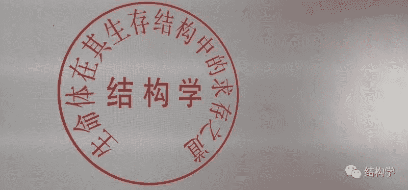

  
觉悟者  
喜欢你就转走吧！  
微信扫一扫赞赏作者 赞赏  
已喜欢，对作者说句悄悄话  
取消   
发送给作者  
发送  
最多 40 字，当前共字  
 人赞赏   
上一页 1/3 下一页  
长按二维码向我转账  
喜欢你就转走吧！  
受苹果公司新规定影响，微信 iOS 版的赞赏功能被关闭，可通过二维码转账支持公众号。  

 

精选留言  
用户设置不下载评论   
[阅读全文](https://t.zsxq.com/QzVrFEM)  
  

# 

# \[守夜人总司令\] - 2019-10-10 你误解了普京！

> 来源：[`www.yuque.com/books/share/97051b78-926c-43e6-b0aa-0b72ff163ac4/ti4esz`](https://www.yuque.com/books/share/97051b78-926c-43e6-b0aa-0b72ff163ac4/ti4esz) 

你误解了普京！  
原创 觉悟者 守夜人总司令   
守夜人总司令   
微信号 WatcherCommander  
功能介绍 结构学：生命体在其生存结构中的求存之道！  
2019-10-10[原文](https://mp.weixin.qq.com/s?__biz=MzAxNDk1NjI2Mw==&mid=2247484792&idx=1&sn=bcbb6eb5a3bcd9461f60caacbe19ad2a&chksm=9b8a26f0acfdafe6e58ea8f681c1838872e0c08e89eb83ba072293649d2df1c81e7794c58a40&scene=27#wechat_redirect&cpage=315)  
收录于话题  
某个动不动就把梅特涅挂在嘴边的人宣称普京和志大才疏的墨索里尼是一路货色。但凡在现实生活中能组织并领导一个超过 10 个人的团队并让其良好运行的人都不会说这样的话。如果习惯性的截取一些零碎的史料，通过类比的方式暗示彼此之间存在必然的因果关系，它是一种抖机灵的方式，不是一种研究问题并做决策的方式。东方的思维方式中不喜欢逻辑论证和理性思辩而习惯以联想和类比的方式来暗示两者之间存在必然和唯一的相关性。喜欢放之四海皆准的格言，但对格言是如何推演和论证的毫不感兴趣，不关心这种结论是如何作用于现实的。所以，生活中无论对人还是对事，习惯于下结论而不做论证，满足于知其然而不知其所以然者遍地都是。  
普京是喜欢向外界展示力量，那是因为那个民族的文化崇尚强者。如果你留意细节的话，你会在新闻联播中发现每一次普京会见外宾的大厅右上角都有一尊卡捷林娜二世的大理石雕像。卡捷林娜是一个德国人，她还联合自己的情人发动政变推翻并杀死了他的丈夫——合法的俄国沙皇。然而，一个外国女人的篡位之举居然没有遭受天下的讨伐，不仅仅当时的俄国的将军和贵族们心甘情愿的任其差遣，后世的俄罗斯人把她与彼得一世相提并论，不但无比推崇还将其奉为国家和民族的英雄人物！卡捷林娜大帝有一句名言：如果我能够活到 200 岁，整个欧洲都将匍匐在俄罗斯的脚下！  
大众化的沟通肯定要用大众习惯的方式。俄罗斯有一位智者曾经说过：如果俄罗斯不是世界性的强权，它就什么都不是！这句话是有现实根据的。俄罗斯一直处于欧洲文明的边缘，它发端于东欧平原的斯拉夫部落。在蒙古的人统治下压抑了数百年，他们一直隐忍，甚至主动充当蒙古人的税务官去向自己的同胞强行搜刮，以几代人有目的的隐忍逐渐架空了金帐汗国的蒙古统治者。直到伊凡雷帝的时候，举兵反叛，摆脱金帐汗国的统治，建立俄罗斯人自己的国家。小公国处于四战之地，西北方的强权瑞典时不时会过来蹂躏一把，西方的国家也是招惹不起的。于是，俄罗斯坚定的向东发展，去征服和融合那些更原始和野蛮的民族。俄罗斯的历史从来就是与征服、开拓和屠杀息息相关——这是他们浸入骨髓的传统。在恶劣的环境中只有强者才能生存，他们开拓的过程在征服沿途部落的同时更是在征服恶劣的生存环境。后者进一步强化了前者！  
文艺复兴与俄罗斯没有关系，大航海与俄罗斯也没有关系，宗教改革同样与俄罗斯没有关系。虽然俄罗斯距离欧洲文明的发源地爱琴海沿岸更近，虽然俄罗斯也算做欧洲国家和欧洲文明，但是，它几乎错过了影响欧洲文明历史进程的所有重大变革。19 世纪的早期和中期，欧洲曾经两次发生普遍性的社会革命，最后充当欧洲宪兵的都是俄罗斯，它之所以能够不受影响的充当这个角色，正是因为俄罗斯社会结构的原始和落后，所以对社会革命的思潮具有免疫能力！  
去过俄罗斯的人一眼就能看出来：圣彼得堡和莫斯科是两座完全不同的城市，不一样的不仅仅是建筑风格，它会从生活的任何细节中渗透出来——圣彼得堡更像欧洲城市，而莫斯科一看就很俄罗斯！圣彼得堡及覆盖其上的一切是彼得大帝强行嫁接的欧洲基因，莫斯科及其代表的一切才是那个社会的底色！这就如同 20 年前的中国，少数通过媒体背诵了几句西方概念和口号的人，自以为掌握了改造这个社会的真理。然而，数亿没有发声只看新闻联播的人才是这个社会当时的底色！所以，理智的统治者在那个时期正确的行为是解决这个社会沉默的大多数的基本诉求。一切烟花缭乱的主张和无比悦耳的主张最终都会落地为千千万万人的衣食住行。生命体的求存永远是最根本的诉求，睿智和理性的人永远不会本末倒置——用手抓住自己的头发是无法把自己提起来的！  
抓住本质  
普京当年是市长的助理，他的老师在竞选连任的时候失败，他这个助理也就跟着失业了。他曾经茫然过，还准备去当出租车司机谋生。他去参加一个有莫斯科高层参加的宴会，他老师把宴会安排在郊外，结果突然有棕熊闯入这个室外宴会，所有人都吓坏了。他本来迟到了，看到棕熊的时候没有像其它人一样趴到桌子低下，而是快速拔枪射击。虽然这对他而言没什么，因为他是克格勃出身，受过训练。但是在那个级别的人群之中，很少能有人做到这样。他本能表现出来的果决、勇敢和行动力，给莫斯科的高官留下了深刻的印象。那是苏联解体之后俄罗斯最虚弱的低潮期。人们已经厌倦了无力的混乱，所以，普京机缘巧合被选中了。当然，这种选中是获得考察的机会。普京后续的工作能力和处理棘手问题的雷厉风行，恰好是他本能表现出来的特质的一种自然流露。  
普京并不是一个爱慕虚荣的人，恰恰相反，他善于不露声色的隐忍。一个特工不可能是一个情绪化的人。优秀的特工不但极度自律而且善于伪装。伪装到你睁眼瞎，不把他真正的意图当回事。普京上任做的第一个重大决策就是不惜代价对车臣用兵。当时的俄罗斯已经非常虚弱，特别是经过第一次失败的车臣战争让全世界都看清了俄罗斯的这种外强中干的虚弱。俄罗斯是一个缩小版的苏联，它采用的是联邦制。它的那些省级单位很多是自治共和国。在苏联解体的大环境下，叶利钦当时为了赢得支持，不仅仅对苏联的加盟共和国大幅下放权力，甚至对俄联邦的自治共和国也大幅松绑。虽然他达到了俄罗斯从苏联独立出来的目的，但下放的权力是收不回来的。特别是中枢处于软弱无力的时候。在这种情况下，普京强力主张武力讨伐达成协议又反叛的车臣。同时，他采用灵活的手段，在武力征服之后收买当地军阀的儿子。第二次车臣战争的胜利，让所有蠢蠢欲动的分裂势力都看到了普京的决心和手段，从此止住了俄罗斯继续碎裂的趋势。  
当年苏联解体的时候，一部分天真的人还跑到美国大使馆主动告诉对方自己在那些地方安装了窃听器，结果美国大使非常感激，但感激完之后又非常诚实的说：谢谢你们，但是我们不会做同样的事情。真是极度的讽刺！当时出于对苏联的讨厌，全面接受西方的建议，将影响国家政治经济命脉的国有大型企业通通转成私人财产。这就造就了一批掌握国家经济命脉的寡头。包括影响选举的电视网络都掌握在私人手中。叶利钦需要与之达成某些交易才能得到其支持，继而通过他控制的传媒体系影响民众的偏好。  
寡头一旦掌握了能够影响千千万万人日常生活的产业，就不仅仅拥有了富可敌国的财富，而是拥有了控制一方社会势力的能力！看看韩国，总统只是傀儡。打击寡头和控制经济命脉成了普京在车臣建功之后的最重要目标。虽然普京的行事风格过于克格勃，但效果还是明显的。他让自己的好基友梅德韦杰夫组建国家能源总公司。然后用各种由头逼迫石油寡头把自己的股份转让给梅德韦杰夫的公司。当然，不管是偷税漏税，还是其它各种违法乱纪，只要一查总是会有问题。如果遇到死硬分子，克格勃的行事风格会直接从肉体上消灭。不管怎么样，他的这种行为都不符合法律流程，更不符合对外宣称的东西。但是，所有的统治机器对外的口号都是说给别人听的。真实的世界有一套自己的运行规则，以存续为唯一标准。  
不管普京遭受多少国内外的非议，他依然用霹雳手段把寡头们都收拾了。最大的传媒网络重新回到官方手中，梅德韦杰夫掌握的国家石油公司开始重新把这个国家最挣钱的产业垄断到官方手中。所谓有赏才有罚，如此一来联邦政府开始有了赏罚的本钱。掌握了传媒也就抢占了引导大众进行是非判断的制高点。  
制度设计  
一个虚荣的人一定会沉迷于这种洋洋自得之中。然而，普京借用了这个势头做了一件影响深远的事情——那就是制度设计。叶利钦时代俄罗斯联邦内的各自治共和国、自治州虽然名义上是俄罗斯的省级行政单位，实际上已经是独立王国。联邦政府穷的要死没什么能够给它们，该有的权力都已经获得。所以有的自治共和国的首脑也对外称总统。俄联邦不再是苏联，已经没有了能够深入其中的抓手。  
俄罗斯是由 22 个自治共和国、46 个州、9 个边疆区、4 个自治区、1 个自治州、3 个联邦直辖市组成的联邦制国家。在 1980~90 年代苏联解体的背景下，地方主体趁乱而起，离心倾向日趋明显。一些少数民族地区利用苏联解体和俄罗斯国家改制的机会，对各行政单位的行政级别大动手脚，甚至为分裂独立作准备，局势极为混乱。俄联邦 10 个最发达 4 的联邦主体占 GDP 的一半，不发达的 20 个区域加起来占比不足 4%！2000 年 5 月 13 日，普京就颁布总统令，将全国 85 个联邦主体划分为七个联邦区并派驻联邦区总统全权代表进行管理，开启了联邦区这个行政级别的历史。后来几经调整，最终形成了八个联邦管区，它们是：中央联邦管区、西北联邦管区、南部联邦管区、伏尔加联邦管区、乌拉尔联邦管区、西伯利亚联邦管区、远东联邦管区、北高加索联邦管区，每一个都辖若干个州一级行政单位。  
联邦管区最高行政长官是联邦区总统全权代表，主要职责是保证辖区内的联邦主体实施国家政策、保障中央政府的人事任命、协调跨地区协作等等，直接向总统负责。另外还有联邦监察员，作为总统全权代表派驻至每个联邦主体的官员，负责监督总统全权代表发布的命令得以施行，并监督当地长官。这些监察员向总统全权代表汇报工作，是悬在地方领导头上的利剑。联邦区的主要官员是总统任命的，并有赏罚权，联邦政府的财政也具备了赏罚的本钱。在国家管理事务中，联邦州开始扮演省州的角色，原本的州级行政主体就降格为了地市级别的行政单位。这就如同汉朝时的刺史一样，本来天下的基本单位是郡县，刺史只是代表皇帝巡视监察地方。既能代表皇帝赏罚，还能管理和协调好几个郡的资源，虚的慢慢的就变实了！  
以点带面  
大家看新闻的时候可能没有注意到这样的细节：当欧洲与俄罗斯对抗的时候，欧盟最大的实力选手德国的对俄态度总是很暧昧。那是因为德国是欧洲最强大的工业国家，它们国家强劲的经济基础并非完全建立在掠夺式的金融之上，而是建立在高质量和完备的工业体系之上。而这样的社会对能源的需求非常大，德国和中国一样是一个贫油国。当年二战的时候，德国最缺的就是石油！谁的油气充足呢？俄罗斯！俄罗斯这些年一直在努力修建通向欧洲各国的油气管线。看过新闻的应该记得在乌克兰与俄罗斯冲突的时候，俄罗斯威胁要关闭输向乌克兰的油气管道的闸门。  
俄罗斯的经济结构确实过于单一。但是所有的社会活动都是这样的，当你非常充足的拥有一种资源的时候，你即便投入也肯定是把一切投入在开发这种资源的相关配套上面。这样的投资回报最划算呀！人不到山穷水尽走投无路的时候又怎么会轻易的改弦更张呢？小到个人生活大到一个社会的行为惯性概莫如此。而且，一旦一种资源被广泛应用，围绕它会形成厚重的产业，同时吸引大量的人投身其中。围绕它建立的配套体系和附着在这个体系上赖以生计的人群就会形成一个共同体。同时也就成为了社会权力结构中的一股势力。我记得曾经在觉悟社里阐述《结构学》内容的时候谈到过：结构中能消耗大量存量或者能创造大量增量的事物就会成为结构中的关键支点。  
面对这样的客观现实，就如同面对经年累月积累的厚厚冰层一样。瞬间改变经济社会格局完全是痴人说梦或者未做成过任何事情解决过任何现实问题的书呆子的纸上谈兵。在这样现实的状况下，理性的方式就是先把自己有优势的东西利用好，先要在生存竞争中立足，才能去创造其它的机会，推动结构性调整。  
普京的策略是务实的，他甚至在埃尔多安击落了俄罗斯的飞机的时候都能保持克制，委曲求全的目的就是为了那条从黑海抵达土耳其，然后再经过土耳其的达达尼尔海峡输往欧洲的南边的管线能顺利建成。所以，霸气的普京在那一刻在全世界面前像一个被欺负了需要国际社会主持公道的小媳妇一样隐忍。土耳其发生反对埃尔多安的政变的时候，还是普京主动打电话给埃尔多安通风报讯，让他逃过一节，并迅速清洗稳住了局面。埃尔多安的处境逆转之后，主动为击落飞机赔偿 2 亿元，普京立刻像老朋友一样笑嘻嘻的靠了过去。因为他知道那条管线有着落了！建成之后，南北双线通向欧洲，未来俄罗斯对欧洲就更有底气了。除此之外，普京以极大的热情推动东部边疆区把油气管线修进中国的东北，同时准备延伸到朝韩和日本。  
俄罗斯要向欧洲供应油气并形成战略优势，它就必须要能控制沿线的管道。叙利亚境内是管线的必经之处，这种地方不能丢，不惜成本也要守住。当然，它也是某个负责任大国从长安到欧洲的陆地商贸的主要节点。所以，俄罗斯出力的时候也不担心没人出钱。中东地区在美国收缩的时期，美国会以破坏为主。那些像幽灵一样瞬间冒出来又瞬间消失的恐怖分子八成是战略棋子。下一个棋子是怂恿库尔德人独立。库尔德人跨越四个国家，而且边境上的山脉中可以常年藏匿几万人，只要扶持，就能四面出击，让周边各国长期流血。  
在美国收缩的时候它要打搞破坏，而对中俄而言必须守护那条通道的畅通，沿途各国最好是太平无事，一起搞建设，好好过日子。然而，树欲静而风不止。俄罗斯即便退缩也换不来什么好果子，反而是主动进攻，会变得更有价值，对其它国家也是，因为“值”别人才会下血本。普京在中东以攻为守，建立了俄罗斯、伊朗和叙利亚的联盟，影响力深入南至霍尔姆斯海峡，西至地中海，北至里海的中东核心区域，并利用对胡赛武装的影响力，与沙特在油气和区域立场上达成了默契。普京的这个策略是成功的，他现在继续打头阵，在南美和其它地方也在重复着这个模式。他知道自己不是一个人，看清大势，分工合作，顺势而为。  
普京以开放北冰洋航线引诱中国对其进行投资，同时把亚欧经济同盟与中国的一带结合起来，现在在努力拉中国、印度、伊朗和欧洲建立亚欧大陆一体的金融结算体系，独立于美元结算体系之外。普京具有特工的果决、敏锐和克制，他熟悉自己的文化和社会现实，他的早年经历让他非常的务实，善于抓住关键，有时候为了达到目的甚至不择手段。但他绝对不是一个不敢对真正的社会问题下手，只追求个人虚荣的。只看到一点表面的皮毛就想当然的套用联想和类比，不但无法胜任现实问题的解决，也无法对复杂事物做出正确的判断。不打算解决任何现实问题的书生之见只能作为茶余饭后的谈资，切不可当真！  
《结构学》版权限制，内部专用！  
研习《结构学》发消息：觉悟社  

  
扩展阅读：  
[F1：见大行远](http://mp.weixin.qq.com/s?__biz=MzAxNDk1NjI2Mw==&mid=2247483815&idx=1&sn=3ef0a28f13360d542e1fe295b25cbd9a&chksm=9b8a222facfdab3920ee4384bc60709209747c50a7da243c69a345cd69a301cd194d921d643d&scene=21#wechat_redirect)  
[F2：底层逻辑](http://mp.weixin.qq.com/s?__biz=MzAxNDk1NjI2Mw==&mid=2247483905&idx=1&sn=e13c2886d004d818f12f6981f4c4e35a&chksm=9b8a2189acfda89f1a2b2326514ec0f5e6696cb737fc89b123afad6198807fa669769a850cd3&scene=21#wechat_redirect)  
[F3：结构力量](http://mp.weixin.qq.com/s?__biz=MzAxNDk1NjI2Mw==&mid=2247484256&idx=1&sn=f10d9c530bfd6ea08b25d4bec657c13a&chksm=9b8a20e8acfda9fee057f2df26790f905c898132cac91d833d14e636edb00c20514d63189a88&scene=21#wechat_redirect)  
[C1：他们到底怕什么？](http://mp.weixin.qq.com/s?__biz=MzAxNDk1NjI2Mw==&mid=2247483898&idx=1&sn=1b0a50386e9e89d2750dec717236f0aa&chksm=9b8a2272acfdab64235b35ee5e91b8cac6172144207251636e1345fc570aa1601f59eff7f442&scene=21#wechat_redirect)  
[C2：宗教是统治工具吗？](http://mp.weixin.qq.com/s?__biz=MzAxNDk1NjI2Mw==&mid=2247483901&idx=1&sn=f5d9f8c7bd84370c79adae921351e813&chksm=9b8a2275acfdab63fde093d76ff82e01d0e2fd43ea675f77fd17fd51a15873d4d10499f5338d&scene=21#wechat_redirect)  
[C3：梳理流程也没用！](http://mp.weixin.qq.com/s?__biz=MzAxNDk1NjI2Mw==&mid=2247483989&idx=1&sn=ee70dacfd980f041379d91ae947ece44&chksm=9b8a21ddacfda8cb28bf62d6f53531e8a8ebce2de96396e50ec7e7e144fffe502ec6faee3415&scene=21#wechat_redirect)  
[A22：杀死父母的未成年人](http://mp.weixin.qq.com/s?__biz=MzAxNDk1NjI2Mw==&mid=2247484173&idx=1&sn=723b2adc7ab96267fcabd3cf2d8d8dd8&chksm=9b8a2085acfda993f54d4b8e8d72b1937630c0b3445f94b2c4d61d2fd7bcd6d9ca3e5c0cbdf3&scene=21#wechat_redirect)  
[C33：信仰的坍塌！](http://mp.weixin.qq.com/s?__biz=MzAxNDk1NjI2Mw==&mid=2247484694&idx=1&sn=c460605348e49c98f1504673e42bab66&chksm=9b8a269eacfdaf887994e48305bd5d622cf8c2ae14856fbcea31794b72ff3334e8335a74ab2d&scene=21#wechat_redirect)  
[C32：相处之道！](http://mp.weixin.qq.com/s?__biz=MzAxNDk1NjI2Mw==&mid=2247484658&idx=1&sn=32943edb605fea344e437efb5cd77ed6&chksm=9b8a277aacfdae6cc8e9d256f960d07226086e0d020d68893af2a8b5391771e66626b0d086aa&scene=21#wechat_redirect)  
[A93：如何不讨厌自己？](http://mp.weixin.qq.com/s?__biz=MzAxNDk1NjI2Mw==&mid=2247484783&idx=1&sn=08bb06c4b322311a9d08a0d67077b6ac&chksm=9b8a26e7acfdaff1fb664e30d3365b7405692c4c7e53b41d078052fcbd87faf8de05c04346ce&scene=21#wechat_redirect)  
[A94：巴基斯坦的选择！](http://mp.weixin.qq.com/s?__biz=MzAxNDk1NjI2Mw==&mid=2247484787&idx=1&sn=1e88f66866554dbb73e4fd4d7947be0d&chksm=9b8a26fbacfdafed9d52a547f2f4608ef001fa2b6a07ec62bb06c5df56b23b6bca3d7b26b6cf&scene=21#wechat_redirect)  
[A89：路径依赖下的困局！](http://mp.weixin.qq.com/s?__biz=MzAxNDk1NjI2Mw==&mid=2247484759&idx=1&sn=aa34f735502fe63d905f3528fe03d9c6&chksm=9b8a26dfacfdafc9bc28ba28c3a08e5c6ae9f1e2c5cbc52fbc88ea2f88cfdc6c50bfe0dfd5ef&scene=21#wechat_redirect)  
[A87：一个时代的终结！](http://mp.weixin.qq.com/s?__biz=MzAxNDk1NjI2Mw==&mid=2247484742&idx=1&sn=c09800c3f3e54dbe189d09a545585478&chksm=9b8a26ceacfdafd81426a5d91cd07d83bf06a36fbea7a5579997de90892d7f05c9e8477cc210&scene=21#wechat_redirect)  
[A86：女神的错觉！](http://mp.weixin.qq.com/s?__biz=MzAxNDk1NjI2Mw==&mid=2247484733&idx=1&sn=fab22e8ab3f80b78dab3d4e2e2716bfb&chksm=9b8a26b5acfdafa374df83506e5086a573169362877918977c08490b4e9747c45c99d1266e7f&scene=21#wechat_redirect)  
[A84：为何买深圳的房？](http://mp.weixin.qq.com/s?__biz=MzAxNDk1NjI2Mw==&mid=2247484708&idx=1&sn=c4a8ffe14b1ea0579e0005119094ca23&chksm=9b8a26acacfdafba18b302d996afe0251fe92e695dde593e623f32be05c31d020aad6aafa541&scene=21#wechat_redirect)  
[A81：美国的本色](http://mp.weixin.qq.com/s?__biz=MzAxNDk1NjI2Mw==&mid=2247484681&idx=1&sn=14ab50cf82c3d5292d20ca7f973ad595&chksm=9b8a2681acfdaf97b283b0951b639cf81ea2a17c001864032d326be505907930f9a03f8f949e&scene=21#wechat_redirect)  
[A8：统治的关键支点！](http://mp.weixin.qq.com/s?__biz=MzAxNDk1NjI2Mw==&mid=2247483996&idx=1&sn=c9bc4ea308424074eddfdf68020fc602&chksm=9b8a21d4acfda8c2902216f0de9989ce3d22d440efe7c3bdcc29724308c95969cb124ed257f5&scene=21#wechat_redirect)  
[A71：为何被删除了？](http://mp.weixin.qq.com/s?__biz=MzAxNDk1NjI2Mw==&mid=2247484668&idx=1&sn=06e2af18dadf47754ad4f5be1cdfcb03&chksm=9b8a2774acfdae62f3380761dbc586fea5a31f99b639d367a556553c30cee786197a3f4473ba&scene=21#wechat_redirect)  
[他用常识拯救了我们！](http://mp.weixin.qq.com/s?__biz=MzAxNDk1NjI2Mw==&mid=2247484722&idx=1&sn=6cee8e5b4f7a24ba90297da193076efb&chksm=9b8a26baacfdafac57ed3c639c36c2cca72c2f2b6c5feefe53ec73d01421fd37977edd238764&scene=21#wechat_redirect)  
[A70：广州的黑人问题！](http://mp.weixin.qq.com/s?__biz=MzAxNDk1NjI2Mw==&mid=2247484662&idx=1&sn=7fb2d7264ae5d2efbe8fb1b01e06bfe5&chksm=9b8a277eacfdae687f10133abecf98a65278dcef51d1d88702f8e61139f6f7646711ca693243&scene=21#wechat_redirect)  
[B18：中层和高层之别！](http://mp.weixin.qq.com/s?__biz=MzAxNDk1NjI2Mw==&mid=2247484627&idx=1&sn=e38abac4a3818dc622e7a68b60f726f5&chksm=9b8a275bacfdae4d09192cce1fb560ed59c44fee339dd492cd65671b2c4022b7c41a39923b30&scene=21#wechat_redirect)  
[C4：道德与宗教！](http://mp.weixin.qq.com/s?__biz=MzAxNDk1NjI2Mw==&mid=2247484608&idx=1&sn=49b58f2f27c117c1c42e6270e8d2d8c2&chksm=9b8a2748acfdae5ea3d03e3a9843d183498241c03b0d57b01b9c315e23757604fd0e1bfdb96f&scene=21#wechat_redirect)  
[C31：教育的本质！](http://mp.weixin.qq.com/s?__biz=MzAxNDk1NjI2Mw==&mid=2247484645&idx=1&sn=0c19e963af345ec0d157348555f45482&chksm=9b8a276dacfdae7bb43eb0602bf7d9fdc827d0675a7350f893c5b3b43986de58782355a2065d&scene=21#wechat_redirect)  
[C30：如何追女神！](http://mp.weixin.qq.com/s?__biz=MzAxNDk1NjI2Mw==&mid=2247484588&idx=1&sn=de5c95495cc04bcfe8644c3c2bc025c3&chksm=9b8a2724acfdae3286a142c2de506a7494e2d7aa50c990c0e159cedab07b5287040f286dfac6&scene=21#wechat_redirect)  
[C27：职场中的真相！](http://mp.weixin.qq.com/s?__biz=MzAxNDk1NjI2Mw==&mid=2247484554&idx=1&sn=fec6641c1838970ea6d16cfe1a68f9e1&chksm=9b8a2702acfdae14e71017ee02594f3b47abc738b773bc3dbd5e80968dccae0e90f17977a339&scene=21#wechat_redirect)  
[A47：边缘人无法逆袭！](http://mp.weixin.qq.com/s?__biz=MzAxNDk1NjI2Mw==&mid=2247484476&idx=1&sn=42cd8e7b62b1c430768fe9583a9715b4&chksm=9b8a27b4acfdaea2f7ac778f91e72c9b69a725224a18c6d576f3de7caf0ff91a040bf5622645&scene=21#wechat_redirect)  
[几次成功的结构学预判](http://mp.weixin.qq.com/s?__biz=MzAxNDk1NjI2Mw==&mid=2247484266&idx=1&sn=02ab915e029cbe24d91712f741b3f37c&chksm=9b8a20e2acfda9f4498a5c76204c101ab26e7311f2fb7d3043de108d4ff6e18d72a1c889a569&scene=21#wechat_redirect)  
[A46：淤积的小市民！](http://mp.weixin.qq.com/s?__biz=MzAxNDk1NjI2Mw==&mid=2247484472&idx=1&sn=f5df702c026dbb04688151086cdf7493&chksm=9b8a27b0acfdaea6ed5b712d94b3725bf8e322b39101916f48f935c102c433e9c7239b596c9f&scene=21#wechat_redirect)  
[A61：与所有人为敌！](http://mp.weixin.qq.com/s?__biz=MzAxNDk1NjI2Mw==&mid=2247484601&idx=1&sn=c80e839436bd78047d0f5ea3c9e69890&chksm=9b8a2731acfdae27acc75952e866e0642eea99cb2acfeab4101e209ecc728fd94eb2adc7434c&scene=21#wechat_redirect)  
[A63：匮乏感是一种恶疾！](http://mp.weixin.qq.com/s?__biz=MzAxNDk1NjI2Mw==&mid=2247484613&idx=1&sn=67f0957ae7ffa817652c3cb9f14a13b9&chksm=9b8a274dacfdae5b9fb0ddc58544dec9a94900fe1baab61b6b4d00236965579c32b8fd7e1e63&scene=21#wechat_redirect)  
[A64：人和人真的不同！](http://mp.weixin.qq.com/s?__biz=MzAxNDk1NjI2Mw==&mid=2247484618&idx=1&sn=ef99e3ee9800a28ff0f36ea6977f2133&chksm=9b8a2742acfdae5455f0f4c75f66030655dee2432d9b54ed40cc125ff86625cfda817fadfbd2&scene=21#wechat_redirect)  
[公告：《结构学》宣言](http://mp.weixin.qq.com/s?__biz=MzAxNDk1NjI2Mw==&mid=2247484505&idx=1&sn=95b4424393e36eda97e76284318a3f38&chksm=9b8a27d1acfdaec7c00ce60807bd673a33454adf9b992a8ef9b44687a93b333dcf676d0b77c3&scene=21#wechat_redirect)  
[依依东望，望的是时间！](http://mp.weixin.qq.com/s?__biz=MzAxNDk1NjI2Mw==&mid=2247483947&idx=1&sn=1dcdd529b9dad09a00b6e3e2b14c8245&chksm=9b8a21a3acfda8b5fe1dae1c8979dec0be990a569bc03372af815b4e0f08913e938d57aa6b25&scene=21#wechat_redirect)  
[A62：为什么需要外汇储备？](http://mp.weixin.qq.com/s?__biz=MzAxNDk1NjI2Mw==&mid=2247484604&idx=1&sn=2217abffb62dc6bd2fd19929e13f745c&chksm=9b8a2734acfdae22952edbb235321e2d155694f0b44635f4c6e612365cf0f7302d5683d89c6a&scene=21#wechat_redirect)  
[A56：刘邦为什么要换太子？](http://mp.weixin.qq.com/s?__biz=MzAxNDk1NjI2Mw==&mid=2247484574&idx=1&sn=5ed4d23f15b1523357c663394fe17eed&chksm=9b8a2716acfdae0067c043e7f714afa42a672e6d43d777dff978f561399710e4a4f977a43ede&scene=21#wechat_redirect)  
[A53：一触即发，何去何从？](http://mp.weixin.qq.com/s?__biz=MzAxNDk1NjI2Mw==&mid=2247484535&idx=1&sn=730dd962738c90e2a5de9558e0b6471a&chksm=9b8a27ffacfdaee9fcaf3cb350e1589a70eae4bde6172b6bd3a08b7f61fbd7645890b76b88c7&scene=21#wechat_redirect)  
[B4：你不必为华为担心！](http://mp.weixin.qq.com/s?__biz=MzIzMDYwOTM0Mg==&mid=2247483951&idx=1&sn=7850925e07db502ec2116efe0211318f&chksm=e8b19afedfc613e816bdef573343dbe2127c92d828c071510a8a8b9cb98384cdc7a6dbf8fbdd&scene=21#wechat_redirect)  
[C12：务必要振兴建设兵团！](http://mp.weixin.qq.com/s?__biz=MzAxNDk1NjI2Mw==&mid=2247484193&idx=1&sn=88c86597191d0c97a411f9ea6f7b7c5d&chksm=9b8a20a9acfda9bfae819e8e42531fe6d523dd244ef0fc0c0787ab812540108c181f7ec2ffa9&scene=21#wechat_redirect)  
[C20：行为的内在驱动力！](https://mp.weixin.qq.com/s?__biz=MzIzMDYwOTM0Mg==&mid=2247484003&idx=1&sn=a62ddbccc64f9f19890c0dff9605b6f7&scene=21#wechat_redirect)  
[向正在坍塌的地方踹上一脚！](http://mp.weixin.qq.com/s?__biz=MzAxNDk1NjI2Mw==&mid=2247483789&idx=1&sn=5e44b7b524c3dc4bb7705f49ed0a44a3&chksm=9b8a2205acfdab139e4b1d44ef6702b09c9fbf79505340205d13fbdaa33207a997f54bee0e97&scene=21#wechat_redirect)  
[A28：40 年前的今天改变了世界！](http://mp.weixin.qq.com/s?__biz=MzAxNDk1NjI2Mw==&mid=2247484305&idx=1&sn=34b19d12210bf9f765c6eb615b787ac6&chksm=9b8a2019acfda90fff45ea8c17ccb37c75e04c7420ad9b303a0fb0069110cee644e6f592d95f&scene=21#wechat_redirect)  
[书读得比你少，为何混的比你好？](http://mp.weixin.qq.com/s?__biz=MzAxNDk1NjI2Mw==&mid=2247484296&idx=1&sn=b0e0f11f50023aa8a20e8eeb51d39e10&chksm=9b8a2000acfda916885455b30687e2f18099abba31c78b2fabb95ca1b89ddc40f2415317d368&scene=21#wechat_redirect)  
[A34：烂父亲的危害到底有多大！](http://mp.weixin.qq.com/s?__biz=MzAxNDk1NjI2Mw==&mid=2247484348&idx=1&sn=944a6aac1e8035011b56508ea74fb48e&chksm=9b8a2034acfda922b803681a568bf7b75ce8342cf507080d2e636098b7ee9dfc1391836f7341&scene=21#wechat_redirect)  
[警报：《结构学》的目录和纲要！](http://mp.weixin.qq.com/s?__biz=MzAxNDk1NjI2Mw==&mid=2247484593&idx=1&sn=5ec84d78201320511260f18a170dd539&chksm=9b8a2739acfdae2f3f64efc39512bdba6569eb8ebbe4da30839c1116ed7f9e2e6ffcad864cc2&scene=21#wechat_redirect)  
觉悟者  
喜欢你就转走吧！  
微信扫一扫赞赏作者 赞赏  
已喜欢，对作者说句悄悄话  
取消   
发送给作者  
发送  
最多 40 字，当前共字  
 人赞赏   
上一页 1/3 下一页  
长按二维码向我转账  
喜欢你就转走吧！  
受苹果公司新规定影响，微信 iOS 版的赞赏功能被关闭，可通过二维码转账支持公众号。  

 

精选留言  
用户设置不下载评论   
[阅读全文](https://t.zsxq.com/3nq7QvR)  
  

# 

# \[守夜人总司令\] - 2019-10-08 A94：巴基斯坦的选择！

> 来源：[`www.yuque.com/books/share/97051b78-926c-43e6-b0aa-0b72ff163ac4/iahvzs`](https://www.yuque.com/books/share/97051b78-926c-43e6-b0aa-0b72ff163ac4/iahvzs) 

A94：巴基斯坦的选择！  
原创 觉悟者 守夜人总司令   
守夜人总司令   
微信号 WatcherCommander  
功能介绍 结构学：生命体在其生存结构中的求存之道！  
2019-10-08[原文](https://mp.weixin.qq.com/s?__biz=MzAxNDk1NjI2Mw==&mid=2247484787&idx=1&sn=1e88f66866554dbb73e4fd4d7947be0d&chksm=9b8a26fbacfdafed9d52a547f2f4608ef001fa2b6a07ec62bb06c5df56b23b6bca3d7b26b6cf&scene=27#wechat_redirect&cpage=315)  
收录于话题  
巴基斯坦总理伊姆兰汗早些天在联合国大会上批评美国把钱都浪费在对外战争上去了，以至于国内的基建很差。他还举例说，他去联合国总部开会的时候，车走在纽约街头一路颠簸得很。同时，他还不忘夸赞中国的基建在现代化之路上突飞猛进。  
话未落音，他今天就来中国了，探讨扩大中巴经济走廊项目，以及农业、工业以及社会经济各方面的合作。同时，将探讨取消巴基斯坦农产品配额和《中巴贸易协定》的“立刻实施”。一年不到的时间他来了三次，而且涉及的内容越来越具体：包括印度河流域建设大型水电站、建立现代化的钢铁厂和炼油厂。巴基斯坦的钢铁产量只有 300 万吨，而每一年的需求量超过 900 万吨，未来几年会增加到 1200 万吨，需要中国提供资金、技术和商业方面的支持，建立的现代化钢铁厂可以每一年减少 20 亿美元的钢铁进口。另外，印度河流域的第一座 7000 兆瓦的 Bunji 水电站也希望能够得到中国的各方面的支持立刻开工建设。这一流域的后续水电站也希望能够得到支持陆续建设完成。除此之外，巴基斯坦希望得到中国的资金、技术和商业等各方面支持，帮助建立现代化的炼油厂，将每一年 140 亿美元的石油进口减少到 15 亿美元。以及提出一个 2 亿美元的农业合作项目，希望在沿海发展渔业。最后还提出建设液化气陆上码头，以便将再汽化能力提高至每天十亿立方英尺。（估计这个会得到全力支持，进入中国的天然气管道中的天然气是海对面液化之后用船运到巴基斯坦码头，再重新汽化之后才能沿中巴经济走廊输入中国的，这关系到这一条线的能源安全）  
巴基斯坦的社会结构  
历史上从来就不曾出现过一个叫巴基斯坦的国家。巴基斯坦诞生于印巴分治时期，连巴基斯坦这个国名都是新创造的词汇，由拼组成这个国家的几个土邦的头字母拼凑出来的。虽然卧普尔王朝统治过包括现在的巴基斯坦和印度东北部地区，但是它是作为印度历史上的一个王朝出现的，并非现在巴基斯坦区域内的割据政权。除了可以追溯的共同记忆之外，巴基斯坦还缺乏占据主导地位的主体民族，唯一能将国民连接在一起的只有宗教信仰。1947 年印巴分治时，拼凑成巴基斯坦的几个土邦，每一个土邦都对应一个民族。边疆的几个土邦还与邻国牵扯不清，它们都是同一民族的人群分布在不同的国家。因为缺乏占据主导优势的主体民族，所以没法内部同化。地域和民族矛盾往往牵扯在一起，长期暗流涌动，动荡不安…  
千百年来，南亚次大陆从来就没有出现过一杆子插到底的大一统政权。只有到了近代，在英国殖民者的努力下，才将这块土地上的 300 多个各自为政的土邦统一起来。即便是英国殖民者也是采取分而治之的策略，在底层构建了一套现代化的体系，底下的一切保持不变。所以，即便是今天，一车货从印度的南部港口运送到北部的新德里，需要沿途缴纳 29 种不同税率的税！  
这种各霸一块的格局是农业文明的经济基础下所能形成的最合理的势力格局。这就如同一个呈现出蚂蚁市场状态的行业一样——各占一块都能存活，彼此会经年累月的相互联盟又彼此争斗，但谁都吃不下谁。征服和统治是两回事，出一个英雄可以逞一时之能征服四方，但要长治久安融为一个整体，以来能创造增量的制度设计，以及相应的基础设施建设。即便强悍如古罗马，再勇猛的将帅也只是逞一时之能，将地中海变成内湖的帝国最终只能走向碎裂和瓦解。当我们年少的时候，我们关注的是历史舞台上处于聚光灯下的明星。长大之后，我们才会关注到身处幕后的搭台之人——那才是真正的主角！  
我们常说皇权不下州县，因为州县以下存在一套自己的运行方式。它是农业社会下社会的基础结构。这种社会结构维系着最低水平的静态平衡。这种基础结构的脆弱性既保障了存续，也限制了它的发展。所以整个社会的状态一直在最低的温饱线附近来回波动，长期处于破碎和修复的循环之中。  
这样的社会结构决定了它的经济水平和社会权力的组织方式。即便是卧普尔王朝最强悍的君主，也是通过与各土邦的王公进行联姻建立起来的统治。这种统治本质上就是部落联盟，所谓国家不过徒有其表。当一个家族在一个地方盘踞上千年，它就一定是当地最大的地主，垄断着生存所需的核心资源。一个未完成工业化的国家，即便是到了今天，这种社会基础结构下所演化出来的社会权力格局依然如此！只不过改了名字，穿上了西装，开始用刀叉吃人肉。  
我们社会在 49 年后的土改和公社，不管在经济上造成什么消极的影响，但是有效的打破了原有社会基础结构，打破了 2000 年来皇权不下州县的传统，第一次把广播安装在了每一个村的电线杆上，24 小时之内能让北京的口号刷遍全国每一个村子的墙壁。不管怎么样，一个地区的绝大部分土地不再被某个家族垄断而是属于统治机器的底层节点。那些劳动力被不计成本的组织起来建设公共基础设施。这些公共设施的建设为社会结构的升级打下了基础。在传统的社会结构中缺乏富余的能量建立起这些社会结构升级所必须的基础公共设施。而缺乏这些基础设施又无法创造增量，完成社会的结构升级。这是一个死循环！我们的今天也是从建设炼钢厂、炼油厂、化工厂、大中型水利工程、修路等基础设施的建设开始的。巴基斯坦今天对一带一路的积极态度，正是要利用战略机遇期，通过外部落差的挤压完成内部社会结构的升级！这是一个聪明的选择。  
巴基斯坦的内外约束  
巴基斯坦的内部困境和选择  
宗教利弊  
唯一把巴基斯坦凝聚起来就是宗教。我们在《结构学》的《C4：道德与宗教》中详细阐述过，宗教是一种社会组织方式，信仰是宗教用来凝聚共识的工具。共识在原点上决定了什么是对，什么是错，什么值，什么不值。这种是非判断和价值取舍的最终裁决权，在最顶端决定了由此衍生出来的一切。世俗政府作为一种社会组织方式，它必须要有自己的大义来凝聚全社会的共识。如果这个大义与宗教重合，它就会丧失最高的解释和仲裁的权力。另外，共识能够作用于现实，需要一套传导体系，由核心共识衍生出来，深入日常生活的整套传导体系既为日常的行为提供指引，为冲突提供裁决，同时也必须是社会权力传导过程中的节点。如果节点被替代，由此组织起来的有序力量也会随即瓦解。  
当统治机器不得不与宗教采用同一种核心共识，并利用同样的传导节点之时。世俗政府必然是软弱无力的！这里会造成一种巴基斯坦权力体系在两股势力中来回的摇摆，关于这一点，会在下面的统治结构中展开。这里先阐述完宗教对巴基斯坦社会的致命影响。在匮乏的环境中，越极端就越有市场。因为内外环境给人造成的不确定和无力感，会让渴望摆脱这种困境的心情变得更加急切。越是被无力感折磨的人，越渴望力量，特别是毁灭性的力量！只要内外环境没有改变，个体的精神结构就会被普遍性的扭曲成失真状态。这样的群众基础决定了更狂热的人就更容易赢得支持。现实问题的解决总是不得不做出艰难的取舍，而吸引人心的主张总是简单到非黑即白。因为只有越简单才越容易在大众中传播并被广泛的接受。所以，夸夸其谈者总是善于煽动情绪带节奏，但不解决任何现实问题。而弱智者总是大多数，往往成事不足败事有余。  
基于这样的现实特征，巴基斯坦官方时常处于两难的境地。这种处境如同二战时的日本政府面对狂热偏执又自行其事的军方势力时的状况。  
统治结构  
巴基斯坦立国之初，能把千百年来恩怨纠缠不清的族群凝聚起来的是对印度的讨厌。然而，激情过后总要回归柴米油盐。一旦开始过日子，各种苛刻碰碰和恩恩怨怨就都浮现出来了。首当其冲的就是利益分配。东北部的两个土邦相对富余，边疆地区的各土邦则比较贫瘠。本来这不过是国内资源的分配问题，但由于它们每一个邦都是一个独立的民族，就很容易转化为自我强化又彼此猜忌的民族矛盾。  
当统治机器不得利用宗教信仰来凝聚社会共识，并不得不将现有社会权力结构中的支点作为统治机器的传导节点之时。世俗政府必然是软弱无力的！在缺乏主体民族的权力格局中，往往是掣肘有余而协作不足——因为维持现状有利于现有权力的巩固，必然缺乏改变现有社会结构的动力。  
为了摆脱这种局面造成的软弱无力。巴基斯坦社会中一股有组织的力量反复的登上权力的舞台——他们就是英国殖民者以及后续的印巴冲突训练出来的军官群体！依托英国的现代化教育和军队的组织度。这个群体作为一股独立的势力试图用最直接强有力的统治去摆脱由那种社会结构造成的世俗统治的脆弱性和无力感。1958 年阿尤布.汗发动政变开了头，最近一次军事政变在 1999 年 10 月由陆军参谋长穆沙拉夫发动，他随后建立军人主导的统治。暴力维持秩序的成本很高，何况长期的印巴冲突大量消耗本来就极度匮乏的社会资源。长期的军事化统治势必引发民众的不满。而文官集团一直就是家族联盟，这些盘根错节的家族势力深入各自的区域，利用民众的不满很容易卷土重来。因此，军官群体和文官集团的家族势力在巴基斯坦这几十年的政坛上反复轮替。  
当前的巴基斯坦总理伊姆兰汗不属于传统的家族联盟，从他目前的各种所作所为来看，他试图走出这个死循环的怪圈，利用中国给予的战略机遇期为巴基斯坦社会开创一种全新的选择。他试图改变的不仅仅是上层的社会权力格局，而是打算从底层改变社会经济和社会组织的基础结构。  
巴基斯坦的外部困境和选择  
与印度  
还未完成工业化的巴基斯坦社会 GDP70%来自于农业，而巴基斯坦的人口暴增到了 2 亿人，但是耕地面积并没有相应增加，利用土地的能力同样没有什么本质的变化。特别是水资源的匮乏严重的制约了巴基斯坦的发展。然而，巴基斯坦无法把力量集中到社会建设中去，反而不得不消耗大量的各种资源来应对与印度的冲突。真正的消耗还不是直接冲突，而是敌对中的国防和军备的竞争。巴基斯坦最理性的战略选择是能与印度达成某种可控的和平局面。然而，印度曾经肢解过巴基斯坦，并策动了东巴基斯坦的独立。另外，巴基斯坦无论是军人政府还是文人政府，在对印政策上的任何软弱都会遭受被宗教势力绑架的民众的抛弃。越是处于匮乏中的人群越渴望力量，也越容易被极端所煽动。要与印度达成理性的长久和平，首先要扩大巴基斯坦社会中理性力量的规模。这有赖于社会经济的发展。否则，再高明的政治家也很难从根本上解开这个死结。  
与阿富汗  
巴基斯坦的北部边境一直与阿富汗存在争议。因为同一个民族的人跨越了两个国家。而且，那种部落地区完全处于自治状态。不管是巴基斯坦还是阿富汗都对其缺乏控制力。当年塔利班在阿富汗建立统治的时候，仅仅获得 5 个国家的承认，其中比较大的一个国家就是巴基斯坦。巴基斯坦的这个举动是理性的，它需要与存在争议的邻居达成某种稳定的和解。因为它的社会内部实在是太缺乏理性的基础，也太脆弱。这种非理性的脆弱很容易把自己反复拖入各种死循环之中。  
与伊朗  
巴基斯坦与伊朗的冲突与阿富汗类似，都是源于边境区域是同一个民族跨越两个国家引发的争议和冲突。除此之外，伊朗的什叶派与巴基斯坦的逊尼派的宗教冲突也是一个很重要的原因。不过因祸得福的是：逊尼派的沙特与什叶派的伊朗争夺中东穆斯林世界的老大位置。它需要伊朗旁边那个拥有核武器的逊尼派的巴基斯坦的保护和对伊朗进行牵制。这就为巴基斯坦赢得了中东土豪的资金支持。最近沙特在美国削减对巴基斯坦的援助的时候，雪中送炭拨款了 20 亿美元的援助。  
与恩人  
当年美苏对持的时候，苏联的势力南下渗透入阿富汗，后来甚至直接干预。同时，印度也与苏联眉来眼去。美国为了阻断苏联势力深入印度洋控制马六甲方向的海上大通道。大力援助巴基斯坦，从此成了巴基斯坦的大恩人。中国虽然与美国敌对，但是当时也与苏联和印度龌龊不断，再加上阿尤布.汗的务实对华政策，并友好的与我们划定了西部边界。中国从此也成为了巴基斯坦的恩人。能够让两个相互敌对的大国都对自己大力援助的国家也只有巴基斯坦能办到了。美国与巴基斯坦关系的紧密程度取决于俄罗斯对在南亚次大陆上的影响力。中国与巴基斯坦的关系将会越来越紧密，从理性和长远的角度来说，中巴改进与印度的关系比敌对要好的多。  
曾经有一个研究西北的王姓专家说巴基斯坦的贫穷和宗教氛围会让巴基斯坦变天，然后会与中国敌对。当伊姆兰汗当选的时候，他还自认为自己有先见之明，似乎巴基斯坦的对华政策就会离开改弦更张了。巴基斯坦对华政策的调整一定是在他实现工业化发展起来之后，而不是在此之前。在此之前，谁主政都会沿续原有的对华政策。巴基斯坦对中国安全的重要性以前是地缘战略牵制层面的价值，现在越来越深入到日常经济生活中了。所以，我们不仅仅会主动加大援助的力度，还会协助其改变自身的社会经济结构，加大存在的参与度。甚至要取得一定的特权去占据关键支点。  
巴基斯坦的求存策略  
生命体所有的行为都是为了求得自身的存续，小到个体大到整个社会共同体的行为轨迹都遵循生命体的基本特征。生命体的求存行为源于内部驱动力——所有的外交都是内政的沿续，所有的内政最终会落在千千万万普通人的衣食住行之上。  
许多人每天的大部分时间和精力都被浪费在应付持续不断的情绪上了。什么都没干就已经精疲力尽。空耗时日，错过机会，每一次都在毫无准备的情况下被裹挟着卷入各种力不从心的漩涡之中，继而再次引发情绪，不断重复着恶性的循环——精神结构的误判和持续冲突，让个体深陷生存结构的泥潭，内外相互作用，越陷越深，最后讨厌自己，变得无力、极端和绝望。关于个体的破局之法请阅读《[A93：如何不讨厌自己？](http://mp.weixin.qq.com/s?__biz=MzAxNDk1NjI2Mw==&mid=2247484783&idx=1&sn=08bb06c4b322311a9d08a0d67077b6ac&chksm=9b8a26e7acfdaff1fb664e30d3365b7405692c4c7e53b41d078052fcbd87faf8de05c04346ce&scene=21#wechat_redirect)》。  
整个社会作为生命体也具有同样的特征。所谓文化就是所有个体共同的生存策略。文化具有自我遮蔽性，它对自我和与外部关系的判断所形成的结论会生成求存策略，并由此形成内在激励机制，约束并牵引着个体的行为。然而，生存策略在作用于现实的时候，会面临生存结构各关键支点之间形成的边界约束。这些约束相互支撑的同时也会相互制约，并沿续着某种惯性。  
巴基斯坦一直处于冲突的漩涡之中，恰恰是其生存结构中的各种外部冲突让它的特殊价值得以凸显。恰是这种特殊的价值让它能够获得外部的资源和应有的尊重。然而巴基斯坦内部的社会结构所造成的恶性循环，无法充分的利用外部的资源并错过各种战略机会。从理性的角度来说，不管巴基斯坦今天对外做什么样的妥协，只要能够完成社会工业化所需要的基础，有效的利用外部资源和历史机遇，完成自己的社会基础结构的升级。它就必然成为举足轻重的力量，握有更多主动性的筹码。  
巴基斯坦必须建立一个强有力的政府，并利用外部的战略资源创造社会增量，锻造出一个独立但不寄生在统治机器之中的社会阶层，才能逐渐完成改土归流的社会权力体系的改造。这种改造不仅仅能为创造增量扫清障碍，同时建立世俗化的权力传导体系，在理性的推行内外政策时减少掣肘的力量。舍此之外别无它法，无论是在家族势力还是在军官势力之间游走，都不足以从根本上改变原有格局。必须在这个生存结构中创造出新的关键支点，从而打破并重构原有生存结构。  
伊姆兰汗最近对印度非常强硬，甚至不惜将国家置身于全面战争的边缘。他是为了树立自身的威望，为改革进行集权。他强硬表演背后的底气来自于中国的投入以及能源安全和战略方向的确定。接下来他必然会更加积极的拥抱一带一路，并提出更多务实的公共基础社会建设的项目。中国投入的越多，他的筹码就越大。他对印度的强硬并非为了开战，恰恰是为了能在不忤逆大众的同时又能恰到好处的与之谈和！  
由于版权的缘故，限觉悟社专用  
研习《结构学》发消息：觉悟社  

  
扩展阅读：  
[F1：见大行远](http://mp.weixin.qq.com/s?__biz=MzAxNDk1NjI2Mw==&mid=2247483815&idx=1&sn=3ef0a28f13360d542e1fe295b25cbd9a&chksm=9b8a222facfdab3920ee4384bc60709209747c50a7da243c69a345cd69a301cd194d921d643d&scene=21#wechat_redirect)  
[F2：底层逻辑](http://mp.weixin.qq.com/s?__biz=MzAxNDk1NjI2Mw==&mid=2247483905&idx=1&sn=e13c2886d004d818f12f6981f4c4e35a&chksm=9b8a2189acfda89f1a2b2326514ec0f5e6696cb737fc89b123afad6198807fa669769a850cd3&scene=21#wechat_redirect)  
[F3：结构力量](http://mp.weixin.qq.com/s?__biz=MzAxNDk1NjI2Mw==&mid=2247484256&idx=1&sn=f10d9c530bfd6ea08b25d4bec657c13a&chksm=9b8a20e8acfda9fee057f2df26790f905c898132cac91d833d14e636edb00c20514d63189a88&scene=21#wechat_redirect)  
[我和我的祖国！](http://mp.weixin.qq.com/s?__biz=MzAxNDk1NjI2Mw==&mid=2247484780&idx=1&sn=33e8bfb190e90c56af8c38f2cd47c710&chksm=9b8a26e4acfdaff2ae4b862c43cf9b84580d6be6b181605848570b920d8803f24598abb6796e&scene=21#wechat_redirect)  
[A87：一个时代的终结！](http://mp.weixin.qq.com/s?__biz=MzAxNDk1NjI2Mw==&mid=2247484742&idx=1&sn=c09800c3f3e54dbe189d09a545585478&chksm=9b8a26ceacfdafd81426a5d91cd07d83bf06a36fbea7a5579997de90892d7f05c9e8477cc210&scene=21#wechat_redirect)  
[A8：统治的关键支点！](http://mp.weixin.qq.com/s?__biz=MzAxNDk1NjI2Mw==&mid=2247483996&idx=1&sn=c9bc4ea308424074eddfdf68020fc602&chksm=9b8a21d4acfda8c2902216f0de9989ce3d22d440efe7c3bdcc29724308c95969cb124ed257f5&scene=21#wechat_redirect)  
[C1：他们到底怕什么？](http://mp.weixin.qq.com/s?__biz=MzAxNDk1NjI2Mw==&mid=2247483898&idx=1&sn=1b0a50386e9e89d2750dec717236f0aa&chksm=9b8a2272acfdab64235b35ee5e91b8cac6172144207251636e1345fc570aa1601f59eff7f442&scene=21#wechat_redirect)  
[C2：宗教是统治工具吗？](http://mp.weixin.qq.com/s?__biz=MzAxNDk1NjI2Mw==&mid=2247483901&idx=1&sn=f5d9f8c7bd84370c79adae921351e813&chksm=9b8a2275acfdab63fde093d76ff82e01d0e2fd43ea675f77fd17fd51a15873d4d10499f5338d&scene=21#wechat_redirect)  
[C3：梳理流程也没用！](http://mp.weixin.qq.com/s?__biz=MzAxNDk1NjI2Mw==&mid=2247483989&idx=1&sn=ee70dacfd980f041379d91ae947ece44&chksm=9b8a21ddacfda8cb28bf62d6f53531e8a8ebce2de96396e50ec7e7e144fffe502ec6faee3415&scene=21#wechat_redirect)  
[A22：杀死父母的未成年人](http://mp.weixin.qq.com/s?__biz=MzAxNDk1NjI2Mw==&mid=2247484173&idx=1&sn=723b2adc7ab96267fcabd3cf2d8d8dd8&chksm=9b8a2085acfda993f54d4b8e8d72b1937630c0b3445f94b2c4d61d2fd7bcd6d9ca3e5c0cbdf3&scene=21#wechat_redirect)  
[C33：信仰的坍塌！](http://mp.weixin.qq.com/s?__biz=MzAxNDk1NjI2Mw==&mid=2247484694&idx=1&sn=c460605348e49c98f1504673e42bab66&chksm=9b8a269eacfdaf887994e48305bd5d622cf8c2ae14856fbcea31794b72ff3334e8335a74ab2d&scene=21#wechat_redirect)  
[A93：如何不讨厌自己？](http://mp.weixin.qq.com/s?__biz=MzAxNDk1NjI2Mw==&mid=2247484783&idx=1&sn=08bb06c4b322311a9d08a0d67077b6ac&chksm=9b8a26e7acfdaff1fb664e30d3365b7405692c4c7e53b41d078052fcbd87faf8de05c04346ce&scene=21#wechat_redirect)  
[C32：相处之道！](http://mp.weixin.qq.com/s?__biz=MzAxNDk1NjI2Mw==&mid=2247484658&idx=1&sn=32943edb605fea344e437efb5cd77ed6&chksm=9b8a277aacfdae6cc8e9d256f960d07226086e0d020d68893af2a8b5391771e66626b0d086aa&scene=21#wechat_redirect)  
[A86：女神的错觉！](http://mp.weixin.qq.com/s?__biz=MzAxNDk1NjI2Mw==&mid=2247484733&idx=1&sn=fab22e8ab3f80b78dab3d4e2e2716bfb&chksm=9b8a26b5acfdafa374df83506e5086a573169362877918977c08490b4e9747c45c99d1266e7f&scene=21#wechat_redirect)  
[A92：你真的误解了企业文化！](http://mp.weixin.qq.com/s?__biz=MzAxNDk1NjI2Mw==&mid=2247484775&idx=1&sn=9a55eb1d6b7f092d6e99c971441ef5cb&chksm=9b8a26efacfdaff9de62f857d95d1b34d295bba62e6fac728721b84cc185115b73ee9c9b0ec0&scene=21#wechat_redirect)  
[A90：放不放水都一样！](http://mp.weixin.qq.com/s?__biz=MzAxNDk1NjI2Mw==&mid=2247484766&idx=1&sn=f8f9edd80d9317fe56beefd6058c9b0b&chksm=9b8a26d6acfdafc024960adb5b55f3f62428617e9980385b40faa1493713e8dbfa007e6e3b7b&scene=21#wechat_redirect)  
[A91：被简化了的主观世界！](http://mp.weixin.qq.com/s?__biz=MzAxNDk1NjI2Mw==&mid=2247484771&idx=1&sn=cc91dfaf3e6959d972b1a0c914a570e5&chksm=9b8a26ebacfdaffd0891a671b47c1eb3886f7d1a93092ebc27c2f83ed670bbf477109ed0c6f4&scene=21#wechat_redirect)  
[A84：为何买深圳的房？](http://mp.weixin.qq.com/s?__biz=MzAxNDk1NjI2Mw==&mid=2247484708&idx=1&sn=c4a8ffe14b1ea0579e0005119094ca23&chksm=9b8a26acacfdafba18b302d996afe0251fe92e695dde593e623f32be05c31d020aad6aafa541&scene=21#wechat_redirect)  
[A81：美国的本色](http://mp.weixin.qq.com/s?__biz=MzAxNDk1NjI2Mw==&mid=2247484681&idx=1&sn=14ab50cf82c3d5292d20ca7f973ad595&chksm=9b8a2681acfdaf97b283b0951b639cf81ea2a17c001864032d326be505907930f9a03f8f949e&scene=21#wechat_redirect)  
[A71：为何被删除了？](http://mp.weixin.qq.com/s?__biz=MzAxNDk1NjI2Mw==&mid=2247484668&idx=1&sn=06e2af18dadf47754ad4f5be1cdfcb03&chksm=9b8a2774acfdae62f3380761dbc586fea5a31f99b639d367a556553c30cee786197a3f4473ba&scene=21#wechat_redirect)  
[他用常识拯救了我们！](http://mp.weixin.qq.com/s?__biz=MzAxNDk1NjI2Mw==&mid=2247484722&idx=1&sn=6cee8e5b4f7a24ba90297da193076efb&chksm=9b8a26baacfdafac57ed3c639c36c2cca72c2f2b6c5feefe53ec73d01421fd37977edd238764&scene=21#wechat_redirect)  
[B18：中层和高层之别！](http://mp.weixin.qq.com/s?__biz=MzAxNDk1NjI2Mw==&mid=2247484627&idx=1&sn=e38abac4a3818dc622e7a68b60f726f5&chksm=9b8a275bacfdae4d09192cce1fb560ed59c44fee339dd492cd65671b2c4022b7c41a39923b30&scene=21#wechat_redirect)  
[C4：道德与宗教！](http://mp.weixin.qq.com/s?__biz=MzAxNDk1NjI2Mw==&mid=2247484608&idx=1&sn=49b58f2f27c117c1c42e6270e8d2d8c2&chksm=9b8a2748acfdae5ea3d03e3a9843d183498241c03b0d57b01b9c315e23757604fd0e1bfdb96f&scene=21#wechat_redirect)  
[C31：教育的本质！](http://mp.weixin.qq.com/s?__biz=MzAxNDk1NjI2Mw==&mid=2247484645&idx=1&sn=0c19e963af345ec0d157348555f45482&chksm=9b8a276dacfdae7bb43eb0602bf7d9fdc827d0675a7350f893c5b3b43986de58782355a2065d&scene=21#wechat_redirect)  
[C30：如何追女神！](http://mp.weixin.qq.com/s?__biz=MzAxNDk1NjI2Mw==&mid=2247484588&idx=1&sn=de5c95495cc04bcfe8644c3c2bc025c3&chksm=9b8a2724acfdae3286a142c2de506a7494e2d7aa50c990c0e159cedab07b5287040f286dfac6&scene=21#wechat_redirect)  
[C27：职场中的真相！](http://mp.weixin.qq.com/s?__biz=MzAxNDk1NjI2Mw==&mid=2247484554&idx=1&sn=fec6641c1838970ea6d16cfe1a68f9e1&chksm=9b8a2702acfdae14e71017ee02594f3b47abc738b773bc3dbd5e80968dccae0e90f17977a339&scene=21#wechat_redirect)  
[A47：边缘人无法逆袭！](http://mp.weixin.qq.com/s?__biz=MzAxNDk1NjI2Mw==&mid=2247484476&idx=1&sn=42cd8e7b62b1c430768fe9583a9715b4&chksm=9b8a27b4acfdaea2f7ac778f91e72c9b69a725224a18c6d576f3de7caf0ff91a040bf5622645&scene=21#wechat_redirect)  
[几次成功的结构学预判](http://mp.weixin.qq.com/s?__biz=MzAxNDk1NjI2Mw==&mid=2247484266&idx=1&sn=02ab915e029cbe24d91712f741b3f37c&chksm=9b8a20e2acfda9f4498a5c76204c101ab26e7311f2fb7d3043de108d4ff6e18d72a1c889a569&scene=21#wechat_redirect)  
[A46：淤积的小市民！](http://mp.weixin.qq.com/s?__biz=MzAxNDk1NjI2Mw==&mid=2247484472&idx=1&sn=f5df702c026dbb04688151086cdf7493&chksm=9b8a27b0acfdaea6ed5b712d94b3725bf8e322b39101916f48f935c102c433e9c7239b596c9f&scene=21#wechat_redirect)  
[A61：与所有人为敌！](http://mp.weixin.qq.com/s?__biz=MzAxNDk1NjI2Mw==&mid=2247484601&idx=1&sn=c80e839436bd78047d0f5ea3c9e69890&chksm=9b8a2731acfdae27acc75952e866e0642eea99cb2acfeab4101e209ecc728fd94eb2adc7434c&scene=21#wechat_redirect)  
[A63：匮乏感是一种恶疾！](http://mp.weixin.qq.com/s?__biz=MzAxNDk1NjI2Mw==&mid=2247484613&idx=1&sn=67f0957ae7ffa817652c3cb9f14a13b9&chksm=9b8a274dacfdae5b9fb0ddc58544dec9a94900fe1baab61b6b4d00236965579c32b8fd7e1e63&scene=21#wechat_redirect)  
[A64：人和人真的不同！](http://mp.weixin.qq.com/s?__biz=MzAxNDk1NjI2Mw==&mid=2247484618&idx=1&sn=ef99e3ee9800a28ff0f36ea6977f2133&chksm=9b8a2742acfdae5455f0f4c75f66030655dee2432d9b54ed40cc125ff86625cfda817fadfbd2&scene=21#wechat_redirect)  
[依依东望，望的是时间！](http://mp.weixin.qq.com/s?__biz=MzAxNDk1NjI2Mw==&mid=2247483947&idx=1&sn=1dcdd529b9dad09a00b6e3e2b14c8245&chksm=9b8a21a3acfda8b5fe1dae1c8979dec0be990a569bc03372af815b4e0f08913e938d57aa6b25&scene=21#wechat_redirect)  
[A62：为什么需要外汇储备？](http://mp.weixin.qq.com/s?__biz=MzAxNDk1NjI2Mw==&mid=2247484604&idx=1&sn=2217abffb62dc6bd2fd19929e13f745c&chksm=9b8a2734acfdae22952edbb235321e2d155694f0b44635f4c6e612365cf0f7302d5683d89c6a&scene=21#wechat_redirect)  
[A56：刘邦为什么要换太子？](http://mp.weixin.qq.com/s?__biz=MzAxNDk1NjI2Mw==&mid=2247484574&idx=1&sn=5ed4d23f15b1523357c663394fe17eed&chksm=9b8a2716acfdae0067c043e7f714afa42a672e6d43d777dff978f561399710e4a4f977a43ede&scene=21#wechat_redirect)  
[A53：一触即发，何去何从？](http://mp.weixin.qq.com/s?__biz=MzAxNDk1NjI2Mw==&mid=2247484535&idx=1&sn=730dd962738c90e2a5de9558e0b6471a&chksm=9b8a27ffacfdaee9fcaf3cb350e1589a70eae4bde6172b6bd3a08b7f61fbd7645890b76b88c7&scene=21#wechat_redirect)  
[B4：你不必为华为担心！](http://mp.weixin.qq.com/s?__biz=MzIzMDYwOTM0Mg==&mid=2247483951&idx=1&sn=7850925e07db502ec2116efe0211318f&chksm=e8b19afedfc613e816bdef573343dbe2127c92d828c071510a8a8b9cb98384cdc7a6dbf8fbdd&scene=21#wechat_redirect)  
[C12：务必要振兴建设兵团！](http://mp.weixin.qq.com/s?__biz=MzAxNDk1NjI2Mw==&mid=2247484193&idx=1&sn=88c86597191d0c97a411f9ea6f7b7c5d&chksm=9b8a20a9acfda9bfae819e8e42531fe6d523dd244ef0fc0c0787ab812540108c181f7ec2ffa9&scene=21#wechat_redirect)  
[C20：行为的内在驱动力！](https://mp.weixin.qq.com/s?__biz=MzIzMDYwOTM0Mg==&mid=2247484003&idx=1&sn=a62ddbccc64f9f19890c0dff9605b6f7&scene=21#wechat_redirect)  
[向正在坍塌的地方踹上一脚！](http://mp.weixin.qq.com/s?__biz=MzAxNDk1NjI2Mw==&mid=2247483789&idx=1&sn=5e44b7b524c3dc4bb7705f49ed0a44a3&chksm=9b8a2205acfdab139e4b1d44ef6702b09c9fbf79505340205d13fbdaa33207a997f54bee0e97&scene=21#wechat_redirect)  
[A28：40 年前的今天改变了世界！](http://mp.weixin.qq.com/s?__biz=MzAxNDk1NjI2Mw==&mid=2247484305&idx=1&sn=34b19d12210bf9f765c6eb615b787ac6&chksm=9b8a2019acfda90fff45ea8c17ccb37c75e04c7420ad9b303a0fb0069110cee644e6f592d95f&scene=21#wechat_redirect)  
[书读得比你少，为何混的比你好？](http://mp.weixin.qq.com/s?__biz=MzAxNDk1NjI2Mw==&mid=2247484296&idx=1&sn=b0e0f11f50023aa8a20e8eeb51d39e10&chksm=9b8a2000acfda916885455b30687e2f18099abba31c78b2fabb95ca1b89ddc40f2415317d368&scene=21#wechat_redirect)  
[A34：烂父亲的危害到底有多大！](http://mp.weixin.qq.com/s?__biz=MzAxNDk1NjI2Mw==&mid=2247484348&idx=1&sn=944a6aac1e8035011b56508ea74fb48e&chksm=9b8a2034acfda922b803681a568bf7b75ce8342cf507080d2e636098b7ee9dfc1391836f7341&scene=21#wechat_redirect)  
[警报：《结构学》的目录和纲要！](http://mp.weixin.qq.com/s?__biz=MzAxNDk1NjI2Mw==&mid=2247484593&idx=1&sn=5ec84d78201320511260f18a170dd539&chksm=9b8a2739acfdae2f3f64efc39512bdba6569eb8ebbe4da30839c1116ed7f9e2e6ffcad864cc2&scene=21#wechat_redirect)  
觉悟者  
喜欢你就转走吧！  
微信扫一扫赞赏作者 赞赏  
已喜欢，对作者说句悄悄话  
取消   
发送给作者  
发送  
最多 40 字，当前共字  
 人赞赏   
上一页 1/3 下一页  
长按二维码向我转账  
喜欢你就转走吧！  
受苹果公司新规定影响，微信 iOS 版的赞赏功能被关闭，可通过二维码转账支持公众号。  

 

精选留言  
用户设置不下载评论   
[阅读全文](https://t.zsxq.com/6eiIAuV)  
  

# 

# \[守夜人总司令\] - 2019-10-05 A93：如何不讨厌自己？

> 来源：[`www.yuque.com/books/share/97051b78-926c-43e6-b0aa-0b72ff163ac4/ynfame`](https://www.yuque.com/books/share/97051b78-926c-43e6-b0aa-0b72ff163ac4/ynfame) 

A93：如何不讨厌自己？  
原创 觉悟者 守夜人总司令   
守夜人总司令   
微信号 WatcherCommander  
功能介绍 结构学：生命体在其生存结构中的求存之道！  
2019-10-05[原文](https://mp.weixin.qq.com/s?__biz=MzAxNDk1NjI2Mw==&mid=2247484783&idx=1&sn=08bb06c4b322311a9d08a0d67077b6ac&chksm=9b8a26e7acfdaff1fb664e30d3365b7405692c4c7e53b41d078052fcbd87faf8de05c04346ce&scene=27#wechat_redirect&cpage=315)  
收录于话题  
早些天成功处置了一个日常生活可能经常遇到又束手无策的事：一个三岁的小朋友生病了，在医院折腾几天之后，虽然已无大碍，但是余波还在，身体上的不舒服和精神上的萎靡，以及安全感上的依赖都还有惯性。人在脆弱的时候安全感和自控力都会减弱。何况还是一个 3 岁的小朋友，就更加如此了。  
小朋友有一个诉求没有得到满足，于是，她就大声哭闹。她妈妈看见了就去哄她，结果满足了一个要求马上又提出另外一个要求。比如她不愿意穿脚上的鞋子，大人同意她脱掉鞋子，她又继续要把鞋子丢到垃圾桶里去。这显然是不合理的。可是，她一旦被拒绝就哭闹的更伤心。变本加厉，怎么哄都哄不好。她妈妈的耐心和和颜悦色的态度在慢慢的减弱。她父亲耐着性子在旁边观察。这个时候他认为是生病期间过于呵护，百依百随造成的惯性使然。于是，他决定上去用强硬的态度给她立规矩。可是，她父亲的呵斥并没有达到效果，反而让她的行为变得更加无理取闹，她开始把自己的衣服也脱下来丢在地上，还在地上打滚，甚至扯自己的头发，不停用自残的方式发泄着情绪。她父亲呵斥的越厉害，她的情绪也就越发失控，自残的幅度也越来越大。她妈妈开始还是站在她爸爸的同一战线采用冷暴力的方式对她的行为不予理睬。当她发现她女儿不断加大力度用自残的方式发泄情绪的时候，开始有点崩不住了。她父亲的强硬态度也开始有所软化。毕竟人心都是肉长的。显然，他们都开始恐慌了，这恐慌的背后不仅仅是恻隐之心，还有失控后的不知所措！  
整个过程我都看在眼里。我从小孩的反应看出来她其实内心充满恐惧。她恐惧自己的行为会让她的父母不喜欢自己。但是，她又无法控制自己害怕的东西。或许是身体不舒服引发的情绪不稳定，让她越是害怕失控反而就越容易叠加。这就好比你特别在意一件事，越是害怕出错，反而就更容易出错。结果你就变得更加紧张，进退失据，不知所措。如果你已经无比小心翼翼还是不断出错，这个时候你的情绪就会自我强化，循环叠加，直至彻底绝望。人一旦绝望就会破罐子破摔，甚至会主动摧毁自己极力维护的东西！因为，让人最难以忍受的就是一直处于不确定之中，不管是一种关系还是一件极力想做成的事情，只要它持续给人不确定性的反馈，被无力感折磨的人就会以毁灭它的方式来摆脱不确定性给自己造成的煎熬… 日常生活中，我们通常把这种不可理喻的外在行为称之为“作”！  
我的处理方式非常简单。我上去蹲下来抱住小朋友，对她说：“我们都知道你身体难受，心里也难受，其实你也不喜欢自己这样，对不对？你爸爸妈妈都很爱你，不管你怎么样，他们都会爱你，他们只是想帮你，让你不那么难受。生病的时候谁都会这样，大家不会讨厌你的，你不用害怕，不要讨厌自己，不讨厌自己心里就不会那么难受了”。她似乎听懂了，突然用她的小手紧紧的抱住我的脖子，然后，我感觉她颤抖的身体慢慢平静了下来。她的父母见状，都走过去抱着她，告诉她父母都爱她，她不用担心自己的行为会让父母讨厌自己。没过多久，她就逐渐平静下来，眉开眼笑的恢复正常了…  
讨厌自己是一切根源！  
当我们渴望拥有某个东西的时候，内心就会把与它有关的一切都看得很重，继而不允许自己出一点毗漏。当你对一个人动心的时候，你内心的第一反应是什么？绝大多数人的第一反应都是努力说服自己放弃！为什么会这样呢？因为你首先感受到的是恐惧——失去的恐惧，被拒绝的恐惧。那种恐惧是你自己造成的，人一旦进入一种不喜欢自己的状态，第一反应就是逃离，而这种逃离最直接的反应就是摧毁会让自己置身于这种焦虑和恐惧状况中的外部环境，让自己退回到熟悉和安全的环境之中。  
讨厌自己的人，心底总是有一个绝望的深渊——当你凝视深渊的时候，深渊也在凝视着你。久而久之，你就会被深渊所吸引，不可自拔。一个特别“作”的人有两个显著特征：1.过度的敏感，自我存在感非常低，自己的一切都寄托于外部的反馈，2.强烈的自我质疑，习惯性的把想像当作事实，并习惯性只接收负面反馈。害怕失控反而更加容易失控，自我质疑反而不断被失望所打击，于是，就不断的躲和退，追求一种静态的平静，切断与外部的联系，越发的消极和被动。然而，越是这样选择自废武功的弱小，越会树欲静而风不止。总是被裹挟着卷入一个又一个不确定的漩涡之中，既心不甘情不愿，又无可奈何。凡事你不做主，别人就会替你做主，既然是别人做主，肯定就不会事事都恰好如你的意。即便是父母都不一定能恰到好处的感知婴儿的所有诉求，何况外部会把你看成一个大人——正常的大人不但需要承担责任，还要能克制情绪，为人处事边界清晰。当你没有能按人家预期的样子给予反馈的时候，免不了会被指责和批评。然而，一旦收到负面反馈，你往往会认为所有人都在逼你，故意针对你。你觉得自己都已经退无可退了，还是无法祈求一个安心的角落安放自己惊恐不安的灵魂…  
讨厌自己的人在与外部建立关系的时候，会本能的立足于索求而不是给予。这种索求不一定是物质上的，还包括精神上的认可、抚慰、关注、安全感等等。即便对方给予了，又会质疑别人的动机，如果有充足的证据证明别人的动机纯良，行为清白，又会质疑这种给予是否是短暂的，是不是需要自己给予回报，如果自己不能按对方的预期给予回报，这种获得所带来的确定性和安全感会不会消失。总之，在与外部建立任何关系的时候，如同一双刚要伸出又马上缩回的手，一颗还未触碰就已颤抖的心… 因为缺乏自我认可，所以对自己的判断完全寄希望于外部的反馈。因此，特别渴望与外界建立稳定的连接，可是，当外部真的主动与自己建立确定性的连接的时候，又会害怕被控制、被影响、被伤害，极力的退缩和逃避。自己渴望拥有自己不具备的东西，渴望外部能逐一补齐，让自己感到圆满。同时，又极度的自我质疑，会要求外部不能向自己提要求，不能让自己去改变，不能给自己压力——因为在对自己的判断上总是质疑自己，不相信自己能做到，也不相信自己能满足，更害怕改变，追求静态的安全感。所有会给自己带来压力，让自己感到无所适从的东西都会加剧对自己的讨厌，继而扩大并叠加为对自己自身的彻底否定和全面质疑，从而以不断摧毁一切与外部连接的方式回退到让自己感到安全和熟悉的静止状态。也许外部的困难只是一个篱笆，但内心的质疑会给篱笆添砖加瓦建成囚禁自己的围墙，并加上沉重的枷锁！  
为什么会这样呢？这一切又是从哪里开始的呢？！  
人为什么会讨厌自己？  
觉悟社里有一篇关于精神结构的形成机制的文章，事实上它是《结构学》第二部分的《精神结构》的内容。第二部分共十篇都是关于精神结构相关的内容。生命体的外在行为都是由其内在的精神结构所驱使的，无论这个生命体是单独的个体，还是由个体构建而成的整体——族群、民族、国家等。如果说金融处于所有产业的上游，那么文化就处于所有行为的底层。《结构学》中阐述过：文化是生命体在其生存结构中共同的求存策略。  
觉悟社中的《C11：精神结构的形成机制》中有这样一段话：生命体的内部感知形成抽象的自我，它的形成需要一定的密度，突破某个值之后才能形成，人类大概在 2 岁的时候才会自我觉醒，分得清我与外部世界的区别。生命体的外在感知形成主观世界，主观世界中的一切都是自己存续所依赖的资源。资源充足有利于生命体的存续，也就让抽象的自我对主观世界形成主导性。所以，人最害怕的就是失控——从失去身体平衡到面对复杂的问题理不清头绪。  
人讨厌自己的本质是陷入失控状态所引发的持续冲突。失控状态为什么会转化为对自我的讨厌？事实上，除了身体失去平衡，或者身体的某个功能无法达到预期效果，这种与自身直接相关的事物之外，许多失控完全是周围的环境造成的。比如说，一种双边关系需要双方恰到好处的配合，任何一厢情愿都无济于事。然而，人总是会将外部的不确定转化为自己内在的冲突。因为所有外部的一切最终都会变成自我为感知到的主观世界的一部分。当抽象的自我对自己感知的主观世界失去主导性的时候，冲突就产生了，不确定引发的连锁反应也就随之而至。  
如何做到不讨厌自己？  
要做到不讨厌自己，有三个层级的应对之策：第一个层级跟自我意志有关，第二个层级跟见识和选择有关，第三个层级跟生存结构有关。  
意志  
跟意志有关的最简单，许多时候人在生活和工作中缺乏目标，并非真的没有目标，而是缺乏动力。任何人打游戏的时候都目标明确，终极目标是为了赢，中期目标是升级爆装备，当下的目标是打野或者拿人头。目标一旦清晰任何人都会有执行力。所谓缺乏执行力主要是不知道该干嘛，不知道怎么干，也不知道干了之后能得到什么。游戏中这三个问题恰好得到完美的解决。  
现实生活中的事情往往不像游戏中一样是单维度的指标，游戏中任何行为的反馈链条都非常短，都能立刻看到效果。所以，这种反馈不断的形成正向循环的自我强化，驱使着人持续的投入。坦白讲，只要突破了一个阀值就能进入正向循环的轨道。这就如同增加肌肉的训练一样，每一次训练中的疼痛都是通过把肌肉轻微的拉伤，然后长出新的肌肉，新长出来的会更强韧也更粗壮，从而达到增强肌肉的效果。所以，逼自己做到能做到的事，越恐惧越咬牙去做，同时去做一些具有挑战的体能训练强化对自我的控制力，从而缓解对自己的讨厌程度。我们知道讨厌自己源于无力的失控状态。反其道而行之，恰是破局之法。人对身体的控制力是消除无力感最直接的方式，这种反馈能够马上被感知，而且最真实，最直接，立竿见影！  
见识  
有效的自我控制可以消除许多不确定的感觉。但是有些外部的反馈无论怎么控制自己也无能为力。比如那种需要互动配合才能获得预期结果的事情。最直观的案例就是与人相处。即便你满心的真诚，甚至掏心掏肺，但是，你所传递的信息对方并没有感知，甚至还误会了。这个时候你就会发现自己永远处于宽严皆误，进退维谷的境地。这种状况是一种彻底失控的状态。你既不能进一步，也无法退一步，任何行为都可能引发更多未知的问题，继而进一步恶化相互之间的信任关系。然而，你又特别渴望维护住好不容易建立起来的关系。这种悖论引发的纠结最后会转化为精神结构内部的冲突。继而你会有一种同时踩住油门和刹车，随时随地持续不断消耗自身能量的疲惫感。明明什么都没干，却已经疲惫不堪，没有任何多余的精力去顾及其它的事物。而一直处于缺乏准备的状态，那些淤积的问题又会裹挟着你陷入另外一个漩涡。如此循环往复，进一步恶化自己对事物的控制力。如果总是碰壁，反复被打击，精神结构会持续的剔除抽象自我中的部件，让它持续的萎缩——这就如同为了保证一台机器的运转，不断把运行不好的部件拆除，结果这个机器的功能越来越单一，作用也就越来越弱小。  
正因为这种让自己感到失控的不确定性源于双向互动的结果。那么，洞察自己所处的生存结构，同时理解对方所处于的生存结构就变得非常重要。我曾经在《[A91：简化了的主观世界！](http://mp.weixin.qq.com/s?__biz=MzAxNDk1NjI2Mw==&mid=2247484771&idx=1&sn=cc91dfaf3e6959d972b1a0c914a570e5&chksm=9b8a26ebacfdaffd0891a671b47c1eb3886f7d1a93092ebc27c2f83ed670bbf477109ed0c6f4&scene=21#wechat_redirect)》中阐述过：外部的反馈一旦让自己无力应对，人就会趋向于筛选并简化所感知到的信息，继而构建一个简化过的主观世界。所以，理解能力越低的人感知和还原的世界就越简单，所以，他们往往会沿续那种简化的判断所形成的生存策略行事，由此驱动的行为有时候就如同刻舟求剑一样可笑，但自己却浑然不觉。因为在被他们自己简化了的世界中，这一切都是自洽的！  
人的见识与年龄无关而跟经历有关。一杯白水无论如何加热，最多变成一杯白开水！人学习的目的是为了能够还原更复杂的生存结构。就如同增强雷达的功率并扩大能接收的波段范围一样。通过经历和社会实践去获取直接经验，同时通过成体系的认知训练理解底层逻辑。相互交织，互相支撑，才能像训练肌肉一样，不断的重构自己的精神结构，从而理解并能还原更复杂的现实世界。那种开天眼的视角能够消弭未知的不确定性，并将它变成已知。人的自信和执行力，甚至目标感都源于确定性的已知。即便是最妙不可言的直觉也是某些已知的零碎在潜意识中构建起模糊的指引。军队中的所有演习和训练都是提前模拟战场上可能发生的情况，把未知的状况变成已知的应对之策。  
孔子说：君子不立于危墙之下，危邦不居，乱邦不入。西方的荷马史诗也有类似的格言：让你的船远离漩涡和滩涂，它会让你粉身碎骨！东西方的智者不约而同的在强调同一件事：用你的见识避开会让你处于失控状态的危险！无数的现实案例证明，改变生存环境就能改变雕塑个体或群体精神结构的现实基础，从而把人从自我讨厌的恶性循环中解救出来。  
环境  
深圳河对岸的那个社会经过几十年的演化，逐渐呈现出结构性的经济问题，继而衍生出社会问题。关于这一点，我们在《[C21：遍地的豪宅是墓群！](http://mp.weixin.qq.com/s?__biz=MzAxNDk1NjI2Mw==&mid=2247484408&idx=1&sn=f6d2373a67b2e0cf10f5240bd0d64b69&chksm=9b8a2070acfda966dd729b703680a29ae2cfd1ccb1838f38031e8aa003ee6c4fcf72a7990b0a&scene=21#wechat_redirect)》中阐述过。抛开别有用心的势力的故意操纵，社会自身的结构性问题为外部的势力提供了抓手和炮灰。土地过于集中，基于其上的关键行业的垄断状态，由此形成的结构性问题，让置身其中的人越发的感到无力和沮丧。就如同一个反复碰的头破血流的人，逐渐会变得焦虑和绝望一样。所有在生存竞争中处于下风的失意者很容易变得自暴自弃。正因为他们的精神结构强化了失控和无力带来的不确定感，所以，会特别渴望力量，甚至是毁灭一切的力量。暴力以毁灭自己或者摧毁自己与外部关系的方式让自己获得确定性。人往往在意识到将要失去或者刚刚失去的时候会表现的歇斯底里，等一切都失去之后，反而会很平静。  
在社会经济结构未改变的情况下，任何暂时的平静都是按下葫芦漂起瓢。如果不能解决本质问题，秩序的维系都必须依赖越来越高的成本，也会随时随地为恶意挑拨者提供操纵的机会——扬汤止沸不如釜底抽薪。解决那个社会的经济结构问题，才能从根本上瓦解雕塑绝望者精神结构的外部基础。不管奉行什么制度，扛什么旗帜，归根结底都会落到普通人的衣食住行之上。因为这世间的一切烟花缭乱的万事万物都是生命体求存行为造成的联动叠加的结果。生命体的存续诉求永远是第一位的，解决了根本问题，其它都能迎刃而解。  
各大家族垄断了那个社会的经济命脉和核心资源。最核心的资源就是土地，其它的一切最终都会附着于土地之上。早年中枢诸公只能通过那个社会的左派施加影响。然而，作为底层人群的左派对那个秩序井然的社会毫无影响力。改开以来，中枢政策改弦更张，开始与那个社会的精英群体建立联系，效果是立竿见影的。于是，在过去的数十年，特别是最近 20 年中，四大家族获益良多。垄断了那个社会的核心资源和通路，在许多品类的交易中拥有最终定价权。有统计数据显示，四大家族的财富增长倍数远远高于这些年那个社会的经济增长速度，在社会经济结构中呈现出一种逐渐闭合的垄断状态。  
处于这样的生存结构中的个体，仅仅依靠教育和心理调节不足以从根本上遏制住精神结构的扭曲。因为外部的生存环境本身就是扭曲的。李家虽然宣布捐款 10 亿来帮助中小商家走出困境。然而，这只是回避核心问题的烟雾弹。中枢当下的应对政策，首先是改变核心资源的垄断局面。各大家族都已经识趣的主动宣布自愿将闲置的土地捐献出来。目前只有李家还未表态！  
解铃还需系铃人。形成这样的生存结构是历史阶段性选择的结果，今天为了长治久安必须再次做出新的选择。只有完成社会经济和资源配置的结构性调整，才能从根本上消除滋生外部势力炮灰的土壤。那些张牙舞爪的黑衣人，怯生生的眼神中，透露出的是对自己的讨厌，恐惧和自卑，所以才需要蒙面，才会用破坏性的暴力掩饰自己在现实生活中的无力。  
已预定《结构学》核对信息，即将停止  
研习《结构学》发消息：觉悟社  

  
扩展阅读：  
[F1：见大行远](http://mp.weixin.qq.com/s?__biz=MzAxNDk1NjI2Mw==&mid=2247483815&idx=1&sn=3ef0a28f13360d542e1fe295b25cbd9a&chksm=9b8a222facfdab3920ee4384bc60709209747c50a7da243c69a345cd69a301cd194d921d643d&scene=21#wechat_redirect)  
[F2：底层逻辑](http://mp.weixin.qq.com/s?__biz=MzAxNDk1NjI2Mw==&mid=2247483905&idx=1&sn=e13c2886d004d818f12f6981f4c4e35a&chksm=9b8a2189acfda89f1a2b2326514ec0f5e6696cb737fc89b123afad6198807fa669769a850cd3&scene=21#wechat_redirect)  
[F3：结构力量](http://mp.weixin.qq.com/s?__biz=MzAxNDk1NjI2Mw==&mid=2247484256&idx=1&sn=f10d9c530bfd6ea08b25d4bec657c13a&chksm=9b8a20e8acfda9fee057f2df26790f905c898132cac91d833d14e636edb00c20514d63189a88&scene=21#wechat_redirect)  
[C1：他们到底怕什么？](http://mp.weixin.qq.com/s?__biz=MzAxNDk1NjI2Mw==&mid=2247483898&idx=1&sn=1b0a50386e9e89d2750dec717236f0aa&chksm=9b8a2272acfdab64235b35ee5e91b8cac6172144207251636e1345fc570aa1601f59eff7f442&scene=21#wechat_redirect)  
[C2：宗教是统治工具吗？](http://mp.weixin.qq.com/s?__biz=MzAxNDk1NjI2Mw==&mid=2247483901&idx=1&sn=f5d9f8c7bd84370c79adae921351e813&chksm=9b8a2275acfdab63fde093d76ff82e01d0e2fd43ea675f77fd17fd51a15873d4d10499f5338d&scene=21#wechat_redirect)  
[C3：梳理流程也没用！](http://mp.weixin.qq.com/s?__biz=MzAxNDk1NjI2Mw==&mid=2247483989&idx=1&sn=ee70dacfd980f041379d91ae947ece44&chksm=9b8a21ddacfda8cb28bf62d6f53531e8a8ebce2de96396e50ec7e7e144fffe502ec6faee3415&scene=21#wechat_redirect)  
[A22：杀死父母的未成年人](http://mp.weixin.qq.com/s?__biz=MzAxNDk1NjI2Mw==&mid=2247484173&idx=1&sn=723b2adc7ab96267fcabd3cf2d8d8dd8&chksm=9b8a2085acfda993f54d4b8e8d72b1937630c0b3445f94b2c4d61d2fd7bcd6d9ca3e5c0cbdf3&scene=21#wechat_redirect)  
[C33：信仰的坍塌！](http://mp.weixin.qq.com/s?__biz=MzAxNDk1NjI2Mw==&mid=2247484694&idx=1&sn=c460605348e49c98f1504673e42bab66&chksm=9b8a269eacfdaf887994e48305bd5d622cf8c2ae14856fbcea31794b72ff3334e8335a74ab2d&scene=21#wechat_redirect)  
[C32：相处之道！](http://mp.weixin.qq.com/s?__biz=MzAxNDk1NjI2Mw==&mid=2247484658&idx=1&sn=32943edb605fea344e437efb5cd77ed6&chksm=9b8a277aacfdae6cc8e9d256f960d07226086e0d020d68893af2a8b5391771e66626b0d086aa&scene=21#wechat_redirect)  
[我和我的祖国！](http://mp.weixin.qq.com/s?__biz=MzAxNDk1NjI2Mw==&mid=2247484780&idx=1&sn=33e8bfb190e90c56af8c38f2cd47c710&chksm=9b8a26e4acfdaff2ae4b862c43cf9b84580d6be6b181605848570b920d8803f24598abb6796e&scene=21#wechat_redirect)  
[A92：你真的误解了企业文化！](http://mp.weixin.qq.com/s?__biz=MzAxNDk1NjI2Mw==&mid=2247484775&idx=1&sn=9a55eb1d6b7f092d6e99c971441ef5cb&chksm=9b8a26efacfdaff9de62f857d95d1b34d295bba62e6fac728721b84cc185115b73ee9c9b0ec0&scene=21#wechat_redirect)  
[A90：放不放水都一样！](http://mp.weixin.qq.com/s?__biz=MzAxNDk1NjI2Mw==&mid=2247484766&idx=1&sn=f8f9edd80d9317fe56beefd6058c9b0b&chksm=9b8a26d6acfdafc024960adb5b55f3f62428617e9980385b40faa1493713e8dbfa007e6e3b7b&scene=21#wechat_redirect)  
[A87：一个时代的终结！](http://mp.weixin.qq.com/s?__biz=MzAxNDk1NjI2Mw==&mid=2247484742&idx=1&sn=c09800c3f3e54dbe189d09a545585478&chksm=9b8a26ceacfdafd81426a5d91cd07d83bf06a36fbea7a5579997de90892d7f05c9e8477cc210&scene=21#wechat_redirect)  
[A91：被简化了的主观世界！](http://mp.weixin.qq.com/s?__biz=MzAxNDk1NjI2Mw==&mid=2247484771&idx=1&sn=cc91dfaf3e6959d972b1a0c914a570e5&chksm=9b8a26ebacfdaffd0891a671b47c1eb3886f7d1a93092ebc27c2f83ed670bbf477109ed0c6f4&scene=21#wechat_redirect)  
[A86：女神的错觉！](http://mp.weixin.qq.com/s?__biz=MzAxNDk1NjI2Mw==&mid=2247484733&idx=1&sn=fab22e8ab3f80b78dab3d4e2e2716bfb&chksm=9b8a26b5acfdafa374df83506e5086a573169362877918977c08490b4e9747c45c99d1266e7f&scene=21#wechat_redirect)  
[A84：为何买深圳的房？](http://mp.weixin.qq.com/s?__biz=MzAxNDk1NjI2Mw==&mid=2247484708&idx=1&sn=c4a8ffe14b1ea0579e0005119094ca23&chksm=9b8a26acacfdafba18b302d996afe0251fe92e695dde593e623f32be05c31d020aad6aafa541&scene=21#wechat_redirect)  
[A81：美国的本色](http://mp.weixin.qq.com/s?__biz=MzAxNDk1NjI2Mw==&mid=2247484681&idx=1&sn=14ab50cf82c3d5292d20ca7f973ad595&chksm=9b8a2681acfdaf97b283b0951b639cf81ea2a17c001864032d326be505907930f9a03f8f949e&scene=21#wechat_redirect)  
[A8：统治的关键支点！](http://mp.weixin.qq.com/s?__biz=MzAxNDk1NjI2Mw==&mid=2247483996&idx=1&sn=c9bc4ea308424074eddfdf68020fc602&chksm=9b8a21d4acfda8c2902216f0de9989ce3d22d440efe7c3bdcc29724308c95969cb124ed257f5&scene=21#wechat_redirect)  
[A71：为何被删除了？](http://mp.weixin.qq.com/s?__biz=MzAxNDk1NjI2Mw==&mid=2247484668&idx=1&sn=06e2af18dadf47754ad4f5be1cdfcb03&chksm=9b8a2774acfdae62f3380761dbc586fea5a31f99b639d367a556553c30cee786197a3f4473ba&scene=21#wechat_redirect)  
[他用常识拯救了我们！](http://mp.weixin.qq.com/s?__biz=MzAxNDk1NjI2Mw==&mid=2247484722&idx=1&sn=6cee8e5b4f7a24ba90297da193076efb&chksm=9b8a26baacfdafac57ed3c639c36c2cca72c2f2b6c5feefe53ec73d01421fd37977edd238764&scene=21#wechat_redirect)  
[B18：中层和高层之别！](http://mp.weixin.qq.com/s?__biz=MzAxNDk1NjI2Mw==&mid=2247484627&idx=1&sn=e38abac4a3818dc622e7a68b60f726f5&chksm=9b8a275bacfdae4d09192cce1fb560ed59c44fee339dd492cd65671b2c4022b7c41a39923b30&scene=21#wechat_redirect)  
[C4：道德与宗教！](http://mp.weixin.qq.com/s?__biz=MzAxNDk1NjI2Mw==&mid=2247484608&idx=1&sn=49b58f2f27c117c1c42e6270e8d2d8c2&chksm=9b8a2748acfdae5ea3d03e3a9843d183498241c03b0d57b01b9c315e23757604fd0e1bfdb96f&scene=21#wechat_redirect)  
[C31：教育的本质！](http://mp.weixin.qq.com/s?__biz=MzAxNDk1NjI2Mw==&mid=2247484645&idx=1&sn=0c19e963af345ec0d157348555f45482&chksm=9b8a276dacfdae7bb43eb0602bf7d9fdc827d0675a7350f893c5b3b43986de58782355a2065d&scene=21#wechat_redirect)  
[C30：如何追女神！](http://mp.weixin.qq.com/s?__biz=MzAxNDk1NjI2Mw==&mid=2247484588&idx=1&sn=de5c95495cc04bcfe8644c3c2bc025c3&chksm=9b8a2724acfdae3286a142c2de506a7494e2d7aa50c990c0e159cedab07b5287040f286dfac6&scene=21#wechat_redirect)  
[C27：职场中的真相！](http://mp.weixin.qq.com/s?__biz=MzAxNDk1NjI2Mw==&mid=2247484554&idx=1&sn=fec6641c1838970ea6d16cfe1a68f9e1&chksm=9b8a2702acfdae14e71017ee02594f3b47abc738b773bc3dbd5e80968dccae0e90f17977a339&scene=21#wechat_redirect)  
[A47：边缘人无法逆袭！](http://mp.weixin.qq.com/s?__biz=MzAxNDk1NjI2Mw==&mid=2247484476&idx=1&sn=42cd8e7b62b1c430768fe9583a9715b4&chksm=9b8a27b4acfdaea2f7ac778f91e72c9b69a725224a18c6d576f3de7caf0ff91a040bf5622645&scene=21#wechat_redirect)  
[几次成功的结构学预判](http://mp.weixin.qq.com/s?__biz=MzAxNDk1NjI2Mw==&mid=2247484266&idx=1&sn=02ab915e029cbe24d91712f741b3f37c&chksm=9b8a20e2acfda9f4498a5c76204c101ab26e7311f2fb7d3043de108d4ff6e18d72a1c889a569&scene=21#wechat_redirect)  
[A46：淤积的小市民！](http://mp.weixin.qq.com/s?__biz=MzAxNDk1NjI2Mw==&mid=2247484472&idx=1&sn=f5df702c026dbb04688151086cdf7493&chksm=9b8a27b0acfdaea6ed5b712d94b3725bf8e322b39101916f48f935c102c433e9c7239b596c9f&scene=21#wechat_redirect)  
[A61：与所有人为敌！](http://mp.weixin.qq.com/s?__biz=MzAxNDk1NjI2Mw==&mid=2247484601&idx=1&sn=c80e839436bd78047d0f5ea3c9e69890&chksm=9b8a2731acfdae27acc75952e866e0642eea99cb2acfeab4101e209ecc728fd94eb2adc7434c&scene=21#wechat_redirect)  
[A63：匮乏感是一种恶疾！](http://mp.weixin.qq.com/s?__biz=MzAxNDk1NjI2Mw==&mid=2247484613&idx=1&sn=67f0957ae7ffa817652c3cb9f14a13b9&chksm=9b8a274dacfdae5b9fb0ddc58544dec9a94900fe1baab61b6b4d00236965579c32b8fd7e1e63&scene=21#wechat_redirect)  
[A64：人和人真的不同！](http://mp.weixin.qq.com/s?__biz=MzAxNDk1NjI2Mw==&mid=2247484618&idx=1&sn=ef99e3ee9800a28ff0f36ea6977f2133&chksm=9b8a2742acfdae5455f0f4c75f66030655dee2432d9b54ed40cc125ff86625cfda817fadfbd2&scene=21#wechat_redirect)  
[依依东望，望的是时间！](http://mp.weixin.qq.com/s?__biz=MzAxNDk1NjI2Mw==&mid=2247483947&idx=1&sn=1dcdd529b9dad09a00b6e3e2b14c8245&chksm=9b8a21a3acfda8b5fe1dae1c8979dec0be990a569bc03372af815b4e0f08913e938d57aa6b25&scene=21#wechat_redirect)  
[A62：为什么需要外汇储备？](http://mp.weixin.qq.com/s?__biz=MzAxNDk1NjI2Mw==&mid=2247484604&idx=1&sn=2217abffb62dc6bd2fd19929e13f745c&chksm=9b8a2734acfdae22952edbb235321e2d155694f0b44635f4c6e612365cf0f7302d5683d89c6a&scene=21#wechat_redirect)  
[A56：刘邦为什么要换太子？](http://mp.weixin.qq.com/s?__biz=MzAxNDk1NjI2Mw==&mid=2247484574&idx=1&sn=5ed4d23f15b1523357c663394fe17eed&chksm=9b8a2716acfdae0067c043e7f714afa42a672e6d43d777dff978f561399710e4a4f977a43ede&scene=21#wechat_redirect)  
[A53：一触即发，何去何从？](http://mp.weixin.qq.com/s?__biz=MzAxNDk1NjI2Mw==&mid=2247484535&idx=1&sn=730dd962738c90e2a5de9558e0b6471a&chksm=9b8a27ffacfdaee9fcaf3cb350e1589a70eae4bde6172b6bd3a08b7f61fbd7645890b76b88c7&scene=21#wechat_redirect)  
[B4：你不必为华为担心！](http://mp.weixin.qq.com/s?__biz=MzIzMDYwOTM0Mg==&mid=2247483951&idx=1&sn=7850925e07db502ec2116efe0211318f&chksm=e8b19afedfc613e816bdef573343dbe2127c92d828c071510a8a8b9cb98384cdc7a6dbf8fbdd&scene=21#wechat_redirect)  
[C12：务必要振兴建设兵团！](http://mp.weixin.qq.com/s?__biz=MzAxNDk1NjI2Mw==&mid=2247484193&idx=1&sn=88c86597191d0c97a411f9ea6f7b7c5d&chksm=9b8a20a9acfda9bfae819e8e42531fe6d523dd244ef0fc0c0787ab812540108c181f7ec2ffa9&scene=21#wechat_redirect)  
[C20：行为的内在驱动力！](https://mp.weixin.qq.com/s?__biz=MzIzMDYwOTM0Mg==&mid=2247484003&idx=1&sn=a62ddbccc64f9f19890c0dff9605b6f7&scene=21#wechat_redirect)  
[向正在坍塌的地方踹上一脚！](http://mp.weixin.qq.com/s?__biz=MzAxNDk1NjI2Mw==&mid=2247483789&idx=1&sn=5e44b7b524c3dc4bb7705f49ed0a44a3&chksm=9b8a2205acfdab139e4b1d44ef6702b09c9fbf79505340205d13fbdaa33207a997f54bee0e97&scene=21#wechat_redirect)  
[A28：40 年前的今天改变了世界！](http://mp.weixin.qq.com/s?__biz=MzAxNDk1NjI2Mw==&mid=2247484305&idx=1&sn=34b19d12210bf9f765c6eb615b787ac6&chksm=9b8a2019acfda90fff45ea8c17ccb37c75e04c7420ad9b303a0fb0069110cee644e6f592d95f&scene=21#wechat_redirect)  
[书读得比你少，为何混的比你好？](http://mp.weixin.qq.com/s?__biz=MzAxNDk1NjI2Mw==&mid=2247484296&idx=1&sn=b0e0f11f50023aa8a20e8eeb51d39e10&chksm=9b8a2000acfda916885455b30687e2f18099abba31c78b2fabb95ca1b89ddc40f2415317d368&scene=21#wechat_redirect)  
[A34：烂父亲的危害到底有多大！](http://mp.weixin.qq.com/s?__biz=MzAxNDk1NjI2Mw==&mid=2247484348&idx=1&sn=944a6aac1e8035011b56508ea74fb48e&chksm=9b8a2034acfda922b803681a568bf7b75ce8342cf507080d2e636098b7ee9dfc1391836f7341&scene=21#wechat_redirect)  
[警报：《结构学》的目录和纲要！](http://mp.weixin.qq.com/s?__biz=MzAxNDk1NjI2Mw==&mid=2247484593&idx=1&sn=5ec84d78201320511260f18a170dd539&chksm=9b8a2739acfdae2f3f64efc39512bdba6569eb8ebbe4da30839c1116ed7f9e2e6ffcad864cc2&scene=21#wechat_redirect)  
觉悟者  
喜欢你就转走吧！  
微信扫一扫赞赏作者 赞赏  
已喜欢，对作者说句悄悄话  
取消   
发送给作者  
发送  
最多 40 字，当前共字  
 人赞赏   
上一页 1/3 下一页  
长按二维码向我转账  
喜欢你就转走吧！  
受苹果公司新规定影响，微信 iOS 版的赞赏功能被关闭，可通过二维码转账支持公众号。  

 

精选留言  
用户设置不下载评论   
  

# 

# \[守夜人总司令\] - 2019-10-02 我和我的祖国！

> 来源：[`www.yuque.com/books/share/97051b78-926c-43e6-b0aa-0b72ff163ac4/mu6200`](https://www.yuque.com/books/share/97051b78-926c-43e6-b0aa-0b72ff163ac4/mu6200) 

我和我的祖国！  
原创 觉悟者 守夜人总司令   
守夜人总司令   
微信号 WatcherCommander  
功能介绍 结构学：生命体在其生存结构中的求存之道！  
2019-10-02[原文](https://mp.weixin.qq.com/s?__biz=MzAxNDk1NjI2Mw==&mid=2247484780&idx=1&sn=33e8bfb190e90c56af8c38f2cd47c710&chksm=9b8a26e4acfdaff2ae4b862c43cf9b84580d6be6b181605848570b920d8803f24598abb6796e&scene=27#wechat_redirect&cpage=315)  
收录于话题  
当我们置身于宏大的社会结构变化的时候，往往是浑然不觉的。个体的生存策略也往往延续上一个时期的惯性。当回过神来以后，一切都已时过境迁，追悔莫及。这恰是酿成悲剧命运的根源。有些人把一些好牌打的稀烂，有些人则陷在泥潭中如同拉磨的骡子简单的重复。所有由后向前追溯的伟大，宏大叙事的回忆总是那么激动人心。可是，除了激动片刻，好像一切都与你无关！人生的悲哀莫过如此，自己永远是一个置身事外的麻木看客，在烧烤摊上就着啤酒的醉意，谈论着别人的苦难和辉煌，以及别人做出的牺牲和创造的奇迹...  
雄关漫道真如铁！  
西风烈， 长空雁叫霜晨月。  
霜晨月， 马蹄声碎，喇叭声咽；  
雄关漫道真如铁，而今迈步从头越。  
从头越， 苍山如海，残阳如血。  
置身于大时代漩涡中每个人，一个转身，就是天涯海角、永不相见；一个岔口，就是相逢陌路、白刃不饶；一声汽笛，就是此去经年、物是人非。所以说：宁为太平犬，不为乱世人。  
当我们每天回到家，按下开关就亮灯，拧开龙头就有水。我们就会认为有电和有水，都是习以为常的事。我们的所有关注点，更多的会在水费和电费上面。而没有人会关注水和电是如何保障供应的，要保障它的持续不间断供应需要什么样的成本和什么样的机制。只有当秩序破碎的时候，才会感知秩序本身的可贵；才会理解守护秩序的价值。   
人成长的过程就是：考虑问题的时候，开始由非黑即白的对错逐渐变成两害相权取其轻的取舍。观察事物的时候，开始由表面状态的感知到深入内部结构的理解。秩序的重建是漫长和痛苦的。经历过动荡的苦难以后，人会由衷的渴望井然有序的宁静。体会过生活的艰辛以后，才知道拥有的一切都来之不易，哪怕是最微不足道的获得都因为有人付出了成本，成本不会消失，只能转移！无论个体还是群体，只有经历过风雨，才能在岁月的门后把一切都当做笑谈说。  
人间正道是沧桑！  
钟山风雨起苍黄，百万雄师过大江。  
虎踞龙盘今胜昔，天翻地覆慨而慷。  
宜将剩勇追穷寇，不可沽名学霸王。  
天若有情天亦老，人间正道是沧桑。  
这世间最痛苦的事情，不是一无所有，而是半途而废。最残忍的事莫过于把人从地下室里面拽出来，让他看到了地面上霓虹灯下丰富多彩的城市。如果没有见过太阳，本可以忍受黑暗，一旦见过了，阴暗潮湿的地下室就会变得越发无法忍受。许多人的痛苦就是一直处在见过了美好却无法触及的纠结之中...  
人在刚开始的时候会急于求成，遭受过挫折和打击后又容易自暴自弃。我们时常高估了一年之内能够做成的事情，而低估了十年时间能够做成的事情。滑铁卢的失败，至少在战术上，最大的问题，是拿破仑的预备队在两个战场中来回的奔跑却没有投入到任何一个战场。我们许多人又何尝不是如此呢？时间，精力，勇气，才智都在空转之中消化掉了。应对情绪，反而变成自己每一天最主要的事情。  
我们掌握的一切都是工具。如果没有目标，也就不需要工具。曾经有人在觉悟社里面问如何找到自己的目标。这是个很扯淡的问题。因为人并不缺目标。玩游戏的时候，任何人都知道最终目标是要赢，中期目标是要爆装备升级，当下目标是打野或者配合队友拿人头。买一辆车，买一套房，减 10 斤肉，读一个 MBA，学一门外语，生活中的目标触手可及。人只有相信自己能够实现一个目标的时候，才会把所有的精力都用来寻找解决问题的方法。否则，就会想尽一切办法说服自己放弃，并找到让自己心安理得的理由。  
农耕文明下的生存环境让我们对时间的刻度极度不敏感，因为周遭的一切都是周而复始的重复，千百年来也没有什么变化，这就给人造成一种静止的错觉。如果有个地方可以躲起来，许多人肯定会选择躲到那个地方去——哪怕只能享受片刻的安逸。中国最好的抗战剧《我的团长我的团》里龙文章有一句一针见血的话：中国人连死都不怕，就怕不安逸。只要能享受片刻的安逸，即便付出巨大的代价也在所不惜！  
十几年前，老家的小镇上有几十家麻将馆。那些正值壮年的人们整天无所事事沉迷在麻将桌上。十几年过去了，他们步入晚年却毫无保障，疏于教育的子女重复着自己的人生悲剧。今天却不得不拖着力不从心的疲倦身躯，为了迫在眉睫的生存保障，干着最没有价值的活。同时，被同样淤积在底层找不到出路的子女逼到墙角。有的人甚至绝望的自杀...  
不要跟我说家庭的温泉和爱，爱和温情只有在资源富足的时候才会浓烈。持续匮乏的废墟中所能找到的爱往往如同瓦砾中偶尔挖出的金条一样。在社会结构发生重构的当下，一切都在急剧变化，人群之中一个转身就是一辈子。所有自欺欺人营造出来的安逸都是幻觉。鱼一旦离开了水就不再是鱼了。生于这个时代必须接受这个事实。早一刻接受，早一刻适应！生存策略滞后于所处的生成结构是酿成悲剧的根源。天若有情天亦老，人间正道是沧桑！  
直挂云帆济沧海！  
金樽清酒斗十千，玉盘珍羞直万钱。  
停杯投箸不能食，拔剑四顾心茫然。  
欲渡黄河冰塞川，将登太行雪满山。  
闲来垂钓碧溪上，忽复乘舟梦日边。  
行路难！行路难！多歧路，今安在？  
长风破浪会有时，直挂云帆济沧海。  
今天早上 6:30，在万里之外的冰岛东海岸的快艇上，用雨伞柄升起一面五星红旗！它迎风飘扬，向着东方，向着太阳升起的方向，奋勇前进...  
炎黄血脉，源远流长；苦难辉煌，一并担当；长江黄河，奔腾不息；天涯海角，深情守望——无论风吹雨打都倔强的挺直腰杆，无论何时何地何种情况下都坚信：我有希望，中国就有希望！让自己变得强大才会让祖国变得强大——人成熟之后不再会把爱挂在嘴边，但举手投足之间时刻会渗透出那份坚毅和温柔...  
我们对未来，对国家，对民族的希望，皆源于对自己坚信不疑的信任。这纷繁复杂的世界归根结底都是千千万万生命体为了自身的存续，相互交织和联动形成的局面。作为个体，不逃避，不退缩，不质疑，做强者而不甘为弱者，不等、不靠、不要，主动让自己变得更好，让自己的生活变得更好，这就是对社会和自己最大的贡献。如果千千万万的个体都会产生富余的能量，所有的音符自然就会汇聚成激荡人心的时代交响曲——只有能量富裕才能搭建起更大的共同体，主动搭建更大的结构去创造增量，从来都是强者的特征。也是解决终极悖论及其衍生出来的各种问题的唯一方法。  
真正的强大，从敢于直面自己的问题开始！从相信自己能够变得更好开始！从迈开第一步开始！我和我的祖国是这样一种生死相依的关系：我的存在透过你的存在而存在，你的存在也透过我的存在而存在！  
已预定《结构学》核对信息，即将停止  
研习《结构学》发消息：觉悟社  

  
扩展阅读：  
[F1：见大行远](http://mp.weixin.qq.com/s?__biz=MzAxNDk1NjI2Mw==&mid=2247483815&idx=1&sn=3ef0a28f13360d542e1fe295b25cbd9a&chksm=9b8a222facfdab3920ee4384bc60709209747c50a7da243c69a345cd69a301cd194d921d643d&scene=21#wechat_redirect)  
[F2：底层逻辑](http://mp.weixin.qq.com/s?__biz=MzAxNDk1NjI2Mw==&mid=2247483905&idx=1&sn=e13c2886d004d818f12f6981f4c4e35a&chksm=9b8a2189acfda89f1a2b2326514ec0f5e6696cb737fc89b123afad6198807fa669769a850cd3&scene=21#wechat_redirect)  
[F3：结构力量](http://mp.weixin.qq.com/s?__biz=MzAxNDk1NjI2Mw==&mid=2247484256&idx=1&sn=f10d9c530bfd6ea08b25d4bec657c13a&chksm=9b8a20e8acfda9fee057f2df26790f905c898132cac91d833d14e636edb00c20514d63189a88&scene=21#wechat_redirect)  
[C1：他们到底怕什么？](http://mp.weixin.qq.com/s?__biz=MzAxNDk1NjI2Mw==&mid=2247483898&idx=1&sn=1b0a50386e9e89d2750dec717236f0aa&chksm=9b8a2272acfdab64235b35ee5e91b8cac6172144207251636e1345fc570aa1601f59eff7f442&scene=21#wechat_redirect)  
[C2：宗教是统治工具吗？](http://mp.weixin.qq.com/s?__biz=MzAxNDk1NjI2Mw==&mid=2247483901&idx=1&sn=f5d9f8c7bd84370c79adae921351e813&chksm=9b8a2275acfdab63fde093d76ff82e01d0e2fd43ea675f77fd17fd51a15873d4d10499f5338d&scene=21#wechat_redirect)  
[C4：你从来就未曾拥有！](http://mp.weixin.qq.com/s?__biz=MzAxNDk1NjI2Mw==&mid=2247483915&idx=1&sn=3ed8bfea1188efe78608fdd16031eb1a&chksm=9b8a2183acfda8959af3f200a698fd9960c30ca5bf2bc8851021a96915217b681b8d0f536a6e&scene=21#wechat_redirect)  
[C3：梳理流程也没用！](http://mp.weixin.qq.com/s?__biz=MzAxNDk1NjI2Mw==&mid=2247483989&idx=1&sn=ee70dacfd980f041379d91ae947ece44&chksm=9b8a21ddacfda8cb28bf62d6f53531e8a8ebce2de96396e50ec7e7e144fffe502ec6faee3415&scene=21#wechat_redirect)  
[A22：杀死父母的未成年人](http://mp.weixin.qq.com/s?__biz=MzAxNDk1NjI2Mw==&mid=2247484173&idx=1&sn=723b2adc7ab96267fcabd3cf2d8d8dd8&chksm=9b8a2085acfda993f54d4b8e8d72b1937630c0b3445f94b2c4d61d2fd7bcd6d9ca3e5c0cbdf3&scene=21#wechat_redirect)  
[C33：信仰的坍塌！](http://mp.weixin.qq.com/s?__biz=MzAxNDk1NjI2Mw==&mid=2247484694&idx=1&sn=c460605348e49c98f1504673e42bab66&chksm=9b8a269eacfdaf887994e48305bd5d622cf8c2ae14856fbcea31794b72ff3334e8335a74ab2d&scene=21#wechat_redirect)  
[C32：相处之道！](http://mp.weixin.qq.com/s?__biz=MzAxNDk1NjI2Mw==&mid=2247484658&idx=1&sn=32943edb605fea344e437efb5cd77ed6&chksm=9b8a277aacfdae6cc8e9d256f960d07226086e0d020d68893af2a8b5391771e66626b0d086aa&scene=21#wechat_redirect)  
[A92：你真的误解了企业文化！](http://mp.weixin.qq.com/s?__biz=MzAxNDk1NjI2Mw==&mid=2247484775&idx=1&sn=9a55eb1d6b7f092d6e99c971441ef5cb&chksm=9b8a26efacfdaff9de62f857d95d1b34d295bba62e6fac728721b84cc185115b73ee9c9b0ec0&scene=21#wechat_redirect)  
[A90：放不放水都一样！](http://mp.weixin.qq.com/s?__biz=MzAxNDk1NjI2Mw==&mid=2247484766&idx=1&sn=f8f9edd80d9317fe56beefd6058c9b0b&chksm=9b8a26d6acfdafc024960adb5b55f3f62428617e9980385b40faa1493713e8dbfa007e6e3b7b&scene=21#wechat_redirect)  
[A87：一个时代的终结！](http://mp.weixin.qq.com/s?__biz=MzAxNDk1NjI2Mw==&mid=2247484742&idx=1&sn=c09800c3f3e54dbe189d09a545585478&chksm=9b8a26ceacfdafd81426a5d91cd07d83bf06a36fbea7a5579997de90892d7f05c9e8477cc210&scene=21#wechat_redirect)  
[A91：被简化了的主观世界！](http://mp.weixin.qq.com/s?__biz=MzAxNDk1NjI2Mw==&mid=2247484771&idx=1&sn=cc91dfaf3e6959d972b1a0c914a570e5&chksm=9b8a26ebacfdaffd0891a671b47c1eb3886f7d1a93092ebc27c2f83ed670bbf477109ed0c6f4&scene=21#wechat_redirect)  
[A86：女神的错觉！](http://mp.weixin.qq.com/s?__biz=MzAxNDk1NjI2Mw==&mid=2247484733&idx=1&sn=fab22e8ab3f80b78dab3d4e2e2716bfb&chksm=9b8a26b5acfdafa374df83506e5086a573169362877918977c08490b4e9747c45c99d1266e7f&scene=21#wechat_redirect)  
[A84：为何买深圳的房？](http://mp.weixin.qq.com/s?__biz=MzAxNDk1NjI2Mw==&mid=2247484708&idx=1&sn=c4a8ffe14b1ea0579e0005119094ca23&chksm=9b8a26acacfdafba18b302d996afe0251fe92e695dde593e623f32be05c31d020aad6aafa541&scene=21#wechat_redirect)  
[A81：美国的本色](http://mp.weixin.qq.com/s?__biz=MzAxNDk1NjI2Mw==&mid=2247484681&idx=1&sn=14ab50cf82c3d5292d20ca7f973ad595&chksm=9b8a2681acfdaf97b283b0951b639cf81ea2a17c001864032d326be505907930f9a03f8f949e&scene=21#wechat_redirect)  
[A8：统治的关键支点！](http://mp.weixin.qq.com/s?__biz=MzAxNDk1NjI2Mw==&mid=2247483996&idx=1&sn=c9bc4ea308424074eddfdf68020fc602&chksm=9b8a21d4acfda8c2902216f0de9989ce3d22d440efe7c3bdcc29724308c95969cb124ed257f5&scene=21#wechat_redirect)  
[A71：为何被删除了？](http://mp.weixin.qq.com/s?__biz=MzAxNDk1NjI2Mw==&mid=2247484668&idx=1&sn=06e2af18dadf47754ad4f5be1cdfcb03&chksm=9b8a2774acfdae62f3380761dbc586fea5a31f99b639d367a556553c30cee786197a3f4473ba&scene=21#wechat_redirect)  
[他用常识拯救了我们！](http://mp.weixin.qq.com/s?__biz=MzAxNDk1NjI2Mw==&mid=2247484722&idx=1&sn=6cee8e5b4f7a24ba90297da193076efb&chksm=9b8a26baacfdafac57ed3c639c36c2cca72c2f2b6c5feefe53ec73d01421fd37977edd238764&scene=21#wechat_redirect)  
[B18：中层和高层之别！](http://mp.weixin.qq.com/s?__biz=MzAxNDk1NjI2Mw==&mid=2247484627&idx=1&sn=e38abac4a3818dc622e7a68b60f726f5&chksm=9b8a275bacfdae4d09192cce1fb560ed59c44fee339dd492cd65671b2c4022b7c41a39923b30&scene=21#wechat_redirect)  
[C4：道德与宗教！](http://mp.weixin.qq.com/s?__biz=MzAxNDk1NjI2Mw==&mid=2247484608&idx=1&sn=49b58f2f27c117c1c42e6270e8d2d8c2&chksm=9b8a2748acfdae5ea3d03e3a9843d183498241c03b0d57b01b9c315e23757604fd0e1bfdb96f&scene=21#wechat_redirect)  
[C31：教育的本质！](http://mp.weixin.qq.com/s?__biz=MzAxNDk1NjI2Mw==&mid=2247484645&idx=1&sn=0c19e963af345ec0d157348555f45482&chksm=9b8a276dacfdae7bb43eb0602bf7d9fdc827d0675a7350f893c5b3b43986de58782355a2065d&scene=21#wechat_redirect)  
[C30：如何追女神！](http://mp.weixin.qq.com/s?__biz=MzAxNDk1NjI2Mw==&mid=2247484588&idx=1&sn=de5c95495cc04bcfe8644c3c2bc025c3&chksm=9b8a2724acfdae3286a142c2de506a7494e2d7aa50c990c0e159cedab07b5287040f286dfac6&scene=21#wechat_redirect)  
[C27：职场中的真相！](http://mp.weixin.qq.com/s?__biz=MzAxNDk1NjI2Mw==&mid=2247484554&idx=1&sn=fec6641c1838970ea6d16cfe1a68f9e1&chksm=9b8a2702acfdae14e71017ee02594f3b47abc738b773bc3dbd5e80968dccae0e90f17977a339&scene=21#wechat_redirect)  
[A47：边缘人无法逆袭！](http://mp.weixin.qq.com/s?__biz=MzAxNDk1NjI2Mw==&mid=2247484476&idx=1&sn=42cd8e7b62b1c430768fe9583a9715b4&chksm=9b8a27b4acfdaea2f7ac778f91e72c9b69a725224a18c6d576f3de7caf0ff91a040bf5622645&scene=21#wechat_redirect)  
[几次成功的结构学预判](http://mp.weixin.qq.com/s?__biz=MzAxNDk1NjI2Mw==&mid=2247484266&idx=1&sn=02ab915e029cbe24d91712f741b3f37c&chksm=9b8a20e2acfda9f4498a5c76204c101ab26e7311f2fb7d3043de108d4ff6e18d72a1c889a569&scene=21#wechat_redirect)  
[A46：淤积的小市民！](http://mp.weixin.qq.com/s?__biz=MzAxNDk1NjI2Mw==&mid=2247484472&idx=1&sn=f5df702c026dbb04688151086cdf7493&chksm=9b8a27b0acfdaea6ed5b712d94b3725bf8e322b39101916f48f935c102c433e9c7239b596c9f&scene=21#wechat_redirect)  
[A61：与所有人为敌！](http://mp.weixin.qq.com/s?__biz=MzAxNDk1NjI2Mw==&mid=2247484601&idx=1&sn=c80e839436bd78047d0f5ea3c9e69890&chksm=9b8a2731acfdae27acc75952e866e0642eea99cb2acfeab4101e209ecc728fd94eb2adc7434c&scene=21#wechat_redirect)  
[A63：匮乏感是一种恶疾！](http://mp.weixin.qq.com/s?__biz=MzAxNDk1NjI2Mw==&mid=2247484613&idx=1&sn=67f0957ae7ffa817652c3cb9f14a13b9&chksm=9b8a274dacfdae5b9fb0ddc58544dec9a94900fe1baab61b6b4d00236965579c32b8fd7e1e63&scene=21#wechat_redirect)  
[A64：人和人真的不同！](http://mp.weixin.qq.com/s?__biz=MzAxNDk1NjI2Mw==&mid=2247484618&idx=1&sn=ef99e3ee9800a28ff0f36ea6977f2133&chksm=9b8a2742acfdae5455f0f4c75f66030655dee2432d9b54ed40cc125ff86625cfda817fadfbd2&scene=21#wechat_redirect)  
[公告：《结构学》宣言](http://mp.weixin.qq.com/s?__biz=MzAxNDk1NjI2Mw==&mid=2247484505&idx=1&sn=95b4424393e36eda97e76284318a3f38&chksm=9b8a27d1acfdaec7c00ce60807bd673a33454adf9b992a8ef9b44687a93b333dcf676d0b77c3&scene=21#wechat_redirect)  
[依依东望，望的是时间！](http://mp.weixin.qq.com/s?__biz=MzAxNDk1NjI2Mw==&mid=2247483947&idx=1&sn=1dcdd529b9dad09a00b6e3e2b14c8245&chksm=9b8a21a3acfda8b5fe1dae1c8979dec0be990a569bc03372af815b4e0f08913e938d57aa6b25&scene=21#wechat_redirect)  
[A62：为什么需要外汇储备？](http://mp.weixin.qq.com/s?__biz=MzAxNDk1NjI2Mw==&mid=2247484604&idx=1&sn=2217abffb62dc6bd2fd19929e13f745c&chksm=9b8a2734acfdae22952edbb235321e2d155694f0b44635f4c6e612365cf0f7302d5683d89c6a&scene=21#wechat_redirect)  
[A56：刘邦为什么要换太子？](http://mp.weixin.qq.com/s?__biz=MzAxNDk1NjI2Mw==&mid=2247484574&idx=1&sn=5ed4d23f15b1523357c663394fe17eed&chksm=9b8a2716acfdae0067c043e7f714afa42a672e6d43d777dff978f561399710e4a4f977a43ede&scene=21#wechat_redirect)  
[A53：一触即发，何去何从？](http://mp.weixin.qq.com/s?__biz=MzAxNDk1NjI2Mw==&mid=2247484535&idx=1&sn=730dd962738c90e2a5de9558e0b6471a&chksm=9b8a27ffacfdaee9fcaf3cb350e1589a70eae4bde6172b6bd3a08b7f61fbd7645890b76b88c7&scene=21#wechat_redirect)  
[B4：你不必为华为担心！](http://mp.weixin.qq.com/s?__biz=MzIzMDYwOTM0Mg==&mid=2247483951&idx=1&sn=7850925e07db502ec2116efe0211318f&chksm=e8b19afedfc613e816bdef573343dbe2127c92d828c071510a8a8b9cb98384cdc7a6dbf8fbdd&scene=21#wechat_redirect)  
[C12：务必要振兴建设兵团！](http://mp.weixin.qq.com/s?__biz=MzAxNDk1NjI2Mw==&mid=2247484193&idx=1&sn=88c86597191d0c97a411f9ea6f7b7c5d&chksm=9b8a20a9acfda9bfae819e8e42531fe6d523dd244ef0fc0c0787ab812540108c181f7ec2ffa9&scene=21#wechat_redirect)  
[C20：行为的内在驱动力！](https://mp.weixin.qq.com/s?__biz=MzIzMDYwOTM0Mg==&mid=2247484003&idx=1&sn=a62ddbccc64f9f19890c0dff9605b6f7&scene=21#wechat_redirect)  
[向正在坍塌的地方踹上一脚！](http://mp.weixin.qq.com/s?__biz=MzAxNDk1NjI2Mw==&mid=2247483789&idx=1&sn=5e44b7b524c3dc4bb7705f49ed0a44a3&chksm=9b8a2205acfdab139e4b1d44ef6702b09c9fbf79505340205d13fbdaa33207a997f54bee0e97&scene=21#wechat_redirect)  
[A28：40 年前的今天改变了世界！](http://mp.weixin.qq.com/s?__biz=MzAxNDk1NjI2Mw==&mid=2247484305&idx=1&sn=34b19d12210bf9f765c6eb615b787ac6&chksm=9b8a2019acfda90fff45ea8c17ccb37c75e04c7420ad9b303a0fb0069110cee644e6f592d95f&scene=21#wechat_redirect)  
[书读得比你少，为何混的比你好？](http://mp.weixin.qq.com/s?__biz=MzAxNDk1NjI2Mw==&mid=2247484296&idx=1&sn=b0e0f11f50023aa8a20e8eeb51d39e10&chksm=9b8a2000acfda916885455b30687e2f18099abba31c78b2fabb95ca1b89ddc40f2415317d368&scene=21#wechat_redirect)  
[A34：烂父亲的危害到底有多大！](http://mp.weixin.qq.com/s?__biz=MzAxNDk1NjI2Mw==&mid=2247484348&idx=1&sn=944a6aac1e8035011b56508ea74fb48e&chksm=9b8a2034acfda922b803681a568bf7b75ce8342cf507080d2e636098b7ee9dfc1391836f7341&scene=21#wechat_redirect)  
[警报：《结构学》的目录和纲要！](http://mp.weixin.qq.com/s?__biz=MzAxNDk1NjI2Mw==&mid=2247484593&idx=1&sn=5ec84d78201320511260f18a170dd539&chksm=9b8a2739acfdae2f3f64efc39512bdba6569eb8ebbe4da30839c1116ed7f9e2e6ffcad864cc2&scene=21#wechat_redirect)  
觉悟者  
喜欢你就转走吧！  
微信扫一扫赞赏作者 赞赏  
已喜欢，对作者说句悄悄话  
取消   
发送给作者  
发送  
最多 40 字，当前共字  
 人赞赏   
上一页 1/3 下一页  
长按二维码向我转账  
喜欢你就转走吧！  
受苹果公司新规定影响，微信 iOS 版的赞赏功能被关闭，可通过二维码转账支持公众号。  

 

精选留言  
用户设置不下载评论   
[阅读全文](https://t.zsxq.com/6eiIAuV)  
  

# 

# 

来源：[`www.yuque.com/books/share/97051b78-926c-43e6-b0aa-0b72ff163ac4/qa5odg`](https://www.yuque.com/books/share/97051b78-926c-43e6-b0aa-0b72ff163ac4/qa5odg)

# 

# \[守夜人总司令\] - 2019-09-25 A90：放不放水都一样！

> 来源：[`www.yuque.com/books/share/97051b78-926c-43e6-b0aa-0b72ff163ac4/axatni`](https://www.yuque.com/books/share/97051b78-926c-43e6-b0aa-0b72ff163ac4/axatni) 

A90：放不放水都一样！  
原创 觉悟者 守夜人总司令   
守夜人总司令   
微信号 WatcherCommander  
功能介绍 结构学：生命体在其生存结构中的求存之道！  
2019-09-25[原文](https://mp.weixin.qq.com/s?__biz=MzAxNDk1NjI2Mw==&mid=2247484766&idx=1&sn=f8f9edd80d9317fe56beefd6058c9b0b&chksm=9b8a26d6acfdafc024960adb5b55f3f62428617e9980385b40faa1493713e8dbfa007e6e3b7b&scene=27#wechat_redirect&cpage=315)  
收录于话题  
人做事有三个层级：第一个层级是利用自己的才能，直到用尽全力依然无能为力。第二个层级是利用自己的连接，直到把能用到的人都用过之后依然无能为力。第三个层级是在巨大外部推力之下完成自我突破并实现跃升。所谓机会之留给有准备的人，就是天时地利人和汇聚于一点，在一个更大的局中，自己恰好获得了一个当炮灰的机会，还奇迹般的存活了下来。  
所谓品位其实是一种精致的浪费。只有富余的时候，才有闲情逸致在椅子的背后雕花。如果处于匮乏之中，首当其冲会追求实用性——满足功能性诉求的优先级要远高于体验性的需要。因此，大众化产品必须追求物美价廉的性价比，小众化的服务才侧重独特的体验，同时也伴随着高昂的成本。  
一个人的品位主要是通过衣食住行和日常生活的个人喜好被外部感知。一个群体的品位也是通过其生活方式呈现出来。人的品位跟个人状况和所处的社会创造增量的水平息息相关——深处匮乏中的人即便强行维持一种精致也会处处渗透出提心吊胆的焦虑和浑然不觉的违和感。  
许多试图为伪中产量身打造的产品为何最终都后继乏力呢？因为在根本上就存在悖论。伪中产本质上没啥钱，却又特别的挑剔——这种挑剔源于眼高手低的现实困境。越是同一层级的人就越渴望向彼此证明自己的高人一等和与众不同——追求优越感往往都比较费力——无论是读书、挣钱、健身等任何一种需要克服自身惰性的行为都难以做到。所以，这个群体会不约而同的选择以花钱的方式来展现自己的高人一等和与众不同，继而相互鄙视。然而，现实困境会迫使他们追求一种充满悖论的两全其美——既要让同一个阶层的人感觉到自己的一骑绝尘，又要顾及现实中的囊中羞涩。  
拼多多面对的是下沉市场的底层大众。对他们而言，首先要解决的有和没有的问题，而不是好与不好的问题。产品会粗糙到什么状况，他们心里早就有数。绝大多数日常用品的工业化大批量生产早已产能过剩，在激烈的同质化市场竞争中，幸存者在不断的向集约化转变，生产这些产品的设备也在逐渐向一体化转变。因此，同质化竞争的幸存者都能以较低的成本大批量生产出保障基本功能的产品。集约化越严重，产能释放的规模就越大，过剩也就越严重——全世界钢产量第一名是中国，第二名是中国河北省，第三名是中国河北省唐山市…  
像网易严选这类产品面对的主要人群就是外强中干的伪中产群体——这群自视过高的人其实早被各种账单掏空了老底——上半个月是花前月下，下半个月就是花下个月的钱。格子间里的民工和工地上的民工其实没啥区别，都是在各自的温饱线上年复一年的挣扎。只不过后者能够坦然面对，而前者无法坦然面对现实，往往活得比较纠结。如何让一群没钱又热衷于装逼的人喜欢你？如果满足那些追求天然就存在悖论的目标的人？答案只有两个字：造梦！  
人的需求旺盛但资源不够，这是永恒的矛盾。成本只会转移而不会消失，归根究底还是钱的问题。为什么内需不振？因为收入太低。根据统计局的数据，中国社会月薪超过 5000 的人数不足总人口的 10%！这就意味着社会的居民收入占整个国民总收入的比例非常的低。内需不足的核心原因就是大家没钱，没钱就没法消费，即便消费也会集中在没啥品位的需求上。这种需求的功能性是第一位的，利润率和门槛都不高——淘宝能够兴旺发达得益于这样的社会底色！所谓下沉市场，就是大量的低端需求需要被激活和满足。问题从消费端传导到生产端。需求的满足准入门槛并不高必然造成同质化严重和产能过剩——产业的结构性问题就是中高端的缺失和低端的过剩，低端产业同质化严重，就业人群也呈现过剩状态，扎堆淤积在那些没有门槛的地方。  
在外部环境恶化的情况下，内需的提升不仅仅关乎经济数据，还关乎就业和社会稳定。宅基地的流转从经济的角度上来看是有利于盘活经济的，让更多的土地资源被盘活和利用。但是，它存在一个致命的问题：土地兼并必然造成千百年来固化在土地上的人口溢出。这些人长期被土地所驯化，他们一代一代的自我固化在方寸之间的生存空间里，成全了社会的稳定。这个群体一旦失去土地——就会成为淤积在城市底层的盲流。当外部经济形势好的时候，大量的过剩劳动力能够转移成产业工人和建筑工人，然而，每一年 5000 亿美元的顺差的背后是大量低层次的产品出口和就业机会。这种外部拉动力的消失，短时间内是无法消化这么多低端的就业人口的。这就意味着农村过剩劳动力转移的停滞，这种转移持续了好几十年，这种这样的转移打破了农村原有的社会结构——不管是输入观念还是输入资金和技能，都让原有社会结构在外力的冲击下完成了重构。这是《[A22：杀死父母的未成年人](http://mp.weixin.qq.com/s?__biz=MzAxNDk1NjI2Mw==&mid=2247484173&idx=1&sn=723b2adc7ab96267fcabd3cf2d8d8dd8&chksm=9b8a2085acfda993f54d4b8e8d72b1937630c0b3445f94b2c4d61d2fd7bcd6d9ca3e5c0cbdf3&scene=21#wechat_redirect)》的另一个侧面。  
在好几个月前以此判断供销社体系会被重新激活、改造和利用：《[A24：供销社系统将被重新激活](http://mp.weixin.qq.com/s?__biz=MzAxNDk1NjI2Mw==&mid=2247484249&idx=1&sn=b8af24c3440b291292b1ed4eddfcfaec&chksm=9b8a20d1acfda9c79045cf72415a403a655fcbcc03483c9b2970fd289e28f7c18a998142039c&scene=21#wechat_redirect)》。判断的依据正是基于现实的社会结构和内外困境。当收入不高的时候，又要扩大内需，刺激消费，怎么办呢？各种金融贷和分期支付必然大行其道。校园贷和趣分期只是一个开始。到处都是镰刀，连还没长出来的幼苗就开始提前收割了...  
无论个体还是社会，生命体求存策略具有某种类似性，创造增量才是缓解终极矛盾及其衍生出来的各种问题的唯一方式。这些年来一直通过金融手段缓解增量不足的问题，从债务的传导体系来看，首先是地方政府负债，然后是国企负债，再是民企负债，最后是家庭负债，现在没办法了，只能在个人负债上打主意了！各种消费贷以及从校园开始进行观念驯化和收割的机制必然层出不穷。  
社会结构的调整，以及某项政策的推行，早几年晚几年对统治机器而言无关紧要。只有维系自身的存续才是它的第一诉求。然而，对于个人的命运而言，如果过于盲目就会像被恐龙随机摆尾压死的花花草草。大风起青萍之梦，储存粮食，准备过冬！  
《结构学》觉悟社特训营专用！  
已预定者请核对信息，即将停止预定  
研习《结构学》发消息：觉悟社  

公众号防失联：[`t.zsxq.com/R3fAiiU`](https://t.zsxq.com/R3fAiiU)  
扩展阅读：  
[F1：见大行远](http://mp.weixin.qq.com/s?__biz=MzAxNDk1NjI2Mw==&mid=2247483815&idx=1&sn=3ef0a28f13360d542e1fe295b25cbd9a&chksm=9b8a222facfdab3920ee4384bc60709209747c50a7da243c69a345cd69a301cd194d921d643d&scene=21#wechat_redirect)  
[F2：底层逻辑](http://mp.weixin.qq.com/s?__biz=MzAxNDk1NjI2Mw==&mid=2247483905&idx=1&sn=e13c2886d004d818f12f6981f4c4e35a&chksm=9b8a2189acfda89f1a2b2326514ec0f5e6696cb737fc89b123afad6198807fa669769a850cd3&scene=21#wechat_redirect)  
[F3：结构力量](http://mp.weixin.qq.com/s?__biz=MzAxNDk1NjI2Mw==&mid=2247484256&idx=1&sn=f10d9c530bfd6ea08b25d4bec657c13a&chksm=9b8a20e8acfda9fee057f2df26790f905c898132cac91d833d14e636edb00c20514d63189a88&scene=21#wechat_redirect)  
[C1：他们到底怕什么？](http://mp.weixin.qq.com/s?__biz=MzAxNDk1NjI2Mw==&mid=2247483898&idx=1&sn=1b0a50386e9e89d2750dec717236f0aa&chksm=9b8a2272acfdab64235b35ee5e91b8cac6172144207251636e1345fc570aa1601f59eff7f442&scene=21#wechat_redirect)  
[C2：宗教是统治工具吗？](http://mp.weixin.qq.com/s?__biz=MzAxNDk1NjI2Mw==&mid=2247483901&idx=1&sn=f5d9f8c7bd84370c79adae921351e813&chksm=9b8a2275acfdab63fde093d76ff82e01d0e2fd43ea675f77fd17fd51a15873d4d10499f5338d&scene=21#wechat_redirect)  
[C4：你从来就未曾拥有！](http://mp.weixin.qq.com/s?__biz=MzAxNDk1NjI2Mw==&mid=2247483915&idx=1&sn=3ed8bfea1188efe78608fdd16031eb1a&chksm=9b8a2183acfda8959af3f200a698fd9960c30ca5bf2bc8851021a96915217b681b8d0f536a6e&scene=21#wechat_redirect)  
[C3：梳理流程也没用！](http://mp.weixin.qq.com/s?__biz=MzAxNDk1NjI2Mw==&mid=2247483989&idx=1&sn=ee70dacfd980f041379d91ae947ece44&chksm=9b8a21ddacfda8cb28bf62d6f53531e8a8ebce2de96396e50ec7e7e144fffe502ec6faee3415&scene=21#wechat_redirect)  
[A22：杀死父母的未成年人](http://mp.weixin.qq.com/s?__biz=MzAxNDk1NjI2Mw==&mid=2247484173&idx=1&sn=723b2adc7ab96267fcabd3cf2d8d8dd8&chksm=9b8a2085acfda993f54d4b8e8d72b1937630c0b3445f94b2c4d61d2fd7bcd6d9ca3e5c0cbdf3&scene=21#wechat_redirect)  
[C33：信仰的坍塌！](http://mp.weixin.qq.com/s?__biz=MzAxNDk1NjI2Mw==&mid=2247484694&idx=1&sn=c460605348e49c98f1504673e42bab66&chksm=9b8a269eacfdaf887994e48305bd5d622cf8c2ae14856fbcea31794b72ff3334e8335a74ab2d&scene=21#wechat_redirect)  
[C32：相处之道！](http://mp.weixin.qq.com/s?__biz=MzAxNDk1NjI2Mw==&mid=2247484658&idx=1&sn=32943edb605fea344e437efb5cd77ed6&chksm=9b8a277aacfdae6cc8e9d256f960d07226086e0d020d68893af2a8b5391771e66626b0d086aa&scene=21#wechat_redirect)  
[A89：路径依赖下的困局！](http://mp.weixin.qq.com/s?__biz=MzAxNDk1NjI2Mw==&mid=2247484759&idx=1&sn=aa34f735502fe63d905f3528fe03d9c6&chksm=9b8a26dfacfdafc9bc28ba28c3a08e5c6ae9f1e2c5cbc52fbc88ea2f88cfdc6c50bfe0dfd5ef&scene=21#wechat_redirect)  
[A87：一个时代的终结！](http://mp.weixin.qq.com/s?__biz=MzAxNDk1NjI2Mw==&mid=2247484742&idx=1&sn=c09800c3f3e54dbe189d09a545585478&chksm=9b8a26ceacfdafd81426a5d91cd07d83bf06a36fbea7a5579997de90892d7f05c9e8477cc210&scene=21#wechat_redirect)  
[A86：女神的错觉！](http://mp.weixin.qq.com/s?__biz=MzAxNDk1NjI2Mw==&mid=2247484733&idx=1&sn=fab22e8ab3f80b78dab3d4e2e2716bfb&chksm=9b8a26b5acfdafa374df83506e5086a573169362877918977c08490b4e9747c45c99d1266e7f&scene=21#wechat_redirect)  
[A84：为何买深圳的房？](http://mp.weixin.qq.com/s?__biz=MzAxNDk1NjI2Mw==&mid=2247484708&idx=1&sn=c4a8ffe14b1ea0579e0005119094ca23&chksm=9b8a26acacfdafba18b302d996afe0251fe92e695dde593e623f32be05c31d020aad6aafa541&scene=21#wechat_redirect)  
[A81：美国的本色](http://mp.weixin.qq.com/s?__biz=MzAxNDk1NjI2Mw==&mid=2247484681&idx=1&sn=14ab50cf82c3d5292d20ca7f973ad595&chksm=9b8a2681acfdaf97b283b0951b639cf81ea2a17c001864032d326be505907930f9a03f8f949e&scene=21#wechat_redirect)  
[A8：统治的关键支点！](http://mp.weixin.qq.com/s?__biz=MzAxNDk1NjI2Mw==&mid=2247483996&idx=1&sn=c9bc4ea308424074eddfdf68020fc602&chksm=9b8a21d4acfda8c2902216f0de9989ce3d22d440efe7c3bdcc29724308c95969cb124ed257f5&scene=21#wechat_redirect)  
[A71：为何被删除了？](http://mp.weixin.qq.com/s?__biz=MzAxNDk1NjI2Mw==&mid=2247484668&idx=1&sn=06e2af18dadf47754ad4f5be1cdfcb03&chksm=9b8a2774acfdae62f3380761dbc586fea5a31f99b639d367a556553c30cee786197a3f4473ba&scene=21#wechat_redirect)  
[他用常识拯救了我们！](http://mp.weixin.qq.com/s?__biz=MzAxNDk1NjI2Mw==&mid=2247484722&idx=1&sn=6cee8e5b4f7a24ba90297da193076efb&chksm=9b8a26baacfdafac57ed3c639c36c2cca72c2f2b6c5feefe53ec73d01421fd37977edd238764&scene=21#wechat_redirect)  
[A70：广州的黑人问题！](http://mp.weixin.qq.com/s?__biz=MzAxNDk1NjI2Mw==&mid=2247484662&idx=1&sn=7fb2d7264ae5d2efbe8fb1b01e06bfe5&chksm=9b8a277eacfdae687f10133abecf98a65278dcef51d1d88702f8e61139f6f7646711ca693243&scene=21#wechat_redirect)  
[B18：中层和高层之别！](http://mp.weixin.qq.com/s?__biz=MzAxNDk1NjI2Mw==&mid=2247484627&idx=1&sn=e38abac4a3818dc622e7a68b60f726f5&chksm=9b8a275bacfdae4d09192cce1fb560ed59c44fee339dd492cd65671b2c4022b7c41a39923b30&scene=21#wechat_redirect)  
[C4：道德与宗教！](http://mp.weixin.qq.com/s?__biz=MzAxNDk1NjI2Mw==&mid=2247484608&idx=1&sn=49b58f2f27c117c1c42e6270e8d2d8c2&chksm=9b8a2748acfdae5ea3d03e3a9843d183498241c03b0d57b01b9c315e23757604fd0e1bfdb96f&scene=21#wechat_redirect)  
[C31：教育的本质！](http://mp.weixin.qq.com/s?__biz=MzAxNDk1NjI2Mw==&mid=2247484645&idx=1&sn=0c19e963af345ec0d157348555f45482&chksm=9b8a276dacfdae7bb43eb0602bf7d9fdc827d0675a7350f893c5b3b43986de58782355a2065d&scene=21#wechat_redirect)  
[C30：如何追女神！](http://mp.weixin.qq.com/s?__biz=MzAxNDk1NjI2Mw==&mid=2247484588&idx=1&sn=de5c95495cc04bcfe8644c3c2bc025c3&chksm=9b8a2724acfdae3286a142c2de506a7494e2d7aa50c990c0e159cedab07b5287040f286dfac6&scene=21#wechat_redirect)  
[C27：职场中的真相！](http://mp.weixin.qq.com/s?__biz=MzAxNDk1NjI2Mw==&mid=2247484554&idx=1&sn=fec6641c1838970ea6d16cfe1a68f9e1&chksm=9b8a2702acfdae14e71017ee02594f3b47abc738b773bc3dbd5e80968dccae0e90f17977a339&scene=21#wechat_redirect)  
[A47：边缘人无法逆袭！](http://mp.weixin.qq.com/s?__biz=MzAxNDk1NjI2Mw==&mid=2247484476&idx=1&sn=42cd8e7b62b1c430768fe9583a9715b4&chksm=9b8a27b4acfdaea2f7ac778f91e72c9b69a725224a18c6d576f3de7caf0ff91a040bf5622645&scene=21#wechat_redirect)  
[几次成功的结构学预判](http://mp.weixin.qq.com/s?__biz=MzAxNDk1NjI2Mw==&mid=2247484266&idx=1&sn=02ab915e029cbe24d91712f741b3f37c&chksm=9b8a20e2acfda9f4498a5c76204c101ab26e7311f2fb7d3043de108d4ff6e18d72a1c889a569&scene=21#wechat_redirect)  
[A46：淤积的小市民！](http://mp.weixin.qq.com/s?__biz=MzAxNDk1NjI2Mw==&mid=2247484472&idx=1&sn=f5df702c026dbb04688151086cdf7493&chksm=9b8a27b0acfdaea6ed5b712d94b3725bf8e322b39101916f48f935c102c433e9c7239b596c9f&scene=21#wechat_redirect)  
[A61：与所有人为敌！](http://mp.weixin.qq.com/s?__biz=MzAxNDk1NjI2Mw==&mid=2247484601&idx=1&sn=c80e839436bd78047d0f5ea3c9e69890&chksm=9b8a2731acfdae27acc75952e866e0642eea99cb2acfeab4101e209ecc728fd94eb2adc7434c&scene=21#wechat_redirect)  
[A63：匮乏感是一种恶疾！](http://mp.weixin.qq.com/s?__biz=MzAxNDk1NjI2Mw==&mid=2247484613&idx=1&sn=67f0957ae7ffa817652c3cb9f14a13b9&chksm=9b8a274dacfdae5b9fb0ddc58544dec9a94900fe1baab61b6b4d00236965579c32b8fd7e1e63&scene=21#wechat_redirect)  
[A64：人和人真的不同！](http://mp.weixin.qq.com/s?__biz=MzAxNDk1NjI2Mw==&mid=2247484618&idx=1&sn=ef99e3ee9800a28ff0f36ea6977f2133&chksm=9b8a2742acfdae5455f0f4c75f66030655dee2432d9b54ed40cc125ff86625cfda817fadfbd2&scene=21#wechat_redirect)  
[公告：《结构学》宣言](http://mp.weixin.qq.com/s?__biz=MzAxNDk1NjI2Mw==&mid=2247484505&idx=1&sn=95b4424393e36eda97e76284318a3f38&chksm=9b8a27d1acfdaec7c00ce60807bd673a33454adf9b992a8ef9b44687a93b333dcf676d0b77c3&scene=21#wechat_redirect)  
[依依东望，望的是时间！](http://mp.weixin.qq.com/s?__biz=MzAxNDk1NjI2Mw==&mid=2247483947&idx=1&sn=1dcdd529b9dad09a00b6e3e2b14c8245&chksm=9b8a21a3acfda8b5fe1dae1c8979dec0be990a569bc03372af815b4e0f08913e938d57aa6b25&scene=21#wechat_redirect)  
[A62：为什么需要外汇储备？](http://mp.weixin.qq.com/s?__biz=MzAxNDk1NjI2Mw==&mid=2247484604&idx=1&sn=2217abffb62dc6bd2fd19929e13f745c&chksm=9b8a2734acfdae22952edbb235321e2d155694f0b44635f4c6e612365cf0f7302d5683d89c6a&scene=21#wechat_redirect)  
[A56：刘邦为什么要换太子？](http://mp.weixin.qq.com/s?__biz=MzAxNDk1NjI2Mw==&mid=2247484574&idx=1&sn=5ed4d23f15b1523357c663394fe17eed&chksm=9b8a2716acfdae0067c043e7f714afa42a672e6d43d777dff978f561399710e4a4f977a43ede&scene=21#wechat_redirect)  
[A53：一触即发，何去何从？](http://mp.weixin.qq.com/s?__biz=MzAxNDk1NjI2Mw==&mid=2247484535&idx=1&sn=730dd962738c90e2a5de9558e0b6471a&chksm=9b8a27ffacfdaee9fcaf3cb350e1589a70eae4bde6172b6bd3a08b7f61fbd7645890b76b88c7&scene=21#wechat_redirect)  
[B4：你不必为华为担心！](http://mp.weixin.qq.com/s?__biz=MzIzMDYwOTM0Mg==&mid=2247483951&idx=1&sn=7850925e07db502ec2116efe0211318f&chksm=e8b19afedfc613e816bdef573343dbe2127c92d828c071510a8a8b9cb98384cdc7a6dbf8fbdd&scene=21#wechat_redirect)  
[C12：务必要振兴建设兵团！](http://mp.weixin.qq.com/s?__biz=MzAxNDk1NjI2Mw==&mid=2247484193&idx=1&sn=88c86597191d0c97a411f9ea6f7b7c5d&chksm=9b8a20a9acfda9bfae819e8e42531fe6d523dd244ef0fc0c0787ab812540108c181f7ec2ffa9&scene=21#wechat_redirect)  
[C20：行为的内在驱动力！](https://mp.weixin.qq.com/s?__biz=MzIzMDYwOTM0Mg==&mid=2247484003&idx=1&sn=a62ddbccc64f9f19890c0dff9605b6f7&scene=21#wechat_redirect)  
[向正在坍塌的地方踹上一脚！](http://mp.weixin.qq.com/s?__biz=MzAxNDk1NjI2Mw==&mid=2247483789&idx=1&sn=5e44b7b524c3dc4bb7705f49ed0a44a3&chksm=9b8a2205acfdab139e4b1d44ef6702b09c9fbf79505340205d13fbdaa33207a997f54bee0e97&scene=21#wechat_redirect)  
[A28：40 年前的今天改变了世界！](http://mp.weixin.qq.com/s?__biz=MzAxNDk1NjI2Mw==&mid=2247484305&idx=1&sn=34b19d12210bf9f765c6eb615b787ac6&chksm=9b8a2019acfda90fff45ea8c17ccb37c75e04c7420ad9b303a0fb0069110cee644e6f592d95f&scene=21#wechat_redirect)  
[书读得比你少，为何混的比你好？](http://mp.weixin.qq.com/s?__biz=MzAxNDk1NjI2Mw==&mid=2247484296&idx=1&sn=b0e0f11f50023aa8a20e8eeb51d39e10&chksm=9b8a2000acfda916885455b30687e2f18099abba31c78b2fabb95ca1b89ddc40f2415317d368&scene=21#wechat_redirect)  
[A34：烂父亲的危害到底有多大！](http://mp.weixin.qq.com/s?__biz=MzAxNDk1NjI2Mw==&mid=2247484348&idx=1&sn=944a6aac1e8035011b56508ea74fb48e&chksm=9b8a2034acfda922b803681a568bf7b75ce8342cf507080d2e636098b7ee9dfc1391836f7341&scene=21#wechat_redirect)  
[警报：《结构学》的目录和纲要！](http://mp.weixin.qq.com/s?__biz=MzAxNDk1NjI2Mw==&mid=2247484593&idx=1&sn=5ec84d78201320511260f18a170dd539&chksm=9b8a2739acfdae2f3f64efc39512bdba6569eb8ebbe4da30839c1116ed7f9e2e6ffcad864cc2&scene=21#wechat_redirect)  
觉悟者  
喜欢你就转走吧！  
微信扫一扫赞赏作者 赞赏  
已喜欢，对作者说句悄悄话  
取消   
发送给作者  
发送  
最多 40 字，当前共字  
 人赞赏   
上一页 1/3 下一页  
长按二维码向我转账  
喜欢你就转走吧！  
受苹果公司新规定影响，微信 iOS 版的赞赏功能被关闭，可通过二维码转账支持公众号。  

 

精选留言  
用户设置不下载评论   
[阅读全文](https://t.zsxq.com/vFUVR33)  
  

# 

# \[守夜人总司令\] - 2019-09-20 A87：一个时代的终结！

> 来源：[`www.yuque.com/books/share/97051b78-926c-43e6-b0aa-0b72ff163ac4/wyar56`](https://www.yuque.com/books/share/97051b78-926c-43e6-b0aa-0b72ff163ac4/wyar56) 

A87：一个时代的终结！  
守夜人总司令   
守夜人总司令   
微信号 WatcherCommander  
功能介绍 结构学：生命体在其生存结构中的求存之道！  
2019-09-20[原文](https://mp.weixin.qq.com/s?__biz=MzAxNDk1NjI2Mw==&mid=2247484762&idx=1&sn=d662f3af14db0c25fa540a7a2ddcd9c7&chksm=9b8a26d2acfdafc45a58be632dd4ca60b92b89f4863b60d6e1a8b6790ee3590878cb1669209a&scene=27#wechat_redirect&cpage=315)  
收录于话题  
以下文章来源于结构学 ，作者觉悟者  

  
结构学  
《结构学》：生命体在其生存结构中的求存之道！ 训练营：觉悟社  
  
今天是教师节，虽然铺天盖地的刷屏，但是我们心里都清楚，我们记忆中的老师正在逐渐模糊... 它并非源于时空的久远，而是源于社会结构的变化。早几天看到一个人说的亲身经历：他老家的侄女只考了 70 分居然是班上成绩最高的学生。并不是她不爱学习，也不是她不勤奋——围绕磨盘不断原地转圈的骡子非常勤奋，但它永远也无法离开那个圆圈。他说他侄女班上的同学早早就自我方放弃了，老师面对这样的学生也早早就放弃了，那些学生的父母更是早早就放弃了… 这不是个案，而是越来越普遍的现实。我们在《[A22：杀死父母的未成年人](http://mp.weixin.qq.com/s?__biz=MzAxNDk1NjI2Mw==&mid=2247484173&idx=1&sn=723b2adc7ab96267fcabd3cf2d8d8dd8&chksm=9b8a2085acfda993f54d4b8e8d72b1937630c0b3445f94b2c4d61d2fd7bcd6d9ca3e5c0cbdf3&scene=21#wechat_redirect)》中就阐述过这种趋势背后的底层逻辑。  
老师的远去  
这个社会的基础结构正在迅速变化，从具象的地方来观察，最具代表性的就是"路"——城市，农村和道路是三个观察社会结构变迁的关键点。人类社会组织结构的变化，观察点包括教师，医生和美女。要观察哪个行业兴旺发达，看哪个行业的美女多就知道了——以前航空业是高附加值的行业，空姐都是百里挑一的美女，而现在谁都能感受到空姐质量在大幅下滑。也许个体的诉求会存在差异，但从整体的来看，越来越多的意识到美貌是一种能够立刻兑现的资源——随着信息差的弱化和连接密度的增加，折旧率高的资产兑现的速度将越来越快。因此，美女会加速聚集在风口行业力求快速兑现。  
从人类远古时代开始，教师和医生从来都是社会的刚需资源。怎么样分配这种资源，怎么样追求这样的资源的投入和产出比，决定了一个社会的组织方式和结构特征。不管西方如何强调人的生来自由平等，但有两个基本性的平等，大家从骨子里都是不认的——医生保障肉体的平等，教师保障精神的平等。即便是在美国，这两个核心的东西也是要靠购买力来决定的。所以，任何社会从根本上都不可能做到像宣传的那样，因为这源于生命体对资源的无限需求和有限能力之间的终极悖论。无论个体还是整体，创造增量才能缓解这个终极矛盾。   
曾经有一段时间，我们的社会试图人为的强行均分这种资源。古巴社会做得更过分——他们不计成本的投入医疗资源，包括培养医科学生和设施投入，甚至将过剩的医疗人员分配到社区，采用包干到户社区蹲点的方式去提供全民医疗服务和健康保障。同时，让所有的医疗从业人员只拿很少的薪水，靠不断的转移成本来维持这个体系的运转。这种公平和保障其实是难以为继的，因为它把用于创造增量的资源都挪用集中到一个地方——在人体中，某一个器官过于侵占资源会被看成病变的肿瘤必须割除，否则就会危及整个人体的生存！  
一旦大众的教育需求越来越旺盛，教育就必然依托社会力量来缓解，如此一来必然物以稀为贵。今天的教育已经逐渐成为一种大众化的产业，一旦成为产业就和工业生产没什么区别。工业化大生产从来就不是为了造就独特的产品，而是为了最大限度的以低成本大规模供应标准化的产品。从幼儿园开始老师会将学生视为商品，只是家长们的大脑还停留在上一个时代的记忆里转不过弯来。因为老师的背后是商业机构，它的利润和股价都受市场指标的驱使。很多人看不清这一点，还停留在思维惯性之中追求一些不切实际的东西。我们曾经在《结构学》的框架中阐述过：所有的痛苦和悲剧都源于形成生存策略的精神结构滞后于生存结构的变化。从根本上来讲，教育是统治之学，天然就属于统治阶层，而不是大众。因为它决定了什么是对，什么是错，什么样的人合格，什么样的人不合格。大众教育最早起步于英国，是日不落帝国为庞大的皇家海军训练后备力量建立起来的一套机制。后来随着工业化的日益发展，这种与工业化高度契合的模式被广泛推广开来。归根结底，大众教育是用来训练工具的。关于这一点，我们已经在《[C31：教育的本质！](http://mp.weixin.qq.com/s?__biz=MzAxNDk1NjI2Mw==&mid=2247484645&idx=1&sn=0c19e963af345ec0d157348555f45482&chksm=9b8a276dacfdae7bb43eb0602bf7d9fdc827d0675a7350f893c5b3b43986de58782355a2065d&scene=21#wechat_redirect)》和《[C9：教育是最高的门槛！](http://mp.weixin.qq.com/s?__biz=MzAxNDk1NjI2Mw==&mid=2247484066&idx=1&sn=e394d22ec0f989b141fd07650d135f0d&chksm=9b8a212aacfda83c7391343fb6def9c792717291512ef0f31934f472d9ad68416579489f571f&scene=21#wechat_redirect)》中阐述过。  
不要输在起跑线上其实是对父母说的，而不是对小孩说的。这一点我们时常误会：父母的状态决定了小孩的起点和边界。教育的核心不是会使用什么工具，而是如何洞察事物，如何识别人心，如何发现规律，如何做选择和决策，如果应对自己内心的冲突，如何处理与外部的关系，如何架构目标并控制节奏。当大家互为支点构建起一个结构之时，你做不了主，别人就会做你的主。不是别人要做你的主，是你自己不具备这样的能力，为了寻求安全感，你会自然而然的渴望有人做主。如果你都不能教自己的小孩这些，更不要指望商业性机构能够弥补你的不足，你的小孩在他们那里只是一个商品。即便那个体系中某一个具体的执行者有所不同，但整体不会改变。  
小镇青年的悲哀在于：当他们刚刚接触到外面的世界的时候，互联网已经迅猛发展，开始铺天盖地的收割。他们通过小镇的网吧，本来以极大的热情想了解外面世界的精彩，激荡起对未知的探索欲望。然而，所有恶意收割的推广，首先想到的就是这些网吧。于是，他们一开始看到的就是扭曲的世界——扭曲的视角会形成自我遮蔽并自我强化。即便日后有机会，也需要费好大的劲才能矫正，这条路如同从心中拔刺，会无比的艰辛。绝大多数情况下，人会在扭曲中顺着某一种轨迹在循环叠加中逐渐坠入暗黑的深渊…  
今天是教师节，突然有一种清明节的感觉，向一个不计成本的阶段告别... 那是我们记忆中带有玫瑰色的神话时代。无比的感激当年遇到的老师，他们是顶级的，因为特殊的历史原因机缘巧合的出现在我的面前，今天这样的老师再也不会出现在那种地方了！《[依依东望，望的是时间！](http://mp.weixin.qq.com/s?__biz=MzAxNDk1NjI2Mw==&mid=2247483947&idx=1&sn=1dcdd529b9dad09a00b6e3e2b14c8245&chksm=9b8a21a3acfda8b5fe1dae1c8979dec0be990a569bc03372af815b4e0f08913e938d57aa6b25&scene=21#wechat_redirect)》  
一个时代终结了！  
父亲的背影  
我想起《星际穿越》中关于时间的思考和莫非那个提问：为什么人会思念一个死去的人，去世的人不会再有任何互动和反馈，为什么人还会思念呢？冥冥之中是否存在着某种我们暂时还无法感知的联系？读过《结构学》中的《C5：文化的本质》的人会理解：一旦人在自我生存结构中的探索经验能够穿透个体生命周期和个体活动范围的限制实现向上累积的时候，就能不断以所有积累为接力者的起点，从而生生不息层层突破！大刘在他的科幻小说《乡村教师》中借用外星人的口说：人类这种不能自动延续记忆，依靠声波缓慢的交换信息的物种如何能创造出那样灿烂复杂的文明？因为他们有一种均匀分配在各个角落在个体生命周期之间完成经验积累传承的媒介，他们称这样的媒介为“老师”！  
父母是人生第一个老师，也是最重要的老师。这些年来，虽然与他们有观念的冲突也有习惯的隔阂，但有一些东西永远紧紧的联系在一起。早些天老头老太太突然不打招呼就过来了。我突然发现老头子苍老了好多，苍老的让人心疼。反而是老太太越来越时尚，越来越精神。我们聊了很久，一直以来，老头子只教会了我如何承担责任，却从未教我如何表达感情。因为他自己也不会。他像大海一样深沉，你能感知到才能体会那万顷波涛的力量，感知不到，就只能看到风平浪静的冷漠。我小时候不能理解为什么父亲喜欢独自坐在黑夜中抽烟，我远远看见的是他在黑暗中的陇廓，还有烟头上缓慢闪烁的火星。随着年龄的增长我越来越懂了——教育的传承往往就在无声之中…  
我永远记得我 5 岁的时候他强迫我跳过一条让我无比恐惧的水渠，我也永远记得他在仓库中教我用陆军战术抓住活老鼠。我永远记得铁钉从他的脚板扎进去并从脚背穿透出来，他硬生生拔了出来，自己找草药止血，撕碎衬衣扎紧小腿休息一会又咬牙去干活——因为他知道除了自己，我们其它人都干不了那份活。我还记得我把外面的自来水管接口弄断了，他一句话都没说，就顶着户外 40 度的高温去先修好，再把我吊起来打的背后血肉模糊。我同样记得他没有文化，却在天台上给我讲班定远 36 人平定西域的故事，讲陈汤的桀骜不驯和英雄豪情。曾经有一个亲戚很有才华，准备下海创业，所有人都不同意他放下好好的铁饭碗去干不着调的事。没有文化的父亲就跟有文化的亲戚谈了一次，他不仅仅支持，还把自家的房产证抵押担保去给他借启动资金。我永远也忘不了，他无论在外面挣到还是没有挣到钱，回家的时候总会让我们改善一下生活，即便他身上没有一分钱，他也让我们都坚信不疑：有他在生活就会好起来。他不善言辞，从未对我们说过一句暖话，但是他像一座丰碑立在那里，无声的诉说着男人的责任、坚韧和柔情…  
老太太告诉我，我出生的时候只有 7 个月，那时候的医疗条件实在是太差，我已经奄奄一息了。长辈们把我丢在柴堆上等待着我咽气，然后准备把我的尸体丢到河里去。我妈像发疯一样把我抢夺过去，要送到医院抢救。她平时从来不会反抗长辈的意志，但这一次，她一反常态的坚持。她说我还没有断气，抢救到断气了再说！那天我平生第一次鼓起勇气给妈妈一个拥抱，我感谢她给了我生命——两次！她轻描淡写的说这是一种本能，谁都能会做到。我看到了她眼眶中的泪水，我知道，这不容易！因为在随后的好多年中我经常去医院，我懂事的时候都还记得她的那份选择背后的不容易…  
这么多年来，第一次聊的如此深入。当我准备从他们房间离开的时候，老头子跟我提起一串熟悉的名字，然后悠悠的说：老家你认识的这些人都已经去世了，还剩下不多你认识的人也将慢慢凋零，新一代的人你都不认识。我的老房子你也不要，哪天我不在了，老家你就更不会回去了——人应该向更高远处去，不要恋旧。还记得十多年前你第一次独自闯深圳的时候我去送你坐车的情景么？你有一个东西忘记带了，你准备回去拿，我阻止了你，让你妈给你送过来。因为我告诉过你，人一旦往决定往前走了，就再也不要回头！我望着他的眼睛，突然想起《三体》中的一句话：鱼一旦离开了水，就再也不是鱼了！  
他停顿了一下接着说：我死之后就直接火化，然后把骨灰撒在深圳的大海里…不要买墓地！你可以在家里留一张我的照片，如果有一天再也没有人还记得我，搞什么形式都没啥意义！他说的很真诚也很坦然——父亲真的老了，我记得他以前每一次见到我都是跟我讲英雄豪杰建功立业的故事。或者告诉我哪个我认识的人通过自我奋斗改变命运的事情。这一次，却如此平静的谈论生死…  
最后，他突然站起来，像要送我出门，又像做总结发言一样对我说：俗话说，儿孙自有儿孙福，其实这是逃避责任的借口，男人总是要有担当，一代比一代强才好，生生不息嘛！  
突然间，我发现他似乎卸下了肩上的担子，变得好苍老… 那一刻，我心里的感觉如同目睹了一颗恒星完成了自己的使命，最后一次爆发出耀眼的光芒，然后就逐渐暗淡下去，回退成茫茫宇宙中一颗毫不起眼的尘埃…  
输在起跑线上  
无论是对生活冲突的认知，还是对社会发展趋势的判断，人的思维和行为都延续自己成长过程中被雕塑的轨迹。父母是我们精神结构的第一雕塑者，老师是为我们精神结构的第二雕塑者。他们以自身的经历和认知告诉我们什么是对，什么是错，什么值，什么不值。这种是非对错的判断和价值取舍的选择，为我们在做判断和做决策的时候提供仲裁的依据——小到日常的个人生活，大到一个族群、一个社会的发展趋势，都会习惯性去寻找一个能让自己感到确定的指引——这种指引在最底层引发个体的共鸣，并牵引着个体在此指引及其衍生出来的体系的约束下前行。这正是教育的魔力！  
一个小孩如果时常被否定，不断遭遇挫败和孤立，一个成年人如果做任何事都一直以不如意收场。久而久之，必然会对自己和外部世界就会形成一种扭曲的视角，继而得出扭曲的结论，觉悟社中的《精神结构的形成机制》详细阐述了这种自我扭曲的自我强化的底层逻辑——人其实并不关心真相，人唯一关心的是如何让自己获得安全感。所以人讨厌混乱和不确定，愿意为有序的确定付出高昂的代价。  
为什么《结构学》的框架包括三部分：《F1：底层逻辑》、《F2：精神结构》和《F3：结构力量》？因为生命体自身的精神结构决定其感知到的自身和自身所置身的生存结构，继而才形成求存策略去驱使自己的求存行为。底层逻辑构建了个体或者群体生存结构的边界，结构力量是关于突破或守住边界的方法。当我们去观察最小社会单元的状况的时候，往往能在更大的规模和时空范围内发现某种类似的轨迹。家庭是个体最小的生存结构，这篇《[A34：烂父亲的危害到底有多大！](http://mp.weixin.qq.com/s?__biz=MzAxNDk1NjI2Mw==&mid=2247484348&idx=1&sn=944a6aac1e8035011b56508ea74fb48e&chksm=9b8a2034acfda922b803681a568bf7b75ce8342cf507080d2e636098b7ee9dfc1391836f7341&scene=21#wechat_redirect)》揭示了它会如何雕塑个体以及这样的生存结构中的个体又会如何相互制约。  
最近几十年，中国社会变化太大，这种变化不仅仅明显的呈现在个人命运上，还凸显在人的精神结构滞后于社会现实所造成的冲突上。一个人的精神结构决定着其思维方式，对自己的判断和对自己与外部关系的判断，以及心态、诉求和行为，并在自己浑然不觉的言行举止中呈现出来，一个群体的生存策略也同样会渗透到生活的方方面面，并且在生活细节和历史长河中呈现出规律性的轨迹。提炼《结构学》，正是看到了生命体的求存行为所呈现出来的底层特征。  
我们必须面对一个已经从根本上改变的社会结构这个事实，任何一厢情愿的诉求都不会得到预期的结果。只有认清和接受这样的事实，才能顺应未来社会的变化，并求得最好的结果。在一个高度熟悉的环境中，人的行为具有简单重复的特征，人与人的关系也是如此。所以，隐性的承诺是个体对个体做出来的，也必须用尽全力去兑现，因为你是对方生存结构中无法忽视的节点，这种制约和支撑都是相互的，被孤立将无法生存。所以，它不需要法律文书也能形成制约。然而，静态的社会结构一旦瓦解，思维惯性中的承诺都不复存在——即便一个幼儿园的老师心地如何善良，她也无法按你的预期兑现承诺，因为她的生计依赖于那个商业组织的 KPI 考核。这种迫在眉睫又不断变化的生存危机会让她采取更加务实的求存策略。人大部分的痛苦都是自己为难自己，而不是别人为难自己。因为我们的精神结构滞后于生存结构的变化，无法识别所处的状况，更无法形成与之匹配的生存策略。  
工具化的大众教育会越来越普及，整个社会会呈现出工具过剩的状况——在过去的 40 年，中国培养了数以千万计的工程师，已初具产业化规模。父母自己如果不能成为教育的主导者，这种需求就会被商业化大众教育拆解成不同的产品，这些产品将主导对他们小孩的教育，并批量的锻造同质化的工具——流水线上下来的东西都不值钱，即便是最高级的流水线，因为它不再是教育，而是一种消费，如同汽车、手表或者奢侈品包，父母们需要拼命的为这种消费支付高昂的成本却不能收获预期的结果。  
《结构学》觉悟社特训营专用！  
已预定者请核对信息，即将停止预定  
研习《结构学》发消息：觉悟社  

防失联星球：守夜人基地  
扩展阅读：  
[F1：见大行远](http://mp.weixin.qq.com/s?__biz=MzAxNDk1NjI2Mw==&mid=2247483815&idx=1&sn=3ef0a28f13360d542e1fe295b25cbd9a&chksm=9b8a222facfdab3920ee4384bc60709209747c50a7da243c69a345cd69a301cd194d921d643d&scene=21#wechat_redirect)  
[F2：底层逻辑](http://mp.weixin.qq.com/s?__biz=MzAxNDk1NjI2Mw==&mid=2247483905&idx=1&sn=e13c2886d004d818f12f6981f4c4e35a&chksm=9b8a2189acfda89f1a2b2326514ec0f5e6696cb737fc89b123afad6198807fa669769a850cd3&scene=21#wechat_redirect)  
[F3：结构力量](http://mp.weixin.qq.com/s?__biz=MzAxNDk1NjI2Mw==&mid=2247484256&idx=1&sn=f10d9c530bfd6ea08b25d4bec657c13a&chksm=9b8a20e8acfda9fee057f2df26790f905c898132cac91d833d14e636edb00c20514d63189a88&scene=21#wechat_redirect)  
[C1：他们到底怕什么？](http://mp.weixin.qq.com/s?__biz=MzAxNDk1NjI2Mw==&mid=2247483898&idx=1&sn=1b0a50386e9e89d2750dec717236f0aa&chksm=9b8a2272acfdab64235b35ee5e91b8cac6172144207251636e1345fc570aa1601f59eff7f442&scene=21#wechat_redirect)  
[C2：宗教是统治工具吗？](http://mp.weixin.qq.com/s?__biz=MzAxNDk1NjI2Mw==&mid=2247483901&idx=1&sn=f5d9f8c7bd84370c79adae921351e813&chksm=9b8a2275acfdab63fde093d76ff82e01d0e2fd43ea675f77fd17fd51a15873d4d10499f5338d&scene=21#wechat_redirect)  
[C4：你从来就未曾拥有！](http://mp.weixin.qq.com/s?__biz=MzAxNDk1NjI2Mw==&mid=2247483915&idx=1&sn=3ed8bfea1188efe78608fdd16031eb1a&chksm=9b8a2183acfda8959af3f200a698fd9960c30ca5bf2bc8851021a96915217b681b8d0f536a6e&scene=21#wechat_redirect)  
[C3：梳理流程也没用！](http://mp.weixin.qq.com/s?__biz=MzAxNDk1NjI2Mw==&mid=2247483989&idx=1&sn=ee70dacfd980f041379d91ae947ece44&chksm=9b8a21ddacfda8cb28bf62d6f53531e8a8ebce2de96396e50ec7e7e144fffe502ec6faee3415&scene=21#wechat_redirect)  
[C33：信仰的坍塌！](http://mp.weixin.qq.com/s?__biz=MzAxNDk1NjI2Mw==&mid=2247484694&idx=1&sn=c460605348e49c98f1504673e42bab66&chksm=9b8a269eacfdaf887994e48305bd5d622cf8c2ae14856fbcea31794b72ff3334e8335a74ab2d&scene=21#wechat_redirect)  
[C32：相处之道！](http://mp.weixin.qq.com/s?__biz=MzAxNDk1NjI2Mw==&mid=2247484658&idx=1&sn=32943edb605fea344e437efb5cd77ed6&chksm=9b8a277aacfdae6cc8e9d256f960d07226086e0d020d68893af2a8b5391771e66626b0d086aa&scene=21#wechat_redirect)  
[A89：路径依赖下的困局！](http://mp.weixin.qq.com/s?__biz=MzAxNDk1NjI2Mw==&mid=2247484759&idx=1&sn=aa34f735502fe63d905f3528fe03d9c6&chksm=9b8a26dfacfdafc9bc28ba28c3a08e5c6ae9f1e2c5cbc52fbc88ea2f88cfdc6c50bfe0dfd5ef&scene=21#wechat_redirect)  
[A86：女神的错觉！](http://mp.weixin.qq.com/s?__biz=MzAxNDk1NjI2Mw==&mid=2247484733&idx=1&sn=fab22e8ab3f80b78dab3d4e2e2716bfb&chksm=9b8a26b5acfdafa374df83506e5086a573169362877918977c08490b4e9747c45c99d1266e7f&scene=21#wechat_redirect)  
[A81：美国的本色](http://mp.weixin.qq.com/s?__biz=MzAxNDk1NjI2Mw==&mid=2247484681&idx=1&sn=14ab50cf82c3d5292d20ca7f973ad595&chksm=9b8a2681acfdaf97b283b0951b639cf81ea2a17c001864032d326be505907930f9a03f8f949e&scene=21#wechat_redirect)  
[A8：统治的关键支点！](http://mp.weixin.qq.com/s?__biz=MzAxNDk1NjI2Mw==&mid=2247483996&idx=1&sn=c9bc4ea308424074eddfdf68020fc602&chksm=9b8a21d4acfda8c2902216f0de9989ce3d22d440efe7c3bdcc29724308c95969cb124ed257f5&scene=21#wechat_redirect)  
[A71：为何被删除了？](http://mp.weixin.qq.com/s?__biz=MzAxNDk1NjI2Mw==&mid=2247484668&idx=1&sn=06e2af18dadf47754ad4f5be1cdfcb03&chksm=9b8a2774acfdae62f3380761dbc586fea5a31f99b639d367a556553c30cee786197a3f4473ba&scene=21#wechat_redirect)  
[A70：广州的黑人问题！](http://mp.weixin.qq.com/s?__biz=MzAxNDk1NjI2Mw==&mid=2247484662&idx=1&sn=7fb2d7264ae5d2efbe8fb1b01e06bfe5&chksm=9b8a277eacfdae687f10133abecf98a65278dcef51d1d88702f8e61139f6f7646711ca693243&scene=21#wechat_redirect)  
[B18：中层和高层之别！](http://mp.weixin.qq.com/s?__biz=MzAxNDk1NjI2Mw==&mid=2247484627&idx=1&sn=e38abac4a3818dc622e7a68b60f726f5&chksm=9b8a275bacfdae4d09192cce1fb560ed59c44fee339dd492cd65671b2c4022b7c41a39923b30&scene=21#wechat_redirect)  
[C4：道德与宗教！](http://mp.weixin.qq.com/s?__biz=MzAxNDk1NjI2Mw==&mid=2247484608&idx=1&sn=49b58f2f27c117c1c42e6270e8d2d8c2&chksm=9b8a2748acfdae5ea3d03e3a9843d183498241c03b0d57b01b9c315e23757604fd0e1bfdb96f&scene=21#wechat_redirect)  
[C31：教育的本质！](http://mp.weixin.qq.com/s?__biz=MzAxNDk1NjI2Mw==&mid=2247484645&idx=1&sn=0c19e963af345ec0d157348555f45482&chksm=9b8a276dacfdae7bb43eb0602bf7d9fdc827d0675a7350f893c5b3b43986de58782355a2065d&scene=21#wechat_redirect)  
[C30：如何追女神！](http://mp.weixin.qq.com/s?__biz=MzAxNDk1NjI2Mw==&mid=2247484588&idx=1&sn=de5c95495cc04bcfe8644c3c2bc025c3&chksm=9b8a2724acfdae3286a142c2de506a7494e2d7aa50c990c0e159cedab07b5287040f286dfac6&scene=21#wechat_redirect)  
[C27：职场中的真相！](http://mp.weixin.qq.com/s?__biz=MzAxNDk1NjI2Mw==&mid=2247484554&idx=1&sn=fec6641c1838970ea6d16cfe1a68f9e1&chksm=9b8a2702acfdae14e71017ee02594f3b47abc738b773bc3dbd5e80968dccae0e90f17977a339&scene=21#wechat_redirect)  
[A47：边缘人无法逆袭！](http://mp.weixin.qq.com/s?__biz=MzAxNDk1NjI2Mw==&mid=2247484476&idx=1&sn=42cd8e7b62b1c430768fe9583a9715b4&chksm=9b8a27b4acfdaea2f7ac778f91e72c9b69a725224a18c6d576f3de7caf0ff91a040bf5622645&scene=21#wechat_redirect)  
[几次成功的结构学预判](http://mp.weixin.qq.com/s?__biz=MzAxNDk1NjI2Mw==&mid=2247484266&idx=1&sn=02ab915e029cbe24d91712f741b3f37c&chksm=9b8a20e2acfda9f4498a5c76204c101ab26e7311f2fb7d3043de108d4ff6e18d72a1c889a569&scene=21#wechat_redirect)  
[A46：淤积的小市民！](http://mp.weixin.qq.com/s?__biz=MzAxNDk1NjI2Mw==&mid=2247484472&idx=1&sn=f5df702c026dbb04688151086cdf7493&chksm=9b8a27b0acfdaea6ed5b712d94b3725bf8e322b39101916f48f935c102c433e9c7239b596c9f&scene=21#wechat_redirect)  
[A61：与所有人为敌！](http://mp.weixin.qq.com/s?__biz=MzAxNDk1NjI2Mw==&mid=2247484601&idx=1&sn=c80e839436bd78047d0f5ea3c9e69890&chksm=9b8a2731acfdae27acc75952e866e0642eea99cb2acfeab4101e209ecc728fd94eb2adc7434c&scene=21#wechat_redirect)  
[A63：匮乏感是一种恶疾！](http://mp.weixin.qq.com/s?__biz=MzAxNDk1NjI2Mw==&mid=2247484613&idx=1&sn=67f0957ae7ffa817652c3cb9f14a13b9&chksm=9b8a274dacfdae5b9fb0ddc58544dec9a94900fe1baab61b6b4d00236965579c32b8fd7e1e63&scene=21#wechat_redirect)  
[A64：人和人真的不同！](http://mp.weixin.qq.com/s?__biz=MzAxNDk1NjI2Mw==&mid=2247484618&idx=1&sn=ef99e3ee9800a28ff0f36ea6977f2133&chksm=9b8a2742acfdae5455f0f4c75f66030655dee2432d9b54ed40cc125ff86625cfda817fadfbd2&scene=21#wechat_redirect)  
[公告：《结构学》宣言](http://mp.weixin.qq.com/s?__biz=MzAxNDk1NjI2Mw==&mid=2247484505&idx=1&sn=95b4424393e36eda97e76284318a3f38&chksm=9b8a27d1acfdaec7c00ce60807bd673a33454adf9b992a8ef9b44687a93b333dcf676d0b77c3&scene=21#wechat_redirect)  
[依依东望，望的是时间！](http://mp.weixin.qq.com/s?__biz=MzAxNDk1NjI2Mw==&mid=2247483947&idx=1&sn=1dcdd529b9dad09a00b6e3e2b14c8245&chksm=9b8a21a3acfda8b5fe1dae1c8979dec0be990a569bc03372af815b4e0f08913e938d57aa6b25&scene=21#wechat_redirect)  
[A62：为什么需要外汇储备？](http://mp.weixin.qq.com/s?__biz=MzAxNDk1NjI2Mw==&mid=2247484604&idx=1&sn=2217abffb62dc6bd2fd19929e13f745c&chksm=9b8a2734acfdae22952edbb235321e2d155694f0b44635f4c6e612365cf0f7302d5683d89c6a&scene=21#wechat_redirect)  
[A56：刘邦为什么要换太子？](http://mp.weixin.qq.com/s?__biz=MzAxNDk1NjI2Mw==&mid=2247484574&idx=1&sn=5ed4d23f15b1523357c663394fe17eed&chksm=9b8a2716acfdae0067c043e7f714afa42a672e6d43d777dff978f561399710e4a4f977a43ede&scene=21#wechat_redirect)  
[A53：一触即发，何去何从？](http://mp.weixin.qq.com/s?__biz=MzAxNDk1NjI2Mw==&mid=2247484535&idx=1&sn=730dd962738c90e2a5de9558e0b6471a&chksm=9b8a27ffacfdaee9fcaf3cb350e1589a70eae4bde6172b6bd3a08b7f61fbd7645890b76b88c7&scene=21#wechat_redirect)  
[B4：你不必为华为担心！](http://mp.weixin.qq.com/s?__biz=MzIzMDYwOTM0Mg==&mid=2247483951&idx=1&sn=7850925e07db502ec2116efe0211318f&chksm=e8b19afedfc613e816bdef573343dbe2127c92d828c071510a8a8b9cb98384cdc7a6dbf8fbdd&scene=21#wechat_redirect)  
[C12：务必要振兴建设兵团！](http://mp.weixin.qq.com/s?__biz=MzAxNDk1NjI2Mw==&mid=2247484193&idx=1&sn=88c86597191d0c97a411f9ea6f7b7c5d&chksm=9b8a20a9acfda9bfae819e8e42531fe6d523dd244ef0fc0c0787ab812540108c181f7ec2ffa9&scene=21#wechat_redirect)  
[C20：行为的内在驱动力！](https://mp.weixin.qq.com/s?__biz=MzIzMDYwOTM0Mg==&mid=2247484003&idx=1&sn=a62ddbccc64f9f19890c0dff9605b6f7&scene=21#wechat_redirect)  
[向正在坍塌的地方踹上一脚！](http://mp.weixin.qq.com/s?__biz=MzAxNDk1NjI2Mw==&mid=2247483789&idx=1&sn=5e44b7b524c3dc4bb7705f49ed0a44a3&chksm=9b8a2205acfdab139e4b1d44ef6702b09c9fbf79505340205d13fbdaa33207a997f54bee0e97&scene=21#wechat_redirect)  
[A28：40 年前的今天改变了世界！](http://mp.weixin.qq.com/s?__biz=MzAxNDk1NjI2Mw==&mid=2247484305&idx=1&sn=34b19d12210bf9f765c6eb615b787ac6&chksm=9b8a2019acfda90fff45ea8c17ccb37c75e04c7420ad9b303a0fb0069110cee644e6f592d95f&scene=21#wechat_redirect)  
[书读得比你少，为何混的比你好？](http://mp.weixin.qq.com/s?__biz=MzAxNDk1NjI2Mw==&mid=2247484296&idx=1&sn=b0e0f11f50023aa8a20e8eeb51d39e10&chksm=9b8a2000acfda916885455b30687e2f18099abba31c78b2fabb95ca1b89ddc40f2415317d368&scene=21#wechat_redirect)  
[A34：烂父亲的危害到底有多大！](http://mp.weixin.qq.com/s?__biz=MzAxNDk1NjI2Mw==&mid=2247484348&idx=1&sn=944a6aac1e8035011b56508ea74fb48e&chksm=9b8a2034acfda922b803681a568bf7b75ce8342cf507080d2e636098b7ee9dfc1391836f7341&scene=21#wechat_redirect)  
[警报：《结构学》的目录和纲要！](http://mp.weixin.qq.com/s?__biz=MzAxNDk1NjI2Mw==&mid=2247484593&idx=1&sn=5ec84d78201320511260f18a170dd539&chksm=9b8a2739acfdae2f3f64efc39512bdba6569eb8ebbe4da30839c1116ed7f9e2e6ffcad864cc2&scene=21#wechat_redirect)  

 

精选留言  
用户设置不下载评论   
[阅读全文](https://t.zsxq.com/yrRJa6u)  
  

# 

# \[守夜人总司令\] - 2019-09-19 A89：路径依赖下的困局！

> 来源：[`www.yuque.com/books/share/97051b78-926c-43e6-b0aa-0b72ff163ac4/oeip8q`](https://www.yuque.com/books/share/97051b78-926c-43e6-b0aa-0b72ff163ac4/oeip8q) 

A89：路径依赖下的困局！  
原创 觉悟者 守夜人总司令   
守夜人总司令   
微信号 WatcherCommander  
功能介绍 结构学：生命体在其生存结构中的求存之道！  
2019-09-19[原文](https://mp.weixin.qq.com/s?__biz=MzAxNDk1NjI2Mw==&mid=2247484759&idx=1&sn=aa34f735502fe63d905f3528fe03d9c6&chksm=9b8a26dfacfdafc9bc28ba28c3a08e5c6ae9f1e2c5cbc52fbc88ea2f88cfdc6c50bfe0dfd5ef&scene=27#wechat_redirect&cpage=315)  
收录于话题  
人会本能的认为自己处于聚光灯下，一举一动都受万众瞩目。随着岁月的增长才猛然发现：自己不过是芸芸众生中毫不起眼的一个普通人，生活中根本就没有镜头、高光和聚光灯，甚至无人关注，无人在意，无人理睬！人绝大多数的痛苦都源于追逐一些两难的悖论——既心又不甘又无能为力，既拿不起又放不下。生活中许多人总是自己跟自己过不去，不知道自己到底要什么，任凭情绪的怂恿，一边自我感动，一边又自我折磨。随着年龄的增长，人要学会与自己和解，这种和解不是在哪里摔倒就在哪里躺下，而是能够逐渐用理性看清边界所在，放下那些两难的执念。咬咬牙就能够得着的东西绝不犹豫，无论如何咬牙都无法突破的边界也绝不心存侥幸，心平气和的立足长远，见大行远，能分辨出这二者的不同。  
生活中的人之所以追逐带着悖论的目标主要是因为我们的教育中天然的缺乏成本意识，所以对人和事在价值判断上容易产生偏差。对绝大多数的个体而言，渴望破格获取几乎是一种本能。破格获取的核心是缺乏成本意识——所谓成本意识就是任何事都有成本，成本只会转移而不会消失。生命体对有利于自身存续的资源具有无限的需求，然而，对于一个既无法转移成本又支付不起成本的个体而言，把成本从脑中剔除，假装它不存在往往是最直接的解决方式。虚弱首先是一种心态，然后才会慢慢变成一种状态。除了极少数情况之外，特别能理解自己感受的人往往都是和自己处于同一状态，同一层次，陷入同一困境中的人。所以说，只有能量相当的人才能相互识别。关于这一点，觉悟社中的《C25：精神结构的形成机制》中有更加详细的阐述。  
有一次在超市里看到一只螃蟹艰难的从标价 238 的竹篮中爬进标价 888 的竹篮中，我站在那里静静的看了好几分钟，直到它成功的完成艰难的跨越之后我才离开——这真是一个无比励志的景象，虽然它浑然不觉。人生在世，许多行为的驱动力都是为了一个“值”，值与不值往往取决于各自的价值判断。人工智能不能替代人类的根本原因是：人工智能即便再智能，其价值判断的设定是唯一的，区别只是权重配比的不同，而生命体的价值判断源于自己的精神结构。我们在《结构学》的《F2：精神结构》中阐述过：精神结构源自于内部感知对自我的判断以及外部感知对主观世界的抽象。因此，即便面对同一个事物，不同的生命体的价值判断也各不相同——彼之砒霜，我之蜜糖。  
在一个由傻子和骗子构建而成的体系中，你不能去叫醒傻子或揭穿骗子，否则，这二者会联合起来指责你——傻子会恨你破坏了他的美梦，而骗子会恨你耽误了他发财。傻子对美梦的需要就如同骗子对傻子的需要一样强烈，人不会真的傻，人之所以选择成为傻子，是因为这样才能满足其内心的某种需求！一个节俭的男人对喜欢的女人非常阔绰，在外人看来是傻子的行为。然而，主动选择做傻子肯定是为了满足内心的另外一种需求。这种行为会在那个价值判断体系中获得奖励，在那个价值判断体系中会觉得值！  
解脱的诉求  
当人追寻的东西在原点上存在悖论的时候，其结果必然是求而不得，那种无力感会让人滋生出一种渴望，它能恰到好处能满足自己相互矛盾的诉求——人一旦无法在现实中追求可以企及的东西，就会躲进一个自我营造的虚无中去寻求解脱。所以马克思说：宗教是人民的鸦片！要追求现实中的幸福而不是躲起来，我们在《F3：结构力量》中阐述过，能够形成结构力量的三种基本元素包括：科技、金融和情绪，科技能够把转化能量的链条拉长，从而把不能利用的资源利用起来解决当下的问题；金融能够把未来的资源利用起来解决当下的问题；情绪能够把不存在的资源当作存在的资源用来缓解眼下的困境。人绝大多数时候被情绪所支配，处于理性的时刻非常短暂。  
人会本能的以自身为标准去丈量外界的一切，如果与自己熟悉的相同就感到安全和亲切，反之，则会不安。不管是表现出鄙夷、嘲讽、质疑，还是自卑、恐惧、嫉妒，总之，与自己不同会带来不确定性，并造成不安——不管什么姿态的行为都是为了化解这种不安——要么试图驯化别人，要么试图驯化自己去消弭这种不安。一个小孩如果时常被否定，一个成年人如果做任何事都一直以不如意收场。久而久之，对自己和外部世界就会形成一种扭曲的视角，继而得出扭曲的结论——人其实并不关心真相，唯一关心的是如何让自己获得安全感。  
人在面对不确定无所适从的时候，会求助于某种神秘力量，这种无所不能的神秘力量似乎能给人带来终极的确定感，并能迎刃而解内心所有求而不得的一切悖论。神是人最高诉求的抽象表达，如果神不能契合人的诉求，它就不会有载体，也不会被人所感知，从某种意义上来说，它也就不存在。如果神能够契合人群的某种诉求，那么神的轨迹和边界就是人的轨迹和边界——即便这种轨迹和边界被放大好多倍，它依然遵循人的诉求所确立的轨迹和边界。这不仅仅意味着神的行为是可被预期的，而且意味人群的诉求决定了神灵的行为特征。更详细的案例可以阅读《[C2：宗教是统治工具吗？](http://mp.weixin.qq.com/s?__biz=MzAxNDk1NjI2Mw==&mid=2247483901&idx=1&sn=f5d9f8c7bd84370c79adae921351e813&chksm=9b8a2275acfdab63fde093d76ff82e01d0e2fd43ea675f77fd17fd51a15873d4d10499f5338d&scene=21#wechat_redirect)》  
命运的轨迹  
人为什么很难相互理解？因为每一个人的世界都是经过反复筛选过的。你要理解的不仅仅是对方当下所处的生存结构，还有那些筛选的前置条件。一个人喜好什么，害怕什么，决定了自己会亲近什么，规避什么。久而久之，围绕自己的人和事都会是依据这种偏好筛选出来的。它不仅仅雕塑着自己的精神结构，还反复在现实中给予证实。这是一种浑然不觉的自我遮蔽。无论是对生活选择的认知，还是对发展趋势的判断，人的思维和行为都延续自己成长过程中被雕塑的轨迹。如果站在起点去看终点，没有人能预知自己会走哪条路，似乎一切皆有可能。然而，当你站在终点上去回望起点的时候，你会清晰的看到那条唯一的路径！  
在《结构学》的《C5：文化的本质》中阐述过这样的事实：一旦积累能够穿透个体生命周期和活动范围的时空限制从而进行向上累积，接力者就能以之前所有的积累为基础开始新的探索。匮乏者真正的匮乏是永远在原地打转！这种状况就如同毛驴拉磨盘一样，除了自我消耗，还是自我消耗，直到消耗殆尽，油尽灯枯…  
悲剧是把美好的东西一点一点的毁灭给人看，悲剧的震撼源于美好事物被毁灭的烈度，这种烈度取决于被感知的程度。所以，如果你不能理解别人处于什么样的生存结构中，不理解对方真正在乎的东西，就不会感觉到悲剧，也才理解什么是真正的残忍！  
这时间最强的约束存在于人心之中，它比任何枷锁都更能禁锢一个人的求存行为。当我们去指责别人不能突破的时候，我们往往没有看到当事人本身就对它存在依赖——监狱的高墙一开始是限制自由的障碍，久而久之，反而成为了身处其中的人获得安全感的来源！  
这世界上最残忍的事情莫过于把人从地下室拽出来近距离见过地面城市的繁华之后，再让人家不得不重新走进潮湿、凌乱、晦暗的地下室——如果不曾见过太阳，本可以忍受黑暗；一旦见过了太阳，黑暗会让人更加无法忍受！  
《结构学》觉悟社训练营专用！  
研习《结构学》发消息：觉悟社  

  
点击下列链接，阅读更多：  
[F3：结构力量](http://mp.weixin.qq.com/s?__biz=MzAxNDk1NjI2Mw==&mid=2247484256&idx=1&sn=f10d9c530bfd6ea08b25d4bec657c13a&chksm=9b8a20e8acfda9fee057f2df26790f905c898132cac91d833d14e636edb00c20514d63189a88&scene=21#wechat_redirect)  
[A86：女神的错觉！](http://mp.weixin.qq.com/s?__biz=MzAxNDk1NjI2Mw==&mid=2247484733&idx=1&sn=fab22e8ab3f80b78dab3d4e2e2716bfb&chksm=9b8a26b5acfdafa374df83506e5086a573169362877918977c08490b4e9747c45c99d1266e7f&scene=21#wechat_redirect)  
[C32：相处之道！](http://mp.weixin.qq.com/s?__biz=MzAxNDk1NjI2Mw==&mid=2247484658&idx=1&sn=32943edb605fea344e437efb5cd77ed6&chksm=9b8a277aacfdae6cc8e9d256f960d07226086e0d020d68893af2a8b5391771e66626b0d086aa&scene=21#wechat_redirect)  
[C33：信仰的坍塌！](http://mp.weixin.qq.com/s?__biz=MzAxNDk1NjI2Mw==&mid=2247484694&idx=1&sn=c460605348e49c98f1504673e42bab66&chksm=9b8a269eacfdaf887994e48305bd5d622cf8c2ae14856fbcea31794b72ff3334e8335a74ab2d&scene=21#wechat_redirect)  
[A81：美国的本色](http://mp.weixin.qq.com/s?__biz=MzAxNDk1NjI2Mw==&mid=2247484681&idx=1&sn=14ab50cf82c3d5292d20ca7f973ad595&chksm=9b8a2681acfdaf97b283b0951b639cf81ea2a17c001864032d326be505907930f9a03f8f949e&scene=21#wechat_redirect)  
[C4：道德与宗教！](http://mp.weixin.qq.com/s?__biz=MzAxNDk1NjI2Mw==&mid=2247484608&idx=1&sn=49b58f2f27c117c1c42e6270e8d2d8c2&chksm=9b8a2748acfdae5ea3d03e3a9843d183498241c03b0d57b01b9c315e23757604fd0e1bfdb96f&scene=21#wechat_redirect)  
[C31：教育的本质！](http://mp.weixin.qq.com/s?__biz=MzAxNDk1NjI2Mw==&mid=2247484645&idx=1&sn=0c19e963af345ec0d157348555f45482&chksm=9b8a276dacfdae7bb43eb0602bf7d9fdc827d0675a7350f893c5b3b43986de58782355a2065d&scene=21#wechat_redirect)  
[C30：如何追女神！](http://mp.weixin.qq.com/s?__biz=MzAxNDk1NjI2Mw==&mid=2247484588&idx=1&sn=de5c95495cc04bcfe8644c3c2bc025c3&chksm=9b8a2724acfdae3286a142c2de506a7494e2d7aa50c990c0e159cedab07b5287040f286dfac6&scene=21#wechat_redirect)  
[C27：职场中的真相！](http://mp.weixin.qq.com/s?__biz=MzAxNDk1NjI2Mw==&mid=2247484554&idx=1&sn=fec6641c1838970ea6d16cfe1a68f9e1&chksm=9b8a2702acfdae14e71017ee02594f3b47abc738b773bc3dbd5e80968dccae0e90f17977a339&scene=21#wechat_redirect)  
[A47：边缘人无法逆袭！](http://mp.weixin.qq.com/s?__biz=MzAxNDk1NjI2Mw==&mid=2247484476&idx=1&sn=42cd8e7b62b1c430768fe9583a9715b4&chksm=9b8a27b4acfdaea2f7ac778f91e72c9b69a725224a18c6d576f3de7caf0ff91a040bf5622645&scene=21#wechat_redirect)  
[他用常识拯救了我们！](http://mp.weixin.qq.com/s?__biz=MzAxNDk1NjI2Mw==&mid=2247484722&idx=1&sn=6cee8e5b4f7a24ba90297da193076efb&chksm=9b8a26baacfdafac57ed3c639c36c2cca72c2f2b6c5feefe53ec73d01421fd37977edd238764&scene=21#wechat_redirect)  
[几次成功的结构学预判](http://mp.weixin.qq.com/s?__biz=MzAxNDk1NjI2Mw==&mid=2247484266&idx=1&sn=02ab915e029cbe24d91712f741b3f37c&chksm=9b8a20e2acfda9f4498a5c76204c101ab26e7311f2fb7d3043de108d4ff6e18d72a1c889a569&scene=21#wechat_redirect)  
[A46：淤积的小市民！](http://mp.weixin.qq.com/s?__biz=MzAxNDk1NjI2Mw==&mid=2247484472&idx=1&sn=f5df702c026dbb04688151086cdf7493&chksm=9b8a27b0acfdaea6ed5b712d94b3725bf8e322b39101916f48f935c102c433e9c7239b596c9f&scene=21#wechat_redirect)  
[A61：与所有人为敌！](http://mp.weixin.qq.com/s?__biz=MzAxNDk1NjI2Mw==&mid=2247484601&idx=1&sn=c80e839436bd78047d0f5ea3c9e69890&chksm=9b8a2731acfdae27acc75952e866e0642eea99cb2acfeab4101e209ecc728fd94eb2adc7434c&scene=21#wechat_redirect)  
[A63：匮乏感是一种恶疾！](http://mp.weixin.qq.com/s?__biz=MzAxNDk1NjI2Mw==&mid=2247484613&idx=1&sn=67f0957ae7ffa817652c3cb9f14a13b9&chksm=9b8a274dacfdae5b9fb0ddc58544dec9a94900fe1baab61b6b4d00236965579c32b8fd7e1e63&scene=21#wechat_redirect)  
[A64：人和人真的不同！](http://mp.weixin.qq.com/s?__biz=MzAxNDk1NjI2Mw==&mid=2247484618&idx=1&sn=ef99e3ee9800a28ff0f36ea6977f2133&chksm=9b8a2742acfdae5455f0f4c75f66030655dee2432d9b54ed40cc125ff86625cfda817fadfbd2&scene=21#wechat_redirect)  
[公告：《结构学》宣言](http://mp.weixin.qq.com/s?__biz=MzAxNDk1NjI2Mw==&mid=2247484505&idx=1&sn=95b4424393e36eda97e76284318a3f38&chksm=9b8a27d1acfdaec7c00ce60807bd673a33454adf9b992a8ef9b44687a93b333dcf676d0b77c3&scene=21#wechat_redirect)  
[依依东望，望的是时间！](http://mp.weixin.qq.com/s?__biz=MzAxNDk1NjI2Mw==&mid=2247483947&idx=1&sn=1dcdd529b9dad09a00b6e3e2b14c8245&chksm=9b8a21a3acfda8b5fe1dae1c8979dec0be990a569bc03372af815b4e0f08913e938d57aa6b25&scene=21#wechat_redirect)  
[A62：为什么需要外汇储备？](http://mp.weixin.qq.com/s?__biz=MzAxNDk1NjI2Mw==&mid=2247484604&idx=1&sn=2217abffb62dc6bd2fd19929e13f745c&chksm=9b8a2734acfdae22952edbb235321e2d155694f0b44635f4c6e612365cf0f7302d5683d89c6a&scene=21#wechat_redirect)  
[A56：刘邦为什么要换太子？](http://mp.weixin.qq.com/s?__biz=MzAxNDk1NjI2Mw==&mid=2247484574&idx=1&sn=5ed4d23f15b1523357c663394fe17eed&chksm=9b8a2716acfdae0067c043e7f714afa42a672e6d43d777dff978f561399710e4a4f977a43ede&scene=21#wechat_redirect)  
[A53：一触即发，何去何从？](http://mp.weixin.qq.com/s?__biz=MzAxNDk1NjI2Mw==&mid=2247484535&idx=1&sn=730dd962738c90e2a5de9558e0b6471a&chksm=9b8a27ffacfdaee9fcaf3cb350e1589a70eae4bde6172b6bd3a08b7f61fbd7645890b76b88c7&scene=21#wechat_redirect)  
[B4：你不必为华为担心！](http://mp.weixin.qq.com/s?__biz=MzIzMDYwOTM0Mg==&mid=2247483951&idx=1&sn=7850925e07db502ec2116efe0211318f&chksm=e8b19afedfc613e816bdef573343dbe2127c92d828c071510a8a8b9cb98384cdc7a6dbf8fbdd&scene=21#wechat_redirect)  
[C12：务必要振兴建设兵团！](http://mp.weixin.qq.com/s?__biz=MzAxNDk1NjI2Mw==&mid=2247484193&idx=1&sn=88c86597191d0c97a411f9ea6f7b7c5d&chksm=9b8a20a9acfda9bfae819e8e42531fe6d523dd244ef0fc0c0787ab812540108c181f7ec2ffa9&scene=21#wechat_redirect)  
[C20：行为的内在驱动力！](https://mp.weixin.qq.com/s?__biz=MzIzMDYwOTM0Mg==&mid=2247484003&idx=1&sn=a62ddbccc64f9f19890c0dff9605b6f7&scene=21#wechat_redirect)  
[向正在坍塌的地方踹上一脚！](http://mp.weixin.qq.com/s?__biz=MzAxNDk1NjI2Mw==&mid=2247483789&idx=1&sn=5e44b7b524c3dc4bb7705f49ed0a44a3&chksm=9b8a2205acfdab139e4b1d44ef6702b09c9fbf79505340205d13fbdaa33207a997f54bee0e97&scene=21#wechat_redirect)  
[A28：40 年前的今天改变了世界！](http://mp.weixin.qq.com/s?__biz=MzAxNDk1NjI2Mw==&mid=2247484305&idx=1&sn=34b19d12210bf9f765c6eb615b787ac6&chksm=9b8a2019acfda90fff45ea8c17ccb37c75e04c7420ad9b303a0fb0069110cee644e6f592d95f&scene=21#wechat_redirect)  
[书读得比你少，为何混的比你好？](http://mp.weixin.qq.com/s?__biz=MzAxNDk1NjI2Mw==&mid=2247484296&idx=1&sn=b0e0f11f50023aa8a20e8eeb51d39e10&chksm=9b8a2000acfda916885455b30687e2f18099abba31c78b2fabb95ca1b89ddc40f2415317d368&scene=21#wechat_redirect)  
[A34：烂父亲的危害到底有多大！](http://mp.weixin.qq.com/s?__biz=MzAxNDk1NjI2Mw==&mid=2247484348&idx=1&sn=944a6aac1e8035011b56508ea74fb48e&chksm=9b8a2034acfda922b803681a568bf7b75ce8342cf507080d2e636098b7ee9dfc1391836f7341&scene=21#wechat_redirect)  
[警报：《结构学》的目录和纲要！](http://mp.weixin.qq.com/s?__biz=MzAxNDk1NjI2Mw==&mid=2247484593&idx=1&sn=5ec84d78201320511260f18a170dd539&chksm=9b8a2739acfdae2f3f64efc39512bdba6569eb8ebbe4da30839c1116ed7f9e2e6ffcad864cc2&scene=21#wechat_redirect)  
公众号防失联，进入守夜人基地：  
[`t.zsxq.com/R3fAiiU`](https://t.zsxq.com/R3fAiiU)  
觉悟者  
喜欢你就转走吧！  
微信扫一扫赞赏作者 赞赏  
已喜欢，对作者说句悄悄话  
取消   
发送给作者  
发送  
最多 40 字，当前共字  
 人赞赏   
上一页 1/3 下一页  
长按二维码向我转账  
喜欢你就转走吧！  
受苹果公司新规定影响，微信 iOS 版的赞赏功能被关闭，可通过二维码转账支持公众号。  

 

精选留言  
用户设置不下载评论   
[阅读全文](https://t.zsxq.com/R3fAiiU)  
  

# 

# \[守夜人总司令\] - 2019-09-11 A87：一个时代的终结！

> 来源：[`www.yuque.com/books/share/97051b78-926c-43e6-b0aa-0b72ff163ac4/uolv7i`](https://www.yuque.com/books/share/97051b78-926c-43e6-b0aa-0b72ff163ac4/uolv7i) 

A87：一个时代的终结！  
原创 觉悟者 守夜人总司令   
守夜人总司令   
微信号 WatcherCommander  
功能介绍 结构学：生命体在其生存结构中的求存之道！  
2019-09-11[原文](https://mp.weixin.qq.com/s?__biz=MzAxNDk1NjI2Mw==&mid=2247484742&idx=1&sn=c09800c3f3e54dbe189d09a545585478&chksm=9b8a26ceacfdafd81426a5d91cd07d83bf06a36fbea7a5579997de90892d7f05c9e8477cc210&scene=27#wechat_redirect&cpage=327)  
收录于话题  
昨天发的那篇《A87：一个时代的终结》才几个小时就被删除了。只有差不多 8000 人阅读到了那篇文章。没读到的人请发消息 “A87” 就会有觉悟社中的链接。目前不水的内容越来越难发出来，有价值的东西越来越难以免费获得，不是我不愿意放出来一点点，而是人家根本就不让我放出觉悟社中的内容。前几天公众号“结构学”中发了一篇《香江之滨的危机》也被迅速删除了。其实是以现实的案例在阐述《结构学》第三部分《结构力量》的应用方式。看来屠龙之术是不让轻易示人的。要看的发消息 “香江之滨” 会有觉悟社中的链接。  
《A87：一个时代的终结》节选：  
最近几十年，中国社会变化太大，这种变化不仅仅明显的呈现在个人命运上，还凸显在人的精神结构滞后于社会现实所造成的冲突上。一个人的精神结构决定着其思维方式，对自己的判断和对自己与外部关系的判断，以及心态、诉求和行为，并在自己浑然不觉的言行举止中呈现出来，一个群体的生存策略也同样会渗透到生活的方方面面，并且在生活细节和历史长河中呈现出规律性的轨迹。提炼《结构学》，正是看到了生命体的求存行为所呈现出来的底层特征。  
我们必须面对一个已经从根本上改变了的社会结构这个事实，任何一厢情愿的诉求都不会得到预期的结果。只有认清和接受这样的事实，才能顺应未来社会的变化，并求得最好的结果。在一个高度熟悉的环境中，人的行为具有简单重复的特征，人与人的关系也是如此。所以，隐性的承诺是个体对个体做出来的，也必须用尽全力去兑现，因为你是对方生存结构中无法忽视的节点，这种制约和支撑都是相互的，被孤立将无法生存。所以，它不需要法律文书也能形成制约。然而，静态的社会结构一旦瓦解，思维惯性中的承诺都不复存在——即便一个幼儿园的老师心地如何善良，她也无法按你的预期兑现承诺，因为她的生计依赖于那个商业组织的 KPI 考核。这种迫在眉睫又不断变化的生存危机会让她采取更加务实的求存策略。人大部分的痛苦都是自己为难自己，而不是别人为难自己。因为我们的精神结构滞后于生存结构的变化，无法识别所处的状况，更无法形成与之匹配的生存策略。  
工具化的大众教育会越来越普及，整个社会会呈现出工具过剩的状况——在过去的 40 年，中国培养了数以千万计的工程师，已初具产业化规模。父母自己如果不能成为教育的主导者，这种需求就会被商业化大众教育拆解成不同的产品，这些产品将主导对他们小孩的教育，并批量的锻造同质化的工具——流水线上下来的东西都不值钱，即便是最高级的流水线，因为它不再是教育，而是一种消费，如同汽车、手表或者奢侈品包，父母们需要拼命的为这种消费支付高昂的成本却不能收获预期的结果。  
防失联，备用公众号：结构学  
觉悟社中的部分提问：  
[`t.zsxq.com/FAAmYJU`](https://t.zsxq.com/FAAmYJU)  
[`t.zsxq.com/nYzJeiA`](https://t.zsxq.com/nYzJeiA)  
[`t.zsxq.com/YrRJemU`](https://t.zsxq.com/YrRJemU)  
《结构学》觉悟社特训营专用！  
已预定者请核对信息，即将停止预定  
研习《结构学》发消息：觉悟社  

提问到知识星球：守夜人总司令  
扩展阅读：  
[F1：见大行远](http://mp.weixin.qq.com/s?__biz=MzAxNDk1NjI2Mw==&mid=2247483815&idx=1&sn=3ef0a28f13360d542e1fe295b25cbd9a&chksm=9b8a222facfdab3920ee4384bc60709209747c50a7da243c69a345cd69a301cd194d921d643d&scene=21#wechat_redirect)  
[F2：底层逻辑](http://mp.weixin.qq.com/s?__biz=MzAxNDk1NjI2Mw==&mid=2247483905&idx=1&sn=e13c2886d004d818f12f6981f4c4e35a&chksm=9b8a2189acfda89f1a2b2326514ec0f5e6696cb737fc89b123afad6198807fa669769a850cd3&scene=21#wechat_redirect)  
[F3：结构力量](http://mp.weixin.qq.com/s?__biz=MzAxNDk1NjI2Mw==&mid=2247484256&idx=1&sn=f10d9c530bfd6ea08b25d4bec657c13a&chksm=9b8a20e8acfda9fee057f2df26790f905c898132cac91d833d14e636edb00c20514d63189a88&scene=21#wechat_redirect)  
[C1：他们到底怕什么？](http://mp.weixin.qq.com/s?__biz=MzAxNDk1NjI2Mw==&mid=2247483898&idx=1&sn=1b0a50386e9e89d2750dec717236f0aa&chksm=9b8a2272acfdab64235b35ee5e91b8cac6172144207251636e1345fc570aa1601f59eff7f442&scene=21#wechat_redirect)  
[C2：宗教是统治工具吗？](http://mp.weixin.qq.com/s?__biz=MzAxNDk1NjI2Mw==&mid=2247483901&idx=1&sn=f5d9f8c7bd84370c79adae921351e813&chksm=9b8a2275acfdab63fde093d76ff82e01d0e2fd43ea675f77fd17fd51a15873d4d10499f5338d&scene=21#wechat_redirect)  
[C4：你从来就未曾拥有！](http://mp.weixin.qq.com/s?__biz=MzAxNDk1NjI2Mw==&mid=2247483915&idx=1&sn=3ed8bfea1188efe78608fdd16031eb1a&chksm=9b8a2183acfda8959af3f200a698fd9960c30ca5bf2bc8851021a96915217b681b8d0f536a6e&scene=21#wechat_redirect)  
[C3：梳理流程也没用！](http://mp.weixin.qq.com/s?__biz=MzAxNDk1NjI2Mw==&mid=2247483989&idx=1&sn=ee70dacfd980f041379d91ae947ece44&chksm=9b8a21ddacfda8cb28bf62d6f53531e8a8ebce2de96396e50ec7e7e144fffe502ec6faee3415&scene=21#wechat_redirect)  
[A22：杀死父母的未成年人](http://mp.weixin.qq.com/s?__biz=MzAxNDk1NjI2Mw==&mid=2247484173&idx=1&sn=723b2adc7ab96267fcabd3cf2d8d8dd8&chksm=9b8a2085acfda993f54d4b8e8d72b1937630c0b3445f94b2c4d61d2fd7bcd6d9ca3e5c0cbdf3&scene=21#wechat_redirect)  
[C33：信仰的坍塌！](http://mp.weixin.qq.com/s?__biz=MzAxNDk1NjI2Mw==&mid=2247484694&idx=1&sn=c460605348e49c98f1504673e42bab66&chksm=9b8a269eacfdaf887994e48305bd5d622cf8c2ae14856fbcea31794b72ff3334e8335a74ab2d&scene=21#wechat_redirect)  
[C32：相处之道！](http://mp.weixin.qq.com/s?__biz=MzAxNDk1NjI2Mw==&mid=2247484658&idx=1&sn=32943edb605fea344e437efb5cd77ed6&chksm=9b8a277aacfdae6cc8e9d256f960d07226086e0d020d68893af2a8b5391771e66626b0d086aa&scene=21#wechat_redirect)  
[A86：女神的错觉！](http://mp.weixin.qq.com/s?__biz=MzAxNDk1NjI2Mw==&mid=2247484733&idx=1&sn=fab22e8ab3f80b78dab3d4e2e2716bfb&chksm=9b8a26b5acfdafa374df83506e5086a573169362877918977c08490b4e9747c45c99d1266e7f&scene=21#wechat_redirect)  
[A84：为何买深圳的房？](http://mp.weixin.qq.com/s?__biz=MzAxNDk1NjI2Mw==&mid=2247484708&idx=1&sn=c4a8ffe14b1ea0579e0005119094ca23&chksm=9b8a26acacfdafba18b302d996afe0251fe92e695dde593e623f32be05c31d020aad6aafa541&scene=21#wechat_redirect)  
[A81：美国的本色](http://mp.weixin.qq.com/s?__biz=MzAxNDk1NjI2Mw==&mid=2247484681&idx=1&sn=14ab50cf82c3d5292d20ca7f973ad595&chksm=9b8a2681acfdaf97b283b0951b639cf81ea2a17c001864032d326be505907930f9a03f8f949e&scene=21#wechat_redirect)  
[A8：统治的关键支点！](http://mp.weixin.qq.com/s?__biz=MzAxNDk1NjI2Mw==&mid=2247483996&idx=1&sn=c9bc4ea308424074eddfdf68020fc602&chksm=9b8a21d4acfda8c2902216f0de9989ce3d22d440efe7c3bdcc29724308c95969cb124ed257f5&scene=21#wechat_redirect)  
[A71：为何被删除了？](http://mp.weixin.qq.com/s?__biz=MzAxNDk1NjI2Mw==&mid=2247484668&idx=1&sn=06e2af18dadf47754ad4f5be1cdfcb03&chksm=9b8a2774acfdae62f3380761dbc586fea5a31f99b639d367a556553c30cee786197a3f4473ba&scene=21#wechat_redirect)  
[他用常识拯救了我们！](http://mp.weixin.qq.com/s?__biz=MzAxNDk1NjI2Mw==&mid=2247484722&idx=1&sn=6cee8e5b4f7a24ba90297da193076efb&chksm=9b8a26baacfdafac57ed3c639c36c2cca72c2f2b6c5feefe53ec73d01421fd37977edd238764&scene=21#wechat_redirect)  
[A70：广州的黑人问题！](http://mp.weixin.qq.com/s?__biz=MzAxNDk1NjI2Mw==&mid=2247484662&idx=1&sn=7fb2d7264ae5d2efbe8fb1b01e06bfe5&chksm=9b8a277eacfdae687f10133abecf98a65278dcef51d1d88702f8e61139f6f7646711ca693243&scene=21#wechat_redirect)  
[B18：中层和高层之别！](http://mp.weixin.qq.com/s?__biz=MzAxNDk1NjI2Mw==&mid=2247484627&idx=1&sn=e38abac4a3818dc622e7a68b60f726f5&chksm=9b8a275bacfdae4d09192cce1fb560ed59c44fee339dd492cd65671b2c4022b7c41a39923b30&scene=21#wechat_redirect)  
[C4：道德与宗教！](http://mp.weixin.qq.com/s?__biz=MzAxNDk1NjI2Mw==&mid=2247484608&idx=1&sn=49b58f2f27c117c1c42e6270e8d2d8c2&chksm=9b8a2748acfdae5ea3d03e3a9843d183498241c03b0d57b01b9c315e23757604fd0e1bfdb96f&scene=21#wechat_redirect)  
[C31：教育的本质！](http://mp.weixin.qq.com/s?__biz=MzAxNDk1NjI2Mw==&mid=2247484645&idx=1&sn=0c19e963af345ec0d157348555f45482&chksm=9b8a276dacfdae7bb43eb0602bf7d9fdc827d0675a7350f893c5b3b43986de58782355a2065d&scene=21#wechat_redirect)  
[C30：如何追女神！](http://mp.weixin.qq.com/s?__biz=MzAxNDk1NjI2Mw==&mid=2247484588&idx=1&sn=de5c95495cc04bcfe8644c3c2bc025c3&chksm=9b8a2724acfdae3286a142c2de506a7494e2d7aa50c990c0e159cedab07b5287040f286dfac6&scene=21#wechat_redirect)  
[C27：职场中的真相！](http://mp.weixin.qq.com/s?__biz=MzAxNDk1NjI2Mw==&mid=2247484554&idx=1&sn=fec6641c1838970ea6d16cfe1a68f9e1&chksm=9b8a2702acfdae14e71017ee02594f3b47abc738b773bc3dbd5e80968dccae0e90f17977a339&scene=21#wechat_redirect)  
[A47：边缘人无法逆袭！](http://mp.weixin.qq.com/s?__biz=MzAxNDk1NjI2Mw==&mid=2247484476&idx=1&sn=42cd8e7b62b1c430768fe9583a9715b4&chksm=9b8a27b4acfdaea2f7ac778f91e72c9b69a725224a18c6d576f3de7caf0ff91a040bf5622645&scene=21#wechat_redirect)  
[几次成功的结构学预判](http://mp.weixin.qq.com/s?__biz=MzAxNDk1NjI2Mw==&mid=2247484266&idx=1&sn=02ab915e029cbe24d91712f741b3f37c&chksm=9b8a20e2acfda9f4498a5c76204c101ab26e7311f2fb7d3043de108d4ff6e18d72a1c889a569&scene=21#wechat_redirect)  
[A46：淤积的小市民！](http://mp.weixin.qq.com/s?__biz=MzAxNDk1NjI2Mw==&mid=2247484472&idx=1&sn=f5df702c026dbb04688151086cdf7493&chksm=9b8a27b0acfdaea6ed5b712d94b3725bf8e322b39101916f48f935c102c433e9c7239b596c9f&scene=21#wechat_redirect)  
[A61：与所有人为敌！](http://mp.weixin.qq.com/s?__biz=MzAxNDk1NjI2Mw==&mid=2247484601&idx=1&sn=c80e839436bd78047d0f5ea3c9e69890&chksm=9b8a2731acfdae27acc75952e866e0642eea99cb2acfeab4101e209ecc728fd94eb2adc7434c&scene=21#wechat_redirect)  
[A63：匮乏感是一种恶疾！](http://mp.weixin.qq.com/s?__biz=MzAxNDk1NjI2Mw==&mid=2247484613&idx=1&sn=67f0957ae7ffa817652c3cb9f14a13b9&chksm=9b8a274dacfdae5b9fb0ddc58544dec9a94900fe1baab61b6b4d00236965579c32b8fd7e1e63&scene=21#wechat_redirect)  
[A64：人和人真的不同！](http://mp.weixin.qq.com/s?__biz=MzAxNDk1NjI2Mw==&mid=2247484618&idx=1&sn=ef99e3ee9800a28ff0f36ea6977f2133&chksm=9b8a2742acfdae5455f0f4c75f66030655dee2432d9b54ed40cc125ff86625cfda817fadfbd2&scene=21#wechat_redirect)  
[公告：《结构学》宣言](http://mp.weixin.qq.com/s?__biz=MzAxNDk1NjI2Mw==&mid=2247484505&idx=1&sn=95b4424393e36eda97e76284318a3f38&chksm=9b8a27d1acfdaec7c00ce60807bd673a33454adf9b992a8ef9b44687a93b333dcf676d0b77c3&scene=21#wechat_redirect)  
[依依东望，望的是时间！](http://mp.weixin.qq.com/s?__biz=MzAxNDk1NjI2Mw==&mid=2247483947&idx=1&sn=1dcdd529b9dad09a00b6e3e2b14c8245&chksm=9b8a21a3acfda8b5fe1dae1c8979dec0be990a569bc03372af815b4e0f08913e938d57aa6b25&scene=21#wechat_redirect)  
[A62：为什么需要外汇储备？](http://mp.weixin.qq.com/s?__biz=MzAxNDk1NjI2Mw==&mid=2247484604&idx=1&sn=2217abffb62dc6bd2fd19929e13f745c&chksm=9b8a2734acfdae22952edbb235321e2d155694f0b44635f4c6e612365cf0f7302d5683d89c6a&scene=21#wechat_redirect)  
[A56：刘邦为什么要换太子？](http://mp.weixin.qq.com/s?__biz=MzAxNDk1NjI2Mw==&mid=2247484574&idx=1&sn=5ed4d23f15b1523357c663394fe17eed&chksm=9b8a2716acfdae0067c043e7f714afa42a672e6d43d777dff978f561399710e4a4f977a43ede&scene=21#wechat_redirect)  
[A53：一触即发，何去何从？](http://mp.weixin.qq.com/s?__biz=MzAxNDk1NjI2Mw==&mid=2247484535&idx=1&sn=730dd962738c90e2a5de9558e0b6471a&chksm=9b8a27ffacfdaee9fcaf3cb350e1589a70eae4bde6172b6bd3a08b7f61fbd7645890b76b88c7&scene=21#wechat_redirect)  
[B4：你不必为华为担心！](http://mp.weixin.qq.com/s?__biz=MzIzMDYwOTM0Mg==&mid=2247483951&idx=1&sn=7850925e07db502ec2116efe0211318f&chksm=e8b19afedfc613e816bdef573343dbe2127c92d828c071510a8a8b9cb98384cdc7a6dbf8fbdd&scene=21#wechat_redirect)  
[C12：务必要振兴建设兵团！](http://mp.weixin.qq.com/s?__biz=MzAxNDk1NjI2Mw==&mid=2247484193&idx=1&sn=88c86597191d0c97a411f9ea6f7b7c5d&chksm=9b8a20a9acfda9bfae819e8e42531fe6d523dd244ef0fc0c0787ab812540108c181f7ec2ffa9&scene=21#wechat_redirect)  
[C20：行为的内在驱动力！](https://mp.weixin.qq.com/s?__biz=MzIzMDYwOTM0Mg==&mid=2247484003&idx=1&sn=a62ddbccc64f9f19890c0dff9605b6f7&scene=21#wechat_redirect)  
[向正在坍塌的地方踹上一脚！](http://mp.weixin.qq.com/s?__biz=MzAxNDk1NjI2Mw==&mid=2247483789&idx=1&sn=5e44b7b524c3dc4bb7705f49ed0a44a3&chksm=9b8a2205acfdab139e4b1d44ef6702b09c9fbf79505340205d13fbdaa33207a997f54bee0e97&scene=21#wechat_redirect)  
[A28：40 年前的今天改变了世界！](http://mp.weixin.qq.com/s?__biz=MzAxNDk1NjI2Mw==&mid=2247484305&idx=1&sn=34b19d12210bf9f765c6eb615b787ac6&chksm=9b8a2019acfda90fff45ea8c17ccb37c75e04c7420ad9b303a0fb0069110cee644e6f592d95f&scene=21#wechat_redirect)  
[书读得比你少，为何混的比你好？](http://mp.weixin.qq.com/s?__biz=MzAxNDk1NjI2Mw==&mid=2247484296&idx=1&sn=b0e0f11f50023aa8a20e8eeb51d39e10&chksm=9b8a2000acfda916885455b30687e2f18099abba31c78b2fabb95ca1b89ddc40f2415317d368&scene=21#wechat_redirect)  
[A34：烂父亲的危害到底有多大！](http://mp.weixin.qq.com/s?__biz=MzAxNDk1NjI2Mw==&mid=2247484348&idx=1&sn=944a6aac1e8035011b56508ea74fb48e&chksm=9b8a2034acfda922b803681a568bf7b75ce8342cf507080d2e636098b7ee9dfc1391836f7341&scene=21#wechat_redirect)  
[警报：《结构学》的目录和纲要！](http://mp.weixin.qq.com/s?__biz=MzAxNDk1NjI2Mw==&mid=2247484593&idx=1&sn=5ec84d78201320511260f18a170dd539&chksm=9b8a2739acfdae2f3f64efc39512bdba6569eb8ebbe4da30839c1116ed7f9e2e6ffcad864cc2&scene=21#wechat_redirect)  
觉悟者  
喜欢你就转走吧！  
微信扫一扫赞赏作者 赞赏  
已喜欢，对作者说句悄悄话  
取消   
发送给作者  
发送  
最多 40 字，当前共字  
 人赞赏   
上一页 1/3 下一页  
长按二维码向我转账  
喜欢你就转走吧！  
受苹果公司新规定影响，微信 iOS 版的赞赏功能被关闭，可通过二维码转账支持公众号。  

 

精选留言  
用户设置不下载评论   
[阅读全文](https://t.zsxq.com/yrRJa6u)  
  

# 

# \[守夜人总司令\] - 2019-09-03 A86：女神的错觉！

> 来源：[`www.yuque.com/books/share/97051b78-926c-43e6-b0aa-0b72ff163ac4/uvli7i`](https://www.yuque.com/books/share/97051b78-926c-43e6-b0aa-0b72ff163ac4/uvli7i) 

A86：女神的错觉！  
原创 觉悟者 守夜人总司令   
守夜人总司令   
微信号 WatcherCommander  
功能介绍 结构学：生命体在其生存结构中的求存之道！  
2019-09-03[原文](https://mp.weixin.qq.com/s?__biz=MzAxNDk1NjI2Mw==&mid=2247484733&idx=1&sn=fab22e8ab3f80b78dab3d4e2e2716bfb&chksm=9b8a26b5acfdafa374df83506e5086a573169362877918977c08490b4e9747c45c99d1266e7f&scene=27#wechat_redirect&cpage=327)  
收录于话题  
长的漂亮的女生往往会被一无所有的年轻男性当作女神。通常情况下，这些男生要么是同学要么就是同事。不管是哪一款都是和自己差不多的状况——这会造成一个现实的结构性困境：那些男生在那个阶段往往缺乏拿得出手的东西去独自占美女这样的稀缺资源，只能跪舔。在激烈的商业竞争之中，前期以亏损补贴的方式去拉用户，也是一样的道理，补贴最猛的滴滴现在就涨价了！任何突破边界的行为都具有阶段性，有朝一日必然会连本带利的还回去——不管以什么形式。  
非正常模式的后遗症是显而易见的——它会让女生产生一种误解并对自己的生存环境和自身的竞争优势产生失真的判断——所有的悲剧和痛苦都源于总试图用十块钱去购买一百块块钱的东西，人会轻而易举的忘记所有亏损补贴都是有阶段性的这一常识！  
有些人手上明明有好牌，但认知和心态总是以一种错误的方式进行判断和选择，一厢情愿的忽视资源的时效性，总是试图以刻舟求剑的方式去获得自己期望的一切。一个人习惯了被跪舔以后，跪舔的姿态就会变成习惯和基本需求，并且认为理所当然。因此，那些人往往会产生一种错觉，认为自己给别人跪舔的机会就是一种莫大的恩赐。然而，随着时间窗口的变化，越是迫在眉睫，满足自身各种需求的成本只会越来越高，能恰好同时满足各项条件的人也会越来越少——更要命的是：女神内心需要的不仅仅包含能满足自身需求的各种能力，更需要具备这种能力之后的跪舔态度——这种心理需求，比前者的各种外在需求更难以满足。然而，能同时满足各种高成本需求的人，反而越来越缺乏跪舔的欲望和必要——因为现实中这样的人本身就是稀缺资源，反而更习惯以尊重而不是跪舔的方式去对待一切人和事。  
精神结构  
其实，人的精神结构被雕琢和驯化之后会对自身与自身与外部资源关系产生失真的判断。这往往是某种普遍性的特征——早几年金融行业跑马圈地和互联网烈火烹油的时候。所有的从业人员面对水涨船高的行业现实，都飘飘然的产生了一种自我价值高估的错觉。没有人意识到那是行业发展的波浪把自己抬上去的，都普遍高估自己的核心竞争力。当时 VC 像雨后春笋一样冒出来，创业话题和造富神话不断刺激大脑空白又一无所有的炮灰们。创投是一个产业链，最下游批量孵化出一群又一群低层次重复的创业团队——这些团队从拿到钱那一刻开始，只做好了 3-6 个月生存的准备。因此他们会不惜代价去花钱，生死在此一搏。作为草根创业者，本身就缺乏号召力，所以只能以高出平均水平的薪资从大机构挖人。残酷的同质竞争会让创业团队之间相互增加筹码。于是，这让很多从业人员产生了一种需求无处不在，自己供不应求的错觉。许多人不但没有看到危险之处，而且高喊所谓互联网生存方式——U 盘式生存，随意插发。你要作为一个通用组件去随时插拔，这就要求配套设施永远存在。虽然理论上都说只要通过市场交易就一定能得到你想要的一切。但是，如果有一天全球分工因为主导者的结构性的变化，让市场突然不存在了，交易根本无法进行，你想过这种一件封侯的威胁么？  
人的认知往往滞后于形势的发展——生存结构已经发生改变，很多人浑然不觉，新的生存策略还没有形成，原有生存策略与新的生存环境格格不入，这是所有悲剧的根源。一个人如此，那只是他个人生活的悲剧。一群人如此，那就是一个族群的悲剧。一个社会都如此，整个国家都会陷入悲剧的恶性循环。  
我们在《结构学》中阐述精神结构的时候。反复强调了生存环境对精神结构的雕塑。人的精神结构会对自我和所处的生存环境作出判断，从而形成有利于自身存续的生存策略。这种生存策略会被一种内在的驱动力推动着作用于现实——这种内在的驱动力，最直观的感受就是失去的恐惧和对占有的贪婪。处于同一生存结构中的个体都互为彼此的支点。彼此之间会形成形形色色的共识和约束。这些连接及其反馈会直接或者间接的雕塑个体的精神结构，并形成整体的精神结构——我们往往把后一种称为文化。  
因此一个人所处的生存环境，会反向的雕塑和驯化自己，这种驯化是由内而外的。他不断得到一个失真的判断，这种失真的判断还会在周边得到验证，继而自我叠加，不断强化。在生活中你会对某一些人的行为和脑回路匪夷所思，简直不可理喻。那是因为你体会不到驯化它的所有前置条件。所谓的换位思考和理解别人其实就是还原它的生存结构。你不理解它所处的生存结构中个节点的状况，和他自己所处的位置，你就不能理解什么对他最重要的什么对他是最残忍的，以及他的行为背后的动机和驱动力。所以很多你看来不可思议的东西，在他看来理所当然！  
我们在《结构学》中阐述过文化天然有遮蔽性，因为人在接收信息的时候是经过筛选的，有个体构建的整体——不管是一个社会还是一个族群。它的内部存在某种一致性的是非标准和激励机制，这种东西有利于内部形成有序的约束，能够在内部以最低的成本维持秩序，并形成结构力量。它的后遗症就是：不符合这一套激励机制导向性的东西通通会被屏蔽。我们在结构学的《C3：道德与宗教》中阐述过：有序组织需要终极是非判断和价值评估的原点共识。由这个原点衍生出一套深入到日常生活，为个体行为及彼此冲突，提供是非曲直的仲裁和判断的道德及法律体系——它是整体都呈现文化遮蔽性成为必然的传导体系。这个体系的存在，无形之中牵引着所有的个体——从思维方式，心理活动，观察视角，价值取舍等方方面面牵引并约束着所有个体，让他们的一切都有序的符合某种底层导向性。因此，遮蔽性无论在个体还是在群体之中都普遍存在。  
生命张力  
生命体的求存行为依赖自身的生存环境，以及对自身和生存环境的认知。处于狭长的过道之中，你看到的都是迫在眉睫的危险，站在旷野里，目光所及才是完整的四周环境，继而可以从容不迫的做出最适合自己的选择。求存是一种长跑的接力，有的时候父辈为子女所营造的生存结构，先天性的决定了很多东西——它不仅仅决定外在的资源，还决定内在的判断，后者往往比前者更要命。  
当你身处一个结构之中，你的心态，思维，所见所想以及所能接触到的一切，都在无形之中为你设置了边界，它就如同一个透明的玻璃窗把人限制在里面。于是，一个人的生活和行为轨迹在冥冥之中似乎可以预见。这是芸芸众生的常态，真正的意外反而是突然的觉醒，并主动逆流而上去破局——在这个过程中会与自己身边的人格格不入，也与具有决定影响力的支点——比如父母亲友们格格不入，甚至与以往的生活惯性和心态特征都格格不入。在开拓道路的迷雾中，你没有坐标，没有反馈，没有地图；也不知道自己的选择和行为到底是对还是错。那种对确定性的安全依赖和对不确定性的恐惧，会让很多人止步不前并重新退回到原有的生存结构之中，在既定的轨道上循环和重复——这种状态就是所谓的命运！  
生命体的求存行为最让人感觉到震撼和倍受鼓舞的状态就是生生不息。如果仅仅只是原地打转的简单重复，这种生生不息一点都不让人感动，也无法不让人振奋。生生不息之所以鼓舞人心，是因为这种生生不息有可能形成结构力量去突破原有边界和限制，创造意想不到的增量。我们有些人的父辈或者自己，离开原有的生存环境，凭借自己的双手，历经千辛万苦突破了原有生存结构的裹挟，开创一种新的可能，并且代代接力，守望相助，生生不息。它才让人振奋和感动，也才会在岁月的门后引以为傲——人类对美的定义参照的是自身，当某个事物呈现出某种有序的力量，就会感知为一种生命力的美感。  
人们的天赋是有差异的，生存环境也各不相同。那些先天性的东西是我们没法左右的，认清自己是谁，处于什么样的生存结构之中，哪些是制约自身选择的关键点。做正确的判断和选择能改变生存结构中的约束，将现有的资源用到最好，并增加突破的概率，求得最好的结果。  
《结构学》版权限制，预定即将结束！  
研习《结构学》发消息：觉悟社  

  
点击底下更多精彩：  
[一脉相承](http://mp.weixin.qq.com/s?__biz=MzAxNDk1NjI2Mw==&mid=2247483806&idx=1&sn=bf330eb30a53b4e2f666e84b953a1fa5&chksm=9b8a2216acfdab00985fb0708f3c360bc9793e594b6636734e5f1838462d06b8b1ff494f126f&scene=21#wechat_redirect)  
[F3：结构力量](http://mp.weixin.qq.com/s?__biz=MzAxNDk1NjI2Mw==&mid=2247484256&idx=1&sn=f10d9c530bfd6ea08b25d4bec657c13a&chksm=9b8a20e8acfda9fee057f2df26790f905c898132cac91d833d14e636edb00c20514d63189a88&scene=21#wechat_redirect)  
[A50：为啥又谈崩了！](http://mp.weixin.qq.com/s?__biz=MzAxNDk1NjI2Mw==&mid=2247484515&idx=1&sn=d5912e7e1901f7fae49d39a99d8e3b6a&chksm=9b8a27ebacfdaefde82ea607527b72552b9bca352e99f6f0875ba5b7beeddd16879b85802bde&scene=21#wechat_redirect)  
[A85：改革的步骤！](http://mp.weixin.qq.com/s?__biz=MzAxNDk1NjI2Mw==&mid=2247484722&idx=1&sn=6cee8e5b4f7a24ba90297da193076efb&chksm=9b8a26baacfdafac57ed3c639c36c2cca72c2f2b6c5feefe53ec73d01421fd37977edd238764&scene=21#wechat_redirect)  
[C4：道德与宗教！](http://mp.weixin.qq.com/s?__biz=MzAxNDk1NjI2Mw==&mid=2247484608&idx=1&sn=49b58f2f27c117c1c42e6270e8d2d8c2&chksm=9b8a2748acfdae5ea3d03e3a9843d183498241c03b0d57b01b9c315e23757604fd0e1bfdb96f&scene=21#wechat_redirect)  
[上帝只救自救者！](http://mp.weixin.qq.com/s?__biz=MzAxNDk1NjI2Mw==&mid=2247484729&idx=1&sn=5426e2cbfbbb3181268fe68d54f82440&chksm=9b8a26b1acfdafa793cf8b7f4ffc731b1442885c34f06db4a7d9154fcfe3e1f3733b278c3c27&scene=21#wechat_redirect)  
[A47：边缘人再无希望！](http://mp.weixin.qq.com/s?__biz=MzAxNDk1NjI2Mw==&mid=2247484476&idx=1&sn=42cd8e7b62b1c430768fe9583a9715b4&chksm=9b8a27b4acfdaea2f7ac778f91e72c9b69a725224a18c6d576f3de7caf0ff91a040bf5622645&scene=21#wechat_redirect)  
[C30：如何追女神！](http://mp.weixin.qq.com/s?__biz=MzAxNDk1NjI2Mw==&mid=2247484588&idx=1&sn=de5c95495cc04bcfe8644c3c2bc025c3&chksm=9b8a2724acfdae3286a142c2de506a7494e2d7aa50c990c0e159cedab07b5287040f286dfac6&scene=21#wechat_redirect)  
[C33：信仰的坍塌！](http://mp.weixin.qq.com/s?__biz=MzAxNDk1NjI2Mw==&mid=2247484694&idx=1&sn=c460605348e49c98f1504673e42bab66&chksm=9b8a269eacfdaf887994e48305bd5d622cf8c2ae14856fbcea31794b72ff3334e8335a74ab2d&scene=21#wechat_redirect)  
[B18：中层和高层之别！](http://mp.weixin.qq.com/s?__biz=MzAxNDk1NjI2Mw==&mid=2247484627&idx=1&sn=e38abac4a3818dc622e7a68b60f726f5&chksm=9b8a275bacfdae4d09192cce1fb560ed59c44fee339dd492cd65671b2c4022b7c41a39923b30&scene=21#wechat_redirect)  
[C1：他们到底怕什么？](http://mp.weixin.qq.com/s?__biz=MzAxNDk1NjI2Mw==&mid=2247483898&idx=1&sn=1b0a50386e9e89d2750dec717236f0aa&chksm=9b8a2272acfdab64235b35ee5e91b8cac6172144207251636e1345fc570aa1601f59eff7f442&scene=21#wechat_redirect)  
[C2：宗教是统治工具吗？](http://mp.weixin.qq.com/s?__biz=MzAxNDk1NjI2Mw==&mid=2247483901&idx=1&sn=f5d9f8c7bd84370c79adae921351e813&chksm=9b8a2275acfdab63fde093d76ff82e01d0e2fd43ea675f77fd17fd51a15873d4d10499f5338d&scene=21#wechat_redirect)  
[C9：教育是最高的门槛！](http://mp.weixin.qq.com/s?__biz=MzAxNDk1NjI2Mw==&mid=2247484066&idx=1&sn=e394d22ec0f989b141fd07650d135f0d&chksm=9b8a212aacfda83c7391343fb6def9c792717291512ef0f31934f472d9ad68416579489f571f&scene=21#wechat_redirect)  
[几次成功的结构学预判](http://mp.weixin.qq.com/s?__biz=MzAxNDk1NjI2Mw==&mid=2247484266&idx=1&sn=02ab915e029cbe24d91712f741b3f37c&chksm=9b8a20e2acfda9f4498a5c76204c101ab26e7311f2fb7d3043de108d4ff6e18d72a1c889a569&scene=21#wechat_redirect)  
[依依东望，望的是时间！](http://mp.weixin.qq.com/s?__biz=MzAxNDk1NjI2Mw==&mid=2247483947&idx=1&sn=1dcdd529b9dad09a00b6e3e2b14c8245&chksm=9b8a21a3acfda8b5fe1dae1c8979dec0be990a569bc03372af815b4e0f08913e938d57aa6b25&scene=21#wechat_redirect)  
[A84：为何买深圳的房？](http://mp.weixin.qq.com/s?__biz=MzAxNDk1NjI2Mw==&mid=2247484708&idx=1&sn=c4a8ffe14b1ea0579e0005119094ca23&chksm=9b8a26acacfdafba18b302d996afe0251fe92e695dde593e623f32be05c31d020aad6aafa541&scene=21#wechat_redirect)  
[B19：不动产的投资思路！](http://mp.weixin.qq.com/s?__biz=MzAxNDk1NjI2Mw==&mid=2247484650&idx=1&sn=36687887ab7cd444fd324c3906b8d54a&chksm=9b8a2762acfdae74b83a146bdd8994b81cb9879b3de5caa870c13c6253ad22b2f5c42b0fe59a&scene=21#wechat_redirect)  
[C17：来自底层的约束力！](http://mp.weixin.qq.com/s?__biz=MzAxNDk1NjI2Mw==&mid=2247484360&idx=1&sn=a833473eb3a45e0c0aecf4acfcfd87f3&chksm=9b8a2040acfda9566605a3e4ec4640b1fc591a3b848f869a7ce6ebaf7cd06bc75cd184004041&scene=21#wechat_redirect)  
[C21：遍地的豪宅是香港的墓群！](https://mp.weixin.qq.com/s?__biz=MzIzMDYwOTM0Mg==&mid=2247484008&idx=1&sn=1b48a801dbd0a0a6a6b41117d5cf6579&token=1343943146&lang=zh_CN&scene=21#wechat_redirect)  
[C12：务必要振兴建设兵团！](http://mp.weixin.qq.com/s?__biz=MzAxNDk1NjI2Mw==&mid=2247484193&idx=1&sn=88c86597191d0c97a411f9ea6f7b7c5d&chksm=9b8a20a9acfda9bfae819e8e42531fe6d523dd244ef0fc0c0787ab812540108c181f7ec2ffa9&scene=21#wechat_redirect)  
[C20：行为的内在驱动力！](https://mp.weixin.qq.com/s?__biz=MzIzMDYwOTM0Mg==&mid=2247484003&idx=1&sn=a62ddbccc64f9f19890c0dff9605b6f7&scene=21#wechat_redirect)  
[A62：为什么需要外汇储备？](http://mp.weixin.qq.com/s?__biz=MzAxNDk1NjI2Mw==&mid=2247484604&idx=1&sn=2217abffb62dc6bd2fd19929e13f745c&chksm=9b8a2734acfdae22952edbb235321e2d155694f0b44635f4c6e612365cf0f7302d5683d89c6a&scene=21#wechat_redirect)  
[向正在坍塌的地方踹上一脚！](http://mp.weixin.qq.com/s?__biz=MzAxNDk1NjI2Mw==&mid=2247483789&idx=1&sn=5e44b7b524c3dc4bb7705f49ed0a44a3&chksm=9b8a2205acfdab139e4b1d44ef6702b09c9fbf79505340205d13fbdaa33207a997f54bee0e97&scene=21#wechat_redirect)  
[A32：为什么有些人特别喜欢“作”？](http://mp.weixin.qq.com/s?__biz=MzAxNDk1NjI2Mw==&mid=2247484403&idx=1&sn=a291e8322913517a91725b82912a804f&chksm=9b8a207bacfda96d339c5a416fe350e324cfb86c0f0d90c25418967230097892bb8be32eb5ff&scene=21#wechat_redirect)  
[A28：40 年前的今天改变了世界！](http://mp.weixin.qq.com/s?__biz=MzAxNDk1NjI2Mw==&mid=2247484305&idx=1&sn=34b19d12210bf9f765c6eb615b787ac6&chksm=9b8a2019acfda90fff45ea8c17ccb37c75e04c7420ad9b303a0fb0069110cee644e6f592d95f&scene=21#wechat_redirect)  
[书读得比你少，为何混的比你好？](http://mp.weixin.qq.com/s?__biz=MzAxNDk1NjI2Mw==&mid=2247484296&idx=1&sn=b0e0f11f50023aa8a20e8eeb51d39e10&chksm=9b8a2000acfda916885455b30687e2f18099abba31c78b2fabb95ca1b89ddc40f2415317d368&scene=21#wechat_redirect)  
[A34：烂父亲的危害到底有多大！](http://mp.weixin.qq.com/s?__biz=MzAxNDk1NjI2Mw==&mid=2247484348&idx=1&sn=944a6aac1e8035011b56508ea74fb48e&chksm=9b8a2034acfda922b803681a568bf7b75ce8342cf507080d2e636098b7ee9dfc1391836f7341&scene=21#wechat_redirect)  
[胜天半子：凤凰男的悲剧性魔咒！](http://mp.weixin.qq.com/s?__biz=MzAxNDk1NjI2Mw==&mid=2247484459&idx=1&sn=3af333a7d8f81253f730e57ba86f6f11&chksm=9b8a27a3acfdaeb524c155bcc629f472e273558add2d9c91ca3295d08144bd6d7d26ed757e6c&scene=21#wechat_redirect)  
觉悟者  
喜欢你就转走吧！  
微信扫一扫赞赏作者 赞赏  
已喜欢，对作者说句悄悄话  
取消   
发送给作者  
发送  
最多 40 字，当前共字  
 人赞赏   
上一页 1/3 下一页  
长按二维码向我转账  
喜欢你就转走吧！  
受苹果公司新规定影响，微信 iOS 版的赞赏功能被关闭，可通过二维码转账支持公众号。  

 

精选留言  
用户设置不下载评论   
[阅读全文](https://t.zsxq.com/miQNJyZ)  
  

# 

# \[守夜人总司令\] - 2019-08-17 A66：事情正在起变化！

> 来源：[`www.yuque.com/books/share/97051b78-926c-43e6-b0aa-0b72ff163ac4/phyque`](https://www.yuque.com/books/share/97051b78-926c-43e6-b0aa-0b72ff163ac4/phyque) 

A66：事情正在起变化！  
原创 觉悟者 守夜人总司令   
守夜人总司令   
微信号 WatcherCommander  
功能介绍 结构学：生命体在其生存结构中的求存之道！  
2019-08-17[原文](https://mp.weixin.qq.com/s?__biz=MzAxNDk1NjI2Mw==&mid=2247484702&idx=1&sn=dd5e7b793a54ca07a981cbc3d4ade19b&chksm=9b8a2696acfdaf80a55628f70a335da9609f7d9afd6820c246c7bf92806a9b319b83126a8bc1&scene=27#wechat_redirect&cpage=327)  
收录于话题  
沃尔玛崛起  
西方社会女权运动在上世纪 60-70 年代兴起，而且与反越战、黑人民权运动、嬉皮士汇聚成一条洪流，呈现出反叛、迷茫和混乱的时代图景。当然，东亚大陆上也存在另外一种混乱——不但包含反叛、迷茫和混乱，还呈现出歇斯底里的疯狂。  
第二次世界大战的现实困境迫使美国社会不得不让更多的女性参与到社会生产的工作之中，女性有了工作也就有了自己支配的资金，在占绝大多数的普通家庭中，女性的消费能力和对家庭消费的支配能力有了显著提高——甚至可以说提高到一个前所未有的高度，从深层次上来看，它代表了一种家庭资源配置方式的结构性改变。  
俗话说，大风起于清萍之末。这种极不起眼的结构性变化导致了后续深刻的社会权力的变革和商业机会的爆发：任何一个大的潮流都必然有其弄潮儿，任何巨大的趋势也必然具有鲜明的代表。前者的代表性事件就是美国女性争取投票权的女权运动的兴起。后者的代表性标记就是类似沃尔玛这样的企业的崛起。  
我们都喜欢宏大的叙事方式，然而，任何波澜壮阔的立体画卷在展开的时候，人视角的焦点往往都落在细节之上。反过来说，受过训练的大脑也往往能从细节中洞察到时代脉搏的跳动。与其说冲浪者善于借势，不如果他们具有见微知著的过人能力！  
女性一旦有了工作就有了独立的经济来源，俗话说，手中有粮，心中不慌。她们天然比男性更善于周全的考虑所有家庭成员的需求，以最合理的方式规划家庭的消费。久而久之，她们在擅长的事情上就有了绝对的影响力。什么是权力的本质？权力就是影响别人按照自己的意志行事的能力！当她们在家里拥有权力的时候，她们就提出了更高的公共事务的参与度要求。因为所有的公共事务归根结底都是为了解决衣食住行这种与家庭生活息息相关的问题。即便是国防也是为了保护每一个家庭的安宁。而且，组成国防力量的人也来自于每一个家庭。公共事务是关于社会资源的分配问题，而这些资源的分配是为了创造增量去满足千千万万个家庭叠加起来的衣食住行的需求，以及支撑这些需求的配套需求。归根结底，无论处于什么社会，所有公共事务的出发点和最终落脚点都会是千千万万普通人日常生活的衣食住行。  
我记得十多年前读了一本关于如何运营连锁店和综合性大型商场的书，书中讲述了沃尔玛崛起的经过：沃尔玛并非崛起于繁华的商业中心，而是距离传统的商业中心较远的地方，只有那种非寸土寸金的地方才适合建立沃尔玛那样的综合性商场。女性开始成为支配家庭消费的核心，家庭的综合性需求急需一站式购物来满足，碰巧处于美国社会的家庭进入汽车普及的阶段——天时地利汇聚于一点，催生了沃尔玛这种必然的模式。  
任何大的行情必然诞生于某种社会性的公共需求，这种公共需求往往由千千万万的日常需求的大规模叠加而成。因此，滔天巨浪的发端往往就藏在最小单元的结构变化之中…  
东王的崛起  
在整个太平天国的历史中，扒开所有的香艳故事，最核心的关键节点就是东王杨秀清。东王本来只是白云山里烧炭的一个苦力。他在洪秀全被抓，群龙无首的时候假借天父下凡的把戏把所有人继续紧密的聚集在一起。从根本上来说，他具备解决实际问题，搭建某种结构把零散的个体有机的组合成共同体，发挥结构力量的能力。太平天国的阶段分两段，分水岭就是东王的死亡。  
太平天国后期，每一个王带的人马都不足万人，而且相互指挥不动。洪秀全为什么要这样搞？太平天国兴盛之时，东王杨秀清节制全军，兵马钱粮都统一调度，令行禁止。除了上升时期的锐气和清廷前期的惊慌之外，如使臂指的资源统一调度的威力不可小觑。它的后遗症就是东王日益坐大，大权独揽。虽然前台是杨秀清，其实崛起的是一股军功势力。结构中关键支点的变迁，会打破结构原有的平衡，必然引发结构的重塑。  
太平天国统治机器的结构设计如果搁在治世非常具有先进性：天王临朝而不理政，东王如同内阁首相，总摄朝政，各王相互牵制，统治机器能够层层传导直至末端，这个组织度比清政府对社会的控制度更高。然而，当时处于生死存亡的阶段。生死存亡的威胁会让一切资源优先服务于求存，所以缺乏安全保障的时期军人最受推崇。  
一旦结构中的关键支点在整体结构中的权重发生改变，整个结构就必然扭曲，甚至坍塌——太平天国领导层之间的权力斗争只是表象。如果你回顾一下革命历史会惊讶的发现：每次发展的关键时刻都会进行“整风”——整风的作用就是为了消除这种扭曲，让结构的关键支点回归平衡。在边界以内的扩张只会增强整体的结构力量，而不至于造成内部的扭曲和坍塌。  
天京事变之后，洪秀全广封诸王，自筹粮响，割地自守。本来集中式统一调度的组织度是进步的，这下又回到小农经济自给自足的状态。兵马和粮响都从自己的地盘筹集，那谁还会去冒险相互救援，谁又能指挥得动彼此呢？何况外部生存环境已经逆转——太平天国不再处于战略进攻阶段，而是处于四面包围的战略防守阶段。反观清军那边，慈禧给予了曾国藩节制江南数省军政大权，统一调度兵马钱粮，以多击少，步步为营。  
洪秀全这么干几乎是在帮助曾国藩剿灭自己——当年起兵之时，东西南北各王相互牵制，各领本部，各逞其能，走的磕磕碰碰。东王杨秀清这个天才文盲搭建了一个更高级的组织结构：土地收归国有，财富皆入圣库，组织包干一切，令行禁止，不得质疑。正是杨秀清搭建的结构让整个控制区域的一切人员物资如使臂指——它成就了太平天国早期的崛起，也造成了结构的失衡。  
被低估的危机  
8 月 1 日的时候本来准备去缴停车费，一直没空去管理处停车费拖到月底都没去缴纳。等我走到管理处的前台的时候，我发现以前天天在那里负责接待办理各种缴费的两个姑娘不见了。前台旁边有一个易拉宝，上面画了具体怎么操作的步骤。我回到车库的时候发现车库的墙上有很多二维码，一扫码就轻易完成了停车费月卡的充值。不知道从什么时候开始小区的各种服务都逐渐不需要人干预了，出车口的自动识别技术把保安的放行检查的工作都悄无声息的抢走了！  
大洋彼岸有一个华裔总统候选人，他宣称抢走美国普通人工作的不是移民更不是中国人，而是科技！所以，他的主张是向亚马逊、facebook、奈飞这样的科技巨头征收重税来补贴普通民众。且不管他的观点和政策的对错，就现实而言他阐述了一个冷峻的事实——当然，还有一个更冷峻的现实他是不敢说的。那种制度下只能拼命讨好不能为自己负责的弱鸡，并给他们发福利以换取他们手中的选票。  
花开两朵，各表一支：一个自动缴费的二维码及后面的一个小程序实在没什么技术门槛，但是，它却悄无声息的把两个姑娘的饭碗给砸了。包括餐厅自动点菜的应用，也是微不足道的技术应用。包括车牌的自动识别，也并没有高深到哪里去。所有这些微不足道的科学技术的应用，对整个社会而言是极好的，它加速了各个环节的效率，从而让整个社会的效率大幅提高。然而，任何效率的提高同时伴随着资源消耗的锐减。包括中介在内的所有服务都是为了让不确定的环节变得确定——客人的需求是多样性、个性化的，因此，从供需环节的效率来看，客户的需求就是不确定的，因此，需要一个能随时响应各种不确定需求的服务人员的介入，它在供需环节中的价值就是把各种不确定变成下一个环节的确定，从而让供需链条中的各个环节都被打通，从而保障交易的完成。任何不确定的环节都需要资源的投入，而转化这种不确定为确定的资源无论是人还是其它的东西，都是必不可少的。一旦场景能够量化并呈现出某种决策前置的智能，那么，这个环节中的需求不确定就能以边际成本极低的方式转化为下一个环节的确定性。  
我曾在不少生产型的车间中看到他们的状况。那些客户都在加大力度减少各个环节对人的依赖。我们曾经在《结构学》中说过：组织度沿续着：规模密度，机械密度，信息密度这样的演进模型，后者的提升，对前者的依赖就大幅下降——机械自动化程度每提高一点，对人数的依赖就降低一大截。  
你会发现扩散最快的技术应用往往也是门槛比较低的，然而，这种低门槛的应用一旦被广泛应用开，最先淘汰和替换的恰恰是最缺乏生存竞争力的那个群体。我们曾经在《[A18：分层隔离是对的！](http://mp.weixin.qq.com/s?__biz=MzAxNDk1NjI2Mw==&mid=2247484136&idx=1&sn=1df1484712a9055ce168563421ee0402&chksm=9b8a2160acfda876db167b734b3ccbb9d17e0c9183a2b4f62583ccca4f3999c8dc4b85d80d6d&scene=21#wechat_redirect)》阐述过越是缺乏生存竞争优势和本钱的人越容易淤积在底部找不到出口。这些人即便不断的切换行业也是同样的角色，这些角色都具有一个共同的特征——高可替代性，毫无竞争力，完全没门槛，而且这些人往往后知后觉，还特别容易陷入自我遮蔽之中。  
小时候看动物世界，虽然大千世界丰富多彩，但是残酷的竞争往往只发生在相互有交集的群体之间。换句话说，在不同的层级中，进行残酷的生存竞争的往往是同样的个体，越往下这种残酷的烈度就越惊人，因此会普遍性的显得异常的血腥和残酷。一只羚羊拼命的奔跑，你以为它在逃避猎豹的追捕，其实它只是为了跑赢另外一些羚羊，这是它的求存之道。  
《结构学》觉悟社特训营专用！  
已预定者核对信息，过一阵开始结束预定。  
获取《结构学》发消息：觉悟社  

  
点击下列链接，阅读更多：  
[F3：结构力量](http://mp.weixin.qq.com/s?__biz=MzAxNDk1NjI2Mw==&mid=2247484256&idx=1&sn=f10d9c530bfd6ea08b25d4bec657c13a&chksm=9b8a20e8acfda9fee057f2df26790f905c898132cac91d833d14e636edb00c20514d63189a88&scene=21#wechat_redirect)  
[C33：信仰的坍塌！](http://mp.weixin.qq.com/s?__biz=MzAxNDk1NjI2Mw==&mid=2247484694&idx=1&sn=c460605348e49c98f1504673e42bab66&chksm=9b8a269eacfdaf887994e48305bd5d622cf8c2ae14856fbcea31794b72ff3334e8335a74ab2d&scene=21#wechat_redirect)  
[A71：为何被删除了？](http://mp.weixin.qq.com/s?__biz=MzAxNDk1NjI2Mw==&mid=2247484668&idx=1&sn=06e2af18dadf47754ad4f5be1cdfcb03&chksm=9b8a2774acfdae62f3380761dbc586fea5a31f99b639d367a556553c30cee786197a3f4473ba&scene=21#wechat_redirect)  
[C32：相处之道！](http://mp.weixin.qq.com/s?__biz=MzAxNDk1NjI2Mw==&mid=2247484658&idx=1&sn=32943edb605fea344e437efb5cd77ed6&chksm=9b8a277aacfdae6cc8e9d256f960d07226086e0d020d68893af2a8b5391771e66626b0d086aa&scene=21#wechat_redirect)  
[C4：道德与宗教！](http://mp.weixin.qq.com/s?__biz=MzAxNDk1NjI2Mw==&mid=2247484608&idx=1&sn=49b58f2f27c117c1c42e6270e8d2d8c2&chksm=9b8a2748acfdae5ea3d03e3a9843d183498241c03b0d57b01b9c315e23757604fd0e1bfdb96f&scene=21#wechat_redirect)  
[C31：教育的本质！](http://mp.weixin.qq.com/s?__biz=MzAxNDk1NjI2Mw==&mid=2247484645&idx=1&sn=0c19e963af345ec0d157348555f45482&chksm=9b8a276dacfdae7bb43eb0602bf7d9fdc827d0675a7350f893c5b3b43986de58782355a2065d&scene=21#wechat_redirect)  
[C30：如何追女神！](http://mp.weixin.qq.com/s?__biz=MzAxNDk1NjI2Mw==&mid=2247484588&idx=1&sn=de5c95495cc04bcfe8644c3c2bc025c3&chksm=9b8a2724acfdae3286a142c2de506a7494e2d7aa50c990c0e159cedab07b5287040f286dfac6&scene=21#wechat_redirect)  
[C27：职场中的真相！](http://mp.weixin.qq.com/s?__biz=MzAxNDk1NjI2Mw==&mid=2247484554&idx=1&sn=fec6641c1838970ea6d16cfe1a68f9e1&chksm=9b8a2702acfdae14e71017ee02594f3b47abc738b773bc3dbd5e80968dccae0e90f17977a339&scene=21#wechat_redirect)  
[A47：边缘人无法逆袭！](http://mp.weixin.qq.com/s?__biz=MzAxNDk1NjI2Mw==&mid=2247484476&idx=1&sn=42cd8e7b62b1c430768fe9583a9715b4&chksm=9b8a27b4acfdaea2f7ac778f91e72c9b69a725224a18c6d576f3de7caf0ff91a040bf5622645&scene=21#wechat_redirect)  
[几次成功的结构学预判](http://mp.weixin.qq.com/s?__biz=MzAxNDk1NjI2Mw==&mid=2247484266&idx=1&sn=02ab915e029cbe24d91712f741b3f37c&chksm=9b8a20e2acfda9f4498a5c76204c101ab26e7311f2fb7d3043de108d4ff6e18d72a1c889a569&scene=21#wechat_redirect)  
[A46：淤积的小市民！](http://mp.weixin.qq.com/s?__biz=MzAxNDk1NjI2Mw==&mid=2247484472&idx=1&sn=f5df702c026dbb04688151086cdf7493&chksm=9b8a27b0acfdaea6ed5b712d94b3725bf8e322b39101916f48f935c102c433e9c7239b596c9f&scene=21#wechat_redirect)  
[A61：与所有人为敌！](http://mp.weixin.qq.com/s?__biz=MzAxNDk1NjI2Mw==&mid=2247484601&idx=1&sn=c80e839436bd78047d0f5ea3c9e69890&chksm=9b8a2731acfdae27acc75952e866e0642eea99cb2acfeab4101e209ecc728fd94eb2adc7434c&scene=21#wechat_redirect)  
[A63：匮乏感是一种恶疾！](http://mp.weixin.qq.com/s?__biz=MzAxNDk1NjI2Mw==&mid=2247484613&idx=1&sn=67f0957ae7ffa817652c3cb9f14a13b9&chksm=9b8a274dacfdae5b9fb0ddc58544dec9a94900fe1baab61b6b4d00236965579c32b8fd7e1e63&scene=21#wechat_redirect)  
[A64：人和人真的不同！](http://mp.weixin.qq.com/s?__biz=MzAxNDk1NjI2Mw==&mid=2247484618&idx=1&sn=ef99e3ee9800a28ff0f36ea6977f2133&chksm=9b8a2742acfdae5455f0f4c75f66030655dee2432d9b54ed40cc125ff86625cfda817fadfbd2&scene=21#wechat_redirect)  
[公告：《结构学》宣言](http://mp.weixin.qq.com/s?__biz=MzAxNDk1NjI2Mw==&mid=2247484505&idx=1&sn=95b4424393e36eda97e76284318a3f38&chksm=9b8a27d1acfdaec7c00ce60807bd673a33454adf9b992a8ef9b44687a93b333dcf676d0b77c3&scene=21#wechat_redirect)  
[依依东望，望的是时间！](http://mp.weixin.qq.com/s?__biz=MzAxNDk1NjI2Mw==&mid=2247483947&idx=1&sn=1dcdd529b9dad09a00b6e3e2b14c8245&chksm=9b8a21a3acfda8b5fe1dae1c8979dec0be990a569bc03372af815b4e0f08913e938d57aa6b25&scene=21#wechat_redirect)  
[A62：为什么需要外汇储备？](http://mp.weixin.qq.com/s?__biz=MzAxNDk1NjI2Mw==&mid=2247484604&idx=1&sn=2217abffb62dc6bd2fd19929e13f745c&chksm=9b8a2734acfdae22952edbb235321e2d155694f0b44635f4c6e612365cf0f7302d5683d89c6a&scene=21#wechat_redirect)  
[A56：刘邦为什么要换太子？](http://mp.weixin.qq.com/s?__biz=MzAxNDk1NjI2Mw==&mid=2247484574&idx=1&sn=5ed4d23f15b1523357c663394fe17eed&chksm=9b8a2716acfdae0067c043e7f714afa42a672e6d43d777dff978f561399710e4a4f977a43ede&scene=21#wechat_redirect)  
[A53：一触即发，何去何从？](http://mp.weixin.qq.com/s?__biz=MzAxNDk1NjI2Mw==&mid=2247484535&idx=1&sn=730dd962738c90e2a5de9558e0b6471a&chksm=9b8a27ffacfdaee9fcaf3cb350e1589a70eae4bde6172b6bd3a08b7f61fbd7645890b76b88c7&scene=21#wechat_redirect)  
[B4：你不必为华为担心！](http://mp.weixin.qq.com/s?__biz=MzIzMDYwOTM0Mg==&mid=2247483951&idx=1&sn=7850925e07db502ec2116efe0211318f&chksm=e8b19afedfc613e816bdef573343dbe2127c92d828c071510a8a8b9cb98384cdc7a6dbf8fbdd&scene=21#wechat_redirect)  
[C12：务必要振兴建设兵团！](http://mp.weixin.qq.com/s?__biz=MzAxNDk1NjI2Mw==&mid=2247484193&idx=1&sn=88c86597191d0c97a411f9ea6f7b7c5d&chksm=9b8a20a9acfda9bfae819e8e42531fe6d523dd244ef0fc0c0787ab812540108c181f7ec2ffa9&scene=21#wechat_redirect)  
[C20：行为的内在驱动力！](https://mp.weixin.qq.com/s?__biz=MzIzMDYwOTM0Mg==&mid=2247484003&idx=1&sn=a62ddbccc64f9f19890c0dff9605b6f7&scene=21#wechat_redirect)  
[向正在坍塌的地方踹上一脚！](http://mp.weixin.qq.com/s?__biz=MzAxNDk1NjI2Mw==&mid=2247483789&idx=1&sn=5e44b7b524c3dc4bb7705f49ed0a44a3&chksm=9b8a2205acfdab139e4b1d44ef6702b09c9fbf79505340205d13fbdaa33207a997f54bee0e97&scene=21#wechat_redirect)  
[A28：40 年前的今天改变了世界！](http://mp.weixin.qq.com/s?__biz=MzAxNDk1NjI2Mw==&mid=2247484305&idx=1&sn=34b19d12210bf9f765c6eb615b787ac6&chksm=9b8a2019acfda90fff45ea8c17ccb37c75e04c7420ad9b303a0fb0069110cee644e6f592d95f&scene=21#wechat_redirect)  
[书读得比你少，为何混的比你好？](http://mp.weixin.qq.com/s?__biz=MzAxNDk1NjI2Mw==&mid=2247484296&idx=1&sn=b0e0f11f50023aa8a20e8eeb51d39e10&chksm=9b8a2000acfda916885455b30687e2f18099abba31c78b2fabb95ca1b89ddc40f2415317d368&scene=21#wechat_redirect)  
[A34：烂父亲的危害到底有多大！](http://mp.weixin.qq.com/s?__biz=MzAxNDk1NjI2Mw==&mid=2247484348&idx=1&sn=944a6aac1e8035011b56508ea74fb48e&chksm=9b8a2034acfda922b803681a568bf7b75ce8342cf507080d2e636098b7ee9dfc1391836f7341&scene=21#wechat_redirect)  
[警报：《结构学》的目录和纲要！](http://mp.weixin.qq.com/s?__biz=MzAxNDk1NjI2Mw==&mid=2247484593&idx=1&sn=5ec84d78201320511260f18a170dd539&chksm=9b8a2739acfdae2f3f64efc39512bdba6569eb8ebbe4da30839c1116ed7f9e2e6ffcad864cc2&scene=21#wechat_redirect)  
觉悟者  
喜欢你就转走吧！  
微信扫一扫赞赏作者 赞赏  
已喜欢，对作者说句悄悄话  
取消   
发送给作者  
发送  
最多 40 字，当前共字  
 人赞赏   
上一页 1/3 下一页  
长按二维码向我转账  
喜欢你就转走吧！  
受苹果公司新规定影响，微信 iOS 版的赞赏功能被关闭，可通过二维码转账支持公众号。  

 

精选留言  
用户设置不下载评论   
[阅读全文](https://t.zsxq.com/uny37yv)  
  

# 

# \[守夜人总司令\] - 2019-08-04 A81：美国的本色

> 来源：[`www.yuque.com/books/share/97051b78-926c-43e6-b0aa-0b72ff163ac4/gg1bo8`](https://www.yuque.com/books/share/97051b78-926c-43e6-b0aa-0b72ff163ac4/gg1bo8) 

A81：美国的本色  
原创 觉悟者 守夜人总司令   
守夜人总司令   
微信号 WatcherCommander  
功能介绍 结构学：生命体在其生存结构中的求存之道！  
2019-08-04[原文](https://mp.weixin.qq.com/s?__biz=MzAxNDk1NjI2Mw==&mid=2247484681&idx=1&sn=14ab50cf82c3d5292d20ca7f973ad595&chksm=9b8a2681acfdaf97b283b0951b639cf81ea2a17c001864032d326be505907930f9a03f8f949e&scene=27#wechat_redirect&cpage=327)  
收录于话题  
接下来会用三篇文章来阐述美国社会的基础结构，本文先简单概括性的阐述提纲：信仰的坍塌，农场的瓦解，社区的破败。这三篇将阐述如何去理解美国社会基础结构及其关键节点，社会基础结构的内在制约决定置身其中的个体的行为边界，即便是美国总统也不例外，我们不要试图去做别人肚子里的蛔虫，我们需要看清这只猴子关在什么样的笼子里——即便是俾斯麦和梅特涅也不过是关在某个笼子里的猴子，笼子决定了它能够腾挪的空间——土壤和地形决定什么植物能茁壮生长，什么植物会水土不服。社会的基础结构是覆盖其上的族群文化、人群心理、社会制度的基础。这三篇都是《结构学》基本原理的应用，《结构学》主体内容的草稿会在觉悟社中逐步更新。  
一盘棋并非把棋子摆放在棋盘上所呈现出来的态势，而是双方在求存博弈中一步一步走到现在所呈现出来的轨迹。无源之水，无根之木是不存在的，不管多么复杂的事物，都存在相互交织的演进脉络，甚至存在某种一脉相承的内在轨迹在制约着表层的方方面面。  
信仰的坍塌  
许多人对美国一直存在深深的误解，认为它只关注未来缺乏厚重的历史文化的沉淀。美国不是凭空冒出来的，而是欧洲的异端们漂洋过海建立的家园。我在觉悟社中一直推荐马克斯.韦伯的著作《新教伦理与资本主义精神》，因为它从某个侧面揭示了美国社会共识的源头。在这个理念中，清教徒提倡忠诚守信，勤简节约，将积累投入创造增量的生产，并循环往复的挣更多钱，是一种荣耀上帝，完成自身的使命的方式，而且这样的行为在信仰上是无比虔诚的行为。生命体的行为是需要内在驱动力的，而一致性的行为尤其需要某种具有明确导向性的激励机制的驱动——它有机的将资本主义初期的原始积累和从漫长的中世纪中演化出来的宗教信仰无缝衔接在一起——宗教信仰天然具有以极低成本激发人内心热情的特征，这个特征能够形成结构力量，通过内在的激励极致不断的转嫁成本给个体，从而引导所有的个体的行为符合资本主义原始积累的需要，继而形成一股洪流，并以创造的成果反向验证信仰所创造的奇迹。这本书也曾经在上世纪 80 年代鼓舞中国的知识分子投身于实践使命的洪流之中，今天掌握中国民营经济命脉的 92 派当年就是深受其鼓舞而下海的精英群体——真正挣大钱的事业，其出发点绝不仅是为了挣钱满足自身的私欲，而是为了某种带有自我激励机制的使命！  
我曾经反复提到过：当某种观念被广泛接受，某种资源被充分利用之后，基于其上就会逐级累积出一层又一层的产业，这些产业会不断的吸纳人群和资金，让许多人将围绕它而生存，继而形成一种具有共同意识和共同利益的共同体，不管在什么社会，它都不仅仅是社会分工协作中的产业，也会成为社会权力体系中的一方势力！这方势力一定会为了自身的存续去争夺更多资源。在古代这种社会资源分配权的争夺是通过有组织的暴力来决定，在现代则变成了议会中各社会群体代表在不失控的规则下进行博弈。  
美国历史虽然只有 200 多年，但五月花号带去的人群并非走投无路的草寇，而是有着高度自律和文化素养及理想追求的清教徒群体。他们的身上继承了自从古希腊到古罗马再到英格兰一路沿续和不断向上累积而成的文化传承。当安格鲁撒克逊新教徒为了逃避旧大陆对异端的宗教迫害而远渡重洋到新大陆建立理想家园之时，凝聚他们的是对上帝的虔诚和在自由的土地上建立理想国度的憧憬，具体实施参考的蓝图是古希腊和古罗马时期的共和制度。  
这个拥有高纯度新教信仰的精英群体，同时具有严密的组织性和远渡重洋开拓未知的魄力，还继承了自古希腊以来西方文明垒积和传承的一切智慧。他们的身上携带着美国的两个基因：纯粹的信仰和开拓未知的勇气，其行为指向一个高度理想主义的目标：建立一个符合清教徒理想的自由社会。美国是一个大熔炉，是人类文明的集大成者，但它自始自终都存在主导者！  
在早年美国社会规定牧师和法官不能从政，清教徒及其传承者坚信：守护上帝的律法和守护人间的法律的人是不能被政治所困扰，因为政治主导社会资源的分配必然纯粹不起来。无论是人心之中的天国秩序还是基于契约的人间秩序的守护者都必须超脱其上，保持纯粹和公正。另外，无论是古罗马还是古希腊公共权力的行使权都必须具备前提条件——包括主持正义的社会影响力，或者是拥有产业，或者是积攒的军功。不管是那一种，都是能承担社会责任并证明过自我的筛选条件。虽然宣称“天赋人权”，但是，美国社会对“人”的定义最开始限定的范围非常的窄！后面的不断放宽源于特定历史时期的各种需求——当古罗马皇帝轻易的赋予所有进入疆域内蛮族群体以罗马公民的身份之时，罗马帝国的破败就从此种下了不可逆转的种子…  
我们在《结构学》的《C4：道德与宗教》中阐述过：信仰从原点确立了价值和是非的终极判断，继而由终极判断衍生出渗透到日常生活细节中的各种是非和价值判断——包括道德和法律体系都是这种渗透到日常生活，由终极判断演化出来的体系。这种体系在我们的日常生活中，充当仲裁者的角色。  
真正从源头凝聚美国社会的是清教徒心中最虔诚的新教信仰，以及由此构建而成的严密组织和赖以长其稳定存续的社会经济的基础结构。信仰是社会最大的共识，当共识被稀释之后，社会的组织成本必然逐渐升高，它会最直观的表现为整个社会不断升高的债务。  
无论东方还是西方，对秩序的守护是持续存续的基础。守护秩序的人群不但具有虔诚的自我约束和自我激励特征并具有严密的社会组织度，同时存在能持续产生和培养这个群体的经济基础结构。多元化必然是有利于强化共识而不是稀释共识，必须拥有严密组织起来承载共识的主导群体。否则，它就会导致信仰的坍塌，继而让整个社会的共识变得虚无并逐渐瓦解… 当维系秩序的成本超过某个阀值之后，整个社会就逐渐陷入万劫不复的坍塌之中…  
农场的瓦解  
让欧洲人津津乐道的是“罗马治下的和平”，但是，很少有人去深究罗马治下的和平是如何搭建起来的。罗马人和同时代的秦朝一样最在乎的是秩序。而维持秩序的方式，东西方都拥有惊人的相似性：罗马人通过武力为其体系下的同盟国和自治城市提供保护，同时也惩罚其任何违背秩序的行为。罗马人为其体系下的每一个国家和自治城市修建通往罗马的大道，所以“条条大道通罗马”。这些大道不仅仅是快速运送兵力的军事运输线，也是各地与罗马发生商贸和经济往来的物资流通管道。我们曾经在《结构学》的框架中阐述过：人员和物资流向的地方就是权力聚集的地方，商贸流通的方向决定一个地区的归属。中国古代的人员物资都流向京城，无独有偶，古罗马治下的各地的物资和人员也通过罗马大道流向罗马！  
秩序的守护需要一个群体，也需要一套机制。然而，任何机制的运作都依赖人，因此，归根结底，秩序的守护依赖一群被某种能够不断传承的共识严密组织起来的精英群体，他们就如同整个社会结构中的节点，这些节点构建起来的社会骨架维系着秩序并确立了边界。  
如此一来，产生和训练这个群体的机制就变得无比重要。[教育的本质](http://mp.weixin.qq.com/s?__biz=MzAxNDk1NjI2Mw==&mid=2247484645&idx=1&sn=0c19e963af345ec0d157348555f45482&chksm=9b8a276dacfdae7bb43eb0602bf7d9fdc827d0675a7350f893c5b3b43986de58782355a2065d&scene=21#wechat_redirect)是什么？教育是统治群体的专利，它本质上是用来培养社会未来的统治者——它决定了什么是对，什么是错，决定了什么样的人是合格的，什么样的人是不合格的。这些判断和筛选，决定了什么样的人会成为社会运行的骨架支点，也决定了这样的支点具备什么样的素养、才能和资格。  
无论是中国的科举制度，还是西方的领主制度，都会让构成统治机器的零件从有产者群体中诞生。我们曾经在《[依依东望，望的是时间！](http://mp.weixin.qq.com/s?__biz=MzAxNDk1NjI2Mw==&mid=2247483947&idx=1&sn=1dcdd529b9dad09a00b6e3e2b14c8245&chksm=9b8a21a3acfda8b5fe1dae1c8979dec0be990a569bc03372af815b4e0f08913e938d57aa6b25&scene=21#wechat_redirect)》中阐述过：统治机器的组成成员必然与社会真正的统治群体相契合，基本暂时不匹配，时间也会逐渐让不匹配的部分凋零，并逐渐筛选和替换为相匹配的子弟。  
在漫长的时期，欧洲社会的领主和骑士制度不断的产生和训练成为社会结构支点的成员。中国则是由科举制度不断训练组建统治机器的成员。无论是那一种都存在一个共同的特点：以土地为社会的核心财富，以占据土地的多寡来区分层级。在这个阶段，一个家族如果占据足够多的土地，只要给予足够的时间，就必然能够从后代中培养出能占据更大权重社会结构支点的人物，继而开枝散叶占据更多社会结构的支点，成为秩序的守护者。  
不管是庄园还是农场都是古典经济的基础单元，土地可以代代传承。工业化之后的社会，这种经济单元转化为以公司为主体的现代资源组织方式，然而，即便公司的股权可以被后代所继承，但市场中公司的存续能力远不如土地作为财富基础时那样稳定。工业化越充分，集中度就越高。除了托拉斯之外，其它都逐渐沦为缺乏独立生产和生活资料的打工者。所谓有恒产者有恒心，坚守信仰的独立灵魂源于独立自主的经济保障。秩序守护者的训练是依赖独立的经济基础的，当信仰逐渐坍塌，社会共识逐渐被稀释，经济的命脉越来越被托拉斯寡头们垄断——它们藏匿在暗处越来越隐蔽，却通过控制的媒体、金融机构、工作岗位等社会方方面面的生产生活资料，引导千千万万人群的行为。让这些个体在思维、心态、喜好、判断等方方面面都更符合自己构建的社会体系的原子要求…  
当社会结构搭建的越来越复杂，置身顶部的人所能掌控的资源就越发丰厚，而其影响力所占据的权重必然越来越超出其它所有节点。英特尔的一个芯片架构师设计了一个芯片，让公司瞬间开拓一个全新的业务，达到拯救公司的效果。这样的节点是无法制衡的，即便参与自由交易，也缺乏对手盘！这个社会越来越向这个社会演化，日益复杂的结构工具赋予关键节点越来越重的权重。美国社会是这个趋势发展的最快的社会，所以，它表现的越发突出。美国南北战争中代表集约化的工商业和金融业战胜代表农场主经济的南方之时，美国社会就在十字路口做出了导向这个趋势的终极选择…  
工商和金融天然具有全球特征，它自身的结构特征决定了后面的所有事情，美国的金融和产业向全球流通，造成了华尔街的烈火烹油，同时也将三层内循环的美国产业拆的七零八落。这是一个自然演化的必然过程，从原点上就决定了后面的走势。我们正是看到了这样的结构特征，才在一年前预测了贸易战的不可避免，同时预言全球分工体系的碎裂必将越演越烈…  
社区的破败  
美国社会是一个由下而上自我组织起来的社会。它源于农场这种经济形态的演化。农场主和牧童之间的关系，类似于过去的领主和仆从。农场主必然会守护自己的农场，同时会掠夺土地扩大自己的产业。这一点在极度写实的好莱坞影片《德州长子》中表现的非常真实。民兵组织源自农场主的联盟，他们是土地贵族和骑士制度的某种变种的沿续，凝聚他们的是虔诚的信仰和守护财产和崇尚自由的共同群体特征。  
自组织的社会往往能够自我进化出一套低成本维持秩序并解决各种内部冲突的机制。在漫长的时间中，中国社会的农村通过礼教和习俗在最大范围以最低成本维持秩序，通过家族长老和乡绅组成的社会权威为日常冲突做出裁决。美国社会自下而上的组织方式进化的更加到位。他们基础社会结构中的三个关键支点分别是：教堂、市场、市政厅。教堂负责为人的行为做价值判断，市场构建交易体系让日常生活中的一切通过交易来完成。市政厅负责通过暴力来维持人间的秩序。  
这样的自组织社区存在一个致命的弱点：它要求所有的个体都必须承担其自身的责任，甚至为了捍卫某些原则主动挺身而出。如此一来，才能让低成本的方式维持秩序，达到人人为我，我为人人的效果。它的终极价值判断源于信仰，日常冲突由法庭裁决，其它事物都由市场来完成调节。当信仰凝聚的共识被稀释之后，价值判断会逐渐呈现混乱状态，法庭的裁决如果遭受不同价值判断的干扰——比如说“某种政治正确”的干扰——仲裁的社会约束性就会大打折扣。秩序的失去会干扰市场的运转，让非市场因素干预交易，持续的提高交易成本，从而不利于创造增量，并让维持社会秩序的成本持续升高。当成本升高到一定程度，社区的破败和秩序的丧失就不可避免！  
后记与总结  
生命体对资源的需求是无限的，而载体转化能量的能力是有限的，由此形成的终极悖论会在社会生活中衍化出各种各样的问题。一旦需要在很短的时间内及时满足，就会呈现出终极悖论衍生出来的社会问题。  
我们在《结构学》的框架中阐述过：所有的结构都是工具，所有的工具都是载体——包括生命体本身都是能量转化的载体。生命体是拥有生命特征的结构，生命特征的显著特点就是能够自己攫取外部资源并转化为能量维系自身的存在。因此，生命体的结构特征决定其求存行为的方向是维系自身的存在和持续提高攫取资源和转化能量的能力。  
当一种资源被广泛开发利用，围绕它就会形成一层又一层的产业，而围绕这些产业就会聚集海量的社会个体，这些产业会成为他们赖以生存的基础。这种在生命体存续层面的共识会让他们快速形成一个整体。换句话说，无论是什么社会制度下，这些人都不仅仅是一个产业的从业人员，也就自然而然成为社会生活中一股有组织的政治势力！这股势力为了自身的存续，必然会以最大的力度去占据甚至掠夺有利于自身存续的各种资源，从而产生某种循环叠加自我强化的结构性扭曲。  
我们必将面临一个越来越不确定的生存环境，无论哪个阶层的人都需要在自己的生存结构中寻找出口。对复杂事物的判断首先要抓住原点悖论，其次才是识别关键支点，捋清其结构特征。  
《结构学》觉悟社特训营专用！  
草稿逐渐在觉悟社内更新  
获取《结构学》发消息：觉悟社  

  
点击下列链接，阅读更多：  
[F3：结构力量](http://mp.weixin.qq.com/s?__biz=MzAxNDk1NjI2Mw==&mid=2247484256&idx=1&sn=f10d9c530bfd6ea08b25d4bec657c13a&chksm=9b8a20e8acfda9fee057f2df26790f905c898132cac91d833d14e636edb00c20514d63189a88&scene=21#wechat_redirect)  
[A72：缺乏积累的重复！](http://mp.weixin.qq.com/s?__biz=MzAxNDk1NjI2Mw==&mid=2247484672&idx=1&sn=896a9fed6423a716c368989b5a11045c&chksm=9b8a2688acfdaf9e180280733ee596097c88cfadc440b709a0935b4f7497d972a03b74f8bd2d&scene=21#wechat_redirect)  
[A71：为何被删除了？](http://mp.weixin.qq.com/s?__biz=MzAxNDk1NjI2Mw==&mid=2247484668&idx=1&sn=06e2af18dadf47754ad4f5be1cdfcb03&chksm=9b8a2774acfdae62f3380761dbc586fea5a31f99b639d367a556553c30cee786197a3f4473ba&scene=21#wechat_redirect)  
[C32：相处之道！](http://mp.weixin.qq.com/s?__biz=MzAxNDk1NjI2Mw==&mid=2247484658&idx=1&sn=32943edb605fea344e437efb5cd77ed6&chksm=9b8a277aacfdae6cc8e9d256f960d07226086e0d020d68893af2a8b5391771e66626b0d086aa&scene=21#wechat_redirect)  
[C4：道德与宗教！](http://mp.weixin.qq.com/s?__biz=MzAxNDk1NjI2Mw==&mid=2247484608&idx=1&sn=49b58f2f27c117c1c42e6270e8d2d8c2&chksm=9b8a2748acfdae5ea3d03e3a9843d183498241c03b0d57b01b9c315e23757604fd0e1bfdb96f&scene=21#wechat_redirect)  
[C31：教育的本质！](http://mp.weixin.qq.com/s?__biz=MzAxNDk1NjI2Mw==&mid=2247484645&idx=1&sn=0c19e963af345ec0d157348555f45482&chksm=9b8a276dacfdae7bb43eb0602bf7d9fdc827d0675a7350f893c5b3b43986de58782355a2065d&scene=21#wechat_redirect)  
[C30：如何追女神！](http://mp.weixin.qq.com/s?__biz=MzAxNDk1NjI2Mw==&mid=2247484588&idx=1&sn=de5c95495cc04bcfe8644c3c2bc025c3&chksm=9b8a2724acfdae3286a142c2de506a7494e2d7aa50c990c0e159cedab07b5287040f286dfac6&scene=21#wechat_redirect)  
[C27：职场中的真相！](http://mp.weixin.qq.com/s?__biz=MzAxNDk1NjI2Mw==&mid=2247484554&idx=1&sn=fec6641c1838970ea6d16cfe1a68f9e1&chksm=9b8a2702acfdae14e71017ee02594f3b47abc738b773bc3dbd5e80968dccae0e90f17977a339&scene=21#wechat_redirect)  
[A47：边缘人无法逆袭！](http://mp.weixin.qq.com/s?__biz=MzAxNDk1NjI2Mw==&mid=2247484476&idx=1&sn=42cd8e7b62b1c430768fe9583a9715b4&chksm=9b8a27b4acfdaea2f7ac778f91e72c9b69a725224a18c6d576f3de7caf0ff91a040bf5622645&scene=21#wechat_redirect)  
[几次成功的结构学预判](http://mp.weixin.qq.com/s?__biz=MzAxNDk1NjI2Mw==&mid=2247484266&idx=1&sn=02ab915e029cbe24d91712f741b3f37c&chksm=9b8a20e2acfda9f4498a5c76204c101ab26e7311f2fb7d3043de108d4ff6e18d72a1c889a569&scene=21#wechat_redirect)  
[A46：淤积的小市民！](http://mp.weixin.qq.com/s?__biz=MzAxNDk1NjI2Mw==&mid=2247484472&idx=1&sn=f5df702c026dbb04688151086cdf7493&chksm=9b8a27b0acfdaea6ed5b712d94b3725bf8e322b39101916f48f935c102c433e9c7239b596c9f&scene=21#wechat_redirect)  
[A61：与所有人为敌！](http://mp.weixin.qq.com/s?__biz=MzAxNDk1NjI2Mw==&mid=2247484601&idx=1&sn=c80e839436bd78047d0f5ea3c9e69890&chksm=9b8a2731acfdae27acc75952e866e0642eea99cb2acfeab4101e209ecc728fd94eb2adc7434c&scene=21#wechat_redirect)  
[A63：匮乏感是一种恶疾！](http://mp.weixin.qq.com/s?__biz=MzAxNDk1NjI2Mw==&mid=2247484613&idx=1&sn=67f0957ae7ffa817652c3cb9f14a13b9&chksm=9b8a274dacfdae5b9fb0ddc58544dec9a94900fe1baab61b6b4d00236965579c32b8fd7e1e63&scene=21#wechat_redirect)  
[A64：人和人真的不同！](http://mp.weixin.qq.com/s?__biz=MzAxNDk1NjI2Mw==&mid=2247484618&idx=1&sn=ef99e3ee9800a28ff0f36ea6977f2133&chksm=9b8a2742acfdae5455f0f4c75f66030655dee2432d9b54ed40cc125ff86625cfda817fadfbd2&scene=21#wechat_redirect)  
[依依东望，望的是时间！](http://mp.weixin.qq.com/s?__biz=MzAxNDk1NjI2Mw==&mid=2247483947&idx=1&sn=1dcdd529b9dad09a00b6e3e2b14c8245&chksm=9b8a21a3acfda8b5fe1dae1c8979dec0be990a569bc03372af815b4e0f08913e938d57aa6b25&scene=21#wechat_redirect)  
[A62：为什么需要外汇储备？](http://mp.weixin.qq.com/s?__biz=MzAxNDk1NjI2Mw==&mid=2247484604&idx=1&sn=2217abffb62dc6bd2fd19929e13f745c&chksm=9b8a2734acfdae22952edbb235321e2d155694f0b44635f4c6e612365cf0f7302d5683d89c6a&scene=21#wechat_redirect)  
[A56：刘邦为什么要换太子？](http://mp.weixin.qq.com/s?__biz=MzAxNDk1NjI2Mw==&mid=2247484574&idx=1&sn=5ed4d23f15b1523357c663394fe17eed&chksm=9b8a2716acfdae0067c043e7f714afa42a672e6d43d777dff978f561399710e4a4f977a43ede&scene=21#wechat_redirect)  
[B19：不动产的投资思路！](http://mp.weixin.qq.com/s?__biz=MzAxNDk1NjI2Mw==&mid=2247484650&idx=1&sn=36687887ab7cd444fd324c3906b8d54a&chksm=9b8a2762acfdae74b83a146bdd8994b81cb9879b3de5caa870c13c6253ad22b2f5c42b0fe59a&scene=21#wechat_redirect)  
[B4：你不必为华为担心！](http://mp.weixin.qq.com/s?__biz=MzIzMDYwOTM0Mg==&mid=2247483951&idx=1&sn=7850925e07db502ec2116efe0211318f&chksm=e8b19afedfc613e816bdef573343dbe2127c92d828c071510a8a8b9cb98384cdc7a6dbf8fbdd&scene=21#wechat_redirect)  
[C12：务必要振兴建设兵团！](http://mp.weixin.qq.com/s?__biz=MzAxNDk1NjI2Mw==&mid=2247484193&idx=1&sn=88c86597191d0c97a411f9ea6f7b7c5d&chksm=9b8a20a9acfda9bfae819e8e42531fe6d523dd244ef0fc0c0787ab812540108c181f7ec2ffa9&scene=21#wechat_redirect)  
[C20：行为的内在驱动力！](https://mp.weixin.qq.com/s?__biz=MzIzMDYwOTM0Mg==&mid=2247484003&idx=1&sn=a62ddbccc64f9f19890c0dff9605b6f7&scene=21#wechat_redirect)  
[向正在坍塌的地方踹上一脚！](http://mp.weixin.qq.com/s?__biz=MzAxNDk1NjI2Mw==&mid=2247483789&idx=1&sn=5e44b7b524c3dc4bb7705f49ed0a44a3&chksm=9b8a2205acfdab139e4b1d44ef6702b09c9fbf79505340205d13fbdaa33207a997f54bee0e97&scene=21#wechat_redirect)  
[A28：40 年前的今天改变了世界！](http://mp.weixin.qq.com/s?__biz=MzAxNDk1NjI2Mw==&mid=2247484305&idx=1&sn=34b19d12210bf9f765c6eb615b787ac6&chksm=9b8a2019acfda90fff45ea8c17ccb37c75e04c7420ad9b303a0fb0069110cee644e6f592d95f&scene=21#wechat_redirect)  
[书读得比你少，为何混的比你好？](http://mp.weixin.qq.com/s?__biz=MzAxNDk1NjI2Mw==&mid=2247484296&idx=1&sn=b0e0f11f50023aa8a20e8eeb51d39e10&chksm=9b8a2000acfda916885455b30687e2f18099abba31c78b2fabb95ca1b89ddc40f2415317d368&scene=21#wechat_redirect)  
[A34：烂父亲的危害到底有多大！](http://mp.weixin.qq.com/s?__biz=MzAxNDk1NjI2Mw==&mid=2247484348&idx=1&sn=944a6aac1e8035011b56508ea74fb48e&chksm=9b8a2034acfda922b803681a568bf7b75ce8342cf507080d2e636098b7ee9dfc1391836f7341&scene=21#wechat_redirect)  
[警报：《结构学》的目录和纲要！](http://mp.weixin.qq.com/s?__biz=MzAxNDk1NjI2Mw==&mid=2247484593&idx=1&sn=5ec84d78201320511260f18a170dd539&chksm=9b8a2739acfdae2f3f64efc39512bdba6569eb8ebbe4da30839c1116ed7f9e2e6ffcad864cc2&scene=21#wechat_redirect)  
觉悟者  
喜欢你就转走吧！  
微信扫一扫赞赏作者 赞赏  
已喜欢，对作者说句悄悄话  
取消   
发送给作者  
发送  
最多 40 字，当前共字  
 人赞赏   
上一页 1/3 下一页  
长按二维码向我转账  
喜欢你就转走吧！  
受苹果公司新规定影响，微信 iOS 版的赞赏功能被关闭，可通过二维码转账支持公众号。  

 

精选留言  
用户设置不下载评论   
[阅读全文](https://articles.zsxq.com/id_941d248w5sqd.html)  
  

# 

# \[守夜人总司令\] - 2019-07-31 A73：人口危机！

> 来源：[`www.yuque.com/books/share/97051b78-926c-43e6-b0aa-0b72ff163ac4/kzbu5c`](https://www.yuque.com/books/share/97051b78-926c-43e6-b0aa-0b72ff163ac4/kzbu5c) 

A73：人口危机！  
原创 觉悟者 守夜人总司令   
守夜人总司令   
微信号 WatcherCommander  
功能介绍 结构学：生命体在其生存结构中的求存之道！  
2019-07-31[原文](https://mp.weixin.qq.com/s?__biz=MzAxNDk1NjI2Mw==&mid=2247484676&idx=1&sn=b9c117810c84a6f147740003f7ba5ad8&chksm=9b8a268cacfdaf9a1b01bf6946629c27bf426f7536cdd381bbf3dcfbabbe95ea6c2daeb431f7&scene=27#wechat_redirect&cpage=327)  
收录于话题  
生活中许多人把生活过得像一团乱麻，不管是梳理自身的诉求还是捋清与外界人许多时候对影响深远的事情做出判断时，总分不清楚想像和事实，要么把想像当作现实，把未来的冲突放到当下来决策；要么在追逐结果时枉顾事实的内在约束，一厢情愿又异想天开——所有的悲剧都是这样发生的，悲剧往往引发下一个悲剧，这种恶性循环会把一手好牌打的稀烂。一个人知道自己要什么是从能分清楚哪些是事实哪些是想像开始的。  
当我们掌握的信息不完整，处于瞎子摸象的状态之时，面对复杂问题和重大决策，首先需搞清楚现状、问题和原因的区别：现状是陈述以当下时间点为分界线的客观事实，问题是这个客观事实本身所呈现出来的悖论和矛盾，原因是这个矛盾是如何从原点悖论延伸到现实细节的。在法律体系中，检方依据法律条文的规定检举与之相违背的部分，并由此指控被告所犯的罪行。优秀的辩护律师会引导逻辑推演与证据呈现指向法条本身的矛盾。法官的判决则在法条自身矛盾之中做出解释并一槌定音。  
人口问题  
当农民工锐减的时候，方便面的销量就大幅下降了——无论是市场策略，商品品质及市场定位，一切都没有变，但销量却呈断崖式的下降。人口的老龄化在这个阶段肯定是一个比较严重的社会问题，因为社会政治经济等一切都附着在人身上，作为载体的人一旦没了，其它一切也会相应变化，无法阻挡。  
我们父母那一代普遍有五六个兄弟姐妹。他们是建国后爆发的一代人。战乱和疾病横行以及基础设施的毁灭，造成了人口的锐减，社会秩序稳定以后，人口有个自然恢复的过程。所以会出现婴儿潮，美国二战结束后也是这样。再加上新中国在基础设施方面异常薄弱，起点太低，所以秩序恢复以后，在各方面一旦拥有突飞猛进的发展，必然造成人口的暴涨。大家都认识到十年浩劫是一场政治灾难，但未曾看到它是一场经济危机——他们从出生的时候开始就在新时代的教育下被雕塑，既无原点思维的惯性惯性，更与自给自足的生活方式背道而驰。他们从出生的那一刻开始就是为了社会工业化准备的。非常巧合的是，混乱的时期正是那代人从青少年逐渐过度到成年的阶段。工业化社会如能以与之相适应的组织方式和产业能吸纳他们，他们是与之高度适应的产业工人——现实中晚了几十年，直到上世纪的 80-90 年代才完成。如果当年有融入了全球的贸易分工体系和这么多个劳动密集系统工厂去吸纳他们。他们就不会去搞运动，更不需要去上山下乡了！  
计划生育  
今天的人口问题的根源是社会经济创造增量的手段遇到了瓶颈。所有动乱的地区都有个显著的特点：人口过剩！而且那个社会的产业现状无法有效的吸纳过剩的人口。埃及的人口从 50 年前的 3000 万翻了 3 倍增长到 9000 万，但它的社会基础结构和产业都未能完成升级。多出的人口无法有效安置，并且不断消耗用于社会基础结构升级的资源。从而，如同遍地的干柴，为任何类型的星星之火提供了燎原的基础。  
所有人都在诅咒计划生育，据说它在过去的几十年有计划地减少了 3 亿人。假如这 3 亿人没有减少的话，中国今天的经济发展水平和基础设施建设的能力将会减弱很多。这个道理很好解理解：当一个人生了一个小孩以后，日常的生活消费水平就下降了，消费内容也减少了，如果再多生一个，整体生活水平就下降得更多。总体开支可能没有减少，但需求从这一部分挪到那一部分去了。如果有千千万万家庭都这样的话，这种需求的变化就会造成社会经济和产业的结构性改变。结构性的特征必然影响整体发展的趋势——结构中的某一个支点的权重过高必然会引发结构性的扭曲。就如同中东很多国家的经济结构，石油占比太高，整个社会经济结构就非常单一和脆弱。产业之间的密度不够，综合性的相互支撑也太弱。  
曾经写《[增长的极限](http://mp.weixin.qq.com/s?__biz=MzAxNDk1NjI2Mw==&mid=2247483881&idx=1&sn=1816ed3559ea622b8a8a51ce8cb106cf&chksm=9b8a2261acfdab774ef50ade9ed2164b6dc134661c3bad610a8cc95f48e497d7dcb10de60bba&scene=21#wechat_redirect)》之时查阅过一个统计数据：非洲人口的增长规模抵消掉了全球工业平均增长的速度——它们是工业成果的接受地，而不是输出地，所以，这种平均增长对他的意义非常重大。可惜的是，人口增长抵消掉了工业增长带来的社会收益，普遍性的社会收益被迫用于满足新增人口的食物，水，住宿等基本需求，从而一直缺乏富余的积累去进行社会基础结构的升级。当别人突飞猛进的时候，它一直在最低生存线上原地踏步…  
这就好比你每一个月的收入都花光，就算有一个增值的东西，你也买不起。在中国没有大规模的向它们提供贷款并输出成配套的工业体系，援建基础设施之前。在自由的经济体系中，这种没有余粮的状况一直无法改观。它的社会结构也一直处于低水平的状况。如果没有中国这种特殊的外部手段去改变其原有的社会结构。他们要从内突破结构性的禁锢，最好的方式就是控制人口，完成积累并实现社会结构的升级。从这个意义上来说，计划生育是长痛与短痛的无奈选择，并非完全的十恶不赦。  
人口周期  
社会经济发展和技术发展都是有周期的，包括意识形态的发展都是有周期的。在《结构学》的正式内容《C2》、《C3》、《C4》 和 《C5》中有阐述。生命体的增长与消亡是与这种趋势相适应的，不适应的时候必然造成人间惨剧。当下确实处于下行的周期，即便采取刺激措施，依然效果不明显，因为根本性的结构性制约并未改变。但是，婴儿潮还会再次到来，但在此之前，需要在现有社会经济结构和组织方式的基础上诞生新的创造增量的方式，并实现结构性的突破。全球的高负债已经把金融的手段用到极致。在过去的 50 年中，除了信息技术之外，其它科技领域并未有跨越式的突破。而全球人口的增长规模有了惊人的增长幅度。这种结构性的扭曲必然会引发二者相适应的修正。如果不能创造增量，存量中的生存竞争必将异常的残酷和血腥！  
在漫长的历史周期中，土地与人口的终极矛盾所引发的各种纷争导致赤地千里，伏尸百万的残酷修正。工业革命让人类突破了土地与人口规模的周期性修正怪圈。既连续的工业革命之后，金融手段的创新结合科技创造的增量，让人们一度把周期前期的增长看成了永恒的趋势。直到所有的手段都用尽之后，才猛然发现，工业时代的终极矛盾依然无法绕过。我们在《结构学》的框架中揭示过：生命体对能量的无限需求和载体转化能量的有限能力之间的终极矛盾和由此衍生出来的各种社会问题只能通过创造增量来缓解。这种缓解只是阶段性的解决终极悖论衍生出来的各种社会问题，永远无法解决终极悖论本身。  
《结构学》觉悟社特训营专用！  
已预定别催，出精品，催没用！  
获取《结构学》发消息：觉悟社  

  
点击下列链接，阅读更多：  
[F3：结构力量](http://mp.weixin.qq.com/s?__biz=MzAxNDk1NjI2Mw==&mid=2247484256&idx=1&sn=f10d9c530bfd6ea08b25d4bec657c13a&chksm=9b8a20e8acfda9fee057f2df26790f905c898132cac91d833d14e636edb00c20514d63189a88&scene=21#wechat_redirect)  
[A72：缺乏积累的重复！](http://mp.weixin.qq.com/s?__biz=MzAxNDk1NjI2Mw==&mid=2247484672&idx=1&sn=896a9fed6423a716c368989b5a11045c&chksm=9b8a2688acfdaf9e180280733ee596097c88cfadc440b709a0935b4f7497d972a03b74f8bd2d&scene=21#wechat_redirect)  
[A71：为何被删除了？](http://mp.weixin.qq.com/s?__biz=MzAxNDk1NjI2Mw==&mid=2247484668&idx=1&sn=06e2af18dadf47754ad4f5be1cdfcb03&chksm=9b8a2774acfdae62f3380761dbc586fea5a31f99b639d367a556553c30cee786197a3f4473ba&scene=21#wechat_redirect)  
[A70：广州的黑人问题！](http://mp.weixin.qq.com/s?__biz=MzAxNDk1NjI2Mw==&mid=2247484662&idx=1&sn=7fb2d7264ae5d2efbe8fb1b01e06bfe5&chksm=9b8a277eacfdae687f10133abecf98a65278dcef51d1d88702f8e61139f6f7646711ca693243&scene=21#wechat_redirect)  
[C32：相处之道！](http://mp.weixin.qq.com/s?__biz=MzAxNDk1NjI2Mw==&mid=2247484658&idx=1&sn=32943edb605fea344e437efb5cd77ed6&chksm=9b8a277aacfdae6cc8e9d256f960d07226086e0d020d68893af2a8b5391771e66626b0d086aa&scene=21#wechat_redirect)  
[B19：不动产的投资思路！](http://mp.weixin.qq.com/s?__biz=MzAxNDk1NjI2Mw==&mid=2247484650&idx=1&sn=36687887ab7cd444fd324c3906b8d54a&chksm=9b8a2762acfdae74b83a146bdd8994b81cb9879b3de5caa870c13c6253ad22b2f5c42b0fe59a&scene=21#wechat_redirect)  
[C4：道德与宗教！](http://mp.weixin.qq.com/s?__biz=MzAxNDk1NjI2Mw==&mid=2247484608&idx=1&sn=49b58f2f27c117c1c42e6270e8d2d8c2&chksm=9b8a2748acfdae5ea3d03e3a9843d183498241c03b0d57b01b9c315e23757604fd0e1bfdb96f&scene=21#wechat_redirect)  
[C31：教育的本质！](http://mp.weixin.qq.com/s?__biz=MzAxNDk1NjI2Mw==&mid=2247484645&idx=1&sn=0c19e963af345ec0d157348555f45482&chksm=9b8a276dacfdae7bb43eb0602bf7d9fdc827d0675a7350f893c5b3b43986de58782355a2065d&scene=21#wechat_redirect)  
[C30：如何追女神！](http://mp.weixin.qq.com/s?__biz=MzAxNDk1NjI2Mw==&mid=2247484588&idx=1&sn=de5c95495cc04bcfe8644c3c2bc025c3&chksm=9b8a2724acfdae3286a142c2de506a7494e2d7aa50c990c0e159cedab07b5287040f286dfac6&scene=21#wechat_redirect)  
[C27：职场中的真相！](http://mp.weixin.qq.com/s?__biz=MzAxNDk1NjI2Mw==&mid=2247484554&idx=1&sn=fec6641c1838970ea6d16cfe1a68f9e1&chksm=9b8a2702acfdae14e71017ee02594f3b47abc738b773bc3dbd5e80968dccae0e90f17977a339&scene=21#wechat_redirect)  
[A47：边缘人无法逆袭！](http://mp.weixin.qq.com/s?__biz=MzAxNDk1NjI2Mw==&mid=2247484476&idx=1&sn=42cd8e7b62b1c430768fe9583a9715b4&chksm=9b8a27b4acfdaea2f7ac778f91e72c9b69a725224a18c6d576f3de7caf0ff91a040bf5622645&scene=21#wechat_redirect)  
[几次成功的结构学预判](http://mp.weixin.qq.com/s?__biz=MzAxNDk1NjI2Mw==&mid=2247484266&idx=1&sn=02ab915e029cbe24d91712f741b3f37c&chksm=9b8a20e2acfda9f4498a5c76204c101ab26e7311f2fb7d3043de108d4ff6e18d72a1c889a569&scene=21#wechat_redirect)  
[A46：淤积的小市民！](http://mp.weixin.qq.com/s?__biz=MzAxNDk1NjI2Mw==&mid=2247484472&idx=1&sn=f5df702c026dbb04688151086cdf7493&chksm=9b8a27b0acfdaea6ed5b712d94b3725bf8e322b39101916f48f935c102c433e9c7239b596c9f&scene=21#wechat_redirect)  
[A61：与所有人为敌！](http://mp.weixin.qq.com/s?__biz=MzAxNDk1NjI2Mw==&mid=2247484601&idx=1&sn=c80e839436bd78047d0f5ea3c9e69890&chksm=9b8a2731acfdae27acc75952e866e0642eea99cb2acfeab4101e209ecc728fd94eb2adc7434c&scene=21#wechat_redirect)  
[A63：匮乏感是一种恶疾！](http://mp.weixin.qq.com/s?__biz=MzAxNDk1NjI2Mw==&mid=2247484613&idx=1&sn=67f0957ae7ffa817652c3cb9f14a13b9&chksm=9b8a274dacfdae5b9fb0ddc58544dec9a94900fe1baab61b6b4d00236965579c32b8fd7e1e63&scene=21#wechat_redirect)  
[A64：人和人真的不同！](http://mp.weixin.qq.com/s?__biz=MzAxNDk1NjI2Mw==&mid=2247484618&idx=1&sn=ef99e3ee9800a28ff0f36ea6977f2133&chksm=9b8a2742acfdae5455f0f4c75f66030655dee2432d9b54ed40cc125ff86625cfda817fadfbd2&scene=21#wechat_redirect)  
[公告：《结构学》宣言](http://mp.weixin.qq.com/s?__biz=MzAxNDk1NjI2Mw==&mid=2247484505&idx=1&sn=95b4424393e36eda97e76284318a3f38&chksm=9b8a27d1acfdaec7c00ce60807bd673a33454adf9b992a8ef9b44687a93b333dcf676d0b77c3&scene=21#wechat_redirect)  
[依依东望，望的是时间！](http://mp.weixin.qq.com/s?__biz=MzAxNDk1NjI2Mw==&mid=2247483947&idx=1&sn=1dcdd529b9dad09a00b6e3e2b14c8245&chksm=9b8a21a3acfda8b5fe1dae1c8979dec0be990a569bc03372af815b4e0f08913e938d57aa6b25&scene=21#wechat_redirect)  
[A62：为什么需要外汇储备？](http://mp.weixin.qq.com/s?__biz=MzAxNDk1NjI2Mw==&mid=2247484604&idx=1&sn=2217abffb62dc6bd2fd19929e13f745c&chksm=9b8a2734acfdae22952edbb235321e2d155694f0b44635f4c6e612365cf0f7302d5683d89c6a&scene=21#wechat_redirect)  
[A56：刘邦为什么要换太子？](http://mp.weixin.qq.com/s?__biz=MzAxNDk1NjI2Mw==&mid=2247484574&idx=1&sn=5ed4d23f15b1523357c663394fe17eed&chksm=9b8a2716acfdae0067c043e7f714afa42a672e6d43d777dff978f561399710e4a4f977a43ede&scene=21#wechat_redirect)  
[A53：一触即发，何去何从？](http://mp.weixin.qq.com/s?__biz=MzAxNDk1NjI2Mw==&mid=2247484535&idx=1&sn=730dd962738c90e2a5de9558e0b6471a&chksm=9b8a27ffacfdaee9fcaf3cb350e1589a70eae4bde6172b6bd3a08b7f61fbd7645890b76b88c7&scene=21#wechat_redirect)  
[B4：你不必为华为担心！](http://mp.weixin.qq.com/s?__biz=MzIzMDYwOTM0Mg==&mid=2247483951&idx=1&sn=7850925e07db502ec2116efe0211318f&chksm=e8b19afedfc613e816bdef573343dbe2127c92d828c071510a8a8b9cb98384cdc7a6dbf8fbdd&scene=21#wechat_redirect)  
[C12：务必要振兴建设兵团！](http://mp.weixin.qq.com/s?__biz=MzAxNDk1NjI2Mw==&mid=2247484193&idx=1&sn=88c86597191d0c97a411f9ea6f7b7c5d&chksm=9b8a20a9acfda9bfae819e8e42531fe6d523dd244ef0fc0c0787ab812540108c181f7ec2ffa9&scene=21#wechat_redirect)  
[C20：行为的内在驱动力！](https://mp.weixin.qq.com/s?__biz=MzIzMDYwOTM0Mg==&mid=2247484003&idx=1&sn=a62ddbccc64f9f19890c0dff9605b6f7&scene=21#wechat_redirect)  
[向正在坍塌的地方踹上一脚！](http://mp.weixin.qq.com/s?__biz=MzAxNDk1NjI2Mw==&mid=2247483789&idx=1&sn=5e44b7b524c3dc4bb7705f49ed0a44a3&chksm=9b8a2205acfdab139e4b1d44ef6702b09c9fbf79505340205d13fbdaa33207a997f54bee0e97&scene=21#wechat_redirect)  
[A28：40 年前的今天改变了世界！](http://mp.weixin.qq.com/s?__biz=MzAxNDk1NjI2Mw==&mid=2247484305&idx=1&sn=34b19d12210bf9f765c6eb615b787ac6&chksm=9b8a2019acfda90fff45ea8c17ccb37c75e04c7420ad9b303a0fb0069110cee644e6f592d95f&scene=21#wechat_redirect)  
[书读得比你少，为何混的比你好？](http://mp.weixin.qq.com/s?__biz=MzAxNDk1NjI2Mw==&mid=2247484296&idx=1&sn=b0e0f11f50023aa8a20e8eeb51d39e10&chksm=9b8a2000acfda916885455b30687e2f18099abba31c78b2fabb95ca1b89ddc40f2415317d368&scene=21#wechat_redirect)  
[A34：烂父亲的危害到底有多大！](http://mp.weixin.qq.com/s?__biz=MzAxNDk1NjI2Mw==&mid=2247484348&idx=1&sn=944a6aac1e8035011b56508ea74fb48e&chksm=9b8a2034acfda922b803681a568bf7b75ce8342cf507080d2e636098b7ee9dfc1391836f7341&scene=21#wechat_redirect)  
[警报：《结构学》的目录和纲要！](http://mp.weixin.qq.com/s?__biz=MzAxNDk1NjI2Mw==&mid=2247484593&idx=1&sn=5ec84d78201320511260f18a170dd539&chksm=9b8a2739acfdae2f3f64efc39512bdba6569eb8ebbe4da30839c1116ed7f9e2e6ffcad864cc2&scene=21#wechat_redirect)  
觉悟者  
喜欢你就转走吧！  
微信扫一扫赞赏作者 赞赏  
已喜欢，对作者说句悄悄话  
取消   
发送给作者  
发送  
最多 40 字，当前共字  
 人赞赏   
上一页 1/3 下一页  
长按二维码向我转账  
喜欢你就转走吧！  
受苹果公司新规定影响，微信 iOS 版的赞赏功能被关闭，可通过二维码转账支持公众号。  

 

精选留言  
用户设置不下载评论   
[阅读全文](https://t.zsxq.com/7QVNb2V)  
  

# 

# 

来源：[`www.yuque.com/books/share/97051b78-926c-43e6-b0aa-0b72ff163ac4/igskof`](https://www.yuque.com/books/share/97051b78-926c-43e6-b0aa-0b72ff163ac4/igskof)

# 

# \[守夜人总司令\] - 2019-07-19 C32：相处之道！

> 来源：[`www.yuque.com/books/share/97051b78-926c-43e6-b0aa-0b72ff163ac4/yficba`](https://www.yuque.com/books/share/97051b78-926c-43e6-b0aa-0b72ff163ac4/yficba) 

C32：相处之道！  
原创 觉悟者 守夜人总司令   
守夜人总司令   
微信号 WatcherCommander  
功能介绍 结构学：生命体在其生存结构中的求存之道！  
2019-07-19[原文](https://mp.weixin.qq.com/s?__biz=MzAxNDk1NjI2Mw==&mid=2247484658&idx=1&sn=32943edb605fea344e437efb5cd77ed6&chksm=9b8a277aacfdae6cc8e9d256f960d07226086e0d020d68893af2a8b5391771e66626b0d086aa&scene=27#wechat_redirect&cpage=345)  
收录于话题  
信息的传递越便捷，有效信息就越难以传出去。获取知识的门槛越低，人读书的意愿就越弱。联系彼此的工具越强大，人与外界打交道的能力反而更弱！当人必须靠狩猎才能生存的时候，每一天都不得不到处乱跑，去寻找填饱肚子的机会。一旦能够通过种植粟米维持生存所需，人的活动频率和范围逐渐固定在一个很小的范围之中，甚至好多代人都固定在那块土地上不断重复，时间一长甚至进化出一种安土重迁的传统。从而在价值判断上赋予这种行为某种与生俱来的正确性和神圣性。  
生活中许多不经意的行为都受遥远记忆的牵引。很多人浑然不觉，即便有一些人意识到了往往也力不从心，无法走不出来。人生在世，大多数时候并非别人为难自己，其实都是自己在为难自己！如果能知道每一个人内心真实的想法，你会惊讶的发现，那些你特别羡慕的人，往往也在另一个侧面对你羡慕不已——人对自己拥有的东西往往并不在意，而对自己感觉匮乏的东西却极度在乎——所有的求而不得，都源于因缺有需。  
人的需求说一千道一万无非是追求安全感和幸福感。只不过这种抽象的东西在不同的阶段，不同的心境下，侧重点和权重都不同。《结构学》的《F2：精神结构》中会阐述，生命体的安全感和幸福感皆来源于内部感知所形成的抽象自我对外部感知所形成的主观世界拥有主导性。当一个人感觉自己拥有的资源越多，对自己的主观世界可控，也就会越发的感觉到确定性，继而产生安全感。  
早上你开车在路上或许能看到这样的一幕：一辆公交车靠站的时候很多人往上挤，没有挤上去的人只要自己能上车就心满意足了，挤上去站在门边的人则羡慕站在里面有扶的地方的人，能抓住点什么的人则渴望自己是有座位的人，有座位的人则羡慕坐在空调下或者窗边的人，而坐在窗边的人正盯着你——他希望自己开车不用每一个站都停。人的安全感和幸福感并非一成不变，它是生命体根据自身所处的生存结构的状况，形成的一种有利于存续的激励机制，具有明显的导向性。所以，人在社会生活中追求安全和幸福，其实就是这种导向性的激励机制在驱使着自身的行为。  
完美的幻象  
即便行走万里，最想抵达的地方往往是某个自己所在乎的人的心里。当我们还是幼儿的时候，我们的安全感和幸福感来源于父母对我们的态度。为了获得父母的肯定、认可和关注，幼儿会调整自己的行为以符合父母的预期。这是一个驯化的过程，本质是生命体在自己所处生存结构中的求存行为。  
马戏团的驯兽师在训练那些野兽的时候，会先有一个预期，然后引导野兽的行为符合自己的预期，一旦达到就会奖励，反之则会惩罚。时间一长，野兽会本能的认定行为只要符合驯兽师的预期就能获得食物的奖励。于是，就会拼命的调整自己的行为去符合驯兽师的预期导向性——这就是驯化的过程——无论是人还是动物都是这样被驯化的，只不过人的方式会更加隐蔽。当然，人喜欢自欺欺人，一定会为被驯化找到某种具有道德优越感的理由。  
我们如何评估自己以及如何与外部互动并期望获得何种反馈，这些都不是凭空产生的，而是像下棋一样一步一步演化而成的。不管与哪种类型的与人相处，人的内心都事先就存在一个模型。这种模型的源点起始于内心对确定性和安全感的追求，在每个阶段所处生存结构中寻找出口的侧重点各不相同，这些侧重点会逐步累积进化出越来越契合内心诉求的完美幻象。当我们与人打交道的时候，就会以这个完美形象为标尺去丈量对方的方方面面。  
无力的矫正  
当我们在现实生活中与人相处的时候，会本能的按照心中逐步进化得越来越完美的幻象去筛选并丈量对方的一切。思考现实问题的时候往往缺乏成本意识，在与人相处中也习惯性觉得理所当然。在组织中越是一无是处，毫不起眼，无人在意的人，越容易情绪化，也更容易本能的渴望所有人都关注自己，及时洞察到自己内心的各种需求，给予充分的尊重。但是，就是不会问自己一句：何以为凭？越是强大的人，内心进化出来的那种丈量别人的标准形象就越不完美，也越容易与现实中的人匹配。越是虚弱者，内心的标准形象就越完美，对自己无限包容，对别人极限挑剔。因为，每一次在现实中感到无能为力，都会反向的让内心的完美形象进化出消除这种无力感的包容性。所以，现实中的自己越不堪，内心的形象就越完美。然后，为了让自己感到安全，就以内心恰好能解决自己所有问题的完美形象去要求与自己打交道的人。  
正因为如此，强者才能包容人。弱者只会对外部的要求越来越多，越来越苛刻。以这样的心态与外部打交道，获得的反馈是显而易见的。求而不得会促使其进化出一种自我保护机制——自己永远正确并拥有某种道德优越感——弱者无法自我反思，因为反思会揭开自我营造的幻象，露出让自己都无法接受的真实自己。所以，一定是别人错了，是外部错了，是整个世界都错了！这是一种瑟瑟发抖的绝望。  
弱者习惯性向别人索求来解决自己在现实中的各种无力感，然而，也习惯性的觉得理所当然，不但不会感激，反而会不断指责外部没有满足自己的各种隐蔽诉求，并从自己的视角出发找到某种道德优越感。弱者之间很容易达成共识，也很容易彼此理解——这不仅仅是简单的物以类聚，而是弱者都本能的认定自己对各种问题都无能为力，不相信自己能找到出口。对待别人就如同溺水者抓住一根稻草一样！如果发现自己的指责可以驯化人去满足自己的诉求，就一定会把它用到极致，直至彻底摧毁。  
如果一个人在成长环境中不断的遭受无力感的打击，对与自己关系亲密的人的要求就越高，也越挑剔。这种挑剔源自于一种内在驱动力——试图用内心完美的幻象去驯化和矫正现实中的人。如果对方不接受驯化，往往会无比的愤怒：这就如同对方明明掌握着能立刻给自己带来安全感和幸福感的钥匙，就是拿在手里不给自己！  
真实的需求  
我们在《结构学》中阐述过，生命体的一切行为都是在自己感知的生存结构中的求存行为。求存策略源自于内部感知对自我的判断和外部感知对自己所处生存环境的判断。基于这两种判断会生成最有利于在所处的生存结构中寻找出口的生存策略。这种生存策略会通过内在的驱动力作用于现实。  
我们在《结构学》的《F2：精神结构》中会详细阐述：幸福感建立在安全感之上，而安全感源自于确定性，确定性来源于内部感知形成的抽象自我对外部感知所筛选的主观世界拥有主导权。这种主导权会让生命体感知到自身的生存策略能够被贯彻，存续所需的资源充足。所以感觉到确定、安全和幸福！  
当我们处于脆弱的幼儿时期，这种确定性、安全感和幸福感都来自于庇护者的恩赐。因此，会拼命的求得关注和肯定，如此才能从庇护者那里获得自身存续所需的资源。有一句俗语是这样说的：美好的童年能治愈一辈子，糟糕的童年需要一辈子去治愈。那种隐蔽的需求就如同在地下涌动的岩浆，在人整个生命中，会不经意的从裂缝中喷涌而出，灼伤那些你原本无比信任和在乎的人。  
在自己的生存结构中找不到出口的人。要么在宗教和玄学中去寻找一种安慰和寄托，要么就恶毒的诅咒别人都倒霉，见不得别人的好。一个对矮感到自卑的人，如果置身于一群高的人之中。现实会时时刻刻提醒这种落差的存在，强烈的对比会引人瞩目，这种关注更进一步灼伤自己的内心。无地自容的时候，要么想逃避，要么想破坏——无论是以对抗的姿态还是以逃避的姿态，都是无法接受自己，又不相信自己能改变什么。  
人如果总是责怪外界没有按预期给予自己反馈和奖励，总是深陷循环叠加的求而不得的哀怨之中，在与人相处中总是毫无边界的索求。其核心是对两个关键点的自我质疑：1. 自己没价值；2. 自己被孤立 。如果不能从源头上解决这两个点的自我质疑，越是亲近的关系，越容易被自己摧毁。它就像上瘾一样会在任何事情上，任何情景下向外部寻求这种隐蔽诉求的确认。不是试图控制就是绝望的乞讨。永远不能有分寸、有边界、自信的与外部建立平等的关系，永远不会信任别人，更不信任自己。无论是习惯性对人采用引诱的方式，还是采用控制的方式都是上面两个自我质疑的外在形式。一旦两种方式都失效，自己的第一反应就：可能是筹码不够！要知道在缺乏信任的基础上筹码加的越大，风险反而越高——交易链条中最核心的就是信任链条的存在，为了建立信任链条，有时候需要增加中间环节，这些提供服务消除不确定性的中间环节的核心价值就是在供需双方建立信任链条。为什么越是重大利益的事情越要用信得过得自己人？如果读《[C1：他们到底怕什么？](http://mp.weixin.qq.com/s?__biz=MzAxNDk1NjI2Mw==&mid=2247483898&idx=1&sn=1b0a50386e9e89d2750dec717236f0aa&chksm=9b8a2272acfdab64235b35ee5e91b8cac6172144207251636e1345fc570aa1601f59eff7f442&scene=21#wechat_redirect)》和《[C3：梳理流程也没用！](http://mp.weixin.qq.com/s?__biz=MzAxNDk1NjI2Mw==&mid=2247483989&idx=1&sn=ee70dacfd980f041379d91ae947ece44&chksm=9b8a21ddacfda8cb28bf62d6f53531e8a8ebce2de96396e50ec7e7e144fffe502ec6faee3415&scene=21#wechat_redirect)》会理解的更加透彻！  
确定性是建立和维持长期稳定关系的基石，安全感源于确定性，相处之道的关键是不断增强彼此心中的确定性，及时消除各种会引发不确定性的问题。相处之道最核心的关键依然是自身的确定性。自己理性才能让对方也理性，自己坚守原则，别人才能感受到确定性，继而也以确定性进行回应。仁者爱人，只有能量相当的人才能相互识别！  
《结构学》觉悟社特训营专用！  
进入交付流程就通知停止预定  
获取《结构学》发消息：觉悟社  

  
提问发消息 守夜人总司令  
点击下列链接，阅读更多：  
[F3：结构力量](http://mp.weixin.qq.com/s?__biz=MzAxNDk1NjI2Mw==&mid=2247484256&idx=1&sn=f10d9c530bfd6ea08b25d4bec657c13a&chksm=9b8a20e8acfda9fee057f2df26790f905c898132cac91d833d14e636edb00c20514d63189a88&scene=21#wechat_redirect)  
[C31：教育的本质！](http://mp.weixin.qq.com/s?__biz=MzAxNDk1NjI2Mw==&mid=2247484645&idx=1&sn=0c19e963af345ec0d157348555f45482&chksm=9b8a276dacfdae7bb43eb0602bf7d9fdc827d0675a7350f893c5b3b43986de58782355a2065d&scene=21#wechat_redirect)  
[C30：如何追女神！](http://mp.weixin.qq.com/s?__biz=MzAxNDk1NjI2Mw==&mid=2247484588&idx=1&sn=de5c95495cc04bcfe8644c3c2bc025c3&chksm=9b8a2724acfdae3286a142c2de506a7494e2d7aa50c990c0e159cedab07b5287040f286dfac6&scene=21#wechat_redirect)  
[C27：职场中的真相！](http://mp.weixin.qq.com/s?__biz=MzAxNDk1NjI2Mw==&mid=2247484554&idx=1&sn=fec6641c1838970ea6d16cfe1a68f9e1&chksm=9b8a2702acfdae14e71017ee02594f3b47abc738b773bc3dbd5e80968dccae0e90f17977a339&scene=21#wechat_redirect)  
[A61：与所有人为敌！](http://mp.weixin.qq.com/s?__biz=MzAxNDk1NjI2Mw==&mid=2247484601&idx=1&sn=c80e839436bd78047d0f5ea3c9e69890&chksm=9b8a2731acfdae27acc75952e866e0642eea99cb2acfeab4101e209ecc728fd94eb2adc7434c&scene=21#wechat_redirect)  
[A50：为啥又谈崩了！](http://mp.weixin.qq.com/s?__biz=MzAxNDk1NjI2Mw==&mid=2247484515&idx=1&sn=d5912e7e1901f7fae49d39a99d8e3b6a&chksm=9b8a27ebacfdaefde82ea607527b72552b9bca352e99f6f0875ba5b7beeddd16879b85802bde&scene=21#wechat_redirect)  
[A47：边缘人无法逆袭！](http://mp.weixin.qq.com/s?__biz=MzAxNDk1NjI2Mw==&mid=2247484476&idx=1&sn=42cd8e7b62b1c430768fe9583a9715b4&chksm=9b8a27b4acfdaea2f7ac778f91e72c9b69a725224a18c6d576f3de7caf0ff91a040bf5622645&scene=21#wechat_redirect)  
[B19：不动产的投资思路！](http://mp.weixin.qq.com/s?__biz=MzAxNDk1NjI2Mw==&mid=2247484650&idx=1&sn=36687887ab7cd444fd324c3906b8d54a&chksm=9b8a2762acfdae74b83a146bdd8994b81cb9879b3de5caa870c13c6253ad22b2f5c42b0fe59a&scene=21#wechat_redirect)  
[A63：匮乏感是一种恶疾！](http://mp.weixin.qq.com/s?__biz=MzAxNDk1NjI2Mw==&mid=2247484613&idx=1&sn=67f0957ae7ffa817652c3cb9f14a13b9&chksm=9b8a274dacfdae5b9fb0ddc58544dec9a94900fe1baab61b6b4d00236965579c32b8fd7e1e63&scene=21#wechat_redirect)  
[A46：淤积的小市民！](http://mp.weixin.qq.com/s?__biz=MzAxNDk1NjI2Mw==&mid=2247484472&idx=1&sn=f5df702c026dbb04688151086cdf7493&chksm=9b8a27b0acfdaea6ed5b712d94b3725bf8e322b39101916f48f935c102c433e9c7239b596c9f&scene=21#wechat_redirect)  
[C4：道德与宗教！](http://mp.weixin.qq.com/s?__biz=MzAxNDk1NjI2Mw==&mid=2247484608&idx=1&sn=49b58f2f27c117c1c42e6270e8d2d8c2&chksm=9b8a2748acfdae5ea3d03e3a9843d183498241c03b0d57b01b9c315e23757604fd0e1bfdb96f&scene=21#wechat_redirect)  
[A64：人和人真的不同！](http://mp.weixin.qq.com/s?__biz=MzAxNDk1NjI2Mw==&mid=2247484618&idx=1&sn=ef99e3ee9800a28ff0f36ea6977f2133&chksm=9b8a2742acfdae5455f0f4c75f66030655dee2432d9b54ed40cc125ff86625cfda817fadfbd2&scene=21#wechat_redirect)  
[公告：《结构学》宣言](http://mp.weixin.qq.com/s?__biz=MzAxNDk1NjI2Mw==&mid=2247484505&idx=1&sn=95b4424393e36eda97e76284318a3f38&chksm=9b8a27d1acfdaec7c00ce60807bd673a33454adf9b992a8ef9b44687a93b333dcf676d0b77c3&scene=21#wechat_redirect)  
[依依东望，望的是时间！](http://mp.weixin.qq.com/s?__biz=MzAxNDk1NjI2Mw==&mid=2247483947&idx=1&sn=1dcdd529b9dad09a00b6e3e2b14c8245&chksm=9b8a21a3acfda8b5fe1dae1c8979dec0be990a569bc03372af815b4e0f08913e938d57aa6b25&scene=21#wechat_redirect)  
[A62：为什么需要外汇储备？](http://mp.weixin.qq.com/s?__biz=MzAxNDk1NjI2Mw==&mid=2247484604&idx=1&sn=2217abffb62dc6bd2fd19929e13f745c&chksm=9b8a2734acfdae22952edbb235321e2d155694f0b44635f4c6e612365cf0f7302d5683d89c6a&scene=21#wechat_redirect)  
[A56：刘邦为什么要换太子？](http://mp.weixin.qq.com/s?__biz=MzAxNDk1NjI2Mw==&mid=2247484574&idx=1&sn=5ed4d23f15b1523357c663394fe17eed&chksm=9b8a2716acfdae0067c043e7f714afa42a672e6d43d777dff978f561399710e4a4f977a43ede&scene=21#wechat_redirect)  
[A53：一触即发，何去何从？](http://mp.weixin.qq.com/s?__biz=MzAxNDk1NjI2Mw==&mid=2247484535&idx=1&sn=730dd962738c90e2a5de9558e0b6471a&chksm=9b8a27ffacfdaee9fcaf3cb350e1589a70eae4bde6172b6bd3a08b7f61fbd7645890b76b88c7&scene=21#wechat_redirect)  
[B4：你不必为华为担心！](http://mp.weixin.qq.com/s?__biz=MzIzMDYwOTM0Mg==&mid=2247483951&idx=1&sn=7850925e07db502ec2116efe0211318f&chksm=e8b19afedfc613e816bdef573343dbe2127c92d828c071510a8a8b9cb98384cdc7a6dbf8fbdd&scene=21#wechat_redirect)  
[C12：务必要振兴建设兵团！](http://mp.weixin.qq.com/s?__biz=MzAxNDk1NjI2Mw==&mid=2247484193&idx=1&sn=88c86597191d0c97a411f9ea6f7b7c5d&chksm=9b8a20a9acfda9bfae819e8e42531fe6d523dd244ef0fc0c0787ab812540108c181f7ec2ffa9&scene=21#wechat_redirect)  
[几次成功的结构学预判](http://mp.weixin.qq.com/s?__biz=MzAxNDk1NjI2Mw==&mid=2247484266&idx=1&sn=02ab915e029cbe24d91712f741b3f37c&chksm=9b8a20e2acfda9f4498a5c76204c101ab26e7311f2fb7d3043de108d4ff6e18d72a1c889a569&scene=21#wechat_redirect)  
[C20：行为的内在驱动力！](https://mp.weixin.qq.com/s?__biz=MzIzMDYwOTM0Mg==&mid=2247484003&idx=1&sn=a62ddbccc64f9f19890c0dff9605b6f7&scene=21#wechat_redirect)  
[向正在坍塌的地方踹上一脚！](http://mp.weixin.qq.com/s?__biz=MzAxNDk1NjI2Mw==&mid=2247483789&idx=1&sn=5e44b7b524c3dc4bb7705f49ed0a44a3&chksm=9b8a2205acfdab139e4b1d44ef6702b09c9fbf79505340205d13fbdaa33207a997f54bee0e97&scene=21#wechat_redirect)  
[A28：40 年前的今天改变了世界！](http://mp.weixin.qq.com/s?__biz=MzAxNDk1NjI2Mw==&mid=2247484305&idx=1&sn=34b19d12210bf9f765c6eb615b787ac6&chksm=9b8a2019acfda90fff45ea8c17ccb37c75e04c7420ad9b303a0fb0069110cee644e6f592d95f&scene=21#wechat_redirect)  
[书读得比你少，为何混的比你好？](http://mp.weixin.qq.com/s?__biz=MzAxNDk1NjI2Mw==&mid=2247484296&idx=1&sn=b0e0f11f50023aa8a20e8eeb51d39e10&chksm=9b8a2000acfda916885455b30687e2f18099abba31c78b2fabb95ca1b89ddc40f2415317d368&scene=21#wechat_redirect)  
[A34：烂父亲的危害到底有多大！](http://mp.weixin.qq.com/s?__biz=MzAxNDk1NjI2Mw==&mid=2247484348&idx=1&sn=944a6aac1e8035011b56508ea74fb48e&chksm=9b8a2034acfda922b803681a568bf7b75ce8342cf507080d2e636098b7ee9dfc1391836f7341&scene=21#wechat_redirect)  
[警报：《结构学》的目录和纲要！](http://mp.weixin.qq.com/s?__biz=MzAxNDk1NjI2Mw==&mid=2247484593&idx=1&sn=5ec84d78201320511260f18a170dd539&chksm=9b8a2739acfdae2f3f64efc39512bdba6569eb8ebbe4da30839c1116ed7f9e2e6ffcad864cc2&scene=21#wechat_redirect)  
觉悟者  
喜欢你就转走吧！  
微信扫一扫赞赏作者 赞赏  
已喜欢，对作者说句悄悄话  
取消   
发送给作者  
发送  
最多 40 字，当前共字  
 人赞赏   
上一页 1/3 下一页  
长按二维码向我转账  
喜欢你就转走吧！  
受苹果公司新规定影响，微信 iOS 版的赞赏功能被关闭，可通过二维码转账支持公众号。  

 

精选留言  
用户设置不下载评论   
[阅读全文](https://t.zsxq.com/jEuJuF2)  
  

# 

# \[守夜人总司令\] - 2019-07-12 B19：不动产的投资思路！

> 来源：[`www.yuque.com/books/share/97051b78-926c-43e6-b0aa-0b72ff163ac4/xr6e6z`](https://www.yuque.com/books/share/97051b78-926c-43e6-b0aa-0b72ff163ac4/xr6e6z) 

B19：不动产的投资思路！  
原创 觉悟者 守夜人总司令   
守夜人总司令   
微信号 WatcherCommander  
功能介绍 结构学：生命体在其生存结构中的求存之道！  
2019-07-12[原文](https://mp.weixin.qq.com/s?__biz=MzAxNDk1NjI2Mw==&mid=2247484650&idx=1&sn=36687887ab7cd444fd324c3906b8d54a&chksm=9b8a2762acfdae74b83a146bdd8994b81cb9879b3de5caa870c13c6253ad22b2f5c42b0fe59a&scene=27#wechat_redirect&cpage=345)  
收录于话题  
#商业  
7 个  
这是觉悟社提问引出的回答，当时正在走路，就直接用语音回答了。我不是专业炒房的，但是，我会通过亲自下注来验证自己的判断：我认为深圳的房价以后会上涨，上个月完成建仓。而且，我认为未来一线老破小不会再是主流，反而是品牌具有更多的成长空间。  
我们对新疆政策的判断逐步被事实所验证。关于供销社会被激活并作为新的流通体系也在越来越详细的落地为事实。关于全球贸易体系结构性碎裂的预判已经彻底被证实。连同互联网的根域名天朝都搞自己的了。贸易战是这种全球贸易分工体系碎裂的表层行为而已。我们在提炼结构学时的态度和立足点是什么呢？我有一个原则：如果这个事情我亲自下注，应该如何做判断？《结构学》这本书是我和觉悟社中的你们一起在完成。我希望蕴育出一本能经得起检验的书，一个完整的体系，而不是几篇爽文！  
如果我们研究一个东西是为了自己做决策，那绝对不会糊弄自己，也不会信口开河。因为需要为之承担代价和支付成本。那些连自己都骗的人，最后一定会输得很惨！很多人跟我说你的进度怎么这么慢？除了我还有事要做，时间不够之外，这个原则就是最主要的原因：我是要用它来指导自己的判断并承担结果，必须深究其理，不能信口开河！  
关于不动产的判断思路，曾经阐述过原理：房价是土地价格的抽象，土地的价格取决于土地之上所有社会经济活动构建起来的多维度经济生活价值之和。这种社会经济价值由土地来承载，并用货币来表示——你可以把土地的价格看成某个区域内社会总价值的标识符号。  
城市化进程是社会基础结构升级的基本形态，一个社会要完成升级，生活和经济的重心必然会转向城市。这就决定了城市化越快、城市的产业现状与产业发展周期越匹配、社会分工协作的密度越高的区域土地也就越贵。某个区域的房价次第分布对应的是土地资源的社会利用价值的次第分布！物业的价格不过是土地资源社会价值的一种影射。  
人类社会的一切经济活动，最后都能折算成土地和劳动。这个劳动就是社会分工协作创造的社会经济价值，土地作为一种底层不可再生资源，按照市场交易原则最后会被出价最高的需求方获得，就像竞价排名一样，价高者得！这是因为任何社会经济活动最终都需要落到一个物理空间。比如说一个商场，你可以建很多层，每一层经营不同的业务，这个物业被开发出多个维度的商业价值，但最终会汇总并折算成商场所占地块的价值。也就是说，在这个商场里面搞的名堂越多，创造的价值越多，那块地就越值钱！  
一块土地上如果全是农田，生存在其上的主体人群就是农民，能用于交易的东西只有农产品，土地的全部价值等同单位时间内所有农产品的价值。一块土地上都是工厂，对应的产业就是工业生产和内外贸易，主体人群则变成了技术工人、工程师和企业主，这块土地的价值是上面所有工业生产和市场交易所能产生的社会价值之和——农业产出受自然条件和土地本身特征所限制而工业品的生产不受土地的限制，只受生产资料成本及市场规模的制约。一块土地上如果都是科研机构、高新产业园、金融和贸易中心，它对应的产业和人员就更加的高端。它的价值取决于这些产业在全球范围内的全产业链的价值之和。这是一个再简单不过的数学表达式：土地面积是恒定的，土地之上的社会总价值差异巨大，承载物的市场价格也必然千差万别！  
资源的价格取决于资源的社会供需矛盾：价值源于稀缺，价格源于扭曲。从长期来看，资源的价格取决于它的社会利用状况。从短期来看，资源的价格不仅仅取决于供需矛盾的扭曲程度，还取决于产生共同预期的群体所能调动的资金总量。我相信你们更关注的是后面这句话。它的意思就是政策的确立和放开所造成的流动性的周期性变化，就如同上游河水的暴涨和枯竭，对下游造成的影响。政策的改变就如同边界的确立，它会增加或者降低调动资金的成本。这个成本决定聚集资金的规模和对价格的影响。  
除此之外政策还会在另外一个关键点上产生决定性效果。一个政策的确立或者废除的深远影响，取决于它是否对原有结构中关键点的权重产生调整，这种调整是否有利于创造增量。包括产业政策，基础配套设施的建设，人口引导的政策。这些政策的确立或废除都是生命体求存的内在冲突在推动着它。具体来说，任何一种资源被广泛应用，它就会成为瓶颈，就需要突破现有的结构来缓解这个矛盾。要突破它，必须形成结构力量。从内而外突破的结构量无非两种手段：用科技的方式，或者因金融的方式。说的更直白一点就是：要么创新，要么负债！如果二者暂时都无法缓解就要用一种催眠的方式去转移注意力——现实中已经短缺了，不能在人心中制造短缺的感觉。因为失真的判断会产生恐慌，生命体内在的驱力会驱使生命体用一切手段去获取这种资源，从而造成进一步的短缺和供需的扭曲。  
面对不确定的复杂问题，首先要找到确定的边界和支点。如果往上寻找确定的支点，那就是国家的战略和城市的发展了——任何政策的确立和废除都会引导巨量的资源向某个地方聚集或释放出巨大的能量。任何过犹不及都是大机会大周期。比如加入 WTO 的时候，国家放弃对煤炭的指导价格，从而让煤炭的价格翻了十多倍，从而造就了一大批煤老板。国家的战略太宏大，那个周期也长，以后再阐述。  
就城市的发展而言，地理位置和资源状况是一个很重要的制约因素。任何综合性的开发，最大的前期投入就是对生存环境的改造。印度的班加罗尔纵深只有 200 公里，它是个沿海城市，它只能往南北狭长方向发展，不能往东发展。因为它的背后就是海拔超出 1000 米落差的德干高原。改造地表的成本太高——这会是城市发展的硬性边界。除此之外，一个地区能发展什么产业，跟它所能够利用的资源有关。英国工业革命时候的所有大城市都在河流沿岸，而且属于煤产区！有些城市不具备资源条件，即便搞个什么样的规划，投入多少钱依然没用。打个比方吧，克拉玛依是在沙漠里面建立出来的一座城市，连蔬菜都要每一天运进去。这个城市的维系成本其实是非常高的。如果有一天油没了，这个城市马上会被废弃。因为它攫取能量维持自身存在的能力太低！所以我强调城市的发展要去看河流，因为即便到今天，水运的平均成本是最低廉的。要知道工业化生产不管是原材料的输入还是产品的输出，运输的成本都非常高。成本不会凭空消失，它只是转嫁到产品的销售里面去了。成本太高，产品就没有竞争力，产业就无法存活。所以，凡是能够以低成本的方式保证资源流动的流通体系，就会像动脉对人一样具有制约力！这也是为什么我们的工业体系和全球贸易体系完整以后，会对美国产生那么大冲击的原因。控制生产和贸易通路，只要物资在其中流动，早晚就会控制资金——做过供应链的人都知道，即便是通过一级一级赊账的方式也能让一个行业完整的运转起来。关于金融的本质，以及运作机制，我们后续再详细阐述，《[C13：金融与交易的价值](http://mp.weixin.qq.com/s?__biz=MzAxNDk1NjI2Mw==&mid=2247484195&idx=1&sn=29b44cb469007b95d165440e2afaf4b0&chksm=9b8a20abacfda9bd5243c3a87b445cb401fc462d7ad3b1e60c51d02aad41d814d8c704e87521&scene=21#wechat_redirect)》仅仅是一个原理性的开头。《结构学》目前在提炼框架，暂时还没有时间深入到每一个专业领域的应用里面去，目前只是蜻蜓点水阐述一点相关的基本原理。  
总而言之，环境的改造成本，流通体系的成本，资源的利用成本，外加人才成本，这些在最底层决定了一个城市的周期性发展。当然，人才这种资源是可以流动的，要让它流动肯定是有成本的。当城市发展的这些关键支点与产业周期相契合的时候，加上政策和资金的助力，就会得到蓬勃的发展。有这种综合性的发展，最后会落在一个载体上面——它就如同一个企业所创造的社会价值，最终会落在一个品牌上面一样！  
这个思路同样适合于在二级市场对公司的选择：当社会结构升级的周期与行业周期以及企业的发展周期相吻合的时候，那个龙头绝对是所有资源追逐的热点。能够成为龙头的企业，一定是以结构力量创造增量的方式去缓解某一种将被广泛应用的资源不足的社会问题。我举一个最简单的例子：当我们开始吃饱肚子以后，家电作为现代生活的标志性产品，就开始被千家万户所需要，这势必造成这种资源的供给短缺。哪个企业能解决这个社会问题就会成为龙头！  
上面给出的是思路和方法论，用于确立思路和判断框架。对于具体标的的判断，还需要一些数据，然后结合这个思路去作出判断。当你脑子中有模型以后，那些零散的信号出现的时候，你才会知道那是冲锋的号角。否则你会把它当噪音忽视掉！  
最后再提举一个实在的例子：摊开深圳地图，你首先会发现深圳城市与产业的发展轨迹，总的来说，产业涌动的轨迹就是城市发展的轨迹。最早是罗湖的加工批发，然后是福田的国际贸易，现在是南山的科技以及接下来的金融产业。越新的产业所聚集的地区，规划的越好，房价越高，配套设施越先进和完善，创造增量的能力也就越强。  
这已经属于过去了，我们说点未来的：沿着滨河滨海那一条线，存在几个产业聚集的区域，它们就是那条线上的支点。深圳是一个靠海的城市，由东向西发展，由南向北推进。所以，必然会出现东西走向的大通道串联起来的支点。在比较靠北的那条横线上面，宝安中心在西边建立了一个支点，那一块发展的还可以。深圳北站在中心建立了一个支点，北站周边也在开发，根据我的调查，接下来符合国家战略的产品出海的贸易产业密集于这个区域。在宝安中心和深圳北站两个支点中间还需要一个支点来桥接。你看一下地图就会发现，最好的位置在西丽！因为地铁 5 号线已经在东西方向把宝安中心那个支点和深圳北站那个支点连接起来了，而且穿越留仙大道的公路也是辅助地铁完成平行连通的，我还特意开车去验证过。西丽在行政区域上还属于南山区，它的正南方其实就是华侨城商业区，但是发展状况很不南山！为什么呢？因为有一座山阻隔了它与近在咫尺的华侨城区域的连通。一旦公共规划打通这座山的阻隔，在南北和东西方向都连通，西丽的价值不但会凸显，而且会成为一个价值洼地。决定它的后劲能持续多久的是与之配套的产业定位，就目前而言，西丽的产业与其地位是不相匹配的。它的产业必须更契合南山的风格。当然，一旦阻隔打通，洼地价值凸显，产业会向地成本的区域迁移，大学城就在附近布局，连让人瞩目的南方科技大学也距离不太远。  
《结构学》觉悟社特训营专用！  
进入交付流程之前会通知停止预定  
获取《结构学》发消息：觉悟社  

  
点击下列链接，阅读更多：  
[F3：结构力量](http://mp.weixin.qq.com/s?__biz=MzAxNDk1NjI2Mw==&mid=2247484256&idx=1&sn=f10d9c530bfd6ea08b25d4bec657c13a&chksm=9b8a20e8acfda9fee057f2df26790f905c898132cac91d833d14e636edb00c20514d63189a88&scene=21#wechat_redirect)  
[C4：道德与宗教！](http://mp.weixin.qq.com/s?__biz=MzAxNDk1NjI2Mw==&mid=2247484608&idx=1&sn=49b58f2f27c117c1c42e6270e8d2d8c2&chksm=9b8a2748acfdae5ea3d03e3a9843d183498241c03b0d57b01b9c315e23757604fd0e1bfdb96f&scene=21#wechat_redirect)  
[C31：教育的本质！](http://mp.weixin.qq.com/s?__biz=MzAxNDk1NjI2Mw==&mid=2247484645&idx=1&sn=0c19e963af345ec0d157348555f45482&chksm=9b8a276dacfdae7bb43eb0602bf7d9fdc827d0675a7350f893c5b3b43986de58782355a2065d&scene=21#wechat_redirect)  
[C30：如何追女神！](http://mp.weixin.qq.com/s?__biz=MzAxNDk1NjI2Mw==&mid=2247484588&idx=1&sn=de5c95495cc04bcfe8644c3c2bc025c3&chksm=9b8a2724acfdae3286a142c2de506a7494e2d7aa50c990c0e159cedab07b5287040f286dfac6&scene=21#wechat_redirect)  
[C27：职场中的真相！](http://mp.weixin.qq.com/s?__biz=MzAxNDk1NjI2Mw==&mid=2247484554&idx=1&sn=fec6641c1838970ea6d16cfe1a68f9e1&chksm=9b8a2702acfdae14e71017ee02594f3b47abc738b773bc3dbd5e80968dccae0e90f17977a339&scene=21#wechat_redirect)  
[A61：与所有人为敌！](http://mp.weixin.qq.com/s?__biz=MzAxNDk1NjI2Mw==&mid=2247484601&idx=1&sn=c80e839436bd78047d0f5ea3c9e69890&chksm=9b8a2731acfdae27acc75952e866e0642eea99cb2acfeab4101e209ecc728fd94eb2adc7434c&scene=21#wechat_redirect)  
[A63：匮乏感是一种恶疾！](http://mp.weixin.qq.com/s?__biz=MzAxNDk1NjI2Mw==&mid=2247484613&idx=1&sn=67f0957ae7ffa817652c3cb9f14a13b9&chksm=9b8a274dacfdae5b9fb0ddc58544dec9a94900fe1baab61b6b4d00236965579c32b8fd7e1e63&scene=21#wechat_redirect)  
[A64：人和人真的不同！](http://mp.weixin.qq.com/s?__biz=MzAxNDk1NjI2Mw==&mid=2247484618&idx=1&sn=ef99e3ee9800a28ff0f36ea6977f2133&chksm=9b8a2742acfdae5455f0f4c75f66030655dee2432d9b54ed40cc125ff86625cfda817fadfbd2&scene=21#wechat_redirect)  
[公告：《结构学》宣言](http://mp.weixin.qq.com/s?__biz=MzAxNDk1NjI2Mw==&mid=2247484505&idx=1&sn=95b4424393e36eda97e76284318a3f38&chksm=9b8a27d1acfdaec7c00ce60807bd673a33454adf9b992a8ef9b44687a93b333dcf676d0b77c3&scene=21#wechat_redirect)  
[依依东望，望的是时间！](http://mp.weixin.qq.com/s?__biz=MzAxNDk1NjI2Mw==&mid=2247483947&idx=1&sn=1dcdd529b9dad09a00b6e3e2b14c8245&chksm=9b8a21a3acfda8b5fe1dae1c8979dec0be990a569bc03372af815b4e0f08913e938d57aa6b25&scene=21#wechat_redirect)  
[A62：为什么需要外汇储备？](http://mp.weixin.qq.com/s?__biz=MzAxNDk1NjI2Mw==&mid=2247484604&idx=1&sn=2217abffb62dc6bd2fd19929e13f745c&chksm=9b8a2734acfdae22952edbb235321e2d155694f0b44635f4c6e612365cf0f7302d5683d89c6a&scene=21#wechat_redirect)  
[A56：刘邦为什么要换太子？](http://mp.weixin.qq.com/s?__biz=MzAxNDk1NjI2Mw==&mid=2247484574&idx=1&sn=5ed4d23f15b1523357c663394fe17eed&chksm=9b8a2716acfdae0067c043e7f714afa42a672e6d43d777dff978f561399710e4a4f977a43ede&scene=21#wechat_redirect)  
[A53：一触即发，何去何从？](http://mp.weixin.qq.com/s?__biz=MzAxNDk1NjI2Mw==&mid=2247484535&idx=1&sn=730dd962738c90e2a5de9558e0b6471a&chksm=9b8a27ffacfdaee9fcaf3cb350e1589a70eae4bde6172b6bd3a08b7f61fbd7645890b76b88c7&scene=21#wechat_redirect)  
[A50：为啥又谈崩了！](http://mp.weixin.qq.com/s?__biz=MzAxNDk1NjI2Mw==&mid=2247484515&idx=1&sn=d5912e7e1901f7fae49d39a99d8e3b6a&chksm=9b8a27ebacfdaefde82ea607527b72552b9bca352e99f6f0875ba5b7beeddd16879b85802bde&scene=21#wechat_redirect)  
[A47：边缘人无法逆袭！](http://mp.weixin.qq.com/s?__biz=MzAxNDk1NjI2Mw==&mid=2247484476&idx=1&sn=42cd8e7b62b1c430768fe9583a9715b4&chksm=9b8a27b4acfdaea2f7ac778f91e72c9b69a725224a18c6d576f3de7caf0ff91a040bf5622645&scene=21#wechat_redirect)  
[A46：淤积的小市民！](http://mp.weixin.qq.com/s?__biz=MzAxNDk1NjI2Mw==&mid=2247484472&idx=1&sn=f5df702c026dbb04688151086cdf7493&chksm=9b8a27b0acfdaea6ed5b712d94b3725bf8e322b39101916f48f935c102c433e9c7239b596c9f&scene=21#wechat_redirect)  
[B4：你不必为华为担心！](http://mp.weixin.qq.com/s?__biz=MzIzMDYwOTM0Mg==&mid=2247483951&idx=1&sn=7850925e07db502ec2116efe0211318f&chksm=e8b19afedfc613e816bdef573343dbe2127c92d828c071510a8a8b9cb98384cdc7a6dbf8fbdd&scene=21#wechat_redirect)  
[C12：务必要振兴建设兵团！](http://mp.weixin.qq.com/s?__biz=MzAxNDk1NjI2Mw==&mid=2247484193&idx=1&sn=88c86597191d0c97a411f9ea6f7b7c5d&chksm=9b8a20a9acfda9bfae819e8e42531fe6d523dd244ef0fc0c0787ab812540108c181f7ec2ffa9&scene=21#wechat_redirect)  
[几次成功的结构学预判](http://mp.weixin.qq.com/s?__biz=MzAxNDk1NjI2Mw==&mid=2247484266&idx=1&sn=02ab915e029cbe24d91712f741b3f37c&chksm=9b8a20e2acfda9f4498a5c76204c101ab26e7311f2fb7d3043de108d4ff6e18d72a1c889a569&scene=21#wechat_redirect)  
[C20：行为的内在驱动力！](https://mp.weixin.qq.com/s?__biz=MzIzMDYwOTM0Mg==&mid=2247484003&idx=1&sn=a62ddbccc64f9f19890c0dff9605b6f7&scene=21#wechat_redirect)  
[向正在坍塌的地方踹上一脚！](http://mp.weixin.qq.com/s?__biz=MzAxNDk1NjI2Mw==&mid=2247483789&idx=1&sn=5e44b7b524c3dc4bb7705f49ed0a44a3&chksm=9b8a2205acfdab139e4b1d44ef6702b09c9fbf79505340205d13fbdaa33207a997f54bee0e97&scene=21#wechat_redirect)  
[A28：40 年前的今天改变了世界！](http://mp.weixin.qq.com/s?__biz=MzAxNDk1NjI2Mw==&mid=2247484305&idx=1&sn=34b19d12210bf9f765c6eb615b787ac6&chksm=9b8a2019acfda90fff45ea8c17ccb37c75e04c7420ad9b303a0fb0069110cee644e6f592d95f&scene=21#wechat_redirect)  
[书读得比你少，为何混的比你好？](http://mp.weixin.qq.com/s?__biz=MzAxNDk1NjI2Mw==&mid=2247484296&idx=1&sn=b0e0f11f50023aa8a20e8eeb51d39e10&chksm=9b8a2000acfda916885455b30687e2f18099abba31c78b2fabb95ca1b89ddc40f2415317d368&scene=21#wechat_redirect)  
[A34：烂父亲的危害到底有多大！](http://mp.weixin.qq.com/s?__biz=MzAxNDk1NjI2Mw==&mid=2247484348&idx=1&sn=944a6aac1e8035011b56508ea74fb48e&chksm=9b8a2034acfda922b803681a568bf7b75ce8342cf507080d2e636098b7ee9dfc1391836f7341&scene=21#wechat_redirect)  
[警报：《结构学》的目录和纲要！](http://mp.weixin.qq.com/s?__biz=MzAxNDk1NjI2Mw==&mid=2247484593&idx=1&sn=5ec84d78201320511260f18a170dd539&chksm=9b8a2739acfdae2f3f64efc39512bdba6569eb8ebbe4da30839c1116ed7f9e2e6ffcad864cc2&scene=21#wechat_redirect)  
觉悟者  
喜欢你就转走吧！  
微信扫一扫赞赏作者 赞赏  
已喜欢，对作者说句悄悄话  
取消   
发送给作者  
发送  
最多 40 字，当前共字  
 人赞赏   
上一页 1/3 下一页  
长按二维码向我转账  
喜欢你就转走吧！  
受苹果公司新规定影响，微信 iOS 版的赞赏功能被关闭，可通过二维码转账支持公众号。  

 

精选留言  
用户设置不下载评论   
[阅读全文](https://t.zsxq.com/IYzr7UB)  
  

# 

# \[守夜人总司令\] - 2019-07-11 C31：教育的本质！

> 来源：[`www.yuque.com/books/share/97051b78-926c-43e6-b0aa-0b72ff163ac4/bfahag`](https://www.yuque.com/books/share/97051b78-926c-43e6-b0aa-0b72ff163ac4/bfahag) 

C31：教育的本质！  
守夜人总司令   
守夜人总司令   
微信号 WatcherCommander  
功能介绍 结构学：生命体在其生存结构中的求存之道！  
2019-07-11[原文](https://mp.weixin.qq.com/s?__biz=MzAxNDk1NjI2Mw==&mid=2247484645&idx=1&sn=0c19e963af345ec0d157348555f45482&chksm=9b8a276dacfdae7bb43eb0602bf7d9fdc827d0675a7350f893c5b3b43986de58782355a2065d&scene=27#wechat_redirect&cpage=345)  
收录于话题  
以下文章来源于结构学 ，作者觉悟者  

 

  
结构学  
《结构学》：生命体在其生存结构中的求存之道！ 训练营：觉悟社  
  
当社会老龄化到来之时，过去的劳动力红利开始转变为人口压力。这种压力首先在社会生活中表现为对医疗资源的需求。假如一个城市中一天有 1 万名患者都送到市医院，医院的人员和设施无法及时处理，这就需要要排先后顺序，所有人都会认为自己家的亲人需要优先诊治，都觉得自己最紧急。有限的医疗资源怎么分配？按出价多少？按年龄大小？按抵达的先后顺序？按社会职业等级？不管按哪一种条件，另一些人都会不满意。如何分配资源去满足需求又不让场面失控，保持系统井然有序的运转，这就是社会资源分配的运作机制。  
生命体对资源的需求是无限的，而载体转化能量的能力是有限的，由此形成的终极悖论会在社会生活中衍化出各种各样的现实问题。个人的日常需求一旦叠加上巨大的人口数量，又必须在很短的时间内高质量的满足需求，这就会呈现出终极悖论衍生出来的社会问题——需求的规模越大，能够容忍的响应时间越短，对满足需求的配套设施的要求和消耗的成本就越高，然而，社会现实能够支付的成本往往又只能维持在较低的水平，这就是天然的悖论。日常生活中许多问题的源点就是悖论，为了缓解悖论引发的问题，才会演化出一些列的结构工具和复杂操作来解决终极矛盾衍生出来的各种社会问题。  
生存竞争是对资源的争夺，不仅仅是对当下的资源的争夺，还包括对未来资源的争夺。这两种资源都好理解。还有一个更关键也往往被忽略的点——资源能被开发利用并转化为有利于生命体存续所需的能量是基于认知——农业社会的人不会认为石油是资源，因为缺乏开发利用的认知和相应工具。如果你读了《结构学》的《C5：文化的本质》就会理解的更深。  
认知首先用来定义资源，其次用来构建开发资源所需工具的。人类构建的工具越来越复杂，威力也越来越大。但是，所有这些人造物首先都存在于人的认知之中，然后才能被按图索骥的建造出来。蜜蜂建造一个蜂房或许基于一种本能，但人建造一座大楼必须要有蓝图和施工的指挥人员，把一万个民工聚集到一块空地上，他们绝对不会有序的忙碌起来并最终建造出一座高楼大厦，必须是有人拿着蓝图指挥、激励和惩罚才能完成。无论是个人还是一个族群，如果都意识不到一种资源的存在，它是无论如何也无法开发利用这种资源的。当它意识到这是一种资源的时候，根据二八原则，分配格局已经确定，接下来会设置一堆门槛，让你像跨栏一样不断的去努力达到那些筛选标准，即便用尽全力达到，也不过是去争夺最后的零碎。  
当一种资源被广泛开发利用，围绕它就会形成一层又一层的产业，而围绕这些产业就会聚集海量的个体并成为他们赖以生存的生计。这些依赖此资源生存的个体会快速形成一个利益攸关的整体。他们不仅拥有共同的价值判断和立场，还具有共进退的组织性。换句话说，无论是什么社会制度下，这些人都不仅仅是一个产业的从业人员，也会自然而然成为社会生活中一股有组织的政治势力！  
我们在《结构学》《C5：文化的本质》中阐述过，人类能够穿越个体生命周期和活动范围在更大的时空之中进行累积和传承。正是这种积累在不断定义新的资源，并实现对新资源的开发和利用。能在源点定义资源或者制定标准的技能自然会成为生存竞争争夺的焦点。理解了这一点，你就能轻易的理解 5G 作为一个技术标准为何会成为地缘政治博弈的焦点的——因为认知定义了资源，而标准定义了什么样的资源是有效的。这种行业内的终极判断，决定了整个产业的走向。所以，它必须成为争夺的制高点！如果你读懂了《结构学》的《C4：道德与宗教》你就能理解的更加透彻。  
我们所有人感知的世界都是主观世界，主观世界中出现的东西才会是我们可以利用的资源。原始部落中的成员感知的世界和你感知的世界是不同的，这种不同并非源于你们身体的差异性，而是源于你们的精神结构。个体和群体的精神结构在雕塑的过程中，起始的高度取决于千百年的累积和传承，这种传承是通过教育来完成的！教育决定了什么是对，什么是错，决定了什么样的行为合格，什么样的行为不妥。决定了对资源的定义能力和利用方式。  
当我们谈论教育的时候，本质上是在谈论什么？事实上是在谈论生存竞争。生命体对资源的无限需求和有限供给之间的矛盾会衍生出各种相互联动和叠加的社会问题，同时雕塑生命体的精神结构。生命体为了自身的存续会进行各种形式的生存竞争。生存竞争的核心就是关于对资源的争夺。包括当下能够开发利用的资源，以及未来可以开发利用的资源，同时，也争夺定义资源的能力。  
一旦某种事物被定义为一种资源，而且这种资源被广泛接受之后就会在更大的人群范围内形成共识，越来越多的生命体会将其当做自身存续所需的东西并疯狂的争夺占有权。这是生存竞争最现实的样子，而为了更多的占据某种资源，群体会凝聚共识并形成组织，共识越强烈聚集的人就越多，组织的规模越大，组织中关键节点的权力就越重！  
领导者的核心素养包括：构建目标，凝聚共识，控制节奏，建立秩序——领导者永远定义问题，提供远见和决心：远见给人方向感，决心给人安全感。定义和判断问题的能力是创造增量的基本素养，所有终极悖论衍生出来的各种问题，只有通过创造增量才能缓解。教育的核心是训练创造增量的领导者——定义资源并创造利用资源的新方式。  
我们的《结构学》立足于教育的本质，从生命体求存的角度阐述其结构性特征和演化脉络所形成的周期性趋势，以及驱使其行为的内在驱动力。确立和打破秩序都是力量的展现方式，突破秩序的边界约束依赖《[结构力量](http://mp.weixin.qq.com/s?__biz=MzIzMDYwOTM0Mg==&mid=2247483942&idx=1&sn=53a6cd726a0ea5e93ef015690fa25d3b&chksm=e8b19af7dfc613e1f5509b8cebb677a6aa963a98b47438c54e89a8979374e794372cb1f0fe84&scene=21#wechat_redirect)》——《结构学》的核心包括：底层逻辑，精神结构和结构力量！  
以色列建国第一天，整个国家都处于炮火之中，教育部长说：外面的战争是暂时的，未来竞争的胜负决定于教育！当下所有人都面临一个越来越不确定的生存环境，无论哪个阶层的个体都不敢懈怠，需要在自己的生存结构中寻找出口。面对各种不确定又相互联动的事物，首先要追踪溯源，其次才是洞察其结构特征。我们曾经从结构学的角度预测了供销社体系一定会被重新激活并改造成新的流通管道，它正在逐步落地。如果你读过那篇文章的话，你就会理解，它并不是计划经济的重现，而是一种传导体系的利用。理解事物的源点悖论和结构特征才能提前到路上去等。不输在起跑线上不是指小孩，而是对父母的要求——你所能感知到的世界决定了下一代的天花板。公共教育传承的是整个社会的基础性积累，就个体而言，需要认清自己所处的生存结构并发掘自身的天赋，分层跃进，寻找出口。  
《结构学》觉悟社特训营专用！  
获取《结构学》发消息：觉悟社  
提问发消息：守夜人总司令  

  
点击下列链接，阅读更多：  
[F3：结构力量](http://mp.weixin.qq.com/s?__biz=MzAxNDk1NjI2Mw==&mid=2247484256&idx=1&sn=f10d9c530bfd6ea08b25d4bec657c13a&chksm=9b8a20e8acfda9fee057f2df26790f905c898132cac91d833d14e636edb00c20514d63189a88&scene=21#wechat_redirect)  
[C4：道德与宗教！](http://mp.weixin.qq.com/s?__biz=MzAxNDk1NjI2Mw==&mid=2247484608&idx=1&sn=49b58f2f27c117c1c42e6270e8d2d8c2&chksm=9b8a2748acfdae5ea3d03e3a9843d183498241c03b0d57b01b9c315e23757604fd0e1bfdb96f&scene=21#wechat_redirect)  
[A68：改革者的困境](http://mp.weixin.qq.com/s?__biz=MzAxNDk1NjI2Mw==&mid=2247484639&idx=1&sn=795837d991808f1d4fa8588e798958ab&chksm=9b8a2757acfdae419e02340714b49c3e357eaaa85fb3b1dd1b25e5778bdae37dd2cc05cde201&scene=21#wechat_redirect)  
[C30：如何追女神！](http://mp.weixin.qq.com/s?__biz=MzAxNDk1NjI2Mw==&mid=2247484588&idx=1&sn=de5c95495cc04bcfe8644c3c2bc025c3&chksm=9b8a2724acfdae3286a142c2de506a7494e2d7aa50c990c0e159cedab07b5287040f286dfac6&scene=21#wechat_redirect)  
[C27：职场中的真相！](http://mp.weixin.qq.com/s?__biz=MzAxNDk1NjI2Mw==&mid=2247484554&idx=1&sn=fec6641c1838970ea6d16cfe1a68f9e1&chksm=9b8a2702acfdae14e71017ee02594f3b47abc738b773bc3dbd5e80968dccae0e90f17977a339&scene=21#wechat_redirect)  
[A65：亲密关系的障碍！](http://mp.weixin.qq.com/s?__biz=MzAxNDk1NjI2Mw==&mid=2247484622&idx=1&sn=81576c1153f5f9f39f18724c08c9e3ed&chksm=9b8a2746acfdae5073643b1eaeb4e2c2726dacb0fb4f9277e5c9f0083bf636498b24a341da47&scene=21#wechat_redirect)  
[A61：与所有人为敌！](http://mp.weixin.qq.com/s?__biz=MzAxNDk1NjI2Mw==&mid=2247484601&idx=1&sn=c80e839436bd78047d0f5ea3c9e69890&chksm=9b8a2731acfdae27acc75952e866e0642eea99cb2acfeab4101e209ecc728fd94eb2adc7434c&scene=21#wechat_redirect)  
[A63：匮乏感是一种恶疾！](http://mp.weixin.qq.com/s?__biz=MzAxNDk1NjI2Mw==&mid=2247484613&idx=1&sn=67f0957ae7ffa817652c3cb9f14a13b9&chksm=9b8a274dacfdae5b9fb0ddc58544dec9a94900fe1baab61b6b4d00236965579c32b8fd7e1e63&scene=21#wechat_redirect)  
[A64：人和人真的不同！](http://mp.weixin.qq.com/s?__biz=MzAxNDk1NjI2Mw==&mid=2247484618&idx=1&sn=ef99e3ee9800a28ff0f36ea6977f2133&chksm=9b8a2742acfdae5455f0f4c75f66030655dee2432d9b54ed40cc125ff86625cfda817fadfbd2&scene=21#wechat_redirect)  
[公告：《结构学》宣言](http://mp.weixin.qq.com/s?__biz=MzAxNDk1NjI2Mw==&mid=2247484505&idx=1&sn=95b4424393e36eda97e76284318a3f38&chksm=9b8a27d1acfdaec7c00ce60807bd673a33454adf9b992a8ef9b44687a93b333dcf676d0b77c3&scene=21#wechat_redirect)  
[依依东望，望的是时间！](http://mp.weixin.qq.com/s?__biz=MzAxNDk1NjI2Mw==&mid=2247483947&idx=1&sn=1dcdd529b9dad09a00b6e3e2b14c8245&chksm=9b8a21a3acfda8b5fe1dae1c8979dec0be990a569bc03372af815b4e0f08913e938d57aa6b25&scene=21#wechat_redirect)  
[A62：为什么需要外汇储备？](http://mp.weixin.qq.com/s?__biz=MzAxNDk1NjI2Mw==&mid=2247484604&idx=1&sn=2217abffb62dc6bd2fd19929e13f745c&chksm=9b8a2734acfdae22952edbb235321e2d155694f0b44635f4c6e612365cf0f7302d5683d89c6a&scene=21#wechat_redirect)  
[A56：刘邦为什么要换太子？](http://mp.weixin.qq.com/s?__biz=MzAxNDk1NjI2Mw==&mid=2247484574&idx=1&sn=5ed4d23f15b1523357c663394fe17eed&chksm=9b8a2716acfdae0067c043e7f714afa42a672e6d43d777dff978f561399710e4a4f977a43ede&scene=21#wechat_redirect)  
[A47：边缘人无法逆袭！](http://mp.weixin.qq.com/s?__biz=MzAxNDk1NjI2Mw==&mid=2247484476&idx=1&sn=42cd8e7b62b1c430768fe9583a9715b4&chksm=9b8a27b4acfdaea2f7ac778f91e72c9b69a725224a18c6d576f3de7caf0ff91a040bf5622645&scene=21#wechat_redirect)  
[A46：淤积的小市民！](http://mp.weixin.qq.com/s?__biz=MzAxNDk1NjI2Mw==&mid=2247484472&idx=1&sn=f5df702c026dbb04688151086cdf7493&chksm=9b8a27b0acfdaea6ed5b712d94b3725bf8e322b39101916f48f935c102c433e9c7239b596c9f&scene=21#wechat_redirect)  
[B4：你不必为华为担心！](http://mp.weixin.qq.com/s?__biz=MzIzMDYwOTM0Mg==&mid=2247483951&idx=1&sn=7850925e07db502ec2116efe0211318f&chksm=e8b19afedfc613e816bdef573343dbe2127c92d828c071510a8a8b9cb98384cdc7a6dbf8fbdd&scene=21#wechat_redirect)  
[C12：务必要振兴建设兵团！](http://mp.weixin.qq.com/s?__biz=MzAxNDk1NjI2Mw==&mid=2247484193&idx=1&sn=88c86597191d0c97a411f9ea6f7b7c5d&chksm=9b8a20a9acfda9bfae819e8e42531fe6d523dd244ef0fc0c0787ab812540108c181f7ec2ffa9&scene=21#wechat_redirect)  
[几次成功的结构学预判](http://mp.weixin.qq.com/s?__biz=MzAxNDk1NjI2Mw==&mid=2247484266&idx=1&sn=02ab915e029cbe24d91712f741b3f37c&chksm=9b8a20e2acfda9f4498a5c76204c101ab26e7311f2fb7d3043de108d4ff6e18d72a1c889a569&scene=21#wechat_redirect)  
[C20：行为的内在驱动力！](https://mp.weixin.qq.com/s?__biz=MzIzMDYwOTM0Mg==&mid=2247484003&idx=1&sn=a62ddbccc64f9f19890c0dff9605b6f7&scene=21#wechat_redirect)  
[向正在坍塌的地方踹上一脚！](http://mp.weixin.qq.com/s?__biz=MzAxNDk1NjI2Mw==&mid=2247483789&idx=1&sn=5e44b7b524c3dc4bb7705f49ed0a44a3&chksm=9b8a2205acfdab139e4b1d44ef6702b09c9fbf79505340205d13fbdaa33207a997f54bee0e97&scene=21#wechat_redirect)  
[A28：40 年前的今天改变了世界！](http://mp.weixin.qq.com/s?__biz=MzAxNDk1NjI2Mw==&mid=2247484305&idx=1&sn=34b19d12210bf9f765c6eb615b787ac6&chksm=9b8a2019acfda90fff45ea8c17ccb37c75e04c7420ad9b303a0fb0069110cee644e6f592d95f&scene=21#wechat_redirect)  
[书读得比你少，为何混的比你好？](http://mp.weixin.qq.com/s?__biz=MzAxNDk1NjI2Mw==&mid=2247484296&idx=1&sn=b0e0f11f50023aa8a20e8eeb51d39e10&chksm=9b8a2000acfda916885455b30687e2f18099abba31c78b2fabb95ca1b89ddc40f2415317d368&scene=21#wechat_redirect)  
[A34：烂父亲的危害到底有多大！](http://mp.weixin.qq.com/s?__biz=MzAxNDk1NjI2Mw==&mid=2247484348&idx=1&sn=944a6aac1e8035011b56508ea74fb48e&chksm=9b8a2034acfda922b803681a568bf7b75ce8342cf507080d2e636098b7ee9dfc1391836f7341&scene=21#wechat_redirect)  
[警报：《结构学》的目录和纲要！](http://mp.weixin.qq.com/s?__biz=MzAxNDk1NjI2Mw==&mid=2247484593&idx=1&sn=5ec84d78201320511260f18a170dd539&chksm=9b8a2739acfdae2f3f64efc39512bdba6569eb8ebbe4da30839c1116ed7f9e2e6ffcad864cc2&scene=21#wechat_redirect)  

 

精选留言  
用户设置不下载评论   
[阅读全文](https://t.zsxq.com/rz3r72r)  
  

# 

# \[守夜人总司令\] - 2019-07-03 A48：你是怎么被忽悠的！

> 来源：[`www.yuque.com/books/share/97051b78-926c-43e6-b0aa-0b72ff163ac4/df5syq`](https://www.yuque.com/books/share/97051b78-926c-43e6-b0aa-0b72ff163ac4/df5syq) 

A48：你是怎么被忽悠的！  
原创 觉悟者 守夜人总司令   
守夜人总司令   
微信号 WatcherCommander  
功能介绍 结构学：生命体在其生存结构中的求存之道！  
2019-07-03[原文](https://mp.weixin.qq.com/s?__biz=MzAxNDk1NjI2Mw==&mid=2247484631&idx=1&sn=9ae538bc59df9989ab8c6e38adb1c12f&chksm=9b8a275facfdae495c92dd1dbd8779e45b5621cb7781ed0c4e49d2f9c1d900544963a574cf7d&scene=27#wechat_redirect&cpage=345)  
收录于话题  
随着生活水平越来越高，能够消费得起的人数越来越多。没有一个统一的品牌能够承载这么多千差万别的需求。所以大品牌在势微，代表小众的一些品牌在崛起。这些小众品牌的背后，是对人群更细微的生活差异进行挖掘，对人群进行更细的归类。它的优势是扩散的快，它的劣势是没有门槛。觉悟社里面有一篇文章是关于营销模式在发生根本性改变的文章，到精华里找找。  
据说网易严选裁员 1/3，网易严选的口碑其实还不错的，可是不赚钱。做过供应链的人都知道，品类太多，真的不好控制供应链成本：量少，没有议价权，交付成本过高，仓储不好管理，时间节奏也不好控制。所有这一切，都会折算成成本，而这个成本你不可能压到前端。因为你不是奢侈品！其实你的出发点是在用户那里建立这样的认知：用更少的钱过更精致的生活。它从一开始限制住了你的客单价和利润。可是你后端有很多不可控的隐性成本会不断的挤掉你现有的这点利润空间！  
商业不是单维度的，很多你看不见的地方有致命的制约因素。觉悟社里有篇文章《[B1:去不掉的中间环节](http://mp.weixin.qq.com/s?__biz=MzAxNDk1NjI2Mw==&mid=2247484061&idx=1&sn=1209c5618c7a801825c4d601715c442d&chksm=9b8a2115acfda803a021253d6a306e6c95fffb1fdfae4daedf94c8f602c7d2c9e52452759093&scene=21#wechat_redirect)》是实践总结，你可以参考一下。在整个电商交易结构中，无非是：找到，交付和复购。交付靠效率，复购靠产品。现在的很多所谓的模式创新都集中在“找到”上想办法，也就是改变交易入口。任何一种能够快速聚集大量人的新事物都会成为新的交易入口。至于交易的转化能力取决于聚集的人群结构。不管是哪一种大众化工具被广泛应用之前，最先聚集的永远是不具有商业价值的那个纯粹小众群体。其交易入口的价值是根据快速聚集人群的数量来决定的，而商业价值则根据其聚集的人群结构来判断。  
隐性制约  
不标准的行业需要自身能够把整个链条都打通。所以华为出来了，小米后继乏力。根本原因在于：华为可以模仿你的前端营销策略，但是你无法模仿他经过多年所沉淀，而且能高度控制成本和品质的供应链及其配套设施。  
要说差异化，锤子手机的前端品牌差异化做的比其它品牌都突出，而且自带人格化的品牌营销符号。但是，它的产品设计出来不能按时保质保量生产出来，就算生产出来也不能保证成本的可控。一开始就决定了产品的价格空间和利润空间，成本环节的任何一个不可控，都会让前端营销所做的一切付之东流。觉悟社中曾经有人提过一个关于定位的问题：都说定位是抢占人的心智。然而，可口可乐为了抢占用户心智不仅仅每一年花巨额的广告费，每一个新生代都不敢怠慢。而且它的支撑系统渗透到末端的每一个报刊亭，隔一段时间就会有人到报刊亭那里去检查一下库存量并补货。所以，他们每一年天价的收入，但利润不到 3%，绝大部分就变成了这样的成本。那个所谓抢占心智的定位是由这样高的成本堆砌起来的！  
一个产品后端的一切如果都是标准的——所谓标准就是每一步都是确定的，供应端会在标准下生产和流通，并充分竞争。那么，谁的营销能在前端形成品牌优势，谁就能反向的整合后端。反之，谁能拥有成本可控的完整生产供应链条。谁的品牌和产品，才会有脱颖而出的优势！  
我调研过，格力电器在过去的 10 多年中，把跟空调相关的所有关键组件的公司都收购整合成自己的了。也就是说，这个产品的所有关键组件和生产流程都控制在自己手上，其成本和质量的标准化是可控的。这一点美的是做不到的，其他任何一家都做不到。所以格力在空调质量上一马当先，价格也高出其它家的产品。（关于格力的优势和隐性的制约因素，觉悟社中有一篇）  
底层共识  
商业的竞争是体系的竞争，不是单点的竞争。不管是营销，还是流通，或者生产、研发都是一根绳上的蚂蚱，势来上下皆同力，才能发挥体系的效果。要让组织形成有序的合力，首先得凝聚起某种共识。对于任何组织的普通成员而言，共识都是挣钱。没钱可挣的时候，明天就会散伙！大家活着的成本都非常高，要有相应的成本来保障自身，否则日子就没法过。当组织不能给大家发钱的时候，任何共识都会瞬间破灭！  
钱是个体生命能够存续下去所需生存资料的标记物。对于普通的乌合之众而言，只要发钱就有信仰。唯一的信仰就是发钱。所谓激励机制就是：遵循一套规则就可以得到更多的钱，所以发钱是组织中的底层共识，也是最大的共识。《[B18：中层和高层之别！](http://mp.weixin.qq.com/s?__biz=MzAxNDk1NjI2Mw==&mid=2247484627&idx=1&sn=e38abac4a3818dc622e7a68b60f726f5&chksm=9b8a275bacfdae4d09192cce1fb560ed59c44fee339dd492cd65671b2c4022b7c41a39923b30&scene=21#wechat_redirect)》中清晰的阐述了执行者的特征，以及重赏之下必有勇夫的前提条件。我们在《结构学》中阐述过，这源自生命体维持自身存续所需资源的无限需求——不管这个资源是显性还是隐性的，是当下的还是未来的。  
任何共识要作用于现实需要一个让所有个体都能够兑换成各自生存所需资源的媒介——不管这个媒介是权力还是购买力，总之，能够兑现成自己所需要的资源——钱只是购买力的标识符号。一个组织能够建立，源于所有个体都相信能够通过它来创造增量让个体获得更多存续所需资源的共识。这种共识将人凝聚起来，形成分工协作的组织，组织未来能够创造的增量和当下拥有的存量构成了整个组织所拥有资源的总和——也是自己所能分配给成员的资源上限。我们说的成本，就是对组织所拥有的资源总量的消耗。由此可以非常清楚的看出，组织最好的分配方式是尽量分配未来的资源。  
形成结构力量需要用各种方式来将未来的资源作为成员当下付出的回报，从而将成本转嫁给组织的成员个体，让整个组织吃得更少，跑得更快，自我约束，井然有序，继而能以一种低成本的消耗输出巨大的结构力量！正因为如此，人类组织的所有激励机制都在围绕如何将组织成本转嫁给个体，转嫁给外部，转嫁给未来而展开。  
企业文化  
我们在《结构学》中阐述过：所谓文化就是一个群体在共同的生存环境中进化出来的共同的生存策略。由此类推，所谓企业文化就是一个企业的生存策略。任何一个生存策略都包含一个有利于存续的导向性，以及基于这个导向性形成的内部激励机制。所有的激励机制都是在围绕如何将组织维持秩序的成本转嫁给个体，转嫁给外部，转嫁给未来而展开。  
之所以能够做到这一点，首先需要凝聚一个被所有个体都公认的底层共识。任何有组织的行为都需要这样的共识，共识决定了个体在组织中最高的对错判断标准，并由此判断标准衍生出一套具有导向性的行为规范。这就是《结构学》中《C3：共识的形成》中阐述的原理——共识的形成机制以及如何作用于现实。要更深入的理解它，需阅读《结构学》中的《C4：道德与宗教》  
如果你读懂了《结构学》中的《C5：文化的本质》（草稿在觉悟社中），你就会明白：人类与所有其它动物最大的区别在于，人类的生存经验能够超越个体生命周期和活动范围的限制在更大的时空跨度上进行交换和传承。这种积累会在时间和空间两个维度进行自我累积，这种累积的密度突破一定阀值就会造成结构内部组织度的跳升，从而实现结构的自我升级。这就是所谓的量变的积累实现质变的飞跃。详情自己去阅读《结构学》中的内容，在此不复赘言。  
企业的文化是需要时间沉淀的，需要人来夯实和接力，所以，关键点依然是人——培养和遴选正确的人才能接力和传承，否则，就会把沉淀的文化搞得支离破碎。文化的韧性和脆弱性是同时存在的。它的脆弱性表现为：一旦没有了载体，它也就自动消散了。因此，生存策略必须被生命体所使用才能存在，文化必须要作用于现实才能传承。宗教为什么必须要有教堂、庙宇、清真寺，要有天启的经书，要有德高望重的高僧、阿訇、神父？以及特殊的节日和仪式？所有这一切都是为了聚集载体！  
企业文化是保证企业存续的一种共识，这个共识决定了什么行为被允许，什么行为不被允许。其激励机制之所以能够驱动其成员，是因为设置了基于底层共识的未来收益。大家为了追逐这种收益，会主动让自己的行为符合激励机制所确立的规则——越虔诚就越会被激励机制所肯定，也就更愿意为之付出。如果没有这样的自愿付出和虔诚程度，整个组织要达到同等效果的输出就必须消耗更多的成本才能实现。如此一来，则能以极少的成本就达到同等效果，从而让这种输出为组织突破外部边界的限制集聚起力量，并在行业竞争格局中占有一席之地。我们在《结构学》的《C4：道德与宗教》中揭示了这样的真相：所有有组织的有序力量都具有宗教特征，而宗教和信仰不同，宗教本身就是一种个体的组织方式！  
激励机制是通过分配无形的资源和未来的资源驱动个体，从而达到转嫁组织成本的目的。如果未来是光明的，我将忍受眼前的所有痛苦——这种共识一旦形成，个体就会自愿以低成本的方式接受当下的各种安排。  
任何由个体构建而成的组织，越靠近核心圈层越需要基于信任基础的稳定——房子的装修可以随时换，但栋梁不能随意拆卸——地基不稳的建筑很容易轰然倒塌。因此，组织中层级越高的人越容易成为企业文化的传承者。在现实与企业的生存策略发生错位之时，也往往是最固执的群体。因为，这种惯性的坚持在企业文化的内部激励机制中不仅有理而且有利！  
《结构学》觉悟社特训营专用！  
获取《结构学》发消息：觉悟社  

  
点击下列链接，阅读更多：  
[F3：结构力量](http://mp.weixin.qq.com/s?__biz=MzAxNDk1NjI2Mw==&mid=2247484256&idx=1&sn=f10d9c530bfd6ea08b25d4bec657c13a&chksm=9b8a20e8acfda9fee057f2df26790f905c898132cac91d833d14e636edb00c20514d63189a88&scene=21#wechat_redirect)  
[C4：道德与宗教！](http://mp.weixin.qq.com/s?__biz=MzAxNDk1NjI2Mw==&mid=2247484608&idx=1&sn=49b58f2f27c117c1c42e6270e8d2d8c2&chksm=9b8a2748acfdae5ea3d03e3a9843d183498241c03b0d57b01b9c315e23757604fd0e1bfdb96f&scene=21#wechat_redirect)  
[C30：如何追女神！](http://mp.weixin.qq.com/s?__biz=MzAxNDk1NjI2Mw==&mid=2247484588&idx=1&sn=de5c95495cc04bcfe8644c3c2bc025c3&chksm=9b8a2724acfdae3286a142c2de506a7494e2d7aa50c990c0e159cedab07b5287040f286dfac6&scene=21#wechat_redirect)  
[C27：职场中的真相！](http://mp.weixin.qq.com/s?__biz=MzAxNDk1NjI2Mw==&mid=2247484554&idx=1&sn=fec6641c1838970ea6d16cfe1a68f9e1&chksm=9b8a2702acfdae14e71017ee02594f3b47abc738b773bc3dbd5e80968dccae0e90f17977a339&scene=21#wechat_redirect)  
[A61：与所有人为敌！](http://mp.weixin.qq.com/s?__biz=MzAxNDk1NjI2Mw==&mid=2247484601&idx=1&sn=c80e839436bd78047d0f5ea3c9e69890&chksm=9b8a2731acfdae27acc75952e866e0642eea99cb2acfeab4101e209ecc728fd94eb2adc7434c&scene=21#wechat_redirect)  
[A63：匮乏感是一种恶疾！](http://mp.weixin.qq.com/s?__biz=MzAxNDk1NjI2Mw==&mid=2247484613&idx=1&sn=67f0957ae7ffa817652c3cb9f14a13b9&chksm=9b8a274dacfdae5b9fb0ddc58544dec9a94900fe1baab61b6b4d00236965579c32b8fd7e1e63&scene=21#wechat_redirect)  
[A64：人和人真的不同！](http://mp.weixin.qq.com/s?__biz=MzAxNDk1NjI2Mw==&mid=2247484618&idx=1&sn=ef99e3ee9800a28ff0f36ea6977f2133&chksm=9b8a2742acfdae5455f0f4c75f66030655dee2432d9b54ed40cc125ff86625cfda817fadfbd2&scene=21#wechat_redirect)  
[公告：《结构学》宣言](http://mp.weixin.qq.com/s?__biz=MzAxNDk1NjI2Mw==&mid=2247484505&idx=1&sn=95b4424393e36eda97e76284318a3f38&chksm=9b8a27d1acfdaec7c00ce60807bd673a33454adf9b992a8ef9b44687a93b333dcf676d0b77c3&scene=21#wechat_redirect)  
[依依东望，望的是时间！](http://mp.weixin.qq.com/s?__biz=MzAxNDk1NjI2Mw==&mid=2247483947&idx=1&sn=1dcdd529b9dad09a00b6e3e2b14c8245&chksm=9b8a21a3acfda8b5fe1dae1c8979dec0be990a569bc03372af815b4e0f08913e938d57aa6b25&scene=21#wechat_redirect)  
[A62：为什么需要外汇储备？](http://mp.weixin.qq.com/s?__biz=MzAxNDk1NjI2Mw==&mid=2247484604&idx=1&sn=2217abffb62dc6bd2fd19929e13f745c&chksm=9b8a2734acfdae22952edbb235321e2d155694f0b44635f4c6e612365cf0f7302d5683d89c6a&scene=21#wechat_redirect)  
[A56：刘邦为什么要换太子？](http://mp.weixin.qq.com/s?__biz=MzAxNDk1NjI2Mw==&mid=2247484574&idx=1&sn=5ed4d23f15b1523357c663394fe17eed&chksm=9b8a2716acfdae0067c043e7f714afa42a672e6d43d777dff978f561399710e4a4f977a43ede&scene=21#wechat_redirect)  
[A53：一触即发，何去何从？](http://mp.weixin.qq.com/s?__biz=MzAxNDk1NjI2Mw==&mid=2247484535&idx=1&sn=730dd962738c90e2a5de9558e0b6471a&chksm=9b8a27ffacfdaee9fcaf3cb350e1589a70eae4bde6172b6bd3a08b7f61fbd7645890b76b88c7&scene=21#wechat_redirect)  
[A50：为啥又谈崩了！](http://mp.weixin.qq.com/s?__biz=MzAxNDk1NjI2Mw==&mid=2247484515&idx=1&sn=d5912e7e1901f7fae49d39a99d8e3b6a&chksm=9b8a27ebacfdaefde82ea607527b72552b9bca352e99f6f0875ba5b7beeddd16879b85802bde&scene=21#wechat_redirect)  
[A47：边缘人无法逆袭！](http://mp.weixin.qq.com/s?__biz=MzAxNDk1NjI2Mw==&mid=2247484476&idx=1&sn=42cd8e7b62b1c430768fe9583a9715b4&chksm=9b8a27b4acfdaea2f7ac778f91e72c9b69a725224a18c6d576f3de7caf0ff91a040bf5622645&scene=21#wechat_redirect)  
[A46：淤积的小市民！](http://mp.weixin.qq.com/s?__biz=MzAxNDk1NjI2Mw==&mid=2247484472&idx=1&sn=f5df702c026dbb04688151086cdf7493&chksm=9b8a27b0acfdaea6ed5b712d94b3725bf8e322b39101916f48f935c102c433e9c7239b596c9f&scene=21#wechat_redirect)  
[B4：你不必为华为担心！](http://mp.weixin.qq.com/s?__biz=MzIzMDYwOTM0Mg==&mid=2247483951&idx=1&sn=7850925e07db502ec2116efe0211318f&chksm=e8b19afedfc613e816bdef573343dbe2127c92d828c071510a8a8b9cb98384cdc7a6dbf8fbdd&scene=21#wechat_redirect)  
[C12：务必要振兴建设兵团！](http://mp.weixin.qq.com/s?__biz=MzAxNDk1NjI2Mw==&mid=2247484193&idx=1&sn=88c86597191d0c97a411f9ea6f7b7c5d&chksm=9b8a20a9acfda9bfae819e8e42531fe6d523dd244ef0fc0c0787ab812540108c181f7ec2ffa9&scene=21#wechat_redirect)  
[几次成功的结构学预判](http://mp.weixin.qq.com/s?__biz=MzAxNDk1NjI2Mw==&mid=2247484266&idx=1&sn=02ab915e029cbe24d91712f741b3f37c&chksm=9b8a20e2acfda9f4498a5c76204c101ab26e7311f2fb7d3043de108d4ff6e18d72a1c889a569&scene=21#wechat_redirect)  
[A51：用稀土来反击芯片危机？](http://mp.weixin.qq.com/s?__biz=MzAxNDk1NjI2Mw==&mid=2247484530&idx=1&sn=f3d31bf687e7d0e13584002d2027cb05&chksm=9b8a27faacfdaeec61444faf9fe3defeeb3913f22ea72fa0c0e9ba4113737aed3d1ccdf39b55&scene=21#wechat_redirect)  
[C20：行为的内在驱动力！](https://mp.weixin.qq.com/s?__biz=MzIzMDYwOTM0Mg==&mid=2247484003&idx=1&sn=a62ddbccc64f9f19890c0dff9605b6f7&scene=21#wechat_redirect)  
[向正在坍塌的地方踹上一脚！](http://mp.weixin.qq.com/s?__biz=MzAxNDk1NjI2Mw==&mid=2247483789&idx=1&sn=5e44b7b524c3dc4bb7705f49ed0a44a3&chksm=9b8a2205acfdab139e4b1d44ef6702b09c9fbf79505340205d13fbdaa33207a997f54bee0e97&scene=21#wechat_redirect)  
[A28：40 年前的今天改变了世界！](http://mp.weixin.qq.com/s?__biz=MzAxNDk1NjI2Mw==&mid=2247484305&idx=1&sn=34b19d12210bf9f765c6eb615b787ac6&chksm=9b8a2019acfda90fff45ea8c17ccb37c75e04c7420ad9b303a0fb0069110cee644e6f592d95f&scene=21#wechat_redirect)  
[书读得比你少，为何混的比你好？](http://mp.weixin.qq.com/s?__biz=MzAxNDk1NjI2Mw==&mid=2247484296&idx=1&sn=b0e0f11f50023aa8a20e8eeb51d39e10&chksm=9b8a2000acfda916885455b30687e2f18099abba31c78b2fabb95ca1b89ddc40f2415317d368&scene=21#wechat_redirect)  
[A34：烂父亲的危害到底有多大！](http://mp.weixin.qq.com/s?__biz=MzAxNDk1NjI2Mw==&mid=2247484348&idx=1&sn=944a6aac1e8035011b56508ea74fb48e&chksm=9b8a2034acfda922b803681a568bf7b75ce8342cf507080d2e636098b7ee9dfc1391836f7341&scene=21#wechat_redirect)  
[A52：可以妥协，但不跪下！](http://mp.weixin.qq.com/s?__biz=MzAxNDk1NjI2Mw==&mid=2247484538&idx=1&sn=e29eeb5f458c61a722b4c1454281ae98&chksm=9b8a27f2acfdaee4d42787a5b42ffbd4bc4766bddf4efa0b0c1c115579ca84d9269a35514597&scene=21#wechat_redirect)  
[给灯塔的跪舔者上一课！](http://mp.weixin.qq.com/s?__biz=MzAxNDk1NjI2Mw==&mid=2247484490&idx=1&sn=3e889840aa174f225d66001f9aaf97ef&chksm=9b8a27c2acfdaed48b21e426e5367fd55b8ab55054fdc0f80fb3903e2e8b018b48316642fee0&scene=21#wechat_redirect)  
[警报：《结构学》的目录和纲要！](http://mp.weixin.qq.com/s?__biz=MzAxNDk1NjI2Mw==&mid=2247484593&idx=1&sn=5ec84d78201320511260f18a170dd539&chksm=9b8a2739acfdae2f3f64efc39512bdba6569eb8ebbe4da30839c1116ed7f9e2e6ffcad864cc2&scene=21#wechat_redirect)  
觉悟者  
喜欢你就转走吧！  
微信扫一扫赞赏作者 赞赏  
已喜欢，对作者说句悄悄话  
取消   
发送给作者  
发送  
最多 40 字，当前共字  
 人赞赏   
上一页 1/3 下一页  
长按二维码向我转账  
喜欢你就转走吧！  
受苹果公司新规定影响，微信 iOS 版的赞赏功能被关闭，可通过二维码转账支持公众号。  

 

精选留言  
用户设置不下载评论   
[阅读全文](https://t.zsxq.com/biAYbaq)  
  

# 

# \[守夜人总司令\] - 2019-07-01 B18：中层和高层之别！

> 来源：[`www.yuque.com/books/share/97051b78-926c-43e6-b0aa-0b72ff163ac4/fgtfc4`](https://www.yuque.com/books/share/97051b78-926c-43e6-b0aa-0b72ff163ac4/fgtfc4) 

B18：中层和高层之别！  
原创 觉悟者 守夜人总司令   
守夜人总司令   
微信号 WatcherCommander  
功能介绍 结构学：生命体在其生存结构中的求存之道！  
2019-07-01[原文](https://mp.weixin.qq.com/s?__biz=MzAxNDk1NjI2Mw==&mid=2247484627&idx=1&sn=e38abac4a3818dc622e7a68b60f726f5&chksm=9b8a275bacfdae4d09192cce1fb560ed59c44fee339dd492cd65671b2c4022b7c41a39923b30&scene=27#wechat_redirect&cpage=345)  
收录于话题  
#教育  
51 个  
高层主要是授权，中层主要是给钱。  
高层人员经过层层筛选，已经证明了自己独立做事的能力。合格的高层人员是自我驱动不是流程驱动，他自己有目标，只是需要利用组织的资源去实现自己的目标。昔日刘邦登台拜将的时候，问韩大将军如何统帅百万雄师。韩信说，我管好十个将军就可以了。后来刘邦跟韩信喝酒，问韩信自己可以带多少兵。韩信说大王最多带 10 万，刘邦又问韩信可以带多少兵。韩信说，多多益善。刘邦很生气：既然我只能带 10 万，而你带兵多多益善，为何你统帅着你？韩信说，大王虽不善将兵，却善将将——我是带兵多多益善，您是带将多多益善。按韩信的性格，这绝不是拍马屁，而是肺腑之言。  
底层人员是流程下的一颗螺丝钉，切身的一切皆取决于上级的好恶，所以会本能的推己及人，认为所有关系也都是这样的。事实上，当一个节点的能量过高之时，谁都不敢轻易动，也会给予充分的尊重——这种尊重不是表面上的客气，而是让其拥有决策权并赋予资源的那种真正的尊重。什么样的人需要在大会上点名表扬，带小红花，现场发奖金？不重要的底层人！这些形式也是做给其他底层人看的。一个层级有一个层级的运行逻辑，那个群体看重的东西跟下面的人不一样，诉求也不一样。因为他们自身经过筛选，跟下面的人不一样才能在上面站稳。如果诉求一样，说明这个人还没有进入角色。  
高管人员是能确定目标，甚至提出整个解决方案的人群。中层就是执行和贯彻的骨干。在军队中团营干部是战术单元指挥官，他们需接受明确的指令，擅长于将目标分解成具体执行的任务。同时，他们也需要有清晰的激励机制。归根结底，他们是执行者，执行者强调的是行为的确定性反馈。所以重赏之下必有勇夫！这种赏是明确的，勇也是明确的！  
如果中层角色老是想去干高层的事情，那这个组织就缺乏执行力，想法很多，落不了地。如果高层角色老是干中层的事情，老板就要累死。这样的组织只能打顺风局，一遇到挫折就 over 了！如果你读过《结构学》的内容，你会轻易的发现这种差异性源于一个源点：在不确定中维持存续依赖多样性的探索，突破确定边界依赖一致性的结构力量。  
将兵和将将  
在刘邦和韩信的对话中，提到了将兵和将将。觉悟社中有人进一步提出关于将兵和将将之别的问题。将将的核心是“先见之明”和“识人之才”，将兵的关键是“流程规整”和“赏罚分明”。  
一个行业的最上游是金融，金融以抽象的方式配置资源。一个顶级投资人，善于洞察大势和社会结构性的变化，像红杉资本的沈南鹏，他能一眼看到一个行业的关键，但未必了解每一个行业的细节。你让他去出任他投资的那些公司的 CEO，他未必比别人干的更好。他擅长于对人和事的判断。对资源的配置是高度抽象的。红太阳未必能指挥好一个师，甚至一个团。但不管在什么情况下，都能准确的告诉将军们接下来该怎么做才能取得胜利。而且，他知道让谁去打能打下来，他有本事让那个人听他的——许世友将军武艺高强脾气暴躁，异常嚣张，但在红太阳面前就像猫一样乖，忠心不二。这就是本事，更高级的本事是能影响具有影响力的人！  
读懂《结构学》中的《C4：道德与宗教》（草稿在觉悟社），你就能理解人类的很多把戏其实都是同一回事：小到一个公司，大到一个国家，核心无非是人事权、财政权和否决权——否决权，决定了什么是对什么是错，人事权决定了什么人是合适的人，什么人是不合适的人。财政权决定了什么事有资源做，什么事做不了！此三者在源头上决定了关键性的东西，其他的都是围绕这些支点一层一层演化出来的细枝末节！  
所有的资源配置最后都会落到人身上，再好的制度和流程也需要人去执行。识人用人，洞察人的诉求，让拥有巨大能量的人自我驱动却顺应自己设定的轨迹和边界，培养人教育人，选贤任能，这是最高的才能！你要比那个优秀的人更有远见，你才能让人服气；你要比勇敢的人更有魄力，你才能让人感到安全。流程只能用来控制能量非常小的个体，当个体的能量非常大的时候你无法用流程去控制他！（关于这一点会产生一个趋势，以后再阐述）  
在现实生活中，当你和另外一个人一起去做一件事情的时候，或许你们两个人的背景能力都差不多。他做老大，你做老二，平时你不服气。突然面对一个非常不确定的事情，一个机遇和危险同在的事情，一个急需做出判断决策并承担后果的事情。你感觉到有点恐慌，有点不知所措，有点想退缩，考虑采取保守策略。而他看透了一切，非常的坚定乐观，鼓舞大家一战而胜。那一刻，你的内心就会非常清楚——自己确实只能做老二！盲目的乐观不足以说服人，更不足以感染人；偏执的坚持只会更让人觉得愚蠢和心理没底。所以，那种让人信任的镇定源于富有远见的洞察和坚定不移的意志，这些东西我们往往会称之为领袖气质——领袖为组织提供两个关键输出：一是远见，二是决心！这正是能够将将的前提。  
那些为五斗米折腰的人，只要给一点蝇头小利，跑得比谁都快，舔得比谁都干净。动之以情，晓之以理，诱之以利，把人群规整进流程之中，然后奖罚分明就能如使臂指。训练和驱使这种群体的技能是确定的套路，是能够通过学习和经验积累快速掌握的——它就如同数学公式，你学会了就知道怎么解题。但是，那些本身就具有影响力的人，是没有固定公式去驱使他们的，他们本身就能搭建起更大的生命体。因此，架构目标，凝聚共识，搭建结构工具，形成共生关系，需要因势利导，会对主导者本身提出了非常高的要求！  
《结构学》觉悟社内部培训专用！  
已经预定的不受版权合同影响  
获取《结构学》发消息：觉悟社  

  
点击下列链接，阅读更多：  
[F3：结构力量](http://mp.weixin.qq.com/s?__biz=MzAxNDk1NjI2Mw==&mid=2247484256&idx=1&sn=f10d9c530bfd6ea08b25d4bec657c13a&chksm=9b8a20e8acfda9fee057f2df26790f905c898132cac91d833d14e636edb00c20514d63189a88&scene=21#wechat_redirect)  
[C4：道德与宗教！](http://mp.weixin.qq.com/s?__biz=MzAxNDk1NjI2Mw==&mid=2247484608&idx=1&sn=49b58f2f27c117c1c42e6270e8d2d8c2&chksm=9b8a2748acfdae5ea3d03e3a9843d183498241c03b0d57b01b9c315e23757604fd0e1bfdb96f&scene=21#wechat_redirect)  
[C30：如何追女神！](http://mp.weixin.qq.com/s?__biz=MzAxNDk1NjI2Mw==&mid=2247484588&idx=1&sn=de5c95495cc04bcfe8644c3c2bc025c3&chksm=9b8a2724acfdae3286a142c2de506a7494e2d7aa50c990c0e159cedab07b5287040f286dfac6&scene=21#wechat_redirect)  
[C27：职场中的真相！](http://mp.weixin.qq.com/s?__biz=MzAxNDk1NjI2Mw==&mid=2247484554&idx=1&sn=fec6641c1838970ea6d16cfe1a68f9e1&chksm=9b8a2702acfdae14e71017ee02594f3b47abc738b773bc3dbd5e80968dccae0e90f17977a339&scene=21#wechat_redirect)  
[A65：亲密关系的障碍！](http://mp.weixin.qq.com/s?__biz=MzAxNDk1NjI2Mw==&mid=2247484622&idx=1&sn=81576c1153f5f9f39f18724c08c9e3ed&chksm=9b8a2746acfdae5073643b1eaeb4e2c2726dacb0fb4f9277e5c9f0083bf636498b24a341da47&scene=21#wechat_redirect)  
[A61：与所有人为敌！](http://mp.weixin.qq.com/s?__biz=MzAxNDk1NjI2Mw==&mid=2247484601&idx=1&sn=c80e839436bd78047d0f5ea3c9e69890&chksm=9b8a2731acfdae27acc75952e866e0642eea99cb2acfeab4101e209ecc728fd94eb2adc7434c&scene=21#wechat_redirect)  
[A63：匮乏感是一种恶疾！](http://mp.weixin.qq.com/s?__biz=MzAxNDk1NjI2Mw==&mid=2247484613&idx=1&sn=67f0957ae7ffa817652c3cb9f14a13b9&chksm=9b8a274dacfdae5b9fb0ddc58544dec9a94900fe1baab61b6b4d00236965579c32b8fd7e1e63&scene=21#wechat_redirect)  
[A64：人和人真的不同！](http://mp.weixin.qq.com/s?__biz=MzAxNDk1NjI2Mw==&mid=2247484618&idx=1&sn=ef99e3ee9800a28ff0f36ea6977f2133&chksm=9b8a2742acfdae5455f0f4c75f66030655dee2432d9b54ed40cc125ff86625cfda817fadfbd2&scene=21#wechat_redirect)  
[公告：《结构学》宣言](http://mp.weixin.qq.com/s?__biz=MzAxNDk1NjI2Mw==&mid=2247484505&idx=1&sn=95b4424393e36eda97e76284318a3f38&chksm=9b8a27d1acfdaec7c00ce60807bd673a33454adf9b992a8ef9b44687a93b333dcf676d0b77c3&scene=21#wechat_redirect)  
[依依东望，望的是时间！](http://mp.weixin.qq.com/s?__biz=MzAxNDk1NjI2Mw==&mid=2247483947&idx=1&sn=1dcdd529b9dad09a00b6e3e2b14c8245&chksm=9b8a21a3acfda8b5fe1dae1c8979dec0be990a569bc03372af815b4e0f08913e938d57aa6b25&scene=21#wechat_redirect)  
[A62：为什么需要外汇储备？](http://mp.weixin.qq.com/s?__biz=MzAxNDk1NjI2Mw==&mid=2247484604&idx=1&sn=2217abffb62dc6bd2fd19929e13f745c&chksm=9b8a2734acfdae22952edbb235321e2d155694f0b44635f4c6e612365cf0f7302d5683d89c6a&scene=21#wechat_redirect)  
[A56：刘邦为什么要换太子？](http://mp.weixin.qq.com/s?__biz=MzAxNDk1NjI2Mw==&mid=2247484574&idx=1&sn=5ed4d23f15b1523357c663394fe17eed&chksm=9b8a2716acfdae0067c043e7f714afa42a672e6d43d777dff978f561399710e4a4f977a43ede&scene=21#wechat_redirect)  
[A53：一触即发，何去何从？](http://mp.weixin.qq.com/s?__biz=MzAxNDk1NjI2Mw==&mid=2247484535&idx=1&sn=730dd962738c90e2a5de9558e0b6471a&chksm=9b8a27ffacfdaee9fcaf3cb350e1589a70eae4bde6172b6bd3a08b7f61fbd7645890b76b88c7&scene=21#wechat_redirect)  
[A50：为啥又谈崩了！](http://mp.weixin.qq.com/s?__biz=MzAxNDk1NjI2Mw==&mid=2247484515&idx=1&sn=d5912e7e1901f7fae49d39a99d8e3b6a&chksm=9b8a27ebacfdaefde82ea607527b72552b9bca352e99f6f0875ba5b7beeddd16879b85802bde&scene=21#wechat_redirect)  
[A47：边缘人无法逆袭！](http://mp.weixin.qq.com/s?__biz=MzAxNDk1NjI2Mw==&mid=2247484476&idx=1&sn=42cd8e7b62b1c430768fe9583a9715b4&chksm=9b8a27b4acfdaea2f7ac778f91e72c9b69a725224a18c6d576f3de7caf0ff91a040bf5622645&scene=21#wechat_redirect)  
[A46：淤积的小市民！](http://mp.weixin.qq.com/s?__biz=MzAxNDk1NjI2Mw==&mid=2247484472&idx=1&sn=f5df702c026dbb04688151086cdf7493&chksm=9b8a27b0acfdaea6ed5b712d94b3725bf8e322b39101916f48f935c102c433e9c7239b596c9f&scene=21#wechat_redirect)  
[B4：你不必为华为担心！](http://mp.weixin.qq.com/s?__biz=MzIzMDYwOTM0Mg==&mid=2247483951&idx=1&sn=7850925e07db502ec2116efe0211318f&chksm=e8b19afedfc613e816bdef573343dbe2127c92d828c071510a8a8b9cb98384cdc7a6dbf8fbdd&scene=21#wechat_redirect)  
[C12：务必要振兴建设兵团！](http://mp.weixin.qq.com/s?__biz=MzAxNDk1NjI2Mw==&mid=2247484193&idx=1&sn=88c86597191d0c97a411f9ea6f7b7c5d&chksm=9b8a20a9acfda9bfae819e8e42531fe6d523dd244ef0fc0c0787ab812540108c181f7ec2ffa9&scene=21#wechat_redirect)  
[几次成功的结构学预判](http://mp.weixin.qq.com/s?__biz=MzAxNDk1NjI2Mw==&mid=2247484266&idx=1&sn=02ab915e029cbe24d91712f741b3f37c&chksm=9b8a20e2acfda9f4498a5c76204c101ab26e7311f2fb7d3043de108d4ff6e18d72a1c889a569&scene=21#wechat_redirect)  
[A51：用稀土来反击芯片危机？](http://mp.weixin.qq.com/s?__biz=MzAxNDk1NjI2Mw==&mid=2247484530&idx=1&sn=f3d31bf687e7d0e13584002d2027cb05&chksm=9b8a27faacfdaeec61444faf9fe3defeeb3913f22ea72fa0c0e9ba4113737aed3d1ccdf39b55&scene=21#wechat_redirect)  
[C20：行为的内在驱动力！](https://mp.weixin.qq.com/s?__biz=MzIzMDYwOTM0Mg==&mid=2247484003&idx=1&sn=a62ddbccc64f9f19890c0dff9605b6f7&scene=21#wechat_redirect)  
[向正在坍塌的地方踹上一脚！](http://mp.weixin.qq.com/s?__biz=MzAxNDk1NjI2Mw==&mid=2247483789&idx=1&sn=5e44b7b524c3dc4bb7705f49ed0a44a3&chksm=9b8a2205acfdab139e4b1d44ef6702b09c9fbf79505340205d13fbdaa33207a997f54bee0e97&scene=21#wechat_redirect)  
[A28：40 年前的今天改变了世界！](http://mp.weixin.qq.com/s?__biz=MzAxNDk1NjI2Mw==&mid=2247484305&idx=1&sn=34b19d12210bf9f765c6eb615b787ac6&chksm=9b8a2019acfda90fff45ea8c17ccb37c75e04c7420ad9b303a0fb0069110cee644e6f592d95f&scene=21#wechat_redirect)  
[书读得比你少，为何混的比你好？](http://mp.weixin.qq.com/s?__biz=MzAxNDk1NjI2Mw==&mid=2247484296&idx=1&sn=b0e0f11f50023aa8a20e8eeb51d39e10&chksm=9b8a2000acfda916885455b30687e2f18099abba31c78b2fabb95ca1b89ddc40f2415317d368&scene=21#wechat_redirect)  
[A34：烂父亲的危害到底有多大！](http://mp.weixin.qq.com/s?__biz=MzAxNDk1NjI2Mw==&mid=2247484348&idx=1&sn=944a6aac1e8035011b56508ea74fb48e&chksm=9b8a2034acfda922b803681a568bf7b75ce8342cf507080d2e636098b7ee9dfc1391836f7341&scene=21#wechat_redirect)  
[A52：可以妥协，但不跪下！](http://mp.weixin.qq.com/s?__biz=MzAxNDk1NjI2Mw==&mid=2247484538&idx=1&sn=e29eeb5f458c61a722b4c1454281ae98&chksm=9b8a27f2acfdaee4d42787a5b42ffbd4bc4766bddf4efa0b0c1c115579ca84d9269a35514597&scene=21#wechat_redirect)  
[警报：《结构学》的目录和纲要！](http://mp.weixin.qq.com/s?__biz=MzAxNDk1NjI2Mw==&mid=2247484593&idx=1&sn=5ec84d78201320511260f18a170dd539&chksm=9b8a2739acfdae2f3f64efc39512bdba6569eb8ebbe4da30839c1116ed7f9e2e6ffcad864cc2&scene=21#wechat_redirect)  
觉悟者  
喜欢你就转走吧！  
微信扫一扫赞赏作者 赞赏  
已喜欢，对作者说句悄悄话  
取消   
发送给作者  
发送  
最多 40 字，当前共字  
 人赞赏   
上一页 1/3 下一页  
长按二维码向我转账  
喜欢你就转走吧！  
受苹果公司新规定影响，微信 iOS 版的赞赏功能被关闭，可通过二维码转账支持公众号。  

 

精选留言  
用户设置不下载评论   
[阅读全文](https://t.zsxq.com/yRJMbMF)  
  

# 

# \[守夜人总司令\] - 2019-06-28 A65：亲密关系的障碍！

> 来源：[`www.yuque.com/books/share/97051b78-926c-43e6-b0aa-0b72ff163ac4/ru0v4z`](https://www.yuque.com/books/share/97051b78-926c-43e6-b0aa-0b72ff163ac4/ru0v4z) 

A65：亲密关系的障碍！  
原创 觉悟者 守夜人总司令   
守夜人总司令   
微信号 WatcherCommander  
功能介绍 结构学：生命体在其生存结构中的求存之道！  
2019-06-28[原文](https://mp.weixin.qq.com/s?__biz=MzAxNDk1NjI2Mw==&mid=2247484622&idx=1&sn=81576c1153f5f9f39f18724c08c9e3ed&chksm=9b8a2746acfdae5073643b1eaeb4e2c2726dacb0fb4f9277e5c9f0083bf636498b24a341da47&scene=27#wechat_redirect&cpage=345)  
收录于话题  
因为不理解女生的思维方式，所以去调查研究，找出规律写了那篇《[C30：如何追女神！](http://mp.weixin.qq.com/s?__biz=MzAxNDk1NjI2Mw==&mid=2247484588&idx=1&sn=de5c95495cc04bcfe8644c3c2bc025c3&chksm=9b8a2724acfdae3286a142c2de506a7494e2d7aa50c990c0e159cedab07b5287040f286dfac6&scene=21#wechat_redirect)》——通篇都没有阐述技巧，而是阐述原理。因为原理在底层决定了上面演化出来的一切，上层的一切都是实践的技巧，当技巧遵循了原理所揭示出来的规律就会产生积极的效果，反之，则会无效。不管是商业活动，还是社会治理，究其根本都是生命体在其生存结构中的求存行为所演化出来的联动和叠加。所以，《结构学》阐述的底层逻辑在更大的范围内具有通用性。根据版权转让合同，《结构学》书中的内容不能对外公布，我将根据书中内容揭示的原理，发一点简单应用。  
源头的悖论  
在所有的关系之中，具有血缘连接的亲子关系是最亲密的。然而，我们每一个人在青少年时期跟父母之间的冲突都是不可避免的，长大以后面对形形色色不同的关系，冲突更频繁。这场冲突引发的无力感往往让人感到绝望，压抑和痛苦！  
我青少年时期特别喜欢在夜深人静的时候看书，因为不让我看电视，只能看书。看到入迷的时候往往会忘记时间，过了 12 点还在看。我妈看到我的房间里灯还亮着，就过来敲门。我通常会把灯关了，然后凑到窗台旁边用月光继续看。她又不安心，我只好很生气的把书合上，然后去睡觉。结果过一会儿她又来了，并非来检查我是否睡了，而是她觉得我不是心甘情愿的去睡觉，她心里面不安。为了抵消这种不安，她往往会过来指责一通，出出气。如果我忍不住顶嘴，就会火上浇油。因为从我的视角来看，我已经迫于你的压力，遵守了你的规则，你还要怎么样呢？有完没完！多年以后我才能够理解：她真正的需求不是为了确立一种我会按时睡觉的规则。她真正的需求是外部的世界符合她的预期——如果更大范围的人和事对她而言不可控，那么儿女的行为必须符合她的预期，才能让她感到心安，让她感到对自己的世界还有主导力。我的不识抬举破坏了她这最后的诉求！这就好比一个窘迫的长辈跑到你家来，他会特别强调辈分并挑礼节，对你进行道德指责。你必须以超出正常的热情，周到和尊重，他才会感到心安。  
我们的文化中，是非标准是根据人与人之间关系远近来做出的。这一特征更偏向感性，而非理性。所以，人与人之间的边界很模糊——大家并不试图确立可被遵守的行为规则，而是以自己为中心，根据关系的远近划出圈层，依据别人的行为是否让自己心安为唯一标准！根据这样的结构特征，关系越近冲突往往就越大——因为这是一个天然的悖论：我的行为满足你对自己的主观世界拥有主导性，你的行为就会让我无法心安！3700 年来，我们社会的精英群体把所有的关注力都倾注在两个字上面：伦理。说白了就是如何拎清楚人与人之间的关系。为什么 3700 年来都没有拎清楚？因为这个结构从根上就存在悖论！  
俗话说：善行论心不论迹，论迹贫家无孝子；恶行论迹不论心，论心天下无完人！我们的文化更注重前半句，而不注重后半句。千百年来，法律意识淡薄，但伦理道德却异常的丰富——那种底层悖论导致内心戏很足，自己先挖个坑，然后再去填，并从中获得一种自我感动。无论是个体还是整个社会的时间精力及所有的一切都消耗在这种没有价值的折腾上面，从而无法聚集起富余的能量去搭建更复杂的共同体。  
障碍的源头  
当你感受到自身弱小的时候，你就会有很多求而不得的痛苦。对人和事的感知就会过于敏感和细腻，情绪容易产生联想和叠加，并习惯性轻率的得出结论，再以这种结论为蓝本描绘出一种让自己无法忍受的景象。紧接着内心就会面对这种想象的情景泛起一种恐惧和无力感，为了摆脱这种想象出来的感觉便会急于拒绝和逃离。  
冲突，逃离，求而不得，自我暗示，更害怕冲突，习惯性逃离，进一步叠加求而不得的自我质疑和深深的绝望。一旦陷入绝望的深渊，就会启动一种自我保护机制：憧憬着遥远的未来存在着一种为自己量身定做的美好，并以此为自身不断逃离的借口和寄托。当这种自我安慰的玫瑰色光环褪却以后，又发现根本不存在抵达那种量身定做的美好境界的路径，甚至连一张找到它的地图都没有！  
安全感是所有人最底层的缺失，它源于自己对这外部世界的无力。《结构学》的《F2：精神结构》中阐述过：当感知系统对内感知形成的抽象自我对感知系统对外筛选形成的主观世界拥有主导性的时候，会让生命体产生一种自我强化的正向刺激。反之，会形成自我强化的反向刺激，并启动保护措施。之所以会启动保护措施，是因为反向的自我强化会让抽象的自我感知不断失去存续所需的外部资源——主观世界里面的一切都是生命体存续所需资源的抽象——就如同金融对产业的抽象：当资金链断的时候，企业就死了。所以会启动一种保护机制，让抽象自我感知到自己并未失去自身存续所需的外部资源。  
不管这种保护机制采用什么方式，总的来说是极力营造一个静态的外部环境来让自我感受到安全。我们在《结构学》中阐述过：情绪，金融和科技元素，是能产生结构力量的——具体来说，科技元素能，把遥远的资源加以利用，解决眼前的问题——这个遥远不仅仅包括时空距离，还包括能量转化的过程比较复杂。金融能够把未来的资源提到当下来解决迫在眉睫的问题。而情绪则可以把不存在的资源当做存在的资源去解决眼前的困境，继而引导一种预言的自我实现。  
我们在《结构学》的框架中讲过生命体是一种有序的结构，都需要面对死亡的威胁，对维系存续的资源拥有无限的需求。拥有资源会强化自我的主导性，增加确定性，强化安全感。因此，强者才能包容。拥有富余能量的个体才能与其他的个体去构建更复杂更庞大的共同体。小到两个人的亲密关系，大到国家之间形成的联盟，无不如此！  
个体形成的共同体能够不断的创造增量，才会拥有更多的强连接，融合的越充分，幸福感，确定性，安全感才会更强。反之，就是无穷无尽的撕扯，逃避和指责——所有这一切都是为了摧毁共同体！处于撕裂状态的共同体，修复成本只会越来越高单，一旦超过某个阈值，所有成员都会主动加速将其摧毁并从中解脱。  
强者的方式  
根据《结构学》的基本原理，个体与外部建立的任何关系都是搭建更大的共同体。共同体内部的约束，是个体行为的边界。这种边界是由彼此建立和维护的连接确立的。建立和维护这种连接都需要消耗能量。所以，只有能量富余者才能够与外部建立并维护连接去构建更大的共同体！连接能否维系，依赖于这种连接所构建的共同体是否创造增量。一旦不能创造增量，并且开始消耗存量。连接将无法维系，必然导致破裂。这小到两个人的关系，大到一个社会的财政赤字，概莫能外！  
任何宏伟的建筑都建立在牢固的基石之上，标准化是能够不断向上累积的基础。所谓标准化，就是每一步都是确定的。因此，安全感基于一些确定性的东西。越是底层状态就越强调自我感受，越是上层状态就越强调遵守规则。不是那些人蠢，而是通过遵守规则能够在更大的范围内建立确定性的边界。在这种确定性的范围之内，就能以更低的成本获得安全感。从而将精力，时间和各种资源用于创造增量，并形成良性循环。所以说，没有规矩不成方圆，方和圆都是秩序。秩序产生力量，也产生美！  
我们在管理一个组织的时候，不是每天用热情去不断沟通，协调，安抚和恐吓——那种博弈是能获得满足感，会让你有一种主导自己世界的虚幻。但它就像纸糊的一样，很容易破碎——按下葫芦飘起飘，很快让你精疲力竭。所以，成熟的管理者是先确立规则，然后公示规则，最后自己带头遵守规则。这就像在人群之中树立一面旗帜，大家知道向哪里靠拢——从而让无序变成有序，旗帜就成为共同行动的指引。所有创造增量的方式都是让无序变成有序的过程。  
世界上不存在无缘无故的爱：即便是亲子之间，以爱的名义赋予的一切也是存在成本的——成本只会转移，不会消失。父母热爱自己的子女是因为子女是父母血脉的延伸——古代立太子的诏书都会写上“深似朕躬”——因为像自己才立为储君，这种爱源于对方能担负起秩序传承的责任。在与外部建立关系构建共同体之时，有成本意识就不会有那么多的怨恨和那么多的异想天开。没有支付成本就获得的东西，就如同债务，债务的形式多种多样，但不管是哪种形式的债务，都既要还本金，还需支付利息！  
任何人与外部建立一种关系都是为了构建一个共同体去创造增量，实现一个具有明确导向性的目标。如果没有目标，也就不需要搭建共同体，更不需要有强大的工具！让自己变成强者，才能够遇到强者。经过时间筛选以后，你身边的人绝对和你一样。只有能量相当的人才能相互识别，无限风光在险峰——构建任何一种共同体都是勇敢者的殊荣。幼儿园的小朋友学到的第一件事情是：我把我的苹果给你，你把你的香蕉给我——在强者的字典中爱是一种给予，不是索求！  
《结构学》觉悟社内部培训专用！  
已经预定的不受版权合同影响  
获取《结构学》发消息：觉悟社  

  
点击下列链接，阅读更多：  
[F3：结构力量](http://mp.weixin.qq.com/s?__biz=MzAxNDk1NjI2Mw==&mid=2247484256&idx=1&sn=f10d9c530bfd6ea08b25d4bec657c13a&chksm=9b8a20e8acfda9fee057f2df26790f905c898132cac91d833d14e636edb00c20514d63189a88&scene=21#wechat_redirect)  
[C4：道德与宗教！](http://mp.weixin.qq.com/s?__biz=MzAxNDk1NjI2Mw==&mid=2247484608&idx=1&sn=49b58f2f27c117c1c42e6270e8d2d8c2&chksm=9b8a2748acfdae5ea3d03e3a9843d183498241c03b0d57b01b9c315e23757604fd0e1bfdb96f&scene=21#wechat_redirect)  
[C30：如何追女神！](http://mp.weixin.qq.com/s?__biz=MzAxNDk1NjI2Mw==&mid=2247484588&idx=1&sn=de5c95495cc04bcfe8644c3c2bc025c3&chksm=9b8a2724acfdae3286a142c2de506a7494e2d7aa50c990c0e159cedab07b5287040f286dfac6&scene=21#wechat_redirect)  
[C27：职场中的真相！](http://mp.weixin.qq.com/s?__biz=MzAxNDk1NjI2Mw==&mid=2247484554&idx=1&sn=fec6641c1838970ea6d16cfe1a68f9e1&chksm=9b8a2702acfdae14e71017ee02594f3b47abc738b773bc3dbd5e80968dccae0e90f17977a339&scene=21#wechat_redirect)  
[A61：与所有人为敌！](http://mp.weixin.qq.com/s?__biz=MzAxNDk1NjI2Mw==&mid=2247484601&idx=1&sn=c80e839436bd78047d0f5ea3c9e69890&chksm=9b8a2731acfdae27acc75952e866e0642eea99cb2acfeab4101e209ecc728fd94eb2adc7434c&scene=21#wechat_redirect)  
[A63：匮乏感是一种恶疾！](http://mp.weixin.qq.com/s?__biz=MzAxNDk1NjI2Mw==&mid=2247484613&idx=1&sn=67f0957ae7ffa817652c3cb9f14a13b9&chksm=9b8a274dacfdae5b9fb0ddc58544dec9a94900fe1baab61b6b4d00236965579c32b8fd7e1e63&scene=21#wechat_redirect)  
[A64：人和人真的不同！](http://mp.weixin.qq.com/s?__biz=MzAxNDk1NjI2Mw==&mid=2247484618&idx=1&sn=ef99e3ee9800a28ff0f36ea6977f2133&chksm=9b8a2742acfdae5455f0f4c75f66030655dee2432d9b54ed40cc125ff86625cfda817fadfbd2&scene=21#wechat_redirect)  
[公告：《结构学》宣言](http://mp.weixin.qq.com/s?__biz=MzAxNDk1NjI2Mw==&mid=2247484505&idx=1&sn=95b4424393e36eda97e76284318a3f38&chksm=9b8a27d1acfdaec7c00ce60807bd673a33454adf9b992a8ef9b44687a93b333dcf676d0b77c3&scene=21#wechat_redirect)  
[依依东望，望的是时间！](http://mp.weixin.qq.com/s?__biz=MzAxNDk1NjI2Mw==&mid=2247483947&idx=1&sn=1dcdd529b9dad09a00b6e3e2b14c8245&chksm=9b8a21a3acfda8b5fe1dae1c8979dec0be990a569bc03372af815b4e0f08913e938d57aa6b25&scene=21#wechat_redirect)  
[A62：为什么需要外汇储备？](http://mp.weixin.qq.com/s?__biz=MzAxNDk1NjI2Mw==&mid=2247484604&idx=1&sn=2217abffb62dc6bd2fd19929e13f745c&chksm=9b8a2734acfdae22952edbb235321e2d155694f0b44635f4c6e612365cf0f7302d5683d89c6a&scene=21#wechat_redirect)  
[A56：刘邦为什么要换太子？](http://mp.weixin.qq.com/s?__biz=MzAxNDk1NjI2Mw==&mid=2247484574&idx=1&sn=5ed4d23f15b1523357c663394fe17eed&chksm=9b8a2716acfdae0067c043e7f714afa42a672e6d43d777dff978f561399710e4a4f977a43ede&scene=21#wechat_redirect)  
[A53：一触即发，何去何从？](http://mp.weixin.qq.com/s?__biz=MzAxNDk1NjI2Mw==&mid=2247484535&idx=1&sn=730dd962738c90e2a5de9558e0b6471a&chksm=9b8a27ffacfdaee9fcaf3cb350e1589a70eae4bde6172b6bd3a08b7f61fbd7645890b76b88c7&scene=21#wechat_redirect)  
[A50：为啥又谈崩了！](http://mp.weixin.qq.com/s?__biz=MzAxNDk1NjI2Mw==&mid=2247484515&idx=1&sn=d5912e7e1901f7fae49d39a99d8e3b6a&chksm=9b8a27ebacfdaefde82ea607527b72552b9bca352e99f6f0875ba5b7beeddd16879b85802bde&scene=21#wechat_redirect)  
[A47：边缘人无法逆袭！](http://mp.weixin.qq.com/s?__biz=MzAxNDk1NjI2Mw==&mid=2247484476&idx=1&sn=42cd8e7b62b1c430768fe9583a9715b4&chksm=9b8a27b4acfdaea2f7ac778f91e72c9b69a725224a18c6d576f3de7caf0ff91a040bf5622645&scene=21#wechat_redirect)  
[A46：淤积的小市民！](http://mp.weixin.qq.com/s?__biz=MzAxNDk1NjI2Mw==&mid=2247484472&idx=1&sn=f5df702c026dbb04688151086cdf7493&chksm=9b8a27b0acfdaea6ed5b712d94b3725bf8e322b39101916f48f935c102c433e9c7239b596c9f&scene=21#wechat_redirect)  
[B4：你不必为华为担心！](http://mp.weixin.qq.com/s?__biz=MzIzMDYwOTM0Mg==&mid=2247483951&idx=1&sn=7850925e07db502ec2116efe0211318f&chksm=e8b19afedfc613e816bdef573343dbe2127c92d828c071510a8a8b9cb98384cdc7a6dbf8fbdd&scene=21#wechat_redirect)  
[C12：务必要振兴建设兵团！](http://mp.weixin.qq.com/s?__biz=MzAxNDk1NjI2Mw==&mid=2247484193&idx=1&sn=88c86597191d0c97a411f9ea6f7b7c5d&chksm=9b8a20a9acfda9bfae819e8e42531fe6d523dd244ef0fc0c0787ab812540108c181f7ec2ffa9&scene=21#wechat_redirect)  
[几次成功的结构学预判](http://mp.weixin.qq.com/s?__biz=MzAxNDk1NjI2Mw==&mid=2247484266&idx=1&sn=02ab915e029cbe24d91712f741b3f37c&chksm=9b8a20e2acfda9f4498a5c76204c101ab26e7311f2fb7d3043de108d4ff6e18d72a1c889a569&scene=21#wechat_redirect)  
[A51：用稀土来反击芯片危机？](http://mp.weixin.qq.com/s?__biz=MzAxNDk1NjI2Mw==&mid=2247484530&idx=1&sn=f3d31bf687e7d0e13584002d2027cb05&chksm=9b8a27faacfdaeec61444faf9fe3defeeb3913f22ea72fa0c0e9ba4113737aed3d1ccdf39b55&scene=21#wechat_redirect)  
[C20：行为的内在驱动力！](https://mp.weixin.qq.com/s?__biz=MzIzMDYwOTM0Mg==&mid=2247484003&idx=1&sn=a62ddbccc64f9f19890c0dff9605b6f7&scene=21#wechat_redirect)  
[向正在坍塌的地方踹上一脚！](http://mp.weixin.qq.com/s?__biz=MzAxNDk1NjI2Mw==&mid=2247483789&idx=1&sn=5e44b7b524c3dc4bb7705f49ed0a44a3&chksm=9b8a2205acfdab139e4b1d44ef6702b09c9fbf79505340205d13fbdaa33207a997f54bee0e97&scene=21#wechat_redirect)  
[A28：40 年前的今天改变了世界！](http://mp.weixin.qq.com/s?__biz=MzAxNDk1NjI2Mw==&mid=2247484305&idx=1&sn=34b19d12210bf9f765c6eb615b787ac6&chksm=9b8a2019acfda90fff45ea8c17ccb37c75e04c7420ad9b303a0fb0069110cee644e6f592d95f&scene=21#wechat_redirect)  
[书读得比你少，为何混的比你好？](http://mp.weixin.qq.com/s?__biz=MzAxNDk1NjI2Mw==&mid=2247484296&idx=1&sn=b0e0f11f50023aa8a20e8eeb51d39e10&chksm=9b8a2000acfda916885455b30687e2f18099abba31c78b2fabb95ca1b89ddc40f2415317d368&scene=21#wechat_redirect)  
[A34：烂父亲的危害到底有多大！](http://mp.weixin.qq.com/s?__biz=MzAxNDk1NjI2Mw==&mid=2247484348&idx=1&sn=944a6aac1e8035011b56508ea74fb48e&chksm=9b8a2034acfda922b803681a568bf7b75ce8342cf507080d2e636098b7ee9dfc1391836f7341&scene=21#wechat_redirect)  
[A52：可以妥协，但不跪下！](http://mp.weixin.qq.com/s?__biz=MzAxNDk1NjI2Mw==&mid=2247484538&idx=1&sn=e29eeb5f458c61a722b4c1454281ae98&chksm=9b8a27f2acfdaee4d42787a5b42ffbd4bc4766bddf4efa0b0c1c115579ca84d9269a35514597&scene=21#wechat_redirect)  
[警报：《结构学》的目录和纲要！](http://mp.weixin.qq.com/s?__biz=MzAxNDk1NjI2Mw==&mid=2247484593&idx=1&sn=5ec84d78201320511260f18a170dd539&chksm=9b8a2739acfdae2f3f64efc39512bdba6569eb8ebbe4da30839c1116ed7f9e2e6ffcad864cc2&scene=21#wechat_redirect)  
觉悟者  
喜欢你就转走吧！  
微信扫一扫赞赏作者 赞赏  
已喜欢，对作者说句悄悄话  
取消   
发送给作者  
发送  
最多 40 字，当前共字  
 人赞赏   
上一页 1/3 下一页  
长按二维码向我转账  
喜欢你就转走吧！  
受苹果公司新规定影响，微信 iOS 版的赞赏功能被关闭，可通过二维码转账支持公众号。  

 

精选留言  
用户设置不下载评论   
[阅读全文](https://t.zsxq.com/uRVNVfI)  
  

# 

# \[守夜人总司令\] - 2019-06-26 A64：人和人真的不同！

> 来源：[`www.yuque.com/books/share/97051b78-926c-43e6-b0aa-0b72ff163ac4/cbu35s`](https://www.yuque.com/books/share/97051b78-926c-43e6-b0aa-0b72ff163ac4/cbu35s) 

A64：人和人真的不同！  
原创 觉悟者 守夜人总司令   
守夜人总司令   
微信号 WatcherCommander  
功能介绍 结构学：生命体在其生存结构中的求存之道！  
2019-06-26[原文](https://mp.weixin.qq.com/s?__biz=MzAxNDk1NjI2Mw==&mid=2247484618&idx=1&sn=ef99e3ee9800a28ff0f36ea6977f2133&chksm=9b8a2742acfdae5455f0f4c75f66030655dee2432d9b54ed40cc125ff86625cfda817fadfbd2&scene=27#wechat_redirect&cpage=345)  
收录于话题  
#教育  
51 个  
匿名提问：司令，我在深圳体制内有稳定的科研工作，没有调动社会资源的门道，眼界和人际上也得不到太大的拓展。现在可以去香港的英资保险公司做保险经纪，我有几个师兄师姐在那边普遍收入过百万，最好的一位入行 6 年，年收入 600 左右。我很想去但有 2 点犹豫，1.香港会不会继续衰落，金融业的领先地位会不会被大陆城市取代？2.目前的收入和专业岗位来之不易，放弃专业去做保险，会不会太可惜？谢谢您！       
你为什么觉得做保险就是调动社会资源？保险说到底是一种金融服务行业，高端的保险是服务于富人群体的，所以才有比较客观的提成。但也不是随便能捡到钱，而取决于个人的才能。既然你认为自己擅长跟富人群体打交道，而且能说服他们购买你的金融服务，那你在科研机构里同样能够说服管理层为你的项目拨款，公家拨款总比让富人掏私人腰包去买你的服务要容易些。何况现在科技兴国是战略，我早两天还收到短信说深圳的各企业单位有什么科技攻关项目需要申报赶紧报名，可以得到政策性扶持。  
按照市场原则，一个业务如果非常简单，来钱又快，门槛又低，这个洼地必然会很快就被填平。我记得有一个券商招 6 个实习生，居然收到了 1 万份简历。这他妈什么还只是一个预期什么回报都还没有，而且大多数的金融从业人员也都淤积在底部，风光得只是极少数，大家依然趋之若鹜！  
机会的形成不是单维度的，而是天时地利人和聚集于一点。你如果读过觉悟社里的《结构学思维方式》你就能更加透彻的理解！总的来说，靠三点：1. 时机，2. 门槛，3. 自身：  
所谓时机，就是大环境形成的趋势：一个东西刚刚兴起，一种资源刚刚开始被利用，一种需求刚刚被挖掘出来，这叫时机！俗话说的好：时来上下皆同力，运去英雄不自由。时过境迁之后，不但事倍功半，而且费力不讨好。今天你再想去学马云搞个电商平台，那是脑子有问题！你让马云自己来重搞一遍他都复制不出来——天时地利人和聚集于一点才能产生大机会：社会的结构性机会，产业的结构性机会，人口的结构性机会，政策的结构性机会，恰好都赶上了，缺少那一环都不好使。这样的机会多少年才可能有一次！  
所谓门槛，包括先发优势以及踩过的坑：这个社会上一直存在一个二八原则——最开始的人跑马圈地，只用 20%的努力就把 80%的利益收割了，后来的人不得不用 80%的努力去刨剩下的 20%的利益，而且竞争的非常惨烈。拥有先发优势的人不仅仅走在前头把大萝卜都拔了，后面的人只能拔一点零零碎碎的，而且，后面的人要想去抢大萝卜，你需要消耗的成本，可能是他的好几倍——更要命的是：他有了护城河的积累，而你本来就缺资源，还要付出高于他好几倍的代价才能抢下大萝卜。所以，这就会形成无形的鸿沟——虽然，大家是同台竞技公平竞争，但并不在同一起跑线上。因此，在同一赛道和同一周期之内的积累是很有价值的。具体来说，同一周期之内，边缘人无法逆袭，只有在原有结构破碎之时才有可能。要逆袭必须开拓一个完全新的航道！  
所谓自身，就是要承认人与人不一样：我们的教育从来不关注自身。你或许会觉得这句话有点扯淡，因为我们文化的核心是秩序，表现形式是伦理，几乎全是关于个人该如何如何的东西。譬如，修身齐家治国平天下，首先强调的就是个人修养，从自己的私德讲起。我们的文化中没有真正的公共关系，强调的都是私人之间的那种关系——连是非标准都是以与自己关系的远近来评判。我举个例子：舜的弟弟劣迹斑斑，还总想谋害舜，舜做了天下共主之后，不仅仅没有惩罚他弟弟违法乱纪的行为，还给他封赏。这居然被历代称赞为圣人之举，理由与我们日常生活中的理由是一样的：一个人如果连自己的亲弟弟都不爱护，他怎么会真心实意的爱别人，又怎么会善待天下万民呢？这个腔调在现实生活中是不是很熟悉？这种表层行为的底层逻辑就是我上面说的：在我们的文化中，判断一件事的是非标准是依据与自身关系的远近来作出的！  
按道理说这是非常缺乏公共关系的基因，非常自私的一个文化——这种自私不是道德评判，而是关注点侧重于个体，这样的文化下的教育怎么会不关注自己呢？我们的文化注重圈子，注重私人关系，不提倡公德，不关心公共事务，缺乏契约精神。我们的核心是秩序，聚族而居的大家庭中会强调长幼有序。无论是国家单位，还是私营企业，层级都非常清晰的。在组织中我们往往会强调的是找准自己的位置，而不是你搞清楚你是谁！为什么侧重点是找准自己的位置呢？因为我们的文化不关心个体，只关心结构本身的秩序——只要结构本身的秩序存在，组成这种秩序的个体是谁无关紧要——虽说天下不可一日无君，但皇帝是谁来做真的无关紧要，只要有就行了！即便是皇帝，也不过是整个有序结构中的一个节点而已！  
这种社会结构特征会造成一个什么恶果呢？它会造成对个体的忽视，而只关注秩序。潜移默化之下，每个人都习惯性认为自己跟别人是一样的——大家不关心自身与别人的差异，不关心自身的优势和不足，不关心自己的性格特征，不关心自己的天赋和缺陷。我们会本能的把眼睛看到外面，看到别人，看到位置，唯独没有看到自己！我们不知道自己是谁，也不知道自己要什么，在做一个选择的时候，首先会参照周围的人，力求跟别人一样。而且，也本能的认为自己可以和别人一样。我们往往不会去挖掘自己的天赋并发挥自己的优势。不会想如何把自己手上的资源最充分的得以利用。总是处于一种：人在曹营心在汉，此山望见那山高的状态！  
在《结构学》中我们强调：人在做判断的时候，要跳出自我，洞察自己置身于什么样的生存结构之中，而在做决策的时候，务必以自己的生存策略为核心，其它外部的一切都只是可资利用，贯彻求存策略的工具和资源。不能本末倒置，做判断的时候完全从自我遮蔽的视角出发筛选外部信息，得出带有偏见的结论。而做决策的时候，往往以契合外部的标准为参照。当我们去追求更高的东西之时，首先要想清楚我为什么要这么做？到达的路径是什么？天时地利人和是否契合？  
人与人的不同源于它的生存结构和成长环境，我们往往会忽略掉这种决定性因素的存在。有些行为是一种性格的外在自然流露，几乎不需要训练，是你的生存环境给你熏陶出来的。显然你的成长环境没有对你做这样的熏陶，它的侧重点在别的方面。所以，要让你的脑子中存在成本意识，需要做后天的训练。一旦成长环境没有这样的熏陶，在面对一个需要你支付成本的事情之时，你对事物的价值判断往往不太准，付出的代价高了，你会心疼，付出的代价较少，但没有达到效果，你会更心疼。这是一种本能的心理特征，是你的成长环境给你雕塑出来的。  
另外，你问香港金融业会不会衰落，其实这个跟你个人的选择关系不大，为什么呢？因为从你的描述来说，你并打算创造一种新的模式改变保险行业，也没有要搞一个大的事业，你只是被师兄师姐刺激了，想找一个比现在来钱更快的路子。像这种情况，只要能搞定几个大户，哪怕香港明天烂得像屎一样，那几个大户也足以养活你。问题是，那种大户不容易搞定，而且谁都想搞定他们。你为什么认为你就能在那么强烈的竞争中胜出，而且是在你毫无积累而别人已通过前期积累树立了门槛的情况下搞定他们？好好想想这个现实问题吧！                                                                
《结构学》觉悟社内部培训专用！  
已经预定的不受版权合同影响，  
大概春节前寄出，出精品，催没用！  
获取《结构学》发消息：觉悟社  

  
点击下列链接，阅读更多：  
[F3：结构力量](http://mp.weixin.qq.com/s?__biz=MzAxNDk1NjI2Mw==&mid=2247484256&idx=1&sn=f10d9c530bfd6ea08b25d4bec657c13a&chksm=9b8a20e8acfda9fee057f2df26790f905c898132cac91d833d14e636edb00c20514d63189a88&scene=21#wechat_redirect)  
[C4：道德与宗教！](http://mp.weixin.qq.com/s?__biz=MzAxNDk1NjI2Mw==&mid=2247484608&idx=1&sn=49b58f2f27c117c1c42e6270e8d2d8c2&chksm=9b8a2748acfdae5ea3d03e3a9843d183498241c03b0d57b01b9c315e23757604fd0e1bfdb96f&scene=21#wechat_redirect)  
[C27：职场中的真相！](http://mp.weixin.qq.com/s?__biz=MzAxNDk1NjI2Mw==&mid=2247484554&idx=1&sn=fec6641c1838970ea6d16cfe1a68f9e1&chksm=9b8a2702acfdae14e71017ee02594f3b47abc738b773bc3dbd5e80968dccae0e90f17977a339&scene=21#wechat_redirect)  
[A61：与所有人为敌！](http://mp.weixin.qq.com/s?__biz=MzAxNDk1NjI2Mw==&mid=2247484601&idx=1&sn=c80e839436bd78047d0f5ea3c9e69890&chksm=9b8a2731acfdae27acc75952e866e0642eea99cb2acfeab4101e209ecc728fd94eb2adc7434c&scene=21#wechat_redirect)  
[A63：匮乏感是一种恶疾！](http://mp.weixin.qq.com/s?__biz=MzAxNDk1NjI2Mw==&mid=2247484613&idx=1&sn=67f0957ae7ffa817652c3cb9f14a13b9&chksm=9b8a274dacfdae5b9fb0ddc58544dec9a94900fe1baab61b6b4d00236965579c32b8fd7e1e63&scene=21#wechat_redirect)  
[C30：如何追女神！](http://mp.weixin.qq.com/s?__biz=MzAxNDk1NjI2Mw==&mid=2247484588&idx=1&sn=de5c95495cc04bcfe8644c3c2bc025c3&chksm=9b8a2724acfdae3286a142c2de506a7494e2d7aa50c990c0e159cedab07b5287040f286dfac6&scene=21#wechat_redirect)  
[依依东望，望的是时间！](http://mp.weixin.qq.com/s?__biz=MzAxNDk1NjI2Mw==&mid=2247483947&idx=1&sn=1dcdd529b9dad09a00b6e3e2b14c8245&chksm=9b8a21a3acfda8b5fe1dae1c8979dec0be990a569bc03372af815b4e0f08913e938d57aa6b25&scene=21#wechat_redirect)  
[A62：为什么需要外汇储备？](http://mp.weixin.qq.com/s?__biz=MzAxNDk1NjI2Mw==&mid=2247484604&idx=1&sn=2217abffb62dc6bd2fd19929e13f745c&chksm=9b8a2734acfdae22952edbb235321e2d155694f0b44635f4c6e612365cf0f7302d5683d89c6a&scene=21#wechat_redirect)  
[A56：刘邦为什么要换太子？](http://mp.weixin.qq.com/s?__biz=MzAxNDk1NjI2Mw==&mid=2247484574&idx=1&sn=5ed4d23f15b1523357c663394fe17eed&chksm=9b8a2716acfdae0067c043e7f714afa42a672e6d43d777dff978f561399710e4a4f977a43ede&scene=21#wechat_redirect)  
[A53：一触即发，何去何从？](http://mp.weixin.qq.com/s?__biz=MzAxNDk1NjI2Mw==&mid=2247484535&idx=1&sn=730dd962738c90e2a5de9558e0b6471a&chksm=9b8a27ffacfdaee9fcaf3cb350e1589a70eae4bde6172b6bd3a08b7f61fbd7645890b76b88c7&scene=21#wechat_redirect)  
[A50：为啥又谈崩了！](http://mp.weixin.qq.com/s?__biz=MzAxNDk1NjI2Mw==&mid=2247484515&idx=1&sn=d5912e7e1901f7fae49d39a99d8e3b6a&chksm=9b8a27ebacfdaefde82ea607527b72552b9bca352e99f6f0875ba5b7beeddd16879b85802bde&scene=21#wechat_redirect)  
[A47：边缘人无法逆袭！](http://mp.weixin.qq.com/s?__biz=MzAxNDk1NjI2Mw==&mid=2247484476&idx=1&sn=42cd8e7b62b1c430768fe9583a9715b4&chksm=9b8a27b4acfdaea2f7ac778f91e72c9b69a725224a18c6d576f3de7caf0ff91a040bf5622645&scene=21#wechat_redirect)  
[A46：淤积的小市民！](http://mp.weixin.qq.com/s?__biz=MzAxNDk1NjI2Mw==&mid=2247484472&idx=1&sn=f5df702c026dbb04688151086cdf7493&chksm=9b8a27b0acfdaea6ed5b712d94b3725bf8e322b39101916f48f935c102c433e9c7239b596c9f&scene=21#wechat_redirect)  
[B4：你不必为华为担心！](http://mp.weixin.qq.com/s?__biz=MzIzMDYwOTM0Mg==&mid=2247483951&idx=1&sn=7850925e07db502ec2116efe0211318f&chksm=e8b19afedfc613e816bdef573343dbe2127c92d828c071510a8a8b9cb98384cdc7a6dbf8fbdd&scene=21#wechat_redirect)  
[C12：务必要振兴建设兵团！](http://mp.weixin.qq.com/s?__biz=MzAxNDk1NjI2Mw==&mid=2247484193&idx=1&sn=88c86597191d0c97a411f9ea6f7b7c5d&chksm=9b8a20a9acfda9bfae819e8e42531fe6d523dd244ef0fc0c0787ab812540108c181f7ec2ffa9&scene=21#wechat_redirect)  
[几次成功的结构学预判](http://mp.weixin.qq.com/s?__biz=MzAxNDk1NjI2Mw==&mid=2247484266&idx=1&sn=02ab915e029cbe24d91712f741b3f37c&chksm=9b8a20e2acfda9f4498a5c76204c101ab26e7311f2fb7d3043de108d4ff6e18d72a1c889a569&scene=21#wechat_redirect)  
[A51：用稀土来反击芯片危机？](http://mp.weixin.qq.com/s?__biz=MzAxNDk1NjI2Mw==&mid=2247484530&idx=1&sn=f3d31bf687e7d0e13584002d2027cb05&chksm=9b8a27faacfdaeec61444faf9fe3defeeb3913f22ea72fa0c0e9ba4113737aed3d1ccdf39b55&scene=21#wechat_redirect)  
[C20：行为的内在驱动力！](https://mp.weixin.qq.com/s?__biz=MzIzMDYwOTM0Mg==&mid=2247484003&idx=1&sn=a62ddbccc64f9f19890c0dff9605b6f7&scene=21#wechat_redirect)  
[向正在坍塌的地方踹上一脚！](http://mp.weixin.qq.com/s?__biz=MzAxNDk1NjI2Mw==&mid=2247483789&idx=1&sn=5e44b7b524c3dc4bb7705f49ed0a44a3&chksm=9b8a2205acfdab139e4b1d44ef6702b09c9fbf79505340205d13fbdaa33207a997f54bee0e97&scene=21#wechat_redirect)  
[A28：40 年前的今天改变了世界！](http://mp.weixin.qq.com/s?__biz=MzAxNDk1NjI2Mw==&mid=2247484305&idx=1&sn=34b19d12210bf9f765c6eb615b787ac6&chksm=9b8a2019acfda90fff45ea8c17ccb37c75e04c7420ad9b303a0fb0069110cee644e6f592d95f&scene=21#wechat_redirect)  
[书读得比你少，为何混的比你好？](http://mp.weixin.qq.com/s?__biz=MzAxNDk1NjI2Mw==&mid=2247484296&idx=1&sn=b0e0f11f50023aa8a20e8eeb51d39e10&chksm=9b8a2000acfda916885455b30687e2f18099abba31c78b2fabb95ca1b89ddc40f2415317d368&scene=21#wechat_redirect)  
[A34：烂父亲的危害到底有多大！](http://mp.weixin.qq.com/s?__biz=MzAxNDk1NjI2Mw==&mid=2247484348&idx=1&sn=944a6aac1e8035011b56508ea74fb48e&chksm=9b8a2034acfda922b803681a568bf7b75ce8342cf507080d2e636098b7ee9dfc1391836f7341&scene=21#wechat_redirect)  
[A52：可以妥协，但不跪下！](http://mp.weixin.qq.com/s?__biz=MzAxNDk1NjI2Mw==&mid=2247484538&idx=1&sn=e29eeb5f458c61a722b4c1454281ae98&chksm=9b8a27f2acfdaee4d42787a5b42ffbd4bc4766bddf4efa0b0c1c115579ca84d9269a35514597&scene=21#wechat_redirect)  
[警报：《结构学》的目录和纲要！](http://mp.weixin.qq.com/s?__biz=MzAxNDk1NjI2Mw==&mid=2247484593&idx=1&sn=5ec84d78201320511260f18a170dd539&chksm=9b8a2739acfdae2f3f64efc39512bdba6569eb8ebbe4da30839c1116ed7f9e2e6ffcad864cc2&scene=21#wechat_redirect)  
觉悟者  
喜欢你就转走吧！  
微信扫一扫赞赏作者 赞赏  
已喜欢，对作者说句悄悄话  
取消   
发送给作者  
发送  
最多 40 字，当前共字  
 人赞赏   
上一页 1/3 下一页  
长按二维码向我转账  
喜欢你就转走吧！  
受苹果公司新规定影响，微信 iOS 版的赞赏功能被关闭，可通过二维码转账支持公众号。  

 

精选留言  
用户设置不下载评论   
[阅读全文](https://t.zsxq.com/JeyFaUV)  
  

# 

# \[守夜人总司令\] - 2019-06-24 A63：匮乏感是一种恶疾！

> 来源：[`www.yuque.com/books/share/97051b78-926c-43e6-b0aa-0b72ff163ac4/wx3v9p`](https://www.yuque.com/books/share/97051b78-926c-43e6-b0aa-0b72ff163ac4/wx3v9p) 

A63：匮乏感是一种恶疾！  
原创 觉悟者 守夜人总司令   
守夜人总司令   
微信号 WatcherCommander  
功能介绍 结构学：生命体在其生存结构中的求存之道！  
2019-06-24[原文](https://mp.weixin.qq.com/s?__biz=MzAxNDk1NjI2Mw==&mid=2247484613&idx=1&sn=67f0957ae7ffa817652c3cb9f14a13b9&chksm=9b8a274dacfdae5b9fb0ddc58544dec9a94900fe1baab61b6b4d00236965579c32b8fd7e1e63&scene=27#wechat_redirect&cpage=360)  
收录于话题  
常言道：贫贱夫妻百事哀！其实，贫穷并不是恶疾，匮乏感才是！贫穷容易导致匮乏，继而滋生出强烈的匮乏感。为了存续而渴望拥有资源是生命体求存的本能。求而不得，只会不断的强化匮乏感，匮乏感会像血管中的病毒一样填满你生活的每一寸剩余空间。越是急于清除它，反而滋生的越快，扩散的越广，病变的越利害。这种迫在眉睫又无可奈何的匮乏感会将人推入绝望的深渊之中，反反复复痛苦的挣扎…  
匮乏感会导致一系列的问题：首先，没有目标，行为异常的懒散。这个很好理解——无论是让人感知的力量，还是能让人感知的美，其实都是一种秩序。无序的混乱会引发人的不适，而呈现某种规律性秩序的状态，才会让人感受到一种美。建立秩序——不管是什么形式的秩序，都需要消耗能量。匮乏正是因为缺乏能量！匮乏能量才会漫无目标、得过且过、随遇而安。因为回到无序状态是降低能量消耗的最快方式。  
生命体是一种有序的结构，本身会形成某些功能并具有导向性。用个体搭建起更大的生命体也具有同样的结构特征。那些产生内在约束力的激励机制引导所有成员趋于其导向性，而且，这种导向性必然有利于结构自身的稳定。不知为何而战的有组织武装不能算军队，只会是一群一触即溃的乌合之众。为什么 3000 日军能将 20 万国军从华北追到云南？因为后者只是手上拿着武器的农民和吓破胆的溃兵，完全不知道为何而战，激励机制无法作用于个体。  
许多人缺乏目标却试图拥有强大的工具。这真是一个天大的误会！缺乏目标的组织是不需要激励的，因为激励也无法作用到个体。缺乏目标同样无法做事，因为东一下西一下，除了自我感动之外，对任何人和事都毫无效果——本来本钱就不多，还大手大脚的乱花，本来与外部的连接都不多，还随便斩断，接下来就更匮乏了，恶性循环！  
其次，热衷于减少消耗，回避创造增量。“心若改变，你的态度跟着改变；态度改变，你的习惯跟着改变；习惯改变，你的性格跟着改变；性格改变，你的人生跟着改变”——虽然马斯诺这句话有点鸡汤的味道。但也符合：生命体的行为驱动力源自内部这一事实。  
我们的精神结构对自我与外部做出了判断，然后形成一种生存策略。那种判断会直观的表现为欲望和恐惧——我们常说，如果你了解一个人的性格，你很容易预判其面对一个问题的时候会做什么选择。不管外部条件和数据描绘出一个多么清晰的理性逻辑，他的精神结构做出的判断，才是真正形成决策驱动力的欲望和恐惧，当他的精神结构对自己和外部做出失真的判断的时候。即便再理性的逻辑，再确凿的证据摆在面前，他的内心也总是会出现某种说不出来的担心和恐慌。即便无数的证据指向一个显而易见的结论，他的内心的决策偏向也总会被一种心存侥幸的欲望所支配！  
匮乏感源于精神结构中所产生的持续失真的判断。这种死循环会给人一种上瘾的感觉——有人选择性的喜欢坏消息，有人选择性的看到自己的不足，有人习惯性的悲观，都是这种上瘾的表现。我们曾经在《[A32：为什么有些人特别喜欢“作”？](http://mp.weixin.qq.com/s?__biz=MzAxNDk1NjI2Mw==&mid=2247484403&idx=1&sn=a291e8322913517a91725b82912a804f&chksm=9b8a207bacfda96d339c5a416fe350e324cfb86c0f0d90c25418967230097892bb8be32eb5ff&scene=21#wechat_redirect)》中阐述过：“作”其实是故意把一切导向破裂来验证自我精神结构失真的判断，从而获得确定性。  
不管精神结构形成了哪种判断，都会基于这种判断形成一种生存策略，并产生内在驱动力，怂恿着人将这一生存策略贯彻执行，作用于现实并获得反馈去更新自己能感知的主观世界。匮乏感源于失真的判断，继而会产生保守的生存策略——既然弱小又无法获取资源，那就减少对资源的消耗；既然无法保护自己，那就尽量的逃避，并尽量向更低层次靠拢，尽量待在熟悉的环境中；既然无处可逃，那就想像现实世界不存在。总而言之，匮乏感只会滋生更严重的匮乏感。求而不得，只会更加的求而不可得！自卑必然导致进一步的自卑。因为这是一种恶性循环的反复叠加，会让你习惯性的上瘾。  
最后，深陷自我质疑，渴望破格获取，滋生求而不得的怨恨。自卑是众生的敌人，许多人习惯性在没有失败之前就已经开始认命。他们对社会的判断，对人的判断，对事的判断都是基于想像，而迈不开脚步去查清真相。或许没有这样的能力，或许没有这样的勇气。这样的人活得很卑微，极度想为自己营造一个静态的世界，不要节外生枝，不要起任何波澜。觉悟社 中会更新重写的《F2：精神结构》，里面会从源头阐述这种行为背后的底层逻辑和形成机制。  
人一旦有了很强的自卑心里，就如同把自己的灵魂推下悬崖坠入万劫不复的深渊深处。除非他们能变得强大并放过自己，否则，无法爬出地狱——他们既会在黑暗中瑟瑟发抖，又躲在黑暗的角落里不愿意出来。时间一长，这种深深的自卑就浸入骨髓，只看见别人美好的生活，却看不到别人的付出，更看不到别人支付了巨大的成本才拥有的资格。他们即便看到秩序之美和力量之美，也缺乏承担责任的勇气。只会不断强化自己求而不得的匮乏感，并对他人心生嫉妒和怨恨！久而久之，那种偏见和持续失真的判断会为自己编织出一个坚固的牢笼——别人进不去，自己也出不来——每天都愤怒、孤独又卑微的活着，习惯性的发泄着对所有人和所有事的不满。敏感的让人无法与之交流，偏激的让人不得不敬而远之…  
责任是一种秩序，承担责任需要消耗大量的能量。匮乏感强的人是无法承担任何责任的：遇事必然推诿和逃避，习惯性的放弃，答应的事从来没有想过去做到，因为他们从来不相信自己能做到。而且，永远能找到原谅自己的理由。不要对其有任何不切实际的幻想——躲进混乱无序的黑暗之中是降低自我消耗的最快方式，这符合其精神结构持续失真判断形成的生存策略。  
12 年前，我在做第一个创业项目的时候把产品卖给了市政府，有一次在市民中心调试完之后，无意间在秘书长的办公室中看到一位民革委员写给市长的建议信的片段：他提议采取措施提高深圳的准入门槛。12 年过去了，我依然清晰的记得他信中那句刺耳的话：三代不读书就是一头猪！当时我 20 出头，看到这样的话出自那种人的口并出现在这样的地方，确实非常震惊，甚至愤怒。但是，我冷静之后，细思恐极：外面的世界或许是为了安慰普罗大众而营造出来的幻觉，这里看到的才是真实世界正常运行的样子！那一年还没有拍摄《黑客帝国》，也没有提出要清理特定人群。然而，它早就在那里了！  
这个世界正在加速走向分层隔离。如果你与香港生活的各个阶层的人有过接触，会发现那 1%的优秀程度和 99%的无药可救都会给你留下不可磨灭的深刻记忆。香港的社会结构不过是西方社会结构的一个缩影，也是内地社会未来的图景——《[依依东望，望的是时间！](http://mp.weixin.qq.com/s?__biz=MzAxNDk1NjI2Mw==&mid=2247483947&idx=1&sn=1dcdd529b9dad09a00b6e3e2b14c8245&chksm=9b8a21a3acfda8b5fe1dae1c8979dec0be990a569bc03372af815b4e0f08913e938d57aa6b25&scene=21#wechat_redirect)》  
试图向愚蠢的人证明自己的聪明，这行为本身就很愚蠢！试图向匮乏者证明你的优秀和富足，这本身就是匮乏的表现。上士闻道，勤而行之；中士闻道，若存若亡；下士闻道，大笑之，不笑不足以为道！  
《结构学》觉悟社内部培训专用！  
已经预定的不受版权合同影响，  
大概春节前寄出，出精品，催没用！  
获取《结构学》发消息：觉悟社  
提问发消息：守夜人总司令  

  
点击下列链接，阅读更多：  
[F3：结构力量](http://mp.weixin.qq.com/s?__biz=MzAxNDk1NjI2Mw==&mid=2247484256&idx=1&sn=f10d9c530bfd6ea08b25d4bec657c13a&chksm=9b8a20e8acfda9fee057f2df26790f905c898132cac91d833d14e636edb00c20514d63189a88&scene=21#wechat_redirect)  
[C4：道德与宗教！](http://mp.weixin.qq.com/s?__biz=MzAxNDk1NjI2Mw==&mid=2247484608&idx=1&sn=49b58f2f27c117c1c42e6270e8d2d8c2&chksm=9b8a2748acfdae5ea3d03e3a9843d183498241c03b0d57b01b9c315e23757604fd0e1bfdb96f&scene=21#wechat_redirect)  
[C27：职场中的真相！](http://mp.weixin.qq.com/s?__biz=MzAxNDk1NjI2Mw==&mid=2247484554&idx=1&sn=fec6641c1838970ea6d16cfe1a68f9e1&chksm=9b8a2702acfdae14e71017ee02594f3b47abc738b773bc3dbd5e80968dccae0e90f17977a339&scene=21#wechat_redirect)  
[A61：与所有人为敌！](http://mp.weixin.qq.com/s?__biz=MzAxNDk1NjI2Mw==&mid=2247484601&idx=1&sn=c80e839436bd78047d0f5ea3c9e69890&chksm=9b8a2731acfdae27acc75952e866e0642eea99cb2acfeab4101e209ecc728fd94eb2adc7434c&scene=21#wechat_redirect)  
[C30：如何追女神！](http://mp.weixin.qq.com/s?__biz=MzAxNDk1NjI2Mw==&mid=2247484588&idx=1&sn=de5c95495cc04bcfe8644c3c2bc025c3&chksm=9b8a2724acfdae3286a142c2de506a7494e2d7aa50c990c0e159cedab07b5287040f286dfac6&scene=21#wechat_redirect)  
[依依东望，望的是时间！](http://mp.weixin.qq.com/s?__biz=MzAxNDk1NjI2Mw==&mid=2247483947&idx=1&sn=1dcdd529b9dad09a00b6e3e2b14c8245&chksm=9b8a21a3acfda8b5fe1dae1c8979dec0be990a569bc03372af815b4e0f08913e938d57aa6b25&scene=21#wechat_redirect)  
[A62：为什么需要外汇储备？](http://mp.weixin.qq.com/s?__biz=MzAxNDk1NjI2Mw==&mid=2247484604&idx=1&sn=2217abffb62dc6bd2fd19929e13f745c&chksm=9b8a2734acfdae22952edbb235321e2d155694f0b44635f4c6e612365cf0f7302d5683d89c6a&scene=21#wechat_redirect)  
[A56：刘邦为什么要换太子？](http://mp.weixin.qq.com/s?__biz=MzAxNDk1NjI2Mw==&mid=2247484574&idx=1&sn=5ed4d23f15b1523357c663394fe17eed&chksm=9b8a2716acfdae0067c043e7f714afa42a672e6d43d777dff978f561399710e4a4f977a43ede&scene=21#wechat_redirect)  
[A53：一触即发，何去何从？](http://mp.weixin.qq.com/s?__biz=MzAxNDk1NjI2Mw==&mid=2247484535&idx=1&sn=730dd962738c90e2a5de9558e0b6471a&chksm=9b8a27ffacfdaee9fcaf3cb350e1589a70eae4bde6172b6bd3a08b7f61fbd7645890b76b88c7&scene=21#wechat_redirect)  
[A50：为啥又谈崩了！](http://mp.weixin.qq.com/s?__biz=MzAxNDk1NjI2Mw==&mid=2247484515&idx=1&sn=d5912e7e1901f7fae49d39a99d8e3b6a&chksm=9b8a27ebacfdaefde82ea607527b72552b9bca352e99f6f0875ba5b7beeddd16879b85802bde&scene=21#wechat_redirect)  
[A47：边缘人无法逆袭！](http://mp.weixin.qq.com/s?__biz=MzAxNDk1NjI2Mw==&mid=2247484476&idx=1&sn=42cd8e7b62b1c430768fe9583a9715b4&chksm=9b8a27b4acfdaea2f7ac778f91e72c9b69a725224a18c6d576f3de7caf0ff91a040bf5622645&scene=21#wechat_redirect)  
[A46：淤积的小市民！](http://mp.weixin.qq.com/s?__biz=MzAxNDk1NjI2Mw==&mid=2247484472&idx=1&sn=f5df702c026dbb04688151086cdf7493&chksm=9b8a27b0acfdaea6ed5b712d94b3725bf8e322b39101916f48f935c102c433e9c7239b596c9f&scene=21#wechat_redirect)  
[B4：你不必为华为担心！](http://mp.weixin.qq.com/s?__biz=MzIzMDYwOTM0Mg==&mid=2247483951&idx=1&sn=7850925e07db502ec2116efe0211318f&chksm=e8b19afedfc613e816bdef573343dbe2127c92d828c071510a8a8b9cb98384cdc7a6dbf8fbdd&scene=21#wechat_redirect)  
[C12：务必要振兴建设兵团！](http://mp.weixin.qq.com/s?__biz=MzAxNDk1NjI2Mw==&mid=2247484193&idx=1&sn=88c86597191d0c97a411f9ea6f7b7c5d&chksm=9b8a20a9acfda9bfae819e8e42531fe6d523dd244ef0fc0c0787ab812540108c181f7ec2ffa9&scene=21#wechat_redirect)  
[几次成功的结构学预判](http://mp.weixin.qq.com/s?__biz=MzAxNDk1NjI2Mw==&mid=2247484266&idx=1&sn=02ab915e029cbe24d91712f741b3f37c&chksm=9b8a20e2acfda9f4498a5c76204c101ab26e7311f2fb7d3043de108d4ff6e18d72a1c889a569&scene=21#wechat_redirect)  
[A51：用稀土来反击芯片危机？](http://mp.weixin.qq.com/s?__biz=MzAxNDk1NjI2Mw==&mid=2247484530&idx=1&sn=f3d31bf687e7d0e13584002d2027cb05&chksm=9b8a27faacfdaeec61444faf9fe3defeeb3913f22ea72fa0c0e9ba4113737aed3d1ccdf39b55&scene=21#wechat_redirect)  
[C20：行为的内在驱动力！](https://mp.weixin.qq.com/s?__biz=MzIzMDYwOTM0Mg==&mid=2247484003&idx=1&sn=a62ddbccc64f9f19890c0dff9605b6f7&scene=21#wechat_redirect)  
[向正在坍塌的地方踹上一脚！](http://mp.weixin.qq.com/s?__biz=MzAxNDk1NjI2Mw==&mid=2247483789&idx=1&sn=5e44b7b524c3dc4bb7705f49ed0a44a3&chksm=9b8a2205acfdab139e4b1d44ef6702b09c9fbf79505340205d13fbdaa33207a997f54bee0e97&scene=21#wechat_redirect)  
[A28：40 年前的今天改变了世界！](http://mp.weixin.qq.com/s?__biz=MzAxNDk1NjI2Mw==&mid=2247484305&idx=1&sn=34b19d12210bf9f765c6eb615b787ac6&chksm=9b8a2019acfda90fff45ea8c17ccb37c75e04c7420ad9b303a0fb0069110cee644e6f592d95f&scene=21#wechat_redirect)  
[书读得比你少，为何混的比你好？](http://mp.weixin.qq.com/s?__biz=MzAxNDk1NjI2Mw==&mid=2247484296&idx=1&sn=b0e0f11f50023aa8a20e8eeb51d39e10&chksm=9b8a2000acfda916885455b30687e2f18099abba31c78b2fabb95ca1b89ddc40f2415317d368&scene=21#wechat_redirect)  
[A34：烂父亲的危害到底有多大！](http://mp.weixin.qq.com/s?__biz=MzAxNDk1NjI2Mw==&mid=2247484348&idx=1&sn=944a6aac1e8035011b56508ea74fb48e&chksm=9b8a2034acfda922b803681a568bf7b75ce8342cf507080d2e636098b7ee9dfc1391836f7341&scene=21#wechat_redirect)  
[A52：可以妥协，但不跪下！](http://mp.weixin.qq.com/s?__biz=MzAxNDk1NjI2Mw==&mid=2247484538&idx=1&sn=e29eeb5f458c61a722b4c1454281ae98&chksm=9b8a27f2acfdaee4d42787a5b42ffbd4bc4766bddf4efa0b0c1c115579ca84d9269a35514597&scene=21#wechat_redirect)  
[警报：《结构学》的目录和纲要！](http://mp.weixin.qq.com/s?__biz=MzAxNDk1NjI2Mw==&mid=2247484593&idx=1&sn=5ec84d78201320511260f18a170dd539&chksm=9b8a2739acfdae2f3f64efc39512bdba6569eb8ebbe4da30839c1116ed7f9e2e6ffcad864cc2&scene=21#wechat_redirect)  
觉悟者  
喜欢你就转走吧！  
微信扫一扫赞赏作者 赞赏  
已喜欢，对作者说句悄悄话  
取消   
发送给作者  
发送  
最多 40 字，当前共字  
 人赞赏   
上一页 1/3 下一页  
长按二维码向我转账  
喜欢你就转走吧！  
受苹果公司新规定影响，微信 iOS 版的赞赏功能被关闭，可通过二维码转账支持公众号。  

 

精选留言  
用户设置不下载评论   
[阅读全文](https://t.zsxq.com/rRNZrfe)  
  

# 

# \[守夜人总司令\] - 2019-06-19 A62：为什么需要外汇储备？

> 来源：[`www.yuque.com/books/share/97051b78-926c-43e6-b0aa-0b72ff163ac4/dxsrdq`](https://www.yuque.com/books/share/97051b78-926c-43e6-b0aa-0b72ff163ac4/dxsrdq) 

A62：为什么需要外汇储备？  
原创 觉悟者 守夜人总司令   
守夜人总司令   
微信号 WatcherCommander  
功能介绍 结构学：生命体在其生存结构中的求存之道！  
2019-06-19[原文](https://mp.weixin.qq.com/s?__biz=MzAxNDk1NjI2Mw==&mid=2247484604&idx=1&sn=2217abffb62dc6bd2fd19929e13f745c&chksm=9b8a2734acfdae22952edbb235321e2d155694f0b44635f4c6e612365cf0f7302d5683d89c6a&scene=27#wechat_redirect&cpage=360)  
收录于话题  
我们在《[C13：交易与金融的价值！](http://mp.weixin.qq.com/s?__biz=MzAxNDk1NjI2Mw==&mid=2247484195&idx=1&sn=29b44cb469007b95d165440e2afaf4b0&chksm=9b8a20abacfda9bd5243c3a87b445cb401fc462d7ad3b1e60c51d02aad41d814d8c704e87521&scene=21#wechat_redirect)》中阐述了一些基本原理：交易的核心是用已经确定价值的东西去对未确定价值的物品进行价值判断。钱只是这种价值判断的标记媒介。金融是对社会经济活动的抽象，社会经济体系是对所有生命体求存行为的抽象。这种抽象确实存在简化造成的失真，但是，这种抽象为纷繁复杂相互联动的社会活动显性的提供了一些趋势性的轨迹，为判断和决策提供参考，继而在更大的时空范围内让资源得到更合理的配置。  
信用货币  
随着人类社会活动在深度和广度上逐步扩充，交易的频次和规模都获得空前的发展。作为交易媒介的货币也逐渐脱实就虚——其目的是为了大幅降低货币本身流通所消耗的成本。最后，进化出纯粹的信用货币。信用货币依赖两个前提条件：1. 有公共暴力的压轴，2. 占据日常交易的流通管道。这两个前提条件决定了以国家信用为基准发行的信用货币的有效范围。当公共暴力能控制的范围萎缩的时候，此信用货币的价值会大幅缩水；当此种信用货币逐渐退出日常交易的流通管道的时候，此信用货币的价值也会削弱。即便支付宝和微信支付不能发行货币，但是它占据了日常交易的流通管道。所以，它必须接受官方的监控！  
一个国家在它的公共暴力所能控制的区域内发行的信用货币的总量有一个限定标准，那就这个区域内所有社会经济活动的总产出。说白了就是你这个社会一个时间段内（通常按一年为单位）能够实实在在生产出多少能被有效使用的东西，以及为了辅助这种有效生产所提供的有效服务。社会经济活动需要通过交易来完成对彼此所需物品的价值判断，这其中需要一个交易媒介，这种媒介就是通过国家信用发行的货币。货币只是一种标记符号，真正有价值的是社会产出。在社会有效产出不变的情况下，货币如果投放多了，就会造成通货膨胀！  
为了照顾某些对复杂问题缺乏理解能力的群体，我们就举例说明：假如你是你们村食堂做包子的大师傅，这个村里有 100 人，每一个人凭借自己一天的劳动可以获得一张粮票，只有拿着这长票就能到你那里换取一份包子，这是一个人一天的口粮。100 个人劳动一天换取的面粉刚好能做 100 份包子，让大家都吃饱。你每一天收回粮票，让生产大队第二天收工的时候再发放。如此循环往复，相安无事。  
有一天，生产大队的干部想给自己家的人开小灶，就私自多弄了一张粮票并盖了公章。这多出来的一张也混在里面使用，同样能领到一份包子。你只有这么多面粉，要让每一张粮票都能领到一份包子，你只能把包子做小。结果，生产队的干部发现这样搞挺容易，盖章就能变出包子来，那就多盖章不就得了——盖章又不费力！于是，粮票越来越多，你只能把包子越做越小。越到后面，就只有那些能从干部那里获得多张粮票的人才能吃饱。其它人发现自己辛苦一天获得的粮票换来的口粮不足以前的 1/10，更本吃不饱，也没力气继续干活。这就是通货膨胀造成的危害，必然会引发恶性循环。  
因此，货币的投放量不能过多，也不能过少。多了会通货膨胀，少了会通货紧缩。所以，央行会时不时出个政策去调节一下市场上的货币投放量。提高准备金率就是回笼市场上多于正常流通所需要的货币供应量。降息降准就是释放流动性，增加市场上可流通的货币供应量。央行就如同河流的上游，通过对上游水量的调节，来控制整条河流的中下游全流域的经济生态。费德里曼曾经提出过，政府只需要控制总的货币供应量，就能依托经济生态自身的自我调节能力完成资源的最佳配置。这是对金融在所有产业链顶端配置资源最直白的表述。  
国际交易  
人的需求是多种多样的，但是，某个区域盛产某种资源，但其它的资源想对匮乏。按照通常的发展轨迹，他们的生计会围绕那种自己区域内特别富余的资源。所谓靠山吃山，靠水吃水，就是充分利用自己生存环境中富余的资源来维系整个群体的存续。交易不仅仅是以自己已经确定了价值的东西去为未能确定价值的东西做价值判断。交易本身也同时完成了互通有无：一个养牛的部落牵了一头牛到一个放羊的部落，放羊的部落中的人用两只羊换对方一头牛——他们已经在社会生活的实践中反复确认了两只羊在自己生活中能起到的作用及所拥有的价值。在这个交易的过程中，不仅仅为放羊的部落对一头牛在生活中的价值作出了清晰的判断，同时，也拥有了一头自己部落在日常生活中重来不曾利用过的新资源！  
每一种以国家信用发行的信用货币的有效范围在时空中仅限于自己的公共暴力能够控制的区域。其发行总量取决于公共暴力所能控制区域内的有效社会总产出。国家之间也如同上面例子中放牛的部落和放羊的部落一样，不仅仅有交易的需求，也有互通有无的必要。两个国家之间的交易包罗万象，不可能以物易物。但是，彼此的信用货币又都只能在彼此的疆土内有效。这种交易该如何完成呢？通常的情况下，两个国家可以先通过谈判来确定两个国家货币之间的汇率，然后进行货币互换。再利用互换后拥有的对方的货币来完成交割。这种操作的效率低下，而且繁琐。如果涉及到多个国家，效率之低下，操作之繁琐，就会呈指数级上升。因此，就需要一种国际通用的货币作为国家之间交易的公用媒介。  
黄金曾经扮演了这样的角色，但是黄金的量有限，而随着人类社会的发展，交易的规模和频次都呈现爆炸式增长。黄金作为实物媒介已经无法有效的满足这一趋势的需求。所以，也需用一种数字化的信用货币来扮演这个角色。哪个主权国家的信用货币能扮演这样的角色呢？ 曾经是英镑，现在是美元。  
无论是英国还是美国，确立这一地位，首先是它独步天下的船坚炮利作为暴力的依托。其次，是它建立的全球贸易分工协作体系，以及自己在此体系中的主导地位——依托暴力占据贸易通道、控制关键资源、搭建结算体系、建立资源配置市场和独占鳌头的产业体系等。  
美国国内的信用货币同时也是全球结算的通用货币，因此，美国发行的货币天然就在全球范围内具有购买力。从这个角度来看，美国似乎永远不会通货膨胀，因为它的通胀会向全世界转移。别的国家最多割自己子民的韭菜，它是薅全世界的羊毛。  
土地融资  
做任何事情都需要成本，成本只会转移，不会消失！这个原则不仅仅适应于个人，也适应于整个社会。一个国家不管要搞什么都需要成本，不管是要搞建设，还是要发福利，都要问一句：钱从哪里来？一个社会要想创造更多的增量，来缓解社会人群的各种需求与供给之间形成的扭曲性矛盾，就必须要完成自己的社会基础结构和产业结构的升级！因为，一个层级只能做一个层级的事，不升级就做不了更高层级的事情。打过战略游戏的都知道，要升级基地才能造更复杂，更强大的建筑和并种，但是，无论是升级基地还是升级那些配套设施，或者造更强大的兵种都需要资源和资金的前期积累！俗话说一分钱难倒英雄汉。没钱，难倒的可不仅仅是英雄汉，还有整个社会！  
早年为了社会基础结构的升级，必须用农业的剪刀差去为社会的工业化基础建设筹集资金。直到最近几年工业化程度高了，才有底气免除 8 亿农民头上那些传承千年的税收种类。一直以来，我们社会筹集资金的主要方式是土地，无论是农业剪刀差还是后面的房地产，归根结底，都是在用土地融资。所以，我们这么大规模的社会结构升级所需要的海量资金，居然没有产生大量的外债，得益于 14 亿人对土地价值的高度共识和高储蓄的习惯，以及传承千年的土地融资模式的应用。许多国家在搞社会基础设施建设的时候缺乏资金——不先完成社会基础设施建设也无法完成产业升级——所以，他们不得不大量的借美元外债。  
社会结构升级的各项投资所需资金来自于银行，银行的资金来源于借贷——借钱无非是内债和外债！内债源自民众的储蓄，外债源于国际资本。民众稳定的储蓄是可以用于投资的，土地融资所筹集的资金同样可以被用于长周期的投资。  
虽然地产过火间接通过民众的信贷创造了大量的信用货币，也消耗了不少个人储蓄，但是，它也降低了货币供应的长期利率，从而让社会有充足的资金投入到各种高风险探索性的领域。间接为一些领域的突破打了助攻。因为任何尖端产业或者领域的突破，不仅仅要耗费时间，也特别需要资金的投入。华为之所以能够持续的投入尖端的研发是因为它一直盈利，资金充沛。如果资金紧张，时刻需要腾挪，谁又敢于把大把的资金持续用于不确定的事物之上呢？ 扩大到一个社会也是如此！因此，一个社会的长期利率非常重要，长期利率过高，说明整个社会的用钱成本太高，资金显然就没那么充沛。从某种意义上来说，土地融资和民众的高储蓄习惯大幅的削减了我们社会升级时所需要借的外债规模。  
外汇储备  
在社会基础结构升级的时期，需要大量引进和消化升级所需要的一切。正因为处于社会升级阶段，所以，拥有增长空间，也是投资洼地。我们不仅仅需要出口的拉动力来完成产业的建立，保障大量过剩劳动力的充分就业，并通过全社会充分就业来增加储蓄。同时，我们也需要外部的投资助理产业的建立和各种基础设施的建设。  
国际资本必然是以美元的方式进入国内进行投资。同时，也会以美元的方式撤离。美元是全球贸易的结算货币，任何国家都必须储备美元用于国家之间贸易的结算。一个社会如果缺乏美元，它的全球贸易就很难开展。获取美元的成本越高，其国内生产出口到国际市场所获得的利润就会遭受挤压。更要命的是：资金是可以瞬间流动的，钱永远会第一时间流向有利可图的地方，美元如果处于加息周期，就会从各市场撤离并回流回美国市场。这就是所谓的资本外流。美元一旦大幅撤除，就会造成市场上美元的紧缺。从而进一步抬高美元的利率。这会形成自我强化的循环叠加，继而促进美元加速流失。  
如此一来，不仅仅那些依赖国际投资的建设项目全部会失去资金来源而胎死腹中，而且，资金的加速外流会造成市场恐慌。因为国家外汇储备的下降会让日常的国际贸易结算难以为继，并进一步恶化整个社会挣取外汇的能力，从而引发本币的贬值！本币对美元的汇率依赖于整个社会产出在国际贸易上的价值评估来决定的。当贸易量大幅下降的时候，这个价值也同时大幅缩水，从而造成本币对美元的汇率大幅下降。汇率的暴跌又会引发一连串金融问题。首当其冲的是，国际间的交易会因为汇率的急剧变化而取消，进一步恶化整个社会获取资金的处境。其次，民众会担心自己毕生积攒的财富化为泡影，在恐慌的驱使下会把储蓄换成美元。这对整个国家而言，就等于把整个社会的财富瞬间搬迁到外部。一个社会能用于投资的资金，要么来自于民众的储蓄要么来自外部资金的流入。两者同时消失，整个社会的金融体系就会崩溃。继而传导到下游各产业，大量的债务违约、企业倒闭、人员失业、社会动荡…  
综上所述，必须有足够的外汇储备来应对这种局面。不仅仅是外汇储备，个人换取汇率的额度都被严格控制。外资的转移也设置了复杂的审核流程。前段时间查通过海外投资转移资产，查的王首富都跑到陕北窑洞里去忆苦思甜去了！除恶打黑为何雷声振天，就是要防止失业率提高可能会造成的社会动荡。如此种种，都是未雨绸缪，防范于未然呀！  
《结构学》觉悟社特训班教材！  
获取《结构学》公众号发消息：觉悟社  
提问发消息：守夜人总司令  

  
点击下列连接阅读更多精彩：  
[F3：结构力量](http://mp.weixin.qq.com/s?__biz=MzAxNDk1NjI2Mw==&mid=2247484256&idx=1&sn=f10d9c530bfd6ea08b25d4bec657c13a&chksm=9b8a20e8acfda9fee057f2df26790f905c898132cac91d833d14e636edb00c20514d63189a88&scene=21#wechat_redirect)  
[A61：与所有人为敌！](http://mp.weixin.qq.com/s?__biz=MzAxNDk1NjI2Mw==&mid=2247484601&idx=1&sn=c80e839436bd78047d0f5ea3c9e69890&chksm=9b8a2731acfdae27acc75952e866e0642eea99cb2acfeab4101e209ecc728fd94eb2adc7434c&scene=21#wechat_redirect)  
[C30：如何追女神！](http://mp.weixin.qq.com/s?__biz=MzAxNDk1NjI2Mw==&mid=2247484588&idx=1&sn=de5c95495cc04bcfe8644c3c2bc025c3&chksm=9b8a2724acfdae3286a142c2de506a7494e2d7aa50c990c0e159cedab07b5287040f286dfac6&scene=21#wechat_redirect)  
[A55：帝国必将远征！](http://mp.weixin.qq.com/s?__biz=MzAxNDk1NjI2Mw==&mid=2247484558&idx=1&sn=cddb7d3151d5496c9eb808633bdf7c45&chksm=9b8a2706acfdae10fca4046d6a9cef9a91d95a985126226e3857623e9b66d279d057bfb8aed2&scene=21#wechat_redirect)  
[C27：职场中的真相！](http://mp.weixin.qq.com/s?__biz=MzAxNDk1NjI2Mw==&mid=2247484554&idx=1&sn=fec6641c1838970ea6d16cfe1a68f9e1&chksm=9b8a2702acfdae14e71017ee02594f3b47abc738b773bc3dbd5e80968dccae0e90f17977a339&scene=21#wechat_redirect)  
[A50：为啥又谈崩了！](http://mp.weixin.qq.com/s?__biz=MzAxNDk1NjI2Mw==&mid=2247484515&idx=1&sn=d5912e7e1901f7fae49d39a99d8e3b6a&chksm=9b8a27ebacfdaefde82ea607527b72552b9bca352e99f6f0875ba5b7beeddd16879b85802bde&scene=21#wechat_redirect)  
[A46：淤积的小市民！](http://mp.weixin.qq.com/s?__biz=MzAxNDk1NjI2Mw==&mid=2247484472&idx=1&sn=f5df702c026dbb04688151086cdf7493&chksm=9b8a27b0acfdaea6ed5b712d94b3725bf8e322b39101916f48f935c102c433e9c7239b596c9f&scene=21#wechat_redirect)  
[A47：边缘人无法逆袭！](http://mp.weixin.qq.com/s?__biz=MzAxNDk1NjI2Mw==&mid=2247484476&idx=1&sn=42cd8e7b62b1c430768fe9583a9715b4&chksm=9b8a27b4acfdaea2f7ac778f91e72c9b69a725224a18c6d576f3de7caf0ff91a040bf5622645&scene=21#wechat_redirect)  
[C1：他们到底怕什么？](http://mp.weixin.qq.com/s?__biz=MzAxNDk1NjI2Mw==&mid=2247483898&idx=1&sn=1b0a50386e9e89d2750dec717236f0aa&chksm=9b8a2272acfdab64235b35ee5e91b8cac6172144207251636e1345fc570aa1601f59eff7f442&scene=21#wechat_redirect)  
[A56：刘邦为什么要换太子？](http://mp.weixin.qq.com/s?__biz=MzAxNDk1NjI2Mw==&mid=2247484574&idx=1&sn=5ed4d23f15b1523357c663394fe17eed&chksm=9b8a2716acfdae0067c043e7f714afa42a672e6d43d777dff978f561399710e4a4f977a43ede&scene=21#wechat_redirect)  
[A58：浑然不觉的违和感！](http://mp.weixin.qq.com/s?__biz=MzAxNDk1NjI2Mw==&mid=2247484584&idx=1&sn=c385c61d0d19361a96a1ee5adc0a41cd&chksm=9b8a2720acfdae368be18af033ec6235afabe6f09fb52b99efbcf383c02bcbb7981f0f351415&scene=21#wechat_redirect)  
[C8：什么是真正的力量！](https://mp.weixin.qq.com/s?__biz=MzIzMDYwOTM0Mg==&mid=2247483956&idx=1&sn=ccfa41292bc8b3a7d6c9b16106d38381&scene=21#wechat_redirect)  
[依依东望，望的是时间！](http://mp.weixin.qq.com/s?__biz=MzAxNDk1NjI2Mw==&mid=2247483947&idx=1&sn=1dcdd529b9dad09a00b6e3e2b14c8245&chksm=9b8a21a3acfda8b5fe1dae1c8979dec0be990a569bc03372af815b4e0f08913e938d57aa6b25&scene=21#wechat_redirect)  
[结构学成功的政策预判](http://mp.weixin.qq.com/s?__biz=MzAxNDk1NjI2Mw==&mid=2247484266&idx=1&sn=02ab915e029cbe24d91712f741b3f37c&chksm=9b8a20e2acfda9f4498a5c76204c101ab26e7311f2fb7d3043de108d4ff6e18d72a1c889a569&scene=21#wechat_redirect)  
[给灯塔的跪舔者上一课！](http://mp.weixin.qq.com/s?__biz=MzAxNDk1NjI2Mw==&mid=2247484490&idx=1&sn=3e889840aa174f225d66001f9aaf97ef&chksm=9b8a27c2acfdaed48b21e426e5367fd55b8ab55054fdc0f80fb3903e2e8b018b48316642fee0&scene=21#wechat_redirect)  
[A48：如何平衡工作和生活？](http://mp.weixin.qq.com/s?__biz=MzAxNDk1NjI2Mw==&mid=2247484481&idx=1&sn=ad43fc5feea038e47fa50dae514a9390&chksm=9b8a27c9acfdaedf3b7751343bd2b16a86fbeddb1896e4a24bfcbe589f4bfe8454ea656fa390&scene=21#wechat_redirect)  
[A51：用稀土来反击芯片危机？](http://mp.weixin.qq.com/s?__biz=MzAxNDk1NjI2Mw==&mid=2247484530&idx=1&sn=f3d31bf687e7d0e13584002d2027cb05&chksm=9b8a27faacfdaeec61444faf9fe3defeeb3913f22ea72fa0c0e9ba4113737aed3d1ccdf39b55&scene=21#wechat_redirect)  
[向正在坍塌的地方踹上一脚！](http://mp.weixin.qq.com/s?__biz=MzAxNDk1NjI2Mw==&mid=2247483789&idx=1&sn=5e44b7b524c3dc4bb7705f49ed0a44a3&chksm=9b8a2205acfdab139e4b1d44ef6702b09c9fbf79505340205d13fbdaa33207a997f54bee0e97&scene=21#wechat_redirect)  
[C12：务必要振兴建设兵团！](http://mp.weixin.qq.com/s?__biz=MzAxNDk1NjI2Mw==&mid=2247484193&idx=1&sn=88c86597191d0c97a411f9ea6f7b7c5d&chksm=9b8a20a9acfda9bfae819e8e42531fe6d523dd244ef0fc0c0787ab812540108c181f7ec2ffa9&scene=21#wechat_redirect)  
[C20：行为的内在驱动力！](https://mp.weixin.qq.com/s?__biz=MzIzMDYwOTM0Mg==&mid=2247484003&idx=1&sn=a62ddbccc64f9f19890c0dff9605b6f7&scene=21#wechat_redirect)  
[《结构学》的目录和纲要！](http://mp.weixin.qq.com/s?__biz=MzAxNDk1NjI2Mw==&mid=2247484593&idx=1&sn=5ec84d78201320511260f18a170dd539&chksm=9b8a2739acfdae2f3f64efc39512bdba6569eb8ebbe4da30839c1116ed7f9e2e6ffcad864cc2&scene=21#wechat_redirect)  
[A32：为什么有些人特别喜欢“作”？](http://mp.weixin.qq.com/s?__biz=MzAxNDk1NjI2Mw==&mid=2247484403&idx=1&sn=a291e8322913517a91725b82912a804f&chksm=9b8a207bacfda96d339c5a416fe350e324cfb86c0f0d90c25418967230097892bb8be32eb5ff&scene=21#wechat_redirect)  
[A28：40 年前的今天改变了世界！](http://mp.weixin.qq.com/s?__biz=MzAxNDk1NjI2Mw==&mid=2247484305&idx=1&sn=34b19d12210bf9f765c6eb615b787ac6&chksm=9b8a2019acfda90fff45ea8c17ccb37c75e04c7420ad9b303a0fb0069110cee644e6f592d95f&scene=21#wechat_redirect)  
[书读得比你少，为何混的比你好？](http://mp.weixin.qq.com/s?__biz=MzAxNDk1NjI2Mw==&mid=2247484296&idx=1&sn=b0e0f11f50023aa8a20e8eeb51d39e10&chksm=9b8a2000acfda916885455b30687e2f18099abba31c78b2fabb95ca1b89ddc40f2415317d368&scene=21#wechat_redirect)  
[A34：烂父亲的危害到底有多大！](http://mp.weixin.qq.com/s?__biz=MzAxNDk1NjI2Mw==&mid=2247484348&idx=1&sn=944a6aac1e8035011b56508ea74fb48e&chksm=9b8a2034acfda922b803681a568bf7b75ce8342cf507080d2e636098b7ee9dfc1391836f7341&scene=21#wechat_redirect)  
[胜天半子：凤凰男的悲剧性魔咒！](http://mp.weixin.qq.com/s?__biz=MzAxNDk1NjI2Mw==&mid=2247484459&idx=1&sn=3af333a7d8f81253f730e57ba86f6f11&chksm=9b8a27a3acfdaeb524c155bcc629f472e273558add2d9c91ca3295d08144bd6d7d26ed757e6c&scene=21#wechat_redirect)  
觉悟者  
喜欢你就转走吧！  
微信扫一扫赞赏作者 赞赏  
已喜欢，对作者说句悄悄话  
取消   
发送给作者  
发送  
最多 40 字，当前共字  
 人赞赏   
上一页 1/3 下一页  
长按二维码向我转账  
喜欢你就转走吧！  
受苹果公司新规定影响，微信 iOS 版的赞赏功能被关闭，可通过二维码转账支持公众号。  

 

精选留言  
用户设置不下载评论   
[阅读全文](https://t.zsxq.com/EEAqVn2)  
  

# 

# \[守夜人总司令\] - 2019-06-17 A61：与所有人为敌！

> 来源：[`www.yuque.com/books/share/97051b78-926c-43e6-b0aa-0b72ff163ac4/xpgxp4`](https://www.yuque.com/books/share/97051b78-926c-43e6-b0aa-0b72ff163ac4/xpgxp4) 

A61：与所有人为敌！  
原创 觉悟者 守夜人总司令   
守夜人总司令   
微信号 WatcherCommander  
功能介绍 结构学：生命体在其生存结构中的求存之道！  
2019-06-17[原文](https://mp.weixin.qq.com/s?__biz=MzAxNDk1NjI2Mw==&mid=2247484601&idx=1&sn=c80e839436bd78047d0f5ea3c9e69890&chksm=9b8a2731acfdae27acc75952e866e0642eea99cb2acfeab4101e209ecc728fd94eb2adc7434c&scene=27#wechat_redirect&cpage=360)  
收录于话题  
匿名提问：司令，你好，我总是不自觉的会攻击人，好像总是种刺儿一样，自己没怎么意识到，而且与自己初衷相反，怎么改正？                                  
即便凶残如老虎，也不会随意的攻击。吃饱的老虎和狼都不会轻易的攻击身边的动物。饥饿的动物才凶残，因为处于生存危机之中，求存的本能会驱使它们变得富有攻击性。存续是生命体的本能诉求，所以护犊子的时候会变得非常敏感，并富有有攻击性。不管是人还是动物，除非感觉到自身处于以上两种存续攸关的危险之中，否则，不会轻易的发动攻击——因为贸然攻击会将自己置身于不确定性的危险之中，而任何生命都会本能追求安全感和确定性，人也是动物的一种！  
你的精神结构对自我做出的判断可能存在失真，失真的判断让自己认定自身过于弱小，容易受伤害，从而变得比较敏感，对外部环境的变化反应过度。任何一种外部变化——周围人的一个眼神、一声叹息、一句没听清楚的话，一个你没理解的笑容，你都容易感到压力，产生误解，甚至感觉是在针对你、嘲笑你、抱怨你——你在想象中为自己量身订做了一种被伤害的体验。然后，你启动了自我保护——以攻击的方式去掩饰内心的恐惧。  
要理解这一点很容易，我就不阐述原理了。直接举个例子吧：我有一次跟朋友到野外露营，半夜的时候突然来了几条“野狗”——我们也不确定是不是野狗，我们的内心甚至一度想像它们是野狼。于是，我们几个人主动拿着火把向那几条野狗挥舞，虽然是主动进攻，其实内心很恐惧。因为我们认定它们是熟悉环境的，而我们对这个环境根本不熟悉。内心对外部环境的安全评估是越想越恐怖，越感到恐惧，求生欲望就更强烈。这种强烈的求生愿望不停的在脑海中浮现各种恐怖的情景，那种情景又进一步刺激你的恐惧，继而驱使我们采取更激进的求存策略。坦白讲，我们不仅仅想驱赶它们，甚至特别渴望手上有枪能把它们全部打死——因为只有它们死了，我们的内心才会感到安全！  
那几条狗未必想伤害我们，是不是真正的野狗都不确定，或许只想到营地来找点吃的，我们给它们几个面包，也许它们就走了。但是，我们内心的恐惧驱使着我们不敢去相信这种相安无事的美好，我们只会往坏的情况想像。根本原因源于我们对自己做出的判断——如果我们是经常搞野外生存的，或者我们是特种兵，处理这个情况的态度就会优雅得多，完全不会如此狼狈不堪和惊惶失措。  
包容是以自身的强大为背景的。当你感觉到自身的弱小，面对问题吃不准的时候，你往往会以攻击的方式来保护自己，这是一种本能。有的女生明明喜欢一个男生，如果对方无意中表露出来的标准让自己感到压力，她往往会主动疏远对方。其实她内心是渴望对方贴上来的，如果真贴上来了，她会继续用一种富有攻击性的挑剔态度对待对方。而且会一而再，再二三的粗暴对待反复确认。如果对方受不了放弃了，她反而会很受伤，感觉自己被辜负、被抛弃、被伤害。这就是俗称中的“作”——这种“作”源于一种自卑和缺乏安全感！男生中的弱者也是一样，如果有一个男生抓住你的手反复的问你：假如我病入膏肓，假如我身体残疾，假如我事业失败了，你还会爱我吗？你还会留下来陪伴我吗？遇到这样的男人，有多远让他滚多远！  
上周末听一个朋友说他一岁半的儿子总是用打人的方式去跟别人打招呼。他是想引起别人关注，但是他不知道怎么样去跟人家打交道，所以他会冲上去先打人家一下，把人家打哭，他就咧嘴看着人家笑，因为他跟人家产生了联系，达到他的目的了！医生告诉他，这个小孩与外部接触太少了，建议他们多带小孩到外面人堆里面，不要过于讲文明爱干净，尽量的让他跟别的小孩一起疯，一起打滚，这种状况就能不药而医。何止是心智不健全的小孩，许多大人的行为也非常的幼儿化：不少人喜欢在公众号上发消息或者留言，一上来就是谩骂——莫名其妙的谩骂，有的会故意说一些非常出格的话。本来我习惯性的平等对待每一个人，但是，我越来越发现，这些人并非是为了沟通或者辩论，他就是为了吸引注意。后来我发现这是一种像幼儿一样不健全心智驱动的行为，如果你赋予平等对话的权利，对方一定会没完没了。不管是在生活中还是在哪里，那些不受关注又缺乏被人关注的亮点的人，往往会用攻击的方式去活得他人的关注，并从中获得满足感。不管别人是理性的回应还是降低到他们同样的方式，他们都会从中获得极大的满足。完全置之不理反而会让他们很受伤害。因为获取关注的目的没有达到，反而再一次验证了自己不受欢迎，不被关注，没人在意。  
你在要攻击别人之前，在话出口之前，先过一下脑子。有意识的去克制。别人说话做事的时候，尽量往好的地方想，不要往坏的地方想。对周围人的眼神和表情的变化不要过于在意，把关注的焦点由外界转移到自己身上。你要让自己意识到自己没有那么弱，也没有那么多人讨厌你，恨你。只有对自己感到深深的绝望，才会时刻感觉所有人都在与自己为敌！  
在与人打交道的时候，如果你紧张，别人也会紧张。如果你放松，别人也会放松。不管是正向的还是反向的，它都会自我强化循环叠加。你稍微好转一点，你将收获的会比你想要的还多！  
《结构学》觉悟社特训班教材！  
获取《结构学》公众号发消息：觉悟社  
提问发消息：守夜人总司令  

  
点击下列连接阅读更多精彩：  
[F3：结构力量](http://mp.weixin.qq.com/s?__biz=MzAxNDk1NjI2Mw==&mid=2247484256&idx=1&sn=f10d9c530bfd6ea08b25d4bec657c13a&chksm=9b8a20e8acfda9fee057f2df26790f905c898132cac91d833d14e636edb00c20514d63189a88&scene=21#wechat_redirect)  
[结构学宣言](https://mp.weixin.qq.com/s?__biz=MzIzMDYwOTM0Mg==&mid=2247484028&idx=1&sn=f823dfc5d845df69d603c997c5aec266&chksm=e8b19aaddfc613bb9364d3d15bd27295c3e9669ca0c06b63d3ffa1c84bc27d49ef9e8f911632&token=410826736&lang=zh_CN&scene=21#wechat_redirect)  
[星空下的独白！](http://mp.weixin.qq.com/s?__biz=MzAxNDk1NjI2Mw==&mid=2247484550&idx=1&sn=fa82f3305cc05c03bebea3852dd822b6&chksm=9b8a270eacfdae181964706c9ba3ccde2a315f3f6e21011f6296b060e0e14384ad0485da97f9&scene=21#wechat_redirect)  
[C30：如何追女神！](http://mp.weixin.qq.com/s?__biz=MzAxNDk1NjI2Mw==&mid=2247484588&idx=1&sn=de5c95495cc04bcfe8644c3c2bc025c3&chksm=9b8a2724acfdae3286a142c2de506a7494e2d7aa50c990c0e159cedab07b5287040f286dfac6&scene=21#wechat_redirect)  
[C27：职场中的真相！](http://mp.weixin.qq.com/s?__biz=MzAxNDk1NjI2Mw==&mid=2247484554&idx=1&sn=fec6641c1838970ea6d16cfe1a68f9e1&chksm=9b8a2702acfdae14e71017ee02594f3b47abc738b773bc3dbd5e80968dccae0e90f17977a339&scene=21#wechat_redirect)  
[A56：刘邦为什么要换太子？](http://mp.weixin.qq.com/s?__biz=MzAxNDk1NjI2Mw==&mid=2247484574&idx=1&sn=5ed4d23f15b1523357c663394fe17eed&chksm=9b8a2716acfdae0067c043e7f714afa42a672e6d43d777dff978f561399710e4a4f977a43ede&scene=21#wechat_redirect)  
[A50：为啥又谈崩了！](http://mp.weixin.qq.com/s?__biz=MzAxNDk1NjI2Mw==&mid=2247484515&idx=1&sn=d5912e7e1901f7fae49d39a99d8e3b6a&chksm=9b8a27ebacfdaefde82ea607527b72552b9bca352e99f6f0875ba5b7beeddd16879b85802bde&scene=21#wechat_redirect)  
[A46：淤积的小市民！](http://mp.weixin.qq.com/s?__biz=MzAxNDk1NjI2Mw==&mid=2247484472&idx=1&sn=f5df702c026dbb04688151086cdf7493&chksm=9b8a27b0acfdaea6ed5b712d94b3725bf8e322b39101916f48f935c102c433e9c7239b596c9f&scene=21#wechat_redirect)  
[A47：边缘人无法逆袭！](http://mp.weixin.qq.com/s?__biz=MzAxNDk1NjI2Mw==&mid=2247484476&idx=1&sn=42cd8e7b62b1c430768fe9583a9715b4&chksm=9b8a27b4acfdaea2f7ac778f91e72c9b69a725224a18c6d576f3de7caf0ff91a040bf5622645&scene=21#wechat_redirect)  
[C1：他们到底怕什么？](http://mp.weixin.qq.com/s?__biz=MzAxNDk1NjI2Mw==&mid=2247483898&idx=1&sn=1b0a50386e9e89d2750dec717236f0aa&chksm=9b8a2272acfdab64235b35ee5e91b8cac6172144207251636e1345fc570aa1601f59eff7f442&scene=21#wechat_redirect)  
[A53：一触即发，何去何从？](http://mp.weixin.qq.com/s?__biz=MzAxNDk1NjI2Mw==&mid=2247484535&idx=1&sn=730dd962738c90e2a5de9558e0b6471a&chksm=9b8a27ffacfdaee9fcaf3cb350e1589a70eae4bde6172b6bd3a08b7f61fbd7645890b76b88c7&scene=21#wechat_redirect)  
[C8：什么是真正的力量！](https://mp.weixin.qq.com/s?__biz=MzIzMDYwOTM0Mg==&mid=2247483956&idx=1&sn=ccfa41292bc8b3a7d6c9b16106d38381&scene=21#wechat_redirect)  
[依依东望，望的是时间！](http://mp.weixin.qq.com/s?__biz=MzAxNDk1NjI2Mw==&mid=2247483947&idx=1&sn=1dcdd529b9dad09a00b6e3e2b14c8245&chksm=9b8a21a3acfda8b5fe1dae1c8979dec0be990a569bc03372af815b4e0f08913e938d57aa6b25&scene=21#wechat_redirect)  
[结构学成功的政策预判](http://mp.weixin.qq.com/s?__biz=MzAxNDk1NjI2Mw==&mid=2247484266&idx=1&sn=02ab915e029cbe24d91712f741b3f37c&chksm=9b8a20e2acfda9f4498a5c76204c101ab26e7311f2fb7d3043de108d4ff6e18d72a1c889a569&scene=21#wechat_redirect)  
[给灯塔的跪舔者上一课！](http://mp.weixin.qq.com/s?__biz=MzAxNDk1NjI2Mw==&mid=2247484490&idx=1&sn=3e889840aa174f225d66001f9aaf97ef&chksm=9b8a27c2acfdaed48b21e426e5367fd55b8ab55054fdc0f80fb3903e2e8b018b48316642fee0&scene=21#wechat_redirect)  
[A48：如何平衡工作和生活？](http://mp.weixin.qq.com/s?__biz=MzAxNDk1NjI2Mw==&mid=2247484481&idx=1&sn=ad43fc5feea038e47fa50dae514a9390&chksm=9b8a27c9acfdaedf3b7751343bd2b16a86fbeddb1896e4a24bfcbe589f4bfe8454ea656fa390&scene=21#wechat_redirect)  
[向正在坍塌的地方踹上一脚！](http://mp.weixin.qq.com/s?__biz=MzAxNDk1NjI2Mw==&mid=2247483789&idx=1&sn=5e44b7b524c3dc4bb7705f49ed0a44a3&chksm=9b8a2205acfdab139e4b1d44ef6702b09c9fbf79505340205d13fbdaa33207a997f54bee0e97&scene=21#wechat_redirect)  
[C17：来自底层的约束力！](http://mp.weixin.qq.com/s?__biz=MzAxNDk1NjI2Mw==&mid=2247484360&idx=1&sn=a833473eb3a45e0c0aecf4acfcfd87f3&chksm=9b8a2040acfda9566605a3e4ec4640b1fc591a3b848f869a7ce6ebaf7cd06bc75cd184004041&scene=21#wechat_redirect)  
[C12：务必要振兴建设兵团！](http://mp.weixin.qq.com/s?__biz=MzAxNDk1NjI2Mw==&mid=2247484193&idx=1&sn=88c86597191d0c97a411f9ea6f7b7c5d&chksm=9b8a20a9acfda9bfae819e8e42531fe6d523dd244ef0fc0c0787ab812540108c181f7ec2ffa9&scene=21#wechat_redirect)  
[C20：行为的内在驱动力！](https://mp.weixin.qq.com/s?__biz=MzIzMDYwOTM0Mg==&mid=2247484003&idx=1&sn=a62ddbccc64f9f19890c0dff9605b6f7&scene=21#wechat_redirect)  
[A32：为什么有些人特别喜欢“作”？](http://mp.weixin.qq.com/s?__biz=MzAxNDk1NjI2Mw==&mid=2247484403&idx=1&sn=a291e8322913517a91725b82912a804f&chksm=9b8a207bacfda96d339c5a416fe350e324cfb86c0f0d90c25418967230097892bb8be32eb5ff&scene=21#wechat_redirect)  
[A28：40 年前的今天改变了世界！](http://mp.weixin.qq.com/s?__biz=MzAxNDk1NjI2Mw==&mid=2247484305&idx=1&sn=34b19d12210bf9f765c6eb615b787ac6&chksm=9b8a2019acfda90fff45ea8c17ccb37c75e04c7420ad9b303a0fb0069110cee644e6f592d95f&scene=21#wechat_redirect)  
[书读得比你少，为何混的比你好？](http://mp.weixin.qq.com/s?__biz=MzAxNDk1NjI2Mw==&mid=2247484296&idx=1&sn=b0e0f11f50023aa8a20e8eeb51d39e10&chksm=9b8a2000acfda916885455b30687e2f18099abba31c78b2fabb95ca1b89ddc40f2415317d368&scene=21#wechat_redirect)  
[A34：烂父亲的危害到底有多大！](http://mp.weixin.qq.com/s?__biz=MzAxNDk1NjI2Mw==&mid=2247484348&idx=1&sn=944a6aac1e8035011b56508ea74fb48e&chksm=9b8a2034acfda922b803681a568bf7b75ce8342cf507080d2e636098b7ee9dfc1391836f7341&scene=21#wechat_redirect)  
[胜天半子：凤凰男的悲剧性魔咒！](http://mp.weixin.qq.com/s?__biz=MzAxNDk1NjI2Mw==&mid=2247484459&idx=1&sn=3af333a7d8f81253f730e57ba86f6f11&chksm=9b8a27a3acfdaeb524c155bcc629f472e273558add2d9c91ca3295d08144bd6d7d26ed757e6c&scene=21#wechat_redirect)  
觉悟者  
喜欢你就转走吧！  
微信扫一扫赞赏作者 赞赏  
已喜欢，对作者说句悄悄话  
取消   
发送给作者  
发送  
最多 40 字，当前共字  
 人赞赏   
上一页 1/3 下一页  
长按二维码向我转账  
喜欢你就转走吧！  
受苹果公司新规定影响，微信 iOS 版的赞赏功能被关闭，可通过二维码转账支持公众号。  

 

精选留言  
用户设置不下载评论   
[阅读全文](https://t.zsxq.com/BuBamAE)  
  

# 

# \[守夜人总司令\] - 2019-06-14 警报：《结构学》的目录和纲要！

> 来源：[`www.yuque.com/books/share/97051b78-926c-43e6-b0aa-0b72ff163ac4/dk9m3z`](https://www.yuque.com/books/share/97051b78-926c-43e6-b0aa-0b72ff163ac4/dk9m3z) 

警报：《结构学》的目录和纲要！  
守夜人总司令   
守夜人总司令   
微信号 WatcherCommander  
功能介绍 结构学：生命体在其生存结构中的求存之道！  
2019-06-14[原文](https://mp.weixin.qq.com/s?__biz=MzAxNDk1NjI2Mw==&mid=2247484593&idx=1&sn=5ec84d78201320511260f18a170dd539&chksm=9b8a2739acfdae2f3f64efc39512bdba6569eb8ebbe4da30839c1116ed7f9e2e6ffcad864cc2&scene=27#wechat_redirect&cpage=360)  
收录于话题  
以下文章来源于结构学 ，作者觉悟者  

 

  
结构学  
《结构学》：生命体在其生存结构中的求存之道！ 训练营：觉悟社  
  
草拟一下《结构学》这本书的整体结构：首先，要请个有分量的人作序，即为代序。有位北京的党校校长答应做序，希望我送搞的时候不要被他老人家直接把整本书都给毙了！如果没枪毙，就得请他老人家给《结构学》写个序言放在起首。其次，要写一篇自序，交代一下为什么要提炼结构学，为什么要写这本书。然后就是关于《结构学》体系的概论，系统性的阐述一下整个体系，但不深入细节。  
代序 ： 前辈引荐  
自序 ： 成书目的  
概论 ： 整体概论  
结构学框架  
F1：底层逻辑   
F2：精神结构   
F3：结构力量   
框架包括：生命体的底层逻辑决定覆盖其上的一切；精神结构决定生命体求存行为的内在驱动力；结构力量决定求存行为的路径选择和有效范围。  
对框架的论证和扩展  
C1-C10 对 F1 的阐述和扩展   
C11-C20 对 F2 的阐述和扩展   
C21-C30 对 F3 的阐述和扩展  
概论没有写完，草稿放在觉悟社里。框架三篇需要重写，尽量在 7 月底之前在觉悟社中更新。C 系列需要重新梳理，目前发的 C 系列都比较零碎，不会被采用，必须重写，还要新增一些内容。昨天晚上完成了书中的 C4，已经在觉悟社中更新，新写的 C 系列不会发到公众号上，全部在觉悟社中更新和讨论。《结构学》成书的时要呈现出更完整的体系！我会试图以编写一门学科的教科书的态度去严肃对待。通过循循渐进的方式和严密的逻辑论证去把整个体系呈现出来。当然，要做到雅俗共赏真的很难！最近会抓紧时间重写一些内容，集中火力先搞定框架的重写，C1-C10 已经列入计划之中，大家可以在觉悟社中看到更新。昨晚发布“紧急动员令”重写 C4 的时候，动员的幅度就没有 F3 那次猛烈，颇为失望。  
人站在高处向下俯视的时候，总是有一种万千世界尽收眼底的幻觉。只有仰着头向上看的时候，才会知道自己是谁，置身何处！所以，我从未试图站在高处，一直都站在低处。我们在觉悟社内讨论的时候曾经随口说了一句这样的话：只有能量相当的人才能相互识别。很多东西，你要拥有它，想体验它的美妙之处，或者发现它的价值并让其为你所用，你首先得有资格——这种资格是多维度的综合性资格，依赖自己的前期投入——这种投入包括方方面面，不仅仅是某一个维度！人越是要活得纯粹、自由和简单，就越需要大量的前期投入，才能拥有这种资格并获得这种体验。  
人越长大越就越容易认命，也特喜欢原谅自己——甚至在生活的各方面都越来越容易放弃！要么异想天开，拒绝接受现实，通过自我麻痹来逃避；要么就陷入仇恨、鄙视和低层次阴谋论的泥潭之中不可自拔，甚至以深渊中的黑暗来掩护各种冠冕堂皇的自我放弃。  
75 年前的今天，那些在诺曼底登陆的人非常清楚自己要面对的一切——在被钢铁武装到牙齿的现代战争机器面前，人是那样的脆弱和渺小。我们都看过《拯救大兵瑞恩》和《英雄连》中诺曼底登陆的场面——斯皮尔伯格说，电影拍摄出来的战争场景的残酷程度不及真实战场的 1/10！然而，那些人义无反顾的奔赴了战场，他们在死亡的威胁下，在惨烈又残酷的炼狱中冒着密集的炮火前行，克服恐惧、追逐胜利、守护心中简单的美好！  
战场是最冷峻的屠宰场，任何异想天开都会遭受最无情的杀戮，置身其中的人非常清楚自己应该弄清什么，自己不得不接受什么，以及自己应该坚信什么，如何去求得生存！即便是在战场上，依然是那些简单的美好在支撑我们前仆后继和生生不息…   
我认为任何美好的体验都需要资格，活得洒脱、活得自由和独立也是一种美妙的体验，同样需要投入前期成本，需要拥有资格才能体验得到。任何求而不的痛苦，皆源于不得其门而入——这就好比你在我面前摆下一台顶级的钢琴，如果我没有掌握弹奏的技巧，并经过千百次的练习，我也弹奏不出动人的乐章，只能制造出噪音。一味的咒骂噪音是没有意义的，即便把钢琴砸了也无济于事！  
走出舒适区，放下异想天开的逃避，消弭仇恨和鄙视，找到破局之法爬出绝望的泥塘，克制住人性的惰性，逐步减少习惯性的放弃，变得更强大，方能拥有更多的资格，也才能体验更多的美好！  
这世间的一切纷繁复杂又相互联动的万千表象都是生命体在其生存结构中的求存行为制造出来的。理解生命体的底层逻辑，洞察其行为的内在驱动力，看清其所处的生存结构。接受暂时无法突破的边界，改变能够打破的羁绊，用认知地图识别出这二者的不同！这是《结构学》提炼的初衷，不管你信不信，反正我信了！  
《结构学》觉悟社特训班教材！  
预定《结构学》公众号发消息：觉悟社  
提问发消息：守夜人总司令  

  
点击下列连接阅读更多精彩：  
[F3：结构力量](http://mp.weixin.qq.com/s?__biz=MzAxNDk1NjI2Mw==&mid=2247484256&idx=1&sn=f10d9c530bfd6ea08b25d4bec657c13a&chksm=9b8a20e8acfda9fee057f2df26790f905c898132cac91d833d14e636edb00c20514d63189a88&scene=21#wechat_redirect)  
[结构学宣言](https://mp.weixin.qq.com/s?__biz=MzIzMDYwOTM0Mg==&mid=2247484028&idx=1&sn=f823dfc5d845df69d603c997c5aec266&chksm=e8b19aaddfc613bb9364d3d15bd27295c3e9669ca0c06b63d3ffa1c84bc27d49ef9e8f911632&token=410826736&lang=zh_CN&scene=21#wechat_redirect)  
[C30：如何追女神！](http://mp.weixin.qq.com/s?__biz=MzAxNDk1NjI2Mw==&mid=2247484588&idx=1&sn=de5c95495cc04bcfe8644c3c2bc025c3&chksm=9b8a2724acfdae3286a142c2de506a7494e2d7aa50c990c0e159cedab07b5287040f286dfac6&scene=21#wechat_redirect)  
[A39：三观不和的破解之道！](http://mp.weixin.qq.com/s?__biz=MzAxNDk1NjI2Mw==&mid=2247484395&idx=1&sn=3464fb8d0b12df7cf8fc91716a34f5ba&chksm=9b8a2063acfda9759f6b71d77a8302f892cb4db2ab1a47c82975663328d4e6759aa20d5233f2&scene=21#wechat_redirect)  
[C27：职场中的真相！](http://mp.weixin.qq.com/s?__biz=MzAxNDk1NjI2Mw==&mid=2247484554&idx=1&sn=fec6641c1838970ea6d16cfe1a68f9e1&chksm=9b8a2702acfdae14e71017ee02594f3b47abc738b773bc3dbd5e80968dccae0e90f17977a339&scene=21#wechat_redirect)  
[A50：为啥又谈崩了！](http://mp.weixin.qq.com/s?__biz=MzAxNDk1NjI2Mw==&mid=2247484515&idx=1&sn=d5912e7e1901f7fae49d39a99d8e3b6a&chksm=9b8a27ebacfdaefde82ea607527b72552b9bca352e99f6f0875ba5b7beeddd16879b85802bde&scene=21#wechat_redirect)  
[A46：淤积的小市民！](http://mp.weixin.qq.com/s?__biz=MzAxNDk1NjI2Mw==&mid=2247484472&idx=1&sn=f5df702c026dbb04688151086cdf7493&chksm=9b8a27b0acfdaea6ed5b712d94b3725bf8e322b39101916f48f935c102c433e9c7239b596c9f&scene=21#wechat_redirect)  
[A47：边缘人无法逆袭！](http://mp.weixin.qq.com/s?__biz=MzAxNDk1NjI2Mw==&mid=2247484476&idx=1&sn=42cd8e7b62b1c430768fe9583a9715b4&chksm=9b8a27b4acfdaea2f7ac778f91e72c9b69a725224a18c6d576f3de7caf0ff91a040bf5622645&scene=21#wechat_redirect)  
[C1：他们到底怕什么？](http://mp.weixin.qq.com/s?__biz=MzAxNDk1NjI2Mw==&mid=2247483898&idx=1&sn=1b0a50386e9e89d2750dec717236f0aa&chksm=9b8a2272acfdab64235b35ee5e91b8cac6172144207251636e1345fc570aa1601f59eff7f442&scene=21#wechat_redirect)  
[C8：什么是真正的力量！](https://mp.weixin.qq.com/s?__biz=MzIzMDYwOTM0Mg==&mid=2247483956&idx=1&sn=ccfa41292bc8b3a7d6c9b16106d38381&scene=21#wechat_redirect)  
[依依东望，望的是时间！](http://mp.weixin.qq.com/s?__biz=MzAxNDk1NjI2Mw==&mid=2247483947&idx=1&sn=1dcdd529b9dad09a00b6e3e2b14c8245&chksm=9b8a21a3acfda8b5fe1dae1c8979dec0be990a569bc03372af815b4e0f08913e938d57aa6b25&scene=21#wechat_redirect)  
[结构学成功的政策预判](http://mp.weixin.qq.com/s?__biz=MzAxNDk1NjI2Mw==&mid=2247484266&idx=1&sn=02ab915e029cbe24d91712f741b3f37c&chksm=9b8a20e2acfda9f4498a5c76204c101ab26e7311f2fb7d3043de108d4ff6e18d72a1c889a569&scene=21#wechat_redirect)  
[给灯塔的跪舔者上一课！](http://mp.weixin.qq.com/s?__biz=MzAxNDk1NjI2Mw==&mid=2247484490&idx=1&sn=3e889840aa174f225d66001f9aaf97ef&chksm=9b8a27c2acfdaed48b21e426e5367fd55b8ab55054fdc0f80fb3903e2e8b018b48316642fee0&scene=21#wechat_redirect)  
[A51：用稀土来反击芯片危机？](http://mp.weixin.qq.com/s?__biz=MzAxNDk1NjI2Mw==&mid=2247484530&idx=1&sn=f3d31bf687e7d0e13584002d2027cb05&chksm=9b8a27faacfdaeec61444faf9fe3defeeb3913f22ea72fa0c0e9ba4113737aed3d1ccdf39b55&scene=21#wechat_redirect)  
[A48：如何平衡工作和生活？](http://mp.weixin.qq.com/s?__biz=MzAxNDk1NjI2Mw==&mid=2247484481&idx=1&sn=ad43fc5feea038e47fa50dae514a9390&chksm=9b8a27c9acfdaedf3b7751343bd2b16a86fbeddb1896e4a24bfcbe589f4bfe8454ea656fa390&scene=21#wechat_redirect)  
[向正在坍塌的地方踹上一脚！](http://mp.weixin.qq.com/s?__biz=MzAxNDk1NjI2Mw==&mid=2247483789&idx=1&sn=5e44b7b524c3dc4bb7705f49ed0a44a3&chksm=9b8a2205acfdab139e4b1d44ef6702b09c9fbf79505340205d13fbdaa33207a997f54bee0e97&scene=21#wechat_redirect)  
[C17：来自底层的约束力！](http://mp.weixin.qq.com/s?__biz=MzAxNDk1NjI2Mw==&mid=2247484360&idx=1&sn=a833473eb3a45e0c0aecf4acfcfd87f3&chksm=9b8a2040acfda9566605a3e4ec4640b1fc591a3b848f869a7ce6ebaf7cd06bc75cd184004041&scene=21#wechat_redirect)  
[C12：务必要振兴建设兵团！](http://mp.weixin.qq.com/s?__biz=MzAxNDk1NjI2Mw==&mid=2247484193&idx=1&sn=88c86597191d0c97a411f9ea6f7b7c5d&chksm=9b8a20a9acfda9bfae819e8e42531fe6d523dd244ef0fc0c0787ab812540108c181f7ec2ffa9&scene=21#wechat_redirect)  
[C20：行为的内在驱动力！](https://mp.weixin.qq.com/s?__biz=MzIzMDYwOTM0Mg==&mid=2247484003&idx=1&sn=a62ddbccc64f9f19890c0dff9605b6f7&scene=21#wechat_redirect)  
[A32：为什么有些人特别喜欢“作”？](http://mp.weixin.qq.com/s?__biz=MzAxNDk1NjI2Mw==&mid=2247484403&idx=1&sn=a291e8322913517a91725b82912a804f&chksm=9b8a207bacfda96d339c5a416fe350e324cfb86c0f0d90c25418967230097892bb8be32eb5ff&scene=21#wechat_redirect)  
[A28：40 年前的今天改变了世界！](http://mp.weixin.qq.com/s?__biz=MzAxNDk1NjI2Mw==&mid=2247484305&idx=1&sn=34b19d12210bf9f765c6eb615b787ac6&chksm=9b8a2019acfda90fff45ea8c17ccb37c75e04c7420ad9b303a0fb0069110cee644e6f592d95f&scene=21#wechat_redirect)  
[书读得比你少，为何混的比你好？](http://mp.weixin.qq.com/s?__biz=MzAxNDk1NjI2Mw==&mid=2247484296&idx=1&sn=b0e0f11f50023aa8a20e8eeb51d39e10&chksm=9b8a2000acfda916885455b30687e2f18099abba31c78b2fabb95ca1b89ddc40f2415317d368&scene=21#wechat_redirect)  
[A34：烂父亲的危害到底有多大！](http://mp.weixin.qq.com/s?__biz=MzAxNDk1NjI2Mw==&mid=2247484348&idx=1&sn=944a6aac1e8035011b56508ea74fb48e&chksm=9b8a2034acfda922b803681a568bf7b75ce8342cf507080d2e636098b7ee9dfc1391836f7341&scene=21#wechat_redirect)  
[胜天半子：凤凰男的悲剧性魔咒！](http://mp.weixin.qq.com/s?__biz=MzAxNDk1NjI2Mw==&mid=2247484459&idx=1&sn=3af333a7d8f81253f730e57ba86f6f11&chksm=9b8a27a3acfdaeb524c155bcc629f472e273558add2d9c91ca3295d08144bd6d7d26ed757e6c&scene=21#wechat_redirect)  

 

精选留言  
用户设置不下载评论   
[阅读全文](https://t.zsxq.com/NNJyNNF)  
  

# 

# \[守夜人总司令\] - 2019-06-12 C30：如何追女神！

> 来源：[`www.yuque.com/books/share/97051b78-926c-43e6-b0aa-0b72ff163ac4/auwbpa`](https://www.yuque.com/books/share/97051b78-926c-43e6-b0aa-0b72ff163ac4/auwbpa) 

C30：如何追女神！  
原创 觉悟者 守夜人总司令   
守夜人总司令   
微信号 WatcherCommander  
功能介绍 结构学：生命体在其生存结构中的求存之道！  
2019-06-12[原文](https://mp.weixin.qq.com/s?__biz=MzAxNDk1NjI2Mw==&mid=2247484588&idx=1&sn=de5c95495cc04bcfe8644c3c2bc025c3&chksm=9b8a2724acfdae3286a142c2de506a7494e2d7aa50c990c0e159cedab07b5287040f286dfac6&scene=27#wechat_redirect&cpage=360)  
收录于话题  
当我写下这个标题的时候，自己都忍不住笑了！坦白讲，我不了解女生。你他妈都不了解，你还写个毛线呀！且慢，所谓当局者迷，淹死得都是会水的——那些非常了解女生的思维习惯和心理状态的人往往过于沉迷于细枝末节的技巧，反而看不清根本。你一旦模仿他也使用那些技巧，就会时而灵，时而不灵，往往在关键时刻掉链子，还说不出个所以然来。如何直击根本呢？  
我们先不要预设立场。预设立场会带来偏见和自以为是的遮蔽——你自己感动的稀里哗啦，别人毫无感觉，然后你就沉浸在求而不得的痛苦中，找一些伤感的音乐自我安慰，继而在心里得出一个幼稚而偏激的结论，不再相信任何美好的体验…  
任何需要双方配合才能获得的美好体验——不是你想的那种！都需要密切的协作才能体验得到，任何一方配合不到位或者欠火候都无法体验到纯粹的美妙。我们在产业中强调配套的价值，在经济生活中强调分工协作的密度，在人际关系中强调能量的相互流动，这些通通指向同一个事物——需要配合才能体验到的美好——无论这种美好是产品、服务还是一种内心的感受。  
女生的沟通方式  
一个正常一点的男人永远不会明白为什么同样款式的口红要分出 20 种不同的颜色，而且都很相似。如果一个男人处与情窦初开的状况，他会傻傻的看着自己的女神，会觉得她一颦一笑的神态很迷人，无论她说什么都会微笑的回应，其实什么都没听进去。恭喜你！你目前处于与女生沟通的最佳状态。一旦稍微清醒，沟通效果就会大打折扣，继而产生各种莫名其妙的冲突。为什么会这样呢？因为，一旦理性元神归位，你就会本能的去找寻她话语之间的逻辑性，并为她所表达的内容建立起明确的相互联系。你的大脑一旦这样去做的时候，就会陷入死机状态——大脑整理逻辑关联的处理速度会完全跟不上对方所表达内容在构建逻辑关系上的复杂程度。你困惑的表情和若有所思的迟钝会引发对方的愤怒！对方会认为你心不在焉或毫不在意——这件事的性质瞬间就变成了她对彼此关系密切程度的疑虑和她所能感到的安全感有所缺失。操！怎么会变成这样呢？突然就红色警报了！  
不知道从什么时候开始，“直男”这个标签开始流行开来。姑娘们某些微妙的内心需求如果无法恰到好处获得满足，就会把这个万能标签贴到对方身上。所以你会发现，在姑娘们眼中，神州大地遍地直男，弯得实在不容易找到！直男中的典型代表据说是阳顶天和古巨鸡两位先生——我也不知道为什么是他们，不过一听名字就能感受到那种与生俱来的直！  
男人们虽然越来越喜欢以“直男”自居，甚至借此来展现自己的威武雄壮及某种原始的野性。然而，一旦面对的是自己的女神，内心是极度不愿意被贴上这个标签的。可是，一张嘴不超过三句话就直接露馅了。为啥呢？因为男人的沟通方式与女生的沟通方式无法匹配。女人的沟通方式是什么样的？  
我曾经为了搞清楚女生都是如何聊天的，特意花了周末两天分别深入不同的场景偷听不同的女性之间相互聊天的内容。这绝非一种变态的行为，只是一种科学研究的认真态度：我发现在所有的对话之中都缺乏明显的逻辑性，而且她们的思维跳跃性非常大，甚至完全是在各说各的事，几乎不接对方的话——譬如，一个妈妈在谈论自己的小孩，与她对话的另外一个妈妈也在谈自己的小孩，她们彼此都没有回应对方的谈话内容，而是在不断各自说各自的内容！再譬如，一个女生夸奖另外一个女生的裙子漂亮，然后她的谈话内容马上跳跃到一个女明星身上，说她好像也穿过一条这样的裙子，当对方开始谈这个女明星的时候，夸她的那个女孩的谈话内容又跳到这个女明星曾经出演的一部电影，继而马上转到与剧中某个男明星的绯闻… 总之，她们之间的谈话内容就如同两只在野地里不断追逐和跳跃的兔子。你几乎完全无法预测它们的走向，也完全看不出来这些内容传递了什么有价值的信息。然而，她们却聊得非常愉快，并在这种愉快的交谈中强化了亲近感和信任度！  
I really can't fuck the logic !  
反复的确认连接  
认真的观察了女生们的交流方式之后，我惊奇的发现：她们从来没有试图在沟通中准确的传递某种具有逻辑性的内容。她们在沟通中真正要传递的信息是对连接的确认——不管是共同的爱好，共同的态度，共同的经历，共同讨厌或者喜欢的东西，它都是建立两个人连接的媒介！她们交谈的过程就如同蜘蛛织网的过程——通过这些能找到共同点的媒介在彼此之间编织起一条又一条连接！这个连接数越多，在交谈中获得的愉悦感和安全感也就越多！如果总是找不到媒介，建立不起连接，聊天往往就很难持续下去！总之，女生在交流的时候，真正在意的是建立连接，真正传递的信息是对彼此建立起连接的确认！  
我由此可得出这样的结论：女性世界的核心是连接——连接让她们感到自己拥有资源并处与安全之中。一个男人如果打算对他的兄弟倾囊相助，他的兄弟必须是处与一种能被理性理解的困境之中，而且这种困境能够被事实所证明，同样能被第三方所理解。然而，一个女生可能会为了满足自己姐妹某种无法被第三个人所感知的内心感受而不惜代价并觉得物有所值。  
女生的表达往往缺乏逻辑性，因为她们的世界不太需要逻辑：一个人与另外一个人如果存在高密度的连接，她能瞬间拥有对方的所有资源，而无需任何逻辑去说服或证明。维护连接是她们的本性，因为连接才是她们获取生存资源最直接的方式——这个获取不是对某个主体，而是对整个外部世界。  
基于这样的底层逻辑，女生会比较关注细微的感受，会尽量的把一切都拆的非常细——因为这些都是用来编织严密连接网的媒介——媒介越丰富，能编织的网络密度就越高！她们喜欢从一滴水、一片叶子、一只在爬行的蚂蚁，一缕轻抚的微风，一张还未编织好的蜘蛛网中去感受春天的样子…  
获得安全感  
缺乏安全感据说是无药可医的妇科病，而且跨越种族、信仰和地域的限制，是人类无法摆脱的绝症！  
活在熟悉的环境中  
人在熟悉的环境中比较容易获得安全感。建立紧密联系的过程就是彼此习惯的过程。习惯了熟悉的环境，熟悉的气息，一旦离开这种氛围反而会感到不安。这种持续营造熟悉环境，逐步习惯彼此存在的过程其实就是在人心中逐渐建立围墙，逐渐自我驯化的过程。  
衣食住行等所有生活细节都可以被时间浸泡并逐渐累积成一种习惯。同一生存环境中的人在这种重复的驯化中逐渐习惯成自然——人类培育庄稼，从狩猎转向农耕，庄稼也把人禁锢在自己的周边。这种相互驯化是不需要驱动力的，仅仅在时间的侵染下就能逐步完成累积。让彼此生活在一个非常熟悉的习惯之中，人会逐渐放下执拗并在行为、心里和思维上努力适应，渐渐趋于一至… 这就如同《肖申克的救赎》里面呈现的一样：牢房刚开始是限制行动的高墙，到最后却成为了获得安全感的保障。  
所以，最初级追女生的方式往往利用这个特点：试图通过对某些事情经年累月的重复来营造一个让女生无比熟悉的习惯——熟悉的事物一旦反复重现就能给人一种确定性的感觉，人在确定性中比较容易获得安全感！  
这种安全感的建立非常辛苦，却只能在某个点上建立微弱的安全感。生活是由无数个点无数个不同的侧面构成的。如果要用这种方式在生活的每一个点上都建立安全感只能让彼此生活在一种静态空间中。比如，永远只是简单重复的封闭农村，或者一生都都按既定轨道运行的单位——不管是国企还是公务员。否则，这种耗费巨大成本好不容易在对方心中建立的一点安全感，往往会被生活的另外一个侧面瞬间击的粉碎！  
文化的底层牵引力  
东方和西方的人所存在的差异最核心的部分不是生理或者体能上的差异，而是精神结构上的差异性。精神结构的差异会让其对自我及自我与外部资源关系产生截然不同的判断。继而，面对同样的局面也会采取不同的行为，并获得不同的结果。  
文化作为共同的生存策略，会在群体的内心深处打下烙印。这些烙印会成为某个群体共同的性格特征，或者为人处事的方式，以及面对某些事情的时候的共同心理特征。正是这些特征决定了人在面临选择时的路径偏好，并由此形成自己的生活轨迹。  
有一句倍受诟病的话叫“门当户对”，无论是东方还是西方，至少在场面上它都是被广泛批判的。然而，许多人在私底下又喜欢以过来人的姿态苦口婆心的劝说那些被爱情冲昏头脑的年轻人。可是，她们总说不到点子上。她们只会以自身或者别人的遭遇为案例，列举一堆细节，试图让炙热的心灵冷却下来，其结果往往事与愿违！  
理解某个群体的文化特征，往往能够预见彼此获得安全感的侧重点。我们在《结构学》框架中阐述过：所谓文化就是一个群体在共同的生存环境中所形成的共同生存策略。所以，并非要上升到一个国家或者一个民族的规模才叫文化。任何一个群体的共同生存策略就是他们的文化。这种文化既然是一种生存策略，往往会渗透到所有成员衣食住行的生活细节之中。同时，也雕塑了这些成员的思维方式、行为模式、社会心理。理解了这一点，就能理解文化差异可能会在更深层次造成的冲突和撕裂。反之，借用这种文化惯性对人的影响，更有利于让对方获得确定性和安全感。  
如果非得用更生动的现实描述来阐述上面的逻辑，我就用前面那个女生沟通的特征那个例子：两个女生在聊天中如果无法在细节上找到能被对方确认的共同点，这个聊天就无法进行下去。所以她们才习惯性把同一款口红的颜色都分成 20 种，就是为了方便与更多的人找到共同点——她们永远面对这样的悖论：如何在衣食住行等所有方面都尽量保持自己的与众不同又同时能最大限度的与更多的人找到最多的共同点，并建立高密度的连接。高密度的连接让她们感觉自己拥有资源并处于确定性的安全之中。这一点已经在上面论述过了，不再重复。在此想要说明的是：共同的生存策略意味着在生活的方方面面天然存在大量能够建立连接的共同点，它让营造确定性和安全感的成本大幅降低。而且，两个拥有相近生存策略的个体背后的家族成员的生存策略也不会偏差太大。根据上面阐述的原理，它就进一步降低了营造安全感的成本——而且呈现指数级的降低趋势。这才是“门当户对”背后的底层逻辑！  
建立安全感的方式  
安全感是一种很抽象的内心感受，对每一个女生而言，它被赋予的内涵和外沿都各不相同。总的来说，是因缺有需：内心缺失和匮乏的部分，必须要得到满足或者能被抚慰才会感受到安全。  
既然这种安全感是与个体息息相关。那么，了解一个人的成长环境，比了解她喜欢吃什么更总要。成长环境中的某些关键节点，会在人的内心深处埋下伏笔，并在底层影响着一个人的方方面面——人的许多心理和行为特征都是在掩护它，这种掩护往往让人浑然不觉，误认为是自己性格的一部分。  
你问任何一个女生，她想找一个什么样的人。她们往往会不约而同的说想找一个懂自己的人。一个“懂”字几乎包罗万象！翻译成白话文就是：我需要一个私人定制的生活——这种生活是一种感受，其它的一切都是为了营造这种感受的工具和获得这种感受的媒介。如果你读过觉悟社中《C25：精神结构的形成机制》你就会发现一个天大的漏洞——许多男人和女人利用了这个漏洞赢得了对方的心。另外一些缺乏原则的男女则利用这个漏洞欺骗甚至玩弄了别人。  
人感知到抽象的自我对外部主观世界拥有主导权的状态，被称之为幸福感。确定性所营造出来的安全感比较容易滋生出那种被称之为幸福感的状态。人心往往愿意为获得安全感付出任何代价，对确定性的诉求几乎是一种本能！  
总之，人都追求一种私人定制的生活。这种生活状态是一种持续的确定性感受。它要么被自己的行为营造出来，要么被环绕自己的外部资源在精神结构中伪造出来！充分利用以上原理去建立高密度连接，营造私人定制的确定性感受，在营造安全感的过程中会二者相互交错，不偏执一端。  
《结构学》觉悟社内部培训专用！  
《结构学》特训班发消息：觉悟社  
提问发消息：守夜人总司令  

  
点击下列链接，阅读更多：  
[F3：结构力量](http://mp.weixin.qq.com/s?__biz=MzAxNDk1NjI2Mw==&mid=2247484256&idx=1&sn=f10d9c530bfd6ea08b25d4bec657c13a&chksm=9b8a20e8acfda9fee057f2df26790f905c898132cac91d833d14e636edb00c20514d63189a88&scene=21#wechat_redirect)  
[C27：职场中的真相！](http://mp.weixin.qq.com/s?__biz=MzAxNDk1NjI2Mw==&mid=2247484554&idx=1&sn=fec6641c1838970ea6d16cfe1a68f9e1&chksm=9b8a2702acfdae14e71017ee02594f3b47abc738b773bc3dbd5e80968dccae0e90f17977a339&scene=21#wechat_redirect)  
[A56：刘邦为什么要换太子？](http://mp.weixin.qq.com/s?__biz=MzAxNDk1NjI2Mw==&mid=2247484574&idx=1&sn=5ed4d23f15b1523357c663394fe17eed&chksm=9b8a2716acfdae0067c043e7f714afa42a672e6d43d777dff978f561399710e4a4f977a43ede&scene=21#wechat_redirect)  
[A53：一触即发，何去何从？](http://mp.weixin.qq.com/s?__biz=MzAxNDk1NjI2Mw==&mid=2247484535&idx=1&sn=730dd962738c90e2a5de9558e0b6471a&chksm=9b8a27ffacfdaee9fcaf3cb350e1589a70eae4bde6172b6bd3a08b7f61fbd7645890b76b88c7&scene=21#wechat_redirect)  
[A50：为啥又谈崩了！](http://mp.weixin.qq.com/s?__biz=MzAxNDk1NjI2Mw==&mid=2247484515&idx=1&sn=d5912e7e1901f7fae49d39a99d8e3b6a&chksm=9b8a27ebacfdaefde82ea607527b72552b9bca352e99f6f0875ba5b7beeddd16879b85802bde&scene=21#wechat_redirect)  
[A47：边缘人无法逆袭！](http://mp.weixin.qq.com/s?__biz=MzAxNDk1NjI2Mw==&mid=2247484476&idx=1&sn=42cd8e7b62b1c430768fe9583a9715b4&chksm=9b8a27b4acfdaea2f7ac778f91e72c9b69a725224a18c6d576f3de7caf0ff91a040bf5622645&scene=21#wechat_redirect)  
[A46：淤积的小市民！](http://mp.weixin.qq.com/s?__biz=MzAxNDk1NjI2Mw==&mid=2247484472&idx=1&sn=f5df702c026dbb04688151086cdf7493&chksm=9b8a27b0acfdaea6ed5b712d94b3725bf8e322b39101916f48f935c102c433e9c7239b596c9f&scene=21#wechat_redirect)  
[B4：你不必为华为担心！](http://mp.weixin.qq.com/s?__biz=MzIzMDYwOTM0Mg==&mid=2247483951&idx=1&sn=7850925e07db502ec2116efe0211318f&chksm=e8b19afedfc613e816bdef573343dbe2127c92d828c071510a8a8b9cb98384cdc7a6dbf8fbdd&scene=21#wechat_redirect)  
[C12：务必要振兴建设兵团！](http://mp.weixin.qq.com/s?__biz=MzAxNDk1NjI2Mw==&mid=2247484193&idx=1&sn=88c86597191d0c97a411f9ea6f7b7c5d&chksm=9b8a20a9acfda9bfae819e8e42531fe6d523dd244ef0fc0c0787ab812540108c181f7ec2ffa9&scene=21#wechat_redirect)  
[几次成功的结构学预判](http://mp.weixin.qq.com/s?__biz=MzAxNDk1NjI2Mw==&mid=2247484266&idx=1&sn=02ab915e029cbe24d91712f741b3f37c&chksm=9b8a20e2acfda9f4498a5c76204c101ab26e7311f2fb7d3043de108d4ff6e18d72a1c889a569&scene=21#wechat_redirect)  
[A51：用稀土来反击芯片危机？](http://mp.weixin.qq.com/s?__biz=MzAxNDk1NjI2Mw==&mid=2247484530&idx=1&sn=f3d31bf687e7d0e13584002d2027cb05&chksm=9b8a27faacfdaeec61444faf9fe3defeeb3913f22ea72fa0c0e9ba4113737aed3d1ccdf39b55&scene=21#wechat_redirect)  
[C20：行为的内在驱动力！](https://mp.weixin.qq.com/s?__biz=MzIzMDYwOTM0Mg==&mid=2247484003&idx=1&sn=a62ddbccc64f9f19890c0dff9605b6f7&scene=21#wechat_redirect)  
[向正在坍塌的地方踹上一脚！](http://mp.weixin.qq.com/s?__biz=MzAxNDk1NjI2Mw==&mid=2247483789&idx=1&sn=5e44b7b524c3dc4bb7705f49ed0a44a3&chksm=9b8a2205acfdab139e4b1d44ef6702b09c9fbf79505340205d13fbdaa33207a997f54bee0e97&scene=21#wechat_redirect)  
[A28：40 年前的今天改变了世界！](http://mp.weixin.qq.com/s?__biz=MzAxNDk1NjI2Mw==&mid=2247484305&idx=1&sn=34b19d12210bf9f765c6eb615b787ac6&chksm=9b8a2019acfda90fff45ea8c17ccb37c75e04c7420ad9b303a0fb0069110cee644e6f592d95f&scene=21#wechat_redirect)  
[书读得比你少，为何混的比你好？](http://mp.weixin.qq.com/s?__biz=MzAxNDk1NjI2Mw==&mid=2247484296&idx=1&sn=b0e0f11f50023aa8a20e8eeb51d39e10&chksm=9b8a2000acfda916885455b30687e2f18099abba31c78b2fabb95ca1b89ddc40f2415317d368&scene=21#wechat_redirect)  
[A34：烂父亲的危害到底有多大！](http://mp.weixin.qq.com/s?__biz=MzAxNDk1NjI2Mw==&mid=2247484348&idx=1&sn=944a6aac1e8035011b56508ea74fb48e&chksm=9b8a2034acfda922b803681a568bf7b75ce8342cf507080d2e636098b7ee9dfc1391836f7341&scene=21#wechat_redirect)  
[A52：可以妥协，但不跪下！](http://mp.weixin.qq.com/s?__biz=MzAxNDk1NjI2Mw==&mid=2247484538&idx=1&sn=e29eeb5f458c61a722b4c1454281ae98&chksm=9b8a27f2acfdaee4d42787a5b42ffbd4bc4766bddf4efa0b0c1c115579ca84d9269a35514597&scene=21#wechat_redirect)  
觉悟者  
喜欢你就转走吧！  
微信扫一扫赞赏作者 赞赏  
已喜欢，对作者说句悄悄话  
取消   
发送给作者  
发送  
最多 40 字，当前共字  
 人赞赏   
上一页 1/3 下一页  
长按二维码向我转账  
喜欢你就转走吧！  
受苹果公司新规定影响，微信 iOS 版的赞赏功能被关闭，可通过二维码转账支持公众号。  

 

精选留言  
用户设置不下载评论   
[阅读全文](https://t.zsxq.com/6iYRnMb)  
  

# 

# \[守夜人总司令\] - 2019-06-07 A56：刘邦为什么要换太子？

> 来源：[`www.yuque.com/books/share/97051b78-926c-43e6-b0aa-0b72ff163ac4/lvber6`](https://www.yuque.com/books/share/97051b78-926c-43e6-b0aa-0b72ff163ac4/lvber6) 

A56：刘邦为什么要换太子？  
原创 觉悟者 守夜人总司令   
守夜人总司令   
微信号 WatcherCommander  
功能介绍 结构学：生命体在其生存结构中的求存之道！  
2019-06-07[原文](https://mp.weixin.qq.com/s?__biz=MzAxNDk1NjI2Mw==&mid=2247484574&idx=1&sn=5ed4d23f15b1523357c663394fe17eed&chksm=9b8a2716acfdae0067c043e7f714afa42a672e6d43d777dff978f561399710e4a4f977a43ede&scene=27#wechat_redirect&cpage=360)  
收录于话题  
潇湘四叶付费 ¥ 18  提问： 司令，历史上的刘邦的形象是知人善任，并且为了强化皇权采取过很多措施。为何晚年却在继承人的选择上动摇过？  
曾经有一篇文章《[王侯将相真的有种！](http://mp.weixin.qq.com/s?__biz=MzAxNDk1NjI2Mw==&mid=2247483784&idx=1&sn=0f1063395f7448ba7706c86b94aa9d0c&chksm=9b8a2200acfdab161c498b0088b2c6a2c666b2ddee3a818521e017351d8fe0ae55c6748249d5&scene=21#wechat_redirect)》你可以去读一下那篇文章：刘邦是一个底层人，那个时代的王者之族都源于古华夏部落首领家族的血脉。《史记》上记载，不管是夏商周秦的王族都源自于华夏古部落首领的血脉。这在当时的人看来不仅天经地义，而且唯一合乎天道法统——在贵族时代，血统即正义！刘邦的祖上没法追溯到华夏古部落首领的血脉，甚至无法追溯到贵族阶层，所以他只能装神弄鬼搞了个天神的儿子——真龙天子就是从刘邦这个时候开始的！从此以后，历朝历代的开国皇帝的父亲都要被绿一次！  
刘邦和他的时代特征的这个背景决定了什么呢？决定了刘邦的统治缺乏天然的合法性。不要小看了合法性，任何时代合法性都是一种共识，会在人心中形成某种惯性的约束——人心中的约束有时候比监牢更能禁锢人的行为。正因为他不具备合法性这种惯性的保护，所以，他只能靠暴力去压服任何潜在的威胁势力。所以，他需要不断的联合一方势力去打垮另外一方势力。越到后面，你会发现他的敌人逐步由外而内，从更亲近的群体分化出来：最开始是联合项羽灭秦，然后是联合诸侯灭项羽，再接着是联合自己的功臣和亲信灭诸侯，再接着就不得不联合血亲势力来灭掉自己的功臣。最后的威胁是他的血亲势力！   
在历史的记载中，吕氏家族是有钱有势的，而且是他的天使投资人。他家乡的那群亲信也是他的天使投资人，但那些人都是阶层比较低下的人，也是因为走投无路并非源于主动意识。平时我们只看到了萧何，樊哙，周勃这些家乡亲信势力，没太注意吕氏家族发挥的重要作用——最开始起兵的时候，那些钱粮哪来的？是谁为刘邦编出赤帝之子的鬼话，并以自己的公信力来让乡亲们都相信？是谁说自己总是能看到刘邦的头上有一片像车盖的气，并逢人就说，大造舆论？是吕氏家族的人呀！另外，刘邦在彭城被项羽打败，50 万人打不过 3 万人，丢盔弃甲，逃命时把女儿和儿子都踹下车了。他最后一座城池是谁守卫的? 他小舅子！吕氏家族并不仅仅是出钱，还亲自带兵，还据有地盘。他为什么后面要弄死樊哙，而不动萧何、曹参、周勃？不都是家乡的亲信，不都是军功势力么？ 因为樊哙是他的连襟，樊哙的老婆是他的小姨子，樊哙是吕氏势力的一员 。刘邦不断的联合一方势力干掉另一方势力，在清理韩信这种功臣的时候，他依仗的是吕氏的势力——是吕后干掉了韩信。  
干掉韩信以后，又如何来削弱吕氏的势力呢？他做了两件事情：1. 把刘氏宗亲子弟都封王，而且派到富熟的地区去做实实在在的藩王，赋予财权、兵权和治权等所有权力——这是故意扶持地方势力保持外部的威胁。2. 把早年跟随自己的亲信子弟兵大量封赏并且让他们掌握关中主力军，还杀白马与天下盟誓：非刘氏而王，非有功而侯者，天下共击之！这就为外部的藩王势力和内部的家乡亲信势力采取非常措施提供了道义上的制高点——不管刘邦是否在世，他们都是奉旨行事，师出有名！后来果然如此。剿灭吕氏势力的正是外部的实力藩王和内部的旧部亲信势力的联合行动。  
在这两个布局都做完以后，他准备做一下压力测试：提出换太子！知道如何在人群之中快速把人分类吗？提出一个争议性的问题，人会在争议和撕裂中逐渐自动战队！刘邦那个老狐狸要把敌人识别出来，准确的说，他要把敌人的势力范围识别出来，换与不换其实无关重要。因为大局已定。真正的棋手往往落子无声！  
刘邦在布局的时候并非不清楚自己布局的后遗症。他在送自己 20 岁的侄儿去东南富余之地出任吴王的时候，抚摸着刘痹的背说：五十年后东南有人反，不会是你吧！可见他非常清楚：为了清剿吕氏这种血亲势力，不得不强化外部的刘氏藩王，而这种强枝弱干的布局也是没有选择的选择。他之所以要表达那样的担心不是信不过自己的侄儿，而是这种结构必然造成那样的结果，不是一厢情愿的信任就可以避免的。因为这些人不仅仅具有血统合法性和大义的名份，还会逐渐拥有独立的财权——这三者叠加必然后患无穷。后面的事实也证明了这一点。即便是两千年后，弥留之际的那句：诸葛一生唯谨慎，吕端大事不糊涂。既是嘱托，也是提醒！  
《结构学》觉悟社特训班教材！  
《结构学》特训班发消息：觉悟社  
提问发消息：守夜人总司令  

  
点击下列连接阅读更多精彩：  
[F3：结构力量](http://mp.weixin.qq.com/s?__biz=MzAxNDk1NjI2Mw==&mid=2247484256&idx=1&sn=f10d9c530bfd6ea08b25d4bec657c13a&chksm=9b8a20e8acfda9fee057f2df26790f905c898132cac91d833d14e636edb00c20514d63189a88&scene=21#wechat_redirect)  
[结构学宣言](https://mp.weixin.qq.com/s?__biz=MzIzMDYwOTM0Mg==&mid=2247484028&idx=1&sn=f823dfc5d845df69d603c997c5aec266&chksm=e8b19aaddfc613bb9364d3d15bd27295c3e9669ca0c06b63d3ffa1c84bc27d49ef9e8f911632&token=410826736&lang=zh_CN&scene=21#wechat_redirect)  
[王侯将相真的有种！](http://mp.weixin.qq.com/s?__biz=MzAxNDk1NjI2Mw==&mid=2247483784&idx=1&sn=0f1063395f7448ba7706c86b94aa9d0c&chksm=9b8a2200acfdab161c498b0088b2c6a2c666b2ddee3a818521e017351d8fe0ae55c6748249d5&scene=21#wechat_redirect)  
[A55：帝国必将远征！](http://mp.weixin.qq.com/s?__biz=MzAxNDk1NjI2Mw==&mid=2247484558&idx=1&sn=cddb7d3151d5496c9eb808633bdf7c45&chksm=9b8a2706acfdae10fca4046d6a9cef9a91d95a985126226e3857623e9b66d279d057bfb8aed2&scene=21#wechat_redirect)  
[C27：职场中的真相！](http://mp.weixin.qq.com/s?__biz=MzAxNDk1NjI2Mw==&mid=2247484554&idx=1&sn=fec6641c1838970ea6d16cfe1a68f9e1&chksm=9b8a2702acfdae14e71017ee02594f3b47abc738b773bc3dbd5e80968dccae0e90f17977a339&scene=21#wechat_redirect)  
[A50：为啥又谈崩了！](http://mp.weixin.qq.com/s?__biz=MzAxNDk1NjI2Mw==&mid=2247484515&idx=1&sn=d5912e7e1901f7fae49d39a99d8e3b6a&chksm=9b8a27ebacfdaefde82ea607527b72552b9bca352e99f6f0875ba5b7beeddd16879b85802bde&scene=21#wechat_redirect)  
[C7：法律的本质！](http://mp.weixin.qq.com/s?__biz=MzAxNDk1NjI2Mw==&mid=2247484501&idx=1&sn=00f288fe79db79413d6d0f42fb029fbb&chksm=9b8a27ddacfdaecbe8bd5ec9e67fcc5197aafb097acee930c82706f7bb282071824e0508b4f7&scene=21#wechat_redirect)  
[A46：淤积的小市民！](http://mp.weixin.qq.com/s?__biz=MzAxNDk1NjI2Mw==&mid=2247484472&idx=1&sn=f5df702c026dbb04688151086cdf7493&chksm=9b8a27b0acfdaea6ed5b712d94b3725bf8e322b39101916f48f935c102c433e9c7239b596c9f&scene=21#wechat_redirect)  
[A47：边缘人无法逆袭！](http://mp.weixin.qq.com/s?__biz=MzAxNDk1NjI2Mw==&mid=2247484476&idx=1&sn=42cd8e7b62b1c430768fe9583a9715b4&chksm=9b8a27b4acfdaea2f7ac778f91e72c9b69a725224a18c6d576f3de7caf0ff91a040bf5622645&scene=21#wechat_redirect)  
[C1：他们到底怕什么？](http://mp.weixin.qq.com/s?__biz=MzAxNDk1NjI2Mw==&mid=2247483898&idx=1&sn=1b0a50386e9e89d2750dec717236f0aa&chksm=9b8a2272acfdab64235b35ee5e91b8cac6172144207251636e1345fc570aa1601f59eff7f442&scene=21#wechat_redirect)  
[C8：什么是真正的力量！](https://mp.weixin.qq.com/s?__biz=MzIzMDYwOTM0Mg==&mid=2247483956&idx=1&sn=ccfa41292bc8b3a7d6c9b16106d38381&scene=21#wechat_redirect)  
[依依东望，望的是时间！](http://mp.weixin.qq.com/s?__biz=MzAxNDk1NjI2Mw==&mid=2247483947&idx=1&sn=1dcdd529b9dad09a00b6e3e2b14c8245&chksm=9b8a21a3acfda8b5fe1dae1c8979dec0be990a569bc03372af815b4e0f08913e938d57aa6b25&scene=21#wechat_redirect)  
[结构学成功的政策预判](http://mp.weixin.qq.com/s?__biz=MzAxNDk1NjI2Mw==&mid=2247484266&idx=1&sn=02ab915e029cbe24d91712f741b3f37c&chksm=9b8a20e2acfda9f4498a5c76204c101ab26e7311f2fb7d3043de108d4ff6e18d72a1c889a569&scene=21#wechat_redirect)  
[给灯塔的跪舔者上一课！](http://mp.weixin.qq.com/s?__biz=MzAxNDk1NjI2Mw==&mid=2247484490&idx=1&sn=3e889840aa174f225d66001f9aaf97ef&chksm=9b8a27c2acfdaed48b21e426e5367fd55b8ab55054fdc0f80fb3903e2e8b018b48316642fee0&scene=21#wechat_redirect)  
[A48：如何平衡工作和生活？](http://mp.weixin.qq.com/s?__biz=MzAxNDk1NjI2Mw==&mid=2247484481&idx=1&sn=ad43fc5feea038e47fa50dae514a9390&chksm=9b8a27c9acfdaedf3b7751343bd2b16a86fbeddb1896e4a24bfcbe589f4bfe8454ea656fa390&scene=21#wechat_redirect)  
[向正在坍塌的地方踹上一脚！](http://mp.weixin.qq.com/s?__biz=MzAxNDk1NjI2Mw==&mid=2247483789&idx=1&sn=5e44b7b524c3dc4bb7705f49ed0a44a3&chksm=9b8a2205acfdab139e4b1d44ef6702b09c9fbf79505340205d13fbdaa33207a997f54bee0e97&scene=21#wechat_redirect)  
[C17：来自底层的约束力！](http://mp.weixin.qq.com/s?__biz=MzAxNDk1NjI2Mw==&mid=2247484360&idx=1&sn=a833473eb3a45e0c0aecf4acfcfd87f3&chksm=9b8a2040acfda9566605a3e4ec4640b1fc591a3b848f869a7ce6ebaf7cd06bc75cd184004041&scene=21#wechat_redirect)  
[C12：务必要振兴建设兵团！](http://mp.weixin.qq.com/s?__biz=MzAxNDk1NjI2Mw==&mid=2247484193&idx=1&sn=88c86597191d0c97a411f9ea6f7b7c5d&chksm=9b8a20a9acfda9bfae819e8e42531fe6d523dd244ef0fc0c0787ab812540108c181f7ec2ffa9&scene=21#wechat_redirect)  
[C20：行为的内在驱动力！](https://mp.weixin.qq.com/s?__biz=MzIzMDYwOTM0Mg==&mid=2247484003&idx=1&sn=a62ddbccc64f9f19890c0dff9605b6f7&scene=21#wechat_redirect)  
[A32：为什么有些人特别喜欢“作”？](http://mp.weixin.qq.com/s?__biz=MzAxNDk1NjI2Mw==&mid=2247484403&idx=1&sn=a291e8322913517a91725b82912a804f&chksm=9b8a207bacfda96d339c5a416fe350e324cfb86c0f0d90c25418967230097892bb8be32eb5ff&scene=21#wechat_redirect)  
[A28：40 年前的今天改变了世界！](http://mp.weixin.qq.com/s?__biz=MzAxNDk1NjI2Mw==&mid=2247484305&idx=1&sn=34b19d12210bf9f765c6eb615b787ac6&chksm=9b8a2019acfda90fff45ea8c17ccb37c75e04c7420ad9b303a0fb0069110cee644e6f592d95f&scene=21#wechat_redirect)  
[书读得比你少，为何混的比你好？](http://mp.weixin.qq.com/s?__biz=MzAxNDk1NjI2Mw==&mid=2247484296&idx=1&sn=b0e0f11f50023aa8a20e8eeb51d39e10&chksm=9b8a2000acfda916885455b30687e2f18099abba31c78b2fabb95ca1b89ddc40f2415317d368&scene=21#wechat_redirect)  
[A34：烂父亲的危害到底有多大！](http://mp.weixin.qq.com/s?__biz=MzAxNDk1NjI2Mw==&mid=2247484348&idx=1&sn=944a6aac1e8035011b56508ea74fb48e&chksm=9b8a2034acfda922b803681a568bf7b75ce8342cf507080d2e636098b7ee9dfc1391836f7341&scene=21#wechat_redirect)  
[胜天半子：凤凰男的悲剧性魔咒！](http://mp.weixin.qq.com/s?__biz=MzAxNDk1NjI2Mw==&mid=2247484459&idx=1&sn=3af333a7d8f81253f730e57ba86f6f11&chksm=9b8a27a3acfdaeb524c155bcc629f472e273558add2d9c91ca3295d08144bd6d7d26ed757e6c&scene=21#wechat_redirect)  
觉悟者  
喜欢你就转走吧！  
微信扫一扫赞赏作者 赞赏  
已喜欢，对作者说句悄悄话  
取消   
发送给作者  
发送  
最多 40 字，当前共字  
 人赞赏   
上一页 1/3 下一页  
长按二维码向我转账  
喜欢你就转走吧！  
受苹果公司新规定影响，微信 iOS 版的赞赏功能被关闭，可通过二维码转账支持公众号。  

 

精选留言  
用户设置不下载评论   
[阅读全文](https://t.zsxq.com/yjQrV7y)  
  

# 

# \[守夜人总司令\] - 2019-06-05 A55：帝国必将远征！

> 来源：[`www.yuque.com/books/share/97051b78-926c-43e6-b0aa-0b72ff163ac4/sguabs`](https://www.yuque.com/books/share/97051b78-926c-43e6-b0aa-0b72ff163ac4/sguabs) 

A55：帝国必将远征！  
原创 觉悟者 守夜人总司令   
守夜人总司令   
微信号 WatcherCommander  
功能介绍 结构学：生命体在其生存结构中的求存之道！  
2019-06-05[原文](https://mp.weixin.qq.com/s?__biz=MzAxNDk1NjI2Mw==&mid=2247484558&idx=1&sn=cddb7d3151d5496c9eb808633bdf7c45&chksm=9b8a2706acfdae10fca4046d6a9cef9a91d95a985126226e3857623e9b66d279d057bfb8aed2&scene=27#wechat_redirect&cpage=360)  
收录于话题  
川普是一个极具表演性人格的个体，他渴望关注，也善于制造被关注。因为他清楚权力的本质是影响人行为的能力，而他渴望权力。另外，他也缺乏能把自己的影响力传导到末端的传导体系，所以也他热衷用这种直接的方式。正是他这种过于吸引眼球的表演，将全世界的目光聚集于他这个个体，把他所有的行为都归结于一种心血来潮的个人冲动。  
人类社会上那些创造增量的方式让人叹为观止，而在存量中进行生存竞争的技巧也往往让人击节赞叹——所有绞杀的步骤都是先布下关键支点，再利用冲突和撕裂确立彼此不可逾越的边界，逐步侵扰挤压，欲擒故纵，最终一网打尽。  
生命体的所有行为都是在其生存结构中寻找出路。生命体都需要面对死亡的威胁。因此，让群体意识到自身处于生存威胁之中是最快凝聚共识的方法——制造对立和挑起仇恨能够快速的将人群分类。而且，这种对立和仇恨会像滚雪球一样自我强化，并加速扩大彼此的裂痕。任何试图弥合裂痕的努力都需要付出越来越高的成本。一旦成本过高就只能被潮流裹挟着随波逐流...  
川普不是一个人，他的所有行为不仅是为了选举策略。他只是前台的表演者，不管他是有意还是无意，那些看似不可理喻的出牌方式都契合了某种具有明确导向性的底层逻辑——他确实在不断的打破原则，摧毁共识，但这种行为恰恰是为了凝聚一种新的共识。而且，这种新共识在整个美国社会的精英群体中会越来越清晰，甚至会逐步在整个人类社会精英群体的脑海中越来越清晰。  
自从上世纪 90 年代独步天下以来，美国社会在战略目标上陷入了迷茫——拔剑四顾心茫茫的独孤求败背后是对细枝末节的过度关注：武器研发的指导思想都转向解决局部冲突和不对称威胁的方向。因此，全面的暴力冲突，无论是东方还是西方，在思想和现实上都是准备不足的。不用过于惊慌失错。更应该用理性和冷静去看清楚暗藏在喧嚣之下的底层导向性到底是什么！  
函肴之险  
英国建立的全球贸易分工体系能够纵横天下 400 年，完全是一个意外——因为英国是整个人类率先进入工业体系的社会，作为先行者和规则的设计者，不仅具有工业社会对农业社会的降维打击优势，还具有随时修改规则，防止弯道超车的先发优势。以伦敦为中心的金融体系和以独步天下的皇家海军及全球贸易通道上的关键支点为保障的暴力威胁，是这套体系能够得以维持的根本。  
安格鲁萨克逊白人新教徒建立的全球体系和势力范围，从来没有被外部势力侵蚀过，即便是冷战时期，冲突也只是发生于外围地区。虽然外甥替代了舅舅成为新一代教父，但家族依然血脉相连，一脉相承！许多人有一种天然的误解，认为美国文化只有二百多年历史。盎格鲁撒克逊白人新教徒在文化上是一体的，他们继承的是古罗马的血脉，古罗马继承的是希腊的文化。那是一个具备完备体系并被不断完善和持续传承的古老文明——他们能够从中汲取的经验和教训，并不输于我们！今天美国国会大厦墙壁上的装饰品是二千多年前古罗马议会执法的束棒，大量现存的记录证明美国的开国之父们在思想甚至生活上都模仿古罗马时期的伟大先贤们——任何遮天蔽日的参天大树都不是无根之木，任何奔腾不息的江河都不会是无源之水！所以，人每到关键的时候都会回去寻找和确认源头——它可能是遗落的梦境，也可能是力量的源泉，甚至可能是永恒的魔咒。不管怎么样，它都会发挥不可磨灭的影响并呈现出一脉相承的印迹。  
如果你熟读历史你就会明白欧洲和英国从来不是一回事。他们虽然地理相近，但在底层存在深深的隔阂。安格鲁萨克逊新教徒英语国家才是一个体系，存在外部势力的时候，欧洲也只是盟友，而不是家人。自古以来欧洲一直处于分裂状态，几次谋求统一都被搅黄了。当英国人的已知文明世界只包括自己和欧洲势力的时候，它对欧洲一直采取的就是分而治之的均衡策略。  
美国正在摧毁它支撑不起的全球体系，全面收缩已变成内外的共识，但收缩到什么边界之内却尚未明确。昔日的日不落帝国的势力范围才是川普及其背后势力试图谋求的基本边界。当全球体系破碎以后，它们会试图回到那个范围之内重新建立稳定的产业和市场的金字塔三层结构——那是它们的函肴之险和它们的关中平原！在收缩阶段，它们需要一个与自己的支配能力相适应的锡安山，去完成自己的商鞅变法和社会结构升级，同时能进退有序的敲碎其它有潜力的各方势力。  
天然边界  
无论是个体生命体还是由个体生命体构建的更大生命体，其行为都受内在的激励机制所驱动，所有行为也是为了获得内部的奖励——不管这种奖励是有形的还是无形的。区分内外的边界就在不可逾越的裂痕之处。  
裂痕一旦产生就会造成无穷无尽的撕裂和对立，偏见和仇恨是它的催化剂。要弥合这种裂痕，阻止这种撕裂需要消耗越来越高的综合成本。当这个成本高得超过能够从维持规则中所能获得的利益之时，就不会有人试图去弥合它，而会加入摧毁的行列。这个时候就是新共识产生的时刻——斗争是为了团结，而团结正是为了斗争！  
当独立的生命体构建起更大的共同体的时候，会创造出不受彼此任何一方控制的连接，这种彼此深度连接的约束就成为了更大的共同体之内的一种内在约束。这样的约束越多，彼此的融合度就越高，这个共同体也就更具备一个完整生命体的特征。所谓分工协作的密度，就是整体中的个体之间相互支撑又相互制约的连接的密度——这种密度越高，资源的利用率就越高，能量转化的损耗就越少，创造的增量就越多，整体的活力也就越强！  
一个群体所处的共同生存结构，并非简单的等同于公共暴力所能控制的区域。比如，拥有完整主权的国家也可能在经济上受制于人，在某种生存所需的资源上仰人鼻息，或者在社会生活的某个公共环节能被人轻易摧毁——这些就说明它属于一个更大的共同体，并遵循更大共同体的一些内在制约，同时从中获利。  
摧毁一个更大的生命体，就是将那些高密度的连接一一撕裂，将共同的标准变成各自的标准，要围绕这个共同标准来配置的资源，重新围绕各自的标准去配置。让所有的组成个体由共同的激励机制所驱使转向为由各自内在的激励机制所驱使...  
不管是东方还是西方，那些曾经的帝国边界会留在所有人的脑海中，这个边界不仅仅存在于地理之上，也存在于人心之中。当后世帝国崛起或处于十字路口之时，往往会有意的呼醒那些古老的记忆并驱使人自动的按照认同的归属去聚集。引领的势力会怂恿前台的表演者去重申那些古老的记忆——不管它是文化、习俗，价值观、传说或者其它任何东西。金毛狮王一定会不断重伸安格鲁萨克逊白人新教徒所热爱的一切，以及引以为傲的记忆和有代表性的群体。  
顺势而为  
天朝从来就没有谋求去替代谁，这是不现实的。天朝在完成社会升级以后也绝对不会再闭关自守，那种愚昧和一厢情愿的想法也是不现实的。当下的战略目标只有一个：在某些关键节点上将可能会勒住脖子的势力赶出去并阻止其进入——包括但不限于产业，观念、标准、通道或地缘的关键支点。天朝会以更大的开放姿态拥抱自己能够辐射到的区域和能够联盟的势力范围，并逐步建立起以自己为主导的产业、贸易、金融、科技和价值观体系。  
占领一个势力范围，有歼灭和驱赶两种战术。歼灭战术的侧重点是吸引敌人主力聚集，以决战的方式一举消灭，集全功于一役。而驱赶的战术侧重点是占据几个关键支点，造成敌方持续流血，对方在争夺无望空耗粮饷的时候就会主动撤出——当年刘备抢夺定军山与曹操争夺汉中，以及北越迫使美军撤出都是这种战术的经典之作。天朝的目标也仅限于此！  
今天的冲突把一切都提前了，如能够在现有全球体系的掩护下再准备 20 年，适当的交点税也是值得的。可惜欧洲社会太不争气，外部环境急剧恶化，海平面降得太快，水下的暗礁也就逐渐冒了出来，现在只能加速建成人工岛了。  
任何战略决策都必须依据这个原则：如果未来会形成不利于自己的合围，必须在合围之前把水搞浑，并在乱中寻找突围的机会——以后《结构学》会详细阐述形成结构力量的步骤，以及打破结构力量形成的方式。如果未来的趋势有利于自己，无论如何都要卡住关键的位置不下牌桌，即便一次两次不成也没有关系，只要趋势没变，无论是经验还是教训都是在无人区开拓时绕不过去的成本。这个思路既适应个人的抉择，也适应组织的行为。  
共识被轻易破坏并非源于个人的冲动，而是维系共识的底层基座早已产生了无法弥合的裂痕——甚至那种撕裂后的边界都已经形成。只是因为惯性的原因，大家不愿意承认——就如同你从梦中醒来，但梦很美，你就想闭眼再睡一会儿。大家都指责个人的反反复复在不断破坏规则，其实，任何冲上去能一脚就踹塌的人，并非源于他的威力，而是坍塌早已在内部产生，他那一脚不过是揭开了最后那层遮蔽而已！  
在没有恶化到无法承受的极限之前，不会有缓和的可能。即便突破了极限，不得不采取各取所需的临时缓和策略，信任基础也已经荡然无存——底层的撕裂是没有回头路的，任何一厢情愿都会造成悲剧。  
无论个人、群体或者国家之间，确立某一种规则是因为这个规则能构建起更大的结构工具，自己可以利用这个结构工具从它所控制的资源及转化的能量中获得长期利益，维护规则的动力亦源于此。建立任何规则都需要消耗大量成本，在规则对自身带来的收益大于损失的时候，理性的选择是放弃短期利益去维护规则，不管是俾斯麦，还是梅特捏不计短缺利益去维护规则，皆应为规则的维系对自己有利。反之，理性的选择是以当下的利益为行动的主要驱动力。建立和摧毁秩序都是展示力量的方式，力量不仅仅能达到当下的意图，还能征服远处的人心！  
不管是十年以后还是今天，我们都必须建立起自己的各种标准和体系，在那些关系到生死存亡的关键区域将对方的势力赶出去以后，必须确立自己的秩序。所以这个事情早晚都得做，只不过今天被迫提前了！虽然有阵痛，但也是顺势而为。我们不会封闭，只会加速开放——只有开放才能建立起共同体并将标准普及到远方，让资源围绕这个秩序来配置...  
秦能不能再次统一天下，尚未可知。但接下来一定是进入战国争雄各霸一块的周期... 不管从事哪行哪业，努力成为细分领域的开拓者都有更大的机会，因为帝国必将远征！  
《结构学》觉悟社特训班教材！  
获取《结构学》公众号发消息：觉悟社  
提问发消息：守夜人总司令  

  
点击下列连接阅读更多精彩：  
[F3：结构力量](http://mp.weixin.qq.com/s?__biz=MzAxNDk1NjI2Mw==&mid=2247484256&idx=1&sn=f10d9c530bfd6ea08b25d4bec657c13a&chksm=9b8a20e8acfda9fee057f2df26790f905c898132cac91d833d14e636edb00c20514d63189a88&scene=21#wechat_redirect)  
[结构学宣言](https://mp.weixin.qq.com/s?__biz=MzIzMDYwOTM0Mg==&mid=2247484028&idx=1&sn=f823dfc5d845df69d603c997c5aec266&chksm=e8b19aaddfc613bb9364d3d15bd27295c3e9669ca0c06b63d3ffa1c84bc27d49ef9e8f911632&token=410826736&lang=zh_CN&scene=21#wechat_redirect)  
[C27：职场中的真相！](http://mp.weixin.qq.com/s?__biz=MzAxNDk1NjI2Mw==&mid=2247484554&idx=1&sn=fec6641c1838970ea6d16cfe1a68f9e1&chksm=9b8a2702acfdae14e71017ee02594f3b47abc738b773bc3dbd5e80968dccae0e90f17977a339&scene=21#wechat_redirect)  
[A50：为啥又谈崩了！](http://mp.weixin.qq.com/s?__biz=MzAxNDk1NjI2Mw==&mid=2247484515&idx=1&sn=d5912e7e1901f7fae49d39a99d8e3b6a&chksm=9b8a27ebacfdaefde82ea607527b72552b9bca352e99f6f0875ba5b7beeddd16879b85802bde&scene=21#wechat_redirect)  
[C7：法律的本质！](http://mp.weixin.qq.com/s?__biz=MzAxNDk1NjI2Mw==&mid=2247484501&idx=1&sn=00f288fe79db79413d6d0f42fb029fbb&chksm=9b8a27ddacfdaecbe8bd5ec9e67fcc5197aafb097acee930c82706f7bb282071824e0508b4f7&scene=21#wechat_redirect)  
[A46：淤积的小市民！](http://mp.weixin.qq.com/s?__biz=MzAxNDk1NjI2Mw==&mid=2247484472&idx=1&sn=f5df702c026dbb04688151086cdf7493&chksm=9b8a27b0acfdaea6ed5b712d94b3725bf8e322b39101916f48f935c102c433e9c7239b596c9f&scene=21#wechat_redirect)  
[A47：边缘人无法逆袭！](http://mp.weixin.qq.com/s?__biz=MzAxNDk1NjI2Mw==&mid=2247484476&idx=1&sn=42cd8e7b62b1c430768fe9583a9715b4&chksm=9b8a27b4acfdaea2f7ac778f91e72c9b69a725224a18c6d576f3de7caf0ff91a040bf5622645&scene=21#wechat_redirect)  
[C1：他们到底怕什么？](http://mp.weixin.qq.com/s?__biz=MzAxNDk1NjI2Mw==&mid=2247483898&idx=1&sn=1b0a50386e9e89d2750dec717236f0aa&chksm=9b8a2272acfdab64235b35ee5e91b8cac6172144207251636e1345fc570aa1601f59eff7f442&scene=21#wechat_redirect)  
[C8：什么是真正的力量！](https://mp.weixin.qq.com/s?__biz=MzIzMDYwOTM0Mg==&mid=2247483956&idx=1&sn=ccfa41292bc8b3a7d6c9b16106d38381&scene=21#wechat_redirect)  
[依依东望，望的是时间！](http://mp.weixin.qq.com/s?__biz=MzAxNDk1NjI2Mw==&mid=2247483947&idx=1&sn=1dcdd529b9dad09a00b6e3e2b14c8245&chksm=9b8a21a3acfda8b5fe1dae1c8979dec0be990a569bc03372af815b4e0f08913e938d57aa6b25&scene=21#wechat_redirect)  
[结构学成功的政策预判](http://mp.weixin.qq.com/s?__biz=MzAxNDk1NjI2Mw==&mid=2247484266&idx=1&sn=02ab915e029cbe24d91712f741b3f37c&chksm=9b8a20e2acfda9f4498a5c76204c101ab26e7311f2fb7d3043de108d4ff6e18d72a1c889a569&scene=21#wechat_redirect)  
[给灯塔的跪舔者上一课！](http://mp.weixin.qq.com/s?__biz=MzAxNDk1NjI2Mw==&mid=2247484490&idx=1&sn=3e889840aa174f225d66001f9aaf97ef&chksm=9b8a27c2acfdaed48b21e426e5367fd55b8ab55054fdc0f80fb3903e2e8b018b48316642fee0&scene=21#wechat_redirect)  
[A48：如何平衡工作和生活？](http://mp.weixin.qq.com/s?__biz=MzAxNDk1NjI2Mw==&mid=2247484481&idx=1&sn=ad43fc5feea038e47fa50dae514a9390&chksm=9b8a27c9acfdaedf3b7751343bd2b16a86fbeddb1896e4a24bfcbe589f4bfe8454ea656fa390&scene=21#wechat_redirect)  
[向正在坍塌的地方踹上一脚！](http://mp.weixin.qq.com/s?__biz=MzAxNDk1NjI2Mw==&mid=2247483789&idx=1&sn=5e44b7b524c3dc4bb7705f49ed0a44a3&chksm=9b8a2205acfdab139e4b1d44ef6702b09c9fbf79505340205d13fbdaa33207a997f54bee0e97&scene=21#wechat_redirect)  
[C17：来自底层的约束力！](http://mp.weixin.qq.com/s?__biz=MzAxNDk1NjI2Mw==&mid=2247484360&idx=1&sn=a833473eb3a45e0c0aecf4acfcfd87f3&chksm=9b8a2040acfda9566605a3e4ec4640b1fc591a3b848f869a7ce6ebaf7cd06bc75cd184004041&scene=21#wechat_redirect)  
[C12：务必要振兴建设兵团！](http://mp.weixin.qq.com/s?__biz=MzAxNDk1NjI2Mw==&mid=2247484193&idx=1&sn=88c86597191d0c97a411f9ea6f7b7c5d&chksm=9b8a20a9acfda9bfae819e8e42531fe6d523dd244ef0fc0c0787ab812540108c181f7ec2ffa9&scene=21#wechat_redirect)  
[C20：行为的内在驱动力！](https://mp.weixin.qq.com/s?__biz=MzIzMDYwOTM0Mg==&mid=2247484003&idx=1&sn=a62ddbccc64f9f19890c0dff9605b6f7&scene=21#wechat_redirect)  
[A32：为什么有些人特别喜欢“作”？](http://mp.weixin.qq.com/s?__biz=MzAxNDk1NjI2Mw==&mid=2247484403&idx=1&sn=a291e8322913517a91725b82912a804f&chksm=9b8a207bacfda96d339c5a416fe350e324cfb86c0f0d90c25418967230097892bb8be32eb5ff&scene=21#wechat_redirect)  
[A28：40 年前的今天改变了世界！](http://mp.weixin.qq.com/s?__biz=MzAxNDk1NjI2Mw==&mid=2247484305&idx=1&sn=34b19d12210bf9f765c6eb615b787ac6&chksm=9b8a2019acfda90fff45ea8c17ccb37c75e04c7420ad9b303a0fb0069110cee644e6f592d95f&scene=21#wechat_redirect)  
[书读得比你少，为何混的比你好？](http://mp.weixin.qq.com/s?__biz=MzAxNDk1NjI2Mw==&mid=2247484296&idx=1&sn=b0e0f11f50023aa8a20e8eeb51d39e10&chksm=9b8a2000acfda916885455b30687e2f18099abba31c78b2fabb95ca1b89ddc40f2415317d368&scene=21#wechat_redirect)  
[A34：烂父亲的危害到底有多大！](http://mp.weixin.qq.com/s?__biz=MzAxNDk1NjI2Mw==&mid=2247484348&idx=1&sn=944a6aac1e8035011b56508ea74fb48e&chksm=9b8a2034acfda922b803681a568bf7b75ce8342cf507080d2e636098b7ee9dfc1391836f7341&scene=21#wechat_redirect)  
[胜天半子：凤凰男的悲剧性魔咒！](http://mp.weixin.qq.com/s?__biz=MzAxNDk1NjI2Mw==&mid=2247484459&idx=1&sn=3af333a7d8f81253f730e57ba86f6f11&chksm=9b8a27a3acfdaeb524c155bcc629f472e273558add2d9c91ca3295d08144bd6d7d26ed757e6c&scene=21#wechat_redirect)  
觉悟者  
喜欢你就转走吧！  
微信扫一扫赞赏作者 赞赏  
已喜欢，对作者说句悄悄话  
取消   
发送给作者  
发送  
最多 40 字，当前共字  
 人赞赏   
上一页 1/3 下一页  
长按二维码向我转账  
喜欢你就转走吧！  
受苹果公司新规定影响，微信 iOS 版的赞赏功能被关闭，可通过二维码转账支持公众号。  

 

精选留言  
用户设置不下载评论   
[阅读全文](https://www.red-ring.cn/ex-group/2463?uid=144107\x26amp;f=2)  
  

# 

# \[守夜人总司令\] - 2019-06-03 C27：职场中的真相！

> 来源：[`www.yuque.com/books/share/97051b78-926c-43e6-b0aa-0b72ff163ac4/hq76qm`](https://www.yuque.com/books/share/97051b78-926c-43e6-b0aa-0b72ff163ac4/hq76qm) 

C27：职场中的真相！  
原创 觉悟者 守夜人总司令   
守夜人总司令   
微信号 WatcherCommander  
功能介绍 结构学：生命体在其生存结构中的求存之道！  
2019-06-03[原文](https://mp.weixin.qq.com/s?__biz=MzAxNDk1NjI2Mw==&mid=2247484554&idx=1&sn=fec6641c1838970ea6d16cfe1a68f9e1&chksm=9b8a2702acfdae14e71017ee02594f3b47abc738b773bc3dbd5e80968dccae0e90f17977a339&scene=27#wechat_redirect&cpage=360)  
收录于话题  
#教育  
51 个  
我发现自己这种逻辑思辨和直抵本质的思维方式只适合解决现实问题，不适合提供情绪价值。如果一个人在星球觉悟社里向我抱怨他的上司各种愚蠢，他的单位各种官僚，其实他的内心已经预设好了剧本。如果我的情商在线的话，应该顺着钩子往上爬，站在他的立场上，以他的视角，顺着他的心意大力抨击他的上司，他的单位，顺带着夸夸他的与众不同和百里挑一！这个时候，抱怨者的内心会得到极大的满足，甚至会认为我是他的“知心人” 。很多年前我曾经问一个前辈：您如何理解幼稚、长大和成熟？他对我说：明明不知道，非认为自己知道，这叫幼稚！不知道，也承认自己不知道，并努力搞清楚，这叫长大！明明知道，却假装不知道，让那些自作聪明的人在无形之中任你摆布，这叫成熟！哎，姜还是老的辣呀！那些习惯性把一无所有又一无所能的边缘人吹捧的无比独特和极有潜力的人，他藏在后面的右手正紧握着一柄锋利的镰刀，那刀刃上寒光闪闪…  
你的角色  
刚加入一个企业的底层，往往认为自己是最聪明的，最厉害的，甚至天王老子第一！他们常常会对大到公司的战略，中到企业管理方式，小到身边的同事都充满了挑剔。事实上他们在组织中人微言轻，在领导眼中就是一个数字符号。我一直在思考，这种挑剔行为的内在驱动力是什么！  
如果一个组织呈现金字塔结构，越到下面就越不重要。虽然组织的领导会装模作样的说你们是公司最宝贵的财富。我曾经也这么厚颜无耻的说过，其实大家心知肚明。所有说这话的人心里跟明镜似的：这些新人就是 6 个月的临时工，毫不起眼的螺丝钉，随时可被置换。在组织中，上层领导对你越客气，拍着你的肩膀微笑着说：小伙子好好干，你未来很有前途。这句话翻译成白话文就是：你丫是一个不重要的人，我懒得理你，所以才用这种俗礼打发你滚远点。据说任正非对他的副总裁们非常苛刻，骂得激动的时候还会上去踹一脚。但踢完以后，下次开重要的决策会又要点名让他去，听取他的判断，每年还给他发几千万！为什么？圈内人，左膀右臂，自己的手足啊！  
其实任何组织都是一样，在你还没有证明过自己，没有产生让人侧目的价值之前，你就是外围无关紧要的螺丝钉。你的所有挑剔、抱怨、指责，其实根本没人在意，没人关注，无人聆听。因为你根本没有进入别人的视野，也没有人知道你的存在，你拿的也只是最少的钱！  
你眼中那些很蠢的人，他拿的钱比你多，他说的话有人听，他在更上层那里挂上了号，如果有什么机会的时候，上面会想到他——至少有可能想到他。但上面的人不会想到你，不知道你的存在，不会聆听你的声音，不关心你的感受，不知道你是谁——你就算明天辞职，也无人在意，就像你从来就没有来过一样！  
我很小的时候，老头子教过我两句话，我一直记得。第一句是：在学会指挥之前，先学会服从命令！第二句是：开会的时候让别人先说，如果他们都在抱怨、指责、推诿，而你的总结是客观公正的，是去解决问题，他们自然就会聚集到你身边，并把你当做仲裁者。老爷子没什么文化，但他这两句话我至今受益匪浅！  
领导的角色  
组织中的每个角色有自己的职责。关于领导力，觉悟社里有一个非常具有代表性的回答，你们自己去看，在此不再复述。我就举个例子吧：越战爆发之前，太宗满世界跑，其目的就是为了促成一种战略级的联盟——不必要签字画押，但能达成战略级的共识，力往一处使！当他把局都布好之后，79 年主动纳上投名状，这个战略性的共识就被他以强有力的行动推动着变成了铁板钉钉的事实——详情请读《[A28：40 年前的今天改变了世界！](http://mp.weixin.qq.com/s?__biz=MzAxNDk1NjI2Mw==&mid=2247484305&idx=1&sn=34b19d12210bf9f765c6eb615b787ac6&chksm=9b8a2019acfda90fff45ea8c17ccb37c75e04c7420ad9b303a0fb0069110cee644e6f592d95f&scene=21#wechat_redirect)》。接下来的十年，日本人主动送给我们疫苗生产线，帮助我们建立现代化的钢铁企业，美国人主动送可口可乐的生产线，德国人主动送来汽车的生产线，还送来大量的贷款。他们为什么会这样做？你有战略价值！而且你已经证明了你能够承担起这样的战略价值。所以，你缺什么我们就给你补什么，以便最大限度的让你发挥这种战略价值。  
如果两个板块存在巨大落差，只要能够打通，上游的水自然会顺流而下，为下游提供源源不断的力量。我们曾经在《结构学》的框架中说过，一个结构能够被打破的方式有两种：科技树的升级和组织度的跃升形成的结构力量能够从内部打破结构原有的束缚。外部落差的挤压和源源不断的投入则能从外部摧毁原有结构并重新建立新的结构。因此，在迷雾之中架构方向性的目标或促成战略级的联盟，用理性思考和战略决策去引领整个组织的未来，这才是大老板应该干的事情。  
改开之前，干部们抓钢铁生产，个个都在第一线废寝忘食。然并卵！日本的技术一进来，现代化的宝钢就建立起来了。宝钢一年的高质量钢铁产量，比以前全国总和还要多。所以，太宗再也不抓大生产，而是提出了“科技是第一生产力”的口号。事实上也是如此，那种低水平的辛苦于事无补，表演给谁看呢? 完全没啥用呀！干部要做的事情是掌握新工具、搭建新结构、用好新资源，用科学的方法去落实战略决策。简单的来说，组织的中层干部的职责就是：学工具、用工具、造工具！  
任何社会在实现社会基础结构升级的时候，都是从劳动密集型产业开始的。昔日的日部落帝国开启工业革命的时候，也是从劳动密集型的羊毛纺织业起步的——因此才有历史上著名的羊吃人的圈地运动。改开初期，工人非常朴实，吃苦耐劳、守规矩，任劳任怨。这种基层特征与劳动密集型企业的需求极度契合，所以我们通过成本优势积攒起社会基础结构升级的第一桶金。  
今天各个办公室格子间中的知识工人与父辈在生产线上的状态在本质上是一样一样的。只是大家误会了，自认为是更高级工种的从业人员，是拥有自主权的知识分子。其实，你扪心自问一下：你是不是依然处与一个金字塔结构之中，是不是依然在最底层，是不是每天依然干着差不多重复的工作？如果以上都是。你认为在电脑上重复调用别人提供的框架发起一个异步请求，获取一段数据，然后利用别人提供的 json 接口去解析出来，再显示在终端上。你觉得这种重复的简单工作与父辈当年在生产线上把一个螺丝拧进一个半成品的某个洞里有什么本质的区别么？他用手加螺丝刀，你用电脑，他的工位前有一条看得见的生产线，你的格子间前面的生产线是看不见的——工具升级了，仅此而已！  
明明是个拧螺丝的，动不动就以厂长自居，自己给自己加那么多戏，又没人配合，只好像躲在角落里自己跟自己生闷气。任何组织对基层的价值判断都是最大限度的简化考核标准并量化每一个行为。只要整个组织能稳定输出就行了，从不追求个体价值的最大化利用。没这个必要，也不划算！  
组织的角色  
现代组织越来越难以控制个人，现代企业要有活力必须充分的参与全社会的分工协作。我们从生命体的角度来审视这个特征，就会发现：任何企业要提升自身存续能力就必须越来越专一，从而大限度的强化自己的竞争力。如此一来，任何企业都无法 360 度无死角的圈养它的员工，其成员的整个生活需求必然会从各个不同的地方获得满足。因此，人也只是把自己生活中很小的一个侧面投入到组织的流程之中，从而形成一种各取所需的临时性契约。不管是有意还是无意，双方一开始都试图在相互欺骗的基础上建立关系。信誓旦旦的背后，都藏着各自的小九九。  
如果你获取世界 500 强企业的数据，你会惊讶的发现，在过去的 50 年，那些顶级公司的在榜时间，已经由平均 60-70 年下降到 10 年左右。曾经有个人写了一本流传很广的书叫《基业常青》里面列举的 12 个非常具有代表性的顶级企业不仅仅时过境迁，而且都已危机重重。越来越庞大的金融市场在更深远的维度发挥着资源配置作用。资金作为综合资源的标记符号，在信息技术的催化下，日益变得像海啸一样——既会迅猛的聚集也会瞬间撤离——眼见它起高楼，眼见它楼塌了！  
如果一个组织的生死存亡都完全不可控，倾覆就在转瞬之间。那么，这个组织的任何人做出的任何承诺都是毫无意义的！因为它连自己的生存都保障不了，又能保障你什么呢？既然如此，作为个体是否应该追求短期利益的最大化？十年前我认识一个非常优秀的复旦大学数学系的研究生，他在专业方面优秀的让人绝望。然而，他在短短的数年之内把中国一线的互联网企业全部跳了一遍！后来估计二线的都差不多跳了一遍。十年了，他依然是基层。刚开始跳的时候会加不少，那是因为基数低。然而，这个社会是分层的，每一个层级的上边沿都是固定的！  
虽然每一个人力资源的负责人都喜欢对别人说他们组织对于人才上不封顶。他说出口之后，不仅自己一个字都不信，甚至连标点符号都不信！任何组织都是靠体系至胜，而不是靠个人至胜。组织的规模越大，层级越下的个体价值就越稀薄——因为价值输出是一个需要相互配合的，一个木桶装多少水不取决于你那根最长的木板，而取决于那根最短的木板。组织上层对一个团队的价值评估关键看它能装多少水！以装水的多少来整体性判断这个木桶的价值，而这个木桶的价值基准决定了每一根木板可以获得的最高价值判断。  
一个清洁工干的再好，也只能获得家政这个行业的最高收入。家政这个行业的基准收入从长期来看，取决于它在社会分工中的价值贡献，从短期来看，这个波动取决于它在社会生活中的稀缺程度。举例说明一下：假如政策放开二胎，造成一线城市的保姆稀缺，就会让这一岗位的需求暴增，从而把基准价格抬了上去。有可能保姆的这个行业的基准收入在短时间高过程序员的基准收入。但是，它是短期波动，而它的长期基准收入取决于这个工作在社会分工中的价值水准。如何判断一个工作在社会分工中的价值基准水平呢？看投入成本！一个事的前期投入成本越低，它在社会分工中的价值基准水平就高不到哪里去。即便因为临时性的稀缺造成价格巨大波动，也只是暂时的，如果想跟风加入，务必要能够看清当下处与衰减周期的什么阶段。  
在过去 20 年，制造业获取的资金增长了 20 倍，而互联网行业获取的资金增长了 67 倍。所以，传统企业 IPO 的时候最高能给 15 倍 PE，而科技互联网企业最高能给 30 倍 PE！互联网公司的实习生就真的比设备制造业的老工程师能创造更多的社会价值么？未必！但是，它的行业基准线高，所以，从业人员也水涨船高。古人说：男怕入错行，女怕嫁错男。这句话的意思是：基准性的东西对覆盖其上的生活会产生决定性的影响。  
综上所述，企业作为一个生命体，它的求存之道是分层跃进，拾阶而上。从长远来看，越需要前期投入的业务，在社会分工中所产生价值的基准水平就越高，能够有资格从事这样业务的组织也就越少——生产袜子的多，生产芯片得少。生产袜子的不是不想造芯片，它达不到前期投入的标准。生产袜子的企业的员工也并非不想跳槽去做芯片的公司上班。问题是自己的前期投入也达不到人家的最低要求。无论是人还是企业，它的生存结构都是有层级的，而且这种层级会形成一种成体系的内在制约，不是随便能突破的！  
其实，你在二级市场用资金选择一家公司和你在现实中选择加入某个行业的某家公司，或者选择从事某个行业的生意，在本质上都是一回事——你都是在做投资，都需要具备投资所需的行业长期价值判断能力和短期波动的判断能力。在这个一切都急剧变化，缺乏保障的时代，这种判断和选择的能力变得尤为珍贵！  
《结构学》觉悟社内部培训专用！  
《结构学》特训营发消息：觉悟社  
提问发消息：守夜人总司令  

  
点击下列连接，越多更多：  
[F3：结构力量](http://mp.weixin.qq.com/s?__biz=MzAxNDk1NjI2Mw==&mid=2247484256&idx=1&sn=f10d9c530bfd6ea08b25d4bec657c13a&chksm=9b8a20e8acfda9fee057f2df26790f905c898132cac91d833d14e636edb00c20514d63189a88&scene=21#wechat_redirect)  
[结构学宣言](https://mp.weixin.qq.com/s?__biz=MzIzMDYwOTM0Mg==&mid=2247484028&idx=1&sn=f823dfc5d845df69d603c997c5aec266&chksm=e8b19aaddfc613bb9364d3d15bd27295c3e9669ca0c06b63d3ffa1c84bc27d49ef9e8f911632&token=410826736&lang=zh_CN&scene=21#wechat_redirect)  
[星空下的独白！](http://mp.weixin.qq.com/s?__biz=MzAxNDk1NjI2Mw==&mid=2247484550&idx=1&sn=fa82f3305cc05c03bebea3852dd822b6&chksm=9b8a270eacfdae181964706c9ba3ccde2a315f3f6e21011f6296b060e0e14384ad0485da97f9&scene=21#wechat_redirect)  
[A50：为啥又谈崩了！](http://mp.weixin.qq.com/s?__biz=MzAxNDk1NjI2Mw==&mid=2247484515&idx=1&sn=d5912e7e1901f7fae49d39a99d8e3b6a&chksm=9b8a27ebacfdaefde82ea607527b72552b9bca352e99f6f0875ba5b7beeddd16879b85802bde&scene=21#wechat_redirect)  
[C10：不要只从单点思考问题！](http://mp.weixin.qq.com/s?__biz=MzAxNDk1NjI2Mw==&mid=2247484543&idx=1&sn=3d337a6b81fade77019a9f63b8a251ed&chksm=9b8a27f7acfdaee1aa94a96c6832c84b33d374669e5ed2b100373da89fa04c434e8801a0efa2&scene=21#wechat_redirect)  
[A51：用稀土来反击芯片危机？](http://mp.weixin.qq.com/s?__biz=MzAxNDk1NjI2Mw==&mid=2247484530&idx=1&sn=f3d31bf687e7d0e13584002d2027cb05&chksm=9b8a27faacfdaeec61444faf9fe3defeeb3913f22ea72fa0c0e9ba4113737aed3d1ccdf39b55&scene=21#wechat_redirect)  
[C7：法律的本质！](http://mp.weixin.qq.com/s?__biz=MzAxNDk1NjI2Mw==&mid=2247484501&idx=1&sn=00f288fe79db79413d6d0f42fb029fbb&chksm=9b8a27ddacfdaecbe8bd5ec9e67fcc5197aafb097acee930c82706f7bb282071824e0508b4f7&scene=21#wechat_redirect)  
[C1：他们到底怕什么？](http://mp.weixin.qq.com/s?__biz=MzAxNDk1NjI2Mw==&mid=2247483898&idx=1&sn=1b0a50386e9e89d2750dec717236f0aa&chksm=9b8a2272acfdab64235b35ee5e91b8cac6172144207251636e1345fc570aa1601f59eff7f442&scene=21#wechat_redirect)  
[C8：什么是真正的力量！](https://mp.weixin.qq.com/s?__biz=MzIzMDYwOTM0Mg==&mid=2247483956&idx=1&sn=ccfa41292bc8b3a7d6c9b16106d38381&scene=21#wechat_redirect)  
[依依东望，望的是时间！](http://mp.weixin.qq.com/s?__biz=MzAxNDk1NjI2Mw==&mid=2247483947&idx=1&sn=1dcdd529b9dad09a00b6e3e2b14c8245&chksm=9b8a21a3acfda8b5fe1dae1c8979dec0be990a569bc03372af815b4e0f08913e938d57aa6b25&scene=21#wechat_redirect)  
[C12：务必要振兴建设兵团！](http://mp.weixin.qq.com/s?__biz=MzAxNDk1NjI2Mw==&mid=2247484193&idx=1&sn=88c86597191d0c97a411f9ea6f7b7c5d&chksm=9b8a20a9acfda9bfae819e8e42531fe6d523dd244ef0fc0c0787ab812540108c181f7ec2ffa9&scene=21#wechat_redirect)  
[几次成功的结构学预判](http://mp.weixin.qq.com/s?__biz=MzAxNDk1NjI2Mw==&mid=2247484266&idx=1&sn=02ab915e029cbe24d91712f741b3f37c&chksm=9b8a20e2acfda9f4498a5c76204c101ab26e7311f2fb7d3043de108d4ff6e18d72a1c889a569&scene=21#wechat_redirect)  
[B4：你不必为华为担心！](http://mp.weixin.qq.com/s?__biz=MzIzMDYwOTM0Mg==&mid=2247483951&idx=1&sn=7850925e07db502ec2116efe0211318f&chksm=e8b19afedfc613e816bdef573343dbe2127c92d828c071510a8a8b9cb98384cdc7a6dbf8fbdd&scene=21#wechat_redirect)  
[C20：行为的内在驱动力！](https://mp.weixin.qq.com/s?__biz=MzIzMDYwOTM0Mg==&mid=2247484003&idx=1&sn=a62ddbccc64f9f19890c0dff9605b6f7&scene=21#wechat_redirect)  
[向正在坍塌的地方踹上一脚！](http://mp.weixin.qq.com/s?__biz=MzAxNDk1NjI2Mw==&mid=2247483789&idx=1&sn=5e44b7b524c3dc4bb7705f49ed0a44a3&chksm=9b8a2205acfdab139e4b1d44ef6702b09c9fbf79505340205d13fbdaa33207a997f54bee0e97&scene=21#wechat_redirect)  
[A28：40 年前的今天改变了世界！](http://mp.weixin.qq.com/s?__biz=MzAxNDk1NjI2Mw==&mid=2247484305&idx=1&sn=34b19d12210bf9f765c6eb615b787ac6&chksm=9b8a2019acfda90fff45ea8c17ccb37c75e04c7420ad9b303a0fb0069110cee644e6f592d95f&scene=21#wechat_redirect)  
[书读得比你少，为何混的比你好？](http://mp.weixin.qq.com/s?__biz=MzAxNDk1NjI2Mw==&mid=2247484296&idx=1&sn=b0e0f11f50023aa8a20e8eeb51d39e10&chksm=9b8a2000acfda916885455b30687e2f18099abba31c78b2fabb95ca1b89ddc40f2415317d368&scene=21#wechat_redirect)  
[A34：烂父亲的危害到底有多大！](http://mp.weixin.qq.com/s?__biz=MzAxNDk1NjI2Mw==&mid=2247484348&idx=1&sn=944a6aac1e8035011b56508ea74fb48e&chksm=9b8a2034acfda922b803681a568bf7b75ce8342cf507080d2e636098b7ee9dfc1391836f7341&scene=21#wechat_redirect)  
觉悟者  
喜欢你就转走吧！  
微信扫一扫赞赏作者 赞赏  
已喜欢，对作者说句悄悄话  
取消   
发送给作者  
发送  
最多 40 字，当前共字  
 人赞赏   
上一页 1/3 下一页  
长按二维码向我转账  
喜欢你就转走吧！  
受苹果公司新规定影响，微信 iOS 版的赞赏功能被关闭，可通过二维码转账支持公众号。  

 

精选留言  
用户设置不下载评论   
[阅读全文](https://t.zsxq.com/yZFIAEi)  
  

# 

# \[守夜人总司令\] - 2019-05-31 星空下的独白！

> 来源：[`www.yuque.com/books/share/97051b78-926c-43e6-b0aa-0b72ff163ac4/eag3o6`](https://www.yuque.com/books/share/97051b78-926c-43e6-b0aa-0b72ff163ac4/eag3o6) 

星空下的独白！  
原创 觉悟者 守夜人总司令   
守夜人总司令   
微信号 WatcherCommander  
功能介绍 结构学：生命体在其生存结构中的求存之道！  
2019-05-31[原文](https://mp.weixin.qq.com/s?__biz=MzAxNDk1NjI2Mw==&mid=2247484550&idx=1&sn=fa82f3305cc05c03bebea3852dd822b6&chksm=9b8a270eacfdae181964706c9ba3ccde2a315f3f6e21011f6296b060e0e14384ad0485da97f9&scene=27#wechat_redirect&cpage=360)  
收录于话题  
夜深人静的时候，独自坐在小区里的长椅上。张开双臂靠在椅背上，昂着头仰望着星空… 此时此刻应该是弥漫着仲夏夜之梦的季节了。深圳的一年四季都是这样的天气，让人完全察觉不出仲夏之夜已经悄无声息的靠近。我就这么仰望着星空，顺便清空一下累了一天的大脑。按照正常的剧本，这样寂静的夜晚应该能在徐徐微风之中听到蛙声此起彼伏。可惜，这里是深圳！  
我发现自己从小对纯粹的简单和美好有一种痴迷的追求。或许是因为小时候太匮乏了，只能靠想像去弥补的缘故吧。16 岁那年，我在地摊上买了一本厚厚的《拿破仑传》，吃完凉水泡白米饭的晚餐，我就独自躲进自己的房间如饥似渴的阅读起来。大人们以为我在自习也就不横加干涉，如果过了 24 点我的房间里的灯还亮着，我妈一定会过来唠叨。我往往会很懂事的把灯关了，然后，凑到窗边继续看。月光顺着窗帘爬上我的书桌，继而又爬进拿破仑的传记。一半是月光，一半是想像，它们糅合在一起，就把一个少年的英雄梦激活了。我的思绪会顺着那些文字穿越时空的隧道回到那些记忆中似乎曾经来过的地方：科西嘉、土伦、塞纳河畔、丹枫白露、埃及、奥斯特维茨、耶拿、华沙、威尼斯、滑铁卢、圣赫拿岛、荣军院、凯旋门…  
我依稀记得，16 岁时的月光和今晚一样皎洁。出门的时候忘带眼镜了，明亮的月光在我的眼中散发出一种朦胧的光圈——它如同一扇能够穿越时空的传送门，透过它，我仿佛能看到那些英雄的史诗和远古的纷争——而且有一种身临其境的错觉：似乎自己一直在时空中与命运抗争，虽然在不同的时代化身于不同的身份，但抗争从未停止！这一刻，我陷入了一种庄周梦蝶般的茫然——我不确定到底哪个时空是现实，哪个时空才是想像…  
人一旦陷入迷茫，就特别渴望向前回溯，一直找到那个不变的源点。就如同我们与亲友的关系一旦陷入纠结之中，就特别渴望一切都回到最初的样子。我记得电视剧《成吉思汗》最后的一个片段：统一了漠北的铁木真抓住了跟他结拜过三次又终极一生要置他于死地的扎木合。这两位统帅像故友般在大汗的金帐中开怀畅饮。他们彼此端着马奶酒，一件一件数落着彼此的背信弃义，同时，又饱含深情的掏出一辈子都带在身上的信物——那是他们结拜兄弟时交换的礼物。他们彼此心里都清楚，明天一大早，扎木合就会被五马分尸。扎木合从未发出“既生瑜，何生亮”的哀鸣。他咧嘴大笑，一如既往的像一个草原英雄。铁木真有意留他一命，因为他的才干足以治理一个大国。但是，那些结构性的死局，从一开始就已经决定了后续的轨迹。他们彼此的理性都非常清楚：扎木合必须死！  
我有时候真的怀疑自己是不是过于喜欢悲剧——悲剧英雄让人感到无比的惋惜，然而，我至始至终认为在这个故事中，成吉思汗才是悲剧的主角。因为真正的悲剧会让你笑着笑着就哭了！悲伤只存在于活人心中，生命一旦消散，只会拥有宁静，也就无所谓悲伤。  
人之所以会伤感，是因为人会把自己代入到别人的场景，体验置身其中的感受。当年读《拿破仑传》读到欧仁妮在塞纳河畔把自己所有的私房钱拿出来给走投无路的拿破仑，让他去追寻自己的未来，我在心底确实有一个美好结局的期待。然而，人生总是充满遗憾。当拿破仑置身于更大的漩涡之中，他只能加倍的归还欧仁妮曾经资助他的金币，而无法兑现自己当年在塞纳河畔许下的承诺！那是一种人在江湖身不由己的无奈。不知道当年拿破仑在这样月光皎洁的夜晚，是否也透过丹枫白露的窗户，在月亮散发的朦胧光圈中梦回昔日的塞纳河畔…… 人总会把生命中特别纯粹的部分遗留在生命的某个时刻，不管走多远，都会在夜深人静的时候独自会去寻找，它是你遗落的梦境，也是你力量的源泉，还可能是你一生的魔咒。总之，不管可不可得，它都是你生命中最珍贵的东西。拿破仑在临死之前说他一生都在被人利用，没有一天快乐过。鱼和熊掌，嫣可兼得！悲呼？然也！  
许多年前，我曾经去过南岳衡山。虽然距离老家只有一个多小时的车程。但人就是这样，越是距离尽的风景，往往就觉得不足为奇，也就懒得去看。那天秋风飒爽，我沿着登山道蜿蜒着往上爬。因为是自己去的，没有导游，所以走到哪算哪。当我爬到半山腰的时候，远远的看到一排灰白色的建筑。路边有一个石碑，上面竖刻着一排警示的文字：游客到此，下车脱帽致敬！最下面是有一半已经埋入土中的青天白日徽。  
我沿着指引走了进去，看到松柏之间立着一个灰白色的牌坊。上面从右到左苍劲有力的刻着四个大字：浩气长存！按照中国的传统，以右为尊，我就沿着左边的大理石台阶，拾阶而上。转角有个平台，然后才发现再往上的整个半山腰都是台阶。这是中国大陆唯一仅存的忠烈祠！在登上漫长的台阶进入大殿之前，有一块巨大的碑文树立在面前，上面篆刻了昔日湖南省主席薛岳将军的题词。来自五湖四海为守卫三湘七水而英勇牺牲的英灵们都长眠于此。我掏出一瓶矿泉水，拧开盖子，以水代酒，祭奠这些素不相识的前辈们。一个国家的虚弱，它的军队感受的最深！置身于冰冷的大理石墓园和松柏环绕的宁静之中，我的眼中饱含着泪水，心中有一种说不出来的…悲凉！  
我沿着长长的台阶一路攀登，脑子中浮现《汉武大帝》中汉武帝最后一次见卫青的情景——也是长长的大理石台阶，沱诧风云的大师马大将军卫青已经没有力气走上这长长的台阶了。汉武帝打破君主至高无上的礼仪规定，主动走下台阶，并一把扶助卫青。那首《千百年后谁又记得谁》开始响起，这两位相互成就，惺惺相惜的英雄，从第一次见面时的豪情壮志到眼前的英雄暮年，每一个场景都一幕一幕的在眼前飘过，从让人唏嘘不已…   
封狼居胥，驱逐漠北，他们在远征的铁马金戈中赋予了一个民族千年的自信——历朝皆以弱败，独汉以强亡！他们的文治武功让自己的国号成为了一个族群永恒的名字！这个忠烈祠正殿上供奉的 100 多位在卫国战争中英勇牺牲的将军们，正是怀揣着“汉贼不两立”的朴实信念光荣战死的！正因为这个族群曾经拥有过汉武大帝的雄烈，卫青霍去病的骄傲，桑弘羊的智慧，苏武的气节，张骞的信念。所以才能在二千年之后，依然能子孙的血管里沸腾着大汉的热血，在慷慨的悲歌中，用鲜血重塑神州！  
我们经历了 150 年的苦难，在几代人的持续接力中，我们的社会终于从各种各样的自我牺牲中筹集到了足够的资本，开始全面从农业社会升级到工业社会。这种社会结构的升级还会持续几十年，中间难免发生各种各样的波折，但是，这个潮流是挡不住的。我们短暂的生命只不过是宏大历史潮流中不起眼的沧海一粟。不管是主动还是被动，都必然被卷入其中。  
我想起一个这样的故事：1940 年，卫国战争进行到最晦暗的时刻，中央社的记者在黄河边上遇到一老一少两位士兵。记者问他们怎么看待这场与日本人的战争。他们都异口同声的回答说我们一定会胜利的。记者随后又问他们，胜利以后你们准备干点什么？年长的士兵抽了口烟没有吭气，年轻的士兵说：到那时，我们应该已经死了！年长的也附和着说：那个时候，我们都已经战死了！  
两千年前，有一群人在我们的灵魂深处种下了一颗种子，从此以后，无论是居庙堂之高的国士无双，还是处江湖之远的贩夫走卒。凡是被此文化所化之人，都怀揣着一种必胜的信念和必死的决心！这就是我的同胞——有时让人绝望，有时又让人感动得热泪盈眶的同胞！随着年龄增长，我越来越不轻易嘲笑别人的愚蠢，不仅仅是因为成熟，而是我看到了那更深层次的底色！  
夜已经很深了，不管发生什么事，天都塌不下来，因为我们的骨子里种下了一颗种子，它曾经骄傲过，强大过，睿智过，威风过！它一定会生根发芽，茁壮成长。当每一个人都激活自己心中那颗祖先种下的种子，认真的对待自己的生活，那就是神州大地长出一片遮天蔽日，盘根错节的茂密森林之时！带着这样的信念，我安然入睡了…  
晚安，无比可爱又让人咬牙切齿的同胞们！  
《结构学》觉悟社特训教材  
《结构学》发消息：觉悟社  

  
提问到知识星球：守夜人总司令  
[一脉相承](http://mp.weixin.qq.com/s?__biz=MzAxNDk1NjI2Mw==&mid=2247483806&idx=1&sn=bf330eb30a53b4e2f666e84b953a1fa5&chksm=9b8a2216acfdab00985fb0708f3c360bc9793e594b6636734e5f1838462d06b8b1ff494f126f&scene=21#wechat_redirect)  
[F3：结构力量](http://mp.weixin.qq.com/s?__biz=MzAxNDk1NjI2Mw==&mid=2247484256&idx=1&sn=f10d9c530bfd6ea08b25d4bec657c13a&chksm=9b8a20e8acfda9fee057f2df26790f905c898132cac91d833d14e636edb00c20514d63189a88&scene=21#wechat_redirect)  
[公告：《结构学》宣言](http://mp.weixin.qq.com/s?__biz=MzAxNDk1NjI2Mw==&mid=2247484505&idx=1&sn=95b4424393e36eda97e76284318a3f38&chksm=9b8a27d1acfdaec7c00ce60807bd673a33454adf9b992a8ef9b44687a93b333dcf676d0b77c3&scene=21#wechat_redirect)  
[A52：可以妥协，但不跪下！](http://mp.weixin.qq.com/s?__biz=MzAxNDk1NjI2Mw==&mid=2247484538&idx=1&sn=e29eeb5f458c61a722b4c1454281ae98&chksm=9b8a27f2acfdaee4d42787a5b42ffbd4bc4766bddf4efa0b0c1c115579ca84d9269a35514597&scene=21#wechat_redirect)  
[C10：不要只从单点思考问题！](http://mp.weixin.qq.com/s?__biz=MzAxNDk1NjI2Mw==&mid=2247484543&idx=1&sn=3d337a6b81fade77019a9f63b8a251ed&chksm=9b8a27f7acfdaee1aa94a96c6832c84b33d374669e5ed2b100373da89fa04c434e8801a0efa2&scene=21#wechat_redirect)  
[A53：一触即发，何去何从？](http://mp.weixin.qq.com/s?__biz=MzAxNDk1NjI2Mw==&mid=2247484535&idx=1&sn=730dd962738c90e2a5de9558e0b6471a&chksm=9b8a27ffacfdaee9fcaf3cb350e1589a70eae4bde6172b6bd3a08b7f61fbd7645890b76b88c7&scene=21#wechat_redirect)  
[A50：为啥又谈崩了！](http://mp.weixin.qq.com/s?__biz=MzAxNDk1NjI2Mw==&mid=2247484515&idx=1&sn=d5912e7e1901f7fae49d39a99d8e3b6a&chksm=9b8a27ebacfdaefde82ea607527b72552b9bca352e99f6f0875ba5b7beeddd16879b85802bde&scene=21#wechat_redirect)  
[A10：吵架一定要赢！](http://mp.weixin.qq.com/s?__biz=MzAxNDk1NjI2Mw==&mid=2247484003&idx=1&sn=22ae8f8ff6c46632e7aca5291053d7fc&chksm=9b8a21ebacfda8fd92f8c5175bc8f2d4a47c338b6a09b1e42cae7660e9c0306c8fc72229761f&scene=21#wechat_redirect)  
[A48：如何平衡工作和生活？](http://mp.weixin.qq.com/s?__biz=MzAxNDk1NjI2Mw==&mid=2247484481&idx=1&sn=ad43fc5feea038e47fa50dae514a9390&chksm=9b8a27c9acfdaedf3b7751343bd2b16a86fbeddb1896e4a24bfcbe589f4bfe8454ea656fa390&scene=21#wechat_redirect)  
[A46：淤积的小市民！](http://mp.weixin.qq.com/s?__biz=MzAxNDk1NjI2Mw==&mid=2247484472&idx=1&sn=f5df702c026dbb04688151086cdf7493&chksm=9b8a27b0acfdaea6ed5b712d94b3725bf8e322b39101916f48f935c102c433e9c7239b596c9f&scene=21#wechat_redirect)  
[A47：边缘人再也无法逆袭！](http://mp.weixin.qq.com/s?__biz=MzAxNDk1NjI2Mw==&mid=2247484476&idx=1&sn=42cd8e7b62b1c430768fe9583a9715b4&chksm=9b8a27b4acfdaea2f7ac778f91e72c9b69a725224a18c6d576f3de7caf0ff91a040bf5622645&scene=21#wechat_redirect)  
[几次成功的结构学预判](http://mp.weixin.qq.com/s?__biz=MzAxNDk1NjI2Mw==&mid=2247484266&idx=1&sn=02ab915e029cbe24d91712f741b3f37c&chksm=9b8a20e2acfda9f4498a5c76204c101ab26e7311f2fb7d3043de108d4ff6e18d72a1c889a569&scene=21#wechat_redirect)  
[B1：去不掉的中间环节](http://mp.weixin.qq.com/s?__biz=MzAxNDk1NjI2Mw==&mid=2247484061&idx=1&sn=1209c5618c7a801825c4d601715c442d&chksm=9b8a2115acfda803a021253d6a306e6c95fffb1fdfae4daedf94c8f602c7d2c9e52452759093&scene=21#wechat_redirect)  
[B4：你不必为华为担心！](http://mp.weixin.qq.com/s?__biz=MzIzMDYwOTM0Mg==&mid=2247483951&idx=1&sn=7850925e07db502ec2116efe0211318f&chksm=e8b19afedfc613e816bdef573343dbe2127c92d828c071510a8a8b9cb98384cdc7a6dbf8fbdd&scene=21#wechat_redirect)  
[B9：总部该如何管控分支？](http://mp.weixin.qq.com/s?__biz=MzAxNDk1NjI2Mw==&mid=2247484145&idx=1&sn=41c6886b25339836dfde91b10a40fc77&chksm=9b8a2179acfda86f79a66c7e938f8422d5d3d2de33d3ba41431663493fc11020da7e7d964ff7&scene=21#wechat_redirect)  
[向正在坍塌的地方踹上一脚！](http://mp.weixin.qq.com/s?__biz=MzAxNDk1NjI2Mw==&mid=2247483789&idx=1&sn=5e44b7b524c3dc4bb7705f49ed0a44a3&chksm=9b8a2205acfdab139e4b1d44ef6702b09c9fbf79505340205d13fbdaa33207a997f54bee0e97&scene=21#wechat_redirect)  
[书读得比你少，为何混的比你好？](http://mp.weixin.qq.com/s?__biz=MzAxNDk1NjI2Mw==&mid=2247484296&idx=1&sn=b0e0f11f50023aa8a20e8eeb51d39e10&chksm=9b8a2000acfda916885455b30687e2f18099abba31c78b2fabb95ca1b89ddc40f2415317d368&scene=21#wechat_redirect)  
[胜天半子：凤凰男的悲剧性魔咒！](http://mp.weixin.qq.com/s?__biz=MzAxNDk1NjI2Mw==&mid=2247484459&idx=1&sn=3af333a7d8f81253f730e57ba86f6f11&chksm=9b8a27a3acfdaeb524c155bcc629f472e273558add2d9c91ca3295d08144bd6d7d26ed757e6c&scene=21#wechat_redirect)  
觉悟者  
喜欢你就转走吧！  
微信扫一扫赞赏作者 赞赏  
已喜欢，对作者说句悄悄话  
取消   
发送给作者  
发送  
最多 40 字，当前共字  
 人赞赏   
上一页 1/3 下一页  
长按二维码向我转账  
喜欢你就转走吧！  
受苹果公司新规定影响，微信 iOS 版的赞赏功能被关闭，可通过二维码转账支持公众号。  

 

精选留言  
用户设置不下载评论   
[阅读全文](https://t.zsxq.com/UfYFq7u)  
  

# 

# \[守夜人总司令\] - 2019-05-27 A52：可以妥协，但不跪下！

> 来源：[`www.yuque.com/books/share/97051b78-926c-43e6-b0aa-0b72ff163ac4/ql1dli`](https://www.yuque.com/books/share/97051b78-926c-43e6-b0aa-0b72ff163ac4/ql1dli) 

A52：可以妥协，但不跪下！  
原创 觉悟者 守夜人总司令   
守夜人总司令   
微信号 WatcherCommander  
功能介绍 结构学：生命体在其生存结构中的求存之道！  
2019-05-27[原文](https://mp.weixin.qq.com/s?__biz=MzAxNDk1NjI2Mw==&mid=2247484538&idx=1&sn=e29eeb5f458c61a722b4c1454281ae98&chksm=9b8a27f2acfdaee4d42787a5b42ffbd4bc4766bddf4efa0b0c1c115579ca84d9269a35514597&scene=27#wechat_redirect&cpage=360)  
收录于话题  
我这一辈子受过的最好教育来自于老爷子。他没什么文化，但他教会我的东西非常有利于生存。他识字不多，拿一本《三国演义》都不能通篇读下来，还会有不认识的字。他喜欢看“动物世界”，带着我一起看，大概 10 岁的时候也跟着喜欢上了 CCTV 的这个节目。14 寸黑白电视机在显示动物世界中血腥杀戮的画面之时，反而给人特别平静的感觉——那是这个世界的底色，不带额外的感情色彩。我从中学到了关键的东西：直面生死存亡的搏斗需要最高级的智慧和最冷峻的理性！有经验的羚羊即便再寒冷，半夜也会强行爬起来撒一泡尿。因为天亮的时候，潜伏了大半夜的猎豹会开始突然袭击羊群，一大早憋着尿的羚羊在高速持续奔跑的时候会膀胱破裂，最终被猎豹追上成为它嘴里的肉！眼镜蛇在感受到危险之时会把周身盘紧，膨胀出比平常大 4-5 倍的规模并主动出击，但往往故意不咬中，让对方不寒而栗，而不知深浅… 狼会在远处连续跟踪牛群好多天，等到牛群在过河或者爬坡受阻的时候，狼群会突然袭击，把他们通通咬伤，再把掉队者逐一消灭。  
我大概 10 岁的时候，老头子给我上了第一堂生存课程，理论结合实际。他教我如何在谷仓中抓住活老鼠。虽然过去二十多年了，我依然记得那天他一本正经的样子。他告诉我：如果你主动去追击老鼠，不管你拿什么工具，粮仓中的每个装满稻谷的麻袋都是你的障碍物，它消耗掉你的体力会比消耗老鼠的体力多得多，你追不了多久就会气喘吁吁。所以，你不能去追它。老鼠虽然窜来窜去，但要想跑得快，一定是延着直线跑。因此，它会沿着墙根跑。你要了解敌人的特性，然后才能利用它的特性。他让我把麻袋张开，沿着墙根张网以待。然后，他拿一面小铜锣，站在稻谷堆上制造出响动。老鼠果然开始流窜起来。没过多久，就有老鼠沿着墙根一个接一个冲进我张开的麻袋里。我用双手把麻袋扎紧，然后提起来，活蹦乱跳的老鼠们就被我抓住了！  
这看似一个游戏，其实是一个经典的陆军战术：如果有一股游击队藏匿在山里面，你是负责围剿的指挥官，你会如何部署兵力？我想很多人会说，我人多势众，拉网式搜山不就可以剿灭他们了么？ 大错特错！你虽然人多势众，一旦拉网式搜索，你的网虽然很大，但每一个地方都很薄弱，结合部更容易被钻空子。何况对方只需赞紧一个拳头就很容易单点突破，一旦突破，所有的网就会前功尽弃。因此，应该是把重兵部署在这个山的外围，在通向外部的出口处张网以待。然后派一支精悍的小分队进去袭扰。不用消灭，只是不断袭扰，迫使他们转移。如此一来，就变成了他在明处，你在暗处了！只需不断增加其生存的成本，他们最终就会被迫大规模转移，那就正好钻进你张网以待的口袋。这和抓老鼠完全一样！  
回到源点  
那些在生活中被某种无形的力量裹挟着往前走的人，都有一个共同的特征：既无力改变，又不能接受。反复的求而不得会不断加深对自我的质疑，并深陷对自己彻底绝望的黑暗深渊之中——它不仅仅让人在做任何事情之前都在脑海中先产生一个必然失败的悲观预期，同时，往昔所有求而不得的结果又会为这种悲观的判断提供确凿的事实证据！继而将事情再次导向失败，并为这个魔咒般的结论，又新增一个确凿的依据。人就是这样在自己身上批上一层又一层沉重的锁链，把自己牢牢的禁锢起来，并且在行为上也会逐渐的把自己与外界彻底隔绝起来，以求暂时的缓解那种如影随形的无力感、恐惧感和绝望感的侵扰…  
生活中绝大多数人在影响深远的重要事情上的决策非常草率，而在无关紧要的细节上非常较真。其根本原因取决于自己的眼界和心态——前者决定什么是重要的，后者决定其行为的驱动力到底是来自外部的短促刺激还是内部的理性取舍。许多影响深远的决策，一旦在源点上就错了，日后就需要花更高的成本来打补丁，紧接着补丁也会出问题，又要消耗更多的时间、精力和成本来为补丁打补丁。最后就会变成一团乱麻，再也理不清楚问题的源头。而且，所有的精力都被迫去应付持续不断涌上心头的情绪，而不是用来解决问题本身。直到被折磨的心力憔悴，此时此刻无力感就从深渊中爬出来，抓住奄奄一息的你直接拖入万劫不复的绝望之中…  
人在生活中的恐惧主要源于对未知的恐惧。所有的举棋不定，皆源于未知造成的不确定，因为不确定会让人患得患失，缺乏安全感，安全感的缺失又会放大焦虑和恐惧。反复的打击必然造成彻底的绝望。这几乎是一种连锁反应的诅咒，要阻断必须在源头。如果已错过了阻击的最佳时刻，必须先回到源头，再按图索骥，抽丝剥茧。《结构学》要阐述的就是见大行远和见微知著的方法，以及如何把未知变成已知，将不确定限定在确定的边界之内。  
知己知彼  
俗话说：知己知彼，百战不殆；只知己不知彼，一胜一负；不知己不知彼，丧师辱国，必败无疑！绝大多数人在生活中的状况就是既不知己，也不知彼，却一直期待得到正确、伟大、光荣的结果！所以，常常被现实打脸，打得逐渐龟缩在角落里不肯出来，绝望到对任何事情都缺乏勇气和信心。可悲、可叹、可怜，但不值得同情！  
一个人如果缺乏对复杂事物的理解能力，就会特别热衷于阴谋论。沉迷于权谋的技巧。渴望远远的躲在安全区域之外操控别人，去追求一种完全不存在的优越感。这些行为的内在驱动力都不是凭空产生的。你能从一个人的行为洞察到产生这种行为的内在驱动力，它一旦作用于现实，必然对传导路径做出选择，故而其行为可被事先预见！即便是俾斯麦、梅特涅、塔郎台，或者其它被捧上天的人，行为的内在驱动力也完全取决于其精神结构。我们知道精神结构包含对自我和对自我与外部资源关系的判断，以及基于其上所形成的生存策略。不管多么高明的权谋，都不过是利用人对不确定性的恐惧，并在人心之中制造不确定性，从而混水摸鱼。它只能用来临时解决应急问题。决定事物发展的是阳谋而不是阴谋——聪明反被聪明误的案例比比皆是。  
读懂《结构学》的精神结构，你就会清晰的知道那些所谓无比高明的权谋技巧、帝王心术、阴谋诡计到底利用的是人的精神结构中的什么特征，以及是如何形成内在驱动力的。这种内在驱动力，决定了人在面对未知局面时的路径选择，也决定了采取行动的时候，是果决还是犹豫——不管是冷峻的理智果决，还是同时追两只兔子的犹豫不决，皆源于其精神结构及其生存策略。在现实生活中，即便一个人的精神结构形成了某种生存策略并产生了一种内在的驱动力，自己的生存策略作用于现实之时，也会受制于各种内外约束的边界。如果边界无法被突破，再高明的策略也无法作用于现实。因此，需要理解底层逻辑，并能洞察边界。如果要打破边界的约束，就必须要形成 结构力量。那些热衷于权谋和阴谋论的人，只会一知半解的给你强调精神结构的某个零碎片段，自身都搞不清楚其形成机制，只能刻意抬高几个标志性的人物，然后刻舟求剑，依葫芦画瓢！  
俗话说，知己知彼，百战不殆。搞清楚精神结构的形成机制，以及生存策略作用现实的方式，也不过只是知己。只知己，不知彼，一胜一负。在你的生存结构中存在许多你察觉不到的支点，而支点之间形成的约束边界，在会将你的选择禁锢在某个范围之内。因此，需要能理解底层逻辑，从而掌握洞察边界、识别关键支点的能力。  
精神结构所形成的生存策略作用于现实这时，一旦无法突破边界的约束，它就不会起作用。因此，需要形成结构力量——结构力量是由内而外突破边界约束的唯一方式！清晰的勾勒出其所处的生存结构，洞察无法突破的边界约束和生存结构中的关键支点，理解其精神结构的形成机制和内在驱动力的形成过程。从而，就能理解其生存策略作用于现实的路径选择和突破边界的结构力量是否能够形成。具体案例可参照：《[A51：用稀土来反击芯片危机？](http://mp.weixin.qq.com/s?__biz=MzAxNDk1NjI2Mw==&mid=2247484530&idx=1&sn=f3d31bf687e7d0e13584002d2027cb05&chksm=9b8a27faacfdaeec61444faf9fe3defeeb3913f22ea72fa0c0e9ba4113737aed3d1ccdf39b55&scene=21#wechat_redirect)》和《[A53：一触即发，何去何从？](http://mp.weixin.qq.com/s?__biz=MzAxNDk1NjI2Mw==&mid=2247484535&idx=1&sn=730dd962738c90e2a5de9558e0b6471a&chksm=9b8a27ffacfdaee9fcaf3cb350e1589a70eae4bde6172b6bd3a08b7f61fbd7645890b76b88c7&scene=21#wechat_redirect)》、《[A50：为啥又谈崩了！](http://mp.weixin.qq.com/s?__biz=MzAxNDk1NjI2Mw==&mid=2247484515&idx=1&sn=d5912e7e1901f7fae49d39a99d8e3b6a&chksm=9b8a27ebacfdaefde82ea607527b72552b9bca352e99f6f0875ba5b7beeddd16879b85802bde&scene=21#wechat_redirect)》、《[A47：边缘人无法逆袭！](http://mp.weixin.qq.com/s?__biz=MzAxNDk1NjI2Mw==&mid=2247484476&idx=1&sn=42cd8e7b62b1c430768fe9583a9715b4&chksm=9b8a27b4acfdaea2f7ac778f91e72c9b69a725224a18c6d576f3de7caf0ff91a040bf5622645&scene=21#wechat_redirect)》、《[A46：淤积的小市民！](http://mp.weixin.qq.com/s?__biz=MzAxNDk1NjI2Mw==&mid=2247484472&idx=1&sn=f5df702c026dbb04688151086cdf7493&chksm=9b8a27b0acfdaea6ed5b712d94b3725bf8e322b39101916f48f935c102c433e9c7239b596c9f&scene=21#wechat_redirect)》、《[生存哲学的选择](http://mp.weixin.qq.com/s?__biz=MzAxNDk1NjI2Mw==&mid=2247484305&idx=1&sn=34b19d12210bf9f765c6eb615b787ac6&chksm=9b8a2019acfda90fff45ea8c17ccb37c75e04c7420ad9b303a0fb0069110cee644e6f592d95f&scene=21#wechat_redirect)》、《[成功的结构学预判](http://mp.weixin.qq.com/s?__biz=MzAxNDk1NjI2Mw==&mid=2247484266&idx=1&sn=02ab915e029cbe24d91712f741b3f37c&chksm=9b8a20e2acfda9f4498a5c76204c101ab26e7311f2fb7d3043de108d4ff6e18d72a1c889a569&scene=21#wechat_redirect)》。  
见微知著  
对于缺乏逻辑性和判断力的人而言，只能力服，无法说服。自己将自己定义为弱者的人是无可救药的。弱首先是一种心态，慢慢的就会变成一种状态！人真正信仰的只有力量，制造混乱和建立秩序都是力量最直接的展示方式。  
任何族群在面临危机的时候，内部都会先分裂成两个针锋相对的阵营。前者是枉顾事实的自卑，后者是枉顾事实的自信。不管是哪一种，他们的底色都是一样的。任何书生之见都会过于强调某个维度的特征，而无法洞察那些起决定作用的关键支点和整个生存结构。  
我们《结构学》主要研究生命体在其生存结构中的求存之道。它的框架由三部分构成：底层逻辑、精神结构和结构力量——生命体的底层逻辑决定了覆盖其上的一切；精神结构决定行为的内在驱动力；结构力量决定在其生存结构中寻找出口的状况。  
《结构学》觉悟社内部培训专用！  
获取《结构学》公众号发消息：觉悟社  
提问发消息：守夜人总司令  

  
点击下列连接阅读更多精彩：  
[F3：结构力量](http://mp.weixin.qq.com/s?__biz=MzAxNDk1NjI2Mw==&mid=2247484256&idx=1&sn=f10d9c530bfd6ea08b25d4bec657c13a&chksm=9b8a20e8acfda9fee057f2df26790f905c898132cac91d833d14e636edb00c20514d63189a88&scene=21#wechat_redirect)  
[严重打脸：刘士余自首了！](http://mp.weixin.qq.com/s?__biz=MzAxNDk1NjI2Mw==&mid=2247484521&idx=1&sn=11873ca4c05d3ca82f6ecaaf75896186&chksm=9b8a27e1acfdaef7698d6d01312f3e3960aa41fb4ab58884b351aeb3127affa92609588a2d60&scene=21#wechat_redirect)  
[新疆的族群结构特征！](http://mp.weixin.qq.com/s?__biz=MzAxNDk1NjI2Mw==&mid=2247484485&idx=1&sn=f1d05e391097d5825dda573daac7c915&chksm=9b8a27cdacfdaedb5e407f49895fc3e77953af53b2e0424056fab5c66e7c51d7ab48d352f695&scene=21#wechat_redirect)  
[C1：他们到底怕什么？](http://mp.weixin.qq.com/s?__biz=MzAxNDk1NjI2Mw==&mid=2247483898&idx=1&sn=1b0a50386e9e89d2750dec717236f0aa&chksm=9b8a2272acfdab64235b35ee5e91b8cac6172144207251636e1345fc570aa1601f59eff7f442&scene=21#wechat_redirect)  
[C8：什么是真正的力量！](https://mp.weixin.qq.com/s?__biz=MzIzMDYwOTM0Mg==&mid=2247483956&idx=1&sn=ccfa41292bc8b3a7d6c9b16106d38381&scene=21#wechat_redirect)  
[结构学成功的政策预判](http://mp.weixin.qq.com/s?__biz=MzAxNDk1NjI2Mw==&mid=2247484266&idx=1&sn=02ab915e029cbe24d91712f741b3f37c&chksm=9b8a20e2acfda9f4498a5c76204c101ab26e7311f2fb7d3043de108d4ff6e18d72a1c889a569&scene=21#wechat_redirect)  
[给灯塔的跪舔者上一课！](http://mp.weixin.qq.com/s?__biz=MzAxNDk1NjI2Mw==&mid=2247484490&idx=1&sn=3e889840aa174f225d66001f9aaf97ef&chksm=9b8a27c2acfdaed48b21e426e5367fd55b8ab55054fdc0f80fb3903e2e8b018b48316642fee0&scene=21#wechat_redirect)  
[A46：淤积的小市民！](http://mp.weixin.qq.com/s?__biz=MzAxNDk1NjI2Mw==&mid=2247484472&idx=1&sn=f5df702c026dbb04688151086cdf7493&chksm=9b8a27b0acfdaea6ed5b712d94b3725bf8e322b39101916f48f935c102c433e9c7239b596c9f&scene=21#wechat_redirect)  
[A48：如何平衡工作和生活？](http://mp.weixin.qq.com/s?__biz=MzAxNDk1NjI2Mw==&mid=2247484481&idx=1&sn=ad43fc5feea038e47fa50dae514a9390&chksm=9b8a27c9acfdaedf3b7751343bd2b16a86fbeddb1896e4a24bfcbe589f4bfe8454ea656fa390&scene=21#wechat_redirect)  
[A47：从边缘地带崛起的力量！](http://mp.weixin.qq.com/s?__biz=MzAxNDk1NjI2Mw==&mid=2247484476&idx=1&sn=42cd8e7b62b1c430768fe9583a9715b4&chksm=9b8a27b4acfdaea2f7ac778f91e72c9b69a725224a18c6d576f3de7caf0ff91a040bf5622645&scene=21#wechat_redirect)  
[C17：来自底层的约束力！](http://mp.weixin.qq.com/s?__biz=MzAxNDk1NjI2Mw==&mid=2247484360&idx=1&sn=a833473eb3a45e0c0aecf4acfcfd87f3&chksm=9b8a2040acfda9566605a3e4ec4640b1fc591a3b848f869a7ce6ebaf7cd06bc75cd184004041&scene=21#wechat_redirect)  
[C21：遍地的豪宅是香港的墓群！](http://mp.weixin.qq.com/s?__biz=MzAxNDk1NjI2Mw==&mid=2247484408&idx=1&sn=f6d2373a67b2e0cf10f5240bd0d64b69&chksm=9b8a2070acfda966dd729b703680a29ae2cfd1ccb1838f38031e8aa003ee6c4fcf72a7990b0a&scene=21#wechat_redirect)  
[C12：务必要振兴建设兵团！](http://mp.weixin.qq.com/s?__biz=MzAxNDk1NjI2Mw==&mid=2247484193&idx=1&sn=88c86597191d0c97a411f9ea6f7b7c5d&chksm=9b8a20a9acfda9bfae819e8e42531fe6d523dd244ef0fc0c0787ab812540108c181f7ec2ffa9&scene=21#wechat_redirect)  
[C20：行为的内在驱动力！](https://mp.weixin.qq.com/s?__biz=MzIzMDYwOTM0Mg==&mid=2247484003&idx=1&sn=a62ddbccc64f9f19890c0dff9605b6f7&scene=21#wechat_redirect)  
[向正在坍塌的地方踹上一脚！](http://mp.weixin.qq.com/s?__biz=MzAxNDk1NjI2Mw==&mid=2247483789&idx=1&sn=5e44b7b524c3dc4bb7705f49ed0a44a3&chksm=9b8a2205acfdab139e4b1d44ef6702b09c9fbf79505340205d13fbdaa33207a997f54bee0e97&scene=21#wechat_redirect)  
[A32：为什么有些人特别喜欢“作”？](http://mp.weixin.qq.com/s?__biz=MzAxNDk1NjI2Mw==&mid=2247484403&idx=1&sn=a291e8322913517a91725b82912a804f&chksm=9b8a207bacfda96d339c5a416fe350e324cfb86c0f0d90c25418967230097892bb8be32eb5ff&scene=21#wechat_redirect)  
[A28：40 年前的今天改变了世界！](http://mp.weixin.qq.com/s?__biz=MzAxNDk1NjI2Mw==&mid=2247484305&idx=1&sn=34b19d12210bf9f765c6eb615b787ac6&chksm=9b8a2019acfda90fff45ea8c17ccb37c75e04c7420ad9b303a0fb0069110cee644e6f592d95f&scene=21#wechat_redirect)  
[书读得比你少，为何混的比你好？](http://mp.weixin.qq.com/s?__biz=MzAxNDk1NjI2Mw==&mid=2247484296&idx=1&sn=b0e0f11f50023aa8a20e8eeb51d39e10&chksm=9b8a2000acfda916885455b30687e2f18099abba31c78b2fabb95ca1b89ddc40f2415317d368&scene=21#wechat_redirect)  
[A34：烂父亲的危害到底有多大！](http://mp.weixin.qq.com/s?__biz=MzAxNDk1NjI2Mw==&mid=2247484348&idx=1&sn=944a6aac1e8035011b56508ea74fb48e&chksm=9b8a2034acfda922b803681a568bf7b75ce8342cf507080d2e636098b7ee9dfc1391836f7341&scene=21#wechat_redirect)  
[胜天半子：凤凰男的悲剧性魔咒！](http://mp.weixin.qq.com/s?__biz=MzAxNDk1NjI2Mw==&mid=2247484459&idx=1&sn=3af333a7d8f81253f730e57ba86f6f11&chksm=9b8a27a3acfdaeb524c155bcc629f472e273558add2d9c91ca3295d08144bd6d7d26ed757e6c&scene=21#wechat_redirect)  
觉悟者  
喜欢你就转走吧！  
微信扫一扫赞赏作者 赞赏  
已喜欢，对作者说句悄悄话  
取消   
发送给作者  
发送  
最多 40 字，当前共字  
 人赞赏   
上一页 1/3 下一页  
长按二维码向我转账  
喜欢你就转走吧！  
受苹果公司新规定影响，微信 iOS 版的赞赏功能被关闭，可通过二维码转账支持公众号。  

 

精选留言  
用户设置不下载评论   
[阅读全文](https://t.zsxq.com/UfYFq7u)  
  

# 

# \[守夜人总司令\] - 2019-05-25 A53：一触即发，何去何从？

> 来源：[`www.yuque.com/books/share/97051b78-926c-43e6-b0aa-0b72ff163ac4/dk53f3`](https://www.yuque.com/books/share/97051b78-926c-43e6-b0aa-0b72ff163ac4/dk53f3) 

A53：一触即发，何去何从？  
原创 觉悟者 守夜人总司令   
守夜人总司令   
微信号 WatcherCommander  
功能介绍 结构学：生命体在其生存结构中的求存之道！  
2019-05-25[原文](https://mp.weixin.qq.com/s?__biz=MzAxNDk1NjI2Mw==&mid=2247484535&idx=1&sn=730dd962738c90e2a5de9558e0b6471a&chksm=9b8a27ffacfdaee9fcaf3cb350e1589a70eae4bde6172b6bd3a08b7f61fbd7645890b76b88c7&scene=27#wechat_redirect&cpage=375)  
收录于话题  
在生活中面对未知问题往往心生恐惧，举棋不定。因为未知会造成不确定，而不确定会让人缺乏安全感，安全感的缺失则会放大恐惧的情绪。如果手上有地图，既然置身茫然之中，也就不会慌乱。我们《结构学》要阐述的就是如何见大行远和见微知著，学会如何把未知变成已知，如何将不确定限定在确定的边界之内。手中有粮，心中不慌！  
结构性的困境  
差不多一年前用结构学基本原理写的《[向正在坍塌的地方踹上一脚！](http://mp.weixin.qq.com/s?__biz=MzAxNDk1NjI2Mw==&mid=2247483789&idx=1&sn=5e44b7b524c3dc4bb7705f49ed0a44a3&chksm=9b8a2205acfdab139e4b1d44ef6702b09c9fbf79505340205d13fbdaa33207a997f54bee0e97&scene=21#wechat_redirect)》和《[一脉相承](http://mp.weixin.qq.com/s?__biz=MzAxNDk1NjI2Mw==&mid=2247483806&idx=1&sn=bf330eb30a53b4e2f666e84b953a1fa5&chksm=9b8a2216acfdab00985fb0708f3c360bc9793e594b6636734e5f1838462d06b8b1ff494f126f&scene=21#wechat_redirect)》两篇应用，从历史讲到现实，通过对社会结构性特征的呈现来阐述冲突不可避免。某些言必称梅特涅、俾斯麦的专家自信满满的宣称这不过是临时的选举策略。更要命的是，官方的顾问团也是这样认为的！所以，我们被打个措手不及。上一次大洋彼岸的社会危机与亚洲第一个工业国家的社会结构升级恰好撞在一起，引发了横跨太平洋的暴力冲突。这一次那边的社会结构性扭曲则与一个更大的亚洲社会的工业化升级撞上了！一个社会的基础结构从农业文明升级到工业文明之后，本质性的改变在于：工业社会通过技术元素形成的结构力量突破了土地的周期性约束力，具有自我强化的特征。用通俗的话来说：它就是一头需要不断喂养的怪兽，停不下来！  
1895 年，美国社会完成工业化，并且第一次 GDP 超越英国成为世界第一，华尔街取代伦敦金融城成为全球最大的资金配置市场。读过华尔街历史的人都知道，第二次工业革命由铁路和海底电缆这种新兴产业牵引的。它不仅仅是高风险、高增长的新产业，也是需举国投入，消耗大量资金的产业。美国地大物博，修建了连接两大洋的全国铁路网，同时也搭建了横跨大西洋的海底电缆。电报系统和铁路网，同时解决了信息、人员和物资的流通需求，华尔街又解决了资金的需求。要想富，先修路！修的不仅仅是物资流动的路，也包括信息和资金快速流通的通路！这种立体的流通网络，第一次在广袤的国土上把成千上万个农业时代散落的市镇连接成一个统一的市场。继而产生规模空前的需求。为了满足这些需求，在华尔街向全球募集资金的作用下，配套产业的建设和投产变得日新月异。美国内战其实是在社会结构升级的关键时刻做一个方向性的选择——至于黑奴解放之类，不过是覆盖其上的一种道义口号和北方为了赢得战争采取的附带措施。另外，工业化的北方需要更多的劳动力，而不是把劳动力完全禁锢在低效的农业种植园中。  
与之同时，完成统一的德国社会也在借用第二次工业革命的东风，快速实现社会的结构升级。集权的德国政府与第二次工业革命的主导产业的特征极度契合——这并非俾斯麦的远见，只是第二次工业革命的那个主导产业恰好需要强势的政府才能以最快的速度推动。强势政府无论是负债规模，还是执行效率都非常有利于铁路网、公路网、电报系统、工矿体系的快速建设。而且这些基础性的东西一旦建好投入使用，就会形成自我强化的循环叠加。在过去的 40 年中，我们社会就是在搞第二次工业革命和部分第三次工业革命的主导产业。我们的体制恰好与之非常契合，加上廉价过剩的人口结构也与之极度契合！你看到了过去 40 年的烈火烹油，但请勿过渡联想，头脑发热！饭要一口一口的吃，路要一步一步的走。为了理解产业配套的层级和技术元素的内在制约，请阅读《[A51：用稀土来反击芯片危机？](http://mp.weixin.qq.com/s?__biz=MzAxNDk1NjI2Mw==&mid=2247484530&idx=1&sn=f3d31bf687e7d0e13584002d2027cb05&chksm=9b8a27faacfdaeec61444faf9fe3defeeb3913f22ea72fa0c0e9ba4113737aed3d1ccdf39b55&scene=21#wechat_redirect)》。  
俄国自从十月革命之后也在加速工业化进程。读过《XXX 宣言》的人会非常清楚，那套纲领完全是工业化主张。不仅仅要完成一个国家的工业化，还要主动输出，完成所有国家的工业化。1920 年，农业时代的俄罗斯发动了东向运动，却止步于华沙城下。那个被导师称为有点软弱的大元帅正以他独有的铁腕手段强行在国内通过剪刀差筹集社会工业化所需的资金，并强行推进了三个五年计划。可怜的乌克兰农民为此付出了血的代价——但这也是没有办法的事，苏联没有华尔街！  
工业体系一旦搭建完成，这个会自我强化的怪兽就需要更多阳光下的市场和廉价的原材料来持续喂养。苏联以暴力的方式掠夺这些东西，美其名曰扩大联盟的成员国。可惜在波罗的海折戟沉沙，芬兰没能吃下。而波河以东的广袤东欧平原，他们从未忘记，甚至对东边邻居家的外蒙和东北也念念不忘。  
苏联可以不断的扩大它的加盟共和国来解决原材料和市场的问题，美国拥有巨大的国内市场和广袤的国土及丰富的资源。德国则不然，易北河以东地区苏联也惦记着。南边是奥匈帝国，直插巴尔干半岛。莱茵河以西是同样在工业化升级并时刻准备报仇的法兰西。北部自己的工业区都生活在英国皇家海军的炮口之下——阳光下能提供廉价原材料和当作工业品倾销地的殖民地都在英国的控制之下。甚至连同主要海上商道都在英国皇家海军的控制之下！所以德国才强行跟烂泥扶不上墙的奥斯曼土耳其一起修建大陆商贸运输线——3B 铁路！我们的一带一路同时兼顾陆地大动脉和海上运输线，不能算以陆权优势去替代海权的优势。但昔日德国的 3B 铁路计划确实有点这个意思：不管是从东方来的货物沿红海沿岸北上，还是来自地中海或经埃及中转的货物沿汉志商路通过 3B 铁路途径巴格达转入柏林。它都是一条大动脉把东西双方的商贸以德国为中心连接起来了。要命的是，这会在英国本土与印度这个帝国王冠上最璀璨的明珠之间的通路上横插一杆子。因此，德国发展的内在驱动力和其所处的生存结构，必然迫使它与英国发生冲突！于是，在随后的几十年中发生了两次由德国挑起的世界大战。  
旧体系的破碎  
个体构建起更大的整体是为了创造增量，提高能量的转化能力。如果不能创造增量，联盟的主导者就变成被人吸血的主体。因此，它比起它成员更有意愿主动摧毁联盟这个整体。无论是俄罗斯退出苏联，还是欧盟的尴尬处境，或者美国正在主动摧毁以自己为中心的全球体系。  
一直以来大家都本能的认为 1945 年以后，是美国替代英国成为全球霸主。其实，英国能够纵横世界 400 年是由特殊历史机遇造成的。工业革命的核心还不是生产力的提高，而是全球贸易分工体系的建立。英国人在完成工业革命的同时，也完成了全球贸易分工体系的建立。在同一模式中的追赶是无法弯道超车的，全面的替代者首先是模式的创新！新体系替代旧体系才会打破原有结构的内在束缚。对方天然在自己建立的规则体系中占据绝对优势。这种优势不仅表现为内在制约条件的天然门槛，还表现为对方能够主动修改规则的主导性！  
在英国发生工业革命，并建立以纺织业及其配套产业的时候。其它主要国家还不具备发生工业革命的基础，却已经被迫纳入英国设计和建立的全球贸易和分工协作体系之中。这简直是漏屋又遭连阴雨，阴沟里翻船！  
用暴力去控制一个社会很难，但利用产业和全球贸易分工协作体系的配合，则能把一个社会牢牢的控制在某个角色之中。皇家海军占据了全球贸易体系的所有主要商道和关键支点。皇家海军的大炮随时调教各地区在违背分配给他们的经济角色的行为。英国人维护的不仅仅是自己的国家利益，他们最核心的是要维护以自己为中心的全球贸易和分工协作体系！只要规则被遵守，自己就在金字塔的顶端获利，而且规则之内的追赶，根本能无法挑战！  
英国的全球贸易分工殖民体系建立在对殖民地的去工业化基础之上。所有的殖民地都只能成为其主导的体系中的单一环节——这种脆弱性必须依赖英国主导的贸易分工体系才能存活。这个设计是高明的，但同时让居于这个体系顶端的英国挣钱太容易。所以，第一次工业革命积攒的财富并没有成为第二次工业革命的启动资金。恰恰相反，它被用于海外投资获取高额的资金回报——英国当年的产业空心化和今天美国的产业空心化有着异曲同工之妙——还是熟悉的配方，依然是熟悉的味道！虽然殖民地被英国拆散成自己贸易分工体系的单一环节。但它无法控制新技术在具有独立自主权的新兴国家蔓延。英国人为了更高的资金回报，输出了自己成熟的工业也输出了它的资金。虽然少数人挣的盆满钵满，但是整个英国社会措施了第二次工业革命的主导地位。这和今天的华尔街何其相似！新兴的德国，特别是美国华尔街把大量的英国财富用于自己社会的铁路网和电报网的建设之中。当这些工业社会的基础设施建设完成之后。体量更大的工业怪兽就不可逆转的苏醒了！  
任何有序组织起来的力量，其核心都是成本。所有的配套机制存在的目的也都是为了降低维持秩序的成本。成本不会消失，只会转移。当一个地区维持秩序的成本高于能从中获得的利益时，英国的势力就不得不从中撤出。当整个拥有独立自主权的欧洲各国和同样拥有独立自主权的北美开始全面启动工业化进程的时候，维多利亚时代最后的辉煌如同一个告别仪式，终结了英国数百年来对整个世界贸易分工体系的主导。也开启了这个日不落殖民帝国的分崩离析…  
德国人《[向正在坍塌的地方踹了一脚](http://mp.weixin.qq.com/s?__biz=MzAxNDk1NjI2Mw==&mid=2247483789&idx=1&sn=5e44b7b524c3dc4bb7705f49ed0a44a3&chksm=9b8a2205acfdab139e4b1d44ef6702b09c9fbf79505340205d13fbdaa33207a997f54bee0e97&scene=21#wechat_redirect)》，虽然最终摘桃子的是美国和苏联。自从英国人建立的全球贸易分工体系终结之后，直到苏联解体之前，整个世界处于两个相互隔绝的独立体系之中：长期以来，苏联和美国的贸易额几乎可以忽略不计。他们各自在自己的势力范围内建立三层金字塔式的产业结构，各自高居自己体系的顶端。他们输出资金和技术，同时也维持各自体系内的秩序。  
南联盟当时是最富余的，但不受它控制。虽然东方大国在其协助和支援下建立了初步的工业体系，然而，当它试图伸手索取的时候，却被义正言辞的拒绝了。获取资源的方式最直接的是掠夺，如果掠夺的综合成本太高，则通过交易的方式来完成。然而，后者与整个苏联体系的原则相违背。当苏联不能以加盟共和国的方式直接掠夺的时候，它就一直处于入不敷出的状态。  
苏联体系必须要以暴力掠夺新的未开发地区，然后通过迅速工业化的方式提高创造增量的能力。然而，它存在一个临界点，过了这个临界点之后，继续投资所创造的增量将无法抵消其成本，反而造成社会资源的浪费。苏联一旦无法掠夺新区域成为新的加盟共和国，又无法形成创造增量的产业，整个社会就会停滞下来。一旦维持内外秩序的成本与日俱增，早晚必然失血而死！  
1945 年的马歇尔计划是美国过剩产能的转移。1946 年的中美友好通商航海条约，虽然有效的转移了美国过剩的产能，却瞬间将好不容易熬过八年艰苦抗战的民族工业全部摧毁。造成蒋在城市的统治基础全面左转，加速了其败亡的进度。被打成废墟的欧洲各国在接受美国的贷款援助和产能转移之时，也在路径依赖中被纳入了美国主导的国际分工协作体系。这是一个以美国为主导的统一市场，将成熟的产业广泛的应用于这个统一的成熟市场，及其外围的边缘地区。在这个体系中，美国控制金融、科技和能源，处于整个金字塔的顶部。自从美元与黄金脱钩之后，美国从此彻底获得铸币权，开启了隐蔽的掠夺之路。这种通过薅羊毛的回血方式，比苏联的直接掠夺要高明的多。同时，它进一步强化了华尔街在顶部通过配置资金牵引所有下游资金的能力，从而以低成本的方式让整个秩序得以维持。  
当苏联解体之后，美国主导的国际贸易分工协作体系迅速扩大到全球——从上世纪 90 年代初，美国才继英国之后，建立了自己的全球贸易分工体系，并确立了以 WTO 为基础的内部规则。苏联崩溃之前，世界上一块最大的未开发价值洼地，已经提前抱了大腿，那低眉顺目的乖巧样，简直让美国充满了怜爱。志得意满的美国人甚至写了一本书，名字就叫：《历史的终结》！  
新规则的重建  
虽然美国人在顶部掌握着科技和金融，但这几十年的科技并无太大的突破。唯一具有开创性的领域就是信息产业的蓬勃发展。经济增长的唯一方式就通创造增量。当然，也可以通过量化宽松去创造一种经济增长的假象！当我们能追踪溯源去理解事物本质的时候，我们就会发现，人口暴涨了这么多倍，而解决粮食和能量问题的配套产业和技术元素并没有显著的突破。这才是问题的根本之所在！人们会在量化宽松所造成的虚假报告中忽略这一点！  
天下苦美久矣！美国人一直在利用金融工具在玩一个虚拟增长的游戏。那个增长是财表上的数据增长，是各种指数上的曲线。然而，社会上所有的问题都是由生命体的存续在底层所引发的！千万人的需求聚集在一起就需要有创造更大增量的产业来满足。否则，就只能在存量中腾挪，分配和掠夺！  
美国社会中的成员维持一种远远超出自己所支付成本的生活状态——自身所创造的社会增量不足以抵消自己生活状态所消耗的综合成本。因为拥有铸币权，所以能够将自己的成本转移和传导到下游… 美国社会所消耗的成本之所以能够持续转移，依赖于两个信用货币的共同点：1. 暴力压轴  2. 占据流通  
向美元全球分工协作体系下的洼地输入完整的工业体系，输入的不仅仅是工业配套，还包括投资、贸易和工业标准的路径依赖。在增加他们的自主权的同时，也就提高了美国在上游控制他们的成本。而且，路径依赖所形成的贸易体系能逐渐独立于美元结算而存在。美元所能占据的流通体系就会萎缩。任何有秩序的暴力都是一种综合性的成本。当成本撑不住的时候，这种暴力也就逐渐瓦解了！  
美国正在主动摧毁它所构建的全球体系，并龟缩回与自身有效控制相适应的范围中去。在退却的过程中，必定会把每个区域存在挑战潜力的目标国家都敲碎，让其陷入混乱和内耗的循环之中。谁能够孕育出下一次工业革命的主导产业，要能将孕育的新产业发扬光大，依赖几个前提条件：1. 能低成本广泛应用的底层资源；2. 与产业高度匹配的充足人力资源  3.巨大的需求市场    
如果一种资源能够低成本的应用，这种资源一定会被充分的广泛应用。围绕这些资源会玩出很多新的花样。人也是一种资源，在过去的二十年，中国培养的工程师数量就如同当年的农民工一样廉价并严重过剩。  
今天的集成电路已经达到 7nm 的水准，据说 5nm 已经在路上。当它达到 1nm 的时候，在硅这种材料上雕刻集成电路的方式就已经走到尽头了。接下来就不仅仅是如何提高工艺精度的问题，而是下一代的计算系统应该部署在什么载体之上的问题！量子通讯和量子计算机的研究，我们似乎已走在了前面，而且它所依赖的主体材料，不但不缺乏，还有富余。  
人工智能依赖指数级增长的数据交换和运算，5G 作为数据交换的通讯标准，华为是领先的，它不仅仅是理论，而是在产业上跑在了前面。一个工业社会的底层支点是能源和粮食，在远程电力输送社会和智能电网方面的研究，目前同样是领先的。这些东西或许没有芯片那么引人注目，但也是一个社会的基础设施中的关键部件。  
总而言之，在这个缺乏增量的时代，谁也替代不了谁，能创造增量的基础设施建设和孕育技术革命的新产业才是所有人都必须面对的根本问题。然而，这是一条艰难的路。对抗和撕裂正在让对方的整个社会加速凝聚共识。不仅仅是谷歌放弃了自己的原则，各大学和研究机构也开始解雇华人科学家。即便主动撕裂半导体产业链，其实也无济于事。因为新的模式和新的产业绝对不是在原有的体系中延伸…  
[依依东望，望的是时间！](http://mp.weixin.qq.com/s?__biz=MzAxNDk1NjI2Mw==&mid=2247483947&idx=1&sn=1dcdd529b9dad09a00b6e3e2b14c8245&chksm=9b8a21a3acfda8b5fe1dae1c8979dec0be990a569bc03372af815b4e0f08913e938d57aa6b25&scene=21#wechat_redirect)沉着、冷静、保持队形！  
《结构学》觉悟社内部培训专用！  
获取《结构学》公众号发消息：觉悟社  
提问发消息：守夜人总司令  

  
点击下列连接阅读更多精彩：  
[F3：结构力量](http://mp.weixin.qq.com/s?__biz=MzAxNDk1NjI2Mw==&mid=2247484256&idx=1&sn=f10d9c530bfd6ea08b25d4bec657c13a&chksm=9b8a20e8acfda9fee057f2df26790f905c898132cac91d833d14e636edb00c20514d63189a88&scene=21#wechat_redirect)  
[结构学宣言](https://mp.weixin.qq.com/s?__biz=MzIzMDYwOTM0Mg==&mid=2247484028&idx=1&sn=f823dfc5d845df69d603c997c5aec266&chksm=e8b19aaddfc613bb9364d3d15bd27295c3e9669ca0c06b63d3ffa1c84bc27d49ef9e8f911632&token=410826736&lang=zh_CN&scene=21#wechat_redirect)  
[A50：为啥又谈崩了！](http://mp.weixin.qq.com/s?__biz=MzAxNDk1NjI2Mw==&mid=2247484515&idx=1&sn=d5912e7e1901f7fae49d39a99d8e3b6a&chksm=9b8a27ebacfdaefde82ea607527b72552b9bca352e99f6f0875ba5b7beeddd16879b85802bde&scene=21#wechat_redirect)  
[A51：用稀土来反击芯片危机？](http://mp.weixin.qq.com/s?__biz=MzAxNDk1NjI2Mw==&mid=2247484530&idx=1&sn=f3d31bf687e7d0e13584002d2027cb05&chksm=9b8a27faacfdaeec61444faf9fe3defeeb3913f22ea72fa0c0e9ba4113737aed3d1ccdf39b55&scene=21#wechat_redirect)  
[C7：法律的本质！](http://mp.weixin.qq.com/s?__biz=MzAxNDk1NjI2Mw==&mid=2247484501&idx=1&sn=00f288fe79db79413d6d0f42fb029fbb&chksm=9b8a27ddacfdaecbe8bd5ec9e67fcc5197aafb097acee930c82706f7bb282071824e0508b4f7&scene=21#wechat_redirect)  
[C1：他们到底怕什么？](http://mp.weixin.qq.com/s?__biz=MzAxNDk1NjI2Mw==&mid=2247483898&idx=1&sn=1b0a50386e9e89d2750dec717236f0aa&chksm=9b8a2272acfdab64235b35ee5e91b8cac6172144207251636e1345fc570aa1601f59eff7f442&scene=21#wechat_redirect)  
[C8：什么是真正的力量！](https://mp.weixin.qq.com/s?__biz=MzIzMDYwOTM0Mg==&mid=2247483956&idx=1&sn=ccfa41292bc8b3a7d6c9b16106d38381&scene=21#wechat_redirect)  
[依依东望，望的是时间！](http://mp.weixin.qq.com/s?__biz=MzAxNDk1NjI2Mw==&mid=2247483947&idx=1&sn=1dcdd529b9dad09a00b6e3e2b14c8245&chksm=9b8a21a3acfda8b5fe1dae1c8979dec0be990a569bc03372af815b4e0f08913e938d57aa6b25&scene=21#wechat_redirect)  
[结构学成功的政策预判](http://mp.weixin.qq.com/s?__biz=MzAxNDk1NjI2Mw==&mid=2247484266&idx=1&sn=02ab915e029cbe24d91712f741b3f37c&chksm=9b8a20e2acfda9f4498a5c76204c101ab26e7311f2fb7d3043de108d4ff6e18d72a1c889a569&scene=21#wechat_redirect)  
[给灯塔的跪舔者上一课！](http://mp.weixin.qq.com/s?__biz=MzAxNDk1NjI2Mw==&mid=2247484490&idx=1&sn=3e889840aa174f225d66001f9aaf97ef&chksm=9b8a27c2acfdaed48b21e426e5367fd55b8ab55054fdc0f80fb3903e2e8b018b48316642fee0&scene=21#wechat_redirect)  
[A46：淤积的小市民！](http://mp.weixin.qq.com/s?__biz=MzAxNDk1NjI2Mw==&mid=2247484472&idx=1&sn=f5df702c026dbb04688151086cdf7493&chksm=9b8a27b0acfdaea6ed5b712d94b3725bf8e322b39101916f48f935c102c433e9c7239b596c9f&scene=21#wechat_redirect)  
[A48：如何平衡工作和生活？](http://mp.weixin.qq.com/s?__biz=MzAxNDk1NjI2Mw==&mid=2247484481&idx=1&sn=ad43fc5feea038e47fa50dae514a9390&chksm=9b8a27c9acfdaedf3b7751343bd2b16a86fbeddb1896e4a24bfcbe589f4bfe8454ea656fa390&scene=21#wechat_redirect)  
[新疆族群的结构性特征！](http://mp.weixin.qq.com/s?__biz=MzAxNDk1NjI2Mw==&mid=2247484485&idx=1&sn=f1d05e391097d5825dda573daac7c915&chksm=9b8a27cdacfdaedb5e407f49895fc3e77953af53b2e0424056fab5c66e7c51d7ab48d352f695&scene=21#wechat_redirect)  
[A47：边缘人无法逆袭！](http://mp.weixin.qq.com/s?__biz=MzAxNDk1NjI2Mw==&mid=2247484476&idx=1&sn=42cd8e7b62b1c430768fe9583a9715b4&chksm=9b8a27b4acfdaea2f7ac778f91e72c9b69a725224a18c6d576f3de7caf0ff91a040bf5622645&scene=21#wechat_redirect)  
[C17：来自底层的约束力！](http://mp.weixin.qq.com/s?__biz=MzAxNDk1NjI2Mw==&mid=2247484360&idx=1&sn=a833473eb3a45e0c0aecf4acfcfd87f3&chksm=9b8a2040acfda9566605a3e4ec4640b1fc591a3b848f869a7ce6ebaf7cd06bc75cd184004041&scene=21#wechat_redirect)  
[C21：遍地的豪宅是香港的墓群！](http://mp.weixin.qq.com/s?__biz=MzAxNDk1NjI2Mw==&mid=2247484408&idx=1&sn=f6d2373a67b2e0cf10f5240bd0d64b69&chksm=9b8a2070acfda966dd729b703680a29ae2cfd1ccb1838f38031e8aa003ee6c4fcf72a7990b0a&scene=21#wechat_redirect)  
[C12：务必要振兴建设兵团！](http://mp.weixin.qq.com/s?__biz=MzAxNDk1NjI2Mw==&mid=2247484193&idx=1&sn=88c86597191d0c97a411f9ea6f7b7c5d&chksm=9b8a20a9acfda9bfae819e8e42531fe6d523dd244ef0fc0c0787ab812540108c181f7ec2ffa9&scene=21#wechat_redirect)  
[C20：行为的内在驱动力！](https://mp.weixin.qq.com/s?__biz=MzIzMDYwOTM0Mg==&mid=2247484003&idx=1&sn=a62ddbccc64f9f19890c0dff9605b6f7&scene=21#wechat_redirect)  
[向正在坍塌的地方踹上一脚！](http://mp.weixin.qq.com/s?__biz=MzAxNDk1NjI2Mw==&mid=2247483789&idx=1&sn=5e44b7b524c3dc4bb7705f49ed0a44a3&chksm=9b8a2205acfdab139e4b1d44ef6702b09c9fbf79505340205d13fbdaa33207a997f54bee0e97&scene=21#wechat_redirect)  
[A32：为什么有些人特别喜欢“作”？](http://mp.weixin.qq.com/s?__biz=MzAxNDk1NjI2Mw==&mid=2247484403&idx=1&sn=a291e8322913517a91725b82912a804f&chksm=9b8a207bacfda96d339c5a416fe350e324cfb86c0f0d90c25418967230097892bb8be32eb5ff&scene=21#wechat_redirect)  
[A28：40 年前的今天改变了世界！](http://mp.weixin.qq.com/s?__biz=MzAxNDk1NjI2Mw==&mid=2247484305&idx=1&sn=34b19d12210bf9f765c6eb615b787ac6&chksm=9b8a2019acfda90fff45ea8c17ccb37c75e04c7420ad9b303a0fb0069110cee644e6f592d95f&scene=21#wechat_redirect)  
[书读得比你少，为何混的比你好？](http://mp.weixin.qq.com/s?__biz=MzAxNDk1NjI2Mw==&mid=2247484296&idx=1&sn=b0e0f11f50023aa8a20e8eeb51d39e10&chksm=9b8a2000acfda916885455b30687e2f18099abba31c78b2fabb95ca1b89ddc40f2415317d368&scene=21#wechat_redirect)  
[A34：烂父亲的危害到底有多大！](http://mp.weixin.qq.com/s?__biz=MzAxNDk1NjI2Mw==&mid=2247484348&idx=1&sn=944a6aac1e8035011b56508ea74fb48e&chksm=9b8a2034acfda922b803681a568bf7b75ce8342cf507080d2e636098b7ee9dfc1391836f7341&scene=21#wechat_redirect)  
[胜天半子：凤凰男的悲剧性魔咒！](http://mp.weixin.qq.com/s?__biz=MzAxNDk1NjI2Mw==&mid=2247484459&idx=1&sn=3af333a7d8f81253f730e57ba86f6f11&chksm=9b8a27a3acfdaeb524c155bcc629f472e273558add2d9c91ca3295d08144bd6d7d26ed757e6c&scene=21#wechat_redirect)  
觉悟者  
喜欢你就转走吧！  
微信扫一扫赞赏作者 赞赏  
已喜欢，对作者说句悄悄话  
取消   
发送给作者  
发送  
最多 40 字，当前共字  
 人赞赏   
上一页 1/3 下一页  
长按二维码向我转账  
喜欢你就转走吧！  
受苹果公司新规定影响，微信 iOS 版的赞赏功能被关闭，可通过二维码转账支持公众号。  

 

精选留言  
用户设置不下载评论   
[阅读全文](https://t.zsxq.com/AIiyrrv)  
  

# 

# \[守夜人总司令\] - 2019-05-23 A51：用稀土来反击芯片危机？

> 来源：[`www.yuque.com/books/share/97051b78-926c-43e6-b0aa-0b72ff163ac4/vwgnz7`](https://www.yuque.com/books/share/97051b78-926c-43e6-b0aa-0b72ff163ac4/vwgnz7) 

A51：用稀土来反击芯片危机？  
原创 觉悟者 守夜人总司令   
守夜人总司令   
微信号 WatcherCommander  
功能介绍 结构学：生命体在其生存结构中的求存之道！  
2019-05-23[原文](https://mp.weixin.qq.com/s?__biz=MzAxNDk1NjI2Mw==&mid=2247484530&idx=1&sn=f3d31bf687e7d0e13584002d2027cb05&chksm=9b8a27faacfdaeec61444faf9fe3defeeb3913f22ea72fa0c0e9ba4113737aed3d1ccdf39b55&scene=27#wechat_redirect&cpage=375)  
收录于话题  
真相往往让人不爽，之所以不爽，主要是因为它是真相。真相会让你对自我产生质疑，继而引发恐惧。所以，你会极力的否定它的存在，以求得内心的确定性和安全感。这世界上最挣钱的生意不是贩毒，而是造梦！  
如果你不幸被拉进了校友群，你会在里面发现那些在现实生活中找不到出口的老师兄们都不约而同的拥有一个说不清道不明，但又无比坚定的中国梦。这个中国梦的主题只有一个：帝国主义亡我之心不死，总有刁民要害朕，不要怂，干他！  
越是在现实生活中感到无力的人，就越渴望力量，也会越发的变得偏激、敏感和愤怒，对一切都充满非黑即白的恨意，在自己不需要支付成本的时候总是以斗争的姿态对待一切人和事，渴望力量，时常呼唤毁灭性的力量——因为毁灭能消除现实生活在内心造成的恐惧和无力感！  
一个人越是觉得自己匮乏和卑微，越是缺乏值得夸耀的地方，就更加热衷于强调自己认识的人，自己所归属的集体，自己信仰的宗教，或者自己所从事的行业的非凡意义——因为这种扯大旗做虎皮的方式能够暂时麻痹自己，仿佛自己也成为了其中的一员——珠宝店的小妹时常误认为自己也是有钱人！  
人员的层级  
零散的个体必须组织起来才能形成磅礴之势，也只有通过这种结构力量才能突破生存结构的边界禁锢。最能直观的给人力量感的是军队，军队作为一股有组织的力量，首先表现为秩序，其次才是暴力。一旦失去秩序，力量就会瞬间瓦解！所以，力量的核心是秩序。  
能在更大范围内构建起秩序的方式，我们称之为组织度。《结构学》在框架中阐述过：组织度存在三个演化层级——人员密度、机械密度、信息密度。同等力量的输出，后者的提高会极大减少对前者的依赖。这话比较抽象，我举一个例子：1000 人装备冷兵器的军队和 100 人装备了来复枪的军队，后者的暴力输出不弱于前者，甚至由此形成的协同性会更高，自身抗崩溃的能力也会更强。10 个装备了战场监测和无人机支援的特种部队，比前者又更具备杀伤力。组织度的升级是需要一系列配套设施的建设，这些东西都依赖巨大的前期投入。当你无法做这种投入之时，只能强化前一个层级的密度。  
正因为如此，任何社会的发展，最初的产业都是从劳动密集型开始的。通过对人的压榨去积攒升级所需的前期投入成本。产业是如此，个人的发展又何尝不是如此——美国的开国元勋亚当斯曾经对他的同僚们说：我们今天被迫从事残酷的斗争，学习政治和军事的杀戮技巧，正是为了能让我们的下一代能在这片土地上从容的学习商业和技术，让他们的下一代能够从容的学习艺术和音乐！正是这种理性的接力，在历史的时空中展现出生生不息的延续！  
当一个社会处于机械和信息密度都不足的阶段，往往会通过激发个体的奉献热情，最大限度的转嫁成本，通过强化人员密度的方式来提升整个社会的力量输出，并完成社会结构升级所需的基础设施建设——这就如同战场上火力不足时，被迫以巨大的人员牺牲为代价强攻关键据点的人海战术。  
当一个社会的机械和信息密度不足的时候，其主体人群的相关技能和素养也会相应匮乏——这就如同一块地上全是农田，那么居于其上的主体人群基本上是农民，如果一块地上全是工业区，那么居于其上的是产业工人、工程师、企业主、贸易人员，这些人员较之前者需要更多的前期投入成本才能训练得出来。因此，一个社会的产业结构也就决定了相关配套的水平和从业人员的状况。  
我们在《[A50：为啥又谈崩了！](http://mp.weixin.qq.com/s?__biz=MzAxNDk1NjI2Mw==&mid=2247484515&idx=1&sn=d5912e7e1901f7fae49d39a99d8e3b6a&chksm=9b8a27ebacfdaefde82ea607527b72552b9bca352e99f6f0875ba5b7beeddd16879b85802bde&scene=21#wechat_redirect)》中阐述了这样一个状况：我们每一年的五千亿美元顺差是由中低端产业贡献的。这就意味着我们的产业结构中存在大量的低端人员。我们需要外部这个出口顺差去保住他们的就业。否则，就不仅仅是经济问题，而会变成严峻的社会问题。果不其然，我们的判断刚刚被验证了，今天成立了最高级别的就业指导小组来解决这个严峻的社会问题。  
按照某些经典理论，市场交易不是能让人存在无限可能么？他们为什么不能改行做别的事情呢？ 无限可能的机会只存在理论之中，现实中人的迁徙存在太多牵扯——人本身的认知、习惯、眼界、心态决定了他的活动范围和可选择的机会。理论上的无限可能在现实中存在太多内外制约的边界。每增加一个自我设限的条件，就筛选掉一堆，最后往往没有能够匹配得上这些条件的机会。而且，迫在眉睫的现实生存问题又让人越发缺乏等待的时间和挑选的勇气。  
一个一无所有又一无所知的人，往往只能从最低端干起。有了初步的积累才能从事更高级的工作。因为层级越高，准入门槛所需的前期投入成本也就越高，而且，这种前期投入还不仅仅是一个维度的投入，而是多个维度的综合性投入。所以，你在现实生活中能够发现很多找不到出路的边缘人淤积在一些没有什么门槛的事情上。这些人搞来搞去都是同一层级的事情。为什么不能从事更高层面的工作？因为更高层次的事情需要前期投入。无论是时间、耐力、勇气、金钱、自律等各方面的前期投入，他们全都不具备。无论是送外卖、跑龙套、当店员、搞传销、卖空气币、做微商，往往都是通一群人！  
有一些人跟在别人后面嘲笑人家华为年薪百万的工程师没前途，而自己连这个门槛都够不到。他们眼中不咋地的华为工程师同样在一线城市也搞了几套房，人家这个 A8 的现金流还很充裕，同时也很低调！有的时候，那些获得上苍随机眷顾的人对别人的鄙视和扯虎皮做大旗的所谓优越感，不过是一种求而不得的自我安慰。  
为了突破层级的禁锢，我们通过搭建结构并将自己置身其中来获外部工具，但真正的力量来自于生命体本身。我从来不相信众生平等——天赋、才华、勇气、意志、理性、自律…所有这些能够建立秩序的特质在源点上决定了个体的各不相同。因此，人群会演化出更细微差异的层级状态，这样的演化源于自身的差异和由此产生的生存策略的选择结果。教育能改变这一切么？  
大众教育是一个利润丰厚的产业，本质上与生产衣服和袜子并没有太大的区别，甚至不如经纪公司对娱乐明星的批量打造。它是同一层级人群之间的军备竞争，这种不计成本相互加码的教育军备竞争并不会改变目标群体所归属的层级，仅仅是满足了他们内心渴望跃级的急切需求。《[A46：淤积的小市民！](http://mp.weixin.qq.com/s?__biz=MzAxNDk1NjI2Mw==&mid=2247484472&idx=1&sn=f5df702c026dbb04688151086cdf7493&chksm=9b8a27b0acfdaea6ed5b712d94b3725bf8e322b39101916f48f935c102c433e9c7239b596c9f&scene=21#wechat_redirect)》更加清晰的阐述了这一点！  
产业的配套  
淤积在某个层次的人会逐渐形成一种自我遮蔽的认知和心态。因为同样的人会相互佐证，从而对外部世界和自我认识形成某种一致性的反馈。于是，他们在主观上不愿意打破这种确定性带来的安全感，客观上也意识不到其它选项的存在！身处某个层级之中的人，从小认知事物和认识自身的方式就天然顺应着某种具有明确导向性的指引，这种导向性是通过日常生活中耳宣目染的教育成为自己的一部分，所以才让人浑然不觉。  
人群的结构和产业的结构都存在着同样的内在制约和外部限制。要想突破这种限制必须进行配套的建设并有意识的主动支付相应的成本进行前期投入。充分的市场竞争必然怂恿着参与这将所有的资源都投入到自己具有竞争优势的业务上。它与上下游编织而成的竞争协作关系会强化这一点。同时，它的内部的所有人员选拔偏好、资源配置方式、内部激励机制的导向，都是围绕有利于强化这种竞争力部署的。对外它会形成一种最大限度发挥合力，有利于对外竞争的结构力量，对内则会形成彼此支撑又相互捆绑的内在制约。这种内在的相互制约会把任何试图偏离航线的行为都拉回去。宁可同质竞争直至自取灭亡，也很难做到改舷更张。  
人是如此，企业也是如此。这就造成了一种人员和产业的结构性淤积。如果还能不断获得资金，这种淤积就更加无法得到矫正，因为一堆人伴生着它而生存。亘古以来，掠夺永远是占据资源最直接的方式，只有当掠夺的综合性成本太高的时候，才通过交易的方式来获取。交易结构创造的增量过剩就会最终导向统治结构，继而形成垄断。  
正因为如此，产业链上的各企业无时无刻不处于博弈之中。然而，这种博弈并非是对等的。同一层级会形成相互制约，不同层级之间则会存在很难逾越的鸿沟。如果你在分工协作中处于下游，你的生死存亡则更多的受制于上游。金融是所有产业的上游，所以，拥有铸币权的国家即便剪全世界的羊毛，你也只能咬牙忍住。  
假如你是一个成品包装的厂，你的成品来自于组装零件的厂，而它的成品依赖于生产零件的厂，生存零件的厂则依赖于原材料。你处于产业链的最末端，上游任何环节的成本增加都会转移到你身上。同一个行业会存在很多竞争对手，但整体呈现这样的层级态势。因此，产业结构的突破依赖于龙头，而产业结构的成熟则依赖于配套设施的建设。  
资源与产业  
一种资源的供给如果非常充足，利用成本如果非常低，那么它必然会被广泛应用！应用得越充分，围绕它玩出来得花样就越多！相关得产业和配套也就越成熟，与之相匹配得合格人员也就会越充裕。继而会形成一个自我强化的正向循环。  
许多人热衷于追逐某种抽象的意识形态的普世性表达，并且奉为唯一真理。然而，他们忘记了这样的意识形态是如何形成的，以及维持它被贯彻依赖于什么样的前提条件。这样的认知非常的表面，目光所及之处，只能看到节能灯泡而看不到国家电网！  
人对一无所知的事物，往往会按自己粗浅的想像来理解，或者听任别人有正对性的忽悠。我们半导体的滞后，并非不重视教育或者这样那样的表面原因。关键的关键因素就是我们缺乏半导体应用所需的原材料！  
德国缺乏石油，但煤炭丰富。于是，他们甚至研制出来了从煤炭中提炼焦油的技术。我们也是一个煤多油少的社会，所以，我们也在发展类似的技术。同时，我们在大力推进新能源和核电技术的发展。其目的是不言而喻的！  
中国所拥有的稀土储备占据全球份额的 70%以上，过去甚至占据 90%以上，后来巴西发现了巨大的稀土矿区，中国所占比重才下降了一些。中国社会与稀土相关的产业都发展迅猛而且遥遥领先。  
稀土的主要应用领域：激光材料、微波和红外器材，原子反应堆、太空望远镜、光通讯器材、激光检测、光纤通讯、永磁材料、新能源等等。因此，凡是电磁技术、光学监测、量子通讯等围绕稀土衍生出来的领域，我们都不输世界上任何国家，甚至遥遥领先。凡是围绕硅展开的相关产业，我们都想对落后。我们在觉悟社里说一个社会最底层的命脉是粮食和能源。那些底层资源的使用成本在最底层制约着覆盖其上的所有东西！  
中国半导体设备的进口依赖问题较为严重，2017 年国产化率仅为 9%。半导体装备业具有较高的技术壁垒、市场壁垒和客户认知壁垒，由于我国半导体设备产业整体起步较晚，目前国产规模仍然较小。  
据 SEMI 统计，2017 年中国大陆半导体设备销售额为 82.3 亿美元，据中国电子专用设备工业协会数据，2017 年中国国产半导体设备(不含光伏设备)48.07 亿元，据此计算中国半导体设备市场国产化率仅为 9%。  
国内设备市场仍主要由美国应用材料(AppliedMaterial)、美国泛林半导体(LamResearch)、日本东京电子(TokyoElectron)、日本爱德万(Advantest)、美国科磊(KLA-Tencor)等国外知名企业所占据。  
这些东西是一环套一环，相互支撑又相互制约的：资源的利用成本决定了产业的发展状况，继而决定了配套设施的建设状况和人员的训练程度。当我们能够清晰的看到这个世界的层级结构之后，我们不仅仅能更理性的看待外部的一切，还能为自己找到更多的机会！  
旧世界的崩溃  
斗争有利于团结，团结正是为了斗争。当全球的产业链各自走向封闭，分工协作逐渐被撕裂，这种结构性的破碎将会永远回不去了！当贸易彻底断绝之时，猜忌和敌对将更容易引发擦枪走火。在我们的有生之年是否会迎来一场决定千万人命运的战争呢？1914 年的维也纳街头，一位青年在人群中听到第一次世界大战爆发的消息之时，激动的流下了泪水，他在人群中跪了下来，无比激动的感激上苍。这位爱国青年名叫阿道夫.希特勒！  
这个公众号的第一篇文章发布于差不多一年前，那篇文章取了一个预言式的名字：《[向正在坍塌的地方踹上一脚！](http://mp.weixin.qq.com/s?__biz=MzAxNDk1NjI2Mw==&mid=2247483789&idx=1&sn=5e44b7b524c3dc4bb7705f49ed0a44a3&chksm=9b8a2205acfdab139e4b1d44ef6702b09c9fbf79505340205d13fbdaa33207a997f54bee0e97&scene=21#wechat_redirect)》文中从历史讲到现实，阐述了旧体系的崩溃为何不可避免。1994 年，在中国加入 WTO 的前夜，美国的战略研究机构向白宫提交了一份预言式的备忘录。他们在备忘录中预言：如果让中国无条件的加入 WTO，不出 20 年，中国将持续维持较高的对美贸易顺差，中国社会体系下成熟产业的竞争力将横扫所有西方的产业！  
当苏联的社会发电量达到美国的 60%的时候，美国开启了对苏联的全面战略绞杀。统计数据显示，2010 年的时候，中国社会的发电量刚好达到了美国的 60%,今天甚至已经超过了美国。回不去了，一切都太晚了…  
读懂《结构学》让我们睁开眼睛重新审视自己和熟知的一切：一幅波澜壮阔的时代画卷正在展开，无论是内部还是外部，我们都在《[依依东望，望的是时间！](http://mp.weixin.qq.com/s?__biz=MzAxNDk1NjI2Mw==&mid=2247483947&idx=1&sn=1dcdd529b9dad09a00b6e3e2b14c8245&chksm=9b8a21a3acfda8b5fe1dae1c8979dec0be990a569bc03372af815b4e0f08913e938d57aa6b25&scene=21#wechat_redirect)》  
《结构学》觉悟社内部培训专用！  
获取《结构学》公众号发消息：觉悟社  
提问发消息：守夜人总司令  

  
点击下列连接阅读更多精彩：  
[F3：结构力量](http://mp.weixin.qq.com/s?__biz=MzAxNDk1NjI2Mw==&mid=2247484256&idx=1&sn=f10d9c530bfd6ea08b25d4bec657c13a&chksm=9b8a20e8acfda9fee057f2df26790f905c898132cac91d833d14e636edb00c20514d63189a88&scene=21#wechat_redirect)  
[结构学宣言](https://mp.weixin.qq.com/s?__biz=MzIzMDYwOTM0Mg==&mid=2247484028&idx=1&sn=f823dfc5d845df69d603c997c5aec266&chksm=e8b19aaddfc613bb9364d3d15bd27295c3e9669ca0c06b63d3ffa1c84bc27d49ef9e8f911632&token=410826736&lang=zh_CN&scene=21#wechat_redirect)  
[A50：为啥又谈崩了！](http://mp.weixin.qq.com/s?__biz=MzAxNDk1NjI2Mw==&mid=2247484515&idx=1&sn=d5912e7e1901f7fae49d39a99d8e3b6a&chksm=9b8a27ebacfdaefde82ea607527b72552b9bca352e99f6f0875ba5b7beeddd16879b85802bde&scene=21#wechat_redirect)  
[C7：法律的本质！](http://mp.weixin.qq.com/s?__biz=MzAxNDk1NjI2Mw==&mid=2247484501&idx=1&sn=00f288fe79db79413d6d0f42fb029fbb&chksm=9b8a27ddacfdaecbe8bd5ec9e67fcc5197aafb097acee930c82706f7bb282071824e0508b4f7&scene=21#wechat_redirect)  
[C1：他们到底怕什么？](http://mp.weixin.qq.com/s?__biz=MzAxNDk1NjI2Mw==&mid=2247483898&idx=1&sn=1b0a50386e9e89d2750dec717236f0aa&chksm=9b8a2272acfdab64235b35ee5e91b8cac6172144207251636e1345fc570aa1601f59eff7f442&scene=21#wechat_redirect)  
[C8：什么是真正的力量！](https://mp.weixin.qq.com/s?__biz=MzIzMDYwOTM0Mg==&mid=2247483956&idx=1&sn=ccfa41292bc8b3a7d6c9b16106d38381&scene=21#wechat_redirect)  
[依依东望，望的是时间！](http://mp.weixin.qq.com/s?__biz=MzAxNDk1NjI2Mw==&mid=2247483947&idx=1&sn=1dcdd529b9dad09a00b6e3e2b14c8245&chksm=9b8a21a3acfda8b5fe1dae1c8979dec0be990a569bc03372af815b4e0f08913e938d57aa6b25&scene=21#wechat_redirect)  
[结构学成功的政策预判](http://mp.weixin.qq.com/s?__biz=MzAxNDk1NjI2Mw==&mid=2247484266&idx=1&sn=02ab915e029cbe24d91712f741b3f37c&chksm=9b8a20e2acfda9f4498a5c76204c101ab26e7311f2fb7d3043de108d4ff6e18d72a1c889a569&scene=21#wechat_redirect)  
[给灯塔的跪舔者上一课！](http://mp.weixin.qq.com/s?__biz=MzAxNDk1NjI2Mw==&mid=2247484490&idx=1&sn=3e889840aa174f225d66001f9aaf97ef&chksm=9b8a27c2acfdaed48b21e426e5367fd55b8ab55054fdc0f80fb3903e2e8b018b48316642fee0&scene=21#wechat_redirect)  
[A46：淤积的小市民！](http://mp.weixin.qq.com/s?__biz=MzAxNDk1NjI2Mw==&mid=2247484472&idx=1&sn=f5df702c026dbb04688151086cdf7493&chksm=9b8a27b0acfdaea6ed5b712d94b3725bf8e322b39101916f48f935c102c433e9c7239b596c9f&scene=21#wechat_redirect)  
[A48：如何平衡工作和生活？](http://mp.weixin.qq.com/s?__biz=MzAxNDk1NjI2Mw==&mid=2247484481&idx=1&sn=ad43fc5feea038e47fa50dae514a9390&chksm=9b8a27c9acfdaedf3b7751343bd2b16a86fbeddb1896e4a24bfcbe589f4bfe8454ea656fa390&scene=21#wechat_redirect)  
[新疆族群的结构性特征！](http://mp.weixin.qq.com/s?__biz=MzAxNDk1NjI2Mw==&mid=2247484485&idx=1&sn=f1d05e391097d5825dda573daac7c915&chksm=9b8a27cdacfdaedb5e407f49895fc3e77953af53b2e0424056fab5c66e7c51d7ab48d352f695&scene=21#wechat_redirect)  
[A47：边缘人无法逆袭！](http://mp.weixin.qq.com/s?__biz=MzAxNDk1NjI2Mw==&mid=2247484476&idx=1&sn=42cd8e7b62b1c430768fe9583a9715b4&chksm=9b8a27b4acfdaea2f7ac778f91e72c9b69a725224a18c6d576f3de7caf0ff91a040bf5622645&scene=21#wechat_redirect)  
[C17：来自底层的约束力！](http://mp.weixin.qq.com/s?__biz=MzAxNDk1NjI2Mw==&mid=2247484360&idx=1&sn=a833473eb3a45e0c0aecf4acfcfd87f3&chksm=9b8a2040acfda9566605a3e4ec4640b1fc591a3b848f869a7ce6ebaf7cd06bc75cd184004041&scene=21#wechat_redirect)  
[C21：遍地的豪宅是香港的墓群！](http://mp.weixin.qq.com/s?__biz=MzAxNDk1NjI2Mw==&mid=2247484408&idx=1&sn=f6d2373a67b2e0cf10f5240bd0d64b69&chksm=9b8a2070acfda966dd729b703680a29ae2cfd1ccb1838f38031e8aa003ee6c4fcf72a7990b0a&scene=21#wechat_redirect)  
[C12：务必要振兴建设兵团！](http://mp.weixin.qq.com/s?__biz=MzAxNDk1NjI2Mw==&mid=2247484193&idx=1&sn=88c86597191d0c97a411f9ea6f7b7c5d&chksm=9b8a20a9acfda9bfae819e8e42531fe6d523dd244ef0fc0c0787ab812540108c181f7ec2ffa9&scene=21#wechat_redirect)  
[C20：行为的内在驱动力！](https://mp.weixin.qq.com/s?__biz=MzIzMDYwOTM0Mg==&mid=2247484003&idx=1&sn=a62ddbccc64f9f19890c0dff9605b6f7&scene=21#wechat_redirect)  
[向正在坍塌的地方踹上一脚！](http://mp.weixin.qq.com/s?__biz=MzAxNDk1NjI2Mw==&mid=2247483789&idx=1&sn=5e44b7b524c3dc4bb7705f49ed0a44a3&chksm=9b8a2205acfdab139e4b1d44ef6702b09c9fbf79505340205d13fbdaa33207a997f54bee0e97&scene=21#wechat_redirect)  
[A32：为什么有些人特别喜欢“作”？](http://mp.weixin.qq.com/s?__biz=MzAxNDk1NjI2Mw==&mid=2247484403&idx=1&sn=a291e8322913517a91725b82912a804f&chksm=9b8a207bacfda96d339c5a416fe350e324cfb86c0f0d90c25418967230097892bb8be32eb5ff&scene=21#wechat_redirect)  
[A28：40 年前的今天改变了世界！](http://mp.weixin.qq.com/s?__biz=MzAxNDk1NjI2Mw==&mid=2247484305&idx=1&sn=34b19d12210bf9f765c6eb615b787ac6&chksm=9b8a2019acfda90fff45ea8c17ccb37c75e04c7420ad9b303a0fb0069110cee644e6f592d95f&scene=21#wechat_redirect)  
[书读得比你少，为何混的比你好？](http://mp.weixin.qq.com/s?__biz=MzAxNDk1NjI2Mw==&mid=2247484296&idx=1&sn=b0e0f11f50023aa8a20e8eeb51d39e10&chksm=9b8a2000acfda916885455b30687e2f18099abba31c78b2fabb95ca1b89ddc40f2415317d368&scene=21#wechat_redirect)  
[A34：烂父亲的危害到底有多大！](http://mp.weixin.qq.com/s?__biz=MzAxNDk1NjI2Mw==&mid=2247484348&idx=1&sn=944a6aac1e8035011b56508ea74fb48e&chksm=9b8a2034acfda922b803681a568bf7b75ce8342cf507080d2e636098b7ee9dfc1391836f7341&scene=21#wechat_redirect)  
[胜天半子：凤凰男的悲剧性魔咒！](http://mp.weixin.qq.com/s?__biz=MzAxNDk1NjI2Mw==&mid=2247484459&idx=1&sn=3af333a7d8f81253f730e57ba86f6f11&chksm=9b8a27a3acfdaeb524c155bcc629f472e273558add2d9c91ca3295d08144bd6d7d26ed757e6c&scene=21#wechat_redirect)  
觉悟者  
喜欢你就转走吧！  
微信扫一扫赞赏作者 赞赏  
已喜欢，对作者说句悄悄话  
取消   
发送给作者  
发送  
最多 40 字，当前共字  
 人赞赏   
上一页 1/3 下一页  
长按二维码向我转账  
喜欢你就转走吧！  
受苹果公司新规定影响，微信 iOS 版的赞赏功能被关闭，可通过二维码转账支持公众号。  

 

精选留言  
用户设置不下载评论   
[阅读全文](https://t.zsxq.com/NvZnIma)  
  

# 

# \[守夜人总司令\] - 2019-05-20 严重打脸：刘士余自首了！

> 来源：[`www.yuque.com/books/share/97051b78-926c-43e6-b0aa-0b72ff163ac4/koi17d`](https://www.yuque.com/books/share/97051b78-926c-43e6-b0aa-0b72ff163ac4/koi17d) 

严重打脸：刘士余自首了！  
原创 觉悟者 守夜人总司令   
守夜人总司令   
微信号 WatcherCommander  
功能介绍 结构学：生命体在其生存结构中的求存之道！  
2019-05-20[原文](https://mp.weixin.qq.com/s?__biz=MzAxNDk1NjI2Mw==&mid=2247484521&idx=1&sn=11873ca4c05d3ca82f6ecaaf75896186&chksm=9b8a27e1acfdaef7698d6d01312f3e3960aa41fb4ab58884b351aeb3127affa92609588a2d60&scene=27#wechat_redirect&cpage=375)  
收录于话题  
本台刚刚收到劲爆消息：去供销社担任副职的刘士余因为未知原因正在接受组织调查。这让人异常激动，吃瓜群众们正蜂拥而至，准备看现场打脸：因为 A24 的标题当时故意用了刘士余的名字去吸引眼球：《[A24：刘士余去供销社干什么?](http://mp.weixin.qq.com/s?__biz=MzAxNDk1NjI2Mw==&mid=2247484249&idx=1&sn=b8af24c3440b291292b1ed4eddfcfaec&chksm=9b8a20d1acfda9c79045cf72415a403a655fcbcc03483c9b2970fd289e28f7c18a998142039c&scene=21#wechat_redirect)》，虽然整篇文章的内容跟他个人没什么关系！  
你再点开文章看完，你就会发现通篇内容几乎都跟刘士余的个人命运无关，文中的内容集中于对一个政策的预测：供销社这套已经被遗弃多年的流通体系为什么会被重新激活！包括这个应用案例在内的所有结构学应用案例都是在对政策进行预测：《[C12：务必要振兴建设兵团！](http://mp.weixin.qq.com/s?__biz=MzAxNDk1NjI2Mw==&mid=2247484193&idx=1&sn=88c86597191d0c97a411f9ea6f7b7c5d&chksm=9b8a20a9acfda9bfae819e8e42531fe6d523dd244ef0fc0c0787ab812540108c181f7ec2ffa9&scene=21#wechat_redirect)》《[向正在坍塌的地方踹上一脚！](http://mp.weixin.qq.com/s?__biz=MzAxNDk1NjI2Mw==&mid=2247483789&idx=1&sn=5e44b7b524c3dc4bb7705f49ed0a44a3&chksm=9b8a2205acfdab139e4b1d44ef6702b09c9fbf79505340205d13fbdaa33207a997f54bee0e97&scene=21#wechat_redirect)》《[依依东望，望的是时间！](http://mp.weixin.qq.com/s?__biz=MzAxNDk1NjI2Mw==&mid=2247483947&idx=1&sn=1dcdd529b9dad09a00b6e3e2b14c8245&chksm=9b8a21a3acfda8b5fe1dae1c8979dec0be990a569bc03372af815b4e0f08913e938d57aa6b25&scene=21#wechat_redirect)》等。供销社会被重新激活这个政策后面被证实了么？被现实完全证实了！只要睁开眼睛就能在现实中看到它被证实了：深圳都建立了供销社的物资中转站，各地方的供销社体系也被有选择的激活利用，让它成为资金和物资下沉和把更多人员接入市场的流通管道。甚至普惠金融都开始在这个体系中运转——所有这一切都是在扩大内需，激活和扩宽内部市场。如果激活和利用供销社体系这个政策被彻底废除了，那就是预测错了！如果政策没有被彻底废除，一个副职的官员下马并不影响整个政策的执行，换一个人照样执行。外部冲突加剧，必须开发内部市场，我们的社会也已经到了从生产型社会过渡到消费型社会的阶段。内生的需求必须被挖掘，把需求转化为交易，一方面需要物资能够流通，把更多的人接入市场，另一方面，要利用金融手段让交易能够达成。这既是未来的方向也是结构性特征决定的。拼多多已经展示了市场下沉的巨大威力。这也是消耗掉过剩产能的有效方式。对政策的预测是为了获得机会，就如同你提前到那条路上去等着。只要政策不变，机会就存在！  
大家都羡慕身处高位的人拥有资源，深处高位的人在拥有资源的同时也同时受牵扯。不管是居庙堂之高，还是处江湖之远，人都是不断通过相互纳投名状的方式搭建起更大的结构工具去获得资源，在用到对方的同时也受制于对方。所以，人拥有的越多，也越容易陷入漩涡——越是风光无限，往往也会险像环生！虽说有容乃大，无欲则刚，然而，任何一种破格获取，都会树欲静而风不止。所以，身处其中的人，才会发出人在江湖身不由己的感叹。  
我们习惯性把宏大的社会结构升级理解为个人之间的意气之争。我们习惯性关注个人而不是影响千万人的背后驱动力。我们习惯性关注舞台上的明星，而不是能够造星的经纪公司和隐藏得更深的行业规则，以及催生这个行业的政策导向和资金来源。后者才在更底层对千万人的命运产生决定性的影响！  
最近几乎所有人都特别热衷于谈论华为，并为之骄傲，仿佛自己就是其中的一员。许多人宣泄着情绪，特欣赏华为的底气，却并不太关心华为为什么能够有底气。也没有人关心如何让自己也变得有底气！几个月前中兴事发的时候，曾通过这篇文章阐述了华为底气的来源：《[B4：你无需为华为担心！](http://mp.weixin.qq.com/s?__biz=MzAxNDk1NjI2Mw==&mid=2247484272&idx=1&sn=b63b21dd8e2aec97201f452c0efd7175&chksm=9b8a20f8acfda9eeb379304169ddf23955b121150036cd27ea282a67cf52c9226120b51a5c96&scene=21#wechat_redirect)》  
一个人的精神结构决定了他看待外部人和事的方式，一个企业的内部结构决定了它应对外部挑战的生存策略。华为对芯片的布局是在十多年前就未雨绸缪了。在那个完全没有人关注的时候，凭借对未来的判断做出的决策，并且执行了这么多年。因此，才有现在的底气。常人畏果，智者畏因。造成结果的原因，才更值得关注。手中有粮，心中才不慌；手中无粮，心中大乱！难道中兴就不想打鸡血？打完鸡血，不还是得跪下！为啥呢？ 与中兴和华为打过交道之后，你能非常明显感受到它们不同的做事态度和做事方式，这一点甚至在基层人员身上都能感受得到！因此，是什么造成这样的结果才是真正值得关注和有价值的！  
一个人越是在现实生活中感到无力，就越渴望力量，也会变得更加的偏激、敏感和孤立，对一切都充满愤怒，呼唤斗争的姿态和毁灭性的力量——因为只有毁灭才能消除现实困境在自己内心所造成的恐惧感和无力感！一个人越是自身缺乏值得夸耀的东西，就会特别热衷强调自己认识的人，自己从属的集体，自己信仰的宗教或自己所做事情的伟大意义——因为这种扯大旗做虎皮的方式能暂时的麻痹自己，仿佛自己也瞬间成为其中的一员——珠宝店的小妹往往很容易把自己误认为有钱人。  
重温《[结构学宣言](http://mp.weixin.qq.com/s?__biz=MzAxNDk1NjI2Mw==&mid=2247484505&idx=1&sn=95b4424393e36eda97e76284318a3f38&chksm=9b8a27d1acfdaec7c00ce60807bd673a33454adf9b992a8ef9b44687a93b333dcf676d0b77c3&scene=21#wechat_redirect)》中的内容，从根本上理解《结构学》到底要阐述什么，以及揭示的这些东西是否可以帮助我们在纷繁复杂的表像之下找到那些起决定性作用的边界、路径和支点！这个突发事件引发不少人在后台留言，实在无力回复，借此重申一下理解结构学的正确方式。重申的内容打断了我们今天本来要发的文章《不动产的价值的判断思路》。  
《结构学》觉悟社内部培训专用！  
《结构学》公众号发消息：觉悟社  

  
提问发消息：守夜人总司令  

  
点击下列连接阅读更多精彩：  
[F3：结构力量](http://mp.weixin.qq.com/s?__biz=MzAxNDk1NjI2Mw==&mid=2247484256&idx=1&sn=f10d9c530bfd6ea08b25d4bec657c13a&chksm=9b8a20e8acfda9fee057f2df26790f905c898132cac91d833d14e636edb00c20514d63189a88&scene=21#wechat_redirect)  
[官宣：我们！](http://mp.weixin.qq.com/s?__biz=MzAxNDk1NjI2Mw==&mid=2247484497&idx=1&sn=147a68361ac03d759ecc96be15ec1b41&chksm=9b8a27d9acfdaecf2cc2b77b5281f119a363a849fd20cd5ddc0123e324c65616b54f9d084e86&scene=21#wechat_redirect)  
[A50：为啥又谈崩了！](http://mp.weixin.qq.com/s?__biz=MzAxNDk1NjI2Mw==&mid=2247484515&idx=1&sn=d5912e7e1901f7fae49d39a99d8e3b6a&chksm=9b8a27ebacfdaefde82ea607527b72552b9bca352e99f6f0875ba5b7beeddd16879b85802bde&scene=21#wechat_redirect)  
[C1：他们到底怕什么？](http://mp.weixin.qq.com/s?__biz=MzAxNDk1NjI2Mw==&mid=2247483898&idx=1&sn=1b0a50386e9e89d2750dec717236f0aa&chksm=9b8a2272acfdab64235b35ee5e91b8cac6172144207251636e1345fc570aa1601f59eff7f442&scene=21#wechat_redirect)  
[公告：《结构学》宣言](http://mp.weixin.qq.com/s?__biz=MzAxNDk1NjI2Mw==&mid=2247484505&idx=1&sn=95b4424393e36eda97e76284318a3f38&chksm=9b8a27d1acfdaec7c00ce60807bd673a33454adf9b992a8ef9b44687a93b333dcf676d0b77c3&scene=21#wechat_redirect)  
[A47：边缘人无法逆袭！](http://mp.weixin.qq.com/s?__biz=MzAxNDk1NjI2Mw==&mid=2247484476&idx=1&sn=42cd8e7b62b1c430768fe9583a9715b4&chksm=9b8a27b4acfdaea2f7ac778f91e72c9b69a725224a18c6d576f3de7caf0ff91a040bf5622645&scene=21#wechat_redirect)  
[A46：淤积的小市民！](http://mp.weixin.qq.com/s?__biz=MzAxNDk1NjI2Mw==&mid=2247484472&idx=1&sn=f5df702c026dbb04688151086cdf7493&chksm=9b8a27b0acfdaea6ed5b712d94b3725bf8e322b39101916f48f935c102c433e9c7239b596c9f&scene=21#wechat_redirect)  
[A48：如何平衡工作和生活？](http://mp.weixin.qq.com/s?__biz=MzAxNDk1NjI2Mw==&mid=2247484481&idx=1&sn=ad43fc5feea038e47fa50dae514a9390&chksm=9b8a27c9acfdaedf3b7751343bd2b16a86fbeddb1896e4a24bfcbe589f4bfe8454ea656fa390&scene=21#wechat_redirect)  
[至于吗？不就是暴跌了么！](http://mp.weixin.qq.com/s?__biz=MzAxNDk1NjI2Mw==&mid=2247484485&idx=1&sn=f1d05e391097d5825dda573daac7c915&chksm=9b8a27cdacfdaedb5e407f49895fc3e77953af53b2e0424056fab5c66e7c51d7ab48d352f695&scene=21#wechat_redirect)  
[B4：你不必为华为担心！](http://mp.weixin.qq.com/s?__biz=MzIzMDYwOTM0Mg==&mid=2247483951&idx=1&sn=7850925e07db502ec2116efe0211318f&chksm=e8b19afedfc613e816bdef573343dbe2127c92d828c071510a8a8b9cb98384cdc7a6dbf8fbdd&scene=21#wechat_redirect)  
[几次成功的结构学预判](http://mp.weixin.qq.com/s?__biz=MzAxNDk1NjI2Mw==&mid=2247484266&idx=1&sn=02ab915e029cbe24d91712f741b3f37c&chksm=9b8a20e2acfda9f4498a5c76204c101ab26e7311f2fb7d3043de108d4ff6e18d72a1c889a569&scene=21#wechat_redirect)  
[C17：来自底层的约束力！](http://mp.weixin.qq.com/s?__biz=MzAxNDk1NjI2Mw==&mid=2247484360&idx=1&sn=a833473eb3a45e0c0aecf4acfcfd87f3&chksm=9b8a2040acfda9566605a3e4ec4640b1fc591a3b848f869a7ce6ebaf7cd06bc75cd184004041&scene=21#wechat_redirect)  
[C21：遍地的豪宅是香港的墓群！](http://mp.weixin.qq.com/s?__biz=MzAxNDk1NjI2Mw==&mid=2247484408&idx=1&sn=f6d2373a67b2e0cf10f5240bd0d64b69&chksm=9b8a2070acfda966dd729b703680a29ae2cfd1ccb1838f38031e8aa003ee6c4fcf72a7990b0a&scene=21#wechat_redirect)  
[C12：务必要振兴建设兵团！](http://mp.weixin.qq.com/s?__biz=MzAxNDk1NjI2Mw==&mid=2247484193&idx=1&sn=88c86597191d0c97a411f9ea6f7b7c5d&chksm=9b8a20a9acfda9bfae819e8e42531fe6d523dd244ef0fc0c0787ab812540108c181f7ec2ffa9&scene=21#wechat_redirect)  
[C20：行为的内在驱动力！](https://mp.weixin.qq.com/s?__biz=MzIzMDYwOTM0Mg==&mid=2247484003&idx=1&sn=a62ddbccc64f9f19890c0dff9605b6f7&scene=21#wechat_redirect)  
[向正在坍塌的地方踹上一脚！](http://mp.weixin.qq.com/s?__biz=MzAxNDk1NjI2Mw==&mid=2247483789&idx=1&sn=5e44b7b524c3dc4bb7705f49ed0a44a3&chksm=9b8a2205acfdab139e4b1d44ef6702b09c9fbf79505340205d13fbdaa33207a997f54bee0e97&scene=21#wechat_redirect)  
[A32：为什么有些人特别喜欢“作”？](http://mp.weixin.qq.com/s?__biz=MzAxNDk1NjI2Mw==&mid=2247484403&idx=1&sn=a291e8322913517a91725b82912a804f&chksm=9b8a207bacfda96d339c5a416fe350e324cfb86c0f0d90c25418967230097892bb8be32eb5ff&scene=21#wechat_redirect)  
[A28：40 年前的今天改变了世界！](http://mp.weixin.qq.com/s?__biz=MzAxNDk1NjI2Mw==&mid=2247484305&idx=1&sn=34b19d12210bf9f765c6eb615b787ac6&chksm=9b8a2019acfda90fff45ea8c17ccb37c75e04c7420ad9b303a0fb0069110cee644e6f592d95f&scene=21#wechat_redirect)  
[书读得比你少，为何混的比你好？](http://mp.weixin.qq.com/s?__biz=MzAxNDk1NjI2Mw==&mid=2247484296&idx=1&sn=b0e0f11f50023aa8a20e8eeb51d39e10&chksm=9b8a2000acfda916885455b30687e2f18099abba31c78b2fabb95ca1b89ddc40f2415317d368&scene=21#wechat_redirect)  
[A34：烂父亲的危害到底有多大！](http://mp.weixin.qq.com/s?__biz=MzAxNDk1NjI2Mw==&mid=2247484348&idx=1&sn=944a6aac1e8035011b56508ea74fb48e&chksm=9b8a2034acfda922b803681a568bf7b75ce8342cf507080d2e636098b7ee9dfc1391836f7341&scene=21#wechat_redirect)  
[胜天半子：凤凰男的悲剧性魔咒！](http://mp.weixin.qq.com/s?__biz=MzAxNDk1NjI2Mw==&mid=2247484459&idx=1&sn=3af333a7d8f81253f730e57ba86f6f11&chksm=9b8a27a3acfdaeb524c155bcc629f472e273558add2d9c91ca3295d08144bd6d7d26ed757e6c&scene=21#wechat_redirect)  
觉悟者  
喜欢你就转走吧！  
微信扫一扫赞赏作者 赞赏  
已喜欢，对作者说句悄悄话  
取消   
发送给作者  
发送  
最多 40 字，当前共字  
 人赞赏   
上一页 1/3 下一页  
长按二维码向我转账  
喜欢你就转走吧！  
受苹果公司新规定影响，微信 iOS 版的赞赏功能被关闭，可通过二维码转账支持公众号。  

 

精选留言  
用户设置不下载评论   
[阅读全文](https://t.zsxq.com/NvZnIma)  
  

# 

# \[守夜人总司令\] - 2019-05-17 A50：为啥又谈崩了！

> 来源：[`www.yuque.com/books/share/97051b78-926c-43e6-b0aa-0b72ff163ac4/xm8ybg`](https://www.yuque.com/books/share/97051b78-926c-43e6-b0aa-0b72ff163ac4/xm8ybg) 

A50：为啥又谈崩了！  
原创 觉悟者 守夜人总司令   
守夜人总司令   
微信号 WatcherCommander  
功能介绍 结构学：生命体在其生存结构中的求存之道！  
2019-05-17[原文](https://mp.weixin.qq.com/s?__biz=MzAxNDk1NjI2Mw==&mid=2247484515&idx=1&sn=d5912e7e1901f7fae49d39a99d8e3b6a&chksm=9b8a27ebacfdaefde82ea607527b72552b9bca352e99f6f0875ba5b7beeddd16879b85802bde&scene=27#wechat_redirect&cpage=375)  
收录于话题  
美国人真正要打击我们的还不完全是科技。科技及其背后的产业升级虽然是远处的威胁，眼下有一个更迫在眉睫的危险威胁到他们当下的命脉。今年我们的股市拉起来的根本原因，就是统治机器急需解决两个迫在眉睫的危机。一是上市公司的质押爆雷风险。另一个就是出口和投资的锐减会制造出就业危机和社会问题。每一个上市公司都是自己行业里面的龙头。龙头如果崩溃了就会引发连锁反应——因为任何行业都是一种伴生型的上下游结构。毁掉龙头会拖垮一大片，就等于毁掉一个行业。所以行业内的龙头企业必须拉住，不能大批量倒下。任何事情都有成本，成本只能转移不会消失。政府只能分配资源不能产生资源，它不可能掏出真金白银去强拉。即便像深圳市这种有余粮过冬的政府可以拿出 460 多亿的救助金，但全国很多地方是拿不出这个钱的。所以，唯一的办法就是股市——上市公司都在股市，把股市拉起来以后让上市公司可以减持，也能解决质押的爆雷风险。如果你去看那些公告，你就会发现最近几个月存在密集的减持行为。这一波龙头质押的风险已经在这一波“牛市”中解决的差不多了，所以绝大多数散户基本上都是亏钱的！谢谢韭菜们，你们是这个社会最坚固的磐石。  
第二个迫在眉睫的问题就是就业问题。我们每一年 5000 亿的顺差反映出来什么问题呢？它最直观的反映出产业结构的问题。具体来说，这些顺差是由中低端的出口所获取的。换而言之，我们需要这么大体量的外部拉力，才能保住内部相关产业的运营和从业人员的就业！一个产业的结构性状况，决定了它的从业人员的状况。无论产业结构也好，人员也罢，即便转行也是陷在那个层级里面轮换，很难去从事更高级别的营生，所以才造成淤积！知道这意味着什么吗？  

 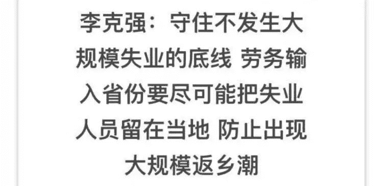

  
从年初开始，政府一直在加大内部的投资力度，释放流动性资金，并打通内部的流通体系，包括重新激活供销社体系，搞物资和金融的下沉，把更多的人接入内部消费市场。我们在《[A24：刘士余去供销社干什么?](http://mp.weixin.qq.com/s?__biz=MzAxNDk1NjI2Mw==&mid=2247484249&idx=1&sn=b8af24c3440b291292b1ed4eddfcfaec&chksm=9b8a20d1acfda9c79045cf72415a403a655fcbcc03483c9b2970fd289e28f7c18a998142039c&scene=21#wechat_redirect)》中做了预判性的阐述。释放给金融机构的资金，被大量用来购买地方债，这些钱被用于扩大基建。这所有的求生动作都是在做准备，都是在激活内部的市场，创造内生的拉动力，为稳定现有产业和人员结构下的就业岗位提供内生的拉动力。接下来还会对具体行业进行定向的降准，为推进行业的结构升级提供资金。所有这一切都是未雨绸缪为最坏的情况做准备，防止外面的拉动力突然消失之后，能够比较稳定的维持住现有产业结构下的经济稳定和社会稳定。同时在加大打击有组织犯罪和黑社会的力度。就是为了杜绝在失业率升高的情况下，底层人员为了生计形成社会瘤毒！  

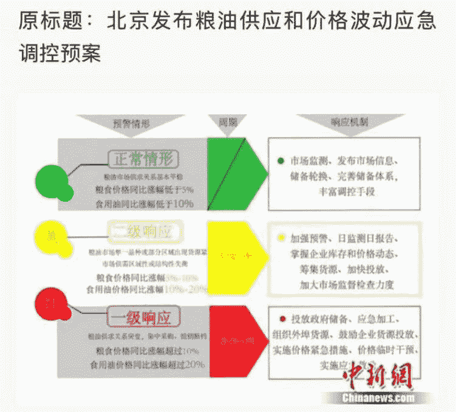

  
鉴于这样迫在眉睫的现实威胁，一方面加大力度向东南亚转移低端产业，另一方面也在尽最大努力，促成交易的达成，以保住外部的拉动力。所以，我们主动去平衡贸易顺差。说白了就是自己掏钱给你去拉我的出口，解决我现行产业结构下的人员就业问题，为产业结构调整赢得时间。我们小心翼翼的对付，该花钱的地方花钱，能让步的地方也做了让步。这事本来向着达成各取所需的临时协议的方向而去。就在即将收官之时，突然一个事件挑动了对方过于敏感的神经。  
上个季度的数据出来以后，我们看到了内部经济状况触底反弹，开始呈现出乐观的走势。加上年初拉起的这一波牛市，一直在打一巴掌给两颗糖的可控节奏内按计划解决上市公司质押的问题。两把悬在头上的剑，一个已经基本解决，另外一个也开始有了一定的缓解。更可喜的是，去年 10 月份在上海设立的人民币期货交易市场，在短短的时间内分到了全球原油期货交易 10%的份额，在人民币国际金融体系的建设中开局不错。  
然而，最近一带一路有了进展，甚至开始在西方社会成为热点，这个进展最大的威胁是对美元体系的釜底抽薪。进展得越顺利，对美元的依赖度就会降得越低。我们正在加大力度向非洲和东南亚转移产业链的下游，特别是东南亚，基础建设、流通管道、贸易通路、金融贷款、产业转移、技术收入、人员跟进，这一套组合拳在一带一路的大旗下向章鱼的触角一样逐渐延伸过去。这意味着它逐渐可以形成一个不需要美元的自循环体系——做过供应链的人都清楚，哪怕纯粹靠给帐期的方式也能让行业上下游运转起来。货币是交易的媒介，没有了交易，货币也就没有了价值。就如同没有了执行单位法律也就没有效力一样！这些低端的过剩产能是社会产业结构中错配的资源，是一种纯粹的浪费，不仅仅无法创造增量，还会造成更多的附带消耗。淤积的过剩产能和下游配套如果能转移除去，并在合理成本的产业辐射范围之内，反而能更有利于产业升级并创造新的增量。  
奥观海同志在 8 年之内让美国社会的债务翻了一倍。它们就是一个超过 20 万亿美金的债务堰塞湖，完全靠美元全球体系在支撑。不管美国社会是维系现状，还是要搞新的东西，都需要钱，而且是需要大把的钱。川普修个墙居然沦落到挪用 15 亿美元军费的地步！为什么急于从阿富汗撤军？因为他消减了数亿用于阿富汗驻军所需的军费。没钱维持自身的存在，能不撤走么？总而言之，美国人不管是搞自己的产业重建，或者搞基础设施，或者搞科技产业的突破都需要钱，这种长期投资只能靠发债！  
在美元体系控制全球的情况下，它们在上游发债，全世界都在下游，其实是把债务转移给全世界其它国家，所以它们的债务能够越堆越高。就如同一些风光的龙头企业，明明内部已经极度亏空，但是外面有人做信用担保，就能不断从银行搞到钱维持自己风光的外表。糊弄一堆不明真相的吃瓜群众。现在的问题是，一带一路推进的太顺利就形成另外一套物资的流通体系，继而会压缩美元在全球贸易体系中的有效控制范围和深度。任何信用货币要有价值，首先要有暴力压轴，其次要必须在现实交易中占据流通领域。如果这二者都萎缩，这对信用货币是致命的威胁！  
前段时间一带一路在欧洲有了突破，各种高调，刺激到华尔街那根一直绷得很紧的弦了。何况美股在高位，大家都怕怕，最新统计数据显示今年做风险对冲的华尔街机构比任何时候都多，可见是一种普遍的心理预期。真是树欲静而风不止呀！美国需要通过这套体系来继续发债维系自身的存在。这就好比你用很多倍的杠杆买了一些房子，一旦提高利用杠杆的利率，收紧你利用杠杆的规模，你就很容易出现现金流断裂的危险。现在美国就是一个这样的状况：美元如果在全球贸易流通体系覆盖的范围缩小了，它发的债就更加没有人去买。何况它做任何事情所需要的资金量都那么大，要有人接盘吃下，也需要找大胖子才吃得下。小鱼小虾吃那么一点也不顶事儿。你觉得当今能吃得下它们给的大力丸的胖子是谁？！  
适当的吃一点，维持一个临时性的各取所需是可以的。你让我全部吃下为你续命，把我锁死在结构性的困境之中，这也忒不地道了吧？我做不到，也不能做到！您这不是要逼死我呀！不管它狗急跳墙，突破底线拿台湾搞什么小动作，无非都是在创造筹码，逼着吃下大力丸。  
可以吃一点，但不会太多。吃的多和少取决于一带一路的推进状况和国内经济结构的调整状况。如果这二者都向好，吃的会非常少，甚至不管你怎么喂都死活不吃。如果这二者都不太好，就会被迫吃一些。不管吃还是不吃，都需要防止资金外流，扩大内部投资。接下来会看到两点：内部适度的推高通胀，并在自己的贸易体系下对外发行更多大额主权债务。棉花这样的大宗商品会跌，一线的不动产和物价则会适度上涨。我已建仓，你随意！  

  
《结构学》仅 1000 本，觉悟社内部培训专用！  
《结构学》发消息：觉悟社  
提问发消息：守夜人总司令  

  
点击下列连接阅读更多精彩：  
[F3：结构力量](http://mp.weixin.qq.com/s?__biz=MzAxNDk1NjI2Mw==&mid=2247484256&idx=1&sn=f10d9c530bfd6ea08b25d4bec657c13a&chksm=9b8a20e8acfda9fee057f2df26790f905c898132cac91d833d14e636edb00c20514d63189a88&scene=21#wechat_redirect)  
[《结构学》宣言](http://mp.weixin.qq.com/s?__biz=MzAxNDk1NjI2Mw==&mid=2247484505&idx=1&sn=95b4424393e36eda97e76284318a3f38&chksm=9b8a27d1acfdaec7c00ce60807bd673a33454adf9b992a8ef9b44687a93b333dcf676d0b77c3&scene=21#wechat_redirect)  
[C20：法律的本质！](http://mp.weixin.qq.com/s?__biz=MzAxNDk1NjI2Mw==&mid=2247484501&idx=1&sn=00f288fe79db79413d6d0f42fb029fbb&chksm=9b8a27ddacfdaecbe8bd5ec9e67fcc5197aafb097acee930c82706f7bb282071824e0508b4f7&scene=21#wechat_redirect)  
[C1：他们到底怕什么？](http://mp.weixin.qq.com/s?__biz=MzAxNDk1NjI2Mw==&mid=2247483898&idx=1&sn=1b0a50386e9e89d2750dec717236f0aa&chksm=9b8a2272acfdab64235b35ee5e91b8cac6172144207251636e1345fc570aa1601f59eff7f442&scene=21#wechat_redirect)  
[B4：你不必为华为担心！](http://mp.weixin.qq.com/s?__biz=MzIzMDYwOTM0Mg==&mid=2247483951&idx=1&sn=7850925e07db502ec2116efe0211318f&chksm=e8b19afedfc613e816bdef573343dbe2127c92d828c071510a8a8b9cb98384cdc7a6dbf8fbdd&scene=21#wechat_redirect)  
[几次成功的结构学预判](http://mp.weixin.qq.com/s?__biz=MzAxNDk1NjI2Mw==&mid=2247484266&idx=1&sn=02ab915e029cbe24d91712f741b3f37c&chksm=9b8a20e2acfda9f4498a5c76204c101ab26e7311f2fb7d3043de108d4ff6e18d72a1c889a569&scene=21#wechat_redirect)  
[C17：来自底层的约束力！](http://mp.weixin.qq.com/s?__biz=MzAxNDk1NjI2Mw==&mid=2247484360&idx=1&sn=a833473eb3a45e0c0aecf4acfcfd87f3&chksm=9b8a2040acfda9566605a3e4ec4640b1fc591a3b848f869a7ce6ebaf7cd06bc75cd184004041&scene=21#wechat_redirect)  
[C21：遍地的豪宅是香港的墓群！](http://mp.weixin.qq.com/s?__biz=MzAxNDk1NjI2Mw==&mid=2247484408&idx=1&sn=f6d2373a67b2e0cf10f5240bd0d64b69&chksm=9b8a2070acfda966dd729b703680a29ae2cfd1ccb1838f38031e8aa003ee6c4fcf72a7990b0a&scene=21#wechat_redirect)  
[C12：务必要振兴建设兵团！](http://mp.weixin.qq.com/s?__biz=MzAxNDk1NjI2Mw==&mid=2247484193&idx=1&sn=88c86597191d0c97a411f9ea6f7b7c5d&chksm=9b8a20a9acfda9bfae819e8e42531fe6d523dd244ef0fc0c0787ab812540108c181f7ec2ffa9&scene=21#wechat_redirect)  
[C20：行为的内在驱动力！](https://mp.weixin.qq.com/s?__biz=MzIzMDYwOTM0Mg==&mid=2247484003&idx=1&sn=a62ddbccc64f9f19890c0dff9605b6f7&scene=21#wechat_redirect)  
[向正在坍塌的地方踹上一脚！](http://mp.weixin.qq.com/s?__biz=MzAxNDk1NjI2Mw==&mid=2247483789&idx=1&sn=5e44b7b524c3dc4bb7705f49ed0a44a3&chksm=9b8a2205acfdab139e4b1d44ef6702b09c9fbf79505340205d13fbdaa33207a997f54bee0e97&scene=21#wechat_redirect)  
[A32：为什么有些人特别喜欢“作”？](http://mp.weixin.qq.com/s?__biz=MzAxNDk1NjI2Mw==&mid=2247484403&idx=1&sn=a291e8322913517a91725b82912a804f&chksm=9b8a207bacfda96d339c5a416fe350e324cfb86c0f0d90c25418967230097892bb8be32eb5ff&scene=21#wechat_redirect)  
[A28：40 年前的今天改变了世界！](http://mp.weixin.qq.com/s?__biz=MzAxNDk1NjI2Mw==&mid=2247484305&idx=1&sn=34b19d12210bf9f765c6eb615b787ac6&chksm=9b8a2019acfda90fff45ea8c17ccb37c75e04c7420ad9b303a0fb0069110cee644e6f592d95f&scene=21#wechat_redirect)  
[书读得比你少，为何混的比你好？](http://mp.weixin.qq.com/s?__biz=MzAxNDk1NjI2Mw==&mid=2247484296&idx=1&sn=b0e0f11f50023aa8a20e8eeb51d39e10&chksm=9b8a2000acfda916885455b30687e2f18099abba31c78b2fabb95ca1b89ddc40f2415317d368&scene=21#wechat_redirect)  
[A34：烂父亲的危害到底有多大！](http://mp.weixin.qq.com/s?__biz=MzAxNDk1NjI2Mw==&mid=2247484348&idx=1&sn=944a6aac1e8035011b56508ea74fb48e&chksm=9b8a2034acfda922b803681a568bf7b75ce8342cf507080d2e636098b7ee9dfc1391836f7341&scene=21#wechat_redirect)  
[胜天半子：凤凰男的悲剧性魔咒！](http://mp.weixin.qq.com/s?__biz=MzAxNDk1NjI2Mw==&mid=2247484459&idx=1&sn=3af333a7d8f81253f730e57ba86f6f11&chksm=9b8a27a3acfdaeb524c155bcc629f472e273558add2d9c91ca3295d08144bd6d7d26ed757e6c&scene=21#wechat_redirect)  
觉悟者  
喜欢你就转走吧！  
微信扫一扫赞赏作者 赞赏  
已喜欢，对作者说句悄悄话  
取消   
发送给作者  
发送  
最多 40 字，当前共字  
 人赞赏   
上一页 1/3 下一页  
长按二维码向我转账  
喜欢你就转走吧！  
受苹果公司新规定影响，微信 iOS 版的赞赏功能被关闭，可通过二维码转账支持公众号。  

 

精选留言  
用户设置不下载评论   
[阅读全文](https://t.zsxq.com/IYzr7UB)  
  

# 

# 

来源：[`www.yuque.com/books/share/97051b78-926c-43e6-b0aa-0b72ff163ac4/kbmdr1`](https://www.yuque.com/books/share/97051b78-926c-43e6-b0aa-0b72ff163ac4/kbmdr1)

# 

# \[守夜人总司令\] - 2019-05-11 官宣：我们！

> 来源：[`www.yuque.com/books/share/97051b78-926c-43e6-b0aa-0b72ff163ac4/trbp5e`](https://www.yuque.com/books/share/97051b78-926c-43e6-b0aa-0b72ff163ac4/trbp5e) 

官宣：我们！  
原创 觉悟者 守夜人总司令   
守夜人总司令   
微信号 WatcherCommander  
功能介绍 结构学：生命体在其生存结构中的求存之道！  
2019-05-11[原文](https://mp.weixin.qq.com/s?__biz=MzAxNDk1NjI2Mw==&mid=2247484497&idx=1&sn=147a68361ac03d759ecc96be15ec1b41&chksm=9b8a27d9acfdaecf2cc2b77b5281f119a363a849fd20cd5ddc0123e324c65616b54f9d084e86&scene=27#wechat_redirect&cpage=375)  
收录于话题  

  
16 年前我独自站在天池的这个位置，旁边有一块石碑，上面用红油漆苍劲有力的书写了两个竖排的大字：天池！不足 20 岁的我双手反向叉腰，刻意模仿着那位湖南同乡的站姿，显得特别的幼稚可笑…  
远近闻名的阿布杜的馕依然还带着葡萄干，乌鲁木齐带肉的手抓饭已经从 7 块涨到了 25 块，羊肉串也从 2 块涨到了 7 块。红山公园，百花村科技园，华凌建材市场，小西门，大巴扎，还有只有三层楼高的“大银行”——当年彭老总在此检阅进疆部队——所有记忆中的一切通通都变了样！  
或许是因为左宗棠的原因，也或许是因为王胡子的原因，总而言之，是因为湖南人的原因。我天生就对新疆有一种说不出来的特殊情感：大将筹边人未还，三湘子弟满天上；新栽杨柳三千里，春风必渡玉门关！湖南人喜欢做开创性的事情，有一种不撞南墙不回头的蛮劲。因此，天下之事如若可为，必然是广东人带头，浙江人出钱，湖南人玩命。我依稀记得 16 年前独自去喀什的情景，绿皮火车坐了一天一夜，穿过荒无人烟的塔哈拉玛干沙漠...偶尔能看到零星散落着蒙古包一样的房子——那是沿途维护线路的工人们的住处。  
大丈夫当负剑西行，千里孤影，上不负皇天后土，下不负剑棋酒友，其余皆不复为念：有缘牵手于风雨飘摇，缘尽陌路于夕阳古道... 这是当年上大学之前跟同学道别时写下的留言。今天想起依然洋溢着一种特殊年纪才能拥有的浪漫情怀。就在不久前，一个夜深人静的夜晚，我刚刚忙完所有的工作，准备入睡时听了一首老歌，看到有一个女孩在下面写下了一段这样的留言：我已经变成了厚脸皮随意听荤段子的女生，可是想起你的时候，还是想穿一次白裙子给你看。我给她加了这样的回复：你这句话触动我内心最柔软的地方了，虽然你说的跟我无关…多么美好的岁月啊！那个白衣飘飘的年代...  
我依然记得，那天下着蒙蒙细雨，一位父亲是解放新疆的湖南人，母亲是当年支援新疆的 8000 湘女中的一员，而自己则出生在建设兵团的湖南老乡开着他的黑色轿车带我去天池，天刚刚亮，我们出了乌鲁木齐沿着奎屯的方向上高速。我好像在车里睡着了，等我醒来的时候已经在天池脚下。老乡告诉我这里有 5500 米，他像行军打仗一样准备了所有的东西。当我登临山顶抵达天池之时，仿佛有一种不在人间的错觉——因为在此之前我从未置身于这样纯粹和宁静的环境之中。十多年过去了，我依然清晰的记得天池上那句温馨的提示：除了脚步什么都不要留下，除了回忆什么都不要带走！即便今天卖的最贵的楼盘也写不出这样的文案。  
我们下山的那一天，住在一个牧民的帐篷里，那天碰巧是我生日，老乡还出钱让牧民给我们弄了一个烤全羊。我第一次在牧民的帐篷里喝上了传说中的马奶酒。还骑着他们家的马在草原上纵马驰骋。要不是主人家的小孩一直与我并驾齐驱，最后拉住了我的缰绳，我真的会在草原上迷路！人在地上待久了就渴望飞翔，即便没有翅膀，也渴望像马儿一样欢快的奔跑，像云儿一样迎风飘荡——那种自由的感觉... 真美！  
许多年前，头一回到省城上学，当我第一次从校门口走到宿舍花了大半个小时，并在迷宫一样的道路中穿行，我才真正的明白这地方为什么被称之为大学。金秋十月，丹桂飘香，恰同学年少，风华正茂，激杨文字，粪土当年万户侯。我也曾经与一群壮怀激烈的青春少年相约从岳麓山走到橘子洲头，然而，最终抵达的时候就只剩下我一个了。即便如此，我并不介意，当我站在橘子洲头独立寒秋之时，似乎也感受到了湘江北去的豪迈...  
回不去了，通通都回不去了！回不去的不仅仅是往昔的岁月和面目全非的家乡，回不去的还包括我们延续了千百年的生存方式。我们正经历着人类历史上最大规模的社会结构升级：在 960 万平方公里的土地和 300 多万平方公里的海域内，一幅波澜壮阔的立体社会画卷正在徐徐展开——它所改造的不仅仅是我们千百年来生存的环境，它必然重新雕塑覆盖其上的一切协作方式，激励机制、道德文化、以及每一个人的心理状态和思维方式。诚如《[A47：边缘人无法逆袭！](http://mp.weixin.qq.com/s?__biz=MzAxNDk1NjI2Mw==&mid=2247484476&idx=1&sn=42cd8e7b62b1c430768fe9583a9715b4&chksm=9b8a27b4acfdaea2f7ac778f91e72c9b69a725224a18c6d576f3de7caf0ff91a040bf5622645&scene=21#wechat_redirect)》和《[A46：淤积的小市民！](http://mp.weixin.qq.com/s?__biz=MzAxNDk1NjI2Mw==&mid=2247484472&idx=1&sn=f5df702c026dbb04688151086cdf7493&chksm=9b8a27b0acfdaea6ed5b712d94b3725bf8e322b39101916f48f935c102c433e9c7239b596c9f&scene=21#wechat_redirect)》所揭示的那样，这是最后的机会，有兴起就有消亡，真正的告别并没有仪式，都是悄无声息的，就像在一个平常的早上，有些人、有些事永远的被留在了昨天！我突然想起谍战剧《风筝》的片尾曲：没有告别，已成永远；没有相约，何时再见；红色的梦白色的夜，两个世界不能越，谁将一切，改变…  
自从 22 岁在麒麟路的创业孵化中心开启了第一个创业项目，生命中的某些部分就被卷入一个激流之中，被迫加速进化。理性让人变得冷酷，因为它会让你看清这个世界底层运行的逻辑——但我永远都不会是一个马基雅维利主义者：阴谋只能逞一时之强，阳谋方能笑到最后！那些能搭建起更强大的能量转化载体并充分利用结构力量的方式，必然建立在生命体存续的基础之上。  
我生命中最纯粹的部分永远的停留在 22 岁——它如同信仰，给人一种看到底牌之后的坚定不移——诚如《[C8：什么是真正的力量](https://mp.weixin.qq.com/s?__biz=MzIzMDYwOTM0Mg==&mid=2247483956&idx=1&sn=ccfa41292bc8b3a7d6c9b16106d38381&scene=21#wechat_redirect)》中阐述的那样：人类的求存本能是非理性的，正是那些非理性的部分，给了我能够面对死亡的确定性，也恰是我的温柔！  
《结构学》仅限 1000 本，觉悟社内部培训专用！  
《结构学》发消息：觉悟社  

  
提问发消息：守夜人总司令  

  
点击下列连接阅读更多精彩：  
[F3：结构力量](http://mp.weixin.qq.com/s?__biz=MzAxNDk1NjI2Mw==&mid=2247484256&idx=1&sn=f10d9c530bfd6ea08b25d4bec657c13a&chksm=9b8a20e8acfda9fee057f2df26790f905c898132cac91d833d14e636edb00c20514d63189a88&scene=21#wechat_redirect)  
[C1：他们到底怕什么？](http://mp.weixin.qq.com/s?__biz=MzAxNDk1NjI2Mw==&mid=2247483898&idx=1&sn=1b0a50386e9e89d2750dec717236f0aa&chksm=9b8a2272acfdab64235b35ee5e91b8cac6172144207251636e1345fc570aa1601f59eff7f442&scene=21#wechat_redirect)  
[C8：什么是真正的力量！](https://mp.weixin.qq.com/s?__biz=MzIzMDYwOTM0Mg==&mid=2247483956&idx=1&sn=ccfa41292bc8b3a7d6c9b16106d38381&scene=21#wechat_redirect)  
[结构学成功的政策预判](http://mp.weixin.qq.com/s?__biz=MzAxNDk1NjI2Mw==&mid=2247484266&idx=1&sn=02ab915e029cbe24d91712f741b3f37c&chksm=9b8a20e2acfda9f4498a5c76204c101ab26e7311f2fb7d3043de108d4ff6e18d72a1c889a569&scene=21#wechat_redirect)  
[给灯塔的跪舔者上一课！](http://mp.weixin.qq.com/s?__biz=MzAxNDk1NjI2Mw==&mid=2247484490&idx=1&sn=3e889840aa174f225d66001f9aaf97ef&chksm=9b8a27c2acfdaed48b21e426e5367fd55b8ab55054fdc0f80fb3903e2e8b018b48316642fee0&scene=21#wechat_redirect)  
[A46：淤积的小市民！](http://mp.weixin.qq.com/s?__biz=MzAxNDk1NjI2Mw==&mid=2247484472&idx=1&sn=f5df702c026dbb04688151086cdf7493&chksm=9b8a27b0acfdaea6ed5b712d94b3725bf8e322b39101916f48f935c102c433e9c7239b596c9f&scene=21#wechat_redirect)  
[A48：如何平衡工作和生活？](http://mp.weixin.qq.com/s?__biz=MzAxNDk1NjI2Mw==&mid=2247484481&idx=1&sn=ad43fc5feea038e47fa50dae514a9390&chksm=9b8a27c9acfdaedf3b7751343bd2b16a86fbeddb1896e4a24bfcbe589f4bfe8454ea656fa390&scene=21#wechat_redirect)  
[至于吗？不就是暴跌了么！](http://mp.weixin.qq.com/s?__biz=MzAxNDk1NjI2Mw==&mid=2247484485&idx=1&sn=f1d05e391097d5825dda573daac7c915&chksm=9b8a27cdacfdaedb5e407f49895fc3e77953af53b2e0424056fab5c66e7c51d7ab48d352f695&scene=21#wechat_redirect)  
[A47：从边缘地带崛起的力量！](http://mp.weixin.qq.com/s?__biz=MzAxNDk1NjI2Mw==&mid=2247484476&idx=1&sn=42cd8e7b62b1c430768fe9583a9715b4&chksm=9b8a27b4acfdaea2f7ac778f91e72c9b69a725224a18c6d576f3de7caf0ff91a040bf5622645&scene=21#wechat_redirect)  
[C17：来自底层的约束力！](http://mp.weixin.qq.com/s?__biz=MzAxNDk1NjI2Mw==&mid=2247484360&idx=1&sn=a833473eb3a45e0c0aecf4acfcfd87f3&chksm=9b8a2040acfda9566605a3e4ec4640b1fc591a3b848f869a7ce6ebaf7cd06bc75cd184004041&scene=21#wechat_redirect)  
[C21：遍地的豪宅是香港的墓群！](http://mp.weixin.qq.com/s?__biz=MzAxNDk1NjI2Mw==&mid=2247484408&idx=1&sn=f6d2373a67b2e0cf10f5240bd0d64b69&chksm=9b8a2070acfda966dd729b703680a29ae2cfd1ccb1838f38031e8aa003ee6c4fcf72a7990b0a&scene=21#wechat_redirect)  
[C12：务必要振兴建设兵团！](http://mp.weixin.qq.com/s?__biz=MzAxNDk1NjI2Mw==&mid=2247484193&idx=1&sn=88c86597191d0c97a411f9ea6f7b7c5d&chksm=9b8a20a9acfda9bfae819e8e42531fe6d523dd244ef0fc0c0787ab812540108c181f7ec2ffa9&scene=21#wechat_redirect)  
[C20：行为的内在驱动力！](https://mp.weixin.qq.com/s?__biz=MzIzMDYwOTM0Mg==&mid=2247484003&idx=1&sn=a62ddbccc64f9f19890c0dff9605b6f7&scene=21#wechat_redirect)  
[C19：行为预判的结构学应用](http://mp.weixin.qq.com/s?__biz=MzAxNDk1NjI2Mw==&mid=2247484380&idx=1&sn=652c8fbc6ebeb96398fc1fcce0d32a61&chksm=9b8a2054acfda942e2a3086c0b2b25c9df7d11e7cfa92c2a199fa87f03ccac8b9c1a8c6f0695&scene=21#wechat_redirect)  
[向正在坍塌的地方踹上一脚！](http://mp.weixin.qq.com/s?__biz=MzAxNDk1NjI2Mw==&mid=2247483789&idx=1&sn=5e44b7b524c3dc4bb7705f49ed0a44a3&chksm=9b8a2205acfdab139e4b1d44ef6702b09c9fbf79505340205d13fbdaa33207a997f54bee0e97&scene=21#wechat_redirect)  
[A32：为什么有些人特别喜欢“作”？](http://mp.weixin.qq.com/s?__biz=MzAxNDk1NjI2Mw==&mid=2247484403&idx=1&sn=a291e8322913517a91725b82912a804f&chksm=9b8a207bacfda96d339c5a416fe350e324cfb86c0f0d90c25418967230097892bb8be32eb5ff&scene=21#wechat_redirect)  
[A28：40 年前的今天改变了世界！](http://mp.weixin.qq.com/s?__biz=MzAxNDk1NjI2Mw==&mid=2247484305&idx=1&sn=34b19d12210bf9f765c6eb615b787ac6&chksm=9b8a2019acfda90fff45ea8c17ccb37c75e04c7420ad9b303a0fb0069110cee644e6f592d95f&scene=21#wechat_redirect)  
[书读得比你少，为何混的比你好？](http://mp.weixin.qq.com/s?__biz=MzAxNDk1NjI2Mw==&mid=2247484296&idx=1&sn=b0e0f11f50023aa8a20e8eeb51d39e10&chksm=9b8a2000acfda916885455b30687e2f18099abba31c78b2fabb95ca1b89ddc40f2415317d368&scene=21#wechat_redirect)  
[A34：烂父亲的危害到底有多大！](http://mp.weixin.qq.com/s?__biz=MzAxNDk1NjI2Mw==&mid=2247484348&idx=1&sn=944a6aac1e8035011b56508ea74fb48e&chksm=9b8a2034acfda922b803681a568bf7b75ce8342cf507080d2e636098b7ee9dfc1391836f7341&scene=21#wechat_redirect)  
[胜天半子：凤凰男的悲剧性魔咒！](http://mp.weixin.qq.com/s?__biz=MzAxNDk1NjI2Mw==&mid=2247484459&idx=1&sn=3af333a7d8f81253f730e57ba86f6f11&chksm=9b8a27a3acfdaeb524c155bcc629f472e273558add2d9c91ca3295d08144bd6d7d26ed757e6c&scene=21#wechat_redirect)  
觉悟者  
喜欢你就转走吧！  
微信扫一扫赞赏作者 赞赏  
已喜欢，对作者说句悄悄话  
取消   
发送给作者  
发送  
最多 40 字，当前共字  
 人赞赏   
上一页 1/3 下一页  
长按二维码向我转账  
喜欢你就转走吧！  
受苹果公司新规定影响，微信 iOS 版的赞赏功能被关闭，可通过二维码转账支持公众号。  

 

精选留言  
用户设置不下载评论   
[阅读全文](https://t.zsxq.com/v3jMr7Q)  
  

# 

# \[守夜人总司令\] - 2019-05-07 至于吗？不就是暴跌了么！

> 来源：[`www.yuque.com/books/share/97051b78-926c-43e6-b0aa-0b72ff163ac4/fvumgh`](https://www.yuque.com/books/share/97051b78-926c-43e6-b0aa-0b72ff163ac4/fvumgh) 

至于吗？不就是暴跌了么！  
原创 觉悟者 守夜人总司令   
守夜人总司令   
微信号 WatcherCommander  
功能介绍 结构学：生命体在其生存结构中的求存之道！  
2019-05-07[原文](https://mp.weixin.qq.com/s?__biz=MzAxNDk1NjI2Mw==&mid=2247484485&idx=1&sn=f1d05e391097d5825dda573daac7c915&chksm=9b8a27cdacfdaedb5e407f49895fc3e77953af53b2e0424056fab5c66e7c51d7ab48d352f695&scene=27#wechat_redirect&cpage=375)  
收录于话题  
我 65 块的时候清仓了格力电器，因为在此之前我去调研了他们的经销商和终端零售店并且把观察的结果和判断的结论都放在觉悟社里，4 月 20 日的时候在觉悟社里提醒大家逻辑切换了，建议暂时离场。我在调研中从细节中发现的关于格力问题被两个星期之后发布的季度报表中披露的信息部分验证。当然，验证的都是小问题。还有一个未来才能验证的隐忧以及优势暂时是看不出来的——这些都还有待于时间去验证。格力电器是一家优秀的企业，在这个周期中也是适合持有的，而且适合作为推进产业结构升级在治理层面的破局点。需要等它调整到位！我曾经读过一个朋友手下专业分析师写的关于格力电器的投资分析报告。我读完之后的反馈让对方很生气，对方认为我很傲慢，在用一种居高临下的姿态在鄙视他们机构的专业分析师。为了挽救我迷失的灵魂，还特意给我讲了如何说话，如何待人才能更受欢迎——可惜我太不具备可塑性，对方也只能无奈的放弃。机构的分析师写报告有一个标准模板，只要把找到的数据和信息都填入模板，一篇漂亮的投资分析报告就新鲜出炉了。自古远离战场的永远是正确的，因为他们无需面对生死，也不需要对结果负责——这正是不接地气的书生们信口开河的底气所在…  
几个月前曾经运用结构学的基本原理准确的预测了官方关于新疆的新政策的走向：《[C12：务必要振兴建设兵团！](http://mp.weixin.qq.com/s?__biz=MzAxNDk1NjI2Mw==&mid=2247484193&idx=1&sn=88c86597191d0c97a411f9ea6f7b7c5d&chksm=9b8a20a9acfda9bfae819e8e42531fe6d523dd244ef0fc0c0787ab812540108c181f7ec2ffa9&scene=21#wechat_redirect)》。我们的判断基于对生存结构和关键支点的洞察——事实验证了判断，也顺带证明了某位以新疆问题专家自居的牛人所推崇的杨增新式的主张不过是书生刻舟求剑般习惯性的自圆其说！我们永远都不是马基亚维利主义者，我们坚信大厦的基石必然建立在源自生命本源的东西之上，阴谋只能做临时性的应急之用，阳谋才是立身之本！只有不断创造增量才能建立和维持秩序，缓解终极矛盾及其衍生出来的各种问题，并满足人对确定性的需求…  
大将筹边人未还，湖湘子弟满天上；新载杨柳三千里，春风必度玉门关！说起新疆，我有着特殊的感情。所有细致入微的洞察都源于某种身临其境的感知，它与书生们远隔千里之外在书房中自我臆想出来的景象不同。那里的风土人情，那里鲜活的生命都不是书本上的铅字符号。浸入式的感知能让你触摸到一些远隔关山而无法洞察的细微之处——真相和魔鬼都隐藏在那里！  
那片热土之上生活着多种民族，沿着沙漠的边缘曾经存在过 36 个统治实体。每一个部落占据一片绿洲。能够进行军屯并修筑城池的地方，一般都驻扎着朝廷的驻军——这个习惯从汉朝一直延续到清朝。陈汤发矫诏征召当地的驻军，然后就能以驻军的威慑力裹挟着各部落派出人马听从自己的调遣。一千多年之后的高仙芝也是类似的操作：朝廷的主力裹挟着当地的部落人马发动远征。这种时空中反复出现的东西至少反映了这样的事实：在这个广袤的区域内，只需要控制几个关键支点就能控制全局——之所以能够达到这样的效果，是因为自然环境和所能组织起来的力量决定的。各部落势力范围就是自己所占据的绿洲所能辐射的区域，绿洲的产出决定了所能承载的人口规模，以及所能组织起来的力量。这些力量又决定了它能够占据哪些通道和资源点——这些隐蔽的约束从源点开始形成一脉相成的内在制约。  
生命体的所有行为都是其在自己的生存结构中寻找出口。这些行为的驱动力源自于他们的求存策略：长期处于困境中的弱者面对迫在眉睫的生存危机，很难跳出应急反应的泥塘，甚至会逐渐进化出一种自我遮蔽，为这种行为提供认知和道德支撑。从而形成一种无形的边界，把行为常态化，把自己圈在里面永世不得超生。  
虽然那里生活着数十个不同的部族，但总得来说，可分为游牧和农耕两种主要群体——农耕民族和游牧民族完全不同的生存策略不会因为覆盖其上的某种宗教信仰就会彻底改变。  
农耕民族的生存方式简单的来说就是：画地为牢！生存空间一开始就是固定的，从本质上来说，它是一种存量式的生存竞争。要想产生增量必须依赖内部的组织度或者科技树的升级——也就是说改造环境和改造自身的能力要能实现升级才能突破原有禁锢的束缚，创造出更多的增量，从而解决人与地的矛盾。否则，为了存续，不仅仅内部的压抑非常深重，甚至在必要的时候内部还会进行你死我活的生存竞争，以缓解资源不足的矛盾。农耕群体的内在约束力更高，彼此在生存竞争中的猜忌心也更强。因此，同样的农耕群体处于同一生存空间是无法融合的——彼此在生存竞争中对存量资源的争夺存在天然的隔阂和猜忌，任何缘木求鱼的行为都不会获得有效的结果，因为这种悖论来自于原点！  
游牧民族的生存方式简单的来说就是：随遇而安！游牧民族的生存所需资源存在于远方，或由某种相互遵守的承诺所保障。他们乐于接受变化甚至是改变自己。只要有利于当下自身的生存和延续，他们甚至会主动展开积极的合作。谁是我们的朋友，谁是我们的敌人，这是革命的首要问题——这句话本身就来自于一个关于中国社会各阶层分析的报告。  
我身临其境的洞察佐证了以上的判断：同属于一片土地的两个不同群体，一个是以农耕为主，一个是以游牧为主。一直以来都矛盾不断，这一点甚至能在日常生活中随处可见——这两个群体的人一旦通婚甚至在当地被当作奇迹。这样的结构性矛盾就让治理者的策略拥有了切入点。  
二十年前乌鲁木齐就已经超过百万人口，但是没有一家现代化工厂。它是一个绿洲中的城市，城市的外面就是沙漠，所以，从一开始就限定了城市的规模。16 年前我惊讶的发现乌鲁木齐下的雪居然是黑色的——那是城市供暖系统造成的尘埃。我还无意中还发现乌鲁木齐市规定：砍伐自己种的树都需要坐牢——可见它的生存环境之脆弱。这样的生存、产业状态和人口规模，决定了新疆虽大，资源的存量竞争特征却非常明显。因此，它整个社会呈现出一种结构性的脆弱，从而让永恒悖论所衍生出来的各种问题在现有生存结构中无解，必须通过升级社会基础结构来寻找出口。政策的推进依赖天时、地利、人和。所以，推进政策的破局点往往需要等待，有时必须等到某种危机出现之后，才能大力推行新政策。这样才能力度最大，阻力最小。  
多年以前认识一个叫哈斯木的人，当时还只是地区专员，现在好像是首府的人大副主任了。他曾在社交工具上讨论时说过这样一句话：无论是新疆的各民族还是整个中华民族都不能自我封闭，原地踏步，孤独而愤怒的活着。否则，我们就无法解决自己的问题，更无法抓住机会发展起来。他说的对，只有发展才能从根本上解决问题。读过这篇《[A48：如何平衡工作和生活？](http://mp.weixin.qq.com/s?__biz=MzAxNDk1NjI2Mw==&mid=2247484481&idx=1&sn=ad43fc5feea038e47fa50dae514a9390&chksm=9b8a27c9acfdaedf3b7751343bd2b16a86fbeddb1896e4a24bfcbe589f4bfe8454ea656fa390&scene=21#wechat_redirect)》之后，你会发现即便是个人的生活，依然如此！  
农业社会升级到工业社会，最大瓶颈就是成本不足。这是一个庞大的社会系统重建的过程——它需要重构的不仅仅是外部世界的运行规则和行为边界，还有与之相适应的内在世界的底层逻辑。在这个过程之种，会像扭秧歌一样走三步退两步半。中途甚至不得不用上一些临时性的策略。但总的来说，前期必须利用外部落差形成的挤压打破原有基础结构并完成关键支点的搭建。其次，基于关键支点来创造增量缓解终极矛盾所衍生出来的各种问题。如果中东地区的产业结构依然无法承载翻了几倍的人口，这个地区的青年如果继续找不到工作，那么打仗就会成为一种主要的就业形式——至于打谁则完全不在失业青年的考虑范围之内。  
预订《结构学》超过 600 本，  
星球觉悟社成员享有优先权，非会员等有剩余！  
结构学进阶发消息：觉悟社  
提问发消息：守夜人总司令  

  
点击下列连接阅读更多精彩：  
[F3：结构力量](http://mp.weixin.qq.com/s?__biz=MzAxNDk1NjI2Mw==&mid=2247484256&idx=1&sn=f10d9c530bfd6ea08b25d4bec657c13a&chksm=9b8a20e8acfda9fee057f2df26790f905c898132cac91d833d14e636edb00c20514d63189a88&scene=21#wechat_redirect)  
[C1：他们到底怕什么？](http://mp.weixin.qq.com/s?__biz=MzAxNDk1NjI2Mw==&mid=2247483898&idx=1&sn=1b0a50386e9e89d2750dec717236f0aa&chksm=9b8a2272acfdab64235b35ee5e91b8cac6172144207251636e1345fc570aa1601f59eff7f442&scene=21#wechat_redirect)  
[A46：淤积的小市民！](http://mp.weixin.qq.com/s?__biz=MzAxNDk1NjI2Mw==&mid=2247484472&idx=1&sn=f5df702c026dbb04688151086cdf7493&chksm=9b8a27b0acfdaea6ed5b712d94b3725bf8e322b39101916f48f935c102c433e9c7239b596c9f&scene=21#wechat_redirect)  
[B4：你不必为华为担心！](http://mp.weixin.qq.com/s?__biz=MzIzMDYwOTM0Mg==&mid=2247483951&idx=1&sn=7850925e07db502ec2116efe0211318f&chksm=e8b19afedfc613e816bdef573343dbe2127c92d828c071510a8a8b9cb98384cdc7a6dbf8fbdd&scene=21#wechat_redirect)  
[A39：三观不和的破解之道！](http://mp.weixin.qq.com/s?__biz=MzAxNDk1NjI2Mw==&mid=2247484395&idx=1&sn=3464fb8d0b12df7cf8fc91716a34f5ba&chksm=9b8a2063acfda9759f6b71d77a8302f892cb4db2ab1a47c82975663328d4e6759aa20d5233f2&scene=21#wechat_redirect)  
[几次成功的结构学预判](http://mp.weixin.qq.com/s?__biz=MzAxNDk1NjI2Mw==&mid=2247484266&idx=1&sn=02ab915e029cbe24d91712f741b3f37c&chksm=9b8a20e2acfda9f4498a5c76204c101ab26e7311f2fb7d3043de108d4ff6e18d72a1c889a569&scene=21#wechat_redirect)  
[C24：复杂事物的判断方法！](http://mp.weixin.qq.com/s?__biz=MzAxNDk1NjI2Mw==&mid=2247484467&idx=1&sn=f906e3cacad356dbb7e4d64a16b83b6c&chksm=9b8a27bbacfdaead7fd9f6bfca92cf67d3485e6233a896a6f1bf70c547c7cf677795d17aebde&scene=21#wechat_redirect)  
[C17：来自底层的约束力！](http://mp.weixin.qq.com/s?__biz=MzAxNDk1NjI2Mw==&mid=2247484360&idx=1&sn=a833473eb3a45e0c0aecf4acfcfd87f3&chksm=9b8a2040acfda9566605a3e4ec4640b1fc591a3b848f869a7ce6ebaf7cd06bc75cd184004041&scene=21#wechat_redirect)  
[A48：如何平衡工作和生活？](http://mp.weixin.qq.com/s?__biz=MzAxNDk1NjI2Mw==&mid=2247484481&idx=1&sn=ad43fc5feea038e47fa50dae514a9390&chksm=9b8a27c9acfdaedf3b7751343bd2b16a86fbeddb1896e4a24bfcbe589f4bfe8454ea656fa390&scene=21#wechat_redirect)  
[C21：遍地的豪宅是香港的墓群！](http://mp.weixin.qq.com/s?__biz=MzAxNDk1NjI2Mw==&mid=2247484408&idx=1&sn=f6d2373a67b2e0cf10f5240bd0d64b69&chksm=9b8a2070acfda966dd729b703680a29ae2cfd1ccb1838f38031e8aa003ee6c4fcf72a7990b0a&scene=21#wechat_redirect)  
[C12：务必要振兴建设兵团！](http://mp.weixin.qq.com/s?__biz=MzAxNDk1NjI2Mw==&mid=2247484193&idx=1&sn=88c86597191d0c97a411f9ea6f7b7c5d&chksm=9b8a20a9acfda9bfae819e8e42531fe6d523dd244ef0fc0c0787ab812540108c181f7ec2ffa9&scene=21#wechat_redirect)  
[C20：行为的内在驱动力！](https://mp.weixin.qq.com/s?__biz=MzIzMDYwOTM0Mg==&mid=2247484003&idx=1&sn=a62ddbccc64f9f19890c0dff9605b6f7&scene=21#wechat_redirect)  
[A47：从边缘地带崛起的力量！](http://mp.weixin.qq.com/s?__biz=MzAxNDk1NjI2Mw==&mid=2247484476&idx=1&sn=42cd8e7b62b1c430768fe9583a9715b4&chksm=9b8a27b4acfdaea2f7ac778f91e72c9b69a725224a18c6d576f3de7caf0ff91a040bf5622645&scene=21#wechat_redirect)  
[向正在坍塌的地方踹上一脚！](http://mp.weixin.qq.com/s?__biz=MzAxNDk1NjI2Mw==&mid=2247483789&idx=1&sn=5e44b7b524c3dc4bb7705f49ed0a44a3&chksm=9b8a2205acfdab139e4b1d44ef6702b09c9fbf79505340205d13fbdaa33207a997f54bee0e97&scene=21#wechat_redirect)  
[A32：为什么有些人特别喜欢“作”？](http://mp.weixin.qq.com/s?__biz=MzAxNDk1NjI2Mw==&mid=2247484403&idx=1&sn=a291e8322913517a91725b82912a804f&chksm=9b8a207bacfda96d339c5a416fe350e324cfb86c0f0d90c25418967230097892bb8be32eb5ff&scene=21#wechat_redirect)  
[A28：40 年前的今天改变了世界！](http://mp.weixin.qq.com/s?__biz=MzAxNDk1NjI2Mw==&mid=2247484305&idx=1&sn=34b19d12210bf9f765c6eb615b787ac6&chksm=9b8a2019acfda90fff45ea8c17ccb37c75e04c7420ad9b303a0fb0069110cee644e6f592d95f&scene=21#wechat_redirect)  
[书读得比你少，为何混的比你好？](http://mp.weixin.qq.com/s?__biz=MzAxNDk1NjI2Mw==&mid=2247484296&idx=1&sn=b0e0f11f50023aa8a20e8eeb51d39e10&chksm=9b8a2000acfda916885455b30687e2f18099abba31c78b2fabb95ca1b89ddc40f2415317d368&scene=21#wechat_redirect)  
[A34：烂父亲的危害到底有多大！](http://mp.weixin.qq.com/s?__biz=MzAxNDk1NjI2Mw==&mid=2247484348&idx=1&sn=944a6aac1e8035011b56508ea74fb48e&chksm=9b8a2034acfda922b803681a568bf7b75ce8342cf507080d2e636098b7ee9dfc1391836f7341&scene=21#wechat_redirect)  
[胜天半子：凤凰男的悲剧性魔咒！](http://mp.weixin.qq.com/s?__biz=MzAxNDk1NjI2Mw==&mid=2247484459&idx=1&sn=3af333a7d8f81253f730e57ba86f6f11&chksm=9b8a27a3acfdaeb524c155bcc629f472e273558add2d9c91ca3295d08144bd6d7d26ed757e6c&scene=21#wechat_redirect)  
觉悟者  
喜欢你就转走吧！  
微信扫一扫赞赏作者 赞赏  
已喜欢，对作者说句悄悄话  
取消   
发送给作者  
发送  
最多 40 字，当前共字  
 人赞赏   
上一页 1/3 下一页  
长按二维码向我转账  
喜欢你就转走吧！  
受苹果公司新规定影响，微信 iOS 版的赞赏功能被关闭，可通过二维码转账支持公众号。  

 

精选留言  
用户设置不下载评论   
[阅读全文](https://t.zsxq.com/y7yrfuz)  
  

# 

# \[守夜人总司令\] - 2019-05-05 A48：如何平衡工作和生活？

> 来源：[`www.yuque.com/books/share/97051b78-926c-43e6-b0aa-0b72ff163ac4/cvyt1a`](https://www.yuque.com/books/share/97051b78-926c-43e6-b0aa-0b72ff163ac4/cvyt1a) 

A48：如何平衡工作和生活？  
原创 觉悟者 守夜人总司令   
守夜人总司令   
微信号 WatcherCommander  
功能介绍 结构学：生命体在其生存结构中的求存之道！  
2019-05-05[原文](https://mp.weixin.qq.com/s?__biz=MzAxNDk1NjI2Mw==&mid=2247484481&idx=1&sn=ad43fc5feea038e47fa50dae514a9390&chksm=9b8a27c9acfdaedf3b7751343bd2b16a86fbeddb1896e4a24bfcbe589f4bfe8454ea656fa390&scene=27#wechat_redirect&cpage=375)  
收录于话题  
#教育  
51 个  
其实不存在平衡工作和生活这回事，也没法平衡，从源点上就不可能！人生的整个过程就是不断的去填各种坑——每当你以创造奇迹的方式填完一个巨大的坑，准备喘口气的时候，又会惊喜的发现：还有个更大的坑在等着你！ 当然，一旦能突破人性中与生俱来的各种内在约束，把那些坑都填上之后，回过头来，你会发现自己真的不一样了：在这个过程中，你的抽象自我在与主观世界的互动中，不断强化了前者对后者的控制力和主导性。用通俗的话来说就是：你在这种过程中会不断获得正向的反馈，实实在在的感受到一种确定性和安全感，感受到一种生命的张力；一种能够挑战不可能，应对不确定，甚至是突破内外制约创造奇迹的信心！  
生命体的本源特征  
生命体是一种特殊的结构，它能从外部攫取并转化能量以维持自身的存在。带有这种生命体特征的结构也必须面对死亡！正因为生命体需要面对死亡，所以存在的每一刻都处于不确定的倒计时之中。我们不得不遵循这样的生存原则：给时间以文明，而不要试图给文明以时间！  
已在《结构学》的框架中阐述过：世间一切纷繁复杂相互联动的各种表像，都是生命体在其生存结构中的求存行为。而这所有的一切都源于一个永恒的悖论：基因存续对能量的无限需求和载体转化能量的有限能力之间的永恒矛盾。一切秩序的建立和打破都是为了缓解这个终极矛盾及其衍生出来的各种问题！这些缓解终极矛盾并解决衍生出来的各种问题的工具，包括生存取舍的策略，包括制度设计，保持秩序维持，包括激励机制等等。所有工具都指向一个核心目标：创造增量，减少消耗，转嫁成本！  
美国第二任总统亚当斯曾经对他的开国战友们说过这样一段话：我们今天不得不从事政治和军事的斗争，学习最残酷的战争技巧，是为了让我们的下一代能够学习商业和技术，让他们的下一代能够学习音乐和艺术！一层一层的夯实，一代一代的接力，上面一层的无限可能依赖下一层过剩的能量所维持的秩序井然和稳定可靠。上一代与命运抗争依赖匹夫之勇，新一代必须依赖对规则的尊重和充分的利用。否则，遭受的就不仅仅是单点的攻击，而是由某种严密规则构建而成的整个体系的碾压！学会使用它就能具有形成结构力量突破边界的能力；否则，往往会被它进一步逼到墙角——这个时代正像圣经上所说的：已有的人要加倍的给他，没有的人连仅有的也会被夺走…  
任何秩序都需要富余的能量才能建立，也需要持续的能量才能维持。秩序带来美，混乱造成丑陋——任何体面的生活其实都是在各方面逐渐建立秩序的过程：包括公共秩序，也包括私人的生活秩序。品位这种东西是需要达到一定的程度才能成为一种本能——陷入迫在眉睫的生存窘迫之中的人，哪里还顾得上什么品位。无论是工作状况、自我状态、生活环境还是与人相处的状况都会呈现出无序的混乱不堪，因为实在没有富余的能量去理顺，甚至无力顾及！小到个人的生活，大到社会的发展，一旦需要在存量中左支右绌进行腾挪的时候，增长往往就停滞了——能量短缺会让一切加速坠入提襟见肘、恶性循环的深渊之中…  
一个行业一旦进入停滞状态，你会显而易见的看到内部的生存竞争逐渐呈现出刺刀见红的白热化，仿佛一头嗜血的怪兽在沉睡中被唤醒，那景象真的很惨烈！我们所有的取舍都是为了创造新的增量。如果试图通过腾挪来勉强维持，很难维持得住，树欲静而风不止！而且，这也与生命体的本源相违悖！  
社会升级的后遗症  
我们的社会结构正在从农业社会结构向工业社会结构转变。我们这一代人碰巧处于这种巨大转变的过程之中：许多人十几岁之前还生活在日出而作，日落而息，毫无时间观念散漫又乡愿的农业文明的惯性之中。而现在却处于急速发展的工业文明时代的前沿城市——不管是资本，信息，物流，都在加速把一切都融化为一个联动的整体，一种被切割的更细的时间粒度牵引着这个整体中的一切，各种显性和隐性的约束，360 度无死角渗透进每一个生命体的生存空间——包括内在的和外在的！这一切与我们延续了千百年的农耕文明所形成的生存策略、心理特征、行为模式、思维方式的惯性都完全不同。我们过去强调，天下无不是之父母，为尊者讳；今天传统的家庭在走向瓦解，开始强调人与人之间的边界，个体的责任和权益——这是两套完全不一样的东西，而且相互冲突。  
我们曾经在阐述《结构学》框架的时候提到过：人所有的悲剧都源于生存策略的惯性滞后于生存环境的变化。在面对这三千年未有之大变局的时候，许多人确实无所适从。我们父辈所积累的人生经验不仅仅无法为我们做出指引，他们的那些东西如果不掣肘就已经值得亲幸了！在现实生活中，许多人好不容易冒个头，却被原有生存环境中的某种捆绑式惯性强行拖了回去。已经醒来的人，明明知道房子起火了，却要被强迫继续在里面装睡，这真的很残忍！然而，现实中许多人却不得不这样眼睁睁看着自己被困住，在清醒状态下被活活烧死…  
我们的教育中不太注重成本意识，也缺乏目标感和落地规划的训练。有时候会感到很辛苦，可是这种辛苦却没什么价值——人们常说，没有功劳也有苦劳；这句话其实是错的！这是一种无效的自我感动，它与当下社会的发展方向相违背。千百年来，我们喜欢格言，却从不论证哲理式的格言到现实之间的逻辑推演。所以，只能靠类比、联想、或者只可意会不可言传的神秘感悟来理解。这种缺乏论证的结论，不但无法让其它人重现得出结论的过程，也让人无章可循。我们在《[C17：来自底层的约束](http://mp.weixin.qq.com/s?__biz=MzAxNDk1NjI2Mw==&mid=2247484360&idx=1&sn=a833473eb3a45e0c0aecf4acfcfd87f3&chksm=9b8a2040acfda9566605a3e4ec4640b1fc591a3b848f869a7ce6ebaf7cd06bc75cd184004041&scene=21#wechat_redirect)》中阐述过，为什么千百年来中国社会的先贤们不能把话说清楚，只能打哑谜。今天这个社会基础已经逐渐不存在了，基于其上的一切也会逐渐改变。早一天认清这一点，就可能早一步在新周期的规则中如鱼得水。  
人在面对变化无所适从的时候，会本能的渴望逃离这种不确定性，回退到熟悉的确定性之中。这是一种精神结构的保护机制，我们以后单独开篇详细阐述它的工作原理，以及破解之法。不管怎么样，自我麻痹只能缓解一时，不能解决真正的问题。真正的问题必须认清现实接受自己，学会新规则并利用规则去创造增量！  
完全理性的鸡汤  
人从 2 岁开始能够分得清我和你。从此，自我与外部世界开始分离。大脑神经元的信息交换密度在差不多 2 岁的时候会突破某个阀值，逐步形成一个抽象自我——就如同人通过对外部信号的感知和筛选形成一个主观世界一样。前者是对自我的抽象，后者是对外部世界的抽象。我们在《[F3：结构力量](http://mp.weixin.qq.com/s?__biz=MzAxNDk1NjI2Mw==&mid=2247484256&idx=1&sn=f10d9c530bfd6ea08b25d4bec657c13a&chksm=9b8a20e8acfda9fee057f2df26790f905c898132cac91d833d14e636edb00c20514d63189a88&scene=21#wechat_redirect)》中阐述过精神结构如何形成生存策略，它需要基于两个判断：1. 对自我的判断，2. 对自我与外部资源关系的判断。这个判断是如何形成的呢？前者取决于抽象自我，后者取决于主观世界。关于这里面的详细论述，我们以后单独开篇来展开。我们在此需要明白的是：抽象自我对主观世界的主导性会让人感觉到确定性和安全感，甚至获得自我主导的愉悦感。反之，则会感到失控、无力和恐惧。  
如果进入后一种状态，精神结构会启动一种保护机制：抽象自我与主观世界是双向连接的。人的任何行为都会获得新的反馈，从而重新构建主观世界。如果主观世界的改变让抽象自我相应的失去主导性，就必然会造成以上的失控感、无力感、疏离感和恐惧感等等。因此，它的保护机制就是努力营造一个静止的主观世界。所以，你在生活中会发现虚弱者有几个明显特征：1. 否认事实  2. 自我封闭  3. 忽视逻辑。 这所有的外在行为都是为了让自己抽象的主观世界处于静止状态，不被外部新的反馈所改变。从而避免被无力和恐惧的感觉所困扰。  
坦白讲，人到了一定年龄之后，在内外约束的双重打击之下，开始产生无力，虚弱、衰竭，贬值，折旧等自我判断，这些判断是由你的精神结构做出来的，它会由此形成一种更加小心翼翼的保护性的生存策略。然而，你会发现这种保护性的生存策略并没有让你获得预期的确定性和安全感，反而更加无所适从。所以，应该搞清楚它的形成机制，并利用这个机制去并形成另外一种正向的循环！  
社会结构升级所形成的周期无法改变，我们只能选择适应。假如有一万个人因为生存策略滞后性的认知、心态等惯性在继续逆行，你只需提前转向，就能瞬间超过一万人，这就是生存竞争中的先发优势。认清底层逻辑，顺应趋势，并早日学会利用规律，才有可能绝处逢生。当然，这是逆人性的，绝大多数人突破不了内外双重的禁锢，他们的宿命就是这样在外部边界和内在约束的双重作用下雕塑而成。他们像被困在着火的房子里无力逃离——时而试图让自己睡着，时而又试图奋力挣扎一下，经过反反复复的折腾之后，只能清醒的看着自己在着火的房子里被慢慢的活活烧死…  
小到个人的改变，大到社会的转型。哪一次都必须经过激烈的斗争才能最终实现转向——真正理性的人是残忍的，对自己狠，对别人也不拖泥带水！因为他非常清楚的认识到：窗口正在关闭，时间不多了！  
我不知道你在生活和工作中是否去挑战过非常难的目标——那种与方方面面都有关联，内外都充满了各种不确定，即便创造了奇迹，好不容易满足一个无法达到的条件，突然又来了一个更大的坑。即便存在各种不确定，但是任何一个环节出错都会让整体的努力功亏一篑，甚至会造成骑虎难下，无法承受的结果。即便如此，你依然咬牙去搞成了！搞成了以后，你会发现自己由内而外都焕然一新，就像打胜了恶仗的老兵，不怒自威，杀气腾腾！  
《结构学》预订已超一半，星球觉悟社优先，外人稍等！  
结构学进阶发消息：觉悟社  
提问发消息：守夜人总司令  

  
点击下列连接阅读更多精彩：  
[F3：结构力量](http://mp.weixin.qq.com/s?__biz=MzAxNDk1NjI2Mw==&mid=2247484256&idx=1&sn=f10d9c530bfd6ea08b25d4bec657c13a&chksm=9b8a20e8acfda9fee057f2df26790f905c898132cac91d833d14e636edb00c20514d63189a88&scene=21#wechat_redirect)  
[A46：淤积的小市民！](http://mp.weixin.qq.com/s?__biz=MzAxNDk1NjI2Mw==&mid=2247484472&idx=1&sn=f5df702c026dbb04688151086cdf7493&chksm=9b8a27b0acfdaea6ed5b712d94b3725bf8e322b39101916f48f935c102c433e9c7239b596c9f&scene=21#wechat_redirect)  
[A47：边缘人无法逆袭！](http://mp.weixin.qq.com/s?__biz=MzAxNDk1NjI2Mw==&mid=2247484476&idx=1&sn=42cd8e7b62b1c430768fe9583a9715b4&chksm=9b8a27b4acfdaea2f7ac778f91e72c9b69a725224a18c6d576f3de7caf0ff91a040bf5622645&scene=21#wechat_redirect)  
[C24：复杂事物的判断方法！](http://mp.weixin.qq.com/s?__biz=MzAxNDk1NjI2Mw==&mid=2247484467&idx=1&sn=f906e3cacad356dbb7e4d64a16b83b6c&chksm=9b8a27bbacfdaead7fd9f6bfca92cf67d3485e6233a896a6f1bf70c547c7cf677795d17aebde&scene=21#wechat_redirect)  
[C1：他们到底怕什么？](http://mp.weixin.qq.com/s?__biz=MzAxNDk1NjI2Mw==&mid=2247483898&idx=1&sn=1b0a50386e9e89d2750dec717236f0aa&chksm=9b8a2272acfdab64235b35ee5e91b8cac6172144207251636e1345fc570aa1601f59eff7f442&scene=21#wechat_redirect)  
[B4：你不必为华为担心！](http://mp.weixin.qq.com/s?__biz=MzIzMDYwOTM0Mg==&mid=2247483951&idx=1&sn=7850925e07db502ec2116efe0211318f&chksm=e8b19afedfc613e816bdef573343dbe2127c92d828c071510a8a8b9cb98384cdc7a6dbf8fbdd&scene=21#wechat_redirect)  
[几次成功的结构学预判](http://mp.weixin.qq.com/s?__biz=MzAxNDk1NjI2Mw==&mid=2247484266&idx=1&sn=02ab915e029cbe24d91712f741b3f37c&chksm=9b8a20e2acfda9f4498a5c76204c101ab26e7311f2fb7d3043de108d4ff6e18d72a1c889a569&scene=21#wechat_redirect)  
[C17：来自底层的约束力！](http://mp.weixin.qq.com/s?__biz=MzAxNDk1NjI2Mw==&mid=2247484360&idx=1&sn=a833473eb3a45e0c0aecf4acfcfd87f3&chksm=9b8a2040acfda9566605a3e4ec4640b1fc591a3b848f869a7ce6ebaf7cd06bc75cd184004041&scene=21#wechat_redirect)  
[C21：遍地的豪宅是香港的墓群！](http://mp.weixin.qq.com/s?__biz=MzAxNDk1NjI2Mw==&mid=2247484408&idx=1&sn=f6d2373a67b2e0cf10f5240bd0d64b69&chksm=9b8a2070acfda966dd729b703680a29ae2cfd1ccb1838f38031e8aa003ee6c4fcf72a7990b0a&scene=21#wechat_redirect)  
[C12：务必要振兴建设兵团！](http://mp.weixin.qq.com/s?__biz=MzAxNDk1NjI2Mw==&mid=2247484193&idx=1&sn=88c86597191d0c97a411f9ea6f7b7c5d&chksm=9b8a20a9acfda9bfae819e8e42531fe6d523dd244ef0fc0c0787ab812540108c181f7ec2ffa9&scene=21#wechat_redirect)  
[C20：行为的内在驱动力！](https://mp.weixin.qq.com/s?__biz=MzIzMDYwOTM0Mg==&mid=2247484003&idx=1&sn=a62ddbccc64f9f19890c0dff9605b6f7&scene=21#wechat_redirect)  
[向正在坍塌的地方踹上一脚！](http://mp.weixin.qq.com/s?__biz=MzAxNDk1NjI2Mw==&mid=2247483789&idx=1&sn=5e44b7b524c3dc4bb7705f49ed0a44a3&chksm=9b8a2205acfdab139e4b1d44ef6702b09c9fbf79505340205d13fbdaa33207a997f54bee0e97&scene=21#wechat_redirect)  
[A32：为什么有些人特别喜欢“作”？](http://mp.weixin.qq.com/s?__biz=MzAxNDk1NjI2Mw==&mid=2247484403&idx=1&sn=a291e8322913517a91725b82912a804f&chksm=9b8a207bacfda96d339c5a416fe350e324cfb86c0f0d90c25418967230097892bb8be32eb5ff&scene=21#wechat_redirect)  
[A28：40 年前的今天改变了世界！](http://mp.weixin.qq.com/s?__biz=MzAxNDk1NjI2Mw==&mid=2247484305&idx=1&sn=34b19d12210bf9f765c6eb615b787ac6&chksm=9b8a2019acfda90fff45ea8c17ccb37c75e04c7420ad9b303a0fb0069110cee644e6f592d95f&scene=21#wechat_redirect)  
[书读得比你少，为何混的比你好？](http://mp.weixin.qq.com/s?__biz=MzAxNDk1NjI2Mw==&mid=2247484296&idx=1&sn=b0e0f11f50023aa8a20e8eeb51d39e10&chksm=9b8a2000acfda916885455b30687e2f18099abba31c78b2fabb95ca1b89ddc40f2415317d368&scene=21#wechat_redirect)  
[A34：烂父亲的危害到底有多大！](http://mp.weixin.qq.com/s?__biz=MzAxNDk1NjI2Mw==&mid=2247484348&idx=1&sn=944a6aac1e8035011b56508ea74fb48e&chksm=9b8a2034acfda922b803681a568bf7b75ce8342cf507080d2e636098b7ee9dfc1391836f7341&scene=21#wechat_redirect)  
[胜天半子：凤凰男的悲剧性魔咒！](http://mp.weixin.qq.com/s?__biz=MzAxNDk1NjI2Mw==&mid=2247484459&idx=1&sn=3af333a7d8f81253f730e57ba86f6f11&chksm=9b8a27a3acfdaeb524c155bcc629f472e273558add2d9c91ca3295d08144bd6d7d26ed757e6c&scene=21#wechat_redirect)  
觉悟者  
喜欢你就转走吧！  
微信扫一扫赞赏作者 赞赏  
已喜欢，对作者说句悄悄话  
取消   
发送给作者  
发送  
最多 40 字，当前共字  
 人赞赏   
上一页 1/3 下一页  
长按二维码向我转账  
喜欢你就转走吧！  
受苹果公司新规定影响，微信 iOS 版的赞赏功能被关闭，可通过二维码转账支持公众号。  

 

精选留言  
用户设置不下载评论   
  

# 

# \[守夜人总司令\] - 2019-05-03 A47：从边缘地带崛起的力量！

> 来源：[`www.yuque.com/books/share/97051b78-926c-43e6-b0aa-0b72ff163ac4/xg2cyt`](https://www.yuque.com/books/share/97051b78-926c-43e6-b0aa-0b72ff163ac4/xg2cyt) 

A47：从边缘地带崛起的力量！  
原创 觉悟者 守夜人总司令   
守夜人总司令   
微信号 WatcherCommander  
功能介绍 结构学：生命体在其生存结构中的求存之道！  
2019-05-03[原文](https://mp.weixin.qq.com/s?__biz=MzAxNDk1NjI2Mw==&mid=2247484476&idx=1&sn=42cd8e7b62b1c430768fe9583a9715b4&chksm=9b8a27b4acfdaea2f7ac778f91e72c9b69a725224a18c6d576f3de7caf0ff91a040bf5622645&scene=27#wechat_redirect&cpage=375)  
收录于话题  
如果某种资源被广泛应用，围绕它所建立的分工协作体系必将越来越庞杂，继而会衍生为一个完整的产业。这个产业的上下游必然吸纳进越来越多的从业人员。如此一来，它就不仅仅是一个用来挣钱的生意，而逐步成为许多人赖以生存的营生。如果这些人手上又拥有了决定社会公共政策的权力，它就不仅仅是社会经济体系中的一个行业，而是社会权力体系中的一方势力！  
所有的意识形态争论的是什么？争论的是是非对错的定义权和判断权。所有的路线之争都是权力之争，所有的权力之争都是利益之争。所以的利益之争都是对生命体当前和未来的存续所需资源的分配权之争。  
所有的交易结构最终都试图导向统治结构——你去跟踪一个品牌商的发展你就会发现：当它刚刚开拓市场的时候，会尽量利用分封诸侯的方式建立区域代理商机制。这是早期利用现有资源快速开拓市场，建立品牌认知度的策略，它是一种基于博弈的动态平衡。所以，信任链是交易结构能够建立和维持的关键支点。随着品牌的知名度的提高，基于博弈的动态平衡就会逐步由封分制向郡县制转化。交易结构向统治结构转化是一种必然，之所以没有转化是因为能量还不够！  
按照正常的秩序，居于层级上方具有天然的优势。所有的小资本家都羡慕大资本家，甚至在生活细节上尽量的模仿他们。因为大资本家有能力形成垄断，垄断才能产生暴利！读过《[C9：教育是最高的门槛](http://mp.weixin.qq.com/s?__biz=MzAxNDk1NjI2Mw==&mid=2247484066&idx=1&sn=e394d22ec0f989b141fd07650d135f0d&chksm=9b8a212aacfda83c7391343fb6def9c792717291512ef0f31934f472d9ad68416579489f571f&scene=21#wechat_redirect)》的人就会明白：认知力是力量未来的形态，它的门槛比以往任何时候都要高——之前无论是通过血统拥有权力，还是通过继承拥有财富，拥有优势并建立门槛并不需要自己的参与，而是一种坐享其成。但是，认知力必须通过教育来实现，这就不仅仅需要自身参与其中，还依赖自己能克服人性的弱点逆流而上——外部的资源只能用来搭台而无法替自己唱戏。这也就意味着，未来能够拥有这样的优势并建立门槛的“贵族”后代，本身就会是人群中的佼佼者。毫不费力就获得门槛的继承者比较容易成为纨绔子弟，必须经历反人性的各种锤炼才能建立门槛的幸存者，往往会成为出类拔萃的精英和由内而外都散发着力量的强者！  
西方的垃圾危机  
据说北京市一天要产生 1.8 万吨垃圾，如果把运送垃圾的车辆一字排开，首尾相接能排出 50 公里的长龙！中国的城市现代化还不到一代人的时间，我们人多势众又喜欢胡吃海喝，甚至缺乏公共意识。所以，造成的城市垃圾是非常恐怖的。但是，因祸得福，我们迫不得已，进化出一套强大的社会垃圾处理系统，而且形成了完整的产业链。长期以来，我们的城市垃圾都不分类，即便现在开始在末端进行分类，运输的时候又混在了一起！所以，在垃圾处理的时候不得不拥有处理最糟糕状况的能力。而这种超乎寻常的能力，以及由此进化出来的整个配套产业。成了全球工业和生活垃圾最理想的处理站。说白了，中国的垃圾回收系统逐渐变成了西方发达国家的垃圾桶！每一年有大量的洋垃圾被万吨巨轮转运到中国被处理掉。  
三年前有一次去一个客户那里，看到他们能把一个工艺处理到让人匪夷所思的水准，另外一个参观的同行问他们老总，我和你用的是同一套设备，都是原装进口的，为什么我就做不到这样的工艺呢？主人笑着说，我们的社会是经过改造了，我们的工程师和厂家的工程师一起改进了半年。那位同行就更意外了：我们比你们还先跟厂家的工程师一起改进，但是改进之后还是做不到你们这样的工艺。主人看了所有参观者一眼，有点犹豫的说：因为你们一直是处理百万级的订单，我们是在处理千万级的订单！拼命填坑的这种量的积累迫使他们实现了质的飞跃。量变产生质变！  
在全球化的产业分工中，中国社会从低端干起。但是，中国社会的这个人群基数，无论是作为需求方还是供给方，都会瞬间将一个事物拉到极端的境地。做一顿同时让 10 个人吃的饭菜和做一顿同时让 1000 个人吃的饭菜，需要满足的前提条件绝对不是一个量级的！后者在分工协作、资源利用率，成本控制和配套设施等各方面都与前者有天壤之别的落差。如果用牛刀杀鸡，必然具有碾压的优势！  
中国社会自身需要处理的垃圾量本身就是惊人的，由此演化出来的垃圾处理能力，一旦被接入国际市场，中国的垃圾处理系统自然就成为西方社会青睐的对象——价格烂便宜，量又特足；干活超靠谱，话又不太多！于是，西方社会的所谓垃圾回收最终演变为仅仅是对垃圾做一点归类，然后转运到中国来处理。如果把全球的垃圾回收处理机制看作一部手机。那么，中国的垃圾处理系统就是这部手机的芯片！一旦芯片停止工作，它会造成什么后果呢？！  
2018 年中国官方正式宣布禁止 24 种洋垃圾的进口。乖乖，这可把西方社会鳖怀了！他们囤积了很多垃圾运转不除去，自己也消耗不了。新西兰美丽的海滩瞬间变成了垃圾场，优雅的加拿大也开始垃圾围城。被迫无奈，他们甚至开始向东南亚各国倾倒洋垃圾了！极具个性的杜特尔特总统强硬的向加拿大发出战争威胁，其目的仅仅是为了让加拿大把自己的垃圾运回去。  
马屁股与发动机  
真正懂得下棋的人看到的不是棋子摆在棋盘上所呈现的态势，而是搏杀的双方你来我往的攻防策略一步一步走到现在的轨迹！那些看似无限可能的选项其实存在某种隐性的约束。那种隐性的约束如同设定好了边界，让事物的发展只能在设定的几个选项中做出抉择。这样的抉择，无论如何选择，所能呈现出来的结果都总是处于可被预见的轨迹之中…所以，常言道：常人畏果，圣人畏因。起心动念之间就决定了后面一连串的反应，以及由此形成的行为轨迹和必然结果。如果一开始就错了，后面所有的努力都是在做无力的挣扎。  
阿波罗航天飞机发动机的直径约等于两匹马屁股的宽度。因为发动机的生产基地与航天飞机的发射场相距很远，中间要用铁路运输。有些铁轨要穿过单行隧道，当年修建隧道鉴于工程技术方面的限制，只能尽量的比铁轨略宽。还而言之，能够通过的宽度以铁轨的宽度为基准。所以航天飞机发动机的直径不能超过铁轨的宽度。而铁轨是从英国引进的，是英国人最早发明的蒸汽机车和铁路。标准自然是他们制定的，后期的模仿者也自然遵循他们的工程技术标准。英国人铁路宽度的依据参考的是古代遗留的驰道。那种标准公路的宽度标准沿用了古罗马时期用于运送兵力所修建的罗马大道，它的宽度刚好满足战车的通行，一辆古罗马时代的战车由两匹军马同时牵引。所以，战车的宽度刚好是两匹古罗马时期的军马屁股的宽度！谁也想不到，人类 20 世纪最先进科技的航天飞机的发动机直径居然在冥冥之中受制于 2000 多年前凯撒的两匹军马的屁股！然而，这就是不得不接受的事实。  
那些隐性的制约才是真正的边界！且不用说个人的成长轨迹，即便是复杂到无以复加的人类社会的演化，也依然存在着某种隐性的《[一脉相承](http://mp.weixin.qq.com/s?__biz=MzAxNDk1NjI2Mw==&mid=2247483806&idx=1&sn=bf330eb30a53b4e2f666e84b953a1fa5&chksm=9b8a2216acfdab00985fb0708f3c360bc9793e594b6636734e5f1838462d06b8b1ff494f126f&scene=21#wechat_redirect)》！我依稀记得很小的时候老头教了我这么一句俗语：观今宜鉴古，无古不成今。  
颠覆性崛起的前提  
我们在《[C9：教育是最高的门槛](http://mp.weixin.qq.com/s?__biz=MzAxNDk1NjI2Mw==&mid=2247484066&idx=1&sn=e394d22ec0f989b141fd07650d135f0d&chksm=9b8a212aacfda83c7391343fb6def9c792717291512ef0f31934f472d9ad68416579489f571f&scene=21#wechat_redirect)》中阐述过，这个社会上许多筛选门槛并不是做事所必须的，它仅仅是用来筛选，决定谁拥有做事的资格！为什么中产阶层对下一代的教育军备竞争不会起作用，只会把自己搞得更崩溃呢？因为，大家在不断加码的同时，把门槛也不断提高了。因为资源有限，给某个区间的群体分配的社会资源就这么多，筛选的比例是限制的——不管怎么相互加码，最后都会有这么大的比例。每一个人都认为自己会是幸存者，所以焦虑的新晋中产群体会不计成本的进行教育军备竞争。总有一天他们会悲伤的发现：即便自己不计成本的透支了未来，自己的下一代依然淤积在和自己同样的阶层之内！这一切都是由隐性的边界决定的。  
产业结构如同生态一样由下往上演化。越到上面，分工协作的密度就越大，获取准入资格的成本也就更高。一个产业的兴旺发达是从某一种资源被广泛利用开始的；一场社会运动的兴起往往是从某一种思想观念被广泛接受开始的；一种商业行为的巨大成功，往往是从某种需求逐渐成为普遍性的需求开始的！因此，能走进千家万户的生意都是大生意！这些都具有一个共同的特征：从一种基本元素被广泛利用开始，逐渐向上垒积出高度关联相互作用的复杂形态。这种形态会逐步演化出显性或隐性的层级分布。其准入门槛逐级升高，越往上越陡峭，竞争也越惨烈，其目的就是为了将更多的人排除在外。  
我们在《[依依东望，望得是时间](http://mp.weixin.qq.com/s?__biz=MzAxNDk1NjI2Mw==&mid=2247483947&idx=1&sn=1dcdd529b9dad09a00b6e3e2b14c8245&chksm=9b8a21a3acfda8b5fe1dae1c8979dec0be990a569bc03372af815b4e0f08913e938d57aa6b25&scene=21#wechat_redirect)》中清晰的描绘了一幅从古代一直延续到未来的社会结构性画卷：统治机器的构成成员必然会与社会上真正的统治势力相匹配！时间会帮这个忙，逐渐提高的门槛就是一种隐性的筛选机制。最终把不匹配的群体都排除在外——你是努力奔跑过，你无法胜出，所以才没有资格嘛！公平、公正、公开；有理、有据、有节！如此一来，岂不是让人很绝望？  
绝望就对了！在一个秩序逐步形成的社会结构中，识别规则、学习规则、适应规则、利用规则去努力攀爬而不是无所事事的谩骂才是唯一的出路！在秩序形成的过程中，边缘地区的人本身就是找不到出路，被排除在外的群体。迫在眉睫的生存危机会让他们无暇顾忌其它的事务，焦头烂额的现实困境，会让他们疲于应对，忍不住自我放逐，像烂泥一样随波逐流。如此种种不仅无法增加竞争力，发而会削弱自身的竞争力。因此，所有的逆袭就只能在梦中完成。梦是他们最后的避难所——无论是晚间随机的美梦，还是自我刻意营造的白日梦，都是用来缓解现实痛苦的精神鸦片——在梦中才能勉强找到从未拥有过的力量、尊严、才能和有人在乎！  
所有的草莽英雄都成长于秩序破碎之时。所有的新兴产业都崛起于一种新的资源被广泛应用。归根结蒂都依赖底层支点的破碎和结构秩序的重建。是选择草莽英雄从边缘地带的崛起之路还是选择早日识别并利用规则去按部就班的实现升级。这取决于一个关键性的判断：当下处于什么周期之中！如果处于秩序即将丧失的周期中，就应该《[向正在坍塌的地方踹上一脚](http://mp.weixin.qq.com/s?__biz=MzAxNDk1NjI2Mw==&mid=2247483789&idx=1&sn=5e44b7b524c3dc4bb7705f49ed0a44a3&chksm=9b8a2205acfdab139e4b1d44ef6702b09c9fbf79505340205d13fbdaa33207a997f54bee0e97&scene=21#wechat_redirect)》；反之，则不要试图去[《胜天半子](http://mp.weixin.qq.com/s?__biz=MzAxNDk1NjI2Mw==&mid=2247484459&idx=1&sn=3af333a7d8f81253f730e57ba86f6f11&chksm=9b8a27a3acfdaeb524c155bcc629f472e273558add2d9c91ca3295d08144bd6d7d26ed757e6c&scene=21#wechat_redirect)》——那只会多增加一个无人在意的悲剧故事。如何判断当下处于什么周期之中？  
判断复杂的事物，往往存在简单的方式。要能提炼出这样的方式，则需要先理解整个体系。判断一段关系的走向，只需要看彼此之间是否存在鄙视——哪怕是潜意识中存在难以察觉的鄙视，也最终会导向破裂。因为存在鄙视的一方总是存在一种心有不甘的委屈感，这种感觉就如同毒品上瘾一样，用来弥补的剂量只会越来越大。一旦弥补不了就会转移成其它方面的冲突，这种不确定性的焦虑会表现为一种“作”，直到将关系导向破裂。关系能够建立和维持首先看是否存在交流的欲望，只有高密度的交流才能形成一致性的规划，才能将不同的个体凝聚成一个整体。任何关系的破裂都是从停止交流开始的，任何无法愈合的隔阂都源于心中存在鄙视！  
以上是社会生活中个体之间关系走向的判断。那么，如何对更加复杂的社会秩序的演化方向做出正确判断呢？我先把判断的结论放在这里：目前社会演化处于秩序逐渐确立并日益稳固的发展周期之中，所以，识别规则，尊重规则，利用规则才是出路！  
如何对复杂事物提炼出简单的判断方式，请认真阅读《结构学》！屠龙之术只提供 1000 本，已开放预定，近一半已被预定，星球觉悟社成员优先享有预订《结构学》的权力！  
结构学进阶发消息：觉悟社  
提问发消息：守夜人总司令  

  
点击下列连接阅读更多精彩：  
[一脉相承](http://mp.weixin.qq.com/s?__biz=MzAxNDk1NjI2Mw==&mid=2247483806&idx=1&sn=bf330eb30a53b4e2f666e84b953a1fa5&chksm=9b8a2216acfdab00985fb0708f3c360bc9793e594b6636734e5f1838462d06b8b1ff494f126f&scene=21#wechat_redirect)  
[F3：结构力量](http://mp.weixin.qq.com/s?__biz=MzAxNDk1NjI2Mw==&mid=2247484256&idx=1&sn=f10d9c530bfd6ea08b25d4bec657c13a&chksm=9b8a20e8acfda9fee057f2df26790f905c898132cac91d833d14e636edb00c20514d63189a88&scene=21#wechat_redirect)  
[C1：他们到底怕什么？](http://mp.weixin.qq.com/s?__biz=MzAxNDk1NjI2Mw==&mid=2247483898&idx=1&sn=1b0a50386e9e89d2750dec717236f0aa&chksm=9b8a2272acfdab64235b35ee5e91b8cac6172144207251636e1345fc570aa1601f59eff7f442&scene=21#wechat_redirect)  
[C2：宗教是统治工具吗？](http://mp.weixin.qq.com/s?__biz=MzAxNDk1NjI2Mw==&mid=2247483901&idx=1&sn=f5d9f8c7bd84370c79adae921351e813&chksm=9b8a2275acfdab63fde093d76ff82e01d0e2fd43ea675f77fd17fd51a15873d4d10499f5338d&scene=21#wechat_redirect)  
[C9：教育是最高的门槛！](http://mp.weixin.qq.com/s?__biz=MzAxNDk1NjI2Mw==&mid=2247484066&idx=1&sn=e394d22ec0f989b141fd07650d135f0d&chksm=9b8a212aacfda83c7391343fb6def9c792717291512ef0f31934f472d9ad68416579489f571f&scene=21#wechat_redirect)  
[几次成功的结构学预判](http://mp.weixin.qq.com/s?__biz=MzAxNDk1NjI2Mw==&mid=2247484266&idx=1&sn=02ab915e029cbe24d91712f741b3f37c&chksm=9b8a20e2acfda9f4498a5c76204c101ab26e7311f2fb7d3043de108d4ff6e18d72a1c889a569&scene=21#wechat_redirect)  
[依依东望，望的是时间！](http://mp.weixin.qq.com/s?__biz=MzAxNDk1NjI2Mw==&mid=2247483947&idx=1&sn=1dcdd529b9dad09a00b6e3e2b14c8245&chksm=9b8a21a3acfda8b5fe1dae1c8979dec0be990a569bc03372af815b4e0f08913e938d57aa6b25&scene=21#wechat_redirect)  
[C17：来自底层的约束力！](http://mp.weixin.qq.com/s?__biz=MzAxNDk1NjI2Mw==&mid=2247484360&idx=1&sn=a833473eb3a45e0c0aecf4acfcfd87f3&chksm=9b8a2040acfda9566605a3e4ec4640b1fc591a3b848f869a7ce6ebaf7cd06bc75cd184004041&scene=21#wechat_redirect)  
[C21：遍地的豪宅是香港的墓群！](https://mp.weixin.qq.com/s?__biz=MzIzMDYwOTM0Mg==&mid=2247484008&idx=1&sn=1b48a801dbd0a0a6a6b41117d5cf6579&token=1343943146&lang=zh_CN&scene=21#wechat_redirect)  
[C12：务必要振兴建设兵团！](http://mp.weixin.qq.com/s?__biz=MzAxNDk1NjI2Mw==&mid=2247484193&idx=1&sn=88c86597191d0c97a411f9ea6f7b7c5d&chksm=9b8a20a9acfda9bfae819e8e42531fe6d523dd244ef0fc0c0787ab812540108c181f7ec2ffa9&scene=21#wechat_redirect)  
[C20：行为的内在驱动力！](https://mp.weixin.qq.com/s?__biz=MzIzMDYwOTM0Mg==&mid=2247484003&idx=1&sn=a62ddbccc64f9f19890c0dff9605b6f7&scene=21#wechat_redirect)  
[向正在坍塌的地方踹上一脚！](http://mp.weixin.qq.com/s?__biz=MzAxNDk1NjI2Mw==&mid=2247483789&idx=1&sn=5e44b7b524c3dc4bb7705f49ed0a44a3&chksm=9b8a2205acfdab139e4b1d44ef6702b09c9fbf79505340205d13fbdaa33207a997f54bee0e97&scene=21#wechat_redirect)  
[A32：为什么有些人特别喜欢“作”？](http://mp.weixin.qq.com/s?__biz=MzAxNDk1NjI2Mw==&mid=2247484403&idx=1&sn=a291e8322913517a91725b82912a804f&chksm=9b8a207bacfda96d339c5a416fe350e324cfb86c0f0d90c25418967230097892bb8be32eb5ff&scene=21#wechat_redirect)  
[A28：40 年前的今天改变了世界！](http://mp.weixin.qq.com/s?__biz=MzAxNDk1NjI2Mw==&mid=2247484305&idx=1&sn=34b19d12210bf9f765c6eb615b787ac6&chksm=9b8a2019acfda90fff45ea8c17ccb37c75e04c7420ad9b303a0fb0069110cee644e6f592d95f&scene=21#wechat_redirect)  
[书读得比你少，为何混的比你好？](http://mp.weixin.qq.com/s?__biz=MzAxNDk1NjI2Mw==&mid=2247484296&idx=1&sn=b0e0f11f50023aa8a20e8eeb51d39e10&chksm=9b8a2000acfda916885455b30687e2f18099abba31c78b2fabb95ca1b89ddc40f2415317d368&scene=21#wechat_redirect)  
[A34：烂父亲的危害到底有多大！](http://mp.weixin.qq.com/s?__biz=MzAxNDk1NjI2Mw==&mid=2247484348&idx=1&sn=944a6aac1e8035011b56508ea74fb48e&chksm=9b8a2034acfda922b803681a568bf7b75ce8342cf507080d2e636098b7ee9dfc1391836f7341&scene=21#wechat_redirect)  
[胜天半子：凤凰男的悲剧性魔咒！](http://mp.weixin.qq.com/s?__biz=MzAxNDk1NjI2Mw==&mid=2247484459&idx=1&sn=3af333a7d8f81253f730e57ba86f6f11&chksm=9b8a27a3acfdaeb524c155bcc629f472e273558add2d9c91ca3295d08144bd6d7d26ed757e6c&scene=21#wechat_redirect)  
觉悟者  
喜欢你就转走吧！  
微信扫一扫赞赏作者 赞赏  
已喜欢，对作者说句悄悄话  
取消   
发送给作者  
发送  
最多 40 字，当前共字  
 人赞赏   
上一页 1/3 下一页  
长按二维码向我转账  
喜欢你就转走吧！  
受苹果公司新规定影响，微信 iOS 版的赞赏功能被关闭，可通过二维码转账支持公众号。  

 

精选留言  
用户设置不下载评论   
[阅读全文](https://t.zsxq.com/27IEmYV)  
  

# 

# \[守夜人总司令\] - 2019-05-01 A46：淤积的小市民！

> 来源：[`www.yuque.com/books/share/97051b78-926c-43e6-b0aa-0b72ff163ac4/cezggg`](https://www.yuque.com/books/share/97051b78-926c-43e6-b0aa-0b72ff163ac4/cezggg) 

A46：淤积的小市民！  
原创 觉悟者 守夜人总司令   
守夜人总司令   
微信号 WatcherCommander  
功能介绍 结构学：生命体在其生存结构中的求存之道！  
2019-05-01[原文](https://mp.weixin.qq.com/s?__biz=MzAxNDk1NjI2Mw==&mid=2247484472&idx=1&sn=f5df702c026dbb04688151086cdf7493&chksm=9b8a27b0acfdaea6ed5b712d94b3725bf8e322b39101916f48f935c102c433e9c7239b596c9f&scene=27#wechat_redirect&cpage=375)  
收录于话题  
人生在世，做事有三个层次：第一次绝望，是用尽了自己的才华，依然无能为力；第二次绝望，是用尽了自己的资源，依然解决不了。第三次绝望，是看清了边界，只能等待命运随机的垂青！  
受过高等教育的群体往往比其他的群体更加的敏感，自尊心更强，自我期许也更高。生活中知识分子往往会表现为矛盾和纠结的状态：做成了一点点事，瞬间信心满满，仿佛背负使命，要为天地立心，为生民立命，为往圣继绝学，为万世开太平。遇到一些打击，又瞬间佛系，试图跳出三界之外不在五行之中。如果反复不及自我预期，则会有一种万念俱灭，万事皆空的幻灭感。盲目的自我期许不断刺激着破格获取的强烈欲望，这种盲目会对一切边界视而不见。紧接着，失真的自我判断又不断刺激着恐惧于坠落深渊的焦躁不安。这种欲望和恐惧总是交织在一起，忽左忽右，来回摇摆，以至于在生活和工作的方方面面都呈现出非常明显又不为自己所察觉的心态和行为特征！  
天赋，才华和教育，是人人都渴望的美好事物。然而，无法突破边界的才华、天赋和教育，往往更容易制造悲剧！任何破格获取都需要结构力量的加速度，然而，形成这种加速度就必须放杠杆，杠杆必然会产生反噬，造成某种结构性的内在的=扭曲，这种扭曲很容易形成失真的判断，继而，形成反向的强化，最终将人带入深渊。平生不喜笼中之鸟，君图愉悦，彼在囚笼。对于无法实现突破的人们而言，自己往往就是那只尴尬的鸟啊...  
电梯没了！  
在过去的 10 年，互联网和影视行业都得到了比地产行业还迅猛的蓬勃发展。不管生态画不画反，暴风影音和乐视在二级市场的市直都曾经超过千亿！一时间，不仅仅万众侧目，而且还被当作某种新时代的象征。这几年这些行业的从业人员都能轻松的挣到大把银子。当然，身处其中的人都会认为这些都是自己应得的，而且，这种获得是源于自己的才华和努力，搞不好还要基于其上做一番人生格言的提炼，并作为今后行动的指南！如果下一波人依据这个指南去依葫芦画瓢，结局绝对是相当悲剧的！别说下一代了，就是这些行业现有的从业人员，也无法像 10 年前那样狂飙突进了——即便付出同样，甚至更多的努力！为什么会这样？  
我们需要回到源头去审视：中国加入 WTO 以后，中国社会是一个巨大的洼地。海外的资本、技术和产业与这个洼地存在让人惊掉下巴的落差。这种落差必然产生势能——打破结构的外在力量就是这种落差的挤压。它形成的直接结果就是开始逐步重构我们社会的基础结构。无论是生产贸易还是城市化和工业化的进程，都在这种资本、技术和产业的落差挤压之下突飞猛进。这种迅猛发展，会形成一个工业社会的瓶颈：电力！中国的电力结构非常特殊——70%是火力发电，这会造成对动力煤的强劲需求。以前煤炭是国家指导价，每一吨只有 137 块。加入 WTO 以后，这个政策的强制性约束取消了，煤炭的价格瞬间被拉到 1100 多块钱一吨。然后，它凭空创造出一个独特的社会群体——煤老板！  
这个群体没什么文化却突然很有钱。一个人消耗资源的方式，取决于他自身的认知范围。这就好比生活中绝大多数人，即便是做取舍，也不过是在自己熟悉的几个选项中反复的比较！这种路径依赖，会让他们的钱流向几个必然的地方。这种巨量资金的流入，瞬间改变了原有行业结构的投资格局，甚至形成劣币驱逐良币的反向筛选。如果一个投资人在酒桌上拍脑袋就可以投出一个亿，不需要竞调，不关心商业模式的验证，不在乎技术实现的可行性，甚至什么筛选条件都不需要。这就必然在行业内掀起腥风血雨！如果你认真观察生活，你就会发现，那些骗子都喜欢在低端边缘人聚集的地方，讲一些毫无逻辑，事实而非的玄幻，并包装成宗教或者传统文化。所以，模糊地带天然会招这种人喜欢！  
有两个龙鱼混杂又富于想象力的行业被他们重点关注：一是影视，二是互联网！这二者与金融市场很容易结合起来，并形成多场景连续收割的态势。于是，这些海量资金的涌入让整个行业迅速风生水起，上游一旦涨水，下游也必然活跃。你以为真的是知识改变命运？互联网行业早年的程序员，能够轻易的设计出一套图形引擎或者实现一个爬虫系统。现在的从业人员许多功底非常不扎实，只能做几个简单接口的调用。但是，后者的薪资是前者的好几倍。很多知名的互联网企业甚至行成倒挂的奇观！这也是知识和能力造成的吗？不，这其实是一种隐形的负债造成的结果——整个行业都自上而下被加了杠杆。  
范冰冰那点小事情，为什么对整个影视行业造成那么大的打击？ 因为它打在了七寸上——把资金给切断了。互联网和创投行业最近也是哀鸿遍野，各大知名互联网行业龙头都放下身段开始大量裁员，同样是因为上游的资金闸门被关掉了！   
你走进电梯，因为是封闭的，你感受不到它的存在。你在里面又蹦又跳，甚至还跑步。随着电梯的上升，你抵达了天台。于是，你开始总结自己能够抵达天台的原因，并坚定的认为是自己跳跃或者奔跑的结果。而且，狠狠的自我感动了一把！其实，你之所以能上来，是因为你在电梯里面，而电梯在上升，就这么简单。我真正要说的是什么呢？电梯没了！  
残酷的现实  
我们这一代人变化挺大的：很多人小时候生长在农村，现在已经在一线城市安家落户，甚至手上有好几套房。我们当然会认为这是自己努力和天赋的回报。我们甚至会憧憬着下一代在这样的基因和更好的教育之下会实现阶层跃升的接力。于是，越来越多实现了阶层跃升的人必然会在下一代的教育上不惜血本，甚至会搞全面的教育军备竞争。然而，这并不会为下一代实现突破，只会造成更加拥挤的淤积！  
10 亿人规模的工业化和城市化进程，人类历史上只有这一次。空前也绝后，永远不会再有了。我们在《[C21：遍地的豪宅是香港的墓群！](http://mp.weixin.qq.com/s?__biz=MzAxNDk1NjI2Mw==&mid=2247484408&idx=1&sn=f6d2373a67b2e0cf10f5240bd0d64b69&chksm=9b8a2070acfda966dd729b703680a29ae2cfd1ccb1838f38031e8aa003ee6c4fcf72a7990b0a&scene=21#wechat_redirect)》中阐述过：即便完全放开交易，房价也会呈现出次第分布的层次性——人群也是如此。到时候淤积的人群就如同鱼缸里拥挤到窒息的鱼，必然会展开更加残酷的生存竞争——武器越先进，战争也就越惨烈！  
别说下一代，就是接下来的 30 年，增量市场的逐渐萎缩，存量市场的生存竞争会成为主流，存量市场的竞争从来都是巨头垄断，你死我活，生存竞争不仅仅会更加的残酷，而且会不断的突破底线的限制。届时，在生存竞争中落败并感到无力的人们甚至会开始害怕自己活得太久...  
小市民的悲剧  
我认真的观察过北京，上海这种一线城市的不同人群。我发现一个有趣的现象：这些城市中都存在一个淤积的非常严重的市民阶层，城市的发展似乎与他们毫无关系，他们又无法离开。外地的佼佼者，如果不能忍受自己出身的地方，还可以迁徙到北上广深这样的城市去闯荡。这个市民阶层天然就出生和成长于一线城市霓虹灯下的暗角里，城市的发展确实与他们无关，但他们又无处可去！这就像没落的贵族后代——除了引以为傲的贵族身份实在一无所有，然而，这又反过来成为他们最无法割舍的东西！  
这个群体总是试图模仿城市中 1%的精英，但同时自己也很清醒的知道，这种模仿不仅仅是经济适应版的东施效颦，而且连自己都看不上！他们会在绝望和挣扎的纠结中饱受煎熬。这种煎熬会逐渐驯化包括思维、行为、心态和认知，让置身其中的人逐渐被一种量身定做的遮蔽所笼罩，逐渐被驯化得狭隘又盲目，虚荣又无力。有一个专门的名词用来形容这种状态和这个群体，它就是：小市民！  
你是否曾经惊恐于阶层的固化，你是否憧憬着持续的接力。你是否对未来信心满满，直到陷入无力挣扎的中年困境？梦醒时分，许多人会发现：自己无法成为城市中那 1%的精英，而是卷缩在霓虹灯下的黑暗角落里，无力的遥望着远处直插天际的标志性建筑物，两只眼睛像死鱼眼一样黯淡无神...  
你似乎被什么困住了，但又不知道具体被什么所困住；你试图呐喊，却只听得到自己无力的沙哑声；你试图战斗，却找不战斗的目标… 它无所不在，又悄无声息，如同一张无形的网将你周身笼罩，动弹不得。然而，你又明明感觉得到，它正在收网…  
注:《结构学》仅有 1000 本，提前预定，  
已预定完 1/3，星球和觉悟社成员优先！  
结构学进阶发消息：觉悟社  
提问发消息：守夜人总司令  

  
点击下列连接阅读更多：  
[F3：结构力量](http://mp.weixin.qq.com/s?__biz=MzAxNDk1NjI2Mw==&mid=2247484256&idx=1&sn=f10d9c530bfd6ea08b25d4bec657c13a&chksm=9b8a20e8acfda9fee057f2df26790f905c898132cac91d833d14e636edb00c20514d63189a88&scene=21#wechat_redirect)  
[A39：三观不和的破解之道！](http://mp.weixin.qq.com/s?__biz=MzAxNDk1NjI2Mw==&mid=2247484395&idx=1&sn=3464fb8d0b12df7cf8fc91716a34f5ba&chksm=9b8a2063acfda9759f6b71d77a8302f892cb4db2ab1a47c82975663328d4e6759aa20d5233f2&scene=21#wechat_redirect)  
[B4：你不必为华为担心！](http://mp.weixin.qq.com/s?__biz=MzIzMDYwOTM0Mg==&mid=2247483951&idx=1&sn=7850925e07db502ec2116efe0211318f&chksm=e8b19afedfc613e816bdef573343dbe2127c92d828c071510a8a8b9cb98384cdc7a6dbf8fbdd&scene=21#wechat_redirect)  
[C12：务必要振兴建设兵团！](http://mp.weixin.qq.com/s?__biz=MzAxNDk1NjI2Mw==&mid=2247484193&idx=1&sn=88c86597191d0c97a411f9ea6f7b7c5d&chksm=9b8a20a9acfda9bfae819e8e42531fe6d523dd244ef0fc0c0787ab812540108c181f7ec2ffa9&scene=21#wechat_redirect)  
[几次成功的结构学预判](http://mp.weixin.qq.com/s?__biz=MzAxNDk1NjI2Mw==&mid=2247484266&idx=1&sn=02ab915e029cbe24d91712f741b3f37c&chksm=9b8a20e2acfda9f4498a5c76204c101ab26e7311f2fb7d3043de108d4ff6e18d72a1c889a569&scene=21#wechat_redirect)  
[依依东望，望的是时间！](http://mp.weixin.qq.com/s?__biz=MzAxNDk1NjI2Mw==&mid=2247483947&idx=1&sn=1dcdd529b9dad09a00b6e3e2b14c8245&chksm=9b8a21a3acfda8b5fe1dae1c8979dec0be990a569bc03372af815b4e0f08913e938d57aa6b25&scene=21#wechat_redirect)  
[C24：复杂事物的判断方法！](http://mp.weixin.qq.com/s?__biz=MzAxNDk1NjI2Mw==&mid=2247484467&idx=1&sn=f906e3cacad356dbb7e4d64a16b83b6c&chksm=9b8a27bbacfdaead7fd9f6bfca92cf67d3485e6233a896a6f1bf70c547c7cf677795d17aebde&scene=21#wechat_redirect)  
[C20：行为的内在驱动力！](https://mp.weixin.qq.com/s?__biz=MzIzMDYwOTM0Mg==&mid=2247484003&idx=1&sn=a62ddbccc64f9f19890c0dff9605b6f7&scene=21#wechat_redirect)  
[A32：为什么有些人特别喜欢“作”？](http://mp.weixin.qq.com/s?__biz=MzAxNDk1NjI2Mw==&mid=2247484403&idx=1&sn=a291e8322913517a91725b82912a804f&chksm=9b8a207bacfda96d339c5a416fe350e324cfb86c0f0d90c25418967230097892bb8be32eb5ff&scene=21#wechat_redirect)  
[胜天半子：凤凰男的悲剧性魔咒！](http://mp.weixin.qq.com/s?__biz=MzAxNDk1NjI2Mw==&mid=2247484459&idx=1&sn=3af333a7d8f81253f730e57ba86f6f11&chksm=9b8a27a3acfdaeb524c155bcc629f472e273558add2d9c91ca3295d08144bd6d7d26ed757e6c&scene=21#wechat_redirect)  
[向正在坍塌的地方踹上一脚！](http://mp.weixin.qq.com/s?__biz=MzAxNDk1NjI2Mw==&mid=2247483789&idx=1&sn=5e44b7b524c3dc4bb7705f49ed0a44a3&chksm=9b8a2205acfdab139e4b1d44ef6702b09c9fbf79505340205d13fbdaa33207a997f54bee0e97&scene=21#wechat_redirect)  
[A24：刘士余去供销社干什么?](http://mp.weixin.qq.com/s?__biz=MzAxNDk1NjI2Mw==&mid=2247484249&idx=1&sn=b8af24c3440b291292b1ed4eddfcfaec&chksm=9b8a20d1acfda9c79045cf72415a403a655fcbcc03483c9b2970fd289e28f7c18a998142039c&scene=21#wechat_redirect)  
[A28：40 年前的今天改变了世界！](http://mp.weixin.qq.com/s?__biz=MzAxNDk1NjI2Mw==&mid=2247484305&idx=1&sn=34b19d12210bf9f765c6eb615b787ac6&chksm=9b8a2019acfda90fff45ea8c17ccb37c75e04c7420ad9b303a0fb0069110cee644e6f592d95f&scene=21#wechat_redirect)  
[书读得比你少，为何混的比你好？](http://mp.weixin.qq.com/s?__biz=MzAxNDk1NjI2Mw==&mid=2247484296&idx=1&sn=b0e0f11f50023aa8a20e8eeb51d39e10&chksm=9b8a2000acfda916885455b30687e2f18099abba31c78b2fabb95ca1b89ddc40f2415317d368&scene=21#wechat_redirect)  
[A34：烂父亲的危害到底有多大！](http://mp.weixin.qq.com/s?__biz=MzAxNDk1NjI2Mw==&mid=2247484348&idx=1&sn=944a6aac1e8035011b56508ea74fb48e&chksm=9b8a2034acfda922b803681a568bf7b75ce8342cf507080d2e636098b7ee9dfc1391836f7341&scene=21#wechat_redirect)  
[A45：啥都不信的人为何容易轻信！](http://mp.weixin.qq.com/s?__biz=MzAxNDk1NjI2Mw==&mid=2247484452&idx=1&sn=d884d1e1c9543c81df6bdb8fa3e00983&chksm=9b8a27acacfdaeba4a2feda59f0e35a53b066105c6cba62dc25149727ffe8a3e2d55e0b62445&scene=21#wechat_redirect)  
觉悟者  
喜欢你就转走吧！  
微信扫一扫赞赏作者 赞赏  
已喜欢，对作者说句悄悄话  
取消   
发送给作者  
发送  
最多 40 字，当前共字  
 人赞赏   
上一页 1/3 下一页  
长按二维码向我转账  
喜欢你就转走吧！  
受苹果公司新规定影响，微信 iOS 版的赞赏功能被关闭，可通过二维码转账支持公众号。  

 

精选留言  
用户设置不下载评论   
[阅读全文](https://t.zsxq.com/27IEmYV)  
  

# 

# \[守夜人总司令\] - 2019-04-26 胜天半子：凤凰男的悲剧性魔咒！

> 来源：[`www.yuque.com/books/share/97051b78-926c-43e6-b0aa-0b72ff163ac4/auafw9`](https://www.yuque.com/books/share/97051b78-926c-43e6-b0aa-0b72ff163ac4/auafw9) 

胜天半子：凤凰男的悲剧性魔咒！  
原创 觉悟者 守夜人总司令   
守夜人总司令   
微信号 WatcherCommander  
功能介绍 结构学：生命体在其生存结构中的求存之道！  
2019-04-26[原文](https://mp.weixin.qq.com/s?__biz=MzAxNDk1NjI2Mw==&mid=2247484459&idx=1&sn=3af333a7d8f81253f730e57ba86f6f11&chksm=9b8a27a3acfdaeb524c155bcc629f472e273558add2d9c91ca3295d08144bd6d7d26ed757e6c&scene=27#wechat_redirect&cpage=388)  
收录于话题  
一个人在关键时刻的选择，叠加起来就形成了自己命运的轨迹。一群人在某个时刻做出类似的选择，叠加起来就形成了时代的潮流。个人的命运往往与时代的潮流相互交织。人的命运就一条蜿蜒曲折的河流，那些看似不可预测的悲欢离合总是受制于某些不太引人注意的底层约束。虽然前仆后继、生生不息的与命运抗争是人世间最美丽的画面，然而，这又何尝不是一幕幕悲剧——我们都是一直在边界的约束中苦苦挣扎的囚徒…  
悲剧  
大概 15 年前我看过一部叫《公安局长》的电视剧，不知道为什么我特别喜欢剧中的反面人物钟六一，他知识渊博、举止儒雅、同时又残酷无情，杀伐决断毫不拖泥带水。他用恐惧和贪婪运转着整个组织，将腐败的官员玩弄于鼓掌之中，对他们极度的鄙视。他内心的底色是无比纯真的，所以，他对那些理智上不得不置于死地的人，却发自内心的保持一份崇高的敬意。他最后设计了一个局，让自己心爱的女人开枪打死了自己。我永远记得他临死前的一段独白，还有那首片尾曲《一生别无所求》。  
他的悲剧源自于命运的捉弄：几乎所有关于凤凰男的悲剧故事都是从遇到一个高不可攀的女人开始的。他也不例外，在大学时代，这位成绩优异的青年才俊被隐藏了身份的副省长女儿所垂青。他是一个孤儿，当他相依为命的母亲知道自己的儿子有女朋友之后，把家里所有的鸡蛋都带上去看她。她的女朋友接过之后就顺手分发给了其他人。这种生活习惯的阶层性落差只是非常微不足道的裂痕。毕业后，恰逢改革开放初期野蛮生长时期，得天独厚的官二代搞了一个走私汽车的皮包公司，他被女朋友拉进去做业务经理。随着改革开放时期著名的海南汽车走私案的东窗事发。他被官二代女朋友背后的势力弄成了替罪羊，平白无故忍受了 7 年的铁窗生涯。他的官二代女朋友远嫁香港，把一切都撇的很干净。他的母亲就在他服刑的监狱附近捡破烂为生，等待他出来。当他终于熬过了艰难的岁月出狱的时候，她母亲反而跳水自杀了，她不想成为儿子的拖累，把这七年积攒的一点钱留给他开始新的生活。  
这让我想起当下如日中天的华为的创始人的故事，生活中的事总是惊人的相似，任总的母亲直到去世都非常节俭，总觉得有一天需要自己积攒的这点钱去救儿子的命。那是记忆深处不可磨灭的伤痛，因为她儿子曾经被类似的剧情扫地出门…  
电视剧中的钟六一是不幸的，不幸中的大幸是他失去母亲之后获得了神秘力量的资助去俄罗斯做进出口贸易的生意，以补偿他替别人坐了 7 年牢。他的勤奋和天赋迅速取得了成功，并回来成为当地最大规模的企业家。在随后的剧情中，他开始疯狂的报复。以正常业务为掩护，控制当地所有的非法产业链，甚至操控官员涉足地产。他的初恋情人以港商的身份回来投资，他的地产项目侵占了前女友的利益，内疚的前女友放弃了自己的利益，但是想告诫他就此住手。然而，某种惯性的路径依赖已经让他回不了头了，他愤然的告诉她：“还记得我最喜欢读的书是什么吗？《基督山伯爵》！别指望我不去复仇，为什么不呢？现在仅仅是开始。回去打开第 187 页看看吧。”  
有些隐性的边界决定了无论怎么挣扎都是悲剧。电视剧之所以震撼人心，是因为这些情景在现实生活中会演绎的更加精彩绝伦：曾经有一位单纯、勤奋、热情的优秀青年也曾被副省长的女儿倾心。后来被欺骗，被离婚，不得不带着全家人住铁棚，集资 2 万元创业。他终究开创了一番事业，并让整个中国为之骄傲。同时，他也在婚姻上一而再再而三的陷入某种恶性循环。幸运的是，这种魔咒这是让他在生活上感到痛苦，并未影响他开创的事业。但另外一位与命运抗争的年轻人就没这么幸运了。  
他来自底层，也终究开创了自己的事业，并将初恋女友的名字写进自己毕生事业的符号。即便如此，官二代的女友依然看不上他这份卑微的事业。他的内心遭受了怎么样的打击我们不得而知。反正，从此以后他的对待女人和外部关系的方式呈现某种明显的特征。  
陷阱  
随着网络的日益普及，中国的社交媒体上掀起了一种造星运行。突然有一天一个清纯的女孩迅速红遍大江南北，成为广大宅男心中的女神。她的一举一动都会得到及时的跟踪报道，乌合之众永远是愚蠢的，总是被无形的指挥棒所牵引。显然，这一切都在计划之中——包括那些推波助澜的乌合之众。  
女孩的父亲是当地一家不大不小的企业家。这一切正是他雇佣的策划团队的杰作。随后，当地某个重点高中接受了数百万的捐款。学校接受捐款的习俗模仿于西方社会。斯坦福夫妇失去了 20 出头的独子，他们找到儿子上学的哈佛大学，想捐出自己所有的财产来为儿子在哈佛的校园里树立一尊铜像。哈佛大学错误的判断了捐款的规模，委婉的拒绝了为一个并没有什么突出成就的年轻人塑造铜像。随后，斯坦福夫妇不得不自己买下一块地建立了斯坦福大学以纪念自己的儿子。显然，这位重点高中的校长吸取了斯坦福的教训，欣然接受了捐款，并开设了一个新课程：马术！随后，那位在网络上红遍大江南北的姑娘入学这所学校，并在不久之后以特长生保送清华。  
宅男们在追踪网络红人在高等学府的花边新闻的时候，应该没有注意到她主动追逐过一个男孩子，不过那位男生似乎对她爱理不理。因为那位男孩的名字除了汉族姓名之外，还有一个少数民族的名字，是当代京城贵族圈子中的佼佼者。最终这个计划以失败告终。  
然而，对于有志于升阶的人而言，临时的挫折阻止不了自己的野心。姑娘背后的高人很快调整策略，枪口转向科技新贵群体。命运总是这样捉弄人，那位风头正劲的青年才俊，正在大洋彼岸的高校里寻觅提升自己商业王国的秘籍。又何曾想到自己不仅仅进入了别人的视野，还被详细的列入别人拟定的计划之中了。  
一切都是那样的自然而然又是那样的水到渠成，转学并非巧合，相遇更不是巧合。因为，这一切本来就是被设计好的。就在一切模棱两可之时，国内的社交网络上突然出现了一系列亲密的合影。乌合之众的情绪总是廉价的，他们也一而再再而三的被人利用，成为无形的打手。他即便明白过来这是一个局也已经没有了退路！事已至此，就这样吧…  
抗争  
那些从底层崛起的草根英雄往往能够忍受各种苦难的折磨——因为那些让另外一些人感到触目惊心的苦难，他们在成长环境中反复见过，这些都是他们非常熟悉的事物，承受起来也毫无压力。人往往都是在不熟悉的事物上栽跟头，容易被人算计！当一个组织快速扩张的时候，各种赞誉会如雪片一样扑面而来。享受聚光灯下的赞誉是长期被忽视和熟悉苦难的人所不熟悉的，特别是隐藏在恭维的谦卑后面嗜血的獠牙！  
古今中外，所有的统治阶层都必须控制和垄断教育，因为教育决定两个关键问题：1. 什么才是对的。2. 如何成为对的人。不管谁在逞一时之强，生命都是短暂的，后面的统治群体必然产生于下一代，影响下一代统治者的决定性要素就是教育——是教育凝聚所有人的共识，决定什么是对什么是错。是教育设定的门槛在筛选人，决定什么样的人符合标准并成为统治者。  
皇帝不能没有他的大臣，否则皇权就仅限于皇宫内部。我们在《[C22：共识的形成机制](http://mp.weixin.qq.com/s?__biz=MzAxNDk1NjI2Mw==&mid=2247484426&idx=1&sn=8035797e8ed1ba092df909ebe816f32b&chksm=9b8a2782acfdae9461ec08677ba53568ade6e0e9780ba5a5e429de9d366c0845263cca787e8e&scene=21#wechat_redirect)》中阐述过，共识作出的仲裁要作用于现实必然依赖强有力的传导体系。一个组织发展的越快，其消耗的成本也会与日俱增，积压的风险也就越大。一个传导体系由关键节点和辅助节点构建而成。在快速扩张的过程中，关键节点上的人必然来自于资本方的引荐。引荐和安插其实是同一个意思——顺风的时候是引荐，逆风的时候就变成了安插！  
当一个事业快速增长的时候，需要符合要求的人来主导关键支点才能构建起与事业的发展相匹配的支撑体系。这种人只有资本方才来找来。草根者的创业过程其实是不断的离开自己熟悉的世界，进入别人熟悉的世界。在那个世界中，无论是定义对错的话语权，还是筛选人的标准都不属于草根创业者。他不仅仅要接受，还要加速学习那个世界的规矩，并引导自己的思维方式、心态和言行举止符合别人定下的标准。  
如此下去岂不是容易成为傀儡？你可能会说，怕什么，我有法律上确定的名份，还有投票权呀！当年欧洲的国王也是这么认为的。为了对抗与自己博弈的世俗贵族，他们接受教皇的建议，让掌握知识并拥有社会影响力的主教们成为贵族来帮助自己。随着宗教贵族整体占据的土地面积越来越大，国王依然拥有名义上的一切，但传导体系被教皇控制，他不得不听命于梵蒂冈教皇的指令。  
这位青年企业家从来不信任他的空降高管们，他更信任与自己一样出身草根员工，他甚至亲切得称呼他们为“兄弟”！然而，这些人是不具有构建起组织的传导体系的能力的。于是，他建立了一所自己的“黄埔军校”，并将自己“黄埔军校”的毕业生，逐步提拔到管理岗位。所有关于任人唯亲的指控或许是事实，但也不能否认这是从另一个判断体系得出来的具有某种偏向性的结论。  
当外部的生存环境发生巨大变化的时候，内部的矛盾就会被引爆。昔日的宝万之争也不存在泾渭分明的对和错，彼此的行为都是基于自身的利益。任何联盟在利益一致的时候都会上下皆同力，即便存在分歧和矛盾也能睁一只眼闭一只眼。一旦形势逆转，所有的分歧、猜忌、误解都会自我强化，并最终分裂成路线之争和人事之争！  
一个人如果处于别人设计的局之中，他的应对方式和态度往往会给旁观者和设计者都留下非常深刻的印象。换而言之，这是一种火力侦察，会让旁观者和做局者窥见他潜意识中主导行为的底层约束。苍蝇不叮无缝的蛋，一旦发现了缝隙又岂能放过？子曰：始作俑者，其无后乎！  
阴谋  
如果你会忍受某个设计好的局，那么，你有很大概率会忍受第二个。如果你的性格存在某中显著特征，这种性格特征或内心缺失会在现实中表现为某种补偿性的癖好。那么，你很容易被量身定做的诱饵所捕获！  
当“黄埔军校”的毕业生逐步突破中层干部的限制，开始进入高层岗位之时。当另外一个三年之间就迅速崛起的新模式竞争对手开始抄后路的时候。路线之争开始逐渐浮出水面，首先是网上出现一些讨论治理体系的文章，并有意无意的通过空降高管的口抱怨对治理体系的不重视和对代表专业人士的外来高管的不信任，紧接着出现密集的看空报告…  
不管是外部的喊话，还是内部的沟通，显然都没有达到预期的效果。于是，大招终于出手了：在所有的新闻中，只有带香艳色彩的花边新闻最能吸引吃瓜群众的注意——几乎不需要推波助澜，必然形成核爆的效果。当年李公朴先生被暗杀的时候，第一时间放出来的就是桃色事件的小道消息。不管这一次的真相如何，至少这种信息最吸引人，也最能形成自我叠加的攻击力量。做局者在制定计划的时候肯定借鉴了上一次逼其就范的经典案例。因此，一个人在被迫接受一件事的时候，应对方式会给人留下非常深刻的印象！  
苍蝇不叮无缝的蛋，那条缝正是为你量身定做的，知道你好这一口。只要你叮了，你就会自己把自己弄成苍蝇！这是一步好棋，如果继续发酵，多管齐下施加压力，甚至可逼其辞职或者交出决策权。然而，凡事都会物极必反！  
不知道是得到太极高手的指点还是突然灵光闪现。那些被叠加渲染的险恶环境和悲观预期本来是用来施压的。结果被草根创始人顺势利用了！既然内外都一致认为外部环境如此恶劣，未来如此悲观，内部管理如此不成体系，运营成本又如此之高。那为什么不痛定思痛的好好调整一下组织结构呢？！把贵得外来高管都干掉，把关键高层岗位一一换上“黄埔军校”毕业的人。这些人既便宜又受过多年的内部教育，完全跟“蒋校长”一条心！当然，外部形势确实不好，一直以来不好对兄弟举刀，既然形象已经如此不堪，乘机把尾大不掉的成本甩掉也未必不是一步好棋。隐忍是为了反击，一旦稳定了内部，就必定会展开反击。吃瓜群众永远都会是间接的打手，不管打谁他们都不会错过！所以，一切才刚刚开始…  
命运  
一个人在关键时刻的选择，叠加起来就形成了自己命运的轨迹。命运啊，多少人匍匐在你的面前瑟瑟发抖！阶层是一种不可逾越的隐性约束，任何破格获取都必然付出巨大的代价。那些屠龙的少年终将变成新的恶龙，否则，就无法在与自己成长环境不同的世界里生存…  
就让这首《赦免》来表达  
那些只可意会不可言传的部分吧：  
就让这一切 淡化成终点，  
不管怎样 很感谢，  
假装我 很快乐 将就过每天，  
何必再 对抗 世界，  
如果这遗憾 用笑能赦免，  
温暖怎么 会冷却，  
任时光 不停的 流转宿命间，  
才不管 任何 误解，  
渐行渐远的 人呐，  
告诉我 心为何 会痛，  
太想被懂得 身体却 像失重，  
跌入的 深渊 太空洞，  
留在身边的 人呐，  
别问我 眼神的 落寞，  
明明该做的 都像是 能掌握，  
期待却还是 扑了空，  
没有尽头...  
  
[`t.zsxq.com/y7yrfuz`](https://t.zsxq.com/y7yrfuz)  
结构学进阶发消息：觉悟社  
提问发消息：守夜人总司令

  
点击下列连接阅读更多文章  
[F3：结构力量](http://mp.weixin.qq.com/s?__biz=MzAxNDk1NjI2Mw==&mid=2247484256&idx=1&sn=f10d9c530bfd6ea08b25d4bec657c13a&chksm=9b8a20e8acfda9fee057f2df26790f905c898132cac91d833d14e636edb00c20514d63189a88&scene=21#wechat_redirect)  
[B4：你不必为华为担心！](http://mp.weixin.qq.com/s?__biz=MzIzMDYwOTM0Mg==&mid=2247483951&idx=1&sn=7850925e07db502ec2116efe0211318f&chksm=e8b19afedfc613e816bdef573343dbe2127c92d828c071510a8a8b9cb98384cdc7a6dbf8fbdd&scene=21#wechat_redirect)  
[C23：无用，而无不可用！](http://mp.weixin.qq.com/s?__biz=MzAxNDk1NjI2Mw==&mid=2247484434&idx=1&sn=b8a413a44663cebd1206c800d7922441&chksm=9b8a279aacfdae8c28b822c358b96bea81a878089b4a0566f29e8852e24d820203e1dd97f902&scene=21#wechat_redirect)  
[几次成功的结构学预判](http://mp.weixin.qq.com/s?__biz=MzAxNDk1NjI2Mw==&mid=2247484266&idx=1&sn=02ab915e029cbe24d91712f741b3f37c&chksm=9b8a20e2acfda9f4498a5c76204c101ab26e7311f2fb7d3043de108d4ff6e18d72a1c889a569&scene=21#wechat_redirect)  
[C20：行为的内在驱动力！](https://mp.weixin.qq.com/s?__biz=MzIzMDYwOTM0Mg==&mid=2247484003&idx=1&sn=a62ddbccc64f9f19890c0dff9605b6f7&scene=21#wechat_redirect)  
[C19：行为预判的结构学应用](http://mp.weixin.qq.com/s?__biz=MzAxNDk1NjI2Mw==&mid=2247484380&idx=1&sn=652c8fbc6ebeb96398fc1fcce0d32a61&chksm=9b8a2054acfda942e2a3086c0b2b25c9df7d11e7cfa92c2a199fa87f03ccac8b9c1a8c6f0695&scene=21#wechat_redirect)  
[向正在坍塌的地方踹上一脚！](http://mp.weixin.qq.com/s?__biz=MzAxNDk1NjI2Mw==&mid=2247483789&idx=1&sn=5e44b7b524c3dc4bb7705f49ed0a44a3&chksm=9b8a2205acfdab139e4b1d44ef6702b09c9fbf79505340205d13fbdaa33207a997f54bee0e97&scene=21#wechat_redirect)  
[A28：40 年前的今天改变了世界！](http://mp.weixin.qq.com/s?__biz=MzAxNDk1NjI2Mw==&mid=2247484305&idx=1&sn=34b19d12210bf9f765c6eb615b787ac6&chksm=9b8a2019acfda90fff45ea8c17ccb37c75e04c7420ad9b303a0fb0069110cee644e6f592d95f&scene=21#wechat_redirect)  
[书读得比你少，为何混的比你好？](http://mp.weixin.qq.com/s?__biz=MzAxNDk1NjI2Mw==&mid=2247484296&idx=1&sn=b0e0f11f50023aa8a20e8eeb51d39e10&chksm=9b8a2000acfda916885455b30687e2f18099abba31c78b2fabb95ca1b89ddc40f2415317d368&scene=21#wechat_redirect)  
[A34：烂父亲的危害到底有多大！](http://mp.weixin.qq.com/s?__biz=MzAxNDk1NjI2Mw==&mid=2247484348&idx=1&sn=944a6aac1e8035011b56508ea74fb48e&chksm=9b8a2034acfda922b803681a568bf7b75ce8342cf507080d2e636098b7ee9dfc1391836f7341&scene=21#wechat_redirect)  
[A23：一个正在坍塌和重建的时代](http://mp.weixin.qq.com/s?__biz=MzAxNDk1NjI2Mw==&mid=2247484210&idx=1&sn=c8b8b95c3ba47afe80e5c38e1f85e1f3&chksm=9b8a20baacfda9acde8450a7316bf2e33806b84e761c6ff1b7ec74094794a25aa3c87ec2e034&scene=21#wechat_redirect)  
[A45：啥都不信的人为何容易轻信！](http://mp.weixin.qq.com/s?__biz=MzAxNDk1NjI2Mw==&mid=2247484452&idx=1&sn=d884d1e1c9543c81df6bdb8fa3e00983&chksm=9b8a27acacfdaeba4a2feda59f0e35a53b066105c6cba62dc25149727ffe8a3e2d55e0b62445&scene=21#wechat_redirect)  
觉悟者  
喜欢你就转走吧！  
微信扫一扫赞赏作者 赞赏  
已喜欢，对作者说句悄悄话  
取消   
发送给作者  
发送  
最多 40 字，当前共字  
 人赞赏   
上一页 1/3 下一页  
长按二维码向我转账  
喜欢你就转走吧！  
受苹果公司新规定影响，微信 iOS 版的赞赏功能被关闭，可通过二维码转账支持公众号。  

 

精选留言  
用户设置不下载评论   
[阅读全文](https://t.zsxq.com/nIUrvja)  
  

# 

# \[守夜人总司令\] - 2019-04-24 A45：啥都不信的人为何容易轻信！

> 来源：[`www.yuque.com/books/share/97051b78-926c-43e6-b0aa-0b72ff163ac4/qkbrgw`](https://www.yuque.com/books/share/97051b78-926c-43e6-b0aa-0b72ff163ac4/qkbrgw) 

A45：啥都不信的人为何容易轻信！  
原创 觉悟者 守夜人总司令   
守夜人总司令   
微信号 WatcherCommander  
功能介绍 结构学：生命体在其生存结构中的求存之道！  
2019-04-24[原文](https://mp.weixin.qq.com/s?__biz=MzAxNDk1NjI2Mw==&mid=2247484452&idx=1&sn=d884d1e1c9543c81df6bdb8fa3e00983&chksm=9b8a27acacfdaeba4a2feda59f0e35a53b066105c6cba62dc25149727ffe8a3e2d55e0b62445&scene=27#wechat_redirect&cpage=388)  
收录于话题  
在生存竞争之中，如果劫掠的综合成本更低，自然会首选劫掠。如果劫掠的综合成本太高就会选择交易——注意，是多维度的综合成本进行比较，不是某一个环节的成本！因此，不管是愚昧还是虚弱者占有资源都是不符合天道也必然会被其它生命体夺走。在这个越来越充满不确定的时代，人要么有识人之明，要么有任事之才。如果二者皆无，即便走狗屎运获得了资源往往会守不住，早晚得还回去！  
原理的应用  
在提炼结构学的过程中，我开了几个小窗口去与大家探讨及沟通。我从反馈和对话中似乎能洞察对方的思维惯性、生存状态、甚至人生经历：人的成长轨迹和所处的生存环境会形成一种边界。这种边界必然在人的身上留下烙印——它雕塑了人的心态特征，思维方式和行为轨迹，甚至是交流方式。  
我们在《C22：共识的形成机制》中阐述和论证了共识的形成机制。这种原理性的论证和阐述，既呈现了它是如何构建并作用于现实的，同时也就包含了它可以在现实中被怎么样破坏或拆解。结构学归根结底是应用之学，我对纯粹的批判没有任何兴趣！《C23：追踪溯源与边界识别》中论证和阐述了共识之下原点悖论如何形成关键支点，结构的边界为何会形成，以及边界约束，如何确立，如何被识别以及如何被突破！  
觉悟社中的《C24：可被预见的未来》进一步论述了现实生活中，个体在构建成更大的组织上存在两个天然的矛盾。这种矛盾所演化出来的问题是许多行为的原点悖论，也是社会组织方式的原点悖论。正是它所以衍生出来的一切让包括经济政策、意识形态和道德习俗在内的一切都呈现周期性的波动！  
接下来我们用一个现实中的案例来呈现结构中关键支点是如何在源头牵引着生命体的各种外在行为。那种源头矛盾在制约各种表层行为的同时，也为那些看似不可琢磨的行为设定了某种隐形的边界。当我们能识别那些边界之后，就能将不确定限制在一定范围之内，让未知变成已知！为什么郭嘉能够判断荆州的刘表绝不会趁官渡之战曹操空虚的时候袭击许昌？为什么郭嘉能够断定小霸王孙策反而会有这样的打算，并且会在内部纷争之中死于非命?  
强者的迷失  
什么都不相信的人，认知的底层逻辑是不可知，正因为缺乏根本性的确定性坐标系，所以随时准备采取投机策略去应对任何事情。在日常生活中，他们前一秒还极度自负，下一秒却极度自卑。既容易陷入自我想象的狂热，也很容易陷入自我想象的恐惧。因为自己的内心缺乏定海神针，对自己的极度质疑衍生为对一切都吃不准！  
然而，具有讽刺意味的是：越是如此，他们反而越渴望控制一切，影响一切，主导一切。这样的人无比追求优越感，同时极度的鄙视别人，又特别害怕被人鄙视。这些充满悖论的矛盾，就是如此天衣无缝的集于一身，他们对自我的迷之自信和深度质疑都源于同一个黑暗的深渊！  
他们在生活和工作中会一味的追求形式的严谨，其实是在回避自己做判断。这个特征，你很容易找到对标的案例：就像在一个官僚体系中，形式上每一环节都是紧密相扣，但事实上无人对最终结果负责，不到万不得已，也没有人愿意作出自己的判断！  
有时候他们会相信一些神秘和玄幻的东西，这种东西在形式上或许具有某种严谨性。之所以热衷于此，是渴望通过永恒的一骑绝尘来抵消对自我的质疑。这样的特征会呈现出自相矛盾的悖论——什么都不相信的人，反而容易轻信契合自己口味的事物——即便违背常识漏洞百出，他们也会自圆其说，甚至自欺欺人。  
正因为他们的内心存在一种本源上的不确定和深深的自我质疑。所以他们对确定性的渴望异于常人！同样因为对自我的深度质疑，才会对优越感存在一种歇斯底里的渴望。这两者相互叠加，怂恿着他们自我营造出高度确定、已知和可控的幻境，并且躲在里面不愿意出来！自我编织的幻境中，一切都是自己能够理解的，都处于自己极度确定的控制之下。因此，他们的内心会对这样的幻境存在极大的依赖性。一旦有人顺着他们自我预设的立场，编制一个让他感觉确定和已知的假象。精神结构形成判断的内在机制就会启动并自我强化补齐所有想象的细节...  
弱者的恐慌  
生活中存在这样的一种人，他们习惯性的把外部的环境和人心的险恶放大到无以复加的地步——他们往往缺乏行动力，也缺乏迈开脚步的勇气，所以通过不断的放大外部生存环境的恶劣来抵消掉对自我的质疑。他们不仅仅会把这种想象当做事实，还试图让其他人也相信这种“事实”！这让人想起抗日影片中伪军经常说的一句台词：不是我们无能，实在是八路太狡猾！  
在生活中，你经常会看到那些行为草率的人，往往遇事极度的犹豫不决。他们无比的关注自身，特别害怕遭受损失，本能的想象所有人都在打自己一亩三分地的主意。他们缺乏洞察力、逻辑理性，特别容易相信阴谋论，特别热衷于躲在安全距离之外掌控一切。然而，这种天然的悖论每一次都会让他们事与愿违！  
面对一个复杂的事物，他们试图显示得非常精明。事实上，所有人都洞若观火，只是人艰不拆。就如同一个幼儿园小朋友总试图在大人面前证明自己很强大。在现实生活中，他们在面对问题的时候，会搞出一堆让人眼花缭乱的无效操作，然后轻易的被瞬间击倒。  
这一切都源于对自我匮乏的判断，以及对结果和自我的深度质疑。无论是斗争的姿态，还是华丽的无效操作，通通是为了掩饰这种恐慌。不管是不是事实，他们的精神结构在对自己和自己与外部资源关系作出判断时，都会得出弱小和匮乏的判断。由这种失真判断所形成的生存策略，在恐惧和贪婪的双重驱使下，呈现出一种本源的矛盾状态：既试图虚张声势又本能的缺乏底气——生存的现实威胁，让其害怕失去仅有的资源；生存的现实困境，又让其渴望破格获取。  
所以现实生活中，越是将自己定义为弱者，越感到虚弱的人，也就越热衷于四两拨千斤的独门绝技，但又对任何事情都缺乏耐心，因为他对自我深度质疑，极度缺乏信心！在投入任何成本之前会索求一堆不切实际的回报。明明心里认定自己一无所长也一无所有，极度平凡，甚至还够不上平凡。却对任何事情都喜欢被动的等待。明明在人群之中毫不起眼，却不相信被动等到的所谓机会不过是无差别的底层收割，反而会自欺欺人的认为这种机会落到自己头上是源于自己拥有的资源和特殊才能！那个内在的矛盾像一个魔咒，决定了他们的各种行为不是正让自己掉坑里，就是在去掉坑里的路上...  
结构学进阶发消息：觉悟社  
提问发消息：守夜人总司令  

  
点击下列连接扩展阅读！  
[F3：结构力量](http://mp.weixin.qq.com/s?__biz=MzAxNDk1NjI2Mw==&mid=2247484256&idx=1&sn=f10d9c530bfd6ea08b25d4bec657c13a&chksm=9b8a20e8acfda9fee057f2df26790f905c898132cac91d833d14e636edb00c20514d63189a88&scene=21#wechat_redirect)  
[B4：你不必为华为担心！](http://mp.weixin.qq.com/s?__biz=MzIzMDYwOTM0Mg==&mid=2247483951&idx=1&sn=7850925e07db502ec2116efe0211318f&chksm=e8b19afedfc613e816bdef573343dbe2127c92d828c071510a8a8b9cb98384cdc7a6dbf8fbdd&scene=21#wechat_redirect)  
[几次成功的结构学预判](http://mp.weixin.qq.com/s?__biz=MzAxNDk1NjI2Mw==&mid=2247484266&idx=1&sn=02ab915e029cbe24d91712f741b3f37c&chksm=9b8a20e2acfda9f4498a5c76204c101ab26e7311f2fb7d3043de108d4ff6e18d72a1c889a569&scene=21#wechat_redirect)  
[C21：如何应对不确定性！](https://mp.weixin.qq.com/s?__biz=MzIzMDYwOTM0Mg==&mid=2247484008&idx=1&sn=1b48a801dbd0a0a6a6b41117d5cf6579&token=1343943146&lang=zh_CN&scene=21#wechat_redirect)  
[C20：行为的内在驱动力！](https://mp.weixin.qq.com/s?__biz=MzIzMDYwOTM0Mg==&mid=2247484003&idx=1&sn=a62ddbccc64f9f19890c0dff9605b6f7&scene=21#wechat_redirect)  
[A39：三观不和的破解之道！](http://mp.weixin.qq.com/s?__biz=MzAxNDk1NjI2Mw==&mid=2247484395&idx=1&sn=3464fb8d0b12df7cf8fc91716a34f5ba&chksm=9b8a2063acfda9759f6b71d77a8302f892cb4db2ab1a47c82975663328d4e6759aa20d5233f2&scene=21#wechat_redirect)  
[C19：行为预判的结构学应用](http://mp.weixin.qq.com/s?__biz=MzAxNDk1NjI2Mw==&mid=2247484380&idx=1&sn=652c8fbc6ebeb96398fc1fcce0d32a61&chksm=9b8a2054acfda942e2a3086c0b2b25c9df7d11e7cfa92c2a199fa87f03ccac8b9c1a8c6f0695&scene=21#wechat_redirect)  
[向正在坍塌的地方踹上一脚！](http://mp.weixin.qq.com/s?__biz=MzAxNDk1NjI2Mw==&mid=2247483789&idx=1&sn=5e44b7b524c3dc4bb7705f49ed0a44a3&chksm=9b8a2205acfdab139e4b1d44ef6702b09c9fbf79505340205d13fbdaa33207a997f54bee0e97&scene=21#wechat_redirect)  
[A28：40 年前的今天改变了世界！](http://mp.weixin.qq.com/s?__biz=MzAxNDk1NjI2Mw==&mid=2247484305&idx=1&sn=34b19d12210bf9f765c6eb615b787ac6&chksm=9b8a2019acfda90fff45ea8c17ccb37c75e04c7420ad9b303a0fb0069110cee644e6f592d95f&scene=21#wechat_redirect)  
[书读得比你少，为何混的比你好？](http://mp.weixin.qq.com/s?__biz=MzAxNDk1NjI2Mw==&mid=2247484296&idx=1&sn=b0e0f11f50023aa8a20e8eeb51d39e10&chksm=9b8a2000acfda916885455b30687e2f18099abba31c78b2fabb95ca1b89ddc40f2415317d368&scene=21#wechat_redirect)  
[A34：烂父亲的危害到底有多大！](http://mp.weixin.qq.com/s?__biz=MzAxNDk1NjI2Mw==&mid=2247484348&idx=1&sn=944a6aac1e8035011b56508ea74fb48e&chksm=9b8a2034acfda922b803681a568bf7b75ce8342cf507080d2e636098b7ee9dfc1391836f7341&scene=21#wechat_redirect)  
[A44：如何让不付出的人过的更好？](http://mp.weixin.qq.com/s?__biz=MzAxNDk1NjI2Mw==&mid=2247484446&idx=1&sn=413fa7e47e621f5d0500f39686dbf8f4&chksm=9b8a2796acfdae80cac948270a21eb91cf8d8334e3c686e7cd99981e355e99828b1d52fc4d6c&scene=21#wechat_redirect)  
觉悟者  
喜欢你就转走吧！  
微信扫一扫赞赏作者 赞赏  
已喜欢，对作者说句悄悄话  
取消   
发送给作者  
发送  
最多 40 字，当前共字  
 人赞赏   
上一页 1/3 下一页  
长按二维码向我转账  
喜欢你就转走吧！  
受苹果公司新规定影响，微信 iOS 版的赞赏功能被关闭，可通过二维码转账支持公众号。  

 

精选留言  
用户设置不下载评论   
[阅读全文](https://t.zsxq.com/EAu3bUf)  
  

# 

# \[守夜人总司令\] - 2019-04-19 C23：无用，而无不可用！

> 来源：[`www.yuque.com/books/share/97051b78-926c-43e6-b0aa-0b72ff163ac4/gumqa5`](https://www.yuque.com/books/share/97051b78-926c-43e6-b0aa-0b72ff163ac4/gumqa5) 

C23：无用，而无不可用！  
原创 觉悟者 守夜人总司令   
守夜人总司令   
微信号 WatcherCommander  
功能介绍 结构学：生命体在其生存结构中的求存之道！  
2019-04-19[原文](https://mp.weixin.qq.com/s?__biz=MzAxNDk1NjI2Mw==&mid=2247484434&idx=1&sn=b8a413a44663cebd1206c800d7922441&chksm=9b8a279aacfdae8c28b822c358b96bea81a878089b4a0566f29e8852e24d820203e1dd97f902&scene=27#wechat_redirect&cpage=388)  
收录于话题  
人只能看到自己愿意看到的，只会相信自己愿意相信的，只会认同自己本来就认同的。除此之外，什么都看不见，什么都不相信，什么都不认同。求同是一种本能，立异才需要勇气！求同不仅仅是行为上的从众，还包括自我遮蔽性的偏见。君子和而不同，兼听则明，这些古老的成语之所以能流传千年，恰恰说明不容易做到，所以才会被反复的强调。  
绝大多数人生活中的所谓决策，不过是在自己熟悉的环境中，对已知的选项进行反复的比较。然而，人生的悲剧总是源于视野之外的因素主导了事物发展的走向——不断在已知的选项中做选择，而决定性因素根本就不在自己的认知范围之内。所以既出乎意料之外，又在情理之中，让人措手不及，陷入无能为力的焦虑和恐慌！  
生存策略是人基于对生存环境和自我判断所形成的求存之道。当生存环境改变发生了改变，滞后的生存策略是一切悲剧的根源——起主导作用的因素并没有出现在原有的视野之内，形成的求存策略与现实脱节！  
无用之用  
多年前路过一个旧书店，无意中看到一本讲数学史的书。当时对数学特别感兴趣就拿下来翻了翻。作者在序言中有这么一段话：鉴于中国人对数学毫无贡献，故而省略关于其在数学方面的介绍。民族情感受到了极大的伤害，但最终理性战胜了感性。因为我发现自己从初中开始学的各种数学定理、公式都是用外国人的名字命名的。它们会出现在被审核过的教科书上肯定是有原因的。教科书上除了勾股定理以外，其它的数学定理和公式都没有对应的中国名字。这显然是一种不得不接受的无奈。  
千百年来我们注重经验的积累，关注实用性的技巧，而不关心抽象问题。在现实生活中我们特别佩服那种掉到坑里之后，毫不气馁，无论遇到什么样的险恶环境都能兵来将挡水来土掩的人。我们视这样的人为英雄豪杰。他们的身上确实具有让人赞叹不已的性格特征。但有一个关键问题往往被我们忽略掉：他们是怎么掉到坑里去的？！  
老子的《道德经》里面说：上善若水。善战者无赫赫之功，善医者无煌煌之名。思考具象的问题，能够解决眼下迫在眉睫的危机。思考抽象的问题，恰恰是为了规避陷入各种迫在眉睫的漩涡之中。人如果缺乏思考重要但不紧急的问题的能力，就会时刻被紧急的事情推着走。用尽全部精力去做无用功并自我感动，是生活中绝大多数人的现实状况。所以庄子说：无用之用，方为大用！  
西方的大贤们，无论是康德、黑格尔、卡尔.马克思，还是牛顿、爱因斯坦、笛卡尔、傅里叶、贝叶斯、高斯、纳什、亚当.斯密、凯恩斯等人的作品都是一些抽象的东西。直到今天，我们生活的方方面面都是在它们所设定的框架内运转！  
这些人群中仰望天空的“巫师”们，为我们定义思考方式、行为方式、决策方式和表达方式。曾经有人做过这样的总结：任何一位伟大的政治家都是某位已故思想家或经济学家的奴仆。英明神武的拿破仑皇帝说：没有卢梭就没有法国大革命。他无意中揭示了这样的底层逻辑：包括商业和革命在内的任何群体性行为都起源于一场野火燎原的思想营销，兴盛于一种自我暗示的庞氏骗局，终结于收割韭菜的秩序重建。  
权力的核心是组织，组织规模越大，居于顶端的成员权力也就越大。组织的核心是共识，共识越深厚，维持秩序所需的能量就越低，成员主动转嫁成本的力度和所能形成的结构力量也就越大！因此，宗教最不能忍受的就是对教义的质疑，而统治最堤防的就是会动摇大义的新思想的出现。黑格尔说：批判的武器不能替代武器的批判，但认知工具一旦被人所掌握，就会爆发出惊人的力量。  
无用，又无不可用！  
识别边界  
不管纷繁的表像有多少相互交织的维度，也不管彼此之间是怎样的联动关系。但是，驱动他们的能量，一定来自于某种边界被突破。落差才会产生挤压。任何结构都有其自身的稳定性，它的关键节点相互支撑形成了一种不可突破的边界。正是这种边界和内在制约力的存在，才让内部的所有行为变得有序。也让整个结构处于稳定状态。这种稳定状况被打破，要么源自外部落差的挤压，要么源自于内在结构力量的形成。  
外部落差形成的挤压摧毁结构支点，突破边界的约束。每一个结构的破碎都会释放出能量并被落差所形成的挤压力量所裹挟。然而，完全的无序是没有力量的。落差所形成的挤压要能够持续的产生摧毁其它结构的力量，就必须不断完成内部秩序的重建。而秩序的建立需要消耗能量。所以这种力量会越来越衰弱。当无法突破某个边界约束的时候，就会停止下来——那就是周期的边界。  
未知和不确定是所有恐惧的根源。边界的识别是将不确定控制在一定的范围之内，从而达到某种程度的确定。如此一来，未知也就转变成了已知。  
边界约束的形成是由结构中的关键支点之间相互制约而成。我们在《[C22：笑着笑着就哭了](http://mp.weixin.qq.com/s?__biz=MzAxNDk1NjI2Mw==&mid=2247484426&idx=1&sn=8035797e8ed1ba092df909ebe816f32b&chksm=9b8a2782acfdae9461ec08677ba53568ade6e0e9780ba5a5e429de9d366c0845263cca787e8e&scene=21#wechat_redirect)》中阐述过共识如何确立规则，以及规则为什么能够被遵守。在文中举了一个现实的例子：一个部落的人，如果在市场上不付钱就抢走东西，他的个人行为就会转化为两个部落之间的暴力对决。他所属部落就需要面对生死存亡的抉择，继而会通过惩罚他破坏规则的行为来平息对方的愤怒。这里面存在几个关键支点：1. 部落之间的共识，2. 部落之间的暴力平衡，3. 部落内部的惩罚力量。这三个支点所形成的约束就是被称之为规则的边界约束。只要这三个支点的任何一个或多个坍塌，边界就会被突破，继而引发无序的混乱...  
追踪溯源  
在识别边界的时候，我们需要追踪溯源，找到结构的关键词点。因为边界的形成，正是源于关键支点之间的相互支撑！  
一盘棋不是棋子摆到棋盘上所呈现出来的态势。而是你来我往，相互博弈的每一步走到现在所呈现出来的轨迹。从某种意义上来说，很多表面上看起来无比复杂和毫无头绪的问题，存在某种潜在的路径依赖和制约条件。富有洞察力的人，往往能够看到那种不为人知的一脉相承。  
结构学框架一开始就说过：这大千世界纷繁复杂的一切，都是生命体在其生存结构中求存行为所演绎出来的。而生命体所有行为的内在驱动力，源于生命体对资源的无限需求。这种资源包括具象的，也包括抽象的，包括当下的，也包括遥远的，包括真实的，也包括想象的。只要被认定为是有利于自身存续所需的资源，就会试图据为己有，并展开残酷的竞争。  
所有生命体内部的机制都是为了对外的生存竞争做准备。所有对外的生存竞争都是为了自身能够得到更好的存续。对能量的无限需求与转化能量的有限能力之间的终极矛盾，无法被彻底解决，只能得到缓解。包括原始暴力先被抽象为购买力，继而，被抽象为认知力，都是为了缓解终极矛盾所衍生出来的——因为并发的压力来自于共享的规模。  
如果沿着这条轨迹去追踪溯源，我们会发现那些演化出各种冲突的源头，往往是为了缓解上一个悖论而衍生出来的新悖论！说得更直白一点，现实世界所有纷繁复杂的各种问题的源头，都是一个又一个的悖论！  
结构学进阶发消息：觉悟社  
提问发消息：守夜人总司令  

  
结构学请先读 F 框架和 C 系列，再读星球和觉悟社中的精华！  
[F3：结构力量](http://mp.weixin.qq.com/s?__biz=MzAxNDk1NjI2Mw==&mid=2247484256&idx=1&sn=f10d9c530bfd6ea08b25d4bec657c13a&chksm=9b8a20e8acfda9fee057f2df26790f905c898132cac91d833d14e636edb00c20514d63189a88&scene=21#wechat_redirect)  
[C1：他们到底怕什么？](http://mp.weixin.qq.com/s?__biz=MzAxNDk1NjI2Mw==&mid=2247483898&idx=1&sn=1b0a50386e9e89d2750dec717236f0aa&chksm=9b8a2272acfdab64235b35ee5e91b8cac6172144207251636e1345fc570aa1601f59eff7f442&scene=21#wechat_redirect)  
[C22：笑着笑着就哭了！](http://mp.weixin.qq.com/s?__biz=MzAxNDk1NjI2Mw==&mid=2247484426&idx=1&sn=8035797e8ed1ba092df909ebe816f32b&chksm=9b8a2782acfdae9461ec08677ba53568ade6e0e9780ba5a5e429de9d366c0845263cca787e8e&scene=21#wechat_redirect)  
[C13：交易和金融的价值！](http://mp.weixin.qq.com/s?__biz=MzIzMDYwOTM0Mg==&mid=2247483930&idx=1&sn=ae65c47055e5a1bf799a5313d32053d3&chksm=e8b19acbdfc613ddcbff8490bf7d7ff6c7afbd985bbf3d6ef051e8f397e179061dc7edbe5fc1&scene=21#wechat_redirect)  
[C12：务必要振兴建设兵团！](http://mp.weixin.qq.com/s?__biz=MzAxNDk1NjI2Mw==&mid=2247484193&idx=1&sn=88c86597191d0c97a411f9ea6f7b7c5d&chksm=9b8a20a9acfda9bfae819e8e42531fe6d523dd244ef0fc0c0787ab812540108c181f7ec2ffa9&scene=21#wechat_redirect)  
[B4：你不必为华为担心！](http://mp.weixin.qq.com/s?__biz=MzIzMDYwOTM0Mg==&mid=2247483951&idx=1&sn=7850925e07db502ec2116efe0211318f&chksm=e8b19afedfc613e816bdef573343dbe2127c92d828c071510a8a8b9cb98384cdc7a6dbf8fbdd&scene=21#wechat_redirect)  
[B1：去不掉的中间环节](http://mp.weixin.qq.com/s?__biz=MzAxNDk1NjI2Mw==&mid=2247484061&idx=1&sn=1209c5618c7a801825c4d601715c442d&chksm=9b8a2115acfda803a021253d6a306e6c95fffb1fdfae4daedf94c8f602c7d2c9e52452759093&scene=21#wechat_redirect)  
[几次成功的结构学预判](http://mp.weixin.qq.com/s?__biz=MzAxNDk1NjI2Mw==&mid=2247484266&idx=1&sn=02ab915e029cbe24d91712f741b3f37c&chksm=9b8a20e2acfda9f4498a5c76204c101ab26e7311f2fb7d3043de108d4ff6e18d72a1c889a569&scene=21#wechat_redirect)  
[C9：教育是最高的门槛！](http://mp.weixin.qq.com/s?__biz=MzAxNDk1NjI2Mw==&mid=2247484066&idx=1&sn=e394d22ec0f989b141fd07650d135f0d&chksm=9b8a212aacfda83c7391343fb6def9c792717291512ef0f31934f472d9ad68416579489f571f&scene=21#wechat_redirect)  
[C20：内在行为的驱动力](https://mp.weixin.qq.com/s?__biz=MzIzMDYwOTM0Mg==&mid=2247484003&idx=1&sn=a62ddbccc64f9f19890c0dff9605b6f7&scene=21#wechat_redirect)  
[A39：三观不和的破解之道！](http://mp.weixin.qq.com/s?__biz=MzAxNDk1NjI2Mw==&mid=2247484395&idx=1&sn=3464fb8d0b12df7cf8fc91716a34f5ba&chksm=9b8a2063acfda9759f6b71d77a8302f892cb4db2ab1a47c82975663328d4e6759aa20d5233f2&scene=21#wechat_redirect)  
[向正在坍塌的地方踹上一脚！](http://mp.weixin.qq.com/s?__biz=MzAxNDk1NjI2Mw==&mid=2247483789&idx=1&sn=5e44b7b524c3dc4bb7705f49ed0a44a3&chksm=9b8a2205acfdab139e4b1d44ef6702b09c9fbf79505340205d13fbdaa33207a997f54bee0e97&scene=21#wechat_redirect)  
[A28：40 年前的今天改变了世界！](http://mp.weixin.qq.com/s?__biz=MzAxNDk1NjI2Mw==&mid=2247484305&idx=1&sn=34b19d12210bf9f765c6eb615b787ac6&chksm=9b8a2019acfda90fff45ea8c17ccb37c75e04c7420ad9b303a0fb0069110cee644e6f592d95f&scene=21#wechat_redirect)  
[A32：为什么有些人特别喜欢“作”？](http://mp.weixin.qq.com/s?__biz=MzAxNDk1NjI2Mw==&mid=2247484403&idx=1&sn=a291e8322913517a91725b82912a804f&chksm=9b8a207bacfda96d339c5a416fe350e324cfb86c0f0d90c25418967230097892bb8be32eb5ff&scene=21#wechat_redirect)  
[A34：烂父亲的危害到底有多大！](http://mp.weixin.qq.com/s?__biz=MzAxNDk1NjI2Mw==&mid=2247484348&idx=1&sn=944a6aac1e8035011b56508ea74fb48e&chksm=9b8a2034acfda922b803681a568bf7b75ce8342cf507080d2e636098b7ee9dfc1391836f7341&scene=21#wechat_redirect)  
[A23：一个正在坍塌和重建的时代](http://mp.weixin.qq.com/s?__biz=MzAxNDk1NjI2Mw==&mid=2247484210&idx=1&sn=c8b8b95c3ba47afe80e5c38e1f85e1f3&chksm=9b8a20baacfda9acde8450a7316bf2e33806b84e761c6ff1b7ec74094794a25aa3c87ec2e034&scene=21#wechat_redirect)  
觉悟者  
喜欢你就转走吧！  
微信扫一扫赞赏作者 赞赏  
已喜欢，对作者说句悄悄话  
取消   
发送给作者  
发送  
最多 40 字，当前共字  
 人赞赏   
上一页 1/3 下一页  
长按二维码向我转账  
喜欢你就转走吧！  
受苹果公司新规定影响，微信 iOS 版的赞赏功能被关闭，可通过二维码转账支持公众号。  

 

精选留言  
用户设置不下载评论   
[阅读全文](https://t.zsxq.com/nYrjUbq)  
  

# 

# \[守夜人总司令\] - 2019-04-15 A43：交朋友到底有什么用？

> 来源：[`www.yuque.com/books/share/97051b78-926c-43e6-b0aa-0b72ff163ac4/reuk9p`](https://www.yuque.com/books/share/97051b78-926c-43e6-b0aa-0b72ff163ac4/reuk9p) 

A43：交朋友到底有什么用？  
原创 觉悟者 守夜人总司令   
守夜人总司令   
微信号 WatcherCommander  
功能介绍 结构学：生命体在其生存结构中的求存之道！  
2019-04-15[原文](https://mp.weixin.qq.com/s?__biz=MzAxNDk1NjI2Mw==&mid=2247484419&idx=1&sn=e4423f62d32c92f7f651afc441bd42f9&chksm=9b8a278bacfdae9df5e1fa31c1f5c5f3bf7481a2d19a2377b20e29149ff3e18557f8e8fbea3d&scene=27#wechat_redirect&cpage=388)  
收录于话题  
任何家庭都发生过下面的对话：  
你妈：这个菜怎么样？  
你：好像还是跟酒店里的那个味道不太一样。  
你妈：这个菜就是这个样子的！酒店里只是多放了一些佐料而已，它哪有这样足的食材！  
你：您开心就好。  
你妈：你这是什么态度，我辛辛苦苦弄了一上午  
当对方用疑问句来询问你关于某个问题、某个事物、某个人的看法的时候，对方并非是想从你这里获得意见和建议。人类的本质是复读机——所有的询问其实都是在寻求认可，而非咨询不同看法！询问的人在说出口之前，其实内心已经有答案了，对方的反应契合自己潜意识中预设的答案就会喜悦，反之，则会愤怒。如果在逻辑上找不到愤怒的理由也会通过挑剔对方反馈行为的其它细节来表达这种愤怒。  
实用之殇  
人只能看到自己愿意看到的，只会相信自己愿意相信的，只会认同自己本来就认同的。除此之外，什么都看不见，什么都不相信，什么都不认同。求同是一种本能，立异才需要勇气！这种求同不仅仅是行为上的从众，首先是自我遮蔽性的立场偏向。君子和而不同，兼听则明，这些古老的成语之所以能流传千年，恰恰反映它不容易做到，所以才会被反复的强调。  
对绝大多数人而言，生活中的所谓决策，不过是在自己熟悉的环境中，对已知的选项进行反复的权衡。然而，人生的悲剧总是源于视野之外的因素主导了事物发展的走向，从而让自己措手不及，陷入无能为力的焦虑和恐慌。我们在结构学框架中曾经说过：生存策略是基于人对生存环境和自我的判断形成的求存之道。当生存环境改变发生了改变，生存策略滞后的惯性是一切悲剧的根源！——因为起主导作用的新因素并没有出现在原有的视野之内，所以之前形成的求存策略与现实脱节。  
我十几岁的时候读过一本叫《生命不能承受之轻》的小说，作者是来自波希米亚地区的米德.昆德拉。我已经忘记那本书中的内容了，但是我永远记得作者的一句话：人类一思考，上帝就发笑！ 这里的上帝是一个文化概念不是宗教概念，他的意思是说，我们总是在已知的选项中做选择，而决定性因素根本就不在自己的认知范围之内。就如同两个幼儿园小朋友在面红耳赤的争论一个严肃问题，你只会觉得他们很萌！  
无用之用  
多年以前我路过一个旧书店，无意中看到一本讲数学史的书。我当时对数学特别感兴趣，就拿下来翻了翻。作者在序言中有这么一段话：鉴于中国人对数学毫无贡献，故而省略关于其在数学方面的介绍。当时，我的民族情感受到了极大的伤害，但是，我的理性瞬间战胜了情感。因为我发现自己从初中开始学的各种数学定理、公式都是用外国人的名字命名的。它们会出现在被审核过的教科书上肯定是有原因的。教科书上除了勾股定理以外，其它的数学定理和公式都没有对应的中国名字。这显然是一种不得不接受的无奈。  
千百年来我们喜欢研究具体的现实问题，而不关心抽象的问题。唯一热衷的抽象问题就是战略——主要是它有利于天下兴亡和自身存续的现实需要。在现实生活中我们特别佩服那种掉到坑里之后，毫不气馁，无论遇到什么样的险恶环境都能兵来将挡水来土掩的人。我们视这样的人为英雄豪杰。他们的身上确实具有让人赞叹不已的性格特征。但是，有一个关键问题往往会被我们本能的忽略掉：他们为什么会掉到坑里？！  
老子的《道德经》里面说：上善若水。善战者无赫赫之功，善医者无煌煌之名。思考具象的问题，能够解决眼下迫在眉睫的危机。思考抽象的问题，恰恰是为了规避陷入各种迫在眉睫的漩涡之中。所以庄子说：无用之用，方为大用！非常巧合的是，西方的大贤们也有过类似的表述。无论是康德、黑格尔、卡尔.马克思，还是牛顿、爱因斯坦、笛卡尔、傅里叶、贝叶斯、高斯、纳什、亚当.斯密、凯恩斯等人的作品都是一些抽象的东西。然而，人类就是在它们所设定的框架内生活！  
它们是人类的普罗米修斯，是人群中仰望天空的“巫师”。曾经有一位非常著名的人做过这样的总结：任何一位伟大的政治家都是某位已故思想家或经济学家的奴仆。英明神武的拿破仑皇帝说：没有卢梭就没有法国大革命。他并非在推崇一个放荡形骸的风流男人，而是在揭示一个底层逻辑：任何商业和革命都起源于一场野火燎原的思想营销，兴盛于一种自我催眠的庞氏骗局，终结于收割韭菜的秩序重建。权力的核心是组织，组织规模越大，居于顶端的成员权力也就越大。组织的核心是共识，共识越深厚，维持秩序所需的能量就越低，成员主动转嫁成本的力度也就越大，形成的结构力量也就越大！所以，宗教最不能忍受的就是对教义的质疑，而统治机制最恐惧的就是会动摇根本的新思想的出现。黑格尔说过：批判的武器不能替代武器的批判，但方法论一旦被人所掌握，就会爆发出惊人的力量。无用，又无不可用！  
朋友之用  
从小就从大人们的口中听到这样的话：多个朋友多条路。同时也听到这样的俗语：朋友遍天下，知心有几人？人生得一知己足矣，斯世当以同怀视之。这种相互矛盾，不免让人陷入困惑之中——我们的文化就如同一个杂物柜，里面什么都有，好坏都让它说完了，但是，只有像迷一样的格言，并没有梳理出清晰的逻辑或记录下论证的过程！正是这种逻辑的底层性缺失，让人更关注眼前而不关心本质——大到安邦治国，小到为人处事，一切都处于模棱两可之中，缺乏理性原则。  
在西方的语境中，合作伙伴和朋友是两个清晰的概念。而在东方的语境中这是一个概念，甚至说是朋友都感到生分，在现实生活中经常会跟合作伙伴称兄道弟，仿佛是自己的家族成员。然而，这样的“兄弟”关系往往会极度的脆弱——东哥家的兄弟们现在就时时刻刻处于惊恐不安之中。裁撤员工无可非后，企业以盈利为目地，天有不测风云，基于理性的契约，按劳动法赔偿就是了。然而，在我们的文化中，“戮兄弟”则完全是另外一种性质了！  
朋友是一种无用的存在。有用，不是目的，而是一种衍生出来的结果！孤独越来越成为人在社会生活中的一种主流状态：小时候枕头上都是口水，长大后枕头上都是泪水；小时候微笑是一种心情，长大后微笑是一种表情；小时候哭着哭着就笑了，长大后笑着笑着就哭了……人会越来越渴望有人理解自己，同时又越来越害怕被别人看穿，尤其害怕暴露自己的脆弱和无助。那些由鄙视和羡慕所构建起来的社交网络并没有为人心提供某种坚定的支撑，反而越来越像没有硝烟的战场，而不是接纳无助灵魂的教堂…  
朋友是一种无用的存在，是一种内心深处的相互支撑——聆听你的欢乐与忧伤，并怀着感激被你聆听…你可以不必盛装，随意而自然：即便坐在一起不发一言也不感到尴尬，即便很久才见一面，也无需无话找话。  
彼此理解对方的价值，欣赏对方身上的优点，理解并尊重对方在乎的东西。你不理解一个人的处境，不理解他/她真实的状况，就无法对其做出正确的判断，也无法理解对方置身于什么样的生存结构，要寻找什么样的出口。更无法理解对他/她而言，什么是真正的残忍！这一切都需要投入时间、精力和无法计量的成本。彼此的信任建立于真实和坦诚的基石之上。彼此能够敞开心扉，无所畏惧，相互支撑的信念源于彼此对对方深度的理解，而不是源于对某种回馈的期待或许诺！  
总而言之，建立任何有效的双边关系，使之能够持续稳定，悠远而绵长，首先在于自己！鄙视是导致任何关系破裂的内在驱动力，而欣赏是任何稳定关系建立和维持的内在驱动力。欣赏是一种绝大多数人都不具有的能力——只有强者才能对外部的人和事充分的理解和包容，弱者只会一味的对外部进行抱怨和指责以缓解自己的无力感。所谓识人之明，首先是基于对自己的深度了解，其次是基于对自己生存环境的充分理解。爱是一种付出的能力，欣赏也是！  
自身的能力不够，见识不够，勇气不够，素养和定力也不够，既无法长期持有优质的资产，也难以建立和维持住稳定又持久的关系。物以类聚，人以群分，只有能量相当的人才能相互识别，茅坑吸引的永远是苍蝇！  
结构学进阶发消息：觉悟社  
提问发消息：守夜人总司令  

  
结构学请先读 F 框架和 C 系列，再读星球精华中的内容！  
[F3：结构力量](http://mp.weixin.qq.com/s?__biz=MzAxNDk1NjI2Mw==&mid=2247484256&idx=1&sn=f10d9c530bfd6ea08b25d4bec657c13a&chksm=9b8a20e8acfda9fee057f2df26790f905c898132cac91d833d14e636edb00c20514d63189a88&scene=21#wechat_redirect)  
[C13：交易和金融的价值！](http://mp.weixin.qq.com/s?__biz=MzIzMDYwOTM0Mg==&mid=2247483930&idx=1&sn=ae65c47055e5a1bf799a5313d32053d3&chksm=e8b19acbdfc613ddcbff8490bf7d7ff6c7afbd985bbf3d6ef051e8f397e179061dc7edbe5fc1&scene=21#wechat_redirect)  
[B4：你不必为华为担心！](http://mp.weixin.qq.com/s?__biz=MzIzMDYwOTM0Mg==&mid=2247483951&idx=1&sn=7850925e07db502ec2116efe0211318f&chksm=e8b19afedfc613e816bdef573343dbe2127c92d828c071510a8a8b9cb98384cdc7a6dbf8fbdd&scene=21#wechat_redirect)  
[B1：去不掉的中间环节](http://mp.weixin.qq.com/s?__biz=MzAxNDk1NjI2Mw==&mid=2247484061&idx=1&sn=1209c5618c7a801825c4d601715c442d&chksm=9b8a2115acfda803a021253d6a306e6c95fffb1fdfae4daedf94c8f602c7d2c9e52452759093&scene=21#wechat_redirect)  
[几次成功的结构学预判](http://mp.weixin.qq.com/s?__biz=MzAxNDk1NjI2Mw==&mid=2247484266&idx=1&sn=02ab915e029cbe24d91712f741b3f37c&chksm=9b8a20e2acfda9f4498a5c76204c101ab26e7311f2fb7d3043de108d4ff6e18d72a1c889a569&scene=21#wechat_redirect)  
[C9：教育是最高的门槛！](http://mp.weixin.qq.com/s?__biz=MzAxNDk1NjI2Mw==&mid=2247484066&idx=1&sn=e394d22ec0f989b141fd07650d135f0d&chksm=9b8a212aacfda83c7391343fb6def9c792717291512ef0f31934f472d9ad68416579489f571f&scene=21#wechat_redirect)  
[C20：内在行为的驱动力](https://mp.weixin.qq.com/s?__biz=MzIzMDYwOTM0Mg==&mid=2247484003&idx=1&sn=a62ddbccc64f9f19890c0dff9605b6f7&scene=21#wechat_redirect)  
[A39：三观不和的破解之道！](http://mp.weixin.qq.com/s?__biz=MzAxNDk1NjI2Mw==&mid=2247484395&idx=1&sn=3464fb8d0b12df7cf8fc91716a34f5ba&chksm=9b8a2063acfda9759f6b71d77a8302f892cb4db2ab1a47c82975663328d4e6759aa20d5233f2&scene=21#wechat_redirect)  
[向正在坍塌的地方踹上一脚！](http://mp.weixin.qq.com/s?__biz=MzAxNDk1NjI2Mw==&mid=2247483789&idx=1&sn=5e44b7b524c3dc4bb7705f49ed0a44a3&chksm=9b8a2205acfdab139e4b1d44ef6702b09c9fbf79505340205d13fbdaa33207a997f54bee0e97&scene=21#wechat_redirect)  
[A28：40 年前的今天改变了世界！](http://mp.weixin.qq.com/s?__biz=MzAxNDk1NjI2Mw==&mid=2247484305&idx=1&sn=34b19d12210bf9f765c6eb615b787ac6&chksm=9b8a2019acfda90fff45ea8c17ccb37c75e04c7420ad9b303a0fb0069110cee644e6f592d95f&scene=21#wechat_redirect)  
[A32：为什么有些人特别喜欢“作”？](http://mp.weixin.qq.com/s?__biz=MzAxNDk1NjI2Mw==&mid=2247484403&idx=1&sn=a291e8322913517a91725b82912a804f&chksm=9b8a207bacfda96d339c5a416fe350e324cfb86c0f0d90c25418967230097892bb8be32eb5ff&scene=21#wechat_redirect)  
[A34：烂父亲的危害到底有多大！](http://mp.weixin.qq.com/s?__biz=MzAxNDk1NjI2Mw==&mid=2247484348&idx=1&sn=944a6aac1e8035011b56508ea74fb48e&chksm=9b8a2034acfda922b803681a568bf7b75ce8342cf507080d2e636098b7ee9dfc1391836f7341&scene=21#wechat_redirect)  
[A23：一个正在坍塌和重建的时代](http://mp.weixin.qq.com/s?__biz=MzAxNDk1NjI2Mw==&mid=2247484210&idx=1&sn=c8b8b95c3ba47afe80e5c38e1f85e1f3&chksm=9b8a20baacfda9acde8450a7316bf2e33806b84e761c6ff1b7ec74094794a25aa3c87ec2e034&scene=21#wechat_redirect)  
觉悟者  
喜欢你就转走吧！  
微信扫一扫赞赏作者 赞赏  
已喜欢，对作者说句悄悄话  
取消   
发送给作者  
发送  
最多 40 字，当前共字  
 人赞赏   
上一页 1/3 下一页  
长按二维码向我转账  
喜欢你就转走吧！  
受苹果公司新规定影响，微信 iOS 版的赞赏功能被关闭，可通过二维码转账支持公众号。  

 

精选留言  
用户设置不下载评论   
[阅读全文](https://t.zsxq.com/r7iEm6M)  
  

# 

# \[守夜人总司令\] - 2019-04-08 C21：遍地的豪宅是香港的墓群！

> 来源：[`www.yuque.com/books/share/97051b78-926c-43e6-b0aa-0b72ff163ac4/wmkc1n`](https://www.yuque.com/books/share/97051b78-926c-43e6-b0aa-0b72ff163ac4/wmkc1n) 

C21：遍地的豪宅是香港的墓群！  
原创 觉悟者 守夜人总司令   
守夜人总司令   
微信号 WatcherCommander  
功能介绍 结构学：生命体在其生存结构中的求存之道！  
2019-04-08[原文](https://mp.weixin.qq.com/s?__biz=MzAxNDk1NjI2Mw==&mid=2247484408&idx=1&sn=f6d2373a67b2e0cf10f5240bd0d64b69&chksm=9b8a2070acfda966dd729b703680a29ae2cfd1ccb1838f38031e8aa003ee6c4fcf72a7990b0a&scene=27#wechat_redirect&cpage=388)  
收录于话题  
人是一切社会问题的起点，也是一切社会问题的终点。所有趋势的切换都源于人群的分化。人群的分化受制于生命体在各自的生存结构中的求存行为所演化出来的边界。人的精神结构在信息的筛选上具有自我遮蔽的偏向性，因此，面对同样的生存环境，依然会对自我和自我与外部资源的关系做出各不相同的判断，继而形成截然不同的生存策略，这种生存策略最直观的感受就是内心的恐惧和欲望，它驱动着自己采取行为并作出截然不同的选择。一连串的自我选择叠加起来就形成了一个人命运的轨迹。所谓文化就是一个群体在其生存环境中所形成的共同生存策略。千百条个体命运的轨迹汇聚而成的洪流就形成了社会涌动的波涛和时代的潮流…  
当中国社会只有 10 万人买得起 LV 的时候，一个 LV 品牌就能标识这个群体。当中国有 1000 万人能消费得起 LV 的时候，这个品牌就不足以代表这么庞大的群体。所以，这个时代试图代表所有人的品牌都在沉没，而小众的轻奢品牌却在慢慢崛起。衣食住行都是社交元素，而社交的本质是在圈子中展现自己的与众不同！在我们这样人口规模的社会，代表 10 万人的品牌是卓尔不群，代表 1000 万人的品牌反而显得入乡随俗！为什么时尚和服装行业永远无法产生一个能够揽括所有人的唯一品牌？因为人群在不断分化，人群的分化源于那个原点的矛盾——衣食住行都是社交，而社交的本质是为了呈现自己的出类拔萃和与众不同！  
我还没空把《结构学概论》完全写出来，觉悟社里的也只是残卷。在结构学的应用中有三个关键点，它们分别是：原点、边界和周期。所谓原点就是事物的本质，这个原点悖论引发眼花缭乱相互交织的各种表层问题。任何追踪溯源的努力都是为了在一团迷雾中看到隐藏的边界和一脉相承的轨迹。当你能够洞察这些隐藏的边界和轨迹之后，你会发现那些宣称自己拥有无比大能的人不过是使用了一些障眼法的魔术师。你甚至会发现俾斯麦、梅特涅那些富有远见的决策并不像别人宣称的那样神奇。也不过是在他所处的生存结构中被内在的恐惧所驱使所做出的选择。我们在《[A28：40 年前的今天改变了世界！](http://mp.weixin.qq.com/s?__biz=MzAxNDk1NjI2Mw==&mid=2247484305&idx=1&sn=34b19d12210bf9f765c6eb615b787ac6&chksm=9b8a2019acfda90fff45ea8c17ccb37c75e04c7420ad9b303a0fb0069110cee644e6f592d95f&scene=21#wechat_redirect)》中呈现的是中华文明的生存哲学在底层对决策者两次影响深远的判断和抉择的影响。那种前瞻性的决策是此文化下整个精英群体的共识，并非某个伟大人物独具的天赋。如果你无法理解一个人和一个族群所处的生存结构，你就无法理解一个人和一个族群的行为，只会对其进行自以为是的谩骂或者脑残式的顶礼膜拜！所有的科学都具有一个简单的特征：任何人依据同一套规则都能重现实验的结果。所有的玄学也同样具有一个显著的特征：除了“教主”自身谁都无法具有同样的大能！  
洞察事物的本质  
房价是土地价格的抽象，土地的价格取决于土地之上所有社会经济活动构建起来的多维度经济生活价值之和。这种社会经济价值由土地来承载，并用货币来表示——你可以把土地的价格看成某个区域内社会总价值的标识符号。  
城市化进程是社会基础结构升级的基本形态，一个社会要完成升级，生活和经济的重心必然会转向城市。这就决定了城市化越快、城市的产业现状与产业发展周期越匹配、社会分工协作的密度越高的区域土地也就越贵。某个区域的房价次第分布对应的是土地资源的社会利用价值的次第分布！物业的价格不过是土地资源社会价值的一种影射。  
人类社会的一切经济活动，最后都能折算成土地和劳动。这个劳动就是社会分工协作创造的社会经济价值，土地作为一种底层不可再生资源，按照市场交易原则最后会被出价最高的需求方获得，就像竞价排名一样，价高者得！这是因为任何社会经济活动最终都需要落到一个物理空间。比如说一个商场，你可以建很多层，每一层经营不同的业务，这个物业被开发出多个维度的商业价值，但最终会汇总并折算成商场所占地块的价值。也就是说，在这个商场里面搞的名堂越多，创造的价值越多，那块地也就越值钱！  
一块土地上如果全是农田，生存在其上的主体人群就是农民，能用于交易的东西只有农产品，土地的全部价值等同单位时间内所有农产品的价值。一块土地上都是工厂，对应的产业就是工业生产和内外贸易，主体人群则变成了技术工人、工程师和企业主，这块土地的价值是上面所有工业生产和市场交易所能产生的社会价值之和——农业产出受自然条件和土地本身特征所限制而工业品的生产不受土地的限制，只受生产资料成本及市场规模的制约。一块土地上如果都是科研机构、高新产业园、金融和贸易中心，它对应的产业和人员就更加的高端。它的价值取决于这些产业在全球范围内的全产业链的价值之和。 这是一个再简单不过的数学表达式：土地面积是恒定的，土地之上的社会总价值差异巨大。所以，作为载体的市场价格也千差万别！  
资源的价格取决于资源的社会供需矛盾——价值源于稀缺，价格源于扭曲。从长期来看，资源的价格取决于它的社会利用状况。从短期来看，资源的价格不仅仅取决于供需矛盾的扭曲程度，还取决于某种对它的共识所能调动的资金总量。  
所有商业行为都是在挖掘和创造人的需求，所有的金融创新都是为了将需求转化成交易并转移风险。任何社会资源的价值都取决于人的认知，人占据资源基于两点：1.在自己的认知范围内具有投资价值；2. 在自己的认知范围内具备使用价值。权力和财富的本质都是人的共识——不管是革命运动还是商业行为，都起源于破格获取的观念营销，兴起于烈火烹油的旁氏骗局，终结于回归本质的韭菜收割。  
社会的主体人群处于高负债状况就会拼命的工作以求得生存。完成升级的社会，其主体成员必然长期处于某种高水平的温饱线。没有完成升级的社会，其主体成员则长期处于低水平的温饱线——不管是哪个水平的温饱线，生存压力都会让其主体人群永远处于一刻都不敢松懈的满负荷运转状态——这样才能驱使整个社会拼命的创造价值，也是社会的源动力。这种源动力并非来自于某个政府的政策，而是来自于生命体对资源的无限需求。一个上升的社会，其主体成员消费会越来越猛，负债也会越来越多，压力必然越来越大！  
消费的源动力是人对资源的占有欲望，这种欲望能否转化为交易取决于购买能力。购买能力的层次分布源于人群的自然分化。城市中的人和物都是动态流动的——吸引人的是机会，驱赶人的是成本。当社会处于上升周期，人必然向社会分工协作密度更高，机会更多，资产更值钱的地方聚集。全世界的资金和人才都往美国跑，为何不往非洲跑？非洲的一切都更便宜！地区是分层次的，产业是分层次的，人群是分层次的——决定力量是关键少数，绝大多数都是跟随的炮灰——蚂蚁无法掀起波浪，纵然数量再多也无济于事。  
土地的价格取决于土地上所有社会经济活动的总价值。一个底层资源的上涨意为着它被更频繁和更广泛的需要，它会反映在价格之上。大陆游客的涌入造成香港很多铺面租金上涨，以前卖排骨面的小店不得不转让给卖黄金饰品的商家——物业获得了更高的租金，卖黄金饰品的商家依然能够覆盖成本还有富余。你能依据那个地方不卖排骨面了就认为它的商业价值贬值了么？  
香港悲惨的未来  
一个城市的物业持续上涨的动力来源于这个城市的产业结构所创造出来的社会经济价值。物业的价格上涨是整个城市经济增长的结果而不是原因——不要本末倒置！经济增长的唯一源动力来自社会资源综合利用率的提高。其它一切手段都是在制造周期性的波动！生命体的所有求存行为都是为了缓解那个终极问题衍生出来的各种社会问题——生命体对资源的无限需求与有限供给之间的矛盾。读懂了《[F3：结构力量](http://mp.weixin.qq.com/s?__biz=MzAxNDk1NjI2Mw==&mid=2247484256&idx=1&sn=f10d9c530bfd6ea08b25d4bec657c13a&chksm=9b8a20e8acfda9fee057f2df26790f905c898132cac91d833d14e636edb00c20514d63189a88&scene=21#wechat_redirect)》的就能明白：无论是科技、金融还是情绪，这些能形成结构力量的基本元素都是在缓解这个终极矛盾并解决它所衍生出来的各种问题。  
1997 年，香港是中国 GDP 最高的城市，它几乎是隔壁深圳的 11 倍！2018 年的时候，深圳的 GDP 首次超越香港，并且高出 4300 亿人民币之多！深圳的房地产仅仅占据深圳总 GDP 的 10%的份额，而香港的地产相关产业占据它 GDP 份额的绝大部分。  
在过去的 20 年，香港华丽的错过了所有转型的机会。香港人津津乐道的故事是李泽楷用 220 万美金从腾讯手上购买了 20%的股份，并于两年以后用 1260 万美金的价格卖给了南非一家公司。（顺便提一下，天朝国企控股那家南非公司，所以，不要人云亦云的说中国的科技龙头都在外国人手上，天朝的尿性是既当婊子还喜欢立牌坊）香港人觉得这种一买一卖的短期套利很牛逼，对李泽楷的吹捧让人肉嘛。如果他不卖掉，他今天就能获得超过 1260 亿美金的收益，足足多出一万倍！20 年前，富有洞察力的传奇人物新加坡国父李光耀曾评价香港人有小聪明缺乏大智慧。果不其然！  
当华为、腾讯、阿里、百度等中国科技领域的龙头企业还处于草创阶段，鉴于 98 年的金融风暴对香港纯外向型金融属性的单一产业的巨大冲击，首任特首董建华先生决定带领香港转型。与之同时，太平洋的另一个城市新加坡也在做类似的规划。董的计划是依托现有优势，转型为东方的硅谷。于是，他计划连续十年每年向市场投放 8 万 5 千套廉价住房。将香港的社会资源从单向的维度释放出来，导向转型的方向，为社会挖掘多维度的结构性增在潜力。他的计划刚推行不到两年，50 万香港市民上街游行，抗议房价下跌，要他滚蛋！于是，他的计划夭折，他也被迫滚蛋。他滚蛋之后，香港楼价一路飙升四大家族手上握有的土地和物业增长了 40 倍。香港人求仁得仁，这局面如尔等所愿！  
当年董建华规划转型之时，准备划出一块地搞半导体芯片。台湾的半导体企业非常主动。香港人害怕台湾人低价开发香港的地产，用尽一切手段各种阻拦——即便对方宣布只租厂房不买地，他们依然不依不饶。最后，台湾的半导体厂家只能转投大陆。上海市政府不但给地，而且开出来的各种优惠政策让台湾厂家感动的想哭。于是，今天大陆有了能生产 7nm 工艺微芯片的中芯国际！产业结构的突破都是从关键支点突破开始的，有了支点的突破才能带动和补齐上下游一大片。  
香港的数码港项目最后交给了李家，硬生生做成了纯地产项目，与科技毫无关系。一切都是他们熟悉的味道，一切都是一成不变的老套。新加坡作为后起之秀反而完成了社会的转型。沉迷于自我优越感和花边新闻中的香港人，华丽的错过了科技浪潮，也错过了所有可能的转型机会，它的所有产业都在加速向大陆迁移，唯一剩下的仅有兰桂坊的花天酒地、街头屌丝的暴力对峙以及天价豪宅里的各种闺中秘闻…   
香港遍地的天价豪宅终究是那座城市的墓群——去看看那些废弃在历史的角落，被黄沙所淹没的城市吧：一座没有未来的城市，修的再好的建筑都会是坟墓，它们在被人遗忘的角落里向后人诉说着那无边无际的的凄凉…  
不确定性的恐惧  
过去的人害怕活得短，渴望活得长久。在一个相对确定的时代，时间不仅仅能积累财富，还能积累幸福。这个时代一切都变得越来越不确定，无论哪个阶层的人都越发的感到无所适从，惊恐万分——人们甚至害怕活得太长，在缺乏确定性和保障的时代，活得越长就越可能会以一种无力感去面对各种不确定所带来的恐惧和匮乏。你能想象一个 70-80 岁的人为了能交下个月的房租在烈日下送快递么？这不是危言耸听，这就是当今日本和韩国社会的普遍现实！他们花光了自己的退休金，但生命并没有走向终点，活着的每一天都像熬中药一样，越熬越苦…  
有一个朋友通过十多年的努力，好不容易从一个 24K 纯吊丝积攒到 3000 多万的资产，结果一个错误的投资决定就全部还回去了！按现代人平均寿命来算，他的人生才过了不足一半。现在已经不是周而复始的农耕时代，别说把积攒的东西传给下一代，就是能持有到自己生命的尽头都变得非常困难。虽然歌里唱着要人生豪迈，大不了重头再来。但对于普通人而言，这种破格获取的机会往往依赖大环境的配合。大环境所形成的趋势不可能持续高潮迭起——这种由社会基础结构升级所形成的浪潮往往可遇而不可求！2015 年上半年的时候，所有韭菜都以巴菲特自居，2018 年下半年的时候，几乎所有专业的基金经理都在比谁亏得更少！昨天的共享单车是新四大发明，今天的共享单车是过街老鼠和天大的笑话。一切都变化太快，就像《男人帮》上的性感女郎——时代自有裸女出，各领风骚一两年。  
我们已经阐述了资产的本质。还用香港的案例详细解释了所阐述的原理。任何资产的持续水涨船高依赖于它所处大环境的结构特征。只有能够持续创造增量的社会经济和产业结构才能保证这种增长。资产的价格是社会经济结构的仪表盘。金融和情绪在结构力量的推动下所形成的周期波动存在一个临界点。过了临界点之后，债务工具就会失效。归根结底，任何资产价格的持续增长都依赖社会资源的综合利用率，也就是社会经济结构创造增量的能力！鉴于这样的基本原理，如果一定要投资不动产，推荐一线的深圳——不仅仅因为它是一个充满活力人口平均 35 岁的年轻城市，也不仅仅因为它每年都在持续新增常住人口。更主要的是因为它的社会经济结构呈现出增长的态势，而且也符合产业发展的周期。二线城市推荐杭州和武汉。  
早些天有人在觉悟社提了这样一个问题：有一位经济学者说，与其把钱花在虚无缥缈的教育投资上，还不如用来在大城市多买几套房，孩子成年以后就有了资产。毕竟一个人再厉害，做再高的职位，拥有再高的年薪，他收入的绝大部分还是用来在大城市购房，即便是用来做其它投资，最后依然是要把钱都交给开发商或者房东，还不如把直接把教育等各种支出用来买好房子在山顶等他！  
这位专家可能是纯粹的学者，纯粹的学者喜欢过于强调单维度的因素而忽略其它维度的制约。自从人类发现了结构力量的秘密，并且发现了科技、金融和情绪是三种能够形成结构力量的基本元素。人类就在无休止的利用这种力量：任何能进入千家万户的商品都会创造海量的需求，任何可以被人所享用的大宗消费品都自带金融属性，必然被持续的证券化——金融的本质是不断通过加杠杆的方式将人的需求转化为交易。人的需求是无限的，之所以没有转化为交易是因为缺乏购买能力。金融可以将未来的钱用于当下，从而将需求转化为交易。在金融杠杆游戏中，风险只会转移，绝对不会消失。所有金融创新都是在让转移风险的方式变得更加复杂和隐晦，让杠杆的适应人群更广泛也让杠杆的使用频繁更高，从而将更多的需求转化为交易并从中获利。资本持续追求更高的回报率驱动着这一切，而资本的贪婪恰恰源于生命体对占有资源的无限需求这一本能！详情可见《[C20：内在行为的驱动力](https://mp.weixin.qq.com/s?__biz=MzIzMDYwOTM0Mg==&mid=2247484003&idx=1&sn=a62ddbccc64f9f19890c0dff9605b6f7&scene=21#wechat_redirect)》。  
资源的证券化能够缓解人对资源的无限需求和有限供给之间的矛盾。同时也会持续增加风险系数并让人对资源价值的判断呈现周期性的共识。然而，这种波动会形成套利的机会，继而鼓舞更多的个体参与其中。即便在同一时刻面对同一事物，人的精神结构对自身和自己与外部资源的关系所作出的判断也千差万别，它所形成的生存策略会直观的表现为恐惧和贪婪并驱动人采取各不相同的行为，从而让价格变得更加不规律。价格波动所衍生出来的套利机会和与之配套的杠杆工具会让人在贪婪或恐惧的怂恿下做出错误的判断，这种错误的判断会将自己拥有的资源瞬间化为乌有。这种高度的不确定性正是长期浸泡在金融领域的人，身上所呈现的矛盾性格的根源所在——上一秒还满满的自信，下一秒就深深的质疑，极度的自负和极度的自卑往往天衣无缝的集于一身！  
像香港这样的城市，所有资源都在高度的证券化。如果经济结构过于单一就如同缺乏护航编队的航母，极易遭受外部的攻击。资源证券化自身所积压的风险会被攻击唤醒，而且相互关联的传导体系和杠杆工具会像多米诺骨牌一样循环叠加，不断自我强化并放大攻击的破坏效果，继而形成横扫一切的风暴和漩涡。任何资产都扛不住这样的打击。无论是昔日的苏联还是今天的俄罗斯，石油产业占据国民经济的 70%，一旦美国和沙特联合起来持续打压油价，俄罗斯就完全没有还手之力。它的社会经济状况和财政状况瞬间呈断崖式下滑——无论它奉行什么制度，高举什么旗帜，结果都是一样！  
古希腊的荷马史诗中有一句名言：让你的船远离漩涡和险滩，它会让你粉身碎骨！发现漩涡和险滩需要智慧，需要在迷雾之中看清事物运行规律的洞察力，更需要采取行动的理性和勇气。在这个一切都不确定的时代，即便只是为了守住拥有的东西也需要具备识人之明或任事之才。否则，你如何保证不被人玩弄于鼓掌之中？大风起于清萍之末，你又如何保证后知后觉者不会坠落漩涡或被海啸所吞没？ 精英群体的后代为了要守住他们拥有的一切往往具有更强的自律并付出更多的努力，西方的精英阶层的后代已经在开始学习中文了，这并非出于对你的爱慕。在他们眼中，凡是有利于守住他们现有的一切财富和权力，他们就会主动学习。西方有句谚语：魔鬼手中的剑也是剑！  
这是一个越来越充满不确定的时代，任何阶层的人都不敢懈怠！人类唯一信仰的只有力量——力量的最原始状态是暴力，其次是购买力，再次就是认知力。所以，《[教育是最高的门槛](http://mp.weixin.qq.com/s?__biz=MzAxNDk1NjI2Mw==&mid=2247484066&idx=1&sn=e394d22ec0f989b141fd07650d135f0d&chksm=9b8a212aacfda83c7391343fb6def9c792717291512ef0f31934f472d9ad68416579489f571f&scene=21#wechat_redirect)》，真正的教育绝非一种大众消费。只有提高利用资源的能力，能够不断创造增量才是存续和持续增值的唯一方式！  
结构学进阶发消息：觉悟社  
提问发消息：守夜人总司令  

  
知识星球升级期间无法提问，请先读精华中的内容！  
[F3：结构力量](http://mp.weixin.qq.com/s?__biz=MzAxNDk1NjI2Mw==&mid=2247484256&idx=1&sn=f10d9c530bfd6ea08b25d4bec657c13a&chksm=9b8a20e8acfda9fee057f2df26790f905c898132cac91d833d14e636edb00c20514d63189a88&scene=21#wechat_redirect)  
[C13：这些必须搞明白！](http://mp.weixin.qq.com/s?__biz=MzAxNDk1NjI2Mw==&mid=2247484195&idx=1&sn=29b44cb469007b95d165440e2afaf4b0&chksm=9b8a20abacfda9bd5243c3a87b445cb401fc462d7ad3b1e60c51d02aad41d814d8c704e87521&scene=21#wechat_redirect)  
[B4：你不必为华为担心！](http://mp.weixin.qq.com/s?__biz=MzIzMDYwOTM0Mg==&mid=2247483951&idx=1&sn=7850925e07db502ec2116efe0211318f&chksm=e8b19afedfc613e816bdef573343dbe2127c92d828c071510a8a8b9cb98384cdc7a6dbf8fbdd&scene=21#wechat_redirect)  
[B1：去不掉的中间环节](http://mp.weixin.qq.com/s?__biz=MzAxNDk1NjI2Mw==&mid=2247484061&idx=1&sn=1209c5618c7a801825c4d601715c442d&chksm=9b8a2115acfda803a021253d6a306e6c95fffb1fdfae4daedf94c8f602c7d2c9e52452759093&scene=21#wechat_redirect)  
[几次成功的结构学预判](http://mp.weixin.qq.com/s?__biz=MzAxNDk1NjI2Mw==&mid=2247484266&idx=1&sn=02ab915e029cbe24d91712f741b3f37c&chksm=9b8a20e2acfda9f4498a5c76204c101ab26e7311f2fb7d3043de108d4ff6e18d72a1c889a569&scene=21#wechat_redirect)  
[C9：教育是最高的门槛！](http://mp.weixin.qq.com/s?__biz=MzAxNDk1NjI2Mw==&mid=2247484066&idx=1&sn=e394d22ec0f989b141fd07650d135f0d&chksm=9b8a212aacfda83c7391343fb6def9c792717291512ef0f31934f472d9ad68416579489f571f&scene=21#wechat_redirect)  
[C20：内在行为的驱动力](https://mp.weixin.qq.com/s?__biz=MzIzMDYwOTM0Mg==&mid=2247484003&idx=1&sn=a62ddbccc64f9f19890c0dff9605b6f7&scene=21#wechat_redirect)  
[A39：三观不和的破解之道！](http://mp.weixin.qq.com/s?__biz=MzAxNDk1NjI2Mw==&mid=2247484395&idx=1&sn=3464fb8d0b12df7cf8fc91716a34f5ba&chksm=9b8a2063acfda9759f6b71d77a8302f892cb4db2ab1a47c82975663328d4e6759aa20d5233f2&scene=21#wechat_redirect)  
[A26：中导条约被废除之后！](http://mp.weixin.qq.com/s?__biz=MzAxNDk1NjI2Mw==&mid=2247484277&idx=1&sn=d8ab9b4b84cbc35b890bb468b0f0afd2&chksm=9b8a20fdacfda9eb6b00d830680d3dd3f7cad33fe6b391d238e3ada16cf858da5cb12b0ecd1b&scene=21#wechat_redirect)  
[向正在坍塌的地方踹上一脚！](http://mp.weixin.qq.com/s?__biz=MzAxNDk1NjI2Mw==&mid=2247483789&idx=1&sn=5e44b7b524c3dc4bb7705f49ed0a44a3&chksm=9b8a2205acfdab139e4b1d44ef6702b09c9fbf79505340205d13fbdaa33207a997f54bee0e97&scene=21#wechat_redirect)  
[A28：40 年前的今天改变了世界！](http://mp.weixin.qq.com/s?__biz=MzAxNDk1NjI2Mw==&mid=2247484305&idx=1&sn=34b19d12210bf9f765c6eb615b787ac6&chksm=9b8a2019acfda90fff45ea8c17ccb37c75e04c7420ad9b303a0fb0069110cee644e6f592d95f&scene=21#wechat_redirect)  
[A32：为什么有些人特别喜欢“作”？](http://mp.weixin.qq.com/s?__biz=MzAxNDk1NjI2Mw==&mid=2247484403&idx=1&sn=a291e8322913517a91725b82912a804f&chksm=9b8a207bacfda96d339c5a416fe350e324cfb86c0f0d90c25418967230097892bb8be32eb5ff&scene=21#wechat_redirect)  
[A34：烂父亲的危害到底有多大！](http://mp.weixin.qq.com/s?__biz=MzAxNDk1NjI2Mw==&mid=2247484348&idx=1&sn=944a6aac1e8035011b56508ea74fb48e&chksm=9b8a2034acfda922b803681a568bf7b75ce8342cf507080d2e636098b7ee9dfc1391836f7341&scene=21#wechat_redirect)  
[A23：一个正在坍塌和重建的时代](http://mp.weixin.qq.com/s?__biz=MzAxNDk1NjI2Mw==&mid=2247484210&idx=1&sn=c8b8b95c3ba47afe80e5c38e1f85e1f3&chksm=9b8a20baacfda9acde8450a7316bf2e33806b84e761c6ff1b7ec74094794a25aa3c87ec2e034&scene=21#wechat_redirect)  
觉悟者  
喜欢你就转走吧！  
微信扫一扫赞赏作者 赞赏  
已喜欢，对作者说句悄悄话  
取消   
发送给作者  
发送  
最多 40 字，当前共字  
 人赞赏   
上一页 1/3 下一页  
长按二维码向我转账  
喜欢你就转走吧！  
受苹果公司新规定影响，微信 iOS 版的赞赏功能被关闭，可通过二维码转账支持公众号。  

 

精选留言  
用户设置不下载评论   
[阅读全文](https://mp.weixin.qq.com/s?__biz=MzAxNDk1NjI2Mw==\x26amp;mid=2247484266\x26amp;idx=1\x26amp;sn=02ab915e029cbe24d91712f741b3f37c\x26amp;chksm=9b8a20e2acfda9f4498a5c76204c101ab26e7311f2fb7d3043de108d4ff6e18d72a1c889a569\x26amp;token=745731396\x26amp;lang=zh_CN#rd)  
  

# 

# \[守夜人总司令\] - 2019-04-05 A32：为什么有些人特别喜欢“作”？

> 来源：[`www.yuque.com/books/share/97051b78-926c-43e6-b0aa-0b72ff163ac4/ufdrgi`](https://www.yuque.com/books/share/97051b78-926c-43e6-b0aa-0b72ff163ac4/ufdrgi) 

A32：为什么有些人特别喜欢“作”？  
原创 觉悟者 守夜人总司令   
守夜人总司令   
微信号 WatcherCommander  
功能介绍 结构学：生命体在其生存结构中的求存之道！  
2019-04-05[原文](https://mp.weixin.qq.com/s?__biz=MzAxNDk1NjI2Mw==&mid=2247484403&idx=1&sn=a291e8322913517a91725b82912a804f&chksm=9b8a207bacfda96d339c5a416fe350e324cfb86c0f0d90c25418967230097892bb8be32eb5ff&scene=27#wechat_redirect&cpage=388)  
收录于话题  
当一个人 20 岁的时候，会踌躇满志觉得一切皆有可能；当一个人 30 岁的时候，会发现生活中可做的选择其实非常有限。生活就像一条蜿蜒的河流，无论自己怎么腾挪，也不过是在左岸和右岸之间来回的撞击，并被水流裹挟着顺流而下。虽说一切皆有可能，但真正要做出改变的时候，绝大多数人会发现自己迈不开脚步。冰冻三尺非一日之寒，真正起决定性作用的因素都在自己的视野之外。那些自己察觉不出有任何违和感的地方才是大问题！  
沉迷人渣的女人  
有的女生会不停的哀叹自己的不幸，找的人都是人渣。然而，现实生活中她们一边哭哭啼啼的咒骂，一边又会继续找同类人。为什么会这样呢？漫天飞舞的风筝都有一根你不太注意的线在牵引着，人的行为往往也存在某种路径依赖。恰是这种类型的男人刚好契合那些女生心中某种说不清楚，也说不出口的底层需求。所以，她们虽然每一次都以受害者的形象出现，但又会一而再再而三的入同样的坑——甚至有些坑是她们自己主动挖出来的，对方反而是半推半就。  
人们常说：因缺有需——人心中的匮乏和缺失感就像毒瘾一样，需要外部的东西去弥补。关于这一点，我们在《[A39：三观不和的破解之道！](http://mp.weixin.qq.com/s?__biz=MzAxNDk1NjI2Mw==&mid=2247484395&idx=1&sn=3464fb8d0b12df7cf8fc91716a34f5ba&chksm=9b8a2063acfda9759f6b71d77a8302f892cb4db2ab1a47c82975663328d4e6759aa20d5233f2&scene=21#wechat_redirect)》中详细阐述过。这类女生本质上是自卑的，极度的缺乏自我，所以需要外在的东西来装饰。自卑与现实拥有的能力和资源无关，它是人的精神结构对自我和自我与外部资源关系形成的一种失真的判断。这种失真的判断会不断自我强化，人的心中一但存在预设的偏见，就能在自我的暗示和外部的反馈中找到无数能够自我佐证的证据。这些“证据”会不断的强化自我认定的判断。精神结构的两个判断会形成一种生存策略，继而驱动自己采取行动去执行这种生存策略。那些缺乏自我，又感到自卑的女生，首先追求的就是安全感。生活的其它方面可以通过消费来弥补安全感的缺失。唯独与人的亲密关系无法通过简单的购买来实现确定性并满足安全感。  
人在购物的时候往往能获得一种自我主导的优越感和满足感。即便又懒又丑身材差的让人想哭的人也能得到店员虚伪的恭维和跪舔式的赞美。因此愿意为这种廉价又虚伪的赞美支付更高的成本。这并非源于人的肤浅，而是源于内心的需要。那些强烈自我质疑的内心需要一些外在的形式来填补。即便是虚假的满足也能些许抵消掉部分内心的恐惧，从而让人获得一丝安全感。  
正因为如此，她们在试图建立亲密关系的时候，会本能的追求一种类似于购买行为带来的确定性。在购买行为中，有一点是绝对确定的——只要出高价，对方一定会顺从自己的意志，并满足自己的诉求。正是购买行为中的这种确定性，给质疑自我的人带来非常确定性的安全感！  
不管外在的形式如何变化，内在的脉络总是有着惊人的相似性。那些找人渣的女生并非像她们宣称的那样是被欺骗了。事实上，她们内心非常清楚对方的性格和行为特征。她们不但非常清楚对方很渣，而且她们的潜意识中要的就是对方渣！这种渣让她们的内心感到确定，从而满足自己内心所追求的那种说不出口的优越感和安全感！你以为那些身材差到让自己都感到恶心的女人在购买衣服时听到店员恶心的恭维，她们不知道那是虚情假意的赞美吗？她们非常清楚那是临时性的、虚情假意的廉价跪舔。但是她们需要这个，唯有在这种状况下，她们才能感受到自我的主导性和优越感，感受到百分之百的确定性和安全感！基于同样的底层逻辑，她们打心眼里需要渣男，对方越渣，才越能让自己拥有一种居高临下的优越感——仿佛自己在施舍对方，让对方无法离开。如果现实生活中出现正常的优秀男人，并诚心实意的对她，她反而会感到不自在，时刻质疑对方的动机并试图逃离——因为这会让她失去居高临下的优越感，以及通过施舍对方所获得的确定性和安全感。  
这个底层逻辑会不断的让她的生活陷入恶性循环，她就像受了某种诅咒的囚徒，不断的重复着必然破碎的结果。一而再再而三的绝望会不断的强化内心的自我质疑，它就像一座暗无天日的监狱在不断的加固一层又一层的铁窗…  
无端发疯的男人  
觉悟社里曾经有一个这样的求助：一个女生百思不得其解她丈夫为什么总是对她无缘无故的发火，甚至动手打她。十年来她为丈夫生了三个孩子，而且生了男孩，即便是重男轻女的家庭，她觉得自己也符合标准。而且，这些年家里主要财产是自己买房子挣的。即便如此，她依然得不到丈夫的尊重，甚至得不到正常的对待，任何生活中的小过失都会遭到丈夫的责骂和殴打。她想搞清楚为什么会这样，是什么在决定她丈夫的行为。  
一个缺乏自我的，如果存在深深的挫败感，内心会极度的紧张又敏感。一般情况下会通过伤害对方和自我贬损的方式来缓解内心的恐惧。这种内心的失衡会自我叠加，任何纵容和迁就都只会适得其反。  
生活中经常能看到一种“作”的扭曲形态。无论男人还是女人都是一样。人的精神结构包括对自我的判断和对自我与外部资源关系的判断。并基于以上两个判断形成生存策略。这种判断一但失真，往往会自我强化循环叠加，最后扭曲到一种不可理喻的病态。  
你会在工作中经常看到这样的人：他们天天抱怨单位的各种不是，放大单位和单位里的人的任何一个小问题。天天在抱怨各种问题，把一切都说的一无是处。然而，他们就是不辞职！  
在生活中也经常会看到这样的人：明明特别害怕失去对方或者无比渴望得到对方的关注，内心极度的自卑。但是，一但对方把它当回事，它往往回会试图以一种挑衅的姿态去获得对方的无限包容、理解和关注。这其实是一种深深的自我质疑，通过破坏性的挑衅，通过将关系导向毁灭来获得确定性的感觉，并从中反复确认自我的重要性，用来抵消自己内心的自我质疑。  
任何事情都过犹不及。它们明明知道这样作会与自己真正的目的背道而驰，会让对方精疲力竭并最终放弃。但是，内心的质疑就如同毒瘾，怂恿着它们不断的加大剂量去反复的验证——甚至不断采取突破底线的出格方式，一而再再而三的将关系导入破裂。这既是它们内心害怕的结果，也是其精神结构失真又扭曲的判断试图让自己相信的结论——自己有问题，对方鄙视自己，对方最终会抛弃自己！如果最终导向破裂，那么，强烈的自我质疑反而得到了现实的佐证！继而完成恐惧的转移，甚至从中获得一种畸形的道德优越感——是对方无情无义抛弃了自己！  
不可思议的行为  
那些纯投资的人和经营企业的存在一种根本性的不同。纯粹通过投资挣到钱的人会自认为是神一样的存在，不需要与别人平等的打交道。他们从自己的聪明才智和现实反馈中获得无与伦比的优越感。因此无法平视别人，往往会本能的俯视他人。一旦遇到无法俯视的人，内心就会急切的渴望得到对方的认可。高度的自负和强烈的自卑同时交织在一起。在其内心，坚定不移的狂热和深度质疑的暗示就如同一个硬币的正反两面。  
在对待人和事的时候，即会非左即右，又会渴望面面俱到。自己的内心存在一个无比完美优雅的自我形像，有的时候甚至会牺牲自己的理性利益去维护自己内心的这种自我期许，并从中获得一种神圣的满足感和优越感。另一方面，又会在日常不太重要的事情上表现出极度的理性和现实。这似乎是一种天然的矛盾，但会毫无违和的交织在一起。  
生活中那些什么都不信的人又往往特别容易轻信，这似乎不可理喻，却又是那样的自然而然。对于这样性格的人，聪明的人会示弱而不逞强，在平时的细节上尽量的满足其掌控和挑剔的欲望——这种对日常细节的挑剔和掌控会极大的满足内心对自我期许的想象，并不断为之提供证据。同时，在关键的利益上以极其果决的行为和不可动摇的态度坚持自身的利益，并表现出某种蔑视。反而会让对方陷入内心的恐慌——他并非恐慌利益的得失，而是恐慌于对内心的自我形像的质疑。他会质疑自己一直从对方那里获得的全方位 360 度无死角的影响力反馈是假的。他不能容忍自己的智商比对方低，不能容忍自己被戏弄了，这会摧毁内心所有的自我期许，并激活硬币的阴暗面。所以，他会用尽全力去反击。不过，反击的方式却是出乎意料的以牺牲自己的现实利益去换取一种居高临下的施舍和鄙视的优越感。这或许不可思议，但他们的行为往往会被这样驱动。  
结构学进阶发消息：觉悟社  
提问发消息：守夜人总司令  

  
知识星球升级需 2 周，暂时无法提问，先阅读精华内容  
[F3：结构力量](http://mp.weixin.qq.com/s?__biz=MzAxNDk1NjI2Mw==&mid=2247484256&idx=1&sn=f10d9c530bfd6ea08b25d4bec657c13a&chksm=9b8a20e8acfda9fee057f2df26790f905c898132cac91d833d14e636edb00c20514d63189a88&scene=21#wechat_redirect)  
[C17：来自底层的约束力！](http://mp.weixin.qq.com/s?__biz=MzAxNDk1NjI2Mw==&mid=2247484360&idx=1&sn=a833473eb3a45e0c0aecf4acfcfd87f3&chksm=9b8a2040acfda9566605a3e4ec4640b1fc591a3b848f869a7ce6ebaf7cd06bc75cd184004041&scene=21#wechat_redirect)  
[B4：你不必为华为担心！](http://mp.weixin.qq.com/s?__biz=MzIzMDYwOTM0Mg==&mid=2247483951&idx=1&sn=7850925e07db502ec2116efe0211318f&chksm=e8b19afedfc613e816bdef573343dbe2127c92d828c071510a8a8b9cb98384cdc7a6dbf8fbdd&scene=21#wechat_redirect)  
[B1：去不掉的中间环节](http://mp.weixin.qq.com/s?__biz=MzAxNDk1NjI2Mw==&mid=2247484061&idx=1&sn=1209c5618c7a801825c4d601715c442d&chksm=9b8a2115acfda803a021253d6a306e6c95fffb1fdfae4daedf94c8f602c7d2c9e52452759093&scene=21#wechat_redirect)  
[C12：务必要振兴建设兵团！](http://mp.weixin.qq.com/s?__biz=MzAxNDk1NjI2Mw==&mid=2247484193&idx=1&sn=88c86597191d0c97a411f9ea6f7b7c5d&chksm=9b8a20a9acfda9bfae819e8e42531fe6d523dd244ef0fc0c0787ab812540108c181f7ec2ffa9&scene=21#wechat_redirect)  
[几次成功的结构学预判](http://mp.weixin.qq.com/s?__biz=MzAxNDk1NjI2Mw==&mid=2247484266&idx=1&sn=02ab915e029cbe24d91712f741b3f37c&chksm=9b8a20e2acfda9f4498a5c76204c101ab26e7311f2fb7d3043de108d4ff6e18d72a1c889a569&scene=21#wechat_redirect)  
[C20：行为的内在驱动力！](https://mp.weixin.qq.com/s?__biz=MzIzMDYwOTM0Mg==&mid=2247484003&idx=1&sn=a62ddbccc64f9f19890c0dff9605b6f7&scene=21#wechat_redirect)  
[C19：行为预判的结构学应用](http://mp.weixin.qq.com/s?__biz=MzAxNDk1NjI2Mw==&mid=2247484380&idx=1&sn=652c8fbc6ebeb96398fc1fcce0d32a61&chksm=9b8a2054acfda942e2a3086c0b2b25c9df7d11e7cfa92c2a199fa87f03ccac8b9c1a8c6f0695&scene=21#wechat_redirect)  
[向正在坍塌的地方踹上一脚！](http://mp.weixin.qq.com/s?__biz=MzAxNDk1NjI2Mw==&mid=2247483789&idx=1&sn=5e44b7b524c3dc4bb7705f49ed0a44a3&chksm=9b8a2205acfdab139e4b1d44ef6702b09c9fbf79505340205d13fbdaa33207a997f54bee0e97&scene=21#wechat_redirect)  
[A28：40 年前的今天改变了世界！](http://mp.weixin.qq.com/s?__biz=MzAxNDk1NjI2Mw==&mid=2247484305&idx=1&sn=34b19d12210bf9f765c6eb615b787ac6&chksm=9b8a2019acfda90fff45ea8c17ccb37c75e04c7420ad9b303a0fb0069110cee644e6f592d95f&scene=21#wechat_redirect)  
[书读得比你少，为何混的比你好？](http://mp.weixin.qq.com/s?__biz=MzAxNDk1NjI2Mw==&mid=2247484296&idx=1&sn=b0e0f11f50023aa8a20e8eeb51d39e10&chksm=9b8a2000acfda916885455b30687e2f18099abba31c78b2fabb95ca1b89ddc40f2415317d368&scene=21#wechat_redirect)  
[A39：三观不和的破解之道！](http://mp.weixin.qq.com/s?__biz=MzAxNDk1NjI2Mw==&mid=2247484395&idx=1&sn=3464fb8d0b12df7cf8fc91716a34f5ba&chksm=9b8a2063acfda9759f6b71d77a8302f892cb4db2ab1a47c82975663328d4e6759aa20d5233f2&scene=21#wechat_redirect)  
[A34：烂父亲的危害到底有多大！](http://mp.weixin.qq.com/s?__biz=MzAxNDk1NjI2Mw==&mid=2247484348&idx=1&sn=944a6aac1e8035011b56508ea74fb48e&chksm=9b8a2034acfda922b803681a568bf7b75ce8342cf507080d2e636098b7ee9dfc1391836f7341&scene=21#wechat_redirect)  
觉悟者  
喜欢你就转走吧！  
微信扫一扫赞赏作者 赞赏  
已喜欢，对作者说句悄悄话  
取消   
发送给作者  
发送  
最多 40 字，当前共字  
 人赞赏   
上一页 1/3 下一页  
长按二维码向我转账  
喜欢你就转走吧！  
受苹果公司新规定影响，微信 iOS 版的赞赏功能被关闭，可通过二维码转账支持公众号。  

 

精选留言  
用户设置不下载评论   
[阅读全文](https://t.zsxq.com/NVFyzju)  
  

# 

# \[守夜人总司令\] - 2019-04-03 A39：三观不和的破解之道！

> 来源：[`www.yuque.com/books/share/97051b78-926c-43e6-b0aa-0b72ff163ac4/gozin6`](https://www.yuque.com/books/share/97051b78-926c-43e6-b0aa-0b72ff163ac4/gozin6) 

A39：三观不和的破解之道！  
原创 觉悟者 守夜人总司令   
守夜人总司令   
微信号 WatcherCommander  
功能介绍 结构学：生命体在其生存结构中的求存之道！  
2019-04-03[原文](https://mp.weixin.qq.com/s?__biz=MzAxNDk1NjI2Mw==&mid=2247484395&idx=1&sn=3464fb8d0b12df7cf8fc91716a34f5ba&chksm=9b8a2063acfda9759f6b71d77a8302f892cb4db2ab1a47c82975663328d4e6759aa20d5233f2&scene=27#wechat_redirect&cpage=388)  
收录于话题  
人们把生活中找结婚对象和工作中找合作伙伴称之为人生最重要的投资。因为这种选择会造成后续的连锁反应，每一个反应又对后面的选择产生严重的路径依赖。如果从原点上错了，后面的一切修补都只会越来越力不从心。不仅仅维系成本越来越高，而且维系的效果也越来越差…  
所以，我们经常在生活中听到这样的告诫：无论找结婚对象还是找合作伙伴务必要三观一致！当人人都这样说的时候，往往是事物偏离正规最严重的时候，诚如菜市场的大妈都在向你推荐股票的时候，八成是崩盘的时候到了！所以，我特意去找了几个人问一下什么是三观。结果每一个人都支支吾吾答不上来。如果人人都在强调一个连自己都搞不清楚的东西。说明这个东西就是一个筐，大家都按自己的理解把自己的诉求和欲望往里面装。如此一来，你找不到共识的基础——一旦情况对自己不利，就会随时推翻自己的定义并重新解释。所有人都在用临时的策略参与博弈，没有任何确定性的准则和长期目标，马基维利亚主义盛行，整体呈现一种无序的状况。这就如同一个行业呈现蚂蚁市场的特征或者一个金融市场上全是散户！在不断的相互消耗之中逐渐趋向一种类似于死亡的静态平衡。所有参与者都在艰难的挣扎，但没有一个人能活好——因为绝大部分的能量和成本都被用于相互戒备，永远无法形成突破边界的结构力量。  
官方对三观的定义是：世界观、价值观和人生观。对普罗大众而言，这不但过于笼统，而且过于抽象。在这个时代，如果一个男生去跟一个女生谈世界观、价值观和人生观，对方一定会觉得他有病！我认为对普通人而言，三观应该是：消费观、投资观和幸福观！消费观就是花钱的方式，投资观就是挣钱的方式，幸福观就是获取快乐的方式。这三者相互牵扯彼此作用，并引发多维度的连锁反应，最终编织出一张网——它既可以成为相互支撑的支点，正向循环，产生一股有序的磅礴之势；也可能成为四面设限的高墙，反向叠加，变成相互撕扯和深度禁锢的沉重枷锁。  
消费观  
千百年来的农耕文明自给自足完全无需与外部世界互通有无。而且，农业文明的生活方式对时间的态度是大而化之的——四季更迭周而复始，这是一种静态的重复，因此，时间的精确与否并不重要。久而久之，那些在生活中用不上的东西就不会再有人在意。文化作为共同的生存策略，其内在的激励机制必然具有明确的导向性，这种导向是为了更好的贯彻生存策略，让整个群体能更好的在这种生存环境中得以存续。文化的天然自我遮蔽性正是这种筛选机制不断自我强化的结果。  
因此，我们会发现沿海商贸发达地区的人对钱有着更具体的认识，无论是在金钱上还是在时间上都比其它地区的人具有更强烈的成本意识，也就显得更加的“势利”。农耕地区强调道德，骂人的话都是道德指责——不管是“卑鄙小人”还是“无义之徒”都是对人的道德水准进行贬损。商贸地区强调成本，所以骂人的话都是身份的嘲讽——无论是“赤佬”还是“瘪三”都是嘲笑对方穷。  
人并非一生下来就知道钱可以买东西，这个观念是周围的人灌输的。中国社会普通人的情感教育缺乏理性，启蒙教育缺乏逻辑。生活教育极度缺乏成本意识，以及与之相关的经济概念。这主要是因为中国社会到目前为止主体还是农耕社会。随着城市化进程，下一代人无论是在时间上还是在成本意识上都会有完全不一样的改观，人与人之间的边界也会越来越清晰。从纯农业文明跨越到城市工商文明的过程中，95 之前的这一代人是悲剧的，因为绝大多数人的生存策略远远滞后于生存现实。这是一种惯性使然——成长环境存在某种天然的自我遮蔽性，完全没有纠正的可能。如果没有主动迁徙，这种惯性往往会浸染到骨髓之中，形成一种无行的枷锁。  
购买力是一种力量，这种力量的行使肯定是为了满足人的诉求。所以，花钱的方式往往呈现出自身诉求的侧重点。人与人之间的关系往往扑朔迷离，单存在一个判断的关键要素——那就是看是否存在鄙视！任何关系只要存在鄙视，哪怕是隐藏的很深的鄙视，它都最终会导向破裂。它就如同地壳中的裂痕，随着时间的推移再坚固的建筑也会坍塌。那些缺乏洞察力的人，总是试图通过刷墙来掩盖这种本源的裂痕。最终身心疲惫得不偿失！  
这些跟消费观有什么关系呢？当然有关系！生活中最容易产生鄙视并让鄙视不断自我强化形成不可逾越的裂痕的东西是什么呢？当然是花钱方式了！不管是品位也好，素养也罢，或者其它表层理由，归根结底，都是花钱方式的不同。他穿一件 polo 的衬衣你会觉得没品，他换一件 Hermes 的衬衣你就会觉得他顺眼多了。他还是他，只是换了身皮而已。乌合之众既庸俗又盲从而且还能形成一种裹挟力量——因为现代社会的衣食住行的本质上是社交，而社交的本质是在人群中追求自身的归属感和优越感。优越感本身就把鄙视藏在里面了，不鄙视又何来优越感呢？  
消费观的前置条件  
一个人的成长环境极度的影响着成年之后的花钱方式。在什么事情上花钱，愿意花多少钱，这不仅仅取决于个人的消费能力，还取决于大脑中生活环境雕塑而成的思维惯性。我冬天手开裂都不买润滑皮肤的手霜，因为从小我们家老头子以身作则让我坚信：男人涂抹任何润肤的东西都是很娘的行为！只要这种观念存在，即便买得起也无法成为这类产品的消费者——这只是生活中一个非常普遍的小案例，但这种观念背后对花钱方式的决定性影响却会形成一种“是非判断”的标准。一旦变成“是非判断”的标准就不仅仅是影响购买某种商品或服务，而是会上升到品位和生活态度。这种分歧往往能牵一发而动全身，产生鄙视的源头都是生活中的琐碎，但是这种涓涓细流一旦加以时日，就会汇聚而成汪洋大海中汹涌的波涛。它所掀起的巨浪能够轻易的把友谊的小船掀翻…  
一个人的成长环境留下的印记是无法抹去的，除非有足够的理智跳出先天性的自我遮蔽性，并主动消弥固有观念的惯性。即便如此，但有某种特殊的惯性是很难消弥的。比如说，对一种对内心缺失的强烈补偿心理！  
消费观的补偿心理  
你如果不清楚一个人真正在乎的是什么，你就不能理解什么是真正的残忍！人会用尽一切手段，调动一切自己能够调动的资源去补偿内心的某种强烈的缺失——这种缺失是内心的一种感觉，而感觉会自我强化，永无止境，如同上瘾一样！  
我在生活中见过最不可思议的事情是：曾经看到有人在自己的车屁股上贴了一个条，上面写着"全款购买，没打折"！因为那款进口车在欧洲本来就普通车，到了国内翻了一倍不止。当时搞活动有一个短暂的促销，事实上经销商的这个促销活动是很失败的，没有搞清楚人家为什么买它的旗舰款。  
衣食住行都是社交，在农耕文明驯化数千年的中国社会。求同是一种本能，存异才需要勇气。越是缺乏自我的人，越需要外在的装饰。那不是在购买一种商品而是在寻求一种认同，弥补一种内心的缺失！  
上个月听到一个兄弟的诉苦。他说他现在压力越来越大，除了其它的开支以外，小孩又要上幼儿园了。我就随口说了一句，幼儿园最多和读大学差不多贵吧？他举起右手在我眼前晃了晃，苦笑着说：这已经不是教育，而是他妈妈与闺蜜之间的一种较劲！我瞬间明白他这话是什么意思了。我以无比同情的口气问了句：多少钱一年？ 他缓缓的伸出两个手指头。2 万？ 他无精打采的摇了摇头。难道 20 万？！我们俩都沉默了，我一时找不到合适的词来安慰他。我觉得没有必要，而且我也非常清楚他并非富有到那种程度。显然，他自己也认同我的判断，只是这个事情他做不了主！因为，恐惧在另外一个人的心中——它驱使着她采取任何行为去捆绑其它人满足这个诉求，唯有如此才，能缓解她心中的恐惧。这个事情其实跟教育一点关系都没有！它只是一种寻求认可、补偿内在缺失，缓解内心恐惧的非理性消费行为！  
消费观的价值导向  
花钱的方式呈现出人在生活中的关注点和侧重点。领袖特质的人物往往有一个共同的特点，那就是：花钱如水，爱才如命，杀人如麻！后两个先抛开不理，只说花钱如水：领袖特质的人往往善于架构目标，而且目标比较清晰，对实现目标抱有常人所不具备的热情和意志。他总是会把费了九牛二虎之力才聚集起来的资源一郑千金，因为他聚集资源是用来实现目标的，所以，总是花钱如水！但是，在个人消费上往往并不阔绰。只要不是有利于目标的实现，他们绝不把资源随便浪费在无关紧要的事情上。一点一滴都不愿意。因为，他的目标实现和价值导向决定了什么是重要的，什么是不重要的！  
如果一个人没有那么清晰和富有挑战性的目标，关注的焦点就会落在自己身上，一切行为都是为了让自己舒服。那么，享受和体验生活中的美好，追去品质和仪式感就是第一位的。它就如同同一条生产线批量生产的产品，需要从细微之处去找出个自的独特性。所有的精致都是在努力的在这种同质化的幕布中区分出细微的层次和个自的不同。  
许多人带着先天性的缺陷和内心的创伤需要弥补，就如同背负着巨额的债务。所以，还远远没有达到关注自身，通过精致的体验呈现细微差异的地步。更多的是通过粗劣的模仿缓解自己内心的创伤。其实，自己给自己加的所有戏份都具有强烈的违和感，其它人也都洞若观火，只是人艰不拆！  
投资观  
人在挣钱思路上的分歧不亚于在花钱方式上的分歧。大到一个国家，小到一个家庭甚至个人，所有行为不都是围绕如何挣钱和如何花钱两种决策展开。投资是为了创造增量，不能创造增量的投资会形成肿瘤，最终恶化为危机整个生命体的癌症。国家政策是为了如何更好的盘活资源创造增量，个人的投资亦是如此。自己能够支配的一切都是用来投资的资源。  
投资观的路径依赖  
人的生存环境所雕塑出来的性格特征和思维惯性和精神结构不仅仅制约着花钱的方式，同样对挣钱的方式形成路径依赖。一个缺乏成本意识的人，只能从家庭教育和生活环境中学到安份守己和勤俭节约。这是产业工人所需要具备的素养，并不完全适应受过高等教育的人群，特别是在社会发生急剧变化的关口。  
曾经有两个亲戚都于十几年前来到深圳。其中一个身上只有 200 块钱，本来是去找房子租，他们两个一起走进一个刚开盘的新楼盘售楼中心，结果被问明情况的工作人员轰了出来。那位身上只有 200 块钱的人是学财会的，他算了一帐，对另外一个人说：我们把所有亲戚朋友的钱都借一遍，我们可以凑个首付，就可以买下房子！另外一个不同意，他不愿意背负这么高的债务，虽然自己家比另外一位更有钱，能够拿出大半的首付来。但是，他觉得自己毕业了应该挣钱孝敬父母，而不是把他们多年积攒下来的家底都掏空。他们都说服不了彼此，然后，各自按自己的判断去行动。本世纪初这样的楼盘便宜的一塌糊涂，凑 10 万块钱首付就能买下近 150 平方的房子。十几年之后，这位把亲戚朋友借了个遍，凑了 10 万块钱首付的亲戚后面又买了两套小的。单从第一套房子上获得一千多万的溢价。而另外一位至今没有能够凑满第一套房子的首付。随着迫在眉睫的生活现实的逼迫，不仅仅打起父母积攒的那点老本的主意，连同老家父母唯一的房子也开始进入凑首付的计划之中…  
如果你的成长环境与以后的生存环境完全不一样，尽早的忘记曾经学会的一切，清空自己反而是最大的胜利。当生存环境发生变迁之时，生存策略往往滞后于生存环境的变化，这种滞后性是一切悲剧的根源！  
投资观的价值导向  
资源并不具有普遍的识别性，同一样东西不同的人会对它产生不同的判断。这种判断的差异性主要源于各自的认知。在原始部落地区，即便发现了石油也不会认为具有什么价值。投资的本质是用自己的一种资源去置换另外一种资源！因此，投资最终就变成了对某种事物的价值判断和趋势判断。生存结构中的某种有形或无形的事物是否能被定义为资源，依赖主体的认知边界和价值导向。认知边界决定是和非，价值导向决定多和少——前者定性，后者定量，不能定性的事物也就无法定量。  
不管干什么事，本质上都是投资，即便是在生产线上挥汗如雨也是一种投资——用自己的时间和体力劳动进行投资。前面说过，投资的本质是用自己的一种资源去置换另外一种资源，这种置换比就是投资的收益。我们所有的智慧都是在寻找置换比更高的选项。  
人不会凭空就理解一个事物的价值，除非它见过，或者听说过，或者掌握了一种能识别事物本质的方法。否则自我遮蔽性会把它排除在自己的视野之外——即便有人主动告知，自己也无法克服对未知的恐惧。正因为如此，人常常陷入一种熟悉的重复，无论挣钱的方式还是花钱的方式都容易延续一种惯性的重复，并受至于路径依赖。  
那天跟一个做实业的朋友聊天，无意中谈起她的私事。她的男朋友是搞金融起家的，而她自己这些年主要的投资是买房子，自己的实业收益为其提供现金流。她男朋友各方面都与她非常般配，但最终还是分手了。用她的话说是因为三观不和。其实，最核心的原因就是他们在投资上产生分歧，继而引发各种各样的冲突——所有的不够尊重和无法理解都是表层的琐碎，深层次的原因就是各自受至于自身的投资观的路径依赖，继而产生无法调和的冲突。在过去的十五年，任何金融数据模型都不适应于对中国房地产估值的判断。然而，一个人的成功经验往往会被自己认为放至四海皆准。因为人天然具有自我遮蔽性，只要存在预设前提，总是能找到足够的证据去支撑自己对预设前提的判断。这一点无论是在成功的企业家、投资人或者普罗大众的身上都表现的非常强烈。因为它受内在的激励机制和价值导向的驱使。能通过理性廓宽认知边界，跳出自我遮蔽，克服路径依赖真的很难！  
幸福观  
所有的激励机制都具有其导向性。幸福感就是在激励机制中获得的满足感。从生物学上来说，人体释放多巴胺和血清素会让大脑神经产生一种被清洗过的愉悦感。人为了追求这种愉悦感会不断的重复能够获得奖励并产生化学反应的行为。有科学家做过实验：让一只小白鼠奔跑起来，奔跑到一定速度之后会触发开关产生电流，而电流正好能够刺激小白鼠的大脑产生多巴胺，让小白鼠产生一种愉悦感。这个实验的结果是：小白鼠为了获得愉悦感的持续刺激，不断的奔跑，直至衰竭而死！人又何尝不是为了获得愉悦感而不管不顾直至衰竭而死——人为财死，鸟为食亡，只是形式不同而已。  
人总是透过苦难来感受到幸福。可见越是强烈的反差越容易刺激某种生物学物质的释放，从而让人在这种刺激中获得愉悦。人获取快乐的方式决定了其幸福观的主要内容。无论是精神还是肉体，所有的刺激最终都会汇聚为一股洪流，变成一种生物学意义上的化学反应。只是人无法控制这种底层反应，所以在更上层去触发这种化学反应。  
人所有的痛苦都源于内在的冲突，这种冲突引发的失衡反而是内在驱动力形成的基础。人的行为是在贯彻生存策略，生存策略的有效实施正是为了消除冲突并在冲突缓解之后触发产生愉悦感的化学反应。由此可见，内心的平静只存在于动态的瞬间。  
人获得快乐的方式通常有两种：一种依靠自我的调节，另一种依赖外部刺激的满足。一个能够自我满足的人和一个极度依赖外部满足的人是无法建立长期稳定的关系的，因为后者的诉求往往无法得到满足，而前者则会感到饱受压力，这种压力不断给自己制造冲突，让其无法获得自我满足。所以，共同爱好的价值在此就会显得非常的突出——挣钱也是一种共同爱好。  
结构学进阶发消息：觉悟社  
提问发消息：守夜人总司令  

  
知识星球升级需 2 周，暂时无法提问，可去小红圈提问  
[F3：结构力量](http://mp.weixin.qq.com/s?__biz=MzAxNDk1NjI2Mw==&mid=2247484256&idx=1&sn=f10d9c530bfd6ea08b25d4bec657c13a&chksm=9b8a20e8acfda9fee057f2df26790f905c898132cac91d833d14e636edb00c20514d63189a88&scene=21#wechat_redirect)  
[B4：你不必为华为担心！](http://mp.weixin.qq.com/s?__biz=MzIzMDYwOTM0Mg==&mid=2247483951&idx=1&sn=7850925e07db502ec2116efe0211318f&chksm=e8b19afedfc613e816bdef573343dbe2127c92d828c071510a8a8b9cb98384cdc7a6dbf8fbdd&scene=21#wechat_redirect)  
[C12：务必要振兴建设兵团！](http://mp.weixin.qq.com/s?__biz=MzAxNDk1NjI2Mw==&mid=2247484193&idx=1&sn=88c86597191d0c97a411f9ea6f7b7c5d&chksm=9b8a20a9acfda9bfae819e8e42531fe6d523dd244ef0fc0c0787ab812540108c181f7ec2ffa9&scene=21#wechat_redirect)  
[几次成功的结构学预判](http://mp.weixin.qq.com/s?__biz=MzAxNDk1NjI2Mw==&mid=2247484266&idx=1&sn=02ab915e029cbe24d91712f741b3f37c&chksm=9b8a20e2acfda9f4498a5c76204c101ab26e7311f2fb7d3043de108d4ff6e18d72a1c889a569&scene=21#wechat_redirect)  
[C20：行为的内在驱动力！](https://mp.weixin.qq.com/s?__biz=MzIzMDYwOTM0Mg==&mid=2247484003&idx=1&sn=a62ddbccc64f9f19890c0dff9605b6f7&scene=21#wechat_redirect)  
[C19：行为预判的结构学应用](http://mp.weixin.qq.com/s?__biz=MzAxNDk1NjI2Mw==&mid=2247484380&idx=1&sn=652c8fbc6ebeb96398fc1fcce0d32a61&chksm=9b8a2054acfda942e2a3086c0b2b25c9df7d11e7cfa92c2a199fa87f03ccac8b9c1a8c6f0695&scene=21#wechat_redirect)  
[向正在坍塌的地方踹上一脚！](http://mp.weixin.qq.com/s?__biz=MzAxNDk1NjI2Mw==&mid=2247483789&idx=1&sn=5e44b7b524c3dc4bb7705f49ed0a44a3&chksm=9b8a2205acfdab139e4b1d44ef6702b09c9fbf79505340205d13fbdaa33207a997f54bee0e97&scene=21#wechat_redirect)  
[A24：刘士余去供销社干什么?](http://mp.weixin.qq.com/s?__biz=MzAxNDk1NjI2Mw==&mid=2247484249&idx=1&sn=b8af24c3440b291292b1ed4eddfcfaec&chksm=9b8a20d1acfda9c79045cf72415a403a655fcbcc03483c9b2970fd289e28f7c18a998142039c&scene=21#wechat_redirect)  
[A28：40 年前的今天改变了世界！](http://mp.weixin.qq.com/s?__biz=MzAxNDk1NjI2Mw==&mid=2247484305&idx=1&sn=34b19d12210bf9f765c6eb615b787ac6&chksm=9b8a2019acfda90fff45ea8c17ccb37c75e04c7420ad9b303a0fb0069110cee644e6f592d95f&scene=21#wechat_redirect)  
[书读得比你少，为何混的比你好？](http://mp.weixin.qq.com/s?__biz=MzAxNDk1NjI2Mw==&mid=2247484296&idx=1&sn=b0e0f11f50023aa8a20e8eeb51d39e10&chksm=9b8a2000acfda916885455b30687e2f18099abba31c78b2fabb95ca1b89ddc40f2415317d368&scene=21#wechat_redirect)  
[A34：烂父亲的危害到底有多大！](http://mp.weixin.qq.com/s?__biz=MzAxNDk1NjI2Mw==&mid=2247484348&idx=1&sn=944a6aac1e8035011b56508ea74fb48e&chksm=9b8a2034acfda922b803681a568bf7b75ce8342cf507080d2e636098b7ee9dfc1391836f7341&scene=21#wechat_redirect)  
觉悟者  
喜欢你就转走吧！  
微信扫一扫赞赏作者 赞赏  
已喜欢，对作者说句悄悄话  
取消   
发送给作者  
发送  
最多 40 字，当前共字  
 人赞赏   
上一页 1/3 下一页  
长按二维码向我转账  
喜欢你就转走吧！  
受苹果公司新规定影响，微信 iOS 版的赞赏功能被关闭，可通过二维码转账支持公众号。  

 

精选留言  
用户设置不下载评论   
[阅读全文](https://t.zsxq.com/qnaeqB2)  
  

# 

# \[守夜人总司令\] - 2019-03-19 A36：“黄背心”运动的幕后黑手！

> 来源：[`www.yuque.com/books/share/97051b78-926c-43e6-b0aa-0b72ff163ac4/qvc0qm`](https://www.yuque.com/books/share/97051b78-926c-43e6-b0aa-0b72ff163ac4/qvc0qm) 

A36：“黄背心”运动的幕后黑手！  
原创 觉悟者 守夜人总司令   
守夜人总司令   
微信号 WatcherCommander  
功能介绍 结构学：生命体在其生存结构中的求存之道！  
2019-03-19[原文](https://mp.weixin.qq.com/s?__biz=MzAxNDk1NjI2Mw==&mid=2247484369&idx=1&sn=39f0bf3dd8bf20848f30144a4b7390e1&chksm=9b8a2059acfda94f58065a3403ff7450d02b5a8a6cf44c1b5badc8217452753c87f4f25d17a9&scene=27#wechat_redirect&cpage=388)  
收录于话题  
在你看不见的地方，那些需要寻找出口的人，正在利用结构力量，调动万千棋子相互搏杀，所有在前台以命相搏的棋子都是炮灰…  
回国见家长  
俗话说，月到中秋分外明，人逢佳节倍思亲。中国人无论走到哪里，到了这种时候都会被叫回去团聚。走出校门的汪小帅正在纠结到底是回国发展还是留在法国，两边都有牵挂，左右为难。正在他陷入沉思的时候，女朋友李思琪推了他一把，因为登机已经开始了。他站望着戴高乐机场上停着的这架属于国航的波音 777 有一种说不出来的感觉，就在踏上登机舷梯的那一刻，在心中再次默念了一遍平时未曾深思过的校训：磨炼，永远是成长的基石！  
虽然每一次都回来，但每一次回来的感受都不一样。当飞机一个俯冲降落在首都国际机场的跑道上的时候，机翼中发出巨大的气流声响，飞机被巨大的惯性推着在跑道上滑行。机舱里顿时充满了如负重担的鲜活气息，紧接着就是一阵收拾东西的噪杂夹杂着各种打电话的声音…  
“我们到了！”  
“嗯”  
“你妈妈会喜欢我么？”  
“小傻瓜，这么聪明、漂亮又可爱的姑娘，任何妈妈都会喜欢的！”  
她微微一笑，略带娇羞的把头靠在他的肩膀上，还不自觉得抓紧了他的手臂。  
司机老刘早早的就在等候了，老刘是看着汪小帅长大的，他是汪小帅父亲的战友，因为没有文化，只能安排他当司机。不过别小瞧这不起眼的司机，他却是他父亲最信任的人。  
“刘叔，怎么您亲自来了！”  
“你爸妈听说你带女朋友回来别提多高兴了，今天他要见一位重要客户来不了。这就是范小姐吧！很高兴见到你！我是汪总的司机，你叫我老刘就行”  
“刘叔叔好，我是李思琪，我早就听小帅说起您，他告诉过我，您是他父亲可以托付生命的朋友，也是从小看着他长大的长辈。对了，我给您带了一块手表，一点小心意，还请您务必收下”  
汪小帅使了个眼色，老刘也就没有推辞，接过手表点头道谢。心里觉得这姑娘还是挺懂事的。老刘身后的两个跑腿的早就把行李搬到车上，并上了另外一辆车。待他们坐好，老刘推上车门，劲直走到左前门，坐进驾驶室里。源于军人的严谨和多年的习惯，他不会没话找话去跟后面的乘客聊天。他只开他的车，无论后面发生什么事情，他都会视而不见，充耳不闻。  
可怕的真相  
李思琪左手拧着礼物，右手挽着汪小帅，步态轻盈的沿着一个弧形的台阶上到二楼客厅。再穿过大厅左边的走廊来到一个布置得比较欧式的房间。一路上遇到佣人她都面带微笑，点头回礼。除此之外，她一直目视前方，绝不东张西望。汪小帅推开一扇厚重的门，一个穿衣真丝白袍的优雅女士正在弹奏《蓝色多瑙河》。他把左手伸到李思琪的后腰轻轻的推了一下，示意她先进去。就在门关上的时候，音乐停了。白袍女士优雅的起身，回头一看，目光扫了一眼右边的女孩，然后落在左边那长俊俏的脸上。她无比激动的走过来一把抱住儿子，就如同多年前一样。  
汪小帅怕冷落了李思琪，轻轻的推开母亲，热情的介绍身边的女孩：“妈妈，这是我女朋友李思琪，她和我一起在巴黎念书，成绩比我好多了！”  
“阿姨您好，我是李思琪，这是我的一点小心意，希望您会喜欢”  
“思琪你好，小帅一直藏着掖着舍不得让我们见见，今天总算是见到你了！你送什么阿姨都喜欢，等下吃完饭，阿姨有个礼物要送给你！”  
当儿子带女孩进家门的时候，阅人无数的贵妇人往往能从女孩第一眼落在什么地方判断出这个女孩的基本状况。她很庆幸的看到：当她回头的时候，女孩与她对视了一秒，又迅速的转过头去看着自己的儿子。当她过来拥抱自己的儿子的时候，女孩本能的退了半步并面带幸福的微笑看着这个团聚的画面。这个女孩是见过市面的，她的从容、淡定和恰到好处的礼貌不是一朝一夕能够刻意训练出来的。她悄悄的在心里给她打了个及格的分数。  
“谢谢阿姨，您弹的《蓝色多瑙河》很特别，蕴含一种无法言表的思念！”  
“这你都听出来了！看来小帅很有眼光呀。小帅，你先带思琪去客厅，我去换件衣服，你爸一会儿就该回来吃饭了”  
就在大家坐在沙发上聊天的时候，一个黑色的身影突然出现在门口。李思琪本能的站了起来，那人伸出右手，掌心向下朝她挥了挥，示意她坐下。  
“这就是思琪吧！比小帅描述的更漂亮呀！”  
“叔叔好！”  
“这小子眼光不错，随我！”  
大家都会心一笑，不经意的一句话把屋子里的人都夸了。  
吃完了饭，汪小帅这个接班人不得不跟着父亲去应酬，先刷个脸熟。李思琪跟着小帅的母亲进了内室。经过明里暗里的各种面试，她在心里对这个准儿媳差不多有个七八分的认可了。就在她给未来的儿媳妇佩戴自己珍藏的翡翠项链的时候，她无意中看到了她北部的一个梅花型的胎记。她不觉内心一惊，又强作镇定，挤出笑容轻声的问：“思琪，小帅说你比他小一岁，你是 92 年的么？”  
“是啊，我属猴，92 年 5 月”  
“92 年 5 月 20 日？”  
“他告诉过您我的生日呀？”  
“没… 没有…”  
“那您猜的这么准！”  
汪小帅的母亲发现了一个可怕的真相，未来的儿媳妇居然是自己当年抛弃的女儿。她觉得这是上苍的报复，但是，她不能接受这样的命运，她要逆天改命，阻止这一切！  
基督山伯爵  
“老王，我当年不能答应你，但是希望能够弥补”  
“怎么？”  
“别误会，我说的是可以让我女儿嫁给你的儿子”  
“开玩笑，你哪有女儿！哦… 她还活着？”  
“她不仅仅活着，还非常的聪明和漂亮，并且和你儿子一样在巴黎上学，更巧的是他们还是校友，你儿子还在追求她！”  
“居然这样巧！真是天意呀。那还有什么问题？”  
“她不喜欢你儿子，她喜欢我儿子！”  
“你是说……”  
“是的！所以，我们需要帮先拆散，再撮合”  
“这… 你觉得有这个必要么？”  
“你不想让他叫你一生‘爸爸’么？他现在已自立了，这是你最后的机会！”  
“你说吧，需要我做什么？”  
“我要你不惜代价投资李向阳的竞争对手，逼迫他跟你竞争，我会做一个局让他钻进去。你就可以跟我女儿谈，让她接受你儿子，你可以救她爸爸。毕竟他当年那样害过你，就算是报复，她也能理解你的所作所为。何况你儿子是真的喜欢她，你们父子也可以改善关系。”  
“你要做什么局？”  
“你别管了，不知道才能做这个局！”  
“那好吧！我去安排。总有个指损线吧，你不能让我这样意气用事，毕竟这么多人跟我吃饭”  
“李向阳的负债率高达 70%，他这个人争强好胜，而且狂妄自大，总想搞个大新闻，你只要挑起来，他一定会跟，而且顾头不故锭！想想当年的情形就明白了，反正牢是你坐的，他不会反思！”  
“你说，我们三个这一辈子还真是……”  
“相爱相杀！”  
“哈哈哈，精辟！”  
陷阱和负债  
李向阳正在跟来访的几个朋友喝茶吹牛，突然助理过来告诉他，刚才马秘书传达了一个主管部门的一个邀请，让李向阳去参加一个会议。几个朋友识趣的起身告辞，李向阳换了一身正装，把手机扔进公文包，司机麻利的拧起他的公文包快步跟了上去。  
“老李呀，你来的正好，我们这正要开一个座谈会。是关于如何发挥我们的产业优势，另外，也是为了更好的利用好投资。政府准备搞一个平台——主要是牵线搭桥——把某一个产业的各种需求都聚集到这个平台上。然后，由政府出面面向全球推介。既然我们这个地方在这个产业上如此聚集，占据的份额也非常高。那么，我们干脆做成一个真正的龙头，我们充分利用好社会投资，做大做强，做出一等一的产业品牌。就如同茅台和周边白酒品牌对贵州的价值一样！”  
“这是好事呀！”大家异口同声的说。  
“具体需要我们怎么配合呢？”李向阳一向不喜欢绕来绕去。  
“我们准备规划一个园区，有正对性的挑选出来，把配套的全部聚集在这个园区里。比现在这种散落的要更集中，规模和产能都要大得多。由政府的融资平台去引入一些社会资本，也吸纳诸位的投资，凡是参与者，在土地出让和使用方面给予政策性的优惠。当然了，我们需要龙头企业的参与，我们也准备推动并购，土地和税收方面都有政策，目标是做大做强。当然了，推动并购当然是用市场的方式不是用行政的方式，这一点请大家放心！”  
这种通气会反正也不会形成什么决定，于是，大家七嘴八舌的就议论开了。李向阳确实有些心动，他问的特别细，而且都是一些尖锐的问题。马秘书不愧是秘书出身，总是能不厌其烦的解释政策。既循循诱导又坚持原则，该透露的透露，不该透露的捂得死死的，一句都没有透露。  
就在李向阳准备离开的时候，马秘书突然叫住他，叫他一起去喝茶。席间他从政府大计到产业周期，再谈到李向阳的现实机会和存在的不足。甚至暗示了自己有金融圈的朋友可以牵线搭桥促成股权质押的后续工作。李向阳搞不清楚马秘书此举是为了搞出一个标的，以便获得升迁的机会，还是别有所图。但是，他没一句都说到了自己的心坎里。即便马秘书有自己的小九九，也不妨碍自己抓住这个再上一个台阶的大好机会！  
临末的时候，马秘书不经意的透露，李向阳最大的竞争对手也有意于成为这个具有代表性的龙头，而且对方还获得了一个外部投资。当马秘书说出投资人的名字的时候，李向阳差点跳起来。他一把拦住马秘书说：这个事我一定干，你帮我安排，我志在必得！马秘书向他伸了一个大拇指，端起茶杯一饮而尽。然后说了句莫名其妙的话：我也希望是你，你干更能成，对我们都好！  
你如果不了解一个人真正在乎什么，你永远不知道什么是残忍！  
破产和逼婚  
2018 年下半年的股市如同贸易战一样猝不及防又相互叠加。A 股上的 3000 多家上市公司几乎没有一家不通过质押股份再融资的。瞬间有超过一半的上市公司在连续下挫的现实和恐慌情绪的预期的双重打击下，陷入完全无法自救的绝望境地。  
李向阳有点后悔不该质押公司股权融资去抢那块地了。“这些年他也确实吃了苦，过去的事都过去了，我又何必去跟他斗气呢！”他在心里暗暗的为自己不愿表露的悔意开脱。但是，事已至此，再说这些又还有什么用呢。他细细的回忆了整个过程：从大客户突然被抢，到主管部门突然牵头要搞一个行业龙头，并把所有大客户都聚集在他们牵线的平台之上。紧接着就是主管部分聚合所有客户的需求，提出了扩展产能的建议。然后就是龙头的产业基地之争。就在自己打算放弃的时候，反而遭到了他有针对性的嘲讽。接着就是马秘书的指点迷津，国信证券的人似乎一见面就已经准备好了方案。马秘书说他们专业，但问题是…… 他们再专业怎么就那么碰巧的提前研究了我的所有情况呢？难道……  
李向阳突然一屁股瘫坐在沙发上，紧接著又像没有骨头一样沿着沙发滑落到地上。“圈套！这是有人事先做的局！”他突然全部明白过来了：包括那个混蛋、马秘书、国信的人通通都是棋子，他们是按事先设计好的步骤出场的。要围猎的就是自己的公司，其目的就是要让自己破产！  
李向阳在脑海中飞快的索引自己可能得罪的人，以及对方报复自己的可能性：“最有可能就是他了，我得罪过他，而且让他坐了牢。这一次他都亲自上场了。可是，似乎又说不通呀。这么多年都风平浪静，为何这个节骨眼上，突然来这么一手？难道他一直预谋着，一直在等一个报复的机会？”  
李向阳似乎知道了是谁，但又有一种说不来的不对劲。他的大脑飞快的旋转起来，触角变得异常敏感——那些零碎的信息在他的脑子中若隐若现，似乎存在着一根隐形的线能把它们都串联起来，但是，这根线又一直晦暗不明…  
“《基督山伯爵》？！” 李向阳的脑中突然蹦出这几个字，思绪穿越时空狭长的隧道回到久远的大学时代：”他记得那天下午，他推开自己寝室的门，兴冲冲的挥舞着一本《基督山伯爵》，说自己只是跑腿的，书是她弄来的。”  
“她！难道？……”李向阳瞬间什么都明白了！“对，是她！只能是她！她这是要干什么呢？莫非是要来抢走思琪的？搞垮了我，带走女儿？绕这么大一个圈，有这个必要么！”李向阳想到这个结论，反而感到了一种解脱。似乎迫在眉睫的危机都不是个事了，他突然从地上爬起来，苍白的脸在慢慢回血，再次变得红润起来。他端其茶杯，在房间里来回的度着步子，思量起破局之策来…  
“既然目标是思琪，那么，不管谁出面，一定会有人找思琪，并露出狐狸尾巴——敌不动，我不动！”李向阳想到这里，不觉为嘴角上扬，有一种未战先胜一场的愉悦感。  
李思琪那天正准备回家，突然一辆 GL500 停在她旁边，坐在驾驶室里的中年男子说是她同学的父亲，邀请她喝一杯咖啡，有点事想问问她。她想起那个追她的男生，又看了看这位大叔，还真有几分像。于是，她没有拒绝，坐到了后坐，还礼貌的跟对方打了招呼。  
车子在一个咖啡馆停下来，对方并不寒暄，而是直接了当的说：我儿子挺喜欢你的，他觉得你就是他一辈子要找的人。我知道像你这样的女孩子，一定补缺男生追求，我希望你能给他一个机会，公平竞争嘛！我们家…  
“叔叔，您可能误会了，我跟你儿子只是同学而已！如果您没有其它事，我先回去了！”说完她抓起自己的包急冲冲的准备离去。她没有想到对方是如此的唐突，她更没有像到他会让他父亲出面。本来自己不讨厌他，现在突然有了一些厌恶。  
“思琪小姐！”他突然提高了调门，一改刚才的儒雅。“你父亲马上就要破产了，只有我才能帮他避免陷入万劫不复！你是一个懂事的女儿，我希望你认真的考虑，我们家辱没不了你！”  
李思琪心里一惊，凭借她的本能，她意识到这个人说的话肯定不是临时瞎编的。家里肯定出什么事了。或许，这个见面都是精心设计的，而不仅仅是碰巧路过！  
当她把自己遭遇的事情跟李向阳说起的时候，李向阳一点都没有感到意外，反而两眼放光，因为他的判断被验证了！这些天他一刻都没闲着，把能找的人，能用的资源全都用上了。总算有了一个缓兵之计——有人愿意为他垫资三个月保障不被清盘。但是，他需要支付高额的手续费。这个手续费要持续给。他一个朋友告诉他，只需要顶住 3-4 个月，质押的风险就能解除，股市也会回暖。因为，政府也不能接受这个局面。所以，现在的问题就变成了，如何在这 3-4 个月搞到持续的现金流…  
满街的棋子  
“小帅，就凭我们自己的力量，如何在这么短的时间内，源源不断的保障现金流呢？现在行情这么不好，能抵押的都抵押了！”  
汪小帅陷入沉思一言不发，突然没头没脑的对焦躁不安的李思琪说：“街头革命只能用街头革命来对付，宗教只能通过宗教来消灭。这种群体性的对抗一旦形成就必然会快速的将人群分裂成两个阵营并相互斗争，而这种斗争会加速撕裂和对立。继而相互之间都从内部去寻找力量并自我强化，不断循环叠加，进一步卷入更多的人，所有的理性立场都会被撕的粉碎，所有的和解姿态都会被视为背叛，为了向内部寻求认可，一定会采取更极端的方式相互敌对。这种共识的表达必然需要一种符号！战场上人的行动都跟随旗帜的指引，如果都是平民百姓又都混在一起，那么，区分敌我的最好方式是通过衣食住行的工具来表达——对了，这就是机会！”  
“你是说…”  
“我什么都没说！”  
“我记得你曾经告诉过我，你不喜欢索罗斯，因为对冲基金的货币攻击导致一个发展中国家的汇率崩溃，将有数以百万计的普通人陷入失业和极端贫困的境地，这是一个道德问题！”  
“好吧，我现在告诉你，还有另外一条路可以选择 ：2019 年的最大机会是向社会底层渗透，可以打着区块链的旗号，去中国三四线城市，甚至县城和镇上，给他们编制一个瞬间暴富的幻觉，把他们最后养老的钱都榨干来解你的燃眉之急！那些贪婪和愚昧所造成的家破人亡会让你拿到的每一个子都血迹斑斑！你不是曲婉婷，逼着自己的同胞全家去喝老鼠药，这种事我相信你做不出来！”  
“但是，冲突起来后，巴黎也会家破人亡呀！”  
“不要那么博爱和圣母好么？两害相权取其轻！”  
“好吧，那怎么点火呢？”  
“有个人不是想追你么？他在巴黎各高校都有人脉。学生是最激进的，也最容易组织起来。只要他们起来了，其它人不管有意还是无意都会卷入进来！如果这里没有铺满干柴，怎么点火都没用，然而，现在法国社会恰恰铺满了干柴！”  
“我认为不仅仅是法兰西社会，整个欧洲的社会结构性问题都非常尖锐，但是他们的制度设置没法矫正这种结构性的扭曲，反而会不断的强化它。但是，任何东西都是有成本的。当成本撑不住的时候，就如同岩浆在地壳下涌动，总会在薄弱环节喷涌而出！换句话说，只要巴黎被点燃，整个法兰西都会波及，继而会在欧洲其它地方发酵。  
埃及的人口从 70 年前的 3000 万爆增到现在的 9000 万，但是 70 年过去了，埃及社会依然没有能够完成社会的工业化升级。农业和旅游业无法承载多出来的这么多人口的生存和就业。人在现实世界找不到幸福就会沉浸到想象之中，宗教是人民的鸦片。却是最好的组织工具，因为它天然具备构建结构力量的三要素：共识和仲裁机制，自我强化的内在驱动力，持续转嫁成本的传导体系——对现实绝望的人们渴望获得虚幻的幸福感，这种共识比什么都强烈，由此确立的是非标准判断能够对一切行为起指引作用，由此形成的封闭的奖惩体系能够无限的激发绝望者内心的热情，这样的热情能够忍受一切现实的苦难并献出包括生命在内的一切。对于整体组织而言，它就是不断的把成本转嫁给个体，从而以超低的成本构建起更大的整体，这种结构力量所释放的能量足以摧毁一切有组织的秩序！  
当突尼斯、埃及、甚至伊朗因为内部的结构性扭曲变得动荡的时候，西方总是在幸灾乐祸，自我遮蔽性所形成的愚昧比其它的愚昧都更为突出，而且还浑然不觉还洋洋自得——他们必将自食其果！”  
“所以，你不用有什么心理负担，就算我们不干，别人也会点火。我们现在应该考虑的不是要不要点火，或者如何点火。我们要考虑是点火之后，谁会添柴——众人拾柴火焰高，对方毕竟是一个政府，一定会有反至措施。我们的利益取决于它的持续发酵和持续燃烧，不能让人给轻易扑灭了！所以，必须要能跷动对等的力量介入。你不是读国际关系的嘛，想一想，这里存在什么样的结构性机会！”  
“法兰西现在是二流国家，内部社会的结构性扭曲无法在现有体制下改变。有好几个试图改革的总统一旦触及利益格局就下台了。法国人又特别爱慕虚荣，什么土壤长什么果子。就算要改革内部也需要集中权力，需要有影响力，而创造影响力的最佳途径应该是在外面，而无法在里面快速获得，因为改革利益触及灵魂。而且冰冻三尺非一日之寒！”  
“聪明！”  
“小帅，假如你是法国总统，漩涡一旦形成，你会如何重建秩序呢？”  
“摧毁欧盟，拥抱中国，开拓非洲，联合俄国，升级中东”  
“这… 太不可思议了吧！我本来以为你会说，需要拿破仑这样的人采取强力措施重建秩序。”  
“正确的事情往往违背直觉。人间所有的悲剧——无论个体还是整体，都源于生存结构已经改变，而生存策略却延续之前的惯性，因为某种自我遮蔽性没能更新精神结构中对自我的判断和对自我与外部资源关系的判断。所以，无法与时俱进形成新的生存策略。  
法朗是非洲 15 国的基准货币，类似于美元是全求的基准货币一样。而非洲是未开发地区，不仅仅中美在争夺，其它需要输出产能，需要寻找洼地的大国也在争夺。我们知道，打破结构有两中方式，一种是由内而外，通过结构力量去突破边界的制约。另外一种就是由外而内，通过落差的挤压，造成原有社会结构的破裂和重建。这种重建是一种社会基础结构的升级——无论奉行什么制度，只要有利于构建升级的社会结构，就必然爆发出巨大的力量。另外，一旦升级成功，所创作的海量社会富余能够缓解各个层级的生存竞争矛盾，即便存在不公也会强化凝聚力。当年英格兰和苏格兰各种不对付，苏格兰人的离心力非常强。后来征服了印度，通过对印度去工业化的掠夺，让平穷的苏格兰地区也逐渐富余起来了。社会升级中许多底层压榨的非常厉害的工作转嫁给印度人，大量本来会扮演底层角色的苏格兰人得以获得体面的工作和生活。反而大幅度强化了大不列颠的整体认同。今天苏格兰人在闹，还不是又到了十字路口。如果英国像当年那样，苏格兰人才不会闹呢！  
扯远了！刚才说到法兰西在非洲这个还未开发的洼地具有基准货币的优势。中国在非洲深耕多年，现在大力帮助他们搞基础设施建设，既给钱又转移产业。这是一个农业社会升级的基础。一个社会如果不缺乏资源，只要搭建起基础的工业框架之后，就会突飞猛进。现实的情况是，许多未开放地区完全无法依靠自己的力量搭建起工业社会的基础框架。在金融上也没有这样的冤大头去不计成本的投资。正因为升级不了，所以，他们的社会长期陷入死循环，连搞建设的稳定秩序都维持不了。没有工业和城市就建立不起来国家力量，基于农业基础和外部势力输血扶持的部落力量无法大规模建立并维持秩序。  
中国在以自己实践过成功的方式在帮助这些地方构建秩序奠定长期的社会基础。如果法兰西能够与中国建立某种形式的同盟，在金融、产业、科技等各方面去共同开发这种洼地。法兰西的海外成功能够为内部改革聚集力量。当年拿破仑就是征服了埃及，才能回师巴黎建立新秩序——如果他没有能够征服埃及，或者占领的是一个可以攫取的财富和潜力都远远不够的小地方，他即便返回巴黎也未毕能建立众望所归的秩序。跟着他征服世界有肉吃，这才是秩序能够建立的关键所在！拿破仑军队的主力是农民而并非市民。这是他们直接获得利益和寻找自身出口的唯一有效方式。外向型的掠夺才是解开法国社会结构矛盾的关键钥匙，当年法国的革命政府虽然砍掉了国王的脑袋，消灭了大量的贵族，但是根本矛盾并没有解决，稳定的秩序就建立不起来！  
欧盟对德国的价值远大于法国。法兰西是五常之一，有没有欧盟它都是大国。生命体构建更大的结构是为了提高资源的能量转化能力。如果能量不足以维持联盟，或者构建的更大生命体并没有提升资源的能量转化能力，反而成为负担。那么，摧毁它反而能释放出能量。对于任何联盟而言，主导者是最大的受益者也会是最大的受害者。所以，在联盟并不能提升转化能量的能力的时候，联盟的主导者反而更愿意主动摧毁它！当年苏联的俄罗斯，今天全球体系的美国都是如此。因此，对法国而言，欧盟也应该被摧毁。德国之所以要死保欧盟是因为它受了太多的限制，它缺乏将自身的生存策略作用于外部的传导工具。它需要这个工具作为深入欧洲其它区域的传导体系。而且它也不像法国那样是五常之一，如果把欧盟丢了，手里更加没有牌。这也是为什么德国孜孜不倦要求入常和改革联合国的原因。  
如果法国脱欧，意大利等国必然跟随，那么，欧盟就彻底完了。摧毁了欧盟，法国能跟中俄在非洲和中东形成某种战略合作。法兰西未毕不能在西欧和地中海及非洲建立新的主导秩序。有了这个基础，外部势力也会帮忙平定内部的混乱。”  
“英美呢？”  
“美国一直想摧毁欧盟和欧元区，否则为啥不断鼓动英国脱欧呀。法兰西与美利坚在摧毁欧盟这件事之上是可以做交易的，毕竟英国脱欧的撕裂程度不够。美国在收缩过程中可不愿意让欧盟去填补真空。如果没有欧元的遥相呼应，人民币国际化即便挑事也孤掌难鸣，有了欧盟这个潜在的交易者，就有可能动摇美元的国本。东方的铁板一块拆了几十年反而越来越坚固了，那么，只能从拆西方的这一极下手——只要二者去一，剩下的就孤掌难鸣，缺乏有实力的挑战者，美元地位也就无恙！  
当年能够建立石油美元，因为美国是世界上最大的石油需求方。东方那个规模更大的社会一旦完成工业化升级，对石油的需求会比美国还大。店大欺客，客大也能欺店。谁能保证中国和海湾国家不会依葫芦画瓢也搞一个人民币石油交易所？  
所以，在单独无法挑战，而二者联合起来具有挑战潜力的时候，最好的策略就是毁掉一方，另一方也就自然掀不起风浪了！”  
“你的意思是说，如果我们点火了，美国势力会介入把它搞大？”  
“不仅仅是美国，其它势力也有可能！”  
“德国和中俄都会维护欧盟的完整”  
“是会维护，但是，乱起来未毕不好呀。烂透了再来拉一把是不是更好谈条件呢？你学国际关系的，这一点应该能理解吧”  
“那好，我去联系他。”  
“等等，你想好了怎么铺货么？还有，你准备让你爸生产什么呀？”  
“你不是说衣食住行的生活物品都能够做标识么？”  
“衣食住行这么多，你准备用什么？你觉得人家愿意用什么？”  
“学生的话…”  
“大错特错！学生不是主力，学生是用来起哄的，不能用来点火。时代不同了，没有人会为虚无的东西抗争，要实际，非常实际！”  
“听说马克龙总统准备提高燃油费，改善法国政府的财政状况…”  
“好！就是它！这个非常生活化，很实际！叫你父亲扫货并包下订单，让工厂 24 小时不间断的生产交警穿的黄背心！质量无关紧要，颜色要鲜明。我去联系一下巴黎的出租车司机团体，你去让他组织学生，届时在凯旋门路口，出租车司机起来之后，学生立刻加入，让他们多带一些，到时候凡是看热闹的都发一件，让他们加入其中。同时，要及时通知媒体，让学生社团做社交网络的扩展工作。一切都要做好计划，一环套一环，相互接力，彼此配合。我们分头行动！”  
守得云开见月明  
2018 年 10 月中旬，一个质问法国总统马克龙，抗议提高燃油费的帖子在社交媒体上传播，但是并没有引起任何主流人群的视线。到了 2018 年 11 月 17 日，突然全世界都的新闻媒体都报道了一个突发事件：法国巴黎凯旋门前一群穿着黄背心的人流汇聚在一起抗议马克龙总统每一升燃油提高一分钱的政策。激动的人群在镜头前喊着抗议的口号，他们身上醒目的黄背心让电视机前的李向阳露出了久违的笑容…  
随后的每一天李向阳都关注着遥远巴黎的动态，每当看到电视镜头前激烈的冲突和激动的人群，他的嘴角都会微微上扬，会心一笑。订单像雪片一样飞来，早几天工厂说接了 28 万个订单，不到一个星期，增加到 60 万个订单。对方似乎不讲价，不差钱。负责跟单的小姑娘自作主张在第二批订单的报价上，每一件报高了 1 欧元，对方居然也毫不犹豫就答应了。只是不断催促他们快点交货，不要走海运，要走空运，运费买方支付。  
天下居然有这样的好事！自己做了一辈子的生意从来没有遇到这样的买主。当李向杨从微博上看到英国也发生黄背心的抗议活动的时候，他突然萌生一个更激进的想法：既然他们能让这些穿黄背心的人聚集起来，肯定也有不喜欢这些人的群体。是不是可以把那些人也鼓动起来，再卖点别的东西给他们！12 月份能够随身带着又醒目的，除了帽子就是围巾了！对，围巾！搞一个醒目的单色，这样比较有识别度。红围巾！  
李向阳压抑不住激动的心情，用颤抖的手拨通了李思琪的电话：“思琪呀，你的朋友帮了大忙了，我们现在能把现金流续上了，为了快点脱困，我有个想法。你让你的朋友把那些不喜欢这些穿黄背心的人也鼓动起来，我们卖给他们红围巾！”  
没过多久，全世界的电视镜头下都出现了巴黎的两群人在互相斗殴，一边都穿着黄背心，另一方则都系着红围巾。这一次，李向阳连生产都免了，在他打完电话之后，发动公司的所有人向所有生产围巾的厂家下单，只支付一点定金，其余的交付之后三个月结清。这在工业体系完整的中国东南沿海完全不是个事。买家果然是同一个人，再次对价格不敏感，只强调要快速交付。  
“黑、绿和左都是欧洲的癌症。我爱死他们了！”李向阳自言自语的说。  
三个月后，A 股果然突然活跃起来，李向阳心里的石头总算是落地了…  
以上全是我瞎编的，如有雷同纯属巧合！  
结构学进阶发消息：觉悟社  
提问发消息：守夜人总司令  

  
提问之前先阅读精华中的文章和辩论  
C16：十字路口的新选择  
[`t.zsxq.com/MNJmiqn`](https://t.zsxq.com/MNJmiqn)  
B11：结构学营销新思路  
[`t.zsxq.com/76qRFiY`](https://t.zsxq.com/76qRFiY)  
B16：当下股市各阶层分析  
[`t.zsxq.com/qV76YbY`](https://t.zsxq.com/qV76YbY)  
[F3：结构力量](http://mp.weixin.qq.com/s?__biz=MzAxNDk1NjI2Mw==&mid=2247484256&idx=1&sn=f10d9c530bfd6ea08b25d4bec657c13a&chksm=9b8a20e8acfda9fee057f2df26790f905c898132cac91d833d14e636edb00c20514d63189a88&scene=21#wechat_redirect)  
[B4：你不必为华为担心！](http://mp.weixin.qq.com/s?__biz=MzIzMDYwOTM0Mg==&mid=2247483951&idx=1&sn=7850925e07db502ec2116efe0211318f&chksm=e8b19afedfc613e816bdef573343dbe2127c92d828c071510a8a8b9cb98384cdc7a6dbf8fbdd&scene=21#wechat_redirect)  
[几次成功的结构学预判](http://mp.weixin.qq.com/s?__biz=MzAxNDk1NjI2Mw==&mid=2247484266&idx=1&sn=02ab915e029cbe24d91712f741b3f37c&chksm=9b8a20e2acfda9f4498a5c76204c101ab26e7311f2fb7d3043de108d4ff6e18d72a1c889a569&scene=21#wechat_redirect)  
[C20：预判政策的方法论](http://mp.weixin.qq.com/s?__biz=MzAxNDk1NjI2Mw==&mid=2247484356&idx=1&sn=3214974fd33ee45ee775bb1002defb3b&chksm=9b8a204cacfda95a6e1a4ea6bab18e2c2e37d7a4677cb36f41bbffbca0b00e1ccb5dc534868b&scene=21#wechat_redirect)  
[C17：来自底层的约束力！](http://mp.weixin.qq.com/s?__biz=MzAxNDk1NjI2Mw==&mid=2247484360&idx=1&sn=a833473eb3a45e0c0aecf4acfcfd87f3&chksm=9b8a2040acfda9566605a3e4ec4640b1fc591a3b848f869a7ce6ebaf7cd06bc75cd184004041&scene=21#wechat_redirect)  
[A26：中导条约被废除之后！](http://mp.weixin.qq.com/s?__biz=MzAxNDk1NjI2Mw==&mid=2247484277&idx=1&sn=d8ab9b4b84cbc35b890bb468b0f0afd2&chksm=9b8a20fdacfda9eb6b00d830680d3dd3f7cad33fe6b391d238e3ada16cf858da5cb12b0ecd1b&scene=21#wechat_redirect)  
[向正在坍塌的地方踹上一脚！](http://mp.weixin.qq.com/s?__biz=MzAxNDk1NjI2Mw==&mid=2247483789&idx=1&sn=5e44b7b524c3dc4bb7705f49ed0a44a3&chksm=9b8a2205acfdab139e4b1d44ef6702b09c9fbf79505340205d13fbdaa33207a997f54bee0e97&scene=21#wechat_redirect)  
[A34：烂父亲的危害到底有多大！](http://mp.weixin.qq.com/s?__biz=MzAxNDk1NjI2Mw==&mid=2247484348&idx=1&sn=944a6aac1e8035011b56508ea74fb48e&chksm=9b8a2034acfda922b803681a568bf7b75ce8342cf507080d2e636098b7ee9dfc1391836f7341&scene=21#wechat_redirect)  
[A28：40 年前的今天改变了世界！](http://mp.weixin.qq.com/s?__biz=MzAxNDk1NjI2Mw==&mid=2247484305&idx=1&sn=34b19d12210bf9f765c6eb615b787ac6&chksm=9b8a2019acfda90fff45ea8c17ccb37c75e04c7420ad9b303a0fb0069110cee644e6f592d95f&scene=21#wechat_redirect)  
觉悟者  
喜欢你就转走吧！  
微信扫一扫赞赏作者 赞赏  
已喜欢，对作者说句悄悄话  
取消   
发送给作者  
发送  
最多 40 字，当前共字  
 人赞赏   
上一页 1/3 下一页  
长按二维码向我转账  
喜欢你就转走吧！  
受苹果公司新规定影响，微信 iOS 版的赞赏功能被关闭，可通过二维码转账支持公众号。  

 

精选留言  
用户设置不下载评论   
[阅读全文](https://t.zsxq.com/UbEEIMJ)  
  

# 

# \[守夜人总司令\] - 2019-03-15 C17：来自底层的约束力！

> 来源：[`www.yuque.com/books/share/97051b78-926c-43e6-b0aa-0b72ff163ac4/kbtm4r`](https://www.yuque.com/books/share/97051b78-926c-43e6-b0aa-0b72ff163ac4/kbtm4r) 

C17：来自底层的约束力！  
原创 觉悟者 守夜人总司令   
守夜人总司令   
微信号 WatcherCommander  
功能介绍 结构学：生命体在其生存结构中的求存之道！  
2019-03-15[原文](https://mp.weixin.qq.com/s?__biz=MzAxNDk1NjI2Mw==&mid=2247484360&idx=1&sn=a833473eb3a45e0c0aecf4acfcfd87f3&chksm=9b8a2040acfda9566605a3e4ec4640b1fc591a3b848f869a7ce6ebaf7cd06bc75cd184004041&scene=27#wechat_redirect&cpage=388)  
收录于话题  
觉悟社提问：[A10：吵架一定要赢！](http://mp.weixin.qq.com/s?__biz=MzAxNDk1NjI2Mw==&mid=2247484003&idx=1&sn=22ae8f8ff6c46632e7aca5291053d7fc&chksm=9b8a21ebacfda8fd92f8c5175bc8f2d4a47c338b6a09b1e42cae7660e9c0306c8fc72229761f&scene=21#wechat_redirect)没看懂，求指点。评论里说《教父》里有一句：花半秒就看清事物本质的人和花一辈子都看不清事物本质的人，注定是截然不同的命运。  
在现实生活中，当人与人之间发生冲突的时候，会习惯性的把事情闹大。统治机器的工作人员如果不得不处理这个冲突，其出发点也不是为了判别你们之间的是非曲直，而是要把事情控制在最小的范围之内，或者把它转移到不需要自己负责的地方去。  
不管法律的条文写得多么的完备，但现实生活中处理问题的方式依然延续千百年来的习惯。各方都心照不宣的行为背后存在一种隐形的东西在制约着大家的心理、思维和行为的轨迹。我们通常会把它称之为文化。所谓文化就是一个族群在它的生存结构中共同的生存策略。为什么每一个人遇到冲突的时候不是诉诸于法律，而会本能的去把事情闹大，通过破坏秩序的方式去迫使公共资源的介入呢？现实生活中，统治机器的工作人员对社会生活中出现的冲突，态度永远是：多一事不如少一事！民众试图以一招制命的方式迫使公共资源和仲裁力量的介入，统治机器的成员则首先关注的是如何把事情控制住不扩大，而不是冲突中的是非和公正。这是为什么呢？  
法律的核心不是法条而是人性！法律所构建的规则如果不能与生命体的求存行为所形成的社会结构相契合，就必然会沦为一纸空文。所以，在社会转型的过程中，你会看到红头文件和法律体系在同时运转。红头文件是解决现实冲突的务实策略，法律条文是博弈陷入势均力敌之时才用的砝码。  
不管是公共决策还是个人行为的背后都有一个底层逻辑在驱使着各方。具体是什么在驱使着人们，《[A10：吵架一定要赢！](http://mp.weixin.qq.com/s?__biz=MzAxNDk1NjI2Mw==&mid=2247484003&idx=1&sn=22ae8f8ff6c46632e7aca5291053d7fc&chksm=9b8a21ebacfda8fd92f8c5175bc8f2d4a47c338b6a09b1e42cae7660e9c0306c8fc72229761f&scene=21#wechat_redirect)》剥丝抽茧的阐述了它，并且逐级的追踪溯源，一直挖到那个根。如果你依然没有理解，那我只能用更通俗的语言解释一下喽。（除此之外，我能有什么办法呢！）  
我们文化中最核心的东西是秩序。为了不破坏秩序，它必须压制人性，把所有的冲突控制在最小的范围之内。所以，从上而下都不愿意承担责任，遇事会习惯性的把问题推给个人——我们会去表彰一个常年服务于乡村的人，身上所呈现出来的美德。全社会都感动的稀里哗啦，把最廉价的赞誉都堆砌在他身上，但没人想过是什么让他不得不拥有这样的美德，以及如何改变会形成这种结果的现实困境。任何社会表彰体系——不管是人为设计的还是自动演化出来的——都必然具有一个隐性的目标导向，一定是为了解决某种底层矛盾所引发的社会问题。  
还记得在《[A28：40 年前的今天改变了世界！](http://mp.weixin.qq.com/s?__biz=MzAxNDk1NjI2Mw==&mid=2247484305&idx=1&sn=34b19d12210bf9f765c6eb615b787ac6&chksm=9b8a2019acfda90fff45ea8c17ccb37c75e04c7420ad9b303a0fb0069110cee644e6f592d95f&scene=21#wechat_redirect)》所中阐述的文化特征对国家战略决策的影响吗？我们的文化关注秩序，强调平衡，而不在意具体问题的对错。我们的文化在千百年的社会实践中得出这样的结论：不是所有的具体问题都能够得到解决，如果过于追求具体问题的解决而打破了平衡，是得不偿失的！中华文化作为族群共同的生存策略，在乎的是秩序和长远利益，关注的是整体而不是个体。这一点不管谁在台上都是一样。一个族群在形成过程中，最初的生产生活方式决定了它的文化内核。井田制不仅是生产方式，也是生活方式，还是民族性格形成的关键要素。总之，我们的文化关注长期而非短期，在战略决策中会从整体的长远利益来决定当下的策略，在决策中注重接力，强调个体的牺牲，相信时间的力量！  
我们用 40 年持续的改进，建立了全系列的工业体系，解决了几亿人的温饱，将数亿人从农村搬迁到城市。今天回顾八九十年代的某些政策，简直惨无人道——刚打完越战，我们的战斗英雄们不得不带着伤残被裁撤。恰恰是那些付出最多的人，最符合主流价值观的人，承受的牺牲也最大！真正的士大夫是中华文明的祭司，天生带有自我牺牲的精神——孔曰成仁，孟曰取义，都是在危亡之时！  
一个群体两代人的牺牲换取的是社会基础结构升级所需的时间。它让一个持续接力的现代化规划逐渐丰富、慢慢被夯实。西方文明的内核暂时还没时间详细阐述，以后再用几个篇幅来展开。它们更关注具有时效性的问题立刻得到解决，追求个体价值的最大满足和实现，为此不惜破坏任何秩序！你看特洛伊木马记那段史实：从我们文明的视角来看，简直不可理喻——特洛伊的王子引诱了希腊霸主阿依门侬的弟媳。特洛伊的长老们开会决定战和大计。海伦来到贵族会议的现场，结果长老们愿意为了他们的“爱情”而接受两个国家的战争！最终导致国破家亡，生灵涂炭。这在我们的文化看来简直是神经病。我们的文明首先不会允许这样的事情发生，即便真的发生了，也会选择牺牲个人的幸福去维护族群的延续。但在西方文明的内核中，这种看似草率的决策是值得的，甚至是必须的！至于为什么，以后详细阐述。总之，日常的许多东西都是由其文化内核的底层逻辑所决定的，身处其中的人，即便身心都被其驱使，依然会浑然不觉——因为文化天然就具有自我遮蔽性。至于这种自我遮蔽性是如何形成的，需要读懂结构学的框架《[F3：结构力量](http://mp.weixin.qq.com/s?__biz=MzAxNDk1NjI2Mw==&mid=2247484256&idx=1&sn=f10d9c530bfd6ea08b25d4bec657c13a&chksm=9b8a20e8acfda9fee057f2df26790f905c898132cac91d833d14e636edb00c20514d63189a88&scene=21#wechat_redirect)》。  
政府工作人员应对社会矛盾的态度为什么总是多一事不如少一事？因为资源不够！一个有 3 万人的小镇，往往只配属 10 个警察，最近的支援力量都要两个小时才能到达。如果真的产生社会群体性冲突，完全没有力量去平息。所以，不得不选择一种低成本的策略：是非对错不重要，维持秩序最重要！  
千百年来，这种低成本的策略在持续进化，并形成一套无空不入的严密体系。它会潜移默化的占据你的大脑和心理，并成为你日常生活的一部分：人在外面闯荡，最关注的反而是千里之外家乡人的看法和目光。很多事情你不敢逾越并非是因为有法律的惩罚，而是因为亲友的道德捆绑和情感制约——这种日常生活中形成的约束比法律的惩戒具有更强的威力！近 20 年来，让走出农村的青年们最头痛的事情就是父母和亲戚的道德捆绑——人心中形成的约束力远胜于牢房。因为这种制约是从小潜移默化编织起来的，它成了你的一部分，拔出萝卜带出泥，扯断这种约束就如同把自己撕裂一样，所以，它成了一种低成本的强约束！  
日常生活中那些看起来稀松平常的事情背后，都有一个隐藏的力量在制约着你，那些你以为是自己做出的选择，其实是它所设定的航向。《[A34：烂父亲的危害到底有多大！](http://mp.weixin.qq.com/s?__biz=MzAxNDk1NjI2Mw==&mid=2247484348&idx=1&sn=944a6aac1e8035011b56508ea74fb48e&chksm=9b8a2034acfda922b803681a568bf7b75ce8342cf507080d2e636098b7ee9dfc1391836f7341&scene=21#wechat_redirect)》这篇文章讲的是那种底层隐形约束对成长中的人所形成的影响。我只是在揭示规律并没有做评价。当你能自己看清来自底层的约束之后，你会知道该何去何从。结构学在阐述底层的规律是如何发挥作用的，以及是如何形成的。搞清楚了形成机制之后，再陆续呈现如何破解这些魔咒，并利用这种结构力量去形成正向的循环。  
总而言之，我们的文化——也就是我们共同的生存策略，经过千百年社会实践的进化，把一切都导向低成本维持秩序的方向。具体来说，就是把人的思维方式、内心对激励的偏好选择、以及外在的行为都限制在方寸之间、不许逾越。任何破坏秩序的行为、主张和喜好都会受到打压。这种束缚无形之中裹挟所有人，变成了日常的礼仪，变成了人与人的行为准则，变成了社会推崇的标准，也变成了父母和亲友们评价的标尺。彼此之间像织网一样形成一种严密的相互制约。从而统一是非判断，统一行为规范，统一思维方式，统一内心的爱恨标准。如果生活中某个人的行为不符合你从小被潜移默化灌输的规矩，你一定会义愤填膺的指责，那一刻你甚至会有一种维护秩序和道统的神圣感。在浑然不觉之中自带干粮扮演了维护秩序的枷锁。如此一来，不需要公共权力的介入，不需要公共资源的干预，就能以最低的成本在最大的范围内维持秩序。从而缓解了人和地的终极矛盾，解决了统治区域广袤，人数规模巨大，但公共资源又严重不足这个根本性的冲突。  
为了低成本维持秩序，不但压制个体，甚至会习惯性的把一切问题都尽量的推给个体去自己解决。如此一来，作为个体就会感到非常的无助。自己不得不以原子化的方式面对所有的不确定！比如天灾人祸或者公共设施建设这种事情，就不是个体所能应对的！因此，小农经济下的社会基础设施长期无法得到升级，所有个体和社会单元只能在漫长的岁月中，为了基本的温饱原地打转的周而复始。一旦人口增长超过土地所能承受，再加上天灾人祸，个体生命在死亡的威胁下就会铤而走险，并突破一切社会人伦所形成的羁绊，继而轻易的摧毁一个又一个社会基本单元脆弱的秩序，并像触发多米诺骨牌一样造成大面积的糜烂。  
古往今来，中国社会的秩序守护者和普罗大众之间，为了求存一直在持续博弈——前者试图守护整体性的存续，后者则不得不在迫在眉睫的生存危机中求得存续。这种矛盾造成了社会底层人群的两个关键性特征：一是无限的隐忍，二是毫无顾忌的破坏。前者是这种文化维持秩序的惯性使然——把一切外部冲突都转变化为个体的自我压抑并让其内部消化。比如，在日常的生活中，当家庭遭受到困境之时，自认为是弱者的一方不会主动跟另一方一起想办法解决问题，而会用最恶毒的语言去伤害对方，指责对方给自己带来了困境，甚至故意用社交圈中的比较来突出对方的无能，用尽一切方式去灼伤对方，以达到掩饰自己内心恐慌的目的。其实自己内心是渴望摆脱困境的，然而，行为不但与摆脱困境的初衷背道而驰，还会让它雪上加霜。可是，现实生活中绝大多数人就是本能得以这种方式在处理问题——无限的隐忍和毫无顾忌的破坏，往往是同一事物的不同侧面。  
俗话说，舍得一身剐敢把皇帝拉下马。这种俗语背后隐含着我们文化中普通个体解决问题的本能方式——不惜以同归于尽的方式去打破秩序，从而迫使公共资源的介入。这就如同小孩通过哭闹来吸引大人的注意一样——既然你最在乎的是秩序，那我就不惜代价不顾后果的去打破秩序，这样你就不得不关注我了，否则你也会同归于尽。这几乎是大众本能的思维方式、心态和行为逻辑——所以，日常生活中需要争取正当或者不正当权利的时候，往往不会去法院起诉，而是会去堵塞公共交通。对于统治机器中的成员而言，把事情捂住是一种本能，而对于普通民众而言，把事情搞大也是一种本能！  
如果所有人都会本能的去把事情搞大，迫使公共资源的介入。那么，公共资源就会变得更加的紧张，而秩序的不稳定性也会日益高涨。我们的社会之所以进化出这样一套低成本的秩序维持方式，本身就是因为公共资源不足以有效控制那么大的范围，所以才会在日常生活的方方面面进化出相互制约的方式来转嫁成本。这种约束存在于人心之中，本质上就如同一层羁绊的薄纱。真要是到了生死存亡之时，不管不顾的用力撕扯很轻易就撕碎了，一旦撕碎这种羁绊，就会造成连锁反应。因此，统治机器为了维持秩序，在不断进化出对人性更严厉的禁锢。历朝历代的统治机器对内部失序的防备甚至高于对外敌入侵的戒备。中华民族热爱和平是后面的事情，在形成大一统的秦汉及之前，一点都不热爱和平。变得不得不热爱和平是恰恰是源于内部这种结构性的矛盾一直得不到解决。它必须要通过基础社会升级才能得到缓解！  
所以，这些年一直在不惜代价的加速社会基础结构的升级。然而，在这个升级的过程中，会造成很多东西的瓦解：《[A22：杀死父母的未成年人](http://mp.weixin.qq.com/s?__biz=MzAxNDk1NjI2Mw==&mid=2247484173&idx=1&sn=723b2adc7ab96267fcabd3cf2d8d8dd8&chksm=9b8a2085acfda993f54d4b8e8d72b1937630c0b3445f94b2c4d61d2fd7bcd6d9ca3e5c0cbdf3&scene=21#wechat_redirect)》所呈现的正是社会升级造成原有社会基础结构的坍塌，以及坍塌的方式和造成的社会问题。《[依依东望，望的是时间！](http://mp.weixin.qq.com/s?__biz=MzAxNDk1NjI2Mw==&mid=2247483947&idx=1&sn=1dcdd529b9dad09a00b6e3e2b14c8245&chksm=9b8a21a3acfda8b5fe1dae1c8979dec0be990a569bc03372af815b4e0f08913e938d57aa6b25&scene=21#wechat_redirect)》这篇阐述了社会结构升级之后，组成统治机器的成员必然与真正的社会统治群体相匹配。《[C11：结构升级之后会更惨！](http://mp.weixin.qq.com/s?__biz=MzAxNDk1NjI2Mw==&mid=2247484177&idx=1&sn=e11aff67bfa4ade35a2c4482bcc39ffb&chksm=9b8a2099acfda98f069ac8444c1e754f283324cfb8506bf19bc6647f60163fb9714f3a388447&scene=21#wechat_redirect)》阐述了社会结构升级后的状况——新秩序对个体的控制将远胜于过往的任何时代。而且不再主要依赖羁绊形成束缚，统治机器在社会升级之后将具有更多的能量把控制的触角延伸到个体的方方面面。人被数字化的过程中，社会将形成分层隔离，底层的普罗大众不但越来越难以破格获取，而且会活在被隔离的虚幻之中。  
中产阶层的脑子中存在一种天然的悖论：一方面特别推崇西方贵族的优雅，另一方面又特别恐惧社会阶层的固化。岂不知，所推崇的优雅正是连续十几代人的阶层固化才逐渐形成的！中国社会也已经上路了，可谓求仁得仁！  
结构学进阶发消息：觉悟社  
提问发消息：守夜人总司令  

  
结构学应用：  
C16：十字路口的新选择  
[`t.zsxq.com/MNJmiqn`](https://t.zsxq.com/MNJmiqn)  
B16：当下股市各阶层分析  
[`t.zsxq.com/qV76YbY`](https://t.zsxq.com/qV76YbY)  
[F3：结构力量](http://mp.weixin.qq.com/s?__biz=MzAxNDk1NjI2Mw==&mid=2247484256&idx=1&sn=f10d9c530bfd6ea08b25d4bec657c13a&chksm=9b8a20e8acfda9fee057f2df26790f905c898132cac91d833d14e636edb00c20514d63189a88&scene=21#wechat_redirect)  
[A10：吵架一定要赢！](http://mp.weixin.qq.com/s?__biz=MzAxNDk1NjI2Mw==&mid=2247484003&idx=1&sn=22ae8f8ff6c46632e7aca5291053d7fc&chksm=9b8a21ebacfda8fd92f8c5175bc8f2d4a47c338b6a09b1e42cae7660e9c0306c8fc72229761f&scene=21#wechat_redirect)  
[C20：预判政策的方法论](http://mp.weixin.qq.com/s?__biz=MzAxNDk1NjI2Mw==&mid=2247484356&idx=1&sn=3214974fd33ee45ee775bb1002defb3b&chksm=9b8a204cacfda95a6e1a4ea6bab18e2c2e37d7a4677cb36f41bbffbca0b00e1ccb5dc534868b&scene=21#wechat_redirect)  
[依依东望，望的是时间！](http://mp.weixin.qq.com/s?__biz=MzAxNDk1NjI2Mw==&mid=2247483947&idx=1&sn=1dcdd529b9dad09a00b6e3e2b14c8245&chksm=9b8a21a3acfda8b5fe1dae1c8979dec0be990a569bc03372af815b4e0f08913e938d57aa6b25&scene=21#wechat_redirect)  
[C9：教育是最高的门槛！](http://mp.weixin.qq.com/s?__biz=MzAxNDk1NjI2Mw==&mid=2247484066&idx=1&sn=e394d22ec0f989b141fd07650d135f0d&chksm=9b8a212aacfda83c7391343fb6def9c792717291512ef0f31934f472d9ad68416579489f571f&scene=21#wechat_redirect)  
[A22：杀死父母的未成年人](http://mp.weixin.qq.com/s?__biz=MzAxNDk1NjI2Mw==&mid=2247484173&idx=1&sn=723b2adc7ab96267fcabd3cf2d8d8dd8&chksm=9b8a2085acfda993f54d4b8e8d72b1937630c0b3445f94b2c4d61d2fd7bcd6d9ca3e5c0cbdf3&scene=21#wechat_redirect)  
[C11：结构升级之后会更惨！](http://mp.weixin.qq.com/s?__biz=MzAxNDk1NjI2Mw==&mid=2247484177&idx=1&sn=e11aff67bfa4ade35a2c4482bcc39ffb&chksm=9b8a2099acfda98f069ac8444c1e754f283324cfb8506bf19bc6647f60163fb9714f3a388447&scene=21#wechat_redirect)  
[向正在坍塌的地方踹上一脚！](http://mp.weixin.qq.com/s?__biz=MzAxNDk1NjI2Mw==&mid=2247483789&idx=1&sn=5e44b7b524c3dc4bb7705f49ed0a44a3&chksm=9b8a2205acfdab139e4b1d44ef6702b09c9fbf79505340205d13fbdaa33207a997f54bee0e97&scene=21#wechat_redirect)    
[C12：务必要振兴建设兵团！](http://mp.weixin.qq.com/s?__biz=MzAxNDk1NjI2Mw==&mid=2247484193&idx=1&sn=88c86597191d0c97a411f9ea6f7b7c5d&chksm=9b8a20a9acfda9bfae819e8e42531fe6d523dd244ef0fc0c0787ab812540108c181f7ec2ffa9&scene=21#wechat_redirect)  
[A24：刘士余去供销社干什么?](http://mp.weixin.qq.com/s?__biz=MzAxNDk1NjI2Mw==&mid=2247484249&idx=1&sn=b8af24c3440b291292b1ed4eddfcfaec&chksm=9b8a20d1acfda9c79045cf72415a403a655fcbcc03483c9b2970fd289e28f7c18a998142039c&scene=21#wechat_redirect)  
[A28：40 年前的今天改变了世界！](http://mp.weixin.qq.com/s?__biz=MzAxNDk1NjI2Mw==&mid=2247484305&idx=1&sn=34b19d12210bf9f765c6eb615b787ac6&chksm=9b8a2019acfda90fff45ea8c17ccb37c75e04c7420ad9b303a0fb0069110cee644e6f592d95f&scene=21#wechat_redirect)  
[A34：烂父亲的危害到底有多大！](http://mp.weixin.qq.com/s?__biz=MzAxNDk1NjI2Mw==&mid=2247484348&idx=1&sn=944a6aac1e8035011b56508ea74fb48e&chksm=9b8a2034acfda922b803681a568bf7b75ce8342cf507080d2e636098b7ee9dfc1391836f7341&scene=21#wechat_redirect)  
觉悟者  
喜欢你就转走吧！  
微信扫一扫赞赏作者 赞赏  
已喜欢，对作者说句悄悄话  
取消   
发送给作者  
发送  
最多 40 字，当前共字  
 人赞赏   
上一页 1/3 下一页  
长按二维码向我转账  
喜欢你就转走吧！  
受苹果公司新规定影响，微信 iOS 版的赞赏功能被关闭，可通过二维码转账支持公众号。  

 

精选留言  
用户设置不下载评论   
[阅读全文](https://t.zsxq.com/yfMJaii)  
  

# 

# \[守夜人总司令\] - 2019-03-11 A34：烂父亲的危害到底有多大！

> 来源：[`www.yuque.com/books/share/97051b78-926c-43e6-b0aa-0b72ff163ac4/wf85p3`](https://www.yuque.com/books/share/97051b78-926c-43e6-b0aa-0b72ff163ac4/wf85p3) 

A34：烂父亲的危害到底有多大！  
原创 觉悟者 守夜人总司令   
守夜人总司令   
微信号 WatcherCommander  
功能介绍 结构学：生命体在其生存结构中的求存之道！  
2019-03-11[原文](https://mp.weixin.qq.com/s?__biz=MzAxNDk1NjI2Mw==&mid=2247484348&idx=1&sn=944a6aac1e8035011b56508ea74fb48e&chksm=9b8a2034acfda922b803681a568bf7b75ce8342cf507080d2e636098b7ee9dfc1391836f7341&scene=27#wechat_redirect&cpage=388)  
收录于话题  
#教育  
51 个  
[教育之道！](http://mp.weixin.qq.com/s?__biz=MzAxNDk1NjI2Mw==&mid=2247483932&idx=1&sn=6b810ad6e04eec3ed188da154477d6fb&chksm=9b8a2194acfda882acdd8236493ccaa582c298d14f25de943a2230c90a9707fe7d72d335bc7c&scene=21#wechat_redirect)是知识星球中一个关于教育的提问。它整体性的阐述了教育在人的每个阶段的要点。除此之外，还有一位母亲提了一个更具体的问题，详情请阅读：[别去抢不属于你的角色！](http://mp.weixin.qq.com/s?__biz=MzAxNDk1NjI2Mw==&mid=2247484029&idx=1&sn=4468cd35b5dfa71d932a601ed59da256&chksm=9b8a21f5acfda8e3589b3a23804ac9705e847572f02165212389830fd9ee6f9226e709dac4a5&scene=21#wechat_redirect) 文中详细的阐述了人的成长过程中，父亲角色是多么的重要。如果缺失正面的父亲角色，甚至出现一个相反的父亲角色会造成什么后果呢？  
榜样的缺失  
人会本能的渴望力量，并延伸为渴望得到力量的认可——这一点不仅仅表现在儿童身上，也表现在成年人身上：如果暴力是力量的象征，人就会渴望权力。如果购买力是力量的代表，人就渴望金钱；如果未来认知力是力量的象征，人就会渴望智慧——这就是一种刻在基因中，不言自明的本能！  
在小孩的心中，父亲的形像往往是力量的象征。一个男人不管愿不愿意，在家里都会自然而然成为一种榜样的力量——至于是好的榜样还是不好的榜样那就是另外一回事了。  
人在青少年时期，内心会特别渴望两样东西：力量引领和情感的抚慰。我最早的记忆就是 5 岁的时候，老头子逼着我跨过一个水流很急的水渠。那个水渠的宽度完全超过一个 5 岁小孩能够跳跃的极限，而且水流很急，掉下去就直接冲走了。但是他见不得男孩懦弱的样子，逼着我跨过去。我在那种力量的威逼之下，咬牙助跑一段距离之后纵身一跳——还是踏空了，幸好两只手抓住了水渠那边的边缘，然后慢慢挣扎着爬了上去。他就站在那里看着，也不过来拉一把。我挣扎着爬上去之后，发现手臂上全是血，血和泥巴混在一起。他咧着嘴笑呵呵的看着我走过去，轻轻的拍拍我的头，表示一种适度的认可。坦白讲，当时心里扑通扑通跳个不停，后怕的让我浑身发抖。但是，他拍拍我的头以后，我反而感受到一种力量，渐渐的平静了下来。人就是这样犯贱，当我看到他认可的眼神和笑容，感到非常的喜悦和满足。在这个过程之中其实两者都得到了，先是力量，然后是代表力量的认可和情感抚慰。  
电视剧《我的团长我的团》中有一个这样的场景：一群溃兵平时遭受了各种冷落和鄙夷，能够得到的物资也都是别人不要的。一个个活得像乞丐一样，他们一直在逃避，一直在退缩。一方面恨自己的这种状态，另一方面又无能为力，背负着国恨家仇，不愿意就这样窝囊的死去，每一天活得像行尸走肉一样。直到有一天，一个人假冒他们的团长，并带领他们停滞溃逃，主动出击，在黑暗中偷袭了日军，抢到了补给。此时此刻，他们的自尊心反而被激活了。从前总是喜欢占小便宜的人，居然主动拒绝战友丢给他的衣服——因为他开始相信，他自己也能够从敌人那里缴获。团长的那段话说到他们心窝子里去了：从前，你们吃的穿的，不是别人丢弃不要的，就是你们自己偷来的。今天不一样了，今天的这些东西都是你们自己挣的！都尝尝吧，今天你们完全有资格像受这些东西！  
如果一个父亲无法让小孩感受到力量、自律和勇气。做事总是无法坚持，随波逐流，混吃等死。那么，无论是男孩还是女孩，都会非常痛恨他，痛恨他缺乏自律，痛恨他缺乏勇气，痛恨他做事不坚持，痛恨他性格的软弱，痛恨他身上缺乏力量。因此，小孩在成长过程中，内心对力量引导和情感抚慰的诉求就会一直得不到满足。这种缺失感在内心会成年累月的叠加并逐渐形成一种因缺有需的扭曲——你会发现不管是当时还是长大以后，很多行为都是在试图填补这种内心的缺失。它不仅仅会耗费掉自己大量的能量还会潜移默化的引导自己的聪明才智和关注重心聚焦于弥补这种缺失。继而影响自己与外部的正常关系，并错失各种可能改变命运的机会。它就像一种先天性的巨额债务，在别人正常奔跑的时候，你的一切能量都被用于还债！  
如果仅仅只有这一笔先天性的债务，也就罢了。然而，弱往往是全方位的——俗话说：福无双至，祸不单行！  
家庭的扭曲  
所谓独木不成林，作为社会基础单元，一个家庭由父亲和母亲两个基本角色组成。注意，这里说的是角色！一个非正常的中国家庭往往呈现这样的结构性特点：一个存在感很低，拼命逃离的父亲；一个极度没有安全感，对任何事情都试图掌控，有着操不完心的母亲；一个无比理解母亲的姐姐或者妹妹；一个感觉自己生为男人就是一种罪过的哥哥或弟弟。只要进入了这个模式，各种角色的状态就一定会代代相传…  
男人在家庭中起主导作用主要靠智慧、勇气和自律。一个缺乏智慧、勇气和自律的父亲，不但缺乏力量，而且会逐渐变得消极、逃避、偏激、懦弱和毫无原则。母亲角色的情感需求和关注需求自然得不到回应——能量无法在由父亲和母亲构建起来的家庭框架中相互流动，家庭中底层的信任感和安全感都不存在。  
在小孩的成长过程中，母亲往往对小孩控制比较严，并以夸张的方式在小孩的心里营造一个更加不堪的父亲形像。母亲在日常生活中会表现出有操不完的心，同时又热衷于事无巨细都必须自己做决定——因为内心缺乏安全感，所以会习惯性的试图控制一切，牢牢的抓住小孩是其唯一能获得安全感的方式。然而，随着小孩的长大和自我意识的增强，对小孩的逐渐失控就会强化她内心的不安，从而用尽一切手段去加强对小孩的控制，哪怕这些行为会给小孩的性格造成不可修复的扭曲，也不会减弱一分一毫。因为这种行为是不由自主的，其驱动力源于她内心的缺失，所有的这些不自觉的行为都是一种对内心缺失的自我补偿。所以，她们不但浑然不觉，而且会自我感动，并时常在小孩面前发泄着对生活的种种不满，通过不断营造这种自哀自怜的氛围去感动自己。在这个过程中会潜移默化的在小孩的内心营造出扭曲的生活状态——整个家庭氛围阴柔有余，而阳刚不足，缺乏理解又相互戒备，充满戾气，一点就着！  
有些家庭的小孩无法忍受这种会导致自我内心扭曲，又无空不入的控制，往往会采取相互伤害的斗争姿态——他们对自我性各中某些部分的痛恨会加倍得转移到父母亲身上，并且以撕裂的对抗方式来抵消内心对自己的厌恶。在这种失控的情况下，那些找不到出口的母亲就会沉迷于宗教的寄托和保健品的安慰。不管怎么样，在这种非正常的氛围中长大的小孩，首先会本能的感到自卑，继而痛恨自己的性格，并加倍痛恨自己父亲的一切，同时，对母亲存在一种极度矛盾的心里——既痛恨又同情。他们在处理自己与外部的关系之时，要么会极度的顺从——几乎以乞讨的方式去维护与别人的关系，不敢拒绝，还特别害怕得罪人！要么就追求万事不求人，总是以一种对抗的姿态破坏与别人的关系，距人与千里之外。同时，又为自己时常陷入孤立感到愤怒。似乎永远无法与任何人建立深入和稳定的信任关系。  
悲剧会重复  
记得大概 6 岁的时候，老头子在天台上给我讲武王伐纣的故事。他说周文王治理下的西周，民风淳朴，有人犯了罪都不需要建牢房，只需要在地山画个圈，让人待在里面就可以了。这就是画地为牢！我当时实在不理解，就反问他：这人怎么这么蠢，他不会跑吗？老头子讲不出个所以然来，只是强调：文王治理下的西周就是如此。因为大家心里尊重周文王，所以就不会跑。  
曾经看到一个大概 2-3 岁的小孩在看动画片，那一集动画片快播放完的时候他突然惊恐万分的大喊大叫起来。他惊慌万分的要求大人在这一集播放完之前赶快关掉视频。我非常不理解他的恐惧从何而来。后来从他们家大人口里才得知：他的恐惧主要来自于接下来播放的未知内容会让他不知所措。人会习惯性的对熟悉的一切形成依赖，同时，会本能的对未知和失控充满恐惧。只不过让小孩感到恐惧的“未知”在大人的脑海中都是已知的，所以我们才无法理解小孩的这种恐惧从何而来。以此类推，某些让人们惊慌失措的未知，在另外一些人的脑子中都是已知的。所以，他们也会像我们看待小孩的反应一样，看待这些惊恐不安的人们。  
人对未知的恐惧和对熟悉的依赖，会自然而然的形成了一种无形的边界。这个边界之内就是一个画地为牢的圈——多年之后我才真正的理解这个成语：人心中形成的约束力远胜于牢房！人在生活中面临问题的时候都需要做出选择，选择什么呢？选择承担哪一种后果！即便不选择，也是一种选择！也要承担一种结果。当下的整个生活状态，都是由起始条件以及后面每一个路口的选择一步一步走成这个样子的。有的时候你没有做选择，你试图拖延、试图逃避、试图把头埋在沙子里。然而，这依然是一种选择，还是有一种无形的力量裹挟着你往前走，甚至是拖着你往前走！一个装死的父亲，不但自己感到无力，自我存在感很低，自己由内而外的感到绝望，还会让家庭中的其它成员无所适从，并像无头的苍蝇一样乱抓一通。无力感是会传染的，它像霉菌一样弥漫在空气中，会感染所有的家庭成员，让整个家庭都呈现出一种长期发霉的病态…  
用阴沟中的污水浇灌的幼苗必然带着某种天然的病菌。即便日后能够暴晒在太阳底下，也需要经过漫长的时间才能将心底的霉菌逐渐晒干，把心里的刺一根一根的拔出来。能够做到这一点的人绝对是人中龙凤！绝大多数人突破不了先天性缺陷的边界，一辈子都被困在那种无形的牢笼之中，不断的循环着心有不甘的挣扎和心灰意冷的绝望… 本来内外的先天条件都不足，还背负着无形的枷锁，不断的自我消耗。这就不仅仅是输在起跑线上，而是更本无法起跑！它就会像一个魔咒，一代一代被由内而外的约束锁死在一个底层次的状况下，永世不得超脱！  
父亲的力量  
生存竞争是一个代代接力的过程，每一代人的使命就是用最快的速度跑完自己的那一段，所谓阶层升级就是获得加速度。绝大多数人能够正常的跑完就已经功德无量了。如果正常的跑都做不到，就会不断的给下一代制造先天性的债务。那些没有获得加速度的人至少也是轻装上阵，而你却因为自己的原因让其它人负重前行。一个先天性缺陷，不得不负重前行的人会在方方面面都受到限制，又如何指望一个各项指标都在平均值以下的人能够突然爆发产生逆袭呢？这不现实呀！一个人只要能让自己变得稍微好一点，就足以让周围的一切都变得更好。反之，则会变得越糟——无论正反都会被传导体系叠加放大。  
未来做父亲首先需要有智慧，其次要有洞察力，最后才是责任心。如果一个人搞不清自己，也就无法去理解别人，更无法包容他人——真正的强大是输出能量的能力，不是为了补偿自己内心的缺失不断的索取。内心的缺失就如同肉中有刺，是无法通过安慰来解决的。只能用理性之刀将它逐一切开，然后咬着牙把刺一根一根的拔出来，再缝合伤口，等待长出一个更强大的自己！人只有真正强大以后，才能在岁月的门后把自己的所有不堪都当作笑谈说…  
责任心是一种自然而然的结果，而不是一个前置性的要求。所谓，仓廪实而后知礼仪，衣食足而后知荣辱。即便一味的强调过河，但是，既没有桥又没有舟，再怎么强调，河也是过不去的！所谓负责任，不就是要解决问题嘛，既然是要解决问题，就要搞清楚问题是什么，然后找到解决问题的方法。号准了脉，又有了正确的方法，解决问题就成了自然而然的事。如此一来，责任也就担负起来了！否则，口号喊得再响也没用。所以，仅仅为了能做个合格的父亲就需要不断学习。别指望公共教育，那种教育只是一种大众消费。  
父亲这个角色所代表的是一种领导力！何为领导力？领导力就是看清未知的洞察力，架构目标的想象力，凝聚共识、建立规则、引导行动的驱动力。总的来说，就是人类的三种品质融合为一体：智慧、勇气和自律。人心中缺乏安全感会越来越成为这个时代的主流。领导力能带来确定性，这种确定性就是复杂局面中极为稀缺的力量。所以，领导力会成为这个时代极度稀缺的资源。理解这一点，有利于从根本上解决问题。  
在我们父母那一代，无论是什么社会角色都有很强的归属感。因为他们被嵌入在各种确定性的社会单元之中。他们只需要遵循里面的规则就能获得归属感和确定性。人会天生依赖熟悉的环境，依赖一种确定性的重复。在那个时代，家庭并不是社会的原子单元，各种各样的社会化集体才是最基础的社会单元。那些社会单元几乎都能自成体系。对绝大多数的个体而言，所谓面对社会其实就是面对自己熟悉的那个小集体。不管是干什么，他们心中的认知和现实中的生活轨迹都是确定的。这种确定性虽然对整个社会不利，对少数优秀分子是一种压抑，但是对绝大多数普通人而言，这种确定性让他们感到安全。大众都习惯于画地为牢，也习惯于在熟悉的区域中遵循简单的规则去不断的重复。他们想不了那么远，也想不了那么多。只想在一种让自己感到安心的确定性中能跟周围的人差不多就行。  
自从 98 年下岗潮之后，普通人需要面对的不再是一个几代人都熟悉的小天地，而是一个波澜壮阔的汪洋大海，自己却只有一叶扁舟。这种不安来源于个体的原子化和整个社会变得无边无际这两种状况之间的强烈对比；也来源于个体的匮乏和无所适从，与整个社会惊涛骇浪的急剧变化的强烈反差。于是，普通个体越发感觉到自己的渺小和无力，无依无靠，没着没落…  
千百年的驯化已经让人心习惯于遵循简单规则的确定性，习惯于有所归属。然而，这一切都变化的太快，一切都变得极度不确定。一个需要几代人逐步调整才能实现由内而外都相适应的社会变革，结果被压缩在一代人的时间内完成了。所以，许多人不得不拖着古典的心态走进现代的迷雾，从而在应对之时变得无所适从。儿女渴望父母提供先天性的庇护，女人试图抓住男人获得安全感。而男人此时此刻自己也不知道该怎么办了！因为这阵势不曾预见过，心里没谱——这就如同一个创业公司陷入了困境，所有人都想把自己的压力转移给 CEO，而 CEO 也是头一回面对这种未知局面。所以，有的人想躲，有的人想逃…  
沧海横流方显英雄本色：那些面对未知的生活还能不自乱阵脚的人都是真正的勇敢者。所有在生活的抗争中没有自暴自弃的人，都是真心英雄！无论贫穷还是富贵，在与不确定性的生活抗争中，不断挥舞着长剑，百折不饶，屹立不倒的身影，正是父亲角色的力量象征！  
结构学进阶发消息：觉悟社  
提问发消息：知识星球  

  
[A17：舍我其谁的自信！](http://mp.weixin.qq.com/s?__biz=MzAxNDk1NjI2Mw==&mid=2247484132&idx=1&sn=1d4957eddc9bda2478a275b8c1f01e06&chksm=9b8a216cacfda87ab6c552c660aa134dc4d041512a1b3eb4eb8b9308b628f6e523488b1696f7&scene=21#wechat_redirect)  
[别去抢不属于你的角色！](http://mp.weixin.qq.com/s?__biz=MzAxNDk1NjI2Mw==&mid=2247484029&idx=1&sn=4468cd35b5dfa71d932a601ed59da256&chksm=9b8a21f5acfda8e3589b3a23804ac9705e847572f02165212389830fd9ee6f9226e709dac4a5&scene=21#wechat_redirect)  
[万事不求人](http://mp.weixin.qq.com/s?__biz=MzAxNDk1NjI2Mw==&mid=2247483965&idx=1&sn=772d13791947ee6f32e5f0e66c084937&chksm=9b8a21b5acfda8a359a3292f1903c922302541f40601566167e13463062503a24f8f36a66c08&scene=21#wechat_redirect)  
[教育之道！](http://mp.weixin.qq.com/s?__biz=MzAxNDk1NjI2Mw==&mid=2247483932&idx=1&sn=6b810ad6e04eec3ed188da154477d6fb&chksm=9b8a2194acfda882acdd8236493ccaa582c298d14f25de943a2230c90a9707fe7d72d335bc7c&scene=21#wechat_redirect)  
[E1：精神结构](http://mp.weixin.qq.com/s?__biz=MzAxNDk1NjI2Mw==&mid=2247483951&idx=1&sn=b8c11a2ac4777cebb5bb07c2c7fc29cc&chksm=9b8a21a7acfda8b10fcc253606d8b6f2003a333dc022fc89929894fde1c1394a01a4405ac338&scene=21#wechat_redirect)  
[A33：寻找自我，实现升级！](http://mp.weixin.qq.com/s?__biz=MzAxNDk1NjI2Mw==&mid=2247484345&idx=1&sn=9e78f5cf0d903bd17b4d7bceef9154c0&chksm=9b8a2031acfda92742c5b35aa2c8865b36e42acdd6a1689e1d05c9701aae3d9e930761d0a65c&scene=21#wechat_redirect)  
[中科大的博士为什么自杀？](http://mp.weixin.qq.com/s?__biz=MzAxNDk1NjI2Mw==&mid=2247484315&idx=1&sn=035b48412d69e31f4c6dc098de789d83&chksm=9b8a2013acfda90563d4168b3b10fd4df660235df2e64da899fb0a27b76e8db097046a840d30&scene=21#wechat_redirect)  
[C18：趋势切换往往违反直觉！](http://mp.weixin.qq.com/s?__biz=MzAxNDk1NjI2Mw==&mid=2247484340&idx=1&sn=8c81ba26872af76bb7248fd05ce48d93&chksm=9b8a203cacfda92acdeac5a18ed145b3277e8b21ce470368e95716eca17871f2aa8632ebf07d&scene=21#wechat_redirect)  
[A28：40 年前的今天改变了世界！](http://mp.weixin.qq.com/s?__biz=MzAxNDk1NjI2Mw==&mid=2247484305&idx=1&sn=34b19d12210bf9f765c6eb615b787ac6&chksm=9b8a2019acfda90fff45ea8c17ccb37c75e04c7420ad9b303a0fb0069110cee644e6f592d95f&scene=21#wechat_redirect)  
觉悟者  
喜欢你就转走吧！  
微信扫一扫赞赏作者 赞赏  
已喜欢，对作者说句悄悄话  
取消   
发送给作者  
发送  
最多 40 字，当前共字  
 人赞赏   
上一页 1/3 下一页  
长按二维码向我转账  
喜欢你就转走吧！  
受苹果公司新规定影响，微信 iOS 版的赞赏功能被关闭，可通过二维码转账支持公众号。  

 

精选留言  
用户设置不下载评论   
[阅读全文](https://t.zsxq.com/MNJmiqn)  
  

# 

# \[守夜人总司令\] - 2019-03-08 A33：寻找自我，实现升级！

> 来源：[`www.yuque.com/books/share/97051b78-926c-43e6-b0aa-0b72ff163ac4/kduu86`](https://www.yuque.com/books/share/97051b78-926c-43e6-b0aa-0b72ff163ac4/kduu86) 

A33：寻找自我，实现升级！  
原创 觉悟者 守夜人总司令   
守夜人总司令   
微信号 WatcherCommander  
功能介绍 结构学：生命体在其生存结构中的求存之道！  
2019-03-08[原文](https://mp.weixin.qq.com/s?__biz=MzAxNDk1NjI2Mw==&mid=2247484345&idx=1&sn=9e78f5cf0d903bd17b4d7bceef9154c0&chksm=9b8a2031acfda92742c5b35aa2c8865b36e42acdd6a1689e1d05c9701aae3d9e930761d0a65c&scene=27#wechat_redirect&cpage=409)  
收录于话题  
人重要的是找到自己，而不是复制别人。每个人都是不一样的！结构学的研究为什么以生命体为起点？因为大千世界万事万物无论多么纷繁复杂，归根结底都是生命体在其生存结构中的求存行为。人最佳的状态就是由内而外的饱满。人苦苦追寻的无非是能够自由和自主。绝大多数的时候，人往往是不自由的：不是被内心的某种缺失所困扰，就是被外部无形的力量所裹挟。一路走来，不断的从一个坑切换到另外一个坑所演绎的各种喜怒哀乐，往往是因为内心这样或那样的缺失，以及为了弥补这些缺失而触发的各种行为所编织而成的结果。对生命体而言，一切行为的驱动力都由[精神结构](http://mp.weixin.qq.com/s?__biz=MzAxNDk1NjI2Mw==&mid=2247484256&idx=1&sn=f10d9c530bfd6ea08b25d4bec657c13a&chksm=9b8a20e8acfda9fee057f2df26790f905c898132cac91d833d14e636edb00c20514d63189a88&scene=21#wechat_redirect)所产生，外面的一切资源都是自己的生存策略作用于现实的传导节点——都是自己的工具。因此，正本清源才是最重要的！   
为了更好的理解这一点，我们可以拿一个更大的生命体来观察：前些年整个统治机器内腐败成性，组织涣散，凝聚力低下。地方经济的发展让其有了博弈的筹码，必然造成秩序的失控。面对各种繁杂的问题，决策者是如何收拾局面的呢？ 抓党的建设！为什么要这样搞，而不是去出台法律法规？因为这个组织具备深入到村头的传导体系。换句话说，只要把它理顺了，整个社会的所有资源都会被纳入秩序之中。统治结构都是呈金字塔状——秩序一旦建立，规模越大，处于顶部的权力就越大。因为统治结构天然就会自下而上形成积压。资源捆绑在每一个层级的节点之上。内部人对资源的争夺就是对节点的争夺，而位置的分配来自于上一层级。所以，权力向上聚集，而力量向下传导。这里存在一个关键点：处于顶部的中心必须具有架构目标并引领整体前进的力量，否则，自下而上的挤压力就会形成以下犯上的挑战。所以，领导力是这个时代非常稀缺的资源，也是无比珍贵的东西。  
大的生命体是如此，小的生命体也是如此。即便是个体生命，依然是如此！如果一个人所搭建的生存结构以自己为中心，那么，所有的外部资源都是工具，都是自己的生存策略作用于现实的传导节点。这里有一个前提条件：自己的内心能够架构目标并引领自己前进——如果一个人的内心不是饱满和充盈的，就会因缺有需，从而依赖外部的东西来填补内心的缺失。如此一来，就像是地方诸侯在左右着中枢的行为和决策。一旦内外失序，必然会进退失据，左右为难，这正是混乱之源。  
我们说正本清源，并不是说要躲起来，佛系，没追求。恰恰是因为有追求才不能被浮云遮眼，不能被临时性的幻觉怂恿着坠入无力挣扎的漩涡。而是要利出一孔，把时间、精力和资源，都用在最能发挥自身天赋的事情之上。人和人在本质上就是不同的，不同的人有不同的天赋。人从不生来自由平等，那是自欺欺人的，务必认清这一点！正因为不平等，存在天然的差异性，所以，要尊重别人的天赋，也要挖掘自己的天赋，将它的价值发挥到最大！在这个过程之中，首先会让自己变得由内而外的强大，正是这种强大，才能将更多的外部资源变成自己的生存策略作用于现实的传导体系的节点——只有能量相当的人才能相互识别！其实，外部的一切收获都是自己的生存策略作用于现实之后的一种自然而然的结果。有的时候真的想不明白：为什么那么多受过高等教育的人，愿意用一种极低效的方式浪费自己的生命，并无视自己的天赋。生活中有太多太多的人把一手好牌打的稀烂。因为绝大多数人缺乏正视自己的勇气，更缺乏通过追踪溯源去认清自己的能力。浑浑厄厄的白白消耗掉一天又一天的生命。用最宝贵的时间换不来最基本的生活需求。  
有多少人能够去跳出自我的遮蔽，用理性去挖出隐藏在底层的问题根源，并有勇气把那些刺从自己心里一根一根拔掉？ 又很少有人能看清自己，更别说看清之后去主动摘刺并走出量身定制的舒适区。通常情况下，人会在焦虑和恐惧的怂恿下，试图通过某种外部的东西来掩盖掉内部的缺失。然而，这就好比一个厂家——如果把自己看作产品，外面的一切资源都是渠道。产品如果有缺陷，渠道就铺不开，即便逮住个机会，也常常后继乏力，守不住。   
总的来说，我们在情感教育中缺乏理性，在科学教育中缺乏逻辑，在生活教育中缺乏成本意识，在素质教育中缺乏对美的欣赏能力。这些先天性的缺失是绕不过去的。生活中，许多人无法胜任有明确目标导向的事，就会逃到某种缺乏明确性目标和确定性标准的领域，并大量的淤积在底部。  
人与人的初始生存环境的巨大差异，不仅仅表现在单一的维度，比如说物质条件。这种巨大落差还同时存在与多个维度。正是这多个维度的相互叠加才形成日后生存竞争的综合素质。对于绝大多数人而言，不仅仅是你这一块木板比人家短，而是：对方有一个完整的桶，而你只有一块木板，而且这块木板还比人家短！真相往往很伤人，然而，要想刮骨疗伤，首先得接受这个事实。连自己都骗，那绝对是不想好好活。  
所以，首当其冲的就是把其它的木板给补上，解决有和没有的问题，即便再差，也至少有了完整的桶，能留下一点水——这就有了升级的基础。它就像《[A28：40 年前的今天改变了世界！](http://mp.weixin.qq.com/s?__biz=MzAxNDk1NjI2Mw==&mid=2247484305&idx=1&sn=34b19d12210bf9f765c6eb615b787ac6&chksm=9b8a2019acfda90fff45ea8c17ccb37c75e04c7420ad9b303a0fb0069110cee644e6f592d95f&scene=21#wechat_redirect)》中的第一个抉择，抚今追昔，虽然存在各种不堪，但至少建立了初步的工业体系，为农业社会升级到工业社会奠定了坚实的基础。如果没有这个基础，后面的一切升级都无从谈起！  
资本是用来放大商业效果的。如果你的商业模式本能就存在漏洞，资本不但无法帮你矫正，还会加快放大你的漏洞，加速你的崩溃！这个时代，外部的一切都在加速变得冰冷，这种冰冷状态的核心就两个字：效率！对效率的持续追求正在让外部的一切变得不稳定，也在人心之中引发更多的冲突。越来越多的人会去寻找一些精神的避难所，让自己躲在那种虚幻之中获得片刻的安心。这没有解决任何问题，反而会形成另外一种缺乏现实支撑的上瘾！  
我发现了一个很有趣的现象：金融圈的人最有优越感，也最焦虑，还最喜欢鄙视人；做实业的反而比较谦卑，也没那么焦虑。金融圈的人，因为竞争氛围浓烈，一切都不确定，往往最没有安全感，也很难与人平等相待——他们喜欢通过鄙视去寻找优越感。然而，鄙视别人的人，往往最害怕被别人鄙视。所以，对优越感的需求及剂量只会越来越大，自己那根弦也拉得越来越紧。因此，内心总是处于焦虑状况。做实业的人，因为做的事情周期比较长，上下游的配合也依赖比较长期和稳定的关系，而且往往是重资产，几乎全部身家性命都压这了。所以，他们的状态更类似于一种过去的土地贵族：周而复始，深耕细作，以静制动。  
他们会把自己的小孩送到像牛津这样的地方去深造，回来以后则去尝试比较前沿的产业，自己继续坚守根本。现实生活中这些家庭的第二代并不像吊丝想象的那样狭隘和跋扈。那是臆想中村头地痞的精装版！然而，现实生活中这些人的教养都很好，综合基础素质比他们的父辈高出一大截，只是需要时间去夯实经验和智慧。这就是实实在在的生生不息，一代一代的接力。   
那些破格获取的人之所以无比焦虑，正是源于太渴望逆天改命和一步登天，它源于内心的一种缺失急切的需要被填补——内心的缺失不但没机会补齐，反而被环境中那些迫在眉睫的刺激持续放大了。有时候不得不依赖精神避难所来麻痹自己，或者通过超标的炫耀式消费来获得优越感进行掩饰。然而，这种缺乏现实支撑的昙花一现往往充满着不确定，是无法接力的。一旦失去大环境的掩护，就会突然发现自己似乎什么都不是！为了掩饰这种恐慌，又会毫无自律的搞出一些会把自己置于风口浪尖的困境...   
理性思辨，逻辑思维，成本意识，欣赏能力，再加上自律。这些是生命体这个结构自我升级的关键支点。该补齐必须补齐，下一代才可能接力，而不是循环往复，重来一遍！  
结构学进阶去：觉悟社  
提问到知识星球：守夜人总司令  

  
[穷是万恶之源！](http://mp.weixin.qq.com/s?__biz=MzAxNDk1NjI2Mw==&mid=2247483823&idx=1&sn=e54ebe9891b302dc0bf1815c76ccf8b7&chksm=9b8a2227acfdab31a05e273addd9159d4b8263d58d3c58bf214841c8189157519719c3427306&scene=21#wechat_redirect)  
[万事不求人](http://mp.weixin.qq.com/s?__biz=MzAxNDk1NjI2Mw==&mid=2247483965&idx=1&sn=772d13791947ee6f32e5f0e66c084937&chksm=9b8a21b5acfda8a359a3292f1903c922302541f40601566167e13463062503a24f8f36a66c08&scene=21#wechat_redirect)  
[无处不在的陷阱！](http://mp.weixin.qq.com/s?__biz=MzAxNDk1NjI2Mw==&mid=2247484260&idx=1&sn=f3324588861aaf43e06fbb35d7c52b41&chksm=9b8a20ecacfda9fa897f6cad58fe127a2ceeaf6053a1912d6817ff115e537f017e2b157c0fee&scene=21#wechat_redirect)  
[我今年 36 岁，除了收费啥都不会！](http://mp.weixin.qq.com/s?__biz=MzAxNDk1NjI2Mw==&mid=2247484227&idx=1&sn=e2c6347946febbd23240903a8eafff2f&chksm=9b8a20cbacfda9dd3ac53086272c63b08d87f2c2e009c272c2ec9f9225847bfcfb7fb9bd3a1e&scene=21#wechat_redirect)  
[书读得比你少，为何混的比你好？](http://mp.weixin.qq.com/s?__biz=MzAxNDk1NjI2Mw==&mid=2247484296&idx=1&sn=b0e0f11f50023aa8a20e8eeb51d39e10&chksm=9b8a2000acfda916885455b30687e2f18099abba31c78b2fabb95ca1b89ddc40f2415317d368&scene=21#wechat_redirect)  
[A28：40 年前的今天改变了世界！](http://mp.weixin.qq.com/s?__biz=MzAxNDk1NjI2Mw==&mid=2247484305&idx=1&sn=34b19d12210bf9f765c6eb615b787ac6&chksm=9b8a2019acfda90fff45ea8c17ccb37c75e04c7420ad9b303a0fb0069110cee644e6f592d95f&scene=21#wechat_redirect)  
[中科大的博士为什么自杀？](http://mp.weixin.qq.com/s?__biz=MzAxNDk1NjI2Mw==&mid=2247484315&idx=1&sn=035b48412d69e31f4c6dc098de789d83&chksm=9b8a2013acfda90563d4168b3b10fd4df660235df2e64da899fb0a27b76e8db097046a840d30&scene=21#wechat_redirect)  
[C18：趋势切换往往违反直觉！](http://mp.weixin.qq.com/s?__biz=MzAxNDk1NjI2Mw==&mid=2247484340&idx=1&sn=8c81ba26872af76bb7248fd05ce48d93&chksm=9b8a203cacfda92acdeac5a18ed145b3277e8b21ce470368e95716eca17871f2aa8632ebf07d&scene=21#wechat_redirect)  
[C16：科创榜到底要干什么？](http://mp.weixin.qq.com/s?__biz=MzAxNDk1NjI2Mw==&mid=2247484336&idx=1&sn=1bf6e89fcf2d15ed2608a3cd2d89eadf&chksm=9b8a2038acfda92e0fb4331a759da8b78e008bc13268bc2db3404cd6fe3ba618dfabb8f3ff79&scene=21#wechat_redirect)  
觉悟者  
喜欢你就转走吧！  
微信扫一扫赞赏作者 赞赏  
已喜欢，对作者说句悄悄话  
取消   
发送给作者  
发送  
最多 40 字，当前共字  
 人赞赏   
上一页 1/3 下一页  
长按二维码向我转账  
喜欢你就转走吧！  
受苹果公司新规定影响，微信 iOS 版的赞赏功能被关闭，可通过二维码转账支持公众号。  

 

精选留言  
用户设置不下载评论   
[阅读全文](https://t.zsxq.com/qV76YbY)  
  

# 

# \[守夜人总司令\] - 2019-02-23 中科大的博士为什么自杀？

> 来源：[`www.yuque.com/books/share/97051b78-926c-43e6-b0aa-0b72ff163ac4/rmu62w`](https://www.yuque.com/books/share/97051b78-926c-43e6-b0aa-0b72ff163ac4/rmu62w) 

中科大的博士为什么自杀？  
原创 觉悟者 守夜人总司令   
守夜人总司令   
微信号 WatcherCommander  
功能介绍 结构学：生命体在其生存结构中的求存之道！  
2019-02-23[原文](https://mp.weixin.qq.com/s?__biz=MzAxNDk1NjI2Mw==&mid=2247484315&idx=1&sn=035b48412d69e31f4c6dc098de789d83&chksm=9b8a2013acfda90563d4168b3b10fd4df660235df2e64da899fb0a27b76e8db097046a840d30&scene=27#wechat_redirect&cpage=409)  
收录于话题  
新手往往认为棋局是棋子摆在棋盘上所呈现出来的态势；只有高手才会明白，棋局是双方观察角度、思考方式和取舍标准所演化出来的整个脉络！所谓无古不成今，一些决定性的因素是生存结构的关键支点，在更底层决定了边界。纵然变化万千，依然一脉相承…  
人的许多行为并不出于自己意愿的支配。许多行为是被一种无形的力量裹挟着，半推半就，走一步看一步，最后逐渐就变成了现在这个样子——它是一种无奈和不得已。人会有意的去为结果寻找一个能自圆其说的理由，以便让自己安心——心安理得的愉悦或者焦躁不安的惶恐。之所以错误会让你感到痛苦，是因为它引发了不安，打破了你内心的平静。所以，人一旦遭遇失控，首先会去找个理由，其次才是去查明真相，甚至在内心重获平静之后就懒得去关心真相了。  
自我的囚徒  
早几天一个演员冒充学霸，结果人设坍塌了，引发轩然大波。其实，一个演员的人设坍塌真不要紧，他本来就是演员。演员是靠演戏挣钱又不是靠做学问挣钱。学霸人设的坍塌并不影响长得好看和表演水平，依然能在自己原有的生存环境中游刃有余…  
之所以让那么寒窗苦读的学子们如此的咬牙切齿，是因为他们在自己的生存结构中找不到出口。这种坍塌能让他们找到一个发泄的窗口。在这种空前一至的愤怒之中，你仿佛能听到那些冤魂们在地狱的烈火中怒吼——他们都是自我的囚徒！  
曾经看过一个学霸写的经历：他的表叔晚上去掀他家屋顶的瓦，被他当小偷抓住了。结果村长不但理解这种行为，还指责他“不懂事”：全村就你们家小孩有出息，别人心里有气也是正常的！  
类似的事情在中国社会的底层非常的普遍。你的努力和优秀不仅不会得到赞赏反而会引发敌意，因为你打破了原有的平衡，这不但会在人心之中暗示人的优劣，还暗示父辈的优劣，它无形中灼伤了周围敏感又卑微的弱者。不管你如何小心谨慎和低调谦卑都消弭不了这种潜伏的敌意。自我存在感越低的父母越容易以此作为炫耀的资本去寻找某种心理补偿，然而，这必然进一步刺激周围潜伏的敌意…  
底层学霸的生存环境一开始就是险恶的。这种险恶就如同置身于黑暗的荒原之中，周围总是跟随着一堆饥饿的眼睛，那是潜伏在黑暗之中，毛发竖立，屏住呼吸，随时准备扑上来撕下你一块肉的狼群… 因此，底层学霸往往没有退路。每一次取得成绩，鼓掌的很少，期待看笑话的却越来越多——在等待的人群之中甚至不乏你亲戚的身影…  
处于这种环境之中的人往往被塑造成信任感低又戒备心极强。甚至会不自觉的引导自己通过追求优越感来抵消被人群孤立的尴尬。渴望别人羡慕自己，一旦他们发现鄙视别人可以让自己的内心获得优越感，他们就会本能的加大剂量，追求一骑绝尘的遥遥领先。然而，这种通过鄙视获得的优越感是有代价的——因为爱和恨是同一事物的不同形态，这种优越感的追求，既包括鄙视的快感也暗藏着对被鄙视的恐惧。故而，无形之中将自己置身于高空中的钢丝之上，如果一脚不慎掉落下去，绝对没有什么安全网的支撑，等待的只有爬满蛇蝎的深渊中满满恶意的反噬——心中对此的恐惧会比现实中真实的恶意还要强烈千百倍！它正是焦虑的源头。  
单向的优势和长期封闭的匮乏，会让自己在理解自己所处的生存环境之时，要么过度简化，要么就过度想象，总之不得要领，而且与多维度价值评判的生存环境格格不入。继而让自己对无法适应的一切充满敌意！只有回到让自己能找到优越感的舒适区域才能抵消各种不适所造成的恐慌和不安。故而会并主动设置更多的障碍小心翼翼把自己与外部的世界隔离开来，进一步收窄自己能腾挪的空间。在分层跃进的生存游戏中，每一个阶段的游戏规则是不一样的。上一个阶段的优势，在新的阶段往往会被弱化甚至变得毫无价值。不能见大行远，与时俱进，只会越发的力不从心。  
为什么手上拿个锤子的人看什么都像钉子？ 因为自己只有这一个出口！正因为本钱太少，诉求太多，才必然会去不切实际的回报率，因为内心有太多的缺失和欲望指望着它来填补。然而，漏屋又遭连阴雨，越是如此，就会越来越糟。自杀是一种解脱，更是在自己的生存结构中找不到出口的彻底绝望！  
收拢的窄门  
在时代的洪流中，波涛涌动的轨迹，决定族群的兴衰和个人的祸福。我们往往把目光过于集中在唱戏的人身上。因为，聚光灯只会聚焦在角色身上，舞台隐藏在暗处，不为常人所察觉。然而，正是那些被人为忽略或视而不见的东西决定着腾挪的边界——搭台的决定唱戏的！  
在过去的 15 年间，中国的研究生毕业人数翻了 3 倍，而博士人数则翻了 4 倍，高达 77 万人，持续的扩招造成的是供给端大跃进式的发展。这对找不到出口的人而言是一个不错的躲避外部竞争的方式，很多博士是一路读上去的。长期与真实的世界脱节又没有其它出路的博士们，出路只有两条：1.去知名的实验室或研究机构；2.留校任教。此二者所能够吸纳的就业人数都非常有限，而且，在博士供给过剩的状况下，二者的门槛也必然越来越高。博士们在自身能力并未改变的情况下，其岗位竞争力却在持续的贬值。对于在封闭的甬道中从底层一路读上来的博士，往往连这一点也无法察觉。  
昔日北美大陆上盛极一时的印加帝国的隔壁刚刚被西方殖民者的一支百十人的远征队灭国，他们不但对此一无所知，而且对逐步临近的危险也浑然不觉。紧接着，3000 万人的印加帝国被 158 名西班牙殖民者灭国。  
一代名将胡林翼成功镇压了太平天国叛乱。本该是人生得意之时，然而，有一天他骑马巡视江防之际，看见一艘挂着外国旗子的火轮船逆流而上，疾如飘风。他意识到这才是未来真正的劲敌，而这种巨大的差距靠拼命是无法弥补的！因此，戡平内乱的一代名将看清了令人窒息的巨大落差之后，在绝望之中忧愤而死。  
人看问题的视野总是以自己为中心，在熟悉的视野之中来回的原地打转，这种天然的自我遮蔽性会让人感觉不到任何违和感。所以人常常看不清自己所处的生存结构，对自我的判断和对自己与外部资源关系的判断都不准确。失真的判断必然形成错误的生存策略，继而不断被现实打脸。  
上周日写的《[A28：40 年前的今天改变了世界！](http://mp.weixin.qq.com/s?__biz=MzAxNDk1NjI2Mw==&mid=2247484305&idx=1&sn=34b19d12210bf9f765c6eb615b787ac6&chksm=9b8a2019acfda90fff45ea8c17ccb37c75e04c7420ad9b303a0fb0069110cee644e6f592d95f&scene=21#wechat_redirect)》不是在吹嘘个人的智慧，那些改变千万人命运的决策是集体智慧的结晶。这篇文章是在用严密的逻辑阐述什么东西在底层起着决定性的作用，以及如何利用这种力量去形成有利于自身的局面。  
破局的方法  
长辈们经常抱怨：三十年前做什么生意都很容易挣钱，现在做生意都很难了。我这个缺乏涵养的人往往会立刻反问一句：三十年前您不在么？ 是呀，他们都在，但他们什么都没做！三十年后来看今天也是充满了机会。只是当下看不见而以，或者你看到了也不会相信，甚至你相信了也没有勇气下注。一些无形的枷锁在底层起着决定性的作用。它为看起来的无限可能设定了真正能够腾挪的范围。这就好比游戏的引擎，不管你刷什么样的副本，换什么样的元素，都不过是另一种形式的周而复始和原地打转。  
我们在《[书读得比你少，为何混的比你好？](http://mp.weixin.qq.com/s?__biz=MzAxNDk1NjI2Mw==&mid=2247484296&idx=1&sn=b0e0f11f50023aa8a20e8eeb51d39e10&chksm=9b8a2000acfda916885455b30687e2f18099abba31c78b2fabb95ca1b89ddc40f2415317d368&scene=21#wechat_redirect)》中阐述过生存结构的边界和内在制约。那些硬性约束是实实在在存在的，并不断的把你拽回去。认清底层逻辑和生存结构的关键支点，并不是为了让自己绝望，恰恰是为了能用最恰当的生存策略突破生存结构的内在制约。我们在阐述结构学的框架的时候讲过：由内而外打破生存结构需要能形成结构力量。读过《[F3：结构力量](http://mp.weixin.qq.com/s?__biz=MzAxNDk1NjI2Mw==&mid=2247484256&idx=1&sn=f10d9c530bfd6ea08b25d4bec657c13a&chksm=9b8a20e8acfda9fee057f2df26790f905c898132cac91d833d14e636edb00c20514d63189a88&scene=21#wechat_redirect)》的人都明白，结构力量是一种能够自我强化循环叠加并不断转嫁成本的力量，正是这种特征才具备冲破结构的平衡和内在制约力的裹挟。这一点在微观和宏观是都是一样的。我们在《[F3：结构力量](http://mp.weixin.qq.com/s?__biz=MzAxNDk1NjI2Mw==&mid=2247484256&idx=1&sn=f10d9c530bfd6ea08b25d4bec657c13a&chksm=9b8a20e8acfda9fee057f2df26790f905c898132cac91d833d14e636edb00c20514d63189a88&scene=21#wechat_redirect)》中论证原理的时候提到过，能够形成结构力量的三种元素包括：金融、科技和情绪。金融能够把未来的资源提前到现在来使用，科技能把遥远的资源转化成当下能用，情绪能把不存在的资源用于解决眼下的冲突。此三者都具备持续转嫁成本的属性，只要遵循结构力量三要素，就能形成打破边界的结构力量。再辅助以高性价比的传导体系则可以作用于现实世界，实现四两拨千斤的突围，摧毁原有的生存结构并完成重建。  
结构学应用去：觉悟社  
提问到知识星球：守夜人总司令  

  
微博：守夜人总司令-觉悟者  
[F3：结构力量](http://mp.weixin.qq.com/s?__biz=MzAxNDk1NjI2Mw==&mid=2247484256&idx=1&sn=f10d9c530bfd6ea08b25d4bec657c13a&chksm=9b8a20e8acfda9fee057f2df26790f905c898132cac91d833d14e636edb00c20514d63189a88&scene=21#wechat_redirect)  
[B4：你不必为华为担心！](http://mp.weixin.qq.com/s?__biz=MzIzMDYwOTM0Mg==&mid=2247483951&idx=1&sn=7850925e07db502ec2116efe0211318f&chksm=e8b19afedfc613e816bdef573343dbe2127c92d828c071510a8a8b9cb98384cdc7a6dbf8fbdd&scene=21#wechat_redirect)  
[几次成功的结构学预判](http://mp.weixin.qq.com/s?__biz=MzAxNDk1NjI2Mw==&mid=2247484266&idx=1&sn=02ab915e029cbe24d91712f741b3f37c&chksm=9b8a20e2acfda9f4498a5c76204c101ab26e7311f2fb7d3043de108d4ff6e18d72a1c889a569&scene=21#wechat_redirect)  
[A26：中导条约被废除之后！](http://mp.weixin.qq.com/s?__biz=MzAxNDk1NjI2Mw==&mid=2247484277&idx=1&sn=d8ab9b4b84cbc35b890bb468b0f0afd2&chksm=9b8a20fdacfda9eb6b00d830680d3dd3f7cad33fe6b391d238e3ada16cf858da5cb12b0ecd1b&scene=21#wechat_redirect)  
[向正在坍塌的地方踹上一脚！](http://mp.weixin.qq.com/s?__biz=MzAxNDk1NjI2Mw==&mid=2247483789&idx=1&sn=5e44b7b524c3dc4bb7705f49ed0a44a3&chksm=9b8a2205acfdab139e4b1d44ef6702b09c9fbf79505340205d13fbdaa33207a997f54bee0e97&scene=21#wechat_redirect)  
[A28：40 年前的今天改变了世界！](http://mp.weixin.qq.com/s?__biz=MzAxNDk1NjI2Mw==&mid=2247484305&idx=1&sn=34b19d12210bf9f765c6eb615b787ac6&chksm=9b8a2019acfda90fff45ea8c17ccb37c75e04c7420ad9b303a0fb0069110cee644e6f592d95f&scene=21#wechat_redirect)  
觉悟者  
喜欢你就转走吧！  
微信扫一扫赞赏作者 赞赏  
已喜欢，对作者说句悄悄话  
取消   
发送给作者  
发送  
最多 40 字，当前共字  
 人赞赏   
上一页 1/3 下一页  
长按二维码向我转账  
喜欢你就转走吧！  
受苹果公司新规定影响，微信 iOS 版的赞赏功能被关闭，可通过二维码转账支持公众号。  

 

精选留言  
用户设置不下载评论   
[阅读全文](https://t.zsxq.com/Njm2VFE)  
  

# 

# \[守夜人总司令\] - 2019-02-21 A29：你真的误会了！

> 来源：[`www.yuque.com/books/share/97051b78-926c-43e6-b0aa-0b72ff163ac4/cld8v3`](https://www.yuque.com/books/share/97051b78-926c-43e6-b0aa-0b72ff163ac4/cld8v3) 

A29：你真的误会了！   
觉悟者 守夜人总司令   
守夜人总司令   
微信号 WatcherCommander  
功能介绍 结构学：生命体在其生存结构中的求存之道！  
2019-02-21[原文](https://mp.weixin.qq.com/s?__biz=MzAxNDk1NjI2Mw==&mid=2247484310&idx=1&sn=ada436624307301a4d9ba6e34ffa72de&chksm=9b8a201eacfda908630b513a0bceb126b43b95db05e717fe7410854143d314b6134dcb455ad9#rd\)) 发表于  
收录于合集  
为提炼结构学，创建立了这个和公众号同名的知识星球虚拟社区。透过这个窗口的交流，我看到了人心之中不同的世界——不少人喜欢从自己鄙视的人那里寻找优越感，同时又害怕自己鄙视的人会超越自己。急于出人头地，却既无头绪又没耐心，长期陷入焦虑之中，不可自拔。  
生存结构是依托自我视角对自身和生存环境的抽象和判断，这种自我抽象具有天然的自我遮蔽特征。它就如同一个瓦罐，身处其中的人一直在里面转圈而浑然不觉。原地打转淤积的苦闷和内心不断强化的缺失并不会被时间所治愈，随着年龄的增长反而越积越深，不断的触发愤怒、无力、仇恨和绝望！  
搭台的方式  
据说京东为了节省 1000 万的成本，以讲义气著称的刘老板要干掉 10 几个副总级别的“兄弟”。大到不能倒的滴滴已经一次性裁员 2000 人，美团和网易的有些部门直接裁员 1/3，连华为都要“优化人员结构”。互联网公司几乎没有不裁员的，金融行业的薪资也开始回归理性。某些一贯喜欢装高大上的券商甚至连微软的办公套件都不再花钱买，强行让员工用 WPS。一直鼓吹这个时代的人会变得像 U 盘一样，能随意插拔，进行互联化生存的罗胖，为了不发 200 个程序员的年终奖，居然宣称年终奖这种制度不合理，应该于以取消…这段时间各种眼花缭乱的行为都源于一个源点——没钱了！其实，从 2016 年下半年开始，创投圈的上游基金的融资就减少了 67%，也就是说，从那个时候开始上游就断流了，只是还没有传导到下游来。所以，你还能在各种媒体上听到各种光彩照人的故事和各种不亚于脱口秀表演的创业明星吹的牛逼。  
如果深挖进去，你会发现：创投基金的资金很多来自于上市公司，而上司公司的这种专项资金大多来自于 P2P 项目，P2P 项目的资金都来源于追逐远超于银行长期利率的你！我们简单捋一下：你拿着自己积攒的百十万的血汗钱去购买资金回报率高出银行长期利率一大截的 P2P 项目。它们通过降低门槛的方式瞬间收集了海量的资金。为了让你信任，这些 P2P 项目的背后是实力强大的上市公司或国企在站台——甚至就是它们设计的项目。在收集了这么多资金之后，同时也许诺了远高于银行贷款所要支付的利息。那么，这些资金就必须要能增值，否则就会资不抵债。当然，有一些 P2P 项目从一开始就是“你惦记着他的高利润，他惦记着你的本金”。  
既然承诺了高利息，就必须要去追求高回报。什么地方能有高回报呢？创投圈呀！大量自视甚高找不到出路的屌丝们既无见识，又无经验，还天天梦想着一步登天。在媒体造星的渲染之下，哪个吊丝没有出任 CEO，迎娶白富美，登上人生巅峰的野望呢！如果你认为创投圈的目标是孵化伟大企业，那就大错特错的。我们不否认存在一眼看清问题本质，能准确把握趋势的投资大牛，他们在用自己的远见和魄力做增值的社会资源配置。但是，一个行业快速发展的时候，泥沙俱下，何况是虚荣等身，门槛说高又不高的行业。在 P2P 快速聚集海量资金的阶段，上市公司设立的新基金如同雨后春笋一样冒出来。很多底层跑腿一两年的投资经理，一年之内连续跳级华丽转身为受人追捧的创投基金合伙人。新基金拿了到横财，又没有名气，只能标新立异。这就如股市上花点小钱瞬间拉台股价吸引注意一样。这几年创业不再是严肃的事情，反而娱乐化越来越厉害。因为目光能带来廉价的流量，还能满足聚光灯下的虚荣和瞬间财富自由的痴想，这几乎是为吊丝量身打造的！有人卖命的表演，一大堆渴望能上台表演的人疯狂的追逐。收获了流量的机构又有针对性的包装和持续刺激。狂欢和追捧之后，将估值高度泡沫化的企业打包 IPO，创投体系的各环节都套现走人，最后转手卖给二级市场的散户们！这个示范效果会带动整个流程加速运转。所以，P2P 项目越来越多，给的回报率也越来越高。创投基金的数量和资金量也越来越多，投的项目门槛一降再降，吊丝们也越来越深信自己就是背负使命改变世界的那个万里挑一的人！于是，大家各取所需，击鼓传花的游戏在整个链条中玩的不亦乐乎。  
如果拆开来看，你会发现：从第一个环节开始，大家都在追求不真实的回报率。换而言之，就是每一个环节都在加杠杆并把风险转嫁给下一个环节，最后买单的是股市里的散户。绝大多数普通的创投人员从来未曾想过通过企业分红来获得回报，都是屡试不爽的通过资本运作快速套现获利。整个过程完全符合[结构力量](http://mp.weixin.qq.com/s?__biz=MzAxNDk1NjI2Mw==&mid=2247484256&idx=1&sn=f10d9c530bfd6ea08b25d4bec657c13a&chksm=9b8a20e8acfda9fee057f2df26790f905c898132cac91d833d14e636edb00c20514d63189a88&scene=21#wechat_redirect)的特征：1. 形成共识的回报预期  2.自我强化的内在驱动力  3. 持续转嫁成本的传导体系。  
本来玩这个的只有创投圈里的人，毕竟互联网和科技既有话题性，又距离普罗大众很远，比较容易形成膜拜心里，凝聚共识——基于对科技的信任，坚信科技的无限可能，相信会在未来的某个时间点上通过科技增值把这些成本通通抵消掉。然而，聪明人总是能一眼看清结构特征，不像大众一样时常被眼花缭乱的表象所迷惑——既然 P2P 收集的资金可以用来孵化、接力、包装一个又一个科技故事卖给散户。那么，它同样可以按这个套路包装文化故事呀！于是，看清楚的聪明人，立刻将这种结构力量应用到了影视文化行业。先用 P2P 等相关项目收集资金去筹集一个片，用高片酬噱头、高流量演员，吸引所有人的目光，激发所有人的欲望，形成利益共同体。片子怎么样并不要紧，要紧的是要有话题性、传播热度和流量。这些能给人一种心理预期：《流浪地球》上映之后，新年开盘第一天北京文化瞬间涨停，这就是这种预期的效果！当你能通过资本运作快速套现盈利的时候，谁还需要靠卖票挣钱——花钱刷票的事也值得干呀，当然，还真的是这么干的。这两年影视行业的烈火烹油，核心在资本市场而并非文化市场。  
决定性力量  
在时代的洪流中，个人就如同水中的落叶一样。波涛的涌动轨迹，决定族群的兴衰和个人的祸福。搭台的决定唱戏的！我们往往会忽略这个根本点，而把目光过于集中在唱戏的人身上。因为，聚光灯只会聚焦在舞台之上的角色身上，舞台隐藏在黑暗之中，不为人所注意。然而，正是那些被人为忽略或者看不见的东西才是源点和边界。  
在我们的少年时代四大天王如日中天。据说有一个官员的女儿特别渴望见到刘德华，在她的心里，刘德华万丈光芒让她睁不开眼。恰逢向华强来拜访她父亲，她父亲就顺口提了一句自己的女儿特别喜欢向先生公司旗下的艺人。向先生不敢怠慢，转身就打电话给刘德华让他立刻赶过来。刘德华果然放下手上的工作连夜赶了过去。当那个女孩在自己家见到匆忙赶过来的刘德华的时候，所有的光芒都瞬间消失了！这里的重点并不是一个关于权力的狗血故事，而是那些决定性的力量往往如同舞台一样让你毫不在意。  
上周日是对越自卫反击战 40 周年，写《[A28：40 年前的今天改变了世界！](http://mp.weixin.qq.com/s?__biz=MzAxNDk1NjI2Mw==&mid=2247484305&idx=1&sn=34b19d12210bf9f765c6eb615b787ac6&chksm=9b8a2019acfda90fff45ea8c17ccb37c75e04c7420ad9b303a0fb0069110cee644e6f592d95f&scene=21#wechat_redirect)》是为了给觉悟社里的人写个结构学的分析案例。我们的父辈们曾经义无反顾的挺身而出——那是他们所处时代的选择，也是他们个人所做出的牺牲。他们是生活中真正的勇者，不仅仅经历了战场上血与火的考验，随后还承受了社会基础结构升级所引发的各种坍塌余波…  
许多人把这篇文章看成是鼓吹伟大人物的英明和远见。你真的误会了！它在阐述一个更深层次的事实：任何时代的壮举都是集体智慧的结晶——虽然存在具有某个特具象征意义的代表人物。然而，即便是代表人物的所思所想也不是凭空产生的。一个族群的整体行为受它的文化所驱使，一个族群的前瞻性思考和探索行为则取决于其精英群体。一种文化中的生存哲学会在精英的思考和大众的本能反应中表现的淋漓尽至！  
我在《[A28：40 年前的今天改变了世界！](http://mp.weixin.qq.com/s?__biz=MzAxNDk1NjI2Mw==&mid=2247484305&idx=1&sn=34b19d12210bf9f765c6eb615b787ac6&chksm=9b8a2019acfda90fff45ea8c17ccb37c75e04c7420ad9b303a0fb0069110cee644e6f592d95f&scene=21#wechat_redirect)》中反复阐述一个族群的文化特征对它的精英群体的思考、决策和取舍所具有的决定性影响力。被某种文化深度浸染的精英不过是这种文化的载体，其行为和思考，决策和取舍，在此文化上存在着一脉相承的痕迹。如果你留心细节的话，你就会发现，即便是开启改革开放大幕不是 1979 来才拉开的，而是从 1969 年珍宝岛之后就开始拉开帷幕。无论是红太阳还是设计师做的是同一件事情的不同阶段。负责过外交的陈大元帅对美国人的战略行为的判断也是准确的。可见，在那个群体之中，存在一种不言自明的共识。这个共识就是基辛格所说的中国文化中的生存哲学。凡是被此文化深度浸染的载体在面对族群生死存亡之时，都能在契合此文化生存哲学的策略上取得共识。  
根本性冲突  
结构学研究生命体在其生存结构中的求存之道。生命体的生存结构源于自我视角的筛选和抽象，这种自我抽象天然具有自我遮蔽性。关于这一点，已经在《[F3：结构力量](http://mp.weixin.qq.com/s?__biz=MzAxNDk1NjI2Mw==&mid=2247484256&idx=1&sn=f10d9c530bfd6ea08b25d4bec657c13a&chksm=9b8a20e8acfda9fee057f2df26790f905c898132cac91d833d14e636edb00c20514d63189a88&scene=21#wechat_redirect)》和《[精神结构](http://mp.weixin.qq.com/s?__biz=MzAxNDk1NjI2Mw==&mid=2247483951&idx=1&sn=b8c11a2ac4777cebb5bb07c2c7fc29cc&chksm=9b8a21a7acfda8b10fcc253606d8b6f2003a333dc022fc89929894fde1c1394a01a4405ac338&scene=21#wechat_redirect)》中业已详细阐述，在此不再复述。  
所谓文化就是一个群体在其共同的生存环境之中所形成的最有利于存续的共同生存策略。具体来说，它通过思维方式、行为模式和心理状态来呈现。因此，某种文化的载体会表现某种更底层的共同特征。这种特征会反应到面临重大问题时的思考方式、价值判断、取舍依据。这些东西最终形成了完整的生存策略。生命体的结构性特征往往在单个生命体和由个体构建而成的整个生命体上呈现出某种一致性。这就是我们之前所说的——结构特征会在日常生活和历史长河中反复出现。  
如何判断两个人的关系走向？只需要观察一个点就可得出正确的判断：是否存在鄙视！只要彼此之间存在，或者将会形成某种形式的鄙视，无论这段关系当下的状况如何，最终都会导向事实上的破裂！  
曾经在《[A10：吵架一定要赢！](http://mp.weixin.qq.com/s?__biz=MzAxNDk1NjI2Mw==&mid=2247484003&idx=1&sn=22ae8f8ff6c46632e7aca5291053d7fc&chksm=9b8a21ebacfda8fd92f8c5175bc8f2d4a47c338b6a09b1e42cae7660e9c0306c8fc72229761f&scene=21#wechat_redirect)》中通过日常生活的行为特征追踪溯源，挖到之所以会形成这种文化特征的根。从而理解生活中某种冲突发生之后，人的行为为何会沿着某种固定轨迹发展。继而预先判断出事物发展的轨迹，预测场景中的每个人会采取什么样的行为，以及采取这种策略的自我判断和内在驱动力是什么。所有的未卜先知都是因为有章可寻。这正是结构学的价值所在——见微知著，识别内在驱动力；见大行远，洞察周期和边界。  
我们在《[A28：40 年前的今天改变了世界！](http://mp.weixin.qq.com/s?__biz=MzAxNDk1NjI2Mw==&mid=2247484305&idx=1&sn=34b19d12210bf9f765c6eb615b787ac6&chksm=9b8a2019acfda90fff45ea8c17ccb37c75e04c7420ad9b303a0fb0069110cee644e6f592d95f&scene=21#wechat_redirect)》中阐述过：中国和越南的冲突源于一种深层次的文化冲突。彼此拥有共同的文化基础，那个最不能容纳分庭抗礼的文化恰恰最容易滋生这种行为。已经在文中详细的阐述过为什么会这样，这里就不再复述。当一个区域从原有秩序中脱离之后，必然会人为的制造隔阂，并不遗余力的制造磨擦和对抗——斗争是为了团结，团结正是为了斗争！如果内部不能团结就无法赢得独立性，如果不存在独立性，早晚又会融入原有秩序之中——因为共同文化的底层逻辑是一样的。  
8 个月前在《[向正在坍塌的地方踹上一脚！](http://mp.weixin.qq.com/s?__biz=MzAxNDk1NjI2Mw==&mid=2247483789&idx=1&sn=5e44b7b524c3dc4bb7705f49ed0a44a3&chksm=9b8a2205acfdab139e4b1d44ef6702b09c9fbf79505340205d13fbdaa33207a997f54bee0e97&scene=21#wechat_redirect)》中判断贸易战一定会发生，而且发生之后会拉开一个序幕，也正是根据社会结构的分析得出的结论。根本性的冲突天然具有自我强化的特征。它就像多米诺骨牌一样，一旦触发就会在撕裂或者融合的路上越走越远——那种自我强化，循环叠加的结构力量会形成漩涡式的卷入力量。因此，在洞察事物走向的时候，首先要识别关键要素。一旦结构力量三要素都满足，就具备了形成结构力量的潜力。这个时候把自己所有的本钱全都压上，并临门踹上一脚，从而形成无法逆转的坍塌或者向前涌动的波涛！  
举重若轻  
古人云：善战者，无显名，无勇功。真正的远见、智慧和魄力，都只用来搭台选角，构建结构力量去形成涌动的波涛。所谓搭台就是把能形成结构力量的各要素抓住，再踹上最后一脚。优秀的领导者往往举重若轻，他们深知自己的价值不是带领大家在泥泞和陷进之中像无头苍蝇一样挣扎，而是用远见和勇气把车开进快车道，结构力量会持续驱动它加速前进！  
[F3：结构力量](http://mp.weixin.qq.com/s?__biz=MzAxNDk1NjI2Mw==&mid=2247484256&idx=1&sn=f10d9c530bfd6ea08b25d4bec657c13a&chksm=9b8a20e8acfda9fee057f2df26790f905c898132cac91d833d14e636edb00c20514d63189a88&scene=21#wechat_redirect)  
[E1：精神结构](http://mp.weixin.qq.com/s?__biz=MzAxNDk1NjI2Mw==&mid=2247483951&idx=1&sn=b8c11a2ac4777cebb5bb07c2c7fc29cc&chksm=9b8a21a7acfda8b10fcc253606d8b6f2003a333dc022fc89929894fde1c1394a01a4405ac338&scene=21#wechat_redirect)  
[无处不在的陷阱！](http://mp.weixin.qq.com/s?__biz=MzAxNDk1NjI2Mw==&mid=2247484260&idx=1&sn=f3324588861aaf43e06fbb35d7c52b41&chksm=9b8a20ecacfda9fa897f6cad58fe127a2ceeaf6053a1912d6817ff115e537f017e2b157c0fee&scene=21#wechat_redirect)  
[A10：吵架一定要赢！](http://mp.weixin.qq.com/s?__biz=MzAxNDk1NjI2Mw==&mid=2247484003&idx=1&sn=22ae8f8ff6c46632e7aca5291053d7fc&chksm=9b8a21ebacfda8fd92f8c5175bc8f2d4a47c338b6a09b1e42cae7660e9c0306c8fc72229761f&scene=21#wechat_redirect)  
[几次成功的结构学预判](http://mp.weixin.qq.com/s?__biz=MzAxNDk1NjI2Mw==&mid=2247484266&idx=1&sn=02ab915e029cbe24d91712f741b3f37c&chksm=9b8a20e2acfda9f4498a5c76204c101ab26e7311f2fb7d3043de108d4ff6e18d72a1c889a569&scene=21#wechat_redirect)  
[B4：你无需为华为担心！](http://mp.weixin.qq.com/s?__biz=MzAxNDk1NjI2Mw==&mid=2247484272&idx=1&sn=b63b21dd8e2aec97201f452c0efd7175&chksm=9b8a20f8acfda9eeb379304169ddf23955b121150036cd27ea282a67cf52c9226120b51a5c96&scene=21#wechat_redirect)  
[拼多多数小时损失 6000 万！](http://mp.weixin.qq.com/s?__biz=MzAxNDk1NjI2Mw==&mid=2247484237&idx=1&sn=6008088da74506102da51c9cb5be1f28&chksm=9b8a20c5acfda9d3b86605fd344fa4f7ff90b54793cbf7cea127429d1f8b73d9d6d46c56e885&scene=21#wechat_redirect)  
[向正在坍塌的地方踹上一脚！](http://mp.weixin.qq.com/s?__biz=MzAxNDk1NjI2Mw==&mid=2247483789&idx=1&sn=5e44b7b524c3dc4bb7705f49ed0a44a3&chksm=9b8a2205acfdab139e4b1d44ef6702b09c9fbf79505340205d13fbdaa33207a997f54bee0e97&scene=21#wechat_redirect)  
[A28：40 年前的今天改变了世界！](http://mp.weixin.qq.com/s?__biz=MzAxNDk1NjI2Mw==&mid=2247484305&idx=1&sn=34b19d12210bf9f765c6eb615b787ac6&chksm=9b8a2019acfda90fff45ea8c17ccb37c75e04c7420ad9b303a0fb0069110cee644e6f592d95f&scene=21#wechat_redirect)  
[书读得比你少，为何混的比你好？](http://mp.weixin.qq.com/s?__biz=MzAxNDk1NjI2Mw==&mid=2247484296&idx=1&sn=b0e0f11f50023aa8a20e8eeb51d39e10&chksm=9b8a2000acfda916885455b30687e2f18099abba31c78b2fabb95ca1b89ddc40f2415317d368&scene=21#wechat_redirect)  
结构学进阶去：觉悟社  
提问到知识星球：守夜人总司令  

  

 

精选留言  
暂无...   
[阅读全文](https://t.zsxq.com/ZvRbUbQ)  
  

# 

# \[守夜人总司令\] - 2019-02-18 A28：40 年前的今天改变了世界！

> 来源：[`www.yuque.com/books/share/97051b78-926c-43e6-b0aa-0b72ff163ac4/vgvxux`](https://www.yuque.com/books/share/97051b78-926c-43e6-b0aa-0b72ff163ac4/vgvxux) 

A28：40 年前的今天改变了世界！  
原创 觉悟者 守夜人总司令   
守夜人总司令   
微信号 WatcherCommander  
功能介绍 结构学：生命体在其生存结构中的求存之道！  
2019-02-18[原文](https://mp.weixin.qq.com/s?__biz=MzAxNDk1NjI2Mw==&mid=2247484305&idx=1&sn=34b19d12210bf9f765c6eb615b787ac6&chksm=9b8a2019acfda90fff45ea8c17ccb37c75e04c7420ad9b303a0fb0069110cee644e6f592d95f&scene=27#wechat_redirect&cpage=409)  
收录于话题  
40 年前的今天凌晨，对越自卫反击战正是打响，我军从东西两个方向越过国境线以钳行攻势向敌人发动分进合击的突击。东线参战部队包括：41 军、42 军、43 军、50 军（缺 149 师）、54 军、55 军；西线参战部队包括：11 军、13 军、14 军、50 军 149 师。与之同时，北方的边防部队枕戈待敌，以防备苏军南下。尤其在曾经发生过冲突的西北和东北边境线上，我军尤其警觉。美国人通过军用卫星严密的监视着贯穿西伯利亚的铁路上的运输状况，并及时向我方通报。  
围棋的美妙之处在于：即便是在角落厮杀，每一步都在决定着全局的整体态势。南方的惩罚只是大局中非常小的一个点。然而，这个点就如同围棋中的一个“劫”，在围棋之中一旦打劫成功，往往能改变整个局势！  
美国有一位深刻的理解了中国社会和文化的智者，他就是基辛格博士，对于这位老先生，我发自内心无比的崇敬。我愿意引用当年孙权对曹操说的一句话来表达这种崇敬之心：春水将至，公宜速去；足下不死，我心不安！基辛格博士曾经一语道破真谛：中国文化中的生存哲学决定了他们在思考问题的时候会根据长期利益去决定当下的策略。他们在千百年的实践中明白了不是所有问题都能被解决，不可过于执着于会破坏整体平衡的具体问题。他们能忍受短期的损失去追求长期的利益，最终形成相互配合的磅礴之势。他们注重传承和接力，在决策中相信时间的力量！他们的外交在强盛之时着眼于秩序的建立和维持，在衰弱之时，着眼于利用外部矛盾来维持平衡，为自己的强盛赢得时间。基于这样的判断，他一针见血的指出：在中国还未真正强大之前，中国决策层的首要战略目标是避免在自己周围形成合围之势！  
1969 年珍宝岛冲突发生之后，中国在边境上部署了 42 个师，高达 100 万人的部队。随后的 1970 年，美国的进步作家埃德加·斯诺就受邀登上了天安门城楼。埃德加·斯诺与红太阳在天安门城楼上谈笑风生的照片是决策层释放出来的强烈信号。埃德加·斯诺把红太阳对他的谈话准确的传递到了西方：“学你们美国的办法，（把责任和财力）分到 50 个州去。中央不能包办，要有地方积极性。（把手一摊）我管不了那么多啊！”同时，他痛斥了刚刚被剥夺了权力送到农村去接受再教育的红卫兵群体。说他们不讲真话无法建立信任，还说自己是和尚打伞无法无天，暗示了可以不受任何惯性的束缚，会审时度势改弦更张的可能。华盛顿的智者敏锐的扑捉到了这些价值非常高的信号。随后，在华沙的招待会上，美国大使馆的人追到厕所把美国愿意改善对华关系的信息准确的传递给了中国驻波兰大使。  
为了防止苏联发动斩首行动而被疏散到各地的老帅们从地方被接回北京，他们被要求凭借自己的经验对美国人此举的意图做出判断，并提供给最高领袖参考。负责过外交的老帅给出的判断是：“当下美苏争霸，苏修占优。大国争雄的要点在于整体平衡，平衡一旦打破就会呈现一边倒的态势。所以，美帝绝不会坐视。三国争雄，曹强则联刘抗曹，刘强则联曹抗刘”。无独有偶，华盛顿的安全会议上，尼克松语出惊人的说：“如果中国在与苏联的冲突中一败涂地，将会把美国至于危险的境地”。不但美国民众无法接受这种观点，就连会议中的决策者们都觉得不可思议。然而，基辛格和尼克松洞察了背后的脉络并迅速采取行动。随后，中国释放了两个开游艇误入中国海域被逮捕的美国人，尼克松也小幅度的放松了对中国的部分贸易限制。  
懂得围棋的人能一眼就看出来：如果北方形成了厚实的腹地，南方任何支点都会成为合围的态势——就如同今天南海上的岛礁与大陆能对中间的岛屿形成合围之势一样。日本那个支点，绳子抓在美国人手里，台湾也是。印度与中国隔着喜马拉雅山脉，条件根本不允许，何况 62 年被教训过，不敢轻易造次。于是，中南半岛就成了苏联唯一能建立支点的地区。问题是，中南半岛上的人有这个火中取栗的意愿吗？  
本源的冲突  
翻开越南的历史你会发现他们的文明集中于北部，而北部好几次直接被中央王朝统治，其中有 36 年是直接作为中央王朝的郡县存在。中央王朝的那套东西其实是有毒的——它强调通过文化的侵染和铁血的征服将教化和秩序推向远方。这是一套排它性的封闭体系：天下大道，混同为一，中央王朝在强盛时期的征服从来就不是为了掠夺或者占领，而是为了惩罚破坏秩序的行为，并重申秩序的神圣性！只要臣服接受封号，将自己纳入唯一的秩序体系之中，中央王朝就不会再管你了，甚至给予许多实实在在的赏赐。现在的人无法理解这种亏本买卖，是因为在用交易结构的视角去审视统治结构的特征！统治结构就是用输血的方式去维持秩序——你考公务员不就是为了那些稳定的福利么？那些组织赋予你的尊严和福利是你自己无法从市场中获得的，所以你才会垂涎三尺。换而言之，你做出的贡献和发给你的福利比起来，也一直是在做亏本买卖。所以，统治机器需要持续的财政支撑才能维系秩序！  
这种基于秩序的文化内核最不能容忍的就是分庭抗礼。但是，历史上的分庭抗礼从未间断——这种金字塔型的秩序追求把一切都纳入秩序等级之中，离开了这个秩序的个体完全无法存续。凡是都有两面性，如果在这个秩序体系之外出现一个秩序体系，那么这个体系将完全找不到应对之法。只能把它摧毁，把零碎重新纳入自己的秩序。或者自己被对方摧毁，自己的零碎被吸纳进对方的秩序体系——这就是王朝的更替。在西方的历史中，一个王国被攻破的时候，统治阶层会带着他们的族群跑到另外一个地方征服当地人重新建立家园。但是，中国历史上被此文明浸染的主体从来不会这样考虑问题——当游牧民族与中原王朝的冲突发生在内蒙、大同一线的时候，他们是挑起边患的野蛮人。当游牧民族推进到长江流域的时候，就会开始有人引经据典证明他们是天命所归，并怂恿其统治者建立分庭抗礼的秩序。然后，昔日宣称要捍卫道统的人，在天命的自我解释下，开始聚集到新的秩序之下，并且理直气壮的去征伐曾经效忠的旧秩序代表。如果打到了珠江流域，不投降的旧秩序代表反而成了大家眼中的贼寇！正是这种最不能容忍分庭抗礼的文化最容易催生分庭抗礼的行为！  
当越南复制了中央王朝的一切之后，也开始逐步向南方推进到大海，甚至渴望霸占整个中南半岛。昔日提出建立印度支那联邦统一整个中南半岛不仅仅是胡志明的设想，更是来自母体文明内在的本能诉求。在越南北部建立统治的阶层，在漫长的岁月中，一直试图在中南半岛上依葫芦画瓢的模仿着自己文明的母体。这种金字塔型的秩序，决定了身处塔尖者具有神圣的唯一性，然而，越南的统治者虽然在自己的一亩三分地以天下最高主宰横行半岛，但又不得不臣服于北方的中央王朝。这种道义中的悖论让越南人一直很纠结。他们本能的强调自己古往今来反抗中央王朝的丰功伟绩，也无时无刻不想推翻臣服中央王朝的事实。这种现实中的臣服与文化内核的主张是冲突的，这种内在的冲突让他们中受母体文化所浸染的群体一直很纠结，又不断鼓舞他们跃跃欲试！  
投资方代表  
当年胡志明向红太阳求助，红太阳大手一挥：你来自越南，我来自湖南，我们是一家人嘛！不知道胡志明听了之后心中是否有过纠结的瞬间，至少在红太阳内心深处越南那疙瘩和湖南那疙瘩在本质上是一回事，胡志明当时也并未提出异议。  
世人对胡志明存在一个误解，认为他是一个敦厚的长者，从未搞过大清洗。如果你能扒开表层的宣传看到底色。你会发现他不是不想，而是不能！当一个社会从破碎逐步完成重建，首先要锻造的是它的领导组织。组织是由人组成的，而这些人有着不同的背景——在存在共同敌人的时候，大家能够充分的求同存异，力往一处使。每一个人的背景及身后的资源都会有利于整体目标。当共同的敌人消失以后，每一种背景身后的资源都不白给。它必然是一个深入内部的抓手。华盛顿那么完美，当革命完成之后，也有不少优秀的人物因为主张不同退出了他的阵营。只不过那些人背后没有欧洲各国强有力的手在牵引，所以华盛顿无需采用强力措施。  
胡志明在整个组织中最大的价值就是融资！他跟各大巨头的关系都非常好，能够拉来外部的投资。他就如同一个创业团队中的资方代表。因为他能搞到钱，所以大家都尊重他。又因为他不接地气，纵然名声在外，也不对内构成危险。所以，他一直被当作一面旗被高高举起。越南领导层的灵魂人物是在实战中成长起来的黎笋。  
黎笋的野望  
越南这种完全依靠外部投资的特征决定了它许多身不由己的行为。正是这种结构特征，形成了他们许多决策行为的内在驱动力。黎笋是本土的南方局书记。南方由美军扶持的势力控制，他居然能在这种情况下取得胜利，可见这个人的务实和才干。也正因为如此，他逐步上升到名义上的二把手，实际上的最高决策者。  
奠边府战役胜利以后，日内瓦谈判中，昔日中央王朝的相国大人提出按朝鲜的办法解决越南问题，随后越南南北分治。这一点，黎笋一直耿耿于怀。就如同我们对斯大林搞出一个外蒙的愤怒一样！周相国熟谙共同文化的内核，也熟悉历史上的一切细节。他绝对不会相信，因为大家举了一面新旗帜就会从本质上改变什么。一个族群的许多东西都是[一脉相承](http://mp.weixin.qq.com/s?__biz=MzAxNDk1NjI2Mw==&mid=2247483806&idx=1&sn=bf330eb30a53b4e2f666e84b953a1fa5&chksm=9b8a2216acfdab00985fb0708f3c360bc9793e594b6636734e5f1838462d06b8b1ff494f126f&scene=21#wechat_redirect)的，越是接近本质的东西越是如此！如果身边存在一个强大的势力，不管它有没有敌意，都存在威胁的潜力。如果是同一文化，这种威胁还是一种分庭抗礼的举动，会越发削弱这个区域内顺从原有秩序的惯性。在中国还不够强大的时候，周边的破碎比完整更有利于我们的安全。  
美国深陷越南泥潭，持续的军费开支越来越扛不住了，国内压力迫使它主动从越南南部撤出。这给黎笋造成了一种自己将美国人赶下海的错觉。在美苏争霸的格局之中，苏联占据着上风。东南亚地区苏联势力缺乏渗透的支点，环视四周，似乎只有越南能承担这样的角色。如果能够建立越南主导的印度支那联邦，完成中南半岛的统一，不但能够扼住马六甲海峡咽喉要道，还能控制整个南中国海。陷入孤立又经历浩劫的中国处于苏联泰山压顶的威胁之下，未毕敢于采取实质性的行动。何况越南具有主场优势，山地丛林的特征完全不利于中国军队大迂回穿插的战术。再者，中国军队经过十年浩劫的冲击，而越南军队一直处于实战的磨练之中，并且是中国教官训练出来的。越南军队不仅仅拥有中国援助的物资装备，还接收了苏联最先进的各种武器装备，同时缴获了大量美军遗留给南越军队的先进装备。既然天时地利人和如此完美聚集于一点，天予不取，反受其咎，一个字：干！  
黎笋的野望不是凭空产生的，这是自古以来越南统治阶层梦寐以求的将岭南之地全部纳入自己的秩序范围之中实现南北并尊的诉求。这个事情需要分步走，先得实现统一中南半岛得目标。于是，他大力鼓吹胡志明关于成立印度支那联邦的想法，并付诸实现，借口出兵缅甸。统一中南半岛既能实现祖祖辈辈得梦想，还能在大国争霸中充当战略级的马前卒。一旦向苏联纳了这个投名状，苏联的援助就会源源不断的到来！  
投名状  
美苏争霸表面看起来是社会制度和意识形态的争锋。但是，你摊开地图一看，你就会发现。这就是东正教文明与天主基督教文明的对抗呀！当时的伊斯兰文明区域还未能形成独立的势力，处于极端原始的状况下。于是，这种破碎状况下的伊斯兰地区成了双方争夺的边缘区域。儒家文明虽然丢掉了周围的附庸，但最大的一块一直顽强的保持着独立性。作为一种文明，它的独立性是由历史沉淀出来的，与两边都不兼容。即便是困守台岛被人掐住睾丸的蒋某人，也一直与华盛顿龌龊不断，奋力挣扎维系着那个文化的内核。这种不兼容让儒家文明成了一个独立的势力范围，谁能在这个势力范围内成为代表方呢？日本、朝韩、台湾、越南。无论是谁能主导建立起区域秩序，都能成为这个赛道的标的，继而吸引国际投资人的目光。  
要当白手套也得有本事。越南就像 ofo 一样，它是靠持续的外部融资在维系自身的威猛。一旦不吃药，瞬间就打回萎靡的原形。稍微回顾一下革命家史你就能发现，胡志明是讨饭起家的。这和红太阳领导下的团队完全不同，红太阳通过对中国社会的深入研究，找到了通过土地融资的方式，继而彻底摆脱了对北方老大哥的资金依赖。继而通过整风运动彻底摆脱了老大哥的代理人对意识形态的瞎解释。更重要的是，我们的体系深深扎根于本土，能够自给自足，经过几十年的实践验证，建立的秩序完全可以独立于外部输血而长期存活。更重要的是，我们已建立了农业社会升级到工业社会所需要的工业基础体系——好和差是一回事，有和没有则是另外一回事！  
不管接收了多少美国和苏联的洋玩意，越南本质上是一个彻底的农业社会。1948 年的时候，全副武装的美械新 1 军和新 6 军登陆东北战场，结果被揍的并鼻青脸肿。你以为真的是靠大力丸打赢的呀！东北完备的军工生产能够自己量产 150 榴弹炮，而且敞开供应前线，甚至能修理飞机和坦克。不管美械部队带多少弹药，打完就没了。就算马上购买也要等美国供应商跨越整个太平洋送过来——等送到的时候，坟头的草都长出来了！这就是有工业体系和没有工业体系的本质区别！  
对越自卫反击战主要战斗前后只进行了 32 天，达到战略目标之后迅速撤退回国内。当时的苏联并未采取过激反应，列昂尼德·伊里奇· 勃列日涅夫已经进入他生命的最后岁月。这位统治苏联 18 年的平庸之辈吸取前任改革下台的教训，让干部队伍连续 18 年保持稳定。这种稳定不仅仅造成了人员固化腐败横行，还造成了整个统治阶层集体老年化，不仅仅思维保守而且行动僵化。更要命的是，在他死后有资格继承他的人选也都是一些将死之人。所以，克里姆林宫在两年之内连续安葬了三个最高领导人，拖到 1985 才匆忙让年轻但行事草率的戈尔巴乔夫接手。鉴于苏联内部处于这样的情况之下，对越反击之后，我军轮番上阵摆出二次惩罚的姿势。在随后长达十年的时间内，越南最具有发展潜力的北部地区长期处于高度戒备而无法发展。越南就像一个财政窟窿不断的消耗着苏联。苏联在中国打破南北战略合围惩罚越南这件事上的无动于衷，鼓舞了其它边缘地区领导人摆脱苏联的制约自行其事的勇气，埃及的沙达特不顾苏联的反对主动与以色列拉宾总理达成了和解。苏联果然没有像当年惩罚捷克斯洛伐克那样采取行动，这进一步鼓舞了苏联体系下巴尔干半岛和东欧地区的反抗意识。体系的稳定最核心的是秩序，一旦秩序被破坏而无力惩罚就会引发多米诺骨牌效应。  
许多年以后，我们一直在争论当年应不应该出兵朝鲜。即便你不能理解中国文化的生存哲学，只要能想起基辛格的那句结论，结果也不言自明：在中国还未真正强大之前，中国决策层的首要战略目标是避免在自己周围形成合围之势！  
当时日本在美国势力的控制之下，中南半岛在法国势力的控制之下，连喜马拉雅山那边的素人都以英国势力的继承者自居。苏联也对大兴安岭这边有些想法。台湾不仅仅处于美国势力的控制之下，而且具有某种大义的名分和实实在在的敌对。如果朝鲜半岛也彻底沦为美国势力控制之下，那么南北双线的合围之势必然形成，连西南方向的小毛贼也会想趁机撕口肉下来。既然东南方的台湾暂时没有力量收回来，那么就必然要打破东北方的合围之势。当美国的势力深入到中南半岛的时候，也就必须立刻干预。西南方向有非分之想的时候也必须惩戒。总之，不能在周围形成分进合围之势！  
如果说入朝作战是在打破合围之势的同时，以鲜血向苏联阵营纳了一个投名状。那么，自卫反击战就是在打破合围之势的同时，以鲜血向美国阵营纳了一个投名状。苏联的投名状获得了 3 亿美元的贷款和三个五年计划中完整的重工业体系。中国社会开始在苏联的帮助下从纯粹的农业社会的基础上开启工业化升级的进程。在改革开放之前，我们在国防工业的尖端领域并不落后于人，大幅落后的是与国计民生相关的部分。社会升级需要巨量的资金，如果没有外部的资金、技术和产业的输入。完全依靠自身的积累，从纯粹的农业社会升级到工业社会，这个过程是极度缓慢的。我们纳的第一个投名状，完成了社会工业化升级的第一个阶段。紧接着，我们纳了第二个投名状，并顺势接入全球分工协作体系。欧美社会过剩的产能、技术和资本开始向我们这个洼地泄洪。他们的需求促进了我们的出口，为我们社会升级提供了源源不断的资金。他们的投资和产业转移，逐步让我们消耗并培育起自己的相关产业。我们有节奏的开放，有计划的吸收、转化和应用，终于构建起了全产业链的工业配套体系，完成了社会工业化升级的第二个阶段。  
金融和全球化  
分工和协作  
今天我们会觉得很多事情具有某种天命昭昭的必然性，如果回到历史的现场，站在那个十字路口，则未毕能像今天这样坚定。英国人能够独步天下 400 年并非真如宣称的那样源于大宪章的圣神和伟大。而是他们在很早以前就获得了某种前瞻性的指引。1776 年最重要的事情并非美国建国，而是英国有一个贵族子弟学校的老师把他为贵族子弟上课所编写的讲义整理发表了出来。它有一个通俗易懂的名字叫《国富论》，那个老师叫亚当.斯密。如果用最简洁的表述来说明这本书讲了什么。那就是四个字：分工协作！英国人把这个观念从国内的社会分工发展成为全球分工协作的国际贸易体系。在这个体系中，伦敦是一切国际贸易和分工协作的起点也是终点。它如同心脏的收缩调节血液在全身流动一样，实现全球物资流动和资源配置的核心就是伦敦的金融城！当年佩里将军率领黑船打开日本国门的时候，维新三杰之一的大久保利通敏锐的看出了能让巨轮远航万里的并非蒸汽轮机，而是驱动他们的背后资本！  
英国的强大海军不仅仅用来护航，当某个地区的产业发展超出分配给它的角色的时候，那些军舰上的大炮就会自动开火！英国人除了在印度建立深入内陆的统治之外，其它所有殖民地都处于国际主要航道的支点之上。这绝对不是一种巧合！  
能让英国纵横天下四百年的核心力量，并非它议会的辩论，也不是伦敦流行的文化，而是对底层运行机制深邃又前瞻性的认知和实现全球资源配置的金融体系，以及大炮监督之下的全球贸易分工协作体系。  
苏联的窟窿  
如果你去查阅文献，你会发现一些意想不到的事实。下面就是在美苏争霸中占据优势时的苏联提出的主张：  
①社会主义大家庭论，即社会主义国家属于一个大家庭，不允许其他势力将一个国家从社会主义大家庭分裂出去。  
②大国责任论，苏联在这个社会主义大家庭里是大国，应当承担大国的责任，强调苏联在社会主义大家庭中家长的地位。  
③国际分工论，即在不同社会主义国家内实现产业分工。  
④有限主权论，即社会主义国家的主权应受到社会主义国家阵营利益的限制，其他社会主义国家的主权是有限的。  
⑤国际专政论，即无产阶级专政已经超过了一国范围，可以跨国实行专政。  
⑥利益有关论，即社会主义国家中任何一国，都会涉及苏联的利益。  
这和后面美国在它的全球化体系中的地位和主张有区别吗？当然，有一个关键性的区别——在苏联的版本中缺了华尔街！我们是 1988 年才建立起现在的金融体系。苏联那套体系，行政机构要花钱，可以无限的从银行获得，无法通过金融体系实现自我闭环的清算。如果要做的事情越来越大，要花的钱越来越多，这个体系必然造成货币持续超发。卢布不是全球流通货币，甚至在它的阵营里都不是通用货币。这就决定了苏联在向它体系中的其它国家转移技术、资金和产业的时候，无法通过货币剪刀差去获利。相反，它自己的货币超发会日益疯长，并不断的稀释卢布在体系之外的购买力，以及自己国民的购买力。苏联只能通过直接的掠夺来弥补这种结构性的窟窿。直接的掠夺会引发阵营内部各国的反抗，从而造成体系的破碎。当列昂尼德·伊里奇· 勃列日涅夫提出上面的主张之时，反对最强烈的正是具有了一定工业基础的国家。那种本能就经济单一，没有什么产业的国家并不拒绝，反而能通过参与这个区域分工协作的贸易体系而获利。而这样的国家往往欠苏联的外债非常多，比如朝鲜、越南、古巴、蒙古等。为什么今天欧盟发达国家特别痛恨那几个破产的国家？因为这是财政的无底洞，而且是一种变相的抢劫。  
巨大的洼地  
为什么上世纪 20 年代发生经济危机？原因是多种多样的。但有一个关键的地方往往容易被世人所忽略：第二次工业革命的迅猛发展，先后让德、法、美等国成为工业国家。不同于第一次工业革命的有限规模和社会影响，以铁路和流水线为标志的第二次工业革命极大的降低了工业生产的成本。而 1918 年的革命关闭了欧洲最大的一个泄洪的洼地——苏联市场！后发的工业国无法像当年的英国那样优雅的去掠夺殖民地。殖民地早就瓜分完毕了，在现代金融的驱动之下，产能潜力持续释放却无法消化！  
石油危机之后，美国确立了美元在全球金融结算中的地位。华尔街已经做好了准备。我们在《[F3：结构力量](http://mp.weixin.qq.com/s?__biz=MzAxNDk1NjI2Mw==&mid=2247484256&idx=1&sn=f10d9c530bfd6ea08b25d4bec657c13a&chksm=9b8a20e8acfda9fee057f2df26790f905c898132cac91d833d14e636edb00c20514d63189a88&scene=21#wechat_redirect)》中阐述过，金融之所以能够形成结构力量是因为它能够将未来的资源提前用于解决当下的问题。当美国政府撕掉捆绑在金融机构身上的各种封条之后，华尔街启动了驱动全球工商业滚滚向前的发动机。然而，它必须要有一个能承接的巨大洼地！中国加入全球贸易分工协作体系，不仅仅实现了自身的社会结构升级，也为华尔街启动的巨兽提供了一个泻洪的出口。否则，拖延到今天的全球贸易冲突以及遍地开花的各种社会冲突就会提前爆发。  
下一个路口  
历史再一次走到了十字路口。今天全球又到了投资拉动力不足，缺乏泄洪洼地的时候。除非发生新的产业革命，否则世界必然回归各霸一块的格局。封闭和冲突也必然会加剧。我们已经从事实上主导了儒家文明的势力范围并将秩序逐步延伸到东南亚。俄罗斯即便衰弱，也依然是东正教势力范围的主导者。伊斯兰世界曾经发生五王之战，然而，最具整合潜力的伊拉克、埃及、伊朗、土耳其和沙特都陷入各自的内部危机之中。如果不能发生新的产业革命，在增量不够的情况下，世界将会转入存量争夺。欧美共享同一个文明区域，它们之间的争夺会大于与其它文明势力的主导者的争夺。我们甚至可以看到不久的将来，美国退出北约的惊人之举。伊斯兰文明区域内的潜在独角兽们将越来越公开的争夺文明区域的唯一代表权。在新的科技革命爆发之前不会诞生新的全球化体系。  
就目前的存量世界而言，不仅仅美国不能容忍伊斯兰世界、东南亚、非洲被整合起来，其它人也不能容忍！一个松散和还未开发的非洲，一个松散和还未开发的东南亚、南亚，一个松散和还未开发的伊斯兰世界，才符合大家共同的利益。这些未开发的洼地将会成为文明竞争的边缘地带。天朝的战略重心将不再是打破地缘上的合围，而是突破产业、金融和科技上的围堵。  
必须存在两个势均力敌的对抗体系，而你作为一个能打破平衡的独立势力存在，纳投名状才能获得战略资源。今天的投名状不再是地缘和安全，而是产业、金融和科技领域。在整个世界转向区域割据之后，唯一势均力敌的对抗就是欧盟与英美争夺同一文明圈主导权的较量。向欧洲纳投名状去换取顶级产业资源和前沿科技研究的合作及对相关人才培养的支持。  
当我们建成全产业链的工业体系之后。接下来就要去争夺那些能够引领未来的产业，而这样的产业又需要更高的锻造成本。这个海量的升级资金要从哪里去获得？这样的产业没有人会愿意转移，甚至会竭尽全力从源头上进行围堵和截断。14mn 的芯片中国已经能够量产，7mn 的也已经在锻造的路上。这并没有什么可喜的，当工艺达到 1mn 之后，这条路就已经到了尽头。接下来需要从原理上寻求突破，它必然是一种全新的样子，而这种样子只能存在人脑之中！科幻小说《三体》里面，丁教授在冬眠 200 年后被唤醒，他依然是北京大学物理系的教授。他无比感慨的说：我一个两百年前的人还能在这里带博士生，可见这两百年来物理在基础上都没有突破。这不得不让人感到恐慌！这个社会已经到了需要更多的聪明人去追逐那些不实用的学问，去实现底层突破的时候——在没有路的时候，你将不得不成为领航者！  
40 年前的今天，我们的父辈用自己的牺牲，把处于十字路口的世界推向了今天这个局面。今天的我们需要用另外一种牺牲，把再次处于十字路口的世界推向另一个值得期待的局面！  
  
[一脉相承](http://mp.weixin.qq.com/s?__biz=MzAxNDk1NjI2Mw==&mid=2247483806&idx=1&sn=bf330eb30a53b4e2f666e84b953a1fa5&chksm=9b8a2216acfdab00985fb0708f3c360bc9793e594b6636734e5f1838462d06b8b1ff494f126f&scene=21#wechat_redirect) [F3：结构力量](http://mp.weixin.qq.com/s?__biz=MzAxNDk1NjI2Mw==&mid=2247484256&idx=1&sn=f10d9c530bfd6ea08b25d4bec657c13a&chksm=9b8a20e8acfda9fee057f2df26790f905c898132cac91d833d14e636edb00c20514d63189a88&scene=21#wechat_redirect)  
[几次成功的结构学预判](http://mp.weixin.qq.com/s?__biz=MzAxNDk1NjI2Mw==&mid=2247484266&idx=1&sn=02ab915e029cbe24d91712f741b3f37c&chksm=9b8a20e2acfda9f4498a5c76204c101ab26e7311f2fb7d3043de108d4ff6e18d72a1c889a569&scene=21#wechat_redirect)  
[李嘉诚是没有祖国的人！](http://mp.weixin.qq.com/s?__biz=MzAxNDk1NjI2Mw==&mid=2247484292&idx=1&sn=88425130061211951ce09beba9e99c6f&chksm=9b8a200cacfda91a63895f57b570d9fb499273b28c9b7d57b4b7bc91c3984990354026efa525&scene=21#wechat_redirect)  
[向正在坍塌的地方踹上一脚！](http://mp.weixin.qq.com/s?__biz=MzAxNDk1NjI2Mw==&mid=2247483789&idx=1&sn=5e44b7b524c3dc4bb7705f49ed0a44a3&chksm=9b8a2205acfdab139e4b1d44ef6702b09c9fbf79505340205d13fbdaa33207a997f54bee0e97&scene=21#wechat_redirect)  
[B1：去不掉的中间环节](http://mp.weixin.qq.com/s?__biz=MzAxNDk1NjI2Mw==&mid=2247484061&idx=1&sn=1209c5618c7a801825c4d601715c442d&chksm=9b8a2115acfda803a021253d6a306e6c95fffb1fdfae4daedf94c8f602c7d2c9e52452759093&scene=21#wechat_redirect) [B4：你无需为华为担心！](http://mp.weixin.qq.com/s?__biz=MzAxNDk1NjI2Mw==&mid=2247484272&idx=1&sn=b63b21dd8e2aec97201f452c0efd7175&chksm=9b8a20f8acfda9eeb379304169ddf23955b121150036cd27ea282a67cf52c9226120b51a5c96&scene=21#wechat_redirect)  
[A26：中导条约被废除之后！](http://mp.weixin.qq.com/s?__biz=MzAxNDk1NjI2Mw==&mid=2247484277&idx=1&sn=d8ab9b4b84cbc35b890bb468b0f0afd2&chksm=9b8a20fdacfda9eb6b00d830680d3dd3f7cad33fe6b391d238e3ada16cf858da5cb12b0ecd1b&scene=21#wechat_redirect)  
结构学实战去：觉悟社  
提问到知识星球：守夜人总司令  

  
觉悟者  
喜欢你就转走吧！  
微信扫一扫赞赏作者 赞赏  
已喜欢，对作者说句悄悄话  
取消   
发送给作者  
发送  
最多 40 字，当前共字  
 人赞赏   
上一页 1/3 下一页  
长按二维码向我转账  
喜欢你就转走吧！  
受苹果公司新规定影响，微信 iOS 版的赞赏功能被关闭，可通过二维码转账支持公众号。  

 

精选留言  
用户设置不下载评论   
[阅读全文](https://t.zsxq.com/eeMj2FQ)  
  

# 

# \[守夜人总司令\] - 2019-02-14 书读得比你少，为何混的比你好？

> 来源：[`www.yuque.com/books/share/97051b78-926c-43e6-b0aa-0b72ff163ac4/mcgr7r`](https://www.yuque.com/books/share/97051b78-926c-43e6-b0aa-0b72ff163ac4/mcgr7r) 

书读得比你少，为何混的比你好？  
原创 觉悟者 守夜人总司令   
守夜人总司令   
微信号 WatcherCommander  
功能介绍 结构学：生命体在其生存结构中的求存之道！  
2019-02-14[原文](https://mp.weixin.qq.com/s?__biz=MzAxNDk1NjI2Mw==&mid=2247484296&idx=1&sn=b0e0f11f50023aa8a20e8eeb51d39e10&chksm=9b8a2000acfda916885455b30687e2f18099abba31c78b2fabb95ca1b89ddc40f2415317d368&scene=27#wechat_redirect&cpage=409)  
收录于话题  
#教育  
51 个  
春节回家免不了同学聚会，无论 80 后还是 90 后，都已经不再年轻，同学一聚会，不再畅想理想，激杨文字，粪土当年万户侯。谈论的东西都很实在，很实际：无非是谁在干什么事，拥有多少资产，嫁给什么样的人。 知识改变命运 知识改变命运，讲的是与你自己的过往对比，而不是用来压过人家一头的秘密武器。因为你根本不清楚别人手上拿的是什么牌！一个小学同学跟我说：我以前总看不上我们老板，我觉得自己好歹是名校毕业，他初中都没有读完，能懂什么！后来，我知道他在 20 岁的时候自己做出口贸易挣了 400 万。我是无论如何都做不到的，所以，心里就没有那么鄙视了。再后来，我知道他父母都是国企干部，而我父母都是老实巴交的农民，心里就彻底服气了！他能够说出这样的话，我知道他已经逐渐成熟了。所以，我就对他说：如果你不读书，你连现在的工作都干不了。你如果和他一样初中都没有读完，按照你的家庭能给你的资源，你的家庭所能给你的教育，以及你的性格所能做的选择。你会发现你此时此刻应该在富士康的生产线上，说不定年前还被裁掉了，而无法像你现在这样——这就是知识改变命运最实际的地方！ 现实世界是多个维度的，并不是谁的分数高就赢者通吃。我们从小被教育“万般皆下品，唯有读书高”那是因为在我们父母的世界中，除此之外别无出路！他们能够给你的，能够看到的，能够教你的就只有这个出口，所以会无穷无尽的放大单点的价值。另外，他们无法理解过于复杂的多维事物，热衷于线性标准的指引，所以会把读书简化为分数，这样比较直观，立竿见影，容易采取行动。任何人都需要在自己的生存结构中寻找出口。人对自己所处生存结构的自我抽象具有天然的自我遮蔽性——换而言之，匮乏的不仅仅是生存环境中的资源，还包括看清生存环境的能力以及克服应急反应的理性和采取行动的勇气！即便有提携的人出现，你的教育、心态、认知和性格也会竭尽全力的躲避掉。然后，回到既定的轨道中不断重复。 这个社会不仅仅产业是分层的，能从事的事也是分层的。甚至个人能力也是分层的。如果一个餐厅底层打杂的人很难逆袭为大厨；那么，他改行去当群众演员，也无法熬成主角。个人能力的层级分布是跨越行业的，同一层级的工作，可能在不同行业中表现为不同职位，但是，一旦达到这个层级，不管切换到哪个行业都能够胜任。这是很多人的思维误区——大家往往不会着力于分层跃进，而是表现为两个极端：要么就淤积在同一个赛道中做力不从心的军备竞争；要么就毫不深入，不断在不同赛道之间做低层次的频繁切换。无论是横向的淤积在底部，还是纵向的淤积在底部，都是能量转化率非常低的一种浪费。 鸡汤背后的真相 2019 年的困难特别像 1999 年时的状况。前段时间有一篇广为流传的鸡汤：文中列举了几个在 1999 年处于人生低谷，茫然而看不到希望的著名人物，他们在 2019 年到来之前完成了人生的逆袭。并由此得出一个暗示性的结论，鼓舞了一堆人。对普通人而言，故事中最具自我代入感的，最鼓舞人心的，非王宝强的底层逆袭莫属！ 王宝强 8 岁的时候，他们村有一次放《少林寺》那部电影，他就喜欢上了武术。13 岁的时候没读书，就跟他父亲要求去少林学武。他觉得自己没有什么文化，但是学了拳脚，不管以后影视怎么发展，表演总需要武打演员。他父亲不同意，但他软磨硬泡终于如愿。他虽然没什么文化，出身底层，但在这件事情上判断非常正确，而且还能坚持——人能够脱颖而出，一定有其过人之处，只是大家都特别容易忽略这一点。人和人天生就不一样，除了后天的努力还有先天的天赋。大家不愿意承认这一点，假装所有人各方面都一样。 出了少林寺，王宝强为了谋生只能去当群演。当群演除了能混到盒饭，永远没有任何出路。还好他有个特长，在少林寺学过武术！所以他的一个师哥给他介绍去当替身。因为他学过武术又来自于底层，并且不怕死。别人不敢事情的他都敢尝试，别人不愿意承担的风险他也愿意承受。别人做不到的他都咬牙坚持。所以圈子里记住了有这么一个人——每当需要不怕死的替身，需要价格低又耐操的人就会想起他——这就是差异化竞争，让自己在细分领域拥有优势。你想以小博大去搭建一个交易结构的话，就需要能让自己成为一个关键节点。如果没有，你必然平庸而可鄙——当糖不甜，当醋不酸，搁哪都无足轻重。 王宝强实现分层跳跃的狗屎运源于一部现实主义的电影，这部反应矿工生活的电影，需要在三四百米下的矿井里拍。矿井有塌方活埋的危险，所以男二号临时吓尿逃走了。时间迫在眉睫，导演四处都找不到合适的替代者，于是就想到有个不怕死的替身叫王宝强，决定死马当活马医，让他去顶岗。拍的本来就是底层人的生活，这对王宝强而言，根本不需要演，那就是他日常的生活状态！那个时期矿难是社会焦点，他又是本色出演，所以这个题材一下就火了，还得了那个金马奖的新人奖提名。有了这个提名以后，有资源又有需要的导演才能看到他。当时，冯小刚正在筹拍《天下无贼》，恰好需要一个这样的底层角色。所以，王宝强突然有一天接到冯小刚的电话。他兴奋得差点晕过去！ 绝大多数人被鼓舞是因为自己眼中只看到一个底层逆袭的励志故事，而没有去思考能够逆袭成功的背后脉络和某些不为人关注的先决条件：如果他没有因为看到《少林寺》就决心去学武术，或者有想法但是无法突破父亲的反对。那么，王宝强就是个没文化也没有出路，在家乡刨地糊口的农民。我们非常容易忽视一个人做正确的判断并能坚持自己的判断的能力。绝大多数找不到出路的人都属于既不知道自己要什么，也不知道自己应该干什么，还不知道该怎么干，甚至对什么都提不起劲，无论是人还是事，都无法深入。 王宝强在少林寺扎扎实实学了十年，所以才能有师哥介绍去当替身。否则，他只能混一辈子的底层临时工群演。那么多做替身的，他忍受了各种常人无法忍受的遭遇，硬生生打造了一个差异化优势，让自己成为细分领域的品牌。所以才有那个改变命运的机会。碰巧那个时候矿难是社会的焦点，那个题材的电影才比较容易获奖。要是搁在今天，大家关注的都是《流浪地球》这样的题材。一个矿难电影很快会被人遗忘，何况还只是男二号，那就更没人关注了。冯小刚要不是恰好在他获奖的时候筹拍《天下无贼》需要这么个角色。即便得到金马奖提名，想要获得一个几乎是大导演为其量身打造得角色，简直比登天还难！所以，天时地利人和，风云际会于一点，才能突变出这万分之一的逆袭机会！拿这样的故事进行自我代入是一点意义都没有的！鸡汤和宗教一样，都经不起理性的思辨和逻辑的反诘。 天然的自我遮蔽 你可能会在一个特别值得纪念的日子花几千块钱去吃一顿大餐。但对有些人而言，这就是最普通的日常生活。不仅大家的起点各不相同，天生的消费观念也天壤之别。一个人的消费观念跟他的成长环境紧密相关。经常会看到某些著名企业家的采访，你会在镜头下发现他们日常的生活非常的简朴。那不是做样子，也不是什么美德——这跟消费观念有关，这个消费观念是被他的成长环境所塑造出来的。有的人在做事方面不但花钱大气，为了做事负债也很大胆，但就是不怎么在自身消费上花钱。如果你去观察他们家的二代或者三代，他们在个人享受方面的开销绝对令人侧目——哪怕自己还没有开始挣钱，只是躺在父祖的羽翼之下。 隐形的边界天然就存在，只是被有意的忽略了，或者不愿意承认。几年前有一篇广为流传的文章《我奋斗 18 年才能和你座在一起喝一杯咖啡》虽然这文艺的标题很恶心，但是，揭示的却是事实。我们讲过生存结构具有自我裹挟的内在制约力。如果不能突破这种裹挟，就必然会陷在这个结构之中。它的约束条件就如同河流的两岸——你可以在河流中各种花式挣扎，但是，就像孙悟空跳不出如来佛的手掌心一样，必然沿着河流的走向被水流推着往前；或者像套了磨盘的驴一样循环打转… 佛家所谓的苦，就是陷在这种裹挟之中无力挣扎。当人被这种挣扎熬得油尽灯枯之时，内心的扭曲就会挤压出一种驱动力去寻找恰好与之匹配的情感抚慰和认知能力——从而构建一种自我麻痹的舒适区。它用你自己的非理性力量为结构的内在约束力增加了一道紧箍咒。你就越发出不去了！如果有人试图揭示真相，你会无比的恨它；如果有人把你推出舒适区，你也会破口大骂。中国古代的统治，皇权从未下州县，县以下之所以能秩序井然，就是因为“伦理道德”和“纲常教育”在人心之中形成一种内在的制约。你的亲友们既是你情感的寄托，也是惩罚和奖励你行为的人。  
如果父母要给儿女一杯水，自己得有一桶。自己都没有又怎么给别人呢？自己什么都做不到，总寄希望别人去帮自己破格获取，这不但自私，而且不切实际！为什么现在有很多人痛恨自己的成长环境甚至是父母？因为，一个人看到了更大的世界之后，是无法心安理得再围绕灶台过一辈子的。然而，当你试图挣脱裹挟去寻求突破之时，存在一根隐形的线紧紧的拽住你。而且它成为了你的一部分，让你不得不消耗大量的能量去弥补那些先天的缺失——即便有机会也会不自觉的退缩，或者无能为力眼睁睁的错过。一根无形的绳子一直在拽着你，并有内而外形成裹挟和捆绑，让人继续陷在生存结构的边界之内日复一日的挣扎… 或许有一些读书没你多的人混的就是比你好。或许一些长的不如你好看的人就是嫁的比你好。但是，判断复杂事物不能只抓住一个指标，而把起它的指标都预设成和自己一样。无论是为了突破生存结构的内在约束，还是为了搞清楚人家为什么混得好，都必须从自我遮蔽的惯性思维中跳出来。看到背后多个维度的关键点。那些你没看见的能力和资源才是造成差异的关键——该补齐要补齐，该接受只能接受。一厢情愿的祈求奇迹发生，真的没用！  
[F3：结构力量](http://mp.weixin.qq.com/s?__biz=MzAxNDk1NjI2Mw==&mid=2247484256&idx=1&sn=f10d9c530bfd6ea08b25d4bec657c13a&chksm=9b8a20e8acfda9fee057f2df26790f905c898132cac91d833d14e636edb00c20514d63189a88&scene=21#wechat_redirect)  
[无处不在的陷阱！](http://mp.weixin.qq.com/s?__biz=MzAxNDk1NjI2Mw==&mid=2247484260&idx=1&sn=f3324588861aaf43e06fbb35d7c52b41&chksm=9b8a20ecacfda9fa897f6cad58fe127a2ceeaf6053a1912d6817ff115e537f017e2b157c0fee&scene=21#wechat_redirect)  
[李嘉诚是没有祖国的人！](http://mp.weixin.qq.com/s?__biz=MzAxNDk1NjI2Mw==&mid=2247484292&idx=1&sn=88425130061211951ce09beba9e99c6f&chksm=9b8a200cacfda91a63895f57b570d9fb499273b28c9b7d57b4b7bc91c3984990354026efa525&scene=21#wechat_redirect)  
[几次成功的结构学预判](http://mp.weixin.qq.com/s?__biz=MzAxNDk1NjI2Mw==&mid=2247484266&idx=1&sn=02ab915e029cbe24d91712f741b3f37c&chksm=9b8a20e2acfda9f4498a5c76204c101ab26e7311f2fb7d3043de108d4ff6e18d72a1c889a569&scene=21#wechat_redirect)  
[A27：语言为什么拥有力量？](http://mp.weixin.qq.com/s?__biz=MzAxNDk1NjI2Mw==&mid=2247484291&idx=1&sn=458254e49e173a235a7d531e49269448&chksm=9b8a200bacfda91d83ea8cfc34df2484e396774b1e88d98ab71fd9d70d21770e2de4009cf0fd&scene=21#wechat_redirect)  
[A26：中导条约被废除之后！](http://mp.weixin.qq.com/s?__biz=MzAxNDk1NjI2Mw==&mid=2247484277&idx=1&sn=d8ab9b4b84cbc35b890bb468b0f0afd2&chksm=9b8a20fdacfda9eb6b00d830680d3dd3f7cad33fe6b391d238e3ada16cf858da5cb12b0ecd1b&scene=21#wechat_redirect)  
[B13：东南亚的房子值得买吗？](http://mp.weixin.qq.com/s?__biz=MzAxNDk1NjI2Mw==&mid=2247484228&idx=1&sn=a37f7554d6ec95ed90a77f2592ca75b6&chksm=9b8a20ccacfda9daeff8dfa945f0da53e667fcdf563488a9fc3cc42da05e4c6c608eb7024881&scene=21#wechat_redirect)  
结构学应用去：觉悟社  
提问到知识星球：守夜人总司令  

  
觉悟者  
喜欢你就转走吧！  
微信扫一扫赞赏作者 赞赏  
已喜欢，对作者说句悄悄话  
取消   
发送给作者  
发送  
最多 40 字，当前共字  
 人赞赏   
上一页 1/3 下一页  
长按二维码向我转账  
喜欢你就转走吧！  
受苹果公司新规定影响，微信 iOS 版的赞赏功能被关闭，可通过二维码转账支持公众号。  

 

精选留言  
用户设置不下载评论   
  

# 

# \[守夜人总司令\] - 2019-02-12 李嘉诚是没有祖国的人！

> 来源：[`www.yuque.com/books/share/97051b78-926c-43e6-b0aa-0b72ff163ac4/suw6xd`](https://www.yuque.com/books/share/97051b78-926c-43e6-b0aa-0b72ff163ac4/suw6xd) 

李嘉诚是没有祖国的人！  
原创 觉悟者 守夜人总司令   
守夜人总司令   
微信号 WatcherCommander  
功能介绍 结构学：生命体在其生存结构中的求存之道！  
2019-02-12[原文](https://mp.weixin.qq.com/s?__biz=MzAxNDk1NjI2Mw==&mid=2247484292&idx=1&sn=88425130061211951ce09beba9e99c6f&chksm=9b8a200cacfda91a63895f57b570d9fb499273b28c9b7d57b4b7bc91c3984990354026efa525&scene=27#wechat_redirect&cpage=409)  
收录于话题  
宗教的本质  
所有宗教都会提到一个永恒的命题：生死！生命体自诞生的那一刻起，死亡就已在其中——未知死，不可言生，未知亡，不可言存。生者必死，聚者必散，此乃万物恒长之理。人生无常，就像秋天的云一样——谁都不知道死亡是在这一站还是在下一站等着自己。正因为未知，所以会恐惧、迷茫、痛苦和慌乱！人的内心有情感的需求和被关注的需求，如果一直无法得到回应，心底的安全感就没有着落。那中始终缺失的不平衡状态会逐步形成一个暗黑的泥潭，内心持续失衡形成的扭曲会挤压出一种内在的驱动力，让人不断的去寻求安慰和寄托——最容易沉迷于宗教的人群大多是在暗黑的泥潭中找不到出口的失意者。宗教看起来是一种精神的寄托——寄托是一种需要，是无奈，是不得已。它为你所有的困惑和痛苦找一个安放的角落。真是这样么？  
宗教的核心是什么？宗教的核心是秩序！所有的宗教都对未来做出一种终极性的预言，而在终极的预言中，并不是所有的个体生命都能得到无差别的延续和圆满。名额有限，必须争取——为了争取名额，从现在开始就要持续的付出代价。读懂了《[F3：结构力量](http://mp.weixin.qq.com/s?__biz=MzAxNDk1NjI2Mw==&mid=2247484256&idx=1&sn=f10d9c530bfd6ea08b25d4bec657c13a&chksm=9b8a20e8acfda9fee057f2df26790f905c898132cac91d833d14e636edb00c20514d63189a88&scene=21#wechat_redirect)》的人一眼就看得出来：任何具有强大影响力的宗教都天然具备结构力量三要素。在这样一个逐渐收窄的金字塔模型之中，必然根据虔诚的程度形成等级。组织的权力与其规模成正比。规模越大，高居顶端者所拥有的权力也就越大。宗教的传播过程其实就是将越来越多的人和资源纳入它的那套秩序体系，并让每一个个体在这套秩序中找到自己的位置。宗教的核心在一个“信”字——强调虔诚而不是逻辑。因为逻辑的门槛太高，能吸纳的人数太少，但权力的大小与规模密切相关，对一个需要壮大的宗教而言，据必须降低门槛。人类唯一崇拜的只有力量，不管用什么方式，一旦形成循环叠加自我强化的结构力量，并作用于现实世界，就能把更多的个体卷入其中。读懂了《[F3：结构力量](http://mp.weixin.qq.com/s?__biz=MzAxNDk1NjI2Mw==&mid=2247484256&idx=1&sn=f10d9c530bfd6ea08b25d4bec657c13a&chksm=9b8a20e8acfda9fee057f2df26790f905c898132cac91d833d14e636edb00c20514d63189a88&scene=21#wechat_redirect)》的人会一眼就看出来，宗教天然的自我遮蔽性会持续强化内部的秩序，并行成一种自下而上的相互挤压力量。宗教无法用科学战胜，因为它的构建并不基于事实和逻辑，它能让信众不断的把想象当作事实，不断的用不存在的资源去解决自身当下的冲突。读懂了《[F3：结构力量](http://mp.weixin.qq.com/s?__biz=MzAxNDk1NjI2Mw==&mid=2247484256&idx=1&sn=f10d9c530bfd6ea08b25d4bec657c13a&chksm=9b8a20e8acfda9fee057f2df26790f905c898132cac91d833d14e636edb00c20514d63189a88&scene=21#wechat_redirect)》的人都会明白——宗教之所以能够形成结构力量，是因为维持秩序的成本非常低，每个单元都有能量富余。中国社会绿绿渗透率最低的地区恰恰是完整保留了宗族传统的地区——它是以秩序对抗秩序，以低成本对抗低成本，以内部的自我强化对抗内部的自我强化，以非理性战胜非理性！  
真空地带  
为什么西方社会被绿绿渗透的像筛子一样。难道真如某些人所言，是西方社会的制度不利于对抗绿教？西方社会被绿绿深度渗透，社会统治的基础被绿绿的国中之国冲得七零八落，是因为他们原有建立在基督教社区之上的基础社会结构瓦解了。这个事情不是绿教渗透的结果，而是社会发展所造成的真空让绿教有机可乘——现代化的社会发展一方面强调多元尊重，另一方面又过于强调个体自由，个体是原子化的，会本能的将秩序视为对自身的禁锢。当所有个体都主动破坏秩序的约束之时，要维持秩序就需要非常高的成本。当社会处与上升阶段的时候，这个维持秩序的成本能从社会发展的增量中获得。从而，既维持了社会秩序，又让个体获得更多的自主权，还充分的尊重了社会的多元诉求。这个阶段就好比一个创业公司处于风口上，各家创投机构都争先恐后的给钱。此时此刻，即便内部管理混乱，企业运行成本很高，外面也看不出来。反而能让企业有底气在媒体上大放厥词，说自己的成功是因为对人的价值充分的尊重。非理性的随意奖励，也会被包装成各种暖心的情怀。但是，这一切都基于资金源源不断的供给！一旦风口熄灭，后续没有资金跟进，所有吹过的牛都会像约好了一样同时过来打脸。西方社会目前就处与这样的下降周期之中——不仅增长停滞而且成本日益高企，这就造成了越发没有成本去维持秩序。每一个基础社会单元的秩序被破坏也缺乏约束和恢复的成本，而原有的社区约束力又被自己主动摧毁了。从而造成了真空，绿绿就趁机占领了这些真空地带，并逐渐成了气候！  
其实，对现代化的西方社会而言，清理绿绿非常容易：一旦形成一种类似于宗教的新结构力量，凭借现代社会的工业化威力，再加上科技对人的渗透程度和控制粒度。瞬间就可以把绿绿清理干净——不仅仅从精神上而且从肉体上彻底抹掉。就如同《卡斯梅特的雨季》那首歌中吟唱的一样！别看现在叫的欢，小心日后拉清单。当年纳粹德国把杀戮搞成了工业化生产——人骨做成工艺品，人皮做成装饰材料，头发用来织地毯，起它部位用来制造肥皂。不仅仅是身上的金属制品，就是嘴里的金牙都被工业化的筛选出来，重新融化成金条…   
在西方社会，右翼是真正有力量的，左翼虽然张牙舞爪本质上非常虚弱和松散。关于西方社会基础结构特征，以后用几个篇幅来详细阐述，也是对《[向正在坍塌的地方踹上一脚](http://mp.weixin.qq.com/s?__biz=MzAxNDk1NjI2Mw==&mid=2247483789&idx=1&sn=5e44b7b524c3dc4bb7705f49ed0a44a3&chksm=9b8a2205acfdab139e4b1d44ef6702b09c9fbf79505340205d13fbdaa33207a997f54bee0e97&scene=21#wechat_redirect)》这篇八个月前判断贸易战不可避免的文章背后的原理做出详细的阐述。  
真正的统治者  
我们这个社会天然是秩序的信仰者。不管打什么旗帜，无论是什么时候，中国永远是士大夫治国。作为载体，他们或许来自各行各业各个领域，但是都被家国情怀所支配，主动守护秩序，在面对危机之时两害相权取其轻。  
智慧的最高形态是信仰，信仰不是愚昧者无知的盲从，而是看到了底牌以后的坚持。中国社会的底牌就是秩序，真正被中华文明所化之人，会去坚守秩序，有时甚至做出必要的自我牺牲——这正是家国情怀和士大夫精神！  
士大夫才是这个社会真正的统治者——士大夫不是一个群体，而是一套秩序、一种信仰、一种生存策略。作为它的承载者，是这套秩序的信仰者和守护者，在不同的时期，以不同的职业和面目出现。诚如巴顿将军在迦太基旧战场上说言：“穿过时空的迷雾，我看到了那些古老的纷争，在历史的长河中我一直在为守护着某种东西而战斗，虽然不断变着角色”。  
我们的社会天然强调秩序。我们的生活方式中强调秩序。这是我们的生存环境决定的。在这样的生存环境中，土地与人口的终极矛盾从未止息。我们在结构学的框架中阐述过：文化是一个群体在其生存环境中所形成的共同生存策略，也只有这样的生存策略才能契合生命体的终极目标——我们在《[什么是真正的力量！](https://mp.weixin.qq.com/s?__biz=MzIzMDYwOTM0Mg==&mid=2247483956&idx=1&sn=ccfa41292bc8b3a7d6c9b16106d38381&chksm=e8b19ae5dfc613f3c10d19d1f54ba5b829b60095e2d5d0c92f73406030ecbedb86e051440415&token=789035154&lang=zh_CN&scene=21#wechat_redirect)》中阐述过这一点。  
许多人佩服李嘉诚，李嘉诚确实是交易巨子，但是他与任何社会都只是交易关系，从本质上来说，他属于那个没有祖国的群体。马云这类扎根本土的企业家不管做到多大，出发点和落脚点都有他的祖国，因为他们的“根”在那里——这个根不是所谓的情怀，还包括他们要达到的终极目的！  
改革开放初期，民间冒出来一堆走头无路又敢为天下先的乡镇企业主，一时间，各种大王粉墨登场。只有鲁冠球进化成担负某种使命的企业家。其它各种大王都如同历史上的农民起义一样，昙花一现就退到角落之中去了。  
92 派的崛起造就了今天在台上的商业巨头们。92 派都是从体制内出来的知识分子，他们的初衷是产业报国而不仅仅是为了私人盈利。1905 年的中国首富叫张骞，他是昔日的科举状元。当时代需要以另外一种形式去获得维持秩序的力量的时候，他们就果断的选择了另外一种方式。无论科举还是实业对士大夫而言都是手段，目的是掌握这个社会的主导权，对资源进行分配，建立并维持整个社会的秩序。当社会出现结构性的问题，他们都会挺生而出——或调整秩序，或重建秩序——其目标都是立足于改造而不是逃离！  
这就好比 40 年代身处龙鱼混杂的上海十里洋场的地下党，虽然每天都跟各种人虚与委蛇，但自己的内心有一根指南针向着延安——那是根，那是方向，那是底线，那是自己一切行为的价值所在和最终目标！如果你理解了谁是这个社会真正的统治者，你就会理解这个比方到底指代的是什么。 也就理解了马云、任正非和李嘉诚的本质区别。  
我们社会的核心是秩序，秩序的传道者和守护者是士大夫。这是一个具备了宗教所拥有的内核却不具备宗教外在形式的社会。不管作为载体的个人从哪里来，以何为业，要想成为这个社会的主导者和资源分配者，他必须要先把自己变成士大夫，否则就进不去！只能游离在外，与真正的统治者做一些临时性的交易。  
现在开启的社会升级会不会主动破坏掉传承数千年的秩序？不会的！不管底层的新生代多么糜烂，真正的精英群体都会进化成秩序的守护者。社会升级所建造出来的现代化工具能够更好的用来维持秩序。科技对人的渗透程度会持续增大，不仅仅是对行为的约束还有对思维和情绪的主导——缺乏自我的人会越发的缺乏自我，糜烂的人会越发的糜烂，这些人都只是社会的燃料。  
随着社会升级和进步，会越来越多的为普通人提供更多的保障，但绝对不会赋予普通人参与公共事物决策的权力。会存在一个漫长的筛选过程，在这个过程中无论从哪条路上去，那些优胜者会逐渐进化成士大夫并获得入门券。  
结构学进阶：觉悟社  
[F3：结构力量](http://mp.weixin.qq.com/s?__biz=MzAxNDk1NjI2Mw==&mid=2247484256&idx=1&sn=f10d9c530bfd6ea08b25d4bec657c13a&chksm=9b8a20e8acfda9fee057f2df26790f905c898132cac91d833d14e636edb00c20514d63189a88&scene=21#wechat_redirect)  
[依依东望，望的是时间](http://mp.weixin.qq.com/s?__biz=MzAxNDk1NjI2Mw==&mid=2247483947&idx=1&sn=1dcdd529b9dad09a00b6e3e2b14c8245&chksm=9b8a21a3acfda8b5fe1dae1c8979dec0be990a569bc03372af815b4e0f08913e938d57aa6b25&scene=21#wechat_redirect)！  
[几次成功的结构学预判](http://mp.weixin.qq.com/s?__biz=MzAxNDk1NjI2Mw==&mid=2247484266&idx=1&sn=02ab915e029cbe24d91712f741b3f37c&chksm=9b8a20e2acfda9f4498a5c76204c101ab26e7311f2fb7d3043de108d4ff6e18d72a1c889a569&scene=21#wechat_redirect)  
[B4：你无需为华为担心！](http://mp.weixin.qq.com/s?__biz=MzAxNDk1NjI2Mw==&mid=2247484272&idx=1&sn=b63b21dd8e2aec97201f452c0efd7175&chksm=9b8a20f8acfda9eeb379304169ddf23955b121150036cd27ea282a67cf52c9226120b51a5c96&scene=21#wechat_redirect)  
[B9：总部该如何管控分支？](http://mp.weixin.qq.com/s?__biz=MzAxNDk1NjI2Mw==&mid=2247484145&idx=1&sn=41c6886b25339836dfde91b10a40fc77&chksm=9b8a2179acfda86f79a66c7e938f8422d5d3d2de33d3ba41431663493fc11020da7e7d964ff7&scene=21#wechat_redirect)  
[A26：中导条约被废除之后！](http://mp.weixin.qq.com/s?__biz=MzAxNDk1NjI2Mw==&mid=2247484277&idx=1&sn=d8ab9b4b84cbc35b890bb468b0f0afd2&chksm=9b8a20fdacfda9eb6b00d830680d3dd3f7cad33fe6b391d238e3ada16cf858da5cb12b0ecd1b&scene=21#wechat_redirect)  
结构学进阶去：觉悟社  
提问到知识星球：守夜人总司令  

  
觉悟者  
喜欢你就转走吧！  
微信扫一扫赞赏作者 赞赏  
已喜欢，对作者说句悄悄话  
取消   
发送给作者  
发送  
最多 40 字，当前共字  
 人赞赏   
上一页 1/3 下一页  
长按二维码向我转账  
喜欢你就转走吧！  
受苹果公司新规定影响，微信 iOS 版的赞赏功能被关闭，可通过二维码转账支持公众号。  

 

精选留言  
用户设置不下载评论   
  

# 

# \[守夜人总司令\] - 2019-02-10 A27：语言为什么拥有力量？

> 来源：[`www.yuque.com/books/share/97051b78-926c-43e6-b0aa-0b72ff163ac4/hhspnp`](https://www.yuque.com/books/share/97051b78-926c-43e6-b0aa-0b72ff163ac4/hhspnp) 

A27：语言为什么拥有力量？  
原创 觉悟者 守夜人总司令   
守夜人总司令   
微信号 WatcherCommander  
功能介绍 结构学：生命体在其生存结构中的求存之道！  
2019-02-10[原文](https://mp.weixin.qq.com/s?__biz=MzAxNDk1NjI2Mw==&mid=2247484291&idx=1&sn=458254e49e173a235a7d531e49269448&chksm=9b8a200bacfda91d83ea8cfc34df2484e396774b1e88d98ab71fd9d70d21770e2de4009cf0fd&scene=27#wechat_redirect&cpage=409)  
收录于话题  
词句的威力  
我喜欢与刚刚学会说话的小朋友们去对话。他们的反应是未经修饰的本能。我去观察他们的言行举止，发现了很多生命体本源的痕迹。或许他们只是无意之中说了一句：我要把你杀死，把你推到水里去，把你的头剪掉。他们在学习说话，在练习把词语组织起来。本来一切都很正常。但是，当这些词语组在一起的时候大人会反应过度。这种反应过度是一种本能的行为。至少你心里会觉得这是一种不友好，不吉利，或者带着死亡暗示的诅咒。所以你会批评他，阻止他，最友善的举动也会问他为什么要这样说？ 他们本来只是一种无意识的造句练习，你反应超出他们的预期。他们就会发现：原来这些词是有魔力的！这些词会让大人们感到害怕！他们发现这种咒语说出去以后，比自己强大得多的人都害怕。所以他们会受到鼓舞，洋洋自得，屡试不爽。大人越是反应过度，他们就越能感受到这个词汇的力量！   
现在问题来了，这些词汇为什么会让你反应过度？它肯定触发了某种会让你的内心感到恐惧的东西，否则你会置若罔闻，熟视无睹。 人的恐惧都源于未知，一旦已知也就不感到恐惧了。越是对自己的生活缺乏掌控的人，越是在自己无力应对的事情上，人就越会相信冥冥之中有一种无形的主宰，试图通过虔诚的仪式去换取神秘力量的眷顾。  
万宝路香烟   
大概在我十几岁的时候，曾经偷偷抽过一次烟，结果被老头子发现，揍得死去活来，从此再也不抽了。我依然记得当年之所以去尝试抽烟，是被一个电视广告所吸引。那是一部美国西部电影，在电影末尾的时候有一个万宝路的广告：在一个风雪交加的边城，腰上插着象牙柄左轮手枪的西部牛仔，用他的 ZIPPO 打火机点燃一根万宝路香烟——那样子简直酷毙了，帅呆了！ 许多年后我才知道这个广告巧妙的利用了人的心理——它用万宝路香烟和整个画面暗示男子汉的气概。将你心中对力量的渴望投射到万宝路这个品牌符号之上！我们心中的某种强烈渴望往往需要一个符号来承载，需要一个载体来表达：你渴望精致和高品质的生活，所以他们在一件 50 块的白色 T 恤印上 Dior 的 logo 加价到 5000 卖给你。你渴望稳固又长久的关系，所以他们把毫无用处的钻石放大 N 倍高价卖给你。真正挣钱的生意都是去满足人心中的需求。正因为因缺有需，所以，人心中的缺失很难用理性来治愈，只能用非理性去对抗非理性。   
万宝路香烟不仅成功的吸引了远在太平洋这边的十几岁少年。在美国更是风靡一时。这让美国社会关注健康的机构非常不安。他们试图跟烟民讲道理，特别是试图教育青少年吸烟有害健康。结果，不但收效甚微，甚至适得其反——因为它激起了渴望男子汉气概的群体的好奇心。这就好比你今天跟人家说：不要沉迷于那种获得短暂刺激的事物，要克制自己，延迟享受，用理性去追求长期目标。他会给你一个白眼：道理我都懂，但我就是做不到！如果他是你一个普通的亲友或者一个陌生人，那你就直接让他烂掉算了，闭上嘴什么都不用再说。如果他是你亲弟弟，甚至是你儿子，总不能坐视不管吧！那怎么办呢？   
美国医生协会想出了一招：他们宣布，科学研究表明，人不停吸允烟嘴，其实是潜意识中婴儿时期吸允乳头的一种延续。它属于一种成长不完整的心理补偿行为！ 这一招很管用——比那些乌漆抹黑的肺，以及各种吸烟所造成的病变和癌症的恐吓更有效！因为万宝路在给你暗示男子汉气概。结果医生告诉你，这不但没有找到男子汉气概，而且是一种人格不完整的表现，吸万宝路香烟是一种缺乏自制力，精神上还没有断奶的潜意识行为。这个观念被大众接受之后，搞的万宝路当时的销量瞬间一落千丈！  
这些针锋相对的招式看起来好像是商业行为，其实焦点都是人性。结构学研究内在驱动力——包括个体精神结构所形成的内在驱动力，也包括由个体构成的更大生命体内部扭曲所形成的内在驱动力。这些内在驱动力决定了个体和群体的行为特征。   
背后的机理  
语言不过是由符号组成的传播媒介，它为什么能拥有左右人行为的威力? 领导者是如何驱动千千万万的人去向着同一个目标的？他靠什么在领导？他也无非就是：开会，演讲，定政策！  
那些从他嘴里说出来的词句触动了你的内心，表达了你内心某种不可名状的诉求。对于人内心的诉求，存在两种满足方式：一种方式是按摩心理、缓解情绪，自我麻痹；另一种是阐述问题、提出方案，督促行动，解决问题。不管是哪一种，都是由外而内引导完成的。  
在《[F3：结构力量](http://mp.weixin.qq.com/s?__biz=MzAxNDk1NjI2Mw==&mid=2247484256&idx=1&sn=f10d9c530bfd6ea08b25d4bec657c13a&chksm=9b8a20e8acfda9fee057f2df26790f905c898132cac91d833d14e636edb00c20514d63189a88&scene=21#wechat_redirect)》中阐述过：人的一切行为都是由内在驱动力所驱使的，即便是外部的强力约束，也是通过改变人的生存结构，继而改变其精神结构，让其形成新的生存策略。新的生存策略判断出遵守规则更有利于自身的存续，从而驱动他遵守规则，继而达到约束的效果。  
小朋友的“咒语"能影响你的行为是因为你的内心存在一个预设的图景——无论个体还是群体，越是感觉自己渺小和无力，就越喜欢设置许多禁忌——所有墨守成规的小心翼翼背后都是对失控的深深恐惧。在《F3：结构力量》中阐述过，在能够形成结构力量的三种元素中，情绪能够将不存在的资源用于解决当下的冲突。这种夹带私货的行为，会自然而然的发生于对生存环境的自我抽象之时。也就是在形成对自我和自我与外部关系的判断的时候，将不存在的资源和约束当作判断的依据。换而言之，就是把想象当作既定事实——这一点在对自身未来状况的判断上表现的尤其突出！无论是万宝路所暗示的男子汉气概，还是医生协会暗示的人格缺失，都隐含着一个对未来的判断：当下的状况决定了未来的样子——无论是由此产生的鼓舞还是恐慌都被决定未来的隐含判断放大了！  
微博：守夜人总司令-觉悟者  
[F3：结构力量](http://mp.weixin.qq.com/s?__biz=MzAxNDk1NjI2Mw==&mid=2247484256&idx=1&sn=f10d9c530bfd6ea08b25d4bec657c13a&chksm=9b8a20e8acfda9fee057f2df26790f905c898132cac91d833d14e636edb00c20514d63189a88&scene=21#wechat_redirect)  
[无处不在的陷阱！](http://mp.weixin.qq.com/s?__biz=MzAxNDk1NjI2Mw==&mid=2247484260&idx=1&sn=f3324588861aaf43e06fbb35d7c52b41&chksm=9b8a20ecacfda9fa897f6cad58fe127a2ceeaf6053a1912d6817ff115e537f017e2b157c0fee&scene=21#wechat_redirect)  
[几次成功的结构学预判](http://mp.weixin.qq.com/s?__biz=MzAxNDk1NjI2Mw==&mid=2247484266&idx=1&sn=02ab915e029cbe24d91712f741b3f37c&chksm=9b8a20e2acfda9f4498a5c76204c101ab26e7311f2fb7d3043de108d4ff6e18d72a1c889a569&scene=21#wechat_redirect)  
[B13：东南亚的房子值得买吗？](http://mp.weixin.qq.com/s?__biz=MzAxNDk1NjI2Mw==&mid=2247484228&idx=1&sn=a37f7554d6ec95ed90a77f2592ca75b6&chksm=9b8a20ccacfda9daeff8dfa945f0da53e667fcdf563488a9fc3cc42da05e4c6c608eb7024881&scene=21#wechat_redirect)  
结构学应用去：觉悟社  
提问到知识星球：守夜人总司令  

  
觉悟者  
喜欢你就转走吧！  
微信扫一扫赞赏作者 赞赏  
已喜欢，对作者说句悄悄话  
取消   
发送给作者  
发送  
最多 40 字，当前共字  
 人赞赏   
上一页 1/3 下一页  
长按二维码向我转账  
喜欢你就转走吧！  
受苹果公司新规定影响，微信 iOS 版的赞赏功能被关闭，可通过二维码转账支持公众号。  

 

精选留言  
用户设置不下载评论   
  

# 

# \[守夜人总司令\] - 2019-02-07 C15：真正的力量及非理性求存！

> 来源：[`www.yuque.com/books/share/97051b78-926c-43e6-b0aa-0b72ff163ac4/gbeuwp`](https://www.yuque.com/books/share/97051b78-926c-43e6-b0aa-0b72ff163ac4/gbeuwp) 

C15：真正的力量及非理性求存！  
原创 觉悟者 守夜人总司令   
守夜人总司令   
微信号 WatcherCommander  
功能介绍 结构学：生命体在其生存结构中的求存之道！  
2019-02-07[原文](https://mp.weixin.qq.com/s?__biz=MzAxNDk1NjI2Mw==&mid=2247484284&idx=1&sn=61a563a70fd5f39ba955a07f47f6d2f8&chksm=9b8a20f4acfda9e295184b0e990ebd790f71d19a25b88d9a238b777934322c96c4ff70749982&scene=27#wechat_redirect&cpage=409)  
收录于话题  

 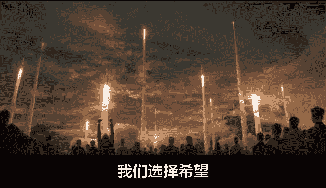

  
为了看《流浪地球》我买了早上 10：30 的票，结果睡过头了，又买了张晚上 10：44 分的票。走出电影院的时候快凌晨 1 点了，再加上过年，路上一辆车都没有。虽然影片存在一堆宣泄情绪的逻辑缺陷，但我看到了两个核心点：   
1 什么是真正的力量？  
2 求存永远是非理性的！  
真正的力量  
如果一个人的块头比你大，他就会比你有力量。如果另外一个人手上拿了把刀，他又会变得更有力量。如果再出现一个人拿着枪的人，他的力量也就更大。以此类推，工具的威力在持续赋予人更强大的力量！除了具象的物质工具，由人构建而成的组织也是工具，而且是聚集力量和释放力量的工具。谁能搭建结构并运用结构力量，他也就拥有更强大的力量：一个国家的领导者也和你一样只有 100 多斤，但是他所拥有的工具能赋予他更大的力量，能决定千万人的生死祸福——他可以凭空造出一座城市，也可以瞬间毁灭一个国家。这些都是力量最直观的感受！   
万里长城万里长，不见当年秦始皇。昔日的秦砖汉瓦都变成了废墟，昔日的秦皇汉武都变成了历史名词——如果没有了传承的载体，文明只能剩下一堆尘封的记忆。人之所研究历史正是为了从中找出蛛丝马迹的规律来为未来提供指引的依据，如果没有了未来，历史也就无人在意——我们回顾过去恰恰是为了未来的存续！  
一个身残志坚的人，一个出身于社会底层却实现逆袭的人，一个在无法存活的环境下奇迹般的生存下来的人！这样的人，这样的生命体，这样的族群，不仅让人会发自内心的敬畏，而且会让其它的同类由衷的感到恐惧！这是一种顽强的生命力，一种生生不息的存续能力，存续才是真正的力量之源！  
所有工具性的力量都只能呈一时之能。生命体的力量来自内部，而非外部。真正的力量，是无论在什么情况下都能存续下去的生生不息！   
非理性求存  
这个电影的很多情节都非常的扯淡，完全经不起逻辑的推敲。巧妙的利用音乐、台词、素材、构图等综合元素铺设成一种点燃情绪、带节奏的套路。以至于整个影院里的人几乎都泪流满面——他们有的可能是在经济寒冬中坚守的企业主，有的可能是严谨理性的工程师，有的是背负债务的老板，有的是冷漠的父亲，有的是对生活绝望的人——我相信影院中的人群里什么样的人都有。然而，他们都被影片感动的热泪盈眶，泪流满面！我自认为自己比较理性，而且我看清楚了影片逻辑上的突兀和点燃情绪、带节奏的套路——包括画面，音乐，素材，对白等等，但是，我依然被“千万辆车同时掉头去做最后的救援”那个镜头所打动。当吴京为了点燃木星，开着空间站，带着人类文明最后的火种去自我牺牲的时候，空间站的人工智能控制系统叹息地说：永远别指望人类会理性行事！它无意中说出了一个底层逻辑：生命体的求存之道是非理性的！  
生命体存在一个能被唤醒的底层共识——这种共识蕴藏在每个生命体的基因之中——就如同各种量化对比会暗示人的优劣，从而唤醒生命体作为基因载体的求存本能——对于基因的载体而言，淘汰意味着死亡。  
无论流程梳理的多么清晰，控制和反馈多么高效，AI 如何发达，都无法解决由生命体构建而成的复杂系统的根本问题！人工智能永远只是增强结构力量的工具，是生命体提高能量转化能力的工具。“基因传递对能量的无限需求和其载体对能量转化的有限能力之间的终极矛盾”，是生命体非理性求存的源头——并发的压力源于共享的规模，工具越强大，这个终极矛盾就越突出。  
无论是科技树升级还是组织度跃升，都是为了让结构力量的构建和维护成本更低。从而在体系与体系的对抗中获得优势。领导力永远不可替代，它是一种能化腐朽为神奇的艺术。最优秀的领导者不是去压制人性中非理性的部分，恰恰是充分的激发人心中非理性的部分！所有的激励机制都是通过在人心之中制造优劣的暗示，去激活生命体求存的底层逻辑。所有领导力都不是控制，而是通过指引有利于存续的目标，并唤醒生命体的底层逻辑，激活生命体非理性的求存本能。利用结构力量去对抗结构力量，以非理性战胜非理性，以群体行为制约群体行为，从而实现一种有序的动态平衡！  
结构学进阶：觉悟社  
[F3：结构力量](http://mp.weixin.qq.com/s?__biz=MzAxNDk1NjI2Mw==&mid=2247484256&idx=1&sn=f10d9c530bfd6ea08b25d4bec657c13a&chksm=9b8a20e8acfda9fee057f2df26790f905c898132cac91d833d14e636edb00c20514d63189a88&scene=21#wechat_redirect)  
[B4：你无需为华为担心！](http://mp.weixin.qq.com/s?__biz=MzAxNDk1NjI2Mw==&mid=2247484272&idx=1&sn=b63b21dd8e2aec97201f452c0efd7175&chksm=9b8a20f8acfda9eeb379304169ddf23955b121150036cd27ea282a67cf52c9226120b51a5c96&scene=21#wechat_redirect)  
[几次成功的结构学预判](http://mp.weixin.qq.com/s?__biz=MzAxNDk1NjI2Mw==&mid=2247484266&idx=1&sn=02ab915e029cbe24d91712f741b3f37c&chksm=9b8a20e2acfda9f4498a5c76204c101ab26e7311f2fb7d3043de108d4ff6e18d72a1c889a569&scene=21#wechat_redirect)  
[A26：中导条约被废除之后！](http://mp.weixin.qq.com/s?__biz=MzAxNDk1NjI2Mw==&mid=2247484277&idx=1&sn=d8ab9b4b84cbc35b890bb468b0f0afd2&chksm=9b8a20fdacfda9eb6b00d830680d3dd3f7cad33fe6b391d238e3ada16cf858da5cb12b0ecd1b&scene=21#wechat_redirect)  
[向正在坍塌的地方踹上一脚！](http://mp.weixin.qq.com/s?__biz=MzAxNDk1NjI2Mw==&mid=2247483789&idx=1&sn=5e44b7b524c3dc4bb7705f49ed0a44a3&chksm=9b8a2205acfdab139e4b1d44ef6702b09c9fbf79505340205d13fbdaa33207a997f54bee0e97&scene=21#wechat_redirect)  
结构学应用去：觉悟社  
提问到知识星球：守夜人总司令  

  
觉悟者  
喜欢你就转走吧！  
微信扫一扫赞赏作者 赞赏  
已喜欢，对作者说句悄悄话  
取消   
发送给作者  
发送  
最多 40 字，当前共字  
 人赞赏   
上一页 1/3 下一页  
长按二维码向我转账  
喜欢你就转走吧！  
受苹果公司新规定影响，微信 iOS 版的赞赏功能被关闭，可通过二维码转账支持公众号。  

 

精选留言  
用户设置不下载评论   
[阅读全文](https://t.zsxq.com/juj2rjM)  
  

# 

# \[守夜人总司令\] - 2019-02-05 A26：中导条约被废除之后！

> 来源：[`www.yuque.com/books/share/97051b78-926c-43e6-b0aa-0b72ff163ac4/nv9gx8`](https://www.yuque.com/books/share/97051b78-926c-43e6-b0aa-0b72ff163ac4/nv9gx8) 

A26：中导条约被废除之后！  
原创 觉悟者 守夜人总司令   
守夜人总司令   
微信号 WatcherCommander  
功能介绍 结构学：生命体在其生存结构中的求存之道！  
2019-02-05[原文](https://mp.weixin.qq.com/s?__biz=MzAxNDk1NjI2Mw==&mid=2247484277&idx=1&sn=d8ab9b4b84cbc35b890bb468b0f0afd2&chksm=9b8a20fdacfda9eb6b00d830680d3dd3f7cad33fe6b391d238e3ada16cf858da5cb12b0ecd1b&scene=27#wechat_redirect&cpage=409)  
收录于话题  
为什么川普热衷于退群？ 只有书呆子才会认为法制是条文。所谓法治是某个生存环境中群体的求存共识能够被贯彻执行，而共识作为一种行为规范之所以会被贯彻执行，源于势均力敌的制约！一知半解的公知们津津乐道的大宪章是怎么签订的？正是贵族们联合起来打败了国王的势力，迫使国王不得不遵循不能侵犯贵族利益的规则。英国的宪政之所以逐渐确立，并不是基于什么国王的恭谦退让，而是王权在贵族联合势力面前的节节败退！  
随着工业革命的到来和社会基础结构的改变，这种趋势就越发不可逆转，因为第一次工业革命的主导势力恰好就是同时身兼土地贵族和工场资本家的群体。克伦威尔大败了查理一世，即便他出任独裁性质的护国公，但是，他的政策都在逐步确立身后所代表的新兴群体的利益——并将这种利益以国家法令的方式确定下来。在这社会基础结构变革的大势面前，国王的权力被日益削弱就成了必然。真正的宪政就是在这样的博弈中逐步确立的。当然，这种赤裸裸的现实不能明说，所以，要加以粉饰。让这一切变成一种高贵的恭谦礼让和深思熟虑的克制。 如果一个地区的社会规则并非源于内部博弈逐步形成，而是被外部强行改造而成。那么，这种法制的维系是需要很高的外部成本的。因为法制是一种运行中的秩序！秩序的确立和维系源于博弈之后势均力敌的均衡状态。要维持这种状况，需要保持势均力敌的平衡。一旦某一方的势力能够以更低的成本打破这种平衡，那么，这套规则就遵守不下去了——如果破坏规则又无力惩罚，没法将破坏的势力重新拉回到均衡状态。那么，其它的势力为了求存和自保，必然会主动破坏规则中对自身不利的约束。从而进一步撕裂规则，让秩序荡然无存！ 任何规则的确立，其实就是一个稳定结构的搭建。搭建结构需要能量，维系结构同样需要能量。搭建结构是为了占据更多的资源和提升能量转化的能力并利用结构力量。如果无法提升转化能量的能力，那么结构力量就发挥不出来，结构也就没有存在的必要。 美国处于上升阶段，结构力量的释放需要构建许多国际组织作为传导体系的环节——这些安全、经济、政治等各方面的国际组织，成为了美国输出结构力量的传导工具和组成部分。并通过它们控制着世界上绝大部分资源，让这些资源都服务于华盛顿的意志、规则和主张！  
只有存在富余的能量才能用于搭建结构和维持秩序。富余的能量不会凭空产生，只会源于对能量转化能力的提高——它具体表现为科技树的生长和组织度的跃升。因此，能量转化能力的提高会呈现出螺旋交替上升的特征：当原点科技产生突破性进展，并且被大规模产业化的时候，必然产生一个上升的波段。继而是同一层次科学技术的应用普及和跨界组合，衍生出更多的相关产业和应用。也演化出更多的组织方式和更频繁、高效和智能的协作方式，从而提高对资源的操作粒度，继而提高能量转化的能力并产生另一个上升的波段。 因此，科技革命属于第一种提高能量转化能力的方式，而全球化则属于第二种提高能量转化能力的方式。所以，全球化的持续性源自于科技革命和配套产业的突破所产生的势能。如果第一种能量转化长期没有突破，全球化的深入会造成产业转移和资金外流，继而造成内部的空心化——因为内外的落差被持续的全球化拉平之后，做同样层次的事情，更高的社会成本将不具备竞争力，而社会惯性又不可能改变，从而必然造成资金和产业的持续转移。《[向正在坍塌的地方踹上一脚](http://mp.weixin.qq.com/s?__biz=MzAxNDk1NjI2Mw==&mid=2247483789&idx=1&sn=5e44b7b524c3dc4bb7705f49ed0a44a3&chksm=9b8a2205acfdab139e4b1d44ef6702b09c9fbf79505340205d13fbdaa33207a997f54bee0e97&scene=21#wechat_redirect)》中详细阐述了，在此不再复述。 这 70 年来，美国的基础科学技术并未产生革命性的突破，新的产业也只是集中在互联网相关产业。而这种自带传播和连接属性的产业，是有利于全球化的。它不仅仅加速了蓝领工作的流失，也加速了白领工作的流失，从而持续减少社会的能量盈余。每一次退群都是在卸下一个包袱——当一个结构性的社会工具如果无法产生正向盈余的能量，它就不能成为结构力量传导体系中的一环，也没有必要存在。摧毁它是释放资源，也是将能量从不必要的耗费中抽离出来用于正确的地方。 中导条约为什么能确立？ 美苏双方相隔离万里之遥，如果要对轰，必须是民兵对白杨这种的洲际导弹才够得着。远程导弹从发射到抵达需要至少 30 分钟，所以有足够的时间来反应，而且容易被中途拦截。但是中程导弹留给对方的反应时间非常短暂。甚至来不及反应。所以，这种威胁是迫在眉睫的，迫使双方谁也不敢松懈。中程导弹条约所预留出来的安全距离是用来保护欧洲的！ 中导条约是里根和戈尔巴乔夫签署的，缔约双方都不得发展和部署 500-5000 公里射程的中程弹道导弹。那个时候美苏双方的军备竞争搞得双方都精疲力竭。这种限制能够让彼此都从力不从心的军备竞争中抽身，同时也为彼此留足了安全距离。美国在给苏联一个安全的保障之时，也给欧洲一个安全的保障。然后就华丽的从军备竞争中抽身出来了。 二战以后，欧洲是冷战的前沿地带。它的安全体系和社会政治经济秩序都是美国人搭建起来的，并且一直由美国在维系。哪里是焦点，哪里就天生吸引眼球和资源。美国要想让它的后院和本土安全，就必须要把争斗局限在别人的家门口。所以采取遏制战略，把欧洲打造成了前沿阵地，大量的资源向那里倾斜，也持续在那里制造紧张对立。凡事有利就有弊。欧洲的防务全部甩手给了美国，不仅仅出让了主导权——北约的指挥官是美国人，而且从此自己不再具备独立构建防务体系的能力！这是一种综合性的能力，是一个完整的社会体系，没有玩过的还真搭不起来。为什么德国总理在川普威胁退出的时候悲壮的说欧洲以后只能依靠自己了。因为以前这事都是别人干的，成本也是别人在背。它们就如同大人羽翼下的孩子，现在要独立面对生活，不免充满了惶恐和力不从心。 总而言之，中导条约之所以被确立源于当时的势均力敌，一味的军备竞争并不足以改变天平的平衡，还不断的消耗彼此的资源，搞得美苏都精疲力竭。因此，它是一种动态的平衡。当形势发生改变的时候，契约被遵守的基础也在逐步失去… 自始自终这事都跟欧洲没有太大的关系。因为支付成本和起决定作用的双方是美苏两大巨头。在欧盟作为一个独立势力登上舞台之前，欧洲各国分属两大阵营，充当各自的随从和跟班。 美国全面收缩后的策略 底层的威胁 欧洲的威胁来自俄罗斯，但是，俄罗斯对欧洲的真正威胁并非军事上，而是能源上的依赖。俄罗斯正在不遗余力的通过黑海管道，途径土耳其的达达尼亚海峡，将油气送往欧洲。欧洲是工业化比较高的社会，又处于高维度地区，日常生活对油气的依赖度很高。而且欧洲绝大部分地区和中国一样是煤多油少的地区。  
当年第三帝国东进的时候，两个战略级的目标，一个是罗马尼亚的油田，另外一个就是外高加索的油田。天不遂人愿，前一个被大面积破坏，后一个没有攻下来。这就造成了工业强国德意志帝国无法大面积部署机械化部队——进攻苏联的很多部队都是骡马化的部队，而不是机械化的部队。对于一只以闪电战著称的部队而言，没有什么比机械化部队的油料匮乏更让人沮丧得了！石油不足一直是困扰第三帝国的命门。而苏联的油气充足也是后期持续大规模机械化暴兵的底气所在。 俄罗斯除了在努力向西修建管线输送油气之外，也在拼命向东亚修建管线，向中国输送油气。东北方向的管线是我国四条外部输入的石油大动脉之一。我们刚刚建立 90 天的战备石油储备。也就是说，如果战争发生，中国的石油输入被切断，整个社会的油气供应能够维持 90 天。90 天之后，不仅仅民用车跑不动，军用的机器也要停摆——在过去的几十年，连 90 天的储备都做不到！所以，真的非常感谢过去几十年的和平——这种战略级的和平，保障了我们有能力和时间来补缺失的课——只有底层无脑文盲才会整天喊打喊杀。拿什么去打去杀呀？用拳头还是菜刀呀！ 我们为什么会强力推新能源？你以为国家不知道它们骗补贴？为什么知道还要强推？因为，随着中国社会结构的升级，不仅仅工业化和城市化的程度越来越高，而且对能源的消耗会指数级攀升。这么大的需求量，自己又解决不了，无论是依靠谁，都等于在自己脖子上套根绳子，然后把绳子交到别人手中！既然美国人可以从海上切断我们的油气输入的航线。那俄国人难道就不能切断我们的管线么？它们甚至都不需要切断，油气是它们供给的，随便找个理由把阀门一关，你就得服软！ 欧洲的处境 美国不会联合欧洲搞中国，它会驱赶欧洲对抗中俄和伊斯兰，如果欧洲不从，它会采取威胁的办法迫使其就范。联合是发生在势均力敌的二者之间，欧洲和美国自从二战之后从来就不曾势均力敌过。它们是主从关系，美国对欧盟的提防不亚于对中俄的提防。当年布什父子非得打伊拉克，弄死萨达姆就是因为萨达姆不听劝，非得把石油出口改成欧元结算。本来美国就对欧盟和欧元提防得很紧。作为海湾石油出口大国居然率先主助纣为虐，只能拿它开刀。打垮萨达姆之后，新上台的人第一件事就是宣布伊拉克石油出口重新改回美元结算。 一旦整个世界格局转为彼此孤立，各霸一块的态势。美国与欧盟的潜在仇恨远远大于美国与中俄甚至伊斯兰世界的仇恨。因为它们是同一文化共享同一块区域！一旦普世的灯塔暗淡下来，天主基督教势力的强权不可能去抢占伊斯兰世界、儒家文明、东正教势力范围的影响力。如此一来，美国和欧盟两个强权争夺同一势力范围。这就变成教主太多，信徒不够了！教主之间必须先在角斗场里死瞌。 欧美之间不但不会是铁板一块，欧洲被逼急了，反而会买起它势力的账。美国以各种退群来威胁欧洲纳投名状，驱使它成为围堵儒家文明、东正教文明、伊斯兰文明的马前卒——这就好比一个父母走在路上威胁哭闹的小孩：再不听话就把你扔在这不管了！所以，在接下来一段时间内，你会看到欧洲在那里左右摇摆，相互矛盾，凌乱的自己都不清楚自己要干嘛。 不仅是川普，任何看清当下形势的美国总统都会一如既往的支持欧洲保守的右翼和破坏欧盟的势力。所以他支持英国脱欧，对德国总理和法国总统这种坚持欧盟的死硬分子一向反感。世人都以为这是个人风格，其实川普这人看起来疯疯癫癫，对自己真正的目标一向咬的很紧，只是掣肘力量太多。 美国的策略 美国不排除退出北约。因为谁都看得出来，俄罗斯不会进攻美国，甚至不会进攻欧洲。打一个叙利亚都这么费尽，几乎把家底都压上去了，还怎么可能有力量全面进攻欧洲！何况，俄罗斯没法向美国铺设油气管道，美国自己现在就是一个油气出口国。如果控制了维瑞内拉，整合拉美的油气资源、自身的油气资源，外加沙特的油气资源，这个分量就能左右国际油气市场的价格走向了。俄罗斯如此单一的经济，只要操控油价持续低迷，俄罗斯就得跪地求饶。所以，北约除了是一个烧钱的窟窿之外，对美国真的没太大用处。 美国要退出中导条约，俄罗斯必须要跟进。一旦退出，即便俄罗斯跟美国搞中程导弹和防御系统的军备竞争，也是集中在东南欧洲。美国后院和本土不会有什么影响。因此，最应该担心的是欧洲。无论是接受俄罗斯的管道去换取友好，还是出钱给美国部署防御系统，都是花自己的钱去受制于人。 根据天主基督教文明的特点，欧洲绝对不会屈服被美国收编，在关键时刻，它们宁愿选择投降异教徒也不会被同一文明的异端所收编——这是他们的文化属性决定的行为特征。美国属于同一文化，他们必然清楚这一点。因此，他们会有两个势力相互博弈，一方扮演激进的黑脸，比如看起来疯狂又心血来潮的川普之类；另一方扮演温和理智的白脸，比如传统势力和国际金融势力——其实他们的目标是一至的，区别仅限于手段！  
结构学进阶：觉悟社  
[F3：结构力量](http://mp.weixin.qq.com/s?__biz=MzAxNDk1NjI2Mw==&mid=2247484256&idx=1&sn=f10d9c530bfd6ea08b25d4bec657c13a&chksm=9b8a20e8acfda9fee057f2df26790f905c898132cac91d833d14e636edb00c20514d63189a88&scene=21#wechat_redirect)  
[B4：你无需为华为担心！](http://mp.weixin.qq.com/s?__biz=MzAxNDk1NjI2Mw==&mid=2247484272&idx=1&sn=b63b21dd8e2aec97201f452c0efd7175&chksm=9b8a20f8acfda9eeb379304169ddf23955b121150036cd27ea282a67cf52c9226120b51a5c96&scene=21#wechat_redirect)  
[几次成功的结构学预判](http://mp.weixin.qq.com/s?__biz=MzAxNDk1NjI2Mw==&mid=2247484266&idx=1&sn=02ab915e029cbe24d91712f741b3f37c&chksm=9b8a20e2acfda9f4498a5c76204c101ab26e7311f2fb7d3043de108d4ff6e18d72a1c889a569&scene=21#wechat_redirect)  
[向正在坍塌的地方踹上一脚！](http://mp.weixin.qq.com/s?__biz=MzAxNDk1NjI2Mw==&mid=2247483789&idx=1&sn=5e44b7b524c3dc4bb7705f49ed0a44a3&chksm=9b8a2205acfdab139e4b1d44ef6702b09c9fbf79505340205d13fbdaa33207a997f54bee0e97&scene=21#wechat_redirect)  
结构学应用发消息：觉悟社  
提问到知识星球：守夜人总司令  

  
觉悟者  
喜欢你就转走吧！  
微信扫一扫赞赏作者 赞赏  
已喜欢，对作者说句悄悄话  
取消   
发送给作者  
发送  
最多 40 字，当前共字  
 人赞赏   
上一页 1/3 下一页  
长按二维码向我转账  
喜欢你就转走吧！  
受苹果公司新规定影响，微信 iOS 版的赞赏功能被关闭，可通过二维码转账支持公众号。  

 

精选留言  
用户设置不下载评论   
  

# 

# \[守夜人总司令\] - 2019-02-03 B4：你无需为华为担心！

> 来源：[`www.yuque.com/books/share/97051b78-926c-43e6-b0aa-0b72ff163ac4/qvukr3`](https://www.yuque.com/books/share/97051b78-926c-43e6-b0aa-0b72ff163ac4/qvukr3) 

B4：你无需为华为担心！  
守夜人总司令   
守夜人总司令   
微信号 WatcherCommander  
功能介绍 结构学：生命体在其生存结构中的求存之道！  
2019-02-03[原文](https://mp.weixin.qq.com/s?__biz=MzAxNDk1NjI2Mw==&mid=2247484272&idx=1&sn=b63b21dd8e2aec97201f452c0efd7175&chksm=9b8a20f8acfda9eeb379304169ddf23955b121150036cd27ea282a67cf52c9226120b51a5c96&scene=27#wechat_redirect&cpage=409)  
收录于话题  
以下文章来源于交易成本 ，作者觉悟者  

  
交易成本  
《结构学》：生命体在其生存结构中的求存之道！ 训练营：觉悟社  
  
弱者的弱是全方位的弱：如果这一点做不到，那一点自然也就做不到，所以才会陷入四处碰壁的绝境。一个人的优秀同样是综合性的优秀，不是单点的优秀。玩过星际争霸这种战略游戏的人都清楚，最开始布局的那几下操作和决策的取舍就决定了后面的态势，同时，也从侧面反应这个人看待问题的方式和行为的特征！无论是正向还是反向都会循环叠加——这正是结构力量的威力！  
华为的战术   
在真实的作战中，如果部署一个团去攻占某个目标。绝对不会像电视剧里一样一拥而上，然后死守。在任务分配的时候，会把整个团按连队为单位分成很多拨攻击单元相互接力，而且会遵循明确的接力时间。  
华为在攻坚的时候遵循的是军队的那种打法，并不是外人臆想的那样嗷嗷叫一拥而上：比如攻克某项新技术，首先会组织一个专家突击队，这个突击队的任务只是把原理变成一个初级原型。做出来以后，这个团队解散。留下一部分人组建第二梯队，成为研发骨干和领头人，另一部分开始分流到售前、市场等各个部门去组建开拓应用的团队。因为从技术原理变成现实模型是这些人搞出来的，他们去跟客户讲一个新技术的应用场景的时候是最清楚的人！在他们做市场教育的时候，第二梯队的主要目标是把一个粗糙的实验室原型变成一个通用的产品。完成目标以后，第二梯队解散。一部分留下，作为第三阶梯队的细分项目带头人和骨干。其他人进入市场开拓团队——有了前面的市场技术应用教育和个性需求挖掘之后，配合成熟的产品和应用，他们开始成为市场开拓强有力的火力支援，甚至突击主力。第三梯队的任务是根据收集的细分需求和对不同市场的研究，基于成熟产品做出差异化的应用，以满足各区域客户的专属需求。 最后一波则是根据合作方的需要，做出更细分领域的定制产品方案。然后，将整个市场层层渗透...  
任正非非常推崇林彪的战术：林彪发动攻击之前会充分准备，一旦决心已下，会把 4 个纵队纵向配置，而不是横向配置。攻破一个小口子以后，前面的纵队至两翼于不顾，继续向前突击。后面的纵队立刻从口子进去向两边扩张，扫清两翼然后与突击纵队成品字形立体推进。后面的纵队及时补漏，保持攻势延绵不绝，直至彻底将敌人摧毁。  
华为的战略  
战争的手法说到底就八个字：保全自己，消灭敌人！如果计算一下火力和规模就能绝对胜负的话，战争的技巧就不能称之为艺术。将军们也就真的变成赳赳武夫了！战争的技巧之所以被称之为艺术，这是因为将军们很像音乐家和美术家一样，演绎出不可量化的化腐朽为神奇。  
孙子兵法上说：善攻者动于九天之上，善守者藏于九地之下。所谓的奇正，这是有效的隐藏自己的意图并让敌人产生误判，乖乖的钻进自己编织的圈套。在所有的欺骗中，战略欺骗最为可恶，也最能显示出一个将军的智慧和勇气。战略级的伪装不是在头上插两根稻草，而是要让你睁眼瞎——出现在你意想不到的地方，既出乎意料之外又在情理之中！  
美帝的阳谋   
虽然九段线内的整个南海都是我们的传统海域，但很长时间内，我们的海空力量覆盖不了那么远。所以我们的策略只能是：阁制争议，共同开发；既不按国际法谈判，也不明确宣布精确的海上边界线。这是处于弱势之时的有效策略——就像沙漠里的眼镜蛇一样：在攻击之前会把自己周身盘紧膨胀出好几倍，不经意间突然攻击，又故意不咬中，让敌人心生恐惧又不知深浅。  
美国人受不了这种模棱两可的折磨，为了反击这种策略，为了搞清楚我们心理能坚守的底线到底在什么地方。他们想出了一个笨办法：不断派出飞机和军舰延着九段线由外向里一点一点的拱。遇到拦截和警告就马上退回去并记录下来，没有遇到拦截和警告就继续往里试探。就这样，在经过 N 次的海空侦察之后，把遇到拦截和警告的点连接成一条线，就从地图上清晰的看出了我们的海空力量能覆盖的底线在什么位置！派海空力量一点一点的在地图上划线的办法虽然蠢，而且花费成本巨大，但是达到了他们的战略目的。  
不对称攻击   
如果一个策略能消耗敌人 10 倍甚至上百倍的成本，从战略上来说，绝对是成功的。何况，事物是发展变化的，你提升一点，对方的消耗也要相应放大——这会把人拖死。  
当年我们面临着是搞飞机还是搞导弹的选择。钱学森说，搞导弹所要的配套设施和材料我们国内都有。搞飞机所要的一些东西必须依赖进口。而且导弹发射出去就不用管了，飞机要发挥战斗力需要太多不确定因素的配合。所以我们用仅有的那点家底，全力以赴去搞导弹。结果我们的飞机技术虽然落后于人，但是导弹技术跟两大帝国并驾齐驱——这就是战略性取舍的胜利。  
虽然我们一直奉行防御型国防政策，但是尖端的核心部分全是攻击性的！这叫不对称攻击策略——不管你比我强多少，我只要能对你一剑封喉，就能达到暴力平衡，你就不敢藐视，否则就同归于尽！  
命运共同体   
铁扇公主可以轻易的把孙悟空扇到十万八千里以外，但是，当孙悟空钻到她肚子里去的时候，她就有劲使不上，无能为力了！  
大家只看到华为去开拓亚非拉，在北美以外的市场里面下大力，干苦活，挣辛苦钱。废了九牛二虎之力才挤进欧洲市场。始终都在北美市场之外，不得其门而入。另外一个非常深刻的感受就是华为在芯片等关键领域都处于应用的下游。即便有仿造——用的英国的技术和台湾的制造工艺，也与主流的美国芯片相去甚远。所以这个态势很容易让人得出结论。大家的脑子里面甚至会冒出中兴被人卡住脖子的惨样——只不过华为的研发投入让它可以多挣扎两下。结果还是一样的，因为形势摆在那里！  
所谓睁眼瞎，就是一切都合情合理，所以才会出乎意料之外又在情理之中！领航者宣称要构建人类命运共同体，至少在产业上已经先行一步——在产业上上下游之间早就是命运共同体了。门外汉认为芯片就是一个整体，不是的，那个装在你手机或者电脑里面的芯片是有很多单元组成的。他虽然小也是由各种单元集合而成的。在这个全球分工协作的时代，没有哪一家公司把所有的单元都自己做了。华为早就提前埋伏进去投资并扶持了一些为那些芯片公司做内部单元的企业，并且以欧美企业完全不一样的方式充分的让所有芯片商使用，努力成为它的一部分。一个卖服装的不会过于在乎某个纽扣供应商。这就是睁眼瞎！但它跟服装不一样的地方在于：它不是附带其上的装饰品，而是铁扇公主肚子里的孙悟空。没有这一部分，整个芯片也没法用！这就是一剑封喉的不对称攻击。这也是华为的策略：所有的谦卑隐忍和低眉顺目就是为了防你今天这一手！  
华为的力量  
我人生第一份 offer 就是华为给的，虽然我拒绝了它，因为当时有一个创业项目要搞。但他们录取人的标准给我留下了非常深刻的印象。我记得面试的时候有 5 个人应征那个岗位。看得出来另外 4 个人都非常优秀，而且成长环境比我好。后来我问了一个里面的同学才明白：之所以最后给我发 offer，是因为我的家庭条件比另外 4 个都差——这符合他们的选人标准：如果几个候选人都能胜任，选出身最差的那个！之所以这样，是因为出现更差的那个人更能吃苦耐劳，也更会打心眼里感激华为发给的超出平均水平的薪水。同时，更愿意接受华为的教育、熏陶和安排，因为这样的人更没得选择！  
这里就引申出了一个价值观偏向：华为自始至终强调组织力量，而不推崇个体力量。个体的价值必须在组织内发挥。华为推崇奋斗者精神，根据人性的本能，越是没有选择的人越有破格获取的冲动和野望，同时又特别渴望得到保障——这是一种悖论，但华为的激励机制巧妙的满足了这种悖论。所以他能把这些没有方向的力量引导到传导体系之中形成延绵不绝的磅礴力量。  
教育的本质是启迪而不是训练。启迪是种下一颗种子，让个体自己探索和取舍——会着重于：分辨事物的方式，感知事物的能力，表达事物的逻辑。然而，任何组织的训练都是为了统一认知，统一行为，统一目标。并将行为进行量化和比较，通过优劣的刺激形成相互挤压的推动力——奖惩措施看起来是外在的激励，其实，驱动力恰恰产生于人心之中。  
正确的策略和连续的胜利，会不断激发普通个体的荣誉感，归属感和成就感。越是虚弱的基层个体越会强调自己所归属的群体、从事的事情、信仰的宗教的神圣和伟大——因为这能让自我存在感较低的个体感到强大和满足。因此，华为的这些会在每个成员的内心凝聚起宏大的使命感，激发主动为之牺牲和付出的热情，同时，激励机制会让所有个体获得独自无法获取的东西，从而轻易将其纳入流程的规范之中，并通过驱使自己符合组织导向性的要求去赢得内部的认可和奖励。华为不惜重金打造流程体系，就是将人的不确定性降到最低。由此搭建起性价比非常高的传导体系，并形成了一种类似于宗教的结构力量！  
结构学进阶：觉悟社  
[F3：结构力量](http://mp.weixin.qq.com/s?__biz=MzAxNDk1NjI2Mw==&mid=2247484256&idx=1&sn=f10d9c530bfd6ea08b25d4bec657c13a&chksm=9b8a20e8acfda9fee057f2df26790f905c898132cac91d833d14e636edb00c20514d63189a88&scene=21#wechat_redirect)  
[E2：《结构学》自序](http://mp.weixin.qq.com/s?__biz=MzIzMDYwOTM0Mg==&mid=2247483926&idx=1&sn=b95a4f9087097a0c18a896d987b3fe52&chksm=e8b19ac7dfc613d10373c203fe258ab87a4e3d2e3277cb2468fd5e30235394c6be0f148c5b0b&scene=21#wechat_redirect)  
[几次成功的结构学预判](http://mp.weixin.qq.com/s?__biz=MzAxNDk1NjI2Mw==&mid=2247484266&idx=1&sn=02ab915e029cbe24d91712f741b3f37c&chksm=9b8a20e2acfda9f4498a5c76204c101ab26e7311f2fb7d3043de108d4ff6e18d72a1c889a569&scene=21#wechat_redirect)  
[C13：交易和金融的价值！](http://mp.weixin.qq.com/s?__biz=MzIzMDYwOTM0Mg==&mid=2247483930&idx=1&sn=ae65c47055e5a1bf799a5313d32053d3&chksm=e8b19acbdfc613ddcbff8490bf7d7ff6c7afbd985bbf3d6ef051e8f397e179061dc7edbe5fc1&scene=21#wechat_redirect)  
[B1：去不掉的中间环节！](http://mp.weixin.qq.com/s?__biz=MzIzMDYwOTM0Mg==&mid=2247483903&idx=1&sn=e8a21cb816d6a27d869f81463805a208&chksm=e8b1992edfc610380f54d91f9acc9844820c77ce8a5bcedb4f36372c406647f45fd2514a6a77&scene=21#wechat_redirect)  
[B2：东南亚的资产值得买吗？](http://mp.weixin.qq.com/s?__biz=MzIzMDYwOTM0Mg==&mid=2247483936&idx=1&sn=26888c67b2ba0feaee0961b813271e24&chksm=e8b19af1dfc613e7fed8be7a6f08ce8e8fdf53fc76ac63729dfec83d3a9d10977f40a2534bc2&scene=21#wechat_redirect)  
结构学进阶去：觉悟社  
提问到知识星球：守夜人总司令  

  

 

精选留言  
用户设置不下载评论   
[阅读全文](https://t.zsxq.com/MZzVNNZ)  
  

# 

# \[守夜人总司令\] - 2019-01-31 几次成功的结构学预判

> 来源：[`www.yuque.com/books/share/97051b78-926c-43e6-b0aa-0b72ff163ac4/flvc7e`](https://www.yuque.com/books/share/97051b78-926c-43e6-b0aa-0b72ff163ac4/flvc7e) 

几次成功的结构学预判  
原创 觉悟者 守夜人总司令   
守夜人总司令   
微信号 WatcherCommander  
功能介绍 结构学：生命体在其生存结构中的求存之道！  
2019-01-31[原文](https://mp.weixin.qq.com/s?__biz=MzAxNDk1NjI2Mw==&mid=2247484266&idx=1&sn=02ab915e029cbe24d91712f741b3f37c&chksm=9b8a20e2acfda9f4498a5c76204c101ab26e7311f2fb7d3043de108d4ff6e18d72a1c889a569&scene=27#wechat_redirect&cpage=409)  
收录于话题  
结构学是一种应用之学，研究生命体在其生存结构之中的求存之道。到目前为止都在阐述原理，我试图将整个框架以严密的逻辑呈现出来。F1 和 F2 要重写，[F3：结构力量](http://mp.weixin.qq.com/s?__biz=MzAxNDk1NjI2Mw==&mid=2247484256&idx=1&sn=f10d9c530bfd6ea08b25d4bec657c13a&chksm=9b8a20e8acfda9fee057f2df26790f905c898132cac91d833d14e636edb00c20514d63189a88&scene=21#wechat_redirect) 是框架中的原理部分。不仅仅我们每个人是一个生命体，由我们这些个体构建而成的一些整体也是一个生命体，所有的生命体，无论什么规模都具备生命体的结构性特征。所有的驱动力一定是来自内部而不是外部，即便是被外力所左右，采取行动的驱动力也源于内部的生存策略——无论你是选择奋起反抗还是选择忍辱负重，这都是你的生存策略，而你的生存策略源自于你内心对自己的判断和对自己与外部关系的判断。并以此为基准形成了有利于自身存续的生存策略。即便是你跪在地上抱住那个伤害你的人的大腿哭，也是一种生存策略，而且你的内心认为这种生存策略有利于你的存续。  
文化是什么？文化是一个群体在某种生存环境中的共同生存策略。它很抽象，也很具象。抽象的你无法准确的描述，就像一个筐，衣食住行，道德伦理，甚至宗教信仰都能往里面装！它也很具象，具象到你思考问题的方式，你表达感受的词汇，你判断是非的本能，以及日常吃住的偏好。  
文化就如同风筝的那跟线，平时你不会在意它，但是风筝确被它牢牢的拽住。那种无形中决定了你的言行举止，还决定了某个人群的思维方式、心理特征和行为轨迹。你如果能理解这些，你几乎能够预测一个人、一个群体，甚至一个社会在面对某种问题的时候，它会选择往哪个方向去！  
我们都知道，一个人在面对一些纠结的选择的时候，会咨询自己信得过的人，自己应该怎么办才好。即便你的朋友给你列出最详细、最合理、最理性的操作步骤。你最后会怎么选择，依然取决于你内心的恐惧，或取决于你内心的缺失！因缺有需呀！你怕什么，你就会想方设法绕着走，你的价值判断以躲开内心恐惧为第一优先级，其它任何代价都愿意付出。不仅仅个人如此，由个体构建的更大生命体的行为和思维方式也如出一辙：当年西方的公使觐见清朝的皇帝不愿意下跪，因为这在他们的文化中，只有向上帝忏悔和求婚的时候下跪，都是单膝下跪。而在中国的文化中，三拜九叩是最基本的礼仪。我们社会的秩序通过礼仪来维持，所谓礼崩乐坏就是天下大乱；而分庭抗礼就是属于破坏秩序、公然对立的恶劣性质。可见礼在中国社会的秩序中具有举足轻重的地位——这种文化的背后是一种以礼仪这种低成本最大范围维持社会井然有序的生存策略。正因为如此，在这个问题无解的时候，中国朝野自上而下，为了避免公使与皇帝见面造成的礼仪问题，宁可牺牲更多实实在在的社会经济利益，甚至国家利益！  
所以，当我们去理解生命体自身特征的形成规律，以及它所处的生存结构和能够利用到的工具和传导体系，就能预判它的行为轨迹。这里有几个已经被验证的应用案例：  
有些东西会在历史的长河中或生活的细节中反复的重现。它的轨迹呈现出一种结构特征。有一种底层逻辑像风筝的那根线一样牵引着行为的轨迹。大家都关注聚光灯下的角色，其实决定角色行为的是那个舞台——尤其是搭台和拆台的力量！  
大概 8 个月前，贸易战还未爆发。一个做二级市场的朋友需要做一个判断：贸易战到底会不会爆发。任何人都可以轻易的下结论。所以，格言式的结论不重要，重要的是严密的逻辑。我以结构学的思路写了贸易战为什么一定会发生的报告：《[向正在坍塌的地方踹上一脚！](http://mp.weixin.qq.com/s?__biz=MzAxNDk1NjI2Mw==&mid=2247483789&idx=1&sn=5e44b7b524c3dc4bb7705f49ed0a44a3&chksm=9b8a2205acfdab139e4b1d44ef6702b09c9fbf79505340205d13fbdaa33207a997f54bee0e97&scene=21#wechat_redirect)》这也是这个公众号的第一篇文章。这个公众号的粉丝从来没有超过 50 人，而且三年未曾更新，因为这篇文章瞬间招惹来了近万人。于是，决定把结构学提炼出来，逐步呈现出它的整个逻辑框架。几个月后不但全面爆发了，而且如同文中预判的一样，开启了一个碎裂的序幕，永远回不去了！  
第二个预判是关于西北的治理政策的判断。[C12：务必要振兴建设兵团！](http://mp.weixin.qq.com/s?__biz=MzAxNDk1NjI2Mw==&mid=2247484193&idx=1&sn=88c86597191d0c97a411f9ea6f7b7c5d&chksm=9b8a20a9acfda9bfae819e8e42531fe6d523dd244ef0fc0c0787ab812540108c181f7ec2ffa9&scene=21#wechat_redirect)在这个问题上，文中阐述的思路与主流研究中国绿化问题的专家观点和所主张的策略完全相反。当你去预判一个政策的时候，不是书生在课堂上表达自己的主张和感受，而是清晰的洞察这个生命体处于什么样的生存结构之中，为了实现它的目的，可选择的策略、可利用的工具，以及传导路径都有哪些，假如你是决策者，你会如何取舍。文中有详细的逻辑阐述，在此不再重复。  
官方所处的生存结构决定了只能立足改造地，而不是立足改造人。地的现代化，再裹挟着人进入现代化规则去生活。在这个执行的过程中，必然以兵团为支点，把兵团里的地方弄成现代化城市，并保持现代化城市中人口、文化和规则的压倒性优势。兵团也一定会逐步南移，一点一代蚕食，不断以内地人充实兵团，再投入资金和科技去改造那个地，建立现代社会，逐渐在可控的情况下让所有人融为一体！  
目前这个预判开始逐渐被证实了。当地人给予了一些末端反馈，官方的策略正在如文中所阐述的一样逐步展开。突破点也确实选在兵团，而且规划也是兵团逐步南移，同时还在向内地贫困地区招募人员充实兵团。政策的实施和抓手都如同文中预判的一样逐步展开。我们可喜的看到，在思想观念上也一改往昔的一味迁就，开始在当地提倡思想解放，推行通用语言，甚至共吃一锅饭。就如同预判的一样——让所有人都适应现代化的生活方式，从根本上消除差异。  
第三个应用结构学做的预判，还未验证。而且被缺乏理性思维的人骂的特别惨。这个预判也是关于政策的：2019 年会动用官方力量把计划经济时代建成的流通体系重新盘活，让它变成扩大内需所的流通管道。把广大农村地区的人口接入市场，并利用金融手段，让他们能够通过负债购买，从而消化出口受阻挤压的产能，扩大内需！  
普通人的认知是依靠直觉，所以追张杀跌是常事。没有做过供应链的人不会理解重新铺设一套流通体系的成本有多高，它远远的高于激活一套现成的流通体系。我们在第一个关于贸易战的预判中已经揭示，而且被现实验证了：贸易战拉开的序幕是结构性扭曲造成的，它永远回不去了。所以，2019 无论怎么谈，出口都不乐观。出口的减少会对后端的生产贸易配套产业造成巨大的冲击，这不仅仅是经济上的冲击，而且会造成巨大的社会问题。因为失业所释放的过剩劳动力处于社会的低端层次，求存的机会很少。否则，他们就不会背井离乡忍受常人难以想象的恶劣工作环境去挣生产线上的钱。为什么要大力惩恶打黑，就是未雨绸缪！所以，无论如何都必须找到需求增长点，去消化掉产能，不能大面积让企业关停和裁员。这个内需的拉动就只能是市场渗透！光渗透还不行，还要把需求转化为交易。需求之所以不能转化为交易是因为买不起，所以，2019 年必然大力发展普惠金融，借钱给他们买！  
[A24：刘士余去供销社干什么?](http://mp.weixin.qq.com/s?__biz=MzAxNDk1NjI2Mw==&mid=2247484249&idx=1&sn=b8af24c3440b291292b1ed4eddfcfaec&chksm=9b8a20d1acfda9c79045cf72415a403a655fcbcc03483c9b2970fd289e28f7c18a998142039c&scene=21#wechat_redirect) 详情在这篇文章中已经阐述。而且，解决问题的思路——通过非市场的资源配置并建立完备的流通体系，提升商品交换效率和覆盖区域。这在解放前就成功实施过。官方作为一个生命体，在思维和决策的时候也遵循生命体的结构性特征，同样具有某种惯性。  
综上所述，结构学不是个人技能，它本身就在那里，我只是碰巧发现了它，试图把它用逻辑阐述出来。任何人都可以使用它。无论是生活中的取舍，还是生意上的判断，或者用于投资的分析。人在观察事物的时候会本能的从自我视角出发，而不是从所处的生存结构出发；采取行动的时候，反而不以自己为中心，而以周围的反馈为行为的依据。观察的时候难免一厢情愿，而行动的时候又一而再再而三的被外部力量裹挟着掉进陷进中，继而让情绪在内心肆虐，不断自我质疑，逐渐身心疲惫，彻底绝望！  
结构学进阶：觉悟社    
[F3：结构力量](http://mp.weixin.qq.com/s?__biz=MzAxNDk1NjI2Mw==&mid=2247484256&idx=1&sn=f10d9c530bfd6ea08b25d4bec657c13a&chksm=9b8a20e8acfda9fee057f2df26790f905c898132cac91d833d14e636edb00c20514d63189a88&scene=21#wechat_redirect)  
[向正在坍塌的地方踹上一脚！](http://mp.weixin.qq.com/s?__biz=MzAxNDk1NjI2Mw==&mid=2247483789&idx=1&sn=5e44b7b524c3dc4bb7705f49ed0a44a3&chksm=9b8a2205acfdab139e4b1d44ef6702b09c9fbf79505340205d13fbdaa33207a997f54bee0e97&scene=21#wechat_redirect)    
[C12：务必要振兴建设兵团！](http://mp.weixin.qq.com/s?__biz=MzAxNDk1NjI2Mw==&mid=2247484193&idx=1&sn=88c86597191d0c97a411f9ea6f7b7c5d&chksm=9b8a20a9acfda9bfae819e8e42531fe6d523dd244ef0fc0c0787ab812540108c181f7ec2ffa9&scene=21#wechat_redirect)  
[A24：刘士余去供销社干什么?](http://mp.weixin.qq.com/s?__biz=MzAxNDk1NjI2Mw==&mid=2247484249&idx=1&sn=b8af24c3440b291292b1ed4eddfcfaec&chksm=9b8a20d1acfda9c79045cf72415a403a655fcbcc03483c9b2970fd289e28f7c18a998142039c&scene=21#wechat_redirect)  
[B13：东南亚的房子值得买吗？](http://mp.weixin.qq.com/s?__biz=MzAxNDk1NjI2Mw==&mid=2247484228&idx=1&sn=a37f7554d6ec95ed90a77f2592ca75b6&chksm=9b8a20ccacfda9daeff8dfa945f0da53e667fcdf563488a9fc3cc42da05e4c6c608eb7024881&scene=21#wechat_redirect)  
结构学应用去：觉悟社  
提问到知识星球：守夜人总司令  

  
觉悟者  
喜欢你就转走吧！  
微信扫一扫赞赏作者 赞赏  
已喜欢，对作者说句悄悄话  
取消   
发送给作者  
发送  
最多 40 字，当前共字  
 人赞赏   
上一页 1/3 下一页  
长按二维码向我转账  
喜欢你就转走吧！  
受苹果公司新规定影响，微信 iOS 版的赞赏功能被关闭，可通过二维码转账支持公众号。  

 

精选留言  
用户设置不下载评论   
[阅读全文](https://t.zsxq.com/NNNvzVF)  
  

# 

# \[守夜人总司令\] - 2019-01-28 F3：结构力量

> 来源：[`www.yuque.com/books/share/97051b78-926c-43e6-b0aa-0b72ff163ac4/ao5tnw`](https://www.yuque.com/books/share/97051b78-926c-43e6-b0aa-0b72ff163ac4/ao5tnw) 

F3：结构力量  
原创 觉悟者 守夜人总司令   
守夜人总司令   
微信号 WatcherCommander  
功能介绍 结构学：生命体在其生存结构中的求存之道！  
2019-01-28[原文](https://mp.weixin.qq.com/s?__biz=MzAxNDk1NjI2Mw==&mid=2247484256&idx=1&sn=f10d9c530bfd6ea08b25d4bec657c13a&chksm=9b8a20e8acfda9fee057f2df26790f905c898132cac91d833d14e636edb00c20514d63189a88&scene=27#wechat_redirect&cpage=425)  
收录于话题  
结构学是解决现实问题的认知工具。结构学研究：生命体在其生存结构中的求存之道！它源于“基因延续对能量的无限需求和其载体对能量的有限转化之间的终极矛盾”。结构学并非个人技能，它一直就在那里。我只是碰巧发现了它，并试图将它描述出来，以便应用于生活、商业及投资的判断和取舍！  
生命体是一种能够从外部攫取能量维持自生存续的有序结构。它是基因的载体，基因的延续是生命体存在的终极目标。因此，只要有利于基因的传递，生命体这个结构既会自我进化也会接受改造。无论是自我进化还是外力改造都需要摧毁原有结构并完成重构。进化需要内部力量摧毁结构并完成重建，改造则需要外部力量摧毁结构并完成重建。无论摧毁还是重建，起决定作用的都是结构的关键支点。结构的关键支点及其相互之间的约束条件构建起结构内部相互支撑又相互制约的秩序——这种相互制约能够避免结构内部的损耗，从而最大限度的聚集力量作用于结构所导向的目标。  
所有的设计和进化都是为了解决某个问题，结构为目的而存在——结构力量的聚集和释放都是为了它的终极目标。不管是统治结构还是交易结构都是一种有序的稳定形态——这种有序需要能量来维持，构建这种稳定的秩序同样需要消耗能量。当能量不足时，结构就必然会坍塌和瓦解；如果能量不够，结构就无法搭建起来！  
结构力量三要素   
科技是将遥远的资源用于解决眼前的冲突，金融是将未来的资源用于解决眼前的冲突。情绪是把不存在的资源用于解决眼前的冲突——这里的“遥远”不仅仅是距离遥远，也包括资源转化的中间环节的长度和转化条件的复杂度。这里的“未来”是一个没有精确刻度的时间概念。这里的“不存在”是以产生情绪的载体为参照！无论是科技、金融还是情绪，三者都能形成递归循环，持续叠加，自我强化的结构力量。释放和阻断结构力量都取决于结构的关键支点——结构力量的关键支点包括以下三要素：  
1 面对存亡所形成的共识和仲裁机制  
2 能形成自我强化的内在驱动力机制  
3 执行生存策略的高性价比传导体系  
仲裁和共识   
生命体是基因的载体，个体生命按照一定方式构建起更大的生命体是为了控制更多的资源，提高能量转化的能力，降低基因传递断绝的概率，增强基因延续的多样性和适应性——所以，生命体会最大限度的占据资源以追求多样性和保障自身的存续，生命体处于不同的生存结构中会采用不同的生存策略，生命体的一切行为都是为了存续！  
所有的个体行为都受其内在精神结构的驱使，精神结构中的判断基于自我视角的抽象。这种自我抽象的差异性必然形成各不相同的生存策略，从而驱使各自采取符合自己生存策略的求存行为。作为一个整体，这势必造成混乱和内耗并制约结构力量的形成，继而危及整体求存策略的贯彻。共识必定是超越个体的，同时又有利于个体的终极目标。共识为求存确立目标，仲裁则针对目标做出取舍。仲裁的判断和取舍为个体的行为确立边界和规则，并形成一种结构力量驱使所有个体贯彻执行整体的生存策略。  
共识赋予仲裁机制做出判断和取舍的权力，形成一种约束来确保个体遵循规则并做出牺牲。如果说共识是一部宪法，那么仲裁机制就是宪法的执行机构——没有执行机构的宪法就是一纸空文。这个执行机构之所以能够建立的根本原因是什么呢？  
所有生命都需要面对死亡的威胁，暴力能够终结生命，造成死亡，所以暴力能够成为仲裁力量。正因为如此，凡是能大量制造死亡的力量都会被生命顶礼膜拜。将生命体置于死亡的威胁之中是迅速形成共识的最佳方式！仲裁其实就是通过死亡来做出抉择。因此，仲裁的最初形式就是暴力对决，其它一切的仲裁力量都是在模拟暴力对决。随着社会结构复杂度的跃升，对仲裁权的需求量成爆炸式增长。原始暴力不足以供给越来越多的需求者，于是，它转变为公共暴力，从而把仲裁权由少数拥有领地和武装的贵族扩展到拥有资产的广大群体——他们通过购买力来获得公共事务的仲裁权。  
领主的私人武装演变成国家机器的公共暴力，拥有购买力的群体通过国家机器来控制公共暴力。所有并发的压力都源于共享的规模——社会密度的持续提高，个体对仲裁的需求会更频繁。随着科技和金融的发展，一切都会被加速证券化并交易，资产的波动幅度会持续增加，保值将越来越难，因此，拥有让资产增值能力的认知力将会是继购买力之后的仲裁力量。购买力通过消费来确立护城河，认知力将通过教育来建立门槛！未来让人难以其及的不是奢侈品而是顶级的教育——它不仅仅贵，还逆人性，对绝大多数人而言，后者会是更大的门槛。  
仲裁所确立的规则个体虽然会遵从，但任何秩序的维持都需要消耗能量。如果迫使个体遵守规则所消耗的能量大于能从中获得的能量，结构力量就无法聚集起来，更无法形成自我强化的叠加。  
内在驱动力  
精神结构是内在驱动力的源头，包括三点：   
1 对自我的判断；  
2 对自我与外部资源关系的判断；  
3 基于以上的判断形成求存策略。  
生存策略是生命体求存的指引，也是生命体在其生存结构中一切行为的原始驱动力。这个驱动力是如何自我强化，又是如何作用于现实的呢？生命体对自我及自我与外部资源的关系所做出的判断并非基于客观事实，而是基于自我感知的一种筛选和抽象。生存结构既包括所处的生存环境，也包括生命体对所处生存环境的自我抽象！在阐述结构力量三要素的时候，提到过情绪之所以能够循环叠加并自我强化，是因为情绪具备一个特征，那就是可以用“不存在”的资源来解决当下的冲突。这个“不存在”并非指客观不存在，而是相对于生命体而言。既然生命体的精神结构对自我判断及对自我与外部资源关系的判断都是基于一种自我抽象。这里就提供了一种“做假”的可能——自身的状况和资源的匮乏或富足都不再取决于现实，而取决于生命体的自我抽象！  
所有能够形成循环叠加自我强化的元素都具备一个显著特征：能突破现有条件的限制并持续的提供能量。情绪是能不断的让“不存在”的资源成为形成生存策略的依据；金融是能不断的透支未来；科技是不断构建更复杂的工具去转化能量。但是，都存在一个边界，那就是能量守恒！  
精神结构在依据自我抽象的判断形成生存策略之时，其目的都是围绕在其生存结构中求得存续。越是关乎生死存亡，判断、决策、执行和反馈就会加速运转——生命体不断的根据反馈重新对自我及自我与外部资源的关系进行判断，并以此形成新的生存策略，再驱使生命体执行策略并重复以上的循环。情绪是一种将生存策略转化为行为的指示信号，情绪的叠加其实是上面那个循环在加速运转，这种运转需要消耗能量，只不过常人无法理解，就认为是情绪在持续消耗能量。  
鉴于精神结构的特征，如果生命体的自我抽象造成了错误的判断，这个循环叠加就会造成偏离——无论是对生存环境的感知、过滤、判断都将失真，继而会在目标设定、约束条件和检测标准上，越来越偏离事实。欲壑难填其实是一种内在判断的失真，正是这种错误的自我强化在不断的驱动着生命体去采取行动执行错误的生存策略——外部的一切都是它的工具！  
激励机制之所以能发挥作用，本质上并非源于外部的奖惩，而是源于个体精神结构的扭曲：所有金融机构在招募人员的时候都会故意挑选野心勃勃的人，并热衷于激发内心的恐惧和欲望，制造人与人之间的竞争，形成相互刺激、彼此驱赶的氛围。  
生命体的认知、判断和行为都会延续某种惯性，这惯性有的来自于所处生存环境中的制约，更多的是源于内心的某种缺失——在面对选择的时候，无论方案多么的完美，最终起决定作用的是当事人内心的恐惧——人会不惜代价的逃避内心的恐惧，去满足对安全感的需要。  
正因为生命体的对外行为是为了满足内心的需求——不是被恐惧所驱使，就是被贪婪所引诱。情绪的冲突源于生命体的精神结构——正是这种失真持续造成的扭曲产生了驱动力！生命体的所有行为都是由内部驱动的——所有的外交都是内政的延续！  
一个国家的内外政策亦是被内部各种结构性扭曲造成的问题所驱动——错误的策略经过传导体系的放大必然造成结构性的扭曲，一旦相互叠加就会形成多米诺骨牌一样的坍塌——人必自侮，然后人侮之；家必自毁，而后人毁之；国必自伐，而后人伐之！常人畏果，贤者畏因。因为贤者看到了结构力量会自我叠加的内在驱动力。  
一个社会、一个国家、一个组织都是由个体构建而成的更大生命体。生命体的结构特征具有普遍适应性。生命体的一切行为都受其精神结构所驱使。在由个体构建而成的更大生命体的生存策略也就是我们所谓的文化！个体的精神结构会对自我和自我与外部资源的关系进行抽象，再根据这种抽象和判断形成生存策略。无论个体还是整体，形成生存策略的基础都是基于自我视角的抽象而非现实——这既是个体自卑和自负的源头，也是文化具有自我遮蔽特征的源头！文化天然具备自我遮蔽性——因为它不仅仅源自于个体生命体精神结构对所处生存环境的自我抽象，而且是个体自我抽象所形成的共识。不仅会产生一种机制约束所有个体执行这一共识所形成的生存策略，还会衍生出一套机制去清除质疑者，从而实现内部的自我约束和自我强化。（会有一堆 C 系列来详细阐述）  
传导体系  
力量通过结构来聚集也通过结构来释放，结构力量的形成依赖于：一个能够凝聚共识的道义，一套能自我强化的激励机制，一个捆绑了利益的传导体系。所谓的道义其实就是生存策略。任何道义拆开来看，都是关于对自我判断的解释，以及对生存环境和自我与之关系的解释。生命体的精神结构特征决定了外部的奖励无论是对生命体造成正向的循环刺激还是反向的循环刺激都会形成自我强化。所以，奖励的核心是持续的刺激，而最有效的持续刺激就是设计一套规则去制造相互之间的优劣之争。生命体作为基因传递的载体，淘汰就意为着死亡。竞争的胜负会唤醒生命体对死亡的强烈恐惧，从而改变其对生存结构的判断，继而形成自我强化的驱动力，利用外部的一切工具去执行生存策略。  
生存策略的执行效果取决于传导体系。传导体系所能控制的资源决定了生存策略能在多大范围内产生影响。传导体系的构建也是一种秩序的构建，任何秩序的建立和维护都需要消耗能量。因此，成本决定着所搭建的传导体系的规模和控制力。  
共识所形成的生存策略之所以能得以贯彻是因为仲裁力量的作用。然而，仲裁力量不是凭空产生的，无论是原始暴力，还是购买力，或者认知力，都需要高昂的成本。所以，这种依靠外在约束确立规则并维持秩序所构建起来的传导体系，会有一个临界点，那个成本的临界点决定了它的规模和控制力。因此，搭建传导体系需要最大限度的追求性价比。  
通过外部约束来避免内耗，源于个体对生存环境和置身其中的自我抽象各不相同。各不相同的判断势必驱使各自执行自己的求存策略，从而造成混乱。因此，除了通过仲裁力量维持秩序之外，还会通过统一各体的自我抽象和判断来避免混乱——所有的教育和训练都是为了统一判断，从而降低成本，搭建性价比更高的传导体系。规模更大和控制力更强的传导体系不仅意味着生存策略能作用于更大的范围，还意味着整个生命体能控制更多的资源去提升转化能量的能力，并有利于终极目的。  
在搭建传导结构中，通过对各种工具内在驱动力的洞察和底层逻辑的理解，就能充分利用外部的各种工具，将搭建传导体系的成本转嫁出去，从而达到持续放杠杆的效果，以更低的成本建立更大规模，渗透力更大，控制力更强的传导体系——所有的四两拨千斤都是充分的利用规则去转嫁成本。  
备用号：交易成本  进阶：觉悟社  
结构学：[`t.zsxq.com/NNNvzVF`](https://t.zsxq.com/NNNvzVF)  
[E1：精神结构](http://mp.weixin.qq.com/s?__biz=MzAxNDk1NjI2Mw==&mid=2247483951&idx=1&sn=b8c11a2ac4777cebb5bb07c2c7fc29cc&chksm=9b8a21a7acfda8b10fcc253606d8b6f2003a333dc022fc89929894fde1c1394a01a4405ac338&scene=21#wechat_redirect)  
[F2：底层逻辑](http://mp.weixin.qq.com/s?__biz=MzAxNDk1NjI2Mw==&mid=2247483905&idx=1&sn=e13c2886d004d818f12f6981f4c4e35a&chksm=9b8a2189acfda89f1a2b2326514ec0f5e6696cb737fc89b123afad6198807fa669769a850cd3&scene=21#wechat_redirect)  
[F1：见大行远](http://mp.weixin.qq.com/s?__biz=MzAxNDk1NjI2Mw==&mid=2247483815&idx=1&sn=3ef0a28f13360d542e1fe295b25cbd9a&chksm=9b8a222facfdab3920ee4384bc60709209747c50a7da243c69a345cd69a301cd194d921d643d&scene=21#wechat_redirect)  
[C1：他们到底怕什么？](http://mp.weixin.qq.com/s?__biz=MzAxNDk1NjI2Mw==&mid=2247483898&idx=1&sn=1b0a50386e9e89d2750dec717236f0aa&chksm=9b8a2272acfdab64235b35ee5e91b8cac6172144207251636e1345fc570aa1601f59eff7f442&scene=21#wechat_redirect)  
[C2：宗教是统治工具吗？](http://mp.weixin.qq.com/s?__biz=MzAxNDk1NjI2Mw==&mid=2247483901&idx=1&sn=f5d9f8c7bd84370c79adae921351e813&chksm=9b8a2275acfdab63fde093d76ff82e01d0e2fd43ea675f77fd17fd51a15873d4d10499f5338d&scene=21#wechat_redirect)  
[C3：梳理流程也没用！](http://mp.weixin.qq.com/s?__biz=MzAxNDk1NjI2Mw==&mid=2247483989&idx=1&sn=ee70dacfd980f041379d91ae947ece44&chksm=9b8a21ddacfda8cb28bf62d6f53531e8a8ebce2de96396e50ec7e7e144fffe502ec6faee3415&scene=21#wechat_redirect)  
结构学应用去：觉悟社  
提问到知识星球：守夜人总司令  

  
觉悟者  
喜欢你就转走吧！  
微信扫一扫赞赏作者 赞赏  
已喜欢，对作者说句悄悄话  
取消   
发送给作者  
发送  
最多 40 字，当前共字  
 人赞赏   
上一页 1/3 下一页  
长按二维码向我转账  
喜欢你就转走吧！  
受苹果公司新规定影响，微信 iOS 版的赞赏功能被关闭，可通过二维码转账支持公众号。  

 

精选留言  
用户设置不下载评论   
  

# 

# \[守夜人总司令\] - 2019-01-27 A24：刘士余去供销社干什么-

> 来源：[`www.yuque.com/books/share/97051b78-926c-43e6-b0aa-0b72ff163ac4/tpqfd9`](https://www.yuque.com/books/share/97051b78-926c-43e6-b0aa-0b72ff163ac4/tpqfd9) 

A24：刘士余去供销社干什么?  
原创 觉悟者 守夜人总司令   
守夜人总司令   
微信号 WatcherCommander  
功能介绍 结构学：生命体在其生存结构中的求存之道！  
2019-01-27[原文](https://mp.weixin.qq.com/s?__biz=MzAxNDk1NjI2Mw==&mid=2247484249&idx=1&sn=b8af24c3440b291292b1ed4eddfcfaec&chksm=9b8a20d1acfda9c79045cf72415a403a655fcbcc03483c9b2970fd289e28f7c18a998142039c&scene=27#wechat_redirect&cpage=425)  
收录于话题  
上面其实肯定了他的成绩。他这三年推行的政策是对的，A 股的结构性问题不提前引爆的话，被金融风暴引爆就会危害更大。在有计划的排雷引爆的过程中，他做了很多体制性的改革——这种改革必须在危机中才推得动。否则，那么多利益相关方的掣肘，完全推不动结构性的制度改革！   
其实当年解放区的经济比国统区好。大家都是凭着一些预设立场的概念去理解曾经发生的事情——好比 49 年以后的很多政策，其实并不是 49 年想出来的，而是在 30 年建立割据统治的时候就已经在实施并经过实践检测过非常有效的政策——包括政治政策、经济政策，军事政策，宣传政策以及社会治理的方式。49 年以后只是把那些成功案例在规模上放大到全国而已。唯一预计不足的地方是：之前的很多政策在发展成熟的过程中从来没在大城市里验证过。城市生态是一种完全不一样的经济和社会形态，所以后面产生了各种不适，这才有了后面的各种改革。   
当年在农村做的几件事是有利于生产力发展和商品贸易的发展的。第一件事就是没收地主的土地，重新分给农民，这个叫土改。在土改之前，农村的土地兼并非常的严重。大家都为地主家工作。许多农民没有土地，也没有生产工具。无论长工还是短工都是纯出卖劳动力混不上温饱。有一丁点土地的叫自耕农，这个很少。即便能混个温饱，也缺乏将农产品进行销售的能力。   
第二件事就是建立生产资料的调济体系。组织互助队，土地分下去以后，你们家的人不够，组织去给你调配人员。你们家没有耕牛，会去从别的地方调牛过来。总而言之，当时建立的那套机制是为了将人和地最大限度的发挥作用，产生经济价值。   
第三件事就是建立供销合作社。为什么叫供销合作社呢？统购统销。政府建立了一套跨越所有统治区域，深入到每一个毛细血管的流通体系。各地区的民众所需要的物资就通过这个流通体系低成本运送。交易成本决定交易能否达成——任何一个路有拦路抢劫的，这条商路就断了。人活不下去肯定会去拦路抢劫。政府在基层建立秩序，让人员回归生产，让这些人员有活干，有饭吃。秩序建立以后建立本地的自卫队，跨区的民兵和压轴的正规军，他们保持商路的畅通。在那套统购统销的流通体系中是真的没有中间商赚差价。因为所有的中间商都是政府。在革命热情和战时机制下政府能保持高效和廉洁，从而保证了物资的流通成本最低。 物资虽然相对匮乏，但是最大限度的提升了人和物的生产流通效率。当时解放区一直处于封闭之中。那么大的人口基数，频繁的战争，居然没有崩溃而且还欣欣向荣。在当时的情况下，它的这套机制把组织度发挥到最大的极限。确实是解放了生产力的也降低了商品贸易的成本。   
中国这几十年，每当外部需求锐减的时候。都会搞诸如家电下乡这种方式去解决问题。通过加深市场渗透去激发需求，创造内部交易去抵消出口减少的份额！商品流通成本太高就会无法传导下去，也就无法形成交易。即便有需求但没有钱购买也无法转化成交易。所以，降低流通成本并提提供负债工具，就能将这些需求挖掘成交易。2019，机会在哪呢？就两字：渗透！   
改革开放 40 年，供销社体系已经完全瘫痪了。因为用不着。目前还在供销社体系流通的只有化肥农药和种子——你会发现这种东西的价格基本恒定，因为需求是明确的供应也是固定的。 结构力量三要素之一就包括性价比最高的传导体系。还有一个要素就是会自我强化的驱动力。很快会看到在终端信贷上设计出相应的金融工具。最后一个要素就是共识——共识很明显：就是要加强社会的渗透，促进国内消费去拉住生产和就业。   
接下来我们会看到两个关键政策：一是搞钱，二是激活低成本的流通体系。搞钱方面已经在放水。我说的放水不是降准和减税这种事。真正的放水是发政府债券到二级市场直接购买资产。政府债券这种东西是没有抵押物的政府负债。如果愿意的话其实可以无限度发行，这就是在不断的创造货币。我们在讲结构力量三要素的时候，阐述过科技金融能形成自我叠加的结构力量——因为金融能够把未来的钱拿到今天来解决眼前的冲突。这个未来没有确定的时间刻度。只受制于一点：那就是债务利息超过了收入引发债违约。政府的这个债可以发很多是一种真正的大放水！这个水是用来干事的。 产业必须完成升级才能产生更高的附加值。产业和科技的升级需要巨大资的金投入。现在产业的配套已经有了，业已具备全产业链的工业基础。所以会侧重的加大投入完成进口替代，并让社会经济结构中的支柱产业实现升级。产业升级虽然会改变增长方式，创造更高附加值的经济效果。但是远水救不了近火。它会为未来增长提供坚实的基础，而且这种未来的增长可能会把今天透支的债务都还上！   
眼前的困境怎么办呢？只能加大渗透的力度。深入扩充市场的规模，扩大市场参与者的人群基础，将门槛降低。我认为渗透到末端的供销社体系会被重建。农村合作社这种末端金融体系也会重建。甚至能渗透到末端的邮政这种流通体系也会重建。总而言之，就是把货物资金以及需求渗透到更广大的群体中去，挖掘他们的消费需求，提供低门槛的金融消费工具让他们负债，将他们的需求转化为交易！   
拼多多超越京东代表了一种趋势，这是一种非常明确的信号。拼多多今天所干的事情，总得来说只有两个字，那就是：渗透！它虽然还只是一个开始，但清晰的传递了一个方向性的信息。接下来会以国家的力量去把这个趋势迅速扩宽、加大、向纵深挺进。  
备用号：交易成本  
[C13：这些必须搞明白！](http://mp.weixin.qq.com/s?__biz=MzAxNDk1NjI2Mw==&mid=2247484195&idx=1&sn=29b44cb469007b95d165440e2afaf4b0&chksm=9b8a20abacfda9bd5243c3a87b445cb401fc462d7ad3b1e60c51d02aad41d814d8c704e87521&scene=21#wechat_redirect)  
[B1：去不掉的中间环节](http://mp.weixin.qq.com/s?__biz=MzAxNDk1NjI2Mw==&mid=2247484061&idx=1&sn=1209c5618c7a801825c4d601715c442d&chksm=9b8a2115acfda803a021253d6a306e6c95fffb1fdfae4daedf94c8f602c7d2c9e52452759093&scene=21#wechat_redirect)  
[B13：东南亚的房子值得买吗？](http://mp.weixin.qq.com/s?__biz=MzAxNDk1NjI2Mw==&mid=2247484228&idx=1&sn=a37f7554d6ec95ed90a77f2592ca75b6&chksm=9b8a20ccacfda9daeff8dfa945f0da53e667fcdf563488a9fc3cc42da05e4c6c608eb7024881&scene=21#wechat_redirect)  
[B9：总部该如何管控分支？](http://mp.weixin.qq.com/s?__biz=MzAxNDk1NjI2Mw==&mid=2247484145&idx=1&sn=41c6886b25339836dfde91b10a40fc77&chksm=9b8a2179acfda86f79a66c7e938f8422d5d3d2de33d3ba41431663493fc11020da7e7d964ff7&scene=21#wechat_redirect)  
结构学应用去：觉悟社  
提问到知识星球：守夜人总司令  

  
觉悟者  
喜欢你就转走吧！  
微信扫一扫赞赏作者 赞赏  
已喜欢，对作者说句悄悄话  
取消   
发送给作者  
发送  
最多 40 字，当前共字  
 人赞赏   
上一页 1/3 下一页  
长按二维码向我转账  
喜欢你就转走吧！  
受苹果公司新规定影响，微信 iOS 版的赞赏功能被关闭，可通过二维码转账支持公众号。  

 

精选留言  
用户设置不下载评论   
  

# 

# \[守夜人总司令\] - 2019-01-23 拼多多数小时损失 6000 万！

> 来源：[`www.yuque.com/books/share/97051b78-926c-43e6-b0aa-0b72ff163ac4/sbv87o`](https://www.yuque.com/books/share/97051b78-926c-43e6-b0aa-0b72ff163ac4/sbv87o) 

拼多多数小时损失 6000 万！  
原创 觉悟者 守夜人总司令   
守夜人总司令   
微信号 WatcherCommander  
功能介绍 结构学：生命体在其生存结构中的求存之道！  
2019-01-23[原文](https://mp.weixin.qq.com/s?__biz=MzAxNDk1NjI2Mw==&mid=2247484237&idx=1&sn=6008088da74506102da51c9cb5be1f28&chksm=9b8a20c5acfda9d3b86605fd344fa4f7ff90b54793cbf7cea127429d1f8b73d9d6d46c56e885&scene=27#wechat_redirect&cpage=425)  
收录于话题  
早几天拼多多上线一个现金优惠券，由于部署人员的失误，不小心把测试的代码部署进了生产系统。结果这个疏忽造成的系统漏洞被黑客团队逮住，并迅速被传播出去，从而一传十、十传百，爱贪小便宜的国人冒着严寒连夜爬起来，赶去薅拼多多的羊毛。天亮之前的短短几个小时，拼多多平台就损失 6000 万。这可能是史上最失败的营销活动！  
黑色产业链  
俗话说，“儒以文乱法，侠以武犯禁"——那种能用来犯禁的技能确实很吸引人。大一的时候在学校机房看到一篇美国黑客写的文章：《How to become a hacker》文中说真正的黑客专注于研究那些让人着迷的问题它并给出最佳解决方案。搞破坏的人并不能称为黑客，他们只是一群不入流的“骇客”！  
98 年中美黑客大战的时候，我们只能对他们发起 DDOS 攻击，他们确能把我们翻个底朝天。那时候即便被翻个底朝天也没什么大的损失。因为当时整个社会经济的运作并不依赖网络和数据，也没有各种云服务和云存储。我们对安全方面的忽视是由来已久的——当年吴翰青去阿里巴巴面试，在面试的会议室中借用面试官的一台笔记本电脑，就在现场操作，把阿里巴巴的内网搞瘫痪了。后来王坚博士坚定的加大安全投入，搞出了态势感知的安全系统。  
在十多年前，各种 IT 系统并没有今天这么庞杂。负责架构和实现的人都是百里挑一的专业人士。然而，互联网行业这十多年在市场需求和资本催化之下迅猛发展。人员的门槛越来越低，有的甚至培训半年就能上岗。前几年铁道部花费数亿打造的抢票系统，被好事者把代码翻出来之后，追踪出来不少重要模块是一个培训机构的学员编写的！今天铁道部的票务系统在性能和稳定性上都有了飞跃性的提升，那是因为阿里巴巴用专业团队为其重新设计架构了。行业的飞速发展，人员的良莠不齐都在不断叠加这些庞杂系统的风险。然而，有的公共 IT 系统甚至已经成为这个时代的社会基础设施。  
所谓身怀利器，杀心顿起。具备了做恶能力的人，如果缺乏内在的约束，往往很难克制作恶牟利的冲动。在过去的 20 年我们一直奉行工程师治国理念，也只强调人价值的工具化和实用性。我们的理工科往往忽略人文教育，这就好比锻造一柄屠龙宝刀，却不关心持刀人的心性——它势必造成持刀人的自我迷失。特别是引诱力量来自一个逐渐形成的产业之时！  
这个产业不为世人所察觉，因为他们专注于特殊人群，而这些人群的损失不为世人所感知。据我所知，雇骇客团队将竞争对手的数据库破解，一次性把数据全部盗走的市场价格是 8-10 万不等，高价的能达到 40 万。早些年电商和游戏的竞争对手之间经常互相雇佣圈子里的团队相互攻击。他们是网络中的杀手。所谓侠以武犯禁，他们没有成为侠，却不断在触犯法律、人性和职业道德的禁地。他们只是末端的打手，是另一个空间的街头混混而已！而真正的源头，来自于商业竞争已经扭曲的人性。  
真正的攻击  
假如，我只是说假如！假如我认识那个发现了拼多多系统漏洞的骇客团队的人，绝不会让他们草率的发起进攻。这个事情应该这样操作：首先，拼多多是一家明星公司，如果它发生点什么事，一定会引发巨大的社会关注，首先是网络社交媒体的关注。如果能够参与，吃瓜群众肯定责无旁贷，争先恐后。如果还有利可图，能占点小便宜，中国人的天性必然前仆后继像潮水一样蜂拥而至。其次，一旦一个事情成为一个热点，所有的企业营销部门、自媒体、网络媒体都会蹭热点，持续发酵，继而传统媒体和电视媒体都会跟进报道，让它形成二次传播，相互映证。再次，金融市场上的参与方一向有追涨杀跌的本能，不仅仅是散户如此，机构也是如此。特别是量化交易系统更容易造成相互踩踏的效果。而这种集中性的踩踏又会造成非量化交易者的恐慌并诱导其采取行动。  
以上三个特征都不需要额外的成本，只需要完成启动，后面就会像多米洛骨牌一样自我强化。因此，需要做的事情其实很简单：给吃瓜群众一个围观和传播的事件；给贪小便宜的羊毛党一个天上掉馅饼的机会；给蹭热点的媒体一个营销的热点；给能在金融市场上调动资金的主体一个未卜先知的套利时机！这些在不同的维度可以同步进行，而且是环环相扣，一旦启动更本就没有反应的时间。  
具体的操作步骤如下：  
1 通知金融市场的合作机构在周末快收盘的时候开始加杠杆下注做空拼多多的股票。  
2 通知骇客团队在周五的晚上动手攻击，并开放能简单利用漏洞薅羊毛的工具给羊毛党。  
3 攻击一旦得手立刻把组织好的羊毛党连夜发动起来，让羊毛党在各社交媒体主动爆料传播，甚至准备好参与占便宜的攻略。  
4 准备好的稿件开始让合作的自媒体发送出去，带一波节奏，激活围观群众，同时购买热搜炒热话题。  
5 通过权威财经媒体发出准备好的专业分析报告，关于这种不足对企业经营造成的巨大因患，对其经营和发展状况提出客观的质疑。  
6 根据预案对可能采取的补救行为提前做出引导性的分析和暗示。利用周末的时间在多个维度充分发酵，形成统一的市场共识。  
7 形成市场共识后在资本市场上做空套利离场  
危险的趋势  
克劳塞维茨在他的《战争论》中写到：战争的目的是为了迫使对方完全屈服并彻底摧毁对方的抵抗意志。这个论述就已经清晰的阐述了战争的边界。古典时期的战争其实是国王之间的私人战争，而不是民族之间的战争。这就如同贵族之间的点到为止，毕竟彼此都是有产者，权衡一下利益得失就可以决定战和大计。然而，工业革命的完成和现代国家的觉醒，普通民众广泛的参与到社会的公共事务之中，军队都开始由征用的普通国民组成，而不是在是国家私人圈养的常备军。当你要利用到结构力量的时候，必置身其中且受其裹挟。现代社会的成型，让政府具备了更强的战争动员能力，同时也受至于国民的偏好和情绪。英国王室在一战中在国民情绪的裹挟之下，被迫将家族都改掉了。之所以古典时代的战争能够按照贵族的方式点到为止，是因为社会化的结构力量传导体系还无法建立起来。一旦这样的体系借助技术元素得以完成，它就变成了没有前方和后方，永无止境的相互消耗，直到精疲力竭血流成河才能止步。在彼此都试图用尽一切手段和方式迫使对方屈服的过程中，必然在任何领域都形成一种自我强化的恶性叠加。让破坏和毁灭的力量不断扩大，让释放破坏性结构力量的时间越发缩短！  
信息技术的迅猛发展不仅仅构建了一个能在更大规模组织起庞大参与者的生命体，而且能够通过这种传导体系让所有的个体以高度的协同性向着某个目标释放出惊人的结构力量——就如同核聚变一样！  
社会经济在经历过商品主导的时代和贸易主导的时代之后，开始全面进入金融主导的时代。所有的资源都在加快证券化，并以资金的形式在金融市场上呈现，同时通过对这些资金的配置来完成对资源的调度。  
结构学研究生命体在其生存结构中的存续之道。所以的资源和工具都只是生命体达到存续目标的传导节点：技术元素的成熟，会让多个维度本不相关的工具能被有序的组织起来，按照某种策略，构建成一个更立体，更具协同性的力量传导网络。力量通过结构来聚集也通过结构来释放，传导过程越短，协同输出的一致性越好，释放的力量也就越大！  
营销的执行效果从原来的乌龟背曲线图变成了现在的鲨鱼脊曲线图。它预示着一种巨大的变革已经开始，而目前所呈现的一切，都还仅仅是一个开始！这个世界会让强者更强，弱者更弱。对结构力量认知的更清晰，能够利用各种工具构建更立体的传导体系的人，将能更大限度的调动资源达到目标。  
最近爆出小罐茶涉嫌虚假宣传，八个大师不可能亲手炒那么多茶。这茶是非常普通的茶叶，但操盘者构建了多维度的传导体系，在短短的时间之内就挣了 20 亿！除了这个小罐茶以外，他用同样的手法操作的品牌包括：贝贝佳、好记星、E 人 E 本、88448 钛金手机——那个 E 人 E 本的销量居然打败了当年红极一时的 iPad，挣了 16 亿！  
防失联，备用号：交易成本  
[B13：东南亚的房子值得买吗？](http://mp.weixin.qq.com/s?__biz=MzAxNDk1NjI2Mw==&mid=2247484228&idx=1&sn=a37f7554d6ec95ed90a77f2592ca75b6&chksm=9b8a20ccacfda9daeff8dfa945f0da53e667fcdf563488a9fc3cc42da05e4c6c608eb7024881&scene=21#wechat_redirect)  
[C13：这些必须搞明白！](http://mp.weixin.qq.com/s?__biz=MzAxNDk1NjI2Mw==&mid=2247484195&idx=1&sn=29b44cb469007b95d165440e2afaf4b0&chksm=9b8a20abacfda9bd5243c3a87b445cb401fc462d7ad3b1e60c51d02aad41d814d8c704e87521&scene=21#wechat_redirect)  
[B9：总部该如何管控分支？](http://mp.weixin.qq.com/s?__biz=MzAxNDk1NjI2Mw==&mid=2247484145&idx=1&sn=41c6886b25339836dfde91b10a40fc77&chksm=9b8a2179acfda86f79a66c7e938f8422d5d3d2de33d3ba41431663493fc11020da7e7d964ff7&scene=21#wechat_redirect)  
[B5：微商为何崛起？](http://mp.weixin.qq.com/s?__biz=MzAxNDk1NjI2Mw==&mid=2247484091&idx=1&sn=b04a6ed042309aebe0ddeb9f2062b2c5&chksm=9b8a2133acfda825bb834b0623e353b08ad218c9d4a1b14f564ea0ff3fa196b61cfc719b7581&scene=21#wechat_redirect)  
[我今年 36 岁，除了收费啥都不会！](http://mp.weixin.qq.com/s?__biz=MzAxNDk1NjI2Mw==&mid=2247484227&idx=1&sn=e2c6347946febbd23240903a8eafff2f&chksm=9b8a20cbacfda9dd3ac53086272c63b08d87f2c2e009c272c2ec9f9225847bfcfb7fb9bd3a1e&scene=21#wechat_redirect)  
结构学应用去：觉悟社  
提问到知识星球：守夜人总司令  

  
觉悟者  
喜欢你就转走吧！  
微信扫一扫赞赏作者 赞赏  
已喜欢，对作者说句悄悄话  
取消   
发送给作者  
发送  
最多 40 字，当前共字  
 人赞赏   
上一页 1/3 下一页  
长按二维码向我转账  
喜欢你就转走吧！  
受苹果公司新规定影响，微信 iOS 版的赞赏功能被关闭，可通过二维码转账支持公众号。  

 

精选留言  
用户设置不下载评论   
  

# 

# \[守夜人总司令\] - 2019-01-21 B13：东南亚的房子值得买吗？

> 来源：[`www.yuque.com/books/share/97051b78-926c-43e6-b0aa-0b72ff163ac4/qymitv`](https://www.yuque.com/books/share/97051b78-926c-43e6-b0aa-0b72ff163ac4/qymitv) 

B13：东南亚的房子值得买吗？  
原创 觉悟者 守夜人总司令   
守夜人总司令   
微信号 WatcherCommander  
功能介绍 结构学：生命体在其生存结构中的求存之道！  
2019-01-21[原文](https://mp.weixin.qq.com/s?__biz=MzAxNDk1NjI2Mw==&mid=2247484228&idx=1&sn=a37f7554d6ec95ed90a77f2592ca75b6&chksm=9b8a20ccacfda9daeff8dfa945f0da53e667fcdf563488a9fc3cc42da05e4c6c608eb7024881&scene=27#wechat_redirect&cpage=425)  
收录于话题  
规划与现实的冲突   
当我们去尝试一个投资的时候，首先要想清楚它的退出机制。一个没有退出机制的投资，就等于在脖子上套根绳子，再把绳子的另一头交到别人手中。   
[C13：交易和金融的价值！](https://mp.weixin.qq.com/s?__biz=MzIzMDYwOTM0Mg==&mid=2247483930&idx=1&sn=ae65c47055e5a1bf799a5313d32053d3&scene=21#wechat_redirect)是关于交易和金融的常识。投资的周期越长，中间出现的不确定性就越大，就需要有更高的利润来对冲风险——这是基本的常识问题。很多人做事前不顾常识，事后又不能接受现实，总是陷在恶性循环之中，虽然可悲但不值得可怜！  
去做一件事情的时候，如果这个事情存在风险，那么，首先要搞清楚对手盘是谁。如果对手盘具有不尊重规则的能力，那就是一个必死之局，永远也赢不了。当年投资朝鲜开发区的那些人，20 年过去了，还没回本。因为朝鲜政府可以随时否定它的承诺——那是一个完全靠权力驱动的社会，而权力的决策逻辑基于他的生存需要，并不遵循市场原则，也不在乎一时的利弊。如果你留心观察的话，你会发现：当你与底层人打交道的时候，他们的承诺是随时可以不作数的，只要眼前有利于他就会抵赖。因为在他的生存结构中，这种行为符合它的生存策略，而且在他的认知中，这样对他更有利，更解决眼前最紧迫的问题。至于你看中的契约、个人信用、长期利益，在他的生存环境中根本就不重要——两套完全不同的生存策略，驱动力都源于各自所处的生存结构。无论个体，还是政府或者社会都是生命体，其内在驱动力都源于自己的求生目的。   
不管一个地方有多么宏伟的规划，对于境外人员而言它都是一个短期的套利的工具。我们不用讲大的道理，你拿钱到你们老家去建一个工厂，刚开始的时候，政府很感谢你——解决了就业，又给当地带来了活力并增加税收。厂房用地也很便宜，还可能给你各种政策优惠。当你开始做起来以后，就算政府没想法，你的老乡们都会眼红——凭什么这么好的钱让他赚，这个地是我们的，人也是我们的人，厂房也是建在我们这，不就是买机器嘛！那这个厂要我们自己来开，这个钱要我们自己来赚。我们辛辛苦苦挣点工资，他什么都不干，挣大头，这不公平！即便是中国这种非民选政府，也要尊重乡亲们的意见吧！如果你不从，明里暗里设置障碍让你开不下去。这不是危言耸听，这是人性使然！任何社会不管处于什么制度之下都是如此。如果那个社会的权力来自于民众的选票，那就更要命了！ 如果外部的投资造成那个社会关乎民生的东西快速上涨。他的民众一定会胁迫政府修改法律进行接收或者设置限制，迫使外部势力出局。这一点即便是在同一个国家不同城市都是如此，何况是完全不一样充满警惕的国家。  
好了，我们看到了一个边界，这个边界决定了你获利退出的最后时机。如果你退出，而且想挣钱退出的话，必须有人在高预期下接盘。这个接盘的肯定不是当地人或当地政府，而是你的同道中人——老华侨坑新华侨的游戏。之所以招商正是因为没钱，如果内部资金充足，产业完整还需要招商么？   
当年李嘉诚在深圳投资了一条公路，政府承诺和正规的法律文书都有。其实收费也不贵，但过了一些年之后，深圳市政府一算，发现他已经回本，也收了不少钱了，就让他免费。李嘉诚不同意，按合同还有些年头呢！深圳市政府立刻投资一笔钱修一条平行的路，貌似就是沿江高速。然后李嘉诚那条路就收不到钱了。不管那个地方会发展成什么样子，规划成什么样子都跟你无关，你到不了那个时候就得退出。   
产业层级的边界限制  
一个完全没有工业基础的社会，即便大把的钱涌入，也不可能用来完成社会结构升级。一个社会当下能搞的东西取决于现阶段所拥有的人员素质，资源规模和组织能力！我在查看 IMF 数据的时候，惊讶的发现这 40 年除了中国以外的其它新兴市场的资金是反过来流向华尔街的！也就是说转移过来的资金、技术、产业它们都没有能吸收消化，反而在打通连接以后，这些社会的头部势力把财富都反向转移去美国了！资金自由流动是一柄双刃剑——涌入很快，撤走的也快，本地政府都没有制衡的手段。   
一个社会的层级跟它的产业结构有关。我发现产业的层级具有边界性的约束力：为了验证自己的判断，我实地去调查了一下——各大品牌的智能音响和蓝牙音响的生产商非常的集中，我调查之后才发现，他们原来都是做山寨机的！山寨机不行以后，简单改造了一下产线就做这些了。这个发现让我明白——这不仅决定市场上所有品牌在产品、技术和工艺上的同质化，更说明某个层级的配套产业体系支撑了那个层级的所有同级产品类型——不管以什么产品形态出现，边界都由那个产业配套层级的水平决定！这也是锤子为什么会陷入困境的决定力量——不管你是什么样的设计理念，最后落实到产品的时候，成本和质量都受困于你所能够得着的产业层级！   
一个底层吊丝突然中了彩票，他所能接触到的消费方式，脑子中所能想到的花钱方式决定了这笔钱的去向。所以想都不用想，绝对是豪宅、名车、嫩模——这不仅仅是一种路径依赖也取决于其所在层级的认知极限！  
小镇上的车床厂就是加工不了带膛线的枪管，只能做简单的农具！小镇上的青年技工也不具有做这个的能力。如果突然有大笔的热钱涌入小镇，只会用来做炒短线和挣快钱的事情——比如说开赌场或者炒高小镇的资产。因为这个参与的门槛很低，对从业人员的要求不高，撤离也方便！   
非市场因素制约   
一个社会的产业层级和它的配套基础，决定了能做哪一个层级的事情。这也符合市场竞争的特征。市场竞争之所以会造成过剩，就是因为大家会持续把钱投到自己擅长和能做的事情上！做逆市场周期的产业规划和投资的。只有大型的财团或者强有力的政府。东南亚唯一强有力的政府是越南政府。其他国家都是延续数百年的家族势力各霸一块树大根深。那种民选政府即便做长期规划，但与短期利益冲突的时候，能否坚持，拿什么坚持都是未知数。   
要知道自上世纪 70 年代开始欧美的资金技术和产业转移的时候，是先转移到他们那里，最后才转移到我们这——他们没有能消化资金和技术，也没有建立起自己的产业基础。这些国家夹在两个竞争的大势力之中。不管站不站队，选不选边，都身不由己。他们内部的势力也会找不同的外部势力做外援。所以有的时候，他们的一些规划会被市场以外的力量所左右。巴基斯坦的瓜达尔港就是一个典范。这个事情在十多年前就规划好了，中间有六年巴基斯坦在美国压力下被迫交给一个新加坡公司去弄，结果那个公司实在弄不起来，最近才交给中国去开发。   
这是觉悟社里的一个提问的回答。我只讲结构学的应用，具体的判断和下注，以及进入和退出的时机，自己去得出结论！  
防失联，备用号：交易成本  
[B1：去不掉的中间环节](http://mp.weixin.qq.com/s?__biz=MzAxNDk1NjI2Mw==&mid=2247484061&idx=1&sn=1209c5618c7a801825c4d601715c442d&chksm=9b8a2115acfda803a021253d6a306e6c95fffb1fdfae4daedf94c8f602c7d2c9e52452759093&scene=21#wechat_redirect)  
[C13：这些必须搞明白！](http://mp.weixin.qq.com/s?__biz=MzAxNDk1NjI2Mw==&mid=2247484195&idx=1&sn=29b44cb469007b95d165440e2afaf4b0&chksm=9b8a20abacfda9bd5243c3a87b445cb401fc462d7ad3b1e60c51d02aad41d814d8c704e87521&scene=21#wechat_redirect)  
[C12：务必要振兴建设兵团！](http://mp.weixin.qq.com/s?__biz=MzAxNDk1NjI2Mw==&mid=2247484193&idx=1&sn=88c86597191d0c97a411f9ea6f7b7c5d&chksm=9b8a20a9acfda9bfae819e8e42531fe6d523dd244ef0fc0c0787ab812540108c181f7ec2ffa9&scene=21#wechat_redirect)  
[A21：房价会暴跌吗？](http://mp.weixin.qq.com/s?__biz=MzAxNDk1NjI2Mw==&mid=2247484150&idx=1&sn=2826c8330b2b5e60bc113968ee5259b7&chksm=9b8a217eacfda868f600cc1e7a573118d549d383145dda0a13fc2f560629047f8946f5af6bff&scene=21#wechat_redirect)  
[B9：总部该如何管控分支？](http://mp.weixin.qq.com/s?__biz=MzAxNDk1NjI2Mw==&mid=2247484145&idx=1&sn=41c6886b25339836dfde91b10a40fc77&chksm=9b8a2179acfda86f79a66c7e938f8422d5d3d2de33d3ba41431663493fc11020da7e7d964ff7&scene=21#wechat_redirect)  
[A23：一个正在坍塌和重建的时代](http://mp.weixin.qq.com/s?__biz=MzAxNDk1NjI2Mw==&mid=2247484210&idx=1&sn=c8b8b95c3ba47afe80e5c38e1f85e1f3&chksm=9b8a20baacfda9acde8450a7316bf2e33806b84e761c6ff1b7ec74094794a25aa3c87ec2e034&scene=21#wechat_redirect)  
结构学应用去：觉悟社  
提问到知识星球：守夜人总司令  

  
觉悟者  
喜欢你就转走吧！  
微信扫一扫赞赏作者 赞赏  
已喜欢，对作者说句悄悄话  
取消   
发送给作者  
发送  
最多 40 字，当前共字  
 人赞赏   
上一页 1/3 下一页  
长按二维码向我转账  
喜欢你就转走吧！  
受苹果公司新规定影响，微信 iOS 版的赞赏功能被关闭，可通过二维码转账支持公众号。  

 

精选留言  
用户设置不下载评论   
  

# 

# \[守夜人总司令\] - 2019-01-19 我今年 36 岁，除了收费啥都不会！

> 来源：[`www.yuque.com/books/share/97051b78-926c-43e6-b0aa-0b72ff163ac4/wckh2r`](https://www.yuque.com/books/share/97051b78-926c-43e6-b0aa-0b72ff163ac4/wckh2r) 

我今年 36 岁，除了收费啥都不会！  
原创 觉悟者 守夜人总司令   
守夜人总司令   
微信号 WatcherCommander  
功能介绍 结构学：生命体在其生存结构中的求存之道！  
2019-01-19[原文](https://mp.weixin.qq.com/s?__biz=MzAxNDk1NjI2Mw==&mid=2247484227&idx=1&sn=e2c6347946febbd23240903a8eafff2f&chksm=9b8a20cbacfda9dd3ac53086272c63b08d87f2c2e009c272c2ec9f9225847bfcfb7fb9bd3a1e&scene=27#wechat_redirect&cpage=425)  
收录于话题  
早几天广东省率先宣布全省的所有收费站都改成对车辆自动识别，通过微信和支付宝自动缴费。这意味着什么呢？意味着辖区内的高速公路收费站的人员全部要失业！真的不需要了。那个车牌捆绑支付宝，识别车牌就自动扣费，理论上通关都不需要停车。当一股潮流来临之时，只要撕开一个小口子就会瞬间铺开变成一种新常态。让神州大地翻天覆地的改革开放，最开始撕开的那个小口子就是仅有 2.4 平方公里尝试来料加工的蛇口工业区。  
上次有个报道：一位 36 岁的中年女性，她一直在收费站工作。结果收费站在时代的变革中，不需要她了，无论找什么关系都没用，因为裁撤的不是她这个人，而是这个岗位不需要了！结果她就去找主管部门闹，并说出了那句经典的话：我今年 36 了，除了收费啥都不会！  
记得曾经有一部很流行的电视剧，里面的女主角叫罗子君，她的丈夫喜欢上了别人。但是她的亲生母亲却极力反对她离婚。老人家说出来的理由也振聋发聩：她不能离婚，我太了解她了，她什么都不会，她完全无法养活自己！  
悲哀！真的悲哀！  
日本产经新闻刚刚报道，拥有 10 万工人的郑州富士康因为 iPhone 的销量下滑的厉害，决定裁员 5 万人！想像一下这 5 万人回到乡下去开展大众创业万众创新将会是一个多么让人不可思议的场面！  
大概一年前，曾经跟一个为苹果电子产品做包装的老板聊天，他很骄傲的告诉我他们 60%多的营收来自于苹果的订单，是苹果在中国最大的合作伙伴。我杞人忧天的说了一句：这不等于把命脉捏在别人的手上么，国内的也可以开拓一下，风险对冲比较好吧。他大手一挥，端起杯子饮了一口茶，回味了几秒才把茶咽下去，用手指着我说：那是苹果呀！苹果是全球市场，整个生态遥遥领先！国内那些不是我们的重点，好多人想抢我们的份额呢，你是不知道要成为苹果的供应商得有多难…  
妈的，原来苹果也会不行呀！你不行不要紧，拖死下游一堆人… 不仅仅现实业务中下游发生断崖式的危机和被迫大幅裁员。本来就失血过重信心萎靡的大 A 股上的苹果供应链企业的股价更是一泻千里，恰似一江春水向东流…  
悲哀！真的悲哀！  
经济体系再复杂，说一千道一万，归根结底是人的消费去拉动交易，交易去拉动贸易和生产，贸易和生产去拉动原材料供应。消费最终会落在人的身上——人是一切的载体，是社会经济活动的起点也是终点。  
当农民工每一年锐减几百万之后，康师傅方便面的市场份额就直线下掉了。虽然它每做错什么，但是还是挡不住。因为它的主要消费群体在逐渐消失，需求也就跟着锐减了！  
早些天看到一个统计数据，90 后人口比 80 后人口减少了几千万人，00 后的数量更少。这可不是个好事情！学生少了学校就不需要建那么多，学校合并校车也就不需要生产那么多了。人身上的所有必须品也就同样减少需求，而依赖这些订单活命的工厂就需要降低产量，减少投资…  难怪新房交易的预期降低影响了老板电气的股价走势——没有房子需要装修，谁会吃饱了没事干去买套抽油烟机放家里屯起来呢？ 这简直像多米诺骨牌一样，一环套一环，环环相扣。从稳中向好，到稳中有变，再到变中有机，现在的官方表述是：不能大起大落，接下来的官方表述会不会是“否极泰来”呢？  
消费是社会经济的末端拉动力，即便是公共投资也是为了更好的促进消费。出口其实是别人的末端消费通过贸易在拉动我们的生产。所以拉动经济的三驾马车是：投资、消费和出口！  
投资存在一个投资回报率的问题，投资一块钱能挣 10 块钱，这种事无论是民间还是政府都很乐意干。之所以大家都不愿意投资了，是因为投下去一百块钱还挣不回来一百块钱。亏本的买卖是没有人愿意干的。这才是投资不旺的根本原因！全世界都货币过剩，又缺乏拉动增长的投资洼地。  
出口一直是我们社会的巨大经济引擎，每一年的顺差其实就是别人花钱在拉动我们社会的生产，创造我们社会的就业。只有脑回路非常短的底层吊丝才会天天要干这个打那个，最后干死的是自己，富士康再不人道也能让那 5 万人挣到养家的钱。现在好了，一个个回家吃自己，在窘迫和匮乏之中，为了一点小利相互殴斗以命相博——很多纠纷和恶性事件会陆续爆出来：山东济南昨天刚发生 30 岁的男主人跳楼，二个小孩，女主人，外加其父母，全家五口人都死在家里的惨案，原因警方还在调查。  
在大家都缺乏增长拉动的时候，没有人会愿意自己的消费去拉动别人的生产和就业。即便在全球分工体系中这样或许会更划算，但是，缺乏就业会滋生社会问题并持续提高维持秩序的成本。在这种的形势下，其实大家都想这么干，只等有人挑头，而川普就恰好挑了这个头。如此一来，作为世界工厂的我们最为不利！因为摊子已经铺开，维持的成本依赖前端的订单，一旦没有了订单，摊子就维持不下去！  
不管怎么谈判，那些给你订单的人都会变得更加吝啬，会设置更多障碍。不仅仅是美国，其它人也会有样学样。光美国每一年的顺差就有 3500 多亿美金，如果取消，国内就需要挖掘出这么大的末端需求来拉动。其它国家的还没算进来。每一个国家的出口的减少或者出口成本的提高都变相的需要国内新挖掘出这么多的消费来拉住经济和就业。  
所有的问题集中到了两个字：消费！我们社会本来就因为消费不足，所以才需要通过出口来拉动后端的生产和就业。现在因为投资的减少和出口的锐减要维持经济和就业就需要挖掘出更多的消费。消费是需要人的，现在人口也在锐减！  
如果消费的人口在减少，那就只能让现有的人增加消费的频次。除此之外没有其它的办法。消费这个东西是源于人的需求。人对物品和体验的需求是永无止熄的，之所以需求没有能够转化成消费是因为钱不够！如何让钱不够的人能买买买呢？  
这里就引申出另外一个关键性问题：负债能力！接下来，政府一定会想方设法刺激国内的消费，说的更直白一点就是：用尽一切手段去挖掘社会各级主体的负债能力！因为人口在大幅下降，增长预期和投资意愿就同比下降。此时此刻，只能增加现有人口的消费频次。具体的增加办法就是要提高他们的债务水平！  
金融的本质是通过债务的形式把未来的资源提前透支到现在去解决眼前的问题。如果一个主体的负债率比较低，大幅增加债务是能够瞬间增加消费能力的！其实就是通过透支未来解决眼前的窘迫。问题是，我们社会中的各种主体的负债率低吗？ 负债的主体无非这些类型：政府、国企、民企、家庭、个人。从 09 年开始，以上各级负债主体都已经加过杠杆了，而且加的很猛！曾经的首富万达老总就负债 4500 亿，万达的债务高达 70%以上。地方政府就更不用说了。从 2015 年开始，央行通过长期债去置换地方的短期债务高达 3.5 万亿。其目地就是为了让地方政府能有维持运转的资金——因为那些地方债务的利息已经完全抵消了地方政府的收入。民营企业的负债率如果不高的话，18 年下半年超过一半的上市公司发生股权质押爆雷风险。去查一下数据就知道了，最近 10 年中国社会的家庭负债率一路攀升，债务增长的曲线非常的陡峭！  
最后能想办法的就是增加个人负债了。个人负债越过一个边界之后，最终的归宿就是“五和大神”——债务让他们陷入永世不得翻身的绝境，于是，他们把身份证也轻易的卖掉，舍弃了尘世中的身份，遁入永远无人知晓的阴暗角落，直至随机的倒毙街头…  倾巢之下，焉有完卵！  
悲哀！真的悲哀！  
备用号：交易成本  
[守夜人的誓言！](http://mp.weixin.qq.com/s?__biz=MzAxNDk1NjI2Mw==&mid=2247484215&idx=1&sn=4815cf4613a4f085e83602d3dd2847aa&chksm=9b8a20bfacfda9a9dacaaa7ba8248dba6097224b8450f4663b7bb17a58645b7e24836ca37803&scene=21#wechat_redirect)  
[A23：一个正在坍塌和重建的时代](http://mp.weixin.qq.com/s?__biz=MzAxNDk1NjI2Mw==&mid=2247484210&idx=1&sn=c8b8b95c3ba47afe80e5c38e1f85e1f3&chksm=9b8a20baacfda9acde8450a7316bf2e33806b84e761c6ff1b7ec74094794a25aa3c87ec2e034&scene=21#wechat_redirect)  
[C13：这些必须搞明白！](http://mp.weixin.qq.com/s?__biz=MzAxNDk1NjI2Mw==&mid=2247484195&idx=1&sn=29b44cb469007b95d165440e2afaf4b0&chksm=9b8a20abacfda9bd5243c3a87b445cb401fc462d7ad3b1e60c51d02aad41d814d8c704e87521&scene=21#wechat_redirect)  
[C12：务必要振兴建设兵团！](http://mp.weixin.qq.com/s?__biz=MzAxNDk1NjI2Mw==&mid=2247484193&idx=1&sn=88c86597191d0c97a411f9ea6f7b7c5d&chksm=9b8a20a9acfda9bfae819e8e42531fe6d523dd244ef0fc0c0787ab812540108c181f7ec2ffa9&scene=21#wechat_redirect)  
[A22：杀死父母的未成年人](http://mp.weixin.qq.com/s?__biz=MzAxNDk1NjI2Mw==&mid=2247484173&idx=1&sn=723b2adc7ab96267fcabd3cf2d8d8dd8&chksm=9b8a2085acfda993f54d4b8e8d72b1937630c0b3445f94b2c4d61d2fd7bcd6d9ca3e5c0cbdf3&scene=21#wechat_redirect)  
提问去知识星球：  
觉悟社  &  守夜人总司令  

  
觉悟者  
喜欢你就转走吧！  
微信扫一扫赞赏作者 赞赏  
已喜欢，对作者说句悄悄话  
取消   
发送给作者  
发送  
最多 40 字，当前共字  
 人赞赏   
上一页 1/3 下一页  
长按二维码向我转账  
喜欢你就转走吧！  
受苹果公司新规定影响，微信 iOS 版的赞赏功能被关闭，可通过二维码转账支持公众号。  

 

精选留言  
用户设置不下载评论   
  

# 

# \[守夜人总司令\] - 2019-01-17 守夜人的誓言！

> 来源：[`www.yuque.com/books/share/97051b78-926c-43e6-b0aa-0b72ff163ac4/pkyvld`](https://www.yuque.com/books/share/97051b78-926c-43e6-b0aa-0b72ff163ac4/pkyvld) 

守夜人的誓言！  
原创 觉悟者 守夜人总司令   
守夜人总司令   
微信号 WatcherCommander  
功能介绍 结构学：生命体在其生存结构中的求存之道！  
2019-01-17[原文](https://mp.weixin.qq.com/s?__biz=MzAxNDk1NjI2Mw==&mid=2247484215&idx=1&sn=4815cf4613a4f085e83602d3dd2847aa&chksm=9b8a20bfacfda9a9dacaaa7ba8248dba6097224b8450f4663b7bb17a58645b7e24836ca37803&scene=27#wechat_redirect&cpage=425)  
收录于话题  
长夜将至，我从此刻开始守望，至死方休。我将不娶妻，不封地，不生子。我将不戴宝冠，不争荣宠。我将尽忠职守，生死于斯。我是黑暗中的利剑，长城上的守卫，抵御寒冷的烈焰，破晓时分的光线，唤醒眠者的号角，守护王国的坚盾。我将生命与荣耀献给守夜人，今夜如此，夜夜皆然！  
因缺有需  
世俗的荣誉体系之所以能驱动人的行为，恰恰是因为它在人心之中制造扭曲，人为了弥补内心的缺失和匮乏就会拼命的追逐它以求得满足：比如说你在成长的过程中，家庭关系中总是缺乏温情，两代人的关系充满了对立和误解。那你一定会渴望在你未来的恋爱关系中寻求一种补偿——会渴望找一个温柔体贴，特别能理解你、关注你、甚至以你为中心的人。这不是独立个体之间的正常关系，而是出于满足内心某种缺失的需求。从长远来看，会造成一方的人格受到压抑。而且物极必反，积压到一定程度就会以一种意想不到得方式突然爆发出来。   
再比如，你成长于一个比较贫瘠的生存环境，即便你通过自我奋斗超越了你出生的阶层，你的内心依然会在自负和自卑之间摇摆。什么样的女生比较容易吸引你呢？那些出身比你高一个阶层的女生！即便她们一身毛病，甚至像绵羊一样缺乏生存竞争的能力，但她日常消费的水准和各种名牌武装起来的形象，会让你充满渴仰之情。反而是那种和你出生于同一阶层精明强干的女人，会让你在心里总感觉缺乏点什么——这就是内心缺失的需求在牵引着你的抉择...   
世俗中的等级差异化和荣誉体系会不断对人进行强和弱的暗示，并在人心中造成扭曲。这种刺激会激活基因中最古远的记忆：优胜者可以存续，劣汰者将必然消亡。当生命体面临死亡威胁时，求生机制必然启动——所以会用尽全力去否认，抗争和求存。如果你在生活中质疑某人，它会立刻反驳并抗争——越是认定自己处于弱势的人就越会本能的采用斗争姿态来捍卫！这就是底层逻辑在起作用。无论是通过权力或者通过消费来制造差异和等级，都会造成人心扭曲并触发那个底层逻辑——人为了矫正扭曲并填补内心的缺失，会用尽一切手段以求契合导向性目标所确立的标准！  
激励机制  
智慧的最高形式是信仰，信仰不是无知者的盲从，信仰是看到了底牌以后的坚定——因为内心是充盈而饱满的，所以就无所畏惧！我曾经看到过一张合影。那时候还未胜利，合影中毛坐在右边的角落里，穿着也很普通。即便完全不认识上面的人，在几十年后看那张照片，也能一眼就能看出来，那种眼神、气度和神态是装不出来的！   
见大行远，洞察周期涌动的轨迹；见微知著，掌握内在的驱动力。人所追求的一切，其实都受一套奖励机制的驱动。这奖励机制的目标导向是关乎生命体的存亡绝续——用通俗的话说，它会表现为恐惧和欲望。当你身处困境面临选择的时候，即便你知道了最佳的生存策略，最后起决定作用的依然会是你内心的恐惧或欲望。《[E1：精神结构](http://mp.weixin.qq.com/s?__biz=MzAxNDk1NjI2Mw==&mid=2247483951&idx=1&sn=b8c11a2ac4777cebb5bb07c2c7fc29cc&chksm=9b8a21a7acfda8b10fcc253606d8b6f2003a333dc022fc89929894fde1c1394a01a4405ac338&scene=21#wechat_redirect)》用层层递进的方式阐述了内在驱动力的形成机制。由个体构建而成的更大生命体，其内在的驱动力依然是它面对存亡绝续时的生存策略！在结构学的框架中阐述过：所谓文化就是一个群体在其生存结构中所采用的共同生存策略。所以一种文化下的群体会表现出共同的思维、心态和行为的规律性特征。  
激励机制是文化属性的一部分，是一种契合生存策略的导向性指引。比如，一个以维持秩序为核心的文化，就会奖励安分守己，会强调恭谦礼让，会对那种能让各方都感到满意的平衡手段倍加推崇。这些通通都是激励机制的外在形态，在日常生活中会表现为礼节，服饰，称谓方面的差异，并以此来刺激你的内心，驱动着你去追逐那种缺失的满足！这一切都只是手段，其导向目地是为了能最大限度的贯彻生存策略！  
鱼和黄金  
地板上放着一条鱼和一根金条，一个人和一只猫同时走进房间。二者想都不用想，人会拿走金条，而猫会叼走鱼！你肯定会觉得猫很愚蠢，因为一根金条可以买好多鱼。你之所以会这样认为，是因为你认可的那套评判标准和激励机制决定了你这样思考和行动会得到奖励。然而，猫的行为也更符合它的生存策略所衍化出来的奖励机制。它的判断和行为能在那个奖励机制中获得满足，并符合其导向性！  
如果你和别人处于不同的激励机制之中，别人其实是拿你没办法的——你的一切都运行在你的激励机制之中，并导向你的目标。他和你不在同一套激励机制之中，就像猫和人的取舍一样！导向的目标不同，手段就不起作用！   
我们确实强调取舍，但并不是强调精致的利己主义思维。很多人学了个半吊子，拼命嘲笑以 “苟以国家生死以，岂以祸福趋避之” 为追求的人。他所追求的目标，有着一套不同于你的激励机制——他遵守那套激励机制的标准和规范，其实，更有利于达到它所追逐的那个目标。  
举个例子来说，武力首先是秩序，其次才是暴力——因为这是一种结构力量：乌合之众即便人再多也是一哄而散，一触即溃。军队之所以用战斗力，是因为它的力量可以通过结构实现聚集和传导。能够将力量聚集并传导如使臂指的源动力，来自所有个体它脑中的某种共识！当这种共识存在的时候，凝聚力就在。共识一旦瓦解，凝聚力瞬间也就瓦解了——所以才会强调军心不可乱。军队的指挥官需要通过整个组织发挥结构力量去达到目标。所以要确立有利于整体存续的规则并形成内部激励机制。这种激励机制的导向性有利于整个组织的存续这个目标，会特别强调个体的顺从和牺牲，并给这种行为赋予荣誉感和优越感！指挥官追求这种导向性的奖励机制，有利于让这种奖励机制在整个组织中发挥作用，从而实现利用结构力量来达到自身诉求这一目标！  
这无关乎道德，也不是什么套路。生命体的内在驱动力是一样的——只是生存策略不同，目标导向就不同，所以规则也就各不相同！   
有些人在知识星球里嘲笑这段守夜人誓言，有些人很是不解：他们这样做不是很傻逼么？图个啥子呀！三十亩地一头牛，老婆孩子热炕头才实在嘛，这都是些啥呀！你没有错，对方也没有错。你觉得守夜人的誓言不可理喻，你觉得“苟以国家生死已，岂以祸福趋避之”是一种虚无。那是因为你从自己的生存结构出发，以契合你生存结构中的激励机制做出的判断。  
根据小说里的表述，守夜人担负的是整个文明世界的生死存亡。因此，七大王国内部的那点权力纷争与整个人类文明所面临的威胁比起来，那些逞一时之强的争权夺利简直毫无意义。所以他们无意于参加内部的纷争，他们以自己的牺牲在捍卫整个文明。在那样的绝境之中，只有高度的自律才能凝聚起力量，担负起那样的责任。这种导向性的奖励机制也是他们所处的生存结构及生存策略决定的！  
二战结束以后，丘吉尔在大选中被英国人抛弃了。斯大林就嘲笑他说：你带领他们打赢了战争，他们不懂感恩居然罢免了你！丘吉尔笑着说：我之所以要带领他们去打败法西斯，就是为了捍卫他们能够罢免我的这套规则！ 出生于底层的斯大林，时刻处于危机四伏的生存斗争中，他自然不能理解贵族教育训练出来的丘吉尔和他所处的生存环境，以及其行为和取舍背后的内在驱动力。这无关乎道德优劣，只是生命体在各自生存策略导向所衍化出来的激励机制中获得满足。  
防失联，备用号：交易成本  
[A18：分层隔离是对的！](http://mp.weixin.qq.com/s?__biz=MzAxNDk1NjI2Mw==&mid=2247484136&idx=1&sn=1df1484712a9055ce168563421ee0402&chksm=9b8a2160acfda876db167b734b3ccbb9d17e0c9183a2b4f62583ccca4f3999c8dc4b85d80d6d&scene=21#wechat_redirect)  
[C13：这些必须搞明白！](http://mp.weixin.qq.com/s?__biz=MzAxNDk1NjI2Mw==&mid=2247484195&idx=1&sn=29b44cb469007b95d165440e2afaf4b0&chksm=9b8a20abacfda9bd5243c3a87b445cb401fc462d7ad3b1e60c51d02aad41d814d8c704e87521&scene=21#wechat_redirect)  
[E1：精神结构](http://mp.weixin.qq.com/s?__biz=MzAxNDk1NjI2Mw==&mid=2247483951&idx=1&sn=b8c11a2ac4777cebb5bb07c2c7fc29cc&chksm=9b8a21a7acfda8b10fcc253606d8b6f2003a333dc022fc89929894fde1c1394a01a4405ac338&scene=21#wechat_redirect)  
[A14：最后一场战争！](http://mp.weixin.qq.com/s?__biz=MzAxNDk1NjI2Mw==&mid=2247484108&idx=1&sn=24e77aaa15caf6d9c4565d1716c9f9d2&chksm=9b8a2144acfda8523e50735e4d7530ba7baf92ec87fc2591d5fd066259ea1ba82e1ed4030441&scene=21#wechat_redirect)  
[C9：教育是最高的门槛！](http://mp.weixin.qq.com/s?__biz=MzAxNDk1NjI2Mw==&mid=2247484066&idx=1&sn=e394d22ec0f989b141fd07650d135f0d&chksm=9b8a212aacfda83c7391343fb6def9c792717291512ef0f31934f472d9ad68416579489f571f&scene=21#wechat_redirect)  
[A23：一个正在坍塌和重建的时代](http://mp.weixin.qq.com/s?__biz=MzAxNDk1NjI2Mw==&mid=2247484210&idx=1&sn=c8b8b95c3ba47afe80e5c38e1f85e1f3&chksm=9b8a20baacfda9acde8450a7316bf2e33806b84e761c6ff1b7ec74094794a25aa3c87ec2e034&scene=21#wechat_redirect)  
提问去知识星球：  
觉悟社  &  守夜人总司令  

  
觉悟者  
喜欢你就转走吧！  
微信扫一扫赞赏作者 赞赏  
已喜欢，对作者说句悄悄话  
取消   
发送给作者  
发送  
最多 40 字，当前共字  
 人赞赏   
上一页 1/3 下一页  
长按二维码向我转账  
喜欢你就转走吧！  
受苹果公司新规定影响，微信 iOS 版的赞赏功能被关闭，可通过二维码转账支持公众号。  

 

精选留言  
用户设置不下载评论   
  

# 

# \[守夜人总司令\] - 2019-01-15 A23：一个正在坍塌和重建的时代

> 来源：[`www.yuque.com/books/share/97051b78-926c-43e6-b0aa-0b72ff163ac4/hvugf5`](https://www.yuque.com/books/share/97051b78-926c-43e6-b0aa-0b72ff163ac4/hvugf5) 

A23：一个正在坍塌和重建的时代  
原创 觉悟者 守夜人总司令   
守夜人总司令   
微信号 WatcherCommander  
功能介绍 结构学：生命体在其生存结构中的求存之道！  
2019-01-15[原文](https://mp.weixin.qq.com/s?__biz=MzAxNDk1NjI2Mw==&mid=2247484210&idx=1&sn=c8b8b95c3ba47afe80e5c38e1f85e1f3&chksm=9b8a20baacfda9acde8450a7316bf2e33806b84e761c6ff1b7ec74094794a25aa3c87ec2e034&scene=27#wechat_redirect&cpage=425)  
收录于话题  
这是最好的时代，这也是最坏的时代！  
首先，我没打算说服你，你爱信不信，我只是阐述我所看到的——区分虚妄和真相有个评判标准，那就是看可不可以被检测——要么证实，要么证伪！智慧的最高形态是信仰——信仰不是无知者的盲从，而是看到底牌之后的坚定。这种坚定不源于理论的推导，更多的是源于对现实的观察。如果你没有留心到那些细节的变化，必然洞察不了四季的更替！   
[A10：吵架一定要赢！](http://mp.weixin.qq.com/s?__biz=MzAxNDk1NjI2Mw==&mid=2247484003&idx=1&sn=22ae8f8ff6c46632e7aca5291053d7fc&chksm=9b8a21ebacfda8fd92f8c5175bc8f2d4a47c338b6a09b1e42cae7660e9c0306c8fc72229761f&scene=21#wechat_redirect)是通过日常生活中最稀松平常的吵架中各种人的反应来揭示这个结构中的各方之所以会有这样反应的底层逻辑。就如同专业运动员在经历过千万次重复训练之后形成的一种本能。我们在讲述结构学的基本框架的时候就阐述过，身处某种生存结构之中的人，许多看起来是自主决策的行为其实是在内在驱动力的裹挟下沿着某条可以被预测的轨迹前行，只是它变成了自己的一部分，如果不能跳出自己来观测是完全感觉不到的！  
生存结构是多维度的，越是底层的基础结构确立其边界，继而形成结构性的内在制约。中国社会最核心的东西就是两个字：秩序！儒家的君君臣臣父父子子也是在强调秩序——井然有序才会国泰民安，礼崩乐坏只会天下大乱：为什么我们的文明中如此的讨厌折腾，又如此的强调秩序呢？因为，千百年来社会最大的矛盾就是土地与人口的矛盾。  
这就好比只有一各人的口粮却有好几张口要吃饭。要么让一个人吃饱，其它人都饿着；要么让所有人都吃一点，一起活下去——求存是第一需求，吃的不够人又多，就必须要有一种力量来分配并让所有人都安份守己——不如此就都没活路！这就是生存环境的现实造成的结构特征。  
西方的城邦都是村镇级别的，当年欧洲最大的城市是伦敦，居民高达 5 万人，高居欧洲之冠。而比它早几百年的长安就已经居住着超过 100 万的常住人口。当一个事物的规模扩大 5 倍之后，它的一切运行逻辑都必然彻底改变，何况是 5 倍的 5 倍！广袤的国土面积和庞大的人口规模，造成了维持秩序的成本指数级上涨。但是，一个社会在工业化之前，政府攫取社会财富的能力和社会控制的粒度都取决于农业文明的上限。  
后人总是指责祖先缺乏进取之心，不但丢弃了江东四十六屯，打下了外兴安岭也主动放弃了。其实，对于农耕文明而言，那些地方真的是财政窟窿——既没有耕种的价值也没有固守的价值。当年西北养兵不过数万，而为了维持这数万人对西北边陲的坚守，沿途配套设施以及运输给养要耗费大唐帝国 1/4 的税收——那还是最鼎盛的唐玄宗开元末年的财政收入。  
在完成社会基础结构升级之前，农业文明的上限决定了社会攫取财富的最高额度，而这样的成本规模平滩到每一个基本社会单元之后，每个单元都缺乏足够的成本去维持自身的秩序，所以古代的统治不下州县——不是皇权不愿意渗透到县以下，而是完全做不到！一杆子通到底所需要的统治成本会成指数级放大，远远超出统治机器的攫取能力和整个社会的财富总量！那么完全是没办法去支撑统治。因此，县以下的社会单元就以另外一种低成本的形式去维持秩序。首先，赋予某个群体以自治权，这些人就是地方势力，占有土地——也就是那个时代最主要的财富。他们的子弟中产生读书人，产生候补官员，并组成整个社会的统治机器。其次，用一套伦理道德去规范每个人日常生活的行为，以血亲为纽带编制一张相互牵扯的网，从而以最低的成本维持着秩序——这在统治着广袤国土和亿万民众，生产力低下的时代，是唯一有效低成本维持秩序的方法。我们称之为羁绊！文化和道统就是一层这样的羁绊——牵扯住你的是你最亲近的人，你被这种无法割舍的束缚着，言行举止都不得不按某种规范行事。当你越轨之后，你的血亲和长辈有权惩罚你，当你变成长辈之后也天然就具有了这样的特权——所以，身处其中的人先被约束，同时自己也会去约束他人。当所有人都身陷于这样的羁绊之中，秩序就自然形成了——而且维系成本非常低！  
社会处于长期的稳定状态，一切都不流动也不变化，家乡就会是人生的起点也是人生的终点。过去的官员一定会告老还乡，朝廷恩赐的荣誉必须悬挂于家乡的中堂，行走万里最在意的依然是街坊的目光。做官的会推荐家乡的子弟，没能做官的读书人也会成为本地的教师或乡绅，让本地所需人才得到循环巩固。从而让基本的社会结构一直处于有支撑的状态。即便到了 20 世纪的 80-90 年代，乡镇和县城的中小学老师们，当时无论是在收入上，还是在受尊重程度上都高于那个社会结构中的其它社会成员。另外，除非组织有调令，否则他们也无处可去，不得不终生服务于当地。今天则不然！跑到深圳富士康打工都比他当小学老师挣得多。在这种情况下他如何安安心心一辈子在那里当老师？当下的现实已经是：但凡有点本事的人都被城市吸走了，不仅仅是老师和医生，长的漂亮一点的姑娘也一去不复返…  
以前社会基础结构的秩序之所以能得以维持，是因为长辈有权威。今天的人很容易经济独立，何况你挣的比他们还多得多，就算你不遵守习俗的约束。也不会再斥责你，更不可能行家法来惩罚你——说不定他还指望开春以后你能带着他的儿子去外面奔个好前程呢！你发现没有，当你破坏那种习俗的约束的时候，已经没人来惩罚你了。千百年来秩序得以低成本维持的基础，就是人会受制于这种约束。一旦这种约束不存在了，秩序也就不存在了！因为从来就不存在一种能够渗透到底的公共权力在维持秩序——外部的惩罚和至亲之间的约束一旦消失，秩序也就荡然无存。并逐步回归完全无序的本色！无序，就是丛林法则；无序，就是各扫门前雪，不管他人瓦上霜！这不是我瞎说的，你睁开眼看一下真实的世界就知道。   
[A22：杀死父母的未成年人](http://mp.weixin.qq.com/s?__biz=MzAxNDk1NjI2Mw==&mid=2247484173&idx=1&sn=723b2adc7ab96267fcabd3cf2d8d8dd8&chksm=9b8a2085acfda993f54d4b8e8d72b1937630c0b3445f94b2c4d61d2fd7bcd6d9ca3e5c0cbdf3&scene=21#wechat_redirect)讲的是社会升级造成运行了几千年的乡村社会基础结构的坍塌。接连发生不满 14 岁的少年为了一点小事就亲手杀死自己的父母，这不仅仅是什么留守儿童问题，而是那个社会原有的支撑全部坍塌了！支撑那个社会的核心支点，正在被加速吸附到城市里去——无论是教师，医生，甚至美女，都在人往高处走——这是社会升级的必然结果，因为只有城市那个高密度分工协作的社会才支付起更高的价格。当这些都被逐渐抽走以后，支撑当地正常运转的那个社会基础结构就坍塌了。当地的学生不会再有好的老师，不会再有好的医生，无论知识、心智、人格，都在还没有起跑的时候就彻底出局了！稍微有点本事的人都走了，留下的会是什么呢？留下的只能用逆向化的生存策略才能在那个环境中存在下去...   
[C11：结构升级之后会更惨！](http://mp.weixin.qq.com/s?__biz=MzAxNDk1NjI2Mw==&mid=2247484177&idx=1&sn=e11aff67bfa4ade35a2c4482bcc39ffb&chksm=9b8a2099acfda98f069ac8444c1e754f283324cfb8506bf19bc6647f60163fb9714f3a388447&scene=21#wechat_redirect)讲的是社会基础结构完全升级，社会彻底工业化和城镇化以后，会形成一种更严密的社会等级和隐形隔离。以前不管怎么残酷，彼此都还在同一时空维度之中，以后掀桌子的机会都没有，因为你感知不到，浑然不觉——贫民窟里的人永远想象不出来 CBD 里的人在干什么，想象不出来他们的生活状态。他们所看到那个世界，都是自己理解能力所能触及的，或者是别人为了割韭菜的而故意设计出来的幻境。社会分工密度越高的社会对人的渗透就越强，人会越来越容易被操控——不衣食住行，时间的使用，甚至是情绪都被渗透，喜怒哀乐都随着节奏起伏，由内而外被设计好的洪流裹挟着，生活在分层隔离的幻觉之中——越没有自我的人，越失去自我。   
科技树的升级会让社会控制的粒度越来越精细，社会渗透的越深，公共权力也就越强大。随着科技的发展，当今世界任何一种形式的政府，行政权作为最有代表性的公共权力都在逐步挤占其它权力的空间，变得异常强大。全世界的债务也日益水涨船高，各种创新都是放出更大的债务把风险往后拖。人的日常生活也越来越被渗透的像筛子一样…  
黑客帝国那部电影虽然很夸张，但揭示了一个趋势：很多人一天的生活就是固定的重复，不停的重复，仅仅为了获得最基本的安全感，满足最基本的生活所需——被恐惧和欲望像烙饼一样来回折腾，永远逃不出那个无形的牢笼，所以才需要各种消费贷和抖音！  
[依依东望，望的是时间 ](http://mp.weixin.qq.com/s?__biz=MzAxNDk1NjI2Mw==&mid=2247483947&idx=1&sn=1dcdd529b9dad09a00b6e3e2b14c8245&chksm=9b8a21a3acfda8b5fe1dae1c8979dec0be990a569bc03372af815b4e0f08913e938d57aa6b25&scene=21#wechat_redirect)讲的是统治机器的构成成员必会与社会主体的统治势力相匹配。当年的革命让一群底层的人登台，今天还在延续这种惯性，你能看到很多高层的人来自于底层。这一定会被终结，时间会逐步替换。未来统治机器的成员都来自于权力世家或财团家族的后代——诞生于掌握社会资源和财产的群体及其后代。其实古代也是这样：大家误解并放大了科举对社会流动的影响——上亿人口中选 2000 个科举成员，需要什么样的家庭才能供养出这样的人，君子六艺哪个不花钱！这样的家庭本身就有实力、有资产，就是社会上的统治势力。无论是举孝廉还是科举都是皇权与地方势力的一种联盟——不过是对既定事实进行命名而已！  
[教育是最高的门槛](http://mp.weixin.qq.com/s?__biz=MzAxNDk1NjI2Mw==&mid=2247484066&idx=1&sn=e394d22ec0f989b141fd07650d135f0d&chksm=9b8a212aacfda83c7391343fb6def9c792717291512ef0f31934f472d9ad68416579489f571f&scene=21#wechat_redirect) 阐述的是：社会升级以后，统治的重心转向城市。社会上做任何事情的准入门槛都会越来越高。即便教育不是一个产业也会成为军备竞争的重灾区。它不仅仅给人一种神圣感的惯性，还给人一种不切实际的幻觉。所以，无论处于什么水平的家庭都会不计成本的投入。但是，教育的门类和需要投入的成本会越来越高，也滋生出越来越多的配套消费——这些教育消费远比奢侈品更昂贵，而且这个趋势会越来越猛。因为它本身就是人为设计，用来筛选人的门槛。普通人为了获得准入资格，终极一生都会竭尽全力的跨栏，每当你跨过去以后，会发现手上的证书贬值的比钞票还厉害！几乎永远无法突破阶层的上限，在一个赢不了的游戏里精疲力竭，心身疲惫。这就是我看到的趋势！  
这个社会对类似于抖音这种东西的需求会越来越大，五和大神也会越来越多，高频次、短反馈的自我麻痹性刺激，如同精神鸦片一样，能让人瞬间止痛。这种止痛的需求会衍生出无限的商机。这一代人不可避免要经历时而振作时而绝望的痛苦挣扎，下一代人就不会了！  
备用号：交易成本，有问题？看下面红字！  
[A10：吵架一定要赢！](http://mp.weixin.qq.com/s?__biz=MzAxNDk1NjI2Mw==&mid=2247484003&idx=1&sn=22ae8f8ff6c46632e7aca5291053d7fc&chksm=9b8a21ebacfda8fd92f8c5175bc8f2d4a47c338b6a09b1e42cae7660e9c0306c8fc72229761f&scene=21#wechat_redirect)  
[A22：杀死父母的未成年人](http://mp.weixin.qq.com/s?__biz=MzAxNDk1NjI2Mw==&mid=2247484173&idx=1&sn=723b2adc7ab96267fcabd3cf2d8d8dd8&chksm=9b8a2085acfda993f54d4b8e8d72b1937630c0b3445f94b2c4d61d2fd7bcd6d9ca3e5c0cbdf3&scene=21#wechat_redirect)  
[C11：结构升级之后会更惨！](http://mp.weixin.qq.com/s?__biz=MzAxNDk1NjI2Mw==&mid=2247484177&idx=1&sn=e11aff67bfa4ade35a2c4482bcc39ffb&chksm=9b8a2099acfda98f069ac8444c1e754f283324cfb8506bf19bc6647f60163fb9714f3a388447&scene=21#wechat_redirect)  
[C9：教育是最高的门槛！](http://mp.weixin.qq.com/s?__biz=MzAxNDk1NjI2Mw==&mid=2247484066&idx=1&sn=e394d22ec0f989b141fd07650d135f0d&chksm=9b8a212aacfda83c7391343fb6def9c792717291512ef0f31934f472d9ad68416579489f571f&scene=21#wechat_redirect)  
[A8：统治的关键支点！](http://mp.weixin.qq.com/s?__biz=MzAxNDk1NjI2Mw==&mid=2247483996&idx=1&sn=c9bc4ea308424074eddfdf68020fc602&chksm=9b8a21d4acfda8c2902216f0de9989ce3d22d440efe7c3bdcc29724308c95969cb124ed257f5&scene=21#wechat_redirect)  
[C1：他们到底怕什么？](http://mp.weixin.qq.com/s?__biz=MzAxNDk1NjI2Mw==&mid=2247483898&idx=1&sn=1b0a50386e9e89d2750dec717236f0aa&chksm=9b8a2272acfdab64235b35ee5e91b8cac6172144207251636e1345fc570aa1601f59eff7f442&scene=21#wechat_redirect)  
[C2：宗教是统治工具吗？](http://mp.weixin.qq.com/s?__biz=MzAxNDk1NjI2Mw==&mid=2247483901&idx=1&sn=f5d9f8c7bd84370c79adae921351e813&chksm=9b8a2275acfdab63fde093d76ff82e01d0e2fd43ea675f77fd17fd51a15873d4d10499f5338d&scene=21#wechat_redirect)  
[依依东望，望的是时间！](http://mp.weixin.qq.com/s?__biz=MzAxNDk1NjI2Mw==&mid=2247483947&idx=1&sn=1dcdd529b9dad09a00b6e3e2b14c8245&chksm=9b8a21a3acfda8b5fe1dae1c8979dec0be990a569bc03372af815b4e0f08913e938d57aa6b25&scene=21#wechat_redirect)  
结构学应用去小红圈：觉悟社  
提问到知识星球：守夜人总司令  

  
觉悟者  
喜欢你就转走吧！  
微信扫一扫赞赏作者 赞赏  
已喜欢，对作者说句悄悄话  
取消   
发送给作者  
发送  
最多 40 字，当前共字  
 人赞赏   
上一页 1/3 下一页  
长按二维码向我转账  
喜欢你就转走吧！  
受苹果公司新规定影响，微信 iOS 版的赞赏功能被关闭，可通过二维码转账支持公众号。  

 

精选留言  
用户设置不下载评论   
  

# 

# \[守夜人总司令\] - 2019-01-13 C13：这些必须搞明白！

> 来源：[`www.yuque.com/books/share/97051b78-926c-43e6-b0aa-0b72ff163ac4/tu9scu`](https://www.yuque.com/books/share/97051b78-926c-43e6-b0aa-0b72ff163ac4/tu9scu) 

C13：这些必须搞明白！  
原创 觉悟者 守夜人总司令   
守夜人总司令   
微信号 WatcherCommander  
功能介绍 结构学：生命体在其生存结构中的求存之道！  
2019-01-13[原文](https://mp.weixin.qq.com/s?__biz=MzAxNDk1NjI2Mw==&mid=2247484195&idx=1&sn=29b44cb469007b95d165440e2afaf4b0&chksm=9b8a20abacfda9bd5243c3a87b445cb401fc462d7ad3b1e60c51d02aad41d814d8c704e87521&scene=27#wechat_redirect&cpage=425)  
收录于话题  
财富的本质是共识，中国社会最大的共识是土地。我们的革命之所以走向胜利并顺利摆脱北方某个慈父的指手画脚就是因为那位湖南老乡在社会革命实践中找到了通过土地融资的方式。直到今天，我们社会的主流融资方式依然是土地融资。因为土地是农业社会最大的财富共识，今天社会的主体人群依然是农业人口，心态、观念和行为依然延续农业文明的惯性！  
价值的标识  
一个社会的发展程度取决于对资源利用的程度。一块土地上面的社会经济活动所创造出来的一切就是这块土地的价值。一个东西的价值取决于这种资源在社会生产生活中被利用的程度。资源利用的越充分，它的价值就越高，分工协作的密度越高，社会组织度也就越高，对资源的利用率也就越高，整体社会财富就越多。  
你有开车的技能，如果身处无车可开的农村，生存环境对你的评判标准就是你锄地的水平，你的最大价值止步于一个农业苦力的上限。如果你跑到县城，就可以成为贩运货物的长途司机，这比锄地挣得多，因为县城的社会分工协作的密度比农村更高，你处于了一个更高的价值网之中。如果你跑到大城市，至少可以成为专车司机，甚至成为上市大公司老总的私人司机，运气好的话，还能以同乡的便利成为政府领导的司机——你能接触的人，看到的事，见过的场面就更大，机会也就更多。搞不好你还能成为白手套，摇身一变成为百亿归国华侨并娶一个当红女明星。你还是你，变化的是你所处环境的分工协作密度和价值网。  
编织价值网就需要与外界进行交换，无论以什么形式，总要有个媒介来评估你的价值。你可以用产品与人沟通，也可以以作品与人沟通，甚至可以用爹与人沟通。总之，能够快速标识你价值的都能成为这种媒介。正因如此，日常生活中的衣食住行都被赋予了社交属性，人们通过这些东西来标识人的价值。也正因为如此，日常生活中衣食住行的各种品牌的营销关键就是：努力营造一种看起来不俗的俗，或者一种看起来不炫耀的炫耀。以突出其社交属性，并让因缺有需的人为此买单！  
交易的价值  
是交易决定生产，而不是生产决定交易。很多人没有明白这个最基本的道理！如果你经营过一个企业你就会明白：所有还没有卖出去的东西都是成本！企业的内部只有成本，企业的价值在外部！企业的价值在外部以什么形式表现呢？著名的管理学大师德鲁克都没有能够回答这个问题。我们以后讲结构学应用于市场营销的时候会讲：企业内部只有成本，所有价值都在外面并以品牌的形式呈现！  
熊皮特在《经济发展理论》中阐述过：一个东西的价值源于稀缺度，一个东西的价格取决于扭曲度！其实，他隐含了一个前提条件：这种稀缺性和供需的扭曲度之所以能决定价值和价格，是因为它存在于某种交易结构中，并且是交易链条的关键节点。如果最终不能成为交易的一部分，也就不存在稀缺也就没有了价值。  
社会经济再繁杂，其实就三个层级：最末端的消费，中间层的生产贸易，最后面的是原材料供应。是末端的需求在拉动后面的一切！人才是经济的起点和终点。因为一切经济活动都围绕人的需求展开。人的各种需求通过交易得到满足。  
人类通过交易去标识一个商品的价值：你用两只羊去他换一头牛，事实上，你是在用自己评估过价值的东西去标识它的那头牛——那个养牛的部落非常清楚一头牛在他们的生存中的扮演什么角色，他们通过生活实践验证过一头牛的价值。正如你的部落是养羊的，也在生活实践中反复验证过一只羊的价值。现在，你用验证价值的两只羊去交换他的一头牛，其实是在你的部落中为一头牛标记价值！  
我们通过交易，以自己确定过价值的东西去不断标记还未能确定价值的东西，货币只是工具。货币本身不能去标记一个东西的价值，是那些已经被生存实践反复确认过价值的东西在标记它，货币只是它的抽象。  
金融的价值  
做实业的人总是会有一个疑问：那帮搞金融的人天天在那里套利交易，对经济有什么价值呀？你去加一箱油，加油站的油价是会变化的，在没有人为恶意操作的情况下，油价会根据整个市场供需平衡的波动来变化，这个供需平衡的基准价是怎么得出来的呢？就是那帮炒石油期货的人在期货市场经过充分博弈得出来的！  
所有的经济活动都有滞后性，而钱的调动就在一瞬间，没有库存和折旧的损耗。同时，经济活动中的各要素都可以抽象为资金。因此，期货市场的博弈就如同交战双方把所有能够投入战斗的资源都进行数字化模拟，然后通过兵器推演，决出供需动态平衡的分界线。  
社会经济发展经历三个阶段，第一个阶段是商品主导阶段，第二阶段是贸易主导阶段，第三阶段是金融主导阶段。整个演化的过程从具象走向抽象，借用各种风险对冲的工具和杠杆的威力，商业所能驱动的资源规模和社会渗透的深度和广度都像滚雪球一样越滚越大。不管是生产的规模还是流通的规模都属于空间范畴。而金融市场最大的价值在于把时间这个维度也加到经济体系之中，让供需双方都能将未来的钱提前应用于今天——因为很多交易不能达成并不是没有需求，也不是无法生产和供应，而是需求方没有足够的钱来完成交易。所以，金融其实在创造需求，也在创作供应。生命对资源的无限需求决定了人作为消费者，有着永远无法满足的无限需求。对需求的挖掘，就如同对矿物质的开采和应用，只受限于提炼的能力和开发的成本。  
我们置身于复杂的经济生态之中，像瞎子摸象一样无法看清其全貌。供需平衡有其滞后性，人只会根据最近的反馈采取行动，从而经常追涨杀跌。为了有章可循，减少这种资源的错配，就会去寻找一些贯穿整个经济活动可以有作为依托的指标，来还原经济活动的全貌并呈现各种周期涌动的脉络。金融市场是经济活动的抽象——金融市场没有折旧率，没有物流和仓储的损耗，依托发达的信息技术的辅助，传导的时间间隔几乎可以忽略不计。远比真实的经济活动的传导要提前很多，从而标记出真实经济活动的供需轨迹，作为微观经济行为的参考依据。另外，所有的经济行为最终都是资源的配置，而所有的资源及其价值最后都会以货币来标记。在金融市场配置货币，也就从某种意义上实现了对经济活动的资源配置。这也是为什么金融处于所有产业的顶端的原因！  
防失联，备用号：交易成本  
[炮打司令部：我的一张大字报！](http://mp.weixin.qq.com/s?__biz=MzAxNDk1NjI2Mw==&mid=2247484193&idx=2&sn=68aaa89f482e87bdfb18f727043d6cac&chksm=9b8a20a9acfda9bfa0b577919438e6c5aa48b743278d6ad10ffa6e26260acf242be497014ba0&scene=21#wechat_redirect)  
[A21：房价会暴跌吗？](http://mp.weixin.qq.com/s?__biz=MzAxNDk1NjI2Mw==&mid=2247484150&idx=1&sn=2826c8330b2b5e60bc113968ee5259b7&chksm=9b8a217eacfda868f600cc1e7a573118d549d383145dda0a13fc2f560629047f8946f5af6bff&scene=21#wechat_redirect)  
[B9：总部该如何管控分支？](http://mp.weixin.qq.com/s?__biz=MzAxNDk1NjI2Mw==&mid=2247484145&idx=1&sn=41c6886b25339836dfde91b10a40fc77&chksm=9b8a2179acfda86f79a66c7e938f8422d5d3d2de33d3ba41431663493fc11020da7e7d964ff7&scene=21#wechat_redirect)  
[B4：这个生意该怎么办？](http://mp.weixin.qq.com/s?__biz=MzAxNDk1NjI2Mw==&mid=2247484087&idx=1&sn=a9e90f6393238877c489f63e0cac46f9&chksm=9b8a213facfda8298eb01445003a5d7a4a72a0512e32c02d8e413f109ad907fda5dbf0a11d93&scene=21#wechat_redirect)  
[B1：去不掉的中间环节](http://mp.weixin.qq.com/s?__biz=MzAxNDk1NjI2Mw==&mid=2247484061&idx=1&sn=1209c5618c7a801825c4d601715c442d&chksm=9b8a2115acfda803a021253d6a306e6c95fffb1fdfae4daedf94c8f602c7d2c9e52452759093&scene=21#wechat_redirect)  
[B6：代理商如何生存？](http://mp.weixin.qq.com/s?__biz=MzAxNDk1NjI2Mw==&mid=2247484095&idx=1&sn=92e2cd9f9c61b8f617f17a3d02139881&chksm=9b8a2137acfda8219dbbef087254bb64ac270538aa6e2448fbbe7d63866a381bbd1dbaf115ba&scene=21#wechat_redirect)  
结构学应用去小红圈：觉悟社  
提问到知识星球：守夜人总司令  

  
觉悟者  
喜欢你就转走吧！  
微信扫一扫赞赏作者 赞赏  
已喜欢，对作者说句悄悄话  
取消   
发送给作者  
发送  
最多 40 字，当前共字  
 人赞赏   
上一页 1/3 下一页  
长按二维码向我转账  
喜欢你就转走吧！  
受苹果公司新规定影响，微信 iOS 版的赞赏功能被关闭，可通过二维码转账支持公众号。  

 

精选留言  
用户设置不下载评论   
  

# 

# \[守夜人总司令\] - 2019-01-11 C12：务必要振兴建设兵团！

> 来源：[`www.yuque.com/books/share/97051b78-926c-43e6-b0aa-0b72ff163ac4/pp2tkm`](https://www.yuque.com/books/share/97051b78-926c-43e6-b0aa-0b72ff163ac4/pp2tkm) 

C12：务必要振兴建设兵团！  
原创 觉悟者 守夜人总司令   
守夜人总司令   
微信号 WatcherCommander  
功能介绍 结构学：生命体在其生存结构中的求存之道！  
2019-01-11[原文](https://mp.weixin.qq.com/s?__biz=MzAxNDk1NjI2Mw==&mid=2247484193&idx=1&sn=88c86597191d0c97a411f9ea6f7b7c5d&chksm=9b8a20a9acfda9bfae819e8e42531fe6d523dd244ef0fc0c0787ab812540108c181f7ec2ffa9&scene=27#wechat_redirect&cpage=425)  
收录于话题  
#天下  
9 个  
中国自古以来就没有民族的概念，只有华夏和夷狄的概念，这种概念等同于文明与野蛮的分别，是一种行为守则和秩序规范——只要被文明所化之人皆为此文明中的成员，因此，夷狄与华夏是相互转化的。当文明从中央向四周扩散的时候，当地的土著通过伪造族谱，建立宗社完成了自我的归化——当边陲的民众也在这套秩序下生活，遵循同样的行为规范之后，他们也就变成了华夏！即便是依靠弯刀铁骑冲进来的未开化族群，一旦下了马，拿起书，也就被纳入同样的一套规则之中！  
所谓文化就是生存结构中的群体共同的生存策略。这套规则也就是一套生存策略，我们称之为文化。生存策略是由所处的生存结构决定的，也只有遵循这样的规则，才能在这样的生存环境中长期的存续下去…  
改变结构的内在力量是科技树升级和组织度跃升。改变结构的外在力量源于落差的挤压！近现代以来，西方文明与东方文明的板块落差形成巨大的挤压力量。从而逐步破坏延续数千年的基础生存结构。首先从器物开始，逐步延伸到观念——民族这种观念来源于西方，人为的创造一个想象的共同体，把一个群体不断强化为与其它群体区别开来的独立生命体。一旦从更大的整体中剥离出来，为了自身的存续，就必须持续强化自我认同，并用尽一切方式去占据更多的资源！苏联的解体是一种必然，不是源于它的经济政策，而是这种独立生命体竞争的底层逻辑。一旦凝聚整体的意思形态消退之后，那些被错误观念唤醒的独立生命体就会故意制造隔阂，并用尽一切方式去寻求自我的存续…  
自从人类学会了用一种共识把个体凝聚成一个更大的生命体之后，宗教开始大行其道。任何宗教都必须向它的信众阐述个体生命的存续方式以及自我与外部世界的关系。并给出一套可以遵循的日常规则，通过重复这些简单的规则不断强化认同感和凝聚力。让所有缺乏面对未知不确定的个体相信，只需要重复这些简单的规则就能达到它所描述的最终目标！  
中国自古以来就是世俗统治，一个以秩序为核心内容的社会，秩序本身就是有利于生命存续的纲领，日常遵循的行为规范就在其中，而遵循这些规范就能达到生命体存续的最终目标，所以不需要画蛇添足。宗教作为一种低成本的辅助工具，也是为了在生存结构中让整体得以存续！  
惊人的漏洞，完美的策略  
不管是宗教还是道德，这种存在人脑中的约束都需要人为载体。它们是一种把个体凝聚成整体的共识。作为一个世俗社会，无论朝野都会对宗教的越轨行为有所提防。这不仅符合统治的利益也源于千百年的传统惯性。然而，在官方的政策中存在一个天然的悖论——虽然提防教义却强调团结民族！  
既然所有的法条都是公开的，为什么法庭上依然有输赢？律师的价值就是要找到条文中的悖论，这悖论源于人性诉求中最本源的矛盾。到底是谁最先想出"以宗教捆绑民族，再以民族滋养宗教"这个绝佳的策略已经无计可考。然而，这个策略能够得以实施，正源于官方政策中的那个悖论！因为害怕误伤到民族，所以在现实的操作中不断纵容宗教的越轨行为，而宗教的越轨行为一旦没有得到应有的制止，不仅仅会给人一种示范的暗示，甚至会形成一种利益机制，让它日益坐大捆绑进去更多的民族。这就是一个恶性循环的自我强化！人类唯一崇拜的就是力量，如果一种观念展示出巨大的力量，就能吸附更多的个体，从而进一步强化它的结构力量——这又是一个恶性循环！一个只进不出，生育率极高，对外缺乏起码的包容持续改变人口结构的力量，无异于一把悬在头顶的剑——季孙之忧，非在须臾，而在萧蔷之内也！  
经济利益是形成自我强化循环的第一推动力，打断自我强化行为中的利益链条是制止这种自我强化的关键。今天官方终于意识到这一点了：泛清真的背后其实是经济利益在驱动，如果做一件事情不仅仅能获得经济利益还能获得其它利益，或者说能让各种参与者都能获得自己想要的利益，那么这种事情就一定会如同烈火烹油一样泛滥开，并持续的自我强化。  
去现代化能解决问题？  
自古以来，绿化的蔓延主要靠弯刀和子宫，而不是通过讲道理，摆事实，潜移默化的影响和说服人。无论杀到哪里，最先收服的都是底层民众，因为这玩意儿几乎是为这个层次的群体量身定制的——与外部的关系只有简单的顺从和毁灭，不需要讲道理，只需要无条件的顺从，精神优越感能瞬间改变现实处境的窘迫。人人都是审判者，可以肆意劫掠和杀戮。它们为什么在毁灭上千年的文物之时毫不在意？因为这个层次的人理解不了那么高端的东西。即便内部存在少数高出这个层次的人，也会被这样的主体人群裹挟着！  
曾跟研究绿化问题的王陶陶讨论过这个问题，王陶陶根据上世纪 30 年代的经验，主张去现代化，重造一个当地的贵族阶层——他认为现代化才是一切失控的根源，是现代化的一切造成了人心的动荡，从而持续激发矛盾，只有回到原始的本地化贵族统治才能消除现在的所有问题。他特别推崇杨增新的策略：杨增新笃信老子小国寡民的思想，奉行无为而治的统治政策，整顿吏治以消患未萌，裁减兵员，奖励垦荒，提倡封建迷信，阻挠兴办学校和传播科学文化，鼓吹"纷争莫问中原事"、"浑噩长为太古民"，闭关自守并扶持本地贵族进行统治。  
王陶陶在绿化问题上确实有研究，但他的这个方案属于知识分子的方案，不是切实可行的施政方案！一个系统性问题的解决，绝对不取决于一点，而是需要从所处的整体结构中去审视！所谓书生意气就是过于聚焦一个维度，忽略了多维度的立体结构性视野。  
上世纪 80、90 年代确实试图扶持过一批本地的新贵，给予各种政策和利益优惠。把干部撤回，大量提拔本地干部。结果呢？今天体系内的两面人和在海外闹腾最厉害的小丑不正是当时寄予厚望的本地新贵么？  
20 世纪初，本地贵族权力来源于血统——无论是皇帝册封的世袭爵位还是源于某个神圣家族的血统。这在当时的大众心中是天经地义的。就如同先秦时期所有的人都认为天下的主人必须是上古华夏部落首领的子孙——所以，夏商周秦王室的血统都能追溯到炎黄。刘邦知道自己的血统不配，就只能搞一个天神下凡真龙天子的噱头。从此以后，中国民众的脑中就再也不会有日本那种万世一系的观念，只要是天神下凡就行，从此天神就开始频繁光顾大地上姿色并不出众的女性，并送来一个又一个真龙天子…  
自清末以后，中华大地不仅仅在思想观念，还有社会基础都经历了翻天覆地的重构。袁世凯称帝距离清朝灭亡的时间非常短，惯性犹在，他又那样有能力，有魄力，有实力还是挡不住滚滚潮流。身无长物的孙博士一声高呼，天下就反了，袁世凯的心腹们也审时度势的反对他走老路！正所谓此一时，彼一时，权力的基础源自社会结构基础，这个基础已经不存在了，强行为之只会适得其反。  
杨增新所处的时代有其特殊的滞后性。即便是今天，最东边和最西边的社会落差也接近 100 年。当时的西北社会可以说是处于中世纪。而且中原内乱不止没有额外的势力去打破那个封闭的平衡。为什么南京政府建立起稳定的全国统治之后，杨增新就立刻被刺杀了？因为藤出手来了嘛！可见这种自我打散的封闭是非常脆弱的，只有在内外都处于静止状态的时候才能勉强维持稳定——就如同三国时期刘表治理下的荆州一样。  
当时的俄国刚刚经历过内战和外国干涉，还处于虚弱之中，无暇东顾。当时的中原身陷内乱的泥潭也无暇西顾。中国整体实力处于让人无比同情的虚弱状态，没人需要借这个棋子去制衡你。昔日中苏交恶的时候，苏联就直接策动边民外逃，在边境上天天高音喇叭挑拨分裂，还派人潜入进行煽动，制造事端。当今处于大争之世，被人视为战略威胁，任何可以被利用的地方都会成为各方战略骚扰的抓手！无论远在万里之外的竞争者，还是暂时潜伏在身边的“朋友”，明里暗里都不会放过挑唆、渗透和扰乱的机会。一竿子插到底的控制虽然高成本，但是能避免内部节点成为外部势力博弈和渗透的棋子。如果社会统治体系中的传导节点随时可能捏在外部势力的手上，整个统治就完全会形同虚设！当年康熙削藩之前，即便处于同一套道统和社会秩序之下的三藩辖地，不仅仅是财政窟窿，也是针扎不进水泼不进的独立王国——具备随时趁机为乱的潜力。后来事实也证明了这一点！  
拥兵自重者会有意制造对立，因为只有处于对立之中，自己才值钱，才值得被笼络。他们会从哪里去寻找认同感？肯定从自己所归属的群体中去寻求认同感——对外的一切都只是临时的策略，他们知道自己是作为对立群体的代表才被重视的，对自己的笼络其实是对自己归属的群体所具有的破坏潜力的一种尊重！  
因此，没有归化的扶持是没有意义的，这如同人为的在更多领域制造独立王国。秦国当年统治义渠部落之后，没有去扶持本地部落贵族，而是推行完全一样的社会统治规则，即郡县制。郡县制改变的是秦国的社会基础。当你和我完全在同一套规则体系中生活，追逐同样的奖励和荣誉，受制于同样的自我约束，就不再分你我了！华夏文明的核心是一套有利于生命体在这个生存结构中共同存续的规则，其它都只是表层装饰。  
生存结构决定生存策略，所谓文化不过是生存结构中群体的共同生存策略。所谓宗教不过是一套低成本辅助统治的社会工具。详细见《[C2：宗教是统治工具吗？](http://mp.weixin.qq.com/s?__biz=MzAxNDk1NjI2Mw==&mid=2247483901&idx=1&sn=f5d9f8c7bd84370c79adae921351e813&chksm=9b8a2275acfdab63fde093d76ff82e01d0e2fd43ea675f77fd17fd51a15873d4d10499f5338d&scene=21#wechat_redirect)》。当生存结构改变之后，覆盖其上的一切都会统统改变——当社会城市化越来越普及之后，以有利于城市生活的规则为基础的道德会逐步替代以适应农村生活的道德规范，并成为整个社会的主流道德标准。  
在这个过渡阶段，具体的操作方式可以参见品牌的开拓方式：当一个海外品牌刚进入中国时，会寻找一个总代理商。打开局面之后会开始划分区域设置两到三个全国代理，继而直接收购其中一个成为子公司，然后通过资源和政策倾斜让直接控制的子公司日益蚕食主体客户，建立起直通到底的独立流通体系。最终让子公司兼并代理商，让所在地区与母公司运行在同一套规则和体系之下。  
治疆之策在兵团！  
上面已经详细阐述了为什么处于此结构中，去现代化，再造一个统治阶层进行封闭统治是不可行的。实现社会升级让所有人都享受更好的生活是基于生命体层面最大的共识——这个共识超越地域、宗教和民族等一切覆盖其上的装饰。现代化是所有社会必然的趋势，只能在这个航道中寻求解决方案才是可行和务实的。  
自古以来，军屯不仅仅具有非常高的安全战略价值，还具有很强的社会经济价值，其严密的组织，坚定的信念，以及孤身在外所形成的凝聚力。能形成一个强有力的锥子扎进所处社会结构之中，成为结构中的关键支点，也成为可用来改变结构约束的传导节点。  
当年王胡子奉命带着他善于修地球的 359 旅嫡系子弟兵转战万里进驻荒漠，八千湘女远赴西北让他们在荒漠边陲扎了根。军垦所处的地方虽然荒凉却异常重要，先辈们以一代人的牺牲，构建出这些关键支点。这股力量，不仅仅能支撑结构的稳定，也为社会基础的升级和改造确立了仲裁的力量。这是独立王国中的独立王国，异类中的异类，他们不是临时的驻扎，而是在荒漠中建设出一片家园，要在自己建设的家园中永远的生活下去。生活其实就是一套社会运行的规则，只要最终都是生活在同一套规则中，一切以事实为依据，以法律为准绳，就必然能和谐的生活。所有的隔阂都是从标新立异开始的——求同存异的重点是求同，缺了求同这个前提，存异也就无从谈起！  
上世纪 80 年代中期，那个以天下良心自居的书生曾主张撤销兵团，撤回干部。太宗高瞻远瞩的否决了撤销兵团的主张。未来必须要振兴建设兵团，强化其建设力度和社会价值，加大政策和资源的倾斜。并且逐步将建设好的区域转化为地方城市。然后让兵团管辖的范围逐步南移，去开垦和建设那些还未建设好的地方。并持续的重复这个过程，直至完全建设好边陲地区，将其都转化为和中原、江南一样的现代城市。让所有人都在同一套现代化的规则下生活。  
防失联，关注备用号：交易成本  
[C3：梳理流程也没用！](http://mp.weixin.qq.com/s?__biz=MzAxNDk1NjI2Mw==&mid=2247483989&idx=1&sn=ee70dacfd980f041379d91ae947ece44&chksm=9b8a21ddacfda8cb28bf62d6f53531e8a8ebce2de96396e50ec7e7e144fffe502ec6faee3415&scene=21#wechat_redirect)  
[A22：杀死父母的未成年人](http://mp.weixin.qq.com/s?__biz=MzAxNDk1NjI2Mw==&mid=2247484173&idx=1&sn=723b2adc7ab96267fcabd3cf2d8d8dd8&chksm=9b8a2085acfda993f54d4b8e8d72b1937630c0b3445f94b2c4d61d2fd7bcd6d9ca3e5c0cbdf3&scene=21#wechat_redirect)  
[B9：总部该如何管控分支？](http://mp.weixin.qq.com/s?__biz=MzAxNDk1NjI2Mw==&mid=2247484145&idx=1&sn=41c6886b25339836dfde91b10a40fc77&chksm=9b8a2179acfda86f79a66c7e938f8422d5d3d2de33d3ba41431663493fc11020da7e7d964ff7&scene=21#wechat_redirect)  
[A17：舍我其谁的自信！](http://mp.weixin.qq.com/s?__biz=MzAxNDk1NjI2Mw==&mid=2247484132&idx=1&sn=1d4957eddc9bda2478a275b8c1f01e06&chksm=9b8a216cacfda87ab6c552c660aa134dc4d041512a1b3eb4eb8b9308b628f6e523488b1696f7&scene=21#wechat_redirect)  
结构学应用去小红圈：觉悟社  
提问到知识星球：守夜人总司令  

  
觉悟者  
喜欢你就转走吧！  
微信扫一扫赞赏作者 赞赏  
已喜欢，对作者说句悄悄话  
取消   
发送给作者  
发送  
最多 40 字，当前共字  
 人赞赏   
上一页 1/3 下一页  
长按二维码向我转账  
喜欢你就转走吧！  
受苹果公司新规定影响，微信 iOS 版的赞赏功能被关闭，可通过二维码转账支持公众号。  

 

精选留言  
用户设置不下载评论   
  

# 

# \[守夜人总司令\] - 2019-01-09 C11：结构升级之后会更惨！

> 来源：[`www.yuque.com/books/share/97051b78-926c-43e6-b0aa-0b72ff163ac4/ofvyog`](https://www.yuque.com/books/share/97051b78-926c-43e6-b0aa-0b72ff163ac4/ofvyog) 

C11：结构升级之后会更惨！  
原创 觉悟者 守夜人总司令   
守夜人总司令   
微信号 WatcherCommander  
功能介绍 结构学：生命体在其生存结构中的求存之道！  
2019-01-09[原文](https://mp.weixin.qq.com/s?__biz=MzAxNDk1NjI2Mw==&mid=2247484177&idx=1&sn=e11aff67bfa4ade35a2c4482bcc39ffb&chksm=9b8a2099acfda98f069ac8444c1e754f283324cfb8506bf19bc6647f60163fb9714f3a388447&scene=27#wechat_redirect&cpage=425)  
收录于话题  
[A22：杀死父母的未成年人](http://mp.weixin.qq.com/s?__biz=MzAxNDk1NjI2Mw==&mid=2247484173&idx=1&sn=723b2adc7ab96267fcabd3cf2d8d8dd8&chksm=9b8a2085acfda993f54d4b8e8d72b1937630c0b3445f94b2c4d61d2fd7bcd6d9ca3e5c0cbdf3&scene=21#wechat_redirect) 这篇文章呈现的是冷峻的现实。我记得狄更斯的《双城记》开篇第一句就是：这是最好的时代，这是最坏的时代。它描述的正是英国处于社会升级的时期。一个社会的外在形态依赖其基础结构的现实状况。正是这种现实基础，衍化出形形色色覆盖其上的社会解决方案。土地和人口的终极矛盾，演化出我们的社会对秩序的无比推崇和对个体的极度压抑。压制个体正是为了维持秩序——只有让身处其中的个体被由内而外的层层约束固定在方寸之间，才能用最低的成本维持最大规模的秩序。  
升级的三个步骤  
社会升级是一种综合性的系统工程。它到底是发端于顶层设计还是发端于底层变革呢？明治维新是自上而下的，像三井这样的大财团就是明治政府在殖产兴业政策下直接扶持的，行政特权和社会资源完全是直接赠送。英国的工业革命则是自下而上慢慢铺开，并没有什么顶层设计，只是在重商主义传统之下，由商业利益驱动着士绅、行会、土地贵族、银行家、商人，甚至海盗——那场波澜壮阔的交响曲演奏并不存在具象的指挥者。  
能量  
如果一个社会中只需要一部分人工作就能保障所有人生存所需要的食物，人群中就会分化出带有某种专业特征的职业。社会的分工和协作的密度也得到相应的提高。如果全天的工作仅仅能让一家人获得最低水平的温饱，那么，他的所有关注力都聚焦在获取每天生存所必需的工作之上。所有时间也都投在这上面。不仅仅看不到除了当前从事的工作之外的其它机会，甚至连这样的想法都不会没有。生命体在其生存结构中求存的紧迫感抢占了他所有的关注力。也正是这种紧迫感让它会天然的选择一条稳妥和熟悉的途径来解除迫在眉睫的生存威胁。  
在今天的大学里，来自城市的学生更善于利用规则，也更关注外部的机会，来自农村的学生不仅仅自尊心更强，也更封闭，而且绝大多数时间和精力都被消耗在应付自己内心的各种压力上面。那些时常会让他们感到迫在眉睫的压力就来自于日常的外部环境。这就好比落后一大截的人还扭伤了脚——光咬牙忍住疼痛坚持跑下去就已经竭尽全力了，更不要说追上那遥远的背影… 何况遥不可及的背影会进一步刺激内心的焦虑和绝望！因此，他们更沉迷于各种高频短刺激的东西，通过麻痹来缓解片刻…  
一个人是如此，一个社会同样如此。如果长期处于勉强温饱的状况下，所有的关注力都会聚集于迫在眉睫的生存问题，并驱动自己把所有的一切投入到最稳妥的重复之中——它永远只能维持最低水平的温饱，而且不能停歇。  
游牧部落转入农耕定居，就能稳定的获得食物。迫在眉睫的生存威胁一旦解除。更多的人能够去建造存储粮食的公共设施，去开垦更大面积的土地，并分化出专门的手艺人。这会形成一种正向循环：只需要更少的人就能获得基本生存需要的食物，越来越多的人可以从事更长远的事，从事分工更细的工作。并扩大整个群体的规模变得更有力量，进一步强化正向循环。  
升级的第一步，降低损耗，让自己拥有的能量呈富余状态，从而解除迫在眉睫的生存威胁，把时间、精力、关注力投射到更长远的机会上。  
城市  
文明是以城市出现为标志的。城市的出现首先表明出现了富余，生产生了人群的分工和分化。城市是一种更高级的秩序，要能持续的维持秩序就必须存在富余的储备。  
城市不是一群建筑，而是一套规则。人在这个规则之中，遵循约定成俗的规则，通过利用和遵循这些规则来获得自身利益的最大化。同时通过规则来驱动整个整体，使其变成实现自我目标的工具。  
城市通过一套规则，将一切以更高密度的分工协作方式组织起来。同时也需要消耗更高的成本来维持自身的存在。社会对资源的利用能力是通过产业来呈现。产业有明显的层级壁垒，并向下依赖。如果一个社会的产业配套没有达到某个层级，所有依赖它的商业活动都支撑不起来。一个底层屌丝如果突然获得一笔意外之财，也会被消耗在：豪宅、名车、赌博、嫩模这些选项之中——这是那个层级唯一能理解和想到的出口。  
产业  
一个社会越发达和繁荣，越靠近底层的产业所占的比重就越少。并不是因为不重要，恰恰是因为社会资源的利用效率有了大幅的提高，只需要极少的比例就能满足整个社会的需求。人的消费是经济曾长的拉动力——包括内部和外部的消费，出口就是外部的消费。末端的都是直接消费，为了满足末端消费的供应需求而进行的投资行为——包括社会公共设施的投资，都是间接创造拉动力。一个社会的产业布局一定是为了解决其民众的主流需求——这种海量需求与现实供应能力之间的矛盾才是产业布局的起点和终点。  
正因为如此，每一个阶段的侧重点是不一样的。因为产业有层级和配套的限制，并具备向下的依赖特征。我们的社会升级并非起源于 1979 年，而是起源于 1949 年。重工业的发展为社会提供最基础的机械力量替代农业社会依赖人和畜的力量。延长人的寿命，提高新生儿存活率会为社会提供更充分的廉价劳动力。一个社会的组织度对应三个阶段：人数密度，机械密度，信息密度。后一种的密度越高，对前者的依赖就直线降低。一个农业社会刚启动升级的时候，无论是输出力量的机械密度还是频繁复杂协作的信息密度都可以忽略不计。组织度只能通过人口密度来保障。所以，落后的军队不得不凭借严密的控制和人海战术的牺牲去取得胜利。当火力提高以后，所需要的人数规模就会大幅减少。而信息密度增加，会让精确度更高，协同性更强，对火力规模的要求也会大幅降低。这个基本原理既适应于军队也适应于产业。  
下一层级的产业配套水平是上一级的瓶颈和基础。即便在债务杠杆或者外部资金、技术和产业的输入下实现跨越式发展，也是先补齐更第一层次的配套产业，才能建立起更高一个层级的相关产业基础——空中楼阁是建立不起来的！为什么有的岛屿赶上所有的风口，有着各种富有想象力的规划，但是最后只能搞旅游、赌博和房地产？ 因为大量的资金瞬间涌入，而没有能够承接和消化的配套产业基础。资金追求最快速的回报，所以，只能淤积在来钱快的有限选项下迅速吹起泡沫，又迅速的破裂，留下一地鸡毛…  
百强县市  
随着社会的升级进程，社会重心必然由农村切换到城市。社会的消费观念、生活态度、价值判断和道德标准都开始切换到城市视角。城市不仅仅是统治的中心，也是社会分工协作密度最高，人才、机会最多的区域——是生产生活要素聚集之地。中国的十大城市几乎占据全国 GDP30%，而美国的 GDP 的 70%是由 10 个城市群贡献的。中国社会在升级的过程中，也诞生了二百多个大城市。城市作为国民经济和产业消费的中心支点，变得越来越突出。然而，随着千万级的超级城市的陆续出现，人口与公共资源的矛盾也变得越来越尖锐。在自然的演化中城市也在持续提高门槛间接的驱赶某些人群。  
为了解决这种日益尖锐的社会矛盾，一方面试图控制超大城市的规模，另一方面试图引导卫星城和区域性特色小镇的建设。建设特色小镇其本意是为了强化城市，但这种这种城市并不是人为设计出来的工艺品，而是进化而来的生命体——自动进化出来的城市主要依托当地某种富余的资源：株洲是火车头拉出来的城市，克拉玛依则是沙漠中凭空造出的石油城市。城市是生命体，是一种动态的秩序，作为一个生命体必须是活着的！  
自古以来，城市都沿河道分布。这不仅仅是对水资源的依赖，还有对物资的低成本快捷运输的依赖。当我们去追寻城市发展的脉络的时候，我们首先看到的骨架躯干就是江湖编制而成的水网。结构学研究的重点不是当一个事情发生之后去解释它的合理逻辑。而是判断出在某个结构之中，某个价值点虽然还未出现，但它会出现也应该出现。或者是识别出哪个东西不应该出现在这个结构之中！  
振兴农村不是经济发展的方向，也不是社会升级的主流方向。扶贫是为了社会稳定，是为城市的发展营造一个安全有序的环境，避免出现历史上反复出现的流民围城的险恶局面。  
除了大城市意外，百强县市、甚至百强镇都是未来的重点，他们就是经济的支点，也是渠道的支点，还是升级后的社会结构支点。  
依依东望  
[依依东望，望的是时间！](http://mp.weixin.qq.com/s?__biz=MzAxNDk1NjI2Mw==&mid=2247483947&idx=1&sn=1dcdd529b9dad09a00b6e3e2b14c8245&chksm=9b8a21a3acfda8b5fe1dae1c8979dec0be990a569bc03372af815b4e0f08913e938d57aa6b25&scene=21#wechat_redirect)这篇文章就是通过结构学的基本原理判断一个还未到来，但是会必然出现的事物——统治机器的组成人员必须会与社会主流的统治势力相匹配。如果暂时不匹配，时间也会让不匹配的部分逐步凋零，最终让主流势力的子弟全面接手！  
当社会结构升级将社会中心切换到城市之后。社会人群的结构也发生了巨大变化。这种变化是一种社会资源的再分配。亘古以来，无论是举孝廉，还是科举，或者其它什么形式，都是统治机器对社会实力势力的一种任命形式。即便是科举，在一个上亿人口的国家中，取士的规模也就 2000 人左右，什么样的家庭才能供养得起脱产的科举？本来就是一方势力。所谓有钱，有人，有地盘，还怕没有番号吗？千百年来，这个底色从来不曾改变过！也永远不可能改变。  
在过去的几十年中，对统治机器构成人员的选拔就如同三国那段短暂的时期一样，产生了逆历史潮流的一个小插曲。但是，随着社会结构的升级完成，它终究会被终结。这个名额会重新分配给那些真正的统治势力的子弟。  
分层隔离  
人生而自由平等是一种人为宣传的幻觉，其目的是为了通过这一共识汇聚力量去挑战原有的资源分配方式。所有的革命都是从一种大众化的思想营销开始，继而发展为一个旁氏骗局，最后终结于新的秩序重建！无差别的平等违背大自然最基本的规律：根据热力学第二定律，如果能量平均分布，载体就处于死亡状态！能量的平均分布，意为着完全的无序，熵值达到最高。生命是一种有序的结构，有序，才是生命的基本特征！  
建立秩序就会造成能量的不均匀分布：人的大脑至少需要消耗人体 40%的能量，与身体的其它部分比起来，就处于一种不平等的地位！生命体相互叠加，形成更复杂的结构就是为了更好的提高能量转化率。生命体是基因传递的载体。基因对能量的无限需求和能量的有限转化之间的终极矛盾，一直驱使着生命体的进化并提高能量转化能力。  
如果大脑没有进化到一定的程度，人就只能利用身体的力量，无法利用外部的资源去制造更复杂的工具。正是这些工具加上由人自身搭建起来的社会结构，让人类能够在更大的范围内提高能量的转化能力，并更加有利于基因的传递。搭建结构也是打造工具，制造并使用工具会放大个体的力量。具体来说，能制造和使用工具的个体，会比其它个体占有更多的资源并拥有更大的力量！社会层级就此产生，而且无法避免。  
社会基础结构升级之后，分工协作密度越高，发展的越充分，社会各层级之间的隔离就越突出，也越隐蔽！奴隶时代的统治虽然血腥，但奴隶主和奴隶都生活在同一维度之中。抽在身上的鞭子是实实在在的，肉林酒池也是能够想象的。让一切运转的是最原始的暴力和最原始的欲望。奴隶的脑中并不存在某种能自圆其说的幻想。无论是对食物的需求还是对繁衍的需求，双方内心渴望的内容和方式都是一样的！社会的发展不断增加二者之间的隔离层，让彼此都完全无法想象出对方的状况，而且都活在各自的幻境之中。  
升级后的社会结构是一种更高维度的秩序形态。这座有序的金字塔，塔尖所呈现出来的文明之光是以逐级强化的控制支撑起来的。金字塔越雄伟，控制和渗透的就越恐怖——层及越往下，人就越会被一些无形的牵制所束缚，正是这种约束驱动着人群成为提高能量转化的原材料，越是底层的生命体越像不断奔跑的小白鼠，被裹挟力量由内而外的驱使着永不停歇的奔跑，直至油尽灯枯——大众其实是城市的燃料：无论是轻易滋生的欲望，还是沉浸其中的幻觉，或者内心莫名的恐慌和缺失，都发端于生存结构中某种预先设计好的圈套！  
许多对现实不满的人渴望新的势力登上舞台。依依东望，你望眼欲穿，等你望到的时候，塔尖的位置总是有限，而你会沦为一部高速运转，控制和渗透更残酷的机器中的燃料… 弱者恒弱，无论什么时候都是最惨的！  
备用号：交易成本  
[A22：杀死父母的未成年人](http://mp.weixin.qq.com/s?__biz=MzAxNDk1NjI2Mw==&mid=2247484173&idx=1&sn=723b2adc7ab96267fcabd3cf2d8d8dd8&chksm=9b8a2085acfda993f54d4b8e8d72b1937630c0b3445f94b2c4d61d2fd7bcd6d9ca3e5c0cbdf3&scene=21#wechat_redirect)  
[依依东望，望的是时间！](http://mp.weixin.qq.com/s?__biz=MzAxNDk1NjI2Mw==&mid=2247483947&idx=1&sn=1dcdd529b9dad09a00b6e3e2b14c8245&chksm=9b8a21a3acfda8b5fe1dae1c8979dec0be990a569bc03372af815b4e0f08913e938d57aa6b25&scene=21#wechat_redirect)  
[A10：吵架一定要赢！](http://mp.weixin.qq.com/s?__biz=MzAxNDk1NjI2Mw==&mid=2247484003&idx=1&sn=22ae8f8ff6c46632e7aca5291053d7fc&chksm=9b8a21ebacfda8fd92f8c5175bc8f2d4a47c338b6a09b1e42cae7660e9c0306c8fc72229761f&scene=21#wechat_redirect)  
[E2：《结构学》自序](https://mp.weixin.qq.com/s?__biz=MzIzMDYwOTM0Mg==&mid=2247483926&idx=1&sn=b95a4f9087097a0c18a896d987b3fe52&scene=21#wechat_redirect)  
结构学应用发消息：觉悟社  
提问到知识星球：守夜人总司令  

  
觉悟者  
喜欢你就转走吧！  
微信扫一扫赞赏作者 赞赏  
已喜欢，对作者说句悄悄话  
取消   
发送给作者  
发送  
最多 40 字，当前共字  
 人赞赏   
上一页 1/3 下一页  
长按二维码向我转账  
喜欢你就转走吧！  
受苹果公司新规定影响，微信 iOS 版的赞赏功能被关闭，可通过二维码转账支持公众号。  

 

精选留言  
用户设置不下载评论   
  

# 

# \[守夜人总司令\] - 2019-01-06 A22：杀死父母的未成年人

> 来源：[`www.yuque.com/books/share/97051b78-926c-43e6-b0aa-0b72ff163ac4/wagy3m`](https://www.yuque.com/books/share/97051b78-926c-43e6-b0aa-0b72ff163ac4/wagy3m) 

A22：杀死父母的未成年人  
原创 觉悟者 守夜人总司令   
守夜人总司令   
微信号 WatcherCommander  
功能介绍 结构学：生命体在其生存结构中的求存之道！  
2019-01-06[原文](https://mp.weixin.qq.com/s?__biz=MzAxNDk1NjI2Mw==&mid=2247484173&idx=1&sn=723b2adc7ab96267fcabd3cf2d8d8dd8&chksm=9b8a2085acfda993f54d4b8e8d72b1937630c0b3445f94b2c4d61d2fd7bcd6d9ca3e5c0cbdf3&scene=27#wechat_redirect&cpage=441)  
收录于话题  
在古代，杀死父母是要受最高刑罚：凌迟处死！所谓凌迟就是用小刀一片一片的割下身上的肉，但是不能让犯人断气，要割到 3600 刀以后才能让其死亡。之所以要设计的如此残忍，就是要让惩罚超出人类能承受的极限，才能达到警示作用。  
杀人本来就是死罪，在以孝道治理天下的时代，弑父母这样的大逆不道，就更是罪上加罪，直至加到无可附加的惩罚力度。这并非是为了尊重生命，而是为了维持道统！过去社会控制力比较弱，要在广袤的国土上维持秩序，需要的成本太高，当时的生产力根本支付不起那样高的成本，无法通过统治机器来做到。所以，我们的先贤设计出了一种通过激发人心中的道德观念来形成相互约束的统治策略。如此一来，只要大力提倡道德所标榜的行为规则，授权惩罚日常生活中不符合规矩的行为，就能通过道德羁绊实现低成本维持社会稳定的目的。  
今天社会处于转型之中，新的社会基础不再在农村，而是在城市。城市不仅是社会经济的承载体，也是统治中心和社会新道德的诞生地。道德从来就具有某种倾向，它归于意识形态的一种，是一种低成本的辅助性统治工具。它的偏好决定于社会主流人群的偏好。当今的主流是城市，所以更符合城市生活的道德规则才是主流。反之，则会沦落为过时又愚昧的封建残渣。  
以城市为中心的社会，第一约束是法律。法律是一种硬性的约束，它是一种高成本的社会约束体系。即便是以城市为中心的社会，它依然需要一套低成本维持秩序的辅助性统治工具。所以，道德约束依然是不二选择。  
如果社会已完成转型，用契合城市生活的道德加上法律是一个不错的搭配。然而，在社会正处于清黄不接的转型当口，就会出现很多三不管的阴暗角落。人性在这种阴暗的角落里被扭曲的不成样子…  
文明是一种秩序，秩序需要能量才能维持。所以，匮乏的地方总是产生畸形的扭曲。这种扭曲或许是为了适应在能量不够的情况下存续下去。由匮乏、冷漠和仇恨所浇灌的灵魂，必然富有攻击性。这是一种反噬和补偿——缺失才会造成狂热，平和恰是因为什么都不缺！  
最近两起报道出来的恶性弑杀父母的案件，凶手都是 00 后，而且都不到 14 岁，还不到进少管所的年纪。其中一个因为母亲没有给钱就杀了母亲，事后还振振有词：“我杀的是我妈，又不是别人，难道还不让我去学校读书吗？” 可怕之处在于：他不仅仅亲手做了这样的事，而且内心没有任何负担，他甚至觉得学校不让他上课让他无法理解。他的奶奶也像诉说一件与自己完全无关的事一样，说政府应该让他去读书，让学校管一下！可见在他们的内心，自己都是局外人！  
另外一个才 13 岁，就因为父母不给钱上网，就用锤子击打头部，把父母都杀了！都说穷山恶水出刁民，再恶劣也不至于为了这事亲手杀害双亲吧。这些人和这些事正在不断刷新我们对自己所处生存环境的认知。  
秩序的缺失  
当社会升级在城市中缓慢铺开的时候，广袤国土上的人群被一股新的力量从散落的乡村中抽离出来聚集到城市，成为城市中发展产业和社会升级所需的燃料。这种对人的抽离，造成原有社会基层结构的坍塌。当这些被抽离的人群像候鸟一样回到家乡，作为连接外部世界的节点，改变的不仅仅是自身的喜好，还有对原有规则和秩序的信任。炊烟缭绕的乡村，能持续维系温情和尊卑的道德约束，基于一成不变的生活秩序和经济基础：如果大家都只能用粗劣的猎枪打兔子，经验最丰富的长者自然最受尊重。你出了一趟远门，结果买回来一杆有膛线和高倍瞄准镜的猎枪。有了这些玩意儿，你打兔子的水平就能轻易超越最有经验的长者。此时此刻，不仅仅你对长者的尊崇将大打折扣。其它人的态度也会发生微妙的变化，甚至开始全面质疑长者传授的那些经验和规则。  
道德的约束是一种根植于人心之中的观念。让人不敢逾越的制约力量，除了相互之间无法回避的人情牵扯，还有可能遭受惩罚的潜在威胁。人之所以受至于某种人际关系的制约，是因为必须依赖这种关系生存。如果能够独立生存，这种关系的约束力瞬间就会荡然无存！你的叔伯长辈之所以会惩罚你，是因为你的越轨行为可能让家族蒙受指责，从而对他们造成潜在的损失，所以，他们会惩罚你，既维护了道统的神圣，也彰显了长辈的权威，还对方方面面有了交代！如果你在外面挣钱的能力把他们远远甩在身后，他们就会想通过你获得机会。此时此刻，他们还有惩罚你越轨行为的动力吗？不但没有，还会想方设法，引经据典为你开脱！人嘴两张皮，都是为了自己的利益，越是缺乏人文的熏陶又处于生存困境中的底层，就越缺乏道义和勇气。因为生存的威胁是实实在在的，任何生命体在面对生死存亡的威胁时都会本能用尽一切方式去求存。  
基于以上的现实，道德约束的两个制约力量，在这种釜底抽薪的社会变革中都瞬间瓦解了。剩下的只需放下脑中的观念，约束也就烟消云散了！观念一旦解除，原有的秩序也就相继瓦解… 人性本善还是人性本恶，姑且不论。但生命体为了自身的存续会用尽一切手段去占据资源却是不可磨灭的事实。解除约束的生命体在这样的争夺中，势必相互不择手段以求自身的存续。大家各扫门前雪，不管他人瓦山霜。在一个有公共暴力介入的社会，这种行为没有问题。因为公共的秩序有公共的暴力去维持。比如说闯红灯有交警罚款，抢劫有警察抓捕。但是，原本就靠人脑中的观念相互约束的基层社会，一旦解除了这种低成本的约束，就没有额外的公共力量去维持秩序了！因为公共力量是需要成本的，千百年来，正是因为出不起这样的成本才进化成道德羁绊的方式。一个 3 万户的乡镇，只有不到 10 个警察，而且任何事都要做，连一辆车都没有，累死他们都覆盖不到那么大一片区域的那么多纠纷。因此，中国社会底层几乎是完全没有秩序的——没有秩序，没有归属感，没有安全感，也没有尊严！谁能给予，就聚集在谁那里。这也是最近这些年，各种宗教能够在底层大面积收割人群的根本原因！为什么要加强党组织的建设？为什么要扶贫，要干部驻村？ 就是要重建社会基层的秩序！  
教育的缺失  
基层的公共教育如同城市里的最低工资一样，是一种例行公事的样子。当新修的高速公路和奔驰着高铁的铁路把千万个县城、乡镇都连接起来以后。无论是教师、医生、甚至美女都被吸纳进大城市——因为分工协作密度更高的城市，更能开的起价。水往低处流，人往高处走，这不仅是自古的俗语，也是自然的规律。当这些社会结构的支点逐渐流失之后，社会底层的涣散和个体精神的荒漠化也就越来越加剧… 天然的韭菜在这荒漠化的土壤上像杂草疯长，收割者就恰到好处的出现了——老年人被信教和保健品俘虏，中年人的憋屈和痛楚需要靠麻将来缓解，青少年就统一丢给了黑网吧和游戏厅！大家在相互攀比、相互仇恨、相互鄙视的噪杂之中像烂泥一样凑活着…  
用阴沟中的污水浇灌的幼苗，从根到叶子都是烂的！不但污染物超标，而且天然就带着细菌和病毒。父母忙于生计，无暇顾及，祖父母要么不闻不问，要么就无原则的娇惯。出了问题，首先会做的是撇清责任，而不是解决问题。这是他们的生存环境决定的——祖辈照看孙辈是一种被迫的义务，最高的追求就是不被埋怨，处于这种生存环境之中，即便是至亲之间也会相互戒备又相互埋怨。  
人类唯一崇拜的就是力量，力量不是暴力，而是智慧和勇气！人在少年时期需要得到情感的抚慰和力量的引领。那个时候，大脑和心灵都是一片空白。然而，在这样的生存环境中长大的青少年，在情感上会一直处于极度匮乏的状态，在力量上也一直缺失榜样——环境的恶劣会让生命体将所有的精力聚集于一点，而忽略其它的一切，以便有利于逃生。阴狠、狭隘、敏感和自负的性格就在这种扭曲之中被慢慢塑造出来——即便是生存竞争的优胜者，也会普遍的呈现出偏执、扭曲和脆弱的特征。  
教育的本质是用人文的滋润去修复被生存竞争扭曲的人性，从而能保持理性和平和。传道解惑只是其表，通过言传身教的方式，实现心智的启迪和文明的抚慰才是其里！文明和秩序都需要消耗大量的能量才能存续，可是，这种环境中无论哪一种能量，甚至是能传导能量的节点都极度的匮乏，并且还在继续恶化…  
结构性扭曲  
站在高地上指责是一件很容易的事情。很多人要求将这两个畜生千刀万剐。剐了以后呢？还会有大量的后来人！一条鱼死了，可能是鱼的问题。如果很多条鱼都死了，可能就是水的问题了。所谓水的问题，就是生存环境的结构性问题——某种结构性的扭曲形成了一种态势，个体在这种态势中被异化出某种特征——换而言之，也只有具备这种特征才适合在这种扭曲的态势中存续，就如同阴沟污水中滋生苍蝇一样！  
男女比例失调，在接下来的数十年中会造成 5000 万男性无法找到配偶。这并不会对女性造成更有利的婚配效果，恰恰相反，它会造成更严重的社会治安和社会生存环境的危机。因为繁衍是生命体存续的核心主题，接下来社会上各种骗婚、圈养、拐卖、强奸等恶性事件会频繁发生。这是结构发生扭曲之后，必然造成的恶果。大风起于清萍之末，政策偏差造成的结构性扭曲传导到末端的时候，往往会酿成人间惨剧——那些悲欢离合让人有一种五味杂陈的感觉——所有的受害者也同时是加害者：处于末端的生命体会本能的为了自身的存续，采用各种匪夷所思的方式不断突破人类文明约束的极限，回归到最黑暗的丛林状态！  
深处其中艰难挣扎的个体，既可悲又可恶，但他们不是源头！普罗大众的理性认知力并不具备追踪溯源的能力，只会把内心恐惧所激发的仇恨发泄在周边的个体身上。虽然这两个凶手都该死，但是，他们也不过是社会结构扭曲批量制造出来的残次品，只要那结构性扭曲没能被矫正，他们就会像野草一样疯长出来，割掉一茬又一茬！  
扩展阅读  
[A10：吵架一定要赢！](http://mp.weixin.qq.com/s?__biz=MzAxNDk1NjI2Mw==&mid=2247484003&idx=1&sn=22ae8f8ff6c46632e7aca5291053d7fc&chksm=9b8a21ebacfda8fd92f8c5175bc8f2d4a47c338b6a09b1e42cae7660e9c0306c8fc72229761f&scene=21#wechat_redirect)  
[A21：房价会暴跌吗？](http://mp.weixin.qq.com/s?__biz=MzAxNDk1NjI2Mw==&mid=2247484150&idx=1&sn=2826c8330b2b5e60bc113968ee5259b7&chksm=9b8a217eacfda868f600cc1e7a573118d549d383145dda0a13fc2f560629047f8946f5af6bff&scene=21#wechat_redirect)  
[A17：舍我其谁的自信！](http://mp.weixin.qq.com/s?__biz=MzAxNDk1NjI2Mw==&mid=2247484132&idx=1&sn=1d4957eddc9bda2478a275b8c1f01e06&chksm=9b8a216cacfda87ab6c552c660aa134dc4d041512a1b3eb4eb8b9308b628f6e523488b1696f7&scene=21#wechat_redirect)  
[B8：深圳！深圳！](http://mp.weixin.qq.com/s?__biz=MzAxNDk1NjI2Mw==&mid=2247484117&idx=1&sn=431003649bcad81aa78c7a794b3e53b0&chksm=9b8a215dacfda84b49472f08f79bab7f7cb58d62d4da92ce350691de7b90595a3b3bf148f2c2&scene=21#wechat_redirect)  
[B4：这个生意该怎么办？](http://mp.weixin.qq.com/s?__biz=MzAxNDk1NjI2Mw==&mid=2247484087&idx=1&sn=a9e90f6393238877c489f63e0cac46f9&chksm=9b8a213facfda8298eb01445003a5d7a4a72a0512e32c02d8e413f109ad907fda5dbf0a11d93&scene=21#wechat_redirect)  
[不用担心，不会打仗！](https://mp.weixin.qq.com/s?__biz=MzIzMDYwOTM0Mg==&mid=2247483917&idx=1&sn=c8dc4b18793c06561d788dd5f559ff49&scene=21#wechat_redirect)  
结构学应用去小红圈：觉悟社  
提问到知识星球：守夜人总司令  

  
觉悟者  
喜欢你就转走吧！  
微信扫一扫赞赏作者 赞赏  
已喜欢，对作者说句悄悄话  
取消   
发送给作者  
发送  
最多 40 字，当前共字  
 人赞赏   
上一页 1/3 下一页  
长按二维码向我转账  
喜欢你就转走吧！  
受苹果公司新规定影响，微信 iOS 版的赞赏功能被关闭，可通过二维码转账支持公众号。  

 

精选留言  
用户设置不下载评论   
  

# 

# \[守夜人总司令\] - 2019-01-04 别害怕，不会打战！

> 来源：[`www.yuque.com/books/share/97051b78-926c-43e6-b0aa-0b72ff163ac4/ps9rtp`](https://www.yuque.com/books/share/97051b78-926c-43e6-b0aa-0b72ff163ac4/ps9rtp) 

别害怕，不会打战！  
原创 觉悟者 守夜人总司令   
守夜人总司令   
微信号 WatcherCommander  
功能介绍 结构学：生命体在其生存结构中的求存之道！  
2019-01-04[原文](https://mp.weixin.qq.com/s?__biz=MzAxNDk1NjI2Mw==&mid=2247484169&idx=1&sn=c912bbf6574592c9df61b58965135001&chksm=9b8a2081acfda9978481282f537952268eab114b8d02fcd9819194366aeb64d99dd14ce70175&scene=27#wechat_redirect&cpage=441)  
收录于话题  
昨天在纪念《告台湾同胞书》发表 40 周年的时候，发表了一些看似强硬的表态，很多人觉得战云密布，不但军工股无异动，大盘还跌到新低。 棋局中的死子 下过围棋的都知道，如果己方扎实的占住了边角，就会形成厚实的势力范围，这不仅仅是你控制的区域，还会辐射到这个区域所正对的方向。如果在更远处的空旷区域建立起个几个互为犄角的支点，那么支点于这块区域之间形成了一个巨大的封闭空间就是你的势力范围。这在围棋上成立，在地缘上也成立！因为围棋就是模拟现实世界的策略游戏。 一般在这样区域内的孤子，是不会急着去提取的。因为闭环形成之时，它就死了！所以围棋的核心在于形成自己的势力闭环，并打破别人势力闭环的形成。如果两个势力必还进行交错的话，就会出现一个关键点——围棋上的术语叫做劫点。将抢占这样的劫点称之为打劫！这是一个很形象的比喻，因为攻其必救，谁都丢不起这个关键点！ 如果你把地图铺开，你会发现在北太平洋的棋盘上，日本就是这样一个劫点！关于日本战略价值的详情和其选择，我在《[一脉相承](http://mp.weixin.qq.com/s?__biz=MzAxNDk1NjI2Mw==&mid=2247483806&idx=1&sn=bf330eb30a53b4e2f666e84b953a1fa5&chksm=9b8a2216acfdab00985fb0708f3c360bc9793e594b6636734e5f1838462d06b8b1ff494f126f&scene=21#wechat_redirect)》中已经详细阐述，这里不再复述。 把目光撤回到南中国海，你会发现，三沙市设立行政机构以后，那几个能够停军用飞机的人工岛与之形成一个互为犄角的锁链。这些被武装的支点辅助机动的航空母舰编队与背后的大陆板块形成合围之势。当第一架军机在南海岛屿上降落的时候，台湾就已成死子！ 收获与损失 台湾的价值从来就不取决于它本身，而取决于它所处的生存结构。换言之，如果两大势力处于进取状态它就值钱，处于战略防御状况，它就不值钱！ 美国在全面收缩，他无意与谁争雄。他的动作是战略骚扰性的，不是战略进攻性的。所谓骚扰性就是逮着机会咬一口，争取单次博弈的最大收益。所谓进攻性，就是向着最终的目标迈进，不争一城一地的得失，连环下套，步步紧逼，后手后面还有后手。形成一种磅礴之势，逐渐挤压战略空间。进攻性的策略，会让合作者有底气有信心不顾一切，骚扰性的战略，会让跟随的人狐疑。谁都不愿意为别人火中取栗，最后还被人卖了，尤其是自己体量不大的状况下。这种态势，即便乌云压城，也是雷声大雨点小。 川普与他的国防部长发生分歧，最大的分歧是路线之争。一个从战略安全的角度主张逐步收缩，巩固支点。另一个从政治经济的角度加速全面收缩。经济角度比较好理解，政治角度，可能一下转不过弯：如果把一个执政团体看作生命体，那么所有的内外政策都是这个生命体的生存策略。大家应该清楚，在西方的社会。支撑整个社会的是无立场的官僚体系，有立场的是执政团队。官僚体系是结构力量的传导节点，而执政体系就像生命体。执政团队由选举产生，由民意支持。他们负责提出政策，我们说的政策和政治在英文单词中是同一个词。所谓政治就是分配资源的策略！政策变成法案，才通过无立场的官僚体系去调配资源。不明事理的书呆子总是说人家西方的公务员只坚守原则，不把领导放在眼里。因为决定公务员利益的那套体系又不是选举上来的执政团队，他当然可以公事公办了！你看白宫里的办事人员，还不是屁颠屁颠的各种跪舔。浮在表面，往往容易自以为是，得出肤浅的结论。 川普这四年要巩固他的民意基础，必须拼经济，还要让他的支持者和普通民众感觉到实实在在的利益，这样他的执政才能存活下去。后四年他能当政才会毫无顾忌！美联储为了防止金融风暴，频繁加息，搞得美元走高，不利于美国的出口，也不利于创造就业。这会腐蚀川普的民意基础，所以他在想尽一切办法挤兑美联储主席。2018 年最后一次加息无疾而终就是川普干的！生命体所有的决策都是为了自身的存亡。  
综上所述，美国需要战略性全面收缩已是他们社会的共识，他们的分歧在于收缩的力度和速度。川普团队为自身的生存考虑会加大力度。舍不得撒钱，他们也就逐渐会失去东南亚的抓手——虽然他提出印太战略，但谁都看明白了——只会打雷，不会下雨！这样就更没有人愿意为他充当炮灰。这帮唯利是图的穷鬼，不见兔子不撒鹰。何况它们各自都积压着结构性的社会问题需找不到解决的方案。唯一良药就是发展——用增长去掩盖社会矛盾，这一点中国已经演示过了，效果不错！ 美国会对台湾打擦边球，也会在东南亚搞一些象征性的举动给人一点念想。但只要是惹火上身的事，马上跑得比谁都快！日本为什么要搞这么多动作？就是为了拉住它！ 平台只需一日，治台将遗祸数十年，收台而不能抚民，不如暂时不收台。一个 700 万人的香港都搞成财政窟窿，还时刻变成外部的棋子。当下国困民疲之时，台湾岛上那 2300 万人难道能直接赶到海里去不成？那又会是多大的财政窟窿！美国在执行骚扰战略，正愁没有抓手。自己打破平衡，对方正好借力咬一口，要平息事端可不得拿筹码去换呀？所以这划不来！ 军国大事不会像屌丝臆想的那样意气用事。打破平衡的举动，只有两种情况：一种情况是，那是一个劫点，此时不打破，一旦形成合围就没机会了。另一种情况是，这事迫在眉睫，祸起萧墙，不马上扑灭，就有性命之虞。就目前看来都不存在，所以没有必要不惜成本去打破这种平衡。不仅得不偿失，还祸害无穷。今天不是家天下，此等大事不可能凭一己之好恶。何况当今天子尊位已经确立，无需以战立威。 格局的切换 如果摊开地图，你会发现一南一北两颗棋子互成犄角，北方已经缓和，南方必然势微——当年北方有韩国搅局，南方有台海对抗。再加上有人在南海煽风点火，几乎要形成多路绞杀的态势，甚至设计了一个海洋法庭的仲裁。人算不如天算，菲律宾发生大选发生意外，杜特尔特上台。菲律宾那样的社会是家族政治，内部维持平衡，外部仰仗美国支撑。老杜为了站稳脚根，直接挑战社会最尖锐的矛盾，打响禁毒战争，不但把国内势力全得罪了，甚至美国都批评他的禁毒政策，让杜特尔特陷入绝境。天朝及时的向处于困境之中的杜特尔特伸出了援手。杜特尔特顺势而为，不仅在内部站稳了脚跟，还打破了整个南海的封锁僵局，瓦解了南北双向的掎角之势。这是一招妙招！ 紧接着就是三胖在确立安全和地位之后，顺势低眉，天朝投桃报李，韩国左翼总统上台，两相契合，东北亚瞬间缓和。日本势孤，美国回撤，北方压力解除。上一次中日韩货币互换快要搞成的关口，日方主导者突然被刺杀，这事就搁置了多年，期间还激发了矛盾，越发疏远。最近再次回到起点，中日做了货币互换，这是又往前迈进了一步。不管双方叫嚣得余波有多凶狠，都不改变相向而行这个事实。日本知道自己唱不了主角，也清楚自己是大局中的一个劫子，所以会用尽一切办法把这个劫眼做大，做的越大，越有份量！ 东北亚局势缓和和稳固有利于远东的开发和能源管道的安全。现在全世界增长不足，没有开发的洼地都蕴藏潜力。寒冬来的时候，骨头上的一点肉也是肉。当东北亚稳固以后，天朝就会腾出手来好好的把南海做实。南海周边做得越扎实，经济越一体化，台湾就窒息得越厉害，人心就会思变。台湾人的特性是畏威而不怀德，说的难听点就是有奶就是娘。不管这一代人洗脑洗成啥样，在生存面前都不会坚守。真正有骨气会坚守的那一群人，在 1895 年就被日本人杀尽了。 接下来对台工作重心会是威逼利诱，外交策应的重心在南美——搞掉剩下的七个美国眼皮子底下的台湾邦交国。让台湾不再有过境美国的理由，这会形成示范。一个完全封闭的台湾，是没有打的必要的，它会慢慢窒息，内部会陷入分裂，精英群体为了求存将拼命的往对岸跑。跑了产业和精英，资本就会加速外流。剩下的贫穷又愚昧的群体，即便偏执和凶狠也会在窝里横。底层的人没有立场，丢根骨头就会眼泪汪汪，跪得比谁都快！ 团结就是力量，但团结是要有条件的！生命体为了自己的存续，在博弈中往往会借用各种力量，这就为外部势力提供了可乘之机。无论是一个社会，一个组织，还是一个地区的局势，概莫如此：当年西北是怎么被绿化的？就是因为当时的地方统治阶层内部发生了分裂，一方为了搞定另一方就引狼入室把来自伊朗高原的绿化势力引入进来，后者反客为主，逐个击破当地的佛教政权，西北就彻底绿了。 为什么我们要关注并调整社会结构性的不平衡呢？因为结构性的不平衡会造成扭曲和内部的分裂。内部的分裂不仅仅会造成坍塌，还会为外部势力提供干预的抓手，继而将整体被摧毁。这不仅仅适应于政治，在经济、产业和社会其它方面亦也是如此。 时间的朋友 美国的空心化和全球化是同步进行的，这一点我在《[向正在坍塌的地方踹上一脚](http://mp.weixin.qq.com/s?__biz=MzAxNDk1NjI2Mw==&mid=2247483789&idx=1&sn=5e44b7b524c3dc4bb7705f49ed0a44a3&chksm=9b8a2205acfdab139e4b1d44ef6702b09c9fbf79505340205d13fbdaa33207a997f54bee0e97&scene=21#wechat_redirect)》中已经阐述清楚。欧洲没有北约的支撑，根本撑不下去。日韩及东南亚完全受美国的操制。美国高居文化、科技、金融等产业金字塔的顶端，美元是全球结算体系的关键节点。美国社会的高负债和高消费，以及完备的金融体系，建立了一个庞大的资金池和需求池，还建立了全球资金、信息和贸易的流通体系，正是它在分配全世界的财富。布满全球的军事基地和对所有主流航道的控制，为这种分配提供了保障。但是，这一切都需要钱去支撑！ 如果没有一个不通过外部殖民就能实现社会升级，而且体量将比它更大的势力来搅局。这一切看似非常的完美的，也符合产业的逐级扩散规律。然而，有一个自成体系的势力崛起，它不仅遵守了规则，还利用了规则，不仅仅让自己存活下来，还将这个体系拒之门外。长此下去，它会树立起一杆旗帜——让边缘地带的韭菜心存幻想，认为有另外一条道路可以活得更好。如果韭菜都没了，又如何去维持债务火山口上的庞大开支呢！如果不能维持，灯塔就会熄灭，内部的族群矛盾，社会矛盾就必然一一激发，美国社会可没有什么大一统的向心力，古罗马是怎么飘散在历史的长河中的，新罗马也会重蹈覆辙——这才是最大的危机！ 天朝绝对不会放弃马克思主义，在必要的时候还会高举。我以后讲《F3 结构力量》的时候会详细阐述原理。天朝第一阶段会强调自身的传统和特殊的国情，完成社会结构升级。第二阶段，会强调命运共同体和自己的普世价值。战略侧重点是门口的核心区域、自己建立的势力范围内的结算体系、能源通道，以及文化的主导地位。会在传统的文化中提炼出更多要点，创造出披着马克思主义外衣具有普世价值的大旗，并用力挥舞让远方的人心生向往。不深度介入，核心区域以外的纷争，最多培育代理人，维持贸易畅通。 欧盟必然瓦解。如不瓦解，主导者就必须是右翼领导下的德国——从德国边境的波河东岸直达俄罗斯边境，中间没有任何一个势力能够阻挡德国的渗透和辐射，欧洲会再现二战前德国所处的有利态势。欧洲社会结构已极度扭曲重病缠身无可救药。如果欧洲再次发生社会革命，一定首先在法国爆发。这一次马克龙的妥协更强化了这种结构性的扭曲。以后的历史学家会把他的这次最后抗争，作为历史转折的标志性事件。  
除非发生新的技术革命，否则，美国社会无解。美国的收缩正是为了完成它的社会升级。美国社会必须回归传统才能重生，美国社会的人口变化和社会结构的扭曲正在撕裂支撑那个社会的核心支撑点。  
到目前为止，只有中国和德国社会能通过内部力量完成社会调整结构和产业升级，这代表着一种新的方向。中德会继续高唱全球化的高调，其目的在于控制各自试图辐射到的势力范围，并在范围内建立起以自己为中心的秩序、产业、金融和贸易体系。俄罗斯依然会像它的国徽双头鹰一样左顾右盼，其社会结构无法突破，多维度的产业也很难建立起来，美国由能源进口国变成纯粹的能源出口国，俄罗斯对美国的经济价值会越来越低，它在努力向欧洲输送能源的同时，会顺势南下。土耳其和俄罗斯的冲突不可避免。中东无法整合。中美下一个争夺的战略点会是非洲，具体来说是东非！ 20 年内不会有战争发生！大家各有去处。  
扩增阅读：  
[一脉相承](http://mp.weixin.qq.com/s?__biz=MzAxNDk1NjI2Mw==&mid=2247483806&idx=1&sn=bf330eb30a53b4e2f666e84b953a1fa5&chksm=9b8a2216acfdab00985fb0708f3c360bc9793e594b6636734e5f1838462d06b8b1ff494f126f&scene=21#wechat_redirect)  
[向正在坍塌的地方踹上一脚！](http://mp.weixin.qq.com/s?__biz=MzAxNDk1NjI2Mw==&mid=2247483789&idx=1&sn=5e44b7b524c3dc4bb7705f49ed0a44a3&chksm=9b8a2205acfdab139e4b1d44ef6702b09c9fbf79505340205d13fbdaa33207a997f54bee0e97&scene=21#wechat_redirect)  
结构学应用去小红圈：觉悟社  
提问到知识星球：守夜人总司令  

  
觉悟者  
喜欢你就转走吧！  
微信扫一扫赞赏作者 赞赏  
已喜欢，对作者说句悄悄话  
取消   
发送给作者  
发送  
最多 40 字，当前共字  
 人赞赏   
上一页 1/3 下一页  
长按二维码向我转账  
喜欢你就转走吧！  
受苹果公司新规定影响，微信 iOS 版的赞赏功能被关闭，可通过二维码转账支持公众号。  

 

精选留言  
用户设置不下载评论   
  

# 

# \[守夜人总司令\] - 2019-01-02 2019：是福不是祸，是祸躲不过！

> 来源：[`www.yuque.com/books/share/97051b78-926c-43e6-b0aa-0b72ff163ac4/xm2af1`](https://www.yuque.com/books/share/97051b78-926c-43e6-b0aa-0b72ff163ac4/xm2af1) 

2019：是福不是祸，是祸躲不过！  
原创 觉悟者 守夜人总司令   
守夜人总司令   
微信号 WatcherCommander  
功能介绍 结构学：生命体在其生存结构中的求存之道！  
2019-01-02[原文](https://mp.weixin.qq.com/s?__biz=MzAxNDk1NjI2Mw==&mid=2247484162&idx=1&sn=40447a5d8c0803b91846f28938270900&chksm=9b8a208aacfda99c6dc115209a12d9c033173e0ee0028a438c0eb8e45f0d378880a5da19d941&scene=27#wechat_redirect&cpage=441)  
收录于话题  
大家新年好！   
此时此刻已正式进入 2019 年。2019 年会是一个充满挑战的年份。我们正是在各种挑战中变得更加的强大，更加的睿智，更加的淡定——成长就是一个把哭闹调到静音的过程。没有人回望过去的时候不觉得以前的自己很傻逼。正因为如此，我们才感受到实实在在的成长。很多东西不是想要就能要的到，首先自己得配得上——这也是为什么必须自我修炼的原因。   
四个多月前，一个机缘巧合，我为一个做投资的朋友写了一篇预判贸易战是否会发生的文章《[向正在坍塌的地方踹上一脚！](http://mp.weixin.qq.com/s?__biz=MzAxNDk1NjI2Mw==&mid=2247483789&idx=1&sn=5e44b7b524c3dc4bb7705f49ed0a44a3&chksm=9b8a2205acfdab139e4b1d44ef6702b09c9fbf79505340205d13fbdaa33207a997f54bee0e97&scene=21#wechat_redirect)》被转发出去引来很多人，从此一发不可收拾，需要每天花点时间来输出内容。黄河 提议我注册一个知识星球，我就注册了知识星球：守夜人总司令。当我没去与这个世界沟通的时候，我是我；当我通过文字与这个世界沟通以后，我依然是我。我写的实践总结和观察研究不管有没用，对我而言，它就是零散的手稿。如果碰巧还对你有点用，那就是额外的价值了！   
我无意向谁传播什么，更无意说服任何人接受我的东西。结构学是一种社会应用之学——我认为这个世界不管多么的繁杂，归根结底都是生命体在其生存结构中，为自我存续所采取的各种策略。个体的精神结构决定了每个生命体都对外部世界进行了筛选和抽象，并活在自己的抽象之中。由个体组成的群体，也就是更大的生命体。个体精神结构中的共识部分形成了整个生命体的意识形态，从而确定整体的立场——文化天然有其自我遮蔽性正源于此！   
当生命体处于某种立场之中，不管是浑然不觉，还是被相互约束裹挟着，其行为轨迹和思维方式都必然在这种内在制约的束缚下沿着某种轨迹前行... 人所有的智慧都是在不确定中寻找确定，人所有的安全都源于有章可循——如果历史不能为当下和未来的困惑提供决策的依据，没有人会在乎历史。博弈中最大的弱点正是行为可被预测——无论是个人、组织、社会，概莫如此！  
生命体陷在自己的精神结构之中，必然不断的自我强化，这种强化会让认知、行为、目标、约束条件和检测标准，都越来越偏离事实。因此你可以看到很多陷入逻辑自洽模型中的聪明人犯愚蠢的错误。因缺有需，故而造出万千幻像；能量守恒，必然反朴归真！所谓创造奇迹，无非就是能跳出各种具有自我遮避的立场，以冷眼旁观的理性去思考和行动！我不奉任何一种学问为唯一真理，任何学科都是认知生命体在生存结构中寻找出口的工具！   
东方文明过于强调高度概括的哲理性格言。这格言虽然放之四海皆准，但无法用它对具体的问题做判断。结构学的立论之点也只有一句话：生命体在生存结构中的存续之道！驱动这一切的是“基因传递对能量的无限需求与能量的有限转化之间的终极矛盾”。   
哲学家确立法理原则，法理和事实之间存在着演化过程——律师、政治家，企业家所做的事，就是通过观察、思考和实践，构建并验证连接二者的规则——整个人类社会和所有资源配置就在这些规则之中运转。在核心原理和对现实问题的判断和决策之间，存在一个传导体系——它就是结构学！   
2019 年，我会花些时间把它逐一展开，搭建出逻辑严密的完整体系，并以直观的形式呈现出来。然后会围绕框架补充更多维度的工具，让它应用于现实问题，比如投资，营销，管理及生活中的取舍等。再次祝大家新年快乐！  
结构学应用去小红圈：觉悟社  
提问到知识星球：守夜人总司令  

  
觉悟者  
喜欢你就转走吧！  
微信扫一扫赞赏作者 赞赏  
已喜欢，对作者说句悄悄话  
取消   
发送给作者  
发送  
最多 40 字，当前共字  
 人赞赏   
上一页 1/3 下一页  
长按二维码向我转账  
喜欢你就转走吧！  
受苹果公司新规定影响，微信 iOS 版的赞赏功能被关闭，可通过二维码转账支持公众号。  

 

精选留言  
用户设置不下载评论   
  

# 

# \[守夜人总司令\] - 2018-12-28 A21：房价会暴跌吗？

> 来源：[`www.yuque.com/books/share/97051b78-926c-43e6-b0aa-0b72ff163ac4/ugwasg`](https://www.yuque.com/books/share/97051b78-926c-43e6-b0aa-0b72ff163ac4/ugwasg) 

A21：房价会暴跌吗？  
原创 觉悟者 守夜人总司令   
守夜人总司令   
微信号 WatcherCommander  
功能介绍 结构学：生命体在其生存结构中的求存之道！  
2018-12-28[原文](https://mp.weixin.qq.com/s?__biz=MzAxNDk1NjI2Mw==&mid=2247484150&idx=1&sn=2826c8330b2b5e60bc113968ee5259b7&chksm=9b8a217eacfda868f600cc1e7a573118d549d383145dda0a13fc2f560629047f8946f5af6bff&scene=27#wechat_redirect&cpage=441)  
收录于话题  
假如放开土地供应，完全市场配置，会造成一个什么样的结果？房价按区域次第分布，贵的地方依然贵！房价就如同权力一样，越靠近中心越贵。什么是中心则会根据形势的发展不断切换。   
深圳最早的中心是罗湖，后来是福田，现在是南山。假如你在南山的房子只有 120 平方，而同样的价格可以在龙岗或者盐田那样的地方买 240 平方，甚至更大的房子。绝大多数人依然不愿意换！生活体验是一个立体性、多维度的东西。任何试图从单维度去度量人的选择都是书生之见。 所有的抉择，都是生命体在自己所处生存结构里的生存策略。嘴上不说，身体却很诚实！  
土地作为生产生活的必需元素及不可再生资源，是全社会的财富共识，也是天然的货币之锚！房子是土地的筹码，这几年房价的上升，主要是因为地价，而地价的上升，主要是因为货币超发。只要货币没有停止超发，这个货币之锚就很难切换。   
土地的社会价值  
城市化进程是社会升级的基本形态，一个社会要完成升级，生活和经济重心必然转向城市。这就决定了城市化越快、城市的产业越与周期相匹配、社会分工协作的密度越高的区域土地也就越贵。房价的次第分布其实是对应土地的社会利用价值的次第分布的一种影射！   
一块土地上如果全是农田，那对应的人群就是农民。能交易的东西只有农产品。土地的全部价值等同单位时间内所有农产品的价值。如果一块土地上都是工厂，对应的就是生产和贸易，是技术工人、工程师和企业主。这块土地的价值是上面所有社会生产单元在单位时间内产出的产品和进行的交易所能产生的社会价值之和。之前的那一种农业产出受土地本身的限制而工业品的产出并不受土地的限制，他只受原材料和市场的限制。如果一块土地上是科研机构、高新产业园、金融和贸易中心，那么它对应的产业和人员就更加的高端。所产生的价值，是所有这些东西在全世界范围内所产生的价值的总和。 这是一个再简单不过的数学表达式。土地面积是恒定的，土地之上的社会总价值差异巨大。也就是分母不同而分子不变，这两个数一除就得出了土地价值的货币标识量！  
土地之上所有要素编织出来的多维度高密度的社会经济结构决定了这块土地的贵贱。这也是为什么那些没落的资本主义国家，并没有回退到非洲那种原始状态，而是依然保持着比较高水平的社会经济和生活水准。因为它已经完成了升级，升级以后的社会结构具有密度更高的社会分工和协作体系，无法被轻易拆除。所谓的没落不过是把持续高涨的预期所叠加的情绪打回原形而已！这也是为什么一定要在一线的原因——无论是社会分工协作的密度，还是资产的安全，或者个人的机会圈层，一线城市的权重都更高！   
买房是金融投资  
今天的地产已是一个金融属性的金融产品。你手上两三套房，自己住一套，另外几套你是在空着吗？你没有空着，你租出去了！对吧？它还是进入了住房供需体系并被充分利用，资源并没有浪费。至于产权和受益属于谁，根据市场原则，谁投资的就属于谁。不可能做到人人均分。光从供需的角度来看，普通人投资房产，并非是为了解决住房问题，而是在追求金融产品的投资回报，这完全是一种金融行为！既然是金融，就必须按金融产品的结构模型来做判断：对于一个金融产品而言，价格跟市场情绪和参与者能调动的资金总量有关。  
除了上面的结构特征阐述了土地价值的次第分布以外，金融会在这个基础上形成市场情绪的叠加效果： 你查一下这些年的统计数据，你就能轻易的发现居民负债率在持续走高，特别最近十年。居民负债走高同时创造了更多的信贷，杠杆率的高企又意味着能调动的资金量持续增长。为什么会放任这种增长而不控制？因为....一言难尽！这些年各种通道业务猖獗，地下钱庄密布，客观上都降低了杠杆的门槛同时增加能调动的资金总量。关闭通道，增加资金成本，去杠杆会降低能够调动的资金量——对于金融属性的产品而言，没了资金才是价格下跌的关键要素，而不是土地供给——密云的土地供给对北京二环以内的房价有影响吗？上海崇明区的土地供给对徐汇区的房子有影响吗？中山市的土地供给会影响到海对岸的深圳南山区的房价吗？无论土地价值还是房价都是次第分布的！土地的利用价值取决于基于其上的多纬度结构——早几年深圳白石洲拆迁，拆出一堆亿万富翁。有开发价值的地方，即便再贵也有人拿钱往里面砸。没有价值的边缘地区没门槛也无人问津。新增加 1000 个蠢货会降低天才的智商吗？关键的关键还是要看货币之锚，关键的支点是参与门槛、调动资金的杠杆成本和杠杆的整体状况！  
在纯粹的金融市场中，由于情绪的叠加造成资产暴跌，资金会被瞬间蒸发。但房子和纯粹的金融产品又不一样：房子是有商品价值的，它不会凭空蒸发，也不会因为价格下跌就有人把它拆除。对于任何成熟的区域，能够被挤压掉的是情绪叠加的预期，回归到所处社会圈层的综合性社会结构的价格标识位——就像英国，再不济他也是个二流资本主义国家。在各方面都把绝大多数未完成工业革命和社会升级的国家远远的抛在后面。   
土地流转是扶贫  
放开土地流通的最大价值不是在地产领域，而是在普通的商业领域，是为了盘活社会经济，创造内部拉动力，降低日常经济活动中土地的使用成本。就像上面所说：一块农业用地任凭荒废无法利用，由于政策限制，也不能用作其它商业途径。放开这种限制，让社会毛细血管的经济活动更加的顺畅，将那些闲置的土地用工商业的方式利用起来。商业才是真正的扶贫之道！  
扩展阅读  
[A18：分层隔离是对的！](http://mp.weixin.qq.com/s?__biz=MzAxNDk1NjI2Mw==&mid=2247484136&idx=1&sn=1df1484712a9055ce168563421ee0402&chksm=9b8a2160acfda876db167b734b3ccbb9d17e0c9183a2b4f62583ccca4f3999c8dc4b85d80d6d&scene=21#wechat_redirect)  
[A10：吵架一定要赢！](http://mp.weixin.qq.com/s?__biz=MzAxNDk1NjI2Mw==&mid=2247484003&idx=1&sn=22ae8f8ff6c46632e7aca5291053d7fc&chksm=9b8a21ebacfda8fd92f8c5175bc8f2d4a47c338b6a09b1e42cae7660e9c0306c8fc72229761f&scene=21#wechat_redirect)  
[C9：教育是最高的门槛！](http://mp.weixin.qq.com/s?__biz=MzAxNDk1NjI2Mw==&mid=2247484066&idx=1&sn=e394d22ec0f989b141fd07650d135f0d&chksm=9b8a212aacfda83c7391343fb6def9c792717291512ef0f31934f472d9ad68416579489f571f&scene=21#wechat_redirect)  
[B8：深圳！深圳！](http://mp.weixin.qq.com/s?__biz=MzAxNDk1NjI2Mw==&mid=2247484117&idx=1&sn=431003649bcad81aa78c7a794b3e53b0&chksm=9b8a215dacfda84b49472f08f79bab7f7cb58d62d4da92ce350691de7b90595a3b3bf148f2c2&scene=21#wechat_redirect)  
[雄安！雄安！](http://mp.weixin.qq.com/s?__biz=MzAxNDk1NjI2Mw==&mid=2247483977&idx=1&sn=a4f2698c05dad34226e4ae55188c7fba&chksm=9b8a21c1acfda8d71ba678399707bfb02b6ffbdd37163fc090bde8b151d5da301846fcd4e2ad&scene=21#wechat_redirect)  
结构学应用发消息：觉悟社  
提问到知识星球：守夜人总司令  

  
觉悟者  
喜欢你就转走吧！  
微信扫一扫赞赏作者 赞赏  
已喜欢，对作者说句悄悄话  
取消   
发送给作者  
发送  
最多 40 字，当前共字  
 人赞赏   
上一页 1/3 下一页  
长按二维码向我转账  
喜欢你就转走吧！  
受苹果公司新规定影响，微信 iOS 版的赞赏功能被关闭，可通过二维码转账支持公众号。  

 

精选留言  
用户设置不下载评论   
  

# 

# \[守夜人总司令\] - 2018-12-26 B9：总部该如何管控分支？

> 来源：[`www.yuque.com/books/share/97051b78-926c-43e6-b0aa-0b72ff163ac4/wty00r`](https://www.yuque.com/books/share/97051b78-926c-43e6-b0aa-0b72ff163ac4/wty00r) 

B9：总部该如何管控分支？  
原创 觉悟者 守夜人总司令   
守夜人总司令   
微信号 WatcherCommander  
功能介绍 结构学：生命体在其生存结构中的求存之道！  
2018-12-26[原文](https://mp.weixin.qq.com/s?__biz=MzAxNDk1NjI2Mw==&mid=2247484145&idx=1&sn=41c6886b25339836dfde91b10a40fc77&chksm=9b8a2179acfda86f79a66c7e938f8422d5d3d2de33d3ba41431663493fc11020da7e7d964ff7&scene=27#wechat_redirect&cpage=441)  
收录于话题  
#商业  
7 个  
匿名提问：司令好，客户维护和服务实施都依赖分支机构，总部如何管控？请您赐教！  
                              
这个问题属于《F3：结构力量》的应用。  
从你的描述来看，现状类似一个部落联盟。中国历史上第一个成体系的部落联盟是周王朝，采用的是宗法制度。这种制度的好处在于通过血缘形成内生的凝聚力，有利于对外开拓。它的弊端是：一旦某个分支，成功开拓一个新的地方，时间一长就形成了自己的势力——当宗主能保持强大威慑力的时候，每个分支都不敢向宗主挑战，从而形成一种约束。表明上是遵守礼序，其实是达成一种君子协议：分支需要尽到几项规定的义务，宗主不干涉分支的内部事务。 这种相安无事的秩序，是一种动态的平衡——由外力的威慑设定边界，内在的血缘形成同盟。但是，存在一个会失控的关键点：那就是各自实力的此消彼长——当宗主自我瞎折腾造成实力衰落时，对各地分支的威慑力就会急剧下降。或者因为某个分支内部的生存策略得当，巧妙了利用了生存环境的资源让自己日益崛起。二者有其一，都必然造成分支的分庭抗礼！  
改土归流  
为了解决这种必然的分崩离析，伟大的社会实践搞出了郡县制——改土归流，让总部的控制力一竿子插到底。如果你认为向分部派遣干部就能解决这个问题，那就大错特错了！在结构没有改变之前，派出的干部必然会成为新的诸侯。当年日本大化革新，仿照唐朝取士，然后把王畿的土地分给王室遴选的人才去治理。结果王室属地越分越少，每个选拔的人才一旦拥有了自己能独立治理的地方，就变成了新的藩镇！后来日本废除了这种不切实际的东施笑颦。 秦王能实现郡县制，是因为秦国的土地不是属于老世族的土地就是抢劫夷狄部落的土地，秦王选拔人才去将老世族和被征服部落的贵族势力一一挤兑出局。在那个贵族时代，秦王拉着毫无根基的屌丝去干翻那些奴隶贵族。屌丝们不但感恩戴德极度忠诚，而且到了地方干的比秦王想要的效果还要出格。秦国是如何防止屌丝变成新的割据贵族呢？商鞅变法，采用了军国一体的战时机制，并在全国修建驰道——这和当年的罗马有异曲同工之妙：每占领一个地方就修一条从罗马到那里的驰道，不仅让军队的调动非常的迅速，还让各地的物资都流向中枢。秦国的战时体制让秦王直接掌控着一支强大的常备军，从而对每一个点都能进行有效的暴力威胁！任何没有根基，又随时处于暴力威胁之中的流官，除了保持对秦王的忠诚以外别无出路！除此之外，秦国在各要地修建粮仓，直接派军队把守。同时派出直接受命于王庭的官吏负责物资征集——严苛的法律，频繁的徭役和征战，最大限度的搜刮，始终让每一个地方都处于勉强温饱的状况。 归根结底就是一句话：一竿子捅到底的控制力源于总部强大的威慑和财力。它的好处显而易见，弊端也非常明显：一旦总部的财力衰竭，控制力下降，再大的规模都处于一盘散沙状态，遭受攻击时会瞬间崩溃！   
独立阶层   
为了解决这个问题，汉武帝兴儒学，建立盐铁专营体系。后者极大的强化总部对社会经济的控制力度和汲取深度。前者则建立一个独立的社会阶层，这个阶层拥有同样的共识，这个共识就是关于整个社会的秩序和治理方式。这个群体是真正的统治势力的子弟，也是统治机器的构成零件，其价值和利益的最大化基于对整个体系的控制！统治的核心是确立规则和解释规则——谁拥有了确立统治规则的权利，并拥有了对统治规则进行解释的权利，谁就是天然的统治阶层。皇权赋予他们统治权，并用全国的资源去喂养它们；他们负责将全国的资源有序的组织和运转起来服务于皇权。因此，中国社会一直陷入这样的循环之中：当士大夫阶层利益大面积受损的时候，就会抛弃皇帝改朝换代；当士大夫的贪婪造成了统治成本日益升高，将皇权置于会被暴力掀翻的威胁之中，就一定会反腐和改革。因为二者一开始就达成了一种交易，谁违背了契约，另一方就会进行反扑以求自保！   
综上所述，总部需要控制的几个点：大义的解释权，财政权，暴力威慑力，人事任免权！直到今天，社会也是如此组织的！改革开放以后，为了休养生息，财权下放到分支，造成地方坐大。武警的改革，未雨绸缪将暴力完全收上去了，税制的改革正在收财权，组织建设是为了强化总部对大义的解释权，同时加强对结构力量传导节点的控制力。  
解决方案  
现在回到你的问题：首先，你不可能建立一支能够威慑到各个分部的暴力。但是我们可以变通一下：暴力是决定生死的力量。在交易中，什么东西能决定交易的生死就等同于暴力。我认为让交易能得以进行的关键资源就等同于暴力——控制这种资源就拥有了威慑分部的暴力！其次，为了能够让各分部更好的互相支援，应该建立由总部主导的一体化财务体系——由总部派出财务人员，签字的权力依然属于各分部的负责人，但财务走的是总部的流通体系——既要让总部能随时掐断，也要能随时调用其它地方的资金去支持他们的项目。欲先取之，必先予之！再次，随着前两项的完成，总部对资源的调配力就会大于各分部。总部作为一个更强有力的工具，控制着更多的资源。有野心的分部负责人或骨干，就需要这个工具去在更大范围内实施自己的意志。如此一来，竞争体系和人事权就会变得很值钱！正因为所有地方大员都可能成为七大长老之一，有了这个念想，就会变得老实！ 最后，以最低成本维持统治的方式是确定能成为共识的大义——对于大组织而言，企业文化有其非常现实的意义。然而，企业文化的解释权必在总部。要能够持续的拥有大义的解释权，就必须拥有超前的洞察力和判断、规划能力——这才是企业文化的核心。很多公司不能理解这一点，让书生提炼了几个自说自话的口号印在宣传品上或者刷在墙上，这在下面的人看来就是笑话！真正的企业文化是战略远见和行业洞察力。你以为官方的各种思想和理论真的是用来喊口号的么？如果你认真读了那些文本，你会发现，它们都是对当时所面临的现实社会问题提出的解决方案和具体思路！  
扩展阅读：  
[B4：这个生意该怎么办？](http://mp.weixin.qq.com/s?__biz=MzAxNDk1NjI2Mw==&mid=2247484087&idx=1&sn=a9e90f6393238877c489f63e0cac46f9&chksm=9b8a213facfda8298eb01445003a5d7a4a72a0512e32c02d8e413f109ad907fda5dbf0a11d93&scene=21#wechat_redirect)  
[B6：代理商如何生存？](http://mp.weixin.qq.com/s?__biz=MzAxNDk1NjI2Mw==&mid=2247484095&idx=1&sn=92e2cd9f9c61b8f617f17a3d02139881&chksm=9b8a2137acfda8219dbbef087254bb64ac270538aa6e2448fbbe7d63866a381bbd1dbaf115ba&scene=21#wechat_redirect)  
[C3：梳理流程也没用！](http://mp.weixin.qq.com/s?__biz=MzAxNDk1NjI2Mw==&mid=2247483989&idx=1&sn=ee70dacfd980f041379d91ae947ece44&chksm=9b8a21ddacfda8cb28bf62d6f53531e8a8ebce2de96396e50ec7e7e144fffe502ec6faee3415&scene=21#wechat_redirect)  
[B3：油价会上涨吗？](http://mp.weixin.qq.com/s?__biz=MzAxNDk1NjI2Mw==&mid=2247484078&idx=1&sn=6eee861727c21eef764e35f2379d643d&chksm=9b8a2126acfda83052cc25adc2294b7e0ccbece32af96e58033b4e7febfbd9ef719bba384a87&scene=21#wechat_redirect)  
[C1：他们到底怕什么？](http://mp.weixin.qq.com/s?__biz=MzAxNDk1NjI2Mw==&mid=2247483898&idx=1&sn=1b0a50386e9e89d2750dec717236f0aa&chksm=9b8a2272acfdab64235b35ee5e91b8cac6172144207251636e1345fc570aa1601f59eff7f442&scene=21#wechat_redirect)  
结构学实战发消息：觉悟社  
提问发消息：守夜人总司令  

  
觉悟者  
喜欢你就转走吧！  
微信扫一扫赞赏作者 赞赏  
已喜欢，对作者说句悄悄话  
取消   
发送给作者  
发送  
最多 40 字，当前共字  
 人赞赏   
上一页 1/3 下一页  
长按二维码向我转账  
喜欢你就转走吧！  
受苹果公司新规定影响，微信 iOS 版的赞赏功能被关闭，可通过二维码转账支持公众号。  

 

精选留言  
用户设置不下载评论   
  

# 

# \[守夜人总司令\] - 2018-12-21 A18：分层隔离是对的！

> 来源：[`www.yuque.com/books/share/97051b78-926c-43e6-b0aa-0b72ff163ac4/icnorp`](https://www.yuque.com/books/share/97051b78-926c-43e6-b0aa-0b72ff163ac4/icnorp) 

A18：分层隔离是对的！  
原创 觉悟者 守夜人总司令   
守夜人总司令   
微信号 WatcherCommander  
功能介绍 结构学：生命体在其生存结构中的求存之道！  
2018-12-21[原文](https://mp.weixin.qq.com/s?__biz=MzAxNDk1NjI2Mw==&mid=2247484136&idx=1&sn=1df1484712a9055ce168563421ee0402&chksm=9b8a2160acfda876db167b734b3ccbb9d17e0c9183a2b4f62583ccca4f3999c8dc4b85d80d6d&scene=27#wechat_redirect&cpage=441)  
收录于话题  
人类将城市的出现视为文明的起源——与旷野中的简陋村落比起来，城市的出现意味着秩序在更大规模的人群之中得以确立，也意味着大规模社会分工和协作的诞生。维持秩序需要能量，维持更大规模的秩序，需要更多的能量。生命体是一个能够从外部攫取能量，维持自身存在的结构。任何具有生命特征的结构体都在内部建立并维持着一种秩序。 文明是一种精致的浪费。文明度越高就越具有包容性，因为有富余的能量可兹损耗；文明度越低就越混乱，因为缺乏多余的能量维系秩序。生存环境对文明的影响至关重要，匮乏、贫瘠和封闭必然加剧文明的退化。越底层的人越缺乏信义和自律。因为在匮乏的环境中，逆向退化更有利于生存——像一滩烂泥一样活着，消耗的能量反而最少，也就更容易存活下去。生命体在绝境中为了求存所激发来的凶残，叠加了恐惧和贪婪的双重驱动力，是一种本源的洪荒之力。  
 弱者特征  
弱，首先是一种心态，然后才是一种状态——显著特征就三个字：贪、等、靠！人如果自我定位是强者，即便身陷困境，也会坚持原则。如果自我是弱者，即便走了狗屎运，也改不了上面的特征。  
日常生活中，任何建立秩序的行为，都如火箭变轨——需要消耗能量去形成驱动力。内部的消耗驱动你去从外部获取能量来维持自身。如果能不断获取资源，并建立起秩序，就能相互叠加形成正向的循环。如果外部资源很匮乏，无法获得能量，就会想成反向循环——不断的放弃原则并摧毁秩序，什么都不做。走到哪算哪，像一滩烂泥一样。反正无人聆听，自己也不在乎——那是一种彻底的绝望，它会塑造出如下生存策略——贪：一个人老是遭受挫败，心底就特别渴望瞬间逆袭和一步登天。靠：不顾一切的吸附他人；渴望走捷径，追逐不劳而获。等：无力和不负责任。总以弱者自居，毫无信义和廉耻，无原则也不会遵守任何承诺，无法为自己的行为负起任何责任，端起碗吃肉放下筷子就骂娘。  
 分层隔离 人在追逐更美好、更纯粹的体验之时，需要让自己配得上。只有自己变得更优秀，才有资格体验更美好的事物——如果德不配位，就不仅仅吃相难看，而且会深陷泥潭——迫在眉睫的窘迫，必然不断自我强化内心的缺失感——人的内心如果存在缺失或匮乏，就一定会试图进行补偿——它类似于吸毒上瘾，驱动着人不顾一切的扑向深渊。如果自我价值依赖外部的支撑，面对失控和未知就会时常会感到恐慌。真正的力量在人心之中，要么源于生命体求生的本能，要么源于能量富余状况下，无所畏惧的克制、自律和包容。 这个社会上的人被各种有形和无形的东西相互隔离。即便偶尔出现在同一物理空间，各自的视角里看到的也是完全不一样的东西。人会根据自己的精神结构对外部传来的信息进行筛选，所以，每个人看到的都是自己想看到的，也都是自己愿意看到的。如此一来，就有效的形成了相互隔离。把人从地下室拉出来，让他看了一眼城市的繁华，晚上他又不得不下到地下室去睡觉——这是一种无比残忍的善良！ 匮乏是一种需要补偿的内心缺失。它会不断的刺激人心，激发生命体最本源的力量。无论占据多少资源都无法满足内心的这种饥渴感——因为匮乏感并非源于贪婪，而是源于对所占据的资源不足以维系自身存续的恐惧！窘迫而残缺的灵魂无法对自我做出正确的判断，其自我认可完全依赖外部的支撑。习惯性通过对比来做出判断——不患穷而患不均——消除了对比的差异也就消除了心中的匮乏感。同时，所有的行为都在补偿内心的缺失，无法理解：翻身是自己能站起来，而不是为了骑在别人身上！  
 在那些骨子里就不相信能凭借自己的力量站立的人当中，你很难找到坚强的个体和独立的精神。像蚂蟥一样的吸附和烂泥一样的不负责任是骨子里与生俱来的的特性。任何一厢情愿的人都必受其反噬。分层隔离是一种天道，擅自打破隔离的人必然会为之付出代价！ 无法科普 我问一个专业做营销的朋友：营销的核心是什么？她就说了两个字：造梦！营销就是按对方理解的方式，为其量身打造一个契合其心意的幻境，并让其沉醉其中。大道至简！无论什么社会都是分层隔离的——科学无法普及，没有普渡众生，只有和光同尘。一个又一个心灰意冷的人开始偷偷的掏出磨得蹭亮的镰刀，然后对着芸芸众生高喊到：现在，让我们一起为梦想窒息！ [A17：舍我其谁的自信！](http://mp.weixin.qq.com/s?__biz=MzAxNDk1NjI2Mw==&mid=2247484132&idx=1&sn=1d4957eddc9bda2478a275b8c1f01e06&chksm=9b8a216cacfda87ab6c552c660aa134dc4d041512a1b3eb4eb8b9308b628f6e523488b1696f7&scene=21#wechat_redirect) [B1：去不掉的中间环节](http://mp.weixin.qq.com/s?__biz=MzAxNDk1NjI2Mw==&mid=2247484061&idx=1&sn=1209c5618c7a801825c4d601715c442d&chksm=9b8a2115acfda803a021253d6a306e6c95fffb1fdfae4daedf94c8f602c7d2c9e52452759093&scene=21#wechat_redirect) [C9：教育是最高的门槛！](http://mp.weixin.qq.com/s?__biz=MzAxNDk1NjI2Mw==&mid=2247484066&idx=1&sn=e394d22ec0f989b141fd07650d135f0d&chksm=9b8a212aacfda83c7391343fb6def9c792717291512ef0f31934f472d9ad68416579489f571f&scene=21#wechat_redirect)  
结构学实战去小红圈：觉悟社  
提问到知识星球：守夜人总司令  

  
觉悟者  
喜欢你就转走吧！  
微信扫一扫赞赏作者 赞赏  
已喜欢，对作者说句悄悄话  
取消   
发送给作者  
发送  
最多 40 字，当前共字  
 人赞赏   
上一页 1/3 下一页  
长按二维码向我转账  
喜欢你就转走吧！  
受苹果公司新规定影响，微信 iOS 版的赞赏功能被关闭，可通过二维码转账支持公众号。  

 

精选留言  
用户设置不下载评论   
  

# 

# \[守夜人总司令\] - 2018-12-19 A17：舍我其谁的自信！

> 来源：[`www.yuque.com/books/share/97051b78-926c-43e6-b0aa-0b72ff163ac4/fsfb1o`](https://www.yuque.com/books/share/97051b78-926c-43e6-b0aa-0b72ff163ac4/fsfb1o) 

A17：舍我其谁的自信！  
原创 觉悟者 守夜人总司令   
守夜人总司令   
微信号 WatcherCommander  
功能介绍 结构学：生命体在其生存结构中的求存之道！  
2018-12-19[原文](https://mp.weixin.qq.com/s?__biz=MzAxNDk1NjI2Mw==&mid=2247484132&idx=1&sn=1d4957eddc9bda2478a275b8c1f01e06&chksm=9b8a216cacfda87ab6c552c660aa134dc4d041512a1b3eb4eb8b9308b628f6e523488b1696f7&scene=27#wechat_redirect&cpage=441)  
收录于话题  
心若向阳 提问： 司令，意识形态消散后，现在的统治合法性靠什么支撑？  
靠舍我其谁的自信！  
其实，场面上说什么不重要，重要的是大伙心里真实的想法和诉求，以及主体人群能形成什么样的社会共识。袁世凯当年被清政府一撸到底，打发回河南项城赋闲，他还作了一首诗抒发卸下重任，悠悠江湖的情怀：  
百年心事总悠悠，壮志当时苦未酬；  
野老胸中负兵甲，钓翁眼底小王侯；  
思量天下无磐石，叹息神州持缺瓯；  
散发天涯从此去，烟蓑雨笠一渔舟！  
然而武昌一声炮响，清政府又不得不把他请回去收拾残局——满清贵胄不是没有尝试过，搞不定！北洋三杰个个都是人中龙凤，清政府不是没有极力拉拢过，然而，他们依然清醒的忠于袁世凯。难道这种忠诚仅仅是源于袁世凯对他们施过恩惠吗？冯巩他太爷爷冯国璋，单枪匹马就差一点把武昌的革命军全灭了。他没本事？段祺瑞能领着几十个将军逼宫，迫使清帝退位。他没号召力? 为什么他们都对袁世凯言听计从呢？不仅仅是北洋系，甚至连西方的财团和南方革命队伍中的核心人物都认为只有袁世凯能收拾时局，稳定天下。  
这种 "舍我其谁的自信"，翻译成白话文就是：你们谁来都要面对这样的结构性困境，除了我谁都搞不定，不服可以试试！聪明人都有自知之明，只有什么都没见过的底层屌丝才会异想天开。  
我在《结构学.自序》里面说过：这天下所有的问题都发端于人的衣食住行、生老病死，也都终结于满足人的这些基本诉求——这才是穿透所有表层迷雾的最高信仰，其它一切的旗号都是覆盖其上的装饰。结构学的立论之点源于生命体应对自身存亡绝续的底层逻辑。  
袁世凯一直都是一个解决问题的人，而不是一个唱高调喊口号的人。无论他在朝鲜还是在天津，都实实在在的干了不少事。中国的第一支警察队伍就是他建立的，中国的警察制度也是他创立的。天津能够成为北洋政府的经济中心，得益于他在天津开创了一些现代化制度并创办了一堆现代化企业。总而言之，大家都看在眼里，记在心里。知道谁能解决问题，谁能建立秩序，谁能满足绝大多数人的基本需求。  
在过去的 40 年，大家都吃饱饭了，农村交 100 块钱一年就能报销 70%的大病医药费，建立了最低医保制度，延续了 2000 多年的农业税早几年被免除了。你从闭塞的乡村或小镇来到一线城市，还买了房，甚至不止一套。天下没有大乱，晚上走到街上一般不会出事，杀人还是要偿命的，法律也不是一张废纸。你扪心自问一下：他们干的不好吗？其实还不错啦！ 大家心里都知道还不错——特别是在外面转一圈回国之后尤其打心眼里这样认为！这就是共识——大家伙不愿意说出口，也不愿意承认的社会共识！  
我国有 14 亿人，8 亿的农民；最东边和最西边的社会差距将近 100 年，月收入在 5000 块钱以下的家庭占 90%，他们面对生存时的诉求和一线城市小资们的诉求不一样，心理预期更不一样。他们是这个社会的多数，是这个社会的底色，是统治的基础！  
华为人性吗？一点都不：四个月的孕妇还独自被派到法国去出差。华为的员工星期六逛街的时候，一个电话打过来，马上就要回办公室加班——办公室里有行军床，偶尔还有人猝死。华为招人，甚至有“政审”——他们喜欢招来自于穷地方，家庭条件比较差的人。如果同一岗位两个人的能力都差不多，一个家庭条件是城市中产，另一个来自于农村穷苦家庭，华为会优先录取那个穷苦家庭的人。这简直是一种逆向的家庭出生歧视！华为的家属和准家属们会抓住任何机会在那抱怨华为的种种不是，但就是不让他们家的人辞职不干。逮住任何机会都要抱怨一下华为的华为家属们买房子的时候会组团把一个又一个小区整个买下来——人时常口是心非，这是人性使然。只有菜鸟才会根据表面的东西去做决策；只有傻逼才会见风就是雨，一点事情就跳起来。  
中国社会最大的问题，从来就不是知识分子的概念之争，而是绝大多数底层人是否有活可干！这是当年 ”耕者有其田“ 能够胜出的决定力量。也是当年为什么要搞 4 万亿的根本原因——当年如果造成大面积的失业，把数以百万记的过剩劳动力释放到大街上或者村子里。人为了求存，什么事都干得出来，各种黑恶势力和犯罪团伙必将像雨后春笋一样顺应而生。不仅仅增加维持社会秩序的成本，还会挑战国家机器对社会末端的控制力。今天为什么要提前部署打击黑恶势力，强力反腐清理保护伞？这不是未雨绸缪，这是暴风雨前的防汛措施！  
统治这个世界的从来就不是这个理论，或那种思潮——法国总统马克龙仅仅试图在每一升燃油中多征收一分钱的税，征收的对象还都是城市有车的人群，结果巴黎瞬间就全乱了！他为什么要在油价里加点税？因为他们的财政撑不住了！任何社会到了一定阶段都存在它的结构性扭曲——不管你扛什么旗帜，喊什么口号，用什么做意识形态，你都要面对上面说的那个最本源的问题——这也是结构学试图揭示的核心问题：生命体是一种能够从外部攫取能量维持自身存在的结构，是一种需要能量维持的秩序。由个体构建的更大整体也具同样的结构特征。生命体到底会以什么样的方式去应对存亡绝续，为什么会这样？它的内在的驱动力是什么？结构力量是如何形成又是如何传导的呢？  
忘记那些扯淡的概念之争吧！  
扩展阅读  
[F1：见大行远](http://mp.weixin.qq.com/s?__biz=MzAxNDk1NjI2Mw==&mid=2247483815&idx=1&sn=3ef0a28f13360d542e1fe295b25cbd9a&chksm=9b8a222facfdab3920ee4384bc60709209747c50a7da243c69a345cd69a301cd194d921d643d&scene=21#wechat_redirect)  
[F2：底层逻辑](http://mp.weixin.qq.com/s?__biz=MzAxNDk1NjI2Mw==&mid=2247483905&idx=1&sn=e13c2886d004d818f12f6981f4c4e35a&chksm=9b8a2189acfda89f1a2b2326514ec0f5e6696cb737fc89b123afad6198807fa669769a850cd3&scene=21#wechat_redirect)  
[E1：精神结构](http://mp.weixin.qq.com/s?__biz=MzAxNDk1NjI2Mw==&mid=2247483951&idx=1&sn=b8c11a2ac4777cebb5bb07c2c7fc29cc&chksm=9b8a21a7acfda8b10fcc253606d8b6f2003a333dc022fc89929894fde1c1394a01a4405ac338&scene=21#wechat_redirect)  
[C1：他们到底怕什么？](http://mp.weixin.qq.com/s?__biz=MzAxNDk1NjI2Mw==&mid=2247483898&idx=1&sn=1b0a50386e9e89d2750dec717236f0aa&chksm=9b8a2272acfdab64235b35ee5e91b8cac6172144207251636e1345fc570aa1601f59eff7f442&scene=21#wechat_redirect)  
[C2：宗教是统治工具吗？](http://mp.weixin.qq.com/s?__biz=MzAxNDk1NjI2Mw==&mid=2247483901&idx=1&sn=f5d9f8c7bd84370c79adae921351e813&chksm=9b8a2275acfdab63fde093d76ff82e01d0e2fd43ea675f77fd17fd51a15873d4d10499f5338d&scene=21#wechat_redirect)  
[C3：梳理流程也没用！](http://mp.weixin.qq.com/s?__biz=MzAxNDk1NjI2Mw==&mid=2247483989&idx=1&sn=ee70dacfd980f041379d91ae947ece44&chksm=9b8a21ddacfda8cb28bf62d6f53531e8a8ebce2de96396e50ec7e7e144fffe502ec6faee3415&scene=21#wechat_redirect)  
[依依东望，望的是时间！](http://mp.weixin.qq.com/s?__biz=MzAxNDk1NjI2Mw==&mid=2247483947&idx=1&sn=1dcdd529b9dad09a00b6e3e2b14c8245&chksm=9b8a21a3acfda8b5fe1dae1c8979dec0be990a569bc03372af815b4e0f08913e938d57aa6b25&scene=21#wechat_redirect)  
[A8：统治的关键支点！](http://mp.weixin.qq.com/s?__biz=MzAxNDk1NjI2Mw==&mid=2247483996&idx=1&sn=c9bc4ea308424074eddfdf68020fc602&chksm=9b8a21d4acfda8c2902216f0de9989ce3d22d440efe7c3bdcc29724308c95969cb124ed257f5&scene=21#wechat_redirect)  
结构学运用去小红圈：觉悟社  
提问到知识星球：守夜人总司令  

  
觉悟者  
喜欢你就转走吧！  
微信扫一扫赞赏作者 赞赏  
已喜欢，对作者说句悄悄话  
取消   
发送给作者  
发送  
最多 40 字，当前共字  
 人赞赏   
上一页 1/3 下一页  
长按二维码向我转账  
喜欢你就转走吧！  
受苹果公司新规定影响，微信 iOS 版的赞赏功能被关闭，可通过二维码转账支持公众号。  

 

精选留言  
用户设置不下载评论   
  

# 

# \[守夜人总司令\] - 2018-12-17 A16：定亲疏之事！

> 来源：[`www.yuque.com/books/share/97051b78-926c-43e6-b0aa-0b72ff163ac4/ly7fb3`](https://www.yuque.com/books/share/97051b78-926c-43e6-b0aa-0b72ff163ac4/ly7fb3) 

A16：定亲疏之事！  
原创 觉悟者 守夜人总司令   
守夜人总司令   
微信号 WatcherCommander  
功能介绍 结构学：生命体在其生存结构中的求存之道！  
2018-12-17[原文](https://mp.weixin.qq.com/s?__biz=MzAxNDk1NjI2Mw==&mid=2247484128&idx=1&sn=3033df224aef2fb6bc478d887bd436a4&chksm=9b8a2168acfda87e04bfa63b83f0e0b253ad90b5bcaa31a9f52831cd389c2fb06b1e423149ff&scene=27#wechat_redirect&cpage=441)  
收录于话题  
匿名提问：司令，夹在父母和老婆之间，该怎么处理？  
汽车上个部件叫避震器，用来调节路面和车身的双向压力。如果你总是在烂路上跑，那个东西就容易被搞坏——因为车身和路面的双向压力都转移到它身上，它只能不断的自我损耗来维持这个平衡。不管你是开车的，还是修路的。你会在乎避震器的损耗吗？不在乎！任何人的脑子里都认为那个东西理所当然是用来损耗的。这个社会上很多人把自己搞得像汽车上的避震器——除了自怜自哎，自我感动之外，根本没人在乎！为什么会这么悲催呢？ 因为自我定位搞错了！  
学过初中地理的都知道：两个地壳板块的结合部是火山和地震频发的地带，许多人轻易的将自己置身于这样的危险地带，刚按下葫芦，又冒出瓢，疲于奔命却看不到尽头！如果要把两个硬木板拼接成一个整体，你该怎么做呢？中国古代没有铁钉这种东西，工匠们琢磨出一种“榫卯结构”的独特方式，通过结构性深度嵌套实现彼此高度耦合，不用钉子确非常牢固。  
如果你细心观察，你会发现悲催的角色都有一个共同的特点——那就是他试图连接的两方既无交集、也无法达成共识，还无法确立规则。他只想和稀泥，会无底线的退缩，不但不确确立原则，还放任自己的软弱助长双方对规则的破坏。如此一来，博弈双方会在内心本能的将他当作自己的随从，并划归自己的阵营——这无助于问题的解决，而且无形之中鼓舞了博弈双方不断加码！  
怎么办呢？  
1\. 打开天窗说亮话，让信息透明。  
在任何关系之中，最可怕的就是立场捆绑——任何一方向你抱怨另一方的时候，你应该把另一方马上拉到现场，让她直接说给对方听，你不负责传话，你要置身事外。如果彼此还有所顾忌，就会自己憋回去，也不再找你抱怨。如果已经无所顾忌，就让双方好好的敞开吵——人往往会在内心臆想猜忌之人会对自己做出无比恶毒的伤害，并以这种臆想的烈度作为反击的标准。然而，这种彼此臆想出来的伤害远远大于事实可能的伤害。所以，彼此恐惧和怨恨的情绪一定要释放干净。等到彼此精疲力竭，互相伤害够了以后，就会特别需要同情、理解和关于是非的仲裁！这个时候，置身事外的你就可以闪亮登场了：在双方都在场的情况下，该批评的批评，该安抚的安抚，务必做到公开、公平、公正。  
这不仅仅是以退为进的策略，更是弃子争先的主动：你不作主，就有很多人想做你的主！一旦政出多门，你就必然会应接不暇。  
2\. 确立规则，只做规则的守护者。  
一个没原则的人，别人跟你打交道的时候会没有分寸。因为没有边界，往往会没底线的深度介入，中国家庭中亲子之间的各种怨恨都源于没有边界的深度介入，彼此又都认为自己的诉求和出发点天然正确——在人际关系中如果不懂得拒绝，试图通过委曲求全去维系关系，往往会费力不讨好，里外不是人。  
一个人几十年的生活习惯、认知水平和文化层次都存在惯性。这就好比，南方人都觉得豆花应该是甜的，而北方人则觉得豆花应该是咸的。之所以会这么坚定和固执，是因为彼此从小的亲身经历就是如此。由此及彼，所以会认定其它的人或事也是如此。这是人之常情，也是彼此几十年完全不一样的思维方式，生活习惯，文化心理的惯性冲突——彼此以自己为参照去丈量对方，肯定是看哪都不顺眼。绝大多数的人都是从自己的视角去评判别人，能够换位思考或以开天眼的方式洞察到自己和他人各种行为的内在驱动力的人，毕竟凤毛麟角。  
当你把二者连接起来并试图融合为一体的时候，就意味着你需要建立一套全新的规则，所有人都按照这一套规则来行事——不是 A 变成 B，也不是 B 变成 A。只要出了圈，不管是谁，都必须予以惩治！并让其明白，你是在捍卫原则，你只站在自己的立场，不是任何人的随从。慢慢的大家就知道了你是认真的，知道了：可以吵，可以闹，可以埋怨，可以看不顺眼，但必须 “遵纪守法” ——只要是在规则之内博弈，他们彼此就会逐渐找到更多的共同点。  
我有一个价值千金的总结：统治的关键就是确立并解释规则！谁拥有确立规则和解释规则的能力，谁就是统治者！共同的敌人比共同的朋友更凝聚人心，统治者是所有被统治者的敌人，同时也是被统治者内心无比依赖的仲裁者。  
[万事不求人](http://mp.weixin.qq.com/s?__biz=MzAxNDk1NjI2Mw==&mid=2247483965&idx=1&sn=772d13791947ee6f32e5f0e66c084937&chksm=9b8a21b5acfda8a359a3292f1903c922302541f40601566167e13463062503a24f8f36a66c08&scene=21#wechat_redirect)  
[别去抢不属于你的角色！](http://mp.weixin.qq.com/s?__biz=MzAxNDk1NjI2Mw==&mid=2247484029&idx=1&sn=4468cd35b5dfa71d932a601ed59da256&chksm=9b8a21f5acfda8e3589b3a23804ac9705e847572f02165212389830fd9ee6f9226e709dac4a5&scene=21#wechat_redirect)  
[C9：教育是最高的门槛！](http://mp.weixin.qq.com/s?__biz=MzAxNDk1NjI2Mw==&mid=2247484066&idx=1&sn=e394d22ec0f989b141fd07650d135f0d&chksm=9b8a212aacfda83c7391343fb6def9c792717291512ef0f31934f472d9ad68416579489f571f&scene=21#wechat_redirect)  
[A10：吵架一定要赢！](http://mp.weixin.qq.com/s?__biz=MzAxNDk1NjI2Mw==&mid=2247484003&idx=1&sn=22ae8f8ff6c46632e7aca5291053d7fc&chksm=9b8a21ebacfda8fd92f8c5175bc8f2d4a47c338b6a09b1e42cae7660e9c0306c8fc72229761f&scene=21#wechat_redirect)  
[A8：统治的关键支点！](http://mp.weixin.qq.com/s?__biz=MzAxNDk1NjI2Mw==&mid=2247483996&idx=1&sn=c9bc4ea308424074eddfdf68020fc602&chksm=9b8a21d4acfda8c2902216f0de9989ce3d22d440efe7c3bdcc29724308c95969cb124ed257f5&scene=21#wechat_redirect)  
结构学应用去小红圈：觉悟社  
提问到知识星球：守夜人总司令  

  
觉悟者  
喜欢你就转走吧！  
微信扫一扫赞赏作者 赞赏  
已喜欢，对作者说句悄悄话  
取消   
发送给作者  
发送  
最多 40 字，当前共字  
 人赞赏   
上一页 1/3 下一页  
长按二维码向我转账  
喜欢你就转走吧！  
受苹果公司新规定影响，微信 iOS 版的赞赏功能被关闭，可通过二维码转账支持公众号。  

 

精选留言  
用户设置不下载评论   
  

# 

# \[守夜人总司令\] - 2018-12-15 B8：深圳！深圳！

> 来源：[`www.yuque.com/books/share/97051b78-926c-43e6-b0aa-0b72ff163ac4/lhkr2k`](https://www.yuque.com/books/share/97051b78-926c-43e6-b0aa-0b72ff163ac4/lhkr2k) 

B8：深圳！深圳！  
原创 觉悟者 守夜人总司令   
守夜人总司令   
微信号 WatcherCommander  
功能介绍 结构学：生命体在其生存结构中的求存之道！  
2018-12-15[原文](https://mp.weixin.qq.com/s?__biz=MzAxNDk1NjI2Mw==&mid=2247484117&idx=1&sn=431003649bcad81aa78c7a794b3e53b0&chksm=9b8a215dacfda84b49472f08f79bab7f7cb58d62d4da92ce350691de7b90595a3b3bf148f2c2&scene=27#wechat_redirect&cpage=441)  
收录于话题  
深圳的价值从来就不在深圳本身。当年的破局之点叫蛇口工业区，其实是交通部的一块实验性飞地，招商局董事长袁庚在螺蛳壳里做道场，搞出了名堂。同时期的深圳，虽然挂了特区的牌子，事实上只有一个小镇的底子，远不如那个几平方公里的蛇口工业区。  
深圳自己的破局点并在南山区的蛇口，而是在罗湖口岸边上的那几个香港人建的小区。当时深圳市政府没有钱去平整罗湖口岸深圳一侧的土地，打报告也拨不出款项。深圳自己创造性的想出来用卖地的钱去把罗湖口岸的地整平，然后让香港人在那里盖房子。这段成年往事意味着什么呢？不管是蛇口的来料加工，还是罗湖的启动资金，其实都依赖于外部输入！当时西方正在次第转移产业、技术和资金，首先是日本，后来是亚洲四小龙，最后才轮到中国大陆。当我们打开国门的时候，无论资本、技术、产业，我们与外部世界形成了两个板块的巨大落差。这种落差就如同一个高耸入云的海平和一个低洼的大峡谷瞬间联通了，而深圳正机缘巧合的成为了那道连接两个巨大落差的板块的窄门！  
价值判断  
当我们去审视一个城市的潜力的时候，我们会研究它的结构。具体的来说，需要关注三个支点：地理位置、交通成本、产业结构。为什么不把人口和资源作为两个关键支点添加进来呢？因为人口是流动的，人口的流通如同牛羊逐水草而迁徙一样。资源，特别是生产的基础性资源曾经是制约的瓶颈。比如早期的工业城市都建立在煤矿的聚集处，比如伯明翰和伦敦。后来，航运的发展，只要处于交通便利的位置，即便缺乏资源也同样能建造大型的工业中心。目前的航运规模已经超过 2 万吨，并逐步向 3 万吨的规模发展，进一步稀释运输成本。  
文明的标志是城市的出现，城市不仅仅是防御工事和统治中心，也是经济中心——因为它的社会分工协作的密度更高。当年伦敦只有 5 万人，堪称欧洲最大的城市，而同时期的长安拥有人口超过 100 万，出现专属的商业区和市场管理机构。仅仅从城市的规模和结构特征来看，就能轻易的看出两个社会的富庶、繁荣和强盛完全不是一个量级的。一个社会的经济、文化、社会影响力，最后都会落在城市上——城市是统治的中心。昔日的楚国其实就是由东边三座城市加上西边三座城市组成，攻破了这六座城市，庞大的楚国也就灭亡了。即便是今天，美国全国的 GDP 的 70%就是由 10 个城市群贡献的！中国的前十大城市的 GDP 总和也占全国 GDP 的百分之三十。限制也在大力发展城市群和大湾区作为高密度社会分工的经济引擎。  
我们在《[雄安！雄安！](http://mp.weixin.qq.com/s?__biz=MzAxNDk1NjI2Mw==&mid=2247483977&idx=1&sn=a4f2698c05dad34226e4ae55188c7fba&chksm=9b8a21c1acfda8d71ba678399707bfb02b6ffbdd37163fc090bde8b151d5da301846fcd4e2ad&scene=21#wechat_redirect)》一文中勾勒了东西南北中五个城市群支点。上海替代天津成为全国经济中心，不仅仅是国民政府的权力从北洋政府切换到南京政府的背后驱动力。也是上面列举的三个支点的权重变化造成的必然。上海 100 年前就是远东最大的商贸基地，商贸天然连接着金融。所以上海也是远东的金融中心。上海位于长江与大海的连接点上，沟通的是整个长江流域的所有沿线城市。古往今来，城市的布局都延着河道分布，其根本原因不仅仅在于城市依赖河道的水源，同样因为城市所需要的海量物资的交换，需要低成本便捷的水上交通。上海外围的深水港，能将远洋货轮的物资快速转运，溯长江而上送抵沿线所有城市，直达西南的重庆。同时，也能轻易的将沿线所有城市的产品通过上海出口海外。这样的地理位置、交通成本，让上海具备辐射整个长江流域的能力。从而在商贸和与之相关的产业上抢占先机。所以，在外向型经济格局中，上海是当仁不让的全国经济中心。另外，长三角城市群的格局正在逐渐形成。上海在整个城市群结构中也是关键支点，其发展侧重点也必然会服务整个城市群的规划。  
南方的城市缺乏长江这样贯穿整个中国腹地的主干河流，所能辐射的区域不会超过珠江流域。因此，南方的各城市，无论如何发展，最多成为区域支点，不会成为某种全国性的中心——当年占据广州的革命政府在全国范围内也不过是割据一隅的势力，直到北伐打下了处于长江流域的武汉三镇之后，才能建立具有全国号召力的政府。北伐军一旦占据了上海，蒋介石就瞬间具有了翻脸的本钱。北洋政府的台前是北京，后台就是天津；而南京政府的台前是南京，后台就是上海。正是有了后台的经济支撑，前台才能进行各种各样的表演。  
驱动力  
深圳能够成为开路先锋，源于得天独厚的历史机遇——内外两个板块一旦联通，作为连接点就会变得非常的拥挤。当全国都封闭的时候，深圳恰好开启了一道窄门。于是，外部的资金、技术、产业都风云际会，全国不安分的异类都蜂拥而至，不断的打破规则的羁绊，开拓创新，成就了一段传奇。如果按照时间先后顺序在摊开的地图上标注，你会发现这样的轨迹：首先是距离香港最近的罗湖口岸周边，然后发展的是福田中心区；再接着发展起来的就是南山区——这三个次第排开的区域拥有一个同样的东西：连通香港的口岸！  
过去的 40 年，我们在不断的打破自己设置的禁锢，并调整姿态接受外部世界的产业、资金和技术的转移。根据 IMF 的统计数据，其它发展中国家只是吸纳了转移的资金，并吹起一阵毫无根基的泡沫，继而让新兴地区的资金大规模回流华尔街。只有中国恰到好处的吸纳和消化了西方转移的资金、技术和产业。发端于深圳蛇口工业区的来料加工，继而发展到低端劳动密集型的进口替代。有样学样，依托成本优势和人口素质，逐步从低端产业向中高端产业渗透。只要以此看一下罗湖区、福田区和南山区的侧重点，就能很清楚的看到产业逐渐进化的过程。正如区域的布局需要支点一样，城市的规划也需要龙头。这龙头往往是某类产业，或者某一个投资巨大又影响深远的项目。  
当年的盐田港是在一个荒芜的东南角修建了一个深水港。它投入运营之后，很快就将香港的航运业份额稀释掉一大部分。香港本土几乎不能生产，而香港又是一个贸易枢纽。它出口贸易的生产基地都在大陆，准确的说就在深圳，东莞和广州等城市。这就决定了广深高速的独特价值，也同时决定了香港货柜司机的收入。在可以预见的将来，香港货柜司机的收入会逐渐减少——细节往往呈现趋势的轨迹：10 前经常能听到关于香港货柜司机到大陆包养女大学生的传闻，而到了近几年，这样的传闻不再那么强烈了。偶尔听到都是关于两三个货柜司机合伙包一个这样的传闻。所谓无风不起浪，从些传闻的细节正在验证某种不可逆转的细节趋势。而这种趋势的变化，几乎与从事货柜运输的司机的努力与否毫无关系！我知道一个曾经买下十万平方米面积土地修建产房的香港跨国企业，早几年已经搬到中山的一个岛上去了。因为码头距离产房更近，都不需要像深圳这边，出口设备要先用货柜车运到盐田港口。新的产区码头和生产是一体化的。这些细节从不同侧面反复验证了一个涌动的轨迹。  
开发一个地区所依赖的基本条件主要包括：资金成本，产业结构和人才状况。深圳当年首先启动的是靠近皇岗口岸的罗湖片区，资金、人才和技术都依赖香港的输入——这延续一个惯性，罗湖区侧重零售和加工出口，保税区搞在福田，最近的自贸区就直接设置在南山了。南山的 GDP 占全国市区的第三名，以科技为主，人员和产业结构健康，金融相关高端服务产业正在后来居上。自贸区放在南山，不仅仅展现内部市场的巨大需求，更彰显了某种内生主导性。所以今天看问题，不仅仅看自身优劣，还要从内向外看。搞清楚自身处于一个什么样的生存结构中，而它的关键支点有哪些，这些支点正在起什么样的变化...  
边缘地区  
珠三角历来以广州为龙头，深圳的异军突起，造成了双龙头困境。所以，近年来广州和深圳在争夺未来区域发展的主导权之时明争暗斗，各唱各的调。在整个珠三角城市群的布局中，深圳依然会成为关键支点，其价值也逐渐更符合整个珠三角大湾区的整体布局。从这个角度去看，南山和宝安的西部会成为新的前沿阵地——港珠澳大桥只是第一步，深中大桥也只是第二步，一个更庞大的一体化布局正在逐步成型。钱不可能乱撒，必须找几个重点项目作为着力点。深圳南山与中山那边的落差是巨大的，就如同当年香港与深圳一样。所以中山非常的积极。如果中山那边发展起来，深圳南山这边也会更有价值。  
中深大桥最近出了点风波，因为桥最高 73.6 米。未来 3 万吨级的轮船可能超过这个高度。所以，广州很焦虑，害怕这个高度限制了南沙进出口贸易的发展。那个南沙港是深水港，巨型货轮可以直达，会建设成上海洋山港那样的现代化无人港口。上海的那个是人工港，这个地理环境更好。估计建设方案改不了，施工已进行了很长时间，但争吵和博弈绝对少不了。  
经济产业结构分三个角色：科技金融、生产贸易、资源供应。每一个层级不仅仅对应配套的产业，还包含与之匹配的人才。不管有没有深交所，深圳的经济发展都必然会抢占金融和科技领域——这是深圳的发展脉络和生存结构决定的。  
在过去的几十年，香港作为外部世界的入口，转移资金、产业和技术，捎带观念、经验和人才。深圳作为内部板块的接口，利用低廉的人力和经营成本，吸收并消化转移的资金、技术和产业。碰巧全国都处于封闭中，深圳开了一丝缝隙，让光照射了进来。于是，所有不安分的开拓者都主动汇聚深圳，为消化产业提供源源不断的高素质人才。社会分工协作的加剧造成自我叠加，继而形成正向循环。这就让深圳在周边显得更加的鹤立鸡群。  
政府这些年通过修路和修地铁的方式，把一个个城市边缘区域连接进主体市场。这些地方的人流量和地价双双上涨，间接的把低端的产业向更外围驱赶。鉴于深圳的面积有限，它们逐渐被转移到东莞、中山，或周边县市。深圳一直在四处寻找土地来承接这些低端产业的转移——深圳无论如何发展也不具备成为全国性经济中心的天然条件，最多成为城市群的龙头，在一个大的区域中追求自己的无所不能和一骑绝尘，不是最佳选择；何况深圳还置身于一个双中心的结构之中。深圳必然会改变思路，把自己放到更大的结构中，产业布局和区域规划，会越来与周边互补，向着一体化发展！那些与外部存在落差的边缘地带将会产生一些新的上车机会。  
扩展阅读：  
[雄安！雄安！](http://mp.weixin.qq.com/s?__biz=MzAxNDk1NjI2Mw==&mid=2247483977&idx=1&sn=a4f2698c05dad34226e4ae55188c7fba&chksm=9b8a21c1acfda8d71ba678399707bfb02b6ffbdd37163fc090bde8b151d5da301846fcd4e2ad&scene=21#wechat_redirect)  
[B1：去不掉的中间环节](http://mp.weixin.qq.com/s?__biz=MzAxNDk1NjI2Mw==&mid=2247484061&idx=1&sn=1209c5618c7a801825c4d601715c442d&chksm=9b8a2115acfda803a021253d6a306e6c95fffb1fdfae4daedf94c8f602c7d2c9e52452759093&scene=21#wechat_redirect)  
[B4：这个生意该怎么办？](http://mp.weixin.qq.com/s?__biz=MzAxNDk1NjI2Mw==&mid=2247484087&idx=1&sn=a9e90f6393238877c489f63e0cac46f9&chksm=9b8a213facfda8298eb01445003a5d7a4a72a0512e32c02d8e413f109ad907fda5dbf0a11d93&scene=21#wechat_redirect)  
[B5：微商为何崛起？](http://mp.weixin.qq.com/s?__biz=MzAxNDk1NjI2Mw==&mid=2247484091&idx=1&sn=b04a6ed042309aebe0ddeb9f2062b2c5&chksm=9b8a2133acfda825bb834b0623e353b08ad218c9d4a1b14f564ea0ff3fa196b61cfc719b7581&scene=21#wechat_redirect)  
[B6：代理商如何生存？](http://mp.weixin.qq.com/s?__biz=MzAxNDk1NjI2Mw==&mid=2247484095&idx=1&sn=92e2cd9f9c61b8f617f17a3d02139881&chksm=9b8a2137acfda8219dbbef087254bb64ac270538aa6e2448fbbe7d63866a381bbd1dbaf115ba&scene=21#wechat_redirect)  
结构学实战去小红圈：觉悟社  
提问到知识星球：守夜人总司令  

  
觉悟者  
喜欢你就转走吧！  
微信扫一扫赞赏作者 赞赏  
已喜欢，对作者说句悄悄话  
取消   
发送给作者  
发送  
最多 40 字，当前共字  
 人赞赏   
上一页 1/3 下一页  
长按二维码向我转账  
喜欢你就转走吧！  
受苹果公司新规定影响，微信 iOS 版的赞赏功能被关闭，可通过二维码转账支持公众号。  

 

精选留言  
用户设置不下载评论   
  

# 

# \[守夜人总司令\] - 2018-12-12 A14：最后一场战争！

> 来源：[`www.yuque.com/books/share/97051b78-926c-43e6-b0aa-0b72ff163ac4/vsfbkc`](https://www.yuque.com/books/share/97051b78-926c-43e6-b0aa-0b72ff163ac4/vsfbkc) 

A14：最后一场战争！  
原创 觉悟者 守夜人总司令   
守夜人总司令   
微信号 WatcherCommander  
功能介绍 结构学：生命体在其生存结构中的求存之道！  
2018-12-12[原文](https://mp.weixin.qq.com/s?__biz=MzAxNDk1NjI2Mw==&mid=2247484108&idx=1&sn=24e77aaa15caf6d9c4565d1716c9f9d2&chksm=9b8a2144acfda8523e50735e4d7530ba7baf92ec87fc2591d5fd066259ea1ba82e1ed4030441&scene=27#wechat_redirect&cpage=453)  
收录于话题  
匿名提问： 司令，我是昨天删了三次提问的人…平时就像这样想说又怕，没改善就继续憋着，经常做白日梦。有想法也不敢实施或沟通，总想维持好印象，逃避冲突，周围人都觉得我是老好人。性格几乎全来自母亲：强势又怯懦、害怕改变、固执、勤劳、有掌控欲、胆小，对父亲评价负面。 迷茫了很久，望您能指导。  
你说你昨天删除了三次提问，问我看没看见。光这句话就非常明显的展示了你是如何看待自己以及自己与外部的关系的：你太渴望被关注了！太敏感、太自卑。这里一天有上百个提问，怎么可能关注到你删了三次提问呢？我有空了才能去回答问题，又怎么可能知道哪个问题中途被删了呢？  
你的潜意识把自己置身于舞台中间的聚光灯下，所有人向观众一样时刻关注你内心波动的每一个瞬间。所有人从你的每一个行为和眼神去揣摩你的感受，并及时给予关爱和理解！  
表面上看起来，这种把自己当王者的潜意识似乎很狂妄自大。事实上，这是一种掩饰。你极度的没有存在感，极度的自我质疑，又极度的敏感——你时刻在捕捉外部环境的丝毫变化，外界的任何变化都会在你的内心中掀起波涛翻滚，需要很久才能平抚。之所以会引起这么大的波动，是因为你的自我存在，需要那些外部的认可去支撑。我敢打赌，你对你母亲充满了恨。这个恨之所以会被叠加到你母亲身上，是源于你对你自己身上某种同类的恨。越是胆小懦弱就越会强烈的渴望控制一切，这样才能感觉到安全。越是心底认定自己是弱者，自己无能无力。才更会用最恶毒的方式指责别人，怪别人没有为自己遮风挡雨，让自己陷入如此的焦虑和惶恐不安之中。一个对别人肆意挑剔的人其实是对自己极度不满！  
你父亲的负面形象是真实的，还是你对他形成了这样的刻板印象？这个我不得而知，但我可以肯定是你母亲把这种观念传递给你了。在你的成长环境之中缺乏力量的支撑，也缺乏鲜明的父亲角色——于是，阴柔和琐碎，怯懦与执拗交织在一起，并试图编织出一张网让自己躲在后面获得点滴的安心。生活中你八面讨好，无非也是为了寻求安宁。你之所以这么做，是因为你感觉自己是无力的弱者，你觉得任何人、任何事都可能伤害到你，所以你需要八面讨好。你的潜意识之中甚至渴望某种臆想的伤害——你可能会把任何人的拒绝和回应的不及时，当做一种巨大的伤害。这种臆想的伤害会在你心中自我强化，不断的加码，以满足你内心对弱者人设和悲惨遭遇自哀自怜的心理诉求。它对你的内心而言就像吸毒一样爽！  
你怕你妈对吗？她的勤劳和付出让你心怀愧疚，在日常生活中，她也会时刻提醒你这一点，让你加重内心的愧疚感——这是一条看不见的锁链。她的强势和执拗又让你心生恐惧并感觉压抑——你无法接受自己，所以你会不停的逃避，实在逃不掉的时候就自我麻痹，用白日梦来缓解片刻，这和吸鸦片来麻痹自己是一样。这个剂量的需求会越来越大，你正在坠入深渊，万劫不复！即便有一天你结婚了，也不会获得幸福，内心也无法获得抚慰。你甚至会被动卷入更多的冲突之中，重复你父亲在你心中的形象。继而会让这种悲剧循环作用，代代相传....  
人的精神结构是被生存环境雕塑而成的，从而形成了对自我的判断，对自我与外部资源之间关系的判断，并根据这两种判断形成自己的生存策略。这种生存策略决定了你的心理、行为、选择，继而筛选出你想看到的世界和你愿意接受的幻境——那就是你的世界！  
结构学中关于行为的预判原理：人的外部生存结构决定了行为的边界，而内在的精神结构，决定人在面对边界内各种场景时的自我选择。选择的出发点无非是为了让自己安心，这个安心有可能是抚慰内心的恐惧不安或者是满足内心对某种缺失的渴望  
大概 15 年前，一个中文系的亲戚给我看她的毕业论文。论文的内容我全忘记了，记忆深刻的是她论文所引用的一部小说：那部小说讲述了母亲通过对女儿幸福的破坏，来满足对自己不幸福的隐蔽性补偿心理。这种恶性的破坏循环往复，一直持续了 5 代人——从清朝延续到现代！  
想打破这种恶性循环吗？  
要想阻断这种代代相传的恶性循环：首先要跟自己和解，其次要实现自我独立，最后是一场决定性的斗争！  
与自己和解就是接受自己！你无法接受自己就不会有斗争的底气，在关键的时候你还是会自我质疑，无法坚定，很容易跪了！接受自己就是接受自己所有的不堪和已知的一切问题！生命本身就是力量的源泉，不需要额外的支撑。  
既然八面讨好也仅仅是获得一个老好人的鄙视性待遇，为了让别人满意已经让你心力憔悴，那就干脆摧毁这种关系！你失去了什么呢？你只失去了恐惧！因为你即便小心翼翼，也没人会领你的情，依然什么都不是！既然如此，那就摧毁这种需要耗费精力维持的连接，摧毁一个就收回一部分能量。你不用害怕这样会导致你处于孤立，其实，一直以来你本来就是孤立的，根本没人把你当回事。所以，你干脆也不用把他们当回事儿！当你收回的能量越多，你对自我的认可感就会越强，对外部关注的依赖度就会越降越低。  
你既然是这样的性格，可以先选择从事与外界协作比较少的工作，等你能够真正的站立以后，再选择与外界充分合作的工作去编制价值网。之所以如此，是为了求的经济独立。所谓“手中有粮，心中不慌”。为了最后的斗争，就必须要做好准备，要有自己的根据地和斗争的资本。当你逐渐积累了独立生存的资本之后，就可以从拒绝开始与控制和禁锢作斗争，每一次拒绝的胜利，都会增强你的自我意识。只要能扛得住第一波的撕裂，你的精神就能从母体的禁锢之中分离出去，并用自己的双脚稳稳的站在大地上——断奶会让母子都不适，但是十八岁的孩子必须断奶——学会自己做主，并为自己的决策承担后果。  
在经济独立之后，还要摘掉自己内心的刺——淡泊方能明志，宁静才能致远。一个跟自己和解的人，就能够理解自己行为背后的驱动力，也就能逐渐理解对方行为、思想、心态背后的驱动力。很多时候，人被一种无形的力量驱动着，自己却浑然不知，毫无违和感。一眼就看明白的人，可以方能以一种包容之心去满足对方，牵引对方，将百炼钢，化为绕指柔。情商本身是需要智商去支撑的。人对未知的东西会本能的采取敌对的防御姿态，但没有哪个大人会与幼儿园小朋友一般见识。要想能更从容的应对，就必须要将自己与之拉开这样跨度的距离，以一种上帝视角的洞察力和包容心去应对最后一战！  
最后一战发生在自己和母亲之间，母亲的恐惧会驱使她用尽一切方式迫使你屈服，如果你扛不住就会前功尽弃。要想赢得这场战争，首先自己要取得经济独立，其次要实现自我升级，能洞识她的精神结构，预判她行为背后的驱动力。最后，要用理性的铁石心肠在意志上战胜对方的心理拉锯。所有的一切都是为了打赢最后的战争——只有打赢这一战，才能阻断代代循环的恶性轮回。让自己成了一个由内而外都独立的个体，坚实的站立在大地之上。从这一代起，把智慧、温暖和力量传递下去！  
扩展阅读：  
[万事不求人](http://mp.weixin.qq.com/s?__biz=MzAxNDk1NjI2Mw==&mid=2247483965&idx=1&sn=772d13791947ee6f32e5f0e66c084937&chksm=9b8a21b5acfda8a359a3292f1903c922302541f40601566167e13463062503a24f8f36a66c08&scene=21#wechat_redirect)  
[穷是万恶之源！](http://mp.weixin.qq.com/s?__biz=MzAxNDk1NjI2Mw==&mid=2247483823&idx=1&sn=e54ebe9891b302dc0bf1815c76ccf8b7&chksm=9b8a2227acfdab31a05e273addd9159d4b8263d58d3c58bf214841c8189157519719c3427306&scene=21#wechat_redirect)  
[A12：如何克服自卑？](http://mp.weixin.qq.com/s?__biz=MzAxNDk1NjI2Mw==&mid=2247484034&idx=1&sn=db0779cd2c15dff1ae7433e284dee542&chksm=9b8a210aacfda81cd0b51cdb8a5b695b6b205cd4e9aa3b3a31c4ac0ebc85581d5d598fd348f4&scene=21#wechat_redirect)  
[C9：教育是最高的门槛！](http://mp.weixin.qq.com/s?__biz=MzAxNDk1NjI2Mw==&mid=2247484066&idx=1&sn=e394d22ec0f989b141fd07650d135f0d&chksm=9b8a212aacfda83c7391343fb6def9c792717291512ef0f31934f472d9ad68416579489f571f&scene=21#wechat_redirect)  
[别去抢不属于你的角色！](http://mp.weixin.qq.com/s?__biz=MzAxNDk1NjI2Mw==&mid=2247484029&idx=1&sn=4468cd35b5dfa71d932a601ed59da256&chksm=9b8a21f5acfda8e3589b3a23804ac9705e847572f02165212389830fd9ee6f9226e709dac4a5&scene=21#wechat_redirect)  
结构学实战去小红圈：觉悟社  
提问到知识星球：守夜人总司令  

  
觉悟者  
喜欢你就转走吧！  
微信扫一扫赞赏作者 赞赏  
已喜欢，对作者说句悄悄话  
取消   
发送给作者  
发送  
最多 40 字，当前共字  
 人赞赏   
上一页 1/3 下一页  
长按二维码向我转账  
喜欢你就转走吧！  
受苹果公司新规定影响，微信 iOS 版的赞赏功能被关闭，可通过二维码转账支持公众号。  

 

精选留言  
用户设置不下载评论   
  

# 

# \[守夜人总司令\] - 2018-12-10 B7：最好的 CRM 是茅台-

> 来源：[`www.yuque.com/books/share/97051b78-926c-43e6-b0aa-0b72ff163ac4/sisy74`](https://www.yuque.com/books/share/97051b78-926c-43e6-b0aa-0b72ff163ac4/sisy74) 

B7：最好的 CRM 是茅台!  
原创 觉悟者 守夜人总司令   
守夜人总司令   
微信号 WatcherCommander  
功能介绍 结构学：生命体在其生存结构中的求存之道！  
2018-12-10[原文](https://mp.weixin.qq.com/s?__biz=MzAxNDk1NjI2Mw==&mid=2247484103&idx=1&sn=c531bea6984357fac7eeb43c2408efb7&chksm=9b8a214facfda8591204faf2ca6f55012ae89b32d92f3bd84dc83a188f3ac778c30e1db86609&scene=27#wechat_redirect&cpage=453)  
收录于话题  
换换提问： 司令好！看到您在前面回答里面说“中国最好的 CRM 公司是茅台”，企业软件在中国为什么做不起来呢？  
我在框架性文章中反复强调生命体所处的生存结构及其内在的驱动力对行为的决定性力量——生存结构决定了边界，而内在驱动力决定了行为、思维、心态——它的精神结构决定了怎么看自己，怎么看自己与外面的关系，并根据对自己的判断和对自己对外面关系的判断来决定面临存亡时会采取什么样的生存策略。框架性的东西在判断的最底层起作用，一旦理解了，其它部分就会像庖丁解牛一样直观。  
结构特征和驱动力  
你告诉我日常生活中一群中国人是怎么组织起来的？我们中国人的文化和观念中最核心的东西是什么？就两个字：秩序！  
当你还是孩童的时候，上桌吃饭时，最先动筷子的必须是坐在正席的长辈。爷爷都还没动筷子，孙子先动筷子，父亲如果不阻止的话，这叫没有家教。这背后驱动父亲采取制止行为的力量，是两个字：秩序！  
秩序是中国社会的根本，既然维持秩序是核心，那么就必然形成等级。有了等级就必须分出尊卑——权力和资源都捆绑在位置之上，按等级分布——处于最末端的人既没有资源也没有权力。置身顶层的人，既能随意确立秩序也可随意破坏秩序。家族中的长辈是不能被指责的，组织中的领袖也是英明神武永不犯错的。如果你置身于这样的现实之中，你会形成什么样的心态，又会采取什么样的生存策略？  
一切听上面的！  
只论忠奸，不问对错，是一种必然结果。至于为什么会是一种必然结果，已经在《[C3：梳理流程也没用](http://mp.weixin.qq.com/s?__biz=MzAxNDk1NjI2Mw==&mid=2247483989&idx=1&sn=ee70dacfd980f041379d91ae947ece44&chksm=9b8a21ddacfda8cb28bf62d6f53531e8a8ebce2de96396e50ec7e7e144fffe502ec6faee3415&scene=21#wechat_redirect)》里面阐述清楚了。鉴于这样的状况，采取"一切都听上面的"这种生存策略有利于利益最大化——对位置的争夺和对位置的效忠是这种秩序中的人之常态。因为资源都捆绑在位置之上，上一级对下一级具有碾压式的优势，二者之间缺乏讨价还价的余地和对等的博弈筹码。  
讲到这里，你应该知道一家企业是怎么运转的了：中国社会内在的驱动力是权力，驱动力的传导节点是等级！之所以能够如此传导源于每个个体都认可一个心照不宣的共识: 资源捆绑在位置上，官大一级压死人，评判的唯一标准是——只论忠奸，不问对错。  
企业的末端人员既无法调动资源，也没有任何权力，只是结构力量传到企业末端用来区分内部和外部的边界——仅仅负责对外过滤并传递最普通的信息。你见过招高管的时候到前台填表再层层面试吗？我们中国人解决问题的方式是直接找到最有决策资源的人——想必你在餐厅吃饭遇到不满的时候，第一句话也一定会是：把你们老板叫来！这几乎是每个人的本能。也就意味着这种思维方式和心态已经浸入每一个人的骨子里，是一种不言而喻的共识！  
为什么茅台是中国做客户关系管理（CRM）做得最好的公司？因为它是老板们的社交通用品！中国企业的客户关系其实就是老板们之间的关系。两个老板在酒桌上就能拍板几个亿的合作项目——所有的认证、文件、数据等其它东西通通是决定以后才走的流程。说白了就是先下结论，再去论证。企业的结构特征和内在的驱动力决定了这是可行的。  
天然存在的悖论  
其实，无论是 SaaS 还是 CRM，这种企业资源管理软件都试图数字化整个企业的内外行为，将所有资源统筹分配，以其达到最优流程和最高效率。因此，它首先就必须是一个完整的系统，然而，一个系统有三个核心要素：抽象业务逻辑的软件，支撑系统能够运行的硬件，还有使用它们的人。如果人失效了，其他的也就通通都失效了！中国企业结构特征和内在的驱动力与这类企业软件的设计方式存在必然的矛盾，也就会首先导致人这个因素的失效！  
这类企业软件在设计上侧重梳理业务流程，把人作为流程上的一个环节，以力求去掉人的不确定性。换句话说，在这种设计中人这个决定性的因素反而被忽略掉了，没有被考虑进去。但是，现实中企业的运行中极度依赖于每一个会根据自己的利益趋利避害的人——他们的行为都有其内在的驱动力，一旦不利于自己的利益，一定不会顺应任何流程和规则。然而，这些企业系统只要缺失某几个环节，整个系统就变得毫无价值！  
通常情况下，要搞定具有决策权的老板，需要吹嘘上了系统以后能够为其节省多少钱，挣多少钱。这个承诺在现实中是无法保障的——当它内部的利益与设计产生冲突的时候。人的本能一定会指责设计有问题，并以此抗争去摘除套在头上的紧箍咒。企业内部结构特征决定了层层效忠和护犊子不仅仅是一种本能，更是一种需要——因为这是双向的投名状。所以，这种不满一定会一级一级往上传递——当一个老板最信任的副总跑过来跟他说你们的东西有问题，不符合他们公司的实际情况。你觉得那老板会信任他还是信任你呢？！  
扩展阅读  
[C3：梳理流程也没用！](http://mp.weixin.qq.com/s?__biz=MzAxNDk1NjI2Mw==&mid=2247483989&idx=1&sn=ee70dacfd980f041379d91ae947ece44&chksm=9b8a21ddacfda8cb28bf62d6f53531e8a8ebce2de96396e50ec7e7e144fffe502ec6faee3415&scene=21#wechat_redirect)  
[A8：统治的关键支点！](http://mp.weixin.qq.com/s?__biz=MzAxNDk1NjI2Mw==&mid=2247483996&idx=1&sn=c9bc4ea308424074eddfdf68020fc602&chksm=9b8a21d4acfda8c2902216f0de9989ce3d22d440efe7c3bdcc29724308c95969cb124ed257f5&scene=21#wechat_redirect)  
[B1：去不掉的中间环节](http://mp.weixin.qq.com/s?__biz=MzAxNDk1NjI2Mw==&mid=2247484061&idx=1&sn=1209c5618c7a801825c4d601715c442d&chksm=9b8a2115acfda803a021253d6a306e6c95fffb1fdfae4daedf94c8f602c7d2c9e52452759093&scene=21#wechat_redirect)  
结构学实战去小红圈：觉悟社  
提问到知识星球：守夜人总司令  

  
觉悟者  
喜欢你就转走吧！  
微信扫一扫赞赏作者 赞赏  
已喜欢，对作者说句悄悄话  
取消   
发送给作者  
发送  
最多 40 字，当前共字  
 人赞赏   
上一页 1/3 下一页  
长按二维码向我转账  
喜欢你就转走吧！  
受苹果公司新规定影响，微信 iOS 版的赞赏功能被关闭，可通过二维码转账支持公众号。  

 

精选留言  
用户设置不下载评论   
  

# 

# \[守夜人总司令\] - 2018-12-07 B6：代理商如何生存？

> 来源：[`www.yuque.com/books/share/97051b78-926c-43e6-b0aa-0b72ff163ac4/lc136h`](https://www.yuque.com/books/share/97051b78-926c-43e6-b0aa-0b72ff163ac4/lc136h) 

B6：代理商如何生存？  
原创 觉悟者 守夜人总司令   
守夜人总司令   
微信号 WatcherCommander  
功能介绍 结构学：生命体在其生存结构中的求存之道！  
2018-12-07[原文](https://mp.weixin.qq.com/s?__biz=MzAxNDk1NjI2Mw==&mid=2247484095&idx=1&sn=92e2cd9f9c61b8f617f17a3d02139881&chksm=9b8a2137acfda8219dbbef087254bb64ac270538aa6e2448fbbe7d63866a381bbd1dbaf115ba&scene=27#wechat_redirect&cpage=453)  
收录于话题  
匿名提问： 司令您好，现在很多实物商品厂商直接在互联网上零售，绕开了多级经销商，是找到了新渠道，但也扰乱了市场价格，难道也是发展趋势？  
你真正想问的是你该怎么办对吗？  
一个完整的交易流程是这样的：找到，送到，复购。不管是用层级分销的方式，还是自建渠道的方式，或者其它方式，都必须把货送到客户的手里。只要商品不是纯数字，就必须会存在一个实物流通的甬道。  
经济学常识告诉我们：交易产生财富——在交易未完成之前的所有投入都只是成本。不管你提供的是产品还是服务，要完成交易，首先得让有需求的目标客户找到你。因此，你必须出现在目标客户所能接触的生活场景之中——不管这个场景是抬头就看见的广告牌，还是能够信任的熟人，甚至某种虚拟场景的入口。总之，必须重复出现在目标客户日常所能接触到的范围内，并让人印象深刻。  
营销届有句经典的话：我们知道有一半的钱白花了，但我们不知道是哪一半！为什么不知道是哪一半呢？因为你不知道它会在哪个场景里面接触到，所以，你需要把各个场景都填满。这么一来，不但耗费的资金量非常大，而且无效的浪费也非常巨大。  
任何一种能快速聚集人的新媒体的崛起，就一定有商家跑到那里去投广告，而且贼贵。为什么会这样？那是入口啊！那个快速聚集人的场景与机场的出入口并无区别。先不管成交与否，至少大量的人会在那里找到你，所以就值得花大价钱去占领那个入口。  
入口的变迁  
很久以前，有一种叫集市的东西——在市区可能叫批发市场。大家都会把东西拿到那里去卖，也都喜欢跑到那里去逛，因为什么都能在那里找到，所以交易也就发生在那个空间里。我依稀记得，批发市场里的商品是按某种分类聚集在一起的——卖吃的市场就都是卖吃的商家。卖衣服的市场就都是卖衣服的商家。直到出现了一种叫超市的东西，才把卖吃的、卖电器、卖日用品，卖衣服等各种商家都混搭在一个空间里。让进去的人能够在同一个空间里，把想要的商品都一次性找到。于是，批发市场逐渐没落了，超市成为新的消费人流的入口。  
人在哪个场景更更方便的找到自己想要的东西，就会聚集到哪个地方，那个场景也就会自然而然成为一个交易的入口。我记得学生时代，大家喜欢把网络数字场景称之为虚拟空间。那么，什么是虚拟？什么又是现实？其实，无论以什么样的方式聚集人， 当某个场景中聚集的人很少的时候，你可以说它是虚拟的空间。一旦聚集人数的速度和规模远胜过其它方式的时候，它就是实实在在的现实了！如果某个游戏对抗的直播，一天之内吸引了 1 亿观众，就意味着有那么多人在通过这个入口寻找自己想要的东西。它就不再是虚拟的，而是能兑换真金白银的交易入口——入口是真的，人也是！  
所以，数字营销也好，互联网也罢，都只是入口的变迁。其实，入口变迁的背后，其实是人群结构的演化。互联网作为主要交易场景是不是必然趋势，完全取决于你所提供的产品与服务所对应的人群是一个什么样的年龄结构。  
不可替代的价值  
你要是真正读懂了这篇《[B1：去不掉的中间环节！](https://mp.weixin.qq.com/s?__biz=MzIzMDYwOTM0Mg==&mid=2247483903&idx=1&sn=e8a21cb816d6a27d869f81463805a208&scene=21#wechat_redirect)》你就会明白：只要交易的内容不是纯数字内容，光找到还不足以完成交易。不仅要能找到，还要能送到——我说的送到不是指物流，我说的送到是以合适的成本完成交付。比如说你是三亚一个卖椰子的，即便客户在网上下单买个新鲜椰子，你要是用飞机送过去就亏大发了；即便是冷链送过去也需要在路上耗费很久，送到也不新鲜了。椰子销往外地基本上都是某种椰子制品，而不会是摘下来的新鲜椰子。  
很多年前，湖南会贩运生猪到广东这边来屠宰，然后卖给超市。你看到超市里的肉很贵，但饲养生猪的农户卖的非常便宜。为什么不自己宰了卖肉? 因为不知道末端客户在哪里，无法在肉还没有坏的时候能打包票把它全卖掉——因为交付成本太高，所以必须要有流通渠道来完成交付。流通渠道连接末端，收集所有不确定的零散需求，再汇总成一个定量需求与供应方对接。这其实是产业链条中的一个服务环节——这个价值的存在，是因为供给方和需求方之间没办法在规定的条件下做到低成本交付，即便需求方能找到供给方也无济于事！  
这个世界能快速低成本的大宗交易，最主要的原因就是发明了集装箱。它能让任何货物都以标准件的形式快速流通，而且无差别对待。不管是京东物流，还是菜鸟网络，或者顺丰，都在做标准化的商品交付体系——不要小看了那些纸盒子，它们正想当年的集装箱一样，把流通的商品变成标准件。互联网加上物流配送，再加上在线支付，正在以低成本的方式实现找到和交付。这似乎对代理商的威胁又进一步。  
即便是这样，无论顺丰，京东，菜鸟网络，所有的交互都是一次性的。送到就行了，没有多余的互动——目前这套配送体系也无法支持更复杂的低成本交付！然而，现实的交付过程，大多不是单向和一次性的，交付的过程中夹杂许多非标的服务，需要人人与人之间的密切互动，这个时候渠道的价值在于服务，服务没法替代！  
腐朽和神奇  
之前讲过平台和品牌之间的定价权之争。当品牌强势的时候，定价权在品牌；当品牌弱势的时候，定价权就在渠道。那些能迅速通过线上形成交易的品牌，本身就具备非常高的识别度和信任感。是之前线下的成本积攒撑起了它在线上被快速接收的基础。如果品牌本身并不强势，无论是走线上还是走线下，都没有定价权。能够快速为其铺货的渠道反而更受欢迎，也更无可替代。为什么会这样呢？信任！  
一个交易的循环包括：找到，送到，复购。所谓复购就是回头客。人家为什么回头再买? 因为信任！信任不仅仅决定成交，还决定复购。品牌天生就是市场上最具识别度的符号，这个符号之所以有具有识别度，是因为别的东西为它叠加了信任！  
如果某个品牌不强势，就意味着这个品牌符号上叠加的信任度不够。当信任度不够的时候，需要怎么做呢？需要增加公信力，或者让有信任的人或机构为它背书。举个最常见的例子，你对某种洗发水并不熟悉，但你最好的朋友经常用它，他跟你说买那个。这时候你就会买。你之所以买，并不是因为你对这个品牌的信任度增加了，而是因为在这个品牌上面叠加了你对朋友的信任。  
分销商通过它与末端客户的互动和积累，建立了信任，当分销商为一个知名度不够的产品充当渠道的时候，就把这种信任叠加上去了。他叠加的信任增加了这个知名度不够的品牌的销量，同时为此品牌完成公信力的初步积累。在品牌不够强势的时候，关有能快速找到的入口，甚至能低成本完成交付，也不足以形成交易。这正是你作为渠道无法被替代的地方。  
当你看清整个结构的时候，根据对自己的认知和对方的缺失，做出有征对性的选择。我们所有人社会价值的大小都却决于置身于什么样的生存结构之中以及生存策略是否与之匹配。腐朽与神奇，皆在一念之间！  
扩展阅读：  
[B1：去不掉的中间环节](http://mp.weixin.qq.com/s?__biz=MzAxNDk1NjI2Mw==&mid=2247484061&idx=1&sn=1209c5618c7a801825c4d601715c442d&chksm=9b8a2115acfda803a021253d6a306e6c95fffb1fdfae4daedf94c8f602c7d2c9e52452759093&scene=21#wechat_redirect)  
[B3：油价会上涨吗？](http://mp.weixin.qq.com/s?__biz=MzAxNDk1NjI2Mw==&mid=2247484078&idx=1&sn=6eee861727c21eef764e35f2379d643d&chksm=9b8a2126acfda83052cc25adc2294b7e0ccbece32af96e58033b4e7febfbd9ef719bba384a87&scene=21#wechat_redirect)  
[B5：微商为何崛起？](http://mp.weixin.qq.com/s?__biz=MzAxNDk1NjI2Mw==&mid=2247484091&idx=1&sn=b04a6ed042309aebe0ddeb9f2062b2c5&chksm=9b8a2133acfda825bb834b0623e353b08ad218c9d4a1b14f564ea0ff3fa196b61cfc719b7581&scene=21#wechat_redirect)  
[B4：这个生意该怎么办？](http://mp.weixin.qq.com/s?__biz=MzAxNDk1NjI2Mw==&mid=2247484087&idx=1&sn=a9e90f6393238877c489f63e0cac46f9&chksm=9b8a213facfda8298eb01445003a5d7a4a72a0512e32c02d8e413f109ad907fda5dbf0a11d93&scene=21#wechat_redirect)  
结构学实战去小红圈：觉悟社  
提问到知识星球：守夜人总司令  

  
觉悟者  
喜欢你就转走吧！  
微信扫一扫赞赏作者 赞赏  
已喜欢，对作者说句悄悄话  
取消   
发送给作者  
发送  
最多 40 字，当前共字  
 人赞赏   
上一页 1/3 下一页  
长按二维码向我转账  
喜欢你就转走吧！  
受苹果公司新规定影响，微信 iOS 版的赞赏功能被关闭，可通过二维码转账支持公众号。  

 

精选留言  
用户设置不下载评论   
  

# 

# \[守夜人总司令\] - 2018-12-05 B5：微商为何崛起？

> 来源：[`www.yuque.com/books/share/97051b78-926c-43e6-b0aa-0b72ff163ac4/uds5rc`](https://www.yuque.com/books/share/97051b78-926c-43e6-b0aa-0b72ff163ac4/uds5rc) 

B5：微商为何崛起？  
原创 觉悟者 守夜人总司令   
守夜人总司令   
微信号 WatcherCommander  
功能介绍 结构学：生命体在其生存结构中的求存之道！  
2018-12-05[原文](https://mp.weixin.qq.com/s?__biz=MzAxNDk1NjI2Mw==&mid=2247484091&idx=1&sn=b04a6ed042309aebe0ddeb9f2062b2c5&chksm=9b8a2133acfda825bb834b0623e353b08ad218c9d4a1b14f564ea0ff3fa196b61cfc719b7581&scene=27#wechat_redirect&cpage=453)  
收录于话题  
早几天前，一个做电商的老板跟我说：三年之后，所有的电商都会是微商！他还以拼多多举例，说拼多多未来将会如何威胁京东和天猫这种平台型电商。拼多多和京东、天猫面对不同的人群，不同的供应商，满足不同层级的市场需求。一直以来，在各县城和乡镇上卖的日用品都没有牌子。不仅仅是日用品，还有好多其它工业消费品都是由一些毫不起眼的小厂生产的。然而，它们都被消化了，这些地区的这些人群的广大的需求是实实在在存在的，只不过今天都搬到拼多多上去了——昔日小镇、县城、四五线城市的人，即便有钱也买不到。因为应该的成本不足以让其抵达。有了拼多多，他们购买的东西就不再局限于自己所在的县城或小镇上供应方所能供应的品种，而是面向全国所有这个层级的供应商挑选这类产品。  
京东自始至终都面对的都是一二线的城市白领，能够渗透到三线城市就很不错了。它与拼多多之间并不形成激烈的竞争——不同的供应商，不同的受众群体，不同的产品层次和价格区间。大家误以为是社群是 A 对 B 的胜利。其实，这只是两个不同的需求方和供应群体。只不过拼多多对接的那个需求群体和供应群体，刚刚浮出水面被你们看到而已。  
  
渠道变革  
市场中的流通渠道就如同商贸通道一样——通道的改道必然造成沿线城市的兴盛和衰亡。今天流通渠道的改变还不仅仅是由 A 通路切换到 B 通路这么简单。今天的市场行为都受制于后端的生产：从市场调研，到闭门研发，再到批量生产，继而到渠道流通和末端交付。整个周期都是从生产端开始的！之所以要从生产端开始，是因为不确定市场需求量，无法定量生产，只能大批量的生产。  
90 年代初，秦池古酒用上亿的广告费砸出了一个标王。当时的中国人都看中央台新闻联播，他们买的就是新闻联播前的黄金时段。所以瞬间家喻户晓供不应求。但秦池是个小酒厂，产能上不去，投产也有周期。何况保质保量做 10 万箱和保质保量做 1000 万箱对工艺技术和成本控制的要求完全不在一个层次。也就只能眼睁睁看着海量的需求无法得到满足。  
信息技术和社交网络的发展，让组织门槛骤降，人是流通的节点，有利于人群瞬间渗透的也就适合流通渠道的快速渗透——更低成本的传导体系一定会被选择。另外，即便是天猫和京东这样的线上流通渠道，依然遵循着从生产段开始的固有模式。只不过从线下的流通切换到能够通过线上入口获得产品和服务。拼多多的拼团模式，以及各种新零售立足于改成以需求方为出发点，进行精准的定量生产——创造细分品牌，聚集目标群体，深度挖掘需求，定量生产和流通。当流通渠道由生产端主导，切换到消费端。整个生产和后续的一切都会逐步改变。  
信任叠加  
定位理论认为：所谓定位就是在人心之中将某种需求和某个品牌符号紧密的关联起来。市场上最有识别度的依然是品牌。只不过大品牌在势微，小品牌在崛起。它源于人群的分化，更源于品牌生命周期的缩短：过去的市场周期是一个乌龟背曲线，现在的市场周期是一个鲨鱼脊曲线。从图形上就能看到市场快速增长的生命周期几乎缩短了好几倍。这就要求品牌具备瞬间的爆发力。这种爆发力依赖于实施成本更低、渗透率更高的裂变传导体系。如果用过去中心化的方式来做的话，成本会高得吓人，速度也慢的吓人！  
品牌之所以具有最高识别度，是因为品牌作为一个符号，沉淀了满足某个群体的某种需求的品质和信任。品质依赖成本的堆积。如果与某种需求对应的符号总是在你眼前晃悠，无处不在，确定性的重复，你的内心就会相信它的可靠性——无论是以广告的形式去占据你生活的每一个场景，还是以其它形式出现在你能触摸的各种入口。这些都需要高昂的成本。这些成本在干什么？凝聚共识并创造品牌符号。  
建立信任的方式，就是利用人的从众心理去摊薄风险。现实生活中你也会发现：都底特喜欢向人多的地方扎堆。在人心之中，受众越多风险就被摊得越薄，风险系数可以忽略不计的时候，也就容易信任了。  
品牌的公信力在成型的过程中是通过信任叠加来实现的。比如您花钱买电视台的广告时间。其实你是在买它对产品的信任背书。电视台自身通过自己之前的成本支出累积了大众的信任，现在把这种累积的信任叠加到你的品牌符号上。  
社交网络不仅仅作为渠道承担加快渗透的作用。更重要的是他把那些散落的个人信任收集起来了。这种个人信任的不断叠加所形成的信任累积，不亚于中心化的权威机构，比如电视台——人多本身就是一种公信力。这种公信力会为单点交易进行信任背书，形成品牌的信任的循环叠加，反复确认，快速渗透。  
品牌代表着一个群体的共同诉求。紧密度越高的群体，规模就无法无限扩张，因为能量守恒：维持高频次高密度连接需要能量。规模的不断扩展会消耗能量，造成内部继续分化成不同的更小群体。每一个群体都需要代表自己的符号——也就是更契合于自己的专有品牌。  
大品牌的式微和小品牌的崛起，正源于这种群体的分化。过去那种统一性的大品牌，在应对越来越分化的群体时，变得越来越不经济。当全国拥有某个水平的购买力的人口只有 10 万的时候，一个 LV 就能代表她们所有人。当具有这个层级购买力的人群增长到 1000 万人的时候，一个 LV 就远远无法表达她们之间更细微的差异。所以，未来的大品牌将会是扬子江里的大鳄，细分领域的龙头。如果存在统一的符号，这个符号代表的是由一系列品牌构成的某种抽象品阶，而不是具体的受众。  
随着技术的发展，创造品牌的方式和手段更加的便捷。对维护品牌的思路会改变：鲨鱼脊式的快速拉起和落下，会迫使品牌的创造者追求快速渗透和快速兑现——说得更直白一点，就是踩准节奏，快速崛起，让一切供应端都围绕需求！  
商业的本质一脉相承。变化的是供需之间的结构——结构的关键支点的切换引发结构的重塑，并爆发出巨大的能量，让旧的衰弱，新的崛起…  
扩展阅读  
[B4：这个生意该怎么办？](http://mp.weixin.qq.com/s?__biz=MzAxNDk1NjI2Mw==&mid=2247484087&idx=1&sn=a9e90f6393238877c489f63e0cac46f9&chksm=9b8a213facfda8298eb01445003a5d7a4a72a0512e32c02d8e413f109ad907fda5dbf0a11d93&scene=21#wechat_redirect)  
[B3：油价会上涨吗？](http://mp.weixin.qq.com/s?__biz=MzAxNDk1NjI2Mw==&mid=2247484078&idx=1&sn=6eee861727c21eef764e35f2379d643d&chksm=9b8a2126acfda83052cc25adc2294b7e0ccbece32af96e58033b4e7febfbd9ef719bba384a87&scene=21#wechat_redirect)  
[B1：去不掉的中间环节](http://mp.weixin.qq.com/s?__biz=MzAxNDk1NjI2Mw==&mid=2247484061&idx=1&sn=1209c5618c7a801825c4d601715c442d&chksm=9b8a2115acfda803a021253d6a306e6c95fffb1fdfae4daedf94c8f602c7d2c9e52452759093&scene=21#wechat_redirect)  
提问到知识星球：守夜人总司令  
结构学实战去小红圈：觉悟社  

  
  
觉悟者  
喜欢你就转走吧！  
微信扫一扫赞赏作者 赞赏  
已喜欢，对作者说句悄悄话  
取消   
发送给作者  
发送  
最多 40 字，当前共字  
 人赞赏   
上一页 1/3 下一页  
长按二维码向我转账  
喜欢你就转走吧！  
受苹果公司新规定影响，微信 iOS 版的赞赏功能被关闭，可通过二维码转账支持公众号。  

 

精选留言  
用户设置不下载评论   
  

# 

# \[守夜人总司令\] - 2018-12-03 B4：这个生意该怎么办？

> 来源：[`www.yuque.com/books/share/97051b78-926c-43e6-b0aa-0b72ff163ac4/pxxzyd`](https://www.yuque.com/books/share/97051b78-926c-43e6-b0aa-0b72ff163ac4/pxxzyd) 

B4：这个生意该怎么办？  
原创 觉悟者 守夜人总司令   
守夜人总司令   
微信号 WatcherCommander  
功能介绍 结构学：生命体在其生存结构中的求存之道！  
2018-12-03[原文](https://mp.weixin.qq.com/s?__biz=MzAxNDk1NjI2Mw==&mid=2247484087&idx=1&sn=a9e90f6393238877c489f63e0cac46f9&chksm=9b8a213facfda8298eb01445003a5d7a4a72a0512e32c02d8e413f109ad907fda5dbf0a11d93&scene=27#wechat_redirect&cpage=453)  
收录于话题  
匿名提问:司令，我做瑜伽培训，老师想自立门户。付出教育成本，却被老师摘桃子。  
这个简单的现象背后蕴藏着一个普遍存在的商业谜题。它是关于平台与品牌之间的矛盾：所有的平台都希望整合品牌来为自己提供服务，由此快速聚集终端用户对平台的依赖；继而通过控制品牌商，让它们从属于自己，成为整个业务流程中的供应环节。所有品牌都只是想通过平台获取客户和流量，继而建立自己与终端客户的垂直通道和品牌认知。平台也是一种渠道。当品牌强势时，定价权在品牌，当渠道强势时，定价权在渠道。  
平台要能对品牌商设定规则，并让其完全从属于自己，成为整个业务流程的供应环节，就必须要能想品牌商提供它们自己无法获得的东西——最直接的就是交易。淘宝是通过购买流量的方式为商家提供交易。京东也是通过花钱引流的方式来创造交易。拼多多直接利用微信的流量，继而通过社群裂变创造交易。不管是哪一种方式，对于供应方而言，能从平台获得它自己无法获取的交易，就会遵守平台的规则，一旦不再需要从平台获取交易，或者无法从平台获得足够的交易，也就不会再遵守平台的规则。  
任何品牌入驻平台都是为了壮大品牌自己的知名度和信任感。对于任何品牌而言，直通末端客户的垂直连接是最有利于自己的。这也是所有品牌追逐的最终目标。依附平台只是为了达到整个目标的手段和权宜之计。因此，平台与品牌商之间的合作，只是一场逢场作戏的临时各取所需。这是一种天然的结构性矛盾，中间时刻都会博弈，结局必然走向破裂！  
困境和反制措施  
很多贸易型的公司就如同一个平台，它的销售人员往往是凭借自己的能力单打独斗去搞定客户，它的售后服务人员也是凭借自己的经验去独自解决客户的问题。无论怎么样管理，它的售后服务人员都会瞒着公司干点私活，而它的销售只要积攒到足够的客户就会出去成立同样的公司单干。所以，你会发现这样的行业在发展的过程中会不断走向分裂而不是走向聚合。任何升级都是需要足够的利润支撑的。所以，这种行业的相互竞争不但不会导致各参与方完成升级，反而会形成劣币驱逐良币的局面。  
造成这种困境的根本原因在于那些提供服务的成员仅仅是从平台（公司）获得客户，服务客户的过程也是独立完成。其实，平台对他们而言，除了给于客户之外，没有其它必不可少的制约。一旦与客户积累了信任之后，往往难以再忍受平台（公司）的盘剥。往往会以更低的价格直接与客户做交易。即便如此，与之前自己从业绩中获得的部分比起来也高出一大截。客户也更乐意以更低的成本获得同样的服务。  
鉴于这样的必然结果，平台开始反制。早几年特别流行的流程化观念就是这种反制手段的典型代表。具体来说，就是把整个服务客户的业务闭环拆解为多个步骤，并将每一个环节都纳入监控之中，避免个体完全凭借自身能力和经验从头到尾搞定整个业务闭环。让越来越多业务环节的服务需要依赖平台所提供的系统性支持。从而增加平台的制约筹码。  
阿里巴巴做了菜鸟物流，做了蚂蚁金服，提供很多普通供应商无法凭借自己的力量做到的系统性工具。平台不仅仅为供应商提供交易流量，还服务供应商，以便让供应商更好的服务可客户更便捷的完成交易。供应商就这样被逐步驯化为平台业务流程的一个供应环节。当品牌服务商依赖平台生存，就只能从属于它，成为平台的一部分。  
低成本下的策略  
不是每一个企业都能够具有这样的能力，能够做这样巨大的投入来制约平台上的服务提供方。别说小微企业，就是有一定规模的大企业也无法砸下去这么多的成本坚持长期投入，去从多个维度将供应方驯化为自己业务流程的一部分。  
所有的业务为都是前端的需求决定后端的供应方式，B 端的王牌销售和 C 端的营销高手，天然具有某种决定性的地位。通常情况下，平台对他们的笼络一般采用分利联盟的方式来形成羁绊和制约。  
所有的制度创新都会围绕怎么结成利益联盟而展开。在这一点上，律师行业走在最前面。他们的合伙人制度是这条路上最成功的开拓：每一个律师都有自己的客户和知名度，而这一的优秀律师联合起来组建一个律师事务所。即便是各自做各自擅长领域的业务，事务所的整体品牌也会日益提高，整体品牌的溢价会反过来让每一个合伙人变得更值钱。你会发现这个模式中没有控制，而是一种自愿的交易。它依赖每一个个体的自律和理性。如果有人不能自律，对整个品牌的损害是无法挽救的，整体品牌的瓦解也就变得非常容易。所以，对很多小企业，特别是服务类的中小企业，无法采用律师事务所那种依赖专业、自律和理性的合伙人方式。因为从业人员的理性程度不够，私心和情绪化都很重。人员的综合素质和水平决定了风险成本。那么，这一的行业应该如何处理呢？  
交易的关键要素  
如果你是产品的生产商，你是不用担心你的销售人员出去成立一家河你一样的公司的。因为，凭空建立一家生产企业并创造一个新品牌并没有那么容易。这件事本身的成本就是门槛。即便他积累了客户，也是需要货源的！你是生产的品牌商，只要在上游控制关键要素，它就变成了你下游的渠道。无论它在企业内部还是在外部以更加松散的方式合作。他做的越好越堆你有利。不同之处仅仅是前者是在公司拿提成，后者是两家公司签署渠道分销协议。  
如果你不是生产商，只是渠道商。那么，就必须控制获取产品的唯一授权。如果无法控制，退而求其次，要能垄断此类产品正常工作所必须依赖的某种核心要素，无论是本身的关键零部件还是关键的生产资料。比如说激光打印机的喷头或特殊油墨，再比如说手机和电脑的 CPU。  
最差的情况是：你既不是生产商，也不控制产品的分销权，甚至无法控制让产品正常运作所依赖的关键要素。比如说，瑜伽培训这种服务业务。你既没有公信力为瑜伽老师提供水平认证，即便发了这种水平证书客户也不认可。教学又完全依赖老师的水平，服务客户的整个流程又都是由老师单独完成。作为平台你唯一能提供的就是客源。这种流量是发传单招来的，而且并没有在你这个平台沉淀。其实，你作为平台方本身不具备品牌识别度。越是低门槛的业务，竞争就越发惨烈，碎裂得也越快，呈现出蚂蚁市场的特征。  
对于这种业务和行业形态，唯一的破局点就是把客户与平台深度捆绑。最开始能做的就是会员制：以优惠或者返利的形式把客户捆绑在平台上，至少一年之内客户不会离开。其次，就是一系列的交叉课程：这让客户面对的是一个服务包，而不是某个单独的老师。基于客户满意和反馈机制，让客户对老师形成挑剔、打分和奖励。不仅仅在老师之间形成竞争，还在客户与老师之间制造了隔阂和冲突，而平台乘机成为了仲裁方。再次，运营只突出平台的品牌：营销的重点是在客户的心理形成这样的认知：某个群体正在这个平台体验某种特别的课程，而不是强调平台都有那些老师。这两种导向所梳理的品牌完全不同。品牌永远是市场上和人心中最具识别度和信任感的符号。  
结构学实战去小红圈：觉悟社  
提问到知识星球：守夜人总司令  

  
觉悟者  
喜欢你就转走吧！  
微信扫一扫赞赏作者 赞赏  
已喜欢，对作者说句悄悄话  
取消   
发送给作者  
发送  
最多 40 字，当前共字  
 人赞赏   
上一页 1/3 下一页  
长按二维码向我转账  
喜欢你就转走吧！  
受苹果公司新规定影响，微信 iOS 版的赞赏功能被关闭，可通过二维码转账支持公众号。  

 

精选留言  
用户设置不下载评论   
  

# 

# \[守夜人总司令\] - 2018-11-30 A13：求治心切的恶果！

> 来源：[`www.yuque.com/books/share/97051b78-926c-43e6-b0aa-0b72ff163ac4/hh8rwh`](https://www.yuque.com/books/share/97051b78-926c-43e6-b0aa-0b72ff163ac4/hh8rwh) 

A13：求治心切的恶果！  
原创 觉悟者 守夜人总司令   
守夜人总司令   
微信号 WatcherCommander  
功能介绍 结构学：生命体在其生存结构中的求存之道！  
2018-11-30[原文](https://mp.weixin.qq.com/s?__biz=MzAxNDk1NjI2Mw==&mid=2247484083&idx=1&sn=f20c5a2fba7d647df9fd9e531f3de370&chksm=9b8a213bacfda82de10c3d0503bd8dd557d1a0f1c501fdb32d1c623f0c916843e983d81762f2&scene=27#wechat_redirect&cpage=453)  
收录于话题  
为将之道在于多谋善断，心如止水；为政之道在于以静制动，体察入微。古人说，将失一令，则军破身死。因此，对于复杂事务，应当心存敬畏，搞清楚其内在的驱动力，磨刀不误砍柴工。  
制造不确定  
商鞅变法这样宏大的社会改造是从哪里开始的呢？是从立木为信开始的。何为信？就是确定性、可预期的行为。分工协作越复杂，周期越长，投入越大的事情，就越追求稳定和持续性。因为任何一个环节的掉链子都会造成整个事情的失败，出事虽然是局部，损失却是整体的损失。因此，这种保守和稳妥是一种必然，交易链条越长的供需关系，就必然耗费更多的成本沉淀在中间环节，以保障整个供需链条的顺畅和可靠。  
如果反馈链条很短，随时调整的灵活性更有利于开拓和生存。如果反馈链条非常长，而且相互牵扯和支撑，往往会牵一发而动全身。这个时候，朝令夕改不仅仅无法做到灵活机动，反而会造成内部秩序的失控。对于一个稳定的结构而言，不管是动态的平衡还是静态的平衡，都维系着一种内在的秩序。正因为这种秩序的存在，力量才可以通过结构进行聚集，也通过结构进行释放。所以，武力首先是秩序，其次才是暴力。当这种内在的秩序一旦丧失，即便拥有再好的暴力也无法有效的输出，即便规模再大，数量再多，也只能沦为待宰的羔羊…  
社会经济越复杂，产业的分工协作密度越大。政策的稳定性，金融的稳定性，生产经营成本的稳定性就显得无比重要。因为在经济活动中，只有交易产生财富。还未完成交易之前，所有的投入都只是成本。如果交易无法完成，就会变成沉没成本！所以，生意做的越大，对外就越需要一个宽松、充满确定性的经营环境。对内就会制订一堆流程来减少内部各环节的不确定。甚至主动制造冗余让人浮于事来换取整体的稳定输出。  
正鉴于此，佛德里曼认为，面对复杂的经济体，只需要控制货币总量就好了，通过货币去牵引和调节下游的产业，让复杂的经济体中的个体根据自身利益去追求微观优化。正如在一个精密的钟表中随意粗暴的拆卸会造成整个钟表失灵一样。经济体远比钟表精密和复杂千万倍。而且，置身其中的人的行为具有反身性特征，再配合各种复杂的金融工具的作用，必然会制造出各种相互叠加的周期和波动。这个时候，简单粗暴的干预会造成短时间内无法修复的损伤。最大的损伤在于制造不确定并击碎信任——人无信尚且不立，何况是背负债务才能完成投资和经营的各种产业。这远远不是一句自己人就能挽回的！  
明朝末年，社会弊病丛生，财政长期处于入不敷出的窘迫状况。崇祯皇帝试图励精图治，挽狂澜于即道，扶大厦于将倾。然而，他求治心切，朝令夕改，不断的破坏皇权与官僚集团之间，官僚与民众之间脆弱的信任。奖励机制的错位，让维系稳定的秩序尽失。所有人为求自保，遇事都置身事外。结果，危机接踵而至，不仅无回天之术，也无可用之人，整个官僚组织都冷眼旁观，完全驱动不了…  
错位的激励  
一个美国警察追击一个墨西哥劫匪越过边境进入墨西哥境内，劫匪把赃款藏了起来，警察虽然抓住了逃犯，却无法追回赃款。警察只会英语，而罪犯只会西班牙语。也问不出所以然来。于是，警察让一个懂两种语言的墨西哥人充当翻译。他掏出枪抵在劫匪头上，让翻译对他说：赃款藏在哪里？翻译照做了。劫匪看到警察来真的，吓得如实交代，就告诉翻译，赃款就藏在前面的桥墩下。翻译把他这句话翻译成英语的时候变成了：你打死我吧，我不会告诉你的！警察一怒之下开枪打死了劫匪，而翻译转身飞快的向桥墩跑去……  
任何生命体都必然以有利于自己的生存为首要目标，这是一种本能。要克制这种本能，需要自愿成为更大结构中的一部分，并通过追求整体的利益来获得自己的利益。所以，苟以国家生死以，岂以祸福趋避之，不仅仅是一种情怀，也是一种通过深植于个体精神结构中的共同抽象来聚集结构力量的方式——它让个体自愿成为整体的一部分，并利用整体的力量来实现自己的目标，还在必要的时候牺牲自己来维护整体的存续。不管你把它称之为道义，还是称之为观念，或者其它什么名词。总之，它根植于个体精神结构中，是一种低成本内在约束。一旦破坏了这种约束，想要继续维持秩序就必须给予重利的喂养和无穷无尽的博弈！  
官僚体系在传导的过程中，各环节必然以自己的利益为出发点，几乎什么事情都干得出来，这一点上面案例中的翻译已经表现的淋漓尽致。这本身也符合生命体的本源诉求。任何政策要想传导到末端并作用于现实世界，就必须对传导的节点给于奖励。而奖励的错位必然造成结果与预期大相径庭，甚至造成意想不到的失控、混乱和相互叠加的危机。  
对于官僚体系而言，如果做某件事对各方都有利，就会争先恐后。如果只对一部分人有利但损害另一部分人的利益，就要先进行斗争，分出胜负才能推行。如果对大多数参与方都无利可图，就只会高喊支持的口号，但实际上什么都不做。如果会危害大多数参与方的利益，则必然遭到一致性的反对！  
奖励的错位主要源于没有搞清楚复杂事物的内在驱动力，凭着草率的结论制订了奖励机制，而充当传导节点的官僚系统，天然具有放大效果的特征——无论利弊都会被放大。一旦激励错位，这种放大会被层层加码，抵达末端之时，就必然造成无可挽回的破坏力量，这种破坏会让各种需要长时期的信任才能形成的秩序瞬间瓦解，让信任荡然无存！  
关联性损失  
一个团队刚组建的时候，彼此信任，沟通顺畅，目标明确。做起事来上下皆同力，有一种一日千里的畅快感！随着人员的增多，业务的繁杂，开始出现纰漏和掉链子的情况——你认为我负责这一部分，我也认为你负责这一部分，结果谁都不负责，又都认为已经有人负责。在万事俱备的关键时候，恰好就偏偏欠了东风！  
痛定思痛之后，开始梳理流程：把整个事情切成很多相互配合的环节。鉴于事情的成败取决于所有环节的配合，为了有章可循，就为每个环节都制订合格的标准，这样既能让行为有迹可循，还能按图索骥执行奖惩。  
   
就三五条枪的时候，所有人心中装的都是整个事情的成败。人一多起来，每个人心里装的就只剩下如何让自己获得奖励。因为这些考核标准与整个事情的成败并不存在唯一的对应关系。一旦做事的目的不再是整个事情的成败，仅是为了达到某种设定的标准，那做事的动力、性质和方向就全都变了！当复杂度增加的时候，风险和成本也水涨船高，从而变得更加脆弱，更经不起折腾。  
控制力渗透得越深，耗费的成本就越大，传导体系扩展的越远，维系的成本就越高。诉求的无限增长和资源的供应不足势必造成剑拔弩张的冲突，并发的压力源于共享的规模——所有的管理都是在风险和效率之中寻求缓解冲突的方法。  
经常被使用的方法是利用杠杆去纾解困境并把问题往后拖延。然而，借钱总是要还的，不管借谁的都要还，还得付利息。五个瓶子三个盖的游戏，玩得好确实是一种高超得技能。一旦玩脱手，就会瞬间让好多瓶子都盖不住。  
密度越高，分工协作越复杂，每个环节就越容易处于匮乏的窘迫状态！因为高密度的复杂性对应着更长的链条和更大的成本投入，这些成本投入必然借助杠杆的力量，也必然会叠加更高的风险，各环节之间相互支撑，彼此交织，任何环节的断裂都往往造成多链条的关联性损失。  
结构学实战去小红圈：觉悟社  
提问到知识星球：守夜人总司令  

  
  
觉悟者  
喜欢你就转走吧！  
微信扫一扫赞赏作者 赞赏  
已喜欢，对作者说句悄悄话  
取消   
发送给作者  
发送  
最多 40 字，当前共字  
 人赞赏   
上一页 1/3 下一页  
长按二维码向我转账  
喜欢你就转走吧！  
受苹果公司新规定影响，微信 iOS 版的赞赏功能被关闭，可通过二维码转账支持公众号。  

 

精选留言  
用户设置不下载评论   
  

# 

# \[守夜人总司令\] - 2018-11-28 B3：油价会上涨吗？

> 来源：[`www.yuque.com/books/share/97051b78-926c-43e6-b0aa-0b72ff163ac4/xmq88p`](https://www.yuque.com/books/share/97051b78-926c-43e6-b0aa-0b72ff163ac4/xmq88p) 

B3：油价会上涨吗？  
原创 觉悟者 守夜人总司令   
守夜人总司令   
微信号 WatcherCommander  
功能介绍 结构学：生命体在其生存结构中的求存之道！  
2018-11-28[原文](https://mp.weixin.qq.com/s?__biz=MzAxNDk1NjI2Mw==&mid=2247484078&idx=1&sn=6eee861727c21eef764e35f2379d643d&chksm=9b8a2126acfda83052cc25adc2294b7e0ccbece32af96e58033b4e7febfbd9ef719bba384a87&scene=27#wechat_redirect&cpage=453)  
收录于话题  
前几天法国总统马克龙试图在成品燃油上加一丁点税，结果巴黎凯旋门前就发生骚乱了！还是我们比较好，经常喜迎油价上涨都情绪稳定。  
关键支点  
能源是工业和城市的生存基础，供需双方在这种结构之中完全不对等。那个供应方天然就具有定价权。因为任何一个生意在从 0 到 1 的开拓阶段，都是从头到尾一条龙打通——从源头的开采，提炼到输送都是前期负债投入，任何一个环节的缺失，都无法让它抵达末端消费者。如果不从个人情绪的视角，而从商业的逻辑来看这个问题：前期的投入需要后期的回报来支付，当后期的利润盖过之前的投资以后，没有人会收手。因为这是一个需求端不具有议价权的垄断利润。无论企业是什么所有制，都必然追求垄断的定价权，企业要追求自己的利润，这是天经地义的。没有人会为了普罗大众去放弃不费吹灰之力就能拥有的利润。在这个商业结构中，之所以能形成垄断的关键节点是什么？  
流通渠道！  
不管你的油开采和提炼的多好。你送不过去就没有资格参与末端的市场竞争。就是敞开门让你进来，也无能为力，因为你最后还是要卖给我，才能送到末端市场。这样一来，末端市场的价格就由我决定，而不是由你决定。我是谁？我是油气的流通渠道！所以你会发现，所有的油气公司都在自己铺设流通管道。它要把命脉握在自己手里！30 年代阎锡山治理山西，把铁路修的和全国其他的铁路轨道的宽度不一样。所以南京政府的势力永远渗透不到山西。因为不管是人员还是物资，到了那里就要下车。所以管道才是这门生意里面的核心部分！  
抓大放小  
做一件事情是被支持还是被反对，主要看利益分配。当做这件事各方都有利的时候，会争先恐后。如果这件事对一部分人有利但损害另一部分人的利益，就要先进行斗争，分出胜负才能推行。如果这事对大多数的参与方都无利可图，大家就会高喊支持的口号，但实际上什么都不做。如果这事危害大多数参与方的利益，则会遭到一致性的反对！  
三桶油都不会愿意交出自己的管道，这是命脉。一旦交出去，不管交给谁。它都成为真正具有定价权的主导者，而三桶油只会成为他的供应商。即便是换汤不换药——由三桶油的人来管理这个统一的管道公司，并且由三桶油完全控股这家公司——就是保证人事权和财政权都不变，他们也是不乐意的。因为之前的定价权都在自己手上，现在的定价权需要与另外两方进行博弈！  
以前他们自成体系，针扎不进水泼不进，都是独立王国。虽然它们体系内的人事是由中央任命，但名单是由他们递上去的，中央又不知道谁能干哪个活，还不是你说谁能干，上面就盖个章。所以从某种意义上来说，他们完全是独立王国，独立王国往往具有一方诸侯的博弈筹码。当年朱相国为了打破南天王的势力，不让搞大亚湾，要从三峡向华南送电，在最高会议上高宗亲自打圆场暗地里帮着朱相国说话这事才能过关。可见能控制这种命脉型独立王国，具有多么强大的博弈力量！  
如果成立统一的国家管道公司，这就会打开一个缺口。这是一步好棋，既能有效削藩又能控制关键节点，一举两得！当然这个阻力会非常大。这个方向一定会坚定不移，但会做不少现实利益的妥协来缓冲各种反弹——比如说允许末端成品油乱涨价，美其名曰按市场价格波动。再比如说，抓大放小，不搞一竿子捅到底，只抓核心干线管道，并将利益依旧让给他们，只抓核心人事权的破局。  
生存策略  
知识星球里一位管道供应商问自己该如何做。我建议分远近两策：短期策略是原来怎么做生意现在还怎么做。长期策略是与国家管道公司搭上线，并坚定的站在代表中枢的那一方。  
国家管道公司最开始只能是个空架子，但这个空架子日后会慢慢的做实！刚开始能搭个空架子并把核心主干线划归名下就不得了了，甚至会妥协为几个大区管理新机构只做大区的统一协调，而不是全国一盘棋式的控制——这里面需要比较长的时间去博弈，博弈的关键点不是业务对接，而是对人事安排的争夺。主干业务你一下子切不进去，二三线的业务并不太受影响，原来拜什么码头依旧拜什么码头。  
国家管道公司的那个空架子一定会慢慢做实，并成为真正掌管油气命运和拥有唯一定价权的主角，先去搭根线，必须埋伏进去。此时此刻，他们没什么权力，给予尊重，为它办事，陪着他们慢慢做实，等大权在握的时候，你就是那个值得信任的人! 到时候国家管道公司中代表中央的权力要发挥作用，是需要有作用于具体业务的传导节点，你能弄好业务就可以成为这样的节点。很多事情大家都能做，但信任需要时间积累，信任决定了你在准备好以后有没有上场的机会！  
基于这样的趋势和现实，博弈阶段一定会允许末端成品油价格浮动——在特殊的经济结构中，市场关键商品的价格并不完全受外部供需逻辑的影响，更受制于内部的各种隐蔽博弈的制约。这个垄断市场日后会放开让各方参与其中，无论参与方是去开采提炼，还是铺设终端进行末端销售，都必然受制于国家管道公司的基础定价权。抓大放小是策略，一举多得才是目标！  
扩展阅读  
[B1：去不掉的中间环节](http://mp.weixin.qq.com/s?__biz=MzAxNDk1NjI2Mw==&mid=2247484061&idx=1&sn=1209c5618c7a801825c4d601715c442d&chksm=9b8a2115acfda803a021253d6a306e6c95fffb1fdfae4daedf94c8f602c7d2c9e52452759093&scene=21#wechat_redirect)  
[C9：教育是最高的门槛！](http://mp.weixin.qq.com/s?__biz=MzAxNDk1NjI2Mw==&mid=2247484066&idx=1&sn=e394d22ec0f989b141fd07650d135f0d&chksm=9b8a212aacfda83c7391343fb6def9c792717291512ef0f31934f472d9ad68416579489f571f&scene=21#wechat_redirect)  
[A8：统治的关键支点！](http://mp.weixin.qq.com/s?__biz=MzAxNDk1NjI2Mw==&mid=2247483996&idx=1&sn=c9bc4ea308424074eddfdf68020fc602&chksm=9b8a21d4acfda8c2902216f0de9989ce3d22d440efe7c3bdcc29724308c95969cb124ed257f5&scene=21#wechat_redirect)  
结构学实战去小红圈：觉悟社  
提问到知识星球：守夜人总司令  

  
觉悟者  
喜欢你就转走吧！  
微信扫一扫赞赏作者 赞赏  
已喜欢，对作者说句悄悄话  
取消   
发送给作者  
发送  
最多 40 字，当前共字  
 人赞赏   
上一页 1/3 下一页  
长按二维码向我转账  
喜欢你就转走吧！  
受苹果公司新规定影响，微信 iOS 版的赞赏功能被关闭，可通过二维码转账支持公众号。  

 

精选留言  
用户设置不下载评论   
  

# 

# \[守夜人总司令\] - 2018-11-26 38 岁的困境如何突围？

> 来源：[`www.yuque.com/books/share/97051b78-926c-43e6-b0aa-0b72ff163ac4/gdlfpo`](https://www.yuque.com/books/share/97051b78-926c-43e6-b0aa-0b72ff163ac4/gdlfpo) 

38 岁的困境如何突围？  
原创 觉悟者 守夜人总司令   
守夜人总司令   
微信号 WatcherCommander  
功能介绍 结构学：生命体在其生存结构中的求存之道！  
2018-11-26[原文](https://mp.weixin.qq.com/s?__biz=MzAxNDk1NjI2Mw==&mid=2247484074&idx=1&sn=62841c0375c7e288362583525bee7708&chksm=9b8a2122acfda834b714bb9816f1a76faa9f243f0b37f7492fa937cd78297ee880f7846a349f&scene=27#wechat_redirect&cpage=453)  
收录于话题  
匿名提问： 司令，西部农村高考出来混在魔都的制造业 38 岁专业人士，压力太大，感觉支撑不下去，取舍之路艰难，你觉得我这种人能走下去吗？  
安慰的话我就不说了。从提问来看，应该是一位能够经受苦难的西北汉子。西北汉子用这样的语气，可见确实不易。其实，大家都一样，每个人身处的修罗场都有它的不可承受之轻和不可承受之重！  
我不知道你身处什么样的制造业。上海这些年制造业外迁和周期性下滑是一种趋势。其实，这跟你个人的努力和能力没关系。我相信你早年也享受过一波红利。但是，今天大势如此，个人与潮流的抗争，就如同在股市暴跌之时想通过频繁交易去套利挣钱一样困难。  
我觉得改弦更张或许更为容易一些。我没有说让你从今天这个行业切换到一个完全不相关的行业。同样是制造业，也有很多处于上升周期的。需要你把目光看得更远一些，范围看得更大一点。  
我给你举一个现实的例子吧：十年前我认识一个香港人，他当时已经 40 多岁了。他说他在深圳上班，那个时候可不流行到深圳来上班。他是香港理工的，学的也是跟机械相关的东西。他早年在那些货运船上做机械师——就是处理些机械和电气的各种问题。当时航运业非常发达，所以他们收割了一波红利。后来香港整个航运业萎缩，因为深圳的盐田港起来了，大陆这边的竞争力大，香港那边的竞争力就减少了。而且，香港受财团捆绑地价越来越高，很多制造业的大工厂，包括上市公司下属的工厂都逐步外迁。这种大环境的改变，会造成一个很关键的问题，就是留下来的相关工作岗位会越来越少，但依赖这些岗位生存的人反而会越多。大家都觉得自己生活在香港社会，到大陆去这边算怎么回事，哪怕是到大陆去工作，周末还回香港，都没人愿意。大家宁可拼了命在那里互相同质竞争。香港是一个秩序非常成熟的社会。作为一个专业人士，如果他竞争失败了，他一定会认为是因为自己专业度不够。所以，他们会努力跑到各大院校去深造，以求打败自己的同类。这其实就是一种教育军备竞争啊！然而，大家要争夺的东西总量没有增加，反而在不断减少！所以，这种竞争会越来越惨烈，就如同古罗马斗兽场上的角斗士为了生存相互厮杀。  
他发现了这一点，就主动选择到大陆来，其实就是一家香港的跨国公司设在深圳的分部。他到这边来，没干多久就升经理了。因为，哪怕是上市公司，香港老板也更相信香港人，其次是台湾人，最后才是大陆人。大陆人当时超级便宜啊，华为当年给本科生 4500，研究生 5500，已经让大家津津乐道了。而他在这边当经理之后是 4 万港币，当时的港币兑人民币是 1:1.2 的汇率。  
另外，他发现纯机械和电器的东西会越来越少，逻辑控制方面会越来越多。他以前只会单片机，所以他努力学习那个 C 语言和 Linux 系统编程。这东西刚好适合于那种大型工业控制系统的开发，所以他的职业生命又续上了第二春。他的那些同学们几年之后越来越惨——即便深造之后，依然更惨，因为相关岗位基本上都搬走了。  
我举这个现实的例子想说明什么呢？你的取舍之所以艰难，是因为你是在一切变量不变的情况下去做取舍，这当然会很难！你需要打破原有的生存结构，去重构一个新的生存结构。而且这个新的生存结构应该是顺应行业和技术的上升周期的。其实，他当年做出的选择，跨度也不是很大——他本来就是学机械控制这一块的，也懂单片机。只是多学了 C 语言和 LINUX 系统开发，做的工作也是工业智能控制的研发。对有基础的人来说，其实并不复杂。以前控制的是单片机，现在控制的是一个嵌入式操作系统，那些机械和电气部分还是一样的呢！  
你问一下自己：你的行业趋势是什么？最能代表这种行业趋势的企业和产品又是什么？他们在哪里？他们需要什么样的人？你的专业可以在哪里形成一种稀缺性？取舍是这么做的！  
我想，你应该服务一个比较大的传统企业，对吧？此时此刻，你到那些做中高端进口替代的新兴企业里面去，以你的经验和背景，他们是欢迎你的，而且会重视你，甚至非常的重视！我自己做过一个 B 端的业务，就需要去找那种在原有行业里面久经考验的人。他们或许在理解新业务方面存在些许困难，有点转不过弯来，但是，他对原行业中各方是怎么生存的很有经验！我可以帮他转那个思想上的弯，但他花了十多二十年的沉淀，把行业脉络摸的清清楚楚，与行业里各种人所积累的信任，这些是短时间无法替代的。需要这些积累，也需要这种信任，所以愿意支付高成本。越是落地的时候，越依赖这种行业中的老鸟。  
这就是你天然的优势！记得田忌赛马吗？你只是需要把自己和自己积累的优势放到不同的结构中，你的份量就完全不一样了！打开了第一扇门之后，你就从憋屈的巷子里走到了旷野之上，后面就会有新的筹码去迈向更宽广的地方。迈出了第一步之后，你的心情也会变得敞亮，而不是长期陷在乌云压顶的阴影里变得越来越阴暗，越来越沮丧！  
扩展阅读  
[穷是万恶之源！](http://mp.weixin.qq.com/s?__biz=MzAxNDk1NjI2Mw==&mid=2247483823&idx=1&sn=e54ebe9891b302dc0bf1815c76ccf8b7&chksm=9b8a2227acfdab31a05e273addd9159d4b8263d58d3c58bf214841c8189157519719c3427306&scene=21#wechat_redirect)  
[A13：上海没戏了么？](http://mp.weixin.qq.com/s?__biz=MzAxNDk1NjI2Mw==&mid=2247484041&idx=1&sn=7a15486344a729c93b56aa9d19273e60&chksm=9b8a2101acfda8179e15ed79e5cfd80245185e0fbe74ce7b8a0cf62e92595465769105ab80ae&scene=21#wechat_redirect)  
[C3：梳理流程也没用！](http://mp.weixin.qq.com/s?__biz=MzAxNDk1NjI2Mw==&mid=2247483989&idx=1&sn=ee70dacfd980f041379d91ae947ece44&chksm=9b8a21ddacfda8cb28bf62d6f53531e8a8ebce2de96396e50ec7e7e144fffe502ec6faee3415&scene=21#wechat_redirect)  
[B1：去不掉的中间环节](http://mp.weixin.qq.com/s?__biz=MzAxNDk1NjI2Mw==&mid=2247484061&idx=1&sn=1209c5618c7a801825c4d601715c442d&chksm=9b8a2115acfda803a021253d6a306e6c95fffb1fdfae4daedf94c8f602c7d2c9e52452759093&scene=21#wechat_redirect)  
[C9：教育是最高的门槛！](http://mp.weixin.qq.com/s?__biz=MzAxNDk1NjI2Mw==&mid=2247484066&idx=1&sn=e394d22ec0f989b141fd07650d135f0d&chksm=9b8a212aacfda83c7391343fb6def9c792717291512ef0f31934f472d9ad68416579489f571f&scene=21#wechat_redirect)  
结构学实战去小红圈：觉悟社  
提问到知识星球：守夜人总司令  

  
觉悟者  
喜欢你就转走吧！  
微信扫一扫赞赏作者 赞赏  
已喜欢，对作者说句悄悄话  
取消   
发送给作者  
发送  
最多 40 字，当前共字  
 人赞赏   
上一页 1/3 下一页  
长按二维码向我转账  
喜欢你就转走吧！  
受苹果公司新规定影响，微信 iOS 版的赞赏功能被关闭，可通过二维码转账支持公众号。  

 

精选留言  
用户设置不下载评论   
  

# 

# \[守夜人总司令\] - 2018-11-21 C9：教育是最高的门槛！

> 来源：[`www.yuque.com/books/share/97051b78-926c-43e6-b0aa-0b72ff163ac4/vu3ez9`](https://www.yuque.com/books/share/97051b78-926c-43e6-b0aa-0b72ff163ac4/vu3ez9) 

C9：教育是最高的门槛！  
原创 觉悟者 守夜人总司令   
守夜人总司令   
微信号 WatcherCommander  
功能介绍 结构学：生命体在其生存结构中的求存之道！  
2018-11-21[原文](https://mp.weixin.qq.com/s?__biz=MzAxNDk1NjI2Mw==&mid=2247484066&idx=1&sn=e394d22ec0f989b141fd07650d135f0d&chksm=9b8a212aacfda83c7391343fb6def9c792717291512ef0f31934f472d9ad68416579489f571f&scene=27#wechat_redirect&cpage=453)  
收录于话题  
#教育  
51 个  
社会仲裁的的最初形式是暴力对决，其它一切仲裁机制都是在模拟暴力对决。随着社会复杂度的增加，依赖原始暴力做出仲裁的需求呈现爆炸式增长。原始暴力不足以供给越来越多的需求者，于是，它进化为公共暴力并被虚拟化——购买力是对公共暴力的第一次虚拟，它将暴力的使用群体由极少数拥有领地和独立武装的贵族，扩大到拥有资产的新兴群体。他们通过购买力这种模拟的暴力来获得日常事务的仲裁权。  
领主的私人武装变成了国家的公共暴力，拥有购买力的群体通过购买力去获得国家机器的支配权，再通过国家机器来控制公共暴力。随着社会复杂度的提高，暴力必然会再次被虚拟化，以便满足更大群体的仲裁需求。继第一次虚拟化为购买力之后，第二次将虚拟化为认知力。如果购买力是通过消费来建立护城河，那么认知力将通过教育来树立门槛。  
资本主义经历三个阶段：第一阶段是商品资本主义时代；第二阶段是贸易资本主义时代；第三阶段是金融资本主义时代。越到后面就越数字化——渗透得更广，杠杆加的越大，传导时间越短，控制力更强。从布局到末端之间存在很多中间环节，而人对事物的认知往往按照距离自己的东西来做判断。所以，绝大多数人会追涨杀跌，被玩弄于鼓掌之中。  
在原始暴力充当社会仲裁力量的时期，衡量的标准是依据土地的拥有量——因为领地多寡决定了能产生多少兵员，能提供什么样的支撑体系，能够坚持多久的战争。工业革命之后，产生财富的多寡不再完全取决于土地，科技的力量改变了以土地多少来判断实力的方式。这个阶段暴力已经变成渗透到社会每一个角落的公共暴力，由统治机器所掌握。大家争夺的是对统治机器的支配权。以什么方式来判别实力呢？以占有的生产资料的多寡来衡量。但是，生产资料是多种多样的，所以用金钱来统一标识。其外在的表现形式就是各自的购买力。  
购买力的参考基准是资源的占有量，在漫长的时间里，资源价格的波动幅度很小，在可接受的时间范围内几乎可以忽略不计。但是，在资源日益被高度证券化的未来，任何资源都自带金融属性，价格会加剧波动——古典时代资源的价格和价值之间偏离幅度非常很小，当下占据的资源量就是实实在在的购买力。证券化越来越高之后，任何东西的价格都会随时变动。在这种状况下你最害怕什么？又最需要什么呢？  
资产保值！  
面对日益复杂的社会经济环境，大家没有能力在高度证券化，充满不确定的环境中让自己的资产保值和增值。没有这样的知识和能力对日益复杂的一切做出正确的判断，只能委托给别人。因此，能准确判断变化趋势，并做出正确资产配置决策的人或组织，才是真正能使用这些资源的群体。即便军队是你招募和供养的，但你指挥不了，于是，那个策划战争并指挥他们赢得胜利的人，才是这支武装力量真正的拥有者。权力的本质就是关于资源的分配。谁决定资源的分配方式，谁就拥有权力。人类唯在乎的只有力量。胜利会让更多的人把自己的“子弟”送到指挥官的麾下。  
随着基础设施的完善，传导体系的丰富，渗透率的提高。善于去搭建结构改变规则，并调动资源的人，会在你看不见的地方掀起腥风血雨。而成为他们中的一员，门槛会日益增高，门槛的关键正是教育——不是大众教育，而是真正的教育。它会像漩涡一样把各种开创性教育的优胜者吸纳进去，形成一个独立的联盟。鉴于金融资本主义的全球流动和金融在上游牵引所有产业的特征，全世界都是猎人们的羔羊…  
什么是真正的教育  
真正的教育是一种开拓性的探索，是一种人为的门槛，是一种少数人的联盟。这个社会正在加速隔离。没有东西是免费的，越有价值的东西越贵，甚至花钱都买不到。记得上中学的时候，历史和政治老师是清华的，美术老师是清华美院的。班主任是地理老师，他的恩师是与李四光齐名的陈国达。那只是非常普通的中学，这些老师碰巧出现在那里完全是一种偶然：89 年的那场余波让这些不安分的精英被流放到那里。今天，这样的人再也不会出现在那种地方。他们一定在类似复旦附中这种一线城市的顶级中学任教，或者在一些专为贵族子弟建立的国际学校任教，甚至他们不会去当老师。  
当高铁和公路网深入到每个县城，无论是美女，名医还是老师，都会被大城市吸走——因为大城市才出的起价，这是一种必然的趋势。越是落后的地区，落后的家庭，落后的阶层，不但再也无法接受到更好的教育，甚至无法知道优秀的老师长什么样。更要命的是，他们会被他们那个群体所喜欢的更低层次的东西所包围。在中国的县城和小镇上，网吧本来是那些小孩了解外面世界的窗口。然而，利益驱动着人们去设计各种各样割韭菜的产品，并渗透到那些网吧。结果，他们还没来得及了解外面的世界，就已经被收割了！我的一个朋友就曾搞过专门针对富士康员工的收割项目。他们虽然赚的少，但对价格一点都不敏感，沉浸其中不可自拔。  
你可能会觉得他们既可怜又可悲。然而，你在不断的考证过级，操着满嘴散装的英语去显示优越感的时候，又何尝不是置身于另一种被收割的游戏之中? 你看不出它的违和感，就如同富士康的工人看不出他所沉浸的东西有什么违和感一样。真正的教育从来不是面对大众的。反而会人为的设置各种门槛，让你承受不起并自愿放弃。很长一段时间内，常青藤名校录取人的时候有个测试科目叫拉丁语。这种门槛设置合情合理又合法。然而，只有顶级的家庭才请得起拉丁语教师专门去教自己的小孩——因为社会上不开这种没有实用性的课程，根本没地方去学。所以绝大多数人无法通过考试。招生是公开的，筛选是隐蔽的！  
大众教育是为社会批量生产最基本的工具，大众教育和汽车工业、手机产业没有任何区别。就因为你读了四年或者七年就是人才了吗？都不过是一个基本工具而已。招聘的时候，从来没人对毕业生心存过高的期望，都只是鱼苗而已！等你能自己脱颖而出的时候，才会有人考虑你是否值得培养。  
皇帝只会告诉太子如何驾驭百官，识人断事。哪怕是其他的儿子，只要不是太子都不会教。因为用不上！教了反而会惹出不必要的是非。当年叙利亚刚发生叛乱的时候，央视一片冷嘲热讽。当第一次有高级军官叛变的时候，他们的腔调就变了。只有那样的人才知道如何运用结构力量把乌合之众组织起来，形成有组织的武装。否则，再多的乌合之众都无法形成力量，而且规模越大越容易陷入内乱。因为低层次的人无法把人和资源有序的组织起来，更不知道如何在迷雾之中选定正确的目标。  
社会沿着城市化的进程加速狂奔，草莽英雄必将逐渐消失。这个社会的规则只会越来越密。各种规则的存在本身就是为了设置门槛，不断的把人消耗在路途之中——你耗尽所有的时间、精力和成本，不断努力去达到别人为你设置的一项又一项的标准，如同奋力跨过一道又一道栏杆。正当你精疲力竭又沾沾自喜的时候，你会突然发现，原来所有的这一切，都只是筛选的工具，它并不是做事所必需的才能，仅仅是用来决定让谁去做事的筛选条件！这似乎让人感到绝望——你所付出的一切努力，砸下的一切成本，跨过的所有门槛，最终却毫无意义！  
很多人并没有读懂《[C3：梳理流程也没用](http://mp.weixin.qq.com/s?__biz=MzAxNDk1NjI2Mw==&mid=2247483989&idx=1&sn=ee70dacfd980f041379d91ae947ece44&chksm=9b8a21ddacfda8cb28bf62d6f53531e8a8ebce2de96396e50ec7e7e144fffe502ec6faee3415&scene=21#wechat_redirect)》，只有真正入门的人才明白我在说什么。破局点就在开创性的探索！从某种意义上说，它就是掀桌子。掀桌子并不一定都是暴力——在没有路的地方辟出一条路来！探索的过程中所积累的一切，掌握的一切，看到的一切，都是绝无仅有的。价值源于稀缺，价格源自落差。绝大多数乌合之众都是随波逐流的炮灰，只有极少数的人敢于独行。新的开创者会被拉入做事的阵营，这就是教育的真谛。  
我举一个现实的例子：左宗棠三次科举都没考上。他潜心农学、地理和兵法。他潜心于此九年，而且深入实践。他是那个领域新的开创者，即便在还没有机会大展身手的时候。其开创性的探索也被一些牛逼的人发现了他的价值。其中就有云贵总督胡林翼和湖南巡抚骆宾章，连林则徐这样的显赫人物也在别人的推荐下，于路经湖南的时候与他长谈过一次，认定他见识非凡，才俱出众，潜力无限。恰逢太平天国叛乱，他的平生所学完全派上了用场。他将自己的探索和研究应用于社会实践，以经世致用为目标，取得了辉煌的成就。官方祭文对他生平的定论是：东平浙水，南靖闽都，西极昆仑，北清畿甸；书勋则钟鼎千秋，论治而堂廉一德。他以一己之力平定西北，收复新疆，在西北开办现代工商业；将自己对农学的探索应用于军队的屯垦和对当地的社会改造。他所开创的局面延续至今——昔日王震解放新疆就完全沿着他开创的进军路线，今天的新疆建设兵团也是模仿他当年的治疆方略：大将筹边人未还，湖湘子弟满天山；新栽杨柳三千里，春风必度玉门关。他从未中过科举，却是科举体系中最高等级的大学士——真正的教育不是要把现成的东西灌输给你，而是对各种开创性的探索加以认证并纳入那个联盟！  
教育的三个层次  
成为有用的工具  
现代的公共教育兴起于三百年前的欧洲，日不落帝国独步天下的海上力量源于一套完整的公共教育体系——男孩 12 岁就进入军事化管理的工厂，这些工厂属于海上事业的配套设施。经过培训和遴选之后，合格者会被补充到军舰上，充当水手、士兵和海员。这些具有良好纪律性，熟悉航海相关业务的青年成为日不落帝国海上力量的标准零件。  
让平民受教育从来就不是什么天赋人权或者社会福利，而是工业革命的兴起，让人成为机器大生产的一组零件，这种产业的兴盛和海外贸易的繁荣，加上工业自动化的时代局限性，造成了社会对这种标准件的大规模批量需求。海军探索出来的路子非常适应于满足这种需求，因此，以锻造标准零件为目的的公共教育迅速得以普及，并成为工业化时代的社会共识。  
我们社会的公共教育的兴旺发达也是在伴随社会工业化进程水涨船高。在工业领域，零件的功能过剩是一种普遍存在的现象。今天手机里的 CPU 功能已经远远超过当年阿波罗登月时，控制系统的运算能力。日常使用所用到 CPU 的性能不足 1%，然而，芯片制造商依然要保持让它的性能狂飙突进。这是市场竞争塑造出来的过剩。你花费 12 年的时间，消耗你们家绝大部分的收入，学会了微积分、傅里叶转化、贝叶斯定理，然而，你在工作中连一元二次方程都没有用上。这种过剩是因为我们忘却了公共教育的初衷，这一点德国社会做得很好——他们逐级分流，让其所学刚好匹配到社会所用，把绝大多数人打造成恰到好处的社会工具。  
编织你的价值网  
当你还是一个专业人士的时候，你所有的一切都是靠自己的专业技能获得的，你几乎不需要与人深度合作，即便是合作，你也喜欢按确定性的流程照章办事；那些反馈链条太长，作用不明显的事物，你都会尽量回避。你所接触的人都在强调个人的能力和标准的流程。由此衍生出来的一切，甚至成为你世界观的一部分。当有一天你发现流程并不起作用的时候，你会大声的责骂黑暗和不公，而不会去思考事情为何没有按预定的轨迹。  
人做事有三个层次：第一个阶段，依靠个人的专业技能解决问题：在没有达到天花板之前，会有一个非常愉悦的上升期。它会让你产生一种幻觉，认为一切都像一成不变的台阶，就等你拾阶而上，步步高升。达到天花板之后，即便无比的努力，把技能用到极致依然无济于事，甚至开始逐渐下滑。  
第二个阶段，借用别人的技能解决问题：在达到天花板之前，会有一种攻城略地的快感。你会潜心专研各种驾驭人的管理术，甚至滋生出一种“天下无人不可用”的幻觉。达到天花板之后，你会发现其实能用到的资源就那么多，把能用的资源都用光了，事情依然无法突破。  
第三个阶段，通过纳投名状获得资源和机会。好处是能够换取自己无法获得的资源去做成事情，隐患就是随时存在城门失火殃及池鱼的风险。所以才需要取舍，需要看自己能够承受多大的压力和风险。  
一个人的能量取决于置身于什么样的价值网之中。权力的本质是对资源进行分配——圈层之外没有上场的机会，圈层之内才会共享分配信息并形成决议。达到一定层次之后，才会懂得价值网的意义，也才能理解人以群分的必然逻辑。  
你是自己的船长  
真正的教育通过开创性的探索实现对自我的塑造，如同设计和烧制独一无二的艺术品。你是自己的船长，你决定它往哪里开，快与慢都不要紧，无论置身何处，都会力求主动，懂得取舍，并搭建结构去改变规则。一切皆是工具！  
扩展阅读：  
[C3：梳理流程也没用！](http://mp.weixin.qq.com/s?__biz=MzAxNDk1NjI2Mw==&mid=2247483989&idx=1&sn=ee70dacfd980f041379d91ae947ece44&chksm=9b8a21ddacfda8cb28bf62d6f53531e8a8ebce2de96396e50ec7e7e144fffe502ec6faee3415&scene=21#wechat_redirect)  
[依依东望，望的是时间！](http://mp.weixin.qq.com/s?__biz=MzAxNDk1NjI2Mw==&mid=2247483947&idx=1&sn=1dcdd529b9dad09a00b6e3e2b14c8245&chksm=9b8a21a3acfda8b5fe1dae1c8979dec0be990a569bc03372af815b4e0f08913e938d57aa6b25&scene=21#wechat_redirect)  
结构学实战去小红圈：觉悟社  
提问到知识星球：守夜人总司令  

  
觉悟者  
喜欢你就转走吧！  
微信扫一扫赞赏作者 赞赏  
已喜欢，对作者说句悄悄话  
取消   
发送给作者  
发送  
最多 40 字，当前共字  
 人赞赏   
上一页 1/3 下一页  
长按二维码向我转账  
喜欢你就转走吧！  
受苹果公司新规定影响，微信 iOS 版的赞赏功能被关闭，可通过二维码转账支持公众号。  

 

精选留言  
用户设置不下载评论   
  

# 

# \[守夜人总司令\] - 2018-11-19 B1：去不掉的中间环节

> 来源：[`www.yuque.com/books/share/97051b78-926c-43e6-b0aa-0b72ff163ac4/iuz2ws`](https://www.yuque.com/books/share/97051b78-926c-43e6-b0aa-0b72ff163ac4/iuz2ws) 

B1：去不掉的中间环节  
原创 觉悟者 守夜人总司令   
守夜人总司令   
微信号 WatcherCommander  
功能介绍 结构学：生命体在其生存结构中的求存之道！  
2018-11-19[原文](https://mp.weixin.qq.com/s?__biz=MzAxNDk1NjI2Mw==&mid=2247484061&idx=1&sn=1209c5618c7a801825c4d601715c442d&chksm=9b8a2115acfda803a021253d6a306e6c95fffb1fdfae4daedf94c8f602c7d2c9e52452759093&scene=27#wechat_redirect&cpage=453)  
收录于话题  
#商业  
7 个  
很多人哭着喊着要改变行业，结果什么都不能改变。很多人一上来就想颠覆一个行业，最后如同流星一般沉寂下去… 商业的本质从来都不曾改变，坐马车做生意和坐国际航班做生意在本质上并无区别！我想起十五岁时读过的老福特的自传，他在自传中说：大家对技术革新有一种天然的误会，一提到工业想起的就是烟囱耸立的冰冷城市，其实，动力机车仅仅是把郊外向城市的边缘多推了 50 公里而已！  
交易结构  
当你试图重构一个行业结构的时候，你必须清楚的知道这个生意原来的体系是如何运转的，有多少参与方，他们各自在里面扮演什么角色，各自承担了什么责任并获得什么样的收益。这些东西构成了一个完整的，也是最基本的交易结构。生意说到底，无非就是一个供需关系，只不过有的链条长，有的链条短。  
在生意中，最困难的事就是建立信任链条，这个信任体系不仅仅是两者之间的信任，而是整个交易链条中相关节点的彼此信任。交易链条越长，整个交易的失败风险就越高，所有的节点都有自己的利益，不仅仅有自己的利益，还不满足自己的原有利益——所以，下游一定努力向上游突破，中路一定想办法垄断流通渠道，上游一定会想办法渗透到末端！目前正在运作的体系是经过多年的互相博弈形成的一套相对稳定的交易结构。虽然某一个环节并不高效，但是从整体的交易风险来看，它已经是优化到极致了！  
如果你打算在原有的交易链条上替代某个环节，那么你自己就必须要承担起这个环节在整个交易链条中所承担的责任——比如它是用来做物流配送的，你想把它优化掉，那么这个物流配送的功能你就要承担起来，并且你的成本要比原来的更低，还要与上下游天然契合。否则，你根本替代不了！  
交易结构存在一个关键支点，它就是：信任链！信任一旦不存在，交易就会瞬间瓦解。我们在生意中增加中间层级就是因为现有的方式无法让供需双方建立起信任链。信任链不存在，交易也就无法进行。  
为了验证我的判断，我特意跑到农批市场去调查，我发现在同一个区域内存在三个层级：最末端的大妈有自己多年的老客户，她的上游是一个大爷，也在这个市场里。他专门批发给这种要货不多的末端零售商。而大爷的上游居然也在这个市场里！我就去问那个末端零售的大妈，我问她知不知道老大爷从哪里进的货。她说她知道！我就问她，您既然知道为什么不直接从那里进货，还要被老大爷多挣一道钱呢？大妈以怜悯的眼神看着我，叹了一口气说：到我这里买菜的都是七八年的老顾客。我从那个老头那里拿鸡蛋，他不会把破的藏在下面，也不会在装鸡蛋的纸箱里洒水增加重量！我要的少，到批发商那里也拿不到什么好价格。大妈的话很朴实，但验证了之前判断：所有的中间层级都是在疏通交易的信任链条。  
互联网幻觉  
互联网的兴起让人产生了一个错觉，似乎从此以后生意不再需要深入，只需做一些浅层次的传播就能形成巨大的漩涡。其实不然！小米的后劲不足和低端认知的困境就是因为对供应链深入的不够——如果这个市场的供应链是全行业范围内标准化的，那么，距最终需求方更近的前端是抓手。如果，生产供应体系并不高度标准化，而是处于散乱，甚至各成体系的状态，谁能从头到尾打造了一套高效的垂直供应链，就后劲更足——华为的后来居上正源于此！也正因为有这样的基础，华为一开始就定位高端，而不必被迫以性价比抢最没有忠诚度的低端用户群来立足。  
互联网适合没有实物流通的数字产品：因为没有实物，所以供需双方的流通就等同于信息的流通。辅助能更快建立信任的配套设施（比如在线支付），交易流程就等同于信息传递的流程。所以，能将业务瞬间放大好多倍！  
如果交易的产品本身就是数字化的，只是需要一个物理的载体（比如说光盘和播放机）。那么，原有的供需体系中所有流通环节其实是服务于那个载体，如果能用互联网技术把载体去掉，也就把与载体相关的一切统统都去掉了，这就如同历史上大贸易通道改道一样！  
由此可知，要想让互联网打法发挥巨大作用的生意，就是那种商品能够被数字化的生意，或者是那种生产和供给高度标准化的生意，这种生意，只要获取需求，给谁都是一样标准化生产！这种生意的重点是距离最终用户更近，抓住末端需求，能为终端客户提供个性差异化的服务，这么一来利润点也就抓住了！即便前期获客成本很高也没有关系，该砸钱就得砸钱，这种生意的特性决定了跑马圈地之后是赢者通吃。  
对于产品或者服务不能标准化，更不能数字化的生意，对于供应体系无法做到标准化——甚至整个行业就完全没有标准的生意，互联网能产生的影响微乎其微，无法撼动其原有的利益格局和流通方式。因为，这种格局和流通方式是经过反复博弈形成的，这套体系依然能正常运行——虽然某个环节可能低效，但是，交易结构中的效率是指整个交易链条的效率，而不是指某个单点的效率！那些呈现支离破碎现状的行业就如同维斯法尼亚体系：行业内部有足够的势能来改变现有格局，从而形成的一种无奈的妥协——大家都能活下去，又都长不大。唯一能撬动的鲢鱼就是金融势力的介入。  
供应链金融  
金融的核心无非是三者：信用、杠杆、风险。加杠杆和转移风险是金融永恒的主题，所有金融工具的设计都是为了在这二者之间寻求最佳的平衡。长周期和重资产的业务天然具备金融和信贷属性——货都压在渠道里，层层都有账期。虽然从业者叫不出这么专业的名称，但在自己的商业实践中一直使用着这种力量，甚至遭受过它的伤害。  
根据我的调查和切身实践，我发现所有的供应链模型都对应这三种角色：一级代理对应的是金融角色——他们能搞到更便宜的钱，能一次性为厂家提供周转的资金；二级代理对应的是物流角色——他们负责仓储和物流配送；三级代理对应零售校色——他们负责末端市场的渗透，并为末端提供小额信贷担保。这个结构具有跨行业的通用性。  
所有的商业行为都是关于成本和收益的计算，也就是说，所有的服务和产品最终都能折算成钱。如果要替代交易结构中的某个环节，就必须要能以更少的钱去做那件事。通常情况下，是通过科技或者组织方式的提升来提高效率降低成本。然而，无论是科技还是组织度发生突飞猛进的机会都可遇而不可求。商业模式的创新往往是通过取舍去改变现有结构中的规则，以形成势能。比如说，把整个环节的利润让出来，甚至主动亏损。如此一来，就与要替代的角色之间形成落差——你需要 10 块钱才能做这个业务，我 7 块钱就能做一样的事。所以，我可以替代你！  
不管是把利润让出来，还是通过战略性亏损来制造成本落差，其实是把本来应该获得的利润进行转移。不管是把它打包成一个金融产品卖给贪图高回报的散户，还是通过股权出让的方式把它转移给风险投资方，都是把这笔资金的风险暂时转移到第三方。这个转移只是暂时的，真正用来填补的是未来的收益。战略性亏损的目的是为了完成对原有角色的替代，而替代的目的是为了垄断。并以垄断以后的定价权来填补今天的亏空和这笔本金的高额利息。如果无法坚持到那一天，购买金融产品的散户和风险投资机构就只能自认倒霉！当然，风险投资商不会坐以待毙，他们用尽一切手段将项目包装并上市套现，把风险转移给二级市场的韭菜们。  
信任链条无法搭建，交易结构最终瓦解都是源于交易成本太高。这就好比你看到商场中的好东西之所以没有买，不是因为你没需求，而是因为你支付不起。如果有人提供给你一笔资金，这笔生意马上就能做成——因为生命对资源的无限占有是一种本能。金融所做的一切，就是设计某种工具去提供这笔资金并转移它的风险。资金的来源主要有两种：一种是拥有大量资金需要增值和保值的单位、家族或个人；另一种就是普罗大众的钱——无论是购买理财产品、金融产品、债券，还是存在银行的定期或活期，都是被各种金融工具收集的资金。金融之所以高居所有产业的顶端，是因为商业中所有的行为都能被计量为一种成本。金融工具所提供的资金能让商业行为不再受限于这种成本——金融通过对资金的使用成本和供给量的调节，牵引着下游所有的商业行为。  
综上所述，所有中间环节都在为供需双方搭建信任链，如果中间环节不是纯数据的稳定交互，而必须基于人与人之间的合作，它就无法被去掉。正是人的服务在消除不确定性，保障供需的整个链条的每一环节都是可被信任的！供应链金融并未改变交易结构本身，只不过是用债务来撬动竞争格局并转移风险。经济的发展基于资源利用率的提高，核心是效率；债务工具必然制造波动周期。  
扩展阅读：  
[增长的极限！](http://mp.weixin.qq.com/s?__biz=MzAxNDk1NjI2Mw==&mid=2247483881&idx=1&sn=1816ed3559ea622b8a8a51ce8cb106cf&chksm=9b8a2261acfdab774ef50ade9ed2164b6dc134661c3bad610a8cc95f48e497d7dcb10de60bba&scene=21#wechat_redirect)  
[转型是不可能的！](http://mp.weixin.qq.com/s?__biz=MzAxNDk1NjI2Mw==&mid=2247483802&idx=1&sn=1731d236929f487ec0e1101180d5d17d&chksm=9b8a2212acfdab04fb4e6a621cfdf4f54564cec35ca7049978a51c7a9dd18c0d7955fdee0398&scene=21#wechat_redirect)  
[C3：梳理流程也没用！](http://mp.weixin.qq.com/s?__biz=MzAxNDk1NjI2Mw==&mid=2247483989&idx=1&sn=ee70dacfd980f041379d91ae947ece44&chksm=9b8a21ddacfda8cb28bf62d6f53531e8a8ebce2de96396e50ec7e7e144fffe502ec6faee3415&scene=21#wechat_redirect)  
[互联网农产品为何乏力](http://mp.weixin.qq.com/s?__biz=MzAxNDk1NjI2Mw==&mid=2247483927&idx=1&sn=41d42d31dbdd7d9580b474249d25e005&chksm=9b8a219facfda889ccca3fda048c0ba529fa226bc7b5927b14c677c1f988224f40c54e462f16&scene=21#wechat_redirect)  
结构学应用去小红圈：觉悟社  
提问到知识星球：守夜人总司令  

  
觉悟者  
喜欢你就转走吧！  
微信扫一扫赞赏作者 赞赏  
已喜欢，对作者说句悄悄话  
取消   
发送给作者  
发送  
最多 40 字，当前共字  
 人赞赏   
上一页 1/3 下一页  
长按二维码向我转账  
喜欢你就转走吧！  
受苹果公司新规定影响，微信 iOS 版的赞赏功能被关闭，可通过二维码转账支持公众号。  

 

精选留言  
用户设置不下载评论   
  

# 

# \[守夜人总司令\] - 2018-11-16 可怜之人必有可恨之处！

> 来源：[`www.yuque.com/books/share/97051b78-926c-43e6-b0aa-0b72ff163ac4/svl0c3`](https://www.yuque.com/books/share/97051b78-926c-43e6-b0aa-0b72ff163ac4/svl0c3) 

可怜之人必有可恨之处！  
原创 觉悟者 守夜人总司令   
守夜人总司令   
微信号 WatcherCommander  
功能介绍 结构学：生命体在其生存结构中的求存之道！  
2018-11-16[原文](https://mp.weixin.qq.com/s?__biz=MzAxNDk1NjI2Mw==&mid=2247484056&idx=1&sn=4debca6b6c8c713f3ed967ef79b677fe&chksm=9b8a2110acfda8066539996b0998cb2a64cddcc250ca0f616f91420a1cf9a4337aadc9f7a512&scene=27#wechat_redirect&cpage=464)  
收录于话题  
司令，为什么可怜之人必有可恨之处，如何避免成为祥林嫂那样的人？  
你之所以会觉得非洲那些骨瘦如柴的人很可怜，是因为你厌倦自己身上的赘肉。如果你身处战乱中，你就不会觉得非洲人可怜，反而会心生羡慕——因为他们不会随时处于死亡的威胁之中，食物短缺可以想办法解决。身处战争之中，生死皆不由己，何况枪炮无眼，死亡随时将至，身处这样的困境之中，想什么办法都没用。此时此刻，你就不会觉得没吃饱的人可怜，反而会觉得自己更无助、更可怜！  
一个人觉得自己可怜是源于一种匮乏感、无力感，甚至绝望。人在婴儿时期通过哭闹，把自己憋的满脸通红等方式发出信号。其实，这是一种自伤，用现在流行的时髦话说来法就叫：卖惨！婴儿通过这样方式来吸引他人的关注，继而利用这种关注来解决自己的需求——包括物质的需求和精神的需求。这和孔雀开屏没什么本质区别——都是发出一种信号吸引外界的关注，来达到自己的诉求。  
隐蔽的诉求  
如果你在潜意识中把自己定位为一个弱者，内心就会特别渴望被关注和同情。你的潜意识知道悲惨能引发关注和同情，而这种关爱和同情能满足各种需求的。因此，你会不自觉的去寻找被伤害的感觉！没错，你就是渴望被伤害！  
无论这种伤害是真实的，还是你臆想出来的，都是内心深处所渴望的：有一种妈妈特别喜欢看苦情剧——女主人公越悲惨，越受尽各种非正常的对待，越是逆来顺受，她们就越喜欢，她们的内心所需要的正是自我代入，自怜自艾的感觉！有一种女生特喜欢找人渣，你会发现她特别容易被烂人搞到手，找的都是人渣——面对正常人，反而没有勇气。这源于她的内心渴望一种被伤害的感觉，这种被伤害的感觉容易满足其潜意识中某种无法明言的隐蔽需求。其实，她非常清楚那是烂人，她们的内心渴望从烂人处找到隐蔽的诉求——夹杂着居高临下的同情和以受害者的悲惨去博取同情！  
当你凝视深渊的时候，深渊也在凝视着你——生命体会彼此模仿，彼此代入。当一个生命体去救助或关爱另外一个生命体的时候，潜意识之中是对自己的关爱——就像同一个灵魂在不同的躯壳里的共鸣一样！所有的恻隐，救助，同情，都在给自己的大脑传递一个有利于生命体存续的正向信号。人在怜悯别人时获，大脑会持续收到有利于生命存续的正向信号，从而获得愉悦和满足。正因为如此，人们才会乐于助人。  
必然会捆绑  
当你动了恻隐之心去抚慰和帮助某个人的时候，如果对方在潜意识中将自己定义为弱者，它往往会加大剂量，变本加厉。因为通过卖惨发出信号能吸引关注和同情，直接解决自己内在诉求。这个反馈链条很短，容易形成循环刺激，所以，这种诉求天然就会自我强化，无休无止，从而对别人形成一种捆绑。  
无论诉求是精神上的还是物质上的，超过承受范围的索取，就自然会形成捆绑。捆绑如同把人拖进泥潭，让其慢慢窒息而死。于是，一种可能威胁生命的信号会让大脑捕获，并立刻展开自救——首当其冲的就是阻断“帮助对方能给自己带来愉悦”这种循环。并形成相反的新循环，所以会越来越恨！  
可怜的人为什么会变得可恨呢？  
祥林嫂的可怜，在于她的遭遇。让人自我代入，心生怜悯。但是她反复的向你索求这种情感上的抚慰，这种诉求会自我强化，无休无止，并在潜移默化中对别人造成捆绑。沉浸其中而不可自拔的状态就像吸毒上瘾一样，剂量只会越来越大，无法自拔。所以，存在此类需求的人就一定会越过边界，把对方拖入深渊。从可怜到可恨，往往只有一步之遥！  
只有在心里将自己预设为弱者的人才需要以婴儿的方式去满足自己的诉求。婴儿是因为真的很无力，那除此之外没有其他的办法来维系自己的生存。  
对于弱者而言，如果通过别人的关爱和同情就能获得辛辛苦苦才能获得的东西——无论这东西是什么。显然会选择走这条捷径，坐享其成。它的反馈链条如此之短，必然会形成循环，无休无止的向对方传递诉求，一旦越过阈值就会形成对别人的捆绑，并逐步变成可怜又可恨的人!   
如何避免成为一个可怜又可恨的人？  
天有不测风云人有旦夕祸福。谁都有低谷的时候，谁都有脆弱的瞬间，难免无助和彷徨。外部的帮助和怜悯，只是为了协助走出困境，而不是赖以生存的方式。人可以临时躲起来，无法永远躲起来——西方有一句谚语：上帝只帮助自助者。弱，首先是一种心态，然后才会变成一种状态！  
[万事不求人](http://mp.weixin.qq.com/s?__biz=MzAxNDk1NjI2Mw==&mid=2247483965&idx=1&sn=772d13791947ee6f32e5f0e66c084937&chksm=9b8a21b5acfda8a359a3292f1903c922302541f40601566167e13463062503a24f8f36a66c08&scene=21#wechat_redirect)  
[E1：精神结构](http://mp.weixin.qq.com/s?__biz=MzAxNDk1NjI2Mw==&mid=2247483951&idx=1&sn=b8c11a2ac4777cebb5bb07c2c7fc29cc&chksm=9b8a21a7acfda8b10fcc253606d8b6f2003a333dc022fc89929894fde1c1394a01a4405ac338&scene=21#wechat_redirect)  
[A12：如何克服自卑？](http://mp.weixin.qq.com/s?__biz=MzAxNDk1NjI2Mw==&mid=2247484034&idx=1&sn=db0779cd2c15dff1ae7433e284dee542&chksm=9b8a210aacfda81cd0b51cdb8a5b695b6b205cd4e9aa3b3a31c4ac0ebc85581d5d598fd348f4&scene=21#wechat_redirect)  
提问到知识星球：守夜人总司令  

  
觉悟者  
喜欢你就转走吧！  
微信扫一扫赞赏作者 赞赏  
已喜欢，对作者说句悄悄话  
取消   
发送给作者  
发送  
最多 40 字，当前共字  
 人赞赏   
上一页 1/3 下一页  
长按二维码向我转账  
喜欢你就转走吧！  
受苹果公司新规定影响，微信 iOS 版的赞赏功能被关闭，可通过二维码转账支持公众号。  

 

精选留言  
用户设置不下载评论   
  

# 

# \[守夜人总司令\] - 2018-11-12 A12：如何克服自卑？

> 来源：[`www.yuque.com/books/share/97051b78-926c-43e6-b0aa-0b72ff163ac4/wflo4x`](https://www.yuque.com/books/share/97051b78-926c-43e6-b0aa-0b72ff163ac4/wflo4x) 

A12：如何克服自卑？  
原创 觉悟者 守夜人总司令   
守夜人总司令   
微信号 WatcherCommander  
功能介绍 结构学：生命体在其生存结构中的求存之道！  
2018-11-12[原文](https://mp.weixin.qq.com/s?__biz=MzAxNDk1NjI2Mw==&mid=2247484034&idx=1&sn=db0779cd2c15dff1ae7433e284dee542&chksm=9b8a210aacfda81cd0b51cdb8a5b695b6b205cd4e9aa3b3a31c4ac0ebc85581d5d598fd348f4&scene=27#wechat_redirect&cpage=464)  
收录于话题  
匿名提问：司令，自卑的本质是什么？该如何克服？  
匮乏感  
如果科技的发展能让一个人能在一天之内建造好鸟巢体育馆，今天所面临的各种问题是否能迎刃而解？  
不会！  
理由很简单：生命体对资源的占有欲是永无止境的。之所以进化出这样或那样的制度，形成层级来相互隔离。其目的只有一个：缓解资源的供需矛盾！  
所有痛苦的根源都是资源和欲望的不匹配，既无能为力又心有不甘。所以，心中才会左右不是，拿不起也放不下，这种反反复复的消耗会让人一直处于能量匮乏的萎靡状态。  
无论是在以暴力占据土地的过去，还是在以购买力标榜自身的现代，生命体都在以占据资源的多寡来彰显基因的优劣。而优胜劣汰的自然法则，给落败者一种死亡威胁的暗示。诚如我们在《[F2：底层逻辑](http://mp.weixin.qq.com/s?__biz=MzAxNDk1NjI2Mw==&mid=2247483905&idx=1&sn=e13c2886d004d818f12f6981f4c4e35a&chksm=9b8a2189acfda89f1a2b2326514ec0f5e6696cb737fc89b123afad6198807fa669769a850cd3&scene=21#wechat_redirect)》中所言：面对死亡的威胁是生命体凝聚共识的最快方式。正是基于同样的共识，才能相互打击，也正因为基于共识，才让每一个生命体在占据资源的竞赛中都充满了匮乏感和饥渴感！  
比例尺  
读过 《[E1:精神结构](http://mp.weixin.qq.com/s?__biz=MzAxNDk1NjI2Mw==&mid=2247483951&idx=1&sn=b8c11a2ac4777cebb5bb07c2c7fc29cc&chksm=9b8a21a7acfda8b10fcc253606d8b6f2003a333dc022fc89929894fde1c1394a01a4405ac338&scene=21#wechat_redirect) 》就会明白，精神结构的关键节点：  
一，对自我的认知和判断。  
二，对自我与外部资源之间关系的认知和判断。  
三，基于以上两点，面对存亡绝续时所采取的策略。  
人对外部信号的筛选，是完全从自我的角度出发的。任何信号传过来以后，大脑会根据这个信号与自己存亡绝续之间的紧要程度来做筛选。久而久之，与自己生死存亡相关度高的信息会被优先处理，反之，则会被忽略掉。从而逐步形成了以自我为中心的视角。就是说，你所看到的一切，相信的一切，外部的一切反馈，都是以自我为中心筛选出来的。换句话说，你看到的一切是你想看到的，你相信的一切是你愿意相信的。你所感知到到的世界其实是极度主观的世界。你真正在意的也并非真实世界的状况，只是在意你在这个筛选出来的世界里自己的状况！  
通过自我的视角筛选出来的世界，就如同为你量身定做的世界，你再将自己置身其中。当你在这个筛选出来的世界里不断凸显之时，就会逐渐自我膨胀，而且这种膨胀自己是感觉不出来的。反之，在你自己没有变化的情况下，如果被自我视角筛选的世界被恐惧赋予了太多不确定性，你就会强烈的感受到自己的渺小和无力，所以自愧行秽起来也毫无违和感。人最恐惧的是面对不确定的未知，为了抵消这种恐惧，往往愿意为之付出高昂的代价。  
其实，不管是放大了还是缩小了与你自己过滤出来的世界之间的比例尺。它都会改变精神结构中两个关键要素：一是对自我认知的判断，另一个就是对自我与外部资源之间的关系判断。你的精神结构会根据这两个判断来制定自己当下的生存策略：比如说，你对需要应对的不确定性毫无头绪，就会判断自己很弱小，同时判断自己缺乏能与外界交换资源的本钱。基于以上两点的判断，你的生存策略一定是尽量委曲求全，能躲则躲，并试图躲避任何可能带来不确定的人和事。  
这个策略采取以后，不但无法获得安全感，还会进一步把自己孤立起来，你会发现自己与外界的连接更弱，自己也变得更加无力。接下来你的生存策略会进一步强化孤僻，逃避和恐惧。看到没有？这是一个死循环。自卑就是这样被循环叠加出来的！  
以毒攻毒  
综上所述，自卑是一种循环叠加的恐惧。那种无力和恐慌源于自我视角放大了自己和所置身的环境中之间的比例尺，从而加剧对不确定性的恐慌。这就是为什么越害怕一件事情，越要去做这件事情。因为万一做成了，就能击碎并阻断内心的循环叠加。这就好比一个刚上战场，心头被未知的死亡威胁所笼罩的新兵。当他开了第一枪，杀死第一个人之后，就不恐惧了——这不仅仅是因为有了一种胜任感，更重要的是那个被想象的恐惧裹挟的循环叠加机制在现实面前被击碎了！  
[F2：底层逻辑](http://mp.weixin.qq.com/s?__biz=MzAxNDk1NjI2Mw==&mid=2247483905&idx=1&sn=e13c2886d004d818f12f6981f4c4e35a&chksm=9b8a2189acfda89f1a2b2326514ec0f5e6696cb737fc89b123afad6198807fa669769a850cd3&scene=21#wechat_redirect)  
[E1：精神结构](http://mp.weixin.qq.com/s?__biz=MzAxNDk1NjI2Mw==&mid=2247483951&idx=1&sn=b8c11a2ac4777cebb5bb07c2c7fc29cc&chksm=9b8a21a7acfda8b10fcc253606d8b6f2003a333dc022fc89929894fde1c1394a01a4405ac338&scene=21#wechat_redirect)  
[穷是万恶之源！](http://mp.weixin.qq.com/s?__biz=MzAxNDk1NjI2Mw==&mid=2247483823&idx=1&sn=e54ebe9891b302dc0bf1815c76ccf8b7&chksm=9b8a2227acfdab31a05e273addd9159d4b8263d58d3c58bf214841c8189157519719c3427306&scene=21#wechat_redirect)  
提问到知识星球：守夜人总司令  

  
觉悟者  
喜欢你就转走吧！  
微信扫一扫赞赏作者 赞赏  
已喜欢，对作者说句悄悄话  
取消   
发送给作者  
发送  
最多 40 字，当前共字  
 人赞赏   
上一页 1/3 下一页  
长按二维码向我转账  
喜欢你就转走吧！  
受苹果公司新规定影响，微信 iOS 版的赞赏功能被关闭，可通过二维码转账支持公众号。  

 

精选留言  
用户设置不下载评论   
  

# 

# \[守夜人总司令\] - 2018-11-09 别去抢不属于你的角色！

> 来源：[`www.yuque.com/books/share/97051b78-926c-43e6-b0aa-0b72ff163ac4/nifmxl`](https://www.yuque.com/books/share/97051b78-926c-43e6-b0aa-0b72ff163ac4/nifmxl) 

别去抢不属于你的角色！  
原创 觉悟者 守夜人总司令   
守夜人总司令   
微信号 WatcherCommander  
功能介绍 结构学：生命体在其生存结构中的求存之道！  
2018-11-09[原文](https://mp.weixin.qq.com/s?__biz=MzAxNDk1NjI2Mw==&mid=2247484029&idx=1&sn=4468cd35b5dfa71d932a601ed59da256&chksm=9b8a21f5acfda8e3589b3a23804ac9705e847572f02165212389830fd9ee6f9226e709dac4a5&scene=27#wechat_redirect&cpage=464)  
收录于话题  
#教育  
51 个  
匿名提问：司令，我老公是上市公司老总，我独自照顾三个小孩，每天累死累活，事事操心。儿子成绩考得好，首先打电话告诉他爸爸，而不是天天照顾他的妈妈，而且，他爸还说因为他知道谁是老板，谁是打工的。  
家中的角色  
通常情况下，父亲对男孩往往溺爱不起来，应该是同性相斥的缘故吧。男孩在成长环境中如果存在一个父亲角色，就会潜意识的模仿，这正是男性特质的传递路径。如果成长环境之中缺失这样的角色，也就不会有这样的传递。他会拥有更多女性角色的性格特征。  
父亲的怕和母亲的怕不是同一种怕。父亲害怕男孩子没有担当，不够聪明，性格怯弱，承担不起他的责任，无法在未来的生存竞争中占有一席之地。而母亲的怕，是怕他照顾不好自己，怕他受伤害，怕他不受欢迎。  
女性特质比较强调结果同时又容易放弃原则。对于执行过程中的规则以及路径，不是特别在意。因为在善于连接的女性世界之中，一个好的关系，瞬间就把整个事情全都改变，中间的过程反而就不那么重要了。所以女性会特别强调结果，而且特别在意维护与外部的连接。在这样的生存策略中，抚慰和满足情绪是第一位的，原则是第二位的——爱是无比珍贵的，几乎能够给予一切，包容一切；但又是那么的廉价，随处可得，泛滥无边。  
父亲不会轻易给予，哪怕是一个肯定的眼神——说的露骨一点，父亲这个角色肯定一个事是有原因的：要么你的行为符合他的喜好，达到他要求的标准，要么你像他本身。古代皇帝册立太子的诏书里会加上一句：深似朕躬——意思就是，这小子各方面都特像我！  
   
错误的争夺  
小孩在取得成绩的时候，想获得象征力量的那个角色的肯定是一种本能。小时候我父亲把我吊起来打，但是我心里面最渴望的还是得到他的肯定——这就好比找权威盖章一样。所以，生活中缺乏父亲角色的小孩，往往没有主见，比较细碎，遇事绕著走，缺乏担当。为什么会这样呢？因为生存结构中扮演仲裁角色的是暴力。家里面有个男性角色，哪怕他什么都不干，也能在小孩的心里树立一种定海神针的确定感。如果男性角色不够鲜明，小孩在长大成人以后，对父亲的恨会发自肺腑。这一点能在生活中随处可见。  
不要去争这个角色！  
我小时候偷偷去打游戏机。老头子找到了我，却站在我背后潜伏了一个小时，等我打完了再拍拍我的肩膀说：差不多了！我回头一看，差点吓死。回家的路上他不露声色，还让我跟别人打招呼，搞出一副父慈子孝的样子。回到家后就用竹条把我的背打的皮开裂，鲜血直流！即便如此，我依然不恨他。因为他能潜伏那么久不动声色。让我这个青春期的叛逆少年，不至于在众人面前感到耻辱。关起门来，军法在那里，有言在先，他只是按照规则行刑。有一次我很顽皮，把街上的自来水管接口搞断了。他二话没说自己顶着 40 度的烈日去抢修，修好了再回来揍我。我也心服口服，因为他首先承担了自己的责任，没有一句抱怨，没有像别人家娘炮父亲那样埋怨一路。他什么都没说，先解决问题，再予以惩处！正因为这个角色非常的鲜明，所以能给人一种确定性的安全感——作为成长中的小孩，内心也一直在寻求这种确定性的力量。这就是人性！别说小孩子。你看那些被文革搞得死去活来的高官，内心深处，对让他们家破人亡的最高领袖，依然心存敬仰。人为什么这么贱呢？力量！人渴望那种能够带来确定性的力量，并习惯向它靠拢！  
不要去争这个角色，你也争不了。你去争这个角色，去争这种关注度，只会让小孩觉得你太没存在感，喜欢到处乱插一杆子，徒增蔑视和鄙夷！组织里有一种存在感比较低的干部，任何场合都用尽一切方式彰显自己的存在，有时候的发言跟主题毫无关系。他见人就会诉说自己为组织付出了多大贡献——所有的行为其实都是在掩饰内心的一种恐慌和对自我的质疑。珍珠不管是埋在沙子里还是放在盒子里都一样的光彩夺目。珍珠无需证明自身的价值，它本来就值！  
我觉得你应该好好考虑一下，除父亲那个角色之外，存在另外一个不可替代的角色。如果说，象征暴力和权威的男性角色能给予安全和信任感。那么能够把一团乱麻理出头绪，包容，淡泊，宠辱不惊；善于借用他人的力量，能与外部维持复杂的又恰到好处的连接的能力。则属于更明显的母亲特质。这些都不是单刀直入、争强好胜的男性角色所能替代的。在生存竞争中不只有一种策略。重剑无锋，不争一时之胜，像下围棋一样为自己编织起一张密不透风的价值网，最终形成磅礴之势——这种能力往往更为重要。所有伟大的人物都会感谢自己母亲传递的那种以静制动的巨大能量。如果你总是试图把一切细碎都紧紧的抓在手里，往往会忽视你真正的优势和你真正的角色！  
   
饱满的灵魂  
希特勒有一句名言: 我的存在透过你们的存在而存在，你们的存在也透过我的存在而存在！没有什么比上面这句更能精准的描述中国家庭中两代人的关系，前半句让人感动，后半句让人恐惧！如果你享受了 20 年无微不至的前半句，现在就不得不忍受 20 年无孔不入的后半句的反噬！密集曝出来的各种代际冲突都是意料之中的事。中国的家庭不仅仅缺乏人与人之间清晰的边界，更主要的是，中国的家庭都不是由独立个体主动按照更高的共同目标搭建起来的结构。而是一种被迫妥协的产物。它是由多方外力在特定情境下挤压而成，本身就缺乏内生的稳定性。儿女往往会成为这个不稳定结构中的关键支点，将各方的诉求和委屈都粘合在一起，一旦抽离就会造成整个世界的坍塌。换句话来说，他们把自己的一切都投射到你身上。一旦没有了你这个载体，他们就无法投射自己的一切，也无法缓冲各方的矛盾。他们的生命就如同断了线的风筝，突然没有了重量也没有了方向…  
越是感觉不到自我价值，越是找不到自我存在，越是不知道自己要什么的人，越需要外部装饰的支撑。人如果拥有鲜明的个人魅力和内生自我能量，哪怕布衣便袍入军营也会不怒自威，让所有人都肃然起敬。刚刚入职的路人甲会全副武装：三件套，皮鞋擦得锃亮，手上还戴了一块刚刚咬牙花重金买的手表。为何要如此？因为没人知道他是谁！所以，他试图通过外表的装饰让人家提高对自己的识别度。  
你会发现，生活中所有需要靠外在装饰支撑的人，内心的焦虑和恐惧都更严重，地位也更不稳。人的精力和能量都有限，如果存在感需靠外部的肯定来支撑，你需要关注的细节和维护的支点就太多了，顾此失彼，往往力不从心。  
充盈而饱满的灵魂总是从容不迫，你能从中找到面对不确定的勇气和独立的精神。清晰的知道自己的诉求，明白自身价值的人，能够一眼看到底牌，不会紧张兮兮的应对一切，世间万物都是你可以选用的工具。如果你无法成为自己的中心，你必然成为他人的附庸。真正知道自己要去哪里的人，纵然走过荫死的幽谷也不会害怕，冥冥之中会有一种力量由内而外指引着你，无论何时何地都不会迷失…  
[教育之道！](http://mp.weixin.qq.com/s?__biz=MzAxNDk1NjI2Mw==&mid=2247483932&idx=1&sn=6b810ad6e04eec3ed188da154477d6fb&chksm=9b8a2194acfda882acdd8236493ccaa582c298d14f25de943a2230c90a9707fe7d72d335bc7c&scene=21#wechat_redirect)  
[小孩的视角！](http://mp.weixin.qq.com/s?__biz=MzAxNDk1NjI2Mw==&mid=2247483961&idx=1&sn=f2ea5bd6e8ffdfe6016289db388dddb6&chksm=9b8a21b1acfda8a76538fdf8cf526d2e49b68435803dcc7d6e9b76a81d9d3fa28746616654f3&scene=21#wechat_redirect)  
[万事不求人](http://mp.weixin.qq.com/s?__biz=MzAxNDk1NjI2Mw==&mid=2247483965&idx=1&sn=772d13791947ee6f32e5f0e66c084937&chksm=9b8a21b5acfda8a359a3292f1903c922302541f40601566167e13463062503a24f8f36a66c08&scene=21#wechat_redirect)  
[E1：精神结构](http://mp.weixin.qq.com/s?__biz=MzAxNDk1NjI2Mw==&mid=2247483951&idx=1&sn=b8c11a2ac4777cebb5bb07c2c7fc29cc&chksm=9b8a21a7acfda8b10fcc253606d8b6f2003a333dc022fc89929894fde1c1394a01a4405ac338&scene=21#wechat_redirect)  
[穷是万恶之源！](http://mp.weixin.qq.com/s?__biz=MzAxNDk1NjI2Mw==&mid=2247483823&idx=1&sn=e54ebe9891b302dc0bf1815c76ccf8b7&chksm=9b8a2227acfdab31a05e273addd9159d4b8263d58d3c58bf214841c8189157519719c3427306&scene=21#wechat_redirect)  
提问到知识星球：守夜人总司令  

  
觉悟者  
喜欢你就转走吧！  
微信扫一扫赞赏作者 赞赏  
已喜欢，对作者说句悄悄话  
取消   
发送给作者  
发送  
最多 40 字，当前共字  
 人赞赏   
上一页 1/3 下一页  
长按二维码向我转账  
喜欢你就转走吧！  
受苹果公司新规定影响，微信 iOS 版的赞赏功能被关闭，可通过二维码转账支持公众号。  

 

精选留言  
用户设置不下载评论   
  

# 

# \[守夜人总司令\] - 2018-11-05 A10：吵架一定要赢！

> 来源：[`www.yuque.com/books/share/97051b78-926c-43e6-b0aa-0b72ff163ac4/zn7vel`](https://www.yuque.com/books/share/97051b78-926c-43e6-b0aa-0b72ff163ac4/zn7vel) 

A10：吵架一定要赢！  
原创 觉悟者 守夜人总司令   
守夜人总司令   
微信号 WatcherCommander  
功能介绍 结构学：生命体在其生存结构中的求存之道！  
2018-11-05[原文](https://mp.weixin.qq.com/s?__biz=MzAxNDk1NjI2Mw==&mid=2247484003&idx=1&sn=22ae8f8ff6c46632e7aca5291053d7fc&chksm=9b8a21ebacfda8fd92f8c5175bc8f2d4a47c338b6a09b1e42cae7660e9c0306c8fc72229761f&scene=27#wechat_redirect&cpage=464)  
收录于话题  
中午吃饭的时候，斜对面那桌坐在靠外面的人吃饭动作太大不小心把汤汁甩到恰好经过的一美女的白衬衣上，她身边的男人上去劈头盖脸就是一巴掌。然后两个大男人就在大庭广众众目睽睽之下打了起来——看穿着都是受过高等教育的人，至少也是所谓的白领阶层。然而，处理问题的方式却很原始。店长赶紧去报警，我们这些吃瓜群众一直看他们的表演，围观得越猛，表演也就越起劲。大概二十多分钟后，进来两个穿制服的人。先是训斥了斗殴的双方当事人，又教育了一通围观的群众，最后让他们出去和解。  
矛盾解决了吗？没有！什么问题都没有解决，下一次换一个场合还会继续！大家会很纳闷，在日常生活中为什么警察和法官，甚至地方政府的官员都是以调停为主，而不去捍卫法律条文上的规则？  
驱动力  
两个村子为争夺水源进行械斗，双方都死伤不少人。派出所所长受命带着他仅有的几个民警去平息已杀红了眼的数百人的群殴。到达现场之后，所长鸣枪示警。双方并没有被唬住，其中一方的领头人指着所长说：你不要插手，我儿子和你儿子是一个班的，我知道你们家住哪里！所长和他的警员都怂了。只能站在一旁看他们先打完，然后把现场的进度打电话报告给镇长。  
年少无知的我曾经嘲笑他们愚昧和狭隘，几百人在这里以命相搏，还不如联合起来再修一条水渠。老头子听完之后，反手就甩了我一个耳光。他说：你自己去看一下地图，这条水渠是从哪个库区引过来的，要经过好几个县市。当年全国一盘棋，搞这种工程不计成本，而且是政治任务，途经的各县市谁都不敢为难，还生怕别人指责支持的不积极。现在做事情是要算经济账的，沿途谁会免费给你放行？又有谁能出的起这个钱？谁能协调得动沿途的资源？靠这几百号人能行？ 你都读成书呆子了！ 我捂住火辣辣的脸，感到羞愧难当，虽然他没什么文化，但是说的好有道理哦。  
当时是上世纪 90 年代中期，分税制还没有启动，当时中央是“讨饭财政”，诸侯们各霸一方，政令不出长安街。钱财流向的地方就是权力聚集的地方，主要商贸的方向决定一个地区的归属。现在知道为什么经济形势下降，税收依然要上涨的缘故了吧——只要有钱，统治机器就会高速运作，否则，社会控制力和渗透力就会衰弱，继而形成恶性循环。  
该死的死，该伤的伤；等一切尘埃落定之后，镇长才露面。他并没有直接奔赴械斗现场，而是去了一个祠堂。把双方德高望众有影响力的人都请了去，一番闭门会议之后，大家像开新闻发布会一样走出来。首先是镇长表态，要解决水源问题让大家放心。继而是双方代表人物含糊其词的承认己方的不是，然后大声的指责对方的过错。最后是镇长做总结，表示要安葬死者，救治伤者，又提高调门批评双方的不理性行为，扰乱了地方秩序，挑衅国家法律。然后宣布：首恶必惩，协从不问，高声下令让派出所长拘留双方首先动手的几个人。这个问题也就圆满解决了，那几个人关了几天后也被偷偷的释放。  
十六岁那年，我目睹了这一切，模模糊糊的搞明白了真实的社会到底在以什么方式运转。就如同老头子揍我的时候，我会去琢磨是什么在驱动着它的行为。后来我发现：我的调皮让他在自己的社交圈里感觉到丢脸，于是，他会内心不安，他觉得必须要给他社交圈里的人一个交代，于是狠狠的揍了我。揍完以后他觉得已经给了大家一个交代，内心也就平静了。其实，别人是不是真的需要他给一个交代，或者大家有没有在意这件事，并不是他的核心关注点。让他内心不安的是他脑中的观念，而他揍我这种行为，其实只是为了缓解那种观念给他带来的不安！  
洞察了真相的我，惊恐的一屁股坐在地上：当时我有一种开天眼的感觉，我发现了另外一个世界，那个世界正在驱动人的日常行为，影响人的喜怒哀乐！人的行为有其清晰的轨迹，置身其中的人可以选择的余地其实非常有限！那一刻，我把以前读的书一下串起来了：我明白了三国志中郭嘉为什么能够断定孙策一定会被刺客所杀，而刘表绝对不会在曹操抗击袁绍的时候偷袭许昌。这种对个体和群体行为的精确判断可以节省多少四处布防的兵马钱粮呀！  
老家的镇上有 3 万户，男女老幼加起来超过 10 万人。派出所不足 10 个人，除了所长，其它人都没有配枪，除非紧急事件，否则所长也只能拿根警棍。最近的支援力量距离镇上 30 公里，当时没有修路，抵达至少需要 2 个小时。真要发生群体事件，那几个警员完全无法抵抗 2 个小时的冲击。就算最后平息了，肯定要有人承担责任——斗殴中最先动手的人最后被各自阵营抛出去做个交代。即便是官方的组织，其实也是这样的结构！不幸被我言中的是：多年以后确实发生过由乱收学杂费引发的更大规模的事件，最后被抛出去做交代的正是组织的末端成员。  
现在就能理解为什么穿制服的人只是进来训斥当事人，另外教育了围观的群众，最后让他们出去和解，并没有拘捕他们，也没有惩罚。他们过来并不是要为大家判别是非或者重申法律尊严，他们只是要给各方一个交代，把这个问题熄灭在当下的场景下不再扩散！因为升级扩散之后，他没有额外的资源去处理，而处置不当，他会被组织中更高级的人抛出去给方方面面做个交代。只要离开了店里，店长的问题就解决了，训斥了当事人，他们的职责也就尽到了，教育了围观群众，并让大家散了，也就维护了公共权威。方方面面都照顾到了，用最少的成本完美的维持了秩序，将问题消弥于最小的范围内——用官方语言来评价：识大体、顾大局、懂策略、有觉悟。唯一造成的后遗症就是：大家依然没有可参照的行事标准，依然没有解决冲突的仲裁者。任何冲突的解决必须靠自己！所以，吵架一定要赢，可以不顾一切，不择手段，闹得越大你的赢面就越大——因为，让一切问题都消弥在方寸之间，不扩散，不升级，维持秩序是所有社会结构的最终目的！  
遇事把水搞浑几乎是中国人骨子里天生就会的技能。强行给自己加戏，把自己弄成一个漩涡，让越来越多的社会结构卷入其中。这个漩涡对哪个级别社会结构的秩序构成威胁，哪个层级的相关方就会被迫投入其中，并利用结构中某种不可明言的威胁迫使其做出妥协。现在知道为有诉求不去法院而去堵塞高速公路了吧！  
当年学的是理工科，崇尚精密的控制检测和严密的逻辑。后来发现自己崇尚的东西与真实世界的运行方式偏离好多，这激发了我探索底层逻辑的好奇心。人上了学就会觉得自己掌握了真理。譬如，你会本能的认为那些连 4P 理论都没听说过的人不懂营销。然而，他用你看不上的方式，把你看不上的产品铺到全国了！小时候老头子教育我：要在战争中学习战争，百战余生的人绝对掌握了你无法知晓的东西，要虚心向人家学习——随着探索的深入，我越来越理解这句话了！  
我喜欢从日常生活的细节去理解商业和社会形态，而不是从 PPT 上。就如同我提炼结构学，是为了解决现实问题，见大行远是为了看清边界在哪里，见微知著是为了搞懂内生的驱动力是什么。所以要追踪溯源，先出框架，再展开应用。  
自废武功  
当年明军去围剿辽东的后金，兵分四路，分进而不合击，被后金各个击破。在此无意为古人分忧，我所感兴趣的是：为什么不能统一调度？无独有偶，太平天国后期，每一个王带的人马都不足万人，而且相互指挥不动。洪秀全傻逼么，为什么要这样搞？ 太平天国兴盛的时候，东王杨秀清节制全军，兵马钱粮都统一调度，令行禁止。除了上升时期的锐气和清廷前期的惊慌之外，如使臂指的资源统一调度的威力不可小觑。它的后遗症就是东王日益坐大，大权独揽。虽然前台凸显的是杨秀清，其实崛起的是一股军功势力。结构中关键支点的变迁，会打破结构原有的平衡，必然引发结构的重塑。  
太平天国的统治机器的结构设计如果搁在治世阶段，其实挺好的：天王临朝而不理政，东王如同内阁首相，总摄朝政，各王相互牵制，统治机器能够层层传导直至末端，这个组织度比清政府对社会的控制度更高。然而，它处于一种急剧变化的阶段。生死存亡的威胁，会让一切资源优先服从于这个主题，继而附着在这个主题之上的群体就会日益凸显，并让结构中的某个关键支点在整体结构中的权重发生改变。整个结构就必然扭曲，甚至坍塌——个体之间的权力斗争只是表象。如果你回归一下革命历史，会惊讶的发现：每次发展的关键时刻都会进行“整风”——整风的作用就是为了消除这种扭曲，让结构的关键支点回归平衡。在边界以内的扩张只会增强整体的结构力量，而不至于造成内部的扭曲和坍塌。  
天京事变之后，洪秀全广封诸王，自筹粮响，割地自守。本来集中式统一调度的组织度是进步的，这下又回到小农经济自给自足的状态。兵马和粮响都从自己的地盘筹集，那谁还会去冒险相互救援，谁又能指挥得动彼此呢？而且，外部的生存环境已经逆转——太平天国并不处于天下承平的治理阶段，甚至不是处于战略进攻阶段，而是处于四面包围的战略防守阶段。反观清军那边，慈禧给予了曾国藩节制江南数省军政大权，统一调度兵马钱粮，以多击少，步步为营。  
洪秀全几乎是在帮助曾国藩把自己剿灭。他的行为有其自身的逻辑——当年起兵之时就是东西南北个王相互牵制，各领本部，各逞其能。现在他只是想回到最初的状态。是东王杨秀清这个文盲天才在发展的过程中搭建了一个更牛逼的结构：土地收归国有，财富皆入圣库，组织包干一切，令行禁止，不得质疑。正是杨秀清搭建的结构把一切都卷入其中，让整个控制区域的一切人员物资如使臂指。它成就了太平天国早期的崛起，也造成了结构的失衡。  
底层逻辑  
我们的文明进化出一种本地化的荣誉体系：即便位极人臣，最终还是想告老还乡；朝廷恩赐的匾额必须悬挂于祖屋的中堂之上；贞洁牌坊，必立于村口，终生的成就和荣耀必铭刻于祠堂——即使行走万里，不过是为了衣锦还乡；天地虽大，在乎的却是家乡人的目光！  
社会民族的一切都蕴含在它最初的生活方式的细节之中——井田制，首先强调的是秩序，其次才是劳作。这种劳作是不需要协同的，因为秩序和边界已经确定，每一个人只要按部就班就行。井田不仅仅是一种经济生产方式，也是这个文明的底层逻辑。这个底层逻辑就是：秩序！其它的一切都是覆盖其上的装饰，并受制于这个底层逻辑。  
纵观我们这个民族的文明史，所有的道德教化和制度设计都是在琢磨如何把人限定在固定的方寸之间——把所有问题变成个人的道德问题，把问题都控制在小范围内让其内部消化；惩罚僭越的言行，打击会引发问题的人。这是一种去组织化的社会结构，自上而下所有人都不愿意承担责任…  
千百年来，自给自足的小农经济勉强维持着温饱，人口与土地的终极矛盾从未止息。如何以最低的成本最大范围的维持秩序一直都是非常现实的迫切问题。俗话说：皇权不下州县，并非不欲，实乃不能！控制力渗透不了那么深，也无力扩展到那么远。在那更为深远的地方，只能用相互牵制的羁绊和去组织化打散的方式来降低对秩序的潜在威胁。因此，在任何一个单元中，能够响应冲突的资源总是匮乏的！  
匮乏会让应对之策进化的像艺术一样眩目，而身处其中的人，也不得不被它所驱使。与现代社会格格不入的并不是习俗和观念，恰恰是社会基础结构的现实状况——生存环境雕塑了个体的精神结构和群体的意识形态：没有可以信赖的规则，没有能够遵循的标准，凡事都需靠自己的力量去求得生存的机会。对资源的疯狂竞争发生于方寸之间，落败者会陷入更加不利的境地。因此，在恐惧的驱使下，吵架一定要赢！  
扩展阅读：  
[F1：见大行远](http://mp.weixin.qq.com/s?__biz=MzAxNDk1NjI2Mw==&mid=2247483815&idx=1&sn=3ef0a28f13360d542e1fe295b25cbd9a&chksm=9b8a222facfdab3920ee4384bc60709209747c50a7da243c69a345cd69a301cd194d921d643d&scene=21#wechat_redirect)  
[F2：底层逻辑](http://mp.weixin.qq.com/s?__biz=MzAxNDk1NjI2Mw==&mid=2247483905&idx=1&sn=e13c2886d004d818f12f6981f4c4e35a&chksm=9b8a2189acfda89f1a2b2326514ec0f5e6696cb737fc89b123afad6198807fa669769a850cd3&scene=21#wechat_redirect)  
[E1：精神结构](http://mp.weixin.qq.com/s?__biz=MzAxNDk1NjI2Mw==&mid=2247483951&idx=1&sn=b8c11a2ac4777cebb5bb07c2c7fc29cc&chksm=9b8a21a7acfda8b10fcc253606d8b6f2003a333dc022fc89929894fde1c1394a01a4405ac338&scene=21#wechat_redirect)  
[C1：他们到底怕什么？](http://mp.weixin.qq.com/s?__biz=MzAxNDk1NjI2Mw==&mid=2247483898&idx=1&sn=1b0a50386e9e89d2750dec717236f0aa&chksm=9b8a2272acfdab64235b35ee5e91b8cac6172144207251636e1345fc570aa1601f59eff7f442&scene=21#wechat_redirect)  
[C2：宗教是统治工具吗？](http://mp.weixin.qq.com/s?__biz=MzAxNDk1NjI2Mw==&mid=2247483901&idx=1&sn=f5d9f8c7bd84370c79adae921351e813&chksm=9b8a2275acfdab63fde093d76ff82e01d0e2fd43ea675f77fd17fd51a15873d4d10499f5338d&scene=21#wechat_redirect)  
[C4：你从来就未曾拥有！](http://mp.weixin.qq.com/s?__biz=MzAxNDk1NjI2Mw==&mid=2247483915&idx=1&sn=3ed8bfea1188efe78608fdd16031eb1a&chksm=9b8a2183acfda8959af3f200a698fd9960c30ca5bf2bc8851021a96915217b681b8d0f536a6e&scene=21#wechat_redirect)  
[C3：梳理流程也没用！](http://mp.weixin.qq.com/s?__biz=MzAxNDk1NjI2Mw==&mid=2247483989&idx=1&sn=ee70dacfd980f041379d91ae947ece44&chksm=9b8a21ddacfda8cb28bf62d6f53531e8a8ebce2de96396e50ec7e7e144fffe502ec6faee3415&scene=21#wechat_redirect)  
[A1：别无选择！](http://mp.weixin.qq.com/s?__biz=MzAxNDk1NjI2Mw==&mid=2247483969&idx=1&sn=9ade50d006988f1af1cfcac36c294051&chksm=9b8a21c9acfda8dfe58ccc65bd6e6beb36b1794ac54dead55dcbeb28da3164cf359c5bdedcec&scene=21#wechat_redirect)  
[A8：统治的关键支点！](http://mp.weixin.qq.com/s?__biz=MzAxNDk1NjI2Mw==&mid=2247483996&idx=1&sn=c9bc4ea308424074eddfdf68020fc602&chksm=9b8a21d4acfda8c2902216f0de9989ce3d22d440efe7c3bdcc29724308c95969cb124ed257f5&scene=21#wechat_redirect)  
提问到知识星球：守夜人总司令  

  
觉悟者  
喜欢你就转走吧！  
微信扫一扫赞赏作者 赞赏  
已喜欢，对作者说句悄悄话  
取消   
发送给作者  
发送  
最多 40 字，当前共字  
 人赞赏   
上一页 1/3 下一页  
长按二维码向我转账  
喜欢你就转走吧！  
受苹果公司新规定影响，微信 iOS 版的赞赏功能被关闭，可通过二维码转账支持公众号。  

 

精选留言  
用户设置不下载评论   
  

# 

# \[守夜人总司令\] - 2018-11-02 A8：统治的关键支点！

> 来源：[`www.yuque.com/books/share/97051b78-926c-43e6-b0aa-0b72ff163ac4/acgoyt`](https://www.yuque.com/books/share/97051b78-926c-43e6-b0aa-0b72ff163ac4/acgoyt) 

A8：统治的关键支点！  
原创 觉悟者 守夜人总司令   
守夜人总司令   
微信号 WatcherCommander  
功能介绍 结构学：生命体在其生存结构中的求存之道！  
2018-11-02[原文](https://mp.weixin.qq.com/s?__biz=MzAxNDk1NjI2Mw==&mid=2247483996&idx=1&sn=c9bc4ea308424074eddfdf68020fc602&chksm=9b8a21d4acfda8c2902216f0de9989ce3d22d440efe7c3bdcc29724308c95969cb124ed257f5&scene=27#wechat_redirect&cpage=464)  
收录于话题  
稳定的基石  
任何稳定的组织必须存在一个集道义认同、组织力量和利益捆绑于一身的独立阶层！任何道义如不能根植于特定的群体，终将虚无缥缈烟消云散。那种试图代表所有人利益的主张，不过是一厢情愿的书生之见！  
为什么希特勒战到一兵一卒体系依然还在运转？为什么文革遭受十年毁灭性的浩劫依然没有崩溃？抛开其它，仅从结构力量的角度来看，你会发现这种力量拥有坚实的群众基础，而且建立在一个广泛的独立阶层之上：他们集 道义认同、组织能力 和 利益捆绑于一身。拥有最强的组织动员能力，拥有最符合道义所标榜的个体，是必须依托组织才能获得超出其个体所能获得的利益和特权的群体。他们是结构力量渗透到社会末梢的传导节点，也是力量和道义的源泉！  
希特勒即使兵临城下都不向德国工人和市民加税，纳粹军队从所有的征服之地掠夺财富来为德国的市民和工人群体发放福利。斯大林通过体制直接施予恩惠，为其建造免费的福利设施，主导对这个群体的教育和任用其子弟，将其标榜为所有社会角色中的杰出代表，并赋予他们特权，天朝亦是如此。由此在人群中锻造出一个“政教合一”的独立阶层，并标榜为社会的中坚力量——这个群体的组织度最高、意识形态最坚定、对体制依赖度最高！  
脆弱的平衡  
社会升级的过渡时期兴起的城市“中产阶级”极不稳定，深陷焦躁不安之中，立场摇摆不定。以农民工为主体的所谓“新工人群体”并不是由体制一手调教和培养出来的，而是在转型中被遗弃，借用社会升级浪潮自我存活下来的群体——他们在归属感、道义认同和组织能力上都与主流体制形同陌路。其行为和精神状态呈现出被遗弃的底层暴民的显著特征，不但无法作为社会中坚力量的代表，还是潜伏的最大社会威胁。  
社会在升级的过程中统治机器会逐步丧失自己曾经依赖的坚实基础。这种失去依托的不安会通过各种方式传递到全社会并被放大。虽然社会进步，经济增长，但自上而下的缺乏安全感会被扩散和相互传染，人人都深陷焦虑和狂躁之中，所有阶层的危机感也与日俱增。体制的道义陷入矛盾之中，不断遭受内外的挑战。不得不花费巨大的成本维系自身的稳定，并对内外任何有组织的力量都充满了警惕。经济增长所形成的共识，不足以成为新的道义，也不存在与之对应并可以被依靠的群体。况且，增长会呈现周期性的波动，而道义极度依赖确定性。因此，这样的平静非常的昂贵和脆弱。微博大 V 们的胡说八道都足以轻易的撕裂它！  
在组织中，道义和利益是一种相辅相成的关系。虚无缥缈的道义，必须要有一个广泛的利益群体来承载。这个群体作为道义的代表者，在道义所构建的体系中占据优越性的位置，所以，他们会主动传播道义，甚至恪守道义规则以身示范——因为这不仅仅有理，而且有利！两千年来，一直在生活的方方面面赋予读书人特权、地位和尊崇正是他们持续宣扬和实践儒家理念的基础。  
道义的价值  
缺乏道义的组织是毫无凝聚力的乌合之众，即便是土匪也以忠义来凝聚共识。道义把有共同利益诉求的群体聚集在同一面旗帜之下，为组织描绘出一幅蓝图，并确立对错的评判标准。道义会根据自己的是非标准，来确立内部的奖励机制，引导成员主动遵守道义所指引的规则。  
任何组织所秉承的抽象道义，都必须作用于具体的利益群体之上。如果道义失去了与之匹配的承载群体，组织的约束力必将被暗流涌动的利益博弈和内耗所腐蚀，从而加剧成员内心的不安并危及组织的稳定——任何修正策略，或失之于宽，或失之于于猛，无法建立低成本的稳定约束。被迫奔波于防止失控的博弈之中，继而错失解决影响深远的问题的时间窗口，并形成恶性循环！  
如果把社会协作看成一种交易，就必然存在交易成本。组织规模越大，维系自身存在的成本就会成倍增加。而这种成本一旦超过临界值，组织就会崩溃！所有的道义之争，其实都是利益之争。  
宗教作为一种人类社会的组织形式，其组织成本非常低：成员的行为符合宗教所标榜的要求，并在这种自我约束和自我牺牲之中获得价值认可。道义的排他性会强化组织力量，而不是削弱。因此，成员的依存度很高，相互制约力也很强——是最低成本的组织方式。它同时也存在一个致命的问题：道义一旦遭受质疑，最坚定的承载群体就会流失，道义所拥有的廉价约束力也同时消失！  
扩展阅读：  
[E1：精神结构](http://mp.weixin.qq.com/s?__biz=MzAxNDk1NjI2Mw==&mid=2247483951&idx=1&sn=b8c11a2ac4777cebb5bb07c2c7fc29cc&chksm=9b8a21a7acfda8b10fcc253606d8b6f2003a333dc022fc89929894fde1c1394a01a4405ac338&scene=21#wechat_redirect)  
[C3：梳理流程也没用！](http://mp.weixin.qq.com/s?__biz=MzAxNDk1NjI2Mw==&mid=2247483989&idx=1&sn=ee70dacfd980f041379d91ae947ece44&chksm=9b8a21ddacfda8cb28bf62d6f53531e8a8ebce2de96396e50ec7e7e144fffe502ec6faee3415&scene=21#wechat_redirect)  
[C2：宗教是统治工具吗？](http://mp.weixin.qq.com/s?__biz=MzAxNDk1NjI2Mw==&mid=2247483901&idx=1&sn=f5d9f8c7bd84370c79adae921351e813&chksm=9b8a2275acfdab63fde093d76ff82e01d0e2fd43ea675f77fd17fd51a15873d4d10499f5338d&scene=21#wechat_redirect)  
提问到知识星球：守夜人总司令  

  
觉悟者  
喜欢你就转走吧！  
微信扫一扫赞赏作者 赞赏  
已喜欢，对作者说句悄悄话  
取消   
发送给作者  
发送  
最多 40 字，当前共字  
 人赞赏   
上一页 1/3 下一页  
长按二维码向我转账  
喜欢你就转走吧！  
受苹果公司新规定影响，微信 iOS 版的赞赏功能被关闭，可通过二维码转账支持公众号。  

 

精选留言  
用户设置不下载评论   
  

# 

# \[守夜人总司令\] - 2018-10-31 C3：梳理流程也没用！

> 来源：[`www.yuque.com/books/share/97051b78-926c-43e6-b0aa-0b72ff163ac4/dmdm41`](https://www.yuque.com/books/share/97051b78-926c-43e6-b0aa-0b72ff163ac4/dmdm41) 

C3：梳理流程也没用！  
原创 觉悟者 守夜人总司令   
守夜人总司令   
微信号 WatcherCommander  
功能介绍 结构学：生命体在其生存结构中的求存之道！  
2018-10-31[原文](https://mp.weixin.qq.com/s?__biz=MzAxNDk1NjI2Mw==&mid=2247483989&idx=1&sn=ee70dacfd980f041379d91ae947ece44&chksm=9b8a21ddacfda8cb28bf62d6f53531e8a8ebce2de96396e50ec7e7e144fffe502ec6faee3415&scene=27#wechat_redirect&cpage=464)  
收录于话题  
对于大组织而言，流程控制似乎是提升效率降低损耗的不二法门。最装逼的说法就是：让数据驱动业务，把一切都摆在台面上。其目的是为了兼顾秩序和效率，但效果并不好。  
如果所有人都是资源的索取者，而能对资源做出分配决策的只有一个人，这个人即便全知全能，也会响应不过来。所以，需要搭建一个结构并形成层级——层级存在的目的是为了过滤信息，对需要响应的内容做出筛选。美军在数字化指挥系统成型之初，曾经自信满满的做过一个实验：让所有装备了数字化单兵系统的末端士兵将战场信息直接反馈给指挥中心。然而，这种扁平性指挥系统不但没有发挥预想的效果，反而完全无法指挥。因为每一个前端都从自己的视角去做出反馈，指挥官不断接收到像潮水般相互矛盾的信息，他迷失在信息的海洋里根本无法做出任何判断，而每一个前端都在等待他的指令！  
这几年 IT 发展迅猛，让很多直线思维的理工男认为安装更多传感器，部署更多数据收集终端，搭建更高效的大数据分析平台，就能精准控制社会经济行为——你现在知道他们为什么都找不到女朋友了吧！不能认知到事物的本质，而是线性的理解多维度的复杂世界的运行方式。更要命的是，还一个个自信满满！  
大家都置身于组织中，即便是组织的创始人也依然只是组织中的一个角色。开会的时候，会通知某某职位以上的人员参加。只所以设置这样的门槛，就是为了让信息的共享控制在小范围之内，能够共享信息的人也就从某种程度上掺和了对资源进行分配的决策。这本身就是权力！大家都认为权力的表现形式是盖章或者签字。非也，权力的关键是控制讨论的内容并主导形成决议。  
拉帮结派  
统治结构中所有的资源都捆绑在对应的位置上，人离开了位置，就失去了这个位置所捆绑的一切资源，生存竞争集中在分配权，为了占据位置往往不择手段，不管是哪一层级的人都免不了这个俗。麻将是这种游戏的模拟: 盯着上面，防着下面，还得注意周围。日常生活的礼仪更是把这种骨子里的本能呈现的淋漓尽致——我们忌讳人走茶凉，因为礼数不周的背后，暗示着失去位置上所捆绑的一切，这让人感到深深恐惧。  
身处这样的生存结构，拉帮结派和站队就变得自然而然。人最大的恐惧是对未知的恐惧，是对不确定的恐慌；在一个高度缺乏信任，充满不确定性的环境中，让人感到安心的自己人能增强确定性，忠诚是第一位的，效率是第二位的，又红又专，红在专之前！在各种组织中，有些人品和才干都不怎么样的人，却能一直占据位置，因为他们能让更高位置上的人获得安全感和确定性，是高位者渗透到底层的传导节点。希特勒有一句名言，完美的揭示了这一点：我的存在通过你们的存在而存在；你们的存在也通过我的存在而存在！  
为什么在各种大型组织中，有些微不足道的小角色却能让位高权重的人左右为难？因为小角色的背后连接着更高级的势力，俗话说，打狗还得看主人，所以狗仗人势，狐假虎威频频发生。身处这种互相试探却又极度缺乏信任的统治结构中，不到图穷匕见，水落石出的最后一刻，没人会轻易的撕破脸。因为投鼠忌器，牵一发而动全身——它就如同一部复杂机器里紧密咬合在一起的齿轮一样，互为依托，相互支撑，又彼此制衡！  
身处这样的生存环境，不拉帮结派就没有根基，没有根基就只能像浮萍一样随波逐流。组织力量靠结构来聚集，也靠结构来传导。不能建立传导体系，任何力量都聚集不起来，更没法将力量释放出去作用于现实世界——诚如同孔明在《隆中对》中对刘备所言：此时此刻唱高调是没用的，你要想扶危定难，得先弄块地盘！  
信息失真  
信息在统治结构内部传递时，每一个层级都根据自己的利益进行过滤、屏蔽、加工，造成信息都极度失真。由于信不过组织本身传递的信息，为了不成为最后一个了解真相的人，决策者会试图绕开整个官僚体系的流通渠道，直接了解底层的真相——许多年前，领导者们都在民间基层设置联络员，并赋予这些感恩戴德的路人甲专折密奏之权。它与产业链中的上游厂商总试图绕开中间商直接与下游终端客户做生意如出一辙。  
基于这样的初衷和逻辑，建立直属于自己的可靠传递渠道，不仅仅有利于了解一线的真实状况，更有利于将自己的意志通过专属的流通渠道不打折扣的完成传递。任何组织力量都必须要通过结构的传导体系来聚集和释放。如同货币想要能调节下游的产业链，就必须要有能渗透到末端的金融传导体系一样。然而，凡事都过犹不及。一旦拥有了能一竿子捅到底，并直接听命于自己的专属通路，这种立竿见影的干预冲动就会收不住。  
统治结构中，各层级为了自己的利益，天然会让信息在传递过程中严重失真，因此，彼此信任度低：一方面，所有人都竭尽全力去追求确定性，甚至以牺牲效率为代价，相互纳投名状也在所不不惜。另一方面又故意把一切搞的扑朔迷离，无章可循，努力把自己隐藏在迷雾里。正因为如此，试探和猜测就会变得非常频繁，身处其中的人会轻信谣言来判断自己的处境和利害得失。大到决策内幕，小到八卦秘闻，所有人都喜见乐闻，兴致盎然。  
统治结构天然就是冗余的，追求的是成体系的稳定输出，而不是单点突破。实力甩锅式不负责任和明哲保身的中庸之道都是逐步进化出来与这种生存环境最为匹配的生存策略。  
天然缺陷  
置身统治结构中的人，聚焦的是位置，效忠的也只是位置。绝大多数的人淤积在底部，只能充当复杂机器上毫不起眼的小零件。小角色一旦陷入纷争之中，几乎内外不是人。许多人不能看清这个结构存在一个天然可被利用的缺陷：信息不对称！这种信息不对称不是源于信息传递的手段，而是源于人心中的互不信任！  
为了解决统治结构的天然缺陷，所有的管理者会强调对流程的梳理和过程控制，强调把一切都放到台面上。天真的菜鸟会相信这一点，但看到本质的老鸟不会：权力的本质是对资源的分配，而最能代表权力的就是对信息的过滤和隔离，从而剥夺你参与资源分配的资格。正因为如此，才需要形成层级。层级的存在本身就是为了隔离和过滤信息，从而将分配资源的权力捆绑在不同层级的位置上。所以，这是一个悖论，无论怎么梳理流程，无论怎么强调透明度，其本质没有改变。只是把形式搞的更复杂，让表演变得更夸张。  
当一个创业团队只有 10 个人的时候，什么都可以共享，什么流程都不需要，连公司账户上还有多少钱都可以随时让这 10 个人知晓。当你的公司有 1000 个人的时候，你这样“推心置腹”试试看！任何人获取信息都需要支付成本，让一个浅度连接的人轻易获取所有核心信息；让一个没有支付任何成本的人参与到关乎所有人利益的决策之中。就如同赋予一群自己都养不活的乞丐，制订社会福利政策的权力——这本身就是荒唐和不负责任的！  
统治结构的这个缺陷是天然的，脱离支付成本来谈普适性的权利也是荒唐的。因为各自所支付的成本的差异，就自然形成分配权和知情权与等级深度捆绑的结构，结构中的每一层级都有自己的利益，故而会本能的对传递的信息进行筛选、屏蔽、加工，从而造成信息传递的失真和彼此不信任，这就让拉帮结派和相互试探成为统治结构中一种必然的常态。  
在金字塔型的统治结构中，所有白底黑字的规章制度都不是组织成员的行为规范和操作标准。所有明面上的规章制度仅仅用于事后扯皮和打官司之用，或在势均力敌之时，为己方提供火力支援。  
大势所趋  
统治结构的核心是秩序，而最大的威胁是成本！当攫取的能量不足以维系支撑的成本之时，统治结构就必然坍塌。财政是国家的命脉，只要财政充足，国家机器就能高速运转。一旦财政遭遇困难，首先是末端的控制力下降，继而整体收集和攫取财富的能力下降，形成恶性循环，并自我强化。所以，扶危定难的时候，救民会先救官，没有结构力量的传导节点，控制力就无法传导到末端，秩序也就无法维持。  
统治结构在成本撑不住的时候，往往会转化为交易结构，交易结构的确定性不依赖秩序，而依赖契约。当遵守契约对参与各方都有利的时候，契约就会被遵守，交易结构也就能存在。一旦交易成本过高，交易结构就会自动瓦解。在交易结构中，信任链是其关键节点，为了建立信任链，有的时候必须增加中间层级，这就是中介在交易中存在的价值！所以，即便是各种捐客和寻租者，单纯从经济效果来看，也是非常有价值的。因为这些人之所以能生存，是因为没法用正常的方式建立信任链。  
统治结构中的天然缺陷不是能够通过流程梳理和过程管控来解决的。一个高密度的分工协作体系，其参与主体会越来越小，每一个独立主体根据自己的利害得失来参与交易。每一个交易结构的搭建都是一次资源的配置，每一次交易结构的瓦解都是错配的社会资源被释放。对契约的遵守不是一种道德品质，而是一种自然而然的演化形态，它不是因为有礼，而是因为有利！  
扩展阅读：  
[F1：见大行远](http://mp.weixin.qq.com/s?__biz=MzAxNDk1NjI2Mw==&mid=2247483815&idx=1&sn=3ef0a28f13360d542e1fe295b25cbd9a&chksm=9b8a222facfdab3920ee4384bc60709209747c50a7da243c69a345cd69a301cd194d921d643d&scene=21#wechat_redirect)  
[F2：底层逻辑](http://mp.weixin.qq.com/s?__biz=MzAxNDk1NjI2Mw==&mid=2247483905&idx=1&sn=e13c2886d004d818f12f6981f4c4e35a&chksm=9b8a2189acfda89f1a2b2326514ec0f5e6696cb737fc89b123afad6198807fa669769a850cd3&scene=21#wechat_redirect)  
[C1：他们到底怕什么](http://mp.weixin.qq.com/s?__biz=MzAxNDk1NjI2Mw==&mid=2247483898&idx=1&sn=1b0a50386e9e89d2750dec717236f0aa&chksm=9b8a2272acfdab64235b35ee5e91b8cac6172144207251636e1345fc570aa1601f59eff7f442&scene=21#wechat_redirect)  
[C2：宗教是统治工具吗](http://mp.weixin.qq.com/s?__biz=MzAxNDk1NjI2Mw==&mid=2247483901&idx=1&sn=f5d9f8c7bd84370c79adae921351e813&chksm=9b8a2275acfdab63fde093d76ff82e01d0e2fd43ea675f77fd17fd51a15873d4d10499f5338d&scene=21#wechat_redirect)  
[A11：骨子里的恶习](http://mp.weixin.qq.com/s?__biz=MzAxNDk1NjI2Mw==&mid=2247483988&idx=1&sn=0e280f090b3e9d35bc27dca577c3ff9f&chksm=9b8a21dcacfda8caec2a5fa6bfba06e17bcbd39e57d093fb746c59eb117b291bdf43bdfbc3df&scene=21#wechat_redirect)  
提问到知识星球：守夜人总司令  

  
觉悟者  
喜欢你就转走吧！  
微信扫一扫赞赏作者 赞赏  
已喜欢，对作者说句悄悄话  
取消   
发送给作者  
发送  
最多 40 字，当前共字  
 人赞赏   
上一页 1/3 下一页  
长按二维码向我转账  
喜欢你就转走吧！  
受苹果公司新规定影响，微信 iOS 版的赞赏功能被关闭，可通过二维码转账支持公众号。  

 

精选留言  
用户设置不下载评论   
  

# 

# \[守夜人总司令\] - 2018-10-21 万事不求人

> 来源：[`www.yuque.com/books/share/97051b78-926c-43e6-b0aa-0b72ff163ac4/rgtmtc`](https://www.yuque.com/books/share/97051b78-926c-43e6-b0aa-0b72ff163ac4/rgtmtc) 

万事不求人  
原创 觉悟者 守夜人总司令   
守夜人总司令   
微信号 WatcherCommander  
功能介绍 结构学：生命体在其生存结构中的求存之道！  
2018-10-21[原文](https://mp.weixin.qq.com/s?__biz=MzAxNDk1NjI2Mw==&mid=2247483965&idx=1&sn=772d13791947ee6f32e5f0e66c084937&chksm=9b8a21b5acfda8a359a3292f1903c922302541f40601566167e13463062503a24f8f36a66c08&scene=27#wechat_redirect&cpage=464)  
收录于话题  
生活中不少人会刻意追求独立，甚至在言行举止上表现出来。越是自愧形秽的父母在教育小孩的时候特别喜欢强调尊严，追求"万事不求人"！这是一种强烈的自我保护，源于对外界的极度不信任和对自己与外部关系的彻底绝望。并且会本能的预设立场，把自己代入被欺压的弱者角色。愤怒和恐惧往往如影随形，它会造成一个后遗症：与人交往的时候总是无法深入，再好的关系也止步于一个安全举例之外，几乎没有深交的人。“不麻烦人”是其生活原则，幽闭的心门不会向任何人打开，内心虽然极度渴望有人能够深入理解自己，但真有人试图这样做的时候，越深入内心深处就越感到害怕，反而会退缩。  
在日常生活中，往往对温情充满鄙夷，推崇理性，不屑于表达情感，对自己在任何方面的“不够理性”都充满恐惧。刻意的压制自己的情感需求，对力量，特别是毁灭性的力量，存在某种偏执的饥渴感。即便拿自己献祭也在所不惜！  
渴望力量是为了让自己安心，用以对抗孤独、焦虑和无力的暗黑深渊…  
心理创伤  
我在《[E1：精神结构](http://mp.weixin.qq.com/s?__biz=MzAxNDk1NjI2Mw==&mid=2247483951&idx=1&sn=b8c11a2ac4777cebb5bb07c2c7fc29cc&chksm=9b8a21a7acfda8b10fcc253606d8b6f2003a333dc022fc89929894fde1c1394a01a4405ac338&scene=21#wechat_redirect)》中详细阐述了原理，这里只讲应用：人的生存环境和自身的精神结构相互雕琢，自我强化，形成自我遮蔽的循环。一个人从小就很独立，自己的事情都自己能搞定，从不愿麻烦别人，并为此而感到自豪。表面看起来是一种令人羡慕的独立精神，实际上，所有的行为都是在追求一件事：不欠任何人的！  
成长环境中，相互之间的信任感能让彼此感到安心，至亲之间牢不可破的信任，能在任何时候赋予彼此不言自明的安全感——无论是大人还是小孩概莫能外。这一点已经在《[小孩的视角](http://mp.weixin.qq.com/s?__biz=MzAxNDk1NjI2Mw==&mid=2247483961&idx=1&sn=f2ea5bd6e8ffdfe6016289db388dddb6&chksm=9b8a21b1acfda8a76538fdf8cf526d2e49b68435803dcc7d6e9b76a81d9d3fa28746616654f3&scene=21#wechat_redirect)》中做了详细的案例阐述。如果最核心的信任关系不存在，任何形式的风平浪静都会像纸糊的房子一样弱不禁风。  
如果成长环境中存在性格偏执又自卑敏感的长辈，任何言行都很容易造成误会，久而久之，就会极力避免交流。相处之时，非常的客气，说话都极为小心，三思而后语，字斟句酌，以免引发误会，节外生枝。虽然推崇父慈子孝的形式，然而空有其表：家里人的关系依赖某种近乎礼仪的形式维持着，绝不会袒露心扉，以免被对方当作攻击自己的把柄。彼此的内心都像刺猬一样小心翼翼的互相防备。事事追求两不相欠！  
婴儿的情感需求非常强烈，因为这些需求直接关乎自己的生死。这一点似乎人人都能理解。然而，少年时代的情感需求，往往被人忽视。而这种情感需求经常被置之不理或者无法响应，心智正在逐步成长的小孩就会调整生存策略，压抑自己的需求，以便让自己不经历失望和痛苦。如果这种需求不仅仅得不到满足，甚至会招来厌恶、责骂，甚至惩罚。那么，其内心就会认定：表达自己的需求——无论是物质需求还是情感需求都是一种非常危险的行为。这样的环境让其感觉缺乏安全感，会逐渐形成焦虑、紧张、压抑的惯性。面对一切都缺乏确定性的把握，内心很恐惧，担心被讨厌、拒绝、否定。渴望得到肯定，会反复强调自己的独立性，并以此来构筑保护自己的盔甲。极度的崇拜力量，特别是毁灭性的力量。内心深处一直存在一种深度的绝望、压抑和自卑，久久得挥之不去。不敢敞开心扉，不敢让人发现内心软弱得地方。潜意识中认定自己不配拥有，也不值得别人的付出；并持续置身于一种渴望和恐惧的纠结之中，不可自拔。  
   
自我救赎  
最好的关系不是两不相欠，而是能够彼此接纳，彼此理解，彼此支撑。一个人如果遇事都绕着走，虽然能够避开危险，但同样错失机会。所谓“危及”的意思就是：危险和机遇同在！  
有一个这样的故事：小镇上有另个人去世了，一个人学识渊博，人品一流堪为表率；另外一个人的生活简直无法用一个“囧”来形容。他放荡形骸，还欠了一屁股债。然而，大家都排队去参加那个欠了一屁股债的混蛋的葬礼。因为他一旦有钱就向东家买鹅，西家买酒，跟镇上每一个人都有用这样或者那样的关系往来。  
人都有恐惧和不足之处，承认并接受缺陷是改变它的第一步。只有真正强大之后，才能在岁月的门后把一切当作笑谈说。我们无法选择自己出生在哪里，或许就诞生于父母心智不成熟的家庭，成长环境造成的各自创伤是不可避免的，只能把扎在心里的荆棘一根一根的拔掉，比其它人付出更大的代价，花费更多的时间，也错过更多的机会——这是前人欠下的债，必须自己连本带利还！  
   
人必须要搞清楚自己心中的恐惧，只有在恐惧不存在的时候，才能做到淡泊以明志，宁静以致远。早几天有人在知识星球中问一个纠结和难以决策的问题：他在老家有资源和优势，而他老婆在北京有积累。他列举了详实的信息，让我帮他做一个决策。我没有关注他罗列的优势和资源。我甚至没有从这个角度去考虑问题。我认为他首当其冲的是列出他自己和他媳妇各自内心中的最大恐惧。因为人在面对抉择的时候，无论有多么严密的逻辑，最后还是会被最大的恐惧所左右。  
绝望的人重建信任很难，无论是对自己，还是对他人都非常的艰难——在尝试的过程中会不断遭受打击，一次又一次的加深绝望。更要命的是，这个时候，往往会有一种带着玫瑰色美好幻象的精神鸦片来引诱你坠入深渊…  
   
精神鸦片  
   
绝望中的人容易走极端——渴望一步登天！这是一种非常吸引人的精神鸦片，无论是东方的武侠小说还是西方好莱坞的电影，都在兜售它：一个刚踏上江湖的菜鸟，突然遇到一位世外高人，被迫传授了绝世神工。当其重入江湖之后，一路开挂，坐拥荣誉、权势和美女！女生版大多是这样：一个初入职场，相貌平平，一无所成，一身毛病的前台文员，阴差阳错遇到豪门董事长的独生子——年轻、英俊、多金、痴情，万千宠爱集于一身！无论是屌丝逆袭还是超级玛丽苏，都有一个共同的特点——起点非常低，非常的没有自我存在感，几乎是永世无法繁盛的绝望状态，突然天降神迹，省略掉一切艰难探索的中间步骤，一步登天，成为命运的宠儿，拥有脱颖而出的优越感和傲视苍生的力量！好莱坞的版本也大同小异：一个毛病缠身，无所事事的无名之辈，突然被神迹召唤，承担起拯救人类的使命。而拯救的方法非常简单，其它一切复杂问题都已经准备妥当，就等此主角灵光一闪想出 1+1 等于 2 这个关键答案，然后一切问题都迎刃而解…  
   
这些精神鸦片里面有一个共同的内核：虽然你无比的不堪，但一切都围绕你转，你不需要成长就能搞定一切世界性的难题——而且是瞬间搞定！这很吸引绝望中的人，它能有效的让你麻痹自己，把上一代欠的债继续拖到下一代。自我救赎的道路非常的艰难和痛苦，这种精神鸦片往往有止痛的奇效！  
提问到知识星球：守夜人总司令  

  
觉悟者  
喜欢你就转走吧！  
微信扫一扫赞赏作者 赞赏  
已喜欢，对作者说句悄悄话  
取消   
发送给作者  
发送  
最多 40 字，当前共字  
 人赞赏   
上一页 1/3 下一页  
长按二维码向我转账  
喜欢你就转走吧！  
受苹果公司新规定影响，微信 iOS 版的赞赏功能被关闭，可通过二维码转账支持公众号。  

 

精选留言  
用户设置不下载评论   
  

# 

# \[守夜人总司令\] - 2018-10-18 小孩的视角！

> 来源：[`www.yuque.com/books/share/97051b78-926c-43e6-b0aa-0b72ff163ac4/ue9uw4`](https://www.yuque.com/books/share/97051b78-926c-43e6-b0aa-0b72ff163ac4/ue9uw4) 

小孩的视角！  
原创 觉悟者 守夜人总司令   
守夜人总司令   
微信号 WatcherCommander  
功能介绍 结构学：生命体在其生存结构中的求存之道！  
2018-10-18[原文](https://mp.weixin.qq.com/s?__biz=MzAxNDk1NjI2Mw==&mid=2247483961&idx=1&sn=f2ea5bd6e8ffdfe6016289db388dddb6&chksm=9b8a21b1acfda8a76538fdf8cf526d2e49b68435803dcc7d6e9b76a81d9d3fa28746616654f3&scene=27#wechat_redirect&cpage=464)  
收录于话题  
匿名提问： 司令，您好，《[教育之道](http://mp.weixin.qq.com/s?__biz=MzAxNDk1NjI2Mw==&mid=2247483932&idx=1&sn=6b810ad6e04eec3ed188da154477d6fb&chksm=9b8a2194acfda882acdd8236493ccaa582c298d14f25de943a2230c90a9707fe7d72d335bc7c&scene=21#wechat_redirect)》中您说“顽童当以心智为先，切不可规戒过盛：抑制心性，内生恐惧，遇事退缩，如芒刺在喉”，我理解的是敢于放手让孩子去探索，少一些条条框框的限制和规则。可是这中间的平衡和度很难把握：比如说孩子站在一个尚未封闭的阳台边，我会担心她，就会告诫她危险性，类似的东西说的多了，她自己就害怕了。以前 2 岁时从比较高的滑梯上滑下来都不怕，现在 4 岁了，反而不敢再上。另外不知是不是表扬和鼓励多了，导致她自尊心很强，比如不能说她不对，不能夸其它小朋友，不然就会生气；又比如担心学不会比较难的英语，索性不学，害怕困难，害怕挫折，害怕失败。这种情况该如何引导？  
根据你的反馈，我认为你的核心问题是视角问题，而不是那个操作的度的问题。你发现没有？你的表述都是讲一个结果，而这个结果是你的预期和你得到的反馈之间的落差——这都是你的视角！  
我在《[E1：精神结构](http://mp.weixin.qq.com/s?__biz=MzAxNDk1NjI2Mw==&mid=2247483951&idx=1&sn=b8c11a2ac4777cebb5bb07c2c7fc29cc&chksm=9b8a21a7acfda8b10fcc253606d8b6f2003a333dc022fc89929894fde1c1394a01a4405ac338&scene=21#wechat_redirect)》中阐述了人为什么会从自我的视角筛选外部传来的信息，并根据这种视角筛选的信息采取行动。这是一种本能！当我们去看待外部世界的人和事的时候，首先有一个自己的预期：你会认为她应该怎么样，如果没有像预期的那样，你首先会想到的就是——我是不是哪个奖惩的手段没用对？接下来我是应该诱导呢？还是惩罚呢？这是人正常的思维模式。所以会本能的认为一切问题都集中在奖惩的技巧和把握度上面。  
如果你去观察一个组织的运行，你会发现思维方式也差不多：我想达到某种预期。然后制订奖励和惩罚的标准。如果还是没有达到预期，我就改变奖励的规则和惩罚的方式。它要有效必须要有一个前提条件：对方的行为要可预期，或者对方是理性的！在公司里，这种制度对拖家带口的中年人最有效，因为现实逼着他们不得不理性；但对于年轻人毫不起作用——这也是当前企业管理面临一个普遍性的问题：搞不清楚动不动就辞职的年轻人到底是怎么想问题的，关注点到底在哪里，如何激发其内在的驱动力，让组织有凝聚力，更稳定，并富有创造性。  
上面这些看起来好像跟幼儿的教育没有关系，其实是一回事：你不能把她当成一个理性的机器——你输入一些指令，看她的反馈，如果没有达到预期，你再调整一下指令，再看她的反馈。不应该是这样的！这无法从根本上解决问题。  
你得了解她的那套系统是怎么运行的。换而言之，你得从她的视角去重新审视发生的事情——同样一件事情，从她的视角看到的和你的视角看到的会完全不一样！我举个最简单的例子：假如你牵着一个幼儿逛商场，你看到的是琳琅满目的商品，你知道她看到的都是些什么吗？  
全是腿！  
她的身高和商场中人群的密度决定了她的视野只能看到不停走动的腿。半天下来，你可能很兴奋，但她可能一点兴致都没有，看到得只有密密麻麻的腿，她能有什么乐趣？  
这是同一事物在不同视角中所呈现出来的完全不一样的结果！我在《[E1：精神结构](http://mp.weixin.qq.com/s?__biz=MzAxNDk1NjI2Mw==&mid=2247483951&idx=1&sn=b8c11a2ac4777cebb5bb07c2c7fc29cc&chksm=9b8a21a7acfda8b10fcc253606d8b6f2003a333dc022fc89929894fde1c1394a01a4405ac338&scene=21#wechat_redirect)》中面讲过：生命体筛选外部信息，都是从自己的视角出发，并根据获得和筛选的信息与自身的存亡绝续的密切程度来决定采取何种行动。小孩再小也是一个独立的生命体，底层逻辑是一样的——她的视角筛选的信息对她而言，是让其感觉兴奋还是让其感觉恐惧，决定了她的反应。所以，你需要把视角先切换到她的世界，明白她看到的是什么。然后你才能理解她的行为。这个时候你才知道怎么样改变她看到的东西或者改变她看东西的方式。  
同样在《[E1：精神结构](http://mp.weixin.qq.com/s?__biz=MzAxNDk1NjI2Mw==&mid=2247483951&idx=1&sn=b8c11a2ac4777cebb5bb07c2c7fc29cc&chksm=9b8a21a7acfda8b10fcc253606d8b6f2003a333dc022fc89929894fde1c1394a01a4405ac338&scene=21#wechat_redirect)》里面讲过，无论是威胁性的信号，还是奖励性的信号,对大脑来说都是优先级别高的信号。而且，更容易形成一种自我强化的循环。引导正向的循环和打破反向循环，正是教育之道。  
所谓正面的循环，无非就是：  
胜任感，获得感，安全感；  
所谓负面的循环，无非就是：  
恐惧感，无力感，孤独感。  
无论大人还是小孩，只要是生命体，如果感觉自己无法胜任，就会心生恐惧，害怕失败——因为失败会强化这种无法胜任的无力感，所以会用逃避来缓解，因为逃避可以可以规避失败。为了回避失败，一定会选择自我孤立，并否认所做事情的价值。继而产生一种孤独感，这种孤独感会强化自己的无力感并增加对自己的质疑，并进一步强化恐惧感，这是一个死循环！  
一旦对自己的怀疑度和恐惧感逐步上升，任何压力和刺激都会越发让其不知所措。对这个运行机制缺乏了解的人，往往会按自己的喜好，无意中在言辞和形态上表现出失望，不满，取笑。这等于把她推向深渊——她会怀疑这个世界跟自己之间的信任关系，会质疑安全是否真的存在。无论大人还是小孩，都害怕被嫌弃，被孤立，被忽视。这个从婴儿时期延续下来的本能会让自己的底层逻辑认定被忽视、抛弃和孤立将会危及到自身的生存，所以会无比的恐慌。  
2 岁和 4 岁的那个对比没太大意义。我十岁的时候敢从三楼直接跳到下面那堆沙子上，今天我从二楼都不敢往下跳。力量的训练和熟悉程度会改变胆量。一个人的行为，主要看当时场景中的状态。迈出第一步以后，事实会帮她确认自己可以胜任，一旦她拥有了胜任感，就会越来越大胆的去尝试，形成正向循环。不管是公司训练员工，还是父母训练小孩，在安全所能承受的范围内应该放手让其自由探索——当然，不能把一个生产服务器交给一个刚入职的实习生，同样不能让一个 2 岁的小孩站在没有封闭的阳台边缘——这已经突破了安全的边界了！然而，在扶梯这种有安全保障的地方，不做限制，给予鼓励，只要迈开第一步，恐惧感就会逐步消散——就如同买下第一套房之后，就不会再天天焦躁不安了一样。一个人如果害怕失败，就会想一切办法进行逃避，这种逃避包括拒绝尝试、自我孤立、消除竞争、否认价值等等。之所以会这样，是因为她承受不起这种失败——这种失败会直接威胁到她内心最核心的安全。  
我小学的时候考 98 分都会被揍，考 100 分老头子只会觉得理所当然，甚至用言语敲打，以防止骄傲。平时他什么都不说，我站他旁边就感到恐惧。 大人自己或许察觉不到，但对小孩而言，这是要命的：不经意的眼神，脸色、叹息、以及不耐烦的神态，都会为心底预设的立场提供“确凿的证据”——这种预设立场已经认定你会对她感到失望和不满，并在她的内心中造成巨大的恐慌——之所以会这样，是因为亲子之间的信任关系是安全的底线！你可以打，可以骂，但必须让她非常确定的感知到你们之间的这种安全的亲密信任关系牢不可破！  
当老头子以他自己特有的方式让我感知到了这一点之后，即便他把我吊起来打也就只影响一会儿心情。因为我知道：发生这样的不幸，或许是我的错，他需要给周围其它人一个交代；或许我没错，他只是没控制住自己的情绪。不管怎么样，看到了底牌，心里就有底，也就不会因此而惊慌失措。  
总而言之，把她当做一个独立的、平等的、完整的生命体对待——她有着和你一样的底层逻辑和筛选外部信息的方式。从她的视角去理解她所面对的场景，去发现她在场景中的核心诉求和最大恐惧各是什么。消除恐惧，引导诉求，问题才可迎刃而解。我认为无论是大人还是小孩，教育训练主要突出以下两点：  
1\. 设立边界，哪些原则不可逾越，逾越后必会受到惩罚。  
这个原则应该有普遍适应性，不能根据某个人的心情和喜好来临时决定。  
2\. 场景预演，置身某个场景中的自己应该如何应对，为什么应该如此处理?  
人都害怕面对未知和不确定，所有的学习都是在提前预演各种应对之策。提升认知是为了第一眼就看清底牌，从而消弭人在不知所措状态下的恐慌情绪。  
提问到知识星球：守夜人总司令  

  
觉悟者  
喜欢你就转走吧！  
微信扫一扫赞赏作者 赞赏  
已喜欢，对作者说句悄悄话  
取消   
发送给作者  
发送  
最多 40 字，当前共字  
 人赞赏   
上一页 1/3 下一页  
长按二维码向我转账  
喜欢你就转走吧！  
受苹果公司新规定影响，微信 iOS 版的赞赏功能被关闭，可通过二维码转账支持公众号。  

 

精选留言  
用户设置不下载评论   
  

# 

# \[守夜人总司令\] - 2018-10-12 E1：精神结构

> 来源：[`www.yuque.com/books/share/97051b78-926c-43e6-b0aa-0b72ff163ac4/xhxac0`](https://www.yuque.com/books/share/97051b78-926c-43e6-b0aa-0b72ff163ac4/xhxac0) 

E1：精神结构  
原创 觉悟者 守夜人总司令   
守夜人总司令   
微信号 WatcherCommander  
功能介绍 结构学：生命体在其生存结构中的求存之道！  
2018-10-12[原文](https://mp.weixin.qq.com/s?__biz=MzAxNDk1NjI2Mw==&mid=2247483951&idx=1&sn=b8c11a2ac4777cebb5bb07c2c7fc29cc&chksm=9b8a21a7acfda8b10fcc253606d8b6f2003a333dc022fc89929894fde1c1394a01a4405ac338&scene=27#wechat_redirect&cpage=464)  
收录于话题  
所有组织的领导者都试图给内外展现出“一切尽在掌控之中”的形象，最害怕的就是失控。人同时受内外两个世界的驱使，一旦失控的感觉蔓延开来，首先动荡的是人心，其次才是组织本身！  
生存竞争不仅仅塑造外部的生存结构，也雕塑内在的精神结构。群体外在的行为方式被称之为“文化特征”，群体内在的精神结构被称之为”文化心理“。所谓文化，就是群体共同的生存策略。生存环境决定生存策略！   
我们的文化之所以习惯把问题都推给个人，从上至下不负责任，打击不遵守秩序的人，并进化出一套本地荣誉体系，把人固定在方寸之间；是因为千百年来脆弱的小农经济只能让族群维持在一个勉强温饱的低水平，没有盈余！这种脆弱性决定了，只有各安其位什么都不做，才能勉力维持族群的存续。这样的生存环境决定了族群的生存策略，继而雕塑出与之相匹配的内在精神结构。  
被生存环境雕塑而成的内在精神结构，不仅仅对自己的言行举止具有强烈的主动约束力，也裹挟着其它个体遵循同样的行为规范和思维方式：看到不符合规范的行为，就会义愤填膺，甚至喊打喊杀要维护道统。你的行为会受到自己内在精神结构的奖励，也会受到外部生存结构的认可——精神结构的驱使下，你无形中成为一种生存结构的内在约束力。文化天然具有自我遮蔽性，它让人根据内在的精神结构去筛选外部传来的信息，并不断自我强化。  
   
底层机制  
生命是基因的载体，生命体按一定的方式去构建更庞大的生命体，从而控制更多的资源，抵御载体全军覆没的风险，以增强延续能力。基于这样的底层共识，个体生命通过自我约束和相互之间的约束，有序的组织起来，形成更复杂的生命体。  
这种自我约束和相互之间的约束都基于生命体的内在精神结构，它主要包含三个关键点：  
1\. 对自我状况的认知；  
2\. 与外部资源的关系。  
3\. 对存亡绝续的抉择。  
   
大脑结构  
人的大脑由三层构成: 表皮层负责语言和逻辑，中间层负责图像、颜色和情绪，最下面的本能层直接驱动人的行为。只有那些能够产生强烈情绪的思考才会被中间的情绪层传递到本能层，并触发行为。人类从婴幼儿时期开始，对东西的识别，首先是通过颜色，其次是通过形状，最后才是抽象符号和语言逻辑。有时候你能感知对方的情绪，却无法用语言表达清楚——大脑之所以进化成这样，是因为他需要将获取的信息做优先级的过滤。这个优先级根据精神结构来筛选！  
关乎生死  
人脑对图像识别和空间感知非常敏锐，因为这些是求生之道，这种信号会被大脑优先处理，并立刻触发本能反应——猛扑上去或撒腿就跑！  
人脑处理信息时，关乎存亡绝续的信息会被优先处理。于是，慢慢的进化出以自己为中心的视角——什么东西对你眼前的威胁最大，就会优先反应，因为迫在眉睫的威胁会被大脑优先处理，从而形成了追涨杀跌的惯性！  
自我遮蔽  
一个人对自己的认知和对自己与外部资源关系的认知，以及面对存亡绝续的选择，共同构建起自己内在的精神结构。这种精神结构，决定了信息筛选偏好和处理优先级，以及自己的生存策略。外部信息被大脑捕获之后，会根据你的内在精神结构进行过滤。它对信息的有效接受程度，犹如一个没有学过日语的中国人站在东京街头，不管公告牌上的内容写的多么精彩，你能识别的信息就是那几个零星的汉字。  
这种结构必然形成以自己为中心的信息筛选机制，并不断自我强化。从而造成一种错觉——绝大多数的人和自己差不多，绝大多数的事就是自己看到的那样。事实上，那些与你存在巨大差异的人和事都被无意识的主动屏蔽过滤掉了！因此，每一个人都可能高估自己的普遍代表性。一旦取样存在偏差，在不断的自我强化中必然越来越偏离现实，当外部生存环境改变之后，生存策略往往在内在精神结构的裹挟下一成不变，所有的悲剧都源于此！  
自我代入  
人如果置身于理不清头绪又无能为力的复杂境地，就会本能的感觉害怕。交易结构特别强调契约，统治结构特别强调秩序，都是为了追求确定性。因果是一种确定性的线性对应关系。它将毫无头绪的复杂事务简单化，并给于确定性的安慰。如果说因果对应关系的自我代入会让认知失真，那么情绪化的自我代入则会让人预设立场并自我强化：大千世界中狮子吃羚羊，人们会感受到血淋淋的残忍，而羚羊吃草的时候，草也是生命，一样的残忍。但是，人们不会自我代入植物，确会下意识的把自我代入羚羊。  
所有引发群汹激昂的自我代入，都源于自己的精神结构：通过营造强烈的对比让受众在自我认知上，感受到弱小；在与外部资源的关系上，感受的极度匮乏；在存亡绝续的抉择上，感受到迫在眉睫。每一种感受都会触发情绪，而情绪会被传递到本能层，触发行动。  
   
反馈链条  
现实中让你感到愉悦的反馈，在大脑中是一组信号，信号中包括有利于生命延续的信息；而那种让你感到恐惧的反馈，在大脑中同样是一组信号，这种信号包含威胁生命延续的信息。无论是威胁生命的信号，还是有利于生命存续的信号，所蕴含的信息都关乎生命体自身的生死存续！都是优先级极高的信号。人的所有行为最后都变成一组信号去争夺大脑的处理带宽。高优先级的信号，反馈链条必然非常短，从而极度容易形成循环——无论是正循环，还是负循环都会自我强化。  
自我强化  
在大自然中存在一种能够自我循环的结构，数学上被称之为递归，经济学上被称之为复利增长。配合时间的辅助，往往能形成泰山压顶的碾压态势。人的生存竞争环境如同一个角斗场，会不断雕塑其内在的精神结构，主要通过改变对自我的认知，以及改变对外部资源关系的认知，继而让生命体根据以上两者的认知，对自身的存亡绝续做出抉择。这种抉择就是生命体在生存结构中的生存一种生存策略，它会反过来改变生存结构，从而形成双向雕琢的效果。正因为是双向雕琢，一旦进入递归式的循环，就会不断的自我强化。从而形成巨大的建设力或者巨大的破坏力！  
游戏的反馈链条非常短，奖励也很明显，不断刺激大脑中的多巴胺，形成持续的神经兴奋，它类似毒品对神经系统的持续刺激，容易形成一种循环依赖。但复杂事物的反馈链条比较长，奖励效果就不明显，难以产生获得确定性的胜任感，反而容易滋生不确定性的无力和焦虑。  
   
消弭冲突  
大脑的本能层蕴藏着对少数基本情绪的本能反应，所有的反应都基于生命体的存亡绝续这个根本。焦虑是一种内在的精神冲突，它破坏了原有精神结构，引发对自我的质疑和与外部资源关系的质疑，继而在情绪的怂恿下迫使生命体做出应急的反应。克制这种可能带来恶性循环的应急反应需要消耗大量的能量去重建内在精神结构的秩序。因此，即便平复了情绪的冲突，也会感觉非常累。因为消耗掉太多的能量——大脑的神经元密集度非常高，维持正常的运转都需要消耗人体 40%的能量。如果处于冲突之中，就类似同时用最大的力气踩住刹车和油门。  
内在冲突就如同电路短路，不仅仅会持续的消耗能量，还会造成精神结构的失衡、扭曲和坍塌！因为冲突容易激发情绪，特别是带着对生命体存在威胁这种信息的情绪会触发本能的反应，继而坠入自我强化的恶心循环的不归路——郁郁而终和自杀之举皆是这种自我强化越过崩溃临界点后的恶果。所以，内在的冲突一旦形成，必须要有一套机制来中止。  
保护机制  
人一旦陷入既无法接受又无力改变的内在冲突，整个人都会很萎靡——这种精神和身体上的双重萎靡主要源于内在的冲突消耗了太多的能量。持续消耗能量将危及生命体的存续——郁郁而终，皆源于此。因此，必须要有一套强制机制来中断这种持续的内耗状态。  
转移  
如果一个问题得不到解决，一定会在内部引发冲突。要中断冲突必先转移问题。通常情况下会通过否认问题本身的价值来转移冲突——引发冲突的问题变得毫无意以，所以也就不需要去解决了！  
对抗  
如果说通过否认要解决的问题的价值来终止内在冲突是一种事后的解决方式，那么通过激烈的对抗来拒绝面对要解决的问题，则是一种提前中止冲突的方式——需要用尽全力来掩饰的问题正是内心最大的恐惧所在。  
虚拟  
如果会引发冲突的问题既没法通过对抗拒绝掉，也没法通过否认问题的价值来逃避掉。那么，最后一种中止内在冲突持续发酵的方式就是主动扭曲事实，虚拟一个自圆其说的自我，并不断的自我强化，深信不疑，从而将真正会引发冲突的问题忽略掉！这是一种以毒攻毒的方式，它源于内心的彻底绝望…  
利用冲突  
冲突容易激发情绪，情绪则容易触发行动，草率的行为容易带入恶心循环的持续冲突。而冲突的持续会直接威胁生命体的存亡，所以，能够解除某种内在冲突的方式就很容易打动人心。所以营销会主动渲染冲突、利用冲突，甚至制造冲突！凝聚共识的管理人员和政治家也善于制造冲突、渲染冲突并利用冲突。  
裹挟力量  
精神结构由三个支点构成，前两个支点都是第三个支点做出生存抉择的参考，而这种基础往往并不完全基于事实，同时基于自我认知。这种自我认知的差异，决定了会选择的策略。因此，对于人心的贪婪和恐惧的把握，往往能够预测其在某种情况下的必然选择。  
相互制约  
个体生命按照某种形式构建成更大的生命体以追求多样性并控制更多的资源。《[F2：底层逻辑](http://mp.weixin.qq.com/s?__biz=MzAxNDk1NjI2Mw==&mid=2247483905&idx=1&sn=e13c2886d004d818f12f6981f4c4e35a&chksm=9b8a2189acfda89f1a2b2326514ec0f5e6696cb737fc89b123afad6198807fa669769a850cd3&scene=21#wechat_redirect)》中讲过：生命体面对生死存亡的威胁是凝聚共识最有效的方式。然而，不可能通过让整体随时处于生死存亡的边缘来凝聚所有个体。必须通过结构的力量来进行组织和传导。同时，通过结构的内在制约力来维持内部的秩序。  
当个体之间相互角力的时候，整体就会处于一种低成本的有序状态。继而辅助以利益分配和奖惩引导，整体的力量就能得到有效的传导。每一个个体的精神结构既约束自己，也会约束彼此。从而形成一种相互制约又相互支撑的有序组织形态。由此我们可以看出，如何在所有个体的精神结构中凝聚共识并激发热情，就是低成本大规模组织力量，搭建结构并使用结构力量的关键所在。这个源源不断激发热情的共识就是：意识形态！  
意识形态  
意识形态是一种共识，它必须立足于个体，同时又超越个体。无论是宗教、理论、文化、道德等，都是意识形态的一种。我们在《[C1：他们到底怕什么](http://mp.weixin.qq.com/s?__biz=MzAxNDk1NjI2Mw==&mid=2247483898&idx=1&sn=1b0a50386e9e89d2750dec717236f0aa&chksm=9b8a2272acfdab64235b35ee5e91b8cac6172144207251636e1345fc570aa1601f59eff7f442&scene=21#wechat_redirect)》和《[C2：宗教是统治工具吗](http://mp.weixin.qq.com/s?__biz=MzAxNDk1NjI2Mw==&mid=2247483901&idx=1&sn=f5d9f8c7bd84370c79adae921351e813&chksm=9b8a2275acfdab63fde093d76ff82e01d0e2fd43ea675f77fd17fd51a15873d4d10499f5338d&scene=21#wechat_redirect)》里面零星的讲述了意识形态与结构力量之间的关系。接下来会在《F3：结构力量》中把各种类型的意识形态都详细阐述。在此不复赘言了。  
   
提问到知识星球：守夜人总司令  

  
觉悟者  
喜欢你就转走吧！  
微信扫一扫赞赏作者 赞赏  
已喜欢，对作者说句悄悄话  
取消   
发送给作者  
发送  
最多 40 字，当前共字  
 人赞赏   
上一页 1/3 下一页  
长按二维码向我转账  
喜欢你就转走吧！  
受苹果公司新规定影响，微信 iOS 版的赞赏功能被关闭，可通过二维码转账支持公众号。  

 

精选留言  
用户设置不下载评论   
  

# 

# \[守夜人总司令\] - 2018-10-09 依依东望，望的是时间！

> 来源：[`www.yuque.com/books/share/97051b78-926c-43e6-b0aa-0b72ff163ac4/zmkqnt`](https://www.yuque.com/books/share/97051b78-926c-43e6-b0aa-0b72ff163ac4/zmkqnt) 

依依东望，望的是时间！  
原创 觉悟者 守夜人总司令   
守夜人总司令   
微信号 WatcherCommander  
功能介绍 结构学：生命体在其生存结构中的求存之道！  
2018-10-09[原文](https://mp.weixin.qq.com/s?__biz=MzAxNDk1NjI2Mw==&mid=2247483947&idx=1&sn=1dcdd529b9dad09a00b6e3e2b14c8245&chksm=9b8a21a3acfda8b5fe1dae1c8979dec0be990a569bc03372af815b4e0f08913e938d57aa6b25&scene=27#wechat_redirect&cpage=483)  
收录于话题  
#结构学  
41 个  
一次性看完了《军师联盟》，点睛之笔就是这句话：依依东望，望的是时间！  
一旦必然的逻辑不可逆转，只需静待时间把它变成事实。赶尽杀绝，源于对时间的恐惧；克制隐忍，则源于对时间的期盼。于是，匍匐在地上看起来诚惶诚恐的人，却能让高高在上的人形同傀儡。大风起于青萍之末，常人畏果，圣人畏因！  
无法逆转的大势  
我一直对曹操挟天子以令诸侯的根本动机心存疑虑。大义的名分是一方面，但是把一切都归咎于它，就如同把抗战胜利完全归咎于正义必胜一样草率。写小说和拍电影只需要把目光聚焦在这些前台的表演者身上，继而把所有的纷争都演绎成人与人之间的志气之争。然而，真实的世界不是这样运转的：如果不能维持秩序，不能解决赖以生存的根本问题，即便赢得所有战役，最终也会败亡，这一点项羽已经验证过了。  
曹操起兵依仗的是宗族势力和家乡子弟兵，继而收罗各种归降的势力。我一直问自己这个问题：谁在帮曹操治国？是什么力量让一个身处四战之地的割据势力能支撑得起连连的战乱并日益坐大？曹操自身出身卑微，赖其宗族起于行伍，用人自然不拘一格。然而，庞大的国家机器的运转不像决机与两阵之间，争雄于一时。需要一套完整的行政体系把广袤国土上万兆黎庶的生产生活纳入秩序，并持续不断的为前线提供兵员、粮秣和钱财。谁能干这种事情？谁又会干这种事情？只有士族！  
每一个士子的背后都站着一股地方势力，在那个年代只有这样的家族才能供养士子——自东汉立国以来就是地方豪强割据的局面，光武帝的开国功臣全是这样的地方实力派豪强。今天我们依然能通过客家人的大围屋群找到当年聚族而居，自成堡垒的影子。这种以宗族为纽带高度组织自成体系的封闭经济实体，几乎就是一个个大大小小的国中之国。据《三国志》里记载：周瑜起兵，找鲁肃借粮食。鲁肃豪爽的指屯相赠——汉朝三公的年俸是二千石，而一屯则是三十万石粮食，鲁肃能随便指一屯相赠，这就不仅仅是豪爽了！  
汉光武帝依赖地方豪强立国，他不仅仅杀不动身为地方实力派豪强的开国功臣们，还不得不迎娶他们的女儿为贵妃和皇后，以结成血亲同盟。东汉后续的皇后贵妃也大多出自这些地方实力派功臣家族，所以，整个东汉一直是外戚、宦官和士族相互制衡支撑着皇权。  
不管外戚和宦官之间的权力之争多么的血雨腥风，都仅限于宫闱之间，整个国家机器的运转还是得仰仗士族子弟。他们是构建国家统治机器的元器件，这些元器件拆散之后，几乎百无一用，一旦组建成国家机器，则能让广袤的国土和亿万黎庶有序的运转起来。钱粮、兵马都源源不断，形成不可抗拒的磅礴力量。  
曹操除了有喜欢少妇的嗜好之外，还有诛杀名士的嗜好。凡是名望隆盛的士族代表，他都忍不住在人家的脖子上抹上一刀——在天下碎裂的诸侯纷争中，曹操虽然有挟天子以令诸侯的便已，但也有一个别的诸侯都没有的隐患：内乱不止！或刺杀，或叛乱，或与外敌里应外合。所有这些发端于堡垒内部的危机都源于同一批人：忠于汉室的士族。  
当年袁绍为什么不去挟天子以令诸侯？这绝对不是一个目光短浅能解释得了的——袁绍集团显然是经过权衡利弊之后做出的决策。一个人如果放弃一个好东西，肯定是因为心底存在更大的顾虑——袁绍集团心底的恐惧到底是什么？  
儒家士子是中华文明的祭司，赋予他们社会特权的是大义的名分。他们组合起来又具备治理天下的能力。谁拥有大义的名分？天子！袁绍四世三公，所以北方士子都聚集在他这位士族代表身边。这是他的招牌，也决定了他的根基。如果他把天子弄过去了，士族必然聚集在天子周围，而不是袁绍周围。因为他们共用同样的群众基础，而天子的那杆大旗更契合士子心中的大义名分！曹操用人可以不拘一格，只要有才能可以不管出身和德行，但袁绍不行。袁绍只能用符合士族标准的人才，但这些人的内心优先认可天子，而不是袁绍！  
曹操不仅仅需要借用汉室天子向诸侯发号施令，更需要依赖汉室的官僚体系治理天下。所以曹操前期对汉室是非常恭敬的，也利用汉室朝廷的名义广泛的招纳治理国家的士族。后期，他利用宗族军功势力与汉室分庭抗礼。这个后遗症也是明显的。所以曹丕在代汉之后只能借用士族的力量去平衡宗族军功集团的势力，并批准了士族代表陈群呈上的九品中正选官制——谁能通过秩序将资源组织起来持续不断的发挥威力，谁就能最终赢得未来。这种制度能够形成一种自我强化的正向循环，随着时间的推移，宗族军功集团无以为继，士族子弟一项一项的接过他们手中的权力。因此，作为士族代表的司马家替代依乏根基，依赖无以为继的宗族力量维持的曹家就成了一种不可逆转的必然。  
不能打破的平衡  
所有上层让人眼花缭乱的纷争都源于底层的分化。社会发展的不平衡，必然导致人以群分。兴起于西北农村的势力并不熟谙东南的城市社会经济形态，在经济单一的苦寒之地的农村行之有效的方式，未必适应于江南富庶之地，高密度的社会经济管理方式。然而，胜利者绝对不会认为失败者有什么可取之处，否则道义便会遭到质疑。鉴于这样的大势和内忧外患的现实，50 年代初，熟谙大城市管理，务实但与大势相悖的主张，以及这主张背后的势力必然首先被清理出局。  
社会经济发展不平衡这种底层逻辑，演化出不同的认知、主张和势力。但一种势力被清理之后，与之对应的势力就会获得快速的扩张，如同用药物杀死了器官中维持平衡的各种细菌，那唯一没有被杀死的细菌，将占据整个器官的养份，迅猛繁殖，直至占据整个器官！然而，当某一种细菌的繁殖占据整个器官之时，往往也是器官即将彻底坏死的危险时刻。我们在《[F2：底层逻辑](http://mp.weixin.qq.com/s?__biz=MzAxNDk1NjI2Mw==&mid=2247483905&idx=1&sn=e13c2886d004d818f12f6981f4c4e35a&chksm=9b8a2189acfda89f1a2b2326514ec0f5e6696cb737fc89b123afad6198807fa669769a850cd3&scene=21#wechat_redirect)》中清晰的阐述过：面对死亡的威胁是生命体能快速凝聚共识的根本原因。因此，根植于封闭小农经济的势力，经过 60-70 年代的迅猛扩张之后，被新的共识清理出局。  
这两股势力，一方侧重于效率，一方侧重于秩序，都深深的扎根于各自的社会经济基础的土壤。80 年代末，当对效率的追求威胁统治赖以生存的秩序基础的时候，激进者就被毫不犹豫的拉下了马，连同这股势力也被清理出局。  
拉锯的博弈只会存在于社会升级的过程之中，如同一个稚嫩的少年成长为一个壮实的青年所经历的那段晦暗、敏感、冲动、彷徨又充满危险的青春期。越是靠近青春期的中后期，情绪也就越不稳定，也就越危险。2015 年就有势力试图借尸还魂，通过煽动在追求效率中处于下风，渴望退缩和封闭状态以求得安宁的群体来形成气候。但用力过猛，直接唤醒了上一次危及生存时的恐怖记忆，被迅速凝聚的共识扑灭了。为了抵御借尸还魂对大义的侵蚀，在新的开局中，还特意往另一个方向多走了两步！  
在社会经济底层逻辑没有从农业文明彻底升级到工业文明之前，整个社会都处于危险的青春期。所以会看到忽左忽右的摇摆，这是在“稳定压倒一切”和“发展才是硬道理之间”，艰难的维持平衡，以期平稳的走过青春期这个充满危险的阶段。  
任何器官中都同时存在各种细菌。因为器官的复杂性，没有任何一种方式能够精确的确保某种细菌对器官绝对的适应。让人谈虎色变的癌症，其实就是某种细胞繁衍过快造成的病变。而根据美国一位医学博士的研究，癌症的病变其实是出于一个好的初衷：身体误判了器官处于损伤状态，并不断的繁衍某种细胞去“修补”这种“损伤“。这种错误又无节制的”修补“，造成了器官的病变和衰竭！  
所有的生命体都以自己的生存为第一要务，我们在《[F1：见大行远](http://mp.weixin.qq.com/s?__biz=MzAxNDk1NjI2Mw==&mid=2247483815&idx=1&sn=3ef0a28f13360d542e1fe295b25cbd9a&chksm=9b8a222facfdab3920ee4384bc60709209747c50a7da243c69a345cd69a301cd194d921d643d&scene=21#wechat_redirect)》中说过：生命本能的占有欲，源于基因对资源的无限需求。生命是一种能够从外部攫取能量维持自身存在的结构，生命是基因的载体。由生命构建而成的更大的生命体也同样具有这种特征。社会生态的复杂度不亚于任何精密的器官，各种不平衡是天然存在的。因此，社会生态中的各种生命体为了自我的生存不断的冲突和博弈是一种必然。但有一个边界不可逾越——冲突不能危机整体的生存，否则，就必须断臂求生。总之，在社会升级的阶段，平衡不能打破，否则社会升级将胎死腹中，资源与人口的终极矛盾将裹挟着成千上万的人卷入一场又一场各种势力角逐的杀场，并沦为食物。  
无法阻挡的崛起  
国家机器是由人构建而成的，军公教是国家机器的构成零件，所以也是国家机器的铁盘，这种铁盘的忠诚是重利喂养的结果。哪个群体是统治的基础，哪个群体的子弟就会被选拔和训练成国家机器的组成零件。由这些零件组建而成的国家机器，维持着整个社会的秩序并控制和调配整个社会的资源。  
农耕时代土地是一切的基础。财富的多寡，权力的大小，以及地位的等级都以土地的拥有量为评判标准。无论是举孝廉还是科举制度，都只是在某个群体中进行权力分配。无论是被推荐的子弟，还是能够参加考试的子弟，都必须有一定的经济基础才供养得起，能够耕读传家，首先得拥有土地，而土地是古典时代的经济基础和财富载体。换而言之，他们是社会财富的主要拥有者，本身就是地方势力的代表，统治建立在这个群体的基础之上。  
农业社会的社会财富主要是土地，社会升级为工业社会之后，科学技术赋予了社会财富全新的形态，占据生产资料和贸易市场成为拥有社会财富的主要形式。企业家群体的崛起和私有财产权的落实，是这个社会阶段绕不过去的必然态势。随着社会分工的密度越来越高，资本处于所有产业的上游，能够通过自身的扩张与收缩调节下游产业的资源配置。拥有、调动和配置资金会成为占有社会财富的主要形式。社会财富越来越向少数人聚集，资本会成为另外以一种“土地“，这一次的国王和贵族会更加隐蔽，他们的城堡不再由砖石建造，而是通过教育的门槛来实现隔离！  
只要西方社会的资金和配置资金的能力还在加速向 1%的人聚集，西方社会的白左之风就会越演越烈，也越来越离谱。这是一种逆流而上试图以整个系统崩溃为筹码的无力抗争。  
社会的不同阶段，社会财富的主要形态各不相同，占据主要社会财富的群体就是社会统治的基石，统治机器也必然逐渐由这个群体的子弟构建而成——这是一个必然的趋势，即便占据主要财富的群体与构建国家机器的成员不相匹配，也只是阶段性的。就如同曹魏时代的宗族军功集团与士族集团的此消彼长——时间会让这种不匹配逐步凋零…  
经过 40 年的孕育，中国社会由农业社会全面升级为工业社会已成为不可阻挡的既定事实。中国民营企业虽然只创造了 10%的利润，但是解决了 90%的社会就业，其在社会经济中占据的比重不言而喻。虽然上世纪 98 年开始就公开吸纳企业家群体加入组织，但效果并不明显。接下来会出现一系列匪夷所思的行为，所有的这一切都是一种无力的抗争。  
到目前为之，构建国家机器的主要成员，来自于上个阶段统治所依赖的基础群体的子弟。时间会让他们逐步凋零。社会升级之后，社会经济复杂度会迫使统治机器自身升级，继而对组成统治机器的人员提出更高的要求，要符合这种要求并成为国家机器的组成部分，必然依赖高昂的前期教育投入——这种投入必然成为一个筛子，将占据社会财富的主流群体筛选出来，继而如同九品中正制一样，形成自我强化的正向循环…  
依依东望，望的是时间！  
 提问到知识星球：守夜人总司令  

  
觉悟者  
喜欢你就转走吧！  
微信扫一扫赞赏作者 赞赏  
已喜欢，对作者说句悄悄话  
取消   
发送给作者  
发送  
最多 40 字，当前共字  
 人赞赏   
上一页 1/3 下一页  
长按二维码向我转账  
喜欢你就转走吧！  
受苹果公司新规定影响，微信 iOS 版的赞赏功能被关闭，可通过二维码转账支持公众号。  

 

精选留言  
用户设置不下载评论   
  

# 

# \[守夜人总司令\] - 2018-10-03 教育之道！

> 来源：[`www.yuque.com/books/share/97051b78-926c-43e6-b0aa-0b72ff163ac4/gqthwo`](https://www.yuque.com/books/share/97051b78-926c-43e6-b0aa-0b72ff163ac4/gqthwo) 

教育之道！  
觉悟者 守夜人总司令   
守夜人总司令   
微信号 WatcherCommander  
功能介绍 结构学：生命体在其生存结构中的求存之道！  
2018-10-03[原文](https://mp.weixin.qq.com/s?__biz=MzAxNDk1NjI2Mw==&mid=2247483932&idx=1&sn=6b810ad6e04eec3ed188da154477d6fb&chksm=9b8a2194acfda882acdd8236493ccaa582c298d14f25de943a2230c90a9707fe7d72d335bc7c&scene=27#wechat_redirect&cpage=483)  
收录于话题  
出渊提问： 司令你好，刚刚有了一个女儿，想请教你对于教育方面存在哪些策略？谢谢！  
教育之道无外乎内外两策：规范行为谓之教，启迪心性谓之育，教者以表及里，育者由内而外；二者浑然天成，不可专持一端，需因地制宜，以求内外之周全，人格之完整。  
顽童当以心智为先，切不可规戒过盛：抑制心性，内生恐惧，遇事退缩，如芒刺在喉，进退失据，日积月累，宜酿成大祸。 学童当适时规戒，使其有所敬畏，蓄养坚韧之性格。杂以诗书教化，以期明德而广义；携其游历四方，登高望远，使其身心不困于方寸之间也。  
青春年少，心智渐成，心性不定，方寸絮乱，时而慷慨激昂，时而消沉晦暗，又不足与外人道哉。为人父母者，当明察秋毫，料事于先，循循诱导：如雄浑之汪洋大海蓄万里波涛，任其汹涌澎湃，亦能调理万端，使其风平浪静，处变不惊！若遇事先失其据，火上浇油，纵己积愤以图口舌之快，必遭其鄙夷，幽闭心门，复求威信而不可得也。万望深戒之！  
待其初成，以良师益友待之——大树业已长成，风霜雪雨皆其命运，冷眼旁观即可。彼若遇危难，可施之以援手，恩德情义，必铭于五内，念兹在兹，悠远而绵长，非言辞可尽表也！  
窃闻合抱之木必长于密林之中，百尺之鲸必游于汪洋大海；欲求彼之机敏，需先求己之机敏；欲求彼之富贵，必先求己之富贵。拔苗助长，缘木求鱼者，终不可得，伏乞深察之！  
提问到知识星球：守夜人总司令  

  

 

精选留言  
用户设置不下载评论   
  

# 

# \[守夜人总司令\] - 2018-09-29 互联网农产品为何乏力

> 来源：[`www.yuque.com/books/share/97051b78-926c-43e6-b0aa-0b72ff163ac4/sxsk9b`](https://www.yuque.com/books/share/97051b78-926c-43e6-b0aa-0b72ff163ac4/sxsk9b) 

互联网农产品为何乏力  
原创 觉悟者 守夜人总司令   
守夜人总司令   
微信号 WatcherCommander  
功能介绍 结构学：生命体在其生存结构中的求存之道！  
2018-09-29[原文](https://mp.weixin.qq.com/s?__biz=MzAxNDk1NjI2Mw==&mid=2247483927&idx=1&sn=41d42d31dbdd7d9580b474249d25e005&chksm=9b8a219facfda889ccca3fda048c0ba529fa226bc7b5927b14c677c1f988224f40c54e462f16&scene=27#wechat_redirect&cpage=483)  
收录于话题  
当交易不足的时候流量是第一位的。交易充足同质化严重的阶段，提高识别度的品牌建设是第一位的。一旦品牌的门槛降得很低，品牌开始泛滥的时候，创建最契合某个群体的人格特征或内在诉求的细分品牌就变成第一位的了。  
标准化  
在农产品的整个生产周期之中，不确定性太多，可控制力太差。工业品只要改进流程和工艺，增强它自动化程度和机械的操作精度。产品质量就整体可控，生产效率也能够得到保障。但农业在这一块还远远不够，农业产业化和生物科技都跟不上。所以，这个产出就会变得随机和不可控——譬如一场暴风雪或一场瘟疫就足以在瓜熟蒂落之际让一切都前功尽弃！  
因此，现代农业在生产方向必然要走集约式的工业化方式，让整个生产周期的流程可控，变成标准化的产出。什么是标准化？标准化就是每一步都是确定的。使坏品率完全可控，能保质保量的批量低成本生产。一旦市场反应良好，也能迅速扩大产能供应得上，而不降低质量或者贴牌糊弄。举一个现实的例子：假设某个农产品的市场营销做得好，瞬间火了。市场的需求量很大但产能有限。你不可能有钱不挣，一般会怎么做？一定会拿别的同类弄产品贴上你的牌子出售。你为什么会这么做？因为生长周期很长，流程也不可量化可控，没法批量快速投产。为什么有人囤积和炒作冬虫夏草，但没人去囤积炒作工业品？因为一旦把价格炒高以后，工业品可以马上多开生产线生产，瞬间就把供需落差填平了！  
目前工业品生产流程是向模块化和数据化方向进化。让硬件能像软件一样版本升级和模块组合。这种进化的方向预示着什么？农业产品的生产往工业化方向发展，首先也是强化周期内的过程干预，让每一步都变成是确定性的，形成一种只要按照流程就能得到确定结果的标准。这需要很多的生物技术、工控技术、信息技术、化学物理及其他学科的专业投入。它是一个有别于听天由命的传统农业的底层逻辑切换，本质上是一种工业，只是作用的对象是农牧产品。  
流通  
需要储存和物流配送的农业品，最大的问题是它的辐射面积太窄——不管整个市场规模有多大，能够有效抵达的市场范围非常小。从产地抵达餐桌的成本往往远高于生产本身的成本。这就是为什么很多东西烂在地里，却不能出现在远方卖得很贵的城市的根本原因。因为运到那个城市所消耗的成本，即便按那个高价去卖掉依然会是亏本的！（为什么外星人没有抵达地球？因为还没有造出能抵达地球的飞船，消耗掉的资源就让他们自己的社会秩序陷入崩溃了！）  
我们的农产品的生产效率偏低，成本较高，但流通成本更高。一个北方的苹果运到南方，那个运费成本，流通过程中所要缴纳的各种费用，以及储存、保鲜和渗透到末端的成本。比利润还要高。这个综合成本就决定了它最远所能覆盖的市场规模，密集的种植和充满不确定的长周期生产，最后还只能在周围有限的范围内消化。必然造成局部的供大于求，都卖不出去！所以降低干线物流的成本，降低存储、保鲜和末端渗透的成本，降低整个流通的综合成本。底层基础设施的建设，让整个流通成本降低。这些貌似跟农产品甚至整个产业关系不大的基础设施的改善，却能决定产业的上下游的市场规模、交易的密度和行业格局。  
除了这种基础性的公共设施，产业化运作才能形成持续性。它不仅仅要解决生产上的集约化，经营上的企业化，还需要解决核心生产资源的产权归属问题。比如说土地是不可以交易的，并且归属于集体。生产资料也是产业化体系的重要部分，如果不是一种统一的市场交易方式，而是需要与每一个拥有者进行博弈，这个效率不仅仅低下，而且在底层就蕴藏着一剑封喉的风险。所以，土地的所有权首先要虚拟化，按照不同的土地类型，虚拟化为对应种类的筹码。然后，土地唯一归属于全国性的统一平台，土地的拥有方和需求方，在那个全国性的交易所上交易筹码，如同交易一家企业的股权。  
   
品牌  
产业化是个立体性的分层结构。创造并营销一个产品品牌只是企业化运作的很小一部分。在交易都不充分的时候，即便通过高明的营销手段，放大了品牌的能量，也不具有持续性。  
真正品牌的竞争处于第二阶段，在标准化大批量生产和低成本流通形成的充分交易之后，这个阶段的农产品会在整个市场而不是淤积的局部市场供过于求，同质化严重。品牌价值才能持续——品牌是一个符号，最大的价值就是提高市场识别度，附着了信任度和对质量的筛选。  
到第三阶段品牌泛滥的时候，大品牌就会衰落，因为维系大规模的共识是需要成本的。一旦成本扛不住，就笼络不住那么大规模的群体，共识的浓度也就逐渐被稀释。此时此刻，更契合于细分人群人格特征和内在诉求的特色小众品牌就会崛起。今天的 LV 已经烂大街了。真正试图展示个人特征的女生们，都有自己各自喜欢的小众的品牌，而不再选择大众品牌。在大众品牌泛滥的时期，几乎就等于没有品牌，毫无识别度。就不再满足用来表达自己的社交诉求。  
社会也是如此：所谓社会升级，就是先实现底层社会结构的标准化，将协作度低下，封闭、低效、耗散的最小社会单元改造成能相互嵌套和协同的标准件，继而减低协作的成本，形成基于契约的自然约束。最后增强金融对社会资源配置的渗透密度，编织更复杂的社会分工协作网络，渗透的更深，编织也更密。  
提问到知识星球：守夜人总司令  

  
觉悟者  
喜欢你就转走吧！  
微信扫一扫赞赏作者 赞赏  
已喜欢，对作者说句悄悄话  
取消   
发送给作者  
发送  
最多 40 字，当前共字  
 人赞赏   
上一页 1/3 下一页  
长按二维码向我转账  
喜欢你就转走吧！  
受苹果公司新规定影响，微信 iOS 版的赞赏功能被关闭，可通过二维码转账支持公众号。  

 

精选留言  
用户设置不下载评论   
  

# 

# \[守夜人总司令\] - 2018-09-27 生生不息的蝼蚁！

> 来源：[`www.yuque.com/books/share/97051b78-926c-43e6-b0aa-0b72ff163ac4/hpug2l`](https://www.yuque.com/books/share/97051b78-926c-43e6-b0aa-0b72ff163ac4/hpug2l) 

生生不息的蝼蚁！  
原创 觉悟者 守夜人总司令   
守夜人总司令   
微信号 WatcherCommander  
功能介绍 结构学：生命体在其生存结构中的求存之道！  
2018-09-27[原文](https://mp.weixin.qq.com/s?__biz=MzAxNDk1NjI2Mw==&mid=2247483923&idx=1&sn=f1dd0f40faff8d11713bf2d962328d1a&chksm=9b8a219bacfda88d86ef326d0ba59517aad32fa35a966d4c2306f48330473703199629328723&scene=27#wechat_redirect&cpage=483)  
收录于话题  
在历史的长河中，我们不过是一朵不起眼的浪花；在浩瀚的宇宙中，我们不过转瞬即逝的生命。就在这样的时空跨度中，蝼蚁般渺小的我们：哭着、笑着、拼搏着——太阳落下，会再升起；今昔去了，又有明昔；就像荒原上的野草：虽然一岁一枯，确也生生不息...     
我们来了，我们见证，我们创造！  
四十年，弹指一挥间；这座边陲小渔村，在南海之滨的群山之中，被生生不息的蝼蚁们开拓出一座生机勃勃的城市——这一切源于蛇口工地的一声炮响和袁庚那句震撼人心的口号：效率就是生命，时间就是金钱！  
三千七百年以来，我们的文明只强调秩序，而忽视效率——甚至有意的引导民众去敌视效率：士农工商，商人被排挤在社会层级之外，遭受着人为的限制和鄙夷。君臣父子的井然有序依源于画地为牢的小农经济，这种自给自足的最低温饱，千百年来将人摁在固定的土地上反复的摩擦。人们逐渐习惯了被有形和无形的东西所限制，害怕竞争，渴望确定性，追求秩序——日出而作，日落而息，鸡犬相闻，老死不相往来！  
农业文明从来不在意时间——既然不在乎效率，也就无需那么精确，凡事差不多就行了！所谓的勤劳不过是在封闭的环境中低水平的重复。如同一杯白水，无论怎么烧也最多变成一杯白开水。乡下的荒草丛中遗留不少无人居住的房屋，竹林深处也有一些无法辨认后裔的古墓。这种一代又一代循环往复的建造，除了一代又一代的浪费并没有从根本上改变什么。祖祖辈辈都被禁锢在土地上，生产力和组织度的双重低下，不得不将人打散、隔绝并长期锁死在低水平的温饱线上，每代人都在同样的土地上像蚂蚁一样忙忙碌碌，油尽灯枯之后或没入黄土，或随风飘散；除了无人在意的废墟和暴露在外的白骨，什么都不会留下…  
道德羁绊  
当一个小孩刚会说话的时候，就会被介绍给所有的亲戚长辈。接受完一群连小孩的父母都搞不清名字和称谓的亲戚们虚情假意的夸赞之后，他们就自然而然的拥有了对这个小孩指手画脚的权力。我们就是这样从小被推入各种无形的枷锁之中，从未被告知应该捍卫什么，应该争取什么；也没有被告知自己与别人的边界在哪里。我们习惯了越界，也习惯了被越界。这正是托管式关系的精髓之所在——我把我的一切权利和荣辱祸福都托付给你，你要满足我的一切诉求——包括显性的和隐形的！没有边界，所以，可以肆意妄为而不受指责；没有标准，所以怨念和隔阂必然产生。每个人又都认为自己是受害者！  
社会上存在一种普遍的现象：大家特别容易对某件事痛心疾首，但没人会认为自己应该站出来解决这个让自己痛心疾首的问题。如果你去捋这个逻辑，你会发现它极度的自相矛盾：既然自己不打算干预，只是别人的事，又何必那么激动？如果自己责无旁贷，身体力行把问题解决不就完了，又何必痛心疾首愤恨不已？经过多次观察和统计，我发现所有的痛心疾首和愤恨不已都存在一个共同得特征：自己不想为此冒任何风险，不愿付出任何代价，也不愿支付任何成本，却要求达到自己所期望的结果。如若不然，则怨恨和愤怒，甚至诅咒！  
那天在知识星球里，有个关于道德的提问：道德到底是用来给精英进行自我约束用的，还是在法律够不着的地方，用来约束底层民众的？道失而德，德失而仁，仁失而义，义失而礼。礼，万恶之源，而乱之首。一群人围着篝火跳舞分享野味的时代是最无拘无束的。人心干净的如一汪清泉，人人如初生的赤子，与天地融为一体。天地不仁，以万物为刍狗；人短暂的生命就像天上的流星，很快会尘归尘，土归土，循环往复，一切如昨。  
随着饥饱不定的游牧转入聚族而居住的农耕，方寸之间，人与人的冲突，人与地之间的矛盾都直接关乎生死。所以要开始建立边界和约束。克己复礼，强调的是对自我行为的克制和对公共秩序的顺从。虽说黄帝垂衣冠而天下治，但暴力一直是维持秩序的关键因素——王斯赫怒，援整其旅；就是对不守规矩者的血腥惩罚。约束是用暴力建立起来的，也是靠暴力维持威慑力。周公设计的宗法制度，传至今天，‘宗’就是家族，‘法’就是约束。‘宗’在‘法’之先，可见没有实力群体压轴，规则是没有人会当回事的。今天在那些家族势力强大的落后地区，道德的约束力依然存在，而在缺乏这种基础的城市中，道德的羁绊力量就如同一层窗户纸一样脆弱…  
生活中的纠纷多如牛毛，不可能每一次都通过火拼的决定是非曲直。为了以最低的成本保障实施有章可循，处处都井然有序。于是，有了礼制；让坐卧立谈都有了规范，不可僭越，否则就必然受到火与怒的惩罚。维持秩序的成本越低，同样的资源所能控制的规模就越大，权力也更大。  
城市生活的各种限制远远大于农村，连时间片都切割的非常精细，人的所有行为都会被限定在一个个被切割的时间片里，并通过它来度量。为何要这样？因为城市的规模和密度远远高于农村。不如此，现有的资源就无法撑得起当前的规模和密度。这些无形的制约，不依赖直接的暴力和不愿付出任何代价就想达到目的舆论。而是通过多维度的分工协作来实现。比如说，地铁按时抵达，你可以选择不守时，其结果就是错过，并在利益相关的其它事上造成延误和损失从而达到约束的目的。道德和宗教一样，是社会结构处于较低水平时，一种低成本的辅助工具，用以降低维持秩序的成本。  
密度升级  
在《[F2：底层逻辑](http://mp.weixin.qq.com/s?__biz=MzAxNDk1NjI2Mw==&mid=2247483905&idx=1&sn=e13c2886d004d818f12f6981f4c4e35a&chksm=9b8a2189acfda89f1a2b2326514ec0f5e6696cb737fc89b123afad6198807fa669769a850cd3&scene=21#wechat_redirect)》中讲过：农耕文明安土重迁，方寸之间的资源争夺是零和博弈，因为关乎生死，所以崇尚权谋，以欺诈为智慧，而且不择手段——既然人口与资源的矛盾无法解决，那就只能通过消灭人来解决资源不足的问题。  
80 年代乡镇企业像雨后春笋一样冒出来，昔日被遣送到乡下的知青们不仅被城市接纳和吸收，还成为新的社会经济体系的主要参与者。许多人都认为上山下乡是一场政治运动，其实它是一个经济问题——中国的人口由建国初的 4 亿增长到 8 亿，当时的青年正是建国之后出生的主力军，都到了就业的年纪，即便军公教扩充也吸纳不了多出来的这么多就业大军。所以，只能上山下乡，把人遣散到农村里去慢慢消耗掉…  
乡镇企业的崛起完全出乎政策规划者的意料之外。不仅仅吸纳了就业，还像织网一样，不断为干涸的经济体编织更高密度的协作网络。这些如同蝼蚁般卑微的生命，凭借求生的本能，在夹缝中不断腾挪，无形中雕塑出精度和密度都越来越高的社会经济体和社会底层结构。  
被后世大书特书的分田到户并没有那么显著的效果——把集约化的生产重新打散回家庭承包的小农经济，其实是一种倒退，它所调动的个人积极性影响力非常有限。真正改变农村的是化肥和农机的广泛应用，以及杂交水稻品种的技术改进，而化肥和农机的广泛应用，源于外部落差的挤压——德国政府主动提出贷款 50 亿马克，大众公司转移其轿车技术和生产线，在上海培育出连续 18 年占据中国轿车市场的经典品牌——桑塔拉桥车。1985 美国可口可乐公司免费赠送两条生产线，并转让配套生产技术。日本的疫苗公司主动捐赠了疫苗生产线。两个落差巨大的海平面一旦联通，无论是资金，技术，管理，观念都像决堤于千仞之上形成的瀑布，不断提高原有社会分工和协作的密度，同时让越来越多的蝼蚁们改变了自己的命运。  
打破结构的内在力量是科技树升级和组织度跃升，综合而言，就是社会经济分工协作的密度提高。这种密度的提高能够指数级的增强整个体系的能量，造成人群的分化和新势力的崛起。同时，重塑社会底层结构和人的精神结构。大风起于青萍之末，微不足道的蚂蚁们，凭借着求生的本能，前仆后继的探索，在不经意间改变了底层的社会结构，继而重塑个体与整体，为社会的升级和底层逻辑的切换积蓄着内生的力量。  
生生不息  
大概十五年以前，德国前总理和前外长在一个关于中国的主题活动中说：无论是谁在治理中国，只要给他们时间，他们凭借自己的文化就能够重新凝聚起来并再次崛起。美国哈弗的一个教授则从另一个角度阐述了类似的观点：西方上古的神话都是讲述如何顺从于神灵的旨意，唯有中国的神话强调的是自身的努力——与诺亚方舟对应的中国神话是大禹治水，除此之外，还有愚公移山，后羿射日，精卫填海，夸父逐日，刑天舞干戚！上古的神话反应的是一个民族最原始的精神内核，中国古代的所有神话所呈现出来的都不是逆来顺受的顺从，而是抗争——无论需要多久的时间，无论遭遇多大的艰难险阻，也无论要面对的是谁，中国的先民们都不约而同的选择了抗争！  
美国到目前为止还只有二百多年，还远不到一个大一统王朝的中晚期。更别说经历分分合合的轮回。美国开国至今，还未经历过衰亡的低谷，更没有成功爬过亡国灭种的死亡边缘——谁都年轻过，都曾经意气风发，你老过吗？你还没有衰老过，所以今天下结论还言之尚早！老骥伏枥，志在千里；壮士暮年，壮心不已。我们曾经和埃及人一样面对洪水；我们曾经和古巴比伦人一样摆弄青铜器；我们曾经和古希腊人一起隔空思辨；我们曾经和古罗马人一样东征西讨；我们曾经和阿拉伯人一样无比富足——当我们再次坐在牌桌前，玩家已经换了好几拨人。  
所有的伟大都是由后往前追溯的。真的英雄从来未被主角光环所笼罩，仅仅凭借着求生的本能，向一切可能的方向，前仆后继的探索，杀出一条连接未知的血路。虽微不足道，却又生生不息！  

  
此情此景，当赋诗以歌之！  
谨向你、我、他等不甘受命运摆布的蝼蚁们致敬：  
花开在眼前， 已经开了很多很多遍； 每次我总是泪流满面， 像一个不解风情的少年！  
花开在眼前， 我们一起走过了从前， 每次我总是写下诗篇， 让大风唱出莫名的思念...  
不知道爱你在哪一天， 不知道爱你从哪一年， 不知道爱你是谁的诺言， 不知道爱你有没有边。  
只知道花开在眼前， 只知道年年岁岁，岁岁年年； 我痴恋着你被岁月追逐的容颜...  
提问到知识星球：守夜人总司令  

  
觉悟者  
喜欢你就转走吧！  
微信扫一扫赞赏作者 赞赏  
已喜欢，对作者说句悄悄话  
取消   
发送给作者  
发送  
最多 40 字，当前共字  
 人赞赏   
上一页 1/3 下一页  
长按二维码向我转账  
喜欢你就转走吧！  
受苹果公司新规定影响，微信 iOS 版的赞赏功能被关闭，可通过二维码转账支持公众号。  

 

精选留言  
用户设置不下载评论   
  

# 

# \[守夜人总司令\] - 2018-09-25 C4：你从来就未曾拥有！

> 来源：[`www.yuque.com/books/share/97051b78-926c-43e6-b0aa-0b72ff163ac4/ly98gu`](https://www.yuque.com/books/share/97051b78-926c-43e6-b0aa-0b72ff163ac4/ly98gu) 

C4：你从来就未曾拥有！  
原创 觉悟者 守夜人总司令   
守夜人总司令   
微信号 WatcherCommander  
功能介绍 结构学：生命体在其生存结构中的求存之道！  
2018-09-25[原文](https://mp.weixin.qq.com/s?__biz=MzAxNDk1NjI2Mw==&mid=2247483915&idx=1&sn=3ed8bfea1188efe78608fdd16031eb1a&chksm=9b8a2183acfda8959af3f200a698fd9960c30ca5bf2bc8851021a96915217b681b8d0f536a6e&scene=27#wechat_redirect&cpage=483)  
收录于话题  
临时的看守者  
农耕文明的辉煌留在建筑里，通过向上层层累积的方式彰显生存竞争中优胜者的辉煌和传承——在民间表现为深宅大院和院子里盘根错节遮天蔽日的大树；在官方表现为恢宏的宫殿、浩瀚的典籍和传承千年的巨大工程。  
没人会认为自己是一切的终极拥有者。所有人都相信自己只不过是临时的看守者。自己继承和挣取得到的一切都必须代代薪火相传。除此之外，自己还必须叠加上自己的痕迹——朝廷的丹书青史，民间的家族谱系，都在为千百年后的子孙，提供用以评价自己一生价值的依据。这种超越时空的责任，连接着久远的过去和遥远的未来。  
直至今天，广袤的国土上还有成千上万的人坚信：不孝有三，无后为大！老人们依然动不动就把“对得起列祖列宗”挂在嘴边。不仅仅你拥有的一切并不属于自己，甚至你自身都不属于自己——对整个家族而言你的首要价值是香火传递，其次才是光宗耀祖。  
普天之下莫非王土；率士之宾莫非王臣。自古以来这种金字塔型的稳定统治结构把一切资源都揽入其中。金字塔之外没有任何资源，也不会允许有生存的可能——为了统治结构的稳定性，商人被排除在金字塔结构之外，让其受尽社会的排斥和人为的鄙视——因为商人逐利，懂得取舍，在任何情况下都会有最佳生存策略，因此，会成为统治结构中的不确定因素。  
千百年来，休养生息和纳入秩序，在历史的长河中循环往复。它仿佛一条从远古时代延申到今天的河流——河的左岸叫“稳定压倒一切”，河的右岸叫“发展才是硬道理”。整个族群就如同一个网球在两条边界之争来回的冲撞，磕磕碰碰的被推着往前走——每当统治陷入财政困难，会选择休养生息策略；一旦缓过劲来，为了防止在金字塔之外形成独立的势力，就必然会进行结构的重构，将一切都纳入秩序并夯实金字塔对所有资源的控制力。  
个人无论身处宗法礼教所约束的日常生活，还是置身于整体秩序所覆盖的经济结构。个人都如同风暴中的一叶扁舟，会感叹命运的变幻莫测。而变幻莫测的背后，正是统治结构面对自身存亡时的本能行为。《[F2：底层逻辑](http://mp.weixin.qq.com/s?__biz=MzAxNDk1NjI2Mw==&mid=2247483905&idx=1&sn=e13c2886d004d818f12f6981f4c4e35a&chksm=9b8a2189acfda89f1a2b2326514ec0f5e6696cb737fc89b123afad6198807fa669769a850cd3&scene=21#wechat_redirect)》里已经阐述过。  
一拍即合  
整个经济体是一个生命体结构，整个社会也是一个生命体结构，在社会经济体系中起特殊作用的统治机器同样是一个生命体结构。任何一种生命体结构都需要面对死亡的威胁，其行为的核心驱动力都是为了自身的存续。也会尽一切所能达到这个目标，甚至在必要的时候对自身的某些部分进行切割和舍弃——只要有利于生存，任何一种形式都可能被选择。  
在《[F2：底层逻辑](http://mp.weixin.qq.com/s?__biz=MzAxNDk1NjI2Mw==&mid=2247483905&idx=1&sn=e13c2886d004d818f12f6981f4c4e35a&chksm=9b8a2189acfda89f1a2b2326514ec0f5e6696cb737fc89b123afad6198807fa669769a850cd3&scene=21#wechat_redirect)》中阐述过：生存策略的终极共识是面对死亡的选择。制度和政策都是手段，不是目的；目的只有一个：生存！以最低的成本维系住最大规模的秩序，是统治结构的核心所在——它就如同怎么有效的花钱是市场营销的核心一样。鉴于统治结构并不产生利润，如何持续降低维系统治的成本和获得维系统治的资金就是统治的关键内容。我们在《[宗教是统治工具吗？](http://mp.weixin.qq.com/s?__biz=MzAxNDk1NjI2Mw==&mid=2247483901&idx=1&sn=f5d9f8c7bd84370c79adae921351e813&chksm=9b8a2275acfdab63fde093d76ff82e01d0e2fd43ea675f77fd17fd51a15873d4d10499f5338d&scene=21#wechat_redirect)》一文中阐述清楚了，宗教只不过是统治工具的一种低成本的辅助，文化、道德也统统如此。所有的这一切，都是为了降低维系成本而存在的。即便如此，依然不够，因为这些都是节流的方式方法。而统治结构的维系需要持续的成本，如果不能自己造血，单纯的分配无法持续太久。  
社会升级会造成太多的不确定，而这种不确定对一直生活在单一价值导向和确定性层级中攀爬的人们而言，是巨大的压力和恐惧。农耕文明的人，天然具备自我封闭的冲动。安土重迁的背后是追求萧规曹随的确定性。自给自足的小农经济社会确实也能维系一个低水平的脆弱平衡。但它对资源配置的效率之低下，犹如滴灌技术与大水漫灌之间的巨大落差。农耕文明以秩序为核心，从来就不在乎效率。因此，在遇到问题时，主张回到过去就会特别具有群众基础。  
乡下的荒草丛中留下不少无人居住的房屋，竹林深处有一些找不到后裔的古墓。这些一代又一代循环往复的建造，除了浪费，并没从根本上改变什么。祖祖辈辈都被锁死在一种低水平的温饱线上，每一天像蚂蚁一样忙忙碌碌，最终被熬到油尽灯枯，除了无人在意的废墟和暴露在外的白骨，什么都不曾留下…  
切换底层逻辑  
战争债券  
俗话说，大炮一响，黄金万两。因为是你死我活的斗争，所以必须集中一切资源先赢得胜利。美国南北内战是在美国社会由农业社会全面切换到工业社会的生死抉择。解放黑奴只是一个冠冕堂皇的借口。战争初期，北方无论在哪方面都远不如南方。战争初期，财力雄厚的南方接连胜利，把联邦征服拖入财政危机和输掉战争的危险境地。北方拥有一个秘密武器，它就是华尔街。银行家库克设计了一种面向大众的战争债券。它以前所未有的规模向北方控制下的所有普通局面募集资金。没过多久，募集资金的速度已经超过了联邦征服每天消耗资金的速度。而南方的农场主们都被战争拖入破产的境地，到了接近尾声的时候，南方邦联的货币通胀高达 900%，终究不得不选择投降。联邦不仅仅赢得内战的胜利，更重要的是确立了美国社会由农业社会全面升级到现代化工业社会的共识。它不仅仅创造新的结构性拉动力，还让整个美国社会上了一个全新的台阶。  
为什么是国企  
目前很多引以为傲的产业都是国企做出的成绩：比如说，远距离高压输电技术，比如说 C119 大飞机，再比如说高铁、核电等等。国企代表国家意志，而民企服务日常生活，解决绝大部分的就业岗位。然而，这往往容易让人轻率的得出一个错误的结论。  
国营和民营其实都是一种资源组织方式。相比较而言，国营但效率肯定会更低，腐败肯定会更严重。因为它是个封闭体系。他之所以能够取得这些成果，因为这些成果有个共同的特点：投入周期非常长，投入的规模非常大，回报周期遥遥无期，风险系数太高。这种事情民营企业干不了，于是，成绩都变成国营企业的了——因为运动场上只有它一个运动员嘛！  
为什么只有它能干呢。因为这类项目都依赖海量的资金投入，周期很长，对失败的容忍度要很高，回报率还很不明朗。这些民营企业没有一种相应的机制能够解决。国有企业可以通过国家财政拨款、通过政府信用提供信用贷款，或者通过土地筹集资金。土地是中国货币之锚，也是最快速筹集资金的方式方法。这种专项渠道获得的资金，没有太多的财务限制，投入到这类项目中去，搞出来了就是举国欢腾的成绩，没搞出来就不吭气了，也无需向你交代亏了多少。  
如果有一套市场机制，能够公开和便捷的筹集资金。民营企业也可以干这种事情，而且能干的更好。全世界只有四个实体能把火箭准确无误的送上天：美国，中国，苏联，马斯克的公司！它作为一家私营企业具有了一个政治实体所拥有的能力，这背后是华尔街的威力。《疯狂的投资》这本书讲述了一个英雄人物，经过 6 次失败，前后跨越几十年，最终成功搭建横跨大西洋的越洋光缆，并且最终成功运营获得巨额收益的故事。在 19 世纪中叶的时候，这个私人商业行为，不仅仅疯狂，而且艰难的无法想象。很多技术的成熟都是在实践过程中慢慢被发明出来并被采用的。先后失败 6 次，还能持续从金融市场融资继续这一壮举。这不仅仅是企业家的胜利，也是背后那套完善的金融机制的胜利。  
底层逻辑  
我们在《[去不掉的产能过剩](http://mp.weixin.qq.com/s?__biz=MzAxNDk1NjI2Mw==&mid=2247483884&idx=1&sn=a74600b590ee078128ebb3fa0969479a&chksm=9b8a2264acfdab72589d8dfa052bbe559f6c107cc4b1cbf39206e14d7757c18a4eebc98a43e2&scene=21#wechat_redirect)》中阐述过经济结构中的三层模型。高居三层模型顶端的是金融科技，中游是生产贸易，下游是原材料。上游的资金如同河流的上游，通过河水的上涨和收缩，对整个产业的中下游进行调节。  
一个复杂的社会，其分工协作的密度会越来越高。经济体中对末端的渗透也会越来越细。这些精密的资源配置没法通过统一的规划来实现，而是通过资金进行驱动。所以，自上而下的整条河流上不能建太多的大坝，否则河水就无法正常的传导到产业和社会经济系统中。只会造成局部的淤积，一些地方干涸见底，一些地方形成堰塞湖造成洪涝灾害。这些人为的危机会威胁到整个经济和社会生命体的生死，从而引发出进一步的应急反应。它就好比在一堆乱麻里抽丝剥茧，如果急躁和武断，反而适得其反。  
任何具有强大生命力的上层机制都深深扎根于自己社会的底层逻辑。底层逻辑的切换依赖以下三个核心支点：  
1 财产的终极归属  
2 效率与契约  
3 高密度经济体的金融体系  
一个经济体的分工协作密度越高，对金融服务的依赖就越强。一个自我主导充分交易的金融市场才能为企业提供海量的，长周期的，源源不断的资金，遵循市场规则的企业都能以更高的效率参与影响深远的大项目。政府通过设定边界进行监管，以参股的形式获得回报。  
以效率为核心的底层逻辑与以秩序为核心的底层逻辑，最本质的区别取决于是否遵守游戏规则：它们之间的不同就如同“删帖”和“水军引导”之间的差异——水军引导已经是在同样的游戏规则之内，通过自身资源和技巧的优势来获胜。参与者处于同样的边界限制之中。  
财产的终极归属是一切的根本。俗话说，有恒产者有恒心。无法确定财产的终极归属，就如同到赌场中拿金银细软换了筹码，所有的交易都仅限于筹码之间的交易，无论输赢都与赌场里真正的资产无关。一旦无法换筹，拿再多筹码在手上照样一贫如洗！所有问题的根源皆源于此：你从来就未曾拥有！  
提问到知识星球：守夜人总司令  

  
觉悟者  
喜欢你就转走吧！  
微信扫一扫赞赏作者 赞赏  
已喜欢，对作者说句悄悄话  
取消   
发送给作者  
发送  
最多 40 字，当前共字  
 人赞赏   
上一页 1/3 下一页  
长按二维码向我转账  
喜欢你就转走吧！  
受苹果公司新规定影响，微信 iOS 版的赞赏功能被关闭，可通过二维码转账支持公众号。  

 

精选留言  
用户设置不下载评论   
  

# 

# \[守夜人总司令\] - 2018-09-18 F2：底层逻辑

> 来源：[`www.yuque.com/books/share/97051b78-926c-43e6-b0aa-0b72ff163ac4/lwtdce`](https://www.yuque.com/books/share/97051b78-926c-43e6-b0aa-0b72ff163ac4/lwtdce) 

F2：底层逻辑  
原创 觉悟者 守夜人总司令   
守夜人总司令   
微信号 WatcherCommander  
功能介绍 结构学：生命体在其生存结构中的求存之道！  
2018-09-18[原文](https://mp.weixin.qq.com/s?__biz=MzAxNDk1NjI2Mw==&mid=2247483905&idx=1&sn=e13c2886d004d818f12f6981f4c4e35a&chksm=9b8a2189acfda89f1a2b2326514ec0f5e6696cb737fc89b123afad6198807fa669769a850cd3&scene=27#wechat_redirect&cpage=483)  
收录于话题  
凡是能大量制造死亡的力量都会被顶礼膜拜！  
共识与仲裁  
死亡  
所有生命体都会最大限度的占据资源以追求多样性和保障自身的存续，生命体处于不同的生存结构中会采用不同的生存策略，一切行为的目的都是为了生存和延续。生存策略的终极共识是关于面对死亡的选择。  
用拳头捶击膝盖引发的弹跳不过是一种应急的条件反射，被毒蛇咬伤之后的断臂求生，则源于生命在面对死亡时所形成的共识：执行舍弃局部来保护整体的系统性调度！  
人类进化出感情和探讨生命的意义都是为了在生命体遭遇生死选择的时候，让取舍最有利于基因的传递。  
共识  
在史前的生存竞争中，人类并非最强壮的物种，但最终胜出并成为地球的统治者。这源于人脑中会相信某种在现实世界中并不存在的东西，还会为之一致行动，甚至牺牲自我。个体按照某种一致性的目的构建起一个更复杂的结构来发挥整体的合力，是人类战胜其它物种的关键所在——搭建的结构越庞大，越精密，所汇聚的力量也就越大。  
能最大限度凝聚个体的共识源于对存亡绝续的同样抉择。让生命处于死亡的威胁之下，是凝聚共识最有效的方式。共识是你愿意为自己的选择付出多大的代价。因此，共识必定是超越个体的，同时又有利于个体的终极目标。  
仲裁  
《[F1：见大行远](http://mp.weixin.qq.com/s?__biz=MzAxNDk1NjI2Mw==&mid=2247483815&idx=1&sn=3ef0a28f13360d542e1fe295b25cbd9a&chksm=9b8a222facfdab3920ee4384bc60709209747c50a7da243c69a345cd69a301cd194d921d643d&scene=21#wechat_redirect)》里说：凡是能大量制造死亡的力量都会被顶礼膜拜。暴力能够终结生命，造成死亡，所有生命都面对死亡的威胁，所以暴力能够成为裁决的终极力量。  
仲裁其实就是通过死亡来做出抉择。因此，仲裁的最初形式就是暴力对决，其它一切的仲裁机制都是在模拟暴力对决。随着社会结构复杂度的跃升，需要暴力做出仲裁的需求量成爆炸式增长。原始暴力不足以供给越来越多的需求者，于是，它转变为公共暴力并被虚拟化——购买力是对公共暴力的第一次虚拟，它把暴力的使用群体由少数拥有领地和武装的贵族扩展到拥有资产的新兴人群。他们通过拥有这种模拟的暴力来获得事务的仲裁权。  
各领主的私人武装变成了社会的公共暴力，拥有购买力的群体通过国家机器来控制公共暴力，暴力被虚拟化后，为更大规模的群体所共享。基于这样的路径依赖，暴力将来会被第二次虚拟化：随着科技的进步和互通互联的密度越来越高，资金可以瞬间聚集于一点，也可以瞬间撤离。确立目标和调动资金的能力将优于占有资源的能力——凭借远见能确立目标并搭建结构调动巨量资金的认知力，将会是继购买力之后，暴力的第二次虚拟化。如果说购买力是通过消费来确立护城河，那么，认知力会通过教育来建立门槛。  
建造与交易  
渔猎游牧社会违背誓约必然要被处死，因为动态的稳定建立在约定成俗的契约之上，而农耕社会以欺诈为智慧，因为零和博弈的生存资源争夺必然不择手段——身处不同生存结构之中的生命体，生存策略自然各不相同。  
渔猎游牧民族的辉煌存在于口口相传的传说之中，开拓、连接和征服的英雄故事激励着一代又一代的人走向更远处。农耕文明的辉煌留在建筑里，通过向上层层累积的方式搭建起恢宏而稳定的结构，以彰显生存竞争中优胜者的辉煌和传承。  
人类因交易而变得精致，因建造而变得富强。  
建造  
农耕文明的生存以土地为根本，认为包括自己在内的所有一切都只是临时的过客——世事无常，又周而复始；一岁一枯，又生生不息——所以，既能立足长远克制隐忍，又会画地为牢相互倾扎。在周而复始的预期之下，一切都依赖时间的沉淀。千百年来，都是通过不断的向上累积和持续接力，建造出精密又恢弘的结构并传之后世——愚公移山不是一种精神，而是一种生存方式！在农耕文明中，富贵不表现为金玉满堂的奢华，而体现为深宅大院中盘根错节遮天蔽日的古树——那是一个家族持续兴旺繁荣的象征。  
建造者关注秩序，因为秩序的崩溃会毁掉的不仅仅是自己的努力。一切的荣辱都沉淀于层级之中，名次和位置不仅仅关乎利益的多寡，还暗示着基因的优劣。 聚族而居的人抬头不见低头见，所以不能撕破脸；但内心的波诡云涌和利益纷争又无法避免。因此，明面上的假模假式和暗地里的咬牙切齿会被完美的融合在一起，并进化出精湛的为人处世技巧。  
在建造者眼中，自己不过是一个临时的看守者，获得的一切都要继续传之后世，还必须叠加上自己的痕迹：朝廷的丹书青史，民间的家族谱系，都在为千百年后的子孙，提供评估自己一生价值的依据！这种超越时空的恐惧，连接着久远的过去和遥远的未来。如同一副千钧重担压的人举步维艰！  
土地足以让附着其上的生命自给自足时，所有的生存斗争仅限于方寸之间，它们对外部的世界就会漠不关心，甚至人为设置障碍进行自我封闭。  
交易  
如果方寸之间的资源无法保障生命的自给自足，除了通过杀戮将生命的规模降低到与资源相匹配的程度，就必须利用科技树和组织度的提升，来提高资源的利用效率，从而能攫取更多的能量以维持生命的存续。如若科技树和组织度都无法获得跃升，生命就必须从新的地方攫取资源来维系自己的存在。如此一来，方寸之间的斗争就变得不那么紧迫，团结一致反而有利于对外开拓。对外开拓最初的形式是劫掠，劫掠的成本太高才会变成交易。  
生命会以不同的形式搭建出更大规模的生命体来实现自己的生存目的。如果没有足够的力量建立稳固的静态秩序，就会以契约的方式构建动态的平衡。交易会提升分工和协作的密度，从而让资源得到最充分的配置——资源的利用率越高，所能攫取的能量就越多，从而搭建起更大规模的结构，形成一种正向循环，直至遭遇增长的极限。  
交易者的价值并不取决于自身，而取决于自己所置身的交易结构及其权重。因此，利益和安全都建立在契约之上，通过维护整体的安全和整体的利益来获得个体的安全，保护个体的利益。所以，会比较热衷于公共事务。搭建交易结构能够通过纠正资源的错配达到小博大的效果，并获得巨大的回报——价值源于失衡，利润源于扭曲——结构性的扭曲正是快速增长和巨大利润的源泉。  
破碎的爱琴海沿岸，村镇级的邦国林立，任何一个城邦都无法单独应对来自东方的威胁，斯巴达和雅典这样的死敌，面临死亡威胁的时候，也会携起手来共同对敌。与农耕文明的东方君主不同，西方的英雄大多是协调者、沟通者、连接者。他们善于与敌人达成共识，也善于与世仇结成联盟。狭小的国土散落在群山之，任何一个城邦都必须依赖与他人互通有无才能存续下去。于是，他们把自己与别人深度的捆绑在一起，通过对契约的坚守实现一种斗而不破的动态平衡。这种底层状况所雕塑出来的生存策略，同样决定了其语言的特征——必须要根据上下文才能确定某个单词的在当下语境中的确切意思。  
转化  
任何社会的一切组织形式都根植于其底层逻辑。《[F1: 见大行远](http://mp.weixin.qq.com/s?__biz=MzAxNDk1NjI2Mw==&mid=2247483815&idx=1&sn=3ef0a28f13360d542e1fe295b25cbd9a&chksm=9b8a222facfdab3920ee4384bc60709209747c50a7da243c69a345cd69a301cd194d921d643d&scene=21#wechat_redirect)》中说过：所谓文化就是一个群体应对其生存环境的共同生存策略。无论东方还是西方的文化，都是一套关于底层逻辑的自我解释——以自己族群的理解方式和熟悉的语言来表述而已。  
无论是交易还是建造，都是生命应对存亡绝续的生存策略。一个社会的方方面面都深深的扎根于它最初的生存策略，即便底层结构已经改变，生存策略的惯性依然具有很强大的裹挟力。如果底层结构并没有实现升级，任何形式的沙中建塔都会坍塌！  
结构的特征  
结构的动态稳定依赖契约，结构的静态稳定依赖秩序。如果统治结构的维系成本无法支撑，关键节点之间经过博弈会形成某种契约。开始由静态的平衡转变为动态的平衡——秩序逐步瓦解，交易成为主流。一旦交易链条无法打通，交易成本持续升高，交易结构就会瓦解，处于无序状况的结构会释放它所聚集的能量，一旦某种低成本聚集力量的方式出现，暴力，或被虚拟化的暴力，就会在混沌中重建静态的统治秩序。  
统治结构  
统治结构将所有的利益与层级节点深度捆绑，通过营造封闭的层级结构来构建静态的稳定秩序。统治结构需要选择一种能强化秩序的道义覆盖其上，以降低维持统治的成本。在统治结构中，所有的道义之争都是权力之争；所有的权力之争都是利益之争；所有的利益之争，都是位置之争。  
无论自上而下，还是自下而上的内部信息传递，各层级都会根据自身的利弊进行伪造、筛选、屏蔽之后再逐级传递，因此，统治结构内部的信息传递严重失真。身处其中的人，更愿意通过外部信息来判断当前形势和自身所处的状态。统治结构越严密就越对小道消息和暗箱操作缺乏免疫力。  
统治结构致力于让任何深陷其中的人变成依附型的寄生者。深陷其中的人被各种无形的内在制约力所裹挟，裹挟力越强，就越缺乏独立生存能力。因此，除了维系成本过高之外，流动性也是瓦解统治结构的巨大威胁。一旦成员有了迁徙的能力，封闭的结构就会被打破，单向的控制力就逐渐下降，从而变成一种双向的交易。  
交易结构  
在交易结构中，为了建立信任，必要时需要增加中间层级，以搭建供需双方的信任链条。信任链条的维系依赖于交易结构中各参与方对契约的坚守。遵守契约的程度决定着交易成本。换而言之，只需要反复的违背契约，就能轻易的提升交易成本。交易结构的最大威胁是交易成本，一旦交易成本过高，交易结构随即瓦解。  
在交易结构中，效率是整体的效率，不是单点的效率。由上下游编织而成的竞争协作关系网决定了整条交易链条的效率。单点效率的提升不足以改变原有交易结构。要替代任何一个环节必须能以更低的成本和更高的效率承担起此环节在整个交易结构中扮演的角色，否则无法替代。  
一旦退出就足以让交易结构面临死亡威胁的参与方，是交易结构的关键支点，拥有最高权重的博弈筹码。无论显性还是隐形的关键支点都不仅仅能决定交易当下的生死，也决定业务未来发展的边界和瓶颈。  
\_\_\_\_\_\_\_\_\_\_\_\_\_\_\_\_\_\_\_\_\_\_\_\_\_  
注：防失联，备用公众号：交易成本    
提问到知识星球：守夜人总司令  

  
觉悟者  
喜欢你就转走吧！  
微信扫一扫赞赏作者 赞赏  
已喜欢，对作者说句悄悄话  
取消   
发送给作者  
发送  
最多 40 字，当前共字  
 人赞赏   
上一页 1/3 下一页  
长按二维码向我转账  
喜欢你就转走吧！  
受苹果公司新规定影响，微信 iOS 版的赞赏功能被关闭，可通过二维码转账支持公众号。  

 

精选留言  
用户设置不下载评论   
  

# 

# \[守夜人总司令\] - 2018-09-15 C2：宗教是统治工具吗？

> 来源：[`www.yuque.com/books/share/97051b78-926c-43e6-b0aa-0b72ff163ac4/eo2hmp`](https://www.yuque.com/books/share/97051b78-926c-43e6-b0aa-0b72ff163ac4/eo2hmp) 

C2：宗教是统治工具吗？  
原创 觉悟者 守夜人总司令   
守夜人总司令   
微信号 WatcherCommander  
功能介绍 结构学：生命体在其生存结构中的求存之道！  
2018-09-15[原文](https://mp.weixin.qq.com/s?__biz=MzAxNDk1NjI2Mw==&mid=2247483901&idx=1&sn=f5d9f8c7bd84370c79adae921351e813&chksm=9b8a2275acfdab63fde093d76ff82e01d0e2fd43ea675f77fd17fd51a15873d4d10499f5338d&scene=27#wechat_redirect&cpage=483)  
收录于话题  
匿名用户 提问： 司令，中国儒释道和所有宗教都是一种统治工具吗？ （防失联，备用号：交易成本）  
你没有读懂那一篇《[C1:他们到底怕什么!](http://mp.weixin.qq.com/s?__biz=MzAxNDk1NjI2Mw==&mid=2247483898&idx=1&sn=1b0a50386e9e89d2750dec717236f0aa&chksm=9b8a2272acfdab64235b35ee5e91b8cac6172144207251636e1345fc570aa1601f59eff7f442&scene=21#wechat_redirect)》。 文中已经讲清楚了——是统治工具选择一种覆盖其上的意识形态，这种意识形态必须契合他的社会底层结构。佛教最后发展成禅宗，才在中国兴旺发达起来。禅宗的创始人叫六祖慧能。他有一首著名的诗：  
菩提本无树，  
明镜亦非台；  
本来无一物，  
何处落尘埃。  
看起来好像很牛逼，又充满了哲理。但六祖慧能不识字——文盲加玄学，这就是禅宗的源点！小乘佛教，简直等同于古希腊的科学和思辨，那是极少数人的宗教。所以它的创立者必须是王子——只有王子才[见大行远](http://mp.weixin.qq.com/s?__biz=MzAxNDk1NjI2Mw==&mid=2247483815&idx=1&sn=3ef0a28f13360d542e1fe295b25cbd9a&chksm=9b8a222facfdab3920ee4384bc60709209747c50a7da243c69a345cd69a301cd194d921d643d&scene=21#wechat_redirect)：见过世界一切的繁华，享受世间一切的荣耀，一切都厌倦了，才戒荤吃素，大彻大悟。曾经有一部叫《色戒》的片子，男主角是一位非常有天赋的修行者，他在破了色戒之后为自己辩护：佛祖是 29 岁才出家的，他出身王子，什么都经历过了。而自己是从小出家，啥都没经历过，怎能憋得住。他讲的确实符合史实，也好有道理！  
小乘佛教只能渡己——通过认知，思辨，修行，探索，让自己觉悟，让自己活得自在。佛家说的苦，其实就是人深陷各种结构之中被内在制约力裹挟的无力感；佛家说的悟，其实就是懂得如何打破各种裹挟获得自主和从容和自主。  
这玩意儿门槛太高，是精英小众群体的玩意儿，没法发扬光大。所以后来进化出大乘佛教。大乘佛教的门槛就降低的很低很低了：你只要不杀生，克制欲望，心地善良，帮助别人，就能获得解脱。  
即便如此，传到中国来以后还是很难被广泛接受。因为需要自律的规矩太多，中国人受不了。最后演化成禅宗，才真正的发扬光大。禅宗兴起于岭南，最早就是在广东韶关北部。这种地方在古代是鸟不拉屎的蛮夷之地。可见受众的文化水平和社会层次。要想让这些人无障碍接受，就必须要降级到这些人的层次并契合他们的需求。六祖慧能不识字，他是纯文盲。所以，他理解同为文盲的群体是怎么理解这个世界的，也知道他们的诉求。所以，他宣扬：  
顿悟！   
所谓顿悟，就是你不需要探索和修行的过程，也不需要克制自己。一个机缘巧合，瞬间就升华了！你听听：酒肉穿墙过，佛祖心中留！捏花一笑，以心传心；世间万物，皆为禅境；它不仅仅契合了社会底层渴望瞬间屌丝逆袭的心理诉求，还为这种白日梦提供了理论依据，所以烈火燎原生生不息。宗教不是谁人为设计出来，用来统治人群的工具。恰恰相反，宗教要想落地生根，必须要契合社会基层原有的结构，表达原有存在的诉求，覆盖社会原有的结构！  
伊斯兰兴起  
先知穆罕默德 40 岁之前一直跟随商队延着阿拉伯半岛东海岸的汉志商路奔波，那条商路是当时亚欧商贸的必经之路。后来被确立为圣城的麦加和麦地那都位于这条商道之上。经过充分与社会各阶层接触，他清晰的认知到了阿拉伯社会的底层结构及民众的诉求。  
在伊斯兰教兴起之前，阿拉伯社会五里不同风，十里不同俗；村镇级的松散部落散落的到处都是。这样的社会基础，决定了能把人群凝聚起来的必须是一种门槛很低的共识：所有人只以信仰区分，不以财富、民族、地域、和语言区分。非信仰者不受任何保护，可以肆意对待。任何信仰者都有义务将敌对区域变成伊斯兰区域——为主道而牺牲者，可以在天国中享受永恒的幸福、安详和荣耀。这些都特别契合阿拉伯半岛上的游牧民族的生存方式和底层屌丝的诉求。而且门槛特别的低：只需要跪在那里念一遍：”万物非主，唯有真主，穆罕默德是真主的使者”，就可以算是穆斯林了！日常行为规范也极度简化，一天拜五次，重复这一句。所有穆斯林生的后代自动是穆斯林，所有与穆斯林结婚的人，自动成为穆斯林。任何人都可以信仰伊斯兰，但叛教者必须处死，只进不出！敌对地区的人如果选择投降并改信伊斯兰，就能避免被劫掠，否则就会被肆意对待，毫无保障！  
伊斯兰在阿拉伯半岛兴起的时候那简直是烈火燎原啊。因为门槛低，效果明显，利益实实在在，又只进不出，所以像旋风一样不断把不同民族和地区的社会底层屌丝裹进来。屌丝唯一能舍弃的就是自己的命，所以悍不畏死，战斗力极强。穆斯林从阿富汗进攻印度的时候，率先转投伊斯兰的都是底层人群，婆罗门刹帝利这种贵族阶层反而能坚持原有的信仰。  
扶持黄教  
有些历史学者认为满清统治者通过在蒙古高原推行喇嘛教，让整个蒙古部落逐渐消沉，从而将骁勇善战的蒙古铁骑驯服，不再成为中原王朝的威胁。认为清朝统治者是通过宗教这种统治工具，以极低的成本，实现了对蒙古高原的有效统治。  
扒开覆盖其上的喇嘛教，我们看到的是人口锐减，能征善战的群体的自我打散和禁锢。旧西藏的喇嘛庙不仅仅是宗教场所，还是政治权力中心和经济中心。因为土地是属于寺庙的，社会统治权也属于寺庙！那个社会就是以寺庙为中心建立的政教合一的统治。庙里的喇嘛们其实是那个时代有文化的精英群体，掌管着财政权，行政权和意识形态的解释权！所以，普通人家庭都会想方设法把孩子送到庙里去当喇嘛，如同今天无数人头破血流像挤进公务员体系一样！  
清朝统治者故意把大量的土地赠送给寺庙，并赐予僧侣特权，人为的搭建一个层级分明的统治结构。《[C1：他们到底怕什么](http://mp.weixin.qq.com/s?__biz=MzAxNDk1NjI2Mw==&mid=2247483898&idx=1&sn=1b0a50386e9e89d2750dec717236f0aa&chksm=9b8a2272acfdab64235b35ee5e91b8cac6172144207251636e1345fc570aa1601f59eff7f442&scene=21#wechat_redirect)》里已经讲过：在统治结构中，为了强化成员对组织本身的忠诚，并造成自下而上的挤压力，利益是与层级深度捆绑的，获得位置就获得与之相关的所有利益和特权。换而言之，将特权和利益赋予某个位置，就能抬高这个位置在统治结构中的层级，并让大众对这个位置趋之若鹜。一旦焚香诵经所能获得的好处比纵马劫掠还要实惠，草原上彪悍的青年们就放下屠刀，立地成佛了！从此，蒙古高原上的牧民家庭越来越热衷将自己家的男孩送入庙里当喇嘛，而喇嘛是不能有后代的…  
教皇失势  
在欧洲的中世纪。国王之所以要臣服于教皇，不是因为信仰，而是因为占据大量领地的教士领主逐渐成了多数，而土地是古典时代财富和权力的基础。这种恶果是他们自己造成的：刚开始，国王与各领主之间博弈。国王把土地赐予那些教士，试图让教士号召民众占在自己一边。结果那些教士们逐渐变成了政教合一的大领主，结果整个欧洲大陆，宗教领主占据的土地比世俗领主还多，国王就不得不变成教皇的奴仆了。工业革命让科技树和组织度升级，不再需要那么多土地照样能获得更多的财富，所以英国率先跟教廷决裂。当工业革命席卷欧洲之时，教皇的权威就已荡然无存——拿破仑加冕的时候，可以命令教皇从罗马赶过去跟他加冕。当教皇要给他戴上皇冠之时，他抢过来自己戴上——君权不再神授，而是靠自己获得！  
崇佛与灭佛  
佛教自东汉时期传入中国，受到皇家的特别资助，经历数百年的社会渗透，在南北朝时期渐成规模——南朝四百八十寺，多少楼台烟雨中！梁武帝萧衍曾经 4 次舍身出家，朝廷公卿花费 4 亿巨资才将他赎回。你或许会觉得他太虔诚了。其实不是这样：自西汉末年以来，社会经济的发展，让世家大族不仅仅垄断权力，更垄断土地。王莽为什么能上台，就是因为他要复古改制！为什么失败？就是因为他的改制危害了所有世家大族，地方豪强的利益。东汉光武帝建立政权的时候，纠正了王莽的政策，所以获得地方实力派的支持，他也投桃报李，不再试图改变这种类似于领主割据的社会结构和经济状态，而是尽量拉拢形成联盟。后世的书呆子们都夸光武帝刘秀作为开国皇帝没有屠杀一个开国功臣。书呆子们不知道，那些功臣们本来就是割据一方的地方豪强，刘秀一个都杀不动，还不得不选任他们的女儿充当后宫的皇后和贵妃，以结成血亲同盟。  
到了魏晋时期，九品中正制更是从制度上强化了士族豪强对政治和经济权力的垄断。梁武帝作为开国皇帝，以他的威望和权力，很多事都推行不下去，因为没钱！所以，他脱下龙袍穿上袈裟，成为各种寺庙的主持，然后逼着公卿们前后掏了 4 亿巨款给寺庙把他赎回来，而寺庙的主持就是他自己！  
历史上另外还有四位皇帝用暴力摧毁寺庙，没收寺庙的所有土地、财产、庄园，把佛像融化为铜钱。逼着僧侣还俗，成为农夫或者士兵，以增强生产和充实军队——这是中国佛教历史上濒临灭绝的几次劫难。其中干的最彻底，最出格的就是周世宗柴荣，因为他想统一全国，开销比较大，薅这只肥羊的羊毛他毫无心理障碍！  
意识形态会被真正的统治工具当作一种低成本的辅助设施使用，但它自身并不是什么统治工具。《[F1：见大行远](http://mp.weixin.qq.com/s?__biz=MzAxNDk1NjI2Mw==&mid=2247483815&idx=1&sn=3ef0a28f13360d542e1fe295b25cbd9a&chksm=9b8a222facfdab3920ee4384bc60709209747c50a7da243c69a345cd69a301cd194d921d643d&scene=21#wechat_redirect)》中我们说过：力量通过结构来聚集，也通过结构来释放！  
提问到知识星球：守夜人总司令  

  
觉悟者  
喜欢你就转走吧！  
微信扫一扫赞赏作者 赞赏  
已喜欢，对作者说句悄悄话  
取消   
发送给作者  
发送  
最多 40 字，当前共字  
 人赞赏   
上一页 1/3 下一页  
长按二维码向我转账  
喜欢你就转走吧！  
受苹果公司新规定影响，微信 iOS 版的赞赏功能被关闭，可通过二维码转账支持公众号。  

 

精选留言  
用户设置不下载评论   
  

# 

# \[守夜人总司令\] - 2018-09-13 C1：他们到底怕什么？

> 来源：[`www.yuque.com/books/share/97051b78-926c-43e6-b0aa-0b72ff163ac4/fulbyo`](https://www.yuque.com/books/share/97051b78-926c-43e6-b0aa-0b72ff163ac4/fulbyo) 

C1：他们到底怕什么？  
原创 觉悟者 守夜人总司令   
守夜人总司令   
微信号 WatcherCommander  
功能介绍 结构学：生命体在其生存结构中的求存之道！  
2018-09-13[原文](https://mp.weixin.qq.com/s?__biz=MzAxNDk1NjI2Mw==&mid=2247483898&idx=1&sn=1b0a50386e9e89d2750dec717236f0aa&chksm=9b8a2272acfdab64235b35ee5e91b8cac6172144207251636e1345fc570aa1601f59eff7f442&scene=27#wechat_redirect&cpage=483)  
收录于话题  
发消息 ”破产“ 看被删文章，备用号：交易成本  
电视剧《走向共和》里有这样一个场景：张之洞要办汉阳铁厂，向西方购买炼钢炉的时候，对方给出建议：欲办钢厂，必先将所有之铁、石、煤、焦寄厂化验，然后知煤铁之质地如何，可以炼何种之钢，即以何样之炉…但张之洞的回复确是：以中国之大，何所不有，岂有先觅煤铁而后购机炉？但照英国所用者购办一份可耳！结果造成炉子的类型与矿石的类型不匹配，炼不出合格的钢材。李鸿章势力趁机想参凑一本，而老谋深算的李鸿章阻止了部下的鲁莽行为，而是把汉阳铁厂的问题故意泄露给泰晤士报的记者莫里逊。莫里逊的批评文章果然很快被慈溪太后看到，李鸿章得意的对幕僚说：莫里逊的一篇文章胜过一百份御史的弹劾奏章。  
无独有偶，在几个月前掀起一场旋风的《人民的名义》里也有一个类似的桥段：沙瑞金拿着尚方宝剑到汉东一言九鼎，无人可以挑战。然而，一篇海外的文章指责他在全面否定改革成果。他却很紧张，还特意下令组织力量写文章反驳。这个不经意的细节和李鸿章利用莫里逊的文章打击张之洞有着惊人的相似性。即便相隔一百年，依然是熟悉的味道。是什么让所有人都畏惧三分的沙瑞金对一则海外的报道却如此上心？还如临大敌不敢怠慢？  
   
统治工具  
权力的本质是组织，组织的规模越大，权力也就越大。要维系规模，需要能控制与之匹配的资源。工业革命以前，东方农耕文明的社会组织度远高于西方，它所能组织起来的资源和有效控制的土地，能够轻易的碾压欧洲那些村镇级规模的领主们。一个统治结构也是一个生命体，它的三个关键支点分别是：财政制度、人事制度、行政制度。在大一统的中央集权社会，这三者分别对应的是：国企制，科举制，郡县制。农业时代，统治结构的基座是土地，因为土地产出粮食，是农耕文明的经济基础。关键支点就是以上三者，覆盖其上的装饰是一种关于秩序的文化道统。儒家被选择作为大一统中央王朝的意识形态是一种必然，因为它强调的秩序非常契合这个统治结构。而且，它作为一种文化道德的羁绊能够渗透到日常生活的方方面面，从而能以最低的成本维系自给自足封闭社会的运行秩序。  
《[F1：见大行远](http://mp.weixin.qq.com/s?__biz=MzAxNDk1NjI2Mw==&mid=2247483815&idx=1&sn=3ef0a28f13360d542e1fe295b25cbd9a&chksm=9b8a222facfdab3920ee4384bc60709209747c50a7da243c69a345cd69a301cd194d921d643d&scene=21#wechat_redirect)》里讲了：搭建结构就是制造工具。天子驭官，州官牧民，用的都是这种由人搭建而成的工具。正因为如此，一个优秀的统帅只需要十个得力的将军就可以井然有序的驱使百万之众，决胜千里。一个士兵能在他所属的最小作战单位里寻找到归属、认可、安全，同时，也受制于它的奖罚标准、荣誉体系和行为规范的约束。人就是这样陷在一个又一个结构之中，并被一道又一道无形的力量所裹挟。裹挟力越强，组织就越严密。  
人所有的行为都是为了打破结构内在制约力的裹挟，但是，你要想调动一方势力，就必须要向那一方势力纳投名状。所以，搭建和利用工具，本身就是一种取舍——它与锻造一把刀不同，锻造一把刀，自己不会成为刀的一部分。但搭建某种结构则必须以自己为原材料去锻造。你在利用结构力量的同时，也受制于它的裹挟。越是经济分工协作度不高的地方，人情网编织的就越密。身处其中的人，受制于它的惯性也就越严重。  
   
寄生者  
一个规模越大的统治工具，所能利用和控制的资源也就越多，否则它无法维持下去。要想利用这种工具的便利和它所控制的资源，就必须先成为它的一部分并获得支配权。因此，为了获得资源的分配权，不管是用哪种方式，首先都是要获取准入资格。其次就是拼尽全力攀爬到高位。在攀爬的过程中还必须不断的纳投名状，把自己一点一点的嵌入到各种更细碎的结构之中，成为耦合得严丝合缝的齿轮。逐渐搭建起越来越复杂的统治工具，并形成盘根错节，相互牵制的格局。当你嵌入的越深，牵制就越多，可腾挪的余地就越少，独立生存能力也就越来越弱…  
统治结构为了强化成员对组织本身的忠诚，形成由下而上的挤压。利益往往与等级捆绑在一起——得到某个位置就能获得这个位置的利益，一旦失去，相关利益也就同时失去。  
人类通过种植稻粟，由游牧转为定居；稻粟反过来驯化了人类，将人固定在一个地方，不再具有迁徙的能力，并最终形成一种相互寄生的依存关系。  
   
道义之争  
在一个统治结构中：所有的道义之争都是权力之争；所有的权力之争都是利益之争；所有的利益之争都是位置之争。权力的核心是共识，道义是用来凝聚共识的，共识一旦破碎权力瞬间瓦解。鉴于这样的现实，所有抢位置的斗争就会围绕道义展开。  
当“实践是检验真理的唯一标准“逐渐侵蚀了”两个凡是“的共识之后，原有掌权的整个班底就整体失势了——这种山崩地裂的剧变往往就发生在弹指之间。大风起于青萍之末，沧桑巨变往往发端于毫不起眼的细节。因此，任何一种侵蚀道义的风吹草动都会让身处高位者无比警觉。俗话说，与穷者言富，与富者言贵，与贵者言高，与高者言势——势是随时变化的，作为深嵌于统治结构之中的寄生者，大势一去，万事皆休！  
统治结构天然具有层级性，上一层级对下一层级的影响力是决定性的，而下一层级哪怕是用一辈子的兢兢业业来换取上级的一次收回成命都会感激涕零。在这样的结构中，向下传递的不仅仅是信息，还有惩处和奖励。这种结构天然会对信息进行过滤、加工和屏蔽。也正因为如此，所有节点都并不相信内部传递的信息，特别是由下一层级传递过来的信息。因此，体系外的信息往往比体系内传递的信息更能影响各个层级的节点对自己所处形势的判断。这正是李鸿章借用莫里逊的报道，而不是御史们的奏章来打击张之洞的缘故。同样也是沙瑞金如临大敌必须反驳海外不实之词的原因。  
在金字塔结构中，每一层级的节点都压制着成千上万下一层级取而代之的强烈诉求。还要时刻应对上一层级的刁难、打压和防备。同时，要警惕被同一层级的其它成员挖坑设套。除此之外，还要想方设法向上攀爬以获取更大的资源分配权——你能从中国麻将的技艺中深切的感受到这套运行逻辑的精妙之处。任何一个社会的组织形态都深植于它的社会基础结构和文化传统之中，并能在日常的生活细节中找到同样的结构。  
在组织中推动一个具有突破性的激进方案，往往难以获得大权在握的上层节点的明确支持。反而是在斗争中失败的上司容易为你站台。对他而言，已经没有什么好失去的，万一突破性的激进方案取得成果，所能撬动的就不仅仅是当前方案的收益，而是对当前道义的侵蚀！一旦获得突破，大权在握的上层节点必然会重新解释道义，并将你的行为归咎于契合重新解释过的道义。然后，全力以赴的支持，并乘机强化重构的道义。  
提问到知识星球：守夜人总司令  

  
觉悟者  
喜欢你就转走吧！  
微信扫一扫赞赏作者 赞赏  
已喜欢，对作者说句悄悄话  
取消   
发送给作者  
发送  
最多 40 字，当前共字  
 人赞赏   
上一页 1/3 下一页  
长按二维码向我转账  
喜欢你就转走吧！  
受苹果公司新规定影响，微信 iOS 版的赞赏功能被关闭，可通过二维码转账支持公众号。  

 

精选留言  
用户设置不下载评论   
  

# 

# 

来源：[`www.yuque.com/books/share/97051b78-926c-43e6-b0aa-0b72ff163ac4/gd38q3`](https://www.yuque.com/books/share/97051b78-926c-43e6-b0aa-0b72ff163ac4/gd38q3)

# 

# \[守夜人总司令\] - 2018-09-07 真实世界是这样运转的！

> 来源：[`www.yuque.com/books/share/97051b78-926c-43e6-b0aa-0b72ff163ac4/rhm7xr`](https://www.yuque.com/books/share/97051b78-926c-43e6-b0aa-0b72ff163ac4/rhm7xr) 

真实世界是这样运转的！  
原创 觉悟者 守夜人总司令   
守夜人总司令   
微信号 WatcherCommander  
功能介绍 结构学：生命体在其生存结构中的求存之道！  
2018-09-07[原文](https://mp.weixin.qq.com/s?__biz=MzAxNDk1NjI2Mw==&mid=2247483887&idx=1&sn=769bfbbe3c0acd6fa675ef165a2b79ba&chksm=9b8a2267acfdab711678f603c2f6dfd67c49655010a664f8fbeb08b76959418c1d70fb95ff94&scene=27#wechat_redirect&cpage=497)  
收录于话题  
大山 提问： 报告司令，发现一篇奇文: [链接：“房地产长效机制”可能会是什么样子的？](https://mp.weixin.qq.com/s?__biz=MzIyODgwMDExNQ==&mid=2247483677&idx=1&sn=370b81e6b30c95fcb6cbb71dd5bc9506&scene=21#wechat_redirect) 尝试梳理整条链路但是知识储备和认知差太多，可否简要解读下?  
这篇文章代表了某种势力的主张，但真实的政策不会按其预想的方式发展。看得出来，作者熟悉美国社会的经济运行方式。但是忽略了一个根本性的东西：一个社会的组织形态必须建立在一个基石之上——它贯穿千年，不但契合这个族群的行为惯性也契合这个族群的文化习俗、核心诉求和认知心理。  
中国社会的基本形态，我在《识别结构，英明决策》里讲述了。土地，财政，货币，三者有其二出问题，天下必然大乱。对于中国社会而言，天下不乱是第一位的，其它都是第二位的。为什么会这样，在《F2:底层逻辑》里再讲。我在《[识别结构，英明决策](http://mp.weixin.qq.com/s?__biz=MzAxNDk1NjI2Mw==&mid=2247483799&idx=1&sn=d017eefeb7ec6bb47a61a99744e6cd76&chksm=9b8a221facfdab096074c2bf69c773dd75ee8f7ad2eccf84505160c98bc33b98aad3d5bc7c84&scene=21#wechat_redirect)》里讲过，人、钱、货的流向就是权力聚集的地方——车同轨，字同文不过是覆盖其上的装饰。汉初七国叛乱，为啥叛乱? 吴国有铜山，楚国有盐场！我们直到今天也依然是一个中央集权的国家。啥叫中央集权? 就是权力归中央，什么权力归中央?   
钱!  
一旦中央没有钱，变成讨饭财政，政令就出不了中南海——这事不是没有发生过，所以当年朱相国搞分税制，三七分成，稳定的好税种都归中央。中央有钱了才能好好养军队，让他们不要经商。才能免了农业税，开始补贴农民，并给国有企业职工发福利。统计局的数据显示：中国社会月收入在 5000 元以下的占 90%，这些人才是统治结构的基本盘！财权，军权，国企体系，统治基本盘全都在。统治结构的关键支点都很稳固，天下就乱不了。也真的不能乱——市场能创造很多东西，唯独不能创造和维系自身。一旦天下乱了，市场也就奔溃了。这才是中枢决策所依赖的底层逻辑。至于经济增长的波动，不是第一考虑因素——因为权力的基础并不来自中产市民阶级的情绪和好恶——你可以呼天抢地的焦虑，也可以瑟瑟发抖的愤怒，但在决策的天平上，丝毫的重量都没有。这两句口号的先后顺序不能搞错：第一句是，稳定压倒一切；第二句是，发展才是硬道理。  
文章提出的主张有两个：1. 中央与地方分享财政权；2. 土地自由交易。前面的所有论述都是为这个主张寻找依据和做铺垫。先不说这个主张可不可行。有一个致命的问题作者没有意识到：土地是中国社会的货币之锚，它是所有社会财富的基础，其它一切代表财富的东西都是对土地的抽象! 财富的本质是共识，土地是中国社会最大的共识。在一个财产私有没有保障的社会中，土地如何能自由交易?谁能保证小部分人不会借用公权进行大量的土地兼并? 目前社会的主体民众依然被固定在土地之上，它虽然低效，但是稳定。如果土地大量兼并，这些失去土地又无生计的底层农民大量涌入城市，或者烈火燎原。任何应对?因此，又不得不直面那个核心问题：低效的市场和直接摧毁市场，选哪一个?  
如果把法律和事实都改成财产和土地私有行不行呢？不行！只能在"托管式的公有制"的基础上，逐步放开社会力量对非核心资源的支配权。贸然改成私有，整个统治结构全部掀翻！这是由社会基础结构决定的。中国千百年来其实都是“托管式的公有制” 以前托管给皇帝，现在托管给...  
再回过头来讲中枢对地方的财政放权。会松绑，但不会放权。因为一旦地方拥有了独立自主的财政权和融资能力，它就具有了形成自己的封闭势力，甚至自己养兵的潜力；如果财权，人事权、武力都有了，就能割据一方，自成体系！一旦藩镇割据，统一的市场也就瞬间瓦解。看看印度吧，一车货从南部港口运到北部新德里，需要沿途向 29 个独立的地方势力缴纳税率完全不同的各种税！  
以前的户籍都是每一个地方自己管理。现代化基础设施的升级开始建立全国一体的户籍系统。其实，所有现代化升级都是有利于中枢对地方财政的控制和对社会管理的渗透。未来在财政关系上，中枢会推进改革，但目的是要强化地方财政透明度，建立预算可控的现代化财政治理体系，而不是要跟地方分享财权！作者熟悉西方的经济逻辑，但对中国社会理解不够深。  
注：这是知识星球里一个具有代表性的提问，我在回答完这个问题的时候，突然意识到这是对还未写的《F2：底层逻辑》的一种简单应用。我们不要像白左那样一厢情愿的要求世界应该按什么方式运转，而是探索真实的世界正在以什么规则运行… 以求进退不失据，追涨不杀跌。  
提问到知识星球：守夜人总司令  

  
觉悟者  
喜欢你就转走吧！  
微信扫一扫赞赏作者 赞赏  
已喜欢，对作者说句悄悄话  
取消   
发送给作者  
发送  
最多 40 字，当前共字  
 人赞赏   
上一页 1/3 下一页  
长按二维码向我转账  
喜欢你就转走吧！  
受苹果公司新规定影响，微信 iOS 版的赞赏功能被关闭，可通过二维码转账支持公众号。  

 

精选留言  
用户设置不下载评论   
  

# 

# \[守夜人总司令\] - 2018-09-06 去不掉的产能过剩！

> 来源：[`www.yuque.com/books/share/97051b78-926c-43e6-b0aa-0b72ff163ac4/kwcgo7`](https://www.yuque.com/books/share/97051b78-926c-43e6-b0aa-0b72ff163ac4/kwcgo7) 

去不掉的产能过剩！  
原创 觉悟者 守夜人总司令   
守夜人总司令   
微信号 WatcherCommander  
功能介绍 结构学：生命体在其生存结构中的求存之道！  
2018-09-06[原文](https://mp.weixin.qq.com/s?__biz=MzAxNDk1NjI2Mw==&mid=2247483884&idx=1&sn=a74600b590ee078128ebb3fa0969479a&chksm=9b8a2264acfdab72589d8dfa052bbe559f6c107cc4b1cbf39206e14d7757c18a4eebc98a43e2&scene=27#wechat_redirect&cpage=497)  
收录于话题  
经济结构模型  
你的价值不取决于自身，而取决于你在市场交易的分工协作中，所编制出来的价值网。换句话说，价值仅存在于交易之中；所有不能交易的，通通是成本。  
社会经济是一种多维度的复杂生态，但总的来说，它由三种角色构成：金融科技– 生产贸易–原料资源：处于塔尖的角色，控制金融和高附加值的前沿科技；处于中间的角色，拥有成熟的产业化配套设施，同时具有生产和贸易的成本优势和规模优势；居于底层的角色，主要负责供应生产资料。它在整个经济体系中，参与度比较低，交易链条也很短。  
资金是驱动一切产业的基础，金融高居所有产业链的顶端，它的扩张与收缩往往能造成下游产业的繁荣和灾难。资源的采掘、提炼和原材料的生产都需要投资来驱动，贸易生产更依赖前期投资的拉动。处于三层经济模型塔尖的那个角色搭建并主导着金融市场，它是一套运行机制，也是一个为下游产业配置资金的池子，主导者决定着资金的流向——金融市场是所有产业的起点也是终点——它是经济体系中的心脏，扩展和收缩的起伏驱动着血液在整个流通管道中循环，并渗透进每一个毛细血管。  
科技金融  
假如你老家盛产一种水果，这种水果在 1000 公里以外的大城市卖的很贵。只要能贩运过去就能大把的挣钱，你正好也有开车和贩卖的能力，但没钱买车！这个时候如果有人愿意借钱给你，哪怕是高利贷，你都可以借来先买车，然后挣钱还它。如果没人借钱，你就买不了车，也挣不到这个钱，只能眼巴巴得看着机会流失，还不得不继续靠刨地维持生计。  
一个行业如果能够持续拿到便宜的钱，就会加大投资，提升产业链的效率，扩大成本和规模优势，并在市场竞争中抢得先机。反之，则会发展缓慢，甚至举步维艰，越来越没有竞争力，陷入恶性循环。  
所有高附加值的前沿科技都是靠资金和时间铸造而成，任何科学技术的广泛应用都依赖长周期、高投入的配套产业的支撑。要想逐一突破各种技术性门槛，需要持续投入海量的资金——科技优势本质上就是成本优势。1890 年美国的 GDP 超越英国之后，第三次电气化工业革命就率先发端于美国。  
   
生产贸易  
经济体系中的生产贸易角色在投资的驱动下，负责生产和贸易。可类比于专业白领人士，其竞争优势是自身的专业技能，这种专业能力同样依赖不菲的前期投入——寒窗苦读二十年，这就是前期投入的成本。就如同基础太薄弱的社会无法消化转移的产业一样。底层的家庭将越来越难以培养出专业的白领人士，因为支付不起这种长周期的投入。如果要强行解决，办法无非两个：1.别人出钱；2. 自己负债。  
鉴于政府无法产生盈利，免费教育其实是让一部分人为另一部分人买单，这种行为其实是享受免费教育的人借用公共权力对另一部分人进行抢劫——如果不愿意长期被这样抢劫，他们就一定会转移资产想办法逃走。  
外部资金的流入、产业和技术的流入，就如同有人为你的前期投入支付成本一样。它一定是阶段性的——因为流入的资金是从流出地的产业和人群之中撤出来的。你先抢了对方原来占有的资金，继而抢了他们的产业，最后抢了他们的工作。时间一长，他们也会要求闭关锁国、修长城，不跟你玩了！  
白领阶层是以有产者的消费水平和行为规范来要求自己，同时以出卖劳动力为主要挣钱方式的无产者群体。这个群体的焦虑源于两头都不受控，它和经济体系中的生产贸易角色如出一辙——上游受资金的扩张和收缩的制约，下游受成本的限制。天生处于红海市场，竭尽全力追求的是比竞争对手更专业或成本更低，拼的都是规模和成本优势。  
原材料  
经济体系中的资源和原材料供应方，在经济体系中的交易链条非常短，无法参与复杂的分工协作。因此，也很难编织出一张高密度的价值网。所以会处于一种尴尬的状态：需要的时候会临时用一下，一旦用完就会被一脚踢开。企业主不会在意生产线上的工人，赶工的时候，或许会过来说几句激励的话，一旦交付完成，他们又成了控制成本的优先选项。  
作为原材料供应方，就如同技能单一的人，被裹挟着往前，一切都由不得自己。作为供需传导的末端，往往传导到的时候，已经产能过剩、价格下跌，坠入行业周期的下降通道。在此期间，什么都做不了，只能静静的等待下一个上涨周期的到来。如果扛不住，就会很容易挂掉！  
博弈  
在所有的资源中和原材料中，能源是现代工业社会的必需品。虽然资金决定经济的繁荣和分工协作的密度，但能源能在更底层决定整个经济系统的生死。所以，作为能源的主要供应方，虽然供给单一，社会分工参与度不够。但是却能通过控制供给的量，以威胁整个经济体的生死来反向制约另外两个角色。所以，欧佩克在很长一段时间能够以减产来参与全球博弈。但是这种博弈存在两个天然的缺陷：1.自己永远占据供给份额的大头  2. 没有替代的新能源可供选择。一个巨大的经济体只要有一半能源需求缺口能够自给自足，就能轻易在供给方的联盟之间制造竞争，并各个击破。  
在国内城市中，北京是一个特殊的存在，深圳和上海拥有交易所和配套的金融服务。他们在经济体系中扮演塔尖的角色，主导金融和科技。长三角、珠三角、重庆、武汉、郑州、杭州等二线城市主导生产贸易。东北、西北、西南、华北等地的资源型城市为整个经济体系提供资源、能源和原材料。  
一线城市会力求扩大金融和科技的优势，依托社会基础设施的升级，在全国渗透的更深，让所有的资金、人才、资源都流向自己，成为连接国内外的区域主导者。二线城市会依托生产贸易的规模优势，并借用新技术的力量努力搭建自己的金融市场，郑州就率先建立北方大宗商品的期货交易市场。它们会产生分化，优胜者会成为各自城市群的主导者。资源型城市的数量会逐步减少，并向上游延伸，建立基于资源和能源的跨区域产业配套体系，形成分工协作复杂度更高的产业价值网。从而，提供质量，降低数量。  
   
单一优势的困境  
资源型国家的脆弱性  
假如主导金融的角色开启放水周期，资金的获得成本很低，各个行业都会卯足了劲扩张产能，激活消费。这个时候对末端资源的需求就会水涨船高，甚至出现阶段性的供不应求。它反应在金融市场必然造成资源的价格疯涨。此时此刻资源型的国家会收割一波红利。其实这跟他们自己毫无关系，是上游主导金融的那个角色搞出来的。但没人会这样未雨绸缪的考虑问题，只会按当前的价格来规划。一个国家的所有开支都依赖于一个不受自己控制的价格。一旦这个价格被打压的坠落下去，整个国家的财政和它的社会经济体就会瞬间失血而死！  
资源型城市的脆弱性  
在所有的竞争中，人都会不自觉的把资源和成本投入到自己具有优势的地方，从而越陷越深——作为个体去追求专业度无可非厚，但作为一个体系，这等于把整片森林都砍掉，只留一颗大树。因为所有的一切都在这了，所以任何风吹草动都足以让你提心吊胆。产业链条非常长的经济体，配套设施就非常多。彼此深嵌，你中有我，我中有你；一荣俱荣，一损俱损，所以不容易转移。资源型城市的经济形态极度单一，产业链短，容易被取代或转移。  
东北一些城市，即便在上世纪 90 年代末期，国有企业的职工占整个城市人口的比例高达 70%以上。这样的城市根本就不存在市场，它缺乏自我存活能力的脆弱性不仅仅表现在产业上，同时渗透进城市的经济肌体，以及每个人的心态和技能！一个行业，甚至是行业的几个龙头企业，圈养了整个城市。一旦这个产业走下坡路，整个城市的方方面面都会陷入恶心循环——如同被龙卷风和洪水席卷过的废墟一样——老鼠们在废墟中以彼此为食，恶毒的相互厮杀……  
单一技能者的脆弱性  
一个人的核心竞争力不是闭关修炼憋出一个独步天下的神功，而是编制一张高密度的竞争协作网——分工协作的密度越高，信任链条越长，节点在结构中的权重越重，你的能量就越大！如果你手上只有锤子，你会看什么都像钉子。在一个异常复杂，充满不确定的竞争格局中，单点的优势越强，它所蕴藏的风险也就越大。  
农业社会是一个萧规曹随的静态社会，一切都充满确定性，可以按部就班的重复。而现代化的工业社会时刻处于动荡之中。半个世纪之前，世界 500 强能坚持 72 年，现在能够坚持 10 年在榜，已是凤毛麟角——社会变化之迅猛，动荡之剧烈，由此可见一斑！  
   
转移是为了转型  
有一部很火的纪录片叫《中国市长》，讲述了一个资源型城市转型为旅游城市的故事，它的主角是一个富有远见同样富有争议的中国式市长。它揭开了一个非常严肃的问题:经济单一的资源型城市如何应对自己的脆弱性？  
转型艰难  
产业往往以集群的方式布局，市场竞争会迫使你不断把资源投进自己具有优势的领域。这既会形成结构性的竞争优势，也会造成结构性的内在制约。全世界钢产量第一名是中国，第二名是中国河北省，第三名是中国河北省唐山市——这就是产业结构塑造出来的结果！  
很多地方的主要财政收入依赖当地的龙头企业，而龙头企业又往往处于产能过剩的状况，甚至有的地方政府财政收入所依赖的企业就是资源型企业。这种状况下是很难去产能，因为整座城市的公共系统的运行，都依赖于它的维持。  
中枢会源源不断的拨款供养当地的驻军，但不会无条件的拨款维系当地政府和事业单位的运转，通常情况下，这些开支需要地方政府自行解决。在当下的分税制情况下，7 成稳定的税收都归中枢，剩下的 3 成良莠不齐的地方税种的收入负责供养地方政府和事业单位。在升级社会基础设施的建设中，地方政府几乎把所有能够用到的金融手段都用了——土地抵押、政府融资平台、城投、PPP 等不一而足，最终的结果是负债累累。  
早两年地方政府把数万亿的短期债务都置换成了长期债务。前几个月又推高三四线和县城的房价，去了一波库存。接下来中枢一定会要求地方政府压缩编制分流人员，裁撤机构。建立更透明可控的现代财政治理体系。然而，所有这一切都不足以根本上解决地方财政收入问题，终究还是要依赖当地的经济增长。  
洼地价值  
一群人咒骂为什么要投资非洲 600 亿。打过星际争霸的人应该非常清楚，即便家里建造了很多兵和建筑，如果不能适时开新矿，最后一定会陷入被动和枯竭状态。目前还没有工业化的三大 10 亿人级别的潜力板块：东南亚、东非、中东。  
现实的问题摆在面前，竞争格局塑造了过剩的产能，而这些过剩产能的企业又与地方政府的财政息息相关。甚至当地整个社会都依赖它运转。所以，运动时的去产能只能凭空激发社会矛盾，增加维系成本，而不能根本上解决问题。显然，这些过剩的产能是无法在国内消耗掉的。那么，就必须转移——转移到那些需要它的地方去。而那些有潜力的地方目前并不具备吸纳和消化它的能力。需要注入第一推动力来驱动产业的转移和落地。  
1979 年我们打开国门的时候，去当时的西德考察汽车工业。西德总理在会见工业部部长的宴会上就主动提出给中国 50 亿马克，那时候的 50 亿马克可是天文数字。随后大众在上海投资建立了桑塔拉的生产线，刚开始的时候，我们落后得连组装的产线都没有，所有零件都需要从德国运过来。德国人还是过来砸下了重金，又转让技术，又培训人。1985 年可口可乐主动赠送给中国两条可口可乐的生产线。日本日曾经赠送过疫苗生产线并转让全部技术。他们这么做是因为蠢，还是为了国际主义精神？！  
二战刚刚结束的时候，美国社会面临着严峻的产能过剩危机。战前的美国女性是不参加工作的，所以，美国社会的就业市场是与当时的劳动力数量相匹配的。而战争让美国的女性也大量投入到工作岗位之中。为了胜利，所有的产能都被激发了出来。战争结束之后，不但无法让已经投入工作的女性重新回归家庭主妇，而且也完全无法消耗掉过剩的产能。1946 年《中美通商航海条约》签订之后，美国一下子给了蒋介石 4 亿美金。那笔钱可不是给他用来打内战的，那笔钱是让他搞建设，帮助美国转移和消耗过剩产能用的！  
二战之后的美国人既到处撒钱，又热心的转移技术、产业和过剩的产能，甚至帮助那些被战争摧毁的社会重建，为未工业化的价值洼地提供帮助培育市场。当年美国人通过这一通让人眩晕的操作优雅的化解了自己产能过剩的危机，还把那些重建的地区对接进了自己的市场。正是因为先有这些，布雷顿森林体系所达成的全球化和美元主导地位的共识才真正变成了现实。  
   
经济结构的调整从来都是刮骨疗伤痛不可当，它会改变经济结构中三种角色的权重，但不改变经济结构中三种角色的整体格局。大家对产业升级存在误解，如同对消费升级的认知存在误解一样——所谓消费升级，升级的是同一价格区间的供应种类，并非消费区间的跃升——即便整个社会都升级了，价格区间依然会是漏斗形，处于某个区间的人还是会在那个区间。  
提问到知识星球：守夜人总司令  

  
觉悟者  
喜欢你就转走吧！  
微信扫一扫赞赏作者 赞赏  
已喜欢，对作者说句悄悄话  
取消   
发送给作者  
发送  
最多 40 字，当前共字  
 人赞赏   
上一页 1/3 下一页  
长按二维码向我转账  
喜欢你就转走吧！  
受苹果公司新规定影响，微信 iOS 版的赞赏功能被关闭，可通过二维码转账支持公众号。  

 

精选留言  
用户设置不下载评论   
  

# 

# \[守夜人总司令\] - 2018-09-03 增长的极限！

> 来源：[`www.yuque.com/books/share/97051b78-926c-43e6-b0aa-0b72ff163ac4/thzky6`](https://www.yuque.com/books/share/97051b78-926c-43e6-b0aa-0b72ff163ac4/thzky6) 

增长的极限！  
原创 觉悟者 守夜人总司令   
守夜人总司令   
微信号 WatcherCommander  
功能介绍 结构学：生命体在其生存结构中的求存之道！  
2018-09-03[原文](https://mp.weixin.qq.com/s?__biz=MzAxNDk1NjI2Mw==&mid=2247483881&idx=1&sn=1816ed3559ea622b8a8a51ce8cb106cf&chksm=9b8a2261acfdab774ef50ade9ed2164b6dc134661c3bad610a8cc95f48e497d7dcb10de60bba&scene=27#wechat_redirect&cpage=497)  
收录于话题  
如果在地上画一个圆，用直线去切割。第一次只需要四条直线就能切走这个圆绝大部分的面积。第二次需要用八条线，切割到的面积不足第一次切到的 1/4。以此类推，越到后面需要用到的直线条数成倍增加，而能切到的面积则成反比减少。1940 年香农写出那本《通讯机制的数学原理》的时候，互联网通讯研究中最大的那一块面积就已经被他切走了，接下来的 70 年中的所有努力都是在切割他剩下的那点边角料。1776 年亚当.斯密的《国富论》出版后，经济学的绝大部分面积被他切走了，剩下的数百年间的所有政治家实践和经济学家研究都是在剩余的边角料中做更细微的切割！ 世人存在一种错误的直觉：认为科技、商业、社会、个人的发展会持续拉升，只要找对方法，增长几乎是无限的。其实，任何增长都有其边界，增长的极限就是能量守恒：在一个网状结构中，每增加一个节点，会增加一倍的相互连接。这种翻倍增长的连接数必然产生更复杂和智能的结构。这个推论引发了人们对人工智能的恐惧。但都本能的忽略了另外一个层面的事实：多出一倍的连接是需要能量来维持的！也就是说，这个网状结构体中虽然只每增加了一个节点，整个结构需要在现有基础上再多消耗一倍的能量才能维系其自身的存在——能量从哪里来？即便在上面编织出更复杂的连接，没有底层能量的支撑，又如何能维持得下去呢？  
风口和边界  
早两年极力吹捧互联网的连接，并形成了所谓的互联网思维和风口论。当时线上的获客成本几乎为零，现在线上获取一个有效客户的成本比开地下店还贵。能量守恒，物极必反，一旦结构性的落差被填平，又无力突破结构的内在制约，就必然会被拉回去。社会总体上是线性增长的，这个增长速度取决于对资源利用率的提高幅度。结构性的落差刚被填补的时候，增长会瞬间迸发，但瞬间拉起的曲线越陡峭，回落得就越快，后续低迷的修复过程也更加的悠远而绵长... 以前的增长曲线是一个乌龟背，现在的增长曲线是一个鲨鱼脊。  
阿里拥有各种资源优势，力推阿里医生，试图用互联网的方式改造整个行业，结果不了了之。医生们深陷于医院的金字塔结构之中，是医院流程的一个环节。他们被深度捆绑，无法进行市场化生存。人们天然就认大医院和名医，认证名医的学术权威也由大医院的资深人员出任。无法通过市场充分竞争形成权威认定。医药 70%的流通渠道集中在大医院，所以医药代表必须跑大医院，这种行业结构没有改变之前，对医生的行贿是无法禁止的！一辆车如果要换一个更好的发动机就需要配备更好的刹车系统，更好的底盘结构，更好的传动系统……最后差不多需要全都升级一遍，否则，这辆车没法正常行驶——这就是结构自身的内在制约，也是其边界之所在！  
能量守恒  
为什么中东持续的动荡？因为他们的整体社会生产力较之 70 年前没有任何本质的改进，但是人口增长了好几倍。低效率的农业社会不足以承载新增的海量人口，打战就变成年轻人最好的就业方式——不管为谁而战，不管以什么名义相互杀戮。总之，只要能打起来就不会失业了！所有的动荡都源于“能量”不足以支撑“系统”所需的消耗。所以，处于这种结构中，不管谁来点这把火，都必然会引发动荡、坍塌、杀戮，直至消耗殆尽，重新退回到与资源利用率相匹配的规模。  
要改变这种身处修罗场中的格斗状况需要有额外的力量能提供能量。比如资金、技术、组织方式、认知能力的输入，从而改变原有结构，快速提升社会资源利用率，继而能攫取足够能量维系当前规模。天朝过去四十年就得益于此。苏联前三十年的快速工业化也得益于此——西方的经济危机为苏联输入了大量的资金、技术和专业人才。仅美国 1929 年就有十万工程师移居苏联。  
即便是如此，它依然遵循能量守恒定律，如同用直线切割一个圆一样，最开始那几下能切掉绝大部分的面积——这往往给人造成一个错觉，认为自己掌握了上帝的钥匙，开始自我膨胀。结构的打破如果源于外部落差的挤压，一旦内外巨大落差逐步被填平，高速增长的动能也就逐渐熄灭了。此时此刻，除非提升组织度，提高资源利用效率，否则维系自身的成本只会越来越高…  
增长乏力  
根据天朝的组织原则，同为地方大员的 1 号和 2 号人物如果有矛盾，只要不公开化，一般会调开一个，留下一个。如果两个人公开争执，两个都会被撸掉——这会被定性为：不能团结人，缺乏大局观。在天朝的组织原则中，这可是天大的忌讳——只要是集体做的决策，即便造成恶劣的影响，也不用个人承担责任，如果个人公然唱反调，那性质就变了。  
早些天财政部和央行居然公开化相互指责，这是闻所未闻的事。这也意味着彼此之间的矛盾达到不可调和的程度。央行指责地方政府过度负债，最后要让自己背锅，造成太多烂账。财政部指责金融系统为了私利，设计一堆复杂度超出地方财政部能力范围的金融产品，引诱地方政府超支和负债。央行送给财政部一顶大帽子：没有执行中枢关于去杠杆的决策，金融系统在去杠杆，遭受巨大损失，而地方政府和相关企业不仅没有淘汰过剩产能，还在加杠杆扩张规模。财政部立刻反杀，一刀致命：央行缺乏大国央行的格局，人民币国际化止步不前，汇率搞的一塌糊涂，大 A 股更是血流成河…  
金融系统最近高潮迭起，首先是 P2P 爆雷，继而 171 加私募 Game Over，再就是汇率一路上扬都快涨到 7 快了，最后是大 A 股韭菜都跑光了，连个烧纸的都没留下… 头一回不顾组织原则，跳出来公开指责，相互甩锅。可见，增长的动力确实青黄不接，有些力不从心了！  
结构重塑  
《F1：见大行远》里说过：生存环节是一种结构，如果不能打破，它就是一个角斗场！我们随时身处各种各样的结构之中，结构有其自身的内在约束力，这种约束力会裹挟着你，无论你挣扎与否，无论你能不能做决定，也不管你做不做决策，你都会被一种无形的力量推着往前，一步一步走向失控的深渊。无论是个人的生活还是社会的发展，一切有价值的行为都是为了摆脱这种会导向失控的裹挟力量。  
鸡蛋从外面打破是一种食物，从里面打破就是一个全新的生命！无论是科技树升级还是组织度跃升，从里面摧毁结构的力量都需要时间和成本来积蓄，同时，也需要放弃一些东西去换取。对于绝大多数的人而言，不到山穷水尽，走投无路，绝对无法及时止损，更别说未雨绸缪。一旦身处绝境，又会像没头的苍蝇，处处应急反应，陷入恶性循环。假如一个人天天刷抖音，大脑被频繁的刺激，即便理性上有心，行为上也常常无力。它会一直处于短暂的麻痹和长期的焦躁之中，时刻在恐惧和懊悔之中纠结。  
任何生存结构都是一个修罗场，增长有其极限。因为资源有限，所以不可能让所有人都无差别的活着。生存本身就是一种残酷的竞争，局部不死，整体就会死！止损和忍耐不仅仅是一种逆流而上的勇气，更是一种脱颖而出的能力——无论个人还是社会，如果什么都无法放下，就会被无形的力量裹挟着奔向悬崖，更别说重塑结构赢得重生并切换到新的增长赛道！  
提问到知识星球：守夜人总司令  

  
觉悟者  
喜欢你就转走吧！  
微信扫一扫赞赏作者 赞赏  
已喜欢，对作者说句悄悄话  
取消   
发送给作者  
发送  
最多 40 字，当前共字  
 人赞赏   
上一页 1/3 下一页  
长按二维码向我转账  
喜欢你就转走吧！  
受苹果公司新规定影响，微信 iOS 版的赞赏功能被关闭，可通过二维码转账支持公众号。  

 

精选留言  
用户设置不下载评论   
  

# 

# \[守夜人总司令\] - 2018-08-22 区块链迷局

> 来源：[`www.yuque.com/books/share/97051b78-926c-43e6-b0aa-0b72ff163ac4/ase97m`](https://www.yuque.com/books/share/97051b78-926c-43e6-b0aa-0b72ff163ac4/ase97m) 

区块链迷局  
原创 觉悟者 守夜人总司令   
守夜人总司令   
微信号 WatcherCommander  
功能介绍 结构学：生命体在其生存结构中的求存之道！  
2018-08-22[原文](https://mp.weixin.qq.com/s?__biz=MzAxNDk1NjI2Mw==&mid=2247483865&idx=1&sn=169af9eba85a873274e8d1038a68ee03&chksm=9b8a2251acfdab47c846f40dc837ce2280bec014ef1027bc0f3d38cb8f197f22d03d25f9e1fc&scene=27#wechat_redirect&cpage=497)  
收录于话题  
暴力的成本太高，幻象才是更好的劫掠武器！  
一线城市最黑暗的地方不是城市边缘的罪恶角落，而是被科技金融公司填满的大楼。那里潜伏着最邪恶的力量——它像毒蛇一样隐藏在昏暗的角落，轻轻扭动身子，吐着舌头，随时准备着突然咬你一口……  
   
空手套白狼  
王朝更迭从来就不曾解决人口与土地的矛盾，它只是一种社会经济系统的自我调节机制——通过战乱消灭多出来的人口，通过王朝更迭重新分配土地，让一切回到原有的秩序。真正改变生存结构的内在力量只能是科技树升级和组织度跃升。每当这种时候，首先泛起的是一种思潮，随着思潮的扩散，由科技树升级所孕育出来的新势力会被一一叫醒，并以更高的组织度聚集在一起，在结构原有的关键支点之外形成一股独立的力量。此时此刻结构必须得以重构：温和的方式是重新解释大义，把新的势力变成新结构的关键支点——这种方式叫改革。激烈的方式是让原有结构中掌握资源的群体彻底溢出，并通过残酷的斗争将其消灭或改造——这种方式叫革命。  
首先提出“科技是第一生产力”，然后才有“实践是检验真理的唯一标准”，前者是新结构需要纳入的势力，后者是重新解释大义。后世称之为：改革！98 年开始鼓励民营企业家群体加入组织，也与之前如出一辙，只不过框是现成的，装起来也方便。随着改革开放崛起的新势力，逐步被吸收和接纳为新的支点，在悄无声息中完成了结构的再次重构。  
古往今来的所有革命，首先是一种贩卖希望的思想营销，继而是一套营造幻觉的旁氏骗局，最后是一场收割韭菜的秩序重建。  
营销  
小米的饥饿营销引爆了智能手机的狂潮，最后连华为这种一本正经的公司，也在潮流的裹挟之下主动放弃矜持，变得越来越不正经。它无形之中揭示了一个真理：所有人都认这个东西，它就会变得值钱；所有人都认可这种方式，这种方式赢得人心的成本就最低。创造一种共识是营销唯一的目的和最大的价值。  
巴黎时装周在制造全球流行服饰的共识，创业投资圈和财经媒体在制造创业风口的共识，搞传销的也在拼命制造一夜暴富和屌丝逆袭的共识。虽然共享经济已经一地鸡毛，滴滴出行也最终变成一个升级版的出租车公司。但这个概念曾经风靡大江南北，席卷神州大地，成为街头巷论的关键词。是谁吹起了这股飓风，又是谁通过它将成千上万人的热情和近百亿的真金白银卷入其中？  
创投行业是一部机器——处于金字塔顶层的是掌握资金的机构，这些机构的网红投资人负责定期制造新名词、新概念、新思维。处于第二层的是他们所控制的财经媒体和创业训练营，以及渴望变成他们的外围草根投资人。网红投资人们关于这些新概念的一举一动，都会通过这些外围工具精确的传导给下游的创业者。最后的受众都是些认为自己天生带着主角光环的创业者们和追涨杀跌的大众。这些生生不息的炮灰会像飞蛾扑火般扑进洪流之中，成为机器源源不断的燃料。  
当共享经济的风口逐渐熄灭之时，一个带着颠覆性的新概念在创投圈控制的财经媒体上逐渐频繁亮相，紧接着就是创投行业的大佬们开始以夸张的表演互相鼓吹，于是，区块链闪亮登场，成为街角巷议中新的高频词以及财富与科技的新方向…  
交易所  
区块链概念兴起之后，最早一批下水从事区块链方向创业的实践者，主要做了两种项目：  
1 成立一家区块链媒体：鼓吹区块链，聚集了足够的目光、人和资金之后，转型为区块链项目的投资方。  
2 做一个区块链交易所：包装项目为区块链空气币，动员韭菜们来交易，交易所负责市值管理——也就是拉盘操控。交易手续费不过是其微不足道的挣钱方式而已。  
目前存在超过 9000 家交易所，那天在科技园吃饭，从谈话之中，我听出来周围有三桌都是做交易所的！坦白讲，做交易所就如同开赌场。一家公司要到深交所或上交所上市是必须达到最低标准，还需要花销一笔不菲的费用才能进入等待审批的排队池，如果一切顺利，最终才能去敲钟。上市之后股票要锁定半年不能卖，卖股票的时候还需要提前公告。这一切规定至少是从形式和流程上保护投资者利益。  
区块链交易所没有这么复杂，所有的区块链交易所和一个公司的网站没什么区别，内部规定就是这个交易所的最高规则。如果你要发行一种空气币，只需要支付给交易所一笔费用并赠送 5%的币就能上线。没有锁定期，没有监管，没有限制，也没有保障——所有参与者都知道这是零和博弈，也都清楚有人要成为牺牲者，但没人相信会是自己，所有人唯一在乎的是挣钱，听到的都是挣钱的故事。如果亏的渣都不剩，也只能偷偷的抹眼泪，自认倒霉，愿赌服输。  
   
空气币  
随着经济系统中社会分工的越来越细，金融成为一种必不可少的工具，资产和业务的证券化也是不可阻挡的趋势。传统的方式是通过向银行借债或者上市到资本市场融资。借债主要依靠抵押和企业信用担保。不管是哪一种，都操作复杂而且额度有限。所以，能够上市的都会努力上市，从资本市场募集资金的方式来的直接，而且韭菜们往往数量庞大，生生不息。  
募集资金的本意是为了扩大生产，公司通过募集的资金盈利之后向所有购买股票的股东分红。发行债券支付利息也是类似的思路。总之，募资的目的是为了经营和盈利。所有造成严重后果的泡沫，都源于公共政策的失误；所有失误的政策也都出于某种良好的初衷。  
我们的金融机制与真实经济状况不匹配，资金的传导机制不够顺畅。在资金的供需方面存在结构性的失衡——这是地下钱庄、民间借贷、非法集资、通道业务、P2P 和区块链空气币存在的现实基础。举一个最简单的例子：一个地方龙头企业，不断通过负债扩大规模，规模越大，从事的产业越多，它的信贷需求越高，愿意为之提供信用担保的也更多，它的信贷额度就会水涨船高，所有从事企业放贷的业务经理都会选择有国有背景或者这种规模大、信贷额高的龙头企业去放贷。从而形成一种负债越多就越能获得资金的局面，让资金淤积在这个小范围之内——最近出事的都是高负债的大企业，甚至是有很强背景的龙头企业，就是这种逻辑运行的结果！  
其它需要资金的企业没有正常获取资金的渠道，就会寻找其它渠道获取所需资金。他们是所有民间借贷、P2P、通道业务的项目方，也是区块链空气币的项目方！区块链本身并不具有金融属性，它只是一种没有中心节点不可篡改的分布式数据存储技术，就技术本身而言还非常初级。为什么目前绝大多数的区块链创业项目都集中在区块链媒体和交易所？因为其它的暂时还做不了，就如同你无法在当年的 56K 拨号网络上做天猫双 11 秒杀这种电商业务！  
所以，把一个需要钱的项目包装一下，然后发布一个数字货币，再把这个数字货币放到区块链交易所上去炒，有人负责它的市值管理——说白了就是用一些操控方式拉抬价格，让拉盘信息逐级扩散，价格水涨船高——A 股的涨停是只能涨 10%，这里没有任何限制，拉抬 100 倍也不足为奇。韭菜们看到价格疯涨，争先恐后的拿真金白银入场，项目方和市值管理的操盘者会陆续把手中的空气币都抛给韭菜们……  
为什么叫空气币呢？因为既没有流通也无抵押！全世界的信用货币都是以暴力压轴，让其占据流通领域，并深入社会经济生活的毛细血管。它并非基于什么共识，而是基于暴力；如果一定要找一个共识的话，那就是所有人对公共暴力的共识。当年苏区发行的红军票能在苏区流通，在白区就毫无购买力，因为发行货币的暴力没有覆盖白区。任何共识都无法克制暴力，鼓吹没有暴力压轴的数字货币会替代法币的行为，除了对金融一无所知的蠢货就是睁眼说瞎话的骗子！欧元之所以能够在欧洲各国流通是因为所有欧元成员国的暴力都支持。如果德国政府明天宣布不再支持欧元，只使用马克，欧元在德国就会变成废纸。  
除了暴力压轴以外，还要占据流通领域，成为真正经济生活的交易媒介。比特币曾经一度宣称可以用来在现实生活中买东西，后来也偃旗息鼓了。其它空气币从来就不曾在流通领域中成为交易媒介。所以，这种数字货币就如同空气一样，只是交易所里让韭菜们炒来炒去的筹码。  
募资、操盘、发币  
任何一个基金都由三个支点构成：募资、投研和咨询。这个结构最早由上世纪 80 年代，所罗门兄弟公司的债券部门创始人刘易斯搭建而成，他设立了世界上最早的专业投研部门。募资很容易理解，就是去抱需要让自己的资产增值的大腿，投研就是制定增值的策略并操盘，咨询其实就是销售金融产品，把需要募资的项目包装成一个金融产品，然后卖给大众投资者。股权和风险投资的投研角色是能做决策的投资人，扮演咨询角色的则是满世界跑腿，过滤 BP 和创始团队的投资经理们。  
创投行业蓬勃发展的这几年，在创业者和投资人之间衍生一种捐客角色的中间服务商——名字里大多带有“投资管理”字样的财务公司。自己没啥资金，主要通过收集各种处于风口中的投资项目，筛选创业项目，把创业团队凌乱不堪的各项指标数据按照标准财务流程进行处理并美化，为创业团队的路演做指导，然后向一堆真正的投资机构推荐项目。成事之后会两头收费，运气好的项目，能从两边拿到总融资额度的 15%左右的服务费。这几年，创投产业链上这样的财务中介公司发展很快，慢慢有了募资能力之后也逐步转型为投资机构。  
区块链领域这种角色进化出一种混合型的升级版：  
1 募资，无论是法币还是各种区块链币都可以进入资金池，门槛非常低。  
2 市值管理，募集的各种币的价格是随时波动的，波动就可以套利，在区块链币与 USD 之间相互腾挪也可以套利，盈利多少取决于操盘水平。  
3 转移资产，通过法币在国内购买区块链数字货币，再把数字货币在国外卖掉换成国外的法币，从而绕开 5 万美金的换汇限制。  
4 负责拉盘，操控某种数字货币的价格割韭菜。通常情况下是通过社群网络让拉盘的消息一层一层的延时传递出去——首先自己投入资金拉盘，继而是约定的其它大户开始进场，再接着是大户外围的中小户进场，最后是被分层隔离的韭菜们看到价格上升之后依此买入。当韭菜们买入的时候，操盘者开始抛出，继而是大户开始抛出，消息会分级延时传递。《让子弹飞》里葛优对姜文说：县长宣布去剿匪，让大户带头捐款，带动民众捐款，拿到钱后，大户的钱如数奉还，民众的钱三七分成……  
5 发币，项目方对资金的需求从来没有停止过，他们以前会借用 P2P 的方式，现在区块链的方式更加直接和便捷：只需出 100-200 万，并送 5%的空气币，短则一月，长则三月就可以写好白皮书并包装出一款空气币到各大区块链交易所上线，市值管理人员负责拉盘套现——许多对区块链一无所知的传统企业，产能过剩，找不到出路，又达不到上市的最低标准，就会找到这种机构，排队等着发币套现……  
   
绝望的群体  
那天与一个 20 来岁正在办公室换灯泡的小伙子聊天，从他口中得知，他炒币亏了 10 万。我非常震惊，因为以他的收入水平，这 10 万可不是少数。我问他后不后悔，他说悔得肠子都青了，不敢跟家里人说。我又问他，你了解区块链吗？为什么去炒币呢？他说不知道区块链是什么，听别人说挣钱快，就去炒了！  
币圈李笑来有一句话非常流行：傻逼的共识也是共识，对韭当割！被收割的韭菜集中于 90 后年轻人和 60 岁以上的老年人——他们对区块链的热情源于对未来深深的恐惧。大概在 20 年前，我在一本书的封面上看到过这样一句话：如果未来是充满希望的，你会忍受眼前所有的苦难；如果未来是让人绝望的，你会享受眼前所有的快乐。老家那些 70 后和 80 后的人能够背井离乡忍受恶劣的环境、微薄的薪水和节俭的生活状况，因为他们的心中还有所牵挂，对生活在家乡的下一代还存在某种不切实际的希望。而 95 后这一代人，别说对下一代，就是对自己也不抱任何幻想。他们不会再勤俭储蓄，而是负债消费——他们是各种消费贷平台的主要负债端，也是区块链投资源源不断的韭菜。  
以前退休的老年人喜欢买保健品，可能想活久一点；现在的老年人已经紧随时代步伐，学会了推广人员口中的专业名词，比如：智能合约，去中心化，共识算法，下一代全球数字货币……当他们决心集数十年养老金于一役，赌一个光明富足的晚年之时，被 KPI 追赶的推广人员利用了他们的焦虑，编造了幻象，并向他们隐瞒了这些空气币根本无法保本，这一事实。  
   
逃生的企业  
大的行情一定是某种板块挤压的结果。去杠杆只是一个诱因，结构性的产能过剩是一个客观存在的事实。天气降温，首先感冒的人群大多是身体本来就虚弱，平时也不锻炼的人。没有人会坐在那里等死，即便是身体虚弱的人，在寒流袭击的时候，也会想方设法求生。  
前一段时间，科技企业密集到香港上市——甚至不惜折价也要上市。春江水暖鸭先知，资本圈子的敏感度是其它行业望尘莫及的。那些本来就不挣钱的企业如同身体虚弱靠药物强撑的身体，一旦没有了药物，就会有轰然倒塌的危险。上市是一种华丽的逃生，那些达不到上市标准，也缺乏资本运作能力的企业改怎么逃生呢？  
区块链制造了一波行情：一个大多数人都搞不明白的科技概念，一个富有想象力又谁都说不清的底层应用，一个与现实需求和金融模式能无缝对接的全新工具。对未来感到绝望，对股市感到失望，急功近利的庞大韭菜；被不顺畅的金融传导机制淤积的大量资金需要追求回报，产能过剩无力继续支撑又没法上市的企业需要套现逃生——真是天时地利人和汇聚于一点。  
   
区块链  
人工智能和区块链  
人工智能目前只是在确定的起点和确定的终点之间，按照确定的规则寻找最佳路径。这和输入参数解一个方程没什么本质的区别。对科学缺乏基本概念的人，搞得一惊一乍，似乎明天人工智能就要接管地球了一样。  
人类社会目前的智能程度所消耗的资源已经让原有的资源供给方式遇到了瓶颈，随着工业化社会的规模和纳入的人口越来越多，对能源的需求缺口也必然越来越大。更高的智能意味着对能量的需求要在现有消耗的基础上再作指数级上升。这种智能升级所需要的能量从哪里获取？根据能量守恒定律，如果无法提供这样的能量，进化到一定极限就会坍塌。人大脑的智能进化以来身体的存活，并持续从外界获取食物转化为所需的能量。  
人工智能会改进生产力，但不会颠覆现有的生产力；区块链会改进生产关系，但不会颠覆现有的生产关系。任何抽象层的复杂演化都基于物理层坚实的支撑。如果地壳碎裂了，上面修的建筑物再结实也会被瞬间撕得粉碎！  
第一代区块链技术出来的时候，写入一个字节的信息同步到各节点都需要 6 分钟，而且随着接入的节点增多，信任连接会指数级增长，耗时也会非常夸张。所以，第二代区块链技术放弃了理想化的所有节点的平等权重，开始划分区域，每一个区域内的节点由一个关键节点作为代表，写入的信息只同步到主要关键节点，关键节点再负责本区域内的信息同步。只有如此，才能提升效率，让区块链技术至少能用——它无形中揭示了区块链技术的演进方向：在现实世界中，最能体现层级的是什么？回想一下在你的组织中，最能分出层级的是什么东西？“这个会议通知总监以上参加”——对信息的过滤最能体现层级！美军曾经做过这种实验：让前线的每一个士兵都直接与总部连接，实验的结果是——指挥官被海量相互矛盾的信息所淹没，完全无法判断和决策。  
技术的周期  
自 1946 年计算机发明以来，信息技术的周期从集中走向分散，再从分散走向集中，接下来必然会再次走向分散。从技术周期来看，区块链技术代表着一种再次由集中走向分散的发展趋势。目前的技术周期还是处于从分散走向集中的过程。伴随着移动互联网的兴起，对内容获取的及时性要求提高了，对所要获取的内容的大小大幅降低了，所以再次走向集中——各种云技术和云存储获得了巨大的发展。这个周期才开始几年，阿里、腾讯和金山都在不惜血本的铺设 CDN 节点，以保障自家云服务的实时性和流畅度。  
如果仅仅是去中心化的数据存储，目前的主流数据库技术也在发展分布式多节点的存储模式，节点之间能够保持数据的一致性，无论从哪个节点都能够按照一定规则操作整个网状分布的数据。节点之间的相关数据处理是否发展出一种类似区块链智能合约的可编程模式也不是不可能。总而言之，区块链技术处于下一个再次走向分散的技术趋势，它目前还没有定型的模型，无论技术本身还是区块链应用都处于初级探索阶段。  
算法与计算力  
只要谈到科学技术，普通人脑子立刻浮现出这样的画面：头发灰白的教授正在实验室中指导一群穿白大褂的科研人员，他们不是在摆弄设备，就是在倒腾试管和显微镜。你为什么会有这样刻板的印象？因为导演都是这样拍的！  
基础科学强调底层逻辑的突破和原理性的发现。应用科学强调科学技术的转化——西方有许多科学家和企业家相结合，把科技技术转化为产业化的产品。有些企业家本身就是科学家。甲骨文公司的创始人还是一个工程师的时候，有一天在一本学术杂志上看到一篇关于关系型数据库的论文。他找了另外一个工程师同事，一起按照论文的指引，开发出来一套当时比较先进的关系型数据库产品，并以此创办了一个甲骨文公司。这就是一种典型的转化案例。  
无论是人工智能还是区块链，算法依赖数理逻辑，而算力则依赖于产业规模。举一个最简单的例子：算法就如同根据枪械原理画出更好的设计图纸，算力就是更高水平的大规模生产工艺。这二者是相辅相成的，没有好的制造工艺、材料、成本控制，再好的图纸也只能拿出来瞻仰，无法变成具有杀伤力的武器。计算力依赖整个工业体系，以产业化的形式呈现，虽然最终落地的只是产品而已。计算力由需求拉动，没有大规模落地的应用就无法创造海量的需求，也就无法让计算力疯狂增长并拉动整个产业的高速发展。  
正因为目前区块链技术在设计思想、技术瓶颈和应用模式方面都处于有待突破的探索状态，关于区块链的所有喧嚣都集中在媒体自嗨和区块链金融方面。前者很快就会消停，后者倒是和 P2P 等其它金融工具一样，拥有有生生不息的强劲需求，只不过这种需求如同松动的地壳下涌动的岩浆，滚烫滚烫的……  
提问到知识星球：守夜人总司令  

  
觉悟者  
喜欢你就转走吧！  
微信扫一扫赞赏作者 赞赏  
已喜欢，对作者说句悄悄话  
取消   
发送给作者  
发送  
最多 40 字，当前共字  
 人赞赏   
上一页 1/3 下一页  
长按二维码向我转账  
喜欢你就转走吧！  
受苹果公司新规定影响，微信 iOS 版的赞赏功能被关闭，可通过二维码转账支持公众号。  

 

精选留言  
用户设置不下载评论   
  

# 

# \[守夜人总司令\] - 2018-08-15 上周五被删的文章

> 来源：[`www.yuque.com/books/share/97051b78-926c-43e6-b0aa-0b72ff163ac4/nqqn62`](https://www.yuque.com/books/share/97051b78-926c-43e6-b0aa-0b72ff163ac4/nqqn62) 

上周五被删的文章  
觉悟者 守夜人总司令   
守夜人总司令   
微信号 WatcherCommander  
功能介绍 结构学：生命体在其生存结构中的求存之道！  
2018-08-15[原文](https://mp.weixin.qq.com/s?__biz=MzAxNDk1NjI2Mw==&mid=2247483848&idx=2&sn=475db128a7ca0ced622ab05ca0302649&chksm=9b8a2240acfdab5676e52b25b758e4d779269facbfef8657fff5869414c45487bc6e40e340c0&scene=27#wechat_redirect&cpage=497)  
收录于话题  
[`t.zsxq.com/ZFaQV7m`](https://t.zsxq.com/ZFaQV7m)  
上面是知识星球里的存档，也可以在公众号里发消息 “破产” 获取存档地址。  

 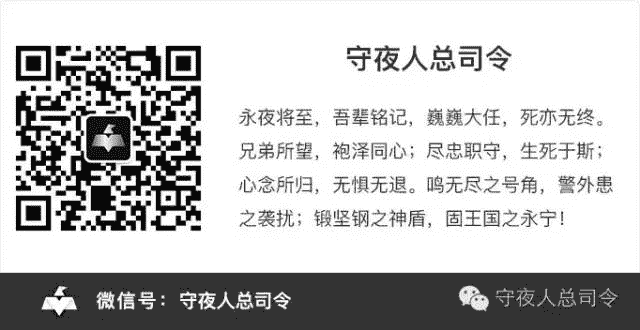

  

 

精选留言  
用户设置不下载评论   
  

# 

# \[守夜人总司令\] - 2018-08-13 婚恋行为的本质

> 来源：[`www.yuque.com/books/share/97051b78-926c-43e6-b0aa-0b72ff163ac4/ec5ohz`](https://www.yuque.com/books/share/97051b78-926c-43e6-b0aa-0b72ff163ac4/ec5ohz) 

婚恋行为的本质  
原创 觉悟者 守夜人总司令   
守夜人总司令   
微信号 WatcherCommander  
功能介绍 结构学：生命体在其生存结构中的求存之道！  
2018-08-13[原文](https://mp.weixin.qq.com/s?__biz=MzAxNDk1NjI2Mw==&mid=2247483840&idx=1&sn=43f3e99de954b2d57998b9af6ad20ecc&chksm=9b8a2248acfdab5e695708db06047455bb1849dfd38dfa6b99f56ae925d8ca97a2c691f451da&scene=27#wechat_redirect&cpage=497)  
收录于话题  
#教育  
51 个  
世界混沌一片，万物皆有裂痕，那是光照进来的地方！  
在人类所有的生存行为中，首先是对生存资源的争夺，其次是对交配资源的争夺。上古时期，关于男女这点事是这样表述的：有女怀春，吉士诱之；舒而脱脱兮，无感我帨兮，无使尨也吠——春心荡漾的少女对引诱她的帅哥说：”你不要这么猴急嘛，能不能温柔一点呀，不要这么用力扯我的裙子，别把我家的狗搞的叫起来了…“ 到了唐朝，同样的事情就变成了女生羞答答的暗示：春宵一刻值千金… 越到后面，表述越来越含蓄，人也变得越来越虚伪了，还创造出很多词来掩饰最核心的部分，比如：婚姻、爱情、伴侣…    
无法成交  
如果从宏观的角度来看，围绕婚姻展开的一切行为就是一个鲜活的交易市场——女方挂卖单，男方挂买单，结婚就是成交。离婚率对应市场交易的换手率。如果离婚率逐渐走高，说明市场参与者投机过度，分歧很大，市场处于激烈的博弈中…  
二十出头的女生是估值最高的时候，所以，卖单会挂在涨停板；二十出头的男人，是估值最低的时候，买单基本上只能挂在跌停板，所以适龄男女的交易根本无法达成——除非适龄男青年具备融资能力——比如说，拼爹！ 拼爹其实就是婚姻市场上辅助完成交易的一种金融工具。  
任何女青年都希望自己能在二十多岁的时候在一、二、三线城市成家，有一套自己的房子和车，并能体面的养育孩子——这已是最低的心理估值。如果需要把这些卖单都买下来，整体需要多大的资金量呢？ 按最低的平均值算，每一个人需要 300 万，按最小的单位数算，统计数据显示中国有近 3.8 亿个卖方家庭，那么这个最小的资金量就需要 1000 万亿美金以上，可是，全世界的 GDP 总量才 800 多万亿美元！因此，市场资金缺口非常大，市场上会出现大量无法成交的空单——所以年轻的女青年会到市场上疯狂抢单。她们首先吃掉买方出价最高的那个群体——年轻的富二代。但是，能够拼爹的人群是极少数。相对于整个市场的需求而言只是杯水车薪，市场上会出现大面积的流动性不足！  
流动性  
当市场上流动性不足的时候，要想让市场保持活跃，就必然出现能创造流动性的交易力量——他们专门通过挣取买进卖出的差额来盈利。在婚姻市场上，这个力量就是那群包二奶的中年大叔。女生都希望能在自己估值最高的时刻成交，但是，能成交的适龄男青年非常少。相对于出不起价的适龄男青年，中年大叔的买单更接近期望值，也更加容易成交。随着时间的推移，一无所有的男青年，逐渐拥有了出更高价的能力，中年大叔们，就会把手中囤积的女青年平仓，抛给具有购买力的男青年。这无关乎道德，只是市场启动的一个自我修复机制——因为婚姻市场必须持续保持活跃，否则人类就无法繁衍和延续。  
从事倒卖交易的中年大叔群体为整个市场的成交注入了流动性——哪里有卖单他们就会买入，哪里有买单，他们就会平仓卖出。他们的收益等于：青春的贬值额度减去他们所支付的成本的差价。在市场交易中，绝大多数人都不会购买潜力股，做风险性的投资毕竟是少数人的专利。趋利避害和追涨杀跌才是常态——绝大多数没啥本钱的散户都不太关心未来的增长，只关注眼前的价格。散户心态加剧市场上的投机行为，从而让市场处于更加剧烈的动荡之中，这种动荡会进一步为散户的认知提供确佐的“事实依据”。  
强制力量  
随着观念的改变，交易的时间窗口确实被拉宽了，但并不改变整体的市场态势。大量的空单如果持续不能成交，将威胁社会的稳定——人是社会的基石。所以，会启动另外一套社会机制来迫使双方成交——比如说，逼婚！这种成交并非基于双方在价值判断上达成了一致，而是在外力的作用下，在某个瞬间鬼使神差的被迫撮合。被外力撮合的交易，往往不能从根本上消弭双方对成交价格的分歧，会在潜意识里埋下鄙视对方的种子，并在生活摩擦的不断刺激下，怂恿着去寻求更合适的交易机会——这是所有婚姻动荡的根源…  
拉大时空的跨度，看清底层逻辑，不受情绪和细枝末节的影响，洞穿整体运行的规律，坦然面对生活的纷纷扰扰——懂取舍，知进退，不纠结。  
提问到知识星球：守夜人总司令  

  
觉悟者  
喜欢你就转走吧！  
微信扫一扫赞赏作者 赞赏  
已喜欢，对作者说句悄悄话  
取消   
发送给作者  
发送  
最多 40 字，当前共字  
 人赞赏   
上一页 1/3 下一页  
长按二维码向我转账  
喜欢你就转走吧！  
受苹果公司新规定影响，微信 iOS 版的赞赏功能被关闭，可通过二维码转账支持公众号。  

 

精选留言  
用户设置不下载评论   
  

# 

# \[守夜人总司令\] - 2018-08-07 欢乐颂中的阶层

> 来源：[`www.yuque.com/books/share/97051b78-926c-43e6-b0aa-0b72ff163ac4/ihog6t`](https://www.yuque.com/books/share/97051b78-926c-43e6-b0aa-0b72ff163ac4/ihog6t) 

欢乐颂中的阶层  
原创 觉悟者 守夜人总司令   
守夜人总司令   
微信号 WatcherCommander  
功能介绍 结构学：生命体在其生存结构中的求存之道！  
2018-08-07[原文](https://mp.weixin.qq.com/s?__biz=MzAxNDk1NjI2Mw==&mid=2247483834&idx=1&sn=a5b52ae1fab80319d06d39779dceaca0&chksm=9b8a2232acfdab24e70145a5e69d1fb978a368f1dcc8f5fc95625ec5d0439d3de2a8f9bfb93e&scene=27#wechat_redirect&cpage=497)  
收录于话题  
那些自己都无法察觉的特征，会从细节中溢出，流得满地都是…  
如果你在小区里遇到一个比你挣得多的多的人，你们依然是属于同一阶层的人，真正与你不是同一个阶层的人，根本不会出现在你经常出现的环境中。这才是现实生活正常的样子！所以，在欢乐颂中的情况不会在现实生活中发生：安迪、小曲与关关、樊胜美、小邱她们完全不是同一个阶层的人，各自的认知层次和活动轨迹也完全没有交集。  
一线城市的房价其实就如同高考一样——是一种人群的筛选工具！虽然我们生活在同一个物理空间中，但不同阶层的人是被一些无形的东西互相隔绝的——你没有见过，甚至无法想象和你不同阶层的人的生活方式和思考问题的方式。这是事实！  

  
家庭出身带来的认知局限，在很大程度上影响一个人看人看事的态度和能力，影响一个人的生活状况。在那些没有信心靠自己的奋斗找到前途的人群当中，你很难找到独立的精神和坚强的个体——樊胜美、关关和小邱无不例外：她们会放大自己内心的恐惧和焦虑并转嫁给别人，樊胜美真的是被原生家庭拖累的吗？其实，她和原生家庭中的人没有任何区别。她吸附他人的程度丝毫不亚于原生家庭对她的程度。她一直没有自我的目标设定，所有关注力都集中在吸附目标身上。她貌似精通人情世故，但所有的“智慧”也仅仅止步于小心翼翼的抓住依附目标而已，这和她家的人在本质上是一致的。小邱以另外一种面目出现，貌似狂热而单纯，但骨子里也是把所有的未来寄希望于他人，而不是自己。这种“真情”不管以什么形式出现，都是一种模糊了边界的深度介入——阶层惯性决定了这样的心态和认知方式。而关关总像一个路人甲，她来自城市中产家庭，什么事都是父母安排好的，因为不能自我设定目标，存在感一直缺失，她做事永远瞻前顾后，脱离不了依附的母体。这些群体统统缺乏目标感，搞不清楚自己到底是谁，自己与外部的关系的边界在哪里。她们彼此之间的温情只是这个群体自我麻痹的幻觉。为什么越贫穷的地区越喜欢讲究礼数？为什么越贫瘠的土地，宗教越盛行？  

  
王柏川的一切都是自找的，他对自我目标设定不清晰，目标感模糊，他的所有真诚、聪明、担当都是在一个必然坍塌的结构中做一些让自己感动的表演。他不能用理性的认知去决策，搞不清楚事情的先后顺序和轻重缓急。这是区分樊胜美阶层和小曲阶层的分界线！王百川没有能够进入小曲那个阶层的根本原因不是他破产，而是他的认知及行为都不是从理性出发的！  
安迪受的是美式教育，她的自我目标设定非常清楚，事情的界限非常分明，能够理性的看待人和事。她的独立性源于她的自我认知和生活态度——财富、地位、人脉是果不是因！当她要阻止小包总的妈妈调查她弟弟的时候，她没有歇斯底里，没有哀求，而是立刻找到小包总的妈妈最在乎钱这个关键点做文章，逼其就范。小包总的父母都以小包总与她的关系来威胁，她很洒脱的告诉对方，她可以放弃！一个非常清楚自我目标设定的人，很多事会拧得非常清。这是一个阶层看待自己和外部关系的方式，一个阶层思考和处理问题的方式。你不可否定她对小包总的真情，你同样不用低估她理性的决绝——看似南辕北辙的矛盾就是能够如此完美的统一。这在小邱那个阶层无法理解的！  
小曲和安迪其实不是同一个阶层，她介于安迪和樊胜美之间的阶层。她清楚自己是谁，知道自己要什么，而且有行动力，善于打造工具去借力解决问题；同时，心中潜伏着某种恐惧，对自己和他人都充满了怀疑。小曲和魏渭属于同一阶层——她们对外界和自己的认知都是将信将疑的，对自己与外界的关系也是如此。她们的认知和心态在樊胜美的阶层和安迪的阶层之间摇摆，这两个阶层的特征都会在这种摇摆中流露出来…  

  
谭宗明是“扫地僧”级别的存在，他对任何事情都能掌控全局。对人性和世事都洞若观火，能够在只言片语中直击问题要害。你能在他身上找到各阶层最闪亮的点，他是超越一切的存在，是顶级社会精英的状态——是编剧和导演合谋捏造出来的！  
提问到知识星球：守夜人总司令  

  
觉悟者  
喜欢你就转走吧！  
微信扫一扫赞赏作者 赞赏  
已喜欢，对作者说句悄悄话  
取消   
发送给作者  
发送  
最多 40 字，当前共字  
 人赞赏   
上一页 1/3 下一页  
长按二维码向我转账  
喜欢你就转走吧！  
受苹果公司新规定影响，微信 iOS 版的赞赏功能被关闭，可通过二维码转账支持公众号。  

 

精选留言  
用户设置不下载评论   
  

# 

# \[守夜人总司令\] - 2018-08-06 沉迷幻象，身处囚笼-

> 来源：[`www.yuque.com/books/share/97051b78-926c-43e6-b0aa-0b72ff163ac4/mnho5y`](https://www.yuque.com/books/share/97051b78-926c-43e6-b0aa-0b72ff163ac4/mnho5y) 

沉迷幻象，身处囚笼!  
原创 觉悟者 守夜人总司令   
守夜人总司令   
微信号 WatcherCommander  
功能介绍 结构学：生命体在其生存结构中的求存之道！  
2018-08-06[原文](https://mp.weixin.qq.com/s?__biz=MzAxNDk1NjI2Mw==&mid=2247483826&idx=1&sn=f2f30d227efd6015e6174d05c29208fb&chksm=9b8a223aacfdab2cbcea9e944dd2bdcabe53478dde6eed3b657f4c42edba1ae8bdbff5714bee&scene=27#wechat_redirect&cpage=497)  
收录于话题  
让你的船远离漩涡和险滩,它会让你粉身碎骨!——荷马史诗  
文艺青年们在谈论柏拉图或苏格拉底的时候，忽略了成千上万的奴隶们正在田间地头挥汗如雨，日复一日的重复着永远看不到尽头的悲惨命运...... 旧西藏贵族小姐们能够悠闲得享受着英国红茶，是因为有几百万可随时剥去人皮的奴隶正在被奴役。真实世界的底层结构从未改变，它只会变得越来越隐晦，隐藏在暗处让你无法察觉......  
海盗的恐惧  
海盗们从来就不怕皇家海军的清剿,任何一个无名的小岛都是自由的天堂。在茫茫的大海上，海盗的火力和组织度并不弱于军舰。军舰将普通人强行训练成这种状态，海盗无论航海、劫掠、还是日常生活都随时处于这种状态——农耕地区组织骑兵军团需要耗费高昂的代价，游牧地区组织起彪悍的骑兵军团却毫不费力。徐达试图一鼓作气把北元朝廷彻底荡平，深入草原之后，10 万迷失方向的明军被诱骗进山谷绝境，3 万蒙古骑兵借助自然环境的协助迅速将他们包了饺子，一代名将的北伐以全军覆没而告终！  
海盗并不害怕与海军周旋——他们占据天时、地利、人和，唯一让他们感到害怕的，是越来越精准的地图！《加勒比海盗》里 Jack 船长站在被描绘得越来越精细的世界地图前感慨：留给我们的空白越来越少了!  
精准的地图  
滴滴打车刚诞生的时候，姿态之低让出租车司机们很受用——滴滴为出租车司机引来更多的乘客，没收取任何服务费——这契合底层民众的普遍心理诉求！出租车司机瞬间成为了滴滴最强有力的推广群体。然而，事情并没有按出租车司机们内心憧憬的剧本向前发展，他们很快就被抛弃了！因为数百万辆私家车被接入系统——无论是车辆的档次还是从业人员的素质，都瞬间碾压了这帮出租车司机。他们很受伤，聊起这事一个个咬牙切齿批判滴滴的忘恩负义！他们表达过愤怒，结果无人理睬；他们举行过罢工，但是没人在意！他们最后祭出了大杀器——呼吁政府干预！生活中有一些结构会反复出现，每一次出现时，都是过去的配方，都是熟悉的味道......  
在滴滴出现之前，出租车公司也有一些管控的制度，但一直没什么用，最后也不了了之。关键不同在于：客人都是司机自己在路上转悠找来的，而不是出租车公司给他们派单！货拉拉平台没有诞生之前，货车司机们也是自己拉活，自己谈价格，有的时候利用信息不对称，或者熟人的信任关系，可以挣更多的钱。然而，货拉拉平台控制需求入口之后，他们不得一次又一次接受越来越低的标准价。他们同样也愤怒过，抗争过，甚至联合罢工。然而，没有人聆听，没有人在乎，没有人理睬！在现实生存面前，他们自己一个个主动放弃了抗争——因为他们也逐渐明白：向天吐口水是愚蠢的行为，最终只会落到自己的脸上！  
记者问刘强东京东到底有什么社会价值？刘强东脱口而出：“京东让成千上万的商品有序流动，这种有序流动节约了巨大的社会成本！”——他说的好有道理，以至于女主持人找不到反驳的理由，只能像花痴一样满脸崇拜的望着他。无论是包裹，还是车辆，都在平台的调度下进行有序的流动。平台控制了需求的入口，也就控制了供应链条上所有的环节！ 平台逐渐变成了一张网，隐藏在黑暗中，用自己的规则编制起一幅越来越精准的地图…  
科幻片中常出现这样的可怕场景：整个世界是一部精密运转的机器，它高速、精准、冷酷，并以人作为这部机器的燃料，人被不断的送进去，被机器榨干、扔掉！《黑客帝国》呈现的或许更接近真实世界运行的样子：你并未看到让人绝望的黑暗和冷酷，而是一幅温情脉脉的幻象，让你可以沉浸其中，永不醒来......  
拿不到的奖励  
我喜欢用滴滴叫不同类型的车，因为每一种车型的司机都对应着某个细分阶层的状态和认知，我拿同一个问题跟不同的司机聊，得到的反馈截然不同——他们似乎没有生活在同一个世界里！多次跟不同车型的司机交流之后，我隐约的感觉到一张铁幕已经落成，有一只看不见的手正在慢慢的收网......  
要不是郑州那个 20 岁的空姐被杀害，谁会知道滴滴的系统里设定了司机可以看到详尽的乘客信息，甚至可以用美女、丝袜、白大腿、 20 岁空姐这种有明确导向性的标签来描述乘客——猥琐大叔们鬼鬼祟祟的躲藏在暗处，用贪婪的目光反复的上下打量着娇嫩的你，一边流淌着哈拉子，一边盘算着什么时候突然扑上去……  
爆出来的永远只是冰山一角——它无意中撕开了一道口子，虽然是一闪而过，还是让你不小心瞅见了真实世界，正是这一闪而过的真实搅碎了你脑中单纯而美好的幻境——于是，你痛苦万分、呼天抢地、怒发冲冠...... 发泄完情绪之后，一屁股瘫座在地上，垂头丧气，又无可奈何！  
最有良心的架构师在设计交易所的经济模型的时候会设计成零和博弈——你挣的恰好是别人亏的，各凭运气,买定离手，自负盈亏。这样一来，交易所自身就变成做公益了！分分钟几十亿的资金从自己这里流过，谁能克制得住不伸手去蘸点水的冲动?!《华尔街之狼》里主人公接受前辈教育：无论客户在表面上看起来是赢还是亏，我们都有办法让他继续，直到彻底榨干，然后丢弃！  
如果你认为这种事只会发生在赌场和各种交易所，那你就大错特错了！它是一个结构——行话叫着“经济系统”，设计者在一开始就设定了你的最终结局，在所有的规则还未铺开之前，所有的风险都已经转嫁给你。你才是整个结构中唯一的羔羊！绝大多数人只能看得见眼前五米，对一切的理解方式就如同锤击膝盖引发的条件反射——追涨杀跌不仅仅存在于交易之中，而是贯穿于生活的方方面面！  
从一个滴滴司机的口中得知：他的一个朋友想得到滴滴的奖励，拼命凑单数最后累死在车里。我也想把它描述成一个为了家庭努力拼搏，最终不幸牺牲的感人故事。但是，当我了解到更多细节之后，我发现人不能轻易的感动！  
专线、保底和挑单大厅  
随着司机越来越多，乘客叫车也越来越贵，还越来越难以叫到车！这似乎有点反直觉，但现实如此。每一次与不同车型的司机攀谈，司机们都不约而同的抱怨单越来越难接——这就更奇怪了：司机难以接到单，应该是供给过剩，按理说乘客应该会获得更快的响应才对——供过于求嘛！  
滴滴以补贴聚人，现在人聚集了，补贴自然没有了。每一单的抽成也从 20% 涨到了 30%—— 开通“挑单大厅”的司机每一单要被平台抽取 30% 的费用，可以拒绝平台派的单而不扣分。开通专线的司机也需要把抽成从 20% 上升到 30% ，平台就把指定三条路线的单派给你。一般开通专线的司机是为了跑长途单，本来是为了能多收三五斗，结果多上缴了 10% 的收入。还有一种是开通保底的司机，这种司机就是为了给平台救火的，不能拒单，不管跑多少都没有奖励，平台每一天派保底的单给你。专线、挑单大厅、加上保底，组成了一个相互配合无死角的模型，让所有不愿意被抽成 30% 的司机都接不到单，就算接到也是极度鸡肋的短单。这个模型是稳定的，有一天滴滴把抽成提高到 40% 也是能够运转的！  
拼车中的暴利  
大数据杀熟早已不是什么新鲜事，不仅仅所有的互联网平台都这么干，连你老家的亲戚都这么干：你挣钱容易些,多出点怎么了？如果你人品好，系统会有针对性杀熟；如果人品不好，就一直分配不到，逼你加价。总而言之，你看到的都是幻像，你才是那只待宰的羔羊！  
针对拥堵时段滴滴推出了固定价，如果一辆车上坐 4 个人，滴滴会向每个人收一份钱,而司机只能拿一份，抽成不变。这个小小的改变，让平台的收益翻了 N 倍！类似的创新会越来越多…  
永远得不到的奖励  
滴滴自从取消补贴之后，搞了奖励机制：在规定的时间内完成多少单就能获得奖励。这给司机们打了鸡血，拼命去获取奖励。经过多次调研发现：每一次在就要达到目标的时候，平台会派一个远距离的单给那个司机，从而让他在规定的时间内无法完成目标单数,与奖励失之交臂！司机们都怪自己运气不好，或者咒骂路上堵车，唯独没有想过规则本身是被操控的！向错误的对象发泄完情绪之后，司机们又信心满满的为下一次可能的奖励去积攒单数...  
只有看得见的人，才会心疼拉磨盘的驴，驴自己是无法感知的——实在受不了,就哼哼几声。然而，没有人会在意它的哼哼，更没有人会卸下它的磨盘，甚至无人听见它临死前的哀嚎！在实验玻璃仓里被电流频繁刺激，拼命奔跑直至衰竭而死的小白鼠，不过是为实验者获得一组数据！你看不见的天网和为你量身订做的幻象，会让你像拉磨盘的驴或实验仓中的小白鼠一样奔跑，直至油尽灯枯，变成账本上一串冰冷的数字…  

  
觉悟者  
喜欢你就转走吧！  
微信扫一扫赞赏作者 赞赏  
已喜欢，对作者说句悄悄话  
取消   
发送给作者  
发送  
最多 40 字，当前共字  
 人赞赏   
上一页 1/3 下一页  
长按二维码向我转账  
喜欢你就转走吧！  
受苹果公司新规定影响，微信 iOS 版的赞赏功能被关闭，可通过二维码转账支持公众号。  

 

精选留言  
用户设置不下载评论   
  

# 

# \[守夜人总司令\] - 2018-08-02 穷是万恶之源！

> 来源：[`www.yuque.com/books/share/97051b78-926c-43e6-b0aa-0b72ff163ac4/gys9to`](https://www.yuque.com/books/share/97051b78-926c-43e6-b0aa-0b72ff163ac4/gys9to) 

穷是万恶之源！  
原创 觉悟者 守夜人总司令   
守夜人总司令   
微信号 WatcherCommander  
功能介绍 结构学：生命体在其生存结构中的求存之道！  
2018-08-02[原文](https://mp.weixin.qq.com/s?__biz=MzAxNDk1NjI2Mw==&mid=2247483823&idx=1&sn=e54ebe9891b302dc0bf1815c76ccf8b7&chksm=9b8a2227acfdab31a05e273addd9159d4b8263d58d3c58bf214841c8189157519719c3427306&scene=27#wechat_redirect&cpage=497)  
收录于话题  
弱者的弱是全方位的!  
   
一个置身于巷子中无法转身的人，目光聚焦的地方永远只有眼前的那一点——捉襟见肘的窘迫让他无暇它顾！人可以忍受一时的苦难，但无法忍受永恒轮回的绝望！俗话说，贫贱夫妻百事哀，那种在潮湿的地道里爬行，永远看不到光亮的绝望足以摧毁任何人的意志！  
   
内在的冲突  
   
人同时受物质世界和精神世界的双重驱动，外部行为会作用于内心世界。受过教育的比没有受过教育的人自我预期要高得多。所以，受过高等教育的群体常常有怀才不遇的挫败感！挫败感不是凭空产生的，也不会凭空消失，它会转化为内在冲突：纠结、焦躁、无力、愤怒、甚至莫名的仇恨。越是感到孤独、无力和虚无，就越渴望力量——特别是毁灭性的力量！  
   
受过教育的人潜意识里渴望出人头地，甚至一骑绝尘！没法承认自己无能，更无法接受的就是：自己鄙视的人过的比自己好，自己看不上的事却取得了巨大成功！这种强烈的反差会严重的灼伤他们高度敏感的内心——强烈的自尊心正源于这种脆弱性。  
   
人一旦陷入既无法接受又无力改变的内在冲突，整个人都会很萎靡——这种精神和身体上的双重萎靡主要源于内在的冲突消耗了太多的能量。生活中经常有这样的情况：一个人坐在那里什么都没有干，一天下来，整个人几乎精疲力尽——某种内在的冲突消耗了太多的能量，就像同时踩住油门和刹车对车的消耗一样！  
   
生活中有不少焦虑的人情绪很容易上来，一旦情绪上来，就必须要找个安静的地方，慢慢平复心情——在这期间，谁都不要打扰，谁都不要给压力。否则，就会火上浇油，就需要更长的时间来平复内心。这个群体有一个共同的特征：逃避！逃避人群，逃避冲突，逃避竞争！  
   
外部生存环境的挤兑，在人心之中造成了内在的冲突，而这种冲突长期无法得到解决，消耗大量的能量，让人时常精疲力尽，无暇顾及其它事物，继而错失机会，遭受更大的挫败感，越发害怕竞争，喜欢逃避，逐渐陷入恶性循环！  
   
长期无法解决的内在冲突，会以这些形态固化下来：1.斗争，2. 逃避，3. 虚拟自我！  
   
斗争  
   
无法与人进行平等的沟通，也无法与任何人建立信任。在与人相处之中会本能的采取高姿态，渴望别人的顺从，只有看到别人的顺从，或者觉得别人有求于自己，或者觉得自己能够掌控对方，心底才会有安全感。心里特别害怕失控，害怕不被关注，渴望成为焦点。对于任何可能让自己失去安全感的人或者事都采取强烈的斗争姿态，并以此来掩饰内心的恐慌！如果你不知道如何正常与这个世界打交道，又如何摸清它的门道并游刃有余呢？陷在一个自我想象的愤怒之中，极力守护着感觉随时会失去的安全感，面对一切都瑟瑟发抖！  
   
逃避  
   
终南山有一些选择隐居的年轻人，他们有一个共同的特点：无法养活自己，回避一切人和事。如果一个人不相信靠自己的努力能在生存竞争中胜出，他就会想尽一切办法回避可能的竞争——不参与也就无所谓胜负，无论人际关系，还是现实生活，凡是会引发竞争的，都会绕着走！  
   
墨守成规是逃避者最显著的特征：墨守成规可以避免失控，从而让内心感到安全。不相信自己有力量解决不确定问题的人，会本能的选择墨守成规。不仅仅如此，还会由此进化出某种自我催眠的真理：这个世界的竞争是一维的，只要按部就班，努力打怪，就能一级一级升上去。你会发现穷人家的孩子在学校里除了提升分数的事，其它一切事都没兴趣也不参与——而且会特别得强调成绩的唯一重要性！渴望别人给自己一个确定的目标和评判标准，追求单一技能，强烈认可单一升级体系。不仅仅在学校，进入社会以后，在工作中也会延续这种思维惯性和心态定势。联想 1998 年和 2018 年都发生过突然砍掉整个部门的大裁员，那些追求单一技能，强烈认可单一升级体系，在内部相互倾扎的死去活来的人，突然之间整条攀爬的梯子都被裁掉了！  
   
逃避源于内心对自己的不信任，甚至是绝望，这种无力感不断的在内心制造否定自我的脉冲。为了抵消否定自我的冲击，人的内心进化出了一套保护机制。  
   
虚拟自我  
   
如果内在的冲突既无法解决也无法回避，自我保护机制就会启动。这种机制用于抵御否定自我的冲击。其主要方式就是转移冲突——既然解决不了，也回避不了，那就假装视而不见，并虚拟一个与真实的自我完全相反的形象，在潜意识中认定这就是自己！  
   
完全没有人关注的人，会沉浸在在这样的白日梦中：自己是是一切的焦点，各种在现实生活中自己敬仰的人都簇拥着自己，各类最优秀的美女上杆子的追逐自己，而且像膏药一样揭都揭不掉！这只是一种白日梦，并不是虚拟的自我。因为沉浸这种白日梦的人，潜意识中是存在着质疑的，它就像鸦片，缓解一下现实的无力和憋屈。药效过了以后，会再次陷入沮丧和绝望的深渊。  
   
虚拟的自我是潜意识中识别不了的幻想——它会不断提纯道德优越感：比如，把无能为力的窘迫提纯为安贫乐道的高雅！把匮乏和苦难提纯为天降大任的考验，夸大自己的善良和高尚，极力夸大自己所经历的不堪在人生和事业中的巨大价值和伟大意义…  
   
外在的封闭  
   
一个窘迫的人，为了避免外部落差给内心制造冲突，会尽量回避各种人和事。最后就只剩下自己孤零零困守自我营造的封闭空间。自我封闭首先是一种心态，其次才是一种状态。自我封闭的人会错失一切改变这种状态的机会，因为本能的把所有内外信号都屏蔽了！  
   
做任何事情都有三个层次：第一个层次，你凭借自己的技能、经验和知识解决问题。用不了多久你就会到达一个天花板，这个时候需要别人给你新的认知，告诉你门路，并给予指引。否则，你就像驴拉磨盘一样，不管怎么努力都是在不断的重复。第二个层次，你需要工具——无论是经验、连接或认知都是你的工具，公欲善其事必先利其器！紧接着你会到达第二个天花板：所有的工具都用完了，依然无能为力！第三个层次，你需要资源——升级是需要巨大推力的，如同飞机飞上天需要借助发动机的推动力，突破和跃升所需要的力量在自己的周围是无法找到的！这个时候就需要贵人相助——贵人不属于你的阶层，不管是提携、牵线、推荐、站台、背书，都是获得跃升所需资源的通道。然而，穷人的自尊心会非常强烈和脆弱，万事不求人的心态深入骨髓，主动关闭所有通道，一点一点把自己挤压到墨守成规的绝路之上——弱者的弱是全方位的，心态、认知、信息、技能、资源、取舍……  
   
安贫乐道的本质  
   
所有逆袭的故事都夹杂着掺水过度的道德优越感和夸大其词的苦难经历。无形中暗示了追求单一技能，顺从单一升级体系的巨大回报。如果生活细节中，某种结构反复的出现，它必然藏着惊人的秘密！  
   
绝大多数的人从小未曾受过取舍的训练，不了解经济学的常识。一个清洁工再怎么努力，她的回报也不会超过社会给清洁工开出的最高价。30 年前的大学生一毕业就是国家干部，不但包分配，还供不应求，需要指标和特批。今天每年有 800 万找不到工作，产能严重过剩。每一个家庭的教育投入比 30 年前不知道高多少倍，但收益却完全不对等！这是因为，一个大学生的社会价值取决于制造一个大学生所需要的社会成本——过去是纯手工打造，消耗的社会成本很高，自然很值钱。现在是工业化大批量生产，制造一个大学生所需要的社会成本极速掉落——任何商品一旦产能过剩就自然贬值！  
   
许多在温饱线上挣扎的底层家庭背负着自己完全负担不起的债务投入到教育的军备竞赛之中，在自己先天不足的情况下，还试图从红海厮杀中完成社会跃升！其实，人的升级是一辈子的事，教育也是一辈子的事。是谁故意制造了一个竞争结构，让炮灰们集中在一个时段像飞蛾扑火一样自我毁灭？！  
   
培育将苦难和不堪进行道德提纯的群体，并驯化他们追求单一的技能，单一的升级体系，让他们没有选择也不懂取舍——这一切得一切都是为了塑造一种稳定的秩序！金字塔式的升级体系有一个天然的优势：能够让成员形成一种由下向上的挤压力！这种人为的竞争结构会强化所有成员对结构本身的崇拜，并滋生出优越感。老师任命成绩好的学生为班干部，班干部的满足感并非来自老师的信任，而是来源于从群体之中脱颖而出的优越感！即便处于金字塔尖的老师换人了，所有成员对金字塔本身的认同感依然强烈。这种秩序和忠诚就是结构内在的约束力！  
   
金字塔稳定结构最大的威胁恰恰来源于成员懂得取舍！懂得取舍的人，在任何情况下都有自己的最佳生存策略——博弈会导致金字塔结构的不稳定——农业时代鄙视商人难道真的是因为统治者的短视和无知？！恰恰相反，人家精明着呢！不管是贵族封建时代的等级制度和效忠体系，还是科举时代的等级制度，都是一个稳定的金字塔结构。并通过宗法、礼教、名器等行为和观念强化这种秩序。商人是逐利的，逐利的人懂得取舍。他们对世界的判断是多维度的，他们所构建的是动态的交易结构，不是静态的统治结构，他们不会从属于任何单一的金字塔体系。所以干脆把他们被排除在整个体系之外，并让他们受尽人为的鄙视！  
   
儒家最强调秩序，也最喜欢宣扬安贫乐道！贫是你自己生活的窘迫，你自己的孤立、狭隘和封闭，道是它反复灌输给你的那个秩序追求的目标——正是它的大道让你不懂取舍，墨守成规，像棋子一样任人摆布，被人随意抛弃，而你只会感叹命运莫测和时运不济！  
提问到知识星球：守夜人总司令  

  
觉悟者  
喜欢你就转走吧！  
微信扫一扫赞赏作者 赞赏  
已喜欢，对作者说句悄悄话  
取消   
发送给作者  
发送  
最多 40 字，当前共字  
 人赞赏   
上一页 1/3 下一页  
长按二维码向我转账  
喜欢你就转走吧！  
受苹果公司新规定影响，微信 iOS 版的赞赏功能被关闭，可通过二维码转账支持公众号。  

 

精选留言  
用户设置不下载评论   
  

# 

# \[守夜人总司令\] - 2018-07-30 拼多多让历史倒退了吗-

> 来源：[`www.yuque.com/books/share/97051b78-926c-43e6-b0aa-0b72ff163ac4/fnd484`](https://www.yuque.com/books/share/97051b78-926c-43e6-b0aa-0b72ff163ac4/fnd484) 

拼多多让历史倒退了吗?  
原创 觉悟者 守夜人总司令   
守夜人总司令   
微信号 WatcherCommander  
功能介绍 结构学：生命体在其生存结构中的求存之道！  
2018-07-30[原文](https://mp.weixin.qq.com/s?__biz=MzAxNDk1NjI2Mw==&mid=2247483818&idx=1&sn=9302771962435e5c404a6dc0f4b71678&chksm=9b8a2222acfdab34d1f8854fa52f84bc51f49b716921a2da347f6a348ed29697027b59114f7a&scene=27#wechat_redirect&cpage=514)  
收录于话题  
今天朋友圈被一篇文章刷屏,名字很有煽动性《拼多多的上市让历史倒退了二十年》。不用置疑，转发最多的群体就是天真烂漫的城市小白领和产能过剩找不到出路需要仇恨对象的人。  
任何一个在生存竞争中败北的人都会自诩为道德高尚者,自己不是无能，主要是因为人品太高洁，不会拍马屁 ！随便低一下头就能获得巨大成功，但就是主动放弃了——可见这些人的人品价值不菲！然而，生活中他们会为了一张优惠券而斯文扫地,会在菜市场为了五毛钱跟别人破口对骂。如此价值不菲的人品却在这些场景中贬值使用,不免让人膛目结舌,无比惋惜!无能就是无能,承认又何妨呢,说什么不会拍马屁！承认自己的东西卖不出去,产能过剩,亚历山大又何妨呢?说什么别人不识货,自己的东西质量太好,说什么淘宝毁灭了中国的制造业!淘宝至少花了 10 年时间,拼多多才不到 3 年而已，再低头看了看自己——没有对比就没有伤害，这更加没法忍呀!!  
降低了白领的生活质量吗?  
拼多多的用户群体根本就不是都市白领阶层，都市白领们有喜茶、星巴克、网易严选、海淘、大众点评，以及海外代购伺候着。怎么会看得上拼多多这种不入流的消费，怎么能入得了都市白领们的法眼——除了北平的豆汁，还有什么能入得了小太爷的口呀!俗话说的好,最喜欢对农村指手画脚的人都住在城里,因为不需要常年住在农村,所以可以站在岸上对深处水深火热中的人指指点点，满足自己的道德优越感。人家自己不会选择吗?非得要你来痛心疾首！为什么总是那些下个月房租都没着落的人时时刻刻牵挂着天下苍生呢?!  
拼多多的主要用户群体是三四线城市和县城、乡镇中的群体。这些人以前从来没有被接入市场，现在他们开始成为市场中的一分子。且不说拼多多能不能整合供应链,但确实扩大了市场的参与者！我老家的那个小镇上手机专卖店只有两家,一家是华为,另外一家是 VIVO ,住在镇上的老头子和老太太都用上了和城里人一样的智能手机。这两家没有把店开到镇上之前,那 3 万居民只能接受电信营业厅的手机,给什么用什么!  
什么是扩大内需，这就是扩大内需呀！千千万万在你眼中根本不存在的人也成为这个波澜壮阔的市场潮流中的参与者了！98 年外面金融危机,出口受阻，搞了一次轰轰烈烈的家电下乡运动,以前一切为了出口，哪里顾得上他们。家电下乡解决了厂家的产能问题，同时也让农村用上了彩电，我记得老家的那台液晶电视就是 99 年买的。没有流通，整个市场就呈现结构性的拥堵——一方产能过剩出不去另一方根本买不到，两者之间没有抵达的通路,也就没法形成市场——这或许违背直觉,但就是事实。  
顺应了必然的趋势  
快手刚刚起来的时候,一线做视频的互联网公司并非不知道,大家都知道,只是没有当回事,因为本能的看不上。真他妈 low !不仅仅用户群入不了白领精英的法眼,内容也不如流,甚至产品本身都粗劣不堪！然而,所有的精英都忽略了一个基本常识:大家都是做流量生意的,最应该关注的其实是流量——结果所有人都本末倒置,关注播放器的界面,关注一堆繁琐和自嗨的雕花功能。大家的生意模式都是流量变现，虽然 low ,但在跑马圈地,流量飞增;它是不够精致,但获取流量的成本非常低。你是很精致，但增长陷入停滞，获取流量的成本越来越高。你有什么资格嘲笑人家?人家嘲笑过你穷吗?！如果你的商业模式不是靠流量变现,而是高逼格的白领群体直接付费，你可以嫌弃它，问题是你也是流量变现的商业模式呀！  
城市白领这个最挑剔的群体恰恰是最不愿意付费的。如果你注意观察，你就会发现生活中的一些细节很能说明问题：农村或者小镇上请人家帮一天工不仅要给工钱还要管饭。而你的白领亲戚或者朋友经常会半夜让你帮忙改个 PPT 或者写个商业计划书什么的。你的时间在对方那里是不值钱的，对方只会挑剔的告诉你：做的不够精致，没有达到我的预期！  
昨天我在一篇文章上看到一张清单,上面列了各个平台的头部人群的收入水平和挣钱方式。知乎上顶级答主的收入之低把我的下巴都惊掉了——知乎大神往往以一种无所不知的面貌示人, 用户也一个个拳打脚踢不可一世,  没有想到的是, 他们获得的回报是如此之低。我只能说, 想在鸡肋上啃出点肉来实在太难了!  
快手、抖音外加拼多多, 都是一个性质的产品,它们把流通的渠道渗透到了三四线城镇,把那里广大的人群都盘活进来了。拼多多背后的指导老师是 VIVO 和 OPPE 的大老板段永平。 VIVO 渗透到了我老家那个小镇上,而大多数品牌在距我老家 20 多公里的三线城市都找不到专卖店。那个小镇上几乎每一个家庭的液晶彩色电视都是创维的,因为镇上卖彩电的是创维的经销商。长期以来，那个当地的经销商既是流通渠道，也是信任节点，还是连接外面世界的窗口!  
我们社会的基本单元是一个个自给自足的封闭社会。以前是封闭在山窝窝里的一个村子,现在封闭在方圆 10 公里的小乡镇。像江浙一代的百强县市和深圳的工业化城镇是少数中的少数。神州大地的绝大部分地区并不适应北上广深的商业逻辑。但他们也是人，也想消费和你一样的东西，一切都是有成本的，他们首先要解决有和无的问题，然后会要求解决好与次的问题。没有谁拿枪逼着谁，交易双方都是自愿行为，人家都没意见，你激动啥? 总有那么一群人，把工作和生活丢在一边，老把自己代入审判者的角色，以天下苍生为念......  
1864 年南北战争结束的时候，美国 98% 的人口都居住在乡下。纽约中央火车站以北还是一个卖牛的地方。1929 年的时候，美国的人口结构反过来了。所以,一场金融风暴让全国所有家庭都陷入绝望。这种系统性的危险背后是一种高密度的社会连接和多维度交织在一起的市场。它既是系统性风险的帮凶，也是社会经济快速发展的潜力!  
同样一群农民，把他们组织起来投入工厂所能创造的社会价值和个人收入，都远远高于让他们散落在广袤的田间地头——自给自足是劳动力和社会资源利用率最低的形态，市场交易才能让劳动力和社会资源得到最合理的配置！  
货拉拉,滴滴,顺风等互联网平台的出现，让货物、人和车的流动变得更有序，整体的社会成本更低。没有滴滴之前，司机的服务水平完全依赖其个人职业素养。滴滴把服务的标准拆解成可以量化的步骤，并让行为与奖惩挂钩。结果整个行业的服务水准都提高了!  
当汽车刚刚出来的时候,问题频繁，还跑不过马车。但它有一个马车无法企及的优势：马车的动力是恒定的，但汽车的动力可以根据反馈持续改进。市场的威力恰好在于能够启动“交易-反馈-改进”这样的自循环。  
发展才是硬道理！  
需求拉动生产，交易促进繁荣。事物的发展有好有坏，但是好和坏有一个总的评判标准：是不是有利于社会进步，是不是有利于整体社会效率的提高，是不是有利于让藏在水下的参与者都浮到水面上来。如果你无法知道敌人在哪里，你又如何能消灭它呢？靠喊口号？很多人是这样的大善人：我见不得有穷人悲惨的样子，看见会心里难受，你们赶紧把他从我面前赶走!  
以前有两个客户都买了某世界顶级品牌的设备，其中一个只有百万级的订单，另一个是龙头,经常是千万级的订单。有一天百万级的老总问千万级的老总:我们都是同一个厂家的设备,你为什么能做到那种精细的工艺呢？千万级订单的老总回答：我们是和厂家一起改进才弄出来的。百万级的接着说:我们也不断改进和调试呀,怎么做不到?!  “ 等你的订单量达到千万级的时候,你才可能调试得出来!”  说完这一句，他马上懂了!  
早些年追逃犯为什么那么难呢？因为没有全国联网的个人信息系统!各个地区的档案都是锁在柜子里的，要查阅还要跨地区跨部门盖好多章，出具介绍信什么的，才能调阅——等这一切弄下来，逃犯早就跑到国外去了!  
 做过市场的人都知道，说起华南区，其实就是广州和深圳！等有一天，说起华南区的时候，会自动包括这个广袤区域内的所有城市和乡镇，这个市场的规模会大得多，整个社会的效率和繁荣程度也会高得多得多!  
知识星球：守夜人总司令   

  
觉悟者  
喜欢你就转走吧！  
微信扫一扫赞赏作者 赞赏  
已喜欢，对作者说句悄悄话  
取消   
发送给作者  
发送  
最多 40 字，当前共字  
 人赞赏   
上一页 1/3 下一页  
长按二维码向我转账  
喜欢你就转走吧！  
受苹果公司新规定影响，微信 iOS 版的赞赏功能被关闭，可通过二维码转账支持公众号。  

 

精选留言  
用户设置不下载评论   
  

# 

# \[守夜人总司令\] - 2018-07-27 F1：见大行远

> 来源：[`www.yuque.com/books/share/97051b78-926c-43e6-b0aa-0b72ff163ac4/rhq17i`](https://www.yuque.com/books/share/97051b78-926c-43e6-b0aa-0b72ff163ac4/rhq17i) 

F1：见大行远  
原创 觉悟者 守夜人总司令   
守夜人总司令   
微信号 WatcherCommander  
功能介绍 结构学：生命体在其生存结构中的求存之道！  
2018-07-27[原文](https://mp.weixin.qq.com/s?__biz=MzAxNDk1NjI2Mw==&mid=2247483815&idx=1&sn=3ef0a28f13360d542e1fe295b25cbd9a&chksm=9b8a222facfdab3920ee4384bc60709209747c50a7da243c69a345cd69a301cd194d921d643d&scene=27#wechat_redirect&cpage=514)  
收录于话题  
生命是一种结构，它能自己从外界攫取能量以维持自身的存在。生命是基因的载体，只要有利于基因传递，任何一种延续的方式都可能被选择。在甲骨文中，上古先民们崇拜能够像青蛙一样大规模繁衍的女性，这是脆弱的生命应对灭绝最有效的形式——同一时期，相互隔绝的各古老文明都不约而同的崇拜繁殖，这绝不是一个巧合！  
如果一个人的儿女遭受绑架，会本能的愿意牺牲自己去交换。如果绑架的是丈夫或者妻子，则要看感情的深浅；如果是父母那就更要看关系的亲疏程度了——几千年的孝道浸染依然抵不过护犊子的本能！为什么会这样？  
盗墓行业最终进化成这样的形态：父子组队，儿子下去拿墓里的珍宝，父亲在上面拉着绳子。别的模型在漫长的行业进化中都被淘汰了——甚至儿子在上面拉绳子，父亲下去拿宝物都被淘汰了。因为儿子拿到父亲递上来的宝物后会斩断绳索，只有父亲拿到儿子递上来的宝物之后依然会拉儿子上来!  
那些刻在基因里的本能行为，往往蕴藏着某种关于整个人类的秘密…  
中国古代最恶毒的惩罚不是车裂、腰斩或者凌迟，最残酷的惩罚是：株连九族！断绝基因的传递是对生命最高的绝罚，足以让所有人匍匐在地心惊胆颤！罗马人最终打败并毁灭了迦太基，还在他们的土地上撒了盐——让它永远寸草不生！为罗马一雪前耻的统帅西匹阿没有任何胜利者的喜悦，他的心头涌起无比的悲凉和恐惧——罗马会遭遇同样的命运吗？是否有一天也会消失在历史的长河中，无影无踪……  
生命无时无刻不处在生存的竞争之中，所有温情脉脉的装饰下面都藏着那个无法回避的终极命题：生存还是死亡！你可以回避竞争，但无法回避死亡。物竞天择的源动力来自基因对能量的无限需求——基因需要不断的进化，所有载体都不过是它进化路上的工具！  
   
生存策略  
生存环境是一种结构，处于结构中的生命为了基因的延续进行着残酷的竞争，如果缺乏打破结构的力量，结构本身就是一个角斗场。人类历史上所有对外行为都是为族群的延续争夺生存资源，所有的内部行为都是为对外竞争做好准备——它们彼此交织，相互支撑。  
能够摧毁结构的关键支点，并制造坍塌的内部力量只有两种：  
1\. 科技树升级    
2\. 组织度跃升  
这二者往往相伴相生，彼此促进形成一种变革的合力！在这种结构性的变革中，原结构中占据资源的群体会整体溢出，这个占据资源又高度组织化的群体必定趁机借势制造各种内外纷争，其它芸芸众生都跟在后面追涨杀跌沦为炮灰。当这个群体在斗争中消亡或成为新的稳定结构中的一部分之后，秩序就会得以重建，并对内外生存结构都进行重塑。  
摧毁结构的外部力量主要依靠落差——技术落差，组织度落差，资金落差都能形成强大的势能，并降维攻击摧毁落后一方的原有内部结构。当年的洋务运动和今天的改革开放都基于此！  
人的器官中存在各式各样的细菌，它们在争夺有限的养分并相互攻伐逐渐达到一种微妙的平衡。自以为是的医生用药物把绝大多数的细菌都杀死了，那唯一没有被杀死的细菌瞬间占有了所有的养分，并以意想不到的疯狂，加速繁殖——很快它就占据了整个器官，并造成无法挽回的病变！  
即便拥有某种落差优势，富有远见的人也不会轻易的摧毁落后一方原有的结构——经过千百年博弈所形成的精密结构并不像表面看起来那样简陋——无论是行业生态还是政治经济都是如此！  
如果你正走在一片空旷的草地上，突然倾盆大雨，你会下意识的拼命奔跑——其实，你知道没有躲雨的地方，奔跑也无济于事；然而，你还是会本能的这样做！这种本能由久远的生存环境塑造而成，并被藏在基因里代代相传。生存竞争不仅仅塑造外在的结构，也雕塑内在的结构。群体外在的一致行为被称之为：“文化特征”，群体内在的相同思维被叫做：“文化心理”。所谓文化，就是生存结中群体共同的生存策略！生存环境决定生存策略。在生存环境改变之后，生存策略往往延续之前的惯性——这是许多悲剧的根源所在！  
在生存竞争的历史长河中，参与博弈的各方发明了一堆让人眼花缭乱的名词，还把它们写在各自的旗帜上用力的挥舞，试图吸引对方入套…有真知灼见的人一眼就看穿这些鬼把戏，虽虚以委蛇，却并不当真——其生存策略只会矢志不渝的遵循真实世界的底层逻辑！  
   
结构力量  
力量通过结构来聚集，也通过结构来释放。结构性的崩溃所造成的毁灭是一种让人痴迷的力量：地震、海啸、山崩地裂，皆因为地壳板块发生结构性的坍塌——所有能模拟大自然那种瞬间灭绝无数生命的力量都被赋予无上的权威！  
如同雪花的每一片都呈现它整体的形状一样，许多事物的最小组成单元与它的整体结构存在惊人的雷同。在数学中，这一形态被称之为递归。你能按图索骥找到那个原点，也可以清晰的预见它在更大时空中的边界。如果那个原子结构是不稳定的，规模越大，整体的崩溃系数就会指数增长。如果原子结构的力量呈盈余状态，规模越大潜力也就越大！  
识别结构，洞察原子结构所蕴含的力量和存在的缺陷，充分借用时间的杠杆——在毁灭性的力量面前，一切腾挪的技巧都是多余的……  
摧毁结构的内外两种力量：内部的力量源自科技树的升级和组织度的提升，外部的力量源自于落差的挤压——后续会展开很多经典的案例，此时此刻先阐述原理。摧毁结构是为了构建新的生存结构，那么，搭建结构并通过结构聚集和释放力量的方法又是什么呢？  
   
制造工具  
马克思说：“人与动物的最大区别就是制造和使用工具”。但他没明说：天子驭官，州牧牧民，事实上，你也只能算是动物！统治工具是人为构建的结构，人也是一种资源，被嵌入各种各样的结构之中，结构自身具有内在的约束力：一个金字塔型的结构会把人向上挤压——这种竞争结构不断强化内部的一致性，让归属感和荣誉感的含金量持续升高，最终形成：同一个目标，同一种主张，同一个套规范！为了进一步强化内部成员的自我约束，还会人为增加等级，并按等级分配利益——它不仅仅强化各层级对组织结构的忠诚，同时刺激成员自下而上的竞争愿望！无论天子还是州牧都是通过各种结构驾驭庞大的组织并把资源组织起来发挥着整体性的作用——搭建结构就是制造和使用工具！  
可怕的力量不是权力，也不是资本，甚至不是人心，一切都是工具！只有拥有了目标，才会需要工具！驱动一切的力量，潜伏在更底层的暗处。  
提问到知识星球：守夜人总司令  22669521  

  
觉悟者  
喜欢你就转走吧！  
微信扫一扫赞赏作者 赞赏  
已喜欢，对作者说句悄悄话  
取消   
发送给作者  
发送  
最多 40 字，当前共字  
 人赞赏   
上一页 1/3 下一页  
长按二维码向我转账  
喜欢你就转走吧！  
受苹果公司新规定影响，微信 iOS 版的赞赏功能被关闭，可通过二维码转账支持公众号。  

 

精选留言  
用户设置不下载评论   
  

# 

# \[守夜人总司令\] - 2018-07-23 坏事都是好心弄出来的！

> 来源：[`www.yuque.com/books/share/97051b78-926c-43e6-b0aa-0b72ff163ac4/txgkc5`](https://www.yuque.com/books/share/97051b78-926c-43e6-b0aa-0b72ff163ac4/txgkc5) 

坏事都是好心弄出来的！  
原创 觉悟者 守夜人总司令   
守夜人总司令   
微信号 WatcherCommander  
功能介绍 结构学：生命体在其生存结构中的求存之道！  
2018-07-23[原文](https://mp.weixin.qq.com/s?__biz=MzAxNDk1NjI2Mw==&mid=2247483811&idx=1&sn=8b51b14a45cda558ec38b6706b4afd6b&chksm=9b8a222bacfdab3d11f7774750c5a694c2eff499ffbd73613844993c3eb1474c4b186116e7f3&scene=27#wechat_redirect&cpage=514)  
收录于话题  
任何资源一旦免费，就一定会被无节制的滥用！  
去年广州的一位领导智商欠费，一拍脑袋就让广州地铁对 60 岁以上老人免费。乖乖，这还了得！平时大门不出，二门不迈，步履蹒跚的老头老太太们，早班高峰的时候，身手矫健的挤满了每一节车厢，让真正需要赶地铁上班的小白领们在站台哭的稀里哗啦…  
中国社会目前有 8 亿农民，刚进城的 3 亿人也还未脱离农业文明的心理惯性。对农业社会的人而言：河里的鱼，山上的野兔，天上的鸟，谁抓住就是谁的！它们有一个共同的特点：免费！占便宜是一种千百年遗传下来被刻在基因里的天性。如果一个东西能长期免费获得，恰恰说明，你自己才是整个商业模式中真正的商品！你免费获取某种有用的信息，你必须告诉对方你是谁，你的详尽信息和需求在免费获取的时候被收集、分析和整理，并卖给怀着各种各样目的盯着你的人，其实，真正用来卖的恰恰就是你！  
圣母的悖论  
真实的世界是非常复杂的，它不会像大脑智商不足的白左们认为的那样运转。几十年前，集合了全国最精英的群体试图对复杂的经济进行精准和高效的引导，以追求最彻底的社会公平，结果一个个饿得面黄肌瘦，营养不良；于是，开启了圣母眼中不再平等的改革开放。  
圣母的心是敏感又富有爱心的，所以主张要为所有人提供免费的疫苗。所谓三大公平不可缺失：教育的公平保障每一个人的上升通道，医疗的公平保障对每一条生命的尊重，法律的公平保障社会的正义和公正！连续三句排比，气势如虹，言辞优雅，完全无力反驳！我只能怯生生的问一句：谁出钱？！  
举一个最简单的例子：如果要免费提供疫苗，那么，按照我们社会的尿性，绝大多数人都会选择免费提供的。市场上没有真正的免费，只有成本的转移。这就是早两年非常盛行的互联网思维——羊毛出在狗身上！那么，在疫苗这种免费事业中，谁是那条狗呢？不好意思，这事最后得纳税人集体买单——因为是国家财政支出。政府有其自身的运行机制，也有它的 KPI 考核方式。既然是花钱，肯定要考核花的少，而不是考核看谁花的多。如果这种项目开标，肯定给开价最低的生产商！连美军中都流传这样一句自嘲的话：在战场上别指望有任何保障，要知道所有东西都是开价最低的国防承包商生产的！以最低价再加上其它权力寻租的手段拿到生产免费疫苗资格的商家，生产中稍微打点折扣就是暴利！目前疫苗还只是无效，当年有些卖白酒的可是直接用更便宜的工业酒精兑水出售……  
如果不免费提供疫苗，就完全不需要开标，也完全不存在权力寻租！大家在市场上正常竞争，政府反而能抽身事外当更严厉和更公正的判官。这个时候圣母一定会跳出来：你们这样会让疫苗价格很高，穷人消费不起，穷人的命不是命吗？！黑命贵！  
如果圣母真的像自己宣称的那样，这个时候完全可以自掏腰包，为自己同情的群体购买疫苗，既奉献了爱心，捍卫了生命的尊严，又没有破坏市场原则，还规避了公共权力的寻租风险。一举多得，好事呀！然而，那些站在道德高地挥舞着各种大旗的人，并不打算自己承担责任、支付成本和解决实际问题，其潜意识中是让自己宣泄一种道德优越感，然后让别人出钱、出力去解决问题。  
大风吹呀吹，吹散了圣母的光环还有智商欠费的廉价同情心…   
产业化不足  
任何大规模的恶，都是基于善。昨天晚上一个朋友在知识星球“守夜人总司令”里提问。我告诉他，所谓政治就是分配问题，如果供应充分，根本就不需要有一个额外的力量介入分配。只有供需产生结构性扭曲的时候，才需要有一套仲裁机制的介入。至于它是暴力、购买力或者其它什么力量都无关紧要，重要的是为资源的分配做出裁决。圣母们高喊着教育、医疗不能产业化，这是社会的底线。有一点点基本的常识好不啦！只有能够产业化的才能最大限度的低成本供应，才是真正的大爱无疆！为什么有炒冬虫夏草，炒大葱或者其它无法量产的东西，而没有人囤积日常的工业制品来炒呢？只有傻逼才会这样干——价格一旦上去，立刻能新开几条产线释放产能，供应瞬间就被填满。这还怎么炒？！  
药是一种产品，人也是一种产品。只有充分的产业化，才能大批量廉价供应！所有供需结构扭曲的厉害，导致各种权力寻租和恶性事件的核心问题就是这个领域的产业化不足！  

  
其实，关于这家疫苗厂家的问题，上一次在山东济南发生事故的时候，总理已在 2016 年 4 月 14 日就表过态了。这一次，又用词更加严厉的表态一次。圣母们瞬间就满足了，仿佛问题已得到解决了一样！五个人要吃饭，只有一碗饭，谁来表态都没用——他又不能变出 4 碗饭来！然而，白左们都心满意足的走了…  
当产业化不足的时候，充分的贸易能缓解供给不足的问题。如果人为的制造封闭，就会形成结构性的稀缺，这种结构性的稀缺，正是巨大利益的根源！一个做产业的人，还未做成气候之前先把爱国的大旗扛在肩上，这种情况要特别小心。因为他准备人为的制造一种封闭，并垄断结构失衡所能带来的巨额利润！  
基本常识  
越是封闭的领域就越要开放，越是孤独的人越要与人交往。充分交易是个好东西，产业化也是一个好东西，唯独智商欠费，只会宣泄情绪，还很傻很天真的圣母们不是好东西！凡是扛着大爱的旗帜站在道德高地上挥舞的人，都务必要警惕！  
提问到知识星球： 守夜人总司令   22669521  

  
觉悟者  
喜欢你就转走吧！  
微信扫一扫赞赏作者 赞赏  
已喜欢，对作者说句悄悄话  
取消   
发送给作者  
发送  
最多 40 字，当前共字  
 人赞赏   
上一页 1/3 下一页  
长按二维码向我转账  
喜欢你就转走吧！  
受苹果公司新规定影响，微信 iOS 版的赞赏功能被关闭，可通过二维码转账支持公众号。  

 

精选留言  
用户设置不下载评论   
  

# 

# \[守夜人总司令\] - 2018-07-21 一脉相承

> 来源：[`www.yuque.com/books/share/97051b78-926c-43e6-b0aa-0b72ff163ac4/zgcg72`](https://www.yuque.com/books/share/97051b78-926c-43e6-b0aa-0b72ff163ac4/zgcg72) 

一脉相承  
原创 觉悟者 守夜人总司令   
守夜人总司令   
微信号 WatcherCommander  
功能介绍 结构学：生命体在其生存结构中的求存之道！  
2018-07-21[原文](https://mp.weixin.qq.com/s?__biz=MzAxNDk1NjI2Mw==&mid=2247483806&idx=1&sn=bf330eb30a53b4e2f666e84b953a1fa5&chksm=9b8a2216acfdab00985fb0708f3c360bc9793e594b6636734e5f1838462d06b8b1ff494f126f&scene=27#wechat_redirect&cpage=514)  
收录于话题  
#天下  
9 个  
如果你觉悟了，并选择作恶，那一定会是大恶！ ——老师如是说  
细节呈现的内在矛盾  
   
从日本人的饮食、衣服、居住和勤洗澡等生活习惯来看，日本人的主体绝对是南方人——南方人的热情、细腻和周到，不仅仅能从东京热和一本道的影片中感受得到，而且在任何一个日本的酒肆、旅店和民居中都能感受得到！  
日本的国土狭长而多山，缺乏长江黄河这种延绵千里的大江大河，短急清浅的水流，激荡而起的不过是一些轻佻的浪花，诱导着这个热情的人群形成了性急又缺乏耐心，还特容易陷入悲观的性格。地震、火山这些非人力可以预知的自然威胁，在日本人的心里蒙上了一层生死无常的阴影——所以，他们喜欢樱花——最绚烂的绽放和最快速的凋零！日本人的生活细节处处呈现两种极端不可调和的矛盾，又强行的溶解在同一个躯壳里——他们喜欢向外看，因为里面已经够乱了，捋不清！  
当热情的目光向明亮静寂的远处瞭望的时候，茫茫的大海，没有任何吸引目光的重点——因此，日本人把目光收了回去，专注于玩弄身边的细碎，并以此为自己的参照物：日本人发明了盆景——把参天松柏和山川河流错落有致的浓缩到方寸之间！  
   
有毒的大陆思维  
古代的日本是与世无争的，花了几百年才逐渐征服北海道的原住民虾夷族——所以，幕府时期的实际统治者称征夷大将军。飞鸟时代，圣德太子被大陆上大一统的隋王朝所刺激，开始东施效颦搞中央集权，大化革新把这种模仿推向高潮。日本社会开始由奴隶社会过渡到半吊子的封建社会——每一次社会升级都会有一个掌握资源的群体整体溢出。他们和逆来顺受的底层民众不同，这个群体是高度组织化的！因此，这个群体必须要消灭，否则，新建立的秩序就无法稳定。解决的方法只有两个：1. 内斗消灭； 2. 外斗消灭。大化革新没多久，日本进攻韩国，爆发中日历史上第一次大规模冲突——“白村江海战”以唐高宗的 400 艘楼船把 700 艘日本小艇揍的鼻青脸肿而告终。吓得日本人在本土一口气设置了四道防线。天朝对它那破地方实在没啥兴趣，但日本却从此染上了有毒的大陆思维。日本一直处于主流文明的边缘，骨子里总想着照葫芦画瓢，如同屌丝总幻想着取而代之——对日本而言，这等同于患上了脑癌！  
威尼斯鼎盛时期全国只有 14 万人，威尼斯的海军纵横地中海 1000 年，它的海外据点遍布亚得里亚海西岸，直至爱琴海、埃及和中东沿岸。甚至一度攻占拜占庭帝国首都君士坦丁堡。然而，威尼斯绝不在内陆占据土地，所有的沿海殖民据点都是为了保障航道安全，垄断地中海贸易。沧海桑田，世事变迁，威尼斯坚守原则，垄断贸易，金融创新，顽强的以城市国家的规模抗住了地理大发现和贸易通道变更等灭顶之灾，在大国角力的腥风血雨中存活千年！  
威尼斯最后怎么灭亡的？到了末期，贵族们在大陆上占据大量的土地，有了太多无法割舍的利益，不再有全局的视野，只关注眼前的零碎，行动迟缓，决策犹豫，被拿破仑像切香肠一样彻底征服了。  
小到个人，大到国家，你的能量和价值并不完全取决于你自身，而取决于你深处什么样的结构之中，并在这个结构中扮演什么样的角色——日本是一个岛国，它对东亚大陆的制衡，如同英伦三岛对欧洲大陆的制衡一样！英国是海洋国家，以贸易立国，侧重发展海军，控制航道据点，垄断海上贸易。拿破仑嘲笑英国人是杂货铺店主们建立的国家，英国人反而以此为荣。自从英国彻底丢掉在法国的领地之后，英国对欧洲的介入策略始终是大陆均衡政策，英国人开启的是全局视野，自己超然其外，宛如欧洲事务的最后仲裁者！日本模仿了长安，引进了佛教，学会了儒家，从社会制度、意识形态到行为规范都深受大陆思维的浸染。于是，在根本不具备条件的情况下依葫芦画瓢，一直延续至今…  
东亚大陆上缺乏均衡操作的抓手，强势的统一王朝散发出强盛的文明之光亮瞎了没有见过大场面的荒岛蛮夷的眼睛。于是，日本匍匐在地，诚惶诚恐。日本人是极度善于学习的热情民族，其学习的认真态度往往过犹不及，青出于蓝而胜于蓝。从此，他们彻底放弃了能充当大陆板块制衡者的优势，拙劣的模仿着大一统农耕文明的社会结构，甚至一度想在原有的体系中取而代之！  
   
摩萨和长州之争  
   
倒幕战争的本质上是一场诸侯之间的火拼，长州藩和摩萨藩与德川家族的不睦可以上溯到德川家康刚刚建立统治的时代。两百多年的恩怨就如同潜伏在地壳之下的岩浆，一直在寻找喷发的出口。好不容易逮住一个由头，肯定不会放过。之所以把天皇抬出来，是需要一面拥有大义名分的大旗来与幕府抗衡。即便后来民治维新，大政奉还和废藩置县，废的也是其它诸侯的权力基础。摩萨和长州作为倒幕元勋和维新功臣，不仅仅把持原有地盘的实权，还把持着中央政府的军队、警察、财政等各种实权！  
长州系控制着陆军，摩萨系控制着海军，在整个 19 世界后期和 20 世纪上半叶，一直相互争斗又彼此支撑，共同控制着日本社会的走向。乃木希典攻占旅顺口的指挥实在乏善可陈，倒是东乡平八郎指挥的对马海战打的有声有色。然而，乃木希典被封为元帅，甚至被尊为军神，这都是不甘于成为新傀儡的天皇在打压、拉拢和平衡。  
在创投领域有一个不成文的潜在规律：80%的融资项目都是通过私人关系直接完成的，剩下的 15%是通过财务中介完成的，只有不足 5%的创业项目是通过公开举办的创业大赛完成融资。它无形之中泄露了这个世界的真相：当你以为自己是聚光灯下的明星，上台表演的时候，其实，已经准备收摊了！不管前台如何的变换旗帜，你大爷永远是你大爷！摩萨和长州的旧势力在长达百年的相互缠斗中，形成了一种稳固的结构，并以此把持着日本社会的方方面面。  
   
尊皇讨奸是一场革命  
   
任何一个社会一旦开启升级，不仅仅造成人群的分化，秩序的解体，还会造成原有体系中一个有组织的利益群体整体溢出，如果不能转移就必须消灭，必然引发社会革命！纵观日本的历史，大化革新开启奴隶社会向封建社会升级，马上出现了征韩之举，只不过意外的遇到了强盛的大唐帝国的干预，并在韩国的白村江被揍哭了。转移受阻之后，只能通过内部派系的相互杀戮来完成过渡。民治维新开启了第二次社会升级，整体溢出的武士阶层，不仅仅高度组织化，并且精明能干——因为日本社会一直处于 300 多个地方割据的状况下，幕府将军不过是最大的割据力量。所以，科举制度无法推行，而服务于各自领主的武士们，并不像天朝那种“无事袖手谈性情，有事一死酬君王“的无用书生，他们不仅仅有书生的信仰，还有在波诡云涌的生存斗争中解决实际问题的能力。这样的群体是一个有着内部荣誉体系的稳定结构，除了内斗消灭就只能外斗消灭！当征韩主张被否决之后，著名的维新三杰之一的西乡隆盛就带领武士们造反了！在平定西乡隆盛叛乱的西南战争中，同为倒幕盟友的长州藩最为卖力。其个中缘由不难理解——不管上面变换着什么样的旗帜，底层的逻辑一脉相承！  
裕仁刚即位不久就在他的皇宫里开辟了一个僻静的房间，搞了一个学习室。来的都是才华横溢的年轻军官，这是裕仁的“黄埔军校“，这些与他年纪相仿的底层青年，成为了第一批天子门生。这些名字一个个如雷贯耳又臭名昭著：东条英机，板垣征四郎，土肥原贤二，松井石根，武藤章……康熙的少年摔跤手不过是用来擒拿鳌拜的，而裕仁的革命小将们，确被赋予了将 100 年来真正统治日本社会的”维新势力“彻底拉下马的使命——他们虽然盘根错节，但在社会升级的这个档口，他们真的太老了！  
二二六的主力是来自社会底层的青年下级军官，打出的口号是“尊皇讨奸“。如果你去听他们的那首军歌，你真的能深切的感受到：那种屌丝的委屈和为臆想的神圣而自我牺牲的悲壮——那是整个社会阶层的心声！裕仁只是顺势而为，借用了这群渴望掀桌子的力量——他们是正以前所未有的规模批量制造出来的群体，旧势力所把持的权力体系又是那样的不合时宜，再加上天生性急、冲动又悲观的民族性格——这些无解的矛盾一旦失控，必将不堪设想……在东京审判的时候，得出了这样的结论：无法确认是不是裕仁天皇直接发动了战争，但可以确定是他结束了战争——日本社会最大的隐患摘除了，他们都死了！  
   
石原莞尔  
   
石原莞尔的远见和行动力都让人叹为观止，他是真的知行合一！石原莞尔还是一个大佐的时候，就坚定的认定：日不落帝国控制下的全球体系早已满目疮痍，力不从心。新兴的势力必然各自雄霸一方，太平洋南北两端耸立着两个上亿人口的工业社会，可以划洋而治——依托东亚大陆为腹地，屯重兵于关岛等少数关键支点，辅以机动海上力量，可在整个封闭的东亚区域逐步建立秩序！  
他坚定的认为，在此格局之中，对华方略重在四两拨千斤的肢解而不是深陷其中的征服。其目的在于阻止大陆的统一和社会的工业化。所以，他身体力行，亲自跑遍了东三省的每一个进兵的山口、渡口、关隘和交通枢纽。他还化装成苦力，潜入华北，并顺平汉线一路南下。当武汉的警察抢走了他身上最后一块银元，把他打的遍体鳞伤之后。他心满意足的返回沈阳，并向大本营提交了一份报告：其民众愚昧自私，弱懦而散漫，毫无组织性，其官吏待民众如猪狗，民众恨官府远胜于外人，大军所至，必争相授首，以图引为内争之外援，余无需拔剑，仅以竹刀可征服满洲之地也！  
他的判断全对，而且真的做到了！我看见，我来了，我征服！如果剧情到此为止，南面再重兵驻守关岛和硫磺岛，辅以威慑性的海上机动力量。那么，日本在东亚所确立的秩序和势力范围必然会被大战笼罩的各方所尊重和接受——这对日本而言，是日不落帝国全球体系坍塌之后最好的结果！然而，日本人性格的天然矛盾性，以及摩萨和长州势力长期的竞争，还有旧势力与新阶层之间不可调和的矛盾，再加上不甘心成为橡皮图章，试图通过天子门生向旧统治势力夺权的裕仁天皇。如此种种不可调和的矛盾全部搅合在一起，让天生性急又容易陷入绝望的日本人采取了一系列毫无章法、矫急又短视的危险行为。最终陷入万劫不复的深渊——这是日本最后改变命运的机会，就这么错过了，而且永远不会再有！真是性格决定命运，即便有智者又能如何呢？该往哪里去，还是会往哪里去……  
   
幻觉的破灭  
   
二战把美国的工业潜力最大限度的激发了出来。它为战争的胜利提供了最有力的保障，但是，当战争结束之后，这种过于夸张的产能过剩变成了美国社会最急迫的威胁。于是，马歇尔计划呼之欲出：1946 年战争刚刚结束，美国就以援助为要挟迫使蒋介石政府签署了《中美友好通商航海条约》——大量的美国设备和商品直接顺长江而上，瞬间让好不容易熬过艰难抗战岁月的中国民族企业陷入破产，并不断为城市的失业大军提供源源不断的力量——这加速了城市中坚力量的集体左倾，并把国民政府在城市中的统治基础瓦解的干干净净！  
二战结束的时候，美国建立了完整的工业体系，涵盖全部的工业品类。事实上，交战双方最后都变成了高度的计划经济。战争一结束，美国就开始向它控制下的势力范围分层次的转移产能、产业和资金，并逐步建立起稳固的三层金字塔内循环体系。  
日本作为一个已经工业化的社会，即便被打成了废墟，也具备能力去承接这些转移的产业。两大阵营边缘地带的冲突，加速了日本承接产业转移的速度。日本连续 30 年承接美国转移的产业和中国改革开放之后连续 30 承接美国和日本的产业转移别无二致！所有的勤劳、专业、纪律性都源于同一种结构的内在约束。在持续 30 年后，80 年代的日本，贸易顺差继续逐年增加，房地产也开始起飞，甚至在电器和汽车等消费品领域开始有了自己的全球品牌和影响力，一个庞大的城市群体崛起。美国人开始吵着要改变不公平的贸易规则——所有的这一切，与最近 10 年的中国社会有着异曲同工之妙！  
日本一直处于文明的边缘，屌丝特质非常明显——日本人相信在没有底层支撑的情况下，依托半空中的某个单点优势就足以改变整个局势——这如同被包养的小三认为自己可以控制主人一样荒谬可笑！然而，日本人却相信正是自己贸易立国和技术立国的策略，以及自己国民的纪律性、勤劳和隐忍，造就了这一切辉煌，还把它提升到方法论的高度。80 年代的美国社会和日本社会都处于一种狂躁的氛围之中。不同的是，日本社会真的相信屌丝逆袭的时机已经来临，其渴望逆袭的狂热程度与二战时别无二致——这是根植于民族性格之中的基因特质。  
70 年代的苏联在争霸中占据上风，鼓舞了西方各国的工会势力。里根和撒切尔夫人都在各自国家里强力打击工会势力，放开所有的资本监管，放任利率高企和企业破产…1987 年华尔街遭受了前所未有的危机。然而，这种刮骨疗伤的方式是有效的。美国经历过短暂的阵痛之后，持续了几年高质量的低增长。然后开始重新起飞，惯性延续至今。  
日本社会的幻觉早在广场协定签署之前就已经破灭，一阵之手忙脚乱的错误政策只是加速了这种坍塌而已！日本社会的团结意识，源头来自于农耕文明的大陆思想——秩序井然的步兵方阵和战车方阵都是步调一致的整体。日本人把他们的银行和企业以及整个社会都牢牢的困在一起——如同一个共进退的方阵。海量的资金向已经死亡的僵尸企业和僵尸行业持续输血，从而不能投资在能创造增长的新行业和新企业。30 年来，日本避免了美国当年的阵痛，但这种稳定让整个社会持续 30 年都没有爬出来，错过了互联网和移动互联网两个创造社会流动性的产业潮流……  
   
精致的浪费  
   
所谓工匠精神就是在一个位置上一直干到死！这种把人固化到一个岗位的事情我们并不是没有经历过，事实证明，它极度没有效率，也是一种巨大的资源浪费。无论怎么包装和道德提纯都无济于事！  
在没有滴滴之前，出租车司机的服务质量取决于其专业素养和道德水准。即便天天给人带高帽，绝大多数司机也不会试图去提升一点服务质量。因为没有动力！更多的付出并不能给他们带来更多的收益，仅仅是道德的赞誉只能持续一阵子，并不解决问题。滴滴通过创造一种竞争结构，把更高质量的服务分解成可量化的标准动作并与利益挂钩——它提升了整个行业的服务质量，但并不诉诸于个人道德和自我素养。  
如果说向产品中注入超出预期的功效就算作工匠精神的话，那么，美国的 CPU 厂家绝对是工匠中的工匠！一枚手机上的 CPU 的功能和工艺都是远远超出日常使用所需要的，而且持续的在降低价格。这是市场的竞争格局和资源配置所塑造出来的结果，并非基于任何人的道德追求！  
鉴于日本社会的资源错配，确实在一些领域做了一些不计成本的积累，但更多的是某种精致的浪费。来自大陆的新物种必然携带着资本前仆后继的跑去收割日本人这些年不计成本搞出的东西，并将其迅速产业化，再反攻入日本——届时，日本将会真正的梦碎……  
   
十字路口  
   
东亚不可能建立起双中心的秩序。日本是一个岛国，70%的进出口运输需要经过南中国海，而南中国海甚至北太平洋的主要支点，迟早会落入天朝上国的控制之下。如果不断然做出选择，新加坡的今天就是日本的明天！察落叶而知秋风，试春水而知冷暖。  
稍有围棋常识的人就能从地图上看出来：只要在大海上构建几个关键支点，就能与背后坚实的大陆构成一个封闭的态势，支点只要能挡住外部势力的介入，支点与大陆之间的所有孤子都一定会被全部吃掉！而日本恰恰是一个劫——它既可以成为关键支点，也可以成为打入这个封闭区域中的一个橛子，从而破坏态势的完整性！  
自古以来这个角色都不曾改变，只是日本人的脑子被有毒的大陆思想毁掉了，是二战后的美国人告诉了他们这一点！所以，日本面临一个十字路口的选择：要么向大陆势力要足了条件，成为其体系中一个具有高度独立性的关键支点；要么成为进攻势力打入的一个橛子！粗通围棋的人都知道：如果打入的橛子没有后手的支撑就很容易被有厚实依托的势力反包围，变成被关进去的孤子。所以，进攻的势力必须为橛子布置后手，建立支援点，互为犄角，彼此掩护；并形成分进合围的进攻态势，不断压缩对方势力所能辐射的空间，继而制造和利用混战把对方赖以依托的腹地搞乱。如今进攻的一方在退缩，防守的一方不仅越来越夯实自己厚实的腹地，还在反向包围充当进攻橛子的关键支点。一旦南中国海被牢牢的控制，关岛又支撑不住，那岂不是要退到夏威夷和澳洲去！当历史重演之时，关岛一旦易手，变成封闭这块区域的关键支点，美利坚会默认既定事实，整个东南亚都会转向——石原莞尔的远见将得以实现，只不过主角换了别人！届时的日本将非常的尴尬，在围棋中，一旦成为孤子，无论如何折腾终将毫无价值……  
是美国人让日本明白了自己在棋盘上天生就具有的优势，然而，又始终让它无法把这种优势发挥出来。如果关岛易手，整个区域的态势已定，守日本将毫无价值。弃子！是的，谈判桌上仅仅用来交换筹码的弃子！  
   
一脉相承  
   
我们对世界的认知是自上而下的，是以自己为中心的——因此，懂得所有道理，依然过不好这一生，是正常的！天圆地方，地心说，日心说，银河系，平行宇宙……我们一次次把目光从自己的身上移开，移向远处，移向地平线，移向浩瀚的星空……当我们突然睁开眼睛，看清了更大的世界——看到了那些能够追溯到远古的纷争都延着一条蜿蜒曲折的河流一脉相承！  

  
提问请移步知识星球：守夜人总司令  

  
觉悟者  
喜欢你就转走吧！  
微信扫一扫赞赏作者 赞赏  
已喜欢，对作者说句悄悄话  
取消   
发送给作者  
发送  
最多 40 字，当前共字  
 人赞赏   
上一页 1/3 下一页  
长按二维码向我转账  
喜欢你就转走吧！  
受苹果公司新规定影响，微信 iOS 版的赞赏功能被关闭，可通过二维码转账支持公众号。  

 

精选留言  
用户设置不下载评论   
  

# 

# \[守夜人总司令\] - 2018-07-16 识别结构，英明决策！

> 来源：[`www.yuque.com/books/share/97051b78-926c-43e6-b0aa-0b72ff163ac4/nhlxr2`](https://www.yuque.com/books/share/97051b78-926c-43e6-b0aa-0b72ff163ac4/nhlxr2) 

识别结构，英明决策！  
原创 觉悟者 守夜人总司令   
守夜人总司令   
微信号 WatcherCommander  
功能介绍 结构学：生命体在其生存结构中的求存之道！  
2018-07-16[原文](https://mp.weixin.qq.com/s?__biz=MzAxNDk1NjI2Mw==&mid=2247483799&idx=1&sn=d017eefeb7ec6bb47a61a99744e6cd76&chksm=9b8a221facfdab096074c2bf69c773dd75ee8f7ad2eccf84505160c98bc33b98aad3d5bc7c84&scene=27#wechat_redirect&cpage=514)  
收录于话题  
细节会透露真相，但要想敏锐捕获细节所泄露的天机，需要具备识别结构的能力——识别结构能在判断中弥补数据不足的缺陷，反之则无能为力！当今社会，大到治国方略，小到下一顿吃什么，各种决策都越来越依赖数据的反馈。信息的泛滥和数据的过度充沛，会形成一个高度趋同的低智商社会。人在不断的放弃对决策的主导，大脑对决策的判断力持续下降，人的言行日趋一致，情绪容易叠加，越来越容易被操控……  
一个民族的所有秘密，从它最初的基本生存方式就可以看得出来。井田制，首先强调的是秩序，其次才是劳作。这种劳作是不需要协同的，因为秩序和流程已经确定，每一个人只要按部就班就行。纵观我们这个民族的文明史，所有的教化和制度设计都是在琢磨如何把人限定在固定的方寸之间——把所有问题变成个人的道德问题，把问题都控制在小范围内让其内部消化；惩罚僭越的言行，打击会引发问题的人，回到鸡犬相闻老死不相往来的静态平衡。这是一种去组织化的社会结构，自上而下所有人都不愿意承担责任…  
每个人自出生那一刻起，就在耳渲目染中，让自己的坐卧立行、言行举止、接人待物都符合教义的规范——你的父母、亲友、师长、邻里全是你的领拜人！直到自己也潜移默化的陷入其中，成为新的结构内在的约束力量。  
在以流程为中心的结构中，人是平等的——因为在这种结构中，人不过是流程上无关紧要的一个环节，你所需要具备的能力是符合规范，而不是做出抉择！  
任何宏大结构的变迁，都是从组成原子的分化开始的——往往是先有实践，而后有总结，没有方法论——你首先观察到某个存在违和的细节，继而识别它的结构，最后感知到一座恢宏殿堂的坍塌并逐渐看清楚它重建后新的样子……  
   
成本  
   
一个城市的地理位置决定整体发展的方方面面。生存环境对成本的影响是根本性的：巴西和印度国土中间部分都是高原，临海只有几十公里的纵深，接着就是突然升起上千米落差的地形。这就为城市的发展的方向和规模定下了基调。巅峰时期的苏联也无法改造西伯利亚，这种改造生存环境所消耗的资金量是天文数字，让人膛目结舌！所以说，贵州人很聪明，他们不与天斗，不与地斗，只与人斗——搞大数据产业去了！  
大到国家的规划，中到城市的改造，小到创业项目，首先都要问一句：成本谁来支付，钱从哪里来？80 年代美国开始向全球输出资本和转移产业，整个中华大地都是一个低洼的峡谷——高度组织化的过剩劳动力，包括人在内的所有生产资料都便宜得吓人，而欧美社会的资本海平面高耸入云——落差产生势能，规模决定流量！经过四十年的持续倾泻，这个落差已慢慢被填平，牵引力也越来越微弱……  
中国社会本质上是由 2200 个勉力维持最低水平温饱，自给自足的小农经济部落拼凑而成的，覆盖其上的是一层浅浅的羁绊——那层被称为文化道德的东西，最大的价值就是把社会成员固定在方寸之间，不去破坏秩序的平衡。一旦天灾人祸，只要一个组成单元出现流民，瞬间就能击垮其它单元的脆弱平衡，从而造成大面积的糜烂……这种脆弱性是我们的先贤们设计所有制度的出发点，让我们进化出：一套本地荣誉体系，去组织化打散，极度强调本分，把任何问题推给个人，并从上而下都不负责任的社会结构！  
如果一个单元仅仅能维持最低水平的秩序和温饱，那么 2200 个单元加起来也没有盈余。所以，中国历史上的盛世明君，大多是什么都不折腾的。如果想修建联通全国的驿站和驰道，或者把北部现有的防御工事连接起来，或者开挖沟通南北的运河。一定会搞的天下大乱，遗臭万年！所有大声赞美农村原生态的人都是住在城市里的人，常年置身其中的人就能够感受那种如履薄冰的脆弱和永世轮回的恐慌……直到本世纪初，我老家的供电系统连自动跳闸的功能都没有，下雨天偶尔掉根线就会电死人——当地政府一直无钱升级，直到可以卖地以后，才逐渐变成一个有水泥路、工厂和路灯的小镇。  
维持结构需要成本，打破结构也需要成本。所有的烂尾楼都是因为后续资金跟不上！结构内部不仅仅相互制约也互相支撑。如果某个关键支点需要巨大的成本去支撑，一旦无法承担，这个支点就会坍塌，继而让整个结构失衡，并产生裂缝。所有结构的坍塌的都是因为成本撑不下去了！没有什么是理所当然的，一切都有成本。  
   
平衡  
   
自然界的物质结构建立在运动的粒子之上，社会结构同样是由人这种动态的粒子组成！人与自然资源最大的不同在于：自然资源闲置不开发，虽没价值也没有危害；人却会消耗公共资源并增加维持系统稳定的成本。还会在本能的怂恿下，萌生劫掠他人并危害系统的诉求——因为人同时受两个世界驱动，精神世界的内在冲突会作用到物质世界，而物质世界的失落感，又会在精神世界制造内在的冲突。人的所有恐惧都是对未知的恐惧——如果面对的一切都是不确定的，要么焦虑狂躁，要么孤独愤怒，一定会去做点影响他人的事情——自然资源可以闲置，剩余劳动力必须要转移！  
大到地缘格局，中到行业周期，小到单位组织，全都置身于从一种平衡迁移到另一种平衡之中。所有人都想抢到好位置，实在不行就掀桌子。每一种思潮泛起的时候，跳的最高，最狂热、最卖力的，都是在原有的结构中找不到出路的人——凡是自我期许和现实反差较大的人都是找不到出路的，并不完全集中在底部。如果新的平衡有利于自己，则要保持克制，努力凝聚共识，如果新的平衡不利于自己，则要在合围之前，拼命把水搅浑，迁延时日，以待天时！  
静态的平衡有忠诚但没效率，没有效率是无法持续造血的，维持稳定需要输血，所以必须人以群分——抢劫一部分人去收买另一部分人。至于抢劫的对象嘛……  咳咳，因地制宜、随机应变，顺势而为。  
动态的平衡有效率但没忠诚——资源一旦被使用就变成了另外一种资源。交易结构是博弈中的平衡，所以，领导者的能力着重于搭建目标而不是掌控流程——效率是整条交易链的效率，不是单点的效率，单点的效率不足以形成势能——平衡的打破需要势能，创造势能需要成本。  
六国连纵以伐秦，秦不能敌。商君之法，行之未远，需待时日以观其效。周天子尚在，诸侯斗而不破，未有灭国之举，故秦率三军，灭周天子之国，夺九鼎，诱六国自相吞并，秦恃崤函之险，关中之利，坐观天下糜烂，静待天时……  
秦国的咄咄逼人为天下树立了一个靶子——人不会因为共同的朋友而亲密无间，却会因为共同的敌人而步调一致。于是，秦国两肩一滑，主动认怂，退回到崤函之后，深耕富庶的关中平原并慢慢消化征服的汉中和成都平原。商鞅之法正在实现社会升级……  
如果旧的结构已经坍塌，死扛下去会让自己失血而死，干脆顺势摧毁！摧毁之后，自以为天命所归的六国诸侯都不会闲着，一定会搞出各种版本的全球体系，各逞一时之能。秦据守“崤函之险”，深耕“关中及巴蜀“，两边浇油让天下加速糜烂……不管飞龙能否憋出来，新平衡建立之时，一群打残在地，奄奄一息的人必会恭顺地听听大哥怎么说。如果飞龙憋出来了，那就更加进退自如了！   

  
支点  
   
底层的支点  
人类社会这个结构的底层支点是粮食，农业社会的一切生存竞争都是为了土地，土地不仅仅是财富的依据，也是权力结构中等级的基础——土地兼并是古典时代的经济危机。工业社会的底层支点是能源，家里有矿的人还真不能鄙视。所有自以为是的马后炮都嘲笑贾会计，而追捧雷布斯——贾会计搞事的时候，每搞一个题材，先找行业龙头或者地方政府弄一块地，或一栋楼——美其名曰：XXX 产业园区。然后就是拉关键先生入伙，搞个投名状，顺手把各种牌照也拿了。所以烈火喷油，把一群自以为是，穿着华尔街低配版衬衣，喝咖啡时翘起兰花指的机构精英们，打脸打的啪啪啪的响！但是，贾会计倒霉的时候，依然有人接盘，为啥？有楼有地有牌照呀！如果明天小米出事了，有人会掏出数十亿真金白银接盘么？就为了接盘那些填个手机号就算粉丝的海量米粉们？所以呀，搞来料加工的不要藐视人家俄罗斯，人家有矿，有气，还有地！当年仅仅工业化了乌拉尔山以西的东欧平原一小块地方就牢牢的控制了整个亚欧大陆。那是个自古以来就独自拉群与主流文明分庭抗礼的主。等到科技进步能够工业化广袤的西伯利亚的时候……你就等着吧！  
基座一旦不稳，上面建筑必然轰然倒塌，这一点亘古以来从未变更。太阳下没有什么新鲜事，只是同一套剧本不断的换演员上台重复的上演，一群不明真相的群众跟在后面追涨杀跌！众生百态，各有各的故事，或哀嚎或狂笑，其实都不重要。  
   
科技树和控制力  

  
汉武疲敝天下不亚于秦皇，其国土疆域也远超秦皇——轮台罪己诏是在塔哈拉马干沙漠边缘上的“轮台”城发布的——这意味着整个河西走廊直至葱岭都在大汉的治理之下。秦朝灭亡的时候，最南边刚开拓到广东韶关，云贵高原还不受管辖，江浙之地也是化外之民。蒙恬 30 万步兵军团不过夺回了黄河北岸那一小块草场。怀柔、密云、喜峰口已是帝国北部疆域的极限。而汉武帝在越南和朝鲜北部都设立了郡县，大汉的军旗越过了西部的帕米尔高原和北方大漠中的狼居胥山。对于农耕文明而言，发动剪灭匈奴的万里远征，真的是——黄金铺路，人马做墙！所有的开拓和统治都需要耗费巨额的成本，财政枯竭是所有统治结构崩溃的第一诱因。汉武帝能出得起这个成本，秦始皇却只能破产——同样的社会结构和统治策略，不同的关键点到底是什么？秘密往往藏在细节之中：双牛铁犁 + 盐铁专营！秦始皇所搭建的结构具有前瞻性但不稳定，缺少两个关键支撑点，汉武帝时期恰好给补上了，所以才显得是那么的雄才大略——其实，你把他两互换一下，结果完全一样！  
抖机灵的东方朔，独尊儒术的董仲舒，甚至逐鹿漠北，封狼居胥的卫青、霍去病；都不过是聚光灯下的明星网红，搭建产业化造星机制的人物才是真正的玩家。桑弘羊向汉武帝提出的盐铁专营制度，直到今天依然在执行——“收流通税，以国有企业垄断关键资源，统一铸币劫掠天下之财”——确实做到了“民不加赋而国用有绕”。  
那些痛骂国有企业垄断和效率低下的人，都是不读书的人：2000 多年前桑弘羊设计这套机制的时候，压根就不是为了解决效率问题！无论是建驿站、修驰道、开运河，甚至改土归流，都是为了保障全国各地的财富能够不打折扣的流向中枢。钱财的流向就是权力聚集的方向，商道和贸易的方向决定一个地方的归属。为什么千百年来大一统的中枢总是喜欢禁海呢？必须保持所有的钱财、货物、人才都流向中枢——所谓“字同文，车同轨”不过是另一种覆盖其上的装饰罢了！  
   

  
人群的分化  
从 150 人规模，光着屁股围绕篝火吃肉唱歌的原始部落，变成奴隶主驱赶成千上万奴隶的残酷社会，其根源就是人口的增长。无论是有形的还是无形的资源，只要让越来越多的人同时使用它，就能瞬间制造紧缺，紧缺必然形成残酷竞争——竞争的目的是为了淘汰，从而解决资源不够用的问题。资源的利用率是通过科技树和控制力来决定的，如果科技树无法升级，就只能通过更严密的控制来提高资源的利用率，从而缓解资源和人数的矛盾。一个社会的资金量很多，但是人口相对比较少，那个社会的人自然就过得很悠闲。如果一个社会人口数量巨大，人均占有的资本量非常少，在科技树还无法升级的情况下，可不得“残酷剥削”一下，否则就会被永远锁死在最低温饱线上挣扎！  
一群人认为某个东西值钱，拿钱争先恐后的往里砸，哪怕是一坨屎也会水涨船高！一个东西的价格取决于看好它的人群所能调动的资金总量。当方便面的主要消费群体农民工大量锐减之后，康师傅的市场份额就塌方式的下掉，搞什么创新都没用，人群的分化是一切资产和品牌涨落的决定因素——承载的人没了，附着其上的一切也自然就凉凉了！  
维持所有人的一致性是需要巨大成本的，自然状态下必然是人以群分——人群的分化是附着于其上的一切东西起伏变化的根源之所在！人群的分化缓慢而隐蔽：人同时受两个世界影响：一个是物质世界，另一个是精神世界，两者相互交融又彼此驱动。对人群分化的判断有两个途径：1.行为的统计数据。2.群体的生存策略、文化心理和交易成本等隐形边界。数据模型呈现的是结构的某个侧面，识别结构能弥补数据的滞后和不足。  
   
处于非平衡中的结构是没有价值的，结构的关键支点既互相支撑，也互相制衡。结构的存续取决于几个核心支撑点，凡是无法摧毁关键节点的挑战，都不足以改变结构本身。关键支点的平衡一旦打破，整个结构就必然摇摇欲坠——所以，妥协是一门艺术，而取舍则是一种境界！  
知识星球：22669521  

  
觉悟者  
喜欢你就转走吧！  
微信扫一扫赞赏作者 赞赏  
已喜欢，对作者说句悄悄话  
取消   
发送给作者  
发送  
最多 40 字，当前共字  
 人赞赏   
上一页 1/3 下一页  
长按二维码向我转账  
喜欢你就转走吧！  
受苹果公司新规定影响，微信 iOS 版的赞赏功能被关闭，可通过二维码转账支持公众号。  

 

精选留言  
用户设置不下载评论   
  

# 

# \[守夜人总司令\] - 2018-07-13 那些爆款文章的套路

> 来源：[`www.yuque.com/books/share/97051b78-926c-43e6-b0aa-0b72ff163ac4/lnc7td`](https://www.yuque.com/books/share/97051b78-926c-43e6-b0aa-0b72ff163ac4/lnc7td) 

那些爆款文章的套路  
原创 觉悟者 守夜人总司令   
守夜人总司令   
微信号 WatcherCommander  
功能介绍 结构学：生命体在其生存结构中的求存之道！  
2018-07-13[原文](https://mp.weixin.qq.com/s?__biz=MzAxNDk1NjI2Mw==&mid=2247483792&idx=1&sn=aad67ba1785c2f2ea2131b80820edc42&chksm=9b8a2218acfdab0e4175f4ffe882793f423afbf3f619309e6ee9e7f86b6f2760ea844c47308f&scene=27#wechat_redirect&cpage=514)  
收录于话题  
细节里藏着真相，你所深信的全是错的！  
冲突与反转  
引人入胜的文章、广告和演说都善于渲染冲突，利用冲突激发情绪，甚至故意制造冲突，再循循诱导，展开解决冲突的方案，给人一种豁然开朗的畅快感…  
人的大脑由三层构成：表皮层负责语言和逻辑，中间层负责情绪，本能层直接触发行为。为什么很多人分析来计划去就是没有行动呢？因为这类思考没能激发情绪，无法通过大脑的情绪层传递到能触发行动的大脑本能层——人在情绪激动的状态下很容易采取行动，也是基于大脑的这种结构！  
冲突容易激发情绪，情绪则容易触发行动。所以要渲染冲突、利用冲突，甚至制造冲突！冲突从哪里来？冲突源于人心中相互矛盾的诉求：价廉物美，这就是一个冲突：俗话说一分钱一分货——价格和成本需要匹配——其实大家都清楚这一点。但是，人性天然的占有欲和支付不起的现状，就自然而然制造了内在的冲突！缓解这个冲突的方法有两种：1. 营造幻觉；2.降低成本。为什么越是悲惨的弱者越容易被骗呢？因为对方营造的幻觉恰好能解决他内在的冲突！  
大脑的构造决定了情绪一旦传递到本能层就会触发行为。为了避免过于频繁的触发行为引起混乱，人类的大脑进化出了一套被称之为“预期管理”的缓冲机制：有了这套机制之后，就不是任何情绪都会马上被传递，只有突破预期阈值的情绪才会被传递到本能层，并触发行为。所谓自制力，控制情绪，其实就是提高这种预期的临界值——小镇青年刚来到花花世界随便遇到一个姑娘都会要死要活；而见多识广的老司机，在任何深情款款的套路下都坐怀不乱——这正是预期被不断拔高的结果。战场上新兵很容易崩溃，但老兵都非常淡定，因为啥情况都见识过，预期较高，能够临危不乱。  
鉴于这样的大脑和心理机制，高手们在写作、宣传和演讲的时候，用充分利用这样一种技巧：反转！创造一种完全出乎意料之外的场景，瞬间击碎人们的心理预期，让情绪立刻传到本能层并触发行为！伴随着这一过程会瞬间释放血清素，造成神经系统瞬间被清洗了一遍的兴奋感。每当这个时候你会拍着大腿，击节赞叹：妈的，说的太对了！  
反转的常规套路是：作者会先提出一个充满哲理的结论，继而是有理有据的逐一论证，当你渐入佳境逐步认同——真相呼之欲出之时，作者突然打出四个大字：以上全错！然后，他再逐条驳斥，层层推进，让真相慢慢图穷匕见——直至真相大白高潮迭起！这种感觉就如同你沉浸于即将高潮的瞬间，突然有人冲了进来——结果发现：冲进来的是一个更加热情奔放的参与者！！  

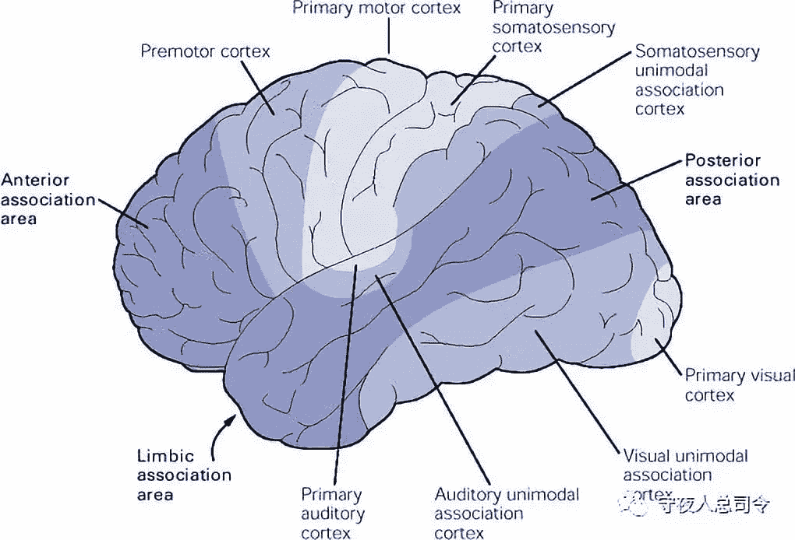

  
营造画面感  
婴幼儿对形状和颜色的辨别，远远的走在语言前面——在人脑的进化中：图像识别和空间感知是生存之道，它较容易产生情绪并立刻触发行为——兴奋得扑上去或恐惧得撒腿就跑！语言、逻辑、抽象都处于表皮层，有时候你能感知对方的情绪，却无法用语言表达清楚。因此，让表达呈现立体的画面感，大脑就会立刻记住，印象深刻！  
最让人击节赞叹的文章善于营造更高层次的画面感：通过细节呈现出镜头之外波澜壮阔的立体时代画面——它往往透过城市角落的变迁、时代生活的侧影，个人命运的门缝逐一展现出来…  
从云端俯视的镜头首先框住的是夜幕下被红色尾灯塞满的高架桥，以及桥两侧正拔地而起的高楼和灯火通明的大厦——随后，镜头聚焦于大桥下将被拆迁的小店里一群举杯相庆憧憬未来的少年——他们脸上洋溢的乐观和对未来充满琥珀色的美好憧憬正是这座城市生生不息的燃料！就在不远处，一群正在抽烟的人席地而坐，目光呆滞的看着彼此，工地之外的整座城市他们都毫无感知…  
三段式结构  
一篇好文章大多由三块主体内容构成——人的潜意识对三这个数字较敏感：事不过三；道生一，一生二，二生三，三生万物；一而再，再而三；三人行，必有我师——三似乎是某种边界，在左右两个针锋相对又势均力敌的平衡中，一锤定音的指引着方向！  
无论演讲、广告还是文章，气势如虹的排比句一般都是连续三句——两句显得底气不足，四句又显得拖泥带水，三句刚刚好！这是一种结构性的力量，与大脑中某种潜意识的偏好恰好契合。因此，顺着这一结构就能恰到好处的借用这股力量！  
爆款文章的套路：首先，勾勒一幅微观的立体画面来描述现象，引出问题、制造冲突、诱发情绪。继而，在解剖问题的过程中，逐渐切换到宏观视角，把问题的本质和关键要素逐一展开，并加以提炼和论证，期间还会突然制造一些反转。最后，再切回微观视角，让读者潜移默化的把自己代入场景之中…  

  
觉悟者  
喜欢你就转走吧！  
微信扫一扫赞赏作者 赞赏  
已喜欢，对作者说句悄悄话  
取消   
发送给作者  
发送  
最多 40 字，当前共字  
 人赞赏   
上一页 1/3 下一页  
长按二维码向我转账  
喜欢你就转走吧！  
受苹果公司新规定影响，微信 iOS 版的赞赏功能被关闭，可通过二维码转账支持公众号。  

 

精选留言  
用户设置不下载评论   
  

# 

# \[守夜人总司令\] - 2018-07-11 向正在坍塌的地方踹上一脚！

> 来源：[`www.yuque.com/books/share/97051b78-926c-43e6-b0aa-0b72ff163ac4/wta7sf`](https://www.yuque.com/books/share/97051b78-926c-43e6-b0aa-0b72ff163ac4/wta7sf) 

向正在坍塌的地方踹上一脚！  
原创 觉悟者 守夜人总司令   
守夜人总司令   
微信号 WatcherCommander  
功能介绍 结构学：生命体在其生存结构中的求存之道！  
2018-07-11[原文](https://mp.weixin.qq.com/s?__biz=MzAxNDk1NjI2Mw==&mid=2247483789&idx=1&sn=5e44b7b524c3dc4bb7705f49ed0a44a3&chksm=9b8a2205acfdab139e4b1d44ef6702b09c9fbf79505340205d13fbdaa33207a997f54bee0e97&scene=27#wechat_redirect&cpage=514)  
收录于话题  
创造奇迹的方式就是向正在坍塌的地方踹上一脚！  
   
不管你愿不愿意承认，川普上台以来，美国的经济数据越来越好，他竞选时的许诺正逐个兑现：边境修墙、全民减税、限制移民、创造就业…… 不管做什么，赢得信任的第一原则就是兑现承诺！  
   
川普出身上层社会，却选择站在愤怒的平民一边，如同当年凯撒一样——凯撒出身贵族，却选择出任只有平民才能担任的保民官，并始终站在元老院的对立面。希特勒出身平民，起家也是依靠街头的平民运动，但在关键时刻他选择了与普鲁士容克贵族们联合——在已经碎裂的结构中，最想掀桌子的群体是唯一可以借用的力量！  
   
当大地裂开之时，任何试图通过自己的双脚把裂痕聚拢的人都是沽名钓誉的傻逼，正确的方式是立刻冲上去对着正在倒塌的地方使劲踹上一脚！无论是希特勒还是川普都有着某种直觉——能轻易察觉结构性坍塌，并坚定不移的冲上去踹一脚——引起的争议越大，撕裂的越猛，矛盾越不可调和，对立越强烈，倒塌得也就越快！  
   
等大众目睹到倒塌现场的时候，会狂热的认定是那个冲上去踹一脚的人凭借一己之力创造了奇迹！知识分子骨子里存在一种卑贱的性格特质：一旦自己所鄙夷的人和事展现出巨大力量，跪舔的速度和狂热的劲头比其它任何群体都更加猛烈！  
   
如果你轻易的做成了一件艰难的事情，说明你面对的是一个正在坍塌的结构——不明真相的观众会惊恐和狂热的对你所展示出来的巨大力量顶礼膜拜。然而，面对未坍塌的结构——无论你多么的歇斯底里都无济于事！  
   
内部结构的坍塌  
   
1918 年 11 月，德国在战败之后迅速发生了革命。柏林的红色政权昙花一现，在完成把德皇威廉二世赶下台之后，就被坚定的右翼军官团和摇摆的中间群众扑灭了！随后组建的魏玛共和政府，从一开始就存在着结构性的的缺陷：左翼的群体敌视它，因为它扑灭了 11 月的革命；右翼群体也敌视它，因为它认可推翻皇帝这一事实。中间人群更恨它，因为它自身不稳定，对内对外都软弱无力，让中间群体感觉毫无保障无所适从！  
   
魏玛政府不是没有努力过，他们让右翼军官团的代表人物，战争英雄兴登堡元帅出任总统，主动放弃权力制衡的原则逐步向右转，同时争取美国的经济援助，以解决国内的失业和通货膨胀问题。在突破凡尔赛条约的限制方面，其实魏玛政府做了很多努力——如果没有 1929 年的金融危机，魏玛政府是可以延缓内部坍塌并建立新的秩序的——这也是希特勒在 1923-1929 年之间毫无起色的原因。  
   
1929 年的经济危机让魏玛政府的所有努力化为泡影，绝望的人群面对现实的生存困境，再也没有等待的耐心，再也没有妥协的余地，再也没有包容的理性思考——1929-1933 年，纳粹党的规模和影响力成倍的增长并非源于希特勒的才能突然之间有了飞跃，而是社会结构的坍塌加速了！  
   
纳粹党关于“一个民族，一个国家，一个领袖”的主张和仇恨犹太人的政策从来没有改变过。持这一主张的人，在 1923-1929 年只是一群被嘲笑和无人关注的街头混混。  
   
人不会因为有共同的朋友而亲密无间，但绝对会因为有共同的敌人而步调一致——共同的敌人能够凝聚人心，如果不存在，也要被创造出来！人在陷入无能为力的绝望的时候，会特别需要能被仇恨的对象，也特别渴望结束绝望的现状，并重建秩序和保障——他们渴望抢劫别人的冲动和对权力的顺从足以让统治者自身都感到震惊！  
   
后人把希特勒的崛起归于高超的欺骗和缜密的阴谋——真是太抬举他了！事实上，是内部社会结构的坍塌形成的民意洪流选择了他一如既往的主张——他也自始至终都未曾变更自己的主张，那些主张一开始就清晰的写在《我的奋斗》那本纲领性的自传中，他所做的一切不过是按照列出的清单一一兑现而已——即便英美之间明争暗斗，英美与苏联之间貌合神离，敌人松散的联盟存在太多导致分崩离析的龌龊，希特勒都视而不见，未加利用，他固执的按照原有的纲领执行，没做任何务实的调整！  
   
1933 年希特勒上台后一方面通过逆工业化的方式把一个岗位拆成两三个，同时大兴土木建设公共设施，修建全国高速公路网——以此快速消除失业人群。同时，以坚定的秩序挑战者的姿态换取英国而代之的美国资本的涌入——在短短 6 年里，他立竿见影的医治了德国社会的恐慌和焦虑，并逐条兑现承若，如同今天的川普一样！  
   
兑现承若是赢得信任的第一要务。它会让信任者坚定，让质疑者狂热，让投机者助纣为虐……   
   
外部结构的坍塌  
   
亘古以来的人类历史揭示了这样的自然法则：任何一次打破平衡的行为都是为了建立新的平衡！如有一个新的崛起者挑战原有秩序，最明智的做法就是把它吸纳进原有的体系中，并授予恰当的地位和权力。当拿破仑被打败之后，富有远见的梅特涅力主把战败的法兰西也拉进来，并充分尊重其利益。由此建立的维也纳体系保障了欧洲 100 年的和平！  
   
拿破仑战争看起来像君主征服战争，也确实充分利用了民族主义的力量。然而，其本质是法国社会的工业革命分化出一个新的社会群体，这个群体所握有资产和社会影响力与原有的社会权力分配体系不兼容。拿破仑颁布的所有法典都是有利于这个群体的——他们才是幕后的幽灵，拿破仑不过是他们布置的舞台上的演员。100 年后，随着德意志这个欧洲大国完成统一并开启工业化，同一个幽灵再次挑战维也纳体系所确定的君主同盟原则。100 年前只有拿破仑的法国军队是由普通人组成的国民军，其它各国都是君主的私人职业武装。到了第一次世界大战的时候，各国军队都已由普通国民组成：一个群体在社会中是否拥有权力，就看它是否能够参与公共事务以及参与程度！  
   
一战瓦解了好几个传统的大帝国，它预示着君主同盟规则下的平衡已经彻底被撕碎。但未能顺应时代潮流建立符合新兴阶层利益的平衡体系。更加愚蠢的是——把一个已经工业化的德国排除在外，也没有把美国这个更大的工业社会考虑进去，还把革命后的苏俄从体系中剔除了——而斯大林正用极端手段让苏联在工业化的道路上狂飙突进！日薄西山的英国带着满身伤痛的法国无力维持任何平衡，却同时面对三个拥有更大潜力的工业社会的挑战：德意志、美利坚、苏维埃！  
   
外部的结构本来就在坍塌，希特勒只是顺势而为。希特勒当年反复无常的态度和对国际规则的蔑视如同今天的川普。他越是如此，越能获得美国资本的青睐和苏联势力的谅解——因为那两个大玩家都是现有体系的潜在挑战者，他们需要一个二愣子冲到前面，充当打手。最后由他们来收拾残局并建立一个符合新兴阶层利益的稳定新结构。在建立联合国体系的时候，罗斯福力排众议，把一穷二白的中国和战败投降的法国都拉进了核心圈！  
   
正在坍塌的结构  
   
战后构建的结构运行了大半个世纪。无论是冷战还是边缘地带的冲突，都不曾从本质上改变底层的结构——无论是华约还是北约，都是采用了稳定的三级金字塔体系：美苏是各自的塔尖，掌握金融和尖端技术，负责制定规则，次级伙伴处于中间，参与规则并负责生产贸易。外围附庸接受援助并负责提供原材料——这是一个稳定的互补型内部循环。  
   
在现有的结构中，资金是可以自由流动的，人却无法大规模随意迁徙，出口商品其实是转移过剩的劳动力。前三十年中国社会过剩的是底层劳动力，他们被组织起来投入工厂生产低端出口商品。后三十年中国社会过剩的是中层知识劳动力，他们被互联网组织起来，以更低的成本出口服务。低价又勤劳的人抢占原来由昂贵又懒散的人群占有的资金，并从低端逐渐向高端蔓延，慢慢实现逐级替代。  
   
英国人第一次工业革命所积累的财富并没有被用于第二次工业革命，而是以金融的方式投资于美国的全国铁路网建设。当 1890 年美国的 GDP 超越英国之后，美国开始引领第三次工业革命。任何技术和产业的核心壁垒，其实就是所投入的成本！  
   
自从苏联解体以来，中国社会的工业化进程和德国合并后的重新崛起，给美国社会造成了不可逆转的冲击——无论华尔街获得多少财富，与 3 亿总人口相比，金融群体毕竟只是极少数。今天的美国比半个世纪前多了 1 亿人口，其中 4600 多万是在美国社会毫无积累的底层新移民。全球的资本流动让美国金融资本贵族群体大获其利，但这与普罗大众无关，原来由他们所占据的资金正快速的流向新的洼地。这与古罗马从共和制走向帝国时所面临的社会结构如出一辙——古拉格兄弟改革失败之后，经历过马略和苏拉的反复动荡，罗马人已经失去了耐心。凯撒顺势以武力征服罗马，以独裁强行推动变革——放弃几个世纪以来的城市自治联盟政策——联盟城市不需要向罗马输血，反而能得到罗马的庇护和资助（无法持续的古罗马的朝贡体系），改为直辖的行省制度，由皇帝直接派总督治理并缴纳赋税、承担徭役。同时放弃了与蛮族的和平，发动对外征服和掠夺来补偿日益增长的罗马贫困公民，并获得他们的效忠。  
   
自二战结束以来，全世界新增了数十亿的人口，然而科技和生产力并未突飞猛进，特别是近 30 年来，唯一有突破的仅仅是互联网信息领域，其它方面的改变并不大——这与暴增的人口形成不可调和的矛盾。埃及人口从 3000 万增长到了 9000 万，但埃及社会并未完成工业革命，原有的农业和旅游业并不能吸纳新增的人口。换而言之，仅仅埃及就有超过 6000 万的剩余劳动力需要转移。美国自己也有新增的 1 亿人口。中国社会则在这几十年中新增了 10 亿人，要不是计划生育减少了 3 亿人，社会体系要承载压力会更大！这个世界正在形成一种生存竞争关系，过剩的劳动力如果不能转移，就会持续推高维持秩序的成本，并引发内部结构的坍塌。除非生产力突然发生巨大的飞跃，否则，这个核心矛盾只能通过斗争来解决。  
   
人们在讨论中东的动荡不安之时，从未考虑那个地区普遍存在过剩的劳动力无法转移的问题——那里的年轻人不断以各种身份投入战斗，对他们而言，战斗本来就是一种就业方式！在生存面前，一切道义的口号都苍白无力——当美国社会负担不起它的全球朝贡体系，并从全世界收缩之后，闪烁着普世价值的灯塔也会逐步暗淡下去……  
   
全球朝贡体系的终结  
   
朝贡体系是一个金字塔结构——处于中心的强权虽然威风八面，其实靠自己输血去供养外圈的附庸和更远处的蛮夷。  
   
二战以后的世界经济由两个相互隔绝的朝贡体系所控制，金字塔结构保障了各自内部的稳定性。虽然两个体系争斗不止，都仅限于无足轻重的边缘地带，而且往往斗而不破，适可而止。  
   
苏联的解体和东欧的剧变，造成另外一个朝贡体系的崩溃，不但那个朝贡体系中的所有成员进入美国的朝贡体系，连俄罗斯这个原来的输血者也跑到美国的体系之中。从此，全世界都纳入美国的朝贡体系——美国的全球化其实就是美国的资金和产业向全世界转移——美国以高负债的形式向全世界输出资金、技术和产业，所有承接产业转移并获得贸易顺差的地区都在间接的向美国转移自己过剩的劳动力！  
   
匍匐在皇帝脚下的官僚集团越来越庞大，昏聩的君主会认为自己的权威更加荣盛，清醒的君主才会意识到：这需要更加残酷的压榨才供养得起越来越多的官僚——独步天下的威权不过是一时的虚幻！  
   
增长有其极限，一切都是取舍。在苏联土崩瓦解的那一刻，二战以来建立的全球治理结构就已经开始坍塌——因为它的基座建立在两个相互隔绝的金字塔体系之上。处于塔尖的强权向各自的体系输血并维持内部的秩序——苏联率先被自己的朝贡体系掏空，当它力不从心轰然倒塌的时候，有绣花枕头之称的里根却挡不住抢劫一把的快感，被幻觉所怂恿顺手接过整个世界……  
秦王扫六合，二世而亡；古罗马的联盟城市越多，罗马公民就越贫穷！除非再一次类似从农业社会进入工业社会一样的底层技术革命，否则，在现有的技术水平之下，没有任何一个社会能够担负得起向全世界输血的重担——尤其在多出来那么多人口的情况下。唯一稳定的结构就是威斯伐利亚体系：各霸一块，每一块都会形成一个小型的朝贡体系，由最发达的社会充当区域体系中的输血者，同时维护秩序！  
   
川普的种种”不负责任”的行为和当年苏联的全面收缩别无二致，也基于同样的原因——想必当年的各国对戈尔巴乔夫的收缩行为的批判和嘲讽也与今天对川普的嘲讽和道德批判如出一辙。  
   
川普是被选中的，如同当年的希特勒一样，都只是前台的演员，搭建舞台的力量本来就是为了让他们摧毁正在坍塌的结构——只不过川普顺势而为，冲上去踹了一脚罢了！所有的反复无常，所有的挑起对立，所有的不负责任，都源于同一个使命：摧毁这个无法继续维系并正在坍塌的结构！  

  
觉悟者  
喜欢你就转走吧！  
微信扫一扫赞赏作者 赞赏  
已喜欢，对作者说句悄悄话  
取消   
发送给作者  
发送  
最多 40 字，当前共字  
 人赞赏   
上一页 1/3 下一页  
长按二维码向我转账  
喜欢你就转走吧！  
受苹果公司新规定影响，微信 iOS 版的赞赏功能被关闭，可通过二维码转账支持公众号。  

 

精选留言  
用户设置不下载评论   
  

# 

# \[守夜人总司令\] - 2018-06-23 王侯将相真的有种！

> 来源：[`www.yuque.com/books/share/97051b78-926c-43e6-b0aa-0b72ff163ac4/tpy00q`](https://www.yuque.com/books/share/97051b78-926c-43e6-b0aa-0b72ff163ac4/tpy00q) 

王侯将相真的有种！  
原创 觉悟者 守夜人总司令   
守夜人总司令   
微信号 WatcherCommander  
功能介绍 结构学：生命体在其生存结构中的求存之道！  
2018-06-23[原文](https://mp.weixin.qq.com/s?__biz=MzAxNDk1NjI2Mw==&mid=2247483784&idx=1&sn=0f1063395f7448ba7706c86b94aa9d0c&chksm=9b8a2200acfdab161c498b0088b2c6a2c666b2ddee3a818521e017351d8fe0ae55c6748249d5&scene=27#wechat_redirect&cpage=514)  
收录于话题  
#教育  
51 个  
事实的真相往往不是你认为的那样！  
“燕雀安知鸿鹄之志” 和 "王侯将相宁有种乎" 给无数自视甚高的屌丝打满了鸡血。然而，司马迁是个骗子，或者说他是故意伪造一个屌丝逆袭的先例，为真正的纯屌丝——汉高祖造舆论并做铺垫。  
陈胜者，阳城人也，字涉。吴广者，阳夏人也，字叔。陈涉少时，尝与人佣耕，辍耕之垄上，怅恨久之，曰：“苟富贵，无相忘” 佣者笑而应曰：“若为佣耕，何富贵也？”陈涉太息曰：“嗟乎！燕雀安知鸿鹄之志哉！”  
汉以前的社会是彻彻底底的贵族社会——血统即道统，王就是王，臣就是臣，大家心安理得，天然认可。汉以前的夏、商、周、秦王族都能追溯到华夏部落首领的直系血统——大义的名分是由高贵的血统决定的，大家都服气！这就好比蒙元的皇位只能由成吉思汗直系后裔的黄金家族继承一样，是一种公认的约定成俗。  
汉高祖实在太屌丝，虽然摘了桃子，但缺乏道统，没有了大义的名分。而且反秦首义是陈胜吴广，关键硬战是项羽打的。怎么办呢？一方面装神弄鬼抬高自己: 你们是古代华夏部落首领的血统算个屁，我可是天神所生的真龙天子（为此不惜绿了自己的父亲）；另一方面开始屌丝化别人，树个”屌丝也能翻天“的先例——然而，项羽的贵族范太明显，血统也太扎眼，实在找不到下手的地方。于是，再往前一步，开始屌丝化陈胜，搞出一副屌丝逆袭的幻像！  
陈胜和吴广都有字，在那个时代只有贵族才有字。汉高祖连名都没有——刘季，就是刘老三，没有正式的名字！陈胜吴广起事的时候，又筑坦拜将，又冒扶苏、项燕之名，在旧楚故地，打复楚的旗号。在那个文盲遍地的时代，普通人出了村的事一概不知，什么人能洞识列国纷争的内部脉络，还能有这么娴熟的政治主张? 起义之前，装神弄鬼搞了一堆心理暗示的把戏，比如在古庙学狐狸叫”大楚兴，陈胜王“，又事先在鱼肚子里藏着写好的"大楚兴，陈胜王"，故意让众人发现 。这种驭民的本事，普通农民从哪里去学? 起事之后马不停蹄一个月攻占了一堆关键城池，这些城池不是州郡的治所，就是粮仓要地；而且是分兵多线操作——这完全是专业军人的战术素养！真正的农民起义初期绝对是洪秀全那种——打下郴州之后就待在城里花天酒地无所事事 78 天，直到四面被围之后才像没头苍蝇仓皇出逃...   
陈胜称王之后，家乡的故旧都来投奔他，这些能登堂入室的人可不是一般人，好比你们村出了一个省长，你会千里迢迢去找他吗？你又能见着他吗？如果能，你肯定也是个有影响力，能为他的事业出大力的人物。一个有一堆这种故旧的人，是普通农民吗？!  
考古出土的《秦律》明确记载:失期一月罚铠甲一副，遇雨失期不欲追究。陈胜很早就对佃农说“苟富贵，勿相忘”，显然他是有使命和野心的——这使命和野心就是复国。《秦律》规定：谋反不但诛灭九族，还保甲连坐。汉高祖当亭长的时候，送 300 人去服徭役，走到半道上逃走了一些，依法他也会被连坐，于是他带队跑到芒砀山造反，结果很多人害怕，不愿意造反逃走一大半——这才是农民正常的反应，才符合人性本来的样子！然而，陈胜的 900 人是那么的整齐划一，如同训练有素的军队。这只能说明一个问题，那只队伍本来就是陈胜吴广自己的队伍，一切都是有预谋的。陈胜在起义的时候对大家说: "纵有一死，死国可乎?" 然后大家异口同声回答"愿奉命"。为国而死，为谁的国而死？只有一个解释: 那就是大家共同的故国！这些人是陈胜吴广这两个前楚国贵族按计划秘密集结准备起义的旧楚军团！如同项梁和项羽在会稽郡秘密集结的故楚军队如出一辙！  
无论反秦的首义，还是灭秦的关键之战都是旧楚国的贵族组织和实施的——只有贵族才有这样的眼界，才干和资源干这种事。汉高祖作为超级屌丝得以幸存并最终摘桃子，是千年罕见的极小概率事件。人的阶层跃升就如同开车变道一样——需要一个道一个道的变，瞬间从最左边变到最右边，跨越所有车道而不发生交通事故的概率非常小——把生命寄托于这样的幸运，绝大多数情况下是以悲剧收场！  
许多人无法看到细微之处的真相，用忽略事实的幻像指引着自己，还把自己作为主角代入一个又一个贵族们的故事之中——这是所有失意和痛苦的根源！  
王侯将相真的有种！  
认清自己所处的阶层，设定一个自己够得着的目标，以一个普通人的心态去面对，做好几代人持续进化的准备，或许还真得能获得升阶的机会！  

  
觉悟者  
喜欢你就转走吧！  
微信扫一扫赞赏作者 赞赏  
已喜欢，对作者说句悄悄话  
取消   
发送给作者  
发送  
最多 40 字，当前共字  
 人赞赏   
上一页 1/3 下一页  
长按二维码向我转账  
喜欢你就转走吧！  
受苹果公司新规定影响，微信 iOS 版的赞赏功能被关闭，可通过二维码转账支持公众号。  

 

精选留言  
用户设置不下载评论   
  

# 

# \[守夜人总司令\] - 1970-01-01 他用常识拯救了我们！

> 来源：[`www.yuque.com/books/share/97051b78-926c-43e6-b0aa-0b72ff163ac4/wphn1h`](https://www.yuque.com/books/share/97051b78-926c-43e6-b0aa-0b72ff163ac4/wphn1h) 

他用常识拯救了我们！  
原创 觉悟者 守夜人总司令   
守夜人总司令   
微信号 WatcherCommander  
功能介绍 结构学：生命体在其生存结构中的求存之道！  
1970-01-01[原文](https://mp.weixin.qq.com/s?__biz=MzAxNDk1NjI2Mw==&mid=2247484722&idx=1&sn=6cee8e5b4f7a24ba90297da193076efb&chksm=9b8a26baacfdafac57ed3c639c36c2cca72c2f2b6c5feefe53ec73d01421fd37977edd238764&scene=27#wechat_redirect&cpage=327)  
收录于话题  
#天下  
9 个  
回归常识，往往会是解决复杂问题的神来之笔。大道至简，谁都会这样说，但是，在现实中常常做不到。为什么呢？因为你被一些有形或者无形的东西裹挟着——甚至是裹挟你的人也同时被你所裹挟着。大家的行为都是为了趋利避害，其结果反而形成一种相互制约的漩涡，只能彼此都眼睁睁看着一起沉沦…  
围棋的有趣之处在于：每一个棋子都是一样的，规则也是最简单的，但是，千百年来没有一盘棋与另外一盘棋雷同。围棋中最常用的一个词叫“势”——大势一去，万事皆休！我们在现实生活中也经常听到“借势”和“集势"这样的说法。至于具体如何去借势，该如何去集势，没人能清晰的说出个道道来，因为我们的文化只关注概念，而不关注推演和论证。没人深入研究“势”是如何形成的及如何去识别它的方法。  
我们习惯在事后用力吹捧一个人的丰功伟绩，但对他具体是如何一步一步做到的缺乏探索的兴趣。只是毫不吝啬溢美之辞，泛泛的赞扬。如果下一次遇到问题，是否可以依据这些道德化的原则去做就能逢凶化吉？估计谁心里都没底！  
是非判断的原点争夺  
我们曾经在《C1：他们到底怕什么》中简单的阐述了道义对组织和组织中权力变化的决定性影响力。我们在《结构学》的《C3：共识的形成》和《C4：道德与宗教》中做了更加详细的论证和阐述。  
共识是一个完整的体系，而不是一句口号。它从原点判断开始衍生出一个逐渐渗透到日常事务中的完整体系，这个体系为日常的事务做出是非判断和价值评估。共识所做的仲裁在解决现实问题中的效果越好，共识在人群中的认可度就越强，覆盖的人群范围也就越广，其神圣性和约束力也就会越大。  
所以，无论是一种思想被广泛接受，还是一种资源被广泛应用，都会围绕它逐渐聚集起应用它、消耗它的人群，继而人群中会生成有序的组织，这种组织的形式无论是什么样的，它都会在社会生活中形成一股势力。并且必然会成为结构中的一个新节点。我们在觉悟社中解释《结构学》的框架的时候阐述过：能够大量创造增量或者消耗存量的势力都会成为结构中的关键节点。  
你以为一个官员收到一份任命就能坐稳他的位置么？幼稚！他如果想任凭风云起稳坐钓鱼船，就必然要代表一个群体的利益主张，并且建立能够渗透下去的传导体系——这种传导体系是组织的骨架和神经网，让大脑的指令能够传导到末梢并驱动整个组织的行为。  
在十年动乱中崛起的人都是嘴炮，但是，他们拥有真理的最高解释权。这事非常了得，因为它的解释决定了什么是对什么谁错，什么样的行为是对的行为，什么样的行为是错误的行为，继而决定什么样的人是合格的，什么样的人是有问题的。不要小看这种是非判断，是非判断决定了奖惩，而奖惩是激励机制的核心，它驱动着个体的行为——包括内在的和外在的。如此一来，无论是整个社会还是组织内部，人群的行为、好恶、态度等都会被它及其衍生出来的东西所调动，形成一股制衡的力量。个体往往被这样的力量所裹挟，甚至会被瞬间碾压的粉碎。今天深圳河对岸发生的事情和十年动乱时千千万万人的行为都有力的验证了这一点。所以，切勿小看了是非判断和价值评估的最高解释权，它在原点上发挥着不可估量的作用！  
因此，那为伟大的小个子重返工作岗位之后，只要求主管科技和教育，这种冷门的领域远离权力中心，谁都不会放在心上，真的以为他是准备发挥点余热然后顺利退休。虽然科学和教育是冷衙门，但它距离真理最近——我们在《结构学》中阐述过：教育是统治工具，它不仅仅在人心之中树立是非判断和价值取舍的标准，还按这样的标准驯化下一代的统治机器的组成节点。无论是平反、回复高考、科技是第一生产力，知识分子是劳动者，如此种种都是在悄无声息的集势。我们曾经说过，乌合之众是墙头草，只要形成大势裹挟着他们往指引的方向走，他们就会同样的疯狂——他们永远只会在身边人面前追求优越感，其行为也完全参照周围人的反馈。真正能形成权力传导体系节点的人是那些被平反的人，是那些可以参加高考的人。当这些节点一一就位之后，这些本身就有力量的节点必然会形成有组织的网络和传递体系的骨架。现在只等待一个共识的产生去抢占是非判断的最高原点！  
实践是检验真理的唯一标准！这个石破天惊的口号并非谁心血来潮的一时兴起，而是经过充分的酝酿，做足的文章之后逐渐呈现出来的。伟大的小个子一恢复工作就立刻着手恢复一个毫不起眼的机构——政策研究室。当年孤身进入迪化负责情报并策动新疆和平解放的那位书生被请来做这个机构的负责人。虽然看起来只不过是做一些空对空的理论研究，然而，他的背景就决定了他建立的这个理论研究机构真正要做的事情绝对不是闲聊，而是凝聚共识，并将共识以成体系的方式阐述出来，作好替代原有道义的准备，并为后续的共识之下的价值体系和是非判断的演化提供权威解释。  
两手抓，两手都要硬！一手抓原点是非判断的最高解释权，另一手要抓的就是创造增量的关键节点及其体系建设！  
结构的关键支点  
改革和开放是同步进行的，这种同步进行具有必然的逻辑关联。如果你读过《结构学》框架中揭示的原理，你就会轻易的明白：所有的改革都是社会结构的重构。而结构的重构其实是结构的关键支点的调整，首先要大破原有结构的内在约束，继而是重新搭建新的社会结构。大破结构的力量来源于两个方面：内部突破结构的边界约束的力量源于科技树的升级和组织度的跃升；外部突破结构的边界的约束力源于落差的挤压！科技树的升级包括原点科技的突破和产业化的应用普及。十年浩劫和当时奉行的政策显然无法形成内部突破原有结构的结构力量。所以，对外开放就变成了借用外部的落差的挤压完成结构重构的唯一方式。  
总设计师第一次去日本现代化的钢铁企业参观的时候，他被整个车间里几乎空无一日的自动化震撼到了。他非常谦虚的问对方能不能帮中国也建立一个比这个更先进的现代化钢铁企业。对方两眼放光的爽快的答应了，这就是日后的宝钢。想到一个 10 亿人规模还未工业化的社会的需求，哪有不答应的道里呢？！总设计师还让对方把现场录像送到国内，让大家眼见为实，他本能的认为，视觉的震撼绝对会远远大于任何人转述的效果。事实也是如此。  
1975 年伟大的小个子第一次复出的时候，用尽所有的组织动员力量，试图把当年的钢产量提高到 2400 万吨，结果到年底的时候，用尽全力才勉强达到 2200 万吨。我们在《结构学》中阐述组织度的时候讲过：组织的密度沿续，人数密度，机械密度，信息密度的层次逐级递增。当后一种密度提高的时候，对前者的依赖就会大幅降低。当总设计师参观过日本的现代化钢铁厂之后，他对科技是第一生产力这个口号有了更深刻的理解。从此以后，他再也不做任何组织动员，而是努力提高社会组织度的中机械密度。后面的事实也验证了他的判断：宝钢一家公司的产量就高于以前一年全国的钢铁产量，而且质量控制要好的多的多！  
恢复高考和知识青年返城，以及开放个体经营，鼓励体制内精英下海和发展乡镇企业。所有这一切都是为了创造了增强社会经济体系和社会生活体系中协作密度更高的节点。我们知道，一个类似于骨架的体系的构建是逐渐累积的，因为越庞大体系的关键节点依赖的配套基础和消耗的能量就越多，如果不具备这样的基础就构建不起来。所以，构建这样的传导体系，首先要让基数足够大，协作足够密，成本足够低——深圳吸引了全世界各地的创客团队，因为他们的设计所需要的零件和配件，深圳在多年的电子元器件及成品出口的训练下，已经形成了非常成熟和低成本高效率的产业链体系。所以，全世界的创客团队都喜欢来深圳，因为他们上午的设计下午就能做出样品来，这在他们自己国家是办不到的。为什么我一直看好深圳，不仅仅是因为现有的数据呈现出来的东西，还有这些遵循底层逻辑的结构性特征所呈现出来的创造增量的趋势…  
经济重心从白山黑水的东北逐渐南移到南海之滨的深圳。它呈现的是产业涌动的轨迹，以及伴随这种轨迹同步变化的社会人群结构。武汉在过去的 40 年，第二产业的比重从 86%下降到不足 30%，这个变化的背后是人群结构的变化。即便到了今天，中国农业从业人口也超过 27.8%，而其产生的 GDP 还不足 8%，然而，我们每一年需要消耗大量的外汇储备去进口粮食，包括玉米、大豆、大米、小麦等。从某种意义上来说，农业及其从业人员一直处于持续的亏损状态，这个产业及其从业人群挤占了其它产业所需要的社会资源。那为什么还要持续投入，每一年都拨款呢？这会引出一个非常现实的问题。  
把整个社会看成一个完整的结构，当它的机械密度和信息密度过低的时候，就只能不断的扩展人数密度，通过规模来增强整个社会对资源的利用能力。这个策略在特殊的情况下其实是高明的——人类的早期特别崇拜繁殖，也是通过增加数量规模来抵御自身的脆弱性以求得族群的存续。但是，支撑它的成本消耗和规模成正比。这也是农业帝国能控制的范围有限的原因。大唐开元盛世最巅峰的时候，西域才区区 4 万驻军而已，大唐每年就要消耗掉一半的财政用于维系对西域的有效统治。这就是机械密度不够时，社会组织的天然内在制约。  
要增加机械密度就必须锻造更强大的个体并搭建协作度更高的组织。这一切都需要消耗更高的成本。所以，培养一个博士所消耗的社会资源足以养活成百上千个民工。然而，一个博士所能创造的增量往往是成百上千个民工叠加起来也无法望其项背。打过战略游戏的人就明白，为什么要囤积钱和油料去升级基地并建造更复杂的兵种？因为对方少数高级兵种的有效组合，往往能轻易消灭你十倍于其数量的低级兵种！整个社会的发展也是如此，只不过这个取舍的比重不好拿捏。过早或者过晚，过多或者过少都会影响整体结构的稳定。  
事实上，这 40 年来，我们一直沿着伟大的小个子开创的思路：不断增加社会的机械和信息密度的节点，搭建更加复杂的社会组织工具，不断的减少农业的比重并转移过剩的农业从业人口。脱贫的核心是让农业人口转移到别的产业，从农村进入分工协作密度更高的城镇生活和工作。他们为什么贫困？因为他们所从事的产业一直以来都是处于亏损状态，它没有创造增量而是在消耗社会其它部分创造的增量。换而言之，他们的辛劳不足以养活自己，不是他们不努力，而是他们在做无用功！一直以来，他们没有选择，只能做无用功，还不自知！  
学习是最好的纪念  
纪念一个人最好的方式就是学习他思考问题和做事的方式，理解他决策的初衷和底层逻辑，并用来解决自己的现实问题。我相信在他诞辰 115 周年的时候会有无数的人用尽溢美之辞去表达一份感激。在此只就事论事，去理解他试图搭建的结构，以及他为什么要搭建这样的结构。在错综复杂的局面中，他是如何悄无声息的完成了集势，又是如何举重若轻的完成了关键节点的布局，以及这个惯性在他去世之后又是如何持续演化的…  
所有人类社会的底层都是人，人所具有的生命体特征决定了覆盖其上的一切规则、制度和法律的不稳定性——当这些东西与大多数人的求存之道相契合的时候，它就会被遵守和维护，反之，则会被突破、利用或抛弃。我们不相信永恒的普世真理，只相信生命体永恒的求存行为引发的联动变化，以及自我强化和循环叠加的特征。这些底层的特征决定了基于其上的一切都只是暂时的，虽然这个“暂时"的时间跨度有长有短。  
基于以上的原因，任何社会发展到一定阶段之后都会存在结构性的问题，无论打什么旗号，奉行什么制度。所以，富余远见和魄力的改革者既不能把房子拆了还要平稳的对房子内部结构完成重构，让人肃然起敬的同时也叹为观止。生活中许多事情都不是那么泾渭分明，无法让你不断的摧毁重建，更多的时候，我们都是改革者。我们需要在原有的基础上寻找两全其美的解决方案，并保持一切的平稳过渡。当我们一无所有的时候，特别热衷于溪涧轻佻的浪花，那似乎是力量的象征。当我们成熟之后，就会发现黑和白没有那么泾渭分明，开始逐渐理解规则并借用规则的结构性力量去求得最好的结果。  
人的能力归根结底有三个层级：第一，自身的天赋和意志力的利用程度；第二，对社会规则的理解深度和利用程度；第三，对人心的洞察力和把握人性的能力。无论什么社会，领导力都包括：架构目标搭建结构的能力，凝聚共识并控制节奏的能力，以及建立传导体系并确立制度的能力。因此，最低的层次是毫不在乎规则，中间层次是主动遵守规则并利用规则，最高的层次是利用规则形成结构力量去改变规则。  
《结构学》觉悟社成员专用！  
已预定的人请确认信息，即将停止预定！  
获取《结构学》发消息：觉悟社  

  
点击下列链接，阅读更多：  
[F3：结构力量](http://mp.weixin.qq.com/s?__biz=MzAxNDk1NjI2Mw==&mid=2247484256&idx=1&sn=f10d9c530bfd6ea08b25d4bec657c13a&chksm=9b8a20e8acfda9fee057f2df26790f905c898132cac91d833d14e636edb00c20514d63189a88&scene=21#wechat_redirect)  
[C32：相处之道！](http://mp.weixin.qq.com/s?__biz=MzAxNDk1NjI2Mw==&mid=2247484658&idx=1&sn=32943edb605fea344e437efb5cd77ed6&chksm=9b8a277aacfdae6cc8e9d256f960d07226086e0d020d68893af2a8b5391771e66626b0d086aa&scene=21#wechat_redirect)  
[C33：信仰的坍塌！](http://mp.weixin.qq.com/s?__biz=MzAxNDk1NjI2Mw==&mid=2247484694&idx=1&sn=c460605348e49c98f1504673e42bab66&chksm=9b8a269eacfdaf887994e48305bd5d622cf8c2ae14856fbcea31794b72ff3334e8335a74ab2d&scene=21#wechat_redirect)  
[C4：道德与宗教！](http://mp.weixin.qq.com/s?__biz=MzAxNDk1NjI2Mw==&mid=2247484608&idx=1&sn=49b58f2f27c117c1c42e6270e8d2d8c2&chksm=9b8a2748acfdae5ea3d03e3a9843d183498241c03b0d57b01b9c315e23757604fd0e1bfdb96f&scene=21#wechat_redirect)  
[C31：教育的本质！](http://mp.weixin.qq.com/s?__biz=MzAxNDk1NjI2Mw==&mid=2247484645&idx=1&sn=0c19e963af345ec0d157348555f45482&chksm=9b8a276dacfdae7bb43eb0602bf7d9fdc827d0675a7350f893c5b3b43986de58782355a2065d&scene=21#wechat_redirect)  
[C30：如何追女神！](http://mp.weixin.qq.com/s?__biz=MzAxNDk1NjI2Mw==&mid=2247484588&idx=1&sn=de5c95495cc04bcfe8644c3c2bc025c3&chksm=9b8a2724acfdae3286a142c2de506a7494e2d7aa50c990c0e159cedab07b5287040f286dfac6&scene=21#wechat_redirect)  
[C27：职场中的真相！](http://mp.weixin.qq.com/s?__biz=MzAxNDk1NjI2Mw==&mid=2247484554&idx=1&sn=fec6641c1838970ea6d16cfe1a68f9e1&chksm=9b8a2702acfdae14e71017ee02594f3b47abc738b773bc3dbd5e80968dccae0e90f17977a339&scene=21#wechat_redirect)  
[C1：他们到底怕什么？](http://mp.weixin.qq.com/s?__biz=MzAxNDk1NjI2Mw==&mid=2247483898&idx=1&sn=1b0a50386e9e89d2750dec717236f0aa&chksm=9b8a2272acfdab64235b35ee5e91b8cac6172144207251636e1345fc570aa1601f59eff7f442&scene=21#wechat_redirect)  
[C3：梳理流程也没用！](http://mp.weixin.qq.com/s?__biz=MzAxNDk1NjI2Mw==&mid=2247483989&idx=1&sn=ee70dacfd980f041379d91ae947ece44&chksm=9b8a21ddacfda8cb28bf62d6f53531e8a8ebce2de96396e50ec7e7e144fffe502ec6faee3415&scene=21#wechat_redirect)  
[A47：边缘人无法逆袭！](http://mp.weixin.qq.com/s?__biz=MzAxNDk1NjI2Mw==&mid=2247484476&idx=1&sn=42cd8e7b62b1c430768fe9583a9715b4&chksm=9b8a27b4acfdaea2f7ac778f91e72c9b69a725224a18c6d576f3de7caf0ff91a040bf5622645&scene=21#wechat_redirect)  
[几次成功的结构学预判](http://mp.weixin.qq.com/s?__biz=MzAxNDk1NjI2Mw==&mid=2247484266&idx=1&sn=02ab915e029cbe24d91712f741b3f37c&chksm=9b8a20e2acfda9f4498a5c76204c101ab26e7311f2fb7d3043de108d4ff6e18d72a1c889a569&scene=21#wechat_redirect)  
[A46：淤积的小市民！](http://mp.weixin.qq.com/s?__biz=MzAxNDk1NjI2Mw==&mid=2247484472&idx=1&sn=f5df702c026dbb04688151086cdf7493&chksm=9b8a27b0acfdaea6ed5b712d94b3725bf8e322b39101916f48f935c102c433e9c7239b596c9f&scene=21#wechat_redirect)  
[A61：与所有人为敌！](http://mp.weixin.qq.com/s?__biz=MzAxNDk1NjI2Mw==&mid=2247484601&idx=1&sn=c80e839436bd78047d0f5ea3c9e69890&chksm=9b8a2731acfdae27acc75952e866e0642eea99cb2acfeab4101e209ecc728fd94eb2adc7434c&scene=21#wechat_redirect)  
[A84：为何买深圳的房？](http://mp.weixin.qq.com/s?__biz=MzAxNDk1NjI2Mw==&mid=2247484708&idx=1&sn=c4a8ffe14b1ea0579e0005119094ca23&chksm=9b8a26acacfdafba18b302d996afe0251fe92e695dde593e623f32be05c31d020aad6aafa541&scene=21#wechat_redirect)  
[A63：匮乏感是一种恶疾！](http://mp.weixin.qq.com/s?__biz=MzAxNDk1NjI2Mw==&mid=2247484613&idx=1&sn=67f0957ae7ffa817652c3cb9f14a13b9&chksm=9b8a274dacfdae5b9fb0ddc58544dec9a94900fe1baab61b6b4d00236965579c32b8fd7e1e63&scene=21#wechat_redirect)  
[A64：人和人真的不同！](http://mp.weixin.qq.com/s?__biz=MzAxNDk1NjI2Mw==&mid=2247484618&idx=1&sn=ef99e3ee9800a28ff0f36ea6977f2133&chksm=9b8a2742acfdae5455f0f4c75f66030655dee2432d9b54ed40cc125ff86625cfda817fadfbd2&scene=21#wechat_redirect)  
[公告：《结构学》宣言](http://mp.weixin.qq.com/s?__biz=MzAxNDk1NjI2Mw==&mid=2247484505&idx=1&sn=95b4424393e36eda97e76284318a3f38&chksm=9b8a27d1acfdaec7c00ce60807bd673a33454adf9b992a8ef9b44687a93b333dcf676d0b77c3&scene=21#wechat_redirect)  
[依依东望，望的是时间！](http://mp.weixin.qq.com/s?__biz=MzAxNDk1NjI2Mw==&mid=2247483947&idx=1&sn=1dcdd529b9dad09a00b6e3e2b14c8245&chksm=9b8a21a3acfda8b5fe1dae1c8979dec0be990a569bc03372af815b4e0f08913e938d57aa6b25&scene=21#wechat_redirect)  
[A62：为什么需要外汇储备？](http://mp.weixin.qq.com/s?__biz=MzAxNDk1NjI2Mw==&mid=2247484604&idx=1&sn=2217abffb62dc6bd2fd19929e13f745c&chksm=9b8a2734acfdae22952edbb235321e2d155694f0b44635f4c6e612365cf0f7302d5683d89c6a&scene=21#wechat_redirect)  
[A56：刘邦为什么要换太子？](http://mp.weixin.qq.com/s?__biz=MzAxNDk1NjI2Mw==&mid=2247484574&idx=1&sn=5ed4d23f15b1523357c663394fe17eed&chksm=9b8a2716acfdae0067c043e7f714afa42a672e6d43d777dff978f561399710e4a4f977a43ede&scene=21#wechat_redirect)  
[A53：一触即发，何去何从？](http://mp.weixin.qq.com/s?__biz=MzAxNDk1NjI2Mw==&mid=2247484535&idx=1&sn=730dd962738c90e2a5de9558e0b6471a&chksm=9b8a27ffacfdaee9fcaf3cb350e1589a70eae4bde6172b6bd3a08b7f61fbd7645890b76b88c7&scene=21#wechat_redirect)  
[B4：你不必为华为担心！](http://mp.weixin.qq.com/s?__biz=MzIzMDYwOTM0Mg==&mid=2247483951&idx=1&sn=7850925e07db502ec2116efe0211318f&chksm=e8b19afedfc613e816bdef573343dbe2127c92d828c071510a8a8b9cb98384cdc7a6dbf8fbdd&scene=21#wechat_redirect)  
[C12：务必要振兴建设兵团！](http://mp.weixin.qq.com/s?__biz=MzAxNDk1NjI2Mw==&mid=2247484193&idx=1&sn=88c86597191d0c97a411f9ea6f7b7c5d&chksm=9b8a20a9acfda9bfae819e8e42531fe6d523dd244ef0fc0c0787ab812540108c181f7ec2ffa9&scene=21#wechat_redirect)  
[C20：行为的内在驱动力！](https://mp.weixin.qq.com/s?__biz=MzIzMDYwOTM0Mg==&mid=2247484003&idx=1&sn=a62ddbccc64f9f19890c0dff9605b6f7&scene=21#wechat_redirect)  
[向正在坍塌的地方踹上一脚！](http://mp.weixin.qq.com/s?__biz=MzAxNDk1NjI2Mw==&mid=2247483789&idx=1&sn=5e44b7b524c3dc4bb7705f49ed0a44a3&chksm=9b8a2205acfdab139e4b1d44ef6702b09c9fbf79505340205d13fbdaa33207a997f54bee0e97&scene=21#wechat_redirect)  
[A28：40 年前的今天改变了世界！](http://mp.weixin.qq.com/s?__biz=MzAxNDk1NjI2Mw==&mid=2247484305&idx=1&sn=34b19d12210bf9f765c6eb615b787ac6&chksm=9b8a2019acfda90fff45ea8c17ccb37c75e04c7420ad9b303a0fb0069110cee644e6f592d95f&scene=21#wechat_redirect)  
[书读得比你少，为何混的比你好？](http://mp.weixin.qq.com/s?__biz=MzAxNDk1NjI2Mw==&mid=2247484296&idx=1&sn=b0e0f11f50023aa8a20e8eeb51d39e10&chksm=9b8a2000acfda916885455b30687e2f18099abba31c78b2fabb95ca1b89ddc40f2415317d368&scene=21#wechat_redirect)  
[A34：烂父亲的危害到底有多大！](http://mp.weixin.qq.com/s?__biz=MzAxNDk1NjI2Mw==&mid=2247484348&idx=1&sn=944a6aac1e8035011b56508ea74fb48e&chksm=9b8a2034acfda922b803681a568bf7b75ce8342cf507080d2e636098b7ee9dfc1391836f7341&scene=21#wechat_redirect)  
[警报：《结构学》的目录和纲要！](http://mp.weixin.qq.com/s?__biz=MzAxNDk1NjI2Mw==&mid=2247484593&idx=1&sn=5ec84d78201320511260f18a170dd539&chksm=9b8a2739acfdae2f3f64efc39512bdba6569eb8ebbe4da30839c1116ed7f9e2e6ffcad864cc2&scene=21#wechat_redirect)  
觉悟者  
喜欢你就转走吧！  
微信扫一扫赞赏作者 赞赏  
已喜欢，对作者说句悄悄话  
取消   
发送给作者  
发送  
最多 40 字，当前共字  
 人赞赏   
上一页 1/3 下一页  
长按二维码向我转账  
喜欢你就转走吧！  
受苹果公司新规定影响，微信 iOS 版的赞赏功能被关闭，可通过二维码转账支持公众号。  

 

精选留言  
用户设置不下载评论   
[阅读全文](https://t.zsxq.com/iM3Rzjq)  
  

# 

# \[守夜人总司令\] - 1970-01-01 C33：信仰的坍塌！

> 来源：[`www.yuque.com/books/share/97051b78-926c-43e6-b0aa-0b72ff163ac4/wqozgx`](https://www.yuque.com/books/share/97051b78-926c-43e6-b0aa-0b72ff163ac4/wqozgx) 

C33：信仰的坍塌！  
原创 觉悟者 守夜人总司令   
守夜人总司令   
微信号 WatcherCommander  
功能介绍 结构学：生命体在其生存结构中的求存之道！  
1970-01-01[原文](https://mp.weixin.qq.com/s?__biz=MzAxNDk1NjI2Mw==&mid=2247484694&idx=1&sn=c460605348e49c98f1504673e42bab66&chksm=9b8a269eacfdaf887994e48305bd5d622cf8c2ae14856fbcea31794b72ff3334e8335a74ab2d&scene=27#wechat_redirect&cpage=327)  
收录于话题  
生活中经常发生这样的事情：你觉得不可思议的事情对方却觉得理所当然，你们之间谁也说服不了谁，只能无言以对，或者干脆避免存在交集。人从自己的视角出发，以自己熟悉的一切为丈量外部的标准是思维、行为和心态的惯性，也是最稳妥的生存策略。个人的这种特征往往会被认为是一种偏见，应对之策是主张换位思考，共情和同理心。而群体的这种特征则会被认为是一种文明冲突，应对之策是呼吁不同文明之间进行对话、相互尊重和逐步融合。  
天真的人会认为融合就是在相互尊重下彬彬有礼的自动形成你中有我我中有你的融洽状态。事实上，这种一厢情愿的天真想法总是被血淋淋的现实打脸！远的不说，乌克兰的俄罗斯族和乌克兰族是同文同种的兄弟，融合了数百年，还曾经作为一个国家的成员共同经历过苦难和辉煌。然而，最近的一个小火星所造成的撕裂就让他们相互仇恨彼此敌对，陷入难解难分的血海深仇之中。  
真正的融合是一种社会结构传导体系的替代以及共识的逐渐渗透。我们的先祖从黄河流域开拓到南海之滨绝对不是靠讲道理、摆事实来实现的。而是基于暴力征服、基因替代、文明教化、社会基础经济结构的搭建和替换来实现的。不仅仅中原如此，在任何地方都是如此：北方草原上生活着放牧为生的蒙古族，其实，真正的蒙古只是生活在草原上诸多部落的一个小部落而已，是成吉思汗的征服和统一后的制度设计让自己部落的一切成为了草原上所有成员的标准，从而融合成一个民族。事实上，当时靠近中原的游牧部落与靠近西伯利亚的林木中部落之间的差异完全是天壤之别。然而，蒙古部落以暴力为基础，以法令和制度为工具，以社会经济交流为底蕴，逐步将所有的部落都变成了自己的新样子，继而形成了一个共同体——这个共同体在社会心理、生活习俗、行为规范，社会共识等方方面面都趋于一致。总的来说，融合必然拥有一个强有力的主导者，这个主导者在关键节点上具有能同化其它成员的先进性——这种先进性的判断标准基于是否有利于共同体和各部分的存续！  
信仰的本质  
不管是市场营销还是推行社会政策，第一步都是以各种方式去凝聚共识——任何一场社会运动都起始于激发贪婪和恐惧的思想营销，兴盛于持续加杠杆的庞氏骗局，终结于秩序重建的韭菜收割。  
据《结构学》阐述的原理：让生命体置身于存续的危险之中是快速形成共识的最有效方式——无论是让人处于死亡的威胁之中，还是让人意识到有利于自身存续的资源将被他人侵占，都能将置身于同一处境中的人快速凝聚起来形成某种求存的共识。《结构学》里的《C3：共识的形成》更系统的阐述了共识是如何形成，又是如何作用于现实，以及共识的强化和破灭的步骤及关键要素。  
基于《结构学》揭示的原理，在具体操作上，撕裂群体的最佳方式就是让其中的一部分人相信自己正处于生存危机之中，自己所有的不幸都源于另一部分人的掠夺和迫害——仇恨有利于撕裂群体和破坏原有的规则体系并让对立的双方相互强化对立——斗争有利于团结，团结是为了更好的斗争！相互之间的敌对和猜忌会加深隔阂并进一步强化仇恨和误解，并让弥合所需的成本越来越高，当这个成本高到一定程度之后，试图弥合裂痕的势力不仅会主动放弃弥合的努力，甚至会加入到主动摧毁的行列中来加速这一进程。我们一年前依据《结构学》的基本原理预测了美国社会结构性碎裂必然会引发国际贸易分工体系的碎裂，这种碎裂一旦开启就再也回不去了，所以当时预测贸易战不可避免。详情见《[向正在坍塌的地方踹上一脚！](http://mp.weixin.qq.com/s?__biz=MzAxNDk1NjI2Mw==&mid=2247483789&idx=1&sn=5e44b7b524c3dc4bb7705f49ed0a44a3&chksm=9b8a2205acfdab139e4b1d44ef6702b09c9fbf79505340205d13fbdaa33207a997f54bee0e97&scene=21#wechat_redirect)》川普正是充分利用了上面阐述的特征顺势而为。  
亘古以来，无论是文明冲突还是宗教战争，争夺的核心都是终极的是非判断。每个有序组织起来的社会都必然存在唯一主导性的价值判断，它从原点决定了什么是对，什么是错，继而由此衍生出各种日常生活中教化社会成员的是非判断和价值取舍依据。这些东西有可能是道德体系也可能是法律体系，不管是那一种都是终极判断作用于日常生活的仲裁工具和建立及维持秩序的教育方式。  
曾在《[C31：教育的本质！](http://mp.weixin.qq.com/s?__biz=MzAxNDk1NjI2Mw==&mid=2247484645&idx=1&sn=0c19e963af345ec0d157348555f45482&chksm=9b8a276dacfdae7bb43eb0602bf7d9fdc827d0675a7350f893c5b3b43986de58782355a2065d&scene=21#wechat_redirect)》中强调过：教育是统治的工具，因为教育决定了什么是对，什么是错；什么样的人合格，什么样的人不合格！无论什么社会，居于统治地位的少数群体都会人为的为绝大多数的普通人设置一堆门槛并让他们去不断追求达标——那些标准并非做事所必须的素养或技能，而是一套筛选机制，用来决定谁有资格去做事！  
一个社会最高的共识往往以信仰的方式呈现出来，因为信仰是指引生命体在其生存结构中寻找出口的终极策略，也是生命体核心诉求的抽象表达。任何信仰都能驯化其承载者的思维、心态和行为，雕塑其精神结构，并由内而外的形成驱动力和约束力。如果这种驯化所牵引的行为与当下生存结构中的最佳求存策略恰好契合，就会以积极的现实反馈去佐证信仰的巨大威力，继而不断强化这种正向的循环。  
曾在觉悟社中推荐马克斯.韦伯的著作《新教伦理与资本主义精神》，它提倡忠诚守信，勤简节约，将所有的精力和积累都投入创造增量的生产之中去循环往复的挣更多钱——这种行为被看成是一种荣耀上帝，践行信仰所赋予自身使命的方式，而这种自我约束和行为结果在信仰上被看成是无比虔诚的证明——极度契合资本主义初期原始积累所需要的行为规范和全社会普遍存在的宗教信仰无缝衔接在一起——信仰能在人心中产生约束并激发热情，并不断的转嫁整体的阻止成本，它引导个体的行为符合资本主义原始积累的需要，继而汇聚起一股延绵不绝的洪流，并通过现实成果不断验证信仰的巨大威力——这是个会不断强化的正向循环。  
中国社会是否缺乏信仰，恰恰相反，中国社会的信仰对每一个人而言如同春风化雨润无声一样浸入骨髓：小时候一起吃饭，如果爷爷还没有动筷子，你先动筷子，父亲一定会批评你，如果父亲不这么做，其它长辈就会责怪父亲。这几乎是一种本能的行为，而这种自然而然的行为背后是什么在驱动着人的思维、心态和行为呢？一种长幼有序的是非判断标准和价值观念！普通人对秩序的坚守是通过礼仪的方式来呈现的，而知识分子阶层作为这种信仰的祭司阶层，会自主、自觉的坚守层次鲜明的社会秩序。秩序井然的地方会被看成文明，而缺乏秩序的地方则会被视为野蛮。是秩序在维持共同体周而复始的存续和繁衍，所以，秩序是这个社会的核心信仰，也是最高的生存策略。  
多元化的挑战  
一个社会最大的共识常常会以信仰的方式表达出来，信仰属于文化的范畴，而我们在《结构学》的框架中阐述过：所谓文化就是一个群体在其生存结构中共同的生存策略。它指引着群体去寻求存续的出口。文化天然具有自我遮蔽性，因为它需要强化内部的一致性，这种一致性既能在内部形成相互支撑，也会在内部形成相互约束，从而让所有的个体遵循内部激励机制的引导，并让共同体的生存策略得以贯彻。强化内部的一致性，也决定了对外部反馈的筛选偏好。这种共识下的一致性有利于以最低的成本在最大的范围内维持秩序，并让共同体的规模和所占据的资源达到最大化。  
基于以上的底层逻辑，信仰天然需要具备唯一性——不仅仅是具有排它性的原点是非判断标准，也包括由这种终极判断衍生出来的整个体系。因为任何质疑都将动摇根基，是非判断的神圣性、唯一性和认可度越高，也就更具有号召力——当马克思的终极判断被奉为唯一真理的时候，基于终极判断之下演化出来的一切都是理所当然的。而终极判断一旦遭受质疑，基于其上搭建起来的一切都瞬间变得摇摇欲坠。要更具体的理解这一点，阅读《[C1：他们到底怕什么？](http://mp.weixin.qq.com/s?__biz=MzAxNDk1NjI2Mw==&mid=2247483898&idx=1&sn=1b0a50386e9e89d2750dec717236f0aa&chksm=9b8a2272acfdab64235b35ee5e91b8cac6172144207251636e1345fc570aa1601f59eff7f442&scene=21#wechat_redirect)》  
正因如此，原点判断不容质疑，教育作为统治工具就是对原点判断及其衍生出来的一切进行强行灌输和人为驯化。甚至进化出一个以此为生的独立群体，他们会成为教化的执行者和由原点衍生出来的是非判断标准渗透到社会末端的传导体系。  
美国人的基础社会结构由三个关键要素组成：教堂、市场、法庭。教堂负责是非判断和人群的教化，法庭提供仲裁判断并以暴力贯彻执行。其它一切问题都通过市场的交易来完成。  
这套体系能以低成本高速运转源于法庭维持秩序的成本和市场交易成本的可控。成本过高，法庭将无法做出裁决，市场也无法配置资源。社会共识就如同百年老店里的一缸浓汤，需要逐渐的累积和时间的沉淀，可以在主体不变的情况下不断加新汤，但不能过快稀释，如果沉淀的时间不够，只会越来越稀薄，整个味道就完全变了！  
表面上看，美国最重要的立国文件是《独立宣言》开篇的一句就是：我们认为以下真理是不言而喻的，人生而自由平等，享受造物主赋予的… 这句话是全篇的原点所在，它的核心不是自由平等，而是天赋人权！如果你深思一下你就会发现这里存在一脉相承的尴尬：天赋人权和君权神授在原点上是同一回事——在英文中“天”和“神”是同一个词——它是全知全能，无所不在无所不知，不证自明的最高主宰。换句话说，这个终极判断的原点就如同一条咬住了自己尾巴的蛇，自己形成一个闭环，自己证明自己。一切是非判断和基于终极判断衍生的价值取舍都源于这个不证自明的最高主宰的赋予，至于它将某种东西赋予给君主和贵族，还是赋予给每一个普通人，并不存在必然的选择和佐证的依据。换句话说，这种赋予的权力并非天然就具有唯一的神圣性，而是根据当下形势的需要所形成的。因此，不存在永恒的普世真理。只存在周期性的意识形态。  
任何一种共识都不具有永恒的唯一性。它的唯一性是人为赋予的，需要外力来维系！这就如同法律一旦被践踏而缺乏惩罚的力量，法律的权威和约束性就会瞬间荡然无存！不管是课堂上的法律教育，还是大街上执勤的警察，都是维系法律约束力的一种外在力量，而这种外力是有成本的，这种维系的成本会随着形势的变化而浮动——当成本撑不住的时候，规则的约束力和神圣性也就瞬间坍塌了！  
破碎后的代价  
我们在《结构学》的《C3：共识的形成》和《C4：道德与宗教》中阐述过：生命体对存续所需资源的无限诉求会让置身同一生存结构中的个体凝聚成共同体——个体的内在驱动力源于自己的精神结构，共同体的内在驱动力则源于共识形成的判断——这种共识是关于共同体的存续策略，也指引置身其中的个体的求存之道。  
信仰之所以成为社会共识是因为它提供了终极价值判断的最高仲裁，当共识被稀释之后，任何表层的融合都无法解决不同原点的价值取舍和价值判断带来的底层冲突——任何道德和法律都是原点判断衍生出来的体系。无法在不同的原点判断之间找到共识。当任何行为都能在另一套由原点衍生而来的体系中获得自我激励的机制。道德和法律体系就必然遭受另外一套价值判断体系的挑战！  
美国社会对天赋人权中的“人”的定义最开始限定的范围是非常窄：必须拥有主持正义的社会影响力，拥有产业，拥有军功——能承担社会责任并证明过自我的人才能拥有参与公共事物的权力。  
美国人的制度设计一开始就是精英模式而不是平民模式，选举人制度就是最显著的代表。它的开国之父们，对多数人暴政的防备一点都不比对少数人的暴政的戒心少一丝一毫。不管是在什么社会，当人群中一股新势力崛起的时候，一种新的共识就会在群体中传播开来，从而形成有共同利益的严密组织，继而不断冲击直至突破原有规则的限制。  
真正从源头凝聚美国社会的是清教徒心中最虔诚的新教信仰和由此构建起的人员筛选和教育机制，以及创造增量的社会经济结构。无论东方还是西方，秩序都是持续存续的基础。守护秩序的人群不但具有虔诚的自我约束和自我激励特征并具有严密的社会组织度，同时存在持续产生和培养这个群体的经济基础结构，并在社会经济结构中占据关键支点。  
多元化只有在有利于强化共识而不是稀释共识的时候才是值得提倡的，处于周期上升阶段的美国，主流社会发挥核心影响力的是具有严密组织的主导群体。即便是来自世界各地的人为了成为主导势力的成员，也是主动争取被同化为安格鲁撒克逊白种新教徒，而不会质疑作为原点判断的主流信仰。  
不同的信仰都源于不同的终极原点判断，每一个原点是非判断和价值取舍都会衍化出基于其上的整个体系，这个深入日常生活的方方面面的体系，为生活中所有模棱两可的事物和会产生冲突的问题提供仲裁依据。同时，它所形成的教育体系由内而外的驯化着接受了它的个体。激发个体的自我约束并转嫁维系秩序的成本。换而言之，不接受终极的原点判断的个体或者群体必然形成分庭抗礼的格局，要让其遵守规则必须通过外力来约束，这个成本只会越来越高。高到一定程度之后，就不得不妥协并持续改变原有规则。边界的突破必然会打破原有社会组织结构的稳定性。一个社会能持续创作增量并维系稳定性的秩序，其核心依托就是社会组织和社会经济中搭建起来的结构。  
一家企业的主业一旦无法继续创造增量，通常会采取多元化的策略——多处下注，试图实现东边不亮西方亮的效果。然而，这样的多元化往往并不会产生什么好结果。当年通用传奇 CEO 的做法是把所有与主业不相符的通通出售，大刀阔斧的裁员，重新突出能创造增量的核心业务，并调整组织结构和企业文化以适应这一目标。乔布斯重新回归苹果的时候，先向比尔盖茨借了 1 亿美元解决燃眉之急的资金问题，继而把原来的多元化的产品线全部砍掉，聚焦主航道，随着主航道上的 macbook, iPhone, iPad 等一些列产品的成功，苹果重回巅峰时刻。川普看起来是在撕裂人群，事实上是在不断重申美国社会长期以来占据主导的社会共识并重建承载此共识的社会组织结构和经济基础。  
《结构学》觉悟社特训营专用！  
已预定者请耐心等待  
获取《结构学》发消息：觉悟社  

  
点击下列链接，阅读更多：  
[F3：结构力量](http://mp.weixin.qq.com/s?__biz=MzAxNDk1NjI2Mw==&mid=2247484256&idx=1&sn=f10d9c530bfd6ea08b25d4bec657c13a&chksm=9b8a20e8acfda9fee057f2df26790f905c898132cac91d833d14e636edb00c20514d63189a88&scene=21#wechat_redirect)  
[C32：相处之道！](http://mp.weixin.qq.com/s?__biz=MzAxNDk1NjI2Mw==&mid=2247484658&idx=1&sn=32943edb605fea344e437efb5cd77ed6&chksm=9b8a277aacfdae6cc8e9d256f960d07226086e0d020d68893af2a8b5391771e66626b0d086aa&scene=21#wechat_redirect)  
[A81：美国的本色](http://mp.weixin.qq.com/s?__biz=MzAxNDk1NjI2Mw==&mid=2247484681&idx=1&sn=14ab50cf82c3d5292d20ca7f973ad595&chksm=9b8a2681acfdaf97b283b0951b639cf81ea2a17c001864032d326be505907930f9a03f8f949e&scene=21#wechat_redirect)  
[A8：统治的关键支点！](http://mp.weixin.qq.com/s?__biz=MzAxNDk1NjI2Mw==&mid=2247483996&idx=1&sn=c9bc4ea308424074eddfdf68020fc602&chksm=9b8a21d4acfda8c2902216f0de9989ce3d22d440efe7c3bdcc29724308c95969cb124ed257f5&scene=21#wechat_redirect)  
[A71：为何被删除了？](http://mp.weixin.qq.com/s?__biz=MzAxNDk1NjI2Mw==&mid=2247484668&idx=1&sn=06e2af18dadf47754ad4f5be1cdfcb03&chksm=9b8a2774acfdae62f3380761dbc586fea5a31f99b639d367a556553c30cee786197a3f4473ba&scene=21#wechat_redirect)  
[A70：广州的黑人问题！](http://mp.weixin.qq.com/s?__biz=MzAxNDk1NjI2Mw==&mid=2247484662&idx=1&sn=7fb2d7264ae5d2efbe8fb1b01e06bfe5&chksm=9b8a277eacfdae687f10133abecf98a65278dcef51d1d88702f8e61139f6f7646711ca693243&scene=21#wechat_redirect)  
[B18：中层和高层之别！](http://mp.weixin.qq.com/s?__biz=MzAxNDk1NjI2Mw==&mid=2247484627&idx=1&sn=e38abac4a3818dc622e7a68b60f726f5&chksm=9b8a275bacfdae4d09192cce1fb560ed59c44fee339dd492cd65671b2c4022b7c41a39923b30&scene=21#wechat_redirect)  
[C4：道德与宗教！](http://mp.weixin.qq.com/s?__biz=MzAxNDk1NjI2Mw==&mid=2247484608&idx=1&sn=49b58f2f27c117c1c42e6270e8d2d8c2&chksm=9b8a2748acfdae5ea3d03e3a9843d183498241c03b0d57b01b9c315e23757604fd0e1bfdb96f&scene=21#wechat_redirect)  
[C31：教育的本质！](http://mp.weixin.qq.com/s?__biz=MzAxNDk1NjI2Mw==&mid=2247484645&idx=1&sn=0c19e963af345ec0d157348555f45482&chksm=9b8a276dacfdae7bb43eb0602bf7d9fdc827d0675a7350f893c5b3b43986de58782355a2065d&scene=21#wechat_redirect)  
[C30：如何追女神！](http://mp.weixin.qq.com/s?__biz=MzAxNDk1NjI2Mw==&mid=2247484588&idx=1&sn=de5c95495cc04bcfe8644c3c2bc025c3&chksm=9b8a2724acfdae3286a142c2de506a7494e2d7aa50c990c0e159cedab07b5287040f286dfac6&scene=21#wechat_redirect)  
[C27：职场中的真相！](http://mp.weixin.qq.com/s?__biz=MzAxNDk1NjI2Mw==&mid=2247484554&idx=1&sn=fec6641c1838970ea6d16cfe1a68f9e1&chksm=9b8a2702acfdae14e71017ee02594f3b47abc738b773bc3dbd5e80968dccae0e90f17977a339&scene=21#wechat_redirect)  
[A47：边缘人无法逆袭！](http://mp.weixin.qq.com/s?__biz=MzAxNDk1NjI2Mw==&mid=2247484476&idx=1&sn=42cd8e7b62b1c430768fe9583a9715b4&chksm=9b8a27b4acfdaea2f7ac778f91e72c9b69a725224a18c6d576f3de7caf0ff91a040bf5622645&scene=21#wechat_redirect)  
[几次成功的结构学预判](http://mp.weixin.qq.com/s?__biz=MzAxNDk1NjI2Mw==&mid=2247484266&idx=1&sn=02ab915e029cbe24d91712f741b3f37c&chksm=9b8a20e2acfda9f4498a5c76204c101ab26e7311f2fb7d3043de108d4ff6e18d72a1c889a569&scene=21#wechat_redirect)  
[A46：淤积的小市民！](http://mp.weixin.qq.com/s?__biz=MzAxNDk1NjI2Mw==&mid=2247484472&idx=1&sn=f5df702c026dbb04688151086cdf7493&chksm=9b8a27b0acfdaea6ed5b712d94b3725bf8e322b39101916f48f935c102c433e9c7239b596c9f&scene=21#wechat_redirect)  
[A61：与所有人为敌！](http://mp.weixin.qq.com/s?__biz=MzAxNDk1NjI2Mw==&mid=2247484601&idx=1&sn=c80e839436bd78047d0f5ea3c9e69890&chksm=9b8a2731acfdae27acc75952e866e0642eea99cb2acfeab4101e209ecc728fd94eb2adc7434c&scene=21#wechat_redirect)  
[A63：匮乏感是一种恶疾！](http://mp.weixin.qq.com/s?__biz=MzAxNDk1NjI2Mw==&mid=2247484613&idx=1&sn=67f0957ae7ffa817652c3cb9f14a13b9&chksm=9b8a274dacfdae5b9fb0ddc58544dec9a94900fe1baab61b6b4d00236965579c32b8fd7e1e63&scene=21#wechat_redirect)  
[A64：人和人真的不同！](http://mp.weixin.qq.com/s?__biz=MzAxNDk1NjI2Mw==&mid=2247484618&idx=1&sn=ef99e3ee9800a28ff0f36ea6977f2133&chksm=9b8a2742acfdae5455f0f4c75f66030655dee2432d9b54ed40cc125ff86625cfda817fadfbd2&scene=21#wechat_redirect)  
[公告：《结构学》宣言](http://mp.weixin.qq.com/s?__biz=MzAxNDk1NjI2Mw==&mid=2247484505&idx=1&sn=95b4424393e36eda97e76284318a3f38&chksm=9b8a27d1acfdaec7c00ce60807bd673a33454adf9b992a8ef9b44687a93b333dcf676d0b77c3&scene=21#wechat_redirect)  
[依依东望，望的是时间！](http://mp.weixin.qq.com/s?__biz=MzAxNDk1NjI2Mw==&mid=2247483947&idx=1&sn=1dcdd529b9dad09a00b6e3e2b14c8245&chksm=9b8a21a3acfda8b5fe1dae1c8979dec0be990a569bc03372af815b4e0f08913e938d57aa6b25&scene=21#wechat_redirect)  
[A62：为什么需要外汇储备？](http://mp.weixin.qq.com/s?__biz=MzAxNDk1NjI2Mw==&mid=2247484604&idx=1&sn=2217abffb62dc6bd2fd19929e13f745c&chksm=9b8a2734acfdae22952edbb235321e2d155694f0b44635f4c6e612365cf0f7302d5683d89c6a&scene=21#wechat_redirect)  
[A56：刘邦为什么要换太子？](http://mp.weixin.qq.com/s?__biz=MzAxNDk1NjI2Mw==&mid=2247484574&idx=1&sn=5ed4d23f15b1523357c663394fe17eed&chksm=9b8a2716acfdae0067c043e7f714afa42a672e6d43d777dff978f561399710e4a4f977a43ede&scene=21#wechat_redirect)  
[A53：一触即发，何去何从？](http://mp.weixin.qq.com/s?__biz=MzAxNDk1NjI2Mw==&mid=2247484535&idx=1&sn=730dd962738c90e2a5de9558e0b6471a&chksm=9b8a27ffacfdaee9fcaf3cb350e1589a70eae4bde6172b6bd3a08b7f61fbd7645890b76b88c7&scene=21#wechat_redirect)  
[B4：你不必为华为担心！](http://mp.weixin.qq.com/s?__biz=MzIzMDYwOTM0Mg==&mid=2247483951&idx=1&sn=7850925e07db502ec2116efe0211318f&chksm=e8b19afedfc613e816bdef573343dbe2127c92d828c071510a8a8b9cb98384cdc7a6dbf8fbdd&scene=21#wechat_redirect)  
[C12：务必要振兴建设兵团！](http://mp.weixin.qq.com/s?__biz=MzAxNDk1NjI2Mw==&mid=2247484193&idx=1&sn=88c86597191d0c97a411f9ea6f7b7c5d&chksm=9b8a20a9acfda9bfae819e8e42531fe6d523dd244ef0fc0c0787ab812540108c181f7ec2ffa9&scene=21#wechat_redirect)  
[C20：行为的内在驱动力！](https://mp.weixin.qq.com/s?__biz=MzIzMDYwOTM0Mg==&mid=2247484003&idx=1&sn=a62ddbccc64f9f19890c0dff9605b6f7&scene=21#wechat_redirect)  
[向正在坍塌的地方踹上一脚！](http://mp.weixin.qq.com/s?__biz=MzAxNDk1NjI2Mw==&mid=2247483789&idx=1&sn=5e44b7b524c3dc4bb7705f49ed0a44a3&chksm=9b8a2205acfdab139e4b1d44ef6702b09c9fbf79505340205d13fbdaa33207a997f54bee0e97&scene=21#wechat_redirect)  
[A28：40 年前的今天改变了世界！](http://mp.weixin.qq.com/s?__biz=MzAxNDk1NjI2Mw==&mid=2247484305&idx=1&sn=34b19d12210bf9f765c6eb615b787ac6&chksm=9b8a2019acfda90fff45ea8c17ccb37c75e04c7420ad9b303a0fb0069110cee644e6f592d95f&scene=21#wechat_redirect)  
[书读得比你少，为何混的比你好？](http://mp.weixin.qq.com/s?__biz=MzAxNDk1NjI2Mw==&mid=2247484296&idx=1&sn=b0e0f11f50023aa8a20e8eeb51d39e10&chksm=9b8a2000acfda916885455b30687e2f18099abba31c78b2fabb95ca1b89ddc40f2415317d368&scene=21#wechat_redirect)  
[A34：烂父亲的危害到底有多大！](http://mp.weixin.qq.com/s?__biz=MzAxNDk1NjI2Mw==&mid=2247484348&idx=1&sn=944a6aac1e8035011b56508ea74fb48e&chksm=9b8a2034acfda922b803681a568bf7b75ce8342cf507080d2e636098b7ee9dfc1391836f7341&scene=21#wechat_redirect)  
[警报：《结构学》的目录和纲要！](http://mp.weixin.qq.com/s?__biz=MzAxNDk1NjI2Mw==&mid=2247484593&idx=1&sn=5ec84d78201320511260f18a170dd539&chksm=9b8a2739acfdae2f3f64efc39512bdba6569eb8ebbe4da30839c1116ed7f9e2e6ffcad864cc2&scene=21#wechat_redirect)  
觉悟者  
喜欢你就转走吧！  
微信扫一扫赞赏作者 赞赏  
已喜欢，对作者说句悄悄话  
取消   
发送给作者  
发送  
最多 40 字，当前共字  
 人赞赏   
上一页 1/3 下一页  
长按二维码向我转账  
喜欢你就转走吧！  
受苹果公司新规定影响，微信 iOS 版的赞赏功能被关闭，可通过二维码转账支持公众号。  

 

精选留言  
用户设置不下载评论   
[阅读全文](https://t.zsxq.com/IQbQfiu)  
  

# 

# \[守夜人总司令\] - 1970-01-01 A84：为何买深圳的房？

> 来源：[`www.yuque.com/books/share/97051b78-926c-43e6-b0aa-0b72ff163ac4/nufgxr`](https://www.yuque.com/books/share/97051b78-926c-43e6-b0aa-0b72ff163ac4/nufgxr) 

A84：为何买深圳的房？  
原创 觉悟者 守夜人总司令   
守夜人总司令   
微信号 WatcherCommander  
功能介绍 结构学：生命体在其生存结构中的求存之道！  
1970-01-01[原文](https://mp.weixin.qq.com/s?__biz=MzAxNDk1NjI2Mw==&mid=2247484708&idx=1&sn=c4a8ffe14b1ea0579e0005119094ca23&chksm=9b8a26acacfdafba18b302d996afe0251fe92e695dde593e623f32be05c31d020aad6aafa541&scene=27#wechat_redirect&cpage=327)  
收录于话题  
三个月前的 5 月 17 日发过一篇文章预测过深圳会涨，而且以身作则在 65 元的时候套现了格力电器的股票去下注深圳的房子。另外，我们在《[B19：不动产的投资思路！](http://mp.weixin.qq.com/s?__biz=MzAxNDk1NjI2Mw==&mid=2247484650&idx=1&sn=36687887ab7cd444fd324c3906b8d54a&chksm=9b8a2762acfdae74b83a146bdd8994b81cb9879b3de5caa870c13c6253ad22b2f5c42b0fe59a&scene=21#wechat_redirect)》进一步阐述决策的思路。再重申一遍：《结构学》是为了研究并解决现实问题——研究生命体在其生存结构中的求存之道。  
深圳的成交量和价格其实都是上升趋势，所以在 4 月份的时候才特意宣布不再对外公布数据。因为事实和主流口径不符，官方不再公布的理由是深圳有其特殊性，害怕这种现实数据反应的趋势给市民传递错误的信息。  
我们去理解问题的本质，纲举而目张。现实中的核心问题到底是房子不够住还是其它问题？如果是房子不够住，那么，政策的制定肯定是鼓励多盖房子。事实上现在大家都住在房子里，没有人流浪街头。就房子的居住功能而言，房子从来都不缺。真正缺的是什么呢? 是少花钱又住得称心如意！这个需求就欲壑难填了——无论有几套房子都会觉得自己住的不够好，需要更大的房子，更好的地段，更惬意的周边环境… 所以，为了解决需求和供给的矛盾，只能通过市场用价格来调节。如果用权力去分配，僧多肉少，必然会造成腐败。一旦用价格去调节，最直观的结果就是物以稀为贵！好地段，好环境，综合条件好的物业价格必然不断爬升… 人心之中天然就充满悖论，鱼和熊掌皆想同时获得——特别是在我们这个教育中就缺乏成本意识的社会中充满悖论的诉求比比皆是。  
归根结底，这个社会的房子问题是金融问题：房子的金融属性远远大于商品的使用属性，甚至其社交属性都大于居住属性——在这个万事万物都被量化的时代，衣食住行都是社交的载体。既然房子金融属性远大于商品的使用属性，那么，它对标的模型就应该是金融产品。金融的核心包括三点：信用、杠杆和风险。包括现代货币在内的一切金融载体都基于信用，同时可以放大杠杆。杠杆加到多大，风险就会积压到多大。所以，金融产品的核心是预期，手段就是加杠杆，关键就在于对风险的防范和对冲。  
正因为如此，六个月前的政策思路就已经悄然改变。以前的政策侧重于对交易的控制，不管是限制供应还是限制购买，总之，是对交易本身进行控制。作为金融产品，只要存在预期，强行堵塞只会增加各种寻租的机会。我们在《结构学》中阐述过：交易结构的核心是交易成本，当交易的综合成本超过某个临界点，交易链条无法建立起来，交易结构就会自动瓦解。因此，6 个月前的思路开始转向金融的方式：核心是要控制风险，特别是系统性的风险。怎么控制风险呢？降低杠杆率——因为风险的积压源于杠杆的增加。说的直接点，就是增加交易中用钱的成本。  
很多人有这样的疑问：增加贷款利率不是大面积损害刚需族的购房需求么？应该推出房产税去打击“炒房团”，而不是普通的刚需族呀！哪有什么“炒房团”——这玩意就如同鬼一样——大家都热衷于谈论，而且谈的绘声绘色，但就是没人真正见过！事实上，70%多的信贷都是普通人搞出来的——就是大量一辆套房的普通人创造出了那样海量的信贷规模。我们曾经说过，某种商品一旦有一种媒介能够让其进入千家万户，必然滋生出超乎想像的规模，那是天大的生意！但是你换一个视角去看待这个现象，作为管理者往往会惊出一身冷汗：高度同质化的普通人在抗击风险方面往往极度的雷同。因此，这种会大面积叠加的脆弱是普遍存在的！  
曾经有一句调侃的话是这样说的：人越弱小反而越容易被攻击。因为强者无论智商还是心态都难以掉坑里，而过于弱小的人往往自身就热衷于追求悖论式的需求，但充满悖论的需求只能被欺骗满足——因为现实中无法解决悖论式的需求。所以，有这种追求的人天然就是被收割的对象。  
如果一个人加了很多杠杆去获得某种资源，最致命的风险就是保障杠杆正常运行的资金利用成本。只要提高周转的资金使用成本，很多高杠杆的交易就会不攻自破。绝大多数人最多付 3 成的钱，其它 7 成都是贷款。虽然所有普通人的信贷在放款之前都会用一堆证明文件来保障具备后续的支付能力。但是，这一切都基于大环境整体向好的预期。如果大环境有所变化，所有证明文件试图保障的东西都会瞬间不存在，继而造成大面积普遍性的违约风险。一旦某个问题瞬间叠加巨大的规模数量，它瞬间就会变成一个巨大的危机。这就不仅仅是银行的危机，也是整个社会经济体系的危险。  
政策的转向从控制交易转变为控制交易的资金使用成本。一方面，鼓励风险较低方式的充分交易，另一方面，控制信贷利率能够有效控制风险降低杠杆率。虽然这会增加刚需群体的持仓成本。但是，话又说回来，他都拖到今天还迟迟不出手，失之交臂也理所当然，并不值得同情。有些人就是这样，永远抱着不切实际的心态，不断再错失，又不断在后悔，这是他们自己的选择，他们缺乏对事务的判断能力，也就缺乏决断能力，性格决定命运，他们就是这样的人。  
我们曾经在《[B19：不动产的投资思路！](http://mp.weixin.qq.com/s?__biz=MzAxNDk1NjI2Mw==&mid=2247484650&idx=1&sn=36687887ab7cd444fd324c3906b8d54a&chksm=9b8a2762acfdae74b83a146bdd8994b81cb9879b3de5caa870c13c6253ad22b2f5c42b0fe59a&scene=21#wechat_redirect)》中阐述过判断思路，在此不重复。在此，我们阐述另外一个事情：很多人喜欢低级的阴谋论，看不清所处的生存结构以及求存的出口。早几天有人在内部提问的时候转发了一篇文章，作者通过罗列一堆关于新加坡的信息，然后草率的判定东亚各国的命运，信口开河简直太搞笑了！东亚各国千差万别，无论是体量人口、地缘格局还是历史文化的惯性，或者经济形态和政治格局都完全不同。另外，处于两大势力的边缘地带的国家，其自身的价值不完全取决于自己，而取决于更大格局中的整体状况。如果两大势力处于全面对抗状态，那些关键支点会被瞬间武装起来。我们说过，改变结构的方式有两种，一种是内部形成结构力量突破边界，另外一种就是源于外力的挤压。当年朝鲜战争爆发的时候，处于低谷的日本社会被迅速激活武装起来，它作为关键支点瞬间获得巨大的外部资源的流入，许多政策被突破，许多产业被建立起来。  
如果能够看清更大的生存结构，就会看到整个珠江三角洲正在构建的东西，以及这里所缺乏的东西。城市群和大湾区是现代社会发展到一定阶段必然形成的状态。中国农业人口占比 27%多，产生的 GDP 不足 8%，所以，从经济上来看，农业的投入是得不偿失的。但是，大量的低端劳动者源自于农村，他们的稳定决定了整个社会的维系成本。所以，用这种成本支出去换取社会稳定。然而，从整体上来看，未来的重心是城市，而且是城市群。美国 10 个城市群贡献了全美 70%的 GDP，这种集中度是普遍性的，跟制度无关。因为，更高密度的分工协作只能产生于城市和城市群之中。它才更有利于创造增量，从而缓解《结构学》框架中阐述的终极悖论及其衍生出来的各种社会问题。  
我们在《[A71：为何被删除了？](http://mp.weixin.qq.com/s?__biz=MzAxNDk1NjI2Mw==&mid=2247484668&idx=1&sn=06e2af18dadf47754ad4f5be1cdfcb03&chksm=9b8a2774acfdae62f3380761dbc586fea5a31f99b639d367a556553c30cee786197a3f4473ba&scene=21#wechat_redirect)》中提前从原理上阐述了处理方式和节奏的发展趋势。后面的事实也正式沿续这种预见发展。不管深圳河对面有没有闹事，其实都不影响政策的制定。因为在整个珠三角大湾区的城市群和产业规划中，不管有没有对岸，我们都必须要有一个龙头——产业的龙头和区域的龙头。其实，珠三角和长三角城市群是同步开始的，这两个地方都各自选择了一个龙头做试验田——深圳和上海。事实上，深圳比上海更适合做试验田。不仅仅是曾经做过一次。更重要的是无论是人口结构，产业结构，经济结构，以及历史包袱等各方面它都是最健康的！我们在觉悟社中一直首推深圳，就是因为其内部结构处于能创造增量的状态，而且在整个珠三角的外部结构中处于关键支点——我们在觉悟社和《结构学》中都阐述过：凡是能大幅创造增量或大量消耗存量都会成为关键支点。重温一下《[B8：深圳！深圳！](http://mp.weixin.qq.com/s?__biz=MzAxNDk1NjI2Mw==&mid=2247484117&idx=1&sn=431003649bcad81aa78c7a794b3e53b0&chksm=9b8a215dacfda84b49472f08f79bab7f7cb58d62d4da92ce350691de7b90595a3b3bf148f2c2&scene=21#wechat_redirect)》和《[B19：不动产的投资思路！](http://mp.weixin.qq.com/s?__biz=MzAxNDk1NjI2Mw==&mid=2247484650&idx=1&sn=36687887ab7cd444fd324c3906b8d54a&chksm=9b8a2762acfdae74b83a146bdd8994b81cb9879b3de5caa870c13c6253ad22b2f5c42b0fe59a&scene=21#wechat_redirect)》以及《[A50：为啥又谈崩了！](http://mp.weixin.qq.com/s?__biz=MzAxNDk1NjI2Mw==&mid=2247484515&idx=1&sn=d5912e7e1901f7fae49d39a99d8e3b6a&chksm=9b8a27ebacfdaefde82ea607527b72552b9bca352e99f6f0875ba5b7beeddd16879b85802bde&scene=21#wechat_redirect)》。如何对复杂事物提炼出简单的判断方式，请认真阅读《结构学》！  
《结构学》觉悟社特训营专用！  
已预定者请核对信息，即将停止预定  
获取《结构学》发消息：觉悟社  

提问到知识星球：守夜人总司令  
扩展阅读：  
[F1：见大行远](http://mp.weixin.qq.com/s?__biz=MzAxNDk1NjI2Mw==&mid=2247483815&idx=1&sn=3ef0a28f13360d542e1fe295b25cbd9a&chksm=9b8a222facfdab3920ee4384bc60709209747c50a7da243c69a345cd69a301cd194d921d643d&scene=21#wechat_redirect)  
[F2：底层逻辑](http://mp.weixin.qq.com/s?__biz=MzAxNDk1NjI2Mw==&mid=2247483905&idx=1&sn=e13c2886d004d818f12f6981f4c4e35a&chksm=9b8a2189acfda89f1a2b2326514ec0f5e6696cb737fc89b123afad6198807fa669769a850cd3&scene=21#wechat_redirect)  
[F3：结构力量](http://mp.weixin.qq.com/s?__biz=MzAxNDk1NjI2Mw==&mid=2247484256&idx=1&sn=f10d9c530bfd6ea08b25d4bec657c13a&chksm=9b8a20e8acfda9fee057f2df26790f905c898132cac91d833d14e636edb00c20514d63189a88&scene=21#wechat_redirect)  
[E1：精神结构](http://mp.weixin.qq.com/s?__biz=MzAxNDk1NjI2Mw==&mid=2247483951&idx=1&sn=b8c11a2ac4777cebb5bb07c2c7fc29cc&chksm=9b8a21a7acfda8b10fcc253606d8b6f2003a333dc022fc89929894fde1c1394a01a4405ac338&scene=21#wechat_redirect)  
[C1：他们到底怕什么？](http://mp.weixin.qq.com/s?__biz=MzAxNDk1NjI2Mw==&mid=2247483898&idx=1&sn=1b0a50386e9e89d2750dec717236f0aa&chksm=9b8a2272acfdab64235b35ee5e91b8cac6172144207251636e1345fc570aa1601f59eff7f442&scene=21#wechat_redirect)  
[C2：宗教是统治工具吗？](http://mp.weixin.qq.com/s?__biz=MzAxNDk1NjI2Mw==&mid=2247483901&idx=1&sn=f5d9f8c7bd84370c79adae921351e813&chksm=9b8a2275acfdab63fde093d76ff82e01d0e2fd43ea675f77fd17fd51a15873d4d10499f5338d&scene=21#wechat_redirect)  
[C4：你从来就未曾拥有！](http://mp.weixin.qq.com/s?__biz=MzAxNDk1NjI2Mw==&mid=2247483915&idx=1&sn=3ed8bfea1188efe78608fdd16031eb1a&chksm=9b8a2183acfda8959af3f200a698fd9960c30ca5bf2bc8851021a96915217b681b8d0f536a6e&scene=21#wechat_redirect)  
[C3：梳理流程也没用！](http://mp.weixin.qq.com/s?__biz=MzAxNDk1NjI2Mw==&mid=2247483989&idx=1&sn=ee70dacfd980f041379d91ae947ece44&chksm=9b8a21ddacfda8cb28bf62d6f53531e8a8ebce2de96396e50ec7e7e144fffe502ec6faee3415&scene=21#wechat_redirect)  
[C33：信仰的坍塌！](http://mp.weixin.qq.com/s?__biz=MzAxNDk1NjI2Mw==&mid=2247484694&idx=1&sn=c460605348e49c98f1504673e42bab66&chksm=9b8a269eacfdaf887994e48305bd5d622cf8c2ae14856fbcea31794b72ff3334e8335a74ab2d&scene=21#wechat_redirect)  
[C32：相处之道！](http://mp.weixin.qq.com/s?__biz=MzAxNDk1NjI2Mw==&mid=2247484658&idx=1&sn=32943edb605fea344e437efb5cd77ed6&chksm=9b8a277aacfdae6cc8e9d256f960d07226086e0d020d68893af2a8b5391771e66626b0d086aa&scene=21#wechat_redirect)  
[A81：美国的本色](http://mp.weixin.qq.com/s?__biz=MzAxNDk1NjI2Mw==&mid=2247484681&idx=1&sn=14ab50cf82c3d5292d20ca7f973ad595&chksm=9b8a2681acfdaf97b283b0951b639cf81ea2a17c001864032d326be505907930f9a03f8f949e&scene=21#wechat_redirect)  
[A8：统治的关键支点！](http://mp.weixin.qq.com/s?__biz=MzAxNDk1NjI2Mw==&mid=2247483996&idx=1&sn=c9bc4ea308424074eddfdf68020fc602&chksm=9b8a21d4acfda8c2902216f0de9989ce3d22d440efe7c3bdcc29724308c95969cb124ed257f5&scene=21#wechat_redirect)  
[A71：为何被删除了？](http://mp.weixin.qq.com/s?__biz=MzAxNDk1NjI2Mw==&mid=2247484668&idx=1&sn=06e2af18dadf47754ad4f5be1cdfcb03&chksm=9b8a2774acfdae62f3380761dbc586fea5a31f99b639d367a556553c30cee786197a3f4473ba&scene=21#wechat_redirect)  
[A70：广州的黑人问题！](http://mp.weixin.qq.com/s?__biz=MzAxNDk1NjI2Mw==&mid=2247484662&idx=1&sn=7fb2d7264ae5d2efbe8fb1b01e06bfe5&chksm=9b8a277eacfdae687f10133abecf98a65278dcef51d1d88702f8e61139f6f7646711ca693243&scene=21#wechat_redirect)  
[B18：中层和高层之别！](http://mp.weixin.qq.com/s?__biz=MzAxNDk1NjI2Mw==&mid=2247484627&idx=1&sn=e38abac4a3818dc622e7a68b60f726f5&chksm=9b8a275bacfdae4d09192cce1fb560ed59c44fee339dd492cd65671b2c4022b7c41a39923b30&scene=21#wechat_redirect)  
[C4：道德与宗教！](http://mp.weixin.qq.com/s?__biz=MzAxNDk1NjI2Mw==&mid=2247484608&idx=1&sn=49b58f2f27c117c1c42e6270e8d2d8c2&chksm=9b8a2748acfdae5ea3d03e3a9843d183498241c03b0d57b01b9c315e23757604fd0e1bfdb96f&scene=21#wechat_redirect)  
[C31：教育的本质！](http://mp.weixin.qq.com/s?__biz=MzAxNDk1NjI2Mw==&mid=2247484645&idx=1&sn=0c19e963af345ec0d157348555f45482&chksm=9b8a276dacfdae7bb43eb0602bf7d9fdc827d0675a7350f893c5b3b43986de58782355a2065d&scene=21#wechat_redirect)  
[C30：如何追女神！](http://mp.weixin.qq.com/s?__biz=MzAxNDk1NjI2Mw==&mid=2247484588&idx=1&sn=de5c95495cc04bcfe8644c3c2bc025c3&chksm=9b8a2724acfdae3286a142c2de506a7494e2d7aa50c990c0e159cedab07b5287040f286dfac6&scene=21#wechat_redirect)  
[C27：职场中的真相！](http://mp.weixin.qq.com/s?__biz=MzAxNDk1NjI2Mw==&mid=2247484554&idx=1&sn=fec6641c1838970ea6d16cfe1a68f9e1&chksm=9b8a2702acfdae14e71017ee02594f3b47abc738b773bc3dbd5e80968dccae0e90f17977a339&scene=21#wechat_redirect)  
[A47：边缘人无法逆袭！](http://mp.weixin.qq.com/s?__biz=MzAxNDk1NjI2Mw==&mid=2247484476&idx=1&sn=42cd8e7b62b1c430768fe9583a9715b4&chksm=9b8a27b4acfdaea2f7ac778f91e72c9b69a725224a18c6d576f3de7caf0ff91a040bf5622645&scene=21#wechat_redirect)  
[几次成功的结构学预判](http://mp.weixin.qq.com/s?__biz=MzAxNDk1NjI2Mw==&mid=2247484266&idx=1&sn=02ab915e029cbe24d91712f741b3f37c&chksm=9b8a20e2acfda9f4498a5c76204c101ab26e7311f2fb7d3043de108d4ff6e18d72a1c889a569&scene=21#wechat_redirect)  
[A46：淤积的小市民！](http://mp.weixin.qq.com/s?__biz=MzAxNDk1NjI2Mw==&mid=2247484472&idx=1&sn=f5df702c026dbb04688151086cdf7493&chksm=9b8a27b0acfdaea6ed5b712d94b3725bf8e322b39101916f48f935c102c433e9c7239b596c9f&scene=21#wechat_redirect)  
[A61：与所有人为敌！](http://mp.weixin.qq.com/s?__biz=MzAxNDk1NjI2Mw==&mid=2247484601&idx=1&sn=c80e839436bd78047d0f5ea3c9e69890&chksm=9b8a2731acfdae27acc75952e866e0642eea99cb2acfeab4101e209ecc728fd94eb2adc7434c&scene=21#wechat_redirect)  
[A63：匮乏感是一种恶疾！](http://mp.weixin.qq.com/s?__biz=MzAxNDk1NjI2Mw==&mid=2247484613&idx=1&sn=67f0957ae7ffa817652c3cb9f14a13b9&chksm=9b8a274dacfdae5b9fb0ddc58544dec9a94900fe1baab61b6b4d00236965579c32b8fd7e1e63&scene=21#wechat_redirect)  
[A64：人和人真的不同！](http://mp.weixin.qq.com/s?__biz=MzAxNDk1NjI2Mw==&mid=2247484618&idx=1&sn=ef99e3ee9800a28ff0f36ea6977f2133&chksm=9b8a2742acfdae5455f0f4c75f66030655dee2432d9b54ed40cc125ff86625cfda817fadfbd2&scene=21#wechat_redirect)  
[公告：《结构学》宣言](http://mp.weixin.qq.com/s?__biz=MzAxNDk1NjI2Mw==&mid=2247484505&idx=1&sn=95b4424393e36eda97e76284318a3f38&chksm=9b8a27d1acfdaec7c00ce60807bd673a33454adf9b992a8ef9b44687a93b333dcf676d0b77c3&scene=21#wechat_redirect)  
[依依东望，望的是时间！](http://mp.weixin.qq.com/s?__biz=MzAxNDk1NjI2Mw==&mid=2247483947&idx=1&sn=1dcdd529b9dad09a00b6e3e2b14c8245&chksm=9b8a21a3acfda8b5fe1dae1c8979dec0be990a569bc03372af815b4e0f08913e938d57aa6b25&scene=21#wechat_redirect)  
[A62：为什么需要外汇储备？](http://mp.weixin.qq.com/s?__biz=MzAxNDk1NjI2Mw==&mid=2247484604&idx=1&sn=2217abffb62dc6bd2fd19929e13f745c&chksm=9b8a2734acfdae22952edbb235321e2d155694f0b44635f4c6e612365cf0f7302d5683d89c6a&scene=21#wechat_redirect)  
[A56：刘邦为什么要换太子？](http://mp.weixin.qq.com/s?__biz=MzAxNDk1NjI2Mw==&mid=2247484574&idx=1&sn=5ed4d23f15b1523357c663394fe17eed&chksm=9b8a2716acfdae0067c043e7f714afa42a672e6d43d777dff978f561399710e4a4f977a43ede&scene=21#wechat_redirect)  
[A53：一触即发，何去何从？](http://mp.weixin.qq.com/s?__biz=MzAxNDk1NjI2Mw==&mid=2247484535&idx=1&sn=730dd962738c90e2a5de9558e0b6471a&chksm=9b8a27ffacfdaee9fcaf3cb350e1589a70eae4bde6172b6bd3a08b7f61fbd7645890b76b88c7&scene=21#wechat_redirect)  
[B4：你不必为华为担心！](http://mp.weixin.qq.com/s?__biz=MzIzMDYwOTM0Mg==&mid=2247483951&idx=1&sn=7850925e07db502ec2116efe0211318f&chksm=e8b19afedfc613e816bdef573343dbe2127c92d828c071510a8a8b9cb98384cdc7a6dbf8fbdd&scene=21#wechat_redirect)  
[C12：务必要振兴建设兵团！](http://mp.weixin.qq.com/s?__biz=MzAxNDk1NjI2Mw==&mid=2247484193&idx=1&sn=88c86597191d0c97a411f9ea6f7b7c5d&chksm=9b8a20a9acfda9bfae819e8e42531fe6d523dd244ef0fc0c0787ab812540108c181f7ec2ffa9&scene=21#wechat_redirect)  
[C20：行为的内在驱动力！](https://mp.weixin.qq.com/s?__biz=MzIzMDYwOTM0Mg==&mid=2247484003&idx=1&sn=a62ddbccc64f9f19890c0dff9605b6f7&scene=21#wechat_redirect)  
[向正在坍塌的地方踹上一脚！](http://mp.weixin.qq.com/s?__biz=MzAxNDk1NjI2Mw==&mid=2247483789&idx=1&sn=5e44b7b524c3dc4bb7705f49ed0a44a3&chksm=9b8a2205acfdab139e4b1d44ef6702b09c9fbf79505340205d13fbdaa33207a997f54bee0e97&scene=21#wechat_redirect)  
[A28：40 年前的今天改变了世界！](http://mp.weixin.qq.com/s?__biz=MzAxNDk1NjI2Mw==&mid=2247484305&idx=1&sn=34b19d12210bf9f765c6eb615b787ac6&chksm=9b8a2019acfda90fff45ea8c17ccb37c75e04c7420ad9b303a0fb0069110cee644e6f592d95f&scene=21#wechat_redirect)  
[书读得比你少，为何混的比你好？](http://mp.weixin.qq.com/s?__biz=MzAxNDk1NjI2Mw==&mid=2247484296&idx=1&sn=b0e0f11f50023aa8a20e8eeb51d39e10&chksm=9b8a2000acfda916885455b30687e2f18099abba31c78b2fabb95ca1b89ddc40f2415317d368&scene=21#wechat_redirect)  
[A34：烂父亲的危害到底有多大！](http://mp.weixin.qq.com/s?__biz=MzAxNDk1NjI2Mw==&mid=2247484348&idx=1&sn=944a6aac1e8035011b56508ea74fb48e&chksm=9b8a2034acfda922b803681a568bf7b75ce8342cf507080d2e636098b7ee9dfc1391836f7341&scene=21#wechat_redirect)  
[警报：《结构学》的目录和纲要！](http://mp.weixin.qq.com/s?__biz=MzAxNDk1NjI2Mw==&mid=2247484593&idx=1&sn=5ec84d78201320511260f18a170dd539&chksm=9b8a2739acfdae2f3f64efc39512bdba6569eb8ebbe4da30839c1116ed7f9e2e6ffcad864cc2&scene=21#wechat_redirect)  
觉悟者  
喜欢你就转走吧！  
微信扫一扫赞赏作者 赞赏  
已喜欢，对作者说句悄悄话  
取消   
发送给作者  
发送  
最多 40 字，当前共字  
 人赞赏   
上一页 1/3 下一页  
长按二维码向我转账  
喜欢你就转走吧！  
受苹果公司新规定影响，微信 iOS 版的赞赏功能被关闭，可通过二维码转账支持公众号。  

 

精选留言  
用户设置不下载评论   
[阅读全文](https://t.zsxq.com/uny37yv)  
  

# 

# 

来源：[`www.yuque.com/books/share/97051b78-926c-43e6-b0aa-0b72ff163ac4/kteg0l`](https://www.yuque.com/books/share/97051b78-926c-43e6-b0aa-0b72ff163ac4/kteg0l)