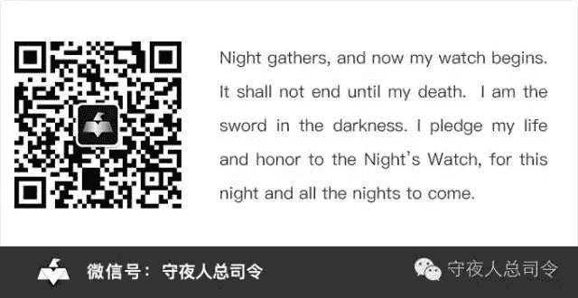
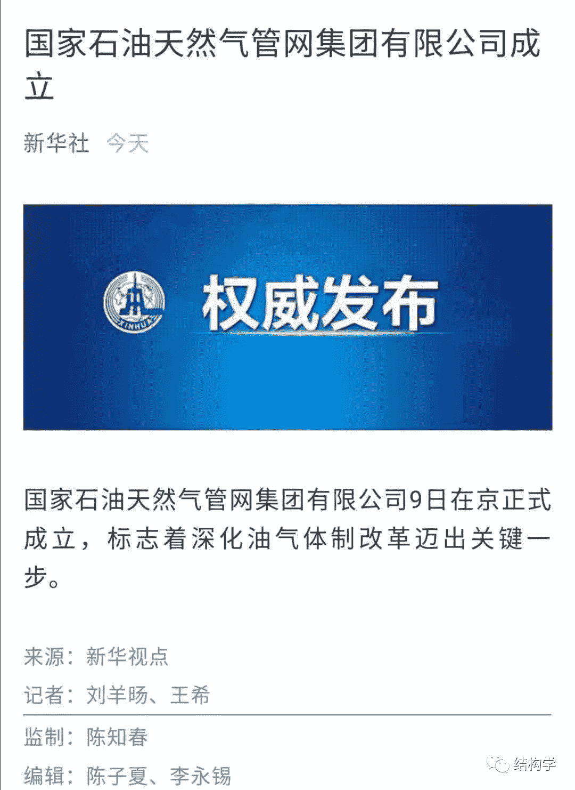
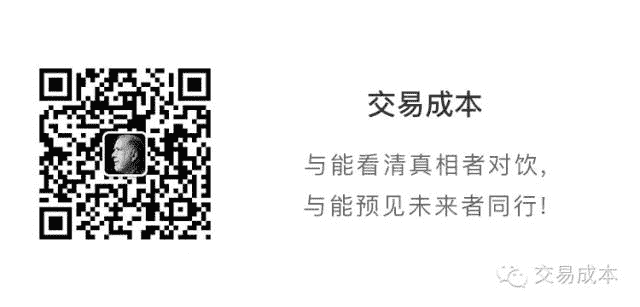

# 守夜人总司令结构学 2022.8.14

来源：[`www.yuque.com/books/share/641124b8-5f80-4d26-a995-cf244fceb154?#`](https://www.yuque.com/books/share/641124b8-5f80-4d26-a995-cf244fceb154?#)

# 

# 【必看】文档说明

> 来源：[`www.yuque.com/books/share/641124b8-5f80-4d26-a995-cf244fceb154/ls81de`](https://www.yuque.com/books/share/641124b8-5f80-4d26-a995-cf244fceb154/ls81de) 

 

文档说明  
  
此文档作为 懒人专属群 的司令付费文章分享的补充，更早之前的付费文章合集见专属群 q 群公告，后续更新见群通知~  
  
仅限专属群成员访问，请勿外流，避免河蟹。  
  
  

  
  
  

# 

# \[结构学\] - 2022-07-11 婚姻是匮乏者最大的恶习！

> 来源：[`www.yuque.com/books/share/641124b8-5f80-4d26-a995-cf244fceb154/dlff3i`](https://www.yuque.com/books/share/641124b8-5f80-4d26-a995-cf244fceb154/dlff3i) 

婚姻是匮乏者最大的恶习！   
原创 觉悟者 结构学   
结构学   
微信号 TransactionCosts  
功能介绍 《结构学》：生命体在其生存结构中的求存之道！ 训练营：觉悟社  
2022-07-11[原文](https://mp.weixin.qq.com/s?__biz=MzIzMDYwOTM0Mg==&mid=2247487424&idx=1&sn=6667b7d585690e81137aaed535542e9e&chksm=e8b19711dfc61e078cf502b225d969bf5d37ed07e9eebf339192aaf5d2d32cb06ba257ad5452#rd\)) 发表于  
收录于合集  
#婚姻 1 个   
#彩礼 3 个   
#社会问题 79 个   
#精神结构 127 个   
#弱者心态 36 个   
在《[X43：排三个小时队相亲都没能见到人！](http://mp.weixin.qq.com/s?__biz=MzAxNDk1NjI2Mw==&mid=2247487839&idx=1&sn=5d6815128a494ec1265c6730e1a95efd&chksm=9b8a32d7acfdbbc139fbb37186865008536f02a5fc5d5b3f5de9a1d6aefa332291f0bcea4062&scene=21#wechat_redirect)》中阐述清楚了为什么底层的女性，特别是选择留在小镇和农村的女生会要比较高的彩礼。在女生及其家庭的视角看来，这是一笔补偿，是对放弃更好生活的补偿。  
不管持有什么立场，有一点是不可否认的。那就是随着社会的发展，不管是人才、资源、资金等方方面面的东西都在加速向发达的地区聚集。美国社会今天的状况就是我们社会明天的状况！用一部青少年时代读的名著的开篇词来说就是：这是最好的时代，这也是最遭的时代。早些天国家开会讨论下半年的经济发展问题，只召集了北上广深和东部沿海几个省市。因为只有这些地方是纯贡献税赋的地方，其他地方都在等待拨款救济。这种集中是在社会发展中自然而然形成的，就如同今天美国的 GDP 有 70%由 10 个城市群提供一样！  
既然社会发展的趋势不可逆转，顺势而为者都会拼命的向更发达的地区跃进。从这样的立体图景中就不难发现，那些选择留在不发达地区的人就如同当年下乡的知识青年选择扎根农村一样。所以，那些女生本能的会认为这种“巨大的牺牲”需要对方支付一笔“损失费”。抛开情绪不谈，从现实的个人选择的角度来说，这种选择就如同 45 年投降日本人，49 年背叛革命。  
底层男性本来就是资源匮乏的群体。匮乏者的生存策略更不应该孤注一掷。这就如同穷人不能沾染赌博的恶习一样。然而，在这种事情上，比赌博还恶劣。当底层男性集合全家之力不惜代价把内心本来就认为自己屈就的女生娶回家之后。女生的内心是不满的，也是不甘心的。这种心有不甘会滋生出一种补偿心理。从而向对方，以及对方的家庭提出更多要求来补偿自己。然而，不管是对方还是对方的家庭，看待这个问题的思路则是完全不同的视角。对于匮乏者而言，会本能的把自己的东西看得无比珍贵——譬如说缺爱的人会本能的认为自己的感情比别人更珍贵，缺钱的人会本能的把自己的一百块钱看得比别人的一百块钱更珍贵。事实上，一百块钱的购买力是一样的，感情重不重也不是你觉得重就重。这种心理会让人产生一种误判：当一个匮乏的人把所有的本钱都压上去之后，更会产生一种对方必须要满足自己所有诉求的心理。如此一来，双方都会心存不满，并且认为对方做得不够，自己亏大发了！  
许多人出生于这样的家庭：父母其实也没有额外为子女做过什么，无非是像其他人一样承担了最基本的为人父母的责任。然而，这些无力的父母，因为自己的无能和无力，总是会把最简单的责任说的无比艰辛和崇高。以此不断的拔高自己的伟大和付出，从而向儿女索取感恩和回报。说句不好听的，如果这些儿女有决定权，他们肯定不会愿意降生在这样的家庭。是这些父母未经过儿女同意就强行把他们带到这个世界上的，因此而承担最基本的责任来保障其生存也谈不上什么特别的付出。当一个人越是对生活感到无能为力的时候，就越会习惯性把微不足道的事说得无比艰辛，其实什么都没做，但总是要向周围人摆出自己有恩于别人的姿态，一方面用来自我感动，另一方面则用来向周围索取。  
不要接受匮乏者的好意，对方要的不是对等的补偿，而是一种内心的满足。然而，这种满足无法度量和评估，而是源于一种自我赋予的价值所以没有底限。这就如同真实的饥饿和饿的感觉完全不是一回事。匮乏感严重的人时常出于一种饥饿的感觉之中，抛开事实不谈，就是感到饿。所以，囤积食物的习惯与真实的需求无关，而与内心的感受息息相关。所以，既无法确立边界也不可能有底线。即便是信誓旦旦，只要情绪涌上心头，一切都会瞬间推翻，而且理直气壮。这也不能怪当事人，因为对方自己也控制不了。识趣的人应该躲得远远的，非要招惹的人，那是活该。这就如同明知山有虎，偏向虎山行，如果你没有打虎的能力，被老虎撕得粉碎不是得偿所愿么？对于那种人菜瘾大的赌徒，输不起又一厢情愿，除了活该也找不到其他合适的词。  
在湖南益阳，有个 95 后的独生子，父母给他买了房子和车子，还给了彩礼，不仅花光父母的所有积蓄，还欠债 20 万找了一个弱小又文静的女孩结婚。女孩没有工作，胆小又极度的缺乏安全感，所以掌控欲非常强。最开始是不允许丈夫抽烟喝酒，逐渐不允许他有社交，要丈夫一直陪着自己，最后发展到不许丈夫看电视，不许丈夫用手机，只能与她用同一个手机。如果对方不顺从就大吵大闹，在家里拍桌子摔板凳。再然后就发展到禁止丈夫出门，出门需要经过自己同意。同时，又因为缺乏安全感不断向丈夫要钱。那个小伙不能出门也就没法挣钱，只能向父母要钱。毕竟是一个男人，成家了还不断向父母要钱，就时常陷入自我否定和自我攻击。这种压抑感持续了 9 个月之后，这个男人上吊自杀了。然而，监控显示：那天这个女人打开门看到上吊的男人之后，并没有报警和打 120 急救，而是上下电梯 6 次，最后收拾了一点衣服回娘家了。她丈夫的父母把丧事办完之后，她才露面，说是丈夫的父母逼死了自己的独子，然后要求继承丈夫的婚前财产，因为没有找到遗嘱。公婆不肯把婚前财产给她，所以前因后果才慢慢暴露出来，面对越来越不利于自己的证据，女子在被拆穿之后依然面无表情，并目标明确的一味强调自己和小孩都有继承权。  
看热闹的人会嘲笑那个男人的弱懦。其实更应该关注这个男人为很么如此懦弱。首先，这个 95 后的男人结婚所需的一切都是父母给的——不管是房子、车子还是彩礼。作为家里的独子，父母倾尽一切甚至背上债务去满足他结婚的条件，这没啥好说的——虽然这是在赌，但也是他们自己观念左右下的选择。但作为一个男人，他在进入婚姻的那一刻开始就背负了巨大的枷锁。说的不好听一点就是他欠父母的！不管他老婆怎么想，任何一个男人不能自立，却需要父母倾尽所有还背上债务才能结婚，总是会有一点内疚——无能是一种强烈的自我攻击的诱因。除此之外，巨大的沉没成本对于无法自立的人而言，也是一个巨大的枷锁。这种隐性的枷锁去驱使人不断的妥协，不断以息事宁人的方式去维系当下的状况。这恰恰是许多人的一个致命误区：面对缺乏安全感且自我价值感很低的人，你越是顺从和屈服，对方反而会更加的感到不安！  
这是一种有毒的应对模式。那个男人在各种沉没成本的约束下，越是采取息事宁人的姿态，任何方面都去迎合对方的控制欲，反而会让缺乏安全感的女人更加感到不安，而这种不安又进一步刺激她的控制欲，所以会不断的加码控制的力度——有些人在为人处世的时候，明明知道某种行为会让自己的处境更糟，但内心总是会滋生出一股力量怂恿着自己去这么做。  
弱者的残忍和强者的残忍不是同一种残忍：强者的残忍是基于利益需要，你越缺乏价值，生存环境对你就越残忍。但弱者的残忍就如同寄生虫对宿主的残忍。寄生虫的所有行为都是出于一种本能，并不能感受到宿主的状态，就如同你不能感受到地球的状态一样。那些无能无力匮乏感强的父母往往也极度缺乏安全感，不仅凡事都往坏处想，为还未发生的事忧心忡忡，同时右把这种恐慌转化为一种控制欲，用尽一切手段去控制家里唯一有出息的那个孩子。如果外人从理性的角度来看，这种行为简直是自杀式的行为。然而，当事人却浑然不觉。一个正常的家庭是一群人帮衬一个人，而一个非正常的家庭是一个人供养一群人！冥冥之中，这种自然而然的反差，恰恰达到了将一个群体一直锁死在匮乏状态下的目的。真正的穷不是当下的处境，而是会主动毁掉未来的行为。心穷的人永远会穷下去，而且会像病毒一样，感染任何能接触和捆绑的人。  
许多人会认为这个男人太脆弱，或者认为这个女人人品有问题。这是一种非常表层的判断方式。越往下的社会，人对事物的判断越单一，这种单一会集中体验为把一切问题都归咎于虚无缥缈的人品问题。你要进一步问什么是人品，具体是人品的哪部分有问题？为什么会形成这样的问题？又一问三不知。那个自己都搞不清楚的所谓“人品”就是一个框，什么都可以往里面装。  
既然两个人都无法自立，不进入婚姻。那个男生的父母不需要背负债务，而且买房买车的钱还能为他儿子提供一个稳定的生活保障。让他在有保障的情况下慢慢学会自立，自己挣钱养活自己。如此一来不仅不会失去独子，还能收获可以预期的美好生活。如果这个女生不进入婚姻，即便她的自我价值感很低，即便她极度的缺乏安全感，她也就不需要去面对更多的不确定。生活在她父母为其营造的熟悉的生存环境中，即便不安也只作用于她父母身上。经过这么多年的博弈，她也控制不了她的父母，即便再缺乏安全感也只能在自我内耗的状况下不断的卷缩，并不会对别人产生任何影响。所以，这对任何人都是一种两全其美的事。然而，本来就匮乏的人，非要强行把所有的筹码都压上去堵，其结果都是各方都两败俱伤。同时还强行将一个无辜的生命带到世界上，被迫在新一轮的残缺和匮乏中长大。最残忍的事莫过于如此，于心何忍！  
这世界上所有美好的事物本来就是对生存竞争中优胜者的奖励，传承只有在具有强烈生命力的自由灵魂之间才会变得有意义。匮乏者如果染上黄赌毒会万劫不复，与这些恶习的成本比起来，婚姻完全是一种把全部身家性命都压上的豪赌，而且一盘顶输赢，为什么这些人反而视而不见呢？！  
加入觉悟社：付费和不公开内容都有，每天 25 块，还能挣回来，下注标的获取需满足条件及时查看更新。公众号发消息：觉悟社  

  
[结构学自序（新）！](http://mp.weixin.qq.com/s?__biz=MzIzMDYwOTM0Mg==&mid=2247485283&idx=1&sn=aa2b8554b8e5040f8f959636feaa06a3&chksm=e8b19fb2dfc616a430aa381b8da0815311244e694a69809cd92d0602ac34cfe5f1f419b3745e&scene=21#wechat_redirect)  
[做局！](http://mp.weixin.qq.com/s?__biz=MzAxNDk1NjI2Mw==&mid=2247488230&idx=1&sn=86e717386c0aa06a0a4bbf4f9ec117aa&chksm=9b8a316eacfdb878aae8ed4ea6817620cc3ac62d7815fdfd85606464c3f2d79fcf2ce72dec77&scene=21#wechat_redirect)  
[算账！](http://mp.weixin.qq.com/s?__biz=MzAxNDk1NjI2Mw==&mid=2247488259&idx=1&sn=2b72f3c0199cdacaa8e48eb9ad30f809&chksm=9b8a308bacfdb99d72ebcd3aaf0015c889b88f4598b093719ee8765aa8be3b3caaad95a445ae&scene=21#wechat_redirect)  
[A667：投降！！](http://mp.weixin.qq.com/s?__biz=MzIzMDYwOTM0Mg==&mid=2247487227&idx=1&sn=3567bf6c0c6612ccf84993824f8cc40f&chksm=e8b1962adfc61f3cff8d335a562ea28615e58579d460d2f65148f46a6311ad5257411d96f655&scene=21#wechat_redirect)  
[A684：过剩！！](http://mp.weixin.qq.com/s?__biz=MzIzMDYwOTM0Mg==&mid=2247487405&idx=1&sn=6f60b1583b09b9c3220290377a3f9a10&chksm=e8b1977cdfc61e6a0077a0bb80055453a839dad4caabb0b595c7e363c052e05cf3e46ac1e22f&scene=21#wechat_redirect)  
[A683：已经是第三波了！！](http://mp.weixin.qq.com/s?__biz=MzIzMDYwOTM0Mg==&mid=2247487397&idx=1&sn=26209d75ef8be499139baf79880704d5&chksm=e8b19774dfc61e62615a5d6c959869dfc2d436e3038fd407716aebb59e278b1f37f0637b68de&scene=21#wechat_redirect)  
[安倍之后再无安倍！](http://mp.weixin.qq.com/s?__biz=MzAxNDk1NjI2Mw==&mid=2247488674&idx=1&sn=530f1ed8840558c8f2fa8d4f9e9e53e7&chksm=9b8a372aacfdbe3c6150071dbb6799f375740fa802c425a9c8c741e2186acc8c5f468d8af412&scene=21#wechat_redirect)  
[A680：上海的底色！](http://mp.weixin.qq.com/s?__biz=MzIzMDYwOTM0Mg==&mid=2247487369&idx=1&sn=a18e0d719fb0549237274a07964dadbf&chksm=e8b19758dfc61e4ec0cf4343ed7bd19f207616e41dcfd37f655056fc0dcbcacb8cd20da56a5e&scene=21#wechat_redirect)  
[A678：不能说得太细！](http://mp.weixin.qq.com/s?__biz=MzAxNDk1NjI2Mw==&mid=2247488621&idx=1&sn=de619343a166fa2033545096b107a136&chksm=9b8a37e5acfdbef33879aa1c737b5ded3b611c15cf6b7945e400a9293cb0353f2eb5feb120f0&scene=21#wechat_redirect)  
[X11：不婚不育的自由！](http://mp.weixin.qq.com/s?__biz=MzAxNDk1NjI2Mw==&mid=2247488624&idx=1&sn=cfdcf5cd7d234b00245dfa23df2e5d85&chksm=9b8a37f8acfdbeeebe63d985f630872fc5a37f8719f399a3c849a94f33a7bbc7a2a5c3ef6461&scene=21#wechat_redirect)  
[乌克兰的反攻！](http://mp.weixin.qq.com/s?__biz=MzIzMDYwOTM0Mg==&mid=2247487192&idx=1&sn=02b41bfa6bcfa8c503bac90158886b86&chksm=e8b19609dfc61f1fdb5a8fa6032a0013cd18ff59bdaf308e99096f08813d3b24cc6f361dac6d&scene=21#wechat_redirect)  
[伊久姆大反攻！](http://mp.weixin.qq.com/s?__biz=MzIzMDYwOTM0Mg==&mid=2247487223&idx=1&sn=ab3169d841cb6e53507fb5ede0eca8bc&chksm=e8b19626dfc61f306c1786e5cd2a2898cc68c6809f9a8a6b0b16a5891a233ac2653038772039&scene=21#wechat_redirect)  
[A658：经济秩序！](http://mp.weixin.qq.com/s?__biz=MzIzMDYwOTM0Mg==&mid=2247487179&idx=1&sn=12ad76a2b6a86d4dc52eb515f2b00500&chksm=e8b1961adfc61f0c30f16b60b87e2fcd3142b4a788c2ae81604f02182574c50b54c1d9e2974d&scene=21#wechat_redirect)  
[A647：可怕的渗透！](http://mp.weixin.qq.com/s?__biz=MzAxNDk1NjI2Mw==&mid=2247488112&idx=1&sn=d2cdb1bbea5f7a7248e4ba132c2ad922&chksm=9b8a31f8acfdb8ee225327ff157e56571bbf63b8958ad6c47d7da000b5da90fa01379222c8e1&scene=21#wechat_redirect)  
[E35:我们在月之暗面发现了什么？！](http://mp.weixin.qq.com/s?__biz=MzIzMDYwOTM0Mg==&mid=2247486632&idx=1&sn=170aeff87eb36dce354c8b2437f4b27f&chksm=e8b19479dfc61d6f08e6492954a528f20387fe2fa925747cf2b504d2bc69084f24495e972e41&scene=21#wechat_redirect)  
[穷是万恶之源！](http://mp.weixin.qq.com/s?__biz=MzAxNDk1NjI2Mw==&mid=2247483823&idx=1&sn=e54ebe9891b302dc0bf1815c76ccf8b7&chksm=9b8a2227acfdab31a05e273addd9159d4b8263d58d3c58bf214841c8189157519719c3427306&scene=21#wechat_redirect)  
[没有退路的一代人！](http://mp.weixin.qq.com/s?__biz=MzAxNDk1NjI2Mw==&mid=2247486533&idx=1&sn=a0d5cce0656aad467148e0642eb85a00&chksm=9b8a2fcdacfda6db79857186e953a089baf1fb678b2b071cf101c5a26e7fb9768474c94243ca&scene=21#wechat_redirect)  
[全是骗人的！](http://mp.weixin.qq.com/s?__biz=MzAxNDk1NjI2Mw==&mid=2247488130&idx=1&sn=5fe267832478f7d2cb6b09a120555e5b&chksm=9b8a310aacfdb81c8fc93b00e05cfdaa2da89f21513f198ae2233f007a4f9e7747c86595239c&scene=21#wechat_redirect)  
[意见不同时，如何判断人！](http://mp.weixin.qq.com/s?__biz=MzAxNDk1NjI2Mw==&mid=2247488223&idx=1&sn=4860be32308a7b853142c8d799d2b678&chksm=9b8a3157acfdb841242ae974e7ea0dc1582191bb60e7ad12f98c37506e7ddcd62410d67707fc&scene=21#wechat_redirect)  
[婚姻对人的伤害太大了！](http://mp.weixin.qq.com/s?__biz=MzAxNDk1NjI2Mw==&mid=2247487796&idx=1&sn=d28ec342a60e8f8e74c96b548770eb7d&chksm=9b8a32bcacfdbbaaa3c33780116e1353dadb8f5bcdc93ce019a77554980c845e8319c4f432b4&scene=21#wechat_redirect)  
[X21：王力宏和美智子不得不说的秘密](http://mp.weixin.qq.com/s?__biz=MzAxNDk1NjI2Mw==&mid=2247487666&idx=1&sn=433b7a0997c277c09f3605796de5551e&chksm=9b8a333aacfdba2c584b5a5d0dacbd731be4e8789e0f949f8b2ea15507f108b465eb9e3ceafb&scene=21#wechat_redirect)！  
[不要愤愤不平，都是好事！](http://mp.weixin.qq.com/s?__biz=MzAxNDk1NjI2Mw==&mid=2247487130&idx=1&sn=b21138d85455f5692aaf039038c78342&chksm=9b8a2d12acfda404a2b67fe4d446ee0f2805ad64a8b8004902934600fd731191e140df6ac19a&scene=21#wechat_redirect)  
[她都来相亲了，你还要怎么样！](http://mp.weixin.qq.com/s?__biz=MzAxNDk1NjI2Mw==&mid=2247486952&idx=1&sn=698aec6916d2eca5e758c25c4c634346&chksm=9b8a2e60acfda776b80a4f2f0d5c2fe4921fc821cdf029fa9d2fdc52fd708fc5a0b980d5d3d0&scene=21#wechat_redirect)  
[田园女权真正攻击的对象是女人！](http://mp.weixin.qq.com/s?__biz=MzIzMDYwOTM0Mg==&mid=2247486412&idx=1&sn=5dd3e8b2a759838d739e6d61ebab2eab&chksm=e8b1931ddfc61a0bf6f81cd2a9a9232ea8ce86528a8eea66c6635180e8678b819ebb38b4cb86&scene=21#wechat_redirect)  
[A430：美国强力介入台湾的理由！](http://mp.weixin.qq.com/s?__biz=MzIzMDYwOTM0Mg==&mid=2247486587&idx=1&sn=e14d4403bb13c441596f09add1b5f27c&chksm=e8b194aadfc61dbcab0c1d70249910161f8c77b0163ac8278dfe5c2f817d2bb2a3ac3e7ddf89&scene=21#wechat_redirect)  
[卢布升值不可持续！](https://mp.weixin.qq.com/s?__biz=MzAxNDk1NjI2Mw==&mid=2247488186&idx=1&sn=bbaac79bae71799e8140c217bbb9a108&scene=21#wechat_redirect)  
[战争不会很快结束！](https://mp.weixin.qq.com/s?__biz=MzAxNDk1NjI2Mw==&mid=2247488182&idx=1&sn=3d07cd83b71988dd378865d6e40adbec&scene=21#wechat_redirect)  
[鸿沟的自动形成！](http://mp.weixin.qq.com/s?__biz=MzAxNDk1NjI2Mw==&mid=2247488236&idx=1&sn=bfdf4d53034c97075b678327e8a7e773&chksm=9b8a3164acfdb872448fb8f53a436a657580e509ff6963728f7d3b541fb67aab302d754c4b0e&scene=21#wechat_redirect)  
[只有怨恨，没有互相欣赏！](http://mp.weixin.qq.com/s?__biz=MzAxNDk1NjI2Mw==&mid=2247488211&idx=1&sn=73ad89d15a2aaee80830cc5c69de6c58&chksm=9b8a315bacfdb84d0bfeb48b3a272efbc5bd4a109ba8c183dbbc75aa85e0a62dec457694d9eb&scene=21#wechat_redirect)  
[小丑居然是自己！！](http://mp.weixin.qq.com/s?__biz=MzAxNDk1NjI2Mw==&mid=2247488135&idx=1&sn=55e611eea7203a0b5db03bf97ef6fb53&chksm=9b8a310facfdb8195803cc833b8defe1a107a60b9014e10d7b91f809a2d7781c820ae84f9e9a&scene=21#wechat_redirect)  
[只有怨恨，没有互相欣赏！](http://mp.weixin.qq.com/s?__biz=MzAxNDk1NjI2Mw==&mid=2247488211&idx=1&sn=73ad89d15a2aaee80830cc5c69de6c58&chksm=9b8a315bacfdb84d0bfeb48b3a272efbc5bd4a109ba8c183dbbc75aa85e0a62dec457694d9eb&scene=21#wechat_redirect)  
[A639：普京不会崩溃！](http://mp.weixin.qq.com/s?__biz=MzAxNDk1NjI2Mw==&mid=2247488084&idx=1&sn=7c8d1370795dc6496c224b27c0137762&chksm=9b8a31dcacfdb8ca47772d583074c0ce9e16f2a9a2d3a27359cb26cb851d21da814506f6a3df&scene=21#wechat_redirect)  
[A641：吹响了反攻的号角？！](http://mp.weixin.qq.com/s?__biz=MzAxNDk1NjI2Mw==&mid=2247488089&idx=1&sn=c532b7b5b38bb03828c600669804f8cc&chksm=9b8a31d1acfdb8c77d656a7aaf9d77c03603864118e10553cfdfde1061229392a21ea728b8b0&scene=21#wechat_redirect)  
[A647：可怕的渗透！](http://mp.weixin.qq.com/s?__biz=MzAxNDk1NjI2Mw==&mid=2247488112&idx=1&sn=d2cdb1bbea5f7a7248e4ba132c2ad922&chksm=9b8a31f8acfdb8ee225327ff157e56571bbf63b8958ad6c47d7da000b5da90fa01379222c8e1&scene=21#wechat_redirect)  
[A539：京东为什么能绝地反击！](http://mp.weixin.qq.com/s?__biz=MzIzMDYwOTM0Mg==&mid=2247486752&idx=1&sn=3a967e3288db5b7d924e36914086e534&chksm=e8b195f1dfc61ce7c971386eb678d7da286167d0f52fdd51989049844b0a550cc58e00552d2e&scene=21#wechat_redirect)  
[A518：既双减又提高考试难度，要干啥？!](http://mp.weixin.qq.com/s?__biz=MzIzMDYwOTM0Mg==&mid=2247486528&idx=1&sn=837ef39e3c0b47ac84d5096690555ae7&chksm=e8b19491dfc61d87292daf575c1e7c95b3f0543f313b65c7ad4ab369603833704304ec7451d7&scene=21#wechat_redirect)  
[A311：要理解住房不炒的真正含义！](http://mp.weixin.qq.com/s?__biz=MzIzMDYwOTM0Mg==&mid=2247484959&idx=1&sn=090583ec50bfd9febec1de463c2672f6&chksm=e8b19ecedfc617d8629080f6745c8de013cfe875de26eef6767b2d5c10782650223ed15f807b&scene=21#wechat_redirect)  
[A496：为什么兔子在阿富汗很主动？](http://mp.weixin.qq.com/s?__biz=MzIzMDYwOTM0Mg==&mid=2247486278&idx=1&sn=40d09857088bebd3c70bec1c7a500f06&chksm=e8b19397dfc61a810125242c8e395330f934390eb50bd54053ecd3f31ddc91de4e429c0f693a&scene=21#wechat_redirect)  
[E44：情绪化的人为什么会克制不住？！](http://mp.weixin.qq.com/s?__biz=MzIzMDYwOTM0Mg==&mid=2247487062&idx=1&sn=c1af22f2f5d1e79f7245b826bfaf1f30&chksm=e8b19687dfc61f91468cf22b77c0e221d45054df37b2b602c331eb328b5d46802c69e0d87722&scene=21#wechat_redirect)  
[A525：你误会了男孩要穷养和女孩要富养！](http://mp.weixin.qq.com/s?__biz=MzIzMDYwOTM0Mg==&mid=2247486714&idx=1&sn=693d4c55ab2f0ecdebf06c4807848908&chksm=e8b1942bdfc61d3d1d76c11adb860b1b02f1ab58e48ba3349677a44a563764e09d7eb35f930d&scene=21#wechat_redirect)  
[A388：伊朗：用鲜血开路获得中国的投名状！](http://mp.weixin.qq.com/s?__biz=MzIzMDYwOTM0Mg==&mid=2247485591&idx=1&sn=a8443453e3caf1f201006eeec8e6e539&chksm=e8b19046dfc61950e63e29bb93049ce90b3228913e9ecee99a2f01b8fdda7cd8966a054241a9&scene=21#wechat_redirect)  
[A644：收回克里米亚绝对是正确之举！](http://mp.weixin.qq.com/s?__biz=MzIzMDYwOTM0Mg==&mid=2247487112&idx=1&sn=c116d6a79085ad9fe413f42170eca23a&chksm=e8b19659dfc61f4fdb34ac71a7efb0994e7e3c07f7e8b75f34c646b05293f27d2e21423efc1a&scene=21#wechat_redirect)  
[A640：介入叙利亚战争并非虚荣心作祟！](http://mp.weixin.qq.com/s?__biz=MzAxNDk1NjI2Mw==&mid=2247488081&idx=1&sn=adfaf12849fa59e47f412105d2170c75&chksm=9b8a31d9acfdb8cfb8b78731ecb12a5d70c3b6997675397a2f95ba7bf63638aca4ee74acf789&scene=21#wechat_redirect)  
[E35:我们在月之暗面发现了什么？！](http://mp.weixin.qq.com/s?__biz=MzIzMDYwOTM0Mg==&mid=2247486632&idx=1&sn=170aeff87eb36dce354c8b2437f4b27f&chksm=e8b19479dfc61d6f08e6492954a528f20387fe2fa925747cf2b504d2bc69084f24495e972e41&scene=21#wechat_redirect)  
[A518：既双减又提高考试难度，要干啥？!](http://mp.weixin.qq.com/s?__biz=MzIzMDYwOTM0Mg==&mid=2247486528&idx=1&sn=837ef39e3c0b47ac84d5096690555ae7&chksm=e8b19491dfc61d87292daf575c1e7c95b3f0543f313b65c7ad4ab369603833704304ec7451d7&scene=21#wechat_redirect)  
[A311：要理解住房不炒的真正含义！](http://mp.weixin.qq.com/s?__biz=MzIzMDYwOTM0Mg==&mid=2247484959&idx=1&sn=090583ec50bfd9febec1de463c2672f6&chksm=e8b19ecedfc617d8629080f6745c8de013cfe875de26eef6767b2d5c10782650223ed15f807b&scene=21#wechat_redirect)  
[A496：为什么兔子在阿富汗很主动？](http://mp.weixin.qq.com/s?__biz=MzIzMDYwOTM0Mg==&mid=2247486278&idx=1&sn=40d09857088bebd3c70bec1c7a500f06&chksm=e8b19397dfc61a810125242c8e395330f934390eb50bd54053ecd3f31ddc91de4e429c0f693a&scene=21#wechat_redirect)  
[E42：结构学浅释（二）](http://mp.weixin.qq.com/s?__biz=MzAxNDk1NjI2Mw==&mid=2247487869&idx=1&sn=b6f942cf2c9969953971beb5a43a8183&chksm=9b8a32f5acfdbbe33ddd8df1f2b8f73b05522b604676c4ab01f411657e37e8c7226602ce3ad9&scene=21#wechat_redirect)  
[A604：谷爱凌不具有代表性！](http://mp.weixin.qq.com/s?__biz=MzAxNDk1NjI2Mw==&mid=2247487885&idx=1&sn=fa1590be4f0f8be38dd4d8eb877b638d&chksm=9b8a3205acfdbb13039310f86f6e6fce5520a7827afc4e63b4eb6ca7f89ace1950488fa2f17e&scene=21#wechat_redirect)  
[X29：拒绝长大的人群！](http://mp.weixin.qq.com/s?__biz=MzAxNDk1NjI2Mw==&mid=2247487734&idx=1&sn=406322eea52d5ed24ebaf979fdf714c1&chksm=9b8a337eacfdba688c7e6a511a417ec4d9a03b13d1bdb5c91e6ef37e9a7b747460354e0b0e8e&scene=21#wechat_redirect)  
[X45：刚出狼窝，又入虎口！](http://mp.weixin.qq.com/s?__biz=MzIzMDYwOTM0Mg==&mid=2247486954&idx=1&sn=64057c0c18082933600be972c2031139&chksm=e8b1953bdfc61c2df1b3c17fe8416e975e6f3a2bece068540adc6de643aa8e670b0393ba5c1d&scene=21#wechat_redirect)  
[A565：东北为啥难以振兴？！](http://mp.weixin.qq.com/s?__biz=MzAxNDk1NjI2Mw==&mid=2247487834&idx=1&sn=15ef2b4f3f81c4a67f5bc0256f5cb776&chksm=9b8a32d2acfdbbc4cd9c76535f994c4bb53ad6b3e74f367231b7e7465a88541ec7bb77237c42&scene=21#wechat_redirect)  
[向女权主义者致敬！](http://mp.weixin.qq.com/s?__biz=MzIzMDYwOTM0Mg==&mid=2247485914&idx=1&sn=cb260e0cec6b1e24661013278d412581&chksm=e8b1910bdfc6181d9f5f293493e2505dcec25647d0521d5ec62f92be5e32c04d0927583b6eb1&scene=21#wechat_redirect)  
[X25：你忍一下，我的很大！](http://mp.weixin.qq.com/s?__biz=MzAxNDk1NjI2Mw==&mid=2247487691&idx=1&sn=25bf18fb0375ec81c4b02f06b4829131&chksm=9b8a3343acfdba55113abce1ada59a203e08f7fee28d62767bfede2ce6e1bf3ace451af06adf&scene=21#wechat_redirect)  
[红尘热闹，白云冷！](http://mp.weixin.qq.com/s?__biz=MzAxNDk1NjI2Mw==&mid=2247486913&idx=1&sn=6b387c24eb6d5e30ed150e13eded77a1&chksm=9b8a2e49acfda75fdfcfe0a7770792cdd85568a9ecb1bd9b67508b29df853aaba08bf27356d5&scene=21#wechat_redirect)  
[A436：双标是弱者的必然选择！](http://mp.weixin.qq.com/s?__biz=MzIzMDYwOTM0Mg==&mid=2247485909&idx=1&sn=c64a96a6f11c7ff756ce005441035200&chksm=e8b19104dfc61812546950789d22fe83ba04b34c72337fb6dc6041ec4dfa6c2c9ec3005f80c5&scene=21#wechat_redirect)  
[梦醒之时，已经三十！](http://mp.weixin.qq.com/s?__biz=MzIzMDYwOTM0Mg==&mid=2247484378&idx=1&sn=e3a058584a13d7a5267315113964280d&chksm=e8b19b0bdfc6121df4af4b77d2d826fd0f4132ccfdee48132ce8cf86eb1ba45b898be83d1dc7&scene=21#wechat_redirect)[！](http://mp.weixin.qq.com/s?__biz=MzAxNDk1NjI2Mw==&mid=2247486952&idx=1&sn=698aec6916d2eca5e758c25c4c634346&chksm=9b8a2e60acfda776b80a4f2f0d5c2fe4921fc821cdf029fa9d2fdc52fd708fc5a0b980d5d3d0&scene=21#wechat_redirect)  
[E43：统治的关键，争夺年轻人！](http://mp.weixin.qq.com/s?__biz=MzAxNDk1NjI2Mw==&mid=2247487815&idx=1&sn=84f963d6fb37f4f4ae70bb92b60488ae&chksm=9b8a32cfacfdbbd9aeb7089e2d38899684a97159afe1b1f220e3ca472cc321442bf52e5606dd&scene=21#wechat_redirect)  
[我是真的不想睡你！](http://mp.weixin.qq.com/s?__biz=MzAxNDk1NjI2Mw==&mid=2247487023&idx=1&sn=66d63e9f199deee86afff0f76a959c91&chksm=9b8a2da7acfda4b17ebf27c87c446049d0b8c557303b850a69ac971d8cdfcc91e41c0e6d3fcb&scene=21#wechat_redirect)  
[不要愤愤不平，都是好事！](http://mp.weixin.qq.com/s?__biz=MzAxNDk1NjI2Mw==&mid=2247487130&idx=1&sn=b21138d85455f5692aaf039038c78342&chksm=9b8a2d12acfda404a2b67fe4d446ee0f2805ad64a8b8004902934600fd731191e140df6ac19a&scene=21#wechat_redirect)  
[A496：为什么兔子在阿富汗很主动？](http://mp.weixin.qq.com/s?__biz=MzIzMDYwOTM0Mg==&mid=2247486278&idx=1&sn=40d09857088bebd3c70bec1c7a500f06&chksm=e8b19397dfc61a810125242c8e395330f934390eb50bd54053ecd3f31ddc91de4e429c0f693a&scene=21#wechat_redirect)  
[A491：塔利班接下来的两个核心问题！](http://mp.weixin.qq.com/s?__biz=MzAxNDk1NjI2Mw==&mid=2247487097&idx=1&sn=fd7abf4ba489928b7b810d20cbec7dc9&chksm=9b8a2df1acfda4e7ce05f7c03df131e9d266d960945c436b89b871744b21cc352bf3cb668486&scene=21#wechat_redirect)  
[A335：必须与焦虑长期共存！](http://mp.weixin.qq.com/s?__biz=MzIzMDYwOTM0Mg==&mid=2247485165&idx=1&sn=f3f0957c63fa549b288f00c8b117162e&chksm=e8b19e3cdfc6172a188000afd2b522144a04ba774169824cad2067d93b5365537ff0644f6b9f&scene=21#wechat_redirect)  
[A300：这是投机的大机会还是大陷阱？！](http://mp.weixin.qq.com/s?__biz=MzIzMDYwOTM0Mg==&mid=2247484882&idx=1&sn=b103029f41e3aede94e1a45d035cd9ac&chksm=e8b19d03dfc614153863f37ca3f9204b451e2c02ad5ca8680c120e2458e628e5329c76b2d42c&scene=21#wechat_redirect)  
[A284：啊！万箭穿心！！](http://mp.weixin.qq.com/s?__biz=MzIzMDYwOTM0Mg==&mid=2247484966&idx=1&sn=a814f2c1b14425d45f9921f7c08bcec5&chksm=e8b19ef7dfc617e131146f6675328e5088faaae0daa64da92af48b28c8cf19aedceb7a43e40b&scene=21#wechat_redirect)  
[A542：从现在开始，抓紧手中的钱！](http://mp.weixin.qq.com/s?__biz=MzIzMDYwOTM0Mg==&mid=2247486640&idx=1&sn=a96afa7d2b698e33240735ea8d7671f7&chksm=e8b19461dfc61d77a4afce11ecc7558b8d7ff5d495a78bcb609e3eed5c70bcbed5f3d6a66023&scene=21#wechat_redirect)  
[E35:我们在月之暗面发现了什么？！](http://mp.weixin.qq.com/s?__biz=MzIzMDYwOTM0Mg==&mid=2247486632&idx=1&sn=170aeff87eb36dce354c8b2437f4b27f&chksm=e8b19479dfc61d6f08e6492954a528f20387fe2fa925747cf2b504d2bc69084f24495e972e41&scene=21#wechat_redirect)  
[A496：为什么兔子在阿富汗很主动？](http://mp.weixin.qq.com/s?__biz=MzIzMDYwOTM0Mg==&mid=2247486278&idx=1&sn=40d09857088bebd3c70bec1c7a500f06&chksm=e8b19397dfc61a810125242c8e395330f934390eb50bd54053ecd3f31ddc91de4e429c0f693a&scene=21#wechat_redirect)  
[A311：要理解住房不炒的真正含义！](http://mp.weixin.qq.com/s?__biz=MzIzMDYwOTM0Mg==&mid=2247484959&idx=1&sn=090583ec50bfd9febec1de463c2672f6&chksm=e8b19ecedfc617d8629080f6745c8de013cfe875de26eef6767b2d5c10782650223ed15f807b&scene=21#wechat_redirect)  
[不要沉迷于抽象的东西！](http://mp.weixin.qq.com/s?__biz=MzAxNDk1NjI2Mw==&mid=2247487527&idx=1&sn=e24c2dd98e5f9883c8dce2a1e7bb80df&chksm=9b8a33afacfdbab921e90b3eafc3618176a35da53c53bb51f2ef2f9a98e87d05949a4b0ad69b&scene=21#wechat_redirect)  
[A543：元宇宙也做不到！](http://mp.weixin.qq.com/s?__biz=MzAxNDk1NjI2Mw==&mid=2247487476&idx=1&sn=2e2f159d365f00117f8fd47d3ca062f9&chksm=9b8a2c7cacfda56a80b9243d42bc5faabe4622c27fb4f3edad16ca5de7242a9c1345056ee461&scene=21#wechat_redirect)  
[A539：父亲角色在教育中必须做的几点！](http://mp.weixin.qq.com/s?__biz=MzAxNDk1NjI2Mw==&mid=2247487582&idx=1&sn=f4bac1092e8f45f6a86e662d8a68d556&chksm=9b8a33d6acfdbac0b4e01232406db5e9a315180b66b1bc830f17231f167d515d33408ff727b6&scene=21#wechat_redirect)  
[A539：京东为什么能绝地反击！](http://mp.weixin.qq.com/s?__biz=MzIzMDYwOTM0Mg==&mid=2247486752&idx=1&sn=3a967e3288db5b7d924e36914086e534&chksm=e8b195f1dfc61ce7c971386eb678d7da286167d0f52fdd51989049844b0a550cc58e00552d2e&scene=21#wechat_redirect)  
[A518：既双减又提高考试难度，要干啥？!](http://mp.weixin.qq.com/s?__biz=MzIzMDYwOTM0Mg==&mid=2247486528&idx=1&sn=837ef39e3c0b47ac84d5096690555ae7&chksm=e8b19491dfc61d87292daf575c1e7c95b3f0543f313b65c7ad4ab369603833704304ec7451d7&scene=21#wechat_redirect)  
[C1：他们到底怕什么？](http://mp.weixin.qq.com/s?__biz=MzAxNDk1NjI2Mw==&mid=2247483898&idx=1&sn=1b0a50386e9e89d2750dec717236f0aa&chksm=9b8a2272acfdab64235b35ee5e91b8cac6172144207251636e1345fc570aa1601f59eff7f442&scene=21#wechat_redirect)  
[C1：真正的力量（最新）](http://mp.weixin.qq.com/s?__biz=MzAxNDk1NjI2Mw==&mid=2247485209&idx=1&sn=d7b335d2c9632363c72de85ce7834b3e&chksm=9b8a2491acfdad87ae308d74534ec4def57980a2b1db88ffe56ac03e4d76ea55e7eab2343097&scene=21#wechat_redirect)  
[C2：宗教是统治工具吗？](http://mp.weixin.qq.com/s?__biz=MzAxNDk1NjI2Mw==&mid=2247483901&idx=1&sn=f5d9f8c7bd84370c79adae921351e813&chksm=9b8a2275acfdab63fde093d76ff82e01d0e2fd43ea675f77fd17fd51a15873d4d10499f5338d&scene=21#wechat_redirect)  
[A425：这些是书上不会写的！](http://mp.weixin.qq.com/s?__biz=MzIzMDYwOTM0Mg==&mid=2247485662&idx=1&sn=1a8617a9ebd44891c112f3b3f6762f8a&chksm=e8b1900fdfc6191942a3ec1399a47af7cd44582c369a4e6211b0bd114d934785bf0c20fc09ab&scene=21#wechat_redirect)  
[F1：底层逻辑（框架）](http://mp.weixin.qq.com/s?__biz=MzAxNDk1NjI2Mw==&mid=2247485072&idx=1&sn=83d919c9e3bf71d25978a97c8d4c8aa6&chksm=9b8a2518acfdac0ea8a0f84382cc7c0a26d1ac3664d76c6365aee67ac4ebcac1bf280c060249&scene=21#wechat_redirect)  
[F3：结构力量](http://mp.weixin.qq.com/s?__biz=MzAxNDk1NjI2Mw==&mid=2247484256&idx=1&sn=f10d9c530bfd6ea08b25d4bec657c13a&chksm=9b8a20e8acfda9fee057f2df26790f905c898132cac91d833d14e636edb00c20514d63189a88&scene=21#wechat_redirect)  
[A328：2021 年必须加杠杆！](http://mp.weixin.qq.com/s?__biz=MzIzMDYwOTM0Mg==&mid=2247485087&idx=1&sn=24d72f6a71bddb8954a03be5db246538&chksm=e8b19e4edfc617587a8ae645885a89ab8c3c6f67730a026d9c7c9a94ab3051ca480302147fc0&scene=21#wechat_redirect)  
[A311：要理解住房不炒的真正含义！](http://mp.weixin.qq.com/s?__biz=MzIzMDYwOTM0Mg==&mid=2247484959&idx=1&sn=090583ec50bfd9febec1de463c2672f6&chksm=e8b19ecedfc617d8629080f6745c8de013cfe875de26eef6767b2d5c10782650223ed15f807b&scene=21#wechat_redirect)  
[A320：思路变了，可以加杠杆了！](http://mp.weixin.qq.com/s?__biz=MzIzMDYwOTM0Mg==&mid=2247485041&idx=1&sn=add2174fa42806f885a456a072ee4fee&chksm=e8b19ea0dfc617b6734e013f780112fdd88f28ad5312ce423fea1d75da4c3757660dab175208&scene=21#wechat_redirect)  
[E29：一眼看到底！](http://mp.weixin.qq.com/s?__biz=MzIzMDYwOTM0Mg==&mid=2247485301&idx=1&sn=dc6dd50c5d742ea51ce9e394de25351a&chksm=e8b19fa4dfc616b26734c3619c6fa664474fa478d2764c3370dde41d19f6035edc05f9f191e8&scene=21#wechat_redirect)  
[A452：房地产的政策将会松动！](http://mp.weixin.qq.com/s?__biz=MzIzMDYwOTM0Mg==&mid=2247485878&idx=1&sn=4734a99c9336a27d5f802e5ba2495648&chksm=e8b19167dfc618718c2197c8c2b5ad15d0750193a5007806c490b9daf505f1b36f08c5f4d574&scene=21#wechat_redirect)  
[A450：G7 宣言，美元周期，联合绞杀？](http://mp.weixin.qq.com/s?__biz=MzIzMDYwOTM0Mg==&mid=2247485852&idx=1&sn=7b9112d33031e09eae8e3591a6813a3f&chksm=e8b1914ddfc6185b5b91dfd07067729c91349366d409edca7395f9bb3f2fceb656e9e4be6a6f&scene=21#wechat_redirect)  
[A311：要理解住房不炒的真正含义！](http://mp.weixin.qq.com/s?__biz=MzIzMDYwOTM0Mg==&mid=2247484959&idx=1&sn=090583ec50bfd9febec1de463c2672f6&chksm=e8b19ecedfc617d8629080f6745c8de013cfe875de26eef6767b2d5c10782650223ed15f807b&scene=21#wechat_redirect)  
[A394：要理解扶贫政策的真正意图！](http://mp.weixin.qq.com/s?__biz=MzIzMDYwOTM0Mg==&mid=2247485502&idx=1&sn=fffb9911cefa626e6fbcb9c416c1eb98&chksm=e8b190efdfc619f9b0e42f3c3d5d79c17df1619bad2b1bddd6a482242b583ee46d8a79a245e6&scene=21#wechat_redirect)  
[A430：美国强力介入台湾的理由！](http://mp.weixin.qq.com/s?__biz=MzIzMDYwOTM0Mg==&mid=2247486587&idx=1&sn=e14d4403bb13c441596f09add1b5f27c&chksm=e8b194aadfc61dbcab0c1d70249910161f8c77b0163ac8278dfe5c2f817d2bb2a3ac3e7ddf89&scene=21#wechat_redirect)  
[A386：你何必去逼一个普通人！](http://mp.weixin.qq.com/s?__biz=MzAxNDk1NjI2Mw==&mid=2247486567&idx=1&sn=eb1efed18e9e4659d0da10d6088443cd&chksm=9b8a2fefacfda6f99715c659822dc81f9c1aa2147c97f4e58d1f080bb491c4cc91c74b4b7a9e&scene=21#wechat_redirect)  
[X30：男人为什么必须要上缴工资？](http://mp.weixin.qq.com/s?__biz=MzAxNDk1NjI2Mw==&mid=2247487741&idx=1&sn=8a3ea62108b727f9f499c4f443309b07&chksm=9b8a3375acfdba635f90b03d0fe3584e4ceb01ba683217f87806196c2d112d0f4dfa7532a678&scene=21#wechat_redirect)  
觉悟者  
喜欢你就转走吧！  
微信扫一扫赞赏作者 赞赏  
已喜欢，对作者说句悄悄话  
取消   
发送给作者  
发送  
最多 40 字，当前共字  
 人赞赏   
上一页 1/3 下一页  
长按二维码向我转账  
喜欢你就转走吧！  
受苹果公司新规定影响，微信 iOS 版的赞赏功能被关闭，可通过二维码转账支持公众号。  

 

精选留言  
暂无...   
[阅读全文](https://mp.weixin.qq.com/s?__biz=MzIzMDYwOTM0Mg==\x26amp;mid=2247486752\x26amp;idx=1\x26amp;sn=3a967e3288db5b7d924e36914086e534\x26amp;chksm=e8b195f1dfc61ce7c971386eb678d7da286167d0f52fdd51989049844b0a550cc58e00552d2e\x26amp;scene=21#wechat_redirect)  
  

# 

# \[结构学\] - 2022-07-09 恐婚的根源！

> 来源：[`www.yuque.com/books/share/641124b8-5f80-4d26-a995-cf244fceb154/ru0irl`](https://www.yuque.com/books/share/641124b8-5f80-4d26-a995-cf244fceb154/ru0irl) 

恐婚的根源！   
原创 觉悟者 结构学   
结构学   
微信号 TransactionCosts  
功能介绍 《结构学》：生命体在其生存结构中的求存之道！ 训练营：觉悟社  
2022-07-09[原文](https://mp.weixin.qq.com/s?__biz=MzIzMDYwOTM0Mg==&mid=2247487417&idx=1&sn=6fb33e8838b398675e11e3779ce5b05a&chksm=e8b19768dfc61e7e007ccb74f71bbb92e529a160247b23b9a0dac27b8d88ca68bf9809247408#rd\)) 发表于  
收录于合集  
#经济周期 4 个   
#统治机器 14 个   
#社会问题 79 个   
#精神结构 127 个   
#底层逻辑 150 个   
上一篇阐述了恐婚的人会有哪些表现，最主要的行为特征就是拖延。拖延的方式有显性的拖延和隐性的拖延。其中在女性群体中，以隐性拖延为主。隐性拖延的关键就是潜意识会驱使自己主动挑选那些根本不会有任何结果的人去消耗自己的青春，反而是主动回避掉那些能够有结果的人。如此一来，就能够达到拖延的目的。所有的拖延都是为了回避进入自己感到恐惧的状态，那种想象的恐惧比任何现实的困境更让人望而却步。  
当你的自我判断认定自己无法解决某个问题，无法应对某种未知的局面的时候。逃避的念头就会怂恿你进行拖延，虽然你也清楚拖延不能解决任何问题，也无法真正避免让处境变得更加艰难。但拖延能够让人在保留一丝希望的同时避免马上进入无所适从的痛苦状态。这种自我催眠式的麻痹虽然不能解决问题，但可以缓和内心的焦虑。做事缺乏章法，做人缺乏清晰的目标，走一步看一步，能拖一刻是一刻，实在走投无路的时候就破罐子破摔！这是绝大多人应对人和事的方式，也是大多数人对待生活的态度。  
人的行为由自己的观念引导。普通人的父母也比较普通，甚至存在这样那样的内在缺陷，生活也过的一塌糊涂，相互之间的关系也处成了一地鸡毛。这样的状况不仅无法为自己提供任何有意义的指导，而且还会把自己无力应对的苦楚一股脑都转移到自己身上，让自己在成长过程中对自我的判断是扭曲的，对家庭的看法是消极的，对亲密关系的理解是晦暗的。在这样的立体情景剧中，家庭是需要逃离的牢笼而不是让人感到安全的港湾。  
在这种原生家庭和成长环境中耳熏目染的男女，从一开始就被沉浸在恐惧和焦虑的染缸中。一旦能够逃离之后，内心就会急切地渴望找回失去的一切——譬如说：被关注、被尊重、被在乎、自主权、安全感、体面和保障，以及随心所欲的自由。所以，许多人的年纪虽然逐年增长，但心态始终停留在大学校园时代，因为只有那个时代的状况才恰好满足上面的内在诉求。那个时候的自己不仅拥有了自主权和安全保障，还拥有整个社会的美好期待——天之骄子，明日之星，未来可期。因为心存美好的期待，所以满满的都是善意。随着年龄的增长，天花板逐渐定型，不仅外界的期待逐渐褪色，自己内心对自身的期待也逐渐的黯淡下去。你逐渐看清了自己那些与生俱来的缺陷，看到了玫瑰色光环褪去之后的平淡无奇。更重要的是，看到了这个世界不再对你心存期待后满满的恶意——那是多少心灵鸡汤都填补不满的裂痕，那是特效药也去不掉的伤疤——它是那样的明显，以至于让自己不敢直视，总是想以一种自我催眠的方式去回避掉。  
随着岁月的流逝，人的状况每况愈下，如果人在最有优势的年纪都在任何方面没有积累。其内在的弱小不仅无法应对外界的恶意，也无法应对自身无法抗拒的衰退。这种衰退是全方面的：松弛的皮肤、臃肿的体态、佝偻的身体、疲倦的神态、茫然又焦虑的眼神… 即便狠心买最贵的衣服来装扮，也像工地上的农民工穿西装打领带干活一样，显得格格不入又不伦不类。  
不管以什么样的高姿态来掩饰内心的焦躁和恐慌，患得患失的感受总是挥之不去。结婚不能解决这些问题，反而会衍生出更多新问题，不结婚也不能解决这些问题，同样有一堆让人无语又无可奈何的问题在眼前等着自己。对于随波逐流的普通人来说，生活就如同汤药，越熬越苦。随着年纪的增长，自身优势的日益萎靡，外部连接的逐渐脱落，生老病死的责任接踵而至，再加上缺乏自律的生活导致的病痛越来越频繁，那种叫天天不灵，叫地地不应的无可奈何，也是不可避免的必经之路。  
如果一个人无法与自己相处的很好，总是对自己各种不满，对周围的一切充满着力不从心的愤怒，与另一个这样的人相处也只会让状况变得更糟糕。更何况要承担上有老下有小的各种责任。构建起任何共同体都需要消耗大量的能量，维系住更大共同体的正常运转也需要持续的消耗能量。当能量低的时候，人既无法构建起更大的共同体，也无法维系住更大共同的正常运转。能量的多寡一方面来自于自身的生命力，另一方面来自于能够连接和占据的资源。所以，老祖宗有句话是这样说的：文绳总从细处断，厄运总找苦命人。这并非一种诅咒而是一种规律，它符合生命体结构的底层运转逻辑。  
糟糕的父母肯定会将自己的生活和自身的状况导向自我消耗。你会发现争吵不断的家庭中，父母双方往往都呈现出低容忍、高自尊、且完全无法沟通的状态。既不会反思自身，也从来不会立足于解决彼此的问题——他们与人相处的方式就是控制与反控制——要么你屈服，要么我屈服。这种状况下的人由一系列外在的束缚强行捆绑着，然后彼此消耗直到生命的尽头。在这个过程中伴随着相互的嫌弃和鄙夷。在这种环境中长大的儿女，自然也好不到哪里去。从某种意义上来说，天生就携带着一系列的内在缺陷，如果无法主动意识到这些缺陷并有针对性的拔掉那些插在皮肤中不断化脓的刺，必将永远的无法察觉。一根弯曲的标尺，必须会要求整个世界扭曲着来配合自己！  
许多人本身就是扭曲的，在一系列失败的生活经历中变得更加扭曲了。你愿意扭曲自己去配合对方一辈子么？！如果你也是扭曲的，而且也扭曲的很厉害，你也需要对方反向扭曲来配合你，那就更好玩了。  
读过《[A684：过剩！！](http://mp.weixin.qq.com/s?__biz=MzIzMDYwOTM0Mg==&mid=2247487405&idx=1&sn=6f60b1583b09b9c3220290377a3f9a10&chksm=e8b1977cdfc61e6a0077a0bb80055453a839dad4caabb0b595c7e363c052e05cf3e46ac1e22f&scene=21#wechat_redirect)》的人就会明白，随着自动化和集成度越来越高。整个社会各方面的生产都呈现高度过剩的状态，对低端劳动力的需求越来越少。目前为了解决大量劳动力的就业问题，不得不保持大量过剩的低端产业并持续的保持对外贸易的顺差。否则，就会引发严重的社会问题。与之同时，还需要进行大规模的转移支付，从而为大量的人口提供各种社会保障。虽然真相很残忍，但事实就是如此：大量劳动力自身所创造的社会价值不足以平衡所能享受到的社会保障和公共服务。这些成本由其他人的劳动所提供，因为官方只能进行分配而无法创造增量，本质上就是从左手倒右手来保障整体上的公平。随着产业的持续升级，生产端对人的需求量会越来越少，人的主要作用是提供社会消费。美国 3 亿人中还有 4000 多万赤贫人口，但剩下的 2.6 亿人的消费拉动了全世界的生产！  
读过《[E10：升级所需的密度！](http://mp.weixin.qq.com/s?__biz=MzAxNDk1NjI2Mw==&mid=2247485337&idx=1&sn=e93780b3d10de5b467e71f326eb12838&chksm=9b8a2411acfdad07d858079223ba3eda77fe88caa8d769030eb67c15f5511fab584f8d1244ca&scene=21#wechat_redirect)》的人就明白：在社会生产不足的时候——特别是社会机械化不足的时候，人多力量大是通过密集的劳动力来为生产提供动力。在我们父辈的时代，全国许多大型水利工程都是直接用海量的人工修建的。表面上那是轰轰烈烈的社会运动，其实际就是密集的免费劳动力开展的经济活动。随着社会工业化程度越高，一台挖掘机一天的工作量超过 1000 个成年劳动力的工作量，这种活动不仅变得没有必要，而且不划算了——免费没人愿意干，付钱远不如机械效率高、成本低，而且还不需要管理那么多人，并为那么多人提供后勤配套。  
随着社会进步和产业的发展，劳动力的过剩已经从初级劳动力向中级劳动力过度。许多人动不动就宣扬人口红利和工程师红利，这不是什么值得夸耀的事。这意味着社会上这个层次的劳动力过剩。正因为过剩才会形成高度内卷。所谓内卷就是同质化非常严重的人群淤积在同一个地方，以同样的技能和水平谋生，从而形成相互踩踏的挤压。在生产逐渐过剩的社会周期中，人的最主要作用是消费。社会的原子化有利于消费：任何一个家庭都会为未来考虑，因为上有老下有小需要承担责任，需要未雨绸缪。然而，原子化的个体是不需要积累的，既没有传承的可能，也没有积累的必要。今朝有酒今朝醉，能把一切都花费在自己身上，让自己当下过得开心就是最大的追求。微观上个人的这种驱动力在宏观层面就形成了有利于消费的局面。  
未来社会的消费不是靠人口多，而是靠能消费和愿意消费的群体。在驱动社会发展的那股神秘力量眼中，只有愿意和能消费的部分才属于需要的人口。《[A289：蚂蚁金服只是蹲一下，会跳更高！](http://mp.weixin.qq.com/s?__biz=MzIzMDYwOTM0Mg==&mid=2247484822&idx=1&sn=ea2d818adee1bf400b0af9ed69bcd297&chksm=e8b19d47dfc61451b7291d6369b3391b9b8b06e08f9f5eed482a15c58075880a0029c50aed9a&scene=21#wechat_redirect)》  
加入觉悟社：付费和不公开内容都有，每天 25 块，还能挣回来，下注标的获取需满足条件及时查看更新。公众号发消息：觉悟社  

  
[结构学自序（新）！](http://mp.weixin.qq.com/s?__biz=MzIzMDYwOTM0Mg==&mid=2247485283&idx=1&sn=aa2b8554b8e5040f8f959636feaa06a3&chksm=e8b19fb2dfc616a430aa381b8da0815311244e694a69809cd92d0602ac34cfe5f1f419b3745e&scene=21#wechat_redirect)  
[做局！](http://mp.weixin.qq.com/s?__biz=MzAxNDk1NjI2Mw==&mid=2247488230&idx=1&sn=86e717386c0aa06a0a4bbf4f9ec117aa&chksm=9b8a316eacfdb878aae8ed4ea6817620cc3ac62d7815fdfd85606464c3f2d79fcf2ce72dec77&scene=21#wechat_redirect)  
[算账！](http://mp.weixin.qq.com/s?__biz=MzAxNDk1NjI2Mw==&mid=2247488259&idx=1&sn=2b72f3c0199cdacaa8e48eb9ad30f809&chksm=9b8a308bacfdb99d72ebcd3aaf0015c889b88f4598b093719ee8765aa8be3b3caaad95a445ae&scene=21#wechat_redirect)  
[A667：投降！！](http://mp.weixin.qq.com/s?__biz=MzIzMDYwOTM0Mg==&mid=2247487227&idx=1&sn=3567bf6c0c6612ccf84993824f8cc40f&chksm=e8b1962adfc61f3cff8d335a562ea28615e58579d460d2f65148f46a6311ad5257411d96f655&scene=21#wechat_redirect)  
[A684：过剩！！](http://mp.weixin.qq.com/s?__biz=MzIzMDYwOTM0Mg==&mid=2247487405&idx=1&sn=6f60b1583b09b9c3220290377a3f9a10&chksm=e8b1977cdfc61e6a0077a0bb80055453a839dad4caabb0b595c7e363c052e05cf3e46ac1e22f&scene=21#wechat_redirect)  
[A683：已经是第三波了！！](http://mp.weixin.qq.com/s?__biz=MzIzMDYwOTM0Mg==&mid=2247487397&idx=1&sn=26209d75ef8be499139baf79880704d5&chksm=e8b19774dfc61e62615a5d6c959869dfc2d436e3038fd407716aebb59e278b1f37f0637b68de&scene=21#wechat_redirect)  
[A680：上海的底色！](http://mp.weixin.qq.com/s?__biz=MzIzMDYwOTM0Mg==&mid=2247487369&idx=1&sn=a18e0d719fb0549237274a07964dadbf&chksm=e8b19758dfc61e4ec0cf4343ed7bd19f207616e41dcfd37f655056fc0dcbcacb8cd20da56a5e&scene=21#wechat_redirect)  
[A678：不能说得太细！](http://mp.weixin.qq.com/s?__biz=MzAxNDk1NjI2Mw==&mid=2247488621&idx=1&sn=de619343a166fa2033545096b107a136&chksm=9b8a37e5acfdbef33879aa1c737b5ded3b611c15cf6b7945e400a9293cb0353f2eb5feb120f0&scene=21#wechat_redirect)  
[X11：不婚不育的自由！](http://mp.weixin.qq.com/s?__biz=MzAxNDk1NjI2Mw==&mid=2247488624&idx=1&sn=cfdcf5cd7d234b00245dfa23df2e5d85&chksm=9b8a37f8acfdbeeebe63d985f630872fc5a37f8719f399a3c849a94f33a7bbc7a2a5c3ef6461&scene=21#wechat_redirect)  
[乌克兰的反攻！](http://mp.weixin.qq.com/s?__biz=MzIzMDYwOTM0Mg==&mid=2247487192&idx=1&sn=02b41bfa6bcfa8c503bac90158886b86&chksm=e8b19609dfc61f1fdb5a8fa6032a0013cd18ff59bdaf308e99096f08813d3b24cc6f361dac6d&scene=21#wechat_redirect)  
[伊久姆大反攻！](http://mp.weixin.qq.com/s?__biz=MzIzMDYwOTM0Mg==&mid=2247487223&idx=1&sn=ab3169d841cb6e53507fb5ede0eca8bc&chksm=e8b19626dfc61f306c1786e5cd2a2898cc68c6809f9a8a6b0b16a5891a233ac2653038772039&scene=21#wechat_redirect)  
[A658：经济秩序！](http://mp.weixin.qq.com/s?__biz=MzIzMDYwOTM0Mg==&mid=2247487179&idx=1&sn=12ad76a2b6a86d4dc52eb515f2b00500&chksm=e8b1961adfc61f0c30f16b60b87e2fcd3142b4a788c2ae81604f02182574c50b54c1d9e2974d&scene=21#wechat_redirect)  
[A647：可怕的渗透！](http://mp.weixin.qq.com/s?__biz=MzAxNDk1NjI2Mw==&mid=2247488112&idx=1&sn=d2cdb1bbea5f7a7248e4ba132c2ad922&chksm=9b8a31f8acfdb8ee225327ff157e56571bbf63b8958ad6c47d7da000b5da90fa01379222c8e1&scene=21#wechat_redirect)  
[E35:我们在月之暗面发现了什么？！](http://mp.weixin.qq.com/s?__biz=MzIzMDYwOTM0Mg==&mid=2247486632&idx=1&sn=170aeff87eb36dce354c8b2437f4b27f&chksm=e8b19479dfc61d6f08e6492954a528f20387fe2fa925747cf2b504d2bc69084f24495e972e41&scene=21#wechat_redirect)  
[穷是万恶之源！](http://mp.weixin.qq.com/s?__biz=MzAxNDk1NjI2Mw==&mid=2247483823&idx=1&sn=e54ebe9891b302dc0bf1815c76ccf8b7&chksm=9b8a2227acfdab31a05e273addd9159d4b8263d58d3c58bf214841c8189157519719c3427306&scene=21#wechat_redirect)  
[没有退路的一代人！](http://mp.weixin.qq.com/s?__biz=MzAxNDk1NjI2Mw==&mid=2247486533&idx=1&sn=a0d5cce0656aad467148e0642eb85a00&chksm=9b8a2fcdacfda6db79857186e953a089baf1fb678b2b071cf101c5a26e7fb9768474c94243ca&scene=21#wechat_redirect)  
[全是骗人的！](http://mp.weixin.qq.com/s?__biz=MzAxNDk1NjI2Mw==&mid=2247488130&idx=1&sn=5fe267832478f7d2cb6b09a120555e5b&chksm=9b8a310aacfdb81c8fc93b00e05cfdaa2da89f21513f198ae2233f007a4f9e7747c86595239c&scene=21#wechat_redirect)  
[意见不同时，如何判断人！](http://mp.weixin.qq.com/s?__biz=MzAxNDk1NjI2Mw==&mid=2247488223&idx=1&sn=4860be32308a7b853142c8d799d2b678&chksm=9b8a3157acfdb841242ae974e7ea0dc1582191bb60e7ad12f98c37506e7ddcd62410d67707fc&scene=21#wechat_redirect)  
[婚姻对人的伤害太大了！](http://mp.weixin.qq.com/s?__biz=MzAxNDk1NjI2Mw==&mid=2247487796&idx=1&sn=d28ec342a60e8f8e74c96b548770eb7d&chksm=9b8a32bcacfdbbaaa3c33780116e1353dadb8f5bcdc93ce019a77554980c845e8319c4f432b4&scene=21#wechat_redirect)  
[X21：王力宏和美智子不得不说的秘密](http://mp.weixin.qq.com/s?__biz=MzAxNDk1NjI2Mw==&mid=2247487666&idx=1&sn=433b7a0997c277c09f3605796de5551e&chksm=9b8a333aacfdba2c584b5a5d0dacbd731be4e8789e0f949f8b2ea15507f108b465eb9e3ceafb&scene=21#wechat_redirect)！  
[不要愤愤不平，都是好事！](http://mp.weixin.qq.com/s?__biz=MzAxNDk1NjI2Mw==&mid=2247487130&idx=1&sn=b21138d85455f5692aaf039038c78342&chksm=9b8a2d12acfda404a2b67fe4d446ee0f2805ad64a8b8004902934600fd731191e140df6ac19a&scene=21#wechat_redirect)  
[她都来相亲了，你还要怎么样！](http://mp.weixin.qq.com/s?__biz=MzAxNDk1NjI2Mw==&mid=2247486952&idx=1&sn=698aec6916d2eca5e758c25c4c634346&chksm=9b8a2e60acfda776b80a4f2f0d5c2fe4921fc821cdf029fa9d2fdc52fd708fc5a0b980d5d3d0&scene=21#wechat_redirect)  
[田园女权真正攻击的对象是女人！](http://mp.weixin.qq.com/s?__biz=MzIzMDYwOTM0Mg==&mid=2247486412&idx=1&sn=5dd3e8b2a759838d739e6d61ebab2eab&chksm=e8b1931ddfc61a0bf6f81cd2a9a9232ea8ce86528a8eea66c6635180e8678b819ebb38b4cb86&scene=21#wechat_redirect)  
[A430：美国强力介入台湾的理由！](http://mp.weixin.qq.com/s?__biz=MzIzMDYwOTM0Mg==&mid=2247486587&idx=1&sn=e14d4403bb13c441596f09add1b5f27c&chksm=e8b194aadfc61dbcab0c1d70249910161f8c77b0163ac8278dfe5c2f817d2bb2a3ac3e7ddf89&scene=21#wechat_redirect)  
[卢布升值不可持续！](https://mp.weixin.qq.com/s?__biz=MzAxNDk1NjI2Mw==&mid=2247488186&idx=1&sn=bbaac79bae71799e8140c217bbb9a108&scene=21#wechat_redirect)  
[战争不会很快结束！](https://mp.weixin.qq.com/s?__biz=MzAxNDk1NjI2Mw==&mid=2247488182&idx=1&sn=3d07cd83b71988dd378865d6e40adbec&scene=21#wechat_redirect)  
[鸿沟的自动形成！](http://mp.weixin.qq.com/s?__biz=MzAxNDk1NjI2Mw==&mid=2247488236&idx=1&sn=bfdf4d53034c97075b678327e8a7e773&chksm=9b8a3164acfdb872448fb8f53a436a657580e509ff6963728f7d3b541fb67aab302d754c4b0e&scene=21#wechat_redirect)  
[只有怨恨，没有互相欣赏！](http://mp.weixin.qq.com/s?__biz=MzAxNDk1NjI2Mw==&mid=2247488211&idx=1&sn=73ad89d15a2aaee80830cc5c69de6c58&chksm=9b8a315bacfdb84d0bfeb48b3a272efbc5bd4a109ba8c183dbbc75aa85e0a62dec457694d9eb&scene=21#wechat_redirect)  
[小丑居然是自己！！](http://mp.weixin.qq.com/s?__biz=MzAxNDk1NjI2Mw==&mid=2247488135&idx=1&sn=55e611eea7203a0b5db03bf97ef6fb53&chksm=9b8a310facfdb8195803cc833b8defe1a107a60b9014e10d7b91f809a2d7781c820ae84f9e9a&scene=21#wechat_redirect)  
[只有怨恨，没有互相欣赏！](http://mp.weixin.qq.com/s?__biz=MzAxNDk1NjI2Mw==&mid=2247488211&idx=1&sn=73ad89d15a2aaee80830cc5c69de6c58&chksm=9b8a315bacfdb84d0bfeb48b3a272efbc5bd4a109ba8c183dbbc75aa85e0a62dec457694d9eb&scene=21#wechat_redirect)  
[A639：普京不会崩溃！](http://mp.weixin.qq.com/s?__biz=MzAxNDk1NjI2Mw==&mid=2247488084&idx=1&sn=7c8d1370795dc6496c224b27c0137762&chksm=9b8a31dcacfdb8ca47772d583074c0ce9e16f2a9a2d3a27359cb26cb851d21da814506f6a3df&scene=21#wechat_redirect)  
[A641：吹响了反攻的号角？！](http://mp.weixin.qq.com/s?__biz=MzAxNDk1NjI2Mw==&mid=2247488089&idx=1&sn=c532b7b5b38bb03828c600669804f8cc&chksm=9b8a31d1acfdb8c77d656a7aaf9d77c03603864118e10553cfdfde1061229392a21ea728b8b0&scene=21#wechat_redirect)  
[A647：可怕的渗透！](http://mp.weixin.qq.com/s?__biz=MzAxNDk1NjI2Mw==&mid=2247488112&idx=1&sn=d2cdb1bbea5f7a7248e4ba132c2ad922&chksm=9b8a31f8acfdb8ee225327ff157e56571bbf63b8958ad6c47d7da000b5da90fa01379222c8e1&scene=21#wechat_redirect)  
[A539：京东为什么能绝地反击！](http://mp.weixin.qq.com/s?__biz=MzIzMDYwOTM0Mg==&mid=2247486752&idx=1&sn=3a967e3288db5b7d924e36914086e534&chksm=e8b195f1dfc61ce7c971386eb678d7da286167d0f52fdd51989049844b0a550cc58e00552d2e&scene=21#wechat_redirect)  
[A518：既双减又提高考试难度，要干啥？!](http://mp.weixin.qq.com/s?__biz=MzIzMDYwOTM0Mg==&mid=2247486528&idx=1&sn=837ef39e3c0b47ac84d5096690555ae7&chksm=e8b19491dfc61d87292daf575c1e7c95b3f0543f313b65c7ad4ab369603833704304ec7451d7&scene=21#wechat_redirect)  
[A311：要理解住房不炒的真正含义！](http://mp.weixin.qq.com/s?__biz=MzIzMDYwOTM0Mg==&mid=2247484959&idx=1&sn=090583ec50bfd9febec1de463c2672f6&chksm=e8b19ecedfc617d8629080f6745c8de013cfe875de26eef6767b2d5c10782650223ed15f807b&scene=21#wechat_redirect)  
[A496：为什么兔子在阿富汗很主动？](http://mp.weixin.qq.com/s?__biz=MzIzMDYwOTM0Mg==&mid=2247486278&idx=1&sn=40d09857088bebd3c70bec1c7a500f06&chksm=e8b19397dfc61a810125242c8e395330f934390eb50bd54053ecd3f31ddc91de4e429c0f693a&scene=21#wechat_redirect)  
[E44：情绪化的人为什么会克制不住？！](http://mp.weixin.qq.com/s?__biz=MzIzMDYwOTM0Mg==&mid=2247487062&idx=1&sn=c1af22f2f5d1e79f7245b826bfaf1f30&chksm=e8b19687dfc61f91468cf22b77c0e221d45054df37b2b602c331eb328b5d46802c69e0d87722&scene=21#wechat_redirect)  
[A525：你误会了男孩要穷养和女孩要富养！](http://mp.weixin.qq.com/s?__biz=MzIzMDYwOTM0Mg==&mid=2247486714&idx=1&sn=693d4c55ab2f0ecdebf06c4807848908&chksm=e8b1942bdfc61d3d1d76c11adb860b1b02f1ab58e48ba3349677a44a563764e09d7eb35f930d&scene=21#wechat_redirect)  
[A388：伊朗：用鲜血开路获得中国的投名状！](http://mp.weixin.qq.com/s?__biz=MzIzMDYwOTM0Mg==&mid=2247485591&idx=1&sn=a8443453e3caf1f201006eeec8e6e539&chksm=e8b19046dfc61950e63e29bb93049ce90b3228913e9ecee99a2f01b8fdda7cd8966a054241a9&scene=21#wechat_redirect)  
[A644：收回克里米亚绝对是正确之举！](http://mp.weixin.qq.com/s?__biz=MzIzMDYwOTM0Mg==&mid=2247487112&idx=1&sn=c116d6a79085ad9fe413f42170eca23a&chksm=e8b19659dfc61f4fdb34ac71a7efb0994e7e3c07f7e8b75f34c646b05293f27d2e21423efc1a&scene=21#wechat_redirect)  
[A640：介入叙利亚战争并非虚荣心作祟！](http://mp.weixin.qq.com/s?__biz=MzAxNDk1NjI2Mw==&mid=2247488081&idx=1&sn=adfaf12849fa59e47f412105d2170c75&chksm=9b8a31d9acfdb8cfb8b78731ecb12a5d70c3b6997675397a2f95ba7bf63638aca4ee74acf789&scene=21#wechat_redirect)  
[E35:我们在月之暗面发现了什么？！](http://mp.weixin.qq.com/s?__biz=MzIzMDYwOTM0Mg==&mid=2247486632&idx=1&sn=170aeff87eb36dce354c8b2437f4b27f&chksm=e8b19479dfc61d6f08e6492954a528f20387fe2fa925747cf2b504d2bc69084f24495e972e41&scene=21#wechat_redirect)  
[A518：既双减又提高考试难度，要干啥？!](http://mp.weixin.qq.com/s?__biz=MzIzMDYwOTM0Mg==&mid=2247486528&idx=1&sn=837ef39e3c0b47ac84d5096690555ae7&chksm=e8b19491dfc61d87292daf575c1e7c95b3f0543f313b65c7ad4ab369603833704304ec7451d7&scene=21#wechat_redirect)  
[A311：要理解住房不炒的真正含义！](http://mp.weixin.qq.com/s?__biz=MzIzMDYwOTM0Mg==&mid=2247484959&idx=1&sn=090583ec50bfd9febec1de463c2672f6&chksm=e8b19ecedfc617d8629080f6745c8de013cfe875de26eef6767b2d5c10782650223ed15f807b&scene=21#wechat_redirect)  
[A496：为什么兔子在阿富汗很主动？](http://mp.weixin.qq.com/s?__biz=MzIzMDYwOTM0Mg==&mid=2247486278&idx=1&sn=40d09857088bebd3c70bec1c7a500f06&chksm=e8b19397dfc61a810125242c8e395330f934390eb50bd54053ecd3f31ddc91de4e429c0f693a&scene=21#wechat_redirect)  
[E42：结构学浅释（二）](http://mp.weixin.qq.com/s?__biz=MzAxNDk1NjI2Mw==&mid=2247487869&idx=1&sn=b6f942cf2c9969953971beb5a43a8183&chksm=9b8a32f5acfdbbe33ddd8df1f2b8f73b05522b604676c4ab01f411657e37e8c7226602ce3ad9&scene=21#wechat_redirect)  
[A604：谷爱凌不具有代表性！](http://mp.weixin.qq.com/s?__biz=MzAxNDk1NjI2Mw==&mid=2247487885&idx=1&sn=fa1590be4f0f8be38dd4d8eb877b638d&chksm=9b8a3205acfdbb13039310f86f6e6fce5520a7827afc4e63b4eb6ca7f89ace1950488fa2f17e&scene=21#wechat_redirect)  
[X29：拒绝长大的人群！](http://mp.weixin.qq.com/s?__biz=MzAxNDk1NjI2Mw==&mid=2247487734&idx=1&sn=406322eea52d5ed24ebaf979fdf714c1&chksm=9b8a337eacfdba688c7e6a511a417ec4d9a03b13d1bdb5c91e6ef37e9a7b747460354e0b0e8e&scene=21#wechat_redirect)  
[X45：刚出狼窝，又入虎口！](http://mp.weixin.qq.com/s?__biz=MzIzMDYwOTM0Mg==&mid=2247486954&idx=1&sn=64057c0c18082933600be972c2031139&chksm=e8b1953bdfc61c2df1b3c17fe8416e975e6f3a2bece068540adc6de643aa8e670b0393ba5c1d&scene=21#wechat_redirect)  
[A565：东北为啥难以振兴？！](http://mp.weixin.qq.com/s?__biz=MzAxNDk1NjI2Mw==&mid=2247487834&idx=1&sn=15ef2b4f3f81c4a67f5bc0256f5cb776&chksm=9b8a32d2acfdbbc4cd9c76535f994c4bb53ad6b3e74f367231b7e7465a88541ec7bb77237c42&scene=21#wechat_redirect)  
[向女权主义者致敬！](http://mp.weixin.qq.com/s?__biz=MzIzMDYwOTM0Mg==&mid=2247485914&idx=1&sn=cb260e0cec6b1e24661013278d412581&chksm=e8b1910bdfc6181d9f5f293493e2505dcec25647d0521d5ec62f92be5e32c04d0927583b6eb1&scene=21#wechat_redirect)  
[X25：你忍一下，我的很大！](http://mp.weixin.qq.com/s?__biz=MzAxNDk1NjI2Mw==&mid=2247487691&idx=1&sn=25bf18fb0375ec81c4b02f06b4829131&chksm=9b8a3343acfdba55113abce1ada59a203e08f7fee28d62767bfede2ce6e1bf3ace451af06adf&scene=21#wechat_redirect)  
[红尘热闹，白云冷！](http://mp.weixin.qq.com/s?__biz=MzAxNDk1NjI2Mw==&mid=2247486913&idx=1&sn=6b387c24eb6d5e30ed150e13eded77a1&chksm=9b8a2e49acfda75fdfcfe0a7770792cdd85568a9ecb1bd9b67508b29df853aaba08bf27356d5&scene=21#wechat_redirect)  
[A436：双标是弱者的必然选择！](http://mp.weixin.qq.com/s?__biz=MzIzMDYwOTM0Mg==&mid=2247485909&idx=1&sn=c64a96a6f11c7ff756ce005441035200&chksm=e8b19104dfc61812546950789d22fe83ba04b34c72337fb6dc6041ec4dfa6c2c9ec3005f80c5&scene=21#wechat_redirect)  
[梦醒之时，已经三十！](http://mp.weixin.qq.com/s?__biz=MzIzMDYwOTM0Mg==&mid=2247484378&idx=1&sn=e3a058584a13d7a5267315113964280d&chksm=e8b19b0bdfc6121df4af4b77d2d826fd0f4132ccfdee48132ce8cf86eb1ba45b898be83d1dc7&scene=21#wechat_redirect)[！](http://mp.weixin.qq.com/s?__biz=MzAxNDk1NjI2Mw==&mid=2247486952&idx=1&sn=698aec6916d2eca5e758c25c4c634346&chksm=9b8a2e60acfda776b80a4f2f0d5c2fe4921fc821cdf029fa9d2fdc52fd708fc5a0b980d5d3d0&scene=21#wechat_redirect)  
[E43：统治的关键，争夺年轻人！](http://mp.weixin.qq.com/s?__biz=MzAxNDk1NjI2Mw==&mid=2247487815&idx=1&sn=84f963d6fb37f4f4ae70bb92b60488ae&chksm=9b8a32cfacfdbbd9aeb7089e2d38899684a97159afe1b1f220e3ca472cc321442bf52e5606dd&scene=21#wechat_redirect)  
[我是真的不想睡你！](http://mp.weixin.qq.com/s?__biz=MzAxNDk1NjI2Mw==&mid=2247487023&idx=1&sn=66d63e9f199deee86afff0f76a959c91&chksm=9b8a2da7acfda4b17ebf27c87c446049d0b8c557303b850a69ac971d8cdfcc91e41c0e6d3fcb&scene=21#wechat_redirect)  
[不要愤愤不平，都是好事！](http://mp.weixin.qq.com/s?__biz=MzAxNDk1NjI2Mw==&mid=2247487130&idx=1&sn=b21138d85455f5692aaf039038c78342&chksm=9b8a2d12acfda404a2b67fe4d446ee0f2805ad64a8b8004902934600fd731191e140df6ac19a&scene=21#wechat_redirect)  
[A496：为什么兔子在阿富汗很主动？](http://mp.weixin.qq.com/s?__biz=MzIzMDYwOTM0Mg==&mid=2247486278&idx=1&sn=40d09857088bebd3c70bec1c7a500f06&chksm=e8b19397dfc61a810125242c8e395330f934390eb50bd54053ecd3f31ddc91de4e429c0f693a&scene=21#wechat_redirect)  
[A491：塔利班接下来的两个核心问题！](http://mp.weixin.qq.com/s?__biz=MzAxNDk1NjI2Mw==&mid=2247487097&idx=1&sn=fd7abf4ba489928b7b810d20cbec7dc9&chksm=9b8a2df1acfda4e7ce05f7c03df131e9d266d960945c436b89b871744b21cc352bf3cb668486&scene=21#wechat_redirect)  
[A335：必须与焦虑长期共存！](http://mp.weixin.qq.com/s?__biz=MzIzMDYwOTM0Mg==&mid=2247485165&idx=1&sn=f3f0957c63fa549b288f00c8b117162e&chksm=e8b19e3cdfc6172a188000afd2b522144a04ba774169824cad2067d93b5365537ff0644f6b9f&scene=21#wechat_redirect)  
[A300：这是投机的大机会还是大陷阱？！](http://mp.weixin.qq.com/s?__biz=MzIzMDYwOTM0Mg==&mid=2247484882&idx=1&sn=b103029f41e3aede94e1a45d035cd9ac&chksm=e8b19d03dfc614153863f37ca3f9204b451e2c02ad5ca8680c120e2458e628e5329c76b2d42c&scene=21#wechat_redirect)  
[A284：啊！万箭穿心！！](http://mp.weixin.qq.com/s?__biz=MzIzMDYwOTM0Mg==&mid=2247484966&idx=1&sn=a814f2c1b14425d45f9921f7c08bcec5&chksm=e8b19ef7dfc617e131146f6675328e5088faaae0daa64da92af48b28c8cf19aedceb7a43e40b&scene=21#wechat_redirect)  
[A542：从现在开始，抓紧手中的钱！](http://mp.weixin.qq.com/s?__biz=MzIzMDYwOTM0Mg==&mid=2247486640&idx=1&sn=a96afa7d2b698e33240735ea8d7671f7&chksm=e8b19461dfc61d77a4afce11ecc7558b8d7ff5d495a78bcb609e3eed5c70bcbed5f3d6a66023&scene=21#wechat_redirect)  
[E35:我们在月之暗面发现了什么？！](http://mp.weixin.qq.com/s?__biz=MzIzMDYwOTM0Mg==&mid=2247486632&idx=1&sn=170aeff87eb36dce354c8b2437f4b27f&chksm=e8b19479dfc61d6f08e6492954a528f20387fe2fa925747cf2b504d2bc69084f24495e972e41&scene=21#wechat_redirect)  
[A496：为什么兔子在阿富汗很主动？](http://mp.weixin.qq.com/s?__biz=MzIzMDYwOTM0Mg==&mid=2247486278&idx=1&sn=40d09857088bebd3c70bec1c7a500f06&chksm=e8b19397dfc61a810125242c8e395330f934390eb50bd54053ecd3f31ddc91de4e429c0f693a&scene=21#wechat_redirect)  
[A311：要理解住房不炒的真正含义！](http://mp.weixin.qq.com/s?__biz=MzIzMDYwOTM0Mg==&mid=2247484959&idx=1&sn=090583ec50bfd9febec1de463c2672f6&chksm=e8b19ecedfc617d8629080f6745c8de013cfe875de26eef6767b2d5c10782650223ed15f807b&scene=21#wechat_redirect)  
[不要沉迷于抽象的东西！](http://mp.weixin.qq.com/s?__biz=MzAxNDk1NjI2Mw==&mid=2247487527&idx=1&sn=e24c2dd98e5f9883c8dce2a1e7bb80df&chksm=9b8a33afacfdbab921e90b3eafc3618176a35da53c53bb51f2ef2f9a98e87d05949a4b0ad69b&scene=21#wechat_redirect)  
[A543：元宇宙也做不到！](http://mp.weixin.qq.com/s?__biz=MzAxNDk1NjI2Mw==&mid=2247487476&idx=1&sn=2e2f159d365f00117f8fd47d3ca062f9&chksm=9b8a2c7cacfda56a80b9243d42bc5faabe4622c27fb4f3edad16ca5de7242a9c1345056ee461&scene=21#wechat_redirect)  
[A539：父亲角色在教育中必须做的几点！](http://mp.weixin.qq.com/s?__biz=MzAxNDk1NjI2Mw==&mid=2247487582&idx=1&sn=f4bac1092e8f45f6a86e662d8a68d556&chksm=9b8a33d6acfdbac0b4e01232406db5e9a315180b66b1bc830f17231f167d515d33408ff727b6&scene=21#wechat_redirect)  
[A539：京东为什么能绝地反击！](http://mp.weixin.qq.com/s?__biz=MzIzMDYwOTM0Mg==&mid=2247486752&idx=1&sn=3a967e3288db5b7d924e36914086e534&chksm=e8b195f1dfc61ce7c971386eb678d7da286167d0f52fdd51989049844b0a550cc58e00552d2e&scene=21#wechat_redirect)  
[A518：既双减又提高考试难度，要干啥？!](http://mp.weixin.qq.com/s?__biz=MzIzMDYwOTM0Mg==&mid=2247486528&idx=1&sn=837ef39e3c0b47ac84d5096690555ae7&chksm=e8b19491dfc61d87292daf575c1e7c95b3f0543f313b65c7ad4ab369603833704304ec7451d7&scene=21#wechat_redirect)  
[C1：他们到底怕什么？](http://mp.weixin.qq.com/s?__biz=MzAxNDk1NjI2Mw==&mid=2247483898&idx=1&sn=1b0a50386e9e89d2750dec717236f0aa&chksm=9b8a2272acfdab64235b35ee5e91b8cac6172144207251636e1345fc570aa1601f59eff7f442&scene=21#wechat_redirect)  
[C1：真正的力量（最新）](http://mp.weixin.qq.com/s?__biz=MzAxNDk1NjI2Mw==&mid=2247485209&idx=1&sn=d7b335d2c9632363c72de85ce7834b3e&chksm=9b8a2491acfdad87ae308d74534ec4def57980a2b1db88ffe56ac03e4d76ea55e7eab2343097&scene=21#wechat_redirect)  
[C2：宗教是统治工具吗？](http://mp.weixin.qq.com/s?__biz=MzAxNDk1NjI2Mw==&mid=2247483901&idx=1&sn=f5d9f8c7bd84370c79adae921351e813&chksm=9b8a2275acfdab63fde093d76ff82e01d0e2fd43ea675f77fd17fd51a15873d4d10499f5338d&scene=21#wechat_redirect)  
[A425：这些是书上不会写的！](http://mp.weixin.qq.com/s?__biz=MzIzMDYwOTM0Mg==&mid=2247485662&idx=1&sn=1a8617a9ebd44891c112f3b3f6762f8a&chksm=e8b1900fdfc6191942a3ec1399a47af7cd44582c369a4e6211b0bd114d934785bf0c20fc09ab&scene=21#wechat_redirect)  
[F1：底层逻辑（框架）](http://mp.weixin.qq.com/s?__biz=MzAxNDk1NjI2Mw==&mid=2247485072&idx=1&sn=83d919c9e3bf71d25978a97c8d4c8aa6&chksm=9b8a2518acfdac0ea8a0f84382cc7c0a26d1ac3664d76c6365aee67ac4ebcac1bf280c060249&scene=21#wechat_redirect)  
[F3：结构力量](http://mp.weixin.qq.com/s?__biz=MzAxNDk1NjI2Mw==&mid=2247484256&idx=1&sn=f10d9c530bfd6ea08b25d4bec657c13a&chksm=9b8a20e8acfda9fee057f2df26790f905c898132cac91d833d14e636edb00c20514d63189a88&scene=21#wechat_redirect)  
[A328：2021 年必须加杠杆！](http://mp.weixin.qq.com/s?__biz=MzIzMDYwOTM0Mg==&mid=2247485087&idx=1&sn=24d72f6a71bddb8954a03be5db246538&chksm=e8b19e4edfc617587a8ae645885a89ab8c3c6f67730a026d9c7c9a94ab3051ca480302147fc0&scene=21#wechat_redirect)  
[A311：要理解住房不炒的真正含义！](http://mp.weixin.qq.com/s?__biz=MzIzMDYwOTM0Mg==&mid=2247484959&idx=1&sn=090583ec50bfd9febec1de463c2672f6&chksm=e8b19ecedfc617d8629080f6745c8de013cfe875de26eef6767b2d5c10782650223ed15f807b&scene=21#wechat_redirect)  
[A320：思路变了，可以加杠杆了！](http://mp.weixin.qq.com/s?__biz=MzIzMDYwOTM0Mg==&mid=2247485041&idx=1&sn=add2174fa42806f885a456a072ee4fee&chksm=e8b19ea0dfc617b6734e013f780112fdd88f28ad5312ce423fea1d75da4c3757660dab175208&scene=21#wechat_redirect)  
[E29：一眼看到底！](http://mp.weixin.qq.com/s?__biz=MzIzMDYwOTM0Mg==&mid=2247485301&idx=1&sn=dc6dd50c5d742ea51ce9e394de25351a&chksm=e8b19fa4dfc616b26734c3619c6fa664474fa478d2764c3370dde41d19f6035edc05f9f191e8&scene=21#wechat_redirect)  
[A452：房地产的政策将会松动！](http://mp.weixin.qq.com/s?__biz=MzIzMDYwOTM0Mg==&mid=2247485878&idx=1&sn=4734a99c9336a27d5f802e5ba2495648&chksm=e8b19167dfc618718c2197c8c2b5ad15d0750193a5007806c490b9daf505f1b36f08c5f4d574&scene=21#wechat_redirect)  
[A450：G7 宣言，美元周期，联合绞杀？](http://mp.weixin.qq.com/s?__biz=MzIzMDYwOTM0Mg==&mid=2247485852&idx=1&sn=7b9112d33031e09eae8e3591a6813a3f&chksm=e8b1914ddfc6185b5b91dfd07067729c91349366d409edca7395f9bb3f2fceb656e9e4be6a6f&scene=21#wechat_redirect)  
[A311：要理解住房不炒的真正含义！](http://mp.weixin.qq.com/s?__biz=MzIzMDYwOTM0Mg==&mid=2247484959&idx=1&sn=090583ec50bfd9febec1de463c2672f6&chksm=e8b19ecedfc617d8629080f6745c8de013cfe875de26eef6767b2d5c10782650223ed15f807b&scene=21#wechat_redirect)  
[A394：要理解扶贫政策的真正意图！](http://mp.weixin.qq.com/s?__biz=MzIzMDYwOTM0Mg==&mid=2247485502&idx=1&sn=fffb9911cefa626e6fbcb9c416c1eb98&chksm=e8b190efdfc619f9b0e42f3c3d5d79c17df1619bad2b1bddd6a482242b583ee46d8a79a245e6&scene=21#wechat_redirect)  
[A430：美国强力介入台湾的理由！](http://mp.weixin.qq.com/s?__biz=MzIzMDYwOTM0Mg==&mid=2247486587&idx=1&sn=e14d4403bb13c441596f09add1b5f27c&chksm=e8b194aadfc61dbcab0c1d70249910161f8c77b0163ac8278dfe5c2f817d2bb2a3ac3e7ddf89&scene=21#wechat_redirect)  
[A386：你何必去逼一个普通人！](http://mp.weixin.qq.com/s?__biz=MzAxNDk1NjI2Mw==&mid=2247486567&idx=1&sn=eb1efed18e9e4659d0da10d6088443cd&chksm=9b8a2fefacfda6f99715c659822dc81f9c1aa2147c97f4e58d1f080bb491c4cc91c74b4b7a9e&scene=21#wechat_redirect)  
[X30：男人为什么必须要上缴工资？](http://mp.weixin.qq.com/s?__biz=MzAxNDk1NjI2Mw==&mid=2247487741&idx=1&sn=8a3ea62108b727f9f499c4f443309b07&chksm=9b8a3375acfdba635f90b03d0fe3584e4ceb01ba683217f87806196c2d112d0f4dfa7532a678&scene=21#wechat_redirect)  
觉悟者  
喜欢你就转走吧！  
微信扫一扫赞赏作者 赞赏  
已喜欢，对作者说句悄悄话  
取消   
发送给作者  
发送  
最多 40 字，当前共字  
 人赞赏   
上一页 1/3 下一页  
长按二维码向我转账  
喜欢你就转走吧！  
受苹果公司新规定影响，微信 iOS 版的赞赏功能被关闭，可通过二维码转账支持公众号。  

 

精选留言  
暂无...   
  

# 

# \[结构学\] - 2022-07-08 恐婚的人到底因为啥？

> 来源：[`www.yuque.com/books/share/641124b8-5f80-4d26-a995-cf244fceb154/unqd1v`](https://www.yuque.com/books/share/641124b8-5f80-4d26-a995-cf244fceb154/unqd1v) 

恐婚的人到底因为啥？   
原创 觉悟者 结构学   
结构学   
微信号 TransactionCosts  
功能介绍 《结构学》：生命体在其生存结构中的求存之道！ 训练营：觉悟社  
2022-07-08[原文](https://mp.weixin.qq.com/s?__biz=MzIzMDYwOTM0Mg==&mid=2247487411&idx=1&sn=fbd4765b4818928c69e22b987655f2e7&chksm=e8b19762dfc61e74552521889fcd29a3dfa86a10ce01a5053879b7ef33c86699e986798505c9#rd\)) 发表于  
收录于合集  
#社会问题 79 个   
#精神结构 127 个   
#弱者心态 36 个   
#统治机器 14 个   
#经济周期 4 个   
这个时代恐婚恐育的人越来越多，不仅仅是女生，男生也开始恐婚。越普通的男女就越恐婚！没有什么相互奔赴的美好，只有越来越强烈的戒备和恐惧。越是普通到一无所有的人，反而越容易被一种不可名状的恐惧缠绕着，永远挥得之不去。  
一个连工作都没有，靠男朋友养着的女生，会因为担心结婚会降低自己的生活质量而忧心忡忡。一个连饭都不会做，平时都是指挥男人做饭、收拾屋子的女生会担心自己婚后会沦为伺候一家老小的老妈子。自己家庭条件差得一塌糊涂，对方各方面状况比自己高出一大截，却总是担心对方对自己有所企图。  
有些人特别喜欢坏消息，喜欢把个体的遭遇放大到整个群体。你以为这样的人不清楚真相是什么么？之所以明明知道还依然会忍不住这样，源于内心的诉求需要刻意营造出一种这样的氛围。当所处的环境呈现出普遍性的无可奈何之后，自己就不用去焦虑了。并且可以理直气壮地告诉自己：大环境如此，我也没有办法！  
掉队的人最开始还是会努力去追赶，因为这样或者那样的原因发现自己实在追不上的时候，就会处于一种纠结状态。这种半睡半醒的状态很痛苦：如果完全看不到希望也就认命了，如果咬咬牙能跟上主流的节奏，也就不用纠结。解决眼前的问题找不到有效的方法，彻底认命放下又心有不甘。在绝望和期待的冰火两重天之间来回摇摆——这种煎熬就如同已经困得不行了却死活睡不着！  
人面对未知的恐惧，除了极少部分人能够理性判断抓住关键点并采取行动去摆脱困境之外，绝大多少人的应对方式除了逃避就是拖延。拖延本质上也是一种逃避，但逃避的程度稍微轻一点——拖延是一种需要不断自我催眠却依然清醒的状态——恰恰是这种半睡半醒的状态让人饱受煎熬。  
一个恐婚的女生，潜意识中会主动挑选那种不可能有结果的人。事实上，她的内心非常清楚跟这个人是没有结果的，第一天就非常清楚。但有一种神秘的力量驱使着她专门挑这样的人。正因为她的潜意识一开始就识别出这样的男人跟自己不会有任何结果，所以才能达到拖延的目的。这种拖延一方面可以阻止自己进入那种会让自己感到无比恐惧的婚姻状态，另一方面又能给周围人一种可以期待的希望，从而减轻社会压力。同时，也给自己编织出一个能够催眠自己的理由——拖延的核心是一半清醒一半醉，缺一不可。如果完全清醒就不再拖延，而是彻底逃避，这种状况源于对自己彻底绝望。  
生活中不乏这样的人：对眼前的自己充满绝望，不相信能够做出任何改变，同时又坚信幸运能降临在自己身上——在某个未知的未来时刻，能够满足自己所有诉求的美好事物必将发生。前半部分是清醒的绝望，后半部分是自我催眠的希望。当这二者被恰到好处的揉在一起的时候，人正处于拖延状态…  
所有的拖延状态都存在一种侥幸心理：认为不愿意面对和无法解决的问题只要自己一直拖下去就会自动消失。事实上，当你必须要做选择的时候，不仅前进和后退是选择，即便是站在原地不动，也已经做出了选择！从学生时代做寒暑假作业的经验教训中就深刻的体会到：拖延除了会让问题越来越严重，让自身状况和处境越来越糟糕之外，不会有任何其它结果。  
因为恐惧而不断拖延是人之常情，但解铃还须系铃人。问题的核心不在外面，而在里面。说的更加直白一点就是：所有的恐惧和不安都源于自身的问题！这就如同插入皮肤中的刺，如果你因为害怕痛而拒绝把刺拔出来，它会一直在里面化脓，永远隐隐作痛。不管别人如何小心翼翼都无济于事！  
那么，这种“天生”的恐惧到底源于何处，又该如何挖出那根不断化脓的刺呢？我们下一篇再详细阐述！  
加入觉悟社：付费和不公开内容都有，每天 25 块，还能挣回来，下注标的获取需满足条件及时查看更新。公众号发消息：觉悟社  

  
[结构学自序（新）！](http://mp.weixin.qq.com/s?__biz=MzIzMDYwOTM0Mg==&mid=2247485283&idx=1&sn=aa2b8554b8e5040f8f959636feaa06a3&chksm=e8b19fb2dfc616a430aa381b8da0815311244e694a69809cd92d0602ac34cfe5f1f419b3745e&scene=21#wechat_redirect)  
[做局！](http://mp.weixin.qq.com/s?__biz=MzAxNDk1NjI2Mw==&mid=2247488230&idx=1&sn=86e717386c0aa06a0a4bbf4f9ec117aa&chksm=9b8a316eacfdb878aae8ed4ea6817620cc3ac62d7815fdfd85606464c3f2d79fcf2ce72dec77&scene=21#wechat_redirect)  
[算账！](http://mp.weixin.qq.com/s?__biz=MzAxNDk1NjI2Mw==&mid=2247488259&idx=1&sn=2b72f3c0199cdacaa8e48eb9ad30f809&chksm=9b8a308bacfdb99d72ebcd3aaf0015c889b88f4598b093719ee8765aa8be3b3caaad95a445ae&scene=21#wechat_redirect)  
[A667：投降！！](http://mp.weixin.qq.com/s?__biz=MzIzMDYwOTM0Mg==&mid=2247487227&idx=1&sn=3567bf6c0c6612ccf84993824f8cc40f&chksm=e8b1962adfc61f3cff8d335a562ea28615e58579d460d2f65148f46a6311ad5257411d96f655&scene=21#wechat_redirect)  
[A684：过剩！！](http://mp.weixin.qq.com/s?__biz=MzIzMDYwOTM0Mg==&mid=2247487405&idx=1&sn=6f60b1583b09b9c3220290377a3f9a10&chksm=e8b1977cdfc61e6a0077a0bb80055453a839dad4caabb0b595c7e363c052e05cf3e46ac1e22f&scene=21#wechat_redirect)  
[A683：已经是第三波了！！](http://mp.weixin.qq.com/s?__biz=MzIzMDYwOTM0Mg==&mid=2247487397&idx=1&sn=26209d75ef8be499139baf79880704d5&chksm=e8b19774dfc61e62615a5d6c959869dfc2d436e3038fd407716aebb59e278b1f37f0637b68de&scene=21#wechat_redirect)  
[A680：上海的底色！](http://mp.weixin.qq.com/s?__biz=MzIzMDYwOTM0Mg==&mid=2247487369&idx=1&sn=a18e0d719fb0549237274a07964dadbf&chksm=e8b19758dfc61e4ec0cf4343ed7bd19f207616e41dcfd37f655056fc0dcbcacb8cd20da56a5e&scene=21#wechat_redirect)  
[A678：不能说得太细！](http://mp.weixin.qq.com/s?__biz=MzAxNDk1NjI2Mw==&mid=2247488621&idx=1&sn=de619343a166fa2033545096b107a136&chksm=9b8a37e5acfdbef33879aa1c737b5ded3b611c15cf6b7945e400a9293cb0353f2eb5feb120f0&scene=21#wechat_redirect)  
[X11：不婚不育的自由！](http://mp.weixin.qq.com/s?__biz=MzAxNDk1NjI2Mw==&mid=2247488624&idx=1&sn=cfdcf5cd7d234b00245dfa23df2e5d85&chksm=9b8a37f8acfdbeeebe63d985f630872fc5a37f8719f399a3c849a94f33a7bbc7a2a5c3ef6461&scene=21#wechat_redirect)  
[乌克兰的反攻！](http://mp.weixin.qq.com/s?__biz=MzIzMDYwOTM0Mg==&mid=2247487192&idx=1&sn=02b41bfa6bcfa8c503bac90158886b86&chksm=e8b19609dfc61f1fdb5a8fa6032a0013cd18ff59bdaf308e99096f08813d3b24cc6f361dac6d&scene=21#wechat_redirect)  
[伊久姆大反攻！](http://mp.weixin.qq.com/s?__biz=MzIzMDYwOTM0Mg==&mid=2247487223&idx=1&sn=ab3169d841cb6e53507fb5ede0eca8bc&chksm=e8b19626dfc61f306c1786e5cd2a2898cc68c6809f9a8a6b0b16a5891a233ac2653038772039&scene=21#wechat_redirect)  
[A658：经济秩序！](http://mp.weixin.qq.com/s?__biz=MzIzMDYwOTM0Mg==&mid=2247487179&idx=1&sn=12ad76a2b6a86d4dc52eb515f2b00500&chksm=e8b1961adfc61f0c30f16b60b87e2fcd3142b4a788c2ae81604f02182574c50b54c1d9e2974d&scene=21#wechat_redirect)  
[A647：可怕的渗透！](http://mp.weixin.qq.com/s?__biz=MzAxNDk1NjI2Mw==&mid=2247488112&idx=1&sn=d2cdb1bbea5f7a7248e4ba132c2ad922&chksm=9b8a31f8acfdb8ee225327ff157e56571bbf63b8958ad6c47d7da000b5da90fa01379222c8e1&scene=21#wechat_redirect)  
[E35:我们在月之暗面发现了什么？！](http://mp.weixin.qq.com/s?__biz=MzIzMDYwOTM0Mg==&mid=2247486632&idx=1&sn=170aeff87eb36dce354c8b2437f4b27f&chksm=e8b19479dfc61d6f08e6492954a528f20387fe2fa925747cf2b504d2bc69084f24495e972e41&scene=21#wechat_redirect)  
[穷是万恶之源！](http://mp.weixin.qq.com/s?__biz=MzAxNDk1NjI2Mw==&mid=2247483823&idx=1&sn=e54ebe9891b302dc0bf1815c76ccf8b7&chksm=9b8a2227acfdab31a05e273addd9159d4b8263d58d3c58bf214841c8189157519719c3427306&scene=21#wechat_redirect)  
[没有退路的一代人！](http://mp.weixin.qq.com/s?__biz=MzAxNDk1NjI2Mw==&mid=2247486533&idx=1&sn=a0d5cce0656aad467148e0642eb85a00&chksm=9b8a2fcdacfda6db79857186e953a089baf1fb678b2b071cf101c5a26e7fb9768474c94243ca&scene=21#wechat_redirect)  
[全是骗人的！](http://mp.weixin.qq.com/s?__biz=MzAxNDk1NjI2Mw==&mid=2247488130&idx=1&sn=5fe267832478f7d2cb6b09a120555e5b&chksm=9b8a310aacfdb81c8fc93b00e05cfdaa2da89f21513f198ae2233f007a4f9e7747c86595239c&scene=21#wechat_redirect)  
[意见不同时，如何判断人！](http://mp.weixin.qq.com/s?__biz=MzAxNDk1NjI2Mw==&mid=2247488223&idx=1&sn=4860be32308a7b853142c8d799d2b678&chksm=9b8a3157acfdb841242ae974e7ea0dc1582191bb60e7ad12f98c37506e7ddcd62410d67707fc&scene=21#wechat_redirect)  
[婚姻对人的伤害太大了！](http://mp.weixin.qq.com/s?__biz=MzAxNDk1NjI2Mw==&mid=2247487796&idx=1&sn=d28ec342a60e8f8e74c96b548770eb7d&chksm=9b8a32bcacfdbbaaa3c33780116e1353dadb8f5bcdc93ce019a77554980c845e8319c4f432b4&scene=21#wechat_redirect)  
[X21：王力宏和美智子不得不说的秘密](http://mp.weixin.qq.com/s?__biz=MzAxNDk1NjI2Mw==&mid=2247487666&idx=1&sn=433b7a0997c277c09f3605796de5551e&chksm=9b8a333aacfdba2c584b5a5d0dacbd731be4e8789e0f949f8b2ea15507f108b465eb9e3ceafb&scene=21#wechat_redirect)！  
[不要愤愤不平，都是好事！](http://mp.weixin.qq.com/s?__biz=MzAxNDk1NjI2Mw==&mid=2247487130&idx=1&sn=b21138d85455f5692aaf039038c78342&chksm=9b8a2d12acfda404a2b67fe4d446ee0f2805ad64a8b8004902934600fd731191e140df6ac19a&scene=21#wechat_redirect)  
[她都来相亲了，你还要怎么样！](http://mp.weixin.qq.com/s?__biz=MzAxNDk1NjI2Mw==&mid=2247486952&idx=1&sn=698aec6916d2eca5e758c25c4c634346&chksm=9b8a2e60acfda776b80a4f2f0d5c2fe4921fc821cdf029fa9d2fdc52fd708fc5a0b980d5d3d0&scene=21#wechat_redirect)  
[田园女权真正攻击的对象是女人！](http://mp.weixin.qq.com/s?__biz=MzIzMDYwOTM0Mg==&mid=2247486412&idx=1&sn=5dd3e8b2a759838d739e6d61ebab2eab&chksm=e8b1931ddfc61a0bf6f81cd2a9a9232ea8ce86528a8eea66c6635180e8678b819ebb38b4cb86&scene=21#wechat_redirect)  
[A430：美国强力介入台湾的理由！](http://mp.weixin.qq.com/s?__biz=MzIzMDYwOTM0Mg==&mid=2247486587&idx=1&sn=e14d4403bb13c441596f09add1b5f27c&chksm=e8b194aadfc61dbcab0c1d70249910161f8c77b0163ac8278dfe5c2f817d2bb2a3ac3e7ddf89&scene=21#wechat_redirect)  
[卢布升值不可持续！](https://mp.weixin.qq.com/s?__biz=MzAxNDk1NjI2Mw==&mid=2247488186&idx=1&sn=bbaac79bae71799e8140c217bbb9a108&scene=21#wechat_redirect)  
[战争不会很快结束！](https://mp.weixin.qq.com/s?__biz=MzAxNDk1NjI2Mw==&mid=2247488182&idx=1&sn=3d07cd83b71988dd378865d6e40adbec&scene=21#wechat_redirect)  
[鸿沟的自动形成！](http://mp.weixin.qq.com/s?__biz=MzAxNDk1NjI2Mw==&mid=2247488236&idx=1&sn=bfdf4d53034c97075b678327e8a7e773&chksm=9b8a3164acfdb872448fb8f53a436a657580e509ff6963728f7d3b541fb67aab302d754c4b0e&scene=21#wechat_redirect)  
[只有怨恨，没有互相欣赏！](http://mp.weixin.qq.com/s?__biz=MzAxNDk1NjI2Mw==&mid=2247488211&idx=1&sn=73ad89d15a2aaee80830cc5c69de6c58&chksm=9b8a315bacfdb84d0bfeb48b3a272efbc5bd4a109ba8c183dbbc75aa85e0a62dec457694d9eb&scene=21#wechat_redirect)  
[小丑居然是自己！！](http://mp.weixin.qq.com/s?__biz=MzAxNDk1NjI2Mw==&mid=2247488135&idx=1&sn=55e611eea7203a0b5db03bf97ef6fb53&chksm=9b8a310facfdb8195803cc833b8defe1a107a60b9014e10d7b91f809a2d7781c820ae84f9e9a&scene=21#wechat_redirect)  
[只有怨恨，没有互相欣赏！](http://mp.weixin.qq.com/s?__biz=MzAxNDk1NjI2Mw==&mid=2247488211&idx=1&sn=73ad89d15a2aaee80830cc5c69de6c58&chksm=9b8a315bacfdb84d0bfeb48b3a272efbc5bd4a109ba8c183dbbc75aa85e0a62dec457694d9eb&scene=21#wechat_redirect)  
[A639：普京不会崩溃！](http://mp.weixin.qq.com/s?__biz=MzAxNDk1NjI2Mw==&mid=2247488084&idx=1&sn=7c8d1370795dc6496c224b27c0137762&chksm=9b8a31dcacfdb8ca47772d583074c0ce9e16f2a9a2d3a27359cb26cb851d21da814506f6a3df&scene=21#wechat_redirect)  
[A641：吹响了反攻的号角？！](http://mp.weixin.qq.com/s?__biz=MzAxNDk1NjI2Mw==&mid=2247488089&idx=1&sn=c532b7b5b38bb03828c600669804f8cc&chksm=9b8a31d1acfdb8c77d656a7aaf9d77c03603864118e10553cfdfde1061229392a21ea728b8b0&scene=21#wechat_redirect)  
[A647：可怕的渗透！](http://mp.weixin.qq.com/s?__biz=MzAxNDk1NjI2Mw==&mid=2247488112&idx=1&sn=d2cdb1bbea5f7a7248e4ba132c2ad922&chksm=9b8a31f8acfdb8ee225327ff157e56571bbf63b8958ad6c47d7da000b5da90fa01379222c8e1&scene=21#wechat_redirect)  
[A539：京东为什么能绝地反击！](http://mp.weixin.qq.com/s?__biz=MzIzMDYwOTM0Mg==&mid=2247486752&idx=1&sn=3a967e3288db5b7d924e36914086e534&chksm=e8b195f1dfc61ce7c971386eb678d7da286167d0f52fdd51989049844b0a550cc58e00552d2e&scene=21#wechat_redirect)  
[A518：既双减又提高考试难度，要干啥？!](http://mp.weixin.qq.com/s?__biz=MzIzMDYwOTM0Mg==&mid=2247486528&idx=1&sn=837ef39e3c0b47ac84d5096690555ae7&chksm=e8b19491dfc61d87292daf575c1e7c95b3f0543f313b65c7ad4ab369603833704304ec7451d7&scene=21#wechat_redirect)  
[A311：要理解住房不炒的真正含义！](http://mp.weixin.qq.com/s?__biz=MzIzMDYwOTM0Mg==&mid=2247484959&idx=1&sn=090583ec50bfd9febec1de463c2672f6&chksm=e8b19ecedfc617d8629080f6745c8de013cfe875de26eef6767b2d5c10782650223ed15f807b&scene=21#wechat_redirect)  
[A496：为什么兔子在阿富汗很主动？](http://mp.weixin.qq.com/s?__biz=MzIzMDYwOTM0Mg==&mid=2247486278&idx=1&sn=40d09857088bebd3c70bec1c7a500f06&chksm=e8b19397dfc61a810125242c8e395330f934390eb50bd54053ecd3f31ddc91de4e429c0f693a&scene=21#wechat_redirect)  
[E44：情绪化的人为什么会克制不住？！](http://mp.weixin.qq.com/s?__biz=MzIzMDYwOTM0Mg==&mid=2247487062&idx=1&sn=c1af22f2f5d1e79f7245b826bfaf1f30&chksm=e8b19687dfc61f91468cf22b77c0e221d45054df37b2b602c331eb328b5d46802c69e0d87722&scene=21#wechat_redirect)  
[A525：你误会了男孩要穷养和女孩要富养！](http://mp.weixin.qq.com/s?__biz=MzIzMDYwOTM0Mg==&mid=2247486714&idx=1&sn=693d4c55ab2f0ecdebf06c4807848908&chksm=e8b1942bdfc61d3d1d76c11adb860b1b02f1ab58e48ba3349677a44a563764e09d7eb35f930d&scene=21#wechat_redirect)  
[A388：伊朗：用鲜血开路获得中国的投名状！](http://mp.weixin.qq.com/s?__biz=MzIzMDYwOTM0Mg==&mid=2247485591&idx=1&sn=a8443453e3caf1f201006eeec8e6e539&chksm=e8b19046dfc61950e63e29bb93049ce90b3228913e9ecee99a2f01b8fdda7cd8966a054241a9&scene=21#wechat_redirect)  
[A644：收回克里米亚绝对是正确之举！](http://mp.weixin.qq.com/s?__biz=MzIzMDYwOTM0Mg==&mid=2247487112&idx=1&sn=c116d6a79085ad9fe413f42170eca23a&chksm=e8b19659dfc61f4fdb34ac71a7efb0994e7e3c07f7e8b75f34c646b05293f27d2e21423efc1a&scene=21#wechat_redirect)  
[A640：介入叙利亚战争并非虚荣心作祟！](http://mp.weixin.qq.com/s?__biz=MzAxNDk1NjI2Mw==&mid=2247488081&idx=1&sn=adfaf12849fa59e47f412105d2170c75&chksm=9b8a31d9acfdb8cfb8b78731ecb12a5d70c3b6997675397a2f95ba7bf63638aca4ee74acf789&scene=21#wechat_redirect)  
[E35:我们在月之暗面发现了什么？！](http://mp.weixin.qq.com/s?__biz=MzIzMDYwOTM0Mg==&mid=2247486632&idx=1&sn=170aeff87eb36dce354c8b2437f4b27f&chksm=e8b19479dfc61d6f08e6492954a528f20387fe2fa925747cf2b504d2bc69084f24495e972e41&scene=21#wechat_redirect)  
[A518：既双减又提高考试难度，要干啥？!](http://mp.weixin.qq.com/s?__biz=MzIzMDYwOTM0Mg==&mid=2247486528&idx=1&sn=837ef39e3c0b47ac84d5096690555ae7&chksm=e8b19491dfc61d87292daf575c1e7c95b3f0543f313b65c7ad4ab369603833704304ec7451d7&scene=21#wechat_redirect)  
[A311：要理解住房不炒的真正含义！](http://mp.weixin.qq.com/s?__biz=MzIzMDYwOTM0Mg==&mid=2247484959&idx=1&sn=090583ec50bfd9febec1de463c2672f6&chksm=e8b19ecedfc617d8629080f6745c8de013cfe875de26eef6767b2d5c10782650223ed15f807b&scene=21#wechat_redirect)  
[A496：为什么兔子在阿富汗很主动？](http://mp.weixin.qq.com/s?__biz=MzIzMDYwOTM0Mg==&mid=2247486278&idx=1&sn=40d09857088bebd3c70bec1c7a500f06&chksm=e8b19397dfc61a810125242c8e395330f934390eb50bd54053ecd3f31ddc91de4e429c0f693a&scene=21#wechat_redirect)  
[E42：结构学浅释（二）](http://mp.weixin.qq.com/s?__biz=MzAxNDk1NjI2Mw==&mid=2247487869&idx=1&sn=b6f942cf2c9969953971beb5a43a8183&chksm=9b8a32f5acfdbbe33ddd8df1f2b8f73b05522b604676c4ab01f411657e37e8c7226602ce3ad9&scene=21#wechat_redirect)  
[A604：谷爱凌不具有代表性！](http://mp.weixin.qq.com/s?__biz=MzAxNDk1NjI2Mw==&mid=2247487885&idx=1&sn=fa1590be4f0f8be38dd4d8eb877b638d&chksm=9b8a3205acfdbb13039310f86f6e6fce5520a7827afc4e63b4eb6ca7f89ace1950488fa2f17e&scene=21#wechat_redirect)  
[X29：拒绝长大的人群！](http://mp.weixin.qq.com/s?__biz=MzAxNDk1NjI2Mw==&mid=2247487734&idx=1&sn=406322eea52d5ed24ebaf979fdf714c1&chksm=9b8a337eacfdba688c7e6a511a417ec4d9a03b13d1bdb5c91e6ef37e9a7b747460354e0b0e8e&scene=21#wechat_redirect)  
[X45：刚出狼窝，又入虎口！](http://mp.weixin.qq.com/s?__biz=MzIzMDYwOTM0Mg==&mid=2247486954&idx=1&sn=64057c0c18082933600be972c2031139&chksm=e8b1953bdfc61c2df1b3c17fe8416e975e6f3a2bece068540adc6de643aa8e670b0393ba5c1d&scene=21#wechat_redirect)  
[A565：东北为啥难以振兴？！](http://mp.weixin.qq.com/s?__biz=MzAxNDk1NjI2Mw==&mid=2247487834&idx=1&sn=15ef2b4f3f81c4a67f5bc0256f5cb776&chksm=9b8a32d2acfdbbc4cd9c76535f994c4bb53ad6b3e74f367231b7e7465a88541ec7bb77237c42&scene=21#wechat_redirect)  
[向女权主义者致敬！](http://mp.weixin.qq.com/s?__biz=MzIzMDYwOTM0Mg==&mid=2247485914&idx=1&sn=cb260e0cec6b1e24661013278d412581&chksm=e8b1910bdfc6181d9f5f293493e2505dcec25647d0521d5ec62f92be5e32c04d0927583b6eb1&scene=21#wechat_redirect)  
[X25：你忍一下，我的很大！](http://mp.weixin.qq.com/s?__biz=MzAxNDk1NjI2Mw==&mid=2247487691&idx=1&sn=25bf18fb0375ec81c4b02f06b4829131&chksm=9b8a3343acfdba55113abce1ada59a203e08f7fee28d62767bfede2ce6e1bf3ace451af06adf&scene=21#wechat_redirect)  
[红尘热闹，白云冷！](http://mp.weixin.qq.com/s?__biz=MzAxNDk1NjI2Mw==&mid=2247486913&idx=1&sn=6b387c24eb6d5e30ed150e13eded77a1&chksm=9b8a2e49acfda75fdfcfe0a7770792cdd85568a9ecb1bd9b67508b29df853aaba08bf27356d5&scene=21#wechat_redirect)  
[A436：双标是弱者的必然选择！](http://mp.weixin.qq.com/s?__biz=MzIzMDYwOTM0Mg==&mid=2247485909&idx=1&sn=c64a96a6f11c7ff756ce005441035200&chksm=e8b19104dfc61812546950789d22fe83ba04b34c72337fb6dc6041ec4dfa6c2c9ec3005f80c5&scene=21#wechat_redirect)  
[梦醒之时，已经三十！](http://mp.weixin.qq.com/s?__biz=MzIzMDYwOTM0Mg==&mid=2247484378&idx=1&sn=e3a058584a13d7a5267315113964280d&chksm=e8b19b0bdfc6121df4af4b77d2d826fd0f4132ccfdee48132ce8cf86eb1ba45b898be83d1dc7&scene=21#wechat_redirect)[！](http://mp.weixin.qq.com/s?__biz=MzAxNDk1NjI2Mw==&mid=2247486952&idx=1&sn=698aec6916d2eca5e758c25c4c634346&chksm=9b8a2e60acfda776b80a4f2f0d5c2fe4921fc821cdf029fa9d2fdc52fd708fc5a0b980d5d3d0&scene=21#wechat_redirect)  
[E43：统治的关键，争夺年轻人！](http://mp.weixin.qq.com/s?__biz=MzAxNDk1NjI2Mw==&mid=2247487815&idx=1&sn=84f963d6fb37f4f4ae70bb92b60488ae&chksm=9b8a32cfacfdbbd9aeb7089e2d38899684a97159afe1b1f220e3ca472cc321442bf52e5606dd&scene=21#wechat_redirect)  
[我是真的不想睡你！](http://mp.weixin.qq.com/s?__biz=MzAxNDk1NjI2Mw==&mid=2247487023&idx=1&sn=66d63e9f199deee86afff0f76a959c91&chksm=9b8a2da7acfda4b17ebf27c87c446049d0b8c557303b850a69ac971d8cdfcc91e41c0e6d3fcb&scene=21#wechat_redirect)  
[不要愤愤不平，都是好事！](http://mp.weixin.qq.com/s?__biz=MzAxNDk1NjI2Mw==&mid=2247487130&idx=1&sn=b21138d85455f5692aaf039038c78342&chksm=9b8a2d12acfda404a2b67fe4d446ee0f2805ad64a8b8004902934600fd731191e140df6ac19a&scene=21#wechat_redirect)  
[A496：为什么兔子在阿富汗很主动？](http://mp.weixin.qq.com/s?__biz=MzIzMDYwOTM0Mg==&mid=2247486278&idx=1&sn=40d09857088bebd3c70bec1c7a500f06&chksm=e8b19397dfc61a810125242c8e395330f934390eb50bd54053ecd3f31ddc91de4e429c0f693a&scene=21#wechat_redirect)  
[A491：塔利班接下来的两个核心问题！](http://mp.weixin.qq.com/s?__biz=MzAxNDk1NjI2Mw==&mid=2247487097&idx=1&sn=fd7abf4ba489928b7b810d20cbec7dc9&chksm=9b8a2df1acfda4e7ce05f7c03df131e9d266d960945c436b89b871744b21cc352bf3cb668486&scene=21#wechat_redirect)  
[A335：必须与焦虑长期共存！](http://mp.weixin.qq.com/s?__biz=MzIzMDYwOTM0Mg==&mid=2247485165&idx=1&sn=f3f0957c63fa549b288f00c8b117162e&chksm=e8b19e3cdfc6172a188000afd2b522144a04ba774169824cad2067d93b5365537ff0644f6b9f&scene=21#wechat_redirect)  
[A300：这是投机的大机会还是大陷阱？！](http://mp.weixin.qq.com/s?__biz=MzIzMDYwOTM0Mg==&mid=2247484882&idx=1&sn=b103029f41e3aede94e1a45d035cd9ac&chksm=e8b19d03dfc614153863f37ca3f9204b451e2c02ad5ca8680c120e2458e628e5329c76b2d42c&scene=21#wechat_redirect)  
[A284：啊！万箭穿心！！](http://mp.weixin.qq.com/s?__biz=MzIzMDYwOTM0Mg==&mid=2247484966&idx=1&sn=a814f2c1b14425d45f9921f7c08bcec5&chksm=e8b19ef7dfc617e131146f6675328e5088faaae0daa64da92af48b28c8cf19aedceb7a43e40b&scene=21#wechat_redirect)  
[A542：从现在开始，抓紧手中的钱！](http://mp.weixin.qq.com/s?__biz=MzIzMDYwOTM0Mg==&mid=2247486640&idx=1&sn=a96afa7d2b698e33240735ea8d7671f7&chksm=e8b19461dfc61d77a4afce11ecc7558b8d7ff5d495a78bcb609e3eed5c70bcbed5f3d6a66023&scene=21#wechat_redirect)  
[E35:我们在月之暗面发现了什么？！](http://mp.weixin.qq.com/s?__biz=MzIzMDYwOTM0Mg==&mid=2247486632&idx=1&sn=170aeff87eb36dce354c8b2437f4b27f&chksm=e8b19479dfc61d6f08e6492954a528f20387fe2fa925747cf2b504d2bc69084f24495e972e41&scene=21#wechat_redirect)  
[A496：为什么兔子在阿富汗很主动？](http://mp.weixin.qq.com/s?__biz=MzIzMDYwOTM0Mg==&mid=2247486278&idx=1&sn=40d09857088bebd3c70bec1c7a500f06&chksm=e8b19397dfc61a810125242c8e395330f934390eb50bd54053ecd3f31ddc91de4e429c0f693a&scene=21#wechat_redirect)  
[A311：要理解住房不炒的真正含义！](http://mp.weixin.qq.com/s?__biz=MzIzMDYwOTM0Mg==&mid=2247484959&idx=1&sn=090583ec50bfd9febec1de463c2672f6&chksm=e8b19ecedfc617d8629080f6745c8de013cfe875de26eef6767b2d5c10782650223ed15f807b&scene=21#wechat_redirect)  
[不要沉迷于抽象的东西！](http://mp.weixin.qq.com/s?__biz=MzAxNDk1NjI2Mw==&mid=2247487527&idx=1&sn=e24c2dd98e5f9883c8dce2a1e7bb80df&chksm=9b8a33afacfdbab921e90b3eafc3618176a35da53c53bb51f2ef2f9a98e87d05949a4b0ad69b&scene=21#wechat_redirect)  
[A543：元宇宙也做不到！](http://mp.weixin.qq.com/s?__biz=MzAxNDk1NjI2Mw==&mid=2247487476&idx=1&sn=2e2f159d365f00117f8fd47d3ca062f9&chksm=9b8a2c7cacfda56a80b9243d42bc5faabe4622c27fb4f3edad16ca5de7242a9c1345056ee461&scene=21#wechat_redirect)  
[A539：父亲角色在教育中必须做的几点！](http://mp.weixin.qq.com/s?__biz=MzAxNDk1NjI2Mw==&mid=2247487582&idx=1&sn=f4bac1092e8f45f6a86e662d8a68d556&chksm=9b8a33d6acfdbac0b4e01232406db5e9a315180b66b1bc830f17231f167d515d33408ff727b6&scene=21#wechat_redirect)  
[A539：京东为什么能绝地反击！](http://mp.weixin.qq.com/s?__biz=MzIzMDYwOTM0Mg==&mid=2247486752&idx=1&sn=3a967e3288db5b7d924e36914086e534&chksm=e8b195f1dfc61ce7c971386eb678d7da286167d0f52fdd51989049844b0a550cc58e00552d2e&scene=21#wechat_redirect)  
[A518：既双减又提高考试难度，要干啥？!](http://mp.weixin.qq.com/s?__biz=MzIzMDYwOTM0Mg==&mid=2247486528&idx=1&sn=837ef39e3c0b47ac84d5096690555ae7&chksm=e8b19491dfc61d87292daf575c1e7c95b3f0543f313b65c7ad4ab369603833704304ec7451d7&scene=21#wechat_redirect)  
[C1：他们到底怕什么？](http://mp.weixin.qq.com/s?__biz=MzAxNDk1NjI2Mw==&mid=2247483898&idx=1&sn=1b0a50386e9e89d2750dec717236f0aa&chksm=9b8a2272acfdab64235b35ee5e91b8cac6172144207251636e1345fc570aa1601f59eff7f442&scene=21#wechat_redirect)  
[C1：真正的力量（最新）](http://mp.weixin.qq.com/s?__biz=MzAxNDk1NjI2Mw==&mid=2247485209&idx=1&sn=d7b335d2c9632363c72de85ce7834b3e&chksm=9b8a2491acfdad87ae308d74534ec4def57980a2b1db88ffe56ac03e4d76ea55e7eab2343097&scene=21#wechat_redirect)  
[C2：宗教是统治工具吗？](http://mp.weixin.qq.com/s?__biz=MzAxNDk1NjI2Mw==&mid=2247483901&idx=1&sn=f5d9f8c7bd84370c79adae921351e813&chksm=9b8a2275acfdab63fde093d76ff82e01d0e2fd43ea675f77fd17fd51a15873d4d10499f5338d&scene=21#wechat_redirect)  
[A425：这些是书上不会写的！](http://mp.weixin.qq.com/s?__biz=MzIzMDYwOTM0Mg==&mid=2247485662&idx=1&sn=1a8617a9ebd44891c112f3b3f6762f8a&chksm=e8b1900fdfc6191942a3ec1399a47af7cd44582c369a4e6211b0bd114d934785bf0c20fc09ab&scene=21#wechat_redirect)  
[F1：底层逻辑（框架）](http://mp.weixin.qq.com/s?__biz=MzAxNDk1NjI2Mw==&mid=2247485072&idx=1&sn=83d919c9e3bf71d25978a97c8d4c8aa6&chksm=9b8a2518acfdac0ea8a0f84382cc7c0a26d1ac3664d76c6365aee67ac4ebcac1bf280c060249&scene=21#wechat_redirect)  
[F3：结构力量](http://mp.weixin.qq.com/s?__biz=MzAxNDk1NjI2Mw==&mid=2247484256&idx=1&sn=f10d9c530bfd6ea08b25d4bec657c13a&chksm=9b8a20e8acfda9fee057f2df26790f905c898132cac91d833d14e636edb00c20514d63189a88&scene=21#wechat_redirect)  
[A328：2021 年必须加杠杆！](http://mp.weixin.qq.com/s?__biz=MzIzMDYwOTM0Mg==&mid=2247485087&idx=1&sn=24d72f6a71bddb8954a03be5db246538&chksm=e8b19e4edfc617587a8ae645885a89ab8c3c6f67730a026d9c7c9a94ab3051ca480302147fc0&scene=21#wechat_redirect)  
[A311：要理解住房不炒的真正含义！](http://mp.weixin.qq.com/s?__biz=MzIzMDYwOTM0Mg==&mid=2247484959&idx=1&sn=090583ec50bfd9febec1de463c2672f6&chksm=e8b19ecedfc617d8629080f6745c8de013cfe875de26eef6767b2d5c10782650223ed15f807b&scene=21#wechat_redirect)  
[A320：思路变了，可以加杠杆了！](http://mp.weixin.qq.com/s?__biz=MzIzMDYwOTM0Mg==&mid=2247485041&idx=1&sn=add2174fa42806f885a456a072ee4fee&chksm=e8b19ea0dfc617b6734e013f780112fdd88f28ad5312ce423fea1d75da4c3757660dab175208&scene=21#wechat_redirect)  
[E29：一眼看到底！](http://mp.weixin.qq.com/s?__biz=MzIzMDYwOTM0Mg==&mid=2247485301&idx=1&sn=dc6dd50c5d742ea51ce9e394de25351a&chksm=e8b19fa4dfc616b26734c3619c6fa664474fa478d2764c3370dde41d19f6035edc05f9f191e8&scene=21#wechat_redirect)  
[A452：房地产的政策将会松动！](http://mp.weixin.qq.com/s?__biz=MzIzMDYwOTM0Mg==&mid=2247485878&idx=1&sn=4734a99c9336a27d5f802e5ba2495648&chksm=e8b19167dfc618718c2197c8c2b5ad15d0750193a5007806c490b9daf505f1b36f08c5f4d574&scene=21#wechat_redirect)  
[A450：G7 宣言，美元周期，联合绞杀？](http://mp.weixin.qq.com/s?__biz=MzIzMDYwOTM0Mg==&mid=2247485852&idx=1&sn=7b9112d33031e09eae8e3591a6813a3f&chksm=e8b1914ddfc6185b5b91dfd07067729c91349366d409edca7395f9bb3f2fceb656e9e4be6a6f&scene=21#wechat_redirect)  
[A311：要理解住房不炒的真正含义！](http://mp.weixin.qq.com/s?__biz=MzIzMDYwOTM0Mg==&mid=2247484959&idx=1&sn=090583ec50bfd9febec1de463c2672f6&chksm=e8b19ecedfc617d8629080f6745c8de013cfe875de26eef6767b2d5c10782650223ed15f807b&scene=21#wechat_redirect)  
[A394：要理解扶贫政策的真正意图！](http://mp.weixin.qq.com/s?__biz=MzIzMDYwOTM0Mg==&mid=2247485502&idx=1&sn=fffb9911cefa626e6fbcb9c416c1eb98&chksm=e8b190efdfc619f9b0e42f3c3d5d79c17df1619bad2b1bddd6a482242b583ee46d8a79a245e6&scene=21#wechat_redirect)  
[A430：美国强力介入台湾的理由！](http://mp.weixin.qq.com/s?__biz=MzIzMDYwOTM0Mg==&mid=2247486587&idx=1&sn=e14d4403bb13c441596f09add1b5f27c&chksm=e8b194aadfc61dbcab0c1d70249910161f8c77b0163ac8278dfe5c2f817d2bb2a3ac3e7ddf89&scene=21#wechat_redirect)  
[A386：你何必去逼一个普通人！](http://mp.weixin.qq.com/s?__biz=MzAxNDk1NjI2Mw==&mid=2247486567&idx=1&sn=eb1efed18e9e4659d0da10d6088443cd&chksm=9b8a2fefacfda6f99715c659822dc81f9c1aa2147c97f4e58d1f080bb491c4cc91c74b4b7a9e&scene=21#wechat_redirect)  
[X30：男人为什么必须要上缴工资？](http://mp.weixin.qq.com/s?__biz=MzAxNDk1NjI2Mw==&mid=2247487741&idx=1&sn=8a3ea62108b727f9f499c4f443309b07&chksm=9b8a3375acfdba635f90b03d0fe3584e4ceb01ba683217f87806196c2d112d0f4dfa7532a678&scene=21#wechat_redirect)  
觉悟者  
喜欢你就转走吧！  
微信扫一扫赞赏作者 赞赏  
已喜欢，对作者说句悄悄话  
取消   
发送给作者  
发送  
最多 40 字，当前共字  
 人赞赏   
上一页 1/3 下一页  
长按二维码向我转账  
喜欢你就转走吧！  
受苹果公司新规定影响，微信 iOS 版的赞赏功能被关闭，可通过二维码转账支持公众号。  

 

精选留言  
暂无...   
  

# 

# \[结构学\] - 2022-07-06 A684：过剩！！

> 来源：[`www.yuque.com/books/share/641124b8-5f80-4d26-a995-cf244fceb154/mgbdyq`](https://www.yuque.com/books/share/641124b8-5f80-4d26-a995-cf244fceb154/mgbdyq) 

A684：过剩！！   
原创 觉悟者 结构学   
结构学   
微信号 TransactionCosts  
功能介绍 《结构学》：生命体在其生存结构中的求存之道！ 训练营：觉悟社  
2022-07-06[原文](https://mp.weixin.qq.com/s?__biz=MzIzMDYwOTM0Mg==&mid=2247487405&idx=1&sn=6f60b1583b09b9c3220290377a3f9a10&chksm=e8b1977cdfc61e6a0077a0bb80055453a839dad4caabb0b595c7e363c052e05cf3e46ac1e22f#rd\)) 发表于  
收录于合集  
#经济周期 4 个   
#系统性风险 18 个   
#社会问题 79 个   
#底层逻辑 150 个   
#结构学 110 个   
前言  
那些产业的关键点和瓶颈或许出现在你意想不到的地方，但它的脉络是清晰的。这种清晰的脉络与结构性的变化有关，如果不能洞察其全貌，自然也就无法理解这种脉络。过剩的产能会导致资源性瓶颈和市场性瓶颈，这二者如果无法调整就很容易导向冲突和战争。那么人的过剩会导向什么呢？  
购买合集后可阅读全文   
#  
已完结 共个  
合集详情  
正文需付费后才可阅读  
加载中   
 微信豆购买   
微信扫一扫付费阅读本文  
人付费， 人赞赏   

 

精选留言  
暂无...   
  

# 

# \[结构学\] - 2022-07-03 A683：已经是第三波了！！

> 来源：[`www.yuque.com/books/share/641124b8-5f80-4d26-a995-cf244fceb154/bux2ls`](https://www.yuque.com/books/share/641124b8-5f80-4d26-a995-cf244fceb154/bux2ls) 

A683：已经是第三波了！！   
原创 觉悟者 结构学   
结构学   
微信号 TransactionCosts  
功能介绍 《结构学》：生命体在其生存结构中的求存之道！ 训练营：觉悟社  
2022-07-03[原文](https://mp.weixin.qq.com/s?__biz=MzIzMDYwOTM0Mg==&mid=2247487397&idx=1&sn=26209d75ef8be499139baf79880704d5&chksm=e8b19774dfc61e62615a5d6c959869dfc2d436e3038fd407716aebb59e278b1f37f0637b68de#rd\)) 发表于  
收录于合集  
#经济周期 4 个   
#系统性风险 18 个   
#社会问题 79 个   
#底层逻辑 150 个   
#结构学 110 个   
前言  
这是将近 2 个月前在觉悟社给大家的标的 3 的判断逻辑，发到觉悟社里都被删除了，删除了一些敏感内容，重新改写之后发出来。事实验证了政策判断，但标的 3 已经进入第三轮攻势，这里就只看看思路和判断逻辑吧。  
购买合集后可阅读全文   
#  
已完结 共个  
合集详情  
正文需付费后才可阅读  
加载中   
 微信豆购买   
微信扫一扫付费阅读本文  
人付费， 人赞赏   

 

精选留言  
暂无...   
  

# 

# \[结构学\] - 2022-07-02 高估和低估！

> 来源：[`www.yuque.com/books/share/641124b8-5f80-4d26-a995-cf244fceb154/vg7zdx`](https://www.yuque.com/books/share/641124b8-5f80-4d26-a995-cf244fceb154/vg7zdx) 

高估和低估！   
原创 觉悟者 结构学   
结构学   
微信号 TransactionCosts  
功能介绍 《结构学》：生命体在其生存结构中的求存之道！ 训练营：觉悟社  
2022-07-02[原文](https://mp.weixin.qq.com/s?__biz=MzIzMDYwOTM0Mg==&mid=2247487391&idx=1&sn=14f8cd152d697c886cd21012053d4e5f&chksm=e8b1974edfc61e589355f252dad403e55aef8db475b42dc64b1af56368325c43066d6b81fa05#rd\)) 发表于  
收录于合集  
#社交平台 1 个   
#统治机器 14 个   
#社会问题 79 个   
#底层逻辑 150 个   
#系统性风险 18 个   
虽然在社交媒体上——特别是大学及以上人员只占 10%用户的知乎等社交平台上，大家对年薪百万嗤之以鼻，似乎个个都家里有矿，动不动就是人在美国，刚下飞机。浙江个车牌尾数为 U8 的奔驰 G500 被抖音上 800 多个团队租用去拍短视频。这辆车之所以被人记住，是因为它的出镜率非常高频——先后被无数美女宣称为自己的座驾，而且车牌都没有遮挡。早几年新开盘的楼盘多，许多拍短视频的人就去蹭样板间，让不明真相的群众都认为她们就是豪宅中双手不沾阳春水，有 5 个佣人随时被自己使唤的女主。最近新楼盘比较少，可蹭的样板间更是凤毛麟角。而且现实中各大小区都禁止外部人员随便进入——上次明星黄渤梅婷在深圳一个均价接近 10 万的普通小区的公共区域拍戏都被业主赶了出去。那些试图蹭场景的草根网红就更没戏了。所以，你最近会在社交媒体上发现各种正能量正在逐渐替代之前“少爷”和“公主们”的群魔乱舞了！  
这几个月以来就业形势的恶化如同和尚头上的虱子。事实上，在 19 年下半年的时候，官方就开始呼吁要珍惜手头的工作。许多人不当回事，感性的认知和周围的反馈让自己坚信：工作机会多的是，此处不留爷，自有留爷处。特别是一线城市这几年发展的比较好的行业里的从业人员更是有这样的想法。越是看不清处境的人就越容易高估自己！  
早些天有位被裁员的腾讯员工发帖抱怨说他找了 45 天的工作了，投了 100 份简历，但没有一个录用通知！昨天杭州阿里云也因为裁员酿成悲剧。如果你处在一线城市的头部企业都被按比例裁员，那意味着整个环境都比较难。它会导致两个结果：1. 作为一线城市的头部企业都需要裁员自保，非一线和非头部企业更需要。2. 你的能力在最有机会的城市中那些挣钱最多的企业都无法待下去，此时此刻在外面就更难有竞争力；这就好比在动物园打猎都一无所获，你还能指望到丛林法则下的森林深处获得更多的斩获么！  
美团发布的报告称平台有 300 万骑手，其中拥有 7 万研究生和近 20 万本科生骑手。自从 2019 年以来，大学生骑手的比例都在上升，而且上升的幅度不低于 5%，目前大学生骑手的比例接近 30%！然而，美团整个平台的常用客户只有 150 万人——那种半年下一单的不算，每一周至少下一单的才算常用客户。全国 150 万经常在美团上下单叫外卖的人供养着这 300 万的骑手和背后连接的餐馆的生计并支撑起整个美团平台的市值。这意味着需求的高度集中和普通人的购买力不足。  
人要对自己所处的生存结构有所了解。且不说机会，风险就暗藏其中，然而，有些风险是自己承受不起的！过往的经验和周围同类的反馈往往会给自己造成误判。人待在电梯间间，随着电梯的上升，能看到更高处的风景，这会让人本能的认为这是自己本事办到的。随着电梯悄无声息的下降，内心依然会认定无论如何自己都能看到那些风景。恰恰是这种幻觉会让自己置于险境！  
许多女生在自己最有优势的年纪遇让自己感到惊艳的人，即便无疾而终，从此之后，方方面面都会以此人为标尺，随着岁月的增长，即便在过程中遇到非常合适的人也总是会有意无意间传递出心有不甘的信号，并不断错失，直到把路越走越窄。人的这种本性可以说是一种诅咒，只有极少数的人能审时度势的放弃沉没成本，以理性和务实的态度停止缅怀和哭泣，立足现实把剩下的牌打出一个好结果。绝大多数人只能在不满和不甘的纠结中耗尽所有的机会，最后只能傲娇的一条道走到黑！  
在与人匹配的时候可以一直傲娇下去，但面对生存问题却傲娇不起来。因为维系生活需要能够支付成本。譬如说，早些年煤老板转型和输入性通胀叠加，不管是内部的人民币基金还是外部的美元基金，都大把撒钱。任何阿猫阿狗弄张 PPT 都能忽悠一点启动资金。昨天还是一个刚毕业的基层员工，过实习期还没几个月，今天摇身一变，就变成某创业公司的 CXO 了。这种情况的结局从一开始就决定了。撒钱的人也根本没指望能搞成，就如同年初在池塘中投放鱼苗的养鱼人，只要年底池塘中有鱼长大自己就不亏。至于那条鱼会死，那条鱼会生，毫不关心。投放育苗是为了占据整个池塘，而无差别撒小钱是为了占据整个赛道。本质上都是养鱼！然而，时代的一粒灰，落在具体的个体身上就是一场劫难。  
对于一个刚工作，且还在底层模式入门方式的人来说。要资源没资源，要经验没经验，要专业能力没专业能力。能做的事在还没开始进场的时候就已经设定死了！当这个什么都缺的人，踌躇满志地开启创业之旅，所能召集的人马、所能从事的事、所能连接的资源都非常低层次。而在这样的低层次的圈层中，同质化程度非常高。一开始就是毫无门槛的超级红海！有人告诉你清华北大不如胆子大，且不说当时处于跑马圈地的时期，此一时彼一时，机会虽然依然有，但门槛已经提的非常高。而且，告诉你胆子大就行的人没有告诉你，他爹是老红军，还是四川某个大学的校长。那个告诉年轻人应该勇于尝试的珠峰攀登者，没有告诉你他的父亲是正厅级，而他的岳父是副部级。这才是他敢于各种尝试的本钱。史书上关于王侯将相的故事，可以用来励志，但不能用来模仿。读过《[王侯将相真的有种！](http://mp.weixin.qq.com/s?__biz=MzIzMDYwOTM0Mg==&mid=2247484963&idx=1&sn=c3391d3f7496acd0f5ec5ab1f5cd4569&chksm=e8b19ef2dfc617e438f3d239466adfcba70b09487669328ffc50c2553844e29d467155ed2efb&scene=21#wechat_redirect)》的人理解得更加透彻，也更能正视自身。  
被一阵一阵的潮流裹挟的普通人是悲惨的。处于漩涡中的人往往会误判自己也误判形势而不自知。然而，看到了高处风景的错觉会让人很上头。它集中体现为：即便风口停了，猪依然想飞在天上！在心有不甘和求而不得的煎熬中，普通人的好运会逐渐被消耗殆尽，而且自身的处境将越来越糟。然而，心态和观念的惯性又会形成一种幻觉，将自己与已经变化了的生存环境隔离开来。让自己一直沉浸在一种自我臆想的期待中不可自拔。不仅四处碰壁，而且让自己长期处于一种上不着天下不着地的危险处境之中…  
毁掉一个人很容易，先让这个人在不具备判断能力的时候，置身于一种德不配位的聚光灯下，再让这个人看清自己走投无路的处境。最后这个人就只能像提线木偶一样任人宰割！你看那些杀猪盘的职业骗子的操作手法：先将一个条件不好的女生刻意的捧到一种让对方感觉像梦幻一样美好的状态，完美的迎合其内心的所有诉求。这就等于把人引到高楼之上，然后把梯子一抽。对方就上不着天下不着地，自己把自己架在火上烤。最后除了自我催眠之外，也没有其它办法了！人偶尔欺人，但时常自欺，人自我欺骗的时候几乎没有下限…  
[做局！](http://mp.weixin.qq.com/s?__biz=MzAxNDk1NjI2Mw==&mid=2247488230&idx=1&sn=86e717386c0aa06a0a4bbf4f9ec117aa&chksm=9b8a316eacfdb878aae8ed4ea6817620cc3ac62d7815fdfd85606464c3f2d79fcf2ce72dec77&scene=21#wechat_redirect)  
[算账！](http://mp.weixin.qq.com/s?__biz=MzAxNDk1NjI2Mw==&mid=2247488259&idx=1&sn=2b72f3c0199cdacaa8e48eb9ad30f809&chksm=9b8a308bacfdb99d72ebcd3aaf0015c889b88f4598b093719ee8765aa8be3b3caaad95a445ae&scene=21#wechat_redirect)  
[A667：投降！！](http://mp.weixin.qq.com/s?__biz=MzIzMDYwOTM0Mg==&mid=2247487227&idx=1&sn=3567bf6c0c6612ccf84993824f8cc40f&chksm=e8b1962adfc61f3cff8d335a562ea28615e58579d460d2f65148f46a6311ad5257411d96f655&scene=21#wechat_redirect)  
[A680：上海的底色！](http://mp.weixin.qq.com/s?__biz=MzIzMDYwOTM0Mg==&mid=2247487369&idx=1&sn=a18e0d719fb0549237274a07964dadbf&chksm=e8b19758dfc61e4ec0cf4343ed7bd19f207616e41dcfd37f655056fc0dcbcacb8cd20da56a5e&scene=21#wechat_redirect)  
[A678：不能说得太细！](http://mp.weixin.qq.com/s?__biz=MzAxNDk1NjI2Mw==&mid=2247488621&idx=1&sn=de619343a166fa2033545096b107a136&chksm=9b8a37e5acfdbef33879aa1c737b5ded3b611c15cf6b7945e400a9293cb0353f2eb5feb120f0&scene=21#wechat_redirect)  
[X11：不婚不育的自由！](http://mp.weixin.qq.com/s?__biz=MzAxNDk1NjI2Mw==&mid=2247488624&idx=1&sn=cfdcf5cd7d234b00245dfa23df2e5d85&chksm=9b8a37f8acfdbeeebe63d985f630872fc5a37f8719f399a3c849a94f33a7bbc7a2a5c3ef6461&scene=21#wechat_redirect)  
[乌克兰的反攻！](http://mp.weixin.qq.com/s?__biz=MzIzMDYwOTM0Mg==&mid=2247487192&idx=1&sn=02b41bfa6bcfa8c503bac90158886b86&chksm=e8b19609dfc61f1fdb5a8fa6032a0013cd18ff59bdaf308e99096f08813d3b24cc6f361dac6d&scene=21#wechat_redirect)  
[伊久姆大反攻！](http://mp.weixin.qq.com/s?__biz=MzIzMDYwOTM0Mg==&mid=2247487223&idx=1&sn=ab3169d841cb6e53507fb5ede0eca8bc&chksm=e8b19626dfc61f306c1786e5cd2a2898cc68c6809f9a8a6b0b16a5891a233ac2653038772039&scene=21#wechat_redirect)  
[A658：经济秩序！](http://mp.weixin.qq.com/s?__biz=MzIzMDYwOTM0Mg==&mid=2247487179&idx=1&sn=12ad76a2b6a86d4dc52eb515f2b00500&chksm=e8b1961adfc61f0c30f16b60b87e2fcd3142b4a788c2ae81604f02182574c50b54c1d9e2974d&scene=21#wechat_redirect)  
[A647：可怕的渗透！](http://mp.weixin.qq.com/s?__biz=MzAxNDk1NjI2Mw==&mid=2247488112&idx=1&sn=d2cdb1bbea5f7a7248e4ba132c2ad922&chksm=9b8a31f8acfdb8ee225327ff157e56571bbf63b8958ad6c47d7da000b5da90fa01379222c8e1&scene=21#wechat_redirect)  
[E35:我们在月之暗面发现了什么？！](http://mp.weixin.qq.com/s?__biz=MzIzMDYwOTM0Mg==&mid=2247486632&idx=1&sn=170aeff87eb36dce354c8b2437f4b27f&chksm=e8b19479dfc61d6f08e6492954a528f20387fe2fa925747cf2b504d2bc69084f24495e972e41&scene=21#wechat_redirect)  
[A539：京东为什么能绝地反击！](http://mp.weixin.qq.com/s?__biz=MzIzMDYwOTM0Mg==&mid=2247486752&idx=1&sn=3a967e3288db5b7d924e36914086e534&chksm=e8b195f1dfc61ce7c971386eb678d7da286167d0f52fdd51989049844b0a550cc58e00552d2e&scene=21#wechat_redirect)  
[A518：既双减又提高考试难度，要干啥？!](http://mp.weixin.qq.com/s?__biz=MzIzMDYwOTM0Mg==&mid=2247486528&idx=1&sn=837ef39e3c0b47ac84d5096690555ae7&chksm=e8b19491dfc61d87292daf575c1e7c95b3f0543f313b65c7ad4ab369603833704304ec7451d7&scene=21#wechat_redirect)  
[A311：要理解住房不炒的真正含义！](http://mp.weixin.qq.com/s?__biz=MzIzMDYwOTM0Mg==&mid=2247484959&idx=1&sn=090583ec50bfd9febec1de463c2672f6&chksm=e8b19ecedfc617d8629080f6745c8de013cfe875de26eef6767b2d5c10782650223ed15f807b&scene=21#wechat_redirect)  
[A496：为什么兔子在阿富汗很主动？](http://mp.weixin.qq.com/s?__biz=MzIzMDYwOTM0Mg==&mid=2247486278&idx=1&sn=40d09857088bebd3c70bec1c7a500f06&chksm=e8b19397dfc61a810125242c8e395330f934390eb50bd54053ecd3f31ddc91de4e429c0f693a&scene=21#wechat_redirect)  
[E44：情绪化的人为什么会克制不住？！](http://mp.weixin.qq.com/s?__biz=MzIzMDYwOTM0Mg==&mid=2247487062&idx=1&sn=c1af22f2f5d1e79f7245b826bfaf1f30&chksm=e8b19687dfc61f91468cf22b77c0e221d45054df37b2b602c331eb328b5d46802c69e0d87722&scene=21#wechat_redirect)  
[A525：你误会了男孩要穷养和女孩要富养！](http://mp.weixin.qq.com/s?__biz=MzIzMDYwOTM0Mg==&mid=2247486714&idx=1&sn=693d4c55ab2f0ecdebf06c4807848908&chksm=e8b1942bdfc61d3d1d76c11adb860b1b02f1ab58e48ba3349677a44a563764e09d7eb35f930d&scene=21#wechat_redirect)  
[A388：伊朗：用鲜血开路获得中国的投名状！](http://mp.weixin.qq.com/s?__biz=MzIzMDYwOTM0Mg==&mid=2247485591&idx=1&sn=a8443453e3caf1f201006eeec8e6e539&chksm=e8b19046dfc61950e63e29bb93049ce90b3228913e9ecee99a2f01b8fdda7cd8966a054241a9&scene=21#wechat_redirect)  
研习《[结构学](https://mp.weixin.qq.com/mp/appmsgalbum?action=getalbum&album_id=1318317199878225920&__biz=MzAxNDk1NjI2Mw==#wechat_redirect)》，加入觉悟社：付费和不公开内容都有，每天 25 块，还能挣回来，下注标的获取需满足条件及时查看更新。公众号发消息：觉悟社  
[结构学自序（新）！](http://mp.weixin.qq.com/s?__biz=MzIzMDYwOTM0Mg==&mid=2247485283&idx=1&sn=aa2b8554b8e5040f8f959636feaa06a3&chksm=e8b19fb2dfc616a430aa381b8da0815311244e694a69809cd92d0602ac34cfe5f1f419b3745e&scene=21#wechat_redirect)  
[结构学概论（最新）](http://mp.weixin.qq.com/s?__biz=MzAxNDk1NjI2Mw==&mid=2247485167&idx=1&sn=d5e962eff4a8e9770c83bc87d19d07f3&chksm=9b8a2567acfdac7154f7a62996dca874e5d186b44f3d120dcb633760318788c42d304e325313&scene=21#wechat_redirect)  
[穷是万恶之源！](http://mp.weixin.qq.com/s?__biz=MzAxNDk1NjI2Mw==&mid=2247483823&idx=1&sn=e54ebe9891b302dc0bf1815c76ccf8b7&chksm=9b8a2227acfdab31a05e273addd9159d4b8263d58d3c58bf214841c8189157519719c3427306&scene=21#wechat_redirect)  
[没有退路的一代人！](http://mp.weixin.qq.com/s?__biz=MzAxNDk1NjI2Mw==&mid=2247486533&idx=1&sn=a0d5cce0656aad467148e0642eb85a00&chksm=9b8a2fcdacfda6db79857186e953a089baf1fb678b2b071cf101c5a26e7fb9768474c94243ca&scene=21#wechat_redirect)  
[全是骗人的！](http://mp.weixin.qq.com/s?__biz=MzAxNDk1NjI2Mw==&mid=2247488130&idx=1&sn=5fe267832478f7d2cb6b09a120555e5b&chksm=9b8a310aacfdb81c8fc93b00e05cfdaa2da89f21513f198ae2233f007a4f9e7747c86595239c&scene=21#wechat_redirect)  
[做局！](http://mp.weixin.qq.com/s?__biz=MzAxNDk1NjI2Mw==&mid=2247488230&idx=1&sn=86e717386c0aa06a0a4bbf4f9ec117aa&chksm=9b8a316eacfdb878aae8ed4ea6817620cc3ac62d7815fdfd85606464c3f2d79fcf2ce72dec77&scene=21#wechat_redirect)  
[算账！](http://mp.weixin.qq.com/s?__biz=MzAxNDk1NjI2Mw==&mid=2247488259&idx=1&sn=2b72f3c0199cdacaa8e48eb9ad30f809&chksm=9b8a308bacfdb99d72ebcd3aaf0015c889b88f4598b093719ee8765aa8be3b3caaad95a445ae&scene=21#wechat_redirect)  
[35 岁的坎！](http://mp.weixin.qq.com/s?__biz=MzAxNDk1NjI2Mw==&mid=2247488647&idx=1&sn=8ed2ee0d3fba03028bfb7d5c95f660b7&chksm=9b8a370facfdbe19add25cb9429c97798b111d0b833b05fc27e56a01b8a150c81a1a9f6ffde3&scene=21#wechat_redirect)  
[A680：上海的底色！](http://mp.weixin.qq.com/s?__biz=MzIzMDYwOTM0Mg==&mid=2247487369&idx=1&sn=a18e0d719fb0549237274a07964dadbf&chksm=e8b19758dfc61e4ec0cf4343ed7bd19f207616e41dcfd37f655056fc0dcbcacb8cd20da56a5e&scene=21#wechat_redirect)  
[A666：大一统市场！](http://mp.weixin.qq.com/s?__biz=MzIzMDYwOTM0Mg==&mid=2247487245&idx=1&sn=f82b8a48375f5a816678a056d1ca0aae&chksm=e8b197dcdfc61eca787ba08a03a27d2e0a2e58c1c8564fe0548d2a1ff46509f8f377893e2728&scene=21#wechat_redirect)  
[A658：经济秩序！](http://mp.weixin.qq.com/s?__biz=MzIzMDYwOTM0Mg==&mid=2247487179&idx=1&sn=12ad76a2b6a86d4dc52eb515f2b00500&chksm=e8b1961adfc61f0c30f16b60b87e2fcd3142b4a788c2ae81604f02182574c50b54c1d9e2974d&scene=21#wechat_redirect)  
[A682：中吉铁路！](http://mp.weixin.qq.com/s?__biz=MzAxNDk1NjI2Mw==&mid=2247488638&idx=1&sn=c323b5500161cac90d42f27973e2667c&chksm=9b8a37f6acfdbee00f4e619902332846284ff6e6202c18bd6a4c97b7b9d0fe88ba3f8f8f647c&scene=21#wechat_redirect)  
[小丑居然是自己！！](http://mp.weixin.qq.com/s?__biz=MzAxNDk1NjI2Mw==&mid=2247488135&idx=1&sn=55e611eea7203a0b5db03bf97ef6fb53&chksm=9b8a310facfdb8195803cc833b8defe1a107a60b9014e10d7b91f809a2d7781c820ae84f9e9a&scene=21#wechat_redirect)  
[A647：可怕的渗透！](http://mp.weixin.qq.com/s?__biz=MzAxNDk1NjI2Mw==&mid=2247488112&idx=1&sn=d2cdb1bbea5f7a7248e4ba132c2ad922&chksm=9b8a31f8acfdb8ee225327ff157e56571bbf63b8958ad6c47d7da000b5da90fa01379222c8e1&scene=21#wechat_redirect)  
[只有怨恨，没有互相欣赏！](http://mp.weixin.qq.com/s?__biz=MzAxNDk1NjI2Mw==&mid=2247488211&idx=1&sn=73ad89d15a2aaee80830cc5c69de6c58&chksm=9b8a315bacfdb84d0bfeb48b3a272efbc5bd4a109ba8c183dbbc75aa85e0a62dec457694d9eb&scene=21#wechat_redirect)  
[A639：普京不会崩溃！](http://mp.weixin.qq.com/s?__biz=MzAxNDk1NjI2Mw==&mid=2247488084&idx=1&sn=7c8d1370795dc6496c224b27c0137762&chksm=9b8a31dcacfdb8ca47772d583074c0ce9e16f2a9a2d3a27359cb26cb851d21da814506f6a3df&scene=21#wechat_redirect)  
[A641：吹响了反攻的号角？！](http://mp.weixin.qq.com/s?__biz=MzAxNDk1NjI2Mw==&mid=2247488089&idx=1&sn=c532b7b5b38bb03828c600669804f8cc&chksm=9b8a31d1acfdb8c77d656a7aaf9d77c03603864118e10553cfdfde1061229392a21ea728b8b0&scene=21#wechat_redirect)  
[2022 年的标的 1 可以先撤！](http://mp.weixin.qq.com/s?__biz=MzAxNDk1NjI2Mw==&mid=2247488307&idx=1&sn=53e8829e2dee94d286e18bd6ee007c50&chksm=9b8a30bbacfdb9ada1b207e0e256b291b5e39bda02967f32247cac4ff11654ed8f85721d3b6a&scene=21#wechat_redirect)  
[A657：上海问题的深层次原因！](http://mp.weixin.qq.com/s?__biz=MzAxNDk1NjI2Mw==&mid=2247488340&idx=1&sn=bb9bfe020176a436e7cad11092756510&chksm=9b8a30dcacfdb9ca404fcb8fa4a5d9f0c13d42875763a9f8ccc28b3c8d9f3fa0868c968026c4&scene=21#wechat_redirect)  
[E35:我们在月之暗面发现了什么？！](http://mp.weixin.qq.com/s?__biz=MzIzMDYwOTM0Mg==&mid=2247486632&idx=1&sn=170aeff87eb36dce354c8b2437f4b27f&chksm=e8b19479dfc61d6f08e6492954a528f20387fe2fa925747cf2b504d2bc69084f24495e972e41&scene=21#wechat_redirect)  
[A652：对作战体系的浅释！](http://mp.weixin.qq.com/s?__biz=MzAxNDk1NjI2Mw==&mid=2247488275&idx=1&sn=9e3ef60d6200664ea8d0eb547ba86709&chksm=9b8a309bacfdb98d5443735b057b83eae59864631e24f285972c496290ca378b2bbf5f6ab94f&scene=21#wechat_redirect)  
[突然感到无比的恐惧！](http://mp.weixin.qq.com/s?__biz=MzAxNDk1NjI2Mw==&mid=2247488317&idx=1&sn=d702e629c4c60c02610df2bc5ca43f72&chksm=9b8a30b5acfdb9a3c17a37b060013361b6f4de3e53e66b2942efd9b00d32692ab63859e68dcd&scene=21#wechat_redirect)  
[A653：最终还是要拼刺刀！](http://mp.weixin.qq.com/s?__biz=MzAxNDk1NjI2Mw==&mid=2247488287&idx=1&sn=a06675f122e711c5d227a76bf61b4c2a&chksm=9b8a3097acfdb98177c380ec03bf9c0225bbc33bc6846dd2840cc3ac1f93b279ffe6f61c90c7&scene=21#wechat_redirect)  
[A651：下注标的的判断逻辑！](http://mp.weixin.qq.com/s?__biz=MzAxNDk1NjI2Mw==&mid=2247488267&idx=1&sn=575aa2951897037ac2b4438cfca0e6ac&chksm=9b8a3083acfdb9953506ee664bf136a7509dadff35769dd996f3f34a992e1eff0d49e186e3cb&scene=21#wechat_redirect)  
[A639：普京不会崩溃！](http://mp.weixin.qq.com/s?__biz=MzAxNDk1NjI2Mw==&mid=2247488084&idx=1&sn=7c8d1370795dc6496c224b27c0137762&chksm=9b8a31dcacfdb8ca47772d583074c0ce9e16f2a9a2d3a27359cb26cb851d21da814506f6a3df&scene=21#wechat_redirect)  
[意见不同时，如何判断人！](http://mp.weixin.qq.com/s?__biz=MzAxNDk1NjI2Mw==&mid=2247488223&idx=1&sn=4860be32308a7b853142c8d799d2b678&chksm=9b8a3157acfdb841242ae974e7ea0dc1582191bb60e7ad12f98c37506e7ddcd62410d67707fc&scene=21#wechat_redirect)  
[卢布升值不可持续！](https://mp.weixin.qq.com/s?__biz=MzAxNDk1NjI2Mw==&mid=2247488186&idx=1&sn=bbaac79bae71799e8140c217bbb9a108&scene=21#wechat_redirect)  
[战争不会很快结束！](https://mp.weixin.qq.com/s?__biz=MzAxNDk1NjI2Mw==&mid=2247488182&idx=1&sn=3d07cd83b71988dd378865d6e40adbec&scene=21#wechat_redirect)  
[每天挣一万的快递员！](http://mp.weixin.qq.com/s?__biz=MzAxNDk1NjI2Mw==&mid=2247488271&idx=1&sn=9115c88f9395acc716687773c9ed6a08&chksm=9b8a3087acfdb9913982c31f3b629f39b9c42dd89579cd53d92508fc7f69af6c752cc5b9ba90&scene=21#wechat_redirect)  
[T2：彻底破碎的前夜！](http://mp.weixin.qq.com/s?__biz=MzAxNDk1NjI2Mw==&mid=2247488278&idx=1&sn=c42101c9a0c0511fef22322ddbdab45c&chksm=9b8a309eacfdb98893b2ce26720b8293337822bddcfdd3ee7972f7b10c09f6627341477879f2&scene=21#wechat_redirect)  
[A644：收回克里米亚绝对是正确之举！](http://mp.weixin.qq.com/s?__biz=MzIzMDYwOTM0Mg==&mid=2247487112&idx=1&sn=c116d6a79085ad9fe413f42170eca23a&chksm=e8b19659dfc61f4fdb34ac71a7efb0994e7e3c07f7e8b75f34c646b05293f27d2e21423efc1a&scene=21#wechat_redirect)  
[A640：介入叙利亚战争并非虚荣心作祟！](http://mp.weixin.qq.com/s?__biz=MzAxNDk1NjI2Mw==&mid=2247488081&idx=1&sn=adfaf12849fa59e47f412105d2170c75&chksm=9b8a31d9acfdb8cfb8b78731ecb12a5d70c3b6997675397a2f95ba7bf63638aca4ee74acf789&scene=21#wechat_redirect)  
[E35:我们在月之暗面发现了什么？！](http://mp.weixin.qq.com/s?__biz=MzIzMDYwOTM0Mg==&mid=2247486632&idx=1&sn=170aeff87eb36dce354c8b2437f4b27f&chksm=e8b19479dfc61d6f08e6492954a528f20387fe2fa925747cf2b504d2bc69084f24495e972e41&scene=21#wechat_redirect)  
[A518：既双减又提高考试难度，要干啥？!](http://mp.weixin.qq.com/s?__biz=MzIzMDYwOTM0Mg==&mid=2247486528&idx=1&sn=837ef39e3c0b47ac84d5096690555ae7&chksm=e8b19491dfc61d87292daf575c1e7c95b3f0543f313b65c7ad4ab369603833704304ec7451d7&scene=21#wechat_redirect)  
[A496：为什么兔子在阿富汗很主动？](http://mp.weixin.qq.com/s?__biz=MzIzMDYwOTM0Mg==&mid=2247486278&idx=1&sn=40d09857088bebd3c70bec1c7a500f06&chksm=e8b19397dfc61a810125242c8e395330f934390eb50bd54053ecd3f31ddc91de4e429c0f693a&scene=21#wechat_redirect)  
[E42：结构学浅释（二）](http://mp.weixin.qq.com/s?__biz=MzAxNDk1NjI2Mw==&mid=2247487869&idx=1&sn=b6f942cf2c9969953971beb5a43a8183&chksm=9b8a32f5acfdbbe33ddd8df1f2b8f73b05522b604676c4ab01f411657e37e8c7226602ce3ad9&scene=21#wechat_redirect)  
[A604：谷爱凌不具有代表性！](http://mp.weixin.qq.com/s?__biz=MzAxNDk1NjI2Mw==&mid=2247487885&idx=1&sn=fa1590be4f0f8be38dd4d8eb877b638d&chksm=9b8a3205acfdbb13039310f86f6e6fce5520a7827afc4e63b4eb6ca7f89ace1950488fa2f17e&scene=21#wechat_redirect)  
[X29：拒绝长大的人群！](http://mp.weixin.qq.com/s?__biz=MzAxNDk1NjI2Mw==&mid=2247487734&idx=1&sn=406322eea52d5ed24ebaf979fdf714c1&chksm=9b8a337eacfdba688c7e6a511a417ec4d9a03b13d1bdb5c91e6ef37e9a7b747460354e0b0e8e&scene=21#wechat_redirect)  
[X45：刚出狼窝，又入虎口！](http://mp.weixin.qq.com/s?__biz=MzIzMDYwOTM0Mg==&mid=2247486954&idx=1&sn=64057c0c18082933600be972c2031139&chksm=e8b1953bdfc61c2df1b3c17fe8416e975e6f3a2bece068540adc6de643aa8e670b0393ba5c1d&scene=21#wechat_redirect)  
觉悟者  
喜欢你就转走吧！  
微信扫一扫赞赏作者 赞赏  
已喜欢，对作者说句悄悄话  
取消   
发送给作者  
发送  
最多 40 字，当前共字  
 人赞赏   
上一页 1/3 下一页  
长按二维码向我转账  
喜欢你就转走吧！  
受苹果公司新规定影响，微信 iOS 版的赞赏功能被关闭，可通过二维码转账支持公众号。  

 

精选留言  
暂无...   
[阅读全文](https://mp.weixin.qq.com/s?__biz=MzIzMDYwOTM0Mg==\x26amp;mid=2247486752\x26amp;idx=1\x26amp;sn=3a967e3288db5b7d924e36914086e534\x26amp;chksm=e8b195f1dfc61ce7c971386eb678d7da286167d0f52fdd51989049844b0a550cc58e00552d2e\x26amp;scene=21#wechat_redirect)  
  

# 

# \[结构学\] - 2022-06-30 存量竞争！！

> 来源：[`www.yuque.com/books/share/641124b8-5f80-4d26-a995-cf244fceb154/gux15u`](https://www.yuque.com/books/share/641124b8-5f80-4d26-a995-cf244fceb154/gux15u) 

存量竞争！！   
原创 觉悟者 结构学   
结构学   
微信号 TransactionCosts  
功能介绍 《结构学》：生命体在其生存结构中的求存之道！ 训练营：觉悟社  
2022-06-30[原文](https://mp.weixin.qq.com/s?__biz=MzIzMDYwOTM0Mg==&mid=2247487390&idx=1&sn=bd1fb93794773e7a4d0916306dc86a5d&chksm=e8b1974fdfc61e59275c0305da6b955e007a3538d14c7421e194be4cdffa846e7520f25f5ca6#rd\)) 发表于  
收录于合集  
#社会问题 79 个   
#统治机器 14 个   
#底层逻辑 150 个   
#美元体系 2 个   
#系统性风险 18 个   
我们社会目前的通胀率在 2.1，而欧洲的通胀率普遍在 8.5 以上。即便是 2.1 的通胀率普通人都感受到了生活成本上升的压力。高出 4 倍的生活压力对于普通人而言应该更加的难受。所以，在《[算账！](http://mp.weixin.qq.com/s?__biz=MzAxNDk1NjI2Mw==&mid=2247488259&idx=1&sn=2b72f3c0199cdacaa8e48eb9ad30f809&chksm=9b8a308bacfdb99d72ebcd3aaf0015c889b88f4598b093719ee8765aa8be3b3caaad95a445ae&scene=21#wechat_redirect)》中就提前说了这种情况：普通人会被一时的情绪所裹挟，但他们的任何立场都是短暂和脆弱的。普通人唯一在乎的就是自己的生活。一旦生活受到了巨大的影响，不仅态度会 180°大转弯，而且毫无心理负担！事实也在验证这一点，欧洲的民众从一边倒的态度开始逐渐变得对战争越来越不耐烦。从像亲人一样无条件接纳难民到现在像仇人一样要驱赶他们，仅仅是过了三个月而已！也是在不到四个月的时间内，法国的右翼赢得了议会的多数席位，同时让保加利亚亲西方的当权派倒台。这就是人性，是比任何政治口号和意识形态更底层的决定性力量！  
高盛的专业人士根据经济模型推演出油价达到 200 美金的时候，美国的经济就会崩溃，金融危机就不可避免。虽然我们与美国运行在不同的经济周期之中，但外部环境的大幅恶化必然会对我们造成巨大的冲击。从而让一些逆周期调节手段和工具的威力大打折扣。因为经济是普遍联系的，而且自从加入 WTO 以来，大量的外资涌入，在驱动内部各行各业发展的同时，也强化了外向型的经济模式。这种强烈捆绑的高依赖性在经济发展的过程中从模型上就形成了，而且随着发展不断叠加和强化。这也就造成了许多产业虽然挣钱，但无法自主。  
除非你愿意自废武功，停止发展，打断社会升级进程，陷入内乱不止的境地。否则，就算你热脸贴西方的冷屁股，对方也会对你充满恶意——这一切都与意识形态、社会制度和价值观没有任何关系，只跟钱有关！这人世间有两种仇恨是无法原谅的，第一种是杀父之仇，第二种是夺财之恨。事实上，第一种有时候还能原谅，但第二种是无论如何都无法原谅的。这里的财不仅仅是指钱财，而是指生存资源和存续机会。  
按照人类社会现有的模式，经济发展的结果一定会导向存量竞争。许多人会天真的说：可以通过创新来解决这个存量竞争的困境呀！先不用讲大道理，就问一句：你为什么不去搞颠覆式的创新呢？绝大多数人宁可考编上岸，争取一个穷的很稳定的机会也不愿意到市场中去讨生活，更别说堵上全部身家性命去搞什么颠覆式的创新了。真正开创新赛道的人，十有八九都是被逼的。新东方最近火了一把，那是因为它原有的业务做不下去了。如果它原有的业务不是因为不可抗拒的因素无法继续开展下去，你觉得新东方会去卖农产品么？！同样的道理，许多人终极一生都过着差不多三点一线的生活，在家附近方圆几十公里的地方来回转圈。说的浪漫温馨一点叫：择一人，选一城，过完一生；说的显示一点就是画地为牢！天地虽广，舞台虽大，但与绝大多数人都没什么关系。所谓内卷不就是大家都根据对自己的判断，趋利避害的淤积在同一个地方，以同样的生存技能，进行着同质化竞争所导致的结果么？！无论是从个体、群体，还是行业、社会的角度来观察，生命体的基本属性所驱动的行为总是在不同的维度上呈现出类似的特征，也导向同样的结果。  
如果你留心观察，就会发现某个人虽然换过许多行业，在不同的岗位和角色上来回横条，但这些岗位和角色都处于同一水平面上：工地的小工、饭店的后厨、剧场的群演、流水线上的工人。虽然是不同的行业，但层次基本没变！如果你觉得这个举例太下头，那就再举一个比较体面的例子：许多人从 985 院校毕业之后踌躇满志的进入一线城市的头部互联网企业或者金融机构。不管是在互联网行业还是在金融机构的实习生，他们都会认为自己是明日之星的雏形，认为自己与业界的传奇人物只有一步之遥。特别是有机会走进对方办公室的时候，这种感觉就会更加强烈！然而，过不了几年就会如梦初醒。牛郎和织女虽然近在咫尺，中间却隔着看不见也无法逾越的银河系。心高气傲的年轻人会因此而感到怀才不遇，然后开启了不断的跳槽之旅。转一圈下来发现自己无论到哪里都怀才不遇！当这位自诩为天之骄子的人把这个领域的头部单位都跳了一个遍之后，才猛然发现自己的这些经历毫无价值，没有形成任何有效的积累！只不过是在同一个层次的不同岗位上来回腾挪，蹉跎岁月混口饭吃而已。  
有一本书叫《创新的断层》，它从各种角度阐述了现实中的各种创新和探索为什么以 99.9%概论会导向失败。成功的跨越这种断层的幸运儿凤毛麟角。因为在开创的过程中，各种周期相互嵌套，各种问题层出不穷，各种缺陷互相叠加，任何一个点都可能导致坍塌。正因为如此，不管是个人的谋生策略，还是企业的经营策略，甚至社会的治理方案，往往都会追求稳妥。不到走投无路和十万火急的状况下，不会轻易改弦更张。祖宗之法不可变不仅仅是迂腐，而是经过反复验证有效的生存策略。男人在一无所有的年纪最吸引人的特质就是敢于不管不顾的尝试，做别人不敢做的事。而男人在拥有越来越多资源的年纪，最吸引人的特质反而变成了成熟稳重。为什么会发生这样的变化呢？因为一无所有的状况下可以随便折腾，反正也没有什么可以失去的。万一探出一条新路收获将是巨大的。然而，当你掌握更多资源，背负更多责任之时，如果还随心所欲的折腾，让会让那些试图依附你的人感到极度的不安。事实上，你身上有别人想要的东西，在别人眼中你就会变得有魅力。如果没有，你就毫无魅力。  
正因为创新太难，风险太大，个体、群体和社会都不会轻易尝试，所以，开创性的机会需要漫长的等待，而存量之间的博弈才是生存的常态。在科技无法为社会创造出新产业和新赛道，并且通过这些产业让社会基础结构升级之时。经济系统中信用杠杆的滥用就必然导致过剩和存量竞争，最终内部的冲突转化为外部冲突，外部冲突转变成群殴。只有等到群殴把过剩的一切都消耗殆尽，重新回到平衡，才能开启下一轮的循环。周期性的经济危机这种内部塌陷虽然让人无比痛苦，并毁掉无数人的生活。但是，它也存在积极的一面——正因为存在周期性的经济危机，才有效的避免了动不动就群殴的恶性事件。  
接下来不用担心会引发第三次群殴，需要担心的是比 08 年更大的经济危机。虽然我们与美国处于不同的经济周期中，但这 20 年发展起来的经济模型依然是外向型的经济模型。上一次经济危机的时候，大量的资金避险进入兔子的腹地，一方面形成了输入性通胀。造成了社会资产的迅猛增值。另一方面也从上游到中游控制了各产业的关键节点，从而进一步强化了外向型的经济模式。虽然 18 年下半年开始调整，但天有不测风云。许多事就不能按照计划的样子去做。不管个人的际遇，还是社会的发展，甚至国家的基础结构的整体升级，过程都是艰难曲折的。所以才有浴火重生这种说法，因为扛不过去的人或者社会都只会转一圈回归沉寂，变得更加的艰难。  
让我们重新回顾一下几年前写的《[向正在坍塌的地方踹上一脚！](http://mp.weixin.qq.com/s?__biz=MzIzMDYwOTM0Mg==&mid=2247483766&idx=1&sn=b17f66fe5f8fd77d3c27c8bc60eb8c8a&chksm=e8b199a7dfc610b1ddcced086ff6d2be69354b7feeef60c0e508d56dd4fd54ee9660483cf5bb&scene=21#wechat_redirect)》，这种不可逆转的脱钩是硬脱钩，而是被动脱钩并不是主动脱钩。所谓被动脱钩就是不管你如何伏低做小，卑躬屈膝，对方都会那么绝情！当你还在独立思考，不断反思自己是不是跪的不够优雅的时候，对方心心念念想的都是如何更好的弄死你！对方为什么要弄死你？因为你愚昧、土气、说话不讨喜？读过《[A658：经济秩序！](http://mp.weixin.qq.com/s?__biz=MzIzMDYwOTM0Mg==&mid=2247487179&idx=1&sn=12ad76a2b6a86d4dc52eb515f2b00500&chksm=e8b1961adfc61f0c30f16b60b87e2fcd3142b4a788c2ae81604f02182574c50b54c1d9e2974d&scene=21#wechat_redirect)》的人就会马上明白过来：因为你不肯停止发育，不肯继续过苦日子——当家里的粮食只有这么多的时候，作为曾经的奴隶，吃的越来越多，越来越不愿意卑躬屈膝和忍饥挨饿，甚至还偷偷的教唆其它奴隶也学自己的样子，这让主人一家还如何继续优雅和体面的挥霍？主人一家挥霍惯了，根本无法降低生活品质。以前主人把吃不完的东西丢给奴隶们，再给他们讲述一个彰显主人一家崇高道德品格和人文情怀的神话故事，奴隶们就会感动的热泪盈眶，并认真反思自己的愚昧、落后和灵魂深处的丑陋，然后独立思考很久，觉得自己天生就是罪人。结果现在人心不古，队伍不好带了。甚至有个别奴隶居然胆大妄为开始质疑主人动听的神话故事和高贵的人品。是可忍熟不可忍！长此以往，奴隶们一个个都散了，以后谁伺候主人一家的吃喝拉撒，如何保障主人一家的生活品质以及建立在此基础之上的文明、自由和高贵呢？！  
所以，主人给自己家搞基建的钱都拿不出来，哪里会掏钱给奴隶们改善一下居住环境。但主人还是很乐意跟奴隶们掰扯一下环保、动保、女权、气候变化之类的话题。譬如说，从某个奴隶家试图修条铁路，主人就会好心提醒这不环保，如果对方不识抬举，主人掏点小钱让奴隶家叛逆的小孩趁机闹事的意愿还是有的，而且很强烈！主人对奴隶们说：你们处于原生态的状态是最美的！像印第安人一样美…  
研习《[结构学](https://mp.weixin.qq.com/mp/appmsgalbum?action=getalbum&album_id=1318317199878225920&__biz=MzAxNDk1NjI2Mw==#wechat_redirect)》，加入觉悟社：付费和不公开内容都有，每天 25 块，还能挣回来，下注标的获取需满足条件及时查看更新。公众号发消息：觉悟社  

  
[结构学自序（新）！](http://mp.weixin.qq.com/s?__biz=MzIzMDYwOTM0Mg==&mid=2247485283&idx=1&sn=aa2b8554b8e5040f8f959636feaa06a3&chksm=e8b19fb2dfc616a430aa381b8da0815311244e694a69809cd92d0602ac34cfe5f1f419b3745e&scene=21#wechat_redirect)  
[解药！](http://mp.weixin.qq.com/s?__biz=MzIzMDYwOTM0Mg==&mid=2247487354&idx=1&sn=8d233cb332f339f0577f408653090fd3&chksm=e8b197abdfc61ebdfb4d5591ff86fb35f6e0ddf9bb51d18ce569d40a774d45ff5ecbf4109aa8&scene=21#wechat_redirect)  
[A676：不安！](http://mp.weixin.qq.com/s?__biz=MzAxNDk1NjI2Mw==&mid=2247488576&idx=1&sn=775b39993cbb7aafd9d5aa0720cbfcba&chksm=9b8a37c8acfdbede6606165222fd4ccffdd99368777e395261c847d0b6884af0563ff8337f01&scene=21#wechat_redirect)  
[A667：投降！！](http://mp.weixin.qq.com/s?__biz=MzAxNDk1NjI2Mw==&mid=2247488473&idx=1&sn=9ff1ab8aa9a8ed0521705e8e69dc1942&chksm=9b8a3051acfdb94786f6aa85a453b17df68cae420b94a161741a7d4a26f55afea0caa0debbb8&scene=21#wechat_redirect)  
[A678：不能说得太细！](http://mp.weixin.qq.com/s?__biz=MzAxNDk1NjI2Mw==&mid=2247488621&idx=1&sn=de619343a166fa2033545096b107a136&chksm=9b8a37e5acfdbef33879aa1c737b5ded3b611c15cf6b7945e400a9293cb0353f2eb5feb120f0&scene=21#wechat_redirect)  
[A677：河防已破，乌东比失！](http://mp.weixin.qq.com/s?__biz=MzIzMDYwOTM0Mg==&mid=2247487346&idx=1&sn=7f6da93c6544a34130faa84427410779&chksm=e8b197a3dfc61eb5fb452bb2f9dbe2e1dd593fa504466b004c8832f1cfc1cc9e62cf3e1cfe40&scene=21#wechat_redirect)  
[穷是万恶之源！](http://mp.weixin.qq.com/s?__biz=MzAxNDk1NjI2Mw==&mid=2247483823&idx=1&sn=e54ebe9891b302dc0bf1815c76ccf8b7&chksm=9b8a2227acfdab31a05e273addd9159d4b8263d58d3c58bf214841c8189157519719c3427306&scene=21#wechat_redirect)  
[A678：不能说得太细！](http://mp.weixin.qq.com/s?__biz=MzAxNDk1NjI2Mw==&mid=2247488621&idx=1&sn=de619343a166fa2033545096b107a136&chksm=9b8a37e5acfdbef33879aa1c737b5ded3b611c15cf6b7945e400a9293cb0353f2eb5feb120f0&scene=21#wechat_redirect)  
[A680：上海的底色！](http://mp.weixin.qq.com/s?__biz=MzIzMDYwOTM0Mg==&mid=2247487369&idx=1&sn=a18e0d719fb0549237274a07964dadbf&chksm=e8b19758dfc61e4ec0cf4343ed7bd19f207616e41dcfd37f655056fc0dcbcacb8cd20da56a5e&scene=21#wechat_redirect)  
[没有退路的一代人！](http://mp.weixin.qq.com/s?__biz=MzAxNDk1NjI2Mw==&mid=2247486533&idx=1&sn=a0d5cce0656aad467148e0642eb85a00&chksm=9b8a2fcdacfda6db79857186e953a089baf1fb678b2b071cf101c5a26e7fb9768474c94243ca&scene=21#wechat_redirect)  
[A295：当代女性的两难！](http://mp.weixin.qq.com/s?__biz=MzIzMDYwOTM0Mg==&mid=2247484854&idx=1&sn=6851afe306f7b89d23728018ea32b7f2&chksm=e8b19d67dfc61471955b15021ac11c5fff9f1607977e9df1bd2bbfabc2deb3dea5c98e369c55&scene=21#wechat_redirect)  
[毛熊击毁卫星虚张声势，兔子才是重头戏！](http://mp.weixin.qq.com/s?__biz=MzIzMDYwOTM0Mg==&mid=2247486669&idx=1&sn=dbcf25827621743d0d3b5c3abdcb73c2&chksm=e8b1941cdfc61d0aa787095f2852f6249b2a0114b1a721bc70a0f3c945e775977a1899e1e8b0&scene=21#wechat_redirect)  
[不要愤愤不平，都是好事！](http://mp.weixin.qq.com/s?__biz=MzAxNDk1NjI2Mw==&mid=2247487130&idx=1&sn=b21138d85455f5692aaf039038c78342&chksm=9b8a2d12acfda404a2b67fe4d446ee0f2805ad64a8b8004902934600fd731191e140df6ac19a&scene=21#wechat_redirect)  
[她都来相亲了，你还要怎么样！](http://mp.weixin.qq.com/s?__biz=MzAxNDk1NjI2Mw==&mid=2247486952&idx=1&sn=698aec6916d2eca5e758c25c4c634346&chksm=9b8a2e60acfda776b80a4f2f0d5c2fe4921fc821cdf029fa9d2fdc52fd708fc5a0b980d5d3d0&scene=21#wechat_redirect)  
[田园女权真正攻击的对象是女人！](http://mp.weixin.qq.com/s?__biz=MzIzMDYwOTM0Mg==&mid=2247486412&idx=1&sn=5dd3e8b2a759838d739e6d61ebab2eab&chksm=e8b1931ddfc61a0bf6f81cd2a9a9232ea8ce86528a8eea66c6635180e8678b819ebb38b4cb86&scene=21#wechat_redirect)  
[A542：抓紧手中的钱，会越来越紧俏！](http://mp.weixin.qq.com/s?__biz=MzIzMDYwOTM0Mg==&mid=2247486640&idx=1&sn=a96afa7d2b698e33240735ea8d7671f7&chksm=e8b19461dfc61d77a4afce11ecc7558b8d7ff5d495a78bcb609e3eed5c70bcbed5f3d6a66023&scene=21#wechat_redirect)  
[A518：既双减又提高考试难度，要干啥？!](http://mp.weixin.qq.com/s?__biz=MzIzMDYwOTM0Mg==&mid=2247486528&idx=1&sn=837ef39e3c0b47ac84d5096690555ae7&chksm=e8b19491dfc61d87292daf575c1e7c95b3f0543f313b65c7ad4ab369603833704304ec7451d7&scene=21#wechat_redirect)  
[你敬的酒我怎能不喝！](http://mp.weixin.qq.com/s?__biz=MzIzMDYwOTM0Mg==&mid=2247486456&idx=1&sn=7d6377d84f511b80179c5e7648494d6e&chksm=e8b19329dfc61a3f9b91b5b43dbd1a6eea293a02cd80b96aeb6dd1930f7f2c93fd33c0e3b2f3&scene=21#wechat_redirect)  
[男人成长的最快方式！](http://mp.weixin.qq.com/s?__biz=MzAxNDk1NjI2Mw==&mid=2247487435&idx=1&sn=8d1fe9b5f45ab8bd0c98f396ea6f0f1c&chksm=9b8a2c43acfda5557c14b9f4ecd8efc8e844df88c1b9a487906eddbc04860acc06bbd0ef6963&scene=21#wechat_redirect)  
[E35:我们在月之暗面发现了什么？！](http://mp.weixin.qq.com/s?__biz=MzIzMDYwOTM0Mg==&mid=2247486632&idx=1&sn=170aeff87eb36dce354c8b2437f4b27f&chksm=e8b19479dfc61d6f08e6492954a528f20387fe2fa925747cf2b504d2bc69084f24495e972e41&scene=21#wechat_redirect)  
[A496：为什么兔子在阿富汗很主动？](http://mp.weixin.qq.com/s?__biz=MzIzMDYwOTM0Mg==&mid=2247486278&idx=1&sn=40d09857088bebd3c70bec1c7a500f06&chksm=e8b19397dfc61a810125242c8e395330f934390eb50bd54053ecd3f31ddc91de4e429c0f693a&scene=21#wechat_redirect)  
[A432：底层人为何会热衷于互相伤害？！](http://mp.weixin.qq.com/s?__biz=MzAxNDk1NjI2Mw==&mid=2247487443&idx=1&sn=21334752ac2ce642ca1e4e421acfe765&chksm=9b8a2c5bacfda54d1459036c57a31b05271d1b825eadd811cce0bbeca1ea3a7deae31e067133&scene=21#wechat_redirect)  
[A534：嫖娼是绝对不能合法的！](http://mp.weixin.qq.com/s?__biz=MzAxNDk1NjI2Mw==&mid=2247487431&idx=1&sn=78d93492fa71d19501c95eb11e0ea99f&chksm=9b8a2c4facfda559eeb7bffa822a9715b1945a9e9c4f8beaf9d00b8acb0e2cc0b05a63feafaf&scene=21#wechat_redirect)  
[A431：这依然是男人之间的厮杀！](http://mp.weixin.qq.com/s?__biz=MzAxNDk1NjI2Mw==&mid=2247486741&idx=1&sn=f13cf395a8c106f5133951392a20ac5c&chksm=9b8a2e9dacfda78b8f8b9cc727b9740b4213f738fc0375599ce82567b97047631c68178c7ec5&scene=21#wechat_redirect)  
[前天被删的那篇彻底改写后重发！](http://mp.weixin.qq.com/s?__biz=MzAxNDk1NjI2Mw==&mid=2247487425&idx=1&sn=37c59746f0368268dbf1497b341aab93&chksm=9b8a2c49acfda55f770d8082d28911b1ce6406517fb969072d77bc0c8c1f26507ac18360d2f8&scene=21#wechat_redirect)  
[A507 和 A513 都被删，这篇看完记得保存！](http://mp.weixin.qq.com/s?__biz=MzIzMDYwOTM0Mg==&mid=2247486598&idx=1&sn=643ad77a60e4fb7e40dcea6e4585c39a&chksm=e8b19457dfc61d4126c656d773feb6d26d516889077a4f3b8755cf1ee4b0fe2a592b8409dfd8&scene=21#wechat_redirect)  
[A510：努力没结果，被人顶替，怎么办！](http://mp.weixin.qq.com/s?__biz=MzAxNDk1NjI2Mw==&mid=2247487202&idx=1&sn=c4c18c5c793a47e31cd7267152a78d1f&chksm=9b8a2d6aacfda47c47394eb5cbb97fc6233fb7258c0408026e518018a6af33da141b1b0a2bfa&scene=21#wechat_redirect)  
[A514：鹰酱分化毛熊和兔子，并精确阻击！](http://mp.weixin.qq.com/s?__biz=MzIzMDYwOTM0Mg==&mid=2247486421&idx=1&sn=c114599b4fd1016c7f539fca526fe91c&chksm=e8b19304dfc61a127301df6303aedbeace66275a179f7db025e56f2326917c273d443eab53e6&scene=21#wechat_redirect)  
[A504：这个能力我们还不具备！](http://mp.weixin.qq.com/s?__biz=MzIzMDYwOTM0Mg==&mid=2247486364&idx=1&sn=c54714ffeaa4122f08d8ec0c2decb740&chksm=e8b1934ddfc61a5b943cbe55dfc7211561e7d78f163246c3dcfd08325b004bc6d9ee6efbaebf&scene=21#wechat_redirect)  
[A504：当男人不再大男子主义！](http://mp.weixin.qq.com/s?__biz=MzAxNDk1NjI2Mw==&mid=2247487148&idx=1&sn=5151b292f8f882fe9f87aabf52be08df&chksm=9b8a2d24acfda432b5803c25c0c83a4cbfc80a7c83ffd044b72bedc5e32d9670054d861705cf&scene=21#wechat_redirect)  
[A491：塔利班接下来的两个核心问题！](http://mp.weixin.qq.com/s?__biz=MzIzMDYwOTM0Mg==&mid=2247486219&idx=1&sn=8f77517f0244ba31f7eb28e2676e17cd&chksm=e8b193dadfc61acc6d9e6029653aac696f132efc24d3b28f983ba8e4ada269ac887e6165d837&scene=21#wechat_redirect)  
[A499：如何控制一个老实人！](http://mp.weixin.qq.com/s?__biz=MzIzMDYwOTM0Mg==&mid=2247486301&idx=1&sn=f4bfec024d8688c8555dd21b85deea31&chksm=e8b1938cdfc61a9a1e2d8a8fa37d495cf337bc34215939caced14a58dd32b46ad59646d0e928&scene=21#wechat_redirect)  
[A494：对企业财税政策的预判！](http://mp.weixin.qq.com/s?__biz=MzIzMDYwOTM0Mg==&mid=2247486230&idx=1&sn=5fa67e9065c3feae6264765838772136&chksm=e8b193c7dfc61ad15311f10ab8265d667f31cc2e11e404476afbc0310d6ee71e5f1167faf78f&scene=21#wechat_redirect)  
[A474：箭在弦上，不得不发！](http://mp.weixin.qq.com/s?__biz=MzIzMDYwOTM0Mg==&mid=2247486092&idx=1&sn=d93b0ab35ba2828a708658dbd2e5ad9b&chksm=e8b1925ddfc61b4b12bc1b6a7e7e25a2fe7ff149b1c4f64810b2a5eefa97b8dc1bd1899dcf00&scene=21#wechat_redirect)  
[A328：2021 年必须加杠杆！](http://mp.weixin.qq.com/s?__biz=MzIzMDYwOTM0Mg==&mid=2247485087&idx=1&sn=24d72f6a71bddb8954a03be5db246538&chksm=e8b19e4edfc617587a8ae645885a89ab8c3c6f67730a026d9c7c9a94ab3051ca480302147fc0&scene=21#wechat_redirect)  
[A361：人成长的三个关键时刻！](http://mp.weixin.qq.com/s?__biz=MzAxNDk1NjI2Mw==&mid=2247486472&idx=1&sn=8b46d73659ff81e3d7bd544e1718a94f&chksm=9b8a2f80acfda69601b059cb0180f8841eda098200c32c84ad6430bb8fbe33a9021fa7890344&scene=21#wechat_redirect)  
[A311：要理解住房不炒的真正含义！](http://mp.weixin.qq.com/s?__biz=MzIzMDYwOTM0Mg==&mid=2247484959&idx=1&sn=090583ec50bfd9febec1de463c2672f6&chksm=e8b19ecedfc617d8629080f6745c8de013cfe875de26eef6767b2d5c10782650223ed15f807b&scene=21#wechat_redirect)  
[A394：要理解扶贫政策的真正意图！](http://mp.weixin.qq.com/s?__biz=MzIzMDYwOTM0Mg==&mid=2247485502&idx=1&sn=fffb9911cefa626e6fbcb9c416c1eb98&chksm=e8b190efdfc619f9b0e42f3c3d5d79c17df1619bad2b1bddd6a482242b583ee46d8a79a245e6&scene=21#wechat_redirect)  
[A388：用鲜血开路获得的投名状！](http://mp.weixin.qq.com/s?__biz=MzIzMDYwOTM0Mg==&mid=2247485591&idx=1&sn=a8443453e3caf1f201006eeec8e6e539&chksm=e8b19046dfc61950e63e29bb93049ce90b3228913e9ecee99a2f01b8fdda7cd8966a054241a9&scene=21#wechat_redirect)  
[A405：养老对普通人将会是一个深渊！](http://mp.weixin.qq.com/s?__biz=MzIzMDYwOTM0Mg==&mid=2247485587&idx=1&sn=f00402b3fdc5062ee5c5382295ac4dcb&chksm=e8b19042dfc619546bf0a0905d2733d900b7594f1564f1fa7528399053b93dc53f4d14c009fb&scene=21#wechat_redirect)  
[A300：这是投机的大机会还是大陷阱？！](http://mp.weixin.qq.com/s?__biz=MzIzMDYwOTM0Mg==&mid=2247484882&idx=1&sn=b103029f41e3aede94e1a45d035cd9ac&chksm=e8b19d03dfc614153863f37ca3f9204b451e2c02ad5ca8680c120e2458e628e5329c76b2d42c&scene=21#wechat_redirect)  
[A366：从货币驱动到财政驱动的转变！](http://mp.weixin.qq.com/s?__biz=MzIzMDYwOTM0Mg==&mid=2247485347&idx=1&sn=a916df57ddc7230366719fbecc6c1704&chksm=e8b19f72dfc61664fd99844bfe3ffffb5d6f088807c84d99f11ddbc7410b2eed67bc4c615d53&scene=21#wechat_redirect)  
[A376：要换种思维，你才能理解！](http://mp.weixin.qq.com/s?__biz=MzAxNDk1NjI2Mw==&mid=2247486529&idx=1&sn=3a50ada30a5ae0448d686c6a0c809919&chksm=9b8a2fc9acfda6df5e9243deb6e9df9a7cc0912eabd0a9c00322d42ed4c25c2daedc8de6b6ca&scene=21#wechat_redirect)  
[A377：为什么不买武汉的房？](http://mp.weixin.qq.com/s?__biz=MzIzMDYwOTM0Mg==&mid=2247485413&idx=1&sn=1f3339540496eb9e5ea109d8530f29dc&chksm=e8b19f34dfc6162225a694c1c2443d73b51bf6ca8dc53d4c18a30e6e2191e250967e711db589&scene=21#wechat_redirect)  
[E29：一眼看到底！](http://mp.weixin.qq.com/s?__biz=MzIzMDYwOTM0Mg==&mid=2247485301&idx=1&sn=dc6dd50c5d742ea51ce9e394de25351a&chksm=e8b19fa4dfc616b26734c3619c6fa664474fa478d2764c3370dde41d19f6035edc05f9f191e8&scene=21#wechat_redirect)  
[向下兼容是种自我消耗！](http://mp.weixin.qq.com/s?__biz=MzAxNDk1NjI2Mw==&mid=2247486535&idx=1&sn=e87304f3a33f1cd0425186362901eb04&chksm=9b8a2fcfacfda6d92af7f3b026ef129368c01361e40f2db3be32500a1e68fb99f1f35ec22a6b&scene=21#wechat_redirect)  
[A284：啊！万箭穿心！](http://mp.weixin.qq.com/s?__biz=MzAxNDk1NjI2Mw==&mid=2247486135&idx=1&sn=e950149b9b9147e9199cfc6093605950&chksm=9b8a293facfda029419b911d4b4fa91c73bbaf695b206df2cf15124d843f4bf4b80673baa394&scene=21#wechat_redirect)  
[梦醒之时，已经三十！](http://mp.weixin.qq.com/s?__biz=MzIzMDYwOTM0Mg==&mid=2247484378&idx=1&sn=e3a058584a13d7a5267315113964280d&chksm=e8b19b0bdfc6121df4af4b77d2d826fd0f4132ccfdee48132ce8cf86eb1ba45b898be83d1dc7&scene=21#wechat_redirect)  
[五年感情，八万块钱！](http://mp.weixin.qq.com/s?__biz=MzIzMDYwOTM0Mg==&mid=2247484317&idx=1&sn=b22f9fb2e3c084e427a5e3e9895be99a&chksm=e8b19b4cdfc6125adf3ea3b0d2b72a121f38e8ba26e43abc48edff900327ce3e7464b944cafb&scene=21#wechat_redirect)  
[依依东望，望的是时间！](http://mp.weixin.qq.com/s?__biz=MzIzMDYwOTM0Mg==&mid=2247483860&idx=1&sn=b5b01ae82ff764ce2806251e3f2a809f&chksm=e8b19905dfc61013607735eb7782299c9a4d7a39a8b15a7b46182ef20eda3ffe9f6ed6337e1f&scene=21#wechat_redirect)  
[A374：真正的大机会在这里！](http://mp.weixin.qq.com/s?__biz=MzIzMDYwOTM0Mg==&mid=2247485401&idx=1&sn=100967c02c0754759ec4ea0ef8706c29&chksm=e8b19f08dfc6161e92c7cc691f1a1fed9ff74c2b906529a8d42a7703a3c3a3c3a412903e12f7&scene=21#wechat_redirect)  
[关注自己的人，才会活的不错！](http://mp.weixin.qq.com/s?__biz=MzIzMDYwOTM0Mg==&mid=2247485305&idx=1&sn=c719ea57e5c3320c2e2629dd9a7b44e9&chksm=e8b19fa8dfc616be5fa3f8141ea0aa63d5e1335657ed97e62c1086c41eba29effe58e0c8e9dc&scene=21#wechat_redirect)  
[A294：这篇还是别看了，行情已过！](http://mp.weixin.qq.com/s?__biz=MzIzMDYwOTM0Mg==&mid=2247484849&idx=1&sn=5485cd1d6c511e883e25b0c7dd9e2e3e&chksm=e8b19d60dfc614764ffc8405dccf5b8120b31988f3c1cee74e384c06f0e39c3c81bef8263c3d&scene=21#wechat_redirect)  
[A370：被删了，改后重发，欲看从速！](http://mp.weixin.qq.com/s?__biz=MzIzMDYwOTM0Mg==&mid=2247485388&idx=1&sn=a456e8ffdc8a16bb30263818dc86c6a3&chksm=e8b19f1ddfc6160bfd0fea09b006477a095662aa74ac7036fca621b2ef49dc59f4ad4a407eeb&scene=21#wechat_redirect)  
[E26：自卑的形成和自信的重建！](http://mp.weixin.qq.com/s?__biz=MzIzMDYwOTM0Mg==&mid=2247485311&idx=1&sn=28f827c212f9a1ac53e73986742ca5aa&chksm=e8b19faedfc616b8d527f328c2ad55dca966707c8813ceaa5b7c0daee3432edeec88744d842c&scene=21#wechat_redirect)  
[A311：要理解住房不炒的真正含义！](http://mp.weixin.qq.com/s?__biz=MzIzMDYwOTM0Mg==&mid=2247484959&idx=1&sn=090583ec50bfd9febec1de463c2672f6&chksm=e8b19ecedfc617d8629080f6745c8de013cfe875de26eef6767b2d5c10782650223ed15f807b&scene=21#wechat_redirect)  
[A320：思路变了，可以加杠杆了！](http://mp.weixin.qq.com/s?__biz=MzIzMDYwOTM0Mg==&mid=2247485041&idx=1&sn=add2174fa42806f885a456a072ee4fee&chksm=e8b19ea0dfc617b6734e013f780112fdd88f28ad5312ce423fea1d75da4c3757660dab175208&scene=21#wechat_redirect)  
[A345：剥离学区控制贷款也没用！](http://mp.weixin.qq.com/s?__biz=MzIzMDYwOTM0Mg==&mid=2247485208&idx=1&sn=ac3653b56fc18a4a6a809139f935bc45&chksm=e8b19fc9dfc616dfa31b0baf15aa90d994ef8a1262e0fd515739c06698cd0673d1d46e6e4c4f&scene=21#wechat_redirect)  
[A365：他妈一年挣的比你妈 50 年都多！](http://mp.weixin.qq.com/s?__biz=MzIzMDYwOTM0Mg==&mid=2247485336&idx=1&sn=2fba7786d5102be1d639bfdd138185db&chksm=e8b19f49dfc6165f4a1e07062ca1414d977f1a6c15d797233e36f7dec3b27c28b0ed72667f5f&scene=21#wechat_redirect)  
[E18：你想的不够简单！](http://mp.weixin.qq.com/s?__biz=MzIzMDYwOTM0Mg==&mid=2247484775&idx=1&sn=2a8e810e281cd7fe5a4db49002b193d2&chksm=e8b19db6dfc614a0e3360f0d54949c40138c27b184c114a44feaa394bd4400073dbbedf6a049&scene=21#wechat_redirect)  
[为富人办事，为穷人说话！](http://mp.weixin.qq.com/s?__biz=MzIzMDYwOTM0Mg==&mid=2247484462&idx=1&sn=195ebab17907fba73c69ae7a11bc40ad&chksm=e8b19cffdfc615e9b2f88327d492813afa3656859f4d67a6d831ac1cf684a54b760a8b8edcd6&scene=21#wechat_redirect)  
[A284：啊！万箭穿心！](http://mp.weixin.qq.com/s?__biz=MzAxNDk1NjI2Mw==&mid=2247486135&idx=1&sn=e950149b9b9147e9199cfc6093605950&chksm=9b8a293facfda029419b911d4b4fa91c73bbaf695b206df2cf15124d843f4bf4b80673baa394&scene=21#wechat_redirect)  
[父母挖的坑，别人挖的坑，自己挖的坑！](http://mp.weixin.qq.com/s?__biz=MzAxNDk1NjI2Mw==&mid=2247486426&idx=1&sn=8707934ad2fe2f8017d6b7810fd61c17&chksm=9b8a2852acfda1441fded7bab2456dd2493073ad3e5d541e1080d1739879b86c25a3a61df79a&scene=21#wechat_redirect)  
[A351：你为什么也不愿意？！](http://mp.weixin.qq.com/s?__biz=MzIzMDYwOTM0Mg==&mid=2247485242&idx=1&sn=f4a01a5936322120b0b158f225bc78de&chksm=e8b19febdfc616fd2eb1558a3b7c748ecc497a3af00aec5b5c5ca8042cc52eb7d0af7befa399&scene=21#wechat_redirect)  
[A335：必须与焦虑长期共存！](http://mp.weixin.qq.com/s?__biz=MzIzMDYwOTM0Mg==&mid=2247485165&idx=1&sn=f3f0957c63fa549b288f00c8b117162e&chksm=e8b19e3cdfc6172a188000afd2b522144a04ba774169824cad2067d93b5365537ff0644f6b9f&scene=21#wechat_redirect)  
[A315：认命吧，做个普通人也挺好的！](http://mp.weixin.qq.com/s?__biz=MzIzMDYwOTM0Mg==&mid=2247485008&idx=1&sn=bcaf70c42d4676c8f69de9f9ead1e495&chksm=e8b19e81dfc617973ba40200519407186760e32843fc6f379020da6160b0ba89870dadcae5fa&scene=21#wechat_redirect)  
[E15：老洋房的生意没法学！](http://mp.weixin.qq.com/s?__biz=MzAxNDk1NjI2Mw==&mid=2247485113&idx=1&sn=4fc868bf65d5f2ca6eb4d9b776c004ec&chksm=9b8a2531acfdac27c57da12097dfe850ba55cdfd447e35c19df3819bdf4051694bc49f0a218d&scene=21#wechat_redirect)  
[B19：不动产的投资思路！](http://mp.weixin.qq.com/s?__biz=MzAxNDk1NjI2Mw==&mid=2247484650&idx=1&sn=36687887ab7cd444fd324c3906b8d54a&chksm=9b8a2762acfdae74b83a146bdd8994b81cb9879b3de5caa870c13c6253ad22b2f5c42b0fe59a&scene=21#wechat_redirect)  
[为啥会滋生出这样的心态！](http://mp.weixin.qq.com/s?__biz=MzIzMDYwOTM0Mg==&mid=2247486611&idx=1&sn=a50b553412de222c2fc124ef459569f8&chksm=e8b19442dfc61d54295ac1e94d6a860111a49140095d3736cfd81788fe5188d3a4a6459d0daa&scene=21#wechat_redirect)  
觉悟者  
喜欢你就转走吧！  
微信扫一扫赞赏作者 赞赏  
已喜欢，对作者说句悄悄话  
取消   
发送给作者  
发送  
最多 40 字，当前共字  
 人赞赏   
上一页 1/3 下一页  
长按二维码向我转账  
喜欢你就转走吧！  
受苹果公司新规定影响，微信 iOS 版的赞赏功能被关闭，可通过二维码转账支持公众号。  

 

精选留言  
暂无...   
[阅读全文](https://mp.weixin.qq.com/s?__biz=MzIzMDYwOTM0Mg==\x26amp;mid=2247486752\x26amp;idx=1\x26amp;sn=3a967e3288db5b7d924e36914086e534\x26amp;chksm=e8b195f1dfc61ce7c971386eb678d7da286167d0f52fdd51989049844b0a550cc58e00552d2e\x26amp;scene=21#wechat_redirect)  
  

# 

# \[结构学\] - 2022-06-24 A680：上海的底色！

> 来源：[`www.yuque.com/books/share/641124b8-5f80-4d26-a995-cf244fceb154/pf3ixb`](https://www.yuque.com/books/share/641124b8-5f80-4d26-a995-cf244fceb154/pf3ixb) 

A680：上海的底色！   
原创 觉悟者 结构学   
结构学   
微信号 TransactionCosts  
功能介绍 《结构学》：生命体在其生存结构中的求存之道！ 训练营：觉悟社  
2022-06-24[原文](https://mp.weixin.qq.com/s?__biz=MzIzMDYwOTM0Mg==&mid=2247487369&idx=1&sn=a18e0d719fb0549237274a07964dadbf&chksm=e8b19758dfc61e4ec0cf4343ed7bd19f207616e41dcfd37f655056fc0dcbcacb8cd20da56a5e#rd\)) 发表于  
收录于合集  
#上海 1 个   
#统治机器 14 个   
#底层逻辑 150 个   
#结构学 110 个   
#社会问题 79 个   
前言  
许多人把上海 4-5 月份所呈现出来的各种极端状况归咎于上海人的性格，这是一种非常表层的情绪化判断。在我们的心态和思维方式中习惯于将社会结构变迁造成的扭曲都归咎于个体的道德品质问题。出了成绩就把个体吹捧的无比神圣和英明神武，出了问题就把人彻底否定，贬得一无是处甚至道德败坏。从而一次又一次把真正的问题掩盖了过去，无法从中汲取教训。  
购买合集后可阅读全文   
#  
已完结 共个  
合集详情  
正文需付费后才可阅读  
加载中   
 微信豆购买   
微信扫一扫付费阅读本文  
人付费， 人赞赏   

 

精选留言  
暂无...   
  

# 

# \[结构学\] - 2022-06-16 A677：河防已破，乌东比失！

> 来源：[`www.yuque.com/books/share/641124b8-5f80-4d26-a995-cf244fceb154/bwk79z`](https://www.yuque.com/books/share/641124b8-5f80-4d26-a995-cf244fceb154/bwk79z) 

A677：河防已破，乌东比失！   
原创 觉悟者 结构学   
结构学   
微信号 TransactionCosts  
功能介绍 《结构学》：生命体在其生存结构中的求存之道！ 训练营：觉悟社  
2022-06-16[原文](https://mp.weixin.qq.com/s?__biz=MzIzMDYwOTM0Mg==&mid=2247487346&idx=1&sn=7f6da93c6544a34130faa84427410779&chksm=e8b197a3dfc61eb5fb452bb2f9dbe2e1dd593fa504466b004c8832f1cfc1cc9e62cf3e1cfe40#rd\)) 发表于  
收录于合集  
#底层逻辑 150 个   
#结构学 110 个   
#统治机器 14 个   
#乌克兰 9 个   
#美元体系 2 个   
前言  
目前全世界各国，特别是生产型和资源型国家的社会产出都是通过美元来作为社会财富之锚。你这个社会所有人的劳动产出都需要放到美元体系那杆秤上去做财富称重，而美元就是那个秤砣。然而，这个秤砣是可以做手脚的！如果没有这套美元体系的控制，每个社会的劳动和资源的真实价值就会被重新评估。天下苦美久矣，只是无力打破这层枷锁而已！  
购买合集后可阅读全文   
#  
已完结 共个  
合集详情  
正文需付费后才可阅读  
加载中   
 微信豆购买   
微信扫一扫付费阅读本文  
人付费， 人赞赏   

 

精选留言  
暂无...   
  

# 

# \[结构学\] - 2022-06-14 贻害无穷！

> 来源：[`www.yuque.com/books/share/641124b8-5f80-4d26-a995-cf244fceb154/vemn0b`](https://www.yuque.com/books/share/641124b8-5f80-4d26-a995-cf244fceb154/vemn0b) 

贻害无穷！   
原创 觉悟者 结构学   
结构学   
微信号 TransactionCosts  
功能介绍 《结构学》：生命体在其生存结构中的求存之道！ 训练营：觉悟社  
2022-06-14[原文](https://mp.weixin.qq.com/s?__biz=MzIzMDYwOTM0Mg==&mid=2247487321&idx=1&sn=2507ee36efb90a525cdbc9cfe940ab0c&chksm=e8b19788dfc61e9e92ee842b0e0fc85951d25cd626e7dabfde343308bf5fe3c8be7801aed1fa#rd\)) 发表于  
收录于合集  
#底层逻辑 150 个   
#精神结构 127 个   
#教科书 4 个   
#结构学 110 个   
#社会问题 79 个   
每个光鲜亮丽的背后都可能蕴藏着不为人知的缺陷和苦楚，而那些无力应对且不自知的痛苦才是生活的锅底料。在北京跟一个十年没有见的发小吃饭，从现实一直谈到回忆。现实部分还好，他这些年还搞出了一点名堂，在北京安家，娶了个北京姑娘，一家三口过的挺幸福。让他情绪变得激动的并非酒精的作用，而是往昔的经历。  
他说了许多，我记不全，有些地方没法共鸣，我只能尽量的去理解他的心路历程。他说他这些年最大的动力就是摆脱自己父亲的影响！当你被某些东西折磨的死去活来，甚至对自己充满愤怒却无可奈何，然而，源头或许并不在你身上，甚至是在你出生之前就设定好了！因为是发小，他回忆的某些细节我也有点印象。我依稀记得他奶奶是一个很强势的人，说话声音很大，而且不容拒绝，喜欢自己做主，而他爷爷是个比较老实的人，不仅勤恳本分，而且什么都做不了主，遇事能逃就逃能躲就躲，有点像苏大强，但又没有苏大强那种想怎么样就一定要怎么样的那股劲。他父亲也是一个没脾气的人，而他妈却是个强势的人。据说他妈还是他奶奶挑选的。所以，他爸爸比他爷爷更没脾气。  
上一辈的人都喜欢拿他爸爸开玩笑，他爸爸也不生气，只是笑一下。那种不介意并不是强大到不在乎，更像是一种无可奈何的麻木。小时候我有一次学着长辈的样子叫了他爸爸的外号，结果他父亲就是愣了一下，然后就走开了。反而是发小冲过来跟我打了一架。当我们在事隔二十多年之后，回忆起这件事，他依然很激动，他说：“我当时多么希望他能够呵斥你一声，但他什么都没做，我当时跟你打架并不是因为恨你，其实我心里真正恨的是他！我也不是为了维护他，好像是在捍卫自己的尊严”。我虽然说不清楚他所谓的捍卫自己的尊严是指什么，但我大概明白他的意思。  
在我的记忆中，从小到大，他似乎在任何事情上都刻意的与他父亲反着来。以前以为这是一种叛逆，长大之后，回忆起他的那些行为，我才明白那不是叛逆，而是抗争！他始终在与一种惯性抗争——与一种天然包裹在他周围的裹挟力量抗争。据说男孩在三岁之前特别依赖于母亲，所有的安全感都来自于这个阶段与母亲关系的好坏。据说吃母乳长大的孩子和不吃母乳长大的孩子，与母亲之间的亲密程度和内心获得安全感的程度完全不可同日共语。过了三岁之后，男孩的安全感来自于父亲，会开始观察和模仿父亲来定义自己。在这方面我无法与他共情，因为我从父亲角色得到的反馈是比较积极和正面的，虽然有些简单粗暴，但充满着智慧、意志和力量。相反，我从母亲角色得到的反馈比较糟糕，所以，我不善于与女生打交道——我会观察并能理解各种作死行为背后的驱动力和那些隐蔽的诉求，但无法与之共情，更不会去满足那些隐蔽的内在诉求。  
父亲角色在男孩的成长环境中真的太重要了，因为男孩在成长的过程中会根据父亲角色的反馈来对自己进行定义。一个糟糕的父亲角色给孩子形成的反馈不仅无法助理其成长反而会成为一种的枷锁。因为那些反馈所编织出来的形象会成为孩子自我定义的模板，甚至会成为自己成长预期的蓝图。当这个蓝图让自己感到愤怒、压抑和沮丧的时候，往往就会在潜移默化中对自身产生这样的情绪——这种情绪源自于对自我的判断和对判断结果的不满。  
当然了，这种自我判断会驱动两种截然不同的行为，一种像发小的父亲那样进一步退缩，另一种就像发小那样，为了挣脱自我判断构建起来的枷锁，几乎任何事都反着来。它的后遗症就是：这种终生叛逆的逆反之心，有的时候几乎是一种条件反射。据他老太太说，让他吃饭之前先洗手，用完浴室的时候，顺手把门推开透气，他都会暴跳如雷，等他冷静下来之后又会主动道歉。他太太说，之前完全无法理解这种再正常不过的要求为什么会让他暴跳如雷。后来经过反复争吵之后才逐渐在坦诚沟通中弄明白：他说当他太太以类似于命令的口气向他提出要求的时候，他的愤怒感都会被记忆中的某种类似场景激活——脑子里模糊的出现他母亲或他奶奶凶巴巴的指责他父亲的场景。然后他会本能的把自己代入那个场景中的角色，似乎不强烈的反抗就会淤积窝囊、委屈和压抑的痛苦感，这种痛苦感越强烈，他的反应也就越激烈。他说自己的剧烈反应就如同孤胆英雄在向某种恶势力发起进攻。只不过他内心的这一系列的连锁反应他太太是感觉不到的，只会觉得他有病。所以，他们为这种莫名其妙的过度反应吵过许多次，越吵越厉害，吵到后面会把生活中各种鸡毛蒜皮的事都卷入进去，最后恶语相向，相互伤害。  
分享完这些只有他自己能感受到的心路历程，他举杯敬了他老婆一杯酒，说感谢她的通情达理，否则，自己会变得更糟糕。我不知道他说的通情达理具体指哪些，但这种不经意间就强行在别人面前秀了一波恩爱最为致命！作为好兄弟我也跟着敬了他太太一杯，我说：还好他是遇到你，如果遇到一个不“通情达理”的人，他们家的悲剧可能还要再传一代，才有可能止得住。他们相视一笑，又撒了一把狗粮…   
在中国任何一个县级单位内的人口规模中，百十里地就足以凑齐开创一个王朝所需的文臣武将，这些平凡的人既能建功立业又能治国安邦。说明了什么呢？说明了绝大多数人的生命都处于一种自我消耗的状态而不自知，既不需要改变也不需要觉醒，只需要浑浑噩噩过完一辈子…  
人绝大多数时间都是在原地转圈，只有极少数时间能够幡然醒悟，这种醒悟或许能够让自己有了日拱一卒的耐心和细致，也可能会让自己在各方面突飞猛进——不管是内部的觉醒，还是外部的矫正，如果没有触发点，人的精神结构不管如何失衡，也不管扭曲成什么样子，即便痛苦也依然能运行在自己的轨道中，除非有人或事像小行星一样产生撞击，让其无法在自己的轨道上继续自洽的运行下去。当一个人长期陷入内耗状态而无法觉醒之时，不仅会把自己封闭起来，还会觉得外部的所有人和事都在针对自己。从而进一步强化这种精神结构失衡和扭转状态下的封闭，如此一来，自己既没有变轨的能量，也没有变轨的意愿，还将外部的人和事撞击自己产生变轨的概率降到了最低。终极一生都可以像驴拉磨一样原地转圈一辈子！同时为一下代的人设定一个天生的牢笼，如果还有下一代的话！《[A613：孩子不能防老，真正的作用是这个！](http://mp.weixin.qq.com/s?__biz=MzIzMDYwOTM0Mg==&mid=2247487023&idx=1&sn=3370d17aaf4a8f046e2ebaa995200c87&chksm=e8b196fedfc61fe84dbfe4353d88b51f3077fc0ff82a1446e52742bce73e561b0e8ff1d113a3&scene=21#wechat_redirect)》  
研习《[结构学](https://mp.weixin.qq.com/mp/appmsgalbum?action=getalbum&album_id=1318317199878225920&__biz=MzAxNDk1NjI2Mw==#wechat_redirect)》，加入觉悟社：付费和不公开内容都有，每天 25 块，还能挣回来，下注标的获取需满足条件及时查看更新。公众号发消息：觉悟社  
[结构学自序（新）！](http://mp.weixin.qq.com/s?__biz=MzIzMDYwOTM0Mg==&mid=2247485283&idx=1&sn=aa2b8554b8e5040f8f959636feaa06a3&chksm=e8b19fb2dfc616a430aa381b8da0815311244e694a69809cd92d0602ac34cfe5f1f419b3745e&scene=21#wechat_redirect)  
[做局！](http://mp.weixin.qq.com/s?__biz=MzAxNDk1NjI2Mw==&mid=2247488230&idx=1&sn=86e717386c0aa06a0a4bbf4f9ec117aa&chksm=9b8a316eacfdb878aae8ed4ea6817620cc3ac62d7815fdfd85606464c3f2d79fcf2ce72dec77&scene=21#wechat_redirect)  
[算账！](http://mp.weixin.qq.com/s?__biz=MzAxNDk1NjI2Mw==&mid=2247488259&idx=1&sn=2b72f3c0199cdacaa8e48eb9ad30f809&chksm=9b8a308bacfdb99d72ebcd3aaf0015c889b88f4598b093719ee8765aa8be3b3caaad95a445ae&scene=21#wechat_redirect)  
[A667：投降！！](http://mp.weixin.qq.com/s?__biz=MzIzMDYwOTM0Mg==&mid=2247487227&idx=1&sn=3567bf6c0c6612ccf84993824f8cc40f&chksm=e8b1962adfc61f3cff8d335a562ea28615e58579d460d2f65148f46a6311ad5257411d96f655&scene=21#wechat_redirect)  
[乌克兰的反攻！](http://mp.weixin.qq.com/s?__biz=MzIzMDYwOTM0Mg==&mid=2247487192&idx=1&sn=02b41bfa6bcfa8c503bac90158886b86&chksm=e8b19609dfc61f1fdb5a8fa6032a0013cd18ff59bdaf308e99096f08813d3b24cc6f361dac6d&scene=21#wechat_redirect)  
[伊久姆大反攻！](http://mp.weixin.qq.com/s?__biz=MzIzMDYwOTM0Mg==&mid=2247487223&idx=1&sn=ab3169d841cb6e53507fb5ede0eca8bc&chksm=e8b19626dfc61f306c1786e5cd2a2898cc68c6809f9a8a6b0b16a5891a233ac2653038772039&scene=21#wechat_redirect)  
[A658：经济秩序！](http://mp.weixin.qq.com/s?__biz=MzIzMDYwOTM0Mg==&mid=2247487179&idx=1&sn=12ad76a2b6a86d4dc52eb515f2b00500&chksm=e8b1961adfc61f0c30f16b60b87e2fcd3142b4a788c2ae81604f02182574c50b54c1d9e2974d&scene=21#wechat_redirect)  
[A672：女性出轨为啥越来越多？！](http://mp.weixin.qq.com/s?__biz=MzAxNDk1NjI2Mw==&mid=2247488539&idx=1&sn=9c774d66a49b281ced7907e619cddab7&chksm=9b8a3793acfdbe855d956b21b145badfc8f14310c55f620fd8b96d0d2324186232465393ee47&scene=21#wechat_redirect)  
[A671：最危险的时刻！](http://mp.weixin.qq.com/s?__biz=MzIzMDYwOTM0Mg==&mid=2247487288&idx=1&sn=4d3a232ff38bc59b89fb1662ecca965e&chksm=e8b197e9dfc61effe8eb1223f316d41f59a26212c0d84472af505224ce32edda96c15a4aa4f1&scene=21#wechat_redirect)  
[A669：这一代人为啥难以幸福？！](http://mp.weixin.qq.com/s?__biz=MzIzMDYwOTM0Mg==&mid=2247487272&idx=1&sn=19eaf2646ba6345de23e1f744bfcd620&chksm=e8b197f9dfc61eefde9a21b7a844d83b75cc669759e833ab0e278deaeb0b38e04543607d127d&scene=21#wechat_redirect)  
[A647：可怕的渗透！](http://mp.weixin.qq.com/s?__biz=MzAxNDk1NjI2Mw==&mid=2247488112&idx=1&sn=d2cdb1bbea5f7a7248e4ba132c2ad922&chksm=9b8a31f8acfdb8ee225327ff157e56571bbf63b8958ad6c47d7da000b5da90fa01379222c8e1&scene=21#wechat_redirect)  
[E35:我们在月之暗面发现了什么？！](http://mp.weixin.qq.com/s?__biz=MzIzMDYwOTM0Mg==&mid=2247486632&idx=1&sn=170aeff87eb36dce354c8b2437f4b27f&chksm=e8b19479dfc61d6f08e6492954a528f20387fe2fa925747cf2b504d2bc69084f24495e972e41&scene=21#wechat_redirect)  
[A539：京东为什么能绝地反击！](http://mp.weixin.qq.com/s?__biz=MzIzMDYwOTM0Mg==&mid=2247486752&idx=1&sn=3a967e3288db5b7d924e36914086e534&chksm=e8b195f1dfc61ce7c971386eb678d7da286167d0f52fdd51989049844b0a550cc58e00552d2e&scene=21#wechat_redirect)  
[A518：既双减又提高考试难度，要干啥？!](http://mp.weixin.qq.com/s?__biz=MzIzMDYwOTM0Mg==&mid=2247486528&idx=1&sn=837ef39e3c0b47ac84d5096690555ae7&chksm=e8b19491dfc61d87292daf575c1e7c95b3f0543f313b65c7ad4ab369603833704304ec7451d7&scene=21#wechat_redirect)  
[A311：要理解住房不炒的真正含义！](http://mp.weixin.qq.com/s?__biz=MzIzMDYwOTM0Mg==&mid=2247484959&idx=1&sn=090583ec50bfd9febec1de463c2672f6&chksm=e8b19ecedfc617d8629080f6745c8de013cfe875de26eef6767b2d5c10782650223ed15f807b&scene=21#wechat_redirect)  
[A496：为什么兔子在阿富汗很主动？](http://mp.weixin.qq.com/s?__biz=MzIzMDYwOTM0Mg==&mid=2247486278&idx=1&sn=40d09857088bebd3c70bec1c7a500f06&chksm=e8b19397dfc61a810125242c8e395330f934390eb50bd54053ecd3f31ddc91de4e429c0f693a&scene=21#wechat_redirect)  
[E44：情绪化的人为什么会克制不住？！](http://mp.weixin.qq.com/s?__biz=MzIzMDYwOTM0Mg==&mid=2247487062&idx=1&sn=c1af22f2f5d1e79f7245b826bfaf1f30&chksm=e8b19687dfc61f91468cf22b77c0e221d45054df37b2b602c331eb328b5d46802c69e0d87722&scene=21#wechat_redirect)  
[A525：你误会了男孩要穷养和女孩要富养！](http://mp.weixin.qq.com/s?__biz=MzIzMDYwOTM0Mg==&mid=2247486714&idx=1&sn=693d4c55ab2f0ecdebf06c4807848908&chksm=e8b1942bdfc61d3d1d76c11adb860b1b02f1ab58e48ba3349677a44a563764e09d7eb35f930d&scene=21#wechat_redirect)  
[A388：伊朗：用鲜血开路获得中国的投名状！](http://mp.weixin.qq.com/s?__biz=MzIzMDYwOTM0Mg==&mid=2247485591&idx=1&sn=a8443453e3caf1f201006eeec8e6e539&chksm=e8b19046dfc61950e63e29bb93049ce90b3228913e9ecee99a2f01b8fdda7cd8966a054241a9&scene=21#wechat_redirect)  
[穷是万恶之源！](http://mp.weixin.qq.com/s?__biz=MzAxNDk1NjI2Mw==&mid=2247483823&idx=1&sn=e54ebe9891b302dc0bf1815c76ccf8b7&chksm=9b8a2227acfdab31a05e273addd9159d4b8263d58d3c58bf214841c8189157519719c3427306&scene=21#wechat_redirect)  
[没有退路的一代人！](http://mp.weixin.qq.com/s?__biz=MzAxNDk1NjI2Mw==&mid=2247486533&idx=1&sn=a0d5cce0656aad467148e0642eb85a00&chksm=9b8a2fcdacfda6db79857186e953a089baf1fb678b2b071cf101c5a26e7fb9768474c94243ca&scene=21#wechat_redirect)  
[全是骗人的！](http://mp.weixin.qq.com/s?__biz=MzAxNDk1NjI2Mw==&mid=2247488130&idx=1&sn=5fe267832478f7d2cb6b09a120555e5b&chksm=9b8a310aacfdb81c8fc93b00e05cfdaa2da89f21513f198ae2233f007a4f9e7747c86595239c&scene=21#wechat_redirect)  
[做局！](http://mp.weixin.qq.com/s?__biz=MzAxNDk1NjI2Mw==&mid=2247488230&idx=1&sn=86e717386c0aa06a0a4bbf4f9ec117aa&chksm=9b8a316eacfdb878aae8ed4ea6817620cc3ac62d7815fdfd85606464c3f2d79fcf2ce72dec77&scene=21#wechat_redirect)  
[算账！](http://mp.weixin.qq.com/s?__biz=MzAxNDk1NjI2Mw==&mid=2247488259&idx=1&sn=2b72f3c0199cdacaa8e48eb9ad30f809&chksm=9b8a308bacfdb99d72ebcd3aaf0015c889b88f4598b093719ee8765aa8be3b3caaad95a445ae&scene=21#wechat_redirect)  
[A666：大一统市场！](http://mp.weixin.qq.com/s?__biz=MzIzMDYwOTM0Mg==&mid=2247487245&idx=1&sn=f82b8a48375f5a816678a056d1ca0aae&chksm=e8b197dcdfc61eca787ba08a03a27d2e0a2e58c1c8564fe0548d2a1ff46509f8f377893e2728&scene=21#wechat_redirect)  
[A658：经济秩序！](http://mp.weixin.qq.com/s?__biz=MzIzMDYwOTM0Mg==&mid=2247487179&idx=1&sn=12ad76a2b6a86d4dc52eb515f2b00500&chksm=e8b1961adfc61f0c30f16b60b87e2fcd3142b4a788c2ae81604f02182574c50b54c1d9e2974d&scene=21#wechat_redirect)  
[小丑居然是自己！！](http://mp.weixin.qq.com/s?__biz=MzAxNDk1NjI2Mw==&mid=2247488135&idx=1&sn=55e611eea7203a0b5db03bf97ef6fb53&chksm=9b8a310facfdb8195803cc833b8defe1a107a60b9014e10d7b91f809a2d7781c820ae84f9e9a&scene=21#wechat_redirect)  
[A647：可怕的渗透！](http://mp.weixin.qq.com/s?__biz=MzAxNDk1NjI2Mw==&mid=2247488112&idx=1&sn=d2cdb1bbea5f7a7248e4ba132c2ad922&chksm=9b8a31f8acfdb8ee225327ff157e56571bbf63b8958ad6c47d7da000b5da90fa01379222c8e1&scene=21#wechat_redirect)  
[只有怨恨，没有互相欣赏！](http://mp.weixin.qq.com/s?__biz=MzAxNDk1NjI2Mw==&mid=2247488211&idx=1&sn=73ad89d15a2aaee80830cc5c69de6c58&chksm=9b8a315bacfdb84d0bfeb48b3a272efbc5bd4a109ba8c183dbbc75aa85e0a62dec457694d9eb&scene=21#wechat_redirect)  
[A639：普京不会崩溃！](http://mp.weixin.qq.com/s?__biz=MzAxNDk1NjI2Mw==&mid=2247488084&idx=1&sn=7c8d1370795dc6496c224b27c0137762&chksm=9b8a31dcacfdb8ca47772d583074c0ce9e16f2a9a2d3a27359cb26cb851d21da814506f6a3df&scene=21#wechat_redirect)  
[A641：吹响了反攻的号角？！](http://mp.weixin.qq.com/s?__biz=MzAxNDk1NjI2Mw==&mid=2247488089&idx=1&sn=c532b7b5b38bb03828c600669804f8cc&chksm=9b8a31d1acfdb8c77d656a7aaf9d77c03603864118e10553cfdfde1061229392a21ea728b8b0&scene=21#wechat_redirect)  
[2022 年的标的 1 可以先撤！](http://mp.weixin.qq.com/s?__biz=MzAxNDk1NjI2Mw==&mid=2247488307&idx=1&sn=53e8829e2dee94d286e18bd6ee007c50&chksm=9b8a30bbacfdb9ada1b207e0e256b291b5e39bda02967f32247cac4ff11654ed8f85721d3b6a&scene=21#wechat_redirect)  
[A657：上海问题的深层次原因！](http://mp.weixin.qq.com/s?__biz=MzAxNDk1NjI2Mw==&mid=2247488340&idx=1&sn=bb9bfe020176a436e7cad11092756510&chksm=9b8a30dcacfdb9ca404fcb8fa4a5d9f0c13d42875763a9f8ccc28b3c8d9f3fa0868c968026c4&scene=21#wechat_redirect)  
[E35:我们在月之暗面发现了什么？！](http://mp.weixin.qq.com/s?__biz=MzIzMDYwOTM0Mg==&mid=2247486632&idx=1&sn=170aeff87eb36dce354c8b2437f4b27f&chksm=e8b19479dfc61d6f08e6492954a528f20387fe2fa925747cf2b504d2bc69084f24495e972e41&scene=21#wechat_redirect)  
[A652：对作战体系的浅释！](http://mp.weixin.qq.com/s?__biz=MzAxNDk1NjI2Mw==&mid=2247488275&idx=1&sn=9e3ef60d6200664ea8d0eb547ba86709&chksm=9b8a309bacfdb98d5443735b057b83eae59864631e24f285972c496290ca378b2bbf5f6ab94f&scene=21#wechat_redirect)  
[突然感到无比的恐惧！](http://mp.weixin.qq.com/s?__biz=MzAxNDk1NjI2Mw==&mid=2247488317&idx=1&sn=d702e629c4c60c02610df2bc5ca43f72&chksm=9b8a30b5acfdb9a3c17a37b060013361b6f4de3e53e66b2942efd9b00d32692ab63859e68dcd&scene=21#wechat_redirect)  
[A653：最终还是要拼刺刀！](http://mp.weixin.qq.com/s?__biz=MzAxNDk1NjI2Mw==&mid=2247488287&idx=1&sn=a06675f122e711c5d227a76bf61b4c2a&chksm=9b8a3097acfdb98177c380ec03bf9c0225bbc33bc6846dd2840cc3ac1f93b279ffe6f61c90c7&scene=21#wechat_redirect)  
[A651：下注标的的判断逻辑！](http://mp.weixin.qq.com/s?__biz=MzAxNDk1NjI2Mw==&mid=2247488267&idx=1&sn=575aa2951897037ac2b4438cfca0e6ac&chksm=9b8a3083acfdb9953506ee664bf136a7509dadff35769dd996f3f34a992e1eff0d49e186e3cb&scene=21#wechat_redirect)  
[A639：普京不会崩溃！](http://mp.weixin.qq.com/s?__biz=MzAxNDk1NjI2Mw==&mid=2247488084&idx=1&sn=7c8d1370795dc6496c224b27c0137762&chksm=9b8a31dcacfdb8ca47772d583074c0ce9e16f2a9a2d3a27359cb26cb851d21da814506f6a3df&scene=21#wechat_redirect)  
[意见不同时，如何判断人！](http://mp.weixin.qq.com/s?__biz=MzAxNDk1NjI2Mw==&mid=2247488223&idx=1&sn=4860be32308a7b853142c8d799d2b678&chksm=9b8a3157acfdb841242ae974e7ea0dc1582191bb60e7ad12f98c37506e7ddcd62410d67707fc&scene=21#wechat_redirect)  
[卢布升值不可持续！](https://mp.weixin.qq.com/s?__biz=MzAxNDk1NjI2Mw==&mid=2247488186&idx=1&sn=bbaac79bae71799e8140c217bbb9a108&scene=21#wechat_redirect)  
[战争不会很快结束！](https://mp.weixin.qq.com/s?__biz=MzAxNDk1NjI2Mw==&mid=2247488182&idx=1&sn=3d07cd83b71988dd378865d6e40adbec&scene=21#wechat_redirect)  
[每天挣一万的快递员！](http://mp.weixin.qq.com/s?__biz=MzAxNDk1NjI2Mw==&mid=2247488271&idx=1&sn=9115c88f9395acc716687773c9ed6a08&chksm=9b8a3087acfdb9913982c31f3b629f39b9c42dd89579cd53d92508fc7f69af6c752cc5b9ba90&scene=21#wechat_redirect)  
[T2：彻底破碎的前夜！](http://mp.weixin.qq.com/s?__biz=MzAxNDk1NjI2Mw==&mid=2247488278&idx=1&sn=c42101c9a0c0511fef22322ddbdab45c&chksm=9b8a309eacfdb98893b2ce26720b8293337822bddcfdd3ee7972f7b10c09f6627341477879f2&scene=21#wechat_redirect)  
[A644：收回克里米亚绝对是正确之举！](http://mp.weixin.qq.com/s?__biz=MzIzMDYwOTM0Mg==&mid=2247487112&idx=1&sn=c116d6a79085ad9fe413f42170eca23a&chksm=e8b19659dfc61f4fdb34ac71a7efb0994e7e3c07f7e8b75f34c646b05293f27d2e21423efc1a&scene=21#wechat_redirect)  
[A640：介入叙利亚战争并非虚荣心作祟！](http://mp.weixin.qq.com/s?__biz=MzAxNDk1NjI2Mw==&mid=2247488081&idx=1&sn=adfaf12849fa59e47f412105d2170c75&chksm=9b8a31d9acfdb8cfb8b78731ecb12a5d70c3b6997675397a2f95ba7bf63638aca4ee74acf789&scene=21#wechat_redirect)  
[E35:我们在月之暗面发现了什么？！](http://mp.weixin.qq.com/s?__biz=MzIzMDYwOTM0Mg==&mid=2247486632&idx=1&sn=170aeff87eb36dce354c8b2437f4b27f&chksm=e8b19479dfc61d6f08e6492954a528f20387fe2fa925747cf2b504d2bc69084f24495e972e41&scene=21#wechat_redirect)  
[A518：既双减又提高考试难度，要干啥？!](http://mp.weixin.qq.com/s?__biz=MzIzMDYwOTM0Mg==&mid=2247486528&idx=1&sn=837ef39e3c0b47ac84d5096690555ae7&chksm=e8b19491dfc61d87292daf575c1e7c95b3f0543f313b65c7ad4ab369603833704304ec7451d7&scene=21#wechat_redirect)  
[A496：为什么兔子在阿富汗很主动？](http://mp.weixin.qq.com/s?__biz=MzIzMDYwOTM0Mg==&mid=2247486278&idx=1&sn=40d09857088bebd3c70bec1c7a500f06&chksm=e8b19397dfc61a810125242c8e395330f934390eb50bd54053ecd3f31ddc91de4e429c0f693a&scene=21#wechat_redirect)  
[E42：结构学浅释（二）](http://mp.weixin.qq.com/s?__biz=MzAxNDk1NjI2Mw==&mid=2247487869&idx=1&sn=b6f942cf2c9969953971beb5a43a8183&chksm=9b8a32f5acfdbbe33ddd8df1f2b8f73b05522b604676c4ab01f411657e37e8c7226602ce3ad9&scene=21#wechat_redirect)  
[A604：谷爱凌不具有代表性！](http://mp.weixin.qq.com/s?__biz=MzAxNDk1NjI2Mw==&mid=2247487885&idx=1&sn=fa1590be4f0f8be38dd4d8eb877b638d&chksm=9b8a3205acfdbb13039310f86f6e6fce5520a7827afc4e63b4eb6ca7f89ace1950488fa2f17e&scene=21#wechat_redirect)  
[X29：拒绝长大的人群！](http://mp.weixin.qq.com/s?__biz=MzAxNDk1NjI2Mw==&mid=2247487734&idx=1&sn=406322eea52d5ed24ebaf979fdf714c1&chksm=9b8a337eacfdba688c7e6a511a417ec4d9a03b13d1bdb5c91e6ef37e9a7b747460354e0b0e8e&scene=21#wechat_redirect)  
[X45：刚出狼窝，又入虎口！](http://mp.weixin.qq.com/s?__biz=MzIzMDYwOTM0Mg==&mid=2247486954&idx=1&sn=64057c0c18082933600be972c2031139&chksm=e8b1953bdfc61c2df1b3c17fe8416e975e6f3a2bece068540adc6de643aa8e670b0393ba5c1d&scene=21#wechat_redirect)  
觉悟者  
喜欢你就转走吧！  
微信扫一扫赞赏作者 赞赏  
已喜欢，对作者说句悄悄话  
取消   
发送给作者  
发送  
最多 40 字，当前共字  
 人赞赏   
上一页 1/3 下一页  
长按二维码向我转账  
喜欢你就转走吧！  
受苹果公司新规定影响，微信 iOS 版的赞赏功能被关闭，可通过二维码转账支持公众号。  

 

精选留言  
暂无...   
[阅读全文](https://mp.weixin.qq.com/s?__biz=MzIzMDYwOTM0Mg==\x26amp;mid=2247486752\x26amp;idx=1\x26amp;sn=3a967e3288db5b7d924e36914086e534\x26amp;chksm=e8b195f1dfc61ce7c971386eb678d7da286167d0f52fdd51989049844b0a550cc58e00552d2e\x26amp;scene=21#wechat_redirect)  
  

# 

# \[结构学\] - 2022-06-12 抗争！！

> 来源：[`www.yuque.com/books/share/641124b8-5f80-4d26-a995-cf244fceb154/nnhpca`](https://www.yuque.com/books/share/641124b8-5f80-4d26-a995-cf244fceb154/nnhpca) 

抗争！！   
原创 觉悟者 结构学   
结构学   
微信号 TransactionCosts  
功能介绍 《结构学》：生命体在其生存结构中的求存之道！ 训练营：觉悟社  
2022-06-12[原文](https://mp.weixin.qq.com/s?__biz=MzIzMDYwOTM0Mg==&mid=2247487314&idx=1&sn=e6e8c56790b7c6b77ada6b0e6c8e3643&chksm=e8b19783dfc61e95df4f346233bbd2faebb3c724bdc0ede260d659058fd7f231f2b3cd322b59#rd\)) 发表于  
收录于合集  
#社会问题 79 个   
#底层逻辑 150 个   
#统治机器 14 个   
#结构学 110 个   
#系统性风险 18 个   
光天化日之下敢于如此，绝对不是临时起意，而是习惯成自然！冰冻三尺非一日之寒，这种无法无天绝对是那个生存环境长期结出来的恶果。许多事不能浮于表面，更不能导向性别对立和道德绑架的情绪宣泄。任何情绪宣泄都只能持续一阵子，并不会改变任何事情。也无法让吃瓜者从中吸取任何教训。  
最近恶性事件不仅是唐山这一例，北京西单有一个 27 岁的女性在办公室中为了琐事与同事争执，用刀捅死了 31 岁的同事。广西南宁一对情侣吵架，女生在盛怒之下纵火把自己家烧了，并将整栋大楼的邻居都置烈火之中！河北唐山的犯罪份子是男性，北京的杀人犯是女性，广西南宁的纵火犯也是女性。这些事其实跟性别无关，跟经济下行状态下滋生出来的社会问题息息相关。  
唐山的犯罪事件发生之后，店老板在网上实名举报自己的店曾经遭受黑恶势力两次敲诈勒索。为什么店老板被敲诈勒索两次都忍了？为什么这次事闹大了店主才敢在网络上实名举报，而不是在第一次被敲诈威胁时就跑到派出所去报案？！一种生存状态是长期形成的，那个环境下人的行为也是长期形成的。置身事外的人都在问：为什么没有人挺身而出？置身其中的人可能有苦说不出口。因为那个生存环境存在另外一套运行方式，让置身其中的都选择了多一事不如少一事的生存策略。  
这是与男女对立没有关系，但确实在大环境越来越充满不确定的阶段，更加迎合了大众的恐惧心理。据说最近面向中产阶层家庭女主人的商业保险卖的非常好，这也是充分利用了家庭主妇们缺乏安全感的恐惧心理。因为女性比男性更容易缺乏安全感，而这种缺乏安全感的源头恰恰源于女性更加无力应对充满不确定的未知！虽然女生们习惯性把“普信男”、“下头男”，以及各种贬低男性的新名词挂在嘴边嘲讽，但环境一旦恶化到会无辜伤害自己的时候，其内心还是渴望自己看不上的男人们能够为自己的安全和利益奋不顾身的挺身而出。不管嘴上多么强硬，在日益恶化的现实面前还是以弱小者自居，渴望广大普信男们能够在这样人命关天的紧急关头狠狠的自信一把！  
在经济形势比较好的时候，宽松的环境给所有人都编织起一张无形的安全网。所以，大家会把安全和秩序看成理所当然。事实上，这种安全的秩序和宽松的环境是需要成本去维系的，而这个成本与经济状态息息相关。当人们置身于一张有保障的安全网之中，只需挣点钱养活自己，就能享受到充分的自由。所以许多女生认为自己的生活完全可以独立自主，再也无需与男性进行合作，可以完全按照自己的意愿去生活，而不必为别人做出任何妥协。这种美好的状况就如同只需要支付一丁点的水费和电费，随时回到家按下开关就会有电，拧开龙头就会有水。然而，它高度的依赖于一个前提条件：那就是供电系统和供水系统不仅高度成熟，而且能一直以低廉的成本持续运转下去！事实上，当维系整套社会秩序的成本持续升高之后，许多脑子中认定天经地义的事就会逐渐变得充满不确定！  
如果你有亲友在那种乡镇和县城生活，你就会发现那是一个完全与一二线城市运行在不同规则之上的世界。上海前不久爆出的那些事情，就是上海这座城市市场化和现代化不够充分的另一面——更准确的说，就是黄浦江以东那些后发地区覆盖在上海这面现代化大都市旗帜下的乡镇世界的运行方式。那些与现代化大都市格格不入的操作，与县城和乡镇社会的操作方式如出一辙！  
为什么生活在三四五线城市，特别是县城和乡镇的人格外的强调人际关系？因为那样的社会资源高度集中，所谓的岗位都围绕高度集中的资源展开。不仅非常有限，而且门槛很高！家父的一个朋友曾经花 500 万买了个三线地级市人大代表的资格，就是为了能拿到工程。当然了，后来这些人都被查出来了，512 名被取消资格的人都是花钱买的，占比高达 90%以上！这不仅是一个巨大的丑闻，更反映出一种现实中的社会生态。资源高度集中，市场化严重不足，所以门槛非常高，继而需要与掌握资源的人建立起直接或者间接的关系才能有资格去做某件事——有时候筛选条件并不是做事所需的资质和能力，仅仅是用来筛选谁有做事的资格！越是社会资源高度集中且市场化不足的地方越是如此——说的更直白一点就是：越穷的地方越会这样。  
当一个社会市场化比较充分的时候，社会资源由市场交易驱动，否则，社会资源的配置由权力驱动。那么，与权力建立起直接、间接或次级关系的人才能为那些社会资源的配置提供服务。处于这种状态下的某些人就会非常膨胀，而且无法无天！然而，维系社会秩序的体系又无法矫正。因为处于这套体系末端节点的办事人员胳膊拗不过大腿。那些不把秩序放在眼里的人本身就是从权力体系中派生出去的节点——就如同权力的私生子！所以，鱼肉乡里，横行霸道也就习以为常。在西游记里面，即便是曾经大闹天宫的齐天大圣也开始搞起了人情世故——只有神仙们完全不管的妖怪，孙悟空才会一棍子打死！  
为什么打黑和反腐需要双管齐下，因为黑恶势力就如同霉菌，背后的保护伞就如同滋生霉菌的环境。要真正的维系公正安全的秩序，最主要的就是铲除黑恶势力背后的保护伞，而保护伞本身就是社会权力体系中的腐败节点——通过代理人控制当地垄断性资源。然后，某些与这些代理人有次级间接关系的无业游民或者社会人渣就会狐假虎威为恶乡里，横行霸道！  
要铲除这种土壤的最好方式就是发展经济，市场化的程度越充分，社会资源的配置就越不依赖于权力。权力只需要通过正常的收税就能维系自身的运转，从市场交易中收取的税越多，维系市场正常运转和市场各级主体的安全保障的意愿就更强烈。为什么一线城市权力体系的办事效率更高，而且态度也更高，人员的素养也更高？因为钱给的多，生活保障足呀！如果一个县城配置十个一线办事人员，钱少事多还存在各种惹不起的复杂关系，作为权力体系一线节点的办事人员，肯定多一事不如少一事。如此一来，普通人在遇到恶势力欺压的时候往往不会得到支援。久而久之，大家都不敢惹那些人。于是，生存环境就逐渐变成了那个样子…  
暴力需要用暴力来制止，即便神圣如法律也需要有组织的公共暴力才能保障它的神圣性，否则，就会变得形同虚设。这种外在的约束依赖维系成本，一旦维系成本不足，社会秩序就会变得松弛，许多理所当然的事也就变得无可奈何。98 年经济危机的时候，东北经济结构单一，曾经造成大量的人员下岗。当一个城市的 70%人口都在体制内讨生活，几代人都在同一个厂里，从小到大生老病死都由厂里解决。突然之间大量人员下岗之后，外面根本就没有市场，更别说去市场上讨生活。所以，那个阶段东北社会滋生出了许多黑恶势力，成为严打的对象。东北有个姓张的女贪官私吞了下岗工人的安置费，逼着许多家庭走投无路，最后被判了无期徒刑。她女儿是个歌手，拿着她母亲贪污来的赃款跑到加拿大去了，还在网上炫耀自己光鲜的生活，大言不惭的说感谢她母亲给了自己最好的生活，不管她是怎么获得的！  
二十年前女人找老公的时候，没有那么高的条件要求，男人找老婆的时候也完全不看女方的挣钱能力和家庭条件。这并不是说那个时候的男人和女人对待爱情更加纯粹，只能说那个时期男人和女人所面临的生存压力都更小。正因为如此，彼此就更关注人本身，并且怀揣着未来可期的憧憬共同去创造一个未来。然而，随着生存环境的持续恶化，彼此都试图要求对方具有自己都不具有的资源和能力，所以匹配度就越来越低也就再正常不过了！  
生存环境的恶化在全世界范围内都是如此——有个调查显示，英国的普通年轻人中有 70%的人需要用自己 60%的工资来支付房租！请注意，是房租而不是月供！而且英国的一些高校甚至开始对教职人员推出按小时付费的机制。这就意味着不必签署长期合同，更别说提供终生保障。为什么会这样呢？因为竞争的人太多！  
所有的这一切都与近 20 年来全球经济增长逐渐陷入停滞息息相关。当大家都能搞钱的时候，许多问题和矛盾都被掩盖起来了。一旦搞钱没有那么容易，从一线城市到乡镇，缺乏优势的人出路越来越少，自我放弃的人和垃圾人越来越多，人与人之间的矛盾也越来越容易被情绪强化。人越是对自己的处境感到无力和恐惧也就越会趋于极端。所以，最绝望的人渴望毁灭一切的力量！每一次全球经济陷入停滞，民粹思潮和极端仇视的观念就像墙角的细菌一样快速蔓延。最后只能通过战争来重新格式化！  
在经济增速放缓的时候，一线城市的高薪岗位减少，一些高估自身能力和竞争力的人举步维艰。许多人不得不离开一线往二线三线撤离，并且接受那个地方的收入水平，从而挤压当地的就业岗位，然后一层一层往下挤压。这就进一步造成越不发达的地区的生存环境越恶劣。这种恶劣会导致许多社会问题。所以，一方面要保就业，另一方面要反腐和严打。  
对于个人而言，《[A550：必须向发达地区迁徙！](http://mp.weixin.qq.com/s?__biz=MzIzMDYwOTM0Mg==&mid=2247486858&idx=1&sn=956c82b082c441fa042f2acf337e8b1b&chksm=e8b1955bdfc61c4d450d4f22cd7aec8efbb69f5457bbf3db44ba550998b00c5dadd043227939&scene=21#wechat_redirect)》虽然上海让许多人寒了心，但一线毕竟更有保障一些——这种安全保障源于维系整个社会正常运转的经济实力和财税收入。对于普通人而言，三四五线城市和县城不仅仅意味着更低的收入，更意味着更没有保障的公平和秩序——越往底层越不相信规则，不是他们愚昧，而是他们所处的生存环境中长期的现实反馈形成的经验，因为在那种现实条件下真的很难做到像宣称的那样！为什么底层的人喜欢把事情闹大，读好几年前写的《[A10：吵架一定要赢！](http://mp.weixin.qq.com/s?__biz=MzAxNDk1NjI2Mw==&mid=2247484003&idx=1&sn=22ae8f8ff6c46632e7aca5291053d7fc&chksm=9b8a21ebacfda8fd92f8c5175bc8f2d4a47c338b6a09b1e42cae7660e9c0306c8fc72229761f&scene=21#wechat_redirect)》  
研习《[结构学](https://mp.weixin.qq.com/mp/appmsgalbum?action=getalbum&album_id=1318317199878225920&__biz=MzAxNDk1NjI2Mw==#wechat_redirect)》，加入觉悟社：付费和不公开内容都有，每天 25 块，还能挣回来，下注标的获取需满足条件及时查看更新。公众号发消息：觉悟社  
[结构学自序（新）！](http://mp.weixin.qq.com/s?__biz=MzIzMDYwOTM0Mg==&mid=2247485283&idx=1&sn=aa2b8554b8e5040f8f959636feaa06a3&chksm=e8b19fb2dfc616a430aa381b8da0815311244e694a69809cd92d0602ac34cfe5f1f419b3745e&scene=21#wechat_redirect)  
[做局！](http://mp.weixin.qq.com/s?__biz=MzAxNDk1NjI2Mw==&mid=2247488230&idx=1&sn=86e717386c0aa06a0a4bbf4f9ec117aa&chksm=9b8a316eacfdb878aae8ed4ea6817620cc3ac62d7815fdfd85606464c3f2d79fcf2ce72dec77&scene=21#wechat_redirect)  
[算账！](http://mp.weixin.qq.com/s?__biz=MzAxNDk1NjI2Mw==&mid=2247488259&idx=1&sn=2b72f3c0199cdacaa8e48eb9ad30f809&chksm=9b8a308bacfdb99d72ebcd3aaf0015c889b88f4598b093719ee8765aa8be3b3caaad95a445ae&scene=21#wechat_redirect)  
[A667：投降！！](http://mp.weixin.qq.com/s?__biz=MzIzMDYwOTM0Mg==&mid=2247487227&idx=1&sn=3567bf6c0c6612ccf84993824f8cc40f&chksm=e8b1962adfc61f3cff8d335a562ea28615e58579d460d2f65148f46a6311ad5257411d96f655&scene=21#wechat_redirect)  
[乌克兰的反攻！](http://mp.weixin.qq.com/s?__biz=MzIzMDYwOTM0Mg==&mid=2247487192&idx=1&sn=02b41bfa6bcfa8c503bac90158886b86&chksm=e8b19609dfc61f1fdb5a8fa6032a0013cd18ff59bdaf308e99096f08813d3b24cc6f361dac6d&scene=21#wechat_redirect)  
[伊久姆大反攻！](http://mp.weixin.qq.com/s?__biz=MzIzMDYwOTM0Mg==&mid=2247487223&idx=1&sn=ab3169d841cb6e53507fb5ede0eca8bc&chksm=e8b19626dfc61f306c1786e5cd2a2898cc68c6809f9a8a6b0b16a5891a233ac2653038772039&scene=21#wechat_redirect)  
[A658：经济秩序！](http://mp.weixin.qq.com/s?__biz=MzIzMDYwOTM0Mg==&mid=2247487179&idx=1&sn=12ad76a2b6a86d4dc52eb515f2b00500&chksm=e8b1961adfc61f0c30f16b60b87e2fcd3142b4a788c2ae81604f02182574c50b54c1d9e2974d&scene=21#wechat_redirect)  
[A672：女性出轨为啥越来越多？！](http://mp.weixin.qq.com/s?__biz=MzAxNDk1NjI2Mw==&mid=2247488539&idx=1&sn=9c774d66a49b281ced7907e619cddab7&chksm=9b8a3793acfdbe855d956b21b145badfc8f14310c55f620fd8b96d0d2324186232465393ee47&scene=21#wechat_redirect)  
[A671：最危险的时刻！](http://mp.weixin.qq.com/s?__biz=MzIzMDYwOTM0Mg==&mid=2247487288&idx=1&sn=4d3a232ff38bc59b89fb1662ecca965e&chksm=e8b197e9dfc61effe8eb1223f316d41f59a26212c0d84472af505224ce32edda96c15a4aa4f1&scene=21#wechat_redirect)  
[A669：这一代人为啥难以幸福？！](http://mp.weixin.qq.com/s?__biz=MzIzMDYwOTM0Mg==&mid=2247487272&idx=1&sn=19eaf2646ba6345de23e1f744bfcd620&chksm=e8b197f9dfc61eefde9a21b7a844d83b75cc669759e833ab0e278deaeb0b38e04543607d127d&scene=21#wechat_redirect)  
[A647：可怕的渗透！](http://mp.weixin.qq.com/s?__biz=MzAxNDk1NjI2Mw==&mid=2247488112&idx=1&sn=d2cdb1bbea5f7a7248e4ba132c2ad922&chksm=9b8a31f8acfdb8ee225327ff157e56571bbf63b8958ad6c47d7da000b5da90fa01379222c8e1&scene=21#wechat_redirect)  
[E35:我们在月之暗面发现了什么？！](http://mp.weixin.qq.com/s?__biz=MzIzMDYwOTM0Mg==&mid=2247486632&idx=1&sn=170aeff87eb36dce354c8b2437f4b27f&chksm=e8b19479dfc61d6f08e6492954a528f20387fe2fa925747cf2b504d2bc69084f24495e972e41&scene=21#wechat_redirect)  
[A539：京东为什么能绝地反击！](http://mp.weixin.qq.com/s?__biz=MzIzMDYwOTM0Mg==&mid=2247486752&idx=1&sn=3a967e3288db5b7d924e36914086e534&chksm=e8b195f1dfc61ce7c971386eb678d7da286167d0f52fdd51989049844b0a550cc58e00552d2e&scene=21#wechat_redirect)  
[A518：既双减又提高考试难度，要干啥？!](http://mp.weixin.qq.com/s?__biz=MzIzMDYwOTM0Mg==&mid=2247486528&idx=1&sn=837ef39e3c0b47ac84d5096690555ae7&chksm=e8b19491dfc61d87292daf575c1e7c95b3f0543f313b65c7ad4ab369603833704304ec7451d7&scene=21#wechat_redirect)  
[A311：要理解住房不炒的真正含义！](http://mp.weixin.qq.com/s?__biz=MzIzMDYwOTM0Mg==&mid=2247484959&idx=1&sn=090583ec50bfd9febec1de463c2672f6&chksm=e8b19ecedfc617d8629080f6745c8de013cfe875de26eef6767b2d5c10782650223ed15f807b&scene=21#wechat_redirect)  
[A496：为什么兔子在阿富汗很主动？](http://mp.weixin.qq.com/s?__biz=MzIzMDYwOTM0Mg==&mid=2247486278&idx=1&sn=40d09857088bebd3c70bec1c7a500f06&chksm=e8b19397dfc61a810125242c8e395330f934390eb50bd54053ecd3f31ddc91de4e429c0f693a&scene=21#wechat_redirect)  
[E44：情绪化的人为什么会克制不住？！](http://mp.weixin.qq.com/s?__biz=MzIzMDYwOTM0Mg==&mid=2247487062&idx=1&sn=c1af22f2f5d1e79f7245b826bfaf1f30&chksm=e8b19687dfc61f91468cf22b77c0e221d45054df37b2b602c331eb328b5d46802c69e0d87722&scene=21#wechat_redirect)  
[A525：你误会了男孩要穷养和女孩要富养！](http://mp.weixin.qq.com/s?__biz=MzIzMDYwOTM0Mg==&mid=2247486714&idx=1&sn=693d4c55ab2f0ecdebf06c4807848908&chksm=e8b1942bdfc61d3d1d76c11adb860b1b02f1ab58e48ba3349677a44a563764e09d7eb35f930d&scene=21#wechat_redirect)  
[A388：伊朗：用鲜血开路获得中国的投名状！](http://mp.weixin.qq.com/s?__biz=MzIzMDYwOTM0Mg==&mid=2247485591&idx=1&sn=a8443453e3caf1f201006eeec8e6e539&chksm=e8b19046dfc61950e63e29bb93049ce90b3228913e9ecee99a2f01b8fdda7cd8966a054241a9&scene=21#wechat_redirect)  
[穷是万恶之源！](http://mp.weixin.qq.com/s?__biz=MzAxNDk1NjI2Mw==&mid=2247483823&idx=1&sn=e54ebe9891b302dc0bf1815c76ccf8b7&chksm=9b8a2227acfdab31a05e273addd9159d4b8263d58d3c58bf214841c8189157519719c3427306&scene=21#wechat_redirect)  
[没有退路的一代人！](http://mp.weixin.qq.com/s?__biz=MzAxNDk1NjI2Mw==&mid=2247486533&idx=1&sn=a0d5cce0656aad467148e0642eb85a00&chksm=9b8a2fcdacfda6db79857186e953a089baf1fb678b2b071cf101c5a26e7fb9768474c94243ca&scene=21#wechat_redirect)  
[全是骗人的！](http://mp.weixin.qq.com/s?__biz=MzAxNDk1NjI2Mw==&mid=2247488130&idx=1&sn=5fe267832478f7d2cb6b09a120555e5b&chksm=9b8a310aacfdb81c8fc93b00e05cfdaa2da89f21513f198ae2233f007a4f9e7747c86595239c&scene=21#wechat_redirect)  
[做局！](http://mp.weixin.qq.com/s?__biz=MzAxNDk1NjI2Mw==&mid=2247488230&idx=1&sn=86e717386c0aa06a0a4bbf4f9ec117aa&chksm=9b8a316eacfdb878aae8ed4ea6817620cc3ac62d7815fdfd85606464c3f2d79fcf2ce72dec77&scene=21#wechat_redirect)  
[算账！](http://mp.weixin.qq.com/s?__biz=MzAxNDk1NjI2Mw==&mid=2247488259&idx=1&sn=2b72f3c0199cdacaa8e48eb9ad30f809&chksm=9b8a308bacfdb99d72ebcd3aaf0015c889b88f4598b093719ee8765aa8be3b3caaad95a445ae&scene=21#wechat_redirect)  
[A666：大一统市场！](http://mp.weixin.qq.com/s?__biz=MzIzMDYwOTM0Mg==&mid=2247487245&idx=1&sn=f82b8a48375f5a816678a056d1ca0aae&chksm=e8b197dcdfc61eca787ba08a03a27d2e0a2e58c1c8564fe0548d2a1ff46509f8f377893e2728&scene=21#wechat_redirect)  
[A658：经济秩序！](http://mp.weixin.qq.com/s?__biz=MzIzMDYwOTM0Mg==&mid=2247487179&idx=1&sn=12ad76a2b6a86d4dc52eb515f2b00500&chksm=e8b1961adfc61f0c30f16b60b87e2fcd3142b4a788c2ae81604f02182574c50b54c1d9e2974d&scene=21#wechat_redirect)  
[小丑居然是自己！！](http://mp.weixin.qq.com/s?__biz=MzAxNDk1NjI2Mw==&mid=2247488135&idx=1&sn=55e611eea7203a0b5db03bf97ef6fb53&chksm=9b8a310facfdb8195803cc833b8defe1a107a60b9014e10d7b91f809a2d7781c820ae84f9e9a&scene=21#wechat_redirect)  
[A647：可怕的渗透！](http://mp.weixin.qq.com/s?__biz=MzAxNDk1NjI2Mw==&mid=2247488112&idx=1&sn=d2cdb1bbea5f7a7248e4ba132c2ad922&chksm=9b8a31f8acfdb8ee225327ff157e56571bbf63b8958ad6c47d7da000b5da90fa01379222c8e1&scene=21#wechat_redirect)  
[只有怨恨，没有互相欣赏！](http://mp.weixin.qq.com/s?__biz=MzAxNDk1NjI2Mw==&mid=2247488211&idx=1&sn=73ad89d15a2aaee80830cc5c69de6c58&chksm=9b8a315bacfdb84d0bfeb48b3a272efbc5bd4a109ba8c183dbbc75aa85e0a62dec457694d9eb&scene=21#wechat_redirect)  
[A639：普京不会崩溃！](http://mp.weixin.qq.com/s?__biz=MzAxNDk1NjI2Mw==&mid=2247488084&idx=1&sn=7c8d1370795dc6496c224b27c0137762&chksm=9b8a31dcacfdb8ca47772d583074c0ce9e16f2a9a2d3a27359cb26cb851d21da814506f6a3df&scene=21#wechat_redirect)  
[A641：吹响了反攻的号角？！](http://mp.weixin.qq.com/s?__biz=MzAxNDk1NjI2Mw==&mid=2247488089&idx=1&sn=c532b7b5b38bb03828c600669804f8cc&chksm=9b8a31d1acfdb8c77d656a7aaf9d77c03603864118e10553cfdfde1061229392a21ea728b8b0&scene=21#wechat_redirect)  
[2022 年的标的 1 可以先撤！](http://mp.weixin.qq.com/s?__biz=MzAxNDk1NjI2Mw==&mid=2247488307&idx=1&sn=53e8829e2dee94d286e18bd6ee007c50&chksm=9b8a30bbacfdb9ada1b207e0e256b291b5e39bda02967f32247cac4ff11654ed8f85721d3b6a&scene=21#wechat_redirect)  
[A657：上海问题的深层次原因！](http://mp.weixin.qq.com/s?__biz=MzAxNDk1NjI2Mw==&mid=2247488340&idx=1&sn=bb9bfe020176a436e7cad11092756510&chksm=9b8a30dcacfdb9ca404fcb8fa4a5d9f0c13d42875763a9f8ccc28b3c8d9f3fa0868c968026c4&scene=21#wechat_redirect)  
[E35:我们在月之暗面发现了什么？！](http://mp.weixin.qq.com/s?__biz=MzIzMDYwOTM0Mg==&mid=2247486632&idx=1&sn=170aeff87eb36dce354c8b2437f4b27f&chksm=e8b19479dfc61d6f08e6492954a528f20387fe2fa925747cf2b504d2bc69084f24495e972e41&scene=21#wechat_redirect)  
[A652：对作战体系的浅释！](http://mp.weixin.qq.com/s?__biz=MzAxNDk1NjI2Mw==&mid=2247488275&idx=1&sn=9e3ef60d6200664ea8d0eb547ba86709&chksm=9b8a309bacfdb98d5443735b057b83eae59864631e24f285972c496290ca378b2bbf5f6ab94f&scene=21#wechat_redirect)  
[突然感到无比的恐惧！](http://mp.weixin.qq.com/s?__biz=MzAxNDk1NjI2Mw==&mid=2247488317&idx=1&sn=d702e629c4c60c02610df2bc5ca43f72&chksm=9b8a30b5acfdb9a3c17a37b060013361b6f4de3e53e66b2942efd9b00d32692ab63859e68dcd&scene=21#wechat_redirect)  
[A653：最终还是要拼刺刀！](http://mp.weixin.qq.com/s?__biz=MzAxNDk1NjI2Mw==&mid=2247488287&idx=1&sn=a06675f122e711c5d227a76bf61b4c2a&chksm=9b8a3097acfdb98177c380ec03bf9c0225bbc33bc6846dd2840cc3ac1f93b279ffe6f61c90c7&scene=21#wechat_redirect)  
[A651：下注标的的判断逻辑！](http://mp.weixin.qq.com/s?__biz=MzAxNDk1NjI2Mw==&mid=2247488267&idx=1&sn=575aa2951897037ac2b4438cfca0e6ac&chksm=9b8a3083acfdb9953506ee664bf136a7509dadff35769dd996f3f34a992e1eff0d49e186e3cb&scene=21#wechat_redirect)  
[A639：普京不会崩溃！](http://mp.weixin.qq.com/s?__biz=MzAxNDk1NjI2Mw==&mid=2247488084&idx=1&sn=7c8d1370795dc6496c224b27c0137762&chksm=9b8a31dcacfdb8ca47772d583074c0ce9e16f2a9a2d3a27359cb26cb851d21da814506f6a3df&scene=21#wechat_redirect)  
[意见不同时，如何判断人！](http://mp.weixin.qq.com/s?__biz=MzAxNDk1NjI2Mw==&mid=2247488223&idx=1&sn=4860be32308a7b853142c8d799d2b678&chksm=9b8a3157acfdb841242ae974e7ea0dc1582191bb60e7ad12f98c37506e7ddcd62410d67707fc&scene=21#wechat_redirect)  
[卢布升值不可持续！](https://mp.weixin.qq.com/s?__biz=MzAxNDk1NjI2Mw==&mid=2247488186&idx=1&sn=bbaac79bae71799e8140c217bbb9a108&scene=21#wechat_redirect)  
[战争不会很快结束！](https://mp.weixin.qq.com/s?__biz=MzAxNDk1NjI2Mw==&mid=2247488182&idx=1&sn=3d07cd83b71988dd378865d6e40adbec&scene=21#wechat_redirect)  
[每天挣一万的快递员！](http://mp.weixin.qq.com/s?__biz=MzAxNDk1NjI2Mw==&mid=2247488271&idx=1&sn=9115c88f9395acc716687773c9ed6a08&chksm=9b8a3087acfdb9913982c31f3b629f39b9c42dd89579cd53d92508fc7f69af6c752cc5b9ba90&scene=21#wechat_redirect)  
[T2：彻底破碎的前夜！](http://mp.weixin.qq.com/s?__biz=MzAxNDk1NjI2Mw==&mid=2247488278&idx=1&sn=c42101c9a0c0511fef22322ddbdab45c&chksm=9b8a309eacfdb98893b2ce26720b8293337822bddcfdd3ee7972f7b10c09f6627341477879f2&scene=21#wechat_redirect)  
[A644：收回克里米亚绝对是正确之举！](http://mp.weixin.qq.com/s?__biz=MzIzMDYwOTM0Mg==&mid=2247487112&idx=1&sn=c116d6a79085ad9fe413f42170eca23a&chksm=e8b19659dfc61f4fdb34ac71a7efb0994e7e3c07f7e8b75f34c646b05293f27d2e21423efc1a&scene=21#wechat_redirect)  
[A640：介入叙利亚战争并非虚荣心作祟！](http://mp.weixin.qq.com/s?__biz=MzAxNDk1NjI2Mw==&mid=2247488081&idx=1&sn=adfaf12849fa59e47f412105d2170c75&chksm=9b8a31d9acfdb8cfb8b78731ecb12a5d70c3b6997675397a2f95ba7bf63638aca4ee74acf789&scene=21#wechat_redirect)  
[E35:我们在月之暗面发现了什么？！](http://mp.weixin.qq.com/s?__biz=MzIzMDYwOTM0Mg==&mid=2247486632&idx=1&sn=170aeff87eb36dce354c8b2437f4b27f&chksm=e8b19479dfc61d6f08e6492954a528f20387fe2fa925747cf2b504d2bc69084f24495e972e41&scene=21#wechat_redirect)  
[A518：既双减又提高考试难度，要干啥？!](http://mp.weixin.qq.com/s?__biz=MzIzMDYwOTM0Mg==&mid=2247486528&idx=1&sn=837ef39e3c0b47ac84d5096690555ae7&chksm=e8b19491dfc61d87292daf575c1e7c95b3f0543f313b65c7ad4ab369603833704304ec7451d7&scene=21#wechat_redirect)  
[A496：为什么兔子在阿富汗很主动？](http://mp.weixin.qq.com/s?__biz=MzIzMDYwOTM0Mg==&mid=2247486278&idx=1&sn=40d09857088bebd3c70bec1c7a500f06&chksm=e8b19397dfc61a810125242c8e395330f934390eb50bd54053ecd3f31ddc91de4e429c0f693a&scene=21#wechat_redirect)  
[E42：结构学浅释（二）](http://mp.weixin.qq.com/s?__biz=MzAxNDk1NjI2Mw==&mid=2247487869&idx=1&sn=b6f942cf2c9969953971beb5a43a8183&chksm=9b8a32f5acfdbbe33ddd8df1f2b8f73b05522b604676c4ab01f411657e37e8c7226602ce3ad9&scene=21#wechat_redirect)  
[A604：谷爱凌不具有代表性！](http://mp.weixin.qq.com/s?__biz=MzAxNDk1NjI2Mw==&mid=2247487885&idx=1&sn=fa1590be4f0f8be38dd4d8eb877b638d&chksm=9b8a3205acfdbb13039310f86f6e6fce5520a7827afc4e63b4eb6ca7f89ace1950488fa2f17e&scene=21#wechat_redirect)  
[X29：拒绝长大的人群！](http://mp.weixin.qq.com/s?__biz=MzAxNDk1NjI2Mw==&mid=2247487734&idx=1&sn=406322eea52d5ed24ebaf979fdf714c1&chksm=9b8a337eacfdba688c7e6a511a417ec4d9a03b13d1bdb5c91e6ef37e9a7b747460354e0b0e8e&scene=21#wechat_redirect)  
[X45：刚出狼窝，又入虎口！](http://mp.weixin.qq.com/s?__biz=MzIzMDYwOTM0Mg==&mid=2247486954&idx=1&sn=64057c0c18082933600be972c2031139&chksm=e8b1953bdfc61c2df1b3c17fe8416e975e6f3a2bece068540adc6de643aa8e670b0393ba5c1d&scene=21#wechat_redirect)  
觉悟者  
喜欢你就转走吧！  
微信扫一扫赞赏作者 赞赏  
已喜欢，对作者说句悄悄话  
取消   
发送给作者  
发送  
最多 40 字，当前共字  
 人赞赏   
上一页 1/3 下一页  
长按二维码向我转账  
喜欢你就转走吧！  
受苹果公司新规定影响，微信 iOS 版的赞赏功能被关闭，可通过二维码转账支持公众号。  

 

精选留言  
暂无...   
[阅读全文](https://mp.weixin.qq.com/s?__biz=MzIzMDYwOTM0Mg==\x26amp;mid=2247486752\x26amp;idx=1\x26amp;sn=3a967e3288db5b7d924e36914086e534\x26amp;chksm=e8b195f1dfc61ce7c971386eb678d7da286167d0f52fdd51989049844b0a550cc58e00552d2e\x26amp;scene=21#wechat_redirect)  
  

# 

# \[结构学\] - 2022-06-08 这样的人！

> 来源：[`www.yuque.com/books/share/641124b8-5f80-4d26-a995-cf244fceb154/ts18i5`](https://www.yuque.com/books/share/641124b8-5f80-4d26-a995-cf244fceb154/ts18i5) 

这样的人！   
原创 觉悟者 结构学   
结构学   
微信号 TransactionCosts  
功能介绍 《结构学》：生命体在其生存结构中的求存之道！ 训练营：觉悟社  
2022-06-08[原文](https://mp.weixin.qq.com/s?__biz=MzIzMDYwOTM0Mg==&mid=2247487302&idx=1&sn=4c92abbba34eebd9548a7a8099f4622b&chksm=e8b19797dfc61e81e68f34aea491e9e85e00c138b1a2e605c534f5e8f739c8954903fe196f0f#rd\)) 发表于  
收录于合集  
#精神结构 127 个   
#教科书 4 个   
#底层逻辑 150 个   
#弱者心态 36 个   
#社会问题 79 个   
有句话是这样说的，一个人与父母的关系就代表了这个人与整个世界的关系。关于这一点，在结构学的《精神结构》中已经阐述过原理了：人的精神结构在最初的生存结构中被雕塑时所构建起来的基础模型是后续演化的基础。不管那个阶段的人处于什么状况之下，其精神结构一定会形成一种稳定的运行状态——即便这种稳定呈现出拧巴且失衡的运行状态。人在最初的生存环境中与父母之间构建起来的关系构成了自己与外部世界所有关系的模型。后续的所有调整都在这个模型之上，就如同一栋房子的扩展和装修都在房子的主体结构之上开展一样。  
人在出生之后，父母本身的状况，以及彼此的关系就为其构建起最初的生存结构。如果不出意外的话，后续的一切都在这个生存结构中不断的完善细节。当然，也存在打破既定轨道的可能性，那就是主动突破生存环境导致的重塑——虽然这种重构依然带着最初模型的惯性。人的成长环境同样会雕塑人的精神结构。在这个过程中，你遇到的人，你读过的书，你经历过的事，都会在不同程度上产生影响。至于这种影响力能不能突破既定轨道的束缚和惯性的制约则需要根据具体情况来审视。  
有的人独立性很强，甚至害怕欠别人的人情，有事都自己扛。这种人不喜欢依赖别人，甚至对父母也很冷漠。这样的人如果对人很热情，也只是一阵子，而且具有非常强的目的导向性。无论如何都无法持续的对人保持热情——不管这个对象是谁。这样的人甚至对父母都很冷淡。从小的独立性不仅仅体现在生活层面，同样包括心理层面。简而言之，这样的人对自己的父母没有太多的情感依赖。如果说别人是在外面受了伤就跑回家疗伤，而这样的人打心眼里就不认为家是疗伤的地方，也从不把家当作什么安全的港湾。这样的人对人更看重责任而不是感情，因为自己的感情能够自成体系形成一个闭环！  
这种感情无需寄托他人的闭环是在成长过程中逐渐形成的。从小与父母无法建立起充分的信任，更别说对父母有什么亲密感。同时，也不愿意与父母进行任何方面的分享。甚至是抱着多一事不如少一事的心态与父母相处。在外面受了委屈，遭受了困难也不会与父母说。这并不是因为这样的人更懂事，而是因为这样的人彻底的对父母感到失望！没有分享欲是因为分享得不到回应而且还会滋生出误会，甚至节外生枝引发争吵和打击。之所以受了委屈或者遇到了困难也不与父母说，是因为内心无比坚定的确定：不仅说了没用，还会引发解决不了问题的父母对自己进行攻击和指责。久而久之，也就明白了父母的怪罪和指责都是为了掩饰他们自己的无能为力——那些老羞成怒下的责骂就算不是为了推卸责任，也真的无能为力！既然结果都是一样的，何必再招来一顿指责呢？所以，这样的人会把所有的委屈和困难都自己扛。这样的人一旦能够自己养活自己，就彻底的不再需要父母，也不需要家——不管是在生活上还是心理上都不需要。  
并不是说这样的人不渴望温暖，这样的人更容易被人间的善良所感动。但同时又保持高度的警惕。这类人在未能彻底在生活上获得独立之前，就如同一个特工一样潜伏在自己的家里。也像潜伏的特工一样小心翼翼的与自己的父母打交道。那些被冷落、被指责、被否定、被打击、被情绪化的对待的经历，为这种人锻造出隐忍的性格。不会寻求理解和安慰，也不会去寻求情感得到回应。  
有些人在这样的情况下会演化出极其敏感脆弱自卑和低价值感的性格特征，既对自己很失望，也对整个外部世界感到失望。这样的人会习惯性放弃，也习惯性逃避。极度的缺乏安全感，但又烂泥扶不上墙，时常被挫败感吞噬。事实上，绝大多数对父母都感到失望的家庭氛围中长大的人会逐渐形成脆弱又缺爱的纠结状态。这样的人也很大概率过不好，不管是在工作方面还是生活方面都比较容易陷入一种自我消耗的困境之中无法自拔。  
当然，也存在另外一种情况。各方面都很强大，不管遇到什么打击，总是对自己信心满满，而且对自己要求很高——这份自信源自于成长过程中持续的自我突破，遇到任何困境都自己搞定了，因为驱动行为的力量和感情都源于自身。这样的人对自己要求高，对别人要求也高，而且对别人很没有耐心，一旦别人不符合要求就直接放弃，而且放弃的非常决绝，毫不拖泥带水，甚至冷酷无情。当然了，这样的人是极少数，既冷酷又理性还危险。这种魅力虽然吸引人，但不适合与人建立长期稳定的亲密关系。  
研习《[结构学](https://mp.weixin.qq.com/mp/appmsgalbum?action=getalbum&album_id=1318317199878225920&__biz=MzAxNDk1NjI2Mw==#wechat_redirect)》，加入觉悟社：付费和不公开内容都有，每天 25 块，还能挣回来，下注标的获取需满足条件及时查看更新。公众号发消息：觉悟社  
[结构学自序（新）！](http://mp.weixin.qq.com/s?__biz=MzIzMDYwOTM0Mg==&mid=2247485283&idx=1&sn=aa2b8554b8e5040f8f959636feaa06a3&chksm=e8b19fb2dfc616a430aa381b8da0815311244e694a69809cd92d0602ac34cfe5f1f419b3745e&scene=21#wechat_redirect)  
[做局！](http://mp.weixin.qq.com/s?__biz=MzAxNDk1NjI2Mw==&mid=2247488230&idx=1&sn=86e717386c0aa06a0a4bbf4f9ec117aa&chksm=9b8a316eacfdb878aae8ed4ea6817620cc3ac62d7815fdfd85606464c3f2d79fcf2ce72dec77&scene=21#wechat_redirect)  
[算账！](http://mp.weixin.qq.com/s?__biz=MzAxNDk1NjI2Mw==&mid=2247488259&idx=1&sn=2b72f3c0199cdacaa8e48eb9ad30f809&chksm=9b8a308bacfdb99d72ebcd3aaf0015c889b88f4598b093719ee8765aa8be3b3caaad95a445ae&scene=21#wechat_redirect)  
[A667：投降！！](http://mp.weixin.qq.com/s?__biz=MzIzMDYwOTM0Mg==&mid=2247487227&idx=1&sn=3567bf6c0c6612ccf84993824f8cc40f&chksm=e8b1962adfc61f3cff8d335a562ea28615e58579d460d2f65148f46a6311ad5257411d96f655&scene=21#wechat_redirect)  
[乌克兰的反攻！](http://mp.weixin.qq.com/s?__biz=MzIzMDYwOTM0Mg==&mid=2247487192&idx=1&sn=02b41bfa6bcfa8c503bac90158886b86&chksm=e8b19609dfc61f1fdb5a8fa6032a0013cd18ff59bdaf308e99096f08813d3b24cc6f361dac6d&scene=21#wechat_redirect)  
[伊久姆大反攻！](http://mp.weixin.qq.com/s?__biz=MzIzMDYwOTM0Mg==&mid=2247487223&idx=1&sn=ab3169d841cb6e53507fb5ede0eca8bc&chksm=e8b19626dfc61f306c1786e5cd2a2898cc68c6809f9a8a6b0b16a5891a233ac2653038772039&scene=21#wechat_redirect)  
[A658：经济秩序！](http://mp.weixin.qq.com/s?__biz=MzIzMDYwOTM0Mg==&mid=2247487179&idx=1&sn=12ad76a2b6a86d4dc52eb515f2b00500&chksm=e8b1961adfc61f0c30f16b60b87e2fcd3142b4a788c2ae81604f02182574c50b54c1d9e2974d&scene=21#wechat_redirect)  
[A671：最危险的时刻！](http://mp.weixin.qq.com/s?__biz=MzIzMDYwOTM0Mg==&mid=2247487288&idx=1&sn=4d3a232ff38bc59b89fb1662ecca965e&chksm=e8b197e9dfc61effe8eb1223f316d41f59a26212c0d84472af505224ce32edda96c15a4aa4f1&scene=21#wechat_redirect)  
[A647：可怕的渗透！](http://mp.weixin.qq.com/s?__biz=MzAxNDk1NjI2Mw==&mid=2247488112&idx=1&sn=d2cdb1bbea5f7a7248e4ba132c2ad922&chksm=9b8a31f8acfdb8ee225327ff157e56571bbf63b8958ad6c47d7da000b5da90fa01379222c8e1&scene=21#wechat_redirect)  
[A666：大一统市场！](http://mp.weixin.qq.com/s?__biz=MzIzMDYwOTM0Mg==&mid=2247487245&idx=1&sn=f82b8a48375f5a816678a056d1ca0aae&chksm=e8b197dcdfc61eca787ba08a03a27d2e0a2e58c1c8564fe0548d2a1ff46509f8f377893e2728&scene=21#wechat_redirect)  
[A658：经济秩序！](http://mp.weixin.qq.com/s?__biz=MzIzMDYwOTM0Mg==&mid=2247487179&idx=1&sn=12ad76a2b6a86d4dc52eb515f2b00500&chksm=e8b1961adfc61f0c30f16b60b87e2fcd3142b4a788c2ae81604f02182574c50b54c1d9e2974d&scene=21#wechat_redirect)  
[小丑居然是自己！！](http://mp.weixin.qq.com/s?__biz=MzAxNDk1NjI2Mw==&mid=2247488135&idx=1&sn=55e611eea7203a0b5db03bf97ef6fb53&chksm=9b8a310facfdb8195803cc833b8defe1a107a60b9014e10d7b91f809a2d7781c820ae84f9e9a&scene=21#wechat_redirect)  
[A647：可怕的渗透！](http://mp.weixin.qq.com/s?__biz=MzAxNDk1NjI2Mw==&mid=2247488112&idx=1&sn=d2cdb1bbea5f7a7248e4ba132c2ad922&chksm=9b8a31f8acfdb8ee225327ff157e56571bbf63b8958ad6c47d7da000b5da90fa01379222c8e1&scene=21#wechat_redirect)  
[以闹剧开始，以悲剧收场！](http://mp.weixin.qq.com/s?__biz=MzIzMDYwOTM0Mg==&mid=2247487295&idx=1&sn=d35d311a255576b3bedc0861b621c997&chksm=e8b197eedfc61ef89b5cf6f378510a073577dfc17fe27397056577e2514cf0b922b82691428f&scene=21#wechat_redirect)  
[E35:我们在月之暗面发现了什么？！](http://mp.weixin.qq.com/s?__biz=MzIzMDYwOTM0Mg==&mid=2247486632&idx=1&sn=170aeff87eb36dce354c8b2437f4b27f&chksm=e8b19479dfc61d6f08e6492954a528f20387fe2fa925747cf2b504d2bc69084f24495e972e41&scene=21#wechat_redirect)  
[A539：京东为什么能绝地反击！](http://mp.weixin.qq.com/s?__biz=MzIzMDYwOTM0Mg==&mid=2247486752&idx=1&sn=3a967e3288db5b7d924e36914086e534&chksm=e8b195f1dfc61ce7c971386eb678d7da286167d0f52fdd51989049844b0a550cc58e00552d2e&scene=21#wechat_redirect)  
[A669：这一代人为啥难以幸福？！](http://mp.weixin.qq.com/s?__biz=MzIzMDYwOTM0Mg==&mid=2247487272&idx=1&sn=19eaf2646ba6345de23e1f744bfcd620&chksm=e8b197f9dfc61eefde9a21b7a844d83b75cc669759e833ab0e278deaeb0b38e04543607d127d&scene=21#wechat_redirect)  
[A518：既双减又提高考试难度，要干啥？!](http://mp.weixin.qq.com/s?__biz=MzIzMDYwOTM0Mg==&mid=2247486528&idx=1&sn=837ef39e3c0b47ac84d5096690555ae7&chksm=e8b19491dfc61d87292daf575c1e7c95b3f0543f313b65c7ad4ab369603833704304ec7451d7&scene=21#wechat_redirect)  
[A311：要理解住房不炒的真正含义！](http://mp.weixin.qq.com/s?__biz=MzIzMDYwOTM0Mg==&mid=2247484959&idx=1&sn=090583ec50bfd9febec1de463c2672f6&chksm=e8b19ecedfc617d8629080f6745c8de013cfe875de26eef6767b2d5c10782650223ed15f807b&scene=21#wechat_redirect)  
[A496：为什么兔子在阿富汗很主动？](http://mp.weixin.qq.com/s?__biz=MzIzMDYwOTM0Mg==&mid=2247486278&idx=1&sn=40d09857088bebd3c70bec1c7a500f06&chksm=e8b19397dfc61a810125242c8e395330f934390eb50bd54053ecd3f31ddc91de4e429c0f693a&scene=21#wechat_redirect)  
[E44：情绪化的人为什么会克制不住？！](http://mp.weixin.qq.com/s?__biz=MzIzMDYwOTM0Mg==&mid=2247487062&idx=1&sn=c1af22f2f5d1e79f7245b826bfaf1f30&chksm=e8b19687dfc61f91468cf22b77c0e221d45054df37b2b602c331eb328b5d46802c69e0d87722&scene=21#wechat_redirect)  
[A525：你误会了男孩要穷养和女孩要富养！](http://mp.weixin.qq.com/s?__biz=MzIzMDYwOTM0Mg==&mid=2247486714&idx=1&sn=693d4c55ab2f0ecdebf06c4807848908&chksm=e8b1942bdfc61d3d1d76c11adb860b1b02f1ab58e48ba3349677a44a563764e09d7eb35f930d&scene=21#wechat_redirect)  
[A388：伊朗：用鲜血开路获得中国的投名状！](http://mp.weixin.qq.com/s?__biz=MzIzMDYwOTM0Mg==&mid=2247485591&idx=1&sn=a8443453e3caf1f201006eeec8e6e539&chksm=e8b19046dfc61950e63e29bb93049ce90b3228913e9ecee99a2f01b8fdda7cd8966a054241a9&scene=21#wechat_redirect)  
[穷是万恶之源！](http://mp.weixin.qq.com/s?__biz=MzAxNDk1NjI2Mw==&mid=2247483823&idx=1&sn=e54ebe9891b302dc0bf1815c76ccf8b7&chksm=9b8a2227acfdab31a05e273addd9159d4b8263d58d3c58bf214841c8189157519719c3427306&scene=21#wechat_redirect)  
[没有退路的一代人！](http://mp.weixin.qq.com/s?__biz=MzAxNDk1NjI2Mw==&mid=2247486533&idx=1&sn=a0d5cce0656aad467148e0642eb85a00&chksm=9b8a2fcdacfda6db79857186e953a089baf1fb678b2b071cf101c5a26e7fb9768474c94243ca&scene=21#wechat_redirect)  
[全是骗人的！](http://mp.weixin.qq.com/s?__biz=MzAxNDk1NjI2Mw==&mid=2247488130&idx=1&sn=5fe267832478f7d2cb6b09a120555e5b&chksm=9b8a310aacfdb81c8fc93b00e05cfdaa2da89f21513f198ae2233f007a4f9e7747c86595239c&scene=21#wechat_redirect)  
[只有怨恨，没有互相欣赏！](http://mp.weixin.qq.com/s?__biz=MzAxNDk1NjI2Mw==&mid=2247488211&idx=1&sn=73ad89d15a2aaee80830cc5c69de6c58&chksm=9b8a315bacfdb84d0bfeb48b3a272efbc5bd4a109ba8c183dbbc75aa85e0a62dec457694d9eb&scene=21#wechat_redirect)  
[A639：普京不会崩溃！](http://mp.weixin.qq.com/s?__biz=MzAxNDk1NjI2Mw==&mid=2247488084&idx=1&sn=7c8d1370795dc6496c224b27c0137762&chksm=9b8a31dcacfdb8ca47772d583074c0ce9e16f2a9a2d3a27359cb26cb851d21da814506f6a3df&scene=21#wechat_redirect)  
[A641：吹响了反攻的号角？！](http://mp.weixin.qq.com/s?__biz=MzAxNDk1NjI2Mw==&mid=2247488089&idx=1&sn=c532b7b5b38bb03828c600669804f8cc&chksm=9b8a31d1acfdb8c77d656a7aaf9d77c03603864118e10553cfdfde1061229392a21ea728b8b0&scene=21#wechat_redirect)  
[2022 年的标的 1 可以先撤！](http://mp.weixin.qq.com/s?__biz=MzAxNDk1NjI2Mw==&mid=2247488307&idx=1&sn=53e8829e2dee94d286e18bd6ee007c50&chksm=9b8a30bbacfdb9ada1b207e0e256b291b5e39bda02967f32247cac4ff11654ed8f85721d3b6a&scene=21#wechat_redirect)  
[A657：上海问题的深层次原因！](http://mp.weixin.qq.com/s?__biz=MzAxNDk1NjI2Mw==&mid=2247488340&idx=1&sn=bb9bfe020176a436e7cad11092756510&chksm=9b8a30dcacfdb9ca404fcb8fa4a5d9f0c13d42875763a9f8ccc28b3c8d9f3fa0868c968026c4&scene=21#wechat_redirect)  
[E35:我们在月之暗面发现了什么？！](http://mp.weixin.qq.com/s?__biz=MzIzMDYwOTM0Mg==&mid=2247486632&idx=1&sn=170aeff87eb36dce354c8b2437f4b27f&chksm=e8b19479dfc61d6f08e6492954a528f20387fe2fa925747cf2b504d2bc69084f24495e972e41&scene=21#wechat_redirect)  
[A652：对作战体系的浅释！](http://mp.weixin.qq.com/s?__biz=MzAxNDk1NjI2Mw==&mid=2247488275&idx=1&sn=9e3ef60d6200664ea8d0eb547ba86709&chksm=9b8a309bacfdb98d5443735b057b83eae59864631e24f285972c496290ca378b2bbf5f6ab94f&scene=21#wechat_redirect)  
[突然感到无比的恐惧！](http://mp.weixin.qq.com/s?__biz=MzAxNDk1NjI2Mw==&mid=2247488317&idx=1&sn=d702e629c4c60c02610df2bc5ca43f72&chksm=9b8a30b5acfdb9a3c17a37b060013361b6f4de3e53e66b2942efd9b00d32692ab63859e68dcd&scene=21#wechat_redirect)  
[A653：最终还是要拼刺刀！](http://mp.weixin.qq.com/s?__biz=MzAxNDk1NjI2Mw==&mid=2247488287&idx=1&sn=a06675f122e711c5d227a76bf61b4c2a&chksm=9b8a3097acfdb98177c380ec03bf9c0225bbc33bc6846dd2840cc3ac1f93b279ffe6f61c90c7&scene=21#wechat_redirect)  
[A651：下注标的的判断逻辑！](http://mp.weixin.qq.com/s?__biz=MzAxNDk1NjI2Mw==&mid=2247488267&idx=1&sn=575aa2951897037ac2b4438cfca0e6ac&chksm=9b8a3083acfdb9953506ee664bf136a7509dadff35769dd996f3f34a992e1eff0d49e186e3cb&scene=21#wechat_redirect)  
[A639：普京不会崩溃！](http://mp.weixin.qq.com/s?__biz=MzAxNDk1NjI2Mw==&mid=2247488084&idx=1&sn=7c8d1370795dc6496c224b27c0137762&chksm=9b8a31dcacfdb8ca47772d583074c0ce9e16f2a9a2d3a27359cb26cb851d21da814506f6a3df&scene=21#wechat_redirect)  
[意见不同时，如何判断人！](http://mp.weixin.qq.com/s?__biz=MzAxNDk1NjI2Mw==&mid=2247488223&idx=1&sn=4860be32308a7b853142c8d799d2b678&chksm=9b8a3157acfdb841242ae974e7ea0dc1582191bb60e7ad12f98c37506e7ddcd62410d67707fc&scene=21#wechat_redirect)  
[卢布升值不可持续！](https://mp.weixin.qq.com/s?__biz=MzAxNDk1NjI2Mw==&mid=2247488186&idx=1&sn=bbaac79bae71799e8140c217bbb9a108&scene=21#wechat_redirect)  
[战争不会很快结束！](https://mp.weixin.qq.com/s?__biz=MzAxNDk1NjI2Mw==&mid=2247488182&idx=1&sn=3d07cd83b71988dd378865d6e40adbec&scene=21#wechat_redirect)  
[每天挣一万的快递员！](http://mp.weixin.qq.com/s?__biz=MzAxNDk1NjI2Mw==&mid=2247488271&idx=1&sn=9115c88f9395acc716687773c9ed6a08&chksm=9b8a3087acfdb9913982c31f3b629f39b9c42dd89579cd53d92508fc7f69af6c752cc5b9ba90&scene=21#wechat_redirect)  
[T2：彻底破碎的前夜！](http://mp.weixin.qq.com/s?__biz=MzAxNDk1NjI2Mw==&mid=2247488278&idx=1&sn=c42101c9a0c0511fef22322ddbdab45c&chksm=9b8a309eacfdb98893b2ce26720b8293337822bddcfdd3ee7972f7b10c09f6627341477879f2&scene=21#wechat_redirect)  
[A644：收回克里米亚绝对是正确之举！](http://mp.weixin.qq.com/s?__biz=MzIzMDYwOTM0Mg==&mid=2247487112&idx=1&sn=c116d6a79085ad9fe413f42170eca23a&chksm=e8b19659dfc61f4fdb34ac71a7efb0994e7e3c07f7e8b75f34c646b05293f27d2e21423efc1a&scene=21#wechat_redirect)  
[A640：介入叙利亚战争并非虚荣心作祟！](http://mp.weixin.qq.com/s?__biz=MzAxNDk1NjI2Mw==&mid=2247488081&idx=1&sn=adfaf12849fa59e47f412105d2170c75&chksm=9b8a31d9acfdb8cfb8b78731ecb12a5d70c3b6997675397a2f95ba7bf63638aca4ee74acf789&scene=21#wechat_redirect)  
[E35:我们在月之暗面发现了什么？！](http://mp.weixin.qq.com/s?__biz=MzIzMDYwOTM0Mg==&mid=2247486632&idx=1&sn=170aeff87eb36dce354c8b2437f4b27f&chksm=e8b19479dfc61d6f08e6492954a528f20387fe2fa925747cf2b504d2bc69084f24495e972e41&scene=21#wechat_redirect)  
[A518：既双减又提高考试难度，要干啥？!](http://mp.weixin.qq.com/s?__biz=MzIzMDYwOTM0Mg==&mid=2247486528&idx=1&sn=837ef39e3c0b47ac84d5096690555ae7&chksm=e8b19491dfc61d87292daf575c1e7c95b3f0543f313b65c7ad4ab369603833704304ec7451d7&scene=21#wechat_redirect)  
[A496：为什么兔子在阿富汗很主动？](http://mp.weixin.qq.com/s?__biz=MzIzMDYwOTM0Mg==&mid=2247486278&idx=1&sn=40d09857088bebd3c70bec1c7a500f06&chksm=e8b19397dfc61a810125242c8e395330f934390eb50bd54053ecd3f31ddc91de4e429c0f693a&scene=21#wechat_redirect)  
[E42：结构学浅释（二）](http://mp.weixin.qq.com/s?__biz=MzAxNDk1NjI2Mw==&mid=2247487869&idx=1&sn=b6f942cf2c9969953971beb5a43a8183&chksm=9b8a32f5acfdbbe33ddd8df1f2b8f73b05522b604676c4ab01f411657e37e8c7226602ce3ad9&scene=21#wechat_redirect)  
[A604：谷爱凌不具有代表性！](http://mp.weixin.qq.com/s?__biz=MzAxNDk1NjI2Mw==&mid=2247487885&idx=1&sn=fa1590be4f0f8be38dd4d8eb877b638d&chksm=9b8a3205acfdbb13039310f86f6e6fce5520a7827afc4e63b4eb6ca7f89ace1950488fa2f17e&scene=21#wechat_redirect)  
[X29：拒绝长大的人群！](http://mp.weixin.qq.com/s?__biz=MzAxNDk1NjI2Mw==&mid=2247487734&idx=1&sn=406322eea52d5ed24ebaf979fdf714c1&chksm=9b8a337eacfdba688c7e6a511a417ec4d9a03b13d1bdb5c91e6ef37e9a7b747460354e0b0e8e&scene=21#wechat_redirect)  
[X45：刚出狼窝，又入虎口！](http://mp.weixin.qq.com/s?__biz=MzIzMDYwOTM0Mg==&mid=2247486954&idx=1&sn=64057c0c18082933600be972c2031139&chksm=e8b1953bdfc61c2df1b3c17fe8416e975e6f3a2bece068540adc6de643aa8e670b0393ba5c1d&scene=21#wechat_redirect)  
觉悟者  
喜欢你就转走吧！  
微信扫一扫赞赏作者 赞赏  
已喜欢，对作者说句悄悄话  
取消   
发送给作者  
发送  
最多 40 字，当前共字  
 人赞赏   
上一页 1/3 下一页  
长按二维码向我转账  
喜欢你就转走吧！  
受苹果公司新规定影响，微信 iOS 版的赞赏功能被关闭，可通过二维码转账支持公众号。  

 

精选留言  
暂无...   
[阅读全文](https://mp.weixin.qq.com/s?__biz=MzIzMDYwOTM0Mg==\x26amp;mid=2247486752\x26amp;idx=1\x26amp;sn=3a967e3288db5b7d924e36914086e534\x26amp;chksm=e8b195f1dfc61ce7c971386eb678d7da286167d0f52fdd51989049844b0a550cc58e00552d2e\x26amp;scene=21#wechat_redirect)  
  

# 

# \[结构学\] - 2022-06-07 以闹剧开始，以悲剧收场！

> 来源：[`www.yuque.com/books/share/641124b8-5f80-4d26-a995-cf244fceb154/bgm5d5`](https://www.yuque.com/books/share/641124b8-5f80-4d26-a995-cf244fceb154/bgm5d5) 

以闹剧开始，以悲剧收场！   
原创 觉悟者 结构学   
结构学   
微信号 TransactionCosts  
功能介绍 《结构学》：生命体在其生存结构中的求存之道！ 训练营：觉悟社  
2022-06-07[原文](https://mp.weixin.qq.com/s?__biz=MzIzMDYwOTM0Mg==&mid=2247487295&idx=1&sn=d35d311a255576b3bedc0861b621c997&chksm=e8b197eedfc61ef89b5cf6f378510a073577dfc17fe27397056577e2514cf0b922b82691428f#rd\)) 发表于  
收录于合集  
#底层逻辑 150 个   
#结构学 110 个   
#社会问题 79 个   
#乌克兰 9 个   
#统治机器 14 个   
所有的阐述都围绕复杂事物会如何发展来展开，这种判断基于对关键点的识别和建立在一些关键节点上的事实逻辑的洞察。在差不多两个月前的《[算账！](http://mp.weixin.qq.com/s?__biz=MzAxNDk1NjI2Mw==&mid=2247488259&idx=1&sn=2b72f3c0199cdacaa8e48eb9ad30f809&chksm=9b8a308bacfdb99d72ebcd3aaf0015c889b88f4598b093719ee8765aa8be3b3caaad95a445ae&scene=21#wechat_redirect)》中就列出了决定战争走向的几个关键要素。在《[A667：投降！](http://mp.weixin.qq.com/s?__biz=MzIzMDYwOTM0Mg==&mid=2247487227&idx=1&sn=3567bf6c0c6612ccf84993824f8cc40f&chksm=e8b1962adfc61f3cff8d335a562ea28615e58579d460d2f65148f46a6311ad5257411d96f655&scene=21#wechat_redirect)》一文中阐述了更加具体的三个核心要素：资金、燃料、武器。  
胜负对置身事外的人来说不重要，绝大多数人就吃个瓜看个热闹。而我更在乎依据结构学体系对复杂事物形成的判断逻辑是否正确。如果不正确，哪些关键要素没有被识别，那些逻辑不够严谨。在判断复杂问题的时候有个原则：无抵达路径的格局是扯淡的，没有具体解决方案的问题是绕不过去的。那些《[微不足道的胜利！](http://mp.weixin.qq.com/s?__biz=MzIzMDYwOTM0Mg==&mid=2247487221&idx=1&sn=17b4c3f08ef489c4f141ed79a2b2926d&chksm=e8b19624dfc61f3232d329d937b3fdd59cad412869edcf43e96f1f3b34edfdad65911666fa7e&scene=21#wechat_redirect)》恰恰是以解决现实问题为目标的人而不仅仅是看热闹的人可以用来借鉴的策略。  
不要跟别人争执，绝大多数的人对任何事都是一种看热闹的心态。现实生活中所有看热闹的人虽然习惯于起哄，但作为资深的吃瓜群众，看过再多热闹也不会从中得到任何经验教训。无非是为了在吃瓜的那一刻宣泄一下情绪。宣泄完了也就完了！  
你无法跟一元一次方程都不会解的人讲微积分，不仅对方会觉得你有病，而且这种行为本身就有病！所以，不要与别人争辩，只需检查自己的公式有没有写对。通常情况下，把公式写在黑板上放在广场中，真正能够给予有效反馈的也只有极少数。这些人能看懂公式，甚至可能提出意见修正忽略的逻辑和演化过程中的必要条件。广场上大多数人围过去就图一乐呵，跟看猴戏差不多。唯一关心的就是谁是好人，谁是坏人，自己应该把情绪宣泄在哪个立场之上！  
乌克兰的军人没有任何错，不管是弹尽粮绝之后投降，还是履行军人的职责在战场上以命抗争，他们都尽到了自己这个角色的责任。不知道为什么有的人会不分青红皂白的痛恨一方或另一方的军人。只要不是亚速营那样对待平民，交战双方的军人作为执行者，努力战斗都值得尊重。真正有错的是演员，他占据了总统的那个位置，却不具备总统这个角色所需的理性和智慧——德不配位才是真正的错！  
这个事跟美国的通胀息息相关，俄乌都是美国设计的那个局中的棋子！22 年美国的通胀问题和 08 年如出一辙，而且更加严重。这一切本身是可以避免的，演员的政治智慧不够，在西方的空头许诺和各种撩拨怂恿下当了炮灰为鹰酱火中取栗。  
2022 年的俄乌冲突与 2008 年的俄格冲突都是美国策划的，其目的都是为了配合美元的加息升值周期以解决美国内部的高通胀和经济危机的问题。关于这不是信口雌黄，去看看金融数据就知道了——08 年人民币兑美元的走势与 22 年如出一辙！如果把视野扩宽，就能清晰的发现：战争与和平都不过是更宏大的周期中被人操弄的一个环节而已。如果俄乌冲突依然解决不了美国的通胀问题，下一步就会在台海或者朝鲜半岛复制一下同样的剧本。  
不管是挑起纷争、全面制裁、持续拱火、连续加息、启动缩表，多个维度的所有操作，目的只有一个，那就是在经济危机的周期中解决美国人自己的经济问题！当年格鲁吉亚总统也是新上台毫无根基，需要搞事立威，于是，美国人向他承诺，如果他们进攻南奥塞梯遭受俄军干涉，美国将提供所有的援助帮助他们对抗俄罗斯。结果俄罗斯真的打过来的时候，美国按兵不动。但战火有力的配合了美元加息所追求的经济效果。这一次故伎重演，开战之前也是各种承诺，让同样新上台缺乏根基的演员用武力去彻底搞定乌东剩下部分，并且安排北约军官到马里乌波尔去指挥，要求先发制人，并向演员保证事成之后会部署北约四个旅到乌克兰，其中空中突击旅会携带战术核弹，从而让俄罗斯不敢干涉。即便俄军从边境上撤回部队，局势降温之后。美国依然不依不饶，各种煽风点火。一旦置身于一个预先设计好的局中，它就会像墨菲定律一样，各方一定会按照计划被卷进来。因为设计的人都是攻其必救，拿捏的恰到好处，不怕你不上钩。结果演员一厢情愿的冲上去当马前卒，而俄罗斯也果然如同美方预料的那样在安全威胁的刺激下采取了行动。那些知道你特别渴望什么和特别害怕什么的人，往往能够牵着你们的鼻子走。2022 年全球货币都在暴跌，只有美元和卢布在涨。当然了，卢布上涨不在美国人的计划之内，可谓算无遗策下的一个意外——恰恰是这个意外让美国现在骑虎难下，通胀下不去，应对经济危机的策略也越来越有限。  
乌克兰真正的问题在内部而不在外部！自从苏联解体之后，俄罗斯和乌克兰都在美国的忽悠和虚假承诺下自废武功并在经济上采取休克疗法。此举的结果就是导致大量国有资产迅速变成私有资产，吞噬了国有资产的寡头们霸占了社会的主要资源，并垄断社会生活中的一切。然而，寡头们的董事会中有超过一半的席位属于西方的跨国公司。他们社会中的资源和社会生产所创造的增量不是进入了寡头的腰包就是进入了华尔街跨国集团的腰包。不仅国家的财税收入越来越低，民众的生活更是直线下降——这种处境才是总统那样的职位所要扭转的局面！而扭转这样的局面需要手段，更需要理性、耐心、勇气和智慧！  
俄罗斯社会有着和乌克兰同样的社会问题。然而，自从 2000 年以来，先后消灭了国内的 7 个主要寡头，并且把他们所控制的社会关键资源收归国有。虽然腐败问题依然存在，但这些产业所产生的巨大利润开始成为国家的财政收入，能够用来进行长周期的社会投资和作为社会福利来发放给普通人。即便是今天，俄罗斯处于整个西方的制裁和封锁之中，俄罗斯的人均也与我们持平。在上一次经济危机之前，俄罗斯的人均高达 1.5 万美金，十年之后我们的人均不知道能不能达到 1.5 万美金。每一次从寡头手上收回对社会主要资源的控制权都必然让华尔街的跨国集团遭受巨大损失，从而引发西方的各种制裁。所有的制裁目的只有一个，那就是让现行政策改弦更张，让执行现有政策的俄罗斯领导层下课，恢复寡头和跨国集团重新垄断俄罗斯社会所有关键资源的局面。只要达到这个目的，俄罗斯今天遭受的所有制裁都会被全面取消，并且俄罗斯的形象会在西方话语权中变得更好！  
南非的曼德拉为什么被全世界捧到圣人的地步？其实他在治理国家方面乏善可陈。他恰恰因为德不配位，把人类历史上第一个能做心脏手术的发达国家，全球经济水平第六的国家，硬生生搞成今天这副需要被救济才能避免国民饿死的贫困样。他一系列自废武功的骚操作，让所有的大善人都眼里冒光。于是，就给了他一顶至高无上的高帽子。你要是拼命败家，别人肯定都夸你，你要是不仅不败家反而有能力从别人家搞到钱，别人肯定恨你，不会说你一句好话。  
许多国家独立之后，为什么内外政策总是受制于人？就是因为那个社会的核心资源都控制在华尔街的跨国企业手中。那个社会唯一能换钱的资源所产生的收入既无法用于国家建设的投资，也无法用来提高民众的基本福利保障。这样贫穷的社会往往拥有许多超级富豪，而且这些超级富豪大多把配合海外跨国集团从本国核心资源中搜刮来的钱用于在海外挥霍，并让资金大量的流向华尔街。因为通过简单的垄断和出售资源就能挣大钱，他们自然不会进行长期投入，从而进一步造成国内资金、技术和人才的稀缺。当这个地方实在榨不出油水的时候，他们的资产已经转移，拍屁股走人就是了！  
根据 IMF 的统计数据，这 40 年以来，美国等发达社会的资金、技术、产业都在向新兴地区转移，然而，除了中国社会大量吸收了这些资金、技术和产业之外，其他地区，包括东南亚在内的许多国家，并没有在承接这些转移的时候建立起自己的工业体系和社会基础设施，更多的情况就是大量的资金涌入，然后通过权力让社会的特殊资源快速变现，造成一批超级寡头，紧接着这个社会的财富反向的流向华尔街！《[A671：最危险的时刻！](http://mp.weixin.qq.com/s?__biz=MzIzMDYwOTM0Mg==&mid=2247487288&idx=1&sn=4d3a232ff38bc59b89fb1662ecca965e&chksm=e8b197e9dfc61effe8eb1223f316d41f59a26212c0d84472af505224ce32edda96c15a4aa4f1&scene=21#wechat_redirect)》  
乌克兰这 30 年，经历过 2004 年和 2014 年两次颜色革命，2004 年那一次失败了，但 2014 年的成功了。这两次都是美国策划的，都是民众生活持续下滑的情况下利用民众的不满策动的街头运动。任何社会，只要经济状况持续恶化下去，美国的这种策划就越来越容易成功。所以，社会治理的关键是经济，而经济的关键是在全球《[A658：经济秩序！](http://mp.weixin.qq.com/s?__biz=MzIzMDYwOTM0Mg==&mid=2247487179&idx=1&sn=12ad76a2b6a86d4dc52eb515f2b00500&chksm=e8b1961adfc61f0c30f16b60b87e2fcd3142b4a788c2ae81604f02182574c50b54c1d9e2974d&scene=21#wechat_redirect)》获得更好的位置！这就如同收入一样，某个行业的收入天花板还不及另一个行业的最低标准，不同的产业所构建起来的经济秩序决定了这些收入标准。所以，当一个社会试图从更低收益的经济秩序中爬进更高收益的产业层级的生活，美国人肯定要搞你。他们的自由和浪费是以你们过得紧巴巴为代价。他们宣传的自由竞争只限于低附加值领域，高附加值的产业肯定不允许自由竞争，垄断才是最大的利润。天真对小朋友来说是一种可爱，但对成年人来说则是一种灾难！  
[做局！](http://mp.weixin.qq.com/s?__biz=MzAxNDk1NjI2Mw==&mid=2247488230&idx=1&sn=86e717386c0aa06a0a4bbf4f9ec117aa&chksm=9b8a316eacfdb878aae8ed4ea6817620cc3ac62d7815fdfd85606464c3f2d79fcf2ce72dec77&scene=21#wechat_redirect)  
[算账！](http://mp.weixin.qq.com/s?__biz=MzAxNDk1NjI2Mw==&mid=2247488259&idx=1&sn=2b72f3c0199cdacaa8e48eb9ad30f809&chksm=9b8a308bacfdb99d72ebcd3aaf0015c889b88f4598b093719ee8765aa8be3b3caaad95a445ae&scene=21#wechat_redirect)  
[A669：捷径！！](http://mp.weixin.qq.com/s?__biz=MzIzMDYwOTM0Mg==&mid=2247487276&idx=1&sn=e8b7719edc701d06cb9ba25530f98959&chksm=e8b197fddfc61eeb066eefb3f82a7eeeb7807337a60624f8c47acb68ff25546d942a9de7cc71&scene=21#wechat_redirect)  
[A667：投降！！](http://mp.weixin.qq.com/s?__biz=MzIzMDYwOTM0Mg==&mid=2247487227&idx=1&sn=3567bf6c0c6612ccf84993824f8cc40f&chksm=e8b1962adfc61f3cff8d335a562ea28615e58579d460d2f65148f46a6311ad5257411d96f655&scene=21#wechat_redirect)  
[乌克兰的反攻！](http://mp.weixin.qq.com/s?__biz=MzIzMDYwOTM0Mg==&mid=2247487192&idx=1&sn=02b41bfa6bcfa8c503bac90158886b86&chksm=e8b19609dfc61f1fdb5a8fa6032a0013cd18ff59bdaf308e99096f08813d3b24cc6f361dac6d&scene=21#wechat_redirect)  
[伊久姆大反攻！](http://mp.weixin.qq.com/s?__biz=MzIzMDYwOTM0Mg==&mid=2247487223&idx=1&sn=ab3169d841cb6e53507fb5ede0eca8bc&chksm=e8b19626dfc61f306c1786e5cd2a2898cc68c6809f9a8a6b0b16a5891a233ac2653038772039&scene=21#wechat_redirect)  
[A658：经济秩序！](http://mp.weixin.qq.com/s?__biz=MzIzMDYwOTM0Mg==&mid=2247487179&idx=1&sn=12ad76a2b6a86d4dc52eb515f2b00500&chksm=e8b1961adfc61f0c30f16b60b87e2fcd3142b4a788c2ae81604f02182574c50b54c1d9e2974d&scene=21#wechat_redirect)  
[A671：最危险的时刻！](http://mp.weixin.qq.com/s?__biz=MzIzMDYwOTM0Mg==&mid=2247487288&idx=1&sn=4d3a232ff38bc59b89fb1662ecca965e&chksm=e8b197e9dfc61effe8eb1223f316d41f59a26212c0d84472af505224ce32edda96c15a4aa4f1&scene=21#wechat_redirect)  
[A647：可怕的渗透！](http://mp.weixin.qq.com/s?__biz=MzAxNDk1NjI2Mw==&mid=2247488112&idx=1&sn=d2cdb1bbea5f7a7248e4ba132c2ad922&chksm=9b8a31f8acfdb8ee225327ff157e56571bbf63b8958ad6c47d7da000b5da90fa01379222c8e1&scene=21#wechat_redirect)  
[A669：这一代女性为啥难以幸福？！](http://mp.weixin.qq.com/s?__biz=MzIzMDYwOTM0Mg==&mid=2247487272&idx=1&sn=19eaf2646ba6345de23e1f744bfcd620&chksm=e8b197f9dfc61eefde9a21b7a844d83b75cc669759e833ab0e278deaeb0b38e04543607d127d&scene=21#wechat_redirect)  
[E35:我们在月之暗面发现了什么？！](http://mp.weixin.qq.com/s?__biz=MzIzMDYwOTM0Mg==&mid=2247486632&idx=1&sn=170aeff87eb36dce354c8b2437f4b27f&chksm=e8b19479dfc61d6f08e6492954a528f20387fe2fa925747cf2b504d2bc69084f24495e972e41&scene=21#wechat_redirect)  
[A539：京东为什么能绝地反击！](http://mp.weixin.qq.com/s?__biz=MzIzMDYwOTM0Mg==&mid=2247486752&idx=1&sn=3a967e3288db5b7d924e36914086e534&chksm=e8b195f1dfc61ce7c971386eb678d7da286167d0f52fdd51989049844b0a550cc58e00552d2e&scene=21#wechat_redirect)  
[A518：既双减又提高考试难度，要干啥？!](http://mp.weixin.qq.com/s?__biz=MzIzMDYwOTM0Mg==&mid=2247486528&idx=1&sn=837ef39e3c0b47ac84d5096690555ae7&chksm=e8b19491dfc61d87292daf575c1e7c95b3f0543f313b65c7ad4ab369603833704304ec7451d7&scene=21#wechat_redirect)  
[A311：要理解住房不炒的真正含义！](http://mp.weixin.qq.com/s?__biz=MzIzMDYwOTM0Mg==&mid=2247484959&idx=1&sn=090583ec50bfd9febec1de463c2672f6&chksm=e8b19ecedfc617d8629080f6745c8de013cfe875de26eef6767b2d5c10782650223ed15f807b&scene=21#wechat_redirect)  
[A496：为什么兔子在阿富汗很主动？](http://mp.weixin.qq.com/s?__biz=MzIzMDYwOTM0Mg==&mid=2247486278&idx=1&sn=40d09857088bebd3c70bec1c7a500f06&chksm=e8b19397dfc61a810125242c8e395330f934390eb50bd54053ecd3f31ddc91de4e429c0f693a&scene=21#wechat_redirect)  
[E44：情绪化的人为什么会克制不住？！](http://mp.weixin.qq.com/s?__biz=MzIzMDYwOTM0Mg==&mid=2247487062&idx=1&sn=c1af22f2f5d1e79f7245b826bfaf1f30&chksm=e8b19687dfc61f91468cf22b77c0e221d45054df37b2b602c331eb328b5d46802c69e0d87722&scene=21#wechat_redirect)  
[A525：你误会了男孩要穷养和女孩要富养！](http://mp.weixin.qq.com/s?__biz=MzIzMDYwOTM0Mg==&mid=2247486714&idx=1&sn=693d4c55ab2f0ecdebf06c4807848908&chksm=e8b1942bdfc61d3d1d76c11adb860b1b02f1ab58e48ba3349677a44a563764e09d7eb35f930d&scene=21#wechat_redirect)  
[A388：伊朗：用鲜血开路获得中国的投名状！](http://mp.weixin.qq.com/s?__biz=MzIzMDYwOTM0Mg==&mid=2247485591&idx=1&sn=a8443453e3caf1f201006eeec8e6e539&chksm=e8b19046dfc61950e63e29bb93049ce90b3228913e9ecee99a2f01b8fdda7cd8966a054241a9&scene=21#wechat_redirect)  
研习《[结构学](https://mp.weixin.qq.com/mp/appmsgalbum?action=getalbum&album_id=1318317199878225920&__biz=MzAxNDk1NjI2Mw==#wechat_redirect)》，加入觉悟社：付费和不公开内容都有，每天 25 块，还能挣回来，下注标的获取需满足条件及时查看更新。公众号发消息：觉悟社  

  
[结构学自序（新）！](http://mp.weixin.qq.com/s?__biz=MzIzMDYwOTM0Mg==&mid=2247485283&idx=1&sn=aa2b8554b8e5040f8f959636feaa06a3&chksm=e8b19fb2dfc616a430aa381b8da0815311244e694a69809cd92d0602ac34cfe5f1f419b3745e&scene=21#wechat_redirect)  
[结构学概论（最新）](http://mp.weixin.qq.com/s?__biz=MzAxNDk1NjI2Mw==&mid=2247485167&idx=1&sn=d5e962eff4a8e9770c83bc87d19d07f3&chksm=9b8a2567acfdac7154f7a62996dca874e5d186b44f3d120dcb633760318788c42d304e325313&scene=21#wechat_redirect)  
[穷是万恶之源！](http://mp.weixin.qq.com/s?__biz=MzAxNDk1NjI2Mw==&mid=2247483823&idx=1&sn=e54ebe9891b302dc0bf1815c76ccf8b7&chksm=9b8a2227acfdab31a05e273addd9159d4b8263d58d3c58bf214841c8189157519719c3427306&scene=21#wechat_redirect)  
[没有退路的一代人！](http://mp.weixin.qq.com/s?__biz=MzAxNDk1NjI2Mw==&mid=2247486533&idx=1&sn=a0d5cce0656aad467148e0642eb85a00&chksm=9b8a2fcdacfda6db79857186e953a089baf1fb678b2b071cf101c5a26e7fb9768474c94243ca&scene=21#wechat_redirect)  
[全是骗人的！](http://mp.weixin.qq.com/s?__biz=MzAxNDk1NjI2Mw==&mid=2247488130&idx=1&sn=5fe267832478f7d2cb6b09a120555e5b&chksm=9b8a310aacfdb81c8fc93b00e05cfdaa2da89f21513f198ae2233f007a4f9e7747c86595239c&scene=21#wechat_redirect)  
[做局！](http://mp.weixin.qq.com/s?__biz=MzAxNDk1NjI2Mw==&mid=2247488230&idx=1&sn=86e717386c0aa06a0a4bbf4f9ec117aa&chksm=9b8a316eacfdb878aae8ed4ea6817620cc3ac62d7815fdfd85606464c3f2d79fcf2ce72dec77&scene=21#wechat_redirect)  
[算账！](http://mp.weixin.qq.com/s?__biz=MzAxNDk1NjI2Mw==&mid=2247488259&idx=1&sn=2b72f3c0199cdacaa8e48eb9ad30f809&chksm=9b8a308bacfdb99d72ebcd3aaf0015c889b88f4598b093719ee8765aa8be3b3caaad95a445ae&scene=21#wechat_redirect)  
[A666：大一统市场！](http://mp.weixin.qq.com/s?__biz=MzIzMDYwOTM0Mg==&mid=2247487245&idx=1&sn=f82b8a48375f5a816678a056d1ca0aae&chksm=e8b197dcdfc61eca787ba08a03a27d2e0a2e58c1c8564fe0548d2a1ff46509f8f377893e2728&scene=21#wechat_redirect)  
[A658：经济秩序！](http://mp.weixin.qq.com/s?__biz=MzIzMDYwOTM0Mg==&mid=2247487179&idx=1&sn=12ad76a2b6a86d4dc52eb515f2b00500&chksm=e8b1961adfc61f0c30f16b60b87e2fcd3142b4a788c2ae81604f02182574c50b54c1d9e2974d&scene=21#wechat_redirect)  
[小丑居然是自己！！](http://mp.weixin.qq.com/s?__biz=MzAxNDk1NjI2Mw==&mid=2247488135&idx=1&sn=55e611eea7203a0b5db03bf97ef6fb53&chksm=9b8a310facfdb8195803cc833b8defe1a107a60b9014e10d7b91f809a2d7781c820ae84f9e9a&scene=21#wechat_redirect)  
[A647：可怕的渗透！](http://mp.weixin.qq.com/s?__biz=MzAxNDk1NjI2Mw==&mid=2247488112&idx=1&sn=d2cdb1bbea5f7a7248e4ba132c2ad922&chksm=9b8a31f8acfdb8ee225327ff157e56571bbf63b8958ad6c47d7da000b5da90fa01379222c8e1&scene=21#wechat_redirect)  
[只有怨恨，没有互相欣赏！](http://mp.weixin.qq.com/s?__biz=MzAxNDk1NjI2Mw==&mid=2247488211&idx=1&sn=73ad89d15a2aaee80830cc5c69de6c58&chksm=9b8a315bacfdb84d0bfeb48b3a272efbc5bd4a109ba8c183dbbc75aa85e0a62dec457694d9eb&scene=21#wechat_redirect)  
[A639：普京不会崩溃！](http://mp.weixin.qq.com/s?__biz=MzAxNDk1NjI2Mw==&mid=2247488084&idx=1&sn=7c8d1370795dc6496c224b27c0137762&chksm=9b8a31dcacfdb8ca47772d583074c0ce9e16f2a9a2d3a27359cb26cb851d21da814506f6a3df&scene=21#wechat_redirect)  
[A641：吹响了反攻的号角？！](http://mp.weixin.qq.com/s?__biz=MzAxNDk1NjI2Mw==&mid=2247488089&idx=1&sn=c532b7b5b38bb03828c600669804f8cc&chksm=9b8a31d1acfdb8c77d656a7aaf9d77c03603864118e10553cfdfde1061229392a21ea728b8b0&scene=21#wechat_redirect)  
[2022 年的标的 1 可以先撤！](http://mp.weixin.qq.com/s?__biz=MzAxNDk1NjI2Mw==&mid=2247488307&idx=1&sn=53e8829e2dee94d286e18bd6ee007c50&chksm=9b8a30bbacfdb9ada1b207e0e256b291b5e39bda02967f32247cac4ff11654ed8f85721d3b6a&scene=21#wechat_redirect)  
[A657：上海问题的深层次原因！](http://mp.weixin.qq.com/s?__biz=MzAxNDk1NjI2Mw==&mid=2247488340&idx=1&sn=bb9bfe020176a436e7cad11092756510&chksm=9b8a30dcacfdb9ca404fcb8fa4a5d9f0c13d42875763a9f8ccc28b3c8d9f3fa0868c968026c4&scene=21#wechat_redirect)  
[E35:我们在月之暗面发现了什么？！](http://mp.weixin.qq.com/s?__biz=MzIzMDYwOTM0Mg==&mid=2247486632&idx=1&sn=170aeff87eb36dce354c8b2437f4b27f&chksm=e8b19479dfc61d6f08e6492954a528f20387fe2fa925747cf2b504d2bc69084f24495e972e41&scene=21#wechat_redirect)  
[A652：对作战体系的浅释！](http://mp.weixin.qq.com/s?__biz=MzAxNDk1NjI2Mw==&mid=2247488275&idx=1&sn=9e3ef60d6200664ea8d0eb547ba86709&chksm=9b8a309bacfdb98d5443735b057b83eae59864631e24f285972c496290ca378b2bbf5f6ab94f&scene=21#wechat_redirect)  
[突然感到无比的恐惧！](http://mp.weixin.qq.com/s?__biz=MzAxNDk1NjI2Mw==&mid=2247488317&idx=1&sn=d702e629c4c60c02610df2bc5ca43f72&chksm=9b8a30b5acfdb9a3c17a37b060013361b6f4de3e53e66b2942efd9b00d32692ab63859e68dcd&scene=21#wechat_redirect)  
[A653：最终还是要拼刺刀！](http://mp.weixin.qq.com/s?__biz=MzAxNDk1NjI2Mw==&mid=2247488287&idx=1&sn=a06675f122e711c5d227a76bf61b4c2a&chksm=9b8a3097acfdb98177c380ec03bf9c0225bbc33bc6846dd2840cc3ac1f93b279ffe6f61c90c7&scene=21#wechat_redirect)  
[A651：下注标的的判断逻辑！](http://mp.weixin.qq.com/s?__biz=MzAxNDk1NjI2Mw==&mid=2247488267&idx=1&sn=575aa2951897037ac2b4438cfca0e6ac&chksm=9b8a3083acfdb9953506ee664bf136a7509dadff35769dd996f3f34a992e1eff0d49e186e3cb&scene=21#wechat_redirect)  
[A639：普京不会崩溃！](http://mp.weixin.qq.com/s?__biz=MzAxNDk1NjI2Mw==&mid=2247488084&idx=1&sn=7c8d1370795dc6496c224b27c0137762&chksm=9b8a31dcacfdb8ca47772d583074c0ce9e16f2a9a2d3a27359cb26cb851d21da814506f6a3df&scene=21#wechat_redirect)  
[意见不同时，如何判断人！](http://mp.weixin.qq.com/s?__biz=MzAxNDk1NjI2Mw==&mid=2247488223&idx=1&sn=4860be32308a7b853142c8d799d2b678&chksm=9b8a3157acfdb841242ae974e7ea0dc1582191bb60e7ad12f98c37506e7ddcd62410d67707fc&scene=21#wechat_redirect)  
[卢布升值不可持续！](https://mp.weixin.qq.com/s?__biz=MzAxNDk1NjI2Mw==&mid=2247488186&idx=1&sn=bbaac79bae71799e8140c217bbb9a108&scene=21#wechat_redirect)  
[每天挣一万的快递员！](http://mp.weixin.qq.com/s?__biz=MzAxNDk1NjI2Mw==&mid=2247488271&idx=1&sn=9115c88f9395acc716687773c9ed6a08&chksm=9b8a3087acfdb9913982c31f3b629f39b9c42dd89579cd53d92508fc7f69af6c752cc5b9ba90&scene=21#wechat_redirect)  
[T2：彻底破碎的前夜！](http://mp.weixin.qq.com/s?__biz=MzAxNDk1NjI2Mw==&mid=2247488278&idx=1&sn=c42101c9a0c0511fef22322ddbdab45c&chksm=9b8a309eacfdb98893b2ce26720b8293337822bddcfdd3ee7972f7b10c09f6627341477879f2&scene=21#wechat_redirect)  
[A644：收回克里米亚绝对是正确之举！](http://mp.weixin.qq.com/s?__biz=MzIzMDYwOTM0Mg==&mid=2247487112&idx=1&sn=c116d6a79085ad9fe413f42170eca23a&chksm=e8b19659dfc61f4fdb34ac71a7efb0994e7e3c07f7e8b75f34c646b05293f27d2e21423efc1a&scene=21#wechat_redirect)  
[A640：介入叙利亚战争并非虚荣心作祟！](http://mp.weixin.qq.com/s?__biz=MzAxNDk1NjI2Mw==&mid=2247488081&idx=1&sn=adfaf12849fa59e47f412105d2170c75&chksm=9b8a31d9acfdb8cfb8b78731ecb12a5d70c3b6997675397a2f95ba7bf63638aca4ee74acf789&scene=21#wechat_redirect)  
[E35:我们在月之暗面发现了什么？！](http://mp.weixin.qq.com/s?__biz=MzIzMDYwOTM0Mg==&mid=2247486632&idx=1&sn=170aeff87eb36dce354c8b2437f4b27f&chksm=e8b19479dfc61d6f08e6492954a528f20387fe2fa925747cf2b504d2bc69084f24495e972e41&scene=21#wechat_redirect)  
[A518：既双减又提高考试难度，要干啥？!](http://mp.weixin.qq.com/s?__biz=MzIzMDYwOTM0Mg==&mid=2247486528&idx=1&sn=837ef39e3c0b47ac84d5096690555ae7&chksm=e8b19491dfc61d87292daf575c1e7c95b3f0543f313b65c7ad4ab369603833704304ec7451d7&scene=21#wechat_redirect)  
[A496：为什么兔子在阿富汗很主动？](http://mp.weixin.qq.com/s?__biz=MzIzMDYwOTM0Mg==&mid=2247486278&idx=1&sn=40d09857088bebd3c70bec1c7a500f06&chksm=e8b19397dfc61a810125242c8e395330f934390eb50bd54053ecd3f31ddc91de4e429c0f693a&scene=21#wechat_redirect)  
[E42：结构学浅释（二）](http://mp.weixin.qq.com/s?__biz=MzAxNDk1NjI2Mw==&mid=2247487869&idx=1&sn=b6f942cf2c9969953971beb5a43a8183&chksm=9b8a32f5acfdbbe33ddd8df1f2b8f73b05522b604676c4ab01f411657e37e8c7226602ce3ad9&scene=21#wechat_redirect)  
[A604：谷爱凌不具有代表性！](http://mp.weixin.qq.com/s?__biz=MzAxNDk1NjI2Mw==&mid=2247487885&idx=1&sn=fa1590be4f0f8be38dd4d8eb877b638d&chksm=9b8a3205acfdbb13039310f86f6e6fce5520a7827afc4e63b4eb6ca7f89ace1950488fa2f17e&scene=21#wechat_redirect)  
[X29：拒绝长大的人群！](http://mp.weixin.qq.com/s?__biz=MzAxNDk1NjI2Mw==&mid=2247487734&idx=1&sn=406322eea52d5ed24ebaf979fdf714c1&chksm=9b8a337eacfdba688c7e6a511a417ec4d9a03b13d1bdb5c91e6ef37e9a7b747460354e0b0e8e&scene=21#wechat_redirect)  
[X45：刚出狼窝，又入虎口！](http://mp.weixin.qq.com/s?__biz=MzIzMDYwOTM0Mg==&mid=2247486954&idx=1&sn=64057c0c18082933600be972c2031139&chksm=e8b1953bdfc61c2df1b3c17fe8416e975e6f3a2bece068540adc6de643aa8e670b0393ba5c1d&scene=21#wechat_redirect)  
[战争不会很快结束！](https://mp.weixin.qq.com/s?__biz=MzAxNDk1NjI2Mw==&mid=2247488182&idx=1&sn=3d07cd83b71988dd378865d6e40adbec&scene=21#wechat_redirect)  
觉悟者  
喜欢你就转走吧！  
微信扫一扫赞赏作者 赞赏  
已喜欢，对作者说句悄悄话  
取消   
发送给作者  
发送  
最多 40 字，当前共字  
 人赞赏   
上一页 1/3 下一页  
长按二维码向我转账  
喜欢你就转走吧！  
受苹果公司新规定影响，微信 iOS 版的赞赏功能被关闭，可通过二维码转账支持公众号。  

 

精选留言  
暂无...   
[阅读全文](https://mp.weixin.qq.com/s?__biz=MzIzMDYwOTM0Mg==\x26amp;mid=2247486752\x26amp;idx=1\x26amp;sn=3a967e3288db5b7d924e36914086e534\x26amp;chksm=e8b195f1dfc61ce7c971386eb678d7da286167d0f52fdd51989049844b0a550cc58e00552d2e\x26amp;scene=21#wechat_redirect)  
  

# 

# \[结构学\] - 2022-06-06 A671：最危险的时刻！

> 来源：[`www.yuque.com/books/share/641124b8-5f80-4d26-a995-cf244fceb154/grdwcy`](https://www.yuque.com/books/share/641124b8-5f80-4d26-a995-cf244fceb154/grdwcy) 

A671：最危险的时刻！   
原创 觉悟者 结构学   
结构学   
微信号 TransactionCosts  
功能介绍 《结构学》：生命体在其生存结构中的求存之道！ 训练营：觉悟社  
2022-06-06[原文](https://mp.weixin.qq.com/s?__biz=MzIzMDYwOTM0Mg==&mid=2247487288&idx=1&sn=4d3a232ff38bc59b89fb1662ecca965e&chksm=e8b197e9dfc61effe8eb1223f316d41f59a26212c0d84472af505224ce32edda96c15a4aa4f1#rd\)) 发表于  
收录于合集  
#社会问题 79 个   
#底层逻辑 150 个   
#精神结构 127 个   
#结构学 110 个   
#系统性风险 18 个   
前言  
几乎所有主体都在做正确的事，但加在一起就不对劲了！这种理直气壮让协调者无话可说，但现实中的状况又无法满足每一个理直气壮的诉求。于是，矛盾就变得不可调和！这就必然造成所有人都不满，协调者不仅会成为众矢之的，而且也无可奈何。因为客人无法理解现实状况，但自己又不占理！  
购买合集后可阅读全文   
#  
已完结 共个  
合集详情  
正文需付费后才可阅读  
加载中   
 微信豆购买   
微信扫一扫付费阅读本文  
人付费， 人赞赏   

 

精选留言  
暂无...   
  

# 

# \[结构学\] - 2022-06-03 A669：这一代女性为啥难以幸福？！

> 来源：[`www.yuque.com/books/share/641124b8-5f80-4d26-a995-cf244fceb154/qz5bbm`](https://www.yuque.com/books/share/641124b8-5f80-4d26-a995-cf244fceb154/qz5bbm) 

A669：这一代女性为啥难以幸福？！   
原创 觉悟者 结构学   
结构学   
微信号 TransactionCosts  
功能介绍 《结构学》：生命体在其生存结构中的求存之道！ 训练营：觉悟社  
2022-06-03[原文](https://mp.weixin.qq.com/s?__biz=MzIzMDYwOTM0Mg==&mid=2247487272&idx=1&sn=19eaf2646ba6345de23e1f744bfcd620&chksm=e8b197f9dfc61eefde9a21b7a844d83b75cc669759e833ab0e278deaeb0b38e04543607d127d#rd\)) 发表于  
收录于合集  
#底层逻辑 150 个   
#教科书 4 个   
#社会问题 79 个   
#结构学 110 个   
#精神结构 127 个   
前言  
不管出于什么阶层都概莫能外，时代的变迁让那种能够穿透时空的确定性指引开始缺位和消失，即便打赢生活中的每一场战斗，依然会时常感觉自己处于不安之中，人和事都变得无法预期，那些类似于过山车一样的情绪波动，时间一长就只会剩下无处安放的焦虑、恐惧和虚无——你无法期待任何东西，不管是人还是事，即便暂时拥有，也总会有一个声音在不断提醒你马上会失去…  
购买合集后可阅读全文   
#  
已完结 共个  
合集详情  
正文需付费后才可阅读  
加载中   
 微信豆购买   
微信扫一扫付费阅读本文  
人付费， 人赞赏   

 

精选留言  
暂无...   
  

# 

# \[结构学\] - 2022-06-02 A561：傲慢的代价！

> 来源：[`www.yuque.com/books/share/641124b8-5f80-4d26-a995-cf244fceb154/sg1ggv`](https://www.yuque.com/books/share/641124b8-5f80-4d26-a995-cf244fceb154/sg1ggv) 

A561：傲慢的代价！   
原创 觉悟者 结构学   
结构学   
微信号 TransactionCosts  
功能介绍 《结构学》：生命体在其生存结构中的求存之道！ 训练营：觉悟社  
2022-06-02[原文](https://mp.weixin.qq.com/s?__biz=MzIzMDYwOTM0Mg==&mid=2247487268&idx=1&sn=a9f047b93d3553e01b2e9a29d253797e&chksm=e8b197f5dfc61ee33725bc2c825855082a38658bcb0f42cc74076fd246d106869418ed1a8c24#rd\)) 发表于  
收录于合集  
#美团 1 个   
#内卷 13 个   
#社会问题 79 个   
#底层逻辑 150 个   
#系统性风险 18 个   
前言  
企业大到一定程度之后最大的风险并非来自业务本身，而是来自非经营本身的干扰。它不一定来自权力，但通往地狱之路都是通过善意铺就的。弱小不会妨碍生存，傲慢才会！就如同许多人会作死般的不断去破坏自己完全离不开的关系。  
购买合集后可阅读全文   
#  
已完结 共个  
合集详情  
正文需付费后才可阅读  
加载中   
 微信豆购买   
微信扫一扫付费阅读本文  
人付费， 人赞赏   

 

精选留言  
暂无...   
  

# 

# \[结构学\] - 2022-05-30 A664：教科书！

> 来源：[`www.yuque.com/books/share/641124b8-5f80-4d26-a995-cf244fceb154/ymzzqa`](https://www.yuque.com/books/share/641124b8-5f80-4d26-a995-cf244fceb154/ymzzqa) 

A664：教科书！   
原创 觉悟者 结构学   
结构学   
微信号 TransactionCosts  
功能介绍 《结构学》：生命体在其生存结构中的求存之道！ 训练营：觉悟社  
2022-05-30[原文](https://mp.weixin.qq.com/s?__biz=MzIzMDYwOTM0Mg==&mid=2247487260&idx=1&sn=6d2d36c44da23728f12e5119af3cb1cb&chksm=e8b197cddfc61edb01b0bff5af5c31d563e88013296031fd5ab5eda204d5c384e51b0f06a5c3#rd\)) 发表于  
收录于合集  
#统治机器 14 个   
#教科书 4 个   
#底层逻辑 150 个   
#社会问题 79 个   
#结构学 110 个   
成年人的思维方式和内心需求是无法改变的，然而，所有的监管都把关注点集中在成年人身上。而把更重要的部分忽略掉了！说句题外话，一个四五十岁的人即便天天接受极端思想，变得无比偏执，最多也就是躲在家里生闷气，对着墙壁咆哮，说几句偏执的话发泄一下，并不会采取任何破坏性的行为。即便心有余也力不足。一个成年人会被太多的不舍所牵绊，即便当时义愤填膺或者热泪盈眶，睡一觉起来也就什么都忘了。年轻人则不同，年轻人什么都没有，经历也少，对于真实的人间知之甚少，又一厢情愿，再加上没有什么可以失去的，往往会比较极端。而且，这些极端会通过行为反映出来！  
不管是昔日中环路上的废青还是像乌克兰亚速营这样的极端群体都是年轻人。2014 年的时候，亚速营成员可能还只有几岁，最多十几岁。然而，自从 2014 年之后，乌克兰的教科书全部改了。在新的教育体系下，短短的 8 年时间，让一群儿童和青少年彻底变成了极端份子！  
捷尔任斯基是克格勃的创始人，世人只知道他是著名的红色惩戒之剑，但许多人不知道他是个非常纯粹的人，他在战乱中建立了儿童救助体系并收养和教育了上百万的孤儿。恰恰是这些孤儿，在抗击法西斯的战争中，成为了苏联最坚定和最勇敢的战士！捷尔任斯基清楚，任何事业都需要传承，成年人很难改变，但孩子的可塑性很强。孩子才决定着未来！  
昔日的奥斯曼帝国从部落联盟进入封建体系的一个最核心举措就是采邑制度。这套制度类似于我们的郡县制，其核心还不是体系的建立，最重要的是各级文武官吏的选拔。要保障这套体系能够有序稳定且高效的运转需要同时解决人的两个问题：忠诚和能干！  
奥斯曼帝国在建立的过程中是由原始的部落制慢慢过渡完成整个统治体系的升级的。统治者在开疆扩土的初期不得不依靠传统的部落首领们，这些人与自己的关系本质上是临时性的合作关系。其忠诚和能干的程度完全取决于博弈的效果。然而，这种临时性的忠诚无法形成连贯性的整体策略。而且特别容易被各种下克上的冲动之举把自己拖入更大冲突的泥潭。奥斯曼君主们的解决方案就是战争中的遗孤——而且是被占领地区异教徒的遗孤。这些孤儿的父母亲人在战争中丧生无依无靠，奥斯曼君主让各部落把这些孤儿当作战利品上供给自己，然后把这些孤儿集中起来从小训练，根据其自身的特点要么训练成教士，要么训练成官吏，要么训练成冲锋陷阵的将士。总之，这些无依无靠完全依靠奥斯曼君主的恩养和教育长大成才的人，因为来自敌方，所以在传统的部落势力中毫无根基，因为出生于异教徒家庭，所以更加的虔诚，因为从小在奥斯曼君主的教育和训练下长大，不管是内心的归属感还是现实中的依靠都只能是奥斯曼君主。等他们长大之后，要么被派往前线成长为完全忠于奥斯曼君主的新军队的各级指挥官，要么被派往占领的地区成为忠于君主的行政官员，要么就开始成为忠于君主的教士集团中的一员，抢占道义的解释权并以此逐渐控制那些原始部落的旧贵族。  
对于一个家庭来说，孩子是未来，对于一个社会而言，孩子更是未来！什么是真正的穷人？主动毁掉未来的人才是真正的穷人，而不是当下处境艰难的人。为什么为人父母对一个人走向成熟很重要？因为出现了一个指向未来的牵引力让自己的生活有了方向。这种责任心并不是通过说教来灌输的，而是基于生命体存续本能的驱动！  
在古代，教育是一种特权，因为教育决定了什么是对，什么是错。决定了什么样的人是对的人，什么样的人是错的人。什么行为是合理的，什么行为是不合理的。所有是非对错和价值取舍的判断都源于此！绝大多数情况下筛选的门槛并不是做事所必须的，而是用来决定谁有资格去做事。  
人类通过教育完成跨域时空和生命周期的传承，在这样的传承中，我们感受到的是生生不息的生命。我们的传承侧重于姓氏而不是血统，要论血统，现存于世的人往上翻几代，祖上都非富即贵，否则，早就泯灭在历史的长河中了——光武帝是汉景帝的直系后代，仅仅是短短的七代人而已，子孙后代就从皇子变成了平民。正因为我们都是贵族血统，所以我们不看重这个。宗法体系下的姓氏侧重的是什么？它侧重的是生生不息的家国精神的继承和传递！所以，庙堂会编撰国史，前事不忘后事之师；民间会建宗祠修家谱，使子孙后代的所作所为无愧于列祖列宗。  
古之帝王和大家族都特别注重子弟的教育——不管一个人多么的英明神武和权势熏天，生命的极限会让附着在生命周期之上的一切都随着这种周期的结束而凋零。因此，唯一的应对之策就是能让生命周期穿透时空的限制得以延续。不管是庙堂中的国史还是宗祠中的家谱，甚至大山中朗朗的读书声，都是一种跨越时空的传承。  
当我骑马翻越阿尔泰山进入一个山谷中的小村庄之时，我看到了一所小学，一群孩子在老师的带领下大声朗读古诗的声音在晨曦的山谷中回荡。那一刻，我感受到了一种跨越时空的连接和传承——从长白山脚下到阿尔泰山深处，从三沙的渔船到蒙古草原的毡房，我们都朗诵着同样的古诗，那是如同长江黄河一样蜿蜒曲折又奔腾不息的载体——连接着久远的过去和同样遥远的未来！  
不管什么样的大厦都由一砖一瓦构建而成，九尺之台起于毫末。然而，与砖石结构的大厦不同，人类社会正常运转的各种体系是动态，而不是静态的。动态的体系中最核心的节点是人——人的状态决定整个体系的状态。关于这一点，在《[依依东望，望的是时间！](http://mp.weixin.qq.com/s?__biz=MzIzMDYwOTM0Mg==&mid=2247483860&idx=1&sn=b5b01ae82ff764ce2806251e3f2a809f&chksm=e8b19905dfc61013607735eb7782299c9a4d7a39a8b15a7b46182ef20eda3ffe9f6ed6337e1f&scene=21#wechat_redirect)》一文中有过完整的阐述。借用的是古代的案例，阐述的是亘古不变的规则。  
教育决定着是非对错和价值取舍的原点判断，所有的一切都是从这个原点衍生出来的：一个高度自卑敏感情绪化又缺爱的人如同深陷泥潭之中，一辈子都在挣扎，这种挣扎所衍生出来的行为，时而冲动，时而懊悔，进退失据里外不是人。这种状态源于其精神结构在初始化的时候被植入了一个自我嫌弃的原点判断。后续的成长环境又不断的强化了基于这个原点衍生出来的各种自我判断。于是，终其一生都处于漩涡之中，并不断的为自己的匮乏支付高昂的成本——叛逆、挣扎、愤怒、痛苦、咆哮、自残、绝望…  
糟糕的父母会在本能的驱使下给儿女植入自我嫌弃的原点判断，而别有用心的人则会以循循诱导的方式，故意设置下陷阱。让孩子们对自身的一切都充满嫌弃。许多人男生很困惑为什么自己各方面的条件都比有些来中国的普通西方男性要好，但有些女生却会本能的觉得那些不入流的西方男性更优秀。这其实跟事实和条件无关，而是跟一种原点观念息息相关。如果要把这种原点观念驱动人的过程剖析出来，它首先是这种原点观念衍生出来的自我判断，其次是由此形成的审美偏好，最后就变成了一种心理需要。就如同你看到江南水乡的鲜花很美，而沙漠中的荆棘虽然也是绿色植物但你并不觉得很美。这就是审美偏好衍生出来的一种心理需要，而这种审美偏好则根植于一种原始观念。  
读《[C4：是非的源头](http://mp.weixin.qq.com/s?__biz=MzAxNDk1NjI2Mw==&mid=2247485283&idx=1&sn=4f6374be824ea0fb148517f63cae7a95&chksm=9b8a24ebacfdadfd9bb865954cfc7b9621c1450b4c258506347b2201a04c6057c4119a1a0820&scene=21#wechat_redirect)》就会明白：只有处于同样的是非对错和价值取舍的体系中，才可以讲道理摆事实。否则，你即便把一千条证据摆在对方面前，对方也一个字都不信！在现实生活中许多争执是完全没有必要的，因为彼此不在同一套体系中，所有的证据和逻辑在对方那里都毫无意义。对方并不是在质疑你的证据链或者要驳斥你的逻辑漏洞，对方的气急败坏只有一个目的：迫使你屈服于自己！《[意见不同时，如何判断人！](http://mp.weixin.qq.com/s?__biz=MzAxNDk1NjI2Mw==&mid=2247488223&idx=1&sn=4860be32308a7b853142c8d799d2b678&chksm=9b8a3157acfdb841242ae974e7ea0dc1582191bb60e7ad12f98c37506e7ddcd62410d67707fc&scene=21#wechat_redirect)》  
男生在与女生经常试图讲道理，事实上，你无需罗列证据去证明自己是对的，冤枉你的人比你更清楚你是被冤枉的，许多指责与对错无关，仅仅是为了检测一下你是否处于可控状态——你受得了就忍着，受不了就离开。所有的争吵、辩驳、讲道理都是没有意义的，而且与这些完全无关！  
[做局！](http://mp.weixin.qq.com/s?__biz=MzAxNDk1NjI2Mw==&mid=2247488230&idx=1&sn=86e717386c0aa06a0a4bbf4f9ec117aa&chksm=9b8a316eacfdb878aae8ed4ea6817620cc3ac62d7815fdfd85606464c3f2d79fcf2ce72dec77&scene=21#wechat_redirect)  
[算账！](http://mp.weixin.qq.com/s?__biz=MzAxNDk1NjI2Mw==&mid=2247488259&idx=1&sn=2b72f3c0199cdacaa8e48eb9ad30f809&chksm=9b8a308bacfdb99d72ebcd3aaf0015c889b88f4598b093719ee8765aa8be3b3caaad95a445ae&scene=21#wechat_redirect)  
[A667：投降！！](http://mp.weixin.qq.com/s?__biz=MzIzMDYwOTM0Mg==&mid=2247487227&idx=1&sn=3567bf6c0c6612ccf84993824f8cc40f&chksm=e8b1962adfc61f3cff8d335a562ea28615e58579d460d2f65148f46a6311ad5257411d96f655&scene=21#wechat_redirect)  
[乌克兰的反攻！](http://mp.weixin.qq.com/s?__biz=MzIzMDYwOTM0Mg==&mid=2247487192&idx=1&sn=02b41bfa6bcfa8c503bac90158886b86&chksm=e8b19609dfc61f1fdb5a8fa6032a0013cd18ff59bdaf308e99096f08813d3b24cc6f361dac6d&scene=21#wechat_redirect)  
[伊久姆大反攻！](http://mp.weixin.qq.com/s?__biz=MzIzMDYwOTM0Mg==&mid=2247487223&idx=1&sn=ab3169d841cb6e53507fb5ede0eca8bc&chksm=e8b19626dfc61f306c1786e5cd2a2898cc68c6809f9a8a6b0b16a5891a233ac2653038772039&scene=21#wechat_redirect)  
[敖德萨！敖德萨！](http://mp.weixin.qq.com/s?__biz=MzIzMDYwOTM0Mg==&mid=2247487255&idx=1&sn=482dfe4fcaac8891b69df09a49c0cca3&chksm=e8b197c6dfc61ed00dbd23623e03b1ffe22fa9a350fa9947239c7c87ea4a2b5061e7adfdcff1&scene=21#wechat_redirect)  
[A658：经济秩序！](http://mp.weixin.qq.com/s?__biz=MzIzMDYwOTM0Mg==&mid=2247487179&idx=1&sn=12ad76a2b6a86d4dc52eb515f2b00500&chksm=e8b1961adfc61f0c30f16b60b87e2fcd3142b4a788c2ae81604f02182574c50b54c1d9e2974d&scene=21#wechat_redirect)  
[A647：可怕的渗透！](http://mp.weixin.qq.com/s?__biz=MzAxNDk1NjI2Mw==&mid=2247488112&idx=1&sn=d2cdb1bbea5f7a7248e4ba132c2ad922&chksm=9b8a31f8acfdb8ee225327ff157e56571bbf63b8958ad6c47d7da000b5da90fa01379222c8e1&scene=21#wechat_redirect)  
[E35:我们在月之暗面发现了什么？！](http://mp.weixin.qq.com/s?__biz=MzIzMDYwOTM0Mg==&mid=2247486632&idx=1&sn=170aeff87eb36dce354c8b2437f4b27f&chksm=e8b19479dfc61d6f08e6492954a528f20387fe2fa925747cf2b504d2bc69084f24495e972e41&scene=21#wechat_redirect)  
[A539：京东为什么能绝地反击！](http://mp.weixin.qq.com/s?__biz=MzIzMDYwOTM0Mg==&mid=2247486752&idx=1&sn=3a967e3288db5b7d924e36914086e534&chksm=e8b195f1dfc61ce7c971386eb678d7da286167d0f52fdd51989049844b0a550cc58e00552d2e&scene=21#wechat_redirect)  
[A518：既双减又提高考试难度，要干啥？!](http://mp.weixin.qq.com/s?__biz=MzIzMDYwOTM0Mg==&mid=2247486528&idx=1&sn=837ef39e3c0b47ac84d5096690555ae7&chksm=e8b19491dfc61d87292daf575c1e7c95b3f0543f313b65c7ad4ab369603833704304ec7451d7&scene=21#wechat_redirect)  
[A311：要理解住房不炒的真正含义！](http://mp.weixin.qq.com/s?__biz=MzIzMDYwOTM0Mg==&mid=2247484959&idx=1&sn=090583ec50bfd9febec1de463c2672f6&chksm=e8b19ecedfc617d8629080f6745c8de013cfe875de26eef6767b2d5c10782650223ed15f807b&scene=21#wechat_redirect)  
[A496：为什么兔子在阿富汗很主动？](http://mp.weixin.qq.com/s?__biz=MzIzMDYwOTM0Mg==&mid=2247486278&idx=1&sn=40d09857088bebd3c70bec1c7a500f06&chksm=e8b19397dfc61a810125242c8e395330f934390eb50bd54053ecd3f31ddc91de4e429c0f693a&scene=21#wechat_redirect)  
[E44：情绪化的人为什么会克制不住？！](http://mp.weixin.qq.com/s?__biz=MzIzMDYwOTM0Mg==&mid=2247487062&idx=1&sn=c1af22f2f5d1e79f7245b826bfaf1f30&chksm=e8b19687dfc61f91468cf22b77c0e221d45054df37b2b602c331eb328b5d46802c69e0d87722&scene=21#wechat_redirect)  
[A525：你误会了男孩要穷养和女孩要富养！](http://mp.weixin.qq.com/s?__biz=MzIzMDYwOTM0Mg==&mid=2247486714&idx=1&sn=693d4c55ab2f0ecdebf06c4807848908&chksm=e8b1942bdfc61d3d1d76c11adb860b1b02f1ab58e48ba3349677a44a563764e09d7eb35f930d&scene=21#wechat_redirect)  
[A388：伊朗：用鲜血开路获得中国的投名状！](http://mp.weixin.qq.com/s?__biz=MzIzMDYwOTM0Mg==&mid=2247485591&idx=1&sn=a8443453e3caf1f201006eeec8e6e539&chksm=e8b19046dfc61950e63e29bb93049ce90b3228913e9ecee99a2f01b8fdda7cd8966a054241a9&scene=21#wechat_redirect)  
研习《[结构学](https://mp.weixin.qq.com/mp/appmsgalbum?action=getalbum&album_id=1318317199878225920&__biz=MzAxNDk1NjI2Mw==#wechat_redirect)》，加入觉悟社：付费和不公开内容都有，每天 25 块，还能挣回来，下注标的获取需满足条件及时查看更新。公众号发消息：觉悟社  
[结构学自序（新）！](http://mp.weixin.qq.com/s?__biz=MzIzMDYwOTM0Mg==&mid=2247485283&idx=1&sn=aa2b8554b8e5040f8f959636feaa06a3&chksm=e8b19fb2dfc616a430aa381b8da0815311244e694a69809cd92d0602ac34cfe5f1f419b3745e&scene=21#wechat_redirect)  
[穷是万恶之源！](http://mp.weixin.qq.com/s?__biz=MzAxNDk1NjI2Mw==&mid=2247483823&idx=1&sn=e54ebe9891b302dc0bf1815c76ccf8b7&chksm=9b8a2227acfdab31a05e273addd9159d4b8263d58d3c58bf214841c8189157519719c3427306&scene=21#wechat_redirect)  
[没有退路的一代人！](http://mp.weixin.qq.com/s?__biz=MzAxNDk1NjI2Mw==&mid=2247486533&idx=1&sn=a0d5cce0656aad467148e0642eb85a00&chksm=9b8a2fcdacfda6db79857186e953a089baf1fb678b2b071cf101c5a26e7fb9768474c94243ca&scene=21#wechat_redirect)  
[全是骗人的！](http://mp.weixin.qq.com/s?__biz=MzAxNDk1NjI2Mw==&mid=2247488130&idx=1&sn=5fe267832478f7d2cb6b09a120555e5b&chksm=9b8a310aacfdb81c8fc93b00e05cfdaa2da89f21513f198ae2233f007a4f9e7747c86595239c&scene=21#wechat_redirect)  
[做局！](http://mp.weixin.qq.com/s?__biz=MzAxNDk1NjI2Mw==&mid=2247488230&idx=1&sn=86e717386c0aa06a0a4bbf4f9ec117aa&chksm=9b8a316eacfdb878aae8ed4ea6817620cc3ac62d7815fdfd85606464c3f2d79fcf2ce72dec77&scene=21#wechat_redirect)  
[算账！](http://mp.weixin.qq.com/s?__biz=MzAxNDk1NjI2Mw==&mid=2247488259&idx=1&sn=2b72f3c0199cdacaa8e48eb9ad30f809&chksm=9b8a308bacfdb99d72ebcd3aaf0015c889b88f4598b093719ee8765aa8be3b3caaad95a445ae&scene=21#wechat_redirect)  
[A666：大一统市场！](http://mp.weixin.qq.com/s?__biz=MzIzMDYwOTM0Mg==&mid=2247487245&idx=1&sn=f82b8a48375f5a816678a056d1ca0aae&chksm=e8b197dcdfc61eca787ba08a03a27d2e0a2e58c1c8564fe0548d2a1ff46509f8f377893e2728&scene=21#wechat_redirect)  
[A658：经济秩序！](http://mp.weixin.qq.com/s?__biz=MzIzMDYwOTM0Mg==&mid=2247487179&idx=1&sn=12ad76a2b6a86d4dc52eb515f2b00500&chksm=e8b1961adfc61f0c30f16b60b87e2fcd3142b4a788c2ae81604f02182574c50b54c1d9e2974d&scene=21#wechat_redirect)  
[小丑居然是自己！！](http://mp.weixin.qq.com/s?__biz=MzAxNDk1NjI2Mw==&mid=2247488135&idx=1&sn=55e611eea7203a0b5db03bf97ef6fb53&chksm=9b8a310facfdb8195803cc833b8defe1a107a60b9014e10d7b91f809a2d7781c820ae84f9e9a&scene=21#wechat_redirect)  
[A647：可怕的渗透！](http://mp.weixin.qq.com/s?__biz=MzAxNDk1NjI2Mw==&mid=2247488112&idx=1&sn=d2cdb1bbea5f7a7248e4ba132c2ad922&chksm=9b8a31f8acfdb8ee225327ff157e56571bbf63b8958ad6c47d7da000b5da90fa01379222c8e1&scene=21#wechat_redirect)  
[只有怨恨，没有互相欣赏！](http://mp.weixin.qq.com/s?__biz=MzAxNDk1NjI2Mw==&mid=2247488211&idx=1&sn=73ad89d15a2aaee80830cc5c69de6c58&chksm=9b8a315bacfdb84d0bfeb48b3a272efbc5bd4a109ba8c183dbbc75aa85e0a62dec457694d9eb&scene=21#wechat_redirect)  
[A639：普京不会崩溃！](http://mp.weixin.qq.com/s?__biz=MzAxNDk1NjI2Mw==&mid=2247488084&idx=1&sn=7c8d1370795dc6496c224b27c0137762&chksm=9b8a31dcacfdb8ca47772d583074c0ce9e16f2a9a2d3a27359cb26cb851d21da814506f6a3df&scene=21#wechat_redirect)  
[A641：吹响了反攻的号角？！](http://mp.weixin.qq.com/s?__biz=MzAxNDk1NjI2Mw==&mid=2247488089&idx=1&sn=c532b7b5b38bb03828c600669804f8cc&chksm=9b8a31d1acfdb8c77d656a7aaf9d77c03603864118e10553cfdfde1061229392a21ea728b8b0&scene=21#wechat_redirect)  
[2022 年的标的 1 可以先撤！](http://mp.weixin.qq.com/s?__biz=MzAxNDk1NjI2Mw==&mid=2247488307&idx=1&sn=53e8829e2dee94d286e18bd6ee007c50&chksm=9b8a30bbacfdb9ada1b207e0e256b291b5e39bda02967f32247cac4ff11654ed8f85721d3b6a&scene=21#wechat_redirect)  
[A657：上海问题的深层次原因！](http://mp.weixin.qq.com/s?__biz=MzAxNDk1NjI2Mw==&mid=2247488340&idx=1&sn=bb9bfe020176a436e7cad11092756510&chksm=9b8a30dcacfdb9ca404fcb8fa4a5d9f0c13d42875763a9f8ccc28b3c8d9f3fa0868c968026c4&scene=21#wechat_redirect)  
[E35:我们在月之暗面发现了什么？！](http://mp.weixin.qq.com/s?__biz=MzIzMDYwOTM0Mg==&mid=2247486632&idx=1&sn=170aeff87eb36dce354c8b2437f4b27f&chksm=e8b19479dfc61d6f08e6492954a528f20387fe2fa925747cf2b504d2bc69084f24495e972e41&scene=21#wechat_redirect)  
[A652：对作战体系的浅释！](http://mp.weixin.qq.com/s?__biz=MzAxNDk1NjI2Mw==&mid=2247488275&idx=1&sn=9e3ef60d6200664ea8d0eb547ba86709&chksm=9b8a309bacfdb98d5443735b057b83eae59864631e24f285972c496290ca378b2bbf5f6ab94f&scene=21#wechat_redirect)  
[突然感到无比的恐惧！](http://mp.weixin.qq.com/s?__biz=MzAxNDk1NjI2Mw==&mid=2247488317&idx=1&sn=d702e629c4c60c02610df2bc5ca43f72&chksm=9b8a30b5acfdb9a3c17a37b060013361b6f4de3e53e66b2942efd9b00d32692ab63859e68dcd&scene=21#wechat_redirect)  
[A653：最终还是要拼刺刀！](http://mp.weixin.qq.com/s?__biz=MzAxNDk1NjI2Mw==&mid=2247488287&idx=1&sn=a06675f122e711c5d227a76bf61b4c2a&chksm=9b8a3097acfdb98177c380ec03bf9c0225bbc33bc6846dd2840cc3ac1f93b279ffe6f61c90c7&scene=21#wechat_redirect)  
[A651：下注标的的判断逻辑！](http://mp.weixin.qq.com/s?__biz=MzAxNDk1NjI2Mw==&mid=2247488267&idx=1&sn=575aa2951897037ac2b4438cfca0e6ac&chksm=9b8a3083acfdb9953506ee664bf136a7509dadff35769dd996f3f34a992e1eff0d49e186e3cb&scene=21#wechat_redirect)  
[A639：普京不会崩溃！](http://mp.weixin.qq.com/s?__biz=MzAxNDk1NjI2Mw==&mid=2247488084&idx=1&sn=7c8d1370795dc6496c224b27c0137762&chksm=9b8a31dcacfdb8ca47772d583074c0ce9e16f2a9a2d3a27359cb26cb851d21da814506f6a3df&scene=21#wechat_redirect)  
[意见不同时，如何判断人！](http://mp.weixin.qq.com/s?__biz=MzAxNDk1NjI2Mw==&mid=2247488223&idx=1&sn=4860be32308a7b853142c8d799d2b678&chksm=9b8a3157acfdb841242ae974e7ea0dc1582191bb60e7ad12f98c37506e7ddcd62410d67707fc&scene=21#wechat_redirect)  
[卢布升值不可持续！](https://mp.weixin.qq.com/s?__biz=MzAxNDk1NjI2Mw==&mid=2247488186&idx=1&sn=bbaac79bae71799e8140c217bbb9a108&scene=21#wechat_redirect)  
[战争不会很快结束！](https://mp.weixin.qq.com/s?__biz=MzAxNDk1NjI2Mw==&mid=2247488182&idx=1&sn=3d07cd83b71988dd378865d6e40adbec&scene=21#wechat_redirect)  
[每天挣一万的快递员！](http://mp.weixin.qq.com/s?__biz=MzAxNDk1NjI2Mw==&mid=2247488271&idx=1&sn=9115c88f9395acc716687773c9ed6a08&chksm=9b8a3087acfdb9913982c31f3b629f39b9c42dd89579cd53d92508fc7f69af6c752cc5b9ba90&scene=21#wechat_redirect)  
[T2：彻底破碎的前夜！](http://mp.weixin.qq.com/s?__biz=MzAxNDk1NjI2Mw==&mid=2247488278&idx=1&sn=c42101c9a0c0511fef22322ddbdab45c&chksm=9b8a309eacfdb98893b2ce26720b8293337822bddcfdd3ee7972f7b10c09f6627341477879f2&scene=21#wechat_redirect)  
[A644：收回克里米亚绝对是正确之举！](http://mp.weixin.qq.com/s?__biz=MzIzMDYwOTM0Mg==&mid=2247487112&idx=1&sn=c116d6a79085ad9fe413f42170eca23a&chksm=e8b19659dfc61f4fdb34ac71a7efb0994e7e3c07f7e8b75f34c646b05293f27d2e21423efc1a&scene=21#wechat_redirect)  
[A640：介入叙利亚战争并非虚荣心作祟！](http://mp.weixin.qq.com/s?__biz=MzAxNDk1NjI2Mw==&mid=2247488081&idx=1&sn=adfaf12849fa59e47f412105d2170c75&chksm=9b8a31d9acfdb8cfb8b78731ecb12a5d70c3b6997675397a2f95ba7bf63638aca4ee74acf789&scene=21#wechat_redirect)  
[E35:我们在月之暗面发现了什么？！](http://mp.weixin.qq.com/s?__biz=MzIzMDYwOTM0Mg==&mid=2247486632&idx=1&sn=170aeff87eb36dce354c8b2437f4b27f&chksm=e8b19479dfc61d6f08e6492954a528f20387fe2fa925747cf2b504d2bc69084f24495e972e41&scene=21#wechat_redirect)  
[A518：既双减又提高考试难度，要干啥？!](http://mp.weixin.qq.com/s?__biz=MzIzMDYwOTM0Mg==&mid=2247486528&idx=1&sn=837ef39e3c0b47ac84d5096690555ae7&chksm=e8b19491dfc61d87292daf575c1e7c95b3f0543f313b65c7ad4ab369603833704304ec7451d7&scene=21#wechat_redirect)  
[A496：为什么兔子在阿富汗很主动？](http://mp.weixin.qq.com/s?__biz=MzIzMDYwOTM0Mg==&mid=2247486278&idx=1&sn=40d09857088bebd3c70bec1c7a500f06&chksm=e8b19397dfc61a810125242c8e395330f934390eb50bd54053ecd3f31ddc91de4e429c0f693a&scene=21#wechat_redirect)  
[E42：结构学浅释（二）](http://mp.weixin.qq.com/s?__biz=MzAxNDk1NjI2Mw==&mid=2247487869&idx=1&sn=b6f942cf2c9969953971beb5a43a8183&chksm=9b8a32f5acfdbbe33ddd8df1f2b8f73b05522b604676c4ab01f411657e37e8c7226602ce3ad9&scene=21#wechat_redirect)  
[A604：谷爱凌不具有代表性！](http://mp.weixin.qq.com/s?__biz=MzAxNDk1NjI2Mw==&mid=2247487885&idx=1&sn=fa1590be4f0f8be38dd4d8eb877b638d&chksm=9b8a3205acfdbb13039310f86f6e6fce5520a7827afc4e63b4eb6ca7f89ace1950488fa2f17e&scene=21#wechat_redirect)  
[X29：拒绝长大的人群！](http://mp.weixin.qq.com/s?__biz=MzAxNDk1NjI2Mw==&mid=2247487734&idx=1&sn=406322eea52d5ed24ebaf979fdf714c1&chksm=9b8a337eacfdba688c7e6a511a417ec4d9a03b13d1bdb5c91e6ef37e9a7b747460354e0b0e8e&scene=21#wechat_redirect)  
[X45：刚出狼窝，又入虎口！](http://mp.weixin.qq.com/s?__biz=MzIzMDYwOTM0Mg==&mid=2247486954&idx=1&sn=64057c0c18082933600be972c2031139&chksm=e8b1953bdfc61c2df1b3c17fe8416e975e6f3a2bece068540adc6de643aa8e670b0393ba5c1d&scene=21#wechat_redirect)  
觉悟者  
喜欢你就转走吧！  
微信扫一扫赞赏作者 赞赏  
已喜欢，对作者说句悄悄话  
取消   
发送给作者  
发送  
最多 40 字，当前共字  
 人赞赏   
上一页 1/3 下一页  
长按二维码向我转账  
喜欢你就转走吧！  
受苹果公司新规定影响，微信 iOS 版的赞赏功能被关闭，可通过二维码转账支持公众号。  

 

精选留言  
暂无...   
[阅读全文](https://mp.weixin.qq.com/s?__biz=MzIzMDYwOTM0Mg==\x26amp;mid=2247486752\x26amp;idx=1\x26amp;sn=3a967e3288db5b7d924e36914086e534\x26amp;chksm=e8b195f1dfc61ce7c971386eb678d7da286167d0f52fdd51989049844b0a550cc58e00552d2e\x26amp;scene=21#wechat_redirect)  
  

# 

# \[结构学\] - 2022-05-29 敖德萨！敖德萨！

> 来源：[`www.yuque.com/books/share/641124b8-5f80-4d26-a995-cf244fceb154/ppfzq6`](https://www.yuque.com/books/share/641124b8-5f80-4d26-a995-cf244fceb154/ppfzq6) 

敖德萨！敖德萨！   
原创 觉悟者 结构学   
结构学   
微信号 TransactionCosts  
功能介绍 《结构学》：生命体在其生存结构中的求存之道！ 训练营：觉悟社  
2022-05-29[原文](https://mp.weixin.qq.com/s?__biz=MzIzMDYwOTM0Mg==&mid=2247487255&idx=1&sn=482dfe4fcaac8891b69df09a49c0cca3&chksm=e8b197c6dfc61ed00dbd23623e03b1ffe22fa9a350fa9947239c7c87ea4a2b5061e7adfdcff1#rd\)) 发表于  
收录于合集  
#敖德萨 1 个   
#乌东 1 个   
#统治机器 14 个   
#底层逻辑 150 个   
#乌克兰 9 个   
诚如《[A667：投降！](http://mp.weixin.qq.com/s?__biz=MzAxNDk1NjI2Mw==&mid=2247488473&idx=1&sn=9ff1ab8aa9a8ed0521705e8e69dc1942&chksm=9b8a3051acfdb94786f6aa85a453b17df68cae420b94a161741a7d4a26f55afea0caa0debbb8&scene=21#wechat_redirect)》中阐述的那样，马里乌波尔钢铁厂的大规模投降开启了一个连锁反应。继乌东地区的国土防御部队这种杂牌军在其指挥官的率领下录视频公开宣布投降之后，乌军第 58 机械旅这样的主力部队，也在其旅长的带领下公开宣布投降。国土防御部队又陆陆续续有些部队公开发视频宣布自己不会继续执行命令。因为制约乌军战斗力的三大核心问题：武器、燃料和军费问题基辅当局都无法解决！随着被攻克的地方越多，民心士气的变化是显而易见的。特别是号称绝对主力和天下第一堡垒的马里乌波尔的守军主动投降，且投降人数比围困他们的人还多。这一点对民心士气的打击是巨大的！所以，基辅当局已经一改开战之初鼓励大家使用媒体网络的策略，开始控制媒体网络，一切信息以基辅的官方媒体为唯一渠道！  
基辅当局为了防止士兵叛逃和投降，允许指挥官可以根据自己的判断枪毙士兵而不需要承担责任。这是为了防止前线崩溃。因为主动投降和不听命令的乌军越来越多，为了避免形成连锁反应，各方面都开始变得越来越激进。人的控制欲越强，往往就意味着处境越来越糟糕，也越来越感到底气不足。  
局势  
决定战争后续进程的三大要素：1. 燃料，2. 资金，3. 武器。这三个问题乌方目前都缺乏解决方案。之前宣称要在 5 月底之前从欧洲进口 35 万吨油气，每天要消耗 2 万吨，即便到了越低，完成了所有的进口量，油气也只能多撑 10 天又会见底。然而，受困于运力不足，进口油气的目标没有能够达到。基辅当局开始进一步控制整个社会的油气的使用，同时宣布要拆除西部的铁轨，按照欧洲的标准重建。因为苏联的铁轨标准和欧洲的标准不同，乌克兰的火车头被击毁之后，既无法修也无法进口，严重限制了铁路的运力。同时，因为铁轨不同东欧的北约各国的物资只能到边境，然后重新装车。另外，乌克兰已经通过了新的法律，拆除乌克兰和波兰之间的所有边界，并且允许波兰的军队和物资自由出入，甚至允许波兰公民担任乌克兰的各级官员和指挥官。这比袁世凯的二十一条更吓人！可见基辅当局已经完全走投无路，所以，什么都不管了。  
波兰按照美国和德国以旧换新的许诺搬空了自己的武器库存去支援乌克兰，但西方许诺给波兰的更先进的美国武器并没有按照约定交付给波兰，波兰陆军开战前相比还少了一个装甲师的装备。波兰接入的程度有限，更主要的目标是乌克兰西部的三个州。根据最新情报，波兰只派了两个营的兵力以志愿者身份进入乌克兰西部三州，同时，还有一支波兰雇佣兵部队被部署到了第聂伯河上的关键城市：第聂伯罗彼得罗夫斯克。为什么没有前进到乌东战场而是停留在这里呢？因为这是基辅设置的下一道防线。  
5 月 27 日，基辅当局已让乌军在第聂伯河沿途城市建立新的防线。从北到南的三个重要城市构建起第聂伯河防线，其中核心据点就是处于防线中间位置的第聂伯彼得洛夫斯克。由此可见，基辅的参谋总部不仅认为正在被俄军围攻的乌东内圈守不住，而且还未陷入彻底包围的外圈也守不住，所以，他们已经决定把下一道防线构建在中部的第聂伯河沿岸——这就等于基辅也认为整个东部地区已经完全守不住了！然而，从军事角度来说，这条河防体系存在天然的缺陷。赫尔松是整条第聂伯河的入海口，控制了黑海的俄海军可以沿河北上与东面来的攻击部队形成夹击！当年日军占领上海之后，沿长江西进，配合北路南下的部队对武汉形成了夹击。从纯粹的军事角度来看，这种河流中心的城市一旦出海口被抢占，往往难以抵挡两面夹击。  
当乌军拥有多年实战经验的主力部队和老兵在乌东地区损耗殆尽之后，临时征召起来的部队，不管是国土防御部队，还是亚速营的部队都将抵挡不住。哈尔科夫的 127 旅是最近新建的亚速营武装，他们在哈尔科夫的反攻曾经在完全没有遭到抵抗的时候占领了 5 个村庄，而且还抱着界碑这样的道具拍照宣传，虽然是虚假宣传，却一度让人无比振奋，甚至期待着哈尔科夫大反攻！然而，俄军在伊久姆的主力并没有回援，仅仅是在别尔哥罗德休整的 138 旅的一部发动了反击就夺回了早几天乌军反攻时占领的 2 个关键要点的村庄。目前乌军在哈尔科夫方向停止了反攻，选择在哈尔科夫外围的几个据点建立防御阵地。这也从侧面反应出，临时组建的队伍战斗力真的有限。5 月 28 日，俄军在哈尔科夫外围俘虏了一些讲英语的国际雇佣兵，乌军并没有派成建制的部队增援乌东，仅仅是派了一些雇佣兵过来。之前大肆宣传要从苏梅方向抽调 5000 人和 300 辆坦克装甲车来支援乌东，最终也不了了之！基辅当局的核心团队善于做宣传，但也只能在这个领域发挥作用，其他方面他们决定不了。  
5 月 28 日乌东战略要地红力曼已经被俄军完全攻克。负责进攻的主力是俄军近坦第 90 师，之前驻扎在伊久姆，他们进攻比较迅猛，几天时间就拿下了红力曼这个北顿城市群的关键铁路和公路枢纽。目前俄军前锋已经抵达河岸，对面 10 公里就是斯拉维扬斯克！俄军不会马上进攻，目前的重点是拿下同在河对岸的北顿涅茨克市。北顿城市群的右集群已经处于四面包围之中，不仅被顿涅茨克市已经被占据一半，利昌斯克的守军也已经无路可退，而且补给线也被彻底切断了。南线的俄军正在进攻南线的铁路和公路枢纽阿特木斯克。阿特木斯克拿下来之后，就会对被顿城市群的左边集群斯拉维扬斯克等城市群彻底包围——乌东地区的包围圈是一个套一个，大的套小的！  
在《[微不足道的胜利！](http://mp.weixin.qq.com/s?__biz=MzIzMDYwOTM0Mg==&mid=2247487221&idx=1&sn=17b4c3f08ef489c4f141ed79a2b2926d&chksm=e8b19624dfc61f3232d329d937b3fdd59cad412869edcf43e96f1f3b34edfdad65911666fa7e&scene=21#wechat_redirect)》中阐述过：俄军最开始规划的乌东包围圈是整个第聂伯河以东的所有区域，发现做不到之后根据实际情况调整策略，包围圈越缩越小。从军事角度来说这是对的，集中优势兵力先攻克能够搞定的部分：不要小看这种[微不足道的胜利](http://mp.weixin.qq.com/s?__biz=MzIzMDYwOTM0Mg==&mid=2247487221&idx=1&sn=17b4c3f08ef489c4f141ed79a2b2926d&chksm=e8b19624dfc61f3232d329d937b3fdd59cad412869edcf43e96f1f3b34edfdad65911666fa7e&scene=21#wechat_redirect)——包围圈先从大到小，再从小到大，兵线比宣传重要，排兵布阵更能体现真实意图和真实能力——没有抵达路径的格局是扯淡的，没有可行的解决方案，任何目标都只是说说而已。  
真相  
从纯军事角度来看，北顿乌军打的比马里乌波尔要好，不是小好，是大好！北顿乌军打的确实比马里乌波尔的乌军好。他们的抵抗意志是通过反复拉锯战体现出来的，而不是通过待在地堡中一直耗着来体现的。在乌军构建的北顿河防体系中，双方沿着漫长的北顿涅茨河动态攻防，有来有往，却一直把防线固定在河岸上！  
北顿地区发动小包围圈战役之前，俄联军集合了 60 个营级战斗群，让乌东内圈的兵力对比接近 3:1，这比马里乌波尔的 2 万人围困 1.7 万人要密集得多。然而，北顿乌军因地制宜的采取了流动防御的战术。没有死守在几个据点中等待对方来攻击城市，而是依托北顿涅茨河建立起机动防御的河防体系。虽然最终还是被攻破了，但拖了很长时间，牵制了俄联军绝大部分兵力在此。反观马里乌波尔，守军有 1.7 万，围困的俄军巅峰时期也只有 2 万人，后续龟缩到钢铁厂之后，围困的部队全部抽走，只留下民兵和警察部队不足 1800 人，从钢铁厂地堡中主动走出来投降的乌军比围困他们的联军的民兵还多得多！  
北顿战场的核心要地红力曼巅峰时刻聚集了 3 个旅，然而，当他被彻底被围困的时候，只剩下一个旅的 1000 人，其它的机动部队都游走到其它防御区域去了。驻守波帕斯纳亚的第 24 机步旅，从波帕斯纳亚被占领时仅剩下一个营的残部，然而，这个 24 机步旅的残部且战且退，一个村庄一个村庄的节节阻击，现在南线进攻的俄联军都还未完全消灭第 24 机步旅残部，北顿的乌军在撤退的时候会把沿途的适龄男性都拉壮丁，然后让他们去凭借工事消耗对方。昨天陷入三面包围的乌军主力第 17 坦克旅 2000 人居然还在瞅准机会主动偷袭南线试图包围自己的俄军 102 摩步团和俄军第 336 海军陆战旅的后勤补给车队。虽然这是陷入包围圈中的第 17 坦克师的最后挣扎，但也是主动找对方薄弱环节出击。相比于北顿乌军的灵活性和主动性，马里乌波尔那 1.7 万人最终还投降 2400 多人，除去伤员，还剩半个旅的有生力量，而且投降时守军交上去好几门榴弹炮和装甲车都是有弹药的，更别说那些大量标枪、毒刺、星光便携式导弹！他们并没有战斗到最后，仅仅是拍照和录视频到最后！  
自从 3 月 17 日马里乌波尔被围困，守军就主动放弃城市外围的阵地，龟缩进市区。也不在合围之前组织突围，这一点让人非常迷惑，因为这违背军事常识。当时围困马里乌波尔的俄联军人数并不多，巅峰时期也就 2 万来人。《孙子兵法》有云：十则围之，五则攻之，倍则分之，敌则能战之，少则能逃之，不若则能避之。集中的兵力是对方的十倍才能围困敌人，集中了五倍的兵力才能主动进攻敌人，这样的胜算会大一些。面对包括亚速营在内的多支乌东主力 1.7 万人，俄军陆续增加到 2 万人就围住了，显然乌军指挥失误，或钢铁厂地堡中有难言之隐。  
在地图上标记出马里乌波尔攻防双方每一天的形势图之后，我惊讶的发现，乌军在马里乌波尔的排兵布阵非常的被动——更准确的说是不断的龟缩，不断的后退。不是退向海边，就是退向钢铁厂。车臣部队是没有重武器的，然而却能一点一点的通过巷战挤压他们，他们并没有组织起任何成建制的反攻。除了派小队进行零星的偷袭之外，没看到马里乌波尔的守军像北顿地区的守军那样成建制主动出击过。  
开战前亚速营分成两部分，一部分部署在基辅，另一部分部署在马里乌波尔，当时部署在马里乌波尔的亚速营是 1000 人，投降的时候居然还有 803 人，冰柜中有 200 具亚速营士兵的尸体。这个数据让人非常意外——这说明亚速营更像督战队！反而是属于国防军序列的海军第 12 旅和第 36 海军陆战旅坚持到最后几乎损失殆尽！特别是乌军的第 36 旅，这支部队之前是驻扎在克里米亚的部队，2014 年的时候全体投降俄军，其中有一个少校拉了一个营不愿意投降的人回到了乌克兰，在此基础上扩编重建了海军陆战旅——昔日的这位少校就是现在被俘的乌军上校第 36 旅旅长。当年选择成为俄军的另外两个营变成了现在俄军的主力俄军近卫第 126 旅！在马里乌波尔，这两只昔日在同一口锅里抡马勺的兄弟们捉对厮杀。结果还是俄军 126 海军陆战旅更甚一筹，所以最近获得了近卫的称号。  
说句良心化，乌克兰的军人特别是职业的国防军都是好样的，包括那些战死沙场的乌军士兵都值得尊敬，他们尽到了自己的责任！当政客不能以自己的经验和理性为自己的国家承担责任的时候，就会把所有的责任都压在平民百姓和这些军人身上。让他们活着领不到军饷，战死或者伤残没有抚恤。自己解决不了三大核心问题却只会一味的要求将不支持基辅当局的民众的财产充公，让各级部队的指挥官可以随意枪毙任何作战消极和试图投降的士兵！这就如同就一个企业的负责人，因为自己的无能和决策失误，最后把搞出的问题转化为对员工的苛责。难怪最近乌东前线有部队录视频公开说他们真正的敌人在基辅！  
态度  
目前西方各国的态度都开始变得暧昧，就只有立陶宛和波兰一如既往的积极和热心。乌克兰外长公开指责欧洲：当乌方向欧洲要武器和物资的时候，他们都会以自己要与美国保持同步为借口。而美国最新通过的 400 亿援助法案，不扒不知道，一扒吓一跳。绝大部分款项的支出方式的细则都是以援助乌克兰的名义花在自己身上！虽然波兰认为有利可图依然在疯狂的支持乌克兰，但心有余而力不足，一旦有事，波兰自身的储备也不够。德国和美国之前答应波兰以旧换新的武器装备一件都没有给，反而哄骗着波兰搬空了自己的武器库存。  
俄军前期要求自己的部队保持克制，特别是不能伤害平民，虽然让自己遭受到了巨大的损失，但由此带来的政治效果正在日益凸显。就如同我们当年发动上海战役时不许在市区用大炮和炸药包，避免误伤平民和损失民众的财产。虽然遭受了巨大的人员损失。然而，打下上海之后，瞬间赢得了民心。当时上海 600 万民众在整个战役中居然没有断过电。城市打下来之后，40 多辆卡车运输的物资立刻进城分发给民众，保障生活恢复秩序。特别是十万胜利之师不入民宅睡在大马路上，让包括观望中的民族资本家都决定留下来。人心是肉长的，老百姓会进行比较，那些实实在在的感受比任何宣传都有效。  
所以，俄联军在打下城市之后，一旦初步恢复秩序就会马上实施一套组合拳：包括清理城市，恢复交通，建立新的军政管理体系，分发物资，提供卢布养老金，恢复经济活动——这套组合拳在已经占领的区域都非常有效，一旦能够恢复城市的秩序并建立其行政管理体系，就能够把兵力从城市中释放出来，投入到下一个地区。  
在马里乌波尔乌军大规模投降之前的一次新闻报道中就有一个不起眼的信息：马里乌波尔军政当局的警察配合驻守的乌东民兵抓住了一个试图破坏的人员。重点不是破坏分子，也不是这样的人被抓住，而是马里乌波尔军政当局组建起来了自己的警察部队并且开始参与到社会管理和反渗透的工作中。在之前的文章中就说过，一旦行政体系能够建立起来，经济秩序能够恢复，兵马钱粮就会此消彼长。毕竟被占领区域已经超过英国的总面积，乌克兰四分之一的人口生活在这些被占领的地区——而且是乌克兰的核心工业区！昨天的另一个不起眼的新闻更说明事情：被完全占领并逐步恢复秩序的马里乌波尔的港口迎来了第一艘外部驶入卸货的商船。  
俄方不仅在占领区域恢复秩序和经济，发放养老金并推行卢布，甚至开始搞对口援助，指定某个俄罗斯城市或者州对口援助占领区某个城市或某些项目，为这种重建提供资金、物资、技术和人员。这已经不是临时占领，而是开始全面接收。目前俄罗斯占领的地方恰恰就是当年彼得一世和叶卡捷琳娜二世所追求的目标——让俄罗斯拥有北方和南方的出海口。与基辛格齐名的著名地缘政治家布热津斯曾经说过：拥有乌克兰的俄罗斯必然会成为一个大国，而失去了乌克兰的俄罗斯只能沦为一个二流的内陆国家——这里的乌克兰主要指当年彼得大帝和叶卡捷琳娜二世所占据的那部分——也就是现在的南部和东部！俄罗斯收回乌东数州，波兰收回乌西三州，剩下的区域组成一个纯粹的内陆农业国的缓冲区未必不可能！  
俄罗斯再一次下调了银行的利率，从开战之初下调了一半，这是经济和金融在全面制裁下逐步恢复稳定的表现。当下俄罗斯在与西方谈彻底解除经济制裁，他们提出可以帮助欧洲解决接下来的粮食危机，但我认为敖德萨没有占领之前，这种提议欧洲不会理睬。俄军占领的南部港口城市会逐渐恢复海运，它能为俄军在敖德萨方向的行动提供更加便捷的后勤补给和兵员运输能力。目前乌东的大包围圈都还没有开始，刚将小包围圈收尾。在打下北顿小包围圈之后还需要休整，不会马上发起更大包围圈的战斗。  
在《[A667：投降！！](http://mp.weixin.qq.com/s?__biz=MzIzMDYwOTM0Mg==&mid=2247487227&idx=1&sn=3567bf6c0c6612ccf84993824f8cc40f&chksm=e8b1962adfc61f3cff8d335a562ea28615e58579d460d2f65148f46a6311ad5257411d96f655&scene=21#wechat_redirect)》一文中强调过：资金、燃料和武器的问题乌克兰无法解决，局势只会进一步恶化下去，而且会加速。要解决燃料和武器的问题，运力瓶颈就首当其冲。在所有的运力中海运最为关键！乌克兰又搞来了两架苏 27 战斗机部署在敖德萨港，最近又增加了侦察的频次，在为发起下一次的蛇岛争夺战做准备。在波兰派了 1200 人以志愿者身份进入乌克兰西部的时候，白俄罗斯设立南部战区，把主要兵力部署在乌克兰北部边境。此举不仅牵制进入乌克兰的波兰军队也牵制基辅方向的那三个旅使其无法南下敖德萨。彼此都在见招拆招。  
圣母  
2019 年乌克兰民众受够了寡头们轮流上台换汤不换药的各种腐败和压榨，对一个从电视剧中走出来的“英雄”充满着期待。在《人民公仆》这部喜剧中，演员以各种戏剧化的方式解决了整个官僚体系的所有问题。虽然是电视剧，但让那些通过影视作品理解政治的民众耳目一新，充满依葫芦画瓢的期待！  
特别是在总统竞选辩论的最后环节，演员把民众各种夸，愤怒的指责了乌克兰社会的官僚腐败和寡头们的各种让人无法忍受的行为。而且还在辩论现场对着电视镜头对民众下跪。此举不仅把竞选对手吓到了，甚至让现场所有人都极度意外。然而，普通人特别喜欢为自己说话的人，能不能解决问题倒在其次，主要是能与自己公情！普通人也特别容易在做判断的时候把想象和事实相混淆，还特别喜欢用道德替代理智来判断一切。于是，演员以 75%的高票单选！  
然而，当他实际处理问题的时候，发现现实并不像电影，自己那种王莽式的道德优势和天真想法越来越让整个国家陷入绝境，却又无能为力，最后只能破罐子破摔孤注一掷。那些把自己捧到前台的势力不仅自己无法左右，还不得不对寡头们不断迁就，让亚速营这样的势力逐渐成为主流。演员除了民意什么根基都没有，他目前的整个核心决策层都是自己拍电影时的团队——除了宣传也什么都做不了——这也恰恰是他的悲剧之处！  
当年德法俄乌四国本来已经把乌东问题谈妥了。演员以为自己还在演《人民公仆》就按照剧本中戏剧性的方式做事，他突然提出把乌东两州的代表也拉进来谈——此举把法德俄三国首脑都震惊了：按照正常操作，即便是俄罗斯有这样的建议，乌克兰也应该严词拒绝，因为这等于间接承认那两个乌东的州具有同等的政治地位。早些时间美帝把湾湾拉去参加一个国际大会，我们立刻严词拒绝参加。这是常识，但演员不懂常识，他在《人民公仆》中就是通过道德共情的方式解决了一切问题，然后竞选也是通过道德共情的方式打动人心赢得支持。然而，现实世界的政治不是这样的！  
除了这个骚操作之外，他接下来干了一件更扯淡的事：俄罗斯当时只想保住收回的克里米亚，乌东两周差不多已经被乌克兰占据了，俄罗斯也就打算默认，只需要成立一个监督委员会保障和平下乌东两州民众的权益。本来俄乌双方派代表成立这样的仲裁委员会就行了，彼此相互制衡嘛。结果演员不同意，他强行把卢甘斯克和顿涅丝克的代表也拉进来。不知道是为了显示大度还是想以此感动那两个州。结果委员会在对任何冲突和矛盾做出判断的时候都会形成 2:1 的裁决结果，然而，演员又不愿意接受这种按照自己提议的裁决机制形成的裁决结果。这就如同你小时候父母跟你约定洗完碗就可以看动画片，结果你洗完了碗准备看动画片的时候，他们就反悔了，说要再拖完地才行，你拖完地的时候动画片已经开始了，正准备看，他们又再次说话不算数。如此反复你还会信任他们么？不仅不会信任，反而一肚子怨气，然后就会破罐子破摔，不再洗碗也不拖地直接看动画片。他们也非常愤怒，于是，冲突就不可避免！演员在圣母心爆棚搞砸了所有事之后，就破罐子破摔把一切宝都压在加入北约和欧盟上面，一方面他向民众宣称很快就能加入，加入之后，不仅在安全上不再需要害怕俄罗斯，在经济上也能马上过好日子。然而，美国的一位高官最近公开承认，他们一开始就是以此忽悠演员的。后面的事实也证明了这一点！  
演员本身并不是非常恶毒的人，真正恶毒的是他背后的寡头，他只是前台的木偶，他目前的整个团队都是当年拍喜剧时工作室的原班人马——他的整个核心决策团队，唯一擅长的就是公关活动。他本人更像《三体》中的程心，做事的方式和造成的结果也与程心大同小异！  
[做局！](http://mp.weixin.qq.com/s?__biz=MzAxNDk1NjI2Mw==&mid=2247488230&idx=1&sn=86e717386c0aa06a0a4bbf4f9ec117aa&chksm=9b8a316eacfdb878aae8ed4ea6817620cc3ac62d7815fdfd85606464c3f2d79fcf2ce72dec77&scene=21#wechat_redirect)  
[算账！](http://mp.weixin.qq.com/s?__biz=MzAxNDk1NjI2Mw==&mid=2247488259&idx=1&sn=2b72f3c0199cdacaa8e48eb9ad30f809&chksm=9b8a308bacfdb99d72ebcd3aaf0015c889b88f4598b093719ee8765aa8be3b3caaad95a445ae&scene=21#wechat_redirect)  
[A667：投降！！](http://mp.weixin.qq.com/s?__biz=MzIzMDYwOTM0Mg==&mid=2247487227&idx=1&sn=3567bf6c0c6612ccf84993824f8cc40f&chksm=e8b1962adfc61f3cff8d335a562ea28615e58579d460d2f65148f46a6311ad5257411d96f655&scene=21#wechat_redirect)  
[乌克兰的反攻！](http://mp.weixin.qq.com/s?__biz=MzIzMDYwOTM0Mg==&mid=2247487192&idx=1&sn=02b41bfa6bcfa8c503bac90158886b86&chksm=e8b19609dfc61f1fdb5a8fa6032a0013cd18ff59bdaf308e99096f08813d3b24cc6f361dac6d&scene=21#wechat_redirect)  
[伊久姆大反攻！](http://mp.weixin.qq.com/s?__biz=MzIzMDYwOTM0Mg==&mid=2247487223&idx=1&sn=ab3169d841cb6e53507fb5ede0eca8bc&chksm=e8b19626dfc61f306c1786e5cd2a2898cc68c6809f9a8a6b0b16a5891a233ac2653038772039&scene=21#wechat_redirect)  
[A658：经济秩序！](http://mp.weixin.qq.com/s?__biz=MzIzMDYwOTM0Mg==&mid=2247487179&idx=1&sn=12ad76a2b6a86d4dc52eb515f2b00500&chksm=e8b1961adfc61f0c30f16b60b87e2fcd3142b4a788c2ae81604f02182574c50b54c1d9e2974d&scene=21#wechat_redirect)  
[A647：可怕的渗透！](http://mp.weixin.qq.com/s?__biz=MzAxNDk1NjI2Mw==&mid=2247488112&idx=1&sn=d2cdb1bbea5f7a7248e4ba132c2ad922&chksm=9b8a31f8acfdb8ee225327ff157e56571bbf63b8958ad6c47d7da000b5da90fa01379222c8e1&scene=21#wechat_redirect)  
[E35:我们在月之暗面发现了什么？！](http://mp.weixin.qq.com/s?__biz=MzIzMDYwOTM0Mg==&mid=2247486632&idx=1&sn=170aeff87eb36dce354c8b2437f4b27f&chksm=e8b19479dfc61d6f08e6492954a528f20387fe2fa925747cf2b504d2bc69084f24495e972e41&scene=21#wechat_redirect)  
[A539：京东为什么能绝地反击！](http://mp.weixin.qq.com/s?__biz=MzIzMDYwOTM0Mg==&mid=2247486752&idx=1&sn=3a967e3288db5b7d924e36914086e534&chksm=e8b195f1dfc61ce7c971386eb678d7da286167d0f52fdd51989049844b0a550cc58e00552d2e&scene=21#wechat_redirect)  
[A518：既双减又提高考试难度，要干啥？!](http://mp.weixin.qq.com/s?__biz=MzIzMDYwOTM0Mg==&mid=2247486528&idx=1&sn=837ef39e3c0b47ac84d5096690555ae7&chksm=e8b19491dfc61d87292daf575c1e7c95b3f0543f313b65c7ad4ab369603833704304ec7451d7&scene=21#wechat_redirect)  
[A311：要理解住房不炒的真正含义！](http://mp.weixin.qq.com/s?__biz=MzIzMDYwOTM0Mg==&mid=2247484959&idx=1&sn=090583ec50bfd9febec1de463c2672f6&chksm=e8b19ecedfc617d8629080f6745c8de013cfe875de26eef6767b2d5c10782650223ed15f807b&scene=21#wechat_redirect)  
[A496：为什么兔子在阿富汗很主动？](http://mp.weixin.qq.com/s?__biz=MzIzMDYwOTM0Mg==&mid=2247486278&idx=1&sn=40d09857088bebd3c70bec1c7a500f06&chksm=e8b19397dfc61a810125242c8e395330f934390eb50bd54053ecd3f31ddc91de4e429c0f693a&scene=21#wechat_redirect)  
[E44：情绪化的人为什么会克制不住？！](http://mp.weixin.qq.com/s?__biz=MzIzMDYwOTM0Mg==&mid=2247487062&idx=1&sn=c1af22f2f5d1e79f7245b826bfaf1f30&chksm=e8b19687dfc61f91468cf22b77c0e221d45054df37b2b602c331eb328b5d46802c69e0d87722&scene=21#wechat_redirect)  
[A525：你误会了男孩要穷养和女孩要富养！](http://mp.weixin.qq.com/s?__biz=MzIzMDYwOTM0Mg==&mid=2247486714&idx=1&sn=693d4c55ab2f0ecdebf06c4807848908&chksm=e8b1942bdfc61d3d1d76c11adb860b1b02f1ab58e48ba3349677a44a563764e09d7eb35f930d&scene=21#wechat_redirect)  
[A388：伊朗：用鲜血开路获得中国的投名状！](http://mp.weixin.qq.com/s?__biz=MzIzMDYwOTM0Mg==&mid=2247485591&idx=1&sn=a8443453e3caf1f201006eeec8e6e539&chksm=e8b19046dfc61950e63e29bb93049ce90b3228913e9ecee99a2f01b8fdda7cd8966a054241a9&scene=21#wechat_redirect)  
研习《[结构学](https://mp.weixin.qq.com/mp/appmsgalbum?action=getalbum&album_id=1318317199878225920&__biz=MzAxNDk1NjI2Mw==#wechat_redirect)》，加入觉悟社：付费和不公开内容都有，每天 25 块，还能挣回来，下注标的获取需满足条件及时查看更新。公众号发消息：觉悟社  
[结构学自序（新）！](http://mp.weixin.qq.com/s?__biz=MzIzMDYwOTM0Mg==&mid=2247485283&idx=1&sn=aa2b8554b8e5040f8f959636feaa06a3&chksm=e8b19fb2dfc616a430aa381b8da0815311244e694a69809cd92d0602ac34cfe5f1f419b3745e&scene=21#wechat_redirect)  
[穷是万恶之源！](http://mp.weixin.qq.com/s?__biz=MzAxNDk1NjI2Mw==&mid=2247483823&idx=1&sn=e54ebe9891b302dc0bf1815c76ccf8b7&chksm=9b8a2227acfdab31a05e273addd9159d4b8263d58d3c58bf214841c8189157519719c3427306&scene=21#wechat_redirect)  
[没有退路的一代人！](http://mp.weixin.qq.com/s?__biz=MzAxNDk1NjI2Mw==&mid=2247486533&idx=1&sn=a0d5cce0656aad467148e0642eb85a00&chksm=9b8a2fcdacfda6db79857186e953a089baf1fb678b2b071cf101c5a26e7fb9768474c94243ca&scene=21#wechat_redirect)  
[全是骗人的！](http://mp.weixin.qq.com/s?__biz=MzAxNDk1NjI2Mw==&mid=2247488130&idx=1&sn=5fe267832478f7d2cb6b09a120555e5b&chksm=9b8a310aacfdb81c8fc93b00e05cfdaa2da89f21513f198ae2233f007a4f9e7747c86595239c&scene=21#wechat_redirect)  
[做局！](http://mp.weixin.qq.com/s?__biz=MzAxNDk1NjI2Mw==&mid=2247488230&idx=1&sn=86e717386c0aa06a0a4bbf4f9ec117aa&chksm=9b8a316eacfdb878aae8ed4ea6817620cc3ac62d7815fdfd85606464c3f2d79fcf2ce72dec77&scene=21#wechat_redirect)  
[算账！](http://mp.weixin.qq.com/s?__biz=MzAxNDk1NjI2Mw==&mid=2247488259&idx=1&sn=2b72f3c0199cdacaa8e48eb9ad30f809&chksm=9b8a308bacfdb99d72ebcd3aaf0015c889b88f4598b093719ee8765aa8be3b3caaad95a445ae&scene=21#wechat_redirect)  
[A666：大一统市场！](http://mp.weixin.qq.com/s?__biz=MzIzMDYwOTM0Mg==&mid=2247487245&idx=1&sn=f82b8a48375f5a816678a056d1ca0aae&chksm=e8b197dcdfc61eca787ba08a03a27d2e0a2e58c1c8564fe0548d2a1ff46509f8f377893e2728&scene=21#wechat_redirect)  
[A658：经济秩序！](http://mp.weixin.qq.com/s?__biz=MzIzMDYwOTM0Mg==&mid=2247487179&idx=1&sn=12ad76a2b6a86d4dc52eb515f2b00500&chksm=e8b1961adfc61f0c30f16b60b87e2fcd3142b4a788c2ae81604f02182574c50b54c1d9e2974d&scene=21#wechat_redirect)  
[小丑居然是自己！！](http://mp.weixin.qq.com/s?__biz=MzAxNDk1NjI2Mw==&mid=2247488135&idx=1&sn=55e611eea7203a0b5db03bf97ef6fb53&chksm=9b8a310facfdb8195803cc833b8defe1a107a60b9014e10d7b91f809a2d7781c820ae84f9e9a&scene=21#wechat_redirect)  
[A647：可怕的渗透！](http://mp.weixin.qq.com/s?__biz=MzAxNDk1NjI2Mw==&mid=2247488112&idx=1&sn=d2cdb1bbea5f7a7248e4ba132c2ad922&chksm=9b8a31f8acfdb8ee225327ff157e56571bbf63b8958ad6c47d7da000b5da90fa01379222c8e1&scene=21#wechat_redirect)  
[只有怨恨，没有互相欣赏！](http://mp.weixin.qq.com/s?__biz=MzAxNDk1NjI2Mw==&mid=2247488211&idx=1&sn=73ad89d15a2aaee80830cc5c69de6c58&chksm=9b8a315bacfdb84d0bfeb48b3a272efbc5bd4a109ba8c183dbbc75aa85e0a62dec457694d9eb&scene=21#wechat_redirect)  
[A639：普京不会崩溃！](http://mp.weixin.qq.com/s?__biz=MzAxNDk1NjI2Mw==&mid=2247488084&idx=1&sn=7c8d1370795dc6496c224b27c0137762&chksm=9b8a31dcacfdb8ca47772d583074c0ce9e16f2a9a2d3a27359cb26cb851d21da814506f6a3df&scene=21#wechat_redirect)  
[A641：吹响了反攻的号角？！](http://mp.weixin.qq.com/s?__biz=MzAxNDk1NjI2Mw==&mid=2247488089&idx=1&sn=c532b7b5b38bb03828c600669804f8cc&chksm=9b8a31d1acfdb8c77d656a7aaf9d77c03603864118e10553cfdfde1061229392a21ea728b8b0&scene=21#wechat_redirect)  
[2022 年的标的 1 可以先撤！](http://mp.weixin.qq.com/s?__biz=MzAxNDk1NjI2Mw==&mid=2247488307&idx=1&sn=53e8829e2dee94d286e18bd6ee007c50&chksm=9b8a30bbacfdb9ada1b207e0e256b291b5e39bda02967f32247cac4ff11654ed8f85721d3b6a&scene=21#wechat_redirect)  
[A657：上海问题的深层次原因！](http://mp.weixin.qq.com/s?__biz=MzAxNDk1NjI2Mw==&mid=2247488340&idx=1&sn=bb9bfe020176a436e7cad11092756510&chksm=9b8a30dcacfdb9ca404fcb8fa4a5d9f0c13d42875763a9f8ccc28b3c8d9f3fa0868c968026c4&scene=21#wechat_redirect)  
[E35:我们在月之暗面发现了什么？！](http://mp.weixin.qq.com/s?__biz=MzIzMDYwOTM0Mg==&mid=2247486632&idx=1&sn=170aeff87eb36dce354c8b2437f4b27f&chksm=e8b19479dfc61d6f08e6492954a528f20387fe2fa925747cf2b504d2bc69084f24495e972e41&scene=21#wechat_redirect)  
[A652：对作战体系的浅释！](http://mp.weixin.qq.com/s?__biz=MzAxNDk1NjI2Mw==&mid=2247488275&idx=1&sn=9e3ef60d6200664ea8d0eb547ba86709&chksm=9b8a309bacfdb98d5443735b057b83eae59864631e24f285972c496290ca378b2bbf5f6ab94f&scene=21#wechat_redirect)  
[突然感到无比的恐惧！](http://mp.weixin.qq.com/s?__biz=MzAxNDk1NjI2Mw==&mid=2247488317&idx=1&sn=d702e629c4c60c02610df2bc5ca43f72&chksm=9b8a30b5acfdb9a3c17a37b060013361b6f4de3e53e66b2942efd9b00d32692ab63859e68dcd&scene=21#wechat_redirect)  
[A653：最终还是要拼刺刀！](http://mp.weixin.qq.com/s?__biz=MzAxNDk1NjI2Mw==&mid=2247488287&idx=1&sn=a06675f122e711c5d227a76bf61b4c2a&chksm=9b8a3097acfdb98177c380ec03bf9c0225bbc33bc6846dd2840cc3ac1f93b279ffe6f61c90c7&scene=21#wechat_redirect)  
[A651：下注标的的判断逻辑！](http://mp.weixin.qq.com/s?__biz=MzAxNDk1NjI2Mw==&mid=2247488267&idx=1&sn=575aa2951897037ac2b4438cfca0e6ac&chksm=9b8a3083acfdb9953506ee664bf136a7509dadff35769dd996f3f34a992e1eff0d49e186e3cb&scene=21#wechat_redirect)  
[A639：普京不会崩溃！](http://mp.weixin.qq.com/s?__biz=MzAxNDk1NjI2Mw==&mid=2247488084&idx=1&sn=7c8d1370795dc6496c224b27c0137762&chksm=9b8a31dcacfdb8ca47772d583074c0ce9e16f2a9a2d3a27359cb26cb851d21da814506f6a3df&scene=21#wechat_redirect)  
[意见不同时，如何判断人！](http://mp.weixin.qq.com/s?__biz=MzAxNDk1NjI2Mw==&mid=2247488223&idx=1&sn=4860be32308a7b853142c8d799d2b678&chksm=9b8a3157acfdb841242ae974e7ea0dc1582191bb60e7ad12f98c37506e7ddcd62410d67707fc&scene=21#wechat_redirect)  
[卢布升值不可持续！](https://mp.weixin.qq.com/s?__biz=MzAxNDk1NjI2Mw==&mid=2247488186&idx=1&sn=bbaac79bae71799e8140c217bbb9a108&scene=21#wechat_redirect)  
[战争不会很快结束！](https://mp.weixin.qq.com/s?__biz=MzAxNDk1NjI2Mw==&mid=2247488182&idx=1&sn=3d07cd83b71988dd378865d6e40adbec&scene=21#wechat_redirect)  
[每天挣一万的快递员！](http://mp.weixin.qq.com/s?__biz=MzAxNDk1NjI2Mw==&mid=2247488271&idx=1&sn=9115c88f9395acc716687773c9ed6a08&chksm=9b8a3087acfdb9913982c31f3b629f39b9c42dd89579cd53d92508fc7f69af6c752cc5b9ba90&scene=21#wechat_redirect)  
[T2：彻底破碎的前夜！](http://mp.weixin.qq.com/s?__biz=MzAxNDk1NjI2Mw==&mid=2247488278&idx=1&sn=c42101c9a0c0511fef22322ddbdab45c&chksm=9b8a309eacfdb98893b2ce26720b8293337822bddcfdd3ee7972f7b10c09f6627341477879f2&scene=21#wechat_redirect)  
[A644：收回克里米亚绝对是正确之举！](http://mp.weixin.qq.com/s?__biz=MzIzMDYwOTM0Mg==&mid=2247487112&idx=1&sn=c116d6a79085ad9fe413f42170eca23a&chksm=e8b19659dfc61f4fdb34ac71a7efb0994e7e3c07f7e8b75f34c646b05293f27d2e21423efc1a&scene=21#wechat_redirect)  
[A640：介入叙利亚战争并非虚荣心作祟！](http://mp.weixin.qq.com/s?__biz=MzAxNDk1NjI2Mw==&mid=2247488081&idx=1&sn=adfaf12849fa59e47f412105d2170c75&chksm=9b8a31d9acfdb8cfb8b78731ecb12a5d70c3b6997675397a2f95ba7bf63638aca4ee74acf789&scene=21#wechat_redirect)  
[E35:我们在月之暗面发现了什么？！](http://mp.weixin.qq.com/s?__biz=MzIzMDYwOTM0Mg==&mid=2247486632&idx=1&sn=170aeff87eb36dce354c8b2437f4b27f&chksm=e8b19479dfc61d6f08e6492954a528f20387fe2fa925747cf2b504d2bc69084f24495e972e41&scene=21#wechat_redirect)  
[A518：既双减又提高考试难度，要干啥？!](http://mp.weixin.qq.com/s?__biz=MzIzMDYwOTM0Mg==&mid=2247486528&idx=1&sn=837ef39e3c0b47ac84d5096690555ae7&chksm=e8b19491dfc61d87292daf575c1e7c95b3f0543f313b65c7ad4ab369603833704304ec7451d7&scene=21#wechat_redirect)  
[A496：为什么兔子在阿富汗很主动？](http://mp.weixin.qq.com/s?__biz=MzIzMDYwOTM0Mg==&mid=2247486278&idx=1&sn=40d09857088bebd3c70bec1c7a500f06&chksm=e8b19397dfc61a810125242c8e395330f934390eb50bd54053ecd3f31ddc91de4e429c0f693a&scene=21#wechat_redirect)  
[E42：结构学浅释（二）](http://mp.weixin.qq.com/s?__biz=MzAxNDk1NjI2Mw==&mid=2247487869&idx=1&sn=b6f942cf2c9969953971beb5a43a8183&chksm=9b8a32f5acfdbbe33ddd8df1f2b8f73b05522b604676c4ab01f411657e37e8c7226602ce3ad9&scene=21#wechat_redirect)  
[A604：谷爱凌不具有代表性！](http://mp.weixin.qq.com/s?__biz=MzAxNDk1NjI2Mw==&mid=2247487885&idx=1&sn=fa1590be4f0f8be38dd4d8eb877b638d&chksm=9b8a3205acfdbb13039310f86f6e6fce5520a7827afc4e63b4eb6ca7f89ace1950488fa2f17e&scene=21#wechat_redirect)  
[X29：拒绝长大的人群！](http://mp.weixin.qq.com/s?__biz=MzAxNDk1NjI2Mw==&mid=2247487734&idx=1&sn=406322eea52d5ed24ebaf979fdf714c1&chksm=9b8a337eacfdba688c7e6a511a417ec4d9a03b13d1bdb5c91e6ef37e9a7b747460354e0b0e8e&scene=21#wechat_redirect)  
[X45：刚出狼窝，又入虎口！](http://mp.weixin.qq.com/s?__biz=MzIzMDYwOTM0Mg==&mid=2247486954&idx=1&sn=64057c0c18082933600be972c2031139&chksm=e8b1953bdfc61c2df1b3c17fe8416e975e6f3a2bece068540adc6de643aa8e670b0393ba5c1d&scene=21#wechat_redirect)  
觉悟者  
喜欢你就转走吧！  
微信扫一扫赞赏作者 赞赏  
已喜欢，对作者说句悄悄话  
取消   
发送给作者  
发送  
最多 40 字，当前共字  
 人赞赏   
上一页 1/3 下一页  
长按二维码向我转账  
喜欢你就转走吧！  
受苹果公司新规定影响，微信 iOS 版的赞赏功能被关闭，可通过二维码转账支持公众号。  

 

精选留言  
暂无...   
[阅读全文](https://mp.weixin.qq.com/s?__biz=MzIzMDYwOTM0Mg==\x26amp;mid=2247486752\x26amp;idx=1\x26amp;sn=3a967e3288db5b7d924e36914086e534\x26amp;chksm=e8b195f1dfc61ce7c971386eb678d7da286167d0f52fdd51989049844b0a550cc58e00552d2e\x26amp;scene=21#wechat_redirect)  
  

# 

# \[结构学\] - 2022-05-27 A666：大一统市场！

> 来源：[`www.yuque.com/books/share/641124b8-5f80-4d26-a995-cf244fceb154/beup5m`](https://www.yuque.com/books/share/641124b8-5f80-4d26-a995-cf244fceb154/beup5m) 

A666：大一统市场！   
原创 觉悟者 结构学   
结构学   
微信号 TransactionCosts  
功能介绍 《结构学》：生命体在其生存结构中的求存之道！ 训练营：觉悟社  
2022-05-27[原文](https://mp.weixin.qq.com/s?__biz=MzIzMDYwOTM0Mg==&mid=2247487245&idx=1&sn=f82b8a48375f5a816678a056d1ca0aae&chksm=e8b197dcdfc61eca787ba08a03a27d2e0a2e58c1c8564fe0548d2a1ff46509f8f377893e2728#rd\)) 发表于  
收录于合集  
#系统性风险 18 个   
#社会问题 79 个   
#结构学 110 个   
#底层逻辑 150 个   
#统治机器 14 个   
前言  
当前对个体而言，最重要的是稳定的高收入岗位。对于整个社会而言最急迫的事就是解决就业问题。在一团乱麻的时候，抓住了关键点才能撬动一大片。虽然大家都艰难，但这就如同正在发生的战争，正确的策略能够改变局面！  
购买合集后可阅读全文   
#  
已完结 共个  
合集详情  
正文需付费后才可阅读  
加载中   
 微信豆购买   
微信扫一扫付费阅读本文  
人付费， 人赞赏   

 

精选留言  
暂无...   
  

# 

# \[结构学\] - 2022-05-26 996 不得人心！

> 来源：[`www.yuque.com/books/share/641124b8-5f80-4d26-a995-cf244fceb154/ug7v7u`](https://www.yuque.com/books/share/641124b8-5f80-4d26-a995-cf244fceb154/ug7v7u) 

996 不得人心！   
原创 觉悟者 结构学   
结构学   
微信号 TransactionCosts  
功能介绍 《结构学》：生命体在其生存结构中的求存之道！ 训练营：觉悟社  
2022-05-26[原文](https://mp.weixin.qq.com/s?__biz=MzIzMDYwOTM0Mg==&mid=2247487239&idx=1&sn=c88b731b5a6f4062288926ca7c197b11&chksm=e8b197d6dfc61ec0d8761fa702c2a57dcfa16267d3e19159dc6136d8d405ae23a4b629214c35#rd\)) 发表于  
收录于合集  
#系统性风险 18 个   
#社会问题 79 个   
#弱者心态 36 个   
#底层逻辑 150 个   
#结构学 110 个   
曾经苦口婆心给 90 后的弟弟妹妹，甚至 00 后的侄儿外甥们阐述一种更立体的审视问题的方式：譬如说，男人和女人是合作关系，员工与企业主也是合作关系。任何一种合作关系都是共生关系，彼此可以博弈，但遵循都而不破的原则。既合作又斗争是所有共生关系的基本形态，不可偏废一端。  
人在弱势的时候会渴望得到更多的保护，但这种保护建立在利益让渡的基础上。利益让渡存在一个限度，一旦打破平衡，整个共生性的合作关系就维持不下去了。合作关系一旦不存在，需要通过另一方让渡利益来维系自身存在的弱势一方就更加难以为继。这种共生性的合作关系类似于胎儿和母体，胎儿的膨胀一旦超过母体的承受能力，母体的死亡也就必然造成胎死腹中。  
苏联如日中天的时候，美国建立起来了许多福利制度，并通过工会组织与资方博弈来改善劳资关系，这些制度的出发点都是为了避免普罗大众被苏联的意识形态所侵蚀！那个时代最容易被苏联意识形态吸引的群体是欧美社会中的顶级知识分子和科学家，反而不是受苦受难的普通民众。事实上，苏联的第一颗原子弹是贝利亚领导的克格勃造出来的，因为提供思路、方法、数据、技术并负责攻克设计和实施中难题的核心力量都是欧美参与过原子弹计划的西方科学家。他们并不是为了钱和利益，纯粹是为了信仰免费为苏联干活。然而，这种人永远是社会中的极少数，绝大多数人选择保持在合作关系之内，而不去掀桌子，从而也就保障了整体秩序的稳定。恰恰是这种稳定，让美国在与苏联的生存竞争中笑到了最后。  
美国普通工人的生活处境的持续恶化是在苏联解体之后。因为最大的威胁不存在了，也就不需要从安全的角度考虑维持那些产业从而保持全面敌对环境下的战争潜力。恰恰是这道封印的解除，让欧美的产业加速向外转移，从而追求更大的利益回报。资金、技术、产业、管理经验都在华尔街的驱使下向那些还未充分开发的地区转移，并在那些地区进行更加低成本的生产，来供应欧美社会的需求。如此一来，被开发地区的各要素在输入的资金、技术、产业的混合作用下不断创造增量，也不断提供价廉物美的产品和服务，这些增量通过货币的形式加速流向华尔街，这些产品和服务也源源不断的供应灯塔之国。山姆大叔的产业空心化日益加剧，但整个社会的财富却水涨船高。首先是财富加剧向 1%的极少数人聚集，其次是普通人的财富不再通过社会产出来体现，而是通过金融化的方式呈现出来。这种金融化的财富呈现方式充满着泡沫、负债、通胀和日常物资供应的极度不确定。举一个最简单的例子：08 年金融危机爆发之前，一个完全没有收入的美国底层人也可以通过一系列的债务手法和杠杆机制拥有好几套还在涨价的房子。这种账面上的财富不仅是泡沫而且是幻觉——08 年金融风暴发生之后，大量这种看起来拥有财富的人迅速失去自己的房子并流落街头，而且还背负大量完全无法偿还的债务。这一次，美国普通人的金融收入和通胀同步上升，但购买力却持续下降。然而，这种金融收入的幻觉也会在接下来的衰退中灰飞烟灭…  
在《[A658：经济秩序！](http://mp.weixin.qq.com/s?__biz=MzIzMDYwOTM0Mg==&mid=2247487179&idx=1&sn=12ad76a2b6a86d4dc52eb515f2b00500&chksm=e8b1961adfc61f0c30f16b60b87e2fcd3142b4a788c2ae81604f02182574c50b54c1d9e2974d&scene=21#wechat_redirect)》中阐述过后进者的幸苦到底来自于何处。军事服从于政治，而政治服从于经济，具体来说，任何一种对外行为都是为了构建或者维护某种经济秩序，并且让自身能够在这种经济秩序中占据更好的位置。诚如生活中人的劳动回报率取决于自己所处的层级一样。经济秩序中也存在这样的等级，不同的产业对应不同的等级，无法构建起那样的产业也就无法进入那种收益的层级。从 1 到 99 的改进可以通过专注来完成，但从 0 到 1 的突破则依赖于斗争。这种斗争不仅需要力出一孔，还依赖于某个量级的持续投入。达不到某个量级就永远也无法突破。一个社会被困在经济秩序的某个层级中，就只能从事建立起这个层级的产业，也就只能提供这个层级产业所能提供的岗位。即便是不惜成本培养出能服务于更高端产业的人才也是留不住的。这样的人才要么大材小用白白浪费，要么就流失到拥有与之适配的产业的国家中去了。许多人从民族情感的角度去对别人进行道德绑架，其结果就是让一个人平生所学无用武之地，让物理学博士考编制去街道办扫地，这样真的好么？！  
内卷的本质是同质化严重状态下的无处可去，太多的人淤积在同一个层级之中进行的存量竞争。如果大家的背景一样，原生家庭和成长环境差不多，思维观念心态和偏好也就必然大同小异，面对同样的处境，也就会得出差不多的判断，并采取同样的行为。如此一来，你回去的地方同类也会去，你会的技能同类也会，你害怕的未知同类也害怕。大家就如同玻璃上的苍蝇——虽然看起来广阔天地大有作为，但大家方方面面的同质化都非常严重，必然高度淤积，为了获得一席之地拼命内卷。  
996 作为内卷的标志非常的不得人心。然而，996 之所以普遍存在就如同城市中堵车严重一样。我们都不喜欢人山人海的拥挤，然而，当有一天整座城市长期冷冷清清的时候，我们就会变得更加恐慌。那些提供高薪岗位的大厂是 996 最严重的地方，许多人对其充满了愤恨。甚至是那些依靠这些大厂提供的高薪岗位才支撑起自己当下这个层面的生活状态的内部员工也是如此。然而，今年以来这些罪恶的大厂不仅没有了能够驱动 996 的业务，甚至争先恐后的大幅裁员。更有甚者，直接干掉 50%的岗位。《[大厂裁员！](http://mp.weixin.qq.com/s?__biz=MzAxNDk1NjI2Mw==&mid=2247488481&idx=1&sn=4bbdd3e74018a0837231d76cdfeeca5c&chksm=9b8a3069acfdb97ff81babb5d674946e8f788b33eb9a53fa117b32a328eeaf072101a4e0890a&scene=21#wechat_redirect)》就如同浪潮退却之后许多人发现自己在裸泳。这不仅仅是尴尬，对于许多人的生活而言，这是一种难以为继的危险。许多来自底层的人通过那些大厂提供的高薪岗位和自身 996 的拼命内卷，构建起一个玫瑰色的中产生活。然而，这一切的支撑点居然是大厂提供的高薪岗位——是那个该死的 996 下的残酷内卷。  
为什么这么说呢？不需要讲大道理。把现实的生活解剖出来就一目了然：假设有这样一位小镇青年，原生家庭很普通，父母老实本分也帮不上什么忙，自己的社会经历其实也比较简单，当年通过高考进入 985 的高校，毕业之后又赶上一波潮流进入一线的大厂，几年的时间通过拼命内卷混到一个不高不低的中层，甚至是基层岗位。虽然比上不足比下有余，但也能混个 50-100 万的收入。在杠杆的帮助下，买下了一套不大不小的房子。有了稳定收入作担保，既能用杠杆买到房子，也能用杠杆买到车子。继而，只要不太木讷，还能找到妻子，生下孩子。总之，围绕这一切构建起一个看起来欣欣向荣的城市中产生活的状态。虽然这依然是普通市民的生活，但对于许多小镇青年来说，这已经是读书改变命运的现实验证。而且相比于父辈，已经迈进了一大步。  
如果你看清了整个脉络就会一眼就看清关键所在。这个关键就是能够提供稳定收入的 996 岗位！这个薪水的岗位只有 996 内卷的非常厉害的大厂才能提供，许多人想要还没有这样的机会。你不会认为你一个学金融或者计算机的人就真的比你那个学法学、机械和土木的同学聪明好几倍吧？！那个收入的差异并非来自于人，而来自于行业。换而言之，一旦行业不行了，你身上比同类多会的那点技能并不具有任何优势。昔日可以随便跳槽是因为整个行业都在加速向上从而形成内卷，你不在 A 家内卷可以换到 B 家内卷，整体都在内卷。一旦整体都不卷了，那么，整个行业就会开始降薪裁员。这个时候你会发现自己并没有传说中的那么抢手，不仅不抢手，甚至保不住自己现在拥有的一切！  
当一个人失去了稳定的高薪岗位之后，首当其冲的就是稳定的高房贷和车贷讲无以为继。为了解决迫在眉睫的生存问题，不仅不再挑三挑四，甚至主动降级和降薪，只求能有一个稳定的收入先顶住房贷和车贷的压力，以及应对生活的必要开支。当这种迫在眉睫的现实问题找不到出口之后，追求浪漫和生活品质的夫妻就会开始产生越来越多的矛盾——紧接着就是相互指责，继而各种心累，最后一拍两散！多年精心搭建起来的中产生活如同黄粱一梦——房子、车子、妻子、孩子，瞬间都失去了，白茫茫一片真干净！  
之前许多女生高喊着要去父留子，在批判职场的工作力度太不尊重和体谅女性。然而，最近一段时间，随着大厂的裁员一波接着一波，外卖骑手中的女性却悄无声息的多了起来——与坐在空调房间的办公室比起来，风里来雨里去送餐的尊重程度和工作强度显得更加的不体谅，然而，没有一个女骑手破口大骂，反而态度极其谦卑。  
生活会教会人许多东西，它远比任何辩论都更加直观也更加让人记忆深刻！正因为我们回到家按下开关灯就会亮，拧开龙头水就会流出，渐渐地我们会认为这些都是理所当然的。事实上，这种理所当然建立在一整套体系的有效运转之下，当这套体系不复存在或者无法运转之时，任何一点稀松平常的获得都会变得极度昂贵，甚至完全无法企及！  
研习《[结构学](https://mp.weixin.qq.com/mp/appmsgalbum?action=getalbum&album_id=1318317199878225920&__biz=MzAxNDk1NjI2Mw==#wechat_redirect)》，加入觉悟社：付费和不公开内容都有，每天 25 块，还能挣回来，下注标的获取需满足条件及时查看更新。公众号发消息：觉悟社  
[结构学自序（新）！](http://mp.weixin.qq.com/s?__biz=MzIzMDYwOTM0Mg==&mid=2247485283&idx=1&sn=aa2b8554b8e5040f8f959636feaa06a3&chksm=e8b19fb2dfc616a430aa381b8da0815311244e694a69809cd92d0602ac34cfe5f1f419b3745e&scene=21#wechat_redirect)  
[穷是万恶之源！](http://mp.weixin.qq.com/s?__biz=MzAxNDk1NjI2Mw==&mid=2247483823&idx=1&sn=e54ebe9891b302dc0bf1815c76ccf8b7&chksm=9b8a2227acfdab31a05e273addd9159d4b8263d58d3c58bf214841c8189157519719c3427306&scene=21#wechat_redirect)  
[没有退路的一代人！](http://mp.weixin.qq.com/s?__biz=MzAxNDk1NjI2Mw==&mid=2247486533&idx=1&sn=a0d5cce0656aad467148e0642eb85a00&chksm=9b8a2fcdacfda6db79857186e953a089baf1fb678b2b071cf101c5a26e7fb9768474c94243ca&scene=21#wechat_redirect)  
[A667：投降！！](http://mp.weixin.qq.com/s?__biz=MzIzMDYwOTM0Mg==&mid=2247487227&idx=1&sn=3567bf6c0c6612ccf84993824f8cc40f&chksm=e8b1962adfc61f3cff8d335a562ea28615e58579d460d2f65148f46a6311ad5257411d96f655&scene=21#wechat_redirect)  
[伊久姆大反攻！](http://mp.weixin.qq.com/s?__biz=MzIzMDYwOTM0Mg==&mid=2247487223&idx=1&sn=ab3169d841cb6e53507fb5ede0eca8bc&chksm=e8b19626dfc61f306c1786e5cd2a2898cc68c6809f9a8a6b0b16a5891a233ac2653038772039&scene=21#wechat_redirect)  
[微不足道的胜利！](http://mp.weixin.qq.com/s?__biz=MzIzMDYwOTM0Mg==&mid=2247487221&idx=1&sn=17b4c3f08ef489c4f141ed79a2b2926d&chksm=e8b19624dfc61f3232d329d937b3fdd59cad412869edcf43e96f1f3b34edfdad65911666fa7e&scene=21#wechat_redirect)  
[不要愤愤不平，都是好事！](http://mp.weixin.qq.com/s?__biz=MzAxNDk1NjI2Mw==&mid=2247487130&idx=1&sn=b21138d85455f5692aaf039038c78342&chksm=9b8a2d12acfda404a2b67fe4d446ee0f2805ad64a8b8004902934600fd731191e140df6ac19a&scene=21#wechat_redirect)  
[她都来相亲了，你还要怎么样！](http://mp.weixin.qq.com/s?__biz=MzAxNDk1NjI2Mw==&mid=2247486952&idx=1&sn=698aec6916d2eca5e758c25c4c634346&chksm=9b8a2e60acfda776b80a4f2f0d5c2fe4921fc821cdf029fa9d2fdc52fd708fc5a0b980d5d3d0&scene=21#wechat_redirect)  
[田园女权真正攻击的对象是女人！](http://mp.weixin.qq.com/s?__biz=MzIzMDYwOTM0Mg==&mid=2247486412&idx=1&sn=5dd3e8b2a759838d739e6d61ebab2eab&chksm=e8b1931ddfc61a0bf6f81cd2a9a9232ea8ce86528a8eea66c6635180e8678b819ebb38b4cb86&scene=21#wechat_redirect)  
[A542：从现在开始，抓紧手中的钱！](http://mp.weixin.qq.com/s?__biz=MzIzMDYwOTM0Mg==&mid=2247486640&idx=1&sn=a96afa7d2b698e33240735ea8d7671f7&chksm=e8b19461dfc61d77a4afce11ecc7558b8d7ff5d495a78bcb609e3eed5c70bcbed5f3d6a66023&scene=21#wechat_redirect)  
[A525：你误会了男孩要穷养和女孩要富养！](http://mp.weixin.qq.com/s?__biz=MzIzMDYwOTM0Mg==&mid=2247486714&idx=1&sn=693d4c55ab2f0ecdebf06c4807848908&chksm=e8b1942bdfc61d3d1d76c11adb860b1b02f1ab58e48ba3349677a44a563764e09d7eb35f930d&scene=21#wechat_redirect)  
[E35:我们在月之暗面发现了什么？！](http://mp.weixin.qq.com/s?__biz=MzIzMDYwOTM0Mg==&mid=2247486632&idx=1&sn=170aeff87eb36dce354c8b2437f4b27f&chksm=e8b19479dfc61d6f08e6492954a528f20387fe2fa925747cf2b504d2bc69084f24495e972e41&scene=21#wechat_redirect)  
[A518：既双减又提高考试难度，要干啥？!](http://mp.weixin.qq.com/s?__biz=MzIzMDYwOTM0Mg==&mid=2247486528&idx=1&sn=837ef39e3c0b47ac84d5096690555ae7&chksm=e8b19491dfc61d87292daf575c1e7c95b3f0543f313b65c7ad4ab369603833704304ec7451d7&scene=21#wechat_redirect)  
[A311：要理解住房不炒的真正含义！](http://mp.weixin.qq.com/s?__biz=MzIzMDYwOTM0Mg==&mid=2247484959&idx=1&sn=090583ec50bfd9febec1de463c2672f6&chksm=e8b19ecedfc617d8629080f6745c8de013cfe875de26eef6767b2d5c10782650223ed15f807b&scene=21#wechat_redirect)  
[A496：为什么兔子在阿富汗很主动？](http://mp.weixin.qq.com/s?__biz=MzIzMDYwOTM0Mg==&mid=2247486278&idx=1&sn=40d09857088bebd3c70bec1c7a500f06&chksm=e8b19397dfc61a810125242c8e395330f934390eb50bd54053ecd3f31ddc91de4e429c0f693a&scene=21#wechat_redirect)  
[A432：底层人为何会热衷于互相伤害？！](http://mp.weixin.qq.com/s?__biz=MzAxNDk1NjI2Mw==&mid=2247487443&idx=1&sn=21334752ac2ce642ca1e4e421acfe765&chksm=9b8a2c5bacfda54d1459036c57a31b05271d1b825eadd811cce0bbeca1ea3a7deae31e067133&scene=21#wechat_redirect)  
[A539：绝地反击！](http://mp.weixin.qq.com/s?__biz=MzIzMDYwOTM0Mg==&mid=2247486752&idx=1&sn=3a967e3288db5b7d924e36914086e534&chksm=e8b195f1dfc61ce7c971386eb678d7da286167d0f52fdd51989049844b0a550cc58e00552d2e&scene=21#wechat_redirect)  
[男人成长的最快方式！](http://mp.weixin.qq.com/s?__biz=MzAxNDk1NjI2Mw==&mid=2247487435&idx=1&sn=8d1fe9b5f45ab8bd0c98f396ea6f0f1c&chksm=9b8a2c43acfda5557c14b9f4ecd8efc8e844df88c1b9a487906eddbc04860acc06bbd0ef6963&scene=21#wechat_redirect)  
[你敬的酒我怎能不喝！](http://mp.weixin.qq.com/s?__biz=MzIzMDYwOTM0Mg==&mid=2247486456&idx=1&sn=7d6377d84f511b80179c5e7648494d6e&chksm=e8b19329dfc61a3f9b91b5b43dbd1a6eea293a02cd80b96aeb6dd1930f7f2c93fd33c0e3b2f3&scene=21#wechat_redirect)  
[A507 和 A513 都被删，这篇看完记得保存！](http://mp.weixin.qq.com/s?__biz=MzIzMDYwOTM0Mg==&mid=2247486598&idx=1&sn=643ad77a60e4fb7e40dcea6e4585c39a&chksm=e8b19457dfc61d4126c656d773feb6d26d516889077a4f3b8755cf1ee4b0fe2a592b8409dfd8&scene=21#wechat_redirect)  
[A517：从酒肉朋友到酒肉情侣！](http://mp.weixin.qq.com/s?__biz=MzAxNDk1NjI2Mw==&mid=2247487217&idx=1&sn=5defa9de19a22d6bea269defa65b4b91&chksm=9b8a2d79acfda46fa1fe57755d52f85dba61aa31fdeed8e400ef0f92459388da9ae86b7b6273&scene=21#wechat_redirect)  
[A510：努力没结果，被人顶替，怎么办！](http://mp.weixin.qq.com/s?__biz=MzAxNDk1NjI2Mw==&mid=2247487202&idx=1&sn=c4c18c5c793a47e31cd7267152a78d1f&chksm=9b8a2d6aacfda47c47394eb5cbb97fc6233fb7258c0408026e518018a6af33da141b1b0a2bfa&scene=21#wechat_redirect)  
[A514：鹰酱分化毛熊和兔子，并精确阻击！](http://mp.weixin.qq.com/s?__biz=MzIzMDYwOTM0Mg==&mid=2247486421&idx=1&sn=c114599b4fd1016c7f539fca526fe91c&chksm=e8b19304dfc61a127301df6303aedbeace66275a179f7db025e56f2326917c273d443eab53e6&scene=21#wechat_redirect)  
[A504：这个能力我们还不具备！](http://mp.weixin.qq.com/s?__biz=MzIzMDYwOTM0Mg==&mid=2247486364&idx=1&sn=c54714ffeaa4122f08d8ec0c2decb740&chksm=e8b1934ddfc61a5b943cbe55dfc7211561e7d78f163246c3dcfd08325b004bc6d9ee6efbaebf&scene=21#wechat_redirect)  
[A504：当男人不再大男子主义！](http://mp.weixin.qq.com/s?__biz=MzAxNDk1NjI2Mw==&mid=2247487148&idx=1&sn=5151b292f8f882fe9f87aabf52be08df&chksm=9b8a2d24acfda432b5803c25c0c83a4cbfc80a7c83ffd044b72bedc5e32d9670054d861705cf&scene=21#wechat_redirect)  
[A491：塔利班接下来的两个核心问题！](http://mp.weixin.qq.com/s?__biz=MzIzMDYwOTM0Mg==&mid=2247486219&idx=1&sn=8f77517f0244ba31f7eb28e2676e17cd&chksm=e8b193dadfc61acc6d9e6029653aac696f132efc24d3b28f983ba8e4ada269ac887e6165d837&scene=21#wechat_redirect)  
[A499：如何控制一个老实人！](http://mp.weixin.qq.com/s?__biz=MzIzMDYwOTM0Mg==&mid=2247486301&idx=1&sn=f4bfec024d8688c8555dd21b85deea31&chksm=e8b1938cdfc61a9a1e2d8a8fa37d495cf337bc34215939caced14a58dd32b46ad59646d0e928&scene=21#wechat_redirect)  
[A494：对企业财税政策的预判！](http://mp.weixin.qq.com/s?__biz=MzIzMDYwOTM0Mg==&mid=2247486230&idx=1&sn=5fa67e9065c3feae6264765838772136&chksm=e8b193c7dfc61ad15311f10ab8265d667f31cc2e11e404476afbc0310d6ee71e5f1167faf78f&scene=21#wechat_redirect)  
[A474：箭在弦上，不得不发！](http://mp.weixin.qq.com/s?__biz=MzIzMDYwOTM0Mg==&mid=2247486092&idx=1&sn=d93b0ab35ba2828a708658dbd2e5ad9b&chksm=e8b1925ddfc61b4b12bc1b6a7e7e25a2fe7ff149b1c4f64810b2a5eefa97b8dc1bd1899dcf00&scene=21#wechat_redirect)  
[A328：2021 年必须加杠杆！](http://mp.weixin.qq.com/s?__biz=MzIzMDYwOTM0Mg==&mid=2247485087&idx=1&sn=24d72f6a71bddb8954a03be5db246538&chksm=e8b19e4edfc617587a8ae645885a89ab8c3c6f67730a026d9c7c9a94ab3051ca480302147fc0&scene=21#wechat_redirect)  
[A361：人成长的三个关键时刻！](http://mp.weixin.qq.com/s?__biz=MzAxNDk1NjI2Mw==&mid=2247486472&idx=1&sn=8b46d73659ff81e3d7bd544e1718a94f&chksm=9b8a2f80acfda69601b059cb0180f8841eda098200c32c84ad6430bb8fbe33a9021fa7890344&scene=21#wechat_redirect)  
[A388：用鲜血开路获得的投名状！](http://mp.weixin.qq.com/s?__biz=MzIzMDYwOTM0Mg==&mid=2247485591&idx=1&sn=a8443453e3caf1f201006eeec8e6e539&chksm=e8b19046dfc61950e63e29bb93049ce90b3228913e9ecee99a2f01b8fdda7cd8966a054241a9&scene=21#wechat_redirect)  
[A405：养老对普通人将会是一个深渊！](http://mp.weixin.qq.com/s?__biz=MzIzMDYwOTM0Mg==&mid=2247485587&idx=1&sn=f00402b3fdc5062ee5c5382295ac4dcb&chksm=e8b19042dfc619546bf0a0905d2733d900b7594f1564f1fa7528399053b93dc53f4d14c009fb&scene=21#wechat_redirect)  
[A300：这是投机的大机会还是大陷阱？！](http://mp.weixin.qq.com/s?__biz=MzIzMDYwOTM0Mg==&mid=2247484882&idx=1&sn=b103029f41e3aede94e1a45d035cd9ac&chksm=e8b19d03dfc614153863f37ca3f9204b451e2c02ad5ca8680c120e2458e628e5329c76b2d42c&scene=21#wechat_redirect)  
[A366：从货币驱动到财政驱动的转变！](http://mp.weixin.qq.com/s?__biz=MzIzMDYwOTM0Mg==&mid=2247485347&idx=1&sn=a916df57ddc7230366719fbecc6c1704&chksm=e8b19f72dfc61664fd99844bfe3ffffb5d6f088807c84d99f11ddbc7410b2eed67bc4c615d53&scene=21#wechat_redirect)  
[A376：要换种思维，你才能理解！](http://mp.weixin.qq.com/s?__biz=MzAxNDk1NjI2Mw==&mid=2247486529&idx=1&sn=3a50ada30a5ae0448d686c6a0c809919&chksm=9b8a2fc9acfda6df5e9243deb6e9df9a7cc0912eabd0a9c00322d42ed4c25c2daedc8de6b6ca&scene=21#wechat_redirect)  
[A377：为什么不买武汉的房？](http://mp.weixin.qq.com/s?__biz=MzIzMDYwOTM0Mg==&mid=2247485413&idx=1&sn=1f3339540496eb9e5ea109d8530f29dc&chksm=e8b19f34dfc6162225a694c1c2443d73b51bf6ca8dc53d4c18a30e6e2191e250967e711db589&scene=21#wechat_redirect)  
[A295：当代女性的两难！](http://mp.weixin.qq.com/s?__biz=MzIzMDYwOTM0Mg==&mid=2247484854&idx=1&sn=6851afe306f7b89d23728018ea32b7f2&chksm=e8b19d67dfc61471955b15021ac11c5fff9f1607977e9df1bd2bbfabc2deb3dea5c98e369c55&scene=21#wechat_redirect)  
[E29：一眼看到底！](http://mp.weixin.qq.com/s?__biz=MzIzMDYwOTM0Mg==&mid=2247485301&idx=1&sn=dc6dd50c5d742ea51ce9e394de25351a&chksm=e8b19fa4dfc616b26734c3619c6fa664474fa478d2764c3370dde41d19f6035edc05f9f191e8&scene=21#wechat_redirect)  
[向下兼容是种自我消耗！](http://mp.weixin.qq.com/s?__biz=MzAxNDk1NjI2Mw==&mid=2247486535&idx=1&sn=e87304f3a33f1cd0425186362901eb04&chksm=9b8a2fcfacfda6d92af7f3b026ef129368c01361e40f2db3be32500a1e68fb99f1f35ec22a6b&scene=21#wechat_redirect)  
[A284：啊！万箭穿心！](http://mp.weixin.qq.com/s?__biz=MzAxNDk1NjI2Mw==&mid=2247486135&idx=1&sn=e950149b9b9147e9199cfc6093605950&chksm=9b8a293facfda029419b911d4b4fa91c73bbaf695b206df2cf15124d843f4bf4b80673baa394&scene=21#wechat_redirect)  
[梦醒之时，已经三十！](http://mp.weixin.qq.com/s?__biz=MzIzMDYwOTM0Mg==&mid=2247484378&idx=1&sn=e3a058584a13d7a5267315113964280d&chksm=e8b19b0bdfc6121df4af4b77d2d826fd0f4132ccfdee48132ce8cf86eb1ba45b898be83d1dc7&scene=21#wechat_redirect)  
[五年感情，八万块钱！](http://mp.weixin.qq.com/s?__biz=MzIzMDYwOTM0Mg==&mid=2247484317&idx=1&sn=b22f9fb2e3c084e427a5e3e9895be99a&chksm=e8b19b4cdfc6125adf3ea3b0d2b72a121f38e8ba26e43abc48edff900327ce3e7464b944cafb&scene=21#wechat_redirect)  
[依依东望，望的是时间！](http://mp.weixin.qq.com/s?__biz=MzIzMDYwOTM0Mg==&mid=2247483860&idx=1&sn=b5b01ae82ff764ce2806251e3f2a809f&chksm=e8b19905dfc61013607735eb7782299c9a4d7a39a8b15a7b46182ef20eda3ffe9f6ed6337e1f&scene=21#wechat_redirect)  
[A374：真正的大机会在这里！](http://mp.weixin.qq.com/s?__biz=MzIzMDYwOTM0Mg==&mid=2247485401&idx=1&sn=100967c02c0754759ec4ea0ef8706c29&chksm=e8b19f08dfc6161e92c7cc691f1a1fed9ff74c2b906529a8d42a7703a3c3a3c3a412903e12f7&scene=21#wechat_redirect)  
[关注自己的人，才会活的不错！](http://mp.weixin.qq.com/s?__biz=MzIzMDYwOTM0Mg==&mid=2247485305&idx=1&sn=c719ea57e5c3320c2e2629dd9a7b44e9&chksm=e8b19fa8dfc616be5fa3f8141ea0aa63d5e1335657ed97e62c1086c41eba29effe58e0c8e9dc&scene=21#wechat_redirect)  
[A294：这篇还是别看了，行情已过！](http://mp.weixin.qq.com/s?__biz=MzIzMDYwOTM0Mg==&mid=2247484849&idx=1&sn=5485cd1d6c511e883e25b0c7dd9e2e3e&chksm=e8b19d60dfc614764ffc8405dccf5b8120b31988f3c1cee74e384c06f0e39c3c81bef8263c3d&scene=21#wechat_redirect)  
[A370：被删了，改后重发，欲看从速！](http://mp.weixin.qq.com/s?__biz=MzIzMDYwOTM0Mg==&mid=2247485388&idx=1&sn=a456e8ffdc8a16bb30263818dc86c6a3&chksm=e8b19f1ddfc6160bfd0fea09b006477a095662aa74ac7036fca621b2ef49dc59f4ad4a407eeb&scene=21#wechat_redirect)  
[E26：自卑的形成和自信的重建！](http://mp.weixin.qq.com/s?__biz=MzIzMDYwOTM0Mg==&mid=2247485311&idx=1&sn=28f827c212f9a1ac53e73986742ca5aa&chksm=e8b19faedfc616b8d527f328c2ad55dca966707c8813ceaa5b7c0daee3432edeec88744d842c&scene=21#wechat_redirect)  
[A311：要理解住房不炒的真正含义！](http://mp.weixin.qq.com/s?__biz=MzIzMDYwOTM0Mg==&mid=2247484959&idx=1&sn=090583ec50bfd9febec1de463c2672f6&chksm=e8b19ecedfc617d8629080f6745c8de013cfe875de26eef6767b2d5c10782650223ed15f807b&scene=21#wechat_redirect)  
[A320：思路变了，可以加杠杆了！](http://mp.weixin.qq.com/s?__biz=MzIzMDYwOTM0Mg==&mid=2247485041&idx=1&sn=add2174fa42806f885a456a072ee4fee&chksm=e8b19ea0dfc617b6734e013f780112fdd88f28ad5312ce423fea1d75da4c3757660dab175208&scene=21#wechat_redirect)  
[A345：剥离学区控制贷款也没用！](http://mp.weixin.qq.com/s?__biz=MzIzMDYwOTM0Mg==&mid=2247485208&idx=1&sn=ac3653b56fc18a4a6a809139f935bc45&chksm=e8b19fc9dfc616dfa31b0baf15aa90d994ef8a1262e0fd515739c06698cd0673d1d46e6e4c4f&scene=21#wechat_redirect)  
[A365：他妈一年挣的比你妈 50 年都多！](http://mp.weixin.qq.com/s?__biz=MzIzMDYwOTM0Mg==&mid=2247485336&idx=1&sn=2fba7786d5102be1d639bfdd138185db&chksm=e8b19f49dfc6165f4a1e07062ca1414d977f1a6c15d797233e36f7dec3b27c28b0ed72667f5f&scene=21#wechat_redirect)  
[E18：你想的不够简单！](http://mp.weixin.qq.com/s?__biz=MzIzMDYwOTM0Mg==&mid=2247484775&idx=1&sn=2a8e810e281cd7fe5a4db49002b193d2&chksm=e8b19db6dfc614a0e3360f0d54949c40138c27b184c114a44feaa394bd4400073dbbedf6a049&scene=21#wechat_redirect)  
[为富人办事，为穷人说话！](http://mp.weixin.qq.com/s?__biz=MzIzMDYwOTM0Mg==&mid=2247484462&idx=1&sn=195ebab17907fba73c69ae7a11bc40ad&chksm=e8b19cffdfc615e9b2f88327d492813afa3656859f4d67a6d831ac1cf684a54b760a8b8edcd6&scene=21#wechat_redirect)  
[A284：啊！万箭穿心！](http://mp.weixin.qq.com/s?__biz=MzAxNDk1NjI2Mw==&mid=2247486135&idx=1&sn=e950149b9b9147e9199cfc6093605950&chksm=9b8a293facfda029419b911d4b4fa91c73bbaf695b206df2cf15124d843f4bf4b80673baa394&scene=21#wechat_redirect)  
[父母挖的坑，别人挖的坑，自己挖的坑！](http://mp.weixin.qq.com/s?__biz=MzAxNDk1NjI2Mw==&mid=2247486426&idx=1&sn=8707934ad2fe2f8017d6b7810fd61c17&chksm=9b8a2852acfda1441fded7bab2456dd2493073ad3e5d541e1080d1739879b86c25a3a61df79a&scene=21#wechat_redirect)  
[A351：你为什么也不愿意？！](http://mp.weixin.qq.com/s?__biz=MzIzMDYwOTM0Mg==&mid=2247485242&idx=1&sn=f4a01a5936322120b0b158f225bc78de&chksm=e8b19febdfc616fd2eb1558a3b7c748ecc497a3af00aec5b5c5ca8042cc52eb7d0af7befa399&scene=21#wechat_redirect)  
[A335：必须与焦虑长期共存！](http://mp.weixin.qq.com/s?__biz=MzIzMDYwOTM0Mg==&mid=2247485165&idx=1&sn=f3f0957c63fa549b288f00c8b117162e&chksm=e8b19e3cdfc6172a188000afd2b522144a04ba774169824cad2067d93b5365537ff0644f6b9f&scene=21#wechat_redirect)  
[A315：认命吧，做个普通人也挺好的！](http://mp.weixin.qq.com/s?__biz=MzIzMDYwOTM0Mg==&mid=2247485008&idx=1&sn=bcaf70c42d4676c8f69de9f9ead1e495&chksm=e8b19e81dfc617973ba40200519407186760e32843fc6f379020da6160b0ba89870dadcae5fa&scene=21#wechat_redirect)  
[E15：老洋房的生意没法学！](http://mp.weixin.qq.com/s?__biz=MzAxNDk1NjI2Mw==&mid=2247485113&idx=1&sn=4fc868bf65d5f2ca6eb4d9b776c004ec&chksm=9b8a2531acfdac27c57da12097dfe850ba55cdfd447e35c19df3819bdf4051694bc49f0a218d&scene=21#wechat_redirect)  
[B19：不动产的投资思路！](http://mp.weixin.qq.com/s?__biz=MzAxNDk1NjI2Mw==&mid=2247484650&idx=1&sn=36687887ab7cd444fd324c3906b8d54a&chksm=9b8a2762acfdae74b83a146bdd8994b81cb9879b3de5caa870c13c6253ad22b2f5c42b0fe59a&scene=21#wechat_redirect)  
[为啥会滋生出这样的心态！](http://mp.weixin.qq.com/s?__biz=MzIzMDYwOTM0Mg==&mid=2247486611&idx=1&sn=a50b553412de222c2fc124ef459569f8&chksm=e8b19442dfc61d54295ac1e94d6a860111a49140095d3736cfd81788fe5188d3a4a6459d0daa&scene=21#wechat_redirect)  
觉悟者  
喜欢你就转走吧！  
微信扫一扫赞赏作者 赞赏  
已喜欢，对作者说句悄悄话  
取消   
发送给作者  
发送  
最多 40 字，当前共字  
 人赞赏   
上一页 1/3 下一页  
长按二维码向我转账  
喜欢你就转走吧！  
受苹果公司新规定影响，微信 iOS 版的赞赏功能被关闭，可通过二维码转账支持公众号。  

 

精选留言  
暂无...   
[阅读全文](https://mp.weixin.qq.com/s?__biz=MzIzMDYwOTM0Mg==\x26amp;mid=2247486752\x26amp;idx=1\x26amp;sn=3a967e3288db5b7d924e36914086e534\x26amp;chksm=e8b195f1dfc61ce7c971386eb678d7da286167d0f52fdd51989049844b0a550cc58e00552d2e\x26amp;scene=21#wechat_redirect)  
  

# 

# \[结构学\] - 2022-05-13 A660：为什么你坚信俄罗斯会崩溃？！

> 来源：[`www.yuque.com/books/share/641124b8-5f80-4d26-a995-cf244fceb154/gcsqv4`](https://www.yuque.com/books/share/641124b8-5f80-4d26-a995-cf244fceb154/gcsqv4) 

A660：为什么你坚信俄罗斯会崩溃？！   
原创 觉悟者 结构学   
结构学   
微信号 TransactionCosts  
功能介绍 《结构学》：生命体在其生存结构中的求存之道！ 训练营：觉悟社  
2022-05-13[原文](https://mp.weixin.qq.com/s?__biz=MzIzMDYwOTM0Mg==&mid=2247487206&idx=1&sn=6a2807265c2e51669bd5fc850ce79b79&chksm=e8b19637dfc61f214c229d19f31b66ecf1ae0bbce9b417455c50133e842ebda6dda82a23c9bb#rd\)) 发表于  
收录于合集  
#弱者心态 36 个   
#底层逻辑 150 个   
#结构学 110 个   
#社会问题 79 个   
#系统性风险 18 个   
前言  
虽然产业空心化的美国试图通过美元加息周期进行一波收割，但这与上世纪 90 年代初的那次真的不一样。镰刀已经不是当年的镰刀，韭菜更不是当年的韭菜了！当时的《务必要建设好兵团》就预判过治疆之策绝对不会延续过去的老办法，后来现实中推行的政策证明了这一点。  
购买合集后可阅读全文   
#  
已完结 共个  
合集详情  
正文需付费后才可阅读  
加载中   
 微信豆购买   
微信扫一扫付费阅读本文  
人付费， 人赞赏   

 

精选留言  
暂无...   
  

# 

# \[结构学\] - 2022-05-11 放弃吧！喊口号也没用！

> 来源：[`www.yuque.com/books/share/641124b8-5f80-4d26-a995-cf244fceb154/ulnysb`](https://www.yuque.com/books/share/641124b8-5f80-4d26-a995-cf244fceb154/ulnysb) 

放弃吧！喊口号也没用！   
原创 觉悟者 结构学   
结构学   
微信号 TransactionCosts  
功能介绍 《结构学》：生命体在其生存结构中的求存之道！ 训练营：觉悟社  
2022-05-11[原文](https://mp.weixin.qq.com/s?__biz=MzIzMDYwOTM0Mg==&mid=2247487198&idx=1&sn=0176bf581db2f71c75c3f18f45f7c093&chksm=e8b1960fdfc61f19669dfc1d4a881b300a2cd31222d1b73d9bcdc1591cca3cc0b26d3539b726#rd\)) 发表于  
收录于合集  
#底层逻辑 150 个   
#结构学 110 个   
#精神结构 127 个   
#弱者心态 36 个   
#情绪化 14 个   
这个社会正在对普通人变得越来越恶毒。这种恶毒往往是一种无形之中编织的陷阱，甚至自己就是参与者之一！譬如说，生活中许多人对大龄女性充满了恶毒的嘲讽。从这个角度来看这些女生是受害者。然而，在这些女生还没有处于这种境地的时候，她们未尝不是对那些入不了自己眼帘的人充满了恶意的嘲讽——甚至对怀揣着一份真心的舔狗们利用完了还充满着鄙夷的嘲讽一番。人都是这样：没有置身于那种弱势的处境之中就无法感同身受，能够做到不趾高气扬都已经超越绝大多数人了。根据能量守恒原则，自己在某个处境下遭受到的恶意，或许是自己在另外一种状态下施加于别人的恶意的反噬。就如同所有的举步维艰，很大程度上源于一次又一次在关键路口的错误判断和选择——拖延和逃避也是一种选择！  
情绪化的人很让人讨厌，但情绪化不是一种性格。从精神结构的角度来审视，你会发现它只是一种状态——这种对外部环境的判断和响应状态与自己当下的处境和精神结构的层级息息相关。如果一个人实在无法改变自己的处境，但又不甘心。这种情况下，人往往会变得易怒，充满攻击性，还缺乏耐心。既冲动决策又立刻懊悔，总是想做点什么立刻改变处境，但每一次都把处境搞的更糟糕。总是想证明自己，却越来越质疑自己的判断力和为人处事的能力。渴望与外界建立稳定的关系并从这种稳定的关系中获得安全感，但又会不断的将任何关系都导向毁灭。渴望任何事都自己做决定，渴望将主动权掌握在自己手中，但真正需要自己做决策的时候又犹豫不决，既张牙舞爪又敏感自卑，潜意识中充满着对自我的极度嫌弃，但又会表现为终生叛逆——有时候纯粹是为了反对而反对，为了破坏而破坏，这本质上是潜在的自我攻击——人是社会关系之和，摧毁自己的所有社会关系本质上就是为了彻底摧毁自己！  
理解了这一点，也就能坦然的看待生活中那些让人感到匪夷所思的行为：老公送的生日礼物不合意，马上要离婚；与领导意见不一致，只生闷气却不沟通，越想越气，不管不顾的立刻裸辞；与朋友聊天的时候如果就某个无关轻重的事有不同看法就气急败坏的直接拉黑、绝交。伴侣遭遇了事业困境，脑子里最先出来的想法就是离婚、分手、逃离…  
我们总是从道德上去指责别人却不关心别人的处境，同时又因为不关注其处境和精神结构的状态，而对别人的行为产生不切实际的期待，当别人不能按照自己预期的那样采取行动之时，就会心生怨恨。在《[结构学概论（最新）](http://mp.weixin.qq.com/s?__biz=MzAxNDk1NjI2Mw==&mid=2247485167&idx=1&sn=d5e962eff4a8e9770c83bc87d19d07f3&chksm=9b8a2567acfdac7154f7a62996dca874e5d186b44f3d120dcb633760318788c42d304e325313&scene=21#wechat_redirect)》中就说过：只有能量相当才能相互识别，也只有能量相当才能同频共振。而人的能量级别会在其精神结构的层级和状态中表现出来。仓禀实而后知荣辱，衣食足而后知礼仪。你对一个处于自己无力应对的困境中的人产生一种不切实际的期待，最后滋生出一种被欺骗的恨意，这并非源于对方的无耻，而是源于你自己的愚蠢——所有的责任都会转化为成本，你强迫一个无力支付成本的人来承担责任是残忍的，也是不可能的！  
俗话说选择大于努力，这不仅仅是在应对事方面，也体现在应对人方面。判断力是最重要的技能，人的所有修炼本质上都是在锻造自己的判断力。但判断力的形成是有章可循的。就如同行军打仗这种事看起来无比复杂，但是，在一系列的瞬息万变之中，也存在许多比较稳定的关键因素。这些因素就如同结构中的关键支点，支点与支点之间构建起来的约束就是不确定中的确定性边界。  
山川河流形成的地理阻隔决定了那些高耸入云的山脉中可以同行的隘口，以及喘急的河流中适合搭建浮桥的渡口，就成为关键的支点。抢占了这些支点就能保障人员和装备以及持续的后勤物资的通畅。反之，这种支点一旦被切断，即便孤军深入也难以为继。这些确定性的因素比各种基于内心需要的想象能够更加清晰地反应复杂局势的走向。  
当我们对一个复杂事物理不清头绪的时候，就会对其产生一种混沌的自我想象。这一点不管是对事还是对人都是如此！当你对一件事或者某个人产生某种预期的时候，你的判断力应该是能够说得清楚的，而不是说不清楚的。俗话说，事出反常必有妖。有的时候人并非没有意愿而是没有这个能力。当一个没有这样的能力的时候，所有的承诺都是一种基于当下需要的情绪安慰。  
有的人面对一团乱麻，能够沉下心，抽丝剥茧把这团乱麻捋清楚。而有的人遇到一团乱麻，只会气急败坏的乱扯乱抓一顿，最后无比狂躁，又无比沮丧的渴望毁掉眼前的一切。当你拥有判断复杂事物能力的时候，你会更倾向于解决问题。当你缺乏判断问题的能力和解决问题的手段之时，你更倾向于绕过问题，通过摧毁来制造一个更大的困境就能绕开眼前的困境。所有无视结构中的关键支点而一味强调：你行，你能，你可以，都不是立足于解决问题，其出发点是为了掩盖问题。如果你认真观察就会发现，当你在生活中陷入困境的时候，那些总是能够站在你的立场上按照你的内心需要为你说话的人，从来都不打算拉你出来！只要你依然陷在困境之中，你就特别需要这种为你说话的人，一旦瞎子重见了光明，首先丢弃的就是拐杖！所以，熟谙此道的人都是《[为穷人说话，为富人办事](http://mp.weixin.qq.com/s?__biz=MzIzMDYwOTM0Mg==&mid=2247484462&idx=1&sn=195ebab17907fba73c69ae7a11bc40ad&chksm=e8b19cffdfc615e9b2f88327d492813afa3656859f4d67a6d831ac1cf684a54b760a8b8edcd6&scene=21#wechat_redirect)！》  
用户并不会按照产品设计的方式去操作，而是会按照自己认为的方式去操作。一旦不如预期，第一反应不是去了解规则和原理，而是将系统重启！这种重启操作能够给用户一个确定性的预期：一切都恢复到最初的样子！这种充满确定性的预期能够让人瞬间从失控的沮丧中解脱出来，并重新获得主导权和支配感。于是，它就滋生出一种以“重启”来应对一切困境的心态和思维方式！与其它任何艰难的解决方法比起来，没有什么比重启更容易、也更简单。于是，它就自然而然的成为了许多人应对一切的捷径。  
不断重启的另一个专用名词叫“习惯性放弃”——不管面对的是人还是事，没有什么困境不能通过放弃来解决——如果实在不能，那就再主动放弃一次！只要你躺的够平，别人就拿你没办法。不要去劝别人努力和振作，如果能够振作起来，如果努力能够改变，人家早就不至于如此了。一路走来，每一步都跟不上，看人不准，做事不成，看什么都不顺眼，尤其是看自己哪里都不对劲。这种处境是不断积压的结果——俗话说，冰冻三尺非一日之寒，绝对不是喊几句口号就能改变的！既然都一路放弃到这里了，再多放弃一次又有什么关系呢？何必跟自己过不去，何必做毫无意义的挣扎。谁说人与人就一定要一样，一辈子很快就过去了，怎么过不是过呢？让那些没有放弃的人继续努力，让那些已经放弃的人继续放弃，其实这样挺好，各得其所，互不为难。  
不管怎么样，做好一桌荤素搭配色香味俱全的菜肴是困难的，但掀翻一桌子菜却非常容易。如果一个人在自身的处境中无法开展建设性的工作，就必然会用尽全力从事破坏性的行为。这就如同持仓很高的人，一旦发现做多无望，绝对会变成做空的主力军！所以，在任何秩序中，边缘人天生就具有极大的破坏性，行动最无力，怨念也最深。那种对自我的绝望会怂恿着自己不断的尝试重启——哪怕是处于毫无响应的死机状态，也不会停止重启的尝试。如果电脑没有响应就会愤怒的把电脑砸碎。如果人没有回应，就会气急败坏的滋生出莫名的仇恨，恨不得将对方碎尸万断！用最恶毒的言辞去攻击，用最决绝的破坏去伤害，既攻击别人也伤害自己。无比的渴望力量，特别是那种能够毁灭一切的力量，只有彻底的毁灭才能让自己从愤恨的漩涡中解脱出来…  
一个人如果孤独又愤怒的活着，就很容变成极端分子。这种自我隔绝的孤独和愤怒源于自我选择的结果，人的情绪化则是一种持续性的主动放弃所积压出来的愤怒感。它就如同一个高压锅，敏感度越高，爆发力越大，破坏性越大就越会在自己周围形成一种隔离带。这种无形之中的隔离带将自己与外部世界彻底疏远开来。不管存在什么样的诉求和内心渴望都不会得到外部世界的回应。于是，就只能在这种无形的隔离带之内形成一种脱离现实的内循环！这种状态的时间一长，人就越来越活在一种自我想象的世界中，并且时常把想象当作事实。这种状态下的人会天然的把别人当作满足自我诉求的耗材。任何试图与之建立连接的尝试都会以悲剧收场，建立连接的尝试如同靠近黑洞的宇宙飞船…  
精神结构的层级越低，在对自己做出判断的时候，自我价值就越低。对许多未知和不确定都会充满恐惧。畏手畏脚不敢尝试。即便是因为实在受不了自己的这种状态不管不顾的去尝试，也往往是一种情绪化的冲动，冲动完了之后往往会马上后悔。贪婪和恐惧总是交织出现，不仅患得患失，而且不管自己做什么决策，或者什么都不做，但新的挫败依然会降临在自己头上。每一次的尝试都会让愿望落空。渴望赢，但总是输。渴望被万众瞩目，但总是无人问津。  
于是，就需要寻找一种不需要事实佐证的捷径来满足内心的各种诉求——在现实中做任何事都受制于那些关键节点。譬如说，两军对垒，胜利就不取决于一种意愿，而是取决于许多实实在在的现实约束。必须要一点一点的克服掉这些现实约束的障碍才能取得胜利。但你有没有发现，中国历史上记录的战争都只强调统帅的性格和双方的气势，从来不会阐述兵马的准确数量，编制、行军路线，粮草补给情况——总而言之，那些真正决定胜负的核心要素，统统被忽略了。只会大而化之的强调谁代表正义，谁的士气更胜，统帅的道德水平更高。为什么会这样呢？因为中国社会历来重文轻武，将解决实际问题的能力视为奇技淫巧，只推崇道德文章。写历史的人对现实中的战争一窍不通，只能按照自己的这种道德化的理解来描写。被这种氛围浸染出来的人，对人和事的判断往往不愿意深究其理，更热衷于去抢占某个制高点，然后大而化之的凭借感觉做出判断。这么做的好处是把复杂的问题极度简化，从而就能逃离做任何判断都需要深究其理的复杂。许多人在生活中遇到困境的时候，首先会用尽一切办法把问题掩盖起来，或者回避问题，然后又乞求冥冥之中存在一种神秘力量让一切都迎刃而解。  
有一种非常有效的逃避方式叫转移注意力，高频短刺激不仅能立刻转移注意力，还能给人带来瞬间解脱的满足感，然而，这种满足不能停，否则就会变得更加的焦躁和空虚——你打一天游戏，打的时候很兴奋，打完之后就会有种失魂落魄的感觉。刷抖音为什么会上瘾？因为高频的短刺激虽然能让自己陷入时而热泪盈眶时而义愤填膺的情绪剧烈波动的状态，这种情绪的满足让你产生一种错觉：似乎经历了很多，也懂了很多。然而，这种内心的满足依赖持续的刺激，甚至连刺激频率都不能降低，频率不够，或者刺激一停，整个人都塌陷了——对刺激频率和强度达不到这种程度的事都提不起劲。于是，就只能不断地刷下去。刷着刷着一天很快就刷过去了，虽然充满了懊悔，又摆脱不了。更重要地是，刷的时候似乎在不断接收各种信息，这股劲过去之后，什么都不记得了。就如同醉酒了一次，醒来之后什么都没有留下…  
[A647：可怕的渗透！](http://mp.weixin.qq.com/s?__biz=MzAxNDk1NjI2Mw==&mid=2247488112&idx=1&sn=d2cdb1bbea5f7a7248e4ba132c2ad922&chksm=9b8a31f8acfdb8ee225327ff157e56571bbf63b8958ad6c47d7da000b5da90fa01379222c8e1&scene=21#wechat_redirect)  
[E35:我们在月之暗面发现了什么？！](http://mp.weixin.qq.com/s?__biz=MzIzMDYwOTM0Mg==&mid=2247486632&idx=1&sn=170aeff87eb36dce354c8b2437f4b27f&chksm=e8b19479dfc61d6f08e6492954a528f20387fe2fa925747cf2b504d2bc69084f24495e972e41&scene=21#wechat_redirect)  
[A539：京东为什么能绝地反击！](http://mp.weixin.qq.com/s?__biz=MzIzMDYwOTM0Mg==&mid=2247486752&idx=1&sn=3a967e3288db5b7d924e36914086e534&chksm=e8b195f1dfc61ce7c971386eb678d7da286167d0f52fdd51989049844b0a550cc58e00552d2e&scene=21#wechat_redirect)  
[A518：既双减又提高考试难度，要干啥？!](http://mp.weixin.qq.com/s?__biz=MzIzMDYwOTM0Mg==&mid=2247486528&idx=1&sn=837ef39e3c0b47ac84d5096690555ae7&chksm=e8b19491dfc61d87292daf575c1e7c95b3f0543f313b65c7ad4ab369603833704304ec7451d7&scene=21#wechat_redirect)  
[A311：要理解住房不炒的真正含义！](http://mp.weixin.qq.com/s?__biz=MzIzMDYwOTM0Mg==&mid=2247484959&idx=1&sn=090583ec50bfd9febec1de463c2672f6&chksm=e8b19ecedfc617d8629080f6745c8de013cfe875de26eef6767b2d5c10782650223ed15f807b&scene=21#wechat_redirect)  
[A496：为什么兔子在阿富汗很主动？](http://mp.weixin.qq.com/s?__biz=MzIzMDYwOTM0Mg==&mid=2247486278&idx=1&sn=40d09857088bebd3c70bec1c7a500f06&chksm=e8b19397dfc61a810125242c8e395330f934390eb50bd54053ecd3f31ddc91de4e429c0f693a&scene=21#wechat_redirect)  
[E44：情绪化的人为什么会克制不住？！](http://mp.weixin.qq.com/s?__biz=MzIzMDYwOTM0Mg==&mid=2247487062&idx=1&sn=c1af22f2f5d1e79f7245b826bfaf1f30&chksm=e8b19687dfc61f91468cf22b77c0e221d45054df37b2b602c331eb328b5d46802c69e0d87722&scene=21#wechat_redirect)  
[A525：你误会了男孩要穷养和女孩要富养！](http://mp.weixin.qq.com/s?__biz=MzIzMDYwOTM0Mg==&mid=2247486714&idx=1&sn=693d4c55ab2f0ecdebf06c4807848908&chksm=e8b1942bdfc61d3d1d76c11adb860b1b02f1ab58e48ba3349677a44a563764e09d7eb35f930d&scene=21#wechat_redirect)  
研习《[结构学](https://mp.weixin.qq.com/mp/appmsgalbum?action=getalbum&album_id=1318317199878225920&__biz=MzAxNDk1NjI2Mw==#wechat_redirect)》，加入觉悟社：付费和不公开内容都有，每天 25 块，还能挣回来，下注标的获取需满足条件及时查看更新。公众号发消息：觉悟社  
[结构学自序（新）！](http://mp.weixin.qq.com/s?__biz=MzIzMDYwOTM0Mg==&mid=2247485283&idx=1&sn=aa2b8554b8e5040f8f959636feaa06a3&chksm=e8b19fb2dfc616a430aa381b8da0815311244e694a69809cd92d0602ac34cfe5f1f419b3745e&scene=21#wechat_redirect)  
[穷是万恶之源！](http://mp.weixin.qq.com/s?__biz=MzAxNDk1NjI2Mw==&mid=2247483823&idx=1&sn=e54ebe9891b302dc0bf1815c76ccf8b7&chksm=9b8a2227acfdab31a05e273addd9159d4b8263d58d3c58bf214841c8189157519719c3427306&scene=21#wechat_redirect)  
[没有退路的一代人！](http://mp.weixin.qq.com/s?__biz=MzAxNDk1NjI2Mw==&mid=2247486533&idx=1&sn=a0d5cce0656aad467148e0642eb85a00&chksm=9b8a2fcdacfda6db79857186e953a089baf1fb678b2b071cf101c5a26e7fb9768474c94243ca&scene=21#wechat_redirect)  
[A658：经济秩序！](http://mp.weixin.qq.com/s?__biz=MzIzMDYwOTM0Mg==&mid=2247487179&idx=1&sn=12ad76a2b6a86d4dc52eb515f2b00500&chksm=e8b1961adfc61f0c30f16b60b87e2fcd3142b4a788c2ae81604f02182574c50b54c1d9e2974d&scene=21#wechat_redirect)  
[乌克兰的反攻！](http://mp.weixin.qq.com/s?__biz=MzIzMDYwOTM0Mg==&mid=2247487192&idx=1&sn=02b41bfa6bcfa8c503bac90158886b86&chksm=e8b19609dfc61f1fdb5a8fa6032a0013cd18ff59bdaf308e99096f08813d3b24cc6f361dac6d&scene=21#wechat_redirect)  
[锐气不再！](http://mp.weixin.qq.com/s?__biz=MzIzMDYwOTM0Mg==&mid=2247487186&idx=1&sn=b902f981f9edeea07c84066a0b5a085b&chksm=e8b19603dfc61f1539052b962b94b59354798413e36cd453aed56eea750fbfa9c6cfe5c37622&scene=21#wechat_redirect)  
[A647：可怕的渗透！](http://mp.weixin.qq.com/s?__biz=MzAxNDk1NjI2Mw==&mid=2247488112&idx=1&sn=d2cdb1bbea5f7a7248e4ba132c2ad922&chksm=9b8a31f8acfdb8ee225327ff157e56571bbf63b8958ad6c47d7da000b5da90fa01379222c8e1&scene=21#wechat_redirect)  
[E44：弱势的感觉和受害者心态！](http://mp.weixin.qq.com/s?__biz=MzAxNDk1NjI2Mw==&mid=2247488080&idx=1&sn=7726e8fd76e8c053a29ee29f59d96f64&chksm=9b8a31d8acfdb8ce9b0a974811d18f41adb7c03158f4b3979b314b6e18b23b200b2ed472676f&scene=21#wechat_redirect)  
[A641：吹响了反攻的号角？！](http://mp.weixin.qq.com/s?__biz=MzAxNDk1NjI2Mw==&mid=2247488089&idx=1&sn=c532b7b5b38bb03828c600669804f8cc&chksm=9b8a31d1acfdb8c77d656a7aaf9d77c03603864118e10553cfdfde1061229392a21ea728b8b0&scene=21#wechat_redirect)  
[A644：收回克里米亚绝对是正确之举！](http://mp.weixin.qq.com/s?__biz=MzIzMDYwOTM0Mg==&mid=2247487112&idx=1&sn=c116d6a79085ad9fe413f42170eca23a&chksm=e8b19659dfc61f4fdb34ac71a7efb0994e7e3c07f7e8b75f34c646b05293f27d2e21423efc1a&scene=21#wechat_redirect)  
[A640：介入叙利亚战争并非虚荣心作祟！](http://mp.weixin.qq.com/s?__biz=MzAxNDk1NjI2Mw==&mid=2247488081&idx=1&sn=adfaf12849fa59e47f412105d2170c75&chksm=9b8a31d9acfdb8cfb8b78731ecb12a5d70c3b6997675397a2f95ba7bf63638aca4ee74acf789&scene=21#wechat_redirect)  
[不要愤愤不平，都是好事！](http://mp.weixin.qq.com/s?__biz=MzAxNDk1NjI2Mw==&mid=2247487130&idx=1&sn=b21138d85455f5692aaf039038c78342&chksm=9b8a2d12acfda404a2b67fe4d446ee0f2805ad64a8b8004902934600fd731191e140df6ac19a&scene=21#wechat_redirect)  
[她都来相亲了，你还要怎么样！](http://mp.weixin.qq.com/s?__biz=MzAxNDk1NjI2Mw==&mid=2247486952&idx=1&sn=698aec6916d2eca5e758c25c4c634346&chksm=9b8a2e60acfda776b80a4f2f0d5c2fe4921fc821cdf029fa9d2fdc52fd708fc5a0b980d5d3d0&scene=21#wechat_redirect)  
[田园女权真正攻击的对象是女人！](http://mp.weixin.qq.com/s?__biz=MzIzMDYwOTM0Mg==&mid=2247486412&idx=1&sn=5dd3e8b2a759838d739e6d61ebab2eab&chksm=e8b1931ddfc61a0bf6f81cd2a9a9232ea8ce86528a8eea66c6635180e8678b819ebb38b4cb86&scene=21#wechat_redirect)  
[A542：从现在开始，抓紧手中的钱！](http://mp.weixin.qq.com/s?__biz=MzIzMDYwOTM0Mg==&mid=2247486640&idx=1&sn=a96afa7d2b698e33240735ea8d7671f7&chksm=e8b19461dfc61d77a4afce11ecc7558b8d7ff5d495a78bcb609e3eed5c70bcbed5f3d6a66023&scene=21#wechat_redirect)  
[A519：缺电不会改变之前的下注逻辑！](http://mp.weixin.qq.com/s?__biz=MzIzMDYwOTM0Mg==&mid=2247486508&idx=1&sn=6fac0f23979fa74983528cb090ad205b&chksm=e8b194fddfc61deb6982573c047fb47cb7af702e87111a0498e1cdc4676b6baf3cc5143f9c92&scene=21#wechat_redirect)  
[A617：前三十年为什么没有光棍村？！](http://mp.weixin.qq.com/s?__biz=MzIzMDYwOTM0Mg==&mid=2247487043&idx=1&sn=d7beb24f486323059a94f3dc920e5e7e&chksm=e8b19692dfc61f84da21ce73dc0aaf1973156a691a8ad6e75b61cc44ebf08b739d580410984e&scene=21#wechat_redirect)  
[A613：孩子不能防老，真正的作用是这个！](http://mp.weixin.qq.com/s?__biz=MzIzMDYwOTM0Mg==&mid=2247487023&idx=1&sn=3370d17aaf4a8f046e2ebaa995200c87&chksm=e8b196fedfc61fe84dbfe4353d88b51f3077fc0ff82a1446e52742bce73e561b0e8ff1d113a3&scene=21#wechat_redirect)  
[你敬的酒我怎能不喝！](http://mp.weixin.qq.com/s?__biz=MzIzMDYwOTM0Mg==&mid=2247486456&idx=1&sn=7d6377d84f511b80179c5e7648494d6e&chksm=e8b19329dfc61a3f9b91b5b43dbd1a6eea293a02cd80b96aeb6dd1930f7f2c93fd33c0e3b2f3&scene=21#wechat_redirect)  
[E35:我们在月之暗面发现了什么？！](http://mp.weixin.qq.com/s?__biz=MzIzMDYwOTM0Mg==&mid=2247486632&idx=1&sn=170aeff87eb36dce354c8b2437f4b27f&chksm=e8b19479dfc61d6f08e6492954a528f20387fe2fa925747cf2b504d2bc69084f24495e972e41&scene=21#wechat_redirect)  
[A496：为什么兔子在阿富汗很主动？](http://mp.weixin.qq.com/s?__biz=MzIzMDYwOTM0Mg==&mid=2247486278&idx=1&sn=40d09857088bebd3c70bec1c7a500f06&chksm=e8b19397dfc61a810125242c8e395330f934390eb50bd54053ecd3f31ddc91de4e429c0f693a&scene=21#wechat_redirect)  
[A432：底层人为何会热衷于互相伤害？！](http://mp.weixin.qq.com/s?__biz=MzAxNDk1NjI2Mw==&mid=2247487443&idx=1&sn=21334752ac2ce642ca1e4e421acfe765&chksm=9b8a2c5bacfda54d1459036c57a31b05271d1b825eadd811cce0bbeca1ea3a7deae31e067133&scene=21#wechat_redirect)  
[男人成长的最快方式！](http://mp.weixin.qq.com/s?__biz=MzAxNDk1NjI2Mw==&mid=2247487435&idx=1&sn=8d1fe9b5f45ab8bd0c98f396ea6f0f1c&chksm=9b8a2c43acfda5557c14b9f4ecd8efc8e844df88c1b9a487906eddbc04860acc06bbd0ef6963&scene=21#wechat_redirect)  
[前天被删的那篇彻底改写后重发！](http://mp.weixin.qq.com/s?__biz=MzAxNDk1NjI2Mw==&mid=2247487425&idx=1&sn=37c59746f0368268dbf1497b341aab93&chksm=9b8a2c49acfda55f770d8082d28911b1ce6406517fb969072d77bc0c8c1f26507ac18360d2f8&scene=21#wechat_redirect)  
[A507 和 A513 都被删，这篇看完记得保存！](http://mp.weixin.qq.com/s?__biz=MzIzMDYwOTM0Mg==&mid=2247486598&idx=1&sn=643ad77a60e4fb7e40dcea6e4585c39a&chksm=e8b19457dfc61d4126c656d773feb6d26d516889077a4f3b8755cf1ee4b0fe2a592b8409dfd8&scene=21#wechat_redirect)  
[A510：努力没结果，被人顶替，怎么办！](http://mp.weixin.qq.com/s?__biz=MzAxNDk1NjI2Mw==&mid=2247487202&idx=1&sn=c4c18c5c793a47e31cd7267152a78d1f&chksm=9b8a2d6aacfda47c47394eb5cbb97fc6233fb7258c0408026e518018a6af33da141b1b0a2bfa&scene=21#wechat_redirect)  
[A514：鹰酱分化毛熊和兔子，并精确阻击！](http://mp.weixin.qq.com/s?__biz=MzIzMDYwOTM0Mg==&mid=2247486421&idx=1&sn=c114599b4fd1016c7f539fca526fe91c&chksm=e8b19304dfc61a127301df6303aedbeace66275a179f7db025e56f2326917c273d443eab53e6&scene=21#wechat_redirect)  
[A504：这个能力我们还不具备！](http://mp.weixin.qq.com/s?__biz=MzIzMDYwOTM0Mg==&mid=2247486364&idx=1&sn=c54714ffeaa4122f08d8ec0c2decb740&chksm=e8b1934ddfc61a5b943cbe55dfc7211561e7d78f163246c3dcfd08325b004bc6d9ee6efbaebf&scene=21#wechat_redirect)  
[A504：当男人不再大男子主义！](http://mp.weixin.qq.com/s?__biz=MzAxNDk1NjI2Mw==&mid=2247487148&idx=1&sn=5151b292f8f882fe9f87aabf52be08df&chksm=9b8a2d24acfda432b5803c25c0c83a4cbfc80a7c83ffd044b72bedc5e32d9670054d861705cf&scene=21#wechat_redirect)  
[A491：塔利班接下来的两个核心问题！](http://mp.weixin.qq.com/s?__biz=MzIzMDYwOTM0Mg==&mid=2247486219&idx=1&sn=8f77517f0244ba31f7eb28e2676e17cd&chksm=e8b193dadfc61acc6d9e6029653aac696f132efc24d3b28f983ba8e4ada269ac887e6165d837&scene=21#wechat_redirect)  
[A499：如何控制一个老实人！](http://mp.weixin.qq.com/s?__biz=MzIzMDYwOTM0Mg==&mid=2247486301&idx=1&sn=f4bfec024d8688c8555dd21b85deea31&chksm=e8b1938cdfc61a9a1e2d8a8fa37d495cf337bc34215939caced14a58dd32b46ad59646d0e928&scene=21#wechat_redirect)  
[A494：对企业财税政策的预判！](http://mp.weixin.qq.com/s?__biz=MzIzMDYwOTM0Mg==&mid=2247486230&idx=1&sn=5fa67e9065c3feae6264765838772136&chksm=e8b193c7dfc61ad15311f10ab8265d667f31cc2e11e404476afbc0310d6ee71e5f1167faf78f&scene=21#wechat_redirect)  
[A474：箭在弦上，不得不发！](http://mp.weixin.qq.com/s?__biz=MzIzMDYwOTM0Mg==&mid=2247486092&idx=1&sn=d93b0ab35ba2828a708658dbd2e5ad9b&chksm=e8b1925ddfc61b4b12bc1b6a7e7e25a2fe7ff149b1c4f64810b2a5eefa97b8dc1bd1899dcf00&scene=21#wechat_redirect)  
[A328：2021 年必须加杠杆！](http://mp.weixin.qq.com/s?__biz=MzIzMDYwOTM0Mg==&mid=2247485087&idx=1&sn=24d72f6a71bddb8954a03be5db246538&chksm=e8b19e4edfc617587a8ae645885a89ab8c3c6f67730a026d9c7c9a94ab3051ca480302147fc0&scene=21#wechat_redirect)  
[A361：人成长的三个关键时刻！](http://mp.weixin.qq.com/s?__biz=MzAxNDk1NjI2Mw==&mid=2247486472&idx=1&sn=8b46d73659ff81e3d7bd544e1718a94f&chksm=9b8a2f80acfda69601b059cb0180f8841eda098200c32c84ad6430bb8fbe33a9021fa7890344&scene=21#wechat_redirect)  
[A311：要理解住房不炒的真正含义！](http://mp.weixin.qq.com/s?__biz=MzIzMDYwOTM0Mg==&mid=2247484959&idx=1&sn=090583ec50bfd9febec1de463c2672f6&chksm=e8b19ecedfc617d8629080f6745c8de013cfe875de26eef6767b2d5c10782650223ed15f807b&scene=21#wechat_redirect)  
[A388：用鲜血开路获得的投名状！](http://mp.weixin.qq.com/s?__biz=MzIzMDYwOTM0Mg==&mid=2247485591&idx=1&sn=a8443453e3caf1f201006eeec8e6e539&chksm=e8b19046dfc61950e63e29bb93049ce90b3228913e9ecee99a2f01b8fdda7cd8966a054241a9&scene=21#wechat_redirect)  
[A405：养老对普通人将会是一个深渊！](http://mp.weixin.qq.com/s?__biz=MzIzMDYwOTM0Mg==&mid=2247485587&idx=1&sn=f00402b3fdc5062ee5c5382295ac4dcb&chksm=e8b19042dfc619546bf0a0905d2733d900b7594f1564f1fa7528399053b93dc53f4d14c009fb&scene=21#wechat_redirect)  
[A300：这是投机的大机会还是大陷阱？！](http://mp.weixin.qq.com/s?__biz=MzIzMDYwOTM0Mg==&mid=2247484882&idx=1&sn=b103029f41e3aede94e1a45d035cd9ac&chksm=e8b19d03dfc614153863f37ca3f9204b451e2c02ad5ca8680c120e2458e628e5329c76b2d42c&scene=21#wechat_redirect)  
[A366：从货币驱动到财政驱动的转变！](http://mp.weixin.qq.com/s?__biz=MzIzMDYwOTM0Mg==&mid=2247485347&idx=1&sn=a916df57ddc7230366719fbecc6c1704&chksm=e8b19f72dfc61664fd99844bfe3ffffb5d6f088807c84d99f11ddbc7410b2eed67bc4c615d53&scene=21#wechat_redirect)  
[A376：要换种思维，你才能理解！](http://mp.weixin.qq.com/s?__biz=MzAxNDk1NjI2Mw==&mid=2247486529&idx=1&sn=3a50ada30a5ae0448d686c6a0c809919&chksm=9b8a2fc9acfda6df5e9243deb6e9df9a7cc0912eabd0a9c00322d42ed4c25c2daedc8de6b6ca&scene=21#wechat_redirect)  
[A377：为什么不买武汉的房？](http://mp.weixin.qq.com/s?__biz=MzIzMDYwOTM0Mg==&mid=2247485413&idx=1&sn=1f3339540496eb9e5ea109d8530f29dc&chksm=e8b19f34dfc6162225a694c1c2443d73b51bf6ca8dc53d4c18a30e6e2191e250967e711db589&scene=21#wechat_redirect)  
[A295：当代女性的两难！](http://mp.weixin.qq.com/s?__biz=MzIzMDYwOTM0Mg==&mid=2247484854&idx=1&sn=6851afe306f7b89d23728018ea32b7f2&chksm=e8b19d67dfc61471955b15021ac11c5fff9f1607977e9df1bd2bbfabc2deb3dea5c98e369c55&scene=21#wechat_redirect)  
[E29：一眼看到底！](http://mp.weixin.qq.com/s?__biz=MzIzMDYwOTM0Mg==&mid=2247485301&idx=1&sn=dc6dd50c5d742ea51ce9e394de25351a&chksm=e8b19fa4dfc616b26734c3619c6fa664474fa478d2764c3370dde41d19f6035edc05f9f191e8&scene=21#wechat_redirect)  
[向下兼容是种自我消耗！](http://mp.weixin.qq.com/s?__biz=MzAxNDk1NjI2Mw==&mid=2247486535&idx=1&sn=e87304f3a33f1cd0425186362901eb04&chksm=9b8a2fcfacfda6d92af7f3b026ef129368c01361e40f2db3be32500a1e68fb99f1f35ec22a6b&scene=21#wechat_redirect)  
[A284：啊！万箭穿心！](http://mp.weixin.qq.com/s?__biz=MzAxNDk1NjI2Mw==&mid=2247486135&idx=1&sn=e950149b9b9147e9199cfc6093605950&chksm=9b8a293facfda029419b911d4b4fa91c73bbaf695b206df2cf15124d843f4bf4b80673baa394&scene=21#wechat_redirect)  
[梦醒之时，已经三十！](http://mp.weixin.qq.com/s?__biz=MzIzMDYwOTM0Mg==&mid=2247484378&idx=1&sn=e3a058584a13d7a5267315113964280d&chksm=e8b19b0bdfc6121df4af4b77d2d826fd0f4132ccfdee48132ce8cf86eb1ba45b898be83d1dc7&scene=21#wechat_redirect)  
[五年感情，八万块钱！](http://mp.weixin.qq.com/s?__biz=MzIzMDYwOTM0Mg==&mid=2247484317&idx=1&sn=b22f9fb2e3c084e427a5e3e9895be99a&chksm=e8b19b4cdfc6125adf3ea3b0d2b72a121f38e8ba26e43abc48edff900327ce3e7464b944cafb&scene=21#wechat_redirect)  
[依依东望，望的是时间！](http://mp.weixin.qq.com/s?__biz=MzIzMDYwOTM0Mg==&mid=2247483860&idx=1&sn=b5b01ae82ff764ce2806251e3f2a809f&chksm=e8b19905dfc61013607735eb7782299c9a4d7a39a8b15a7b46182ef20eda3ffe9f6ed6337e1f&scene=21#wechat_redirect)  
[A374：真正的大机会在这里！](http://mp.weixin.qq.com/s?__biz=MzIzMDYwOTM0Mg==&mid=2247485401&idx=1&sn=100967c02c0754759ec4ea0ef8706c29&chksm=e8b19f08dfc6161e92c7cc691f1a1fed9ff74c2b906529a8d42a7703a3c3a3c3a412903e12f7&scene=21#wechat_redirect)  
[关注自己的人，才会活的不错！](http://mp.weixin.qq.com/s?__biz=MzIzMDYwOTM0Mg==&mid=2247485305&idx=1&sn=c719ea57e5c3320c2e2629dd9a7b44e9&chksm=e8b19fa8dfc616be5fa3f8141ea0aa63d5e1335657ed97e62c1086c41eba29effe58e0c8e9dc&scene=21#wechat_redirect)  
[A294：这篇还是别看了，行情已过！](http://mp.weixin.qq.com/s?__biz=MzIzMDYwOTM0Mg==&mid=2247484849&idx=1&sn=5485cd1d6c511e883e25b0c7dd9e2e3e&chksm=e8b19d60dfc614764ffc8405dccf5b8120b31988f3c1cee74e384c06f0e39c3c81bef8263c3d&scene=21#wechat_redirect)  
[A370：被删了，改后重发，欲看从速！](http://mp.weixin.qq.com/s?__biz=MzIzMDYwOTM0Mg==&mid=2247485388&idx=1&sn=a456e8ffdc8a16bb30263818dc86c6a3&chksm=e8b19f1ddfc6160bfd0fea09b006477a095662aa74ac7036fca621b2ef49dc59f4ad4a407eeb&scene=21#wechat_redirect)  
[A320：思路变了，可以加杠杆了！](http://mp.weixin.qq.com/s?__biz=MzIzMDYwOTM0Mg==&mid=2247485041&idx=1&sn=add2174fa42806f885a456a072ee4fee&chksm=e8b19ea0dfc617b6734e013f780112fdd88f28ad5312ce423fea1d75da4c3757660dab175208&scene=21#wechat_redirect)  
[A345：剥离学区控制贷款也没用！](http://mp.weixin.qq.com/s?__biz=MzIzMDYwOTM0Mg==&mid=2247485208&idx=1&sn=ac3653b56fc18a4a6a809139f935bc45&chksm=e8b19fc9dfc616dfa31b0baf15aa90d994ef8a1262e0fd515739c06698cd0673d1d46e6e4c4f&scene=21#wechat_redirect)  
[A365：他妈一年挣的比你妈 50 年都多！](http://mp.weixin.qq.com/s?__biz=MzIzMDYwOTM0Mg==&mid=2247485336&idx=1&sn=2fba7786d5102be1d639bfdd138185db&chksm=e8b19f49dfc6165f4a1e07062ca1414d977f1a6c15d797233e36f7dec3b27c28b0ed72667f5f&scene=21#wechat_redirect)  
[E18：你想的不够简单！](http://mp.weixin.qq.com/s?__biz=MzIzMDYwOTM0Mg==&mid=2247484775&idx=1&sn=2a8e810e281cd7fe5a4db49002b193d2&chksm=e8b19db6dfc614a0e3360f0d54949c40138c27b184c114a44feaa394bd4400073dbbedf6a049&scene=21#wechat_redirect)  
[为富人办事，为穷人说话！](http://mp.weixin.qq.com/s?__biz=MzIzMDYwOTM0Mg==&mid=2247484462&idx=1&sn=195ebab17907fba73c69ae7a11bc40ad&chksm=e8b19cffdfc615e9b2f88327d492813afa3656859f4d67a6d831ac1cf684a54b760a8b8edcd6&scene=21#wechat_redirect)  
[父母挖的坑，别人挖的坑，自己挖的坑！](http://mp.weixin.qq.com/s?__biz=MzAxNDk1NjI2Mw==&mid=2247486426&idx=1&sn=8707934ad2fe2f8017d6b7810fd61c17&chksm=9b8a2852acfda1441fded7bab2456dd2493073ad3e5d541e1080d1739879b86c25a3a61df79a&scene=21#wechat_redirect)  
[A351：你为什么也不愿意？！](http://mp.weixin.qq.com/s?__biz=MzIzMDYwOTM0Mg==&mid=2247485242&idx=1&sn=f4a01a5936322120b0b158f225bc78de&chksm=e8b19febdfc616fd2eb1558a3b7c748ecc497a3af00aec5b5c5ca8042cc52eb7d0af7befa399&scene=21#wechat_redirect)  
[A335：必须与焦虑长期共存！](http://mp.weixin.qq.com/s?__biz=MzIzMDYwOTM0Mg==&mid=2247485165&idx=1&sn=f3f0957c63fa549b288f00c8b117162e&chksm=e8b19e3cdfc6172a188000afd2b522144a04ba774169824cad2067d93b5365537ff0644f6b9f&scene=21#wechat_redirect)  
[A315：认命吧，做个普通人也挺好的！](http://mp.weixin.qq.com/s?__biz=MzIzMDYwOTM0Mg==&mid=2247485008&idx=1&sn=bcaf70c42d4676c8f69de9f9ead1e495&chksm=e8b19e81dfc617973ba40200519407186760e32843fc6f379020da6160b0ba89870dadcae5fa&scene=21#wechat_redirect)  
[E15：老洋房的生意没法学！](http://mp.weixin.qq.com/s?__biz=MzAxNDk1NjI2Mw==&mid=2247485113&idx=1&sn=4fc868bf65d5f2ca6eb4d9b776c004ec&chksm=9b8a2531acfdac27c57da12097dfe850ba55cdfd447e35c19df3819bdf4051694bc49f0a218d&scene=21#wechat_redirect)  
[B19：不动产的投资思路！](http://mp.weixin.qq.com/s?__biz=MzAxNDk1NjI2Mw==&mid=2247484650&idx=1&sn=36687887ab7cd444fd324c3906b8d54a&chksm=9b8a2762acfdae74b83a146bdd8994b81cb9879b3de5caa870c13c6253ad22b2f5c42b0fe59a&scene=21#wechat_redirect)  
[为啥会滋生出这样的心态！](http://mp.weixin.qq.com/s?__biz=MzIzMDYwOTM0Mg==&mid=2247486611&idx=1&sn=a50b553412de222c2fc124ef459569f8&chksm=e8b19442dfc61d54295ac1e94d6a860111a49140095d3736cfd81788fe5188d3a4a6459d0daa&scene=21#wechat_redirect)  
觉悟者  
喜欢你就转走吧！  
微信扫一扫赞赏作者 赞赏  
已喜欢，对作者说句悄悄话  
取消   
发送给作者  
发送  
最多 40 字，当前共字  
 人赞赏   
上一页 1/3 下一页  
长按二维码向我转账  
喜欢你就转走吧！  
受苹果公司新规定影响，微信 iOS 版的赞赏功能被关闭，可通过二维码转账支持公众号。  

 

精选留言  
暂无...   
[阅读全文](https://mp.weixin.qq.com/s?__biz=MzIzMDYwOTM0Mg==\x26amp;mid=2247486752\x26amp;idx=1\x26amp;sn=3a967e3288db5b7d924e36914086e534\x26amp;chksm=e8b195f1dfc61ce7c971386eb678d7da286167d0f52fdd51989049844b0a550cc58e00552d2e\x26amp;scene=21#wechat_redirect)  
  

# 

# 

来源：[`www.yuque.com/books/share/641124b8-5f80-4d26-a995-cf244fceb154/duasdp`](https://www.yuque.com/books/share/641124b8-5f80-4d26-a995-cf244fceb154/duasdp)

# 

# \[结构学\] - 2022-05-07 锐气不再！

> 来源：[`www.yuque.com/books/share/641124b8-5f80-4d26-a995-cf244fceb154/fmkpbh`](https://www.yuque.com/books/share/641124b8-5f80-4d26-a995-cf244fceb154/fmkpbh) 

锐气不再！   
原创 觉悟者 结构学   
结构学   
微信号 TransactionCosts  
功能介绍 《结构学》：生命体在其生存结构中的求存之道！ 训练营：觉悟社  
2022-05-07[原文](https://mp.weixin.qq.com/s?__biz=MzIzMDYwOTM0Mg==&mid=2247487186&idx=1&sn=b902f981f9edeea07c84066a0b5a085b&chksm=e8b19603dfc61f1539052b962b94b59354798413e36cd453aed56eea750fbfa9c6cfe5c37622#rd\)) 发表于  
收录于合集  
#统治机器 14 个   
#系统性风险 18 个   
#社会问题 79 个   
#底层逻辑 150 个   
#共同富裕 7 个   
三年的疫情和内外的局势的急剧变化，让狂欢的舞会突然停了下来。一群认为自己跨越了阶层的人突然发现自己拼命搭建起来的生活是如此的脆弱。社会经济生活的任何一种参与的主体都猛然发现自己负债过多却对即将恶化的生存环境束手无策。  
中国经济占据美国经济的比重已达 80%，超过苏联鼎盛时期所占的比重。国内的市场和人口规模都足够大，全产业链的工业体系都是完整的。作为未来趋势的数字产业也只有中国能够与美国并驾齐驱。即便是被卡脖子的芯片制造方面，只要能够量产 28nm 的芯片，90%的半导体产业的需求都能得到解决。在过去的 40 年中，已经有将近 6 亿人从农村常住人口转变为城市常驻人口。城市化进程已经超过 50%，这个消费市场虽然还没有完全培育起来，但潜力还在。假以时日，那些存在落差和门槛的领域也会逐渐突破，这是量变到质变的过程，到了这个阶段只要不陷入自我消耗的泥潭就能够突破。体量在，基础在，惯性也在，整个社会还是会继续向前发展。但是，一个奇怪的显现也悄然出现…  
最优秀的高校毕业的学生都越来越热衷于进入体制类。一个武汉警队的新成员曾经就在社交媒体上自嘲自己一个医学博士进入警队成为一个新兵，在聊天的时候才发现，警队里 40%以上的队员都是名校的硕士！无独有偶，深圳中学的所有学科的老师都是全球知名院校的博士，不了解情况的人还会以为深圳中学在下一盘大棋，可能打算组建一个芯片研发团队，而不是组建一个中学的教研组。一看公布的薪水也不高呀！或许在内地中学显得比较高，但在北上广深也就一个普通白领的薪水而已，据说还要降薪。然而，即便如此，这种岗位依然那么强烈的吸引这样的名校高材生们！  
从中你看到了什么？一个字：稳！两个字：求稳！追求稳定已经逐渐成为普遍的社会心态。时来上下皆同力，运去英雄不自由。人的精神面貌出现了异化，而且是严重的异化！不要被抖音和 B 站中年轻人的表演误导了，虽然他们以左的面目出现，然而，只要任何需要付出代价的事情落到自己头上，立刻就会 180°大转弯直接右转。  
真正的左或者右都是一种持续性的坚定。苏联的第一颗原子弹是怎么造出来的？不是苏联的科学家造出来的，而是贝利亚领导的克格勃造出来的。因为克格勃手上有英国和美国参与原子弹项目的顶级科学家自愿为其服务。甚至遇到解决不了的科学问题，直接通过克格勃去询问那些为克格勃服务的英美科学家，让其给出符合苏联建造条件的解决方案。这些都是解密后的公开史料。重点是那些英美的顶级科学家，以及剑桥五杰这样的漂亮人物为什么自愿为苏联服务？那些被英美抓住的科学家在被审问的时候回答了这个问题：他们做的一切都是自愿的，没有拿苏联一分钱，因为他们在为自己的信仰服务。  
真正的坚定是一种持续性，不管是左还是右都值得敬仰。因为这种持续性的坚定代表着一种力量。有些人想火焰一样会点燃所有触碰到的人和事，他们就是潮流本身，而大多数人是附着于潮流之上的装饰。所有没有那么坚定，对待人和事的态度更多的是根据当下的感受来选择。太把这种临时性的态度当回事，并以此来形成政策就很扯淡了！  
社会主流人群的状态决定了什么会成为一个时代的社会主流观念。一百二十年前，梁任公在太平洋的轮船上写下了《少年中国说》：红日初升，其道大光，河出伏流，一泻汪洋。潜龙腾渊，鳞爪飞扬。乳虎啸谷，百兽震惶。这种锐利进取的少年之气，我们曾经感受过两次，一次是解放之初，一次是改开之初！  
当一代人从流离失所的战乱中安顿下来，他们感受到了一种新生。那种新生是人的解放，是千千万万的人从困苦、匮乏、麻木、压抑和绝望的工具状态被重新激活。是找不到价值锚点的社会精英们重新找到航向的振奋感。于是，两股锐利的少年之气编织在一起，形成敢于以一国抗击全世界的勇气和战力。  
另一次就是改革开放的时候，普通人从匮乏和贫困之中苏醒，为了获得更好的生活，鼓足了干劲。许多昨天还是农民、工人和普通知识分子，今天就冲进市场的大潮中尽情搏击。他们并没有什么使命感，也对宏大的叙事不感兴趣，但他们对贫穷和匮乏有一种切肤之痛。他们不像知识分子那样背负着振兴国家的责任，他们就只想让自己和家里的人过上好日子。这是一种源于生命体本源的洪荒之力。用时髦的话说叫动物精神！你看过动物世界吗？虽然杀戮无比残酷，但并不让人感到血腥，那就是生命体源自本能的存续之道。也正因为如此，在改革开放的初期，最先崛起的居然是谁都不看好的乡镇企业。而乡镇企业的主体人群就是想过上好日子的普通人。他们像荒原上的野草一样野蛮生长，同样也像野草一样富有生命的韧性。  
虽然今天在台上掌握社会核心资源的人群是那个时代怀揣着振兴祖国和产业报国的理想冲入市场的精英们。但他们只是金字塔尖的那个顶，而支撑起整座金字塔的是那些想过好日的普通人。在这些普通人身上，凸显的是一种筚路蓝缕以启山林的少年锐气！  
这种少年的锐气去哪了？昔日在一片洪荒之中敢于压上一切去拼一个未来的人们，今天却谋划着如何将自己毕生的事业尽快的转手套现。不仅没有了进一步做大做强的意愿，更没有代代相传的想法！昔日怀抱着玫瑰色理想投身市场的精英们，在成为受人敬仰的人物之后，似乎也忘记了初心。开始成为一个又一个资本系的话事人，甚至开始模仿那些能够操控一国命脉的外国同行们的手法和做派。更多的呈现出老谋深算，而不是锐利进取！  
不管是个人的命运还是整个社会的前进轨迹似乎又到了一个选择的十字路口。每一次处于十字路口的选择都源于一种来自于生命体本源的驱动力。然而，第一次的洪荒之力来自于更加广泛的人群，所以能够以那么简陋的武器与全世界抗争，能够用那么原始的工具在神州大地上开凿出那些让人瞩目的工程并为整个社会的工业化奠定基础。第二次的洪荒之力来自于一部分人群，让这个群体在未知中摸索和开拓的原动力来源于对更好的生活状态的期盼，但是，期盼的人多，行动的人少。所以，他们才是筚路蓝缕以启山林的佼佼者。市场奖励了这种开拓性的壮举，但他们在整个社会人群中依然是少数。于是，在人群之中就开始出现两极分化的感观。在下一个路口为整个社会创造增量的人群会更少，这种洪荒之力来自于他们对自我的期许。他们才是潮流本身，而其他人只是附着于潮流之上的枯叶而已。以后的锐气或许真的更大多数人没有了什么关系，少年的锐气还在，但只存在于少数人的心中，成为驱动自身和整个社会的反应堆…   
在下一个浪潮中，大多数的年轻人不用太努力，过于努力会伤身体，有些东西是一种结构性的处境，不是通过简单重复的努力就能突破的。回过头去读： [依依东望，望的是时间！](http://mp.weixin.qq.com/s?__biz=MzIzMDYwOTM0Mg==&mid=2247483860&idx=1&sn=b5b01ae82ff764ce2806251e3f2a809f&chksm=e8b19905dfc61013607735eb7782299c9a4d7a39a8b15a7b46182ef20eda3ffe9f6ed6337e1f&scene=21#wechat_redirect)不仅是个人如此，社会也是如此：[A658：经济秩序！](http://mp.weixin.qq.com/s?__biz=MzIzMDYwOTM0Mg==&mid=2247487179&idx=1&sn=12ad76a2b6a86d4dc52eb515f2b00500&chksm=e8b1961adfc61f0c30f16b60b87e2fcd3142b4a788c2ae81604f02182574c50b54c1d9e2974d&scene=21#wechat_redirect)  
研习《[结构学](https://mp.weixin.qq.com/mp/appmsgalbum?action=getalbum&album_id=1318317199878225920&__biz=MzAxNDk1NjI2Mw==#wechat_redirect)》，加入觉悟社：付费和不公开内容都有，每天 25 块，还能挣回来，下注标的获取需满足条件及时查看更新。公众号发消息：觉悟社  
[结构学自序（新）！](http://mp.weixin.qq.com/s?__biz=MzIzMDYwOTM0Mg==&mid=2247485283&idx=1&sn=aa2b8554b8e5040f8f959636feaa06a3&chksm=e8b19fb2dfc616a430aa381b8da0815311244e694a69809cd92d0602ac34cfe5f1f419b3745e&scene=21#wechat_redirect)  
[穷是万恶之源！](http://mp.weixin.qq.com/s?__biz=MzAxNDk1NjI2Mw==&mid=2247483823&idx=1&sn=e54ebe9891b302dc0bf1815c76ccf8b7&chksm=9b8a2227acfdab31a05e273addd9159d4b8263d58d3c58bf214841c8189157519719c3427306&scene=21#wechat_redirect)  
[没有退路的一代人！](http://mp.weixin.qq.com/s?__biz=MzAxNDk1NjI2Mw==&mid=2247486533&idx=1&sn=a0d5cce0656aad467148e0642eb85a00&chksm=9b8a2fcdacfda6db79857186e953a089baf1fb678b2b071cf101c5a26e7fb9768474c94243ca&scene=21#wechat_redirect)  
[不要愤愤不平，都是好事！](http://mp.weixin.qq.com/s?__biz=MzAxNDk1NjI2Mw==&mid=2247487130&idx=1&sn=b21138d85455f5692aaf039038c78342&chksm=9b8a2d12acfda404a2b67fe4d446ee0f2805ad64a8b8004902934600fd731191e140df6ac19a&scene=21#wechat_redirect)  
[她都来相亲了，你还要怎么样！](http://mp.weixin.qq.com/s?__biz=MzAxNDk1NjI2Mw==&mid=2247486952&idx=1&sn=698aec6916d2eca5e758c25c4c634346&chksm=9b8a2e60acfda776b80a4f2f0d5c2fe4921fc821cdf029fa9d2fdc52fd708fc5a0b980d5d3d0&scene=21#wechat_redirect)  
[田园女权真正攻击的对象是女人！](http://mp.weixin.qq.com/s?__biz=MzIzMDYwOTM0Mg==&mid=2247486412&idx=1&sn=5dd3e8b2a759838d739e6d61ebab2eab&chksm=e8b1931ddfc61a0bf6f81cd2a9a9232ea8ce86528a8eea66c6635180e8678b819ebb38b4cb86&scene=21#wechat_redirect)  
[A542：从现在开始，抓紧手中的钱！](http://mp.weixin.qq.com/s?__biz=MzIzMDYwOTM0Mg==&mid=2247486640&idx=1&sn=a96afa7d2b698e33240735ea8d7671f7&chksm=e8b19461dfc61d77a4afce11ecc7558b8d7ff5d495a78bcb609e3eed5c70bcbed5f3d6a66023&scene=21#wechat_redirect)  
[A335：必须与焦虑长期共存！](http://mp.weixin.qq.com/s?__biz=MzIzMDYwOTM0Mg==&mid=2247485165&idx=1&sn=f3f0957c63fa549b288f00c8b117162e&chksm=e8b19e3cdfc6172a188000afd2b522144a04ba774169824cad2067d93b5365537ff0644f6b9f&scene=21#wechat_redirect)  
[A315：认命吧，做个普通人也挺好的！](http://mp.weixin.qq.com/s?__biz=MzIzMDYwOTM0Mg==&mid=2247485008&idx=1&sn=bcaf70c42d4676c8f69de9f9ead1e495&chksm=e8b19e81dfc617973ba40200519407186760e32843fc6f379020da6160b0ba89870dadcae5fa&scene=21#wechat_redirect)  
[A658：经济秩序！](http://mp.weixin.qq.com/s?__biz=MzIzMDYwOTM0Mg==&mid=2247487179&idx=1&sn=12ad76a2b6a86d4dc52eb515f2b00500&chksm=e8b1961adfc61f0c30f16b60b87e2fcd3142b4a788c2ae81604f02182574c50b54c1d9e2974d&scene=21#wechat_redirect)  
[A657：会反弹吗？！](http://mp.weixin.qq.com/s?__biz=MzIzMDYwOTM0Mg==&mid=2247487170&idx=1&sn=41fb69f34b367ef570c5b98b16a4ecaa&chksm=e8b19613dfc61f05f01fc8d84c5c037a947e4180d1162eaf409be238dc095f3ca1db470efb75&scene=21#wechat_redirect)  
[A639：普京不会崩溃！](http://mp.weixin.qq.com/s?__biz=MzAxNDk1NjI2Mw==&mid=2247488084&idx=1&sn=7c8d1370795dc6496c224b27c0137762&chksm=9b8a31dcacfdb8ca47772d583074c0ce9e16f2a9a2d3a27359cb26cb851d21da814506f6a3df&scene=21#wechat_redirect)  
[A311：要理解住房不炒的真正含义！](http://mp.weixin.qq.com/s?__biz=MzIzMDYwOTM0Mg==&mid=2247484959&idx=1&sn=090583ec50bfd9febec1de463c2672f6&chksm=e8b19ecedfc617d8629080f6745c8de013cfe875de26eef6767b2d5c10782650223ed15f807b&scene=21#wechat_redirect)  
[A647：可怕的渗透！](http://mp.weixin.qq.com/s?__biz=MzAxNDk1NjI2Mw==&mid=2247488112&idx=1&sn=d2cdb1bbea5f7a7248e4ba132c2ad922&chksm=9b8a31f8acfdb8ee225327ff157e56571bbf63b8958ad6c47d7da000b5da90fa01379222c8e1&scene=21#wechat_redirect)  
[A641：吹响了反攻的号角？！](http://mp.weixin.qq.com/s?__biz=MzAxNDk1NjI2Mw==&mid=2247488089&idx=1&sn=c532b7b5b38bb03828c600669804f8cc&chksm=9b8a31d1acfdb8c77d656a7aaf9d77c03603864118e10553cfdfde1061229392a21ea728b8b0&scene=21#wechat_redirect)  
[A300：这是投机的大机会还是大陷阱？！](http://mp.weixin.qq.com/s?__biz=MzIzMDYwOTM0Mg==&mid=2247484882&idx=1&sn=b103029f41e3aede94e1a45d035cd9ac&chksm=e8b19d03dfc614153863f37ca3f9204b451e2c02ad5ca8680c120e2458e628e5329c76b2d42c&scene=21#wechat_redirect)  
[A366：从货币驱动到财政驱动的转变！](http://mp.weixin.qq.com/s?__biz=MzIzMDYwOTM0Mg==&mid=2247485347&idx=1&sn=a916df57ddc7230366719fbecc6c1704&chksm=e8b19f72dfc61664fd99844bfe3ffffb5d6f088807c84d99f11ddbc7410b2eed67bc4c615d53&scene=21#wechat_redirect)  
[A644：收回克里米亚绝对是正确之举！](http://mp.weixin.qq.com/s?__biz=MzIzMDYwOTM0Mg==&mid=2247487112&idx=1&sn=c116d6a79085ad9fe413f42170eca23a&chksm=e8b19659dfc61f4fdb34ac71a7efb0994e7e3c07f7e8b75f34c646b05293f27d2e21423efc1a&scene=21#wechat_redirect)  
[E44：弱势的感觉和受害者心态！](http://mp.weixin.qq.com/s?__biz=MzAxNDk1NjI2Mw==&mid=2247488080&idx=1&sn=7726e8fd76e8c053a29ee29f59d96f64&chksm=9b8a31d8acfdb8ce9b0a974811d18f41adb7c03158f4b3979b314b6e18b23b200b2ed472676f&scene=21#wechat_redirect)  
[E35:我们在月之暗面发现了什么？！](http://mp.weixin.qq.com/s?__biz=MzIzMDYwOTM0Mg==&mid=2247486632&idx=1&sn=170aeff87eb36dce354c8b2437f4b27f&chksm=e8b19479dfc61d6f08e6492954a528f20387fe2fa925747cf2b504d2bc69084f24495e972e41&scene=21#wechat_redirect)  
[A496：为什么兔子在阿富汗很主动？](http://mp.weixin.qq.com/s?__biz=MzIzMDYwOTM0Mg==&mid=2247486278&idx=1&sn=40d09857088bebd3c70bec1c7a500f06&chksm=e8b19397dfc61a810125242c8e395330f934390eb50bd54053ecd3f31ddc91de4e429c0f693a&scene=21#wechat_redirect)  
[A432：底层人为何会热衷于互相伤害？！](http://mp.weixin.qq.com/s?__biz=MzAxNDk1NjI2Mw==&mid=2247487443&idx=1&sn=21334752ac2ce642ca1e4e421acfe765&chksm=9b8a2c5bacfda54d1459036c57a31b05271d1b825eadd811cce0bbeca1ea3a7deae31e067133&scene=21#wechat_redirect)  
[A491：塔利班接下来的两个核心问题！](http://mp.weixin.qq.com/s?__biz=MzIzMDYwOTM0Mg==&mid=2247486219&idx=1&sn=8f77517f0244ba31f7eb28e2676e17cd&chksm=e8b193dadfc61acc6d9e6029653aac696f132efc24d3b28f983ba8e4ada269ac887e6165d837&scene=21#wechat_redirect)  
[A499：如何控制一个老实人！](http://mp.weixin.qq.com/s?__biz=MzIzMDYwOTM0Mg==&mid=2247486301&idx=1&sn=f4bfec024d8688c8555dd21b85deea31&chksm=e8b1938cdfc61a9a1e2d8a8fa37d495cf337bc34215939caced14a58dd32b46ad59646d0e928&scene=21#wechat_redirect)  
[A640：介入叙利亚战争并非虚荣心作祟！](http://mp.weixin.qq.com/s?__biz=MzAxNDk1NjI2Mw==&mid=2247488081&idx=1&sn=adfaf12849fa59e47f412105d2170c75&chksm=9b8a31d9acfdb8cfb8b78731ecb12a5d70c3b6997675397a2f95ba7bf63638aca4ee74acf789&scene=21#wechat_redirect)  
[A519：缺电不会改变之前的下注逻辑！](http://mp.weixin.qq.com/s?__biz=MzIzMDYwOTM0Mg==&mid=2247486508&idx=1&sn=6fac0f23979fa74983528cb090ad205b&chksm=e8b194fddfc61deb6982573c047fb47cb7af702e87111a0498e1cdc4676b6baf3cc5143f9c92&scene=21#wechat_redirect)  
[A617：前三十年为什么没有光棍村？！](http://mp.weixin.qq.com/s?__biz=MzIzMDYwOTM0Mg==&mid=2247487043&idx=1&sn=d7beb24f486323059a94f3dc920e5e7e&chksm=e8b19692dfc61f84da21ce73dc0aaf1973156a691a8ad6e75b61cc44ebf08b739d580410984e&scene=21#wechat_redirect)  
[A613：孩子不能防老，真正的作用是这个！](http://mp.weixin.qq.com/s?__biz=MzIzMDYwOTM0Mg==&mid=2247487023&idx=1&sn=3370d17aaf4a8f046e2ebaa995200c87&chksm=e8b196fedfc61fe84dbfe4353d88b51f3077fc0ff82a1446e52742bce73e561b0e8ff1d113a3&scene=21#wechat_redirect)  
[你敬的酒我怎能不喝！](http://mp.weixin.qq.com/s?__biz=MzIzMDYwOTM0Mg==&mid=2247486456&idx=1&sn=7d6377d84f511b80179c5e7648494d6e&chksm=e8b19329dfc61a3f9b91b5b43dbd1a6eea293a02cd80b96aeb6dd1930f7f2c93fd33c0e3b2f3&scene=21#wechat_redirect)  
[男人成长的最快方式！](http://mp.weixin.qq.com/s?__biz=MzAxNDk1NjI2Mw==&mid=2247487435&idx=1&sn=8d1fe9b5f45ab8bd0c98f396ea6f0f1c&chksm=9b8a2c43acfda5557c14b9f4ecd8efc8e844df88c1b9a487906eddbc04860acc06bbd0ef6963&scene=21#wechat_redirect)  
[前天被删的那篇彻底改写后重发！](http://mp.weixin.qq.com/s?__biz=MzAxNDk1NjI2Mw==&mid=2247487425&idx=1&sn=37c59746f0368268dbf1497b341aab93&chksm=9b8a2c49acfda55f770d8082d28911b1ce6406517fb969072d77bc0c8c1f26507ac18360d2f8&scene=21#wechat_redirect)  
[A507 和 A513 都被删，这篇看完记得保存！](http://mp.weixin.qq.com/s?__biz=MzIzMDYwOTM0Mg==&mid=2247486598&idx=1&sn=643ad77a60e4fb7e40dcea6e4585c39a&chksm=e8b19457dfc61d4126c656d773feb6d26d516889077a4f3b8755cf1ee4b0fe2a592b8409dfd8&scene=21#wechat_redirect)  
[A510：努力没结果，被人顶替，怎么办！](http://mp.weixin.qq.com/s?__biz=MzAxNDk1NjI2Mw==&mid=2247487202&idx=1&sn=c4c18c5c793a47e31cd7267152a78d1f&chksm=9b8a2d6aacfda47c47394eb5cbb97fc6233fb7258c0408026e518018a6af33da141b1b0a2bfa&scene=21#wechat_redirect)  
[A514：鹰酱分化毛熊和兔子，并精确阻击！](http://mp.weixin.qq.com/s?__biz=MzIzMDYwOTM0Mg==&mid=2247486421&idx=1&sn=c114599b4fd1016c7f539fca526fe91c&chksm=e8b19304dfc61a127301df6303aedbeace66275a179f7db025e56f2326917c273d443eab53e6&scene=21#wechat_redirect)  
[A504：这个能力我们还不具备！](http://mp.weixin.qq.com/s?__biz=MzIzMDYwOTM0Mg==&mid=2247486364&idx=1&sn=c54714ffeaa4122f08d8ec0c2decb740&chksm=e8b1934ddfc61a5b943cbe55dfc7211561e7d78f163246c3dcfd08325b004bc6d9ee6efbaebf&scene=21#wechat_redirect)  
[A504：当男人不再大男子主义！](http://mp.weixin.qq.com/s?__biz=MzAxNDk1NjI2Mw==&mid=2247487148&idx=1&sn=5151b292f8f882fe9f87aabf52be08df&chksm=9b8a2d24acfda432b5803c25c0c83a4cbfc80a7c83ffd044b72bedc5e32d9670054d861705cf&scene=21#wechat_redirect)  
[B19：不动产的投资思路！](http://mp.weixin.qq.com/s?__biz=MzAxNDk1NjI2Mw==&mid=2247484650&idx=1&sn=36687887ab7cd444fd324c3906b8d54a&chksm=9b8a2762acfdae74b83a146bdd8994b81cb9879b3de5caa870c13c6253ad22b2f5c42b0fe59a&scene=21#wechat_redirect)  
[A494：对企业财税政策的预判！](http://mp.weixin.qq.com/s?__biz=MzIzMDYwOTM0Mg==&mid=2247486230&idx=1&sn=5fa67e9065c3feae6264765838772136&chksm=e8b193c7dfc61ad15311f10ab8265d667f31cc2e11e404476afbc0310d6ee71e5f1167faf78f&scene=21#wechat_redirect)  
[A474：箭在弦上，不得不发！](http://mp.weixin.qq.com/s?__biz=MzIzMDYwOTM0Mg==&mid=2247486092&idx=1&sn=d93b0ab35ba2828a708658dbd2e5ad9b&chksm=e8b1925ddfc61b4b12bc1b6a7e7e25a2fe7ff149b1c4f64810b2a5eefa97b8dc1bd1899dcf00&scene=21#wechat_redirect)  
[A328：2021 年必须加杠杆！](http://mp.weixin.qq.com/s?__biz=MzIzMDYwOTM0Mg==&mid=2247485087&idx=1&sn=24d72f6a71bddb8954a03be5db246538&chksm=e8b19e4edfc617587a8ae645885a89ab8c3c6f67730a026d9c7c9a94ab3051ca480302147fc0&scene=21#wechat_redirect)  
[A361：人成长的三个关键时刻！](http://mp.weixin.qq.com/s?__biz=MzAxNDk1NjI2Mw==&mid=2247486472&idx=1&sn=8b46d73659ff81e3d7bd544e1718a94f&chksm=9b8a2f80acfda69601b059cb0180f8841eda098200c32c84ad6430bb8fbe33a9021fa7890344&scene=21#wechat_redirect)  
[A388：用鲜血开路获得的投名状！](http://mp.weixin.qq.com/s?__biz=MzIzMDYwOTM0Mg==&mid=2247485591&idx=1&sn=a8443453e3caf1f201006eeec8e6e539&chksm=e8b19046dfc61950e63e29bb93049ce90b3228913e9ecee99a2f01b8fdda7cd8966a054241a9&scene=21#wechat_redirect)  
[A405：养老对普通人将会是一个深渊！](http://mp.weixin.qq.com/s?__biz=MzIzMDYwOTM0Mg==&mid=2247485587&idx=1&sn=f00402b3fdc5062ee5c5382295ac4dcb&chksm=e8b19042dfc619546bf0a0905d2733d900b7594f1564f1fa7528399053b93dc53f4d14c009fb&scene=21#wechat_redirect)  
[A376：要换种思维，你才能理解！](http://mp.weixin.qq.com/s?__biz=MzAxNDk1NjI2Mw==&mid=2247486529&idx=1&sn=3a50ada30a5ae0448d686c6a0c809919&chksm=9b8a2fc9acfda6df5e9243deb6e9df9a7cc0912eabd0a9c00322d42ed4c25c2daedc8de6b6ca&scene=21#wechat_redirect)  
[A377：为什么不买武汉的房？](http://mp.weixin.qq.com/s?__biz=MzIzMDYwOTM0Mg==&mid=2247485413&idx=1&sn=1f3339540496eb9e5ea109d8530f29dc&chksm=e8b19f34dfc6162225a694c1c2443d73b51bf6ca8dc53d4c18a30e6e2191e250967e711db589&scene=21#wechat_redirect)  
[A295：当代女性的两难！](http://mp.weixin.qq.com/s?__biz=MzIzMDYwOTM0Mg==&mid=2247484854&idx=1&sn=6851afe306f7b89d23728018ea32b7f2&chksm=e8b19d67dfc61471955b15021ac11c5fff9f1607977e9df1bd2bbfabc2deb3dea5c98e369c55&scene=21#wechat_redirect)  
[E29：一眼看到底！](http://mp.weixin.qq.com/s?__biz=MzIzMDYwOTM0Mg==&mid=2247485301&idx=1&sn=dc6dd50c5d742ea51ce9e394de25351a&chksm=e8b19fa4dfc616b26734c3619c6fa664474fa478d2764c3370dde41d19f6035edc05f9f191e8&scene=21#wechat_redirect)  
[向下兼容是种自我消耗！](http://mp.weixin.qq.com/s?__biz=MzAxNDk1NjI2Mw==&mid=2247486535&idx=1&sn=e87304f3a33f1cd0425186362901eb04&chksm=9b8a2fcfacfda6d92af7f3b026ef129368c01361e40f2db3be32500a1e68fb99f1f35ec22a6b&scene=21#wechat_redirect)  
[A284：啊！万箭穿心！](http://mp.weixin.qq.com/s?__biz=MzAxNDk1NjI2Mw==&mid=2247486135&idx=1&sn=e950149b9b9147e9199cfc6093605950&chksm=9b8a293facfda029419b911d4b4fa91c73bbaf695b206df2cf15124d843f4bf4b80673baa394&scene=21#wechat_redirect)  
[梦醒之时，已经三十！](http://mp.weixin.qq.com/s?__biz=MzIzMDYwOTM0Mg==&mid=2247484378&idx=1&sn=e3a058584a13d7a5267315113964280d&chksm=e8b19b0bdfc6121df4af4b77d2d826fd0f4132ccfdee48132ce8cf86eb1ba45b898be83d1dc7&scene=21#wechat_redirect)  
[五年感情，八万块钱！](http://mp.weixin.qq.com/s?__biz=MzIzMDYwOTM0Mg==&mid=2247484317&idx=1&sn=b22f9fb2e3c084e427a5e3e9895be99a&chksm=e8b19b4cdfc6125adf3ea3b0d2b72a121f38e8ba26e43abc48edff900327ce3e7464b944cafb&scene=21#wechat_redirect)  
[依依东望，望的是时间！](http://mp.weixin.qq.com/s?__biz=MzIzMDYwOTM0Mg==&mid=2247483860&idx=1&sn=b5b01ae82ff764ce2806251e3f2a809f&chksm=e8b19905dfc61013607735eb7782299c9a4d7a39a8b15a7b46182ef20eda3ffe9f6ed6337e1f&scene=21#wechat_redirect)  
[A374：真正的大机会在这里！](http://mp.weixin.qq.com/s?__biz=MzIzMDYwOTM0Mg==&mid=2247485401&idx=1&sn=100967c02c0754759ec4ea0ef8706c29&chksm=e8b19f08dfc6161e92c7cc691f1a1fed9ff74c2b906529a8d42a7703a3c3a3c3a412903e12f7&scene=21#wechat_redirect)  
[关注自己的人，才会活的不错！](http://mp.weixin.qq.com/s?__biz=MzIzMDYwOTM0Mg==&mid=2247485305&idx=1&sn=c719ea57e5c3320c2e2629dd9a7b44e9&chksm=e8b19fa8dfc616be5fa3f8141ea0aa63d5e1335657ed97e62c1086c41eba29effe58e0c8e9dc&scene=21#wechat_redirect)  
[A294：这篇还是别看了，行情已过！](http://mp.weixin.qq.com/s?__biz=MzIzMDYwOTM0Mg==&mid=2247484849&idx=1&sn=5485cd1d6c511e883e25b0c7dd9e2e3e&chksm=e8b19d60dfc614764ffc8405dccf5b8120b31988f3c1cee74e384c06f0e39c3c81bef8263c3d&scene=21#wechat_redirect)  
[A370：被删了，改后重发，欲看从速！](http://mp.weixin.qq.com/s?__biz=MzIzMDYwOTM0Mg==&mid=2247485388&idx=1&sn=a456e8ffdc8a16bb30263818dc86c6a3&chksm=e8b19f1ddfc6160bfd0fea09b006477a095662aa74ac7036fca621b2ef49dc59f4ad4a407eeb&scene=21#wechat_redirect)  
[A320：思路变了，可以加杠杆了！](http://mp.weixin.qq.com/s?__biz=MzIzMDYwOTM0Mg==&mid=2247485041&idx=1&sn=add2174fa42806f885a456a072ee4fee&chksm=e8b19ea0dfc617b6734e013f780112fdd88f28ad5312ce423fea1d75da4c3757660dab175208&scene=21#wechat_redirect)  
[A345：剥离学区控制贷款也没用！](http://mp.weixin.qq.com/s?__biz=MzIzMDYwOTM0Mg==&mid=2247485208&idx=1&sn=ac3653b56fc18a4a6a809139f935bc45&chksm=e8b19fc9dfc616dfa31b0baf15aa90d994ef8a1262e0fd515739c06698cd0673d1d46e6e4c4f&scene=21#wechat_redirect)  
[A365：他妈一年挣的比你妈 50 年都多！](http://mp.weixin.qq.com/s?__biz=MzIzMDYwOTM0Mg==&mid=2247485336&idx=1&sn=2fba7786d5102be1d639bfdd138185db&chksm=e8b19f49dfc6165f4a1e07062ca1414d977f1a6c15d797233e36f7dec3b27c28b0ed72667f5f&scene=21#wechat_redirect)  
[E18：你想的不够简单！](http://mp.weixin.qq.com/s?__biz=MzIzMDYwOTM0Mg==&mid=2247484775&idx=1&sn=2a8e810e281cd7fe5a4db49002b193d2&chksm=e8b19db6dfc614a0e3360f0d54949c40138c27b184c114a44feaa394bd4400073dbbedf6a049&scene=21#wechat_redirect)  
[为富人办事，为穷人说话！](http://mp.weixin.qq.com/s?__biz=MzIzMDYwOTM0Mg==&mid=2247484462&idx=1&sn=195ebab17907fba73c69ae7a11bc40ad&chksm=e8b19cffdfc615e9b2f88327d492813afa3656859f4d67a6d831ac1cf684a54b760a8b8edcd6&scene=21#wechat_redirect)  
[父母挖的坑，别人挖的坑，自己挖的坑！](http://mp.weixin.qq.com/s?__biz=MzAxNDk1NjI2Mw==&mid=2247486426&idx=1&sn=8707934ad2fe2f8017d6b7810fd61c17&chksm=9b8a2852acfda1441fded7bab2456dd2493073ad3e5d541e1080d1739879b86c25a3a61df79a&scene=21#wechat_redirect)  
[A351：你为什么也不愿意？！](http://mp.weixin.qq.com/s?__biz=MzIzMDYwOTM0Mg==&mid=2247485242&idx=1&sn=f4a01a5936322120b0b158f225bc78de&chksm=e8b19febdfc616fd2eb1558a3b7c748ecc497a3af00aec5b5c5ca8042cc52eb7d0af7befa399&scene=21#wechat_redirect)  
[E15：老洋房的生意没法学！](http://mp.weixin.qq.com/s?__biz=MzAxNDk1NjI2Mw==&mid=2247485113&idx=1&sn=4fc868bf65d5f2ca6eb4d9b776c004ec&chksm=9b8a2531acfdac27c57da12097dfe850ba55cdfd447e35c19df3819bdf4051694bc49f0a218d&scene=21#wechat_redirect)  
[为啥会滋生出这样的心态！](http://mp.weixin.qq.com/s?__biz=MzIzMDYwOTM0Mg==&mid=2247486611&idx=1&sn=a50b553412de222c2fc124ef459569f8&chksm=e8b19442dfc61d54295ac1e94d6a860111a49140095d3736cfd81788fe5188d3a4a6459d0daa&scene=21#wechat_redirect)  
觉悟者  
喜欢你就转走吧！  
微信扫一扫赞赏作者 赞赏  
已喜欢，对作者说句悄悄话  
取消   
发送给作者  
发送  
最多 40 字，当前共字  
 人赞赏   
上一页 1/3 下一页  
长按二维码向我转账  
喜欢你就转走吧！  
受苹果公司新规定影响，微信 iOS 版的赞赏功能被关闭，可通过二维码转账支持公众号。  

 

精选留言  
暂无...   
[阅读全文](https://mp.weixin.qq.com/s?__biz=MzIzMDYwOTM0Mg==\x26amp;mid=2247486752\x26amp;idx=1\x26amp;sn=3a967e3288db5b7d924e36914086e534\x26amp;chksm=e8b195f1dfc61ce7c971386eb678d7da286167d0f52fdd51989049844b0a550cc58e00552d2e\x26amp;scene=21#wechat_redirect)  
  

# 

# \[结构学\] - 2022-05-05 A658：经济秩序！

> 来源：[`www.yuque.com/books/share/641124b8-5f80-4d26-a995-cf244fceb154/dfbntg`](https://www.yuque.com/books/share/641124b8-5f80-4d26-a995-cf244fceb154/dfbntg) 

A658：经济秩序！   
原创 觉悟者 结构学   
结构学   
微信号 TransactionCosts  
功能介绍 《结构学》：生命体在其生存结构中的求存之道！ 训练营：觉悟社  
2022-05-05[原文](https://mp.weixin.qq.com/s?__biz=MzIzMDYwOTM0Mg==&mid=2247487179&idx=1&sn=12ad76a2b6a86d4dc52eb515f2b00500&chksm=e8b1961adfc61f0c30f16b60b87e2fcd3142b4a788c2ae81604f02182574c50b54c1d9e2974d#rd\)) 发表于  
收录于合集  
#系统性风险 18 个   
#底层逻辑 150 个   
#结构学 110 个   
#社会问题 79 个   
#统治机器 14 个   
前言  
昨天那篇被删了，改写之后更加逻辑清晰，删除了一些可能的敏感内容，本文阐述底层逻辑值得一读，读懂的人很多支杆上的脉络就一通百通了！当然了，对理解能力有要求：讲微积分的时候，幼儿园的小朋友先到外面玩一会儿  
购买合集后可阅读全文   
#  
已完结 共个  
合集详情  
正文需付费后才可阅读  
加载中   
 微信豆购买   
微信扫一扫付费阅读本文  
人付费， 人赞赏   

 

精选留言  
暂无...   
  

# 

# \[结构学\] - 2022-05-03 A657：会反弹吗？！

> 来源：[`www.yuque.com/books/share/641124b8-5f80-4d26-a995-cf244fceb154/ueavxh`](https://www.yuque.com/books/share/641124b8-5f80-4d26-a995-cf244fceb154/ueavxh) 

A657：会反弹吗？！   
原创 觉悟者 结构学   
结构学   
微信号 TransactionCosts  
功能介绍 《结构学》：生命体在其生存结构中的求存之道！ 训练营：觉悟社  
2022-05-03[原文](https://mp.weixin.qq.com/s?__biz=MzIzMDYwOTM0Mg==&mid=2247487170&idx=1&sn=41fb69f34b367ef570c5b98b16a4ecaa&chksm=e8b19613dfc61f05f01fc8d84c5c037a947e4180d1162eaf409be238dc095f3ca1db470efb75#rd\)) 发表于  
收录于合集  
#系统性风险 18 个   
#底层逻辑 150 个   
#社会问题 79 个   
#结构学 110 个   
#加息 1 个   
前言  
战事不扩大，欧元的汇率就不会继续跌了，没有吃饱的美国绝不能善罢甘休。西边吃不饱肯定要在东边发力，既然佩罗西无法去台湾，小本子就要发力，现阶段兔子在汇率与资产之间，并不完全是二选一。  
购买合集后可阅读全文   
#  
已完结 共个  
合集详情  
正文需付费后才可阅读  
加载中   
 微信豆购买   
微信扫一扫付费阅读本文  
人付费， 人赞赏   

 

精选留言  
暂无...   
  

# 

# 

来源：[`www.yuque.com/books/share/641124b8-5f80-4d26-a995-cf244fceb154/aquvy8`](https://www.yuque.com/books/share/641124b8-5f80-4d26-a995-cf244fceb154/aquvy8)

# 

# \[结构学\] - 2022-03-25 A650：无论如何都不能接受！

> 来源：[`www.yuque.com/books/share/641124b8-5f80-4d26-a995-cf244fceb154/dwkd3y`](https://www.yuque.com/books/share/641124b8-5f80-4d26-a995-cf244fceb154/dwkd3y) 

A650：无论如何都不能接受！   
原创 觉悟者 结构学   
结构学   
微信号 TransactionCosts  
功能介绍 《结构学》：生命体在其生存结构中的求存之道！ 训练营：觉悟社  
2022-03-25[原文](https://mp.weixin.qq.com/s?__biz=MzIzMDYwOTM0Mg==&mid=2247487135&idx=1&sn=efabcd676e52dc14a1745afaf4e719a9&chksm=e8b1964edfc61f58d74fe86078b3ce74b1934121eaefa4fedb6df0ddbcdaa41244dd221b1514#rd\)) 发表于  
收录于合集  
#社会问题 79 个   
#底层逻辑 150 个   
#结构学 110 个   
#精神结构 127 个   
#乌克兰 9 个   
在任何生存竞争中，真正的赢是最终能求得存在和延续的结果，而不是争一时之强。大家都喜欢项羽，而讨厌刘邦。但这个国家的主体民族是以刘邦的国号命名的。刘邦最终代表着存续、荣耀、富强和文明，而项羽则代表着幼稚、残暴和绚丽之后的消亡…  
在我的少年时代有两首歌留给我的印象最深。一首是《滚滚长江东逝水》，另一首就是《我的中国心》。一切英雄豪情和丰功伟业都终究会消亡于历史的长河之中，但与之同时，也能从这历史的长河中感受到那些沉淀和传承。我们所有人的启蒙教育，都是从父辈给我们讲述祖先的故事开始的。于是，我们能够穿透时空与千百年前的人产生共鸣。看到山川河流的时候，眼中看到的就不仅仅是风景，还有那些从历史长河的上游漂来的古老纷争和艰难抉择。不管是辉煌还是苦难，不管是荣耀还是屈辱，我们都能够感同身受，并且在自己面临抉择的时候潜移默化地以过往为参照。当我们知道了一切都将消逝，所以传承就是永恒。于是，我们的幸福并不依赖神灵的馈赠，却以孜孜不倦地以追求传承的方式去追求永恒！  
在我的青少年时代，国门打开不久。美国人赢得了冷战的胜利，那种胜利有点让人眩目。当美国人学着它的表兄的样子以唯我独尊的胜利者姿态肆意鞭笞天下的时候，开了眼界的社会精英们反而会诚心的认为：雷霆雨露皆是恩典！这不怪他们，当年的我也曾经幼稚过。那是一个时代的记忆，一种生存环境对置身其中的人进行的潜移默化的雕塑。那个时代我也曾经跟老爷子激辩过，老爷子认为有些东西在底层是不会改变的。他的原话叫：狗改不了吃屎的本性，丰收的年景一个过路的陌生人都会热情的招待，遭灾的年景，亲兄弟都会像防贼一样防着。我不懂你讲的那些什么天赋人权，自由民主，三权分立，但我知道人总是一样的！不管是什么社会，只要是由人组成的社会，由人搭建起来的规则，始终都会建立在人性的基础上！科学技术那些东西是可以学会的，我不会用电脑，但你学会了，对吧？这才多少年。等到你儿子那一代的时候，美国年轻人会的东西他也会，你信不信？一个人有钱的时候，对谁都客气，对谁都大方，大家也都说他这人好。一个没有钱的人，他就算穷大方，也大方不了几次，对不对？所以，我们做人不是要去学别人阔气的样子，而是要去学人家是如何变得阔气的那个过程。那美国人是靠你讲的这些虚头巴脑的东西变得阔气的吗？我虽然没啥文化，但我晓得他们把人家印第安人都搞死了，还抢了人家的地。你以前不是说他们这套东西是跟一个叫雅…雅什么典的国家学的，那国家二千多年前就搞这一套了，如果真的是灵丹妙药，那么早就搞这一套，那…那现在还不是世界第一呀！搞得徒子徒孙变第一，自己反而不咋地，我都不知道它叫啥名。  
老爷子没啥文化，但对有些事的看法却更加接近本质。随着时间的推移，事实越来越证明他是对的！仓禀实而后知荣辱，衣食足而后知礼仪。由人构建起来的社会，不管如何混搭，但构建起来的砖瓦始终是人。所以，人的底色决定了构建起来的这些上层建筑的本质。于是，这就回到了原点：生命体结构的基本属性是什么？生命体之间为什么要进行生存竞争？  
人类的宗教本质上是一种社会化的组织方式，古今中外，以宗教之名试图夺取社会权力的案例不绝于史。信仰和神灵则是人的某种共同诉求的抽象表达。不管是祈求安全还是祈求幸福或者祈求五谷丰登和风调雨顺，终究是人在无力应对自身所处生存环境时的一种共同诉求的抽象表达。在这样的一种关系中，如果神不能代表人的意志，它将会因为缺乏受众而无法被感知——没有人建立教堂庙宇，没有人编撰经文和典籍，没有人通过举行仪式和行为规范来彰显神圣，也没有与之相关的任何痕迹，总之，它无法被人类社会感知，也就在人类社会不存在。一旦这些东西都存在并且代表着人的诉求和意志，那么，它就必然变成了人的傀儡——它所彰显出来的一切都是按照人的意志彰显出来的！  
在《我的中国心》里面有句歌词我特别喜欢：洋装虽然穿在身，我心依然是中国心！这并不是要渲染什么不忘本的民族情绪，而是它凸显了一个跨越不了的基本事实：当你学一门外语的时候，随着你的深入，你就越能发现那些无法跨越的裂痕——那是一种像东非大裂谷一样的底层裂痕。一个族群最初的生存方式决定了它的走势——就如河水顺着河流的蜿蜒曲折进行流淌一样。  
不管是苏联还是美利坚，它们本质上都是通过架空历史，建立在一种意识形态之上的共同体。它的好处就是可以无限扩展，不管你是什么族群，什么生活方式，什么人种，只要以这套意识形态为标准接口，就能与这个平台上进行对接。并不是因为我以此与这个平台对接了，我作为人的诉求就消失了，那些被生命体结构的基本属性所驱动的一切，以及由此形成的生存竞争，并不会立刻就消逝。群体之间的这种冲突同样不会消失，如何解决这个问题呢？通常我们会把这些冲突称之为内部矛盾，通过共同体内部强有力的约束和内部利益的转移支付来平衡。不管是哪一种，都需要持续消耗共同体的资源和能量。  
当这个共同体能够持续创造增量的时候，意识形态的号召力就会很大。因为它符合普通人习惯性把复杂事物归因到简单因素的这种思维特征。与之同时，意识形态所营造出来的一种无边无际的扩展性，让普通人获得一种虚幻的归属感和力量感。这就好比你是市长的司机，当你去到一个下属单位传话的时候，别人会把你当回事。并不是因为你具有被人当回事的社会价值和能力，而是因为你被归属到一种社会权力之中去了。他们并不是在尊重你，甚至都不是在尊重市长，而是在尊重那种社会权力。那你作为一个普通的司机，能够获得一种如此具有象征意义的归属感和力量感，虽然是虚幻的，但也很满足，甚至足以让同类羡慕不已。  
当一个人取得社会成就，甚至就是单纯的挣到钱的时候，我们会习惯性的去夸这个的道德如何高尚，人多么的纯粹，人品是多么的让人仰望。怎么说呢，这其实是一种非常扯淡的行为。乔布斯的天才能力并不改变他极度刻薄寡恩和缺乏安全感的性格。这种东西是成长环境雕塑而成的，可以缓解却很难彻底改变。特别是人拥有了一定资源之后，更加没有改变的驱动力，因为周围的人出于利益的考虑，往往会选择忍受下来。如此一来，当事人甚至都察觉不到自己存在这方面的性格问题，更别说去矫正和改变了！  
个体是如此，共同体也是如此。一个共同体的意识形态就如同个体的道德和性格。绝大多数情况下，它所代表的价值观之所以拥有号召力，主要源于它所彰显出来的力量。苏联强大的时候，苏联的意识形态能够在全世界范围内鼓舞人心，而当它衰退和崩溃的时候，它就会遭受包括自己人在内的彻底质疑。事实上，美国也会如此！灯塔的黯淡乃至熄灭只与燃料供给不上了有关，各种内部的撕裂和冲突也是如此。这就像当年老爷子说的：丰收的年景，路过的陌生人都会被好好招待，遭灾的年景，亲兄弟相互之间都会像防贼一样。  
古往今来，一个王朝的兴起总是从一群务实的赳赳武夫开始。而一个王朝的崩溃，留下的却是一些受这种价值观深度影响的知识分子痛哭的背影。有的时候人捍卫一种立场，并不是真的认可自己所捍卫的立场，而是因为这种立场代表着一种价值观，而这种价值观曾经给自己带来过虚幻的归属感和力量感，甚至是一种高人一等的优越感！所以，才会用尽全力去捍卫它。哪怕那些宣扬这些东西的主体和当事人都早已经放弃，并不断地用行动戳破自己吹起来的那些玫瑰色泡泡。  
许多从农村考入城市的学子在还未能在大城市立足之前，会用尽全力捍卫乡村各种美好的立场。并不是因为这些人真的认同自己坚守的这种立场，如果真的认可，就不会离开农村，而会选择留下建设自己的美丽家乡。之所以捍卫这种立场主要是支撑起自己内心安全和尊严的归属感还依赖于这种立场。与其说在捍卫这种立场不如说是在捍卫自己的尊严。同样的道理，许多人选择无条件支持二毛的立场并非源于自己对二毛家的历史演变，社会问题，甚至是文化和生活方式有多少了解，主要是在捍卫一种价值观，这种价值观曾经在自己成长过程中被投射了各种美好的期待，否定它会让自己陷入一种缺乏精神支持的空心化。虽然，当年将这种价值观一点一滴渗透给自己的那个主体在不断用实际行动破坏掉自己所宣扬的一切。但是，自己依然不能接受这个事实。就如同你不能接受从小到大一直看不起的某个人，混的越来越好，而你在外面漂泊了许多年却一事无成。你无论如何都不能否定自己的前半生，不能承认自己的一腔热情追逐的是一片虚空的幻境，甚至冒出质疑的想法都接受不了！  
注：觉悟社里满足条件的人赶紧发私信拿 2022 年第一个正式的下注标的，觉悟社里已发消息好几天，已抵达第一个阻力点，还没看到的人，这里最后通知一下！  
[A639：普京不会崩溃！](http://mp.weixin.qq.com/s?__biz=MzAxNDk1NjI2Mw==&mid=2247488084&idx=1&sn=7c8d1370795dc6496c224b27c0137762&chksm=9b8a31dcacfdb8ca47772d583074c0ce9e16f2a9a2d3a27359cb26cb851d21da814506f6a3df&scene=21#wechat_redirect)  
[A647：可怕的渗透！](http://mp.weixin.qq.com/s?__biz=MzAxNDk1NjI2Mw==&mid=2247488112&idx=1&sn=d2cdb1bbea5f7a7248e4ba132c2ad922&chksm=9b8a31f8acfdb8ee225327ff157e56571bbf63b8958ad6c47d7da000b5da90fa01379222c8e1&scene=21#wechat_redirect)  
[A645：被低估的拜登！](http://mp.weixin.qq.com/s?__biz=MzAxNDk1NjI2Mw==&mid=2247488107&idx=1&sn=b66c562121252ce27a8b90ec8145ec9f&chksm=9b8a31e3acfdb8f5dbf6392187e49b36d1409fad574f63546bebcb46381b5062c512a5a73edc&scene=21#wechat_redirect)  
[A641：吹响了反攻的号角？！](http://mp.weixin.qq.com/s?__biz=MzAxNDk1NjI2Mw==&mid=2247488089&idx=1&sn=c532b7b5b38bb03828c600669804f8cc&chksm=9b8a31d1acfdb8c77d656a7aaf9d77c03603864118e10553cfdfde1061229392a21ea728b8b0&scene=21#wechat_redirect)  
[A644：收回克里米亚绝对是正确之举！](http://mp.weixin.qq.com/s?__biz=MzIzMDYwOTM0Mg==&mid=2247487112&idx=1&sn=c116d6a79085ad9fe413f42170eca23a&chksm=e8b19659dfc61f4fdb34ac71a7efb0994e7e3c07f7e8b75f34c646b05293f27d2e21423efc1a&scene=21#wechat_redirect)  
[A640：介入叙利亚战争并非虚荣心作祟！](http://mp.weixin.qq.com/s?__biz=MzAxNDk1NjI2Mw==&mid=2247488081&idx=1&sn=adfaf12849fa59e47f412105d2170c75&chksm=9b8a31d9acfdb8cfb8b78731ecb12a5d70c3b6997675397a2f95ba7bf63638aca4ee74acf789&scene=21#wechat_redirect)  
[E35:我们在月之暗面发现了什么？！](http://mp.weixin.qq.com/s?__biz=MzIzMDYwOTM0Mg==&mid=2247486632&idx=1&sn=170aeff87eb36dce354c8b2437f4b27f&chksm=e8b19479dfc61d6f08e6492954a528f20387fe2fa925747cf2b504d2bc69084f24495e972e41&scene=21#wechat_redirect)  
[A539：京东为什么能绝地反击！](http://mp.weixin.qq.com/s?__biz=MzIzMDYwOTM0Mg==&mid=2247486752&idx=1&sn=3a967e3288db5b7d924e36914086e534&chksm=e8b195f1dfc61ce7c971386eb678d7da286167d0f52fdd51989049844b0a550cc58e00552d2e&scene=21#wechat_redirect)  
[A518：既双减又提高考试难度，要干啥？!](http://mp.weixin.qq.com/s?__biz=MzIzMDYwOTM0Mg==&mid=2247486528&idx=1&sn=837ef39e3c0b47ac84d5096690555ae7&chksm=e8b19491dfc61d87292daf575c1e7c95b3f0543f313b65c7ad4ab369603833704304ec7451d7&scene=21#wechat_redirect)  
[A311：要理解住房不炒的真正含义！](http://mp.weixin.qq.com/s?__biz=MzIzMDYwOTM0Mg==&mid=2247484959&idx=1&sn=090583ec50bfd9febec1de463c2672f6&chksm=e8b19ecedfc617d8629080f6745c8de013cfe875de26eef6767b2d5c10782650223ed15f807b&scene=21#wechat_redirect)  
[A496：为什么兔子在阿富汗很主动？](http://mp.weixin.qq.com/s?__biz=MzIzMDYwOTM0Mg==&mid=2247486278&idx=1&sn=40d09857088bebd3c70bec1c7a500f06&chksm=e8b19397dfc61a810125242c8e395330f934390eb50bd54053ecd3f31ddc91de4e429c0f693a&scene=21#wechat_redirect)  
[E44：情绪化的人为什么会克制不住？！](http://mp.weixin.qq.com/s?__biz=MzIzMDYwOTM0Mg==&mid=2247487062&idx=1&sn=c1af22f2f5d1e79f7245b826bfaf1f30&chksm=e8b19687dfc61f91468cf22b77c0e221d45054df37b2b602c331eb328b5d46802c69e0d87722&scene=21#wechat_redirect)  
[A525：你误会了男孩要穷养和女孩要富养！](http://mp.weixin.qq.com/s?__biz=MzIzMDYwOTM0Mg==&mid=2247486714&idx=1&sn=693d4c55ab2f0ecdebf06c4807848908&chksm=e8b1942bdfc61d3d1d76c11adb860b1b02f1ab58e48ba3349677a44a563764e09d7eb35f930d&scene=21#wechat_redirect)  
研习《[结构学](https://mp.weixin.qq.com/mp/appmsgalbum?action=getalbum&album_id=1318317199878225920&__biz=MzAxNDk1NjI2Mw==#wechat_redirect)》，加入觉悟社：付费和不公开内容都有，每天 25 块，还能挣回来，下注标的获取需满足条件及时查看更新。公众号发消息：觉悟社  

  
[结构学自序（新）！](http://mp.weixin.qq.com/s?__biz=MzIzMDYwOTM0Mg==&mid=2247485283&idx=1&sn=aa2b8554b8e5040f8f959636feaa06a3&chksm=e8b19fb2dfc616a430aa381b8da0815311244e694a69809cd92d0602ac34cfe5f1f419b3745e&scene=21#wechat_redirect)  
[穷是万恶之源！](http://mp.weixin.qq.com/s?__biz=MzAxNDk1NjI2Mw==&mid=2247483823&idx=1&sn=e54ebe9891b302dc0bf1815c76ccf8b7&chksm=9b8a2227acfdab31a05e273addd9159d4b8263d58d3c58bf214841c8189157519719c3427306&scene=21#wechat_redirect)  
[没有退路的一代人！](http://mp.weixin.qq.com/s?__biz=MzAxNDk1NjI2Mw==&mid=2247486533&idx=1&sn=a0d5cce0656aad467148e0642eb85a00&chksm=9b8a2fcdacfda6db79857186e953a089baf1fb678b2b071cf101c5a26e7fb9768474c94243ca&scene=21#wechat_redirect)  
[A639：普京不会崩溃！](http://mp.weixin.qq.com/s?__biz=MzAxNDk1NjI2Mw==&mid=2247488084&idx=1&sn=7c8d1370795dc6496c224b27c0137762&chksm=9b8a31dcacfdb8ca47772d583074c0ce9e16f2a9a2d3a27359cb26cb851d21da814506f6a3df&scene=21#wechat_redirect)  
[A638：合围已成！](http://mp.weixin.qq.com/s?__biz=MzIzMDYwOTM0Mg==&mid=2247487073&idx=1&sn=5d102355ac65ed1822819d6bbd4e8d59&chksm=e8b196b0dfc61fa674a26fe0bb99b46030acb46ab3ebd4af466cf980fd0a06f9875d33538936&scene=21#wechat_redirect)  
[全是骗人的！](http://mp.weixin.qq.com/s?__biz=MzAxNDk1NjI2Mw==&mid=2247488130&idx=1&sn=5fe267832478f7d2cb6b09a120555e5b&chksm=9b8a310aacfdb81c8fc93b00e05cfdaa2da89f21513f198ae2233f007a4f9e7747c86595239c&scene=21#wechat_redirect)  
[A647：可怕的渗透！](http://mp.weixin.qq.com/s?__biz=MzAxNDk1NjI2Mw==&mid=2247488112&idx=1&sn=d2cdb1bbea5f7a7248e4ba132c2ad922&chksm=9b8a31f8acfdb8ee225327ff157e56571bbf63b8958ad6c47d7da000b5da90fa01379222c8e1&scene=21#wechat_redirect)  
[A641：吹响了反攻的号角？！](http://mp.weixin.qq.com/s?__biz=MzAxNDk1NjI2Mw==&mid=2247488089&idx=1&sn=c532b7b5b38bb03828c600669804f8cc&chksm=9b8a31d1acfdb8c77d656a7aaf9d77c03603864118e10553cfdfde1061229392a21ea728b8b0&scene=21#wechat_redirect)  
[A644：收回克里米亚绝对是正确之举！](http://mp.weixin.qq.com/s?__biz=MzIzMDYwOTM0Mg==&mid=2247487112&idx=1&sn=c116d6a79085ad9fe413f42170eca23a&chksm=e8b19659dfc61f4fdb34ac71a7efb0994e7e3c07f7e8b75f34c646b05293f27d2e21423efc1a&scene=21#wechat_redirect)  
[A640：介入叙利亚战争并非虚荣心作祟！](http://mp.weixin.qq.com/s?__biz=MzAxNDk1NjI2Mw==&mid=2247488081&idx=1&sn=adfaf12849fa59e47f412105d2170c75&chksm=9b8a31d9acfdb8cfb8b78731ecb12a5d70c3b6997675397a2f95ba7bf63638aca4ee74acf789&scene=21#wechat_redirect)  
[E44：弱势的感觉和受害者心态！](http://mp.weixin.qq.com/s?__biz=MzAxNDk1NjI2Mw==&mid=2247488080&idx=1&sn=7726e8fd76e8c053a29ee29f59d96f64&chksm=9b8a31d8acfdb8ce9b0a974811d18f41adb7c03158f4b3979b314b6e18b23b200b2ed472676f&scene=21#wechat_redirect)  
[A640：介入叙利亚战争并非虚荣心作祟！](http://mp.weixin.qq.com/s?__biz=MzAxNDk1NjI2Mw==&mid=2247488081&idx=1&sn=adfaf12849fa59e47f412105d2170c75&chksm=9b8a31d9acfdb8cfb8b78731ecb12a5d70c3b6997675397a2f95ba7bf63638aca4ee74acf789&scene=21#wechat_redirect)  
[不要愤愤不平，都是好事！](http://mp.weixin.qq.com/s?__biz=MzAxNDk1NjI2Mw==&mid=2247487130&idx=1&sn=b21138d85455f5692aaf039038c78342&chksm=9b8a2d12acfda404a2b67fe4d446ee0f2805ad64a8b8004902934600fd731191e140df6ac19a&scene=21#wechat_redirect)  
[她都来相亲了，你还要怎么样！](http://mp.weixin.qq.com/s?__biz=MzAxNDk1NjI2Mw==&mid=2247486952&idx=1&sn=698aec6916d2eca5e758c25c4c634346&chksm=9b8a2e60acfda776b80a4f2f0d5c2fe4921fc821cdf029fa9d2fdc52fd708fc5a0b980d5d3d0&scene=21#wechat_redirect)  
[田园女权真正攻击的对象是女人！](http://mp.weixin.qq.com/s?__biz=MzIzMDYwOTM0Mg==&mid=2247486412&idx=1&sn=5dd3e8b2a759838d739e6d61ebab2eab&chksm=e8b1931ddfc61a0bf6f81cd2a9a9232ea8ce86528a8eea66c6635180e8678b819ebb38b4cb86&scene=21#wechat_redirect)  
[A542：从现在开始，抓紧手中的钱！](http://mp.weixin.qq.com/s?__biz=MzIzMDYwOTM0Mg==&mid=2247486640&idx=1&sn=a96afa7d2b698e33240735ea8d7671f7&chksm=e8b19461dfc61d77a4afce11ecc7558b8d7ff5d495a78bcb609e3eed5c70bcbed5f3d6a66023&scene=21#wechat_redirect)  
[A519：缺电不会改变之前的下注逻辑！](http://mp.weixin.qq.com/s?__biz=MzIzMDYwOTM0Mg==&mid=2247486508&idx=1&sn=6fac0f23979fa74983528cb090ad205b&chksm=e8b194fddfc61deb6982573c047fb47cb7af702e87111a0498e1cdc4676b6baf3cc5143f9c92&scene=21#wechat_redirect)  
[A617：前三十年为什么没有光棍村？！](http://mp.weixin.qq.com/s?__biz=MzIzMDYwOTM0Mg==&mid=2247487043&idx=1&sn=d7beb24f486323059a94f3dc920e5e7e&chksm=e8b19692dfc61f84da21ce73dc0aaf1973156a691a8ad6e75b61cc44ebf08b739d580410984e&scene=21#wechat_redirect)  
[A613：孩子不能防老，真正的作用是这个！](http://mp.weixin.qq.com/s?__biz=MzIzMDYwOTM0Mg==&mid=2247487023&idx=1&sn=3370d17aaf4a8f046e2ebaa995200c87&chksm=e8b196fedfc61fe84dbfe4353d88b51f3077fc0ff82a1446e52742bce73e561b0e8ff1d113a3&scene=21#wechat_redirect)  
[你敬的酒我怎能不喝！](http://mp.weixin.qq.com/s?__biz=MzIzMDYwOTM0Mg==&mid=2247486456&idx=1&sn=7d6377d84f511b80179c5e7648494d6e&chksm=e8b19329dfc61a3f9b91b5b43dbd1a6eea293a02cd80b96aeb6dd1930f7f2c93fd33c0e3b2f3&scene=21#wechat_redirect)  
[E35:我们在月之暗面发现了什么？！](http://mp.weixin.qq.com/s?__biz=MzIzMDYwOTM0Mg==&mid=2247486632&idx=1&sn=170aeff87eb36dce354c8b2437f4b27f&chksm=e8b19479dfc61d6f08e6492954a528f20387fe2fa925747cf2b504d2bc69084f24495e972e41&scene=21#wechat_redirect)  
[A496：为什么兔子在阿富汗很主动？](http://mp.weixin.qq.com/s?__biz=MzIzMDYwOTM0Mg==&mid=2247486278&idx=1&sn=40d09857088bebd3c70bec1c7a500f06&chksm=e8b19397dfc61a810125242c8e395330f934390eb50bd54053ecd3f31ddc91de4e429c0f693a&scene=21#wechat_redirect)  
[A432：底层人为何会热衷于互相伤害？！](http://mp.weixin.qq.com/s?__biz=MzAxNDk1NjI2Mw==&mid=2247487443&idx=1&sn=21334752ac2ce642ca1e4e421acfe765&chksm=9b8a2c5bacfda54d1459036c57a31b05271d1b825eadd811cce0bbeca1ea3a7deae31e067133&scene=21#wechat_redirect)  
[男人成长的最快方式！](http://mp.weixin.qq.com/s?__biz=MzAxNDk1NjI2Mw==&mid=2247487435&idx=1&sn=8d1fe9b5f45ab8bd0c98f396ea6f0f1c&chksm=9b8a2c43acfda5557c14b9f4ecd8efc8e844df88c1b9a487906eddbc04860acc06bbd0ef6963&scene=21#wechat_redirect)  
[前天被删的那篇彻底改写后重发！](http://mp.weixin.qq.com/s?__biz=MzAxNDk1NjI2Mw==&mid=2247487425&idx=1&sn=37c59746f0368268dbf1497b341aab93&chksm=9b8a2c49acfda55f770d8082d28911b1ce6406517fb969072d77bc0c8c1f26507ac18360d2f8&scene=21#wechat_redirect)  
[A507 和 A513 都被删，这篇看完记得保存！](http://mp.weixin.qq.com/s?__biz=MzIzMDYwOTM0Mg==&mid=2247486598&idx=1&sn=643ad77a60e4fb7e40dcea6e4585c39a&chksm=e8b19457dfc61d4126c656d773feb6d26d516889077a4f3b8755cf1ee4b0fe2a592b8409dfd8&scene=21#wechat_redirect)  
[A510：努力没结果，被人顶替，怎么办！](http://mp.weixin.qq.com/s?__biz=MzAxNDk1NjI2Mw==&mid=2247487202&idx=1&sn=c4c18c5c793a47e31cd7267152a78d1f&chksm=9b8a2d6aacfda47c47394eb5cbb97fc6233fb7258c0408026e518018a6af33da141b1b0a2bfa&scene=21#wechat_redirect)  
[A514：鹰酱分化毛熊和兔子，并精确阻击！](http://mp.weixin.qq.com/s?__biz=MzIzMDYwOTM0Mg==&mid=2247486421&idx=1&sn=c114599b4fd1016c7f539fca526fe91c&chksm=e8b19304dfc61a127301df6303aedbeace66275a179f7db025e56f2326917c273d443eab53e6&scene=21#wechat_redirect)  
[A504：这个能力我们还不具备！](http://mp.weixin.qq.com/s?__biz=MzIzMDYwOTM0Mg==&mid=2247486364&idx=1&sn=c54714ffeaa4122f08d8ec0c2decb740&chksm=e8b1934ddfc61a5b943cbe55dfc7211561e7d78f163246c3dcfd08325b004bc6d9ee6efbaebf&scene=21#wechat_redirect)  
[A504：当男人不再大男子主义！](http://mp.weixin.qq.com/s?__biz=MzAxNDk1NjI2Mw==&mid=2247487148&idx=1&sn=5151b292f8f882fe9f87aabf52be08df&chksm=9b8a2d24acfda432b5803c25c0c83a4cbfc80a7c83ffd044b72bedc5e32d9670054d861705cf&scene=21#wechat_redirect)  
[A491：塔利班接下来的两个核心问题！](http://mp.weixin.qq.com/s?__biz=MzIzMDYwOTM0Mg==&mid=2247486219&idx=1&sn=8f77517f0244ba31f7eb28e2676e17cd&chksm=e8b193dadfc61acc6d9e6029653aac696f132efc24d3b28f983ba8e4ada269ac887e6165d837&scene=21#wechat_redirect)  
[A499：如何控制一个老实人！](http://mp.weixin.qq.com/s?__biz=MzIzMDYwOTM0Mg==&mid=2247486301&idx=1&sn=f4bfec024d8688c8555dd21b85deea31&chksm=e8b1938cdfc61a9a1e2d8a8fa37d495cf337bc34215939caced14a58dd32b46ad59646d0e928&scene=21#wechat_redirect)  
[A494：对企业财税政策的预判！](http://mp.weixin.qq.com/s?__biz=MzIzMDYwOTM0Mg==&mid=2247486230&idx=1&sn=5fa67e9065c3feae6264765838772136&chksm=e8b193c7dfc61ad15311f10ab8265d667f31cc2e11e404476afbc0310d6ee71e5f1167faf78f&scene=21#wechat_redirect)  
[A474：箭在弦上，不得不发！](http://mp.weixin.qq.com/s?__biz=MzIzMDYwOTM0Mg==&mid=2247486092&idx=1&sn=d93b0ab35ba2828a708658dbd2e5ad9b&chksm=e8b1925ddfc61b4b12bc1b6a7e7e25a2fe7ff149b1c4f64810b2a5eefa97b8dc1bd1899dcf00&scene=21#wechat_redirect)  
[A328：2021 年必须加杠杆！](http://mp.weixin.qq.com/s?__biz=MzIzMDYwOTM0Mg==&mid=2247485087&idx=1&sn=24d72f6a71bddb8954a03be5db246538&chksm=e8b19e4edfc617587a8ae645885a89ab8c3c6f67730a026d9c7c9a94ab3051ca480302147fc0&scene=21#wechat_redirect)  
[A361：人成长的三个关键时刻！](http://mp.weixin.qq.com/s?__biz=MzAxNDk1NjI2Mw==&mid=2247486472&idx=1&sn=8b46d73659ff81e3d7bd544e1718a94f&chksm=9b8a2f80acfda69601b059cb0180f8841eda098200c32c84ad6430bb8fbe33a9021fa7890344&scene=21#wechat_redirect)  
[A311：要理解住房不炒的真正含义！](http://mp.weixin.qq.com/s?__biz=MzIzMDYwOTM0Mg==&mid=2247484959&idx=1&sn=090583ec50bfd9febec1de463c2672f6&chksm=e8b19ecedfc617d8629080f6745c8de013cfe875de26eef6767b2d5c10782650223ed15f807b&scene=21#wechat_redirect)  
[A388：用鲜血开路获得的投名状！](http://mp.weixin.qq.com/s?__biz=MzIzMDYwOTM0Mg==&mid=2247485591&idx=1&sn=a8443453e3caf1f201006eeec8e6e539&chksm=e8b19046dfc61950e63e29bb93049ce90b3228913e9ecee99a2f01b8fdda7cd8966a054241a9&scene=21#wechat_redirect)  
[A405：养老对普通人将会是一个深渊！](http://mp.weixin.qq.com/s?__biz=MzIzMDYwOTM0Mg==&mid=2247485587&idx=1&sn=f00402b3fdc5062ee5c5382295ac4dcb&chksm=e8b19042dfc619546bf0a0905d2733d900b7594f1564f1fa7528399053b93dc53f4d14c009fb&scene=21#wechat_redirect)  
[A300：这是投机的大机会还是大陷阱？！](http://mp.weixin.qq.com/s?__biz=MzIzMDYwOTM0Mg==&mid=2247484882&idx=1&sn=b103029f41e3aede94e1a45d035cd9ac&chksm=e8b19d03dfc614153863f37ca3f9204b451e2c02ad5ca8680c120e2458e628e5329c76b2d42c&scene=21#wechat_redirect)  
[A366：从货币驱动到财政驱动的转变！](http://mp.weixin.qq.com/s?__biz=MzIzMDYwOTM0Mg==&mid=2247485347&idx=1&sn=a916df57ddc7230366719fbecc6c1704&chksm=e8b19f72dfc61664fd99844bfe3ffffb5d6f088807c84d99f11ddbc7410b2eed67bc4c615d53&scene=21#wechat_redirect)  
[A376：要换种思维，你才能理解！](http://mp.weixin.qq.com/s?__biz=MzAxNDk1NjI2Mw==&mid=2247486529&idx=1&sn=3a50ada30a5ae0448d686c6a0c809919&chksm=9b8a2fc9acfda6df5e9243deb6e9df9a7cc0912eabd0a9c00322d42ed4c25c2daedc8de6b6ca&scene=21#wechat_redirect)  
[A377：为什么不买武汉的房？](http://mp.weixin.qq.com/s?__biz=MzIzMDYwOTM0Mg==&mid=2247485413&idx=1&sn=1f3339540496eb9e5ea109d8530f29dc&chksm=e8b19f34dfc6162225a694c1c2443d73b51bf6ca8dc53d4c18a30e6e2191e250967e711db589&scene=21#wechat_redirect)  
[A295：当代女性的两难！](http://mp.weixin.qq.com/s?__biz=MzIzMDYwOTM0Mg==&mid=2247484854&idx=1&sn=6851afe306f7b89d23728018ea32b7f2&chksm=e8b19d67dfc61471955b15021ac11c5fff9f1607977e9df1bd2bbfabc2deb3dea5c98e369c55&scene=21#wechat_redirect)  
[E29：一眼看到底！](http://mp.weixin.qq.com/s?__biz=MzIzMDYwOTM0Mg==&mid=2247485301&idx=1&sn=dc6dd50c5d742ea51ce9e394de25351a&chksm=e8b19fa4dfc616b26734c3619c6fa664474fa478d2764c3370dde41d19f6035edc05f9f191e8&scene=21#wechat_redirect)  
[向下兼容是种自我消耗！](http://mp.weixin.qq.com/s?__biz=MzAxNDk1NjI2Mw==&mid=2247486535&idx=1&sn=e87304f3a33f1cd0425186362901eb04&chksm=9b8a2fcfacfda6d92af7f3b026ef129368c01361e40f2db3be32500a1e68fb99f1f35ec22a6b&scene=21#wechat_redirect)  
[A284：啊！万箭穿心！](http://mp.weixin.qq.com/s?__biz=MzAxNDk1NjI2Mw==&mid=2247486135&idx=1&sn=e950149b9b9147e9199cfc6093605950&chksm=9b8a293facfda029419b911d4b4fa91c73bbaf695b206df2cf15124d843f4bf4b80673baa394&scene=21#wechat_redirect)  
[梦醒之时，已经三十！](http://mp.weixin.qq.com/s?__biz=MzIzMDYwOTM0Mg==&mid=2247484378&idx=1&sn=e3a058584a13d7a5267315113964280d&chksm=e8b19b0bdfc6121df4af4b77d2d826fd0f4132ccfdee48132ce8cf86eb1ba45b898be83d1dc7&scene=21#wechat_redirect)  
[五年感情，八万块钱！](http://mp.weixin.qq.com/s?__biz=MzIzMDYwOTM0Mg==&mid=2247484317&idx=1&sn=b22f9fb2e3c084e427a5e3e9895be99a&chksm=e8b19b4cdfc6125adf3ea3b0d2b72a121f38e8ba26e43abc48edff900327ce3e7464b944cafb&scene=21#wechat_redirect)  
[依依东望，望的是时间！](http://mp.weixin.qq.com/s?__biz=MzIzMDYwOTM0Mg==&mid=2247483860&idx=1&sn=b5b01ae82ff764ce2806251e3f2a809f&chksm=e8b19905dfc61013607735eb7782299c9a4d7a39a8b15a7b46182ef20eda3ffe9f6ed6337e1f&scene=21#wechat_redirect)  
[A374：真正的大机会在这里！](http://mp.weixin.qq.com/s?__biz=MzIzMDYwOTM0Mg==&mid=2247485401&idx=1&sn=100967c02c0754759ec4ea0ef8706c29&chksm=e8b19f08dfc6161e92c7cc691f1a1fed9ff74c2b906529a8d42a7703a3c3a3c3a412903e12f7&scene=21#wechat_redirect)  
[关注自己的人，才会活的不错！](http://mp.weixin.qq.com/s?__biz=MzIzMDYwOTM0Mg==&mid=2247485305&idx=1&sn=c719ea57e5c3320c2e2629dd9a7b44e9&chksm=e8b19fa8dfc616be5fa3f8141ea0aa63d5e1335657ed97e62c1086c41eba29effe58e0c8e9dc&scene=21#wechat_redirect)  
[A294：这篇还是别看了，行情已过！](http://mp.weixin.qq.com/s?__biz=MzIzMDYwOTM0Mg==&mid=2247484849&idx=1&sn=5485cd1d6c511e883e25b0c7dd9e2e3e&chksm=e8b19d60dfc614764ffc8405dccf5b8120b31988f3c1cee74e384c06f0e39c3c81bef8263c3d&scene=21#wechat_redirect)  
[A370：被删了，改后重发，欲看从速！](http://mp.weixin.qq.com/s?__biz=MzIzMDYwOTM0Mg==&mid=2247485388&idx=1&sn=a456e8ffdc8a16bb30263818dc86c6a3&chksm=e8b19f1ddfc6160bfd0fea09b006477a095662aa74ac7036fca621b2ef49dc59f4ad4a407eeb&scene=21#wechat_redirect)  
[A320：思路变了，可以加杠杆了！](http://mp.weixin.qq.com/s?__biz=MzIzMDYwOTM0Mg==&mid=2247485041&idx=1&sn=add2174fa42806f885a456a072ee4fee&chksm=e8b19ea0dfc617b6734e013f780112fdd88f28ad5312ce423fea1d75da4c3757660dab175208&scene=21#wechat_redirect)  
[A345：剥离学区控制贷款也没用！](http://mp.weixin.qq.com/s?__biz=MzIzMDYwOTM0Mg==&mid=2247485208&idx=1&sn=ac3653b56fc18a4a6a809139f935bc45&chksm=e8b19fc9dfc616dfa31b0baf15aa90d994ef8a1262e0fd515739c06698cd0673d1d46e6e4c4f&scene=21#wechat_redirect)  
[A365：他妈一年挣的比你妈 50 年都多！](http://mp.weixin.qq.com/s?__biz=MzIzMDYwOTM0Mg==&mid=2247485336&idx=1&sn=2fba7786d5102be1d639bfdd138185db&chksm=e8b19f49dfc6165f4a1e07062ca1414d977f1a6c15d797233e36f7dec3b27c28b0ed72667f5f&scene=21#wechat_redirect)  
[E18：你想的不够简单！](http://mp.weixin.qq.com/s?__biz=MzIzMDYwOTM0Mg==&mid=2247484775&idx=1&sn=2a8e810e281cd7fe5a4db49002b193d2&chksm=e8b19db6dfc614a0e3360f0d54949c40138c27b184c114a44feaa394bd4400073dbbedf6a049&scene=21#wechat_redirect)  
[为富人办事，为穷人说话！](http://mp.weixin.qq.com/s?__biz=MzIzMDYwOTM0Mg==&mid=2247484462&idx=1&sn=195ebab17907fba73c69ae7a11bc40ad&chksm=e8b19cffdfc615e9b2f88327d492813afa3656859f4d67a6d831ac1cf684a54b760a8b8edcd6&scene=21#wechat_redirect)  
[父母挖的坑，别人挖的坑，自己挖的坑！](http://mp.weixin.qq.com/s?__biz=MzAxNDk1NjI2Mw==&mid=2247486426&idx=1&sn=8707934ad2fe2f8017d6b7810fd61c17&chksm=9b8a2852acfda1441fded7bab2456dd2493073ad3e5d541e1080d1739879b86c25a3a61df79a&scene=21#wechat_redirect)  
[A351：你为什么也不愿意？！](http://mp.weixin.qq.com/s?__biz=MzIzMDYwOTM0Mg==&mid=2247485242&idx=1&sn=f4a01a5936322120b0b158f225bc78de&chksm=e8b19febdfc616fd2eb1558a3b7c748ecc497a3af00aec5b5c5ca8042cc52eb7d0af7befa399&scene=21#wechat_redirect)  
[A335：必须与焦虑长期共存！](http://mp.weixin.qq.com/s?__biz=MzIzMDYwOTM0Mg==&mid=2247485165&idx=1&sn=f3f0957c63fa549b288f00c8b117162e&chksm=e8b19e3cdfc6172a188000afd2b522144a04ba774169824cad2067d93b5365537ff0644f6b9f&scene=21#wechat_redirect)  
[A315：认命吧，做个普通人也挺好的！](http://mp.weixin.qq.com/s?__biz=MzIzMDYwOTM0Mg==&mid=2247485008&idx=1&sn=bcaf70c42d4676c8f69de9f9ead1e495&chksm=e8b19e81dfc617973ba40200519407186760e32843fc6f379020da6160b0ba89870dadcae5fa&scene=21#wechat_redirect)  
[E15：老洋房的生意没法学！](http://mp.weixin.qq.com/s?__biz=MzAxNDk1NjI2Mw==&mid=2247485113&idx=1&sn=4fc868bf65d5f2ca6eb4d9b776c004ec&chksm=9b8a2531acfdac27c57da12097dfe850ba55cdfd447e35c19df3819bdf4051694bc49f0a218d&scene=21#wechat_redirect)  
[B19：不动产的投资思路！](http://mp.weixin.qq.com/s?__biz=MzAxNDk1NjI2Mw==&mid=2247484650&idx=1&sn=36687887ab7cd444fd324c3906b8d54a&chksm=9b8a2762acfdae74b83a146bdd8994b81cb9879b3de5caa870c13c6253ad22b2f5c42b0fe59a&scene=21#wechat_redirect)  
[为啥会滋生出这样的心态！](http://mp.weixin.qq.com/s?__biz=MzIzMDYwOTM0Mg==&mid=2247486611&idx=1&sn=a50b553412de222c2fc124ef459569f8&chksm=e8b19442dfc61d54295ac1e94d6a860111a49140095d3736cfd81788fe5188d3a4a6459d0daa&scene=21#wechat_redirect)  
觉悟者  
喜欢你就转走吧！  
微信扫一扫赞赏作者 赞赏  
已喜欢，对作者说句悄悄话  
取消   
发送给作者  
发送  
最多 40 字，当前共字  
 人赞赏   
上一页 1/3 下一页  
长按二维码向我转账  
喜欢你就转走吧！  
受苹果公司新规定影响，微信 iOS 版的赞赏功能被关闭，可通过二维码转账支持公众号。  

 

精选留言  
暂无...   
[阅读全文](https://mp.weixin.qq.com/s/nIdk03JhgbTU-TDXQQQ39A#rd)  
  

# 

# \[结构学\] - 2022-03-21 A646：普京的危机！

> 来源：[`www.yuque.com/books/share/641124b8-5f80-4d26-a995-cf244fceb154/vadsdc`](https://www.yuque.com/books/share/641124b8-5f80-4d26-a995-cf244fceb154/vadsdc) 

A646：普京的危机！   
原创 觉悟者 结构学   
结构学   
微信号 TransactionCosts  
功能介绍 《结构学》：生命体在其生存结构中的求存之道！ 训练营：觉悟社  
2022-03-21[原文](https://mp.weixin.qq.com/s?__biz=MzIzMDYwOTM0Mg==&mid=2247487122&idx=1&sn=ef2cc6f7db4e477ce0a446d5b5300086&chksm=e8b19643dfc61f5518102c0bf4d62eacdbd7fa4b61da4cfeb517542fd7aa22c78b7c47211eb8#rd\)) 发表于  
收录于合集  
#克里米亚 2 个   
#社会问题 79 个   
#底层逻辑 150 个   
#普京 4 个   
#结构学 110 个   
在《[A639：普京不会崩溃！](http://mp.weixin.qq.com/s?__biz=MzAxNDk1NjI2Mw==&mid=2247488084&idx=1&sn=7c8d1370795dc6496c224b27c0137762&chksm=9b8a31dcacfdb8ca47772d583074c0ce9e16f2a9a2d3a27359cb26cb851d21da814506f6a3df&scene=21#wechat_redirect)》一文中已经详细阐述了那些表层之下的东西。普京真正的危机不在当下，而在身后。千言万语汇成一句话：他毕竟已经 70 了，退休甚至是去世也就是不远的将来必然会发生的事，等他不再掌舵之后，俄罗斯这艘船将会驶向何方？又能驶向何方？！  
在回答这个问题之前，需要先回顾一下过去的二十年发生的事。因为不管是一个国家还是一个人的现实处境和职业生涯都不是这一刻造成的。就如同疫情中许多人生活无以为继，也是一系列选择和许多无可奈何的无形约束共同作用的结果。棋盘上的局势，不是把棋子摆上去所呈现出来的，而是一步一步走到了现在这个样子。个人生活的状况也是如此！  
苏联解体那会儿，人心思变，但乌合之众从来都不会理性思考，往往会为了反对而反对，为了愤恨而发泄，哪怕是破罐子破摔也不管不顾，只要当下爽了就行。那个时候人们对苏联的讨厌驱使着大众否定和反对苏联的一切。在这样的氛围下，社会的主流观念转为全面西化，甚至从上到下都认为，只要全面西化就能马上过上好日子。苏联人甚至主动跑到美国驻莫斯科的大使馆中去告诉美国人克格勃在他们的使馆中安装了哪些监听设备。美国人表达了感谢，但他们表示自己不会做同样的事！  
全面西化不仅仅是一种类似于叛逆的行为，也成了精英阶层关于这个国家要往哪里去的新共识，而对于普通民众而言，那就是一种迅速获得幸福的捷径。任何反对的人和行为，甚至是想法都是自己的死敌。就这样，苏联庞大的公共资源被某些摇身一变的人都装进了自己的腰包。在休克疗法之下，国有资产的流失不仅越来越快，而且合情合理也合法。于是，这些人成了新时代的寡头。他们控制社会生活中所有的关键资源。从电视台、媒体网、报刊书籍，到石油能源和生活必需品。掌握资源的寡头为了自身的安全，通常与海外的势力相互勾结，同时又在内部开始染指权力。对他们而言，这是一种双重安全的保障，但对一个国家而言，经济命脉和权力节点掌握在买办手中，绝对是一条万劫不复的路——因为买办的两面性决定了他们天生缺乏独立性。  
第一次格罗尼茨战役的惨败将全面西化和寡头社会的恶果呈现在人们面前。普京临危受命的时候，寡头们公开嘲讽他不过是另一个前台的提线木偶。这是可以理解的，就如同华尔街的某位大佬的一句名言：只要我掌握货币，我不在乎谁制定法律。当时俄国社会的 7 大寡头掌握的可不仅仅是货币，他们控制了那个社会的一切，同时还是俄国连接西方资源的通道。当时叶利钦下台的时候，他们真的打算自己到前台来接管权力。而且他们掌握媒体，可以决定你的公众形象，或者让你的声音发不出去。所以，普京在打赢第二次格罗尼茨战役之后，挟胜战之威，第一个搞的就是掌握媒体集团又公开表明要到前台接管权力的寡头。从此之后，普京用了两个任期的时间和各种形式的博弈，把几个寡头统统搞掉，然后把他们手上的那些关乎国计民生的核心资源全部国有化。而且在这个过程中，他习惯重用克格勃出身的人。那套机制和冷战时代训练的人在生存竞争的问题上更加的清醒也更加的忠诚。这种忠诚不是一个人的忠诚，更是对一种立场的忠诚，恰恰是后一种忠诚更让人放心。这就好比你的合伙人也想做成这件事，你就不需要去激励他，也不用担心别人把他挖走，他的自我选择会主动激励自己。  
每一次动寡头都会招致西方的制裁，这是可以理解的。譬如说，尤先科这个石油寡头的董事会里有超过一半的董事是西方的利益代表。当收回尤先科手中的油气股份的时候，西方的利益必然受损，哪怕是用交易的方式让对方出局也是不乐意的，因为没有人愿意放弃咬在嘴里的肥肉。当然了，制裁的时候肯定要扯一些高大上的理由。无非就是人权、自由诸如此类。但最终都会落在实实在在的利益上。内部行为为什么会引发外部的强烈干涉呢？因为内部势力和外部势力的利益紧紧捆绑在一起！所以，每一次损失别人的利益都必然遭受制裁。  
搞掉寡头之后，俄罗斯的经济在西方制裁的情况下也曾经保持过每年 7%的高速增长。再加上国际油价的上涨，国有化之后这些核心产业所产生的利润变成了财政收入。也就是在那个时候，普京开始建立一些社会福利制度。这种经济增长得益于寡头被收拾之后，释放出来的社会经济红利。这也是在两个任期结束之后继续留任的社会背景和民意基础。当时全社会都滋生出一种要中兴的幻觉，认为这个势头会继续下去。所以，继任的梅德列夫其实是采取了比较开放的经济政策，这显然也是普京所认可的。  
然而，08 年的经济危机造成的恶果在随后的几年中逐渐凸显出来。最大的恶果就是造成大量的中小企业的倒闭。这就不仅仅是经济问题了，也是社会就业问题和社会稳定的问题。因为这会造成社会资源的进一步集中，并且要与严厉打击的势力进行和解，这就等于在培育新的寡头。一收就死，一放就乱，这似乎不仅仅是俄罗斯社会独有的问题。这个困境必须要解决，否则就容易陷入一个死循环。  
共识  
除了经济方面的这种死循环的问题需要找到解决方案之外。另外一个问题更加重要。那就是这个社会到底要往哪里去！这是一个把所有人聚集到一点之上的战略性方向问题。我们在立国之初，经历过一边倒，到两个拳头打人，最后改革开放三个阶段。这些阶段都是根据内外形势进行的探索。有得失，也有灾难。先不说那十年对普通人的生活和整个国家造成的深刻影响，就说最近这二十年，虽然整体是向上发展，但某些因为内外因素相互作用造成的失衡，不仅让跟不上节奏的普通人也是遭受巨大的影响，全社会居高不下的债务风险对于整个国家而言也是影响深远。所以，一个社会往哪个方向去这个战略性的问题，一旦出现问题，那就是天大的问题！  
1917 年，列宁为俄罗斯社会将要向哪个方向发展提供了一套指导思想。它不是一套像大杂烩一样的微操指南，而是一套设计蓝图。先不去评价它，但不管怎么样，对于当年处于十字路口的俄国社会，它确实是一套让人耳目一新，并且极具美好想象力的方案。不要小看了这一点，人类就是因为能够相信现实中不存在的东西，并以此为牵引力，才能协同一致构建起一个更加智能，规模更大，协同性更好，控制的资源更多，也更加强大，并在生存竞争中拥有更大优势的共同体。  
这种人类解放的宏大指引是跨越民族和宗教的蓝图，因此，在这种指导思想的框架之下，不管是民族还是宗教都是临时性的东西，终究会消亡。因此，在构建未来的美好蓝图的时候，这些东西不仅不能被重视，甚至应该被舍弃。也正是在这种框架下，试图构建的是超越民族和宗教的共同体，因此可以把各种不同的人都包括进去。同时，也具备进攻式的扩张特征。事实上，高举自由民主旗帜的美国也是同样的叙事方式和社会架构。  
这套东西最大的内生的缺陷就是：一切都建立在意识形态之上，而意识形态又完全靠整个共同体的综合实力来支撑。当运行成本超过共同体所能创造的增量之时，实力就会衰退，而实力的衰退必然会让意识形态这个将整个社会凝聚在一起的基座坍塌！基座一旦坍塌就必然四分五裂矛盾重重相互消耗无休无止…  
所以，当实力不济整个社会处于防御阶段的时候，就必然要抛弃这种框架，而向下去寻找那些更底层的支撑点。所以，当苏联解体几十年之后，末代沙皇和东正教被社会重新评价。这是一百年前能把他们的社会凝聚起来的支点。这也是我们的社会处于爬坡阶段时，以民族复兴为社会凝聚点的缘故。任何一个大国开启拥抱传统的行为都是为整个社会向下寻找一个能够重新凝聚社会绝大多社会成员的支撑点。  
事实上，对于整个俄罗斯社会而言，有个核心问题又回到了原点：1905 年的社会改革造成了内部的失序，而恰恰是这种内部的失序衍生出来的那些无法调和的矛盾，需要通过对外的冲突来转移出去。这也是促使其投入一战的内因。然而，这个问题并没有得到解决反而恶化了。随后的整个苏联时期都是在为整个社会以什么方式凝聚起来并且要向哪里去提供一个探索的方向。当这种探索也失败了之后，这几十年从全面西化到全面对抗的转变，恰恰证明了另外一种尝试也行不通。于是，这个问题又回到了 100 年前的原点！  
普京的偶像是叶卡捷琳娜大帝，而叶卡捷琳娜大帝的偶像是近代俄罗斯的奠基者彼得大帝。彼得大帝将一个亚洲化的传统俄罗斯变成了一个西化的近代俄罗斯，叶卡捷琳娜在彼得大帝开创的基础上，一路扩张，特别是向南直抵黑海第聂伯河以东的土地以及克里米亚和敖德萨等地都被收入囊中成为俄罗斯的一部分。在她的统治下建造了 144 座城市，奠定了一个能够支撑各种方向的外部压力的帝国基本框架。这应该也是俄罗斯民众心理的安全范围。就如同我们认为自然疆界之内的区域是保障我们这个文明延续下去的心理基础。为什么大家都不待见宋朝呢？其实宋朝的生活水平很高，社会管理也很精细。但是大家的心理总是感觉怪怪的。因为宋朝的收缩已经突破了这个文明的心理安全边界。昔日郭子仪的孙子坚守西域数十年，完全与内地的朝廷断绝，但是，满城白发兵依然在坚守。这就是这种文化在每一个人心中所确立的心理安全边界。就如同任何一个人不管有没有出息，都会觉得败掉祖业是一种内心无法接受的事。这就是某种文化为其所化之人在内心深处确立的边界。人往往会为了这种边界去抗争，而恰恰是那些会让人去抗争的东西能够从更底层把人凝聚起来！  
叶卡捷琳娜大帝对俄罗斯最大的贡献还不是开拓土地，而是建造城市，改变生活方式，城市是一种文明的代表。真正把人凝聚起来的是共同的生活方式。这也是为什么我们必须持续推进现代化生活和城市化进程的原因。一个文明赖以生存的核心区域决定了这个文明下所有成员的心理安全边界。当这个文明无法向外扩展的时候，就会用尽一切力量守住心理安全边界之内的核心区域。  
转向  
经过金融核弹的制裁和打击，俄罗斯的失业率提高了，日常生活所需的轻工业产品也涨价了，但食品还是基本稳定的。而政府最近还宣布要补贴食品生产保持物价稳定，并提高民众的福利。普京最近一直强调：俄罗斯不缺资源、粮食和保护自己的能力，并且决定独立自主的发展。许多行为看起来不可思议，因为这些行为与经济学教科书上的基本原则相违背，诸多政策不是导向开放，而是导向封闭。  
经济危机特别是金融危机之所以能够给一个社会造成巨大的破坏力是因为市场各要素之间的你中有我我中有你的杠杆叠加。就如同一条完整的供应链中，每一个环节都向自己的供应商赊账。因为是长期合作，这种模式不仅没有问题，而且还能以加杠杆的方式盘活整个链条的生产。否则，就如同一个队列中有一个人走不快被卡住了，整个队列就都走不快。让生产各要素加快流动效率能够更好利用资源并创造整体的社会增量。  
正常的情况下，市场经济在编织一张越来越大的社会分工协作网络。这个分工协作的规模和调动的资源体量会突破国界和文化的界限，从而在更大的范围内构建起新的共同体。任何一个共同体要能存续都依赖内部存在强有力的约束，以及能够源源不断产生能维系整体运转的增量。这恰恰是为什么经济发展势头好的时候大家都支持开放与合作，经济发展陷入停滞状态，各种矛盾就日益滋生的缘故。所有的冲突和撕裂，本质上都是为了拆解经济活动中的分工协作所编织起来的共同体。  
然而，你如果去观察战争情况下各国的经济运转方式，你就会发现一个非常有意思的现象：首先，要有足够的能力能控制这片区域，是真正的控制，而不是被渗透和架空的那种象征性控制，其次，这片区域中要能持续的生产出粮食并养活这个区域中的人，再次，就是这片区域拥有足够的资源，并且能够建立起满足民众生活所需的完整生产体系。这就是所谓的战争潜力！玩过帝国和星际争霸这类战略游戏的人一下子就能明白过来。  
秦国当年东出受阻之后，就躲在函肴之险后面变法自强，依托关中平原的沃野千里猥琐发育，一点一点的灭掉了义渠部落，还向南吞并了巴蜀，把这些地方的生活方式都改成了郡县制下与咸阳别无二致的社会生活方式。所以，秦国的东出分为三部分，首先是裂变，其次是纵横，最后才是崛起。裂变的关键不仅是商鞅变法，更是夺回河西之地。否则就无险可守，也无法作为一个整体存在下去。  
俄罗斯能不能守住他们心理上的传统区域关乎他们是否能作为一个独立的文明存在下去的基础。可以肯定的说，普京并不具备也绝无可能去复兴苏联。相反，他们真正追求的目标是守住叶卡捷琳娜大帝奠定的那个俄罗斯！它不仅是版图上的势力范围，更是这个独立文明所化之人内心俄罗斯的范围。恰恰是这一点，能成为向下找到的凝聚起这个社会的支撑点。  
可以预见，接下来俄罗斯社会会不断强化这个共识，回归它的传统，从民族主义中吸取力量。不仅在文化上，也在社会经济和产业方面：它首先会努力打造一个能独立运转的战时经济体系。推动的各种进口替代反而会催生一堆解决日常生活所需的中小企业。而这些中小企业的增加不仅能解决就业问题，更能够成为一种摆脱对寡头依赖的社会基础。那些关系到国计民生的核心资源及相关领域，不仅会继续国有化而且会强化这一点。中央集权的体系不仅不会削弱，反而会加强。只不过当下经济困难，需要临时下放一些权力，一旦度过最危险的阶段，普京一定会在自己离任之前收回这些权利。他这 20 年一直在收拾苏联解体之后俄罗斯全面西化所造成的恶果。俄罗斯的精英群体将不会再尝试这条路。当整个世界原有的经济政治秩序崩溃之后，只有能够打造一套完整战时经济体制并能持续运转的社会才能立于不败之地。否则，就必须要依附于其它势力。而一个社会内部的稳定依赖于两点：1. 能够凝聚起全体成员的共同记忆，2. 一套在任何情况下都能有序运转下去的体系。  
不管是大毛还是兔子，其实都面临同一个问题。  
[A644：收回克里米亚绝对是正确之举！](http://mp.weixin.qq.com/s?__biz=MzIzMDYwOTM0Mg==&mid=2247487112&idx=1&sn=c116d6a79085ad9fe413f42170eca23a&chksm=e8b19659dfc61f4fdb34ac71a7efb0994e7e3c07f7e8b75f34c646b05293f27d2e21423efc1a&scene=21#wechat_redirect)  
[A641：吹响了反攻的号角？！](http://mp.weixin.qq.com/s?__biz=MzAxNDk1NjI2Mw==&mid=2247488089&idx=1&sn=c532b7b5b38bb03828c600669804f8cc&chksm=9b8a31d1acfdb8c77d656a7aaf9d77c03603864118e10553cfdfde1061229392a21ea728b8b0&scene=21#wechat_redirect)  
[A639：普京不会崩溃！](http://mp.weixin.qq.com/s?__biz=MzAxNDk1NjI2Mw==&mid=2247488084&idx=1&sn=7c8d1370795dc6496c224b27c0137762&chksm=9b8a31dcacfdb8ca47772d583074c0ce9e16f2a9a2d3a27359cb26cb851d21da814506f6a3df&scene=21#wechat_redirect)  
[A640：介入叙利亚战争并非虚荣心作祟！](http://mp.weixin.qq.com/s?__biz=MzAxNDk1NjI2Mw==&mid=2247488081&idx=1&sn=adfaf12849fa59e47f412105d2170c75&chksm=9b8a31d9acfdb8cfb8b78731ecb12a5d70c3b6997675397a2f95ba7bf63638aca4ee74acf789&scene=21#wechat_redirect)  
[A525：你误会了男孩要穷养和女孩要富养！](http://mp.weixin.qq.com/s?__biz=MzIzMDYwOTM0Mg==&mid=2247486714&idx=1&sn=693d4c55ab2f0ecdebf06c4807848908&chksm=e8b1942bdfc61d3d1d76c11adb860b1b02f1ab58e48ba3349677a44a563764e09d7eb35f930d&scene=21#wechat_redirect)  
[E35:我们在月之暗面发现了什么？！](http://mp.weixin.qq.com/s?__biz=MzIzMDYwOTM0Mg==&mid=2247486632&idx=1&sn=170aeff87eb36dce354c8b2437f4b27f&chksm=e8b19479dfc61d6f08e6492954a528f20387fe2fa925747cf2b504d2bc69084f24495e972e41&scene=21#wechat_redirect)  
[A479：大国角力在看不见的战场！](http://mp.weixin.qq.com/s?__biz=MzIzMDYwOTM0Mg==&mid=2247486126&idx=1&sn=c2e1c3b6a6d27eac4fb344c08486b6b3&chksm=e8b1927fdfc61b69135f711482f63bcfd7e128d4b0cf86b23d64e556b65ab1bad712b508e1fd&scene=21#wechat_redirect)  
[A539：他为什么能绝地反击！](http://mp.weixin.qq.com/s?__biz=MzIzMDYwOTM0Mg==&mid=2247486752&idx=1&sn=3a967e3288db5b7d924e36914086e534&chksm=e8b195f1dfc61ce7c971386eb678d7da286167d0f52fdd51989049844b0a550cc58e00552d2e&scene=21#wechat_redirect)  
[A518：既双减又提高考试难度，要干啥？!](http://mp.weixin.qq.com/s?__biz=MzIzMDYwOTM0Mg==&mid=2247486528&idx=1&sn=837ef39e3c0b47ac84d5096690555ae7&chksm=e8b19491dfc61d87292daf575c1e7c95b3f0543f313b65c7ad4ab369603833704304ec7451d7&scene=21#wechat_redirect)  
[A311：要理解住房不炒的真正含义！](http://mp.weixin.qq.com/s?__biz=MzIzMDYwOTM0Mg==&mid=2247484959&idx=1&sn=090583ec50bfd9febec1de463c2672f6&chksm=e8b19ecedfc617d8629080f6745c8de013cfe875de26eef6767b2d5c10782650223ed15f807b&scene=21#wechat_redirect)  
[A496：为什么兔子在阿富汗很主动？](http://mp.weixin.qq.com/s?__biz=MzIzMDYwOTM0Mg==&mid=2247486278&idx=1&sn=40d09857088bebd3c70bec1c7a500f06&chksm=e8b19397dfc61a810125242c8e395330f934390eb50bd54053ecd3f31ddc91de4e429c0f693a&scene=21#wechat_redirect)  
[E44：情绪化的人为什么会克制不住？！](http://mp.weixin.qq.com/s?__biz=MzIzMDYwOTM0Mg==&mid=2247487062&idx=1&sn=c1af22f2f5d1e79f7245b826bfaf1f30&chksm=e8b19687dfc61f91468cf22b77c0e221d45054df37b2b602c331eb328b5d46802c69e0d87722&scene=21#wechat_redirect)  
研习《[结构学](https://mp.weixin.qq.com/mp/appmsgalbum?action=getalbum&album_id=1318317199878225920&__biz=MzAxNDk1NjI2Mw==#wechat_redirect)》，加入觉悟社：付费和不公开内容都有，每天 25 块，还能挣回来，下注标的获取需满足条件及时查看更新。公众号发消息：觉悟社  

  
[结构学自序（新）！](http://mp.weixin.qq.com/s?__biz=MzIzMDYwOTM0Mg==&mid=2247485283&idx=1&sn=aa2b8554b8e5040f8f959636feaa06a3&chksm=e8b19fb2dfc616a430aa381b8da0815311244e694a69809cd92d0602ac34cfe5f1f419b3745e&scene=21#wechat_redirect)  
[穷是万恶之源！](http://mp.weixin.qq.com/s?__biz=MzAxNDk1NjI2Mw==&mid=2247483823&idx=1&sn=e54ebe9891b302dc0bf1815c76ccf8b7&chksm=9b8a2227acfdab31a05e273addd9159d4b8263d58d3c58bf214841c8189157519719c3427306&scene=21#wechat_redirect)  
[没有退路的一代人！](http://mp.weixin.qq.com/s?__biz=MzAxNDk1NjI2Mw==&mid=2247486533&idx=1&sn=a0d5cce0656aad467148e0642eb85a00&chksm=9b8a2fcdacfda6db79857186e953a089baf1fb678b2b071cf101c5a26e7fb9768474c94243ca&scene=21#wechat_redirect)  
[A639：普京不会崩溃！](http://mp.weixin.qq.com/s?__biz=MzAxNDk1NjI2Mw==&mid=2247488084&idx=1&sn=7c8d1370795dc6496c224b27c0137762&chksm=9b8a31dcacfdb8ca47772d583074c0ce9e16f2a9a2d3a27359cb26cb851d21da814506f6a3df&scene=21#wechat_redirect)  
[A638：合围已成！](http://mp.weixin.qq.com/s?__biz=MzIzMDYwOTM0Mg==&mid=2247487073&idx=1&sn=5d102355ac65ed1822819d6bbd4e8d59&chksm=e8b196b0dfc61fa674a26fe0bb99b46030acb46ab3ebd4af466cf980fd0a06f9875d33538936&scene=21#wechat_redirect)  
[A641：吹响了反攻的号角？！](http://mp.weixin.qq.com/s?__biz=MzAxNDk1NjI2Mw==&mid=2247488089&idx=1&sn=c532b7b5b38bb03828c600669804f8cc&chksm=9b8a31d1acfdb8c77d656a7aaf9d77c03603864118e10553cfdfde1061229392a21ea728b8b0&scene=21#wechat_redirect)  
[A644：收回克里米亚绝对是正确之举！](http://mp.weixin.qq.com/s?__biz=MzIzMDYwOTM0Mg==&mid=2247487112&idx=1&sn=c116d6a79085ad9fe413f42170eca23a&chksm=e8b19659dfc61f4fdb34ac71a7efb0994e7e3c07f7e8b75f34c646b05293f27d2e21423efc1a&scene=21#wechat_redirect)  
[A640：介入叙利亚战争并非虚荣心作祟！](http://mp.weixin.qq.com/s?__biz=MzAxNDk1NjI2Mw==&mid=2247488081&idx=1&sn=adfaf12849fa59e47f412105d2170c75&chksm=9b8a31d9acfdb8cfb8b78731ecb12a5d70c3b6997675397a2f95ba7bf63638aca4ee74acf789&scene=21#wechat_redirect)  
[E44：弱势的感觉和受害者心态！](http://mp.weixin.qq.com/s?__biz=MzAxNDk1NjI2Mw==&mid=2247488080&idx=1&sn=7726e8fd76e8c053a29ee29f59d96f64&chksm=9b8a31d8acfdb8ce9b0a974811d18f41adb7c03158f4b3979b314b6e18b23b200b2ed472676f&scene=21#wechat_redirect)  
[A640：介入叙利亚战争并非虚荣心作祟！](http://mp.weixin.qq.com/s?__biz=MzAxNDk1NjI2Mw==&mid=2247488081&idx=1&sn=adfaf12849fa59e47f412105d2170c75&chksm=9b8a31d9acfdb8cfb8b78731ecb12a5d70c3b6997675397a2f95ba7bf63638aca4ee74acf789&scene=21#wechat_redirect)  
[不要愤愤不平，都是好事！](http://mp.weixin.qq.com/s?__biz=MzAxNDk1NjI2Mw==&mid=2247487130&idx=1&sn=b21138d85455f5692aaf039038c78342&chksm=9b8a2d12acfda404a2b67fe4d446ee0f2805ad64a8b8004902934600fd731191e140df6ac19a&scene=21#wechat_redirect)  
[她都来相亲了，你还要怎么样！](http://mp.weixin.qq.com/s?__biz=MzAxNDk1NjI2Mw==&mid=2247486952&idx=1&sn=698aec6916d2eca5e758c25c4c634346&chksm=9b8a2e60acfda776b80a4f2f0d5c2fe4921fc821cdf029fa9d2fdc52fd708fc5a0b980d5d3d0&scene=21#wechat_redirect)  
[田园女权真正攻击的对象是女人！](http://mp.weixin.qq.com/s?__biz=MzIzMDYwOTM0Mg==&mid=2247486412&idx=1&sn=5dd3e8b2a759838d739e6d61ebab2eab&chksm=e8b1931ddfc61a0bf6f81cd2a9a9232ea8ce86528a8eea66c6635180e8678b819ebb38b4cb86&scene=21#wechat_redirect)  
[A542：从现在开始，抓紧手中的钱！](http://mp.weixin.qq.com/s?__biz=MzIzMDYwOTM0Mg==&mid=2247486640&idx=1&sn=a96afa7d2b698e33240735ea8d7671f7&chksm=e8b19461dfc61d77a4afce11ecc7558b8d7ff5d495a78bcb609e3eed5c70bcbed5f3d6a66023&scene=21#wechat_redirect)  
[A519：缺电不会改变之前的下注逻辑！](http://mp.weixin.qq.com/s?__biz=MzIzMDYwOTM0Mg==&mid=2247486508&idx=1&sn=6fac0f23979fa74983528cb090ad205b&chksm=e8b194fddfc61deb6982573c047fb47cb7af702e87111a0498e1cdc4676b6baf3cc5143f9c92&scene=21#wechat_redirect)  
[A617：前三十年为什么没有光棍村？！](http://mp.weixin.qq.com/s?__biz=MzIzMDYwOTM0Mg==&mid=2247487043&idx=1&sn=d7beb24f486323059a94f3dc920e5e7e&chksm=e8b19692dfc61f84da21ce73dc0aaf1973156a691a8ad6e75b61cc44ebf08b739d580410984e&scene=21#wechat_redirect)  
[A613：孩子不能防老，真正的作用是这个！](http://mp.weixin.qq.com/s?__biz=MzIzMDYwOTM0Mg==&mid=2247487023&idx=1&sn=3370d17aaf4a8f046e2ebaa995200c87&chksm=e8b196fedfc61fe84dbfe4353d88b51f3077fc0ff82a1446e52742bce73e561b0e8ff1d113a3&scene=21#wechat_redirect)  
[你敬的酒我怎能不喝！](http://mp.weixin.qq.com/s?__biz=MzIzMDYwOTM0Mg==&mid=2247486456&idx=1&sn=7d6377d84f511b80179c5e7648494d6e&chksm=e8b19329dfc61a3f9b91b5b43dbd1a6eea293a02cd80b96aeb6dd1930f7f2c93fd33c0e3b2f3&scene=21#wechat_redirect)  
[E35:我们在月之暗面发现了什么？！](http://mp.weixin.qq.com/s?__biz=MzIzMDYwOTM0Mg==&mid=2247486632&idx=1&sn=170aeff87eb36dce354c8b2437f4b27f&chksm=e8b19479dfc61d6f08e6492954a528f20387fe2fa925747cf2b504d2bc69084f24495e972e41&scene=21#wechat_redirect)  
[A496：为什么兔子在阿富汗很主动？](http://mp.weixin.qq.com/s?__biz=MzIzMDYwOTM0Mg==&mid=2247486278&idx=1&sn=40d09857088bebd3c70bec1c7a500f06&chksm=e8b19397dfc61a810125242c8e395330f934390eb50bd54053ecd3f31ddc91de4e429c0f693a&scene=21#wechat_redirect)  
[A432：底层人为何会热衷于互相伤害？！](http://mp.weixin.qq.com/s?__biz=MzAxNDk1NjI2Mw==&mid=2247487443&idx=1&sn=21334752ac2ce642ca1e4e421acfe765&chksm=9b8a2c5bacfda54d1459036c57a31b05271d1b825eadd811cce0bbeca1ea3a7deae31e067133&scene=21#wechat_redirect)  
[前天被删的那篇彻底改写后重发！](http://mp.weixin.qq.com/s?__biz=MzAxNDk1NjI2Mw==&mid=2247487425&idx=1&sn=37c59746f0368268dbf1497b341aab93&chksm=9b8a2c49acfda55f770d8082d28911b1ce6406517fb969072d77bc0c8c1f26507ac18360d2f8&scene=21#wechat_redirect)  
[A507 和 A513 都被删，这篇看完记得保存！](http://mp.weixin.qq.com/s?__biz=MzIzMDYwOTM0Mg==&mid=2247486598&idx=1&sn=643ad77a60e4fb7e40dcea6e4585c39a&chksm=e8b19457dfc61d4126c656d773feb6d26d516889077a4f3b8755cf1ee4b0fe2a592b8409dfd8&scene=21#wechat_redirect)  
[A510：努力没结果，被人顶替，怎么办！](http://mp.weixin.qq.com/s?__biz=MzAxNDk1NjI2Mw==&mid=2247487202&idx=1&sn=c4c18c5c793a47e31cd7267152a78d1f&chksm=9b8a2d6aacfda47c47394eb5cbb97fc6233fb7258c0408026e518018a6af33da141b1b0a2bfa&scene=21#wechat_redirect)  
[A514：鹰酱分化毛熊和兔子，并精确阻击！](http://mp.weixin.qq.com/s?__biz=MzIzMDYwOTM0Mg==&mid=2247486421&idx=1&sn=c114599b4fd1016c7f539fca526fe91c&chksm=e8b19304dfc61a127301df6303aedbeace66275a179f7db025e56f2326917c273d443eab53e6&scene=21#wechat_redirect)  
[A504：这个能力我们还不具备！](http://mp.weixin.qq.com/s?__biz=MzIzMDYwOTM0Mg==&mid=2247486364&idx=1&sn=c54714ffeaa4122f08d8ec0c2decb740&chksm=e8b1934ddfc61a5b943cbe55dfc7211561e7d78f163246c3dcfd08325b004bc6d9ee6efbaebf&scene=21#wechat_redirect)  
[A504：当男人不再大男子主义！](http://mp.weixin.qq.com/s?__biz=MzAxNDk1NjI2Mw==&mid=2247487148&idx=1&sn=5151b292f8f882fe9f87aabf52be08df&chksm=9b8a2d24acfda432b5803c25c0c83a4cbfc80a7c83ffd044b72bedc5e32d9670054d861705cf&scene=21#wechat_redirect)  
[A491：塔利班接下来的两个核心问题！](http://mp.weixin.qq.com/s?__biz=MzIzMDYwOTM0Mg==&mid=2247486219&idx=1&sn=8f77517f0244ba31f7eb28e2676e17cd&chksm=e8b193dadfc61acc6d9e6029653aac696f132efc24d3b28f983ba8e4ada269ac887e6165d837&scene=21#wechat_redirect)  
[A499：如何控制一个老实人！](http://mp.weixin.qq.com/s?__biz=MzIzMDYwOTM0Mg==&mid=2247486301&idx=1&sn=f4bfec024d8688c8555dd21b85deea31&chksm=e8b1938cdfc61a9a1e2d8a8fa37d495cf337bc34215939caced14a58dd32b46ad59646d0e928&scene=21#wechat_redirect)  
[A494：对企业财税政策的预判！](http://mp.weixin.qq.com/s?__biz=MzIzMDYwOTM0Mg==&mid=2247486230&idx=1&sn=5fa67e9065c3feae6264765838772136&chksm=e8b193c7dfc61ad15311f10ab8265d667f31cc2e11e404476afbc0310d6ee71e5f1167faf78f&scene=21#wechat_redirect)  
[A474：箭在弦上，不得不发！](http://mp.weixin.qq.com/s?__biz=MzIzMDYwOTM0Mg==&mid=2247486092&idx=1&sn=d93b0ab35ba2828a708658dbd2e5ad9b&chksm=e8b1925ddfc61b4b12bc1b6a7e7e25a2fe7ff149b1c4f64810b2a5eefa97b8dc1bd1899dcf00&scene=21#wechat_redirect)  
[A328：2021 年必须加杠杆！](http://mp.weixin.qq.com/s?__biz=MzIzMDYwOTM0Mg==&mid=2247485087&idx=1&sn=24d72f6a71bddb8954a03be5db246538&chksm=e8b19e4edfc617587a8ae645885a89ab8c3c6f67730a026d9c7c9a94ab3051ca480302147fc0&scene=21#wechat_redirect)  
[A361：人成长的三个关键时刻！](http://mp.weixin.qq.com/s?__biz=MzAxNDk1NjI2Mw==&mid=2247486472&idx=1&sn=8b46d73659ff81e3d7bd544e1718a94f&chksm=9b8a2f80acfda69601b059cb0180f8841eda098200c32c84ad6430bb8fbe33a9021fa7890344&scene=21#wechat_redirect)  
[A311：要理解住房不炒的真正含义！](http://mp.weixin.qq.com/s?__biz=MzIzMDYwOTM0Mg==&mid=2247484959&idx=1&sn=090583ec50bfd9febec1de463c2672f6&chksm=e8b19ecedfc617d8629080f6745c8de013cfe875de26eef6767b2d5c10782650223ed15f807b&scene=21#wechat_redirect)  
[A388：用鲜血开路获得的投名状！](http://mp.weixin.qq.com/s?__biz=MzIzMDYwOTM0Mg==&mid=2247485591&idx=1&sn=a8443453e3caf1f201006eeec8e6e539&chksm=e8b19046dfc61950e63e29bb93049ce90b3228913e9ecee99a2f01b8fdda7cd8966a054241a9&scene=21#wechat_redirect)  
[A405：养老对普通人将会是一个深渊！](http://mp.weixin.qq.com/s?__biz=MzIzMDYwOTM0Mg==&mid=2247485587&idx=1&sn=f00402b3fdc5062ee5c5382295ac4dcb&chksm=e8b19042dfc619546bf0a0905d2733d900b7594f1564f1fa7528399053b93dc53f4d14c009fb&scene=21#wechat_redirect)  
[A300：这是投机的大机会还是大陷阱？！](http://mp.weixin.qq.com/s?__biz=MzIzMDYwOTM0Mg==&mid=2247484882&idx=1&sn=b103029f41e3aede94e1a45d035cd9ac&chksm=e8b19d03dfc614153863f37ca3f9204b451e2c02ad5ca8680c120e2458e628e5329c76b2d42c&scene=21#wechat_redirect)  
[A366：从货币驱动到财政驱动的转变！](http://mp.weixin.qq.com/s?__biz=MzIzMDYwOTM0Mg==&mid=2247485347&idx=1&sn=a916df57ddc7230366719fbecc6c1704&chksm=e8b19f72dfc61664fd99844bfe3ffffb5d6f088807c84d99f11ddbc7410b2eed67bc4c615d53&scene=21#wechat_redirect)  
[A376：要换种思维，你才能理解！](http://mp.weixin.qq.com/s?__biz=MzAxNDk1NjI2Mw==&mid=2247486529&idx=1&sn=3a50ada30a5ae0448d686c6a0c809919&chksm=9b8a2fc9acfda6df5e9243deb6e9df9a7cc0912eabd0a9c00322d42ed4c25c2daedc8de6b6ca&scene=21#wechat_redirect)  
[A377：为什么不买武汉的房？](http://mp.weixin.qq.com/s?__biz=MzIzMDYwOTM0Mg==&mid=2247485413&idx=1&sn=1f3339540496eb9e5ea109d8530f29dc&chksm=e8b19f34dfc6162225a694c1c2443d73b51bf6ca8dc53d4c18a30e6e2191e250967e711db589&scene=21#wechat_redirect)  
[A295：当代女性的两难！](http://mp.weixin.qq.com/s?__biz=MzIzMDYwOTM0Mg==&mid=2247484854&idx=1&sn=6851afe306f7b89d23728018ea32b7f2&chksm=e8b19d67dfc61471955b15021ac11c5fff9f1607977e9df1bd2bbfabc2deb3dea5c98e369c55&scene=21#wechat_redirect)  
[E29：一眼看到底！](http://mp.weixin.qq.com/s?__biz=MzIzMDYwOTM0Mg==&mid=2247485301&idx=1&sn=dc6dd50c5d742ea51ce9e394de25351a&chksm=e8b19fa4dfc616b26734c3619c6fa664474fa478d2764c3370dde41d19f6035edc05f9f191e8&scene=21#wechat_redirect)  
[向下兼容是种自我消耗！](http://mp.weixin.qq.com/s?__biz=MzAxNDk1NjI2Mw==&mid=2247486535&idx=1&sn=e87304f3a33f1cd0425186362901eb04&chksm=9b8a2fcfacfda6d92af7f3b026ef129368c01361e40f2db3be32500a1e68fb99f1f35ec22a6b&scene=21#wechat_redirect)  
[A284：啊！万箭穿心！](http://mp.weixin.qq.com/s?__biz=MzAxNDk1NjI2Mw==&mid=2247486135&idx=1&sn=e950149b9b9147e9199cfc6093605950&chksm=9b8a293facfda029419b911d4b4fa91c73bbaf695b206df2cf15124d843f4bf4b80673baa394&scene=21#wechat_redirect)  
[梦醒之时，已经三十！](http://mp.weixin.qq.com/s?__biz=MzIzMDYwOTM0Mg==&mid=2247484378&idx=1&sn=e3a058584a13d7a5267315113964280d&chksm=e8b19b0bdfc6121df4af4b77d2d826fd0f4132ccfdee48132ce8cf86eb1ba45b898be83d1dc7&scene=21#wechat_redirect)  
[五年感情，八万块钱！](http://mp.weixin.qq.com/s?__biz=MzIzMDYwOTM0Mg==&mid=2247484317&idx=1&sn=b22f9fb2e3c084e427a5e3e9895be99a&chksm=e8b19b4cdfc6125adf3ea3b0d2b72a121f38e8ba26e43abc48edff900327ce3e7464b944cafb&scene=21#wechat_redirect)  
[依依东望，望的是时间！](http://mp.weixin.qq.com/s?__biz=MzIzMDYwOTM0Mg==&mid=2247483860&idx=1&sn=b5b01ae82ff764ce2806251e3f2a809f&chksm=e8b19905dfc61013607735eb7782299c9a4d7a39a8b15a7b46182ef20eda3ffe9f6ed6337e1f&scene=21#wechat_redirect)  
[A374：真正的大机会在这里！](http://mp.weixin.qq.com/s?__biz=MzIzMDYwOTM0Mg==&mid=2247485401&idx=1&sn=100967c02c0754759ec4ea0ef8706c29&chksm=e8b19f08dfc6161e92c7cc691f1a1fed9ff74c2b906529a8d42a7703a3c3a3c3a412903e12f7&scene=21#wechat_redirect)  
[关注自己的人，才会活的不错！](http://mp.weixin.qq.com/s?__biz=MzIzMDYwOTM0Mg==&mid=2247485305&idx=1&sn=c719ea57e5c3320c2e2629dd9a7b44e9&chksm=e8b19fa8dfc616be5fa3f8141ea0aa63d5e1335657ed97e62c1086c41eba29effe58e0c8e9dc&scene=21#wechat_redirect)  
[A294：这篇还是别看了，行情已过！](http://mp.weixin.qq.com/s?__biz=MzIzMDYwOTM0Mg==&mid=2247484849&idx=1&sn=5485cd1d6c511e883e25b0c7dd9e2e3e&chksm=e8b19d60dfc614764ffc8405dccf5b8120b31988f3c1cee74e384c06f0e39c3c81bef8263c3d&scene=21#wechat_redirect)  
[A370：被删了，改后重发，欲看从速！](http://mp.weixin.qq.com/s?__biz=MzIzMDYwOTM0Mg==&mid=2247485388&idx=1&sn=a456e8ffdc8a16bb30263818dc86c6a3&chksm=e8b19f1ddfc6160bfd0fea09b006477a095662aa74ac7036fca621b2ef49dc59f4ad4a407eeb&scene=21#wechat_redirect)  
[A320：思路变了，可以加杠杆了！](http://mp.weixin.qq.com/s?__biz=MzIzMDYwOTM0Mg==&mid=2247485041&idx=1&sn=add2174fa42806f885a456a072ee4fee&chksm=e8b19ea0dfc617b6734e013f780112fdd88f28ad5312ce423fea1d75da4c3757660dab175208&scene=21#wechat_redirect)  
[A345：剥离学区控制贷款也没用！](http://mp.weixin.qq.com/s?__biz=MzIzMDYwOTM0Mg==&mid=2247485208&idx=1&sn=ac3653b56fc18a4a6a809139f935bc45&chksm=e8b19fc9dfc616dfa31b0baf15aa90d994ef8a1262e0fd515739c06698cd0673d1d46e6e4c4f&scene=21#wechat_redirect)  
[A365：他妈一年挣的比你妈 50 年都多！](http://mp.weixin.qq.com/s?__biz=MzIzMDYwOTM0Mg==&mid=2247485336&idx=1&sn=2fba7786d5102be1d639bfdd138185db&chksm=e8b19f49dfc6165f4a1e07062ca1414d977f1a6c15d797233e36f7dec3b27c28b0ed72667f5f&scene=21#wechat_redirect)  
[E18：你想的不够简单！](http://mp.weixin.qq.com/s?__biz=MzIzMDYwOTM0Mg==&mid=2247484775&idx=1&sn=2a8e810e281cd7fe5a4db49002b193d2&chksm=e8b19db6dfc614a0e3360f0d54949c40138c27b184c114a44feaa394bd4400073dbbedf6a049&scene=21#wechat_redirect)  
[为富人办事，为穷人说话！](http://mp.weixin.qq.com/s?__biz=MzIzMDYwOTM0Mg==&mid=2247484462&idx=1&sn=195ebab17907fba73c69ae7a11bc40ad&chksm=e8b19cffdfc615e9b2f88327d492813afa3656859f4d67a6d831ac1cf684a54b760a8b8edcd6&scene=21#wechat_redirect)  
[父母挖的坑，别人挖的坑，自己挖的坑！](http://mp.weixin.qq.com/s?__biz=MzAxNDk1NjI2Mw==&mid=2247486426&idx=1&sn=8707934ad2fe2f8017d6b7810fd61c17&chksm=9b8a2852acfda1441fded7bab2456dd2493073ad3e5d541e1080d1739879b86c25a3a61df79a&scene=21#wechat_redirect)  
[A351：你为什么也不愿意？！](http://mp.weixin.qq.com/s?__biz=MzIzMDYwOTM0Mg==&mid=2247485242&idx=1&sn=f4a01a5936322120b0b158f225bc78de&chksm=e8b19febdfc616fd2eb1558a3b7c748ecc497a3af00aec5b5c5ca8042cc52eb7d0af7befa399&scene=21#wechat_redirect)  
[A335：必须与焦虑长期共存！](http://mp.weixin.qq.com/s?__biz=MzIzMDYwOTM0Mg==&mid=2247485165&idx=1&sn=f3f0957c63fa549b288f00c8b117162e&chksm=e8b19e3cdfc6172a188000afd2b522144a04ba774169824cad2067d93b5365537ff0644f6b9f&scene=21#wechat_redirect)  
[A315：认命吧，做个普通人也挺好的！](http://mp.weixin.qq.com/s?__biz=MzIzMDYwOTM0Mg==&mid=2247485008&idx=1&sn=bcaf70c42d4676c8f69de9f9ead1e495&chksm=e8b19e81dfc617973ba40200519407186760e32843fc6f379020da6160b0ba89870dadcae5fa&scene=21#wechat_redirect)  
[E15：老洋房的生意没法学！](http://mp.weixin.qq.com/s?__biz=MzAxNDk1NjI2Mw==&mid=2247485113&idx=1&sn=4fc868bf65d5f2ca6eb4d9b776c004ec&chksm=9b8a2531acfdac27c57da12097dfe850ba55cdfd447e35c19df3819bdf4051694bc49f0a218d&scene=21#wechat_redirect)  
[B19：不动产的投资思路！](http://mp.weixin.qq.com/s?__biz=MzAxNDk1NjI2Mw==&mid=2247484650&idx=1&sn=36687887ab7cd444fd324c3906b8d54a&chksm=9b8a2762acfdae74b83a146bdd8994b81cb9879b3de5caa870c13c6253ad22b2f5c42b0fe59a&scene=21#wechat_redirect)  
[为啥会滋生出这样的心态！](http://mp.weixin.qq.com/s?__biz=MzIzMDYwOTM0Mg==&mid=2247486611&idx=1&sn=a50b553412de222c2fc124ef459569f8&chksm=e8b19442dfc61d54295ac1e94d6a860111a49140095d3736cfd81788fe5188d3a4a6459d0daa&scene=21#wechat_redirect)  
觉悟者  
喜欢你就转走吧！  
微信扫一扫赞赏作者 赞赏  
已喜欢，对作者说句悄悄话  
取消   
发送给作者  
发送  
最多 40 字，当前共字  
 人赞赏   
上一页 1/3 下一页  
长按二维码向我转账  
喜欢你就转走吧！  
受苹果公司新规定影响，微信 iOS 版的赞赏功能被关闭，可通过二维码转账支持公众号。  

 

精选留言  
暂无...   
[阅读全文](https://mp.weixin.qq.com/s/nIdk03JhgbTU-TDXQQQ39A#rd)  
  

# 

# \[结构学\] - 2022-03-20 A645：被低估的拜登！

> 来源：[`www.yuque.com/books/share/641124b8-5f80-4d26-a995-cf244fceb154/zv92pd`](https://www.yuque.com/books/share/641124b8-5f80-4d26-a995-cf244fceb154/zv92pd) 

A645：被低估的拜登！   
原创 觉悟者 结构学   
结构学   
微信号 TransactionCosts  
功能介绍 《结构学》：生命体在其生存结构中的求存之道！ 训练营：觉悟社  
2022-03-20[原文](https://mp.weixin.qq.com/s?__biz=MzIzMDYwOTM0Mg==&mid=2247487117&idx=1&sn=7678206e9be88f85ef7193ebdd504f5f&chksm=e8b1965cdfc61f4a9650e31573224c90a4b54244d8f4de574e6ca36e3f2ebeac5983aa656902#rd\)) 发表于  
收录于合集  
#拜登 2 个   
#普京 4 个   
#乌克兰 9 个   
#底层逻辑 150 个   
#社会问题 79 个   
在长达几十年的冷战时代，两大阵营的人每天都需要直面彻底毁灭的生死考验。那个环境所培养出来的人，往往能够抛开所有表层的装饰直击本质。他们对生存竞争的现实又理性的认识，让他们主动抛弃幻想并采取极度务实的态度去应对任何可能的危机。那种明枪暗箭的算计和恰到好处的妥协是一种深深地刻进骨子里的本能！  
读过《[A640：介入叙利亚战争并非虚荣心作祟！](http://mp.weixin.qq.com/s?__biz=MzAxNDk1NjI2Mw==&mid=2247488081&idx=1&sn=adfaf12849fa59e47f412105d2170c75&chksm=9b8a31d9acfdb8cfb8b78731ecb12a5d70c3b6997675397a2f95ba7bf63638aca4ee74acf789&scene=21#wechat_redirect)》、《[A644：收回克里米亚绝对是正确之举！](http://mp.weixin.qq.com/s?__biz=MzIzMDYwOTM0Mg==&mid=2247487112&idx=1&sn=c116d6a79085ad9fe413f42170eca23a&chksm=e8b19659dfc61f4fdb34ac71a7efb0994e7e3c07f7e8b75f34c646b05293f27d2e21423efc1a&scene=21#wechat_redirect)》、《[A639：普京不会崩溃！](http://mp.weixin.qq.com/s?__biz=MzAxNDk1NjI2Mw==&mid=2247488084&idx=1&sn=7c8d1370795dc6496c224b27c0137762&chksm=9b8a31dcacfdb8ca47772d583074c0ce9e16f2a9a2d3a27359cb26cb851d21da814506f6a3df&scene=21#wechat_redirect)》和《[A641：吹响了反攻的号角？！](http://mp.weixin.qq.com/s?__biz=MzAxNDk1NjI2Mw==&mid=2247488089&idx=1&sn=c532b7b5b38bb03828c600669804f8cc&chksm=9b8a31d1acfdb8c77d656a7aaf9d77c03603864118e10553cfdfde1061229392a21ea728b8b0&scene=21#wechat_redirect)》你就会清晰的看到那种两害相权衡取其轻的务实和多维度下的最优选择。普京和拜登都是那个时代训练出来的政治人物，他们的基因里遗留着冷战时代的深刻络印——就如同三体中最理性且冷峻的执剑人！  
所有的政治决策最核心的一点就是避免最坏的结果，同时要有勇气《[向正在坍塌的地方踹上一脚！](http://mp.weixin.qq.com/s?__biz=MzIzMDYwOTM0Mg==&mid=2247483766&idx=1&sn=b17f66fe5f8fd77d3c27c8bc60eb8c8a&chksm=e8b199a7dfc610b1ddcced086ff6d2be69354b7feeef60c0e508d56dd4fd54ee9660483cf5bb&scene=21#wechat_redirect)》。与之同时，还遵循另外一个原则：任何决策都会产生严重后果，魔神皆以血饲，欲戴王冠必承其重！  
今天的纷争再一次激活了彼此蕴藏在基因中的古老记忆。这预示着一个温情脉脉的时代的结束，也昭示着一个血雨腥风的时代即将拉开帷幕。几年前在《[向正在坍塌的地方踹上一脚！](http://mp.weixin.qq.com/s?__biz=MzIzMDYwOTM0Mg==&mid=2247483766&idx=1&sn=b17f66fe5f8fd77d3c27c8bc60eb8c8a&chksm=e8b199a7dfc610b1ddcced086ff6d2be69354b7feeef60c0e508d56dd4fd54ee9660483cf5bb&scene=21#wechat_redirect)》一文中就预言了这个不可逆转的趋势：鱼离开了水就不再是鱼，再也回不到过去了…  
潮流  
因为冷战对决中美国赢得太精彩，特别是海湾战争中，以不足 200 人的损失横扫号称全球第四的陆军，并让口碑和实力能与自己抗衡半个世纪的苏式装备在各国心中的信心一落千丈。正是此战之后，原苏联的加盟共和国争先恐后申请加入北约。美国几乎是在一种箪食壶浆以迎王师的状态下顺势接收了原苏联在东欧的全部势力范围。作为苏联继承者的俄罗斯不仅未曾强烈抗争，甚至也曾主动申请加入北约。如此的战略大胜让美国上上下下滋生出一种独步天下的感觉。放眼寰宇，在无对手。于是，熟谙冷战生存竞争思维和心态的政客不再吃香，近三十年来的美国政客清一色的由“硬汉“向”鲜肉“转变。因为冷战和海湾战争胜的太出彩，从而为美国的政客们营造出一种温室般的国际环境——不管怎么瞎搞，反正都是实力碾压，优势在我！于是，作为社会精英群体的目光开始从全世界收回来，更多的关注于国内，以及自我在选民心中的政治形象。  
随着互联网的崛起，这一点就变得更加的突出。谁更政治正确，更善于讨好选民，言行举止更契合同样是温室中长大的这一代人的小确幸的喜好，谁就能获得空前的支持并成为网红时代最耀眼的明星！克林顿是这样，代表黑人的奥巴马更是这样，代表女性的希拉里也是这样，而这种潮流的巅峰代表人物应该是掌握了流量密码的川普——没有人比他更懂如何讲段子和吸引民众。  
每一个时代都有它的潮流，这种潮流一旦起来，附着其上的代表就会红得发紫，并迅速成为整个群体的代表。网红时代重要的是长得好看，或者善于调动大众的情绪！不仅民间如此，朝堂也是如此。不仅美国如此，欧洲更是如此。当今欧洲台上的政治人物基本上都属于网红特质的人物。在这次冲突中，乌克兰总统把这种网红特质发挥到了极致。  
硬汉  
虽然许多人把普京看成是硬汉。但绝大多数人看到的硬汉是形象上的，这与奥巴马、克林顿、希拉里，甚至川普的网红性质是一回事。真正的硬汉不是形象上面的铁血柔情，而是思维上的极度务实和冷峻。读《[A640：介入叙利亚战争并非虚荣心作祟！](http://mp.weixin.qq.com/s?__biz=MzAxNDk1NjI2Mw==&mid=2247488081&idx=1&sn=adfaf12849fa59e47f412105d2170c75&chksm=9b8a31d9acfdb8cfb8b78731ecb12a5d70c3b6997675397a2f95ba7bf63638aca4ee74acf789&scene=21#wechat_redirect)》和《[A644：收回克里米亚绝对是正确之举！](http://mp.weixin.qq.com/s?__biz=MzIzMDYwOTM0Mg==&mid=2247487112&idx=1&sn=c116d6a79085ad9fe413f42170eca23a&chksm=e8b19659dfc61f4fdb34ac71a7efb0994e7e3c07f7e8b75f34c646b05293f27d2e21423efc1a&scene=21#wechat_redirect)》才能理解这句话真正所指。  
拜登在世人眼中是一个步履蹒跚的老朽，如同那个帝国的形象一样。在深入研究之后才猛然发现：拜登和奥巴马虽然属于同一个阵营，却从来都不是同一个物种。奥巴马是温室中的鲜花，虽然讨喜，但也不过是网红与粉丝之间的关系。他本身是没有力量的，甚至还不如川普有力量。这个力量是真正的力量，是残酷生存竞争中生命力的韧性。  
在网红时代老牌政客拜登显得暗淡无光。就如同小米风靡一时之时，最吸引人的不是它的手机，而是小米所提倡的互联网思维。曾经跟一位基金经理朋友争论，对方认为小米会把各行各业的细分市场全部横扫。我坚定的认为不会。因为我自己深入过供应链，知道真正的竞争门槛在什么地方，有些东西是绕不过去的：《[B1：去不掉的中间环节！](http://mp.weixin.qq.com/s?__biz=MzIzMDYwOTM0Mg==&mid=2247483903&idx=1&sn=e8a21cb816d6a27d869f81463805a208&chksm=e8b1992edfc610380f54d91f9acc9844820c77ce8a5bcedb4f36372c406647f45fd2514a6a77&scene=21#wechat_redirect)》。然而，在潮流起来的当时，人们会本能的忽视掉那些真正的底层逻辑和隐形门槛。这也是为什么拜登这样的冷战政客会在网红时代被低估和忽视的缘故！  
2007 年已经 65 岁的拜登准备抓住青春的尾巴，参加总统竞选，当他发现对手是年轻帅气又擅于讨好选民的黑人奥巴马的时候，他不免有些嫉妒的哀叹：一个符合主流政治正确的黑人，聪明帅气口才一流，这简直是这个时代天生的主角呀！所以，他只能退出竞选并转而支持奥巴马。当选的奥巴马来到他家，邀请他出任副总统，拜登愤怒的爆了粗口：你的意思是让我做一个妓女？！他的目标是总统，而不是一个任人摆布又毫无实权的配角。然而，奥巴马需要他在国会里 40 多年积攒下来的人脉，以及拜登平衡各种关系的天赋。并且许诺自己干完就全力支持他上台。于是，拜登接受了奥巴马的副总统的职位，并且开始帮他搞定那些奥巴马搞不定的各种关系。有些东西是需要根基的，你即便能顺势风光一时但缺乏根基就无法深入。这也是风光无限的奥巴马为什么来找一个 65 岁的拜登做搭档的缘故。  
虽然拜登心中充满怨气，但他依然凭借丰富的经验和人脉为奥巴马立下了汗马功劳。也是在这个时候开始，副总统的权力开始增加，而不仅仅是一个备胎。2008 年格鲁吉亚爆发危机，拜登代表美国与格鲁吉亚和俄军谈判。2010 年，拜登在国会里四处奔走各种串联让奥巴马医保计划得以通过。2014 年策动了乌克兰的颜色革命，俄罗斯乘机收回克里米亚，拜登去东欧活动摆平事情。为什么这种事都是副总统拜登去搞定，因为拜登在世界各地都有人脉！拜登曾经以副总统的身份访问过中国，但他的访问是故地重游。因为中美最开始接触的 1979 年，拜登就是谈判团队的成员！按照我们的政治传统，这种人被称之为老朋友也不为过。其人脉之广泛，与各国交集之深，由此可见一斑。  
1965 年，雪城大学法学院的一名研究生正在被老师训斥，因为他的论文直接抄袭了《福特姆法学评论》上的一篇文章。他极力争辩说自己是因为不知道引用规则，最终他不及格。这个人就是如今的美国总统小约瑟夫.拜登！1987 年又在一次演讲中直接剽窃英国工党领袖的演讲稿，除了名字其它部分都抄了。他非常清楚为了达成自己的目标哪些可以投机取巧，哪些需要坚持底线。他并不是一个没有意志力的人，他从小口吃，硬生生的通过练习演讲矫正了过来。这样的人是可怕的！就如同重庆谈判的时候，蒋介石对身边的人说他的谈判对手：我认识他好多年了，他从来都是烟不离手，这几天一根都没抽，这种人是很可怕的。拜登在求学的时候成绩一直是靠后的，而且非常靠后。属于倒数的那种水平。但他在竞选领导时表现的非常积极，而且当仁不让。拜登有一句名言：学位这种东西，重要的是得到而不是第几名！这恰恰揭示了他务实的人生态度——门槛在那里，能够用尽一切办法跨过去就行了，至于是不是落在最后面根本不重要，反正是在里面不是在外面，能进到门槛里面才是最重要的！  
2020 年，川普代表着一股反潮流的叛逆，所有的主流政客都不敢与之挑战，77 岁高龄的拜登终于赢得了机会。他用尽所有的人脉和各种突破底线的手段最终以微弱的优势赢得了总统宝座。一个走路都摔倒的总统，一个高度分裂的社会，一个穷途末路的帝国，当世人对这一切冷嘲热讽的时候，拜登如同晚年的司马懿一样以老态龙钟的姿态让世界再一次感受到被冷战支配的恐惧！  
布局  
在《[向正在坍塌的地方踹上一脚！](http://mp.weixin.qq.com/s?__biz=MzIzMDYwOTM0Mg==&mid=2247483766&idx=1&sn=b17f66fe5f8fd77d3c27c8bc60eb8c8a&chksm=e8b199a7dfc610b1ddcced086ff6d2be69354b7feeef60c0e508d56dd4fd54ee9660483cf5bb&scene=21#wechat_redirect)》一文中，已经用清晰的逻辑阐述了美国社会无法持续的社会性结构扭曲。金融体系的全球收割模式虽然让华尔街挣的盆满钵满，但资金、技术、产业都在向全世界流失，但一个社会的劳动力是无法随便流动的。这就造成了产业加剧空心化。奥巴马在早两年的一次采访中承认，他在 09 年的时候就想挑起贸易冲突，但 08 年刚经历过金融危机，而且当时的兔子非常配合，主动为之泄洪。综合考虑经济复苏还要依仗兔子，他就手下留情了，这才让川普成为发动贸易冲突的那个人。这多多少少有点属于自我粉饰。曾经有许多投资人天真的认为拜登上台，川普所弄的一切都会被拜登拨乱反正。这种天真在我们的社会普遍存在，而且还是一些掌握着社会财富和资源的人。这就不得不让人担忧！  
坦白讲，川普和拜登属于同一种人，虽然他们水火不容，属于不同阵营，代表不同群体。但他们都是那个时代训练出来的人。一个在商界一个在政界。不管在哪里，时代的烙印总是不可磨灭。所谓夏虫不足以语冰，他们都属于见过真正冬天的人，也知道如何在冬天中生存。他们都非常地冷峻和务实，并不在乎那些漂浮在表面上地装饰，直取最有利于生存竞争的核心内容。  
从川普开始，美国就试图造成制造业回流。只不过川普是用商人的方式，而拜登是用政客的方式。商人的方式是做交易，亏本的买卖不做，但商人是有底线的，也是遵循规则的，这个底线是他们在做生意的经验中形成的。川普虽然认为自己赢得了选举是被拜登的手段作假搞掉了。但是，商人的软弱性决定了他只会虚张声势却不会越过卢比孔河！凯撒不是商人而是从事军政之人，所以他毫不犹豫地越过了卢比孔河向罗马进军。他此举突破了罗马立国以来的一个潜移默化的基本原则——罗马军团不能越过卢比孔河用暴力来解决罗马的内部问题。所以，当川普的支持者都自发组织民兵的时候，川普会主动选择打官司，当官司无望之后，他也只会指责彭斯而没有选择鱼死网破的抗争。因为商人的思维是：做生意有挣有赔，只要不掀桌子就能东山再起。但政客的思维则完全不同，他们更加的冷血也更会不管不顾，因为政治斗争往往关乎生死！  
所以，与川普的思路不同，与其提供各种优惠条件，创造环境哄着供应链和生产岗位回流。不如让他们争先恐后自己跑回来。如何让他们争先恐后跑来呢？让别的地方的更不适合生产经营，整体生产经营环境变得比美国还烂！2021 年 9 月，美国商务部以打击中国半导体为名，要求亚洲的主要半导体企业向美国提交客户数据、存量和销售数据等企业机密核心信息，否则就制裁它们。这就不是商业竞争了，而是直接用国家力量来硬的！随后又通过了《2022 美国竞争法案》，拨款 970 亿美元推动半导体供应链的本土化。与之同时，欧盟也推出了 430 亿欧元的芯片法案。中国也指定了半导体发展的宏伟计划。大家都在争夺高附加值的高端产业和高薪岗位的制高点。  
然而，不管以新疆棉花为借口的产业链打击，还是以华为为代表的各种制裁。东边都没能突破防线。辛辛苦苦搞了一年，依然没啥成效。包括在香港的布局都被反杀了。于是，重点转向西边。就在欧盟宣布自己宏大的半导体和数字产业的芯片法案不到 20 天。2022 年 2 月 24 日早上就发生了一件惊天大事！在此之前，俄罗斯主动撤军，依然无法缓和局势。  
有一个未经多方证实的情报——也许几十年后解密了今天各方决策过程的资料才能证实：鹰酱设计了一个局，故意让大毛获取一个情报。这个情报就是鹰酱授权北约支持演员进攻乌东地区，因为当时乌东两州确实快被部署在东乌的主力推平了，实控区域已经所剩无几，而且民间武装临时控制的哈尔科夫州又被夺了回去。所以，基辅在北约的支持下一举荡平乌东两州未必不可能。情报还包括亚述营在推平乌东两周之后将会对俄语群众大开杀戒，从而通过人口结构的改变，一劳永逸的解决乌东问题。情报的内容除此之外，还包括更加重磅的内容：为了防止以上行动会招致俄军的干涉，北约答应最晚 5 月份之前在乌境内部署 4 个旅的机动兵力，其中两个信息化合成装甲旅，一个海军陆战旅和一个旅级单位的空军力量，其中部署的空军会携带战术核弹头。以此威慑并阻止俄军对行动的干涉。情报中包括北约授权二毛采取行动的时间定在 2 月 25 日。目前看来这个情报夹杂了真消息和假消息，但它有效的刺激到了大毛最害怕的事：战术核导弹距离莫斯科只有 5 分钟！于是，大毛在没有充分进行动员的情况下，决定先下手为强，提前一天采取了行动。这恰恰是鹰酱所要的！随后鹰酱以各种方式制造舆论刺激民众并怂恿欧洲采取全方面的制裁措施，但自己死活不下场！  
这是一套组合拳，欧盟宏大的半导体和数字产业的计划在炮响之后就彻底化为一纸空文了。在放出《[向正在坍塌的地方踹上一脚！](http://mp.weixin.qq.com/s?__biz=MzIzMDYwOTM0Mg==&mid=2247483766&idx=1&sn=b17f66fe5f8fd77d3c27c8bc60eb8c8a&chksm=e8b199a7dfc610b1ddcced086ff6d2be69354b7feeef60c0e508d56dd4fd54ee9660483cf5bb&scene=21#wechat_redirect)》的时候就说过，当鹰酱全面收缩之时，最核心的事就是敲碎全球各地潜在的竞争者。旧秩序的彻底崩溃从此时开始。美国不再需要与欧盟进行任何经济上的竞争，就已经取得了胜利。当时美国主动提出与欧洲统一数字关税，主动放弃自己的部分利益分化欧盟各国在发展独立的数字产业上的一致性立场就是为后续的组合拳布局。按照传统的国际税法，只有在本地注册经营生产的实体才需要交税，而数字产业的特点就是，不需要在使用的地区注册经营实体，却能够以信息流的方式为当地的用户提供服务并开展业务。全世界的人都是数字科技企业的用户，但税只需要交给美国。正因为如此，德法提出要搞自己的数字产业，目前全球成熟的数字产业就只有兔子和鹰酱拥有。兔子不是没打过，只是没能搞下来，最多也只能搞搞中概而已。欧盟则不同，他们还未成形又没有一个主体能统一步调。所以，拜登提出改规则，不管主体在哪里，只要在当地提供服务，就让出 15%的税给当地。结果欧洲许多国家都皆大欢喜，特别是那些自己没能力发展相关产业的小国尤其如此。也正因为这种干扰，欧洲的芯片法案拖到最近才通过。  
接下来欧洲要遭受的可不仅仅是半导体和数字产业的计划变成废纸，金融市场上的连带反应还在酝酿之中。欧洲在俄罗斯有大量的投资，而且俄罗斯的外债也主要是欧洲的债务，这些债务还只是第一波，在断绝经济往来和金融连接的时候，债务风险在金融市场上造成的缺口会衍生出叠加的风险，这些风险会在金融机构和银行之间相互传染，最终反应到金融市场上形成相互踩踏。不管是参与者出于风险对冲的需要还是出于避险的需要，总之，趋利避害的本能会驱使人的行为造成那样的市场效果。想一想早几天美国宣布要让 5 家中概退市，又未明言具体是哪 5 家，结果就造成整体的相互踩踏。这种相互踩踏传导到香港市场，继而拖累了大陆市场，效果已经看到了！  
金融相关的打击才只是一个开始。它最多造成一些资金从欧洲撤出跑到美国市场，或者英国市场，或者溢出一点到兔子的市场——如果兔子的市场稳定的话。拜登真正要打击的是欧洲这几十年积攒的汽车、化工、机械、新能源、电子等社会经济支持产业全部流向美国。从而让美国流失的工业链能够得以重建。加上美国本身已经成熟的投资和设计优势，即便不发生新的技术革命，也会重新获得活力并创造社会增量提供高薪就业岗位。这才是缓解现在社会撕裂的根本之法。穷是万恶之源，不管是对个人还是对整个社会的主流人群都是如此!  
要实现这一点就必须要让欧洲的整个生存和经营环境彻底的恶化，而且不可逆转。想一想第二次世界大战，整个欧洲打的稀烂的时候，多少科学家和技术人员以及资金流行美国！然而，不仅华尔街不断给纳粹帝国提供资金，福特这样的美国企业也获得过纳粹帝国颁发的杰出服务勋章。从 1933 年到 1939 年短短六年时间，没有美国的支持，一个要啥缺啥，烂的像一团泥一样的德国还被凡尔赛条约绑住手脚，如何在这么短的时间内重新武装起来？要知道修建高速公路是超级花钱的，更别说建那么多兵工厂生产那么多飞机大炮，养那么多军队，钱从哪里来？！美国人当时要挑战英国的全球体系，借了德国人的手。  
欧洲状态的恶化已经有目共睹了，26 号的时候提醒在德国的朋友多囤积一点粮食和食用油以及日常用品。他们当时觉得有点小题大做，只有一个女生去囤积了一个房间的日常用品。昨天反馈说，柏林的超市上周就空了。米已经涨到 60-70 人民币，食用油也是 70 多人民币一升了！比较有危机感的华人在当时都觉得没什么，单纯的本地人肯定更加不会觉得有什么。直到猛然发现汽油涨到 1160 美元一吨，柴油居然超过了汽油，超市里突然没有了物资，火车上的难民越来越多，他们才意识到问题的严重性，但是已经骑虎难下回不了头了。  
欧元从 11 块多跌到了 6 快 9，资金的流失不仅开始，而且加剧了。一下子把所有制裁的手段都用干净了，把能够断绝的都彻底断了。除了金融危机之外，能源危机已经显现。过去每天从俄罗斯进口 2 亿欧元的油气，现在同样的量需要花 5 亿多欧元。能源是工业社会一切生产生活的基础，它的成本提高会叠加在生产生活的每一个环节中，从而造成生产和交易成本的提高，可支配收入的减少，消费欲望的萎缩，以及因为成本问题造成停工停产，继而造成供应链的断裂，从而让整体的经济效率降低，综合交易成本持续升高。这些东西的叠加已经不可避免。更具石油危机的模型预估欧洲的 GDP 将会衰退 5%，而制造业的衰退将在 15%左右。  
紧接着就是粮食危机和难民危机的冲击。已经抵达欧洲的难民有 250 万，还有 200 万在去的路上，如果持续不断，估计会有 400 多万人涌入欧洲。而且难民将会对欧盟的财政和社会秩序造成长期的影响，这些影响都是纯粹的消耗，需要用钱去填补窟窿。乌克兰是欧洲粮仓，战争的冲突持续时间越长，造成人员的流离失所就更别说粮食耕种了。到时候不仅无法向欧洲提供粮食，还需要调拨粮食来救济当地人。粮食已经在涨了，小麦和玉米、大豆都首当其冲。  
所有的这一切都最终要导向产业危机，让生产经营的环境持续恶化，生产经营和融资成本持续升高，最终迫使他们向美国迁徙。欧洲在失去这些社会支撑产业之后加速印度化。当然了，兔子也不会放过机会去承接一点。近期的中欧贸易协定谈判说不定会有不小的突破也说不定！  
拜登一方面反复宣称不会派兵与大毛对抗，另一方面又不断递送刀子，并搭建各种平台让演员到处露脸，拼命把他打造成一个流量明星，从而战事持续下去。拖的越久效果就越好！拜登早些天在国会演讲的时候信心满满的宣称：我们不会通过压低工资来解决美国的问题，我有一个更好的办法让美国获得成本优势，而不必降低工资。这意味着美国将提供更多的高薪岗位，也意味着这些产业将在美国被建立起来。更多的基础设施和创新产品，商品流通的更快也更便宜。更多的工作机会，并且不依赖国外的供应链，而是在美国制造！  
生存竞争的最高形态就是赶尽杀绝。那种直面生死的心态和思考方式，既冷峻又理性，就如同三体中的章北海和罗辑。那张会让习惯了温室大棚和流量网红的一代人感到恐惧的大幕正在徐徐拉开：德国乘机宣布了重整军备的计划，而日本也在蠢蠢欲动试图重新武装。透过电视镜头可以清晰的看见，当德国总理在国会大厦宣布要重新武装德国的时候，所有人都站了起来掌声雷动。然而，如果有任何一个德国高官或者议员在 2 月 24 日之前胆敢提出重新武装德国的议题，一定会被看成新纳粹分子并自毁前程，甚至触发法律。经此一役，天下人人自危。许多曾经被看成基石的东西都将被彻底质疑。于是，基于安全考虑的防御措施会优先于综合效率成为所有事情的优先考虑因素。一个更加收紧控制，相互猜忌，彼此隔绝的艰难的时代将会到来…  
[A525：你误会了男孩要穷养和女孩要富养！](http://mp.weixin.qq.com/s?__biz=MzIzMDYwOTM0Mg==&mid=2247486714&idx=1&sn=693d4c55ab2f0ecdebf06c4807848908&chksm=e8b1942bdfc61d3d1d76c11adb860b1b02f1ab58e48ba3349677a44a563764e09d7eb35f930d&scene=21#wechat_redirect)  
[A539：父亲角色在教育中必须做的几点！](http://mp.weixin.qq.com/s?__biz=MzAxNDk1NjI2Mw==&mid=2247487582&idx=1&sn=f4bac1092e8f45f6a86e662d8a68d556&chksm=9b8a33d6acfdbac0b4e01232406db5e9a315180b66b1bc830f17231f167d515d33408ff727b6&scene=21#wechat_redirect)  
[E35:我们在月之暗面发现了什么？！](http://mp.weixin.qq.com/s?__biz=MzIzMDYwOTM0Mg==&mid=2247486632&idx=1&sn=170aeff87eb36dce354c8b2437f4b27f&chksm=e8b19479dfc61d6f08e6492954a528f20387fe2fa925747cf2b504d2bc69084f24495e972e41&scene=21#wechat_redirect)  
[X17：做渣男其实很难！](http://mp.weixin.qq.com/s?__biz=MzIzMDYwOTM0Mg==&mid=2247486746&idx=1&sn=eab4ea378048234c7b59cf279363e03c&chksm=e8b195cbdfc61cdd4cc37732126c95e7280d3d2a484f8156ba688993a29ac5abceb187346f8c&scene=21#wechat_redirect)  
[A539：他为什么能绝地反击！](http://mp.weixin.qq.com/s?__biz=MzIzMDYwOTM0Mg==&mid=2247486752&idx=1&sn=3a967e3288db5b7d924e36914086e534&chksm=e8b195f1dfc61ce7c971386eb678d7da286167d0f52fdd51989049844b0a550cc58e00552d2e&scene=21#wechat_redirect)  
[A518：既双减又提高考试难度，要干啥？!](http://mp.weixin.qq.com/s?__biz=MzIzMDYwOTM0Mg==&mid=2247486528&idx=1&sn=837ef39e3c0b47ac84d5096690555ae7&chksm=e8b19491dfc61d87292daf575c1e7c95b3f0543f313b65c7ad4ab369603833704304ec7451d7&scene=21#wechat_redirect)  
[A311：要理解住房不炒的真正含义！](http://mp.weixin.qq.com/s?__biz=MzIzMDYwOTM0Mg==&mid=2247484959&idx=1&sn=090583ec50bfd9febec1de463c2672f6&chksm=e8b19ecedfc617d8629080f6745c8de013cfe875de26eef6767b2d5c10782650223ed15f807b&scene=21#wechat_redirect)  
[A496：为什么兔子在阿富汗很主动？](http://mp.weixin.qq.com/s?__biz=MzIzMDYwOTM0Mg==&mid=2247486278&idx=1&sn=40d09857088bebd3c70bec1c7a500f06&chksm=e8b19397dfc61a810125242c8e395330f934390eb50bd54053ecd3f31ddc91de4e429c0f693a&scene=21#wechat_redirect)  
[E44：情绪化的人为什么会克制不住？！](http://mp.weixin.qq.com/s?__biz=MzIzMDYwOTM0Mg==&mid=2247487062&idx=1&sn=c1af22f2f5d1e79f7245b826bfaf1f30&chksm=e8b19687dfc61f91468cf22b77c0e221d45054df37b2b602c331eb328b5d46802c69e0d87722&scene=21#wechat_redirect)  
研习《[结构学](https://mp.weixin.qq.com/mp/appmsgalbum?action=getalbum&album_id=1318317199878225920&__biz=MzAxNDk1NjI2Mw==#wechat_redirect)》，加入觉悟社：付费和不公开内容都有，每天 25 块，还能挣回来，下注标的获取需满足条件及时查看更新。公众号发消息：觉悟社  

  
[结构学自序（新）！](http://mp.weixin.qq.com/s?__biz=MzIzMDYwOTM0Mg==&mid=2247485283&idx=1&sn=aa2b8554b8e5040f8f959636feaa06a3&chksm=e8b19fb2dfc616a430aa381b8da0815311244e694a69809cd92d0602ac34cfe5f1f419b3745e&scene=21#wechat_redirect)  
[穷是万恶之源！](http://mp.weixin.qq.com/s?__biz=MzAxNDk1NjI2Mw==&mid=2247483823&idx=1&sn=e54ebe9891b302dc0bf1815c76ccf8b7&chksm=9b8a2227acfdab31a05e273addd9159d4b8263d58d3c58bf214841c8189157519719c3427306&scene=21#wechat_redirect)  
[没有退路的一代人！](http://mp.weixin.qq.com/s?__biz=MzAxNDk1NjI2Mw==&mid=2247486533&idx=1&sn=a0d5cce0656aad467148e0642eb85a00&chksm=9b8a2fcdacfda6db79857186e953a089baf1fb678b2b071cf101c5a26e7fb9768474c94243ca&scene=21#wechat_redirect)  
[A639：普京不会崩溃！](http://mp.weixin.qq.com/s?__biz=MzAxNDk1NjI2Mw==&mid=2247488084&idx=1&sn=7c8d1370795dc6496c224b27c0137762&chksm=9b8a31dcacfdb8ca47772d583074c0ce9e16f2a9a2d3a27359cb26cb851d21da814506f6a3df&scene=21#wechat_redirect)  
[A638：合围已成！](http://mp.weixin.qq.com/s?__biz=MzIzMDYwOTM0Mg==&mid=2247487073&idx=1&sn=5d102355ac65ed1822819d6bbd4e8d59&chksm=e8b196b0dfc61fa674a26fe0bb99b46030acb46ab3ebd4af466cf980fd0a06f9875d33538936&scene=21#wechat_redirect)  
[A641：吹响了反攻的号角？！](http://mp.weixin.qq.com/s?__biz=MzAxNDk1NjI2Mw==&mid=2247488089&idx=1&sn=c532b7b5b38bb03828c600669804f8cc&chksm=9b8a31d1acfdb8c77d656a7aaf9d77c03603864118e10553cfdfde1061229392a21ea728b8b0&scene=21#wechat_redirect)  
[A644：收回克里米亚绝对是正确之举！](http://mp.weixin.qq.com/s?__biz=MzIzMDYwOTM0Mg==&mid=2247487112&idx=1&sn=c116d6a79085ad9fe413f42170eca23a&chksm=e8b19659dfc61f4fdb34ac71a7efb0994e7e3c07f7e8b75f34c646b05293f27d2e21423efc1a&scene=21#wechat_redirect)  
[A640：介入叙利亚战争并非虚荣心作祟！](http://mp.weixin.qq.com/s?__biz=MzAxNDk1NjI2Mw==&mid=2247488081&idx=1&sn=adfaf12849fa59e47f412105d2170c75&chksm=9b8a31d9acfdb8cfb8b78731ecb12a5d70c3b6997675397a2f95ba7bf63638aca4ee74acf789&scene=21#wechat_redirect)  
[E44：弱势的感觉和受害者心态！](http://mp.weixin.qq.com/s?__biz=MzAxNDk1NjI2Mw==&mid=2247488080&idx=1&sn=7726e8fd76e8c053a29ee29f59d96f64&chksm=9b8a31d8acfdb8ce9b0a974811d18f41adb7c03158f4b3979b314b6e18b23b200b2ed472676f&scene=21#wechat_redirect)  
[A640：介入叙利亚战争并非虚荣心作祟！](http://mp.weixin.qq.com/s?__biz=MzAxNDk1NjI2Mw==&mid=2247488081&idx=1&sn=adfaf12849fa59e47f412105d2170c75&chksm=9b8a31d9acfdb8cfb8b78731ecb12a5d70c3b6997675397a2f95ba7bf63638aca4ee74acf789&scene=21#wechat_redirect)  
[不要愤愤不平，都是好事！](http://mp.weixin.qq.com/s?__biz=MzAxNDk1NjI2Mw==&mid=2247487130&idx=1&sn=b21138d85455f5692aaf039038c78342&chksm=9b8a2d12acfda404a2b67fe4d446ee0f2805ad64a8b8004902934600fd731191e140df6ac19a&scene=21#wechat_redirect)  
[她都来相亲了，你还要怎么样！](http://mp.weixin.qq.com/s?__biz=MzAxNDk1NjI2Mw==&mid=2247486952&idx=1&sn=698aec6916d2eca5e758c25c4c634346&chksm=9b8a2e60acfda776b80a4f2f0d5c2fe4921fc821cdf029fa9d2fdc52fd708fc5a0b980d5d3d0&scene=21#wechat_redirect)  
[田园女权真正攻击的对象是女人！](http://mp.weixin.qq.com/s?__biz=MzIzMDYwOTM0Mg==&mid=2247486412&idx=1&sn=5dd3e8b2a759838d739e6d61ebab2eab&chksm=e8b1931ddfc61a0bf6f81cd2a9a9232ea8ce86528a8eea66c6635180e8678b819ebb38b4cb86&scene=21#wechat_redirect)  
[A542：从现在开始，抓紧手中的钱！](http://mp.weixin.qq.com/s?__biz=MzIzMDYwOTM0Mg==&mid=2247486640&idx=1&sn=a96afa7d2b698e33240735ea8d7671f7&chksm=e8b19461dfc61d77a4afce11ecc7558b8d7ff5d495a78bcb609e3eed5c70bcbed5f3d6a66023&scene=21#wechat_redirect)  
[A519：缺电不会改变之前的下注逻辑！](http://mp.weixin.qq.com/s?__biz=MzIzMDYwOTM0Mg==&mid=2247486508&idx=1&sn=6fac0f23979fa74983528cb090ad205b&chksm=e8b194fddfc61deb6982573c047fb47cb7af702e87111a0498e1cdc4676b6baf3cc5143f9c92&scene=21#wechat_redirect)  
[A617：前三十年为什么没有光棍村？！](http://mp.weixin.qq.com/s?__biz=MzIzMDYwOTM0Mg==&mid=2247487043&idx=1&sn=d7beb24f486323059a94f3dc920e5e7e&chksm=e8b19692dfc61f84da21ce73dc0aaf1973156a691a8ad6e75b61cc44ebf08b739d580410984e&scene=21#wechat_redirect)  
[A613：孩子不能防老，真正的作用是这个！](http://mp.weixin.qq.com/s?__biz=MzIzMDYwOTM0Mg==&mid=2247487023&idx=1&sn=3370d17aaf4a8f046e2ebaa995200c87&chksm=e8b196fedfc61fe84dbfe4353d88b51f3077fc0ff82a1446e52742bce73e561b0e8ff1d113a3&scene=21#wechat_redirect)  
[你敬的酒我怎能不喝！](http://mp.weixin.qq.com/s?__biz=MzIzMDYwOTM0Mg==&mid=2247486456&idx=1&sn=7d6377d84f511b80179c5e7648494d6e&chksm=e8b19329dfc61a3f9b91b5b43dbd1a6eea293a02cd80b96aeb6dd1930f7f2c93fd33c0e3b2f3&scene=21#wechat_redirect)  
[E35:我们在月之暗面发现了什么？！](http://mp.weixin.qq.com/s?__biz=MzIzMDYwOTM0Mg==&mid=2247486632&idx=1&sn=170aeff87eb36dce354c8b2437f4b27f&chksm=e8b19479dfc61d6f08e6492954a528f20387fe2fa925747cf2b504d2bc69084f24495e972e41&scene=21#wechat_redirect)  
[A496：为什么兔子在阿富汗很主动？](http://mp.weixin.qq.com/s?__biz=MzIzMDYwOTM0Mg==&mid=2247486278&idx=1&sn=40d09857088bebd3c70bec1c7a500f06&chksm=e8b19397dfc61a810125242c8e395330f934390eb50bd54053ecd3f31ddc91de4e429c0f693a&scene=21#wechat_redirect)  
[A432：底层人为何会热衷于互相伤害？！](http://mp.weixin.qq.com/s?__biz=MzAxNDk1NjI2Mw==&mid=2247487443&idx=1&sn=21334752ac2ce642ca1e4e421acfe765&chksm=9b8a2c5bacfda54d1459036c57a31b05271d1b825eadd811cce0bbeca1ea3a7deae31e067133&scene=21#wechat_redirect)  
[男人成长的最快方式！](http://mp.weixin.qq.com/s?__biz=MzAxNDk1NjI2Mw==&mid=2247487435&idx=1&sn=8d1fe9b5f45ab8bd0c98f396ea6f0f1c&chksm=9b8a2c43acfda5557c14b9f4ecd8efc8e844df88c1b9a487906eddbc04860acc06bbd0ef6963&scene=21#wechat_redirect)  
[前天被删的那篇彻底改写后重发！](http://mp.weixin.qq.com/s?__biz=MzAxNDk1NjI2Mw==&mid=2247487425&idx=1&sn=37c59746f0368268dbf1497b341aab93&chksm=9b8a2c49acfda55f770d8082d28911b1ce6406517fb969072d77bc0c8c1f26507ac18360d2f8&scene=21#wechat_redirect)  
[A507 和 A513 都被删，这篇看完记得保存！](http://mp.weixin.qq.com/s?__biz=MzIzMDYwOTM0Mg==&mid=2247486598&idx=1&sn=643ad77a60e4fb7e40dcea6e4585c39a&chksm=e8b19457dfc61d4126c656d773feb6d26d516889077a4f3b8755cf1ee4b0fe2a592b8409dfd8&scene=21#wechat_redirect)  
[A510：努力没结果，被人顶替，怎么办！](http://mp.weixin.qq.com/s?__biz=MzAxNDk1NjI2Mw==&mid=2247487202&idx=1&sn=c4c18c5c793a47e31cd7267152a78d1f&chksm=9b8a2d6aacfda47c47394eb5cbb97fc6233fb7258c0408026e518018a6af33da141b1b0a2bfa&scene=21#wechat_redirect)  
[A514：鹰酱分化毛熊和兔子，并精确阻击！](http://mp.weixin.qq.com/s?__biz=MzIzMDYwOTM0Mg==&mid=2247486421&idx=1&sn=c114599b4fd1016c7f539fca526fe91c&chksm=e8b19304dfc61a127301df6303aedbeace66275a179f7db025e56f2326917c273d443eab53e6&scene=21#wechat_redirect)  
[A504：这个能力我们还不具备！](http://mp.weixin.qq.com/s?__biz=MzIzMDYwOTM0Mg==&mid=2247486364&idx=1&sn=c54714ffeaa4122f08d8ec0c2decb740&chksm=e8b1934ddfc61a5b943cbe55dfc7211561e7d78f163246c3dcfd08325b004bc6d9ee6efbaebf&scene=21#wechat_redirect)  
[A504：当男人不再大男子主义！](http://mp.weixin.qq.com/s?__biz=MzAxNDk1NjI2Mw==&mid=2247487148&idx=1&sn=5151b292f8f882fe9f87aabf52be08df&chksm=9b8a2d24acfda432b5803c25c0c83a4cbfc80a7c83ffd044b72bedc5e32d9670054d861705cf&scene=21#wechat_redirect)  
[A491：塔利班接下来的两个核心问题！](http://mp.weixin.qq.com/s?__biz=MzIzMDYwOTM0Mg==&mid=2247486219&idx=1&sn=8f77517f0244ba31f7eb28e2676e17cd&chksm=e8b193dadfc61acc6d9e6029653aac696f132efc24d3b28f983ba8e4ada269ac887e6165d837&scene=21#wechat_redirect)  
[A499：如何控制一个老实人！](http://mp.weixin.qq.com/s?__biz=MzIzMDYwOTM0Mg==&mid=2247486301&idx=1&sn=f4bfec024d8688c8555dd21b85deea31&chksm=e8b1938cdfc61a9a1e2d8a8fa37d495cf337bc34215939caced14a58dd32b46ad59646d0e928&scene=21#wechat_redirect)  
[A494：对企业财税政策的预判！](http://mp.weixin.qq.com/s?__biz=MzIzMDYwOTM0Mg==&mid=2247486230&idx=1&sn=5fa67e9065c3feae6264765838772136&chksm=e8b193c7dfc61ad15311f10ab8265d667f31cc2e11e404476afbc0310d6ee71e5f1167faf78f&scene=21#wechat_redirect)  
[A474：箭在弦上，不得不发！](http://mp.weixin.qq.com/s?__biz=MzIzMDYwOTM0Mg==&mid=2247486092&idx=1&sn=d93b0ab35ba2828a708658dbd2e5ad9b&chksm=e8b1925ddfc61b4b12bc1b6a7e7e25a2fe7ff149b1c4f64810b2a5eefa97b8dc1bd1899dcf00&scene=21#wechat_redirect)  
[A328：2021 年必须加杠杆！](http://mp.weixin.qq.com/s?__biz=MzIzMDYwOTM0Mg==&mid=2247485087&idx=1&sn=24d72f6a71bddb8954a03be5db246538&chksm=e8b19e4edfc617587a8ae645885a89ab8c3c6f67730a026d9c7c9a94ab3051ca480302147fc0&scene=21#wechat_redirect)  
[A361：人成长的三个关键时刻！](http://mp.weixin.qq.com/s?__biz=MzAxNDk1NjI2Mw==&mid=2247486472&idx=1&sn=8b46d73659ff81e3d7bd544e1718a94f&chksm=9b8a2f80acfda69601b059cb0180f8841eda098200c32c84ad6430bb8fbe33a9021fa7890344&scene=21#wechat_redirect)  
[A311：要理解住房不炒的真正含义！](http://mp.weixin.qq.com/s?__biz=MzIzMDYwOTM0Mg==&mid=2247484959&idx=1&sn=090583ec50bfd9febec1de463c2672f6&chksm=e8b19ecedfc617d8629080f6745c8de013cfe875de26eef6767b2d5c10782650223ed15f807b&scene=21#wechat_redirect)  
[A388：用鲜血开路获得的投名状！](http://mp.weixin.qq.com/s?__biz=MzIzMDYwOTM0Mg==&mid=2247485591&idx=1&sn=a8443453e3caf1f201006eeec8e6e539&chksm=e8b19046dfc61950e63e29bb93049ce90b3228913e9ecee99a2f01b8fdda7cd8966a054241a9&scene=21#wechat_redirect)  
[A405：养老对普通人将会是一个深渊！](http://mp.weixin.qq.com/s?__biz=MzIzMDYwOTM0Mg==&mid=2247485587&idx=1&sn=f00402b3fdc5062ee5c5382295ac4dcb&chksm=e8b19042dfc619546bf0a0905d2733d900b7594f1564f1fa7528399053b93dc53f4d14c009fb&scene=21#wechat_redirect)  
[A300：这是投机的大机会还是大陷阱？！](http://mp.weixin.qq.com/s?__biz=MzIzMDYwOTM0Mg==&mid=2247484882&idx=1&sn=b103029f41e3aede94e1a45d035cd9ac&chksm=e8b19d03dfc614153863f37ca3f9204b451e2c02ad5ca8680c120e2458e628e5329c76b2d42c&scene=21#wechat_redirect)  
[A366：从货币驱动到财政驱动的转变！](http://mp.weixin.qq.com/s?__biz=MzIzMDYwOTM0Mg==&mid=2247485347&idx=1&sn=a916df57ddc7230366719fbecc6c1704&chksm=e8b19f72dfc61664fd99844bfe3ffffb5d6f088807c84d99f11ddbc7410b2eed67bc4c615d53&scene=21#wechat_redirect)  
[A376：要换种思维，你才能理解！](http://mp.weixin.qq.com/s?__biz=MzAxNDk1NjI2Mw==&mid=2247486529&idx=1&sn=3a50ada30a5ae0448d686c6a0c809919&chksm=9b8a2fc9acfda6df5e9243deb6e9df9a7cc0912eabd0a9c00322d42ed4c25c2daedc8de6b6ca&scene=21#wechat_redirect)  
[A377：为什么不买武汉的房？](http://mp.weixin.qq.com/s?__biz=MzIzMDYwOTM0Mg==&mid=2247485413&idx=1&sn=1f3339540496eb9e5ea109d8530f29dc&chksm=e8b19f34dfc6162225a694c1c2443d73b51bf6ca8dc53d4c18a30e6e2191e250967e711db589&scene=21#wechat_redirect)  
[A295：当代女性的两难！](http://mp.weixin.qq.com/s?__biz=MzIzMDYwOTM0Mg==&mid=2247484854&idx=1&sn=6851afe306f7b89d23728018ea32b7f2&chksm=e8b19d67dfc61471955b15021ac11c5fff9f1607977e9df1bd2bbfabc2deb3dea5c98e369c55&scene=21#wechat_redirect)  
[E29：一眼看到底！](http://mp.weixin.qq.com/s?__biz=MzIzMDYwOTM0Mg==&mid=2247485301&idx=1&sn=dc6dd50c5d742ea51ce9e394de25351a&chksm=e8b19fa4dfc616b26734c3619c6fa664474fa478d2764c3370dde41d19f6035edc05f9f191e8&scene=21#wechat_redirect)  
[向下兼容是种自我消耗！](http://mp.weixin.qq.com/s?__biz=MzAxNDk1NjI2Mw==&mid=2247486535&idx=1&sn=e87304f3a33f1cd0425186362901eb04&chksm=9b8a2fcfacfda6d92af7f3b026ef129368c01361e40f2db3be32500a1e68fb99f1f35ec22a6b&scene=21#wechat_redirect)  
[A284：啊！万箭穿心！](http://mp.weixin.qq.com/s?__biz=MzAxNDk1NjI2Mw==&mid=2247486135&idx=1&sn=e950149b9b9147e9199cfc6093605950&chksm=9b8a293facfda029419b911d4b4fa91c73bbaf695b206df2cf15124d843f4bf4b80673baa394&scene=21#wechat_redirect)  
[梦醒之时，已经三十！](http://mp.weixin.qq.com/s?__biz=MzIzMDYwOTM0Mg==&mid=2247484378&idx=1&sn=e3a058584a13d7a5267315113964280d&chksm=e8b19b0bdfc6121df4af4b77d2d826fd0f4132ccfdee48132ce8cf86eb1ba45b898be83d1dc7&scene=21#wechat_redirect)  
[五年感情，八万块钱！](http://mp.weixin.qq.com/s?__biz=MzIzMDYwOTM0Mg==&mid=2247484317&idx=1&sn=b22f9fb2e3c084e427a5e3e9895be99a&chksm=e8b19b4cdfc6125adf3ea3b0d2b72a121f38e8ba26e43abc48edff900327ce3e7464b944cafb&scene=21#wechat_redirect)  
[依依东望，望的是时间！](http://mp.weixin.qq.com/s?__biz=MzIzMDYwOTM0Mg==&mid=2247483860&idx=1&sn=b5b01ae82ff764ce2806251e3f2a809f&chksm=e8b19905dfc61013607735eb7782299c9a4d7a39a8b15a7b46182ef20eda3ffe9f6ed6337e1f&scene=21#wechat_redirect)  
[A374：真正的大机会在这里！](http://mp.weixin.qq.com/s?__biz=MzIzMDYwOTM0Mg==&mid=2247485401&idx=1&sn=100967c02c0754759ec4ea0ef8706c29&chksm=e8b19f08dfc6161e92c7cc691f1a1fed9ff74c2b906529a8d42a7703a3c3a3c3a412903e12f7&scene=21#wechat_redirect)  
[关注自己的人，才会活的不错！](http://mp.weixin.qq.com/s?__biz=MzIzMDYwOTM0Mg==&mid=2247485305&idx=1&sn=c719ea57e5c3320c2e2629dd9a7b44e9&chksm=e8b19fa8dfc616be5fa3f8141ea0aa63d5e1335657ed97e62c1086c41eba29effe58e0c8e9dc&scene=21#wechat_redirect)  
[A294：这篇还是别看了，行情已过！](http://mp.weixin.qq.com/s?__biz=MzIzMDYwOTM0Mg==&mid=2247484849&idx=1&sn=5485cd1d6c511e883e25b0c7dd9e2e3e&chksm=e8b19d60dfc614764ffc8405dccf5b8120b31988f3c1cee74e384c06f0e39c3c81bef8263c3d&scene=21#wechat_redirect)  
[A370：被删了，改后重发，欲看从速！](http://mp.weixin.qq.com/s?__biz=MzIzMDYwOTM0Mg==&mid=2247485388&idx=1&sn=a456e8ffdc8a16bb30263818dc86c6a3&chksm=e8b19f1ddfc6160bfd0fea09b006477a095662aa74ac7036fca621b2ef49dc59f4ad4a407eeb&scene=21#wechat_redirect)  
[A320：思路变了，可以加杠杆了！](http://mp.weixin.qq.com/s?__biz=MzIzMDYwOTM0Mg==&mid=2247485041&idx=1&sn=add2174fa42806f885a456a072ee4fee&chksm=e8b19ea0dfc617b6734e013f780112fdd88f28ad5312ce423fea1d75da4c3757660dab175208&scene=21#wechat_redirect)  
[A345：剥离学区控制贷款也没用！](http://mp.weixin.qq.com/s?__biz=MzIzMDYwOTM0Mg==&mid=2247485208&idx=1&sn=ac3653b56fc18a4a6a809139f935bc45&chksm=e8b19fc9dfc616dfa31b0baf15aa90d994ef8a1262e0fd515739c06698cd0673d1d46e6e4c4f&scene=21#wechat_redirect)  
[A365：他妈一年挣的比你妈 50 年都多！](http://mp.weixin.qq.com/s?__biz=MzIzMDYwOTM0Mg==&mid=2247485336&idx=1&sn=2fba7786d5102be1d639bfdd138185db&chksm=e8b19f49dfc6165f4a1e07062ca1414d977f1a6c15d797233e36f7dec3b27c28b0ed72667f5f&scene=21#wechat_redirect)  
[E18：你想的不够简单！](http://mp.weixin.qq.com/s?__biz=MzIzMDYwOTM0Mg==&mid=2247484775&idx=1&sn=2a8e810e281cd7fe5a4db49002b193d2&chksm=e8b19db6dfc614a0e3360f0d54949c40138c27b184c114a44feaa394bd4400073dbbedf6a049&scene=21#wechat_redirect)  
[为富人办事，为穷人说话！](http://mp.weixin.qq.com/s?__biz=MzIzMDYwOTM0Mg==&mid=2247484462&idx=1&sn=195ebab17907fba73c69ae7a11bc40ad&chksm=e8b19cffdfc615e9b2f88327d492813afa3656859f4d67a6d831ac1cf684a54b760a8b8edcd6&scene=21#wechat_redirect)  
[父母挖的坑，别人挖的坑，自己挖的坑！](http://mp.weixin.qq.com/s?__biz=MzAxNDk1NjI2Mw==&mid=2247486426&idx=1&sn=8707934ad2fe2f8017d6b7810fd61c17&chksm=9b8a2852acfda1441fded7bab2456dd2493073ad3e5d541e1080d1739879b86c25a3a61df79a&scene=21#wechat_redirect)  
[A351：你为什么也不愿意？！](http://mp.weixin.qq.com/s?__biz=MzIzMDYwOTM0Mg==&mid=2247485242&idx=1&sn=f4a01a5936322120b0b158f225bc78de&chksm=e8b19febdfc616fd2eb1558a3b7c748ecc497a3af00aec5b5c5ca8042cc52eb7d0af7befa399&scene=21#wechat_redirect)  
[A335：必须与焦虑长期共存！](http://mp.weixin.qq.com/s?__biz=MzIzMDYwOTM0Mg==&mid=2247485165&idx=1&sn=f3f0957c63fa549b288f00c8b117162e&chksm=e8b19e3cdfc6172a188000afd2b522144a04ba774169824cad2067d93b5365537ff0644f6b9f&scene=21#wechat_redirect)  
[A315：认命吧，做个普通人也挺好的！](http://mp.weixin.qq.com/s?__biz=MzIzMDYwOTM0Mg==&mid=2247485008&idx=1&sn=bcaf70c42d4676c8f69de9f9ead1e495&chksm=e8b19e81dfc617973ba40200519407186760e32843fc6f379020da6160b0ba89870dadcae5fa&scene=21#wechat_redirect)  
[E15：老洋房的生意没法学！](http://mp.weixin.qq.com/s?__biz=MzAxNDk1NjI2Mw==&mid=2247485113&idx=1&sn=4fc868bf65d5f2ca6eb4d9b776c004ec&chksm=9b8a2531acfdac27c57da12097dfe850ba55cdfd447e35c19df3819bdf4051694bc49f0a218d&scene=21#wechat_redirect)  
[B19：不动产的投资思路！](http://mp.weixin.qq.com/s?__biz=MzAxNDk1NjI2Mw==&mid=2247484650&idx=1&sn=36687887ab7cd444fd324c3906b8d54a&chksm=9b8a2762acfdae74b83a146bdd8994b81cb9879b3de5caa870c13c6253ad22b2f5c42b0fe59a&scene=21#wechat_redirect)  
[为啥会滋生出这样的心态！](http://mp.weixin.qq.com/s?__biz=MzIzMDYwOTM0Mg==&mid=2247486611&idx=1&sn=a50b553412de222c2fc124ef459569f8&chksm=e8b19442dfc61d54295ac1e94d6a860111a49140095d3736cfd81788fe5188d3a4a6459d0daa&scene=21#wechat_redirect)  
觉悟者  
喜欢你就转走吧！  
微信扫一扫赞赏作者 赞赏  
已喜欢，对作者说句悄悄话  
取消   
发送给作者  
发送  
最多 40 字，当前共字  
 人赞赏   
上一页 1/3 下一页  
长按二维码向我转账  
喜欢你就转走吧！  
受苹果公司新规定影响，微信 iOS 版的赞赏功能被关闭，可通过二维码转账支持公众号。  

 

精选留言  
暂无...   
[阅读全文](https://mp.weixin.qq.com/s/nIdk03JhgbTU-TDXQQQ39A#rd)  
  

# 

# \[结构学\] - 2022-03-19 A644：收回克里米亚绝对是正确之举！

> 来源：[`www.yuque.com/books/share/641124b8-5f80-4d26-a995-cf244fceb154/pqf1fu`](https://www.yuque.com/books/share/641124b8-5f80-4d26-a995-cf244fceb154/pqf1fu) 

A644：收回克里米亚绝对是正确之举！   
原创 觉悟者 结构学   
结构学   
微信号 TransactionCosts  
功能介绍 《结构学》：生命体在其生存结构中的求存之道！ 训练营：觉悟社  
2022-03-19[原文](https://mp.weixin.qq.com/s?__biz=MzIzMDYwOTM0Mg==&mid=2247487112&idx=1&sn=c116d6a79085ad9fe413f42170eca23a&chksm=e8b19659dfc61f4fdb34ac71a7efb0994e7e3c07f7e8b75f34c646b05293f27d2e21423efc1a#rd\)) 发表于  
收录于合集  
#克里米亚 2 个   
#乌克兰 9 个   
#社会问题 79 个   
#底层逻辑 150 个   
#普京 4 个   
前言  
不要听信那些刻舟求剑套公式的判断，一个影响深远的决策不是你想的那样草率。拿个锤子在手上很容易看什么都像钉子！书生在课堂上可以照本宣科，只要讲的生动就行，如果你打算用来解决现实问题，绝不能这样，否则会死得很惨！  
  
从多个维度进行综合性的复盘，普京已经是在无法改变的处境中兼顾长远与当下做了最有利的决策。这恰恰是值得学习的地方，也是自己能够用得着的东西。  
购买合集后可阅读全文   
#  
已完结 共个  
合集详情  
正文需付费后才可阅读  
加载中   
 微信豆购买   
微信扫一扫付费阅读本文  
人付费， 人赞赏   

 

精选留言  
暂无...   
  

# 

# \[结构学\] - 2022-03-18 导致封号的那一篇！

> 来源：[`www.yuque.com/books/share/641124b8-5f80-4d26-a995-cf244fceb154/mcqsim`](https://www.yuque.com/books/share/641124b8-5f80-4d26-a995-cf244fceb154/mcqsim) 

导致封号的那一篇！   
原创 觉悟者 结构学   
结构学   
微信号 TransactionCosts  
功能介绍 《结构学》：生命体在其生存结构中的求存之道！ 训练营：觉悟社  
2022-03-18[原文](https://mp.weixin.qq.com/s?__biz=MzIzMDYwOTM0Mg==&mid=2247487082&idx=1&sn=3a0ae1e66ee889f86870aa47d3225471&chksm=e8b196bbdfc61fad6bb257ef85d0d569bbda7151c954d96da07ce2754a9b7e68d267cf5943a6#rd\)) 发表于  
收录于合集  
#底层逻辑 150 个   
#社会问题 79 个   
#弱者心态 36 个   
#精神结构 127 个   
#乌克兰 9 个   
2 月 25 日晚上写了篇《普京走的是一步好棋吗？》，2 月 26 日早上不仅没有发出去，而且导致了封号！导致封号的那一篇《普京走的是一步好棋吗？》内容过于敏感，目前只有觉悟社里有，发不出来！今天回过头来看，这篇确实不能发，太真实，也太切和实际，在那个时间档口确实不适合发出来。  
有一个未经多方证实的情报——也许几十年后解密了今天各方的诸多决策过程的资料后才能证实：鹰酱设计了一个局，故意让大毛获取一个情报。这个情报就是鹰酱授权北约支持演员进攻乌东地区，因为当时乌东两州确实快被推平了，实控区域已经所剩无几，而且当时民间武装临时控制的哈尔科夫州又被夺回去了。所以，基辅在北约的支持下一举荡平乌东两周未必不可能。情报还包括亚述营在推平乌东两周之后，将会对俄语群众大开杀戒，从而通过人口结构的改变一劳永逸的解决乌东问题。情报的内容除此之外，还包括更加重磅的内容：为了防止以上行动会招致俄军的干涉，北约答应最晚 5 月份之前在乌克兰境内部署 4 个旅的机动兵力，其中两个装甲旅，一个海军陆战旅和一个旅级单位的空军力量，其中部署的空军会携带战术核弹头。以此来威慑并阻止俄军对行动的干涉。情报中包括北约授权二毛采取行动的时间定在 2 月 25 日。目前看来这个情报夹杂了真消息和假消息，但它有效的刺激到了大毛最担心的事：战术核导弹距离莫斯科只有 5 分钟！于是，大毛在没有充分进行动员的情况下，决定先下手为强，提前一天采取了行动。昨天在新闻中普京第一次公开说，特别军事行动没有长期占领的计划，但二毛将会获得并部署核武器是无论如何都不能接受的！这个公开声明从侧面验证了这次未经充分动员就采取行动的决策确实与这个情报有关。  
鹰酱这次得偿所愿。此时此刻，华尔街和五角大楼应该在开香槟庆祝，即便会造成后遗症也是全世界和他们的普通百姓来承担后果。项庄舞剑意在沛公，这个沛公并非大毛，而是欧盟。关于这一点，几个月前在觉悟社里就说过了，《[A608：鹰酱到底要干什么？！](http://mp.weixin.qq.com/s?__biz=MzIzMDYwOTM0Mg==&mid=2247487027&idx=1&sn=cccb5b94a64b2d063c319975d2662ec1&chksm=e8b196e2dfc61ff4c0171ac0f0a5f6191e5630f586f16baf344ce620a3f9ae7a2eaa492057da&scene=21#wechat_redirect)》中也提前预言过了。因为鹰酱自己的困境没有办法通过正常的调节来解决，必须要转移出去，放别人的血来救自己——本来是想对兔子下手，试了几次都被兔子化解了，所以，就只能转向西边，放那些蠢货们的血来救自己的急。那边目前在台上的都是网红式的垃圾，被人玩弄也就不值得大惊小怪。读一下《[A641：吹响了反攻的号角？！](http://mp.weixin.qq.com/s?__biz=MzAxNDk1NjI2Mw==&mid=2247488089&idx=1&sn=c532b7b5b38bb03828c600669804f8cc&chksm=9b8a31d1acfdb8c77d656a7aaf9d77c03603864118e10553cfdfde1061229392a21ea728b8b0&scene=21#wechat_redirect)》就知道，真正的危机才刚刚开始…  
要快速理解鹰酱的社会运转机制和决策思路。推荐一部扫盲的电视剧《德州长子》英文名叫《The Son》。它淋漓尽致的呈现了安格鲁撒克逊白种新教徒的思维方式和生存法则。其实，一个社会起决定性作用的就是少数人，绝大多数人都是被各种显性和隐形的约束裹挟着往前走。即便是挣扎也是在一层有一层规则中挣扎，这些规则绝大多数情况下会把人限制在方寸之间，让人的是非观念、思维方式，以及心态和行为如同河水被限定在堤岸之间，沿着河道的轨迹奔涌向前…  
当年美国人造反并不是为了什么自由民主平等和天赋人权这套鬼话，这些东西是造反之前临时编造的道义，就是为了能与当时的主流意识形态分庭抗礼，从而号召人去跟英王的势力对着干，你去阅读一下 1776 年前后的历史和他们的主要文献就能发现这一点。今天你到美国当年造反的地方去，还有那种情景剧表演，当地人穿着当年的衣服在模拟昔日的领导者为了要不要造反进行辩论。真正的动机是英王要向北方工业地区征税，同时要没收曾经许诺给南方农场主的阿巴拉契亚山脉以西的土地。这种切身利益的损失才把南北双方互相看不起的殖民地中有钱有地的人逼到了一起。所有为了利益的事都需要在明面上找个冠冕堂皇的理由，不然怎么号召大家心甘情愿去造反——不要小看了大义的名分，它能够给普通人的行为赋予价值和意义。  
仔细观察一下就会发现，所有鼓动底层炮灰的口号都能赋予当事人一种道德的优越性。通常情况下，那些生活中无人在乎和无人关注又缺乏价值感的边缘人物，一旦被赋予神圣的价值感和关注度，就会滋生出强烈的自我牺牲意愿，而且会通过这种牺牲获得极大的满足感。在任何形式的群体冲突中，只有少数人知道自己在干什么，以及为什么要这样干，而绝大多数普通人往往都是被裹挟的。而且，在现实生活中，越是匮乏的人就越在乎面子，有的时候为了面子甚至会完全不顾自身的利益。他们最需要的是获得当下的情绪满足，而不在乎行为是否有利于自身的利益。正因如此，有些人善于设身处地去为处于匮乏中的人说话，让他们感受到被关注、被同情和被在乎，从而引发情绪的共鸣。这种共鸣和情绪的满足，如同蜗居在潮汐的地下室里的热血青年躺在发霉的床上，用廉价的小米青春版智能手机刷抖音观看各种励志视频的效果是一样一样的！  
总而言之，操纵人心既是一门艺术也是一门实用的技术。普罗大众缺乏判断力，却很容易被表层的恐惧和幻觉所诱惑，并在过剩的情感共鸣中做出不计后果的行为。恰恰是这些行为推动着事物向预设的方向发展。理性的人不那么容易与人进行情绪共鸣，而高明的领导者则不容易被人和事所裹挟。  
在这个现场直播的时代，人们并不在乎面对面坐着的人，却与手机上的联系人聊得火热。抱着手机，刷着视频，时而热泪盈眶，时而义愤填膺。人的感情越来越丰富，但与真实的人打交道的能力却越来越弱。因为真实的人既复杂又不够完美，而且，从真实的人身上敲到好处的触发情绪的共鸣，并通过这种共鸣来满足自己内心的诉求太费劲也太心累。越是在现实中缺乏与人建立和维系亲密关系的能力，就越容易沉浸到一种虚构的美好之中。越是在生活中感到弱小和无力，就越渴望力量——特别是那种毁灭一切的力量。越感到焦躁不安并心怀恐惧，就越容易把这种内心强烈的情感诉求投射到某个符号身上！  
虽然欧盟和二毛都是彻底的输家，但演员这个人自身绝对是赢家，而是是超级大赢家。事实上，他什么问题都没有解决，也什么都没干成。但他成功的在社交媒体和西方的舆论中把自己塑造成了一个以弱小抗击“强敌”的英雄形象。并且不断地贩卖这个人设，有时候甚至有点用力过猛。不过也确实在直播间里赢得了满堂喝彩和各种点赞。  
想起很久以前，曾劝一个人：只有提高解决问题的能力才是真正有价值。对方反唇相讥：我随便发一条朋友圈都有上百个点赞！突然感到无比震惊，也极度的无语——原来许多人是以这种方式在评估自己的社会价值。然而，这一切都是虚假的幻觉，并不是力量的形态。不信你挨个找点赞的人借钱试试！别说借钱了，你就让点赞的人开一个小时的车过去吃顿饭试试。  
[A525：你误会了男孩要穷养和女孩要富养！](http://mp.weixin.qq.com/s?__biz=MzIzMDYwOTM0Mg==&mid=2247486714&idx=1&sn=693d4c55ab2f0ecdebf06c4807848908&chksm=e8b1942bdfc61d3d1d76c11adb860b1b02f1ab58e48ba3349677a44a563764e09d7eb35f930d&scene=21#wechat_redirect)  
[A539：父亲角色在教育中必须做的几点！](http://mp.weixin.qq.com/s?__biz=MzAxNDk1NjI2Mw==&mid=2247487582&idx=1&sn=f4bac1092e8f45f6a86e662d8a68d556&chksm=9b8a33d6acfdbac0b4e01232406db5e9a315180b66b1bc830f17231f167d515d33408ff727b6&scene=21#wechat_redirect)  
[E35:我们在月之暗面发现了什么？！](http://mp.weixin.qq.com/s?__biz=MzIzMDYwOTM0Mg==&mid=2247486632&idx=1&sn=170aeff87eb36dce354c8b2437f4b27f&chksm=e8b19479dfc61d6f08e6492954a528f20387fe2fa925747cf2b504d2bc69084f24495e972e41&scene=21#wechat_redirect)  
[X17：做渣男其实很难！](http://mp.weixin.qq.com/s?__biz=MzIzMDYwOTM0Mg==&mid=2247486746&idx=1&sn=eab4ea378048234c7b59cf279363e03c&chksm=e8b195cbdfc61cdd4cc37732126c95e7280d3d2a484f8156ba688993a29ac5abceb187346f8c&scene=21#wechat_redirect)  
[A539：他为什么能绝地反击！](http://mp.weixin.qq.com/s?__biz=MzIzMDYwOTM0Mg==&mid=2247486752&idx=1&sn=3a967e3288db5b7d924e36914086e534&chksm=e8b195f1dfc61ce7c971386eb678d7da286167d0f52fdd51989049844b0a550cc58e00552d2e&scene=21#wechat_redirect)  
[A518：既双减又提高考试难度，要干啥？!](http://mp.weixin.qq.com/s?__biz=MzIzMDYwOTM0Mg==&mid=2247486528&idx=1&sn=837ef39e3c0b47ac84d5096690555ae7&chksm=e8b19491dfc61d87292daf575c1e7c95b3f0543f313b65c7ad4ab369603833704304ec7451d7&scene=21#wechat_redirect)  
[A311：要理解住房不炒的真正含义！](http://mp.weixin.qq.com/s?__biz=MzIzMDYwOTM0Mg==&mid=2247484959&idx=1&sn=090583ec50bfd9febec1de463c2672f6&chksm=e8b19ecedfc617d8629080f6745c8de013cfe875de26eef6767b2d5c10782650223ed15f807b&scene=21#wechat_redirect)  
[A496：为什么兔子在阿富汗很主动？](http://mp.weixin.qq.com/s?__biz=MzIzMDYwOTM0Mg==&mid=2247486278&idx=1&sn=40d09857088bebd3c70bec1c7a500f06&chksm=e8b19397dfc61a810125242c8e395330f934390eb50bd54053ecd3f31ddc91de4e429c0f693a&scene=21#wechat_redirect)  
[E44：情绪化的人为什么会克制不住？！](http://mp.weixin.qq.com/s?__biz=MzIzMDYwOTM0Mg==&mid=2247487062&idx=1&sn=c1af22f2f5d1e79f7245b826bfaf1f30&chksm=e8b19687dfc61f91468cf22b77c0e221d45054df37b2b602c331eb328b5d46802c69e0d87722&scene=21#wechat_redirect)  
研习《[结构学](https://mp.weixin.qq.com/mp/appmsgalbum?action=getalbum&album_id=1318317199878225920&__biz=MzAxNDk1NjI2Mw==#wechat_redirect)》，加入觉悟社：付费和不公开内容都有，每天 25 块，还能挣回来，下注标的获取需满足条件及时查看更新。公众号发消息：觉悟社  

  
[结构学自序（新）！](http://mp.weixin.qq.com/s?__biz=MzIzMDYwOTM0Mg==&mid=2247485283&idx=1&sn=aa2b8554b8e5040f8f959636feaa06a3&chksm=e8b19fb2dfc616a430aa381b8da0815311244e694a69809cd92d0602ac34cfe5f1f419b3745e&scene=21#wechat_redirect)  
[穷是万恶之源！](http://mp.weixin.qq.com/s?__biz=MzAxNDk1NjI2Mw==&mid=2247483823&idx=1&sn=e54ebe9891b302dc0bf1815c76ccf8b7&chksm=9b8a2227acfdab31a05e273addd9159d4b8263d58d3c58bf214841c8189157519719c3427306&scene=21#wechat_redirect)  
[没有退路的一代人！](http://mp.weixin.qq.com/s?__biz=MzAxNDk1NjI2Mw==&mid=2247486533&idx=1&sn=a0d5cce0656aad467148e0642eb85a00&chksm=9b8a2fcdacfda6db79857186e953a089baf1fb678b2b071cf101c5a26e7fb9768474c94243ca&scene=21#wechat_redirect)  
[A639：普京不会崩溃！](http://mp.weixin.qq.com/s?__biz=MzAxNDk1NjI2Mw==&mid=2247488084&idx=1&sn=7c8d1370795dc6496c224b27c0137762&chksm=9b8a31dcacfdb8ca47772d583074c0ce9e16f2a9a2d3a27359cb26cb851d21da814506f6a3df&scene=21#wechat_redirect)  
[A638：合围已成！](http://mp.weixin.qq.com/s?__biz=MzIzMDYwOTM0Mg==&mid=2247487073&idx=1&sn=5d102355ac65ed1822819d6bbd4e8d59&chksm=e8b196b0dfc61fa674a26fe0bb99b46030acb46ab3ebd4af466cf980fd0a06f9875d33538936&scene=21#wechat_redirect)  
[A641：吹响了反攻的号角？！](http://mp.weixin.qq.com/s?__biz=MzAxNDk1NjI2Mw==&mid=2247488089&idx=1&sn=c532b7b5b38bb03828c600669804f8cc&chksm=9b8a31d1acfdb8c77d656a7aaf9d77c03603864118e10553cfdfde1061229392a21ea728b8b0&scene=21#wechat_redirect)  
[E44：弱势的感觉和受害者心态！](http://mp.weixin.qq.com/s?__biz=MzAxNDk1NjI2Mw==&mid=2247488080&idx=1&sn=7726e8fd76e8c053a29ee29f59d96f64&chksm=9b8a31d8acfdb8ce9b0a974811d18f41adb7c03158f4b3979b314b6e18b23b200b2ed472676f&scene=21#wechat_redirect)  
[A640：介入叙利亚战争并非虚荣心作祟！](http://mp.weixin.qq.com/s?__biz=MzAxNDk1NjI2Mw==&mid=2247488081&idx=1&sn=adfaf12849fa59e47f412105d2170c75&chksm=9b8a31d9acfdb8cfb8b78731ecb12a5d70c3b6997675397a2f95ba7bf63638aca4ee74acf789&scene=21#wechat_redirect)  
[不要愤愤不平，都是好事！](http://mp.weixin.qq.com/s?__biz=MzAxNDk1NjI2Mw==&mid=2247487130&idx=1&sn=b21138d85455f5692aaf039038c78342&chksm=9b8a2d12acfda404a2b67fe4d446ee0f2805ad64a8b8004902934600fd731191e140df6ac19a&scene=21#wechat_redirect)  
[她都来相亲了，你还要怎么样！](http://mp.weixin.qq.com/s?__biz=MzAxNDk1NjI2Mw==&mid=2247486952&idx=1&sn=698aec6916d2eca5e758c25c4c634346&chksm=9b8a2e60acfda776b80a4f2f0d5c2fe4921fc821cdf029fa9d2fdc52fd708fc5a0b980d5d3d0&scene=21#wechat_redirect)  
[田园女权真正攻击的对象是女人！](http://mp.weixin.qq.com/s?__biz=MzIzMDYwOTM0Mg==&mid=2247486412&idx=1&sn=5dd3e8b2a759838d739e6d61ebab2eab&chksm=e8b1931ddfc61a0bf6f81cd2a9a9232ea8ce86528a8eea66c6635180e8678b819ebb38b4cb86&scene=21#wechat_redirect)  
[A542：从现在开始，抓紧手中的钱！](http://mp.weixin.qq.com/s?__biz=MzIzMDYwOTM0Mg==&mid=2247486640&idx=1&sn=a96afa7d2b698e33240735ea8d7671f7&chksm=e8b19461dfc61d77a4afce11ecc7558b8d7ff5d495a78bcb609e3eed5c70bcbed5f3d6a66023&scene=21#wechat_redirect)  
[A519：缺电不会改变之前的下注逻辑！](http://mp.weixin.qq.com/s?__biz=MzIzMDYwOTM0Mg==&mid=2247486508&idx=1&sn=6fac0f23979fa74983528cb090ad205b&chksm=e8b194fddfc61deb6982573c047fb47cb7af702e87111a0498e1cdc4676b6baf3cc5143f9c92&scene=21#wechat_redirect)  
[A617：前三十年为什么没有光棍村？！](http://mp.weixin.qq.com/s?__biz=MzIzMDYwOTM0Mg==&mid=2247487043&idx=1&sn=d7beb24f486323059a94f3dc920e5e7e&chksm=e8b19692dfc61f84da21ce73dc0aaf1973156a691a8ad6e75b61cc44ebf08b739d580410984e&scene=21#wechat_redirect)  
[A613：孩子不能防老，真正的作用是这个！](http://mp.weixin.qq.com/s?__biz=MzIzMDYwOTM0Mg==&mid=2247487023&idx=1&sn=3370d17aaf4a8f046e2ebaa995200c87&chksm=e8b196fedfc61fe84dbfe4353d88b51f3077fc0ff82a1446e52742bce73e561b0e8ff1d113a3&scene=21#wechat_redirect)  
[你敬的酒我怎能不喝！](http://mp.weixin.qq.com/s?__biz=MzIzMDYwOTM0Mg==&mid=2247486456&idx=1&sn=7d6377d84f511b80179c5e7648494d6e&chksm=e8b19329dfc61a3f9b91b5b43dbd1a6eea293a02cd80b96aeb6dd1930f7f2c93fd33c0e3b2f3&scene=21#wechat_redirect)  
[E35:我们在月之暗面发现了什么？！](http://mp.weixin.qq.com/s?__biz=MzIzMDYwOTM0Mg==&mid=2247486632&idx=1&sn=170aeff87eb36dce354c8b2437f4b27f&chksm=e8b19479dfc61d6f08e6492954a528f20387fe2fa925747cf2b504d2bc69084f24495e972e41&scene=21#wechat_redirect)  
[A496：为什么兔子在阿富汗很主动？](http://mp.weixin.qq.com/s?__biz=MzIzMDYwOTM0Mg==&mid=2247486278&idx=1&sn=40d09857088bebd3c70bec1c7a500f06&chksm=e8b19397dfc61a810125242c8e395330f934390eb50bd54053ecd3f31ddc91de4e429c0f693a&scene=21#wechat_redirect)  
[A432：底层人为何会热衷于互相伤害？！](http://mp.weixin.qq.com/s?__biz=MzAxNDk1NjI2Mw==&mid=2247487443&idx=1&sn=21334752ac2ce642ca1e4e421acfe765&chksm=9b8a2c5bacfda54d1459036c57a31b05271d1b825eadd811cce0bbeca1ea3a7deae31e067133&scene=21#wechat_redirect)  
[男人成长的最快方式！](http://mp.weixin.qq.com/s?__biz=MzAxNDk1NjI2Mw==&mid=2247487435&idx=1&sn=8d1fe9b5f45ab8bd0c98f396ea6f0f1c&chksm=9b8a2c43acfda5557c14b9f4ecd8efc8e844df88c1b9a487906eddbc04860acc06bbd0ef6963&scene=21#wechat_redirect)  
[前天被删的那篇彻底改写后重发！](http://mp.weixin.qq.com/s?__biz=MzAxNDk1NjI2Mw==&mid=2247487425&idx=1&sn=37c59746f0368268dbf1497b341aab93&chksm=9b8a2c49acfda55f770d8082d28911b1ce6406517fb969072d77bc0c8c1f26507ac18360d2f8&scene=21#wechat_redirect)  
[A507 和 A513 都被删，这篇看完记得保存！](http://mp.weixin.qq.com/s?__biz=MzIzMDYwOTM0Mg==&mid=2247486598&idx=1&sn=643ad77a60e4fb7e40dcea6e4585c39a&chksm=e8b19457dfc61d4126c656d773feb6d26d516889077a4f3b8755cf1ee4b0fe2a592b8409dfd8&scene=21#wechat_redirect)  
[A510：努力没结果，被人顶替，怎么办！](http://mp.weixin.qq.com/s?__biz=MzAxNDk1NjI2Mw==&mid=2247487202&idx=1&sn=c4c18c5c793a47e31cd7267152a78d1f&chksm=9b8a2d6aacfda47c47394eb5cbb97fc6233fb7258c0408026e518018a6af33da141b1b0a2bfa&scene=21#wechat_redirect)  
[A514：鹰酱分化毛熊和兔子，并精确阻击！](http://mp.weixin.qq.com/s?__biz=MzIzMDYwOTM0Mg==&mid=2247486421&idx=1&sn=c114599b4fd1016c7f539fca526fe91c&chksm=e8b19304dfc61a127301df6303aedbeace66275a179f7db025e56f2326917c273d443eab53e6&scene=21#wechat_redirect)  
[A504：这个能力我们还不具备！](http://mp.weixin.qq.com/s?__biz=MzIzMDYwOTM0Mg==&mid=2247486364&idx=1&sn=c54714ffeaa4122f08d8ec0c2decb740&chksm=e8b1934ddfc61a5b943cbe55dfc7211561e7d78f163246c3dcfd08325b004bc6d9ee6efbaebf&scene=21#wechat_redirect)  
[A504：当男人不再大男子主义！](http://mp.weixin.qq.com/s?__biz=MzAxNDk1NjI2Mw==&mid=2247487148&idx=1&sn=5151b292f8f882fe9f87aabf52be08df&chksm=9b8a2d24acfda432b5803c25c0c83a4cbfc80a7c83ffd044b72bedc5e32d9670054d861705cf&scene=21#wechat_redirect)  
[A491：塔利班接下来的两个核心问题！](http://mp.weixin.qq.com/s?__biz=MzIzMDYwOTM0Mg==&mid=2247486219&idx=1&sn=8f77517f0244ba31f7eb28e2676e17cd&chksm=e8b193dadfc61acc6d9e6029653aac696f132efc24d3b28f983ba8e4ada269ac887e6165d837&scene=21#wechat_redirect)  
[A499：如何控制一个老实人！](http://mp.weixin.qq.com/s?__biz=MzIzMDYwOTM0Mg==&mid=2247486301&idx=1&sn=f4bfec024d8688c8555dd21b85deea31&chksm=e8b1938cdfc61a9a1e2d8a8fa37d495cf337bc34215939caced14a58dd32b46ad59646d0e928&scene=21#wechat_redirect)  
[A494：对企业财税政策的预判！](http://mp.weixin.qq.com/s?__biz=MzIzMDYwOTM0Mg==&mid=2247486230&idx=1&sn=5fa67e9065c3feae6264765838772136&chksm=e8b193c7dfc61ad15311f10ab8265d667f31cc2e11e404476afbc0310d6ee71e5f1167faf78f&scene=21#wechat_redirect)  
[A474：箭在弦上，不得不发！](http://mp.weixin.qq.com/s?__biz=MzIzMDYwOTM0Mg==&mid=2247486092&idx=1&sn=d93b0ab35ba2828a708658dbd2e5ad9b&chksm=e8b1925ddfc61b4b12bc1b6a7e7e25a2fe7ff149b1c4f64810b2a5eefa97b8dc1bd1899dcf00&scene=21#wechat_redirect)  
[A328：2021 年必须加杠杆！](http://mp.weixin.qq.com/s?__biz=MzIzMDYwOTM0Mg==&mid=2247485087&idx=1&sn=24d72f6a71bddb8954a03be5db246538&chksm=e8b19e4edfc617587a8ae645885a89ab8c3c6f67730a026d9c7c9a94ab3051ca480302147fc0&scene=21#wechat_redirect)  
[A361：人成长的三个关键时刻！](http://mp.weixin.qq.com/s?__biz=MzAxNDk1NjI2Mw==&mid=2247486472&idx=1&sn=8b46d73659ff81e3d7bd544e1718a94f&chksm=9b8a2f80acfda69601b059cb0180f8841eda098200c32c84ad6430bb8fbe33a9021fa7890344&scene=21#wechat_redirect)  
[A311：要理解住房不炒的真正含义！](http://mp.weixin.qq.com/s?__biz=MzIzMDYwOTM0Mg==&mid=2247484959&idx=1&sn=090583ec50bfd9febec1de463c2672f6&chksm=e8b19ecedfc617d8629080f6745c8de013cfe875de26eef6767b2d5c10782650223ed15f807b&scene=21#wechat_redirect)  
[A388：用鲜血开路获得的投名状！](http://mp.weixin.qq.com/s?__biz=MzIzMDYwOTM0Mg==&mid=2247485591&idx=1&sn=a8443453e3caf1f201006eeec8e6e539&chksm=e8b19046dfc61950e63e29bb93049ce90b3228913e9ecee99a2f01b8fdda7cd8966a054241a9&scene=21#wechat_redirect)  
[A405：养老对普通人将会是一个深渊！](http://mp.weixin.qq.com/s?__biz=MzIzMDYwOTM0Mg==&mid=2247485587&idx=1&sn=f00402b3fdc5062ee5c5382295ac4dcb&chksm=e8b19042dfc619546bf0a0905d2733d900b7594f1564f1fa7528399053b93dc53f4d14c009fb&scene=21#wechat_redirect)  
[A300：这是投机的大机会还是大陷阱？！](http://mp.weixin.qq.com/s?__biz=MzIzMDYwOTM0Mg==&mid=2247484882&idx=1&sn=b103029f41e3aede94e1a45d035cd9ac&chksm=e8b19d03dfc614153863f37ca3f9204b451e2c02ad5ca8680c120e2458e628e5329c76b2d42c&scene=21#wechat_redirect)  
[A366：从货币驱动到财政驱动的转变！](http://mp.weixin.qq.com/s?__biz=MzIzMDYwOTM0Mg==&mid=2247485347&idx=1&sn=a916df57ddc7230366719fbecc6c1704&chksm=e8b19f72dfc61664fd99844bfe3ffffb5d6f088807c84d99f11ddbc7410b2eed67bc4c615d53&scene=21#wechat_redirect)  
[A376：要换种思维，你才能理解！](http://mp.weixin.qq.com/s?__biz=MzAxNDk1NjI2Mw==&mid=2247486529&idx=1&sn=3a50ada30a5ae0448d686c6a0c809919&chksm=9b8a2fc9acfda6df5e9243deb6e9df9a7cc0912eabd0a9c00322d42ed4c25c2daedc8de6b6ca&scene=21#wechat_redirect)  
[A377：为什么不买武汉的房？](http://mp.weixin.qq.com/s?__biz=MzIzMDYwOTM0Mg==&mid=2247485413&idx=1&sn=1f3339540496eb9e5ea109d8530f29dc&chksm=e8b19f34dfc6162225a694c1c2443d73b51bf6ca8dc53d4c18a30e6e2191e250967e711db589&scene=21#wechat_redirect)  
[A295：当代女性的两难！](http://mp.weixin.qq.com/s?__biz=MzIzMDYwOTM0Mg==&mid=2247484854&idx=1&sn=6851afe306f7b89d23728018ea32b7f2&chksm=e8b19d67dfc61471955b15021ac11c5fff9f1607977e9df1bd2bbfabc2deb3dea5c98e369c55&scene=21#wechat_redirect)  
[E29：一眼看到底！](http://mp.weixin.qq.com/s?__biz=MzIzMDYwOTM0Mg==&mid=2247485301&idx=1&sn=dc6dd50c5d742ea51ce9e394de25351a&chksm=e8b19fa4dfc616b26734c3619c6fa664474fa478d2764c3370dde41d19f6035edc05f9f191e8&scene=21#wechat_redirect)  
[向下兼容是种自我消耗！](http://mp.weixin.qq.com/s?__biz=MzAxNDk1NjI2Mw==&mid=2247486535&idx=1&sn=e87304f3a33f1cd0425186362901eb04&chksm=9b8a2fcfacfda6d92af7f3b026ef129368c01361e40f2db3be32500a1e68fb99f1f35ec22a6b&scene=21#wechat_redirect)  
[A284：啊！万箭穿心！](http://mp.weixin.qq.com/s?__biz=MzAxNDk1NjI2Mw==&mid=2247486135&idx=1&sn=e950149b9b9147e9199cfc6093605950&chksm=9b8a293facfda029419b911d4b4fa91c73bbaf695b206df2cf15124d843f4bf4b80673baa394&scene=21#wechat_redirect)  
[梦醒之时，已经三十！](http://mp.weixin.qq.com/s?__biz=MzIzMDYwOTM0Mg==&mid=2247484378&idx=1&sn=e3a058584a13d7a5267315113964280d&chksm=e8b19b0bdfc6121df4af4b77d2d826fd0f4132ccfdee48132ce8cf86eb1ba45b898be83d1dc7&scene=21#wechat_redirect)  
[五年感情，八万块钱！](http://mp.weixin.qq.com/s?__biz=MzIzMDYwOTM0Mg==&mid=2247484317&idx=1&sn=b22f9fb2e3c084e427a5e3e9895be99a&chksm=e8b19b4cdfc6125adf3ea3b0d2b72a121f38e8ba26e43abc48edff900327ce3e7464b944cafb&scene=21#wechat_redirect)  
[依依东望，望的是时间！](http://mp.weixin.qq.com/s?__biz=MzIzMDYwOTM0Mg==&mid=2247483860&idx=1&sn=b5b01ae82ff764ce2806251e3f2a809f&chksm=e8b19905dfc61013607735eb7782299c9a4d7a39a8b15a7b46182ef20eda3ffe9f6ed6337e1f&scene=21#wechat_redirect)  
[A374：真正的大机会在这里！](http://mp.weixin.qq.com/s?__biz=MzIzMDYwOTM0Mg==&mid=2247485401&idx=1&sn=100967c02c0754759ec4ea0ef8706c29&chksm=e8b19f08dfc6161e92c7cc691f1a1fed9ff74c2b906529a8d42a7703a3c3a3c3a412903e12f7&scene=21#wechat_redirect)  
[关注自己的人，才会活的不错！](http://mp.weixin.qq.com/s?__biz=MzIzMDYwOTM0Mg==&mid=2247485305&idx=1&sn=c719ea57e5c3320c2e2629dd9a7b44e9&chksm=e8b19fa8dfc616be5fa3f8141ea0aa63d5e1335657ed97e62c1086c41eba29effe58e0c8e9dc&scene=21#wechat_redirect)  
[A294：这篇还是别看了，行情已过！](http://mp.weixin.qq.com/s?__biz=MzIzMDYwOTM0Mg==&mid=2247484849&idx=1&sn=5485cd1d6c511e883e25b0c7dd9e2e3e&chksm=e8b19d60dfc614764ffc8405dccf5b8120b31988f3c1cee74e384c06f0e39c3c81bef8263c3d&scene=21#wechat_redirect)  
[A370：被删了，改后重发，欲看从速！](http://mp.weixin.qq.com/s?__biz=MzIzMDYwOTM0Mg==&mid=2247485388&idx=1&sn=a456e8ffdc8a16bb30263818dc86c6a3&chksm=e8b19f1ddfc6160bfd0fea09b006477a095662aa74ac7036fca621b2ef49dc59f4ad4a407eeb&scene=21#wechat_redirect)  
[A320：思路变了，可以加杠杆了！](http://mp.weixin.qq.com/s?__biz=MzIzMDYwOTM0Mg==&mid=2247485041&idx=1&sn=add2174fa42806f885a456a072ee4fee&chksm=e8b19ea0dfc617b6734e013f780112fdd88f28ad5312ce423fea1d75da4c3757660dab175208&scene=21#wechat_redirect)  
[A345：剥离学区控制贷款也没用！](http://mp.weixin.qq.com/s?__biz=MzIzMDYwOTM0Mg==&mid=2247485208&idx=1&sn=ac3653b56fc18a4a6a809139f935bc45&chksm=e8b19fc9dfc616dfa31b0baf15aa90d994ef8a1262e0fd515739c06698cd0673d1d46e6e4c4f&scene=21#wechat_redirect)  
[A365：他妈一年挣的比你妈 50 年都多！](http://mp.weixin.qq.com/s?__biz=MzIzMDYwOTM0Mg==&mid=2247485336&idx=1&sn=2fba7786d5102be1d639bfdd138185db&chksm=e8b19f49dfc6165f4a1e07062ca1414d977f1a6c15d797233e36f7dec3b27c28b0ed72667f5f&scene=21#wechat_redirect)  
[E18：你想的不够简单！](http://mp.weixin.qq.com/s?__biz=MzIzMDYwOTM0Mg==&mid=2247484775&idx=1&sn=2a8e810e281cd7fe5a4db49002b193d2&chksm=e8b19db6dfc614a0e3360f0d54949c40138c27b184c114a44feaa394bd4400073dbbedf6a049&scene=21#wechat_redirect)  
[为富人办事，为穷人说话！](http://mp.weixin.qq.com/s?__biz=MzIzMDYwOTM0Mg==&mid=2247484462&idx=1&sn=195ebab17907fba73c69ae7a11bc40ad&chksm=e8b19cffdfc615e9b2f88327d492813afa3656859f4d67a6d831ac1cf684a54b760a8b8edcd6&scene=21#wechat_redirect)  
[父母挖的坑，别人挖的坑，自己挖的坑！](http://mp.weixin.qq.com/s?__biz=MzAxNDk1NjI2Mw==&mid=2247486426&idx=1&sn=8707934ad2fe2f8017d6b7810fd61c17&chksm=9b8a2852acfda1441fded7bab2456dd2493073ad3e5d541e1080d1739879b86c25a3a61df79a&scene=21#wechat_redirect)  
[A351：你为什么也不愿意？！](http://mp.weixin.qq.com/s?__biz=MzIzMDYwOTM0Mg==&mid=2247485242&idx=1&sn=f4a01a5936322120b0b158f225bc78de&chksm=e8b19febdfc616fd2eb1558a3b7c748ecc497a3af00aec5b5c5ca8042cc52eb7d0af7befa399&scene=21#wechat_redirect)  
[A335：必须与焦虑长期共存！](http://mp.weixin.qq.com/s?__biz=MzIzMDYwOTM0Mg==&mid=2247485165&idx=1&sn=f3f0957c63fa549b288f00c8b117162e&chksm=e8b19e3cdfc6172a188000afd2b522144a04ba774169824cad2067d93b5365537ff0644f6b9f&scene=21#wechat_redirect)  
[A315：认命吧，做个普通人也挺好的！](http://mp.weixin.qq.com/s?__biz=MzIzMDYwOTM0Mg==&mid=2247485008&idx=1&sn=bcaf70c42d4676c8f69de9f9ead1e495&chksm=e8b19e81dfc617973ba40200519407186760e32843fc6f379020da6160b0ba89870dadcae5fa&scene=21#wechat_redirect)  
[E15：老洋房的生意没法学！](http://mp.weixin.qq.com/s?__biz=MzAxNDk1NjI2Mw==&mid=2247485113&idx=1&sn=4fc868bf65d5f2ca6eb4d9b776c004ec&chksm=9b8a2531acfdac27c57da12097dfe850ba55cdfd447e35c19df3819bdf4051694bc49f0a218d&scene=21#wechat_redirect)  
[B19：不动产的投资思路！](http://mp.weixin.qq.com/s?__biz=MzAxNDk1NjI2Mw==&mid=2247484650&idx=1&sn=36687887ab7cd444fd324c3906b8d54a&chksm=9b8a2762acfdae74b83a146bdd8994b81cb9879b3de5caa870c13c6253ad22b2f5c42b0fe59a&scene=21#wechat_redirect)  
[为啥会滋生出这样的心态！](http://mp.weixin.qq.com/s?__biz=MzIzMDYwOTM0Mg==&mid=2247486611&idx=1&sn=a50b553412de222c2fc124ef459569f8&chksm=e8b19442dfc61d54295ac1e94d6a860111a49140095d3736cfd81788fe5188d3a4a6459d0daa&scene=21#wechat_redirect)  
觉悟者  
喜欢你就转走吧！  
微信扫一扫赞赏作者 赞赏  
已喜欢，对作者说句悄悄话  
取消   
发送给作者  
发送  
最多 40 字，当前共字  
 人赞赏   
上一页 1/3 下一页  
长按二维码向我转账  
喜欢你就转走吧！  
受苹果公司新规定影响，微信 iOS 版的赞赏功能被关闭，可通过二维码转账支持公众号。  

 

精选留言  
暂无...   
[阅读全文](https://mp.weixin.qq.com/s/nIdk03JhgbTU-TDXQQQ39A#rd)  
  

# 

# \[结构学\] - 2022-02-24 E44：情绪化的人为什么会克制不住？！

> 来源：[`www.yuque.com/books/share/641124b8-5f80-4d26-a995-cf244fceb154/tmg808`](https://www.yuque.com/books/share/641124b8-5f80-4d26-a995-cf244fceb154/tmg808) 

E44：情绪化的人为什么会克制不住？！   
原创 觉悟者 结构学   
结构学   
微信号 TransactionCosts  
功能介绍 《结构学》：生命体在其生存结构中的求存之道！ 训练营：觉悟社  
2022-02-24[原文](https://mp.weixin.qq.com/s?__biz=MzIzMDYwOTM0Mg==&mid=2247487062&idx=1&sn=c1af22f2f5d1e79f7245b826bfaf1f30&chksm=e8b19687dfc61f91468cf22b77c0e221d45054df37b2b602c331eb328b5d46802c69e0d87722#rd\)) 发表于  
收录于合集  
#结构学 110 个   
#精神结构 127 个   
#底层逻辑 150 个   
#内卷 13 个   
#情绪化 14 个   
前言  
没有人喜欢情绪化，包括那些自身情绪化严重的人！为什么情绪化的人不管如何自我调节，为什么每一次都控制不住，不管是对自己很重要的关系，或者某件对自己很重要的事，总是会以情绪化的方式去搞砸，然后又暗自后悔，更加的怨恨自己！为什么会这样？本文就这种现象阐述精神结构运行机制在这种状况下的整个反应链条。解决问题的关键不是去控制你的情绪，控制不了的！结合《A621：不是不阳光，是穷的没有底气！》收获会更大。  
购买合集后可阅读全文   
#  
已完结 共个  
合集详情  
正文需付费后才可阅读  
加载中   
 微信豆购买   
微信扫一扫付费阅读本文  
人付费， 人赞赏   

 

精选留言  
暂无...   
  

# 

# \[结构学\] - 2022-02-22 A619：52 岁的啃老族！

> 来源：[`www.yuque.com/books/share/641124b8-5f80-4d26-a995-cf244fceb154/lnqkoy`](https://www.yuque.com/books/share/641124b8-5f80-4d26-a995-cf244fceb154/lnqkoy) 

A619：52 岁的啃老族！   
原创 觉悟者 结构学   
结构学   
微信号 TransactionCosts  
功能介绍 《结构学》：生命体在其生存结构中的求存之道！ 训练营：觉悟社  
2022-02-22[原文](https://mp.weixin.qq.com/s?__biz=MzIzMDYwOTM0Mg==&mid=2247487048&idx=1&sn=8a51a371163e769562079f6f45fa2262&chksm=e8b19699dfc61f8ffc1e9a84a816e31b85e8db40572db6de782d221ae7fb2c5e0dce4675ea7b#rd\)) 发表于  
收录于合集  
#啃老族 1 个   
#共同富裕 7 个   
#社会问题 79 个   
#弱者心态 36 个   
#精神结构 127 个   
曾经写过一篇《[A436：双标是弱者的必然选择！](http://mp.weixin.qq.com/s?__biz=MzIzMDYwOTM0Mg==&mid=2247485909&idx=1&sn=c64a96a6f11c7ff756ce005441035200&chksm=e8b19104dfc61812546950789d22fe83ba04b34c72337fb6dc6041ec4dfa6c2c9ec3005f80c5&scene=21#wechat_redirect)》，当一个人不相信自己能够应对自己的生存环境的时候，这种自我判断会驱使自己不断的逃避，所谓自我逃避，除了拖延和自欺欺人这种外显地症状之外，另一个外显的特征就是不断地自我弱化——回避任何有挑战但会给自己带来长远利益的事，放弃优秀但会给自己带来压力的人。逃避到更加没有门槛的地方，与更加糟糕的人为伍，无比的强调善良、纯粹、同情和包容——但这些都是对外界和别人的要求，绝对不能以此要求自己！  
人一旦逃避上瘾就只能持续逃避，因为自身的能量会越来越低，自我的价值判断也会越来越低，自身的处境也会越来越糟糕，本来可以跟上节奏跳出困境，但因为逃避和拖延，造成四面都是墙向自己逼来：没有门槛的地方淤积的人肯定更多，更糟糕的人自身的问题和潜在的危险性也更大。但是自我逃避的人会自我催眠，认为在更容易获取资源的地方自己无能为力，但在更加匮乏的环境中，淤积的同类更多，内卷更厉害的环境中，自己反而能够获得更多资源，并在更残酷和更加没有底线的生存竞争中胜出。优秀的人给自己带来很大压力，却自欺欺人的认为那些和自己一样缺乏自律，自身的毛病无力解决，处境和自己一样糟糕的人却能够体谅、理解和包容自己！  
湖南电视台曾经报道过一个这样的社会案例：一位 94 岁的老太太摔倒了没有钱医治，她的小女儿 52 岁跟母亲住，拿不出医药费，而她的几个儿子居然都不愿意出医药费。难道匮乏的环境会造成人性的泯灭么？大多数情况下还真的会这样。人在匮乏的时候，在生存本能的驱使下，往往更加的毫无底线。  
这位老婆婆生了 5 个儿女，生最小的小女儿的时候已经 42 岁，自然更加的疼爱这个小女儿，这种穷人家的富养反而让这个小女儿不勤快也不爱学习，读了几年书就辍学了。还好小女儿长的不错，虽然没啥文化还一身毛病，但在那个年代，凭借长相还是有更高一个阶层的人家愿意娶。有一个做生意的福建人，看上了小女儿的漂亮，愿意娶她。老婆婆是反对女儿远嫁的，因为她的过于溺爱早就了小女儿非常自我的性格，又缺乏文化和自理能力，她害怕小女儿的这场婚姻不会长久。事实也确实如此，两年之后就离婚了，因为婆家嫌弃她没啥文化，在生意上也帮不上忙，而且既不勤快又不持家，还不会处理大家族中的人际关系。离婚之后给了她 20 万，她就带着这 20 万回到了娘家。但是她在福建看了眼界之后花钱大手大脚，不到两年就花掉了大部分，在上世纪 90 年代，对于普通家庭来说，20 万可不是一笔少数。  
她当时出嫁之后，家里拆迁，但是是按人头来补偿的。她的户口在结婚的时候迁到福建去了，所以没有她的份。但她母亲坚持把自己的那一份给她。于是，她有了一套补偿给母亲的房子，还拿到了属于母亲的那笔钱。于是，又轻松的过了几年。钱花的差不多的时候，凭借着自己的姿色，嫁给了本地的一个做小生意的。结果婚姻又没能维持住 2 年就告吹了。但这次没能分到什么，因为对方没有她上一任福建丈夫的家业，也就没有那样的大度。于是，她又回到母亲身边，她母亲觉得四个儿子都成家了，小女儿婚姻不幸福，留在自己身边也就有个人陪伴，就让她住下了。从此以后，她就一直啃老，花光了所有的钱之后就只能依靠她母亲仅有的退休金生活，就这样，一直啃老到 52 岁！  
一个 52 岁的老姑娘依然过着衣来伸手饭来张口的生活，每天还等着她 94 岁的母亲给她洗衣服做饭。有一天她像往常一样等母亲买菜回来做饭，等到中午的时候还不见母亲回来。这个时候一个邻居跑来告诉她，她母亲摔倒在地上动弹不得。她觉得这事她解决不了，自己也没有钱，就去找四哥哥哥出钱医治。她的哥哥们答应出钱，但有一个条件：从此以后，她要自己出去工作挣钱养活自己，不能再花她母亲的退休金。她拒绝了，并且找来社区干部和记者，说她的哥哥们对老母亲不管不顾，并试图将事情搞大。最后在社区干部的协调下，她的哥哥们先出钱把她母亲送到医院治疗，并分摊治病的费用。  
等她母亲清醒以后，在社区干部的见证下，她的哥哥们要求她签订一份协议：以后由四个哥哥轮流照顾母亲，四家平摊母亲的生活费和医疗费，但她不能再住在母亲家，不能再花她母亲的钱，她必须出去工作自己养活自己。第一个反对这个协议的居然是他们 94 岁的母亲，她母亲一把鼻涕一把泪的说：你们这是要逼死她呀！她一辈子都没挣过钱，不花我的钱和你们出的钱，她怎么活？清官难断家务事，社区干部们感到很为难，她的四个哥哥也很无奈。最后达成协议，各退一步：四个哥哥出钱给他们的母亲治病，并出钱给母亲生活，他们的小妹可以用他们母亲的退休金和他们出的钱，但由其中的一个哥哥来控制支出，而不是由他们的母亲来支配。  
虽说可怜之人必有可恨之处，然而，一旦可怜又可恨的人就是你的至亲，简单的事情就会变得复杂。许多家庭里的母亲不仅疼爱小的，而且会本能的同情弱者——总是能设身处地的为弱者着想，有时候甚至会通过亲情和道德捆绑腾挪一些资源给儿女中混得最差的人。古人早就总结出了这样的格言：慈母败儿！类似的理解、同情、包容并不是真正的在帮助那个最糟糕的儿女，而是在不断的弱化那个儿女。她的狠毒和自私恰恰源于这种不断弱化的结果。因为一个无力应对自身生存环境的人，一定会采取寄生的生存策略，并且以吸附的方式来维系自身的存续。不管是道德捆绑还是破罐子破摔的各种破坏行为，都是为了退缩和回避，因为弱者的自我价值判断非常低，对所处的生存环境无比恐惧，对自己非常绝望，坚定的不相信自己能够应对自身所处的生存环境——所有的寄生者对宿主都无比的狠毒，因为它生存的方式就是吸你的血。  
在那个绝大多数人都不自由迁移的时代，美女不会像今天这样加速聚集，而且许多男人没见过世面，长得好真的有很大的机会改变命运。然而，自身能量低的人，就如同一个四处漏风的破屋子，夏天不聚凉，冬天不聚暖。这样的人即便有机会也总是守不住。所以，你总是会看见，明明家庭条件很差的人，自身还有一堆毛病，而且这些毛病中的任何一个都足以让自己的状况和处境变得更糟！  
对于自身能量非常低并不断自我弱化的人而言，任何一只能抓住的人都会使劲的薅。对于寄生者而已，没有所谓的尊严、边界、底线，任何宿主都是其吸血的对象，吸血是自己的唯一生存方式！  
研习《[结构学](https://mp.weixin.qq.com/mp/appmsgalbum?action=getalbum&album_id=1318317199878225920&__biz=MzAxNDk1NjI2Mw==#wechat_redirect)》，加入觉悟社：付费和不公开内容都有，每天 25 块，还能挣回来，下注标的获取需满足条件及时查看更新。公众号发消息：觉悟社  

  
[结构学自序（新）！](http://mp.weixin.qq.com/s?__biz=MzIzMDYwOTM0Mg==&mid=2247485283&idx=1&sn=aa2b8554b8e5040f8f959636feaa06a3&chksm=e8b19fb2dfc616a430aa381b8da0815311244e694a69809cd92d0602ac34cfe5f1f419b3745e&scene=21#wechat_redirect)  
[穷是万恶之源！](http://mp.weixin.qq.com/s?__biz=MzAxNDk1NjI2Mw==&mid=2247483823&idx=1&sn=e54ebe9891b302dc0bf1815c76ccf8b7&chksm=9b8a2227acfdab31a05e273addd9159d4b8263d58d3c58bf214841c8189157519719c3427306&scene=21#wechat_redirect)  
[没有退路的一代人！](http://mp.weixin.qq.com/s?__biz=MzAxNDk1NjI2Mw==&mid=2247486533&idx=1&sn=a0d5cce0656aad467148e0642eb85a00&chksm=9b8a2fcdacfda6db79857186e953a089baf1fb678b2b071cf101c5a26e7fb9768474c94243ca&scene=21#wechat_redirect)  
[X29：拒绝长大的人群！](http://mp.weixin.qq.com/s?__biz=MzAxNDk1NjI2Mw==&mid=2247487734&idx=1&sn=406322eea52d5ed24ebaf979fdf714c1&chksm=9b8a337eacfdba688c7e6a511a417ec4d9a03b13d1bdb5c91e6ef37e9a7b747460354e0b0e8e&scene=21#wechat_redirect)  
[A610：舆论汹汹为什么不起作用？！](http://mp.weixin.qq.com/s?__biz=MzIzMDYwOTM0Mg==&mid=2247487017&idx=1&sn=15141e99a4d301e876545d4c7fdaac94&chksm=e8b196f8dfc61feee1de6b14ce74c2cf712b6d598a09c505a42b7b970267c3100769960def05&scene=21#wechat_redirect)  
[A613：孩子不能防老，真正的作用是这个！](http://mp.weixin.qq.com/s?__biz=MzIzMDYwOTM0Mg==&mid=2247487023&idx=1&sn=3370d17aaf4a8f046e2ebaa995200c87&chksm=e8b196fedfc61fe84dbfe4353d88b51f3077fc0ff82a1446e52742bce73e561b0e8ff1d113a3&scene=21#wechat_redirect)  
[A608：鹰酱这番折腾到底要干什么？！](http://mp.weixin.qq.com/s?__biz=MzAxNDk1NjI2Mw==&mid=2247487921&idx=1&sn=926fce56b2c5e3254a86e76db23f3889&chksm=9b8a3239acfdbb2ff9b21b311f3433485f77c1122f920b2a3e3e2df4c7f2cefbbb3caa144e74&scene=21#wechat_redirect)  
[A614：谷爱凌你就别想了，范可新还可以借鉴一下！](http://mp.weixin.qq.com/s?__biz=MzAxNDk1NjI2Mw==&mid=2247487928&idx=1&sn=ab81d04bdcd1c9610e6d657cb1091b03&chksm=9b8a3230acfdbb261be6afbbd96e981ce3833b5b4819c9ef90b68a2c0d10af35e0f64ca300c6&scene=21#wechat_redirect)  
[X45：刚出狼窝，又入虎口！](http://mp.weixin.qq.com/s?__biz=MzIzMDYwOTM0Mg==&mid=2247486954&idx=1&sn=64057c0c18082933600be972c2031139&chksm=e8b1953bdfc61c2df1b3c17fe8416e975e6f3a2bece068540adc6de643aa8e670b0393ba5c1d&scene=21#wechat_redirect)  
[A565：东北为啥难以振兴？！](http://mp.weixin.qq.com/s?__biz=MzAxNDk1NjI2Mw==&mid=2247487834&idx=1&sn=15ef2b4f3f81c4a67f5bc0256f5cb776&chksm=9b8a32d2acfdbbc4cd9c76535f994c4bb53ad6b3e74f367231b7e7465a88541ec7bb77237c42&scene=21#wechat_redirect)  
[X51：过年如渡劫，父母只会逼和吵！](http://mp.weixin.qq.com/s?__biz=MzAxNDk1NjI2Mw==&mid=2247487893&idx=1&sn=0c5e786640f99ccdbc73474501916227&chksm=9b8a321dacfdbb0b4570916848f3c25f7353d8e65af990cdfcf68624602bdca3f51b87d30c1d&scene=21#wechat_redirect)  
[向女权主义者致敬！](http://mp.weixin.qq.com/s?__biz=MzIzMDYwOTM0Mg==&mid=2247485914&idx=1&sn=cb260e0cec6b1e24661013278d412581&chksm=e8b1910bdfc6181d9f5f293493e2505dcec25647d0521d5ec62f92be5e32c04d0927583b6eb1&scene=21#wechat_redirect)  
[X25：你忍一下，我的很大！](http://mp.weixin.qq.com/s?__biz=MzAxNDk1NjI2Mw==&mid=2247487691&idx=1&sn=25bf18fb0375ec81c4b02f06b4829131&chksm=9b8a3343acfdba55113abce1ada59a203e08f7fee28d62767bfede2ce6e1bf3ace451af06adf&scene=21#wechat_redirect)  
[红尘热闹，白云冷！](http://mp.weixin.qq.com/s?__biz=MzAxNDk1NjI2Mw==&mid=2247486913&idx=1&sn=6b387c24eb6d5e30ed150e13eded77a1&chksm=9b8a2e49acfda75fdfcfe0a7770792cdd85568a9ecb1bd9b67508b29df853aaba08bf27356d5&scene=21#wechat_redirect)  
[A436：双标是弱者的必然选择！](http://mp.weixin.qq.com/s?__biz=MzIzMDYwOTM0Mg==&mid=2247485909&idx=1&sn=c64a96a6f11c7ff756ce005441035200&chksm=e8b19104dfc61812546950789d22fe83ba04b34c72337fb6dc6041ec4dfa6c2c9ec3005f80c5&scene=21#wechat_redirect)  
[梦醒之时，已经三十！](http://mp.weixin.qq.com/s?__biz=MzIzMDYwOTM0Mg==&mid=2247484378&idx=1&sn=e3a058584a13d7a5267315113964280d&chksm=e8b19b0bdfc6121df4af4b77d2d826fd0f4132ccfdee48132ce8cf86eb1ba45b898be83d1dc7&scene=21#wechat_redirect)[！](http://mp.weixin.qq.com/s?__biz=MzAxNDk1NjI2Mw==&mid=2247486952&idx=1&sn=698aec6916d2eca5e758c25c4c634346&chksm=9b8a2e60acfda776b80a4f2f0d5c2fe4921fc821cdf029fa9d2fdc52fd708fc5a0b980d5d3d0&scene=21#wechat_redirect)  
[A603：中国男人的玻璃心又要碎了！](http://mp.weixin.qq.com/s?__biz=MzIzMDYwOTM0Mg==&mid=2247486952&idx=1&sn=133e1c02134415ac15a0f76599bf969c&chksm=e8b19539dfc61c2f0addaa34fd5564165dffd65bfe9f4c62446cff56e4375bd69d303ba66a73&scene=21#wechat_redirect)  
[X39：扶贫式的关系和带血的反噬！](http://mp.weixin.qq.com/s?__biz=MzAxNDk1NjI2Mw==&mid=2247487823&idx=1&sn=2add0df28f12101176ece7bbdd18f01b&chksm=9b8a32c7acfdbbd1c06dcbfe21683ef82c6770a1ca7f1035833f7a6683dba546fced92103560&scene=21#wechat_redirect)  
[E43：统治的关键，争夺年轻人！](http://mp.weixin.qq.com/s?__biz=MzAxNDk1NjI2Mw==&mid=2247487815&idx=1&sn=84f963d6fb37f4f4ae70bb92b60488ae&chksm=9b8a32cfacfdbbd9aeb7089e2d38899684a97159afe1b1f220e3ca472cc321442bf52e5606dd&scene=21#wechat_redirect)  
[婚姻对人的伤害太大了！](http://mp.weixin.qq.com/s?__biz=MzAxNDk1NjI2Mw==&mid=2247487796&idx=1&sn=d28ec342a60e8f8e74c96b548770eb7d&chksm=9b8a32bcacfdbbaaa3c33780116e1353dadb8f5bcdc93ce019a77554980c845e8319c4f432b4&scene=21#wechat_redirect)  
[X21：王力宏和美智子不得不说的秘密](http://mp.weixin.qq.com/s?__biz=MzAxNDk1NjI2Mw==&mid=2247487666&idx=1&sn=433b7a0997c277c09f3605796de5551e&chksm=9b8a333aacfdba2c584b5a5d0dacbd731be4e8789e0f949f8b2ea15507f108b465eb9e3ceafb&scene=21#wechat_redirect)！  
[不要愤愤不平，都是好事！](http://mp.weixin.qq.com/s?__biz=MzAxNDk1NjI2Mw==&mid=2247487130&idx=1&sn=b21138d85455f5692aaf039038c78342&chksm=9b8a2d12acfda404a2b67fe4d446ee0f2805ad64a8b8004902934600fd731191e140df6ac19a&scene=21#wechat_redirect)  
[她都来相亲了，你还要怎么样！](http://mp.weixin.qq.com/s?__biz=MzAxNDk1NjI2Mw==&mid=2247486952&idx=1&sn=698aec6916d2eca5e758c25c4c634346&chksm=9b8a2e60acfda776b80a4f2f0d5c2fe4921fc821cdf029fa9d2fdc52fd708fc5a0b980d5d3d0&scene=21#wechat_redirect)  
[田园女权真正攻击的对象是女人！](http://mp.weixin.qq.com/s?__biz=MzIzMDYwOTM0Mg==&mid=2247486412&idx=1&sn=5dd3e8b2a759838d739e6d61ebab2eab&chksm=e8b1931ddfc61a0bf6f81cd2a9a9232ea8ce86528a8eea66c6635180e8678b819ebb38b4cb86&scene=21#wechat_redirect)  
[A430：美国强力介入台湾的理由！](http://mp.weixin.qq.com/s?__biz=MzIzMDYwOTM0Mg==&mid=2247486587&idx=1&sn=e14d4403bb13c441596f09add1b5f27c&chksm=e8b194aadfc61dbcab0c1d70249910161f8c77b0163ac8278dfe5c2f817d2bb2a3ac3e7ddf89&scene=21#wechat_redirect)  
[我是真的不想睡你！](http://mp.weixin.qq.com/s?__biz=MzAxNDk1NjI2Mw==&mid=2247487023&idx=1&sn=66d63e9f199deee86afff0f76a959c91&chksm=9b8a2da7acfda4b17ebf27c87c446049d0b8c557303b850a69ac971d8cdfcc91e41c0e6d3fcb&scene=21#wechat_redirect)  
[A496：为什么兔子在阿富汗很主动？](http://mp.weixin.qq.com/s?__biz=MzIzMDYwOTM0Mg==&mid=2247486278&idx=1&sn=40d09857088bebd3c70bec1c7a500f06&chksm=e8b19397dfc61a810125242c8e395330f934390eb50bd54053ecd3f31ddc91de4e429c0f693a&scene=21#wechat_redirect)  
[A491：塔利班接下来的两个核心问题！](http://mp.weixin.qq.com/s?__biz=MzAxNDk1NjI2Mw==&mid=2247487097&idx=1&sn=fd7abf4ba489928b7b810d20cbec7dc9&chksm=9b8a2df1acfda4e7ce05f7c03df131e9d266d960945c436b89b871744b21cc352bf3cb668486&scene=21#wechat_redirect)  
[A335：必须与焦虑长期共存！](http://mp.weixin.qq.com/s?__biz=MzIzMDYwOTM0Mg==&mid=2247485165&idx=1&sn=f3f0957c63fa549b288f00c8b117162e&chksm=e8b19e3cdfc6172a188000afd2b522144a04ba774169824cad2067d93b5365537ff0644f6b9f&scene=21#wechat_redirect)  
[A300：这是投机的大机会还是大陷阱？！](http://mp.weixin.qq.com/s?__biz=MzIzMDYwOTM0Mg==&mid=2247484882&idx=1&sn=b103029f41e3aede94e1a45d035cd9ac&chksm=e8b19d03dfc614153863f37ca3f9204b451e2c02ad5ca8680c120e2458e628e5329c76b2d42c&scene=21#wechat_redirect)  
[A284：啊！万箭穿心！！](http://mp.weixin.qq.com/s?__biz=MzIzMDYwOTM0Mg==&mid=2247484966&idx=1&sn=a814f2c1b14425d45f9921f7c08bcec5&chksm=e8b19ef7dfc617e131146f6675328e5088faaae0daa64da92af48b28c8cf19aedceb7a43e40b&scene=21#wechat_redirect)  
[A542：从现在开始，抓紧手中的钱！](http://mp.weixin.qq.com/s?__biz=MzIzMDYwOTM0Mg==&mid=2247486640&idx=1&sn=a96afa7d2b698e33240735ea8d7671f7&chksm=e8b19461dfc61d77a4afce11ecc7558b8d7ff5d495a78bcb609e3eed5c70bcbed5f3d6a66023&scene=21#wechat_redirect)  
[E35:我们在月之暗面发现了什么？！](http://mp.weixin.qq.com/s?__biz=MzIzMDYwOTM0Mg==&mid=2247486632&idx=1&sn=170aeff87eb36dce354c8b2437f4b27f&chksm=e8b19479dfc61d6f08e6492954a528f20387fe2fa925747cf2b504d2bc69084f24495e972e41&scene=21#wechat_redirect)  
[A496：为什么兔子在阿富汗很主动？](http://mp.weixin.qq.com/s?__biz=MzIzMDYwOTM0Mg==&mid=2247486278&idx=1&sn=40d09857088bebd3c70bec1c7a500f06&chksm=e8b19397dfc61a810125242c8e395330f934390eb50bd54053ecd3f31ddc91de4e429c0f693a&scene=21#wechat_redirect)  
[A311：要理解住房不炒的真正含义！](http://mp.weixin.qq.com/s?__biz=MzIzMDYwOTM0Mg==&mid=2247484959&idx=1&sn=090583ec50bfd9febec1de463c2672f6&chksm=e8b19ecedfc617d8629080f6745c8de013cfe875de26eef6767b2d5c10782650223ed15f807b&scene=21#wechat_redirect)  
[不要沉迷于抽象的东西！](http://mp.weixin.qq.com/s?__biz=MzAxNDk1NjI2Mw==&mid=2247487527&idx=1&sn=e24c2dd98e5f9883c8dce2a1e7bb80df&chksm=9b8a33afacfdbab921e90b3eafc3618176a35da53c53bb51f2ef2f9a98e87d05949a4b0ad69b&scene=21#wechat_redirect)  
[A543：元宇宙也做不到！](http://mp.weixin.qq.com/s?__biz=MzAxNDk1NjI2Mw==&mid=2247487476&idx=1&sn=2e2f159d365f00117f8fd47d3ca062f9&chksm=9b8a2c7cacfda56a80b9243d42bc5faabe4622c27fb4f3edad16ca5de7242a9c1345056ee461&scene=21#wechat_redirect)  
[A539：父亲角色在教育中必须做的几点！](http://mp.weixin.qq.com/s?__biz=MzAxNDk1NjI2Mw==&mid=2247487582&idx=1&sn=f4bac1092e8f45f6a86e662d8a68d556&chksm=9b8a33d6acfdbac0b4e01232406db5e9a315180b66b1bc830f17231f167d515d33408ff727b6&scene=21#wechat_redirect)  
[A539：京东为什么能绝地反击！](http://mp.weixin.qq.com/s?__biz=MzIzMDYwOTM0Mg==&mid=2247486752&idx=1&sn=3a967e3288db5b7d924e36914086e534&chksm=e8b195f1dfc61ce7c971386eb678d7da286167d0f52fdd51989049844b0a550cc58e00552d2e&scene=21#wechat_redirect)  
[A518：既双减又提高考试难度，要干啥？!](http://mp.weixin.qq.com/s?__biz=MzIzMDYwOTM0Mg==&mid=2247486528&idx=1&sn=837ef39e3c0b47ac84d5096690555ae7&chksm=e8b19491dfc61d87292daf575c1e7c95b3f0543f313b65c7ad4ab369603833704304ec7451d7&scene=21#wechat_redirect)  
[C1：他们到底怕什么？](http://mp.weixin.qq.com/s?__biz=MzAxNDk1NjI2Mw==&mid=2247483898&idx=1&sn=1b0a50386e9e89d2750dec717236f0aa&chksm=9b8a2272acfdab64235b35ee5e91b8cac6172144207251636e1345fc570aa1601f59eff7f442&scene=21#wechat_redirect)  
[C1：真正的力量（最新）](http://mp.weixin.qq.com/s?__biz=MzAxNDk1NjI2Mw==&mid=2247485209&idx=1&sn=d7b335d2c9632363c72de85ce7834b3e&chksm=9b8a2491acfdad87ae308d74534ec4def57980a2b1db88ffe56ac03e4d76ea55e7eab2343097&scene=21#wechat_redirect)  
[C2：宗教是统治工具吗？](http://mp.weixin.qq.com/s?__biz=MzAxNDk1NjI2Mw==&mid=2247483901&idx=1&sn=f5d9f8c7bd84370c79adae921351e813&chksm=9b8a2275acfdab63fde093d76ff82e01d0e2fd43ea675f77fd17fd51a15873d4d10499f5338d&scene=21#wechat_redirect)  
[A425：这些是书上不会写的！](http://mp.weixin.qq.com/s?__biz=MzIzMDYwOTM0Mg==&mid=2247485662&idx=1&sn=1a8617a9ebd44891c112f3b3f6762f8a&chksm=e8b1900fdfc6191942a3ec1399a47af7cd44582c369a4e6211b0bd114d934785bf0c20fc09ab&scene=21#wechat_redirect)  
[F1：底层逻辑（框架）](http://mp.weixin.qq.com/s?__biz=MzAxNDk1NjI2Mw==&mid=2247485072&idx=1&sn=83d919c9e3bf71d25978a97c8d4c8aa6&chksm=9b8a2518acfdac0ea8a0f84382cc7c0a26d1ac3664d76c6365aee67ac4ebcac1bf280c060249&scene=21#wechat_redirect)  
[F3：结构力量](http://mp.weixin.qq.com/s?__biz=MzAxNDk1NjI2Mw==&mid=2247484256&idx=1&sn=f10d9c530bfd6ea08b25d4bec657c13a&chksm=9b8a20e8acfda9fee057f2df26790f905c898132cac91d833d14e636edb00c20514d63189a88&scene=21#wechat_redirect)  
[A328：2021 年必须加杠杆！](http://mp.weixin.qq.com/s?__biz=MzIzMDYwOTM0Mg==&mid=2247485087&idx=1&sn=24d72f6a71bddb8954a03be5db246538&chksm=e8b19e4edfc617587a8ae645885a89ab8c3c6f67730a026d9c7c9a94ab3051ca480302147fc0&scene=21#wechat_redirect)  
[A311：要理解住房不炒的真正含义！](http://mp.weixin.qq.com/s?__biz=MzIzMDYwOTM0Mg==&mid=2247484959&idx=1&sn=090583ec50bfd9febec1de463c2672f6&chksm=e8b19ecedfc617d8629080f6745c8de013cfe875de26eef6767b2d5c10782650223ed15f807b&scene=21#wechat_redirect)  
[A320：思路变了，可以加杠杆了！](http://mp.weixin.qq.com/s?__biz=MzIzMDYwOTM0Mg==&mid=2247485041&idx=1&sn=add2174fa42806f885a456a072ee4fee&chksm=e8b19ea0dfc617b6734e013f780112fdd88f28ad5312ce423fea1d75da4c3757660dab175208&scene=21#wechat_redirect)  
[E29：一眼看到底！](http://mp.weixin.qq.com/s?__biz=MzIzMDYwOTM0Mg==&mid=2247485301&idx=1&sn=dc6dd50c5d742ea51ce9e394de25351a&chksm=e8b19fa4dfc616b26734c3619c6fa664474fa478d2764c3370dde41d19f6035edc05f9f191e8&scene=21#wechat_redirect)  
[A452：房地产的政策将会松动！](http://mp.weixin.qq.com/s?__biz=MzIzMDYwOTM0Mg==&mid=2247485878&idx=1&sn=4734a99c9336a27d5f802e5ba2495648&chksm=e8b19167dfc618718c2197c8c2b5ad15d0750193a5007806c490b9daf505f1b36f08c5f4d574&scene=21#wechat_redirect)  
[A451：可怜之人为什么一定会变得可恨？！](http://mp.weixin.qq.com/s?__biz=MzIzMDYwOTM0Mg==&mid=2247485857&idx=1&sn=75866aff662c66a186e00a3a47086161&chksm=e8b19170dfc6186673189998e7a84d6dde4c85002650674bfd113b5384ae24088f9a46fd11ae&scene=21#wechat_redirect)  
[A450：G7 宣言，美元周期，联合绞杀？](http://mp.weixin.qq.com/s?__biz=MzIzMDYwOTM0Mg==&mid=2247485852&idx=1&sn=7b9112d33031e09eae8e3591a6813a3f&chksm=e8b1914ddfc6185b5b91dfd07067729c91349366d409edca7395f9bb3f2fceb656e9e4be6a6f&scene=21#wechat_redirect)  
[A311：要理解住房不炒的真正含义！](http://mp.weixin.qq.com/s?__biz=MzIzMDYwOTM0Mg==&mid=2247484959&idx=1&sn=090583ec50bfd9febec1de463c2672f6&chksm=e8b19ecedfc617d8629080f6745c8de013cfe875de26eef6767b2d5c10782650223ed15f807b&scene=21#wechat_redirect)  
[A394：要理解扶贫政策的真正意图！](http://mp.weixin.qq.com/s?__biz=MzIzMDYwOTM0Mg==&mid=2247485502&idx=1&sn=fffb9911cefa626e6fbcb9c416c1eb98&chksm=e8b190efdfc619f9b0e42f3c3d5d79c17df1619bad2b1bddd6a482242b583ee46d8a79a245e6&scene=21#wechat_redirect)  
[A430：美国强力介入台湾的理由！](http://mp.weixin.qq.com/s?__biz=MzIzMDYwOTM0Mg==&mid=2247486587&idx=1&sn=e14d4403bb13c441596f09add1b5f27c&chksm=e8b194aadfc61dbcab0c1d70249910161f8c77b0163ac8278dfe5c2f817d2bb2a3ac3e7ddf89&scene=21#wechat_redirect)  
[A386：你何必去逼一个普通人！](http://mp.weixin.qq.com/s?__biz=MzAxNDk1NjI2Mw==&mid=2247486567&idx=1&sn=eb1efed18e9e4659d0da10d6088443cd&chksm=9b8a2fefacfda6f99715c659822dc81f9c1aa2147c97f4e58d1f080bb491c4cc91c74b4b7a9e&scene=21#wechat_redirect)  
[X30：男人为什么必须要上缴工资？](http://mp.weixin.qq.com/s?__biz=MzAxNDk1NjI2Mw==&mid=2247487741&idx=1&sn=8a3ea62108b727f9f499c4f443309b07&chksm=9b8a3375acfdba635f90b03d0fe3584e4ceb01ba683217f87806196c2d112d0f4dfa7532a678&scene=21#wechat_redirect)  
[X26：亲密关系中的精神控制！](http://mp.weixin.qq.com/s?__biz=MzAxNDk1NjI2Mw==&mid=2247487736&idx=1&sn=fb39520992bb22568e3a31c89b9f40f0&chksm=9b8a3370acfdba66c77d1425610a5d7cc26e23090708151880b117e45931eceb82e4ad69a020&scene=21#wechat_redirect)  
觉悟者  
喜欢你就转走吧！  
微信扫一扫赞赏作者 赞赏  
已喜欢，对作者说句悄悄话  
取消   
发送给作者  
发送  
最多 40 字，当前共字  
 人赞赏   
上一页 1/3 下一页  
长按二维码向我转账  
喜欢你就转走吧！  
受苹果公司新规定影响，微信 iOS 版的赞赏功能被关闭，可通过二维码转账支持公众号。  

 

精选留言  
暂无...   
[阅读全文](https://mp.weixin.qq.com/s/nIdk03JhgbTU-TDXQQQ39A#rd)  
  

# 

# \[结构学\] - 2022-02-21 A617：前三十年为什么没有光棍村？！

> 来源：[`www.yuque.com/books/share/641124b8-5f80-4d26-a995-cf244fceb154/lqctav`](https://www.yuque.com/books/share/641124b8-5f80-4d26-a995-cf244fceb154/lqctav) 

A617：前三十年为什么没有光棍村？！   
原创 觉悟者 结构学   
结构学   
微信号 TransactionCosts  
功能介绍 《结构学》：生命体在其生存结构中的求存之道！ 训练营：觉悟社  
2022-02-21[原文](https://mp.weixin.qq.com/s?__biz=MzIzMDYwOTM0Mg==&mid=2247487043&idx=1&sn=d7beb24f486323059a94f3dc920e5e7e&chksm=e8b19692dfc61f84da21ce73dc0aaf1973156a691a8ad6e75b61cc44ebf08b739d580410984e#rd\)) 发表于  
收录于合集  
#底层逻辑 150 个   
#社会问题 79 个   
#精神结构 127 个   
#弱者心态 36 个   
#共同富裕 7 个   
昨天的《[A615：盛世奥运与铁链女子！](http://mp.weixin.qq.com/s?__biz=MzAxNDk1NjI2Mw==&mid=2247487937&idx=1&sn=53b118e7b319ccc5841091451846027a&chksm=9b8a3249acfdbb5f5d51d55eccf392bc9e3b297a0e3135a89024d72fc3a15fae15a0787c8f36&scene=21#wechat_redirect)》触动了许多人的神经。有些人甚至认为自己能够买到媳妇或者抢到人也是自己适合生存的强力证明。还有人特别羡慕改开之前的社会，认为那个时候既没有光棍村，也没有拐卖妇女儿童的事。先不去深究当时有没有拐卖妇女儿童的事，但是，在 40 年前拍的那部感动了无数现在的青年男女的电影《牧马人》中，村长问娶不上老婆的许灵均：老许，你要老婆不要？然后就给他送来了一个老婆。许多怀念过去的人应该是怀念这种事能发生在自己身上。然而，这种情况能够发生的前提是什么呢？是那个女主角在家乡活不下去了，跑到外地去逃荒。虽然感动大家的是所谓纯粹的爱情，但女主角嫁给许灵均的初衷在影片开头她与村长的对话中体现的淋漓尽致：您给我找个吃饭的地方吧！看到了么？她要找的并不是什么爱情，而是一个活下去的机会。所以，村长把她分配给了当时没人要的许灵均。如果男主角许灵均不是大帅哥朱时茂扮演的失意知识分子因为出身不好和特殊时代的原因沦落到没人要的地步，而是一个毫无长处丑陋又残疾的老头，你还能从影片中看到所谓纯粹的爱情吗？不能！那就不是影片，而是当年的现实了。从现实中看不到纯粹和浪漫，只能看到残酷和压抑以及各种意想不到的非人遭遇…  
在极度匮乏的年代，逃难的女主之所以选择娶不上媳妇的男主，是因为男主至少能够给她提供一个活下去的机会。也就是说，在这种匹配中，女主的生存状态比男主的更差。即便是那个年代，也是这个模式。祖辈那个年代，只要有个住的地方，能有口饱饭吃，就有女人愿意跟你。因为到处都是动荡不安和饿殍满地。父辈那个年代，只要有个吃国家粮的身份，这份保障足以让十里八乡的漂亮姑娘趋之若鹜，因为在城乡二元隔绝的年代，这种突破阶层的流动，几乎等于重新投胎。在《[X43：排三个小时队相亲都没能见到人！](http://mp.weixin.qq.com/s?__biz=MzAxNDk1NjI2Mw==&mid=2247487839&idx=1&sn=5d6815128a494ec1265c6730e1a95efd&chksm=9b8a32d7acfdbbc139fbb37186865008536f02a5fc5d5b3f5de9a1d6aefa332291f0bcea4062&scene=21#wechat_redirect)》一文中详细阐述了当下光棍村形成的一个关键动力——人的自由迁徙和流动。当匮乏地区的女性加速向大城市流动之后，原本就无法平均分配的性别资源进一步失衡。因为村里的二狗不仅仅需要与村长家的傻儿子竞争村里的翠花，还需要跟千里之外大城市里的王总、张总、李总竞争——虽然王总、张总、李总未必真的会娶村里的翠花，但翠花自己的匹配标准就再也不是村里的二狗和村长家的傻儿子。  
三十年前之所以没有成片的光棍村，是因为人员不能流动。三十年前每家每户还发放枪支弹药呢！因为人都不流动，到隔壁乡镇都需要单位开证明，没有单位的证明还不让住旅店——这完全是商鞅的那套鼓励耕战、齐民编户、控制流动。在这样的状况下，每家每户发枪都没关系，因为任何人的日常生活的所有轨迹都在组织的控制之中，个人的自主性和私人空间压缩到几乎没有的地步。不管是城市中还是乡下，人的所有生活内容都被纳入一个严密的组织体系中，被孤立者将无法生存——不仅自己无法生存，而且后代和亲属也会被大家孤立。这种威胁性让所有人都不敢造次，所有个体之间的矛盾只要组织上做出了判决，就到此为止。人们都生活中一种相互支撑又相互强力约束的生存结构之中，彼此互成犄角，也相互羁绊。然而，社会一旦解除这种禁锢，允许个体的自由流动，允许资源的市场化配置。人与人的差异性就会凸显出来，个体之间的矛盾就会迅速激发。因此，以前发放在家家户户的枪支弹药就要全部收缴上去。社会矛盾开始要通过司法体系来裁决，社会秩序开始通过专业的警察系统来维系。也正因为如此，在改开早期的一段时间内，基层治理团队的权威大幅下降，直到近十年才开始重建权威，基层的组织也开始重新凝聚起来。  
改开之前乡下重男轻女的观念更加浓烈，但确实没有大规模出现过光棍村，因为基层组织会帮忙张罗婚配的事，不管你怎么糟糕，都会给你找个过日子的姑娘。因为那个时候人完全无法流动，不管村里的翠花张的多好看，她也只能配村里的小伙，最多是隔壁村的小伙。绝对不敢奢望能嫁到城里去！除非有招工的名额，或者部队来招文艺兵，她才能走狗屎运。所以，她们在一开始就没有任何超出现实生存环境的预期，而且她们的父母和周围人也不会有这样的预期。主要是所有人都不曾见过更好的生活是什么样子，也没有见过更好的人是什么一种状况。那个时候城乡二元隔离，彼此都看不到对方的生活，甚至想象不出来对方的生活状态。  
基于这样的两个关键点，既没有超越现有生存环境的预期，也没有自由流动的可能。再加上到了年纪就有人张罗，除了极少数人，基本上就能做到村里男人几乎人人都有老婆的局面。从某种意义上来说，这不是基于自愿，而是基于没有选择。如果不是人，而是其它社会资源，这就属于资源的不合理配置。  
当下大城市中优质男性的稀缺性非常高，就如同农村女性的稀缺性非常高一样。这是允许人自由迁徙和自主选择的必然结果。任何一种社会资源遵循市场原则自由配置的时候，都会呈现出二八分配的态势。现在就回到一个核心问题：允许不允许人自主选择自己的生活？如果不允许，那就是通过野蛮的手段进行各种违背人性的各种限制，继而进行强制分配。否则，就必须要接受这种自主选择的结果。  
有些人愤怒地说：既然遵循大自然的法则，物竞天择适者生存，那就干脆用最原始的暴力，谁抢到就算谁的。现在是公共暴力压制了底层人。你为什么认为在生存竞争中无法胜出的人反而拥有最强的力量呢？你可能误会了什么是真正的力量。能够在生存竞争中胜出的人，意味着更好地掌握着社会游戏规则，能够调动更多的资源，拥有更大的力量。事实上，社会越进步，就越能保障绝大多数人的利益，虽然个体之间的差异会加大，但那个地平线的保障安全网在不断的升高。一个现代社会的乞丐所能享受到的物资和精神资源都比原始丛林中的部落酋长要多。这个事实之所以被忽略掉是因为现代社会中的人都拥有人人生而平等的观念，认为自己没有拥有和别人一样的东西就是一种不公。但真正的不公是父辈时期彻底的城乡二元隔离，以及更往上的时代，地主可以合法的占据三妻四妾——事实上，地主纳十几个小妾都是受法律保护的，而且还拥有自己的私人武装——譬如说，充当打手的家丁。真要回退到那种状态，生存竞争中无法胜出者也无法成为那个时代的地主，只能沦为地主的长工和家丁，在那种状态下吃饱饭才是第一位的，娶媳妇这种事根本顾不上！  
[A615：盛世奥运与铁链女子！](http://mp.weixin.qq.com/s?__biz=MzAxNDk1NjI2Mw==&mid=2247487937&idx=1&sn=53b118e7b319ccc5841091451846027a&chksm=9b8a3249acfdbb5f5d51d55eccf392bc9e3b297a0e3135a89024d72fc3a15fae15a0787c8f36&scene=21#wechat_redirect)  
研习《[结构学](https://mp.weixin.qq.com/mp/appmsgalbum?action=getalbum&album_id=1318317199878225920&__biz=MzAxNDk1NjI2Mw==#wechat_redirect)》，加入觉悟社：付费和不公开内容都有，每天 25 块，还能挣回来，下注标的获取需满足条件及时查看更新。公众号发消息：觉悟社  

  
[结构学自序（新）！](http://mp.weixin.qq.com/s?__biz=MzIzMDYwOTM0Mg==&mid=2247485283&idx=1&sn=aa2b8554b8e5040f8f959636feaa06a3&chksm=e8b19fb2dfc616a430aa381b8da0815311244e694a69809cd92d0602ac34cfe5f1f419b3745e&scene=21#wechat_redirect)  
[穷是万恶之源！](http://mp.weixin.qq.com/s?__biz=MzAxNDk1NjI2Mw==&mid=2247483823&idx=1&sn=e54ebe9891b302dc0bf1815c76ccf8b7&chksm=9b8a2227acfdab31a05e273addd9159d4b8263d58d3c58bf214841c8189157519719c3427306&scene=21#wechat_redirect)  
[没有退路的一代人！](http://mp.weixin.qq.com/s?__biz=MzAxNDk1NjI2Mw==&mid=2247486533&idx=1&sn=a0d5cce0656aad467148e0642eb85a00&chksm=9b8a2fcdacfda6db79857186e953a089baf1fb678b2b071cf101c5a26e7fb9768474c94243ca&scene=21#wechat_redirect)  
[A615：盛世奥运与铁链女子！](http://mp.weixin.qq.com/s?__biz=MzAxNDk1NjI2Mw==&mid=2247487937&idx=1&sn=53b118e7b319ccc5841091451846027a&chksm=9b8a3249acfdbb5f5d51d55eccf392bc9e3b297a0e3135a89024d72fc3a15fae15a0787c8f36&scene=21#wechat_redirect)  
[X29：拒绝长大的人群！](http://mp.weixin.qq.com/s?__biz=MzAxNDk1NjI2Mw==&mid=2247487734&idx=1&sn=406322eea52d5ed24ebaf979fdf714c1&chksm=9b8a337eacfdba688c7e6a511a417ec4d9a03b13d1bdb5c91e6ef37e9a7b747460354e0b0e8e&scene=21#wechat_redirect)  
[A610：舆论汹汹为什么不起作用？！](http://mp.weixin.qq.com/s?__biz=MzIzMDYwOTM0Mg==&mid=2247487017&idx=1&sn=15141e99a4d301e876545d4c7fdaac94&chksm=e8b196f8dfc61feee1de6b14ce74c2cf712b6d598a09c505a42b7b970267c3100769960def05&scene=21#wechat_redirect)  
[A613：孩子不能防老，真正的作用是这个！](http://mp.weixin.qq.com/s?__biz=MzIzMDYwOTM0Mg==&mid=2247487023&idx=1&sn=3370d17aaf4a8f046e2ebaa995200c87&chksm=e8b196fedfc61fe84dbfe4353d88b51f3077fc0ff82a1446e52742bce73e561b0e8ff1d113a3&scene=21#wechat_redirect)  
[A608：鹰酱这番折腾到底要干什么？！](http://mp.weixin.qq.com/s?__biz=MzAxNDk1NjI2Mw==&mid=2247487921&idx=1&sn=926fce56b2c5e3254a86e76db23f3889&chksm=9b8a3239acfdbb2ff9b21b311f3433485f77c1122f920b2a3e3e2df4c7f2cefbbb3caa144e74&scene=21#wechat_redirect)  
[A614：谷爱凌你就别想了，范可新还可以借鉴一下！](http://mp.weixin.qq.com/s?__biz=MzAxNDk1NjI2Mw==&mid=2247487928&idx=1&sn=ab81d04bdcd1c9610e6d657cb1091b03&chksm=9b8a3230acfdbb261be6afbbd96e981ce3833b5b4819c9ef90b68a2c0d10af35e0f64ca300c6&scene=21#wechat_redirect)  
[X45：刚出狼窝，又入虎口！](http://mp.weixin.qq.com/s?__biz=MzIzMDYwOTM0Mg==&mid=2247486954&idx=1&sn=64057c0c18082933600be972c2031139&chksm=e8b1953bdfc61c2df1b3c17fe8416e975e6f3a2bece068540adc6de643aa8e670b0393ba5c1d&scene=21#wechat_redirect)  
[A565：东北为啥难以振兴？！](http://mp.weixin.qq.com/s?__biz=MzAxNDk1NjI2Mw==&mid=2247487834&idx=1&sn=15ef2b4f3f81c4a67f5bc0256f5cb776&chksm=9b8a32d2acfdbbc4cd9c76535f994c4bb53ad6b3e74f367231b7e7465a88541ec7bb77237c42&scene=21#wechat_redirect)  
[X51：过年如渡劫，父母只会逼和吵！](http://mp.weixin.qq.com/s?__biz=MzAxNDk1NjI2Mw==&mid=2247487893&idx=1&sn=0c5e786640f99ccdbc73474501916227&chksm=9b8a321dacfdbb0b4570916848f3c25f7353d8e65af990cdfcf68624602bdca3f51b87d30c1d&scene=21#wechat_redirect)  
[向女权主义者致敬！](http://mp.weixin.qq.com/s?__biz=MzIzMDYwOTM0Mg==&mid=2247485914&idx=1&sn=cb260e0cec6b1e24661013278d412581&chksm=e8b1910bdfc6181d9f5f293493e2505dcec25647d0521d5ec62f92be5e32c04d0927583b6eb1&scene=21#wechat_redirect)  
[X25：你忍一下，我的很大！](http://mp.weixin.qq.com/s?__biz=MzAxNDk1NjI2Mw==&mid=2247487691&idx=1&sn=25bf18fb0375ec81c4b02f06b4829131&chksm=9b8a3343acfdba55113abce1ada59a203e08f7fee28d62767bfede2ce6e1bf3ace451af06adf&scene=21#wechat_redirect)  
[红尘热闹，白云冷！](http://mp.weixin.qq.com/s?__biz=MzAxNDk1NjI2Mw==&mid=2247486913&idx=1&sn=6b387c24eb6d5e30ed150e13eded77a1&chksm=9b8a2e49acfda75fdfcfe0a7770792cdd85568a9ecb1bd9b67508b29df853aaba08bf27356d5&scene=21#wechat_redirect)  
[A436：双标是弱者的必然选择！](http://mp.weixin.qq.com/s?__biz=MzIzMDYwOTM0Mg==&mid=2247485909&idx=1&sn=c64a96a6f11c7ff756ce005441035200&chksm=e8b19104dfc61812546950789d22fe83ba04b34c72337fb6dc6041ec4dfa6c2c9ec3005f80c5&scene=21#wechat_redirect)  
[梦醒之时，已经三十！](http://mp.weixin.qq.com/s?__biz=MzIzMDYwOTM0Mg==&mid=2247484378&idx=1&sn=e3a058584a13d7a5267315113964280d&chksm=e8b19b0bdfc6121df4af4b77d2d826fd0f4132ccfdee48132ce8cf86eb1ba45b898be83d1dc7&scene=21#wechat_redirect)[！](http://mp.weixin.qq.com/s?__biz=MzAxNDk1NjI2Mw==&mid=2247486952&idx=1&sn=698aec6916d2eca5e758c25c4c634346&chksm=9b8a2e60acfda776b80a4f2f0d5c2fe4921fc821cdf029fa9d2fdc52fd708fc5a0b980d5d3d0&scene=21#wechat_redirect)  
[A603：中国男人的玻璃心又要碎了！](http://mp.weixin.qq.com/s?__biz=MzIzMDYwOTM0Mg==&mid=2247486952&idx=1&sn=133e1c02134415ac15a0f76599bf969c&chksm=e8b19539dfc61c2f0addaa34fd5564165dffd65bfe9f4c62446cff56e4375bd69d303ba66a73&scene=21#wechat_redirect)  
[X39：扶贫式的关系和带血的反噬！](http://mp.weixin.qq.com/s?__biz=MzAxNDk1NjI2Mw==&mid=2247487823&idx=1&sn=2add0df28f12101176ece7bbdd18f01b&chksm=9b8a32c7acfdbbd1c06dcbfe21683ef82c6770a1ca7f1035833f7a6683dba546fced92103560&scene=21#wechat_redirect)  
[E43：统治的关键，争夺年轻人！](http://mp.weixin.qq.com/s?__biz=MzAxNDk1NjI2Mw==&mid=2247487815&idx=1&sn=84f963d6fb37f4f4ae70bb92b60488ae&chksm=9b8a32cfacfdbbd9aeb7089e2d38899684a97159afe1b1f220e3ca472cc321442bf52e5606dd&scene=21#wechat_redirect)  
[婚姻对人的伤害太大了！](http://mp.weixin.qq.com/s?__biz=MzAxNDk1NjI2Mw==&mid=2247487796&idx=1&sn=d28ec342a60e8f8e74c96b548770eb7d&chksm=9b8a32bcacfdbbaaa3c33780116e1353dadb8f5bcdc93ce019a77554980c845e8319c4f432b4&scene=21#wechat_redirect)  
[X21：王力宏和美智子不得不说的秘密](http://mp.weixin.qq.com/s?__biz=MzAxNDk1NjI2Mw==&mid=2247487666&idx=1&sn=433b7a0997c277c09f3605796de5551e&chksm=9b8a333aacfdba2c584b5a5d0dacbd731be4e8789e0f949f8b2ea15507f108b465eb9e3ceafb&scene=21#wechat_redirect)！  
[不要愤愤不平，都是好事！](http://mp.weixin.qq.com/s?__biz=MzAxNDk1NjI2Mw==&mid=2247487130&idx=1&sn=b21138d85455f5692aaf039038c78342&chksm=9b8a2d12acfda404a2b67fe4d446ee0f2805ad64a8b8004902934600fd731191e140df6ac19a&scene=21#wechat_redirect)  
[她都来相亲了，你还要怎么样！](http://mp.weixin.qq.com/s?__biz=MzAxNDk1NjI2Mw==&mid=2247486952&idx=1&sn=698aec6916d2eca5e758c25c4c634346&chksm=9b8a2e60acfda776b80a4f2f0d5c2fe4921fc821cdf029fa9d2fdc52fd708fc5a0b980d5d3d0&scene=21#wechat_redirect)  
[田园女权真正攻击的对象是女人！](http://mp.weixin.qq.com/s?__biz=MzIzMDYwOTM0Mg==&mid=2247486412&idx=1&sn=5dd3e8b2a759838d739e6d61ebab2eab&chksm=e8b1931ddfc61a0bf6f81cd2a9a9232ea8ce86528a8eea66c6635180e8678b819ebb38b4cb86&scene=21#wechat_redirect)  
[A430：美国强力介入台湾的理由！](http://mp.weixin.qq.com/s?__biz=MzIzMDYwOTM0Mg==&mid=2247486587&idx=1&sn=e14d4403bb13c441596f09add1b5f27c&chksm=e8b194aadfc61dbcab0c1d70249910161f8c77b0163ac8278dfe5c2f817d2bb2a3ac3e7ddf89&scene=21#wechat_redirect)  
[我是真的不想睡你！](http://mp.weixin.qq.com/s?__biz=MzAxNDk1NjI2Mw==&mid=2247487023&idx=1&sn=66d63e9f199deee86afff0f76a959c91&chksm=9b8a2da7acfda4b17ebf27c87c446049d0b8c557303b850a69ac971d8cdfcc91e41c0e6d3fcb&scene=21#wechat_redirect)  
[A496：为什么兔子在阿富汗很主动？](http://mp.weixin.qq.com/s?__biz=MzIzMDYwOTM0Mg==&mid=2247486278&idx=1&sn=40d09857088bebd3c70bec1c7a500f06&chksm=e8b19397dfc61a810125242c8e395330f934390eb50bd54053ecd3f31ddc91de4e429c0f693a&scene=21#wechat_redirect)  
[A491：塔利班接下来的两个核心问题！](http://mp.weixin.qq.com/s?__biz=MzAxNDk1NjI2Mw==&mid=2247487097&idx=1&sn=fd7abf4ba489928b7b810d20cbec7dc9&chksm=9b8a2df1acfda4e7ce05f7c03df131e9d266d960945c436b89b871744b21cc352bf3cb668486&scene=21#wechat_redirect)  
[A335：必须与焦虑长期共存！](http://mp.weixin.qq.com/s?__biz=MzIzMDYwOTM0Mg==&mid=2247485165&idx=1&sn=f3f0957c63fa549b288f00c8b117162e&chksm=e8b19e3cdfc6172a188000afd2b522144a04ba774169824cad2067d93b5365537ff0644f6b9f&scene=21#wechat_redirect)  
[A300：这是投机的大机会还是大陷阱？！](http://mp.weixin.qq.com/s?__biz=MzIzMDYwOTM0Mg==&mid=2247484882&idx=1&sn=b103029f41e3aede94e1a45d035cd9ac&chksm=e8b19d03dfc614153863f37ca3f9204b451e2c02ad5ca8680c120e2458e628e5329c76b2d42c&scene=21#wechat_redirect)  
[A284：啊！万箭穿心！！](http://mp.weixin.qq.com/s?__biz=MzIzMDYwOTM0Mg==&mid=2247484966&idx=1&sn=a814f2c1b14425d45f9921f7c08bcec5&chksm=e8b19ef7dfc617e131146f6675328e5088faaae0daa64da92af48b28c8cf19aedceb7a43e40b&scene=21#wechat_redirect)  
[A542：从现在开始，抓紧手中的钱！](http://mp.weixin.qq.com/s?__biz=MzIzMDYwOTM0Mg==&mid=2247486640&idx=1&sn=a96afa7d2b698e33240735ea8d7671f7&chksm=e8b19461dfc61d77a4afce11ecc7558b8d7ff5d495a78bcb609e3eed5c70bcbed5f3d6a66023&scene=21#wechat_redirect)  
[E35:我们在月之暗面发现了什么？！](http://mp.weixin.qq.com/s?__biz=MzIzMDYwOTM0Mg==&mid=2247486632&idx=1&sn=170aeff87eb36dce354c8b2437f4b27f&chksm=e8b19479dfc61d6f08e6492954a528f20387fe2fa925747cf2b504d2bc69084f24495e972e41&scene=21#wechat_redirect)  
[A496：为什么兔子在阿富汗很主动？](http://mp.weixin.qq.com/s?__biz=MzIzMDYwOTM0Mg==&mid=2247486278&idx=1&sn=40d09857088bebd3c70bec1c7a500f06&chksm=e8b19397dfc61a810125242c8e395330f934390eb50bd54053ecd3f31ddc91de4e429c0f693a&scene=21#wechat_redirect)  
[A311：要理解住房不炒的真正含义！](http://mp.weixin.qq.com/s?__biz=MzIzMDYwOTM0Mg==&mid=2247484959&idx=1&sn=090583ec50bfd9febec1de463c2672f6&chksm=e8b19ecedfc617d8629080f6745c8de013cfe875de26eef6767b2d5c10782650223ed15f807b&scene=21#wechat_redirect)  
[不要沉迷于抽象的东西！](http://mp.weixin.qq.com/s?__biz=MzAxNDk1NjI2Mw==&mid=2247487527&idx=1&sn=e24c2dd98e5f9883c8dce2a1e7bb80df&chksm=9b8a33afacfdbab921e90b3eafc3618176a35da53c53bb51f2ef2f9a98e87d05949a4b0ad69b&scene=21#wechat_redirect)  
[A543：元宇宙也做不到！](http://mp.weixin.qq.com/s?__biz=MzAxNDk1NjI2Mw==&mid=2247487476&idx=1&sn=2e2f159d365f00117f8fd47d3ca062f9&chksm=9b8a2c7cacfda56a80b9243d42bc5faabe4622c27fb4f3edad16ca5de7242a9c1345056ee461&scene=21#wechat_redirect)  
[A539：父亲角色在教育中必须做的几点！](http://mp.weixin.qq.com/s?__biz=MzAxNDk1NjI2Mw==&mid=2247487582&idx=1&sn=f4bac1092e8f45f6a86e662d8a68d556&chksm=9b8a33d6acfdbac0b4e01232406db5e9a315180b66b1bc830f17231f167d515d33408ff727b6&scene=21#wechat_redirect)  
[A539：京东为什么能绝地反击！](http://mp.weixin.qq.com/s?__biz=MzIzMDYwOTM0Mg==&mid=2247486752&idx=1&sn=3a967e3288db5b7d924e36914086e534&chksm=e8b195f1dfc61ce7c971386eb678d7da286167d0f52fdd51989049844b0a550cc58e00552d2e&scene=21#wechat_redirect)  
[A518：既双减又提高考试难度，要干啥？!](http://mp.weixin.qq.com/s?__biz=MzIzMDYwOTM0Mg==&mid=2247486528&idx=1&sn=837ef39e3c0b47ac84d5096690555ae7&chksm=e8b19491dfc61d87292daf575c1e7c95b3f0543f313b65c7ad4ab369603833704304ec7451d7&scene=21#wechat_redirect)  
[C1：他们到底怕什么？](http://mp.weixin.qq.com/s?__biz=MzAxNDk1NjI2Mw==&mid=2247483898&idx=1&sn=1b0a50386e9e89d2750dec717236f0aa&chksm=9b8a2272acfdab64235b35ee5e91b8cac6172144207251636e1345fc570aa1601f59eff7f442&scene=21#wechat_redirect)  
[C1：真正的力量（最新）](http://mp.weixin.qq.com/s?__biz=MzAxNDk1NjI2Mw==&mid=2247485209&idx=1&sn=d7b335d2c9632363c72de85ce7834b3e&chksm=9b8a2491acfdad87ae308d74534ec4def57980a2b1db88ffe56ac03e4d76ea55e7eab2343097&scene=21#wechat_redirect)  
[C2：宗教是统治工具吗？](http://mp.weixin.qq.com/s?__biz=MzAxNDk1NjI2Mw==&mid=2247483901&idx=1&sn=f5d9f8c7bd84370c79adae921351e813&chksm=9b8a2275acfdab63fde093d76ff82e01d0e2fd43ea675f77fd17fd51a15873d4d10499f5338d&scene=21#wechat_redirect)  
[A425：这些是书上不会写的！](http://mp.weixin.qq.com/s?__biz=MzIzMDYwOTM0Mg==&mid=2247485662&idx=1&sn=1a8617a9ebd44891c112f3b3f6762f8a&chksm=e8b1900fdfc6191942a3ec1399a47af7cd44582c369a4e6211b0bd114d934785bf0c20fc09ab&scene=21#wechat_redirect)  
[F1：底层逻辑（框架）](http://mp.weixin.qq.com/s?__biz=MzAxNDk1NjI2Mw==&mid=2247485072&idx=1&sn=83d919c9e3bf71d25978a97c8d4c8aa6&chksm=9b8a2518acfdac0ea8a0f84382cc7c0a26d1ac3664d76c6365aee67ac4ebcac1bf280c060249&scene=21#wechat_redirect)  
[F3：结构力量](http://mp.weixin.qq.com/s?__biz=MzAxNDk1NjI2Mw==&mid=2247484256&idx=1&sn=f10d9c530bfd6ea08b25d4bec657c13a&chksm=9b8a20e8acfda9fee057f2df26790f905c898132cac91d833d14e636edb00c20514d63189a88&scene=21#wechat_redirect)  
[A328：2021 年必须加杠杆！](http://mp.weixin.qq.com/s?__biz=MzIzMDYwOTM0Mg==&mid=2247485087&idx=1&sn=24d72f6a71bddb8954a03be5db246538&chksm=e8b19e4edfc617587a8ae645885a89ab8c3c6f67730a026d9c7c9a94ab3051ca480302147fc0&scene=21#wechat_redirect)  
[A311：要理解住房不炒的真正含义！](http://mp.weixin.qq.com/s?__biz=MzIzMDYwOTM0Mg==&mid=2247484959&idx=1&sn=090583ec50bfd9febec1de463c2672f6&chksm=e8b19ecedfc617d8629080f6745c8de013cfe875de26eef6767b2d5c10782650223ed15f807b&scene=21#wechat_redirect)  
[A320：思路变了，可以加杠杆了！](http://mp.weixin.qq.com/s?__biz=MzIzMDYwOTM0Mg==&mid=2247485041&idx=1&sn=add2174fa42806f885a456a072ee4fee&chksm=e8b19ea0dfc617b6734e013f780112fdd88f28ad5312ce423fea1d75da4c3757660dab175208&scene=21#wechat_redirect)  
[E29：一眼看到底！](http://mp.weixin.qq.com/s?__biz=MzIzMDYwOTM0Mg==&mid=2247485301&idx=1&sn=dc6dd50c5d742ea51ce9e394de25351a&chksm=e8b19fa4dfc616b26734c3619c6fa664474fa478d2764c3370dde41d19f6035edc05f9f191e8&scene=21#wechat_redirect)  
[A452：房地产的政策将会松动！](http://mp.weixin.qq.com/s?__biz=MzIzMDYwOTM0Mg==&mid=2247485878&idx=1&sn=4734a99c9336a27d5f802e5ba2495648&chksm=e8b19167dfc618718c2197c8c2b5ad15d0750193a5007806c490b9daf505f1b36f08c5f4d574&scene=21#wechat_redirect)  
[A451：可怜之人为什么一定会变得可恨？！](http://mp.weixin.qq.com/s?__biz=MzIzMDYwOTM0Mg==&mid=2247485857&idx=1&sn=75866aff662c66a186e00a3a47086161&chksm=e8b19170dfc6186673189998e7a84d6dde4c85002650674bfd113b5384ae24088f9a46fd11ae&scene=21#wechat_redirect)  
[A450：G7 宣言，美元周期，联合绞杀？](http://mp.weixin.qq.com/s?__biz=MzIzMDYwOTM0Mg==&mid=2247485852&idx=1&sn=7b9112d33031e09eae8e3591a6813a3f&chksm=e8b1914ddfc6185b5b91dfd07067729c91349366d409edca7395f9bb3f2fceb656e9e4be6a6f&scene=21#wechat_redirect)  
[A311：要理解住房不炒的真正含义！](http://mp.weixin.qq.com/s?__biz=MzIzMDYwOTM0Mg==&mid=2247484959&idx=1&sn=090583ec50bfd9febec1de463c2672f6&chksm=e8b19ecedfc617d8629080f6745c8de013cfe875de26eef6767b2d5c10782650223ed15f807b&scene=21#wechat_redirect)  
[A394：要理解扶贫政策的真正意图！](http://mp.weixin.qq.com/s?__biz=MzIzMDYwOTM0Mg==&mid=2247485502&idx=1&sn=fffb9911cefa626e6fbcb9c416c1eb98&chksm=e8b190efdfc619f9b0e42f3c3d5d79c17df1619bad2b1bddd6a482242b583ee46d8a79a245e6&scene=21#wechat_redirect)  
[A430：美国强力介入台湾的理由！](http://mp.weixin.qq.com/s?__biz=MzIzMDYwOTM0Mg==&mid=2247486587&idx=1&sn=e14d4403bb13c441596f09add1b5f27c&chksm=e8b194aadfc61dbcab0c1d70249910161f8c77b0163ac8278dfe5c2f817d2bb2a3ac3e7ddf89&scene=21#wechat_redirect)  
[A386：你何必去逼一个普通人！](http://mp.weixin.qq.com/s?__biz=MzAxNDk1NjI2Mw==&mid=2247486567&idx=1&sn=eb1efed18e9e4659d0da10d6088443cd&chksm=9b8a2fefacfda6f99715c659822dc81f9c1aa2147c97f4e58d1f080bb491c4cc91c74b4b7a9e&scene=21#wechat_redirect)  
[X30：男人为什么必须要上缴工资？](http://mp.weixin.qq.com/s?__biz=MzAxNDk1NjI2Mw==&mid=2247487741&idx=1&sn=8a3ea62108b727f9f499c4f443309b07&chksm=9b8a3375acfdba635f90b03d0fe3584e4ceb01ba683217f87806196c2d112d0f4dfa7532a678&scene=21#wechat_redirect)  
[X26：亲密关系中的精神控制！](http://mp.weixin.qq.com/s?__biz=MzAxNDk1NjI2Mw==&mid=2247487736&idx=1&sn=fb39520992bb22568e3a31c89b9f40f0&chksm=9b8a3370acfdba66c77d1425610a5d7cc26e23090708151880b117e45931eceb82e4ad69a020&scene=21#wechat_redirect)  
觉悟者  
喜欢你就转走吧！  
微信扫一扫赞赏作者 赞赏  
已喜欢，对作者说句悄悄话  
取消   
发送给作者  
发送  
最多 40 字，当前共字  
 人赞赏   
上一页 1/3 下一页  
长按二维码向我转账  
喜欢你就转走吧！  
受苹果公司新规定影响，微信 iOS 版的赞赏功能被关闭，可通过二维码转账支持公众号。  

 

精选留言  
暂无...   
[阅读全文](https://mp.weixin.qq.com/s/nIdk03JhgbTU-TDXQQQ39A#rd)  
  

# 

# \[结构学\] - 2022-02-20 A609：长大了才能看懂的三国故事！

> 来源：[`www.yuque.com/books/share/641124b8-5f80-4d26-a995-cf244fceb154/icp5iz`](https://www.yuque.com/books/share/641124b8-5f80-4d26-a995-cf244fceb154/icp5iz) 

A609：长大了才能看懂的三国故事！   
原创 觉悟者 结构学   
结构学   
微信号 TransactionCosts  
功能介绍 《结构学》：生命体在其生存结构中的求存之道！ 训练营：觉悟社  
2022-02-20[原文](https://mp.weixin.qq.com/s?__biz=MzIzMDYwOTM0Mg==&mid=2247487037&idx=1&sn=3a6623698e988f14fa2999b960512ed6&chksm=e8b196ecdfc61ffac89a7467c467ed09c5cc28e12b10393c840920363f513fff094a536d582f#rd\)) 发表于  
收录于合集  
#底层逻辑 150 个   
#结构学 110 个   
#系统性风险 18 个   
#三国故事 1 个   
#精神结构 127 个   
小时候家父不让我看电视，只让看书，从小就对三国特别喜欢：大丈夫生于天地间，岂能郁郁旧居人下。生逢乱世，当克己守份，百折不饶，以待天时。我觉得我的钢铁直男性格的养成一半跟家父的身体力行有关，另一半就跟三国演义有关。先读的是罗贯中的三国演义，后来读了陈寿的《三国志》。总之，它所描绘的世界中，几乎没有一个女性视角的女人。即便偶尔点缀了几个女性角色，也是非常的爷们。糜夫人在乱军之中被赵云找到的时候，第一反应不是哭哭啼啼的说：赵将军快来救我，我好怕呀！她没有这样，反而像一个士大夫一样对赵云说：刘豫州漂泊半生只有阿斗这一点骨肉，请将军护他周全。赵云让她上马，她说武将冲杀怎么能没有马，为了不连累赵云，转身就投井而死。这是一个女人的正常行为吗？何况阿斗还不是她亲生的孩子！  
她是一个女人，行为却很爷们。如果一定要为找个行为找个理由，那大概是因为她出身于大户人家，受过士大夫一样的教育吧：糜夫人的亲哥哥是糜竺，糜竺是徐州的大户人家，当时是徐州的别驾从事。当年把妹妹嫁给刘备的时候，陪嫁的仆人和家丁就高达 2000 人，还有不计其数的金银钱粮。  
孙乾糜竺这类最早追随刘备的班底都是徐州的豪族和大户人家，徐州历来不缺名帅猛将，即使在东汉三国时期，吴魏两国许多大将皆出自徐州境内，如臧霸、孙观、徐盛、吕岱等，但他们有一个共同特点，那就是皆出身贫寒。而徐州牧陶谦此人却喜贵嫌贫，看不起寒门之人，所以将才皆流落他乡。要知道刘备的两个核心人员一个是杀猪的张飞，一个是逃犯关羽。所以，刘备虽以汉室宗亲自居，但对人才不存在偏见，无论世家还是寒门他都极力的笼络。  
当时看《三国演义》的时候有个章节是三让徐州。我就很纳闷，为啥陶谦要把一个州的城池让给别人。刘表倒是没有把一州城池让给别人，结果身死家灭。在乱世之中，受不住的东西都不是你的，而且你的儿孙会因为受不住而被杀。当年刘备占据了刘璋的益州，却没有杀他。然而，当刘备讨伐孙权的时候，孙权就把没有被杀掉的刘璋搬出来，让他驻扎在靠近益州的地方，并承认他为益州牧。这是什么意思呢？即便你是一个废物，只要你没有被杀死，你对旧部就有号召力，就是一面可以被别人利用的旗帜。刘表的儿子刘琦和刘琮也分别被刘备和曹操在争夺荆州的时候当这样的旗帜用过。越是如此，别人一旦夺了你的基业，你的子孙就更会被弄死。陶谦知道自己的儿子没用，无法在纷争不断的乱世中守住基业，只能托福一个有实力的人来庇护自己的子孙。除此之外，徐州那块地自古就是兵家必争之地，而且是四站之地。这个诸侯不夺取，那个诸侯也会觊觎。天下大乱的时候，谁抢到算谁的，毫无道义可言。  
陶谦是丹阳人，从卢县县令做起，一路升迁到幽州刺史、议郎。后来，还以参军的身份跟随车骑将军张温去讨伐韩遂。徐州有黄巾军作乱时，陶谦当了徐州刺史，镇压黄巾军。在打仗上，陶谦有两下子，率领手下丹阳兵在招安来的泰山诸将的配合下，很快就击败黄巾军，坐稳了徐州刺史的位子。  
但对陶谦来说，徐州刺史明显份量还不够。一州的最高长官是州牧，其次才是州刺史。身为徐州刺史虽也有管辖一州的权力，陶谦怕朝廷空降州牧，为了升官，陶谦派人不远千里地前去都城讨好当时掌握中央实权的董卓，换得朝廷敕封“徐州牧”稳稳坐拥徐州，成为东汉末年割据一方的诸侯。  
曹操的父亲经过徐州，他本来是想讨好一下，结果弄巧成拙，部将贪图钱财把曹操一家老小都杀了。因为曹操打徐州，陶谦请公孙瓒任命的太守田楷帮忙，刘备这才作为田楷下属抵达徐州，然后留下帮助陶谦。  
陶谦是通过镇压黄巾起义、安抚徐州各大世家，这才坐稳徐州州牧的。但是徐州的两个势力之间一直存在矛盾，一个是陶谦夺下徐州的军队班底丹阳派，代表人物就是曹豹，但曹豹并非良将，更别说具有治理州郡的能力了。另一派就是本地的豪族和世家士族，豪族就是土豪，有钱财但并不一定有根基。世家则是长期扎根在此的士族。豪族的代表人物是糜竺、孙乾这类人，而世族代表是赵昱、陈登这类人。陶谦不喜欢当地豪族，所以，最先投奔刘备的就是糜竺这样的人，糜竺的职位是别驾从事，别驾为州府中总理众务之官，也就是徐州的二号人物，文官之首，却把妹妹嫁给了刘备这个平原县令。刘备在搞定了徐州的豪族之后，也在极力的争取徐州的世家。但是世家与豪族不同，本地士族是任何势力在徐州地区建立有效统治的官僚集团，只要保障他们的利益，谁来当老大都可以。所以，陈登在陶谦死后，先投靠刘备，刘备倒霉了马上又投靠了曹操。丹阳派则跟刘备始终尿不到一个壶里去。因为有关羽张飞赵云在，他们永远无出头之日。所以，以曹豹为代表的丹阳派，在吕布到徐州的时候，就立刻投靠了吕布，曹豹还主动把女儿嫁给了吕布。  
吕布当时可是东汉朝堂正式册封的温侯，这是侯爵中的最高等级的县侯，是有封地的，封地温县的所有税赋和人口都归他所有。温县在今天的河南省境内也是创立晋王朝的司马家族的老家所在地。吕布这个爵位与当时的袁绍是平级的，袁绍当时的爵位是邺侯，也就是封地在邺县的万户侯。在汉朝的爵位体系中，侯爵最高是县侯，其次是乡侯，再次是都乡侯，再次是亭侯，再次是都亭侯，最后是关内侯，关内侯没有封地，顾名思义，县侯的封地是一个县，乡侯的封地只有一个乡，亭侯的封地只有十里范围，汉高祖当年就是一个方圆十里的亭长。关羽一辈子都把他获得的汉寿亭侯的招牌拿在外面炫耀，可见当时多么看重爵位。刘备称帝之前职位已经是行大司马兼任司录校尉（代理天下兵马统帅兼任京畿卫戍指挥官），但爵位依然是宜城亭侯。官职可以私相授受，但爵位必须朝廷授予。含金量高，大家也更加认可。  
但是刘备在前线受挫，曹豹就乘机与吕布里应外合占据了徐州，陈登这样的本地士族没有为刘备做任何抗争就接受了吕布，但吕布和丹阳派都是外来的军阀，陶谦的丹阳派已经损害过以此徐州本土势力的利益了，吕布这种外来户又和当年陶谦一样带来一批自己的嫡系，还有言听计从的陈登这样的嫡系文官。这就比刘备更难以接受了，因为刘备没有自己的势力，几千兵马都是找公孙瓒借的，将领也就是张飞关羽和赵云，这些人都出生寒门并无根基，而刘备能够用来治理徐州的文官集团的成员都是徐州本地的豪族。豪族投靠了刘备，士族也不会帮吕布，那么吕布就只能重用丹阳派，这反而进一步激发了徐州的本土派和外来的丹阳派的矛盾，加上吕布自己带来的外来势力简直是火上浇油。于是，以陈登为代表的本地士族在曹操抢到天子之后，毫不犹豫的投靠了曹操并与曹操里应外合干掉了吕布，陈登被封为太守，实现了本地士族治理的目标。  
而徐州的豪族则选择了与刘备一起去浪尽天涯，因为他们本来就没有根基，有陶谦这样的丹阳派势力压住的时候，他们还能成为治理所依仗的对象，当本地根深蒂固的世家上台统治的时候，他们这些有点钱的暴发户是站不稳脚跟的。所以，干脆随刘备去创业，毕竟刘备是英雄，搞不好还真能闯出一番天地。最后刘备确实闯出了一番比徐州牧更大的天地，只不过又来了一次后者据上的老把戏，最后刘备阵营的徐州派也因为边缘化而主动选择切换阵营。这就是糜芳他们在关羽战败之后立刻投降了东吴的深层次原因。因此此时此刻，出了被刘备随时带在身边的铁哥们孙乾和妻舅兼外交专家糜竺之外，其它的徐州派都被边缘化到无足轻重的地步了——在他们上面有益州派、东洲派和荆州派，所以，他们让荆州派的关羽失去了荆州！  
坦白讲，越是能看懂历史背后的脉络，我就越是无比的敬佩那位老乡，他在 28 年的创业历程中，能够把来自五湖四海各种山头和派系的人都糅合在一起，不仅能达到平衡还能拧成一股绳，锻造出一支能够自我进化，战斗力极强，善于学习的队伍。即便是胜利后论功行赏都能做到充分的平衡，而且人才辈出，真是太厉害了：往事越千年，魏武挥鞭，东临碣石有遗篇…… 今又是，换了人间！  
研习《[结构学](https://mp.weixin.qq.com/mp/appmsgalbum?action=getalbum&album_id=1318317199878225920&__biz=MzAxNDk1NjI2Mw==#wechat_redirect)》，加入觉悟社：付费和不公开内容都有，每天 25 块，还能挣回来，下注标的获取需满足条件及时查看更新。公众号发消息：觉悟社  

  
[结构学自序（新）！](http://mp.weixin.qq.com/s?__biz=MzIzMDYwOTM0Mg==&mid=2247485283&idx=1&sn=aa2b8554b8e5040f8f959636feaa06a3&chksm=e8b19fb2dfc616a430aa381b8da0815311244e694a69809cd92d0602ac34cfe5f1f419b3745e&scene=21#wechat_redirect)  
[穷是万恶之源！](http://mp.weixin.qq.com/s?__biz=MzAxNDk1NjI2Mw==&mid=2247483823&idx=1&sn=e54ebe9891b302dc0bf1815c76ccf8b7&chksm=9b8a2227acfdab31a05e273addd9159d4b8263d58d3c58bf214841c8189157519719c3427306&scene=21#wechat_redirect)  
[没有退路的一代人！](http://mp.weixin.qq.com/s?__biz=MzAxNDk1NjI2Mw==&mid=2247486533&idx=1&sn=a0d5cce0656aad467148e0642eb85a00&chksm=9b8a2fcdacfda6db79857186e953a089baf1fb678b2b071cf101c5a26e7fb9768474c94243ca&scene=21#wechat_redirect)  
[X29：拒绝长大的人群！](http://mp.weixin.qq.com/s?__biz=MzAxNDk1NjI2Mw==&mid=2247487734&idx=1&sn=406322eea52d5ed24ebaf979fdf714c1&chksm=9b8a337eacfdba688c7e6a511a417ec4d9a03b13d1bdb5c91e6ef37e9a7b747460354e0b0e8e&scene=21#wechat_redirect)  
[A608：鹰酱到底要干什么？！](http://mp.weixin.qq.com/s?__biz=MzAxNDk1NjI2Mw==&mid=2247487921&idx=1&sn=926fce56b2c5e3254a86e76db23f3889&chksm=9b8a3239acfdbb2ff9b21b311f3433485f77c1122f920b2a3e3e2df4c7f2cefbbb3caa144e74&scene=21#wechat_redirect)  
[A430：美国强力介入台湾的理由！](http://mp.weixin.qq.com/s?__biz=MzIzMDYwOTM0Mg==&mid=2247486587&idx=1&sn=e14d4403bb13c441596f09add1b5f27c&chksm=e8b194aadfc61dbcab0c1d70249910161f8c77b0163ac8278dfe5c2f817d2bb2a3ac3e7ddf89&scene=21#wechat_redirect)  
[A615：香港疫情最大的问题！](http://mp.weixin.qq.com/s?__biz=MzIzMDYwOTM0Mg==&mid=2247487032&idx=1&sn=285203d189979ccdc43a179a70015a7c&chksm=e8b196e9dfc61fff80a766e4f9b7d3751ea07edc5dc634e9a72d932ad5bcbe13dd62aab971d2&scene=21#wechat_redirect)  
[A613：孩子不能防老，真正的作用是这个！](http://mp.weixin.qq.com/s?__biz=MzIzMDYwOTM0Mg==&mid=2247487023&idx=1&sn=3370d17aaf4a8f046e2ebaa995200c87&chksm=e8b196fedfc61fe84dbfe4353d88b51f3077fc0ff82a1446e52742bce73e561b0e8ff1d113a3&scene=21#wechat_redirect)  
[A610：锁链下的女人！](http://mp.weixin.qq.com/s?__biz=MzIzMDYwOTM0Mg==&mid=2247487017&idx=1&sn=15141e99a4d301e876545d4c7fdaac94&chksm=e8b196f8dfc61feee1de6b14ce74c2cf712b6d598a09c505a42b7b970267c3100769960def05&scene=21#wechat_redirect)  
[A311：要理解住房不炒的真正含义！](http://mp.weixin.qq.com/s?__biz=MzIzMDYwOTM0Mg==&mid=2247484959&idx=1&sn=090583ec50bfd9febec1de463c2672f6&chksm=e8b19ecedfc617d8629080f6745c8de013cfe875de26eef6767b2d5c10782650223ed15f807b&scene=21#wechat_redirect)  
[女士优先车厢！](http://mp.weixin.qq.com/s?__biz=MzAxNDk1NjI2Mw==&mid=2247487729&idx=1&sn=eb26eb14541fcabb690d3ad4556d6ac0&chksm=9b8a3379acfdba6f1fb9bf4c1884dea0da63edaa02a088ce8bb554aa9b1cf845897e7a22f6fd&scene=21#wechat_redirect)  
[A565：东北为啥难以振兴？！](http://mp.weixin.qq.com/s?__biz=MzAxNDk1NjI2Mw==&mid=2247487834&idx=1&sn=15ef2b4f3f81c4a67f5bc0256f5cb776&chksm=9b8a32d2acfdbbc4cd9c76535f994c4bb53ad6b3e74f367231b7e7465a88541ec7bb77237c42&scene=21#wechat_redirect)  
[向女权主义者致敬！](http://mp.weixin.qq.com/s?__biz=MzIzMDYwOTM0Mg==&mid=2247485914&idx=1&sn=cb260e0cec6b1e24661013278d412581&chksm=e8b1910bdfc6181d9f5f293493e2505dcec25647d0521d5ec62f92be5e32c04d0927583b6eb1&scene=21#wechat_redirect)  
[X25：你忍一下，我的很大！](http://mp.weixin.qq.com/s?__biz=MzAxNDk1NjI2Mw==&mid=2247487691&idx=1&sn=25bf18fb0375ec81c4b02f06b4829131&chksm=9b8a3343acfdba55113abce1ada59a203e08f7fee28d62767bfede2ce6e1bf3ace451af06adf&scene=21#wechat_redirect)  
[红尘热闹，白云冷！](http://mp.weixin.qq.com/s?__biz=MzAxNDk1NjI2Mw==&mid=2247486913&idx=1&sn=6b387c24eb6d5e30ed150e13eded77a1&chksm=9b8a2e49acfda75fdfcfe0a7770792cdd85568a9ecb1bd9b67508b29df853aaba08bf27356d5&scene=21#wechat_redirect)  
[A436：双标是弱者的必然选择！](http://mp.weixin.qq.com/s?__biz=MzIzMDYwOTM0Mg==&mid=2247485909&idx=1&sn=c64a96a6f11c7ff756ce005441035200&chksm=e8b19104dfc61812546950789d22fe83ba04b34c72337fb6dc6041ec4dfa6c2c9ec3005f80c5&scene=21#wechat_redirect)  
[梦醒之时，已经三十！](http://mp.weixin.qq.com/s?__biz=MzIzMDYwOTM0Mg==&mid=2247484378&idx=1&sn=e3a058584a13d7a5267315113964280d&chksm=e8b19b0bdfc6121df4af4b77d2d826fd0f4132ccfdee48132ce8cf86eb1ba45b898be83d1dc7&scene=21#wechat_redirect)[！](http://mp.weixin.qq.com/s?__biz=MzAxNDk1NjI2Mw==&mid=2247486952&idx=1&sn=698aec6916d2eca5e758c25c4c634346&chksm=9b8a2e60acfda776b80a4f2f0d5c2fe4921fc821cdf029fa9d2fdc52fd708fc5a0b980d5d3d0&scene=21#wechat_redirect)  
[X39：扶贫式的关系和带血的反噬！](http://mp.weixin.qq.com/s?__biz=MzAxNDk1NjI2Mw==&mid=2247487823&idx=1&sn=2add0df28f12101176ece7bbdd18f01b&chksm=9b8a32c7acfdbbd1c06dcbfe21683ef82c6770a1ca7f1035833f7a6683dba546fced92103560&scene=21#wechat_redirect)  
[E43：统治的关键，争夺年轻人！](http://mp.weixin.qq.com/s?__biz=MzAxNDk1NjI2Mw==&mid=2247487815&idx=1&sn=84f963d6fb37f4f4ae70bb92b60488ae&chksm=9b8a32cfacfdbbd9aeb7089e2d38899684a97159afe1b1f220e3ca472cc321442bf52e5606dd&scene=21#wechat_redirect)  
[婚姻对人的伤害太大了！](http://mp.weixin.qq.com/s?__biz=MzAxNDk1NjI2Mw==&mid=2247487796&idx=1&sn=d28ec342a60e8f8e74c96b548770eb7d&chksm=9b8a32bcacfdbbaaa3c33780116e1353dadb8f5bcdc93ce019a77554980c845e8319c4f432b4&scene=21#wechat_redirect)  
[X21：王力宏和美智子不得不说的秘密](http://mp.weixin.qq.com/s?__biz=MzAxNDk1NjI2Mw==&mid=2247487666&idx=1&sn=433b7a0997c277c09f3605796de5551e&chksm=9b8a333aacfdba2c584b5a5d0dacbd731be4e8789e0f949f8b2ea15507f108b465eb9e3ceafb&scene=21#wechat_redirect)！  
[不要愤愤不平，都是好事！](http://mp.weixin.qq.com/s?__biz=MzAxNDk1NjI2Mw==&mid=2247487130&idx=1&sn=b21138d85455f5692aaf039038c78342&chksm=9b8a2d12acfda404a2b67fe4d446ee0f2805ad64a8b8004902934600fd731191e140df6ac19a&scene=21#wechat_redirect)  
[她都来相亲了，你还要怎么样！](http://mp.weixin.qq.com/s?__biz=MzAxNDk1NjI2Mw==&mid=2247486952&idx=1&sn=698aec6916d2eca5e758c25c4c634346&chksm=9b8a2e60acfda776b80a4f2f0d5c2fe4921fc821cdf029fa9d2fdc52fd708fc5a0b980d5d3d0&scene=21#wechat_redirect)  
[田园女权真正攻击的对象是女人！](http://mp.weixin.qq.com/s?__biz=MzIzMDYwOTM0Mg==&mid=2247486412&idx=1&sn=5dd3e8b2a759838d739e6d61ebab2eab&chksm=e8b1931ddfc61a0bf6f81cd2a9a9232ea8ce86528a8eea66c6635180e8678b819ebb38b4cb86&scene=21#wechat_redirect)  
[我是真的不想睡你！](http://mp.weixin.qq.com/s?__biz=MzAxNDk1NjI2Mw==&mid=2247487023&idx=1&sn=66d63e9f199deee86afff0f76a959c91&chksm=9b8a2da7acfda4b17ebf27c87c446049d0b8c557303b850a69ac971d8cdfcc91e41c0e6d3fcb&scene=21#wechat_redirect)  
[A496：为什么兔子在阿富汗很主动？](http://mp.weixin.qq.com/s?__biz=MzIzMDYwOTM0Mg==&mid=2247486278&idx=1&sn=40d09857088bebd3c70bec1c7a500f06&chksm=e8b19397dfc61a810125242c8e395330f934390eb50bd54053ecd3f31ddc91de4e429c0f693a&scene=21#wechat_redirect)  
[A491：塔利班接下来的两个核心问题！](http://mp.weixin.qq.com/s?__biz=MzAxNDk1NjI2Mw==&mid=2247487097&idx=1&sn=fd7abf4ba489928b7b810d20cbec7dc9&chksm=9b8a2df1acfda4e7ce05f7c03df131e9d266d960945c436b89b871744b21cc352bf3cb668486&scene=21#wechat_redirect)  
[A335：必须与焦虑长期共存！](http://mp.weixin.qq.com/s?__biz=MzIzMDYwOTM0Mg==&mid=2247485165&idx=1&sn=f3f0957c63fa549b288f00c8b117162e&chksm=e8b19e3cdfc6172a188000afd2b522144a04ba774169824cad2067d93b5365537ff0644f6b9f&scene=21#wechat_redirect)  
[A300：这是投机的大机会还是大陷阱？！](http://mp.weixin.qq.com/s?__biz=MzIzMDYwOTM0Mg==&mid=2247484882&idx=1&sn=b103029f41e3aede94e1a45d035cd9ac&chksm=e8b19d03dfc614153863f37ca3f9204b451e2c02ad5ca8680c120e2458e628e5329c76b2d42c&scene=21#wechat_redirect)  
[A284：啊！万箭穿心！！](http://mp.weixin.qq.com/s?__biz=MzIzMDYwOTM0Mg==&mid=2247484966&idx=1&sn=a814f2c1b14425d45f9921f7c08bcec5&chksm=e8b19ef7dfc617e131146f6675328e5088faaae0daa64da92af48b28c8cf19aedceb7a43e40b&scene=21#wechat_redirect)  
[A542：从现在开始，抓紧手中的钱！](http://mp.weixin.qq.com/s?__biz=MzIzMDYwOTM0Mg==&mid=2247486640&idx=1&sn=a96afa7d2b698e33240735ea8d7671f7&chksm=e8b19461dfc61d77a4afce11ecc7558b8d7ff5d495a78bcb609e3eed5c70bcbed5f3d6a66023&scene=21#wechat_redirect)  
[E35:我们在月之暗面发现了什么？！](http://mp.weixin.qq.com/s?__biz=MzIzMDYwOTM0Mg==&mid=2247486632&idx=1&sn=170aeff87eb36dce354c8b2437f4b27f&chksm=e8b19479dfc61d6f08e6492954a528f20387fe2fa925747cf2b504d2bc69084f24495e972e41&scene=21#wechat_redirect)  
[不要沉迷于抽象的东西！](http://mp.weixin.qq.com/s?__biz=MzAxNDk1NjI2Mw==&mid=2247487527&idx=1&sn=e24c2dd98e5f9883c8dce2a1e7bb80df&chksm=9b8a33afacfdbab921e90b3eafc3618176a35da53c53bb51f2ef2f9a98e87d05949a4b0ad69b&scene=21#wechat_redirect)  
[A543：元宇宙也做不到！](http://mp.weixin.qq.com/s?__biz=MzAxNDk1NjI2Mw==&mid=2247487476&idx=1&sn=2e2f159d365f00117f8fd47d3ca062f9&chksm=9b8a2c7cacfda56a80b9243d42bc5faabe4622c27fb4f3edad16ca5de7242a9c1345056ee461&scene=21#wechat_redirect)  
[A539：父亲角色在教育中必须做的几点！](http://mp.weixin.qq.com/s?__biz=MzAxNDk1NjI2Mw==&mid=2247487582&idx=1&sn=f4bac1092e8f45f6a86e662d8a68d556&chksm=9b8a33d6acfdbac0b4e01232406db5e9a315180b66b1bc830f17231f167d515d33408ff727b6&scene=21#wechat_redirect)  
[A539：京东为什么能绝地反击！](http://mp.weixin.qq.com/s?__biz=MzIzMDYwOTM0Mg==&mid=2247486752&idx=1&sn=3a967e3288db5b7d924e36914086e534&chksm=e8b195f1dfc61ce7c971386eb678d7da286167d0f52fdd51989049844b0a550cc58e00552d2e&scene=21#wechat_redirect)  
[A518：既双减又提高考试难度，要干啥？!](http://mp.weixin.qq.com/s?__biz=MzIzMDYwOTM0Mg==&mid=2247486528&idx=1&sn=837ef39e3c0b47ac84d5096690555ae7&chksm=e8b19491dfc61d87292daf575c1e7c95b3f0543f313b65c7ad4ab369603833704304ec7451d7&scene=21#wechat_redirect)  
[C1：他们到底怕什么？](http://mp.weixin.qq.com/s?__biz=MzAxNDk1NjI2Mw==&mid=2247483898&idx=1&sn=1b0a50386e9e89d2750dec717236f0aa&chksm=9b8a2272acfdab64235b35ee5e91b8cac6172144207251636e1345fc570aa1601f59eff7f442&scene=21#wechat_redirect)  
[C1：真正的力量（最新）](http://mp.weixin.qq.com/s?__biz=MzAxNDk1NjI2Mw==&mid=2247485209&idx=1&sn=d7b335d2c9632363c72de85ce7834b3e&chksm=9b8a2491acfdad87ae308d74534ec4def57980a2b1db88ffe56ac03e4d76ea55e7eab2343097&scene=21#wechat_redirect)  
[C2：宗教是统治工具吗？](http://mp.weixin.qq.com/s?__biz=MzAxNDk1NjI2Mw==&mid=2247483901&idx=1&sn=f5d9f8c7bd84370c79adae921351e813&chksm=9b8a2275acfdab63fde093d76ff82e01d0e2fd43ea675f77fd17fd51a15873d4d10499f5338d&scene=21#wechat_redirect)  
[A425：这些是书上不会写的！](http://mp.weixin.qq.com/s?__biz=MzIzMDYwOTM0Mg==&mid=2247485662&idx=1&sn=1a8617a9ebd44891c112f3b3f6762f8a&chksm=e8b1900fdfc6191942a3ec1399a47af7cd44582c369a4e6211b0bd114d934785bf0c20fc09ab&scene=21#wechat_redirect)  
[F1：底层逻辑（框架）](http://mp.weixin.qq.com/s?__biz=MzAxNDk1NjI2Mw==&mid=2247485072&idx=1&sn=83d919c9e3bf71d25978a97c8d4c8aa6&chksm=9b8a2518acfdac0ea8a0f84382cc7c0a26d1ac3664d76c6365aee67ac4ebcac1bf280c060249&scene=21#wechat_redirect)  
[F3：结构力量](http://mp.weixin.qq.com/s?__biz=MzAxNDk1NjI2Mw==&mid=2247484256&idx=1&sn=f10d9c530bfd6ea08b25d4bec657c13a&chksm=9b8a20e8acfda9fee057f2df26790f905c898132cac91d833d14e636edb00c20514d63189a88&scene=21#wechat_redirect)  
[A328：2021 年必须加杠杆！](http://mp.weixin.qq.com/s?__biz=MzIzMDYwOTM0Mg==&mid=2247485087&idx=1&sn=24d72f6a71bddb8954a03be5db246538&chksm=e8b19e4edfc617587a8ae645885a89ab8c3c6f67730a026d9c7c9a94ab3051ca480302147fc0&scene=21#wechat_redirect)  
[A311：要理解住房不炒的真正含义！](http://mp.weixin.qq.com/s?__biz=MzIzMDYwOTM0Mg==&mid=2247484959&idx=1&sn=090583ec50bfd9febec1de463c2672f6&chksm=e8b19ecedfc617d8629080f6745c8de013cfe875de26eef6767b2d5c10782650223ed15f807b&scene=21#wechat_redirect)  
[A320：思路变了，可以加杠杆了！](http://mp.weixin.qq.com/s?__biz=MzIzMDYwOTM0Mg==&mid=2247485041&idx=1&sn=add2174fa42806f885a456a072ee4fee&chksm=e8b19ea0dfc617b6734e013f780112fdd88f28ad5312ce423fea1d75da4c3757660dab175208&scene=21#wechat_redirect)  
[E29：一眼看到底！](http://mp.weixin.qq.com/s?__biz=MzIzMDYwOTM0Mg==&mid=2247485301&idx=1&sn=dc6dd50c5d742ea51ce9e394de25351a&chksm=e8b19fa4dfc616b26734c3619c6fa664474fa478d2764c3370dde41d19f6035edc05f9f191e8&scene=21#wechat_redirect)  
[A452：房地产的政策将会松动！](http://mp.weixin.qq.com/s?__biz=MzIzMDYwOTM0Mg==&mid=2247485878&idx=1&sn=4734a99c9336a27d5f802e5ba2495648&chksm=e8b19167dfc618718c2197c8c2b5ad15d0750193a5007806c490b9daf505f1b36f08c5f4d574&scene=21#wechat_redirect)  
[A451：可怜之人为什么一定会变得可恨？！](http://mp.weixin.qq.com/s?__biz=MzIzMDYwOTM0Mg==&mid=2247485857&idx=1&sn=75866aff662c66a186e00a3a47086161&chksm=e8b19170dfc6186673189998e7a84d6dde4c85002650674bfd113b5384ae24088f9a46fd11ae&scene=21#wechat_redirect)  
[A450：G7 宣言，美元周期，联合绞杀？](http://mp.weixin.qq.com/s?__biz=MzIzMDYwOTM0Mg==&mid=2247485852&idx=1&sn=7b9112d33031e09eae8e3591a6813a3f&chksm=e8b1914ddfc6185b5b91dfd07067729c91349366d409edca7395f9bb3f2fceb656e9e4be6a6f&scene=21#wechat_redirect)  
[A311：要理解住房不炒的真正含义！](http://mp.weixin.qq.com/s?__biz=MzIzMDYwOTM0Mg==&mid=2247484959&idx=1&sn=090583ec50bfd9febec1de463c2672f6&chksm=e8b19ecedfc617d8629080f6745c8de013cfe875de26eef6767b2d5c10782650223ed15f807b&scene=21#wechat_redirect)  
[A394：要理解扶贫政策的真正意图！](http://mp.weixin.qq.com/s?__biz=MzIzMDYwOTM0Mg==&mid=2247485502&idx=1&sn=fffb9911cefa626e6fbcb9c416c1eb98&chksm=e8b190efdfc619f9b0e42f3c3d5d79c17df1619bad2b1bddd6a482242b583ee46d8a79a245e6&scene=21#wechat_redirect)  
[A430：美国强力介入台湾的理由！](http://mp.weixin.qq.com/s?__biz=MzIzMDYwOTM0Mg==&mid=2247486587&idx=1&sn=e14d4403bb13c441596f09add1b5f27c&chksm=e8b194aadfc61dbcab0c1d70249910161f8c77b0163ac8278dfe5c2f817d2bb2a3ac3e7ddf89&scene=21#wechat_redirect)  
[A386：你何必去逼一个普通人！](http://mp.weixin.qq.com/s?__biz=MzAxNDk1NjI2Mw==&mid=2247486567&idx=1&sn=eb1efed18e9e4659d0da10d6088443cd&chksm=9b8a2fefacfda6f99715c659822dc81f9c1aa2147c97f4e58d1f080bb491c4cc91c74b4b7a9e&scene=21#wechat_redirect)  
[X30：男人为什么必须要上缴工资？](http://mp.weixin.qq.com/s?__biz=MzAxNDk1NjI2Mw==&mid=2247487741&idx=1&sn=8a3ea62108b727f9f499c4f443309b07&chksm=9b8a3375acfdba635f90b03d0fe3584e4ceb01ba683217f87806196c2d112d0f4dfa7532a678&scene=21#wechat_redirect)  
[X26：亲密关系中的精神控制！](http://mp.weixin.qq.com/s?__biz=MzAxNDk1NjI2Mw==&mid=2247487736&idx=1&sn=fb39520992bb22568e3a31c89b9f40f0&chksm=9b8a3370acfdba66c77d1425610a5d7cc26e23090708151880b117e45931eceb82e4ad69a020&scene=21#wechat_redirect)  
觉悟者  
喜欢你就转走吧！  
微信扫一扫赞赏作者 赞赏  
已喜欢，对作者说句悄悄话  
取消   
发送给作者  
发送  
最多 40 字，当前共字  
 人赞赏   
上一页 1/3 下一页  
长按二维码向我转账  
喜欢你就转走吧！  
受苹果公司新规定影响，微信 iOS 版的赞赏功能被关闭，可通过二维码转账支持公众号。  

 

精选留言  
暂无...   
[阅读全文](https://mp.weixin.qq.com/s/nIdk03JhgbTU-TDXQQQ39A#rd)  
  

# 

# \[结构学\] - 2022-02-19 A615：香港疫情最大的问题不在物资不足！

> 来源：[`www.yuque.com/books/share/641124b8-5f80-4d26-a995-cf244fceb154/pna9bd`](https://www.yuque.com/books/share/641124b8-5f80-4d26-a995-cf244fceb154/pna9bd) 

A615：香港疫情最大的问题不在物资不足！   
原创 觉悟者 结构学   
结构学   
微信号 TransactionCosts  
功能介绍 《结构学》：生命体在其生存结构中的求存之道！ 训练营：觉悟社  
2022-02-19[原文](https://mp.weixin.qq.com/s?__biz=MzIzMDYwOTM0Mg==&mid=2247487032&idx=1&sn=285203d189979ccdc43a179a70015a7c&chksm=e8b196e9dfc61fff80a766e4f9b7d3751ea07edc5dc634e9a72d932ad5bcbe13dd62aab971d2#rd\)) 发表于  
收录于合集  
#疫情 1 个   
#香港 1 个   
#社会问题 79 个   
#底层逻辑 150 个   
#系统性风险 18 个   
前言  
经此一劫，不管是内地还是香港，公立卫生体系的建设会加快速度，也会增加投入。从长远来看，两套社会体系必须并轨，否则，不管是现在，还是在未来，香港真的会成为国家整体安全最容易被攻击的薄弱环节！  
购买合集后可阅读全文   
#  
已完结 共个  
合集详情  
正文需付费后才可阅读  
加载中   
 微信豆购买   
微信扫一扫付费阅读本文  
人付费， 人赞赏   

 

精选留言  
暂无...   
  

# 

# \[结构学\] - 2022-02-17 A613：孩子不能防老，真正的作用是这个！

> 来源：[`www.yuque.com/books/share/641124b8-5f80-4d26-a995-cf244fceb154/nxhc2x`](https://www.yuque.com/books/share/641124b8-5f80-4d26-a995-cf244fceb154/nxhc2x) 

A613：孩子不能防老，真正的作用是这个！   
原创 觉悟者 结构学   
结构学   
微信号 TransactionCosts  
功能介绍 《结构学》：生命体在其生存结构中的求存之道！ 训练营：觉悟社  
2022-02-17[原文](https://mp.weixin.qq.com/s?__biz=MzIzMDYwOTM0Mg==&mid=2247487023&idx=1&sn=3370d17aaf4a8f046e2ebaa995200c87&chksm=e8b196fedfc61fe84dbfe4353d88b51f3077fc0ff82a1446e52742bce73e561b0e8ff1d113a3#rd\)) 发表于  
收录于合集  
#社会问题 79 个   
#底层逻辑 150 个   
#结构学 110 个   
#养老 6 个   
#精神结构 127 个   
前言  
如果你看清了这个脉络，你就会发现工业时代的社会基础结构升级是从拆解传统的家庭结构开始的！在全面工业化的社会中，养育儿女的最大价值并非防老。对于工业化时代的绝大多数普通人来说，它在为自己构建起一个抵御社会化评价体系攻击的内生价值体系。  
购买合集后可阅读全文   
#  
已完结 共个  
合集详情  
正文需付费后才可阅读  
加载中   
 微信豆购买   
微信扫一扫付费阅读本文  
人付费， 人赞赏   

 

精选留言  
暂无...   
  

# 

# \[结构学\] - 2022-02-15 A610：舆论汹汹为什么不起作用？！

> 来源：[`www.yuque.com/books/share/641124b8-5f80-4d26-a995-cf244fceb154/rteqe4`](https://www.yuque.com/books/share/641124b8-5f80-4d26-a995-cf244fceb154/rteqe4) 

A610：舆论汹汹为什么不起作用？！   
原创 觉悟者 结构学   
结构学   
微信号 TransactionCosts  
功能介绍 《结构学》：生命体在其生存结构中的求存之道！ 训练营：觉悟社  
2022-02-15[原文](https://mp.weixin.qq.com/s?__biz=MzIzMDYwOTM0Mg==&mid=2247487017&idx=1&sn=15141e99a4d301e876545d4c7fdaac94&chksm=e8b196f8dfc61feee1de6b14ce74c2cf712b6d598a09c505a42b7b970267c3100769960def05#rd\)) 发表于  
收录于合集  
#社会问题 79 个   
#底层逻辑 150 个   
#结构学 110 个   
#系统性风险 18 个   
前言  
许多人无法抓住问题的关键要素，任凭情绪驱动。所以遇事很容易义愤填膺和热泪盈眶，也很容易心灰意冷，并被挫败和无力感困扰。那是因为你判断人和事的时候，习惯性只见树木不见森林！有些不了了之的事是因为水面之下存在一套隐蔽的体系，它所形成的内生约束力，目前无法解决。  
  
成年人情绪稳定不讲对错，并非是因为没有是非观和同情心，而是因为成年人需要解决现实问题。罪恶总是在匮乏的边缘地带蔓延…  
购买合集后可阅读全文   
#  
已完结 共个  
合集详情  
正文需付费后才可阅读  
加载中   
 微信豆购买   
微信扫一扫付费阅读本文  
人付费， 人赞赏   

 

精选留言  
暂无...   
  

# 

# \[结构学\] - 2022-02-14 X53：被父母在地上拖，难道是爱她？！

> 来源：[`www.yuque.com/books/share/641124b8-5f80-4d26-a995-cf244fceb154/mlvvzr`](https://www.yuque.com/books/share/641124b8-5f80-4d26-a995-cf244fceb154/mlvvzr) 

X53：被父母在地上拖，难道是爱她？！   
原创 觉悟者 结构学   
结构学   
微信号 TransactionCosts  
功能介绍 《结构学》：生命体在其生存结构中的求存之道！ 训练营：觉悟社  
2022-02-14[原文](https://mp.weixin.qq.com/s?__biz=MzIzMDYwOTM0Mg==&mid=2247487010&idx=1&sn=264967b5234c3727412ca3e7888f8c7b&chksm=e8b196f3dfc61fe58a1fd37a0555ab2236813dc8b8f4c322734006fb83cfd3166a3e9e765819#rd\)) 发表于  
收录于合集  
#共同富裕 7 个   
#社会问题 79 个   
#弱者心态 36 个   
#精神结构 127 个   
#底层逻辑 150 个   
在《[X51：过年如渡劫，父母只会逼和吵！](http://mp.weixin.qq.com/s?__biz=MzAxNDk1NjI2Mw==&mid=2247487893&idx=1&sn=0c5e786640f99ccdbc73474501916227&chksm=9b8a321dacfdbb0b4570916848f3c25f7353d8e65af990cdfcf68624602bdca3f51b87d30c1d&scene=21#wechat_redirect)》中有这么一段描述：如果你发现自己的某个同学或者同事表现出敏感、自卑、歇斯底里等行为状况，如果你有幸去这个人的家里做客，你就会发现，这个人全家都是这种状况！一个人本能的行为、心态、观念是这个人所处生存结构长期驯化的结果。更直白的说，这个人之所以会呈现出这样的行为方式，以及滋生出那样的心态，选择那样的观念，是因为只有这样才最适合在那个生存结构中生存。  
许多书呆子嘲笑农民胆小怕事又目光短浅，宁可长年累月的做一些毫无意义的简单重复的事，也不能在心态、思维、习惯和行为上有所改变。如果你深入其所处的生存环境之中，你就会发现：在那样的一种方方面面都匮乏的状态下，那是他们唯一能够生存下去的方式。  
只有极少数人能够看清自己所处的生存环境的结构性困境，从而把人组织起来用智慧、勇气和耐心去突破这种困境，打开新局面。实在无法突破，就用极强的自律和克制避免被当下生存环境中的惯性拖拽着滑落，而是咬牙逆流而上，为能够迁徙出这个生存环境创造条件。但绝大多数人则会顺大流，因为这样最舒服，也最不消耗能量——因为身处其中的人本身就缺乏能量，保持清醒和逆流而上是最消耗能量的，也就更加的痛苦。  
上文已经阐述过了，一个人不经意间流露的行为绝对不是临时性的，绝对是长期行为。监控视频中父母把女儿从房间里拉出来的时候，女儿还是站着的，后来女儿被父母的拉扯推倒在地上，但父母并没有等她爬起来，也没有去扶起她。她的父亲立刻拉着她的一条腿把她整个人在地上拖，而在拖的时候，她的母亲不但没有觉得不妥去制止她的父亲，反而手上拿起一根棍子去揍正在地上被拖行的女儿！这个细节非常重要。我小时候非常调皮，我们家老爷子下手也非常重，但我们家老太太不会凑上去双打，她虽然不敢出手阻止，但她还是会很着急的对家父说：你这样会把他打死的！看到监控中的那一幕，我这个心肠非常硬的钢铁直男都感到无比震惊并生出些许恻隐之心来…   
我敢打赌，她父母平时就是这样粗暴对待她的！我曾经也非常疑惑：为什么有些自身条件不好的女生既要物质条件又要温柔善待，还要纯粹的爱情。因为她们的成长环境中这些都缺，而且是极度的匮乏，所以才那么的渴望都给一次性补齐！我们通过这个监控视频多多少少能够窥见她们所处的生存环境有多么的恶劣。然而，在她们熟悉的生存环境中是无法获取她们渴望的一切的。在那片荒芜和匮乏的土地上，人心也是如此的荒凉…  
真正物化女性不尊重人格的地方并不是在商品经济发达的一线城市，而是在匮乏的地方。监控视频中的景象让你首先想到什么？这不是一时冲动，而是常态的真像流露，而且，这绝对不是孤例，而那种生存环境中普遍存在的心态和行为习惯。父母为什么会如此的不爱惜自己的女儿？因为在那个生存环境中，她就是一件物品，是父母的私有财产！事实上，不仅仅是女儿，在那样的生存环境中任何人都是工具，而且大家也心安理得的接受这一点。你会特别爱惜你家厨房里的锅吗？早两天我在家里蒸香肠，结果水放少了，把蒸锅烧坏了。看到它黑乎乎的样子我都懒得去清理了，直接扔掉买个新的。这就是我们对待一个物件的心态。哪怕是一只猫、一条狗，一只兔子，在它们生病的时候，都会去买药，看到它不吃东西心里都还有点小紧张。然而，只有像锅这种完全物化的东西，才可以做到毫不在意！  
在抗美援朝中，最让我感动的故事不是长津湖的冰雕连，也不是上甘岭用身体堵机枪眼。而是 52 年 9 兵团以胜利的英雄之师回国的时候，宋时轮将军让火车在鸭绿江停下来，他心情无比沉重的对着长津湖的方向，深深的鞠了一躬，泪流满面！这说明在宋将军的心中，那牺牲的 4 万多人，不是数字，而是鲜活的生命。虽然二战中德国是战败国，但普鲁士军官团有个传统还是值得欣赏的：将领要用自己的智慧去取得胜利，绝不能滥用士兵的勇敢。  
在生存环境恶劣的地方，人就是物件。根本不需要去物化，在人的观念中天生就是物件和工具，也一直是以对待工具的方式对待。即便是当事人，被当作工具对待的人，也会本能的认为这是合情合理的行为，否则，就会变成那个生存结构中的不稳定因素。骨子里都不当作人看，又何来尊重一说？！  
研习《[结构学](https://mp.weixin.qq.com/mp/appmsgalbum?action=getalbum&album_id=1318317199878225920&__biz=MzAxNDk1NjI2Mw==#wechat_redirect)》，加入觉悟社：付费和不公开内容都有，每天 25 块，还能挣回来，下注标的获取需满足条件及时查看更新。公众号发消息：觉悟社  

  
[结构学自序（新）！](http://mp.weixin.qq.com/s?__biz=MzIzMDYwOTM0Mg==&mid=2247485283&idx=1&sn=aa2b8554b8e5040f8f959636feaa06a3&chksm=e8b19fb2dfc616a430aa381b8da0815311244e694a69809cd92d0602ac34cfe5f1f419b3745e&scene=21#wechat_redirect)  
[穷是万恶之源！](http://mp.weixin.qq.com/s?__biz=MzAxNDk1NjI2Mw==&mid=2247483823&idx=1&sn=e54ebe9891b302dc0bf1815c76ccf8b7&chksm=9b8a2227acfdab31a05e273addd9159d4b8263d58d3c58bf214841c8189157519719c3427306&scene=21#wechat_redirect)  
[没有退路的一代人！](http://mp.weixin.qq.com/s?__biz=MzAxNDk1NjI2Mw==&mid=2247486533&idx=1&sn=a0d5cce0656aad467148e0642eb85a00&chksm=9b8a2fcdacfda6db79857186e953a089baf1fb678b2b071cf101c5a26e7fb9768474c94243ca&scene=21#wechat_redirect)  
[X29：拒绝长大的人群！](http://mp.weixin.qq.com/s?__biz=MzAxNDk1NjI2Mw==&mid=2247487734&idx=1&sn=406322eea52d5ed24ebaf979fdf714c1&chksm=9b8a337eacfdba688c7e6a511a417ec4d9a03b13d1bdb5c91e6ef37e9a7b747460354e0b0e8e&scene=21#wechat_redirect)  
[X45：刚出狼窝，又入虎口！](http://mp.weixin.qq.com/s?__biz=MzIzMDYwOTM0Mg==&mid=2247486954&idx=1&sn=64057c0c18082933600be972c2031139&chksm=e8b1953bdfc61c2df1b3c17fe8416e975e6f3a2bece068540adc6de643aa8e670b0393ba5c1d&scene=21#wechat_redirect)  
[A565：东北为啥难以振兴？！](http://mp.weixin.qq.com/s?__biz=MzAxNDk1NjI2Mw==&mid=2247487834&idx=1&sn=15ef2b4f3f81c4a67f5bc0256f5cb776&chksm=9b8a32d2acfdbbc4cd9c76535f994c4bb53ad6b3e74f367231b7e7465a88541ec7bb77237c42&scene=21#wechat_redirect)  
[向女权主义者致敬！](http://mp.weixin.qq.com/s?__biz=MzIzMDYwOTM0Mg==&mid=2247485914&idx=1&sn=cb260e0cec6b1e24661013278d412581&chksm=e8b1910bdfc6181d9f5f293493e2505dcec25647d0521d5ec62f92be5e32c04d0927583b6eb1&scene=21#wechat_redirect)  
[X25：你忍一下，我的很大！](http://mp.weixin.qq.com/s?__biz=MzAxNDk1NjI2Mw==&mid=2247487691&idx=1&sn=25bf18fb0375ec81c4b02f06b4829131&chksm=9b8a3343acfdba55113abce1ada59a203e08f7fee28d62767bfede2ce6e1bf3ace451af06adf&scene=21#wechat_redirect)  
[红尘热闹，白云冷！](http://mp.weixin.qq.com/s?__biz=MzAxNDk1NjI2Mw==&mid=2247486913&idx=1&sn=6b387c24eb6d5e30ed150e13eded77a1&chksm=9b8a2e49acfda75fdfcfe0a7770792cdd85568a9ecb1bd9b67508b29df853aaba08bf27356d5&scene=21#wechat_redirect)  
[A436：双标是弱者的必然选择！](http://mp.weixin.qq.com/s?__biz=MzIzMDYwOTM0Mg==&mid=2247485909&idx=1&sn=c64a96a6f11c7ff756ce005441035200&chksm=e8b19104dfc61812546950789d22fe83ba04b34c72337fb6dc6041ec4dfa6c2c9ec3005f80c5&scene=21#wechat_redirect)  
[梦醒之时，已经三十！](http://mp.weixin.qq.com/s?__biz=MzIzMDYwOTM0Mg==&mid=2247484378&idx=1&sn=e3a058584a13d7a5267315113964280d&chksm=e8b19b0bdfc6121df4af4b77d2d826fd0f4132ccfdee48132ce8cf86eb1ba45b898be83d1dc7&scene=21#wechat_redirect)[！](http://mp.weixin.qq.com/s?__biz=MzAxNDk1NjI2Mw==&mid=2247486952&idx=1&sn=698aec6916d2eca5e758c25c4c634346&chksm=9b8a2e60acfda776b80a4f2f0d5c2fe4921fc821cdf029fa9d2fdc52fd708fc5a0b980d5d3d0&scene=21#wechat_redirect)  
[A603：中国男人的玻璃心又要碎了！](http://mp.weixin.qq.com/s?__biz=MzIzMDYwOTM0Mg==&mid=2247486952&idx=1&sn=133e1c02134415ac15a0f76599bf969c&chksm=e8b19539dfc61c2f0addaa34fd5564165dffd65bfe9f4c62446cff56e4375bd69d303ba66a73&scene=21#wechat_redirect)  
[X39：扶贫式的关系和带血的反噬！](http://mp.weixin.qq.com/s?__biz=MzAxNDk1NjI2Mw==&mid=2247487823&idx=1&sn=2add0df28f12101176ece7bbdd18f01b&chksm=9b8a32c7acfdbbd1c06dcbfe21683ef82c6770a1ca7f1035833f7a6683dba546fced92103560&scene=21#wechat_redirect)  
[E43：统治的关键，争夺年轻人！](http://mp.weixin.qq.com/s?__biz=MzAxNDk1NjI2Mw==&mid=2247487815&idx=1&sn=84f963d6fb37f4f4ae70bb92b60488ae&chksm=9b8a32cfacfdbbd9aeb7089e2d38899684a97159afe1b1f220e3ca472cc321442bf52e5606dd&scene=21#wechat_redirect)  
[婚姻对人的伤害太大了！](http://mp.weixin.qq.com/s?__biz=MzAxNDk1NjI2Mw==&mid=2247487796&idx=1&sn=d28ec342a60e8f8e74c96b548770eb7d&chksm=9b8a32bcacfdbbaaa3c33780116e1353dadb8f5bcdc93ce019a77554980c845e8319c4f432b4&scene=21#wechat_redirect)  
[X21：王力宏和美智子不得不说的秘密](http://mp.weixin.qq.com/s?__biz=MzAxNDk1NjI2Mw==&mid=2247487666&idx=1&sn=433b7a0997c277c09f3605796de5551e&chksm=9b8a333aacfdba2c584b5a5d0dacbd731be4e8789e0f949f8b2ea15507f108b465eb9e3ceafb&scene=21#wechat_redirect)！  
[不要愤愤不平，都是好事！](http://mp.weixin.qq.com/s?__biz=MzAxNDk1NjI2Mw==&mid=2247487130&idx=1&sn=b21138d85455f5692aaf039038c78342&chksm=9b8a2d12acfda404a2b67fe4d446ee0f2805ad64a8b8004902934600fd731191e140df6ac19a&scene=21#wechat_redirect)  
[她都来相亲了，你还要怎么样！](http://mp.weixin.qq.com/s?__biz=MzAxNDk1NjI2Mw==&mid=2247486952&idx=1&sn=698aec6916d2eca5e758c25c4c634346&chksm=9b8a2e60acfda776b80a4f2f0d5c2fe4921fc821cdf029fa9d2fdc52fd708fc5a0b980d5d3d0&scene=21#wechat_redirect)  
[田园女权真正攻击的对象是女人！](http://mp.weixin.qq.com/s?__biz=MzIzMDYwOTM0Mg==&mid=2247486412&idx=1&sn=5dd3e8b2a759838d739e6d61ebab2eab&chksm=e8b1931ddfc61a0bf6f81cd2a9a9232ea8ce86528a8eea66c6635180e8678b819ebb38b4cb86&scene=21#wechat_redirect)  
[A430：美国强力介入台湾的理由！](http://mp.weixin.qq.com/s?__biz=MzIzMDYwOTM0Mg==&mid=2247486587&idx=1&sn=e14d4403bb13c441596f09add1b5f27c&chksm=e8b194aadfc61dbcab0c1d70249910161f8c77b0163ac8278dfe5c2f817d2bb2a3ac3e7ddf89&scene=21#wechat_redirect)  
[我是真的不想睡你！](http://mp.weixin.qq.com/s?__biz=MzAxNDk1NjI2Mw==&mid=2247487023&idx=1&sn=66d63e9f199deee86afff0f76a959c91&chksm=9b8a2da7acfda4b17ebf27c87c446049d0b8c557303b850a69ac971d8cdfcc91e41c0e6d3fcb&scene=21#wechat_redirect)  
[不要愤愤不平，都是好事！](http://mp.weixin.qq.com/s?__biz=MzAxNDk1NjI2Mw==&mid=2247487130&idx=1&sn=b21138d85455f5692aaf039038c78342&chksm=9b8a2d12acfda404a2b67fe4d446ee0f2805ad64a8b8004902934600fd731191e140df6ac19a&scene=21#wechat_redirect)  
[A496：为什么兔子在阿富汗很主动？](http://mp.weixin.qq.com/s?__biz=MzIzMDYwOTM0Mg==&mid=2247486278&idx=1&sn=40d09857088bebd3c70bec1c7a500f06&chksm=e8b19397dfc61a810125242c8e395330f934390eb50bd54053ecd3f31ddc91de4e429c0f693a&scene=21#wechat_redirect)  
[A491：塔利班接下来的两个核心问题！](http://mp.weixin.qq.com/s?__biz=MzAxNDk1NjI2Mw==&mid=2247487097&idx=1&sn=fd7abf4ba489928b7b810d20cbec7dc9&chksm=9b8a2df1acfda4e7ce05f7c03df131e9d266d960945c436b89b871744b21cc352bf3cb668486&scene=21#wechat_redirect)  
[A335：必须与焦虑长期共存！](http://mp.weixin.qq.com/s?__biz=MzIzMDYwOTM0Mg==&mid=2247485165&idx=1&sn=f3f0957c63fa549b288f00c8b117162e&chksm=e8b19e3cdfc6172a188000afd2b522144a04ba774169824cad2067d93b5365537ff0644f6b9f&scene=21#wechat_redirect)  
[A300：这是投机的大机会还是大陷阱？！](http://mp.weixin.qq.com/s?__biz=MzIzMDYwOTM0Mg==&mid=2247484882&idx=1&sn=b103029f41e3aede94e1a45d035cd9ac&chksm=e8b19d03dfc614153863f37ca3f9204b451e2c02ad5ca8680c120e2458e628e5329c76b2d42c&scene=21#wechat_redirect)  
[A284：啊！万箭穿心！！](http://mp.weixin.qq.com/s?__biz=MzIzMDYwOTM0Mg==&mid=2247484966&idx=1&sn=a814f2c1b14425d45f9921f7c08bcec5&chksm=e8b19ef7dfc617e131146f6675328e5088faaae0daa64da92af48b28c8cf19aedceb7a43e40b&scene=21#wechat_redirect)  
[A542：从现在开始，抓紧手中的钱！](http://mp.weixin.qq.com/s?__biz=MzIzMDYwOTM0Mg==&mid=2247486640&idx=1&sn=a96afa7d2b698e33240735ea8d7671f7&chksm=e8b19461dfc61d77a4afce11ecc7558b8d7ff5d495a78bcb609e3eed5c70bcbed5f3d6a66023&scene=21#wechat_redirect)  
[E35:我们在月之暗面发现了什么？！](http://mp.weixin.qq.com/s?__biz=MzIzMDYwOTM0Mg==&mid=2247486632&idx=1&sn=170aeff87eb36dce354c8b2437f4b27f&chksm=e8b19479dfc61d6f08e6492954a528f20387fe2fa925747cf2b504d2bc69084f24495e972e41&scene=21#wechat_redirect)  
[A496：为什么兔子在阿富汗很主动？](http://mp.weixin.qq.com/s?__biz=MzIzMDYwOTM0Mg==&mid=2247486278&idx=1&sn=40d09857088bebd3c70bec1c7a500f06&chksm=e8b19397dfc61a810125242c8e395330f934390eb50bd54053ecd3f31ddc91de4e429c0f693a&scene=21#wechat_redirect)  
[A311：要理解住房不炒的真正含义！](http://mp.weixin.qq.com/s?__biz=MzIzMDYwOTM0Mg==&mid=2247484959&idx=1&sn=090583ec50bfd9febec1de463c2672f6&chksm=e8b19ecedfc617d8629080f6745c8de013cfe875de26eef6767b2d5c10782650223ed15f807b&scene=21#wechat_redirect)  
[不要沉迷于抽象的东西！](http://mp.weixin.qq.com/s?__biz=MzAxNDk1NjI2Mw==&mid=2247487527&idx=1&sn=e24c2dd98e5f9883c8dce2a1e7bb80df&chksm=9b8a33afacfdbab921e90b3eafc3618176a35da53c53bb51f2ef2f9a98e87d05949a4b0ad69b&scene=21#wechat_redirect)  
[A543：元宇宙也做不到！](http://mp.weixin.qq.com/s?__biz=MzAxNDk1NjI2Mw==&mid=2247487476&idx=1&sn=2e2f159d365f00117f8fd47d3ca062f9&chksm=9b8a2c7cacfda56a80b9243d42bc5faabe4622c27fb4f3edad16ca5de7242a9c1345056ee461&scene=21#wechat_redirect)  
[A539：父亲角色在教育中必须做的几点！](http://mp.weixin.qq.com/s?__biz=MzAxNDk1NjI2Mw==&mid=2247487582&idx=1&sn=f4bac1092e8f45f6a86e662d8a68d556&chksm=9b8a33d6acfdbac0b4e01232406db5e9a315180b66b1bc830f17231f167d515d33408ff727b6&scene=21#wechat_redirect)  
[A539：京东为什么能绝地反击！](http://mp.weixin.qq.com/s?__biz=MzIzMDYwOTM0Mg==&mid=2247486752&idx=1&sn=3a967e3288db5b7d924e36914086e534&chksm=e8b195f1dfc61ce7c971386eb678d7da286167d0f52fdd51989049844b0a550cc58e00552d2e&scene=21#wechat_redirect)  
[A518：既双减又提高考试难度，要干啥？!](http://mp.weixin.qq.com/s?__biz=MzIzMDYwOTM0Mg==&mid=2247486528&idx=1&sn=837ef39e3c0b47ac84d5096690555ae7&chksm=e8b19491dfc61d87292daf575c1e7c95b3f0543f313b65c7ad4ab369603833704304ec7451d7&scene=21#wechat_redirect)  
[C1：他们到底怕什么？](http://mp.weixin.qq.com/s?__biz=MzAxNDk1NjI2Mw==&mid=2247483898&idx=1&sn=1b0a50386e9e89d2750dec717236f0aa&chksm=9b8a2272acfdab64235b35ee5e91b8cac6172144207251636e1345fc570aa1601f59eff7f442&scene=21#wechat_redirect)  
[C1：真正的力量（最新）](http://mp.weixin.qq.com/s?__biz=MzAxNDk1NjI2Mw==&mid=2247485209&idx=1&sn=d7b335d2c9632363c72de85ce7834b3e&chksm=9b8a2491acfdad87ae308d74534ec4def57980a2b1db88ffe56ac03e4d76ea55e7eab2343097&scene=21#wechat_redirect)  
[C2：宗教是统治工具吗？](http://mp.weixin.qq.com/s?__biz=MzAxNDk1NjI2Mw==&mid=2247483901&idx=1&sn=f5d9f8c7bd84370c79adae921351e813&chksm=9b8a2275acfdab63fde093d76ff82e01d0e2fd43ea675f77fd17fd51a15873d4d10499f5338d&scene=21#wechat_redirect)  
[A425：这些是书上不会写的！](http://mp.weixin.qq.com/s?__biz=MzIzMDYwOTM0Mg==&mid=2247485662&idx=1&sn=1a8617a9ebd44891c112f3b3f6762f8a&chksm=e8b1900fdfc6191942a3ec1399a47af7cd44582c369a4e6211b0bd114d934785bf0c20fc09ab&scene=21#wechat_redirect)  
[F1：底层逻辑（框架）](http://mp.weixin.qq.com/s?__biz=MzAxNDk1NjI2Mw==&mid=2247485072&idx=1&sn=83d919c9e3bf71d25978a97c8d4c8aa6&chksm=9b8a2518acfdac0ea8a0f84382cc7c0a26d1ac3664d76c6365aee67ac4ebcac1bf280c060249&scene=21#wechat_redirect)  
[F3：结构力量](http://mp.weixin.qq.com/s?__biz=MzAxNDk1NjI2Mw==&mid=2247484256&idx=1&sn=f10d9c530bfd6ea08b25d4bec657c13a&chksm=9b8a20e8acfda9fee057f2df26790f905c898132cac91d833d14e636edb00c20514d63189a88&scene=21#wechat_redirect)  
[A328：2021 年必须加杠杆！](http://mp.weixin.qq.com/s?__biz=MzIzMDYwOTM0Mg==&mid=2247485087&idx=1&sn=24d72f6a71bddb8954a03be5db246538&chksm=e8b19e4edfc617587a8ae645885a89ab8c3c6f67730a026d9c7c9a94ab3051ca480302147fc0&scene=21#wechat_redirect)  
[A311：要理解住房不炒的真正含义！](http://mp.weixin.qq.com/s?__biz=MzIzMDYwOTM0Mg==&mid=2247484959&idx=1&sn=090583ec50bfd9febec1de463c2672f6&chksm=e8b19ecedfc617d8629080f6745c8de013cfe875de26eef6767b2d5c10782650223ed15f807b&scene=21#wechat_redirect)  
[A320：思路变了，可以加杠杆了！](http://mp.weixin.qq.com/s?__biz=MzIzMDYwOTM0Mg==&mid=2247485041&idx=1&sn=add2174fa42806f885a456a072ee4fee&chksm=e8b19ea0dfc617b6734e013f780112fdd88f28ad5312ce423fea1d75da4c3757660dab175208&scene=21#wechat_redirect)  
[E29：一眼看到底！](http://mp.weixin.qq.com/s?__biz=MzIzMDYwOTM0Mg==&mid=2247485301&idx=1&sn=dc6dd50c5d742ea51ce9e394de25351a&chksm=e8b19fa4dfc616b26734c3619c6fa664474fa478d2764c3370dde41d19f6035edc05f9f191e8&scene=21#wechat_redirect)  
[A452：房地产的政策将会松动！](http://mp.weixin.qq.com/s?__biz=MzIzMDYwOTM0Mg==&mid=2247485878&idx=1&sn=4734a99c9336a27d5f802e5ba2495648&chksm=e8b19167dfc618718c2197c8c2b5ad15d0750193a5007806c490b9daf505f1b36f08c5f4d574&scene=21#wechat_redirect)  
[A451：可怜之人为什么一定会变得可恨？！](http://mp.weixin.qq.com/s?__biz=MzIzMDYwOTM0Mg==&mid=2247485857&idx=1&sn=75866aff662c66a186e00a3a47086161&chksm=e8b19170dfc6186673189998e7a84d6dde4c85002650674bfd113b5384ae24088f9a46fd11ae&scene=21#wechat_redirect)  
[A450：G7 宣言，美元周期，联合绞杀？](http://mp.weixin.qq.com/s?__biz=MzIzMDYwOTM0Mg==&mid=2247485852&idx=1&sn=7b9112d33031e09eae8e3591a6813a3f&chksm=e8b1914ddfc6185b5b91dfd07067729c91349366d409edca7395f9bb3f2fceb656e9e4be6a6f&scene=21#wechat_redirect)  
[A311：要理解住房不炒的真正含义！](http://mp.weixin.qq.com/s?__biz=MzIzMDYwOTM0Mg==&mid=2247484959&idx=1&sn=090583ec50bfd9febec1de463c2672f6&chksm=e8b19ecedfc617d8629080f6745c8de013cfe875de26eef6767b2d5c10782650223ed15f807b&scene=21#wechat_redirect)  
[A394：要理解扶贫政策的真正意图！](http://mp.weixin.qq.com/s?__biz=MzIzMDYwOTM0Mg==&mid=2247485502&idx=1&sn=fffb9911cefa626e6fbcb9c416c1eb98&chksm=e8b190efdfc619f9b0e42f3c3d5d79c17df1619bad2b1bddd6a482242b583ee46d8a79a245e6&scene=21#wechat_redirect)  
[A430：美国强力介入台湾的理由！](http://mp.weixin.qq.com/s?__biz=MzIzMDYwOTM0Mg==&mid=2247486587&idx=1&sn=e14d4403bb13c441596f09add1b5f27c&chksm=e8b194aadfc61dbcab0c1d70249910161f8c77b0163ac8278dfe5c2f817d2bb2a3ac3e7ddf89&scene=21#wechat_redirect)  
[A386：你何必去逼一个普通人！](http://mp.weixin.qq.com/s?__biz=MzAxNDk1NjI2Mw==&mid=2247486567&idx=1&sn=eb1efed18e9e4659d0da10d6088443cd&chksm=9b8a2fefacfda6f99715c659822dc81f9c1aa2147c97f4e58d1f080bb491c4cc91c74b4b7a9e&scene=21#wechat_redirect)  
[X30：男人为什么必须要上缴工资？](http://mp.weixin.qq.com/s?__biz=MzAxNDk1NjI2Mw==&mid=2247487741&idx=1&sn=8a3ea62108b727f9f499c4f443309b07&chksm=9b8a3375acfdba635f90b03d0fe3584e4ceb01ba683217f87806196c2d112d0f4dfa7532a678&scene=21#wechat_redirect)  
[X26：亲密关系中的精神控制！](http://mp.weixin.qq.com/s?__biz=MzAxNDk1NjI2Mw==&mid=2247487736&idx=1&sn=fb39520992bb22568e3a31c89b9f40f0&chksm=9b8a3370acfdba66c77d1425610a5d7cc26e23090708151880b117e45931eceb82e4ad69a020&scene=21#wechat_redirect)  
觉悟者  
喜欢你就转走吧！  
微信扫一扫赞赏作者 赞赏  
已喜欢，对作者说句悄悄话  
取消   
发送给作者  
发送  
最多 40 字，当前共字  
 人赞赏   
上一页 1/3 下一页  
长按二维码向我转账  
喜欢你就转走吧！  
受苹果公司新规定影响，微信 iOS 版的赞赏功能被关闭，可通过二维码转账支持公众号。  

 

精选留言  
暂无...   
[阅读全文](https://mp.weixin.qq.com/s/nIdk03JhgbTU-TDXQQQ39A#rd)  
  

# 

# \[结构学\] - 2022-02-11 X37：就是这一点害死人！

> 来源：[`www.yuque.com/books/share/641124b8-5f80-4d26-a995-cf244fceb154/cb9o7y`](https://www.yuque.com/books/share/641124b8-5f80-4d26-a995-cf244fceb154/cb9o7y) 

X37：就是这一点害死人！   
原创 觉悟者 结构学   
结构学   
微信号 TransactionCosts  
功能介绍 《结构学》：生命体在其生存结构中的求存之道！ 训练营：觉悟社  
2022-02-11[原文](https://mp.weixin.qq.com/s?__biz=MzIzMDYwOTM0Mg==&mid=2247486981&idx=1&sn=92bb1909e2efc41ece81cd6f53bd24f9&chksm=e8b196d4dfc61fc231fa4b9128268d48b9d898aa6e8cf3169fc3f0b3ac7bf9ba942b390e9de9#rd\)) 发表于  
收录于合集  
#弱者心态 36 个   
#精神结构 127 个   
#社会问题 79 个   
#底层逻辑 150 个   
#共同富裕 7 个   
人在心平气和的时候都彬彬有礼，人在气急败坏的时候才会原形毕露。所以，判断人的时候总是从人最糟糕的状态去判断一个人骨子里的特质。人会根据自己的处境选择相信什么或者不相信什么。这种选择是由自己的精神结构的自我保护机制驱使的，为了抵消掉现实反馈形成的自我否定。  
一个再会伪装的人也会在不经意之间留下痕迹，这种痕迹在什么情况下最容易暴露出来呢？通常是两种情况下比较容易暴露出来。一种是处于失控的气急败坏的情况下，另一种就是处于盲区的情况下。说的具体一点，越不当回事的地方往往越真实。譬如说，一个人在办公室不管接人待物多么的彬彬有礼，一旦处于注意力的盲区，对待那些不在乎的保安、打扫卫生的阿姨，酒店的服务业之类的人就会故意志高气昂。  
有的时候人会在脑海中把可能的危险性无比放大，而热衷于坏消息则是为了说服自己生存环境正在大幅恶化，而且这种“客观环境”的大幅恶化不是自己的问题，从而能能给自己一个裹足不前的理由，并且让自己的拖延和放弃变得理直气壮。同样的信息向自己扑面而来，但你的大脑会更加偏好那些不需要证据链支撑却能发泄情绪和缓解焦虑的内容、观念及心态…  
如果一个人整天被某些能够自我代入的信息搞得时而热泪盈眶，时而义愤填膺。虽然一天下来什么都没做，但参与感却很足！不管是义愤填膺还是热泪盈眶，都是高强度的情绪宣泄，它会极大的消耗掉你的能量，调动你的注意力，让你有一种深度参与的切身体会，从而在获得情绪满足的时候，也会感受到一丝耗尽心力的疲倦。这种疲惫能够给大脑一种错觉，就如同真的置身于波荡起伏的事件之中。于是，你感觉自己获得了经验值，甚至感觉到自己做出了某种社会贡献。事实上你只是躺在沙发上，如同做了一个白日梦。看到窗外西沉的太阳，一天又过去了…  
有些人习惯性对对一切都充满愤怒，言语中不是阴阳怪气的自我贬损，就是充满怨恨和委屈的气急败坏。这种行为本质上都源于深层次的自我嫌弃。人越讨厌自己就越会讨厌周围的一切，人越感到无力，就越渴望摧毁一切。这里的一切其实都是精神结构中抽象自我的外在投影！  
人固执的捍卫某种立场，并选择某种心态和观念，并非是因为这些是现实中的真相，人之所以深信不疑是源于内心的强烈需要——这种强烈的需要正是精神结构中的自我保护机制所驱动的，从而形成一种匮乏感，就如同内心有个窟窿，你的所有注意力都被它所吸引，你试图用自己的一切去优先填满它，当它还未被填满之前，你的注意力会忽略大千世界中其它的一切，似乎这个窟窿就是你的整个世界。只见树木不见森林不仅仅是恋爱脑的女生所特有的，这种底层机制跟性别无关。人会为自己的匮乏感支付高昂的成本，人愿意为烫拼内心的不安不惜代价，都是源于要填补窟窿的需要。然而，这种窟窿的产生却是精神结构的失衡和自我判断所形成的。也就是说，它不需要任何现实支撑，因此在无法矫正精神结构的运转状态和自我判断的形成机制的时候，它将永远都填不满！  
你从缺爱的人身上就能清晰的看到这一点：这些人的内心有一个永远都填不满的窟窿，其自我判断会无比坚定的认定自己是不配被爱的——不管是亲子之间的关系，还是男女之间的关系，或者朋友之间的关系，不管是哪一种关系，这些人都会坚定的认为自己早晚都会失去此类连接，因为其自我判断坚定的认为自己不配也不会拥有。这种坚定的自我判断会驱使其外在的行为：譬如说，在亲密关系中会严重双标——会用各种控制手段切断对方与任何异性的任何形式的连接，否则，自己就会没有安全感。会强迫对方将任何方面都呈现给自己，但自己的一切都要掩盖起来，否则，就是不信任和不尊重。只有这样才能让自己感到安全。因为存在坚定的自我判断并认定自己早晚会失去任何关系，因此，在任何关系还处于连接之中的时候，就会考虑断裂之后自己该何以自处。因此，对方要纯粹，不能与任何异性有任何连接，但自己则需要攒下一些后备力量，以便于关系断裂之后不至于无所适从。这并非源于道德底下，而是源于那种坚定的认为自己不配被任何人爱的自我判断所形成的驱动力。所以你会发现越是缺爱的人，越会把一切关系都搞得一团糟，时而挣扎一下，时而自暴自弃。除此之外，还会不但的通过各种作死的极限测试，来向自己反复验证关系的牢固和自己的重要性。然而，每一次导向毁灭的极限测试，都会让关系的连接松动，让对方精疲力竭，并最终导向关系断裂。越是如此，就越能验证其内心的自我判断——自己无法建立起稳定的亲密关系，也不配被爱。从而用事实反复证明自己的判断！  
人的能量越低就越会追求纯粹，就如同越虚弱的病人越依赖无菌病房一样！一个自身越糟糕，越对自己失望透顶的男人，所期望的女人就会无限的完美；反之，一个无力支撑自己体面生活，自身的能力、家庭条件和个人性格都不太好的女生，所期望的男人也会无限完美。所以，这跟性别无关，跟人的状态息息相关。因为自己实在没有办法，所以只能投影出一个完美的期待来安慰自己。无论男女，能量高的人之所以能够接受不完美是因为相信自己能够做点什么补上那点缺，最后相向而行，像拼盘一样拼出一个现实中的完美来。这种完美幸福感，就如同蓝图的设计者也是施工方，在浇灌的过程中把蓝图变成了现实中的建筑，彼此都为自己的杰作感到一种幸福的满足。然而，对于能量低的人而言，骨子里就对自己失望透顶，不相信自己能设计图纸，更不相信自己能一砖一瓦的把憧憬的美好构建出来。对于过程中可能产生的各种问题，完全不相信自己的心智和能量能够应对，一想到这些可能的波折和失望都心生恐惧——因为自己的能量太低，真的做不了什么，也应付不来任何不如预期的意外，除非有人能把自己内心渴望的一切都准备好！那个所谓的纯粹，其实就是把一切需要自己耗费心力去应对的情况都排除在外，越是能让自己置身事外，不需要任何参与就越纯粹。  
能量越低的人越不愿意清晰的表达自己的诉求，也不能接受别人清晰的表达自己的诉求。并不是因为彼此需求不明、意图不明、边界不清晰这种朦朦胧胧看起来更美，而是这种能让自己躲起来的状态更让能量不足的人更有安全感。事实上，不管是滥竽充数还是浑水摸鱼，本质上都是德布配位和心智不足。这种通过躲避和伪装构建起来的朦胧美其实是非常脆弱的——因为人天然会对不确定和未知产生恐惧，所以，人会消耗大量的精力和资源去追求确定性。人是会为自己的匮乏感支付高昂的成本，然而，一旦醒悟不仅会觉得不值，而且会滋生出被玩弄和欺骗的压抑感——这种关系即便建立起来了，也是极度不稳定的。绝对不值的一方不仅会冷却关系而且会隐蔽的攻击对方。最后就变成了相互怨恨。  
研习《[结构学](https://mp.weixin.qq.com/mp/appmsgalbum?action=getalbum&album_id=1318317199878225920&__biz=MzAxNDk1NjI2Mw==#wechat_redirect)》，加入觉悟社：付费和不公开内容都有，每天 25 块，还能挣回来，下注标的获取需满足条件及时查看更新。公众号发消息：觉悟社  

  
[结构学自序（新）！](http://mp.weixin.qq.com/s?__biz=MzIzMDYwOTM0Mg==&mid=2247485283&idx=1&sn=aa2b8554b8e5040f8f959636feaa06a3&chksm=e8b19fb2dfc616a430aa381b8da0815311244e694a69809cd92d0602ac34cfe5f1f419b3745e&scene=21#wechat_redirect)  
[穷是万恶之源！](http://mp.weixin.qq.com/s?__biz=MzAxNDk1NjI2Mw==&mid=2247483823&idx=1&sn=e54ebe9891b302dc0bf1815c76ccf8b7&chksm=9b8a2227acfdab31a05e273addd9159d4b8263d58d3c58bf214841c8189157519719c3427306&scene=21#wechat_redirect)  
[没有退路的一代人！](http://mp.weixin.qq.com/s?__biz=MzAxNDk1NjI2Mw==&mid=2247486533&idx=1&sn=a0d5cce0656aad467148e0642eb85a00&chksm=9b8a2fcdacfda6db79857186e953a089baf1fb678b2b071cf101c5a26e7fb9768474c94243ca&scene=21#wechat_redirect)  
[X29：拒绝长大的人群！](http://mp.weixin.qq.com/s?__biz=MzAxNDk1NjI2Mw==&mid=2247487734&idx=1&sn=406322eea52d5ed24ebaf979fdf714c1&chksm=9b8a337eacfdba688c7e6a511a417ec4d9a03b13d1bdb5c91e6ef37e9a7b747460354e0b0e8e&scene=21#wechat_redirect)  
[X45：刚出狼窝，又入虎口！](http://mp.weixin.qq.com/s?__biz=MzIzMDYwOTM0Mg==&mid=2247486954&idx=1&sn=64057c0c18082933600be972c2031139&chksm=e8b1953bdfc61c2df1b3c17fe8416e975e6f3a2bece068540adc6de643aa8e670b0393ba5c1d&scene=21#wechat_redirect)  
[A565：东北为啥难以振兴？！](http://mp.weixin.qq.com/s?__biz=MzAxNDk1NjI2Mw==&mid=2247487834&idx=1&sn=15ef2b4f3f81c4a67f5bc0256f5cb776&chksm=9b8a32d2acfdbbc4cd9c76535f994c4bb53ad6b3e74f367231b7e7465a88541ec7bb77237c42&scene=21#wechat_redirect)  
[向女权主义者致敬！](http://mp.weixin.qq.com/s?__biz=MzIzMDYwOTM0Mg==&mid=2247485914&idx=1&sn=cb260e0cec6b1e24661013278d412581&chksm=e8b1910bdfc6181d9f5f293493e2505dcec25647d0521d5ec62f92be5e32c04d0927583b6eb1&scene=21#wechat_redirect)  
[X25：你忍一下，我的很大！](http://mp.weixin.qq.com/s?__biz=MzAxNDk1NjI2Mw==&mid=2247487691&idx=1&sn=25bf18fb0375ec81c4b02f06b4829131&chksm=9b8a3343acfdba55113abce1ada59a203e08f7fee28d62767bfede2ce6e1bf3ace451af06adf&scene=21#wechat_redirect)  
[红尘热闹，白云冷！](http://mp.weixin.qq.com/s?__biz=MzAxNDk1NjI2Mw==&mid=2247486913&idx=1&sn=6b387c24eb6d5e30ed150e13eded77a1&chksm=9b8a2e49acfda75fdfcfe0a7770792cdd85568a9ecb1bd9b67508b29df853aaba08bf27356d5&scene=21#wechat_redirect)  
[A436：双标是弱者的必然选择！](http://mp.weixin.qq.com/s?__biz=MzIzMDYwOTM0Mg==&mid=2247485909&idx=1&sn=c64a96a6f11c7ff756ce005441035200&chksm=e8b19104dfc61812546950789d22fe83ba04b34c72337fb6dc6041ec4dfa6c2c9ec3005f80c5&scene=21#wechat_redirect)  
[梦醒之时，已经三十！](http://mp.weixin.qq.com/s?__biz=MzIzMDYwOTM0Mg==&mid=2247484378&idx=1&sn=e3a058584a13d7a5267315113964280d&chksm=e8b19b0bdfc6121df4af4b77d2d826fd0f4132ccfdee48132ce8cf86eb1ba45b898be83d1dc7&scene=21#wechat_redirect)[！](http://mp.weixin.qq.com/s?__biz=MzAxNDk1NjI2Mw==&mid=2247486952&idx=1&sn=698aec6916d2eca5e758c25c4c634346&chksm=9b8a2e60acfda776b80a4f2f0d5c2fe4921fc821cdf029fa9d2fdc52fd708fc5a0b980d5d3d0&scene=21#wechat_redirect)  
[A603：中国男人的玻璃心又要碎了！](http://mp.weixin.qq.com/s?__biz=MzIzMDYwOTM0Mg==&mid=2247486952&idx=1&sn=133e1c02134415ac15a0f76599bf969c&chksm=e8b19539dfc61c2f0addaa34fd5564165dffd65bfe9f4c62446cff56e4375bd69d303ba66a73&scene=21#wechat_redirect)  
[X39：扶贫式的关系和带血的反噬！](http://mp.weixin.qq.com/s?__biz=MzAxNDk1NjI2Mw==&mid=2247487823&idx=1&sn=2add0df28f12101176ece7bbdd18f01b&chksm=9b8a32c7acfdbbd1c06dcbfe21683ef82c6770a1ca7f1035833f7a6683dba546fced92103560&scene=21#wechat_redirect)  
[E43：统治的关键，争夺年轻人！](http://mp.weixin.qq.com/s?__biz=MzAxNDk1NjI2Mw==&mid=2247487815&idx=1&sn=84f963d6fb37f4f4ae70bb92b60488ae&chksm=9b8a32cfacfdbbd9aeb7089e2d38899684a97159afe1b1f220e3ca472cc321442bf52e5606dd&scene=21#wechat_redirect)  
[婚姻对人的伤害太大了！](http://mp.weixin.qq.com/s?__biz=MzAxNDk1NjI2Mw==&mid=2247487796&idx=1&sn=d28ec342a60e8f8e74c96b548770eb7d&chksm=9b8a32bcacfdbbaaa3c33780116e1353dadb8f5bcdc93ce019a77554980c845e8319c4f432b4&scene=21#wechat_redirect)  
[X21：王力宏和美智子不得不说的秘密](http://mp.weixin.qq.com/s?__biz=MzAxNDk1NjI2Mw==&mid=2247487666&idx=1&sn=433b7a0997c277c09f3605796de5551e&chksm=9b8a333aacfdba2c584b5a5d0dacbd731be4e8789e0f949f8b2ea15507f108b465eb9e3ceafb&scene=21#wechat_redirect)！  
[不要愤愤不平，都是好事！](http://mp.weixin.qq.com/s?__biz=MzAxNDk1NjI2Mw==&mid=2247487130&idx=1&sn=b21138d85455f5692aaf039038c78342&chksm=9b8a2d12acfda404a2b67fe4d446ee0f2805ad64a8b8004902934600fd731191e140df6ac19a&scene=21#wechat_redirect)  
[她都来相亲了，你还要怎么样！](http://mp.weixin.qq.com/s?__biz=MzAxNDk1NjI2Mw==&mid=2247486952&idx=1&sn=698aec6916d2eca5e758c25c4c634346&chksm=9b8a2e60acfda776b80a4f2f0d5c2fe4921fc821cdf029fa9d2fdc52fd708fc5a0b980d5d3d0&scene=21#wechat_redirect)  
[田园女权真正攻击的对象是女人！](http://mp.weixin.qq.com/s?__biz=MzIzMDYwOTM0Mg==&mid=2247486412&idx=1&sn=5dd3e8b2a759838d739e6d61ebab2eab&chksm=e8b1931ddfc61a0bf6f81cd2a9a9232ea8ce86528a8eea66c6635180e8678b819ebb38b4cb86&scene=21#wechat_redirect)  
[A430：美国强力介入台湾的理由！](http://mp.weixin.qq.com/s?__biz=MzIzMDYwOTM0Mg==&mid=2247486587&idx=1&sn=e14d4403bb13c441596f09add1b5f27c&chksm=e8b194aadfc61dbcab0c1d70249910161f8c77b0163ac8278dfe5c2f817d2bb2a3ac3e7ddf89&scene=21#wechat_redirect)  
[我是真的不想睡你！](http://mp.weixin.qq.com/s?__biz=MzAxNDk1NjI2Mw==&mid=2247487023&idx=1&sn=66d63e9f199deee86afff0f76a959c91&chksm=9b8a2da7acfda4b17ebf27c87c446049d0b8c557303b850a69ac971d8cdfcc91e41c0e6d3fcb&scene=21#wechat_redirect)  
[不要愤愤不平，都是好事！](http://mp.weixin.qq.com/s?__biz=MzAxNDk1NjI2Mw==&mid=2247487130&idx=1&sn=b21138d85455f5692aaf039038c78342&chksm=9b8a2d12acfda404a2b67fe4d446ee0f2805ad64a8b8004902934600fd731191e140df6ac19a&scene=21#wechat_redirect)  
[A496：为什么兔子在阿富汗很主动？](http://mp.weixin.qq.com/s?__biz=MzIzMDYwOTM0Mg==&mid=2247486278&idx=1&sn=40d09857088bebd3c70bec1c7a500f06&chksm=e8b19397dfc61a810125242c8e395330f934390eb50bd54053ecd3f31ddc91de4e429c0f693a&scene=21#wechat_redirect)  
[A491：塔利班接下来的两个核心问题！](http://mp.weixin.qq.com/s?__biz=MzAxNDk1NjI2Mw==&mid=2247487097&idx=1&sn=fd7abf4ba489928b7b810d20cbec7dc9&chksm=9b8a2df1acfda4e7ce05f7c03df131e9d266d960945c436b89b871744b21cc352bf3cb668486&scene=21#wechat_redirect)  
[A335：必须与焦虑长期共存！](http://mp.weixin.qq.com/s?__biz=MzIzMDYwOTM0Mg==&mid=2247485165&idx=1&sn=f3f0957c63fa549b288f00c8b117162e&chksm=e8b19e3cdfc6172a188000afd2b522144a04ba774169824cad2067d93b5365537ff0644f6b9f&scene=21#wechat_redirect)  
[A300：这是投机的大机会还是大陷阱？！](http://mp.weixin.qq.com/s?__biz=MzIzMDYwOTM0Mg==&mid=2247484882&idx=1&sn=b103029f41e3aede94e1a45d035cd9ac&chksm=e8b19d03dfc614153863f37ca3f9204b451e2c02ad5ca8680c120e2458e628e5329c76b2d42c&scene=21#wechat_redirect)  
[A284：啊！万箭穿心！！](http://mp.weixin.qq.com/s?__biz=MzIzMDYwOTM0Mg==&mid=2247484966&idx=1&sn=a814f2c1b14425d45f9921f7c08bcec5&chksm=e8b19ef7dfc617e131146f6675328e5088faaae0daa64da92af48b28c8cf19aedceb7a43e40b&scene=21#wechat_redirect)  
[A542：从现在开始，抓紧手中的钱！](http://mp.weixin.qq.com/s?__biz=MzIzMDYwOTM0Mg==&mid=2247486640&idx=1&sn=a96afa7d2b698e33240735ea8d7671f7&chksm=e8b19461dfc61d77a4afce11ecc7558b8d7ff5d495a78bcb609e3eed5c70bcbed5f3d6a66023&scene=21#wechat_redirect)  
[E35:我们在月之暗面发现了什么？！](http://mp.weixin.qq.com/s?__biz=MzIzMDYwOTM0Mg==&mid=2247486632&idx=1&sn=170aeff87eb36dce354c8b2437f4b27f&chksm=e8b19479dfc61d6f08e6492954a528f20387fe2fa925747cf2b504d2bc69084f24495e972e41&scene=21#wechat_redirect)  
[A496：为什么兔子在阿富汗很主动？](http://mp.weixin.qq.com/s?__biz=MzIzMDYwOTM0Mg==&mid=2247486278&idx=1&sn=40d09857088bebd3c70bec1c7a500f06&chksm=e8b19397dfc61a810125242c8e395330f934390eb50bd54053ecd3f31ddc91de4e429c0f693a&scene=21#wechat_redirect)  
[A311：要理解住房不炒的真正含义！](http://mp.weixin.qq.com/s?__biz=MzIzMDYwOTM0Mg==&mid=2247484959&idx=1&sn=090583ec50bfd9febec1de463c2672f6&chksm=e8b19ecedfc617d8629080f6745c8de013cfe875de26eef6767b2d5c10782650223ed15f807b&scene=21#wechat_redirect)  
[不要沉迷于抽象的东西！](http://mp.weixin.qq.com/s?__biz=MzAxNDk1NjI2Mw==&mid=2247487527&idx=1&sn=e24c2dd98e5f9883c8dce2a1e7bb80df&chksm=9b8a33afacfdbab921e90b3eafc3618176a35da53c53bb51f2ef2f9a98e87d05949a4b0ad69b&scene=21#wechat_redirect)  
[A543：元宇宙也做不到！](http://mp.weixin.qq.com/s?__biz=MzAxNDk1NjI2Mw==&mid=2247487476&idx=1&sn=2e2f159d365f00117f8fd47d3ca062f9&chksm=9b8a2c7cacfda56a80b9243d42bc5faabe4622c27fb4f3edad16ca5de7242a9c1345056ee461&scene=21#wechat_redirect)  
[A539：父亲角色在教育中必须做的几点！](http://mp.weixin.qq.com/s?__biz=MzAxNDk1NjI2Mw==&mid=2247487582&idx=1&sn=f4bac1092e8f45f6a86e662d8a68d556&chksm=9b8a33d6acfdbac0b4e01232406db5e9a315180b66b1bc830f17231f167d515d33408ff727b6&scene=21#wechat_redirect)  
[A539：京东为什么能绝地反击！](http://mp.weixin.qq.com/s?__biz=MzIzMDYwOTM0Mg==&mid=2247486752&idx=1&sn=3a967e3288db5b7d924e36914086e534&chksm=e8b195f1dfc61ce7c971386eb678d7da286167d0f52fdd51989049844b0a550cc58e00552d2e&scene=21#wechat_redirect)  
[A518：既双减又提高考试难度，要干啥？!](http://mp.weixin.qq.com/s?__biz=MzIzMDYwOTM0Mg==&mid=2247486528&idx=1&sn=837ef39e3c0b47ac84d5096690555ae7&chksm=e8b19491dfc61d87292daf575c1e7c95b3f0543f313b65c7ad4ab369603833704304ec7451d7&scene=21#wechat_redirect)  
[C1：他们到底怕什么？](http://mp.weixin.qq.com/s?__biz=MzAxNDk1NjI2Mw==&mid=2247483898&idx=1&sn=1b0a50386e9e89d2750dec717236f0aa&chksm=9b8a2272acfdab64235b35ee5e91b8cac6172144207251636e1345fc570aa1601f59eff7f442&scene=21#wechat_redirect)  
[C1：真正的力量（最新）](http://mp.weixin.qq.com/s?__biz=MzAxNDk1NjI2Mw==&mid=2247485209&idx=1&sn=d7b335d2c9632363c72de85ce7834b3e&chksm=9b8a2491acfdad87ae308d74534ec4def57980a2b1db88ffe56ac03e4d76ea55e7eab2343097&scene=21#wechat_redirect)  
[C2：宗教是统治工具吗？](http://mp.weixin.qq.com/s?__biz=MzAxNDk1NjI2Mw==&mid=2247483901&idx=1&sn=f5d9f8c7bd84370c79adae921351e813&chksm=9b8a2275acfdab63fde093d76ff82e01d0e2fd43ea675f77fd17fd51a15873d4d10499f5338d&scene=21#wechat_redirect)  
[A425：这些是书上不会写的！](http://mp.weixin.qq.com/s?__biz=MzIzMDYwOTM0Mg==&mid=2247485662&idx=1&sn=1a8617a9ebd44891c112f3b3f6762f8a&chksm=e8b1900fdfc6191942a3ec1399a47af7cd44582c369a4e6211b0bd114d934785bf0c20fc09ab&scene=21#wechat_redirect)  
[F1：底层逻辑（框架）](http://mp.weixin.qq.com/s?__biz=MzAxNDk1NjI2Mw==&mid=2247485072&idx=1&sn=83d919c9e3bf71d25978a97c8d4c8aa6&chksm=9b8a2518acfdac0ea8a0f84382cc7c0a26d1ac3664d76c6365aee67ac4ebcac1bf280c060249&scene=21#wechat_redirect)  
[F3：结构力量](http://mp.weixin.qq.com/s?__biz=MzAxNDk1NjI2Mw==&mid=2247484256&idx=1&sn=f10d9c530bfd6ea08b25d4bec657c13a&chksm=9b8a20e8acfda9fee057f2df26790f905c898132cac91d833d14e636edb00c20514d63189a88&scene=21#wechat_redirect)  
[A328：2021 年必须加杠杆！](http://mp.weixin.qq.com/s?__biz=MzIzMDYwOTM0Mg==&mid=2247485087&idx=1&sn=24d72f6a71bddb8954a03be5db246538&chksm=e8b19e4edfc617587a8ae645885a89ab8c3c6f67730a026d9c7c9a94ab3051ca480302147fc0&scene=21#wechat_redirect)  
[A311：要理解住房不炒的真正含义！](http://mp.weixin.qq.com/s?__biz=MzIzMDYwOTM0Mg==&mid=2247484959&idx=1&sn=090583ec50bfd9febec1de463c2672f6&chksm=e8b19ecedfc617d8629080f6745c8de013cfe875de26eef6767b2d5c10782650223ed15f807b&scene=21#wechat_redirect)  
[A320：思路变了，可以加杠杆了！](http://mp.weixin.qq.com/s?__biz=MzIzMDYwOTM0Mg==&mid=2247485041&idx=1&sn=add2174fa42806f885a456a072ee4fee&chksm=e8b19ea0dfc617b6734e013f780112fdd88f28ad5312ce423fea1d75da4c3757660dab175208&scene=21#wechat_redirect)  
[E29：一眼看到底！](http://mp.weixin.qq.com/s?__biz=MzIzMDYwOTM0Mg==&mid=2247485301&idx=1&sn=dc6dd50c5d742ea51ce9e394de25351a&chksm=e8b19fa4dfc616b26734c3619c6fa664474fa478d2764c3370dde41d19f6035edc05f9f191e8&scene=21#wechat_redirect)  
[A452：房地产的政策将会松动！](http://mp.weixin.qq.com/s?__biz=MzIzMDYwOTM0Mg==&mid=2247485878&idx=1&sn=4734a99c9336a27d5f802e5ba2495648&chksm=e8b19167dfc618718c2197c8c2b5ad15d0750193a5007806c490b9daf505f1b36f08c5f4d574&scene=21#wechat_redirect)  
[A451：可怜之人为什么一定会变得可恨？！](http://mp.weixin.qq.com/s?__biz=MzIzMDYwOTM0Mg==&mid=2247485857&idx=1&sn=75866aff662c66a186e00a3a47086161&chksm=e8b19170dfc6186673189998e7a84d6dde4c85002650674bfd113b5384ae24088f9a46fd11ae&scene=21#wechat_redirect)  
[A450：G7 宣言，美元周期，联合绞杀？](http://mp.weixin.qq.com/s?__biz=MzIzMDYwOTM0Mg==&mid=2247485852&idx=1&sn=7b9112d33031e09eae8e3591a6813a3f&chksm=e8b1914ddfc6185b5b91dfd07067729c91349366d409edca7395f9bb3f2fceb656e9e4be6a6f&scene=21#wechat_redirect)  
[A311：要理解住房不炒的真正含义！](http://mp.weixin.qq.com/s?__biz=MzIzMDYwOTM0Mg==&mid=2247484959&idx=1&sn=090583ec50bfd9febec1de463c2672f6&chksm=e8b19ecedfc617d8629080f6745c8de013cfe875de26eef6767b2d5c10782650223ed15f807b&scene=21#wechat_redirect)  
[A394：要理解扶贫政策的真正意图！](http://mp.weixin.qq.com/s?__biz=MzIzMDYwOTM0Mg==&mid=2247485502&idx=1&sn=fffb9911cefa626e6fbcb9c416c1eb98&chksm=e8b190efdfc619f9b0e42f3c3d5d79c17df1619bad2b1bddd6a482242b583ee46d8a79a245e6&scene=21#wechat_redirect)  
[A430：美国强力介入台湾的理由！](http://mp.weixin.qq.com/s?__biz=MzIzMDYwOTM0Mg==&mid=2247486587&idx=1&sn=e14d4403bb13c441596f09add1b5f27c&chksm=e8b194aadfc61dbcab0c1d70249910161f8c77b0163ac8278dfe5c2f817d2bb2a3ac3e7ddf89&scene=21#wechat_redirect)  
[A386：你何必去逼一个普通人！](http://mp.weixin.qq.com/s?__biz=MzAxNDk1NjI2Mw==&mid=2247486567&idx=1&sn=eb1efed18e9e4659d0da10d6088443cd&chksm=9b8a2fefacfda6f99715c659822dc81f9c1aa2147c97f4e58d1f080bb491c4cc91c74b4b7a9e&scene=21#wechat_redirect)  
[X30：男人为什么必须要上缴工资？](http://mp.weixin.qq.com/s?__biz=MzAxNDk1NjI2Mw==&mid=2247487741&idx=1&sn=8a3ea62108b727f9f499c4f443309b07&chksm=9b8a3375acfdba635f90b03d0fe3584e4ceb01ba683217f87806196c2d112d0f4dfa7532a678&scene=21#wechat_redirect)  
[X26：亲密关系中的精神控制！](http://mp.weixin.qq.com/s?__biz=MzAxNDk1NjI2Mw==&mid=2247487736&idx=1&sn=fb39520992bb22568e3a31c89b9f40f0&chksm=9b8a3370acfdba66c77d1425610a5d7cc26e23090708151880b117e45931eceb82e4ad69a020&scene=21#wechat_redirect)  
觉悟者  
喜欢你就转走吧！  
微信扫一扫赞赏作者 赞赏  
已喜欢，对作者说句悄悄话  
取消   
发送给作者  
发送  
最多 40 字，当前共字  
 人赞赏   
上一页 1/3 下一页  
长按二维码向我转账  
喜欢你就转走吧！  
受苹果公司新规定影响，微信 iOS 版的赞赏功能被关闭，可通过二维码转账支持公众号。  

 

精选留言  
暂无...   
[阅读全文](https://mp.weixin.qq.com/s/nIdk03JhgbTU-TDXQQQ39A#rd)  
  

# 

# \[结构学\] - 2022-02-10 写了篇贼好的，两次都被删了！

> 来源：[`www.yuque.com/books/share/641124b8-5f80-4d26-a995-cf244fceb154/lxi284`](https://www.yuque.com/books/share/641124b8-5f80-4d26-a995-cf244fceb154/lxi284) 

写了篇贼好的，两次都被删了！   
原创 觉悟者 结构学   
结构学   
微信号 TransactionCosts  
功能介绍 《结构学》：生命体在其生存结构中的求存之道！ 训练营：觉悟社  
2022-02-10[原文](https://mp.weixin.qq.com/s?__biz=MzIzMDYwOTM0Mg==&mid=2247486977&idx=1&sn=99079ceaa697211cfe18ec1a00ab68f5&chksm=e8b196d0dfc61fc654eaf2d1b32a1b9c9801c8b353dc18d1409b86b10001b38a820915055afd#rd\)) 发表于  
收录于合集  
#谷爱凌 2 个   
#社会问题 79 个   
#底层逻辑 150 个   
#内卷 13 个   
#结构学 110 个   
写了一篇贼好的文章，但是发不出来，发两遍都被删了！只能放觉悟社里，这种尺度的内容以前还能发出来，现在发不出来了，越来越收紧了！  
只能谈风月，不能深入思考，尤其不能对社会和公共政策的形成规则进行思考，更加不能将思考的内容揭示出来。但可以尽情的猎奇、八卦、性别互撕…  
民众需要一个能满足其高频短刺激的信息茧房！从而能够让某个群体由内而外的把自己彻底锁死在某种自洽的状态中。有多少人每天都无法集中精力干成一件事，既对手上的工作和当下的处境极度不满，丝毫提不起精神，又时常感到无可奈何。整天沉迷于各种短视频和新闻的高频短刺激之中，无法静下心读完一本书，也无法沉下心来干好一件事。时而不靠谱，时而不着调！时而热泪盈眶，时而又义愤填膺！然而，这都是一阵一阵的抽风，这一阵过了之后，什么都不会改变…   
真正让人焦虑的并非外在的刺激，而是自己的能量一直无法聚集，对任何改变都无能为力。对任何行动都提不起劲也无法持续下去！  
一个无法深度思考的大脑肯定无法接收到深层次刺激的信号。就如同你拿出一本书完全看不懂，你自然会对它毫无兴趣！那什么样的东西会勾起你的兴趣呢？当然是你能接受到信号的那种刺激啰。所有高频短刺激都是一种很表层的刺激，它就如同寂静夜空中的烟花一样，刺激的持续时间很短，更加无法形成一浪接着一浪的持续推动力！  
所有的表层刺激都会让人瞬间兴奋，但有很快沉寂下去，需要不断的寻找这种刺激。然而，这种刺激的效果最多让人瞬间热泪盈眶或者义愤填膺，但是它始终动力不足，最多也就只能让人感动一把或者愤怒一下，情绪发泄出来也就逐渐黯淡下去了，人也就消停了。  
如果人长期处于这种状态下，这种表层的高频短刺激会让人逐渐麻木。它就如同用一阵大火烤红薯——表皮已经烤焦了，里面还没熟。这就很尴尬了——对表层刺激虽然上瘾却越来越觉得无聊，而能动思考和行为的深层次刺激又接收不到信号。这就好比需要 100 块才能买到打开某个匣子的钥匙，但你总是一块一块的花掉了，越来越无法积攒起 100 块。  
扯犊子就先扯到这吧！要看那篇文章去觉悟社里看。外面越来越收紧，好时代结束了！多年以前互联网上能够随便下载音乐和电影，后来音乐和电影都无法随便下载了，尤其是当红的好电影和音乐更是如此。这就是环境的变化趋势，它无形之中对人群加速了筛选…  
觉悟者  
喜欢你就转走吧！  
微信扫一扫赞赏作者 赞赏  
已喜欢，对作者说句悄悄话  
取消   
发送给作者  
发送  
最多 40 字，当前共字  
 人赞赏   
上一页 1/3 下一页  
长按二维码向我转账  
喜欢你就转走吧！  
受苹果公司新规定影响，微信 iOS 版的赞赏功能被关闭，可通过二维码转账支持公众号。  

 

精选留言  
暂无...   
  

# 

# \[结构学\] - 2022-02-09 A604：谷爱凌不具有代表性！

> 来源：[`www.yuque.com/books/share/641124b8-5f80-4d26-a995-cf244fceb154/gsm1rv`](https://www.yuque.com/books/share/641124b8-5f80-4d26-a995-cf244fceb154/gsm1rv) 

A604：谷爱凌不具有代表性！   
原创 觉悟者 结构学   
结构学   
微信号 TransactionCosts  
功能介绍 《结构学》：生命体在其生存结构中的求存之道！ 训练营：觉悟社  
2022-02-09[原文](https://mp.weixin.qq.com/s?__biz=MzIzMDYwOTM0Mg==&mid=2247486966&idx=1&sn=d895c3dd73e7225c522a5a4f7190360b&chksm=e8b19527dfc61c314036b478cec8f7718de3ce7d42f2b167241cd1bfba9f5992c15e9c36252d#rd\)) 发表于  
收录于合集  
#谷爱凌 2 个   
#弱者心态 36 个   
#内卷 13 个   
#社会问题 79 个   
#精神结构 127 个   
女足夺冠的时候确实给人巨大的鼓舞，因为是在最后时刻的绝对劣势下逆袭成功。这种不放弃的精神，那种由内而外的生命力才是让人击节赞叹的亮点。有好事者做了一个对比的视频，男足看到球飞过去，对方有人跑过来就直接放弃不去争夺，而女足姑娘在球快过边线的时候还是穷追不舍最后不但把球追到传回来，还变成了队友打进去的助攻。在《[C1：真正的力量](http://mp.weixin.qq.com/s?__biz=MzAxNDk1NjI2Mw==&mid=2247485209&idx=1&sn=d7b335d2c9632363c72de85ce7834b3e&chksm=9b8a2491acfdad87ae308d74534ec4def57980a2b1db88ffe56ac03e4d76ea55e7eab2343097&scene=21#wechat_redirect)》中详细阐述过：真正的力量源于生命体本身，任何外在的工具都是辅助。当一支军队不再有战斗意志的时候，武器再先进都是白瞎，吃再多人参都不顶用！二战时的意大利军队和当今的沙特军队就最能证明上面所言不虚。  
有句话叫“弱者的弱往往是全方位的弱"。本来自身条件就差，认知还那么狭隘，精神结构的层级还那么低，内在还存在一堆缺陷，还特别容易被匮乏感怂恿着做一些不利于长远的行为。这就如同一支装备不好的军队还完全没有斗志，这能逆天改命才怪呢！  
生存环境设定的是一个人所拥有的初始工具。有的人一开始就拥有坦克大炮无人机，有的人只有赤手空拳。这是不公平，但这种不公平是由父辈和祖辈造成的。当别人的父祖在忍受痛苦逆流而上，或者克制住对未知和不确定的恐惧做出影响一辈子的决策的时候，你的父祖却为了眼前的安逸，什么都没干。这种行为和选择的差异性经过几代人的迭代就会形成天壤之别的差异性。这是在你出生之前就已经被决定的事，所以必须接受！  
在结构学的《[F1：底层逻辑（框架）](http://mp.weixin.qq.com/s?__biz=MzAxNDk1NjI2Mw==&mid=2247485072&idx=1&sn=83d919c9e3bf71d25978a97c8d4c8aa6&chksm=9b8a2518acfdac0ea8a0f84382cc7c0a26d1ac3664d76c6365aee67ac4ebcac1bf280c060249&scene=21#wechat_redirect)》中就阐述过：人是生命体结构的载体，衣食住行和生老病死就是其生命周期中的全部主题。这就如同一条从远处蜿蜒曲折的流淌过来又蜿蜒曲折的流向远方的河流。我们每一个人的一生都不过是这条河流中的一段而已。不管这一段是喘急，还是平缓，都不改变水流沿着河道向前流淌这个根本性的主题。  
我们有的时候会试图赋予自己这一生太多的意义，其实人活着就是衣食住行和生老病死，流程本身是没有意义的，所有的价值和意义都是人为赋予的——有些是社会赋予的意义，有些是自己赋予的意义。要说人的价值，最大的价值，也是最核心的价值就是突破和传承。人作为生命体结构的载体，不管是突破其自身约束还是突破其生存结构的限制，都是让生命体结构得到了进化。人的一生绝大多数时间做的绝大多数事都是毫无价值又毫无意义的简单重复，这些简单重复又毫无意义的行为，绝大多数仅仅是为了维系自身的存在并完成生老病死的既定流程。流水线上的工人每一天都在重复，格子间里的人每一天都在重复，人的工具化正在随着科技的发展而日益加速。即便是学术研究，一旦形成标准化，许多事本质上就变成了体力活，只不过是门槛更高一点的简单重复罢了。  
日本曾经出了一个非学院派的诺贝尔奖获得者，他几十年都在一家企业的最底层做实验室的简单工作，一个偶然的机会，他的一个实验发现了一种新的物质和提炼方式。他那天像往常一样去公司上班，结果来了一堆记者堵在门口等他，而且公司通知他被紧急提拔为自己服务了一辈子的企业的副总裁。他才知道自己的实验居然打开了一扇新世界的大门，也无意之间打开了整个人生的新大门。  
生命体结构不能说是附着在载体之上，载体就是它呈现的方式。就如同你设计了一个构件，把铁水灌进磨具之中，那个设计的结构就由这个钢铁铸造出来的构件呈现出来，并发挥着设计所要呈现的作用。钢铁的铸件有其生命周期，有一天会腐朽失去设计的作用，但设计本身会在其生命周期中获得反馈并在原有的基础上进行迭代和改进——这种进化是一条永无尽头的路，但会一直在路上，永不止步。  
精神结构的初始值以及升级状况决定了这个人生命力的爆发程度。大多数人的生命力会在一种长期的失衡状态下消耗殆尽。就如同一根总是无法充分燃烧的木头——既无法产生任何火苗，又把自己一点一点的熏掉了。  
对于绝大多数普通人来说，缺乏工具是一方面，但无法把自己的力量聚集起来向着一个确定的目标充分的燃烧才是最主要的。许多男生，特别是出身底层的男生都有成为人上人的强烈愿望。但是他既缺乏目标感，也缺乏自律性，更缺乏组织协调能力。即便是负责 5-10 个人的小组都搞得一团糟——不是不会拆分任务，就是不会无效沟通，总之无法发挥合力，更控制不了节奏。这样的底色即便空有宏愿又有什么用呢？最多只能从影视剧和游戏中去寻找一点建功立业和开疆扩土的心理安慰罢了。  
谷爱凌的优秀是纯粹的精英教育的产物。她走上这条路是因为她妈妈喜欢滑雪，而她妈妈是 90 年代的北大研究生，并且去美国嫁给了她哈佛毕业的父亲，而她父亲是谷歌的第五名员工，创始团队的成员。别说父母那一代，就是自己这一代，又有多少人从来没有在滑雪场上滑过雪？更别说把这个当作自己的一种业余爱好了。从某种意义上来说，你这一代的现状都还够不着人家父母同时代的下边缘，甚至都比不上人家姥姥那一代。可能只是刚刚够得着人家一百年前的太姥爷那一代的水平和处境！  
一百年的差距需要好几代人的努力。许多人总是渴望瞬间就与别人一样，这是不可能的，人必须认清楚自身状况和处境在时空坐标系中的位置。有些事确实需要好几代不遗余力的接力，焦虑也没有用。电视剧《大秦帝国》系列，我最喜欢的就是第一部《裂变》和第二部《纵横》，孝公和商鞅开启的变法图强真实的是刀刃向内，从根本上把自己全部改变重组了。然而，从一个平衡升级到另一个平衡的过程中，总是伴随着痛苦、挣扎、质疑等一系列反复，内外交困的危机随时会让人走回路。惠文王和张仪的殚精竭虑和纵横霹磕，守护了这个最危险的阶段并奠定了崛起的基础。  
一代人做一代人的事，开创者是痛苦的，所有的开创者都需要面对如何从泥潭中逃离的现实问题。这种逃离是逆人性的，需要强烈的愿望和坚定的决心。如同卫星切换轨道，需要自己点火去形成推力，突破泥潭的那种由内而外的阻力形成的约束和限制。这里的泥潭不仅是人的精神结构、认知层次、社会关系和现实处境的集合体。  
研习《[结构学](https://mp.weixin.qq.com/mp/appmsgalbum?action=getalbum&album_id=1318317199878225920&__biz=MzAxNDk1NjI2Mw==#wechat_redirect)》，加入觉悟社：付费和不公开内容都有，每天 25 块，还能挣回来，下注标的获取需满足条件及时查看更新。公众号发消息：觉悟社  

  
[结构学自序（新）！](http://mp.weixin.qq.com/s?__biz=MzIzMDYwOTM0Mg==&mid=2247485283&idx=1&sn=aa2b8554b8e5040f8f959636feaa06a3&chksm=e8b19fb2dfc616a430aa381b8da0815311244e694a69809cd92d0602ac34cfe5f1f419b3745e&scene=21#wechat_redirect)  
[穷是万恶之源！](http://mp.weixin.qq.com/s?__biz=MzAxNDk1NjI2Mw==&mid=2247483823&idx=1&sn=e54ebe9891b302dc0bf1815c76ccf8b7&chksm=9b8a2227acfdab31a05e273addd9159d4b8263d58d3c58bf214841c8189157519719c3427306&scene=21#wechat_redirect)  
[没有退路的一代人！](http://mp.weixin.qq.com/s?__biz=MzAxNDk1NjI2Mw==&mid=2247486533&idx=1&sn=a0d5cce0656aad467148e0642eb85a00&chksm=9b8a2fcdacfda6db79857186e953a089baf1fb678b2b071cf101c5a26e7fb9768474c94243ca&scene=21#wechat_redirect)  
[X29：拒绝长大的人群！](http://mp.weixin.qq.com/s?__biz=MzAxNDk1NjI2Mw==&mid=2247487734&idx=1&sn=406322eea52d5ed24ebaf979fdf714c1&chksm=9b8a337eacfdba688c7e6a511a417ec4d9a03b13d1bdb5c91e6ef37e9a7b747460354e0b0e8e&scene=21#wechat_redirect)  
[X45：刚出狼窝，又入虎口！](http://mp.weixin.qq.com/s?__biz=MzIzMDYwOTM0Mg==&mid=2247486954&idx=1&sn=64057c0c18082933600be972c2031139&chksm=e8b1953bdfc61c2df1b3c17fe8416e975e6f3a2bece068540adc6de643aa8e670b0393ba5c1d&scene=21#wechat_redirect)  
[A565：东北为啥难以振兴？！](http://mp.weixin.qq.com/s?__biz=MzAxNDk1NjI2Mw==&mid=2247487834&idx=1&sn=15ef2b4f3f81c4a67f5bc0256f5cb776&chksm=9b8a32d2acfdbbc4cd9c76535f994c4bb53ad6b3e74f367231b7e7465a88541ec7bb77237c42&scene=21#wechat_redirect)  
[向女权主义者致敬！](http://mp.weixin.qq.com/s?__biz=MzIzMDYwOTM0Mg==&mid=2247485914&idx=1&sn=cb260e0cec6b1e24661013278d412581&chksm=e8b1910bdfc6181d9f5f293493e2505dcec25647d0521d5ec62f92be5e32c04d0927583b6eb1&scene=21#wechat_redirect)  
[X25：你忍一下，我的很大！](http://mp.weixin.qq.com/s?__biz=MzAxNDk1NjI2Mw==&mid=2247487691&idx=1&sn=25bf18fb0375ec81c4b02f06b4829131&chksm=9b8a3343acfdba55113abce1ada59a203e08f7fee28d62767bfede2ce6e1bf3ace451af06adf&scene=21#wechat_redirect)  
[红尘热闹，白云冷！](http://mp.weixin.qq.com/s?__biz=MzAxNDk1NjI2Mw==&mid=2247486913&idx=1&sn=6b387c24eb6d5e30ed150e13eded77a1&chksm=9b8a2e49acfda75fdfcfe0a7770792cdd85568a9ecb1bd9b67508b29df853aaba08bf27356d5&scene=21#wechat_redirect)  
[A436：双标是弱者的必然选择！](http://mp.weixin.qq.com/s?__biz=MzIzMDYwOTM0Mg==&mid=2247485909&idx=1&sn=c64a96a6f11c7ff756ce005441035200&chksm=e8b19104dfc61812546950789d22fe83ba04b34c72337fb6dc6041ec4dfa6c2c9ec3005f80c5&scene=21#wechat_redirect)  
[梦醒之时，已经三十！](http://mp.weixin.qq.com/s?__biz=MzIzMDYwOTM0Mg==&mid=2247484378&idx=1&sn=e3a058584a13d7a5267315113964280d&chksm=e8b19b0bdfc6121df4af4b77d2d826fd0f4132ccfdee48132ce8cf86eb1ba45b898be83d1dc7&scene=21#wechat_redirect)[！](http://mp.weixin.qq.com/s?__biz=MzAxNDk1NjI2Mw==&mid=2247486952&idx=1&sn=698aec6916d2eca5e758c25c4c634346&chksm=9b8a2e60acfda776b80a4f2f0d5c2fe4921fc821cdf029fa9d2fdc52fd708fc5a0b980d5d3d0&scene=21#wechat_redirect)  
[A603：中国男人的玻璃心又要碎了！](http://mp.weixin.qq.com/s?__biz=MzIzMDYwOTM0Mg==&mid=2247486952&idx=1&sn=133e1c02134415ac15a0f76599bf969c&chksm=e8b19539dfc61c2f0addaa34fd5564165dffd65bfe9f4c62446cff56e4375bd69d303ba66a73&scene=21#wechat_redirect)  
[X39：扶贫式的关系和带血的反噬！](http://mp.weixin.qq.com/s?__biz=MzAxNDk1NjI2Mw==&mid=2247487823&idx=1&sn=2add0df28f12101176ece7bbdd18f01b&chksm=9b8a32c7acfdbbd1c06dcbfe21683ef82c6770a1ca7f1035833f7a6683dba546fced92103560&scene=21#wechat_redirect)  
[E43：统治的关键，争夺年轻人！](http://mp.weixin.qq.com/s?__biz=MzAxNDk1NjI2Mw==&mid=2247487815&idx=1&sn=84f963d6fb37f4f4ae70bb92b60488ae&chksm=9b8a32cfacfdbbd9aeb7089e2d38899684a97159afe1b1f220e3ca472cc321442bf52e5606dd&scene=21#wechat_redirect)  
[婚姻对人的伤害太大了！](http://mp.weixin.qq.com/s?__biz=MzAxNDk1NjI2Mw==&mid=2247487796&idx=1&sn=d28ec342a60e8f8e74c96b548770eb7d&chksm=9b8a32bcacfdbbaaa3c33780116e1353dadb8f5bcdc93ce019a77554980c845e8319c4f432b4&scene=21#wechat_redirect)  
[X21：王力宏和美智子不得不说的秘密](http://mp.weixin.qq.com/s?__biz=MzAxNDk1NjI2Mw==&mid=2247487666&idx=1&sn=433b7a0997c277c09f3605796de5551e&chksm=9b8a333aacfdba2c584b5a5d0dacbd731be4e8789e0f949f8b2ea15507f108b465eb9e3ceafb&scene=21#wechat_redirect)！  
[不要愤愤不平，都是好事！](http://mp.weixin.qq.com/s?__biz=MzAxNDk1NjI2Mw==&mid=2247487130&idx=1&sn=b21138d85455f5692aaf039038c78342&chksm=9b8a2d12acfda404a2b67fe4d446ee0f2805ad64a8b8004902934600fd731191e140df6ac19a&scene=21#wechat_redirect)  
[她都来相亲了，你还要怎么样！](http://mp.weixin.qq.com/s?__biz=MzAxNDk1NjI2Mw==&mid=2247486952&idx=1&sn=698aec6916d2eca5e758c25c4c634346&chksm=9b8a2e60acfda776b80a4f2f0d5c2fe4921fc821cdf029fa9d2fdc52fd708fc5a0b980d5d3d0&scene=21#wechat_redirect)  
[田园女权真正攻击的对象是女人！](http://mp.weixin.qq.com/s?__biz=MzIzMDYwOTM0Mg==&mid=2247486412&idx=1&sn=5dd3e8b2a759838d739e6d61ebab2eab&chksm=e8b1931ddfc61a0bf6f81cd2a9a9232ea8ce86528a8eea66c6635180e8678b819ebb38b4cb86&scene=21#wechat_redirect)  
[A430：美国强力介入台湾的理由！](http://mp.weixin.qq.com/s?__biz=MzIzMDYwOTM0Mg==&mid=2247486587&idx=1&sn=e14d4403bb13c441596f09add1b5f27c&chksm=e8b194aadfc61dbcab0c1d70249910161f8c77b0163ac8278dfe5c2f817d2bb2a3ac3e7ddf89&scene=21#wechat_redirect)  
[我是真的不想睡你！](http://mp.weixin.qq.com/s?__biz=MzAxNDk1NjI2Mw==&mid=2247487023&idx=1&sn=66d63e9f199deee86afff0f76a959c91&chksm=9b8a2da7acfda4b17ebf27c87c446049d0b8c557303b850a69ac971d8cdfcc91e41c0e6d3fcb&scene=21#wechat_redirect)  
[不要愤愤不平，都是好事！](http://mp.weixin.qq.com/s?__biz=MzAxNDk1NjI2Mw==&mid=2247487130&idx=1&sn=b21138d85455f5692aaf039038c78342&chksm=9b8a2d12acfda404a2b67fe4d446ee0f2805ad64a8b8004902934600fd731191e140df6ac19a&scene=21#wechat_redirect)  
[A496：为什么兔子在阿富汗很主动？](http://mp.weixin.qq.com/s?__biz=MzIzMDYwOTM0Mg==&mid=2247486278&idx=1&sn=40d09857088bebd3c70bec1c7a500f06&chksm=e8b19397dfc61a810125242c8e395330f934390eb50bd54053ecd3f31ddc91de4e429c0f693a&scene=21#wechat_redirect)  
[A491：塔利班接下来的两个核心问题！](http://mp.weixin.qq.com/s?__biz=MzAxNDk1NjI2Mw==&mid=2247487097&idx=1&sn=fd7abf4ba489928b7b810d20cbec7dc9&chksm=9b8a2df1acfda4e7ce05f7c03df131e9d266d960945c436b89b871744b21cc352bf3cb668486&scene=21#wechat_redirect)  
[A335：必须与焦虑长期共存！](http://mp.weixin.qq.com/s?__biz=MzIzMDYwOTM0Mg==&mid=2247485165&idx=1&sn=f3f0957c63fa549b288f00c8b117162e&chksm=e8b19e3cdfc6172a188000afd2b522144a04ba774169824cad2067d93b5365537ff0644f6b9f&scene=21#wechat_redirect)  
[A300：这是投机的大机会还是大陷阱？！](http://mp.weixin.qq.com/s?__biz=MzIzMDYwOTM0Mg==&mid=2247484882&idx=1&sn=b103029f41e3aede94e1a45d035cd9ac&chksm=e8b19d03dfc614153863f37ca3f9204b451e2c02ad5ca8680c120e2458e628e5329c76b2d42c&scene=21#wechat_redirect)  
[A284：啊！万箭穿心！！](http://mp.weixin.qq.com/s?__biz=MzIzMDYwOTM0Mg==&mid=2247484966&idx=1&sn=a814f2c1b14425d45f9921f7c08bcec5&chksm=e8b19ef7dfc617e131146f6675328e5088faaae0daa64da92af48b28c8cf19aedceb7a43e40b&scene=21#wechat_redirect)  
[A542：从现在开始，抓紧手中的钱！](http://mp.weixin.qq.com/s?__biz=MzIzMDYwOTM0Mg==&mid=2247486640&idx=1&sn=a96afa7d2b698e33240735ea8d7671f7&chksm=e8b19461dfc61d77a4afce11ecc7558b8d7ff5d495a78bcb609e3eed5c70bcbed5f3d6a66023&scene=21#wechat_redirect)  
[E35:我们在月之暗面发现了什么？！](http://mp.weixin.qq.com/s?__biz=MzIzMDYwOTM0Mg==&mid=2247486632&idx=1&sn=170aeff87eb36dce354c8b2437f4b27f&chksm=e8b19479dfc61d6f08e6492954a528f20387fe2fa925747cf2b504d2bc69084f24495e972e41&scene=21#wechat_redirect)  
[A496：为什么兔子在阿富汗很主动？](http://mp.weixin.qq.com/s?__biz=MzIzMDYwOTM0Mg==&mid=2247486278&idx=1&sn=40d09857088bebd3c70bec1c7a500f06&chksm=e8b19397dfc61a810125242c8e395330f934390eb50bd54053ecd3f31ddc91de4e429c0f693a&scene=21#wechat_redirect)  
[A311：要理解住房不炒的真正含义！](http://mp.weixin.qq.com/s?__biz=MzIzMDYwOTM0Mg==&mid=2247484959&idx=1&sn=090583ec50bfd9febec1de463c2672f6&chksm=e8b19ecedfc617d8629080f6745c8de013cfe875de26eef6767b2d5c10782650223ed15f807b&scene=21#wechat_redirect)  
[不要沉迷于抽象的东西！](http://mp.weixin.qq.com/s?__biz=MzAxNDk1NjI2Mw==&mid=2247487527&idx=1&sn=e24c2dd98e5f9883c8dce2a1e7bb80df&chksm=9b8a33afacfdbab921e90b3eafc3618176a35da53c53bb51f2ef2f9a98e87d05949a4b0ad69b&scene=21#wechat_redirect)  
[A543：元宇宙也做不到！](http://mp.weixin.qq.com/s?__biz=MzAxNDk1NjI2Mw==&mid=2247487476&idx=1&sn=2e2f159d365f00117f8fd47d3ca062f9&chksm=9b8a2c7cacfda56a80b9243d42bc5faabe4622c27fb4f3edad16ca5de7242a9c1345056ee461&scene=21#wechat_redirect)  
[A539：父亲角色在教育中必须做的几点！](http://mp.weixin.qq.com/s?__biz=MzAxNDk1NjI2Mw==&mid=2247487582&idx=1&sn=f4bac1092e8f45f6a86e662d8a68d556&chksm=9b8a33d6acfdbac0b4e01232406db5e9a315180b66b1bc830f17231f167d515d33408ff727b6&scene=21#wechat_redirect)  
[A539：京东为什么能绝地反击！](http://mp.weixin.qq.com/s?__biz=MzIzMDYwOTM0Mg==&mid=2247486752&idx=1&sn=3a967e3288db5b7d924e36914086e534&chksm=e8b195f1dfc61ce7c971386eb678d7da286167d0f52fdd51989049844b0a550cc58e00552d2e&scene=21#wechat_redirect)  
[A518：既双减又提高考试难度，要干啥？!](http://mp.weixin.qq.com/s?__biz=MzIzMDYwOTM0Mg==&mid=2247486528&idx=1&sn=837ef39e3c0b47ac84d5096690555ae7&chksm=e8b19491dfc61d87292daf575c1e7c95b3f0543f313b65c7ad4ab369603833704304ec7451d7&scene=21#wechat_redirect)  
[C1：他们到底怕什么？](http://mp.weixin.qq.com/s?__biz=MzAxNDk1NjI2Mw==&mid=2247483898&idx=1&sn=1b0a50386e9e89d2750dec717236f0aa&chksm=9b8a2272acfdab64235b35ee5e91b8cac6172144207251636e1345fc570aa1601f59eff7f442&scene=21#wechat_redirect)  
[C1：真正的力量（最新）](http://mp.weixin.qq.com/s?__biz=MzAxNDk1NjI2Mw==&mid=2247485209&idx=1&sn=d7b335d2c9632363c72de85ce7834b3e&chksm=9b8a2491acfdad87ae308d74534ec4def57980a2b1db88ffe56ac03e4d76ea55e7eab2343097&scene=21#wechat_redirect)  
[C2：宗教是统治工具吗？](http://mp.weixin.qq.com/s?__biz=MzAxNDk1NjI2Mw==&mid=2247483901&idx=1&sn=f5d9f8c7bd84370c79adae921351e813&chksm=9b8a2275acfdab63fde093d76ff82e01d0e2fd43ea675f77fd17fd51a15873d4d10499f5338d&scene=21#wechat_redirect)  
[A425：这些是书上不会写的！](http://mp.weixin.qq.com/s?__biz=MzIzMDYwOTM0Mg==&mid=2247485662&idx=1&sn=1a8617a9ebd44891c112f3b3f6762f8a&chksm=e8b1900fdfc6191942a3ec1399a47af7cd44582c369a4e6211b0bd114d934785bf0c20fc09ab&scene=21#wechat_redirect)  
[F1：底层逻辑（框架）](http://mp.weixin.qq.com/s?__biz=MzAxNDk1NjI2Mw==&mid=2247485072&idx=1&sn=83d919c9e3bf71d25978a97c8d4c8aa6&chksm=9b8a2518acfdac0ea8a0f84382cc7c0a26d1ac3664d76c6365aee67ac4ebcac1bf280c060249&scene=21#wechat_redirect)  
[F3：结构力量](http://mp.weixin.qq.com/s?__biz=MzAxNDk1NjI2Mw==&mid=2247484256&idx=1&sn=f10d9c530bfd6ea08b25d4bec657c13a&chksm=9b8a20e8acfda9fee057f2df26790f905c898132cac91d833d14e636edb00c20514d63189a88&scene=21#wechat_redirect)  
[A328：2021 年必须加杠杆！](http://mp.weixin.qq.com/s?__biz=MzIzMDYwOTM0Mg==&mid=2247485087&idx=1&sn=24d72f6a71bddb8954a03be5db246538&chksm=e8b19e4edfc617587a8ae645885a89ab8c3c6f67730a026d9c7c9a94ab3051ca480302147fc0&scene=21#wechat_redirect)  
[A311：要理解住房不炒的真正含义！](http://mp.weixin.qq.com/s?__biz=MzIzMDYwOTM0Mg==&mid=2247484959&idx=1&sn=090583ec50bfd9febec1de463c2672f6&chksm=e8b19ecedfc617d8629080f6745c8de013cfe875de26eef6767b2d5c10782650223ed15f807b&scene=21#wechat_redirect)  
[A320：思路变了，可以加杠杆了！](http://mp.weixin.qq.com/s?__biz=MzIzMDYwOTM0Mg==&mid=2247485041&idx=1&sn=add2174fa42806f885a456a072ee4fee&chksm=e8b19ea0dfc617b6734e013f780112fdd88f28ad5312ce423fea1d75da4c3757660dab175208&scene=21#wechat_redirect)  
[E29：一眼看到底！](http://mp.weixin.qq.com/s?__biz=MzIzMDYwOTM0Mg==&mid=2247485301&idx=1&sn=dc6dd50c5d742ea51ce9e394de25351a&chksm=e8b19fa4dfc616b26734c3619c6fa664474fa478d2764c3370dde41d19f6035edc05f9f191e8&scene=21#wechat_redirect)  
[A452：房地产的政策将会松动！](http://mp.weixin.qq.com/s?__biz=MzIzMDYwOTM0Mg==&mid=2247485878&idx=1&sn=4734a99c9336a27d5f802e5ba2495648&chksm=e8b19167dfc618718c2197c8c2b5ad15d0750193a5007806c490b9daf505f1b36f08c5f4d574&scene=21#wechat_redirect)  
[A451：可怜之人为什么一定会变得可恨？！](http://mp.weixin.qq.com/s?__biz=MzIzMDYwOTM0Mg==&mid=2247485857&idx=1&sn=75866aff662c66a186e00a3a47086161&chksm=e8b19170dfc6186673189998e7a84d6dde4c85002650674bfd113b5384ae24088f9a46fd11ae&scene=21#wechat_redirect)  
[A450：G7 宣言，美元周期，联合绞杀？](http://mp.weixin.qq.com/s?__biz=MzIzMDYwOTM0Mg==&mid=2247485852&idx=1&sn=7b9112d33031e09eae8e3591a6813a3f&chksm=e8b1914ddfc6185b5b91dfd07067729c91349366d409edca7395f9bb3f2fceb656e9e4be6a6f&scene=21#wechat_redirect)  
[A311：要理解住房不炒的真正含义！](http://mp.weixin.qq.com/s?__biz=MzIzMDYwOTM0Mg==&mid=2247484959&idx=1&sn=090583ec50bfd9febec1de463c2672f6&chksm=e8b19ecedfc617d8629080f6745c8de013cfe875de26eef6767b2d5c10782650223ed15f807b&scene=21#wechat_redirect)  
[A394：要理解扶贫政策的真正意图！](http://mp.weixin.qq.com/s?__biz=MzIzMDYwOTM0Mg==&mid=2247485502&idx=1&sn=fffb9911cefa626e6fbcb9c416c1eb98&chksm=e8b190efdfc619f9b0e42f3c3d5d79c17df1619bad2b1bddd6a482242b583ee46d8a79a245e6&scene=21#wechat_redirect)  
[A430：美国强力介入台湾的理由！](http://mp.weixin.qq.com/s?__biz=MzIzMDYwOTM0Mg==&mid=2247486587&idx=1&sn=e14d4403bb13c441596f09add1b5f27c&chksm=e8b194aadfc61dbcab0c1d70249910161f8c77b0163ac8278dfe5c2f817d2bb2a3ac3e7ddf89&scene=21#wechat_redirect)  
[A386：你何必去逼一个普通人！](http://mp.weixin.qq.com/s?__biz=MzAxNDk1NjI2Mw==&mid=2247486567&idx=1&sn=eb1efed18e9e4659d0da10d6088443cd&chksm=9b8a2fefacfda6f99715c659822dc81f9c1aa2147c97f4e58d1f080bb491c4cc91c74b4b7a9e&scene=21#wechat_redirect)  
[X30：男人为什么必须要上缴工资？](http://mp.weixin.qq.com/s?__biz=MzAxNDk1NjI2Mw==&mid=2247487741&idx=1&sn=8a3ea62108b727f9f499c4f443309b07&chksm=9b8a3375acfdba635f90b03d0fe3584e4ceb01ba683217f87806196c2d112d0f4dfa7532a678&scene=21#wechat_redirect)  
[X26：亲密关系中的精神控制！](http://mp.weixin.qq.com/s?__biz=MzAxNDk1NjI2Mw==&mid=2247487736&idx=1&sn=fb39520992bb22568e3a31c89b9f40f0&chksm=9b8a3370acfdba66c77d1425610a5d7cc26e23090708151880b117e45931eceb82e4ad69a020&scene=21#wechat_redirect)  
觉悟者  
喜欢你就转走吧！  
微信扫一扫赞赏作者 赞赏  
已喜欢，对作者说句悄悄话  
取消   
发送给作者  
发送  
最多 40 字，当前共字  
 人赞赏   
上一页 1/3 下一页  
长按二维码向我转账  
喜欢你就转走吧！  
受苹果公司新规定影响，微信 iOS 版的赞赏功能被关闭，可通过二维码转账支持公众号。  

 

精选留言  
暂无...   
[阅读全文](https://mp.weixin.qq.com/s/nIdk03JhgbTU-TDXQQQ39A#rd)  
  

# 

# \[结构学\] - 2022-02-07 A604：男女对立从来就不存在！

> 来源：[`www.yuque.com/books/share/641124b8-5f80-4d26-a995-cf244fceb154/imsq5k`](https://www.yuque.com/books/share/641124b8-5f80-4d26-a995-cf244fceb154/imsq5k) 

A604：男女对立从来就不存在！   
原创 觉悟者 结构学   
结构学   
微信号 TransactionCosts  
功能介绍 《结构学》：生命体在其生存结构中的求存之道！ 训练营：觉悟社  
2022-02-07[原文](https://mp.weixin.qq.com/s?__biz=MzIzMDYwOTM0Mg==&mid=2247486959&idx=1&sn=326242f87adfebc93e58c958028e34c9&chksm=e8b1953edfc61c28543220595e0a0a5552a4588a69efd8cebea3f72e53b7be1a110055fb4eee#rd\)) 发表于  
收录于合集  
#弱者心态 36 个   
#底层逻辑 150 个   
#结构学 110 个   
#共同富裕 7 个   
#精神结构 127 个   
所谓的男女对立从来就是伪命题！人们讨厌的只是弱者的索取无度和蛮不讲理。不管是男人还是女人，弱者心态所驱使的一系列行为都非常让人讨厌。你是喜欢一个阳光自信又充满力量的人，还是会喜欢一个敏感、自卑、暗黑、颓废、对一切都充满怨恨的人？即便你自己是后者，你都会本能喜欢前者！  
看看多少老爷们为女足夺冠欢欣鼓舞，那是发自肺腑的尊重。还记得《[向女权主义者致敬！](http://mp.weixin.qq.com/s?__biz=MzIzMDYwOTM0Mg==&mid=2247485914&idx=1&sn=cb260e0cec6b1e24661013278d412581&chksm=e8b1910bdfc6181d9f5f293493e2505dcec25647d0521d5ec62f92be5e32c04d0927583b6eb1&scene=21#wechat_redirect)》一文中对张校长和她的办学理念大加赞赏么？特别是她办的女子高中的那段校训，真的是震撼人心：我生来就是高山而非溪流 ，我欲于群峰之巅俯视平庸的沟壑；我生来就是人杰而非草芥，我站在伟人之肩藐视卑微的懦夫！  
强大与弱小与男女无关，同样的灵魂可以置身于不同的躯体之中。虽然呈现力量的方式不同，但力量本身是一样的。在《[C1：真正的力量](http://mp.weixin.qq.com/s?__biz=MzAxNDk1NjI2Mw==&mid=2247485209&idx=1&sn=d7b335d2c9632363c72de85ce7834b3e&chksm=9b8a2491acfdad87ae308d74534ec4def57980a2b1db88ffe56ac03e4d76ea55e7eab2343097&scene=21#wechat_redirect)》中我们阐述过什么才是真正的力量。真正的力量永远来自于生命体本身，因为其它的都是工具，而所有工具都必然为生命所用，因为只有生命才拥有确定性的目标！当你没有目标的时候，你也用不上任何工具，当你的自我被拆解掉的时候，你本身就会彻底沦为一个工具。  
在以前的文章中说过，弱首先是一种心态，最后就变成了一种状态。精神结构的层级决定着自我的状态，继而决定着人的观念、心态、行为，最后由这些决定人的立场和选择以及处境。许多人光长年纪没长心智，但一直保持着儿童般的心态。对人和事的理解以及打交道的方式都是儿童式的，受挫时的反应也是儿童式的。人在三岁之前，哪怕是任性自私情绪化，动不动就哭闹，还把家里搞的烂七八糟，往往没人会怪罪，因为大家都觉得太小不懂事，这种真性情反而显得可爱。如果十三岁还这样，不被打就不正常了。如果二十三岁还这样，就会被看成傻子，如果三十三岁还这样，正常家庭都觉得这人已经废了，会考虑要不要送去精神病医院。  
自我的形成和进化是需要通过大量的学习和实践才能实现的。你在回避学习和回避实践的时候，也就回避了自我的进化。一个能量更低，认知、眼界、行动力都低的人，在面对未知的时候，肯定就更加的缺乏勇气。逃避和拖延本身就是一种回避自我进化的行为。人的自我判断越糟糕，其行为就越会让人讨厌。不管是蛮不讲理还是索取无度本质上都是因为自己的能量低，价值低和安全感匮乏所驱动的行为。  
不管是男人还是女人，当一个人对自我做出低价值的判断之时，那种匮乏感和不安会驱使着自己对自己产生嫌弃甚至仇恨的情绪。这种情绪不断积压又无法排解，所引发的内在冲突会衍生出焦虑和恐惧，从而更加的不安也更加的不满。它会演化为对自我的隐蔽攻击，具体说来，这种对自己的隐蔽攻击就是无比的渴望毁掉自己！  
主动挑起与别人的冲突是为了彻底断绝自己与外部的连接。冲动又鲁莽的行事方式是为了让自己的处境变得更糟。怨恨时常笼罩心头，像一团久久无法散去的乌云，动不动就电闪雷鸣。愤怒就如同火山爆发一样，每一次都渴望将一切都化为灰烬。无力感如同黑暗中不断在缠绕自己的蟒蛇，越来越喘不过气来…即便像一滩烂泥一样每天愁容满面，需要不断找各种让自己开心的短暂刺激来缓解和逃避，虽然每一次都悔恨无极忍不住想抽自己，然而，依然没有多余的能量能让自己站立起来。只能不断自欺欺人，不断地放下责任，不断地寻找各种能暂时麻痹自己的方式…  
内在的冲突无法疏解就需要转移为自己与外界的冲突，哪怕冲突的对象是抽象的存在——而且抽象的反而更好！习惯性躲在门后面喊打喊杀的人本身是弱懦和无力的，越是如此，就越无法接受弱懦这个事实，就需要搞出一些自欺欺人的行为来——主要不是为了欺骗别人，主要是为了欺骗自己！在《[不要沉迷于抽象的东西！](http://mp.weixin.qq.com/s?__biz=MzAxNDk1NjI2Mw==&mid=2247487527&idx=1&sn=e24c2dd98e5f9883c8dce2a1e7bb80df&chksm=9b8a33afacfdbab921e90b3eafc3618176a35da53c53bb51f2ef2f9a98e87d05949a4b0ad69b&scene=21#wechat_redirect)》一文中，详细阐述过为什么越感到无力的人就越容易沉迷于抽象的幻境。不管是爱一个抽象的符号，还是恨一个抽象的符号，本质上你既不爱它，也不恨它。它不过是你心中的一面镜子，投射的是那个你极力想掩饰住的真实自己！  
本质上人都不同情弱者——这里的弱者不是指临时的处境不好，人都有倒霉、失意、贫穷的时候，但弱者总是善于把这种临时性的状态固化为长期状态而且还心安理得并理直气壮。人都不同情弱者，也不心疼弱者，甚至是弱者本身都是如此：事实上，弱者最讨厌的就是自己的同类！就好比在婚配中，一个对自己感到绝望的人，自己存在某些方面的缺陷，甚至一无所有，也一无所能，但绝对不允许对方也这样——越是和自己一样的同类就越讨厌！就算是特殊的幻境把两个弱者临时性的捆绑在一起，但瞎子在恢复光明之后，第一件事就是丢掉拐杖！  
尊重不是靠索取和乞讨就能得到的，所有的尊重都是对生命本身的赞赏。不管当下流行什么观念，永远都只坚守一点：学会如何识别稀有资源，学会如何占据稀有资源，学会如何守住稀有资源。一个人的能量越高，自身越强大，让人讨厌的屁事就越少。许多东西跟性别、种族、信仰都没有关系，只跟人自身的生命力强弱息息相关。因为许多事你刚参与进来的时候就已经是残局了，不管形势如何，都要在现有条件下去争取下赢——人真正的水平往往就体现在如何应对残局上面。  
研习《[结构学](https://mp.weixin.qq.com/mp/appmsgalbum?action=getalbum&album_id=1318317199878225920&__biz=MzAxNDk1NjI2Mw==#wechat_redirect)》，加入觉悟社：付费和不公开内容都有，每天 25 块，还能挣回来，下注标的获取需满足条件及时查看更新。公众号发消息：觉悟社  

  
[结构学自序（新）！](http://mp.weixin.qq.com/s?__biz=MzIzMDYwOTM0Mg==&mid=2247485283&idx=1&sn=aa2b8554b8e5040f8f959636feaa06a3&chksm=e8b19fb2dfc616a430aa381b8da0815311244e694a69809cd92d0602ac34cfe5f1f419b3745e&scene=21#wechat_redirect)  
[穷是万恶之源！](http://mp.weixin.qq.com/s?__biz=MzAxNDk1NjI2Mw==&mid=2247483823&idx=1&sn=e54ebe9891b302dc0bf1815c76ccf8b7&chksm=9b8a2227acfdab31a05e273addd9159d4b8263d58d3c58bf214841c8189157519719c3427306&scene=21#wechat_redirect)  
[没有退路的一代人！](http://mp.weixin.qq.com/s?__biz=MzAxNDk1NjI2Mw==&mid=2247486533&idx=1&sn=a0d5cce0656aad467148e0642eb85a00&chksm=9b8a2fcdacfda6db79857186e953a089baf1fb678b2b071cf101c5a26e7fb9768474c94243ca&scene=21#wechat_redirect)  
[X29：拒绝长大的人群！](http://mp.weixin.qq.com/s?__biz=MzAxNDk1NjI2Mw==&mid=2247487734&idx=1&sn=406322eea52d5ed24ebaf979fdf714c1&chksm=9b8a337eacfdba688c7e6a511a417ec4d9a03b13d1bdb5c91e6ef37e9a7b747460354e0b0e8e&scene=21#wechat_redirect)  
[X45：刚出狼窝，又入虎口！](http://mp.weixin.qq.com/s?__biz=MzIzMDYwOTM0Mg==&mid=2247486954&idx=1&sn=64057c0c18082933600be972c2031139&chksm=e8b1953bdfc61c2df1b3c17fe8416e975e6f3a2bece068540adc6de643aa8e670b0393ba5c1d&scene=21#wechat_redirect)  
[A565：东北为啥难以振兴？！](http://mp.weixin.qq.com/s?__biz=MzAxNDk1NjI2Mw==&mid=2247487834&idx=1&sn=15ef2b4f3f81c4a67f5bc0256f5cb776&chksm=9b8a32d2acfdbbc4cd9c76535f994c4bb53ad6b3e74f367231b7e7465a88541ec7bb77237c42&scene=21#wechat_redirect)  
[向女权主义者致敬！](http://mp.weixin.qq.com/s?__biz=MzIzMDYwOTM0Mg==&mid=2247485914&idx=1&sn=cb260e0cec6b1e24661013278d412581&chksm=e8b1910bdfc6181d9f5f293493e2505dcec25647d0521d5ec62f92be5e32c04d0927583b6eb1&scene=21#wechat_redirect)  
[X25：你忍一下，我的很大！](http://mp.weixin.qq.com/s?__biz=MzAxNDk1NjI2Mw==&mid=2247487691&idx=1&sn=25bf18fb0375ec81c4b02f06b4829131&chksm=9b8a3343acfdba55113abce1ada59a203e08f7fee28d62767bfede2ce6e1bf3ace451af06adf&scene=21#wechat_redirect)  
[红尘热闹，白云冷！](http://mp.weixin.qq.com/s?__biz=MzAxNDk1NjI2Mw==&mid=2247486913&idx=1&sn=6b387c24eb6d5e30ed150e13eded77a1&chksm=9b8a2e49acfda75fdfcfe0a7770792cdd85568a9ecb1bd9b67508b29df853aaba08bf27356d5&scene=21#wechat_redirect)  
[A436：双标是弱者的必然选择！](http://mp.weixin.qq.com/s?__biz=MzIzMDYwOTM0Mg==&mid=2247485909&idx=1&sn=c64a96a6f11c7ff756ce005441035200&chksm=e8b19104dfc61812546950789d22fe83ba04b34c72337fb6dc6041ec4dfa6c2c9ec3005f80c5&scene=21#wechat_redirect)  
[梦醒之时，已经三十！](http://mp.weixin.qq.com/s?__biz=MzIzMDYwOTM0Mg==&mid=2247484378&idx=1&sn=e3a058584a13d7a5267315113964280d&chksm=e8b19b0bdfc6121df4af4b77d2d826fd0f4132ccfdee48132ce8cf86eb1ba45b898be83d1dc7&scene=21#wechat_redirect)[！](http://mp.weixin.qq.com/s?__biz=MzAxNDk1NjI2Mw==&mid=2247486952&idx=1&sn=698aec6916d2eca5e758c25c4c634346&chksm=9b8a2e60acfda776b80a4f2f0d5c2fe4921fc821cdf029fa9d2fdc52fd708fc5a0b980d5d3d0&scene=21#wechat_redirect)  
[A603：中国男人的玻璃心又要碎了！](http://mp.weixin.qq.com/s?__biz=MzIzMDYwOTM0Mg==&mid=2247486952&idx=1&sn=133e1c02134415ac15a0f76599bf969c&chksm=e8b19539dfc61c2f0addaa34fd5564165dffd65bfe9f4c62446cff56e4375bd69d303ba66a73&scene=21#wechat_redirect)  
[X39：扶贫式的关系和带血的反噬！](http://mp.weixin.qq.com/s?__biz=MzAxNDk1NjI2Mw==&mid=2247487823&idx=1&sn=2add0df28f12101176ece7bbdd18f01b&chksm=9b8a32c7acfdbbd1c06dcbfe21683ef82c6770a1ca7f1035833f7a6683dba546fced92103560&scene=21#wechat_redirect)  
[E43：统治的关键，争夺年轻人！](http://mp.weixin.qq.com/s?__biz=MzAxNDk1NjI2Mw==&mid=2247487815&idx=1&sn=84f963d6fb37f4f4ae70bb92b60488ae&chksm=9b8a32cfacfdbbd9aeb7089e2d38899684a97159afe1b1f220e3ca472cc321442bf52e5606dd&scene=21#wechat_redirect)  
[婚姻对人的伤害太大了！](http://mp.weixin.qq.com/s?__biz=MzAxNDk1NjI2Mw==&mid=2247487796&idx=1&sn=d28ec342a60e8f8e74c96b548770eb7d&chksm=9b8a32bcacfdbbaaa3c33780116e1353dadb8f5bcdc93ce019a77554980c845e8319c4f432b4&scene=21#wechat_redirect)  
[X21：王力宏和美智子不得不说的秘密](http://mp.weixin.qq.com/s?__biz=MzAxNDk1NjI2Mw==&mid=2247487666&idx=1&sn=433b7a0997c277c09f3605796de5551e&chksm=9b8a333aacfdba2c584b5a5d0dacbd731be4e8789e0f949f8b2ea15507f108b465eb9e3ceafb&scene=21#wechat_redirect)！  
[不要愤愤不平，都是好事！](http://mp.weixin.qq.com/s?__biz=MzAxNDk1NjI2Mw==&mid=2247487130&idx=1&sn=b21138d85455f5692aaf039038c78342&chksm=9b8a2d12acfda404a2b67fe4d446ee0f2805ad64a8b8004902934600fd731191e140df6ac19a&scene=21#wechat_redirect)  
[她都来相亲了，你还要怎么样！](http://mp.weixin.qq.com/s?__biz=MzAxNDk1NjI2Mw==&mid=2247486952&idx=1&sn=698aec6916d2eca5e758c25c4c634346&chksm=9b8a2e60acfda776b80a4f2f0d5c2fe4921fc821cdf029fa9d2fdc52fd708fc5a0b980d5d3d0&scene=21#wechat_redirect)  
[田园女权真正攻击的对象是女人！](http://mp.weixin.qq.com/s?__biz=MzIzMDYwOTM0Mg==&mid=2247486412&idx=1&sn=5dd3e8b2a759838d739e6d61ebab2eab&chksm=e8b1931ddfc61a0bf6f81cd2a9a9232ea8ce86528a8eea66c6635180e8678b819ebb38b4cb86&scene=21#wechat_redirect)  
[A430：美国强力介入台湾的理由！](http://mp.weixin.qq.com/s?__biz=MzIzMDYwOTM0Mg==&mid=2247486587&idx=1&sn=e14d4403bb13c441596f09add1b5f27c&chksm=e8b194aadfc61dbcab0c1d70249910161f8c77b0163ac8278dfe5c2f817d2bb2a3ac3e7ddf89&scene=21#wechat_redirect)  
[我是真的不想睡你！](http://mp.weixin.qq.com/s?__biz=MzAxNDk1NjI2Mw==&mid=2247487023&idx=1&sn=66d63e9f199deee86afff0f76a959c91&chksm=9b8a2da7acfda4b17ebf27c87c446049d0b8c557303b850a69ac971d8cdfcc91e41c0e6d3fcb&scene=21#wechat_redirect)  
[不要愤愤不平，都是好事！](http://mp.weixin.qq.com/s?__biz=MzAxNDk1NjI2Mw==&mid=2247487130&idx=1&sn=b21138d85455f5692aaf039038c78342&chksm=9b8a2d12acfda404a2b67fe4d446ee0f2805ad64a8b8004902934600fd731191e140df6ac19a&scene=21#wechat_redirect)  
[A496：为什么兔子在阿富汗很主动？](http://mp.weixin.qq.com/s?__biz=MzIzMDYwOTM0Mg==&mid=2247486278&idx=1&sn=40d09857088bebd3c70bec1c7a500f06&chksm=e8b19397dfc61a810125242c8e395330f934390eb50bd54053ecd3f31ddc91de4e429c0f693a&scene=21#wechat_redirect)  
[A491：塔利班接下来的两个核心问题！](http://mp.weixin.qq.com/s?__biz=MzAxNDk1NjI2Mw==&mid=2247487097&idx=1&sn=fd7abf4ba489928b7b810d20cbec7dc9&chksm=9b8a2df1acfda4e7ce05f7c03df131e9d266d960945c436b89b871744b21cc352bf3cb668486&scene=21#wechat_redirect)  
[A335：必须与焦虑长期共存！](http://mp.weixin.qq.com/s?__biz=MzIzMDYwOTM0Mg==&mid=2247485165&idx=1&sn=f3f0957c63fa549b288f00c8b117162e&chksm=e8b19e3cdfc6172a188000afd2b522144a04ba774169824cad2067d93b5365537ff0644f6b9f&scene=21#wechat_redirect)  
[A300：这是投机的大机会还是大陷阱？！](http://mp.weixin.qq.com/s?__biz=MzIzMDYwOTM0Mg==&mid=2247484882&idx=1&sn=b103029f41e3aede94e1a45d035cd9ac&chksm=e8b19d03dfc614153863f37ca3f9204b451e2c02ad5ca8680c120e2458e628e5329c76b2d42c&scene=21#wechat_redirect)  
[A284：啊！万箭穿心！！](http://mp.weixin.qq.com/s?__biz=MzIzMDYwOTM0Mg==&mid=2247484966&idx=1&sn=a814f2c1b14425d45f9921f7c08bcec5&chksm=e8b19ef7dfc617e131146f6675328e5088faaae0daa64da92af48b28c8cf19aedceb7a43e40b&scene=21#wechat_redirect)  
[A542：从现在开始，抓紧手中的钱！](http://mp.weixin.qq.com/s?__biz=MzIzMDYwOTM0Mg==&mid=2247486640&idx=1&sn=a96afa7d2b698e33240735ea8d7671f7&chksm=e8b19461dfc61d77a4afce11ecc7558b8d7ff5d495a78bcb609e3eed5c70bcbed5f3d6a66023&scene=21#wechat_redirect)  
[E35:我们在月之暗面发现了什么？！](http://mp.weixin.qq.com/s?__biz=MzIzMDYwOTM0Mg==&mid=2247486632&idx=1&sn=170aeff87eb36dce354c8b2437f4b27f&chksm=e8b19479dfc61d6f08e6492954a528f20387fe2fa925747cf2b504d2bc69084f24495e972e41&scene=21#wechat_redirect)  
[A496：为什么兔子在阿富汗很主动？](http://mp.weixin.qq.com/s?__biz=MzIzMDYwOTM0Mg==&mid=2247486278&idx=1&sn=40d09857088bebd3c70bec1c7a500f06&chksm=e8b19397dfc61a810125242c8e395330f934390eb50bd54053ecd3f31ddc91de4e429c0f693a&scene=21#wechat_redirect)  
[A311：要理解住房不炒的真正含义！](http://mp.weixin.qq.com/s?__biz=MzIzMDYwOTM0Mg==&mid=2247484959&idx=1&sn=090583ec50bfd9febec1de463c2672f6&chksm=e8b19ecedfc617d8629080f6745c8de013cfe875de26eef6767b2d5c10782650223ed15f807b&scene=21#wechat_redirect)  
[不要沉迷于抽象的东西！](http://mp.weixin.qq.com/s?__biz=MzAxNDk1NjI2Mw==&mid=2247487527&idx=1&sn=e24c2dd98e5f9883c8dce2a1e7bb80df&chksm=9b8a33afacfdbab921e90b3eafc3618176a35da53c53bb51f2ef2f9a98e87d05949a4b0ad69b&scene=21#wechat_redirect)  
[A543：元宇宙也做不到！](http://mp.weixin.qq.com/s?__biz=MzAxNDk1NjI2Mw==&mid=2247487476&idx=1&sn=2e2f159d365f00117f8fd47d3ca062f9&chksm=9b8a2c7cacfda56a80b9243d42bc5faabe4622c27fb4f3edad16ca5de7242a9c1345056ee461&scene=21#wechat_redirect)  
[A539：父亲角色在教育中必须做的几点！](http://mp.weixin.qq.com/s?__biz=MzAxNDk1NjI2Mw==&mid=2247487582&idx=1&sn=f4bac1092e8f45f6a86e662d8a68d556&chksm=9b8a33d6acfdbac0b4e01232406db5e9a315180b66b1bc830f17231f167d515d33408ff727b6&scene=21#wechat_redirect)  
[A539：京东为什么能绝地反击！](http://mp.weixin.qq.com/s?__biz=MzIzMDYwOTM0Mg==&mid=2247486752&idx=1&sn=3a967e3288db5b7d924e36914086e534&chksm=e8b195f1dfc61ce7c971386eb678d7da286167d0f52fdd51989049844b0a550cc58e00552d2e&scene=21#wechat_redirect)  
[A518：既双减又提高考试难度，要干啥？!](http://mp.weixin.qq.com/s?__biz=MzIzMDYwOTM0Mg==&mid=2247486528&idx=1&sn=837ef39e3c0b47ac84d5096690555ae7&chksm=e8b19491dfc61d87292daf575c1e7c95b3f0543f313b65c7ad4ab369603833704304ec7451d7&scene=21#wechat_redirect)  
[C1：他们到底怕什么？](http://mp.weixin.qq.com/s?__biz=MzAxNDk1NjI2Mw==&mid=2247483898&idx=1&sn=1b0a50386e9e89d2750dec717236f0aa&chksm=9b8a2272acfdab64235b35ee5e91b8cac6172144207251636e1345fc570aa1601f59eff7f442&scene=21#wechat_redirect)  
[C1：真正的力量（最新）](http://mp.weixin.qq.com/s?__biz=MzAxNDk1NjI2Mw==&mid=2247485209&idx=1&sn=d7b335d2c9632363c72de85ce7834b3e&chksm=9b8a2491acfdad87ae308d74534ec4def57980a2b1db88ffe56ac03e4d76ea55e7eab2343097&scene=21#wechat_redirect)  
[C2：宗教是统治工具吗？](http://mp.weixin.qq.com/s?__biz=MzAxNDk1NjI2Mw==&mid=2247483901&idx=1&sn=f5d9f8c7bd84370c79adae921351e813&chksm=9b8a2275acfdab63fde093d76ff82e01d0e2fd43ea675f77fd17fd51a15873d4d10499f5338d&scene=21#wechat_redirect)  
[A425：这些是书上不会写的！](http://mp.weixin.qq.com/s?__biz=MzIzMDYwOTM0Mg==&mid=2247485662&idx=1&sn=1a8617a9ebd44891c112f3b3f6762f8a&chksm=e8b1900fdfc6191942a3ec1399a47af7cd44582c369a4e6211b0bd114d934785bf0c20fc09ab&scene=21#wechat_redirect)  
[F1：底层逻辑（框架）](http://mp.weixin.qq.com/s?__biz=MzAxNDk1NjI2Mw==&mid=2247485072&idx=1&sn=83d919c9e3bf71d25978a97c8d4c8aa6&chksm=9b8a2518acfdac0ea8a0f84382cc7c0a26d1ac3664d76c6365aee67ac4ebcac1bf280c060249&scene=21#wechat_redirect)  
[F3：结构力量](http://mp.weixin.qq.com/s?__biz=MzAxNDk1NjI2Mw==&mid=2247484256&idx=1&sn=f10d9c530bfd6ea08b25d4bec657c13a&chksm=9b8a20e8acfda9fee057f2df26790f905c898132cac91d833d14e636edb00c20514d63189a88&scene=21#wechat_redirect)  
[A328：2021 年必须加杠杆！](http://mp.weixin.qq.com/s?__biz=MzIzMDYwOTM0Mg==&mid=2247485087&idx=1&sn=24d72f6a71bddb8954a03be5db246538&chksm=e8b19e4edfc617587a8ae645885a89ab8c3c6f67730a026d9c7c9a94ab3051ca480302147fc0&scene=21#wechat_redirect)  
[A311：要理解住房不炒的真正含义！](http://mp.weixin.qq.com/s?__biz=MzIzMDYwOTM0Mg==&mid=2247484959&idx=1&sn=090583ec50bfd9febec1de463c2672f6&chksm=e8b19ecedfc617d8629080f6745c8de013cfe875de26eef6767b2d5c10782650223ed15f807b&scene=21#wechat_redirect)  
[A320：思路变了，可以加杠杆了！](http://mp.weixin.qq.com/s?__biz=MzIzMDYwOTM0Mg==&mid=2247485041&idx=1&sn=add2174fa42806f885a456a072ee4fee&chksm=e8b19ea0dfc617b6734e013f780112fdd88f28ad5312ce423fea1d75da4c3757660dab175208&scene=21#wechat_redirect)  
[E29：一眼看到底！](http://mp.weixin.qq.com/s?__biz=MzIzMDYwOTM0Mg==&mid=2247485301&idx=1&sn=dc6dd50c5d742ea51ce9e394de25351a&chksm=e8b19fa4dfc616b26734c3619c6fa664474fa478d2764c3370dde41d19f6035edc05f9f191e8&scene=21#wechat_redirect)  
[A452：房地产的政策将会松动！](http://mp.weixin.qq.com/s?__biz=MzIzMDYwOTM0Mg==&mid=2247485878&idx=1&sn=4734a99c9336a27d5f802e5ba2495648&chksm=e8b19167dfc618718c2197c8c2b5ad15d0750193a5007806c490b9daf505f1b36f08c5f4d574&scene=21#wechat_redirect)  
[A451：可怜之人为什么一定会变得可恨？！](http://mp.weixin.qq.com/s?__biz=MzIzMDYwOTM0Mg==&mid=2247485857&idx=1&sn=75866aff662c66a186e00a3a47086161&chksm=e8b19170dfc6186673189998e7a84d6dde4c85002650674bfd113b5384ae24088f9a46fd11ae&scene=21#wechat_redirect)  
[A450：G7 宣言，美元周期，联合绞杀？](http://mp.weixin.qq.com/s?__biz=MzIzMDYwOTM0Mg==&mid=2247485852&idx=1&sn=7b9112d33031e09eae8e3591a6813a3f&chksm=e8b1914ddfc6185b5b91dfd07067729c91349366d409edca7395f9bb3f2fceb656e9e4be6a6f&scene=21#wechat_redirect)  
[A311：要理解住房不炒的真正含义！](http://mp.weixin.qq.com/s?__biz=MzIzMDYwOTM0Mg==&mid=2247484959&idx=1&sn=090583ec50bfd9febec1de463c2672f6&chksm=e8b19ecedfc617d8629080f6745c8de013cfe875de26eef6767b2d5c10782650223ed15f807b&scene=21#wechat_redirect)  
[A394：要理解扶贫政策的真正意图！](http://mp.weixin.qq.com/s?__biz=MzIzMDYwOTM0Mg==&mid=2247485502&idx=1&sn=fffb9911cefa626e6fbcb9c416c1eb98&chksm=e8b190efdfc619f9b0e42f3c3d5d79c17df1619bad2b1bddd6a482242b583ee46d8a79a245e6&scene=21#wechat_redirect)  
[A430：美国强力介入台湾的理由！](http://mp.weixin.qq.com/s?__biz=MzIzMDYwOTM0Mg==&mid=2247486587&idx=1&sn=e14d4403bb13c441596f09add1b5f27c&chksm=e8b194aadfc61dbcab0c1d70249910161f8c77b0163ac8278dfe5c2f817d2bb2a3ac3e7ddf89&scene=21#wechat_redirect)  
[A386：你何必去逼一个普通人！](http://mp.weixin.qq.com/s?__biz=MzAxNDk1NjI2Mw==&mid=2247486567&idx=1&sn=eb1efed18e9e4659d0da10d6088443cd&chksm=9b8a2fefacfda6f99715c659822dc81f9c1aa2147c97f4e58d1f080bb491c4cc91c74b4b7a9e&scene=21#wechat_redirect)  
[X30：男人为什么必须要上缴工资？](http://mp.weixin.qq.com/s?__biz=MzAxNDk1NjI2Mw==&mid=2247487741&idx=1&sn=8a3ea62108b727f9f499c4f443309b07&chksm=9b8a3375acfdba635f90b03d0fe3584e4ceb01ba683217f87806196c2d112d0f4dfa7532a678&scene=21#wechat_redirect)  
[X26：亲密关系中的精神控制！](http://mp.weixin.qq.com/s?__biz=MzAxNDk1NjI2Mw==&mid=2247487736&idx=1&sn=fb39520992bb22568e3a31c89b9f40f0&chksm=9b8a3370acfdba66c77d1425610a5d7cc26e23090708151880b117e45931eceb82e4ad69a020&scene=21#wechat_redirect)  
觉悟者  
喜欢你就转走吧！  
微信扫一扫赞赏作者 赞赏  
已喜欢，对作者说句悄悄话  
取消   
发送给作者  
发送  
最多 40 字，当前共字  
 人赞赏   
上一页 1/3 下一页  
长按二维码向我转账  
喜欢你就转走吧！  
受苹果公司新规定影响，微信 iOS 版的赞赏功能被关闭，可通过二维码转账支持公众号。  

 

精选留言  
暂无...   
[阅读全文](https://mp.weixin.qq.com/s/nIdk03JhgbTU-TDXQQQ39A#rd)  
  

# 

# \[结构学\] - 2022-02-05 A603：中国男人的玻璃心又要碎了！

> 来源：[`www.yuque.com/books/share/641124b8-5f80-4d26-a995-cf244fceb154/gt4ugo`](https://www.yuque.com/books/share/641124b8-5f80-4d26-a995-cf244fceb154/gt4ugo) 

A603：中国男人的玻璃心又要碎了！   
原创 觉悟者 结构学   
结构学   
微信号 TransactionCosts  
功能介绍 《结构学》：生命体在其生存结构中的求存之道！ 训练营：觉悟社  
2022-02-05[原文](https://mp.weixin.qq.com/s?__biz=MzIzMDYwOTM0Mg==&mid=2247486952&idx=1&sn=133e1c02134415ac15a0f76599bf969c&chksm=e8b19539dfc61c2f0addaa34fd5564165dffd65bfe9f4c62446cff56e4375bd69d303ba66a73#rd\)) 发表于  
收录于合集  
#底层逻辑 150 个   
#社会问题 79 个   
#结构学 110 个   
#弱者心态 36 个   
#内卷 13 个   
下午在经过一个路口的时候前面发生了一起不严重的交通事故，但两个女司机任凭情绪汹涌，置堵车于不顾，不肯挪动，又互相指责，各说各的。那位年轻的交警哪里见过这样的阵势，几乎插不上话，楞在那里就像一个多余的人… 要是搁在平时大家肯定会很愤怒，恰好过年放假也没啥事，大家都停在路上看热闹，有的人甚至下车过去围观——就如同看一场猴戏一样…  
我开始坐在车里，后来发现一时半会儿结束不了，也就熄火下车到路边等着。就在我站到路边的时候，看到斜对面有一栋政府投放的廉租房，从那个廉住房里面走出来一家人：女主人是中国面孔，男主人是欧洲面孔，女儿是混血儿，手里还拿着一个滑板车。一家人有说有笑的，看起来很幸福的样子。  
看到此情此景，许多中国普通男人的内心肯定很不是滋味。他们想不通为什么有些女生不但不要西方男人的彩礼，甚至住廉住房都愿意给人家生孩子，但就是不愿意嫁给他们。俗话说的好，人比人气死人。如果对方比自己条件好很多，说服自己就相对容易一些。当大家都不咋地的时候，一旦选择另外一个不乍地的人，对这一个不乍地的人就是莫大的伤害——杀人诛心呀！  
在任何形式的生存竞争中，优胜者肯定有其长处。当然了，在这个案例中，并不是你想的那种“长处”，更准确的说，不仅仅是你想的那种“长处”！光愤怒是没有用的，人在面对挫败又无能为力的时候才会出奇的愤怒，但这种愤怒只会让人显得更加的无能为力。在《长津湖之水门之战》中，敌机把炮营的炮全部炸毁了。炮营的杨营长站在车顶无比的愤怒，破口大骂。五千里安慰他说：你炮团的哪一门炮是你自己的，不都是抢的么？炸了就炸了，再去抢不就行了！这才是应对挫败的正确方式，否则，玻璃心碎一地也无济于事…  
人的认知、观念、心态和行为都是有层级的。这种层级特征就如同卫星的轨道，存在一种隐蔽的力量把人的观念、心态、行为都封印在这个轨道上。不管外显的形态多么的五花八门，但都不会脱离这个轨道所处层级的运行轨迹。  
曾经有一次在火车站候车室等车的时候，跟一个找不到位置，想让我把旁边的行李拿起来的小姑娘聊天。先是一顿瞎扯，熟悉一点的时候，就没话找话的问了一句，过年你们家会不会催婚？她居然说她家里早就开始催了，她还说她妈妈想让她找个有钱的，不要像自己一样过得那么幸苦。我看她也大概 20 出头的样子，如果一大早就开始被催婚了，说明她应该没受过高等教育。我就问她你想找个什么样的呢？然后她就巴拉巴拉说了一堆要求的细节。我一听就知道她的这些生活细节上的要求，对标的应该是她的小姐妹的丈夫。从这些诉求的描述来看，这样的男人月薪不会超过一万。这与她想找个有钱的这一目标是背离的，但她自己察觉不到这一点。  
换句话说，就算她真正遇到一个有钱的，她也会以这个层次的要求去要求那个有钱的男人——因为她的内心只有这样的模型，她对人的价值判断力和内心的安全感只能来自于这些东西。所以，她所有的心态、行为、观念都只会在这个轨道上运行。当她真正遇到一个有钱的男人——也不需要太有钱，哪怕只是整体状况高一个层级，她获取安全感的方式和内心诉求的呈现形态会拼命把那个男人拽入自己的轨道，而不是自己升级到对方的轨道上去。首先，精神结构和认知体系的升级没有那么容易，其次，离开熟悉的既定轨道需要面对未知和不确定性，从而会让自己更加的不安，精神结构的保护机制会引导自己为获得安全感，以破坏性的方式试图将对方拽入自己熟悉的轨道中，按照这个轨道中的方式进行运转。如此一来，最后的结果是可想而知的！  
人改变自身处境的最大阻力恰恰就在这里：当我们无法改变自己的时候，我们内心的不安会驱使着我们试图让整个外部世界按照自己熟悉的方式运转。我们知道这是不可能的，但除此之外也没有其它办法，否则，就需要克制住这种不安和恐惧，在充满不确定的未知中完成自我精神结构的升级，继而通过升级之后的精神结构驱动行为，从而改变自身的处境——从一个稳定的轨道切换到另一个更高级的稳定轨道！  
这个女孩的母亲根据自己一辈子的经历，得出一个结论：自己的女儿要找一个有钱的人。但她母亲自己也不知道如何找一个有钱的人，更不知道如何在那个轨道中运转。只是有一个逃离现有生活轨道的强烈愿望，但没有指引的方法。这个女儿显然是接受了她母亲传递给它的目标，但她的安全感和脑子里幸福生活的模型都必然来自于她所熟悉的世界和那些能够触及的目标对象。从而就形成了这样的悖论：她会拿着自己所处轨道的模板去匹配那个能把自己从这个轨道拉出去的对象。然而，这个模型所能对标到的对象，本身就在这个轨道上！  
为什么《[X32：千万不要向下兼容找对象！](http://mp.weixin.qq.com/s?__biz=MzIzMDYwOTM0Mg==&mid=2247486864&idx=1&sn=6f11987ae5bb16a7772f0829f6c1f414&chksm=e8b19541dfc61c57719e7bdb4cadd58d9676648949acc92c66a82d833031928185e14cfb3495&scene=21#wechat_redirect)》呢？因为你无法把对方拉出来，当对方内心的安全感会驱使着自己用尽全力把你到那个轨道之中去。就如同《[X45：为什么缘分总是等不来？！](http://mp.weixin.qq.com/s?__biz=MzAxNDk1NjI2Mw==&mid=2247487856&idx=1&sn=cd11f29dc64a6091e6982f36b2f164ea&chksm=9b8a32f8acfdbbee325175c723280fe7500b0cb0b7d45cd827aef80f2b9c69eb8c1862e93f9e&scene=21#wechat_redirect)》一文中举的那个例子：在那个轨道中，不管是浪费粮食还是随时变更计划都不要紧，因为在那个轨道中粮食不值钱而且时间的精确度不需要那么高。所以，按照那种方式去行事一点问题都没有，但是，如果你按照那种粗略和随意的方式去组织工业生产，就铁定要倒闭了！这就是两个不同的轨道有着不同的运行方式，而这种运行方式与这个轨道上对应的观念、心态、行为是高度契合的。  
现在回到那个会让许多中国男人玻璃心的问题上来：为什么有些中国女生宁可不要彩礼，甚至住廉租房也愿意嫁给西方男人，而且还会认为在这样的生存环境中也很幸福，一家其乐融融？首先，一个真正优秀，各方面条件非常好的中国女生，绝对不会嫁给这样的西方男人。做出这样选择的女生，层级和自身的诉求其实并不高。她们的需求用买车来比喻就是：最好能够花很少的钱买一个大牌的低配版。事实上，宝马的 X1 就是为了满足这种特殊需要的。  
与中国的穷男人比起来，西方的穷男人有那些更能满足她们内心的这种需求的点呢？首先，是观念方面。四十年前，刚打开国门的时候，内外落差太大，整个社会普遍存在崇洋媚外的心态。只不过这种观念会随着时代发展而变迁，但观念在社会人群的传递过程中会存在滞后性。什么意思呢？就是越落后的地区观念和心态的变化往往也更滞后。在一线城市的 00 后中已经没有人把欧美当先进和高级的代表了，更别说会对其人种高看一眼。但是在落后地区，特别是在 90 后、80 后人群中，特别是 70、60 和 50 后的父母心中，欧美依然代表着先进和高人一等。我小的时候还真的听到一个母亲在邻里之间炫耀她女儿在大学跟一个外国人谈恋爱，并觉得高人一等。有些人也会附和她，说她女儿以后就会嫁到欧美去，提前恭贺她以后要去欧美生活。这种优势不仅仅是当事人的观念和心态，还有她所处的社会环境的观念和心态在同时拔高对方的价值。  
其次，是生活细节方面。中国男人的情感教育一直是缺位的。这一点不可否认。我们从小受的教育是承担责任。家庭中最深入人心的男性形象是默默的扛起一切，不管遇到什么样的困境都硬抗着，像一头老黄牛一样目光坚定，咬着呀，拉着不堪重负的车一步一步往前走的那种形象。曾经有一首歌是这样唱的：想起我小时候，常坐在父亲肩头，父亲是儿那登天的梯，父亲是儿拉车的牛… 要理解这种通过规划长远来活在当下的隐忍，要理解这种负重前行的不易，要理解那份承担责任的坚定和感情表达的含蓄，都需要自己去经历过生活的不易才会懂得，才能理解它的难能可贵！然而，对于心智未成熟的人来说是无法理解的。这个时代的一切都在加速表面化，西方式的美开始占据主导，东方式的责任和含蓄之美正在加速瓦解。  
西方人是活在当下的，当下的感受最重要。所以，各种仪式感和稍纵即逝的浪漫是这种生活方式下的本能。而中国人是通过规划未来的方式来活在当下。这句话有点像哲学论述，我举个例子你就懂了：我们不会认为我们现在拥有的东西是属于自己的，只是自己临时代为保管，这一切都是要传下去的。我们每一个人都只是承前启后的节点——连接着久远的过去和同样遥远的未来。不管是祠堂中的族谱还是朝堂里的国史，它都在呈现一种传承和延续！蒙古族建立了元朝，定国号的时候，是从易经中取“大哉乾元”，定国号为大元，突出自己在继承这种传承。而朱元璋建立明朝的时候，社庙中依然供奉忽必烈。他的登基诏书上说：宋运以衰，失其统序，天降真人于沙漠入住中原…… 然后自己戡平南北枭雄，继承这种天命。因此，上到国家社稷，下到黎明百姓，都在不约而同的遵守着这种生存策略：所以，中国人在做任何事的时候，都动不动就要对得起列祖列宗，同时又要为子孙后代考虑！  
这种观念下的情感教育必然强调长期责任而不太关心当下的感受。然而，改革开放这几十年，西方的生活方式逐渐在渗透。女性感性偏多，而男性理性偏多。因此，对于当下的各种感性的美好，女性比男性接受的更快。也更符合感性占主导的判断方式：通过当下的感受来判断好坏，通过对当下感受的累积来对人和事形成确定性的判断。显然，在这方面普通的西方男性比普通的中国男性更有优势。这种优势不仅仅来自于行为习惯巧合能迎合女性形成判断的方式。更主要的是他们的文化中天生只关注当下感受的习惯会让他们在做这些事的时候没有心理负担！哪怕手上总共只有 1000 块钱，明天没钱过日子了，今天是个节日，还是要倾其所有浪漫一把。换成一个中国男人做这种事就会有心理负担。他会老是想着明天怎么办呢？！从长远过日子来考虑，要不今天的这个节日就算了吧。这种心里负担会让他们放不开，显示不够有诚意。  
对于那个层级的女生，对人和事的判断是通过当下感受不断累积而成的。对她们来说，当下的满足最重要，总是考虑那么长远的事，让当下的感受总是得不到满足，不仅无法形成有价值的判断，而且会觉得一文不值。所有的海王都是只管当下，不考虑长远。所以总能得手，还能全身而退。周瑜打黄盖，一个愿打一个愿挨！  
无能的愤怒一文不值，要战胜敌人就必须要了解敌人，以其人之道还治其人之身。时代的变迁会让许多东西悄然发生变化，普通人总是抱残守缺，试图让已经变化了的世界回到自己熟悉的轨道。聪明的人身段会非常柔软，并顺应时代的变化，采取最有利的策略。《[向正在坍塌的地方踹上一脚！](http://mp.weixin.qq.com/s?__biz=MzIzMDYwOTM0Mg==&mid=2247483766&idx=1&sn=b17f66fe5f8fd77d3c27c8bc60eb8c8a&chksm=e8b199a7dfc610b1ddcced086ff6d2be69354b7feeef60c0e508d56dd4fd54ee9660483cf5bb&scene=21#wechat_redirect)》  
好了，《[A312：准备迎接渣男遍地的时代！](http://mp.weixin.qq.com/s?__biz=MzIzMDYwOTM0Mg==&mid=2247485517&idx=1&sn=8abe0c9275dee114bbcfa8f63fc24cb0&chksm=e8b1909cdfc6198acfdf13a6752bf9f406e0628dec2f409a64fbaa44800094f16ab296359145&scene=21#wechat_redirect)》当然了，真正优秀的男女不会参与到这场相互比烂的游戏，真正的优质资源，流通率一直都很低。市场上转手率非常高的筹码绝大多数都是垃圾！只有缺乏判断力的人群才会把换手率很高，徒有其表的筹码当回事。  
研习《[结构学](https://mp.weixin.qq.com/mp/appmsgalbum?action=getalbum&album_id=1318317199878225920&__biz=MzAxNDk1NjI2Mw==#wechat_redirect)》，加入觉悟社：付费和不公开内容都有，每天 25 块，还能挣回来，下注标的获取需满足条件及时查看更新。公众号发消息：觉悟社  

  
[结构学自序（新）！](http://mp.weixin.qq.com/s?__biz=MzIzMDYwOTM0Mg==&mid=2247485283&idx=1&sn=aa2b8554b8e5040f8f959636feaa06a3&chksm=e8b19fb2dfc616a430aa381b8da0815311244e694a69809cd92d0602ac34cfe5f1f419b3745e&scene=21#wechat_redirect)  
[穷是万恶之源！](http://mp.weixin.qq.com/s?__biz=MzAxNDk1NjI2Mw==&mid=2247483823&idx=1&sn=e54ebe9891b302dc0bf1815c76ccf8b7&chksm=9b8a2227acfdab31a05e273addd9159d4b8263d58d3c58bf214841c8189157519719c3427306&scene=21#wechat_redirect)  
[没有退路的一代人！](http://mp.weixin.qq.com/s?__biz=MzAxNDk1NjI2Mw==&mid=2247486533&idx=1&sn=a0d5cce0656aad467148e0642eb85a00&chksm=9b8a2fcdacfda6db79857186e953a089baf1fb678b2b071cf101c5a26e7fb9768474c94243ca&scene=21#wechat_redirect)  
[X29：拒绝长大的人群！](http://mp.weixin.qq.com/s?__biz=MzAxNDk1NjI2Mw==&mid=2247487734&idx=1&sn=406322eea52d5ed24ebaf979fdf714c1&chksm=9b8a337eacfdba688c7e6a511a417ec4d9a03b13d1bdb5c91e6ef37e9a7b747460354e0b0e8e&scene=21#wechat_redirect)  
[女士优先车厢！](http://mp.weixin.qq.com/s?__biz=MzAxNDk1NjI2Mw==&mid=2247487729&idx=1&sn=eb26eb14541fcabb690d3ad4556d6ac0&chksm=9b8a3379acfdba6f1fb9bf4c1884dea0da63edaa02a088ce8bb554aa9b1cf845897e7a22f6fd&scene=21#wechat_redirect)  
[A565：东北为啥难以振兴？！](http://mp.weixin.qq.com/s?__biz=MzAxNDk1NjI2Mw==&mid=2247487834&idx=1&sn=15ef2b4f3f81c4a67f5bc0256f5cb776&chksm=9b8a32d2acfdbbc4cd9c76535f994c4bb53ad6b3e74f367231b7e7465a88541ec7bb77237c42&scene=21#wechat_redirect)  
[向女权主义者致敬！](http://mp.weixin.qq.com/s?__biz=MzIzMDYwOTM0Mg==&mid=2247485914&idx=1&sn=cb260e0cec6b1e24661013278d412581&chksm=e8b1910bdfc6181d9f5f293493e2505dcec25647d0521d5ec62f92be5e32c04d0927583b6eb1&scene=21#wechat_redirect)  
[X25：你忍一下，我的很大！](http://mp.weixin.qq.com/s?__biz=MzAxNDk1NjI2Mw==&mid=2247487691&idx=1&sn=25bf18fb0375ec81c4b02f06b4829131&chksm=9b8a3343acfdba55113abce1ada59a203e08f7fee28d62767bfede2ce6e1bf3ace451af06adf&scene=21#wechat_redirect)  
[红尘热闹，白云冷！](http://mp.weixin.qq.com/s?__biz=MzAxNDk1NjI2Mw==&mid=2247486913&idx=1&sn=6b387c24eb6d5e30ed150e13eded77a1&chksm=9b8a2e49acfda75fdfcfe0a7770792cdd85568a9ecb1bd9b67508b29df853aaba08bf27356d5&scene=21#wechat_redirect)  
[A436：双标是弱者的必然选择！](http://mp.weixin.qq.com/s?__biz=MzIzMDYwOTM0Mg==&mid=2247485909&idx=1&sn=c64a96a6f11c7ff756ce005441035200&chksm=e8b19104dfc61812546950789d22fe83ba04b34c72337fb6dc6041ec4dfa6c2c9ec3005f80c5&scene=21#wechat_redirect)  
[梦醒之时，已经三十！](http://mp.weixin.qq.com/s?__biz=MzIzMDYwOTM0Mg==&mid=2247484378&idx=1&sn=e3a058584a13d7a5267315113964280d&chksm=e8b19b0bdfc6121df4af4b77d2d826fd0f4132ccfdee48132ce8cf86eb1ba45b898be83d1dc7&scene=21#wechat_redirect)[！](http://mp.weixin.qq.com/s?__biz=MzAxNDk1NjI2Mw==&mid=2247486952&idx=1&sn=698aec6916d2eca5e758c25c4c634346&chksm=9b8a2e60acfda776b80a4f2f0d5c2fe4921fc821cdf029fa9d2fdc52fd708fc5a0b980d5d3d0&scene=21#wechat_redirect)  
[X39：扶贫式的关系和带血的反噬！](http://mp.weixin.qq.com/s?__biz=MzAxNDk1NjI2Mw==&mid=2247487823&idx=1&sn=2add0df28f12101176ece7bbdd18f01b&chksm=9b8a32c7acfdbbd1c06dcbfe21683ef82c6770a1ca7f1035833f7a6683dba546fced92103560&scene=21#wechat_redirect)  
[E43：统治的关键，争夺年轻人！](http://mp.weixin.qq.com/s?__biz=MzAxNDk1NjI2Mw==&mid=2247487815&idx=1&sn=84f963d6fb37f4f4ae70bb92b60488ae&chksm=9b8a32cfacfdbbd9aeb7089e2d38899684a97159afe1b1f220e3ca472cc321442bf52e5606dd&scene=21#wechat_redirect)  
[婚姻对人的伤害太大了！](http://mp.weixin.qq.com/s?__biz=MzAxNDk1NjI2Mw==&mid=2247487796&idx=1&sn=d28ec342a60e8f8e74c96b548770eb7d&chksm=9b8a32bcacfdbbaaa3c33780116e1353dadb8f5bcdc93ce019a77554980c845e8319c4f432b4&scene=21#wechat_redirect)  
[X21：王力宏和美智子不得不说的秘密](http://mp.weixin.qq.com/s?__biz=MzAxNDk1NjI2Mw==&mid=2247487666&idx=1&sn=433b7a0997c277c09f3605796de5551e&chksm=9b8a333aacfdba2c584b5a5d0dacbd731be4e8789e0f949f8b2ea15507f108b465eb9e3ceafb&scene=21#wechat_redirect)！  
[不要愤愤不平，都是好事！](http://mp.weixin.qq.com/s?__biz=MzAxNDk1NjI2Mw==&mid=2247487130&idx=1&sn=b21138d85455f5692aaf039038c78342&chksm=9b8a2d12acfda404a2b67fe4d446ee0f2805ad64a8b8004902934600fd731191e140df6ac19a&scene=21#wechat_redirect)  
[她都来相亲了，你还要怎么样！](http://mp.weixin.qq.com/s?__biz=MzAxNDk1NjI2Mw==&mid=2247486952&idx=1&sn=698aec6916d2eca5e758c25c4c634346&chksm=9b8a2e60acfda776b80a4f2f0d5c2fe4921fc821cdf029fa9d2fdc52fd708fc5a0b980d5d3d0&scene=21#wechat_redirect)  
[田园女权真正攻击的对象是女人！](http://mp.weixin.qq.com/s?__biz=MzIzMDYwOTM0Mg==&mid=2247486412&idx=1&sn=5dd3e8b2a759838d739e6d61ebab2eab&chksm=e8b1931ddfc61a0bf6f81cd2a9a9232ea8ce86528a8eea66c6635180e8678b819ebb38b4cb86&scene=21#wechat_redirect)  
[A430：美国强力介入台湾的理由！](http://mp.weixin.qq.com/s?__biz=MzIzMDYwOTM0Mg==&mid=2247486587&idx=1&sn=e14d4403bb13c441596f09add1b5f27c&chksm=e8b194aadfc61dbcab0c1d70249910161f8c77b0163ac8278dfe5c2f817d2bb2a3ac3e7ddf89&scene=21#wechat_redirect)  
[我是真的不想睡你！](http://mp.weixin.qq.com/s?__biz=MzAxNDk1NjI2Mw==&mid=2247487023&idx=1&sn=66d63e9f199deee86afff0f76a959c91&chksm=9b8a2da7acfda4b17ebf27c87c446049d0b8c557303b850a69ac971d8cdfcc91e41c0e6d3fcb&scene=21#wechat_redirect)  
[不要愤愤不平，都是好事！](http://mp.weixin.qq.com/s?__biz=MzAxNDk1NjI2Mw==&mid=2247487130&idx=1&sn=b21138d85455f5692aaf039038c78342&chksm=9b8a2d12acfda404a2b67fe4d446ee0f2805ad64a8b8004902934600fd731191e140df6ac19a&scene=21#wechat_redirect)  
[A496：为什么兔子在阿富汗很主动？](http://mp.weixin.qq.com/s?__biz=MzIzMDYwOTM0Mg==&mid=2247486278&idx=1&sn=40d09857088bebd3c70bec1c7a500f06&chksm=e8b19397dfc61a810125242c8e395330f934390eb50bd54053ecd3f31ddc91de4e429c0f693a&scene=21#wechat_redirect)  
[A491：塔利班接下来的两个核心问题！](http://mp.weixin.qq.com/s?__biz=MzAxNDk1NjI2Mw==&mid=2247487097&idx=1&sn=fd7abf4ba489928b7b810d20cbec7dc9&chksm=9b8a2df1acfda4e7ce05f7c03df131e9d266d960945c436b89b871744b21cc352bf3cb668486&scene=21#wechat_redirect)  
[A335：必须与焦虑长期共存！](http://mp.weixin.qq.com/s?__biz=MzIzMDYwOTM0Mg==&mid=2247485165&idx=1&sn=f3f0957c63fa549b288f00c8b117162e&chksm=e8b19e3cdfc6172a188000afd2b522144a04ba774169824cad2067d93b5365537ff0644f6b9f&scene=21#wechat_redirect)  
[A300：这是投机的大机会还是大陷阱？！](http://mp.weixin.qq.com/s?__biz=MzIzMDYwOTM0Mg==&mid=2247484882&idx=1&sn=b103029f41e3aede94e1a45d035cd9ac&chksm=e8b19d03dfc614153863f37ca3f9204b451e2c02ad5ca8680c120e2458e628e5329c76b2d42c&scene=21#wechat_redirect)  
[A284：啊！万箭穿心！！](http://mp.weixin.qq.com/s?__biz=MzIzMDYwOTM0Mg==&mid=2247484966&idx=1&sn=a814f2c1b14425d45f9921f7c08bcec5&chksm=e8b19ef7dfc617e131146f6675328e5088faaae0daa64da92af48b28c8cf19aedceb7a43e40b&scene=21#wechat_redirect)  
[A542：从现在开始，抓紧手中的钱！](http://mp.weixin.qq.com/s?__biz=MzIzMDYwOTM0Mg==&mid=2247486640&idx=1&sn=a96afa7d2b698e33240735ea8d7671f7&chksm=e8b19461dfc61d77a4afce11ecc7558b8d7ff5d495a78bcb609e3eed5c70bcbed5f3d6a66023&scene=21#wechat_redirect)  
[E35:我们在月之暗面发现了什么？！](http://mp.weixin.qq.com/s?__biz=MzIzMDYwOTM0Mg==&mid=2247486632&idx=1&sn=170aeff87eb36dce354c8b2437f4b27f&chksm=e8b19479dfc61d6f08e6492954a528f20387fe2fa925747cf2b504d2bc69084f24495e972e41&scene=21#wechat_redirect)  
[A496：为什么兔子在阿富汗很主动？](http://mp.weixin.qq.com/s?__biz=MzIzMDYwOTM0Mg==&mid=2247486278&idx=1&sn=40d09857088bebd3c70bec1c7a500f06&chksm=e8b19397dfc61a810125242c8e395330f934390eb50bd54053ecd3f31ddc91de4e429c0f693a&scene=21#wechat_redirect)  
[A311：要理解住房不炒的真正含义！](http://mp.weixin.qq.com/s?__biz=MzIzMDYwOTM0Mg==&mid=2247484959&idx=1&sn=090583ec50bfd9febec1de463c2672f6&chksm=e8b19ecedfc617d8629080f6745c8de013cfe875de26eef6767b2d5c10782650223ed15f807b&scene=21#wechat_redirect)  
[不要沉迷于抽象的东西！](http://mp.weixin.qq.com/s?__biz=MzAxNDk1NjI2Mw==&mid=2247487527&idx=1&sn=e24c2dd98e5f9883c8dce2a1e7bb80df&chksm=9b8a33afacfdbab921e90b3eafc3618176a35da53c53bb51f2ef2f9a98e87d05949a4b0ad69b&scene=21#wechat_redirect)  
[A543：元宇宙也做不到！](http://mp.weixin.qq.com/s?__biz=MzAxNDk1NjI2Mw==&mid=2247487476&idx=1&sn=2e2f159d365f00117f8fd47d3ca062f9&chksm=9b8a2c7cacfda56a80b9243d42bc5faabe4622c27fb4f3edad16ca5de7242a9c1345056ee461&scene=21#wechat_redirect)  
[A539：父亲角色在教育中必须做的几点！](http://mp.weixin.qq.com/s?__biz=MzAxNDk1NjI2Mw==&mid=2247487582&idx=1&sn=f4bac1092e8f45f6a86e662d8a68d556&chksm=9b8a33d6acfdbac0b4e01232406db5e9a315180b66b1bc830f17231f167d515d33408ff727b6&scene=21#wechat_redirect)  
[A539：京东为什么能绝地反击！](http://mp.weixin.qq.com/s?__biz=MzIzMDYwOTM0Mg==&mid=2247486752&idx=1&sn=3a967e3288db5b7d924e36914086e534&chksm=e8b195f1dfc61ce7c971386eb678d7da286167d0f52fdd51989049844b0a550cc58e00552d2e&scene=21#wechat_redirect)  
[A518：既双减又提高考试难度，要干啥？!](http://mp.weixin.qq.com/s?__biz=MzIzMDYwOTM0Mg==&mid=2247486528&idx=1&sn=837ef39e3c0b47ac84d5096690555ae7&chksm=e8b19491dfc61d87292daf575c1e7c95b3f0543f313b65c7ad4ab369603833704304ec7451d7&scene=21#wechat_redirect)  
[C1：他们到底怕什么？](http://mp.weixin.qq.com/s?__biz=MzAxNDk1NjI2Mw==&mid=2247483898&idx=1&sn=1b0a50386e9e89d2750dec717236f0aa&chksm=9b8a2272acfdab64235b35ee5e91b8cac6172144207251636e1345fc570aa1601f59eff7f442&scene=21#wechat_redirect)  
[C1：真正的力量（最新）](http://mp.weixin.qq.com/s?__biz=MzAxNDk1NjI2Mw==&mid=2247485209&idx=1&sn=d7b335d2c9632363c72de85ce7834b3e&chksm=9b8a2491acfdad87ae308d74534ec4def57980a2b1db88ffe56ac03e4d76ea55e7eab2343097&scene=21#wechat_redirect)  
[C2：宗教是统治工具吗？](http://mp.weixin.qq.com/s?__biz=MzAxNDk1NjI2Mw==&mid=2247483901&idx=1&sn=f5d9f8c7bd84370c79adae921351e813&chksm=9b8a2275acfdab63fde093d76ff82e01d0e2fd43ea675f77fd17fd51a15873d4d10499f5338d&scene=21#wechat_redirect)  
[A425：这些是书上不会写的！](http://mp.weixin.qq.com/s?__biz=MzIzMDYwOTM0Mg==&mid=2247485662&idx=1&sn=1a8617a9ebd44891c112f3b3f6762f8a&chksm=e8b1900fdfc6191942a3ec1399a47af7cd44582c369a4e6211b0bd114d934785bf0c20fc09ab&scene=21#wechat_redirect)  
[F1：底层逻辑（框架）](http://mp.weixin.qq.com/s?__biz=MzAxNDk1NjI2Mw==&mid=2247485072&idx=1&sn=83d919c9e3bf71d25978a97c8d4c8aa6&chksm=9b8a2518acfdac0ea8a0f84382cc7c0a26d1ac3664d76c6365aee67ac4ebcac1bf280c060249&scene=21#wechat_redirect)  
[F3：结构力量](http://mp.weixin.qq.com/s?__biz=MzAxNDk1NjI2Mw==&mid=2247484256&idx=1&sn=f10d9c530bfd6ea08b25d4bec657c13a&chksm=9b8a20e8acfda9fee057f2df26790f905c898132cac91d833d14e636edb00c20514d63189a88&scene=21#wechat_redirect)  
[A328：2021 年必须加杠杆！](http://mp.weixin.qq.com/s?__biz=MzIzMDYwOTM0Mg==&mid=2247485087&idx=1&sn=24d72f6a71bddb8954a03be5db246538&chksm=e8b19e4edfc617587a8ae645885a89ab8c3c6f67730a026d9c7c9a94ab3051ca480302147fc0&scene=21#wechat_redirect)  
[A311：要理解住房不炒的真正含义！](http://mp.weixin.qq.com/s?__biz=MzIzMDYwOTM0Mg==&mid=2247484959&idx=1&sn=090583ec50bfd9febec1de463c2672f6&chksm=e8b19ecedfc617d8629080f6745c8de013cfe875de26eef6767b2d5c10782650223ed15f807b&scene=21#wechat_redirect)  
[A320：思路变了，可以加杠杆了！](http://mp.weixin.qq.com/s?__biz=MzIzMDYwOTM0Mg==&mid=2247485041&idx=1&sn=add2174fa42806f885a456a072ee4fee&chksm=e8b19ea0dfc617b6734e013f780112fdd88f28ad5312ce423fea1d75da4c3757660dab175208&scene=21#wechat_redirect)  
[E29：一眼看到底！](http://mp.weixin.qq.com/s?__biz=MzIzMDYwOTM0Mg==&mid=2247485301&idx=1&sn=dc6dd50c5d742ea51ce9e394de25351a&chksm=e8b19fa4dfc616b26734c3619c6fa664474fa478d2764c3370dde41d19f6035edc05f9f191e8&scene=21#wechat_redirect)  
[A452：房地产的政策将会松动！](http://mp.weixin.qq.com/s?__biz=MzIzMDYwOTM0Mg==&mid=2247485878&idx=1&sn=4734a99c9336a27d5f802e5ba2495648&chksm=e8b19167dfc618718c2197c8c2b5ad15d0750193a5007806c490b9daf505f1b36f08c5f4d574&scene=21#wechat_redirect)  
[A451：可怜之人为什么一定会变得可恨？！](http://mp.weixin.qq.com/s?__biz=MzIzMDYwOTM0Mg==&mid=2247485857&idx=1&sn=75866aff662c66a186e00a3a47086161&chksm=e8b19170dfc6186673189998e7a84d6dde4c85002650674bfd113b5384ae24088f9a46fd11ae&scene=21#wechat_redirect)  
[A450：G7 宣言，美元周期，联合绞杀？](http://mp.weixin.qq.com/s?__biz=MzIzMDYwOTM0Mg==&mid=2247485852&idx=1&sn=7b9112d33031e09eae8e3591a6813a3f&chksm=e8b1914ddfc6185b5b91dfd07067729c91349366d409edca7395f9bb3f2fceb656e9e4be6a6f&scene=21#wechat_redirect)  
[A311：要理解住房不炒的真正含义！](http://mp.weixin.qq.com/s?__biz=MzIzMDYwOTM0Mg==&mid=2247484959&idx=1&sn=090583ec50bfd9febec1de463c2672f6&chksm=e8b19ecedfc617d8629080f6745c8de013cfe875de26eef6767b2d5c10782650223ed15f807b&scene=21#wechat_redirect)  
[A394：要理解扶贫政策的真正意图！](http://mp.weixin.qq.com/s?__biz=MzIzMDYwOTM0Mg==&mid=2247485502&idx=1&sn=fffb9911cefa626e6fbcb9c416c1eb98&chksm=e8b190efdfc619f9b0e42f3c3d5d79c17df1619bad2b1bddd6a482242b583ee46d8a79a245e6&scene=21#wechat_redirect)  
[A430：美国强力介入台湾的理由！](http://mp.weixin.qq.com/s?__biz=MzIzMDYwOTM0Mg==&mid=2247486587&idx=1&sn=e14d4403bb13c441596f09add1b5f27c&chksm=e8b194aadfc61dbcab0c1d70249910161f8c77b0163ac8278dfe5c2f817d2bb2a3ac3e7ddf89&scene=21#wechat_redirect)  
[A386：你何必去逼一个普通人！](http://mp.weixin.qq.com/s?__biz=MzAxNDk1NjI2Mw==&mid=2247486567&idx=1&sn=eb1efed18e9e4659d0da10d6088443cd&chksm=9b8a2fefacfda6f99715c659822dc81f9c1aa2147c97f4e58d1f080bb491c4cc91c74b4b7a9e&scene=21#wechat_redirect)  
[X30：男人为什么必须要上缴工资？](http://mp.weixin.qq.com/s?__biz=MzAxNDk1NjI2Mw==&mid=2247487741&idx=1&sn=8a3ea62108b727f9f499c4f443309b07&chksm=9b8a3375acfdba635f90b03d0fe3584e4ceb01ba683217f87806196c2d112d0f4dfa7532a678&scene=21#wechat_redirect)  
[X26：亲密关系中的精神控制！](http://mp.weixin.qq.com/s?__biz=MzAxNDk1NjI2Mw==&mid=2247487736&idx=1&sn=fb39520992bb22568e3a31c89b9f40f0&chksm=9b8a3370acfdba66c77d1425610a5d7cc26e23090708151880b117e45931eceb82e4ad69a020&scene=21#wechat_redirect)  
觉悟者  
喜欢你就转走吧！  
微信扫一扫赞赏作者 赞赏  
已喜欢，对作者说句悄悄话  
取消   
发送给作者  
发送  
最多 40 字，当前共字  
 人赞赏   
上一页 1/3 下一页  
长按二维码向我转账  
喜欢你就转走吧！  
受苹果公司新规定影响，微信 iOS 版的赞赏功能被关闭，可通过二维码转账支持公众号。  

 

精选留言  
暂无...   
[阅读全文](https://mp.weixin.qq.com/s/nIdk03JhgbTU-TDXQQQ39A#rd)  
  

# 

# \[结构学\] - 2022-02-04 长津湖之水门桥！

> 来源：[`www.yuque.com/books/share/641124b8-5f80-4d26-a995-cf244fceb154/zd85nh`](https://www.yuque.com/books/share/641124b8-5f80-4d26-a995-cf244fceb154/zd85nh) 

长津湖之水门桥！   
原创 觉悟者 结构学   
结构学   
微信号 TransactionCosts  
功能介绍 《结构学》：生命体在其生存结构中的求存之道！ 训练营：觉悟社  
2022-02-04[原文](https://mp.weixin.qq.com/s?__biz=MzIzMDYwOTM0Mg==&mid=2247486947&idx=1&sn=1532599a85072a4df8898599e9df28a2&chksm=e8b19532dfc61c2421e1d2310e0ef1e0396f5cdabe6d2b87e6344b263494b4ee34a2037f7035#rd\)) 发表于  
收录于合集  
#长津湖之水门桥 1 个   
#水门桥 1 个   
#长津湖 1 个   
#狙击手 1 个   
#精神结构 127 个   
大年初一看了《狙击手》和《长津湖之水门桥》。从煽情和制作的精细度来看，肯定是《长津湖之水门桥》要好得多。但狙击手更加的中立和写实。这种写实并不是指还原度高，事实上，水门桥对历史的还原度更高，而狙击手是糅合了许多人的事迹艺术创造出来的。但是，它为什么会给人更加写实的感觉呢？就是因为狙击手这种特殊的对决方式，不是依靠一腔热血就能战胜，它确实更加的依赖于战术和头脑。这里的写实就是它能够更加贴近狙击手这种特殊兵种对决时的状态。在这样的对决中，技术落差、战术技巧、指挥艺术、个人的精神状态都融合在一起。所以，越尊重这种特征，越写实，反而更能凸显出主题！  
小时候老爷子教我下棋的时候，总是喜欢从残局开始。他告诉我，不管是做什么事，绝大多数情况下你都不可能从零开始，当你参与进去的那一刻，就已经事残局了——而且你一开始就处于不利的状态和局面。这种时候，你如何利用现有的条件，去改变这种局面并求得胜利，这才是训练的核心所在！我小的时候似懂非懂，越到后面越觉得他是对的！  
精神气肯定是要的，但在面对极度悬殊的时候，光有一腔热血并不顶用。就如同飞机在天上扫射的时候，你拿着轻武器根本打不到它，不管你多么不怕死，不管你多么愤怒都无济于事。这种时候就只能依靠战术和灵活性，去把现有资源的优势发挥到最大。当年抗美援朝的时候志愿军司令部就给各部队下发了一份百来字的《十五军对空射击经验通报》：1. 选好地形构筑坚固射击工事隐蔽伪装，构成火力网，火器编排应分散，火力点集中，29 师数次空射未遭损失。2. 瞄准点选放标尺 42 度（高机）在距敌 500 公尺内为有效射程，其瞄准点战斗机为机前 150 公尺。3. 干部重视，选好地形具体掌握及射手勇敢沉着随机旋转瞄射为最有效。4. 观察员要少并且切实隐蔽。  
在电影《长津湖》第一部中有这样的镜头：当敌机来袭的时候，所有人都在找地方隐蔽卧倒，三营长和何平拼命向上山跑，就是要利用地形并通过战术方式去击落敌机。在电影《我和我的父辈》中，冀中骑兵团也曾经遭遇敌机，一个射手往山上跑，预先选定攻击的角度，另外的人骑马引诱敌机，敌机在追击马的时候需要转弯，转弯的时候飞得相对慢，而且低并靠近山脉。这个时候埋伏的射手突然对进入预设角度的敌机开火，把敌机击落了！  
这些实实在在的战术技巧和经验积累才是制胜的根本，而不仅仅是一腔热血。那种精神需要与这些具体的战术结合起来，才能成为克敌制胜的力量。事实上，这种胜利本身就凸显了那种精神！曾经在一个老兵访谈的节目中，昔日活动在敌后的老兵现场给大家秀了一段流利的日语，而且没有口音。这些人从未上过学，但是日语却非常地道。主持人问他为什么能学这么好，口语比现在学日语专业的大学生都好。老兵笑笑说，我们当年学日语的时候跟现在的大学生不一样。你们学不好最多不及格，我们那些学不好的同志都已经牺牲了！所以，能够取胜的技巧中本身就蕴藏着那种不可磨灭的精神——只不过它更加的深沉，不浮于表面！  
当人不成熟的时候，往往不愿意接受现实，宁可凭空焦虑也不愿意深入现实中的具体问题，更不会试图通过解决现实的问题来呈现人性中的不屈和抗争。事实上，这个过程中所呈现出来的智慧、胆略和技巧，才会凸显出真正的生命力。然而，人在不成熟的状态下，总会试图通过极度表面化的张牙舞爪来凸显自身的力量，但有阅历的人总能一眼就看出来这种虚弱和匮乏下的自欺欺人！  
我们的目标是过河，既然要过河，要么就得有船，要么就得有桥。就算是泅渡趟水过河，也得勘察地形找到那个能趟水过河的地方。否则，就只能站在岸边望河兴叹，一筹莫展。不管如何焦虑，都无法完成过河的任务。  
在《长津湖之水门桥》中有两句台词我记忆非常深刻：第一句是打下机场的时候，余从戎指着美军的直升机说，这是他们的新装备，能够直上直下，有一天我们要能有这种东西的话，一定会比他们要强。五千里无比坚定地说，一定会有的！“人民海军“今天还特别截取电影中的这段做了一个视频，展示海军当下拥有的新设备。第二句记忆深刻的台词就是最后五万里在集合的时候说的：第七穿插连，应到 152 人，实到 1 人！全连都死光了，但又留下了种子，军魂犹在，生生不息！  
研习《[结构学](https://mp.weixin.qq.com/mp/appmsgalbum?action=getalbum&album_id=1318317199878225920&__biz=MzAxNDk1NjI2Mw==#wechat_redirect)》，加入觉悟社：付费和不公开内容都有，每天 25 块，还能挣回来，下注标的获取需满足条件及时查看更新。公众号发消息：觉悟社  

  
[结构学自序（新）！](http://mp.weixin.qq.com/s?__biz=MzIzMDYwOTM0Mg==&mid=2247485283&idx=1&sn=aa2b8554b8e5040f8f959636feaa06a3&chksm=e8b19fb2dfc616a430aa381b8da0815311244e694a69809cd92d0602ac34cfe5f1f419b3745e&scene=21#wechat_redirect)  
[穷是万恶之源！](http://mp.weixin.qq.com/s?__biz=MzAxNDk1NjI2Mw==&mid=2247483823&idx=1&sn=e54ebe9891b302dc0bf1815c76ccf8b7&chksm=9b8a2227acfdab31a05e273addd9159d4b8263d58d3c58bf214841c8189157519719c3427306&scene=21#wechat_redirect)  
[没有退路的一代人！](http://mp.weixin.qq.com/s?__biz=MzAxNDk1NjI2Mw==&mid=2247486533&idx=1&sn=a0d5cce0656aad467148e0642eb85a00&chksm=9b8a2fcdacfda6db79857186e953a089baf1fb678b2b071cf101c5a26e7fb9768474c94243ca&scene=21#wechat_redirect)  
[X29：拒绝长大的人群！](http://mp.weixin.qq.com/s?__biz=MzAxNDk1NjI2Mw==&mid=2247487734&idx=1&sn=406322eea52d5ed24ebaf979fdf714c1&chksm=9b8a337eacfdba688c7e6a511a417ec4d9a03b13d1bdb5c91e6ef37e9a7b747460354e0b0e8e&scene=21#wechat_redirect)  
[女士优先车厢！](http://mp.weixin.qq.com/s?__biz=MzAxNDk1NjI2Mw==&mid=2247487729&idx=1&sn=eb26eb14541fcabb690d3ad4556d6ac0&chksm=9b8a3379acfdba6f1fb9bf4c1884dea0da63edaa02a088ce8bb554aa9b1cf845897e7a22f6fd&scene=21#wechat_redirect)  
[A565：东北为啥难以振兴？！](http://mp.weixin.qq.com/s?__biz=MzAxNDk1NjI2Mw==&mid=2247487834&idx=1&sn=15ef2b4f3f81c4a67f5bc0256f5cb776&chksm=9b8a32d2acfdbbc4cd9c76535f994c4bb53ad6b3e74f367231b7e7465a88541ec7bb77237c42&scene=21#wechat_redirect)  
[向女权主义者致敬！](http://mp.weixin.qq.com/s?__biz=MzIzMDYwOTM0Mg==&mid=2247485914&idx=1&sn=cb260e0cec6b1e24661013278d412581&chksm=e8b1910bdfc6181d9f5f293493e2505dcec25647d0521d5ec62f92be5e32c04d0927583b6eb1&scene=21#wechat_redirect)  
[X25：你忍一下，我的很大！](http://mp.weixin.qq.com/s?__biz=MzAxNDk1NjI2Mw==&mid=2247487691&idx=1&sn=25bf18fb0375ec81c4b02f06b4829131&chksm=9b8a3343acfdba55113abce1ada59a203e08f7fee28d62767bfede2ce6e1bf3ace451af06adf&scene=21#wechat_redirect)  
[红尘热闹，白云冷！](http://mp.weixin.qq.com/s?__biz=MzAxNDk1NjI2Mw==&mid=2247486913&idx=1&sn=6b387c24eb6d5e30ed150e13eded77a1&chksm=9b8a2e49acfda75fdfcfe0a7770792cdd85568a9ecb1bd9b67508b29df853aaba08bf27356d5&scene=21#wechat_redirect)  
[A436：双标是弱者的必然选择！](http://mp.weixin.qq.com/s?__biz=MzIzMDYwOTM0Mg==&mid=2247485909&idx=1&sn=c64a96a6f11c7ff756ce005441035200&chksm=e8b19104dfc61812546950789d22fe83ba04b34c72337fb6dc6041ec4dfa6c2c9ec3005f80c5&scene=21#wechat_redirect)  
[梦醒之时，已经三十！](http://mp.weixin.qq.com/s?__biz=MzIzMDYwOTM0Mg==&mid=2247484378&idx=1&sn=e3a058584a13d7a5267315113964280d&chksm=e8b19b0bdfc6121df4af4b77d2d826fd0f4132ccfdee48132ce8cf86eb1ba45b898be83d1dc7&scene=21#wechat_redirect)[！](http://mp.weixin.qq.com/s?__biz=MzAxNDk1NjI2Mw==&mid=2247486952&idx=1&sn=698aec6916d2eca5e758c25c4c634346&chksm=9b8a2e60acfda776b80a4f2f0d5c2fe4921fc821cdf029fa9d2fdc52fd708fc5a0b980d5d3d0&scene=21#wechat_redirect)  
[X39：扶贫式的关系和带血的反噬！](http://mp.weixin.qq.com/s?__biz=MzAxNDk1NjI2Mw==&mid=2247487823&idx=1&sn=2add0df28f12101176ece7bbdd18f01b&chksm=9b8a32c7acfdbbd1c06dcbfe21683ef82c6770a1ca7f1035833f7a6683dba546fced92103560&scene=21#wechat_redirect)  
[E43：统治的关键，争夺年轻人！](http://mp.weixin.qq.com/s?__biz=MzAxNDk1NjI2Mw==&mid=2247487815&idx=1&sn=84f963d6fb37f4f4ae70bb92b60488ae&chksm=9b8a32cfacfdbbd9aeb7089e2d38899684a97159afe1b1f220e3ca472cc321442bf52e5606dd&scene=21#wechat_redirect)  
[婚姻对人的伤害太大了！](http://mp.weixin.qq.com/s?__biz=MzAxNDk1NjI2Mw==&mid=2247487796&idx=1&sn=d28ec342a60e8f8e74c96b548770eb7d&chksm=9b8a32bcacfdbbaaa3c33780116e1353dadb8f5bcdc93ce019a77554980c845e8319c4f432b4&scene=21#wechat_redirect)  
[X21：王力宏和美智子不得不说的秘密](http://mp.weixin.qq.com/s?__biz=MzAxNDk1NjI2Mw==&mid=2247487666&idx=1&sn=433b7a0997c277c09f3605796de5551e&chksm=9b8a333aacfdba2c584b5a5d0dacbd731be4e8789e0f949f8b2ea15507f108b465eb9e3ceafb&scene=21#wechat_redirect)！  
[不要愤愤不平，都是好事！](http://mp.weixin.qq.com/s?__biz=MzAxNDk1NjI2Mw==&mid=2247487130&idx=1&sn=b21138d85455f5692aaf039038c78342&chksm=9b8a2d12acfda404a2b67fe4d446ee0f2805ad64a8b8004902934600fd731191e140df6ac19a&scene=21#wechat_redirect)  
[她都来相亲了，你还要怎么样！](http://mp.weixin.qq.com/s?__biz=MzAxNDk1NjI2Mw==&mid=2247486952&idx=1&sn=698aec6916d2eca5e758c25c4c634346&chksm=9b8a2e60acfda776b80a4f2f0d5c2fe4921fc821cdf029fa9d2fdc52fd708fc5a0b980d5d3d0&scene=21#wechat_redirect)  
[田园女权真正攻击的对象是女人！](http://mp.weixin.qq.com/s?__biz=MzIzMDYwOTM0Mg==&mid=2247486412&idx=1&sn=5dd3e8b2a759838d739e6d61ebab2eab&chksm=e8b1931ddfc61a0bf6f81cd2a9a9232ea8ce86528a8eea66c6635180e8678b819ebb38b4cb86&scene=21#wechat_redirect)  
[A430：美国强力介入台湾的理由！](http://mp.weixin.qq.com/s?__biz=MzIzMDYwOTM0Mg==&mid=2247486587&idx=1&sn=e14d4403bb13c441596f09add1b5f27c&chksm=e8b194aadfc61dbcab0c1d70249910161f8c77b0163ac8278dfe5c2f817d2bb2a3ac3e7ddf89&scene=21#wechat_redirect)  
[我是真的不想睡你！](http://mp.weixin.qq.com/s?__biz=MzAxNDk1NjI2Mw==&mid=2247487023&idx=1&sn=66d63e9f199deee86afff0f76a959c91&chksm=9b8a2da7acfda4b17ebf27c87c446049d0b8c557303b850a69ac971d8cdfcc91e41c0e6d3fcb&scene=21#wechat_redirect)  
[不要愤愤不平，都是好事！](http://mp.weixin.qq.com/s?__biz=MzAxNDk1NjI2Mw==&mid=2247487130&idx=1&sn=b21138d85455f5692aaf039038c78342&chksm=9b8a2d12acfda404a2b67fe4d446ee0f2805ad64a8b8004902934600fd731191e140df6ac19a&scene=21#wechat_redirect)  
[A496：为什么兔子在阿富汗很主动？](http://mp.weixin.qq.com/s?__biz=MzIzMDYwOTM0Mg==&mid=2247486278&idx=1&sn=40d09857088bebd3c70bec1c7a500f06&chksm=e8b19397dfc61a810125242c8e395330f934390eb50bd54053ecd3f31ddc91de4e429c0f693a&scene=21#wechat_redirect)  
[A491：塔利班接下来的两个核心问题！](http://mp.weixin.qq.com/s?__biz=MzAxNDk1NjI2Mw==&mid=2247487097&idx=1&sn=fd7abf4ba489928b7b810d20cbec7dc9&chksm=9b8a2df1acfda4e7ce05f7c03df131e9d266d960945c436b89b871744b21cc352bf3cb668486&scene=21#wechat_redirect)  
[A335：必须与焦虑长期共存！](http://mp.weixin.qq.com/s?__biz=MzIzMDYwOTM0Mg==&mid=2247485165&idx=1&sn=f3f0957c63fa549b288f00c8b117162e&chksm=e8b19e3cdfc6172a188000afd2b522144a04ba774169824cad2067d93b5365537ff0644f6b9f&scene=21#wechat_redirect)  
[A300：这是投机的大机会还是大陷阱？！](http://mp.weixin.qq.com/s?__biz=MzIzMDYwOTM0Mg==&mid=2247484882&idx=1&sn=b103029f41e3aede94e1a45d035cd9ac&chksm=e8b19d03dfc614153863f37ca3f9204b451e2c02ad5ca8680c120e2458e628e5329c76b2d42c&scene=21#wechat_redirect)  
[A284：啊！万箭穿心！！](http://mp.weixin.qq.com/s?__biz=MzIzMDYwOTM0Mg==&mid=2247484966&idx=1&sn=a814f2c1b14425d45f9921f7c08bcec5&chksm=e8b19ef7dfc617e131146f6675328e5088faaae0daa64da92af48b28c8cf19aedceb7a43e40b&scene=21#wechat_redirect)  
[A542：从现在开始，抓紧手中的钱！](http://mp.weixin.qq.com/s?__biz=MzIzMDYwOTM0Mg==&mid=2247486640&idx=1&sn=a96afa7d2b698e33240735ea8d7671f7&chksm=e8b19461dfc61d77a4afce11ecc7558b8d7ff5d495a78bcb609e3eed5c70bcbed5f3d6a66023&scene=21#wechat_redirect)  
[E35:我们在月之暗面发现了什么？！](http://mp.weixin.qq.com/s?__biz=MzIzMDYwOTM0Mg==&mid=2247486632&idx=1&sn=170aeff87eb36dce354c8b2437f4b27f&chksm=e8b19479dfc61d6f08e6492954a528f20387fe2fa925747cf2b504d2bc69084f24495e972e41&scene=21#wechat_redirect)  
[A496：为什么兔子在阿富汗很主动？](http://mp.weixin.qq.com/s?__biz=MzIzMDYwOTM0Mg==&mid=2247486278&idx=1&sn=40d09857088bebd3c70bec1c7a500f06&chksm=e8b19397dfc61a810125242c8e395330f934390eb50bd54053ecd3f31ddc91de4e429c0f693a&scene=21#wechat_redirect)  
[A311：要理解住房不炒的真正含义！](http://mp.weixin.qq.com/s?__biz=MzIzMDYwOTM0Mg==&mid=2247484959&idx=1&sn=090583ec50bfd9febec1de463c2672f6&chksm=e8b19ecedfc617d8629080f6745c8de013cfe875de26eef6767b2d5c10782650223ed15f807b&scene=21#wechat_redirect)  
[不要沉迷于抽象的东西！](http://mp.weixin.qq.com/s?__biz=MzAxNDk1NjI2Mw==&mid=2247487527&idx=1&sn=e24c2dd98e5f9883c8dce2a1e7bb80df&chksm=9b8a33afacfdbab921e90b3eafc3618176a35da53c53bb51f2ef2f9a98e87d05949a4b0ad69b&scene=21#wechat_redirect)  
[A543：元宇宙也做不到！](http://mp.weixin.qq.com/s?__biz=MzAxNDk1NjI2Mw==&mid=2247487476&idx=1&sn=2e2f159d365f00117f8fd47d3ca062f9&chksm=9b8a2c7cacfda56a80b9243d42bc5faabe4622c27fb4f3edad16ca5de7242a9c1345056ee461&scene=21#wechat_redirect)  
[A539：父亲角色在教育中必须做的几点！](http://mp.weixin.qq.com/s?__biz=MzAxNDk1NjI2Mw==&mid=2247487582&idx=1&sn=f4bac1092e8f45f6a86e662d8a68d556&chksm=9b8a33d6acfdbac0b4e01232406db5e9a315180b66b1bc830f17231f167d515d33408ff727b6&scene=21#wechat_redirect)  
[A539：京东为什么能绝地反击！](http://mp.weixin.qq.com/s?__biz=MzIzMDYwOTM0Mg==&mid=2247486752&idx=1&sn=3a967e3288db5b7d924e36914086e534&chksm=e8b195f1dfc61ce7c971386eb678d7da286167d0f52fdd51989049844b0a550cc58e00552d2e&scene=21#wechat_redirect)  
[A518：既双减又提高考试难度，要干啥？!](http://mp.weixin.qq.com/s?__biz=MzIzMDYwOTM0Mg==&mid=2247486528&idx=1&sn=837ef39e3c0b47ac84d5096690555ae7&chksm=e8b19491dfc61d87292daf575c1e7c95b3f0543f313b65c7ad4ab369603833704304ec7451d7&scene=21#wechat_redirect)  
[C1：他们到底怕什么？](http://mp.weixin.qq.com/s?__biz=MzAxNDk1NjI2Mw==&mid=2247483898&idx=1&sn=1b0a50386e9e89d2750dec717236f0aa&chksm=9b8a2272acfdab64235b35ee5e91b8cac6172144207251636e1345fc570aa1601f59eff7f442&scene=21#wechat_redirect)  
[C1：真正的力量（最新）](http://mp.weixin.qq.com/s?__biz=MzAxNDk1NjI2Mw==&mid=2247485209&idx=1&sn=d7b335d2c9632363c72de85ce7834b3e&chksm=9b8a2491acfdad87ae308d74534ec4def57980a2b1db88ffe56ac03e4d76ea55e7eab2343097&scene=21#wechat_redirect)  
[C2：宗教是统治工具吗？](http://mp.weixin.qq.com/s?__biz=MzAxNDk1NjI2Mw==&mid=2247483901&idx=1&sn=f5d9f8c7bd84370c79adae921351e813&chksm=9b8a2275acfdab63fde093d76ff82e01d0e2fd43ea675f77fd17fd51a15873d4d10499f5338d&scene=21#wechat_redirect)  
[A425：这些是书上不会写的！](http://mp.weixin.qq.com/s?__biz=MzIzMDYwOTM0Mg==&mid=2247485662&idx=1&sn=1a8617a9ebd44891c112f3b3f6762f8a&chksm=e8b1900fdfc6191942a3ec1399a47af7cd44582c369a4e6211b0bd114d934785bf0c20fc09ab&scene=21#wechat_redirect)  
[F1：底层逻辑（框架）](http://mp.weixin.qq.com/s?__biz=MzAxNDk1NjI2Mw==&mid=2247485072&idx=1&sn=83d919c9e3bf71d25978a97c8d4c8aa6&chksm=9b8a2518acfdac0ea8a0f84382cc7c0a26d1ac3664d76c6365aee67ac4ebcac1bf280c060249&scene=21#wechat_redirect)  
[F3：结构力量](http://mp.weixin.qq.com/s?__biz=MzAxNDk1NjI2Mw==&mid=2247484256&idx=1&sn=f10d9c530bfd6ea08b25d4bec657c13a&chksm=9b8a20e8acfda9fee057f2df26790f905c898132cac91d833d14e636edb00c20514d63189a88&scene=21#wechat_redirect)  
[A328：2021 年必须加杠杆！](http://mp.weixin.qq.com/s?__biz=MzIzMDYwOTM0Mg==&mid=2247485087&idx=1&sn=24d72f6a71bddb8954a03be5db246538&chksm=e8b19e4edfc617587a8ae645885a89ab8c3c6f67730a026d9c7c9a94ab3051ca480302147fc0&scene=21#wechat_redirect)  
[A311：要理解住房不炒的真正含义！](http://mp.weixin.qq.com/s?__biz=MzIzMDYwOTM0Mg==&mid=2247484959&idx=1&sn=090583ec50bfd9febec1de463c2672f6&chksm=e8b19ecedfc617d8629080f6745c8de013cfe875de26eef6767b2d5c10782650223ed15f807b&scene=21#wechat_redirect)  
[A320：思路变了，可以加杠杆了！](http://mp.weixin.qq.com/s?__biz=MzIzMDYwOTM0Mg==&mid=2247485041&idx=1&sn=add2174fa42806f885a456a072ee4fee&chksm=e8b19ea0dfc617b6734e013f780112fdd88f28ad5312ce423fea1d75da4c3757660dab175208&scene=21#wechat_redirect)  
[E29：一眼看到底！](http://mp.weixin.qq.com/s?__biz=MzIzMDYwOTM0Mg==&mid=2247485301&idx=1&sn=dc6dd50c5d742ea51ce9e394de25351a&chksm=e8b19fa4dfc616b26734c3619c6fa664474fa478d2764c3370dde41d19f6035edc05f9f191e8&scene=21#wechat_redirect)  
[A452：房地产的政策将会松动！](http://mp.weixin.qq.com/s?__biz=MzIzMDYwOTM0Mg==&mid=2247485878&idx=1&sn=4734a99c9336a27d5f802e5ba2495648&chksm=e8b19167dfc618718c2197c8c2b5ad15d0750193a5007806c490b9daf505f1b36f08c5f4d574&scene=21#wechat_redirect)  
[A451：可怜之人为什么一定会变得可恨？！](http://mp.weixin.qq.com/s?__biz=MzIzMDYwOTM0Mg==&mid=2247485857&idx=1&sn=75866aff662c66a186e00a3a47086161&chksm=e8b19170dfc6186673189998e7a84d6dde4c85002650674bfd113b5384ae24088f9a46fd11ae&scene=21#wechat_redirect)  
[A450：G7 宣言，美元周期，联合绞杀？](http://mp.weixin.qq.com/s?__biz=MzIzMDYwOTM0Mg==&mid=2247485852&idx=1&sn=7b9112d33031e09eae8e3591a6813a3f&chksm=e8b1914ddfc6185b5b91dfd07067729c91349366d409edca7395f9bb3f2fceb656e9e4be6a6f&scene=21#wechat_redirect)  
[A311：要理解住房不炒的真正含义！](http://mp.weixin.qq.com/s?__biz=MzIzMDYwOTM0Mg==&mid=2247484959&idx=1&sn=090583ec50bfd9febec1de463c2672f6&chksm=e8b19ecedfc617d8629080f6745c8de013cfe875de26eef6767b2d5c10782650223ed15f807b&scene=21#wechat_redirect)  
[A394：要理解扶贫政策的真正意图！](http://mp.weixin.qq.com/s?__biz=MzIzMDYwOTM0Mg==&mid=2247485502&idx=1&sn=fffb9911cefa626e6fbcb9c416c1eb98&chksm=e8b190efdfc619f9b0e42f3c3d5d79c17df1619bad2b1bddd6a482242b583ee46d8a79a245e6&scene=21#wechat_redirect)  
[A430：美国强力介入台湾的理由！](http://mp.weixin.qq.com/s?__biz=MzIzMDYwOTM0Mg==&mid=2247486587&idx=1&sn=e14d4403bb13c441596f09add1b5f27c&chksm=e8b194aadfc61dbcab0c1d70249910161f8c77b0163ac8278dfe5c2f817d2bb2a3ac3e7ddf89&scene=21#wechat_redirect)  
[A386：你何必去逼一个普通人！](http://mp.weixin.qq.com/s?__biz=MzAxNDk1NjI2Mw==&mid=2247486567&idx=1&sn=eb1efed18e9e4659d0da10d6088443cd&chksm=9b8a2fefacfda6f99715c659822dc81f9c1aa2147c97f4e58d1f080bb491c4cc91c74b4b7a9e&scene=21#wechat_redirect)  
[X30：男人为什么必须要上缴工资？](http://mp.weixin.qq.com/s?__biz=MzAxNDk1NjI2Mw==&mid=2247487741&idx=1&sn=8a3ea62108b727f9f499c4f443309b07&chksm=9b8a3375acfdba635f90b03d0fe3584e4ceb01ba683217f87806196c2d112d0f4dfa7532a678&scene=21#wechat_redirect)  
[X26：亲密关系中的精神控制！](http://mp.weixin.qq.com/s?__biz=MzAxNDk1NjI2Mw==&mid=2247487736&idx=1&sn=fb39520992bb22568e3a31c89b9f40f0&chksm=9b8a3370acfdba66c77d1425610a5d7cc26e23090708151880b117e45931eceb82e4ad69a020&scene=21#wechat_redirect)  
觉悟者  
喜欢你就转走吧！  
微信扫一扫赞赏作者 赞赏  
已喜欢，对作者说句悄悄话  
取消   
发送给作者  
发送  
最多 40 字，当前共字  
 人赞赏   
上一页 1/3 下一页  
长按二维码向我转账  
喜欢你就转走吧！  
受苹果公司新规定影响，微信 iOS 版的赞赏功能被关闭，可通过二维码转账支持公众号。  

 

精选留言  
暂无...   
[阅读全文](https://mp.weixin.qq.com/s/nIdk03JhgbTU-TDXQQQ39A#rd)  
  

# 

# \[结构学\] - 2022-02-01 A569：你可能误会了共同富裕！

> 来源：[`www.yuque.com/books/share/641124b8-5f80-4d26-a995-cf244fceb154/rnmw0u`](https://www.yuque.com/books/share/641124b8-5f80-4d26-a995-cf244fceb154/rnmw0u) 

A569：你可能误会了共同富裕！   
原创 觉悟者 结构学   
结构学   
微信号 TransactionCosts  
功能介绍 《结构学》：生命体在其生存结构中的求存之道！ 训练营：觉悟社  
2022-02-01[原文](https://mp.weixin.qq.com/s?__biz=MzIzMDYwOTM0Mg==&mid=2247486940&idx=1&sn=e230b91e4e73b72527d74ee0d87638b0&chksm=e8b1950ddfc61c1b08d3436011ba79f030129637591f89a1789805b56199e8fdad0c1a9fcabf#rd\)) 发表于  
收录于合集  
#共同富裕 7 个   
#社会问题 79 个   
#底层逻辑 150 个   
#结构学 110 个   
#趋势 3 个   
前言  
不是要带你玩，是不需要你玩了！教育的提前分流只是非常表面的一部分，农业税的免除和征税对象的切换，都是在加速这个趋势。  
  
这个社会主要的消费者和税赋贡献者将会是同一群人，而且越来越集中。北上广深加上重庆的 GDP 已经占据了全国总量的绝大部分，只留下一点零头给其它地方。这就很能说明问题了。  
  
不要沉浸在宣传的梦中，看清楚决定自己何去何从！  
购买合集后可阅读全文   
#  
已完结 共个  
合集详情  
正文需付费后才可阅读  
加载中   
 微信豆购买   
微信扫一扫付费阅读本文  
人付费， 人赞赏   

 

精选留言  
暂无...   
  

# 

# \[结构学\] - 2022-01-20 X37：什么样的男人容易被女人拿捏？！

> 来源：[`www.yuque.com/books/share/641124b8-5f80-4d26-a995-cf244fceb154/xeiyvz`](https://www.yuque.com/books/share/641124b8-5f80-4d26-a995-cf244fceb154/xeiyvz) 

X37：什么样的男人容易被女人拿捏？！   
原创 觉悟者 结构学   
结构学   
微信号 TransactionCosts  
功能介绍 《结构学》：生命体在其生存结构中的求存之道！ 训练营：觉悟社  
2022-01-20[原文](https://mp.weixin.qq.com/s?__biz=MzIzMDYwOTM0Mg==&mid=2247486900&idx=1&sn=78664babd371bec632754251f5948330&chksm=e8b19565dfc61c73d429cb45aef439dc976faf38968f459855405acd680ac91dfb99ef68e52e#rd\)) 发表于  
收录于合集  
#社会问题 79 个   
#精神结构 127 个   
#底层逻辑 150 个   
#人渣 2 个   
#内卷 13 个   
如果你看到有女生半夜三更发一张似漏非漏的照片，配上一段遇不到好男人的感叹。这个时候你要是认为自己就是对方渴望的好男人并凑过去伸出舌头。恭喜你！你就是那条将会被放在案板上剁碎的鱼。  
   
许多普通人总是认为绿茶婊都是向富二代下手，事实上并不是。因为富二代见过世面不容易下手。下手之后不仅费力，而且富二代的钱基本上在父母那里。富二代的父母允许他去招花惹草，但绝对不允许他败家，所以钱控制的很严。再加上竞争富二代的同类绿茶太多，富二代玩的也花，久病成良医，套路都熟，搞不好容易被反杀。鉴于多种情况的叠加，富二代在绿茶婊看来并不是性价比最高的猎杀群体。什么样的群体最适合猎杀呢？勤奋上进，情感教育缺失，在男女关系方面没见过世面还有点自卑，对女人充满幻象的经济适应男。  
   
古之良将都是主动选择去战胜那些容易被战胜的敌人。你没有看错，就是柿子选软的捏！你要不想被人捏爆，你就不要成为那个软柿子。虽然我们不提倡受害者有罪论，但苍蝇不叮无缝的蛋，这句流传千百年的格言恰恰就说明了软柿子更容易被捏。  
   
有经验的人一般都只猎杀性价比最高的软柿子，而不是选择高风险的模式。任何下注都需要关注获取筹码的难度、自身的成本及收益。一个可能的高收益却极难获取筹码，而且变现周期非常长。对于缺乏资本的女生来说，这是不值当的！跟你玩几年，什么都没捞到，最后人老珠黄了，可不亏大发了！所有自身缺乏本钱的女生一般都只玩超短线，追求快进快出，能咬一口是一口，但必须保证咬下去能撕下一块肉来。  
   
战争是生存竞争的最高形态，也是最激烈的方式。因此，人的许多行为不仅适应战争的一般规律，而且还只是用到了战争一般规律的一点皮毛而已。对于有本钱的女生——譬如，家世好，自身也优秀，是那种真的出类拔萃，而不是通过拍照、医美、旅游、烘培、自以为的善良等营销手段刻意营造出来的假精致。这样的女生就如同战争中拥有现代化装备且训练有素的军队。这样的军队适合玩主力决战，一战定乾坤！如果这样的主力军团主动化整为零采用游击战术绝对是大败笔。也就是说，一个家世好自身也非常硬核的女生，招惹任何低价值的男生，不管是贪图他的帅气还是跪舔的情绪价值，都是超级失败的行为。这种行为就如同主力军团把坦克集群拆碎了开到处都是瓦砾和残垣断壁的巷子里去与游击队纠缠一样糟糕。那些家庭条件不咋地，自身也缺乏硬核优势，需要不断的用各种手段和技巧勉强维系住体面和精致的女子，就如同县大队和区小队这样的游击队。不管是组织度、单兵素养、火力密度，还是应变能力以及协同性都不能与主力军团对抗，不管是打运动战还是打阵地战，在绝对的力量面前都会瞬间飞灰湮灭！所以，她们是不能去招惹实力太强的男人，遇到这样的人必须主动脱离接触，尽力绕开走。一个这样的女人如果打算通过长期投入以及自身的技巧和手段成功上位，这无异于一支只有手榴弹和步枪的游击队，打算与对面拥有坦克集群，重炮、机枪、炮击跑，装甲车，甚至是无人机的野战军团正面硬抗。不管你搞什么花里胡哨的技巧，也会被第一波攻击就灭掉了。  
   
有些没啥本钱的女生遇到碾压式的男生就觉得自己跟别人特别有缘，准备赌一把爱情。当你把所有的筹码都压上去堵的时候，你就会过于自我强化手上唯一的筹码，但别人并不这样看——就好比缺钱的人会本能的把自己的一百块钱看的比别人的一百块钱更重，但别人并不觉得你的一百块钱比别人的一百块钱更有购买力。所以，试图这样赌的人，这事能不能成，并不取决于你的技巧，而取决于对方愿意为自己的匮乏支付多大的成本！如果对方不匮乏，不管你多么看重爱情，只要对方不为你的爱情买单，你就逢赌必输。因为主动权不在你这里。你的现实状态和策略就如同游击队拿着手榴弹向装甲集群发起自杀式冲锋，虽然很悲壮去没什么用！  
   
所以，精明的女生不会去赌。自己只拥有游击队的火力，去进攻武装到牙齿的正规军那是自寻死路，即便是抱着炸药包去偷袭人家落单的坦克也是九死一生，还未必能得手。所以，她们会直接放过这样的主力部队。只找软柿子捏，并用尽全力去捏出水来。  
   
人总是会为自己的匮乏支付高昂的成本。所以，对目标的筛选是第一步，这就如同战斗之前的侦察。高明的指挥官善于将敌人引入预设的战场。因此，筛选的重点就是找到匮乏感深重的人群。那些有一技之长能挣点钱，渴望被崇拜和认可，成长环境相对封闭，接触的女性比较少还有点自卑，情感教育缺失又不缺责任心的男性群体是最好的猎杀对象。这群人虽然不怎么富裕，但特别舍得。这种舍得恰恰是因为他们自己觉得不配。他们在为自己的匮乏感支付各种形式的高昂成本。当然，他们终究会成熟起来，在付出惨重的代价之后，才能逐渐看清对方真正的价值，以及那些把自己玩弄于鼓掌之中的手段和技巧。然而，一切都为时已晚，对方已经满载而归，并且早已打扫完战场正奔赴下一个猎场… 关于如何识别对方的真正价值，下一篇再写。最近比较忙，没功夫写，有两篇比较有价值，值得好好读懂：《[A567：房子为什么会是例外？！](http://mp.weixin.qq.com/s?__biz=MzAxNDk1NjI2Mw==&mid=2247487780&idx=1&sn=3b20226bf3c2987844648da3761b0ef0&chksm=9b8a32acacfdbbbac12be812fa28293fffe0f2220f58702135872a8362c2c4e30c6f67e88e62&scene=21#wechat_redirect)》和《[A550：为什么必须向发达地区迁徙？！](http://mp.weixin.qq.com/s?__biz=MzIzMDYwOTM0Mg==&mid=2247486858&idx=1&sn=956c82b082c441fa042f2acf337e8b1b&chksm=e8b1955bdfc61c4d450d4f22cd7aec8efbb69f5457bbf3db44ba550998b00c5dadd043227939&scene=21#wechat_redirect)》  
注：（关于舍得，想起有个酒叫舍得酒，舍得酒自从请了杨立代言之后就变成普信酒了，他们最新的口号是：喝舍得酒，做普信男！）  
研习《[结构学](https://mp.weixin.qq.com/mp/appmsgalbum?action=getalbum&album_id=1318317199878225920&__biz=MzAxNDk1NjI2Mw==#wechat_redirect)》，加入觉悟社：付费和不公开内容都有，每天 25 块，还能挣回来，下注标的获取需满足条件及时查看更新。公众号发消息：觉悟社  

  
[结构学自序（新）！](http://mp.weixin.qq.com/s?__biz=MzIzMDYwOTM0Mg==&mid=2247485283&idx=1&sn=aa2b8554b8e5040f8f959636feaa06a3&chksm=e8b19fb2dfc616a430aa381b8da0815311244e694a69809cd92d0602ac34cfe5f1f419b3745e&scene=21#wechat_redirect)  
[穷是万恶之源！](http://mp.weixin.qq.com/s?__biz=MzAxNDk1NjI2Mw==&mid=2247483823&idx=1&sn=e54ebe9891b302dc0bf1815c76ccf8b7&chksm=9b8a2227acfdab31a05e273addd9159d4b8263d58d3c58bf214841c8189157519719c3427306&scene=21#wechat_redirect)  
[没有退路的一代人！](http://mp.weixin.qq.com/s?__biz=MzAxNDk1NjI2Mw==&mid=2247486533&idx=1&sn=a0d5cce0656aad467148e0642eb85a00&chksm=9b8a2fcdacfda6db79857186e953a089baf1fb678b2b071cf101c5a26e7fb9768474c94243ca&scene=21#wechat_redirect)  
[X25：你忍一下，我的很大！](http://mp.weixin.qq.com/s?__biz=MzAxNDk1NjI2Mw==&mid=2247487691&idx=1&sn=25bf18fb0375ec81c4b02f06b4829131&chksm=9b8a3343acfdba55113abce1ada59a203e08f7fee28d62767bfede2ce6e1bf3ace451af06adf&scene=21#wechat_redirect)  
[A567：房子为什么会是那个例外？！](http://mp.weixin.qq.com/s?__biz=MzAxNDk1NjI2Mw==&mid=2247487780&idx=1&sn=3b20226bf3c2987844648da3761b0ef0&chksm=9b8a32acacfdbbbac12be812fa28293fffe0f2220f58702135872a8362c2c4e30c6f67e88e62&scene=21#wechat_redirect)  
[E41：人为什么会自我攻击？！](http://mp.weixin.qq.com/s?__biz=MzIzMDYwOTM0Mg==&mid=2247486881&idx=1&sn=aaca61538c74e3339689efa842356ab2&chksm=e8b19570dfc61c667812788ad486f9a2864ada22523d02e1403afcc3403039ffd7ea01b9a107&scene=21#wechat_redirect)  
[X32：千万不要向下兼容找对象！](http://mp.weixin.qq.com/s?__biz=MzIzMDYwOTM0Mg==&mid=2247486864&idx=1&sn=6f11987ae5bb16a7772f0829f6c1f414&chksm=e8b19541dfc61c57719e7bdb4cadd58d9676648949acc92c66a82d833031928185e14cfb3495&scene=21#wechat_redirect)  
[A550：为什么必须向发达地区迁徙？！](http://mp.weixin.qq.com/s?__biz=MzIzMDYwOTM0Mg==&mid=2247486858&idx=1&sn=956c82b082c441fa042f2acf337e8b1b&chksm=e8b1955bdfc61c4d450d4f22cd7aec8efbb69f5457bbf3db44ba550998b00c5dadd043227939&scene=21#wechat_redirect)  
[X30：男人为什么必须要上缴工资？](http://mp.weixin.qq.com/s?__biz=MzAxNDk1NjI2Mw==&mid=2247487741&idx=1&sn=8a3ea62108b727f9f499c4f443309b07&chksm=9b8a3375acfdba635f90b03d0fe3584e4ceb01ba683217f87806196c2d112d0f4dfa7532a678&scene=21#wechat_redirect)  
[X26：亲密关系中的精神控制！](http://mp.weixin.qq.com/s?__biz=MzAxNDk1NjI2Mw==&mid=2247487736&idx=1&sn=fb39520992bb22568e3a31c89b9f40f0&chksm=9b8a3370acfdba66c77d1425610a5d7cc26e23090708151880b117e45931eceb82e4ad69a020&scene=21#wechat_redirect)  
[X29：拒绝长大的人群！](http://mp.weixin.qq.com/s?__biz=MzAxNDk1NjI2Mw==&mid=2247487734&idx=1&sn=406322eea52d5ed24ebaf979fdf714c1&chksm=9b8a337eacfdba688c7e6a511a417ec4d9a03b13d1bdb5c91e6ef37e9a7b747460354e0b0e8e&scene=21#wechat_redirect)  
[A447：我想要一个能玩王者荣耀的手机！](http://mp.weixin.qq.com/s?__biz=MzIzMDYwOTM0Mg==&mid=2247485819&idx=1&sn=ed66aa0f6c9babbd3b2125904895a72e&chksm=e8b191aadfc618bc28e075861fdf70f66757736a2843e91f60aea5cdb6d641ec579a38bac82d&scene=21#wechat_redirect)  
[女士优先车厢！](http://mp.weixin.qq.com/s?__biz=MzAxNDk1NjI2Mw==&mid=2247487729&idx=1&sn=eb26eb14541fcabb690d3ad4556d6ac0&chksm=9b8a3379acfdba6f1fb9bf4c1884dea0da63edaa02a088ce8bb554aa9b1cf845897e7a22f6fd&scene=21#wechat_redirect)  
[不要愤愤不平，都是好事！](http://mp.weixin.qq.com/s?__biz=MzAxNDk1NjI2Mw==&mid=2247487130&idx=1&sn=b21138d85455f5692aaf039038c78342&chksm=9b8a2d12acfda404a2b67fe4d446ee0f2805ad64a8b8004902934600fd731191e140df6ac19a&scene=21#wechat_redirect)  
[她都来相亲了，你还要怎么样！](http://mp.weixin.qq.com/s?__biz=MzAxNDk1NjI2Mw==&mid=2247486952&idx=1&sn=698aec6916d2eca5e758c25c4c634346&chksm=9b8a2e60acfda776b80a4f2f0d5c2fe4921fc821cdf029fa9d2fdc52fd708fc5a0b980d5d3d0&scene=21#wechat_redirect)  
[田园女权真正攻击的对象是女人！](http://mp.weixin.qq.com/s?__biz=MzIzMDYwOTM0Mg==&mid=2247486412&idx=1&sn=5dd3e8b2a759838d739e6d61ebab2eab&chksm=e8b1931ddfc61a0bf6f81cd2a9a9232ea8ce86528a8eea66c6635180e8678b819ebb38b4cb86&scene=21#wechat_redirect)  
[A430：美国强力介入台湾的理由！](http://mp.weixin.qq.com/s?__biz=MzIzMDYwOTM0Mg==&mid=2247486587&idx=1&sn=e14d4403bb13c441596f09add1b5f27c&chksm=e8b194aadfc61dbcab0c1d70249910161f8c77b0163ac8278dfe5c2f817d2bb2a3ac3e7ddf89&scene=21#wechat_redirect)  
[你敬的酒我怎能不喝！](http://mp.weixin.qq.com/s?__biz=MzIzMDYwOTM0Mg==&mid=2247486456&idx=1&sn=7d6377d84f511b80179c5e7648494d6e&chksm=e8b19329dfc61a3f9b91b5b43dbd1a6eea293a02cd80b96aeb6dd1930f7f2c93fd33c0e3b2f3&scene=21#wechat_redirect)  
[E35:我们在月之暗面发现了什么？！](http://mp.weixin.qq.com/s?__biz=MzIzMDYwOTM0Mg==&mid=2247486632&idx=1&sn=170aeff87eb36dce354c8b2437f4b27f&chksm=e8b19479dfc61d6f08e6492954a528f20387fe2fa925747cf2b504d2bc69084f24495e972e41&scene=21#wechat_redirect)  
[A496：为什么兔子在阿富汗很主动？](http://mp.weixin.qq.com/s?__biz=MzIzMDYwOTM0Mg==&mid=2247486278&idx=1&sn=40d09857088bebd3c70bec1c7a500f06&chksm=e8b19397dfc61a810125242c8e395330f934390eb50bd54053ecd3f31ddc91de4e429c0f693a&scene=21#wechat_redirect)  
[A311：要理解住房不炒的真正含义！](http://mp.weixin.qq.com/s?__biz=MzIzMDYwOTM0Mg==&mid=2247484959&idx=1&sn=090583ec50bfd9febec1de463c2672f6&chksm=e8b19ecedfc617d8629080f6745c8de013cfe875de26eef6767b2d5c10782650223ed15f807b&scene=21#wechat_redirect)  
[大衣哥为什么不值得被同情？！](http://mp.weixin.qq.com/s?__biz=MzAxNDk1NjI2Mw==&mid=2247487598&idx=1&sn=96df866800e5e546b2e945af60227ed4&chksm=9b8a33e6acfdbaf061f8713492ddd97b05e91e9bd566c4aa7d5e4f58b4395346513ec9f12eec&scene=21#wechat_redirect)  
[E21：打铁还需自身硬！](http://mp.weixin.qq.com/s?__biz=MzA3ODI4NTY4OQ==&mid=2247483839&idx=1&sn=cb80029b7f82ba1144ceb58664afa44a&chksm=9f445fa9a833d6bf70c54e9029f69e952823ff25ff6b7e7b8d6a4a43fc9ec553ffb960210ccb&scene=21#wechat_redirect)  
[A542：从现在开始，抓紧手中的钱！](http://mp.weixin.qq.com/s?__biz=MzIzMDYwOTM0Mg==&mid=2247486640&idx=1&sn=a96afa7d2b698e33240735ea8d7671f7&chksm=e8b19461dfc61d77a4afce11ecc7558b8d7ff5d495a78bcb609e3eed5c70bcbed5f3d6a66023&scene=21#wechat_redirect)  
[X1：用魔法打败魔法！](http://mp.weixin.qq.com/s?__biz=MzIzMDYwOTM0Mg==&mid=2247486542&idx=1&sn=0e26afc62c7171bb2132a86d6d3f349b&chksm=e8b1949fdfc61d893ec07610d457e7544bcaa90387ae31f0e0663645c744fcc69d27a74c44c4&scene=21#wechat_redirect)  
[X2：打击彩礼的政策是不对的！](http://mp.weixin.qq.com/s?__biz=MzIzMDYwOTM0Mg==&mid=2247486547&idx=1&sn=84cdf1a658ba1719848662f0e56f64e8&chksm=e8b19482dfc61d944c77148828ddf9718b3690f306319be04eb791b403f7fa68f9a9b13857b0&scene=21#wechat_redirect)  
[A518：既双减又提高考试难度，要干啥？!](http://mp.weixin.qq.com/s?__biz=MzIzMDYwOTM0Mg==&mid=2247486528&idx=1&sn=837ef39e3c0b47ac84d5096690555ae7&chksm=e8b19491dfc61d87292daf575c1e7c95b3f0543f313b65c7ad4ab369603833704304ec7451d7&scene=21#wechat_redirect)  
[A519：缺电不会改变之前的下注逻辑！](http://mp.weixin.qq.com/s?__biz=MzIzMDYwOTM0Mg==&mid=2247486508&idx=1&sn=6fac0f23979fa74983528cb090ad205b&chksm=e8b194fddfc61deb6982573c047fb47cb7af702e87111a0498e1cdc4676b6baf3cc5143f9c92&scene=21#wechat_redirect)  
[A517：从酒肉朋友到酒肉情侣！](http://mp.weixin.qq.com/s?__biz=MzAxNDk1NjI2Mw==&mid=2247487217&idx=1&sn=5defa9de19a22d6bea269defa65b4b91&chksm=9b8a2d79acfda46fa1fe57755d52f85dba61aa31fdeed8e400ef0f92459388da9ae86b7b6273&scene=21#wechat_redirect)  
[A510：努力没结果，被人顶替，怎么办！](http://mp.weixin.qq.com/s?__biz=MzAxNDk1NjI2Mw==&mid=2247487202&idx=1&sn=c4c18c5c793a47e31cd7267152a78d1f&chksm=9b8a2d6aacfda47c47394eb5cbb97fc6233fb7258c0408026e518018a6af33da141b1b0a2bfa&scene=21#wechat_redirect)  
[A514：鹰酱分化毛熊和兔子，并精确阻击！](http://mp.weixin.qq.com/s?__biz=MzIzMDYwOTM0Mg==&mid=2247486421&idx=1&sn=c114599b4fd1016c7f539fca526fe91c&chksm=e8b19304dfc61a127301df6303aedbeace66275a179f7db025e56f2326917c273d443eab53e6&scene=21#wechat_redirect)  
[A496：为什么兔子在阿富汗很主动？](http://mp.weixin.qq.com/s?__biz=MzIzMDYwOTM0Mg==&mid=2247486278&idx=1&sn=40d09857088bebd3c70bec1c7a500f06&chksm=e8b19397dfc61a810125242c8e395330f934390eb50bd54053ecd3f31ddc91de4e429c0f693a&scene=21#wechat_redirect)  
[A491：塔利班接下来的两个核心问题！](http://mp.weixin.qq.com/s?__biz=MzIzMDYwOTM0Mg==&mid=2247486219&idx=1&sn=8f77517f0244ba31f7eb28e2676e17cd&chksm=e8b193dadfc61acc6d9e6029653aac696f132efc24d3b28f983ba8e4ada269ac887e6165d837&scene=21#wechat_redirect)  
[没有信仰的中国人？](http://mp.weixin.qq.com/s?__biz=MzIzMDYwOTM0Mg==&mid=2247486407&idx=1&sn=9a80a9025d4d375b279e55be877a62d8&chksm=e8b19316dfc61a00b5b914a5a63d952874bd62283d40c73574940eb7bfb73a25be2e8f2d82b3&scene=21#wechat_redirect)  
[X33：女人越拜金社会越发达！](http://mp.weixin.qq.com/s?__biz=MzIzMDYwOTM0Mg==&mid=2247486873&idx=1&sn=5d998b2726683562beb8e3b2a9be1898&chksm=e8b19548dfc61c5e2760adf73962a7aea3f2720d366d1abdf7efe7507013d14755d9c13f3f15&scene=21#wechat_redirect)  
[T1：那是一次流产的混合战争！](http://mp.weixin.qq.com/s?__biz=MzIzMDYwOTM0Mg==&mid=2247486867&idx=1&sn=59be2ed423f1bc933f569b9d1ab5d72c&chksm=e8b19542dfc61c541fc87943d45ad3bff709100d8cd6f9b66211c5b5365188b4378c74fd9923&scene=21#wechat_redirect)  
[依依东望，望的是时间！](http://mp.weixin.qq.com/s?__biz=MzAxNDk1NjI2Mw==&mid=2247483947&idx=1&sn=1dcdd529b9dad09a00b6e3e2b14c8245&chksm=9b8a21a3acfda8b5fe1dae1c8979dec0be990a569bc03372af815b4e0f08913e938d57aa6b25&scene=21#wechat_redirect)  
[A62：为什么需要外汇储备？](http://mp.weixin.qq.com/s?__biz=MzAxNDk1NjI2Mw==&mid=2247484604&idx=1&sn=2217abffb62dc6bd2fd19929e13f745c&chksm=9b8a2734acfdae22952edbb235321e2d155694f0b44635f4c6e612365cf0f7302d5683d89c6a&scene=21#wechat_redirect)  
[A56：刘邦为什么要换太子？](http://mp.weixin.qq.com/s?__biz=MzAxNDk1NjI2Mw==&mid=2247484574&idx=1&sn=5ed4d23f15b1523357c663394fe17eed&chksm=9b8a2716acfdae0067c043e7f714afa42a672e6d43d777dff978f561399710e4a4f977a43ede&scene=21#wechat_redirect)  
[C12：务必要振兴建设兵团！](http://mp.weixin.qq.com/s?__biz=MzAxNDk1NjI2Mw==&mid=2247484193&idx=1&sn=88c86597191d0c97a411f9ea6f7b7c5d&chksm=9b8a20a9acfda9bfae819e8e42531fe6d523dd244ef0fc0c0787ab812540108c181f7ec2ffa9&scene=21#wechat_redirect)  
[A28：40 年前的今天改变了世界！](http://mp.weixin.qq.com/s?__biz=MzAxNDk1NjI2Mw==&mid=2247484305&idx=1&sn=34b19d12210bf9f765c6eb615b787ac6&chksm=9b8a2019acfda90fff45ea8c17ccb37c75e04c7420ad9b303a0fb0069110cee644e6f592d95f&scene=21#wechat_redirect)  
[书读得比你少，为何混的比你好？](http://mp.weixin.qq.com/s?__biz=MzAxNDk1NjI2Mw==&mid=2247484296&idx=1&sn=b0e0f11f50023aa8a20e8eeb51d39e10&chksm=9b8a2000acfda916885455b30687e2f18099abba31c78b2fabb95ca1b89ddc40f2415317d368&scene=21#wechat_redirect)  
[A34：烂父亲的危害到底有多大！](http://mp.weixin.qq.com/s?__biz=MzAxNDk1NjI2Mw==&mid=2247484348&idx=1&sn=944a6aac1e8035011b56508ea74fb48e&chksm=9b8a2034acfda922b803681a568bf7b75ce8342cf507080d2e636098b7ee9dfc1391836f7341&scene=21#wechat_redirect)  
  
  
觉悟者  
喜欢你就转走吧！  
微信扫一扫赞赏作者 赞赏  
已喜欢，对作者说句悄悄话  
取消   
发送给作者  
发送  
最多 40 字，当前共字  
 人赞赏   
上一页 1/3 下一页  
长按二维码向我转账  
喜欢你就转走吧！  
受苹果公司新规定影响，微信 iOS 版的赞赏功能被关闭，可通过二维码转账支持公众号。  

 

精选留言  
暂无...   
[阅读全文](https://mp.weixin.qq.com/s/nIdk03JhgbTU-TDXQQQ39A#rd)  
  

# 

# \[结构学\] - 2022-01-15 E41：人为什么会自我攻击？！

> 来源：[`www.yuque.com/books/share/641124b8-5f80-4d26-a995-cf244fceb154/rw6umw`](https://www.yuque.com/books/share/641124b8-5f80-4d26-a995-cf244fceb154/rw6umw) 

E41：人为什么会自我攻击？！   
原创 觉悟者 结构学   
结构学   
微信号 TransactionCosts  
功能介绍 《结构学》：生命体在其生存结构中的求存之道！ 训练营：觉悟社  
2022-01-15[原文](https://mp.weixin.qq.com/s?__biz=MzIzMDYwOTM0Mg==&mid=2247486881&idx=1&sn=aaca61538c74e3339689efa842356ab2&chksm=e8b19570dfc61c667812788ad486f9a2864ada22523d02e1403afcc3403039ffd7ea01b9a107#rd\)) 发表于  
收录于合集  
#底层逻辑 150 个   
#精神结构 127 个   
#结构学 110 个   
#弱者心态 36 个   
#社会问题 79 个   
前言  
人自尊心的强弱与性格无关，而与自我判断息息相关。自我判断为弱小和低价值的人，只有躲在黑暗之中才会感到安全。自我判断中的不配，不是指配不配得上某个人，而是指无比确定的认定自己不配拥有一切美好的事物。之所以会不断的攻击自己就是为了克制那份追求美好事物的心有不甘。恰恰是这份心有不甘在不断的给自己带来挫败感和更加坚定的自我否定！  
购买合集后可阅读全文   
#  
已完结 共个  
合集详情  
正文需付费后才可阅读  
加载中   
 微信豆购买   
微信扫一扫付费阅读本文  
人付费， 人赞赏   

 

精选留言  
暂无...   
  

# 

# \[结构学\] - 2022-01-11 X32：千万不要向下兼容找对象！

> 来源：[`www.yuque.com/books/share/641124b8-5f80-4d26-a995-cf244fceb154/tggqux`](https://www.yuque.com/books/share/641124b8-5f80-4d26-a995-cf244fceb154/tggqux) 

X32：千万不要向下兼容找对象！   
原创 觉悟者 结构学   
结构学   
微信号 TransactionCosts  
功能介绍 《结构学》：生命体在其生存结构中的求存之道！ 训练营：觉悟社  
2022-01-11[原文](https://mp.weixin.qq.com/s?__biz=MzIzMDYwOTM0Mg==&mid=2247486864&idx=1&sn=6f11987ae5bb16a7772f0829f6c1f414&chksm=e8b19541dfc61c57719e7bdb4cadd58d9676648949acc92c66a82d833031928185e14cfb3495#rd\)) 发表于  
收录于合集  
#社会问题 79 个   
#养老 6 个   
#独生子女 2 个   
#精神结构 127 个   
#底层逻辑 150 个   
前言  
许多人总是劝别人降低标准，这是一种弱者心态作祟！不仅不能降低标准，那些因为缺乏自信而习惯性向下看的人其实是在弱化自己的后代。应该改成向上追逐，力争上游——你只有登上更高的山峰，才会知道风景有多美！  
  
各方面都更优秀的人，不仅背后有一个能培育出这种优秀的家庭，而且还能为下一代构建更稳定的精神结构，而不是在各方面弱化他们的生存竞争能力。只有目标明确意愿强烈，围绕目标展开的方法和技巧的训练才有意义！  
购买合集后可阅读全文   
#  
已完结 共个  
合集详情  
正文需付费后才可阅读  
加载中   
 微信豆购买   
微信扫一扫付费阅读本文  
人付费， 人赞赏   

 

精选留言  
暂无...   
  

# 

# \[结构学\] - 2022-01-10 A550：为什么必须向发达地区迁徙？！

> 来源：[`www.yuque.com/books/share/641124b8-5f80-4d26-a995-cf244fceb154/zir0f4`](https://www.yuque.com/books/share/641124b8-5f80-4d26-a995-cf244fceb154/zir0f4) 

A550：为什么必须向发达地区迁徙？！   
原创 觉悟者 结构学   
结构学   
微信号 TransactionCosts  
功能介绍 《结构学》：生命体在其生存结构中的求存之道！ 训练营：觉悟社  
2022-01-10[原文](https://mp.weixin.qq.com/s?__biz=MzIzMDYwOTM0Mg==&mid=2247486858&idx=1&sn=956c82b082c441fa042f2acf337e8b1b&chksm=e8b1955bdfc61c4d450d4f22cd7aec8efbb69f5457bbf3db44ba550998b00c5dadd043227939#rd\)) 发表于  
收录于合集  
#深圳 1 个   
#系统性风险 18 个   
#社会问题 79 个   
#底层逻辑 150 个   
#结构学 110 个   
前言  
为什么必须坚定不移的向发达地区跃进？为什么三四线的资源涨的时候最慢，而跌的时候反而最快？因为缺乏支撑！从西安和深圳的反应来看，那种举重若轻的背后其实是长期的体系建设的结果。这种体系建设等于在为普通人编织一张安全网！或许这违背直觉：竞争最激烈的地方往往最安全，也最有保障。  
购买合集后可阅读全文   
#  
已完结 共个  
合集详情  
正文需付费后才可阅读  
加载中   
 微信豆购买   
微信扫一扫付费阅读本文  
人付费， 人赞赏   

 

精选留言  
暂无...   
  

# 

# \[结构学\] - 2022-01-04 X29：我老公变得越来越无趣了！

> 来源：[`www.yuque.com/books/share/641124b8-5f80-4d26-a995-cf244fceb154/qo2ebn`](https://www.yuque.com/books/share/641124b8-5f80-4d26-a995-cf244fceb154/qo2ebn) 

X29：我老公变得越来越无趣了！   
原创 觉悟者 结构学   
结构学   
微信号 TransactionCosts  
功能介绍 《结构学》：生命体在其生存结构中的求存之道！ 训练营：觉悟社  
2022-01-04[原文](https://mp.weixin.qq.com/s?__biz=MzIzMDYwOTM0Mg==&mid=2247486819&idx=1&sn=5d450889a3c2f1992bec4c8e8e345743&chksm=e8b195b2dfc61ca4b5a5166a37a74e41ddc7b76d99733e85685abe1843c99421d7921bc1f186#rd\)) 发表于  
收录于合集  
#老公 1 个   
#社会问题 79 个   
#渣男 1 个   
#养老 6 个   
#精神结构 127 个   
今天无意间听到一个女生的抱怨：我老公变得越来越无趣了，有时候都不想跟他分享有趣的事。我跟他说什么，他都很敷衍。昨天晚上，我跟他说去小区里散步看元旦挂的那些灯，他都会本能的来一句：要多少钱？！这可能是许多还没有躺平，还愿意承担责任的男人们的通病吧：他们变得越来越不爱说话，也越来越不关注那些稍纵即逝的感受，而是一门心思搞钱——他在极力的平衡各种开支，任何一个家庭成员跟他们说话，他们的第一反应绝对是：又有什么新开支，这笔钱我该去哪里搞？因为生活中所有事都需要他为之支付成本，只要他无法满足大家的诉求，所有人都会理直气壮的指责他，而且大家都能站在道德制高点上，唯独他这个解决实际问题的人从来都是站在道德高地的山脚下——所以，他完全没有反驳的理由，也没有放下肩上重担的资格。有句俗话应该是最真实的写照：不管怎么样都要咬紧牙上，男人不能说自己不行！  
中国的这一代女性都普遍缺爱，她们从小在自己的父亲那里缺失的关爱、关注、呵护、认可等一系列诉求，内心深处都渴望从老公或者男朋友的身上加倍找回来。与之同时，从小在父亲那里没有得到的包容、保障和安全感也被投射到亲密关系的另一半身上。这有错吗？貌似没啥错，人都这样，因缺有需。但又没有其它地方去满足，自己也无法满足自己，就只能抓住唯一能抓住的那只羊往死里薅——就如同落水者会拼命抓住救命的稻草一样。  
一个人的现实状况越糟糕，内心憧憬的场景和渴望的状态就会非常美好。我曾经认识一个女生，她工作多年完全没有积蓄，一堆爱好都是超级花钱的，然而，她所憧憬的婚姻和生活是这样的：男朋友应该能在一线城市买三套房，而且要在核心区域，因为核心区域生活便捷而且教育资源好。其中一套给自己父母住，另一套给男方父母住，还有一套她们自己住。三套要在一起，方便彼此照顾，但又不住一起，免得生活中会产生诸多不便。另外，她希望自己住的房子除了要多几间客房之外，还要有独立的书房和衣帽间，另外还要有独立的保姆房。我不知道她是琼瑶剧看多了，还是郭敬明的《小时代》看多了。总之，我觉得这个人不是不切实际，而是完全没有长大，甚至内心拒绝长大，才会坚定的这样想——这种拒绝长大的原始驱动力并非源于她有不长大的条件，而是源于完全没有本钱！人都这样，越对自己绝望，就越难以活在真实的世界中，也就越不敢面对自己的处境和自身的现实状况，极度容易被脱离一些现实的唯美环境所俘虏。  
当一个女生三十多岁的时候还无比坚定的相信：有爱就会拥有一切。这不是因为她天真，而是因为她没有办法！事实上，年龄从来都不是阻止人获得幸福的主要障碍，春华秋实各有千秋。许多资深女性在追求幸福的道路上最大的障碍是她会本能的强迫一棵树在秋天开花，在冬天结果。之所以会产生这种不可逆转的强迫症，源于她所处的生存环境已经斗转星移，她却始终站在原地不动。  
许多人在长大之后，也会一而再再而三的试图去找回小时候缺失的东西。似乎不弥补一下，心里就空缺一块，总是漏风。人生就像棋局，落子无悔——事实上，悔也没用，因为棋局还在继续往前走。站在原地不动不做选择，本质上也是一种选择。拖延和逃避从来就不解决任何问题，只能把问题由一种性质变成另一种性质，把一个问题变成另一个更严重的问题。  
成长就是与自己和解，许多人误解了“成长”也误解了“与自己和解”。与自己和解并非等同于认命。而是不再纠结于已经发生的事，以当下为新的起点，尽力去追究最好的结果。成长的本质是精神结构的升级。之前有一个小孩住在你心里，控制着已经不是小孩的身体。所有的挫败和格格不入都源于这样一个事实：只有你自己把自己当作小孩并以小孩的方式与外界打交道，然而，外面的人始终把你当作一个成人来对待，并以成年人的方式与你打交道。外人认为一个三十七岁的女生应该能够理解生活的不易，并且分的清想象和现实；然而，在你的世界中，只有一个七岁的女孩在为爸爸没有给自己买棒棒糖而赌气，等待着爸爸来哄，并把自己抱在怀里… 在一个七岁的女孩心中，不仅存在这样的认知，也确实存在这样的事实：有爱就会拥有一切！  
在《[A525：你误会了男孩要穷养和女孩要富养！](http://mp.weixin.qq.com/s?__biz=MzIzMDYwOTM0Mg==&mid=2247486714&idx=1&sn=693d4c55ab2f0ecdebf06c4807848908&chksm=e8b1942bdfc61d3d1d76c11adb860b1b02f1ab58e48ba3349677a44a563764e09d7eb35f930d&scene=21#wechat_redirect)》中阐述过精神结构在初始化的时候，搭建起自己与外部连接的最初模型。许多父母因为自身的无知或者进退失据的行为，造成儿女最初的模型一开始就存在缺陷并长期运行在失衡状态。它的危害性影响深远，甚至在人生的各种关键时刻都形成悲剧性的困扰，在人做判断和选择的时候，这种失衡必然会造成破坏性的干扰和误导。所谓成长，本质上就是矫正的过程。矫正很不容易，所以，许多人经受不了煎熬，在精神结构的自我保护机制的怂恿下，主动选择了放弃成长，甚至拒绝成长！  
人在婴幼儿时期，自己的任何需求只需要向父母哭闹就能得到满足。抓住父母也就拥有了一切，至于外面的世界如何运转，父母如何才能满足自己，都不关心，也理解不了。总之，在婴幼儿所能理解的世界中，任何一种需要，只要哭闹就能得到。如果还没有得到，肯定是哭闹的程度还不够。譬如说，还没有哭到喉咙沙哑，还没有哭到满脸通红，还没有情绪化到把自己的脸都抓破… 总之，肯定是力度还不够！现实生活中，许多成年人的逆反心很重，习惯以破坏的方式去获取。而且，许多拒绝长大的人也是在使用婴幼儿那种最初的方式——如果还没能满足，肯定是因为自己的破坏力度不够导致的，应该加大破坏力度！  
研习《[结构学](https://mp.weixin.qq.com/mp/appmsgalbum?action=getalbum&album_id=1318317199878225920&__biz=MzAxNDk1NjI2Mw==#wechat_redirect)》，加入觉悟社：付费和不公开内容都有，每天 25 块，还能挣回来，下注标的获取需满足条件及时查看更新。公众号发消息：觉悟社  

  
[结构学自序（新）！](http://mp.weixin.qq.com/s?__biz=MzIzMDYwOTM0Mg==&mid=2247485283&idx=1&sn=aa2b8554b8e5040f8f959636feaa06a3&chksm=e8b19fb2dfc616a430aa381b8da0815311244e694a69809cd92d0602ac34cfe5f1f419b3745e&scene=21#wechat_redirect)  
[穷是万恶之源！](http://mp.weixin.qq.com/s?__biz=MzAxNDk1NjI2Mw==&mid=2247483823&idx=1&sn=e54ebe9891b302dc0bf1815c76ccf8b7&chksm=9b8a2227acfdab31a05e273addd9159d4b8263d58d3c58bf214841c8189157519719c3427306&scene=21#wechat_redirect)  
[没有退路的一代人！](http://mp.weixin.qq.com/s?__biz=MzAxNDk1NjI2Mw==&mid=2247486533&idx=1&sn=a0d5cce0656aad467148e0642eb85a00&chksm=9b8a2fcdacfda6db79857186e953a089baf1fb678b2b071cf101c5a26e7fb9768474c94243ca&scene=21#wechat_redirect)  
[女人拜金有什么错？！](http://mp.weixin.qq.com/s?__biz=MzAxNDk1NjI2Mw==&mid=2247487707&idx=1&sn=484131febbe6e3507b669f7cb7c269b9&chksm=9b8a3353acfdba4545eab34e73c60e427d9cb55e9aadc42da1d73bfec4b5740e7164aaac6ed2&scene=21#wechat_redirect)  
[X25：你忍一下，我的很大！](http://mp.weixin.qq.com/s?__biz=MzAxNDk1NjI2Mw==&mid=2247487691&idx=1&sn=25bf18fb0375ec81c4b02f06b4829131&chksm=9b8a3343acfdba55113abce1ada59a203e08f7fee28d62767bfede2ce6e1bf3ace451af06adf&scene=21#wechat_redirect)  
[A542：封闭也没用呀！](http://mp.weixin.qq.com/s?__biz=MzAxNDk1NjI2Mw==&mid=2247487620&idx=1&sn=8e1353152e650b72e735ceb1b2f2dd1d&chksm=9b8a330cacfdba1a31a1d6271bd8cf08701ca1a18406d2605bc48404fe9ca2f4fa78d5501bc7&scene=21#wechat_redirect)  
[A543：元宇宙也做不到！](http://mp.weixin.qq.com/s?__biz=MzAxNDk1NjI2Mw==&mid=2247487476&idx=1&sn=2e2f159d365f00117f8fd47d3ca062f9&chksm=9b8a2c7cacfda56a80b9243d42bc5faabe4622c27fb4f3edad16ca5de7242a9c1345056ee461&scene=21#wechat_redirect)  
[大衣哥为什么不值得被同情？！](http://mp.weixin.qq.com/s?__biz=MzIzMDYwOTM0Mg==&mid=2247486778&idx=1&sn=dadc2e8dcf837ccdd6f1f4da8c67eae4&chksm=e8b195ebdfc61cfdc1ff3bbdfed028f36c5a217890384aaa890618664158799a8d6c30132cb8&scene=21#wechat_redirect)  
[A539：导致封号的那篇！](http://mp.weixin.qq.com/s?__biz=MzIzMDYwOTM0Mg==&mid=2247486752&idx=1&sn=3a967e3288db5b7d924e36914086e534&chksm=e8b195f1dfc61ce7c971386eb678d7da286167d0f52fdd51989049844b0a550cc58e00552d2e&scene=21#wechat_redirect)  
[X21：第一步错了，后面都是错！](http://mp.weixin.qq.com/s?__biz=MzIzMDYwOTM0Mg==&mid=2247486793&idx=1&sn=d2d3aa92a5f751831c09d74e73ab8701&chksm=e8b19598dfc61c8ef000c3aa641d2c48c61c94a3958291fad9b555f0aa128f747d3f349a7c3e&scene=21#wechat_redirect)  
[X23：以色事他人，能得几时好？！](http://mp.weixin.qq.com/s?__biz=MzAxNDk1NjI2Mw==&mid=2247487681&idx=1&sn=957d1c1d978962e0be0e6393f52f4787&chksm=9b8a3349acfdba5f26d6c83445c9bcce3ff92034327b5ff7a44b659b287b85145d80b7deec77&scene=21#wechat_redirect)  
[从不喜欢白瘦幼！](http://mp.weixin.qq.com/s?__biz=MzAxNDk1NjI2Mw==&mid=2247487612&idx=1&sn=0e185f9ece207fb397565812fd6bcd9e&chksm=9b8a33f4acfdbae2477b51f9ce494aaf36bb779f8911e41cdde6f96c71a3b2d708feaa1d4d18&scene=21#wechat_redirect)  
[习惯性靠墙坐在角落里！](http://mp.weixin.qq.com/s?__biz=MzAxNDk1NjI2Mw==&mid=2247487609&idx=1&sn=08068cfce108617e4a41d0c813ce131d&chksm=9b8a33f1acfdbae7a578b59c045f6336afe6ed1f2fcd7a0b38c0279078002f04767e391f4f18&scene=21#wechat_redirect)  
[A547：做个普通人挺好的！](http://mp.weixin.qq.com/s?__biz=MzAxNDk1NjI2Mw==&mid=2247487656&idx=1&sn=829631501f55233a5505d61fe990c731&chksm=9b8a3320acfdba360477b5f1e528c337ed849efb0a22e1579aa994b4b97916b09033124f68c1&scene=21#wechat_redirect)  
[A518：既双减又提高考试难度，要干啥？!](http://mp.weixin.qq.com/s?__biz=MzIzMDYwOTM0Mg==&mid=2247486528&idx=1&sn=837ef39e3c0b47ac84d5096690555ae7&chksm=e8b19491dfc61d87292daf575c1e7c95b3f0543f313b65c7ad4ab369603833704304ec7451d7&scene=21#wechat_redirect)  
[大衣哥为什么不值得被同情？！](http://mp.weixin.qq.com/s?__biz=MzAxNDk1NjI2Mw==&mid=2247487598&idx=1&sn=96df866800e5e546b2e945af60227ed4&chksm=9b8a33e6acfdbaf061f8713492ddd97b05e91e9bd566c4aa7d5e4f58b4395346513ec9f12eec&scene=21#wechat_redirect)  
[不要愤愤不平，都是好事！](http://mp.weixin.qq.com/s?__biz=MzAxNDk1NjI2Mw==&mid=2247487130&idx=1&sn=b21138d85455f5692aaf039038c78342&chksm=9b8a2d12acfda404a2b67fe4d446ee0f2805ad64a8b8004902934600fd731191e140df6ac19a&scene=21#wechat_redirect)  
[她都来相亲了，你还要怎么样！](http://mp.weixin.qq.com/s?__biz=MzAxNDk1NjI2Mw==&mid=2247486952&idx=1&sn=698aec6916d2eca5e758c25c4c634346&chksm=9b8a2e60acfda776b80a4f2f0d5c2fe4921fc821cdf029fa9d2fdc52fd708fc5a0b980d5d3d0&scene=21#wechat_redirect)  
[田园女权真正攻击的对象是女人！](http://mp.weixin.qq.com/s?__biz=MzIzMDYwOTM0Mg==&mid=2247486412&idx=1&sn=5dd3e8b2a759838d739e6d61ebab2eab&chksm=e8b1931ddfc61a0bf6f81cd2a9a9232ea8ce86528a8eea66c6635180e8678b819ebb38b4cb86&scene=21#wechat_redirect)  
[X20：太优秀的男人不能嫁！](http://mp.weixin.qq.com/s?__biz=MzAxNDk1NjI2Mw==&mid=2247487659&idx=1&sn=48282765daf6ff8ec66e20f495c01bef&chksm=9b8a3323acfdba35ac55127644737fe2fde75b00bd5b7cae10b844c4b32dfafb36d7ea4c38f4&scene=21#wechat_redirect)  
[A547：大门关上了，做个普通人就挺好！](http://mp.weixin.qq.com/s?__biz=MzAxNDk1NjI2Mw==&mid=2247487656&idx=1&sn=829631501f55233a5505d61fe990c731&chksm=9b8a3320acfdba360477b5f1e528c337ed849efb0a22e1579aa994b4b97916b09033124f68c1&scene=21#wechat_redirect)  
[A546：科学无法普及又有什么关系呢？！](http://mp.weixin.qq.com/s?__biz=MzAxNDk1NjI2Mw==&mid=2247487652&idx=1&sn=6f0542b4b8d08dc05ccc9bc4c99a0f29&chksm=9b8a332cacfdba3af82ebacc2984582b118b8bb4eccb9a0fa252e8cacd5ec29759cd0739259a&scene=21#wechat_redirect)  
[政权的本质：生命体实现存续的工具！](http://mp.weixin.qq.com/s?__biz=MzAxNDk1NjI2Mw==&mid=2247487554&idx=1&sn=df20affabcac7b2df7d871c27735ed1e&chksm=9b8a33caacfdbadc411427ed1ab7cdbde4c133aae2bc35242a5c913540dd3bf497640e526194&scene=21#wechat_redirect)  
[A546：夜壶又要拿出来用了？！](http://mp.weixin.qq.com/s?__biz=MzAxNDk1NjI2Mw==&mid=2247487487&idx=1&sn=1899dc61b52e00ef53fee2fece6fa9e6&chksm=9b8a2c77acfda561dd78f8a9d41ca8f6b604b1410e246bd38451bc63aab7e1b0840d3e7c9e9b&scene=21#wechat_redirect)  
[A534：嫖娼是绝对不能合法的！](http://mp.weixin.qq.com/s?__biz=MzAxNDk1NjI2Mw==&mid=2247487431&idx=1&sn=78d93492fa71d19501c95eb11e0ea99f&chksm=9b8a2c4facfda559eeb7bffa822a9715b1945a9e9c4f8beaf9d00b8acb0e2cc0b05a63feafaf&scene=21#wechat_redirect)  
[A443：能不工作，尽量别工作！](http://mp.weixin.qq.com/s?__biz=MzAxNDk1NjI2Mw==&mid=2247486794&idx=1&sn=8621689fcbb0f44c38ab2e8065c54a3d&chksm=9b8a2ec2acfda7d4c55afac9ee027871f7a81338e2da399b1908202c54cc8496ca077748f5a7&scene=21#wechat_redirect)  
[A473：脱贫、职业教育、大分流！](http://mp.weixin.qq.com/s?__biz=MzIzMDYwOTM0Mg==&mid=2247486053&idx=1&sn=813ce406173ba4c47dd4500ec026a6da&chksm=e8b192b4dfc61ba243267b483d16f60aaeed76ece21adde38b4de1597140df83fceea028a6f5&scene=21#wechat_redirect)  
[A542：抓紧手中的钱，会越来越紧俏！](http://mp.weixin.qq.com/s?__biz=MzIzMDYwOTM0Mg==&mid=2247486640&idx=1&sn=a96afa7d2b698e33240735ea8d7671f7&chksm=e8b19461dfc61d77a4afce11ecc7558b8d7ff5d495a78bcb609e3eed5c70bcbed5f3d6a66023&scene=21#wechat_redirect)  
[你误解了门当户对！](http://mp.weixin.qq.com/s?__biz=MzAxNDk1NjI2Mw==&mid=2247486972&idx=1&sn=374297ef4332b1dc1c96c6e2f10e3212&chksm=9b8a2e74acfda762739dd58bec2cabe8b8d44717705d356953b94089dacb9225f702d4f76b31&scene=21#wechat_redirect)  
[红尘热闹，白云冷！](http://mp.weixin.qq.com/s?__biz=MzAxNDk1NjI2Mw==&mid=2247486913&idx=1&sn=6b387c24eb6d5e30ed150e13eded77a1&chksm=9b8a2e49acfda75fdfcfe0a7770792cdd85568a9ecb1bd9b67508b29df853aaba08bf27356d5&scene=21#wechat_redirect)  
[你敬的酒我怎能不喝！](http://mp.weixin.qq.com/s?__biz=MzIzMDYwOTM0Mg==&mid=2247486456&idx=1&sn=7d6377d84f511b80179c5e7648494d6e&chksm=e8b19329dfc61a3f9b91b5b43dbd1a6eea293a02cd80b96aeb6dd1930f7f2c93fd33c0e3b2f3&scene=21#wechat_redirect)  
[E35:我们在月之暗面发现了什么？！](http://mp.weixin.qq.com/s?__biz=MzIzMDYwOTM0Mg==&mid=2247486632&idx=1&sn=170aeff87eb36dce354c8b2437f4b27f&chksm=e8b19479dfc61d6f08e6492954a528f20387fe2fa925747cf2b504d2bc69084f24495e972e41&scene=21#wechat_redirect)  
[关注自己的人，才会活的不错！](http://mp.weixin.qq.com/s?__biz=MzIzMDYwOTM0Mg==&mid=2247485305&idx=1&sn=c719ea57e5c3320c2e2629dd9a7b44e9&chksm=e8b19fa8dfc616be5fa3f8141ea0aa63d5e1335657ed97e62c1086c41eba29effe58e0c8e9dc&scene=21#wechat_redirect)  
[A311：要理解住房不炒的真正含义！](http://mp.weixin.qq.com/s?__biz=MzIzMDYwOTM0Mg==&mid=2247484959&idx=1&sn=090583ec50bfd9febec1de463c2672f6&chksm=e8b19ecedfc617d8629080f6745c8de013cfe875de26eef6767b2d5c10782650223ed15f807b&scene=21#wechat_redirect)  
[A368：准备承接更大的压力！](http://mp.weixin.qq.com/s?__biz=MzIzMDYwOTM0Mg==&mid=2247485369&idx=1&sn=2667c5f16cee9442898e6e5841394ceb&chksm=e8b19f68dfc6167e4e104d37c61b859327f4b8ce37941da84bd412d3e27bb4a51c7dee8e1a7a&scene=21#wechat_redirect)  
[A366：从货币驱动到财政驱动的转变！](http://mp.weixin.qq.com/s?__biz=MzIzMDYwOTM0Mg==&mid=2247485347&idx=1&sn=a916df57ddc7230366719fbecc6c1704&chksm=e8b19f72dfc61664fd99844bfe3ffffb5d6f088807c84d99f11ddbc7410b2eed67bc4c615d53&scene=21#wechat_redirect)  
[A294：快快下注，开始挣钱了！](http://mp.weixin.qq.com/s?__biz=MzIzMDYwOTM0Mg==&mid=2247484849&idx=1&sn=5485cd1d6c511e883e25b0c7dd9e2e3e&chksm=e8b19d60dfc614764ffc8405dccf5b8120b31988f3c1cee74e384c06f0e39c3c81bef8263c3d&scene=21#wechat_redirect)  
[A320：思路变了，可以加杠杆了！](http://mp.weixin.qq.com/s?__biz=MzIzMDYwOTM0Mg==&mid=2247485041&idx=1&sn=add2174fa42806f885a456a072ee4fee&chksm=e8b19ea0dfc617b6734e013f780112fdd88f28ad5312ce423fea1d75da4c3757660dab175208&scene=21#wechat_redirect)  
[A496：为什么兔子在阿富汗很主动？](http://mp.weixin.qq.com/s?__biz=MzIzMDYwOTM0Mg==&mid=2247486278&idx=1&sn=40d09857088bebd3c70bec1c7a500f06&chksm=e8b19397dfc61a810125242c8e395330f934390eb50bd54053ecd3f31ddc91de4e429c0f693a&scene=21#wechat_redirect)  
[A491：塔利班接下来的两个核心问题！](http://mp.weixin.qq.com/s?__biz=MzIzMDYwOTM0Mg==&mid=2247486219&idx=1&sn=8f77517f0244ba31f7eb28e2676e17cd&chksm=e8b193dadfc61acc6d9e6029653aac696f132efc24d3b28f983ba8e4ada269ac887e6165d837&scene=21#wechat_redirect)  
[A539：父亲角色在教育中必须做的几点！](http://mp.weixin.qq.com/s?__biz=MzAxNDk1NjI2Mw==&mid=2247487582&idx=1&sn=f4bac1092e8f45f6a86e662d8a68d556&chksm=9b8a33d6acfdbac0b4e01232406db5e9a315180b66b1bc830f17231f167d515d33408ff727b6&scene=21#wechat_redirect)  
[A430：美国强力介入台湾的理由！](http://mp.weixin.qq.com/s?__biz=MzIzMDYwOTM0Mg==&mid=2247486587&idx=1&sn=e14d4403bb13c441596f09add1b5f27c&chksm=e8b194aadfc61dbcab0c1d70249910161f8c77b0163ac8278dfe5c2f817d2bb2a3ac3e7ddf89&scene=21#wechat_redirect)  
[A541：为什么要降低标准？！](http://mp.weixin.qq.com/s?__biz=MzAxNDk1NjI2Mw==&mid=2247487621&idx=1&sn=f429046c9b1760d8d45ee7c759a3d5da&chksm=9b8a330dacfdba1bf16d516acacfddf4492f721d14504ed52e1049013a54819e6ee778c93097&scene=21#wechat_redirect)  
[X11：不结婚才是时代的主流！](http://mp.weixin.qq.com/s?__biz=MzAxNDk1NjI2Mw==&mid=2247487535&idx=1&sn=5d229e0d87a0acb3db07c098f4aa606c&chksm=9b8a33a7acfdbab1bb37e4efe94ec13d8d8bbe94cd25a6689f5f316dc75bdbb1469463ce2446&scene=21#wechat_redirect)  
[X13：姑娘，下一个目标是争夺冠名权！](http://mp.weixin.qq.com/s?__biz=MzAxNDk1NjI2Mw==&mid=2247487532&idx=1&sn=543e4e8c2063c62c48def85204f0a6ef&chksm=9b8a33a4acfdbab2535686b2a135a56c146816d8d692e946d51f4422e5caf2aca3e2260b40f9&scene=21#wechat_redirect)  
[不要沉迷于抽象的东西！](http://mp.weixin.qq.com/s?__biz=MzAxNDk1NjI2Mw==&mid=2247487527&idx=1&sn=e24c2dd98e5f9883c8dce2a1e7bb80df&chksm=9b8a33afacfdbab921e90b3eafc3618176a35da53c53bb51f2ef2f9a98e87d05949a4b0ad69b&scene=21#wechat_redirect)  
[从不喜欢白瘦幼！](http://mp.weixin.qq.com/s?__biz=MzAxNDk1NjI2Mw==&mid=2247487612&idx=1&sn=0e185f9ece207fb397565812fd6bcd9e&chksm=9b8a33f4acfdbae2477b51f9ce494aaf36bb779f8911e41cdde6f96c71a3b2d708feaa1d4d18&scene=21#wechat_redirect)  
觉悟者  
喜欢你就转走吧！  
微信扫一扫赞赏作者 赞赏  
已喜欢，对作者说句悄悄话  
取消   
发送给作者  
发送  
最多 40 字，当前共字  
 人赞赏   
上一页 1/3 下一页  
长按二维码向我转账  
喜欢你就转走吧！  
受苹果公司新规定影响，微信 iOS 版的赞赏功能被关闭，可通过二维码转账支持公众号。  

 

精选留言  
暂无...   
[阅读全文](https://mp.weixin.qq.com/s/nIdk03JhgbTU-TDXQQQ39A#rd)  
  

# 

# \[结构学\] - 2021-12-25 A544：独生子女的无奈！

> 来源：[`www.yuque.com/books/share/641124b8-5f80-4d26-a995-cf244fceb154/qy9po0`](https://www.yuque.com/books/share/641124b8-5f80-4d26-a995-cf244fceb154/qy9po0) 

A544：独生子女的无奈！   
原创 觉悟者 结构学   
结构学   
微信号 TransactionCosts  
功能介绍 《结构学》：生命体在其生存结构中的求存之道！ 训练营：觉悟社  
2021-12-25[原文](https://mp.weixin.qq.com/s?__biz=MzIzMDYwOTM0Mg==&mid=2247486800&idx=1&sn=1b9d987acf45d205c1cc74665826639d&chksm=e8b19581dfc61c971ad9b20f6739894437f102188548f94d27a9e67e8334043446893fdd1b36#rd\)) 发表于  
收录于合集  
#独生子女 2 个   
#社会问题 79 个   
#底层逻辑 150 个   
#内卷 13 个   
#养老 6 个   
前言  
时代的发展在过去的三十年中创造了大量的留守儿童；时代的发展必然会在接下来三十年中创造出一堆留守老人。不管是留守儿童还是留守老人都会滋生出许多意想不到的各种问题。而这些问题通过亲情、道德和义务的深度捆绑，必然会像炸弹一样摧毁许多人好不容易构建起来的稳定生活。  
购买合集后可阅读全文   
#  
已完结 共个  
合集详情  
正文需付费后才可阅读  
加载中   
 微信豆购买   
微信扫一扫付费阅读本文  
人付费， 人赞赏   

 

精选留言  
暂无...   
  

# 

# \[结构学\] - 2021-12-18 有些问题是不能当众探讨的！

> 来源：[`www.yuque.com/books/share/641124b8-5f80-4d26-a995-cf244fceb154/fy3q8v`](https://www.yuque.com/books/share/641124b8-5f80-4d26-a995-cf244fceb154/fy3q8v) 

有些问题是不能当众探讨的！   
原创 觉悟者 结构学   
结构学   
微信号 TransactionCosts  
功能介绍 《结构学》：生命体在其生存结构中的求存之道！ 训练营：觉悟社  
2021-12-18[原文](https://mp.weixin.qq.com/s?__biz=MzIzMDYwOTM0Mg==&mid=2247486774&idx=1&sn=f31a4a2fa7fb4292690195000fe3f92b&chksm=e8b195e7dfc61cf154fefe3c43804f8dfcbec8caa08b97281df8f65676846f6eb13afc65dc0c#rd\)) 发表于  
收录于合集  
#结构学 110 个   
#底层逻辑 150 个   
#精神结构 127 个   
#扶贫 3 个   
#社会问题 79 个   
善于演说的人总是能用简单又接地气的语句表达出大众最关心的问题，这些诉求和愤怒直抵人心中最隐蔽的部分，由此煽动的情绪，激发的欲望，怂恿的行为，往往能达到四两拨千斤的效果。  
天真的人只是试图把复杂而充满矛盾的问题掰开揉碎了给大众看。然而，普罗大众是不需要的。一旦无法理解，反而会让他们感到无比的愤怒。因为这会灼伤其敏感的内心，让其感觉到自身的无能和无知。精神结构的自我保护机制一定会怂恿其采取攻击的姿态极力否定这一点。因此，真正聪明的人都不会逆人性而动，而是极力的顺着这种本能诉求。  
即便是面对个体，简化到男人与女人打交道，依然遵循同样的底层逻辑。越是无力改变，就越会讨厌别人对自己提要求。也就越讨厌那些会让自己感到不安和力不从心的人和事。因为如此，才特别需要有人能在自己与真实的世界之中建立一道隔离墙，并为自己营造出一个简单的世界。在这个简单的世界之中，一切都是确定的，不需要自己做出任何改变。即便需要自己做出一点改变，也是能够轻易做到的。众人所憧憬的美好生活，无非就是这种基本诉求的放大版。  
真实的世界并非非黑即白，中间充满了大量的灰色地带，需要做许多两害相权取其轻的艰难抉择。然而，这对普罗大众来说是无法理解，也极其痛苦的。人们需要的是能够遵守一些简单的规则就能得偿所愿。过于复杂的人和事会让自己感动痛苦和力不从心。为了逃避这种痛苦，往往会通过攻击的方式斩断自身与真实世界的连接，并否定它的存在。  
譬如说，你在做一件事情，特别害怕失败。这个时候如果有人告诉你这件事情做不成，而且有理有据的阐述了原因，列举了事实证据。你的第一反应肯定是愤怒并对个人会产生一种莫名其妙的恨。接着会通过攻击这个人来否认这个事实。这是一种自我保护机制，其目的就是为了把自己与真实的世界隔离开来。可以让自己沉浸在既定的轨道中，并期待着遵循这种简单的规则而得到想要的结果。就如同驴拉着磨在不断地转圈，却相信自己已经前进了很远很远… 如果有人告诉它，你不过是在原地转圈，而且利用周围的建筑物为参照系证明它真的在转圈。这会激怒驴，因为证据链越清晰准确就越会否定驴走了这么远都毫无价值。恰恰是这种自我否定会启动驴的精神结构中的自我保护机制。从而通过攻击和拒绝承认来反向否定——也就是所谓的自欺欺人。  
普罗大众需要自我欺骗，因为现实中太多的问题是自己无法理解的。现实中太多的人和事是自己无法应对的。所以需要人为的为自己营造出一个简单的规则和简单的世界。小朋友在心智不健全的时候，如果过早的接触到真实世界的人和事，就会极度的缺乏安全感。为什么底层家庭的孩子更缺乏安全感？因为他们的父母无力为他们在现实世界和他们之间建立一道隔离墙，从而为他们营造出一个充满确定性且能够为他们所理解的简单世界。从而让真实世界中各种充满不确定的动荡和压力毫无过滤的转移到他们身上。然而，他们的心智又不足以应对这些不确定。在精神结构雕塑的初期，就因为这些无法承受的冲击力造成的缺陷和变形。你会看到这些人在成年之后依然在极力的寻找曾经缺失的东西。那种匮乏感、无力感和莫名其妙的不安就源于这种最初的缺陷！  
A540：扶贫的真正价值（有价值的内容发不出来，只能去【觉悟社】里看了）  
研习《结构学》，加入觉悟社：付费和不公开内容都有，每天 25 块，还能挣回来，下注标的获取需满足条件及时查看更新。入口公众号发消息：觉悟社  

  
[结构学自序（新）！](http://mp.weixin.qq.com/s?__biz=MzIzMDYwOTM0Mg==&mid=2247485283&idx=1&sn=aa2b8554b8e5040f8f959636feaa06a3&chksm=e8b19fb2dfc616a430aa381b8da0815311244e694a69809cd92d0602ac34cfe5f1f419b3745e&scene=21#wechat_redirect)  
[穷是万恶之源！](http://mp.weixin.qq.com/s?__biz=MzAxNDk1NjI2Mw==&mid=2247483823&idx=1&sn=e54ebe9891b302dc0bf1815c76ccf8b7&chksm=9b8a2227acfdab31a05e273addd9159d4b8263d58d3c58bf214841c8189157519719c3427306&scene=21#wechat_redirect)  
[没有退路的一代人！](http://mp.weixin.qq.com/s?__biz=MzAxNDk1NjI2Mw==&mid=2247486533&idx=1&sn=a0d5cce0656aad467148e0642eb85a00&chksm=9b8a2fcdacfda6db79857186e953a089baf1fb678b2b071cf101c5a26e7fb9768474c94243ca&scene=21#wechat_redirect)  
[A542：封闭也没用呀！](http://mp.weixin.qq.com/s?__biz=MzAxNDk1NjI2Mw==&mid=2247487620&idx=1&sn=8e1353152e650b72e735ceb1b2f2dd1d&chksm=9b8a330cacfdba1a31a1d6271bd8cf08701ca1a18406d2605bc48404fe9ca2f4fa78d5501bc7&scene=21#wechat_redirect)  
[从不喜欢白瘦幼！](http://mp.weixin.qq.com/s?__biz=MzAxNDk1NjI2Mw==&mid=2247487612&idx=1&sn=0e185f9ece207fb397565812fd6bcd9e&chksm=9b8a33f4acfdbae2477b51f9ce494aaf36bb779f8911e41cdde6f96c71a3b2d708feaa1d4d18&scene=21#wechat_redirect)  
[啊哈！诈尸了！！](http://mp.weixin.qq.com/s?__biz=MzIzMDYwOTM0Mg==&mid=2247486760&idx=1&sn=641c8ad7f0fb38165f6e0e2cde92d710&chksm=e8b195f9dfc61cef32b619793083de68b7fe3216312b9b4217edaeac91afc452361fb384f76d&scene=21#wechat_redirect)  
[A539：京东为什么能绝地反击！](http://mp.weixin.qq.com/s?__biz=MzIzMDYwOTM0Mg==&mid=2247486752&idx=1&sn=3a967e3288db5b7d924e36914086e534&chksm=e8b195f1dfc61ce7c971386eb678d7da286167d0f52fdd51989049844b0a550cc58e00552d2e&scene=21#wechat_redirect)  
[A496：为什么兔子在阿富汗很主动？](http://mp.weixin.qq.com/s?__biz=MzIzMDYwOTM0Mg==&mid=2247486278&idx=1&sn=40d09857088bebd3c70bec1c7a500f06&chksm=e8b19397dfc61a810125242c8e395330f934390eb50bd54053ecd3f31ddc91de4e429c0f693a&scene=21#wechat_redirect)  
[A491：塔利班接下来的两个核心问题！](http://mp.weixin.qq.com/s?__biz=MzIzMDYwOTM0Mg==&mid=2247486219&idx=1&sn=8f77517f0244ba31f7eb28e2676e17cd&chksm=e8b193dadfc61acc6d9e6029653aac696f132efc24d3b28f983ba8e4ada269ac887e6165d837&scene=21#wechat_redirect)  
[A539：父亲角色在教育中必须做的几点！](http://mp.weixin.qq.com/s?__biz=MzAxNDk1NjI2Mw==&mid=2247487582&idx=1&sn=f4bac1092e8f45f6a86e662d8a68d556&chksm=9b8a33d6acfdbac0b4e01232406db5e9a315180b66b1bc830f17231f167d515d33408ff727b6&scene=21#wechat_redirect)  
[不要愤愤不平，都是好事！](http://mp.weixin.qq.com/s?__biz=MzAxNDk1NjI2Mw==&mid=2247487130&idx=1&sn=b21138d85455f5692aaf039038c78342&chksm=9b8a2d12acfda404a2b67fe4d446ee0f2805ad64a8b8004902934600fd731191e140df6ac19a&scene=21#wechat_redirect)  
[她都来相亲了，你还要怎么样！](http://mp.weixin.qq.com/s?__biz=MzAxNDk1NjI2Mw==&mid=2247486952&idx=1&sn=698aec6916d2eca5e758c25c4c634346&chksm=9b8a2e60acfda776b80a4f2f0d5c2fe4921fc821cdf029fa9d2fdc52fd708fc5a0b980d5d3d0&scene=21#wechat_redirect)  
[田园女权真正攻击的对象是女人！](http://mp.weixin.qq.com/s?__biz=MzIzMDYwOTM0Mg==&mid=2247486412&idx=1&sn=5dd3e8b2a759838d739e6d61ebab2eab&chksm=e8b1931ddfc61a0bf6f81cd2a9a9232ea8ce86528a8eea66c6635180e8678b819ebb38b4cb86&scene=21#wechat_redirect)  
[A430：美国强力介入台湾的理由！](http://mp.weixin.qq.com/s?__biz=MzIzMDYwOTM0Mg==&mid=2247486587&idx=1&sn=e14d4403bb13c441596f09add1b5f27c&chksm=e8b194aadfc61dbcab0c1d70249910161f8c77b0163ac8278dfe5c2f817d2bb2a3ac3e7ddf89&scene=21#wechat_redirect)  
[A541：为什么要降低标准？！](http://mp.weixin.qq.com/s?__biz=MzAxNDk1NjI2Mw==&mid=2247487621&idx=1&sn=f429046c9b1760d8d45ee7c759a3d5da&chksm=9b8a330dacfdba1bf16d516acacfddf4492f721d14504ed52e1049013a54819e6ee778c93097&scene=21#wechat_redirect)  
[大衣哥为什么不值得被同情？！](http://mp.weixin.qq.com/s?__biz=MzAxNDk1NjI2Mw==&mid=2247487598&idx=1&sn=96df866800e5e546b2e945af60227ed4&chksm=9b8a33e6acfdbaf061f8713492ddd97b05e91e9bd566c4aa7d5e4f58b4395346513ec9f12eec&scene=21#wechat_redirect)  
[习惯性靠墙坐在角落里！](http://mp.weixin.qq.com/s?__biz=MzAxNDk1NjI2Mw==&mid=2247487609&idx=1&sn=08068cfce108617e4a41d0c813ce131d&chksm=9b8a33f1acfdbae7a578b59c045f6336afe6ed1f2fcd7a0b38c0279078002f04767e391f4f18&scene=21#wechat_redirect)  
[X17：做渣男其实很难！](http://mp.weixin.qq.com/s?__biz=MzAxNDk1NjI2Mw==&mid=2247487605&idx=1&sn=fc9561d856c58842f72ba24465608862&chksm=9b8a33fdacfdbaebbb38b043f52e484db8351fe55e205a0e0d97d8ca7a2d82443e6c10054c74&scene=21#wechat_redirect)  
[缘尽于此，各自珍重！](http://mp.weixin.qq.com/s?__biz=MzAxNDk1NjI2Mw==&mid=2247487602&idx=1&sn=f1f39973e0336e368005f01ebe4a3ef4&chksm=9b8a33faacfdbaec3344071c7f8a925fef5586e9787a6ebfa34fd736498773fdd2ab52bf4bbb&scene=21#wechat_redirect)  
[E21：打铁还需自身硬！](http://mp.weixin.qq.com/s?__biz=MzA3ODI4NTY4OQ==&mid=2247483839&idx=1&sn=cb80029b7f82ba1144ceb58664afa44a&chksm=9f445fa9a833d6bf70c54e9029f69e952823ff25ff6b7e7b8d6a4a43fc9ec553ffb960210ccb&scene=21#wechat_redirect)  
[A542：从现在开始，抓紧手中的钱！](http://mp.weixin.qq.com/s?__biz=MzIzMDYwOTM0Mg==&mid=2247486640&idx=1&sn=a96afa7d2b698e33240735ea8d7671f7&chksm=e8b19461dfc61d77a4afce11ecc7558b8d7ff5d495a78bcb609e3eed5c70bcbed5f3d6a66023&scene=21#wechat_redirect)  
[X1：用魔法打败魔法！](http://mp.weixin.qq.com/s?__biz=MzIzMDYwOTM0Mg==&mid=2247486542&idx=1&sn=0e26afc62c7171bb2132a86d6d3f349b&chksm=e8b1949fdfc61d893ec07610d457e7544bcaa90387ae31f0e0663645c744fcc69d27a74c44c4&scene=21#wechat_redirect)  
[X2：打击彩礼的政策是不对的！](http://mp.weixin.qq.com/s?__biz=MzIzMDYwOTM0Mg==&mid=2247486547&idx=1&sn=84cdf1a658ba1719848662f0e56f64e8&chksm=e8b19482dfc61d944c77148828ddf9718b3690f306319be04eb791b403f7fa68f9a9b13857b0&scene=21#wechat_redirect)  
[A518：既双减又提高考试难度，要干啥？!](http://mp.weixin.qq.com/s?__biz=MzIzMDYwOTM0Mg==&mid=2247486528&idx=1&sn=837ef39e3c0b47ac84d5096690555ae7&chksm=e8b19491dfc61d87292daf575c1e7c95b3f0543f313b65c7ad4ab369603833704304ec7451d7&scene=21#wechat_redirect)  
[A519：缺电不会改变之前的下注逻辑！](http://mp.weixin.qq.com/s?__biz=MzIzMDYwOTM0Mg==&mid=2247486508&idx=1&sn=6fac0f23979fa74983528cb090ad205b&chksm=e8b194fddfc61deb6982573c047fb47cb7af702e87111a0498e1cdc4676b6baf3cc5143f9c92&scene=21#wechat_redirect)  
[A517：从酒肉朋友到酒肉情侣！](http://mp.weixin.qq.com/s?__biz=MzAxNDk1NjI2Mw==&mid=2247487217&idx=1&sn=5defa9de19a22d6bea269defa65b4b91&chksm=9b8a2d79acfda46fa1fe57755d52f85dba61aa31fdeed8e400ef0f92459388da9ae86b7b6273&scene=21#wechat_redirect)  
[A510：努力没结果，被人顶替，怎么办！](http://mp.weixin.qq.com/s?__biz=MzAxNDk1NjI2Mw==&mid=2247487202&idx=1&sn=c4c18c5c793a47e31cd7267152a78d1f&chksm=9b8a2d6aacfda47c47394eb5cbb97fc6233fb7258c0408026e518018a6af33da141b1b0a2bfa&scene=21#wechat_redirect)  
[A514：鹰酱分化毛熊和兔子，并精确阻击！](http://mp.weixin.qq.com/s?__biz=MzIzMDYwOTM0Mg==&mid=2247486421&idx=1&sn=c114599b4fd1016c7f539fca526fe91c&chksm=e8b19304dfc61a127301df6303aedbeace66275a179f7db025e56f2326917c273d443eab53e6&scene=21#wechat_redirect)  
[没有信仰的中国人？](http://mp.weixin.qq.com/s?__biz=MzIzMDYwOTM0Mg==&mid=2247486407&idx=1&sn=9a80a9025d4d375b279e55be877a62d8&chksm=e8b19316dfc61a00b5b914a5a63d952874bd62283d40c73574940eb7bfb73a25be2e8f2d82b3&scene=21#wechat_redirect)  
[你敬的酒我怎能不喝！](http://mp.weixin.qq.com/s?__biz=MzIzMDYwOTM0Mg==&mid=2247486456&idx=1&sn=7d6377d84f511b80179c5e7648494d6e&chksm=e8b19329dfc61a3f9b91b5b43dbd1a6eea293a02cd80b96aeb6dd1930f7f2c93fd33c0e3b2f3&scene=21#wechat_redirect)  
[E35:我们在月之暗面发现了什么？！](http://mp.weixin.qq.com/s?__biz=MzIzMDYwOTM0Mg==&mid=2247486632&idx=1&sn=170aeff87eb36dce354c8b2437f4b27f&chksm=e8b19479dfc61d6f08e6492954a528f20387fe2fa925747cf2b504d2bc69084f24495e972e41&scene=21#wechat_redirect)  
[A496：为什么兔子在阿富汗很主动？](http://mp.weixin.qq.com/s?__biz=MzIzMDYwOTM0Mg==&mid=2247486278&idx=1&sn=40d09857088bebd3c70bec1c7a500f06&chksm=e8b19397dfc61a810125242c8e395330f934390eb50bd54053ecd3f31ddc91de4e429c0f693a&scene=21#wechat_redirect)  
[A311：要理解住房不炒的真正含义！](http://mp.weixin.qq.com/s?__biz=MzIzMDYwOTM0Mg==&mid=2247484959&idx=1&sn=090583ec50bfd9febec1de463c2672f6&chksm=e8b19ecedfc617d8629080f6745c8de013cfe875de26eef6767b2d5c10782650223ed15f807b&scene=21#wechat_redirect)  
[E31：结构性进攻策略！](http://mp.weixin.qq.com/s?__biz=MzA3ODI4NTY4OQ==&mid=2247483831&idx=1&sn=80d5943dc71f5dd1f2c36362f3971d2a&chksm=9f445fa1a833d6b7987a3e6448e3211bf8b56f4f13b98298a3b49b475ee0a56a5347f782be59&scene=21#wechat_redirect)  
[政权的本质：生命体实现存续的工具！](http://mp.weixin.qq.com/s?__biz=MzAxNDk1NjI2Mw==&mid=2247487554&idx=1&sn=df20affabcac7b2df7d871c27735ed1e&chksm=9b8a33caacfdbadc411427ed1ab7cdbde4c133aae2bc35242a5c913540dd3bf497640e526194&scene=21#wechat_redirect)  
[X11：不结婚才是时代的主流！](http://mp.weixin.qq.com/s?__biz=MzAxNDk1NjI2Mw==&mid=2247487535&idx=1&sn=5d229e0d87a0acb3db07c098f4aa606c&chksm=9b8a33a7acfdbab1bb37e4efe94ec13d8d8bbe94cd25a6689f5f316dc75bdbb1469463ce2446&scene=21#wechat_redirect)  
[不要沉迷于抽象的东西！](http://mp.weixin.qq.com/s?__biz=MzAxNDk1NjI2Mw==&mid=2247487527&idx=1&sn=e24c2dd98e5f9883c8dce2a1e7bb80df&chksm=9b8a33afacfdbab921e90b3eafc3618176a35da53c53bb51f2ef2f9a98e87d05949a4b0ad69b&scene=21#wechat_redirect)  
[X13：姑娘，下一个目标是争夺冠名权！](http://mp.weixin.qq.com/s?__biz=MzAxNDk1NjI2Mw==&mid=2247487532&idx=1&sn=543e4e8c2063c62c48def85204f0a6ef&chksm=9b8a33a4acfdbab2535686b2a135a56c146816d8d692e946d51f4422e5caf2aca3e2260b40f9&scene=21#wechat_redirect)  
[A546：夜壶又要拿出来用了？！](http://mp.weixin.qq.com/s?__biz=MzAxNDk1NjI2Mw==&mid=2247487487&idx=1&sn=1899dc61b52e00ef53fee2fece6fa9e6&chksm=9b8a2c77acfda561dd78f8a9d41ca8f6b604b1410e246bd38451bc63aab7e1b0840d3e7c9e9b&scene=21#wechat_redirect)  
[A543：元宇宙也做不到！](http://mp.weixin.qq.com/s?__biz=MzAxNDk1NjI2Mw==&mid=2247487476&idx=1&sn=2e2f159d365f00117f8fd47d3ca062f9&chksm=9b8a2c7cacfda56a80b9243d42bc5faabe4622c27fb4f3edad16ca5de7242a9c1345056ee461&scene=21#wechat_redirect)  
[A546：科学无法普及又有什么关系呢？！](http://mp.weixin.qq.com/s?__biz=MzAxNDk1NjI2Mw==&mid=2247487652&idx=1&sn=6f0542b4b8d08dc05ccc9bc4c99a0f29&chksm=9b8a332cacfdba3af82ebacc2984582b118b8bb4eccb9a0fa252e8cacd5ec29759cd0739259a&scene=21#wechat_redirect)  
[A543：要彩礼是因为看不到希望！](http://mp.weixin.qq.com/s?__biz=MzAxNDk1NjI2Mw==&mid=2247487627&idx=1&sn=0a618f46844c1398338dbe51a952427a&chksm=9b8a3303acfdba151f21b7e0328cf72dbe95e65ef3860dd8d6ae7624dec79a82b61a4bfeb4be&scene=21#wechat_redirect)  
[A541：为什么要降低标准？](http://mp.weixin.qq.com/s?__biz=MzAxNDk1NjI2Mw==&mid=2247487621&idx=1&sn=f429046c9b1760d8d45ee7c759a3d5da&chksm=9b8a330dacfdba1bf16d516acacfddf4492f721d14504ed52e1049013a54819e6ee778c93097&scene=21#wechat_redirect)  
觉悟者  
喜欢你就转走吧！  
微信扫一扫赞赏作者 赞赏  
已喜欢，对作者说句悄悄话  
取消   
发送给作者  
发送  
最多 40 字，当前共字  
 人赞赏   
上一页 1/3 下一页  
长按二维码向我转账  
喜欢你就转走吧！  
受苹果公司新规定影响，微信 iOS 版的赞赏功能被关闭，可通过二维码转账支持公众号。  

 

精选留言  
暂无...   
  

# 

# \[结构学\] - 2021-12-07 A539：他为什么能绝地反击！

> 来源：[`www.yuque.com/books/share/641124b8-5f80-4d26-a995-cf244fceb154/gvhkm9`](https://www.yuque.com/books/share/641124b8-5f80-4d26-a995-cf244fceb154/gvhkm9) 

A539：他为什么能绝地反击！   
原创 觉悟者 结构学   
结构学   
微信号 TransactionCosts  
功能介绍 《结构学》：生命体在其生存结构中的求存之道！ 训练营：觉悟社  
2021-12-07[原文](https://mp.weixin.qq.com/s?__biz=MzIzMDYwOTM0Mg==&mid=2247486752&idx=1&sn=3a967e3288db5b7d924e36914086e534&chksm=e8b195f1dfc61ce7c971386eb678d7da286167d0f52fdd51989049844b0a550cc58e00552d2e#rd\)) 发表于  
收录于合集  
#兔子 10 个   
#金字塔 1 个   
#内卷 13 个   
#社会问题 79 个   
#底层逻辑 150 个   
前言  
为什么越来越强调宽松和公平的时候，你反而要加倍努力逆流而上？让愿意躺平的人躺平，让愿意努力的人努力。不要被表面的东西麻痹，社会的体系建设才是起决定性作用的东西。为什么京东能绝处逢生？  
购买合集后可阅读全文   
#  
已完结 共个  
合集详情  
正文需付费后才可阅读  
加载中   
 微信豆购买   
微信扫一扫付费阅读本文  
人付费， 人赞赏   

 

精选留言  
暂无...   
  

# 

# \[结构学\] - 2021-12-03 爸妈没文化，你尽力就好！

> 来源：[`www.yuque.com/books/share/641124b8-5f80-4d26-a995-cf244fceb154/sr6rak`](https://www.yuque.com/books/share/641124b8-5f80-4d26-a995-cf244fceb154/sr6rak) 

爸妈没文化，你尽力就好！   
原创 觉悟者 结构学   
结构学   
微信号 TransactionCosts  
功能介绍 《结构学》：生命体在其生存结构中的求存之道！ 训练营：觉悟社  
2021-12-03[原文](https://mp.weixin.qq.com/s?__biz=MzIzMDYwOTM0Mg==&mid=2247486737&idx=1&sn=6da80b3f17b0e156e42965009218bb25&chksm=e8b195c0dfc61cd64b9d71f9d2f5afb6dbd7c2d1e4bf7a12df1f298a870390dcbbc2b7ec6e4a#rd\)) 发表于  
收录于合集  
#社会问题 79 个   
#弱者心态 36 个   
#底层逻辑 150 个   
#精神结构 127 个   
#内卷 13 个   
一条 25 岁的年轻生命的远去，再一次让所有人警醒：不是这个时代的年轻人越来越脆弱，而是这个时代的年轻人所处的生存环境越来越动荡。在他们成长的过程中，时代转型所触发的动荡和压力都被传导给了他们。本来他们的父母应该成为他们与外部世界的隔离墙，但他们的父母自己也没有应对外部急剧变化的世界的能力和心里准备，只好把所有的挫败和不顺心都转移给了他们。对自己有多失望就会对他们有多么高的期待——这种逆天改命的期待和对未来感到无限恐惧的焦躁，会通过生活中的争吵和毫无征兆的惩罚，以及言语暴力和抛弃的威胁传导到这些孩子身上。让他们本来就出于失衡状态的精神结构进一步的失衡，也对周围的一切更加的无所适从。  
这一代人主动选择涌入一线城市，明明无法立足也不愿意离开。很大一个原因就是对父母和成长环境的逃离。有一个这样的漫画：三个父母趴在墙上对下面的孩子喊，让他们爬上来。第一对父母一边鼓励，一边往下递梯子；第二队父母一边鼓励，一边往下丢绳子；第三对父母什么都没往下递，只是在破口大骂：蠢猪，这都爬不上来！大多数普通人对应的应该是第三种——漏屋又遭连阴雨，不但无法递送任何东西来去拉一把，也没有任何鼓励，还会附加冷嘲热讽的打击和伤害。  
不管是男人还是女人，即便是看不到未来，也选择在大城市里年复一年的耗着，究其原因是远方的家给自己的压力，甚至比北上广深的快节奏和高成本生活给自己带来的压力更大。对于许多普通人而言，诸多会让自己感到力不从心的事都与结婚息息相关。只要他们不结婚，一人吃饱全家不饿，他们就还能从容的在一线城市生活下去。即便是无法占有生产资料，也至少能营造出一种自己能为自己的生活做主的假象来暂时的麻痹自己。这种麻痹或许会让外人觉得好笑，但对当事人而言，已经是两害相权取其轻了！  
这个时代的女性，越是背后空落落的，越是自己各方面也不太好，越是缺乏本钱，就越会恐婚恐育。有时候她们为了缓解这种不安带来的恐惧，会追求一些不切实际的匹配，从某种意义上来说也是一种被迫无奈和走投无路。因为这样的人没有退路，也缺乏指引——用自己仅有的青春摸索出一点门道的时候，一切又都时过境迁了。这种尴尬和无奈在外人看来比较可笑，而独自回味的时候又无比心酸… 不管是恐婚还是恐育，都是对自身状况和自身处境进一步恶化的担心和恐惧。她们就如同徒手攀岩，爬到陡峭的半山腰的人——往回看是极力逃离的深渊，往前看是无法逾越的障碍。因此，追求当下的愉悦就是她们唯一能够给自己营造出轻松和自主幻觉的方式。  
强烈推荐读懂《[A525：你误会了男孩要穷养和女孩要富养！](http://mp.weixin.qq.com/s?__biz=MzIzMDYwOTM0Mg==&mid=2247486714&idx=1&sn=693d4c55ab2f0ecdebf06c4807848908&chksm=e8b1942bdfc61d3d1d76c11adb860b1b02f1ab58e48ba3349677a44a563764e09d7eb35f930d&scene=21#wechat_redirect)》一文中阐述的原理。人的精神结构被最初的生存环境所雕塑，这种雕塑决定自我判断的基本模型和自己与外部所建立的连接的基本模型。后续的一切关系和判断都是在这种基本模型上进行扩展。然而，这种最初的雕塑往往由不得你，而取决于你的生存环境以及你的生存环境中拥有最高权重的支点人物。许多人的父母在那个阶段不仅无法成为减震器，反而会成为破坏稳定性的放大器，甚至源头！所以说，投胎是个技术活，选人同样是个技术活。绝大多数人既不善于投胎也不善于自救，还不善于识人、选人并把握住合适的人。  
如果自身的处境和状态非常糟糕，尽量的避免成为别人的父母，虽然不近人情，却是很负责任的行为。当然了，这需要持续的通过理性克制住本能。如果实在忍不住，就必须要接受命运的安排——自己都办不到的事，却寄希望于孩子或者另一半，往往会在一次又一次的期待和落空的循环打击下变得越来越面目可憎，也越来越情绪化。抱着知足常乐之心，对孩子说一句：爸妈没本事，也没啥文化，你尽力就好！这往往会比什么鼓励和期待都强千万倍。对自己的另一半抱着这样的态度：我自己都无能为力，也就没资格对你有任何要求和期待，你尽力就好。这也是这种处境中最好的生存策略，反而能够避免无穷无尽的撕扯、愤怒和哀怨。  
千百年来，中国人总是通过以筹划未来的方式活在当下。当下的一切都与久远的过去和遥远的未来息息相关。当长辈在批评晚辈的时候，都以自己对不起列祖列宗为自责的理由。在做一个重大的决策的时候，也总把为子孙后代考虑作为决策的依据。自己的生命就是承前启后的一个节点，个人的感受和当下的生活似乎不重要。这种千百年的传统惯性正在走向破碎，因为我们的社会基础结构正在从两千多年前的农业社会大步流星的向工业社会迈进。就如同摩天大楼和平民窟都同时存在于现代城市中一样，人的分流已经不可避免。只能接受它、顺应它、也理解由此衍生出来的一切！好好读一下《[A518：既双减又提高考试难度，要干啥？!](http://mp.weixin.qq.com/s?__biz=MzIzMDYwOTM0Mg==&mid=2247486528&idx=1&sn=837ef39e3c0b47ac84d5096690555ae7&chksm=e8b19491dfc61d87292daf575c1e7c95b3f0543f313b65c7ad4ab369603833704304ec7451d7&scene=21#wechat_redirect)》和《[政权的本质：生命体实现存续的工具！](http://mp.weixin.qq.com/s?__biz=MzAxNDk1NjI2Mw==&mid=2247487554&idx=1&sn=df20affabcac7b2df7d871c27735ed1e&chksm=9b8a33caacfdbadc411427ed1ab7cdbde4c133aae2bc35242a5c913540dd3bf497640e526194&scene=21#wechat_redirect)》就什么都明白了！  
[A525：你误会了男孩要穷养和女孩要富养！](http://mp.weixin.qq.com/s?__biz=MzIzMDYwOTM0Mg==&mid=2247486714&idx=1&sn=693d4c55ab2f0ecdebf06c4807848908&chksm=e8b1942bdfc61d3d1d76c11adb860b1b02f1ab58e48ba3349677a44a563764e09d7eb35f930d&scene=21#wechat_redirect)  
[E35:我们在月之暗面发现了什么？！](http://mp.weixin.qq.com/s?__biz=MzIzMDYwOTM0Mg==&mid=2247486632&idx=1&sn=170aeff87eb36dce354c8b2437f4b27f&chksm=e8b19479dfc61d6f08e6492954a528f20387fe2fa925747cf2b504d2bc69084f24495e972e41&scene=21#wechat_redirect)  
[糟糕，被人表白了！](http://mp.weixin.qq.com/s?__biz=MzIzMDYwOTM0Mg==&mid=2247486700&idx=1&sn=6082bcf183b8f222cd3fd585cd891fb0&chksm=e8b1943ddfc61d2b0f0050c89216adf4caf9ddd0111a9bd1cb14c7f37ce9dda7e002a3922921&scene=21#wechat_redirect)  
[A518：既双减又提高考试难度，要干啥？!](http://mp.weixin.qq.com/s?__biz=MzIzMDYwOTM0Mg==&mid=2247486528&idx=1&sn=837ef39e3c0b47ac84d5096690555ae7&chksm=e8b19491dfc61d87292daf575c1e7c95b3f0543f313b65c7ad4ab369603833704304ec7451d7&scene=21#wechat_redirect)  
[A311：要理解住房不炒的真正含义！](http://mp.weixin.qq.com/s?__biz=MzIzMDYwOTM0Mg==&mid=2247484959&idx=1&sn=090583ec50bfd9febec1de463c2672f6&chksm=e8b19ecedfc617d8629080f6745c8de013cfe875de26eef6767b2d5c10782650223ed15f807b&scene=21#wechat_redirect)  
[A496：为什么兔子在阿富汗很主动？](http://mp.weixin.qq.com/s?__biz=MzIzMDYwOTM0Mg==&mid=2247486278&idx=1&sn=40d09857088bebd3c70bec1c7a500f06&chksm=e8b19397dfc61a810125242c8e395330f934390eb50bd54053ecd3f31ddc91de4e429c0f693a&scene=21#wechat_redirect)  
研习《[结构学](https://mp.weixin.qq.com/mp/appmsgalbum?action=getalbum&album_id=1318317199878225920&__biz=MzAxNDk1NjI2Mw==#wechat_redirect)》，加入觉悟社：付费和不公开内容都有，每天 20 块，还能挣回来，下注标的获取需满足条件及时查看更新。公众号发消息：觉悟社  

  
[结构学自序（新）！](http://mp.weixin.qq.com/s?__biz=MzIzMDYwOTM0Mg==&mid=2247485283&idx=1&sn=aa2b8554b8e5040f8f959636feaa06a3&chksm=e8b19fb2dfc616a430aa381b8da0815311244e694a69809cd92d0602ac34cfe5f1f419b3745e&scene=21#wechat_redirect)  
[穷是万恶之源！](http://mp.weixin.qq.com/s?__biz=MzAxNDk1NjI2Mw==&mid=2247483823&idx=1&sn=e54ebe9891b302dc0bf1815c76ccf8b7&chksm=9b8a2227acfdab31a05e273addd9159d4b8263d58d3c58bf214841c8189157519719c3427306&scene=21#wechat_redirect)  
[没有退路的一代人！](http://mp.weixin.qq.com/s?__biz=MzAxNDk1NjI2Mw==&mid=2247486533&idx=1&sn=a0d5cce0656aad467148e0642eb85a00&chksm=9b8a2fcdacfda6db79857186e953a089baf1fb678b2b071cf101c5a26e7fb9768474c94243ca&scene=21#wechat_redirect)  
[不要愤愤不平，都是好事！](http://mp.weixin.qq.com/s?__biz=MzAxNDk1NjI2Mw==&mid=2247487130&idx=1&sn=b21138d85455f5692aaf039038c78342&chksm=9b8a2d12acfda404a2b67fe4d446ee0f2805ad64a8b8004902934600fd731191e140df6ac19a&scene=21#wechat_redirect)  
[她都来相亲了，你还要怎么样！](http://mp.weixin.qq.com/s?__biz=MzAxNDk1NjI2Mw==&mid=2247486952&idx=1&sn=698aec6916d2eca5e758c25c4c634346&chksm=9b8a2e60acfda776b80a4f2f0d5c2fe4921fc821cdf029fa9d2fdc52fd708fc5a0b980d5d3d0&scene=21#wechat_redirect)  
[田园女权真正攻击的对象是女人！](http://mp.weixin.qq.com/s?__biz=MzIzMDYwOTM0Mg==&mid=2247486412&idx=1&sn=5dd3e8b2a759838d739e6d61ebab2eab&chksm=e8b1931ddfc61a0bf6f81cd2a9a9232ea8ce86528a8eea66c6635180e8678b819ebb38b4cb86&scene=21#wechat_redirect)  
[A542：从现在开始，抓紧手中的钱！](http://mp.weixin.qq.com/s?__biz=MzIzMDYwOTM0Mg==&mid=2247486640&idx=1&sn=a96afa7d2b698e33240735ea8d7671f7&chksm=e8b19461dfc61d77a4afce11ecc7558b8d7ff5d495a78bcb609e3eed5c70bcbed5f3d6a66023&scene=21#wechat_redirect)  
[A519：缺电不会改变之前的下注逻辑！](http://mp.weixin.qq.com/s?__biz=MzIzMDYwOTM0Mg==&mid=2247486508&idx=1&sn=6fac0f23979fa74983528cb090ad205b&chksm=e8b194fddfc61deb6982573c047fb47cb7af702e87111a0498e1cdc4676b6baf3cc5143f9c92&scene=21#wechat_redirect)  
[你敬的酒我怎能不喝！](http://mp.weixin.qq.com/s?__biz=MzIzMDYwOTM0Mg==&mid=2247486456&idx=1&sn=7d6377d84f511b80179c5e7648494d6e&chksm=e8b19329dfc61a3f9b91b5b43dbd1a6eea293a02cd80b96aeb6dd1930f7f2c93fd33c0e3b2f3&scene=21#wechat_redirect)  
[E35:我们在月之暗面发现了什么？！](http://mp.weixin.qq.com/s?__biz=MzIzMDYwOTM0Mg==&mid=2247486632&idx=1&sn=170aeff87eb36dce354c8b2437f4b27f&chksm=e8b19479dfc61d6f08e6492954a528f20387fe2fa925747cf2b504d2bc69084f24495e972e41&scene=21#wechat_redirect)  
[A496：为什么兔子在阿富汗很主动？](http://mp.weixin.qq.com/s?__biz=MzIzMDYwOTM0Mg==&mid=2247486278&idx=1&sn=40d09857088bebd3c70bec1c7a500f06&chksm=e8b19397dfc61a810125242c8e395330f934390eb50bd54053ecd3f31ddc91de4e429c0f693a&scene=21#wechat_redirect)  
[A432：底层人为何会热衷于互相伤害？！](http://mp.weixin.qq.com/s?__biz=MzAxNDk1NjI2Mw==&mid=2247487443&idx=1&sn=21334752ac2ce642ca1e4e421acfe765&chksm=9b8a2c5bacfda54d1459036c57a31b05271d1b825eadd811cce0bbeca1ea3a7deae31e067133&scene=21#wechat_redirect)  
[A534：嫖娼是绝对不能合法的！](http://mp.weixin.qq.com/s?__biz=MzAxNDk1NjI2Mw==&mid=2247487431&idx=1&sn=78d93492fa71d19501c95eb11e0ea99f&chksm=9b8a2c4facfda559eeb7bffa822a9715b1945a9e9c4f8beaf9d00b8acb0e2cc0b05a63feafaf&scene=21#wechat_redirect)  
[男人成长的最快方式！](http://mp.weixin.qq.com/s?__biz=MzAxNDk1NjI2Mw==&mid=2247487435&idx=1&sn=8d1fe9b5f45ab8bd0c98f396ea6f0f1c&chksm=9b8a2c43acfda5557c14b9f4ecd8efc8e844df88c1b9a487906eddbc04860acc06bbd0ef6963&scene=21#wechat_redirect)  
[前天被删的那篇彻底改写后重发！](http://mp.weixin.qq.com/s?__biz=MzAxNDk1NjI2Mw==&mid=2247487425&idx=1&sn=37c59746f0368268dbf1497b341aab93&chksm=9b8a2c49acfda55f770d8082d28911b1ce6406517fb969072d77bc0c8c1f26507ac18360d2f8&scene=21#wechat_redirect)  
[A507 和 A513 都被删，这篇看完记得保存！](http://mp.weixin.qq.com/s?__biz=MzIzMDYwOTM0Mg==&mid=2247486598&idx=1&sn=643ad77a60e4fb7e40dcea6e4585c39a&chksm=e8b19457dfc61d4126c656d773feb6d26d516889077a4f3b8755cf1ee4b0fe2a592b8409dfd8&scene=21#wechat_redirect)  
[A517：从酒肉朋友到酒肉情侣！](http://mp.weixin.qq.com/s?__biz=MzAxNDk1NjI2Mw==&mid=2247487217&idx=1&sn=5defa9de19a22d6bea269defa65b4b91&chksm=9b8a2d79acfda46fa1fe57755d52f85dba61aa31fdeed8e400ef0f92459388da9ae86b7b6273&scene=21#wechat_redirect)  
[A510：努力没结果，被人顶替，怎么办！](http://mp.weixin.qq.com/s?__biz=MzAxNDk1NjI2Mw==&mid=2247487202&idx=1&sn=c4c18c5c793a47e31cd7267152a78d1f&chksm=9b8a2d6aacfda47c47394eb5cbb97fc6233fb7258c0408026e518018a6af33da141b1b0a2bfa&scene=21#wechat_redirect)  
[A514：鹰酱分化毛熊和兔子，并精确阻击！](http://mp.weixin.qq.com/s?__biz=MzIzMDYwOTM0Mg==&mid=2247486421&idx=1&sn=c114599b4fd1016c7f539fca526fe91c&chksm=e8b19304dfc61a127301df6303aedbeace66275a179f7db025e56f2326917c273d443eab53e6&scene=21#wechat_redirect)  
[A504：这个能力我们还不具备！](http://mp.weixin.qq.com/s?__biz=MzIzMDYwOTM0Mg==&mid=2247486364&idx=1&sn=c54714ffeaa4122f08d8ec0c2decb740&chksm=e8b1934ddfc61a5b943cbe55dfc7211561e7d78f163246c3dcfd08325b004bc6d9ee6efbaebf&scene=21#wechat_redirect)  
[A504：当男人不再大男子主义！](http://mp.weixin.qq.com/s?__biz=MzAxNDk1NjI2Mw==&mid=2247487148&idx=1&sn=5151b292f8f882fe9f87aabf52be08df&chksm=9b8a2d24acfda432b5803c25c0c83a4cbfc80a7c83ffd044b72bedc5e32d9670054d861705cf&scene=21#wechat_redirect)  
[A491：塔利班接下来的两个核心问题！](http://mp.weixin.qq.com/s?__biz=MzIzMDYwOTM0Mg==&mid=2247486219&idx=1&sn=8f77517f0244ba31f7eb28e2676e17cd&chksm=e8b193dadfc61acc6d9e6029653aac696f132efc24d3b28f983ba8e4ada269ac887e6165d837&scene=21#wechat_redirect)  
[A499：如何控制一个老实人！](http://mp.weixin.qq.com/s?__biz=MzIzMDYwOTM0Mg==&mid=2247486301&idx=1&sn=f4bfec024d8688c8555dd21b85deea31&chksm=e8b1938cdfc61a9a1e2d8a8fa37d495cf337bc34215939caced14a58dd32b46ad59646d0e928&scene=21#wechat_redirect)  
[来来来，我教你怎么攻击我！](http://mp.weixin.qq.com/s?__biz=MzIzMDYwOTM0Mg==&mid=2247486306&idx=1&sn=f48e33b5940f74a11011debfe3e5c8a2&chksm=e8b193b3dfc61aa53a82eeb81220ce252b0667925a9479e4d6a215e2b43244ba91c58e934264&scene=21#wechat_redirect)  
[A494：对企业财税政策的预判！](http://mp.weixin.qq.com/s?__biz=MzIzMDYwOTM0Mg==&mid=2247486230&idx=1&sn=5fa67e9065c3feae6264765838772136&chksm=e8b193c7dfc61ad15311f10ab8265d667f31cc2e11e404476afbc0310d6ee71e5f1167faf78f&scene=21#wechat_redirect)  
[A474：箭在弦上，不得不发！](http://mp.weixin.qq.com/s?__biz=MzIzMDYwOTM0Mg==&mid=2247486092&idx=1&sn=d93b0ab35ba2828a708658dbd2e5ad9b&chksm=e8b1925ddfc61b4b12bc1b6a7e7e25a2fe7ff149b1c4f64810b2a5eefa97b8dc1bd1899dcf00&scene=21#wechat_redirect)  
[A328：2021 年必须加杠杆！](http://mp.weixin.qq.com/s?__biz=MzIzMDYwOTM0Mg==&mid=2247485087&idx=1&sn=24d72f6a71bddb8954a03be5db246538&chksm=e8b19e4edfc617587a8ae645885a89ab8c3c6f67730a026d9c7c9a94ab3051ca480302147fc0&scene=21#wechat_redirect)  
[A361：人成长的三个关键时刻！](http://mp.weixin.qq.com/s?__biz=MzAxNDk1NjI2Mw==&mid=2247486472&idx=1&sn=8b46d73659ff81e3d7bd544e1718a94f&chksm=9b8a2f80acfda69601b059cb0180f8841eda098200c32c84ad6430bb8fbe33a9021fa7890344&scene=21#wechat_redirect)  
[A311：要理解住房不炒的真正含义！](http://mp.weixin.qq.com/s?__biz=MzIzMDYwOTM0Mg==&mid=2247484959&idx=1&sn=090583ec50bfd9febec1de463c2672f6&chksm=e8b19ecedfc617d8629080f6745c8de013cfe875de26eef6767b2d5c10782650223ed15f807b&scene=21#wechat_redirect)  
[A394：要理解扶贫政策的真正意图！](http://mp.weixin.qq.com/s?__biz=MzIzMDYwOTM0Mg==&mid=2247485502&idx=1&sn=fffb9911cefa626e6fbcb9c416c1eb98&chksm=e8b190efdfc619f9b0e42f3c3d5d79c17df1619bad2b1bddd6a482242b583ee46d8a79a245e6&scene=21#wechat_redirect)  
[A388：用鲜血开路获得的投名状！](http://mp.weixin.qq.com/s?__biz=MzIzMDYwOTM0Mg==&mid=2247485591&idx=1&sn=a8443453e3caf1f201006eeec8e6e539&chksm=e8b19046dfc61950e63e29bb93049ce90b3228913e9ecee99a2f01b8fdda7cd8966a054241a9&scene=21#wechat_redirect)  
[A405：养老对普通人将会是一个深渊！](http://mp.weixin.qq.com/s?__biz=MzIzMDYwOTM0Mg==&mid=2247485587&idx=1&sn=f00402b3fdc5062ee5c5382295ac4dcb&chksm=e8b19042dfc619546bf0a0905d2733d900b7594f1564f1fa7528399053b93dc53f4d14c009fb&scene=21#wechat_redirect)  
[A300：这是投机的大机会还是大陷阱？！](http://mp.weixin.qq.com/s?__biz=MzIzMDYwOTM0Mg==&mid=2247484882&idx=1&sn=b103029f41e3aede94e1a45d035cd9ac&chksm=e8b19d03dfc614153863f37ca3f9204b451e2c02ad5ca8680c120e2458e628e5329c76b2d42c&scene=21#wechat_redirect)  
[A366：从货币驱动到财政驱动的转变！](http://mp.weixin.qq.com/s?__biz=MzIzMDYwOTM0Mg==&mid=2247485347&idx=1&sn=a916df57ddc7230366719fbecc6c1704&chksm=e8b19f72dfc61664fd99844bfe3ffffb5d6f088807c84d99f11ddbc7410b2eed67bc4c615d53&scene=21#wechat_redirect)  
[A376：要换种思维，你才能理解！](http://mp.weixin.qq.com/s?__biz=MzAxNDk1NjI2Mw==&mid=2247486529&idx=1&sn=3a50ada30a5ae0448d686c6a0c809919&chksm=9b8a2fc9acfda6df5e9243deb6e9df9a7cc0912eabd0a9c00322d42ed4c25c2daedc8de6b6ca&scene=21#wechat_redirect)  
[A377：为什么不买武汉的房？](http://mp.weixin.qq.com/s?__biz=MzIzMDYwOTM0Mg==&mid=2247485413&idx=1&sn=1f3339540496eb9e5ea109d8530f29dc&chksm=e8b19f34dfc6162225a694c1c2443d73b51bf6ca8dc53d4c18a30e6e2191e250967e711db589&scene=21#wechat_redirect)  
[A295：当代女性的两难！](http://mp.weixin.qq.com/s?__biz=MzIzMDYwOTM0Mg==&mid=2247484854&idx=1&sn=6851afe306f7b89d23728018ea32b7f2&chksm=e8b19d67dfc61471955b15021ac11c5fff9f1607977e9df1bd2bbfabc2deb3dea5c98e369c55&scene=21#wechat_redirect)  
[E29：一眼看到底！](http://mp.weixin.qq.com/s?__biz=MzIzMDYwOTM0Mg==&mid=2247485301&idx=1&sn=dc6dd50c5d742ea51ce9e394de25351a&chksm=e8b19fa4dfc616b26734c3619c6fa664474fa478d2764c3370dde41d19f6035edc05f9f191e8&scene=21#wechat_redirect)  
[向下兼容是种自我消耗！](http://mp.weixin.qq.com/s?__biz=MzAxNDk1NjI2Mw==&mid=2247486535&idx=1&sn=e87304f3a33f1cd0425186362901eb04&chksm=9b8a2fcfacfda6d92af7f3b026ef129368c01361e40f2db3be32500a1e68fb99f1f35ec22a6b&scene=21#wechat_redirect)  
[A284：啊！万箭穿心！](http://mp.weixin.qq.com/s?__biz=MzAxNDk1NjI2Mw==&mid=2247486135&idx=1&sn=e950149b9b9147e9199cfc6093605950&chksm=9b8a293facfda029419b911d4b4fa91c73bbaf695b206df2cf15124d843f4bf4b80673baa394&scene=21#wechat_redirect)  
[梦醒之时，已经三十！](http://mp.weixin.qq.com/s?__biz=MzIzMDYwOTM0Mg==&mid=2247484378&idx=1&sn=e3a058584a13d7a5267315113964280d&chksm=e8b19b0bdfc6121df4af4b77d2d826fd0f4132ccfdee48132ce8cf86eb1ba45b898be83d1dc7&scene=21#wechat_redirect)  
[五年感情，八万块钱！](http://mp.weixin.qq.com/s?__biz=MzIzMDYwOTM0Mg==&mid=2247484317&idx=1&sn=b22f9fb2e3c084e427a5e3e9895be99a&chksm=e8b19b4cdfc6125adf3ea3b0d2b72a121f38e8ba26e43abc48edff900327ce3e7464b944cafb&scene=21#wechat_redirect)  
[依依东望，望的是时间！](http://mp.weixin.qq.com/s?__biz=MzIzMDYwOTM0Mg==&mid=2247483860&idx=1&sn=b5b01ae82ff764ce2806251e3f2a809f&chksm=e8b19905dfc61013607735eb7782299c9a4d7a39a8b15a7b46182ef20eda3ffe9f6ed6337e1f&scene=21#wechat_redirect)  
[A374：真正的大机会在这里！](http://mp.weixin.qq.com/s?__biz=MzIzMDYwOTM0Mg==&mid=2247485401&idx=1&sn=100967c02c0754759ec4ea0ef8706c29&chksm=e8b19f08dfc6161e92c7cc691f1a1fed9ff74c2b906529a8d42a7703a3c3a3c3a412903e12f7&scene=21#wechat_redirect)  
[关注自己的人，才会活的不错！](http://mp.weixin.qq.com/s?__biz=MzIzMDYwOTM0Mg==&mid=2247485305&idx=1&sn=c719ea57e5c3320c2e2629dd9a7b44e9&chksm=e8b19fa8dfc616be5fa3f8141ea0aa63d5e1335657ed97e62c1086c41eba29effe58e0c8e9dc&scene=21#wechat_redirect)  
[A294：这篇还是别看了，行情已过！](http://mp.weixin.qq.com/s?__biz=MzIzMDYwOTM0Mg==&mid=2247484849&idx=1&sn=5485cd1d6c511e883e25b0c7dd9e2e3e&chksm=e8b19d60dfc614764ffc8405dccf5b8120b31988f3c1cee74e384c06f0e39c3c81bef8263c3d&scene=21#wechat_redirect)  
[A370：被删了，改后重发，欲看从速！](http://mp.weixin.qq.com/s?__biz=MzIzMDYwOTM0Mg==&mid=2247485388&idx=1&sn=a456e8ffdc8a16bb30263818dc86c6a3&chksm=e8b19f1ddfc6160bfd0fea09b006477a095662aa74ac7036fca621b2ef49dc59f4ad4a407eeb&scene=21#wechat_redirect)  
[E26：自卑的形成和自信的重建！](http://mp.weixin.qq.com/s?__biz=MzIzMDYwOTM0Mg==&mid=2247485311&idx=1&sn=28f827c212f9a1ac53e73986742ca5aa&chksm=e8b19faedfc616b8d527f328c2ad55dca966707c8813ceaa5b7c0daee3432edeec88744d842c&scene=21#wechat_redirect)  
[A311：要理解住房不炒的真正含义！](http://mp.weixin.qq.com/s?__biz=MzIzMDYwOTM0Mg==&mid=2247484959&idx=1&sn=090583ec50bfd9febec1de463c2672f6&chksm=e8b19ecedfc617d8629080f6745c8de013cfe875de26eef6767b2d5c10782650223ed15f807b&scene=21#wechat_redirect)  
[A320：思路变了，可以加杠杆了！](http://mp.weixin.qq.com/s?__biz=MzIzMDYwOTM0Mg==&mid=2247485041&idx=1&sn=add2174fa42806f885a456a072ee4fee&chksm=e8b19ea0dfc617b6734e013f780112fdd88f28ad5312ce423fea1d75da4c3757660dab175208&scene=21#wechat_redirect)  
[A345：剥离学区控制贷款也没用！](http://mp.weixin.qq.com/s?__biz=MzIzMDYwOTM0Mg==&mid=2247485208&idx=1&sn=ac3653b56fc18a4a6a809139f935bc45&chksm=e8b19fc9dfc616dfa31b0baf15aa90d994ef8a1262e0fd515739c06698cd0673d1d46e6e4c4f&scene=21#wechat_redirect)  
[A365：他妈一年挣的比你妈 50 年都多！](http://mp.weixin.qq.com/s?__biz=MzIzMDYwOTM0Mg==&mid=2247485336&idx=1&sn=2fba7786d5102be1d639bfdd138185db&chksm=e8b19f49dfc6165f4a1e07062ca1414d977f1a6c15d797233e36f7dec3b27c28b0ed72667f5f&scene=21#wechat_redirect)  
[E18：你想的不够简单！](http://mp.weixin.qq.com/s?__biz=MzIzMDYwOTM0Mg==&mid=2247484775&idx=1&sn=2a8e810e281cd7fe5a4db49002b193d2&chksm=e8b19db6dfc614a0e3360f0d54949c40138c27b184c114a44feaa394bd4400073dbbedf6a049&scene=21#wechat_redirect)  
[为富人办事，为穷人说话！](http://mp.weixin.qq.com/s?__biz=MzIzMDYwOTM0Mg==&mid=2247484462&idx=1&sn=195ebab17907fba73c69ae7a11bc40ad&chksm=e8b19cffdfc615e9b2f88327d492813afa3656859f4d67a6d831ac1cf684a54b760a8b8edcd6&scene=21#wechat_redirect)  
[A284：啊！万箭穿心！](http://mp.weixin.qq.com/s?__biz=MzAxNDk1NjI2Mw==&mid=2247486135&idx=1&sn=e950149b9b9147e9199cfc6093605950&chksm=9b8a293facfda029419b911d4b4fa91c73bbaf695b206df2cf15124d843f4bf4b80673baa394&scene=21#wechat_redirect)  
[父母挖的坑，别人挖的坑，自己挖的坑！](http://mp.weixin.qq.com/s?__biz=MzAxNDk1NjI2Mw==&mid=2247486426&idx=1&sn=8707934ad2fe2f8017d6b7810fd61c17&chksm=9b8a2852acfda1441fded7bab2456dd2493073ad3e5d541e1080d1739879b86c25a3a61df79a&scene=21#wechat_redirect)  
[A351：你为什么也不愿意？！](http://mp.weixin.qq.com/s?__biz=MzIzMDYwOTM0Mg==&mid=2247485242&idx=1&sn=f4a01a5936322120b0b158f225bc78de&chksm=e8b19febdfc616fd2eb1558a3b7c748ecc497a3af00aec5b5c5ca8042cc52eb7d0af7befa399&scene=21#wechat_redirect)  
[A335：必须与焦虑长期共存！](http://mp.weixin.qq.com/s?__biz=MzIzMDYwOTM0Mg==&mid=2247485165&idx=1&sn=f3f0957c63fa549b288f00c8b117162e&chksm=e8b19e3cdfc6172a188000afd2b522144a04ba774169824cad2067d93b5365537ff0644f6b9f&scene=21#wechat_redirect)  
[A315：认命吧，做个普通人也挺好的！](http://mp.weixin.qq.com/s?__biz=MzIzMDYwOTM0Mg==&mid=2247485008&idx=1&sn=bcaf70c42d4676c8f69de9f9ead1e495&chksm=e8b19e81dfc617973ba40200519407186760e32843fc6f379020da6160b0ba89870dadcae5fa&scene=21#wechat_redirect)  
[E15：老洋房的生意没法学！](http://mp.weixin.qq.com/s?__biz=MzAxNDk1NjI2Mw==&mid=2247485113&idx=1&sn=4fc868bf65d5f2ca6eb4d9b776c004ec&chksm=9b8a2531acfdac27c57da12097dfe850ba55cdfd447e35c19df3819bdf4051694bc49f0a218d&scene=21#wechat_redirect)  
[B19：不动产的投资思路！](http://mp.weixin.qq.com/s?__biz=MzAxNDk1NjI2Mw==&mid=2247484650&idx=1&sn=36687887ab7cd444fd324c3906b8d54a&chksm=9b8a2762acfdae74b83a146bdd8994b81cb9879b3de5caa870c13c6253ad22b2f5c42b0fe59a&scene=21#wechat_redirect)  
[为啥会滋生出这样的心态！](http://mp.weixin.qq.com/s?__biz=MzIzMDYwOTM0Mg==&mid=2247486611&idx=1&sn=a50b553412de222c2fc124ef459569f8&chksm=e8b19442dfc61d54295ac1e94d6a860111a49140095d3736cfd81788fe5188d3a4a6459d0daa&scene=21#wechat_redirect)  
觉悟者  
喜欢你就转走吧！  
微信扫一扫赞赏作者 赞赏  
已喜欢，对作者说句悄悄话  
取消   
发送给作者  
发送  
最多 40 字，当前共字  
 人赞赏   
上一页 1/3 下一页  
长按二维码向我转账  
喜欢你就转走吧！  
受苹果公司新规定影响，微信 iOS 版的赞赏功能被关闭，可通过二维码转账支持公众号。  

 

精选留言  
暂无...   
[阅读全文](https://mp.weixin.qq.com/s/nIdk03JhgbTU-TDXQQQ39A#rd)  
  

# 

# \[结构学\] - 2021-11-27 A525：你误会了男孩要穷养和女孩要富养！

> 来源：[`www.yuque.com/books/share/641124b8-5f80-4d26-a995-cf244fceb154/tzwszn`](https://www.yuque.com/books/share/641124b8-5f80-4d26-a995-cf244fceb154/tzwszn) 

A525：你误会了男孩要穷养和女孩要富养！   
原创 觉悟者 结构学   
结构学   
微信号 TransactionCosts  
功能介绍 《结构学》：生命体在其生存结构中的求存之道！ 训练营：觉悟社  
2021-11-27[原文](https://mp.weixin.qq.com/s?__biz=MzIzMDYwOTM0Mg==&mid=2247486714&idx=1&sn=693d4c55ab2f0ecdebf06c4807848908&chksm=e8b1942bdfc61d3d1d76c11adb860b1b02f1ab58e48ba3349677a44a563764e09d7eb35f930d#rd\)) 发表于  
收录于合集  
#精神结构 127 个   
#社会问题 79 个   
#底层逻辑 150 个   
#结构学 110 个   
#弱者心态 36 个   
前言  
俗话说，男孩要穷养，女孩要富养。结果大多数人养出来的男孩自卑又缺乏安全感，养出来的女孩自私还极其天真。到底错在哪里呢？！  
  
本文从原理到方法层层展开，结合现实问题阐述应用方法。  
购买合集后可阅读全文   
#  
已完结 共个  
合集详情  
正文需付费后才可阅读  
加载中   
 微信豆购买   
微信扫一扫付费阅读本文  
人付费， 人赞赏   

 

精选留言  
暂无...   
  

# 

# \[结构学\] - 2021-11-26 糟糕，被人表白了！

> 来源：[`www.yuque.com/books/share/641124b8-5f80-4d26-a995-cf244fceb154/pacor4`](https://www.yuque.com/books/share/641124b8-5f80-4d26-a995-cf244fceb154/pacor4) 

糟糕，被人表白了！   
原创 觉悟者 结构学   
结构学   
微信号 TransactionCosts  
功能介绍 《结构学》：生命体在其生存结构中的求存之道！ 训练营：觉悟社  
2021-11-26[原文](https://mp.weixin.qq.com/s?__biz=MzIzMDYwOTM0Mg==&mid=2247486700&idx=1&sn=6082bcf183b8f222cd3fd585cd891fb0&chksm=e8b1943ddfc61d2b0f0050c89216adf4caf9ddd0111a9bd1cb14c7f37ce9dda7e002a3922921#rd\)) 发表于  
收录于合集  
#底层逻辑 150 个   
#精神结构 127 个   
#结构学 110 个   
#被表白 1 个   
#人渣 2 个   
我从小都不太会委婉的拒绝人，所以总是给人一种无比残忍的感觉。当有人向我表白的时候，我通常会比表白的人更紧张。我的大脑会飞快的空转，搜肠刮肚的寻找一些不那么刺眼的词句来组成一句显得不那么敷衍又能表达真实意图的话，以期达到委婉拒绝的效果。然而，每一次这种努力最终都会化为泡影。这是我的短板，不管如何注意都不能像别人那样举重若轻，行云流水…  
我记得我最引以为傲的致辞是这样说的：承蒙抬举，不胜荣幸，我尊重你这笔无比高贵的感情，也对你的这份心意感到受宠若惊，但我这个抽象的符号实在承载不起你这份沉甸甸的感情！你只是暂时把内心的各种美好期待都投射到了一个抽象的载体之上罢了。我建议你高贵的感情投射到现实中具象的人身上，具象的人是有温度的，也更真实。再次感谢！  
这段台词有时候能劝退，有时候不能。经过多次修改之后，它已成了通用的最终版本。不管能不能劝退，有了应对之策也就没有那么手足无措了。如果这一招依然没能劝退，就不得不采用第二招。这一招就暴露本性，无法同时兼顾劝退和委婉这两个目标。根据我的尿性肯定是以前一个目标为主。所以，就会用上这篇特意用来劝退的文章：《[我是真的不想睡你！](http://mp.weixin.qq.com/s?__biz=MzAxNDk1NjI2Mw==&mid=2247487023&idx=1&sn=66d63e9f199deee86afff0f76a959c91&chksm=9b8a2da7acfda4b17ebf27c87c446049d0b8c557303b850a69ac971d8cdfcc91e41c0e6d3fcb&scene=21#wechat_redirect)》拥有高贵感情的人，自尊心通常很强，当用了这种断子绝孙的第二招之后，大部分还是能被劝退的。在我的预期之中，对方肯定会暴跳如雷并且会用最恶毒的方式对我进行人身攻击以捍卫自身的尊严，可惜并没有出现这样的情况。可见这些女生们具有多么高的素养！反而让我这种以小人之心度君子之腹的预期，显得粗劣不堪，完全上不了台面！再次发自肺腑的感谢这些姑娘们的高贵和克制——这句不是应对的标准说辞，而是真的感激。  
当然了，也有少数漏网之鱼，即便用了第二招依然无法劝退。对于缺爱的人来说，这种逆流而上的坚守可能会感觉特别的温暖和感动。但对我而言，不仅没有任何感动可言，反而感到毛骨悚然的恐惧！为什么呢？因为我从中看到了对方精神结构中的死循环——那是一种对方浑然不觉而且无法通过理性控制的内在驱动力！对于这种极端分子，只能不予理睬——哪怕是礼貌性的回应都会为其自编自导的内心戏提供素材。当然，面对这种不予理睬，对方肯定会用尽一切方式挑起事端，譬如说：指责你冷血和残忍。再譬如说，质疑你对自己也有意思，否则你为什么不回应？不管是哪一种，一回应就落入对方的圈套了！小样，不要跟爷玩心眼，这些充满矛盾又无法自制的行为背后的驱动力形成过程，都可以清晰的把脉络给你画出来。所以，绝对不会被这些质疑和指责所影响。我发现我的原则性完全来自于我的铁石心肠，而且极度的缺乏同情心——就是那种你能够完全理解并能与之共情，但绝不怜悯反而会心生厌恶的本能——它是应对非正常状况的最好利剑！  
知识分子的软弱性源于他们的善良，这种善良会让他们与能够共情的人和事发生共振——恰恰是这种共振会摧毁自己所有理性的防线。冲击波摧毁周围物体的方式就是引发目标对象的同频共振从而造成目标对象的内部结构的彻底坍塌。当一个平时没啥联系的远房亲戚向我诉说他生活的艰辛和不易之时，我往往会对他的不幸感同身受，甚至入戏很深以至于泪流满面。然而，当他开口向我借钱的时候，我会马上收起我的热泪并直接拒绝。这个时候，他往往会暴跳如雷，并非因为我的拒绝，而是因为我非表演性质的感同身受和热泪盈眶让他产生了一种智商上被愚弄和情感上被欺骗的伤害感。虽然我前后都是最真实的态度，但我无法让对方相信！  
我身上的知识分子的气息非常的稀薄。换句话说，我可能不太善良。我也曾经努力过，但俗话说的好：只要功夫深，铁棒磨成针，但木棒只能磨成牙签，材料不对，怎么努力都没用！我们都有自己必须度的劫，接受最真实的自己就是一种成长。  
有个被我劝退的姑娘在告诉我她为什么会喜欢上一个抽象符号的时候，向我推荐了两篇文章：一篇叫《爱不曾离开过》，是一位叫 emily 的姑娘写的，我不认识她，之前也没留意过，不知道她是谁，但她文章提到的那个人 ID 是欧成效常用的。另一篇叫《酒戒》，就是欧成效写的。一直以来不太喜欢别人的八卦，所以没有读过这两篇文章，也没有留意过背后的故事。今天晚上之所以找过来读，是因为想找到问题的答案。  
两篇文章我都认真读了一遍。读完之后最大的感受就是：我的判断是对的！我曾经在水库被封的第二天写了一篇《为反贼张目》，它出于道义而非私情。这种道义源于何处呢？它应该是源于我内心深处对一个具有远见、魄力和才华的人本能的欣赏。我不想对具体的人进行八卦，只想产生读完上面那两篇文章的感受：这个姑娘的经历让人为之动容——就如同在废墟之中突破层层障碍顽强生长出来的一棵树。通篇所渲染出来的情绪，会本能的触发你对《简爱》中女主角那段著名台词的联想。然而，在情绪渲染完之后，冷峻的人也会看到其精神结构的失衡，后面极具破坏性的各种状况，也是由这种浑然不觉又不可控的失衡所产生的驱动力导向的结果！看完文章之后最大的感受是我的判断是对的，说的就是对这种精神结构失衡的导向性预期被验证。  
另一篇《酒戒》在情感表达上更加的平顺和厚重，它就如同大海中的波浪滚动的向前推进，远看比较轻盈，却蕴藏着能够晃动轮船的力量。我看到了一个知识分子的纠结——那种拧巴的状态并非源自于外部，而是源自于内在所追求的一个当事人自己都可能没有察觉到的悖论——如何让各方面能量与自己旗鼓相当的人无比的崇拜、欣赏、和肯定自己！之所以会具有这样强烈的渴望源于内心的一种不安。有时候为了缓解这种深层次的不安，其精神结构会为之营造出一种类似于田园牧歌般的简单和确定性的投射对象——虽然《酒戒》中描述的是人，其实是在描述一种期待的状态！  
许多女生会本能的认为自己就是那样的一个人——简单、纯粹、充满确定性。所以，就会自我代入，认为自己可以扮演好那个角色来满足这个男人心中对美好的期待，并缓解其内心的不安。其实，这些女人都错了！《酒戒》中那个不敢开怀畅饮的人并非因为如同文中描述的那样缺少一个那样的人——文中所描述的人的状态都是精神结构虚拟出来的投影。不敢毫无顾忌的开怀畅饮的根本原因是因为没能找到能让自己处于平稳状态的方法。一个在拉力赛中狂飙突进的赛车手需要一个能让自己绝对信任又势均力敌的领航员。然而，赛车手的这份信任需要建立在对自己的绝对信任之上。否则，领航员太强会让其不安，领航员太弱会让其更加的不安！姑娘，那些能够晃动货轮的波浪不是你的能量所能烫平的。它会伤到你，让你粉身碎骨！  
所有工具的增强都不足以改变生命体结构本身的问题。每一个层次的人都有自己必须面对的修罗场。有些状态如果自己无法找到入口，别人根本帮不上忙。所有的影视剧都是拍给普罗大众看的，所以会本能的设定一个这样的情景：那个能满足我的自我期待和诉求的人或者事，往事俱备，往往就差一个最核心的东西才能获得——而这个最核心的东西我恰好就有且无需费力。这是编剧刻意营造出来的一种幻觉，但观众却容易当真并浑然不觉。在《酒戒》一文中，作者自己就是那个编剧，只不过作者并非有意为之，而是被其精神结构的自我保护机制所怂恿。  
我对所有疯狂的事情都极度的警惕，因为这种驱动力极有可能来自于人的某种诉求无法通过自我满足，从而触发其精神结构的自我保护机制，并被其营造出来的幻境所牵引。我他妈挺无趣的，有时候会很龌龊的冒出这样的闪念，既然别人都主动投怀送抱，要不干脆放纵一把？闭眼一想，对方行为的驱动力示意图和自身行为驱动力示意图都在脑海中画出来了，觉得挺没意思的，就算了！  
有人邀请我成为她私生子的父亲，有人说不要名分，想把俺给睡了。俺都统统拒绝了，绝对不是因为道德高尚，主要是觉得没意思：她们都具有同一个特点：极度的缺爱！我看清了她们行为的驱动力，所以不能利用这个漏洞，这种降维打击的操控所获得的短暂满足会形成长期的反噬——而这种反噬会摧毁我精神结构的平衡，就如同吸毒造成的破坏性一样。  
我他妈还有机会成为一个人渣么？！  
觉悟者  
喜欢你就转走吧！  
微信扫一扫赞赏作者 赞赏  
已喜欢，对作者说句悄悄话  
取消   
发送给作者  
发送  
最多 40 字，当前共字  
 人赞赏   
上一页 1/3 下一页  
长按二维码向我转账  
喜欢你就转走吧！  
受苹果公司新规定影响，微信 iOS 版的赞赏功能被关闭，可通过二维码转账支持公众号。  

 

精选留言  
暂无...   
[阅读全文](https://mp.weixin.qq.com/s/nIdk03JhgbTU-TDXQQQ39A#rd)  
  

# 

# \[结构学\] - 2021-11-25 判断是否适合建立长期关系！

> 来源：[`www.yuque.com/books/share/641124b8-5f80-4d26-a995-cf244fceb154/hegte7`](https://www.yuque.com/books/share/641124b8-5f80-4d26-a995-cf244fceb154/hegte7) 

判断是否适合建立长期关系！   
原创 觉悟者 结构学   
结构学   
微信号 TransactionCosts  
功能介绍 《结构学》：生命体在其生存结构中的求存之道！ 训练营：觉悟社  
2021-11-25[原文](https://mp.weixin.qq.com/s?__biz=MzIzMDYwOTM0Mg==&mid=2247486696&idx=1&sn=be424179f3b7c0376f9fcbf0ef40311a&chksm=e8b19439dfc61d2f07d7dbaaf503874e39a6efc87787e6afacead815672d7e30cbb7aa6d70dc#rd\)) 发表于  
收录于合集  
#精神结构 127 个   
#结构学 110 个   
#底层逻辑 150 个   
前言  
最好的欺骗并非是为对方营造一个天衣无缝的幻境，而是激发对方自我欺骗的动力！不管是男女老少，人的自欺潜力往往是无限的。判断任何关系的走向只需要观察是否存在隐蔽的鄙视，而判断是否适合建立长期关系，文中所阐述的观察点及其衍生出来的东西往往随着时间而发酵…  
购买合集后可阅读全文   
#  
已完结 共个  
合集详情  
正文需付费后才可阅读  
加载中   
 微信豆购买   
微信扫一扫付费阅读本文  
人付费， 人赞赏   

 

精选留言  
暂无...   
  

# 

# \[结构学\] - 2021-11-20 X11：不结婚才是时代的主流！

> 来源：[`www.yuque.com/books/share/641124b8-5f80-4d26-a995-cf244fceb154/rrlkts`](https://www.yuque.com/books/share/641124b8-5f80-4d26-a995-cf244fceb154/rrlkts) 

X11：不结婚才是时代的主流！   
原创 觉悟者 结构学   
结构学   
微信号 TransactionCosts  
功能介绍 《结构学》：生命体在其生存结构中的求存之道！ 训练营：觉悟社  
2021-11-20[原文](https://mp.weixin.qq.com/s?__biz=MzIzMDYwOTM0Mg==&mid=2247486675&idx=1&sn=3aa906957832fbb79029b88ca0ea691c&chksm=e8b19402dfc61d14cc2695cd22826c13ca8d87ccb49b190572249707ac53f50d734623b9ea25#rd\)) 发表于  
收录于合集  
#底层逻辑 150 个   
#结构学 110 个   
#消费主义 2 个   
#社会问题 79 个   
#精神结构 127 个   
什么叫时代的主流？就是普通人都选择的方式。每一个时代都有它流行的东西，这些表层的装饰之所以会呈现出来，是因为在更底层存在一股像岩浆在地壳下蠕动产生的力量。它造成的影响就如同洋流对沿途地理环境的雕塑和植被生态的改变。如果洋流改道，沿途的气候会变化，动植物也会随之改变…  
对于普通人而言，踩着主流的节奏总是没有错的。因为这样最舒服也最不费力！就如同冲浪者借助波浪的力量附着其上向前滑行。所有不顺应大流的人往往会非常辛苦，甚至自取其辱！  
现在在台上占据屏幕的人总是劝年轻人勇于尝试不一样的人生。然而，你去仔细端详他们的履历，就会惊人的发现：他们自己的人生每一个点都恰到好处的踩在时代主流脉络的节奏上！到了参军的年纪就去当兵，到了入党的节点，他们就积极入党。到了提干的年纪，他们又被提拔到当时极具开拓性的重要岗位上。总而言之，几乎每一个主流的时代节奏都没有踩错，才有他们的今天。他们当年可没有挥霍自己的青春，更没有浪费自己的时间、经历和不可估量的各种成本在一个又一个坑里打转！  
就如同一个吃腻了山珍海味的人总是会无比推崇吃素的好处一样。吃素对他们来说是一种用来调节生活情趣的点缀。如果你也学着他们的样子吃素，那就会面黄肌瘦营养不良，也更加的虚弱无力。  
有些人总是喜欢拿一些未来还未发生的事吓唬人。什么老了之后如何如何。其实，对于生老病死这种事，不管结婚与否，结果都是一样的——就如同两条岔道最终又汇聚于一点，这叫殊途同归！人的每一个阶段有每一个阶段的坎，过得去就过，过不去也就过不去了。人的一生最大的坎是什么？就是死亡！这个坎谁都过不去，该生则生，该死则死。  
至于如何读过这一生，不同的人有不同的选择。我们应该把这种选择权交给每一个独立的个体根据自身的状况自由的选择。安乐死就是把生死这种事都交给个人自由选择。一个逐渐不太匮乏的时代，往往会赋予个体更多的自主权和更大的自由。虽然我们有时候会为那些自我作死的人感到着急，但是，站在人家的角度来看，那是人家能够做出的最好选择。我们这个社会自从秦始皇混一天下，车同轨字同文之后，我们的骨子里总是在追求一致性。不管是贩夫走卒还是庙堂士大夫都以卫道士的面目出现。即便是道德层面和生活习惯上的个人行为与大众不一致，也会心急如焚，并极力声讨。普罗大众看到别人的行为与自己预期的不一样就会大声疾呼：该管管了！  
为什么大家喜欢咸吃萝卜淡操心？见不到别人跟自己不一样，并不是自己不想像别人那样活，只是自己受太多牵绊的制约做不到。对于一个做不到的人而言，别人有自己想要又不可得的东西，就会深深的灼伤自己。昨晚读刑法相关的书，读到一个非常有趣的案例：如果几个男女聚集在一个封闭的私人空间中发生不可描述之事。他们的行为就并不违法。但是，如果有人开直播把他们之间发生不可描述之事的画面呈现在大众面前。哪怕这直播没有盈利行为而且是别人干的，他们并不知情。他们之间进行的这种不可描述的自愿行为也是违法的！因为它会灼伤大众的内容，侵犯了那些无法在自愿情况下获得性资源的人的相关权益。读到这里的时候我正端起被子喝水，结果喷的书桌上全是水。从法律的判决上来看，几乎可以得出这样的结论：你可以拥有别人没有的稀缺资源，但你不能让人看见拥有——由此引发的嫉妒就是你的错！  
生命体的生存竞争是为了占据有利于存续所需的资源，这种生存竞争的优劣程度会集中体现在对稀有资源的占据上面。不管是长得好看的相貌，还是锻炼出来的身材，情绪稳定的性格，或者智慧、才华、财产和权力，所有这些稀缺性的资源，一旦占有一项或者多项，往往就会具有巨大的竞争优势。  
人们为什么推崇强大又温柔，聪明又谦逊，美丽又随和，富有又善良，大权在握却又礼贤下士的人？你会发现所有的这些诉求都是普罗大众对占据稀缺资源者的道德约束。这种道德约束其实是在对人的行为做是非对错的定义。当然了，这种对错的定义和行为的要求并不适应于自己，只适用于那些具有生存竞争优势的人。  
一个自己什么都没有的人，肯定不能接受对方也什么都没有。一个家庭条件差负担重的人，肯定不能接受对方的家庭条件不好负担也重。一个自身极度不自律，生活一团糟的人，绝对不能接受对方也是这样。一个自身情绪化严重的人，绝对受不了对方也情绪化。一个特别自私的人最讨厌的就是自私的人！吃绝户的人只对天真的人下手。经历的女人少的老实男人才会成为渣女们搜刮的目标。  
越到后面婚姻就越会成为少数人专享的权利，是冥冥之中对生存竞争中的优胜者的奖励。生育和婚姻没有必然关系，婚姻是财产制度。社会的发展必然会演化出脱离婚姻这种形式的养育机制，这是一个巨大的生意。也有利于社会的消费，所以会被某种神秘力量推波助澜。  
以前男人的消费能力排在宠物之后，居于末尾。最新的数据显示：结婚率下降和离婚率升高的同时，男性消费有了显著增加。照这个趋势发展下去，未来的消费市场能够扩大一倍，当男性的消费与女性持平的时候，就会培育出一个规模更大的消费市场。法国男人为什么那么浪漫？他们在不同的场合穿的衣服都不一样，收拾的很精致，仪式感满满。而中国大多数男人一身衣服对付所有场合。老婆或者女朋友换来当季的新手机还能用上对方换下的旧手机。并非中国男人天生就不懂浪漫，也不是他们故意把自己搞得这么土。主要是一种从小被灌输的思想禁锢了他们一代又一代。这种思想总是试图让他们在匮乏的状态下也努力保持家族的延续，并期待着能在某一代中突然发生变异，完成家族的阶层跃升。随着社会的变化，维系家族延续的成本越来越高，而且千百年来依靠姓氏建立起来的这种家族的延续性，正随着后代姓氏的不确定性变得毫无意义。  
近代的西方人除了能够维系家族传承的贵族和大家族，越来越没有人在乎不在世的祖先。甚至许多底层人对于在世的亲人也无力照顾。于是，他们只关注自身当下的生活。这是人类整体发展的趋势，古今中外概不例外。如果你只看到男女对立，只看到个体之间的争吵不休，而没有看到这种对立源于何处，你就只会陷入一些细枝末节的情绪之中而忽略了自己真正应该做的事情。  
读过《人的解放是一种幻觉》就会明白：个体在一种幻觉的牵引下自认为自己拥有了更多参与社会治理的权力，事实上，稀有资源却在加速集中。即便是表面上的形式让大家更有参与感，但结构从未改变——百年的王朝前年的世家。各种汹涌彭拜的社会极端思潮的泛滥——不管是极端环保，还是极端女权，或者极端白左思潮，本质上都是这个时代的各种更加便捷和门槛更高的工具让资源加速向华尔街聚集的结果。  
这是不可逆的！当这个社会全是农民的时候，种田能手和最懒散的农民之间的产出差距最多翻一倍。也就是说，在那样的社会阶段，最优秀的人也最多抵两个最差的人。今天这个时代，分工协作的密度异常复杂，这就造成了准入门槛的不断叠加，每一个阶段筛选掉的人，不仅筛选投入的成本，也筛选天赋等其它优势，最后借助于工具的效果放大，一个优秀的人的产出可以抵好多好多普通人。曾经有一个天才芯片设计师拯救了英特尔，他所设计的新型号芯片借助于英特尔的生产营销工具大放异彩。由此创造的财富和社会价值大到不可替代——只有最基层的岗位才可以随便替换，越往上可替代性就越低。  
婚姻是一种资源重组的方式，其目的是为了抵御风险和创造增量。无法自我满足的人与任何人组队都会本能的采取索取和消耗的方式。当生存环境变得越来越充满不确定之后，就越来越没有人愿意被长期消耗——不管是哪种形式的消耗。所以，这样的队也就必然越来越组不起来。事实上，这遵循了结构学的基本原理：建立和维系任何共同体都需要消耗能量，当能量不足时，共同体就无法建立也无法维系！小到个体构建的最小共同体，大到国家联盟这样的共同体。今天美国为什么到处退群，因为维系的成本撑不住了，退群对自己更有利。个体的行为也是如此！生命体结构总是在不同的规模上呈现出一脉相承的特征。  
[A518：既双减又提高考试难度，要干啥？!](http://mp.weixin.qq.com/s?__biz=MzIzMDYwOTM0Mg==&mid=2247486528&idx=1&sn=837ef39e3c0b47ac84d5096690555ae7&chksm=e8b19491dfc61d87292daf575c1e7c95b3f0543f313b65c7ad4ab369603833704304ec7451d7&scene=21#wechat_redirect)  
[毛熊击毁卫星虚张声势，兔子才是重头戏！](http://mp.weixin.qq.com/s?__biz=MzIzMDYwOTM0Mg==&mid=2247486669&idx=1&sn=dbcf25827621743d0d3b5c3abdcb73c2&chksm=e8b1941cdfc61d0aa787095f2852f6249b2a0114b1a721bc70a0f3c945e775977a1899e1e8b0&scene=21#wechat_redirect)  
研习《[结构学](https://mp.weixin.qq.com/mp/appmsgalbum?action=getalbum&album_id=1318317199878225920&__biz=MzAxNDk1NjI2Mw==#wechat_redirect)》，加入觉悟社：付费和不公开内容都有，每天 25 块，还能挣回来，下注标的获取需满足条件及时查看更新。公众号发消息：觉悟社  

  
[结构学自序（新）！](http://mp.weixin.qq.com/s?__biz=MzIzMDYwOTM0Mg==&mid=2247485283&idx=1&sn=aa2b8554b8e5040f8f959636feaa06a3&chksm=e8b19fb2dfc616a430aa381b8da0815311244e694a69809cd92d0602ac34cfe5f1f419b3745e&scene=21#wechat_redirect)  
[穷是万恶之源！](http://mp.weixin.qq.com/s?__biz=MzAxNDk1NjI2Mw==&mid=2247483823&idx=1&sn=e54ebe9891b302dc0bf1815c76ccf8b7&chksm=9b8a2227acfdab31a05e273addd9159d4b8263d58d3c58bf214841c8189157519719c3427306&scene=21#wechat_redirect)  
[没有退路的一代人！](http://mp.weixin.qq.com/s?__biz=MzAxNDk1NjI2Mw==&mid=2247486533&idx=1&sn=a0d5cce0656aad467148e0642eb85a00&chksm=9b8a2fcdacfda6db79857186e953a089baf1fb678b2b071cf101c5a26e7fb9768474c94243ca&scene=21#wechat_redirect)  
[毛熊击毁卫星虚张声势，兔子才是重头戏！](http://mp.weixin.qq.com/s?__biz=MzIzMDYwOTM0Mg==&mid=2247486669&idx=1&sn=dbcf25827621743d0d3b5c3abdcb73c2&chksm=e8b1941cdfc61d0aa787095f2852f6249b2a0114b1a721bc70a0f3c945e775977a1899e1e8b0&scene=21#wechat_redirect)  
[不要愤愤不平，都是好事！](http://mp.weixin.qq.com/s?__biz=MzAxNDk1NjI2Mw==&mid=2247487130&idx=1&sn=b21138d85455f5692aaf039038c78342&chksm=9b8a2d12acfda404a2b67fe4d446ee0f2805ad64a8b8004902934600fd731191e140df6ac19a&scene=21#wechat_redirect)  
[她都来相亲了，你还要怎么样！](http://mp.weixin.qq.com/s?__biz=MzAxNDk1NjI2Mw==&mid=2247486952&idx=1&sn=698aec6916d2eca5e758c25c4c634346&chksm=9b8a2e60acfda776b80a4f2f0d5c2fe4921fc821cdf029fa9d2fdc52fd708fc5a0b980d5d3d0&scene=21#wechat_redirect)  
[田园女权真正攻击的对象是女人！](http://mp.weixin.qq.com/s?__biz=MzIzMDYwOTM0Mg==&mid=2247486412&idx=1&sn=5dd3e8b2a759838d739e6d61ebab2eab&chksm=e8b1931ddfc61a0bf6f81cd2a9a9232ea8ce86528a8eea66c6635180e8678b819ebb38b4cb86&scene=21#wechat_redirect)  
[A542：抓紧手中的钱，会越来越紧俏！](http://mp.weixin.qq.com/s?__biz=MzIzMDYwOTM0Mg==&mid=2247486640&idx=1&sn=a96afa7d2b698e33240735ea8d7671f7&chksm=e8b19461dfc61d77a4afce11ecc7558b8d7ff5d495a78bcb609e3eed5c70bcbed5f3d6a66023&scene=21#wechat_redirect)  
[A543：除了胜利已经别无退路！](http://mp.weixin.qq.com/s?__biz=MzIzMDYwOTM0Mg==&mid=2247486646&idx=1&sn=d88c6920b8f92e497bd065eaf2cdf5f3&chksm=e8b19467dfc61d718fe65a803a59fe3f25672bdfec1f25bd86ffb00e3dca06ec77d6076e7855&scene=21#wechat_redirect)  
[A518：既双减又提高考试难度，要干啥？!](http://mp.weixin.qq.com/s?__biz=MzIzMDYwOTM0Mg==&mid=2247486528&idx=1&sn=837ef39e3c0b47ac84d5096690555ae7&chksm=e8b19491dfc61d87292daf575c1e7c95b3f0543f313b65c7ad4ab369603833704304ec7451d7&scene=21#wechat_redirect)  
[A519：缺电不会改变之前的下注逻辑！](http://mp.weixin.qq.com/s?__biz=MzIzMDYwOTM0Mg==&mid=2247486508&idx=1&sn=6fac0f23979fa74983528cb090ad205b&chksm=e8b194fddfc61deb6982573c047fb47cb7af702e87111a0498e1cdc4676b6baf3cc5143f9c92&scene=21#wechat_redirect)  
[你敬的酒我怎能不喝！](http://mp.weixin.qq.com/s?__biz=MzIzMDYwOTM0Mg==&mid=2247486456&idx=1&sn=7d6377d84f511b80179c5e7648494d6e&chksm=e8b19329dfc61a3f9b91b5b43dbd1a6eea293a02cd80b96aeb6dd1930f7f2c93fd33c0e3b2f3&scene=21#wechat_redirect)  
[E35:我们在月之暗面发现了什么？！](http://mp.weixin.qq.com/s?__biz=MzIzMDYwOTM0Mg==&mid=2247486632&idx=1&sn=170aeff87eb36dce354c8b2437f4b27f&chksm=e8b19479dfc61d6f08e6492954a528f20387fe2fa925747cf2b504d2bc69084f24495e972e41&scene=21#wechat_redirect)  
[A496：为什么兔子在阿富汗很主动？](http://mp.weixin.qq.com/s?__biz=MzIzMDYwOTM0Mg==&mid=2247486278&idx=1&sn=40d09857088bebd3c70bec1c7a500f06&chksm=e8b19397dfc61a810125242c8e395330f934390eb50bd54053ecd3f31ddc91de4e429c0f693a&scene=21#wechat_redirect)  
[A432：底层人为何会热衷于互相伤害？！](http://mp.weixin.qq.com/s?__biz=MzAxNDk1NjI2Mw==&mid=2247487443&idx=1&sn=21334752ac2ce642ca1e4e421acfe765&chksm=9b8a2c5bacfda54d1459036c57a31b05271d1b825eadd811cce0bbeca1ea3a7deae31e067133&scene=21#wechat_redirect)  
[A534：嫖娼是绝对不能合法的！](http://mp.weixin.qq.com/s?__biz=MzAxNDk1NjI2Mw==&mid=2247487431&idx=1&sn=78d93492fa71d19501c95eb11e0ea99f&chksm=9b8a2c4facfda559eeb7bffa822a9715b1945a9e9c4f8beaf9d00b8acb0e2cc0b05a63feafaf&scene=21#wechat_redirect)  
[男人成长的最快方式！](http://mp.weixin.qq.com/s?__biz=MzAxNDk1NjI2Mw==&mid=2247487435&idx=1&sn=8d1fe9b5f45ab8bd0c98f396ea6f0f1c&chksm=9b8a2c43acfda5557c14b9f4ecd8efc8e844df88c1b9a487906eddbc04860acc06bbd0ef6963&scene=21#wechat_redirect)  
[前天被删的那篇彻底改写后重发！](http://mp.weixin.qq.com/s?__biz=MzAxNDk1NjI2Mw==&mid=2247487425&idx=1&sn=37c59746f0368268dbf1497b341aab93&chksm=9b8a2c49acfda55f770d8082d28911b1ce6406517fb969072d77bc0c8c1f26507ac18360d2f8&scene=21#wechat_redirect)  
[A507 和 A513 都被删，这篇看完记得保存！](http://mp.weixin.qq.com/s?__biz=MzIzMDYwOTM0Mg==&mid=2247486598&idx=1&sn=643ad77a60e4fb7e40dcea6e4585c39a&chksm=e8b19457dfc61d4126c656d773feb6d26d516889077a4f3b8755cf1ee4b0fe2a592b8409dfd8&scene=21#wechat_redirect)  
[A517：从酒肉朋友到酒肉情侣！](http://mp.weixin.qq.com/s?__biz=MzAxNDk1NjI2Mw==&mid=2247487217&idx=1&sn=5defa9de19a22d6bea269defa65b4b91&chksm=9b8a2d79acfda46fa1fe57755d52f85dba61aa31fdeed8e400ef0f92459388da9ae86b7b6273&scene=21#wechat_redirect)  
[A510：努力没结果，被人顶替，怎么办！](http://mp.weixin.qq.com/s?__biz=MzAxNDk1NjI2Mw==&mid=2247487202&idx=1&sn=c4c18c5c793a47e31cd7267152a78d1f&chksm=9b8a2d6aacfda47c47394eb5cbb97fc6233fb7258c0408026e518018a6af33da141b1b0a2bfa&scene=21#wechat_redirect)  
[A514：鹰酱分化毛熊和兔子，并精确阻击！](http://mp.weixin.qq.com/s?__biz=MzIzMDYwOTM0Mg==&mid=2247486421&idx=1&sn=c114599b4fd1016c7f539fca526fe91c&chksm=e8b19304dfc61a127301df6303aedbeace66275a179f7db025e56f2326917c273d443eab53e6&scene=21#wechat_redirect)  
[A504：这个能力我们还不具备！](http://mp.weixin.qq.com/s?__biz=MzIzMDYwOTM0Mg==&mid=2247486364&idx=1&sn=c54714ffeaa4122f08d8ec0c2decb740&chksm=e8b1934ddfc61a5b943cbe55dfc7211561e7d78f163246c3dcfd08325b004bc6d9ee6efbaebf&scene=21#wechat_redirect)  
[A504：当男人不再大男子主义！](http://mp.weixin.qq.com/s?__biz=MzAxNDk1NjI2Mw==&mid=2247487148&idx=1&sn=5151b292f8f882fe9f87aabf52be08df&chksm=9b8a2d24acfda432b5803c25c0c83a4cbfc80a7c83ffd044b72bedc5e32d9670054d861705cf&scene=21#wechat_redirect)  
[A491：塔利班接下来的两个核心问题！](http://mp.weixin.qq.com/s?__biz=MzIzMDYwOTM0Mg==&mid=2247486219&idx=1&sn=8f77517f0244ba31f7eb28e2676e17cd&chksm=e8b193dadfc61acc6d9e6029653aac696f132efc24d3b28f983ba8e4ada269ac887e6165d837&scene=21#wechat_redirect)  
[A499：如何控制一个老实人！](http://mp.weixin.qq.com/s?__biz=MzIzMDYwOTM0Mg==&mid=2247486301&idx=1&sn=f4bfec024d8688c8555dd21b85deea31&chksm=e8b1938cdfc61a9a1e2d8a8fa37d495cf337bc34215939caced14a58dd32b46ad59646d0e928&scene=21#wechat_redirect)  
[来来来，我教你怎么攻击我！](http://mp.weixin.qq.com/s?__biz=MzIzMDYwOTM0Mg==&mid=2247486306&idx=1&sn=f48e33b5940f74a11011debfe3e5c8a2&chksm=e8b193b3dfc61aa53a82eeb81220ce252b0667925a9479e4d6a215e2b43244ba91c58e934264&scene=21#wechat_redirect)  
[A494：对企业财税政策的预判！](http://mp.weixin.qq.com/s?__biz=MzIzMDYwOTM0Mg==&mid=2247486230&idx=1&sn=5fa67e9065c3feae6264765838772136&chksm=e8b193c7dfc61ad15311f10ab8265d667f31cc2e11e404476afbc0310d6ee71e5f1167faf78f&scene=21#wechat_redirect)  
[A474：箭在弦上，不得不发！](http://mp.weixin.qq.com/s?__biz=MzIzMDYwOTM0Mg==&mid=2247486092&idx=1&sn=d93b0ab35ba2828a708658dbd2e5ad9b&chksm=e8b1925ddfc61b4b12bc1b6a7e7e25a2fe7ff149b1c4f64810b2a5eefa97b8dc1bd1899dcf00&scene=21#wechat_redirect)  
[A328：2021 年必须加杠杆！](http://mp.weixin.qq.com/s?__biz=MzIzMDYwOTM0Mg==&mid=2247485087&idx=1&sn=24d72f6a71bddb8954a03be5db246538&chksm=e8b19e4edfc617587a8ae645885a89ab8c3c6f67730a026d9c7c9a94ab3051ca480302147fc0&scene=21#wechat_redirect)  
[A361：人成长的三个关键时刻！](http://mp.weixin.qq.com/s?__biz=MzAxNDk1NjI2Mw==&mid=2247486472&idx=1&sn=8b46d73659ff81e3d7bd544e1718a94f&chksm=9b8a2f80acfda69601b059cb0180f8841eda098200c32c84ad6430bb8fbe33a9021fa7890344&scene=21#wechat_redirect)  
[A311：要理解住房不炒的真正含义！](http://mp.weixin.qq.com/s?__biz=MzIzMDYwOTM0Mg==&mid=2247484959&idx=1&sn=090583ec50bfd9febec1de463c2672f6&chksm=e8b19ecedfc617d8629080f6745c8de013cfe875de26eef6767b2d5c10782650223ed15f807b&scene=21#wechat_redirect)  
[A394：要理解扶贫政策的真正意图！](http://mp.weixin.qq.com/s?__biz=MzIzMDYwOTM0Mg==&mid=2247485502&idx=1&sn=fffb9911cefa626e6fbcb9c416c1eb98&chksm=e8b190efdfc619f9b0e42f3c3d5d79c17df1619bad2b1bddd6a482242b583ee46d8a79a245e6&scene=21#wechat_redirect)  
[A388：用鲜血开路获得的投名状！](http://mp.weixin.qq.com/s?__biz=MzIzMDYwOTM0Mg==&mid=2247485591&idx=1&sn=a8443453e3caf1f201006eeec8e6e539&chksm=e8b19046dfc61950e63e29bb93049ce90b3228913e9ecee99a2f01b8fdda7cd8966a054241a9&scene=21#wechat_redirect)  
[A405：养老对普通人将会是一个深渊！](http://mp.weixin.qq.com/s?__biz=MzIzMDYwOTM0Mg==&mid=2247485587&idx=1&sn=f00402b3fdc5062ee5c5382295ac4dcb&chksm=e8b19042dfc619546bf0a0905d2733d900b7594f1564f1fa7528399053b93dc53f4d14c009fb&scene=21#wechat_redirect)  
[A300：这是投机的大机会还是大陷阱？！](http://mp.weixin.qq.com/s?__biz=MzIzMDYwOTM0Mg==&mid=2247484882&idx=1&sn=b103029f41e3aede94e1a45d035cd9ac&chksm=e8b19d03dfc614153863f37ca3f9204b451e2c02ad5ca8680c120e2458e628e5329c76b2d42c&scene=21#wechat_redirect)  
[A366：从货币驱动到财政驱动的转变！](http://mp.weixin.qq.com/s?__biz=MzIzMDYwOTM0Mg==&mid=2247485347&idx=1&sn=a916df57ddc7230366719fbecc6c1704&chksm=e8b19f72dfc61664fd99844bfe3ffffb5d6f088807c84d99f11ddbc7410b2eed67bc4c615d53&scene=21#wechat_redirect)  
[A376：要换种思维，你才能理解！](http://mp.weixin.qq.com/s?__biz=MzAxNDk1NjI2Mw==&mid=2247486529&idx=1&sn=3a50ada30a5ae0448d686c6a0c809919&chksm=9b8a2fc9acfda6df5e9243deb6e9df9a7cc0912eabd0a9c00322d42ed4c25c2daedc8de6b6ca&scene=21#wechat_redirect)  
[A377：为什么不买武汉的房？](http://mp.weixin.qq.com/s?__biz=MzIzMDYwOTM0Mg==&mid=2247485413&idx=1&sn=1f3339540496eb9e5ea109d8530f29dc&chksm=e8b19f34dfc6162225a694c1c2443d73b51bf6ca8dc53d4c18a30e6e2191e250967e711db589&scene=21#wechat_redirect)  
[A295：当代女性的两难！](http://mp.weixin.qq.com/s?__biz=MzIzMDYwOTM0Mg==&mid=2247484854&idx=1&sn=6851afe306f7b89d23728018ea32b7f2&chksm=e8b19d67dfc61471955b15021ac11c5fff9f1607977e9df1bd2bbfabc2deb3dea5c98e369c55&scene=21#wechat_redirect)  
[E29：一眼看到底！](http://mp.weixin.qq.com/s?__biz=MzIzMDYwOTM0Mg==&mid=2247485301&idx=1&sn=dc6dd50c5d742ea51ce9e394de25351a&chksm=e8b19fa4dfc616b26734c3619c6fa664474fa478d2764c3370dde41d19f6035edc05f9f191e8&scene=21#wechat_redirect)  
[向下兼容是种自我消耗！](http://mp.weixin.qq.com/s?__biz=MzAxNDk1NjI2Mw==&mid=2247486535&idx=1&sn=e87304f3a33f1cd0425186362901eb04&chksm=9b8a2fcfacfda6d92af7f3b026ef129368c01361e40f2db3be32500a1e68fb99f1f35ec22a6b&scene=21#wechat_redirect)  
[A284：啊！万箭穿心！](http://mp.weixin.qq.com/s?__biz=MzAxNDk1NjI2Mw==&mid=2247486135&idx=1&sn=e950149b9b9147e9199cfc6093605950&chksm=9b8a293facfda029419b911d4b4fa91c73bbaf695b206df2cf15124d843f4bf4b80673baa394&scene=21#wechat_redirect)  
[梦醒之时，已经三十！](http://mp.weixin.qq.com/s?__biz=MzIzMDYwOTM0Mg==&mid=2247484378&idx=1&sn=e3a058584a13d7a5267315113964280d&chksm=e8b19b0bdfc6121df4af4b77d2d826fd0f4132ccfdee48132ce8cf86eb1ba45b898be83d1dc7&scene=21#wechat_redirect)  
[五年感情，八万块钱！](http://mp.weixin.qq.com/s?__biz=MzIzMDYwOTM0Mg==&mid=2247484317&idx=1&sn=b22f9fb2e3c084e427a5e3e9895be99a&chksm=e8b19b4cdfc6125adf3ea3b0d2b72a121f38e8ba26e43abc48edff900327ce3e7464b944cafb&scene=21#wechat_redirect)  
[依依东望，望的是时间！](http://mp.weixin.qq.com/s?__biz=MzIzMDYwOTM0Mg==&mid=2247483860&idx=1&sn=b5b01ae82ff764ce2806251e3f2a809f&chksm=e8b19905dfc61013607735eb7782299c9a4d7a39a8b15a7b46182ef20eda3ffe9f6ed6337e1f&scene=21#wechat_redirect)  
[A374：真正的大机会在这里！](http://mp.weixin.qq.com/s?__biz=MzIzMDYwOTM0Mg==&mid=2247485401&idx=1&sn=100967c02c0754759ec4ea0ef8706c29&chksm=e8b19f08dfc6161e92c7cc691f1a1fed9ff74c2b906529a8d42a7703a3c3a3c3a412903e12f7&scene=21#wechat_redirect)  
[关注自己的人，才会活的不错！](http://mp.weixin.qq.com/s?__biz=MzIzMDYwOTM0Mg==&mid=2247485305&idx=1&sn=c719ea57e5c3320c2e2629dd9a7b44e9&chksm=e8b19fa8dfc616be5fa3f8141ea0aa63d5e1335657ed97e62c1086c41eba29effe58e0c8e9dc&scene=21#wechat_redirect)  
[A294：这篇还是别看了，行情已过！](http://mp.weixin.qq.com/s?__biz=MzIzMDYwOTM0Mg==&mid=2247484849&idx=1&sn=5485cd1d6c511e883e25b0c7dd9e2e3e&chksm=e8b19d60dfc614764ffc8405dccf5b8120b31988f3c1cee74e384c06f0e39c3c81bef8263c3d&scene=21#wechat_redirect)  
[A370：被删了，改后重发，欲看从速！](http://mp.weixin.qq.com/s?__biz=MzIzMDYwOTM0Mg==&mid=2247485388&idx=1&sn=a456e8ffdc8a16bb30263818dc86c6a3&chksm=e8b19f1ddfc6160bfd0fea09b006477a095662aa74ac7036fca621b2ef49dc59f4ad4a407eeb&scene=21#wechat_redirect)  
[E26：自卑的形成和自信的重建！](http://mp.weixin.qq.com/s?__biz=MzIzMDYwOTM0Mg==&mid=2247485311&idx=1&sn=28f827c212f9a1ac53e73986742ca5aa&chksm=e8b19faedfc616b8d527f328c2ad55dca966707c8813ceaa5b7c0daee3432edeec88744d842c&scene=21#wechat_redirect)  
[A311：要理解住房不炒的真正含义！](http://mp.weixin.qq.com/s?__biz=MzIzMDYwOTM0Mg==&mid=2247484959&idx=1&sn=090583ec50bfd9febec1de463c2672f6&chksm=e8b19ecedfc617d8629080f6745c8de013cfe875de26eef6767b2d5c10782650223ed15f807b&scene=21#wechat_redirect)  
[A320：思路变了，可以加杠杆了！](http://mp.weixin.qq.com/s?__biz=MzIzMDYwOTM0Mg==&mid=2247485041&idx=1&sn=add2174fa42806f885a456a072ee4fee&chksm=e8b19ea0dfc617b6734e013f780112fdd88f28ad5312ce423fea1d75da4c3757660dab175208&scene=21#wechat_redirect)  
[A345：剥离学区控制贷款也没用！](http://mp.weixin.qq.com/s?__biz=MzIzMDYwOTM0Mg==&mid=2247485208&idx=1&sn=ac3653b56fc18a4a6a809139f935bc45&chksm=e8b19fc9dfc616dfa31b0baf15aa90d994ef8a1262e0fd515739c06698cd0673d1d46e6e4c4f&scene=21#wechat_redirect)  
[A365：他妈一年挣的比你妈 50 年都多！](http://mp.weixin.qq.com/s?__biz=MzIzMDYwOTM0Mg==&mid=2247485336&idx=1&sn=2fba7786d5102be1d639bfdd138185db&chksm=e8b19f49dfc6165f4a1e07062ca1414d977f1a6c15d797233e36f7dec3b27c28b0ed72667f5f&scene=21#wechat_redirect)  
[E18：你想的不够简单！](http://mp.weixin.qq.com/s?__biz=MzIzMDYwOTM0Mg==&mid=2247484775&idx=1&sn=2a8e810e281cd7fe5a4db49002b193d2&chksm=e8b19db6dfc614a0e3360f0d54949c40138c27b184c114a44feaa394bd4400073dbbedf6a049&scene=21#wechat_redirect)  
[为富人办事，为穷人说话！](http://mp.weixin.qq.com/s?__biz=MzIzMDYwOTM0Mg==&mid=2247484462&idx=1&sn=195ebab17907fba73c69ae7a11bc40ad&chksm=e8b19cffdfc615e9b2f88327d492813afa3656859f4d67a6d831ac1cf684a54b760a8b8edcd6&scene=21#wechat_redirect)  
[A284：啊！万箭穿心！](http://mp.weixin.qq.com/s?__biz=MzAxNDk1NjI2Mw==&mid=2247486135&idx=1&sn=e950149b9b9147e9199cfc6093605950&chksm=9b8a293facfda029419b911d4b4fa91c73bbaf695b206df2cf15124d843f4bf4b80673baa394&scene=21#wechat_redirect)  
[父母挖的坑，别人挖的坑，自己挖的坑！](http://mp.weixin.qq.com/s?__biz=MzAxNDk1NjI2Mw==&mid=2247486426&idx=1&sn=8707934ad2fe2f8017d6b7810fd61c17&chksm=9b8a2852acfda1441fded7bab2456dd2493073ad3e5d541e1080d1739879b86c25a3a61df79a&scene=21#wechat_redirect)  
[A351：你为什么也不愿意？！](http://mp.weixin.qq.com/s?__biz=MzIzMDYwOTM0Mg==&mid=2247485242&idx=1&sn=f4a01a5936322120b0b158f225bc78de&chksm=e8b19febdfc616fd2eb1558a3b7c748ecc497a3af00aec5b5c5ca8042cc52eb7d0af7befa399&scene=21#wechat_redirect)  
[A335：必须与焦虑长期共存！](http://mp.weixin.qq.com/s?__biz=MzIzMDYwOTM0Mg==&mid=2247485165&idx=1&sn=f3f0957c63fa549b288f00c8b117162e&chksm=e8b19e3cdfc6172a188000afd2b522144a04ba774169824cad2067d93b5365537ff0644f6b9f&scene=21#wechat_redirect)  
[A315：认命吧，做个普通人也挺好的！](http://mp.weixin.qq.com/s?__biz=MzIzMDYwOTM0Mg==&mid=2247485008&idx=1&sn=bcaf70c42d4676c8f69de9f9ead1e495&chksm=e8b19e81dfc617973ba40200519407186760e32843fc6f379020da6160b0ba89870dadcae5fa&scene=21#wechat_redirect)  
[E15：老洋房的生意没法学！](http://mp.weixin.qq.com/s?__biz=MzAxNDk1NjI2Mw==&mid=2247485113&idx=1&sn=4fc868bf65d5f2ca6eb4d9b776c004ec&chksm=9b8a2531acfdac27c57da12097dfe850ba55cdfd447e35c19df3819bdf4051694bc49f0a218d&scene=21#wechat_redirect)  
[B19：不动产的投资思路！](http://mp.weixin.qq.com/s?__biz=MzAxNDk1NjI2Mw==&mid=2247484650&idx=1&sn=36687887ab7cd444fd324c3906b8d54a&chksm=9b8a2762acfdae74b83a146bdd8994b81cb9879b3de5caa870c13c6253ad22b2f5c42b0fe59a&scene=21#wechat_redirect)  
[为啥会滋生出这样的心态！](http://mp.weixin.qq.com/s?__biz=MzIzMDYwOTM0Mg==&mid=2247486611&idx=1&sn=a50b553412de222c2fc124ef459569f8&chksm=e8b19442dfc61d54295ac1e94d6a860111a49140095d3736cfd81788fe5188d3a4a6459d0daa&scene=21#wechat_redirect)  
觉悟者  
喜欢你就转走吧！  
微信扫一扫赞赏作者 赞赏  
已喜欢，对作者说句悄悄话  
取消   
发送给作者  
发送  
最多 40 字，当前共字  
 人赞赏   
上一页 1/3 下一页  
长按二维码向我转账  
喜欢你就转走吧！  
受苹果公司新规定影响，微信 iOS 版的赞赏功能被关闭，可通过二维码转账支持公众号。  

 

精选留言  
暂无...   
[阅读全文](https://mp.weixin.qq.com/s/nIdk03JhgbTU-TDXQQQ39A#rd)  
  

# 

# \[结构学\] - 2021-11-18 毛熊击毁卫星虚张声势，兔子才是重头戏！

> 来源：[`www.yuque.com/books/share/641124b8-5f80-4d26-a995-cf244fceb154/oiq5mz`](https://www.yuque.com/books/share/641124b8-5f80-4d26-a995-cf244fceb154/oiq5mz) 

毛熊击毁卫星虚张声势，兔子才是重头戏！   
原创 觉悟者 结构学   
结构学   
微信号 TransactionCosts  
功能介绍 《结构学》：生命体在其生存结构中的求存之道！ 训练营：觉悟社  
2021-11-18[原文](https://mp.weixin.qq.com/s?__biz=MzIzMDYwOTM0Mg==&mid=2247486669&idx=1&sn=dbcf25827621743d0d3b5c3abdcb73c2&chksm=e8b1941cdfc61d0aa787095f2852f6249b2a0114b1a721bc70a0f3c945e775977a1899e1e8b0#rd\)) 发表于  
收录于合集  
#现代战争 1 个   
#兔子 10 个   
#底层逻辑 150 个   
#地缘政治 7 个   
#结构学 110 个   
前言  
毛熊这几天频繁秀肌肉，甚至击毁了自己的卫星。然而，这都是虚张声势。美国潜艇在南海撞山预示着兔子一个执行了 20 年的据止战略初见成效。有一句话叫棋在局之外，那些不起眼甚至不带任何威胁的东西才最终决定长久的成败。其实个人也是这样。本文不容错过，有缘者得之！  
购买合集后可阅读全文   
#  
已完结 共个  
合集详情  
正文需付费后才可阅读  
加载中   
 微信豆购买   
微信扫一扫付费阅读本文  
人付费， 人赞赏   

 

精选留言  
暂无...   
  

# 

# \[结构学\] - 2021-11-17 A544：人的解放是一种幻觉！

> 来源：[`www.yuque.com/books/share/641124b8-5f80-4d26-a995-cf244fceb154/xurrza`](https://www.yuque.com/books/share/641124b8-5f80-4d26-a995-cf244fceb154/xurrza) 

A544：人的解放是一种幻觉！   
原创 觉悟者 结构学   
结构学   
微信号 TransactionCosts  
功能介绍 《结构学》：生命体在其生存结构中的求存之道！ 训练营：觉悟社  
2021-11-17[原文](https://mp.weixin.qq.com/s?__biz=MzIzMDYwOTM0Mg==&mid=2247486663&idx=1&sn=c528584e6f677c254e5c8c083dc985ce&chksm=e8b19416dfc61d0005cec1bb998cad4fee25a7f93b1b8d69e99fe484a8c08e0a837ef4c0ad55#rd\)) 发表于  
收录于合集  
#社会问题 79 个   
#底层逻辑 150 个   
#内卷 13 个   
#结构学 110 个   
#消费主义 2 个   
前言  
不管是田园女权和男权的针锋相对，还是社会的原子化和消费主义的泛滥，这些都是过渡阶段漂浮在水面的气泡。本文论证结构学的基本原理，需要一定的抽象理解能力，请量力而为，自己斟酌。  
购买合集后可阅读全文   
#  
已完结 共个  
合集详情  
正文需付费后才可阅读  
加载中   
 微信豆购买   
微信扫一扫付费阅读本文  
人付费， 人赞赏   

 

精选留言  
暂无...   
  

# 

# \[结构学\] - 2021-11-15 A545：被尊重的最高形式是赶尽杀绝，不被尊重的最高形式就是被彻底隔离 ！

> 来源：[`www.yuque.com/books/share/641124b8-5f80-4d26-a995-cf244fceb154/skdlbw`](https://www.yuque.com/books/share/641124b8-5f80-4d26-a995-cf244fceb154/skdlbw) 

A545：被尊重的最高形式是赶尽杀绝，不被尊重的最高形式就是被彻底隔离 ！   
原创 觉悟者 结构学   
结构学   
微信号 TransactionCosts  
功能介绍 《结构学》：生命体在其生存结构中的求存之道！ 训练营：觉悟社  
2021-11-15[原文](https://mp.weixin.qq.com/s?__biz=MzIzMDYwOTM0Mg==&mid=2247486656&idx=1&sn=2733f071fca02298e229dd46fc13660a&chksm=e8b19411dfc61d075cc40ce41e39eee653e4e373841ff1dad39a373129e51fdcb7d1a4ad0720#rd\)) 发表于  
收录于合集  
#隔离 1 个   
#社会问题 79 个   
#底层逻辑 150 个   
#调控政策 10 个   
#精神结构 127 个   
人都渴望得到最尊重。尊重是一种社会性的认可。在《结构学概论》中说过：人以自身为标尺，唯独无法以此标尺丈量自己。所以，人需要外部的反馈来对自己做出判断。别人的尊重就是一种社会性的外部反馈，通过这些反馈，人会对自身价值和所处环境中的状况做出判断和评估。人的所有行为的驱动力都基于对自己的判断和对自己与所置身的生存结构的判断。你为什么会害怕未知？为什么会恐惧自我质疑？因为未知的外部环境和自我判断体系的不可信任会导致自己完全无法做出以上两种判断。也就无法产生任何驱动力。人在迷茫的时候是不是对什么都提不起劲，什么都不想干，整个人呈现出一种颓废的状态？  
人的安全感来自于哪里呢？事实上它来自于对生存所需资源的占有。这种生存资源可以是有形的也可以是无形的，可以是眼下的也可以是未来的，甚至是可以进行交换的生存和发展的机会。在所有的资源中，越是稀缺性的资源所占据的权重就越高。长的漂亮的人，拥有高智商的人，才华横溢的人，拥有财富和权力的人，这些拥有稀缺性更强的资源，相对于普通人而言就更容易与外部建立起交换的连接。由此引出安全感的第二个层次——自己与外部资源的连接。婴儿通过肌带与母体相连，这是作为独立个体的最初连接——这个连接是用来输送维系自身存续所需的资源的。母体的营养通过这跟连接通道输送给婴儿，维系其生存的需要并满足其成长所需。即便婴儿从母体中诞生，肌带被间断之后，父母对孩子的各种输送是基于一根叫做情感的无形连接。换句话说，再还未能获得独立生存能力之前，孩子与父母或者亲人之间稳定的情感连接是其获得安全感的基础。因为这种生命通道的畅通和稳定，能够让其源源不断获取生存和成长所需。  
因此，我认为小孩最初的教育应该侧重于帮助他们学会如何与这个世界建立连接。而不仅仅是识字、背唐诗和学小提琴。你仔细观察一下生活中活生生的案例就会清醒的发现：所有极度自卑和深层次感到匮乏和低价值感的人都孤独和愤怒的活着，他们极度的不善于与外部建立任何形式的稳定连接，甚至会刻意的回避与别人建立连接。他们会习惯性的放弃和摧毁与别人的关系，再一次龟缩到自己唯一感到安全的黑暗角落里。他们喜欢待在黑屋子里，四周都没有光也没有窗户。即便是不得不走到人群中去，也会先找一个不起眼的角落坐下。  
以上是把结构学中的基本原理结合生活中的实际展开来做浅显易懂的阐述。许多人的脑容量有限无法理解抽象的理论和过于严谨的表述。只能听懂那些能够自我代入的生活场景。所以，我决定对一些基本原理做一些普通人听得懂的浅显阐述。过于理论化的内容和系统性的论证就不再放出来了。  
昔日刘备兵败，徐州已失，走投无路，被破了徐州擒杀吕布的曹操带回许昌。当时的刘备是一个做啥啥不成的人，然而，曹操却以国士待之，表奏他为左将军领兖州牧，刘备才由此成为名正言顺的一方诸侯。而且，曹操还带他入宫觐见，被封为皇叔，这个名头成为了他一辈子在士大夫阶层拥有号召力的旗帜。由此可见，曹操对刘备的尊重是有目共睹的。如果说这些都还只是场面上的尊重，那么青梅煮酒论英雄则是内心深处的尊重了：天下掌握实权独霸一方的豪强权贵曹操都没放在眼中，唯独对这个奔波半生，一事无成，却目标明确意志坚定百折不饶的男人推崇有加，甚至指着他说除了：天下英雄唯使君与操耳！  
事实上，曹操是准备杀了刘备的，后来是因为郭嘉提醒他：“当今收天下英雄之时，不可因一人之患绝天下之望”才作罢。尊重的最高境界是赶尽杀绝！今天的欧洲即便是在设计上出现对称的中轴线都会被指责，就是因为当年第三帝国特别偏好这种风格。举手礼其实是来自于古罗马，万字符其实来自于佛家某个符号的变种。这些沾边的东西在欧洲统统变成了禁忌，而且德国足球队夺得世界的冠军，德国球迷都不敢像其它国家的球迷那样尽情的高呼德国万岁——这种高度紧张的禁忌背后透露出的是一种深深的恐惧。  
汉尼拔带来的迦太基军队从西班牙登录欧洲，一路向东再越过阿尔卑斯山脉南下，由此展开了糜烂罗马 16 年的序幕。罗马人从汉尼拔的教训中学会了什么叫战略。罗马在命悬一线的时候绝地反击，最终灭了迦太基。当胜利者小阿庇西站在迦太基城外的时候，他下令毁灭整座城市，并在被毁灭的土地上撒上盐，让这片土地永远长不出活的生物。这不是惩罚，而是恐惧。汉尼拔在罗马人心中留下了不可磨灭的恐惧，如同一柄永远悬在头顶的达默斯之剑。所以，罗马人要对迦太基赶尽杀绝还要毁尸灭迹，自己骗自己你永远不曾存在过。唯有如此，才能稍稍缓解一点内心对你的恐惧！  
另外一种尊重就是和光同尘，那是一种无限的包容和彻底的隔离。董事长从办公室出来，对每一个普通员工都和蔼可亲，面带微笑，频频点头。即便是对保洁和保安也是如此。大家都感受到了一种沐浴春风般的被尊重，心情极度舒畅，甚至还会跟家人朋友提起这事。当年国家的终极大 BOSS 出现在我们办公室并跟大家一一握手，嘘寒问暖。有的人激动的甚至一天都不洗握过的那只手。事实上，终极大 BOSS 进来的时候不知道你叫啥，转身走的时候也不知道你叫啥。他丝毫不在乎，主要是你很在乎。这就是问题的关键，不在乎才能无限的包容，然而，这种包容的背后却存在一条永远也越不过去的鸿沟，它的存在将你彻底隔离开来。  
昔日的同学在华为当干部，他最大的心愿居然是能被任正非叫进办公室踢一脚。有传言说任正非生气的时候会把文件扔到他的 SVP 的脸上。但是他出了办公室对内圈之外的人总是那么慈眉善目和蔼可亲，甚至尊重的让人受宠若惊。  
那些愿意跟你讲道理的人在内心深处是把你看成和自己一样平等的人。只有彻底看不上一个人的时候，你就懒得跟对方讲道理了。你会以对方喜欢的方式迎合对方，甚至哄着对方，然后逐渐的疏远和隔离。事实上，哄人是很容易的，迎合也很简单，真正困难的是弥合分歧达成共识并相向而行。这意味着试图保持连接并被一个包含了彼此的长远目标所驱使。  
摧毁是很容易的，建设才难。一个熟练的小偷就能用一根铁丝启动汽车并偷走它，但要造出一辆这样的汽车并能控制成本批量生产，则是许多国家都做不到的事！只有建设性的行才是在创造有利于生存的资源和机会，也才会真正的有价值并获得尊重。从来没有谁能通过消耗和破坏获得尊重！不被尊重的显著表现就是被排除在外，被彻底的隔离…  
[A518：既双减又提高考试难度，要干啥？!](http://mp.weixin.qq.com/s?__biz=MzIzMDYwOTM0Mg==&mid=2247486528&idx=1&sn=837ef39e3c0b47ac84d5096690555ae7&chksm=e8b19491dfc61d87292daf575c1e7c95b3f0543f313b65c7ad4ab369603833704304ec7451d7&scene=21#wechat_redirect)  
研习《[结构学](https://mp.weixin.qq.com/mp/appmsgalbum?action=getalbum&album_id=1318317199878225920&__biz=MzAxNDk1NjI2Mw==#wechat_redirect)》，加入觉悟社：付费和不公开内容都有，每天 25 块，还能挣回来，下注标的获取需满足条件及时查看更新。公众号发消息：觉悟社  

  
[结构学自序（新）！](http://mp.weixin.qq.com/s?__biz=MzIzMDYwOTM0Mg==&mid=2247485283&idx=1&sn=aa2b8554b8e5040f8f959636feaa06a3&chksm=e8b19fb2dfc616a430aa381b8da0815311244e694a69809cd92d0602ac34cfe5f1f419b3745e&scene=21#wechat_redirect)  
[穷是万恶之源！](http://mp.weixin.qq.com/s?__biz=MzAxNDk1NjI2Mw==&mid=2247483823&idx=1&sn=e54ebe9891b302dc0bf1815c76ccf8b7&chksm=9b8a2227acfdab31a05e273addd9159d4b8263d58d3c58bf214841c8189157519719c3427306&scene=21#wechat_redirect)  
[没有退路的一代人！](http://mp.weixin.qq.com/s?__biz=MzAxNDk1NjI2Mw==&mid=2247486533&idx=1&sn=a0d5cce0656aad467148e0642eb85a00&chksm=9b8a2fcdacfda6db79857186e953a089baf1fb678b2b071cf101c5a26e7fb9768474c94243ca&scene=21#wechat_redirect)  
[不要愤愤不平，都是好事！](http://mp.weixin.qq.com/s?__biz=MzAxNDk1NjI2Mw==&mid=2247487130&idx=1&sn=b21138d85455f5692aaf039038c78342&chksm=9b8a2d12acfda404a2b67fe4d446ee0f2805ad64a8b8004902934600fd731191e140df6ac19a&scene=21#wechat_redirect)  
[她都来相亲了，你还要怎么样！](http://mp.weixin.qq.com/s?__biz=MzAxNDk1NjI2Mw==&mid=2247486952&idx=1&sn=698aec6916d2eca5e758c25c4c634346&chksm=9b8a2e60acfda776b80a4f2f0d5c2fe4921fc821cdf029fa9d2fdc52fd708fc5a0b980d5d3d0&scene=21#wechat_redirect)  
[田园女权真正攻击的对象是女人！](http://mp.weixin.qq.com/s?__biz=MzIzMDYwOTM0Mg==&mid=2247486412&idx=1&sn=5dd3e8b2a759838d739e6d61ebab2eab&chksm=e8b1931ddfc61a0bf6f81cd2a9a9232ea8ce86528a8eea66c6635180e8678b819ebb38b4cb86&scene=21#wechat_redirect)  
[A542：抓紧手中的钱，会越来越紧俏！](http://mp.weixin.qq.com/s?__biz=MzIzMDYwOTM0Mg==&mid=2247486640&idx=1&sn=a96afa7d2b698e33240735ea8d7671f7&chksm=e8b19461dfc61d77a4afce11ecc7558b8d7ff5d495a78bcb609e3eed5c70bcbed5f3d6a66023&scene=21#wechat_redirect)  
[A543：除了胜利已经别无退路！](http://mp.weixin.qq.com/s?__biz=MzIzMDYwOTM0Mg==&mid=2247486646&idx=1&sn=d88c6920b8f92e497bd065eaf2cdf5f3&chksm=e8b19467dfc61d718fe65a803a59fe3f25672bdfec1f25bd86ffb00e3dca06ec77d6076e7855&scene=21#wechat_redirect)  
[A518：既双减又提高考试难度，要干啥？!](http://mp.weixin.qq.com/s?__biz=MzIzMDYwOTM0Mg==&mid=2247486528&idx=1&sn=837ef39e3c0b47ac84d5096690555ae7&chksm=e8b19491dfc61d87292daf575c1e7c95b3f0543f313b65c7ad4ab369603833704304ec7451d7&scene=21#wechat_redirect)  
[A519：缺电不会改变之前的下注逻辑！](http://mp.weixin.qq.com/s?__biz=MzIzMDYwOTM0Mg==&mid=2247486508&idx=1&sn=6fac0f23979fa74983528cb090ad205b&chksm=e8b194fddfc61deb6982573c047fb47cb7af702e87111a0498e1cdc4676b6baf3cc5143f9c92&scene=21#wechat_redirect)  
[你敬的酒我怎能不喝！](http://mp.weixin.qq.com/s?__biz=MzIzMDYwOTM0Mg==&mid=2247486456&idx=1&sn=7d6377d84f511b80179c5e7648494d6e&chksm=e8b19329dfc61a3f9b91b5b43dbd1a6eea293a02cd80b96aeb6dd1930f7f2c93fd33c0e3b2f3&scene=21#wechat_redirect)  
[E35:我们在月之暗面发现了什么？！](http://mp.weixin.qq.com/s?__biz=MzIzMDYwOTM0Mg==&mid=2247486632&idx=1&sn=170aeff87eb36dce354c8b2437f4b27f&chksm=e8b19479dfc61d6f08e6492954a528f20387fe2fa925747cf2b504d2bc69084f24495e972e41&scene=21#wechat_redirect)  
[A496：为什么兔子在阿富汗很主动？](http://mp.weixin.qq.com/s?__biz=MzIzMDYwOTM0Mg==&mid=2247486278&idx=1&sn=40d09857088bebd3c70bec1c7a500f06&chksm=e8b19397dfc61a810125242c8e395330f934390eb50bd54053ecd3f31ddc91de4e429c0f693a&scene=21#wechat_redirect)  
[A432：底层人为何会热衷于互相伤害？！](http://mp.weixin.qq.com/s?__biz=MzAxNDk1NjI2Mw==&mid=2247487443&idx=1&sn=21334752ac2ce642ca1e4e421acfe765&chksm=9b8a2c5bacfda54d1459036c57a31b05271d1b825eadd811cce0bbeca1ea3a7deae31e067133&scene=21#wechat_redirect)  
[A534：嫖娼是绝对不能合法的！](http://mp.weixin.qq.com/s?__biz=MzAxNDk1NjI2Mw==&mid=2247487431&idx=1&sn=78d93492fa71d19501c95eb11e0ea99f&chksm=9b8a2c4facfda559eeb7bffa822a9715b1945a9e9c4f8beaf9d00b8acb0e2cc0b05a63feafaf&scene=21#wechat_redirect)  
[男人成长的最快方式！](http://mp.weixin.qq.com/s?__biz=MzAxNDk1NjI2Mw==&mid=2247487435&idx=1&sn=8d1fe9b5f45ab8bd0c98f396ea6f0f1c&chksm=9b8a2c43acfda5557c14b9f4ecd8efc8e844df88c1b9a487906eddbc04860acc06bbd0ef6963&scene=21#wechat_redirect)  
[前天被删的那篇彻底改写后重发！](http://mp.weixin.qq.com/s?__biz=MzAxNDk1NjI2Mw==&mid=2247487425&idx=1&sn=37c59746f0368268dbf1497b341aab93&chksm=9b8a2c49acfda55f770d8082d28911b1ce6406517fb969072d77bc0c8c1f26507ac18360d2f8&scene=21#wechat_redirect)  
[A507 和 A513 都被删，这篇看完记得保存！](http://mp.weixin.qq.com/s?__biz=MzIzMDYwOTM0Mg==&mid=2247486598&idx=1&sn=643ad77a60e4fb7e40dcea6e4585c39a&chksm=e8b19457dfc61d4126c656d773feb6d26d516889077a4f3b8755cf1ee4b0fe2a592b8409dfd8&scene=21#wechat_redirect)  
[A517：从酒肉朋友到酒肉情侣！](http://mp.weixin.qq.com/s?__biz=MzAxNDk1NjI2Mw==&mid=2247487217&idx=1&sn=5defa9de19a22d6bea269defa65b4b91&chksm=9b8a2d79acfda46fa1fe57755d52f85dba61aa31fdeed8e400ef0f92459388da9ae86b7b6273&scene=21#wechat_redirect)  
[A510：努力没结果，被人顶替，怎么办！](http://mp.weixin.qq.com/s?__biz=MzAxNDk1NjI2Mw==&mid=2247487202&idx=1&sn=c4c18c5c793a47e31cd7267152a78d1f&chksm=9b8a2d6aacfda47c47394eb5cbb97fc6233fb7258c0408026e518018a6af33da141b1b0a2bfa&scene=21#wechat_redirect)  
[A514：鹰酱分化毛熊和兔子，并精确阻击！](http://mp.weixin.qq.com/s?__biz=MzIzMDYwOTM0Mg==&mid=2247486421&idx=1&sn=c114599b4fd1016c7f539fca526fe91c&chksm=e8b19304dfc61a127301df6303aedbeace66275a179f7db025e56f2326917c273d443eab53e6&scene=21#wechat_redirect)  
[A504：这个能力我们还不具备！](http://mp.weixin.qq.com/s?__biz=MzIzMDYwOTM0Mg==&mid=2247486364&idx=1&sn=c54714ffeaa4122f08d8ec0c2decb740&chksm=e8b1934ddfc61a5b943cbe55dfc7211561e7d78f163246c3dcfd08325b004bc6d9ee6efbaebf&scene=21#wechat_redirect)  
[A504：当男人不再大男子主义！](http://mp.weixin.qq.com/s?__biz=MzAxNDk1NjI2Mw==&mid=2247487148&idx=1&sn=5151b292f8f882fe9f87aabf52be08df&chksm=9b8a2d24acfda432b5803c25c0c83a4cbfc80a7c83ffd044b72bedc5e32d9670054d861705cf&scene=21#wechat_redirect)  
[A491：塔利班接下来的两个核心问题！](http://mp.weixin.qq.com/s?__biz=MzIzMDYwOTM0Mg==&mid=2247486219&idx=1&sn=8f77517f0244ba31f7eb28e2676e17cd&chksm=e8b193dadfc61acc6d9e6029653aac696f132efc24d3b28f983ba8e4ada269ac887e6165d837&scene=21#wechat_redirect)  
[A499：如何控制一个老实人！](http://mp.weixin.qq.com/s?__biz=MzIzMDYwOTM0Mg==&mid=2247486301&idx=1&sn=f4bfec024d8688c8555dd21b85deea31&chksm=e8b1938cdfc61a9a1e2d8a8fa37d495cf337bc34215939caced14a58dd32b46ad59646d0e928&scene=21#wechat_redirect)  
[来来来，我教你怎么攻击我！](http://mp.weixin.qq.com/s?__biz=MzIzMDYwOTM0Mg==&mid=2247486306&idx=1&sn=f48e33b5940f74a11011debfe3e5c8a2&chksm=e8b193b3dfc61aa53a82eeb81220ce252b0667925a9479e4d6a215e2b43244ba91c58e934264&scene=21#wechat_redirect)  
[A494：对企业财税政策的预判！](http://mp.weixin.qq.com/s?__biz=MzIzMDYwOTM0Mg==&mid=2247486230&idx=1&sn=5fa67e9065c3feae6264765838772136&chksm=e8b193c7dfc61ad15311f10ab8265d667f31cc2e11e404476afbc0310d6ee71e5f1167faf78f&scene=21#wechat_redirect)  
[A474：箭在弦上，不得不发！](http://mp.weixin.qq.com/s?__biz=MzIzMDYwOTM0Mg==&mid=2247486092&idx=1&sn=d93b0ab35ba2828a708658dbd2e5ad9b&chksm=e8b1925ddfc61b4b12bc1b6a7e7e25a2fe7ff149b1c4f64810b2a5eefa97b8dc1bd1899dcf00&scene=21#wechat_redirect)  
[A328：2021 年必须加杠杆！](http://mp.weixin.qq.com/s?__biz=MzIzMDYwOTM0Mg==&mid=2247485087&idx=1&sn=24d72f6a71bddb8954a03be5db246538&chksm=e8b19e4edfc617587a8ae645885a89ab8c3c6f67730a026d9c7c9a94ab3051ca480302147fc0&scene=21#wechat_redirect)  
[A361：人成长的三个关键时刻！](http://mp.weixin.qq.com/s?__biz=MzAxNDk1NjI2Mw==&mid=2247486472&idx=1&sn=8b46d73659ff81e3d7bd544e1718a94f&chksm=9b8a2f80acfda69601b059cb0180f8841eda098200c32c84ad6430bb8fbe33a9021fa7890344&scene=21#wechat_redirect)  
[A311：要理解住房不炒的真正含义！](http://mp.weixin.qq.com/s?__biz=MzIzMDYwOTM0Mg==&mid=2247484959&idx=1&sn=090583ec50bfd9febec1de463c2672f6&chksm=e8b19ecedfc617d8629080f6745c8de013cfe875de26eef6767b2d5c10782650223ed15f807b&scene=21#wechat_redirect)  
[A394：要理解扶贫政策的真正意图！](http://mp.weixin.qq.com/s?__biz=MzIzMDYwOTM0Mg==&mid=2247485502&idx=1&sn=fffb9911cefa626e6fbcb9c416c1eb98&chksm=e8b190efdfc619f9b0e42f3c3d5d79c17df1619bad2b1bddd6a482242b583ee46d8a79a245e6&scene=21#wechat_redirect)  
[A388：用鲜血开路获得的投名状！](http://mp.weixin.qq.com/s?__biz=MzIzMDYwOTM0Mg==&mid=2247485591&idx=1&sn=a8443453e3caf1f201006eeec8e6e539&chksm=e8b19046dfc61950e63e29bb93049ce90b3228913e9ecee99a2f01b8fdda7cd8966a054241a9&scene=21#wechat_redirect)  
[A405：养老对普通人将会是一个深渊！](http://mp.weixin.qq.com/s?__biz=MzIzMDYwOTM0Mg==&mid=2247485587&idx=1&sn=f00402b3fdc5062ee5c5382295ac4dcb&chksm=e8b19042dfc619546bf0a0905d2733d900b7594f1564f1fa7528399053b93dc53f4d14c009fb&scene=21#wechat_redirect)  
[A300：这是投机的大机会还是大陷阱？！](http://mp.weixin.qq.com/s?__biz=MzIzMDYwOTM0Mg==&mid=2247484882&idx=1&sn=b103029f41e3aede94e1a45d035cd9ac&chksm=e8b19d03dfc614153863f37ca3f9204b451e2c02ad5ca8680c120e2458e628e5329c76b2d42c&scene=21#wechat_redirect)  
[A366：从货币驱动到财政驱动的转变！](http://mp.weixin.qq.com/s?__biz=MzIzMDYwOTM0Mg==&mid=2247485347&idx=1&sn=a916df57ddc7230366719fbecc6c1704&chksm=e8b19f72dfc61664fd99844bfe3ffffb5d6f088807c84d99f11ddbc7410b2eed67bc4c615d53&scene=21#wechat_redirect)  
[A376：要换种思维，你才能理解！](http://mp.weixin.qq.com/s?__biz=MzAxNDk1NjI2Mw==&mid=2247486529&idx=1&sn=3a50ada30a5ae0448d686c6a0c809919&chksm=9b8a2fc9acfda6df5e9243deb6e9df9a7cc0912eabd0a9c00322d42ed4c25c2daedc8de6b6ca&scene=21#wechat_redirect)  
[A377：为什么不买武汉的房？](http://mp.weixin.qq.com/s?__biz=MzIzMDYwOTM0Mg==&mid=2247485413&idx=1&sn=1f3339540496eb9e5ea109d8530f29dc&chksm=e8b19f34dfc6162225a694c1c2443d73b51bf6ca8dc53d4c18a30e6e2191e250967e711db589&scene=21#wechat_redirect)  
[A295：当代女性的两难！](http://mp.weixin.qq.com/s?__biz=MzIzMDYwOTM0Mg==&mid=2247484854&idx=1&sn=6851afe306f7b89d23728018ea32b7f2&chksm=e8b19d67dfc61471955b15021ac11c5fff9f1607977e9df1bd2bbfabc2deb3dea5c98e369c55&scene=21#wechat_redirect)  
[E29：一眼看到底！](http://mp.weixin.qq.com/s?__biz=MzIzMDYwOTM0Mg==&mid=2247485301&idx=1&sn=dc6dd50c5d742ea51ce9e394de25351a&chksm=e8b19fa4dfc616b26734c3619c6fa664474fa478d2764c3370dde41d19f6035edc05f9f191e8&scene=21#wechat_redirect)  
[向下兼容是种自我消耗！](http://mp.weixin.qq.com/s?__biz=MzAxNDk1NjI2Mw==&mid=2247486535&idx=1&sn=e87304f3a33f1cd0425186362901eb04&chksm=9b8a2fcfacfda6d92af7f3b026ef129368c01361e40f2db3be32500a1e68fb99f1f35ec22a6b&scene=21#wechat_redirect)  
[A284：啊！万箭穿心！](http://mp.weixin.qq.com/s?__biz=MzAxNDk1NjI2Mw==&mid=2247486135&idx=1&sn=e950149b9b9147e9199cfc6093605950&chksm=9b8a293facfda029419b911d4b4fa91c73bbaf695b206df2cf15124d843f4bf4b80673baa394&scene=21#wechat_redirect)  
[梦醒之时，已经三十！](http://mp.weixin.qq.com/s?__biz=MzIzMDYwOTM0Mg==&mid=2247484378&idx=1&sn=e3a058584a13d7a5267315113964280d&chksm=e8b19b0bdfc6121df4af4b77d2d826fd0f4132ccfdee48132ce8cf86eb1ba45b898be83d1dc7&scene=21#wechat_redirect)  
[五年感情，八万块钱！](http://mp.weixin.qq.com/s?__biz=MzIzMDYwOTM0Mg==&mid=2247484317&idx=1&sn=b22f9fb2e3c084e427a5e3e9895be99a&chksm=e8b19b4cdfc6125adf3ea3b0d2b72a121f38e8ba26e43abc48edff900327ce3e7464b944cafb&scene=21#wechat_redirect)  
[依依东望，望的是时间！](http://mp.weixin.qq.com/s?__biz=MzIzMDYwOTM0Mg==&mid=2247483860&idx=1&sn=b5b01ae82ff764ce2806251e3f2a809f&chksm=e8b19905dfc61013607735eb7782299c9a4d7a39a8b15a7b46182ef20eda3ffe9f6ed6337e1f&scene=21#wechat_redirect)  
[A374：真正的大机会在这里！](http://mp.weixin.qq.com/s?__biz=MzIzMDYwOTM0Mg==&mid=2247485401&idx=1&sn=100967c02c0754759ec4ea0ef8706c29&chksm=e8b19f08dfc6161e92c7cc691f1a1fed9ff74c2b906529a8d42a7703a3c3a3c3a412903e12f7&scene=21#wechat_redirect)  
[关注自己的人，才会活的不错！](http://mp.weixin.qq.com/s?__biz=MzIzMDYwOTM0Mg==&mid=2247485305&idx=1&sn=c719ea57e5c3320c2e2629dd9a7b44e9&chksm=e8b19fa8dfc616be5fa3f8141ea0aa63d5e1335657ed97e62c1086c41eba29effe58e0c8e9dc&scene=21#wechat_redirect)  
[A294：这篇还是别看了，行情已过！](http://mp.weixin.qq.com/s?__biz=MzIzMDYwOTM0Mg==&mid=2247484849&idx=1&sn=5485cd1d6c511e883e25b0c7dd9e2e3e&chksm=e8b19d60dfc614764ffc8405dccf5b8120b31988f3c1cee74e384c06f0e39c3c81bef8263c3d&scene=21#wechat_redirect)  
[A370：被删了，改后重发，欲看从速！](http://mp.weixin.qq.com/s?__biz=MzIzMDYwOTM0Mg==&mid=2247485388&idx=1&sn=a456e8ffdc8a16bb30263818dc86c6a3&chksm=e8b19f1ddfc6160bfd0fea09b006477a095662aa74ac7036fca621b2ef49dc59f4ad4a407eeb&scene=21#wechat_redirect)  
[E26：自卑的形成和自信的重建！](http://mp.weixin.qq.com/s?__biz=MzIzMDYwOTM0Mg==&mid=2247485311&idx=1&sn=28f827c212f9a1ac53e73986742ca5aa&chksm=e8b19faedfc616b8d527f328c2ad55dca966707c8813ceaa5b7c0daee3432edeec88744d842c&scene=21#wechat_redirect)  
[A311：要理解住房不炒的真正含义！](http://mp.weixin.qq.com/s?__biz=MzIzMDYwOTM0Mg==&mid=2247484959&idx=1&sn=090583ec50bfd9febec1de463c2672f6&chksm=e8b19ecedfc617d8629080f6745c8de013cfe875de26eef6767b2d5c10782650223ed15f807b&scene=21#wechat_redirect)  
[A320：思路变了，可以加杠杆了！](http://mp.weixin.qq.com/s?__biz=MzIzMDYwOTM0Mg==&mid=2247485041&idx=1&sn=add2174fa42806f885a456a072ee4fee&chksm=e8b19ea0dfc617b6734e013f780112fdd88f28ad5312ce423fea1d75da4c3757660dab175208&scene=21#wechat_redirect)  
[A345：剥离学区控制贷款也没用！](http://mp.weixin.qq.com/s?__biz=MzIzMDYwOTM0Mg==&mid=2247485208&idx=1&sn=ac3653b56fc18a4a6a809139f935bc45&chksm=e8b19fc9dfc616dfa31b0baf15aa90d994ef8a1262e0fd515739c06698cd0673d1d46e6e4c4f&scene=21#wechat_redirect)  
[A365：他妈一年挣的比你妈 50 年都多！](http://mp.weixin.qq.com/s?__biz=MzIzMDYwOTM0Mg==&mid=2247485336&idx=1&sn=2fba7786d5102be1d639bfdd138185db&chksm=e8b19f49dfc6165f4a1e07062ca1414d977f1a6c15d797233e36f7dec3b27c28b0ed72667f5f&scene=21#wechat_redirect)  
[E18：你想的不够简单！](http://mp.weixin.qq.com/s?__biz=MzIzMDYwOTM0Mg==&mid=2247484775&idx=1&sn=2a8e810e281cd7fe5a4db49002b193d2&chksm=e8b19db6dfc614a0e3360f0d54949c40138c27b184c114a44feaa394bd4400073dbbedf6a049&scene=21#wechat_redirect)  
[为富人办事，为穷人说话！](http://mp.weixin.qq.com/s?__biz=MzIzMDYwOTM0Mg==&mid=2247484462&idx=1&sn=195ebab17907fba73c69ae7a11bc40ad&chksm=e8b19cffdfc615e9b2f88327d492813afa3656859f4d67a6d831ac1cf684a54b760a8b8edcd6&scene=21#wechat_redirect)  
[A284：啊！万箭穿心！](http://mp.weixin.qq.com/s?__biz=MzAxNDk1NjI2Mw==&mid=2247486135&idx=1&sn=e950149b9b9147e9199cfc6093605950&chksm=9b8a293facfda029419b911d4b4fa91c73bbaf695b206df2cf15124d843f4bf4b80673baa394&scene=21#wechat_redirect)  
[父母挖的坑，别人挖的坑，自己挖的坑！](http://mp.weixin.qq.com/s?__biz=MzAxNDk1NjI2Mw==&mid=2247486426&idx=1&sn=8707934ad2fe2f8017d6b7810fd61c17&chksm=9b8a2852acfda1441fded7bab2456dd2493073ad3e5d541e1080d1739879b86c25a3a61df79a&scene=21#wechat_redirect)  
[A351：你为什么也不愿意？！](http://mp.weixin.qq.com/s?__biz=MzIzMDYwOTM0Mg==&mid=2247485242&idx=1&sn=f4a01a5936322120b0b158f225bc78de&chksm=e8b19febdfc616fd2eb1558a3b7c748ecc497a3af00aec5b5c5ca8042cc52eb7d0af7befa399&scene=21#wechat_redirect)  
[A335：必须与焦虑长期共存！](http://mp.weixin.qq.com/s?__biz=MzIzMDYwOTM0Mg==&mid=2247485165&idx=1&sn=f3f0957c63fa549b288f00c8b117162e&chksm=e8b19e3cdfc6172a188000afd2b522144a04ba774169824cad2067d93b5365537ff0644f6b9f&scene=21#wechat_redirect)  
[A315：认命吧，做个普通人也挺好的！](http://mp.weixin.qq.com/s?__biz=MzIzMDYwOTM0Mg==&mid=2247485008&idx=1&sn=bcaf70c42d4676c8f69de9f9ead1e495&chksm=e8b19e81dfc617973ba40200519407186760e32843fc6f379020da6160b0ba89870dadcae5fa&scene=21#wechat_redirect)  
[E15：老洋房的生意没法学！](http://mp.weixin.qq.com/s?__biz=MzAxNDk1NjI2Mw==&mid=2247485113&idx=1&sn=4fc868bf65d5f2ca6eb4d9b776c004ec&chksm=9b8a2531acfdac27c57da12097dfe850ba55cdfd447e35c19df3819bdf4051694bc49f0a218d&scene=21#wechat_redirect)  
[B19：不动产的投资思路！](http://mp.weixin.qq.com/s?__biz=MzAxNDk1NjI2Mw==&mid=2247484650&idx=1&sn=36687887ab7cd444fd324c3906b8d54a&chksm=9b8a2762acfdae74b83a146bdd8994b81cb9879b3de5caa870c13c6253ad22b2f5c42b0fe59a&scene=21#wechat_redirect)  
[为啥会滋生出这样的心态！](http://mp.weixin.qq.com/s?__biz=MzIzMDYwOTM0Mg==&mid=2247486611&idx=1&sn=a50b553412de222c2fc124ef459569f8&chksm=e8b19442dfc61d54295ac1e94d6a860111a49140095d3736cfd81788fe5188d3a4a6459d0daa&scene=21#wechat_redirect)  
觉悟者  
喜欢你就转走吧！  
微信扫一扫赞赏作者 赞赏  
已喜欢，对作者说句悄悄话  
取消   
发送给作者  
发送  
最多 40 字，当前共字  
 人赞赏   
上一页 1/3 下一页  
长按二维码向我转账  
喜欢你就转走吧！  
受苹果公司新规定影响，微信 iOS 版的赞赏功能被关闭，可通过二维码转账支持公众号。  

 

精选留言  
暂无...   
[阅读全文](https://mp.weixin.qq.com/s/nIdk03JhgbTU-TDXQQQ39A#rd)  
  

# 

# \[结构学\] - 2021-11-14 不要沉迷于抽象的东西！

> 来源：[`www.yuque.com/books/share/641124b8-5f80-4d26-a995-cf244fceb154/ih60dm`](https://www.yuque.com/books/share/641124b8-5f80-4d26-a995-cf244fceb154/ih60dm) 

不要沉迷于抽象的东西！   
原创 觉悟者 结构学   
结构学   
微信号 TransactionCosts  
功能介绍 《结构学》：生命体在其生存结构中的求存之道！ 训练营：觉悟社  
2021-11-14[原文](https://mp.weixin.qq.com/s?__biz=MzIzMDYwOTM0Mg==&mid=2247486651&idx=1&sn=a4e4df668dc91b3022a2de6b49d335ac&chksm=e8b1946adfc61d7cc5efdd165e852ba2196864dd2df740be48003cea3d4c27c6ffb19e20fc2f#rd\)) 发表于  
收录于合集  
#孩子 1 个   
#精神结构 127 个   
#社会问题 79 个   
#弱者心态 36 个   
#底层逻辑 150 个   
父母教育小孩最好的方式是什么？陪伴！一个跟孩子做游戏的父亲，远比教孩子背唐诗的父亲更好。为什么呢？因为唐诗对于孩子来说太抽象，而游戏很真实！在这种真实的互动中，孩子所感受到的父亲是有温度的，是能够触碰的，是有反馈的。任何感情都需要投入时间和精力。那种信任感和安全感的建立就如同蜘蛛一点一滴编织出来的网。风一吹，它就在风中晃动，如同一个无法描述的精灵…  
在人与人的交流中，语言所能传递的信息只占 30%，剩下的 70%的信息会通过其它非语言的方式完成传递。而且还不仅仅是当向的传递，是一种悄无声息的互动。我以前认为女人最性感的是胸，后来觉得是腰和臀，后来我才发现真正特别诱人的笑容和眼神，眼睛的性感并不体现在它的大和圆，而是眼神中所传递的那种不可描述的信息特别的撩人！  
一个对自己的未来感到无比恐慌的人，往往会对国家的未来信心满满。这无可非后，只不过这里隐藏着一个悖论：既然整个国家的未来一片光明，那么自己的机会应该会越来越多，为什么反而会对自己的未来忧心忡忡，力不从心呢？如果每一个人都对自己的未来感到力不从心，那整个社会的未来的希望又从何谈起呢？真相只有一个：有人不敢面对真实的世界，把内心对力量和价值的渴望投射到了一篇虚空之中，这片虚空就是自己心中国家的光明前景。在现实中越无力的人，就越会强调自己所归属的集体的伟大，就越会强调自己所信仰的宗教的神圣，就越会强调自己跟什么样的优秀人物很熟。所有的这一切行为并不是一种自我掩饰，而是一种自我投射——就如同豪车 4S 店的销售和售楼小姐会本能的把自己当成客户群体中的一员一样。  
这个时代的人普遍的孤独，这种孤独主要体现在两个方面：1. 愿意花大量的时间在网络上与千里之外的陌生人谈笑风生，但对身边近在咫尺的人完全无话可说。2. 不管是听一首歌，看一部电影，或者读一个故事都会被感动的热泪盈眶，沉迷于这种抽象感情带来的感动和满足，却不愿意面对具体的人，也不敢把感情投射到生活中具体的人身上。且不用说男人和女人之间，就是儿女与父母之间的这种亲情都是如此——每当母亲节的时候，每一个人都在朋友圈发各种父慈子孝的文案，但没有人愿意拿起电话给现实中的父母打个电话。为什么不打？因为现实中的父母和儿女三句话之内就会吵起来，而朋友圈中抽象的父母是美好和安全的。  
这一代人在感情上长期处于拧巴和纠结的状态。即便是对孩子也是如此。对孩子太好，百依百顺，又怕孩子蹬鼻子上脸，会越来越管不住。一旦板起脸强调规则，又害怕孩子从此身心受挫，产生性格缺陷。总之，进退失据，患得患失。这是一种普遍的焦虑和拧巴的状况，所以，在实际的操作中，往往就变成了扭秧歌——进三步马上又退两步半，最后反而让孩子无所适从，越发的没有安全感。因为你作为父母自身都忐忑不安，左右为难。又如何能把安全感传导给对方呢？  
事实上，那些没能为人父母的男男女女，在尝试建立亲密关系的时候未尝不是如此。时而告诉自己要真心换真心，但没过多久，或者被某个细节触发了，就开始反思：我是不是被对方拿捏了？对方是不是用了什么套路呀？我的付出是不是被人当猴耍了？越是缺乏判断力，缺乏勇气和定力的人，就越容易被类似的疑问引诱。  
其实，古往今来任何一代人，在建立亲密关系的时候都是各自在自嗨。也就是说，一个人对你掏心掏肺，并不是因为你的优点和特质，而是源于对方被自己的想象所牵引，通过不断的付出来感动自己。所谓的自嗨就是人会试图通过一些自我感动的付出行为来获得一种道德上的心理满足感。真正牵引他的是他脑子中想象的场景和对象，而不是那个真实的人。只不过在这种牵引力的驱动下，他把付出投射到那个真实的人身上。事实上，如果换一个人也是一样的。  
这一代人的痛苦恰恰就在于自我的觉醒，他们开始意识到这一点——朦朦胧胧的意识到背后的驱动力，也模模糊糊的意识到对方可以利用这一点来操控自己。但是人心隔肚皮，又没法做出准确的判断。所以，心中总是患得患失，自己对自己欲言又止。那种时而自我催眠，时而又高度清醒的状态，反而让自己长期处于进退失据的煎熬之中。你去听他们喜欢的歌，就越会清晰的感受到这一点：那是一种从梦中醒来又处于似醒非醒的状态，既无法让自己继续沉睡，又无法让自己彻底醒来。如同一团充斥着自相矛盾又扯不断理不乱的麻绳。  
如果你在自己还未形成判断力体系的时候就接触到了太多自相矛盾的信息，你就必然会越来越没有判断力。你在还未学会如何与任何具体的人建立长期稳定关系的时候，就一下子拥有了太多浅连接的朋友，你就会逐渐变得疲于奔命又四处讨好，却没有任何人把你当回事。不管是缺乏判断力还是没人把你当回事，你都会感到深深的挫败和不安，而且也没有解决的办法。你会变得越来越孤独，那种孤独就如同盛夏的正午，明明烈日当空，你的心却总是感受到阵阵寒意。你的周围都是欢笑和喧嚣，你却感觉不到自己的存在，就如同人群中的一个无足轻重的透明人…  
当你主动与世界隔离，尝试着从一首歌，一部电影，一个故事中获得一种抽象且安全的情感满足之时，你必然会沉迷于此，因为这样的人，这样的感情都是高度抽象和唯美的，没有任何瑕疵，也不会产生任何不受自己控制的反馈。正因为它不是真实的，而且是被高度简化和你人为筛选过的，所以，它总是能恰到好处的满足你的情感需求。同时，也永远不会给你带来任何失去主导权和控制力的恐慌、焦虑和不安的感觉。  
为什么沉迷于韩剧的女生特别难以与现实中的男生建立亲密关系？因为这种抽象的情感满足会持续弱化自己应对不确定人际关系的能力。这也是为什么越自我封闭的人就越恐惧社交，也就越不愿意在现实中与具体的人打交道的缘故。越是沉迷于这种抽象的情感满足的人，就越难在现实中对具象的人表现出关爱——因为这种抽象的情感满足没有互动，只存在于心中，是彻底以自己为中心，以自身偏好为筛选条件，主动并彻底的迎合自身的情感需要。沉迷于此的人必然会变得越来越自私，也越来越容易放弃任何会给自己带来不安的人和事，并再次躲进这种抽象的情感满足的梦境之中。  
越是发现抽象人的美好就越会发现现实中具体人的各种不尽人意。然而，真正能够滋养到自己的情感一定是建立在具体的人和事之上。真正伟大的友谊和高贵的情感一定是在岁月的门后把经历的风风雨雨都当作笑谈说…  
[E35:我们在月之暗面发现了什么？！](http://mp.weixin.qq.com/s?__biz=MzIzMDYwOTM0Mg==&mid=2247486632&idx=1&sn=170aeff87eb36dce354c8b2437f4b27f&chksm=e8b19479dfc61d6f08e6492954a528f20387fe2fa925747cf2b504d2bc69084f24495e972e41&scene=21#wechat_redirect)  
研习《[结构学](https://mp.weixin.qq.com/mp/appmsgalbum?action=getalbum&album_id=1318317199878225920&__biz=MzAxNDk1NjI2Mw==#wechat_redirect)》，加入觉悟社：付费和不公开内容都有，每天 25 块，还能挣回来，下注标的获取需满足条件及时查看更新。公众号发消息：觉悟社  

  
[结构学自序（新）！](http://mp.weixin.qq.com/s?__biz=MzIzMDYwOTM0Mg==&mid=2247485283&idx=1&sn=aa2b8554b8e5040f8f959636feaa06a3&chksm=e8b19fb2dfc616a430aa381b8da0815311244e694a69809cd92d0602ac34cfe5f1f419b3745e&scene=21#wechat_redirect)  
[穷是万恶之源！](http://mp.weixin.qq.com/s?__biz=MzAxNDk1NjI2Mw==&mid=2247483823&idx=1&sn=e54ebe9891b302dc0bf1815c76ccf8b7&chksm=9b8a2227acfdab31a05e273addd9159d4b8263d58d3c58bf214841c8189157519719c3427306&scene=21#wechat_redirect)  
[没有退路的一代人！](http://mp.weixin.qq.com/s?__biz=MzAxNDk1NjI2Mw==&mid=2247486533&idx=1&sn=a0d5cce0656aad467148e0642eb85a00&chksm=9b8a2fcdacfda6db79857186e953a089baf1fb678b2b071cf101c5a26e7fb9768474c94243ca&scene=21#wechat_redirect)  
[不要愤愤不平，都是好事！](http://mp.weixin.qq.com/s?__biz=MzAxNDk1NjI2Mw==&mid=2247487130&idx=1&sn=b21138d85455f5692aaf039038c78342&chksm=9b8a2d12acfda404a2b67fe4d446ee0f2805ad64a8b8004902934600fd731191e140df6ac19a&scene=21#wechat_redirect)  
[她都来相亲了，你还要怎么样！](http://mp.weixin.qq.com/s?__biz=MzAxNDk1NjI2Mw==&mid=2247486952&idx=1&sn=698aec6916d2eca5e758c25c4c634346&chksm=9b8a2e60acfda776b80a4f2f0d5c2fe4921fc821cdf029fa9d2fdc52fd708fc5a0b980d5d3d0&scene=21#wechat_redirect)  
[田园女权真正攻击的对象是女人！](http://mp.weixin.qq.com/s?__biz=MzIzMDYwOTM0Mg==&mid=2247486412&idx=1&sn=5dd3e8b2a759838d739e6d61ebab2eab&chksm=e8b1931ddfc61a0bf6f81cd2a9a9232ea8ce86528a8eea66c6635180e8678b819ebb38b4cb86&scene=21#wechat_redirect)  
[A542：抓紧手中的钱，会越来越紧俏！](http://mp.weixin.qq.com/s?__biz=MzIzMDYwOTM0Mg==&mid=2247486640&idx=1&sn=a96afa7d2b698e33240735ea8d7671f7&chksm=e8b19461dfc61d77a4afce11ecc7558b8d7ff5d495a78bcb609e3eed5c70bcbed5f3d6a66023&scene=21#wechat_redirect)  
[A543：除了胜利已经别无退路！](http://mp.weixin.qq.com/s?__biz=MzIzMDYwOTM0Mg==&mid=2247486646&idx=1&sn=d88c6920b8f92e497bd065eaf2cdf5f3&chksm=e8b19467dfc61d718fe65a803a59fe3f25672bdfec1f25bd86ffb00e3dca06ec77d6076e7855&scene=21#wechat_redirect)  
[A519：缺电不会改变之前的下注逻辑！](http://mp.weixin.qq.com/s?__biz=MzIzMDYwOTM0Mg==&mid=2247486508&idx=1&sn=6fac0f23979fa74983528cb090ad205b&chksm=e8b194fddfc61deb6982573c047fb47cb7af702e87111a0498e1cdc4676b6baf3cc5143f9c92&scene=21#wechat_redirect)  
[你敬的酒我怎能不喝！](http://mp.weixin.qq.com/s?__biz=MzIzMDYwOTM0Mg==&mid=2247486456&idx=1&sn=7d6377d84f511b80179c5e7648494d6e&chksm=e8b19329dfc61a3f9b91b5b43dbd1a6eea293a02cd80b96aeb6dd1930f7f2c93fd33c0e3b2f3&scene=21#wechat_redirect)  
[E35:我们在月之暗面发现了什么？！](http://mp.weixin.qq.com/s?__biz=MzIzMDYwOTM0Mg==&mid=2247486632&idx=1&sn=170aeff87eb36dce354c8b2437f4b27f&chksm=e8b19479dfc61d6f08e6492954a528f20387fe2fa925747cf2b504d2bc69084f24495e972e41&scene=21#wechat_redirect)  
[A496：为什么兔子在阿富汗很主动？](http://mp.weixin.qq.com/s?__biz=MzIzMDYwOTM0Mg==&mid=2247486278&idx=1&sn=40d09857088bebd3c70bec1c7a500f06&chksm=e8b19397dfc61a810125242c8e395330f934390eb50bd54053ecd3f31ddc91de4e429c0f693a&scene=21#wechat_redirect)  
[A432：底层人为何会热衷于互相伤害？！](http://mp.weixin.qq.com/s?__biz=MzAxNDk1NjI2Mw==&mid=2247487443&idx=1&sn=21334752ac2ce642ca1e4e421acfe765&chksm=9b8a2c5bacfda54d1459036c57a31b05271d1b825eadd811cce0bbeca1ea3a7deae31e067133&scene=21#wechat_redirect)  
[A534：嫖娼是绝对不能合法的！](http://mp.weixin.qq.com/s?__biz=MzAxNDk1NjI2Mw==&mid=2247487431&idx=1&sn=78d93492fa71d19501c95eb11e0ea99f&chksm=9b8a2c4facfda559eeb7bffa822a9715b1945a9e9c4f8beaf9d00b8acb0e2cc0b05a63feafaf&scene=21#wechat_redirect)  
[男人成长的最快方式！](http://mp.weixin.qq.com/s?__biz=MzAxNDk1NjI2Mw==&mid=2247487435&idx=1&sn=8d1fe9b5f45ab8bd0c98f396ea6f0f1c&chksm=9b8a2c43acfda5557c14b9f4ecd8efc8e844df88c1b9a487906eddbc04860acc06bbd0ef6963&scene=21#wechat_redirect)  
[前天被删的那篇彻底改写后重发！](http://mp.weixin.qq.com/s?__biz=MzAxNDk1NjI2Mw==&mid=2247487425&idx=1&sn=37c59746f0368268dbf1497b341aab93&chksm=9b8a2c49acfda55f770d8082d28911b1ce6406517fb969072d77bc0c8c1f26507ac18360d2f8&scene=21#wechat_redirect)  
[A507 和 A513 都被删，这篇看完记得保存！](http://mp.weixin.qq.com/s?__biz=MzIzMDYwOTM0Mg==&mid=2247486598&idx=1&sn=643ad77a60e4fb7e40dcea6e4585c39a&chksm=e8b19457dfc61d4126c656d773feb6d26d516889077a4f3b8755cf1ee4b0fe2a592b8409dfd8&scene=21#wechat_redirect)  
[A517：从酒肉朋友到酒肉情侣！](http://mp.weixin.qq.com/s?__biz=MzAxNDk1NjI2Mw==&mid=2247487217&idx=1&sn=5defa9de19a22d6bea269defa65b4b91&chksm=9b8a2d79acfda46fa1fe57755d52f85dba61aa31fdeed8e400ef0f92459388da9ae86b7b6273&scene=21#wechat_redirect)  
[A510：努力没结果，被人顶替，怎么办！](http://mp.weixin.qq.com/s?__biz=MzAxNDk1NjI2Mw==&mid=2247487202&idx=1&sn=c4c18c5c793a47e31cd7267152a78d1f&chksm=9b8a2d6aacfda47c47394eb5cbb97fc6233fb7258c0408026e518018a6af33da141b1b0a2bfa&scene=21#wechat_redirect)  
[A514：鹰酱分化毛熊和兔子，并精确阻击！](http://mp.weixin.qq.com/s?__biz=MzIzMDYwOTM0Mg==&mid=2247486421&idx=1&sn=c114599b4fd1016c7f539fca526fe91c&chksm=e8b19304dfc61a127301df6303aedbeace66275a179f7db025e56f2326917c273d443eab53e6&scene=21#wechat_redirect)  
[A504：这个能力我们还不具备！](http://mp.weixin.qq.com/s?__biz=MzIzMDYwOTM0Mg==&mid=2247486364&idx=1&sn=c54714ffeaa4122f08d8ec0c2decb740&chksm=e8b1934ddfc61a5b943cbe55dfc7211561e7d78f163246c3dcfd08325b004bc6d9ee6efbaebf&scene=21#wechat_redirect)  
[A504：当男人不再大男子主义！](http://mp.weixin.qq.com/s?__biz=MzAxNDk1NjI2Mw==&mid=2247487148&idx=1&sn=5151b292f8f882fe9f87aabf52be08df&chksm=9b8a2d24acfda432b5803c25c0c83a4cbfc80a7c83ffd044b72bedc5e32d9670054d861705cf&scene=21#wechat_redirect)  
[A491：塔利班接下来的两个核心问题！](http://mp.weixin.qq.com/s?__biz=MzIzMDYwOTM0Mg==&mid=2247486219&idx=1&sn=8f77517f0244ba31f7eb28e2676e17cd&chksm=e8b193dadfc61acc6d9e6029653aac696f132efc24d3b28f983ba8e4ada269ac887e6165d837&scene=21#wechat_redirect)  
[A499：如何控制一个老实人！](http://mp.weixin.qq.com/s?__biz=MzIzMDYwOTM0Mg==&mid=2247486301&idx=1&sn=f4bfec024d8688c8555dd21b85deea31&chksm=e8b1938cdfc61a9a1e2d8a8fa37d495cf337bc34215939caced14a58dd32b46ad59646d0e928&scene=21#wechat_redirect)  
[来来来，我教你怎么攻击我！](http://mp.weixin.qq.com/s?__biz=MzIzMDYwOTM0Mg==&mid=2247486306&idx=1&sn=f48e33b5940f74a11011debfe3e5c8a2&chksm=e8b193b3dfc61aa53a82eeb81220ce252b0667925a9479e4d6a215e2b43244ba91c58e934264&scene=21#wechat_redirect)  
[A494：对企业财税政策的预判！](http://mp.weixin.qq.com/s?__biz=MzIzMDYwOTM0Mg==&mid=2247486230&idx=1&sn=5fa67e9065c3feae6264765838772136&chksm=e8b193c7dfc61ad15311f10ab8265d667f31cc2e11e404476afbc0310d6ee71e5f1167faf78f&scene=21#wechat_redirect)  
[A474：箭在弦上，不得不发！](http://mp.weixin.qq.com/s?__biz=MzIzMDYwOTM0Mg==&mid=2247486092&idx=1&sn=d93b0ab35ba2828a708658dbd2e5ad9b&chksm=e8b1925ddfc61b4b12bc1b6a7e7e25a2fe7ff149b1c4f64810b2a5eefa97b8dc1bd1899dcf00&scene=21#wechat_redirect)  
[A328：2021 年必须加杠杆！](http://mp.weixin.qq.com/s?__biz=MzIzMDYwOTM0Mg==&mid=2247485087&idx=1&sn=24d72f6a71bddb8954a03be5db246538&chksm=e8b19e4edfc617587a8ae645885a89ab8c3c6f67730a026d9c7c9a94ab3051ca480302147fc0&scene=21#wechat_redirect)  
[A361：人成长的三个关键时刻！](http://mp.weixin.qq.com/s?__biz=MzAxNDk1NjI2Mw==&mid=2247486472&idx=1&sn=8b46d73659ff81e3d7bd544e1718a94f&chksm=9b8a2f80acfda69601b059cb0180f8841eda098200c32c84ad6430bb8fbe33a9021fa7890344&scene=21#wechat_redirect)  
[A311：要理解住房不炒的真正含义！](http://mp.weixin.qq.com/s?__biz=MzIzMDYwOTM0Mg==&mid=2247484959&idx=1&sn=090583ec50bfd9febec1de463c2672f6&chksm=e8b19ecedfc617d8629080f6745c8de013cfe875de26eef6767b2d5c10782650223ed15f807b&scene=21#wechat_redirect)  
[A394：要理解扶贫政策的真正意图！](http://mp.weixin.qq.com/s?__biz=MzIzMDYwOTM0Mg==&mid=2247485502&idx=1&sn=fffb9911cefa626e6fbcb9c416c1eb98&chksm=e8b190efdfc619f9b0e42f3c3d5d79c17df1619bad2b1bddd6a482242b583ee46d8a79a245e6&scene=21#wechat_redirect)  
[A388：用鲜血开路获得的投名状！](http://mp.weixin.qq.com/s?__biz=MzIzMDYwOTM0Mg==&mid=2247485591&idx=1&sn=a8443453e3caf1f201006eeec8e6e539&chksm=e8b19046dfc61950e63e29bb93049ce90b3228913e9ecee99a2f01b8fdda7cd8966a054241a9&scene=21#wechat_redirect)  
[A405：养老对普通人将会是一个深渊！](http://mp.weixin.qq.com/s?__biz=MzIzMDYwOTM0Mg==&mid=2247485587&idx=1&sn=f00402b3fdc5062ee5c5382295ac4dcb&chksm=e8b19042dfc619546bf0a0905d2733d900b7594f1564f1fa7528399053b93dc53f4d14c009fb&scene=21#wechat_redirect)  
[A300：这是投机的大机会还是大陷阱？！](http://mp.weixin.qq.com/s?__biz=MzIzMDYwOTM0Mg==&mid=2247484882&idx=1&sn=b103029f41e3aede94e1a45d035cd9ac&chksm=e8b19d03dfc614153863f37ca3f9204b451e2c02ad5ca8680c120e2458e628e5329c76b2d42c&scene=21#wechat_redirect)  
[A366：从货币驱动到财政驱动的转变！](http://mp.weixin.qq.com/s?__biz=MzIzMDYwOTM0Mg==&mid=2247485347&idx=1&sn=a916df57ddc7230366719fbecc6c1704&chksm=e8b19f72dfc61664fd99844bfe3ffffb5d6f088807c84d99f11ddbc7410b2eed67bc4c615d53&scene=21#wechat_redirect)  
[A376：要换种思维，你才能理解！](http://mp.weixin.qq.com/s?__biz=MzAxNDk1NjI2Mw==&mid=2247486529&idx=1&sn=3a50ada30a5ae0448d686c6a0c809919&chksm=9b8a2fc9acfda6df5e9243deb6e9df9a7cc0912eabd0a9c00322d42ed4c25c2daedc8de6b6ca&scene=21#wechat_redirect)  
[A377：为什么不买武汉的房？](http://mp.weixin.qq.com/s?__biz=MzIzMDYwOTM0Mg==&mid=2247485413&idx=1&sn=1f3339540496eb9e5ea109d8530f29dc&chksm=e8b19f34dfc6162225a694c1c2443d73b51bf6ca8dc53d4c18a30e6e2191e250967e711db589&scene=21#wechat_redirect)  
[A295：当代女性的两难！](http://mp.weixin.qq.com/s?__biz=MzIzMDYwOTM0Mg==&mid=2247484854&idx=1&sn=6851afe306f7b89d23728018ea32b7f2&chksm=e8b19d67dfc61471955b15021ac11c5fff9f1607977e9df1bd2bbfabc2deb3dea5c98e369c55&scene=21#wechat_redirect)  
[E29：一眼看到底！](http://mp.weixin.qq.com/s?__biz=MzIzMDYwOTM0Mg==&mid=2247485301&idx=1&sn=dc6dd50c5d742ea51ce9e394de25351a&chksm=e8b19fa4dfc616b26734c3619c6fa664474fa478d2764c3370dde41d19f6035edc05f9f191e8&scene=21#wechat_redirect)  
[向下兼容是种自我消耗！](http://mp.weixin.qq.com/s?__biz=MzAxNDk1NjI2Mw==&mid=2247486535&idx=1&sn=e87304f3a33f1cd0425186362901eb04&chksm=9b8a2fcfacfda6d92af7f3b026ef129368c01361e40f2db3be32500a1e68fb99f1f35ec22a6b&scene=21#wechat_redirect)  
[A284：啊！万箭穿心！](http://mp.weixin.qq.com/s?__biz=MzAxNDk1NjI2Mw==&mid=2247486135&idx=1&sn=e950149b9b9147e9199cfc6093605950&chksm=9b8a293facfda029419b911d4b4fa91c73bbaf695b206df2cf15124d843f4bf4b80673baa394&scene=21#wechat_redirect)  
[梦醒之时，已经三十！](http://mp.weixin.qq.com/s?__biz=MzIzMDYwOTM0Mg==&mid=2247484378&idx=1&sn=e3a058584a13d7a5267315113964280d&chksm=e8b19b0bdfc6121df4af4b77d2d826fd0f4132ccfdee48132ce8cf86eb1ba45b898be83d1dc7&scene=21#wechat_redirect)  
[五年感情，八万块钱！](http://mp.weixin.qq.com/s?__biz=MzIzMDYwOTM0Mg==&mid=2247484317&idx=1&sn=b22f9fb2e3c084e427a5e3e9895be99a&chksm=e8b19b4cdfc6125adf3ea3b0d2b72a121f38e8ba26e43abc48edff900327ce3e7464b944cafb&scene=21#wechat_redirect)  
[依依东望，望的是时间！](http://mp.weixin.qq.com/s?__biz=MzIzMDYwOTM0Mg==&mid=2247483860&idx=1&sn=b5b01ae82ff764ce2806251e3f2a809f&chksm=e8b19905dfc61013607735eb7782299c9a4d7a39a8b15a7b46182ef20eda3ffe9f6ed6337e1f&scene=21#wechat_redirect)  
[A374：真正的大机会在这里！](http://mp.weixin.qq.com/s?__biz=MzIzMDYwOTM0Mg==&mid=2247485401&idx=1&sn=100967c02c0754759ec4ea0ef8706c29&chksm=e8b19f08dfc6161e92c7cc691f1a1fed9ff74c2b906529a8d42a7703a3c3a3c3a412903e12f7&scene=21#wechat_redirect)  
[关注自己的人，才会活的不错！](http://mp.weixin.qq.com/s?__biz=MzIzMDYwOTM0Mg==&mid=2247485305&idx=1&sn=c719ea57e5c3320c2e2629dd9a7b44e9&chksm=e8b19fa8dfc616be5fa3f8141ea0aa63d5e1335657ed97e62c1086c41eba29effe58e0c8e9dc&scene=21#wechat_redirect)  
[A294：这篇还是别看了，行情已过！](http://mp.weixin.qq.com/s?__biz=MzIzMDYwOTM0Mg==&mid=2247484849&idx=1&sn=5485cd1d6c511e883e25b0c7dd9e2e3e&chksm=e8b19d60dfc614764ffc8405dccf5b8120b31988f3c1cee74e384c06f0e39c3c81bef8263c3d&scene=21#wechat_redirect)  
[A370：被删了，改后重发，欲看从速！](http://mp.weixin.qq.com/s?__biz=MzIzMDYwOTM0Mg==&mid=2247485388&idx=1&sn=a456e8ffdc8a16bb30263818dc86c6a3&chksm=e8b19f1ddfc6160bfd0fea09b006477a095662aa74ac7036fca621b2ef49dc59f4ad4a407eeb&scene=21#wechat_redirect)  
[E26：自卑的形成和自信的重建！](http://mp.weixin.qq.com/s?__biz=MzIzMDYwOTM0Mg==&mid=2247485311&idx=1&sn=28f827c212f9a1ac53e73986742ca5aa&chksm=e8b19faedfc616b8d527f328c2ad55dca966707c8813ceaa5b7c0daee3432edeec88744d842c&scene=21#wechat_redirect)  
[A311：要理解住房不炒的真正含义！](http://mp.weixin.qq.com/s?__biz=MzIzMDYwOTM0Mg==&mid=2247484959&idx=1&sn=090583ec50bfd9febec1de463c2672f6&chksm=e8b19ecedfc617d8629080f6745c8de013cfe875de26eef6767b2d5c10782650223ed15f807b&scene=21#wechat_redirect)  
[A320：思路变了，可以加杠杆了！](http://mp.weixin.qq.com/s?__biz=MzIzMDYwOTM0Mg==&mid=2247485041&idx=1&sn=add2174fa42806f885a456a072ee4fee&chksm=e8b19ea0dfc617b6734e013f780112fdd88f28ad5312ce423fea1d75da4c3757660dab175208&scene=21#wechat_redirect)  
[A345：剥离学区控制贷款也没用！](http://mp.weixin.qq.com/s?__biz=MzIzMDYwOTM0Mg==&mid=2247485208&idx=1&sn=ac3653b56fc18a4a6a809139f935bc45&chksm=e8b19fc9dfc616dfa31b0baf15aa90d994ef8a1262e0fd515739c06698cd0673d1d46e6e4c4f&scene=21#wechat_redirect)  
[A365：他妈一年挣的比你妈 50 年都多！](http://mp.weixin.qq.com/s?__biz=MzIzMDYwOTM0Mg==&mid=2247485336&idx=1&sn=2fba7786d5102be1d639bfdd138185db&chksm=e8b19f49dfc6165f4a1e07062ca1414d977f1a6c15d797233e36f7dec3b27c28b0ed72667f5f&scene=21#wechat_redirect)  
[E18：你想的不够简单！](http://mp.weixin.qq.com/s?__biz=MzIzMDYwOTM0Mg==&mid=2247484775&idx=1&sn=2a8e810e281cd7fe5a4db49002b193d2&chksm=e8b19db6dfc614a0e3360f0d54949c40138c27b184c114a44feaa394bd4400073dbbedf6a049&scene=21#wechat_redirect)  
[为富人办事，为穷人说话！](http://mp.weixin.qq.com/s?__biz=MzIzMDYwOTM0Mg==&mid=2247484462&idx=1&sn=195ebab17907fba73c69ae7a11bc40ad&chksm=e8b19cffdfc615e9b2f88327d492813afa3656859f4d67a6d831ac1cf684a54b760a8b8edcd6&scene=21#wechat_redirect)  
[A284：啊！万箭穿心！](http://mp.weixin.qq.com/s?__biz=MzAxNDk1NjI2Mw==&mid=2247486135&idx=1&sn=e950149b9b9147e9199cfc6093605950&chksm=9b8a293facfda029419b911d4b4fa91c73bbaf695b206df2cf15124d843f4bf4b80673baa394&scene=21#wechat_redirect)  
[父母挖的坑，别人挖的坑，自己挖的坑！](http://mp.weixin.qq.com/s?__biz=MzAxNDk1NjI2Mw==&mid=2247486426&idx=1&sn=8707934ad2fe2f8017d6b7810fd61c17&chksm=9b8a2852acfda1441fded7bab2456dd2493073ad3e5d541e1080d1739879b86c25a3a61df79a&scene=21#wechat_redirect)  
[A351：你为什么也不愿意？！](http://mp.weixin.qq.com/s?__biz=MzIzMDYwOTM0Mg==&mid=2247485242&idx=1&sn=f4a01a5936322120b0b158f225bc78de&chksm=e8b19febdfc616fd2eb1558a3b7c748ecc497a3af00aec5b5c5ca8042cc52eb7d0af7befa399&scene=21#wechat_redirect)  
[A335：必须与焦虑长期共存！](http://mp.weixin.qq.com/s?__biz=MzIzMDYwOTM0Mg==&mid=2247485165&idx=1&sn=f3f0957c63fa549b288f00c8b117162e&chksm=e8b19e3cdfc6172a188000afd2b522144a04ba774169824cad2067d93b5365537ff0644f6b9f&scene=21#wechat_redirect)  
[A315：认命吧，做个普通人也挺好的！](http://mp.weixin.qq.com/s?__biz=MzIzMDYwOTM0Mg==&mid=2247485008&idx=1&sn=bcaf70c42d4676c8f69de9f9ead1e495&chksm=e8b19e81dfc617973ba40200519407186760e32843fc6f379020da6160b0ba89870dadcae5fa&scene=21#wechat_redirect)  
[E15：老洋房的生意没法学！](http://mp.weixin.qq.com/s?__biz=MzAxNDk1NjI2Mw==&mid=2247485113&idx=1&sn=4fc868bf65d5f2ca6eb4d9b776c004ec&chksm=9b8a2531acfdac27c57da12097dfe850ba55cdfd447e35c19df3819bdf4051694bc49f0a218d&scene=21#wechat_redirect)  
[B19：不动产的投资思路！](http://mp.weixin.qq.com/s?__biz=MzAxNDk1NjI2Mw==&mid=2247484650&idx=1&sn=36687887ab7cd444fd324c3906b8d54a&chksm=9b8a2762acfdae74b83a146bdd8994b81cb9879b3de5caa870c13c6253ad22b2f5c42b0fe59a&scene=21#wechat_redirect)  
[为啥会滋生出这样的心态！](http://mp.weixin.qq.com/s?__biz=MzIzMDYwOTM0Mg==&mid=2247486611&idx=1&sn=a50b553412de222c2fc124ef459569f8&chksm=e8b19442dfc61d54295ac1e94d6a860111a49140095d3736cfd81788fe5188d3a4a6459d0daa&scene=21#wechat_redirect)  
觉悟者  
喜欢你就转走吧！  
微信扫一扫赞赏作者 赞赏  
已喜欢，对作者说句悄悄话  
取消   
发送给作者  
发送  
最多 40 字，当前共字  
 人赞赏   
上一页 1/3 下一页  
长按二维码向我转账  
喜欢你就转走吧！  
受苹果公司新规定影响，微信 iOS 版的赞赏功能被关闭，可通过二维码转账支持公众号。  

 

精选留言  
暂无...   
[阅读全文](https://mp.weixin.qq.com/s/nIdk03JhgbTU-TDXQQQ39A#rd)  
  

# 

# \[结构学\] - 2021-11-11 A542：抓紧手中的钱，会越来越紧俏！

> 来源：[`www.yuque.com/books/share/641124b8-5f80-4d26-a995-cf244fceb154/fbk90b`](https://www.yuque.com/books/share/641124b8-5f80-4d26-a995-cf244fceb154/fbk90b) 

A542：抓紧手中的钱，会越来越紧俏！   
原创 觉悟者 结构学   
结构学   
微信号 TransactionCosts  
功能介绍 《结构学》：生命体在其生存结构中的求存之道！ 训练营：觉悟社  
2021-11-11[原文](https://mp.weixin.qq.com/s?__biz=MzIzMDYwOTM0Mg==&mid=2247486640&idx=1&sn=a96afa7d2b698e33240735ea8d7671f7&chksm=e8b19461dfc61d77a4afce11ecc7558b8d7ff5d495a78bcb609e3eed5c70bcbed5f3d6a66023#rd\)) 发表于  
收录于合集  
#内卷 13 个   
#精神结构 127 个   
前言  
一旦产生大规模的需求萎靡和生产凋零，整个供应链会加速断裂并难以恢复，资产的暴跌就不可避免。在资产暴跌之前会有一波冲高的假象，因为钱只有一个去处。  
购买合集后可阅读全文   
#  
已完结 共个  
合集详情  
正文需付费后才可阅读  
加载中   
 微信豆购买   
微信扫一扫付费阅读本文  
人付费， 人赞赏   

 

精选留言  
暂无...   
  

# 

# \[结构学\] - 2021-11-08 E35-我们在月之暗面发现了什么？！

> 来源：[`www.yuque.com/books/share/641124b8-5f80-4d26-a995-cf244fceb154/wumxke`](https://www.yuque.com/books/share/641124b8-5f80-4d26-a995-cf244fceb154/wumxke) 

E35:我们在月之暗面发现了什么？！   
原创 觉悟者 结构学   
结构学   
微信号 TransactionCosts  
功能介绍 《结构学》：生命体在其生存结构中的求存之道！ 训练营：觉悟社  
2021-11-08[原文](https://mp.weixin.qq.com/s?__biz=MzIzMDYwOTM0Mg==&mid=2247486632&idx=1&sn=170aeff87eb36dce354c8b2437f4b27f&chksm=e8b19479dfc61d6f08e6492954a528f20387fe2fa925747cf2b504d2bc69084f24495e972e41#rd\)) 发表于  
收录于合集  
#化学反应 1 个   
#调控政策 10 个   
#底层逻辑 150 个   
#地缘政治 7 个   
#新能源 2 个   
前言  
不仅仅是一些产业会加速内卷，越来越呈现出强者恒强的龙头效果，更意味着原有的社会底层配套设施和运转方式的彻底改变。作为投资者，这篇不看是你的损失！醍醐灌顶。  
购买合集后可阅读全文   
#  
已完结 共个  
合集详情  
正文需付费后才可阅读  
加载中   
 微信豆购买   
微信扫一扫付费阅读本文  
人付费， 人赞赏   

 

精选留言  
暂无...   
  

# 

# \[结构学\] - 2021-11-06 A536：要搞清楚选择某个立场的理由！

> 来源：[`www.yuque.com/books/share/641124b8-5f80-4d26-a995-cf244fceb154/nslu7m`](https://www.yuque.com/books/share/641124b8-5f80-4d26-a995-cf244fceb154/nslu7m) 

A536：要搞清楚选择某个立场的理由！   
原创 觉悟者 结构学   
结构学   
微信号 TransactionCosts  
功能介绍 《结构学》：生命体在其生存结构中的求存之道！ 训练营：觉悟社  
2021-11-06[原文](https://mp.weixin.qq.com/s?__biz=MzIzMDYwOTM0Mg==&mid=2247486625&idx=1&sn=d912b3072ecb02afd21d879d9d5832a4&chksm=e8b19470dfc61d6640b33c66a460aded101ab5150ad0b81f281e88e3dfb1e9b5134b7e4e7097#rd\)) 发表于  
收录于合集  
#内卷 13 个   
#门槛 2 个   
#弱者心态 36 个   
#精神结构 127 个   
#底层逻辑 150 个   
一个人选择什么立场不重要，持有什么观点也不重要。重要的是为什么会持有这样的观点，以及是如何抵达所选择的立场的。这个过程比结果更加重要，理解这一点也更能解决实际问题！  
一个已婚女性，特别是各方面都不咋地，而且不受丈夫待见的已婚女性，看到电视剧中的小三角色，往往会滋生出莫名的仇恨。这种立场的选择就基于自我代入引发的感同身受。自己越糟糕，这种感受就越强烈。所以，我们看到了这个群体是如何抵达她们所选择的立场的。那么，要解决这个问题的正确方式肯定不是讲道理摆事实，或者解说剧情试图让她们理解。这些看似理性对话的方式都不足以消弭她们心中滋生出来的恨意，也不足以让她们冷静下来分清电视剧和真实生活的不同。  
事实上，这跟性别无关，而跟人抵达自己所选择的立场的路径息息相关。当一个开比亚迪的人在拥挤的路段强行超车插在你前面，你只会觉得这个司机的个人素质有问题，你不会觉得开比亚迪的人都是这样。然而，如果对方是一辆迈巴赫，或者劳斯莱斯，你就会本能的认为这个群体就是这样仗势欺人！之所以会滋生出这样的观念，源于一种自我弱小的判断，继而滋生出一种会被嘲讽和伤害的心理暗示。于是，接下来的所有心理活动和自我行为都不再聚焦于被超车这件事上面，而转移到一个焦点：弱小者面对欺凌应该采取什么行为去捍卫自尊。  
我曾经受人委托去帮别人买个包，因为疫情的缘故，门口就拉了一个警戒线，每一次只能放 20 个人进店挑选，里面的人出来之后，下一批排队的人才能进去。这本来没什么，合情合理。我排队的时候，前面还有一对情侣。刚好到他们那里的时候是 20 个，他们就和我一样是下一批进去。这个时候，工作人员就在他们的面前把警戒线拉了起来象征性的挡了一下。结果那个女的突然非常情绪化的与工作人员争吵起来，她质问工作人员是不是看不起她，是不是觉得她买不起。她的男人试图拉住她，跟她解释这只是防疫政策的限制，别人没这个意思，后面的人也在排队。结果她的情绪化更严重了，她认为她男人不仅不护着她，还让她当众丢脸，让别人看不起。最后气呼呼的独自走了…  
看到这一幕，我挺同情这个女生的。自我判断为低价值感的人往往就会这样。之所以为她感到悲哀，同时有可怜她，就是因为能够洞察她的这些自我保护机制启动的轨迹，以及会触发这种自我保护机制的缘由。她的可悲之处在于，她的一系列行为在她自己的内在驱动力机制中环环相扣，无法察觉也无法阻断，然而，在外人看来她的这些行为就如同神经病一样莫名其妙。不得不长期与她打交道的人也会非常的痛苦，又疲于奔命还无所适从。  
一个自我判断为低价值感的人，时常会求而不得，时常会感到无处不在的压抑，各种各样的挫败感如同暴雨敲击地面一样，把那点微弱的如同风中残烛一样的自信心彻底浇灭了。而且挫败感像暴雨一样，每一次都把自己淋的透心凉，即便卷缩起来躲在角落中瑟瑟发抖也时常感到绝望！  
不要跟他们讲道理，道理他们都懂，但就是没法改变。因为他们的自我保护机制会不停的启动，每一次启动都会触发更强的逆反行为和应急反应，这种行为和反应的破坏力是自己无法控制的，不仅破坏自己与别人的连接，也破坏自己的当下的处境，不断地把自己推向更烂的泥潭，更孤立无援的境地，更自我嫌弃的状态…  
懂一个人就是能从细枝末节中察觉出这个人持有某种观念，坚持某种看法，选择某种立场的缘由以及抵达的路径。这就是理解精神结构的实用价值吧。  
研习《[结构学](https://mp.weixin.qq.com/mp/appmsgalbum?action=getalbum&album_id=1318317199878225920&__biz=MzAxNDk1NjI2Mw==#wechat_redirect)》，加入觉悟社：付费和不公开内容都有，每天 25 块，还能挣回来，下注标的获取需满足条件及时查看更新。公众号发消息：觉悟社  

  
[结构学自序（新）！](http://mp.weixin.qq.com/s?__biz=MzIzMDYwOTM0Mg==&mid=2247485283&idx=1&sn=aa2b8554b8e5040f8f959636feaa06a3&chksm=e8b19fb2dfc616a430aa381b8da0815311244e694a69809cd92d0602ac34cfe5f1f419b3745e&scene=21#wechat_redirect)  
[穷是万恶之源！](http://mp.weixin.qq.com/s?__biz=MzAxNDk1NjI2Mw==&mid=2247483823&idx=1&sn=e54ebe9891b302dc0bf1815c76ccf8b7&chksm=9b8a2227acfdab31a05e273addd9159d4b8263d58d3c58bf214841c8189157519719c3427306&scene=21#wechat_redirect)  
[没有退路的一代人！](http://mp.weixin.qq.com/s?__biz=MzAxNDk1NjI2Mw==&mid=2247486533&idx=1&sn=a0d5cce0656aad467148e0642eb85a00&chksm=9b8a2fcdacfda6db79857186e953a089baf1fb678b2b071cf101c5a26e7fb9768474c94243ca&scene=21#wechat_redirect)  
[E31：结构性攻击策略！](http://mp.weixin.qq.com/s?__biz=MzAxNDk1NjI2Mw==&mid=2247487410&idx=1&sn=6e59797f650adcb4a1813a29786dd9e7&chksm=9b8a2c3aacfda52ceca29caeaf4074cd66b697ce845b6edb2490fd4543657f26019540766257&scene=21#wechat_redirect)  
[A507 和 A513 都不在了，这篇看完记得保存！](http://mp.weixin.qq.com/s?__biz=MzIzMDYwOTM0Mg==&mid=2247486598&idx=1&sn=643ad77a60e4fb7e40dcea6e4585c39a&chksm=e8b19457dfc61d4126c656d773feb6d26d516889077a4f3b8755cf1ee4b0fe2a592b8409dfd8&scene=21#wechat_redirect)  
[A430：美国强力介入台湾的理由！](http://mp.weixin.qq.com/s?__biz=MzIzMDYwOTM0Mg==&mid=2247486587&idx=1&sn=e14d4403bb13c441596f09add1b5f27c&chksm=e8b194aadfc61dbcab0c1d70249910161f8c77b0163ac8278dfe5c2f817d2bb2a3ac3e7ddf89&scene=21#wechat_redirect)  
[A533：不管是谁掀起的战争都以摧毁旧秩序为目的！](http://mp.weixin.qq.com/s?__biz=MzIzMDYwOTM0Mg==&mid=2247486606&idx=1&sn=3d91850ed863d4eccccce8fbd3ae73c6&chksm=e8b1945fdfc61d4934be74c7a252c4bdb2a895c55dd781dd2aa4249482180ddbc6b5c1e2f63d&scene=21#wechat_redirect)  
[不要愤愤不平，都是好事！](http://mp.weixin.qq.com/s?__biz=MzAxNDk1NjI2Mw==&mid=2247487130&idx=1&sn=b21138d85455f5692aaf039038c78342&chksm=9b8a2d12acfda404a2b67fe4d446ee0f2805ad64a8b8004902934600fd731191e140df6ac19a&scene=21#wechat_redirect)  
[她都来相亲了，你还要怎么样！](http://mp.weixin.qq.com/s?__biz=MzAxNDk1NjI2Mw==&mid=2247486952&idx=1&sn=698aec6916d2eca5e758c25c4c634346&chksm=9b8a2e60acfda776b80a4f2f0d5c2fe4921fc821cdf029fa9d2fdc52fd708fc5a0b980d5d3d0&scene=21#wechat_redirect)  
[田园女权真正攻击的对象是女人！](http://mp.weixin.qq.com/s?__biz=MzIzMDYwOTM0Mg==&mid=2247486412&idx=1&sn=5dd3e8b2a759838d739e6d61ebab2eab&chksm=e8b1931ddfc61a0bf6f81cd2a9a9232ea8ce86528a8eea66c6635180e8678b819ebb38b4cb86&scene=21#wechat_redirect)  
[A518：既双减又提高考试难度，要干啥？!](http://mp.weixin.qq.com/s?__biz=MzIzMDYwOTM0Mg==&mid=2247486528&idx=1&sn=837ef39e3c0b47ac84d5096690555ae7&chksm=e8b19491dfc61d87292daf575c1e7c95b3f0543f313b65c7ad4ab369603833704304ec7451d7&scene=21#wechat_redirect)  
[X1：用魔法打败魔法！](http://mp.weixin.qq.com/s?__biz=MzIzMDYwOTM0Mg==&mid=2247486542&idx=1&sn=0e26afc62c7171bb2132a86d6d3f349b&chksm=e8b1949fdfc61d893ec07610d457e7544bcaa90387ae31f0e0663645c744fcc69d27a74c44c4&scene=21#wechat_redirect)  
[X2：打击彩礼的政策是不对的！](http://mp.weixin.qq.com/s?__biz=MzIzMDYwOTM0Mg==&mid=2247486547&idx=1&sn=84cdf1a658ba1719848662f0e56f64e8&chksm=e8b19482dfc61d944c77148828ddf9718b3690f306319be04eb791b403f7fa68f9a9b13857b0&scene=21#wechat_redirect)  
[别作了，一切都源于你不值得！](http://mp.weixin.qq.com/s?__biz=MzAxNDk1NjI2Mw==&mid=2247487357&idx=1&sn=3df05b7beafcc5bc3a2a8b13a35a83f3&chksm=9b8a2cf5acfda5e3d08ca0ed106138607bcb749c1d75aa618e5379a3266e27cdacc314e9b9a8&scene=21#wechat_redirect)  
[A491：塔利班接下来的两个核心问题！](http://mp.weixin.qq.com/s?__biz=MzIzMDYwOTM0Mg==&mid=2247486219&idx=1&sn=8f77517f0244ba31f7eb28e2676e17cd&chksm=e8b193dadfc61acc6d9e6029653aac696f132efc24d3b28f983ba8e4ada269ac887e6165d837&scene=21#wechat_redirect)  
[为啥会滋生出这样的心态！](http://mp.weixin.qq.com/s?__biz=MzIzMDYwOTM0Mg==&mid=2247486611&idx=1&sn=a50b553412de222c2fc124ef459569f8&chksm=e8b19442dfc61d54295ac1e94d6a860111a49140095d3736cfd81788fe5188d3a4a6459d0daa&scene=21#wechat_redirect)  
[老实人为什么越来越不够用了？！](http://mp.weixin.qq.com/s?__biz=MzIzMDYwOTM0Mg==&mid=2247486582&idx=1&sn=1ae20a12fabf1225eae6c377cfb3aecc&chksm=e8b194a7dfc61db11d36bc46de055758243192309ff5d6415ef90b8cd88f40a3bdde824f1ad8&scene=21#wechat_redirect)  
[C21：情绪化也是一种上瘾！](http://mp.weixin.qq.com/s?__biz=MzIzMDYwOTM0Mg==&mid=2247486574&idx=1&sn=d80ed31659baba4804658e4c68e0e024&chksm=e8b194bfdfc61da9f5bac329b4ead9a43beef94bfe4eaf5085abfe1a2a6ad435194e7405aec8&scene=21#wechat_redirect)  
[A521：看不到危险正在靠近！](http://mp.weixin.qq.com/s?__biz=MzIzMDYwOTM0Mg==&mid=2247486519&idx=1&sn=7520068e7c48a1681d579d115c2b86e8&chksm=e8b194e6dfc61df026b3e05bc3a7c14cd5a27fcb52592279d06186ac692d653c7f7c2b64f491&scene=21#wechat_redirect)  
[A496：为什么兔子在阿富汗很主动？](http://mp.weixin.qq.com/s?__biz=MzIzMDYwOTM0Mg==&mid=2247486278&idx=1&sn=40d09857088bebd3c70bec1c7a500f06&chksm=e8b19397dfc61a810125242c8e395330f934390eb50bd54053ecd3f31ddc91de4e429c0f693a&scene=21#wechat_redirect)  
[A519：缺电不会改变之前的下注逻辑！](http://mp.weixin.qq.com/s?__biz=MzIzMDYwOTM0Mg==&mid=2247486508&idx=1&sn=6fac0f23979fa74983528cb090ad205b&chksm=e8b194fddfc61deb6982573c047fb47cb7af702e87111a0498e1cdc4676b6baf3cc5143f9c92&scene=21#wechat_redirect)  
[A520：追求完美才是痛苦的根源！](http://mp.weixin.qq.com/s?__biz=MzIzMDYwOTM0Mg==&mid=2247486514&idx=1&sn=292fe5d187ae1a608bf27b41c0032170&chksm=e8b194e3dfc61df5349e9ce26712a8e2137ddccca9f0808bcecedbc3add382b226d67e3c73c4&scene=21#wechat_redirect)  
[A517：从酒肉朋友到酒肉情侣！](http://mp.weixin.qq.com/s?__biz=MzAxNDk1NjI2Mw==&mid=2247487217&idx=1&sn=5defa9de19a22d6bea269defa65b4b91&chksm=9b8a2d79acfda46fa1fe57755d52f85dba61aa31fdeed8e400ef0f92459388da9ae86b7b6273&scene=21#wechat_redirect)  
[A510：努力没结果，被人顶替，怎么办！](http://mp.weixin.qq.com/s?__biz=MzAxNDk1NjI2Mw==&mid=2247487202&idx=1&sn=c4c18c5c793a47e31cd7267152a78d1f&chksm=9b8a2d6aacfda47c47394eb5cbb97fc6233fb7258c0408026e518018a6af33da141b1b0a2bfa&scene=21#wechat_redirect)  
[A514：鹰酱分化毛熊和兔子，并精确阻击！](http://mp.weixin.qq.com/s?__biz=MzIzMDYwOTM0Mg==&mid=2247486421&idx=1&sn=c114599b4fd1016c7f539fca526fe91c&chksm=e8b19304dfc61a127301df6303aedbeace66275a179f7db025e56f2326917c273d443eab53e6&scene=21#wechat_redirect)  
[A504：当男人不再大男子主义！](http://mp.weixin.qq.com/s?__biz=MzAxNDk1NjI2Mw==&mid=2247487148&idx=1&sn=5151b292f8f882fe9f87aabf52be08df&chksm=9b8a2d24acfda432b5803c25c0c83a4cbfc80a7c83ffd044b72bedc5e32d9670054d861705cf&scene=21#wechat_redirect)  
[没有信仰的中国人？](http://mp.weixin.qq.com/s?__biz=MzIzMDYwOTM0Mg==&mid=2247486407&idx=1&sn=9a80a9025d4d375b279e55be877a62d8&chksm=e8b19316dfc61a00b5b914a5a63d952874bd62283d40c73574940eb7bfb73a25be2e8f2d82b3&scene=21#wechat_redirect)  
[A523：男孩的情感教育！](http://mp.weixin.qq.com/s?__biz=MzAxNDk1NjI2Mw==&mid=2247487376&idx=1&sn=5d96584d96ad74a16e506f7510e4ed3c&chksm=9b8a2c18acfda50ef9cae1d48340051088d305f520b065edf4255aceaa8504a652bab5137155&scene=21#wechat_redirect)  
[A428：婚姻的供给侧改革！](http://mp.weixin.qq.com/s?__biz=MzAxNDk1NjI2Mw==&mid=2247487396&idx=1&sn=d0b030e8b15fb0674d2bcf410c6a4036&chksm=9b8a2c2cacfda53aec0647dc06790f5924984aaf8da5e991aeeb3325c3f6c779830500b2454a&scene=21#wechat_redirect)  
[站在祖国的边境线上！](http://mp.weixin.qq.com/s?__biz=MzAxNDk1NjI2Mw==&mid=2247487351&idx=1&sn=b7df365f3edae84c70a217a3980eec93&chksm=9b8a2cffacfda5e96aaf41a024770d4efd047d412bfc119832a2b9c6da611f3d4dc2aebca7f1&scene=21#wechat_redirect)  
[长津湖之战！](http://mp.weixin.qq.com/s?__biz=MzIzMDYwOTM0Mg==&mid=2247486504&idx=1&sn=90042cc08e89e83d751f65972b6bb8cb&chksm=e8b194f9dfc61def8e62071d0834572bf5ce45175a4b24a14b21d2e113113aedc98b70ebcdb2&scene=21#wechat_redirect)  
[A474：箭在弦上，不得不发！](http://mp.weixin.qq.com/s?__biz=MzIzMDYwOTM0Mg==&mid=2247486092&idx=1&sn=d93b0ab35ba2828a708658dbd2e5ad9b&chksm=e8b1925ddfc61b4b12bc1b6a7e7e25a2fe7ff149b1c4f64810b2a5eefa97b8dc1bd1899dcf00&scene=21#wechat_redirect)  
[A311：要理解住房不炒的真正含义！](http://mp.weixin.qq.com/s?__biz=MzIzMDYwOTM0Mg==&mid=2247484959&idx=1&sn=090583ec50bfd9febec1de463c2672f6&chksm=e8b19ecedfc617d8629080f6745c8de013cfe875de26eef6767b2d5c10782650223ed15f807b&scene=21#wechat_redirect)  
[A328：2021 年必须加杠杆！](http://mp.weixin.qq.com/s?__biz=MzIzMDYwOTM0Mg==&mid=2247485087&idx=1&sn=24d72f6a71bddb8954a03be5db246538&chksm=e8b19e4edfc617587a8ae645885a89ab8c3c6f67730a026d9c7c9a94ab3051ca480302147fc0&scene=21#wechat_redirect)  
[A394：要理解扶贫政策的真正意图！](http://mp.weixin.qq.com/s?__biz=MzIzMDYwOTM0Mg==&mid=2247485502&idx=1&sn=fffb9911cefa626e6fbcb9c416c1eb98&chksm=e8b190efdfc619f9b0e42f3c3d5d79c17df1619bad2b1bddd6a482242b583ee46d8a79a245e6&scene=21#wechat_redirect)  
[A391：要理解“碳中和”背后的深意！](http://mp.weixin.qq.com/s?__biz=MzIzMDYwOTM0Mg==&mid=2247485475&idx=1&sn=a3620d306aa5fb9218ee4e542313dac4&chksm=e8b190f2dfc619e4f1e09e08dc340ca1095204432212fc8fef1554e306c03467e8eceb555a3a&scene=21#wechat_redirect)  
[A317：要理解什么是真正的内卷！](http://mp.weixin.qq.com/s?__biz=MzIzMDYwOTM0Mg==&mid=2247485061&idx=1&sn=ca29269a607917fc496e804188be831d&chksm=e8b19e54dfc617420d461820d8dd260c6fc1be85fb3e11bc1ebf0f9227e7be5ebb50f9ff2bdf&scene=21#wechat_redirect)  
[A377：为什么不买武汉的房？](http://mp.weixin.qq.com/s?__biz=MzIzMDYwOTM0Mg==&mid=2247485413&idx=1&sn=1f3339540496eb9e5ea109d8530f29dc&chksm=e8b19f34dfc6162225a694c1c2443d73b51bf6ca8dc53d4c18a30e6e2191e250967e711db589&scene=21#wechat_redirect)  
[E10：升级所需的密度！](http://mp.weixin.qq.com/s?__biz=MzIzMDYwOTM0Mg==&mid=2247485099&idx=1&sn=c2fa1a04227f737e7f4ac870e166877a&chksm=e8b19e7adfc6176c801943309a2ea0c3b9cfea7898e813326f25636dc91d0d0ab1e88a1d9865&scene=21#wechat_redirect)  
[A324：无法避免的内卷！](http://mp.weixin.qq.com/s?__biz=MzIzMDYwOTM0Mg==&mid=2247485349&idx=1&sn=8e4c86d17531099e093c77c02375468a&chksm=e8b19f74dfc61662844bb08edb73aeb0fd3bd77bd0924a6fe88dc48f0e94f879a528193b03d1&scene=21#wechat_redirect)  
[A304：为啥会拉闸限电，心里没点数吗？](http://mp.weixin.qq.com/s?__biz=MzIzMDYwOTM0Mg==&mid=2247484921&idx=1&sn=0f74dcad5b3cecf8e438493543b5457e&chksm=e8b19d28dfc6143eb8a9bdcdc8a57259580a9267ecea4e54032b9a803540f314e3c6a3cb50ca&scene=21#wechat_redirect)  
[E14：总抱怨的人为什么不离开？](http://mp.weixin.qq.com/s?__biz=MzIzMDYwOTM0Mg==&mid=2247484341&idx=1&sn=c266eb0136273f0b1219e0fd659daafc&chksm=e8b19b64dfc61272f157e1e17a76b2e83c6fd62a1beb78d60ea73a65463109b428cd9dd6ce7a&scene=21#wechat_redirect)  
[A185：挣不挣扎都没用，他没有选择！](http://mp.weixin.qq.com/s?__biz=MzIzMDYwOTM0Mg==&mid=2247484300&idx=1&sn=a46a73b22dfb72b1960fc1e76abae830&chksm=e8b19b5ddfc6124b953d1e3a48faecb8cd61848e12dc5a23b332b483f77066396fa8e1224a64&scene=21#wechat_redirect)  
[A110：穷家败子会越来越多！](http://mp.weixin.qq.com/s?__biz=MzIzMDYwOTM0Mg==&mid=2247484200&idx=1&sn=0948bd1a38f7653f59a4249ae31c9c4e&chksm=e8b19bf9dfc612ef8bc76f8b04b55f480c55800d2c93e31fca592fbacc1e60aefb9ec525ab08&scene=21#wechat_redirect)  
[A84：改革的步骤！](http://mp.weixin.qq.com/s?__biz=MzIzMDYwOTM0Mg==&mid=2247484098&idx=1&sn=8a28fd5dce47b485ed38e4f3cfdb7d05&chksm=e8b19a13dfc61305fde13511d297aa1d6b59184825c7998f338e7d5f36742e3c06c717d78fe8&scene=21#wechat_redirect)  
[E4：时代需要更多的炮灰！](http://mp.weixin.qq.com/s?__biz=MzIzMDYwOTM0Mg==&mid=2247485652&idx=1&sn=6df54d92a7247c8cbb56272fdc952a4d&chksm=e8b19005dfc61913d1225a5871ee63c23cacaf002209995e5a15fd3db4e99ee588aefcb592ef&scene=21#wechat_redirect)  
[A249：自我封闭的时代](http://mp.weixin.qq.com/s?__biz=MzIzMDYwOTM0Mg==&mid=2247485556&idx=1&sn=6f33efb76f9df6cb63cd03b95d655a51&chksm=e8b190a5dfc619b3924e612e5520191a4b2859a9555e886ba8acbc713b118c1f63b7b1a266ec&scene=21#wechat_redirect)  
[A312：准备迎接渣男遍地的时代！](http://mp.weixin.qq.com/s?__biz=MzIzMDYwOTM0Mg==&mid=2247485517&idx=1&sn=8abe0c9275dee114bbcfa8f63fc24cb0&chksm=e8b1909cdfc6198acfdf13a6752bf9f406e0628dec2f409a64fbaa44800094f16ab296359145&scene=21#wechat_redirect)  
觉悟者  
喜欢你就转走吧！  
微信扫一扫赞赏作者 赞赏  
已喜欢，对作者说句悄悄话  
取消   
发送给作者  
发送  
最多 40 字，当前共字  
 人赞赏   
上一页 1/3 下一页  
长按二维码向我转账  
喜欢你就转走吧！  
受苹果公司新规定影响，微信 iOS 版的赞赏功能被关闭，可通过二维码转账支持公众号。  

 

精选留言  
暂无...   
[阅读全文](https://mp.weixin.qq.com/s/nIdk03JhgbTU-TDXQQQ39A#rd)  
  

# 

# \[结构学\] - 2021-11-05 为什么需要门槛！

> 来源：[`www.yuque.com/books/share/641124b8-5f80-4d26-a995-cf244fceb154/kwrvdc`](https://www.yuque.com/books/share/641124b8-5f80-4d26-a995-cf244fceb154/kwrvdc) 

为什么需要门槛！   
原创 觉悟者 结构学   
结构学   
微信号 TransactionCosts  
功能介绍 《结构学》：生命体在其生存结构中的求存之道！ 训练营：觉悟社  
2021-11-05[原文](https://mp.weixin.qq.com/s?__biz=MzIzMDYwOTM0Mg==&mid=2247486619&idx=1&sn=e4b40bac81c85ea7cd76a2550fe5378d&chksm=e8b1944adfc61d5c6dffdfc195c6a63310705c7c58c0de7b82f136a5d973c5ede5e6ac475789#rd\)) 发表于  
收录于合集  
#社会问题 79 个   
#底层逻辑 150 个   
#调控政策 10 个   
#内卷 13 个   
#门槛 2 个   
大多数人出身在普通的家庭，经历也大同小异。同样成长环境中相同和相似的经历往往决定了人的诉求和关注点也大同小异。你妈批评你的时候，对标的对象也不会出你们那条街或者你们村子这个范围。那个在她嘴里被抬的无限高，用来把你批的一无是处的对象，也就是这个范围内某户人家的孩子。由此可见，不管如何的暗暗较劲，也不管如何攀比，依然没有出圈——所追求的依然是这个圈子和这个层面的出类拔萃和高人一等。  
早上公交车里那些坐在座位上的人，冷眼旁观那些站着的人为站在哪里争得死去活来。他们会觉得这些人有点搞笑，反正都是站着，还彼此之间为站的位置大打出手，有的人费了九牛二虎之力，最后站在一个靠近座位的地方而洋洋自得，认为自己很牛逼，而坐在位置上的人会哑然失笑。  
与之同时，行驶在另一条车道中的私家车里的人透过车窗看到了公交车考站时，一群人拼命奔跑争先恐后抢座位的样子也会嫣然一笑，那些跑到前面为抢到一个位置而洋洋自得的快乐，坐在私家车里的人也是不能理解的。  
当私家车驶进大厦的车库四处找停车位的时候，悠闲的开进私人停车位的司机透过前挡风玻璃看到四处转悠找不到停车位的人也会充满了同情。当拥有私人停车位的高管在凌晨把汇报的邮件发了出去，然后下到车库，从私人停车位上把车开出大厦，听着略带伤感的音乐，独自行驶在城市的夜景中，会突然收到一个消息：邮件看过了，有以下几点需要重新考虑，明天开会之前要准备好！  
不管人类发展到什么阶段，生命体结构本身的悖论决定了这些个体在构建更大同共同的时候必然呈现出各种显性和隐性的层级。所有的门槛都是筛选的工具，有时候它筛选的并非做事所需要的技能，而是决定谁有资格去做事！这句话并不拗口，我们都招过人，早年的时候也会因为这样那样的原因被各种不同的人面试。有的人甚至还参加过相亲，这也是一种面试。坦白讲，不管是别人列给我们的条件，还是我们给别人列出的条件，那些都是必须的么？其实，根本不是！  
在一个事业初创的时候，只要你能胜任这个岗位的工作，我管你是不是 211 和 985，哪怕你是大专，甚至根本不是学这个专业，半路出家的野路子，我也不介意。大概十年前，有个朋友是学化工的，但是他对计算机非常狂热，到化工厂去实习毫无出彩，但他给苹果的电子产品写驱动程序倒是牛逼的不要不要的。结果化工厂没看上他，而月苹果的供应商倒是把他当人才捧着。为啥？那个时候缺这样的人。  
当一个公司发展到几百人之后，招聘的时候就会开始非 985，211 不要，会罗列一堆面试官自己都不具有的技能和素养要求。我挣到人生第一个一百万的项目所用到的专业技能也就是大一水平的技能。2007 年的时候，我们搞了一个能从视频中截取图片，然后从图片识别文字，并通过文字或者图片的特征码进行适配查询的产品。虽然商业应用在当时不成功，但拿出去展示的时候，确实让人惊讶不已，包括那些不学无术的所谓风投人员。今天这技术已经很成熟了，而且应用很广泛，包括小区进门自动识别车牌都用上了。我想说的是什么呢？在外行看起来高大上的东西，其实门槛并不高，真正要用到的知识和技能并不多，而你在招人的时候却会罗列出非常多的筛选条件，并人为的设置一些根本用不上的门槛。为什么会这样？读过《[A324：无法避免的内卷！](http://mp.weixin.qq.com/s?__biz=MzAxNDk1NjI2Mw==&mid=2247486351&idx=1&sn=416223e7bbe181ac9d64767f073152d1&chksm=9b8a2807acfda11139d7bb034b96551e34563b5f21310b05ac2aa8808c12fb592aedd4ee3bf5&scene=21#wechat_redirect)》你就会明白一些。  
依稀记得很久之前有篇旧文中有这么一段：生活中绝大多数用来筛选人的条件并非胜任某件事所必须的技能和素养，而是决定谁有资格去做这件事，人为设置的门槛。这种门槛的存在是不是意味公平无从谈起，而为什么人人都会去设置这种门槛呢？还是建议读《[A324：无法避免的内卷！](http://mp.weixin.qq.com/s?__biz=MzAxNDk1NjI2Mw==&mid=2247486351&idx=1&sn=416223e7bbe181ac9d64767f073152d1&chksm=9b8a2807acfda11139d7bb034b96551e34563b5f21310b05ac2aa8808c12fb592aedd4ee3bf5&scene=21#wechat_redirect)》，特别是：《[A518：既双减又提高考试难度，要干啥？!](http://mp.weixin.qq.com/s?__biz=MzIzMDYwOTM0Mg==&mid=2247486528&idx=1&sn=837ef39e3c0b47ac84d5096690555ae7&chksm=e8b19491dfc61d87292daf575c1e7c95b3f0543f313b65c7ad4ab369603833704304ec7451d7&scene=21#wechat_redirect)》  
研习《[结构学](https://mp.weixin.qq.com/mp/appmsgalbum?action=getalbum&album_id=1318317199878225920&__biz=MzAxNDk1NjI2Mw==#wechat_redirect)》，加入觉悟社：付费和不公开内容都有，每天 25 块，还能挣回来，下注标的获取需满足条件及时查看更新。公众号发消息：觉悟社  

  
[结构学自序（新）！](http://mp.weixin.qq.com/s?__biz=MzIzMDYwOTM0Mg==&mid=2247485283&idx=1&sn=aa2b8554b8e5040f8f959636feaa06a3&chksm=e8b19fb2dfc616a430aa381b8da0815311244e694a69809cd92d0602ac34cfe5f1f419b3745e&scene=21#wechat_redirect)  
[穷是万恶之源！](http://mp.weixin.qq.com/s?__biz=MzAxNDk1NjI2Mw==&mid=2247483823&idx=1&sn=e54ebe9891b302dc0bf1815c76ccf8b7&chksm=9b8a2227acfdab31a05e273addd9159d4b8263d58d3c58bf214841c8189157519719c3427306&scene=21#wechat_redirect)  
[没有退路的一代人！](http://mp.weixin.qq.com/s?__biz=MzAxNDk1NjI2Mw==&mid=2247486533&idx=1&sn=a0d5cce0656aad467148e0642eb85a00&chksm=9b8a2fcdacfda6db79857186e953a089baf1fb678b2b071cf101c5a26e7fb9768474c94243ca&scene=21#wechat_redirect)  
[E31：结构性攻击策略！](http://mp.weixin.qq.com/s?__biz=MzAxNDk1NjI2Mw==&mid=2247487410&idx=1&sn=6e59797f650adcb4a1813a29786dd9e7&chksm=9b8a2c3aacfda52ceca29caeaf4074cd66b697ce845b6edb2490fd4543657f26019540766257&scene=21#wechat_redirect)  
[A507 和 A513 都不在了，这篇看完记得保存！](http://mp.weixin.qq.com/s?__biz=MzIzMDYwOTM0Mg==&mid=2247486598&idx=1&sn=643ad77a60e4fb7e40dcea6e4585c39a&chksm=e8b19457dfc61d4126c656d773feb6d26d516889077a4f3b8755cf1ee4b0fe2a592b8409dfd8&scene=21#wechat_redirect)  
[A430：美国强力介入台湾的理由！](http://mp.weixin.qq.com/s?__biz=MzIzMDYwOTM0Mg==&mid=2247486587&idx=1&sn=e14d4403bb13c441596f09add1b5f27c&chksm=e8b194aadfc61dbcab0c1d70249910161f8c77b0163ac8278dfe5c2f817d2bb2a3ac3e7ddf89&scene=21#wechat_redirect)  
[A533：笑的最早的人不是最后的受益者！](http://mp.weixin.qq.com/s?__biz=MzIzMDYwOTM0Mg==&mid=2247486606&idx=1&sn=3d91850ed863d4eccccce8fbd3ae73c6&chksm=e8b1945fdfc61d4934be74c7a252c4bdb2a895c55dd781dd2aa4249482180ddbc6b5c1e2f63d&scene=21#wechat_redirect)  
[不要愤愤不平，都是好事！](http://mp.weixin.qq.com/s?__biz=MzAxNDk1NjI2Mw==&mid=2247487130&idx=1&sn=b21138d85455f5692aaf039038c78342&chksm=9b8a2d12acfda404a2b67fe4d446ee0f2805ad64a8b8004902934600fd731191e140df6ac19a&scene=21#wechat_redirect)  
[她都来相亲了，你还要怎么样！](http://mp.weixin.qq.com/s?__biz=MzAxNDk1NjI2Mw==&mid=2247486952&idx=1&sn=698aec6916d2eca5e758c25c4c634346&chksm=9b8a2e60acfda776b80a4f2f0d5c2fe4921fc821cdf029fa9d2fdc52fd708fc5a0b980d5d3d0&scene=21#wechat_redirect)  
[田园女权真正攻击的对象是女人！](http://mp.weixin.qq.com/s?__biz=MzIzMDYwOTM0Mg==&mid=2247486412&idx=1&sn=5dd3e8b2a759838d739e6d61ebab2eab&chksm=e8b1931ddfc61a0bf6f81cd2a9a9232ea8ce86528a8eea66c6635180e8678b819ebb38b4cb86&scene=21#wechat_redirect)  
[为啥会滋生出这样的心态！](http://mp.weixin.qq.com/s?__biz=MzIzMDYwOTM0Mg==&mid=2247486611&idx=1&sn=a50b553412de222c2fc124ef459569f8&chksm=e8b19442dfc61d54295ac1e94d6a860111a49140095d3736cfd81788fe5188d3a4a6459d0daa&scene=21#wechat_redirect)  
[X4：舔狗们为什么会持续舔下去？](http://mp.weixin.qq.com/s?__biz=MzIzMDYwOTM0Mg==&mid=2247486570&idx=1&sn=986ceafc6c0a9957f1c7dd1bd8b5d148&chksm=e8b194bbdfc61dad3b89826522f72671351098ec887b1645e069c5ebec76cd4c5de89a837f27&scene=21#wechat_redirect)  
[A526：印度在等待一个机会！](http://mp.weixin.qq.com/s?__biz=MzIzMDYwOTM0Mg==&mid=2247486569&idx=1&sn=cc36834c421f9705203f569d9597d64d&chksm=e8b194b8dfc61dae10f68f92db0f18f526d5a0422ab8b45b306b072e493e6a21ff5116464879&scene=21#wechat_redirect)  
[X1：用魔法打败魔法！](http://mp.weixin.qq.com/s?__biz=MzIzMDYwOTM0Mg==&mid=2247486542&idx=1&sn=0e26afc62c7171bb2132a86d6d3f349b&chksm=e8b1949fdfc61d893ec07610d457e7544bcaa90387ae31f0e0663645c744fcc69d27a74c44c4&scene=21#wechat_redirect)  
[X2：打击彩礼的政策是不对的！](http://mp.weixin.qq.com/s?__biz=MzIzMDYwOTM0Mg==&mid=2247486547&idx=1&sn=84cdf1a658ba1719848662f0e56f64e8&chksm=e8b19482dfc61d944c77148828ddf9718b3690f306319be04eb791b403f7fa68f9a9b13857b0&scene=21#wechat_redirect)  
[A513：这能全怪恒大吗？！](http://mp.weixin.qq.com/s?__biz=MzIzMDYwOTM0Mg==&mid=2247486532&idx=1&sn=6ffaae99087d9222a5075f412f620801&chksm=e8b19495dfc61d83f982c3f7e1402f56940e739359d266b870967b3b0b6decdb694413b0b5c6&scene=21#wechat_redirect)  
[A518：既双减又提高考试难度，要干啥？!](http://mp.weixin.qq.com/s?__biz=MzIzMDYwOTM0Mg==&mid=2247486528&idx=1&sn=837ef39e3c0b47ac84d5096690555ae7&chksm=e8b19491dfc61d87292daf575c1e7c95b3f0543f313b65c7ad4ab369603833704304ec7451d7&scene=21#wechat_redirect)  
[X2：打击彩礼的政策是不对的！](http://mp.weixin.qq.com/s?__biz=MzIzMDYwOTM0Mg==&mid=2247486547&idx=1&sn=84cdf1a658ba1719848662f0e56f64e8&chksm=e8b19482dfc61d944c77148828ddf9718b3690f306319be04eb791b403f7fa68f9a9b13857b0&scene=21#wechat_redirect)  
[X1：用魔法打败魔法！](http://mp.weixin.qq.com/s?__biz=MzIzMDYwOTM0Mg==&mid=2247486542&idx=1&sn=0e26afc62c7171bb2132a86d6d3f349b&chksm=e8b1949fdfc61d893ec07610d457e7544bcaa90387ae31f0e0663645c744fcc69d27a74c44c4&scene=21#wechat_redirect)  
[别作了，一切都源于你不值得！](http://mp.weixin.qq.com/s?__biz=MzAxNDk1NjI2Mw==&mid=2247487357&idx=1&sn=3df05b7beafcc5bc3a2a8b13a35a83f3&chksm=9b8a2cf5acfda5e3d08ca0ed106138607bcb749c1d75aa618e5379a3266e27cdacc314e9b9a8&scene=21#wechat_redirect)  
[固执的等待整个世界向自己低头！](http://mp.weixin.qq.com/s?__biz=MzAxNDk1NjI2Mw==&mid=2247487344&idx=1&sn=0b84fd239a735b8812da59b4fa02d8a0&chksm=9b8a2cf8acfda5ee8d1ed539a156c7708bbc3a6ee16627a28389bebd338c072ba28e05c95c4f&scene=21#wechat_redirect)  
[不上进的男人和太上进的女人！](http://mp.weixin.qq.com/s?__biz=MzIzMDYwOTM0Mg==&mid=2247486430&idx=1&sn=7f5bc0b0990883a4e2fb5b7206bec905&chksm=e8b1930fdfc61a190d76241bf61a10a6a911a18c1dd3e7636ad78e4373d683a94e91b7e7ce7d&scene=21#wechat_redirect)  
[A521：她们看不到危险正在靠近！](http://mp.weixin.qq.com/s?__biz=MzIzMDYwOTM0Mg==&mid=2247486519&idx=1&sn=7520068e7c48a1681d579d115c2b86e8&chksm=e8b194e6dfc61df026b3e05bc3a7c14cd5a27fcb52592279d06186ac692d653c7f7c2b64f491&scene=21#wechat_redirect)  
[A519：缺电不会改变之前的下注逻辑！](http://mp.weixin.qq.com/s?__biz=MzIzMDYwOTM0Mg==&mid=2247486508&idx=1&sn=6fac0f23979fa74983528cb090ad205b&chksm=e8b194fddfc61deb6982573c047fb47cb7af702e87111a0498e1cdc4676b6baf3cc5143f9c92&scene=21#wechat_redirect)  
[A507：这篇不让发，再试试！](http://mp.weixin.qq.com/s?__biz=MzIzMDYwOTM0Mg==&mid=2247486381&idx=1&sn=ff54feb308d92ab0329957d3b1e6ffe0&chksm=e8b1937cdfc61a6a551fd5459a063cf08ee00693e3d52e5691d3df22e0bbc5b91618b9ead52e&scene=21#wechat_redirect)  
[A520：追求完美才是痛苦的根源！](http://mp.weixin.qq.com/s?__biz=MzIzMDYwOTM0Mg==&mid=2247486514&idx=1&sn=292fe5d187ae1a608bf27b41c0032170&chksm=e8b194e3dfc61df5349e9ce26712a8e2137ddccca9f0808bcecedbc3add382b226d67e3c73c4&scene=21#wechat_redirect)  
[A517：从酒肉朋友到酒肉情侣！](http://mp.weixin.qq.com/s?__biz=MzAxNDk1NjI2Mw==&mid=2247487217&idx=1&sn=5defa9de19a22d6bea269defa65b4b91&chksm=9b8a2d79acfda46fa1fe57755d52f85dba61aa31fdeed8e400ef0f92459388da9ae86b7b6273&scene=21#wechat_redirect)  
[A510：努力没结果，被人顶替，怎么办！](http://mp.weixin.qq.com/s?__biz=MzAxNDk1NjI2Mw==&mid=2247487202&idx=1&sn=c4c18c5c793a47e31cd7267152a78d1f&chksm=9b8a2d6aacfda47c47394eb5cbb97fc6233fb7258c0408026e518018a6af33da141b1b0a2bfa&scene=21#wechat_redirect)  
[A514：鹰酱分化毛熊和兔子，并精确阻击！](http://mp.weixin.qq.com/s?__biz=MzIzMDYwOTM0Mg==&mid=2247486421&idx=1&sn=c114599b4fd1016c7f539fca526fe91c&chksm=e8b19304dfc61a127301df6303aedbeace66275a179f7db025e56f2326917c273d443eab53e6&scene=21#wechat_redirect)  
[A496：为什么兔子在阿富汗很主动？](http://mp.weixin.qq.com/s?__biz=MzIzMDYwOTM0Mg==&mid=2247486278&idx=1&sn=40d09857088bebd3c70bec1c7a500f06&chksm=e8b19397dfc61a810125242c8e395330f934390eb50bd54053ecd3f31ddc91de4e429c0f693a&scene=21#wechat_redirect)  
[A504：当男人不再大男子主义！](http://mp.weixin.qq.com/s?__biz=MzAxNDk1NjI2Mw==&mid=2247487148&idx=1&sn=5151b292f8f882fe9f87aabf52be08df&chksm=9b8a2d24acfda432b5803c25c0c83a4cbfc80a7c83ffd044b72bedc5e32d9670054d861705cf&scene=21#wechat_redirect)  
[A491：塔利班接下来的两个核心问题！](http://mp.weixin.qq.com/s?__biz=MzIzMDYwOTM0Mg==&mid=2247486219&idx=1&sn=8f77517f0244ba31f7eb28e2676e17cd&chksm=e8b193dadfc61acc6d9e6029653aac696f132efc24d3b28f983ba8e4ada269ac887e6165d837&scene=21#wechat_redirect)  
[没有信仰的中国人？](http://mp.weixin.qq.com/s?__biz=MzIzMDYwOTM0Mg==&mid=2247486407&idx=1&sn=9a80a9025d4d375b279e55be877a62d8&chksm=e8b19316dfc61a00b5b914a5a63d952874bd62283d40c73574940eb7bfb73a25be2e8f2d82b3&scene=21#wechat_redirect)  
[A523：男孩的情感教育！](http://mp.weixin.qq.com/s?__biz=MzAxNDk1NjI2Mw==&mid=2247487376&idx=1&sn=5d96584d96ad74a16e506f7510e4ed3c&chksm=9b8a2c18acfda50ef9cae1d48340051088d305f520b065edf4255aceaa8504a652bab5137155&scene=21#wechat_redirect)  
[A428：婚姻的供给侧改革！](http://mp.weixin.qq.com/s?__biz=MzAxNDk1NjI2Mw==&mid=2247487396&idx=1&sn=d0b030e8b15fb0674d2bcf410c6a4036&chksm=9b8a2c2cacfda53aec0647dc06790f5924984aaf8da5e991aeeb3325c3f6c779830500b2454a&scene=21#wechat_redirect)  
[站在祖国的边境线上](http://mp.weixin.qq.com/s?__biz=MzAxNDk1NjI2Mw==&mid=2247487351&idx=1&sn=b7df365f3edae84c70a217a3980eec93&chksm=9b8a2cffacfda5e96aaf41a024770d4efd047d412bfc119832a2b9c6da611f3d4dc2aebca7f1&scene=21#wechat_redirect)  
觉悟者  
喜欢你就转走吧！  
微信扫一扫赞赏作者 赞赏  
已喜欢，对作者说句悄悄话  
取消   
发送给作者  
发送  
最多 40 字，当前共字  
 人赞赏   
上一页 1/3 下一页  
长按二维码向我转账  
喜欢你就转走吧！  
受苹果公司新规定影响，微信 iOS 版的赞赏功能被关闭，可通过二维码转账支持公众号。  

 

精选留言  
暂无...   
[阅读全文](https://mp.weixin.qq.com/s/nIdk03JhgbTU-TDXQQQ39A#rd)  
  

# 

# \[结构学\] - 2021-11-04 做真小人难，做伪君子易！

> 来源：[`www.yuque.com/books/share/641124b8-5f80-4d26-a995-cf244fceb154/wimt9u`](https://www.yuque.com/books/share/641124b8-5f80-4d26-a995-cf244fceb154/wimt9u) 

做真小人难，做伪君子易！   
原创 觉悟者 结构学   
结构学   
微信号 TransactionCosts  
功能介绍 《结构学》：生命体在其生存结构中的求存之道！ 训练营：觉悟社  
2021-11-04[原文](https://mp.weixin.qq.com/s?__biz=MzIzMDYwOTM0Mg==&mid=2247486614&idx=1&sn=485cb79750d83f3cd3e022581211aa0d&chksm=e8b19447dfc61d510b19c1d3cdd1560592f42ba1f1478742125eef6a26821f865b5e8e9929ec#rd\)) 发表于  
收录于合集  
#文天祥 1 个   
#南宋 1 个   
#弱者心态 36 个   
#精神结构 127 个   
#社会问题 79 个   
前言  
为了避免不必要的谩骂，还是设置一道象征性的筛选门槛吧。前天的那篇《这他妈才多大点事》就是被那群没读懂就习惯性攻击和谩骂的人搞没了。  
购买合集后可阅读全文   
#  
已完结 共个  
合集详情  
正文需付费后才可阅读  
加载中   
 微信豆购买   
微信扫一扫付费阅读本文  
人付费， 人赞赏   

 

精选留言  
暂无...   
  

# 

# \[结构学\] - 2021-11-03 为啥会滋生出这样的心态！

> 来源：[`www.yuque.com/books/share/641124b8-5f80-4d26-a995-cf244fceb154/onk13m`](https://www.yuque.com/books/share/641124b8-5f80-4d26-a995-cf244fceb154/onk13m) 

为啥会滋生出这样的心态！   
原创 觉悟者 结构学   
结构学   
微信号 TransactionCosts  
功能介绍 《结构学》：生命体在其生存结构中的求存之道！ 训练营：觉悟社  
2021-11-03[原文](https://mp.weixin.qq.com/s?__biz=MzIzMDYwOTM0Mg==&mid=2247486611&idx=1&sn=a50b553412de222c2fc124ef459569f8&chksm=e8b19442dfc61d54295ac1e94d6a860111a49140095d3736cfd81788fe5188d3a4a6459d0daa#rd\)) 发表于  
收录于合集  
#社会问题 79 个   
#底层逻辑 150 个   
#勇气 1 个   
#弱者心态 36 个   
#精神结构 127 个   
生活中许多人会本能的认为自己善良，因为实在缺乏作恶的能力和勇气。老实为无能之别名。一个人如果当盐不咸，当醋不酸，中规中矩，凡是不敢越雷池一步。往往是没有人在意的，久而久之，自己也觉得自己无关紧要。同时，又特别渴望被尊重、被在乎和被关注——虽然很纠结，却是绝大多数人的正常状况。俗话说：男人无所谓忠诚，之所以忠诚，是因为背叛的成本太高；女人无所谓正派，之所以会严词拒绝，是因为你能用来诱惑的条件不够！你不是人家的菜，个个都是贞洁烈妇。如果你是人家的菜，也就没啥底线不可以突破，没有什么禁忌不能够解锁。她懂你的图谋不轨，你懂她的装腔作势。  
这个社会上从来就不缺道德模范。我们之所以要树立道德模范，就是为了让大家向这个高标准看齐，从而引导大众去竞相模仿。所有的道德模仿行为都是逆人性的。人们通过从这种逆人性的痛苦中，获得一种优越感。即便你在别的地方一无是处，但是，只要你能够在道德上克制住人性本能的基本需求，也是能够获得一种关注、赞誉和力量。舔狗们的核心动力并不是来自于女神的眷顾而是一种自我感动式的道德优越感。任何舔狗之所以去舔，或者说采取舔的行为去与人建立亲密关系，都是因为他的精神结构对自我做出的判断是：我配不上她！只有这样的判断，才会让他采取舔的行为，也只有这样的判断，才能心安理得得舔下去。不要同情他们，事实上，在他们看来，这是一种获得自我满足的捷径——既能从毫无底线的各种自我委屈中获得一种自我牺牲的情绪满足，还能获得一种除了我没有人能够做到的道德优越感。所以，他们的内心其实存在一种渴望被女神打击、嫌弃、忽视的受虐倾向。他们总是试图用自己毫无价值的付出去感动对方，试图以毫无底线的委曲求全去让对方有一天感到后悔。事实上，这是一种低价值感的人必然会出现的行为特征。  
道德并不具有通用性，有时候它甚至是一团自欺欺人的迷雾。有时候人们需要一团迷雾是因为自己的内心渴望被欺骗。至于为什么，就不在此展开了。它源于精神结构的低价值自我判断所启动的自我保护机制。总而言之，不同的人群拥有不同的道德。举一个生活中的例子你就明白了：在大城市中生活的人，客人到你家来只会待在客厅，如果主人不邀请是不会随便去人家的卧室的。也不会随便打听别人的收入。这叫尊重隐私。这是一种工业文明社会中值得称赞且符合道德规范的行为。而然，在农村中生活的人，相互之间走家传户是经常的事，别说进人家卧室和打听人家的收入，就是人家私下里就跟你聊的特别私密的事，也会被四处张扬，甚至添油加醋，以取笑别人为乐。在工业文明的道德体系中，这简直犯罪行为。然而，在农业文明的道德体系中，他们却习以为常，甚至会把许多不尊重人，让别人难堪的行为看成是彼此关系好的证据。  
苹果公司最早的那个广告《Thinking Different》没有提到一句产品，但它在向人类历史上的极少数致敬——那些特立独行的人，集天才和疯子于一身，你可以辱骂他们，你可以嘲笑他们，你可以诅咒和讨厌他们，你唯独无法忽视他们！因为他们的一小步，造成了人类的一大步。这里的许多人，如果放到世俗的道德中去审视，完全是人渣！卢梭不仅是一个花心大萝卜，而且遗弃了自己所有的孩子。具有讽刺意味的是，他居然写了一本关于孩子教育的书叫《爱弥儿》，而且还被许多大师级的人物读了之后击节赞叹！据说歌德每一天都会按时出门，有一天没有按时出门，居然是因为他读卢梭的《爱弥儿》太入迷，忍不住击节赞叹，放弃了自己坚持几十年下午三点出门的习惯。尼采就更不用说了，他有一句名言：你要到女人那里去吗？记得带上你的鞭子。这要搁在现在这个社会，他肯定会成为全天下女人的公敌，他的著作一本都别想面世。  
道德用来约束自己尚且可为，一旦被用来要求别人，往往比任何私刑都更加残酷。文革时期曾经有过这样的社会实践：彻底打破公检法体系，把审判权完全交给人民群众。其结果就是：任何事都会被判处死刑！哪怕是因为饿了偷了点东西吃，或者情侣之间在结婚之前有点亲密举动，都会被民众的嫉妒之心判处死刑。最后只能恢复公检法体系，这种理想主义的社会实践无法进行下去。其实，在古希腊城邦时代就有一个陶片放逐法：就是人们群众只要讨厌谁，就把谁的名字写在陶片上，得票最高的人，不管有没有犯罪都必须被放逐。后来这个方式的弊端越来越大，民众的嫉妒心会让他们把任何优秀和有影响力的人都放逐，最后社会治理陷入混乱。  
普罗大众判断是非的方式是依据自我代入的程度。人有时候对一件事的判断和立场的选择，就是把自己代入其中，然后根据代入其中的感受来做出判断。譬如说，一个单身的未婚女生在看一个小三找到了真爱，与那个已婚的男人非常甜蜜。她对这个电视剧中的小三往往没有恨意，还会羡慕她能被人那样的爱着。如果是一个已婚的女人在看这部电视机，同样的剧情，同样的人物，她会对电视剧中的那个小三恨的咬牙切齿。因为她把自己代入了那个不被疼爱的妻子角色。  
曾经在拍摄完电影《1942》之后，凤凰卫视有个节目邀请张国立做一个访谈。主持人请张国立表演一下一个普通人在回家的巷口看到别人家卖儿卖女时的表情。大家都以为会是充满同情的表情，结果张国立表演出一种暗自窃喜的表情。主持人很不解，现场的观众也不解。张国立解释道：你不了解人性！越是普通的底层人，看到别人倒霉了，绝对不会同情，反而会感到暗自高兴，甚至滋生出一种优越感：因为他会觉得，至少我没有悲惨到需要卖儿卖女的地步。如果跟这个人有点过节，那就会更加的幸灾乐祸。似乎这种灾难给了自己把别人比下去的力量。如果是一个比自己好的多的人倒霉了，他就更加高兴了！他甚至会忍不住敲锣打鼓放鞭炮庆祝。因为他会认为这是上天帮自己做到了自己做不到的事。  
人越是感觉自己弱小和无助，越是对自己无比嫌弃，越是感到无力又不相信自己能变好。看到别人优秀，往往莫名其妙的滋生出一种恨意。虽然自己也非常清楚，无能所带来的挫败只能通过自我升级才能消弭，然而，绝望的人所启动的自我保护机制，却是通过指责、打压和否定别人的方式来让自己好受一点，甚至会内心深处希望别人倒霉，从而抵消自己的挫败感——这种隐蔽的诉求就如同吸食鸦片一样，只能获得临时性的舒缓，却会坠入难以自拔的泥潭。有些女生看到自己的闺蜜过得比自己好，就会暗暗的使绊子——不是偷偷劝别人整容就是不断劝人家离婚。虽然，总是以一种无比善良的面目出现，却忍不住那种嫉妒之心所滋生出来的蛇蝎冲动。当然了，男人的嫉妒心也是非常可怕的，这与性别无关，与强弱有关。弱者的破坏性更强——只有相信自己会变得更好的人，才会真正的希望别人也好。否则，不管打着什么样的道德旗号，都会如同一团迷雾一样，亦幻亦真，不可捉摸。  
我们的文化似乎对弱者心态具有强烈的包容性，因为弱小和无助反而会具有天然的道德优越性，虽然这种道德优越性不知道从何而来。你必须无条件的原谅和宽容。小时候在家庭教育中，不管是非对错，只看谁更弱小。大的一定要让小的。一旦有冲突，强大的一方肯定是错的，即便他有理，即便是受害的一方，也会被指责以大欺小，仗势欺人。这种文化基因的惯性如果不能改变，只会造成一种平庸之恶：只有那些善于避开所有实际问题，不承担任何责任，张口仁义道德，一味唱高调的完美伪君子才能满足这种心理诉求。明末高谈阔论又极度自私的文官群体和清末阻扰变革的清流党都是这种民众喜欢的角色！这句话话糙理不糙：许多时候，人民群众所受的苦难，都是自作自受的结果。  
[A533：笑的最早的人不是最后的受益者！](http://mp.weixin.qq.com/s?__biz=MzIzMDYwOTM0Mg==&mid=2247486606&idx=1&sn=3d91850ed863d4eccccce8fbd3ae73c6&chksm=e8b1945fdfc61d4934be74c7a252c4bdb2a895c55dd781dd2aa4249482180ddbc6b5c1e2f63d&scene=21#wechat_redirect)  
研习《[结构学](https://mp.weixin.qq.com/mp/appmsgalbum?action=getalbum&album_id=1318317199878225920&__biz=MzAxNDk1NjI2Mw==#wechat_redirect)》，加入觉悟社：付费和不公开内容都有，每天 25 块，还能挣回来，下注标的获取需满足条件及时查看更新。公众号发消息：觉悟社  

  
[结构学自序（新）！](http://mp.weixin.qq.com/s?__biz=MzIzMDYwOTM0Mg==&mid=2247485283&idx=1&sn=aa2b8554b8e5040f8f959636feaa06a3&chksm=e8b19fb2dfc616a430aa381b8da0815311244e694a69809cd92d0602ac34cfe5f1f419b3745e&scene=21#wechat_redirect)  
[穷是万恶之源！](http://mp.weixin.qq.com/s?__biz=MzAxNDk1NjI2Mw==&mid=2247483823&idx=1&sn=e54ebe9891b302dc0bf1815c76ccf8b7&chksm=9b8a2227acfdab31a05e273addd9159d4b8263d58d3c58bf214841c8189157519719c3427306&scene=21#wechat_redirect)  
[没有退路的一代人！](http://mp.weixin.qq.com/s?__biz=MzAxNDk1NjI2Mw==&mid=2247486533&idx=1&sn=a0d5cce0656aad467148e0642eb85a00&chksm=9b8a2fcdacfda6db79857186e953a089baf1fb678b2b071cf101c5a26e7fb9768474c94243ca&scene=21#wechat_redirect)  
[E31：结构性攻击策略！](http://mp.weixin.qq.com/s?__biz=MzAxNDk1NjI2Mw==&mid=2247487410&idx=1&sn=6e59797f650adcb4a1813a29786dd9e7&chksm=9b8a2c3aacfda52ceca29caeaf4074cd66b697ce845b6edb2490fd4543657f26019540766257&scene=21#wechat_redirect)  
[A507 和 A513 都不在了，这篇看完记得保存！](http://mp.weixin.qq.com/s?__biz=MzIzMDYwOTM0Mg==&mid=2247486598&idx=1&sn=643ad77a60e4fb7e40dcea6e4585c39a&chksm=e8b19457dfc61d4126c656d773feb6d26d516889077a4f3b8755cf1ee4b0fe2a592b8409dfd8&scene=21#wechat_redirect)  
[A430：美国强力介入台湾的理由！](http://mp.weixin.qq.com/s?__biz=MzIzMDYwOTM0Mg==&mid=2247486587&idx=1&sn=e14d4403bb13c441596f09add1b5f27c&chksm=e8b194aadfc61dbcab0c1d70249910161f8c77b0163ac8278dfe5c2f817d2bb2a3ac3e7ddf89&scene=21#wechat_redirect)  
[A533：笑的最早的人不是最后的受益者！](http://mp.weixin.qq.com/s?__biz=MzIzMDYwOTM0Mg==&mid=2247486606&idx=1&sn=3d91850ed863d4eccccce8fbd3ae73c6&chksm=e8b1945fdfc61d4934be74c7a252c4bdb2a895c55dd781dd2aa4249482180ddbc6b5c1e2f63d&scene=21#wechat_redirect)  
[不要愤愤不平，都是好事！](http://mp.weixin.qq.com/s?__biz=MzAxNDk1NjI2Mw==&mid=2247487130&idx=1&sn=b21138d85455f5692aaf039038c78342&chksm=9b8a2d12acfda404a2b67fe4d446ee0f2805ad64a8b8004902934600fd731191e140df6ac19a&scene=21#wechat_redirect)  
[她都来相亲了，你还要怎么样！](http://mp.weixin.qq.com/s?__biz=MzAxNDk1NjI2Mw==&mid=2247486952&idx=1&sn=698aec6916d2eca5e758c25c4c634346&chksm=9b8a2e60acfda776b80a4f2f0d5c2fe4921fc821cdf029fa9d2fdc52fd708fc5a0b980d5d3d0&scene=21#wechat_redirect)  
[田园女权真正攻击的对象是女人！](http://mp.weixin.qq.com/s?__biz=MzIzMDYwOTM0Mg==&mid=2247486412&idx=1&sn=5dd3e8b2a759838d739e6d61ebab2eab&chksm=e8b1931ddfc61a0bf6f81cd2a9a9232ea8ce86528a8eea66c6635180e8678b819ebb38b4cb86&scene=21#wechat_redirect)  
[X4：舔狗们为什么会持续舔下去？](http://mp.weixin.qq.com/s?__biz=MzIzMDYwOTM0Mg==&mid=2247486570&idx=1&sn=986ceafc6c0a9957f1c7dd1bd8b5d148&chksm=e8b194bbdfc61dad3b89826522f72671351098ec887b1645e069c5ebec76cd4c5de89a837f27&scene=21#wechat_redirect)  
[A526：印度在等待一个机会！](http://mp.weixin.qq.com/s?__biz=MzIzMDYwOTM0Mg==&mid=2247486569&idx=1&sn=cc36834c421f9705203f569d9597d64d&chksm=e8b194b8dfc61dae10f68f92db0f18f526d5a0422ab8b45b306b072e493e6a21ff5116464879&scene=21#wechat_redirect)  
[X1：用魔法打败魔法！](http://mp.weixin.qq.com/s?__biz=MzIzMDYwOTM0Mg==&mid=2247486542&idx=1&sn=0e26afc62c7171bb2132a86d6d3f349b&chksm=e8b1949fdfc61d893ec07610d457e7544bcaa90387ae31f0e0663645c744fcc69d27a74c44c4&scene=21#wechat_redirect)  
[X2：打击彩礼的政策是不对的！](http://mp.weixin.qq.com/s?__biz=MzIzMDYwOTM0Mg==&mid=2247486547&idx=1&sn=84cdf1a658ba1719848662f0e56f64e8&chksm=e8b19482dfc61d944c77148828ddf9718b3690f306319be04eb791b403f7fa68f9a9b13857b0&scene=21#wechat_redirect)  
[A513：这能全怪恒大吗？！](http://mp.weixin.qq.com/s?__biz=MzIzMDYwOTM0Mg==&mid=2247486532&idx=1&sn=6ffaae99087d9222a5075f412f620801&chksm=e8b19495dfc61d83f982c3f7e1402f56940e739359d266b870967b3b0b6decdb694413b0b5c6&scene=21#wechat_redirect)  
[A518：既双减又提高考试难度，要干啥？!](http://mp.weixin.qq.com/s?__biz=MzIzMDYwOTM0Mg==&mid=2247486528&idx=1&sn=837ef39e3c0b47ac84d5096690555ae7&chksm=e8b19491dfc61d87292daf575c1e7c95b3f0543f313b65c7ad4ab369603833704304ec7451d7&scene=21#wechat_redirect)  
[X2：打击彩礼的政策是不对的！](http://mp.weixin.qq.com/s?__biz=MzIzMDYwOTM0Mg==&mid=2247486547&idx=1&sn=84cdf1a658ba1719848662f0e56f64e8&chksm=e8b19482dfc61d944c77148828ddf9718b3690f306319be04eb791b403f7fa68f9a9b13857b0&scene=21#wechat_redirect)  
[X1：用魔法打败魔法！](http://mp.weixin.qq.com/s?__biz=MzIzMDYwOTM0Mg==&mid=2247486542&idx=1&sn=0e26afc62c7171bb2132a86d6d3f349b&chksm=e8b1949fdfc61d893ec07610d457e7544bcaa90387ae31f0e0663645c744fcc69d27a74c44c4&scene=21#wechat_redirect)  
[别作了，一切都源于你不值得！](http://mp.weixin.qq.com/s?__biz=MzAxNDk1NjI2Mw==&mid=2247487357&idx=1&sn=3df05b7beafcc5bc3a2a8b13a35a83f3&chksm=9b8a2cf5acfda5e3d08ca0ed106138607bcb749c1d75aa618e5379a3266e27cdacc314e9b9a8&scene=21#wechat_redirect)  
[固执的等待整个世界向自己低头！](http://mp.weixin.qq.com/s?__biz=MzAxNDk1NjI2Mw==&mid=2247487344&idx=1&sn=0b84fd239a735b8812da59b4fa02d8a0&chksm=9b8a2cf8acfda5ee8d1ed539a156c7708bbc3a6ee16627a28389bebd338c072ba28e05c95c4f&scene=21#wechat_redirect)  
[不上进的男人和太上进的女人！](http://mp.weixin.qq.com/s?__biz=MzIzMDYwOTM0Mg==&mid=2247486430&idx=1&sn=7f5bc0b0990883a4e2fb5b7206bec905&chksm=e8b1930fdfc61a190d76241bf61a10a6a911a18c1dd3e7636ad78e4373d683a94e91b7e7ce7d&scene=21#wechat_redirect)  
[A521：她们看不到危险正在靠近！](http://mp.weixin.qq.com/s?__biz=MzIzMDYwOTM0Mg==&mid=2247486519&idx=1&sn=7520068e7c48a1681d579d115c2b86e8&chksm=e8b194e6dfc61df026b3e05bc3a7c14cd5a27fcb52592279d06186ac692d653c7f7c2b64f491&scene=21#wechat_redirect)  
[A519：缺电不会改变之前的下注逻辑！](http://mp.weixin.qq.com/s?__biz=MzIzMDYwOTM0Mg==&mid=2247486508&idx=1&sn=6fac0f23979fa74983528cb090ad205b&chksm=e8b194fddfc61deb6982573c047fb47cb7af702e87111a0498e1cdc4676b6baf3cc5143f9c92&scene=21#wechat_redirect)  
[A507：这篇不让发，再试试！](http://mp.weixin.qq.com/s?__biz=MzIzMDYwOTM0Mg==&mid=2247486381&idx=1&sn=ff54feb308d92ab0329957d3b1e6ffe0&chksm=e8b1937cdfc61a6a551fd5459a063cf08ee00693e3d52e5691d3df22e0bbc5b91618b9ead52e&scene=21#wechat_redirect)  
[A520：追求完美才是痛苦的根源！](http://mp.weixin.qq.com/s?__biz=MzIzMDYwOTM0Mg==&mid=2247486514&idx=1&sn=292fe5d187ae1a608bf27b41c0032170&chksm=e8b194e3dfc61df5349e9ce26712a8e2137ddccca9f0808bcecedbc3add382b226d67e3c73c4&scene=21#wechat_redirect)  
[A517：从酒肉朋友到酒肉情侣！](http://mp.weixin.qq.com/s?__biz=MzAxNDk1NjI2Mw==&mid=2247487217&idx=1&sn=5defa9de19a22d6bea269defa65b4b91&chksm=9b8a2d79acfda46fa1fe57755d52f85dba61aa31fdeed8e400ef0f92459388da9ae86b7b6273&scene=21#wechat_redirect)  
[A510：努力没结果，被人顶替，怎么办！](http://mp.weixin.qq.com/s?__biz=MzAxNDk1NjI2Mw==&mid=2247487202&idx=1&sn=c4c18c5c793a47e31cd7267152a78d1f&chksm=9b8a2d6aacfda47c47394eb5cbb97fc6233fb7258c0408026e518018a6af33da141b1b0a2bfa&scene=21#wechat_redirect)  
[A514：鹰酱分化毛熊和兔子，并精确阻击！](http://mp.weixin.qq.com/s?__biz=MzIzMDYwOTM0Mg==&mid=2247486421&idx=1&sn=c114599b4fd1016c7f539fca526fe91c&chksm=e8b19304dfc61a127301df6303aedbeace66275a179f7db025e56f2326917c273d443eab53e6&scene=21#wechat_redirect)  
[A496：为什么兔子在阿富汗很主动？](http://mp.weixin.qq.com/s?__biz=MzIzMDYwOTM0Mg==&mid=2247486278&idx=1&sn=40d09857088bebd3c70bec1c7a500f06&chksm=e8b19397dfc61a810125242c8e395330f934390eb50bd54053ecd3f31ddc91de4e429c0f693a&scene=21#wechat_redirect)  
[A504：当男人不再大男子主义！](http://mp.weixin.qq.com/s?__biz=MzAxNDk1NjI2Mw==&mid=2247487148&idx=1&sn=5151b292f8f882fe9f87aabf52be08df&chksm=9b8a2d24acfda432b5803c25c0c83a4cbfc80a7c83ffd044b72bedc5e32d9670054d861705cf&scene=21#wechat_redirect)  
[A491：塔利班接下来的两个核心问题！](http://mp.weixin.qq.com/s?__biz=MzIzMDYwOTM0Mg==&mid=2247486219&idx=1&sn=8f77517f0244ba31f7eb28e2676e17cd&chksm=e8b193dadfc61acc6d9e6029653aac696f132efc24d3b28f983ba8e4ada269ac887e6165d837&scene=21#wechat_redirect)  
[没有信仰的中国人？](http://mp.weixin.qq.com/s?__biz=MzIzMDYwOTM0Mg==&mid=2247486407&idx=1&sn=9a80a9025d4d375b279e55be877a62d8&chksm=e8b19316dfc61a00b5b914a5a63d952874bd62283d40c73574940eb7bfb73a25be2e8f2d82b3&scene=21#wechat_redirect)  
[A523：男孩的情感教育！](http://mp.weixin.qq.com/s?__biz=MzAxNDk1NjI2Mw==&mid=2247487376&idx=1&sn=5d96584d96ad74a16e506f7510e4ed3c&chksm=9b8a2c18acfda50ef9cae1d48340051088d305f520b065edf4255aceaa8504a652bab5137155&scene=21#wechat_redirect)  
[A428：婚姻的供给侧改革！](http://mp.weixin.qq.com/s?__biz=MzAxNDk1NjI2Mw==&mid=2247487396&idx=1&sn=d0b030e8b15fb0674d2bcf410c6a4036&chksm=9b8a2c2cacfda53aec0647dc06790f5924984aaf8da5e991aeeb3325c3f6c779830500b2454a&scene=21#wechat_redirect)  
[站在祖国的边境线上！](http://mp.weixin.qq.com/s?__biz=MzAxNDk1NjI2Mw==&mid=2247487351&idx=1&sn=b7df365f3edae84c70a217a3980eec93&chksm=9b8a2cffacfda5e96aaf41a024770d4efd047d412bfc119832a2b9c6da611f3d4dc2aebca7f1&scene=21#wechat_redirect)  
觉悟者  
喜欢你就转走吧！  
微信扫一扫赞赏作者 赞赏  
已喜欢，对作者说句悄悄话  
取消   
发送给作者  
发送  
最多 40 字，当前共字  
 人赞赏   
上一页 1/3 下一页  
长按二维码向我转账  
喜欢你就转走吧！  
受苹果公司新规定影响，微信 iOS 版的赞赏功能被关闭，可通过二维码转账支持公众号。  

 

精选留言  
暂无...   
[阅读全文](https://mp.weixin.qq.com/s/nIdk03JhgbTU-TDXQQQ39A#rd)  
  

# 

# \[结构学\] - 2021-11-02 A533：笑的最早的人不是最后的受益者！

> 来源：[`www.yuque.com/books/share/641124b8-5f80-4d26-a995-cf244fceb154/qdh8ob`](https://www.yuque.com/books/share/641124b8-5f80-4d26-a995-cf244fceb154/qdh8ob) 

A533：笑的最早的人不是最后的受益者！   
原创 觉悟者 结构学   
结构学   
微信号 TransactionCosts  
功能介绍 《结构学》：生命体在其生存结构中的求存之道！ 训练营：觉悟社  
2021-11-02[原文](https://mp.weixin.qq.com/s?__biz=MzIzMDYwOTM0Mg==&mid=2247486606&idx=1&sn=3d91850ed863d4eccccce8fbd3ae73c6&chksm=e8b1945fdfc61d4934be74c7a252c4bdb2a895c55dd781dd2aa4249482180ddbc6b5c1e2f63d#rd\)) 发表于  
收录于合集  
#魔法 5 个   
#田园女权 4 个   
#底层逻辑 150 个   
#社会问题 79 个   
#离婚 4 个   
前言  
任何一场社会变革都起源于一种思潮，兴盛于一个骗局，结束于一场梦碎。最初的思潮永远都是极端的，热衷于这种极端思想的人，一定是群体中不如意的弱者。然而，古往今来的事实反复证明，这个最早起来掀摊子的群体并不会成为最后的受益人。  
购买合集后可阅读全文   
#  
已完结 共个  
合集详情  
正文需付费后才可阅读  
加载中   
 微信豆购买   
微信扫一扫付费阅读本文  
人付费， 人赞赏   

 

精选留言  
暂无...   
  

# 

# \[结构学\] - 2021-10-31 A507 和 A513 都不在了，这篇看完记得保存！

> 来源：[`www.yuque.com/books/share/641124b8-5f80-4d26-a995-cf244fceb154/pokh59`](https://www.yuque.com/books/share/641124b8-5f80-4d26-a995-cf244fceb154/pokh59) 

A507 和 A513 都不在了，这篇看完记得保存！   
原创 觉悟者 结构学   
结构学   
微信号 TransactionCosts  
功能介绍 《结构学》：生命体在其生存结构中的求存之道！ 训练营：觉悟社  
2021-10-31[原文](https://mp.weixin.qq.com/s?__biz=MzIzMDYwOTM0Mg==&mid=2247486598&idx=1&sn=643ad77a60e4fb7e40dcea6e4585c39a&chksm=e8b19457dfc61d4126c656d773feb6d26d516889077a4f3b8755cf1ee4b0fe2a592b8409dfd8#rd\)) 发表于  
收录于合集  
#房产税 1 个   
#利率 1 个   
#恒大 1 个   
#债务 3 个   
#调控政策 10 个   
前言  
A507 和 A513 都被删了，物有所值的内容现在不让发，只能谈风月。这篇抓紧看吧！昨天发不出去，今天改了内容再发一次。  
购买合集后可阅读全文   
#  
已完结 共个  
合集详情  
正文需付费后才可阅读  
加载中   
 微信豆购买   
微信扫一扫付费阅读本文  
人付费， 人赞赏   

 

精选留言  
暂无...   
  

# 

# \[结构学\] - 2021-10-29 A430：美国强力介入台湾的理由！

> 来源：[`www.yuque.com/books/share/641124b8-5f80-4d26-a995-cf244fceb154/gsgg5q`](https://www.yuque.com/books/share/641124b8-5f80-4d26-a995-cf244fceb154/gsgg5q) 

A430：美国强力介入台湾的理由！   
原创 觉悟者 结构学   
结构学   
微信号 TransactionCosts  
功能介绍 《结构学》：生命体在其生存结构中的求存之道！ 训练营：觉悟社  
2021-10-29[原文](https://mp.weixin.qq.com/s?__biz=MzIzMDYwOTM0Mg==&mid=2247486587&idx=1&sn=e14d4403bb13c441596f09add1b5f27c&chksm=e8b194aadfc61dbcab0c1d70249910161f8c77b0163ac8278dfe5c2f817d2bb2a3ac3e7ddf89#rd\)) 发表于  
收录于合集  
#台湾 1 个   
#美国 9 个   
#地缘政治 7 个   
#债务 3 个   
#底层逻辑 150 个   
前言  
欲将取之，必将与之。将你置身于更加危险的环境之中，你就不得不更依赖我，如此一来，哪怕提出更过分的要求，你也不得不就范了！等着吧，用不了多久就会被现实证实的。  
购买合集后可阅读全文   
#  
已完结 共个  
合集详情  
正文需付费后才可阅读  
加载中   
 微信豆购买   
微信扫一扫付费阅读本文  
人付费， 人赞赏   

 

精选留言  
暂无...   
  

# 

# \[结构学\] - 2021-10-28 老实人为什么越来越不够用了？！

> 来源：[`www.yuque.com/books/share/641124b8-5f80-4d26-a995-cf244fceb154/mlkglt`](https://www.yuque.com/books/share/641124b8-5f80-4d26-a995-cf244fceb154/mlkglt) 

老实人为什么越来越不够用了？！   
原创 觉悟者 结构学   
结构学   
微信号 TransactionCosts  
功能介绍 《结构学》：生命体在其生存结构中的求存之道！ 训练营：觉悟社  
2021-10-28[原文](https://mp.weixin.qq.com/s?__biz=MzIzMDYwOTM0Mg==&mid=2247486582&idx=1&sn=1ae20a12fabf1225eae6c377cfb3aecc&chksm=e8b194a7dfc61db11d36bc46de055758243192309ff5d6415ef90b8cd88f40a3bdde824f1ad8#rd\)) 发表于  
收录于合集  
王石曾经在电视上说，年轻人不要着急，可以慢慢来，多体验不同的人生。他甚至提议年轻人可以先花几年做做公益之类的事。真是站着说话不腰疼！不知道你有没有发现，这些动不动就劝你多体验不同的人生的人，自己在成长的过程中，都是踩着当时社会的主流节奏往前走，一点都没有落下——他们到了当兵的年纪就去当兵，到了入党的年纪就积极入党。总之，完全不是一种脚踩西瓜皮，滑到哪里算哪里的状态。然而，今天他们站在台上劝你去学着他现在功成名就之后的生活状态。这种论调为什么会有市场呢？要回答这个问题，你只需要搞清楚为什么武侠小说中描述的那种敢爱敢恨自由自在的潇洒人生为什么特别吸引你，你就什么都明白了！  
上世纪八十年代，甚至是九十年代早期出生的这群人，可以说是被时代毁掉的一代人。时代转型需要付出的代价，几乎逮住这一群羊使劲的薅！为什么这样说呢？他们出生的时候搞计划生育，而当他们成年之后又鼓励生二胎、三胎。考大学的时候，大学开始扩招，毕业之后，不再包分配。等他们好不容易自己找到工作，房价开启连续十五年的上涨周期。这个区间出生的人来到人间的时候，错误的选择了地狱模式。所有好事都跟这个群体没关系，但所有社会变革的压力都转嫁到了这个群体身上。所以说，时代抓住这群羊使劲的薅。  
这些都还是明面上的。更深层次的影响是观念、心态和行为方面的影响。这个群体的人普遍念旧。人如果总是回忆过去，说明当下过的不好。就好比一个女生如果总是想念前任，并不是因为她爱的深，而是因为她没有长进！所以，她越来越清醒的发现，那个自己曾经看不上，完全没有当回事的人，原来就是自己这个状态所能够得着的顶配！  
一个自身的状态越来越好，自己不断长进的人，回想起过往，绝对只会一笑而过。就如同你想起自己小时候某一个幼稚行为，最多会心一笑就过去了。我记得在上大学的时候，许多人特别怀念民国，甚至会把这份想象的美好投影到台湾身上。有些去过台湾旅游的同学，几乎把台湾的一切夸的像天堂一样。今天还有大学生特别怀念民国吗？我们都知道了那是一个苍生离乱，食不果腹，哀鸿遍野，山河破碎的晦暗时刻。今天的大学生也不会把心中想象的那份精致和美好投射到台湾身上了。因为你强大了，你富裕了，你变得精致了。所以，相比之下，台湾的一切不仅陈旧，而且越来越变得可笑了。  
80 和 90 后特别念旧，就是因为这个群体置身于一个充满不确定的竞争环境感到无所适从，所以，才那么的人开始羡慕当年无比嫌弃的编制内的工作。再一次用架空现实的美好想象去勾勒出记忆中的那个世外桃源。这本质上是一种逃避。这个时代越来越多的人容易爱上抽象的东西，而难以爱上具象的东西。因为抽象的东西不仅简单唯美，而且没有瑕疵。但任何具象的东西都是一种复杂的综合体，存在不同的切面，因此也难免存在这样或者那样的瑕疵。本质上，人是因为害怕复杂，认定自己无力面对那些复杂的现实，才主动退回到一个安全的地方，把自己的各种内在诉求，各种喜爱投射到一个抽象的事物上去。你或许也被在山区支教的事迹感动过几天，或许还被在边界冲突上牺牲的英雄们感动的热泪盈眶，甚至会把自己代入其中，享受着那种磨砺和牺牲投射过来的力量和激动。然而，当你真正置身边境线上那些恶劣的环境之中的时候，热血和激情瞬间就会淡然无存，只有恶劣的环境所带来的痛苦让你特别渴望逃离！  
不要嘲笑叶公好龙，大家都是叶公。叶公也只是站在远远的，在安全的地方简单的想象一下龙的精美和神奇。事实上，绝大多数人需要的都只是这种抽象的美好，像海市蜃楼一样近在咫尺又遥不可及。终究没有能力爬山涉水去追逐海市蜃楼所投影的那个真实的地方。因为过程太艰辛、太复杂、充满太多的不确定，自己很清楚自己没有这个能力，也非常清楚真正的美好，自己不配拥有！  
我十八岁的时候在学校画室画人生的第一幅人体素描，我内心总是想画出让人惊艳的作品，所以很焦虑，迟迟不下笔。我的美术老师走到我旁边说：初学者宁拙勿巧！你如果每一步都按我教你的老老实实去画，结果不会太差。事实证明他是对的。至今那副代表我最高水平的人体素描还贴在老家卧室的墙壁上。人最开始都不甘于按部就班，总是想走不一样的路。最后才会明白，踩着主流的节奏才是所有选项中最好的那条路！  
一个人如果在读书的时候好好读书，在上学的时候好好学习，在工作的时候好好工作。只要每一个节奏都跟得上趟，其实再差也差不到哪里去。许多人学着别人的口气嘲讽人家是小镇做题家。对于出身不太好，起点比较低，家里也没啥资源帮忙的大多数人而言，能做好一个小镇做题家其实已经是自己能够得着的最高水平了。如果上学的时候努力，成绩还不错，读了一个还不错的学校和一个比较主流的专业。毕业之后只要不作死，大概率能够进当时主流的单位，待遇虽然比上不足比下有余，也是一穷二白的自己最好的积累方式。刚开始可能不乍地，但经过十来年的积累。混个腾讯、阿里、华为这样的企业的中层还是能做到的。即便是在体制内，刚开始可能毫不起眼，只要人踏实不犯错，积累了一定年限之后，也会成为本单位的话事人或者主心骨。也就能逐渐发挥影响力。暴利是不能长久的，能够做的长久的事，总是稳健的追求合理的回报空间并逐渐积累优势，与时间一起长跑，甚至是一代一代的接力。  
许多人连这样的主流节奏都踩不中，只能长期在不入流的状态中原地转圈。有些人明明没啥本钱，却喜欢追求极致的体验，那一条道都不走，不断的跳来跳去，看起来好像很绚丽多姿，不过是临时性的吸引了一下目光，最后白茫茫一片真干净。  
对于普通人来说，到了什么年纪就做什么事。跟随主流的节奏，往往是自己最优的选择。许多人总是不信这个邪。就如同早几年钱比较好拿的时候，每一个正常工作都干不好的人，都认为自己是天选之子，对一个行业一无所知的时候，就囔囔着要颠覆这个，改变那个。最后一地鸡毛，沦为炮灰。上游资金一旦收紧，许多人的人生就再也回不去正常的轨道了。  
为什么回不到正常的轨道呢？套用最近流行的一句话吧：被狮子保护过的人怎么会看得上野狗。然而，存在这种想法的人没有想到这一层：如果自己是狮子，为什么会沦落到开始选择野狗的地步？如果自己只是狗，即便被狮子嘿咻过，也还是与野狗同一品种，并不会因此就变成母狮子。然而，说上面那句话的人不会想到这个本质问题。所有，会被一种臆想中的虚幻所笼罩，再也无法回到正常的轨道，跟随主流的节奏走完后面的路。只会像一辆失控的帆船，不断的卷入各种漩涡之中，直至沉没…  
大概在十多年前，在走出校门前的聚会上，曾经听一个长得还不错的女同学对大家说，她不想浪费自己的青春，她要找一个符合自己审美要求的男生谈恋爱，等享受够了各种美好的体验，再找一个爱自己的老实人结婚。跟自己爱的人谈恋爱，跟爱自己又合适的人结婚。据说她现在都快四十了，还没有结婚。或许她已经体验过她想要的美好了，但最后那个老实人却总是迟迟没有出现！  
这个时代对老实人的需求量越来越大。然而，越是在这种关键时刻，老实人都不知道到哪里去了！我们总是认为我们的时间很多，我们总是认为我们有足够的时间和机会去修正自己曾经在关键节点的选择上犯的错。事实上，越是没有本钱的人，就越是每一步都不能错。它就如同在森林中探路，每一个岔口一旦走错，就永远也绕不回去了！  
研习《[结构学](https://mp.weixin.qq.com/mp/appmsgalbum?action=getalbum&album_id=1318317199878225920&__biz=MzAxNDk1NjI2Mw==#wechat_redirect)》，加入觉悟社：付费和不公开内容都有，每天 25 块，还能挣回来，下注标的获取需满足条件及时查看更新。公众号发消息：觉悟社  

  
[结构学自序（新）！](http://mp.weixin.qq.com/s?__biz=MzIzMDYwOTM0Mg==&mid=2247485283&idx=1&sn=aa2b8554b8e5040f8f959636feaa06a3&chksm=e8b19fb2dfc616a430aa381b8da0815311244e694a69809cd92d0602ac34cfe5f1f419b3745e&scene=21#wechat_redirect)  
[穷是万恶之源！](http://mp.weixin.qq.com/s?__biz=MzAxNDk1NjI2Mw==&mid=2247483823&idx=1&sn=e54ebe9891b302dc0bf1815c76ccf8b7&chksm=9b8a2227acfdab31a05e273addd9159d4b8263d58d3c58bf214841c8189157519719c3427306&scene=21#wechat_redirect)  
[没有退路的一代人！](http://mp.weixin.qq.com/s?__biz=MzAxNDk1NjI2Mw==&mid=2247486533&idx=1&sn=a0d5cce0656aad467148e0642eb85a00&chksm=9b8a2fcdacfda6db79857186e953a089baf1fb678b2b071cf101c5a26e7fb9768474c94243ca&scene=21#wechat_redirect)  
[不要愤愤不平，都是好事！](http://mp.weixin.qq.com/s?__biz=MzAxNDk1NjI2Mw==&mid=2247487130&idx=1&sn=b21138d85455f5692aaf039038c78342&chksm=9b8a2d12acfda404a2b67fe4d446ee0f2805ad64a8b8004902934600fd731191e140df6ac19a&scene=21#wechat_redirect)  
[她都来相亲了，你还要怎么样！](http://mp.weixin.qq.com/s?__biz=MzAxNDk1NjI2Mw==&mid=2247486952&idx=1&sn=698aec6916d2eca5e758c25c4c634346&chksm=9b8a2e60acfda776b80a4f2f0d5c2fe4921fc821cdf029fa9d2fdc52fd708fc5a0b980d5d3d0&scene=21#wechat_redirect)  
[田园女权真正攻击的对象是女人！](http://mp.weixin.qq.com/s?__biz=MzIzMDYwOTM0Mg==&mid=2247486412&idx=1&sn=5dd3e8b2a759838d739e6d61ebab2eab&chksm=e8b1931ddfc61a0bf6f81cd2a9a9232ea8ce86528a8eea66c6635180e8678b819ebb38b4cb86&scene=21#wechat_redirect)  
[X4：舔狗们为什么会持续舔下去？](http://mp.weixin.qq.com/s?__biz=MzIzMDYwOTM0Mg==&mid=2247486570&idx=1&sn=986ceafc6c0a9957f1c7dd1bd8b5d148&chksm=e8b194bbdfc61dad3b89826522f72671351098ec887b1645e069c5ebec76cd4c5de89a837f27&scene=21#wechat_redirect)  
[A526：印度在等待一个机会！](http://mp.weixin.qq.com/s?__biz=MzIzMDYwOTM0Mg==&mid=2247486569&idx=1&sn=cc36834c421f9705203f569d9597d64d&chksm=e8b194b8dfc61dae10f68f92db0f18f526d5a0422ab8b45b306b072e493e6a21ff5116464879&scene=21#wechat_redirect)  
[X1：用魔法打败魔法！](http://mp.weixin.qq.com/s?__biz=MzIzMDYwOTM0Mg==&mid=2247486542&idx=1&sn=0e26afc62c7171bb2132a86d6d3f349b&chksm=e8b1949fdfc61d893ec07610d457e7544bcaa90387ae31f0e0663645c744fcc69d27a74c44c4&scene=21#wechat_redirect)  
[X2：打击彩礼的政策是不对的！](http://mp.weixin.qq.com/s?__biz=MzIzMDYwOTM0Mg==&mid=2247486547&idx=1&sn=84cdf1a658ba1719848662f0e56f64e8&chksm=e8b19482dfc61d944c77148828ddf9718b3690f306319be04eb791b403f7fa68f9a9b13857b0&scene=21#wechat_redirect)  
[A513：这能全怪恒大吗？！](http://mp.weixin.qq.com/s?__biz=MzIzMDYwOTM0Mg==&mid=2247486532&idx=1&sn=6ffaae99087d9222a5075f412f620801&chksm=e8b19495dfc61d83f982c3f7e1402f56940e739359d266b870967b3b0b6decdb694413b0b5c6&scene=21#wechat_redirect)  
[A518：既双减又提高考试难度，要干啥？!](http://mp.weixin.qq.com/s?__biz=MzIzMDYwOTM0Mg==&mid=2247486528&idx=1&sn=837ef39e3c0b47ac84d5096690555ae7&chksm=e8b19491dfc61d87292daf575c1e7c95b3f0543f313b65c7ad4ab369603833704304ec7451d7&scene=21#wechat_redirect)  
[X2：打击彩礼的政策是不对的！](http://mp.weixin.qq.com/s?__biz=MzIzMDYwOTM0Mg==&mid=2247486547&idx=1&sn=84cdf1a658ba1719848662f0e56f64e8&chksm=e8b19482dfc61d944c77148828ddf9718b3690f306319be04eb791b403f7fa68f9a9b13857b0&scene=21#wechat_redirect)  
[X1：用魔法打败魔法！](http://mp.weixin.qq.com/s?__biz=MzIzMDYwOTM0Mg==&mid=2247486542&idx=1&sn=0e26afc62c7171bb2132a86d6d3f349b&chksm=e8b1949fdfc61d893ec07610d457e7544bcaa90387ae31f0e0663645c744fcc69d27a74c44c4&scene=21#wechat_redirect)  
[别作了，一切都源于你不值得！](http://mp.weixin.qq.com/s?__biz=MzAxNDk1NjI2Mw==&mid=2247487357&idx=1&sn=3df05b7beafcc5bc3a2a8b13a35a83f3&chksm=9b8a2cf5acfda5e3d08ca0ed106138607bcb749c1d75aa618e5379a3266e27cdacc314e9b9a8&scene=21#wechat_redirect)  
[固执的等待整个世界向自己低头！](http://mp.weixin.qq.com/s?__biz=MzAxNDk1NjI2Mw==&mid=2247487344&idx=1&sn=0b84fd239a735b8812da59b4fa02d8a0&chksm=9b8a2cf8acfda5ee8d1ed539a156c7708bbc3a6ee16627a28389bebd338c072ba28e05c95c4f&scene=21#wechat_redirect)  
[不上进的男人和太上进的女人！](http://mp.weixin.qq.com/s?__biz=MzIzMDYwOTM0Mg==&mid=2247486430&idx=1&sn=7f5bc0b0990883a4e2fb5b7206bec905&chksm=e8b1930fdfc61a190d76241bf61a10a6a911a18c1dd3e7636ad78e4373d683a94e91b7e7ce7d&scene=21#wechat_redirect)  
[A521：她们看不到危险正在靠近！](http://mp.weixin.qq.com/s?__biz=MzIzMDYwOTM0Mg==&mid=2247486519&idx=1&sn=7520068e7c48a1681d579d115c2b86e8&chksm=e8b194e6dfc61df026b3e05bc3a7c14cd5a27fcb52592279d06186ac692d653c7f7c2b64f491&scene=21#wechat_redirect)  
[A519：缺电不会改变之前的下注逻辑！](http://mp.weixin.qq.com/s?__biz=MzIzMDYwOTM0Mg==&mid=2247486508&idx=1&sn=6fac0f23979fa74983528cb090ad205b&chksm=e8b194fddfc61deb6982573c047fb47cb7af702e87111a0498e1cdc4676b6baf3cc5143f9c92&scene=21#wechat_redirect)  
[A507：这篇不让发，再试试！](http://mp.weixin.qq.com/s?__biz=MzIzMDYwOTM0Mg==&mid=2247486381&idx=1&sn=ff54feb308d92ab0329957d3b1e6ffe0&chksm=e8b1937cdfc61a6a551fd5459a063cf08ee00693e3d52e5691d3df22e0bbc5b91618b9ead52e&scene=21#wechat_redirect)  
[A520：追求完美才是痛苦的根源！](http://mp.weixin.qq.com/s?__biz=MzIzMDYwOTM0Mg==&mid=2247486514&idx=1&sn=292fe5d187ae1a608bf27b41c0032170&chksm=e8b194e3dfc61df5349e9ce26712a8e2137ddccca9f0808bcecedbc3add382b226d67e3c73c4&scene=21#wechat_redirect)  
[A517：从酒肉朋友到酒肉情侣！](http://mp.weixin.qq.com/s?__biz=MzAxNDk1NjI2Mw==&mid=2247487217&idx=1&sn=5defa9de19a22d6bea269defa65b4b91&chksm=9b8a2d79acfda46fa1fe57755d52f85dba61aa31fdeed8e400ef0f92459388da9ae86b7b6273&scene=21#wechat_redirect)  
[A510：努力没结果，被人顶替，怎么办！](http://mp.weixin.qq.com/s?__biz=MzAxNDk1NjI2Mw==&mid=2247487202&idx=1&sn=c4c18c5c793a47e31cd7267152a78d1f&chksm=9b8a2d6aacfda47c47394eb5cbb97fc6233fb7258c0408026e518018a6af33da141b1b0a2bfa&scene=21#wechat_redirect)  
[A514：鹰酱分化毛熊和兔子，并精确阻击！](http://mp.weixin.qq.com/s?__biz=MzIzMDYwOTM0Mg==&mid=2247486421&idx=1&sn=c114599b4fd1016c7f539fca526fe91c&chksm=e8b19304dfc61a127301df6303aedbeace66275a179f7db025e56f2326917c273d443eab53e6&scene=21#wechat_redirect)  
[A496：为什么兔子在阿富汗很主动？](http://mp.weixin.qq.com/s?__biz=MzIzMDYwOTM0Mg==&mid=2247486278&idx=1&sn=40d09857088bebd3c70bec1c7a500f06&chksm=e8b19397dfc61a810125242c8e395330f934390eb50bd54053ecd3f31ddc91de4e429c0f693a&scene=21#wechat_redirect)  
[A504：当男人不再大男子主义！](http://mp.weixin.qq.com/s?__biz=MzAxNDk1NjI2Mw==&mid=2247487148&idx=1&sn=5151b292f8f882fe9f87aabf52be08df&chksm=9b8a2d24acfda432b5803c25c0c83a4cbfc80a7c83ffd044b72bedc5e32d9670054d861705cf&scene=21#wechat_redirect)  
[A491：塔利班接下来的两个核心问题！](http://mp.weixin.qq.com/s?__biz=MzIzMDYwOTM0Mg==&mid=2247486219&idx=1&sn=8f77517f0244ba31f7eb28e2676e17cd&chksm=e8b193dadfc61acc6d9e6029653aac696f132efc24d3b28f983ba8e4ada269ac887e6165d837&scene=21#wechat_redirect)  
[没有信仰的中国人？](http://mp.weixin.qq.com/s?__biz=MzIzMDYwOTM0Mg==&mid=2247486407&idx=1&sn=9a80a9025d4d375b279e55be877a62d8&chksm=e8b19316dfc61a00b5b914a5a63d952874bd62283d40c73574940eb7bfb73a25be2e8f2d82b3&scene=21#wechat_redirect)  
[A494：对企业财税政策的预判！](http://mp.weixin.qq.com/s?__biz=MzIzMDYwOTM0Mg==&mid=2247486230&idx=1&sn=5fa67e9065c3feae6264765838772136&chksm=e8b193c7dfc61ad15311f10ab8265d667f31cc2e11e404476afbc0310d6ee71e5f1167faf78f&scene=21#wechat_redirect)  
[A474：箭在弦上，不得不发！](http://mp.weixin.qq.com/s?__biz=MzIzMDYwOTM0Mg==&mid=2247486092&idx=1&sn=d93b0ab35ba2828a708658dbd2e5ad9b&chksm=e8b1925ddfc61b4b12bc1b6a7e7e25a2fe7ff149b1c4f64810b2a5eefa97b8dc1bd1899dcf00&scene=21#wechat_redirect)  
[A328：2021 年必须加杠杆！](http://mp.weixin.qq.com/s?__biz=MzIzMDYwOTM0Mg==&mid=2247485087&idx=1&sn=24d72f6a71bddb8954a03be5db246538&chksm=e8b19e4edfc617587a8ae645885a89ab8c3c6f67730a026d9c7c9a94ab3051ca480302147fc0&scene=21#wechat_redirect)  
[A361：人成长的三个关键时刻！](http://mp.weixin.qq.com/s?__biz=MzAxNDk1NjI2Mw==&mid=2247486472&idx=1&sn=8b46d73659ff81e3d7bd544e1718a94f&chksm=9b8a2f80acfda69601b059cb0180f8841eda098200c32c84ad6430bb8fbe33a9021fa7890344&scene=21#wechat_redirect)  
[A311：要理解住房不炒的真正含义！](http://mp.weixin.qq.com/s?__biz=MzIzMDYwOTM0Mg==&mid=2247484959&idx=1&sn=090583ec50bfd9febec1de463c2672f6&chksm=e8b19ecedfc617d8629080f6745c8de013cfe875de26eef6767b2d5c10782650223ed15f807b&scene=21#wechat_redirect)  
[A394：要理解扶贫政策的真正意图！](http://mp.weixin.qq.com/s?__biz=MzIzMDYwOTM0Mg==&mid=2247485502&idx=1&sn=fffb9911cefa626e6fbcb9c416c1eb98&chksm=e8b190efdfc619f9b0e42f3c3d5d79c17df1619bad2b1bddd6a482242b583ee46d8a79a245e6&scene=21#wechat_redirect)  
[A504：6 天撤出 12.9 万人，这个能力我们还不具备！](http://mp.weixin.qq.com/s?__biz=MzIzMDYwOTM0Mg==&mid=2247486364&idx=1&sn=c54714ffeaa4122f08d8ec0c2decb740&chksm=e8b1934ddfc61a5b943cbe55dfc7211561e7d78f163246c3dcfd08325b004bc6d9ee6efbaebf&scene=21#wechat_redirect)  
[A518：法国之事只是几百亿欧元的事吗？](http://mp.weixin.qq.com/s?__biz=MzIzMDYwOTM0Mg==&mid=2247486440&idx=1&sn=5f04c2242b53a3f7d3deacdbfa4fab19&chksm=e8b19339dfc61a2fad7247d7e60502508f330e9721943077c715de77bd240be910edc9c1f724&scene=21#wechat_redirect)  
[A499：如何控制一个老实人！](http://mp.weixin.qq.com/s?__biz=MzIzMDYwOTM0Mg==&mid=2247486301&idx=1&sn=f4bfec024d8688c8555dd21b85deea31&chksm=e8b1938cdfc61a9a1e2d8a8fa37d495cf337bc34215939caced14a58dd32b46ad59646d0e928&scene=21#wechat_redirect)  
[来来来，我教你怎么攻击我！](http://mp.weixin.qq.com/s?__biz=MzIzMDYwOTM0Mg==&mid=2247486306&idx=1&sn=f48e33b5940f74a11011debfe3e5c8a2&chksm=e8b193b3dfc61aa53a82eeb81220ce252b0667925a9479e4d6a215e2b43244ba91c58e934264&scene=21#wechat_redirect)  
[A388：用鲜血开路获得的投名状！](http://mp.weixin.qq.com/s?__biz=MzIzMDYwOTM0Mg==&mid=2247485591&idx=1&sn=a8443453e3caf1f201006eeec8e6e539&chksm=e8b19046dfc61950e63e29bb93049ce90b3228913e9ecee99a2f01b8fdda7cd8966a054241a9&scene=21#wechat_redirect)  
[A405：养老对普通人将会是一个深渊！](http://mp.weixin.qq.com/s?__biz=MzIzMDYwOTM0Mg==&mid=2247485587&idx=1&sn=f00402b3fdc5062ee5c5382295ac4dcb&chksm=e8b19042dfc619546bf0a0905d2733d900b7594f1564f1fa7528399053b93dc53f4d14c009fb&scene=21#wechat_redirect)  
[A300：这是投机的大机会还是大陷阱？！](http://mp.weixin.qq.com/s?__biz=MzIzMDYwOTM0Mg==&mid=2247484882&idx=1&sn=b103029f41e3aede94e1a45d035cd9ac&chksm=e8b19d03dfc614153863f37ca3f9204b451e2c02ad5ca8680c120e2458e628e5329c76b2d42c&scene=21#wechat_redirect)  
[A366：从货币驱动到财政驱动的转变！](http://mp.weixin.qq.com/s?__biz=MzIzMDYwOTM0Mg==&mid=2247485347&idx=1&sn=a916df57ddc7230366719fbecc6c1704&chksm=e8b19f72dfc61664fd99844bfe3ffffb5d6f088807c84d99f11ddbc7410b2eed67bc4c615d53&scene=21#wechat_redirect)  
[A376：要换种思维，你才能理解！](http://mp.weixin.qq.com/s?__biz=MzAxNDk1NjI2Mw==&mid=2247486529&idx=1&sn=3a50ada30a5ae0448d686c6a0c809919&chksm=9b8a2fc9acfda6df5e9243deb6e9df9a7cc0912eabd0a9c00322d42ed4c25c2daedc8de6b6ca&scene=21#wechat_redirect)  
[A377：为什么不买武汉的房？](http://mp.weixin.qq.com/s?__biz=MzIzMDYwOTM0Mg==&mid=2247485413&idx=1&sn=1f3339540496eb9e5ea109d8530f29dc&chksm=e8b19f34dfc6162225a694c1c2443d73b51bf6ca8dc53d4c18a30e6e2191e250967e711db589&scene=21#wechat_redirect)  
[A295：当代女性的两难！](http://mp.weixin.qq.com/s?__biz=MzIzMDYwOTM0Mg==&mid=2247484854&idx=1&sn=6851afe306f7b89d23728018ea32b7f2&chksm=e8b19d67dfc61471955b15021ac11c5fff9f1607977e9df1bd2bbfabc2deb3dea5c98e369c55&scene=21#wechat_redirect)  
[A375：你修炼错了方向！](http://mp.weixin.qq.com/s?__biz=MzIzMDYwOTM0Mg==&mid=2247485407&idx=1&sn=9febe7868b7205ac865541d88423d9b9&chksm=e8b19f0edfc61618c7f22fb7bf48181c5f974463c5d3a8849b0f76b96eeac73b0dd074ea4737&scene=21#wechat_redirect)  
[E29：一眼看到底！](http://mp.weixin.qq.com/s?__biz=MzIzMDYwOTM0Mg==&mid=2247485301&idx=1&sn=dc6dd50c5d742ea51ce9e394de25351a&chksm=e8b19fa4dfc616b26734c3619c6fa664474fa478d2764c3370dde41d19f6035edc05f9f191e8&scene=21#wechat_redirect)  
[向下兼容是种自我消耗！](http://mp.weixin.qq.com/s?__biz=MzAxNDk1NjI2Mw==&mid=2247486535&idx=1&sn=e87304f3a33f1cd0425186362901eb04&chksm=9b8a2fcfacfda6d92af7f3b026ef129368c01361e40f2db3be32500a1e68fb99f1f35ec22a6b&scene=21#wechat_redirect)  
[A284：啊！万箭穿心！](http://mp.weixin.qq.com/s?__biz=MzAxNDk1NjI2Mw==&mid=2247486135&idx=1&sn=e950149b9b9147e9199cfc6093605950&chksm=9b8a293facfda029419b911d4b4fa91c73bbaf695b206df2cf15124d843f4bf4b80673baa394&scene=21#wechat_redirect)  
[梦醒之时，已经三十！](http://mp.weixin.qq.com/s?__biz=MzIzMDYwOTM0Mg==&mid=2247484378&idx=1&sn=e3a058584a13d7a5267315113964280d&chksm=e8b19b0bdfc6121df4af4b77d2d826fd0f4132ccfdee48132ce8cf86eb1ba45b898be83d1dc7&scene=21#wechat_redirect)  
[五年感情，八万块钱！](http://mp.weixin.qq.com/s?__biz=MzIzMDYwOTM0Mg==&mid=2247484317&idx=1&sn=b22f9fb2e3c084e427a5e3e9895be99a&chksm=e8b19b4cdfc6125adf3ea3b0d2b72a121f38e8ba26e43abc48edff900327ce3e7464b944cafb&scene=21#wechat_redirect)  
[赶紧看，待会儿又没了！](http://mp.weixin.qq.com/s?__biz=MzAxNDk1NjI2Mw==&mid=2247486485&idx=1&sn=59010caa3e68d45d1ae578d4ab76a4db&chksm=9b8a2f9dacfda68b06ee592a02eead0f174b54fa7501f4c0f4221f3c6fff0c625e90a7675460&scene=21#wechat_redirect)  
[依依东望，望的是时间！](http://mp.weixin.qq.com/s?__biz=MzIzMDYwOTM0Mg==&mid=2247483860&idx=1&sn=b5b01ae82ff764ce2806251e3f2a809f&chksm=e8b19905dfc61013607735eb7782299c9a4d7a39a8b15a7b46182ef20eda3ffe9f6ed6337e1f&scene=21#wechat_redirect)  
[A374：真正的大机会在这里！](http://mp.weixin.qq.com/s?__biz=MzIzMDYwOTM0Mg==&mid=2247485401&idx=1&sn=100967c02c0754759ec4ea0ef8706c29&chksm=e8b19f08dfc6161e92c7cc691f1a1fed9ff74c2b906529a8d42a7703a3c3a3c3a412903e12f7&scene=21#wechat_redirect)  
[关注自己的人，才会活的不错！](http://mp.weixin.qq.com/s?__biz=MzIzMDYwOTM0Mg==&mid=2247485305&idx=1&sn=c719ea57e5c3320c2e2629dd9a7b44e9&chksm=e8b19fa8dfc616be5fa3f8141ea0aa63d5e1335657ed97e62c1086c41eba29effe58e0c8e9dc&scene=21#wechat_redirect)  
[A294：快快下注，开始挣钱了！](http://mp.weixin.qq.com/s?__biz=MzIzMDYwOTM0Mg==&mid=2247484849&idx=1&sn=5485cd1d6c511e883e25b0c7dd9e2e3e&chksm=e8b19d60dfc614764ffc8405dccf5b8120b31988f3c1cee74e384c06f0e39c3c81bef8263c3d&scene=21#wechat_redirect)  
[A370：被删了，改后重发，欲看从速！](http://mp.weixin.qq.com/s?__biz=MzIzMDYwOTM0Mg==&mid=2247485388&idx=1&sn=a456e8ffdc8a16bb30263818dc86c6a3&chksm=e8b19f1ddfc6160bfd0fea09b006477a095662aa74ac7036fca621b2ef49dc59f4ad4a407eeb&scene=21#wechat_redirect)  
[E26：自卑的形成和自信的重建！](http://mp.weixin.qq.com/s?__biz=MzIzMDYwOTM0Mg==&mid=2247485311&idx=1&sn=28f827c212f9a1ac53e73986742ca5aa&chksm=e8b19faedfc616b8d527f328c2ad55dca966707c8813ceaa5b7c0daee3432edeec88744d842c&scene=21#wechat_redirect)  
[A318：为何搞银行房产贷款配额？！](http://mp.weixin.qq.com/s?__biz=MzIzMDYwOTM0Mg==&mid=2247485031&idx=1&sn=c4af23061445755fdb12f1196c108b1d&chksm=e8b19eb6dfc617a015821fd94ff2d8f51a2cb8fb456ddd907206b615bf3240c1597d3618609c&scene=21#wechat_redirect)  
[A311：要理解住房不炒的真正含义！](http://mp.weixin.qq.com/s?__biz=MzIzMDYwOTM0Mg==&mid=2247484959&idx=1&sn=090583ec50bfd9febec1de463c2672f6&chksm=e8b19ecedfc617d8629080f6745c8de013cfe875de26eef6767b2d5c10782650223ed15f807b&scene=21#wechat_redirect)  
[A320：思路变了，可以加杠杆了！](http://mp.weixin.qq.com/s?__biz=MzIzMDYwOTM0Mg==&mid=2247485041&idx=1&sn=add2174fa42806f885a456a072ee4fee&chksm=e8b19ea0dfc617b6734e013f780112fdd88f28ad5312ce423fea1d75da4c3757660dab175208&scene=21#wechat_redirect)  
[A345：剥离学区控制贷款也没用！](http://mp.weixin.qq.com/s?__biz=MzIzMDYwOTM0Mg==&mid=2247485208&idx=1&sn=ac3653b56fc18a4a6a809139f935bc45&chksm=e8b19fc9dfc616dfa31b0baf15aa90d994ef8a1262e0fd515739c06698cd0673d1d46e6e4c4f&scene=21#wechat_redirect)  
[A365：他妈一年挣的比你妈 50 年都多！](http://mp.weixin.qq.com/s?__biz=MzIzMDYwOTM0Mg==&mid=2247485336&idx=1&sn=2fba7786d5102be1d639bfdd138185db&chksm=e8b19f49dfc6165f4a1e07062ca1414d977f1a6c15d797233e36f7dec3b27c28b0ed72667f5f&scene=21#wechat_redirect)  
[E18：你想的不够简单！](http://mp.weixin.qq.com/s?__biz=MzIzMDYwOTM0Mg==&mid=2247484775&idx=1&sn=2a8e810e281cd7fe5a4db49002b193d2&chksm=e8b19db6dfc614a0e3360f0d54949c40138c27b184c114a44feaa394bd4400073dbbedf6a049&scene=21#wechat_redirect)  
[为富人办事，为穷人说话！](http://mp.weixin.qq.com/s?__biz=MzIzMDYwOTM0Mg==&mid=2247484462&idx=1&sn=195ebab17907fba73c69ae7a11bc40ad&chksm=e8b19cffdfc615e9b2f88327d492813afa3656859f4d67a6d831ac1cf684a54b760a8b8edcd6&scene=21#wechat_redirect)  
[A284：啊！万箭穿心！](http://mp.weixin.qq.com/s?__biz=MzAxNDk1NjI2Mw==&mid=2247486135&idx=1&sn=e950149b9b9147e9199cfc6093605950&chksm=9b8a293facfda029419b911d4b4fa91c73bbaf695b206df2cf15124d843f4bf4b80673baa394&scene=21#wechat_redirect)  
[梦醒之时，已经三十！](http://mp.weixin.qq.com/s?__biz=MzIzMDYwOTM0Mg==&mid=2247484378&idx=1&sn=e3a058584a13d7a5267315113964280d&chksm=e8b19b0bdfc6121df4af4b77d2d826fd0f4132ccfdee48132ce8cf86eb1ba45b898be83d1dc7&scene=21#wechat_redirect)  
[父母挖的坑，别人挖的坑，自己挖的坑！](http://mp.weixin.qq.com/s?__biz=MzAxNDk1NjI2Mw==&mid=2247486426&idx=1&sn=8707934ad2fe2f8017d6b7810fd61c17&chksm=9b8a2852acfda1441fded7bab2456dd2493073ad3e5d541e1080d1739879b86c25a3a61df79a&scene=21#wechat_redirect)  
[A245：北京有的小区涨了 20%！](http://mp.weixin.qq.com/s?__biz=MzIzMDYwOTM0Mg==&mid=2247485265&idx=1&sn=f4bce6f07805cba2db3a1a806215e45c&chksm=e8b19f80dfc616966666979063f2c9fce9fe20308538607cf90eac74f0db85c9adf79299f4b8&scene=21#wechat_redirect)  
[A351：你为什么也不愿意？！](http://mp.weixin.qq.com/s?__biz=MzIzMDYwOTM0Mg==&mid=2247485242&idx=1&sn=f4a01a5936322120b0b158f225bc78de&chksm=e8b19febdfc616fd2eb1558a3b7c748ecc497a3af00aec5b5c5ca8042cc52eb7d0af7befa399&scene=21#wechat_redirect)  
[A335：必须与焦虑长期共存！](http://mp.weixin.qq.com/s?__biz=MzIzMDYwOTM0Mg==&mid=2247485165&idx=1&sn=f3f0957c63fa549b288f00c8b117162e&chksm=e8b19e3cdfc6172a188000afd2b522144a04ba774169824cad2067d93b5365537ff0644f6b9f&scene=21#wechat_redirect)  
[A315：认命吧，做个普通人也挺好的！](http://mp.weixin.qq.com/s?__biz=MzIzMDYwOTM0Mg==&mid=2247485008&idx=1&sn=bcaf70c42d4676c8f69de9f9ead1e495&chksm=e8b19e81dfc617973ba40200519407186760e32843fc6f379020da6160b0ba89870dadcae5fa&scene=21#wechat_redirect)  
[E15：老洋房的生意没法学！](http://mp.weixin.qq.com/s?__biz=MzAxNDk1NjI2Mw==&mid=2247485113&idx=1&sn=4fc868bf65d5f2ca6eb4d9b776c004ec&chksm=9b8a2531acfdac27c57da12097dfe850ba55cdfd447e35c19df3819bdf4051694bc49f0a218d&scene=21#wechat_redirect)  
觉悟者  
喜欢你就转走吧！  
微信扫一扫赞赏作者 赞赏  
已喜欢，对作者说句悄悄话  
取消   
发送给作者  
发送  
最多 40 字，当前共字  
 人赞赏   
上一页 1/3 下一页  
长按二维码向我转账  
喜欢你就转走吧！  
受苹果公司新规定影响，微信 iOS 版的赞赏功能被关闭，可通过二维码转账支持公众号。  

 

精选留言  
暂无...   
  

# 

# \[结构学\] - 2021-10-24 X4：舔狗们为什么会持续舔下去？

> 来源：[`www.yuque.com/books/share/641124b8-5f80-4d26-a995-cf244fceb154/bbyr9o`](https://www.yuque.com/books/share/641124b8-5f80-4d26-a995-cf244fceb154/bbyr9o) 

X4：舔狗们为什么会持续舔下去？   
原创 觉悟者 结构学   
结构学   
微信号 TransactionCosts  
功能介绍 《结构学》：生命体在其生存结构中的求存之道！ 训练营：觉悟社  
2021-10-24[原文](https://mp.weixin.qq.com/s?__biz=MzIzMDYwOTM0Mg==&mid=2247486570&idx=1&sn=986ceafc6c0a9957f1c7dd1bd8b5d148&chksm=e8b194bbdfc61dad3b89826522f72671351098ec887b1645e069c5ebec76cd4c5de89a837f27#rd\)) 发表于  
收录于合集  
#离婚 4 个   
#彩礼 3 个   
#魔法 5 个   
#田园女权 4 个   
#社会问题 79 个   
前言  
人之所以要编织出一个脱离客观事实的童话，就是为了让别人相信！为什么是让别人相信呢？ 舔狗们能不管春夏秋冬持续的舔，这种动力并非源于对方的反馈，而是源于精神结构中自我判断衍生出来的一种需要。关于这些生存策略，以及日常生活中的各种精神控制，下一篇继续阐述。  
购买合集后可阅读全文   
#  
已完结 共个  
合集详情  
正文需付费后才可阅读  
加载中   
 微信豆购买   
微信扫一扫付费阅读本文  
人付费， 人赞赏   

 

精选留言  
暂无...   
  

# 

# \[结构学\] - 2021-10-23 A526：印度在等待一个机会！

> 来源：[`www.yuque.com/books/share/641124b8-5f80-4d26-a995-cf244fceb154/va9guo`](https://www.yuque.com/books/share/641124b8-5f80-4d26-a995-cf244fceb154/va9guo) 

A526：印度在等待一个机会！   
原创 觉悟者 结构学   
结构学   
微信号 TransactionCosts  
功能介绍 《结构学》：生命体在其生存结构中的求存之道！ 训练营：觉悟社  
2021-10-23[原文](https://mp.weixin.qq.com/s?__biz=MzIzMDYwOTM0Mg==&mid=2247486569&idx=1&sn=cc36834c421f9705203f569d9597d64d&chksm=e8b194b8dfc61dae10f68f92db0f18f526d5a0422ab8b45b306b072e493e6a21ff5116464879#rd\)) 发表于  
收录于合集  
#边境 1 个   
#印度 1 个   
#底层逻辑 150 个   
#地缘政治 7 个   
#台海 1 个   
前言  
安全是综合性的概念，普通人会本能的把它看成武力的强弱。事实上，它是一整套体系。在这个体系中，如果某个点缺失，就需要在另外一个地方用更大的牺牲去填补。  
  
印度制造的紧张局势会让彼此都不断增强边境的基础设施。这些基础设施的建设将强化彼此续投送力量的能力。恰恰是双方的这种能力的增强，让 1962 年那种一战定乾坤的情况无法重现！一旦台海陷入外部干涉的胶着状就会两线作战！  
购买合集后可阅读全文   
#  
已完结 共个  
合集详情  
正文需付费后才可阅读  
加载中   
 微信豆购买   
微信扫一扫付费阅读本文  
人付费， 人赞赏   

 

精选留言  
暂无...   
  

# 

# \[结构学\] - 2021-10-22 李云迪为了证明不是 GAY，牺牲挺大呀！

> 来源：[`www.yuque.com/books/share/641124b8-5f80-4d26-a995-cf244fceb154/uerhwt`](https://www.yuque.com/books/share/641124b8-5f80-4d26-a995-cf244fceb154/uerhwt) 

李云迪为了证明不是 GAY，牺牲挺大呀！   
原创 觉悟者 结构学   
结构学   
微信号 TransactionCosts  
功能介绍 《结构学》：生命体在其生存结构中的求存之道！ 训练营：觉悟社  
2021-10-22[原文](https://mp.weixin.qq.com/s?__biz=MzIzMDYwOTM0Mg==&mid=2247486557&idx=1&sn=338d4b8a5b43d4544793072de63c7fbe&chksm=e8b1948cdfc61d9acf8a3c30968d93da8649c9e6545337b345fd45a019c800c41aa975a8b47d#rd\)) 发表于  
收录于合集  
#李云迪 1 个   
#社会问题 79 个   
#底层逻辑 150 个   
#田园女权 4 个   
#魔法 5 个   
李云迪要才华有才华，要颜值有颜值，虽然年近四十，想睡他的美女应该也不在少数。然而，他为什么就不免费睡这些主动投怀送抱的女生，反而冒这么大的风险，以这种有偿且临时性的方式来解决自身的需求呢？  
90%的男人一旦被年轻的美女主动勾引都会把持不住，坦白讲，我属于那剩下的 10%——即便是不太年轻的美女主动勾引也会把持不住！一个成熟理性的男人，虽然会把持不住，但也会严词拒绝对方乘机试图建立亲密关系的诉求。也许别人会指责你是那种来者不拒又提裤子就走人的人渣。但这种指责无关紧要。男人嘛，要做到坐怀不乱确实有点强人所难。再说了，人家都主动勾引你了，你还像唐僧一样拒绝，这不是等于明确的告诉对方缺乏魅力么？杀人何必诛心，如此一来，人家该多伤心呀！就如同别人主动给你发红包，你大大方方的拿着，则会显得真实又洒脱，如果总是装腔作势的推来推去反而显得虚伪和小家子气。然而，男人可以把持不住被勾引，但不能把持不住草率的与人建立亲密关系。毕竟感情是神圣的，就如同签字画押一样，包含着某种深思熟虑的承诺。《[他是真的不想睡你！](http://mp.weixin.qq.com/s?__biz=MzIzMDYwOTM0Mg==&mid=2247486114&idx=1&sn=9c2cf853fa25eea82b2bade4e3c35383&chksm=e8b19273dfc61b6537dccbbc4019e1c83419abafe15dac2bb31dc2df9ac605ee697fd2a00d95&scene=21#wechat_redirect)》  
有些男人仅仅是为了满足一时的欲望，明明知道这个人存在深层次的问题，明明发现这个人没有什么地方值得自己欣赏，就为了睡人家就草率的答应与人建立亲密关系，这既是对别人不负责任，更是对自己不负责任的行为！从长远来看，非但没有占到什么便宜，反而是在给自己挖了一个巨大的坑——说的更直白一点吧：此时此刻，她的性感和热情让你有想睡她的冲动，但这种冲动属于动物性的原始驱动力，与人的感情无关！准确的说，她并不适合与你长期生活，因为你在她的身上找不到欣赏的地方，无法维持一种持续的吸引力。事办完了也就那么回事，除了满足一下一时冲动并没有什么特别吸引你的特质。甚至你们的精神结构都运行在不同的轨道之中，这将是无法改变的底层裂痕，是一切撕扯和冲突的源头。你如果仅仅是为了此时此刻能睡了她就草率的与之建立亲密关系，并试图自我催眠和自欺欺人来维系。结果往往是悲剧性的！  
不管她是什么样的性感尤物，多睡几次也就那么回事了。到那个时候，你的内心就会开始嫌弃，因为她本来就没有你欣赏的价值，这一点从一开始你就心知肚明，所以，接下来你会对一切付出都感到厌倦，态度也会极度消极，甚至沟通都存在问题，彼此冲突不断，信任感逐渐消亡，怨恨越积越深，彼此都会默默的启动自我保护的机制——比如都会觉得在对方身上花费的时间精力没有任何意义，甚至会认为在对方身上投入的任何成本都觉得不值。这种相互嫌弃并觉得被对方辜负，自己的付出不值的感受，不仅是关系彻底破裂的底层驱动力，也是无休止的争吵、撕扯、博弈的源头。多少家庭和多少无疾而终的长期同居关系都因此而陷入相互消耗和无穷无尽的彼此折磨之中…  
不要为临时性的东西支付长期的成本，那必然是悲剧的源头。为什么富二代们玩的很花，但结婚的时候都还是听从父母的意见，选择保守策略呢？因为有人把关：从投资的角度来看，为临时性的价值投入长期成本是一种不负责任的行为。事实上，所有的舔狗行为都是在为临时性的价值投入不对称的长期成本，并消耗掉极度珍贵的长期价值。你为什么要去舔呢？因为你骨子里就认为自己不配。你都觉得不配了，被舔的人会看不出来？  
有句话是这样说的：穷人最大的悲剧就在于总是会为了眼前一点微不足道的满足，主动毁掉自己全部的未来。仔细想一想还是有道理的，读过《[为富人办事，为穷人说话！](http://mp.weixin.qq.com/s?__biz=MzIzMDYwOTM0Mg==&mid=2247484462&idx=1&sn=195ebab17907fba73c69ae7a11bc40ad&chksm=e8b19cffdfc615e9b2f88327d492813afa3656859f4d67a6d831ac1cf684a54b760a8b8edcd6&scene=21#wechat_redirect)》就会更深刻的理解为什么有道理。一个人在读书的时候，为了眼前的开心，沉迷于之前没有玩过的东西，从而主动放弃了学习。当他进入社会之后，为了眼前的生计，不得不去从事那些会损害自己长期健康，会让自己陷入那种简单重复的工作之中，永远没有时间和精力去改变自己的现状。有的时候为了一点蝇头小利，甚至是别人几句假装在乎的好话，就会不计成本甚至不惜代价。这一些列操作都是在主动毁掉自己的未来，都是在为临时性的满足支付长期的巨大成本。  
李云迪这事也就一阵风，过去之后他还是李云迪。吴亦凡就没有这样的觉悟，为了省点钱居然与一个自己都看不上的女子建立所谓的亲密关系，最后断送了自己的未来。他要是聪明的话，就应该像李云迪这样花点钱，即便被逮住了，性质都完全不一样！  
《A507：所有的调控政策都是为了保房价》被删除了，这篇一个多月前写的预判不幸被当下的实际情况验证了，当时就发不出来。后来内容已经改的很委婉了，早些天还是被删除了，目前只有【觉悟社】里有了。有点价值的内容现在越来越难发出来，即便发出来了也难以长久的生存。只有扯淡八卦才不禁止。这篇《[A518：既双减又提高考试难度，要干啥？!](http://mp.weixin.qq.com/s?__biz=MzIzMDYwOTM0Mg==&mid=2247486528&idx=1&sn=837ef39e3c0b47ac84d5096690555ae7&chksm=e8b19491dfc61d87292daf575c1e7c95b3f0543f313b65c7ad4ab369603833704304ec7451d7&scene=21#wechat_redirect)》抓紧看吧。如果没了也没办法。  
研习《[结构学](https://mp.weixin.qq.com/mp/appmsgalbum?action=getalbum&album_id=1318317199878225920&__biz=MzAxNDk1NjI2Mw==#wechat_redirect)》，加入觉悟社：付费和不公开内容都有，每天 25 块，还能挣回来，下注标的获取需满足条件及时查看更新。公众号发消息：觉悟社  

  
[结构学自序（新）！](http://mp.weixin.qq.com/s?__biz=MzIzMDYwOTM0Mg==&mid=2247485283&idx=1&sn=aa2b8554b8e5040f8f959636feaa06a3&chksm=e8b19fb2dfc616a430aa381b8da0815311244e694a69809cd92d0602ac34cfe5f1f419b3745e&scene=21#wechat_redirect)  
[穷是万恶之源！](http://mp.weixin.qq.com/s?__biz=MzAxNDk1NjI2Mw==&mid=2247483823&idx=1&sn=e54ebe9891b302dc0bf1815c76ccf8b7&chksm=9b8a2227acfdab31a05e273addd9159d4b8263d58d3c58bf214841c8189157519719c3427306&scene=21#wechat_redirect)  
[没有退路的一代人！](http://mp.weixin.qq.com/s?__biz=MzAxNDk1NjI2Mw==&mid=2247486533&idx=1&sn=a0d5cce0656aad467148e0642eb85a00&chksm=9b8a2fcdacfda6db79857186e953a089baf1fb678b2b071cf101c5a26e7fb9768474c94243ca&scene=21#wechat_redirect)  
[不要愤愤不平，都是好事！](http://mp.weixin.qq.com/s?__biz=MzAxNDk1NjI2Mw==&mid=2247487130&idx=1&sn=b21138d85455f5692aaf039038c78342&chksm=9b8a2d12acfda404a2b67fe4d446ee0f2805ad64a8b8004902934600fd731191e140df6ac19a&scene=21#wechat_redirect)  
[她都来相亲了，你还要怎么样！](http://mp.weixin.qq.com/s?__biz=MzAxNDk1NjI2Mw==&mid=2247486952&idx=1&sn=698aec6916d2eca5e758c25c4c634346&chksm=9b8a2e60acfda776b80a4f2f0d5c2fe4921fc821cdf029fa9d2fdc52fd708fc5a0b980d5d3d0&scene=21#wechat_redirect)  
[田园女权真正攻击的对象是女人！](http://mp.weixin.qq.com/s?__biz=MzIzMDYwOTM0Mg==&mid=2247486412&idx=1&sn=5dd3e8b2a759838d739e6d61ebab2eab&chksm=e8b1931ddfc61a0bf6f81cd2a9a9232ea8ce86528a8eea66c6635180e8678b819ebb38b4cb86&scene=21#wechat_redirect)  
[别作了，一切都源于你不值得！](http://mp.weixin.qq.com/s?__biz=MzAxNDk1NjI2Mw==&mid=2247487357&idx=1&sn=3df05b7beafcc5bc3a2a8b13a35a83f3&chksm=9b8a2cf5acfda5e3d08ca0ed106138607bcb749c1d75aa618e5379a3266e27cdacc314e9b9a8&scene=21#wechat_redirect)  
[固执的等待整个世界向自己低头！](http://mp.weixin.qq.com/s?__biz=MzAxNDk1NjI2Mw==&mid=2247487344&idx=1&sn=0b84fd239a735b8812da59b4fa02d8a0&chksm=9b8a2cf8acfda5ee8d1ed539a156c7708bbc3a6ee16627a28389bebd338c072ba28e05c95c4f&scene=21#wechat_redirect)  
[A513：这能全怪恒大吗？！](http://mp.weixin.qq.com/s?__biz=MzIzMDYwOTM0Mg==&mid=2247486532&idx=1&sn=6ffaae99087d9222a5075f412f620801&chksm=e8b19495dfc61d83f982c3f7e1402f56940e739359d266b870967b3b0b6decdb694413b0b5c6&scene=21#wechat_redirect)  
[A518：既双减又提高考试难度，要干啥？!](http://mp.weixin.qq.com/s?__biz=MzIzMDYwOTM0Mg==&mid=2247486528&idx=1&sn=837ef39e3c0b47ac84d5096690555ae7&chksm=e8b19491dfc61d87292daf575c1e7c95b3f0543f313b65c7ad4ab369603833704304ec7451d7&scene=21#wechat_redirect)  
[不上进的男人和太上进的女人！](http://mp.weixin.qq.com/s?__biz=MzIzMDYwOTM0Mg==&mid=2247486430&idx=1&sn=7f5bc0b0990883a4e2fb5b7206bec905&chksm=e8b1930fdfc61a190d76241bf61a10a6a911a18c1dd3e7636ad78e4373d683a94e91b7e7ce7d&scene=21#wechat_redirect)  
[A521：她们看不到危险正在靠近！](http://mp.weixin.qq.com/s?__biz=MzIzMDYwOTM0Mg==&mid=2247486519&idx=1&sn=7520068e7c48a1681d579d115c2b86e8&chksm=e8b194e6dfc61df026b3e05bc3a7c14cd5a27fcb52592279d06186ac692d653c7f7c2b64f491&scene=21#wechat_redirect)  
[A519：缺电不会改变之前的下注逻辑！](http://mp.weixin.qq.com/s?__biz=MzIzMDYwOTM0Mg==&mid=2247486508&idx=1&sn=6fac0f23979fa74983528cb090ad205b&chksm=e8b194fddfc61deb6982573c047fb47cb7af702e87111a0498e1cdc4676b6baf3cc5143f9c92&scene=21#wechat_redirect)  
[A507：这篇不让发，再试试！](http://mp.weixin.qq.com/s?__biz=MzIzMDYwOTM0Mg==&mid=2247486381&idx=1&sn=ff54feb308d92ab0329957d3b1e6ffe0&chksm=e8b1937cdfc61a6a551fd5459a063cf08ee00693e3d52e5691d3df22e0bbc5b91618b9ead52e&scene=21#wechat_redirect)  
[A520：追求完美才是痛苦的根源！](http://mp.weixin.qq.com/s?__biz=MzIzMDYwOTM0Mg==&mid=2247486514&idx=1&sn=292fe5d187ae1a608bf27b41c0032170&chksm=e8b194e3dfc61df5349e9ce26712a8e2137ddccca9f0808bcecedbc3add382b226d67e3c73c4&scene=21#wechat_redirect)  
[A517：从酒肉朋友到酒肉情侣！](http://mp.weixin.qq.com/s?__biz=MzAxNDk1NjI2Mw==&mid=2247487217&idx=1&sn=5defa9de19a22d6bea269defa65b4b91&chksm=9b8a2d79acfda46fa1fe57755d52f85dba61aa31fdeed8e400ef0f92459388da9ae86b7b6273&scene=21#wechat_redirect)  
[A510：努力没结果，被人顶替，怎么办！](http://mp.weixin.qq.com/s?__biz=MzAxNDk1NjI2Mw==&mid=2247487202&idx=1&sn=c4c18c5c793a47e31cd7267152a78d1f&chksm=9b8a2d6aacfda47c47394eb5cbb97fc6233fb7258c0408026e518018a6af33da141b1b0a2bfa&scene=21#wechat_redirect)  
[A514：鹰酱分化毛熊和兔子，并精确阻击！](http://mp.weixin.qq.com/s?__biz=MzIzMDYwOTM0Mg==&mid=2247486421&idx=1&sn=c114599b4fd1016c7f539fca526fe91c&chksm=e8b19304dfc61a127301df6303aedbeace66275a179f7db025e56f2326917c273d443eab53e6&scene=21#wechat_redirect)  
[A496：为什么兔子在阿富汗很主动？](http://mp.weixin.qq.com/s?__biz=MzIzMDYwOTM0Mg==&mid=2247486278&idx=1&sn=40d09857088bebd3c70bec1c7a500f06&chksm=e8b19397dfc61a810125242c8e395330f934390eb50bd54053ecd3f31ddc91de4e429c0f693a&scene=21#wechat_redirect)  
[A504：当男人不再大男子主义！](http://mp.weixin.qq.com/s?__biz=MzAxNDk1NjI2Mw==&mid=2247487148&idx=1&sn=5151b292f8f882fe9f87aabf52be08df&chksm=9b8a2d24acfda432b5803c25c0c83a4cbfc80a7c83ffd044b72bedc5e32d9670054d861705cf&scene=21#wechat_redirect)  
[A491：塔利班接下来的两个核心问题！](http://mp.weixin.qq.com/s?__biz=MzIzMDYwOTM0Mg==&mid=2247486219&idx=1&sn=8f77517f0244ba31f7eb28e2676e17cd&chksm=e8b193dadfc61acc6d9e6029653aac696f132efc24d3b28f983ba8e4ada269ac887e6165d837&scene=21#wechat_redirect)  
[没有信仰的中国人？](http://mp.weixin.qq.com/s?__biz=MzIzMDYwOTM0Mg==&mid=2247486407&idx=1&sn=9a80a9025d4d375b279e55be877a62d8&chksm=e8b19316dfc61a00b5b914a5a63d952874bd62283d40c73574940eb7bfb73a25be2e8f2d82b3&scene=21#wechat_redirect)  
[A494：对企业财税政策的预判！](http://mp.weixin.qq.com/s?__biz=MzIzMDYwOTM0Mg==&mid=2247486230&idx=1&sn=5fa67e9065c3feae6264765838772136&chksm=e8b193c7dfc61ad15311f10ab8265d667f31cc2e11e404476afbc0310d6ee71e5f1167faf78f&scene=21#wechat_redirect)  
[A474：箭在弦上，不得不发！](http://mp.weixin.qq.com/s?__biz=MzIzMDYwOTM0Mg==&mid=2247486092&idx=1&sn=d93b0ab35ba2828a708658dbd2e5ad9b&chksm=e8b1925ddfc61b4b12bc1b6a7e7e25a2fe7ff149b1c4f64810b2a5eefa97b8dc1bd1899dcf00&scene=21#wechat_redirect)  
[A328：2021 年必须加杠杆！](http://mp.weixin.qq.com/s?__biz=MzIzMDYwOTM0Mg==&mid=2247485087&idx=1&sn=24d72f6a71bddb8954a03be5db246538&chksm=e8b19e4edfc617587a8ae645885a89ab8c3c6f67730a026d9c7c9a94ab3051ca480302147fc0&scene=21#wechat_redirect)  
[A361：人成长的三个关键时刻！](http://mp.weixin.qq.com/s?__biz=MzAxNDk1NjI2Mw==&mid=2247486472&idx=1&sn=8b46d73659ff81e3d7bd544e1718a94f&chksm=9b8a2f80acfda69601b059cb0180f8841eda098200c32c84ad6430bb8fbe33a9021fa7890344&scene=21#wechat_redirect)  
[A311：要理解住房不炒的真正含义！](http://mp.weixin.qq.com/s?__biz=MzIzMDYwOTM0Mg==&mid=2247484959&idx=1&sn=090583ec50bfd9febec1de463c2672f6&chksm=e8b19ecedfc617d8629080f6745c8de013cfe875de26eef6767b2d5c10782650223ed15f807b&scene=21#wechat_redirect)  
[A394：要理解扶贫政策的真正意图！](http://mp.weixin.qq.com/s?__biz=MzIzMDYwOTM0Mg==&mid=2247485502&idx=1&sn=fffb9911cefa626e6fbcb9c416c1eb98&chksm=e8b190efdfc619f9b0e42f3c3d5d79c17df1619bad2b1bddd6a482242b583ee46d8a79a245e6&scene=21#wechat_redirect)  
[A504：6 天撤出 12.9 万人，这个能力我们还不具备！](http://mp.weixin.qq.com/s?__biz=MzIzMDYwOTM0Mg==&mid=2247486364&idx=1&sn=c54714ffeaa4122f08d8ec0c2decb740&chksm=e8b1934ddfc61a5b943cbe55dfc7211561e7d78f163246c3dcfd08325b004bc6d9ee6efbaebf&scene=21#wechat_redirect)  
[A518：法国之事只是几百亿欧元的事吗？](http://mp.weixin.qq.com/s?__biz=MzIzMDYwOTM0Mg==&mid=2247486440&idx=1&sn=5f04c2242b53a3f7d3deacdbfa4fab19&chksm=e8b19339dfc61a2fad7247d7e60502508f330e9721943077c715de77bd240be910edc9c1f724&scene=21#wechat_redirect)  
[A499：如何控制一个老实人！](http://mp.weixin.qq.com/s?__biz=MzIzMDYwOTM0Mg==&mid=2247486301&idx=1&sn=f4bfec024d8688c8555dd21b85deea31&chksm=e8b1938cdfc61a9a1e2d8a8fa37d495cf337bc34215939caced14a58dd32b46ad59646d0e928&scene=21#wechat_redirect)  
[来来来，我教你怎么攻击我！](http://mp.weixin.qq.com/s?__biz=MzIzMDYwOTM0Mg==&mid=2247486306&idx=1&sn=f48e33b5940f74a11011debfe3e5c8a2&chksm=e8b193b3dfc61aa53a82eeb81220ce252b0667925a9479e4d6a215e2b43244ba91c58e934264&scene=21#wechat_redirect)  
[A388：用鲜血开路获得的投名状！](http://mp.weixin.qq.com/s?__biz=MzIzMDYwOTM0Mg==&mid=2247485591&idx=1&sn=a8443453e3caf1f201006eeec8e6e539&chksm=e8b19046dfc61950e63e29bb93049ce90b3228913e9ecee99a2f01b8fdda7cd8966a054241a9&scene=21#wechat_redirect)  
[A405：养老对普通人将会是一个深渊！](http://mp.weixin.qq.com/s?__biz=MzIzMDYwOTM0Mg==&mid=2247485587&idx=1&sn=f00402b3fdc5062ee5c5382295ac4dcb&chksm=e8b19042dfc619546bf0a0905d2733d900b7594f1564f1fa7528399053b93dc53f4d14c009fb&scene=21#wechat_redirect)  
[A300：这是投机的大机会还是大陷阱？！](http://mp.weixin.qq.com/s?__biz=MzIzMDYwOTM0Mg==&mid=2247484882&idx=1&sn=b103029f41e3aede94e1a45d035cd9ac&chksm=e8b19d03dfc614153863f37ca3f9204b451e2c02ad5ca8680c120e2458e628e5329c76b2d42c&scene=21#wechat_redirect)  
[A366：从货币驱动到财政驱动的转变！](http://mp.weixin.qq.com/s?__biz=MzIzMDYwOTM0Mg==&mid=2247485347&idx=1&sn=a916df57ddc7230366719fbecc6c1704&chksm=e8b19f72dfc61664fd99844bfe3ffffb5d6f088807c84d99f11ddbc7410b2eed67bc4c615d53&scene=21#wechat_redirect)  
[A376：要换种思维，你才能理解！](http://mp.weixin.qq.com/s?__biz=MzAxNDk1NjI2Mw==&mid=2247486529&idx=1&sn=3a50ada30a5ae0448d686c6a0c809919&chksm=9b8a2fc9acfda6df5e9243deb6e9df9a7cc0912eabd0a9c00322d42ed4c25c2daedc8de6b6ca&scene=21#wechat_redirect)  
[A377：为什么不买武汉的房？](http://mp.weixin.qq.com/s?__biz=MzIzMDYwOTM0Mg==&mid=2247485413&idx=1&sn=1f3339540496eb9e5ea109d8530f29dc&chksm=e8b19f34dfc6162225a694c1c2443d73b51bf6ca8dc53d4c18a30e6e2191e250967e711db589&scene=21#wechat_redirect)  
[A295：当代女性的两难！](http://mp.weixin.qq.com/s?__biz=MzIzMDYwOTM0Mg==&mid=2247484854&idx=1&sn=6851afe306f7b89d23728018ea32b7f2&chksm=e8b19d67dfc61471955b15021ac11c5fff9f1607977e9df1bd2bbfabc2deb3dea5c98e369c55&scene=21#wechat_redirect)  
[A375：你修炼错了方向！](http://mp.weixin.qq.com/s?__biz=MzIzMDYwOTM0Mg==&mid=2247485407&idx=1&sn=9febe7868b7205ac865541d88423d9b9&chksm=e8b19f0edfc61618c7f22fb7bf48181c5f974463c5d3a8849b0f76b96eeac73b0dd074ea4737&scene=21#wechat_redirect)  
[E29：一眼看到底！](http://mp.weixin.qq.com/s?__biz=MzIzMDYwOTM0Mg==&mid=2247485301&idx=1&sn=dc6dd50c5d742ea51ce9e394de25351a&chksm=e8b19fa4dfc616b26734c3619c6fa664474fa478d2764c3370dde41d19f6035edc05f9f191e8&scene=21#wechat_redirect)  
[向下兼容是种自我消耗！](http://mp.weixin.qq.com/s?__biz=MzAxNDk1NjI2Mw==&mid=2247486535&idx=1&sn=e87304f3a33f1cd0425186362901eb04&chksm=9b8a2fcfacfda6d92af7f3b026ef129368c01361e40f2db3be32500a1e68fb99f1f35ec22a6b&scene=21#wechat_redirect)  
[A284：啊！万箭穿心！](http://mp.weixin.qq.com/s?__biz=MzAxNDk1NjI2Mw==&mid=2247486135&idx=1&sn=e950149b9b9147e9199cfc6093605950&chksm=9b8a293facfda029419b911d4b4fa91c73bbaf695b206df2cf15124d843f4bf4b80673baa394&scene=21#wechat_redirect)  
[梦醒之时，已经三十！](http://mp.weixin.qq.com/s?__biz=MzIzMDYwOTM0Mg==&mid=2247484378&idx=1&sn=e3a058584a13d7a5267315113964280d&chksm=e8b19b0bdfc6121df4af4b77d2d826fd0f4132ccfdee48132ce8cf86eb1ba45b898be83d1dc7&scene=21#wechat_redirect)  
[五年感情，八万块钱！](http://mp.weixin.qq.com/s?__biz=MzIzMDYwOTM0Mg==&mid=2247484317&idx=1&sn=b22f9fb2e3c084e427a5e3e9895be99a&chksm=e8b19b4cdfc6125adf3ea3b0d2b72a121f38e8ba26e43abc48edff900327ce3e7464b944cafb&scene=21#wechat_redirect)  
[赶紧看，待会儿又没了！](http://mp.weixin.qq.com/s?__biz=MzAxNDk1NjI2Mw==&mid=2247486485&idx=1&sn=59010caa3e68d45d1ae578d4ab76a4db&chksm=9b8a2f9dacfda68b06ee592a02eead0f174b54fa7501f4c0f4221f3c6fff0c625e90a7675460&scene=21#wechat_redirect)  
[依依东望，望的是时间！](http://mp.weixin.qq.com/s?__biz=MzIzMDYwOTM0Mg==&mid=2247483860&idx=1&sn=b5b01ae82ff764ce2806251e3f2a809f&chksm=e8b19905dfc61013607735eb7782299c9a4d7a39a8b15a7b46182ef20eda3ffe9f6ed6337e1f&scene=21#wechat_redirect)  
[A374：真正的大机会在这里！](http://mp.weixin.qq.com/s?__biz=MzIzMDYwOTM0Mg==&mid=2247485401&idx=1&sn=100967c02c0754759ec4ea0ef8706c29&chksm=e8b19f08dfc6161e92c7cc691f1a1fed9ff74c2b906529a8d42a7703a3c3a3c3a412903e12f7&scene=21#wechat_redirect)  
[关注自己的人，才会活的不错！](http://mp.weixin.qq.com/s?__biz=MzIzMDYwOTM0Mg==&mid=2247485305&idx=1&sn=c719ea57e5c3320c2e2629dd9a7b44e9&chksm=e8b19fa8dfc616be5fa3f8141ea0aa63d5e1335657ed97e62c1086c41eba29effe58e0c8e9dc&scene=21#wechat_redirect)  
[A294：快快下注，开始挣钱了！](http://mp.weixin.qq.com/s?__biz=MzIzMDYwOTM0Mg==&mid=2247484849&idx=1&sn=5485cd1d6c511e883e25b0c7dd9e2e3e&chksm=e8b19d60dfc614764ffc8405dccf5b8120b31988f3c1cee74e384c06f0e39c3c81bef8263c3d&scene=21#wechat_redirect)  
[A370：被删了，改后重发，欲看从速！](http://mp.weixin.qq.com/s?__biz=MzIzMDYwOTM0Mg==&mid=2247485388&idx=1&sn=a456e8ffdc8a16bb30263818dc86c6a3&chksm=e8b19f1ddfc6160bfd0fea09b006477a095662aa74ac7036fca621b2ef49dc59f4ad4a407eeb&scene=21#wechat_redirect)  
[E26：自卑的形成和自信的重建！](http://mp.weixin.qq.com/s?__biz=MzIzMDYwOTM0Mg==&mid=2247485311&idx=1&sn=28f827c212f9a1ac53e73986742ca5aa&chksm=e8b19faedfc616b8d527f328c2ad55dca966707c8813ceaa5b7c0daee3432edeec88744d842c&scene=21#wechat_redirect)  
[A318：为何搞银行房产贷款配额？！](http://mp.weixin.qq.com/s?__biz=MzIzMDYwOTM0Mg==&mid=2247485031&idx=1&sn=c4af23061445755fdb12f1196c108b1d&chksm=e8b19eb6dfc617a015821fd94ff2d8f51a2cb8fb456ddd907206b615bf3240c1597d3618609c&scene=21#wechat_redirect)  
[A311：要理解住房不炒的真正含义！](http://mp.weixin.qq.com/s?__biz=MzIzMDYwOTM0Mg==&mid=2247484959&idx=1&sn=090583ec50bfd9febec1de463c2672f6&chksm=e8b19ecedfc617d8629080f6745c8de013cfe875de26eef6767b2d5c10782650223ed15f807b&scene=21#wechat_redirect)  
[A320：思路变了，可以加杠杆了！](http://mp.weixin.qq.com/s?__biz=MzIzMDYwOTM0Mg==&mid=2247485041&idx=1&sn=add2174fa42806f885a456a072ee4fee&chksm=e8b19ea0dfc617b6734e013f780112fdd88f28ad5312ce423fea1d75da4c3757660dab175208&scene=21#wechat_redirect)  
[A345：剥离学区控制贷款也没用！](http://mp.weixin.qq.com/s?__biz=MzIzMDYwOTM0Mg==&mid=2247485208&idx=1&sn=ac3653b56fc18a4a6a809139f935bc45&chksm=e8b19fc9dfc616dfa31b0baf15aa90d994ef8a1262e0fd515739c06698cd0673d1d46e6e4c4f&scene=21#wechat_redirect)  
[A365：他妈一年挣的比你妈 50 年都多！](http://mp.weixin.qq.com/s?__biz=MzIzMDYwOTM0Mg==&mid=2247485336&idx=1&sn=2fba7786d5102be1d639bfdd138185db&chksm=e8b19f49dfc6165f4a1e07062ca1414d977f1a6c15d797233e36f7dec3b27c28b0ed72667f5f&scene=21#wechat_redirect)  
[E18：你想的不够简单！](http://mp.weixin.qq.com/s?__biz=MzIzMDYwOTM0Mg==&mid=2247484775&idx=1&sn=2a8e810e281cd7fe5a4db49002b193d2&chksm=e8b19db6dfc614a0e3360f0d54949c40138c27b184c114a44feaa394bd4400073dbbedf6a049&scene=21#wechat_redirect)  
[为富人办事，为穷人说话！](http://mp.weixin.qq.com/s?__biz=MzIzMDYwOTM0Mg==&mid=2247484462&idx=1&sn=195ebab17907fba73c69ae7a11bc40ad&chksm=e8b19cffdfc615e9b2f88327d492813afa3656859f4d67a6d831ac1cf684a54b760a8b8edcd6&scene=21#wechat_redirect)  
[A284：啊！万箭穿心！](http://mp.weixin.qq.com/s?__biz=MzAxNDk1NjI2Mw==&mid=2247486135&idx=1&sn=e950149b9b9147e9199cfc6093605950&chksm=9b8a293facfda029419b911d4b4fa91c73bbaf695b206df2cf15124d843f4bf4b80673baa394&scene=21#wechat_redirect)  
[梦醒之时，已经三十！](http://mp.weixin.qq.com/s?__biz=MzIzMDYwOTM0Mg==&mid=2247484378&idx=1&sn=e3a058584a13d7a5267315113964280d&chksm=e8b19b0bdfc6121df4af4b77d2d826fd0f4132ccfdee48132ce8cf86eb1ba45b898be83d1dc7&scene=21#wechat_redirect)  
[父母挖的坑，别人挖的坑，自己挖的坑！](http://mp.weixin.qq.com/s?__biz=MzAxNDk1NjI2Mw==&mid=2247486426&idx=1&sn=8707934ad2fe2f8017d6b7810fd61c17&chksm=9b8a2852acfda1441fded7bab2456dd2493073ad3e5d541e1080d1739879b86c25a3a61df79a&scene=21#wechat_redirect)  
[A245：北京有的小区涨了 20%！](http://mp.weixin.qq.com/s?__biz=MzIzMDYwOTM0Mg==&mid=2247485265&idx=1&sn=f4bce6f07805cba2db3a1a806215e45c&chksm=e8b19f80dfc616966666979063f2c9fce9fe20308538607cf90eac74f0db85c9adf79299f4b8&scene=21#wechat_redirect)  
[A351：你为什么也不愿意？！](http://mp.weixin.qq.com/s?__biz=MzIzMDYwOTM0Mg==&mid=2247485242&idx=1&sn=f4a01a5936322120b0b158f225bc78de&chksm=e8b19febdfc616fd2eb1558a3b7c748ecc497a3af00aec5b5c5ca8042cc52eb7d0af7befa399&scene=21#wechat_redirect)  
[A335：必须与焦虑长期共存！](http://mp.weixin.qq.com/s?__biz=MzIzMDYwOTM0Mg==&mid=2247485165&idx=1&sn=f3f0957c63fa549b288f00c8b117162e&chksm=e8b19e3cdfc6172a188000afd2b522144a04ba774169824cad2067d93b5365537ff0644f6b9f&scene=21#wechat_redirect)  
[A315：认命吧，做个普通人也挺好的！](http://mp.weixin.qq.com/s?__biz=MzIzMDYwOTM0Mg==&mid=2247485008&idx=1&sn=bcaf70c42d4676c8f69de9f9ead1e495&chksm=e8b19e81dfc617973ba40200519407186760e32843fc6f379020da6160b0ba89870dadcae5fa&scene=21#wechat_redirect)  
[E15：老洋房的生意没法学！](http://mp.weixin.qq.com/s?__biz=MzAxNDk1NjI2Mw==&mid=2247485113&idx=1&sn=4fc868bf65d5f2ca6eb4d9b776c004ec&chksm=9b8a2531acfdac27c57da12097dfe850ba55cdfd447e35c19df3819bdf4051694bc49f0a218d&scene=21#wechat_redirect)  
[B19：不动产的投资思路！](http://mp.weixin.qq.com/s?__biz=MzAxNDk1NjI2Mw==&mid=2247484650&idx=1&sn=36687887ab7cd444fd324c3906b8d54a&chksm=9b8a2762acfdae74b83a146bdd8994b81cb9879b3de5caa870c13c6253ad22b2f5c42b0fe59a&scene=21#wechat_redirect)  
觉悟者  
喜欢你就转走吧！  
微信扫一扫赞赏作者 赞赏  
已喜欢，对作者说句悄悄话  
取消   
发送给作者  
发送  
最多 40 字，当前共字  
 人赞赏   
上一页 1/3 下一页  
长按二维码向我转账  
喜欢你就转走吧！  
受苹果公司新规定影响，微信 iOS 版的赞赏功能被关闭，可通过二维码转账支持公众号。  

 

精选留言  
暂无...   
[阅读全文](https://mp.weixin.qq.com/s/nIdk03JhgbTU-TDXQQQ39A#rd)  
  

# 

# \[结构学\] - 2021-10-21 X2：打击彩礼的政策是不对的！

> 来源：[`www.yuque.com/books/share/641124b8-5f80-4d26-a995-cf244fceb154/tirzhc`](https://www.yuque.com/books/share/641124b8-5f80-4d26-a995-cf244fceb154/tirzhc) 

X2：打击彩礼的政策是不对的！   
原创 觉悟者 结构学   
结构学   
微信号 TransactionCosts  
功能介绍 《结构学》：生命体在其生存结构中的求存之道！ 训练营：觉悟社  
2021-10-21[原文](https://mp.weixin.qq.com/s?__biz=MzIzMDYwOTM0Mg==&mid=2247486547&idx=1&sn=84cdf1a658ba1719848662f0e56f64e8&chksm=e8b19482dfc61d944c77148828ddf9718b3690f306319be04eb791b403f7fa68f9a9b13857b0#rd\)) 发表于  
收录于合集  
#彩礼 3 个   
#魔法 5 个   
#社会问题 79 个   
#弱者心态 36 个   
#精神结构 127 个   
为了促进生育，不仅开始打击彩礼，而且还出现了要女性留下建设家乡的调调。人往高处走，水往低处流是自古以来的常识。任何政策都不能与社会现实相违背。如果法律不是建立在社会现实之上，这样的法律也就无法长期的维系——即便勉强维系住，也是需要消耗极高的执法成本。就如同改革开放初期，广东靠近香港的地方不允许逃港，自己又没法让民众吃饱饭。结果这样的禁令形同虚设，每一天晚上都有人偷偷下水，第二天早上海水会冲回来一些逃港者溺水而亡的尸体。所以，与人的求存诉求这种底层逻辑相违背的禁令和法律是维系不下去的。  
如果你想知道哪个行业来钱快，你只需要观察这个行业是不是快速聚集了许多年轻的美女就能做出准确的判断。从更宏观的角度来观察，任何一种急需套现的资源都会加速向来钱快的行业聚集。这跟人品、道德、或者其它乱七八糟的东西都无关，而是由一种资源的内在属性决定的。就如同冰在加热之后会融化，水在加热之后会气化一样。这种想象源于它的基本属性。  
美色是一种稀缺资源，而且是一种极度不稳定的稀缺资源，所以，在时间窗口关闭之前快速兑现是一种符合底层逻辑的行为。抛开个体的特例，从宏观的角度来看，美女加速聚集的行业确实是能够将这种稀缺资源快速兑现的领域。因此，才可以通过美女指数来判断一个行业是不是能够挣快钱。  
多年以前，在许多乡村、镇上和县城会有一些美女被普通的本地男生搞定。不仅仅是因为她们没有见过更大的世界，更因为她们无法迁徙，人生没有其它选项。随着高铁和公路网从大城市向这些地方延申过去。如同一根根插入肌体中的毛细血管，把所有的美女、优秀的医生和教师都吸走了——因为人总是会往高处走，而水才会向低处流。除了极少数百强县之外，广大地区的乡村都呈现日益凋敝的状态，这源于社会结构性的改变，是时代发展的必然。  
一个普通家庭的女生，就算上了大学，毕业后留在老家的小县城中，她能从事什么样的工作，又能过上什么样的生活呢？越是小地方，资源越高度的集中，一个最普通的稳定岗位都需要社会关系才能搞定。如果这个女生的家庭很普通，也没有什么社会关系，可能连这样的机会都与她无缘。人在没有选择的时候，许多事都由不得自己，甚至观念都会随着处境而逐渐改变。到了一定年纪，父母就会催婚，如果不结婚，又有弟妹，她的弟弟一旦结了婚，弟弟和弟媳就会把她父母的家看成了自己的家，因此，弟媳也不会允许长期住在“自己”家白吃白喝白住的大姑姐。从这个角度来重新审视人的处境，你就会发现，这些人前进无门，后退无路。所以，这些女生只要能逃离就都会逃离原有的生存环境。虽然在大城市中她们也挣得不多，也许也只是勉强够自己开支，多年后依然不会有啥积蓄。但是，她们依然会选择留在大城市，至少这里所营造出来的自由自在和自己做主的感觉，可以让她们忽视原来的生存环境将会施加给她们的不可承受之重。  
根据社会现实情况的反馈，自身状况越好，家庭条件越好的女生，往往也越不在意彩礼。而自身状况越好，家庭条件越好的男生，同样也不在意给彩礼。不管你要一百万，还是两百万，我都给的起，只要你配得上就行。真正纠结这种事的恰恰是同一类的男女——自身状态不太好，家庭条件也不太好。所以才陷入一个相互为难又相互指责的死局。表面上争的都是道义，心里想的都是利益。这是人之常情，越是匮乏的人越会对别人有很多要求，但对方如果以同样的要求来要求自己，往往就会着急上火。这种双标源于自我的处境，人都这样！读过《[A436：双标是弱者的必然选择！](http://mp.weixin.qq.com/s?__biz=MzIzMDYwOTM0Mg==&mid=2247485909&idx=1&sn=c64a96a6f11c7ff756ce005441035200&chksm=e8b19104dfc61812546950789d22fe83ba04b34c72337fb6dc6041ec4dfa6c2c9ec3005f80c5&scene=21#wechat_redirect)》就会明白：正因为我办不到，你也办不到，我没有的，你也没有，我对生活的基本诉求谁来满足呢？另外，你对生活的诸多诉求又会不会给我很大压力呢？人在生存面前都是最真实的，只不过，越是无力应对生活现实的人，就越会无法接受别人的真实。因为对方的真实诉求和现实状况会毁灭掉自己内心组后的憧憬和期待！  
在我们的父母那一代就存在这样的情况：哪个地方穷，那个地方的女人就会争相嫁到外地去，而本地的男人则很难娶到媳妇。这并不是我们这一代才有的现象，而是千百年来人往高处走水往低处流的自然调节。当年的解决方案不是让本地的女孩留在当地建设家乡，而是想办法让当地脱贫致富奔小康。一片荒漠肯定是死寂般荒凉，没有人会愿意去暖这个被窝的。只有让荒漠变成绿洲，戈壁变成草滩，才能招蜂引蝶，才会有牛羊迁徙过来。  
那些连自己都放弃了的人，是扶不起来的。明知不可为而为之，是违背天道的逆流而动。随着便捷的交通网络渗透到每一个村落和县城，人的迁徙变得更加的简单。随着手机的普及，坐在家里的人也会看到一线城市的生活状态。  
在这个时代，任何个体都同时被编入两张网：一张是通过手机屏幕呈现出来的认知网络，它会悄然的改变人的心态和观念。另一张是通过便捷的交通呈现出来的迁徙网络，它会悄然改变人的处境。一个完全封闭的环境中，所有的资源都会在内部进行配置，而在一个开放的环境中，资源配置的范围无比广泛，你的竞争对手就不仅仅是隔壁村的老王，还有远在千里之外的王总。  
官方一直在说要让市场各要素按照市场自身的方式进行配置。所以，人为的控制彩礼价格是不对的。熊皮特有一句经典的名言：供需的稀缺性决定价值，供需的扭曲程度决定价格。女生都迁徙到大城市中去了，农村、小镇、县城的女性自然会涨价，因为供需不平衡，扭曲的越严重，价格就越高。这是属于正常的市场调节机制。人力资源也是一种社会资源，遵循着市场配置社会资源的原则。在什么地方会叫不起价呢？大城市呀！大城市的供需关系是反过来的，而且也扭曲的非常严重：每一年都有源源不断的年轻姑娘涌入大城市，这种持续的涌入不仅无法哄抬市价，而且不断的打压同类的竞争力。  
就深圳而言，在过去十年中，新增人口 700 多万，这其中女性的数量超过男性，因为深圳的人口比例中最高峰的时候男女比例达到过 1：7，现在也能维持在 1：4 以上。上海、北京、广州等大城市虽然没有这么夸张，整体格局也大同小异。更要命的是，随着中国经济的增长，越来越多的外国妹子也涌入中国，涌入之后都在大城市找机会。上海这些年光日本女人就涌入 30 万。在日本女孩眼中，中国男人与日本男人比起来，简直是天堂般的存在。俄罗斯和乌克兰的美女也在涌入中国的大城市。曾经有一次搞活动，主办方找了一堆俄罗斯和乌克兰美女，开始还以为她们二十多岁，原来她们都是 17-18 岁的单身姑娘，希望能够留在中国，因为我们这里的生活状况确实比她们那里好得多。人往高处走，水往低处流。这是自古的规矩，适应于任何人。  
老祖宗早就说过：大丈夫志在四方。男生不应该抱怨彩礼太高，而且应该选择正确的策略和战场。所谓树挪死人挪活。不应该待在供需扭曲的老家，而应该留在另一个供需更加扭曲的大城市。就算你出生于一个再普通不过的家庭，毕业之后来到大城市，反正男生什么苦都能吃，只要不去招惹女生，不去当舔狗，自己一个人过，生活条件差一点也不要紧，也就前几年苦一点，一旦有了一些积蓄，再借用一些工具和方法，就能整套房。也就几年的光景，一个普通家庭的男生，在一线城市有房有车有一份稳定的工作，只要不去招惹那些存在各种缺陷的女生，找一个毕业不太久，刚来的小姑娘结婚是不成问题的。95 后的小姑娘比 80 和 90 后的女生开窍早，也更能理性的看待自己的处境和诉求。这种还没有被持续的挫败和自暴自弃的同类带偏的小姑娘，内心还是干净的。你没长期舔别人的经历，心里也会干净，彼此好好的组建家庭，小日子也能过得风生水起。  
小地方的优质资源会加速流失，而大地方的优质资源会加速聚集。做时间的朋友，是为了集势。许多人的悲剧主要源于两点：1\. 搞不清楚自己的目标，也无法客观的评估自己的力量，总是待在不利于自己的战场中被动挨打。2. 总是被不重要的小股敌人消耗掉自己的兵力和弹药，而不是集中兵力，等待时机，在最有利于自己的地形中有选择性的攻克敌人的薄弱环节。  
研习《[结构学](https://mp.weixin.qq.com/mp/appmsgalbum?action=getalbum&album_id=1318317199878225920&__biz=MzAxNDk1NjI2Mw==#wechat_redirect)》，加入觉悟社：付费和不公开内容都有，每天 25 块，还能挣回来，下注标的获取需满足条件及时查看更新。公众号发消息：觉悟社  

  
[结构学自序（新）！](http://mp.weixin.qq.com/s?__biz=MzIzMDYwOTM0Mg==&mid=2247485283&idx=1&sn=aa2b8554b8e5040f8f959636feaa06a3&chksm=e8b19fb2dfc616a430aa381b8da0815311244e694a69809cd92d0602ac34cfe5f1f419b3745e&scene=21#wechat_redirect)  
[穷是万恶之源！](http://mp.weixin.qq.com/s?__biz=MzAxNDk1NjI2Mw==&mid=2247483823&idx=1&sn=e54ebe9891b302dc0bf1815c76ccf8b7&chksm=9b8a2227acfdab31a05e273addd9159d4b8263d58d3c58bf214841c8189157519719c3427306&scene=21#wechat_redirect)  
[没有退路的一代人！](http://mp.weixin.qq.com/s?__biz=MzAxNDk1NjI2Mw==&mid=2247486533&idx=1&sn=a0d5cce0656aad467148e0642eb85a00&chksm=9b8a2fcdacfda6db79857186e953a089baf1fb678b2b071cf101c5a26e7fb9768474c94243ca&scene=21#wechat_redirect)  
[不要愤愤不平，都是好事！](http://mp.weixin.qq.com/s?__biz=MzAxNDk1NjI2Mw==&mid=2247487130&idx=1&sn=b21138d85455f5692aaf039038c78342&chksm=9b8a2d12acfda404a2b67fe4d446ee0f2805ad64a8b8004902934600fd731191e140df6ac19a&scene=21#wechat_redirect)  
[她都来相亲了，你还要怎么样！](http://mp.weixin.qq.com/s?__biz=MzAxNDk1NjI2Mw==&mid=2247486952&idx=1&sn=698aec6916d2eca5e758c25c4c634346&chksm=9b8a2e60acfda776b80a4f2f0d5c2fe4921fc821cdf029fa9d2fdc52fd708fc5a0b980d5d3d0&scene=21#wechat_redirect)  
[田园女权真正攻击的对象是女人！](http://mp.weixin.qq.com/s?__biz=MzIzMDYwOTM0Mg==&mid=2247486412&idx=1&sn=5dd3e8b2a759838d739e6d61ebab2eab&chksm=e8b1931ddfc61a0bf6f81cd2a9a9232ea8ce86528a8eea66c6635180e8678b819ebb38b4cb86&scene=21#wechat_redirect)  
[别作了，一切都源于你不值得！](http://mp.weixin.qq.com/s?__biz=MzAxNDk1NjI2Mw==&mid=2247487357&idx=1&sn=3df05b7beafcc5bc3a2a8b13a35a83f3&chksm=9b8a2cf5acfda5e3d08ca0ed106138607bcb749c1d75aa618e5379a3266e27cdacc314e9b9a8&scene=21#wechat_redirect)  
[固执的等待整个世界向自己低头！](http://mp.weixin.qq.com/s?__biz=MzAxNDk1NjI2Mw==&mid=2247487344&idx=1&sn=0b84fd239a735b8812da59b4fa02d8a0&chksm=9b8a2cf8acfda5ee8d1ed539a156c7708bbc3a6ee16627a28389bebd338c072ba28e05c95c4f&scene=21#wechat_redirect)  
[A513：这能全怪恒大吗？！](http://mp.weixin.qq.com/s?__biz=MzIzMDYwOTM0Mg==&mid=2247486532&idx=1&sn=6ffaae99087d9222a5075f412f620801&chksm=e8b19495dfc61d83f982c3f7e1402f56940e739359d266b870967b3b0b6decdb694413b0b5c6&scene=21#wechat_redirect)  
[A518：既双减又提高考试难度，要干啥？!](http://mp.weixin.qq.com/s?__biz=MzIzMDYwOTM0Mg==&mid=2247486528&idx=1&sn=837ef39e3c0b47ac84d5096690555ae7&chksm=e8b19491dfc61d87292daf575c1e7c95b3f0543f313b65c7ad4ab369603833704304ec7451d7&scene=21#wechat_redirect)  
[不上进的男人和太上进的女人！](http://mp.weixin.qq.com/s?__biz=MzIzMDYwOTM0Mg==&mid=2247486430&idx=1&sn=7f5bc0b0990883a4e2fb5b7206bec905&chksm=e8b1930fdfc61a190d76241bf61a10a6a911a18c1dd3e7636ad78e4373d683a94e91b7e7ce7d&scene=21#wechat_redirect)  
[A521：她们看不到危险正在靠近！](http://mp.weixin.qq.com/s?__biz=MzIzMDYwOTM0Mg==&mid=2247486519&idx=1&sn=7520068e7c48a1681d579d115c2b86e8&chksm=e8b194e6dfc61df026b3e05bc3a7c14cd5a27fcb52592279d06186ac692d653c7f7c2b64f491&scene=21#wechat_redirect)  
[A519：缺电不会改变之前的下注逻辑！](http://mp.weixin.qq.com/s?__biz=MzIzMDYwOTM0Mg==&mid=2247486508&idx=1&sn=6fac0f23979fa74983528cb090ad205b&chksm=e8b194fddfc61deb6982573c047fb47cb7af702e87111a0498e1cdc4676b6baf3cc5143f9c92&scene=21#wechat_redirect)  
[A507：这篇不让发，再试试！](http://mp.weixin.qq.com/s?__biz=MzIzMDYwOTM0Mg==&mid=2247486381&idx=1&sn=ff54feb308d92ab0329957d3b1e6ffe0&chksm=e8b1937cdfc61a6a551fd5459a063cf08ee00693e3d52e5691d3df22e0bbc5b91618b9ead52e&scene=21#wechat_redirect)  
[A520：追求完美才是痛苦的根源！](http://mp.weixin.qq.com/s?__biz=MzIzMDYwOTM0Mg==&mid=2247486514&idx=1&sn=292fe5d187ae1a608bf27b41c0032170&chksm=e8b194e3dfc61df5349e9ce26712a8e2137ddccca9f0808bcecedbc3add382b226d67e3c73c4&scene=21#wechat_redirect)  
[A517：从酒肉朋友到酒肉情侣！](http://mp.weixin.qq.com/s?__biz=MzAxNDk1NjI2Mw==&mid=2247487217&idx=1&sn=5defa9de19a22d6bea269defa65b4b91&chksm=9b8a2d79acfda46fa1fe57755d52f85dba61aa31fdeed8e400ef0f92459388da9ae86b7b6273&scene=21#wechat_redirect)  
[A510：努力没结果，被人顶替，怎么办！](http://mp.weixin.qq.com/s?__biz=MzAxNDk1NjI2Mw==&mid=2247487202&idx=1&sn=c4c18c5c793a47e31cd7267152a78d1f&chksm=9b8a2d6aacfda47c47394eb5cbb97fc6233fb7258c0408026e518018a6af33da141b1b0a2bfa&scene=21#wechat_redirect)  
[A514：鹰酱分化毛熊和兔子，并精确阻击！](http://mp.weixin.qq.com/s?__biz=MzIzMDYwOTM0Mg==&mid=2247486421&idx=1&sn=c114599b4fd1016c7f539fca526fe91c&chksm=e8b19304dfc61a127301df6303aedbeace66275a179f7db025e56f2326917c273d443eab53e6&scene=21#wechat_redirect)  
[A496：为什么兔子在阿富汗很主动？](http://mp.weixin.qq.com/s?__biz=MzIzMDYwOTM0Mg==&mid=2247486278&idx=1&sn=40d09857088bebd3c70bec1c7a500f06&chksm=e8b19397dfc61a810125242c8e395330f934390eb50bd54053ecd3f31ddc91de4e429c0f693a&scene=21#wechat_redirect)  
[A504：当男人不再大男子主义！](http://mp.weixin.qq.com/s?__biz=MzAxNDk1NjI2Mw==&mid=2247487148&idx=1&sn=5151b292f8f882fe9f87aabf52be08df&chksm=9b8a2d24acfda432b5803c25c0c83a4cbfc80a7c83ffd044b72bedc5e32d9670054d861705cf&scene=21#wechat_redirect)  
[A491：塔利班接下来的两个核心问题！](http://mp.weixin.qq.com/s?__biz=MzIzMDYwOTM0Mg==&mid=2247486219&idx=1&sn=8f77517f0244ba31f7eb28e2676e17cd&chksm=e8b193dadfc61acc6d9e6029653aac696f132efc24d3b28f983ba8e4ada269ac887e6165d837&scene=21#wechat_redirect)  
[没有信仰的中国人？](http://mp.weixin.qq.com/s?__biz=MzIzMDYwOTM0Mg==&mid=2247486407&idx=1&sn=9a80a9025d4d375b279e55be877a62d8&chksm=e8b19316dfc61a00b5b914a5a63d952874bd62283d40c73574940eb7bfb73a25be2e8f2d82b3&scene=21#wechat_redirect)  
[A494：对企业财税政策的预判！](http://mp.weixin.qq.com/s?__biz=MzIzMDYwOTM0Mg==&mid=2247486230&idx=1&sn=5fa67e9065c3feae6264765838772136&chksm=e8b193c7dfc61ad15311f10ab8265d667f31cc2e11e404476afbc0310d6ee71e5f1167faf78f&scene=21#wechat_redirect)  
[A474：箭在弦上，不得不发！](http://mp.weixin.qq.com/s?__biz=MzIzMDYwOTM0Mg==&mid=2247486092&idx=1&sn=d93b0ab35ba2828a708658dbd2e5ad9b&chksm=e8b1925ddfc61b4b12bc1b6a7e7e25a2fe7ff149b1c4f64810b2a5eefa97b8dc1bd1899dcf00&scene=21#wechat_redirect)  
[A328：2021 年必须加杠杆！](http://mp.weixin.qq.com/s?__biz=MzIzMDYwOTM0Mg==&mid=2247485087&idx=1&sn=24d72f6a71bddb8954a03be5db246538&chksm=e8b19e4edfc617587a8ae645885a89ab8c3c6f67730a026d9c7c9a94ab3051ca480302147fc0&scene=21#wechat_redirect)  
[A361：人成长的三个关键时刻！](http://mp.weixin.qq.com/s?__biz=MzAxNDk1NjI2Mw==&mid=2247486472&idx=1&sn=8b46d73659ff81e3d7bd544e1718a94f&chksm=9b8a2f80acfda69601b059cb0180f8841eda098200c32c84ad6430bb8fbe33a9021fa7890344&scene=21#wechat_redirect)  
[A311：要理解住房不炒的真正含义！](http://mp.weixin.qq.com/s?__biz=MzIzMDYwOTM0Mg==&mid=2247484959&idx=1&sn=090583ec50bfd9febec1de463c2672f6&chksm=e8b19ecedfc617d8629080f6745c8de013cfe875de26eef6767b2d5c10782650223ed15f807b&scene=21#wechat_redirect)  
[A394：要理解扶贫政策的真正意图！](http://mp.weixin.qq.com/s?__biz=MzIzMDYwOTM0Mg==&mid=2247485502&idx=1&sn=fffb9911cefa626e6fbcb9c416c1eb98&chksm=e8b190efdfc619f9b0e42f3c3d5d79c17df1619bad2b1bddd6a482242b583ee46d8a79a245e6&scene=21#wechat_redirect)  
[A504：6 天撤出 12.9 万人，这个能力我们还不具备！](http://mp.weixin.qq.com/s?__biz=MzIzMDYwOTM0Mg==&mid=2247486364&idx=1&sn=c54714ffeaa4122f08d8ec0c2decb740&chksm=e8b1934ddfc61a5b943cbe55dfc7211561e7d78f163246c3dcfd08325b004bc6d9ee6efbaebf&scene=21#wechat_redirect)  
[A518：法国之事只是几百亿欧元的事吗？](http://mp.weixin.qq.com/s?__biz=MzIzMDYwOTM0Mg==&mid=2247486440&idx=1&sn=5f04c2242b53a3f7d3deacdbfa4fab19&chksm=e8b19339dfc61a2fad7247d7e60502508f330e9721943077c715de77bd240be910edc9c1f724&scene=21#wechat_redirect)  
[A499：如何控制一个老实人！](http://mp.weixin.qq.com/s?__biz=MzIzMDYwOTM0Mg==&mid=2247486301&idx=1&sn=f4bfec024d8688c8555dd21b85deea31&chksm=e8b1938cdfc61a9a1e2d8a8fa37d495cf337bc34215939caced14a58dd32b46ad59646d0e928&scene=21#wechat_redirect)  
[来来来，我教你怎么攻击我！](http://mp.weixin.qq.com/s?__biz=MzIzMDYwOTM0Mg==&mid=2247486306&idx=1&sn=f48e33b5940f74a11011debfe3e5c8a2&chksm=e8b193b3dfc61aa53a82eeb81220ce252b0667925a9479e4d6a215e2b43244ba91c58e934264&scene=21#wechat_redirect)  
[A388：用鲜血开路获得的投名状！](http://mp.weixin.qq.com/s?__biz=MzIzMDYwOTM0Mg==&mid=2247485591&idx=1&sn=a8443453e3caf1f201006eeec8e6e539&chksm=e8b19046dfc61950e63e29bb93049ce90b3228913e9ecee99a2f01b8fdda7cd8966a054241a9&scene=21#wechat_redirect)  
[A405：养老对普通人将会是一个深渊！](http://mp.weixin.qq.com/s?__biz=MzIzMDYwOTM0Mg==&mid=2247485587&idx=1&sn=f00402b3fdc5062ee5c5382295ac4dcb&chksm=e8b19042dfc619546bf0a0905d2733d900b7594f1564f1fa7528399053b93dc53f4d14c009fb&scene=21#wechat_redirect)  
[A300：这是投机的大机会还是大陷阱？！](http://mp.weixin.qq.com/s?__biz=MzIzMDYwOTM0Mg==&mid=2247484882&idx=1&sn=b103029f41e3aede94e1a45d035cd9ac&chksm=e8b19d03dfc614153863f37ca3f9204b451e2c02ad5ca8680c120e2458e628e5329c76b2d42c&scene=21#wechat_redirect)  
[A366：从货币驱动到财政驱动的转变！](http://mp.weixin.qq.com/s?__biz=MzIzMDYwOTM0Mg==&mid=2247485347&idx=1&sn=a916df57ddc7230366719fbecc6c1704&chksm=e8b19f72dfc61664fd99844bfe3ffffb5d6f088807c84d99f11ddbc7410b2eed67bc4c615d53&scene=21#wechat_redirect)  
[A376：要换种思维，你才能理解！](http://mp.weixin.qq.com/s?__biz=MzAxNDk1NjI2Mw==&mid=2247486529&idx=1&sn=3a50ada30a5ae0448d686c6a0c809919&chksm=9b8a2fc9acfda6df5e9243deb6e9df9a7cc0912eabd0a9c00322d42ed4c25c2daedc8de6b6ca&scene=21#wechat_redirect)  
[A377：为什么不买武汉的房？](http://mp.weixin.qq.com/s?__biz=MzIzMDYwOTM0Mg==&mid=2247485413&idx=1&sn=1f3339540496eb9e5ea109d8530f29dc&chksm=e8b19f34dfc6162225a694c1c2443d73b51bf6ca8dc53d4c18a30e6e2191e250967e711db589&scene=21#wechat_redirect)  
[A295：当代女性的两难！](http://mp.weixin.qq.com/s?__biz=MzIzMDYwOTM0Mg==&mid=2247484854&idx=1&sn=6851afe306f7b89d23728018ea32b7f2&chksm=e8b19d67dfc61471955b15021ac11c5fff9f1607977e9df1bd2bbfabc2deb3dea5c98e369c55&scene=21#wechat_redirect)  
[A375：你修炼错了方向！](http://mp.weixin.qq.com/s?__biz=MzIzMDYwOTM0Mg==&mid=2247485407&idx=1&sn=9febe7868b7205ac865541d88423d9b9&chksm=e8b19f0edfc61618c7f22fb7bf48181c5f974463c5d3a8849b0f76b96eeac73b0dd074ea4737&scene=21#wechat_redirect)  
[E29：一眼看到底！](http://mp.weixin.qq.com/s?__biz=MzIzMDYwOTM0Mg==&mid=2247485301&idx=1&sn=dc6dd50c5d742ea51ce9e394de25351a&chksm=e8b19fa4dfc616b26734c3619c6fa664474fa478d2764c3370dde41d19f6035edc05f9f191e8&scene=21#wechat_redirect)  
[向下兼容是种自我消耗！](http://mp.weixin.qq.com/s?__biz=MzAxNDk1NjI2Mw==&mid=2247486535&idx=1&sn=e87304f3a33f1cd0425186362901eb04&chksm=9b8a2fcfacfda6d92af7f3b026ef129368c01361e40f2db3be32500a1e68fb99f1f35ec22a6b&scene=21#wechat_redirect)  
[A284：啊！万箭穿心！](http://mp.weixin.qq.com/s?__biz=MzAxNDk1NjI2Mw==&mid=2247486135&idx=1&sn=e950149b9b9147e9199cfc6093605950&chksm=9b8a293facfda029419b911d4b4fa91c73bbaf695b206df2cf15124d843f4bf4b80673baa394&scene=21#wechat_redirect)  
[梦醒之时，已经三十！](http://mp.weixin.qq.com/s?__biz=MzIzMDYwOTM0Mg==&mid=2247484378&idx=1&sn=e3a058584a13d7a5267315113964280d&chksm=e8b19b0bdfc6121df4af4b77d2d826fd0f4132ccfdee48132ce8cf86eb1ba45b898be83d1dc7&scene=21#wechat_redirect)  
[五年感情，八万块钱！](http://mp.weixin.qq.com/s?__biz=MzIzMDYwOTM0Mg==&mid=2247484317&idx=1&sn=b22f9fb2e3c084e427a5e3e9895be99a&chksm=e8b19b4cdfc6125adf3ea3b0d2b72a121f38e8ba26e43abc48edff900327ce3e7464b944cafb&scene=21#wechat_redirect)  
[赶紧看，待会儿又没了！](http://mp.weixin.qq.com/s?__biz=MzAxNDk1NjI2Mw==&mid=2247486485&idx=1&sn=59010caa3e68d45d1ae578d4ab76a4db&chksm=9b8a2f9dacfda68b06ee592a02eead0f174b54fa7501f4c0f4221f3c6fff0c625e90a7675460&scene=21#wechat_redirect)  
[依依东望，望的是时间！](http://mp.weixin.qq.com/s?__biz=MzIzMDYwOTM0Mg==&mid=2247483860&idx=1&sn=b5b01ae82ff764ce2806251e3f2a809f&chksm=e8b19905dfc61013607735eb7782299c9a4d7a39a8b15a7b46182ef20eda3ffe9f6ed6337e1f&scene=21#wechat_redirect)  
[A374：真正的大机会在这里！](http://mp.weixin.qq.com/s?__biz=MzIzMDYwOTM0Mg==&mid=2247485401&idx=1&sn=100967c02c0754759ec4ea0ef8706c29&chksm=e8b19f08dfc6161e92c7cc691f1a1fed9ff74c2b906529a8d42a7703a3c3a3c3a412903e12f7&scene=21#wechat_redirect)  
[关注自己的人，才会活的不错！](http://mp.weixin.qq.com/s?__biz=MzIzMDYwOTM0Mg==&mid=2247485305&idx=1&sn=c719ea57e5c3320c2e2629dd9a7b44e9&chksm=e8b19fa8dfc616be5fa3f8141ea0aa63d5e1335657ed97e62c1086c41eba29effe58e0c8e9dc&scene=21#wechat_redirect)  
[A294：快快下注，开始挣钱了！](http://mp.weixin.qq.com/s?__biz=MzIzMDYwOTM0Mg==&mid=2247484849&idx=1&sn=5485cd1d6c511e883e25b0c7dd9e2e3e&chksm=e8b19d60dfc614764ffc8405dccf5b8120b31988f3c1cee74e384c06f0e39c3c81bef8263c3d&scene=21#wechat_redirect)  
[A370：被删了，改后重发，欲看从速！](http://mp.weixin.qq.com/s?__biz=MzIzMDYwOTM0Mg==&mid=2247485388&idx=1&sn=a456e8ffdc8a16bb30263818dc86c6a3&chksm=e8b19f1ddfc6160bfd0fea09b006477a095662aa74ac7036fca621b2ef49dc59f4ad4a407eeb&scene=21#wechat_redirect)  
[E26：自卑的形成和自信的重建！](http://mp.weixin.qq.com/s?__biz=MzIzMDYwOTM0Mg==&mid=2247485311&idx=1&sn=28f827c212f9a1ac53e73986742ca5aa&chksm=e8b19faedfc616b8d527f328c2ad55dca966707c8813ceaa5b7c0daee3432edeec88744d842c&scene=21#wechat_redirect)  
[A318：为何搞银行房产贷款配额？！](http://mp.weixin.qq.com/s?__biz=MzIzMDYwOTM0Mg==&mid=2247485031&idx=1&sn=c4af23061445755fdb12f1196c108b1d&chksm=e8b19eb6dfc617a015821fd94ff2d8f51a2cb8fb456ddd907206b615bf3240c1597d3618609c&scene=21#wechat_redirect)  
[A311：要理解住房不炒的真正含义！](http://mp.weixin.qq.com/s?__biz=MzIzMDYwOTM0Mg==&mid=2247484959&idx=1&sn=090583ec50bfd9febec1de463c2672f6&chksm=e8b19ecedfc617d8629080f6745c8de013cfe875de26eef6767b2d5c10782650223ed15f807b&scene=21#wechat_redirect)  
[A320：思路变了，可以加杠杆了！](http://mp.weixin.qq.com/s?__biz=MzIzMDYwOTM0Mg==&mid=2247485041&idx=1&sn=add2174fa42806f885a456a072ee4fee&chksm=e8b19ea0dfc617b6734e013f780112fdd88f28ad5312ce423fea1d75da4c3757660dab175208&scene=21#wechat_redirect)  
[A345：剥离学区控制贷款也没用！](http://mp.weixin.qq.com/s?__biz=MzIzMDYwOTM0Mg==&mid=2247485208&idx=1&sn=ac3653b56fc18a4a6a809139f935bc45&chksm=e8b19fc9dfc616dfa31b0baf15aa90d994ef8a1262e0fd515739c06698cd0673d1d46e6e4c4f&scene=21#wechat_redirect)  
[A365：他妈一年挣的比你妈 50 年都多！](http://mp.weixin.qq.com/s?__biz=MzIzMDYwOTM0Mg==&mid=2247485336&idx=1&sn=2fba7786d5102be1d639bfdd138185db&chksm=e8b19f49dfc6165f4a1e07062ca1414d977f1a6c15d797233e36f7dec3b27c28b0ed72667f5f&scene=21#wechat_redirect)  
[E18：你想的不够简单！](http://mp.weixin.qq.com/s?__biz=MzIzMDYwOTM0Mg==&mid=2247484775&idx=1&sn=2a8e810e281cd7fe5a4db49002b193d2&chksm=e8b19db6dfc614a0e3360f0d54949c40138c27b184c114a44feaa394bd4400073dbbedf6a049&scene=21#wechat_redirect)  
[为富人办事，为穷人说话！](http://mp.weixin.qq.com/s?__biz=MzIzMDYwOTM0Mg==&mid=2247484462&idx=1&sn=195ebab17907fba73c69ae7a11bc40ad&chksm=e8b19cffdfc615e9b2f88327d492813afa3656859f4d67a6d831ac1cf684a54b760a8b8edcd6&scene=21#wechat_redirect)  
[A284：啊！万箭穿心！](http://mp.weixin.qq.com/s?__biz=MzAxNDk1NjI2Mw==&mid=2247486135&idx=1&sn=e950149b9b9147e9199cfc6093605950&chksm=9b8a293facfda029419b911d4b4fa91c73bbaf695b206df2cf15124d843f4bf4b80673baa394&scene=21#wechat_redirect)  
[梦醒之时，已经三十！](http://mp.weixin.qq.com/s?__biz=MzIzMDYwOTM0Mg==&mid=2247484378&idx=1&sn=e3a058584a13d7a5267315113964280d&chksm=e8b19b0bdfc6121df4af4b77d2d826fd0f4132ccfdee48132ce8cf86eb1ba45b898be83d1dc7&scene=21#wechat_redirect)  
[父母挖的坑，别人挖的坑，自己挖的坑！](http://mp.weixin.qq.com/s?__biz=MzAxNDk1NjI2Mw==&mid=2247486426&idx=1&sn=8707934ad2fe2f8017d6b7810fd61c17&chksm=9b8a2852acfda1441fded7bab2456dd2493073ad3e5d541e1080d1739879b86c25a3a61df79a&scene=21#wechat_redirect)  
[A245：北京有的小区涨了 20%！](http://mp.weixin.qq.com/s?__biz=MzIzMDYwOTM0Mg==&mid=2247485265&idx=1&sn=f4bce6f07805cba2db3a1a806215e45c&chksm=e8b19f80dfc616966666979063f2c9fce9fe20308538607cf90eac74f0db85c9adf79299f4b8&scene=21#wechat_redirect)  
[A351：你为什么也不愿意？！](http://mp.weixin.qq.com/s?__biz=MzIzMDYwOTM0Mg==&mid=2247485242&idx=1&sn=f4a01a5936322120b0b158f225bc78de&chksm=e8b19febdfc616fd2eb1558a3b7c748ecc497a3af00aec5b5c5ca8042cc52eb7d0af7befa399&scene=21#wechat_redirect)  
[A335：必须与焦虑长期共存！](http://mp.weixin.qq.com/s?__biz=MzIzMDYwOTM0Mg==&mid=2247485165&idx=1&sn=f3f0957c63fa549b288f00c8b117162e&chksm=e8b19e3cdfc6172a188000afd2b522144a04ba774169824cad2067d93b5365537ff0644f6b9f&scene=21#wechat_redirect)  
[A315：认命吧，做个普通人也挺好的！](http://mp.weixin.qq.com/s?__biz=MzIzMDYwOTM0Mg==&mid=2247485008&idx=1&sn=bcaf70c42d4676c8f69de9f9ead1e495&chksm=e8b19e81dfc617973ba40200519407186760e32843fc6f379020da6160b0ba89870dadcae5fa&scene=21#wechat_redirect)  
[E15：老洋房的生意没法学！](http://mp.weixin.qq.com/s?__biz=MzAxNDk1NjI2Mw==&mid=2247485113&idx=1&sn=4fc868bf65d5f2ca6eb4d9b776c004ec&chksm=9b8a2531acfdac27c57da12097dfe850ba55cdfd447e35c19df3819bdf4051694bc49f0a218d&scene=21#wechat_redirect)  
[B19：不动产的投资思路！](http://mp.weixin.qq.com/s?__biz=MzAxNDk1NjI2Mw==&mid=2247484650&idx=1&sn=36687887ab7cd444fd324c3906b8d54a&chksm=9b8a2762acfdae74b83a146bdd8994b81cb9879b3de5caa870c13c6253ad22b2f5c42b0fe59a&scene=21#wechat_redirect)  
觉悟者  
喜欢你就转走吧！  
微信扫一扫赞赏作者 赞赏  
已喜欢，对作者说句悄悄话  
取消   
发送给作者  
发送  
最多 40 字，当前共字  
 人赞赏   
上一页 1/3 下一页  
长按二维码向我转账  
喜欢你就转走吧！  
受苹果公司新规定影响，微信 iOS 版的赞赏功能被关闭，可通过二维码转账支持公众号。  

 

精选留言  
暂无...   
[阅读全文](https://mp.weixin.qq.com/s/nIdk03JhgbTU-TDXQQQ39A#rd)  
  

# 

# \[结构学\] - 2021-10-20 X1：用魔法打败魔法！

> 来源：[`www.yuque.com/books/share/641124b8-5f80-4d26-a995-cf244fceb154/ikr9dt`](https://www.yuque.com/books/share/641124b8-5f80-4d26-a995-cf244fceb154/ikr9dt) 

X1：用魔法打败魔法！   
原创 觉悟者 结构学   
结构学   
微信号 TransactionCosts  
功能介绍 《结构学》：生命体在其生存结构中的求存之道！ 训练营：觉悟社  
2021-10-20[原文](https://mp.weixin.qq.com/s?__biz=MzIzMDYwOTM0Mg==&mid=2247486542&idx=1&sn=0e26afc62c7171bb2132a86d6d3f349b&chksm=e8b1949fdfc61d893ec07610d457e7544bcaa90387ae31f0e0663645c744fcc69d27a74c44c4#rd\)) 发表于  
收录于合集  
#魔法 5 个   
#社会问题 79 个   
#弱者心态 36 个   
#错觉 33 个   
#精神结构 127 个   
本文是一个系列的序言，阐述的是如何利用精神结构运行机制的基本原理，来应对生活中的控制和反控制。曾经有个同事是北大毕业的研究生，他的思路清晰，逻辑严密，所以，他也本能的认为别人也是按照逻辑来辩论。然而，每一次他都被别人气个半死。因为别人的拳法很乱，思维极度跳跃而且完全没有逻辑。他每一次试图把对方拉回能够达成共识的点上，然后再试图用逻辑和证据去论证结论，结果对方完全不予理睬这一套，搞得他非常恼火又无可奈何。这就是所谓的秀才遇到兵，有理说不清。讲道理为什么总是输？那些不讲理的人为什么反而总是赢？这是需要我们认真审视的问题，你不能指望永远遇到讲理的人，对于那些不讲理的人，又该如何克敌制胜呢？我特别推崇汉武大帝的一句名言：从此攻守易形了，寇可往，我亦可往！这就是：用魔法打败魔法！  
所有不讲理的人都存在一个明显的特征：法律对自己有利的时候就讲法律，法律对自己不利的时候就讲道德，道德对自己也不利的时候就卖惨，卖惨也不顶用的时候，就挑起族群对立或者性别对立，这些都不行的时候，就撒泼打滚死猪不怕开水烫，以破罐子破摔来迫使别人的妥协。  
逆反心重，破坏力强的人，其精神结构受一种低价值的自我判断所驱使。所有的破坏和逆反行为都是一种自我保护机制。你或许会感到很奇怪，为什么这是自我保护机制呢？那我问你一句，自卑的人为什么会特别敏感？为什么会对周围人的任何眼神、语气和言辞都反应过度？因为其精神结构对自我的判断形成了一个预设的结论：我是低贱、无能、毫无价值、不配被人尊重的人。人以自身为标尺，丈量外部的一切。一个鄙视自己的人，会本能的觉得别人也会鄙视自己。然而，人又存在一种自我保护的天性：我说可以，你说不可以！对于自己的母校是不是这样？你会把自己的母校贬低的一无是处，但别人哪怕只是拿你的母校开玩笑，你也会不舒服。这种本能的反应就基于同样的自我保护机制。这种机制的内在驱动力源于害怕被否定。  
你的精神结构即便对自己形成了糟糕透顶的自我判断，但是，你又渴望它是假的，因为一旦被佐证是真的，你就会陷入对自己彻底绝望的深渊。所以，你的内心会存在一种渴望，希望这种结论是错的。然而，当你感受到外部的鄙夷的时候——哪怕这种反馈仅仅是源于你的敏感造成的错觉，但它也是一种有力的外部反馈。如果你读过《[结构学概论](http://mp.weixin.qq.com/s?__biz=MzAxNDk1NjI2Mw==&mid=2247485167&idx=1&sn=d5e962eff4a8e9770c83bc87d19d07f3&chksm=9b8a2567acfdac7154f7a62996dca874e5d186b44f3d120dcb633760318788c42d304e325313&scene=21#wechat_redirect)》，你应该记得其中有这么一段：人以自身为标尺丈量外部的一切，唯独无法用此标尺丈量自己，所以，对自我判断的佐证依赖于外部的周围的反馈。也正是基于这样的原理，那些缺乏主见的人才会被身边的人牵着鼻子走。譬如总是听闺蜜的话，最后自己被闺蜜坑了的人，本质上都源于自己缺乏主见也缺乏判断力。你的精神结构对自我形成了一种判断之后，它还并不是盖棺定论，而是一种处于模拟两可状态的结论。当外部的反馈一旦为这个结论提供佐证的时候，你心底对自我的那个糟糕的判断就会越来越清晰。这恰恰是你内心最害怕的事。所有杀人诛心的人，都善于利用这一点，在你心生狐疑对自己的判断模拟两可的时候，引导着你把一些外部的反馈拼接成完整的证据链，从而得出那个让你最害怕的结论，继而无比精确的直接打击你精神结构中抽象自我，摧毁其自洽的完整性。它就如同精确的打掉一支军队的指挥部，让其无法运行。从而，对方的所有力量都无法组织起来，陷入应急反应和被牵着走的瘫痪状态。  
生命体之间的博弈，遵循着这样朴素的原则：以己方的有序让对方陷入无序。而最主要的无序状态就是让对方的精神结构的运行机制陷入混乱，更准确的说是瓦解对方精神结构中的抽象自我。如果这个生命体不是个体，而是一个国家这种具有生命体结构特征的共同体。就需要瓦解其文化中的自我认知。一个彻底否定自我的民族，就会失去判断的坐标系，从而被牵着鼻子走。  
对于个体而言，精神结构运行机制中的所有调度都源于抽象自我对主观世界的控制。所谓缺乏安全感就是你精神结构中的抽象自我对你所能感知到的世界失去了控制。人都害怕不确定，因为失控所带来的无力感会触发一系列的情绪因子及其响应机制，从而让精神结构的调度陷入混乱。这种自我强化又相互叠加的恶性循环，会触发精神结构的相关调度机制对抽象自我的雕塑和拆解。继而让整体状况进一步恶化。  
强者之恶最突出的表现是隔离和忽视，弱者之恶最突出的表现是控制和毁灭。有些人明明拥有你想要的一切，但就是不给你。有些妻子无比的仇恨自己的丈夫就源于这样的判断：你明明掌握着能让我幸福的钥匙，但你拿在手上就是不给我。所以，求而不得往往会滋生出无比的恨意。这种恨意会驱使着自己用尽各种方式去诋毁、破坏、甚至是毁灭对方，才能解自己的心头之恨。  
穷人仇恨富人是因为富人在无形之中设置了太多让自己无法跨越的显性和隐性的门槛，从而把自己排除在外。这种被无视，被隔离，被抛弃的反馈，会为较低的自我评价提供确凿的证据，从而无形之中达到杀人诛心的效果！同样是超车，如果你开的是一辆比亚迪，你超过了他，他往往一笑置之。如果你开的是一辆迈巴赫，你超过了他，他往往会骂骂咧咧。同样的行为，却产生完全不同的反馈：前者只会让他觉得你年轻气盛，开个车都要争一时之长短，后者则会让他认为你故意藐视和嘲讽他，虽然你没有这个意思，但他会敏感到这样想。因为他的自我判断需要从周围收集反馈的证据，而你恰好无意之中提供了他的自我判断所需要的证据。这就是为什么，人越往上走就会越低调，因为不低调他就会遭受各种怨恨，虽然他什么都没做。但无形之中他的行为会为别人的自我判断提供“确凿”的证据。与那些素不相识的人高调炫富比起来，身边的人无意之间流露出比自己优秀一大截的实力，往往更加遭人嫉恨。因为这种近距离的反馈，会对自我判断产生更加强烈的刺激，从而得出更加铁板钉钉的结论，恰恰是这种结论让自己无比绝望又极度的心有不甘。因为一个人可以接受远在天边的人比自己优秀太多，但无法接受身边的人让自己相形见绌。这种距离的远近决定了为自我判断提供证据时的权重。  
弱者之恶，集中于控制和毁灭。溺水者抓住稻草是不会松手的。所以，下水救人的时候要从后面推，而不是从前面拽。否则，溺水者会用尽全力抓住你的手脚，让你也沉下去。糟糕的人会用尽全力打击想拉自己一把的人。这并非基于理性，而是基于一种内在的需要。打击、咒骂、否定、指责、道德绑架，所有这些都是捆绑的一种外在表现形式。如果无法控制就会滋生出巨大的恨意，并产生一种彻底摧毁对方，破罐子破摔的内在驱动力。  
越是匮乏的人就越会本能的认为自己仅有的东西无比珍贵。譬如，认为自己的一百块钱比别人的一百块钱更值钱，所以，自己的这一百块钱必须要买到更多东西，否则就会觉得别人占了自己天大的便宜。事实上，一百块钱的购买力在任何地方都是一样的，并不会因为自己加戏就更值钱。然而，当事人意识不到这一点。或者说会主动忽视这一点，因为这样才能对自己有利。  
同样的道理，一个低价值感，且缺爱的人，往往不受人待见也没人在乎——然而，又会特别渴望被关注、被在乎、被善待，这种因缺有需的匮乏感，会驱动着自己的精神结构营造出一种自欺欺人的幻觉：譬如说，自己比别人更加的善良，自己是一个更重情重义的人。之所以要营造出这种虚假的自我价值，主要是因为这种模糊的评价不容易被外部的反馈证伪。如果一个人说自己开车很厉害，一上车就知道自己的水平如何。但一个人觉得自己很重感情，特别善良。这种判断就没法显性且直观的被证明。从而，就能让那个匮乏和弱小的自己躲进这种自我营造出来的迷雾中得到喘息。  
在生活中是不是经常听到这样的话：我这人脾气不好，有些习惯也改不了，这些年逼走了许多人，但我知道真正懂我的人是不会离开的。我相信总有一天会遇到对的人！这句话翻译过来就是：我知道自己是个烂人，而且已经无药可救，我甚至自己也觉得烂很不好，但我就是改变不了什么。所以，这些年那些受不了的人都抛弃我了，虽然我特别害怕也特别讨厌被抛弃的感觉。我坚信：真正爱我的人不会在乎这些，也不会怕我烂，总是会无条件的包容我。只有那样的人才是我需要的。面对这样的情况，通常都会这样的安慰：爱你的人不会走，走的人都不够爱你，所以，这不是你的错！  
然而，当事人自己也会逐渐发现：根本没有人会善待和在乎自己，因为自己不值得，也不配！这才是当事人内心真实的结论：一个人拼命的控制周围的人并不断地摧毁与别人的连接，源于对自我的嫌弃。其精神结构中的自我判断认定自己不配被善待，不配被关注，也不配被爱。这个充满绝望色彩的自我判断是长期累积的结果，这颗种子是在成长环境中被种下的。一个被父母忽视的孩子，长大之后会呈现出极度矛盾的纠结心态——渴望被关注，被善待，被在乎，又不相信有人真的会这样对自己。渴望有人靠近自己，当有人真的靠近的时候又会拼命的推开。当有人包容自己的时候，会用尽全力去控制和刁难对方，因为其内在的自我判断觉得自己不配。所以，需要通过破坏性的方式反复向自己证明自身在对方那里的重要性和存在价值。这种内在诉求的剂量会越来越大，就如同吸毒一样。不管是谁，都会撑不住。低自尊的人不知道如何平等的与人打交道，要么讨好，要么控制。所以，也会本能的渴望别人讨好和顺从自己。一旦对方不再无底线的跪舔，就会滋生出一种失控的恐慌，继而会破罐子破摔，彻底摧毁！这一系列的连锁反应往往都不受自己的理性所控制，就如同命运的诅咒一样。  
所以，它才是真正值得深入研究的地方。接下来会用一系列的篇幅，结合生活中的具体案例，一一阐述那些破坏性极大又浑然不觉的问题。以及遭遇这种情况的时候如何对抗，或者自我拯救。  
研习《[结构学](https://mp.weixin.qq.com/mp/appmsgalbum?action=getalbum&album_id=1318317199878225920&__biz=MzAxNDk1NjI2Mw==#wechat_redirect)》，加入觉悟社：付费和不公开内容都有，每天 25 块，还能挣回来，下注标的获取需满足条件及时查看更新。公众号发消息：觉悟社  

  
[结构学自序（新）！](http://mp.weixin.qq.com/s?__biz=MzIzMDYwOTM0Mg==&mid=2247485283&idx=1&sn=aa2b8554b8e5040f8f959636feaa06a3&chksm=e8b19fb2dfc616a430aa381b8da0815311244e694a69809cd92d0602ac34cfe5f1f419b3745e&scene=21#wechat_redirect)  
[穷是万恶之源！](http://mp.weixin.qq.com/s?__biz=MzAxNDk1NjI2Mw==&mid=2247483823&idx=1&sn=e54ebe9891b302dc0bf1815c76ccf8b7&chksm=9b8a2227acfdab31a05e273addd9159d4b8263d58d3c58bf214841c8189157519719c3427306&scene=21#wechat_redirect)  
[没有退路的一代人！](http://mp.weixin.qq.com/s?__biz=MzAxNDk1NjI2Mw==&mid=2247486533&idx=1&sn=a0d5cce0656aad467148e0642eb85a00&chksm=9b8a2fcdacfda6db79857186e953a089baf1fb678b2b071cf101c5a26e7fb9768474c94243ca&scene=21#wechat_redirect)  
[不要愤愤不平，都是好事！](http://mp.weixin.qq.com/s?__biz=MzAxNDk1NjI2Mw==&mid=2247487130&idx=1&sn=b21138d85455f5692aaf039038c78342&chksm=9b8a2d12acfda404a2b67fe4d446ee0f2805ad64a8b8004902934600fd731191e140df6ac19a&scene=21#wechat_redirect)  
[她都来相亲了，你还要怎么样！](http://mp.weixin.qq.com/s?__biz=MzAxNDk1NjI2Mw==&mid=2247486952&idx=1&sn=698aec6916d2eca5e758c25c4c634346&chksm=9b8a2e60acfda776b80a4f2f0d5c2fe4921fc821cdf029fa9d2fdc52fd708fc5a0b980d5d3d0&scene=21#wechat_redirect)  
[田园女权真正攻击的对象是女人！](http://mp.weixin.qq.com/s?__biz=MzIzMDYwOTM0Mg==&mid=2247486412&idx=1&sn=5dd3e8b2a759838d739e6d61ebab2eab&chksm=e8b1931ddfc61a0bf6f81cd2a9a9232ea8ce86528a8eea66c6635180e8678b819ebb38b4cb86&scene=21#wechat_redirect)  
[A513：这能全怪恒大吗？！](http://mp.weixin.qq.com/s?__biz=MzIzMDYwOTM0Mg==&mid=2247486532&idx=1&sn=6ffaae99087d9222a5075f412f620801&chksm=e8b19495dfc61d83f982c3f7e1402f56940e739359d266b870967b3b0b6decdb694413b0b5c6&scene=21#wechat_redirect)  
[A518：既双减又提高考试难度，要干啥？!](http://mp.weixin.qq.com/s?__biz=MzIzMDYwOTM0Mg==&mid=2247486528&idx=1&sn=837ef39e3c0b47ac84d5096690555ae7&chksm=e8b19491dfc61d87292daf575c1e7c95b3f0543f313b65c7ad4ab369603833704304ec7451d7&scene=21#wechat_redirect)  
[探索和寻觅的远方…](http://mp.weixin.qq.com/s?__biz=MzIzMDYwOTM0Mg==&mid=2247486524&idx=1&sn=ffc5d45ffc3d14a3e75a11d78cac67d1&chksm=e8b194eddfc61dfb01f9ea617b17f55224f71515039191c04530ca084180ba350cea267f6411&scene=21#wechat_redirect)  
[不上进的男人和太上进的女人！](http://mp.weixin.qq.com/s?__biz=MzIzMDYwOTM0Mg==&mid=2247486430&idx=1&sn=7f5bc0b0990883a4e2fb5b7206bec905&chksm=e8b1930fdfc61a190d76241bf61a10a6a911a18c1dd3e7636ad78e4373d683a94e91b7e7ce7d&scene=21#wechat_redirect)  
[A521：她们看不到危险正在靠近！](http://mp.weixin.qq.com/s?__biz=MzIzMDYwOTM0Mg==&mid=2247486519&idx=1&sn=7520068e7c48a1681d579d115c2b86e8&chksm=e8b194e6dfc61df026b3e05bc3a7c14cd5a27fcb52592279d06186ac692d653c7f7c2b64f491&scene=21#wechat_redirect)  
[别作了，一切都源于你不值得！](http://mp.weixin.qq.com/s?__biz=MzAxNDk1NjI2Mw==&mid=2247487357&idx=1&sn=3df05b7beafcc5bc3a2a8b13a35a83f3&chksm=9b8a2cf5acfda5e3d08ca0ed106138607bcb749c1d75aa618e5379a3266e27cdacc314e9b9a8&scene=21#wechat_redirect)  
[固执的等待整个世界向自己低头！](http://mp.weixin.qq.com/s?__biz=MzAxNDk1NjI2Mw==&mid=2247487344&idx=1&sn=0b84fd239a735b8812da59b4fa02d8a0&chksm=9b8a2cf8acfda5ee8d1ed539a156c7708bbc3a6ee16627a28389bebd338c072ba28e05c95c4f&scene=21#wechat_redirect)  
[A519：缺电不会改变之前的下注逻辑！](http://mp.weixin.qq.com/s?__biz=MzIzMDYwOTM0Mg==&mid=2247486508&idx=1&sn=6fac0f23979fa74983528cb090ad205b&chksm=e8b194fddfc61deb6982573c047fb47cb7af702e87111a0498e1cdc4676b6baf3cc5143f9c92&scene=21#wechat_redirect)  
[A507：这篇不让发，再试试！](http://mp.weixin.qq.com/s?__biz=MzIzMDYwOTM0Mg==&mid=2247486381&idx=1&sn=ff54feb308d92ab0329957d3b1e6ffe0&chksm=e8b1937cdfc61a6a551fd5459a063cf08ee00693e3d52e5691d3df22e0bbc5b91618b9ead52e&scene=21#wechat_redirect)  
[A520：追求完美才是痛苦的根源！](http://mp.weixin.qq.com/s?__biz=MzIzMDYwOTM0Mg==&mid=2247486514&idx=1&sn=292fe5d187ae1a608bf27b41c0032170&chksm=e8b194e3dfc61df5349e9ce26712a8e2137ddccca9f0808bcecedbc3add382b226d67e3c73c4&scene=21#wechat_redirect)  
[A517：从酒肉朋友到酒肉情侣！](http://mp.weixin.qq.com/s?__biz=MzAxNDk1NjI2Mw==&mid=2247487217&idx=1&sn=5defa9de19a22d6bea269defa65b4b91&chksm=9b8a2d79acfda46fa1fe57755d52f85dba61aa31fdeed8e400ef0f92459388da9ae86b7b6273&scene=21#wechat_redirect)  
[A510：努力没结果，被人顶替，怎么办！](http://mp.weixin.qq.com/s?__biz=MzAxNDk1NjI2Mw==&mid=2247487202&idx=1&sn=c4c18c5c793a47e31cd7267152a78d1f&chksm=9b8a2d6aacfda47c47394eb5cbb97fc6233fb7258c0408026e518018a6af33da141b1b0a2bfa&scene=21#wechat_redirect)  
[A514：鹰酱分化毛熊和兔子，并精确阻击！](http://mp.weixin.qq.com/s?__biz=MzIzMDYwOTM0Mg==&mid=2247486421&idx=1&sn=c114599b4fd1016c7f539fca526fe91c&chksm=e8b19304dfc61a127301df6303aedbeace66275a179f7db025e56f2326917c273d443eab53e6&scene=21#wechat_redirect)  
[A496：为什么兔子在阿富汗很主动？](http://mp.weixin.qq.com/s?__biz=MzIzMDYwOTM0Mg==&mid=2247486278&idx=1&sn=40d09857088bebd3c70bec1c7a500f06&chksm=e8b19397dfc61a810125242c8e395330f934390eb50bd54053ecd3f31ddc91de4e429c0f693a&scene=21#wechat_redirect)  
[A504：当男人不再大男子主义！](http://mp.weixin.qq.com/s?__biz=MzAxNDk1NjI2Mw==&mid=2247487148&idx=1&sn=5151b292f8f882fe9f87aabf52be08df&chksm=9b8a2d24acfda432b5803c25c0c83a4cbfc80a7c83ffd044b72bedc5e32d9670054d861705cf&scene=21#wechat_redirect)  
[A491：塔利班接下来的两个核心问题！](http://mp.weixin.qq.com/s?__biz=MzIzMDYwOTM0Mg==&mid=2247486219&idx=1&sn=8f77517f0244ba31f7eb28e2676e17cd&chksm=e8b193dadfc61acc6d9e6029653aac696f132efc24d3b28f983ba8e4ada269ac887e6165d837&scene=21#wechat_redirect)  
[没有信仰的中国人？](http://mp.weixin.qq.com/s?__biz=MzIzMDYwOTM0Mg==&mid=2247486407&idx=1&sn=9a80a9025d4d375b279e55be877a62d8&chksm=e8b19316dfc61a00b5b914a5a63d952874bd62283d40c73574940eb7bfb73a25be2e8f2d82b3&scene=21#wechat_redirect)  
[A494：对企业财税政策的预判！](http://mp.weixin.qq.com/s?__biz=MzIzMDYwOTM0Mg==&mid=2247486230&idx=1&sn=5fa67e9065c3feae6264765838772136&chksm=e8b193c7dfc61ad15311f10ab8265d667f31cc2e11e404476afbc0310d6ee71e5f1167faf78f&scene=21#wechat_redirect)  
[A474：箭在弦上，不得不发！](http://mp.weixin.qq.com/s?__biz=MzIzMDYwOTM0Mg==&mid=2247486092&idx=1&sn=d93b0ab35ba2828a708658dbd2e5ad9b&chksm=e8b1925ddfc61b4b12bc1b6a7e7e25a2fe7ff149b1c4f64810b2a5eefa97b8dc1bd1899dcf00&scene=21#wechat_redirect)  
[A328：2021 年必须加杠杆！](http://mp.weixin.qq.com/s?__biz=MzIzMDYwOTM0Mg==&mid=2247485087&idx=1&sn=24d72f6a71bddb8954a03be5db246538&chksm=e8b19e4edfc617587a8ae645885a89ab8c3c6f67730a026d9c7c9a94ab3051ca480302147fc0&scene=21#wechat_redirect)  
[A361：人成长的三个关键时刻！](http://mp.weixin.qq.com/s?__biz=MzAxNDk1NjI2Mw==&mid=2247486472&idx=1&sn=8b46d73659ff81e3d7bd544e1718a94f&chksm=9b8a2f80acfda69601b059cb0180f8841eda098200c32c84ad6430bb8fbe33a9021fa7890344&scene=21#wechat_redirect)  
[A311：要理解住房不炒的真正含义！](http://mp.weixin.qq.com/s?__biz=MzIzMDYwOTM0Mg==&mid=2247484959&idx=1&sn=090583ec50bfd9febec1de463c2672f6&chksm=e8b19ecedfc617d8629080f6745c8de013cfe875de26eef6767b2d5c10782650223ed15f807b&scene=21#wechat_redirect)  
[A394：要理解扶贫政策的真正意图！](http://mp.weixin.qq.com/s?__biz=MzIzMDYwOTM0Mg==&mid=2247485502&idx=1&sn=fffb9911cefa626e6fbcb9c416c1eb98&chksm=e8b190efdfc619f9b0e42f3c3d5d79c17df1619bad2b1bddd6a482242b583ee46d8a79a245e6&scene=21#wechat_redirect)  
[A504：6 天撤出 12.9 万人，这个能力我们还不具备！](http://mp.weixin.qq.com/s?__biz=MzIzMDYwOTM0Mg==&mid=2247486364&idx=1&sn=c54714ffeaa4122f08d8ec0c2decb740&chksm=e8b1934ddfc61a5b943cbe55dfc7211561e7d78f163246c3dcfd08325b004bc6d9ee6efbaebf&scene=21#wechat_redirect)  
[A518：法国之事只是几百亿欧元的事吗？](http://mp.weixin.qq.com/s?__biz=MzIzMDYwOTM0Mg==&mid=2247486440&idx=1&sn=5f04c2242b53a3f7d3deacdbfa4fab19&chksm=e8b19339dfc61a2fad7247d7e60502508f330e9721943077c715de77bd240be910edc9c1f724&scene=21#wechat_redirect)  
[A499：如何控制一个老实人！](http://mp.weixin.qq.com/s?__biz=MzIzMDYwOTM0Mg==&mid=2247486301&idx=1&sn=f4bfec024d8688c8555dd21b85deea31&chksm=e8b1938cdfc61a9a1e2d8a8fa37d495cf337bc34215939caced14a58dd32b46ad59646d0e928&scene=21#wechat_redirect)  
[来来来，我教你怎么攻击我！](http://mp.weixin.qq.com/s?__biz=MzIzMDYwOTM0Mg==&mid=2247486306&idx=1&sn=f48e33b5940f74a11011debfe3e5c8a2&chksm=e8b193b3dfc61aa53a82eeb81220ce252b0667925a9479e4d6a215e2b43244ba91c58e934264&scene=21#wechat_redirect)  
[A388：用鲜血开路获得的投名状！](http://mp.weixin.qq.com/s?__biz=MzIzMDYwOTM0Mg==&mid=2247485591&idx=1&sn=a8443453e3caf1f201006eeec8e6e539&chksm=e8b19046dfc61950e63e29bb93049ce90b3228913e9ecee99a2f01b8fdda7cd8966a054241a9&scene=21#wechat_redirect)  
[A405：养老对普通人将会是一个深渊！](http://mp.weixin.qq.com/s?__biz=MzIzMDYwOTM0Mg==&mid=2247485587&idx=1&sn=f00402b3fdc5062ee5c5382295ac4dcb&chksm=e8b19042dfc619546bf0a0905d2733d900b7594f1564f1fa7528399053b93dc53f4d14c009fb&scene=21#wechat_redirect)  
[A300：这是投机的大机会还是大陷阱？！](http://mp.weixin.qq.com/s?__biz=MzIzMDYwOTM0Mg==&mid=2247484882&idx=1&sn=b103029f41e3aede94e1a45d035cd9ac&chksm=e8b19d03dfc614153863f37ca3f9204b451e2c02ad5ca8680c120e2458e628e5329c76b2d42c&scene=21#wechat_redirect)  
[A366：从货币驱动到财政驱动的转变！](http://mp.weixin.qq.com/s?__biz=MzIzMDYwOTM0Mg==&mid=2247485347&idx=1&sn=a916df57ddc7230366719fbecc6c1704&chksm=e8b19f72dfc61664fd99844bfe3ffffb5d6f088807c84d99f11ddbc7410b2eed67bc4c615d53&scene=21#wechat_redirect)  
[A376：要换种思维，你才能理解！](http://mp.weixin.qq.com/s?__biz=MzAxNDk1NjI2Mw==&mid=2247486529&idx=1&sn=3a50ada30a5ae0448d686c6a0c809919&chksm=9b8a2fc9acfda6df5e9243deb6e9df9a7cc0912eabd0a9c00322d42ed4c25c2daedc8de6b6ca&scene=21#wechat_redirect)  
[A377：为什么不买武汉的房？](http://mp.weixin.qq.com/s?__biz=MzIzMDYwOTM0Mg==&mid=2247485413&idx=1&sn=1f3339540496eb9e5ea109d8530f29dc&chksm=e8b19f34dfc6162225a694c1c2443d73b51bf6ca8dc53d4c18a30e6e2191e250967e711db589&scene=21#wechat_redirect)  
[A295：当代女性的两难！](http://mp.weixin.qq.com/s?__biz=MzIzMDYwOTM0Mg==&mid=2247484854&idx=1&sn=6851afe306f7b89d23728018ea32b7f2&chksm=e8b19d67dfc61471955b15021ac11c5fff9f1607977e9df1bd2bbfabc2deb3dea5c98e369c55&scene=21#wechat_redirect)  
[A375：你修炼错了方向！](http://mp.weixin.qq.com/s?__biz=MzIzMDYwOTM0Mg==&mid=2247485407&idx=1&sn=9febe7868b7205ac865541d88423d9b9&chksm=e8b19f0edfc61618c7f22fb7bf48181c5f974463c5d3a8849b0f76b96eeac73b0dd074ea4737&scene=21#wechat_redirect)  
[E29：一眼看到底！](http://mp.weixin.qq.com/s?__biz=MzIzMDYwOTM0Mg==&mid=2247485301&idx=1&sn=dc6dd50c5d742ea51ce9e394de25351a&chksm=e8b19fa4dfc616b26734c3619c6fa664474fa478d2764c3370dde41d19f6035edc05f9f191e8&scene=21#wechat_redirect)  
[向下兼容是种自我消耗！](http://mp.weixin.qq.com/s?__biz=MzAxNDk1NjI2Mw==&mid=2247486535&idx=1&sn=e87304f3a33f1cd0425186362901eb04&chksm=9b8a2fcfacfda6d92af7f3b026ef129368c01361e40f2db3be32500a1e68fb99f1f35ec22a6b&scene=21#wechat_redirect)  
[A284：啊！万箭穿心！](http://mp.weixin.qq.com/s?__biz=MzAxNDk1NjI2Mw==&mid=2247486135&idx=1&sn=e950149b9b9147e9199cfc6093605950&chksm=9b8a293facfda029419b911d4b4fa91c73bbaf695b206df2cf15124d843f4bf4b80673baa394&scene=21#wechat_redirect)  
[梦醒之时，已经三十！](http://mp.weixin.qq.com/s?__biz=MzIzMDYwOTM0Mg==&mid=2247484378&idx=1&sn=e3a058584a13d7a5267315113964280d&chksm=e8b19b0bdfc6121df4af4b77d2d826fd0f4132ccfdee48132ce8cf86eb1ba45b898be83d1dc7&scene=21#wechat_redirect)  
[五年感情，八万块钱！](http://mp.weixin.qq.com/s?__biz=MzIzMDYwOTM0Mg==&mid=2247484317&idx=1&sn=b22f9fb2e3c084e427a5e3e9895be99a&chksm=e8b19b4cdfc6125adf3ea3b0d2b72a121f38e8ba26e43abc48edff900327ce3e7464b944cafb&scene=21#wechat_redirect)  
[赶紧看，待会儿又没了！](http://mp.weixin.qq.com/s?__biz=MzAxNDk1NjI2Mw==&mid=2247486485&idx=1&sn=59010caa3e68d45d1ae578d4ab76a4db&chksm=9b8a2f9dacfda68b06ee592a02eead0f174b54fa7501f4c0f4221f3c6fff0c625e90a7675460&scene=21#wechat_redirect)  
[依依东望，望的是时间！](http://mp.weixin.qq.com/s?__biz=MzIzMDYwOTM0Mg==&mid=2247483860&idx=1&sn=b5b01ae82ff764ce2806251e3f2a809f&chksm=e8b19905dfc61013607735eb7782299c9a4d7a39a8b15a7b46182ef20eda3ffe9f6ed6337e1f&scene=21#wechat_redirect)  
[A374：真正的大机会在这里！](http://mp.weixin.qq.com/s?__biz=MzIzMDYwOTM0Mg==&mid=2247485401&idx=1&sn=100967c02c0754759ec4ea0ef8706c29&chksm=e8b19f08dfc6161e92c7cc691f1a1fed9ff74c2b906529a8d42a7703a3c3a3c3a412903e12f7&scene=21#wechat_redirect)  
[关注自己的人，才会活的不错！](http://mp.weixin.qq.com/s?__biz=MzIzMDYwOTM0Mg==&mid=2247485305&idx=1&sn=c719ea57e5c3320c2e2629dd9a7b44e9&chksm=e8b19fa8dfc616be5fa3f8141ea0aa63d5e1335657ed97e62c1086c41eba29effe58e0c8e9dc&scene=21#wechat_redirect)  
[A294：快快下注，开始挣钱了！](http://mp.weixin.qq.com/s?__biz=MzIzMDYwOTM0Mg==&mid=2247484849&idx=1&sn=5485cd1d6c511e883e25b0c7dd9e2e3e&chksm=e8b19d60dfc614764ffc8405dccf5b8120b31988f3c1cee74e384c06f0e39c3c81bef8263c3d&scene=21#wechat_redirect)  
[A370：被删了，改后重发，欲看从速！](http://mp.weixin.qq.com/s?__biz=MzIzMDYwOTM0Mg==&mid=2247485388&idx=1&sn=a456e8ffdc8a16bb30263818dc86c6a3&chksm=e8b19f1ddfc6160bfd0fea09b006477a095662aa74ac7036fca621b2ef49dc59f4ad4a407eeb&scene=21#wechat_redirect)  
[E26：自卑的形成和自信的重建！](http://mp.weixin.qq.com/s?__biz=MzIzMDYwOTM0Mg==&mid=2247485311&idx=1&sn=28f827c212f9a1ac53e73986742ca5aa&chksm=e8b19faedfc616b8d527f328c2ad55dca966707c8813ceaa5b7c0daee3432edeec88744d842c&scene=21#wechat_redirect)  
[A318：为何搞银行房产贷款配额？！](http://mp.weixin.qq.com/s?__biz=MzIzMDYwOTM0Mg==&mid=2247485031&idx=1&sn=c4af23061445755fdb12f1196c108b1d&chksm=e8b19eb6dfc617a015821fd94ff2d8f51a2cb8fb456ddd907206b615bf3240c1597d3618609c&scene=21#wechat_redirect)  
[A311：要理解住房不炒的真正含义！](http://mp.weixin.qq.com/s?__biz=MzIzMDYwOTM0Mg==&mid=2247484959&idx=1&sn=090583ec50bfd9febec1de463c2672f6&chksm=e8b19ecedfc617d8629080f6745c8de013cfe875de26eef6767b2d5c10782650223ed15f807b&scene=21#wechat_redirect)  
[A320：思路变了，可以加杠杆了！](http://mp.weixin.qq.com/s?__biz=MzIzMDYwOTM0Mg==&mid=2247485041&idx=1&sn=add2174fa42806f885a456a072ee4fee&chksm=e8b19ea0dfc617b6734e013f780112fdd88f28ad5312ce423fea1d75da4c3757660dab175208&scene=21#wechat_redirect)  
[A345：剥离学区控制贷款也没用！](http://mp.weixin.qq.com/s?__biz=MzIzMDYwOTM0Mg==&mid=2247485208&idx=1&sn=ac3653b56fc18a4a6a809139f935bc45&chksm=e8b19fc9dfc616dfa31b0baf15aa90d994ef8a1262e0fd515739c06698cd0673d1d46e6e4c4f&scene=21#wechat_redirect)  
[A365：他妈一年挣的比你妈 50 年都多！](http://mp.weixin.qq.com/s?__biz=MzIzMDYwOTM0Mg==&mid=2247485336&idx=1&sn=2fba7786d5102be1d639bfdd138185db&chksm=e8b19f49dfc6165f4a1e07062ca1414d977f1a6c15d797233e36f7dec3b27c28b0ed72667f5f&scene=21#wechat_redirect)  
[E18：你想的不够简单！](http://mp.weixin.qq.com/s?__biz=MzIzMDYwOTM0Mg==&mid=2247484775&idx=1&sn=2a8e810e281cd7fe5a4db49002b193d2&chksm=e8b19db6dfc614a0e3360f0d54949c40138c27b184c114a44feaa394bd4400073dbbedf6a049&scene=21#wechat_redirect)  
[为富人办事，为穷人说话！](http://mp.weixin.qq.com/s?__biz=MzIzMDYwOTM0Mg==&mid=2247484462&idx=1&sn=195ebab17907fba73c69ae7a11bc40ad&chksm=e8b19cffdfc615e9b2f88327d492813afa3656859f4d67a6d831ac1cf684a54b760a8b8edcd6&scene=21#wechat_redirect)  
[A284：啊！万箭穿心！](http://mp.weixin.qq.com/s?__biz=MzAxNDk1NjI2Mw==&mid=2247486135&idx=1&sn=e950149b9b9147e9199cfc6093605950&chksm=9b8a293facfda029419b911d4b4fa91c73bbaf695b206df2cf15124d843f4bf4b80673baa394&scene=21#wechat_redirect)  
[梦醒之时，已经三十！](http://mp.weixin.qq.com/s?__biz=MzIzMDYwOTM0Mg==&mid=2247484378&idx=1&sn=e3a058584a13d7a5267315113964280d&chksm=e8b19b0bdfc6121df4af4b77d2d826fd0f4132ccfdee48132ce8cf86eb1ba45b898be83d1dc7&scene=21#wechat_redirect)  
[父母挖的坑，别人挖的坑，自己挖的坑！](http://mp.weixin.qq.com/s?__biz=MzAxNDk1NjI2Mw==&mid=2247486426&idx=1&sn=8707934ad2fe2f8017d6b7810fd61c17&chksm=9b8a2852acfda1441fded7bab2456dd2493073ad3e5d541e1080d1739879b86c25a3a61df79a&scene=21#wechat_redirect)  
[A245：北京有的小区涨了 20%！](http://mp.weixin.qq.com/s?__biz=MzIzMDYwOTM0Mg==&mid=2247485265&idx=1&sn=f4bce6f07805cba2db3a1a806215e45c&chksm=e8b19f80dfc616966666979063f2c9fce9fe20308538607cf90eac74f0db85c9adf79299f4b8&scene=21#wechat_redirect)  
[A351：你为什么也不愿意？！](http://mp.weixin.qq.com/s?__biz=MzIzMDYwOTM0Mg==&mid=2247485242&idx=1&sn=f4a01a5936322120b0b158f225bc78de&chksm=e8b19febdfc616fd2eb1558a3b7c748ecc497a3af00aec5b5c5ca8042cc52eb7d0af7befa399&scene=21#wechat_redirect)  
[A335：必须与焦虑长期共存！](http://mp.weixin.qq.com/s?__biz=MzIzMDYwOTM0Mg==&mid=2247485165&idx=1&sn=f3f0957c63fa549b288f00c8b117162e&chksm=e8b19e3cdfc6172a188000afd2b522144a04ba774169824cad2067d93b5365537ff0644f6b9f&scene=21#wechat_redirect)  
[A315：认命吧，做个普通人也挺好的！](http://mp.weixin.qq.com/s?__biz=MzIzMDYwOTM0Mg==&mid=2247485008&idx=1&sn=bcaf70c42d4676c8f69de9f9ead1e495&chksm=e8b19e81dfc617973ba40200519407186760e32843fc6f379020da6160b0ba89870dadcae5fa&scene=21#wechat_redirect)  
[E15：老洋房的生意没法学！](http://mp.weixin.qq.com/s?__biz=MzAxNDk1NjI2Mw==&mid=2247485113&idx=1&sn=4fc868bf65d5f2ca6eb4d9b776c004ec&chksm=9b8a2531acfdac27c57da12097dfe850ba55cdfd447e35c19df3819bdf4051694bc49f0a218d&scene=21#wechat_redirect)  
[B19：不动产的投资思路！](http://mp.weixin.qq.com/s?__biz=MzAxNDk1NjI2Mw==&mid=2247484650&idx=1&sn=36687887ab7cd444fd324c3906b8d54a&chksm=9b8a2762acfdae74b83a146bdd8994b81cb9879b3de5caa870c13c6253ad22b2f5c42b0fe59a&scene=21#wechat_redirect)  
觉悟者  
喜欢你就转走吧！  
微信扫一扫赞赏作者 赞赏  
已喜欢，对作者说句悄悄话  
取消   
发送给作者  
发送  
最多 40 字，当前共字  
 人赞赏   
上一页 1/3 下一页  
长按二维码向我转账  
喜欢你就转走吧！  
受苹果公司新规定影响，微信 iOS 版的赞赏功能被关闭，可通过二维码转账支持公众号。  

 

精选留言  
暂无...   
[阅读全文](https://mp.weixin.qq.com/s/nIdk03JhgbTU-TDXQQQ39A#rd)  
  

# 

# \[结构学\] - 2021-10-18 兽人永不为奴！

> 来源：[`www.yuque.com/books/share/641124b8-5f80-4d26-a995-cf244fceb154/visxnz`](https://www.yuque.com/books/share/641124b8-5f80-4d26-a995-cf244fceb154/visxnz) 

兽人永不为奴！   
原创 觉悟者 结构学   
结构学   
微信号 TransactionCosts  
功能介绍 《结构学》：生命体在其生存结构中的求存之道！ 训练营：觉悟社  
2021-10-18[原文](https://mp.weixin.qq.com/s?__biz=MzIzMDYwOTM0Mg==&mid=2247486536&idx=1&sn=45ef6e757aaf3f91c2a9b2db7eeee714&chksm=e8b19499dfc61d8f7e95fb2acafd93a3db14b7862e725ed342d74ef776806aa08b017017df9d#rd\)) 发表于  
收录于合集  
#田园女权 4 个   
#弱者心态 36 个   
#错觉 33 个   
#精神结构 127 个   
#社会问题 79 个   
你去瑞典、芬兰、丹麦、冰岛这些北欧国家就会发现：这些地方的女人真的喜欢“多管闲事”，譬如爬山，中国男人如果像舔狗一样跟在女生后面鞍前马后，细致入微，当地的女人不仅会嘲笑，甚至会主动过来指责男性们侵犯了女性的权利，并且会理直气壮地告诉中国女生：你是个成年人，可以自己做到！  
东亚的田园女权则以弱小和依附为前提，通过双标的方式迫使男性为自己的任性支付成本，并以指责的方式迫使对方向让自己让度权利。然而，这种获取的模型存在一个天然的漏洞：田园女权所能享受到的一切权力和能获得的一切资源都依赖于对方的合作。如果对方学印度的甘地，采取非暴力不合作的方式，田园女权就完全无法依靠自己的力量而获得想要的一切。田园女权就如同明朝时候的大太监，有皇权支撑的时候，可以无法无天。皇帝一旦不再遭受其蒙骗，也只需要一道圣旨就能把他的整个势力都瞬间连根拔起！然而，田园女权者无论是作为个体还是作为整体，都意识不到自身的这种脆弱性。  
日本偷袭珍珠港的时候，脑子里想的是“一击媾和”的场景，也就是说，他们主动发起全面进攻是为了让美国人主动求和，并让渡权力给自己。这个目标极度的依赖对方配合。就像那些所谓的太极大师一样，一旦擂台上的对手并不配合自己表演，瞬间就会被揍的鼻青脸肿，瘫在地上起不来。  
发动珍珠港袭击之前，日本人并非没有对美军及整个美国社会做过评估。日本人的情报能力还是很强的，而且做事很精细。然而，所有缺脑子的人都有一个共同的特点：小事精明，大事糊涂。因为其脑容量不能理解更复杂的事物，也就看不见更深远的危险。  
当时的美军确实在装备和人员的组织程度和规模上并不出彩。日本人的结论就基于这些表面上的情况，而忽视了美国社会强大的动员能力，完备的工业体系，以及应对危机的意志力。总而言之，日本人评估了表面上的实力，而忽略了美国社会没有显示在表面的战争潜力。  
当他们凭借这种轻率又表面的判断得出结论，并怀揣着“一击媾和”的美好期待向美国人发动全面进攻的时候。完全没有意识到美国社会能够像下饺子一样建造军舰，能够像面包生产线一样出厂坦克，能够瞬间征召数百万的兵员入伍，而且还顺手牵羊的解决了困扰他们多年的经济危机带来的生产不足和就业不足的社会问题。所以，后面的事情就完全不受日本控制了，战争的进程一而再再而三的扩大到引火烧身的地步，最后原子弹在日本本土落下，造成数十万人瞬间死亡的悲剧摆在面前的时候，日本人赔的一干二净，沦落到人为刀俎我为鱼肉的地步。最终能够消停下来，还得益于美国人的高抬贵手和苏联阵营的存在，需要留下这颗棋子。否则，他们等于把自己作死到亡国灭种的地步。  
自古以来，弱者的求存之道从来都像扭秧歌一样——进三步马上又退两步半：斗而不破，日拱一卒，温水煮青蛙。这样才能利益最大化，才能细水长流。然而，过于匮乏的弱者，往往缺乏基本的节制，竭泽而渔的行为等于直接掀摊子——其结果就是把合作者彻底推向对立面！  
不管是什么威力巨大的武器，它一定会被扩散，一旦扩散开来，战争潜力越大的群体，才会是最终的优胜者。一个男人背井离乡把挣到的钱只留下最基本的生活费，其它统统都寄回千里之外的那个家，是因为有一种叫责任的东西在他的脑子里驱使着他这么做。一个陌生的男人看到一个陌生的女人提着重物上台阶，他会主动上去帮忙提上去，也是因为一种根深蒂固的观念在驱使着他。这些年拳打的越来越厉害，但各个单位在招聘的时候，女性的名额是不是越来越少了？官方的宣传在一而再再而三的强调要尊重女性，但婚姻法在财产方面的条款是不是越来越不具有偏向性？譬如，对婚前财产的保护。  
许多事本来是按照习俗的，而有些习俗运行了千百年本质上是保护弱势的一方，然而，当拳师们开始掀摊子竭泽而渔的时候，法律就不得不开始介入这些模糊的地带，从而从理性的角度来维护当事人的利益。如此一来，本来按照习俗应该给予的，现在也可以按照法律的规定理直气壮的不给了。这几年法院里的离婚官司越来越多，几乎都集中在财产方面。按照传统，两个人离了婚如果只有一套房子，男人脑子中被千百年浸泡的观念会本能的把房子给女方，以保障其基本生活。然而，今天的男人们，即便有两套房子，对方完全没有收入来源，离婚的时候也一套都不想给了。并且会理直气壮毫无心理负担的用尽一切办法，找各种法律依据来证明不给是理所当然的。如果是一个人是这样，可以骂他冷血，人品有问题。如果越来越多的人变得如此理智，呈现出一种趋势，就不是人品问题了，而是某些人的行为破坏了运行了千百年的规则，并触发了一种社会性的防御机制。  
自古以来，男人跟男人竞争，女人跟女人竞争，这是两个完全不同的战场。显然，男性所处的生存竞争的战场内卷的会更厉害，竞争起来也会更加的惨烈。男人们都越来越难以在这个修罗场中存活下去，凭什么认为需要男人保护的女性更容易在这样极度惨烈的战场上凭借自己的力量存活下去呢？不要拿凤毛麟角的极少数优秀女性来举例，王亚平在 40 岁的时候就成了中国第一个进入空间站的女宇航员。然而，你去看看她的履历，她几乎在每一个时间节点上的每一步都没有走错。这种优秀太难得，也太凤毛麟角了！千百年来，人类历史上发生过无数次的灾难和战争，在那种恶劣环境中，每一次都是更弱小的妇孺成为环境淘汰的对象。为什么女性天生慕强呢？这是千万次残酷的现实处境雕刻在基因中的记忆！为什么所有的人类文明都在讴歌男人们保护妇孺的自我牺牲精神？要知道，人类文明中所有的赞扬和贬斥都是为了引导人的行为，为了在目标人群的精神结构中植入某种观念，并通过这种观念去引导他们的行为，从而达到有利于自己的目的。说的更加通俗一点，女生们如果拼命的夸男生的某个行为，那男人的这种行为肯定是对自己非常有利。想一想是不是这样？这就是评价系统对人的行为的引导方式。更多的原理可以去读《结构学》的第一部分《底层逻辑》中的《[论评价系统的运作机制！](http://mp.weixin.qq.com/s?__biz=MzA3ODI4NTY4OQ==&mid=2247483710&idx=1&sn=2ed8b6363c318f66305632ccfdadeb87&chksm=9f445f28a833d63e0516a5103c32c0f0192e5813eac611b6de622b5465acf7de111fa6dc6d71&scene=21#wechat_redirect)》  
要理解田园女权们的各种行为，先阅读《[田园女权真正要攻击的是女人！](http://mp.weixin.qq.com/s?__biz=MzAxNDk1NjI2Mw==&mid=2247487211&idx=1&sn=66dfa851bc5834349c01d97de1a6cd74&chksm=9b8a2d63acfda475f9544ecfc09ce9eaa83542649cc68d3cfd5f9a0ef4c61eb1e997157b0605&scene=21#wechat_redirect)》。总之，田园女权的各种打拳行为，正在把更多没有脑子的弱者卷入其中，她们从打拳所获得的短暂好处中感受到了一种虚假的力量，却看不到深渊就在眼前不远处。一旦她们把真正的魔鬼放出来之后，会把她们的先辈们数十年日拱一卒所获得的权力和地位彻底断送掉！详情去读《[A521：她们看不到危险正在靠近！](http://mp.weixin.qq.com/s?__biz=MzIzMDYwOTM0Mg==&mid=2247486519&idx=1&sn=7520068e7c48a1681d579d115c2b86e8&chksm=e8b194e6dfc61df026b3e05bc3a7c14cd5a27fcb52592279d06186ac692d653c7f7c2b64f491&scene=21#wechat_redirect)》。  
研习《[结构学](https://mp.weixin.qq.com/mp/appmsgalbum?action=getalbum&album_id=1318317199878225920&__biz=MzAxNDk1NjI2Mw==#wechat_redirect)》，加入觉悟社：付费和不公开内容都有，每天 25 块，还能挣回来，下注标的获取需满足条件及时查看更新。公众号发消息：觉悟社  

  
[结构学自序（新）！](http://mp.weixin.qq.com/s?__biz=MzIzMDYwOTM0Mg==&mid=2247485283&idx=1&sn=aa2b8554b8e5040f8f959636feaa06a3&chksm=e8b19fb2dfc616a430aa381b8da0815311244e694a69809cd92d0602ac34cfe5f1f419b3745e&scene=21#wechat_redirect)  
[穷是万恶之源！](http://mp.weixin.qq.com/s?__biz=MzAxNDk1NjI2Mw==&mid=2247483823&idx=1&sn=e54ebe9891b302dc0bf1815c76ccf8b7&chksm=9b8a2227acfdab31a05e273addd9159d4b8263d58d3c58bf214841c8189157519719c3427306&scene=21#wechat_redirect)  
[没有退路的一代人！](http://mp.weixin.qq.com/s?__biz=MzAxNDk1NjI2Mw==&mid=2247486533&idx=1&sn=a0d5cce0656aad467148e0642eb85a00&chksm=9b8a2fcdacfda6db79857186e953a089baf1fb678b2b071cf101c5a26e7fb9768474c94243ca&scene=21#wechat_redirect)  
[不上进的男人和太上进的女人！](http://mp.weixin.qq.com/s?__biz=MzIzMDYwOTM0Mg==&mid=2247486430&idx=1&sn=7f5bc0b0990883a4e2fb5b7206bec905&chksm=e8b1930fdfc61a190d76241bf61a10a6a911a18c1dd3e7636ad78e4373d683a94e91b7e7ce7d&scene=21#wechat_redirect)  
[A521：她们看不到危险正在靠近！](http://mp.weixin.qq.com/s?__biz=MzIzMDYwOTM0Mg==&mid=2247486519&idx=1&sn=7520068e7c48a1681d579d115c2b86e8&chksm=e8b194e6dfc61df026b3e05bc3a7c14cd5a27fcb52592279d06186ac692d653c7f7c2b64f491&scene=21#wechat_redirect)  
[不要愤愤不平，都是好事！](http://mp.weixin.qq.com/s?__biz=MzAxNDk1NjI2Mw==&mid=2247487130&idx=1&sn=b21138d85455f5692aaf039038c78342&chksm=9b8a2d12acfda404a2b67fe4d446ee0f2805ad64a8b8004902934600fd731191e140df6ac19a&scene=21#wechat_redirect)  
[她都来相亲了，你还要怎么样！](http://mp.weixin.qq.com/s?__biz=MzAxNDk1NjI2Mw==&mid=2247486952&idx=1&sn=698aec6916d2eca5e758c25c4c634346&chksm=9b8a2e60acfda776b80a4f2f0d5c2fe4921fc821cdf029fa9d2fdc52fd708fc5a0b980d5d3d0&scene=21#wechat_redirect)  
[田园女权真正攻击的对象是女人！](http://mp.weixin.qq.com/s?__biz=MzIzMDYwOTM0Mg==&mid=2247486412&idx=1&sn=5dd3e8b2a759838d739e6d61ebab2eab&chksm=e8b1931ddfc61a0bf6f81cd2a9a9232ea8ce86528a8eea66c6635180e8678b819ebb38b4cb86&scene=21#wechat_redirect)  
[别作了，一切都源于你不值得！](http://mp.weixin.qq.com/s?__biz=MzAxNDk1NjI2Mw==&mid=2247487357&idx=1&sn=3df05b7beafcc5bc3a2a8b13a35a83f3&chksm=9b8a2cf5acfda5e3d08ca0ed106138607bcb749c1d75aa618e5379a3266e27cdacc314e9b9a8&scene=21#wechat_redirect)  
[固执的等待整个世界向自己低头！](http://mp.weixin.qq.com/s?__biz=MzAxNDk1NjI2Mw==&mid=2247487344&idx=1&sn=0b84fd239a735b8812da59b4fa02d8a0&chksm=9b8a2cf8acfda5ee8d1ed539a156c7708bbc3a6ee16627a28389bebd338c072ba28e05c95c4f&scene=21#wechat_redirect)  
[A519：缺电不会改变之前的下注逻辑！](http://mp.weixin.qq.com/s?__biz=MzIzMDYwOTM0Mg==&mid=2247486508&idx=1&sn=6fac0f23979fa74983528cb090ad205b&chksm=e8b194fddfc61deb6982573c047fb47cb7af702e87111a0498e1cdc4676b6baf3cc5143f9c92&scene=21#wechat_redirect)  
[A507：这篇不让发，再试试！](http://mp.weixin.qq.com/s?__biz=MzIzMDYwOTM0Mg==&mid=2247486381&idx=1&sn=ff54feb308d92ab0329957d3b1e6ffe0&chksm=e8b1937cdfc61a6a551fd5459a063cf08ee00693e3d52e5691d3df22e0bbc5b91618b9ead52e&scene=21#wechat_redirect)  
[A520：追求完美才是痛苦的根源！](http://mp.weixin.qq.com/s?__biz=MzIzMDYwOTM0Mg==&mid=2247486514&idx=1&sn=292fe5d187ae1a608bf27b41c0032170&chksm=e8b194e3dfc61df5349e9ce26712a8e2137ddccca9f0808bcecedbc3add382b226d67e3c73c4&scene=21#wechat_redirect)  
[A517：从酒肉朋友到酒肉情侣！](http://mp.weixin.qq.com/s?__biz=MzAxNDk1NjI2Mw==&mid=2247487217&idx=1&sn=5defa9de19a22d6bea269defa65b4b91&chksm=9b8a2d79acfda46fa1fe57755d52f85dba61aa31fdeed8e400ef0f92459388da9ae86b7b6273&scene=21#wechat_redirect)  
[A510：努力没结果，被人顶替，怎么办！](http://mp.weixin.qq.com/s?__biz=MzAxNDk1NjI2Mw==&mid=2247487202&idx=1&sn=c4c18c5c793a47e31cd7267152a78d1f&chksm=9b8a2d6aacfda47c47394eb5cbb97fc6233fb7258c0408026e518018a6af33da141b1b0a2bfa&scene=21#wechat_redirect)  
[A514：鹰酱分化毛熊和兔子，并精确阻击！](http://mp.weixin.qq.com/s?__biz=MzIzMDYwOTM0Mg==&mid=2247486421&idx=1&sn=c114599b4fd1016c7f539fca526fe91c&chksm=e8b19304dfc61a127301df6303aedbeace66275a179f7db025e56f2326917c273d443eab53e6&scene=21#wechat_redirect)  
[A496：为什么兔子在阿富汗很主动？](http://mp.weixin.qq.com/s?__biz=MzIzMDYwOTM0Mg==&mid=2247486278&idx=1&sn=40d09857088bebd3c70bec1c7a500f06&chksm=e8b19397dfc61a810125242c8e395330f934390eb50bd54053ecd3f31ddc91de4e429c0f693a&scene=21#wechat_redirect)  
[A504：当男人不再大男子主义！](http://mp.weixin.qq.com/s?__biz=MzAxNDk1NjI2Mw==&mid=2247487148&idx=1&sn=5151b292f8f882fe9f87aabf52be08df&chksm=9b8a2d24acfda432b5803c25c0c83a4cbfc80a7c83ffd044b72bedc5e32d9670054d861705cf&scene=21#wechat_redirect)  
[A491：塔利班接下来的两个核心问题！](http://mp.weixin.qq.com/s?__biz=MzIzMDYwOTM0Mg==&mid=2247486219&idx=1&sn=8f77517f0244ba31f7eb28e2676e17cd&chksm=e8b193dadfc61acc6d9e6029653aac696f132efc24d3b28f983ba8e4ada269ac887e6165d837&scene=21#wechat_redirect)  
[没有信仰的中国人？](http://mp.weixin.qq.com/s?__biz=MzIzMDYwOTM0Mg==&mid=2247486407&idx=1&sn=9a80a9025d4d375b279e55be877a62d8&chksm=e8b19316dfc61a00b5b914a5a63d952874bd62283d40c73574940eb7bfb73a25be2e8f2d82b3&scene=21#wechat_redirect)  
[A494：对企业财税政策的预判！](http://mp.weixin.qq.com/s?__biz=MzIzMDYwOTM0Mg==&mid=2247486230&idx=1&sn=5fa67e9065c3feae6264765838772136&chksm=e8b193c7dfc61ad15311f10ab8265d667f31cc2e11e404476afbc0310d6ee71e5f1167faf78f&scene=21#wechat_redirect)  
[A474：箭在弦上，不得不发！](http://mp.weixin.qq.com/s?__biz=MzIzMDYwOTM0Mg==&mid=2247486092&idx=1&sn=d93b0ab35ba2828a708658dbd2e5ad9b&chksm=e8b1925ddfc61b4b12bc1b6a7e7e25a2fe7ff149b1c4f64810b2a5eefa97b8dc1bd1899dcf00&scene=21#wechat_redirect)  
[A328：2021 年必须加杠杆！](http://mp.weixin.qq.com/s?__biz=MzIzMDYwOTM0Mg==&mid=2247485087&idx=1&sn=24d72f6a71bddb8954a03be5db246538&chksm=e8b19e4edfc617587a8ae645885a89ab8c3c6f67730a026d9c7c9a94ab3051ca480302147fc0&scene=21#wechat_redirect)  
[A361：人成长的三个关键时刻！](http://mp.weixin.qq.com/s?__biz=MzAxNDk1NjI2Mw==&mid=2247486472&idx=1&sn=8b46d73659ff81e3d7bd544e1718a94f&chksm=9b8a2f80acfda69601b059cb0180f8841eda098200c32c84ad6430bb8fbe33a9021fa7890344&scene=21#wechat_redirect)  
[A311：要理解住房不炒的真正含义！](http://mp.weixin.qq.com/s?__biz=MzIzMDYwOTM0Mg==&mid=2247484959&idx=1&sn=090583ec50bfd9febec1de463c2672f6&chksm=e8b19ecedfc617d8629080f6745c8de013cfe875de26eef6767b2d5c10782650223ed15f807b&scene=21#wechat_redirect)  
[A394：要理解扶贫政策的真正意图！](http://mp.weixin.qq.com/s?__biz=MzIzMDYwOTM0Mg==&mid=2247485502&idx=1&sn=fffb9911cefa626e6fbcb9c416c1eb98&chksm=e8b190efdfc619f9b0e42f3c3d5d79c17df1619bad2b1bddd6a482242b583ee46d8a79a245e6&scene=21#wechat_redirect)  
[A504：6 天撤出 12.9 万人，这个能力我们还不具备！](http://mp.weixin.qq.com/s?__biz=MzIzMDYwOTM0Mg==&mid=2247486364&idx=1&sn=c54714ffeaa4122f08d8ec0c2decb740&chksm=e8b1934ddfc61a5b943cbe55dfc7211561e7d78f163246c3dcfd08325b004bc6d9ee6efbaebf&scene=21#wechat_redirect)  
[A518：法国之事只是几百亿欧元的事吗？](http://mp.weixin.qq.com/s?__biz=MzIzMDYwOTM0Mg==&mid=2247486440&idx=1&sn=5f04c2242b53a3f7d3deacdbfa4fab19&chksm=e8b19339dfc61a2fad7247d7e60502508f330e9721943077c715de77bd240be910edc9c1f724&scene=21#wechat_redirect)  
[A499：如何控制一个老实人！](http://mp.weixin.qq.com/s?__biz=MzIzMDYwOTM0Mg==&mid=2247486301&idx=1&sn=f4bfec024d8688c8555dd21b85deea31&chksm=e8b1938cdfc61a9a1e2d8a8fa37d495cf337bc34215939caced14a58dd32b46ad59646d0e928&scene=21#wechat_redirect)  
[来来来，我教你怎么攻击我！](http://mp.weixin.qq.com/s?__biz=MzIzMDYwOTM0Mg==&mid=2247486306&idx=1&sn=f48e33b5940f74a11011debfe3e5c8a2&chksm=e8b193b3dfc61aa53a82eeb81220ce252b0667925a9479e4d6a215e2b43244ba91c58e934264&scene=21#wechat_redirect)  
[A388：用鲜血开路获得的投名状！](http://mp.weixin.qq.com/s?__biz=MzIzMDYwOTM0Mg==&mid=2247485591&idx=1&sn=a8443453e3caf1f201006eeec8e6e539&chksm=e8b19046dfc61950e63e29bb93049ce90b3228913e9ecee99a2f01b8fdda7cd8966a054241a9&scene=21#wechat_redirect)  
[A405：养老对普通人将会是一个深渊！](http://mp.weixin.qq.com/s?__biz=MzIzMDYwOTM0Mg==&mid=2247485587&idx=1&sn=f00402b3fdc5062ee5c5382295ac4dcb&chksm=e8b19042dfc619546bf0a0905d2733d900b7594f1564f1fa7528399053b93dc53f4d14c009fb&scene=21#wechat_redirect)  
[A300：这是投机的大机会还是大陷阱？！](http://mp.weixin.qq.com/s?__biz=MzIzMDYwOTM0Mg==&mid=2247484882&idx=1&sn=b103029f41e3aede94e1a45d035cd9ac&chksm=e8b19d03dfc614153863f37ca3f9204b451e2c02ad5ca8680c120e2458e628e5329c76b2d42c&scene=21#wechat_redirect)  
[A366：从货币驱动到财政驱动的转变！](http://mp.weixin.qq.com/s?__biz=MzIzMDYwOTM0Mg==&mid=2247485347&idx=1&sn=a916df57ddc7230366719fbecc6c1704&chksm=e8b19f72dfc61664fd99844bfe3ffffb5d6f088807c84d99f11ddbc7410b2eed67bc4c615d53&scene=21#wechat_redirect)  
[A376：要换种思维，你才能理解！](http://mp.weixin.qq.com/s?__biz=MzAxNDk1NjI2Mw==&mid=2247486529&idx=1&sn=3a50ada30a5ae0448d686c6a0c809919&chksm=9b8a2fc9acfda6df5e9243deb6e9df9a7cc0912eabd0a9c00322d42ed4c25c2daedc8de6b6ca&scene=21#wechat_redirect)  
[A377：为什么不买武汉的房？](http://mp.weixin.qq.com/s?__biz=MzIzMDYwOTM0Mg==&mid=2247485413&idx=1&sn=1f3339540496eb9e5ea109d8530f29dc&chksm=e8b19f34dfc6162225a694c1c2443d73b51bf6ca8dc53d4c18a30e6e2191e250967e711db589&scene=21#wechat_redirect)  
[A295：当代女性的两难！](http://mp.weixin.qq.com/s?__biz=MzIzMDYwOTM0Mg==&mid=2247484854&idx=1&sn=6851afe306f7b89d23728018ea32b7f2&chksm=e8b19d67dfc61471955b15021ac11c5fff9f1607977e9df1bd2bbfabc2deb3dea5c98e369c55&scene=21#wechat_redirect)  
[A375：你修炼错了方向！](http://mp.weixin.qq.com/s?__biz=MzIzMDYwOTM0Mg==&mid=2247485407&idx=1&sn=9febe7868b7205ac865541d88423d9b9&chksm=e8b19f0edfc61618c7f22fb7bf48181c5f974463c5d3a8849b0f76b96eeac73b0dd074ea4737&scene=21#wechat_redirect)  
[E29：一眼看到底！](http://mp.weixin.qq.com/s?__biz=MzIzMDYwOTM0Mg==&mid=2247485301&idx=1&sn=dc6dd50c5d742ea51ce9e394de25351a&chksm=e8b19fa4dfc616b26734c3619c6fa664474fa478d2764c3370dde41d19f6035edc05f9f191e8&scene=21#wechat_redirect)  
[向下兼容是种自我消耗！](http://mp.weixin.qq.com/s?__biz=MzAxNDk1NjI2Mw==&mid=2247486535&idx=1&sn=e87304f3a33f1cd0425186362901eb04&chksm=9b8a2fcfacfda6d92af7f3b026ef129368c01361e40f2db3be32500a1e68fb99f1f35ec22a6b&scene=21#wechat_redirect)  
[A284：啊！万箭穿心！](http://mp.weixin.qq.com/s?__biz=MzAxNDk1NjI2Mw==&mid=2247486135&idx=1&sn=e950149b9b9147e9199cfc6093605950&chksm=9b8a293facfda029419b911d4b4fa91c73bbaf695b206df2cf15124d843f4bf4b80673baa394&scene=21#wechat_redirect)  
[梦醒之时，已经三十！](http://mp.weixin.qq.com/s?__biz=MzIzMDYwOTM0Mg==&mid=2247484378&idx=1&sn=e3a058584a13d7a5267315113964280d&chksm=e8b19b0bdfc6121df4af4b77d2d826fd0f4132ccfdee48132ce8cf86eb1ba45b898be83d1dc7&scene=21#wechat_redirect)  
[五年感情，八万块钱！](http://mp.weixin.qq.com/s?__biz=MzIzMDYwOTM0Mg==&mid=2247484317&idx=1&sn=b22f9fb2e3c084e427a5e3e9895be99a&chksm=e8b19b4cdfc6125adf3ea3b0d2b72a121f38e8ba26e43abc48edff900327ce3e7464b944cafb&scene=21#wechat_redirect)  
[赶紧看，待会儿又没了！](http://mp.weixin.qq.com/s?__biz=MzAxNDk1NjI2Mw==&mid=2247486485&idx=1&sn=59010caa3e68d45d1ae578d4ab76a4db&chksm=9b8a2f9dacfda68b06ee592a02eead0f174b54fa7501f4c0f4221f3c6fff0c625e90a7675460&scene=21#wechat_redirect)  
[依依东望，望的是时间！](http://mp.weixin.qq.com/s?__biz=MzIzMDYwOTM0Mg==&mid=2247483860&idx=1&sn=b5b01ae82ff764ce2806251e3f2a809f&chksm=e8b19905dfc61013607735eb7782299c9a4d7a39a8b15a7b46182ef20eda3ffe9f6ed6337e1f&scene=21#wechat_redirect)  
[A374：真正的大机会在这里！](http://mp.weixin.qq.com/s?__biz=MzIzMDYwOTM0Mg==&mid=2247485401&idx=1&sn=100967c02c0754759ec4ea0ef8706c29&chksm=e8b19f08dfc6161e92c7cc691f1a1fed9ff74c2b906529a8d42a7703a3c3a3c3a412903e12f7&scene=21#wechat_redirect)  
[关注自己的人，才会活的不错！](http://mp.weixin.qq.com/s?__biz=MzIzMDYwOTM0Mg==&mid=2247485305&idx=1&sn=c719ea57e5c3320c2e2629dd9a7b44e9&chksm=e8b19fa8dfc616be5fa3f8141ea0aa63d5e1335657ed97e62c1086c41eba29effe58e0c8e9dc&scene=21#wechat_redirect)  
[A294：快快下注，开始挣钱了！](http://mp.weixin.qq.com/s?__biz=MzIzMDYwOTM0Mg==&mid=2247484849&idx=1&sn=5485cd1d6c511e883e25b0c7dd9e2e3e&chksm=e8b19d60dfc614764ffc8405dccf5b8120b31988f3c1cee74e384c06f0e39c3c81bef8263c3d&scene=21#wechat_redirect)  
[A370：被删了，改后重发，欲看从速！](http://mp.weixin.qq.com/s?__biz=MzIzMDYwOTM0Mg==&mid=2247485388&idx=1&sn=a456e8ffdc8a16bb30263818dc86c6a3&chksm=e8b19f1ddfc6160bfd0fea09b006477a095662aa74ac7036fca621b2ef49dc59f4ad4a407eeb&scene=21#wechat_redirect)  
[E26：自卑的形成和自信的重建！](http://mp.weixin.qq.com/s?__biz=MzIzMDYwOTM0Mg==&mid=2247485311&idx=1&sn=28f827c212f9a1ac53e73986742ca5aa&chksm=e8b19faedfc616b8d527f328c2ad55dca966707c8813ceaa5b7c0daee3432edeec88744d842c&scene=21#wechat_redirect)  
[A318：为何搞银行房产贷款配额？！](http://mp.weixin.qq.com/s?__biz=MzIzMDYwOTM0Mg==&mid=2247485031&idx=1&sn=c4af23061445755fdb12f1196c108b1d&chksm=e8b19eb6dfc617a015821fd94ff2d8f51a2cb8fb456ddd907206b615bf3240c1597d3618609c&scene=21#wechat_redirect)  
[A311：要理解住房不炒的真正含义！](http://mp.weixin.qq.com/s?__biz=MzIzMDYwOTM0Mg==&mid=2247484959&idx=1&sn=090583ec50bfd9febec1de463c2672f6&chksm=e8b19ecedfc617d8629080f6745c8de013cfe875de26eef6767b2d5c10782650223ed15f807b&scene=21#wechat_redirect)  
[A320：思路变了，可以加杠杆了！](http://mp.weixin.qq.com/s?__biz=MzIzMDYwOTM0Mg==&mid=2247485041&idx=1&sn=add2174fa42806f885a456a072ee4fee&chksm=e8b19ea0dfc617b6734e013f780112fdd88f28ad5312ce423fea1d75da4c3757660dab175208&scene=21#wechat_redirect)  
[A345：剥离学区控制贷款也没用！](http://mp.weixin.qq.com/s?__biz=MzIzMDYwOTM0Mg==&mid=2247485208&idx=1&sn=ac3653b56fc18a4a6a809139f935bc45&chksm=e8b19fc9dfc616dfa31b0baf15aa90d994ef8a1262e0fd515739c06698cd0673d1d46e6e4c4f&scene=21#wechat_redirect)  
[A365：他妈一年挣的比你妈 50 年都多！](http://mp.weixin.qq.com/s?__biz=MzIzMDYwOTM0Mg==&mid=2247485336&idx=1&sn=2fba7786d5102be1d639bfdd138185db&chksm=e8b19f49dfc6165f4a1e07062ca1414d977f1a6c15d797233e36f7dec3b27c28b0ed72667f5f&scene=21#wechat_redirect)  
[E18：你想的不够简单！](http://mp.weixin.qq.com/s?__biz=MzIzMDYwOTM0Mg==&mid=2247484775&idx=1&sn=2a8e810e281cd7fe5a4db49002b193d2&chksm=e8b19db6dfc614a0e3360f0d54949c40138c27b184c114a44feaa394bd4400073dbbedf6a049&scene=21#wechat_redirect)  
[为富人办事，为穷人说话！](http://mp.weixin.qq.com/s?__biz=MzIzMDYwOTM0Mg==&mid=2247484462&idx=1&sn=195ebab17907fba73c69ae7a11bc40ad&chksm=e8b19cffdfc615e9b2f88327d492813afa3656859f4d67a6d831ac1cf684a54b760a8b8edcd6&scene=21#wechat_redirect)  
[A284：啊！万箭穿心！](http://mp.weixin.qq.com/s?__biz=MzAxNDk1NjI2Mw==&mid=2247486135&idx=1&sn=e950149b9b9147e9199cfc6093605950&chksm=9b8a293facfda029419b911d4b4fa91c73bbaf695b206df2cf15124d843f4bf4b80673baa394&scene=21#wechat_redirect)  
[梦醒之时，已经三十！](http://mp.weixin.qq.com/s?__biz=MzIzMDYwOTM0Mg==&mid=2247484378&idx=1&sn=e3a058584a13d7a5267315113964280d&chksm=e8b19b0bdfc6121df4af4b77d2d826fd0f4132ccfdee48132ce8cf86eb1ba45b898be83d1dc7&scene=21#wechat_redirect)  
[父母挖的坑，别人挖的坑，自己挖的坑！](http://mp.weixin.qq.com/s?__biz=MzAxNDk1NjI2Mw==&mid=2247486426&idx=1&sn=8707934ad2fe2f8017d6b7810fd61c17&chksm=9b8a2852acfda1441fded7bab2456dd2493073ad3e5d541e1080d1739879b86c25a3a61df79a&scene=21#wechat_redirect)  
[A245：北京有的小区涨了 20%！](http://mp.weixin.qq.com/s?__biz=MzIzMDYwOTM0Mg==&mid=2247485265&idx=1&sn=f4bce6f07805cba2db3a1a806215e45c&chksm=e8b19f80dfc616966666979063f2c9fce9fe20308538607cf90eac74f0db85c9adf79299f4b8&scene=21#wechat_redirect)  
[A351：你为什么也不愿意？！](http://mp.weixin.qq.com/s?__biz=MzIzMDYwOTM0Mg==&mid=2247485242&idx=1&sn=f4a01a5936322120b0b158f225bc78de&chksm=e8b19febdfc616fd2eb1558a3b7c748ecc497a3af00aec5b5c5ca8042cc52eb7d0af7befa399&scene=21#wechat_redirect)  
[A335：必须与焦虑长期共存！](http://mp.weixin.qq.com/s?__biz=MzIzMDYwOTM0Mg==&mid=2247485165&idx=1&sn=f3f0957c63fa549b288f00c8b117162e&chksm=e8b19e3cdfc6172a188000afd2b522144a04ba774169824cad2067d93b5365537ff0644f6b9f&scene=21#wechat_redirect)  
[A315：认命吧，做个普通人也挺好的！](http://mp.weixin.qq.com/s?__biz=MzIzMDYwOTM0Mg==&mid=2247485008&idx=1&sn=bcaf70c42d4676c8f69de9f9ead1e495&chksm=e8b19e81dfc617973ba40200519407186760e32843fc6f379020da6160b0ba89870dadcae5fa&scene=21#wechat_redirect)  
[E15：老洋房的生意没法学！](http://mp.weixin.qq.com/s?__biz=MzAxNDk1NjI2Mw==&mid=2247485113&idx=1&sn=4fc868bf65d5f2ca6eb4d9b776c004ec&chksm=9b8a2531acfdac27c57da12097dfe850ba55cdfd447e35c19df3819bdf4051694bc49f0a218d&scene=21#wechat_redirect)  
[B19：不动产的投资思路！](http://mp.weixin.qq.com/s?__biz=MzAxNDk1NjI2Mw==&mid=2247484650&idx=1&sn=36687887ab7cd444fd324c3906b8d54a&chksm=9b8a2762acfdae74b83a146bdd8994b81cb9879b3de5caa870c13c6253ad22b2f5c42b0fe59a&scene=21#wechat_redirect)  
觉悟者  
喜欢你就转走吧！  
微信扫一扫赞赏作者 赞赏  
已喜欢，对作者说句悄悄话  
取消   
发送给作者  
发送  
最多 40 字，当前共字  
 人赞赏   
上一页 1/3 下一页  
长按二维码向我转账  
喜欢你就转走吧！  
受苹果公司新规定影响，微信 iOS 版的赞赏功能被关闭，可通过二维码转账支持公众号。  

 

精选留言  
暂无...   
[阅读全文](https://mp.weixin.qq.com/s/nIdk03JhgbTU-TDXQQQ39A#rd)  
  

# 

# \[结构学\] - 2021-10-16 A518：既双减又提高考试难度，要干啥？-

> 来源：[`www.yuque.com/books/share/641124b8-5f80-4d26-a995-cf244fceb154/vxoh9h`](https://www.yuque.com/books/share/641124b8-5f80-4d26-a995-cf244fceb154/vxoh9h) 

A518：既双减又提高考试难度，要干啥？!   
原创 觉悟者 结构学   
结构学   
微信号 TransactionCosts  
功能介绍 《结构学》：生命体在其生存结构中的求存之道！ 训练营：觉悟社  
2021-10-16[原文](https://mp.weixin.qq.com/s?__biz=MzIzMDYwOTM0Mg==&mid=2247486528&idx=1&sn=837ef39e3c0b47ac84d5096690555ae7&chksm=e8b19491dfc61d87292daf575c1e7c95b3f0543f313b65c7ad4ab369603833704304ec7451d7#rd\)) 发表于  
收录于合集  
#义务教育 1 个   
#高考 1 个   
#就业 3 个   
#调控政策 10 个   
#小孩教育 21 个   
前言  
如果广大的普通家庭不再进行教育的军备竞争，而且这个群体的主体又是有一定收入的城市人口。他们会把钱花在什么地方？你猜对了：消费！内循环的本质就是培育内部的消费市场，扶贫的本质就是让更多的人能够被纳入这个消费市场。普通教育的双减和高等教育的精英化收紧是一套组合拳，它所形成的鸿沟，真正分流的不仅仅是教育，还有人生轨迹，以及后代的生存方式…  
购买合集后可阅读全文   
#  
已完结 共个  
合集详情  
正文需付费后才可阅读  
加载中   
 微信豆购买   
微信扫一扫付费阅读本文  
人付费， 人赞赏   

 

精选留言  
暂无...   
  

# 

# \[结构学\] - 2021-10-14 A521：她们看不到危险正在靠近！

> 来源：[`www.yuque.com/books/share/641124b8-5f80-4d26-a995-cf244fceb154/av3xpz`](https://www.yuque.com/books/share/641124b8-5f80-4d26-a995-cf244fceb154/av3xpz) 

A521：她们看不到危险正在靠近！   
原创 觉悟者 结构学   
结构学   
微信号 TransactionCosts  
功能介绍 《结构学》：生命体在其生存结构中的求存之道！ 训练营：觉悟社  
2021-10-14[原文](https://mp.weixin.qq.com/s?__biz=MzIzMDYwOTM0Mg==&mid=2247486519&idx=1&sn=7520068e7c48a1681d579d115c2b86e8&chksm=e8b194e6dfc61df026b3e05bc3a7c14cd5a27fcb52592279d06186ac692d653c7f7c2b64f491#rd\)) 发表于  
收录于合集  
#调控政策 10 个   
#底层逻辑 150 个   
#就业 3 个   
#社会问题 79 个   
#错觉 33 个   
前言  
人类的科技已经可以登山火星，但面对突如其来的洪水或者泥石流，不管是建造的房子还是修的道路桥梁都是那样的不堪一击。人总是会高估自己的价值和能力，而低估生存环境的变化所带来的不可承受之重。男女对立不管有没有人带节奏都必然会加剧，这是社会底层逻辑发展到这个周期的必然结果。然而，不管如何群魔乱舞都只是暂时的！凛冬将至的时候，越是喧嚣不已越会熟视无睹…  
购买合集后可阅读全文   
#  
已完结 共个  
合集详情  
正文需付费后才可阅读  
加载中   
 微信豆购买   
微信扫一扫付费阅读本文  
人付费， 人赞赏   

 

精选留言  
暂无...   
  

# 

# \[结构学\] - 2021-10-12 A520：追求完美才是痛苦的根源！

> 来源：[`www.yuque.com/books/share/641124b8-5f80-4d26-a995-cf244fceb154/egdnu8`](https://www.yuque.com/books/share/641124b8-5f80-4d26-a995-cf244fceb154/egdnu8) 

A520：追求完美才是痛苦的根源！   
原创 觉悟者 结构学   
结构学   
微信号 TransactionCosts  
功能介绍 《结构学》：生命体在其生存结构中的求存之道！ 训练营：觉悟社  
2021-10-12[原文](https://mp.weixin.qq.com/s?__biz=MzIzMDYwOTM0Mg==&mid=2247486514&idx=1&sn=292fe5d187ae1a608bf27b41c0032170&chksm=e8b194e3dfc61df5349e9ce26712a8e2137ddccca9f0808bcecedbc3add382b226d67e3c73c4#rd\)) 发表于  
收录于合集  
#弱者心态 36 个   
#小孩教育 21 个   
#家长 2 个   
#精神结构 127 个   
#底层逻辑 150 个   
我们的教育在人的塑造上从源头就错了。不管是达官贵人还是山野村夫，所有的父母脑子里中存在一个既定的完美形象，并试图用这个完美的形象去雕塑自己的儿女，并“矫正”他们的错误和不足。结果就变成了越使劲就越事与愿违！  
追求完美的父母非常清楚自己是不完美的——甚至发自肺腑的对自己无比的失望。所以才会试图通过自己能够掌控的人来填补心中的窟窿，并满足自身的诉求。有多少人在自我放弃，认定自己这一辈子也就这样的时候，就会变本加厉的寄希望于下一代，试图通过他们的出人头地来找回自己一直被人忽视的尊严和无人在意的价值。匮乏的人恰恰因为对自己感到彻底的绝望，才会试图去抓住别人，来缓解自己的窘迫和匮乏感，从而达到满足自己的目的。关于这一点，不管这种关系是父子、夫妻、还是上下级的关系，都概莫能外！因为这些行为的底层驱动力源于生命体的基本属性。  
人长大的过程是不断的接受不完美的过程。这种不完美不仅包括自己的无能为力，也包括人性的多样性，世界的多样性，以及在黑与白之间存在大量的灰色地带。一个不成熟的人，所能理解的世界是简单而且泾渭分明的。就如同你小时候对一切人和事的判断都能简化为好人和坏人。虽然眼界的提高，能够理解的世界越复杂。你就越会发现不管是人还是事都无法彻底的泾渭分明。你所认识的人和你看到的世界都会变得充满不确定。人总是害怕这种不确定，所以会竭尽全力的去追求一些确定性的东西，即便不存在，也会自欺欺人的自我催眠，拼命为自己营造一个确定性的世界。有些女生说：我不害怕被骗，我就害怕你只骗一阵子就不骗了！  
所谓责任就是愿意为别人的诉求支付成本。所谓有底线就是愿意为自己的诉求支付成本。所谓人品很差就是既不愿意为别人的诉求支付成本，也不愿意为自己的诉求支付成本。从这个角度来说，那些提裤子走人的人既不负责任又没有底线，而且充满了不确定性。但是，这样的人却非常擅于营造出一种幻境，而且恰好能满足人内心对完美的各种充满悖论的诉求。糖虽然蛀牙，但它甜呀！  
追求完美的人往往是痛苦的，这样的人所遭受的挫败往往比其它人更多。挫败和失落的反复叠加，必然积压出深深的自我质疑。它是对自我判断力的否定，也是对自我价值的彻底否定。这种自我嫌弃和自我否定，久而久之会被转嫁为对周围人的控制、指责和冲突。这些本能的连锁反应几乎是自己无法控制的，也是自己无法察觉的。由此会形成一种不断恶化自我处境的死循环。  
一个追求完美的人必然是一个时常对自己失望，也对别人失望的人。这种失望会滋生出一种求而不得的匮乏感。譬如，生活中经常听到女生对她们的老公或者男朋友说这样的话：我闺蜜的老公或男朋友自己如何如何，又对她如何如何…这种本能的暗示，所要表达的真实诉求是这样的——我和我的闺蜜能够玩在一起肯定是各方面都不输她，所以，她能拥有的，我理所当然也应该拥有，她能够配得上的人，自己肯定也配得上。所以，我没有拥有她拥有的东西，你没有像她老公或男朋友那样对我，以及你没有像她老公或男朋友那么如何如何，那就是你的问题了！读过《[A431：这依然是男人之间的厮杀！](http://mp.weixin.qq.com/s?__biz=MzIzMDYwOTM0Mg==&mid=2247485701&idx=1&sn=571c99a3870dffc7743e8eef31f21412&chksm=e8b191d4dfc618c29429d8a6ed6d0b9e7a8f0b9224aa332f9c996f4869c95ef44aabf3896670&scene=21#wechat_redirect)》就会更透彻的理解生活中许多行为真正的驱动力和真实的运行规则并不像表面上呈现的那样。如果总是被表面上的东西拨一下动一下，就会舍本求末，疲于奔命，力不从心。到头来一场空，所有的自我消耗都做的是无用功。  
所谓的追求完美到底是一个什么东西？每一个人都能说上两句，却只能阐述某个侧面的一鳞半爪。所谓的完美就是一种能够满足自我的状态。这种状况一定是可控的。我们在《[结构学概论](http://mp.weixin.qq.com/s?__biz=MzAxNDk1NjI2Mw==&mid=2247485167&idx=1&sn=d5e962eff4a8e9770c83bc87d19d07f3&chksm=9b8a2567acfdac7154f7a62996dca874e5d186b44f3d120dcb633760318788c42d304e325313&scene=21#wechat_redirect)》中阐述过：抽象自我对自己所能感知的主观世界的主导权和支配感会触发相应的情绪因子及其响应机制，从而让人感到愉悦。反之，就会感到痛苦。当自我对一切都越来越感到无力的时候，愤怒、纠结、焦虑、恐惧、绝望等一系列情绪都会涌上心头。它们所触发的响应机制会驱动你的精神结构进一步拆解你的抽象自我。用一个神话故事中的比喻来阐述这种感觉就如同你的元神在逐渐的消散…  
简单的来说，你的意志能够作用于现实，你的各种诉求能够被满足，你精神结构中的抽象自我对你所感知到的主观世界拥有越来越强的主导权和支配感。你就会觉得非常完美——这种完美显性的表现为有序和可控。所有痛苦给人的第一显性的感受就是混乱和失控，对不对？然而，烫平混乱并整理出秩序，让一切变得可控是需要消耗能量的，也是需要支付成本的。绝大多数人之所以会感到无力恰恰是自己缺乏相应的心智，没有这样的能量，也支付不了这种成本。才会感到无能为力，并通过挑起与周围的人和事的矛盾来转移无力感所衍生出来的各种内在冲突。  
所以，人在实在无力应对现实世界中复杂且不可控的人和事的时候，就会主动把它简化，甚至否认那些会导致自己无力应对的规则和边界的存在，通过这种自欺欺人的方式让一切再次回到可控并拥有主导权的状态。这也是精神结构中的一种自我保护机制。有的时候，那些让自己感到舒服的幻觉就是这种自我保护机制编织出来的。人有的时候极力的捍卫某种立场或者某个观点，并非真的认同，而是在自我保护机制的驱使下才变成这样。这种驱动力源于它能让自己不必面对现实中的未知和无力带来的失控，并瞬间进入一种简单、稳定、有序、可控的状态之中——虽然它只是临时的，但能止痛。  
人在小的时候，不管置身的世界多么的险恶和动荡，只要能抓住父母，所有的未知都瞬间变成了已知，所有不确定都变成了确定。找到一个能够不计成本的帮助自己解决任何问题，不管怎么样都会满足自我诉求的人，就变成了小朋友应对复杂世界最有效的办法。这也是一个能快速把未知、复杂又不可控的世界迅速简化为已知、确定且简单可控的世界的一种捷径——不管问题多么复杂，在小朋友的世界中都能简化为：自己向父母提出要求，父母满足自己。  
人长大的过程，本质上就是逐渐放弃这种简化方式的过程。因为随着年龄的增长，满足自身诉求所需成本越来越高，父母也无力支付这样的成本。父母也没有能力突破那些现实生活中的限制。于是，即便你继续采用这种简化的方式，也不能像小时候那样躲在一个泡泡中获得满足。当父母越来越让你失望的时候，你就不得不自己去探索真实世界的运行规则，不得不去面对那些无法逾越的鸿沟和无法突破的边界。  
内心深处那些完美的形象，完美的故事，简单有序的世界，都会逐渐的开始出现裂痕并逐渐的变得面目全非。许多人是无法接受这种状态的。所以，内心深处拒绝长大，拒绝面对真实的复杂世界，渴望存在另外一个更强大的“父母形象”能够继续像小时候那样无条件的满足自身的诉求。  
现在你能理解为什么越是一无所有又一无是处的人反而会把爱情推高到无以复加的地步了吧？因为对于成年人而言，亲情所能连接的人，也就那样了。而友情所能连接的人，大多数处于和自己差不多的状态，即便施以援手也需要等价交换。所以，唯一能扮演“父母角色“的连接对象也就只能靠爱情了——这是最后的救命稻草，所以被叠加进太多的期待和想象。正因为如此，最后一定会落空，一定会失望，一定会撕裂的支离破碎，并悔恨无极！因为你内心投射的一切与那个真实的人并不相符，只是你无法接受这个事实。  
其实，即便是父母对孩子的爱也是存在隐性条件的，否则为什么父母会爱某些孩子多一点，爱你少一点？小孩只能选择相信父母是无条件无差别爱自己的，并且会基于这种无条件和无差别的爱，不计成本任劳任怨的满足自身的各种诉求。从而能够让自己把一切诉求和各种现实问题都简化为自己与父母之间的亲密关系。  
许多人在成长的过程中逐渐发现自己的父母并没有像自己想象的那样爱自己，也并不能像自己期待的那样无条件满足自己的各种诉求。这种失望和质疑让她们无法躲进一个简单可控的世界之中。不得不面对各种无力应对的复杂、动荡和未知所带来的焦虑和恐惧。所以，内心会滋生出对更强大的父母形象的强烈渴望，并把这种渴望投射到其它人身上。  
研习《[结构学](https://mp.weixin.qq.com/mp/appmsgalbum?action=getalbum&album_id=1318317199878225920&__biz=MzAxNDk1NjI2Mw==#wechat_redirect)》，加入觉悟社：付费和不公开内容都有，每天 20 块，还能挣回来，下注标的获取需满足条件及时查看更新。公众号发消息：觉悟社  

  
[结构学自序（新）！](http://mp.weixin.qq.com/s?__biz=MzIzMDYwOTM0Mg==&mid=2247485283&idx=1&sn=aa2b8554b8e5040f8f959636feaa06a3&chksm=e8b19fb2dfc616a430aa381b8da0815311244e694a69809cd92d0602ac34cfe5f1f419b3745e&scene=21#wechat_redirect)  
[不要愤愤不平，都是好事！](http://mp.weixin.qq.com/s?__biz=MzAxNDk1NjI2Mw==&mid=2247487130&idx=1&sn=b21138d85455f5692aaf039038c78342&chksm=9b8a2d12acfda404a2b67fe4d446ee0f2805ad64a8b8004902934600fd731191e140df6ac19a&scene=21#wechat_redirect)  
[她都来相亲了，你还要怎么样！](http://mp.weixin.qq.com/s?__biz=MzAxNDk1NjI2Mw==&mid=2247486952&idx=1&sn=698aec6916d2eca5e758c25c4c634346&chksm=9b8a2e60acfda776b80a4f2f0d5c2fe4921fc821cdf029fa9d2fdc52fd708fc5a0b980d5d3d0&scene=21#wechat_redirect)  
[田园女权真正攻击的对象是女人！](http://mp.weixin.qq.com/s?__biz=MzIzMDYwOTM0Mg==&mid=2247486412&idx=1&sn=5dd3e8b2a759838d739e6d61ebab2eab&chksm=e8b1931ddfc61a0bf6f81cd2a9a9232ea8ce86528a8eea66c6635180e8678b819ebb38b4cb86&scene=21#wechat_redirect)  
[可可托海的牧羊人！](http://mp.weixin.qq.com/s?__biz=MzAxNDk1NjI2Mw==&mid=2247487232&idx=1&sn=b6960f8a48871772d4b404a83cb5c7e0&chksm=9b8a2c88acfda59efdc4f5818b75ef13f4b04754440e16d1670baef9041a20b80fdf8a817540&scene=21#wechat_redirect)  
[A519：缺电不会改变之前的下注逻辑！](http://mp.weixin.qq.com/s?__biz=MzIzMDYwOTM0Mg==&mid=2247486508&idx=1&sn=6fac0f23979fa74983528cb090ad205b&chksm=e8b194fddfc61deb6982573c047fb47cb7af702e87111a0498e1cdc4676b6baf3cc5143f9c92&scene=21#wechat_redirect)  
[穷是万恶之源！](http://mp.weixin.qq.com/s?__biz=MzAxNDk1NjI2Mw==&mid=2247483823&idx=1&sn=e54ebe9891b302dc0bf1815c76ccf8b7&chksm=9b8a2227acfdab31a05e273addd9159d4b8263d58d3c58bf214841c8189157519719c3427306&scene=21#wechat_redirect)  
[没有退路的一代人！](http://mp.weixin.qq.com/s?__biz=MzAxNDk1NjI2Mw==&mid=2247486533&idx=1&sn=a0d5cce0656aad467148e0642eb85a00&chksm=9b8a2fcdacfda6db79857186e953a089baf1fb678b2b071cf101c5a26e7fb9768474c94243ca&scene=21#wechat_redirect)  
[十八年后的天池！](http://mp.weixin.qq.com/s?__biz=MzAxNDk1NjI2Mw==&mid=2247487257&idx=1&sn=27c585c94b09c0a57fcc8212468c8021&chksm=9b8a2c91acfda587d85c71de190b0168caed45a6296d84d71800adeaa01aa2d986e9247d03a4&scene=21#wechat_redirect)  
[可可托海没有牧羊人！](http://mp.weixin.qq.com/s?__biz=MzAxNDk1NjI2Mw==&mid=2247487272&idx=1&sn=8f44fbf66bf8e0f27a9d1fdfeb82a146&chksm=9b8a2ca0acfda5b68763a03b7aa206e852180f5de8083d1909228b008fe8484bd5f2f38e3812&scene=21#wechat_redirect)  
[A507：这篇不让发，再试试！](http://mp.weixin.qq.com/s?__biz=MzIzMDYwOTM0Mg==&mid=2247486381&idx=1&sn=ff54feb308d92ab0329957d3b1e6ffe0&chksm=e8b1937cdfc61a6a551fd5459a063cf08ee00693e3d52e5691d3df22e0bbc5b91618b9ead52e&scene=21#wechat_redirect)  
[A496：为什么兔子在阿富汗很主动？](http://mp.weixin.qq.com/s?__biz=MzIzMDYwOTM0Mg==&mid=2247486278&idx=1&sn=40d09857088bebd3c70bec1c7a500f06&chksm=e8b19397dfc61a810125242c8e395330f934390eb50bd54053ecd3f31ddc91de4e429c0f693a&scene=21#wechat_redirect)  
[A517：从酒肉朋友到酒肉情侣！](http://mp.weixin.qq.com/s?__biz=MzAxNDk1NjI2Mw==&mid=2247487217&idx=1&sn=5defa9de19a22d6bea269defa65b4b91&chksm=9b8a2d79acfda46fa1fe57755d52f85dba61aa31fdeed8e400ef0f92459388da9ae86b7b6273&scene=21#wechat_redirect)  
[A510：努力没结果，被人顶替，怎么办！](http://mp.weixin.qq.com/s?__biz=MzAxNDk1NjI2Mw==&mid=2247487202&idx=1&sn=c4c18c5c793a47e31cd7267152a78d1f&chksm=9b8a2d6aacfda47c47394eb5cbb97fc6233fb7258c0408026e518018a6af33da141b1b0a2bfa&scene=21#wechat_redirect)  
[A518：法国之事只是几百亿欧元的事吗？](http://mp.weixin.qq.com/s?__biz=MzIzMDYwOTM0Mg==&mid=2247486440&idx=1&sn=5f04c2242b53a3f7d3deacdbfa4fab19&chksm=e8b19339dfc61a2fad7247d7e60502508f330e9721943077c715de77bd240be910edc9c1f724&scene=21#wechat_redirect)  
[A514：鹰酱分化毛熊和兔子，并精确阻击！](http://mp.weixin.qq.com/s?__biz=MzIzMDYwOTM0Mg==&mid=2247486421&idx=1&sn=c114599b4fd1016c7f539fca526fe91c&chksm=e8b19304dfc61a127301df6303aedbeace66275a179f7db025e56f2326917c273d443eab53e6&scene=21#wechat_redirect)  
[不上进的男人和太上进的女人！](http://mp.weixin.qq.com/s?__biz=MzIzMDYwOTM0Mg==&mid=2247486430&idx=1&sn=7f5bc0b0990883a4e2fb5b7206bec905&chksm=e8b1930fdfc61a190d76241bf61a10a6a911a18c1dd3e7636ad78e4373d683a94e91b7e7ce7d&scene=21#wechat_redirect)  
[没有信仰的中国人？](http://mp.weixin.qq.com/s?__biz=MzIzMDYwOTM0Mg==&mid=2247486407&idx=1&sn=9a80a9025d4d375b279e55be877a62d8&chksm=e8b19316dfc61a00b5b914a5a63d952874bd62283d40c73574940eb7bfb73a25be2e8f2d82b3&scene=21#wechat_redirect)  
[可可托海的牧羊人！](http://mp.weixin.qq.com/s?__biz=MzAxNDk1NjI2Mw==&mid=2247487232&idx=1&sn=b6960f8a48871772d4b404a83cb5c7e0&chksm=9b8a2c88acfda59efdc4f5818b75ef13f4b04754440e16d1670baef9041a20b80fdf8a817540&scene=21#wechat_redirect)  
[A504：6 天撤出 12.9 万人，这个能力我们还不具备！](http://mp.weixin.qq.com/s?__biz=MzIzMDYwOTM0Mg==&mid=2247486364&idx=1&sn=c54714ffeaa4122f08d8ec0c2decb740&chksm=e8b1934ddfc61a5b943cbe55dfc7211561e7d78f163246c3dcfd08325b004bc6d9ee6efbaebf&scene=21#wechat_redirect)  
[A504：当男人不再大男子主义！](http://mp.weixin.qq.com/s?__biz=MzAxNDk1NjI2Mw==&mid=2247487148&idx=1&sn=5151b292f8f882fe9f87aabf52be08df&chksm=9b8a2d24acfda432b5803c25c0c83a4cbfc80a7c83ffd044b72bedc5e32d9670054d861705cf&scene=21#wechat_redirect)  
[A491：塔利班接下来的两个核心问题！](http://mp.weixin.qq.com/s?__biz=MzIzMDYwOTM0Mg==&mid=2247486219&idx=1&sn=8f77517f0244ba31f7eb28e2676e17cd&chksm=e8b193dadfc61acc6d9e6029653aac696f132efc24d3b28f983ba8e4ada269ac887e6165d837&scene=21#wechat_redirect)  
[A499：如何控制一个老实人！](http://mp.weixin.qq.com/s?__biz=MzIzMDYwOTM0Mg==&mid=2247486301&idx=1&sn=f4bfec024d8688c8555dd21b85deea31&chksm=e8b1938cdfc61a9a1e2d8a8fa37d495cf337bc34215939caced14a58dd32b46ad59646d0e928&scene=21#wechat_redirect)  
[来来来，我教你怎么攻击我！](http://mp.weixin.qq.com/s?__biz=MzIzMDYwOTM0Mg==&mid=2247486306&idx=1&sn=f48e33b5940f74a11011debfe3e5c8a2&chksm=e8b193b3dfc61aa53a82eeb81220ce252b0667925a9479e4d6a215e2b43244ba91c58e934264&scene=21#wechat_redirect)  
[A494：对企业财税政策的预判！](http://mp.weixin.qq.com/s?__biz=MzIzMDYwOTM0Mg==&mid=2247486230&idx=1&sn=5fa67e9065c3feae6264765838772136&chksm=e8b193c7dfc61ad15311f10ab8265d667f31cc2e11e404476afbc0310d6ee71e5f1167faf78f&scene=21#wechat_redirect)  
[A474：箭在弦上，不得不发！](http://mp.weixin.qq.com/s?__biz=MzIzMDYwOTM0Mg==&mid=2247486092&idx=1&sn=d93b0ab35ba2828a708658dbd2e5ad9b&chksm=e8b1925ddfc61b4b12bc1b6a7e7e25a2fe7ff149b1c4f64810b2a5eefa97b8dc1bd1899dcf00&scene=21#wechat_redirect)  
[A328：2021 年必须加杠杆！](http://mp.weixin.qq.com/s?__biz=MzIzMDYwOTM0Mg==&mid=2247485087&idx=1&sn=24d72f6a71bddb8954a03be5db246538&chksm=e8b19e4edfc617587a8ae645885a89ab8c3c6f67730a026d9c7c9a94ab3051ca480302147fc0&scene=21#wechat_redirect)  
[A361：人成长的三个关键时刻！](http://mp.weixin.qq.com/s?__biz=MzAxNDk1NjI2Mw==&mid=2247486472&idx=1&sn=8b46d73659ff81e3d7bd544e1718a94f&chksm=9b8a2f80acfda69601b059cb0180f8841eda098200c32c84ad6430bb8fbe33a9021fa7890344&scene=21#wechat_redirect)  
[A311：要理解住房不炒的真正含义！](http://mp.weixin.qq.com/s?__biz=MzIzMDYwOTM0Mg==&mid=2247484959&idx=1&sn=090583ec50bfd9febec1de463c2672f6&chksm=e8b19ecedfc617d8629080f6745c8de013cfe875de26eef6767b2d5c10782650223ed15f807b&scene=21#wechat_redirect)  
[A394：要理解扶贫政策的真正意图！](http://mp.weixin.qq.com/s?__biz=MzIzMDYwOTM0Mg==&mid=2247485502&idx=1&sn=fffb9911cefa626e6fbcb9c416c1eb98&chksm=e8b190efdfc619f9b0e42f3c3d5d79c17df1619bad2b1bddd6a482242b583ee46d8a79a245e6&scene=21#wechat_redirect)  
[A388：用鲜血开路获得的投名状！](http://mp.weixin.qq.com/s?__biz=MzIzMDYwOTM0Mg==&mid=2247485591&idx=1&sn=a8443453e3caf1f201006eeec8e6e539&chksm=e8b19046dfc61950e63e29bb93049ce90b3228913e9ecee99a2f01b8fdda7cd8966a054241a9&scene=21#wechat_redirect)  
[A405：养老对普通人将会是一个深渊！](http://mp.weixin.qq.com/s?__biz=MzIzMDYwOTM0Mg==&mid=2247485587&idx=1&sn=f00402b3fdc5062ee5c5382295ac4dcb&chksm=e8b19042dfc619546bf0a0905d2733d900b7594f1564f1fa7528399053b93dc53f4d14c009fb&scene=21#wechat_redirect)  
[A300：这是投机的大机会还是大陷阱？！](http://mp.weixin.qq.com/s?__biz=MzIzMDYwOTM0Mg==&mid=2247484882&idx=1&sn=b103029f41e3aede94e1a45d035cd9ac&chksm=e8b19d03dfc614153863f37ca3f9204b451e2c02ad5ca8680c120e2458e628e5329c76b2d42c&scene=21#wechat_redirect)  
[A366：从货币驱动到财政驱动的转变！](http://mp.weixin.qq.com/s?__biz=MzIzMDYwOTM0Mg==&mid=2247485347&idx=1&sn=a916df57ddc7230366719fbecc6c1704&chksm=e8b19f72dfc61664fd99844bfe3ffffb5d6f088807c84d99f11ddbc7410b2eed67bc4c615d53&scene=21#wechat_redirect)  
[A376：要换种思维，你才能理解！](http://mp.weixin.qq.com/s?__biz=MzAxNDk1NjI2Mw==&mid=2247486529&idx=1&sn=3a50ada30a5ae0448d686c6a0c809919&chksm=9b8a2fc9acfda6df5e9243deb6e9df9a7cc0912eabd0a9c00322d42ed4c25c2daedc8de6b6ca&scene=21#wechat_redirect)  
[A377：为什么不买武汉的房？](http://mp.weixin.qq.com/s?__biz=MzIzMDYwOTM0Mg==&mid=2247485413&idx=1&sn=1f3339540496eb9e5ea109d8530f29dc&chksm=e8b19f34dfc6162225a694c1c2443d73b51bf6ca8dc53d4c18a30e6e2191e250967e711db589&scene=21#wechat_redirect)  
[A295：当代女性的两难！](http://mp.weixin.qq.com/s?__biz=MzIzMDYwOTM0Mg==&mid=2247484854&idx=1&sn=6851afe306f7b89d23728018ea32b7f2&chksm=e8b19d67dfc61471955b15021ac11c5fff9f1607977e9df1bd2bbfabc2deb3dea5c98e369c55&scene=21#wechat_redirect)  
[A375：你修炼错了方向！](http://mp.weixin.qq.com/s?__biz=MzIzMDYwOTM0Mg==&mid=2247485407&idx=1&sn=9febe7868b7205ac865541d88423d9b9&chksm=e8b19f0edfc61618c7f22fb7bf48181c5f974463c5d3a8849b0f76b96eeac73b0dd074ea4737&scene=21#wechat_redirect)  
[E29：一眼看到底！](http://mp.weixin.qq.com/s?__biz=MzIzMDYwOTM0Mg==&mid=2247485301&idx=1&sn=dc6dd50c5d742ea51ce9e394de25351a&chksm=e8b19fa4dfc616b26734c3619c6fa664474fa478d2764c3370dde41d19f6035edc05f9f191e8&scene=21#wechat_redirect)  
[向下兼容是种自我消耗！](http://mp.weixin.qq.com/s?__biz=MzAxNDk1NjI2Mw==&mid=2247486535&idx=1&sn=e87304f3a33f1cd0425186362901eb04&chksm=9b8a2fcfacfda6d92af7f3b026ef129368c01361e40f2db3be32500a1e68fb99f1f35ec22a6b&scene=21#wechat_redirect)  
[A284：啊！万箭穿心！](http://mp.weixin.qq.com/s?__biz=MzAxNDk1NjI2Mw==&mid=2247486135&idx=1&sn=e950149b9b9147e9199cfc6093605950&chksm=9b8a293facfda029419b911d4b4fa91c73bbaf695b206df2cf15124d843f4bf4b80673baa394&scene=21#wechat_redirect)  
[梦醒之时，已经三十！](http://mp.weixin.qq.com/s?__biz=MzIzMDYwOTM0Mg==&mid=2247484378&idx=1&sn=e3a058584a13d7a5267315113964280d&chksm=e8b19b0bdfc6121df4af4b77d2d826fd0f4132ccfdee48132ce8cf86eb1ba45b898be83d1dc7&scene=21#wechat_redirect)  
[五年感情，八万块钱！](http://mp.weixin.qq.com/s?__biz=MzIzMDYwOTM0Mg==&mid=2247484317&idx=1&sn=b22f9fb2e3c084e427a5e3e9895be99a&chksm=e8b19b4cdfc6125adf3ea3b0d2b72a121f38e8ba26e43abc48edff900327ce3e7464b944cafb&scene=21#wechat_redirect)  
[赶紧看，待会儿又没了！](http://mp.weixin.qq.com/s?__biz=MzAxNDk1NjI2Mw==&mid=2247486485&idx=1&sn=59010caa3e68d45d1ae578d4ab76a4db&chksm=9b8a2f9dacfda68b06ee592a02eead0f174b54fa7501f4c0f4221f3c6fff0c625e90a7675460&scene=21#wechat_redirect)  
[依依东望，望的是时间！](http://mp.weixin.qq.com/s?__biz=MzIzMDYwOTM0Mg==&mid=2247483860&idx=1&sn=b5b01ae82ff764ce2806251e3f2a809f&chksm=e8b19905dfc61013607735eb7782299c9a4d7a39a8b15a7b46182ef20eda3ffe9f6ed6337e1f&scene=21#wechat_redirect)  
[A374：真正的大机会在这里！](http://mp.weixin.qq.com/s?__biz=MzIzMDYwOTM0Mg==&mid=2247485401&idx=1&sn=100967c02c0754759ec4ea0ef8706c29&chksm=e8b19f08dfc6161e92c7cc691f1a1fed9ff74c2b906529a8d42a7703a3c3a3c3a412903e12f7&scene=21#wechat_redirect)  
[关注自己的人，才会活的不错！](http://mp.weixin.qq.com/s?__biz=MzIzMDYwOTM0Mg==&mid=2247485305&idx=1&sn=c719ea57e5c3320c2e2629dd9a7b44e9&chksm=e8b19fa8dfc616be5fa3f8141ea0aa63d5e1335657ed97e62c1086c41eba29effe58e0c8e9dc&scene=21#wechat_redirect)  
[A294：快快下注，开始挣钱了！](http://mp.weixin.qq.com/s?__biz=MzIzMDYwOTM0Mg==&mid=2247484849&idx=1&sn=5485cd1d6c511e883e25b0c7dd9e2e3e&chksm=e8b19d60dfc614764ffc8405dccf5b8120b31988f3c1cee74e384c06f0e39c3c81bef8263c3d&scene=21#wechat_redirect)  
[A370：被删了，改后重发，欲看从速！](http://mp.weixin.qq.com/s?__biz=MzIzMDYwOTM0Mg==&mid=2247485388&idx=1&sn=a456e8ffdc8a16bb30263818dc86c6a3&chksm=e8b19f1ddfc6160bfd0fea09b006477a095662aa74ac7036fca621b2ef49dc59f4ad4a407eeb&scene=21#wechat_redirect)  
[E26：自卑的形成和自信的重建！](http://mp.weixin.qq.com/s?__biz=MzIzMDYwOTM0Mg==&mid=2247485311&idx=1&sn=28f827c212f9a1ac53e73986742ca5aa&chksm=e8b19faedfc616b8d527f328c2ad55dca966707c8813ceaa5b7c0daee3432edeec88744d842c&scene=21#wechat_redirect)  
[A318：为何搞银行房产贷款配额？！](http://mp.weixin.qq.com/s?__biz=MzIzMDYwOTM0Mg==&mid=2247485031&idx=1&sn=c4af23061445755fdb12f1196c108b1d&chksm=e8b19eb6dfc617a015821fd94ff2d8f51a2cb8fb456ddd907206b615bf3240c1597d3618609c&scene=21#wechat_redirect)  
[A311：要理解住房不炒的真正含义！](http://mp.weixin.qq.com/s?__biz=MzIzMDYwOTM0Mg==&mid=2247484959&idx=1&sn=090583ec50bfd9febec1de463c2672f6&chksm=e8b19ecedfc617d8629080f6745c8de013cfe875de26eef6767b2d5c10782650223ed15f807b&scene=21#wechat_redirect)  
[A320：思路变了，可以加杠杆了！](http://mp.weixin.qq.com/s?__biz=MzIzMDYwOTM0Mg==&mid=2247485041&idx=1&sn=add2174fa42806f885a456a072ee4fee&chksm=e8b19ea0dfc617b6734e013f780112fdd88f28ad5312ce423fea1d75da4c3757660dab175208&scene=21#wechat_redirect)  
[A345：剥离学区控制贷款也没用！](http://mp.weixin.qq.com/s?__biz=MzIzMDYwOTM0Mg==&mid=2247485208&idx=1&sn=ac3653b56fc18a4a6a809139f935bc45&chksm=e8b19fc9dfc616dfa31b0baf15aa90d994ef8a1262e0fd515739c06698cd0673d1d46e6e4c4f&scene=21#wechat_redirect)  
[A365：他妈一年挣的比你妈 50 年都多！](http://mp.weixin.qq.com/s?__biz=MzIzMDYwOTM0Mg==&mid=2247485336&idx=1&sn=2fba7786d5102be1d639bfdd138185db&chksm=e8b19f49dfc6165f4a1e07062ca1414d977f1a6c15d797233e36f7dec3b27c28b0ed72667f5f&scene=21#wechat_redirect)  
[E18：你想的不够简单！](http://mp.weixin.qq.com/s?__biz=MzIzMDYwOTM0Mg==&mid=2247484775&idx=1&sn=2a8e810e281cd7fe5a4db49002b193d2&chksm=e8b19db6dfc614a0e3360f0d54949c40138c27b184c114a44feaa394bd4400073dbbedf6a049&scene=21#wechat_redirect)  
[为富人办事，为穷人说话！](http://mp.weixin.qq.com/s?__biz=MzIzMDYwOTM0Mg==&mid=2247484462&idx=1&sn=195ebab17907fba73c69ae7a11bc40ad&chksm=e8b19cffdfc615e9b2f88327d492813afa3656859f4d67a6d831ac1cf684a54b760a8b8edcd6&scene=21#wechat_redirect)  
[A284：啊！万箭穿心！](http://mp.weixin.qq.com/s?__biz=MzAxNDk1NjI2Mw==&mid=2247486135&idx=1&sn=e950149b9b9147e9199cfc6093605950&chksm=9b8a293facfda029419b911d4b4fa91c73bbaf695b206df2cf15124d843f4bf4b80673baa394&scene=21#wechat_redirect)  
[梦醒之时，已经三十！](http://mp.weixin.qq.com/s?__biz=MzIzMDYwOTM0Mg==&mid=2247484378&idx=1&sn=e3a058584a13d7a5267315113964280d&chksm=e8b19b0bdfc6121df4af4b77d2d826fd0f4132ccfdee48132ce8cf86eb1ba45b898be83d1dc7&scene=21#wechat_redirect)  
[父母挖的坑，别人挖的坑，自己挖的坑！](http://mp.weixin.qq.com/s?__biz=MzAxNDk1NjI2Mw==&mid=2247486426&idx=1&sn=8707934ad2fe2f8017d6b7810fd61c17&chksm=9b8a2852acfda1441fded7bab2456dd2493073ad3e5d541e1080d1739879b86c25a3a61df79a&scene=21#wechat_redirect)  
[A245：北京有的小区涨了 20%！](http://mp.weixin.qq.com/s?__biz=MzIzMDYwOTM0Mg==&mid=2247485265&idx=1&sn=f4bce6f07805cba2db3a1a806215e45c&chksm=e8b19f80dfc616966666979063f2c9fce9fe20308538607cf90eac74f0db85c9adf79299f4b8&scene=21#wechat_redirect)  
[A351：你为什么也不愿意？！](http://mp.weixin.qq.com/s?__biz=MzIzMDYwOTM0Mg==&mid=2247485242&idx=1&sn=f4a01a5936322120b0b158f225bc78de&chksm=e8b19febdfc616fd2eb1558a3b7c748ecc497a3af00aec5b5c5ca8042cc52eb7d0af7befa399&scene=21#wechat_redirect)  
[A335：必须与焦虑长期共存！](http://mp.weixin.qq.com/s?__biz=MzIzMDYwOTM0Mg==&mid=2247485165&idx=1&sn=f3f0957c63fa549b288f00c8b117162e&chksm=e8b19e3cdfc6172a188000afd2b522144a04ba774169824cad2067d93b5365537ff0644f6b9f&scene=21#wechat_redirect)  
[A315：认命吧，做个普通人也挺好的！](http://mp.weixin.qq.com/s?__biz=MzIzMDYwOTM0Mg==&mid=2247485008&idx=1&sn=bcaf70c42d4676c8f69de9f9ead1e495&chksm=e8b19e81dfc617973ba40200519407186760e32843fc6f379020da6160b0ba89870dadcae5fa&scene=21#wechat_redirect)  
[E15：老洋房的生意没法学！](http://mp.weixin.qq.com/s?__biz=MzAxNDk1NjI2Mw==&mid=2247485113&idx=1&sn=4fc868bf65d5f2ca6eb4d9b776c004ec&chksm=9b8a2531acfdac27c57da12097dfe850ba55cdfd447e35c19df3819bdf4051694bc49f0a218d&scene=21#wechat_redirect)  
[B19：不动产的投资思路！](http://mp.weixin.qq.com/s?__biz=MzAxNDk1NjI2Mw==&mid=2247484650&idx=1&sn=36687887ab7cd444fd324c3906b8d54a&chksm=9b8a2762acfdae74b83a146bdd8994b81cb9879b3de5caa870c13c6253ad22b2f5c42b0fe59a&scene=21#wechat_redirect)  
觉悟者  
喜欢你就转走吧！  
微信扫一扫赞赏作者 赞赏  
已喜欢，对作者说句悄悄话  
取消   
发送给作者  
发送  
最多 40 字，当前共字  
 人赞赏   
上一页 1/3 下一页  
长按二维码向我转账  
喜欢你就转走吧！  
受苹果公司新规定影响，微信 iOS 版的赞赏功能被关闭，可通过二维码转账支持公众号。  

 

精选留言  
暂无...   
[阅读全文](https://mp.weixin.qq.com/s/nIdk03JhgbTU-TDXQQQ39A#rd)  
  

# 

# \[结构学\] - 2021-10-10 A519：缺电不会改变之前的下注逻辑！

> 来源：[`www.yuque.com/books/share/641124b8-5f80-4d26-a995-cf244fceb154/vgnezv`](https://www.yuque.com/books/share/641124b8-5f80-4d26-a995-cf244fceb154/vgnezv) 

A519：缺电不会改变之前的下注逻辑！   
原创 觉悟者 结构学   
结构学   
微信号 TransactionCosts  
功能介绍 《结构学》：生命体在其生存结构中的求存之道！ 训练营：觉悟社  
2021-10-10[原文](https://mp.weixin.qq.com/s?__biz=MzIzMDYwOTM0Mg==&mid=2247486508&idx=1&sn=6fac0f23979fa74983528cb090ad205b&chksm=e8b194fddfc61deb6982573c047fb47cb7af702e87111a0498e1cdc4676b6baf3cc5143f9c92#rd\)) 发表于  
收录于合集  
#就业 3 个   
#债务 3 个   
#调控政策 10 个   
#兔子 10 个   
#底层逻辑 150 个   
前言  
拿到标的 5 的人，对照一下《可可托海的牧羊人》中所列举案例的时间点，你就会清晰的发现文中所说的都是事实！不要嫉妒大眼睛姑娘。  
购买合集后可阅读全文   
#  
已完结 共个  
合集详情  
正文需付费后才可阅读  
加载中   
 微信豆购买   
微信扫一扫付费阅读本文  
人付费， 人赞赏   

 

精选留言  
暂无...   
  

# 

# \[结构学\] - 2021-10-01 妈蛋，我也病了！

> 来源：[`www.yuque.com/books/share/641124b8-5f80-4d26-a995-cf244fceb154/qssb3r`](https://www.yuque.com/books/share/641124b8-5f80-4d26-a995-cf244fceb154/qssb3r) 

妈蛋，我也病了！   
原创 觉悟者 结构学   
结构学   
微信号 TransactionCosts  
功能介绍 《结构学》：生命体在其生存结构中的求存之道！ 训练营：觉悟社  
2021-10-01[原文](https://mp.weixin.qq.com/s?__biz=MzIzMDYwOTM0Mg==&mid=2247486488&idx=1&sn=33f686d195cda9c367d6034a8dfab353&chksm=e8b194c9dfc61ddfb1d83bc2db6880802afb75cbc95eb40631f6d4f1de41a67c03eda5cc4670#rd\)) 发表于  
收录于合集  
#调控政策 10 个   
#精神结构 127 个   
睡觉的小木屋没有 WIFI 信号，这里比较原始。许多人喜欢大自然，但是并不能忍受原生态的生活。这些人所想象的原生态是这样的：能够充分享受忘却时空的纯净和悠闲，所有现代生活中的便捷和保障又能触手可及！这就如同远离危险和辛苦就能轻轻松松获得收益和成就一样！ 标的 5 会在十一后给到觉悟社里满一年的成员。这里信号不好，昨晚用冷水洗澡生病了，这里的热水是用完一箱烧一箱，我去洗澡的时候，刚洗了头，打上沐浴露，突然发现没热水了！重新烧热一箱水需要 30 分钟，我只能用冷水洗完。否则，我会死得更难看！ 早上起来的时候头有点晕，嗓子疼的厉害。骑马一个半小时从山路等上阿尔泰山之巅。在登山的过程中，随着海拔越高，视野越开阔，山的那一边就出国了。我在马背上赶紧掏出手机拍下几张，随着更多的山河美景映入眼帘，忍不住在心中为之赞叹不已：山河壮丽，物产丰饶，炎黄世胄，东亚称雄！  
新疆的资源高度集中，它所衍生出来的社会产业结构和人与人之间的关系就具有明显的惯性：任何事不是体制内的人和单位在做，就是与体制内有着千丝万缕关系的人和单位在做！权力和人情相互交织，编织出这种社会的第一驱动力。 这种社会结构短时间内不会改变而且会随着核心资源的产业化日益做大做强而进一步强化。事实上，在过去的数年中，中西部地区都在加大力度引入东部产能过剩的产业，然而，这两年的环保政策让这些转移的产业也无法立足。  
这些天近距离观察了当地的煤炭和光伏产业——许多东西从道听途说和数字报表上看不出来，就近观察的感受更真切。我国具备光伏行业全产业链制造优势，硅料、硅片、电池片、组件环节在全球市占率排名第一，但煤炭发电用来生产高能耗高污染多硅晶，这对碳排放和环保形成巨大压力，快速发展的电解铝产业同样存在这样的矛盾——这是一个官方政策和现实之间的巨大冲突。  
包括当前的电力供应方面的问题，也是官方所追求的政策与现实之间产生的结构性扭曲造成的。以上都只是点到为止，等我缓过来再详细阐述一下。  
觉悟者  
喜欢你就转走吧！  
微信扫一扫赞赏作者 赞赏  
已喜欢，对作者说句悄悄话  
取消   
发送给作者  
发送  
最多 40 字，当前共字  
 人赞赏   
上一页 1/3 下一页  
长按二维码向我转账  
喜欢你就转走吧！  
受苹果公司新规定影响，微信 iOS 版的赞赏功能被关闭，可通过二维码转账支持公众号。  

 

精选留言  
暂无...   
  

# 

# \[结构学\] - 2021-09-28 缺电是因为主动限产下大棋？

> 来源：[`www.yuque.com/books/share/641124b8-5f80-4d26-a995-cf244fceb154/mthi4r`](https://www.yuque.com/books/share/641124b8-5f80-4d26-a995-cf244fceb154/mthi4r) 

缺电是因为主动限产下大棋？   
原创 觉悟者 结构学   
结构学   
微信号 TransactionCosts  
功能介绍 《结构学》：生命体在其生存结构中的求存之道！ 训练营：觉悟社  
2021-09-28[原文](https://mp.weixin.qq.com/s?__biz=MzIzMDYwOTM0Mg==&mid=2247486486&idx=1&sn=77e2ee804b8e32028b53eb9ed34969fe&chksm=e8b194c7dfc61dd1cb1022f7f8b71ac3062359ba493d894ae228051e9efa281c8f9f8d546132#rd\)) 发表于  
收录于合集  
#社会问题 79 个   
#调控政策 10 个   
#精神结构 127 个   
#错觉 33 个   
#地缘政治 7 个   
有一句俗话是这样说的：脑子是个好东西，希望你也有呀！然而，许多人是没有脑子的！随着互联网的普及，整个互联网的综合理解和沟通水平是持续下降的。关于这一点并非信口开河而是有着确定的数据支撑：近十年的统计数据显示，互联网上人的综合文化水平战主流的人群已经被拉低到初中。所以，你会越来越清晰的发现：人与人之间的沟通越来越困难，整个互联网上的人呈现出越来越严重的情绪化。这是好事还是坏事呢？当然是好事，天大的好事！  
说服一个具有理性思维能力的人需要很强的逻辑和大量的事实，而迎合一个人的情绪实在太容易了！不管是在网络上还是现实生活中，高一个智慧等级的人往往能够轻易的把第一个智慧等级的人哄的团团转。对方不仅浑然不知，甚至会自鸣得意！曾经看到一个派出所的宣传标语：百分之九十被骗的都是女性，她们的共同特点是——在家里说了算，管钱，并且自认为自己很懂！  
为什么你会认为到处缺电是因为各级政府在主动限产，并下一盘很大的棋？因为这个故事更契合你的理解能力所处的水平。就如同许多人相信两千年前以青铜为主要材质通过手工冶炼和锻造宝剑比现代工业水平下的合金钢更锋利和坚硬。  
上古先民无法理解过于复杂的气象变化就它简化为主管风雨雷电的神仙发脾气。然后就试图通过祭祀来哄好这些神仙。这就是人理解复杂事物的普遍方式，也是大众应对未知的常规操作。  
有时候你选择相信某件事或某个人并不是你的判断力让你坚信不疑，而是你的处境迫使你不得不信。这岂不是一种自我催眠？上面都说了，自我想象和自我催眠是人们理解复杂事物和应对未知情况的常规操作：有些女生既不能嫁给爱情也不能嫁给物质，最后都不过是嫁给了不得不妥协的生活。即便现实生活中处处都一地鸡毛，她们依然忍受眼前的生活并相信有一天老公会发财也会对自己无比珍惜。这种相信并非基于事实或者某种内在逻辑的判断，而是基于一种内心的需要。换句话说，她们不得不让自己相信。  
有时候人极力捍卫某种立场，某个人群也并非基于事实，同样是基于生存结构所编织的现实处境。  
关于限电，读这篇一年前的预言吧：[A304：为啥会拉闸限电，心里没点数吗？](http://mp.weixin.qq.com/s?__biz=MzIzMDYwOTM0Mg==&mid=2247484921&idx=1&sn=0f74dcad5b3cecf8e438493543b5457e&chksm=e8b19d28dfc6143eb8a9bdcdc8a57259580a9267ecea4e54032b9a803540f314e3c6a3cb50ca&scene=21#wechat_redirect)  
研习《[结构学](https://mp.weixin.qq.com/mp/appmsgalbum?action=getalbum&album_id=1318317199878225920&__biz=MzAxNDk1NjI2Mw==#wechat_redirect)》，加入觉悟社：付费和不公开内容都有，每天 20 块，还能挣回来，下注标的获取需满足条件及时查看更新。公众号发消息：觉悟社  

  
[结构学自序（新）！](http://mp.weixin.qq.com/s?__biz=MzIzMDYwOTM0Mg==&mid=2247485283&idx=1&sn=aa2b8554b8e5040f8f959636feaa06a3&chksm=e8b19fb2dfc616a430aa381b8da0815311244e694a69809cd92d0602ac34cfe5f1f419b3745e&scene=21#wechat_redirect)  
[穷是万恶之源！](http://mp.weixin.qq.com/s?__biz=MzAxNDk1NjI2Mw==&mid=2247483823&idx=1&sn=e54ebe9891b302dc0bf1815c76ccf8b7&chksm=9b8a2227acfdab31a05e273addd9159d4b8263d58d3c58bf214841c8189157519719c3427306&scene=21#wechat_redirect)  
[没有退路的一代人！](http://mp.weixin.qq.com/s?__biz=MzAxNDk1NjI2Mw==&mid=2247486533&idx=1&sn=a0d5cce0656aad467148e0642eb85a00&chksm=9b8a2fcdacfda6db79857186e953a089baf1fb678b2b071cf101c5a26e7fb9768474c94243ca&scene=21#wechat_redirect)  
[A304：为啥会拉闸限电，心里没点数吗？](http://mp.weixin.qq.com/s?__biz=MzIzMDYwOTM0Mg==&mid=2247484921&idx=1&sn=0f74dcad5b3cecf8e438493543b5457e&chksm=e8b19d28dfc6143eb8a9bdcdc8a57259580a9267ecea4e54032b9a803540f314e3c6a3cb50ca&scene=21#wechat_redirect)  
[A517：从酒肉朋友到酒肉情侣！](http://mp.weixin.qq.com/s?__biz=MzAxNDk1NjI2Mw==&mid=2247487217&idx=1&sn=5defa9de19a22d6bea269defa65b4b91&chksm=9b8a2d79acfda46fa1fe57755d52f85dba61aa31fdeed8e400ef0f92459388da9ae86b7b6273&scene=21#wechat_redirect)  
[A510：努力没结果，被人顶替，怎么办！](http://mp.weixin.qq.com/s?__biz=MzAxNDk1NjI2Mw==&mid=2247487202&idx=1&sn=c4c18c5c793a47e31cd7267152a78d1f&chksm=9b8a2d6aacfda47c47394eb5cbb97fc6233fb7258c0408026e518018a6af33da141b1b0a2bfa&scene=21#wechat_redirect)  
[A518：法国之事只是几百亿欧元的事吗？](http://mp.weixin.qq.com/s?__biz=MzIzMDYwOTM0Mg==&mid=2247486440&idx=1&sn=5f04c2242b53a3f7d3deacdbfa4fab19&chksm=e8b19339dfc61a2fad7247d7e60502508f330e9721943077c715de77bd240be910edc9c1f724&scene=21#wechat_redirect)  
[A507：这篇不让发，再试试！](http://mp.weixin.qq.com/s?__biz=MzIzMDYwOTM0Mg==&mid=2247486381&idx=1&sn=ff54feb308d92ab0329957d3b1e6ffe0&chksm=e8b1937cdfc61a6a551fd5459a063cf08ee00693e3d52e5691d3df22e0bbc5b91618b9ead52e&scene=21#wechat_redirect)  
[A514：鹰酱分化毛熊和兔子，并精确阻击！](http://mp.weixin.qq.com/s?__biz=MzIzMDYwOTM0Mg==&mid=2247486421&idx=1&sn=c114599b4fd1016c7f539fca526fe91c&chksm=e8b19304dfc61a127301df6303aedbeace66275a179f7db025e56f2326917c273d443eab53e6&scene=21#wechat_redirect)  
[A496：为什么兔子在阿富汗很主动？](http://mp.weixin.qq.com/s?__biz=MzIzMDYwOTM0Mg==&mid=2247486278&idx=1&sn=40d09857088bebd3c70bec1c7a500f06&chksm=e8b19397dfc61a810125242c8e395330f934390eb50bd54053ecd3f31ddc91de4e429c0f693a&scene=21#wechat_redirect)  
[不上进的男人和太上进的女人！](http://mp.weixin.qq.com/s?__biz=MzIzMDYwOTM0Mg==&mid=2247486430&idx=1&sn=7f5bc0b0990883a4e2fb5b7206bec905&chksm=e8b1930fdfc61a190d76241bf61a10a6a911a18c1dd3e7636ad78e4373d683a94e91b7e7ce7d&scene=21#wechat_redirect)  
[不要愤愤不平，都是好事！](http://mp.weixin.qq.com/s?__biz=MzAxNDk1NjI2Mw==&mid=2247487130&idx=1&sn=b21138d85455f5692aaf039038c78342&chksm=9b8a2d12acfda404a2b67fe4d446ee0f2805ad64a8b8004902934600fd731191e140df6ac19a&scene=21#wechat_redirect)  
[她都来相亲了，你还要怎么样！](http://mp.weixin.qq.com/s?__biz=MzAxNDk1NjI2Mw==&mid=2247486952&idx=1&sn=698aec6916d2eca5e758c25c4c634346&chksm=9b8a2e60acfda776b80a4f2f0d5c2fe4921fc821cdf029fa9d2fdc52fd708fc5a0b980d5d3d0&scene=21#wechat_redirect)  
[田园女权真正攻击的对象是女人！](http://mp.weixin.qq.com/s?__biz=MzIzMDYwOTM0Mg==&mid=2247486412&idx=1&sn=5dd3e8b2a759838d739e6d61ebab2eab&chksm=e8b1931ddfc61a0bf6f81cd2a9a9232ea8ce86528a8eea66c6635180e8678b819ebb38b4cb86&scene=21#wechat_redirect)  
[没有信仰的中国人？](http://mp.weixin.qq.com/s?__biz=MzIzMDYwOTM0Mg==&mid=2247486407&idx=1&sn=9a80a9025d4d375b279e55be877a62d8&chksm=e8b19316dfc61a00b5b914a5a63d952874bd62283d40c73574940eb7bfb73a25be2e8f2d82b3&scene=21#wechat_redirect)  
[可可托海的牧羊人！](http://mp.weixin.qq.com/s?__biz=MzAxNDk1NjI2Mw==&mid=2247487232&idx=1&sn=b6960f8a48871772d4b404a83cb5c7e0&chksm=9b8a2c88acfda59efdc4f5818b75ef13f4b04754440e16d1670baef9041a20b80fdf8a817540&scene=21#wechat_redirect)  
[A504：6 天撤出 12.9 万人，这个能力我们还不具备！](http://mp.weixin.qq.com/s?__biz=MzIzMDYwOTM0Mg==&mid=2247486364&idx=1&sn=c54714ffeaa4122f08d8ec0c2decb740&chksm=e8b1934ddfc61a5b943cbe55dfc7211561e7d78f163246c3dcfd08325b004bc6d9ee6efbaebf&scene=21#wechat_redirect)  
[A504：当男人不再大男子主义！](http://mp.weixin.qq.com/s?__biz=MzAxNDk1NjI2Mw==&mid=2247487148&idx=1&sn=5151b292f8f882fe9f87aabf52be08df&chksm=9b8a2d24acfda432b5803c25c0c83a4cbfc80a7c83ffd044b72bedc5e32d9670054d861705cf&scene=21#wechat_redirect)  
[A491：塔利班接下来的两个核心问题！](http://mp.weixin.qq.com/s?__biz=MzIzMDYwOTM0Mg==&mid=2247486219&idx=1&sn=8f77517f0244ba31f7eb28e2676e17cd&chksm=e8b193dadfc61acc6d9e6029653aac696f132efc24d3b28f983ba8e4ada269ac887e6165d837&scene=21#wechat_redirect)  
[A499：如何控制一个老实人！](http://mp.weixin.qq.com/s?__biz=MzIzMDYwOTM0Mg==&mid=2247486301&idx=1&sn=f4bfec024d8688c8555dd21b85deea31&chksm=e8b1938cdfc61a9a1e2d8a8fa37d495cf337bc34215939caced14a58dd32b46ad59646d0e928&scene=21#wechat_redirect)  
[来来来，我教你怎么攻击我！](http://mp.weixin.qq.com/s?__biz=MzIzMDYwOTM0Mg==&mid=2247486306&idx=1&sn=f48e33b5940f74a11011debfe3e5c8a2&chksm=e8b193b3dfc61aa53a82eeb81220ce252b0667925a9479e4d6a215e2b43244ba91c58e934264&scene=21#wechat_redirect)  
[A494：对企业财税政策的预判！](http://mp.weixin.qq.com/s?__biz=MzIzMDYwOTM0Mg==&mid=2247486230&idx=1&sn=5fa67e9065c3feae6264765838772136&chksm=e8b193c7dfc61ad15311f10ab8265d667f31cc2e11e404476afbc0310d6ee71e5f1167faf78f&scene=21#wechat_redirect)  
[A474：箭在弦上，不得不发！](http://mp.weixin.qq.com/s?__biz=MzIzMDYwOTM0Mg==&mid=2247486092&idx=1&sn=d93b0ab35ba2828a708658dbd2e5ad9b&chksm=e8b1925ddfc61b4b12bc1b6a7e7e25a2fe7ff149b1c4f64810b2a5eefa97b8dc1bd1899dcf00&scene=21#wechat_redirect)  
[A328：2021 年必须加杠杆！](http://mp.weixin.qq.com/s?__biz=MzIzMDYwOTM0Mg==&mid=2247485087&idx=1&sn=24d72f6a71bddb8954a03be5db246538&chksm=e8b19e4edfc617587a8ae645885a89ab8c3c6f67730a026d9c7c9a94ab3051ca480302147fc0&scene=21#wechat_redirect)  
[A361：人成长的三个关键时刻！](http://mp.weixin.qq.com/s?__biz=MzAxNDk1NjI2Mw==&mid=2247486472&idx=1&sn=8b46d73659ff81e3d7bd544e1718a94f&chksm=9b8a2f80acfda69601b059cb0180f8841eda098200c32c84ad6430bb8fbe33a9021fa7890344&scene=21#wechat_redirect)  
[A311：要理解住房不炒的真正含义！](http://mp.weixin.qq.com/s?__biz=MzIzMDYwOTM0Mg==&mid=2247484959&idx=1&sn=090583ec50bfd9febec1de463c2672f6&chksm=e8b19ecedfc617d8629080f6745c8de013cfe875de26eef6767b2d5c10782650223ed15f807b&scene=21#wechat_redirect)  
[A394：要理解扶贫政策的真正意图！](http://mp.weixin.qq.com/s?__biz=MzIzMDYwOTM0Mg==&mid=2247485502&idx=1&sn=fffb9911cefa626e6fbcb9c416c1eb98&chksm=e8b190efdfc619f9b0e42f3c3d5d79c17df1619bad2b1bddd6a482242b583ee46d8a79a245e6&scene=21#wechat_redirect)  
[A388：用鲜血开路获得的投名状！](http://mp.weixin.qq.com/s?__biz=MzIzMDYwOTM0Mg==&mid=2247485591&idx=1&sn=a8443453e3caf1f201006eeec8e6e539&chksm=e8b19046dfc61950e63e29bb93049ce90b3228913e9ecee99a2f01b8fdda7cd8966a054241a9&scene=21#wechat_redirect)  
[A405：养老对普通人将会是一个深渊！](http://mp.weixin.qq.com/s?__biz=MzIzMDYwOTM0Mg==&mid=2247485587&idx=1&sn=f00402b3fdc5062ee5c5382295ac4dcb&chksm=e8b19042dfc619546bf0a0905d2733d900b7594f1564f1fa7528399053b93dc53f4d14c009fb&scene=21#wechat_redirect)  
[A300：这是投机的大机会还是大陷阱？！](http://mp.weixin.qq.com/s?__biz=MzIzMDYwOTM0Mg==&mid=2247484882&idx=1&sn=b103029f41e3aede94e1a45d035cd9ac&chksm=e8b19d03dfc614153863f37ca3f9204b451e2c02ad5ca8680c120e2458e628e5329c76b2d42c&scene=21#wechat_redirect)  
[A366：从货币驱动到财政驱动的转变！](http://mp.weixin.qq.com/s?__biz=MzIzMDYwOTM0Mg==&mid=2247485347&idx=1&sn=a916df57ddc7230366719fbecc6c1704&chksm=e8b19f72dfc61664fd99844bfe3ffffb5d6f088807c84d99f11ddbc7410b2eed67bc4c615d53&scene=21#wechat_redirect)  
[A376：要换种思维，你才能理解！](http://mp.weixin.qq.com/s?__biz=MzAxNDk1NjI2Mw==&mid=2247486529&idx=1&sn=3a50ada30a5ae0448d686c6a0c809919&chksm=9b8a2fc9acfda6df5e9243deb6e9df9a7cc0912eabd0a9c00322d42ed4c25c2daedc8de6b6ca&scene=21#wechat_redirect)  
[A377：为什么不买武汉的房？](http://mp.weixin.qq.com/s?__biz=MzIzMDYwOTM0Mg==&mid=2247485413&idx=1&sn=1f3339540496eb9e5ea109d8530f29dc&chksm=e8b19f34dfc6162225a694c1c2443d73b51bf6ca8dc53d4c18a30e6e2191e250967e711db589&scene=21#wechat_redirect)  
[A295：当代女性的两难！](http://mp.weixin.qq.com/s?__biz=MzIzMDYwOTM0Mg==&mid=2247484854&idx=1&sn=6851afe306f7b89d23728018ea32b7f2&chksm=e8b19d67dfc61471955b15021ac11c5fff9f1607977e9df1bd2bbfabc2deb3dea5c98e369c55&scene=21#wechat_redirect)  
[A375：你修炼错了方向！](http://mp.weixin.qq.com/s?__biz=MzIzMDYwOTM0Mg==&mid=2247485407&idx=1&sn=9febe7868b7205ac865541d88423d9b9&chksm=e8b19f0edfc61618c7f22fb7bf48181c5f974463c5d3a8849b0f76b96eeac73b0dd074ea4737&scene=21#wechat_redirect)  
[E29：一眼看到底！](http://mp.weixin.qq.com/s?__biz=MzIzMDYwOTM0Mg==&mid=2247485301&idx=1&sn=dc6dd50c5d742ea51ce9e394de25351a&chksm=e8b19fa4dfc616b26734c3619c6fa664474fa478d2764c3370dde41d19f6035edc05f9f191e8&scene=21#wechat_redirect)  
[向下兼容是种自我消耗！](http://mp.weixin.qq.com/s?__biz=MzAxNDk1NjI2Mw==&mid=2247486535&idx=1&sn=e87304f3a33f1cd0425186362901eb04&chksm=9b8a2fcfacfda6d92af7f3b026ef129368c01361e40f2db3be32500a1e68fb99f1f35ec22a6b&scene=21#wechat_redirect)  
[A284：啊！万箭穿心！](http://mp.weixin.qq.com/s?__biz=MzAxNDk1NjI2Mw==&mid=2247486135&idx=1&sn=e950149b9b9147e9199cfc6093605950&chksm=9b8a293facfda029419b911d4b4fa91c73bbaf695b206df2cf15124d843f4bf4b80673baa394&scene=21#wechat_redirect)  
[梦醒之时，已经三十！](http://mp.weixin.qq.com/s?__biz=MzIzMDYwOTM0Mg==&mid=2247484378&idx=1&sn=e3a058584a13d7a5267315113964280d&chksm=e8b19b0bdfc6121df4af4b77d2d826fd0f4132ccfdee48132ce8cf86eb1ba45b898be83d1dc7&scene=21#wechat_redirect)  
[五年感情，八万块钱！](http://mp.weixin.qq.com/s?__biz=MzIzMDYwOTM0Mg==&mid=2247484317&idx=1&sn=b22f9fb2e3c084e427a5e3e9895be99a&chksm=e8b19b4cdfc6125adf3ea3b0d2b72a121f38e8ba26e43abc48edff900327ce3e7464b944cafb&scene=21#wechat_redirect)  
[赶紧看，待会儿又没了！](http://mp.weixin.qq.com/s?__biz=MzAxNDk1NjI2Mw==&mid=2247486485&idx=1&sn=59010caa3e68d45d1ae578d4ab76a4db&chksm=9b8a2f9dacfda68b06ee592a02eead0f174b54fa7501f4c0f4221f3c6fff0c625e90a7675460&scene=21#wechat_redirect)  
[依依东望，望的是时间！](http://mp.weixin.qq.com/s?__biz=MzIzMDYwOTM0Mg==&mid=2247483860&idx=1&sn=b5b01ae82ff764ce2806251e3f2a809f&chksm=e8b19905dfc61013607735eb7782299c9a4d7a39a8b15a7b46182ef20eda3ffe9f6ed6337e1f&scene=21#wechat_redirect)  
[A374：真正的大机会在这里！](http://mp.weixin.qq.com/s?__biz=MzIzMDYwOTM0Mg==&mid=2247485401&idx=1&sn=100967c02c0754759ec4ea0ef8706c29&chksm=e8b19f08dfc6161e92c7cc691f1a1fed9ff74c2b906529a8d42a7703a3c3a3c3a412903e12f7&scene=21#wechat_redirect)  
[关注自己的人，才会活的不错！](http://mp.weixin.qq.com/s?__biz=MzIzMDYwOTM0Mg==&mid=2247485305&idx=1&sn=c719ea57e5c3320c2e2629dd9a7b44e9&chksm=e8b19fa8dfc616be5fa3f8141ea0aa63d5e1335657ed97e62c1086c41eba29effe58e0c8e9dc&scene=21#wechat_redirect)  
[A294：快快下注，开始挣钱了！](http://mp.weixin.qq.com/s?__biz=MzIzMDYwOTM0Mg==&mid=2247484849&idx=1&sn=5485cd1d6c511e883e25b0c7dd9e2e3e&chksm=e8b19d60dfc614764ffc8405dccf5b8120b31988f3c1cee74e384c06f0e39c3c81bef8263c3d&scene=21#wechat_redirect)  
[A370：被删了，改后重发，欲看从速！](http://mp.weixin.qq.com/s?__biz=MzIzMDYwOTM0Mg==&mid=2247485388&idx=1&sn=a456e8ffdc8a16bb30263818dc86c6a3&chksm=e8b19f1ddfc6160bfd0fea09b006477a095662aa74ac7036fca621b2ef49dc59f4ad4a407eeb&scene=21#wechat_redirect)  
[E26：自卑的形成和自信的重建！](http://mp.weixin.qq.com/s?__biz=MzIzMDYwOTM0Mg==&mid=2247485311&idx=1&sn=28f827c212f9a1ac53e73986742ca5aa&chksm=e8b19faedfc616b8d527f328c2ad55dca966707c8813ceaa5b7c0daee3432edeec88744d842c&scene=21#wechat_redirect)  
[A318：为何搞银行房产贷款配额？！](http://mp.weixin.qq.com/s?__biz=MzIzMDYwOTM0Mg==&mid=2247485031&idx=1&sn=c4af23061445755fdb12f1196c108b1d&chksm=e8b19eb6dfc617a015821fd94ff2d8f51a2cb8fb456ddd907206b615bf3240c1597d3618609c&scene=21#wechat_redirect)  
[A311：要理解住房不炒的真正含义！](http://mp.weixin.qq.com/s?__biz=MzIzMDYwOTM0Mg==&mid=2247484959&idx=1&sn=090583ec50bfd9febec1de463c2672f6&chksm=e8b19ecedfc617d8629080f6745c8de013cfe875de26eef6767b2d5c10782650223ed15f807b&scene=21#wechat_redirect)  
[A320：思路变了，可以加杠杆了！](http://mp.weixin.qq.com/s?__biz=MzIzMDYwOTM0Mg==&mid=2247485041&idx=1&sn=add2174fa42806f885a456a072ee4fee&chksm=e8b19ea0dfc617b6734e013f780112fdd88f28ad5312ce423fea1d75da4c3757660dab175208&scene=21#wechat_redirect)  
[A345：剥离学区控制贷款也没用！](http://mp.weixin.qq.com/s?__biz=MzIzMDYwOTM0Mg==&mid=2247485208&idx=1&sn=ac3653b56fc18a4a6a809139f935bc45&chksm=e8b19fc9dfc616dfa31b0baf15aa90d994ef8a1262e0fd515739c06698cd0673d1d46e6e4c4f&scene=21#wechat_redirect)  
[A365：他妈一年挣的比你妈 50 年都多！](http://mp.weixin.qq.com/s?__biz=MzIzMDYwOTM0Mg==&mid=2247485336&idx=1&sn=2fba7786d5102be1d639bfdd138185db&chksm=e8b19f49dfc6165f4a1e07062ca1414d977f1a6c15d797233e36f7dec3b27c28b0ed72667f5f&scene=21#wechat_redirect)  
[E18：你想的不够简单！](http://mp.weixin.qq.com/s?__biz=MzIzMDYwOTM0Mg==&mid=2247484775&idx=1&sn=2a8e810e281cd7fe5a4db49002b193d2&chksm=e8b19db6dfc614a0e3360f0d54949c40138c27b184c114a44feaa394bd4400073dbbedf6a049&scene=21#wechat_redirect)  
[为富人办事，为穷人说话！](http://mp.weixin.qq.com/s?__biz=MzIzMDYwOTM0Mg==&mid=2247484462&idx=1&sn=195ebab17907fba73c69ae7a11bc40ad&chksm=e8b19cffdfc615e9b2f88327d492813afa3656859f4d67a6d831ac1cf684a54b760a8b8edcd6&scene=21#wechat_redirect)  
[A284：啊！万箭穿心！](http://mp.weixin.qq.com/s?__biz=MzAxNDk1NjI2Mw==&mid=2247486135&idx=1&sn=e950149b9b9147e9199cfc6093605950&chksm=9b8a293facfda029419b911d4b4fa91c73bbaf695b206df2cf15124d843f4bf4b80673baa394&scene=21#wechat_redirect)  
[梦醒之时，已经三十！](http://mp.weixin.qq.com/s?__biz=MzIzMDYwOTM0Mg==&mid=2247484378&idx=1&sn=e3a058584a13d7a5267315113964280d&chksm=e8b19b0bdfc6121df4af4b77d2d826fd0f4132ccfdee48132ce8cf86eb1ba45b898be83d1dc7&scene=21#wechat_redirect)  
[父母挖的坑，别人挖的坑，自己挖的坑！](http://mp.weixin.qq.com/s?__biz=MzAxNDk1NjI2Mw==&mid=2247486426&idx=1&sn=8707934ad2fe2f8017d6b7810fd61c17&chksm=9b8a2852acfda1441fded7bab2456dd2493073ad3e5d541e1080d1739879b86c25a3a61df79a&scene=21#wechat_redirect)  
[A245：北京有的小区涨了 20%！](http://mp.weixin.qq.com/s?__biz=MzIzMDYwOTM0Mg==&mid=2247485265&idx=1&sn=f4bce6f07805cba2db3a1a806215e45c&chksm=e8b19f80dfc616966666979063f2c9fce9fe20308538607cf90eac74f0db85c9adf79299f4b8&scene=21#wechat_redirect)  
[A351：你为什么也不愿意？！](http://mp.weixin.qq.com/s?__biz=MzIzMDYwOTM0Mg==&mid=2247485242&idx=1&sn=f4a01a5936322120b0b158f225bc78de&chksm=e8b19febdfc616fd2eb1558a3b7c748ecc497a3af00aec5b5c5ca8042cc52eb7d0af7befa399&scene=21#wechat_redirect)  
[A335：必须与焦虑长期共存！](http://mp.weixin.qq.com/s?__biz=MzIzMDYwOTM0Mg==&mid=2247485165&idx=1&sn=f3f0957c63fa549b288f00c8b117162e&chksm=e8b19e3cdfc6172a188000afd2b522144a04ba774169824cad2067d93b5365537ff0644f6b9f&scene=21#wechat_redirect)  
[A315：认命吧，做个普通人也挺好的！](http://mp.weixin.qq.com/s?__biz=MzIzMDYwOTM0Mg==&mid=2247485008&idx=1&sn=bcaf70c42d4676c8f69de9f9ead1e495&chksm=e8b19e81dfc617973ba40200519407186760e32843fc6f379020da6160b0ba89870dadcae5fa&scene=21#wechat_redirect)  
[E15：老洋房的生意没法学！](http://mp.weixin.qq.com/s?__biz=MzAxNDk1NjI2Mw==&mid=2247485113&idx=1&sn=4fc868bf65d5f2ca6eb4d9b776c004ec&chksm=9b8a2531acfdac27c57da12097dfe850ba55cdfd447e35c19df3819bdf4051694bc49f0a218d&scene=21#wechat_redirect)  
[B19：不动产的投资思路！](http://mp.weixin.qq.com/s?__biz=MzAxNDk1NjI2Mw==&mid=2247484650&idx=1&sn=36687887ab7cd444fd324c3906b8d54a&chksm=9b8a2762acfdae74b83a146bdd8994b81cb9879b3de5caa870c13c6253ad22b2f5c42b0fe59a&scene=21#wechat_redirect)  
觉悟者  
喜欢你就转走吧！  
微信扫一扫赞赏作者 赞赏  
已喜欢，对作者说句悄悄话  
取消   
发送给作者  
发送  
最多 40 字，当前共字  
 人赞赏   
上一页 1/3 下一页  
长按二维码向我转账  
喜欢你就转走吧！  
受苹果公司新规定影响，微信 iOS 版的赞赏功能被关闭，可通过二维码转账支持公众号。  

 

精选留言  
暂无...   
  

# 

# \[结构学\] - 2021-09-26 孟晚舟归来与我无关！

> 来源：[`www.yuque.com/books/share/641124b8-5f80-4d26-a995-cf244fceb154/nrtd60`](https://www.yuque.com/books/share/641124b8-5f80-4d26-a995-cf244fceb154/nrtd60) 

孟晚舟归来与我无关！   
原创 觉悟者 结构学   
结构学   
微信号 TransactionCosts  
功能介绍 《结构学》：生命体在其生存结构中的求存之道！ 训练营：觉悟社  
2021-09-26[原文](https://mp.weixin.qq.com/s?__biz=MzIzMDYwOTM0Mg==&mid=2247486471&idx=1&sn=250e6412215df54000227e5027d35d97&chksm=e8b194d6dfc61dc0369833335d1ba56ae89f9f1269ba2945a0d232342208c3b8c09c5ebd2073#rd\)) 发表于  
收录于合集  
#孟晚舟 1 个   
#国际化 2 个   
#地缘政治 7 个   
#美国 9 个   
#弱者心态 36 个   
刚刚回到小木屋才看到新闻，孟晚舟已于晚上 9 点多乘坐包机抵达深圳宝安国际机场，而且在机场发表了热情洋溢的演讲。她像一个凯旋的英雄一样特意穿了一身中国红，舱门打开的那一刻，无数目光聚焦在她身上，她向大家挥手，在走向舷梯的那一刻，她身上的气势，如同一位大国领导人刚刚到访…  
今天的朋友圈被这个消息刷屏。大家都很激动，各自都能从不同的角度找到让自己激动的理由。人们越发的坚信，这个多灾多难的国家正昂首阔步的走在自己全面复兴的光明大道上。我们因为自己天生就是其中的一员，所以会本能的为之感到骄傲和自豪。这是再正常不过的事，然而，绝大多数人并没有为之做过什么！  
残酷的现实就是：这一代人对祖国的未来充满信心，但对自己的未来却不愿意多说一句！有些知识分子会为自由民主与人争论的面红耳赤，然而，自己小区的物业非常烂，业主们组织起来换个新的物业，他们都做不到，甚至愿意一直忍受同时又不断的咒骂。  
为什么有那么多的人只热衷于谈论自己的美好诉求，却不愿意亲身去实践那些美好诉求呢？因为他们做不到！当一个人连最基本的问题都解决不了的时候，往往会更关心那些宏大的事情。之所以无力解决自身问题的人如此乐此不倦的关注那些宏大的主题，恰恰是因为这些宏大的主题能够给自己带来一种虚幻的参与感和力量感。  
当一个人实在在自己身上找不到任何值得夸耀的亮点的时候，就会更热衷于谈论自己所归属的组织，自己所信仰的宗教，自己认识的人。因为这些东西能赋予自己一种虚幻的优越感。这种优越感源于一种与自己毫无关系的力量！  
在《[田园女权真正攻击的对象是女人！](http://mp.weixin.qq.com/s?__biz=MzIzMDYwOTM0Mg==&mid=2247486412&idx=1&sn=5dd3e8b2a759838d739e6d61ebab2eab&chksm=e8b1931ddfc61a0bf6f81cd2a9a9232ea8ce86528a8eea66c6635180e8678b819ebb38b4cb86&scene=21#wechat_redirect)》一文中，我们详尽的阐述了一个社会现象背后的真正驱动力和所要导向的目标：那些对自己彻底感到绝望的女生更容易变成高度双标的田园女权成员，她们所有偏激的行为都并非是为了要为难男人，而是要为难与自己一样普通但还未绝望的女人。其目的就是为了恶化这些普通女性的生存环境，从而让这些女人也陷入彻底的绝望，从而加入自己的队伍。一个人的绝望会显得既无能又弱懦，但一群人都彻底绝望了，反而就能达到虱多不痒和法不责众的效果。缺乏安全感的人每次都会选择坐在没有人的角落，懦弱又绝望的人则更渴望能够躲进黑暗之中。当周围的人都和自己处于同样状态的时候，所有的无力和不堪都能被这种同质化的反馈悄悄的掩盖起来… 当你身边都是异性恋，唯独你是同性恋的时候，你会感到不安和难为情。然而，当你周围的同性恋越来越多之后，作为正常的异性恋，你也会感到有点难为情，仿佛自己是个怪胎。之所以会这样，源于人的自我评价系统的允许机制。因为人会以自己为丈量外部一切的标尺，唯独无法以此标尺来丈量自己，所以，对自我的判断高度的依赖所处生存结构的反馈。要理解这一点，去读《[论评价系统的运作机制！](http://mp.weixin.qq.com/s?__biz=MzA3ODI4NTY4OQ==&mid=2247483710&idx=1&sn=2ed8b6363c318f66305632ccfdadeb87&chksm=9f445f28a833d63e0516a5103c32c0f0192e5813eac611b6de622b5465acf7de111fa6dc6d71&scene=21#wechat_redirect)》  
孟晚舟在被加拿大非法拘押三年之后，终于能够安全归来。这是国际博弈的结果，也确实是中国的软硬实力逐渐强大的体现。然而，孟晚舟能被释放并堂堂正正的回到祖国，确实与我无关——因为我并没有为之做过什么！我倒是非常希望有一天我能为这种事尽一份绵薄之力。  
今晚狂欢的人绝大多数人都不认识孟晚舟，也不曾与之存在任何形式的交集或连接。其实，他们并非为孟晚舟欢呼，而是在为祖国欢呼。因为孟晚舟并不能赋予自己某种归属感和荣誉感，因为欢呼者中的绝大多数人与孟晚舟不熟，同样跟华为也不熟。但是，他们都跟中国熟。因此，就能从中国身上获得一份归属感和力量感。这种获得既不需要自己出钱，也不需要自己出力，还不需要自己冒风险——只要是中国人就见者有份！这简直就是一种不需要费力就能轻易获得的好处，对于无法满足自我的人而言，这简直就是一条满足自我的捷径，为什么不呢？！  
我忘记这句话是谁说的了，但我无比的认同：因为我有希望，所以中国有希望！我们每一个人如果能做好自己分内的事，作为共同体想不兴旺发达都难。现实中的根本性问题就是：许多人根本不愿意面对自身的问题，也不打算解决自己的问题，总是试图转嫁出去，让别人付出成本，让别人冒风险，等别人解决问题…  
今晚我也非常激动，因为刚刚在山上平生第一次拍到了北斗七星！  
研习《[结构学](https://mp.weixin.qq.com/mp/appmsgalbum?action=getalbum&album_id=1318317199878225920&__biz=MzAxNDk1NjI2Mw==#wechat_redirect)》，加入觉悟社：付费和不公开内容都有，每天 20 块，还能挣回来，下注标的获取需满足条件及时查看更新。公众号发消息：觉悟社  

  
[结构学自序（新）！](http://mp.weixin.qq.com/s?__biz=MzIzMDYwOTM0Mg==&mid=2247485283&idx=1&sn=aa2b8554b8e5040f8f959636feaa06a3&chksm=e8b19fb2dfc616a430aa381b8da0815311244e694a69809cd92d0602ac34cfe5f1f419b3745e&scene=21#wechat_redirect)  
[穷是万恶之源！](http://mp.weixin.qq.com/s?__biz=MzAxNDk1NjI2Mw==&mid=2247483823&idx=1&sn=e54ebe9891b302dc0bf1815c76ccf8b7&chksm=9b8a2227acfdab31a05e273addd9159d4b8263d58d3c58bf214841c8189157519719c3427306&scene=21#wechat_redirect)  
[没有退路的一代人！](http://mp.weixin.qq.com/s?__biz=MzAxNDk1NjI2Mw==&mid=2247486533&idx=1&sn=a0d5cce0656aad467148e0642eb85a00&chksm=9b8a2fcdacfda6db79857186e953a089baf1fb678b2b071cf101c5a26e7fb9768474c94243ca&scene=21#wechat_redirect)  
[可可托海的牧羊人！](http://mp.weixin.qq.com/s?__biz=MzAxNDk1NjI2Mw==&mid=2247487232&idx=1&sn=b6960f8a48871772d4b404a83cb5c7e0&chksm=9b8a2c88acfda59efdc4f5818b75ef13f4b04754440e16d1670baef9041a20b80fdf8a817540&scene=21#wechat_redirect)  
[十八年后的天池！](http://mp.weixin.qq.com/s?__biz=MzAxNDk1NjI2Mw==&mid=2247487257&idx=1&sn=27c585c94b09c0a57fcc8212468c8021&chksm=9b8a2c91acfda587d85c71de190b0168caed45a6296d84d71800adeaa01aa2d986e9247d03a4&scene=21#wechat_redirect)  
[可可托海没有牧羊人！](http://mp.weixin.qq.com/s?__biz=MzIzMDYwOTM0Mg==&mid=2247486460&idx=1&sn=3b556aa6dc6f1d89bdf402ddd351bf70&chksm=e8b1932ddfc61a3ba0f747912ba326ffb8c251e5aeba25f03b58edcd1c3759a836fd6d8d1ebf&scene=21#wechat_redirect)  
[大眼睛姑娘生病了！](http://mp.weixin.qq.com/s?__biz=MzAxNDk1NjI2Mw==&mid=2247487277&idx=1&sn=a93743faaef5fa3bc59ecc0b2e327fe4&chksm=9b8a2ca5acfda5b3c13c04b86c5038612d36a3bad248a16bbcdfbff94b25a35d3778b7e47163&scene=21#wechat_redirect)  
[不要愤愤不平，都是好事！](http://mp.weixin.qq.com/s?__biz=MzAxNDk1NjI2Mw==&mid=2247487130&idx=1&sn=b21138d85455f5692aaf039038c78342&chksm=9b8a2d12acfda404a2b67fe4d446ee0f2805ad64a8b8004902934600fd731191e140df6ac19a&scene=21#wechat_redirect)  
[她都来相亲了，你还要怎么样！](http://mp.weixin.qq.com/s?__biz=MzAxNDk1NjI2Mw==&mid=2247486952&idx=1&sn=698aec6916d2eca5e758c25c4c634346&chksm=9b8a2e60acfda776b80a4f2f0d5c2fe4921fc821cdf029fa9d2fdc52fd708fc5a0b980d5d3d0&scene=21#wechat_redirect)  
[田园女权真正攻击的对象是女人！](http://mp.weixin.qq.com/s?__biz=MzIzMDYwOTM0Mg==&mid=2247486412&idx=1&sn=5dd3e8b2a759838d739e6d61ebab2eab&chksm=e8b1931ddfc61a0bf6f81cd2a9a9232ea8ce86528a8eea66c6635180e8678b819ebb38b4cb86&scene=21#wechat_redirect)  
[没有信仰的中国人？](http://mp.weixin.qq.com/s?__biz=MzIzMDYwOTM0Mg==&mid=2247486407&idx=1&sn=9a80a9025d4d375b279e55be877a62d8&chksm=e8b19316dfc61a00b5b914a5a63d952874bd62283d40c73574940eb7bfb73a25be2e8f2d82b3&scene=21#wechat_redirect)  
[A517：从酒肉朋友到酒肉情侣！](http://mp.weixin.qq.com/s?__biz=MzAxNDk1NjI2Mw==&mid=2247487217&idx=1&sn=5defa9de19a22d6bea269defa65b4b91&chksm=9b8a2d79acfda46fa1fe57755d52f85dba61aa31fdeed8e400ef0f92459388da9ae86b7b6273&scene=21#wechat_redirect)  
[A510：努力没结果，被人顶替，怎么办！](http://mp.weixin.qq.com/s?__biz=MzAxNDk1NjI2Mw==&mid=2247487202&idx=1&sn=c4c18c5c793a47e31cd7267152a78d1f&chksm=9b8a2d6aacfda47c47394eb5cbb97fc6233fb7258c0408026e518018a6af33da141b1b0a2bfa&scene=21#wechat_redirect)  
[A518：法国之事只是几百亿欧元的事吗？](http://mp.weixin.qq.com/s?__biz=MzIzMDYwOTM0Mg==&mid=2247486440&idx=1&sn=5f04c2242b53a3f7d3deacdbfa4fab19&chksm=e8b19339dfc61a2fad7247d7e60502508f330e9721943077c715de77bd240be910edc9c1f724&scene=21#wechat_redirect)  
[A507：这篇不让发，再试试！](http://mp.weixin.qq.com/s?__biz=MzIzMDYwOTM0Mg==&mid=2247486381&idx=1&sn=ff54feb308d92ab0329957d3b1e6ffe0&chksm=e8b1937cdfc61a6a551fd5459a063cf08ee00693e3d52e5691d3df22e0bbc5b91618b9ead52e&scene=21#wechat_redirect)  
[A514：鹰酱分化毛熊和兔子，并精确阻击！](http://mp.weixin.qq.com/s?__biz=MzIzMDYwOTM0Mg==&mid=2247486421&idx=1&sn=c114599b4fd1016c7f539fca526fe91c&chksm=e8b19304dfc61a127301df6303aedbeace66275a179f7db025e56f2326917c273d443eab53e6&scene=21#wechat_redirect)  
[A496：为什么兔子在阿富汗很主动？](http://mp.weixin.qq.com/s?__biz=MzIzMDYwOTM0Mg==&mid=2247486278&idx=1&sn=40d09857088bebd3c70bec1c7a500f06&chksm=e8b19397dfc61a810125242c8e395330f934390eb50bd54053ecd3f31ddc91de4e429c0f693a&scene=21#wechat_redirect)  
[不上进的男人和太上进的女人！](http://mp.weixin.qq.com/s?__biz=MzIzMDYwOTM0Mg==&mid=2247486430&idx=1&sn=7f5bc0b0990883a4e2fb5b7206bec905&chksm=e8b1930fdfc61a190d76241bf61a10a6a911a18c1dd3e7636ad78e4373d683a94e91b7e7ce7d&scene=21#wechat_redirect)  
[A504：6 天撤出 12.9 万人，这个能力我们还不具备！](http://mp.weixin.qq.com/s?__biz=MzIzMDYwOTM0Mg==&mid=2247486364&idx=1&sn=c54714ffeaa4122f08d8ec0c2decb740&chksm=e8b1934ddfc61a5b943cbe55dfc7211561e7d78f163246c3dcfd08325b004bc6d9ee6efbaebf&scene=21#wechat_redirect)  
[A504：当男人不再大男子主义！](http://mp.weixin.qq.com/s?__biz=MzAxNDk1NjI2Mw==&mid=2247487148&idx=1&sn=5151b292f8f882fe9f87aabf52be08df&chksm=9b8a2d24acfda432b5803c25c0c83a4cbfc80a7c83ffd044b72bedc5e32d9670054d861705cf&scene=21#wechat_redirect)  
[A491：塔利班接下来的两个核心问题！](http://mp.weixin.qq.com/s?__biz=MzIzMDYwOTM0Mg==&mid=2247486219&idx=1&sn=8f77517f0244ba31f7eb28e2676e17cd&chksm=e8b193dadfc61acc6d9e6029653aac696f132efc24d3b28f983ba8e4ada269ac887e6165d837&scene=21#wechat_redirect)  
[A499：如何控制一个老实人！](http://mp.weixin.qq.com/s?__biz=MzIzMDYwOTM0Mg==&mid=2247486301&idx=1&sn=f4bfec024d8688c8555dd21b85deea31&chksm=e8b1938cdfc61a9a1e2d8a8fa37d495cf337bc34215939caced14a58dd32b46ad59646d0e928&scene=21#wechat_redirect)  
[来来来，我教你怎么攻击我！](http://mp.weixin.qq.com/s?__biz=MzIzMDYwOTM0Mg==&mid=2247486306&idx=1&sn=f48e33b5940f74a11011debfe3e5c8a2&chksm=e8b193b3dfc61aa53a82eeb81220ce252b0667925a9479e4d6a215e2b43244ba91c58e934264&scene=21#wechat_redirect)  
[A494：对企业财税政策的预判！](http://mp.weixin.qq.com/s?__biz=MzIzMDYwOTM0Mg==&mid=2247486230&idx=1&sn=5fa67e9065c3feae6264765838772136&chksm=e8b193c7dfc61ad15311f10ab8265d667f31cc2e11e404476afbc0310d6ee71e5f1167faf78f&scene=21#wechat_redirect)  
[A474：箭在弦上，不得不发！](http://mp.weixin.qq.com/s?__biz=MzIzMDYwOTM0Mg==&mid=2247486092&idx=1&sn=d93b0ab35ba2828a708658dbd2e5ad9b&chksm=e8b1925ddfc61b4b12bc1b6a7e7e25a2fe7ff149b1c4f64810b2a5eefa97b8dc1bd1899dcf00&scene=21#wechat_redirect)  
[A328：2021 年必须加杠杆！](http://mp.weixin.qq.com/s?__biz=MzIzMDYwOTM0Mg==&mid=2247485087&idx=1&sn=24d72f6a71bddb8954a03be5db246538&chksm=e8b19e4edfc617587a8ae645885a89ab8c3c6f67730a026d9c7c9a94ab3051ca480302147fc0&scene=21#wechat_redirect)  
[A361：人成长的三个关键时刻！](http://mp.weixin.qq.com/s?__biz=MzAxNDk1NjI2Mw==&mid=2247486472&idx=1&sn=8b46d73659ff81e3d7bd544e1718a94f&chksm=9b8a2f80acfda69601b059cb0180f8841eda098200c32c84ad6430bb8fbe33a9021fa7890344&scene=21#wechat_redirect)  
[A311：要理解住房不炒的真正含义！](http://mp.weixin.qq.com/s?__biz=MzIzMDYwOTM0Mg==&mid=2247484959&idx=1&sn=090583ec50bfd9febec1de463c2672f6&chksm=e8b19ecedfc617d8629080f6745c8de013cfe875de26eef6767b2d5c10782650223ed15f807b&scene=21#wechat_redirect)  
[A394：要理解扶贫政策的真正意图！](http://mp.weixin.qq.com/s?__biz=MzIzMDYwOTM0Mg==&mid=2247485502&idx=1&sn=fffb9911cefa626e6fbcb9c416c1eb98&chksm=e8b190efdfc619f9b0e42f3c3d5d79c17df1619bad2b1bddd6a482242b583ee46d8a79a245e6&scene=21#wechat_redirect)  
[A388：用鲜血开路获得的投名状！](http://mp.weixin.qq.com/s?__biz=MzIzMDYwOTM0Mg==&mid=2247485591&idx=1&sn=a8443453e3caf1f201006eeec8e6e539&chksm=e8b19046dfc61950e63e29bb93049ce90b3228913e9ecee99a2f01b8fdda7cd8966a054241a9&scene=21#wechat_redirect)  
[A405：养老对普通人将会是一个深渊！](http://mp.weixin.qq.com/s?__biz=MzIzMDYwOTM0Mg==&mid=2247485587&idx=1&sn=f00402b3fdc5062ee5c5382295ac4dcb&chksm=e8b19042dfc619546bf0a0905d2733d900b7594f1564f1fa7528399053b93dc53f4d14c009fb&scene=21#wechat_redirect)  
[A300：这是投机的大机会还是大陷阱？！](http://mp.weixin.qq.com/s?__biz=MzIzMDYwOTM0Mg==&mid=2247484882&idx=1&sn=b103029f41e3aede94e1a45d035cd9ac&chksm=e8b19d03dfc614153863f37ca3f9204b451e2c02ad5ca8680c120e2458e628e5329c76b2d42c&scene=21#wechat_redirect)  
[A366：从货币驱动到财政驱动的转变！](http://mp.weixin.qq.com/s?__biz=MzIzMDYwOTM0Mg==&mid=2247485347&idx=1&sn=a916df57ddc7230366719fbecc6c1704&chksm=e8b19f72dfc61664fd99844bfe3ffffb5d6f088807c84d99f11ddbc7410b2eed67bc4c615d53&scene=21#wechat_redirect)  
[A376：要换种思维，你才能理解！](http://mp.weixin.qq.com/s?__biz=MzAxNDk1NjI2Mw==&mid=2247486529&idx=1&sn=3a50ada30a5ae0448d686c6a0c809919&chksm=9b8a2fc9acfda6df5e9243deb6e9df9a7cc0912eabd0a9c00322d42ed4c25c2daedc8de6b6ca&scene=21#wechat_redirect)  
[A377：为什么不买武汉的房？](http://mp.weixin.qq.com/s?__biz=MzIzMDYwOTM0Mg==&mid=2247485413&idx=1&sn=1f3339540496eb9e5ea109d8530f29dc&chksm=e8b19f34dfc6162225a694c1c2443d73b51bf6ca8dc53d4c18a30e6e2191e250967e711db589&scene=21#wechat_redirect)  
[A295：当代女性的两难！](http://mp.weixin.qq.com/s?__biz=MzIzMDYwOTM0Mg==&mid=2247484854&idx=1&sn=6851afe306f7b89d23728018ea32b7f2&chksm=e8b19d67dfc61471955b15021ac11c5fff9f1607977e9df1bd2bbfabc2deb3dea5c98e369c55&scene=21#wechat_redirect)  
[A375：你修炼错了方向！](http://mp.weixin.qq.com/s?__biz=MzIzMDYwOTM0Mg==&mid=2247485407&idx=1&sn=9febe7868b7205ac865541d88423d9b9&chksm=e8b19f0edfc61618c7f22fb7bf48181c5f974463c5d3a8849b0f76b96eeac73b0dd074ea4737&scene=21#wechat_redirect)  
[E29：一眼看到底！](http://mp.weixin.qq.com/s?__biz=MzIzMDYwOTM0Mg==&mid=2247485301&idx=1&sn=dc6dd50c5d742ea51ce9e394de25351a&chksm=e8b19fa4dfc616b26734c3619c6fa664474fa478d2764c3370dde41d19f6035edc05f9f191e8&scene=21#wechat_redirect)  
[向下兼容是种自我消耗！](http://mp.weixin.qq.com/s?__biz=MzAxNDk1NjI2Mw==&mid=2247486535&idx=1&sn=e87304f3a33f1cd0425186362901eb04&chksm=9b8a2fcfacfda6d92af7f3b026ef129368c01361e40f2db3be32500a1e68fb99f1f35ec22a6b&scene=21#wechat_redirect)  
[A284：啊！万箭穿心！](http://mp.weixin.qq.com/s?__biz=MzAxNDk1NjI2Mw==&mid=2247486135&idx=1&sn=e950149b9b9147e9199cfc6093605950&chksm=9b8a293facfda029419b911d4b4fa91c73bbaf695b206df2cf15124d843f4bf4b80673baa394&scene=21#wechat_redirect)  
[梦醒之时，已经三十！](http://mp.weixin.qq.com/s?__biz=MzIzMDYwOTM0Mg==&mid=2247484378&idx=1&sn=e3a058584a13d7a5267315113964280d&chksm=e8b19b0bdfc6121df4af4b77d2d826fd0f4132ccfdee48132ce8cf86eb1ba45b898be83d1dc7&scene=21#wechat_redirect)  
[五年感情，八万块钱！](http://mp.weixin.qq.com/s?__biz=MzIzMDYwOTM0Mg==&mid=2247484317&idx=1&sn=b22f9fb2e3c084e427a5e3e9895be99a&chksm=e8b19b4cdfc6125adf3ea3b0d2b72a121f38e8ba26e43abc48edff900327ce3e7464b944cafb&scene=21#wechat_redirect)  
[赶紧看，待会儿又没了！](http://mp.weixin.qq.com/s?__biz=MzAxNDk1NjI2Mw==&mid=2247486485&idx=1&sn=59010caa3e68d45d1ae578d4ab76a4db&chksm=9b8a2f9dacfda68b06ee592a02eead0f174b54fa7501f4c0f4221f3c6fff0c625e90a7675460&scene=21#wechat_redirect)  
[依依东望，望的是时间！](http://mp.weixin.qq.com/s?__biz=MzIzMDYwOTM0Mg==&mid=2247483860&idx=1&sn=b5b01ae82ff764ce2806251e3f2a809f&chksm=e8b19905dfc61013607735eb7782299c9a4d7a39a8b15a7b46182ef20eda3ffe9f6ed6337e1f&scene=21#wechat_redirect)  
[A374：真正的大机会在这里！](http://mp.weixin.qq.com/s?__biz=MzIzMDYwOTM0Mg==&mid=2247485401&idx=1&sn=100967c02c0754759ec4ea0ef8706c29&chksm=e8b19f08dfc6161e92c7cc691f1a1fed9ff74c2b906529a8d42a7703a3c3a3c3a412903e12f7&scene=21#wechat_redirect)  
[关注自己的人，才会活的不错！](http://mp.weixin.qq.com/s?__biz=MzIzMDYwOTM0Mg==&mid=2247485305&idx=1&sn=c719ea57e5c3320c2e2629dd9a7b44e9&chksm=e8b19fa8dfc616be5fa3f8141ea0aa63d5e1335657ed97e62c1086c41eba29effe58e0c8e9dc&scene=21#wechat_redirect)  
[A294：快快下注，开始挣钱了！](http://mp.weixin.qq.com/s?__biz=MzIzMDYwOTM0Mg==&mid=2247484849&idx=1&sn=5485cd1d6c511e883e25b0c7dd9e2e3e&chksm=e8b19d60dfc614764ffc8405dccf5b8120b31988f3c1cee74e384c06f0e39c3c81bef8263c3d&scene=21#wechat_redirect)  
[A370：被删了，改后重发，欲看从速！](http://mp.weixin.qq.com/s?__biz=MzIzMDYwOTM0Mg==&mid=2247485388&idx=1&sn=a456e8ffdc8a16bb30263818dc86c6a3&chksm=e8b19f1ddfc6160bfd0fea09b006477a095662aa74ac7036fca621b2ef49dc59f4ad4a407eeb&scene=21#wechat_redirect)  
[E26：自卑的形成和自信的重建！](http://mp.weixin.qq.com/s?__biz=MzIzMDYwOTM0Mg==&mid=2247485311&idx=1&sn=28f827c212f9a1ac53e73986742ca5aa&chksm=e8b19faedfc616b8d527f328c2ad55dca966707c8813ceaa5b7c0daee3432edeec88744d842c&scene=21#wechat_redirect)  
[A318：为何搞银行房产贷款配额？！](http://mp.weixin.qq.com/s?__biz=MzIzMDYwOTM0Mg==&mid=2247485031&idx=1&sn=c4af23061445755fdb12f1196c108b1d&chksm=e8b19eb6dfc617a015821fd94ff2d8f51a2cb8fb456ddd907206b615bf3240c1597d3618609c&scene=21#wechat_redirect)  
[A311：要理解住房不炒的真正含义！](http://mp.weixin.qq.com/s?__biz=MzIzMDYwOTM0Mg==&mid=2247484959&idx=1&sn=090583ec50bfd9febec1de463c2672f6&chksm=e8b19ecedfc617d8629080f6745c8de013cfe875de26eef6767b2d5c10782650223ed15f807b&scene=21#wechat_redirect)  
[A320：思路变了，可以加杠杆了！](http://mp.weixin.qq.com/s?__biz=MzIzMDYwOTM0Mg==&mid=2247485041&idx=1&sn=add2174fa42806f885a456a072ee4fee&chksm=e8b19ea0dfc617b6734e013f780112fdd88f28ad5312ce423fea1d75da4c3757660dab175208&scene=21#wechat_redirect)  
[A345：剥离学区控制贷款也没用！](http://mp.weixin.qq.com/s?__biz=MzIzMDYwOTM0Mg==&mid=2247485208&idx=1&sn=ac3653b56fc18a4a6a809139f935bc45&chksm=e8b19fc9dfc616dfa31b0baf15aa90d994ef8a1262e0fd515739c06698cd0673d1d46e6e4c4f&scene=21#wechat_redirect)  
[A365：他妈一年挣的比你妈 50 年都多！](http://mp.weixin.qq.com/s?__biz=MzIzMDYwOTM0Mg==&mid=2247485336&idx=1&sn=2fba7786d5102be1d639bfdd138185db&chksm=e8b19f49dfc6165f4a1e07062ca1414d977f1a6c15d797233e36f7dec3b27c28b0ed72667f5f&scene=21#wechat_redirect)  
[E18：你想的不够简单！](http://mp.weixin.qq.com/s?__biz=MzIzMDYwOTM0Mg==&mid=2247484775&idx=1&sn=2a8e810e281cd7fe5a4db49002b193d2&chksm=e8b19db6dfc614a0e3360f0d54949c40138c27b184c114a44feaa394bd4400073dbbedf6a049&scene=21#wechat_redirect)  
[为富人办事，为穷人说话！](http://mp.weixin.qq.com/s?__biz=MzIzMDYwOTM0Mg==&mid=2247484462&idx=1&sn=195ebab17907fba73c69ae7a11bc40ad&chksm=e8b19cffdfc615e9b2f88327d492813afa3656859f4d67a6d831ac1cf684a54b760a8b8edcd6&scene=21#wechat_redirect)  
[A284：啊！万箭穿心！](http://mp.weixin.qq.com/s?__biz=MzAxNDk1NjI2Mw==&mid=2247486135&idx=1&sn=e950149b9b9147e9199cfc6093605950&chksm=9b8a293facfda029419b911d4b4fa91c73bbaf695b206df2cf15124d843f4bf4b80673baa394&scene=21#wechat_redirect)  
[梦醒之时，已经三十！](http://mp.weixin.qq.com/s?__biz=MzIzMDYwOTM0Mg==&mid=2247484378&idx=1&sn=e3a058584a13d7a5267315113964280d&chksm=e8b19b0bdfc6121df4af4b77d2d826fd0f4132ccfdee48132ce8cf86eb1ba45b898be83d1dc7&scene=21#wechat_redirect)  
[父母挖的坑，别人挖的坑，自己挖的坑！](http://mp.weixin.qq.com/s?__biz=MzAxNDk1NjI2Mw==&mid=2247486426&idx=1&sn=8707934ad2fe2f8017d6b7810fd61c17&chksm=9b8a2852acfda1441fded7bab2456dd2493073ad3e5d541e1080d1739879b86c25a3a61df79a&scene=21#wechat_redirect)  
[A245：北京有的小区涨了 20%！](http://mp.weixin.qq.com/s?__biz=MzIzMDYwOTM0Mg==&mid=2247485265&idx=1&sn=f4bce6f07805cba2db3a1a806215e45c&chksm=e8b19f80dfc616966666979063f2c9fce9fe20308538607cf90eac74f0db85c9adf79299f4b8&scene=21#wechat_redirect)  
[A351：你为什么也不愿意？！](http://mp.weixin.qq.com/s?__biz=MzIzMDYwOTM0Mg==&mid=2247485242&idx=1&sn=f4a01a5936322120b0b158f225bc78de&chksm=e8b19febdfc616fd2eb1558a3b7c748ecc497a3af00aec5b5c5ca8042cc52eb7d0af7befa399&scene=21#wechat_redirect)  
[A335：必须与焦虑长期共存！](http://mp.weixin.qq.com/s?__biz=MzIzMDYwOTM0Mg==&mid=2247485165&idx=1&sn=f3f0957c63fa549b288f00c8b117162e&chksm=e8b19e3cdfc6172a188000afd2b522144a04ba774169824cad2067d93b5365537ff0644f6b9f&scene=21#wechat_redirect)  
[A315：认命吧，做个普通人也挺好的！](http://mp.weixin.qq.com/s?__biz=MzIzMDYwOTM0Mg==&mid=2247485008&idx=1&sn=bcaf70c42d4676c8f69de9f9ead1e495&chksm=e8b19e81dfc617973ba40200519407186760e32843fc6f379020da6160b0ba89870dadcae5fa&scene=21#wechat_redirect)  
[E15：老洋房的生意没法学！](http://mp.weixin.qq.com/s?__biz=MzAxNDk1NjI2Mw==&mid=2247485113&idx=1&sn=4fc868bf65d5f2ca6eb4d9b776c004ec&chksm=9b8a2531acfdac27c57da12097dfe850ba55cdfd447e35c19df3819bdf4051694bc49f0a218d&scene=21#wechat_redirect)  
[B19：不动产的投资思路！](http://mp.weixin.qq.com/s?__biz=MzAxNDk1NjI2Mw==&mid=2247484650&idx=1&sn=36687887ab7cd444fd324c3906b8d54a&chksm=9b8a2762acfdae74b83a146bdd8994b81cb9879b3de5caa870c13c6253ad22b2f5c42b0fe59a&scene=21#wechat_redirect)  
觉悟者  
喜欢你就转走吧！  
微信扫一扫赞赏作者 赞赏  
已喜欢，对作者说句悄悄话  
取消   
发送给作者  
发送  
最多 40 字，当前共字  
 人赞赏   
上一页 1/3 下一页  
长按二维码向我转账  
喜欢你就转走吧！  
受苹果公司新规定影响，微信 iOS 版的赞赏功能被关闭，可通过二维码转账支持公众号。  

 

精选留言  
暂无...   
[阅读全文](https://mp.weixin.qq.com/s/nIdk03JhgbTU-TDXQQQ39A#rd)  
  

# 

# \[结构学\] - 2021-09-22 阔别十八年的乌鲁木齐！

> 来源：[`www.yuque.com/books/share/641124b8-5f80-4d26-a995-cf244fceb154/vh4s5m`](https://www.yuque.com/books/share/641124b8-5f80-4d26-a995-cf244fceb154/vh4s5m) 

阔别十八年的乌鲁木齐！   
原创 觉悟者 结构学   
结构学   
微信号 TransactionCosts  
功能介绍 《结构学》：生命体在其生存结构中的求存之道！ 训练营：觉悟社  
2021-09-22[原文](https://mp.weixin.qq.com/s?__biz=MzIzMDYwOTM0Mg==&mid=2247486451&idx=1&sn=34c2618386ce440f5ea7fb72793ffb7c&chksm=e8b19322dfc61a34c6497616cb949ae80c8f99a51397b43748dda8f4f9b73f0eb144a442d430#rd\)) 发表于  
收录于合集  
#乌鲁木齐 1 个   
#国际化 2 个   
#社会问题 79 个   
#调控政策 10 个   
#底层逻辑 150 个   
为了不转机，虽然昨晚收拾的很晚，但今天早上还是很早就起来了。一路风尘仆仆赶到机场，还好不堵车。各种托运和一系列骚操作完成之后，还是走了快速通道才掐准时间赶上登机。吃了一顿完全难以下咽的飞机上的午餐，再经过长达 6 个小时的煎熬，终于降落在新疆乌鲁木齐地窝铺国际机场！  
地窝铺和国际这两个词怎么看都不搭，但它就是这样强行的凑在一起。下了飞机之后，乌鲁木齐给我的第一感觉也就如同这个机场的名字一样。我极力在脑子里搜寻 18 年前的零碎记忆。却一点都想不起来关于机场和周边的记忆。坐在从机场到酒店的车上，我极力的回忆往昔的点点滴滴，好用来对比这座城市的变化。突然发现我根本就没有关于乌鲁木齐机场的记忆，因为 18 年前我只是一个学生，根本没钱坐飞机，进新疆是坐了 7 天 7 夜的火车，离开也是坐的火车… 时间的久远往往会让人混淆记忆，甚至会本能的以当下的状况为模板去重绘关于曾经的记忆。许多事都坏在这种本能上。就如同一个多年之后的同学聚会，那些曾经错过的男男女女，因为当下的不如意，就会在脑子里过于美化关于往昔的点滴记忆。继而自我强化，酝酿出一种：这次再不拼命的活一次，这辈子就什么价值都没有的幻觉和冲动。于是，他们不顾一切的打破现有的平静生活，基于想象的记忆去追求一份根本不存在的美好。当短暂的激情过后，一切都回归柴米油盐的琐碎和平淡，才猛然发现，不管是物质生活还是精神生活过得还远不如之前了！  
司机是本地人，听他说话的方式，我的本能告诉我他当过兵。结果还真的是！他不仅当过兵还在政府机关干过 7 年。他听说我 18 年前来过，就很自豪的告诉我哪些地方还在，哪些地方早就变了样。从他的言语中，我能感觉到他认为这座城市发生了巨大的变化。然而，我目及之处给我的第一感觉的反馈却怎么也找不到他所表达出来的那种翻天覆地变化的证据。  
如果一个人毕业了就进腾讯或者华为这样的企业，即便是混的不温不火，只要不犯错，每一步都走对，混到三十多岁，也能混个年薪百万的岗位不成问题。然而，这个群体往往会产生一种错觉：他们会本能的认为年薪百万是非常容易的事，因为身边的人似乎都能做到。人都是以周围的反馈来判断自己。他们会认为自己是平庸的。但是这种平庸仅限于华为的大楼或者腾讯的大楼，或者阿里和百度的大楼之内。如果放到更广阔的人群之中，他们的这种平庸却是许多人永远都无法企及的高度。不要笑，还真的是这样。不信你可以出去走走看看，接触不同的社会群体，了解他们的生活状态和生活方式。你就会发现这话一点都不假。  
许多人在北上广深这样的城市生活久了，就会本能的认为全国的城市都差不多是这个样子。各城市中的人的生活状态也大同小异。还真的不是这样。一个人在一线城市生活久了，不管有钱没钱，只要长期浸染在这种生活氛围和生存环境之中，就会把这套体系中的一切都看成理所当然。有些在你熟悉的生存环境中理所当然的事，在大多数其它地方还真的办不到，也不好办！  
有个朋友的小孩出生在深圳，有一次带自己的小孩去自己的母校。结果小朋友第一天还很兴奋，第二天就无精打采了，因为在其思维惯性中，其它城市中的一切也应该和深圳一样。当现实的落差很大的时候，先是不可思议，继而倍感失望，最后索然无味，只想打道回府。  
在过去的十年中，乌鲁木齐的人口从 400 万左右下降到 200 多万，而过去十年，广州新涌入的人口是 570 多万，而深圳新增人口是 750 多万！杭州和成都都新增 300 万人左右，完全多出一个乌鲁木齐的人口。要知道乌鲁木齐的面积可不小，新疆别的方面不说，但是要比大小，其它地方还真的比不了。  
许多人不理解中等收入困境是怎么一回事。理论方面的东西就不展开了，就直观的感受来说，那种整个世界停滞了的感受非常明显。也许长期生活在其中的人感受不到，但一个旁观者能够第一时间感受得到。而且那种感觉让你无比的压抑和痛苦。深圳人特别讨厌无处不在的施工噪音，这种无处不在的噪杂给人一种不确定的焦虑感。然而，有一天整座城市都不再有这种噪杂，路上的车不再拥堵。深圳人的第一感觉应该不是惬意而是恐慌。因为它意味着萧条、匮乏和停滞… 当你还为之感动恐慌和焦虑，说明你的内心还在倔强的反抗，真正习以为常的人是没有这种焦虑感和恐慌感的，他们的内心唯一剩下的只有绝望和麻木。就如同司机大哥说的那样：我是走不了，大半辈子都留在这里，家在这里，社会关系在这里，一切的一切都在这里，捆绑的死死的，否则，我也早就回内地了！这话怎么听都像是一种无奈的绝望。  
司机大哥认为过去的十八年乌鲁木齐发生了巨大的变化，同时又感觉自己找不到出路。不管是当兵还是进体制内，这都是比较体面和稳定的职业了。也就是说，把他放到当地人那个普通人的群体中，他还能算中上的水平。这样水平的职业都会感到茫然，人数基数更大的那些处于中下水平职业的人群又会是一种什么样的心态、认知和生活状态。坦白讲，在我的记忆中，乌鲁木齐的变化真的不算大：我从机场一路走到人民路，然后再穿过几个能被称为中心城区的地方，我就遇到 3 台奥迪。与深圳满街的 BBA 相比，乌鲁木齐街上的车绝大多数是国产的低端车和中低端的合资车——绝大多数人的生活状态才是一座城市的底色。我一打听，中心区域的房价也只是 8000-9000 的平均水平，偶尔有高的也才一万出头。衣食住行，是普通人生活中最主要的几个要素。它们直接反应了人的生活状态和消费水平。这里的晚上 10 点，相当于深圳的 8 点。按道理应该是夜生活刚开始，路上车水马龙的状况。然而，我在小西门这个商业区溜达的时候，路上行人稀少，车辆更稀少，许多店铺都早早的关门闭市。这让我非常的意外。因为在我的记忆中，小西门当年类似于上海南京路步行街和深圳的东门商圈的混合体。  
一个人的原地踏步和一座城市的停滞状态，当事人或许能感受到一点，但也不太明显，因为当事人即便是能克制住自我遮蔽造成的影响，也是用记忆中的过去与记忆中的现在进行静态的类比。这种类比会让自己得出比之前好很多的结论。然而，当一个人以 10m/s 的速度往前奔跑，而你在以 2m/s 的速度向前奔跑，虽然你对比现在和过去的静态位置能够得出自己前进了一大步的结论。然而你在向前的时候，别人也在以更快的速度向前，随着时间的推移，你反而会落后的更多。这种落后一旦突破某种临界值就再也无法追赶了。就如同早上追公交车的人，跑出一段距离之后，公交车开始加速，奔跑就变得毫无意义，最后只能放弃。这种距离感会滋生出绝望的判断和主动放弃的行为。真正形成思死锁的并非外部的制约，而是这种由绝望和放弃编织出来的牢笼。无论是个人还是一个共同体都是如此。所以，司机大哥虽然每一天还在努力工作，通过不同的方式去多挣钱解决家里的问题。然而，他的内心深处是渴望逃离的！  
早些天有位大佬来调研新疆，转了一圈之后做出了指示——大意是：你们的防疫和防恐措施做的有些过度了，应该适当的放松一下各种限制。然而，真正的问题仅仅是过度防控造成的吗？  
研习《[结构学](https://mp.weixin.qq.com/mp/appmsgalbum?action=getalbum&album_id=1318317199878225920&__biz=MzAxNDk1NjI2Mw==#wechat_redirect)》，加入觉悟社：付费和不公开内容都有，每天 20 块，还能挣回来，下注标的获取需满足条件及时查看更新。公众号发消息：觉悟社  

  
[结构学自序（新）！](http://mp.weixin.qq.com/s?__biz=MzIzMDYwOTM0Mg==&mid=2247485283&idx=1&sn=aa2b8554b8e5040f8f959636feaa06a3&chksm=e8b19fb2dfc616a430aa381b8da0815311244e694a69809cd92d0602ac34cfe5f1f419b3745e&scene=21#wechat_redirect)  
[穷是万恶之源！](http://mp.weixin.qq.com/s?__biz=MzAxNDk1NjI2Mw==&mid=2247483823&idx=1&sn=e54ebe9891b302dc0bf1815c76ccf8b7&chksm=9b8a2227acfdab31a05e273addd9159d4b8263d58d3c58bf214841c8189157519719c3427306&scene=21#wechat_redirect)  
[没有退路的一代人！](http://mp.weixin.qq.com/s?__biz=MzAxNDk1NjI2Mw==&mid=2247486533&idx=1&sn=a0d5cce0656aad467148e0642eb85a00&chksm=9b8a2fcdacfda6db79857186e953a089baf1fb678b2b071cf101c5a26e7fb9768474c94243ca&scene=21#wechat_redirect)  
[A518：法国这事只是几百亿欧元的事吗？](http://mp.weixin.qq.com/s?__biz=MzIzMDYwOTM0Mg==&mid=2247486440&idx=1&sn=5f04c2242b53a3f7d3deacdbfa4fab19&chksm=e8b19339dfc61a2fad7247d7e60502508f330e9721943077c715de77bd240be910edc9c1f724&scene=21#wechat_redirect)  
[A517：从酒肉朋友到酒肉情侣！](http://mp.weixin.qq.com/s?__biz=MzAxNDk1NjI2Mw==&mid=2247487217&idx=1&sn=5defa9de19a22d6bea269defa65b4b91&chksm=9b8a2d79acfda46fa1fe57755d52f85dba61aa31fdeed8e400ef0f92459388da9ae86b7b6273&scene=21#wechat_redirect)  
[A507：这篇不让发，再试试！](http://mp.weixin.qq.com/s?__biz=MzIzMDYwOTM0Mg==&mid=2247486381&idx=1&sn=ff54feb308d92ab0329957d3b1e6ffe0&chksm=e8b1937cdfc61a6a551fd5459a063cf08ee00693e3d52e5691d3df22e0bbc5b91618b9ead52e&scene=21#wechat_redirect)  
[A514：鹰酱分化毛熊和兔子，并精确阻击！](http://mp.weixin.qq.com/s?__biz=MzIzMDYwOTM0Mg==&mid=2247486421&idx=1&sn=c114599b4fd1016c7f539fca526fe91c&chksm=e8b19304dfc61a127301df6303aedbeace66275a179f7db025e56f2326917c273d443eab53e6&scene=21#wechat_redirect)  
[A496：为什么兔子在阿富汗很主动？](http://mp.weixin.qq.com/s?__biz=MzIzMDYwOTM0Mg==&mid=2247486278&idx=1&sn=40d09857088bebd3c70bec1c7a500f06&chksm=e8b19397dfc61a810125242c8e395330f934390eb50bd54053ecd3f31ddc91de4e429c0f693a&scene=21#wechat_redirect)  
[不上进的男人和太上进的女人！](http://mp.weixin.qq.com/s?__biz=MzIzMDYwOTM0Mg==&mid=2247486430&idx=1&sn=7f5bc0b0990883a4e2fb5b7206bec905&chksm=e8b1930fdfc61a190d76241bf61a10a6a911a18c1dd3e7636ad78e4373d683a94e91b7e7ce7d&scene=21#wechat_redirect)  
[不要愤愤不平，都是好事！](http://mp.weixin.qq.com/s?__biz=MzAxNDk1NjI2Mw==&mid=2247487130&idx=1&sn=b21138d85455f5692aaf039038c78342&chksm=9b8a2d12acfda404a2b67fe4d446ee0f2805ad64a8b8004902934600fd731191e140df6ac19a&scene=21#wechat_redirect)  
[她都来相亲了，你还要怎么样！](http://mp.weixin.qq.com/s?__biz=MzAxNDk1NjI2Mw==&mid=2247486952&idx=1&sn=698aec6916d2eca5e758c25c4c634346&chksm=9b8a2e60acfda776b80a4f2f0d5c2fe4921fc821cdf029fa9d2fdc52fd708fc5a0b980d5d3d0&scene=21#wechat_redirect)  
[田园女权真正攻击的对象是女人！](http://mp.weixin.qq.com/s?__biz=MzIzMDYwOTM0Mg==&mid=2247486412&idx=1&sn=5dd3e8b2a759838d739e6d61ebab2eab&chksm=e8b1931ddfc61a0bf6f81cd2a9a9232ea8ce86528a8eea66c6635180e8678b819ebb38b4cb86&scene=21#wechat_redirect)  
[没有信仰的中国人？](http://mp.weixin.qq.com/s?__biz=MzIzMDYwOTM0Mg==&mid=2247486407&idx=1&sn=9a80a9025d4d375b279e55be877a62d8&chksm=e8b19316dfc61a00b5b914a5a63d952874bd62283d40c73574940eb7bfb73a25be2e8f2d82b3&scene=21#wechat_redirect)  
[A504：6 天撤出 12.9 万人，这个能力我们还不具备！](http://mp.weixin.qq.com/s?__biz=MzIzMDYwOTM0Mg==&mid=2247486364&idx=1&sn=c54714ffeaa4122f08d8ec0c2decb740&chksm=e8b1934ddfc61a5b943cbe55dfc7211561e7d78f163246c3dcfd08325b004bc6d9ee6efbaebf&scene=21#wechat_redirect)  
[A504：当男人不再大男子主义！](http://mp.weixin.qq.com/s?__biz=MzAxNDk1NjI2Mw==&mid=2247487148&idx=1&sn=5151b292f8f882fe9f87aabf52be08df&chksm=9b8a2d24acfda432b5803c25c0c83a4cbfc80a7c83ffd044b72bedc5e32d9670054d861705cf&scene=21#wechat_redirect)  
[A491：塔利班接下来的两个核心问题！](http://mp.weixin.qq.com/s?__biz=MzIzMDYwOTM0Mg==&mid=2247486219&idx=1&sn=8f77517f0244ba31f7eb28e2676e17cd&chksm=e8b193dadfc61acc6d9e6029653aac696f132efc24d3b28f983ba8e4ada269ac887e6165d837&scene=21#wechat_redirect)  
[A499：如何控制一个老实人！](http://mp.weixin.qq.com/s?__biz=MzIzMDYwOTM0Mg==&mid=2247486301&idx=1&sn=f4bfec024d8688c8555dd21b85deea31&chksm=e8b1938cdfc61a9a1e2d8a8fa37d495cf337bc34215939caced14a58dd32b46ad59646d0e928&scene=21#wechat_redirect)  
[来来来，我教你怎么攻击我！](http://mp.weixin.qq.com/s?__biz=MzIzMDYwOTM0Mg==&mid=2247486306&idx=1&sn=f48e33b5940f74a11011debfe3e5c8a2&chksm=e8b193b3dfc61aa53a82eeb81220ce252b0667925a9479e4d6a215e2b43244ba91c58e934264&scene=21#wechat_redirect)  
[A494：对企业财税政策的预判！](http://mp.weixin.qq.com/s?__biz=MzIzMDYwOTM0Mg==&mid=2247486230&idx=1&sn=5fa67e9065c3feae6264765838772136&chksm=e8b193c7dfc61ad15311f10ab8265d667f31cc2e11e404476afbc0310d6ee71e5f1167faf78f&scene=21#wechat_redirect)  
[A474：箭在弦上，不得不发！](http://mp.weixin.qq.com/s?__biz=MzIzMDYwOTM0Mg==&mid=2247486092&idx=1&sn=d93b0ab35ba2828a708658dbd2e5ad9b&chksm=e8b1925ddfc61b4b12bc1b6a7e7e25a2fe7ff149b1c4f64810b2a5eefa97b8dc1bd1899dcf00&scene=21#wechat_redirect)  
[A328：2021 年必须加杠杆！](http://mp.weixin.qq.com/s?__biz=MzIzMDYwOTM0Mg==&mid=2247485087&idx=1&sn=24d72f6a71bddb8954a03be5db246538&chksm=e8b19e4edfc617587a8ae645885a89ab8c3c6f67730a026d9c7c9a94ab3051ca480302147fc0&scene=21#wechat_redirect)  
[A361：人成长的三个关键时刻！](http://mp.weixin.qq.com/s?__biz=MzAxNDk1NjI2Mw==&mid=2247486472&idx=1&sn=8b46d73659ff81e3d7bd544e1718a94f&chksm=9b8a2f80acfda69601b059cb0180f8841eda098200c32c84ad6430bb8fbe33a9021fa7890344&scene=21#wechat_redirect)  
[A311：要理解住房不炒的真正含义！](http://mp.weixin.qq.com/s?__biz=MzIzMDYwOTM0Mg==&mid=2247484959&idx=1&sn=090583ec50bfd9febec1de463c2672f6&chksm=e8b19ecedfc617d8629080f6745c8de013cfe875de26eef6767b2d5c10782650223ed15f807b&scene=21#wechat_redirect)  
[A394：要理解扶贫政策的真正意图！](http://mp.weixin.qq.com/s?__biz=MzIzMDYwOTM0Mg==&mid=2247485502&idx=1&sn=fffb9911cefa626e6fbcb9c416c1eb98&chksm=e8b190efdfc619f9b0e42f3c3d5d79c17df1619bad2b1bddd6a482242b583ee46d8a79a245e6&scene=21#wechat_redirect)  
[A388：用鲜血开路获得的投名状！](http://mp.weixin.qq.com/s?__biz=MzIzMDYwOTM0Mg==&mid=2247485591&idx=1&sn=a8443453e3caf1f201006eeec8e6e539&chksm=e8b19046dfc61950e63e29bb93049ce90b3228913e9ecee99a2f01b8fdda7cd8966a054241a9&scene=21#wechat_redirect)  
[A405：养老对普通人将会是一个深渊！](http://mp.weixin.qq.com/s?__biz=MzIzMDYwOTM0Mg==&mid=2247485587&idx=1&sn=f00402b3fdc5062ee5c5382295ac4dcb&chksm=e8b19042dfc619546bf0a0905d2733d900b7594f1564f1fa7528399053b93dc53f4d14c009fb&scene=21#wechat_redirect)  
[A300：这是投机的大机会还是大陷阱？！](http://mp.weixin.qq.com/s?__biz=MzIzMDYwOTM0Mg==&mid=2247484882&idx=1&sn=b103029f41e3aede94e1a45d035cd9ac&chksm=e8b19d03dfc614153863f37ca3f9204b451e2c02ad5ca8680c120e2458e628e5329c76b2d42c&scene=21#wechat_redirect)  
[A366：从货币驱动到财政驱动的转变！](http://mp.weixin.qq.com/s?__biz=MzIzMDYwOTM0Mg==&mid=2247485347&idx=1&sn=a916df57ddc7230366719fbecc6c1704&chksm=e8b19f72dfc61664fd99844bfe3ffffb5d6f088807c84d99f11ddbc7410b2eed67bc4c615d53&scene=21#wechat_redirect)  
[A376：要换种思维，你才能理解！](http://mp.weixin.qq.com/s?__biz=MzAxNDk1NjI2Mw==&mid=2247486529&idx=1&sn=3a50ada30a5ae0448d686c6a0c809919&chksm=9b8a2fc9acfda6df5e9243deb6e9df9a7cc0912eabd0a9c00322d42ed4c25c2daedc8de6b6ca&scene=21#wechat_redirect)  
[A377：为什么不买武汉的房？](http://mp.weixin.qq.com/s?__biz=MzIzMDYwOTM0Mg==&mid=2247485413&idx=1&sn=1f3339540496eb9e5ea109d8530f29dc&chksm=e8b19f34dfc6162225a694c1c2443d73b51bf6ca8dc53d4c18a30e6e2191e250967e711db589&scene=21#wechat_redirect)  
[A295：当代女性的两难！](http://mp.weixin.qq.com/s?__biz=MzIzMDYwOTM0Mg==&mid=2247484854&idx=1&sn=6851afe306f7b89d23728018ea32b7f2&chksm=e8b19d67dfc61471955b15021ac11c5fff9f1607977e9df1bd2bbfabc2deb3dea5c98e369c55&scene=21#wechat_redirect)  
[A375：你修炼错了方向！](http://mp.weixin.qq.com/s?__biz=MzIzMDYwOTM0Mg==&mid=2247485407&idx=1&sn=9febe7868b7205ac865541d88423d9b9&chksm=e8b19f0edfc61618c7f22fb7bf48181c5f974463c5d3a8849b0f76b96eeac73b0dd074ea4737&scene=21#wechat_redirect)  
[E29：一眼看到底！](http://mp.weixin.qq.com/s?__biz=MzIzMDYwOTM0Mg==&mid=2247485301&idx=1&sn=dc6dd50c5d742ea51ce9e394de25351a&chksm=e8b19fa4dfc616b26734c3619c6fa664474fa478d2764c3370dde41d19f6035edc05f9f191e8&scene=21#wechat_redirect)  
[向下兼容是种自我消耗！](http://mp.weixin.qq.com/s?__biz=MzAxNDk1NjI2Mw==&mid=2247486535&idx=1&sn=e87304f3a33f1cd0425186362901eb04&chksm=9b8a2fcfacfda6d92af7f3b026ef129368c01361e40f2db3be32500a1e68fb99f1f35ec22a6b&scene=21#wechat_redirect)  
[A284：啊！万箭穿心！](http://mp.weixin.qq.com/s?__biz=MzAxNDk1NjI2Mw==&mid=2247486135&idx=1&sn=e950149b9b9147e9199cfc6093605950&chksm=9b8a293facfda029419b911d4b4fa91c73bbaf695b206df2cf15124d843f4bf4b80673baa394&scene=21#wechat_redirect)  
[梦醒之时，已经三十！](http://mp.weixin.qq.com/s?__biz=MzIzMDYwOTM0Mg==&mid=2247484378&idx=1&sn=e3a058584a13d7a5267315113964280d&chksm=e8b19b0bdfc6121df4af4b77d2d826fd0f4132ccfdee48132ce8cf86eb1ba45b898be83d1dc7&scene=21#wechat_redirect)  
[五年感情，八万块钱！](http://mp.weixin.qq.com/s?__biz=MzIzMDYwOTM0Mg==&mid=2247484317&idx=1&sn=b22f9fb2e3c084e427a5e3e9895be99a&chksm=e8b19b4cdfc6125adf3ea3b0d2b72a121f38e8ba26e43abc48edff900327ce3e7464b944cafb&scene=21#wechat_redirect)  
[赶紧看，待会儿又没了！](http://mp.weixin.qq.com/s?__biz=MzAxNDk1NjI2Mw==&mid=2247486485&idx=1&sn=59010caa3e68d45d1ae578d4ab76a4db&chksm=9b8a2f9dacfda68b06ee592a02eead0f174b54fa7501f4c0f4221f3c6fff0c625e90a7675460&scene=21#wechat_redirect)  
[依依东望，望的是时间！](http://mp.weixin.qq.com/s?__biz=MzIzMDYwOTM0Mg==&mid=2247483860&idx=1&sn=b5b01ae82ff764ce2806251e3f2a809f&chksm=e8b19905dfc61013607735eb7782299c9a4d7a39a8b15a7b46182ef20eda3ffe9f6ed6337e1f&scene=21#wechat_redirect)  
[A374：真正的大机会在这里！](http://mp.weixin.qq.com/s?__biz=MzIzMDYwOTM0Mg==&mid=2247485401&idx=1&sn=100967c02c0754759ec4ea0ef8706c29&chksm=e8b19f08dfc6161e92c7cc691f1a1fed9ff74c2b906529a8d42a7703a3c3a3c3a412903e12f7&scene=21#wechat_redirect)  
[关注自己的人，才会活的不错！](http://mp.weixin.qq.com/s?__biz=MzIzMDYwOTM0Mg==&mid=2247485305&idx=1&sn=c719ea57e5c3320c2e2629dd9a7b44e9&chksm=e8b19fa8dfc616be5fa3f8141ea0aa63d5e1335657ed97e62c1086c41eba29effe58e0c8e9dc&scene=21#wechat_redirect)  
[A294：快快下注，开始挣钱了！](http://mp.weixin.qq.com/s?__biz=MzIzMDYwOTM0Mg==&mid=2247484849&idx=1&sn=5485cd1d6c511e883e25b0c7dd9e2e3e&chksm=e8b19d60dfc614764ffc8405dccf5b8120b31988f3c1cee74e384c06f0e39c3c81bef8263c3d&scene=21#wechat_redirect)  
[A370：被删了，改后重发，欲看从速！](http://mp.weixin.qq.com/s?__biz=MzIzMDYwOTM0Mg==&mid=2247485388&idx=1&sn=a456e8ffdc8a16bb30263818dc86c6a3&chksm=e8b19f1ddfc6160bfd0fea09b006477a095662aa74ac7036fca621b2ef49dc59f4ad4a407eeb&scene=21#wechat_redirect)  
[E26：自卑的形成和自信的重建！](http://mp.weixin.qq.com/s?__biz=MzIzMDYwOTM0Mg==&mid=2247485311&idx=1&sn=28f827c212f9a1ac53e73986742ca5aa&chksm=e8b19faedfc616b8d527f328c2ad55dca966707c8813ceaa5b7c0daee3432edeec88744d842c&scene=21#wechat_redirect)  
[A318：为何搞银行房产贷款配额？！](http://mp.weixin.qq.com/s?__biz=MzIzMDYwOTM0Mg==&mid=2247485031&idx=1&sn=c4af23061445755fdb12f1196c108b1d&chksm=e8b19eb6dfc617a015821fd94ff2d8f51a2cb8fb456ddd907206b615bf3240c1597d3618609c&scene=21#wechat_redirect)  
[A311：要理解住房不炒的真正含义！](http://mp.weixin.qq.com/s?__biz=MzIzMDYwOTM0Mg==&mid=2247484959&idx=1&sn=090583ec50bfd9febec1de463c2672f6&chksm=e8b19ecedfc617d8629080f6745c8de013cfe875de26eef6767b2d5c10782650223ed15f807b&scene=21#wechat_redirect)  
[A320：思路变了，可以加杠杆了！](http://mp.weixin.qq.com/s?__biz=MzIzMDYwOTM0Mg==&mid=2247485041&idx=1&sn=add2174fa42806f885a456a072ee4fee&chksm=e8b19ea0dfc617b6734e013f780112fdd88f28ad5312ce423fea1d75da4c3757660dab175208&scene=21#wechat_redirect)  
[A345：剥离学区控制贷款也没用！](http://mp.weixin.qq.com/s?__biz=MzIzMDYwOTM0Mg==&mid=2247485208&idx=1&sn=ac3653b56fc18a4a6a809139f935bc45&chksm=e8b19fc9dfc616dfa31b0baf15aa90d994ef8a1262e0fd515739c06698cd0673d1d46e6e4c4f&scene=21#wechat_redirect)  
[A365：他妈一年挣的比你妈 50 年都多！](http://mp.weixin.qq.com/s?__biz=MzIzMDYwOTM0Mg==&mid=2247485336&idx=1&sn=2fba7786d5102be1d639bfdd138185db&chksm=e8b19f49dfc6165f4a1e07062ca1414d977f1a6c15d797233e36f7dec3b27c28b0ed72667f5f&scene=21#wechat_redirect)  
[E18：你想的不够简单！](http://mp.weixin.qq.com/s?__biz=MzIzMDYwOTM0Mg==&mid=2247484775&idx=1&sn=2a8e810e281cd7fe5a4db49002b193d2&chksm=e8b19db6dfc614a0e3360f0d54949c40138c27b184c114a44feaa394bd4400073dbbedf6a049&scene=21#wechat_redirect)  
[为富人办事，为穷人说话！](http://mp.weixin.qq.com/s?__biz=MzIzMDYwOTM0Mg==&mid=2247484462&idx=1&sn=195ebab17907fba73c69ae7a11bc40ad&chksm=e8b19cffdfc615e9b2f88327d492813afa3656859f4d67a6d831ac1cf684a54b760a8b8edcd6&scene=21#wechat_redirect)  
[A284：啊！万箭穿心！](http://mp.weixin.qq.com/s?__biz=MzAxNDk1NjI2Mw==&mid=2247486135&idx=1&sn=e950149b9b9147e9199cfc6093605950&chksm=9b8a293facfda029419b911d4b4fa91c73bbaf695b206df2cf15124d843f4bf4b80673baa394&scene=21#wechat_redirect)  
[梦醒之时，已经三十！](http://mp.weixin.qq.com/s?__biz=MzIzMDYwOTM0Mg==&mid=2247484378&idx=1&sn=e3a058584a13d7a5267315113964280d&chksm=e8b19b0bdfc6121df4af4b77d2d826fd0f4132ccfdee48132ce8cf86eb1ba45b898be83d1dc7&scene=21#wechat_redirect)  
[父母挖的坑，别人挖的坑，自己挖的坑！](http://mp.weixin.qq.com/s?__biz=MzAxNDk1NjI2Mw==&mid=2247486426&idx=1&sn=8707934ad2fe2f8017d6b7810fd61c17&chksm=9b8a2852acfda1441fded7bab2456dd2493073ad3e5d541e1080d1739879b86c25a3a61df79a&scene=21#wechat_redirect)  
[A245：北京有的小区涨了 20%！](http://mp.weixin.qq.com/s?__biz=MzIzMDYwOTM0Mg==&mid=2247485265&idx=1&sn=f4bce6f07805cba2db3a1a806215e45c&chksm=e8b19f80dfc616966666979063f2c9fce9fe20308538607cf90eac74f0db85c9adf79299f4b8&scene=21#wechat_redirect)  
[A351：你为什么也不愿意？！](http://mp.weixin.qq.com/s?__biz=MzIzMDYwOTM0Mg==&mid=2247485242&idx=1&sn=f4a01a5936322120b0b158f225bc78de&chksm=e8b19febdfc616fd2eb1558a3b7c748ecc497a3af00aec5b5c5ca8042cc52eb7d0af7befa399&scene=21#wechat_redirect)  
[A335：必须与焦虑长期共存！](http://mp.weixin.qq.com/s?__biz=MzIzMDYwOTM0Mg==&mid=2247485165&idx=1&sn=f3f0957c63fa549b288f00c8b117162e&chksm=e8b19e3cdfc6172a188000afd2b522144a04ba774169824cad2067d93b5365537ff0644f6b9f&scene=21#wechat_redirect)  
[A315：认命吧，做个普通人也挺好的！](http://mp.weixin.qq.com/s?__biz=MzIzMDYwOTM0Mg==&mid=2247485008&idx=1&sn=bcaf70c42d4676c8f69de9f9ead1e495&chksm=e8b19e81dfc617973ba40200519407186760e32843fc6f379020da6160b0ba89870dadcae5fa&scene=21#wechat_redirect)  
[E15：老洋房的生意没法学！](http://mp.weixin.qq.com/s?__biz=MzAxNDk1NjI2Mw==&mid=2247485113&idx=1&sn=4fc868bf65d5f2ca6eb4d9b776c004ec&chksm=9b8a2531acfdac27c57da12097dfe850ba55cdfd447e35c19df3819bdf4051694bc49f0a218d&scene=21#wechat_redirect)  
[B19：不动产的投资思路！](http://mp.weixin.qq.com/s?__biz=MzAxNDk1NjI2Mw==&mid=2247484650&idx=1&sn=36687887ab7cd444fd324c3906b8d54a&chksm=9b8a2762acfdae74b83a146bdd8994b81cb9879b3de5caa870c13c6253ad22b2f5c42b0fe59a&scene=21#wechat_redirect)  
觉悟者  
喜欢你就转走吧！  
微信扫一扫赞赏作者 赞赏  
已喜欢，对作者说句悄悄话  
取消   
发送给作者  
发送  
最多 40 字，当前共字  
 人赞赏   
上一页 1/3 下一页  
长按二维码向我转账  
喜欢你就转走吧！  
受苹果公司新规定影响，微信 iOS 版的赞赏功能被关闭，可通过二维码转账支持公众号。  

 

精选留言  

  
老蔺赞：3  
乌鲁木齐发展的速度怎么能和一线城市深圳比呢？只要社会发展，人民安居乐业也很好！  

  
忘我赞：1  
为什么天津也给我那种停滞的感觉，是不是错觉呢  
作者赞：2  
不是错觉！\[得意\]  

  
冯大川赞：1  
地窝堡  

  
高翔（日更 7000 字）赞：1  
冷知识，乌鲁木齐 2000 年人口，208 万，2020 年人口，405 万。  
作者赞：1  
哈哈，内部的消息是从 400 万又跌到 200 多万了，因为许多人跑回内地了。  

  
Chotan 丝绸之路赞：0  
你说的没错，防疫，维稳。现在许多基层做完这些那还有精力发展经济，我听我现在做工程的同学说已经有些地州财政开始紧张了，  

  
mm 赞：0  
写的不咋地，感觉啥都没说，没说出实质  

  
ω赞：0  
作为在乌鲁木齐生活的人，突然感觉细思极恐\[撇嘴\]\[撇嘴\]  

  
隐君子赞：0  
司令要是能来库尔勒，如果有机会想做个东\[微笑\]\[微笑\]  
作者赞：0  
谢谢！这次不去南疆了，明天要去可可托海。  
[阅读全文](https://mp.weixin.qq.com/s/nIdk03JhgbTU-TDXQQQ39A#rd)  
  

# 

# \[结构学\] - 2021-09-18 A515：人为什么会过于看重自己的感受！

> 来源：[`www.yuque.com/books/share/641124b8-5f80-4d26-a995-cf244fceb154/vt2lv6`](https://www.yuque.com/books/share/641124b8-5f80-4d26-a995-cf244fceb154/vt2lv6) 

A515：人为什么会过于看重自己的感受！   
原创 觉悟者 结构学   
结构学   
微信号 TransactionCosts  
功能介绍 《结构学》：生命体在其生存结构中的求存之道！ 训练营：觉悟社  
2021-09-18[原文](https://mp.weixin.qq.com/s?__biz=MzIzMDYwOTM0Mg==&mid=2247486435&idx=1&sn=a4ec52e3355ff69103ccdea2a3dd2d7b&chksm=e8b19332dfc61a244500977ea2cc6544dab704f5ace7d286ebe8a0e3fe29cb31172c6350015c#rd\)) 发表于  
收录于合集  
#家长 2 个   
#精神结构 127 个   
#小孩教育 21 个   
#错觉 33 个   
#弱者心态 36 个   
当一个人兜比脸还干净，什么都没有的时候，就只剩下感受：人处于低潮状态的时候，各种感受往往异常丰富，内心汹涌澎拜，千头万绪，无边无际：大到国际纷纭，小到家长里短似乎都跟跟自己有关，都需要自己去参与、评判、并选择立场。一个不知道自己要干什么的人，即便躺在床上躺一天依然会感觉很累，因为大脑并没有停息。有一句叫做：坐地日行八万里。用此来形容这种状态实在太贴切了！  
有一些男生对祖国的未来充满着不言自明的信心，但对自己的未来不愿意多谈一句。因为前者能给自己带来一种虚假的力量和尊严感，而且不需要自己为之做点什么。只要你出生在这里，只要你归属于这个族群，你就自然获得了整体性的力量和尊严所赋予你的一切。然而，个人的前途和命运却必须要自己去做点什么。否则，没有人能够赋予自己力量和尊严。因此，我们会开始怪罪自己的父母无能，怪罪他们把自己的陈规陋习强加在我们身上，让我们的人生走的如此的不顺！  
当我慢慢变得更加独立和强大，并能为更多的不可控去支付成本的时候。我开始认真的审视这一切：就如同任何一个幼儿园的小男孩的梦想都不是用尽毕生的时间和精力在大城市里买套房一样。任何一个只能用尽所有的精力、智慧、耐心和成本来封印住的母亲，在她们的少女时代也绝对不是一个自卑、敏感、控制欲强、深陷在一个由精神结构的自我保护机制所形成的泥潭中出不来的状况。她们是如何一步一步变成这个样子的呢？这才是问题的关键！  
我仔细观察了一下，许多不同的女性，丈夫完全不一样，有的钢铁直男但责任心强，有的油嘴滑舌但能充分的提供情绪价值，有的事业心强还很儒雅，有的家庭条件好，但没啥主见也没啥追求。然而，不管人生的剧本换成什么样的男主角，女主们都普遍缺乏安全感，充满着莫名的焦虑，试图能自始至终掌控自己的人生，但似乎又什么都控制不了，最后只剩下自我嫌弃和无边无际的焦虑和不安…  
我一直再寻找一个答案：我妈的自我判断为什么会越来越失真，我知道，此时此刻拳师们还有 5 秒赶到现场，她们的逻辑就是：你妈的自我判断越来越失真肯定是你爹的问题。这是拳法的精髓所在，却不是解决现实问题的思路。我认真回忆了记忆中的一切，发现她应该属于那种好胜心太强，对自我期待很高，各种不及预期的现实反馈叠加了过多的挫败感。她曾经跟我讲过她年轻的时候做什么都不落人后，那种优越感溢于言表：当她有一个明确的目标的时候，她对自己会非常狠，对别人也不会妥协。我四姨曾经跟我说：如果你妈想做成一件事，她一定会千方百计的做到，绝对不会因为顾及别人的感受而瞻前顾后。这话让我感到非常意外，因为她现在的状态完全没有这种让人欣赏的影子——几乎是任何一件事她都会想的太多，似乎要把牵扯到的方方面面都考虑清楚，要把涉及到的每一个人的感受都考虑进去，然后还要找到让所有人都满意的方式，最后把自己搞崩溃，并通过与周围人的冲突来转移这种内在冲突形成的压力。  
任何事一旦力求面面俱到，一定会费力不讨好，最后遭受更大的挫败，引发更强烈的自我质疑。然后又会触发精神结构中的自我保护机制——害怕被拒绝、被否认、被指责，然后就变得异常敏感，甚至将错就错，以歇斯底里的方式去极力捍卫想象中正在被伤害的自尊心。最后形成一个出不来的死循环！  
听老爷子说，我妈年轻的时候不仅有主见，而且非常果断：我刚出生的时候，当时医疗条件很落后，加上没有发现是双胞胎，当地医生没有太多应急处理这种出乎意料的情况的经验，我的双胞胎弟弟出生不到四分钟就死了，我也奄奄一息。在场的所有人都认为我也马上会死掉，他们甚至让医生不要管我了，就站在旁边等我断气。我妈硬撑着强烈要求医生抢救我，她说真的断气了她就认命，如果不抢救就是你们杀人！最后我被抢救过来了，老爷子对她的坚持和果断刮目相看。  
大概小学的时候，有一次老爷子与两个人合伙做生意失败了，其它两家都鸡飞狗跳——女主人整天指责丈夫，彼此能因为争吵闹离婚。但我们家在这件事上面一直很平静，我有一次听到老太太对老头子说：做生意有挣有赔，大不了重头再来，不管怎么样，现在的生活比刚成家的时候好多了！不知道老爷子当时心里作何感想，我当时内心感受到了一种无可名状的温暖和力量。  
最可悲，最让人感到不可思议的恰恰就在这里：如果一个人从头到尾都一无是处，反而能让人心平气和的接受。精神结构的运转机制是如何让一个人逐渐变得面目全非的呢？这才是问题的关键！在此并非是感叹世事变化无常，而是想要搞清楚，失衡下的自我强化是如何形成的。  
生命体是一种有序的结构，维系着动态的平衡。然而，人所做的一切都是在不断的打破平衡，失衡会导致两个方向的循环叠加和自我强化——既可能向上完成自我升级，也可能向下持续恶化。那些把一手好牌打的稀烂的人就是持续恶化的代表，而那些把一手烂牌打的更烂的人，则是自我作死的典型。人天生就存在自我作死的本能——你把一个幼儿放在那里不管，用不了多久他就能把自己弄死。  
成年人中那些自我作死的人都存在一个特点：就是过于看重自己的感受。当一个人把目光从远处收回来，都聚焦到自身感受上的时候，就必然会逐渐陷入失衡状态——这种失衡状态所滋生出来的驱动力，会让怂恿着自己去做点什么让自己感到快乐和心安。如果自己做不到，就会拼命抓住自己能够抓住的人和事不断的使劲。事实上，受过高等教育的女性的各种鸡娃行为，并非是为了娃，更多的是为了缓解自己内心的焦虑——内心的焦虑有多大，鸡娃的动力和力度就有多大。  
这是一个系列的第一篇，这个系列将有针对性的深入研究现实生活中的人为什么会陷入一种越来越糟糕的状态，以及这种状态的形成过程，并探讨破解的办法。人总是会处于失衡状态，不能因为车一旦失控就任凭它车毁人亡吧！  
研习《[结构学](https://mp.weixin.qq.com/mp/appmsgalbum?action=getalbum&album_id=1318317199878225920&__biz=MzAxNDk1NjI2Mw==#wechat_redirect)》，加入觉悟社：付费和不公开内容都有，每天 20 块，还能挣回来，下注标的获取需满足条件及时查看更新。公众号发消息：觉悟社  

  
[结构学自序（新）！](http://mp.weixin.qq.com/s?__biz=MzIzMDYwOTM0Mg==&mid=2247485283&idx=1&sn=aa2b8554b8e5040f8f959636feaa06a3&chksm=e8b19fb2dfc616a430aa381b8da0815311244e694a69809cd92d0602ac34cfe5f1f419b3745e&scene=21#wechat_redirect)  
[穷是万恶之源！](http://mp.weixin.qq.com/s?__biz=MzAxNDk1NjI2Mw==&mid=2247483823&idx=1&sn=e54ebe9891b302dc0bf1815c76ccf8b7&chksm=9b8a2227acfdab31a05e273addd9159d4b8263d58d3c58bf214841c8189157519719c3427306&scene=21#wechat_redirect)  
[没有退路的一代人！](http://mp.weixin.qq.com/s?__biz=MzAxNDk1NjI2Mw==&mid=2247486533&idx=1&sn=a0d5cce0656aad467148e0642eb85a00&chksm=9b8a2fcdacfda6db79857186e953a089baf1fb678b2b071cf101c5a26e7fb9768474c94243ca&scene=21#wechat_redirect)  
[A507：这篇不让发，再试试！](http://mp.weixin.qq.com/s?__biz=MzIzMDYwOTM0Mg==&mid=2247486381&idx=1&sn=ff54feb308d92ab0329957d3b1e6ffe0&chksm=e8b1937cdfc61a6a551fd5459a063cf08ee00693e3d52e5691d3df22e0bbc5b91618b9ead52e&scene=21#wechat_redirect)  
[A514：鹰酱分化毛熊和兔子，并精确阻击！](http://mp.weixin.qq.com/s?__biz=MzIzMDYwOTM0Mg==&mid=2247486421&idx=1&sn=c114599b4fd1016c7f539fca526fe91c&chksm=e8b19304dfc61a127301df6303aedbeace66275a179f7db025e56f2326917c273d443eab53e6&scene=21#wechat_redirect)  
[A496：为什么兔子在阿富汗很主动？](http://mp.weixin.qq.com/s?__biz=MzIzMDYwOTM0Mg==&mid=2247486278&idx=1&sn=40d09857088bebd3c70bec1c7a500f06&chksm=e8b19397dfc61a810125242c8e395330f934390eb50bd54053ecd3f31ddc91de4e429c0f693a&scene=21#wechat_redirect)  
[不上进的男人和太上进的女人！](http://mp.weixin.qq.com/s?__biz=MzIzMDYwOTM0Mg==&mid=2247486430&idx=1&sn=7f5bc0b0990883a4e2fb5b7206bec905&chksm=e8b1930fdfc61a190d76241bf61a10a6a911a18c1dd3e7636ad78e4373d683a94e91b7e7ce7d&scene=21#wechat_redirect)  
[不要愤愤不平，都是好事！](http://mp.weixin.qq.com/s?__biz=MzAxNDk1NjI2Mw==&mid=2247487130&idx=1&sn=b21138d85455f5692aaf039038c78342&chksm=9b8a2d12acfda404a2b67fe4d446ee0f2805ad64a8b8004902934600fd731191e140df6ac19a&scene=21#wechat_redirect)  
[她都来相亲了，你还要怎么样！](http://mp.weixin.qq.com/s?__biz=MzAxNDk1NjI2Mw==&mid=2247486952&idx=1&sn=698aec6916d2eca5e758c25c4c634346&chksm=9b8a2e60acfda776b80a4f2f0d5c2fe4921fc821cdf029fa9d2fdc52fd708fc5a0b980d5d3d0&scene=21#wechat_redirect)  
[田园女权真正攻击的对象是女人！](http://mp.weixin.qq.com/s?__biz=MzIzMDYwOTM0Mg==&mid=2247486412&idx=1&sn=5dd3e8b2a759838d739e6d61ebab2eab&chksm=e8b1931ddfc61a0bf6f81cd2a9a9232ea8ce86528a8eea66c6635180e8678b819ebb38b4cb86&scene=21#wechat_redirect)  
[没有信仰的中国人？](http://mp.weixin.qq.com/s?__biz=MzIzMDYwOTM0Mg==&mid=2247486407&idx=1&sn=9a80a9025d4d375b279e55be877a62d8&chksm=e8b19316dfc61a00b5b914a5a63d952874bd62283d40c73574940eb7bfb73a25be2e8f2d82b3&scene=21#wechat_redirect)  
[A504：6 天撤出 12.9 万人，这个能力我们还不具备！](http://mp.weixin.qq.com/s?__biz=MzIzMDYwOTM0Mg==&mid=2247486364&idx=1&sn=c54714ffeaa4122f08d8ec0c2decb740&chksm=e8b1934ddfc61a5b943cbe55dfc7211561e7d78f163246c3dcfd08325b004bc6d9ee6efbaebf&scene=21#wechat_redirect)  
[A504：当男人不再大男子主义！](http://mp.weixin.qq.com/s?__biz=MzAxNDk1NjI2Mw==&mid=2247487148&idx=1&sn=5151b292f8f882fe9f87aabf52be08df&chksm=9b8a2d24acfda432b5803c25c0c83a4cbfc80a7c83ffd044b72bedc5e32d9670054d861705cf&scene=21#wechat_redirect)  
[A491：塔利班接下来的两个核心问题！](http://mp.weixin.qq.com/s?__biz=MzIzMDYwOTM0Mg==&mid=2247486219&idx=1&sn=8f77517f0244ba31f7eb28e2676e17cd&chksm=e8b193dadfc61acc6d9e6029653aac696f132efc24d3b28f983ba8e4ada269ac887e6165d837&scene=21#wechat_redirect)  
[A499：如何控制一个老实人！](http://mp.weixin.qq.com/s?__biz=MzIzMDYwOTM0Mg==&mid=2247486301&idx=1&sn=f4bfec024d8688c8555dd21b85deea31&chksm=e8b1938cdfc61a9a1e2d8a8fa37d495cf337bc34215939caced14a58dd32b46ad59646d0e928&scene=21#wechat_redirect)  
[来来来，我教你怎么攻击我！](http://mp.weixin.qq.com/s?__biz=MzIzMDYwOTM0Mg==&mid=2247486306&idx=1&sn=f48e33b5940f74a11011debfe3e5c8a2&chksm=e8b193b3dfc61aa53a82eeb81220ce252b0667925a9479e4d6a215e2b43244ba91c58e934264&scene=21#wechat_redirect)  
[A494：对企业财税政策的预判！](http://mp.weixin.qq.com/s?__biz=MzIzMDYwOTM0Mg==&mid=2247486230&idx=1&sn=5fa67e9065c3feae6264765838772136&chksm=e8b193c7dfc61ad15311f10ab8265d667f31cc2e11e404476afbc0310d6ee71e5f1167faf78f&scene=21#wechat_redirect)  
[A474：箭在弦上，不得不发！](http://mp.weixin.qq.com/s?__biz=MzIzMDYwOTM0Mg==&mid=2247486092&idx=1&sn=d93b0ab35ba2828a708658dbd2e5ad9b&chksm=e8b1925ddfc61b4b12bc1b6a7e7e25a2fe7ff149b1c4f64810b2a5eefa97b8dc1bd1899dcf00&scene=21#wechat_redirect)  
[A328：2021 年必须加杠杆！](http://mp.weixin.qq.com/s?__biz=MzIzMDYwOTM0Mg==&mid=2247485087&idx=1&sn=24d72f6a71bddb8954a03be5db246538&chksm=e8b19e4edfc617587a8ae645885a89ab8c3c6f67730a026d9c7c9a94ab3051ca480302147fc0&scene=21#wechat_redirect)  
[A361：人成长的三个关键时刻！](http://mp.weixin.qq.com/s?__biz=MzAxNDk1NjI2Mw==&mid=2247486472&idx=1&sn=8b46d73659ff81e3d7bd544e1718a94f&chksm=9b8a2f80acfda69601b059cb0180f8841eda098200c32c84ad6430bb8fbe33a9021fa7890344&scene=21#wechat_redirect)  
[A311：要理解住房不炒的真正含义！](http://mp.weixin.qq.com/s?__biz=MzIzMDYwOTM0Mg==&mid=2247484959&idx=1&sn=090583ec50bfd9febec1de463c2672f6&chksm=e8b19ecedfc617d8629080f6745c8de013cfe875de26eef6767b2d5c10782650223ed15f807b&scene=21#wechat_redirect)  
[A394：要理解扶贫政策的真正意图！](http://mp.weixin.qq.com/s?__biz=MzIzMDYwOTM0Mg==&mid=2247485502&idx=1&sn=fffb9911cefa626e6fbcb9c416c1eb98&chksm=e8b190efdfc619f9b0e42f3c3d5d79c17df1619bad2b1bddd6a482242b583ee46d8a79a245e6&scene=21#wechat_redirect)  
[A388：用鲜血开路获得的投名状！](http://mp.weixin.qq.com/s?__biz=MzIzMDYwOTM0Mg==&mid=2247485591&idx=1&sn=a8443453e3caf1f201006eeec8e6e539&chksm=e8b19046dfc61950e63e29bb93049ce90b3228913e9ecee99a2f01b8fdda7cd8966a054241a9&scene=21#wechat_redirect)  
[A405：养老对普通人将会是一个深渊！](http://mp.weixin.qq.com/s?__biz=MzIzMDYwOTM0Mg==&mid=2247485587&idx=1&sn=f00402b3fdc5062ee5c5382295ac4dcb&chksm=e8b19042dfc619546bf0a0905d2733d900b7594f1564f1fa7528399053b93dc53f4d14c009fb&scene=21#wechat_redirect)  
[A300：这是投机的大机会还是大陷阱？！](http://mp.weixin.qq.com/s?__biz=MzIzMDYwOTM0Mg==&mid=2247484882&idx=1&sn=b103029f41e3aede94e1a45d035cd9ac&chksm=e8b19d03dfc614153863f37ca3f9204b451e2c02ad5ca8680c120e2458e628e5329c76b2d42c&scene=21#wechat_redirect)  
[A366：从货币驱动到财政驱动的转变！](http://mp.weixin.qq.com/s?__biz=MzIzMDYwOTM0Mg==&mid=2247485347&idx=1&sn=a916df57ddc7230366719fbecc6c1704&chksm=e8b19f72dfc61664fd99844bfe3ffffb5d6f088807c84d99f11ddbc7410b2eed67bc4c615d53&scene=21#wechat_redirect)  
[A376：要换种思维，你才能理解！](http://mp.weixin.qq.com/s?__biz=MzAxNDk1NjI2Mw==&mid=2247486529&idx=1&sn=3a50ada30a5ae0448d686c6a0c809919&chksm=9b8a2fc9acfda6df5e9243deb6e9df9a7cc0912eabd0a9c00322d42ed4c25c2daedc8de6b6ca&scene=21#wechat_redirect)  
[A377：为什么不买武汉的房？](http://mp.weixin.qq.com/s?__biz=MzIzMDYwOTM0Mg==&mid=2247485413&idx=1&sn=1f3339540496eb9e5ea109d8530f29dc&chksm=e8b19f34dfc6162225a694c1c2443d73b51bf6ca8dc53d4c18a30e6e2191e250967e711db589&scene=21#wechat_redirect)  
[A295：当代女性的两难！](http://mp.weixin.qq.com/s?__biz=MzIzMDYwOTM0Mg==&mid=2247484854&idx=1&sn=6851afe306f7b89d23728018ea32b7f2&chksm=e8b19d67dfc61471955b15021ac11c5fff9f1607977e9df1bd2bbfabc2deb3dea5c98e369c55&scene=21#wechat_redirect)  
[A375：你修炼错了方向！](http://mp.weixin.qq.com/s?__biz=MzIzMDYwOTM0Mg==&mid=2247485407&idx=1&sn=9febe7868b7205ac865541d88423d9b9&chksm=e8b19f0edfc61618c7f22fb7bf48181c5f974463c5d3a8849b0f76b96eeac73b0dd074ea4737&scene=21#wechat_redirect)  
[E29：一眼看到底！](http://mp.weixin.qq.com/s?__biz=MzIzMDYwOTM0Mg==&mid=2247485301&idx=1&sn=dc6dd50c5d742ea51ce9e394de25351a&chksm=e8b19fa4dfc616b26734c3619c6fa664474fa478d2764c3370dde41d19f6035edc05f9f191e8&scene=21#wechat_redirect)  
[向下兼容是种自我消耗！](http://mp.weixin.qq.com/s?__biz=MzAxNDk1NjI2Mw==&mid=2247486535&idx=1&sn=e87304f3a33f1cd0425186362901eb04&chksm=9b8a2fcfacfda6d92af7f3b026ef129368c01361e40f2db3be32500a1e68fb99f1f35ec22a6b&scene=21#wechat_redirect)  
[A284：啊！万箭穿心！](http://mp.weixin.qq.com/s?__biz=MzAxNDk1NjI2Mw==&mid=2247486135&idx=1&sn=e950149b9b9147e9199cfc6093605950&chksm=9b8a293facfda029419b911d4b4fa91c73bbaf695b206df2cf15124d843f4bf4b80673baa394&scene=21#wechat_redirect)  
[梦醒之时，已经三十！](http://mp.weixin.qq.com/s?__biz=MzIzMDYwOTM0Mg==&mid=2247484378&idx=1&sn=e3a058584a13d7a5267315113964280d&chksm=e8b19b0bdfc6121df4af4b77d2d826fd0f4132ccfdee48132ce8cf86eb1ba45b898be83d1dc7&scene=21#wechat_redirect)  
[五年感情，八万块钱！](http://mp.weixin.qq.com/s?__biz=MzIzMDYwOTM0Mg==&mid=2247484317&idx=1&sn=b22f9fb2e3c084e427a5e3e9895be99a&chksm=e8b19b4cdfc6125adf3ea3b0d2b72a121f38e8ba26e43abc48edff900327ce3e7464b944cafb&scene=21#wechat_redirect)  
[赶紧看，待会儿又没了！](http://mp.weixin.qq.com/s?__biz=MzAxNDk1NjI2Mw==&mid=2247486485&idx=1&sn=59010caa3e68d45d1ae578d4ab76a4db&chksm=9b8a2f9dacfda68b06ee592a02eead0f174b54fa7501f4c0f4221f3c6fff0c625e90a7675460&scene=21#wechat_redirect)  
[依依东望，望的是时间！](http://mp.weixin.qq.com/s?__biz=MzIzMDYwOTM0Mg==&mid=2247483860&idx=1&sn=b5b01ae82ff764ce2806251e3f2a809f&chksm=e8b19905dfc61013607735eb7782299c9a4d7a39a8b15a7b46182ef20eda3ffe9f6ed6337e1f&scene=21#wechat_redirect)  
[A374：真正的大机会在这里！](http://mp.weixin.qq.com/s?__biz=MzIzMDYwOTM0Mg==&mid=2247485401&idx=1&sn=100967c02c0754759ec4ea0ef8706c29&chksm=e8b19f08dfc6161e92c7cc691f1a1fed9ff74c2b906529a8d42a7703a3c3a3c3a412903e12f7&scene=21#wechat_redirect)  
[关注自己的人，才会活的不错！](http://mp.weixin.qq.com/s?__biz=MzIzMDYwOTM0Mg==&mid=2247485305&idx=1&sn=c719ea57e5c3320c2e2629dd9a7b44e9&chksm=e8b19fa8dfc616be5fa3f8141ea0aa63d5e1335657ed97e62c1086c41eba29effe58e0c8e9dc&scene=21#wechat_redirect)  
[A294：快快下注，开始挣钱了！](http://mp.weixin.qq.com/s?__biz=MzIzMDYwOTM0Mg==&mid=2247484849&idx=1&sn=5485cd1d6c511e883e25b0c7dd9e2e3e&chksm=e8b19d60dfc614764ffc8405dccf5b8120b31988f3c1cee74e384c06f0e39c3c81bef8263c3d&scene=21#wechat_redirect)  
[A370：被删了，改后重发，欲看从速！](http://mp.weixin.qq.com/s?__biz=MzIzMDYwOTM0Mg==&mid=2247485388&idx=1&sn=a456e8ffdc8a16bb30263818dc86c6a3&chksm=e8b19f1ddfc6160bfd0fea09b006477a095662aa74ac7036fca621b2ef49dc59f4ad4a407eeb&scene=21#wechat_redirect)  
[E26：自卑的形成和自信的重建！](http://mp.weixin.qq.com/s?__biz=MzIzMDYwOTM0Mg==&mid=2247485311&idx=1&sn=28f827c212f9a1ac53e73986742ca5aa&chksm=e8b19faedfc616b8d527f328c2ad55dca966707c8813ceaa5b7c0daee3432edeec88744d842c&scene=21#wechat_redirect)  
[A318：为何搞银行房产贷款配额？！](http://mp.weixin.qq.com/s?__biz=MzIzMDYwOTM0Mg==&mid=2247485031&idx=1&sn=c4af23061445755fdb12f1196c108b1d&chksm=e8b19eb6dfc617a015821fd94ff2d8f51a2cb8fb456ddd907206b615bf3240c1597d3618609c&scene=21#wechat_redirect)  
[A311：要理解住房不炒的真正含义！](http://mp.weixin.qq.com/s?__biz=MzIzMDYwOTM0Mg==&mid=2247484959&idx=1&sn=090583ec50bfd9febec1de463c2672f6&chksm=e8b19ecedfc617d8629080f6745c8de013cfe875de26eef6767b2d5c10782650223ed15f807b&scene=21#wechat_redirect)  
[A320：思路变了，可以加杠杆了！](http://mp.weixin.qq.com/s?__biz=MzIzMDYwOTM0Mg==&mid=2247485041&idx=1&sn=add2174fa42806f885a456a072ee4fee&chksm=e8b19ea0dfc617b6734e013f780112fdd88f28ad5312ce423fea1d75da4c3757660dab175208&scene=21#wechat_redirect)  
[A345：剥离学区控制贷款也没用！](http://mp.weixin.qq.com/s?__biz=MzIzMDYwOTM0Mg==&mid=2247485208&idx=1&sn=ac3653b56fc18a4a6a809139f935bc45&chksm=e8b19fc9dfc616dfa31b0baf15aa90d994ef8a1262e0fd515739c06698cd0673d1d46e6e4c4f&scene=21#wechat_redirect)  
[A365：他妈一年挣的比你妈 50 年都多！](http://mp.weixin.qq.com/s?__biz=MzIzMDYwOTM0Mg==&mid=2247485336&idx=1&sn=2fba7786d5102be1d639bfdd138185db&chksm=e8b19f49dfc6165f4a1e07062ca1414d977f1a6c15d797233e36f7dec3b27c28b0ed72667f5f&scene=21#wechat_redirect)  
[E18：你想的不够简单！](http://mp.weixin.qq.com/s?__biz=MzIzMDYwOTM0Mg==&mid=2247484775&idx=1&sn=2a8e810e281cd7fe5a4db49002b193d2&chksm=e8b19db6dfc614a0e3360f0d54949c40138c27b184c114a44feaa394bd4400073dbbedf6a049&scene=21#wechat_redirect)  
[为富人办事，为穷人说话！](http://mp.weixin.qq.com/s?__biz=MzIzMDYwOTM0Mg==&mid=2247484462&idx=1&sn=195ebab17907fba73c69ae7a11bc40ad&chksm=e8b19cffdfc615e9b2f88327d492813afa3656859f4d67a6d831ac1cf684a54b760a8b8edcd6&scene=21#wechat_redirect)  
[A284：啊！万箭穿心！](http://mp.weixin.qq.com/s?__biz=MzAxNDk1NjI2Mw==&mid=2247486135&idx=1&sn=e950149b9b9147e9199cfc6093605950&chksm=9b8a293facfda029419b911d4b4fa91c73bbaf695b206df2cf15124d843f4bf4b80673baa394&scene=21#wechat_redirect)  
[梦醒之时，已经三十！](http://mp.weixin.qq.com/s?__biz=MzIzMDYwOTM0Mg==&mid=2247484378&idx=1&sn=e3a058584a13d7a5267315113964280d&chksm=e8b19b0bdfc6121df4af4b77d2d826fd0f4132ccfdee48132ce8cf86eb1ba45b898be83d1dc7&scene=21#wechat_redirect)  
[父母挖的坑，别人挖的坑，自己挖的坑！](http://mp.weixin.qq.com/s?__biz=MzAxNDk1NjI2Mw==&mid=2247486426&idx=1&sn=8707934ad2fe2f8017d6b7810fd61c17&chksm=9b8a2852acfda1441fded7bab2456dd2493073ad3e5d541e1080d1739879b86c25a3a61df79a&scene=21#wechat_redirect)  
[A245：北京有的小区涨了 20%！](http://mp.weixin.qq.com/s?__biz=MzIzMDYwOTM0Mg==&mid=2247485265&idx=1&sn=f4bce6f07805cba2db3a1a806215e45c&chksm=e8b19f80dfc616966666979063f2c9fce9fe20308538607cf90eac74f0db85c9adf79299f4b8&scene=21#wechat_redirect)  
[A351：你为什么也不愿意？！](http://mp.weixin.qq.com/s?__biz=MzIzMDYwOTM0Mg==&mid=2247485242&idx=1&sn=f4a01a5936322120b0b158f225bc78de&chksm=e8b19febdfc616fd2eb1558a3b7c748ecc497a3af00aec5b5c5ca8042cc52eb7d0af7befa399&scene=21#wechat_redirect)  
[A335：必须与焦虑长期共存！](http://mp.weixin.qq.com/s?__biz=MzIzMDYwOTM0Mg==&mid=2247485165&idx=1&sn=f3f0957c63fa549b288f00c8b117162e&chksm=e8b19e3cdfc6172a188000afd2b522144a04ba774169824cad2067d93b5365537ff0644f6b9f&scene=21#wechat_redirect)  
[A315：认命吧，做个普通人也挺好的！](http://mp.weixin.qq.com/s?__biz=MzIzMDYwOTM0Mg==&mid=2247485008&idx=1&sn=bcaf70c42d4676c8f69de9f9ead1e495&chksm=e8b19e81dfc617973ba40200519407186760e32843fc6f379020da6160b0ba89870dadcae5fa&scene=21#wechat_redirect)  
[E15：老洋房的生意没法学！](http://mp.weixin.qq.com/s?__biz=MzAxNDk1NjI2Mw==&mid=2247485113&idx=1&sn=4fc868bf65d5f2ca6eb4d9b776c004ec&chksm=9b8a2531acfdac27c57da12097dfe850ba55cdfd447e35c19df3819bdf4051694bc49f0a218d&scene=21#wechat_redirect)  
[B19：不动产的投资思路！](http://mp.weixin.qq.com/s?__biz=MzAxNDk1NjI2Mw==&mid=2247484650&idx=1&sn=36687887ab7cd444fd324c3906b8d54a&chksm=9b8a2762acfdae74b83a146bdd8994b81cb9879b3de5caa870c13c6253ad22b2f5c42b0fe59a&scene=21#wechat_redirect)  
觉悟者  
喜欢你就转走吧！  
微信扫一扫赞赏作者 赞赏  
已喜欢，对作者说句悄悄话  
取消   
发送给作者  
发送  
最多 40 字，当前共字  
 人赞赏   
上一页 1/3 下一页  
长按二维码向我转账  
喜欢你就转走吧！  
受苹果公司新规定影响，微信 iOS 版的赞赏功能被关闭，可通过二维码转账支持公众号。  

 

精选留言  

  
黄明宇赞：6  
可惜大部分人注定是无法拯救的  

  
李无常赞：5  
格局太小，人会纠结。 格局太大，人会虚无。 恰到好处，千古难题。 虽无正解，但有近似。 人活一世，都有答案。  

  
晓霞赞：5  
这篇写的太好！谢谢司令，整篇文我悟到了：过于关注自我感受也许是我最近内心冲突剧烈的根源。 您母亲的例子让我悟到了寻求面面俱到等于哪一面都不突出，但很多时候我们只要寻求最核心的那个人满意，才是效率最大化。  

  
容容赞：3  
既然依依东望，便知道时间的巨浪会吞噬生命体的必然。生命对秩序感和控制感的伴随着年龄和能力，由弱变强再减弱，面对衰老带来的失控和消散感，是人无法回避的悲伤。  

  
Annie 赞：3  
论一个女人是如何从王熙凤变成秦可卿，最后变成赵姨娘的？！  

  
陈官林赞：3  
感谢她竖持抢救一下，不然我就看不到你文章了  

  
YH 赞：2  
作者原来是双胞胎？双胞胎是不是都很与众不同并且聪慧过人？话说很多人到了一定年龄个性都反转，和其阅历、心理和生理变化都有关系，心理辅导一般不建议老年人做，一因为老年人固执，不易改变，二因为老年人脆弱，不宜触碰  

  
法布赞：2  
这篇很有人情味。司令竟然曾有双胞胎弟弟。 我个人感受，力求面面俱到是因为边界感不清晰，除了承担自己的部分外，还要力图承担别人的部分（臆测别人的需要）。有边界感的人就会清清爽爽，没有的人就会被内心感受拖累得黏黏糊糊  
[阅读全文](https://mp.weixin.qq.com/s/nIdk03JhgbTU-TDXQQQ39A#rd)  
  

# 

# \[结构学\] - 2021-09-17 不上进的男人和太上进的女人！

> 来源：[`www.yuque.com/books/share/641124b8-5f80-4d26-a995-cf244fceb154/zde3x0`](https://www.yuque.com/books/share/641124b8-5f80-4d26-a995-cf244fceb154/zde3x0) 

不上进的男人和太上进的女人！   
原创 觉悟者 结构学   
结构学   
微信号 TransactionCosts  
功能介绍 《结构学》：生命体在其生存结构中的求存之道！ 训练营：觉悟社  
2021-09-17[原文](https://mp.weixin.qq.com/s?__biz=MzIzMDYwOTM0Mg==&mid=2247486430&idx=1&sn=7f5bc0b0990883a4e2fb5b7206bec905&chksm=e8b1930fdfc61a190d76241bf61a10a6a911a18c1dd3e7636ad78e4373d683a94e91b7e7ce7d#rd\)) 发表于  
收录于合集  
#社会问题 79 个   
#精神结构 127 个   
#登记结婚 2 个   
#离婚 4 个   
#房价 1 个   
前言  
现实生活中，这样的普通人有很多，她们本质上并不坏，之所以把一手好牌打的稀烂，是因为她们无法驾驭自己的生活！  
购买合集后可阅读全文   
#  
已完结 共个  
合集详情  
正文需付费后才可阅读  
加载中   
 微信豆购买   
微信扫一扫付费阅读本文  
人付费， 人赞赏   

 

精选留言  
暂无...   
  

# 

# \[结构学\] - 2021-09-15 A514：鹰酱分化毛熊和兔子，并精确阻击！

> 来源：[`www.yuque.com/books/share/641124b8-5f80-4d26-a995-cf244fceb154/xcgiyd`](https://www.yuque.com/books/share/641124b8-5f80-4d26-a995-cf244fceb154/xcgiyd) 

A514：鹰酱分化毛熊和兔子，并精确阻击！   
原创 觉悟者 结构学   
结构学   
微信号 TransactionCosts  
功能介绍 《结构学》：生命体在其生存结构中的求存之道！ 训练营：觉悟社  
2021-09-15[原文](https://mp.weixin.qq.com/s?__biz=MzIzMDYwOTM0Mg==&mid=2247486421&idx=1&sn=c114599b4fd1016c7f539fca526fe91c&chksm=e8b19304dfc61a127301df6303aedbeace66275a179f7db025e56f2326917c273d443eab53e6#rd\)) 发表于  
收录于合集  
#地缘政治 7 个   
#兔子 10 个   
#社会问题 79 个   
#美国 9 个   
#小孩教育 21 个   
前言  
在竞争之中，真正的杀招会在大众不太关心的地方逐渐发酵，就如同环保议题是为了推出碳排放的配额和交易机制。如此一来，发展中国家就不能进行工业化了！《A479：大国角力在看不见的地方》则从全球税率的角度来迫使高科技企业向美国聚集…  
购买合集后可阅读全文   
#  
已完结 共个  
合集详情  
正文需付费后才可阅读  
加载中   
 微信豆购买   
微信扫一扫付费阅读本文  
人付费， 人赞赏   

 

精选留言  
暂无...   
  

# 

# \[结构学\] - 2021-09-13 田园女权真正攻击的对象是女人！

> 来源：[`www.yuque.com/books/share/641124b8-5f80-4d26-a995-cf244fceb154/ikybo8`](https://www.yuque.com/books/share/641124b8-5f80-4d26-a995-cf244fceb154/ikybo8) 

田园女权真正攻击的对象是女人！   
原创 觉悟者 结构学   
结构学   
微信号 TransactionCosts  
功能介绍 《结构学》：生命体在其生存结构中的求存之道！ 训练营：觉悟社  
2021-09-13[原文](https://mp.weixin.qq.com/s?__biz=MzIzMDYwOTM0Mg==&mid=2247486412&idx=1&sn=5dd3e8b2a759838d739e6d61ebab2eab&chksm=e8b1931ddfc61a0bf6f81cd2a9a9232ea8ce86528a8eea66c6635180e8678b819ebb38b4cb86#rd\)) 发表于  
收录于合集  
#女权 1 个   
#田园 1 个   
#错觉 33 个   
#底层逻辑 150 个   
#精神结构 127 个   
随着社会节奏越来越快，生活成本越来越高。越来越多无法通过自己满足自身诉求的人开始沦为双标的中华田园女权分子中的一员。表面上看起来，这个群体是在攻击男人，种种行为如同鸭子死了嘴还是硬的。事实上，他们真正的目标是和自己一样的女人。他们要拖女人下水，而不是拖男人下水。因为古今中外，竞争从来都是发生在男性与男性竞争，女性与女性竞争。男性和女性是合作关系，并非竞争关系。  
或许你会觉得这个结论违背直觉，但事实就是如此。男人和女人互为彼此满足自身某个核心诉求的资源和工具。你作为一个人会与工具展开竞争吗？肯定不会，你所有的努力方向都是如何去获取更好的工具。在获取工具满足自身诉求的过程中，谁是你的竞争对手呢？其他人！虽然女性和男性在不同的竞技场上按照不同的规则竞争，但竞争的主体都是同类——也就是说，女性按照女性的规则彼此展开竞争，优胜者能够更好的获得男性这种资源并作为满足自身某种诉求的工具。反之，男性则按照男性的规则彼此展开竞争，优胜者也能获取更好的女性资源来满足自身的某种诉求。  
话虽然不好听，但就是这么一个事。所以，当田园女权拼命攻击男性的时候，本质上是为了提高其它女性获取男性资源的成本并增加这种难度。什么意思呢？田园女权则属于对自己彻底绝望的少数，她们因为自身的各种问题，连踮脚都够不着基准线。就如同许多男人学着人家的口气痛骂各种小镇做题家。事实上，骂的最凶的人，往往连小镇做题家能够得着的机会自己都没有资格。小镇做题家虽然发不了什么大财，去 BAT 混几年，获得一个年薪百万的岗位，在一线城市买套房，过个小日子还是可以的。这个社会上许多人，连这个资格都够不着，只能气急败坏的学着别人的样子进行咒骂——其实所有的咒骂都是对自己的痛恨。田园女权也是如此，她们非常清楚自己一无是处，而且会越来越糟糕，并且根本没有任何解决办法，也没有人会伸手拉自己一把。所以，她们无比的痛恨自己，既然也无比的痛恨其它普通女人。为什么痛恨其它普通女人，而不是痛恨那种少数无比优秀的女人呢？因为你只会恨和你差不多，但又比你好那么一点的人。开早餐店的人最嫉妒的是对面开饭馆的人，绝对不是开五星级酒店的人——这就是人性！因此，搞砸那些人，让她们的处境变得和自己一样就变成了怂恿她们一切行为的驱动力。  
据说女性与自己的闺蜜之间存在一种约定成俗的潜规则：她们会在任何事情上都毫不犹豫的站在自己闺蜜的立场上去指责别人，也特别的关心自己的闺蜜，希望她好，但不能比自己过的好！否则，就会辗转反侧如百蚁噬骨。甚至会主动使绊子、暗中下套、甚至散布诋毁自己闺蜜的谣言去中伤她和败坏其名声。总而言之，物以类聚，要烂一起烂，否则就会灼伤自己敏感又脆弱的内心。  
为什么田园女权分子攻击男性反而是为了中伤比自己稍微好一点的普通女性呢？举个例子就能说明这个问题了：银行为了扶持小微企业给了一种比较优惠的贷款政策。如此一来，没有抵押物的人也能通过信用贷到银行的这种优惠贷款，从而做点小生意，逐渐改变自己的生活状态，让自己从底层逐渐的升上去。这样的普通人是占绝大多数的，这些人处于咬牙踮脚还能够得着的群体。田园女权分子属于踮脚也够不着的群体。她们会用尽各种办法从银行骗取贷款并且用于挥霍而不是拿去做生意，最后还不守信用。  
这些骚操作都源于她们对自己的判断：绝望的人并不想象自己能够改变什么，考 50 多分的人咬牙可能及格，总是考十几分的人，自我放弃的必然占绝大多数。因此，她们更热衷于破坏课堂纪律，让其他人也永远不及格。否则，50 多分的咬牙及格了，40 多分的或许咬牙也能到 50 多分，继而也及格了。最后就只剩下自己。这是万万不能接受的，就如同潮水退去只剩下自己光着一样难堪。所以，她们要用尽一切办法让那些还有点希望的人也彻底绝望，从而让自己的队伍越来越大。如此一来，就不会显得自己很糟糕了——因为糟糕的人越来越多，虱多不痒，法不责众。  
虽然是少数自我绝望的人不守信用，但它会打破银行的普惠政策和扶持性质的优惠贷款。这种贷款本来就低利润高风险，一旦风险加大，就更加没有做下去的必要。为了安全起见，银行必然要贷款者提供抵押物——这就如同男性在结婚的时候开始对女性的家庭背景、个人能力、以及相关的附加条件提出要求。事实上，所有的这些要求都是在对冲风险。就如同银行贷款时要求提供抵押物一样。尴尬的现实是什么呢？所有来申请这种优惠贷款的人都没法提供等价的抵押物。如果能提供抵押物，早就走政策的银行贷款流程了。正因为拿不出抵押物，所以才寄希望于通过自己的信用来获取。  
然而，田园女权分子也清楚关键的命名在哪里。只要让银行感受到信用的不可靠，银行就不敢再冒险尝试通过信用的方式去贷款。必然会对抵押物的要求越来越高。如此一来，那些普通人也就只能和自己一样被排除在外。从而，达到了要烂一起烂，要死一起死的目的。  
弱者更容易陷入绝望，绝望的弱者往往是最恶毒的。然而，这种恶毒往往只能施暴于身边差不多的人，其目的也只是为了拖住比自己稍微好一点的普通人，并毁掉这些普通人。因为更强大的人，根本就够不着。而且第一个层级的规则并不适用高一个层级，而高一个层级的运行机制这些人根本就没有概念，也自然就掀不起任何风浪。永远要小心你的同类，就如同要小心自己的闺蜜一样，真正会对你捅刀子下狠手的，恰恰就是她们！  
研习《[结构学](https://mp.weixin.qq.com/mp/appmsgalbum?action=getalbum&album_id=1318317199878225920&__biz=MzAxNDk1NjI2Mw==#wechat_redirect)》，加入觉悟社：付费和不公开内容都有，每天 20 块，还能挣回来，下注标的获取需满足条件及时查看更新。公众号发消息：觉悟社  

  
[结构学自序（新）！](http://mp.weixin.qq.com/s?__biz=MzIzMDYwOTM0Mg==&mid=2247485283&idx=1&sn=aa2b8554b8e5040f8f959636feaa06a3&chksm=e8b19fb2dfc616a430aa381b8da0815311244e694a69809cd92d0602ac34cfe5f1f419b3745e&scene=21#wechat_redirect)  
[穷是万恶之源！](http://mp.weixin.qq.com/s?__biz=MzAxNDk1NjI2Mw==&mid=2247483823&idx=1&sn=e54ebe9891b302dc0bf1815c76ccf8b7&chksm=9b8a2227acfdab31a05e273addd9159d4b8263d58d3c58bf214841c8189157519719c3427306&scene=21#wechat_redirect)  
[没有退路的一代人！](http://mp.weixin.qq.com/s?__biz=MzAxNDk1NjI2Mw==&mid=2247486533&idx=1&sn=a0d5cce0656aad467148e0642eb85a00&chksm=9b8a2fcdacfda6db79857186e953a089baf1fb678b2b071cf101c5a26e7fb9768474c94243ca&scene=21#wechat_redirect)  
[A507：这篇不让发，再试试！](http://mp.weixin.qq.com/s?__biz=MzIzMDYwOTM0Mg==&mid=2247486381&idx=1&sn=ff54feb308d92ab0329957d3b1e6ffe0&chksm=e8b1937cdfc61a6a551fd5459a063cf08ee00693e3d52e5691d3df22e0bbc5b91618b9ead52e&scene=21#wechat_redirect)  
[A510：努力没结果，被人顶替，怎么办！](http://mp.weixin.qq.com/s?__biz=MzAxNDk1NjI2Mw==&mid=2247487202&idx=1&sn=c4c18c5c793a47e31cd7267152a78d1f&chksm=9b8a2d6aacfda47c47394eb5cbb97fc6233fb7258c0408026e518018a6af33da141b1b0a2bfa&scene=21#wechat_redirect)  
[A504：6 天撤出 12.9 万人，这个能力我们还不具备！](http://mp.weixin.qq.com/s?__biz=MzIzMDYwOTM0Mg==&mid=2247486364&idx=1&sn=c54714ffeaa4122f08d8ec0c2decb740&chksm=e8b1934ddfc61a5b943cbe55dfc7211561e7d78f163246c3dcfd08325b004bc6d9ee6efbaebf&scene=21#wechat_redirect)  
[A504：当男人不再大男子主义！](http://mp.weixin.qq.com/s?__biz=MzAxNDk1NjI2Mw==&mid=2247487148&idx=1&sn=5151b292f8f882fe9f87aabf52be08df&chksm=9b8a2d24acfda432b5803c25c0c83a4cbfc80a7c83ffd044b72bedc5e32d9670054d861705cf&scene=21#wechat_redirect)  
[A491：塔利班接下来的两个核心问题！](http://mp.weixin.qq.com/s?__biz=MzIzMDYwOTM0Mg==&mid=2247486219&idx=1&sn=8f77517f0244ba31f7eb28e2676e17cd&chksm=e8b193dadfc61acc6d9e6029653aac696f132efc24d3b28f983ba8e4ada269ac887e6165d837&scene=21#wechat_redirect)  
[A496：为什么兔子在阿富汗很主动？](http://mp.weixin.qq.com/s?__biz=MzIzMDYwOTM0Mg==&mid=2247486278&idx=1&sn=40d09857088bebd3c70bec1c7a500f06&chksm=e8b19397dfc61a810125242c8e395330f934390eb50bd54053ecd3f31ddc91de4e429c0f693a&scene=21#wechat_redirect)  
[不要愤愤不平，都是好事！](http://mp.weixin.qq.com/s?__biz=MzAxNDk1NjI2Mw==&mid=2247487130&idx=1&sn=b21138d85455f5692aaf039038c78342&chksm=9b8a2d12acfda404a2b67fe4d446ee0f2805ad64a8b8004902934600fd731191e140df6ac19a&scene=21#wechat_redirect)  
[她都来相亲了，你还要怎么样！](http://mp.weixin.qq.com/s?__biz=MzAxNDk1NjI2Mw==&mid=2247486952&idx=1&sn=698aec6916d2eca5e758c25c4c634346&chksm=9b8a2e60acfda776b80a4f2f0d5c2fe4921fc821cdf029fa9d2fdc52fd708fc5a0b980d5d3d0&scene=21#wechat_redirect)  
[没有信仰的中国人](http://mp.weixin.qq.com/s?__biz=MzIzMDYwOTM0Mg==&mid=2247486407&idx=1&sn=9a80a9025d4d375b279e55be877a62d8&chksm=e8b19316dfc61a00b5b914a5a63d952874bd62283d40c73574940eb7bfb73a25be2e8f2d82b3&scene=21#wechat_redirect)！  
[A499：如何控制一个老实人！](http://mp.weixin.qq.com/s?__biz=MzIzMDYwOTM0Mg==&mid=2247486301&idx=1&sn=f4bfec024d8688c8555dd21b85deea31&chksm=e8b1938cdfc61a9a1e2d8a8fa37d495cf337bc34215939caced14a58dd32b46ad59646d0e928&scene=21#wechat_redirect)  
[来来来，我教你怎么攻击我！](http://mp.weixin.qq.com/s?__biz=MzIzMDYwOTM0Mg==&mid=2247486306&idx=1&sn=f48e33b5940f74a11011debfe3e5c8a2&chksm=e8b193b3dfc61aa53a82eeb81220ce252b0667925a9479e4d6a215e2b43244ba91c58e934264&scene=21#wechat_redirect)  
[A494：对企业财税政策的预判！](http://mp.weixin.qq.com/s?__biz=MzIzMDYwOTM0Mg==&mid=2247486230&idx=1&sn=5fa67e9065c3feae6264765838772136&chksm=e8b193c7dfc61ad15311f10ab8265d667f31cc2e11e404476afbc0310d6ee71e5f1167faf78f&scene=21#wechat_redirect)  
[A474：箭在弦上，不得不发！](http://mp.weixin.qq.com/s?__biz=MzIzMDYwOTM0Mg==&mid=2247486092&idx=1&sn=d93b0ab35ba2828a708658dbd2e5ad9b&chksm=e8b1925ddfc61b4b12bc1b6a7e7e25a2fe7ff149b1c4f64810b2a5eefa97b8dc1bd1899dcf00&scene=21#wechat_redirect)  
[A328：2021 年必须加杠杆！](http://mp.weixin.qq.com/s?__biz=MzIzMDYwOTM0Mg==&mid=2247485087&idx=1&sn=24d72f6a71bddb8954a03be5db246538&chksm=e8b19e4edfc617587a8ae645885a89ab8c3c6f67730a026d9c7c9a94ab3051ca480302147fc0&scene=21#wechat_redirect)  
[A361：人成长的三个关键时刻！](http://mp.weixin.qq.com/s?__biz=MzAxNDk1NjI2Mw==&mid=2247486472&idx=1&sn=8b46d73659ff81e3d7bd544e1718a94f&chksm=9b8a2f80acfda69601b059cb0180f8841eda098200c32c84ad6430bb8fbe33a9021fa7890344&scene=21#wechat_redirect)  
[A311：要理解住房不炒的真正含义！](http://mp.weixin.qq.com/s?__biz=MzIzMDYwOTM0Mg==&mid=2247484959&idx=1&sn=090583ec50bfd9febec1de463c2672f6&chksm=e8b19ecedfc617d8629080f6745c8de013cfe875de26eef6767b2d5c10782650223ed15f807b&scene=21#wechat_redirect)  
[A394：要理解扶贫政策的真正意图！](http://mp.weixin.qq.com/s?__biz=MzIzMDYwOTM0Mg==&mid=2247485502&idx=1&sn=fffb9911cefa626e6fbcb9c416c1eb98&chksm=e8b190efdfc619f9b0e42f3c3d5d79c17df1619bad2b1bddd6a482242b583ee46d8a79a245e6&scene=21#wechat_redirect)  
[A388：用鲜血开路获得的投名状！](http://mp.weixin.qq.com/s?__biz=MzIzMDYwOTM0Mg==&mid=2247485591&idx=1&sn=a8443453e3caf1f201006eeec8e6e539&chksm=e8b19046dfc61950e63e29bb93049ce90b3228913e9ecee99a2f01b8fdda7cd8966a054241a9&scene=21#wechat_redirect)  
[A405：养老对普通人将会是一个深渊！](http://mp.weixin.qq.com/s?__biz=MzIzMDYwOTM0Mg==&mid=2247485587&idx=1&sn=f00402b3fdc5062ee5c5382295ac4dcb&chksm=e8b19042dfc619546bf0a0905d2733d900b7594f1564f1fa7528399053b93dc53f4d14c009fb&scene=21#wechat_redirect)  
[A300：这是投机的大机会还是大陷阱？！](http://mp.weixin.qq.com/s?__biz=MzIzMDYwOTM0Mg==&mid=2247484882&idx=1&sn=b103029f41e3aede94e1a45d035cd9ac&chksm=e8b19d03dfc614153863f37ca3f9204b451e2c02ad5ca8680c120e2458e628e5329c76b2d42c&scene=21#wechat_redirect)  
[A366：从货币驱动到财政驱动的转变！](http://mp.weixin.qq.com/s?__biz=MzIzMDYwOTM0Mg==&mid=2247485347&idx=1&sn=a916df57ddc7230366719fbecc6c1704&chksm=e8b19f72dfc61664fd99844bfe3ffffb5d6f088807c84d99f11ddbc7410b2eed67bc4c615d53&scene=21#wechat_redirect)  
[A376：要换种思维，你才能理解！](http://mp.weixin.qq.com/s?__biz=MzAxNDk1NjI2Mw==&mid=2247486529&idx=1&sn=3a50ada30a5ae0448d686c6a0c809919&chksm=9b8a2fc9acfda6df5e9243deb6e9df9a7cc0912eabd0a9c00322d42ed4c25c2daedc8de6b6ca&scene=21#wechat_redirect)  
[A377：为什么不买武汉的房？](http://mp.weixin.qq.com/s?__biz=MzIzMDYwOTM0Mg==&mid=2247485413&idx=1&sn=1f3339540496eb9e5ea109d8530f29dc&chksm=e8b19f34dfc6162225a694c1c2443d73b51bf6ca8dc53d4c18a30e6e2191e250967e711db589&scene=21#wechat_redirect)  
[A295：当代女性的两难！](http://mp.weixin.qq.com/s?__biz=MzIzMDYwOTM0Mg==&mid=2247484854&idx=1&sn=6851afe306f7b89d23728018ea32b7f2&chksm=e8b19d67dfc61471955b15021ac11c5fff9f1607977e9df1bd2bbfabc2deb3dea5c98e369c55&scene=21#wechat_redirect)  
[A375：你修炼错了方向！](http://mp.weixin.qq.com/s?__biz=MzIzMDYwOTM0Mg==&mid=2247485407&idx=1&sn=9febe7868b7205ac865541d88423d9b9&chksm=e8b19f0edfc61618c7f22fb7bf48181c5f974463c5d3a8849b0f76b96eeac73b0dd074ea4737&scene=21#wechat_redirect)  
[E29：一眼看到底！](http://mp.weixin.qq.com/s?__biz=MzIzMDYwOTM0Mg==&mid=2247485301&idx=1&sn=dc6dd50c5d742ea51ce9e394de25351a&chksm=e8b19fa4dfc616b26734c3619c6fa664474fa478d2764c3370dde41d19f6035edc05f9f191e8&scene=21#wechat_redirect)  
[向下兼容是种自我消耗！](http://mp.weixin.qq.com/s?__biz=MzAxNDk1NjI2Mw==&mid=2247486535&idx=1&sn=e87304f3a33f1cd0425186362901eb04&chksm=9b8a2fcfacfda6d92af7f3b026ef129368c01361e40f2db3be32500a1e68fb99f1f35ec22a6b&scene=21#wechat_redirect)  
[A284：啊！万箭穿心！](http://mp.weixin.qq.com/s?__biz=MzAxNDk1NjI2Mw==&mid=2247486135&idx=1&sn=e950149b9b9147e9199cfc6093605950&chksm=9b8a293facfda029419b911d4b4fa91c73bbaf695b206df2cf15124d843f4bf4b80673baa394&scene=21#wechat_redirect)  
[梦醒之时，已经三十！](http://mp.weixin.qq.com/s?__biz=MzIzMDYwOTM0Mg==&mid=2247484378&idx=1&sn=e3a058584a13d7a5267315113964280d&chksm=e8b19b0bdfc6121df4af4b77d2d826fd0f4132ccfdee48132ce8cf86eb1ba45b898be83d1dc7&scene=21#wechat_redirect)  
[五年感情，八万块钱！](http://mp.weixin.qq.com/s?__biz=MzIzMDYwOTM0Mg==&mid=2247484317&idx=1&sn=b22f9fb2e3c084e427a5e3e9895be99a&chksm=e8b19b4cdfc6125adf3ea3b0d2b72a121f38e8ba26e43abc48edff900327ce3e7464b944cafb&scene=21#wechat_redirect)  
[赶紧看，待会儿又没了！](http://mp.weixin.qq.com/s?__biz=MzAxNDk1NjI2Mw==&mid=2247486485&idx=1&sn=59010caa3e68d45d1ae578d4ab76a4db&chksm=9b8a2f9dacfda68b06ee592a02eead0f174b54fa7501f4c0f4221f3c6fff0c625e90a7675460&scene=21#wechat_redirect)  
[依依东望，望的是时间！](http://mp.weixin.qq.com/s?__biz=MzIzMDYwOTM0Mg==&mid=2247483860&idx=1&sn=b5b01ae82ff764ce2806251e3f2a809f&chksm=e8b19905dfc61013607735eb7782299c9a4d7a39a8b15a7b46182ef20eda3ffe9f6ed6337e1f&scene=21#wechat_redirect)  
[A374：真正的大机会在这里！](http://mp.weixin.qq.com/s?__biz=MzIzMDYwOTM0Mg==&mid=2247485401&idx=1&sn=100967c02c0754759ec4ea0ef8706c29&chksm=e8b19f08dfc6161e92c7cc691f1a1fed9ff74c2b906529a8d42a7703a3c3a3c3a412903e12f7&scene=21#wechat_redirect)  
[关注自己的人，才会活的不错！](http://mp.weixin.qq.com/s?__biz=MzIzMDYwOTM0Mg==&mid=2247485305&idx=1&sn=c719ea57e5c3320c2e2629dd9a7b44e9&chksm=e8b19fa8dfc616be5fa3f8141ea0aa63d5e1335657ed97e62c1086c41eba29effe58e0c8e9dc&scene=21#wechat_redirect)  
[A294：快快下注，开始挣钱了！](http://mp.weixin.qq.com/s?__biz=MzIzMDYwOTM0Mg==&mid=2247484849&idx=1&sn=5485cd1d6c511e883e25b0c7dd9e2e3e&chksm=e8b19d60dfc614764ffc8405dccf5b8120b31988f3c1cee74e384c06f0e39c3c81bef8263c3d&scene=21#wechat_redirect)  
[A370：被删了，改后重发，欲看从速！](http://mp.weixin.qq.com/s?__biz=MzIzMDYwOTM0Mg==&mid=2247485388&idx=1&sn=a456e8ffdc8a16bb30263818dc86c6a3&chksm=e8b19f1ddfc6160bfd0fea09b006477a095662aa74ac7036fca621b2ef49dc59f4ad4a407eeb&scene=21#wechat_redirect)  
[E26：自卑的形成和自信的重建！](http://mp.weixin.qq.com/s?__biz=MzIzMDYwOTM0Mg==&mid=2247485311&idx=1&sn=28f827c212f9a1ac53e73986742ca5aa&chksm=e8b19faedfc616b8d527f328c2ad55dca966707c8813ceaa5b7c0daee3432edeec88744d842c&scene=21#wechat_redirect)  
[A318：为何搞银行房产贷款配额？！](http://mp.weixin.qq.com/s?__biz=MzIzMDYwOTM0Mg==&mid=2247485031&idx=1&sn=c4af23061445755fdb12f1196c108b1d&chksm=e8b19eb6dfc617a015821fd94ff2d8f51a2cb8fb456ddd907206b615bf3240c1597d3618609c&scene=21#wechat_redirect)  
[A311：要理解住房不炒的真正含义！](http://mp.weixin.qq.com/s?__biz=MzIzMDYwOTM0Mg==&mid=2247484959&idx=1&sn=090583ec50bfd9febec1de463c2672f6&chksm=e8b19ecedfc617d8629080f6745c8de013cfe875de26eef6767b2d5c10782650223ed15f807b&scene=21#wechat_redirect)  
[A320：思路变了，可以加杠杆了！](http://mp.weixin.qq.com/s?__biz=MzIzMDYwOTM0Mg==&mid=2247485041&idx=1&sn=add2174fa42806f885a456a072ee4fee&chksm=e8b19ea0dfc617b6734e013f780112fdd88f28ad5312ce423fea1d75da4c3757660dab175208&scene=21#wechat_redirect)  
[A345：剥离学区控制贷款也没用！](http://mp.weixin.qq.com/s?__biz=MzIzMDYwOTM0Mg==&mid=2247485208&idx=1&sn=ac3653b56fc18a4a6a809139f935bc45&chksm=e8b19fc9dfc616dfa31b0baf15aa90d994ef8a1262e0fd515739c06698cd0673d1d46e6e4c4f&scene=21#wechat_redirect)  
[A365：他妈一年挣的比你妈 50 年都多！](http://mp.weixin.qq.com/s?__biz=MzIzMDYwOTM0Mg==&mid=2247485336&idx=1&sn=2fba7786d5102be1d639bfdd138185db&chksm=e8b19f49dfc6165f4a1e07062ca1414d977f1a6c15d797233e36f7dec3b27c28b0ed72667f5f&scene=21#wechat_redirect)  
[E18：你想的不够简单！](http://mp.weixin.qq.com/s?__biz=MzIzMDYwOTM0Mg==&mid=2247484775&idx=1&sn=2a8e810e281cd7fe5a4db49002b193d2&chksm=e8b19db6dfc614a0e3360f0d54949c40138c27b184c114a44feaa394bd4400073dbbedf6a049&scene=21#wechat_redirect)  
[为富人办事，为穷人说话！](http://mp.weixin.qq.com/s?__biz=MzIzMDYwOTM0Mg==&mid=2247484462&idx=1&sn=195ebab17907fba73c69ae7a11bc40ad&chksm=e8b19cffdfc615e9b2f88327d492813afa3656859f4d67a6d831ac1cf684a54b760a8b8edcd6&scene=21#wechat_redirect)  
[A284：啊！万箭穿心！](http://mp.weixin.qq.com/s?__biz=MzAxNDk1NjI2Mw==&mid=2247486135&idx=1&sn=e950149b9b9147e9199cfc6093605950&chksm=9b8a293facfda029419b911d4b4fa91c73bbaf695b206df2cf15124d843f4bf4b80673baa394&scene=21#wechat_redirect)  
[梦醒之时，已经三十！](http://mp.weixin.qq.com/s?__biz=MzIzMDYwOTM0Mg==&mid=2247484378&idx=1&sn=e3a058584a13d7a5267315113964280d&chksm=e8b19b0bdfc6121df4af4b77d2d826fd0f4132ccfdee48132ce8cf86eb1ba45b898be83d1dc7&scene=21#wechat_redirect)  
[父母挖的坑，别人挖的坑，自己挖的坑！](http://mp.weixin.qq.com/s?__biz=MzAxNDk1NjI2Mw==&mid=2247486426&idx=1&sn=8707934ad2fe2f8017d6b7810fd61c17&chksm=9b8a2852acfda1441fded7bab2456dd2493073ad3e5d541e1080d1739879b86c25a3a61df79a&scene=21#wechat_redirect)  
[A245：北京有的小区涨了 20%！](http://mp.weixin.qq.com/s?__biz=MzIzMDYwOTM0Mg==&mid=2247485265&idx=1&sn=f4bce6f07805cba2db3a1a806215e45c&chksm=e8b19f80dfc616966666979063f2c9fce9fe20308538607cf90eac74f0db85c9adf79299f4b8&scene=21#wechat_redirect)  
[A351：你为什么也不愿意？！](http://mp.weixin.qq.com/s?__biz=MzIzMDYwOTM0Mg==&mid=2247485242&idx=1&sn=f4a01a5936322120b0b158f225bc78de&chksm=e8b19febdfc616fd2eb1558a3b7c748ecc497a3af00aec5b5c5ca8042cc52eb7d0af7befa399&scene=21#wechat_redirect)  
[A335：必须与焦虑长期共存！](http://mp.weixin.qq.com/s?__biz=MzIzMDYwOTM0Mg==&mid=2247485165&idx=1&sn=f3f0957c63fa549b288f00c8b117162e&chksm=e8b19e3cdfc6172a188000afd2b522144a04ba774169824cad2067d93b5365537ff0644f6b9f&scene=21#wechat_redirect)  
[A315：认命吧，做个普通人也挺好的！](http://mp.weixin.qq.com/s?__biz=MzIzMDYwOTM0Mg==&mid=2247485008&idx=1&sn=bcaf70c42d4676c8f69de9f9ead1e495&chksm=e8b19e81dfc617973ba40200519407186760e32843fc6f379020da6160b0ba89870dadcae5fa&scene=21#wechat_redirect)  
[E15：老洋房的生意没法学！](http://mp.weixin.qq.com/s?__biz=MzAxNDk1NjI2Mw==&mid=2247485113&idx=1&sn=4fc868bf65d5f2ca6eb4d9b776c004ec&chksm=9b8a2531acfdac27c57da12097dfe850ba55cdfd447e35c19df3819bdf4051694bc49f0a218d&scene=21#wechat_redirect)  
[B19：不动产的投资思路！](http://mp.weixin.qq.com/s?__biz=MzAxNDk1NjI2Mw==&mid=2247484650&idx=1&sn=36687887ab7cd444fd324c3906b8d54a&chksm=9b8a2762acfdae74b83a146bdd8994b81cb9879b3de5caa870c13c6253ad22b2f5c42b0fe59a&scene=21#wechat_redirect)  
觉悟者  
喜欢你就转走吧！  
微信扫一扫赞赏作者 赞赏  
已喜欢，对作者说句悄悄话  
取消   
发送给作者  
发送  
最多 40 字，当前共字  
 人赞赏   
上一页 1/3 下一页  
长按二维码向我转账  
喜欢你就转走吧！  
受苹果公司新规定影响，微信 iOS 版的赞赏功能被关闭，可通过二维码转账支持公众号。  

 

精选留言  

  
阿建赞：25  
买家和买家竞争，卖家和卖家竞争，卖家和买家从不竞争。  

  
醉倾城赞：15  
这文章发在微博，估计会成头条，继而被围攻曝光。。。。。可以做下测试 ^\_^  

  
轨迹赞：15  
又毒又狠，把真相扒开了使劲搅，搅成恶臭的碎渣。撑过去了就重塑自我，撑不过去就烂上加烂，越来越废。  

  
清水赞：12  
田园女权不都是一些抠脚大汉在搞吗？  

  
匿名赞：10  
就跟非处骂保守的男性是 loser，不算真正的男人，同时嘲笑处女是一个道理。  

  
海洋赞：10  
居然用经济学来解释女权。非常到位啊  

  
李仲文赞：10  
能够骗到自己的人往往是自己最信任的人，好讽刺。  

  
安格拉兹忒赞：3  
女人通常自己都是不择手段上位，然后为了保住位置不惜公然手撕小三  

  
独孤少侠赞：3  
闺蜜坑闺蜜！  

  
大橘喵嗚君～赞：3  
可以跟姐妹吃喝玩乐，但可以称作闺蜜的姐妹一个都没有。  

  
梦旅人赞：2  
也写写田园男权  

  
天子赞：2  
说的完全正确  

  
博纳\_ΒОΝΛ LAI 赞：1  
悲摧了,自认理解力不错的我竞然看几遍没真正理解为这逻辑,女拳师攻击男人是主要攻击大丈夫主义么?因为自已够不到优秀多金又有责任心的大丈夫?所以通过攻击大丈夫而让其他女人也得不到? \[汗\]  

  
土拨鼠赞：1  
但也存在这样的情况，九十多分的优等生觉得应试教育害人不浅，于是跟十几分的一起扰乱课堂秩序  

  
景赞：1  
女人的闺蜜与女人互为闺蜜 岂不是两个女人互相使绊子？  

  
王一想赞：0  
什么是田园女权？真正的女权是什么样的？  
作者赞：1  
之前有一篇：向真正的女权主义者致敬！  

  
A 伊利亚特 18739084208 赞：1  
哈哈哈  

  
阿伯赞：0  
司令所言极是！所以手撕闺蜜的事也经常发生。  
[阅读全文](https://mp.weixin.qq.com/s/nIdk03JhgbTU-TDXQQQ39A#rd)  
  

# 

# 

来源：[`www.yuque.com/books/share/641124b8-5f80-4d26-a995-cf244fceb154/ib605x`](https://www.yuque.com/books/share/641124b8-5f80-4d26-a995-cf244fceb154/ib605x)

# 

# \[结构学\] - 2021-09-08 国家级催婚真的是越来越猛了！

> 来源：[`www.yuque.com/books/share/641124b8-5f80-4d26-a995-cf244fceb154/atde41`](https://www.yuque.com/books/share/641124b8-5f80-4d26-a995-cf244fceb154/atde41) 

国家级催婚真的是越来越猛了！   
原创 觉悟者 结构学   
结构学   
微信号 TransactionCosts  
功能介绍 《结构学》：生命体在其生存结构中的求存之道！ 训练营：觉悟社  
2021-09-08[原文](https://mp.weixin.qq.com/s?__biz=MzIzMDYwOTM0Mg==&mid=2247486369&idx=1&sn=49c17514c4f6aa7571279c8c3c71e3c0&chksm=e8b19370dfc61a66755fb07d9cdfead668632c45711d585c471e73f860664be328d0a878ca13#rd\)) 发表于  
收录于合集  
#登记结婚 2 个   
#离婚 4 个   
#弱者心态 36 个   
#社会问题 79 个   
#人到中年 11 个   
自从最近的人口统计结果出来之后，其严峻程度估计把人吓坏了：90 后一亿人中只有 1000 万对登记结婚，其中 350 万对已经离婚了。所以，国家层面开始改弦更张，不仅放开生育，鼓励三胎。甚至变着花样催婚，力度就如同当年的计划生育一样！  
任何主流观念的流向本质上都是为了解决当下社会最主要的问题。虽以权威的面目出现，却具有强烈的目的导向性。以前你能在新闻中看到关于深职院这种学校毕业生的报道？现在越来越密集的介绍新职院的毕业生如何如何。  
上一代人能够从婚姻中获得实实在在的利益。而这一代人则无法从中获得利益，反而会产生巨大的消耗。因此，这一代人更加的恐惧于进入婚姻。因为这不仅是两个个体构建成一个共同体，而是授权另一个人向自己提要求并打破自己原有的习惯和平静。人做任何事都需要动力，当它带来的美好少于痛苦的时候，人的动力就会持续的不足。  
这一代人从小生活在一种不安全的环境中，因此，索取度会更高。即便是富二代，在自己小的时候，父母也处于创业阶段，那个时候的父母是顾不上自己的。更别说广大普通家庭中的留守儿童——为了生计，父母常年背井离乡，自己与父母之间的关系若隐若现，处于一种高度微妙的状况。这样的成长环境长大的孩子，精神结构都存在各种失衡问题。这种失衡不仅会表现为安全感的缺失，以及更加的自我，还会表现为更愿意独立待着。因为这种独自待着所带来的安全和宁静，是自己成长过程中长期的应对方式，而且事实反复证明了它的有效性！  
为什么大龄女性很难走进婚姻。甚至很难建立亲密关系，哪怕是走进了婚姻也会很快破裂？因为她们的安全感源于完全自由和自洽的平静。在这种自洽的氛围中不需要别人的参与，也不会关注到别人，只有在自我无法满足的时候，才会向别人提出要求来满足自己的诉求。从某种意义上来说，周围的一切都是自己的工具。然而，没有人能够长期自愿的充当一个召之即来挥之即去的工具。花了大价钱的男人，反而会不断的评估自己的付出是不是值得，一旦觉得不值，往往会果断止损。这恰是关系难以维系的关键所在——彼此都认为对方的诉求，是打破自我平静的一种障碍。遇到会给自己带来痛苦的问题本能的选择放弃以回到一种自我平衡状态，已经成为这个人群习以为常的应对策略。  
到了这个地步，彼此都心灰意冷，怀揣着各种不安，装模作样的相互演戏。以便于给自己的人生一个交代，也同时满足周围人的需要。然而，这个共同体的裂痕一开始就存在，而且无法逾越！  
国家可以控制房价，并且大力发展租房市场。打压彩礼以及教培行业，尽量的消除家庭与家庭之间表面上的差距。但是，这些手法都不足以解决生育率低下和大家无法走进婚姻的核心问题。就算通过外部压力临时性的把适龄男女弄到家庭中去，并且为离婚设置各种障碍。但是，基石不稳的结构会衍生出更多的问题。这些问题所要消耗的社会资源会让今天的行为得不偿失。  
光明日报这样的官方媒体，居然公开劝导女生：如果你不跟他结婚只是同居，他的财产和收入就完全与你无关，他还可以与别的女生交往也是合法的，就算你生了孩子，许多东西都没有保障。这种近乎赤裸裸的表述，虽然讲的都是事实，但从这么官方严肃的喉舌中说出来，确实让人很惊讶——也意味着国家层面催婚的急切性。当官方在提到婚姻的时候，像算账一样一笔一笔在算利益得失的时候。我们就更有理由坚信，在社会原子化的大趋势中，这种强行组合的家庭结构，破碎的裂痕在一开始就埋下了种子！  
如果它一定会破碎，彼此在进入之前就必然要争取破碎之后的利益最大化。对于普通男人而言，最大的问题还不是彩礼那点钱，而是一旦破碎，自己将没有本钱，甚至资格去开启另一个尝试——哪怕这次比上一次更合适，也已经没有本钱了！这才是最残酷的事实。就如同许多普通家庭的人即便有一定的才能，也不敢去创业，因为永远只有一次机会，自己输不起！  
假设一套北上广深的房子需要一千万，一段婚姻维系一年。一年的时间对女生来说影响不太大。但对于一个普通男生而言，他用 500 万的代价去拥有了这个女生一年。这是 2 万块钱一天的成本！可能包养一个 18 线明星都没有这么贵。基于这样的现实，男性对婚姻会变得越来越消极。  
在《[A499：如何控制一个老实人！](http://mp.weixin.qq.com/s?__biz=MzIzMDYwOTM0Mg==&mid=2247486301&idx=1&sn=f4bfec024d8688c8555dd21b85deea31&chksm=e8b1938cdfc61a9a1e2d8a8fa37d495cf337bc34215939caced14a58dd32b46ad59646d0e928&scene=21#wechat_redirect)》中，系统的阐述了，为什么可以利用精神结构的漏洞，牢牢的控制一个有责任感的男人。其结果就是：越优秀，责任心越强的男人，往往就死的越惨。女生对这些感兴趣是因为她们缺乏安全感，渴望有种简单的手段能让自己一直有保障，这都是人之常情，不足为奇。事实上，小三上位之前会鼓励男人追求爱情，一旦成功上位也会开始严防死堵，并越来越要求男人要忠于婚姻，要有责任心。在野党一旦执政，往往比执政党更加过分，因为自己是造反上来的，肯定更担心后来者有样学样。因此，也就更加没有安全感。  
以前只听说过女人恐惧进入婚姻，现在居然有越来越多男性恐惧进入婚姻了。这是男女平等的一小步，也是社会进步的一大步。过去只有女人在乎男人的家庭背景和收入水平以及个人能力，一个读过大学，用一份稳定工作能养活自己的女生，只要长相能有 6 分，就算一个优质女生，可以高配。然而，现在许多男生居然也开始在意女生的家庭背景，个人能力，文化水平，这些非长相类的因素。现在很少听到一个有点姿色的底层美女嫁给一个大老板，然后全家的命运从此改变的事迹了。放在 20 年前这种事情坊间经常流传。男人天生都好色，是什么让好色的男人克制住了这种冲动，开始变得更加的务实了？应该是输不起的代价。当我在健身房看到越来越多 20 出头的小男生们越来越注意自己的长相和身材，居然能对各种男士香水如数家珍的时候，我就知道他们开始毫无心理障碍的放下流传了千年的责任心，准备依靠出卖色相来获得交配权了。他们的肌肉或许越来越发达，但他们的内心却越来越柔软和细腻了… 这算不算一种男女平等和社会进步呢？  
事实上，一个男人一旦不负责任，他是可以过的很惬意的。然而，千百年来，我们对男性的教育都是强调要承担起自己的责任，这个责任是对别人负责，为别人遮风挡雨，为满足别人的各种需要支付成本。要说形象上的娘炮，没有人比梅兰芳更妩媚的了。然而，当日本人用刺刀威胁他去给日本人唱霸王别姬的时候，他断然拒绝了，没有一丝一毫的怯弱。虽然他演的是虞姬这样的大美人，但他的魂始终是男人的魂。然而，现实的发展却让越来越多的男人开始注重外部的健硕之美，却悄无声息的放下了传承了千年的责任。这是一种觉醒，还是一种无奈？！  
[A499：如何控制一个老实人！](http://mp.weixin.qq.com/s?__biz=MzIzMDYwOTM0Mg==&mid=2247486301&idx=1&sn=f4bfec024d8688c8555dd21b85deea31&chksm=e8b1938cdfc61a9a1e2d8a8fa37d495cf337bc34215939caced14a58dd32b46ad59646d0e928&scene=21#wechat_redirect)  
[习惯性靠墙坐在角落里的人！](http://mp.weixin.qq.com/s?__biz=MzIzMDYwOTM0Mg==&mid=2247486284&idx=1&sn=f3c4ab68f8a9152cb0b53c0a52463239&chksm=e8b1939ddfc61a8bf11532224fa211b490b83c021fc13ac9ee3998cd4c2adafe04d4ff51433a&scene=21#wechat_redirect)  
研习《[结构学](https://mp.weixin.qq.com/mp/appmsgalbum?action=getalbum&album_id=1318317199878225920&__biz=MzAxNDk1NjI2Mw==#wechat_redirect)》，加入觉悟社：付费和不公开内容都有，每天 20 块，还能挣回来，下注标的获取需满足条件及时查看更新。找入口去公众号发消息：觉悟社   
获取《结构学》发消息：觉悟社  

  
[结构学自序（新）！](http://mp.weixin.qq.com/s?__biz=MzIzMDYwOTM0Mg==&mid=2247485283&idx=1&sn=aa2b8554b8e5040f8f959636feaa06a3&chksm=e8b19fb2dfc616a430aa381b8da0815311244e694a69809cd92d0602ac34cfe5f1f419b3745e&scene=21#wechat_redirect)  
[结构学概论（最新）](http://mp.weixin.qq.com/s?__biz=MzAxNDk1NjI2Mw==&mid=2247485167&idx=1&sn=d5e962eff4a8e9770c83bc87d19d07f3&chksm=9b8a2567acfdac7154f7a62996dca874e5d186b44f3d120dcb633760318788c42d304e325313&scene=21#wechat_redirect)  
[穷是万恶之源！](http://mp.weixin.qq.com/s?__biz=MzAxNDk1NjI2Mw==&mid=2247483823&idx=1&sn=e54ebe9891b302dc0bf1815c76ccf8b7&chksm=9b8a2227acfdab31a05e273addd9159d4b8263d58d3c58bf214841c8189157519719c3427306&scene=21#wechat_redirect)  
[她都来相亲了，你还要怎么样！](http://mp.weixin.qq.com/s?__biz=MzAxNDk1NjI2Mw==&mid=2247486952&idx=1&sn=698aec6916d2eca5e758c25c4c634346&chksm=9b8a2e60acfda776b80a4f2f0d5c2fe4921fc821cdf029fa9d2fdc52fd708fc5a0b980d5d3d0&scene=21#wechat_redirect)  
[我是真的不想睡你！](http://mp.weixin.qq.com/s?__biz=MzAxNDk1NjI2Mw==&mid=2247487023&idx=1&sn=66d63e9f199deee86afff0f76a959c91&chksm=9b8a2da7acfda4b17ebf27c87c446049d0b8c557303b850a69ac971d8cdfcc91e41c0e6d3fcb&scene=21#wechat_redirect)  
[不要愤愤不平，都是好事！](http://mp.weixin.qq.com/s?__biz=MzAxNDk1NjI2Mw==&mid=2247487130&idx=1&sn=b21138d85455f5692aaf039038c78342&chksm=9b8a2d12acfda404a2b67fe4d446ee0f2805ad64a8b8004902934600fd731191e140df6ac19a&scene=21#wechat_redirect)  
[A496：为什么兔子在阿富汗很主动？](http://mp.weixin.qq.com/s?__biz=MzIzMDYwOTM0Mg==&mid=2247486278&idx=1&sn=40d09857088bebd3c70bec1c7a500f06&chksm=e8b19397dfc61a810125242c8e395330f934390eb50bd54053ecd3f31ddc91de4e429c0f693a&scene=21#wechat_redirect)  
[A491：塔利班接下来的两个核心问题！](http://mp.weixin.qq.com/s?__biz=MzAxNDk1NjI2Mw==&mid=2247487097&idx=1&sn=fd7abf4ba489928b7b810d20cbec7dc9&chksm=9b8a2df1acfda4e7ce05f7c03df131e9d266d960945c436b89b871744b21cc352bf3cb668486&scene=21#wechat_redirect)  
[A504：当男人不再大男子主义！](http://mp.weixin.qq.com/s?__biz=MzIzMDYwOTM0Mg==&mid=2247486321&idx=1&sn=2f9b3d7345a47790142e20403c01d190&chksm=e8b193a0dfc61ab67cf0aedf07a4bf2c4119b371d60f126d63b305ad478a23e6c787216f427f&scene=21#wechat_redirect)  
[来来来，我教你怎么攻击我！](http://mp.weixin.qq.com/s?__biz=MzIzMDYwOTM0Mg==&mid=2247486306&idx=1&sn=f48e33b5940f74a11011debfe3e5c8a2&chksm=e8b193b3dfc61aa53a82eeb81220ce252b0667925a9479e4d6a215e2b43244ba91c58e934264&scene=21#wechat_redirect)  
[A499：如何控制一个老实人！](http://mp.weixin.qq.com/s?__biz=MzIzMDYwOTM0Mg==&mid=2247486301&idx=1&sn=f4bfec024d8688c8555dd21b85deea31&chksm=e8b1938cdfc61a9a1e2d8a8fa37d495cf337bc34215939caced14a58dd32b46ad59646d0e928&scene=21#wechat_redirect)  
[A474：箭在弦上，不得不发！](http://mp.weixin.qq.com/s?__biz=MzIzMDYwOTM0Mg==&mid=2247486092&idx=1&sn=d93b0ab35ba2828a708658dbd2e5ad9b&chksm=e8b1925ddfc61b4b12bc1b6a7e7e25a2fe7ff149b1c4f64810b2a5eefa97b8dc1bd1899dcf00&scene=21#wechat_redirect)  
[一个冷血男人的忏悔！](http://mp.weixin.qq.com/s?__biz=MzIzMDYwOTM0Mg==&mid=2247486296&idx=1&sn=e2a354bd7909a68b8bf80fbcb805433b&chksm=e8b19389dfc61a9f647e4d36a9f2fa330499a90b5c88dc69cec2ea306331ca87d58ad7072c3f&scene=21#wechat_redirect)  
[A488：成熟了的塔利班！](http://mp.weixin.qq.com/s?__biz=MzIzMDYwOTM0Mg==&mid=2247486208&idx=1&sn=8cdaef4c8d81f79cd23e3e3733dbed23&chksm=e8b193d1dfc61ac76d665b65f606888a4ecbd021911a7d912aa11c599a585568bf73da4147a2&scene=21#wechat_redirect)  
[A493：这种剧本杀越来越没人愿意玩了！](http://mp.weixin.qq.com/s?__biz=MzIzMDYwOTM0Mg==&mid=2247486226&idx=1&sn=e9f1c1ec04544d7d4a87e7349a740606&chksm=e8b193c3dfc61ad5aeca3f4d981f7e5d1644dade16f68a8f993ba185b4ae7304c6ec54aa1701&scene=21#wechat_redirect)  
[梦醒之时，已经三十！](http://mp.weixin.qq.com/s?__biz=MzIzMDYwOTM0Mg==&mid=2247484378&idx=1&sn=e3a058584a13d7a5267315113964280d&chksm=e8b19b0bdfc6121df4af4b77d2d826fd0f4132ccfdee48132ce8cf86eb1ba45b898be83d1dc7&scene=21#wechat_redirect)  
[A284：啊！万箭穿心！！](http://mp.weixin.qq.com/s?__biz=MzIzMDYwOTM0Mg==&mid=2247484966&idx=1&sn=a814f2c1b14425d45f9921f7c08bcec5&chksm=e8b19ef7dfc617e131146f6675328e5088faaae0daa64da92af48b28c8cf19aedceb7a43e40b&scene=21#wechat_redirect)  
[A493：删号、退圈、不玩了！](http://mp.weixin.qq.com/s?__biz=MzAxNDk1NjI2Mw==&mid=2247487101&idx=1&sn=20577c0922665602dcc7e3a446084c80&chksm=9b8a2df5acfda4e36fb466577f85e3c686cd5057e5849b310107482551bd780b693a5b65fe7b&scene=21#wechat_redirect)  
[A311：要理解住房不炒的真正含义！](http://mp.weixin.qq.com/s?__biz=MzIzMDYwOTM0Mg==&mid=2247484959&idx=1&sn=090583ec50bfd9febec1de463c2672f6&chksm=e8b19ecedfc617d8629080f6745c8de013cfe875de26eef6767b2d5c10782650223ed15f807b&scene=21#wechat_redirect)  
[A383：自卑的人为何让人讨厌！](http://mp.weixin.qq.com/s?__biz=MzIzMDYwOTM0Mg==&mid=2247485464&idx=1&sn=3ebe8a620ca2e53b61b160cda3214735&chksm=e8b190c9dfc619dfcbc895f13edc437575da2071b570e6be8e772b548167103ec5885375d812&scene=21#wechat_redirect)  
[没有退路的一代人！](http://mp.weixin.qq.com/s?__biz=MzAxNDk1NjI2Mw==&mid=2247486533&idx=1&sn=a0d5cce0656aad467148e0642eb85a00&chksm=9b8a2fcdacfda6db79857186e953a089baf1fb678b2b071cf101c5a26e7fb9768474c94243ca&scene=21#wechat_redirect)  
[A482：你有没有被人情感勒索？！](http://mp.weixin.qq.com/s?__biz=MzIzMDYwOTM0Mg==&mid=2247486235&idx=1&sn=6d5629de18d41fb43210c5fb501cfbba&chksm=e8b193cadfc61adcba98b864cdd90e5a2045fdd632b330f8f9ebedd087f8fb6593967f4afe6e&scene=21#wechat_redirect)  
[A491：接下来的两个核心问题！](http://mp.weixin.qq.com/s?__biz=MzIzMDYwOTM0Mg==&mid=2247486219&idx=1&sn=8f77517f0244ba31f7eb28e2676e17cd&chksm=e8b193dadfc61acc6d9e6029653aac696f132efc24d3b28f983ba8e4ada269ac887e6165d837&scene=21#wechat_redirect)  
[A425：这些是书上不会写的！](http://mp.weixin.qq.com/s?__biz=MzIzMDYwOTM0Mg==&mid=2247485662&idx=1&sn=1a8617a9ebd44891c112f3b3f6762f8a&chksm=e8b1900fdfc6191942a3ec1399a47af7cd44582c369a4e6211b0bd114d934785bf0c20fc09ab&scene=21#wechat_redirect)  
[E29：一眼看到底！](http://mp.weixin.qq.com/s?__biz=MzIzMDYwOTM0Mg==&mid=2247485301&idx=1&sn=dc6dd50c5d742ea51ce9e394de25351a&chksm=e8b19fa4dfc616b26734c3619c6fa664474fa478d2764c3370dde41d19f6035edc05f9f191e8&scene=21#wechat_redirect)  
[A361：人成长的三个关键时刻！](http://mp.weixin.qq.com/s?__biz=MzAxNDk1NjI2Mw==&mid=2247486472&idx=1&sn=8b46d73659ff81e3d7bd544e1718a94f&chksm=9b8a2f80acfda69601b059cb0180f8841eda098200c32c84ad6430bb8fbe33a9021fa7890344&scene=21#wechat_redirect)  
[关注自己的人，才会活的不错！](http://mp.weixin.qq.com/s?__biz=MzIzMDYwOTM0Mg==&mid=2247485305&idx=1&sn=c719ea57e5c3320c2e2629dd9a7b44e9&chksm=e8b19fa8dfc616be5fa3f8141ea0aa63d5e1335657ed97e62c1086c41eba29effe58e0c8e9dc&scene=21#wechat_redirect)  
[A411：给舔狗们的一碗醒脑汤！](http://mp.weixin.qq.com/s?__biz=MzIzMDYwOTM0Mg==&mid=2247485578&idx=1&sn=4c1d6ceb83cfe3026bd4ea0a647ee09b&chksm=e8b1905bdfc6194dd390ab83adb8b4b84d90d56c9dcc172ef89e818cc81d5f8ae29e0e19364b&scene=21#wechat_redirect)  
[A416：大多数男人对女人存在一个误解！](http://mp.weixin.qq.com/s?__biz=MzIzMDYwOTM0Mg==&mid=2247485628&idx=1&sn=80723cca31f80ad3392d510361352789&chksm=e8b1906ddfc6197bfee4ffca459efcb4ac2cdae12ca2191cdcfe476a5ee462a905012b58c2aa&scene=21#wechat_redirect)  
[A335：必须与焦虑长期共存！](http://mp.weixin.qq.com/s?__biz=MzIzMDYwOTM0Mg==&mid=2247485165&idx=1&sn=f3f0957c63fa549b288f00c8b117162e&chksm=e8b19e3cdfc6172a188000afd2b522144a04ba774169824cad2067d93b5365537ff0644f6b9f&scene=21#wechat_redirect)  
[A388：用鲜血开路获得的投名状！](http://mp.weixin.qq.com/s?__biz=MzIzMDYwOTM0Mg==&mid=2247485591&idx=1&sn=a8443453e3caf1f201006eeec8e6e539&chksm=e8b19046dfc61950e63e29bb93049ce90b3228913e9ecee99a2f01b8fdda7cd8966a054241a9&scene=21#wechat_redirect)  
[A405：养老对普通人将会是一个深渊！](http://mp.weixin.qq.com/s?__biz=MzIzMDYwOTM0Mg==&mid=2247485587&idx=1&sn=f00402b3fdc5062ee5c5382295ac4dcb&chksm=e8b19042dfc619546bf0a0905d2733d900b7594f1564f1fa7528399053b93dc53f4d14c009fb&scene=21#wechat_redirect)  
[A300：这是投机的大机会还是大陷阱？！](http://mp.weixin.qq.com/s?__biz=MzIzMDYwOTM0Mg==&mid=2247484882&idx=1&sn=b103029f41e3aede94e1a45d035cd9ac&chksm=e8b19d03dfc614153863f37ca3f9204b451e2c02ad5ca8680c120e2458e628e5329c76b2d42c&scene=21#wechat_redirect)  
[A315：认命吧，做个普通人也挺好的！](http://mp.weixin.qq.com/s?__biz=MzIzMDYwOTM0Mg==&mid=2247485008&idx=1&sn=bcaf70c42d4676c8f69de9f9ead1e495&chksm=e8b19e81dfc617973ba40200519407186760e32843fc6f379020da6160b0ba89870dadcae5fa&scene=21#wechat_redirect)  
[A366：从货币驱动到财政驱动的转变！](http://mp.weixin.qq.com/s?__biz=MzIzMDYwOTM0Mg==&mid=2247485347&idx=1&sn=a916df57ddc7230366719fbecc6c1704&chksm=e8b19f72dfc61664fd99844bfe3ffffb5d6f088807c84d99f11ddbc7410b2eed67bc4c615d53&scene=21#wechat_redirect)  
[A311：要理解住房不炒的真正含义！](http://mp.weixin.qq.com/s?__biz=MzIzMDYwOTM0Mg==&mid=2247484959&idx=1&sn=090583ec50bfd9febec1de463c2672f6&chksm=e8b19ecedfc617d8629080f6745c8de013cfe875de26eef6767b2d5c10782650223ed15f807b&scene=21#wechat_redirect)  
[A394：要理解扶贫政策的真正意图！](http://mp.weixin.qq.com/s?__biz=MzIzMDYwOTM0Mg==&mid=2247485502&idx=1&sn=fffb9911cefa626e6fbcb9c416c1eb98&chksm=e8b190efdfc619f9b0e42f3c3d5d79c17df1619bad2b1bddd6a482242b583ee46d8a79a245e6&scene=21#wechat_redirect)  
[A405：养老对普通人将会是一个深渊！](http://mp.weixin.qq.com/s?__biz=MzIzMDYwOTM0Mg==&mid=2247485587&idx=1&sn=f00402b3fdc5062ee5c5382295ac4dcb&chksm=e8b19042dfc619546bf0a0905d2733d900b7594f1564f1fa7528399053b93dc53f4d14c009fb&scene=21#wechat_redirect)  
[A400：65 页 PPT 的控诉，女人已觉醒，男人还没有！](http://mp.weixin.qq.com/s?__biz=MzAxNDk1NjI2Mw==&mid=2247486616&idx=1&sn=137b4c0331b70800453c348e696ddc0e&chksm=9b8a2f10acfda6062c41e5bd66c3df597325b7278638f7c392e1d4420ac031894b3f4fae7d3f&scene=21#wechat_redirect)  
[A431：这依然是男人之间的厮杀！](http://mp.weixin.qq.com/s?__biz=MzIzMDYwOTM0Mg==&mid=2247485701&idx=1&sn=571c99a3870dffc7743e8eef31f21412&chksm=e8b191d4dfc618c29429d8a6ed6d0b9e7a8f0b9224aa332f9c996f4869c95ef44aabf3896670&scene=21#wechat_redirect)  
[A329：最后的大门正在关闭！](http://mp.weixin.qq.com/s?__biz=MzIzMDYwOTM0Mg==&mid=2247485111&idx=1&sn=2083ce35e0b472ce7526e85113d70dac&chksm=e8b19e66dfc61770d3c57843c16c77a0b5591d5f80191b03f4a0013c4a65b1b8c86de2f8361b&scene=21#wechat_redirect)  
[A328：2021 年必须加杠杆！](http://mp.weixin.qq.com/s?__biz=MzIzMDYwOTM0Mg==&mid=2247485087&idx=1&sn=24d72f6a71bddb8954a03be5db246538&chksm=e8b19e4edfc617587a8ae645885a89ab8c3c6f67730a026d9c7c9a94ab3051ca480302147fc0&scene=21#wechat_redirect)  
[A320：思路变了，可以加杠杆了！](http://mp.weixin.qq.com/s?__biz=MzIzMDYwOTM0Mg==&mid=2247485041&idx=1&sn=add2174fa42806f885a456a072ee4fee&chksm=e8b19ea0dfc617b6734e013f780112fdd88f28ad5312ce423fea1d75da4c3757660dab175208&scene=21#wechat_redirect)  
[A395：能管好情绪和身材就赢大多数人！](http://mp.weixin.qq.com/s?__biz=MzIzMDYwOTM0Mg==&mid=2247485513&idx=1&sn=1d5d250c1e4db7d1b6d3072e559b4426&chksm=e8b19098dfc6198e415af60c0ba7dfa61e698a502a658c26205b2289bbd2e33502a77154c9a8&scene=21#wechat_redirect)  
[A396：别劝普通人结婚，这是条不归路！](http://mp.weixin.qq.com/s?__biz=MzIzMDYwOTM0Mg==&mid=2247485522&idx=1&sn=1ca0fbcf611840709338762d9b0740ad&chksm=e8b19083dfc61995e3d3342df95fafc121489a87589d719130dd832142d3680bd4ee07ad2d44&scene=21#wechat_redirect)  
[A312：准备迎接渣男遍地的时代！](http://mp.weixin.qq.com/s?__biz=MzAxNDk1NjI2Mw==&mid=2247486258&idx=1&sn=b0520193c2edddabe9eea73a102f0455&chksm=9b8a28baacfda1ac0e54d4268851a8be02c935fd7006b3d527d27be12be8db176322294894dc&scene=21#wechat_redirect)  
[父母挖的坑，别人挖的坑，自己挖的坑！](http://mp.weixin.qq.com/s?__biz=MzAxNDk1NjI2Mw==&mid=2247486426&idx=1&sn=8707934ad2fe2f8017d6b7810fd61c17&chksm=9b8a2852acfda1441fded7bab2456dd2493073ad3e5d541e1080d1739879b86c25a3a61df79a&scene=21#wechat_redirect)  
[E26：自卑的形成和自信的重建！](http://mp.weixin.qq.com/s?__biz=MzIzMDYwOTM0Mg==&mid=2247485311&idx=1&sn=28f827c212f9a1ac53e73986742ca5aa&chksm=e8b19faedfc616b8d527f328c2ad55dca966707c8813ceaa5b7c0daee3432edeec88744d842c&scene=21#wechat_redirect)  
[为富人办事，为穷人说话！](http://mp.weixin.qq.com/s?__biz=MzIzMDYwOTM0Mg==&mid=2247484462&idx=1&sn=195ebab17907fba73c69ae7a11bc40ad&chksm=e8b19cffdfc615e9b2f88327d492813afa3656859f4d67a6d831ac1cf684a54b760a8b8edcd6&scene=21#wechat_redirect)  
[向下兼容是种自我消耗！](http://mp.weixin.qq.com/s?__biz=MzAxNDk1NjI2Mw==&mid=2247486535&idx=1&sn=e87304f3a33f1cd0425186362901eb04&chksm=9b8a2fcfacfda6d92af7f3b026ef129368c01361e40f2db3be32500a1e68fb99f1f35ec22a6b&scene=21#wechat_redirect)  
[E10：升级所需的密度！](http://mp.weixin.qq.com/s?__biz=MzAxNDk1NjI2Mw==&mid=2247485337&idx=1&sn=e93780b3d10de5b467e71f326eb12838&chksm=9b8a2411acfdad07d858079223ba3eda77fe88caa8d769030eb67c15f5511fab584f8d1244ca&scene=21#wechat_redirect)  
[A284：啊！万箭穿心！](http://mp.weixin.qq.com/s?__biz=MzAxNDk1NjI2Mw==&mid=2247486135&idx=1&sn=e950149b9b9147e9199cfc6093605950&chksm=9b8a293facfda029419b911d4b4fa91c73bbaf695b206df2cf15124d843f4bf4b80673baa394&scene=21#wechat_redirect)  
[梦醒之时，已经三十！](http://mp.weixin.qq.com/s?__biz=MzIzMDYwOTM0Mg==&mid=2247484378&idx=1&sn=e3a058584a13d7a5267315113964280d&chksm=e8b19b0bdfc6121df4af4b77d2d826fd0f4132ccfdee48132ce8cf86eb1ba45b898be83d1dc7&scene=21#wechat_redirect)  
[A493：删号、退圈、不玩了！](http://mp.weixin.qq.com/s?__biz=MzAxNDk1NjI2Mw==&mid=2247487101&idx=1&sn=20577c0922665602dcc7e3a446084c80&chksm=9b8a2df5acfda4e36fb466577f85e3c686cd5057e5849b310107482551bd780b693a5b65fe7b&scene=21#wechat_redirect)  
[红尘热闹，白云冷！](http://mp.weixin.qq.com/s?__biz=MzAxNDk1NjI2Mw==&mid=2247486913&idx=1&sn=6b387c24eb6d5e30ed150e13eded77a1&chksm=9b8a2e49acfda75fdfcfe0a7770792cdd85568a9ecb1bd9b67508b29df853aaba08bf27356d5&scene=21#wechat_redirect)  
[打碎一个碗，被骂了半天！](http://mp.weixin.qq.com/s?__biz=MzAxNDk1NjI2Mw==&mid=2247487047&idx=1&sn=90dc5765bc625acc6c8812b52944dabf&chksm=9b8a2dcfacfda4d9228bb34449054b0a2853a1ba09b28bc3e233cbcf3dbb4f63f07c31f5802c&scene=21#wechat_redirect)  
[来来来，我教你怎么攻击我！](http://mp.weixin.qq.com/s?__biz=MzIzMDYwOTM0Mg==&mid=2247486306&idx=1&sn=f48e33b5940f74a11011debfe3e5c8a2&chksm=e8b193b3dfc61aa53a82eeb81220ce252b0667925a9479e4d6a215e2b43244ba91c58e934264&scene=21#wechat_redirect)  
[A378：为什么越努力反而越穷？！](http://mp.weixin.qq.com/s?__biz=MzAxNDk1NjI2Mw==&mid=2247486540&idx=1&sn=f82efdcef4296495fc8273b7ae62dc00&chksm=9b8a2fc4acfda6d2f4168b8567609a3cd2f6ff99c63dc3db08098e35df57148cf721bfe64cef&scene=21#wechat_redirect)  
[A295：当代女性的两难！](http://mp.weixin.qq.com/s?__biz=MzIzMDYwOTM0Mg==&mid=2247484854&idx=1&sn=6851afe306f7b89d23728018ea32b7f2&chksm=e8b19d67dfc61471955b15021ac11c5fff9f1607977e9df1bd2bbfabc2deb3dea5c98e369c55&scene=21#wechat_redirect)  
[A203：五年感情，八万块钱！](http://mp.weixin.qq.com/s?__biz=MzAxNDk1NjI2Mw==&mid=2247485410&idx=1&sn=4edf677777e1136200b35d16948b7160&chksm=9b8a246aacfdad7c0003cff660d92517dfdc8f2f5860eca578880054c2be321043ab898f9f9b&scene=21#wechat_redirect)  
[依依东望，望的是时间！](http://mp.weixin.qq.com/s?__biz=MzIzMDYwOTM0Mg==&mid=2247483860&idx=1&sn=b5b01ae82ff764ce2806251e3f2a809f&chksm=e8b19905dfc61013607735eb7782299c9a4d7a39a8b15a7b46182ef20eda3ffe9f6ed6337e1f&scene=21#wechat_redirect)  
[A374：真正的大机会在这里！](http://mp.weixin.qq.com/s?__biz=MzIzMDYwOTM0Mg==&mid=2247485401&idx=1&sn=100967c02c0754759ec4ea0ef8706c29&chksm=e8b19f08dfc6161e92c7cc691f1a1fed9ff74c2b906529a8d42a7703a3c3a3c3a412903e12f7&scene=21#wechat_redirect)  
[E18：你想的不够简单！](http://mp.weixin.qq.com/s?__biz=MzIzMDYwOTM0Mg==&mid=2247484775&idx=1&sn=2a8e810e281cd7fe5a4db49002b193d2&chksm=e8b19db6dfc614a0e3360f0d54949c40138c27b184c114a44feaa394bd4400073dbbedf6a049&scene=21#wechat_redirect)  
[C27：职场中的真相！](http://mp.weixin.qq.com/s?__biz=MzAxNDk1NjI2Mw==&mid=2247484554&idx=1&sn=fec6641c1838970ea6d16cfe1a68f9e1&chksm=9b8a2702acfdae14e71017ee02594f3b47abc738b773bc3dbd5e80968dccae0e90f17977a339&scene=21#wechat_redirect)  
[C30：如何追女神！](http://mp.weixin.qq.com/s?__biz=MzAxNDk1NjI2Mw==&mid=2247484588&idx=1&sn=de5c95495cc04bcfe8644c3c2bc025c3&chksm=9b8a2724acfdae3286a142c2de506a7494e2d7aa50c990c0e159cedab07b5287040f286dfac6&scene=21#wechat_redirect)  
[C3：梳理流程也没用！](http://mp.weixin.qq.com/s?__biz=MzAxNDk1NjI2Mw==&mid=2247483989&idx=1&sn=ee70dacfd980f041379d91ae947ece44&chksm=9b8a21ddacfda8cb28bf62d6f53531e8a8ebce2de96396e50ec7e7e144fffe502ec6faee3415&scene=21#wechat_redirect)  
[A8：统治的关键支点！](http://mp.weixin.qq.com/s?__biz=MzAxNDk1NjI2Mw==&mid=2247483996&idx=1&sn=c9bc4ea308424074eddfdf68020fc602&chksm=9b8a21d4acfda8c2902216f0de9989ce3d22d440efe7c3bdcc29724308c95969cb124ed257f5&scene=21#wechat_redirect)  
[B19：不动产的投资思路](http://mp.weixin.qq.com/s?__biz=MzAxNDk1NjI2Mw==&mid=2247484650&idx=1&sn=36687887ab7cd444fd324c3906b8d54a&chksm=9b8a2762acfdae74b83a146bdd8994b81cb9879b3de5caa870c13c6253ad22b2f5c42b0fe59a&scene=21#wechat_redirect)  
[A34：烂父亲的危害到底有多大！](http://mp.weixin.qq.com/s?__biz=MzAxNDk1NjI2Mw==&mid=2247484348&idx=1&sn=944a6aac1e8035011b56508ea74fb48e&chksm=9b8a2034acfda922b803681a568bf7b75ce8342cf507080d2e636098b7ee9dfc1391836f7341&scene=21#wechat_redirect)  
[A87：一个时代的终结！](http://mp.weixin.qq.com/s?__biz=MzAxNDk1NjI2Mw==&mid=2247484762&idx=1&sn=d662f3af14db0c25fa540a7a2ddcd9c7&chksm=9b8a26d2acfdafc45a58be632dd4ca60b92b89f4863b60d6e1a8b6790ee3590878cb1669209a&scene=21#wechat_redirect)  
[A317：要理解什么是真正的内卷！](http://mp.weixin.qq.com/s?__biz=MzIzMDYwOTM0Mg==&mid=2247485061&idx=1&sn=ca29269a607917fc496e804188be831d&chksm=e8b19e54dfc617420d461820d8dd260c6fc1be85fb3e11bc1ebf0f9227e7be5ebb50f9ff2bdf&scene=21#wechat_redirect)  
[A474：箭在弦上，不得不发！](http://mp.weixin.qq.com/s?__biz=MzIzMDYwOTM0Mg==&mid=2247486092&idx=1&sn=d93b0ab35ba2828a708658dbd2e5ad9b&chksm=e8b1925ddfc61b4b12bc1b6a7e7e25a2fe7ff149b1c4f64810b2a5eefa97b8dc1bd1899dcf00&scene=21#wechat_redirect)  
[A450：G7 宣言，全球基建，美元周期，联合绞杀？](http://mp.weixin.qq.com/s?__biz=MzIzMDYwOTM0Mg==&mid=2247485852&idx=1&sn=7b9112d33031e09eae8e3591a6813a3f&chksm=e8b1914ddfc6185b5b91dfd07067729c91349366d409edca7395f9bb3f2fceb656e9e4be6a6f&scene=21#wechat_redirect)  
觉悟者  
喜欢你就转走吧！  
微信扫一扫赞赏作者 赞赏  
已喜欢，对作者说句悄悄话  
取消   
发送给作者  
发送  
最多 40 字，当前共字  
 人赞赏   
上一页 1/3 下一页  
长按二维码向我转账  
喜欢你就转走吧！  
受苹果公司新规定影响，微信 iOS 版的赞赏功能被关闭，可通过二维码转账支持公众号。  

 

精选留言  

  
王虹竣赞：51  
女权闹得越厉害，男人觉醒的就越快。  

  
萌猫三贱客赞：30  
挺好的，大家终于认清了这世上找个合适的人本来就很难，有那个闲工夫不如各自精彩。勉强凑活在一起，生下孩子，将来又是一个悲剧的原生家庭。  

  
林昌亨赞：26  
18 线外围长期包大概在 2000-3000，还有梅兰芳不娘。\[得意\]  

  
海洋赞：19  
经历过这些事情，看了你和别人的一些关于男女之间的文章。我明白了，传统教育带给我的障碍。我现在已经大概率不想结婚了，我觉大部分女人根本不配跟我结婚。很多女人顶多就是有生孩子的功能，除此之外，啥也不是。  
作者赞：5  
当然不想结婚，不代表不要孩子可能会找代孕吧。  
海洋赞：9  
准备迎接渣男遍地的时代！  

  
哈尼（鹏军助理）赞：7  
只提出问题不给解决问题的办法就是耍流氓  
作者赞：16  
什么解决方案？又不持立场，只是阐述冷峻的现实状况而已。如果一定要什么解决方案的话，这句话比较切合实际：人生短短几十年，忍一忍就过去了，其实也不用忍太久，很快的！  
哈尼（鹏军助理）赞：7  
希望你站在人口，站在社会发展，站在个人利益角度给出解决办法，如果已经腐朽，不能继续腐朽下去，到时每个人都不好过  
作者赞：11  
我能力有限，管几百人的公司都够吃力了，这么宏大的事还是你去考虑吧！  

  
王 w 赞：16  
男人精致打扮没什么用，女人不是傻瓜，她们并不会真正喜欢，心里也不会真正看得起。日本韩国男人早就打扮很精致了，但他们单身率极高，连恋爱都不谈了。  

  
木卜本草赞：14  
为什么可以利用精神结构的漏洞，牢牢的控制一个有责任感的男人。其结果就是：越优秀，责任心越强的男人，往往就死的越惨 我现在就死的很惨，套牢盘的感觉  

  
普林思顿赞：14  
原子是构成物质的最小单元，社会原子化是社会中的人像原子一样成为最小个体单元；原子呈电中性，原子化的人内心或是精神结构层面因家庭成长环境某方面的缺失大多处于离子态，但表面处于自立自强的电中性，很难被其它个体长期吸引！国家虽然迫于未来人口锐减压力出台的各项政策及催婚劝导，基本上只能作用于表面（物质层面），因此推出三胎四胎及相关政策就相当于给已经发生化学反应的夫妻加入些催化剂，让他们多诞生些爱情的结晶。至于想要让剩男剩女发生稳定的化学反应则必须要在灵魂层面给他们配对，难度和成本都是巨大的，效果也不能保证！  

  
大灰狼赞：14  
男人放下责任感是男女平等的一种表现，历史上白左的各种主张与理念，无不是亲手毁掉社会的基石，“男女平等”也不例外  

  
阳光下漫步的树先生赞：13  
这难道不是女人们一直以来想要的么？  

  
kingfa 赞：10  
写得真好\[强\]  

  
一片空白赞：10  
😣 说的没错，我朋友问我拒绝谈恋爱嘛，我说不拒绝，只是真的感觉没啥需要的地方😂 😂 男生来纠缠有时候还会觉得烦死了。  

  
金牌全屋定制赵东兵 13753497501 赞：9  
这是趋势，但作为个人来讲，越是没人生，反而自己得多生，你细品  

  
洋子赞：9  
为啥有些男的对女性，思想这么偏激呢\[捂脸\]这是受过女性的伤害么，说白了没有外部的威胁，所以内部也要建立威胁  

  
Joseph@INVISION 赞：3  
1000 万这个数字已经被辟谣了  
作者赞：8  
发一下官方的链接来看。  

  
风兆竹叶醉海棠 Fichte 赞：8  
竭泽而渔，民不聊生  

  
Eason 赞：7  
女人的傲气，男人的卑微，这两种很难长久  

  
阿伯赞：7  
如果那套 1000w 的房子是 10 万，那就很多人愿意结婚了！  

  
李无常赞：7  
退休年龄延迟了，健身就是单纯想多活几年，别的真没想那么多。  

  
寅月初六🐯赞：6  
钱都是大风刮来的好像  

  
Aha 大明赞：6  
反正谁愿意结婚谁结  

  
阿建赞：6  
不论男女，责任都是最重要的字眼。不是义务权利，只是尽到责任再说其他。  

  
龙行虎步赞：6  
为什么越是大城市，越是有更多的单身男女？  

  
bduhdnd 赞：6  
是不是以前的家庭结构更简单，更稳定呢？  

  
长街长，烟花繁！赞：6  
婚姻的本职在于抱团取暖，我觉得一场核战可以解决核心问题。社交软件和女人可以独立生存也是核心问题所在。  

  
wynn 赞：6  
世风日下，人心不古，技术进步，道德滑坡  

  
超然赞：5  
虽然民政部没有公布过 90 后的结婚率，但是却公布过 2019 年登记结婚的人数。可以来看下： 2019 年民政事业发展统计公报可知，2019 年全年依法办理结婚登记 927.3 万对（约 1854.6 万人），结婚率为 6.6‰，比上年降低 0.7 个千分点，其中年龄分布 20-24 岁 365.4 万人，25-29 岁 642.2 万人。 那么但凡小学毕业的人都会算了，2019 年，90 后有几岁？ 1990 年出生的 29 岁，1999 年出生的 20 岁，也就是说 2019 年登记结婚的人，只要是 20 岁以上，30 岁以下的全部都是 90 后，看看数据就知道，仅仅 2019 年就有 1007.6 万 90 后结婚。 2019 年就 1000 万 90 后结婚，怎么在你这其他年份所有 90 后都不结婚了？并且 90 后人数为 1.7 亿  

  
木卜本草赞：5  
这不仅是两个个体构建成一个共同体，而是授权另一个人向自己提要求并打破自己原有的习惯和平静  

  
Aa 琶洲赤岗-您的置业顾问欧亮赞：5  
如果茅台 1499 很多人买得到茅台吗？  

  
一切随缘赞：5  
求仁得仁  

  
喝冰可樂赞：4  
司令起得早还是睡得晚  

  
一可赞：3  
看来没啥事情能够轻易地一百年不动摇！  

  
本愿寺净诚赞：3  
每每看到类似文章我就想起了美国的禁酒令……本来是想男人少喝酒少家暴多给家用，可结果却是家用给得更少，家暴次数更多……买酒的费用更高了！  

  
安吉拉赞：3  
催婚政策的思路嘈点，不在催而在婚。严打非法代孕的前提下，保障非婚生子女合法权益，保障大龄单身女性人工受孕权，保障同性婚姻及合法领养，完善婚姻法保障男女双方婚内权益…可做的事其实不少…不过显然都没有只是催婚来的那么顺利成章，可以完美避开所有社会矛盾和观念冲突。成功率最小的情况下失败率也最小。   

  
风来疏竹赞：2  
岂是一个“乱”字了得……  

  
penny 赞：1  
居然回答那个让你解决问题的 哈哈哈 我只是笑一下  

  
钱奎源赞：0  
“但对于一个普通男生而言，他用 500 万的代价去拥有了这个女生一年。” “稍不留神，就赔九百万。 你有多少家底，可以赔几个九百万。”——《有钱人的每一步都充满了风险#2021.8.19》  
[阅读全文](https://mp.weixin.qq.com/s/nIdk03JhgbTU-TDXQQQ39A#rd)  
  

# 

# \[结构学\] - 2021-09-07 A504：6 天撤出 12.9 万人，这个能力我们还不具备！

> 来源：[`www.yuque.com/books/share/641124b8-5f80-4d26-a995-cf244fceb154/ii3706`](https://www.yuque.com/books/share/641124b8-5f80-4d26-a995-cf244fceb154/ii3706) 

A504：6 天撤出 12.9 万人，这个能力我们还不具备！   
原创 觉悟者 结构学   
结构学   
微信号 TransactionCosts  
功能介绍 《结构学》：生命体在其生存结构中的求存之道！ 训练营：觉悟社  
2021-09-07[原文](https://mp.weixin.qq.com/s?__biz=MzIzMDYwOTM0Mg==&mid=2247486364&idx=1&sn=c54714ffeaa4122f08d8ec0c2decb740&chksm=e8b1934ddfc61a5b943cbe55dfc7211561e7d78f163246c3dcfd08325b004bc6d9ee6efbaebf#rd\)) 发表于  
收录于合集  
#汶川大地震 1 个   
#阿富汗 3 个   
#美国 9 个   
#塔利班 6 个   
#错觉 33 个   
前言  
本来准备免费发，但根据以往的经验，还是稍微设置一个筛选门槛，但凡需要理性思考的内容，没有筛选门槛，只会招来不必要的谩骂和毫无营养的发泄性攻击。  
购买合集后可阅读全文   
#  
已完结 共个  
合集详情  
正文需付费后才可阅读  
加载中   
 微信豆购买   
微信扫一扫付费阅读本文  
人付费， 人赞赏   

 

精选留言  
暂无...   
  

# 

# \[结构学\] - 2021-09-06 A503：焦虑、拖延、自我攻击的死局！

> 来源：[`www.yuque.com/books/share/641124b8-5f80-4d26-a995-cf244fceb154/bt4xo0`](https://www.yuque.com/books/share/641124b8-5f80-4d26-a995-cf244fceb154/bt4xo0) 

A503：焦虑、拖延、自我攻击的死局！   
原创 觉悟者 结构学   
结构学   
微信号 TransactionCosts  
功能介绍 《结构学》：生命体在其生存结构中的求存之道！ 训练营：觉悟社  
2021-09-06[原文](https://mp.weixin.qq.com/s?__biz=MzIzMDYwOTM0Mg==&mid=2247486359&idx=1&sn=b3bf97a758d2e6d167343fc740dec86b&chksm=e8b19346dfc61a50128856044b783526653cde6a3b03c263e929a07830b60a51ef8fa4b51bc6#rd\)) 发表于  
收录于合集  
#社会问题 79 个   
#弱者心态 36 个   
#精神结构 127 个   
#小孩教育 21 个   
#人到中年 11 个   
焦虑的人会习惯性拖延，拖延之后又自我攻击。不管是大人还是小孩，这种现象越来越普遍。这个时代的节奏随着社会分工协作密度的加大而变得日益精准。这种精准的快节奏有利于分工协作的效率提升。但同时会把任何跟不上节奏的人远远的抛在后面。生活就如同工厂的流水线，一切行为都被高度量化，而且存在一条无形的传送带，控制着进度、时间和节奏。  
一个流水线上的工人如果做事的速度不够快，跟不上传送带的节奏，前面一件还没有做完，后面一件又到了面前，而且自己的进度还会影响其他人的进度和利益，因此，还要担心被其他人责怪和孤立。面对这种情况，唯一摆脱当下力不从心的焦虑状态的最好方式就是直接放弃。放弃在这条生产线上做事总行了吧？这样你们就不用催促和责怪我了！事实上，这也是绝大多数人应对焦虑的方式：习惯性的放弃！  
一个学生总是不断的放弃他的学业，他最终会得到什么？一个需要到工厂流水线讨生活的人，如果放弃这种稳定的工作去干临时工，他的生活又会变成什么样呢？你好不容易加入一个著名的公司获得一份体面的工作，因为这一种焦虑而主动放弃了，再回到那种朝不保夕的小公司去干一份清闲又没啥压力的事，五年之后，你的人生会停留在什么层面？放弃总是容易的，但结果往往让人更加难以承受。  
逆流而上的人毕竟是少数，而顺流而下的人才是多数。越是没有门槛的地方淤积的人越多，越是经过高门槛筛选过的地方，竞争的烈度反而没有那么大。但习惯性放弃会让绝大多数人走上更加艰难的路。这就是所谓的把一手烂牌打的更烂。  
焦虑和放弃就如同一个硬币的两面。甚至在与人建立长期稳定的关系方面也是如此。当一个人遇到一个比自己更优秀的人的时候，往往会感到很大的压力，需要对方满足自己的各种诉求——特别是自己不合格的地方都需要对方无条件的包容——人与人之间唯一能长期这样做的只有同类——简而言之，对方有着同样的毛病，自然也就不会在这方面对你有任何要求，也不允许你在这方面提出改进的要求，否则就会闹崩：一个家庭普通，情绪化严重，长的普通，能力也普通的女生，大概率只能找到一个同样各方面普通的男生，大家彼此都没有资格要求别人怎么样，因为自己也不咋地。然而，这种凑合的状态，在没有额外的责任带来的压力的时候还能勉强维系，一旦出现结婚、生小孩，买房、养老等重大人生议题的时候，瞬间就会陷入相互指责的状况，而且除了坐地打滚之外也没有其他应对之法。最后生活就变成了斤斤计较和无穷无尽的撕扯。《[A340：只有同类才能满足你的诉求！](http://mp.weixin.qq.com/s?__biz=MzIzMDYwOTM0Mg==&mid=2247485171&idx=1&sn=340c944cffbf00d8aa8dfe2e0a2d78e2&chksm=e8b19e22dfc61734def9c4a0bdfedddcd1836cdc2cf695018a942730a9ca804fe4ebe5a77bec&scene=21#wechat_redirect)》  
当你害怕失败，害怕再一次遭受挫败，害怕不能让人满意和被指责的时候，精神结构中的防御机制会为你按下决策的暂停键，也就是所谓的拖延。拖延可以获得暂时的自我麻痹，获得一种临时性的轻松和愉悦感。这个时候如果有人催促你，你会无比的愤怒。正好内在的冲突无力排解，催促你的人和事就变成了最好的转移目标——精神结构中的防御机制会启动这种转移，具体来说就是将精神结构中失衡所造成的压力变成自己与目标对象之间的冲突。还是用生活中的具体案例来说明一下吧：如果你此时此刻正在拖延，并沉浸于拖延带来的自我麻痹的临时性愉悦之中，这个时候有人告诉你 5 分钟之后你要迟到了。你就会无比的愤怒，而且会揪住对方不放，好不容易拥有的好心情彻底被这个人破坏了，继而想起自己生活中的其他不顺，并把所有鸡毛蒜皮的事都想了起来，似乎自己的整个人生都是被这个人毁了。其实，你自己内心清楚这个人是无辜的——至少罪不容诛，但你必须揪住不放，而且会通过攻击的方式引发巨大的冲突，最后达到宣泄情绪释放精神结构失衡所积压的压力。整个过程似乎在一种本能的情况下一气呵成的完成，释放完成之后，事情本身就不重要了，最终以不了了之收场。  
假如没有这样的人或者可以怪罪的事来泄洪。就只能变成对自己的攻击。许多人应该有这样的经历，越是恐惧就越拖延，越是拖延就会变成习惯性拖延。如果实在没有人可以被用来挑起冲突，那就只能找一些能快速获得愉悦感的方式来麻痹自己。譬如说刷抖音、玩游戏、追剧。不管沉迷于任何一种能够获得临时性情绪满足的事，都会如同抽刀断水，借酒消愁。最终只会滋生出更加强烈的罪恶感和内疚之心。继而会在这种驱动力的怂恿下开始对自我进行嫌弃并展开隐蔽的攻击行为。  
人的长期自我攻击不仅会影响对自我的判断和质疑，而且会不断强化焦虑、拖延和嫌弃这个死循环。长期处于这种死循环之中的人就会越来越扭曲，而且这种扭曲逐渐变成了应急反应。大龄女性在建立亲密关系的时候，最大的障碍并非年龄，而是长期自我攻击所形成的扭曲状况，以及扭曲状态下的应急反应所带来的障碍。这种会不断强化的自我攻击源于上面所阐述的形成机制。  
从这个意义上来说，弱小的人谈恋爱和结婚的最大好处就是不管遇到什么事，始终有个人可以怪罪。不管遇到的问题能不能解决，最终都能转移为与那个可以怪罪的人的冲突，并在冲突中完成压力的释放和情感宣泄。从某种意义上来说，不管是亲密互动，还是激烈争吵，都如同新陈代谢的排毒行为！当然了，这并不是要劝人结婚，去读《[A396：别劝普通人结婚，这是条不归路！](http://mp.weixin.qq.com/s?__biz=MzIzMDYwOTM0Mg==&mid=2247485522&idx=1&sn=1ca0fbcf611840709338762d9b0740ad&chksm=e8b19083dfc61995e3d3342df95fafc121489a87589d719130dd832142d3680bd4ee07ad2d44&scene=21#wechat_redirect)》  
曾经在一个咖啡厅躲雨的时候，看到一个精致的女生突然走进雨里，她似乎很享受那种急促的如同鼓点的暴雨打在自己身上的感觉。商场的保安拿了一把伞过去，被那个女生推开了。听不清楚她对保安说什么，方正她打发走了保安，站在原地并向天空昂着头。显然她主动走进雨中是她的一种压力宣泄方式。如果一种极端的观念会让自己感到畅快淋漓，本质上是你在借此宣泄自己的无力和焦虑长期淤积的压力，并不是你真的认同它。俗话说，智者不惑，仁者无惧——真正会让你坚信不移的人和事，反而会让你很平静，没有那么多的爱和恨，更没有那么多的畅快淋漓和咬牙切齿。就如同每一天早上起来刷牙、洗脸、吃早餐…  
读到这里你是不是有一种意犹未尽的感觉？有这种感觉就对了，因为我没写完。为什么没写完呢？因为我困了… 晚安，各位小可爱！  
[A499：如何控制一个老实人！](http://mp.weixin.qq.com/s?__biz=MzIzMDYwOTM0Mg==&mid=2247486301&idx=1&sn=f4bfec024d8688c8555dd21b85deea31&chksm=e8b1938cdfc61a9a1e2d8a8fa37d495cf337bc34215939caced14a58dd32b46ad59646d0e928&scene=21#wechat_redirect)  
[习惯性靠墙坐在角落里的人！](http://mp.weixin.qq.com/s?__biz=MzIzMDYwOTM0Mg==&mid=2247486284&idx=1&sn=f3c4ab68f8a9152cb0b53c0a52463239&chksm=e8b1939ddfc61a8bf11532224fa211b490b83c021fc13ac9ee3998cd4c2adafe04d4ff51433a&scene=21#wechat_redirect)  
研习《[结构学](https://mp.weixin.qq.com/mp/appmsgalbum?action=getalbum&album_id=1318317199878225920&__biz=MzAxNDk1NjI2Mw==#wechat_redirect)》，加入觉悟社：付费和不公开内容都有，每天 20 块，还能挣回来，下注标的获取需满足条件及时查看更新。找入口去公众号发消息：觉悟社   
获取《结构学》发消息：觉悟社  

  
[结构学自序（新）！](http://mp.weixin.qq.com/s?__biz=MzIzMDYwOTM0Mg==&mid=2247485283&idx=1&sn=aa2b8554b8e5040f8f959636feaa06a3&chksm=e8b19fb2dfc616a430aa381b8da0815311244e694a69809cd92d0602ac34cfe5f1f419b3745e&scene=21#wechat_redirect)  
[结构学概论（最新）](http://mp.weixin.qq.com/s?__biz=MzAxNDk1NjI2Mw==&mid=2247485167&idx=1&sn=d5e962eff4a8e9770c83bc87d19d07f3&chksm=9b8a2567acfdac7154f7a62996dca874e5d186b44f3d120dcb633760318788c42d304e325313&scene=21#wechat_redirect)  
[穷是万恶之源！](http://mp.weixin.qq.com/s?__biz=MzAxNDk1NjI2Mw==&mid=2247483823&idx=1&sn=e54ebe9891b302dc0bf1815c76ccf8b7&chksm=9b8a2227acfdab31a05e273addd9159d4b8263d58d3c58bf214841c8189157519719c3427306&scene=21#wechat_redirect)  
[她都来相亲了，你还要怎么样！](http://mp.weixin.qq.com/s?__biz=MzAxNDk1NjI2Mw==&mid=2247486952&idx=1&sn=698aec6916d2eca5e758c25c4c634346&chksm=9b8a2e60acfda776b80a4f2f0d5c2fe4921fc821cdf029fa9d2fdc52fd708fc5a0b980d5d3d0&scene=21#wechat_redirect)  
[我是真的不想睡你！](http://mp.weixin.qq.com/s?__biz=MzAxNDk1NjI2Mw==&mid=2247487023&idx=1&sn=66d63e9f199deee86afff0f76a959c91&chksm=9b8a2da7acfda4b17ebf27c87c446049d0b8c557303b850a69ac971d8cdfcc91e41c0e6d3fcb&scene=21#wechat_redirect)  
[不要愤愤不平，都是好事！](http://mp.weixin.qq.com/s?__biz=MzAxNDk1NjI2Mw==&mid=2247487130&idx=1&sn=b21138d85455f5692aaf039038c78342&chksm=9b8a2d12acfda404a2b67fe4d446ee0f2805ad64a8b8004902934600fd731191e140df6ac19a&scene=21#wechat_redirect)  
[A496：为什么兔子在阿富汗很主动？](http://mp.weixin.qq.com/s?__biz=MzIzMDYwOTM0Mg==&mid=2247486278&idx=1&sn=40d09857088bebd3c70bec1c7a500f06&chksm=e8b19397dfc61a810125242c8e395330f934390eb50bd54053ecd3f31ddc91de4e429c0f693a&scene=21#wechat_redirect)  
[A491：塔利班接下来的两个核心问题！](http://mp.weixin.qq.com/s?__biz=MzAxNDk1NjI2Mw==&mid=2247487097&idx=1&sn=fd7abf4ba489928b7b810d20cbec7dc9&chksm=9b8a2df1acfda4e7ce05f7c03df131e9d266d960945c436b89b871744b21cc352bf3cb668486&scene=21#wechat_redirect)  
[A504：当男人不再大男子主义！](http://mp.weixin.qq.com/s?__biz=MzIzMDYwOTM0Mg==&mid=2247486321&idx=1&sn=2f9b3d7345a47790142e20403c01d190&chksm=e8b193a0dfc61ab67cf0aedf07a4bf2c4119b371d60f126d63b305ad478a23e6c787216f427f&scene=21#wechat_redirect)  
[来来来，我教你怎么攻击我！](http://mp.weixin.qq.com/s?__biz=MzIzMDYwOTM0Mg==&mid=2247486306&idx=1&sn=f48e33b5940f74a11011debfe3e5c8a2&chksm=e8b193b3dfc61aa53a82eeb81220ce252b0667925a9479e4d6a215e2b43244ba91c58e934264&scene=21#wechat_redirect)  
[A499：如何控制一个老实人！](http://mp.weixin.qq.com/s?__biz=MzIzMDYwOTM0Mg==&mid=2247486301&idx=1&sn=f4bfec024d8688c8555dd21b85deea31&chksm=e8b1938cdfc61a9a1e2d8a8fa37d495cf337bc34215939caced14a58dd32b46ad59646d0e928&scene=21#wechat_redirect)  
[A474：箭在弦上，不得不发！](http://mp.weixin.qq.com/s?__biz=MzIzMDYwOTM0Mg==&mid=2247486092&idx=1&sn=d93b0ab35ba2828a708658dbd2e5ad9b&chksm=e8b1925ddfc61b4b12bc1b6a7e7e25a2fe7ff149b1c4f64810b2a5eefa97b8dc1bd1899dcf00&scene=21#wechat_redirect)  
[一个冷血男人的忏悔！](http://mp.weixin.qq.com/s?__biz=MzIzMDYwOTM0Mg==&mid=2247486296&idx=1&sn=e2a354bd7909a68b8bf80fbcb805433b&chksm=e8b19389dfc61a9f647e4d36a9f2fa330499a90b5c88dc69cec2ea306331ca87d58ad7072c3f&scene=21#wechat_redirect)  
[A488：成熟了的塔利班！](http://mp.weixin.qq.com/s?__biz=MzIzMDYwOTM0Mg==&mid=2247486208&idx=1&sn=8cdaef4c8d81f79cd23e3e3733dbed23&chksm=e8b193d1dfc61ac76d665b65f606888a4ecbd021911a7d912aa11c599a585568bf73da4147a2&scene=21#wechat_redirect)  
[A493：这种剧本杀越来越没人愿意玩了！](http://mp.weixin.qq.com/s?__biz=MzIzMDYwOTM0Mg==&mid=2247486226&idx=1&sn=e9f1c1ec04544d7d4a87e7349a740606&chksm=e8b193c3dfc61ad5aeca3f4d981f7e5d1644dade16f68a8f993ba185b4ae7304c6ec54aa1701&scene=21#wechat_redirect)  
[梦醒之时，已经三十！](http://mp.weixin.qq.com/s?__biz=MzIzMDYwOTM0Mg==&mid=2247484378&idx=1&sn=e3a058584a13d7a5267315113964280d&chksm=e8b19b0bdfc6121df4af4b77d2d826fd0f4132ccfdee48132ce8cf86eb1ba45b898be83d1dc7&scene=21#wechat_redirect)  
[A284：啊！万箭穿心！！](http://mp.weixin.qq.com/s?__biz=MzIzMDYwOTM0Mg==&mid=2247484966&idx=1&sn=a814f2c1b14425d45f9921f7c08bcec5&chksm=e8b19ef7dfc617e131146f6675328e5088faaae0daa64da92af48b28c8cf19aedceb7a43e40b&scene=21#wechat_redirect)  
[A493：删号、退圈、不玩了！](http://mp.weixin.qq.com/s?__biz=MzAxNDk1NjI2Mw==&mid=2247487101&idx=1&sn=20577c0922665602dcc7e3a446084c80&chksm=9b8a2df5acfda4e36fb466577f85e3c686cd5057e5849b310107482551bd780b693a5b65fe7b&scene=21#wechat_redirect)  
[A311：要理解住房不炒的真正含义！](http://mp.weixin.qq.com/s?__biz=MzIzMDYwOTM0Mg==&mid=2247484959&idx=1&sn=090583ec50bfd9febec1de463c2672f6&chksm=e8b19ecedfc617d8629080f6745c8de013cfe875de26eef6767b2d5c10782650223ed15f807b&scene=21#wechat_redirect)  
[A383：自卑的人为何让人讨厌！](http://mp.weixin.qq.com/s?__biz=MzIzMDYwOTM0Mg==&mid=2247485464&idx=1&sn=3ebe8a620ca2e53b61b160cda3214735&chksm=e8b190c9dfc619dfcbc895f13edc437575da2071b570e6be8e772b548167103ec5885375d812&scene=21#wechat_redirect)  
[没有退路的一代人！](http://mp.weixin.qq.com/s?__biz=MzAxNDk1NjI2Mw==&mid=2247486533&idx=1&sn=a0d5cce0656aad467148e0642eb85a00&chksm=9b8a2fcdacfda6db79857186e953a089baf1fb678b2b071cf101c5a26e7fb9768474c94243ca&scene=21#wechat_redirect)  
[A482：你有没有被人情感勒索？！](http://mp.weixin.qq.com/s?__biz=MzIzMDYwOTM0Mg==&mid=2247486235&idx=1&sn=6d5629de18d41fb43210c5fb501cfbba&chksm=e8b193cadfc61adcba98b864cdd90e5a2045fdd632b330f8f9ebedd087f8fb6593967f4afe6e&scene=21#wechat_redirect)  
[A491：接下来的两个核心问题！](http://mp.weixin.qq.com/s?__biz=MzIzMDYwOTM0Mg==&mid=2247486219&idx=1&sn=8f77517f0244ba31f7eb28e2676e17cd&chksm=e8b193dadfc61acc6d9e6029653aac696f132efc24d3b28f983ba8e4ada269ac887e6165d837&scene=21#wechat_redirect)  
[A425：这些是书上不会写的！](http://mp.weixin.qq.com/s?__biz=MzIzMDYwOTM0Mg==&mid=2247485662&idx=1&sn=1a8617a9ebd44891c112f3b3f6762f8a&chksm=e8b1900fdfc6191942a3ec1399a47af7cd44582c369a4e6211b0bd114d934785bf0c20fc09ab&scene=21#wechat_redirect)  
[E29：一眼看到底！](http://mp.weixin.qq.com/s?__biz=MzIzMDYwOTM0Mg==&mid=2247485301&idx=1&sn=dc6dd50c5d742ea51ce9e394de25351a&chksm=e8b19fa4dfc616b26734c3619c6fa664474fa478d2764c3370dde41d19f6035edc05f9f191e8&scene=21#wechat_redirect)  
[A361：人成长的三个关键时刻！](http://mp.weixin.qq.com/s?__biz=MzAxNDk1NjI2Mw==&mid=2247486472&idx=1&sn=8b46d73659ff81e3d7bd544e1718a94f&chksm=9b8a2f80acfda69601b059cb0180f8841eda098200c32c84ad6430bb8fbe33a9021fa7890344&scene=21#wechat_redirect)  
[关注自己的人，才会活的不错！](http://mp.weixin.qq.com/s?__biz=MzIzMDYwOTM0Mg==&mid=2247485305&idx=1&sn=c719ea57e5c3320c2e2629dd9a7b44e9&chksm=e8b19fa8dfc616be5fa3f8141ea0aa63d5e1335657ed97e62c1086c41eba29effe58e0c8e9dc&scene=21#wechat_redirect)  
[A411：给舔狗们的一碗醒脑汤！](http://mp.weixin.qq.com/s?__biz=MzIzMDYwOTM0Mg==&mid=2247485578&idx=1&sn=4c1d6ceb83cfe3026bd4ea0a647ee09b&chksm=e8b1905bdfc6194dd390ab83adb8b4b84d90d56c9dcc172ef89e818cc81d5f8ae29e0e19364b&scene=21#wechat_redirect)  
[A416：大多数男人对女人存在一个误解！](http://mp.weixin.qq.com/s?__biz=MzIzMDYwOTM0Mg==&mid=2247485628&idx=1&sn=80723cca31f80ad3392d510361352789&chksm=e8b1906ddfc6197bfee4ffca459efcb4ac2cdae12ca2191cdcfe476a5ee462a905012b58c2aa&scene=21#wechat_redirect)  
[A335：必须与焦虑长期共存！](http://mp.weixin.qq.com/s?__biz=MzIzMDYwOTM0Mg==&mid=2247485165&idx=1&sn=f3f0957c63fa549b288f00c8b117162e&chksm=e8b19e3cdfc6172a188000afd2b522144a04ba774169824cad2067d93b5365537ff0644f6b9f&scene=21#wechat_redirect)  
[A388：用鲜血开路获得的投名状！](http://mp.weixin.qq.com/s?__biz=MzIzMDYwOTM0Mg==&mid=2247485591&idx=1&sn=a8443453e3caf1f201006eeec8e6e539&chksm=e8b19046dfc61950e63e29bb93049ce90b3228913e9ecee99a2f01b8fdda7cd8966a054241a9&scene=21#wechat_redirect)  
[A405：养老对普通人将会是一个深渊！](http://mp.weixin.qq.com/s?__biz=MzIzMDYwOTM0Mg==&mid=2247485587&idx=1&sn=f00402b3fdc5062ee5c5382295ac4dcb&chksm=e8b19042dfc619546bf0a0905d2733d900b7594f1564f1fa7528399053b93dc53f4d14c009fb&scene=21#wechat_redirect)  
[A300：这是投机的大机会还是大陷阱？！](http://mp.weixin.qq.com/s?__biz=MzIzMDYwOTM0Mg==&mid=2247484882&idx=1&sn=b103029f41e3aede94e1a45d035cd9ac&chksm=e8b19d03dfc614153863f37ca3f9204b451e2c02ad5ca8680c120e2458e628e5329c76b2d42c&scene=21#wechat_redirect)  
[A315：认命吧，做个普通人也挺好的！](http://mp.weixin.qq.com/s?__biz=MzIzMDYwOTM0Mg==&mid=2247485008&idx=1&sn=bcaf70c42d4676c8f69de9f9ead1e495&chksm=e8b19e81dfc617973ba40200519407186760e32843fc6f379020da6160b0ba89870dadcae5fa&scene=21#wechat_redirect)  
[A366：从货币驱动到财政驱动的转变！](http://mp.weixin.qq.com/s?__biz=MzIzMDYwOTM0Mg==&mid=2247485347&idx=1&sn=a916df57ddc7230366719fbecc6c1704&chksm=e8b19f72dfc61664fd99844bfe3ffffb5d6f088807c84d99f11ddbc7410b2eed67bc4c615d53&scene=21#wechat_redirect)  
[A311：要理解住房不炒的真正含义！](http://mp.weixin.qq.com/s?__biz=MzIzMDYwOTM0Mg==&mid=2247484959&idx=1&sn=090583ec50bfd9febec1de463c2672f6&chksm=e8b19ecedfc617d8629080f6745c8de013cfe875de26eef6767b2d5c10782650223ed15f807b&scene=21#wechat_redirect)  
[A394：要理解扶贫政策的真正意图！](http://mp.weixin.qq.com/s?__biz=MzIzMDYwOTM0Mg==&mid=2247485502&idx=1&sn=fffb9911cefa626e6fbcb9c416c1eb98&chksm=e8b190efdfc619f9b0e42f3c3d5d79c17df1619bad2b1bddd6a482242b583ee46d8a79a245e6&scene=21#wechat_redirect)  
[A405：养老对普通人将会是一个深渊！](http://mp.weixin.qq.com/s?__biz=MzIzMDYwOTM0Mg==&mid=2247485587&idx=1&sn=f00402b3fdc5062ee5c5382295ac4dcb&chksm=e8b19042dfc619546bf0a0905d2733d900b7594f1564f1fa7528399053b93dc53f4d14c009fb&scene=21#wechat_redirect)  
[A400：65 页 PPT 的控诉，女人已觉醒，男人还没有！](http://mp.weixin.qq.com/s?__biz=MzAxNDk1NjI2Mw==&mid=2247486616&idx=1&sn=137b4c0331b70800453c348e696ddc0e&chksm=9b8a2f10acfda6062c41e5bd66c3df597325b7278638f7c392e1d4420ac031894b3f4fae7d3f&scene=21#wechat_redirect)  
[A431：这依然是男人之间的厮杀！](http://mp.weixin.qq.com/s?__biz=MzIzMDYwOTM0Mg==&mid=2247485701&idx=1&sn=571c99a3870dffc7743e8eef31f21412&chksm=e8b191d4dfc618c29429d8a6ed6d0b9e7a8f0b9224aa332f9c996f4869c95ef44aabf3896670&scene=21#wechat_redirect)  
[A329：最后的大门正在关闭！](http://mp.weixin.qq.com/s?__biz=MzIzMDYwOTM0Mg==&mid=2247485111&idx=1&sn=2083ce35e0b472ce7526e85113d70dac&chksm=e8b19e66dfc61770d3c57843c16c77a0b5591d5f80191b03f4a0013c4a65b1b8c86de2f8361b&scene=21#wechat_redirect)  
[A328：2021 年必须加杠杆！](http://mp.weixin.qq.com/s?__biz=MzIzMDYwOTM0Mg==&mid=2247485087&idx=1&sn=24d72f6a71bddb8954a03be5db246538&chksm=e8b19e4edfc617587a8ae645885a89ab8c3c6f67730a026d9c7c9a94ab3051ca480302147fc0&scene=21#wechat_redirect)  
[A320：思路变了，可以加杠杆了！](http://mp.weixin.qq.com/s?__biz=MzIzMDYwOTM0Mg==&mid=2247485041&idx=1&sn=add2174fa42806f885a456a072ee4fee&chksm=e8b19ea0dfc617b6734e013f780112fdd88f28ad5312ce423fea1d75da4c3757660dab175208&scene=21#wechat_redirect)  
[A395：能管好情绪和身材就赢大多数人！](http://mp.weixin.qq.com/s?__biz=MzIzMDYwOTM0Mg==&mid=2247485513&idx=1&sn=1d5d250c1e4db7d1b6d3072e559b4426&chksm=e8b19098dfc6198e415af60c0ba7dfa61e698a502a658c26205b2289bbd2e33502a77154c9a8&scene=21#wechat_redirect)  
[A396：别劝普通人结婚，这是条不归路！](http://mp.weixin.qq.com/s?__biz=MzIzMDYwOTM0Mg==&mid=2247485522&idx=1&sn=1ca0fbcf611840709338762d9b0740ad&chksm=e8b19083dfc61995e3d3342df95fafc121489a87589d719130dd832142d3680bd4ee07ad2d44&scene=21#wechat_redirect)  
[A312：准备迎接渣男遍地的时代！](http://mp.weixin.qq.com/s?__biz=MzAxNDk1NjI2Mw==&mid=2247486258&idx=1&sn=b0520193c2edddabe9eea73a102f0455&chksm=9b8a28baacfda1ac0e54d4268851a8be02c935fd7006b3d527d27be12be8db176322294894dc&scene=21#wechat_redirect)  
[父母挖的坑，别人挖的坑，自己挖的坑！](http://mp.weixin.qq.com/s?__biz=MzAxNDk1NjI2Mw==&mid=2247486426&idx=1&sn=8707934ad2fe2f8017d6b7810fd61c17&chksm=9b8a2852acfda1441fded7bab2456dd2493073ad3e5d541e1080d1739879b86c25a3a61df79a&scene=21#wechat_redirect)  
[E26：自卑的形成和自信的重建！](http://mp.weixin.qq.com/s?__biz=MzIzMDYwOTM0Mg==&mid=2247485311&idx=1&sn=28f827c212f9a1ac53e73986742ca5aa&chksm=e8b19faedfc616b8d527f328c2ad55dca966707c8813ceaa5b7c0daee3432edeec88744d842c&scene=21#wechat_redirect)  
[为富人办事，为穷人说话！](http://mp.weixin.qq.com/s?__biz=MzIzMDYwOTM0Mg==&mid=2247484462&idx=1&sn=195ebab17907fba73c69ae7a11bc40ad&chksm=e8b19cffdfc615e9b2f88327d492813afa3656859f4d67a6d831ac1cf684a54b760a8b8edcd6&scene=21#wechat_redirect)  
[向下兼容是种自我消耗！](http://mp.weixin.qq.com/s?__biz=MzAxNDk1NjI2Mw==&mid=2247486535&idx=1&sn=e87304f3a33f1cd0425186362901eb04&chksm=9b8a2fcfacfda6d92af7f3b026ef129368c01361e40f2db3be32500a1e68fb99f1f35ec22a6b&scene=21#wechat_redirect)  
[E10：升级所需的密度！](http://mp.weixin.qq.com/s?__biz=MzAxNDk1NjI2Mw==&mid=2247485337&idx=1&sn=e93780b3d10de5b467e71f326eb12838&chksm=9b8a2411acfdad07d858079223ba3eda77fe88caa8d769030eb67c15f5511fab584f8d1244ca&scene=21#wechat_redirect)  
[A284：啊！万箭穿心！](http://mp.weixin.qq.com/s?__biz=MzAxNDk1NjI2Mw==&mid=2247486135&idx=1&sn=e950149b9b9147e9199cfc6093605950&chksm=9b8a293facfda029419b911d4b4fa91c73bbaf695b206df2cf15124d843f4bf4b80673baa394&scene=21#wechat_redirect)  
[梦醒之时，已经三十！](http://mp.weixin.qq.com/s?__biz=MzIzMDYwOTM0Mg==&mid=2247484378&idx=1&sn=e3a058584a13d7a5267315113964280d&chksm=e8b19b0bdfc6121df4af4b77d2d826fd0f4132ccfdee48132ce8cf86eb1ba45b898be83d1dc7&scene=21#wechat_redirect)  
[A493：删号、退圈、不玩了！](http://mp.weixin.qq.com/s?__biz=MzAxNDk1NjI2Mw==&mid=2247487101&idx=1&sn=20577c0922665602dcc7e3a446084c80&chksm=9b8a2df5acfda4e36fb466577f85e3c686cd5057e5849b310107482551bd780b693a5b65fe7b&scene=21#wechat_redirect)  
[红尘热闹，白云冷！](http://mp.weixin.qq.com/s?__biz=MzAxNDk1NjI2Mw==&mid=2247486913&idx=1&sn=6b387c24eb6d5e30ed150e13eded77a1&chksm=9b8a2e49acfda75fdfcfe0a7770792cdd85568a9ecb1bd9b67508b29df853aaba08bf27356d5&scene=21#wechat_redirect)  
[打碎一个碗，被骂了半天！](http://mp.weixin.qq.com/s?__biz=MzAxNDk1NjI2Mw==&mid=2247487047&idx=1&sn=90dc5765bc625acc6c8812b52944dabf&chksm=9b8a2dcfacfda4d9228bb34449054b0a2853a1ba09b28bc3e233cbcf3dbb4f63f07c31f5802c&scene=21#wechat_redirect)  
[来来来，我教你怎么攻击我！](http://mp.weixin.qq.com/s?__biz=MzIzMDYwOTM0Mg==&mid=2247486306&idx=1&sn=f48e33b5940f74a11011debfe3e5c8a2&chksm=e8b193b3dfc61aa53a82eeb81220ce252b0667925a9479e4d6a215e2b43244ba91c58e934264&scene=21#wechat_redirect)  
[A378：为什么越努力反而越穷？！](http://mp.weixin.qq.com/s?__biz=MzAxNDk1NjI2Mw==&mid=2247486540&idx=1&sn=f82efdcef4296495fc8273b7ae62dc00&chksm=9b8a2fc4acfda6d2f4168b8567609a3cd2f6ff99c63dc3db08098e35df57148cf721bfe64cef&scene=21#wechat_redirect)  
[A295：当代女性的两难！](http://mp.weixin.qq.com/s?__biz=MzIzMDYwOTM0Mg==&mid=2247484854&idx=1&sn=6851afe306f7b89d23728018ea32b7f2&chksm=e8b19d67dfc61471955b15021ac11c5fff9f1607977e9df1bd2bbfabc2deb3dea5c98e369c55&scene=21#wechat_redirect)  
[A203：五年感情，八万块钱！](http://mp.weixin.qq.com/s?__biz=MzAxNDk1NjI2Mw==&mid=2247485410&idx=1&sn=4edf677777e1136200b35d16948b7160&chksm=9b8a246aacfdad7c0003cff660d92517dfdc8f2f5860eca578880054c2be321043ab898f9f9b&scene=21#wechat_redirect)  
[依依东望，望的是时间！](http://mp.weixin.qq.com/s?__biz=MzIzMDYwOTM0Mg==&mid=2247483860&idx=1&sn=b5b01ae82ff764ce2806251e3f2a809f&chksm=e8b19905dfc61013607735eb7782299c9a4d7a39a8b15a7b46182ef20eda3ffe9f6ed6337e1f&scene=21#wechat_redirect)  
[A374：真正的大机会在这里！](http://mp.weixin.qq.com/s?__biz=MzIzMDYwOTM0Mg==&mid=2247485401&idx=1&sn=100967c02c0754759ec4ea0ef8706c29&chksm=e8b19f08dfc6161e92c7cc691f1a1fed9ff74c2b906529a8d42a7703a3c3a3c3a412903e12f7&scene=21#wechat_redirect)  
[E18：你想的不够简单！](http://mp.weixin.qq.com/s?__biz=MzIzMDYwOTM0Mg==&mid=2247484775&idx=1&sn=2a8e810e281cd7fe5a4db49002b193d2&chksm=e8b19db6dfc614a0e3360f0d54949c40138c27b184c114a44feaa394bd4400073dbbedf6a049&scene=21#wechat_redirect)  
[C27：职场中的真相！](http://mp.weixin.qq.com/s?__biz=MzAxNDk1NjI2Mw==&mid=2247484554&idx=1&sn=fec6641c1838970ea6d16cfe1a68f9e1&chksm=9b8a2702acfdae14e71017ee02594f3b47abc738b773bc3dbd5e80968dccae0e90f17977a339&scene=21#wechat_redirect)  
[C30：如何追女神！](http://mp.weixin.qq.com/s?__biz=MzAxNDk1NjI2Mw==&mid=2247484588&idx=1&sn=de5c95495cc04bcfe8644c3c2bc025c3&chksm=9b8a2724acfdae3286a142c2de506a7494e2d7aa50c990c0e159cedab07b5287040f286dfac6&scene=21#wechat_redirect)  
[C3：梳理流程也没用！](http://mp.weixin.qq.com/s?__biz=MzAxNDk1NjI2Mw==&mid=2247483989&idx=1&sn=ee70dacfd980f041379d91ae947ece44&chksm=9b8a21ddacfda8cb28bf62d6f53531e8a8ebce2de96396e50ec7e7e144fffe502ec6faee3415&scene=21#wechat_redirect)  
[A8：统治的关键支点！](http://mp.weixin.qq.com/s?__biz=MzAxNDk1NjI2Mw==&mid=2247483996&idx=1&sn=c9bc4ea308424074eddfdf68020fc602&chksm=9b8a21d4acfda8c2902216f0de9989ce3d22d440efe7c3bdcc29724308c95969cb124ed257f5&scene=21#wechat_redirect)  
[B19：不动产的投资思路](http://mp.weixin.qq.com/s?__biz=MzAxNDk1NjI2Mw==&mid=2247484650&idx=1&sn=36687887ab7cd444fd324c3906b8d54a&chksm=9b8a2762acfdae74b83a146bdd8994b81cb9879b3de5caa870c13c6253ad22b2f5c42b0fe59a&scene=21#wechat_redirect)  
[A34：烂父亲的危害到底有多大！](http://mp.weixin.qq.com/s?__biz=MzAxNDk1NjI2Mw==&mid=2247484348&idx=1&sn=944a6aac1e8035011b56508ea74fb48e&chksm=9b8a2034acfda922b803681a568bf7b75ce8342cf507080d2e636098b7ee9dfc1391836f7341&scene=21#wechat_redirect)  
[A87：一个时代的终结！](http://mp.weixin.qq.com/s?__biz=MzAxNDk1NjI2Mw==&mid=2247484762&idx=1&sn=d662f3af14db0c25fa540a7a2ddcd9c7&chksm=9b8a26d2acfdafc45a58be632dd4ca60b92b89f4863b60d6e1a8b6790ee3590878cb1669209a&scene=21#wechat_redirect)  
[A317：要理解什么是真正的内卷！](http://mp.weixin.qq.com/s?__biz=MzIzMDYwOTM0Mg==&mid=2247485061&idx=1&sn=ca29269a607917fc496e804188be831d&chksm=e8b19e54dfc617420d461820d8dd260c6fc1be85fb3e11bc1ebf0f9227e7be5ebb50f9ff2bdf&scene=21#wechat_redirect)  
[A474：箭在弦上，不得不发！](http://mp.weixin.qq.com/s?__biz=MzIzMDYwOTM0Mg==&mid=2247486092&idx=1&sn=d93b0ab35ba2828a708658dbd2e5ad9b&chksm=e8b1925ddfc61b4b12bc1b6a7e7e25a2fe7ff149b1c4f64810b2a5eefa97b8dc1bd1899dcf00&scene=21#wechat_redirect)  
[A450：G7 宣言，全球基建，美元周期，联合绞杀？](http://mp.weixin.qq.com/s?__biz=MzIzMDYwOTM0Mg==&mid=2247485852&idx=1&sn=7b9112d33031e09eae8e3591a6813a3f&chksm=e8b1914ddfc6185b5b91dfd07067729c91349366d409edca7395f9bb3f2fceb656e9e4be6a6f&scene=21#wechat_redirect)  
觉悟者  
喜欢你就转走吧！  
微信扫一扫赞赏作者 赞赏  
已喜欢，对作者说句悄悄话  
取消   
发送给作者  
发送  
最多 40 字，当前共字  
 人赞赏   
上一页 1/3 下一页  
长按二维码向我转账  
喜欢你就转走吧！  
受苹果公司新规定影响，微信 iOS 版的赞赏功能被关闭，可通过二维码转账支持公众号。  

 

精选留言  
暂无...   
[阅读全文](https://mp.weixin.qq.com/s/nIdk03JhgbTU-TDXQQQ39A#rd)  
  

# 

# \[结构学\] - 2021-09-03 A504：当男人不再大男子主义！

> 来源：[`www.yuque.com/books/share/641124b8-5f80-4d26-a995-cf244fceb154/lemprc`](https://www.yuque.com/books/share/641124b8-5f80-4d26-a995-cf244fceb154/lemprc) 

A504：当男人不再大男子主义！   
原创 觉悟者 结构学   
结构学   
微信号 TransactionCosts  
功能介绍 《结构学》：生命体在其生存结构中的求存之道！ 训练营：觉悟社  
2021-09-03[原文](https://mp.weixin.qq.com/s?__biz=MzIzMDYwOTM0Mg==&mid=2247486321&idx=1&sn=2f9b3d7345a47790142e20403c01d190&chksm=e8b193a0dfc61ab67cf0aedf07a4bf2c4119b371d60f126d63b305ad478a23e6c787216f427f#rd\)) 发表于  
收录于合集  
#腾讯 1 个   
#智慧 6 个   
#底层逻辑 150 个   
#社会问题 79 个   
#人到中年 11 个   
各大企业的员工对 996 的痛恨一样。继腾讯宣布不允许随便加班之后，OPPE 宣布取消大小周，继而字节跳跃也取消了周末加班，让大家更好的享受闲暇时光。然而，字节跳跃的员工只为全面取消 996 欢呼了不到一个月就不乐意了。因为他们发现新的工资条上少了 20%的钱！一个在工厂上班的普工，不加班的保底工资是 2800，加班他能拿到 6600，然而，一旦加班他可能连头发都没时间剪，但他似乎也不在乎。因为他老家的孩子还等他的钱上学。我们并不是要为罪恶的 996 洗白，只是这个世界是相互联动的，而普通人在表达诉求的时候只关心眼前最让自己不爽的那个点——特别是能引发自我情绪冲突的点。  
这个时代的女性特别讨厌大男子主义，对于平等的要求空前高涨。事实上，这个时代的男人想大男子主义也做不到了。为什么呢？因为社会发展造成的现实条件完全不允许。倒不是因为女性的自我意识的觉醒，完全是因为社会基础结构的变迁：在传统的社会结构中，女性嫁到男方家并成为其家族中的一员，从此以后与自己原生的家庭就成了亲戚关系。在古代女子嫁人之后甚至会冠以夫姓——包括现在的西方依然保留这个习俗，反而是中国走在了前面——希拉里当美国国务卿的时候，她来中国访问，官方称呼她为美国国务卿克林顿女士。这些习俗的背后蕴藏着更加深层次的东西。它意味着人的归属和自己与归属单元的关系。  
一个女人因为嫁人而成为另一个家族中的成语，这种归属就决定了她的权利和义务。换句话说，她在嫁人的那一刻，她自己原生家庭的一切都与自己无关了，即便有关也是自己所归属的家族与自己原来家族之间的姻亲关系。她的父母由自己原生家族中的男性成员负责，与自己无关。当然了，她原生家庭中的利益也与自己无关。先不要忙于抨击这种封建余孽，先心平气和的用理性审视一下这个结构。你就会发现这个运行了千百年的规则是非常简明和清晰的。反而是现在的结构充斥着相互撕扯的内在矛盾。  
在传统的家庭结构中，女性的归属问题，以及自己与归属家族以及原生家族之间的关系，自身的角色对应的权利和义务都是非常清晰的。在这样的结构中，女性原生家族的状况能够影响她在自己所归属的家族中的受尊重程度。但她真正的地位，依然不取决于自己原生的家族，而取决于她自身的状况和她为所归属的家族承担的责任的多寡。在这个树形结构的家族中，有其内在的运行逻辑，并不受外部太多的干扰。  
正因为如此，女性在嫁人的时候，男方并不会对女性附加太多除了其自身品性之外的要求。这就好比一个家族企业聘请一个 CEO，最关心的是这个人的能力而不是他拥有什么样的资源。因为家族企业本身负责解决资源问题。事实上，它是需要有个人来整合这些资源，并让它发扬光大。所以，在传统的家庭结构中，对女性核心要求只有两点：沿续香火并开枝散叶，为家族的传承做贡献，个人的品性和素养是否足以抚育后代并让一家子人团结且发挥合力。这样的诉求源于那样的基本结构。  
今天的情况则完全不同。独生子女家庭的女性类似于传统家庭结构中的男丁——既从原生家庭获得利益，也需要承担责任。即便不是独生子女家庭的女性，在平等的情况下，也与自己的兄弟姐妹一样享有原生家庭的权利和义务。不管嫁不嫁人都需要扮演传统家庭中男丁的角色。因此，新组建的家庭与原生家庭具有千丝万缕的紧密连接的关系。就如同传统结构中家族中的男丁与自己家族的关系一样。  
如果单纯的以角色设定的方式来类比，现在婚姻所组建的家庭，就如同古代两个男人拜把子。各自归属于自己原有的家庭结构，从中获取利益也承担原有家庭结构中的所有义务。反而是彼此之间的关系更多的基于一种义气。不仅缺乏深层次的连接，也缺乏对新建立的家庭的归属感。因为在现实条件下，彼此都无法彻底融入到一方的家庭，也无法彻底切断与彼此家庭的深度连接——无法构建成一种亲戚关系，而是自始至终都是从属关系。于是，就无形之中形成了各回各家，各找各妈的状况。不是因为人心的浮躁和婚姻的脆弱，而是结构性的裂痕从一开始就决定了后面的所有事。如果双方的原生家庭又运行在不同的轨道上，稍微使点力，新家庭的破裂就不可避免。  
古代男人的大男子主义不是一种性格特征，而是基于那种家庭结构所衍生出来的关系的外显形式。他在拥有决定权的同时，也必须要为嫁入他家的女人包办一切。如果那个女人穿着朴素，所有人都只会本能的认为那个女人品性高洁，同时认为是那个男人无能，不能给妻子更好的生活。绝对不会认为是那个女生混的差，不努力。因为为家族增加财富和权力的事与她无关，维系家族内部的关系，让内部的资源得到最好的利用，才是她的责任。  
今天的男人无法大男子主义了，与之同时，他们也不需要承担所有的责任了。今天一个三十多岁的女人打扮的跟刚毕业一样朴素，大家只会本能的觉得她混的很差，也不会觉得这是某个男人的责任。因为两个拜把子的关系谁都不需要为另外一个人包办一切。  
所以，现在的男人在结婚的时候居然越来越关注女人的家庭条件，女人的个人能力等方方面面，越来越像合伙开公司的两个合伙人。彼此都需要存在不可替代的优势或者拥有有利于公司发展的资源。正是基于这样的一种关系，彼此都必然会像企业合伙人那样预先考虑好退出机制。否则，这种合伙关系就组建不起来。有部电影叫《中国合伙人》非常形象的阐述了这种关系中的酸甜苦辣。  
在摧毁原有社会基础结构的过程中，女性从原有的家庭角色以及附着在这种角色之上的各种关系中解脱出来。然而，当原有的角色消亡之后，新的角色和定位对自己提出了更高的要求。对于极少数优秀的女性而言，她们能够独自站立并适应新的角色。但对于绝大多数普通女性而言，一切都变得更加的困难了。在原有的社会基础结构中，女性的原生家庭的状况并不起决定性的因素，只起辅助性的作用。然而，今天的现实变成了，普通的男女在结婚的时候，会开始彼此权衡利弊，而且普通女性能够得上的男生们，也开始毫无心里负担的在意起女性的家庭条件等外在情况了。而并不是这个人长的还行，情绪稳定，性格也不极端就可以了。  
本来只有家里缺钱的男人无法走进婚姻，现在家庭条件普通的女人也无法走进婚姻了。本来许多事不归女人的责任，在新的结构和角色中，它就变成了你的责任。毕竟，普通人才是大多数。变化未必就只向一个方向变，所以，对于变化不要过早的欢呼。否则，真是一言难尽呀！十多年前在学校的画室临摹，那位毕业于中央美院的老师走过来对我说：适合我的技巧并不适合你这种初学者。有些东西只有少数人能玩出精彩，大多数人如果刻意尝试，只会成为灾难。初学者要宁拙勿巧，不要急于求成…  
[A433：不一样的重男轻女！](http://mp.weixin.qq.com/s?__biz=MzIzMDYwOTM0Mg==&mid=2247485706&idx=1&sn=c9d825a947ec93698b4857b27ce9c56a&chksm=e8b191dbdfc618cd8606dd7c7508ff19fa38a07b64e1a22b718ef192da8454e041494f851fc8&scene=21#wechat_redirect)  
[A431：这依然是男人之间的厮杀！](http://mp.weixin.qq.com/s?__biz=MzIzMDYwOTM0Mg==&mid=2247485701&idx=1&sn=571c99a3870dffc7743e8eef31f21412&chksm=e8b191d4dfc618c29429d8a6ed6d0b9e7a8f0b9224aa332f9c996f4869c95ef44aabf3896670&scene=21#wechat_redirect)  
[A295：当代女性的两难！](http://mp.weixin.qq.com/s?__biz=MzIzMDYwOTM0Mg==&mid=2247484854&idx=1&sn=6851afe306f7b89d23728018ea32b7f2&chksm=e8b19d67dfc61471955b15021ac11c5fff9f1607977e9df1bd2bbfabc2deb3dea5c98e369c55&scene=21#wechat_redirect)  
研习《[结构学](https://mp.weixin.qq.com/mp/appmsgalbum?action=getalbum&album_id=1318317199878225920&__biz=MzAxNDk1NjI2Mw==#wechat_redirect)》，加入觉悟社：付费和不公开内容都有，每天 20 块，还能挣回来，下注标的获取需满足条件及时查看更新。找入口去公众号发消息：觉悟社   
获取《结构学》发消息：觉悟社  

  
[结构学自序（新）！](http://mp.weixin.qq.com/s?__biz=MzIzMDYwOTM0Mg==&mid=2247485283&idx=1&sn=aa2b8554b8e5040f8f959636feaa06a3&chksm=e8b19fb2dfc616a430aa381b8da0815311244e694a69809cd92d0602ac34cfe5f1f419b3745e&scene=21#wechat_redirect)  
[结构学概论（最新）](http://mp.weixin.qq.com/s?__biz=MzAxNDk1NjI2Mw==&mid=2247485167&idx=1&sn=d5e962eff4a8e9770c83bc87d19d07f3&chksm=9b8a2567acfdac7154f7a62996dca874e5d186b44f3d120dcb633760318788c42d304e325313&scene=21#wechat_redirect)  
[穷是万恶之源！](http://mp.weixin.qq.com/s?__biz=MzAxNDk1NjI2Mw==&mid=2247483823&idx=1&sn=e54ebe9891b302dc0bf1815c76ccf8b7&chksm=9b8a2227acfdab31a05e273addd9159d4b8263d58d3c58bf214841c8189157519719c3427306&scene=21#wechat_redirect)  
[不要愤愤不平，都是好事！](http://mp.weixin.qq.com/s?__biz=MzAxNDk1NjI2Mw==&mid=2247487130&idx=1&sn=b21138d85455f5692aaf039038c78342&chksm=9b8a2d12acfda404a2b67fe4d446ee0f2805ad64a8b8004902934600fd731191e140df6ac19a&scene=21#wechat_redirect)  
[她都来相亲了，你还要怎么样！](http://mp.weixin.qq.com/s?__biz=MzAxNDk1NjI2Mw==&mid=2247486952&idx=1&sn=698aec6916d2eca5e758c25c4c634346&chksm=9b8a2e60acfda776b80a4f2f0d5c2fe4921fc821cdf029fa9d2fdc52fd708fc5a0b980d5d3d0&scene=21#wechat_redirect)  
[我是真的不想睡你！](http://mp.weixin.qq.com/s?__biz=MzAxNDk1NjI2Mw==&mid=2247487023&idx=1&sn=66d63e9f199deee86afff0f76a959c91&chksm=9b8a2da7acfda4b17ebf27c87c446049d0b8c557303b850a69ac971d8cdfcc91e41c0e6d3fcb&scene=21#wechat_redirect)  
[来来来，我教你怎么攻击我！](http://mp.weixin.qq.com/s?__biz=MzIzMDYwOTM0Mg==&mid=2247486306&idx=1&sn=f48e33b5940f74a11011debfe3e5c8a2&chksm=e8b193b3dfc61aa53a82eeb81220ce252b0667925a9479e4d6a215e2b43244ba91c58e934264&scene=21#wechat_redirect)  
[A499：如何控制一个老实人！](http://mp.weixin.qq.com/s?__biz=MzIzMDYwOTM0Mg==&mid=2247486301&idx=1&sn=f4bfec024d8688c8555dd21b85deea31&chksm=e8b1938cdfc61a9a1e2d8a8fa37d495cf337bc34215939caced14a58dd32b46ad59646d0e928&scene=21#wechat_redirect)  
[A496：为什么兔子在阿富汗很主动？](http://mp.weixin.qq.com/s?__biz=MzIzMDYwOTM0Mg==&mid=2247486278&idx=1&sn=40d09857088bebd3c70bec1c7a500f06&chksm=e8b19397dfc61a810125242c8e395330f934390eb50bd54053ecd3f31ddc91de4e429c0f693a&scene=21#wechat_redirect)  
[A491：塔利班接下来的两个核心问题！](http://mp.weixin.qq.com/s?__biz=MzAxNDk1NjI2Mw==&mid=2247487097&idx=1&sn=fd7abf4ba489928b7b810d20cbec7dc9&chksm=9b8a2df1acfda4e7ce05f7c03df131e9d266d960945c436b89b871744b21cc352bf3cb668486&scene=21#wechat_redirect)  
[A494：被叫停的了的上市，被拉下马的书记！](http://mp.weixin.qq.com/s?__biz=MzAxNDk1NjI2Mw==&mid=2247487103&idx=1&sn=6b244b5f4df9efb987b278a22e9e4eae&chksm=9b8a2df7acfda4e1d37ee1b0ae2e3efb5db615db331569ec9e57e8bb5e2ad33e065d3839dbdd&scene=21#wechat_redirect)  
[A493：删号、退圈、不玩了！](http://mp.weixin.qq.com/s?__biz=MzAxNDk1NjI2Mw==&mid=2247487101&idx=1&sn=20577c0922665602dcc7e3a446084c80&chksm=9b8a2df5acfda4e36fb466577f85e3c686cd5057e5849b310107482551bd780b693a5b65fe7b&scene=21#wechat_redirect)  
[没有退路的一代人！](http://mp.weixin.qq.com/s?__biz=MzAxNDk1NjI2Mw==&mid=2247486533&idx=1&sn=a0d5cce0656aad467148e0642eb85a00&chksm=9b8a2fcdacfda6db79857186e953a089baf1fb678b2b071cf101c5a26e7fb9768474c94243ca&scene=21#wechat_redirect)  
[A482：你有没有被人情感勒索？！](http://mp.weixin.qq.com/s?__biz=MzIzMDYwOTM0Mg==&mid=2247486235&idx=1&sn=6d5629de18d41fb43210c5fb501cfbba&chksm=e8b193cadfc61adcba98b864cdd90e5a2045fdd632b330f8f9ebedd087f8fb6593967f4afe6e&scene=21#wechat_redirect)  
[A491：接下来的两个核心问题！](http://mp.weixin.qq.com/s?__biz=MzIzMDYwOTM0Mg==&mid=2247486219&idx=1&sn=8f77517f0244ba31f7eb28e2676e17cd&chksm=e8b193dadfc61acc6d9e6029653aac696f132efc24d3b28f983ba8e4ada269ac887e6165d837&scene=21#wechat_redirect)  
[A425：这些是书上不会写的！](http://mp.weixin.qq.com/s?__biz=MzIzMDYwOTM0Mg==&mid=2247485662&idx=1&sn=1a8617a9ebd44891c112f3b3f6762f8a&chksm=e8b1900fdfc6191942a3ec1399a47af7cd44582c369a4e6211b0bd114d934785bf0c20fc09ab&scene=21#wechat_redirect)  
[E29：一眼看到底！](http://mp.weixin.qq.com/s?__biz=MzIzMDYwOTM0Mg==&mid=2247485301&idx=1&sn=dc6dd50c5d742ea51ce9e394de25351a&chksm=e8b19fa4dfc616b26734c3619c6fa664474fa478d2764c3370dde41d19f6035edc05f9f191e8&scene=21#wechat_redirect)  
[A361：人成长的三个关键时刻！](http://mp.weixin.qq.com/s?__biz=MzAxNDk1NjI2Mw==&mid=2247486472&idx=1&sn=8b46d73659ff81e3d7bd544e1718a94f&chksm=9b8a2f80acfda69601b059cb0180f8841eda098200c32c84ad6430bb8fbe33a9021fa7890344&scene=21#wechat_redirect)  
[关注自己的人，才会活的不错！](http://mp.weixin.qq.com/s?__biz=MzIzMDYwOTM0Mg==&mid=2247485305&idx=1&sn=c719ea57e5c3320c2e2629dd9a7b44e9&chksm=e8b19fa8dfc616be5fa3f8141ea0aa63d5e1335657ed97e62c1086c41eba29effe58e0c8e9dc&scene=21#wechat_redirect)  
[A411：给舔狗们的一碗醒脑汤！](http://mp.weixin.qq.com/s?__biz=MzIzMDYwOTM0Mg==&mid=2247485578&idx=1&sn=4c1d6ceb83cfe3026bd4ea0a647ee09b&chksm=e8b1905bdfc6194dd390ab83adb8b4b84d90d56c9dcc172ef89e818cc81d5f8ae29e0e19364b&scene=21#wechat_redirect)  
[A415：生育补贴是继房子后的最佳投资！](http://mp.weixin.qq.com/s?__biz=MzIzMDYwOTM0Mg==&mid=2247485632&idx=1&sn=d1de8daf826f5061045828758f8525cf&chksm=e8b19011dfc619077e2f142f763ee35e7c18156513cb8545cb368e53c6d070a6ded504c5be2c&scene=21#wechat_redirect)  
[A416：大多数男人对女人存在一个误解！](http://mp.weixin.qq.com/s?__biz=MzIzMDYwOTM0Mg==&mid=2247485628&idx=1&sn=80723cca31f80ad3392d510361352789&chksm=e8b1906ddfc6197bfee4ffca459efcb4ac2cdae12ca2191cdcfe476a5ee462a905012b58c2aa&scene=21#wechat_redirect)  
[A335：必须与焦虑长期共存！](http://mp.weixin.qq.com/s?__biz=MzIzMDYwOTM0Mg==&mid=2247485165&idx=1&sn=f3f0957c63fa549b288f00c8b117162e&chksm=e8b19e3cdfc6172a188000afd2b522144a04ba774169824cad2067d93b5365537ff0644f6b9f&scene=21#wechat_redirect)  
[A300：这是投机的大机会还是大陷阱？！](http://mp.weixin.qq.com/s?__biz=MzIzMDYwOTM0Mg==&mid=2247484882&idx=1&sn=b103029f41e3aede94e1a45d035cd9ac&chksm=e8b19d03dfc614153863f37ca3f9204b451e2c02ad5ca8680c120e2458e628e5329c76b2d42c&scene=21#wechat_redirect)  
[A315：认命吧，做个普通人也挺好的！](http://mp.weixin.qq.com/s?__biz=MzIzMDYwOTM0Mg==&mid=2247485008&idx=1&sn=bcaf70c42d4676c8f69de9f9ead1e495&chksm=e8b19e81dfc617973ba40200519407186760e32843fc6f379020da6160b0ba89870dadcae5fa&scene=21#wechat_redirect)  
[A366：从货币驱动到财政驱动的转变！](http://mp.weixin.qq.com/s?__biz=MzIzMDYwOTM0Mg==&mid=2247485347&idx=1&sn=a916df57ddc7230366719fbecc6c1704&chksm=e8b19f72dfc61664fd99844bfe3ffffb5d6f088807c84d99f11ddbc7410b2eed67bc4c615d53&scene=21#wechat_redirect)  
[A311：要理解住房不炒的真正含义！](http://mp.weixin.qq.com/s?__biz=MzIzMDYwOTM0Mg==&mid=2247484959&idx=1&sn=090583ec50bfd9febec1de463c2672f6&chksm=e8b19ecedfc617d8629080f6745c8de013cfe875de26eef6767b2d5c10782650223ed15f807b&scene=21#wechat_redirect)  
[A394：要理解扶贫政策的真正意图！](http://mp.weixin.qq.com/s?__biz=MzIzMDYwOTM0Mg==&mid=2247485502&idx=1&sn=fffb9911cefa626e6fbcb9c416c1eb98&chksm=e8b190efdfc619f9b0e42f3c3d5d79c17df1619bad2b1bddd6a482242b583ee46d8a79a245e6&scene=21#wechat_redirect)  
[A405：养老对普通人将会是一个深渊！](http://mp.weixin.qq.com/s?__biz=MzIzMDYwOTM0Mg==&mid=2247485587&idx=1&sn=f00402b3fdc5062ee5c5382295ac4dcb&chksm=e8b19042dfc619546bf0a0905d2733d900b7594f1564f1fa7528399053b93dc53f4d14c009fb&scene=21#wechat_redirect)  
[A400：65 页 PPT 的控诉，女人已觉醒，男人还没有！](http://mp.weixin.qq.com/s?__biz=MzAxNDk1NjI2Mw==&mid=2247486616&idx=1&sn=137b4c0331b70800453c348e696ddc0e&chksm=9b8a2f10acfda6062c41e5bd66c3df597325b7278638f7c392e1d4420ac031894b3f4fae7d3f&scene=21#wechat_redirect)  
[A431：这依然是男人之间的厮杀！](http://mp.weixin.qq.com/s?__biz=MzIzMDYwOTM0Mg==&mid=2247485701&idx=1&sn=571c99a3870dffc7743e8eef31f21412&chksm=e8b191d4dfc618c29429d8a6ed6d0b9e7a8f0b9224aa332f9c996f4869c95ef44aabf3896670&scene=21#wechat_redirect)  
[A329：最后的大门正在关闭！](http://mp.weixin.qq.com/s?__biz=MzIzMDYwOTM0Mg==&mid=2247485111&idx=1&sn=2083ce35e0b472ce7526e85113d70dac&chksm=e8b19e66dfc61770d3c57843c16c77a0b5591d5f80191b03f4a0013c4a65b1b8c86de2f8361b&scene=21#wechat_redirect)  
[A328：2021 年必须加杠杆！](http://mp.weixin.qq.com/s?__biz=MzIzMDYwOTM0Mg==&mid=2247485087&idx=1&sn=24d72f6a71bddb8954a03be5db246538&chksm=e8b19e4edfc617587a8ae645885a89ab8c3c6f67730a026d9c7c9a94ab3051ca480302147fc0&scene=21#wechat_redirect)  
[A320：思路变了，可以加杠杆了！](http://mp.weixin.qq.com/s?__biz=MzIzMDYwOTM0Mg==&mid=2247485041&idx=1&sn=add2174fa42806f885a456a072ee4fee&chksm=e8b19ea0dfc617b6734e013f780112fdd88f28ad5312ce423fea1d75da4c3757660dab175208&scene=21#wechat_redirect)  
[A395：能管好情绪和身材就赢大多数人！](http://mp.weixin.qq.com/s?__biz=MzIzMDYwOTM0Mg==&mid=2247485513&idx=1&sn=1d5d250c1e4db7d1b6d3072e559b4426&chksm=e8b19098dfc6198e415af60c0ba7dfa61e698a502a658c26205b2289bbd2e33502a77154c9a8&scene=21#wechat_redirect)  
[A396：别劝普通人结婚，这是条不归路！](http://mp.weixin.qq.com/s?__biz=MzIzMDYwOTM0Mg==&mid=2247485522&idx=1&sn=1ca0fbcf611840709338762d9b0740ad&chksm=e8b19083dfc61995e3d3342df95fafc121489a87589d719130dd832142d3680bd4ee07ad2d44&scene=21#wechat_redirect)  
[A312：准备迎接渣男遍地的时代！](http://mp.weixin.qq.com/s?__biz=MzAxNDk1NjI2Mw==&mid=2247486258&idx=1&sn=b0520193c2edddabe9eea73a102f0455&chksm=9b8a28baacfda1ac0e54d4268851a8be02c935fd7006b3d527d27be12be8db176322294894dc&scene=21#wechat_redirect)  
[父母挖的坑，别人挖的坑，自己挖的坑！](http://mp.weixin.qq.com/s?__biz=MzAxNDk1NjI2Mw==&mid=2247486426&idx=1&sn=8707934ad2fe2f8017d6b7810fd61c17&chksm=9b8a2852acfda1441fded7bab2456dd2493073ad3e5d541e1080d1739879b86c25a3a61df79a&scene=21#wechat_redirect)  
[E26：自卑的形成和自信的重建！](http://mp.weixin.qq.com/s?__biz=MzIzMDYwOTM0Mg==&mid=2247485311&idx=1&sn=28f827c212f9a1ac53e73986742ca5aa&chksm=e8b19faedfc616b8d527f328c2ad55dca966707c8813ceaa5b7c0daee3432edeec88744d842c&scene=21#wechat_redirect)  
[为富人办事，为穷人说话！](http://mp.weixin.qq.com/s?__biz=MzIzMDYwOTM0Mg==&mid=2247484462&idx=1&sn=195ebab17907fba73c69ae7a11bc40ad&chksm=e8b19cffdfc615e9b2f88327d492813afa3656859f4d67a6d831ac1cf684a54b760a8b8edcd6&scene=21#wechat_redirect)  
[向下兼容是种自我消耗！](http://mp.weixin.qq.com/s?__biz=MzAxNDk1NjI2Mw==&mid=2247486535&idx=1&sn=e87304f3a33f1cd0425186362901eb04&chksm=9b8a2fcfacfda6d92af7f3b026ef129368c01361e40f2db3be32500a1e68fb99f1f35ec22a6b&scene=21#wechat_redirect)  
[E10：升级所需的密度！](http://mp.weixin.qq.com/s?__biz=MzAxNDk1NjI2Mw==&mid=2247485337&idx=1&sn=e93780b3d10de5b467e71f326eb12838&chksm=9b8a2411acfdad07d858079223ba3eda77fe88caa8d769030eb67c15f5511fab584f8d1244ca&scene=21#wechat_redirect)  
[A284：啊！万箭穿心！](http://mp.weixin.qq.com/s?__biz=MzAxNDk1NjI2Mw==&mid=2247486135&idx=1&sn=e950149b9b9147e9199cfc6093605950&chksm=9b8a293facfda029419b911d4b4fa91c73bbaf695b206df2cf15124d843f4bf4b80673baa394&scene=21#wechat_redirect)  
[梦醒之时，已经三十！](http://mp.weixin.qq.com/s?__biz=MzIzMDYwOTM0Mg==&mid=2247484378&idx=1&sn=e3a058584a13d7a5267315113964280d&chksm=e8b19b0bdfc6121df4af4b77d2d826fd0f4132ccfdee48132ce8cf86eb1ba45b898be83d1dc7&scene=21#wechat_redirect)  
[A493：删号、退圈、不玩了！](http://mp.weixin.qq.com/s?__biz=MzAxNDk1NjI2Mw==&mid=2247487101&idx=1&sn=20577c0922665602dcc7e3a446084c80&chksm=9b8a2df5acfda4e36fb466577f85e3c686cd5057e5849b310107482551bd780b693a5b65fe7b&scene=21#wechat_redirect)  
[红尘热闹，白云冷！](http://mp.weixin.qq.com/s?__biz=MzAxNDk1NjI2Mw==&mid=2247486913&idx=1&sn=6b387c24eb6d5e30ed150e13eded77a1&chksm=9b8a2e49acfda75fdfcfe0a7770792cdd85568a9ecb1bd9b67508b29df853aaba08bf27356d5&scene=21#wechat_redirect)  
[打碎一个碗，被骂了半天！](http://mp.weixin.qq.com/s?__biz=MzAxNDk1NjI2Mw==&mid=2247487047&idx=1&sn=90dc5765bc625acc6c8812b52944dabf&chksm=9b8a2dcfacfda4d9228bb34449054b0a2853a1ba09b28bc3e233cbcf3dbb4f63f07c31f5802c&scene=21#wechat_redirect)  
觉悟者  
喜欢你就转走吧！  
微信扫一扫赞赏作者 赞赏  
已喜欢，对作者说句悄悄话  
取消   
发送给作者  
发送  
最多 40 字，当前共字  
 人赞赏   
上一页 1/3 下一页  
长按二维码向我转账  
喜欢你就转走吧！  
受苹果公司新规定影响，微信 iOS 版的赞赏功能被关闭，可通过二维码转账支持公众号。  

 

精选留言  

  
洋子赞：10  
每个人得到什么东西都需要代价，中国在赋予女性权利方面确实是非常先进的，我觉得中国先贤们还是很给力的， 以前的女性享受了夫家和男人的资源，那相对就要放弃自己大部分权力而不管是否违心，这就好比我发现，真实生活中好多有钱人家的孩子，其婚姻权是不自主的，因为一直都需要享受父亲的庇护。民法典起码很公正的告诉我们得到和付出是一体的，我觉得对女性是极大的尊重，在这个模式里，你可以自己选择相应的资源去得到享受，也可以选择自己付出什么得到什么，很公平。  

  
郑炜娟赞：1  
这种结构对自身条件好的女人是有利的，如果老公和婆家待她不好，她可以轻松离婚，再也不需要忍受几十年的煎熬了  
作者赞：7  
一百年前，秋瑾的父亲是市长，丈夫是国防部副部长，但她这样优秀的女子依然想干嘛就干嘛，也无需忍受几十年。但这样优秀的女子毕竟是凤毛麟角。一种传承千年的制度应该是保护普通的大多数人的吧。  

  
周游赞：2  
婚姻与家庭的主要结构是夫妻关系，一个主外一个主内，家庭结构是和谐的。现实情况是年轻的父母都需要工作，而且主要精力都是工作上，孩子主要靠父母抚养。两代人、两个原生家庭不同运行轨道（三观）的冲突就不可避免，特别是养育孩子问题上。  

  
大道至简赞：2  
自己条件好的女人没那么多。犹如那些民国粉以为自己回了民国都是官员，太太。其实回去了，连饭都吃不饱，大概率是文盲。脑臀一致很重要。  

  
灵儿 running 赞：2  
说到根上了。  

  
Evolution C 赞：0  
写得太有条理了！有一个小疑问，古代说门当户对，和双方利益绑定有没有啥关系呢？  

  
火山灰赞：0  
paipi 酱的家庭就很典型，各回各家，各找各妈  
[阅读全文](https://mp.weixin.qq.com/s/nIdk03JhgbTU-TDXQQQ39A#rd)  
  

# 

# \[结构学\] - 2021-09-01 A501：遇到一个琢磨不透的人怎么办？！

> 来源：[`www.yuque.com/books/share/641124b8-5f80-4d26-a995-cf244fceb154/xm4u66`](https://www.yuque.com/books/share/641124b8-5f80-4d26-a995-cf244fceb154/xm4u66) 

A501：遇到一个琢磨不透的人怎么办？！   
原创 觉悟者 结构学   
结构学   
微信号 TransactionCosts  
功能介绍 《结构学》：生命体在其生存结构中的求存之道！ 训练营：觉悟社  
2021-09-01[原文](https://mp.weixin.qq.com/s?__biz=MzIzMDYwOTM0Mg==&mid=2247486309&idx=1&sn=fbd084d25510e45ca7f034f79645d982&chksm=e8b193b4dfc61aa2e47bf0edf2ce343afd2b5e58ed0474e269f86cb21ec3cdccba7fea925cbe#rd\)) 发表于  
收录于合集  
#杠杆 1 个   
#冷血 3 个   
#智慧 6 个   
#弱者心态 36 个   
#精神结构 127 个   
如果你在生活中遇到一个让自己琢磨不透的人，你该怎么办？女人们会遇到让自己琢磨不透的男人。这种男人通常有两种，一种是与你处于同一层次，试图加杠杆得到你的人。另外一种是比你段位更高，各方面都让你满意，但随时可能弃你而去的人。许多人会说，前者很可恶，后者是宝藏。事实上，后者比前者对你的杀伤力更大，会更让你痛不欲生。  
与你在同一级别的男人，不管是骗财还是骗色，各种行为都是在你的预期之内的，也能为你所理解，甚至是主动迎合你。那种让你不可琢磨的感觉，主要是迎合你的时候呈现出来的破绽。因为假的就是假的，他自己也知道是假的，即便刻意迎合也会底气不足。事实上，并不是对方欺骗了你，而是你自己混淆了内心诉求和真实世界的差异。当你拒绝承认这种差异的时候，你就会自己编织出一个完美的幻觉，是你自己的幻觉欺骗了你。女性化的男生和女性在这方面都会表现的非常突出：把自己内心的诉求通过想象情景化，然后把这个想象的情景当作事实，在脑海中完成情感的自我体验。然后把这个想象中的自我满足投影到一个具体的对象身上，并期待这个人按照自己想象中的情景来满足自己的内心诉求。你是这部大戏的编剧，也是这部内心戏的导演。对方不过是你选的主角而已！其实，你换任何人来当配合你当主角都能完成这部戏所要达到的效果。因为真正能满足你内心诉求的是这部内心戏本身，而不是某个演员。  
每一天都收到各种乱七八糟的私信和留言。有些女生的留言就如同电视连续剧：你能清晰的看到一个鲜活生命的喜怒哀乐投射在一个符号身上，许多自说自话完全是按照自己熟悉的套路在想象。我不知道她们在现实中遭遇什么样的困境，以至于找不到合适的投射对象，才把内心各种美好的想象投影到我这个符号身上。后来我逐渐明白了为什么传统的女性比男性更加的忠诚。因为她们完全可以通过想象完成自我的情感满足——至于那个载体是谁，其实并不重要。  
一个男人如果给你发私信或者留言，哪怕你根本没看到。也会认为你很傲慢，并破口大骂，把我的祖宗十八代都骂个遍才能稍稍缓解一下他被忽视的羞辱感。但女生则不同，就算一直不理睬，对方也会通过自我想象，一直坚持下去。有时候实在看不下去了，就会回复一句：我只是一个符号，没有你想象的那样美好，建议你不要把自己高贵的情感投射到一个符号身上，不要浪费你宝贵的青春，人如果长期通过沉浸于想象中来获得自我满足，却忽视身边有血有肉的人，这本身就是对现实的自我逃避！  
我虽然是一个人渣，还是渣的不够彻底。结构学没有任何官方的群，我也不加这个渠道认识的任何人的微信，尤其是女性。曾经有个北京姑娘，因为我拒绝加她微信，就对我破口大骂，从此变成自带干粮的路转黑。但我依然坚持原则：越是漂亮的女生，就越不加任何联系方式。因为我知道自己的人品低下，又是极不负责任的人。一旦顺着那些女生自我编织出来的幻象去主动迎合，就会变成人渣中的极品。为了杜绝这种悲剧，从源头上掐灭是唯一的办法！所以，遇到无法劝退的人，我只能简单粗暴的回复：《[我是真的不想睡你！](http://mp.weixin.qq.com/s?__biz=MzAxNDk1NjI2Mw==&mid=2247487023&idx=1&sn=66d63e9f199deee86afff0f76a959c91&chksm=9b8a2da7acfda4b17ebf27c87c446049d0b8c557303b850a69ac971d8cdfcc91e41c0e6d3fcb&scene=21#wechat_redirect)》  
如果说女性混淆内心诉求和真实世界的侧重点在自我的情感满足方面，那么男性则容易被另外一种幻觉所牵引——每一个人的少年时代都有一个英雄梦，但绝大多数人都不可能实现，甚至连边都够不着——大多数女性都有一个唯美的公主梦，但现实生活却难以幸福美满。真相虽然残酷，却是改变不了的事实。人之所以在成年之后依然会被自己编织出来的幻觉所牵引，就是因为自己找不到抵达彼岸的途径！  
人有的时候会为自己树立一个人设，有时候别人也会为你树立一个人设。不管是自己骗自己，还是别人引诱你去迎合对方的想象，这个人设往往被投射了过于美好的东西——而且那些美好都是投射者自身所需要的。因此，它会给人带来一种极度的愉悦感，让当事人忍不住想钻进去，认为那就是自己。然而，不管是钻进自己编织的人设，还是钻进别人给你编织的人设，都是走进一个迷人的陷井。假的就是假的，所有的幻觉和假象都没有持续存在的基础，总有一天会崩溃。崩溃之时如同天崩地裂，会给你带来更强烈的痛苦。  
人只有在找不到让自己变得更好的方法的时候，才需要自欺欺人。如果你提出一个问题，自然会有人给你一个解决方案，并给你一个关于解决问题所需成本的报价。如果你描述的是一个幻境，而且不愿意支付成本。没有人能够凭空建造出梦中的花园，只能给你讲个故事！只不过精神结构在同一级别的人在给你讲这个故事的时候会破绽百出，因为他并不清楚你真正的内在诉求。只能根据你透露出来的只言片语去猜测和迎合。但精神结构处于更高层级的人，能够直接洞察你内心的真实诉求，甚至在你未说出口的时候就知道你的梦境是什么样子。他的刻意迎合让你看起来像强大又坚定的引领。他的精心设计让你看起来如同冥冥之中的天意。然而，他的抽身离去，也会无比的决绝和毫不在意。因为你真的没有任何影响对方的能力，你甚至无法伤害到对方。如果你在生活中遇到一个人让你捉摸不透又极度的美好的人，务必离这样的人远一点！  
柴米油盐虽然不尽人意，甚至免不了各种撕裂和拉扯，但这样的生活才真实，这样的人才安全。对于绝大多数普通人而言，这就是烟火气的人间，这就是乏味和琐碎的生活。天然一个仙人洞，无限风光在险峰。这险峰中的春色，又岂是人人都能欣赏的么？  
研习《[结构学](https://mp.weixin.qq.com/mp/appmsgalbum?action=getalbum&album_id=1318317199878225920&__biz=MzAxNDk1NjI2Mw==#wechat_redirect)》，加入觉悟社：付费和不公开内容都有，每天 20 块，还能挣回来，下注标的获取需满足条件及时查看更新。找入口去公众号发消息：觉悟社   
获取《结构学》发消息：觉悟社  

  
[结构学自序（新）！](http://mp.weixin.qq.com/s?__biz=MzIzMDYwOTM0Mg==&mid=2247485283&idx=1&sn=aa2b8554b8e5040f8f959636feaa06a3&chksm=e8b19fb2dfc616a430aa381b8da0815311244e694a69809cd92d0602ac34cfe5f1f419b3745e&scene=21#wechat_redirect)  
[穷是万恶之源！](http://mp.weixin.qq.com/s?__biz=MzAxNDk1NjI2Mw==&mid=2247483823&idx=1&sn=e54ebe9891b302dc0bf1815c76ccf8b7&chksm=9b8a2227acfdab31a05e273addd9159d4b8263d58d3c58bf214841c8189157519719c3427306&scene=21#wechat_redirect)  
[不要愤愤不平，都是好事！](http://mp.weixin.qq.com/s?__biz=MzAxNDk1NjI2Mw==&mid=2247487130&idx=1&sn=b21138d85455f5692aaf039038c78342&chksm=9b8a2d12acfda404a2b67fe4d446ee0f2805ad64a8b8004902934600fd731191e140df6ac19a&scene=21#wechat_redirect)  
[她都来相亲了，你还要怎么样！](http://mp.weixin.qq.com/s?__biz=MzAxNDk1NjI2Mw==&mid=2247486952&idx=1&sn=698aec6916d2eca5e758c25c4c634346&chksm=9b8a2e60acfda776b80a4f2f0d5c2fe4921fc821cdf029fa9d2fdc52fd708fc5a0b980d5d3d0&scene=21#wechat_redirect)  
[《结构学》的第一个广告](http://mp.weixin.qq.com/s?__biz=MzA3ODI4NTY4OQ==&mid=2247483729&idx=1&sn=cd6699ef3cbd05ee805b276f746c56f4&chksm=9f445f47a833d65182b74365539c4817411139eab26d18486a59309dae85e35b9d803aa8aace&scene=21#wechat_redirect)  
[来来来，我教你怎么攻击我！](http://mp.weixin.qq.com/s?__biz=MzIzMDYwOTM0Mg==&mid=2247486306&idx=1&sn=f48e33b5940f74a11011debfe3e5c8a2&chksm=e8b193b3dfc61aa53a82eeb81220ce252b0667925a9479e4d6a215e2b43244ba91c58e934264&scene=21#wechat_redirect)  
[A482：你有没有被人情感勒索？！](http://mp.weixin.qq.com/s?__biz=MzIzMDYwOTM0Mg==&mid=2247486235&idx=1&sn=6d5629de18d41fb43210c5fb501cfbba&chksm=e8b193cadfc61adcba98b864cdd90e5a2045fdd632b330f8f9ebedd087f8fb6593967f4afe6e&scene=21#wechat_redirect)  
[A487：塔利班的危机和选择！](http://mp.weixin.qq.com/s?__biz=MzIzMDYwOTM0Mg==&mid=2247486195&idx=1&sn=0be9fd3b67f92c3b317c8e100445c9eb&chksm=e8b19222dfc61b34db780869e6cf7215922aae55eb24ddac4725f60e5bc995ab4b35930fbcc3&scene=21#wechat_redirect)  
[A499：如何控制一个老实人！](http://mp.weixin.qq.com/s?__biz=MzIzMDYwOTM0Mg==&mid=2247486301&idx=1&sn=f4bfec024d8688c8555dd21b85deea31&chksm=e8b1938cdfc61a9a1e2d8a8fa37d495cf337bc34215939caced14a58dd32b46ad59646d0e928&scene=21#wechat_redirect)  
[E29：一眼看到底！](http://mp.weixin.qq.com/s?__biz=MzIzMDYwOTM0Mg==&mid=2247485301&idx=1&sn=dc6dd50c5d742ea51ce9e394de25351a&chksm=e8b19fa4dfc616b26734c3619c6fa664474fa478d2764c3370dde41d19f6035edc05f9f191e8&scene=21#wechat_redirect)  
[A496：为什么兔子在阿富汗很主动？](http://mp.weixin.qq.com/s?__biz=MzIzMDYwOTM0Mg==&mid=2247486278&idx=1&sn=40d09857088bebd3c70bec1c7a500f06&chksm=e8b19397dfc61a810125242c8e395330f934390eb50bd54053ecd3f31ddc91de4e429c0f693a&scene=21#wechat_redirect)  
[A442：你最重要的工作将会是教育小孩！](http://mp.weixin.qq.com/s?__biz=MzIzMDYwOTM0Mg==&mid=2247485779&idx=1&sn=f153b62e5332b3f7782e66397b484a64&chksm=e8b19182dfc61894b905635022963da04b534bd84752f0ae4864b60e4655fc22db99841ce47c&scene=21#wechat_redirect)  
[A443：能不工作，尽量别去工作！](http://mp.weixin.qq.com/s?__biz=MzIzMDYwOTM0Mg==&mid=2247485773&idx=1&sn=53ef33f06482c86688f789e66dc60694&chksm=e8b1919cdfc6188ae7e40e10857a7661c927157293a294000b30c49c7699d210248718ea9315&scene=21#wechat_redirect)  
[A431：这依然是男人之间的厮杀！](http://mp.weixin.qq.com/s?__biz=MzIzMDYwOTM0Mg==&mid=2247485701&idx=1&sn=571c99a3870dffc7743e8eef31f21412&chksm=e8b191d4dfc618c29429d8a6ed6d0b9e7a8f0b9224aa332f9c996f4869c95ef44aabf3896670&scene=21#wechat_redirect)  
[A395：能管好情绪和身材就赢了大多数人！](http://mp.weixin.qq.com/s?__biz=MzIzMDYwOTM0Mg==&mid=2247485513&idx=1&sn=1d5d250c1e4db7d1b6d3072e559b4426&chksm=e8b19098dfc6198e415af60c0ba7dfa61e698a502a658c26205b2289bbd2e33502a77154c9a8&scene=21#wechat_redirect)  
[五年感情，八万块钱！](http://mp.weixin.qq.com/s?__biz=MzIzMDYwOTM0Mg==&mid=2247484317&idx=1&sn=b22f9fb2e3c084e427a5e3e9895be99a&chksm=e8b19b4cdfc6125adf3ea3b0d2b72a121f38e8ba26e43abc48edff900327ce3e7464b944cafb&scene=21#wechat_redirect)  
[依依东望，望的是时间！](http://mp.weixin.qq.com/s?__biz=MzIzMDYwOTM0Mg==&mid=2247483860&idx=1&sn=b5b01ae82ff764ce2806251e3f2a809f&chksm=e8b19905dfc61013607735eb7782299c9a4d7a39a8b15a7b46182ef20eda3ffe9f6ed6337e1f&scene=21#wechat_redirect)  
[一个冷血男人的忏悔！](http://mp.weixin.qq.com/s?__biz=MzIzMDYwOTM0Mg==&mid=2247486296&idx=1&sn=e2a354bd7909a68b8bf80fbcb805433b&chksm=e8b19389dfc61a9f647e4d36a9f2fa330499a90b5c88dc69cec2ea306331ca87d58ad7072c3f&scene=21#wechat_redirect)  
[A377：为什么不买武汉的房？](http://mp.weixin.qq.com/s?__biz=MzIzMDYwOTM0Mg==&mid=2247485413&idx=1&sn=1f3339540496eb9e5ea109d8530f29dc&chksm=e8b19f34dfc6162225a694c1c2443d73b51bf6ca8dc53d4c18a30e6e2191e250967e711db589&scene=21#wechat_redirect)  
[A375：你修炼错了方向！](http://mp.weixin.qq.com/s?__biz=MzIzMDYwOTM0Mg==&mid=2247485407&idx=1&sn=9febe7868b7205ac865541d88423d9b9&chksm=e8b19f0edfc61618c7f22fb7bf48181c5f974463c5d3a8849b0f76b96eeac73b0dd074ea4737&scene=21#wechat_redirect)  
[A374：真正的大机会在这里！](http://mp.weixin.qq.com/s?__biz=MzIzMDYwOTM0Mg==&mid=2247485401&idx=1&sn=100967c02c0754759ec4ea0ef8706c29&chksm=e8b19f08dfc6161e92c7cc691f1a1fed9ff74c2b906529a8d42a7703a3c3a3c3a412903e12f7&scene=21#wechat_redirect)  
[关注自己的人，才会活的不错！](http://mp.weixin.qq.com/s?__biz=MzIzMDYwOTM0Mg==&mid=2247485305&idx=1&sn=c719ea57e5c3320c2e2629dd9a7b44e9&chksm=e8b19fa8dfc616be5fa3f8141ea0aa63d5e1335657ed97e62c1086c41eba29effe58e0c8e9dc&scene=21#wechat_redirect)  
[A361：人成长的三个关键时刻！](http://mp.weixin.qq.com/s?__biz=MzAxNDk1NjI2Mw==&mid=2247486472&idx=1&sn=8b46d73659ff81e3d7bd544e1718a94f&chksm=9b8a2f80acfda69601b059cb0180f8841eda098200c32c84ad6430bb8fbe33a9021fa7890344&scene=21#wechat_redirect)  
[国资委的文件证实了 A294 的判断！](http://mp.weixin.qq.com/s?__biz=MzIzMDYwOTM0Mg==&mid=2247484994&idx=1&sn=83c3c5b2335489f457b8e54e221af20e&chksm=e8b19e93dfc61785af473d8542a982e70bfc3f2c1a9837e105afba67f52e9b4f0f923e5e119f&scene=21#wechat_redirect)  
[A366：从货币驱动到财政驱动的转变！](http://mp.weixin.qq.com/s?__biz=MzIzMDYwOTM0Mg==&mid=2247485347&idx=1&sn=a916df57ddc7230366719fbecc6c1704&chksm=e8b19f72dfc61664fd99844bfe3ffffb5d6f088807c84d99f11ddbc7410b2eed67bc4c615d53&scene=21#wechat_redirect)  
[A294：快快下注，开始挣钱了！](http://mp.weixin.qq.com/s?__biz=MzIzMDYwOTM0Mg==&mid=2247484849&idx=1&sn=5485cd1d6c511e883e25b0c7dd9e2e3e&chksm=e8b19d60dfc614764ffc8405dccf5b8120b31988f3c1cee74e384c06f0e39c3c81bef8263c3d&scene=21#wechat_redirect)  
[A373：观念的改变源于社会结构扭曲！](http://mp.weixin.qq.com/s?__biz=MzIzMDYwOTM0Mg==&mid=2247485395&idx=1&sn=e6ff247ef6acece18f9b57d07a81194f&chksm=e8b19f02dfc616141e3a7ecbd28454a30c0e5d70db428af739059b176e5059167c3ed84e8e0f&scene=21#wechat_redirect)  
[A371：不知他人苦，莫劝他人善！](http://mp.weixin.qq.com/s?__biz=MzAxNDk1NjI2Mw==&mid=2247486509&idx=1&sn=18ed82d7a009ab5d240c6c715bf0286f&chksm=9b8a2fa5acfda6b35c924d9ae14b68a499859112e579e3a205e72e85513f694f73d3cfbd7889&scene=21#wechat_redirect)  
[A311：要理解住房不炒的真正含义！](http://mp.weixin.qq.com/s?__biz=MzIzMDYwOTM0Mg==&mid=2247484959&idx=1&sn=090583ec50bfd9febec1de463c2672f6&chksm=e8b19ecedfc617d8629080f6745c8de013cfe875de26eef6767b2d5c10782650223ed15f807b&scene=21#wechat_redirect)  
[A320：思路变了，可以加杠杆了！](http://mp.weixin.qq.com/s?__biz=MzIzMDYwOTM0Mg==&mid=2247485041&idx=1&sn=add2174fa42806f885a456a072ee4fee&chksm=e8b19ea0dfc617b6734e013f780112fdd88f28ad5312ce423fea1d75da4c3757660dab175208&scene=21#wechat_redirect)  
[A345：剥离学区控制贷款也没用！](http://mp.weixin.qq.com/s?__biz=MzIzMDYwOTM0Mg==&mid=2247485208&idx=1&sn=ac3653b56fc18a4a6a809139f935bc45&chksm=e8b19fc9dfc616dfa31b0baf15aa90d994ef8a1262e0fd515739c06698cd0673d1d46e6e4c4f&scene=21#wechat_redirect)  
[A365：他妈一年挣的比你妈 50 年都多！](http://mp.weixin.qq.com/s?__biz=MzIzMDYwOTM0Mg==&mid=2247485336&idx=1&sn=2fba7786d5102be1d639bfdd138185db&chksm=e8b19f49dfc6165f4a1e07062ca1414d977f1a6c15d797233e36f7dec3b27c28b0ed72667f5f&scene=21#wechat_redirect)  
[E18：你想的不够简单！](http://mp.weixin.qq.com/s?__biz=MzIzMDYwOTM0Mg==&mid=2247484775&idx=1&sn=2a8e810e281cd7fe5a4db49002b193d2&chksm=e8b19db6dfc614a0e3360f0d54949c40138c27b184c114a44feaa394bd4400073dbbedf6a049&scene=21#wechat_redirect)  
[A312：准备迎接渣男遍地的时代！](http://mp.weixin.qq.com/s?__biz=MzIzMDYwOTM0Mg==&mid=2247485517&idx=1&sn=8abe0c9275dee114bbcfa8f63fc24cb0&chksm=e8b1909cdfc6198acfdf13a6752bf9f406e0628dec2f409a64fbaa44800094f16ab296359145&scene=21#wechat_redirect)  
[为富人办事，为穷人说话！](http://mp.weixin.qq.com/s?__biz=MzIzMDYwOTM0Mg==&mid=2247484462&idx=1&sn=195ebab17907fba73c69ae7a11bc40ad&chksm=e8b19cffdfc615e9b2f88327d492813afa3656859f4d67a6d831ac1cf684a54b760a8b8edcd6&scene=21#wechat_redirect)  
[A284：啊！万箭穿心！](http://mp.weixin.qq.com/s?__biz=MzAxNDk1NjI2Mw==&mid=2247486135&idx=1&sn=e950149b9b9147e9199cfc6093605950&chksm=9b8a293facfda029419b911d4b4fa91c73bbaf695b206df2cf15124d843f4bf4b80673baa394&scene=21#wechat_redirect)  
[梦醒之时，已经三十！](http://mp.weixin.qq.com/s?__biz=MzIzMDYwOTM0Mg==&mid=2247484378&idx=1&sn=e3a058584a13d7a5267315113964280d&chksm=e8b19b0bdfc6121df4af4b77d2d826fd0f4132ccfdee48132ce8cf86eb1ba45b898be83d1dc7&scene=21#wechat_redirect)  
[今年的七夕真不景气！](http://mp.weixin.qq.com/s?__biz=MzIzMDYwOTM0Mg==&mid=2247486173&idx=1&sn=4d64b019f81900f19cd3862ca32a9f4a&chksm=e8b1920cdfc61b1a373da54141088d0825f99930a9dfce335847a52126b8437d338ebe020f3e&scene=21#wechat_redirect)  
[父母挖的坑，别人挖的坑，自己挖的坑！](http://mp.weixin.qq.com/s?__biz=MzAxNDk1NjI2Mw==&mid=2247486426&idx=1&sn=8707934ad2fe2f8017d6b7810fd61c17&chksm=9b8a2852acfda1441fded7bab2456dd2493073ad3e5d541e1080d1739879b86c25a3a61df79a&scene=21#wechat_redirect)  
[A245：北京有的小区涨了 20%！](http://mp.weixin.qq.com/s?__biz=MzIzMDYwOTM0Mg==&mid=2247485265&idx=1&sn=f4bce6f07805cba2db3a1a806215e45c&chksm=e8b19f80dfc616966666979063f2c9fce9fe20308538607cf90eac74f0db85c9adf79299f4b8&scene=21#wechat_redirect)  
[A351：你为什么也不愿意？！](http://mp.weixin.qq.com/s?__biz=MzIzMDYwOTM0Mg==&mid=2247485242&idx=1&sn=f4a01a5936322120b0b158f225bc78de&chksm=e8b19febdfc616fd2eb1558a3b7c748ecc497a3af00aec5b5c5ca8042cc52eb7d0af7befa399&scene=21#wechat_redirect)  
[A335：必须与焦虑长期共存！](http://mp.weixin.qq.com/s?__biz=MzIzMDYwOTM0Mg==&mid=2247485165&idx=1&sn=f3f0957c63fa549b288f00c8b117162e&chksm=e8b19e3cdfc6172a188000afd2b522144a04ba774169824cad2067d93b5365537ff0644f6b9f&scene=21#wechat_redirect)  
[A315：认命吧，做个普通人也挺好的！](http://mp.weixin.qq.com/s?__biz=MzIzMDYwOTM0Mg==&mid=2247485008&idx=1&sn=bcaf70c42d4676c8f69de9f9ead1e495&chksm=e8b19e81dfc617973ba40200519407186760e32843fc6f379020da6160b0ba89870dadcae5fa&scene=21#wechat_redirect)  

 

精选留言  

  
颦儿赞：4  
你知道能量层级吗？人处于不同的生命状态，能量值是不一样的。如果你的生命状态是自我厌恶，那基本接近于死亡。当我看完《意念力》这本书的时候，虽然书里都是理论知识，我觉得它的实操意义，在于你可以通过跃升不同的状态达到能量级的提升。当你知道自己处于一种幻觉，是一件根本就不可怕的事情，真正可怕的在于你以为自己脚踏实地过最烟火气的生活，但其实却是一场最大的幻觉，这样的打击才是毁灭性的，最让你信任的人和事最后才能伤你最深。彼岸是什么？彼岸就是更强大的自己。万事皆有成本，现在不就是在支付成本吗？  

  
远古存在的神赞：2  
是放不下的前任了，为了破除完美幻象，尽力查他信息，意外收获负面锤，从来泰然自若的他果真慌了，瞬间我赢了我能放下了的感觉，强行让他在我心目中的形象崩塌。。。哎  

  
洋子赞：2  
现在小年轻基本上，男女双方都看不上，很好奇会对后面的 20 年造成什么样的影响。。男的普遍只要事业混好了，女的还不成群涌上，女的普遍就是。。我眼光不高啊，就是遇不上合适的。。好好奇，希望有空写下哈哈~  

  
A\*Ran 赞：2  
一个最近的事，微博上顺着别人的评论关注的大 V，大 V 一开始包装自己善解人意，我买了个 V 加， 群里讨论，我提了个问题，没有加请问，然后被他公开点名批评，从此以后强迫症一样的给每句话加请问，但那时就隐隐知道对方真实面目，我还只责怪自己，是不是说话不对，别扭的老人家的微博小心地评论 当然这些最后换来对方一句，你都关注我这么久，怎么一点儿长进都没有，你的会员费多少钱，我退你 虽然我都不明白哪一句话得罪了他，也许只是他自夸别人说他像某明星时，我没有跟风，写了没有看过真人，不知道像不像 从此怯魅 哪里有什么善解人意，都是人设和生意。  

  
大鱼赞：2  
唉，不升级思维结构，连扒在井沿上看一眼的机会都没有，实际上那么多的飞蛾扑火……  

  
penny 赞：1  
哈哈哈 这是，我真的不想睡你，那文的来历 一颗良心，然而 因为太昂贵，所以尽量不想要良心 可是还是有良心，我其实在笑 看别人纠结，觉得自己的纠结 相逢何必曾相识 就是看了，不睡你，才关注的，\[呲牙\]  

  
颦儿赞：1  
忠诚是一种选择，就像你想当渣男而无法过自己这一关一样。不是她们愚笨，而是她们愿意为心中的美好支付成本。女人想放纵自己比男人更容易，前两天就有一个唱歌好听的 00 后弟弟问我要微信，只能说现在的弟弟们太内卷了  

  
阳光下漫步的树先生赞：1  
现在每一个女的都认为自己是小仙女，哪怕是四五十的中年大妈！  

  
Annie 赞：0  
我是真想跟着赚钱😂😂😂  

  
王爽赞：0  
虽痞不坏，甚至有一点善良，聪明人，疏远一些是一种相互的保护。  

  
梁佳丽赞：0  
喜欢哪个分享一下  

  
回首风停赞：0  
👍 一句话总结，女屌丝和男屌丝都离我远点吧，别浪费时间了。  

  
梁佳丽赞：0  
说得好\[强\]\[太阳\]  

  
钟灵赞：0  
明白了，你与我们不是一个认知层次，骂得好。社会百态也看得清，请问：你是通过哪些方法看清的？  
[阅读全文](https://mp.weixin.qq.com/s/nIdk03JhgbTU-TDXQQQ39A#rd)  
  

# 

# \[结构学\] - 2021-08-30 A499：如何控制一个老实人！

> 来源：[`www.yuque.com/books/share/641124b8-5f80-4d26-a995-cf244fceb154/hyc7bm`](https://www.yuque.com/books/share/641124b8-5f80-4d26-a995-cf244fceb154/hyc7bm) 

A499：如何控制一个老实人！   
原创 觉悟者 结构学   
结构学   
微信号 TransactionCosts  
功能介绍 《结构学》：生命体在其生存结构中的求存之道！ 训练营：觉悟社  
2021-08-30[原文](https://mp.weixin.qq.com/s?__biz=MzIzMDYwOTM0Mg==&mid=2247486301&idx=1&sn=f4bfec024d8688c8555dd21b85deea31&chksm=e8b1938cdfc61a9a1e2d8a8fa37d495cf337bc34215939caced14a58dd32b46ad59646d0e928#rd\)) 发表于  
收录于合集  
#冷血 3 个   
#社会问题 79 个   
#智慧 6 个   
#精神结构 127 个   
#错觉 33 个   
前言  
结构学的基本原理有什么用，我演示给你们看。身怀利器，杀心四起，为善为恶，只在一念之间。有时候人不能为恶并非因为心善而是因为无能为力。  
  
现实生活中，无力之时，你不得不抓住一个对自己有利的人，否则自己的问题无法解决。如何以弱克强的紧紧抓住这个人呢？这是精神结构在现实中的应用，教你几招有用的。本文是女生福利，下一篇才是解药。  
购买合集后可阅读全文   
#  
已完结 共个  
合集详情  
正文需付费后才可阅读  
加载中   
 微信豆购买   
微信扫一扫付费阅读本文  
人付费， 人赞赏   

 

精选留言  

  
西西赞：10  
这不是伊能静对付秦昊用的那套嘛  
作者赞：9  
通用！利用精神结构中的漏洞。如同骇客利用计算机和网络的漏洞  

  
吟游鸮赞：1  
不懂事的时候恋爱吃过这一套，期待下一篇  
  

# 

# \[结构学\] - 2021-08-29 一个冷血男人的忏悔！

> 来源：[`www.yuque.com/books/share/641124b8-5f80-4d26-a995-cf244fceb154/llp7gg`](https://www.yuque.com/books/share/641124b8-5f80-4d26-a995-cf244fceb154/llp7gg) 

一个冷血男人的忏悔！   
原创 觉悟者 结构学   
结构学   
微信号 TransactionCosts  
功能介绍 《结构学》：生命体在其生存结构中的求存之道！ 训练营：觉悟社  
2021-08-29[原文](https://mp.weixin.qq.com/s?__biz=MzIzMDYwOTM0Mg==&mid=2247486296&idx=1&sn=e2a354bd7909a68b8bf80fbcb805433b&chksm=e8b19389dfc61a9f647e4d36a9f2fa330499a90b5c88dc69cec2ea306331ca87d58ad7072c3f#rd\)) 发表于  
收录于合集  
#冷血 3 个   
#精神结构 127 个   
#小孩教育 21 个   
#智慧 6 个   
#社会问题 79 个   
当阿里女的那个事件出来的时候，曾经写过一篇文章叫《[A480：阿里在为美国递刀子！](http://mp.weixin.qq.com/s?__biz=MzAxNDk1NjI2Mw==&mid=2247487033&idx=1&sn=e6dc417657df2531a03e9010f22b35d1&chksm=9b8a2db1acfda4a7e89349bae0ca83b57398148992e8f1c4ecfe3a5cf21289ab56181544537e&scene=21#wechat_redirect)》，通篇的矛头都指向阿里巴巴的价值观和管理混乱。如果你认真读过，你就会发现这篇文章和以往文章中呈现出来的理性和克制都不同，而是人为的加进了一些感性、而且容易煽动情绪的表达方式。特别是临时起意加入了“卫青对汉武帝”说的那句：“汉朝人不爱惜自己的马，不爱惜自己的女人”，更是火上浇油，进一步把情绪渲染推向了高潮。通篇都没有去谈论案件本身，因为受众也并不关心事件本身，受众们早就在心中选择好了立场，符合自己立场就借机宣泄情绪，不符合自己的立场就破口大骂，也是宣泄情绪。真正能够秉承理性和冷静思考的人少之又少。  
为什么拖到今天才来忏悔呢？因为有一件事落下了帷幕。在《[A480：阿里在为美国递刀子！](http://mp.weixin.qq.com/s?__biz=MzAxNDk1NjI2Mw==&mid=2247487033&idx=1&sn=e6dc417657df2531a03e9010f22b35d1&chksm=9b8a2db1acfda4a7e89349bae0ca83b57398148992e8f1c4ecfe3a5cf21289ab56181544537e&scene=21#wechat_redirect)》一文中，所有的内容都是废话。只有一句是有价值的。那就是倒数第二段的最后一句：啥都不说了，收集弹药，准备下注做空：阿里这事越发酵外溢，就越会来一波下跌。  
你猜对了！我之所以拖到现在才忏悔，是因为消息出来的当天我加了杠杆去做空阿里巴巴。曾经有阿里内部的人劝阻我不要加杠杆做空，因为他在内部知道阿里巴巴的业绩还不错，认为做空——特别是加杠杆做空会亏的血本无归。我权衡了一下，还是决定坚持自己的判断。我对他说：谢谢你的劝阻，我坚持自己的判断，愿赌服输。  
不管是瞎猫碰到死耗子，还是误打误撞，总之是赌对了。事情刚出来的时候是 170 多美元，事情出来并发酵之后，跌倒了 152 美元。在杠杆的作用下，这一波获得了几十美元的盈利。当一切都尘埃落定之后，突然内心有点不安，忍不住要忏悔一下。虚伪的人都这样，事做了，又假惺惺的忏悔。既当婊子又立牌坊，说的就是我这种人！  
阿里女这个事情的真相是什么，我们都不知道。其实，我一点都不关心。我一直是一个冷酷无情的人，也是一个唯利是图的人，还是一个无比虚伪的人。写完《[A480：阿里在为美国递刀子！](http://mp.weixin.qq.com/s?__biz=MzAxNDk1NjI2Mw==&mid=2247487033&idx=1&sn=e6dc417657df2531a03e9010f22b35d1&chksm=9b8a2db1acfda4a7e89349bae0ca83b57398148992e8f1c4ecfe3a5cf21289ab56181544537e&scene=21#wechat_redirect)》之后，我被自己的虚伪恶心到了。所以错别字都懒得改，不想看第二遍。我根本就不具有那样的同情心，它纯粹是为了号召大家去做空阿里，因为自己已下注，还加了杠杆。当年乔治布什对它的白宫幕僚长说自己要杀死 4000 万伊拉克人和一个修车的美国德州人，他的幕僚长惊讶的问他为什么要杀死一个修车的。他笑着回答：我就知道根本就没人关心那 4000 万伊拉克人的死活！  
任何公共事件出来之前，人们早就在内心选择好了自己的立场。这种立场的选择基于自我代入的情感共鸣，或者基于自我判断所滋生出来的自我需要。人极力捍卫的东西，往往也是内心特别需要的东西。当你的自我判断是弱小的时候，你会本能的去指责强大的势力，内心渴望反抗，但不要是自己。当你把内心的这种需要投射到某个符合身上的时候，你会发自肺腑的渴望这个符号赢得这种胜利。如此一来，似乎自己也参与了某种抗争并赢得了胜利。而且，还能让自己始终处于安全的距离之外。  
最近的公共事件总是比编剧写的剧本更加的狗血。反转又反转的比比皆是。每一次，民众都从中获得巨大的参与感，得到情绪的宣泄，并获得极大的自我满足——仿佛自己也曾经置身于波澜壮阔的时代浪潮之巅。  
就这件事而言，读了警方的公告，也读了涉事各方的回应之后。真相就变得更加的扑朔迷离。然而，当事人王某文的妻子所写的那篇不卑不亢，思路清晰的文章，却让人耳目一新。通常情况，处于男人和女人那点破事的漩涡之中的女人都是极度情绪化的。这个女生还能如此的冷静，实属难得。不管她是为了保护她老公，还是为了还原事实真相。她所表现出来的有理有据，特别是逻辑清晰的思路，比当事人中的那个阿里女显得更加的可信。不管是不是一种公共手段，但她至少有这种能力让同样理性的人感觉她的陈述更接近真相，很佩服这种能力，更佩服这份冷静。各位纯爷们，这样的女人才适合娶回家做老婆。  
我真正想忏悔的对象是阿里巴巴，因为我知道它的企业治理并没有像我在《[A480：阿里在为美国递刀子！](http://mp.weixin.qq.com/s?__biz=MzAxNDk1NjI2Mw==&mid=2247487033&idx=1&sn=e6dc417657df2531a03e9010f22b35d1&chksm=9b8a2db1acfda4a7e89349bae0ca83b57398148992e8f1c4ecfe3a5cf21289ab56181544537e&scene=21#wechat_redirect)》中刻意描绘的那样烂。但这个事的发酵确实会给它的股价带来实质性的影响。这是实实在在的利益，就放在眼前等我拿走的真金白银呀，我实在忍不住！任何冤枉你的人都比你自己更知道你有多冤枉，但他依然要火上浇油，他依然渴望更多的负面问题集中的发生在你身上，因为他是个唯利是图冷血无情的卑鄙小人，渴望从你的不幸中获取利益。我的直觉告诉我，这个事件中的阿里女并不纯粹，但是，我依然把她描绘成一个陷入绝境，被各种恶势力集中蹂躏的弱小无助的弱女子。我知道这会让许多人自我代入，特别是会引发更多女性的情感共鸣。坦白讲，这是一种很卑鄙的行为，不仅自己缺乏同情心，还利用了别人的同情心。不仅自己从中获利，还让别人在这种宣泄情绪的自我满足中无形之中充当了棋子。太无耻了！  
有些女生向我表达好感，还说我身上有一些什么值得欣赏的品质。我听了之后忍不住吐了：拉倒吧，我还不知道自己是个什么货色。遇到这种单纯善良的姑娘，我通常都会劝退：人要增强自己的判断能力，不要凭空把一个人或一件事想的过于美好，然后把自己内心对美好的期待投射到这种想象的对象身上。人要尽量的活在现实中。我并不像你想象的那样坏，事实上，我比你想象的更坏，更无耻，更冷血，更虚伪。  
妈的，毫无保留的说出来舒服多了！  
啊，上帝！千万不要接收我这有罪的灵魂呀，阿门！  
研习《[结构学](https://mp.weixin.qq.com/mp/appmsgalbum?action=getalbum&album_id=1318317199878225920&__biz=MzAxNDk1NjI2Mw==#wechat_redirect)》，加入觉悟社：付费和不公开内容都有，每天 20 块，还能挣回来，下注标的获取需满足条件及时查看更新。找入口去公众号发消息：觉悟社   
获取《结构学》发消息：觉悟社  

  
[结构学自序（新）！](http://mp.weixin.qq.com/s?__biz=MzIzMDYwOTM0Mg==&mid=2247485283&idx=1&sn=aa2b8554b8e5040f8f959636feaa06a3&chksm=e8b19fb2dfc616a430aa381b8da0815311244e694a69809cd92d0602ac34cfe5f1f419b3745e&scene=21#wechat_redirect)  
[结构学概论（最新）](http://mp.weixin.qq.com/s?__biz=MzAxNDk1NjI2Mw==&mid=2247485167&idx=1&sn=d5e962eff4a8e9770c83bc87d19d07f3&chksm=9b8a2567acfdac7154f7a62996dca874e5d186b44f3d120dcb633760318788c42d304e325313&scene=21#wechat_redirect)  
[穷是万恶之源！](http://mp.weixin.qq.com/s?__biz=MzAxNDk1NjI2Mw==&mid=2247483823&idx=1&sn=e54ebe9891b302dc0bf1815c76ccf8b7&chksm=9b8a2227acfdab31a05e273addd9159d4b8263d58d3c58bf214841c8189157519719c3427306&scene=21#wechat_redirect)  
[她都来相亲了，你还要怎么样！](http://mp.weixin.qq.com/s?__biz=MzAxNDk1NjI2Mw==&mid=2247486952&idx=1&sn=698aec6916d2eca5e758c25c4c634346&chksm=9b8a2e60acfda776b80a4f2f0d5c2fe4921fc821cdf029fa9d2fdc52fd708fc5a0b980d5d3d0&scene=21#wechat_redirect)  
[我是真的不想睡你！](http://mp.weixin.qq.com/s?__biz=MzAxNDk1NjI2Mw==&mid=2247487023&idx=1&sn=66d63e9f199deee86afff0f76a959c91&chksm=9b8a2da7acfda4b17ebf27c87c446049d0b8c557303b850a69ac971d8cdfcc91e41c0e6d3fcb&scene=21#wechat_redirect)  
[A496：为什么兔子在阿富汗很主动？](http://mp.weixin.qq.com/s?__biz=MzIzMDYwOTM0Mg==&mid=2247486278&idx=1&sn=40d09857088bebd3c70bec1c7a500f06&chksm=e8b19397dfc61a810125242c8e395330f934390eb50bd54053ecd3f31ddc91de4e429c0f693a&scene=21#wechat_redirect)  
[A491：塔利班接下来的两个核心问题！](http://mp.weixin.qq.com/s?__biz=MzAxNDk1NjI2Mw==&mid=2247487097&idx=1&sn=fd7abf4ba489928b7b810d20cbec7dc9&chksm=9b8a2df1acfda4e7ce05f7c03df131e9d266d960945c436b89b871744b21cc352bf3cb668486&scene=21#wechat_redirect)  
[A494：被叫停的了的上市，被拉下马的书记！](http://mp.weixin.qq.com/s?__biz=MzAxNDk1NjI2Mw==&mid=2247487103&idx=1&sn=6b244b5f4df9efb987b278a22e9e4eae&chksm=9b8a2df7acfda4e1d37ee1b0ae2e3efb5db615db331569ec9e57e8bb5e2ad33e065d3839dbdd&scene=21#wechat_redirect)  
[A493：删号、退圈、不玩了！](http://mp.weixin.qq.com/s?__biz=MzAxNDk1NjI2Mw==&mid=2247487101&idx=1&sn=20577c0922665602dcc7e3a446084c80&chksm=9b8a2df5acfda4e36fb466577f85e3c686cd5057e5849b310107482551bd780b693a5b65fe7b&scene=21#wechat_redirect)  
[没有退路的一代人！](http://mp.weixin.qq.com/s?__biz=MzAxNDk1NjI2Mw==&mid=2247486533&idx=1&sn=a0d5cce0656aad467148e0642eb85a00&chksm=9b8a2fcdacfda6db79857186e953a089baf1fb678b2b071cf101c5a26e7fb9768474c94243ca&scene=21#wechat_redirect)  
[A482：你有没有被人情感勒索？！](http://mp.weixin.qq.com/s?__biz=MzIzMDYwOTM0Mg==&mid=2247486235&idx=1&sn=6d5629de18d41fb43210c5fb501cfbba&chksm=e8b193cadfc61adcba98b864cdd90e5a2045fdd632b330f8f9ebedd087f8fb6593967f4afe6e&scene=21#wechat_redirect)  
[A491：接下来的两个核心问题！](http://mp.weixin.qq.com/s?__biz=MzIzMDYwOTM0Mg==&mid=2247486219&idx=1&sn=8f77517f0244ba31f7eb28e2676e17cd&chksm=e8b193dadfc61acc6d9e6029653aac696f132efc24d3b28f983ba8e4ada269ac887e6165d837&scene=21#wechat_redirect)  
[A425：这些是书上不会写的！](http://mp.weixin.qq.com/s?__biz=MzIzMDYwOTM0Mg==&mid=2247485662&idx=1&sn=1a8617a9ebd44891c112f3b3f6762f8a&chksm=e8b1900fdfc6191942a3ec1399a47af7cd44582c369a4e6211b0bd114d934785bf0c20fc09ab&scene=21#wechat_redirect)  
[E29：一眼看到底！](http://mp.weixin.qq.com/s?__biz=MzIzMDYwOTM0Mg==&mid=2247485301&idx=1&sn=dc6dd50c5d742ea51ce9e394de25351a&chksm=e8b19fa4dfc616b26734c3619c6fa664474fa478d2764c3370dde41d19f6035edc05f9f191e8&scene=21#wechat_redirect)  
[A361：人成长的三个关键时刻！](http://mp.weixin.qq.com/s?__biz=MzAxNDk1NjI2Mw==&mid=2247486472&idx=1&sn=8b46d73659ff81e3d7bd544e1718a94f&chksm=9b8a2f80acfda69601b059cb0180f8841eda098200c32c84ad6430bb8fbe33a9021fa7890344&scene=21#wechat_redirect)  
[关注自己的人，才会活的不错！](http://mp.weixin.qq.com/s?__biz=MzIzMDYwOTM0Mg==&mid=2247485305&idx=1&sn=c719ea57e5c3320c2e2629dd9a7b44e9&chksm=e8b19fa8dfc616be5fa3f8141ea0aa63d5e1335657ed97e62c1086c41eba29effe58e0c8e9dc&scene=21#wechat_redirect)  
[A411：给舔狗们的一碗醒脑汤！](http://mp.weixin.qq.com/s?__biz=MzIzMDYwOTM0Mg==&mid=2247485578&idx=1&sn=4c1d6ceb83cfe3026bd4ea0a647ee09b&chksm=e8b1905bdfc6194dd390ab83adb8b4b84d90d56c9dcc172ef89e818cc81d5f8ae29e0e19364b&scene=21#wechat_redirect)  
[A415：生育补贴是继房子后的最佳投资！](http://mp.weixin.qq.com/s?__biz=MzIzMDYwOTM0Mg==&mid=2247485632&idx=1&sn=d1de8daf826f5061045828758f8525cf&chksm=e8b19011dfc619077e2f142f763ee35e7c18156513cb8545cb368e53c6d070a6ded504c5be2c&scene=21#wechat_redirect)  
[A416：大多数男人对女人存在一个误解！](http://mp.weixin.qq.com/s?__biz=MzIzMDYwOTM0Mg==&mid=2247485628&idx=1&sn=80723cca31f80ad3392d510361352789&chksm=e8b1906ddfc6197bfee4ffca459efcb4ac2cdae12ca2191cdcfe476a5ee462a905012b58c2aa&scene=21#wechat_redirect)  
[A335：必须与焦虑长期共存！](http://mp.weixin.qq.com/s?__biz=MzIzMDYwOTM0Mg==&mid=2247485165&idx=1&sn=f3f0957c63fa549b288f00c8b117162e&chksm=e8b19e3cdfc6172a188000afd2b522144a04ba774169824cad2067d93b5365537ff0644f6b9f&scene=21#wechat_redirect)  
[A300：这是投机的大机会还是大陷阱？！](http://mp.weixin.qq.com/s?__biz=MzIzMDYwOTM0Mg==&mid=2247484882&idx=1&sn=b103029f41e3aede94e1a45d035cd9ac&chksm=e8b19d03dfc614153863f37ca3f9204b451e2c02ad5ca8680c120e2458e628e5329c76b2d42c&scene=21#wechat_redirect)  
[A315：认命吧，做个普通人也挺好的！](http://mp.weixin.qq.com/s?__biz=MzIzMDYwOTM0Mg==&mid=2247485008&idx=1&sn=bcaf70c42d4676c8f69de9f9ead1e495&chksm=e8b19e81dfc617973ba40200519407186760e32843fc6f379020da6160b0ba89870dadcae5fa&scene=21#wechat_redirect)  
[A366：从货币驱动到财政驱动的转变！](http://mp.weixin.qq.com/s?__biz=MzIzMDYwOTM0Mg==&mid=2247485347&idx=1&sn=a916df57ddc7230366719fbecc6c1704&chksm=e8b19f72dfc61664fd99844bfe3ffffb5d6f088807c84d99f11ddbc7410b2eed67bc4c615d53&scene=21#wechat_redirect)  
[A311：要理解住房不炒的真正含义！](http://mp.weixin.qq.com/s?__biz=MzIzMDYwOTM0Mg==&mid=2247484959&idx=1&sn=090583ec50bfd9febec1de463c2672f6&chksm=e8b19ecedfc617d8629080f6745c8de013cfe875de26eef6767b2d5c10782650223ed15f807b&scene=21#wechat_redirect)  
[A394：要理解扶贫政策的真正意图！](http://mp.weixin.qq.com/s?__biz=MzIzMDYwOTM0Mg==&mid=2247485502&idx=1&sn=fffb9911cefa626e6fbcb9c416c1eb98&chksm=e8b190efdfc619f9b0e42f3c3d5d79c17df1619bad2b1bddd6a482242b583ee46d8a79a245e6&scene=21#wechat_redirect)  
[A405：养老对普通人将会是一个深渊！](http://mp.weixin.qq.com/s?__biz=MzIzMDYwOTM0Mg==&mid=2247485587&idx=1&sn=f00402b3fdc5062ee5c5382295ac4dcb&chksm=e8b19042dfc619546bf0a0905d2733d900b7594f1564f1fa7528399053b93dc53f4d14c009fb&scene=21#wechat_redirect)  
[A400：65 页 PPT 的控诉，女人已觉醒，男人还没有！](http://mp.weixin.qq.com/s?__biz=MzAxNDk1NjI2Mw==&mid=2247486616&idx=1&sn=137b4c0331b70800453c348e696ddc0e&chksm=9b8a2f10acfda6062c41e5bd66c3df597325b7278638f7c392e1d4420ac031894b3f4fae7d3f&scene=21#wechat_redirect)  
[A431：这依然是男人之间的厮杀！](http://mp.weixin.qq.com/s?__biz=MzIzMDYwOTM0Mg==&mid=2247485701&idx=1&sn=571c99a3870dffc7743e8eef31f21412&chksm=e8b191d4dfc618c29429d8a6ed6d0b9e7a8f0b9224aa332f9c996f4869c95ef44aabf3896670&scene=21#wechat_redirect)  
[A329：最后的大门正在关闭！](http://mp.weixin.qq.com/s?__biz=MzIzMDYwOTM0Mg==&mid=2247485111&idx=1&sn=2083ce35e0b472ce7526e85113d70dac&chksm=e8b19e66dfc61770d3c57843c16c77a0b5591d5f80191b03f4a0013c4a65b1b8c86de2f8361b&scene=21#wechat_redirect)  
[A328：2021 年必须加杠杆！](http://mp.weixin.qq.com/s?__biz=MzIzMDYwOTM0Mg==&mid=2247485087&idx=1&sn=24d72f6a71bddb8954a03be5db246538&chksm=e8b19e4edfc617587a8ae645885a89ab8c3c6f67730a026d9c7c9a94ab3051ca480302147fc0&scene=21#wechat_redirect)  
[A320：思路变了，可以加杠杆了！](http://mp.weixin.qq.com/s?__biz=MzIzMDYwOTM0Mg==&mid=2247485041&idx=1&sn=add2174fa42806f885a456a072ee4fee&chksm=e8b19ea0dfc617b6734e013f780112fdd88f28ad5312ce423fea1d75da4c3757660dab175208&scene=21#wechat_redirect)  
[A395：能管好情绪和身材就赢大多数人！](http://mp.weixin.qq.com/s?__biz=MzIzMDYwOTM0Mg==&mid=2247485513&idx=1&sn=1d5d250c1e4db7d1b6d3072e559b4426&chksm=e8b19098dfc6198e415af60c0ba7dfa61e698a502a658c26205b2289bbd2e33502a77154c9a8&scene=21#wechat_redirect)  
[A396：别劝普通人结婚，这是条不归路！](http://mp.weixin.qq.com/s?__biz=MzIzMDYwOTM0Mg==&mid=2247485522&idx=1&sn=1ca0fbcf611840709338762d9b0740ad&chksm=e8b19083dfc61995e3d3342df95fafc121489a87589d719130dd832142d3680bd4ee07ad2d44&scene=21#wechat_redirect)  
[A312：准备迎接渣男遍地的时代！](http://mp.weixin.qq.com/s?__biz=MzAxNDk1NjI2Mw==&mid=2247486258&idx=1&sn=b0520193c2edddabe9eea73a102f0455&chksm=9b8a28baacfda1ac0e54d4268851a8be02c935fd7006b3d527d27be12be8db176322294894dc&scene=21#wechat_redirect)  
[父母挖的坑，别人挖的坑，自己挖的坑！](http://mp.weixin.qq.com/s?__biz=MzAxNDk1NjI2Mw==&mid=2247486426&idx=1&sn=8707934ad2fe2f8017d6b7810fd61c17&chksm=9b8a2852acfda1441fded7bab2456dd2493073ad3e5d541e1080d1739879b86c25a3a61df79a&scene=21#wechat_redirect)  
[E26：自卑的形成和自信的重建！](http://mp.weixin.qq.com/s?__biz=MzIzMDYwOTM0Mg==&mid=2247485311&idx=1&sn=28f827c212f9a1ac53e73986742ca5aa&chksm=e8b19faedfc616b8d527f328c2ad55dca966707c8813ceaa5b7c0daee3432edeec88744d842c&scene=21#wechat_redirect)  
[为富人办事，为穷人说话！](http://mp.weixin.qq.com/s?__biz=MzIzMDYwOTM0Mg==&mid=2247484462&idx=1&sn=195ebab17907fba73c69ae7a11bc40ad&chksm=e8b19cffdfc615e9b2f88327d492813afa3656859f4d67a6d831ac1cf684a54b760a8b8edcd6&scene=21#wechat_redirect)  
[向下兼容是种自我消耗！](http://mp.weixin.qq.com/s?__biz=MzAxNDk1NjI2Mw==&mid=2247486535&idx=1&sn=e87304f3a33f1cd0425186362901eb04&chksm=9b8a2fcfacfda6d92af7f3b026ef129368c01361e40f2db3be32500a1e68fb99f1f35ec22a6b&scene=21#wechat_redirect)  
[E10：升级所需的密度！](http://mp.weixin.qq.com/s?__biz=MzAxNDk1NjI2Mw==&mid=2247485337&idx=1&sn=e93780b3d10de5b467e71f326eb12838&chksm=9b8a2411acfdad07d858079223ba3eda77fe88caa8d769030eb67c15f5511fab584f8d1244ca&scene=21#wechat_redirect)  
[A284：啊！万箭穿心！](http://mp.weixin.qq.com/s?__biz=MzAxNDk1NjI2Mw==&mid=2247486135&idx=1&sn=e950149b9b9147e9199cfc6093605950&chksm=9b8a293facfda029419b911d4b4fa91c73bbaf695b206df2cf15124d843f4bf4b80673baa394&scene=21#wechat_redirect)  
[梦醒之时，已经三十！](http://mp.weixin.qq.com/s?__biz=MzIzMDYwOTM0Mg==&mid=2247484378&idx=1&sn=e3a058584a13d7a5267315113964280d&chksm=e8b19b0bdfc6121df4af4b77d2d826fd0f4132ccfdee48132ce8cf86eb1ba45b898be83d1dc7&scene=21#wechat_redirect)  
[A493：删号、退圈、不玩了！](http://mp.weixin.qq.com/s?__biz=MzAxNDk1NjI2Mw==&mid=2247487101&idx=1&sn=20577c0922665602dcc7e3a446084c80&chksm=9b8a2df5acfda4e36fb466577f85e3c686cd5057e5849b310107482551bd780b693a5b65fe7b&scene=21#wechat_redirect)  
[红尘热闹，白云冷！](http://mp.weixin.qq.com/s?__biz=MzAxNDk1NjI2Mw==&mid=2247486913&idx=1&sn=6b387c24eb6d5e30ed150e13eded77a1&chksm=9b8a2e49acfda75fdfcfe0a7770792cdd85568a9ecb1bd9b67508b29df853aaba08bf27356d5&scene=21#wechat_redirect)  
[打碎一个碗，被骂了半天！](http://mp.weixin.qq.com/s?__biz=MzAxNDk1NjI2Mw==&mid=2247487047&idx=1&sn=90dc5765bc625acc6c8812b52944dabf&chksm=9b8a2dcfacfda4d9228bb34449054b0a2853a1ba09b28bc3e233cbcf3dbb4f63f07c31f5802c&scene=21#wechat_redirect)  
觉悟者  
喜欢你就转走吧！  
微信扫一扫赞赏作者 赞赏  
已喜欢，对作者说句悄悄话  
取消   
发送给作者  
发送  
最多 40 字，当前共字  
 人赞赏   
上一页 1/3 下一页  
长按二维码向我转账  
喜欢你就转走吧！  
受苹果公司新规定影响，微信 iOS 版的赞赏功能被关闭，可通过二维码转账支持公众号。  

 

精选留言  

  
小飞熊赞：6  
你是一个卑鄙的凤凰男！上次你写阿里的那篇烂文我就已经嘲讽你了，现在看力度太轻了，应该谩骂你才对！最看不起你这种于连式的小人！  
作者赞：18  
啊！上帝呀！你居然看不起我！好心痛，好难受，好可怕！我该怎么做才能让你看得起呀？这可让我可怎么活呀，你都看不起我！  

  
君儿赞：16  
很有自知之明还很坦诚，很有勇气！谁还不是个虚伪的人呢？常常不过是为了满足自己的心理需求而自我感动罢了！  

  
朝阳不朝阳🔛赞：14  
说假话 赚钱 说真话 圈粉 真有你的   

  
通明赞：11  
嘴上都是主义，心里都是特么的生意\[机智\]  

  
知行合一赞：1  
司令好，不就是赚了一波块钱嘛，跟吃了蜜蜂屎一样，乐成这样，至于吗？那干脆付费文章以后都免费吧，能收几个钱，什么提高门槛。。。  
作者赞：10  
事实反复证明，收费的作用还是很明显的：一旦收费，哪怕只收一块钱，所有的谩骂都会瞬间消失。所以，需要理性思考的东西必须用付费来隔离。  

  
小飞熊赞：6  
我只能说，你是个傻逼，你让我更看不起有些农村或小城镇出来的小镇青年了，出身决定视野主宰了一切！我看不起对你并不重要，重要的是你的傻逼思想和行为会让你有一天栽跟头的。从你傻逼式的发那些充满戾气报复心及重的付费文章，就已经看出你的于连式人格和小镇做题家的贪财不要命的真实底色了！祝你早点下地狱，傻逼！  
作者赞：10  
好的，我会下去的！晚一点下去好不好嘛！人家还想多在人间待一会儿，人间多好呀！有酒有肉有美女。还有大房子住和好车开。这么早下去，这些东西都给谁呀… 雅—蠛—蝶！  

  
禅心&悟道赞：9  
能把自己的恶坦诚出来已经比一般的人善了！不怕坦诚的恶，最恨伪装的善！\[强\]\[强\]\[强\]  

  
雪云赞：9  
“妈的，毫无保留的说出来舒服多了！” 先小人后君子，不错不错。这操作赞一个。 赚钱的时候虚伪，赚钱嘛，不磕碜。 做人的时候真实，那不是一般的强大。  

  
nicholasjsel 赞：9  
就喜欢你的冷血和无耻，因为我做不到，你却活生生做到了，你更强！  

  
周六周天好好休息赞：4  
幸亏没买你的文章，否则还真就中了你的计，没想到啊，司令是这样的人，在底层自卑者看来你的文章是救赎，但是在你看来你的文章是赚钱的工具，怪我太年轻，差一点就动心了，不得不说，真的把我忽悠住了，厉害，能坦诚自己不容易，坦诚骨子里带的东西，无论怎样都是有的，当人的恶不足以支撑你心里那点东西，坦诚就受不了了，上帝只救自救者，后来才明白，每个人都需要救赎，唉，不说了，不择手段非豪杰，不改初衷真英雄，除非上帝亲自降临，否则没人能把你破碎的灵魂拼接起来。  
作者赞：8  
都已经自卑了，还有什么好救赎的！真实的世界很残酷，没有人能拯救你，人只能自救。至于我的灵魂，你就不要操心了。当我兜比脸还干净的时候，我就不会想去拯救别人的灵魂，或者普度众生什么的。这是精神结构中的防御机制形成的一种自我逃避！我阐述的是原理，不一定能帮得上忙！  

  
小飞熊赞：4  
哪怕你现在真的香车美女大房子住着，骨子里依然是副贱骨头，依然改变不了你的贫贱出身，依然让所有看透你们这些小镇青年的明白人看不起你！  
作者赞：8  
嗯，是的呢！辛苦了，今天先到这了，晚安！  

  
小飞熊赞：2  
看来我骂到你的痛处了，所以今晚你以越来越傻逼来遮盖自己脆弱的自尊心，就你一个农村出来的小镇青年能忽悠几个脏钱，还敢跑我这炫耀什么大房子好车美女?你平常骗人付费的时候不都是一本正经的以文化人自居吗强调你的狗屁洗脑文章是值那个价的吗怎么今天愿意自我暴露主动脱了裤子给人看你出身卑微的私处了呢？傻逼  
作者赞：4  
你是对的，我就是这样的人呀！卑鄙，无耻，下流，虚伪，穷，还喜欢装逼，一个来自底层，心理扭曲的不像样子的底层屌丝！一直都在装逼，现在不就露出真面目了嘛！  
小飞熊赞：1  
你神奇个鸡巴啊？我一看你的狗屁文章，就知道你是个从农村跑出来的穷鬼，想捞偏门赢了别人！就更衡水中学的那个号称要“农村的土猪，要拱了城里的好白菜”的小傻逼是一类人！可惜你们嘚瑟的再欢再善于卖弄技巧包装自己，但你们骨子里自带的贫贱出身的底色还是会被明眼人一眼就看穿！  
作者赞：7  
嗯，是的。我都承认呀！谢谢你啊！我们工长叫我了，我去拧螺丝了。  

  
lulin 赞：1  
阿里不是美股吗，人在国内国内咋做空。  
作者赞：7  
去开个美股账户就可以了，很多地方可以弄。如果是新人就不必冒险了，那是一个没有 10%涨停机制的市场，每天像坐过山车一样刺激。  

  
空山赞：7  
不不不，你上次写刀子一文说的是真话，这次说的才是假话。你不是因为说了假话而忏悔，你不在乎，是因为你说错了，这个你在乎。 你老分析别人，别人也在分析你。为你花了那么些钱，你悄悄的告诉我，是也不是？  
作者赞：7  
你觉得是那肯定就是是了！对于我这个卑鄙无耻下流虚伪的底层屌丝而言，你们认为是怎么样，那就是怎么样(ღ˘⌣˘ღ)  

  
ying 赞：3  
相对于搞不清楚这两次哪次你说的是真话，突然发现不知道该以哪个锚点去看你，和你的文章，这才是给我冲击最大的地方。在心里对你和你的理论的定位突然飘忽不定了  
作者赞：4  
如果这个分辨和判断力都不具备，说明你还没有真正读懂结构学。结构学的目的就是让人能形成自己的判断力。  
ying 赞：3  
不管是对人的判断，还是对事的判断，绝大多数人都会渴望获得一种简单的确定性判断依据。这是正常的。在现实生活中，当一个人遇到一个让自己琢磨不透的人，即便这个人再优秀，会也主动远离，并摧毁与之建立的关系。因为那种失控的感觉会让自己很不舒服，害怕自己被对方欺骗。这是正常人的正常反应！  
作者赞：6  
不要相信任何表象，除非你自己能做出确定性的判断。不要在心中依赖任何人，除非你的能量已经能够识别对方！  

  
郭少侠赞：6  
司令喜欢装一些别人都不行，就我自己厉害的逼。为什么别人再怎么辱骂司令，司令都不生气，因为司令对自己认识很清楚，你再怎么论证司令是傻逼都是无效的，你用来证明司令是傻逼的逻辑就和说 1 加 1 等于 3 一样无聊，我建议这些喷子如果想骂司令就直接用污言秽语。想通过讲道理证明司令傻逼，让司令难受可能段位还不够  

  
Annie 赞：6  
哦哦，吐了。需要义工吗？跟着你这种卑鄙无耻冷血无情的人肯定能赚到钱\[玫瑰\]\[玫瑰\]\[玫瑰\]  

  
💕💕玉子酱💕💕赞：6  
你好恶心  

  
李仲文赞：5  
司令常说的一句话，只有能量相当的人才能相互识别，能量不够导致脑力不足，有些事情理解不了很正常，懂的人自然懂，理解不了的解释是没用的，只能靠天启 。  

  
南来北往赞：2  
从电子书两次下载不成功的事例中略有感觉  
作者赞：5  
不是已经退给你了吗？别人都下载成功了呀！  

  
桂赞：5  
哈哈哈哈可以，现实有趣多了  

  
louchq 赞：5  
上帝不会收的，上帝也是个恶心虚伪者。  

  
zchsang 赞：5  
上帝，是什么东东？\[尴尬\]  

  
Crystal 赞：4  
有意思  

  
我不爱吃糖赞：4  
那个颦儿是个什么埂？咱们都是来跟着老师读书的啊，为啥开始表白了\[流汗\]\[流汗\]  

  
王赞：4  
哈哈，贱！  

  
郭云凯赞：4  
我服你了，厉害👍🏻  

  
penny 赞：4  
阿里事件，全员恶人吧 只是，为什么选这个时间节点忏悔 你的忏悔都如此淳朴自然的功利嘛 厉害了👍  

  
富贵花开财源滚滚赞：4  
就喜欢你这种  

  
👁-👁逐風〃阿叔赞：4  
牛逼，第一次看到公号写批评自己的反思文！\[强\]  

  
MR.卢赞：3  
坏坏得正，无咎也！  

  
随便赞：3  
那篇明显风格突变，想着就应该还有续集  

  
平安赞：3  
爽  

  
A\*Ran 赞：3  
比较羡慕你能用上杠杆  

  
子见赞：3  
司令，天堂男人肯定进不去的。 女人一定去天堂 教父说的。  

  
RAY RAY 赞：2  
怎么不在蚂蚁上市失败的时候开始做空？  
作者赞：3  
最后一刻忍住没买！当时许多人劝，说蚂蚁金服买了就能翻倍。  

  
这名字真好赞：3  
总结起来就是……侬又挣钱了\[撇嘴\]  

  
俞佳斌赞：3  
哈哈，早说么 做空阿里赚钱没毛病啊，和道德道义无耻卑劣无关，就是一种谋生技巧而已\[呲牙\]  

  
理论上不存在赞：2  
真是恣意的理性，多好的案例。  

  
郭晗劢赞：2  
敢做敢当！  

  
蓝银草赞：2  
那篇文章的点击量才一万多，我不相信对阿里的股价会产生那么一丁点的影响。每个公众号都有表达自己观点的权利，关于对错，每个人都有自己的观点。不明白读者有什么好恼恨的，难不成把司令的话当圣旨，事后觉得被司令的逻辑骗了吗；更不明白司令有什么好忏悔的，只不过是顺着趋势踩一脚而已，反正都要坍塌了。  

  
郭林赞：2  
影响力变现算不上什么丢人的事，而且 99%的读者没有美股账户，也变现不了。  

  
Adela 赞：2  
哈哈哈   

  
Nihui 赞：2  
谁说的支付宝会更好的上市？  

  
赵瑛赞：2  
真正的精英阶层，不是那些有德行，有信用的人吗？真正的精英阶层应该知道，自己所有的成就，来源于人民，最终也会回馈于人民，成为历史长河中的一个有用的节点  

  
历中阳赞：2  
司令:那个男的为了商业目的为什么不选择会所?我一直没有想通，无论是从选择还是可行性上。  

  
马连兴赞：2  
这篇文章的主题依旧是倒数第二段  

  
纯化赞：1  
见怪不怪，其怪自败  

  
旭赞：1  
感觉被公关了，而且数目不小\[呲牙\]  

  
过去和未来之间赞：1  
奇怪呀  

  
唯有时间赞：1  
很有讽刺性，真诚热情高尚充满同情心的人，现实生活中往往过得很潦倒。哪怕牛逼如诸葛孔明也难逃现实的坎坷。 自私卑鄙冷血虚伪得到现在实实在在的利益，而他们留得身后名。  

  
男人赞：1  
我对这个事件的看法就是，受害者要结论要的太急，怎么不报警  

  
我爱吃软饭赞：1  
不是这类人也不会关注你。没动手做空的人是因为没开美股或者说没从这个角度考虑到利益。\[旺柴\]于是便从道德角度谴责。（不代表全部人）  

  
秋韵赞：1  
这是故事反转了以后为自己洗白吗  

  
jason 赞：1  
忏悔录吗？  
[阅读全文](https://mp.weixin.qq.com/s/nIdk03JhgbTU-TDXQQQ39A#rd)  
  

# 

# \[结构学\] - 2021-08-28 阅后即焚！

> 来源：[`www.yuque.com/books/share/641124b8-5f80-4d26-a995-cf244fceb154/iphswo`](https://www.yuque.com/books/share/641124b8-5f80-4d26-a995-cf244fceb154/iphswo) 

阅后即焚！   
原创 觉悟者 结构学   
结构学   
微信号 TransactionCosts  
功能介绍 《结构学》：生命体在其生存结构中的求存之道！ 训练营：觉悟社  
2021-08-28[原文](https://mp.weixin.qq.com/s?__biz=MzIzMDYwOTM0Mg==&mid=2247486289&idx=1&sn=697e4bc62c9e9159474631de5fd061c2&chksm=e8b19380dfc61a967f0ba5434e9d88854729bc5720f4c02a58ef3ae8ef545a73563d62267f65#rd\)) 发表于  
收录于合集  
#人到中年 11 个   
#精神结构 127 个   
#社会问题 79 个   
#底层逻辑 150 个   
#错觉 33 个   
人的一切求存行为，归根结底，无非就是判断和选择。错误的判断很难做出正确的选择。错误的判断并非源于外部，往往源于内部的某种需要。人会根据自我的需要去筛选外部的一切。譬如，没有上个学的人会跟热衷于追逐各种逆袭的孤例，并人为的放大这种概率和效果。买不起房子的人会本能只认可房价会暴跌的观点。这种行为和判断其实与现实没有任何关系，仅仅跟自我的判断有关——只要这个人改变了对自己的判断，你就会发现此人对人的态度和对信息的筛选偏好逐渐会变得截然不同！  
假如一个女生经常胃疼，有个男人会在她每一次胃疼的时候都给她煮姜汤，还说一些安慰的话，帮她缓解一下疼痛并给予一些抚慰。而另一个男人则会默默的去攒钱，然后带她到大医院一次性治好痛了多年的胃病。显然，绝大多数女性会认为前一个男人更在乎自己。因为它迎合了绝大部分女性判断人和事的主要方式，能以感性的方式让人反复感受到被在乎——虽然它并不解决真正的问题！  
有一些男生对女生要求高彩礼表现出咬牙切齿的愤恨。这种恨到底从何而来呢？她要的彩礼再高，提的条件再不切实际，只要有人愿意给就行。假如实在没有人愿意给，她也要不到，你又没有啥损失！女生结不结婚是她自己的事，即便她最终孤独终老，在父母交替生病时疲于应对到近乎崩溃，甚至是后半生过得惨不忍睹，那也是人家自己的选择。你作为一个不相干的人，对人家的自我选择为什么会咬牙切齿呢？事实上，人家爱咋的咋地，又没吃你们家的大米，你操得哪门子心呢？除非人家的选择让你的利益遭受到了损失，否则完全犯不着。  
随着社会城市化的进程，整个社会日益原子化是一个必然的趋势。而且这种原子化必然与消费主义观念高度结合起来。越来越多原先需要在婚姻中才能获得满足的功能会被逐渐剥离出来，变成一种公共服务。譬如，半夜起来卖烧烤和熬粥这种事，就变逐渐成了送餐员和粥店的事。那个风雨无阻的美团小哥绝对比任何老公和男朋友更专业和周到，交到你手中的时候也更礼貌。哪怕是出差半夜回到家也不再需要有个女人起来给你煮碗面，无论想吃什么面，外卖都能半个小时送到书上。不仅热气腾腾口味鲜美，而且还不需要为此再买个包。更详细的内容去读《[A396：别劝普通人结婚，这是条不归路！](http://mp.weixin.qq.com/s?__biz=MzIzMDYwOTM0Mg==&mid=2247485522&idx=1&sn=1ca0fbcf611840709338762d9b0740ad&chksm=e8b19083dfc61995e3d3342df95fafc121489a87589d719130dd832142d3680bd4ee07ad2d44&scene=21#wechat_redirect)》  
在时代变迁的过程中，80 后和 90 后是一个从传统的生活惯性中剥离出来的群体。这个群体的少年阶段和成年阶段完全生活在不同的时代之中。早些天在清理东西的时候，发现家里还有 5 台旧电脑需要处理掉。两台苹果笔记本，一台 iMac，两台 Thinkpad 笔记本。当时都是最好的型号，今天都变成了没用的废物。那台 09 年的 macbook pro 当年花 17000 多买的，今天只能卖 340 块，还需要我付 50 块检测费。这些都还只是贬值而已，更重要的是一堆光盘和软盘。当年为了储存一些自认为无比珍贵和重要的资料和数据，买了最贵的软盘。今天光驱都难找了，哪里还有软驱！由此可见，那些你极力想保存的东西其实并不重要！我今天甚至不知道那些被包裹的非常完整的软盘中存储的是一些什么内容，也读不出来了。但它一点都没有影响到我现在的生活，更别说未来——可见它们并不重要！在这个时代变迁中，改变的不仅仅是存储方式，贬值的也并非是电子产品。一切都在快速的流动，瞬间即是永恒！越来越多的现实证明了这一点：那些你试图不惜代价，用尽全力去保存和维系的东西，其实并没有那么重要！  
农业时代的生活是紧密联系下的周而复始。因此，人们会极力的去追求一种能够永恒的生活方式。但是今天的人已经慢慢接受了没有什么永垂不朽，一切都是阅后即焚。所以，今天的女生在考虑结婚之前，会先问自己一句：当我离婚的时候，我能从中得到些什么？这其实是符合趋势的，只是许多人的观念停留在过去还未转变过来，不愿意接受时代变迁的事实：过去的家庭是个基地，今天的家庭是个驿站。这与道德人品没有任何关系，这是人在生存环境下与之契合的生存策略。00 那一代人，会更加彻底的接受这种瞬间即逝的变化无常，也会坦然的接受原子化的社会和驿站式的家庭。80 后和 90 后这一代人是普遍焦虑的，热衷于怀旧的本质就是对当下不知所措，所以才需要通过记忆去营造一个自己能够驾驭的简单美好。00 后那一代人则是普遍孤独的。这些都源于社会变迁作用于个体身上的后遗症。具有广泛的普遍性，那种时代烙印所带来的创伤不是只有你一个人有，而是普遍存在…  
[打碎一个碗，被骂了半天！](http://mp.weixin.qq.com/s?__biz=MzAxNDk1NjI2Mw==&mid=2247487047&idx=1&sn=90dc5765bc625acc6c8812b52944dabf&chksm=9b8a2dcfacfda4d9228bb34449054b0a2853a1ba09b28bc3e233cbcf3dbb4f63f07c31f5802c&scene=21#wechat_redirect)  
研习《[结构学](https://mp.weixin.qq.com/mp/appmsgalbum?action=getalbum&album_id=1318317199878225920&__biz=MzAxNDk1NjI2Mw==#wechat_redirect)》，加入觉悟社：付费和不公开内容都有，每天 20 块，还能挣回来，下注标的获取需满足条件及时查看更新。找入口去公众号发消息：觉悟社   
获取《结构学》发消息：觉悟社  

  
[结构学自序（新）！](http://mp.weixin.qq.com/s?__biz=MzIzMDYwOTM0Mg==&mid=2247485283&idx=1&sn=aa2b8554b8e5040f8f959636feaa06a3&chksm=e8b19fb2dfc616a430aa381b8da0815311244e694a69809cd92d0602ac34cfe5f1f419b3745e&scene=21#wechat_redirect)  
[结构学概论（最新）](http://mp.weixin.qq.com/s?__biz=MzAxNDk1NjI2Mw==&mid=2247485167&idx=1&sn=d5e962eff4a8e9770c83bc87d19d07f3&chksm=9b8a2567acfdac7154f7a62996dca874e5d186b44f3d120dcb633760318788c42d304e325313&scene=21#wechat_redirect)  
[穷是万恶之源！](http://mp.weixin.qq.com/s?__biz=MzAxNDk1NjI2Mw==&mid=2247483823&idx=1&sn=e54ebe9891b302dc0bf1815c76ccf8b7&chksm=9b8a2227acfdab31a05e273addd9159d4b8263d58d3c58bf214841c8189157519719c3427306&scene=21#wechat_redirect)  
[她都来相亲了，你还要怎么样！](http://mp.weixin.qq.com/s?__biz=MzAxNDk1NjI2Mw==&mid=2247486952&idx=1&sn=698aec6916d2eca5e758c25c4c634346&chksm=9b8a2e60acfda776b80a4f2f0d5c2fe4921fc821cdf029fa9d2fdc52fd708fc5a0b980d5d3d0&scene=21#wechat_redirect)  
[我是真的不想睡你！](http://mp.weixin.qq.com/s?__biz=MzAxNDk1NjI2Mw==&mid=2247487023&idx=1&sn=66d63e9f199deee86afff0f76a959c91&chksm=9b8a2da7acfda4b17ebf27c87c446049d0b8c557303b850a69ac971d8cdfcc91e41c0e6d3fcb&scene=21#wechat_redirect)  
[A496：为什么兔子在阿富汗很主动？](http://mp.weixin.qq.com/s?__biz=MzIzMDYwOTM0Mg==&mid=2247486278&idx=1&sn=40d09857088bebd3c70bec1c7a500f06&chksm=e8b19397dfc61a810125242c8e395330f934390eb50bd54053ecd3f31ddc91de4e429c0f693a&scene=21#wechat_redirect)  
[A491：塔利班接下来的两个核心问题！](http://mp.weixin.qq.com/s?__biz=MzAxNDk1NjI2Mw==&mid=2247487097&idx=1&sn=fd7abf4ba489928b7b810d20cbec7dc9&chksm=9b8a2df1acfda4e7ce05f7c03df131e9d266d960945c436b89b871744b21cc352bf3cb668486&scene=21#wechat_redirect)  
[A494：被叫停的了的上市，被拉下马的书记！](http://mp.weixin.qq.com/s?__biz=MzAxNDk1NjI2Mw==&mid=2247487103&idx=1&sn=6b244b5f4df9efb987b278a22e9e4eae&chksm=9b8a2df7acfda4e1d37ee1b0ae2e3efb5db615db331569ec9e57e8bb5e2ad33e065d3839dbdd&scene=21#wechat_redirect)  
[A493：删号、退圈、不玩了！](http://mp.weixin.qq.com/s?__biz=MzAxNDk1NjI2Mw==&mid=2247487101&idx=1&sn=20577c0922665602dcc7e3a446084c80&chksm=9b8a2df5acfda4e36fb466577f85e3c686cd5057e5849b310107482551bd780b693a5b65fe7b&scene=21#wechat_redirect)  
[没有退路的一代人！](http://mp.weixin.qq.com/s?__biz=MzAxNDk1NjI2Mw==&mid=2247486533&idx=1&sn=a0d5cce0656aad467148e0642eb85a00&chksm=9b8a2fcdacfda6db79857186e953a089baf1fb678b2b071cf101c5a26e7fb9768474c94243ca&scene=21#wechat_redirect)  
[A482：你有没有被人情感勒索？！](http://mp.weixin.qq.com/s?__biz=MzIzMDYwOTM0Mg==&mid=2247486235&idx=1&sn=6d5629de18d41fb43210c5fb501cfbba&chksm=e8b193cadfc61adcba98b864cdd90e5a2045fdd632b330f8f9ebedd087f8fb6593967f4afe6e&scene=21#wechat_redirect)  
[A491：接下来的两个核心问题！](http://mp.weixin.qq.com/s?__biz=MzIzMDYwOTM0Mg==&mid=2247486219&idx=1&sn=8f77517f0244ba31f7eb28e2676e17cd&chksm=e8b193dadfc61acc6d9e6029653aac696f132efc24d3b28f983ba8e4ada269ac887e6165d837&scene=21#wechat_redirect)  
[A425：这些是书上不会写的！](http://mp.weixin.qq.com/s?__biz=MzIzMDYwOTM0Mg==&mid=2247485662&idx=1&sn=1a8617a9ebd44891c112f3b3f6762f8a&chksm=e8b1900fdfc6191942a3ec1399a47af7cd44582c369a4e6211b0bd114d934785bf0c20fc09ab&scene=21#wechat_redirect)  
[E29：一眼看到底！](http://mp.weixin.qq.com/s?__biz=MzIzMDYwOTM0Mg==&mid=2247485301&idx=1&sn=dc6dd50c5d742ea51ce9e394de25351a&chksm=e8b19fa4dfc616b26734c3619c6fa664474fa478d2764c3370dde41d19f6035edc05f9f191e8&scene=21#wechat_redirect)  
[A361：人成长的三个关键时刻！](http://mp.weixin.qq.com/s?__biz=MzAxNDk1NjI2Mw==&mid=2247486472&idx=1&sn=8b46d73659ff81e3d7bd544e1718a94f&chksm=9b8a2f80acfda69601b059cb0180f8841eda098200c32c84ad6430bb8fbe33a9021fa7890344&scene=21#wechat_redirect)  
[关注自己的人，才会活的不错！](http://mp.weixin.qq.com/s?__biz=MzIzMDYwOTM0Mg==&mid=2247485305&idx=1&sn=c719ea57e5c3320c2e2629dd9a7b44e9&chksm=e8b19fa8dfc616be5fa3f8141ea0aa63d5e1335657ed97e62c1086c41eba29effe58e0c8e9dc&scene=21#wechat_redirect)  
[A411：给舔狗们的一碗醒脑汤！](http://mp.weixin.qq.com/s?__biz=MzIzMDYwOTM0Mg==&mid=2247485578&idx=1&sn=4c1d6ceb83cfe3026bd4ea0a647ee09b&chksm=e8b1905bdfc6194dd390ab83adb8b4b84d90d56c9dcc172ef89e818cc81d5f8ae29e0e19364b&scene=21#wechat_redirect)  
[A415：生育补贴是继房子后的最佳投资！](http://mp.weixin.qq.com/s?__biz=MzIzMDYwOTM0Mg==&mid=2247485632&idx=1&sn=d1de8daf826f5061045828758f8525cf&chksm=e8b19011dfc619077e2f142f763ee35e7c18156513cb8545cb368e53c6d070a6ded504c5be2c&scene=21#wechat_redirect)  
[A416：大多数男人对女人存在一个误解！](http://mp.weixin.qq.com/s?__biz=MzIzMDYwOTM0Mg==&mid=2247485628&idx=1&sn=80723cca31f80ad3392d510361352789&chksm=e8b1906ddfc6197bfee4ffca459efcb4ac2cdae12ca2191cdcfe476a5ee462a905012b58c2aa&scene=21#wechat_redirect)  
[A335：必须与焦虑长期共存！](http://mp.weixin.qq.com/s?__biz=MzIzMDYwOTM0Mg==&mid=2247485165&idx=1&sn=f3f0957c63fa549b288f00c8b117162e&chksm=e8b19e3cdfc6172a188000afd2b522144a04ba774169824cad2067d93b5365537ff0644f6b9f&scene=21#wechat_redirect)  
[A300：这是投机的大机会还是大陷阱？！](http://mp.weixin.qq.com/s?__biz=MzIzMDYwOTM0Mg==&mid=2247484882&idx=1&sn=b103029f41e3aede94e1a45d035cd9ac&chksm=e8b19d03dfc614153863f37ca3f9204b451e2c02ad5ca8680c120e2458e628e5329c76b2d42c&scene=21#wechat_redirect)  
[A315：认命吧，做个普通人也挺好的！](http://mp.weixin.qq.com/s?__biz=MzIzMDYwOTM0Mg==&mid=2247485008&idx=1&sn=bcaf70c42d4676c8f69de9f9ead1e495&chksm=e8b19e81dfc617973ba40200519407186760e32843fc6f379020da6160b0ba89870dadcae5fa&scene=21#wechat_redirect)  
[A366：从货币驱动到财政驱动的转变！](http://mp.weixin.qq.com/s?__biz=MzIzMDYwOTM0Mg==&mid=2247485347&idx=1&sn=a916df57ddc7230366719fbecc6c1704&chksm=e8b19f72dfc61664fd99844bfe3ffffb5d6f088807c84d99f11ddbc7410b2eed67bc4c615d53&scene=21#wechat_redirect)  
[A311：要理解住房不炒的真正含义！](http://mp.weixin.qq.com/s?__biz=MzIzMDYwOTM0Mg==&mid=2247484959&idx=1&sn=090583ec50bfd9febec1de463c2672f6&chksm=e8b19ecedfc617d8629080f6745c8de013cfe875de26eef6767b2d5c10782650223ed15f807b&scene=21#wechat_redirect)  
[A394：要理解扶贫政策的真正意图！](http://mp.weixin.qq.com/s?__biz=MzIzMDYwOTM0Mg==&mid=2247485502&idx=1&sn=fffb9911cefa626e6fbcb9c416c1eb98&chksm=e8b190efdfc619f9b0e42f3c3d5d79c17df1619bad2b1bddd6a482242b583ee46d8a79a245e6&scene=21#wechat_redirect)  
[A405：养老对普通人将会是一个深渊！](http://mp.weixin.qq.com/s?__biz=MzIzMDYwOTM0Mg==&mid=2247485587&idx=1&sn=f00402b3fdc5062ee5c5382295ac4dcb&chksm=e8b19042dfc619546bf0a0905d2733d900b7594f1564f1fa7528399053b93dc53f4d14c009fb&scene=21#wechat_redirect)  
[A400：65 页 PPT 的控诉，女人已觉醒，男人还没有！](http://mp.weixin.qq.com/s?__biz=MzAxNDk1NjI2Mw==&mid=2247486616&idx=1&sn=137b4c0331b70800453c348e696ddc0e&chksm=9b8a2f10acfda6062c41e5bd66c3df597325b7278638f7c392e1d4420ac031894b3f4fae7d3f&scene=21#wechat_redirect)  
[A431：这依然是男人之间的厮杀！](http://mp.weixin.qq.com/s?__biz=MzIzMDYwOTM0Mg==&mid=2247485701&idx=1&sn=571c99a3870dffc7743e8eef31f21412&chksm=e8b191d4dfc618c29429d8a6ed6d0b9e7a8f0b9224aa332f9c996f4869c95ef44aabf3896670&scene=21#wechat_redirect)  
[A329：最后的大门正在关闭！](http://mp.weixin.qq.com/s?__biz=MzIzMDYwOTM0Mg==&mid=2247485111&idx=1&sn=2083ce35e0b472ce7526e85113d70dac&chksm=e8b19e66dfc61770d3c57843c16c77a0b5591d5f80191b03f4a0013c4a65b1b8c86de2f8361b&scene=21#wechat_redirect)  
[A328：2021 年必须加杠杆！](http://mp.weixin.qq.com/s?__biz=MzIzMDYwOTM0Mg==&mid=2247485087&idx=1&sn=24d72f6a71bddb8954a03be5db246538&chksm=e8b19e4edfc617587a8ae645885a89ab8c3c6f67730a026d9c7c9a94ab3051ca480302147fc0&scene=21#wechat_redirect)  
[A320：思路变了，可以加杠杆了！](http://mp.weixin.qq.com/s?__biz=MzIzMDYwOTM0Mg==&mid=2247485041&idx=1&sn=add2174fa42806f885a456a072ee4fee&chksm=e8b19ea0dfc617b6734e013f780112fdd88f28ad5312ce423fea1d75da4c3757660dab175208&scene=21#wechat_redirect)  
[A395：能管好情绪和身材就赢大多数人！](http://mp.weixin.qq.com/s?__biz=MzIzMDYwOTM0Mg==&mid=2247485513&idx=1&sn=1d5d250c1e4db7d1b6d3072e559b4426&chksm=e8b19098dfc6198e415af60c0ba7dfa61e698a502a658c26205b2289bbd2e33502a77154c9a8&scene=21#wechat_redirect)  
[A396：别劝普通人结婚，这是条不归路！](http://mp.weixin.qq.com/s?__biz=MzIzMDYwOTM0Mg==&mid=2247485522&idx=1&sn=1ca0fbcf611840709338762d9b0740ad&chksm=e8b19083dfc61995e3d3342df95fafc121489a87589d719130dd832142d3680bd4ee07ad2d44&scene=21#wechat_redirect)  
[A312：准备迎接渣男遍地的时代！](http://mp.weixin.qq.com/s?__biz=MzAxNDk1NjI2Mw==&mid=2247486258&idx=1&sn=b0520193c2edddabe9eea73a102f0455&chksm=9b8a28baacfda1ac0e54d4268851a8be02c935fd7006b3d527d27be12be8db176322294894dc&scene=21#wechat_redirect)  
[父母挖的坑，别人挖的坑，自己挖的坑！](http://mp.weixin.qq.com/s?__biz=MzAxNDk1NjI2Mw==&mid=2247486426&idx=1&sn=8707934ad2fe2f8017d6b7810fd61c17&chksm=9b8a2852acfda1441fded7bab2456dd2493073ad3e5d541e1080d1739879b86c25a3a61df79a&scene=21#wechat_redirect)  
[E26：自卑的形成和自信的重建！](http://mp.weixin.qq.com/s?__biz=MzIzMDYwOTM0Mg==&mid=2247485311&idx=1&sn=28f827c212f9a1ac53e73986742ca5aa&chksm=e8b19faedfc616b8d527f328c2ad55dca966707c8813ceaa5b7c0daee3432edeec88744d842c&scene=21#wechat_redirect)  
[为富人办事，为穷人说话！](http://mp.weixin.qq.com/s?__biz=MzIzMDYwOTM0Mg==&mid=2247484462&idx=1&sn=195ebab17907fba73c69ae7a11bc40ad&chksm=e8b19cffdfc615e9b2f88327d492813afa3656859f4d67a6d831ac1cf684a54b760a8b8edcd6&scene=21#wechat_redirect)  
[向下兼容是种自我消耗！](http://mp.weixin.qq.com/s?__biz=MzAxNDk1NjI2Mw==&mid=2247486535&idx=1&sn=e87304f3a33f1cd0425186362901eb04&chksm=9b8a2fcfacfda6d92af7f3b026ef129368c01361e40f2db3be32500a1e68fb99f1f35ec22a6b&scene=21#wechat_redirect)  
[E10：升级所需的密度！](http://mp.weixin.qq.com/s?__biz=MzAxNDk1NjI2Mw==&mid=2247485337&idx=1&sn=e93780b3d10de5b467e71f326eb12838&chksm=9b8a2411acfdad07d858079223ba3eda77fe88caa8d769030eb67c15f5511fab584f8d1244ca&scene=21#wechat_redirect)  
[A284：啊！万箭穿心！](http://mp.weixin.qq.com/s?__biz=MzAxNDk1NjI2Mw==&mid=2247486135&idx=1&sn=e950149b9b9147e9199cfc6093605950&chksm=9b8a293facfda029419b911d4b4fa91c73bbaf695b206df2cf15124d843f4bf4b80673baa394&scene=21#wechat_redirect)  
[梦醒之时，已经三十！](http://mp.weixin.qq.com/s?__biz=MzIzMDYwOTM0Mg==&mid=2247484378&idx=1&sn=e3a058584a13d7a5267315113964280d&chksm=e8b19b0bdfc6121df4af4b77d2d826fd0f4132ccfdee48132ce8cf86eb1ba45b898be83d1dc7&scene=21#wechat_redirect)  
[A493：删号、退圈、不玩了！](http://mp.weixin.qq.com/s?__biz=MzAxNDk1NjI2Mw==&mid=2247487101&idx=1&sn=20577c0922665602dcc7e3a446084c80&chksm=9b8a2df5acfda4e36fb466577f85e3c686cd5057e5849b310107482551bd780b693a5b65fe7b&scene=21#wechat_redirect)  
[红尘热闹，白云冷！](http://mp.weixin.qq.com/s?__biz=MzAxNDk1NjI2Mw==&mid=2247486913&idx=1&sn=6b387c24eb6d5e30ed150e13eded77a1&chksm=9b8a2e49acfda75fdfcfe0a7770792cdd85568a9ecb1bd9b67508b29df853aaba08bf27356d5&scene=21#wechat_redirect)  
[打碎一个碗，被骂了半天！](http://mp.weixin.qq.com/s?__biz=MzAxNDk1NjI2Mw==&mid=2247487047&idx=1&sn=90dc5765bc625acc6c8812b52944dabf&chksm=9b8a2dcfacfda4d9228bb34449054b0a2853a1ba09b28bc3e233cbcf3dbb4f63f07c31f5802c&scene=21#wechat_redirect)  
觉悟者  
喜欢你就转走吧！  
微信扫一扫赞赏作者 赞赏  
已喜欢，对作者说句悄悄话  
取消   
发送给作者  
发送  
最多 40 字，当前共字  
 人赞赏   
上一页 1/3 下一页  
长按二维码向我转账  
喜欢你就转走吧！  
受苹果公司新规定影响，微信 iOS 版的赞赏功能被关闭，可通过二维码转账支持公众号。  

 

精选留言  

  
ガギトヂヌ赞：10  
这次写的不咋滴  

  
镜泊先生赞：6  
时代变化太快，而与之的伦理和社会道德还没有建立  

  
chao 赞：5  
看来剧本杀这个行业在未来会越来越火啊！那么多孤独的灵魂需要在剧本中找到满足  

  
泰山人赞：5  
现在任何事情的变化，还处在慢速度变化阶段，等进入快速变化和近光速变化了，人还有存在感吗？  

  
moon 赞：4  
作为一个思想意识还停留在农业社会、工业社会的 90 后，不得不发出一生哀叹。  

  
火山灰赞：4  
有一些男生对女生要求高彩礼表现出咬牙切齿的愤恨。这种恨到底从何而来呢？ 就是在于如果这是一个普遍现象，那么这个男生就永远找不到老婆了，群咬牙切齿。有这种的认知也并不奇怪，农业时代一个人可能只能见过自己村里的人，也只能知道世界大概就这么大，我连续碰到 5 个女生都这么，那么大概率整个世界都是这样了。所以当然要咬牙切齿。  

  
火山灰赞：4  
屁股决定脑袋嘛，还写了这么长一大段。  

  
仓嘉钚厝赞：4  
原子化，碎片化的社会  

  
唯有时间赞：4  
所以，现实人与人之间逐渐越来越冷漠，  

  
西南信风赞：3  
时代的发展改变了一切  

  
尉剑俊赞：3  
错误的判断很难做出正确的选择。错误的判断并非源于外部，往往源于内部的某种需要 ———— 没有对错，小孩子才分对错。 选择，就是选择，是当下各种因素之下的最优解（不是唯一解，也不要求是正解）。事后诸葛亮当然可以判断对错。 所以迄今为止么有谁能“正确选择”大乐透号码  

  
李仲文赞：1  
社会节奏如此之快，生活不易，最好向前看，为五年后的各种挑战准备好更多的资金。  

  
崔卉鹏赞：1  
过去的家庭是个基地，今天的家庭是个驿站  

  
半日闲暇赞：0  
认为女生要彩礼有错的，自己可以找低颜值或年纪大或智商低的啊！怕遗传对下一代不好是吗？那还可以放弃子女冠姓权啊！难道别人家养个好姑娘，就该无偿嫁给你家帮你传宗接代照顾老小吗？  
作者赞：0  
即便是在男尊女卑写在纸上的古代，也是有入赘免彩礼的婚配模式的，无他，不过追求权利与责任对等而已！  
半日闲暇赞：0  
认为自己是男版，就白得子女冠姓权，人家姑娘是女版，就白得辛苦生娃苦。有这种想法的人，上仓将来应该多赏他几个女儿，才懂得换位思考。彩礼，本质是追求权利与责任对等，是对子女冠姓权的获得的补偿。  

  
k 赞：0  
你买卖不分。错别字  
[阅读全文](https://mp.weixin.qq.com/s/nIdk03JhgbTU-TDXQQQ39A#rd)  
  

# 

# \[结构学\] - 2021-08-27 习惯性靠墙坐在角落里的人！

> 来源：[`www.yuque.com/books/share/641124b8-5f80-4d26-a995-cf244fceb154/qlta88`](https://www.yuque.com/books/share/641124b8-5f80-4d26-a995-cf244fceb154/qlta88) 

习惯性靠墙坐在角落里的人！   
原创 觉悟者 结构学   
结构学   
微信号 TransactionCosts  
功能介绍 《结构学》：生命体在其生存结构中的求存之道！ 训练营：觉悟社  
2021-08-27[原文](https://mp.weixin.qq.com/s?__biz=MzIzMDYwOTM0Mg==&mid=2247486284&idx=1&sn=f3c4ab68f8a9152cb0b53c0a52463239&chksm=e8b1939ddfc61a8bf11532224fa211b490b83c021fc13ac9ee3998cd4c2adafe04d4ff51433a#rd\)) 发表于  
收录于合集  
#弱者心态 36 个   
#精神结构 127 个   
#人到中年 11 个   
#错觉 33 个   
#小孩教育 21 个   
这一代的年轻人面对极具变化的社会，往往会呈现出各种各样的病态。当我在研究精神结构的时候，看到的细节越清晰，就越发现精神结构在初始化的时候和整个雕塑过程中的巨大问题。所以，人的成长才需要守护！因为这种问题不仅会伴随着后续的整个生活，还会不断的给当事人制造出更多的思维、心态和行为上的障碍。  
那些在团队聚会的时候喜欢独自坐在角落里的人，那些毫不起眼又没有任何爱好的人，那些沉默的大多数，那些对这个世界充满着焦虑和恐惧，总是不敢表达自己内心诉求的人。那些总是自己跟自己过不去，不断地为难自己，又无比嫌弃自己的人。那些对一切都感到愤怒，又无可奈何，感到心灰意冷的人…  
为什么有的人总是把什么都闷在心里，遇到不爽也不敢表达，遇到不顺心就放弃和退缩，无比的讨厌自己又什么都改变不了。漏屋又遭连阴雨，航船又遇打头风，一个人的弱小和匮乏总是会在多个方面相互叠加，最终让试图挣扎一下的人时常心力交瘁。是什么让一切在加速恶化，最终形成多路叠加的并发症？这一切的源头是什么，又是如何一步一步形成的呢？  
有一本书叫《内向者的优势》，光看到名字我就不想读这本书。因为我从未看到过一本叫《外向者的优势》的书。如果是为了揭示某种特质所蕴藏的优势，那么应该是对等的。为什么没有人写一本叫《外向者的优势》的书呢？因为秃头上的虱子不需要刻意强调，人人都看得见。当一个人需要以某种方式来安慰和鼓励自己的时候，说明自己的潜意识中并不认可这种状态的自己，或者并不欣赏这种处境中的自己。所以才有个成语叫：欲盖弥彰。还有一句俗话叫：此地无银三百两！  
人生如棋局，已经走成残局了就必须接受。人越长大，世界就越无法泾渭分明，到处都充斥着各种各样的灰色调。这个观念是从小被老爷子灌输的。他教我下棋都是从残局开始。他说，许多时候，你并没有机会，甚至没有资格从头开始，你坐到棋盘前的那一刻它就已经是残局了，但你不仅需要继续下完而且还要用尽一切办法去下赢。  
前天是邓爷爷的诞辰。邓爷爷可以比肩历史上所有伟大的改革家。改革者的难处就在于：不能把房子推倒，却要彻底的升级房子的地基和内部结构。它就如同在高空钢丝上跳芭蕾，任何一个闪失都会功亏一篑。然而，任何一种升级都必然要打破原有结构的内在束缚，同时又必须把突破的力度控制在不会造成彻底的撕裂和对立的程度。难！  
好像扯远了！我真正想表达的是：人的许多状况就如同残局，当你意识到它有问题的时候，它就已经这样了。面对已经这样的情况，该怎么做呢？自暴自弃当然是容易的，但它不解决任何问题，只会让自己的问题被拖延的更加严重，严重到无法收拾的地步。然而，你要让绝望的人重建信心也是极其困难的。当然处于逆境之中的时候，所有的自我作死行为都源于精神结构中的防御机制。这就好比你跟一个过于敏感的人说话，三句话中会被误会五次——敏感的人就是这样，会把每一句话的每一个词单独拆出来误会。每一次误会都会触发并启动某种防御机制，最后沟通就变成了捍卫自尊心的极限拉扯。如此一来，你就只能闭嘴并且默默的走开。然而，当你走开的时候，那个自己作死的人还会怨恨你这种行为上的嫌弃。总之，这种状态的人有总是能把一手烂牌打的更烂，总是有办法把唯一能帮助自己的人弄的生不如死。然而，这种人除了自我封闭的卷缩和原地爆炸的崩溃之外，自己也无可奈何，完全控制不了自己这种极具破坏性的应急反应和情绪化的运行机制。  
早些天在跟朋友喝茶的时候，发现隔壁有一家专门训练自闭症儿童的机构。狗改不了吃屎的本性，我就很好奇进去看了看。一个小姑娘很热情的接待了我，以为来了一单新生意。我说我在隔壁喝茶，只是好奇来看看。话未落音，她脸上的笑容瞬间就凝固了。我看到一个打扮的很优雅的知性少妇站在一个教室门口，时不时往里面张望。我就过去问人家是不是小孩在里面训练。她以为是同病相怜的家长就很热情跟我攀谈了起来。我只是认真的聆听，偶尔挤出一点嘴角的微笑符合着点点头。她说她儿子已经接受过八年特殊训练和各种治疗了。他完全控制不住自己的情绪和行为，会完全无征兆的突然狂躁、嚎叫、甚至攻击人和摔打东西。孩子的父亲头两年还有耐心，那时候小孩很小，他也心疼。后来孩子慢慢长大了依然没啥改观，随着力气的增长和自我意识的增强，呈现出越来越强的破坏性。他父亲就彻底放弃他了！  
我环顾了一下四周，似乎有不少家长坐在外面，又时不时站起来走到门口张望。明明墙上就有监控能够看得一清二楚，但他们还是会走到门口去看一眼。我无法想象他们都有过哪些生不如死的经历。那种无法弃之不顾又无法改变的痛苦折磨，应该会像千蚁噬心一样如影随形。这样的小孩一定是高度敏感的，并且外部的环境会时刻灼伤他们脆弱的内心，并触发新一轮的狂躁和失控，从而让周围人更加的嫌弃、心力交瘁，甚至怨恨。这是一个深不见底的泥潭。不管是在里面挣扎的孩子，还是至今都没有放弃的父母。真的是太不容易了！或许他们最大的奢望就是能回到一个平常人的状态吧。即便已经千疮百孔，生活已经被搅乱成了一片废墟，只要一切能恢复到平常人的状态，他们都会感到无比的欣慰。这样的艰难都挺过来了，生活中其它的苦难都算不了什么。  
我问其中一个父亲这种训练是否有效。他苦笑了一下无奈的说：我必须要相信它是有效的！否则，我一刻都坚持不下去。他太太也符合着说：我们在配合各种治疗，不仅仅是这种辅助训练，这几年下来，还是有不少变化的。我从父亲们的眼神中和母亲们的眼神中看到了不一样的东西。不知道为什么，那一刻我突然觉得这些作为母亲的女性比作为父亲的男性拥有一种更加坚定和乐观的信念——就如同狂风中的草，即便被死死的压贴近地面的状况下，也没有折断，等狂风稍微退却，它又慢慢自己回血了… 我总试图去理解这种让人感动的坚定源于何处。  
战争有一条铁律：要先有战胜的把握才去求战，而不是先一股脑冲进战场，然后再乞求产生奇迹能够战胜敌人。除非发生奇迹，否则，后一种方式都会死得很惨。我们不得不承认，理性更容易让人绝望，因为你已经看清了底牌，所以任何挣扎都是多余的。然而，有的时候人需要靠一种非理性的方式活下去。  
女性比男性更容易相信奇迹会降临在自己头上，也更期待这种奇迹的发生。所以，她们比男性更容易不顾一起的去投入到一个执念之中去。所以，女性比男性更加的狂热，那种忽略所有事实的偏执和狂热，既让人感动，也让人恐惧。因为那是一团火，能够点燃包括自己在内的一切，也会把一切都化为灰烬…辜鸿铭说中国人活在一种纯粹的心灵世界中，换句话说，绝大多数人都活在一种非理性的自我满足之中——自己之外的一切都是这种自我满足的工具。所以才能聚焦于自己的内心需要而忽视其它的一切。  
研习《[结构学](https://mp.weixin.qq.com/mp/appmsgalbum?action=getalbum&album_id=1318317199878225920&__biz=MzAxNDk1NjI2Mw==#wechat_redirect)》，加入觉悟社：付费和不公开内容都有，每天 20 块，还能挣回来，下注标的获取需满足条件及时查看更新。找入口去公众号发消息：觉悟社   
获取《结构学》发消息：觉悟社  

  
[结构学自序（新）！](http://mp.weixin.qq.com/s?__biz=MzIzMDYwOTM0Mg==&mid=2247485283&idx=1&sn=aa2b8554b8e5040f8f959636feaa06a3&chksm=e8b19fb2dfc616a430aa381b8da0815311244e694a69809cd92d0602ac34cfe5f1f419b3745e&scene=21#wechat_redirect)  
[结构学概论（最新）](http://mp.weixin.qq.com/s?__biz=MzAxNDk1NjI2Mw==&mid=2247485167&idx=1&sn=d5e962eff4a8e9770c83bc87d19d07f3&chksm=9b8a2567acfdac7154f7a62996dca874e5d186b44f3d120dcb633760318788c42d304e325313&scene=21#wechat_redirect)  
[A284：啊！万箭穿心！](http://mp.weixin.qq.com/s?__biz=MzAxNDk1NjI2Mw==&mid=2247486135&idx=1&sn=e950149b9b9147e9199cfc6093605950&chksm=9b8a293facfda029419b911d4b4fa91c73bbaf695b206df2cf15124d843f4bf4b80673baa394&scene=21#wechat_redirect)  
[梦醒之时，已经三十！](http://mp.weixin.qq.com/s?__biz=MzIzMDYwOTM0Mg==&mid=2247484378&idx=1&sn=e3a058584a13d7a5267315113964280d&chksm=e8b19b0bdfc6121df4af4b77d2d826fd0f4132ccfdee48132ce8cf86eb1ba45b898be83d1dc7&scene=21#wechat_redirect)  
[A493：删号、退圈、不玩了！](http://mp.weixin.qq.com/s?__biz=MzAxNDk1NjI2Mw==&mid=2247487101&idx=1&sn=20577c0922665602dcc7e3a446084c80&chksm=9b8a2df5acfda4e36fb466577f85e3c686cd5057e5849b310107482551bd780b693a5b65fe7b&scene=21#wechat_redirect)  
[红尘热闹，白云冷！](http://mp.weixin.qq.com/s?__biz=MzAxNDk1NjI2Mw==&mid=2247486913&idx=1&sn=6b387c24eb6d5e30ed150e13eded77a1&chksm=9b8a2e49acfda75fdfcfe0a7770792cdd85568a9ecb1bd9b67508b29df853aaba08bf27356d5&scene=21#wechat_redirect)  
[打碎一个碗，被骂了半天！](http://mp.weixin.qq.com/s?__biz=MzAxNDk1NjI2Mw==&mid=2247487047&idx=1&sn=90dc5765bc625acc6c8812b52944dabf&chksm=9b8a2dcfacfda4d9228bb34449054b0a2853a1ba09b28bc3e233cbcf3dbb4f63f07c31f5802c&scene=21#wechat_redirect)  
[A482：你有没有被人情感勒索？！](http://mp.weixin.qq.com/s?__biz=MzIzMDYwOTM0Mg==&mid=2247486235&idx=1&sn=6d5629de18d41fb43210c5fb501cfbba&chksm=e8b193cadfc61adcba98b864cdd90e5a2045fdd632b330f8f9ebedd087f8fb6593967f4afe6e&scene=21#wechat_redirect)  
[穷是万恶之源！](http://mp.weixin.qq.com/s?__biz=MzAxNDk1NjI2Mw==&mid=2247483823&idx=1&sn=e54ebe9891b302dc0bf1815c76ccf8b7&chksm=9b8a2227acfdab31a05e273addd9159d4b8263d58d3c58bf214841c8189157519719c3427306&scene=21#wechat_redirect)  
[没有退路的一代人！](http://mp.weixin.qq.com/s?__biz=MzAxNDk1NjI2Mw==&mid=2247486533&idx=1&sn=a0d5cce0656aad467148e0642eb85a00&chksm=9b8a2fcdacfda6db79857186e953a089baf1fb678b2b071cf101c5a26e7fb9768474c94243ca&scene=21#wechat_redirect)  
[关注自己的人，才会活的不错！](http://mp.weixin.qq.com/s?__biz=MzIzMDYwOTM0Mg==&mid=2247485305&idx=1&sn=c719ea57e5c3320c2e2629dd9a7b44e9&chksm=e8b19fa8dfc616be5fa3f8141ea0aa63d5e1335657ed97e62c1086c41eba29effe58e0c8e9dc&scene=21#wechat_redirect)  
[A491：接下来的两个核心问题！](http://mp.weixin.qq.com/s?__biz=MzIzMDYwOTM0Mg==&mid=2247486219&idx=1&sn=8f77517f0244ba31f7eb28e2676e17cd&chksm=e8b193dadfc61acc6d9e6029653aac696f132efc24d3b28f983ba8e4ada269ac887e6165d837&scene=21#wechat_redirect)  
[A425：这些是书上不会写的！](http://mp.weixin.qq.com/s?__biz=MzIzMDYwOTM0Mg==&mid=2247485662&idx=1&sn=1a8617a9ebd44891c112f3b3f6762f8a&chksm=e8b1900fdfc6191942a3ec1399a47af7cd44582c369a4e6211b0bd114d934785bf0c20fc09ab&scene=21#wechat_redirect)  
[E29：一眼看到底！](http://mp.weixin.qq.com/s?__biz=MzIzMDYwOTM0Mg==&mid=2247485301&idx=1&sn=dc6dd50c5d742ea51ce9e394de25351a&chksm=e8b19fa4dfc616b26734c3619c6fa664474fa478d2764c3370dde41d19f6035edc05f9f191e8&scene=21#wechat_redirect)  
[A361：人成长的三个关键时刻！](http://mp.weixin.qq.com/s?__biz=MzAxNDk1NjI2Mw==&mid=2247486472&idx=1&sn=8b46d73659ff81e3d7bd544e1718a94f&chksm=9b8a2f80acfda69601b059cb0180f8841eda098200c32c84ad6430bb8fbe33a9021fa7890344&scene=21#wechat_redirect)  
[A411：给舔狗们的一碗醒脑汤！](http://mp.weixin.qq.com/s?__biz=MzIzMDYwOTM0Mg==&mid=2247485578&idx=1&sn=4c1d6ceb83cfe3026bd4ea0a647ee09b&chksm=e8b1905bdfc6194dd390ab83adb8b4b84d90d56c9dcc172ef89e818cc81d5f8ae29e0e19364b&scene=21#wechat_redirect)  
[A415：生育补贴是继房子后的最佳投资！](http://mp.weixin.qq.com/s?__biz=MzIzMDYwOTM0Mg==&mid=2247485632&idx=1&sn=d1de8daf826f5061045828758f8525cf&chksm=e8b19011dfc619077e2f142f763ee35e7c18156513cb8545cb368e53c6d070a6ded504c5be2c&scene=21#wechat_redirect)  
[A416：大多数男人对女人存在一个误解！](http://mp.weixin.qq.com/s?__biz=MzIzMDYwOTM0Mg==&mid=2247485628&idx=1&sn=80723cca31f80ad3392d510361352789&chksm=e8b1906ddfc6197bfee4ffca459efcb4ac2cdae12ca2191cdcfe476a5ee462a905012b58c2aa&scene=21#wechat_redirect)  
[A335：必须与焦虑长期共存！](http://mp.weixin.qq.com/s?__biz=MzIzMDYwOTM0Mg==&mid=2247485165&idx=1&sn=f3f0957c63fa549b288f00c8b117162e&chksm=e8b19e3cdfc6172a188000afd2b522144a04ba774169824cad2067d93b5365537ff0644f6b9f&scene=21#wechat_redirect)  
[A300：这是投机的大机会还是大陷阱？！](http://mp.weixin.qq.com/s?__biz=MzIzMDYwOTM0Mg==&mid=2247484882&idx=1&sn=b103029f41e3aede94e1a45d035cd9ac&chksm=e8b19d03dfc614153863f37ca3f9204b451e2c02ad5ca8680c120e2458e628e5329c76b2d42c&scene=21#wechat_redirect)  
[A315：认命吧，做个普通人也挺好的！](http://mp.weixin.qq.com/s?__biz=MzIzMDYwOTM0Mg==&mid=2247485008&idx=1&sn=bcaf70c42d4676c8f69de9f9ead1e495&chksm=e8b19e81dfc617973ba40200519407186760e32843fc6f379020da6160b0ba89870dadcae5fa&scene=21#wechat_redirect)  
[A366：从货币驱动到财政驱动的转变！](http://mp.weixin.qq.com/s?__biz=MzIzMDYwOTM0Mg==&mid=2247485347&idx=1&sn=a916df57ddc7230366719fbecc6c1704&chksm=e8b19f72dfc61664fd99844bfe3ffffb5d6f088807c84d99f11ddbc7410b2eed67bc4c615d53&scene=21#wechat_redirect)  
[A311：要理解住房不炒的真正含义！](http://mp.weixin.qq.com/s?__biz=MzIzMDYwOTM0Mg==&mid=2247484959&idx=1&sn=090583ec50bfd9febec1de463c2672f6&chksm=e8b19ecedfc617d8629080f6745c8de013cfe875de26eef6767b2d5c10782650223ed15f807b&scene=21#wechat_redirect)  
[A394：要理解扶贫政策的真正意图！](http://mp.weixin.qq.com/s?__biz=MzIzMDYwOTM0Mg==&mid=2247485502&idx=1&sn=fffb9911cefa626e6fbcb9c416c1eb98&chksm=e8b190efdfc619f9b0e42f3c3d5d79c17df1619bad2b1bddd6a482242b583ee46d8a79a245e6&scene=21#wechat_redirect)  
[A405：养老对普通人将会是一个深渊！](http://mp.weixin.qq.com/s?__biz=MzIzMDYwOTM0Mg==&mid=2247485587&idx=1&sn=f00402b3fdc5062ee5c5382295ac4dcb&chksm=e8b19042dfc619546bf0a0905d2733d900b7594f1564f1fa7528399053b93dc53f4d14c009fb&scene=21#wechat_redirect)  
[A400：65 页 PPT 的控诉，女人已觉醒，男人还没有！](http://mp.weixin.qq.com/s?__biz=MzAxNDk1NjI2Mw==&mid=2247486616&idx=1&sn=137b4c0331b70800453c348e696ddc0e&chksm=9b8a2f10acfda6062c41e5bd66c3df597325b7278638f7c392e1d4420ac031894b3f4fae7d3f&scene=21#wechat_redirect)  
[A431：这依然是男人之间的厮杀！](http://mp.weixin.qq.com/s?__biz=MzIzMDYwOTM0Mg==&mid=2247485701&idx=1&sn=571c99a3870dffc7743e8eef31f21412&chksm=e8b191d4dfc618c29429d8a6ed6d0b9e7a8f0b9224aa332f9c996f4869c95ef44aabf3896670&scene=21#wechat_redirect)  
[A329：最后的大门正在关闭！](http://mp.weixin.qq.com/s?__biz=MzIzMDYwOTM0Mg==&mid=2247485111&idx=1&sn=2083ce35e0b472ce7526e85113d70dac&chksm=e8b19e66dfc61770d3c57843c16c77a0b5591d5f80191b03f4a0013c4a65b1b8c86de2f8361b&scene=21#wechat_redirect)  
[A328：2021 年必须加杠杆！](http://mp.weixin.qq.com/s?__biz=MzIzMDYwOTM0Mg==&mid=2247485087&idx=1&sn=24d72f6a71bddb8954a03be5db246538&chksm=e8b19e4edfc617587a8ae645885a89ab8c3c6f67730a026d9c7c9a94ab3051ca480302147fc0&scene=21#wechat_redirect)  
[A320：思路变了，可以加杠杆了！](http://mp.weixin.qq.com/s?__biz=MzIzMDYwOTM0Mg==&mid=2247485041&idx=1&sn=add2174fa42806f885a456a072ee4fee&chksm=e8b19ea0dfc617b6734e013f780112fdd88f28ad5312ce423fea1d75da4c3757660dab175208&scene=21#wechat_redirect)  
[A395：能管好情绪和身材就赢大多数人！](http://mp.weixin.qq.com/s?__biz=MzIzMDYwOTM0Mg==&mid=2247485513&idx=1&sn=1d5d250c1e4db7d1b6d3072e559b4426&chksm=e8b19098dfc6198e415af60c0ba7dfa61e698a502a658c26205b2289bbd2e33502a77154c9a8&scene=21#wechat_redirect)  
[A396：别劝普通人结婚，这是条不归路！](http://mp.weixin.qq.com/s?__biz=MzIzMDYwOTM0Mg==&mid=2247485522&idx=1&sn=1ca0fbcf611840709338762d9b0740ad&chksm=e8b19083dfc61995e3d3342df95fafc121489a87589d719130dd832142d3680bd4ee07ad2d44&scene=21#wechat_redirect)  
[A312：准备迎接渣男遍地的时代！](http://mp.weixin.qq.com/s?__biz=MzAxNDk1NjI2Mw==&mid=2247486258&idx=1&sn=b0520193c2edddabe9eea73a102f0455&chksm=9b8a28baacfda1ac0e54d4268851a8be02c935fd7006b3d527d27be12be8db176322294894dc&scene=21#wechat_redirect)  
[父母挖的坑，别人挖的坑，自己挖的坑！](http://mp.weixin.qq.com/s?__biz=MzAxNDk1NjI2Mw==&mid=2247486426&idx=1&sn=8707934ad2fe2f8017d6b7810fd61c17&chksm=9b8a2852acfda1441fded7bab2456dd2493073ad3e5d541e1080d1739879b86c25a3a61df79a&scene=21#wechat_redirect)  
[E26：自卑的形成和自信的重建！](http://mp.weixin.qq.com/s?__biz=MzIzMDYwOTM0Mg==&mid=2247485311&idx=1&sn=28f827c212f9a1ac53e73986742ca5aa&chksm=e8b19faedfc616b8d527f328c2ad55dca966707c8813ceaa5b7c0daee3432edeec88744d842c&scene=21#wechat_redirect)  
[为富人办事，为穷人说话！](http://mp.weixin.qq.com/s?__biz=MzIzMDYwOTM0Mg==&mid=2247484462&idx=1&sn=195ebab17907fba73c69ae7a11bc40ad&chksm=e8b19cffdfc615e9b2f88327d492813afa3656859f4d67a6d831ac1cf684a54b760a8b8edcd6&scene=21#wechat_redirect)  
[向下兼容是种自我消耗！](http://mp.weixin.qq.com/s?__biz=MzAxNDk1NjI2Mw==&mid=2247486535&idx=1&sn=e87304f3a33f1cd0425186362901eb04&chksm=9b8a2fcfacfda6d92af7f3b026ef129368c01361e40f2db3be32500a1e68fb99f1f35ec22a6b&scene=21#wechat_redirect)  
[E10：升级所需的密度！](http://mp.weixin.qq.com/s?__biz=MzAxNDk1NjI2Mw==&mid=2247485337&idx=1&sn=e93780b3d10de5b467e71f326eb12838&chksm=9b8a2411acfdad07d858079223ba3eda77fe88caa8d769030eb67c15f5511fab584f8d1244ca&scene=21#wechat_redirect)  
[A496：为什么兔子在阿富汗很主动？](http://mp.weixin.qq.com/s?__biz=MzIzMDYwOTM0Mg==&mid=2247486278&idx=1&sn=40d09857088bebd3c70bec1c7a500f06&chksm=e8b19397dfc61a810125242c8e395330f934390eb50bd54053ecd3f31ddc91de4e429c0f693a&scene=21#wechat_redirect)  
觉悟者  
喜欢你就转走吧！  
微信扫一扫赞赏作者 赞赏  
已喜欢，对作者说句悄悄话  
取消   
发送给作者  
发送  
最多 40 字，当前共字  
 人赞赏   
上一页 1/3 下一页  
长按二维码向我转账  
喜欢你就转走吧！  
受苹果公司新规定影响，微信 iOS 版的赞赏功能被关闭，可通过二维码转账支持公众号。  

 

精选留言  
暂无...   
[阅读全文](https://mp.weixin.qq.com/s/nIdk03JhgbTU-TDXQQQ39A#rd)  
  

# 

# \[结构学\] - 2021-08-26 A496：为什么兔子在阿富汗很主动？

> 来源：[`www.yuque.com/books/share/641124b8-5f80-4d26-a995-cf244fceb154/feb7ah`](https://www.yuque.com/books/share/641124b8-5f80-4d26-a995-cf244fceb154/feb7ah) 

A496：为什么兔子在阿富汗很主动？   
原创 觉悟者 结构学   
结构学   
微信号 TransactionCosts  
功能介绍 《结构学》：生命体在其生存结构中的求存之道！ 训练营：觉悟社  
2021-08-26[原文](https://mp.weixin.qq.com/s?__biz=MzIzMDYwOTM0Mg==&mid=2247486278&idx=1&sn=40d09857088bebd3c70bec1c7a500f06&chksm=e8b19397dfc61a810125242c8e395330f934390eb50bd54053ecd3f31ddc91de4e429c0f693a#rd\)) 发表于  
收录于合集  
#兔子 10 个   
#阿富汗 3 个   
#社会问题 79 个   
#底层逻辑 150 个   
#塔利班 6 个   
前言  
这是一篇冷峻的报告，不适合凭借直觉做判断的人。最后部分是一种很快就能看得见的预言。真正让塔利班未来能稳定掌控全国的有三个要点。目前大家所关注的都是表面上不重要的东西。  
  
有些人的判断也就迎合一下乌合之众的情绪宣泄，不足以作为公共决策的依据。本文是为那些试图理解公共政策形成过程的人准备的，不是为满足乌合之众的情绪宣泄准备的，请自重！  
购买合集后可阅读全文   
#  
已完结 共个  
合集详情  
正文需付费后才可阅读  
加载中   
 微信豆购买   
微信扫一扫付费阅读本文  
人付费， 人赞赏   

 

精选留言  
暂无...   
  

# 

# \[结构学\] - 2021-08-24 人还是要被多鼓励，少打击！

> 来源：[`www.yuque.com/books/share/641124b8-5f80-4d26-a995-cf244fceb154/bggucl`](https://www.yuque.com/books/share/641124b8-5f80-4d26-a995-cf244fceb154/bggucl) 

人还是要被多鼓励，少打击！   
原创 觉悟者 结构学   
结构学   
微信号 TransactionCosts  
功能介绍 《结构学》：生命体在其生存结构中的求存之道！ 训练营：觉悟社  
2021-08-24[原文](https://mp.weixin.qq.com/s?__biz=MzIzMDYwOTM0Mg==&mid=2247486269&idx=1&sn=1434424098bda3a9df4368bda7fb1457&chksm=e8b193ecdfc61afac2843e4d0211ab68ca82d5eb17d902116c73a3d008d10fb589e6e7463767#rd\)) 发表于  
收录于合集  
#社会问题 79 个   
#弱者心态 36 个   
#底层逻辑 150 个   
#精神结构 127 个   
#人到中年 11 个   
如果一个男人想获得一个机会，但又不够资格去做这件事。通常会有三种应对方式：1. 没有尝试之前就放弃；2. 试图强迫人家改变想法；3. 去做点什么事创造条件。绝大多数人会采取前两种策略。因为前两种方式操作起来比较简单，而且不需要脱胎换骨的改变自己。  
一个经历的太少又想的太多的人，特别喜欢自己吓自己。会把未知想象的无比艰难和恶劣。如此一来，就能理直气壮的放弃，并避免让自己陷入进退失据的纠结。过得不好的人总是会以过来人的姿态尽情的宣泄着自己的不如意，甚至不惜夸大其词。当然了，在整个过程中，自己是没有错的，所有的悲剧和不堪都是周围环境中的人造成的，自己唯一的错就是让猪油蒙了心，居然稀里糊涂就去尝试了！这让人不自觉的想起小时候学的一个寓言故事：小马过河！老水牛见谁都鼓励：快去试试吧，那水才到小腿。松鼠则会以过来人的口吻见到谁都劝阻：千万别去，我的朋友就淹死在这条河里！最后小马还是过了河，它发现河水并没有像老水牛说的那样浅，也没有松鼠说的那样深。当然了，还有更多的小马没有自己的主见，滞留在岸边，在风中凌乱。老水牛看了一眼它们，感到非常无语，懒得再费口舌，独自失望的走了。而松鼠看到这么多小马被自己阻止在河的这一边，露出了满足的表情…  
人如果总是能搞成一些事，就会本能的希望别人也能搞成。人如果总是搞不成任何事，就会本能的希望别人也搞不成。人以自身为丈量外部的标尺，所以，推己及人就变成了一种潜移默化的本能。  
南巡的第二年，大批体制内的知识分子在号召的鼓舞下主动下海创业。今天在社会上掌握核心资源的人群就是 92 和 98 两拨从体制内下海创业的知识分子群体。家里有个亲戚，本来拥有其他人羡慕不已的铁饭碗，而且是有编制的政府部门。然而，知识分子被家国情怀驱动的行为，往往不是其他人普通人所能理解的。当时也是主动放弃体制内的保障和地位，南下创业。确实存在一堆不明真相并且希望他倒霉的亲戚。因为你我的落差早就灼伤我敏感的内心了，所以我巴不得你变得和我一样——我无法变得更好，也不相信自己能做点什么改变自己的命运，所以，一边哀叹命运不公，一边怨天尤人，并急切的渴望着你变得更差，从而消除彼此的差距。然而，他在更上一层楼之后，却渴望其它人都过得比自己好。原话是：他们过的比我好就不会总是向我借钱了。  
任何惩罚，要么来自于自己对规则的利用。要么来自于自己的力量。看到别人倒霉而幸灾乐祸的人，心怀恨意却无力惩罚。所以，就渴望着存在一种叫命运的神秘力量，帮助自己达到惩罚别人的目的。  
混乱对绝大多数人来说是灾难，但对少数人来说是阶梯。对于通过混乱获得阶梯的人来说，秩序井然不仅会损害自己的利益，而且会让浑水摸鱼的环境不复存在。在贫穷和愚昧的环境中获得权势和丰厚利益的人，是绝对不能容忍任何东西打破着这种愚昧和贫穷的氛围的。因为这会让自己的权势和利益变成无源之水，无根之木。所以，有句诛心之论是这样说的：那些总是为恰到好处的迎合并抚慰弱者脆弱心灵的人，本质上是为了让你一直处于这种糟糕的状态。也就是说，总是站在穷人的立场上说话的人，本质上是希望为他喝彩的人一直穷下去。一旦这些人不再穷，他也就失去了群众基础。还是那句话，在贫穷和愚昧的环境中获得权势和丰厚利益的人，是绝对不能容忍任何东西打破着这种愚昧和贫穷的氛围的！他们充分利用了人的自我遮蔽和对未知的恐惧。  
因此，理智的人往往都特别警惕，警惕那些总是习惯性迎合自己的人。曾经写了一篇《[为富人办事，为穷人说话！](http://mp.weixin.qq.com/s?__biz=MzIzMDYwOTM0Mg==&mid=2247484462&idx=1&sn=195ebab17907fba73c69ae7a11bc40ad&chksm=e8b19cffdfc615e9b2f88327d492813afa3656859f4d67a6d831ac1cf684a54b760a8b8edcd6&scene=21#wechat_redirect)》，它所阐述的是真实社会的运行方式。大家各取所需，各得其所。良药苦口利于病，但绝大多数普通人都不愿意喝苦涩的药。哪怕药真的能治病，也会本能的拒绝。然后困在原地不断的发出痛苦又日渐虚弱的呻吟，也不能容忍药的苦味。糖衣炮弹本质上是炮弹，但因为裹了糖衣，能够带来临时性的甜丝丝的味道，哪怕它是要人命的炮弹，也能被广泛的接受。如果从这个角度来看，人似乎天然就存在自我作死的巨大潜力。  
一战前夕，美国刚刚完成社会的工业化，农业人口在全国人口的占比远不如现在这样微不足道，在社会经济中的分量更是如此。战争让许多必需的物资的价格都暴涨，尤其是粮食更是必需品。因此，等到 1918 年战争结束的时候，美国农民的手上通过卖高价粮食积累了不少财富，当这个群体手上的钱越来越多的时候，他们就具有了某种价值。接下来出台了一种公共政策，放宽贷款的条件，并大幅提高贷款额度，鼓励农民贷款去购买土地。这些农民在战争期间通过卖粮食挣到不少钱，这个思维惯性怂恿着他们渴望拥有更多的土地。但有这么好的政策出现的时候，自然是趋之若鹜。为此，他们愿意把手上积累的财富去支付高昂的首期款，并申请长期贷款购买更多的土地。随着杠杆的广泛应用，土地的价格随之水涨船高。到了 1920 年 7 月份，在新的公共政策的限制下，银行不约而同的停止了对农民放贷。处于高位的土地失去了源源不断涌入的资金的支撑。于是，土地的价格暴跌，农民们手中的土地相继被平仓。持续贬值的土地不足以抵消他们的债务，农民只能把土地抵给大银行家还债。随之而来的是几百万人失业和大量的农场破产。这个得益于战争获得财富的群体又回到了他们本来的位置…  
科学无法普及，诸位随意，散了散了…  
研习《[结构学](https://mp.weixin.qq.com/mp/appmsgalbum?action=getalbum&album_id=1318317199878225920&__biz=MzAxNDk1NjI2Mw==#wechat_redirect)》，加入觉悟社：付费和不公开内容都有，每天 20 块，还能挣回来，下注标的获取需满足条件及时查看更新。找入口去公众号发消息：觉悟社   
获取《结构学》发消息：觉悟社  

  
[结构学自序（新）！](http://mp.weixin.qq.com/s?__biz=MzIzMDYwOTM0Mg==&mid=2247485283&idx=1&sn=aa2b8554b8e5040f8f959636feaa06a3&chksm=e8b19fb2dfc616a430aa381b8da0815311244e694a69809cd92d0602ac34cfe5f1f419b3745e&scene=21#wechat_redirect)  
[你误解了门当户对！](http://mp.weixin.qq.com/s?__biz=MzAxNDk1NjI2Mw==&mid=2247486972&idx=1&sn=374297ef4332b1dc1c96c6e2f10e3212&chksm=9b8a2e74acfda762739dd58bec2cabe8b8d44717705d356953b94089dacb9225f702d4f76b31&scene=21#wechat_redirect)  
[A482：被情感勒索的反制之法！](http://mp.weixin.qq.com/s?__biz=MzIzMDYwOTM0Mg==&mid=2247486235&idx=1&sn=6d5629de18d41fb43210c5fb501cfbba&chksm=e8b193cadfc61adcba98b864cdd90e5a2045fdd632b330f8f9ebedd087f8fb6593967f4afe6e&scene=21#wechat_redirect)  
[A494：玩你没商量！](http://mp.weixin.qq.com/s?__biz=MzIzMDYwOTM0Mg==&mid=2247486230&idx=1&sn=5fa67e9065c3feae6264765838772136&chksm=e8b193c7dfc61ad15311f10ab8265d667f31cc2e11e404476afbc0310d6ee71e5f1167faf78f&scene=21#wechat_redirect)  
[A491：接下来的两个核心问题！](http://mp.weixin.qq.com/s?__biz=MzIzMDYwOTM0Mg==&mid=2247486219&idx=1&sn=8f77517f0244ba31f7eb28e2676e17cd&chksm=e8b193dadfc61acc6d9e6029653aac696f132efc24d3b28f983ba8e4ada269ac887e6165d837&scene=21#wechat_redirect)  
[A493：这种剧本杀越来越没人愿意玩了！](http://mp.weixin.qq.com/s?__biz=MzIzMDYwOTM0Mg==&mid=2247486226&idx=1&sn=e9f1c1ec04544d7d4a87e7349a740606&chksm=e8b193c3dfc61ad5aeca3f4d981f7e5d1644dade16f68a8f993ba185b4ae7304c6ec54aa1701&scene=21#wechat_redirect)  
[A450：永远会有人攻击你！](http://mp.weixin.qq.com/s?__biz=MzIzMDYwOTM0Mg==&mid=2247486213&idx=1&sn=c2ed1fe5bf92a586682736bb2ab9de30&chksm=e8b193d4dfc61ac267f97447a54d2888a565340f2de202537aa2bfd88333241d79cf30d565aa&scene=21#wechat_redirect)  
[A487：塔利班的危机和选择！](http://mp.weixin.qq.com/s?__biz=MzIzMDYwOTM0Mg==&mid=2247486195&idx=1&sn=0be9fd3b67f92c3b317c8e100445c9eb&chksm=e8b19222dfc61b34db780869e6cf7215922aae55eb24ddac4725f60e5bc995ab4b35930fbcc3&scene=21#wechat_redirect)  
[A488：成熟了的塔利班！](http://mp.weixin.qq.com/s?__biz=MzIzMDYwOTM0Mg==&mid=2247486208&idx=1&sn=8cdaef4c8d81f79cd23e3e3733dbed23&chksm=e8b193d1dfc61ac76d665b65f606888a4ecbd021911a7d912aa11c599a585568bf73da4147a2&scene=21#wechat_redirect)  
[我又没有求你救我！](http://mp.weixin.qq.com/s?__biz=MzIzMDYwOTM0Mg==&mid=2247486156&idx=1&sn=aea36832dc28017d7400f40aa1a4a3f2&chksm=e8b1921ddfc61b0b5bdda6288bc6fdd8dec77f8f5875cd310568c64f25764d2b379ece954fa4&scene=21#wechat_redirect)  
[向女权主义者致敬！](http://mp.weixin.qq.com/s?__biz=MzIzMDYwOTM0Mg==&mid=2247485914&idx=1&sn=cb260e0cec6b1e24661013278d412581&chksm=e8b1910bdfc6181d9f5f293493e2505dcec25647d0521d5ec62f92be5e32c04d0927583b6eb1&scene=21#wechat_redirect)  
[A295：当代女性的两难！](http://mp.weixin.qq.com/s?__biz=MzIzMDYwOTM0Mg==&mid=2247484854&idx=1&sn=6851afe306f7b89d23728018ea32b7f2&chksm=e8b19d67dfc61471955b15021ac11c5fff9f1607977e9df1bd2bbfabc2deb3dea5c98e369c55&scene=21#wechat_redirect)  
[A395：能管好情绪和身材就赢了大多数人！](http://mp.weixin.qq.com/s?__biz=MzIzMDYwOTM0Mg==&mid=2247485513&idx=1&sn=1d5d250c1e4db7d1b6d3072e559b4426&chksm=e8b19098dfc6198e415af60c0ba7dfa61e698a502a658c26205b2289bbd2e33502a77154c9a8&scene=21#wechat_redirect)  
[A479：大国角力在看不见的战场！](http://mp.weixin.qq.com/s?__biz=MzIzMDYwOTM0Mg==&mid=2247486126&idx=1&sn=c2e1c3b6a6d27eac4fb344c08486b6b3&chksm=e8b1927fdfc61b69135f711482f63bcfd7e128d4b0cf86b23d64e556b65ab1bad712b508e1fd&scene=21#wechat_redirect)  
[A478：人到中年的困境！](http://mp.weixin.qq.com/s?__biz=MzIzMDYwOTM0Mg==&mid=2247486121&idx=1&sn=ca5843e70bfa913c8455333f9b0d1614&chksm=e8b19278dfc61b6ecc2f04a644ba0914fc48852ff352e62605ed0c3f388fb276c3bdcafe2fc0&scene=21#wechat_redirect)  
[A312：准备迎接渣男遍地的时代！](http://mp.weixin.qq.com/s?__biz=MzAxNDk1NjI2Mw==&mid=2247486258&idx=1&sn=b0520193c2edddabe9eea73a102f0455&chksm=9b8a28baacfda1ac0e54d4268851a8be02c935fd7006b3d527d27be12be8db176322294894dc&scene=21#wechat_redirect)  
[A476：我们的教育鼓励不负责任！](http://mp.weixin.qq.com/s?__biz=MzIzMDYwOTM0Mg==&mid=2247486109&idx=1&sn=8ab9669292c8e76608956a81e86edc1b&chksm=e8b1924cdfc61b5affb66f0a3640a32a4dee243ca575730a52b125c246309fe524ebae615010&scene=21#wechat_redirect)  
[A474：箭在弦上，不得不发！](http://mp.weixin.qq.com/s?__biz=MzIzMDYwOTM0Mg==&mid=2247486092&idx=1&sn=d93b0ab35ba2828a708658dbd2e5ad9b&chksm=e8b1925ddfc61b4b12bc1b6a7e7e25a2fe7ff149b1c4f64810b2a5eefa97b8dc1bd1899dcf00&scene=21#wechat_redirect)  
[A311：要理解住房不炒的真正含义！](http://mp.weixin.qq.com/s?__biz=MzIzMDYwOTM0Mg==&mid=2247484959&idx=1&sn=090583ec50bfd9febec1de463c2672f6&chksm=e8b19ecedfc617d8629080f6745c8de013cfe875de26eef6767b2d5c10782650223ed15f807b&scene=21#wechat_redirect)  
[A470：走出自卑、敏感、焦虑的困境！](http://mp.weixin.qq.com/s?__biz=MzIzMDYwOTM0Mg==&mid=2247486038&idx=1&sn=8ca06dd9791f0b1812e4207ab9f3da17&chksm=e8b19287dfc61b916da5943853087e236284ac52258cd2e2ab23e17ed8cf86284d2928eb5501&scene=21#wechat_redirect)  
[A335：必须与焦虑长期共存！](http://mp.weixin.qq.com/s?__biz=MzIzMDYwOTM0Mg==&mid=2247486029&idx=1&sn=45b888eb3452a9104ed36243fdbb4aa2&chksm=e8b1929cdfc61b8a7b7854939f2d4c7581c88e5d1ea5a034c0154c6349db158944ffafd55cf7&scene=21#wechat_redirect)  
[A493：删号、退圈、不玩了！](http://mp.weixin.qq.com/s?__biz=MzAxNDk1NjI2Mw==&mid=2247487101&idx=1&sn=20577c0922665602dcc7e3a446084c80&chksm=9b8a2df5acfda4e36fb466577f85e3c686cd5057e5849b310107482551bd780b693a5b65fe7b&scene=21#wechat_redirect)  
[她都来相亲了，你还要怎么样！](http://mp.weixin.qq.com/s?__biz=MzAxNDk1NjI2Mw==&mid=2247486952&idx=1&sn=698aec6916d2eca5e758c25c4c634346&chksm=9b8a2e60acfda776b80a4f2f0d5c2fe4921fc821cdf029fa9d2fdc52fd708fc5a0b980d5d3d0&scene=21#wechat_redirect)  
[红尘热闹，白云冷！](http://mp.weixin.qq.com/s?__biz=MzAxNDk1NjI2Mw==&mid=2247486913&idx=1&sn=6b387c24eb6d5e30ed150e13eded77a1&chksm=9b8a2e49acfda75fdfcfe0a7770792cdd85568a9ecb1bd9b67508b29df853aaba08bf27356d5&scene=21#wechat_redirect)  
[A284：啊！万箭穿心！](http://mp.weixin.qq.com/s?__biz=MzAxNDk1NjI2Mw==&mid=2247486135&idx=1&sn=e950149b9b9147e9199cfc6093605950&chksm=9b8a293facfda029419b911d4b4fa91c73bbaf695b206df2cf15124d843f4bf4b80673baa394&scene=21#wechat_redirect)  
[梦醒之时，已经三十！](http://mp.weixin.qq.com/s?__biz=MzIzMDYwOTM0Mg==&mid=2247484378&idx=1&sn=e3a058584a13d7a5267315113964280d&chksm=e8b19b0bdfc6121df4af4b77d2d826fd0f4132ccfdee48132ce8cf86eb1ba45b898be83d1dc7&scene=21#wechat_redirect)  
[为富人办事，为穷人说话！](http://mp.weixin.qq.com/s?__biz=MzIzMDYwOTM0Mg==&mid=2247484462&idx=1&sn=195ebab17907fba73c69ae7a11bc40ad&chksm=e8b19cffdfc615e9b2f88327d492813afa3656859f4d67a6d831ac1cf684a54b760a8b8edcd6&scene=21#wechat_redirect)  
[E10：升级所需的密度！](http://mp.weixin.qq.com/s?__biz=MzAxNDk1NjI2Mw==&mid=2247485337&idx=1&sn=e93780b3d10de5b467e71f326eb12838&chksm=9b8a2411acfdad07d858079223ba3eda77fe88caa8d769030eb67c15f5511fab584f8d1244ca&scene=21#wechat_redirect)  
[E29：一眼看到底！](http://mp.weixin.qq.com/s?__biz=MzIzMDYwOTM0Mg==&mid=2247485301&idx=1&sn=dc6dd50c5d742ea51ce9e394de25351a&chksm=e8b19fa4dfc616b26734c3619c6fa664474fa478d2764c3370dde41d19f6035edc05f9f191e8&scene=21#wechat_redirect)  
[E18：你想的不够简单！](http://mp.weixin.qq.com/s?__biz=MzIzMDYwOTM0Mg==&mid=2247484775&idx=1&sn=2a8e810e281cd7fe5a4db49002b193d2&chksm=e8b19db6dfc614a0e3360f0d54949c40138c27b184c114a44feaa394bd4400073dbbedf6a049&scene=21#wechat_redirect)  
[A361：人成长的三个关键时刻！](http://mp.weixin.qq.com/s?__biz=MzAxNDk1NjI2Mw==&mid=2247486472&idx=1&sn=8b46d73659ff81e3d7bd544e1718a94f&chksm=9b8a2f80acfda69601b059cb0180f8841eda098200c32c84ad6430bb8fbe33a9021fa7890344&scene=21#wechat_redirect)  
[A436：双标是弱者的必然选择！](http://mp.weixin.qq.com/s?__biz=MzIzMDYwOTM0Mg==&mid=2247485909&idx=1&sn=c64a96a6f11c7ff756ce005441035200&chksm=e8b19104dfc61812546950789d22fe83ba04b34c72337fb6dc6041ec4dfa6c2c9ec3005f80c5&scene=21#wechat_redirect)  
[A454：叛逆期的儿女该怎么办？](http://mp.weixin.qq.com/s?__biz=MzIzMDYwOTM0Mg==&mid=2247485905&idx=1&sn=5bc216c1efbdd63a5427f2e8f14a05aa&chksm=e8b19100dfc61816cac6fa6803bd12ed6e4b5b17b041fe881287977fe3d5777be9be650b1929&scene=21#wechat_redirect)  
[A396：别劝普通人结婚，这是条不归路！](http://mp.weixin.qq.com/s?__biz=MzIzMDYwOTM0Mg==&mid=2247485522&idx=1&sn=1ca0fbcf611840709338762d9b0740ad&chksm=e8b19083dfc61995e3d3342df95fafc121489a87589d719130dd832142d3680bd4ee07ad2d44&scene=21#wechat_redirect)  
[B19：不动产的投资思路](http://mp.weixin.qq.com/s?__biz=MzAxNDk1NjI2Mw==&mid=2247484650&idx=1&sn=36687887ab7cd444fd324c3906b8d54a&chksm=9b8a2762acfdae74b83a146bdd8994b81cb9879b3de5caa870c13c6253ad22b2f5c42b0fe59a&scene=21#wechat_redirect)  
[C30：如何追女神！](http://mp.weixin.qq.com/s?__biz=MzAxNDk1NjI2Mw==&mid=2247484588&idx=1&sn=de5c95495cc04bcfe8644c3c2bc025c3&chksm=9b8a2724acfdae3286a142c2de506a7494e2d7aa50c990c0e159cedab07b5287040f286dfac6&scene=21#wechat_redirect)  
[C3：梳理流程也没用！](http://mp.weixin.qq.com/s?__biz=MzAxNDk1NjI2Mw==&mid=2247483989&idx=1&sn=ee70dacfd980f041379d91ae947ece44&chksm=9b8a21ddacfda8cb28bf62d6f53531e8a8ebce2de96396e50ec7e7e144fffe502ec6faee3415&scene=21#wechat_redirect)  
[A8：统治的关键支点！](http://mp.weixin.qq.com/s?__biz=MzAxNDk1NjI2Mw==&mid=2247483996&idx=1&sn=c9bc4ea308424074eddfdf68020fc602&chksm=9b8a21d4acfda8c2902216f0de9989ce3d22d440efe7c3bdcc29724308c95969cb124ed257f5&scene=21#wechat_redirect)  
[A317：要理解什么是真正的内卷！](http://mp.weixin.qq.com/s?__biz=MzIzMDYwOTM0Mg==&mid=2247485061&idx=1&sn=ca29269a607917fc496e804188be831d&chksm=e8b19e54dfc617420d461820d8dd260c6fc1be85fb3e11bc1ebf0f9227e7be5ebb50f9ff2bdf&scene=21#wechat_redirect)  
[A450：全球基建，美元周期，联合绞杀？](http://mp.weixin.qq.com/s?__biz=MzIzMDYwOTM0Mg==&mid=2247485852&idx=1&sn=7b9112d33031e09eae8e3591a6813a3f&chksm=e8b1914ddfc6185b5b91dfd07067729c91349366d409edca7395f9bb3f2fceb656e9e4be6a6f&scene=21#wechat_redirect)  
觉悟者  
喜欢你就转走吧！  
微信扫一扫赞赏作者 赞赏  
已喜欢，对作者说句悄悄话  
取消   
发送给作者  
发送  
最多 40 字，当前共字  
 人赞赏   
上一页 1/3 下一页  
长按二维码向我转账  
喜欢你就转走吧！  
受苹果公司新规定影响，微信 iOS 版的赞赏功能被关闭，可通过二维码转账支持公众号。  

 

精选留言  
暂无...   
[阅读全文](https://mp.weixin.qq.com/s/nIdk03JhgbTU-TDXQQQ39A#rd)  
  

# 

# \[结构学\] - 2021-08-23 A482：你有没有被人情感勒索？！

> 来源：[`www.yuque.com/books/share/641124b8-5f80-4d26-a995-cf244fceb154/cb5rgs`](https://www.yuque.com/books/share/641124b8-5f80-4d26-a995-cf244fceb154/cb5rgs) 

A482：你有没有被人情感勒索？！   
原创 觉悟者 结构学   
结构学   
微信号 TransactionCosts  
功能介绍 《结构学》：生命体在其生存结构中的求存之道！ 训练营：觉悟社  
2021-08-23[原文](https://mp.weixin.qq.com/s?__biz=MzIzMDYwOTM0Mg==&mid=2247486235&idx=1&sn=6d5629de18d41fb43210c5fb501cfbba&chksm=e8b193cadfc61adcba98b864cdd90e5a2045fdd632b330f8f9ebedd087f8fb6593967f4afe6e#rd\)) 发表于  
收录于合集  
#社会问题 79 个   
#弱者心态 36 个   
#底层逻辑 150 个   
#精神结构 127 个   
#责任 4 个   
前言  
快马弯刀的杀戮是一种强大对弱小的劫掠，情感勒索则是弱小者对强大者的反向掠夺。它为什么能够做到呢？  
  
现实生活中，为什么老实人总是受伤？有什么办法能够摆脱这种流血又流泪的局面么？本文通过精神结构阐述情感勒索这种普遍行为的底层逻辑，并给出三个行之有效的反抗情感勒索的应对策略！  
购买合集后可阅读全文   
#  
已完结 共个  
合集详情  
正文需付费后才可阅读  
加载中   
 微信豆购买   
微信扫一扫付费阅读本文  
人付费， 人赞赏   

 

精选留言  
暂无...   
  

# 

# \[结构学\] - 2021-08-22 A494：玩你没商量？！

> 来源：[`www.yuque.com/books/share/641124b8-5f80-4d26-a995-cf244fceb154/tem4e2`](https://www.yuque.com/books/share/641124b8-5f80-4d26-a995-cf244fceb154/tem4e2) 

A494：玩你没商量？！   
原创 觉悟者 结构学   
结构学   
微信号 TransactionCosts  
功能介绍 《结构学》：生命体在其生存结构中的求存之道！ 训练营：觉悟社  
2021-08-22[原文](https://mp.weixin.qq.com/s?__biz=MzIzMDYwOTM0Mg==&mid=2247486230&idx=1&sn=5fa67e9065c3feae6264765838772136&chksm=e8b193c7dfc61ad15311f10ab8265d667f31cc2e11e404476afbc0310d6ee71e5f1167faf78f#rd\)) 发表于  
收录于合集  
#社会问题 79 个   
#人到中年 11 个   
#底层逻辑 150 个   
#错觉 33 个   
#数字税 2 个   
前言  
本文的前半部分梳理前后矛盾的公共政策的底层逻辑，正是这种逻辑，促使了它们的出台和实施。后半部分是未来另一个公共政策的预言，未来会被验证。在《A396：别劝普通人结婚，这是条不归路！》的最后一段预言过会出台生育补贴，现在有些地方已经开始了。  
购买合集后可阅读全文   
#  
已完结 共个  
合集详情  
正文需付费后才可阅读  
加载中   
 微信豆购买   
微信扫一扫付费阅读本文  
人付费， 人赞赏   

 

精选留言  
暂无...   
  

# 

# \[结构学\] - 2021-08-21 A493：这种剧本杀越来越没人愿意玩了！

> 来源：[`www.yuque.com/books/share/641124b8-5f80-4d26-a995-cf244fceb154/kiri9g`](https://www.yuque.com/books/share/641124b8-5f80-4d26-a995-cf244fceb154/kiri9g) 

A493：这种剧本杀越来越没人愿意玩了！   
原创 觉悟者 结构学   
结构学   
微信号 TransactionCosts  
功能介绍 《结构学》：生命体在其生存结构中的求存之道！ 训练营：觉悟社  
2021-08-21[原文](https://mp.weixin.qq.com/s?__biz=MzIzMDYwOTM0Mg==&mid=2247486226&idx=1&sn=e9f1c1ec04544d7d4a87e7349a740606&chksm=e8b193c3dfc61ad5aeca3f4d981f7e5d1644dade16f68a8f993ba185b4ae7304c6ec54aa1701#rd\)) 发表于  
收录于合集  
#诅咒 1 个   
#智慧 6 个   
#弱者心态 36 个   
#精神结构 127 个   
#人到中年 11 个   
男人之间有了矛盾，往往会直接打一架，钢刀对钢刀，立刻见分晓。女人之间存在矛盾，更多的会采用隐蔽攻击的方式。譬如，诅咒和散布谣言。虽然诅咒并不能造成什么伤害，但散布谣言却能够达到四两拨千斤的效果。这就如同泼脏水，不管你怎么洗白，都会留下污渍的痕迹。俗话说，造谣动动嘴，辟谣跑断腿。一个人要证明自己的清白很难，这种困难的关键就在于你无法叫醒一个装睡的人。所有冤枉你的人都比你自己更清楚你有多冤枉。所有主动传播谣言的人都存在主动选择相信谣言的内在诉求。人会根据对自己的判断来筛选为外部的信息，人选择相信什么或者不相信什么，并不是根据事实依据，而是根据自我需要！这就是你无法证明自己清白的根本原因——那些主动传播中伤你的谣言的人，本来就存在这种内在的需要。  
成年人的世界最后只存在相互筛选，很难存在谁去帮助谁这回事。因为没法帮——你打算以什么办法去帮助别人呢？你如果采取主动迎合的方式，虽然能够满足对方，却会让自己越来越痛苦。因为你等于主动在自己的脖子上套上一根绳子，并把绳子的另外一头交到别人手中。如果你试图把对方从坑里拉出来，这就更加困难了。因为对方在坑里很舒服，你这一拉，反而会让对方置身于一种不确定的状态中，从而会触发其精神结构中的自我保护机制。最后变成无穷无尽的极限拉扯。所以，越到后面，人都变得越来越清醒，凡事从源头上就直接拒绝。这种人间清醒的结果就是逐渐形成固化的圈层和天然的隔阂。  
你很难把一个陷入绝望中的人拉出来，你很难让反复遭受挫败打击的人重新建立起信心。你很难与自卑、敏感、控制欲强的人和平共处。对这一切的无能为力，并非是因为现在的人越来越缺乏同理心和善良的品质，而是这个急剧变化的社会让置身其中的任何个体，维系正常生活和自身稳定的成本越来越高，实在经不起任何形式的消耗和折腾。所以，人都变得越来越谨慎，也越来越权衡利弊。纵观人类的历史，只有在大开大合的极端环境下，人们才会拼命追求一种充分燃烧的绚烂，而在任何一个秩序重建的过程中，都只剩下无比乏味的琐碎和权衡利弊。这种乏味的现实背后，所凸显出来的是大开大合的流动性逐渐消失。从生命体的角度来说，迭代是主流，变异是极小概率的偶然——这种偶然就如同两个相互隔绝的轨道中的车突然冲出轨道碰撞在了一起，从而产生了一种跨越不同轨道的连接。  
早些年政府在一线城市要求房地产开发商在新开的楼盘旁边必须建造安居房。政府的目的是为了消除隔阂，阻止阶层固化的趋势，试图通过抬头不见低头见的日常频繁互动来在不同人群之中建立起连接。结果怎么样呢？这个愚蠢的想法自从实施之后，不仅没有能够融合人群，还不断的加剧了冲突。最后这种政策被叫停了，但冲突的后果却让不同的人群之间强化了对彼此的偏见、怨恨和恐惧。  
有些女生因为这样那样的缘故，把青春浪费在一个没有结果的人身上。当她们试图开启人生的下个阶段的时候，即便遇到了满足自己条件的男生，却总是会不断搞砸：从男生的角度来看，她们捂不热。已经走到那一步的男生，心态是一种投资心态：手上的所有筹码都拿来下注，如果对方一直处于患得患失的游离状态，心里就会犯嘀咕。本来就缺乏信任基础，手上也就这么一把米，状况不明，他的自我保护机制肯定怂恿他立刻撤退了。都到了这一步了，哪里还有什么非你不可。行就行，不行就换下一个，毕竟大家都是螺丝和螺帽，任何两个螺丝和螺帽都能拧上。大家都是普通人，没有那么多万里挑一的有趣灵魂，有的只是遍体鳞伤的孤魂野鬼。虽然不好听，却是事实！从女生的角度来看，所有的青春和美好的憧憬都已经燃烧殆尽，留下的只有远去的记忆和无比复杂的心情。当她决定走这一步的时候，似乎在强迫自己放弃一直坚守的美好，有些不舍，也有些不甘心。有时候诉说回忆，在自己看来不过是想表达对自己彻底与青春告别的惋惜和不舍，但对方并不这么看，反而会感到是一种羞辱。小区里有一个大龄男生和同小区的一个大龄女生搞对象，双方的物质条件、教育程度和家庭背景都还不错。眼看就要成了，最后还是掰了。男生的抱怨很有代表性：不是说曾经某某对她如何如何，就是说曾经哪个富二代追过她，一天到晚唉声叹气，好像跟了我就无比的委屈和迫不得已一样！大家都在顺着男生的话嘲笑女生的不切实际。但我隐约的感觉到，那个女生的此类感叹应该不是为了表达对男生的嫌弃，而是在内心深处跟自己的青春告别，同时在对进入下一个人生阶段存在一种无法说服自己的焦虑。就如同一个人在毕业的时候离开校园的那一刻，内心会百感交集，往昔的记忆也会历历在目：走出这个门，我就是社会人了，无忧无忧的校园时代就从此一去不复返了！  
除此之外，任何形式的挫败都会让人变得更加自我质疑。特别是需要通过互动建立稳定关系并滋生出深度信任的尝试。拉扯的时间越长，消耗的心力就越多，在遭受挫败时对自我的打击也就越大。一个反复极限拉扯，不断遭受挫败的人，对自我的质疑会达到无以复加的地步。所以，这个人的自我保护机制会试图通过消耗对方的方式来反复向自己证明建立新连接的安全性。有一句话是这样说的：自我质疑深重的人，虽然渴望别人靠近自己，也渴望别人拉自己一把。然而，当有人真正靠近的时候，必然会反复的推开别人，直到确认对方再也不会离开，才能像乌龟一样小心翼翼的探出头来。然而，现在的生存成本这么高，大家都这么忙，谁都这样富裕的精力、时间和心力去玩这种地狱模式的剧本杀呀！那已经这样的人怎么办呢？没事的，人生短短几十年，忍一忍很快就过去了。《[A396：别劝普通人结婚，这是条不归路！](http://mp.weixin.qq.com/s?__biz=MzIzMDYwOTM0Mg==&mid=2247485522&idx=1&sn=1ca0fbcf611840709338762d9b0740ad&chksm=e8b19083dfc61995e3d3342df95fafc121489a87589d719130dd832142d3680bd4ee07ad2d44&scene=21#wechat_redirect)》  
研习《[结构学](https://mp.weixin.qq.com/mp/appmsgalbum?action=getalbum&album_id=1318317199878225920&__biz=MzAxNDk1NjI2Mw==#wechat_redirect)》，加入觉悟社：付费和不公开内容都有，每天 20 块，还能挣回来，下注标的获取需满足条件及时查看更新。找入口去公众号发消息：觉悟社   
获取《结构学》发消息：觉悟社  

  
[结构学自序（新）！](http://mp.weixin.qq.com/s?__biz=MzIzMDYwOTM0Mg==&mid=2247485283&idx=1&sn=aa2b8554b8e5040f8f959636feaa06a3&chksm=e8b19fb2dfc616a430aa381b8da0815311244e694a69809cd92d0602ac34cfe5f1f419b3745e&scene=21#wechat_redirect)  
[你误解了门当户对！](http://mp.weixin.qq.com/s?__biz=MzAxNDk1NjI2Mw==&mid=2247486972&idx=1&sn=374297ef4332b1dc1c96c6e2f10e3212&chksm=9b8a2e74acfda762739dd58bec2cabe8b8d44717705d356953b94089dacb9225f702d4f76b31&scene=21#wechat_redirect)  
[我又没有求你救我！](http://mp.weixin.qq.com/s?__biz=MzIzMDYwOTM0Mg==&mid=2247486156&idx=1&sn=aea36832dc28017d7400f40aa1a4a3f2&chksm=e8b1921ddfc61b0b5bdda6288bc6fdd8dec77f8f5875cd310568c64f25764d2b379ece954fa4&scene=21#wechat_redirect)  
[A491：接下来塔利班的两个核心问题！](http://mp.weixin.qq.com/s?__biz=MzIzMDYwOTM0Mg==&mid=2247486219&idx=1&sn=8f77517f0244ba31f7eb28e2676e17cd&chksm=e8b193dadfc61acc6d9e6029653aac696f132efc24d3b28f983ba8e4ada269ac887e6165d837&scene=21#wechat_redirect)  
[A487：塔利班的危机和选择！](http://mp.weixin.qq.com/s?__biz=MzIzMDYwOTM0Mg==&mid=2247486195&idx=1&sn=0be9fd3b67f92c3b317c8e100445c9eb&chksm=e8b19222dfc61b34db780869e6cf7215922aae55eb24ddac4725f60e5bc995ab4b35930fbcc3&scene=21#wechat_redirect)  
[A450：永远会有人攻击你！](http://mp.weixin.qq.com/s?__biz=MzIzMDYwOTM0Mg==&mid=2247486213&idx=1&sn=c2ed1fe5bf92a586682736bb2ab9de30&chksm=e8b193d4dfc61ac267f97447a54d2888a565340f2de202537aa2bfd88333241d79cf30d565aa&scene=21#wechat_redirect)  
[A488：成熟了的塔利班！](http://mp.weixin.qq.com/s?__biz=MzIzMDYwOTM0Mg==&mid=2247486208&idx=1&sn=8cdaef4c8d81f79cd23e3e3733dbed23&chksm=e8b193d1dfc61ac76d665b65f606888a4ecbd021911a7d912aa11c599a585568bf73da4147a2&scene=21#wechat_redirect)  
[她都来相亲了，你还要怎么样！](http://mp.weixin.qq.com/s?__biz=MzAxNDk1NjI2Mw==&mid=2247486952&idx=1&sn=698aec6916d2eca5e758c25c4c634346&chksm=9b8a2e60acfda776b80a4f2f0d5c2fe4921fc821cdf029fa9d2fdc52fd708fc5a0b980d5d3d0&scene=21#wechat_redirect)  
[今年的七夕真不景气！](http://mp.weixin.qq.com/s?__biz=MzIzMDYwOTM0Mg==&mid=2247486173&idx=1&sn=4d64b019f81900f19cd3862ca32a9f4a&chksm=e8b1920cdfc61b1a373da54141088d0825f99930a9dfce335847a52126b8437d338ebe020f3e&scene=21#wechat_redirect)  
[A458：今天的兔子不是昨天的毛熊！](http://mp.weixin.qq.com/s?__biz=MzIzMDYwOTM0Mg==&mid=2247485945&idx=1&sn=e575799e1d693147593aca2220da1ab8&chksm=e8b19128dfc6183eb8468a4f462cf4612c11b8770de4b4f21a3978873eafc06e5e1e789db5d4&scene=21#wechat_redirect)  
[A450：G7 宣言，美元周期，联合绞杀？](http://mp.weixin.qq.com/s?__biz=MzIzMDYwOTM0Mg==&mid=2247485852&idx=1&sn=7b9112d33031e09eae8e3591a6813a3f&chksm=e8b1914ddfc6185b5b91dfd07067729c91349366d409edca7395f9bb3f2fceb656e9e4be6a6f&scene=21#wechat_redirect)  
[父母挖的坑，别人挖的坑，自己挖的坑！](http://mp.weixin.qq.com/s?__biz=MzAxNDk1NjI2Mw==&mid=2247486426&idx=1&sn=8707934ad2fe2f8017d6b7810fd61c17&chksm=9b8a2852acfda1441fded7bab2456dd2493073ad3e5d541e1080d1739879b86c25a3a61df79a&scene=21#wechat_redirect)  
[A405：养老对普通人将会是一个深渊！](http://mp.weixin.qq.com/s?__biz=MzIzMDYwOTM0Mg==&mid=2247485587&idx=1&sn=f00402b3fdc5062ee5c5382295ac4dcb&chksm=e8b19042dfc619546bf0a0905d2733d900b7594f1564f1fa7528399053b93dc53f4d14c009fb&scene=21#wechat_redirect)  
[A312：准备迎接渣男遍地的时代！](http://mp.weixin.qq.com/s?__biz=MzAxNDk1NjI2Mw==&mid=2247486258&idx=1&sn=b0520193c2edddabe9eea73a102f0455&chksm=9b8a28baacfda1ac0e54d4268851a8be02c935fd7006b3d527d27be12be8db176322294894dc&scene=21#wechat_redirect)  
[A456：还记得那个要拱大白菜的土猪吗？](http://mp.weixin.qq.com/s?__biz=MzIzMDYwOTM0Mg==&mid=2247485924&idx=1&sn=b45719fc6478b23aed980b6a6247c001&chksm=e8b19135dfc61823995ba6365171503f43240830eb72900ab37722e8c862dca2e474964d3573&scene=21#wechat_redirect)  
[A479：大国角力在看不见的战场！](http://mp.weixin.qq.com/s?__biz=MzIzMDYwOTM0Mg==&mid=2247486126&idx=1&sn=c2e1c3b6a6d27eac4fb344c08486b6b3&chksm=e8b1927fdfc61b69135f711482f63bcfd7e128d4b0cf86b23d64e556b65ab1bad712b508e1fd&scene=21#wechat_redirect)  
[A474：箭在弦上，不得不发！](http://mp.weixin.qq.com/s?__biz=MzIzMDYwOTM0Mg==&mid=2247486092&idx=1&sn=d93b0ab35ba2828a708658dbd2e5ad9b&chksm=e8b1925ddfc61b4b12bc1b6a7e7e25a2fe7ff149b1c4f64810b2a5eefa97b8dc1bd1899dcf00&scene=21#wechat_redirect)  
[A460：塔利班归来！](http://mp.weixin.qq.com/s?__biz=MzIzMDYwOTM0Mg==&mid=2247485975&idx=1&sn=6b0f177b4ea0ebbd459bd60b2c38b45d&chksm=e8b192c6dfc61bd0dc168554185ac50b8766c65ea2b07302d9ea8d2587d3338ca409349d3c7c&scene=21#wechat_redirect)  
[A473：既然还没被删掉，那就都看看吧！](http://mp.weixin.qq.com/s?__biz=MzAxNDk1NjI2Mw==&mid=2247487000&idx=1&sn=f379e55a20266461eda21ca7579488ae&chksm=9b8a2d90acfda4867941f50c44c78307c32b34b1bb40133fcaeb780e00231c17a528768e8d3b&scene=21#wechat_redirect)  
[A471：1000 万人面临失业！](http://mp.weixin.qq.com/s?__biz=MzIzMDYwOTM0Mg==&mid=2247486048&idx=1&sn=bf4938c29795e6b87e12bf1297f4583d&chksm=e8b192b1dfc61ba79abd79a8466233e918139d75e45a635323df32428b429405ecd140142e20&scene=21#wechat_redirect)  
[A395：能管好情绪和身材就赢了大多数人！](http://mp.weixin.qq.com/s?__biz=MzIzMDYwOTM0Mg==&mid=2247485513&idx=1&sn=1d5d250c1e4db7d1b6d3072e559b4426&chksm=e8b19098dfc6198e415af60c0ba7dfa61e698a502a658c26205b2289bbd2e33502a77154c9a8&scene=21#wechat_redirect)  
[A466：莫名的恨意来自何处？](http://mp.weixin.qq.com/s?__biz=MzIzMDYwOTM0Mg==&mid=2247486017&idx=1&sn=c43fc42bef087329cbd30efe3cfac9c1&chksm=e8b19290dfc61b868ecab28cc923eaf39a3fa4af90166d41bdaeeab0cbb1c450f46963c7a537&scene=21#wechat_redirect)  
[A335：必须与焦虑长期共存！](http://mp.weixin.qq.com/s?__biz=MzIzMDYwOTM0Mg==&mid=2247486029&idx=1&sn=45b888eb3452a9104ed36243fdbb4aa2&chksm=e8b1929cdfc61b8a7b7854939f2d4c7581c88e5d1ea5a034c0154c6349db158944ffafd55cf7&scene=21#wechat_redirect)  
[向女权主义者致敬！](http://mp.weixin.qq.com/s?__biz=MzIzMDYwOTM0Mg==&mid=2247485914&idx=1&sn=cb260e0cec6b1e24661013278d412581&chksm=e8b1910bdfc6181d9f5f293493e2505dcec25647d0521d5ec62f92be5e32c04d0927583b6eb1&scene=21#wechat_redirect)  
[红尘热闹，白云冷！](http://mp.weixin.qq.com/s?__biz=MzAxNDk1NjI2Mw==&mid=2247486913&idx=1&sn=6b387c24eb6d5e30ed150e13eded77a1&chksm=9b8a2e49acfda75fdfcfe0a7770792cdd85568a9ecb1bd9b67508b29df853aaba08bf27356d5&scene=21#wechat_redirect)  
[A476：我们的教育鼓励不负责任！](http://mp.weixin.qq.com/s?__biz=MzIzMDYwOTM0Mg==&mid=2247486109&idx=1&sn=8ab9669292c8e76608956a81e86edc1b&chksm=e8b1924cdfc61b5affb66f0a3640a32a4dee243ca575730a52b125c246309fe524ebae615010&scene=21#wechat_redirect)  
[她曾经来过…](http://mp.weixin.qq.com/s?__biz=MzIzMDYwOTM0Mg==&mid=2247485952&idx=1&sn=34d55be594aab93b19679950b6ed5e71&chksm=e8b192d1dfc61bc755baa4666bf8ac2bdb2951685cc365029c18747e9bd694e78be2e6764413&scene=21#wechat_redirect)  
[红尘热闹，白云冷！](http://mp.weixin.qq.com/s?__biz=MzAxNDk1NjI2Mw==&mid=2247486913&idx=1&sn=6b387c24eb6d5e30ed150e13eded77a1&chksm=9b8a2e49acfda75fdfcfe0a7770792cdd85568a9ecb1bd9b67508b29df853aaba08bf27356d5&scene=21#wechat_redirect)  
[A284：啊！万箭穿心！](http://mp.weixin.qq.com/s?__biz=MzAxNDk1NjI2Mw==&mid=2247486135&idx=1&sn=e950149b9b9147e9199cfc6093605950&chksm=9b8a293facfda029419b911d4b4fa91c73bbaf695b206df2cf15124d843f4bf4b80673baa394&scene=21#wechat_redirect)  
[梦醒之时，已经三十！](http://mp.weixin.qq.com/s?__biz=MzIzMDYwOTM0Mg==&mid=2247484378&idx=1&sn=e3a058584a13d7a5267315113964280d&chksm=e8b19b0bdfc6121df4af4b77d2d826fd0f4132ccfdee48132ce8cf86eb1ba45b898be83d1dc7&scene=21#wechat_redirect)  
[真的越来越让人失望了！](http://mp.weixin.qq.com/s?__biz=MzAxNDk1NjI2Mw==&mid=2247486978&idx=1&sn=476c0213daf06806a9cb4179f8fd2011&chksm=9b8a2d8aacfda49c36a98c6af180992a4f621f62b4aee05d95db53cb52d24d3945b8cf9b32e7&scene=21#wechat_redirect)  
[为富人办事，为穷人说话！](http://mp.weixin.qq.com/s?__biz=MzIzMDYwOTM0Mg==&mid=2247484462&idx=1&sn=195ebab17907fba73c69ae7a11bc40ad&chksm=e8b19cffdfc615e9b2f88327d492813afa3656859f4d67a6d831ac1cf684a54b760a8b8edcd6&scene=21#wechat_redirect)  
[A311：要理解住房不炒的真正含义！](http://mp.weixin.qq.com/s?__biz=MzIzMDYwOTM0Mg==&mid=2247484959&idx=1&sn=090583ec50bfd9febec1de463c2672f6&chksm=e8b19ecedfc617d8629080f6745c8de013cfe875de26eef6767b2d5c10782650223ed15f807b&scene=21#wechat_redirect)  
[A371：不容易呀！真的不容易！](http://mp.weixin.qq.com/s?__biz=MzIzMDYwOTM0Mg==&mid=2247486041&idx=1&sn=fec513708b0d9bc83b5912a358fcb434&chksm=e8b19288dfc61b9e1edbb310bb2ae057d613729fa466ae986dc536610924cb9d6ebc8531c262&scene=21#wechat_redirect)  
[A462：滴滴啊，滴滴！](http://mp.weixin.qq.com/s?__biz=MzIzMDYwOTM0Mg==&mid=2247485987&idx=1&sn=b148f4fdd1b8e4c5a6adb9d8ee37eb07&chksm=e8b192f2dfc61be45f8f6378c8a11a241ae609bc3afbc389d32df451c5f0e562ba590bcee88f&scene=21#wechat_redirect)  
[向下兼容是种自我消耗！](http://mp.weixin.qq.com/s?__biz=MzAxNDk1NjI2Mw==&mid=2247486535&idx=1&sn=e87304f3a33f1cd0425186362901eb04&chksm=9b8a2fcfacfda6d92af7f3b026ef129368c01361e40f2db3be32500a1e68fb99f1f35ec22a6b&scene=21#wechat_redirect)  
[E10：升级所需的密度！](http://mp.weixin.qq.com/s?__biz=MzAxNDk1NjI2Mw==&mid=2247485337&idx=1&sn=e93780b3d10de5b467e71f326eb12838&chksm=9b8a2411acfdad07d858079223ba3eda77fe88caa8d769030eb67c15f5511fab584f8d1244ca&scene=21#wechat_redirect)  
[A320：思路变了，可以加杠杆了！](http://mp.weixin.qq.com/s?__biz=MzIzMDYwOTM0Mg==&mid=2247485041&idx=1&sn=add2174fa42806f885a456a072ee4fee&chksm=e8b19ea0dfc617b6734e013f780112fdd88f28ad5312ce423fea1d75da4c3757660dab175208&scene=21#wechat_redirect)  
[A328：2021 年必须加杠杆！](http://mp.weixin.qq.com/s?__biz=MzIzMDYwOTM0Mg==&mid=2247485087&idx=1&sn=24d72f6a71bddb8954a03be5db246538&chksm=e8b19e4edfc617587a8ae645885a89ab8c3c6f67730a026d9c7c9a94ab3051ca480302147fc0&scene=21#wechat_redirect)  
[A361：人成长的三个关键时刻！](http://mp.weixin.qq.com/s?__biz=MzAxNDk1NjI2Mw==&mid=2247486472&idx=1&sn=8b46d73659ff81e3d7bd544e1718a94f&chksm=9b8a2f80acfda69601b059cb0180f8841eda098200c32c84ad6430bb8fbe33a9021fa7890344&scene=21#wechat_redirect)  
[A366：从货币驱动到财政驱动的转变！](http://mp.weixin.qq.com/s?__biz=MzIzMDYwOTM0Mg==&mid=2247485347&idx=1&sn=a916df57ddc7230366719fbecc6c1704&chksm=e8b19f72dfc61664fd99844bfe3ffffb5d6f088807c84d99f11ddbc7410b2eed67bc4c615d53&scene=21#wechat_redirect)  
[A463：穷人为何喜欢打赏美女主播？](http://mp.weixin.qq.com/s?__biz=MzAxNDk1NjI2Mw==&mid=2247486946&idx=1&sn=02b97e3edf41d8c369d0dcd8159b34a7&chksm=9b8a2e6aacfda77c923267d9e850b21a4aa0060b4e386c39c31396d4368568819f5d8fe1b293&scene=21#wechat_redirect)  
[A436：双标是弱者的必然选择！](http://mp.weixin.qq.com/s?__biz=MzIzMDYwOTM0Mg==&mid=2247485909&idx=1&sn=c64a96a6f11c7ff756ce005441035200&chksm=e8b19104dfc61812546950789d22fe83ba04b34c72337fb6dc6041ec4dfa6c2c9ec3005f80c5&scene=21#wechat_redirect)  
[A454：叛逆期的儿女该怎么办？](http://mp.weixin.qq.com/s?__biz=MzIzMDYwOTM0Mg==&mid=2247485905&idx=1&sn=5bc216c1efbdd63a5427f2e8f14a05aa&chksm=e8b19100dfc61816cac6fa6803bd12ed6e4b5b17b041fe881287977fe3d5777be9be650b1929&scene=21#wechat_redirect)  
[A459：应付自卑、敏感、无主见人的技巧！](http://mp.weixin.qq.com/s?__biz=MzIzMDYwOTM0Mg==&mid=2247485964&idx=1&sn=26abacda930c0736198fcda6a29a4124&chksm=e8b192dddfc61bcb5067afda3e3d8c0b18c348dfd479d26e44565e5ae9850495e82ca755e0dc&scene=21#wechat_redirect)  
[A470：走出自卑、敏感、焦虑的困境！](http://mp.weixin.qq.com/s?__biz=MzIzMDYwOTM0Mg==&mid=2247486038&idx=1&sn=8ca06dd9791f0b1812e4207ab9f3da17&chksm=e8b19287dfc61b916da5943853087e236284ac52258cd2e2ab23e17ed8cf86284d2928eb5501&scene=21#wechat_redirect)  
[A431：这依然是男人之间的厮杀！](http://mp.weixin.qq.com/s?__biz=MzIzMDYwOTM0Mg==&mid=2247485701&idx=1&sn=571c99a3870dffc7743e8eef31f21412&chksm=e8b191d4dfc618c29429d8a6ed6d0b9e7a8f0b9224aa332f9c996f4869c95ef44aabf3896670&scene=21#wechat_redirect)  
[A361：人成长的三个关键时刻！](http://mp.weixin.qq.com/s?__biz=MzIzMDYwOTM0Mg==&mid=2247485321&idx=1&sn=54e54e0b0cf78b3b58fb0bf17a1530fd&chksm=e8b19f58dfc6164e8e99c69f0cd7e900c07daf2313aae9d72766ec6ab6c109bdbecac613508a&scene=21#wechat_redirect)  
[急！该如何引导小朋友的这种问题？](http://mp.weixin.qq.com/s?__biz=MzIzMDYwOTM0Mg==&mid=2247485765&idx=1&sn=484dfcac75988fc41c1cc24c61986672&chksm=e8b19194dfc618829ee497890ec7e6e9eaaf0ab09472d2a8fae77940f45a093787e05feb2e12&scene=21#wechat_redirect)  
[A438：躺平也改变不了趋势！](http://mp.weixin.qq.com/s?__biz=MzIzMDYwOTM0Mg==&mid=2247485741&idx=1&sn=4bf64e053a2548715f7fb81cf973ee72&chksm=e8b191fcdfc618ea8427f2c46f7ec4bf26efa65780bcdee6666dc8ed6125843d4c3c0b8d2bf1&scene=21#wechat_redirect)  
[A376：要换种思维，你才能理解！](http://mp.weixin.qq.com/s?__biz=MzAxNDk1NjI2Mw==&mid=2247486529&idx=1&sn=3a50ada30a5ae0448d686c6a0c809919&chksm=9b8a2fc9acfda6df5e9243deb6e9df9a7cc0912eabd0a9c00322d42ed4c25c2daedc8de6b6ca&scene=21#wechat_redirect)  
[A384：痛苦的源头，对自我满足无能为力！](http://mp.weixin.qq.com/s?__biz=MzIzMDYwOTM0Mg==&mid=2247485456&idx=1&sn=68f53a8afad59347555fb2a7f0383953&chksm=e8b190c1dfc619d73e1eea34e84940f31dd3d1e9b21c248da1ee705337e5225f583a20145cf2&scene=21#wechat_redirect)  
[A396：别劝普通人结婚，这是条不归路！](http://mp.weixin.qq.com/s?__biz=MzIzMDYwOTM0Mg==&mid=2247485522&idx=1&sn=1ca0fbcf611840709338762d9b0740ad&chksm=e8b19083dfc61995e3d3342df95fafc121489a87589d719130dd832142d3680bd4ee07ad2d44&scene=21#wechat_redirect)  
[A406：终究都无法逃脱！](http://mp.weixin.qq.com/s?__biz=MzAxNDk1NjI2Mw==&mid=2247486637&idx=1&sn=b039f9b804c1c7a9ff0c690b5f0f5815&chksm=9b8a2f25acfda63339e1d8f8e91d9fcb740e8140576bd6a4a23aea0d031bfc7d207455a5446d&scene=21#wechat_redirect)  
[国企职工的后代！](http://mp.weixin.qq.com/s?__biz=MzIzMDYwOTM0Mg==&mid=2247485992&idx=1&sn=feee2c96a03d19b3d09ef26a4c773d67&chksm=e8b192f9dfc61befac7603d46f65577b559005a32b0f34f6cdd7581c9cac760f8f93cdd78da1&scene=21#wechat_redirect)  
[A455：碳中和的下注机会（一）](http://mp.weixin.qq.com/s?__biz=MzIzMDYwOTM0Mg==&mid=2247485919&idx=1&sn=d22bc163774f121a3160c796b79c6e08&chksm=e8b1910edfc61818826929c8e3c58a2edb1e0b113dbda69b8d69d154b36814292142f6602b56&scene=21#wechat_redirect)  
[A411：给舔狗们的一碗醒脑汤！](http://mp.weixin.qq.com/s?__biz=MzIzMDYwOTM0Mg==&mid=2247485578&idx=1&sn=4c1d6ceb83cfe3026bd4ea0a647ee09b&chksm=e8b1905bdfc6194dd390ab83adb8b4b84d90d56c9dcc172ef89e818cc81d5f8ae29e0e19364b&scene=21#wechat_redirect)  
[A416：大多数男人对女人存在一个误解！](http://mp.weixin.qq.com/s?__biz=MzIzMDYwOTM0Mg==&mid=2247485628&idx=1&sn=80723cca31f80ad3392d510361352789&chksm=e8b1906ddfc6197bfee4ffca459efcb4ac2cdae12ca2191cdcfe476a5ee462a905012b58c2aa&scene=21#wechat_redirect)  
[A388：用鲜血开路获得的投名状！](http://mp.weixin.qq.com/s?__biz=MzIzMDYwOTM0Mg==&mid=2247485591&idx=1&sn=a8443453e3caf1f201006eeec8e6e539&chksm=e8b19046dfc61950e63e29bb93049ce90b3228913e9ecee99a2f01b8fdda7cd8966a054241a9&scene=21#wechat_redirect)  
[A412：绝大多数人会连父辈都不如！](http://mp.weixin.qq.com/s?__biz=MzIzMDYwOTM0Mg==&mid=2247485583&idx=1&sn=b2e8225541c746b6ef86109a5979b226&chksm=e8b1905edfc61948b309b792363d443ffd85874ca1628ef16059a3a3dbe26f2414ade7e877b7&scene=21#wechat_redirect)  
[A408：银行服务政府，还是政府服务银行？](http://mp.weixin.qq.com/s?__biz=MzIzMDYwOTM0Mg==&mid=2247485566&idx=1&sn=b2f8e7b1e23373d274e85d7cc07742e8&chksm=e8b190afdfc619b91c650812d3dd523bd26305e4d1913d93b60c97e89a7f85a132318af2eb7a&scene=21#wechat_redirect)  
[A400：65 页 PPT 的控诉，女人已觉醒，男人还没有！](http://mp.weixin.qq.com/s?__biz=MzAxNDk1NjI2Mw==&mid=2247486616&idx=1&sn=137b4c0331b70800453c348e696ddc0e&chksm=9b8a2f10acfda6062c41e5bd66c3df597325b7278638f7c392e1d4420ac031894b3f4fae7d3f&scene=21#wechat_redirect)  
[A328：2021 年必须加杠杆！](http://mp.weixin.qq.com/s?__biz=MzIzMDYwOTM0Mg==&mid=2247485087&idx=1&sn=24d72f6a71bddb8954a03be5db246538&chksm=e8b19e4edfc617587a8ae645885a89ab8c3c6f67730a026d9c7c9a94ab3051ca480302147fc0&scene=21#wechat_redirect)  
[A401：摧毁家庭的内在驱动力！](http://mp.weixin.qq.com/s?__biz=MzIzMDYwOTM0Mg==&mid=2247485539&idx=1&sn=fcaf71f3968154e6125005c1334d6b59&chksm=e8b190b2dfc619a41aa5740d347fb5a26dccbf7fba8a2c9a543626c2103defaab0a19ccfe3f2&scene=21#wechat_redirect)  
[A361：人成长的三个关键时刻！](http://mp.weixin.qq.com/s?__biz=MzAxNDk1NjI2Mw==&mid=2247486472&idx=1&sn=8b46d73659ff81e3d7bd544e1718a94f&chksm=9b8a2f80acfda69601b059cb0180f8841eda098200c32c84ad6430bb8fbe33a9021fa7890344&scene=21#wechat_redirect)  
[A311：要理解住房不炒的真正含义！](http://mp.weixin.qq.com/s?__biz=MzIzMDYwOTM0Mg==&mid=2247484959&idx=1&sn=090583ec50bfd9febec1de463c2672f6&chksm=e8b19ecedfc617d8629080f6745c8de013cfe875de26eef6767b2d5c10782650223ed15f807b&scene=21#wechat_redirect)  
[A383：自卑的人为何让人讨厌！](http://mp.weixin.qq.com/s?__biz=MzIzMDYwOTM0Mg==&mid=2247485464&idx=1&sn=3ebe8a620ca2e53b61b160cda3214735&chksm=e8b190c9dfc619dfcbc895f13edc437575da2071b570e6be8e772b548167103ec5885375d812&scene=21#wechat_redirect)  
[A351：你为什么也不愿意？！](http://mp.weixin.qq.com/s?__biz=MzIzMDYwOTM0Mg==&mid=2247485242&idx=1&sn=f4a01a5936322120b0b158f225bc78de&chksm=e8b19febdfc616fd2eb1558a3b7c748ecc497a3af00aec5b5c5ca8042cc52eb7d0af7befa399&scene=21#wechat_redirect)  
[重庆！重庆！](http://mp.weixin.qq.com/s?__biz=MzAxNDk1NjI2Mw==&mid=2247485354&idx=1&sn=331128611c478feede60317e963239a5&chksm=9b8a2422acfdad3448a9bcc0f9745f4367028e8a9b0a307f7c01c2690c398560a4be5e43492c&scene=21#wechat_redirect)  
[A377：为啥不买武汉的房？！](http://mp.weixin.qq.com/s?__biz=MzAxNDk1NjI2Mw==&mid=2247486527&idx=1&sn=28948ae13ca2f125574b30f246b39b10&chksm=9b8a2fb7acfda6a1883e8f58efff8bc2a3f9f36a6bba3955a5f7429508c58f4c72aa397ad9a1&scene=21#wechat_redirect)  
[A324：无法避免的内卷！](http://mp.weixin.qq.com/s?__biz=MzAxNDk1NjI2Mw==&mid=2247486351&idx=1&sn=416223e7bbe181ac9d64767f073152d1&chksm=9b8a2807acfda11139d7bb034b96551e34563b5f21310b05ac2aa8808c12fb592aedd4ee3bf5&scene=21#wechat_redirect)  
[A289：蚂蚁金服只是蹲一下，会跳更高！](http://mp.weixin.qq.com/s?__biz=MzIzMDYwOTM0Mg==&mid=2247484822&idx=1&sn=ea2d818adee1bf400b0af9ed69bcd297&chksm=e8b19d47dfc61451b7291d6369b3391b9b8b06e08f9f5eed482a15c58075880a0029c50aed9a&scene=21#wechat_redirect)  
[A366：从货币驱动到财政驱动的转变！](http://mp.weixin.qq.com/s?__biz=MzIzMDYwOTM0Mg==&mid=2247485347&idx=1&sn=a916df57ddc7230366719fbecc6c1704&chksm=e8b19f72dfc61664fd99844bfe3ffffb5d6f088807c84d99f11ddbc7410b2eed67bc4c615d53&scene=21#wechat_redirect)  
[A394：要理解扶贫政策的真正意图！](http://mp.weixin.qq.com/s?__biz=MzIzMDYwOTM0Mg==&mid=2247485502&idx=1&sn=fffb9911cefa626e6fbcb9c416c1eb98&chksm=e8b190efdfc619f9b0e42f3c3d5d79c17df1619bad2b1bddd6a482242b583ee46d8a79a245e6&scene=21#wechat_redirect)  
[A315：认命吧，做个普通人也挺好的！](http://mp.weixin.qq.com/s?__biz=MzIzMDYwOTM0Mg==&mid=2247485008&idx=1&sn=bcaf70c42d4676c8f69de9f9ead1e495&chksm=e8b19e81dfc617973ba40200519407186760e32843fc6f379020da6160b0ba89870dadcae5fa&scene=21#wechat_redirect)  
[A382：看不见的损失！](http://mp.weixin.qq.com/s?__biz=MzAxNDk1NjI2Mw==&mid=2247486560&idx=1&sn=32a2548c8ef5a4bc2936615e17cc3f83&chksm=9b8a2fe8acfda6feca92a490f8411e2eb0f4c21a7b0a9bf5923049d1c1b0a8eda718c4939bb8&scene=21#wechat_redirect)  
[A316：一心搞钱的深圳女孩！](http://mp.weixin.qq.com/s?__biz=MzAxNDk1NjI2Mw==&mid=2247486289&idx=1&sn=9504efb0a54b228c61c928794417eaef&chksm=9b8a28d9acfda1cf65ca57c386f1c0a90c457c01d6d1f2ba222e38c2059ca3eb07c94252721f&scene=21#wechat_redirect)  
[A245：北京有的小区涨了 20%！](http://mp.weixin.qq.com/s?__biz=MzIzMDYwOTM0Mg==&mid=2247485265&idx=1&sn=f4bce6f07805cba2db3a1a806215e45c&chksm=e8b19f80dfc616966666979063f2c9fce9fe20308538607cf90eac74f0db85c9adf79299f4b8&scene=21#wechat_redirect)  
[A335：必须与焦虑长期共存！](http://mp.weixin.qq.com/s?__biz=MzIzMDYwOTM0Mg==&mid=2247485165&idx=1&sn=f3f0957c63fa549b288f00c8b117162e&chksm=e8b19e3cdfc6172a188000afd2b522144a04ba774169824cad2067d93b5365537ff0644f6b9f&scene=21#wechat_redirect)  
[A378：为什么越努力反而越穷？！](http://mp.weixin.qq.com/s?__biz=MzAxNDk1NjI2Mw==&mid=2247486540&idx=1&sn=f82efdcef4296495fc8273b7ae62dc00&chksm=9b8a2fc4acfda6d2f4168b8567609a3cd2f6ff99c63dc3db08098e35df57148cf721bfe64cef&scene=21#wechat_redirect)  
[A295：当代女性的两难！](http://mp.weixin.qq.com/s?__biz=MzIzMDYwOTM0Mg==&mid=2247484854&idx=1&sn=6851afe306f7b89d23728018ea32b7f2&chksm=e8b19d67dfc61471955b15021ac11c5fff9f1607977e9df1bd2bbfabc2deb3dea5c98e369c55&scene=21#wechat_redirect)  
[A203：五年感情，八万块钱！](http://mp.weixin.qq.com/s?__biz=MzAxNDk1NjI2Mw==&mid=2247485410&idx=1&sn=4edf677777e1136200b35d16948b7160&chksm=9b8a246aacfdad7c0003cff660d92517dfdc8f2f5860eca578880054c2be321043ab898f9f9b&scene=21#wechat_redirect)  
[A377：为什么不买武汉的房？](http://mp.weixin.qq.com/s?__biz=MzIzMDYwOTM0Mg==&mid=2247485413&idx=1&sn=1f3339540496eb9e5ea109d8530f29dc&chksm=e8b19f34dfc6162225a694c1c2443d73b51bf6ca8dc53d4c18a30e6e2191e250967e711db589&scene=21#wechat_redirect)  
[A295：当代女性的两难！](http://mp.weixin.qq.com/s?__biz=MzIzMDYwOTM0Mg==&mid=2247484854&idx=1&sn=6851afe306f7b89d23728018ea32b7f2&chksm=e8b19d67dfc61471955b15021ac11c5fff9f1607977e9df1bd2bbfabc2deb3dea5c98e369c55&scene=21#wechat_redirect)  
[A375：你修炼错了方向！](http://mp.weixin.qq.com/s?__biz=MzIzMDYwOTM0Mg==&mid=2247485407&idx=1&sn=9febe7868b7205ac865541d88423d9b9&chksm=e8b19f0edfc61618c7f22fb7bf48181c5f974463c5d3a8849b0f76b96eeac73b0dd074ea4737&scene=21#wechat_redirect)  
[E29：一眼看到底！](http://mp.weixin.qq.com/s?__biz=MzIzMDYwOTM0Mg==&mid=2247485301&idx=1&sn=dc6dd50c5d742ea51ce9e394de25351a&chksm=e8b19fa4dfc616b26734c3619c6fa664474fa478d2764c3370dde41d19f6035edc05f9f191e8&scene=21#wechat_redirect)  
[五年感情，八万块钱！](http://mp.weixin.qq.com/s?__biz=MzIzMDYwOTM0Mg==&mid=2247484317&idx=1&sn=b22f9fb2e3c084e427a5e3e9895be99a&chksm=e8b19b4cdfc6125adf3ea3b0d2b72a121f38e8ba26e43abc48edff900327ce3e7464b944cafb&scene=21#wechat_redirect)  
[赶紧看，待会儿又没了！](http://mp.weixin.qq.com/s?__biz=MzAxNDk1NjI2Mw==&mid=2247486485&idx=1&sn=59010caa3e68d45d1ae578d4ab76a4db&chksm=9b8a2f9dacfda68b06ee592a02eead0f174b54fa7501f4c0f4221f3c6fff0c625e90a7675460&scene=21#wechat_redirect)  
[依依东望，望的是时间！](http://mp.weixin.qq.com/s?__biz=MzIzMDYwOTM0Mg==&mid=2247483860&idx=1&sn=b5b01ae82ff764ce2806251e3f2a809f&chksm=e8b19905dfc61013607735eb7782299c9a4d7a39a8b15a7b46182ef20eda3ffe9f6ed6337e1f&scene=21#wechat_redirect)  
[A374：真正的大机会在这里！](http://mp.weixin.qq.com/s?__biz=MzIzMDYwOTM0Mg==&mid=2247485401&idx=1&sn=100967c02c0754759ec4ea0ef8706c29&chksm=e8b19f08dfc6161e92c7cc691f1a1fed9ff74c2b906529a8d42a7703a3c3a3c3a412903e12f7&scene=21#wechat_redirect)  
[关注自己的人，才会活的不错！](http://mp.weixin.qq.com/s?__biz=MzIzMDYwOTM0Mg==&mid=2247485305&idx=1&sn=c719ea57e5c3320c2e2629dd9a7b44e9&chksm=e8b19fa8dfc616be5fa3f8141ea0aa63d5e1335657ed97e62c1086c41eba29effe58e0c8e9dc&scene=21#wechat_redirect)  
[A294：快快下注，开始挣钱了！](http://mp.weixin.qq.com/s?__biz=MzIzMDYwOTM0Mg==&mid=2247484849&idx=1&sn=5485cd1d6c511e883e25b0c7dd9e2e3e&chksm=e8b19d60dfc614764ffc8405dccf5b8120b31988f3c1cee74e384c06f0e39c3c81bef8263c3d&scene=21#wechat_redirect)  
[A368：准备承接更大的压力！](http://mp.weixin.qq.com/s?__biz=MzIzMDYwOTM0Mg==&mid=2247485369&idx=1&sn=2667c5f16cee9442898e6e5841394ceb&chksm=e8b19f68dfc6167e4e104d37c61b859327f4b8ce37941da84bd412d3e27bb4a51c7dee8e1a7a&scene=21#wechat_redirect)  
[A370：被删了，改后重发，欲看从速！](http://mp.weixin.qq.com/s?__biz=MzIzMDYwOTM0Mg==&mid=2247485388&idx=1&sn=a456e8ffdc8a16bb30263818dc86c6a3&chksm=e8b19f1ddfc6160bfd0fea09b006477a095662aa74ac7036fca621b2ef49dc59f4ad4a407eeb&scene=21#wechat_redirect)  
[E26：自卑的形成和自信的重建！](http://mp.weixin.qq.com/s?__biz=MzIzMDYwOTM0Mg==&mid=2247485311&idx=1&sn=28f827c212f9a1ac53e73986742ca5aa&chksm=e8b19faedfc616b8d527f328c2ad55dca966707c8813ceaa5b7c0daee3432edeec88744d842c&scene=21#wechat_redirect)  
[A318：为何搞银行房产贷款配额？！](http://mp.weixin.qq.com/s?__biz=MzIzMDYwOTM0Mg==&mid=2247485031&idx=1&sn=c4af23061445755fdb12f1196c108b1d&chksm=e8b19eb6dfc617a015821fd94ff2d8f51a2cb8fb456ddd907206b615bf3240c1597d3618609c&scene=21#wechat_redirect)  
[A345：剥离学区控制贷款也没用！](http://mp.weixin.qq.com/s?__biz=MzIzMDYwOTM0Mg==&mid=2247485208&idx=1&sn=ac3653b56fc18a4a6a809139f935bc45&chksm=e8b19fc9dfc616dfa31b0baf15aa90d994ef8a1262e0fd515739c06698cd0673d1d46e6e4c4f&scene=21#wechat_redirect)  
[A365：他妈一年挣的比你妈 50 年都多！](http://mp.weixin.qq.com/s?__biz=MzIzMDYwOTM0Mg==&mid=2247485336&idx=1&sn=2fba7786d5102be1d639bfdd138185db&chksm=e8b19f49dfc6165f4a1e07062ca1414d977f1a6c15d797233e36f7dec3b27c28b0ed72667f5f&scene=21#wechat_redirect)  
[E18：你想的不够简单！](http://mp.weixin.qq.com/s?__biz=MzIzMDYwOTM0Mg==&mid=2247484775&idx=1&sn=2a8e810e281cd7fe5a4db49002b193d2&chksm=e8b19db6dfc614a0e3360f0d54949c40138c27b184c114a44feaa394bd4400073dbbedf6a049&scene=21#wechat_redirect)  
[A319：准备迎接一场屠杀！](http://mp.weixin.qq.com/s?__biz=MzIzMDYwOTM0Mg==&mid=2247485036&idx=1&sn=ff52df7559e0a6ed8230922ebd2af71a&chksm=e8b19ebddfc617ab0eca4ed1a66c5227d328155954d6704be456950fb3926e59e5288f7877cf&scene=21#wechat_redirect)  
[A315：认命吧，做个普通人也挺好的！](http://mp.weixin.qq.com/s?__biz=MzIzMDYwOTM0Mg==&mid=2247485008&idx=1&sn=bcaf70c42d4676c8f69de9f9ead1e495&chksm=e8b19e81dfc617973ba40200519407186760e32843fc6f379020da6160b0ba89870dadcae5fa&scene=21#wechat_redirect)  
[E15：老洋房的生意没法学！](http://mp.weixin.qq.com/s?__biz=MzAxNDk1NjI2Mw==&mid=2247485113&idx=1&sn=4fc868bf65d5f2ca6eb4d9b776c004ec&chksm=9b8a2531acfdac27c57da12097dfe850ba55cdfd447e35c19df3819bdf4051694bc49f0a218d&scene=21#wechat_redirect)  
[A84：为何买深圳的房？](http://mp.weixin.qq.com/s?__biz=MzAxNDk1NjI2Mw==&mid=2247484708&idx=1&sn=c4a8ffe14b1ea0579e0005119094ca23&chksm=9b8a26acacfdafba18b302d996afe0251fe92e695dde593e623f32be05c31d020aad6aafa541&scene=21#wechat_redirect)  
[B19：不动产的投资思路](http://mp.weixin.qq.com/s?__biz=MzAxNDk1NjI2Mw==&mid=2247484650&idx=1&sn=36687887ab7cd444fd324c3906b8d54a&chksm=9b8a2762acfdae74b83a146bdd8994b81cb9879b3de5caa870c13c6253ad22b2f5c42b0fe59a&scene=21#wechat_redirect)  
[A34：烂父亲的危害到底有多大！](http://mp.weixin.qq.com/s?__biz=MzAxNDk1NjI2Mw==&mid=2247484348&idx=1&sn=944a6aac1e8035011b56508ea74fb48e&chksm=9b8a2034acfda922b803681a568bf7b75ce8342cf507080d2e636098b7ee9dfc1391836f7341&scene=21#wechat_redirect)  
[A87：一个时代的终结！](http://mp.weixin.qq.com/s?__biz=MzAxNDk1NjI2Mw==&mid=2247484762&idx=1&sn=d662f3af14db0c25fa540a7a2ddcd9c7&chksm=9b8a26d2acfdafc45a58be632dd4ca60b92b89f4863b60d6e1a8b6790ee3590878cb1669209a&scene=21#wechat_redirect)  
[C27：职场中的真相！](http://mp.weixin.qq.com/s?__biz=MzAxNDk1NjI2Mw==&mid=2247484554&idx=1&sn=fec6641c1838970ea6d16cfe1a68f9e1&chksm=9b8a2702acfdae14e71017ee02594f3b47abc738b773bc3dbd5e80968dccae0e90f17977a339&scene=21#wechat_redirect)  
[C30：如何追女神！](http://mp.weixin.qq.com/s?__biz=MzAxNDk1NjI2Mw==&mid=2247484588&idx=1&sn=de5c95495cc04bcfe8644c3c2bc025c3&chksm=9b8a2724acfdae3286a142c2de506a7494e2d7aa50c990c0e159cedab07b5287040f286dfac6&scene=21#wechat_redirect)  
[C3：梳理流程也没用！](http://mp.weixin.qq.com/s?__biz=MzAxNDk1NjI2Mw==&mid=2247483989&idx=1&sn=ee70dacfd980f041379d91ae947ece44&chksm=9b8a21ddacfda8cb28bf62d6f53531e8a8ebce2de96396e50ec7e7e144fffe502ec6faee3415&scene=21#wechat_redirect)  
[A8：统治的关键支点！](http://mp.weixin.qq.com/s?__biz=MzAxNDk1NjI2Mw==&mid=2247483996&idx=1&sn=c9bc4ea308424074eddfdf68020fc602&chksm=9b8a21d4acfda8c2902216f0de9989ce3d22d440efe7c3bdcc29724308c95969cb124ed257f5&scene=21#wechat_redirect)  
[A328：2021 年必须加杠杆！](http://mp.weixin.qq.com/s?__biz=MzIzMDYwOTM0Mg==&mid=2247485087&idx=1&sn=24d72f6a71bddb8954a03be5db246538&chksm=e8b19e4edfc617587a8ae645885a89ab8c3c6f67730a026d9c7c9a94ab3051ca480302147fc0&scene=21#wechat_redirect)  
[A311：要理解住房不炒的真正含义！](http://mp.weixin.qq.com/s?__biz=MzIzMDYwOTM0Mg==&mid=2247484959&idx=1&sn=090583ec50bfd9febec1de463c2672f6&chksm=e8b19ecedfc617d8629080f6745c8de013cfe875de26eef6767b2d5c10782650223ed15f807b&scene=21#wechat_redirect)  
[A317：要理解什么是真正的内卷！](http://mp.weixin.qq.com/s?__biz=MzIzMDYwOTM0Mg==&mid=2247485061&idx=1&sn=ca29269a607917fc496e804188be831d&chksm=e8b19e54dfc617420d461820d8dd260c6fc1be85fb3e11bc1ebf0f9227e7be5ebb50f9ff2bdf&scene=21#wechat_redirect)  
[A426：美国囤了 26 亿剂疫苗要干什么？](http://mp.weixin.qq.com/s?__biz=MzIzMDYwOTM0Mg==&mid=2247485684&idx=1&sn=f7a41b063f0d74b99a07b1de11d44d7f&chksm=e8b19025dfc61933743640aecc59d5d8d3fc13a9be8661b521f17257c7da5744df615db58c4d&scene=21#wechat_redirect)  
[A450：G7 宣言，全球基建，美元周期，联合绞杀？](http://mp.weixin.qq.com/s?__biz=MzIzMDYwOTM0Mg==&mid=2247485852&idx=1&sn=7b9112d33031e09eae8e3591a6813a3f&chksm=e8b1914ddfc6185b5b91dfd07067729c91349366d409edca7395f9bb3f2fceb656e9e4be6a6f&scene=21#wechat_redirect)  
觉悟者  
喜欢你就转走吧！  
微信扫一扫赞赏作者 赞赏  
已喜欢，对作者说句悄悄话  
取消   
发送给作者  
发送  
最多 40 字，当前共字  
 人赞赏   
上一页 1/3 下一页  
长按二维码向我转账  
喜欢你就转走吧！  
受苹果公司新规定影响，微信 iOS 版的赞赏功能被关闭，可通过二维码转账支持公众号。  

 

精选留言  

  
钱之史思赞：10  
有两个世界，幻相世界与现实世界，在幻相世界里，最讲究政治正确，大家都在讲道理，道理最大；在现实世界里，其实都在看利益，利益攸关才是最重要的决定因素。 在幻相世界里，可以尽情去幻想去指望人家会改变；在现实世界中，我们很清醒的认识到，努力改变自己的是神，妄图改变别人的是神经病。 看，道理很简单，就是做不到。现实世界里活得不容易，好不容易做个好梦，还非得把人家吵醒，多讨厌啊。所以聪明人要做的事情就是为穷人说话，说政治正确的话，说暖心的话；为富人办事，办实在的事。  

  
Evolution C 赞：3  
老师，现在生产力比过去强大的多的多，为啥人们的生存压力却更大了呢？ 维系正常生活和自身稳定的成本越来越高！ 只是是因为变化过快，是吗  
作者赞：8  
不是什么老师。生活越复杂，维系生活的成本就越高。你回忆一下自己以前一个月挣一万的时候和现在一个月挣十万的时候，你就会发现，维系现在的生活更难，开支更大，税也更高。而且月薪一万的岗位到处都是，而月薪十万的岗位很少，并且好东西大家都需要，竞争自然也就更残酷。  

  
阿伯赞：3  
最后一句是经典:人生短短几十年，忍忍就过去了！(骂人不带脏字)  
作者赞：7  
并没有骂人，不要自己加戏！  

  
天籁人生赞：4  
什么人什么命，谁也躲不过。人生，别累着，就是幸福。  

  
颦儿赞：3  
看见过一句话“爱情就是两个精神病互相治病”，我觉得很对啊，人在圆满的时候是很难产生爱的，你可以喜欢一个人，但这个人并没有你必须的东西，那这种喜欢如果不合时宜，完全是可以控制在好感的范围内。爱是一种很强烈的心理活动，就像你所说，如同绚烂的烟花燃烧，也许人的情感都是有额度的，越到后面就会发现连喜欢上一个人都好难  

  
平安赞：3  
真的很累，很累  

  
郑炜娟赞：2  
作者应该有很深的心理学背景才能写出这样的文章  
作者赞：3  
真没有，这是结构学的精神结构部分的基本原理的生活场景应用而已。  

  
长生丶赞：2  
“活该单身”的内在本质\[呲牙\]  

  
Siuloon 赞：2  
又想起了那篇《准备迎接渣男遍地的时代》  

  
海金|Martin 赞：2  
又信口胡说。早些年政府在一线城市要求房地产开发商在新开的楼盘旁边必须建造安居房。政府的目的是为了消除隔阂，阻止阶层固化的趋势，试图通过抬头不见低头见的日常频繁互动来在不同人群之中建立起连接。  

  
尔坚赞：1  
描绘出现实社会的无情，刻画出人的灵魂深处的脆弱，有深度，有内涵，是少有的佳作  

  
六月六赞：1  
观点不错 结构也很好 词藻再简单些就更好了  

  
颦儿赞：1  
如果害怕爱情的消耗，就会变得如同你文中举例的男女之间的恋爱一样，大家都并不真正喜欢彼此，至少我觉得男生肯定不是喜欢女生的，如果喜欢一个人，是很愿意了解她的内心，除非女生说这些的同时贬低了现任男友或者明显带有目的性。大家只是觉得年龄到了，需要一个人走向人生下一阶段，刚好这个人条件合适，这样的感情结婚后也一定是一地鸡毛，人生与婚姻的挑战必须要两个真正相爱并足够了解对方的人才能通关。我们不用害怕最初的碰撞，它不会是一个长期的过程，两个人的结合就像化学反应，最初激烈，最后总会出现稳定的状态。  

  
小鹿丹妮｜69 报名享全场套餐半价赞：1  
哪里是骂人呢，是因为这样的随口一说才更有效，很多人受不了别人对他好好说话的。  
[阅读全文](https://mp.weixin.qq.com/s/nIdk03JhgbTU-TDXQQQ39A#rd)  
  

# 

# \[结构学\] - 2021-08-19 A491：接下来的两个核心问题！

> 来源：[`www.yuque.com/books/share/641124b8-5f80-4d26-a995-cf244fceb154/pegwq7`](https://www.yuque.com/books/share/641124b8-5f80-4d26-a995-cf244fceb154/pegwq7) 

A491：接下来的两个核心问题！   
原创 觉悟者 结构学   
结构学   
微信号 TransactionCosts  
功能介绍 《结构学》：生命体在其生存结构中的求存之道！ 训练营：觉悟社  
2021-08-19[原文](https://mp.weixin.qq.com/s?__biz=MzIzMDYwOTM0Mg==&mid=2247486219&idx=1&sn=8f77517f0244ba31f7eb28e2676e17cd&chksm=e8b193dadfc61acc6d9e6029653aac696f132efc24d3b28f983ba8e4ada269ac887e6165d837#rd\)) 发表于  
收录于合集  
#塔利班 6 个   
#中巴经济走廊 3 个   
#兔子 10 个   
#美国 9 个   
#底层逻辑 150 个   
前言  
本来打算免费发，但转念一想，还是要对人群做一下筛选，没有门槛反而会引来那些根本无法理性思考，只凭借直观感受和内心恐惧发泄情绪的人的辱骂。何必自取其辱呢！  
购买合集后可阅读全文   
#  
已完结 共个  
合集详情  
正文需付费后才可阅读  
加载中   
 微信豆购买   
微信扫一扫付费阅读本文  
人付费， 人赞赏   

 

精选留言  
暂无...   
  

# 

# \[结构学\] - 2021-08-18 A450：永远会有人攻击你！

> 来源：[`www.yuque.com/books/share/641124b8-5f80-4d26-a995-cf244fceb154/tggora`](https://www.yuque.com/books/share/641124b8-5f80-4d26-a995-cf244fceb154/tggora) 

A450：永远会有人攻击你！   
原创 觉悟者 结构学   
结构学   
微信号 TransactionCosts  
功能介绍 《结构学》：生命体在其生存结构中的求存之道！ 训练营：觉悟社  
2021-08-18[原文](https://mp.weixin.qq.com/s?__biz=MzIzMDYwOTM0Mg==&mid=2247486213&idx=1&sn=c2ed1fe5bf92a586682736bb2ab9de30&chksm=e8b193d4dfc61ac267f97447a54d2888a565340f2de202537aa2bfd88333241d79cf30d565aa#rd\)) 发表于  
收录于合集  
#智慧 6 个   
#弱者心态 36 个   
#底层逻辑 150 个   
#精神结构 127 个   
#错觉 33 个   
要记住，永远都会有人攻击你，不管以什么方式。逃是逃不掉的，只能去战斗，去面对这些攻击，并以自己的力量或者智慧去化解它。你只要一说话，就会有反对的声音，你只要一做事，就会有拆台的人。事实上，喜欢说风凉话的人，也是抬轿子吹喇叭最起劲的人。因为自己糟糕的人，绝大多数会见不得别人的好。因为别人的优秀会显得自己更加的没用。只有大家都是一样差劲，一样的倒霉，一样的糟糕，也就能够消除这种差异，让自己躲进一种自欺欺人的迷雾里。曾经有许多人渴望 2012 是世界末日，他们的内心无比的渴望着整个世界与自己一起去死。  
长期遭受挫败的人，其精神结构在失衡的高速运转中会逐渐挤压并扭曲。人以自身为标尺去丈量一切，扭曲的标尺必然丈量出扭曲的一切。因此，会特别渴望毁掉一切——包括扭曲的自己在内！无力者充满着对力量的渴望——特别是对毁灭性力量的渴望。能让他们感到无比兴奋的就是这种毁灭性的力量能够作用在人身上。所以，他们需要一个仇恨的对象，这样遥远而抽象的对象必须要是人，或者以人为载体构建而成的共同体。他们无比憎恨，甚至渴望毁灭的，其实是人，或者说是自身的投影。  
这简直是一个魔咒，如果不能及时的让自己从中抽身，就会越陷越深——而且是不自觉的陷进去。人的自我判断如果偏向于弱小、消极和低价值，精神结构中的自我保护机制就会频繁被启动。有时候，人极力捍卫的东西并非自己内心真正认同的东西，只是这种捍卫能够给自己带来一种虚幻的尊严和力量。然而，外界却会因此而产生误判，并给予误判对你采取相应的反馈。而这种反馈又会进一步刺激并强化捍卫自尊心的行为。人越是弱小无力的时候就越会渴望彰显价值和力量，渴望被关注和认同。然而，既不了解规则又不遵守规则，只会一味的强迫外界顺从、满足并关注自己的需要。从某种意义上来说，就等于一个缺乏力量的人却试图强迫周围的一切按照自己熟悉的方式运行——这显然是痴人说梦。一旦做不到，就会陷入情绪化，情绪化的积压会滋生出一种毁掉一切的强烈渴望。  
生命体会试图彰显自身的存在，并让自我生长作用于外部环境，一旦受阻就会转为内部调节，如果内部的失衡进一步加剧而无法调节，就会渴望以自我毁灭的方式从长期失衡所淤积的混乱中解脱出来。因为维系着自身不温不火的存在，从宏观的角度来说，是一种资源的浪费。如果拿人来举例会显得很残忍，那就拿经济中的行业来举例吧。一个企业是一个共同体，它把生产和交易中的各要素按照有序的方式组织起来，通过对资源二次重组和分配来让资源得到更充分和高效的利用。从而使其进一步有利于人的生存——这个人是指所有被经济活动连接起来的人。  
一个行业就如同一个人的生命一样，也会经历四个阶段：兴起、发展、停滞、衰退。一个新的行业兴起的时候，它就是风口。许多人和资源都会涌入其中去淘金。这个行业中新组建的公司或各种形式的组织会如雨后的春笋般遍地冒出来。一个新的行业的高速发展期，就会让一部分公司脱颖而出，变成一骑绝尘的标杆，绝大多数其它参与者都会快速的拉开与它们的距离，变成生不生死不死的状态。一个新的行业的发展进入停滞的时候，就开始进入残忍的内卷状态，大鱼吃小鱼，最后变成几个巨头的势力范围。最后就是逐渐走向消亡的过程，第三个阶段是大量的中小企业倒闭或者被巨头并购，到了第四个阶段巨头也难逃一死。最终，卷入到这个行业中的资源和人才开始逐渐从倒闭的企业中被释放出来，流向其它地方…  
行业周期的几个阶段演化的时间越长久，资源的利用就越不充分。农业的周期很长——事实上，一个王朝的兴衰，就是农业时代的一个行业周期。土地兼并造成的治乱更迭就是农业时代的经济危机。工业的行业周期相对要短得多，经济危机隔一段时间就来一次。在科技、金融和数字化时代，一个企业从兴起到成为龙头然后再衰亡，差不多十年就是一个周期。所以，现代人一辈子干一个行业的情况越来越少，因为那样不利于资源的充分利用。快速的聚集和快速的释放，快速的分配和交换，凸显的不仅仅是效率，也是当前形态下资源最充分利用的方式。  
人在这种快速的节奏中会越来越丧失自我并逐渐工具化，在这个过程中，人作为一种社会资源也得到了最充分的开发和利用。然而，人自身不是这样看问题的，人从来不把自身也看成是一种资源——虽然在真实的世界运行规则中人本身也是一种纯粹的资源，能否支配除自己之外的资源并发挥主动性，取决于自身的精神结构的层级以及自己能够搭建和利用什么样的结构工具——用通俗的话来说，就是你有什么样的判断力和决策能力，能够建立和驾驭什么样的组织，就决定了你的意志能够利用多少资源，在多大的范围内作用于正在运行的现实世界，产生什么程度的影响力。当你没有这样的能力的时候，就只能成为工具，能够挖掘和支配的资源也就只有自己。  
漫无目的的活着其实挺乏味的，像流星一样划破天际，留下绚烂的痕迹，才是生命最好的存在方式。当然了，在这种绚烂的背后是极其残酷的生存竞争。我们都说春秋战国时期，百家争鸣，人才辈出，历史的天空中闪烁着英雄的气概和智慧的星光。然而，那个时代，也是极度残酷和血腥的时代，遍地狼烟虽然成就了英雄的功名伟业，激荡起时代的热血和豪情，并让远离现场后人们为博弈所呈现的智慧而击节赞叹。然而，对于置身其中的芸芸众生而言，拿就是此起彼伏的苦难和杀戮。  
一个人要做事，要燃烧，要绚丽，就必须置身于残酷的生存竞争之中，不要试图逃避竞争，永远会有人攻击你，永恒会有人讨厌你，永远会有人莫名奇妙的恨你，对你做的任何事冷嘲热讽，对你指指点点。欲戴王冠，必受其重。任何层级的人都需要在自己的修罗场中像角斗士一样厮杀。所以佛家才说：人生如汤药，越熬越苦。这种苦应该就是一种无法燃烧的无奈和永无止境的厮杀。  
为什么越来越多的人喜欢穿越剧？这些人渴望享受绚丽的精彩，又渴望逃避残酷的竞争——如同在一个看到了底牌的游戏中，不管怎么样自己都能赢！其实，人世间最挣钱的生意，就是帮别人造梦并让人沉醉其中… 然而，草原上如果环境恶化，食物匮乏，首先会被攻击的就是孱弱的动物，装死和做梦都是没有用的。  
研习《[结构学](https://mp.weixin.qq.com/mp/appmsgalbum?action=getalbum&album_id=1318317199878225920&__biz=MzAxNDk1NjI2Mw==#wechat_redirect)》，加入觉悟社：付费和不公开内容都有，每天 20 块，还能挣回来，下注标的获取需满足条件及时查看更新。找入口去公众号发消息：觉悟社   
获取《结构学》发消息：觉悟社  

  
[结构学自序（新）！](http://mp.weixin.qq.com/s?__biz=MzIzMDYwOTM0Mg==&mid=2247485283&idx=1&sn=aa2b8554b8e5040f8f959636feaa06a3&chksm=e8b19fb2dfc616a430aa381b8da0815311244e694a69809cd92d0602ac34cfe5f1f419b3745e&scene=21#wechat_redirect)  
[你误解了门当户对！](http://mp.weixin.qq.com/s?__biz=MzAxNDk1NjI2Mw==&mid=2247486972&idx=1&sn=374297ef4332b1dc1c96c6e2f10e3212&chksm=9b8a2e74acfda762739dd58bec2cabe8b8d44717705d356953b94089dacb9225f702d4f76b31&scene=21#wechat_redirect)  
[我又没有求你救我！](http://mp.weixin.qq.com/s?__biz=MzIzMDYwOTM0Mg==&mid=2247486156&idx=1&sn=aea36832dc28017d7400f40aa1a4a3f2&chksm=e8b1921ddfc61b0b5bdda6288bc6fdd8dec77f8f5875cd310568c64f25764d2b379ece954fa4&scene=21#wechat_redirect)  
[A488：成熟了的塔利班！](http://mp.weixin.qq.com/s?__biz=MzIzMDYwOTM0Mg==&mid=2247486208&idx=1&sn=8cdaef4c8d81f79cd23e3e3733dbed23&chksm=e8b193d1dfc61ac76d665b65f606888a4ecbd021911a7d912aa11c599a585568bf73da4147a2&scene=21#wechat_redirect)  
[她都来相亲了，你还要怎么样！](http://mp.weixin.qq.com/s?__biz=MzAxNDk1NjI2Mw==&mid=2247486952&idx=1&sn=698aec6916d2eca5e758c25c4c634346&chksm=9b8a2e60acfda776b80a4f2f0d5c2fe4921fc821cdf029fa9d2fdc52fd708fc5a0b980d5d3d0&scene=21#wechat_redirect)  
[今年的七夕真不景气！](http://mp.weixin.qq.com/s?__biz=MzIzMDYwOTM0Mg==&mid=2247486173&idx=1&sn=4d64b019f81900f19cd3862ca32a9f4a&chksm=e8b1920cdfc61b1a373da54141088d0825f99930a9dfce335847a52126b8437d338ebe020f3e&scene=21#wechat_redirect)  
[A487：塔利班的危机和选择！](http://mp.weixin.qq.com/s?__biz=MzIzMDYwOTM0Mg==&mid=2247486195&idx=1&sn=0be9fd3b67f92c3b317c8e100445c9eb&chksm=e8b19222dfc61b34db780869e6cf7215922aae55eb24ddac4725f60e5bc995ab4b35930fbcc3&scene=21#wechat_redirect)  
[A458：今天的兔子不是昨天的毛熊！](http://mp.weixin.qq.com/s?__biz=MzIzMDYwOTM0Mg==&mid=2247485945&idx=1&sn=e575799e1d693147593aca2220da1ab8&chksm=e8b19128dfc6183eb8468a4f462cf4612c11b8770de4b4f21a3978873eafc06e5e1e789db5d4&scene=21#wechat_redirect)  
[A450：G7 宣言，美元周期，联合绞杀？](http://mp.weixin.qq.com/s?__biz=MzIzMDYwOTM0Mg==&mid=2247485852&idx=1&sn=7b9112d33031e09eae8e3591a6813a3f&chksm=e8b1914ddfc6185b5b91dfd07067729c91349366d409edca7395f9bb3f2fceb656e9e4be6a6f&scene=21#wechat_redirect)  
[父母挖的坑，别人挖的坑，自己挖的坑！](http://mp.weixin.qq.com/s?__biz=MzAxNDk1NjI2Mw==&mid=2247486426&idx=1&sn=8707934ad2fe2f8017d6b7810fd61c17&chksm=9b8a2852acfda1441fded7bab2456dd2493073ad3e5d541e1080d1739879b86c25a3a61df79a&scene=21#wechat_redirect)  
[A405：养老对普通人将会是一个深渊！](http://mp.weixin.qq.com/s?__biz=MzIzMDYwOTM0Mg==&mid=2247485587&idx=1&sn=f00402b3fdc5062ee5c5382295ac4dcb&chksm=e8b19042dfc619546bf0a0905d2733d900b7594f1564f1fa7528399053b93dc53f4d14c009fb&scene=21#wechat_redirect)  
[A312：准备迎接渣男遍地的时代！](http://mp.weixin.qq.com/s?__biz=MzAxNDk1NjI2Mw==&mid=2247486258&idx=1&sn=b0520193c2edddabe9eea73a102f0455&chksm=9b8a28baacfda1ac0e54d4268851a8be02c935fd7006b3d527d27be12be8db176322294894dc&scene=21#wechat_redirect)  
[A456：还记得那个要拱大白菜的土猪吗？](http://mp.weixin.qq.com/s?__biz=MzIzMDYwOTM0Mg==&mid=2247485924&idx=1&sn=b45719fc6478b23aed980b6a6247c001&chksm=e8b19135dfc61823995ba6365171503f43240830eb72900ab37722e8c862dca2e474964d3573&scene=21#wechat_redirect)  
[A479：大国角力在看不见的战场！](http://mp.weixin.qq.com/s?__biz=MzIzMDYwOTM0Mg==&mid=2247486126&idx=1&sn=c2e1c3b6a6d27eac4fb344c08486b6b3&chksm=e8b1927fdfc61b69135f711482f63bcfd7e128d4b0cf86b23d64e556b65ab1bad712b508e1fd&scene=21#wechat_redirect)  
[A474：箭在弦上，不得不发！](http://mp.weixin.qq.com/s?__biz=MzIzMDYwOTM0Mg==&mid=2247486092&idx=1&sn=d93b0ab35ba2828a708658dbd2e5ad9b&chksm=e8b1925ddfc61b4b12bc1b6a7e7e25a2fe7ff149b1c4f64810b2a5eefa97b8dc1bd1899dcf00&scene=21#wechat_redirect)  
[A460：塔利班归来！](http://mp.weixin.qq.com/s?__biz=MzIzMDYwOTM0Mg==&mid=2247485975&idx=1&sn=6b0f177b4ea0ebbd459bd60b2c38b45d&chksm=e8b192c6dfc61bd0dc168554185ac50b8766c65ea2b07302d9ea8d2587d3338ca409349d3c7c&scene=21#wechat_redirect)  
[A473：既然还没被删掉，那就都看看吧！](http://mp.weixin.qq.com/s?__biz=MzAxNDk1NjI2Mw==&mid=2247487000&idx=1&sn=f379e55a20266461eda21ca7579488ae&chksm=9b8a2d90acfda4867941f50c44c78307c32b34b1bb40133fcaeb780e00231c17a528768e8d3b&scene=21#wechat_redirect)  
[A471：1000 万人面临失业！](http://mp.weixin.qq.com/s?__biz=MzIzMDYwOTM0Mg==&mid=2247486048&idx=1&sn=bf4938c29795e6b87e12bf1297f4583d&chksm=e8b192b1dfc61ba79abd79a8466233e918139d75e45a635323df32428b429405ecd140142e20&scene=21#wechat_redirect)  
[A395：能管好情绪和身材就赢了大多数人！](http://mp.weixin.qq.com/s?__biz=MzIzMDYwOTM0Mg==&mid=2247485513&idx=1&sn=1d5d250c1e4db7d1b6d3072e559b4426&chksm=e8b19098dfc6198e415af60c0ba7dfa61e698a502a658c26205b2289bbd2e33502a77154c9a8&scene=21#wechat_redirect)  
[A466：莫名的恨意来自何处？](http://mp.weixin.qq.com/s?__biz=MzIzMDYwOTM0Mg==&mid=2247486017&idx=1&sn=c43fc42bef087329cbd30efe3cfac9c1&chksm=e8b19290dfc61b868ecab28cc923eaf39a3fa4af90166d41bdaeeab0cbb1c450f46963c7a537&scene=21#wechat_redirect)  
[A335：必须与焦虑长期共存！](http://mp.weixin.qq.com/s?__biz=MzIzMDYwOTM0Mg==&mid=2247486029&idx=1&sn=45b888eb3452a9104ed36243fdbb4aa2&chksm=e8b1929cdfc61b8a7b7854939f2d4c7581c88e5d1ea5a034c0154c6349db158944ffafd55cf7&scene=21#wechat_redirect)  
[向女权主义者致敬！](http://mp.weixin.qq.com/s?__biz=MzIzMDYwOTM0Mg==&mid=2247485914&idx=1&sn=cb260e0cec6b1e24661013278d412581&chksm=e8b1910bdfc6181d9f5f293493e2505dcec25647d0521d5ec62f92be5e32c04d0927583b6eb1&scene=21#wechat_redirect)  
[红尘热闹，白云冷！](http://mp.weixin.qq.com/s?__biz=MzAxNDk1NjI2Mw==&mid=2247486913&idx=1&sn=6b387c24eb6d5e30ed150e13eded77a1&chksm=9b8a2e49acfda75fdfcfe0a7770792cdd85568a9ecb1bd9b67508b29df853aaba08bf27356d5&scene=21#wechat_redirect)  
[A476：我们的教育鼓励不负责任！](http://mp.weixin.qq.com/s?__biz=MzIzMDYwOTM0Mg==&mid=2247486109&idx=1&sn=8ab9669292c8e76608956a81e86edc1b&chksm=e8b1924cdfc61b5affb66f0a3640a32a4dee243ca575730a52b125c246309fe524ebae615010&scene=21#wechat_redirect)  
[她曾经来过…](http://mp.weixin.qq.com/s?__biz=MzIzMDYwOTM0Mg==&mid=2247485952&idx=1&sn=34d55be594aab93b19679950b6ed5e71&chksm=e8b192d1dfc61bc755baa4666bf8ac2bdb2951685cc365029c18747e9bd694e78be2e6764413&scene=21#wechat_redirect)  
[红尘热闹，白云冷！](http://mp.weixin.qq.com/s?__biz=MzAxNDk1NjI2Mw==&mid=2247486913&idx=1&sn=6b387c24eb6d5e30ed150e13eded77a1&chksm=9b8a2e49acfda75fdfcfe0a7770792cdd85568a9ecb1bd9b67508b29df853aaba08bf27356d5&scene=21#wechat_redirect)  
[A284：啊！万箭穿心！](http://mp.weixin.qq.com/s?__biz=MzAxNDk1NjI2Mw==&mid=2247486135&idx=1&sn=e950149b9b9147e9199cfc6093605950&chksm=9b8a293facfda029419b911d4b4fa91c73bbaf695b206df2cf15124d843f4bf4b80673baa394&scene=21#wechat_redirect)  
[梦醒之时，已经三十！](http://mp.weixin.qq.com/s?__biz=MzIzMDYwOTM0Mg==&mid=2247484378&idx=1&sn=e3a058584a13d7a5267315113964280d&chksm=e8b19b0bdfc6121df4af4b77d2d826fd0f4132ccfdee48132ce8cf86eb1ba45b898be83d1dc7&scene=21#wechat_redirect)  
[真的越来越让人失望了！](http://mp.weixin.qq.com/s?__biz=MzAxNDk1NjI2Mw==&mid=2247486978&idx=1&sn=476c0213daf06806a9cb4179f8fd2011&chksm=9b8a2d8aacfda49c36a98c6af180992a4f621f62b4aee05d95db53cb52d24d3945b8cf9b32e7&scene=21#wechat_redirect)  
[为富人办事，为穷人说话！](http://mp.weixin.qq.com/s?__biz=MzIzMDYwOTM0Mg==&mid=2247484462&idx=1&sn=195ebab17907fba73c69ae7a11bc40ad&chksm=e8b19cffdfc615e9b2f88327d492813afa3656859f4d67a6d831ac1cf684a54b760a8b8edcd6&scene=21#wechat_redirect)  
[A311：要理解住房不炒的真正含义！](http://mp.weixin.qq.com/s?__biz=MzIzMDYwOTM0Mg==&mid=2247484959&idx=1&sn=090583ec50bfd9febec1de463c2672f6&chksm=e8b19ecedfc617d8629080f6745c8de013cfe875de26eef6767b2d5c10782650223ed15f807b&scene=21#wechat_redirect)  
[A371：不容易呀！真的不容易！](http://mp.weixin.qq.com/s?__biz=MzIzMDYwOTM0Mg==&mid=2247486041&idx=1&sn=fec513708b0d9bc83b5912a358fcb434&chksm=e8b19288dfc61b9e1edbb310bb2ae057d613729fa466ae986dc536610924cb9d6ebc8531c262&scene=21#wechat_redirect)  
[A462：滴滴啊，滴滴！](http://mp.weixin.qq.com/s?__biz=MzIzMDYwOTM0Mg==&mid=2247485987&idx=1&sn=b148f4fdd1b8e4c5a6adb9d8ee37eb07&chksm=e8b192f2dfc61be45f8f6378c8a11a241ae609bc3afbc389d32df451c5f0e562ba590bcee88f&scene=21#wechat_redirect)  
[向下兼容是种自我消耗！](http://mp.weixin.qq.com/s?__biz=MzAxNDk1NjI2Mw==&mid=2247486535&idx=1&sn=e87304f3a33f1cd0425186362901eb04&chksm=9b8a2fcfacfda6d92af7f3b026ef129368c01361e40f2db3be32500a1e68fb99f1f35ec22a6b&scene=21#wechat_redirect)  
[E10：升级所需的密度！](http://mp.weixin.qq.com/s?__biz=MzAxNDk1NjI2Mw==&mid=2247485337&idx=1&sn=e93780b3d10de5b467e71f326eb12838&chksm=9b8a2411acfdad07d858079223ba3eda77fe88caa8d769030eb67c15f5511fab584f8d1244ca&scene=21#wechat_redirect)  
[A320：思路变了，可以加杠杆了！](http://mp.weixin.qq.com/s?__biz=MzIzMDYwOTM0Mg==&mid=2247485041&idx=1&sn=add2174fa42806f885a456a072ee4fee&chksm=e8b19ea0dfc617b6734e013f780112fdd88f28ad5312ce423fea1d75da4c3757660dab175208&scene=21#wechat_redirect)  
[A328：2021 年必须加杠杆！](http://mp.weixin.qq.com/s?__biz=MzIzMDYwOTM0Mg==&mid=2247485087&idx=1&sn=24d72f6a71bddb8954a03be5db246538&chksm=e8b19e4edfc617587a8ae645885a89ab8c3c6f67730a026d9c7c9a94ab3051ca480302147fc0&scene=21#wechat_redirect)  
[A361：人成长的三个关键时刻！](http://mp.weixin.qq.com/s?__biz=MzAxNDk1NjI2Mw==&mid=2247486472&idx=1&sn=8b46d73659ff81e3d7bd544e1718a94f&chksm=9b8a2f80acfda69601b059cb0180f8841eda098200c32c84ad6430bb8fbe33a9021fa7890344&scene=21#wechat_redirect)  
[A366：从货币驱动到财政驱动的转变！](http://mp.weixin.qq.com/s?__biz=MzIzMDYwOTM0Mg==&mid=2247485347&idx=1&sn=a916df57ddc7230366719fbecc6c1704&chksm=e8b19f72dfc61664fd99844bfe3ffffb5d6f088807c84d99f11ddbc7410b2eed67bc4c615d53&scene=21#wechat_redirect)  
[A463：穷人为何喜欢打赏美女主播？](http://mp.weixin.qq.com/s?__biz=MzAxNDk1NjI2Mw==&mid=2247486946&idx=1&sn=02b97e3edf41d8c369d0dcd8159b34a7&chksm=9b8a2e6aacfda77c923267d9e850b21a4aa0060b4e386c39c31396d4368568819f5d8fe1b293&scene=21#wechat_redirect)  
[A436：双标是弱者的必然选择！](http://mp.weixin.qq.com/s?__biz=MzIzMDYwOTM0Mg==&mid=2247485909&idx=1&sn=c64a96a6f11c7ff756ce005441035200&chksm=e8b19104dfc61812546950789d22fe83ba04b34c72337fb6dc6041ec4dfa6c2c9ec3005f80c5&scene=21#wechat_redirect)  
[A454：叛逆期的儿女该怎么办？](http://mp.weixin.qq.com/s?__biz=MzIzMDYwOTM0Mg==&mid=2247485905&idx=1&sn=5bc216c1efbdd63a5427f2e8f14a05aa&chksm=e8b19100dfc61816cac6fa6803bd12ed6e4b5b17b041fe881287977fe3d5777be9be650b1929&scene=21#wechat_redirect)  
[A459：应付自卑、敏感、无主见人的技巧！](http://mp.weixin.qq.com/s?__biz=MzIzMDYwOTM0Mg==&mid=2247485964&idx=1&sn=26abacda930c0736198fcda6a29a4124&chksm=e8b192dddfc61bcb5067afda3e3d8c0b18c348dfd479d26e44565e5ae9850495e82ca755e0dc&scene=21#wechat_redirect)  
[A470：走出自卑、敏感、焦虑的困境！](http://mp.weixin.qq.com/s?__biz=MzIzMDYwOTM0Mg==&mid=2247486038&idx=1&sn=8ca06dd9791f0b1812e4207ab9f3da17&chksm=e8b19287dfc61b916da5943853087e236284ac52258cd2e2ab23e17ed8cf86284d2928eb5501&scene=21#wechat_redirect)  
[A431：这依然是男人之间的厮杀！](http://mp.weixin.qq.com/s?__biz=MzIzMDYwOTM0Mg==&mid=2247485701&idx=1&sn=571c99a3870dffc7743e8eef31f21412&chksm=e8b191d4dfc618c29429d8a6ed6d0b9e7a8f0b9224aa332f9c996f4869c95ef44aabf3896670&scene=21#wechat_redirect)  
[A361：人成长的三个关键时刻！](http://mp.weixin.qq.com/s?__biz=MzIzMDYwOTM0Mg==&mid=2247485321&idx=1&sn=54e54e0b0cf78b3b58fb0bf17a1530fd&chksm=e8b19f58dfc6164e8e99c69f0cd7e900c07daf2313aae9d72766ec6ab6c109bdbecac613508a&scene=21#wechat_redirect)  
[急！该如何引导小朋友的这种问题？](http://mp.weixin.qq.com/s?__biz=MzIzMDYwOTM0Mg==&mid=2247485765&idx=1&sn=484dfcac75988fc41c1cc24c61986672&chksm=e8b19194dfc618829ee497890ec7e6e9eaaf0ab09472d2a8fae77940f45a093787e05feb2e12&scene=21#wechat_redirect)  
[A438：躺平也改变不了趋势！](http://mp.weixin.qq.com/s?__biz=MzIzMDYwOTM0Mg==&mid=2247485741&idx=1&sn=4bf64e053a2548715f7fb81cf973ee72&chksm=e8b191fcdfc618ea8427f2c46f7ec4bf26efa65780bcdee6666dc8ed6125843d4c3c0b8d2bf1&scene=21#wechat_redirect)  
[A376：要换种思维，你才能理解！](http://mp.weixin.qq.com/s?__biz=MzAxNDk1NjI2Mw==&mid=2247486529&idx=1&sn=3a50ada30a5ae0448d686c6a0c809919&chksm=9b8a2fc9acfda6df5e9243deb6e9df9a7cc0912eabd0a9c00322d42ed4c25c2daedc8de6b6ca&scene=21#wechat_redirect)  
[A384：痛苦的源头，对自我满足无能为力！](http://mp.weixin.qq.com/s?__biz=MzIzMDYwOTM0Mg==&mid=2247485456&idx=1&sn=68f53a8afad59347555fb2a7f0383953&chksm=e8b190c1dfc619d73e1eea34e84940f31dd3d1e9b21c248da1ee705337e5225f583a20145cf2&scene=21#wechat_redirect)  
[A396：别劝普通人结婚，这是条不归路！](http://mp.weixin.qq.com/s?__biz=MzIzMDYwOTM0Mg==&mid=2247485522&idx=1&sn=1ca0fbcf611840709338762d9b0740ad&chksm=e8b19083dfc61995e3d3342df95fafc121489a87589d719130dd832142d3680bd4ee07ad2d44&scene=21#wechat_redirect)  
[A406：终究都无法逃脱！](http://mp.weixin.qq.com/s?__biz=MzAxNDk1NjI2Mw==&mid=2247486637&idx=1&sn=b039f9b804c1c7a9ff0c690b5f0f5815&chksm=9b8a2f25acfda63339e1d8f8e91d9fcb740e8140576bd6a4a23aea0d031bfc7d207455a5446d&scene=21#wechat_redirect)  
[国企职工的后代！](http://mp.weixin.qq.com/s?__biz=MzIzMDYwOTM0Mg==&mid=2247485992&idx=1&sn=feee2c96a03d19b3d09ef26a4c773d67&chksm=e8b192f9dfc61befac7603d46f65577b559005a32b0f34f6cdd7581c9cac760f8f93cdd78da1&scene=21#wechat_redirect)  
[A455：碳中和的下注机会（一）](http://mp.weixin.qq.com/s?__biz=MzIzMDYwOTM0Mg==&mid=2247485919&idx=1&sn=d22bc163774f121a3160c796b79c6e08&chksm=e8b1910edfc61818826929c8e3c58a2edb1e0b113dbda69b8d69d154b36814292142f6602b56&scene=21#wechat_redirect)  
[A411：给舔狗们的一碗醒脑汤！](http://mp.weixin.qq.com/s?__biz=MzIzMDYwOTM0Mg==&mid=2247485578&idx=1&sn=4c1d6ceb83cfe3026bd4ea0a647ee09b&chksm=e8b1905bdfc6194dd390ab83adb8b4b84d90d56c9dcc172ef89e818cc81d5f8ae29e0e19364b&scene=21#wechat_redirect)  
[A416：大多数男人对女人存在一个误解！](http://mp.weixin.qq.com/s?__biz=MzIzMDYwOTM0Mg==&mid=2247485628&idx=1&sn=80723cca31f80ad3392d510361352789&chksm=e8b1906ddfc6197bfee4ffca459efcb4ac2cdae12ca2191cdcfe476a5ee462a905012b58c2aa&scene=21#wechat_redirect)  
[A388：用鲜血开路获得的投名状！](http://mp.weixin.qq.com/s?__biz=MzIzMDYwOTM0Mg==&mid=2247485591&idx=1&sn=a8443453e3caf1f201006eeec8e6e539&chksm=e8b19046dfc61950e63e29bb93049ce90b3228913e9ecee99a2f01b8fdda7cd8966a054241a9&scene=21#wechat_redirect)  
[A412：绝大多数人会连父辈都不如！](http://mp.weixin.qq.com/s?__biz=MzIzMDYwOTM0Mg==&mid=2247485583&idx=1&sn=b2e8225541c746b6ef86109a5979b226&chksm=e8b1905edfc61948b309b792363d443ffd85874ca1628ef16059a3a3dbe26f2414ade7e877b7&scene=21#wechat_redirect)  
[A408：银行服务政府，还是政府服务银行？](http://mp.weixin.qq.com/s?__biz=MzIzMDYwOTM0Mg==&mid=2247485566&idx=1&sn=b2f8e7b1e23373d274e85d7cc07742e8&chksm=e8b190afdfc619b91c650812d3dd523bd26305e4d1913d93b60c97e89a7f85a132318af2eb7a&scene=21#wechat_redirect)  
[A400：65 页 PPT 的控诉，女人已觉醒，男人还没有！](http://mp.weixin.qq.com/s?__biz=MzAxNDk1NjI2Mw==&mid=2247486616&idx=1&sn=137b4c0331b70800453c348e696ddc0e&chksm=9b8a2f10acfda6062c41e5bd66c3df597325b7278638f7c392e1d4420ac031894b3f4fae7d3f&scene=21#wechat_redirect)  
[A328：2021 年必须加杠杆！](http://mp.weixin.qq.com/s?__biz=MzIzMDYwOTM0Mg==&mid=2247485087&idx=1&sn=24d72f6a71bddb8954a03be5db246538&chksm=e8b19e4edfc617587a8ae645885a89ab8c3c6f67730a026d9c7c9a94ab3051ca480302147fc0&scene=21#wechat_redirect)  
[A401：摧毁家庭的内在驱动力！](http://mp.weixin.qq.com/s?__biz=MzIzMDYwOTM0Mg==&mid=2247485539&idx=1&sn=fcaf71f3968154e6125005c1334d6b59&chksm=e8b190b2dfc619a41aa5740d347fb5a26dccbf7fba8a2c9a543626c2103defaab0a19ccfe3f2&scene=21#wechat_redirect)  
[A361：人成长的三个关键时刻！](http://mp.weixin.qq.com/s?__biz=MzAxNDk1NjI2Mw==&mid=2247486472&idx=1&sn=8b46d73659ff81e3d7bd544e1718a94f&chksm=9b8a2f80acfda69601b059cb0180f8841eda098200c32c84ad6430bb8fbe33a9021fa7890344&scene=21#wechat_redirect)  
[A311：要理解住房不炒的真正含义！](http://mp.weixin.qq.com/s?__biz=MzIzMDYwOTM0Mg==&mid=2247484959&idx=1&sn=090583ec50bfd9febec1de463c2672f6&chksm=e8b19ecedfc617d8629080f6745c8de013cfe875de26eef6767b2d5c10782650223ed15f807b&scene=21#wechat_redirect)  
[A383：自卑的人为何让人讨厌！](http://mp.weixin.qq.com/s?__biz=MzIzMDYwOTM0Mg==&mid=2247485464&idx=1&sn=3ebe8a620ca2e53b61b160cda3214735&chksm=e8b190c9dfc619dfcbc895f13edc437575da2071b570e6be8e772b548167103ec5885375d812&scene=21#wechat_redirect)  
[A351：你为什么也不愿意？！](http://mp.weixin.qq.com/s?__biz=MzIzMDYwOTM0Mg==&mid=2247485242&idx=1&sn=f4a01a5936322120b0b158f225bc78de&chksm=e8b19febdfc616fd2eb1558a3b7c748ecc497a3af00aec5b5c5ca8042cc52eb7d0af7befa399&scene=21#wechat_redirect)  
[重庆！重庆！](http://mp.weixin.qq.com/s?__biz=MzAxNDk1NjI2Mw==&mid=2247485354&idx=1&sn=331128611c478feede60317e963239a5&chksm=9b8a2422acfdad3448a9bcc0f9745f4367028e8a9b0a307f7c01c2690c398560a4be5e43492c&scene=21#wechat_redirect)  
[A377：为啥不买武汉的房？！](http://mp.weixin.qq.com/s?__biz=MzAxNDk1NjI2Mw==&mid=2247486527&idx=1&sn=28948ae13ca2f125574b30f246b39b10&chksm=9b8a2fb7acfda6a1883e8f58efff8bc2a3f9f36a6bba3955a5f7429508c58f4c72aa397ad9a1&scene=21#wechat_redirect)  
[A324：无法避免的内卷！](http://mp.weixin.qq.com/s?__biz=MzAxNDk1NjI2Mw==&mid=2247486351&idx=1&sn=416223e7bbe181ac9d64767f073152d1&chksm=9b8a2807acfda11139d7bb034b96551e34563b5f21310b05ac2aa8808c12fb592aedd4ee3bf5&scene=21#wechat_redirect)  
[A289：蚂蚁金服只是蹲一下，会跳更高！](http://mp.weixin.qq.com/s?__biz=MzIzMDYwOTM0Mg==&mid=2247484822&idx=1&sn=ea2d818adee1bf400b0af9ed69bcd297&chksm=e8b19d47dfc61451b7291d6369b3391b9b8b06e08f9f5eed482a15c58075880a0029c50aed9a&scene=21#wechat_redirect)  
[A366：从货币驱动到财政驱动的转变！](http://mp.weixin.qq.com/s?__biz=MzIzMDYwOTM0Mg==&mid=2247485347&idx=1&sn=a916df57ddc7230366719fbecc6c1704&chksm=e8b19f72dfc61664fd99844bfe3ffffb5d6f088807c84d99f11ddbc7410b2eed67bc4c615d53&scene=21#wechat_redirect)  
[A394：要理解扶贫政策的真正意图！](http://mp.weixin.qq.com/s?__biz=MzIzMDYwOTM0Mg==&mid=2247485502&idx=1&sn=fffb9911cefa626e6fbcb9c416c1eb98&chksm=e8b190efdfc619f9b0e42f3c3d5d79c17df1619bad2b1bddd6a482242b583ee46d8a79a245e6&scene=21#wechat_redirect)  
[A315：认命吧，做个普通人也挺好的！](http://mp.weixin.qq.com/s?__biz=MzIzMDYwOTM0Mg==&mid=2247485008&idx=1&sn=bcaf70c42d4676c8f69de9f9ead1e495&chksm=e8b19e81dfc617973ba40200519407186760e32843fc6f379020da6160b0ba89870dadcae5fa&scene=21#wechat_redirect)  
[A382：看不见的损失！](http://mp.weixin.qq.com/s?__biz=MzAxNDk1NjI2Mw==&mid=2247486560&idx=1&sn=32a2548c8ef5a4bc2936615e17cc3f83&chksm=9b8a2fe8acfda6feca92a490f8411e2eb0f4c21a7b0a9bf5923049d1c1b0a8eda718c4939bb8&scene=21#wechat_redirect)  
[A316：一心搞钱的深圳女孩！](http://mp.weixin.qq.com/s?__biz=MzAxNDk1NjI2Mw==&mid=2247486289&idx=1&sn=9504efb0a54b228c61c928794417eaef&chksm=9b8a28d9acfda1cf65ca57c386f1c0a90c457c01d6d1f2ba222e38c2059ca3eb07c94252721f&scene=21#wechat_redirect)  
[A245：北京有的小区涨了 20%！](http://mp.weixin.qq.com/s?__biz=MzIzMDYwOTM0Mg==&mid=2247485265&idx=1&sn=f4bce6f07805cba2db3a1a806215e45c&chksm=e8b19f80dfc616966666979063f2c9fce9fe20308538607cf90eac74f0db85c9adf79299f4b8&scene=21#wechat_redirect)  
[A335：必须与焦虑长期共存！](http://mp.weixin.qq.com/s?__biz=MzIzMDYwOTM0Mg==&mid=2247485165&idx=1&sn=f3f0957c63fa549b288f00c8b117162e&chksm=e8b19e3cdfc6172a188000afd2b522144a04ba774169824cad2067d93b5365537ff0644f6b9f&scene=21#wechat_redirect)  
[A378：为什么越努力反而越穷？！](http://mp.weixin.qq.com/s?__biz=MzAxNDk1NjI2Mw==&mid=2247486540&idx=1&sn=f82efdcef4296495fc8273b7ae62dc00&chksm=9b8a2fc4acfda6d2f4168b8567609a3cd2f6ff99c63dc3db08098e35df57148cf721bfe64cef&scene=21#wechat_redirect)  
[A295：当代女性的两难！](http://mp.weixin.qq.com/s?__biz=MzIzMDYwOTM0Mg==&mid=2247484854&idx=1&sn=6851afe306f7b89d23728018ea32b7f2&chksm=e8b19d67dfc61471955b15021ac11c5fff9f1607977e9df1bd2bbfabc2deb3dea5c98e369c55&scene=21#wechat_redirect)  
[A203：五年感情，八万块钱！](http://mp.weixin.qq.com/s?__biz=MzAxNDk1NjI2Mw==&mid=2247485410&idx=1&sn=4edf677777e1136200b35d16948b7160&chksm=9b8a246aacfdad7c0003cff660d92517dfdc8f2f5860eca578880054c2be321043ab898f9f9b&scene=21#wechat_redirect)  
[A377：为什么不买武汉的房？](http://mp.weixin.qq.com/s?__biz=MzIzMDYwOTM0Mg==&mid=2247485413&idx=1&sn=1f3339540496eb9e5ea109d8530f29dc&chksm=e8b19f34dfc6162225a694c1c2443d73b51bf6ca8dc53d4c18a30e6e2191e250967e711db589&scene=21#wechat_redirect)  
[A295：当代女性的两难！](http://mp.weixin.qq.com/s?__biz=MzIzMDYwOTM0Mg==&mid=2247484854&idx=1&sn=6851afe306f7b89d23728018ea32b7f2&chksm=e8b19d67dfc61471955b15021ac11c5fff9f1607977e9df1bd2bbfabc2deb3dea5c98e369c55&scene=21#wechat_redirect)  
[A375：你修炼错了方向！](http://mp.weixin.qq.com/s?__biz=MzIzMDYwOTM0Mg==&mid=2247485407&idx=1&sn=9febe7868b7205ac865541d88423d9b9&chksm=e8b19f0edfc61618c7f22fb7bf48181c5f974463c5d3a8849b0f76b96eeac73b0dd074ea4737&scene=21#wechat_redirect)  
[E29：一眼看到底！](http://mp.weixin.qq.com/s?__biz=MzIzMDYwOTM0Mg==&mid=2247485301&idx=1&sn=dc6dd50c5d742ea51ce9e394de25351a&chksm=e8b19fa4dfc616b26734c3619c6fa664474fa478d2764c3370dde41d19f6035edc05f9f191e8&scene=21#wechat_redirect)  
[五年感情，八万块钱！](http://mp.weixin.qq.com/s?__biz=MzIzMDYwOTM0Mg==&mid=2247484317&idx=1&sn=b22f9fb2e3c084e427a5e3e9895be99a&chksm=e8b19b4cdfc6125adf3ea3b0d2b72a121f38e8ba26e43abc48edff900327ce3e7464b944cafb&scene=21#wechat_redirect)  
[赶紧看，待会儿又没了！](http://mp.weixin.qq.com/s?__biz=MzAxNDk1NjI2Mw==&mid=2247486485&idx=1&sn=59010caa3e68d45d1ae578d4ab76a4db&chksm=9b8a2f9dacfda68b06ee592a02eead0f174b54fa7501f4c0f4221f3c6fff0c625e90a7675460&scene=21#wechat_redirect)  
[依依东望，望的是时间！](http://mp.weixin.qq.com/s?__biz=MzIzMDYwOTM0Mg==&mid=2247483860&idx=1&sn=b5b01ae82ff764ce2806251e3f2a809f&chksm=e8b19905dfc61013607735eb7782299c9a4d7a39a8b15a7b46182ef20eda3ffe9f6ed6337e1f&scene=21#wechat_redirect)  
[A374：真正的大机会在这里！](http://mp.weixin.qq.com/s?__biz=MzIzMDYwOTM0Mg==&mid=2247485401&idx=1&sn=100967c02c0754759ec4ea0ef8706c29&chksm=e8b19f08dfc6161e92c7cc691f1a1fed9ff74c2b906529a8d42a7703a3c3a3c3a412903e12f7&scene=21#wechat_redirect)  
[关注自己的人，才会活的不错！](http://mp.weixin.qq.com/s?__biz=MzIzMDYwOTM0Mg==&mid=2247485305&idx=1&sn=c719ea57e5c3320c2e2629dd9a7b44e9&chksm=e8b19fa8dfc616be5fa3f8141ea0aa63d5e1335657ed97e62c1086c41eba29effe58e0c8e9dc&scene=21#wechat_redirect)  
[A294：快快下注，开始挣钱了！](http://mp.weixin.qq.com/s?__biz=MzIzMDYwOTM0Mg==&mid=2247484849&idx=1&sn=5485cd1d6c511e883e25b0c7dd9e2e3e&chksm=e8b19d60dfc614764ffc8405dccf5b8120b31988f3c1cee74e384c06f0e39c3c81bef8263c3d&scene=21#wechat_redirect)  
[A368：准备承接更大的压力！](http://mp.weixin.qq.com/s?__biz=MzIzMDYwOTM0Mg==&mid=2247485369&idx=1&sn=2667c5f16cee9442898e6e5841394ceb&chksm=e8b19f68dfc6167e4e104d37c61b859327f4b8ce37941da84bd412d3e27bb4a51c7dee8e1a7a&scene=21#wechat_redirect)  
[A370：被删了，改后重发，欲看从速！](http://mp.weixin.qq.com/s?__biz=MzIzMDYwOTM0Mg==&mid=2247485388&idx=1&sn=a456e8ffdc8a16bb30263818dc86c6a3&chksm=e8b19f1ddfc6160bfd0fea09b006477a095662aa74ac7036fca621b2ef49dc59f4ad4a407eeb&scene=21#wechat_redirect)  
[E26：自卑的形成和自信的重建！](http://mp.weixin.qq.com/s?__biz=MzIzMDYwOTM0Mg==&mid=2247485311&idx=1&sn=28f827c212f9a1ac53e73986742ca5aa&chksm=e8b19faedfc616b8d527f328c2ad55dca966707c8813ceaa5b7c0daee3432edeec88744d842c&scene=21#wechat_redirect)  
[A318：为何搞银行房产贷款配额？！](http://mp.weixin.qq.com/s?__biz=MzIzMDYwOTM0Mg==&mid=2247485031&idx=1&sn=c4af23061445755fdb12f1196c108b1d&chksm=e8b19eb6dfc617a015821fd94ff2d8f51a2cb8fb456ddd907206b615bf3240c1597d3618609c&scene=21#wechat_redirect)  
[A345：剥离学区控制贷款也没用！](http://mp.weixin.qq.com/s?__biz=MzIzMDYwOTM0Mg==&mid=2247485208&idx=1&sn=ac3653b56fc18a4a6a809139f935bc45&chksm=e8b19fc9dfc616dfa31b0baf15aa90d994ef8a1262e0fd515739c06698cd0673d1d46e6e4c4f&scene=21#wechat_redirect)  
[A365：他妈一年挣的比你妈 50 年都多！](http://mp.weixin.qq.com/s?__biz=MzIzMDYwOTM0Mg==&mid=2247485336&idx=1&sn=2fba7786d5102be1d639bfdd138185db&chksm=e8b19f49dfc6165f4a1e07062ca1414d977f1a6c15d797233e36f7dec3b27c28b0ed72667f5f&scene=21#wechat_redirect)  
[E18：你想的不够简单！](http://mp.weixin.qq.com/s?__biz=MzIzMDYwOTM0Mg==&mid=2247484775&idx=1&sn=2a8e810e281cd7fe5a4db49002b193d2&chksm=e8b19db6dfc614a0e3360f0d54949c40138c27b184c114a44feaa394bd4400073dbbedf6a049&scene=21#wechat_redirect)  
[A319：准备迎接一场屠杀！](http://mp.weixin.qq.com/s?__biz=MzIzMDYwOTM0Mg==&mid=2247485036&idx=1&sn=ff52df7559e0a6ed8230922ebd2af71a&chksm=e8b19ebddfc617ab0eca4ed1a66c5227d328155954d6704be456950fb3926e59e5288f7877cf&scene=21#wechat_redirect)  
[A315：认命吧，做个普通人也挺好的！](http://mp.weixin.qq.com/s?__biz=MzIzMDYwOTM0Mg==&mid=2247485008&idx=1&sn=bcaf70c42d4676c8f69de9f9ead1e495&chksm=e8b19e81dfc617973ba40200519407186760e32843fc6f379020da6160b0ba89870dadcae5fa&scene=21#wechat_redirect)  
[E15：老洋房的生意没法学！](http://mp.weixin.qq.com/s?__biz=MzAxNDk1NjI2Mw==&mid=2247485113&idx=1&sn=4fc868bf65d5f2ca6eb4d9b776c004ec&chksm=9b8a2531acfdac27c57da12097dfe850ba55cdfd447e35c19df3819bdf4051694bc49f0a218d&scene=21#wechat_redirect)  
[A84：为何买深圳的房？](http://mp.weixin.qq.com/s?__biz=MzAxNDk1NjI2Mw==&mid=2247484708&idx=1&sn=c4a8ffe14b1ea0579e0005119094ca23&chksm=9b8a26acacfdafba18b302d996afe0251fe92e695dde593e623f32be05c31d020aad6aafa541&scene=21#wechat_redirect)  
[B19：不动产的投资思路](http://mp.weixin.qq.com/s?__biz=MzAxNDk1NjI2Mw==&mid=2247484650&idx=1&sn=36687887ab7cd444fd324c3906b8d54a&chksm=9b8a2762acfdae74b83a146bdd8994b81cb9879b3de5caa870c13c6253ad22b2f5c42b0fe59a&scene=21#wechat_redirect)  
[A34：烂父亲的危害到底有多大！](http://mp.weixin.qq.com/s?__biz=MzAxNDk1NjI2Mw==&mid=2247484348&idx=1&sn=944a6aac1e8035011b56508ea74fb48e&chksm=9b8a2034acfda922b803681a568bf7b75ce8342cf507080d2e636098b7ee9dfc1391836f7341&scene=21#wechat_redirect)  
[A87：一个时代的终结！](http://mp.weixin.qq.com/s?__biz=MzAxNDk1NjI2Mw==&mid=2247484762&idx=1&sn=d662f3af14db0c25fa540a7a2ddcd9c7&chksm=9b8a26d2acfdafc45a58be632dd4ca60b92b89f4863b60d6e1a8b6790ee3590878cb1669209a&scene=21#wechat_redirect)  
[C27：职场中的真相！](http://mp.weixin.qq.com/s?__biz=MzAxNDk1NjI2Mw==&mid=2247484554&idx=1&sn=fec6641c1838970ea6d16cfe1a68f9e1&chksm=9b8a2702acfdae14e71017ee02594f3b47abc738b773bc3dbd5e80968dccae0e90f17977a339&scene=21#wechat_redirect)  
[C30：如何追女神！](http://mp.weixin.qq.com/s?__biz=MzAxNDk1NjI2Mw==&mid=2247484588&idx=1&sn=de5c95495cc04bcfe8644c3c2bc025c3&chksm=9b8a2724acfdae3286a142c2de506a7494e2d7aa50c990c0e159cedab07b5287040f286dfac6&scene=21#wechat_redirect)  
[C3：梳理流程也没用！](http://mp.weixin.qq.com/s?__biz=MzAxNDk1NjI2Mw==&mid=2247483989&idx=1&sn=ee70dacfd980f041379d91ae947ece44&chksm=9b8a21ddacfda8cb28bf62d6f53531e8a8ebce2de96396e50ec7e7e144fffe502ec6faee3415&scene=21#wechat_redirect)  
[A8：统治的关键支点！](http://mp.weixin.qq.com/s?__biz=MzAxNDk1NjI2Mw==&mid=2247483996&idx=1&sn=c9bc4ea308424074eddfdf68020fc602&chksm=9b8a21d4acfda8c2902216f0de9989ce3d22d440efe7c3bdcc29724308c95969cb124ed257f5&scene=21#wechat_redirect)  
[A328：2021 年必须加杠杆！](http://mp.weixin.qq.com/s?__biz=MzIzMDYwOTM0Mg==&mid=2247485087&idx=1&sn=24d72f6a71bddb8954a03be5db246538&chksm=e8b19e4edfc617587a8ae645885a89ab8c3c6f67730a026d9c7c9a94ab3051ca480302147fc0&scene=21#wechat_redirect)  
[A311：要理解住房不炒的真正含义！](http://mp.weixin.qq.com/s?__biz=MzIzMDYwOTM0Mg==&mid=2247484959&idx=1&sn=090583ec50bfd9febec1de463c2672f6&chksm=e8b19ecedfc617d8629080f6745c8de013cfe875de26eef6767b2d5c10782650223ed15f807b&scene=21#wechat_redirect)  
[A317：要理解什么是真正的内卷！](http://mp.weixin.qq.com/s?__biz=MzIzMDYwOTM0Mg==&mid=2247485061&idx=1&sn=ca29269a607917fc496e804188be831d&chksm=e8b19e54dfc617420d461820d8dd260c6fc1be85fb3e11bc1ebf0f9227e7be5ebb50f9ff2bdf&scene=21#wechat_redirect)  
[A426：美国囤了 26 亿剂疫苗要干什么？](http://mp.weixin.qq.com/s?__biz=MzIzMDYwOTM0Mg==&mid=2247485684&idx=1&sn=f7a41b063f0d74b99a07b1de11d44d7f&chksm=e8b19025dfc61933743640aecc59d5d8d3fc13a9be8661b521f17257c7da5744df615db58c4d&scene=21#wechat_redirect)  
[A450：G7 宣言，全球基建，美元周期，联合绞杀？](http://mp.weixin.qq.com/s?__biz=MzIzMDYwOTM0Mg==&mid=2247485852&idx=1&sn=7b9112d33031e09eae8e3591a6813a3f&chksm=e8b1914ddfc6185b5b91dfd07067729c91349366d409edca7395f9bb3f2fceb656e9e4be6a6f&scene=21#wechat_redirect)  
觉悟者  
喜欢你就转走吧！  
微信扫一扫赞赏作者 赞赏  
已喜欢，对作者说句悄悄话  
取消   
发送给作者  
发送  
最多 40 字，当前共字  
 人赞赏   
上一页 1/3 下一页  
长按二维码向我转账  
喜欢你就转走吧！  
受苹果公司新规定影响，微信 iOS 版的赞赏功能被关闭，可通过二维码转账支持公众号。  

 

精选留言  
暂无...   
[阅读全文](https://mp.weixin.qq.com/s/nIdk03JhgbTU-TDXQQQ39A#rd)  
  

# 

# \[结构学\] - 2021-08-17 A488：成熟了的塔利班！

> 来源：[`www.yuque.com/books/share/641124b8-5f80-4d26-a995-cf244fceb154/ot2y9m`](https://www.yuque.com/books/share/641124b8-5f80-4d26-a995-cf244fceb154/ot2y9m) 

A488：成熟了的塔利班！   
原创 觉悟者 结构学   
结构学   
微信号 TransactionCosts  
功能介绍 《结构学》：生命体在其生存结构中的求存之道！ 训练营：觉悟社  
2021-08-17[原文](https://mp.weixin.qq.com/s?__biz=MzIzMDYwOTM0Mg==&mid=2247486208&idx=1&sn=8cdaef4c8d81f79cd23e3e3733dbed23&chksm=e8b193d1dfc61ac76d665b65f606888a4ecbd021911a7d912aa11c599a585568bf73da4147a2#rd\)) 发表于  
收录于合集  
#塔利班 6 个   
#中巴经济走廊 3 个   
#兔子 10 个   
#美国 9 个   
#底层逻辑 150 个   
一个男人成熟的最显著标志是什么？就是能够理解世事之艰难，在黑白之间容得下灰度。能面对现实并接受现实的不完美，并在这个基础上去尽可能的创造一种宁静之美。不成熟的男人总是在诉说自己的愤愤不平，总是试图彰显自己的扬眉吐气，表现出一种非左即右的极端，追求一种不切实际的完美。  
一个人是如此，一个由人构建而成的共同体也是如此。20 年前的塔利班是一种不成熟的毛头小子，他们自从 96 年兴起以来，短短 5 年时间就攻入喀布尔建立了自己的政权。那是一个渴望被人认可，急于证明自己拥有强大力量和伟大信仰的激进少年，那种张牙舞爪的狂妄中夹杂着渴望被认同的苦涩和敏感。青春期的男孩大概都是这样，这个阶段的人是猴急的，毛躁的，躁动不安，慷慨激昂中又隐匿着无法明言的苦闷和求而不得的挫败感。有着满腔的热情去创造一个属于自己的理想状态，却又找不到抵达的路径，只好陷入一种交织着自卑和自傲的狂躁之中，并在这种状态的怂恿下变得面目可憎，看起来充满危险…  
一个农村娃通过上大学留在了大城市中，虽然不清楚大城市的规则，内心深处却是急切的渴望被大城市接纳。因为遭受过时代的创伤，从匮乏的环境中经历过苦闷的挣扎才来到这里。这是属于自己的荣耀，也应该是回报自己的时刻。然而，大城市中的一切运行规则他都是不熟悉的，因为不熟悉所以处处碰壁，这种碰壁所带来的挫败感和无力感，会启动自己精神结构中的自我保护机制。有的时候，来自农村的有为青年会极力的捍卫自己熟悉的一切，事实上，这只是一种自我保护机制，并不是他真的认可自己所捍卫的一切。如果真的那么强烈的认可，他就不会用尽全力的逃离那个自己会用尽全力去捍卫的环境中的一切，更不会在同类面前，以逃离了那个环境而感到无比荣耀。然而，大城市里的人并不能透过表面的行为，洞察到他们隐匿在张牙舞爪背后真实的感受和诉求，反而会依据这种虚伪表演对他们做出不利的判断，从而更加排斥和疏远他们。这种不被接纳和认可的反馈，只会更加的灼伤他们渴望认可和接纳的敏感内心。于是，他们会愤怒，会歇斯底里，会变得越来越偏激，甚至会做一些惊人之举来彰显自己的存在。  
他对着山谷呼喊，山谷还会有回音，他站在大城市的天桥上嚎叫，耳边只有噪杂的风声和汽车的鸣笛，根本没有任何人听见，甚至在意他的嚎叫。无人聆听、无人看见、无人在乎。无论爱还是恨都是激烈的反馈，唯独被漠视的痛苦，最让人意难平。绝大多数人会因此而沉沦下去，孤独又愤怒的卷缩着。只有极少数的人会在一番折腾之后，逐渐冷静下来。看看四周，再看看自己。重新审视这一切，主动的去理解所处的环境中的规则，重新审视自己的缺失和优势，经过反复的摔打和尝试之后，修正自己对所处的生存环境和自身的固有看法，从零开始，重新上路。接受自己的天生匮乏，也接受外界的冷眼旁观，更接受别人的误解和拒绝，猜疑和回避。在泾渭分明的童话世界中逐渐加进去一些现实的色调，对着废墟中开出的花朵也能露出欣赏的笑容…  
男人在逐渐成熟之后就会明白：即便自己对着周围的世界挥舞着拳头愤怒不已，也不会有任何改变。你无法把周围的人都拖进你自己熟悉的运行规则之中，即便你能够把某一个人控制住，那个人也会因为受不了而离开。对于你所处的生存环境而言，你张牙舞爪的愤怒只会显得滑稽又恐怖，与周围的一切都格格不入。你不仅对周围的一切毫无影响力，甚至毫无价值。所以，你的愤怒就只能对着空气宣泄一番，整个世界都会把你排除在外。  
人成长的过程是逐渐把喧嚣的世界调成静音的过程。不再刻意的向别人证明什么，却会主动的去理解所处生存环境的运行规则以及周围人的内在诉求。这种理解和洞察是为了掌握主动权，是为了遵守规则并利用规则。  
四十年前，我们的内宣和外宣都是在表达自己的话语体系。今天，我们还是在表达自己的利益和主张，却开始采用别人的话语体系。20 年前我们加入了 WTO，我们选择去学习和遵守这些规则，而不在乎每一个细节是否受到了公平对待。恰恰是利用了所属生存环境的规则，我们将自己的优势发挥到最大。兔子现在被称为发达国家的粉碎机，任何一个产业只要被兔子学会了并仿造着建立起来，最终就会以综合效率和综合成本的优势，让悠闲的喝着咖啡享受着超高行业利润的西方人狗急跳墙。要深切的理解这种狗急跳墙，去读《[A450：G7 宣言，全球基建，美元周期，联合绞杀？](http://mp.weixin.qq.com/s?__biz=MzIzMDYwOTM0Mg==&mid=2247485852&idx=1&sn=7b9112d33031e09eae8e3591a6813a3f&chksm=e8b1914ddfc6185b5b91dfd07067729c91349366d409edca7395f9bb3f2fceb656e9e4be6a6f&scene=21#wechat_redirect)》  
一百年来，兔子走过许多弯路。也曾经少年轻狂过，也曾经张牙舞爪过，也曾经急功近利过，也曾经急切的渴望被接纳并试图彰显力量过。然而，真正的成熟就是在风雨过后，在岁月的门后，能把一切苦难和委屈都轻描淡写的当作笑谈说…  
这就好比女人找老公。不管多么的绚烂，最终都要归入平静。就如同交响曲《沃尔瓦塔河》所演奏的那样，虽然前面的乐章扣人心弦，但最终都变成了淙淙流水，如同一位经历过岁月沧桑的男人，温柔又坚定的眼神——似乎什么都没说，又似乎把一切都传递的那么到位，到位的让人安心。大龄女青年最大的问题并非年龄，而是心态。恰恰是那种与年龄错误的心态才是让自己与现实世界格格不入的源头。成熟的关系所呈现出来的温馨和浪漫，就如同在坚实的房子上进行墙面的粉刷和装扮，而不是在寒风凛冽的小木屋里就着烈酒和花生米，一边哆嗦一边放声高歌。所有稍纵即逝的高频短刺激的美妙体验都已经属于那个浸泡在诗和远方中的过去…  
战争是政治的继续，政治是经济的衍生品，经济是人的求存行为叠加而成的扭曲状态。诚如《[结构学概论](http://mp.weixin.qq.com/s?__biz=MzAxNDk1NjI2Mw==&mid=2247485167&idx=1&sn=d5e962eff4a8e9770c83bc87d19d07f3&chksm=9b8a2567acfdac7154f7a62996dca874e5d186b44f3d120dcb633760318788c42d304e325313&scene=21#wechat_redirect)》中所言：人是一切的出发点，也是一切的落脚点。有人自作聪明的说，美国扶植的阿富汗政府应该充分利用军阀的血腥和残忍去追杀塔利班。不要改组他们，不要试图把他们建设成正规的国防军。而是要保持军阀控制下的其部族武装的野蛮和嗜血的本来面目。请问这么厮杀来厮杀去有什么意义？能解决这个社会的问题吗？不能！用军阀的野蛮和残忍去杀戮塔利班，又用什么力量去控制这些野蛮和残忍的军阀呢？真正的权力源于你能帮多少人解决他们的生存和发展问题，而不是源于自以为高明的阴谋诡计！  
有些人过于热衷技巧，然而，所有的技巧都只是为了赢一次。无法赢得最后的胜利。小天时决利钝，大天时决兴亡。生死存亡是大事，而生死存亡的根本是人。有时候一个阶段的优势在另外一个阶段反而会变成劣势。过于追求某个阶段的耀眼，就容易忘却自己到底要去哪里，为什么而活着。这就好比一个从农村考大学出来的青年在十年前面临两个机会：一个是去富士康当一个小干部，另一个是去华为当一个普通工程师。前者更容易让自己在同学中显得优秀，而后者却能让自己在十年之后过上安稳的城市中产阶层的生活。显然，出身于匮乏环境的人更多的会选择前者。  
昔日中国大地上有一支军队比其它的军队更有战斗力，是因为始终有人告诉他们打仗是为了什么。抢钱，抢粮，抢娘们，都只能逞一时之能。城头变幻大王旗的事曾经频繁发生，但都未能改变千万人生活的基本状态。那个曾经也幼稚和疯狂过，但逐渐在血雨腥风和苦闷彷徨中成熟起来的组织。开始无比清晰的看到那个最终的目的——那个与千千万万人的命运息息相关的社会基础结构升级的问题。直到今天，所做的一切依然是在解决这个最关键的问题。  
阿富汗的根本性问题并没有漂浮在表面，不是你所看到的那些胜负和得失的问题。要理解它，去读《[A487：塔利班的危机和选择！](http://mp.weixin.qq.com/s?__biz=MzIzMDYwOTM0Mg==&mid=2247486195&idx=1&sn=0be9fd3b67f92c3b317c8e100445c9eb&chksm=e8b19222dfc61b34db780869e6cf7215922aae55eb24ddac4725f60e5bc995ab4b35930fbcc3&scene=21#wechat_redirect)》。不管谁在台上，不能解决这个核心问题，都只是历史长河中的过客。不管是受过东方神秘力量的指点，还是塔利班领导层在 20 年的苦难征程中逐渐明白了问题的关键，总之，今天的塔利班领导层不再像一个亢奋的少年，而是像一个成熟的男人那样，开始接受周围的现实环境，并主动学习规则，立足于现实去解决那个最核心的问题！  
阿富汗正在经历它一个世纪以来最好的外部环境，而且是一个能一劳永逸彻底解决自己社会最核心顽疾的千载难逢的机会。这个时候，需要一个成熟的组织以理性和务实的策略顺应这个机会，去完成自己的使命。当然，在这个过程中会不得不存在一些迁就和反复，但整体趋势不变。具体去读《[A487：塔利班的危机和选择！](http://mp.weixin.qq.com/s?__biz=MzIzMDYwOTM0Mg==&mid=2247486195&idx=1&sn=0be9fd3b67f92c3b317c8e100445c9eb&chksm=e8b19222dfc61b34db780869e6cf7215922aae55eb24ddac4725f60e5bc995ab4b35930fbcc3&scene=21#wechat_redirect)》  
研习《[结构学](https://mp.weixin.qq.com/mp/appmsgalbum?action=getalbum&album_id=1318317199878225920&__biz=MzAxNDk1NjI2Mw==#wechat_redirect)》，加入觉悟社：付费和不公开内容都有，每天 20 块，还能挣回来，下注标的获取需满足条件及时查看更新。找入口去公众号发消息：觉悟社   
获取《结构学》发消息：觉悟社  

  
[结构学自序（新）！](http://mp.weixin.qq.com/s?__biz=MzIzMDYwOTM0Mg==&mid=2247485283&idx=1&sn=aa2b8554b8e5040f8f959636feaa06a3&chksm=e8b19fb2dfc616a430aa381b8da0815311244e694a69809cd92d0602ac34cfe5f1f419b3745e&scene=21#wechat_redirect)  
[你误解了门当户对！](http://mp.weixin.qq.com/s?__biz=MzAxNDk1NjI2Mw==&mid=2247486972&idx=1&sn=374297ef4332b1dc1c96c6e2f10e3212&chksm=9b8a2e74acfda762739dd58bec2cabe8b8d44717705d356953b94089dacb9225f702d4f76b31&scene=21#wechat_redirect)  
[我又没有求你救我！](http://mp.weixin.qq.com/s?__biz=MzIzMDYwOTM0Mg==&mid=2247486156&idx=1&sn=aea36832dc28017d7400f40aa1a4a3f2&chksm=e8b1921ddfc61b0b5bdda6288bc6fdd8dec77f8f5875cd310568c64f25764d2b379ece954fa4&scene=21#wechat_redirect)  
[她都来相亲了，你还要怎么样！](http://mp.weixin.qq.com/s?__biz=MzAxNDk1NjI2Mw==&mid=2247486952&idx=1&sn=698aec6916d2eca5e758c25c4c634346&chksm=9b8a2e60acfda776b80a4f2f0d5c2fe4921fc821cdf029fa9d2fdc52fd708fc5a0b980d5d3d0&scene=21#wechat_redirect)  
[今年的七夕真不景气！](http://mp.weixin.qq.com/s?__biz=MzIzMDYwOTM0Mg==&mid=2247486173&idx=1&sn=4d64b019f81900f19cd3862ca32a9f4a&chksm=e8b1920cdfc61b1a373da54141088d0825f99930a9dfce335847a52126b8437d338ebe020f3e&scene=21#wechat_redirect)  
[A487：塔利班的危机和选择！](http://mp.weixin.qq.com/s?__biz=MzIzMDYwOTM0Mg==&mid=2247486195&idx=1&sn=0be9fd3b67f92c3b317c8e100445c9eb&chksm=e8b19222dfc61b34db780869e6cf7215922aae55eb24ddac4725f60e5bc995ab4b35930fbcc3&scene=21#wechat_redirect)  
[A458：今天的兔子不是昨天的毛熊！](http://mp.weixin.qq.com/s?__biz=MzIzMDYwOTM0Mg==&mid=2247485945&idx=1&sn=e575799e1d693147593aca2220da1ab8&chksm=e8b19128dfc6183eb8468a4f462cf4612c11b8770de4b4f21a3978873eafc06e5e1e789db5d4&scene=21#wechat_redirect)  
[A450：G7 宣言，美元周期，联合绞杀？](http://mp.weixin.qq.com/s?__biz=MzIzMDYwOTM0Mg==&mid=2247485852&idx=1&sn=7b9112d33031e09eae8e3591a6813a3f&chksm=e8b1914ddfc6185b5b91dfd07067729c91349366d409edca7395f9bb3f2fceb656e9e4be6a6f&scene=21#wechat_redirect)  
[父母挖的坑，别人挖的坑，自己挖的坑！](http://mp.weixin.qq.com/s?__biz=MzAxNDk1NjI2Mw==&mid=2247486426&idx=1&sn=8707934ad2fe2f8017d6b7810fd61c17&chksm=9b8a2852acfda1441fded7bab2456dd2493073ad3e5d541e1080d1739879b86c25a3a61df79a&scene=21#wechat_redirect)  
[A405：养老对普通人将会是一个深渊！](http://mp.weixin.qq.com/s?__biz=MzIzMDYwOTM0Mg==&mid=2247485587&idx=1&sn=f00402b3fdc5062ee5c5382295ac4dcb&chksm=e8b19042dfc619546bf0a0905d2733d900b7594f1564f1fa7528399053b93dc53f4d14c009fb&scene=21#wechat_redirect)  
[A312：准备迎接渣男遍地的时代！](http://mp.weixin.qq.com/s?__biz=MzAxNDk1NjI2Mw==&mid=2247486258&idx=1&sn=b0520193c2edddabe9eea73a102f0455&chksm=9b8a28baacfda1ac0e54d4268851a8be02c935fd7006b3d527d27be12be8db176322294894dc&scene=21#wechat_redirect)  
[A456：还记得那个要拱大白菜的土猪吗？](http://mp.weixin.qq.com/s?__biz=MzIzMDYwOTM0Mg==&mid=2247485924&idx=1&sn=b45719fc6478b23aed980b6a6247c001&chksm=e8b19135dfc61823995ba6365171503f43240830eb72900ab37722e8c862dca2e474964d3573&scene=21#wechat_redirect)  
[A479：大国角力在看不见的战场！](http://mp.weixin.qq.com/s?__biz=MzIzMDYwOTM0Mg==&mid=2247486126&idx=1&sn=c2e1c3b6a6d27eac4fb344c08486b6b3&chksm=e8b1927fdfc61b69135f711482f63bcfd7e128d4b0cf86b23d64e556b65ab1bad712b508e1fd&scene=21#wechat_redirect)  
[A474：箭在弦上，不得不发！](http://mp.weixin.qq.com/s?__biz=MzIzMDYwOTM0Mg==&mid=2247486092&idx=1&sn=d93b0ab35ba2828a708658dbd2e5ad9b&chksm=e8b1925ddfc61b4b12bc1b6a7e7e25a2fe7ff149b1c4f64810b2a5eefa97b8dc1bd1899dcf00&scene=21#wechat_redirect)  
[A460：塔利班归来！](http://mp.weixin.qq.com/s?__biz=MzIzMDYwOTM0Mg==&mid=2247485975&idx=1&sn=6b0f177b4ea0ebbd459bd60b2c38b45d&chksm=e8b192c6dfc61bd0dc168554185ac50b8766c65ea2b07302d9ea8d2587d3338ca409349d3c7c&scene=21#wechat_redirect)  
[A473：既然还没被删掉，那就都看看吧！](http://mp.weixin.qq.com/s?__biz=MzAxNDk1NjI2Mw==&mid=2247487000&idx=1&sn=f379e55a20266461eda21ca7579488ae&chksm=9b8a2d90acfda4867941f50c44c78307c32b34b1bb40133fcaeb780e00231c17a528768e8d3b&scene=21#wechat_redirect)  
[A471：1000 万人面临失业！](http://mp.weixin.qq.com/s?__biz=MzIzMDYwOTM0Mg==&mid=2247486048&idx=1&sn=bf4938c29795e6b87e12bf1297f4583d&chksm=e8b192b1dfc61ba79abd79a8466233e918139d75e45a635323df32428b429405ecd140142e20&scene=21#wechat_redirect)  
[A395：能管好情绪和身材就赢了大多数人！](http://mp.weixin.qq.com/s?__biz=MzIzMDYwOTM0Mg==&mid=2247485513&idx=1&sn=1d5d250c1e4db7d1b6d3072e559b4426&chksm=e8b19098dfc6198e415af60c0ba7dfa61e698a502a658c26205b2289bbd2e33502a77154c9a8&scene=21#wechat_redirect)  
[A466：莫名的恨意来自何处？](http://mp.weixin.qq.com/s?__biz=MzIzMDYwOTM0Mg==&mid=2247486017&idx=1&sn=c43fc42bef087329cbd30efe3cfac9c1&chksm=e8b19290dfc61b868ecab28cc923eaf39a3fa4af90166d41bdaeeab0cbb1c450f46963c7a537&scene=21#wechat_redirect)  
[A335：必须与焦虑长期共存！](http://mp.weixin.qq.com/s?__biz=MzIzMDYwOTM0Mg==&mid=2247486029&idx=1&sn=45b888eb3452a9104ed36243fdbb4aa2&chksm=e8b1929cdfc61b8a7b7854939f2d4c7581c88e5d1ea5a034c0154c6349db158944ffafd55cf7&scene=21#wechat_redirect)  
[向女权主义者致敬！](http://mp.weixin.qq.com/s?__biz=MzIzMDYwOTM0Mg==&mid=2247485914&idx=1&sn=cb260e0cec6b1e24661013278d412581&chksm=e8b1910bdfc6181d9f5f293493e2505dcec25647d0521d5ec62f92be5e32c04d0927583b6eb1&scene=21#wechat_redirect)  
[红尘热闹，白云冷！](http://mp.weixin.qq.com/s?__biz=MzAxNDk1NjI2Mw==&mid=2247486913&idx=1&sn=6b387c24eb6d5e30ed150e13eded77a1&chksm=9b8a2e49acfda75fdfcfe0a7770792cdd85568a9ecb1bd9b67508b29df853aaba08bf27356d5&scene=21#wechat_redirect)  
[A476：我们的教育鼓励不负责任！](http://mp.weixin.qq.com/s?__biz=MzIzMDYwOTM0Mg==&mid=2247486109&idx=1&sn=8ab9669292c8e76608956a81e86edc1b&chksm=e8b1924cdfc61b5affb66f0a3640a32a4dee243ca575730a52b125c246309fe524ebae615010&scene=21#wechat_redirect)  
[她曾经来过…](http://mp.weixin.qq.com/s?__biz=MzIzMDYwOTM0Mg==&mid=2247485952&idx=1&sn=34d55be594aab93b19679950b6ed5e71&chksm=e8b192d1dfc61bc755baa4666bf8ac2bdb2951685cc365029c18747e9bd694e78be2e6764413&scene=21#wechat_redirect)  
[红尘热闹，白云冷！](http://mp.weixin.qq.com/s?__biz=MzAxNDk1NjI2Mw==&mid=2247486913&idx=1&sn=6b387c24eb6d5e30ed150e13eded77a1&chksm=9b8a2e49acfda75fdfcfe0a7770792cdd85568a9ecb1bd9b67508b29df853aaba08bf27356d5&scene=21#wechat_redirect)  
[A284：啊！万箭穿心！](http://mp.weixin.qq.com/s?__biz=MzAxNDk1NjI2Mw==&mid=2247486135&idx=1&sn=e950149b9b9147e9199cfc6093605950&chksm=9b8a293facfda029419b911d4b4fa91c73bbaf695b206df2cf15124d843f4bf4b80673baa394&scene=21#wechat_redirect)  
[梦醒之时，已经三十！](http://mp.weixin.qq.com/s?__biz=MzIzMDYwOTM0Mg==&mid=2247484378&idx=1&sn=e3a058584a13d7a5267315113964280d&chksm=e8b19b0bdfc6121df4af4b77d2d826fd0f4132ccfdee48132ce8cf86eb1ba45b898be83d1dc7&scene=21#wechat_redirect)  
[真的越来越让人失望了！](http://mp.weixin.qq.com/s?__biz=MzAxNDk1NjI2Mw==&mid=2247486978&idx=1&sn=476c0213daf06806a9cb4179f8fd2011&chksm=9b8a2d8aacfda49c36a98c6af180992a4f621f62b4aee05d95db53cb52d24d3945b8cf9b32e7&scene=21#wechat_redirect)  
[为富人办事，为穷人说话！](http://mp.weixin.qq.com/s?__biz=MzIzMDYwOTM0Mg==&mid=2247484462&idx=1&sn=195ebab17907fba73c69ae7a11bc40ad&chksm=e8b19cffdfc615e9b2f88327d492813afa3656859f4d67a6d831ac1cf684a54b760a8b8edcd6&scene=21#wechat_redirect)  
[A311：要理解住房不炒的真正含义！](http://mp.weixin.qq.com/s?__biz=MzIzMDYwOTM0Mg==&mid=2247484959&idx=1&sn=090583ec50bfd9febec1de463c2672f6&chksm=e8b19ecedfc617d8629080f6745c8de013cfe875de26eef6767b2d5c10782650223ed15f807b&scene=21#wechat_redirect)  
[A371：不容易呀！真的不容易！](http://mp.weixin.qq.com/s?__biz=MzIzMDYwOTM0Mg==&mid=2247486041&idx=1&sn=fec513708b0d9bc83b5912a358fcb434&chksm=e8b19288dfc61b9e1edbb310bb2ae057d613729fa466ae986dc536610924cb9d6ebc8531c262&scene=21#wechat_redirect)  
[A462：滴滴啊，滴滴！](http://mp.weixin.qq.com/s?__biz=MzIzMDYwOTM0Mg==&mid=2247485987&idx=1&sn=b148f4fdd1b8e4c5a6adb9d8ee37eb07&chksm=e8b192f2dfc61be45f8f6378c8a11a241ae609bc3afbc389d32df451c5f0e562ba590bcee88f&scene=21#wechat_redirect)  
[向下兼容是种自我消耗！](http://mp.weixin.qq.com/s?__biz=MzAxNDk1NjI2Mw==&mid=2247486535&idx=1&sn=e87304f3a33f1cd0425186362901eb04&chksm=9b8a2fcfacfda6d92af7f3b026ef129368c01361e40f2db3be32500a1e68fb99f1f35ec22a6b&scene=21#wechat_redirect)  
[E10：升级所需的密度！](http://mp.weixin.qq.com/s?__biz=MzAxNDk1NjI2Mw==&mid=2247485337&idx=1&sn=e93780b3d10de5b467e71f326eb12838&chksm=9b8a2411acfdad07d858079223ba3eda77fe88caa8d769030eb67c15f5511fab584f8d1244ca&scene=21#wechat_redirect)  
[A320：思路变了，可以加杠杆了！](http://mp.weixin.qq.com/s?__biz=MzIzMDYwOTM0Mg==&mid=2247485041&idx=1&sn=add2174fa42806f885a456a072ee4fee&chksm=e8b19ea0dfc617b6734e013f780112fdd88f28ad5312ce423fea1d75da4c3757660dab175208&scene=21#wechat_redirect)  
[A328：2021 年必须加杠杆！](http://mp.weixin.qq.com/s?__biz=MzIzMDYwOTM0Mg==&mid=2247485087&idx=1&sn=24d72f6a71bddb8954a03be5db246538&chksm=e8b19e4edfc617587a8ae645885a89ab8c3c6f67730a026d9c7c9a94ab3051ca480302147fc0&scene=21#wechat_redirect)  
[A361：人成长的三个关键时刻！](http://mp.weixin.qq.com/s?__biz=MzAxNDk1NjI2Mw==&mid=2247486472&idx=1&sn=8b46d73659ff81e3d7bd544e1718a94f&chksm=9b8a2f80acfda69601b059cb0180f8841eda098200c32c84ad6430bb8fbe33a9021fa7890344&scene=21#wechat_redirect)  
[A366：从货币驱动到财政驱动的转变！](http://mp.weixin.qq.com/s?__biz=MzIzMDYwOTM0Mg==&mid=2247485347&idx=1&sn=a916df57ddc7230366719fbecc6c1704&chksm=e8b19f72dfc61664fd99844bfe3ffffb5d6f088807c84d99f11ddbc7410b2eed67bc4c615d53&scene=21#wechat_redirect)  
[A463：穷人为何喜欢打赏美女主播？](http://mp.weixin.qq.com/s?__biz=MzAxNDk1NjI2Mw==&mid=2247486946&idx=1&sn=02b97e3edf41d8c369d0dcd8159b34a7&chksm=9b8a2e6aacfda77c923267d9e850b21a4aa0060b4e386c39c31396d4368568819f5d8fe1b293&scene=21#wechat_redirect)  
[A436：双标是弱者的必然选择！](http://mp.weixin.qq.com/s?__biz=MzIzMDYwOTM0Mg==&mid=2247485909&idx=1&sn=c64a96a6f11c7ff756ce005441035200&chksm=e8b19104dfc61812546950789d22fe83ba04b34c72337fb6dc6041ec4dfa6c2c9ec3005f80c5&scene=21#wechat_redirect)  
[A454：叛逆期的儿女该怎么办？](http://mp.weixin.qq.com/s?__biz=MzIzMDYwOTM0Mg==&mid=2247485905&idx=1&sn=5bc216c1efbdd63a5427f2e8f14a05aa&chksm=e8b19100dfc61816cac6fa6803bd12ed6e4b5b17b041fe881287977fe3d5777be9be650b1929&scene=21#wechat_redirect)  
[A459：应付自卑、敏感、无主见人的技巧！](http://mp.weixin.qq.com/s?__biz=MzIzMDYwOTM0Mg==&mid=2247485964&idx=1&sn=26abacda930c0736198fcda6a29a4124&chksm=e8b192dddfc61bcb5067afda3e3d8c0b18c348dfd479d26e44565e5ae9850495e82ca755e0dc&scene=21#wechat_redirect)  
[A470：走出自卑、敏感、焦虑的困境！](http://mp.weixin.qq.com/s?__biz=MzIzMDYwOTM0Mg==&mid=2247486038&idx=1&sn=8ca06dd9791f0b1812e4207ab9f3da17&chksm=e8b19287dfc61b916da5943853087e236284ac52258cd2e2ab23e17ed8cf86284d2928eb5501&scene=21#wechat_redirect)  
[A431：这依然是男人之间的厮杀！](http://mp.weixin.qq.com/s?__biz=MzIzMDYwOTM0Mg==&mid=2247485701&idx=1&sn=571c99a3870dffc7743e8eef31f21412&chksm=e8b191d4dfc618c29429d8a6ed6d0b9e7a8f0b9224aa332f9c996f4869c95ef44aabf3896670&scene=21#wechat_redirect)  
[A361：人成长的三个关键时刻！](http://mp.weixin.qq.com/s?__biz=MzIzMDYwOTM0Mg==&mid=2247485321&idx=1&sn=54e54e0b0cf78b3b58fb0bf17a1530fd&chksm=e8b19f58dfc6164e8e99c69f0cd7e900c07daf2313aae9d72766ec6ab6c109bdbecac613508a&scene=21#wechat_redirect)  
[急！该如何引导小朋友的这种问题？](http://mp.weixin.qq.com/s?__biz=MzIzMDYwOTM0Mg==&mid=2247485765&idx=1&sn=484dfcac75988fc41c1cc24c61986672&chksm=e8b19194dfc618829ee497890ec7e6e9eaaf0ab09472d2a8fae77940f45a093787e05feb2e12&scene=21#wechat_redirect)  
[A438：躺平也改变不了趋势！](http://mp.weixin.qq.com/s?__biz=MzIzMDYwOTM0Mg==&mid=2247485741&idx=1&sn=4bf64e053a2548715f7fb81cf973ee72&chksm=e8b191fcdfc618ea8427f2c46f7ec4bf26efa65780bcdee6666dc8ed6125843d4c3c0b8d2bf1&scene=21#wechat_redirect)  
[A376：要换种思维，你才能理解！](http://mp.weixin.qq.com/s?__biz=MzAxNDk1NjI2Mw==&mid=2247486529&idx=1&sn=3a50ada30a5ae0448d686c6a0c809919&chksm=9b8a2fc9acfda6df5e9243deb6e9df9a7cc0912eabd0a9c00322d42ed4c25c2daedc8de6b6ca&scene=21#wechat_redirect)  
[A384：痛苦的源头，对自我满足无能为力！](http://mp.weixin.qq.com/s?__biz=MzIzMDYwOTM0Mg==&mid=2247485456&idx=1&sn=68f53a8afad59347555fb2a7f0383953&chksm=e8b190c1dfc619d73e1eea34e84940f31dd3d1e9b21c248da1ee705337e5225f583a20145cf2&scene=21#wechat_redirect)  
[A396：别劝普通人结婚，这是条不归路！](http://mp.weixin.qq.com/s?__biz=MzIzMDYwOTM0Mg==&mid=2247485522&idx=1&sn=1ca0fbcf611840709338762d9b0740ad&chksm=e8b19083dfc61995e3d3342df95fafc121489a87589d719130dd832142d3680bd4ee07ad2d44&scene=21#wechat_redirect)  
[A406：终究都无法逃脱！](http://mp.weixin.qq.com/s?__biz=MzAxNDk1NjI2Mw==&mid=2247486637&idx=1&sn=b039f9b804c1c7a9ff0c690b5f0f5815&chksm=9b8a2f25acfda63339e1d8f8e91d9fcb740e8140576bd6a4a23aea0d031bfc7d207455a5446d&scene=21#wechat_redirect)  
[国企职工的后代！](http://mp.weixin.qq.com/s?__biz=MzIzMDYwOTM0Mg==&mid=2247485992&idx=1&sn=feee2c96a03d19b3d09ef26a4c773d67&chksm=e8b192f9dfc61befac7603d46f65577b559005a32b0f34f6cdd7581c9cac760f8f93cdd78da1&scene=21#wechat_redirect)  
[A455：碳中和的下注机会（一）](http://mp.weixin.qq.com/s?__biz=MzIzMDYwOTM0Mg==&mid=2247485919&idx=1&sn=d22bc163774f121a3160c796b79c6e08&chksm=e8b1910edfc61818826929c8e3c58a2edb1e0b113dbda69b8d69d154b36814292142f6602b56&scene=21#wechat_redirect)  
[A411：给舔狗们的一碗醒脑汤！](http://mp.weixin.qq.com/s?__biz=MzIzMDYwOTM0Mg==&mid=2247485578&idx=1&sn=4c1d6ceb83cfe3026bd4ea0a647ee09b&chksm=e8b1905bdfc6194dd390ab83adb8b4b84d90d56c9dcc172ef89e818cc81d5f8ae29e0e19364b&scene=21#wechat_redirect)  
[A416：大多数男人对女人存在一个误解！](http://mp.weixin.qq.com/s?__biz=MzIzMDYwOTM0Mg==&mid=2247485628&idx=1&sn=80723cca31f80ad3392d510361352789&chksm=e8b1906ddfc6197bfee4ffca459efcb4ac2cdae12ca2191cdcfe476a5ee462a905012b58c2aa&scene=21#wechat_redirect)  
[A388：用鲜血开路获得的投名状！](http://mp.weixin.qq.com/s?__biz=MzIzMDYwOTM0Mg==&mid=2247485591&idx=1&sn=a8443453e3caf1f201006eeec8e6e539&chksm=e8b19046dfc61950e63e29bb93049ce90b3228913e9ecee99a2f01b8fdda7cd8966a054241a9&scene=21#wechat_redirect)  
[A412：绝大多数人会连父辈都不如！](http://mp.weixin.qq.com/s?__biz=MzIzMDYwOTM0Mg==&mid=2247485583&idx=1&sn=b2e8225541c746b6ef86109a5979b226&chksm=e8b1905edfc61948b309b792363d443ffd85874ca1628ef16059a3a3dbe26f2414ade7e877b7&scene=21#wechat_redirect)  
[A408：银行服务政府，还是政府服务银行？](http://mp.weixin.qq.com/s?__biz=MzIzMDYwOTM0Mg==&mid=2247485566&idx=1&sn=b2f8e7b1e23373d274e85d7cc07742e8&chksm=e8b190afdfc619b91c650812d3dd523bd26305e4d1913d93b60c97e89a7f85a132318af2eb7a&scene=21#wechat_redirect)  
[A400：65 页 PPT 的控诉，女人已觉醒，男人还没有！](http://mp.weixin.qq.com/s?__biz=MzAxNDk1NjI2Mw==&mid=2247486616&idx=1&sn=137b4c0331b70800453c348e696ddc0e&chksm=9b8a2f10acfda6062c41e5bd66c3df597325b7278638f7c392e1d4420ac031894b3f4fae7d3f&scene=21#wechat_redirect)  
[A328：2021 年必须加杠杆！](http://mp.weixin.qq.com/s?__biz=MzIzMDYwOTM0Mg==&mid=2247485087&idx=1&sn=24d72f6a71bddb8954a03be5db246538&chksm=e8b19e4edfc617587a8ae645885a89ab8c3c6f67730a026d9c7c9a94ab3051ca480302147fc0&scene=21#wechat_redirect)  
[A401：摧毁家庭的内在驱动力！](http://mp.weixin.qq.com/s?__biz=MzIzMDYwOTM0Mg==&mid=2247485539&idx=1&sn=fcaf71f3968154e6125005c1334d6b59&chksm=e8b190b2dfc619a41aa5740d347fb5a26dccbf7fba8a2c9a543626c2103defaab0a19ccfe3f2&scene=21#wechat_redirect)  
[A361：人成长的三个关键时刻！](http://mp.weixin.qq.com/s?__biz=MzAxNDk1NjI2Mw==&mid=2247486472&idx=1&sn=8b46d73659ff81e3d7bd544e1718a94f&chksm=9b8a2f80acfda69601b059cb0180f8841eda098200c32c84ad6430bb8fbe33a9021fa7890344&scene=21#wechat_redirect)  
[A311：要理解住房不炒的真正含义！](http://mp.weixin.qq.com/s?__biz=MzIzMDYwOTM0Mg==&mid=2247484959&idx=1&sn=090583ec50bfd9febec1de463c2672f6&chksm=e8b19ecedfc617d8629080f6745c8de013cfe875de26eef6767b2d5c10782650223ed15f807b&scene=21#wechat_redirect)  
[A383：自卑的人为何让人讨厌！](http://mp.weixin.qq.com/s?__biz=MzIzMDYwOTM0Mg==&mid=2247485464&idx=1&sn=3ebe8a620ca2e53b61b160cda3214735&chksm=e8b190c9dfc619dfcbc895f13edc437575da2071b570e6be8e772b548167103ec5885375d812&scene=21#wechat_redirect)  
[A351：你为什么也不愿意？！](http://mp.weixin.qq.com/s?__biz=MzIzMDYwOTM0Mg==&mid=2247485242&idx=1&sn=f4a01a5936322120b0b158f225bc78de&chksm=e8b19febdfc616fd2eb1558a3b7c748ecc497a3af00aec5b5c5ca8042cc52eb7d0af7befa399&scene=21#wechat_redirect)  
[重庆！重庆！](http://mp.weixin.qq.com/s?__biz=MzAxNDk1NjI2Mw==&mid=2247485354&idx=1&sn=331128611c478feede60317e963239a5&chksm=9b8a2422acfdad3448a9bcc0f9745f4367028e8a9b0a307f7c01c2690c398560a4be5e43492c&scene=21#wechat_redirect)  
[A377：为啥不买武汉的房？！](http://mp.weixin.qq.com/s?__biz=MzAxNDk1NjI2Mw==&mid=2247486527&idx=1&sn=28948ae13ca2f125574b30f246b39b10&chksm=9b8a2fb7acfda6a1883e8f58efff8bc2a3f9f36a6bba3955a5f7429508c58f4c72aa397ad9a1&scene=21#wechat_redirect)  
[A324：无法避免的内卷！](http://mp.weixin.qq.com/s?__biz=MzAxNDk1NjI2Mw==&mid=2247486351&idx=1&sn=416223e7bbe181ac9d64767f073152d1&chksm=9b8a2807acfda11139d7bb034b96551e34563b5f21310b05ac2aa8808c12fb592aedd4ee3bf5&scene=21#wechat_redirect)  
[A289：蚂蚁金服只是蹲一下，会跳更高！](http://mp.weixin.qq.com/s?__biz=MzIzMDYwOTM0Mg==&mid=2247484822&idx=1&sn=ea2d818adee1bf400b0af9ed69bcd297&chksm=e8b19d47dfc61451b7291d6369b3391b9b8b06e08f9f5eed482a15c58075880a0029c50aed9a&scene=21#wechat_redirect)  
[A366：从货币驱动到财政驱动的转变！](http://mp.weixin.qq.com/s?__biz=MzIzMDYwOTM0Mg==&mid=2247485347&idx=1&sn=a916df57ddc7230366719fbecc6c1704&chksm=e8b19f72dfc61664fd99844bfe3ffffb5d6f088807c84d99f11ddbc7410b2eed67bc4c615d53&scene=21#wechat_redirect)  
[A394：要理解扶贫政策的真正意图！](http://mp.weixin.qq.com/s?__biz=MzIzMDYwOTM0Mg==&mid=2247485502&idx=1&sn=fffb9911cefa626e6fbcb9c416c1eb98&chksm=e8b190efdfc619f9b0e42f3c3d5d79c17df1619bad2b1bddd6a482242b583ee46d8a79a245e6&scene=21#wechat_redirect)  
[A315：认命吧，做个普通人也挺好的！](http://mp.weixin.qq.com/s?__biz=MzIzMDYwOTM0Mg==&mid=2247485008&idx=1&sn=bcaf70c42d4676c8f69de9f9ead1e495&chksm=e8b19e81dfc617973ba40200519407186760e32843fc6f379020da6160b0ba89870dadcae5fa&scene=21#wechat_redirect)  
[A382：看不见的损失！](http://mp.weixin.qq.com/s?__biz=MzAxNDk1NjI2Mw==&mid=2247486560&idx=1&sn=32a2548c8ef5a4bc2936615e17cc3f83&chksm=9b8a2fe8acfda6feca92a490f8411e2eb0f4c21a7b0a9bf5923049d1c1b0a8eda718c4939bb8&scene=21#wechat_redirect)  
[A316：一心搞钱的深圳女孩！](http://mp.weixin.qq.com/s?__biz=MzAxNDk1NjI2Mw==&mid=2247486289&idx=1&sn=9504efb0a54b228c61c928794417eaef&chksm=9b8a28d9acfda1cf65ca57c386f1c0a90c457c01d6d1f2ba222e38c2059ca3eb07c94252721f&scene=21#wechat_redirect)  
[A245：北京有的小区涨了 20%！](http://mp.weixin.qq.com/s?__biz=MzIzMDYwOTM0Mg==&mid=2247485265&idx=1&sn=f4bce6f07805cba2db3a1a806215e45c&chksm=e8b19f80dfc616966666979063f2c9fce9fe20308538607cf90eac74f0db85c9adf79299f4b8&scene=21#wechat_redirect)  
[A335：必须与焦虑长期共存！](http://mp.weixin.qq.com/s?__biz=MzIzMDYwOTM0Mg==&mid=2247485165&idx=1&sn=f3f0957c63fa549b288f00c8b117162e&chksm=e8b19e3cdfc6172a188000afd2b522144a04ba774169824cad2067d93b5365537ff0644f6b9f&scene=21#wechat_redirect)  
[A378：为什么越努力反而越穷？！](http://mp.weixin.qq.com/s?__biz=MzAxNDk1NjI2Mw==&mid=2247486540&idx=1&sn=f82efdcef4296495fc8273b7ae62dc00&chksm=9b8a2fc4acfda6d2f4168b8567609a3cd2f6ff99c63dc3db08098e35df57148cf721bfe64cef&scene=21#wechat_redirect)  
[A295：当代女性的两难！](http://mp.weixin.qq.com/s?__biz=MzIzMDYwOTM0Mg==&mid=2247484854&idx=1&sn=6851afe306f7b89d23728018ea32b7f2&chksm=e8b19d67dfc61471955b15021ac11c5fff9f1607977e9df1bd2bbfabc2deb3dea5c98e369c55&scene=21#wechat_redirect)  
[A203：五年感情，八万块钱！](http://mp.weixin.qq.com/s?__biz=MzAxNDk1NjI2Mw==&mid=2247485410&idx=1&sn=4edf677777e1136200b35d16948b7160&chksm=9b8a246aacfdad7c0003cff660d92517dfdc8f2f5860eca578880054c2be321043ab898f9f9b&scene=21#wechat_redirect)  
[A377：为什么不买武汉的房？](http://mp.weixin.qq.com/s?__biz=MzIzMDYwOTM0Mg==&mid=2247485413&idx=1&sn=1f3339540496eb9e5ea109d8530f29dc&chksm=e8b19f34dfc6162225a694c1c2443d73b51bf6ca8dc53d4c18a30e6e2191e250967e711db589&scene=21#wechat_redirect)  
[A295：当代女性的两难！](http://mp.weixin.qq.com/s?__biz=MzIzMDYwOTM0Mg==&mid=2247484854&idx=1&sn=6851afe306f7b89d23728018ea32b7f2&chksm=e8b19d67dfc61471955b15021ac11c5fff9f1607977e9df1bd2bbfabc2deb3dea5c98e369c55&scene=21#wechat_redirect)  
[A375：你修炼错了方向！](http://mp.weixin.qq.com/s?__biz=MzIzMDYwOTM0Mg==&mid=2247485407&idx=1&sn=9febe7868b7205ac865541d88423d9b9&chksm=e8b19f0edfc61618c7f22fb7bf48181c5f974463c5d3a8849b0f76b96eeac73b0dd074ea4737&scene=21#wechat_redirect)  
[E29：一眼看到底！](http://mp.weixin.qq.com/s?__biz=MzIzMDYwOTM0Mg==&mid=2247485301&idx=1&sn=dc6dd50c5d742ea51ce9e394de25351a&chksm=e8b19fa4dfc616b26734c3619c6fa664474fa478d2764c3370dde41d19f6035edc05f9f191e8&scene=21#wechat_redirect)  
[五年感情，八万块钱！](http://mp.weixin.qq.com/s?__biz=MzIzMDYwOTM0Mg==&mid=2247484317&idx=1&sn=b22f9fb2e3c084e427a5e3e9895be99a&chksm=e8b19b4cdfc6125adf3ea3b0d2b72a121f38e8ba26e43abc48edff900327ce3e7464b944cafb&scene=21#wechat_redirect)  
[赶紧看，待会儿又没了！](http://mp.weixin.qq.com/s?__biz=MzAxNDk1NjI2Mw==&mid=2247486485&idx=1&sn=59010caa3e68d45d1ae578d4ab76a4db&chksm=9b8a2f9dacfda68b06ee592a02eead0f174b54fa7501f4c0f4221f3c6fff0c625e90a7675460&scene=21#wechat_redirect)  
[依依东望，望的是时间！](http://mp.weixin.qq.com/s?__biz=MzIzMDYwOTM0Mg==&mid=2247483860&idx=1&sn=b5b01ae82ff764ce2806251e3f2a809f&chksm=e8b19905dfc61013607735eb7782299c9a4d7a39a8b15a7b46182ef20eda3ffe9f6ed6337e1f&scene=21#wechat_redirect)  
[A374：真正的大机会在这里！](http://mp.weixin.qq.com/s?__biz=MzIzMDYwOTM0Mg==&mid=2247485401&idx=1&sn=100967c02c0754759ec4ea0ef8706c29&chksm=e8b19f08dfc6161e92c7cc691f1a1fed9ff74c2b906529a8d42a7703a3c3a3c3a412903e12f7&scene=21#wechat_redirect)  
[关注自己的人，才会活的不错！](http://mp.weixin.qq.com/s?__biz=MzIzMDYwOTM0Mg==&mid=2247485305&idx=1&sn=c719ea57e5c3320c2e2629dd9a7b44e9&chksm=e8b19fa8dfc616be5fa3f8141ea0aa63d5e1335657ed97e62c1086c41eba29effe58e0c8e9dc&scene=21#wechat_redirect)  
[A294：快快下注，开始挣钱了！](http://mp.weixin.qq.com/s?__biz=MzIzMDYwOTM0Mg==&mid=2247484849&idx=1&sn=5485cd1d6c511e883e25b0c7dd9e2e3e&chksm=e8b19d60dfc614764ffc8405dccf5b8120b31988f3c1cee74e384c06f0e39c3c81bef8263c3d&scene=21#wechat_redirect)  
[A368：准备承接更大的压力！](http://mp.weixin.qq.com/s?__biz=MzIzMDYwOTM0Mg==&mid=2247485369&idx=1&sn=2667c5f16cee9442898e6e5841394ceb&chksm=e8b19f68dfc6167e4e104d37c61b859327f4b8ce37941da84bd412d3e27bb4a51c7dee8e1a7a&scene=21#wechat_redirect)  
[A370：被删了，改后重发，欲看从速！](http://mp.weixin.qq.com/s?__biz=MzIzMDYwOTM0Mg==&mid=2247485388&idx=1&sn=a456e8ffdc8a16bb30263818dc86c6a3&chksm=e8b19f1ddfc6160bfd0fea09b006477a095662aa74ac7036fca621b2ef49dc59f4ad4a407eeb&scene=21#wechat_redirect)  
[E26：自卑的形成和自信的重建！](http://mp.weixin.qq.com/s?__biz=MzIzMDYwOTM0Mg==&mid=2247485311&idx=1&sn=28f827c212f9a1ac53e73986742ca5aa&chksm=e8b19faedfc616b8d527f328c2ad55dca966707c8813ceaa5b7c0daee3432edeec88744d842c&scene=21#wechat_redirect)  
[A318：为何搞银行房产贷款配额？！](http://mp.weixin.qq.com/s?__biz=MzIzMDYwOTM0Mg==&mid=2247485031&idx=1&sn=c4af23061445755fdb12f1196c108b1d&chksm=e8b19eb6dfc617a015821fd94ff2d8f51a2cb8fb456ddd907206b615bf3240c1597d3618609c&scene=21#wechat_redirect)  
[A345：剥离学区控制贷款也没用！](http://mp.weixin.qq.com/s?__biz=MzIzMDYwOTM0Mg==&mid=2247485208&idx=1&sn=ac3653b56fc18a4a6a809139f935bc45&chksm=e8b19fc9dfc616dfa31b0baf15aa90d994ef8a1262e0fd515739c06698cd0673d1d46e6e4c4f&scene=21#wechat_redirect)  
[A365：他妈一年挣的比你妈 50 年都多！](http://mp.weixin.qq.com/s?__biz=MzIzMDYwOTM0Mg==&mid=2247485336&idx=1&sn=2fba7786d5102be1d639bfdd138185db&chksm=e8b19f49dfc6165f4a1e07062ca1414d977f1a6c15d797233e36f7dec3b27c28b0ed72667f5f&scene=21#wechat_redirect)  
[E18：你想的不够简单！](http://mp.weixin.qq.com/s?__biz=MzIzMDYwOTM0Mg==&mid=2247484775&idx=1&sn=2a8e810e281cd7fe5a4db49002b193d2&chksm=e8b19db6dfc614a0e3360f0d54949c40138c27b184c114a44feaa394bd4400073dbbedf6a049&scene=21#wechat_redirect)  
[A319：准备迎接一场屠杀！](http://mp.weixin.qq.com/s?__biz=MzIzMDYwOTM0Mg==&mid=2247485036&idx=1&sn=ff52df7559e0a6ed8230922ebd2af71a&chksm=e8b19ebddfc617ab0eca4ed1a66c5227d328155954d6704be456950fb3926e59e5288f7877cf&scene=21#wechat_redirect)  
[A315：认命吧，做个普通人也挺好的！](http://mp.weixin.qq.com/s?__biz=MzIzMDYwOTM0Mg==&mid=2247485008&idx=1&sn=bcaf70c42d4676c8f69de9f9ead1e495&chksm=e8b19e81dfc617973ba40200519407186760e32843fc6f379020da6160b0ba89870dadcae5fa&scene=21#wechat_redirect)  
[E15：老洋房的生意没法学！](http://mp.weixin.qq.com/s?__biz=MzAxNDk1NjI2Mw==&mid=2247485113&idx=1&sn=4fc868bf65d5f2ca6eb4d9b776c004ec&chksm=9b8a2531acfdac27c57da12097dfe850ba55cdfd447e35c19df3819bdf4051694bc49f0a218d&scene=21#wechat_redirect)  
[A84：为何买深圳的房？](http://mp.weixin.qq.com/s?__biz=MzAxNDk1NjI2Mw==&mid=2247484708&idx=1&sn=c4a8ffe14b1ea0579e0005119094ca23&chksm=9b8a26acacfdafba18b302d996afe0251fe92e695dde593e623f32be05c31d020aad6aafa541&scene=21#wechat_redirect)  
[B19：不动产的投资思路](http://mp.weixin.qq.com/s?__biz=MzAxNDk1NjI2Mw==&mid=2247484650&idx=1&sn=36687887ab7cd444fd324c3906b8d54a&chksm=9b8a2762acfdae74b83a146bdd8994b81cb9879b3de5caa870c13c6253ad22b2f5c42b0fe59a&scene=21#wechat_redirect)  
[A34：烂父亲的危害到底有多大！](http://mp.weixin.qq.com/s?__biz=MzAxNDk1NjI2Mw==&mid=2247484348&idx=1&sn=944a6aac1e8035011b56508ea74fb48e&chksm=9b8a2034acfda922b803681a568bf7b75ce8342cf507080d2e636098b7ee9dfc1391836f7341&scene=21#wechat_redirect)  
[A87：一个时代的终结！](http://mp.weixin.qq.com/s?__biz=MzAxNDk1NjI2Mw==&mid=2247484762&idx=1&sn=d662f3af14db0c25fa540a7a2ddcd9c7&chksm=9b8a26d2acfdafc45a58be632dd4ca60b92b89f4863b60d6e1a8b6790ee3590878cb1669209a&scene=21#wechat_redirect)  
[C27：职场中的真相！](http://mp.weixin.qq.com/s?__biz=MzAxNDk1NjI2Mw==&mid=2247484554&idx=1&sn=fec6641c1838970ea6d16cfe1a68f9e1&chksm=9b8a2702acfdae14e71017ee02594f3b47abc738b773bc3dbd5e80968dccae0e90f17977a339&scene=21#wechat_redirect)  
[C30：如何追女神！](http://mp.weixin.qq.com/s?__biz=MzAxNDk1NjI2Mw==&mid=2247484588&idx=1&sn=de5c95495cc04bcfe8644c3c2bc025c3&chksm=9b8a2724acfdae3286a142c2de506a7494e2d7aa50c990c0e159cedab07b5287040f286dfac6&scene=21#wechat_redirect)  
[C3：梳理流程也没用！](http://mp.weixin.qq.com/s?__biz=MzAxNDk1NjI2Mw==&mid=2247483989&idx=1&sn=ee70dacfd980f041379d91ae947ece44&chksm=9b8a21ddacfda8cb28bf62d6f53531e8a8ebce2de96396e50ec7e7e144fffe502ec6faee3415&scene=21#wechat_redirect)  
[A8：统治的关键支点！](http://mp.weixin.qq.com/s?__biz=MzAxNDk1NjI2Mw==&mid=2247483996&idx=1&sn=c9bc4ea308424074eddfdf68020fc602&chksm=9b8a21d4acfda8c2902216f0de9989ce3d22d440efe7c3bdcc29724308c95969cb124ed257f5&scene=21#wechat_redirect)  
[A328：2021 年必须加杠杆！](http://mp.weixin.qq.com/s?__biz=MzIzMDYwOTM0Mg==&mid=2247485087&idx=1&sn=24d72f6a71bddb8954a03be5db246538&chksm=e8b19e4edfc617587a8ae645885a89ab8c3c6f67730a026d9c7c9a94ab3051ca480302147fc0&scene=21#wechat_redirect)  
[A311：要理解住房不炒的真正含义！](http://mp.weixin.qq.com/s?__biz=MzIzMDYwOTM0Mg==&mid=2247484959&idx=1&sn=090583ec50bfd9febec1de463c2672f6&chksm=e8b19ecedfc617d8629080f6745c8de013cfe875de26eef6767b2d5c10782650223ed15f807b&scene=21#wechat_redirect)  
[A317：要理解什么是真正的内卷！](http://mp.weixin.qq.com/s?__biz=MzIzMDYwOTM0Mg==&mid=2247485061&idx=1&sn=ca29269a607917fc496e804188be831d&chksm=e8b19e54dfc617420d461820d8dd260c6fc1be85fb3e11bc1ebf0f9227e7be5ebb50f9ff2bdf&scene=21#wechat_redirect)  
[A426：美国囤了 26 亿剂疫苗要干什么？](http://mp.weixin.qq.com/s?__biz=MzIzMDYwOTM0Mg==&mid=2247485684&idx=1&sn=f7a41b063f0d74b99a07b1de11d44d7f&chksm=e8b19025dfc61933743640aecc59d5d8d3fc13a9be8661b521f17257c7da5744df615db58c4d&scene=21#wechat_redirect)  
[A450：G7 宣言，全球基建，美元周期，联合绞杀？](http://mp.weixin.qq.com/s?__biz=MzIzMDYwOTM0Mg==&mid=2247485852&idx=1&sn=7b9112d33031e09eae8e3591a6813a3f&chksm=e8b1914ddfc6185b5b91dfd07067729c91349366d409edca7395f9bb3f2fceb656e9e4be6a6f&scene=21#wechat_redirect)  
觉悟者  
喜欢你就转走吧！  
微信扫一扫赞赏作者 赞赏  
已喜欢，对作者说句悄悄话  
取消   
发送给作者  
发送  
最多 40 字，当前共字  
 人赞赏   
上一页 1/3 下一页  
长按二维码向我转账  
喜欢你就转走吧！  
受苹果公司新规定影响，微信 iOS 版的赞赏功能被关闭，可通过二维码转账支持公众号。  

 

精选留言  

  
JlANG17526 赞：10  
塔利班所尊崇的教义就是于今日人类文明进步格格不入，一个专制、独裁政权不会把国家治理好的，它的存在只能是一种灾难。 各种为塔利班洗白的文章都是有邪恶用心的。  

  
碧海蓝天清风赞：1  
美国是不是也成熟了，容得下塔利班了，知道该撤退的时候了，也不再急于证明自己了\[呲牙\]  

  
春江水暖赞：1  
如今的塔利班，与 20 年前比，的确已经成熟得多了，不得不让阿富汗人和地球人刮目相看！不过对于阿富汗这个处于重要战略地位的弹丸小国来说，今天的塔利班仍然任重道远！  

  
西木赞：1  
唉，就这水平  

  
刘云丰赞：1  
写写钓鱼吧，生活充满未知，用具体的消遣逃不到生活的本质上，钓鱼正如生活，充满未知，前期需要足够的前戏，但准备充分不充分与结局的回馈不成正比⋯⋯这正是生活的伟大之处．  

  
唐色嘟南赞：0  
那是智慧的力量，而战胜！  

  
蒋鹏赞：0  
用军阀的野蛮和残忍去杀戮塔利班，又用什么力量去控制这些野蛮和残忍的军阀呢？\[强\]\强\  

  
海洋赞：0  
取天下常以无事  

  
'赞：0  
这篇写的好\[强\]  
[阅读全文](https://mp.weixin.qq.com/s/nIdk03JhgbTU-TDXQQQ39A#rd)  
  

# 

# \[结构学\] - 2021-08-16 A487：塔利班的危机和选择！

> 来源：[`www.yuque.com/books/share/641124b8-5f80-4d26-a995-cf244fceb154/uwwrae`](https://www.yuque.com/books/share/641124b8-5f80-4d26-a995-cf244fceb154/uwwrae) 

A487：塔利班的危机和选择！   
原创 觉悟者 结构学   
结构学   
微信号 TransactionCosts  
功能介绍 《结构学》：生命体在其生存结构中的求存之道！ 训练营：觉悟社  
2021-08-16[原文](https://mp.weixin.qq.com/s?__biz=MzIzMDYwOTM0Mg==&mid=2247486195&idx=1&sn=0be9fd3b67f92c3b317c8e100445c9eb&chksm=e8b19222dfc61b34db780869e6cf7215922aae55eb24ddac4725f60e5bc995ab4b35930fbcc3#rd\)) 发表于  
收录于合集  
#塔利班 6 个   
#底层逻辑 150 个   
#美国 9 个   
#中巴经济走廊 3 个   
#兔子 10 个   
前言  
这篇只适合少部分人阅读，它所阐述的底层逻辑和预言性的内容，需要一定的背景知识和理解能力才能读懂。让子弹飞一会儿，等待现实的佐证。所以，请量力而行，不要自取其辱！  
购买合集后可阅读全文   
#  
已完结 共个  
合集详情  
正文需付费后才可阅读  
加载中   
 微信豆购买   
微信扫一扫付费阅读本文  
人付费， 人赞赏   

 

精选留言  
暂无...   
  

# 

# \[结构学\] - 2021-08-15 今年的七夕真不景气！

> 来源：[`www.yuque.com/books/share/641124b8-5f80-4d26-a995-cf244fceb154/wkgcvz`](https://www.yuque.com/books/share/641124b8-5f80-4d26-a995-cf244fceb154/wkgcvz) 

今年的七夕真不景气！   
原创 觉悟者 结构学   
结构学   
微信号 TransactionCosts  
功能介绍 《结构学》：生命体在其生存结构中的求存之道！ 训练营：觉悟社  
2021-08-15[原文](https://mp.weixin.qq.com/s?__biz=MzIzMDYwOTM0Mg==&mid=2247486173&idx=1&sn=4d64b019f81900f19cd3862ca32a9f4a&chksm=e8b1920cdfc61b1a373da54141088d0825f99930a9dfce335847a52126b8437d338ebe020f3e#rd\)) 发表于  
收录于合集  
今年的七夕情人节真的很不景气。平时爆满的酒店和餐厅今年都比较冷清，连楼下花店的生意都很冷清，往年都是要加价的，今天居然开始打折。看来这一代男生是真的变佛系了…  
人与人之间的所谓喜欢，就是你拥有我不具有的东西，我想能拥有。所谓爱，就是你有我同样的毛病，但我不想你再经历我经历过的痛苦。长期处于穷困之中的父母，如果真正的爱子女，所做的一切都是为了让儿女能跳出那个将自己锁死的无形之阵！情绪是内在冲突的显性表达，人所处的生存结构就如同运行的轨道，而自身的处境就如同自己置身于不同的轨道之中。从而被轨道的牵引力所驱使，不同轨道的驱动力同时作用在你身上，就会产生如同五马分尸一样的撕裂感。这就是让你感到焦虑和痛苦的内在冲突，这种内在的冲突，如果无力改变也无法转移，它的破坏性效果就会以情绪的方式呈现出来。简单的说，只要你的处境不变，这种引发情绪波动的内在冲突就不可避免，不管如何调节和安抚，都只能起到暂时麻痹的作用…  
读过《[A340：只有同类才能满足你的诉求！](http://mp.weixin.qq.com/s?__biz=MzAxNDk1NjI2Mw==&mid=2247486392&idx=1&sn=489fb81bde8fc978f8c685be9916b4f1&chksm=9b8a2830acfda126c1fb3b9388cdba8194ee96e815d1508fb6d2a6c2b8ced92312d4952898e4&scene=21#wechat_redirect)》你就会明白：那种特别懂你的人绝大多数都是你的同类。当然，也存在极少数能高一个维度俯视你的人——就如同你观察蚂蚁的行为轨迹——当你能从更高的维度洞识蚂蚁的一切，就能轻易捏死它们，此时此刻，蚂蚁只是你的玩物，你对它们谈不上喜欢，更谈不上爱！  
你的同类会急切的表现出对你的需要和在意，然而，同类给你提供的任何情绪满足，虽能起到暂时麻痹和缓解的作用，但它始终不解决问题，更无法把你拉出来，反而会极力将你困在原地！你们彼此相涂以沫，相爱相杀，反复拉锯，身心疲倦，无疾而终。  
你并不爱对方，对方也并不爱你，你们的潜意识中都害怕对方的改变，而且不愿意对方脱离这种困境——因为只有同时处于这种困境之中，彼此才能充分的享受对方给予的非正常依赖和满足——就如同一个瘾君子对毒品的依赖。你不可否认，毒品给瘾君子带来了别人都给不了的愉悦，恰是这种愉悦如同陷入泥潭一样把彼此一点一点的拖进深渊…  
相濡以沫这个成语源自于《庄子》，讲的是两条鱼陷入泥潭不得不相互吐泡沫让彼此存活下去——听起来似乎很感人，然而，当秋水上涨之后，两条鱼从泥潭中脱身，彼此在江湖中畅游，从此再也没有见到。不管是鱼还是人，其实都更愿意活在这种状态中。所以才有了那句话：相濡以沫，不如相忘于江湖！  
有一些大龄女青年在情感和生活上都特别依赖自己的闺蜜，闺蜜们之间的感情也确实很深。当其中一个遇到真的非常匹配的结婚对象的时候，闺蜜们并不是全力以赴的帮助她、成全她。反而会用尽一切手段去破坏掉这段关系。事实上，只有极少的闺蜜的这些破坏性行为源于主观上具备的某种目的性。绝大多数的闺蜜在极力破坏之时，不仅宣称是为了女主好，而且在主观上也确实认为自己的所有行为都是为女主好。这种理直气壮并非源于她的虚伪和别有用心，恰恰源于她的真情实意！为什么会这样呢？人的许多行为被一些自己都不易察觉的内在驱动力所牵引。读过《[A284：啊！万箭穿心！](http://mp.weixin.qq.com/s?__biz=MzIzMDYwOTM0Mg==&mid=2247484966&idx=1&sn=a814f2c1b14425d45f9921f7c08bcec5&chksm=e8b19ef7dfc617e131146f6675328e5088faaae0daa64da92af48b28c8cf19aedceb7a43e40b&scene=21#wechat_redirect)》和《[E14：总抱怨的人为什么不离开？](http://mp.weixin.qq.com/s?__biz=MzIzMDYwOTM0Mg==&mid=2247484341&idx=1&sn=c266eb0136273f0b1219e0fd659daafc&chksm=e8b19b64dfc61272f157e1e17a76b2e83c6fd62a1beb78d60ea73a65463109b428cd9dd6ce7a&scene=21#wechat_redirect)》之后，你就更能理解别人和自己身上那些匪夷所思的行为到底是被什么力量所驱动。  
当你试图成功脱单之时，那些明里暗里极力破坏的闺蜜，在日常生活和感情慰籍上对你确实是真情实意的给予。你们彼此的信任也是真实的，而且关系和付出也是真实的——恰恰是因为真实，才在彼此的判断系统中拥有很高的权重，并能深度的影响对方的判断、行为和决策。然而，恰恰是这种经过彼此反复编织的紧密连接，形成了把彼此都深度捆绑在一起的网。在这个网中，彼此既相互支撑，也相互牵制——你难受的时候，她们是最关心你的人，也是知道如何恰到好处安慰你的人。然而，当你要割断与她们的高频连接并试图摆脱其控制的时候，她们的内心是恐慌的，会极力阻止，这如同溺水者去拼命抓那根救命的稻草——只有大家都糟心才能让自己心安并能够理直气壮！  
如果你掉进漆黑的山洞，面对未知和不确定的恐慌，你往往很难坚持下去。然而，如果山洞中存在一个同为天涯沦落人的同伴，即便是面对生死未卜的未知，你的心态和勇气就会完全不一样。如果这个人发现了逃出去的机会，但你却无力逃离，绝大多数情况下，你的本能会驱使你用尽一切办法拖住他！因为他的离开会让你陷入更加恐慌和无助的境地，这种恐惧将驱使你极力阻止他的离开——不管你以什么形式或什么名义，总而言之，你不想对方离开！  
最懂你，最关心你，最依赖你的人也存在同样的隐蔽诉求，其破坏行为既隐蔽又真诚——她会充分的利用你的信任、感激和依赖，人为的设置各种障碍。就如同天体利用自己的引力把试图逃离的飞行器强行拉回，摧毁掉最后脱离既定轨道的机会… 那些微观上让人潸然泪下的美好，在宏观的视角下总是充满悲剧色彩——所有的悲剧都是通过把美好的东西一点一点的破坏给你看，同时还会让你看到那种浑然不觉的破坏，又是那么的无辜…  
有些父母对儿女亦是如此——他们存在主观恶意吗？并没有！他们在主观上的出发点是善意的，态度是诚恳的，行为是理直气壮且无可挑剔，只是结果往往是悲剧的！恰恰是那种理直气壮让他们试图在儿女的大脑中装一把锁，并在行为上让儿女自废武功。最终将其锁死在困扰自己一生却无力挣脱的无形之阵中… 认真读一下《[A477：这是一个真实的案例！](http://mp.weixin.qq.com/s?__biz=MzAxNDk1NjI2Mw==&mid=2247487017&idx=1&sn=c5702286796ec9c0b827634f07d0f109&chksm=9b8a2da1acfda4b7176ad2baac2a83c4b1e20a806961fa828644515796ad87102a43e497bf45&scene=21#wechat_redirect)》就更能理解生活中人的那些让人咬牙切齿和匪夷所思的行为。  
为了便于理解，上面的铺垫已经足够，下面切入主题，谈谈与情人节息息相关的内容：当一个男生或一个女生觉得自己配不上对方的时候。对方身上那些闪光的特质既是自己喜欢对方的原因，也是会灼伤自己的络铁——当对方的那些优势发光闪烁的太厉害的时候，不仅会亮瞎自己的 24K 纯钛合金狗眼，还会让自己越发的感到恐慌，也更加的觉得自己配不上对方！通常情况下，此时此刻会滋生出一股力量驱使着当事人去设置一些障碍让对方变差——不管以什么名义和理由。所作所为的一切目的都是试图潜移默化的让对方逐渐变得和自己一样差劲——因为不相信自己会变好，就只能让别人变糟，从而画地为牢的困住对方，维持住这种关系的静态平衡！  
事实上，你为对方做的一切都是真情实意的，但它在潜移默化中是为了让对方自废武功，丧失优势和信心，最后变得和自己一样，从而不再会感到压力，并通过完全掌控获得安全感。当彼此越来越趋同之后，谁都没有资格嫌弃谁了，彼此就困在同一个无形之阵中，彻底无法逃离！生活中绝大部分此类案例，真的不是当事人主观设计的阴谋，却是当事人潜意识中存在的一种具有明确导向性的内在需要，它会驱使自己的每一个行为都是为了导向这种结局。  
这就是为什么一个习惯性以讨好的方式与别人打交道、缺乏主见、极度自卑、且安全感缺乏的人是一颗定时炸弹的缘故。人在无法平视别人的时候也绝对不会允许别人平视自己——要么无原则的跪舔，要么粗暴的对待自己。总之，在与人建立任何形式的关系时，都极具破坏性并以消耗对方或攻击自己为导向。无法面对自身问题，也不相信能让自己变得更好的人，获得安全感的方式，就是通过统治一切，并极力将对方变成和自己一样差劲，才能稍稍让自己心安——那种像上瘾一样的破坏性驱动力，往往当事人自己都无法察觉的！《[A340：只有同类才能满足你的诉求！](http://mp.weixin.qq.com/s?__biz=MzAxNDk1NjI2Mw==&mid=2247486392&idx=1&sn=489fb81bde8fc978f8c685be9916b4f1&chksm=9b8a2830acfda126c1fb3b9388cdba8194ee96e815d1508fb6d2a6c2b8ced92312d4952898e4&scene=21#wechat_redirect)》和《[C18：人为什么会缺爱！](http://mp.weixin.qq.com/s?__biz=MzIzMDYwOTM0Mg==&mid=2247485189&idx=1&sn=5714d52391f1241d0235bb56c0b09a85&chksm=e8b19fd4dfc616c2059b4c7ecd4575ba9f4810f8559aa5c752d84f4ac8df4c1d6f2381d83389&scene=21#wechat_redirect)》值得好好读懂。  
罂粟开花之时，也是极其美艳动人的，然而，谁能想到如此漂亮的花朵会将人一步一步的拖进泥潭，并一路滑向深渊… 人的一生有几个关键节点，在关键节点上做错了判断，往往需要消耗大量的时间和精力去为之付出代价，而且还未必能转回远处。绝大多数人的一辈子都是在为自己的错误判断和决策填坑。好不容易填上了坑，当你踌躇满志准备重新上路的时候，却会猛然发现，一切都已经时过境迁。一个阶段的优势，在另一个阶段可能就变成了劣势。因此，在关键节点上少做错的判断和决策，反而是福寿之道。做判断和决策永远是最难的，不仅事扑朔迷离，人更不好判断，因为人具有欺骗性，会为了某种诉求主动隐藏和欺骗，甚至主动迎合你，配合你的想象编织起一个让你钻的幻境。不要沉迷于一时的美色或贪图一时的温柔。泥潭和深渊，一旦陷进去了将无法逃生，就算逃出来也会脱层皮。对于已经陷进去的人，要如何缓解痛苦呢？读《[A459：应付自卑、敏感、无主见人的技巧！](http://mp.weixin.qq.com/s?__biz=MzIzMDYwOTM0Mg==&mid=2247485964&idx=1&sn=26abacda930c0736198fcda6a29a4124&chksm=e8b192dddfc61bcb5067afda3e3d8c0b18c348dfd479d26e44565e5ae9850495e82ca755e0dc&scene=21#wechat_redirect)》。对于自己就是这样的人又该如何自救呢？读《[A470：走出自卑、敏感、焦虑的困境！](http://mp.weixin.qq.com/s?__biz=MzIzMDYwOTM0Mg==&mid=2247486038&idx=1&sn=8ca06dd9791f0b1812e4207ab9f3da17&chksm=e8b19287dfc61b916da5943853087e236284ac52258cd2e2ab23e17ed8cf86284d2928eb5501&scene=21#wechat_redirect)》  
研习《[结构学](https://mp.weixin.qq.com/mp/appmsgalbum?action=getalbum&album_id=1318317199878225920&__biz=MzAxNDk1NjI2Mw==#wechat_redirect)》，加入觉悟社：付费和不公开内容都有，每天 20 块，还能挣回来，下注标的获取需满足条件及时查看更新。找入口去公众号发消息：觉悟社   
获取《结构学》发消息：觉悟社  

  
[结构学自序（新）！](http://mp.weixin.qq.com/s?__biz=MzIzMDYwOTM0Mg==&mid=2247485283&idx=1&sn=aa2b8554b8e5040f8f959636feaa06a3&chksm=e8b19fb2dfc616a430aa381b8da0815311244e694a69809cd92d0602ac34cfe5f1f419b3745e&scene=21#wechat_redirect)  
[你误解了门当户对！](http://mp.weixin.qq.com/s?__biz=MzAxNDk1NjI2Mw==&mid=2247486972&idx=1&sn=374297ef4332b1dc1c96c6e2f10e3212&chksm=9b8a2e74acfda762739dd58bec2cabe8b8d44717705d356953b94089dacb9225f702d4f76b31&scene=21#wechat_redirect)  
[我又没有求你救我！](http://mp.weixin.qq.com/s?__biz=MzIzMDYwOTM0Mg==&mid=2247486156&idx=1&sn=aea36832dc28017d7400f40aa1a4a3f2&chksm=e8b1921ddfc61b0b5bdda6288bc6fdd8dec77f8f5875cd310568c64f25764d2b379ece954fa4&scene=21#wechat_redirect)  
[A460：塔利班归来！](http://mp.weixin.qq.com/s?__biz=MzIzMDYwOTM0Mg==&mid=2247485975&idx=1&sn=6b0f177b4ea0ebbd459bd60b2c38b45d&chksm=e8b192c6dfc61bd0dc168554185ac50b8766c65ea2b07302d9ea8d2587d3338ca409349d3c7c&scene=21#wechat_redirect)  
[A335：必须与焦虑长期共存！](http://mp.weixin.qq.com/s?__biz=MzIzMDYwOTM0Mg==&mid=2247486029&idx=1&sn=45b888eb3452a9104ed36243fdbb4aa2&chksm=e8b1929cdfc61b8a7b7854939f2d4c7581c88e5d1ea5a034c0154c6349db158944ffafd55cf7&scene=21#wechat_redirect)  
[向女权主义者致敬！](http://mp.weixin.qq.com/s?__biz=MzIzMDYwOTM0Mg==&mid=2247485914&idx=1&sn=cb260e0cec6b1e24661013278d412581&chksm=e8b1910bdfc6181d9f5f293493e2505dcec25647d0521d5ec62f92be5e32c04d0927583b6eb1&scene=21#wechat_redirect)  
[红尘热闹，白云冷！](http://mp.weixin.qq.com/s?__biz=MzAxNDk1NjI2Mw==&mid=2247486913&idx=1&sn=6b387c24eb6d5e30ed150e13eded77a1&chksm=9b8a2e49acfda75fdfcfe0a7770792cdd85568a9ecb1bd9b67508b29df853aaba08bf27356d5&scene=21#wechat_redirect)  
[A476：我们的教育鼓励不负责任！](http://mp.weixin.qq.com/s?__biz=MzIzMDYwOTM0Mg==&mid=2247486109&idx=1&sn=8ab9669292c8e76608956a81e86edc1b&chksm=e8b1924cdfc61b5affb66f0a3640a32a4dee243ca575730a52b125c246309fe524ebae615010&scene=21#wechat_redirect)  
[她都来相亲了，你还要怎么样！](http://mp.weixin.qq.com/s?__biz=MzAxNDk1NjI2Mw==&mid=2247486952&idx=1&sn=698aec6916d2eca5e758c25c4c634346&chksm=9b8a2e60acfda776b80a4f2f0d5c2fe4921fc821cdf029fa9d2fdc52fd708fc5a0b980d5d3d0&scene=21#wechat_redirect)  
[父母挖的坑，别人挖的坑，自己挖的坑！](http://mp.weixin.qq.com/s?__biz=MzAxNDk1NjI2Mw==&mid=2247486426&idx=1&sn=8707934ad2fe2f8017d6b7810fd61c17&chksm=9b8a2852acfda1441fded7bab2456dd2493073ad3e5d541e1080d1739879b86c25a3a61df79a&scene=21#wechat_redirect)  
[A312：准备迎接渣男遍地的时代！](http://mp.weixin.qq.com/s?__biz=MzAxNDk1NjI2Mw==&mid=2247486258&idx=1&sn=b0520193c2edddabe9eea73a102f0455&chksm=9b8a28baacfda1ac0e54d4268851a8be02c935fd7006b3d527d27be12be8db176322294894dc&scene=21#wechat_redirect)  
[A458：今天的兔子不是昨天的毛熊！](http://mp.weixin.qq.com/s?__biz=MzIzMDYwOTM0Mg==&mid=2247485945&idx=1&sn=e575799e1d693147593aca2220da1ab8&chksm=e8b19128dfc6183eb8468a4f462cf4612c11b8770de4b4f21a3978873eafc06e5e1e789db5d4&scene=21#wechat_redirect)  
[A456：还记得那个要拱大白菜的土猪吗？](http://mp.weixin.qq.com/s?__biz=MzIzMDYwOTM0Mg==&mid=2247485924&idx=1&sn=b45719fc6478b23aed980b6a6247c001&chksm=e8b19135dfc61823995ba6365171503f43240830eb72900ab37722e8c862dca2e474964d3573&scene=21#wechat_redirect)  
[A479：大国角力在看不见的战场！](http://mp.weixin.qq.com/s?__biz=MzIzMDYwOTM0Mg==&mid=2247486126&idx=1&sn=c2e1c3b6a6d27eac4fb344c08486b6b3&chksm=e8b1927fdfc61b69135f711482f63bcfd7e128d4b0cf86b23d64e556b65ab1bad712b508e1fd&scene=21#wechat_redirect)  
[A474：箭在弦上，不得不发！](http://mp.weixin.qq.com/s?__biz=MzIzMDYwOTM0Mg==&mid=2247486092&idx=1&sn=d93b0ab35ba2828a708658dbd2e5ad9b&chksm=e8b1925ddfc61b4b12bc1b6a7e7e25a2fe7ff149b1c4f64810b2a5eefa97b8dc1bd1899dcf00&scene=21#wechat_redirect)  
[A473：既然还没被删掉，那就都看看吧！](http://mp.weixin.qq.com/s?__biz=MzAxNDk1NjI2Mw==&mid=2247487000&idx=1&sn=f379e55a20266461eda21ca7579488ae&chksm=9b8a2d90acfda4867941f50c44c78307c32b34b1bb40133fcaeb780e00231c17a528768e8d3b&scene=21#wechat_redirect)  
[A471：1000 万人面临失业！](http://mp.weixin.qq.com/s?__biz=MzIzMDYwOTM0Mg==&mid=2247486048&idx=1&sn=bf4938c29795e6b87e12bf1297f4583d&chksm=e8b192b1dfc61ba79abd79a8466233e918139d75e45a635323df32428b429405ecd140142e20&scene=21#wechat_redirect)  
[A395：能管好情绪和身材就赢了大多数人！](http://mp.weixin.qq.com/s?__biz=MzIzMDYwOTM0Mg==&mid=2247485513&idx=1&sn=1d5d250c1e4db7d1b6d3072e559b4426&chksm=e8b19098dfc6198e415af60c0ba7dfa61e698a502a658c26205b2289bbd2e33502a77154c9a8&scene=21#wechat_redirect)  
[A466：不同意他的观点，他为什么会恨你！](http://mp.weixin.qq.com/s?__biz=MzIzMDYwOTM0Mg==&mid=2247486017&idx=1&sn=c43fc42bef087329cbd30efe3cfac9c1&chksm=e8b19290dfc61b868ecab28cc923eaf39a3fa4af90166d41bdaeeab0cbb1c450f46963c7a537&scene=21#wechat_redirect)  
[她曾经来过…](http://mp.weixin.qq.com/s?__biz=MzIzMDYwOTM0Mg==&mid=2247485952&idx=1&sn=34d55be594aab93b19679950b6ed5e71&chksm=e8b192d1dfc61bc755baa4666bf8ac2bdb2951685cc365029c18747e9bd694e78be2e6764413&scene=21#wechat_redirect)  
[红尘热闹，白云冷！](http://mp.weixin.qq.com/s?__biz=MzAxNDk1NjI2Mw==&mid=2247486913&idx=1&sn=6b387c24eb6d5e30ed150e13eded77a1&chksm=9b8a2e49acfda75fdfcfe0a7770792cdd85568a9ecb1bd9b67508b29df853aaba08bf27356d5&scene=21#wechat_redirect)  
[A284：啊！万箭穿心！](http://mp.weixin.qq.com/s?__biz=MzAxNDk1NjI2Mw==&mid=2247486135&idx=1&sn=e950149b9b9147e9199cfc6093605950&chksm=9b8a293facfda029419b911d4b4fa91c73bbaf695b206df2cf15124d843f4bf4b80673baa394&scene=21#wechat_redirect)  
[梦醒之时，已经三十！](http://mp.weixin.qq.com/s?__biz=MzIzMDYwOTM0Mg==&mid=2247484378&idx=1&sn=e3a058584a13d7a5267315113964280d&chksm=e8b19b0bdfc6121df4af4b77d2d826fd0f4132ccfdee48132ce8cf86eb1ba45b898be83d1dc7&scene=21#wechat_redirect)  
[真的越来越让人失望了！](http://mp.weixin.qq.com/s?__biz=MzAxNDk1NjI2Mw==&mid=2247486978&idx=1&sn=476c0213daf06806a9cb4179f8fd2011&chksm=9b8a2d8aacfda49c36a98c6af180992a4f621f62b4aee05d95db53cb52d24d3945b8cf9b32e7&scene=21#wechat_redirect)  
[为富人办事，为穷人说话！](http://mp.weixin.qq.com/s?__biz=MzIzMDYwOTM0Mg==&mid=2247484462&idx=1&sn=195ebab17907fba73c69ae7a11bc40ad&chksm=e8b19cffdfc615e9b2f88327d492813afa3656859f4d67a6d831ac1cf684a54b760a8b8edcd6&scene=21#wechat_redirect)  
[A311：要理解住房不炒的真正含义！](http://mp.weixin.qq.com/s?__biz=MzIzMDYwOTM0Mg==&mid=2247484959&idx=1&sn=090583ec50bfd9febec1de463c2672f6&chksm=e8b19ecedfc617d8629080f6745c8de013cfe875de26eef6767b2d5c10782650223ed15f807b&scene=21#wechat_redirect)  
[A371：不容易呀！真的不容易！](http://mp.weixin.qq.com/s?__biz=MzIzMDYwOTM0Mg==&mid=2247486041&idx=1&sn=fec513708b0d9bc83b5912a358fcb434&chksm=e8b19288dfc61b9e1edbb310bb2ae057d613729fa466ae986dc536610924cb9d6ebc8531c262&scene=21#wechat_redirect)  
[A462：滴滴啊，滴滴！](http://mp.weixin.qq.com/s?__biz=MzIzMDYwOTM0Mg==&mid=2247485987&idx=1&sn=b148f4fdd1b8e4c5a6adb9d8ee37eb07&chksm=e8b192f2dfc61be45f8f6378c8a11a241ae609bc3afbc389d32df451c5f0e562ba590bcee88f&scene=21#wechat_redirect)  
[向下兼容是种自我消耗！](http://mp.weixin.qq.com/s?__biz=MzAxNDk1NjI2Mw==&mid=2247486535&idx=1&sn=e87304f3a33f1cd0425186362901eb04&chksm=9b8a2fcfacfda6d92af7f3b026ef129368c01361e40f2db3be32500a1e68fb99f1f35ec22a6b&scene=21#wechat_redirect)  
[E10：升级所需的密度！](http://mp.weixin.qq.com/s?__biz=MzAxNDk1NjI2Mw==&mid=2247485337&idx=1&sn=e93780b3d10de5b467e71f326eb12838&chksm=9b8a2411acfdad07d858079223ba3eda77fe88caa8d769030eb67c15f5511fab584f8d1244ca&scene=21#wechat_redirect)  
[A320：思路变了，可以加杠杆了！](http://mp.weixin.qq.com/s?__biz=MzIzMDYwOTM0Mg==&mid=2247485041&idx=1&sn=add2174fa42806f885a456a072ee4fee&chksm=e8b19ea0dfc617b6734e013f780112fdd88f28ad5312ce423fea1d75da4c3757660dab175208&scene=21#wechat_redirect)  
[A328：2021 年必须加杠杆！](http://mp.weixin.qq.com/s?__biz=MzIzMDYwOTM0Mg==&mid=2247485087&idx=1&sn=24d72f6a71bddb8954a03be5db246538&chksm=e8b19e4edfc617587a8ae645885a89ab8c3c6f67730a026d9c7c9a94ab3051ca480302147fc0&scene=21#wechat_redirect)  
[A361：人成长的三个关键时刻！](http://mp.weixin.qq.com/s?__biz=MzAxNDk1NjI2Mw==&mid=2247486472&idx=1&sn=8b46d73659ff81e3d7bd544e1718a94f&chksm=9b8a2f80acfda69601b059cb0180f8841eda098200c32c84ad6430bb8fbe33a9021fa7890344&scene=21#wechat_redirect)  
[A366：从货币驱动到财政驱动的转变！](http://mp.weixin.qq.com/s?__biz=MzIzMDYwOTM0Mg==&mid=2247485347&idx=1&sn=a916df57ddc7230366719fbecc6c1704&chksm=e8b19f72dfc61664fd99844bfe3ffffb5d6f088807c84d99f11ddbc7410b2eed67bc4c615d53&scene=21#wechat_redirect)  
[A463：穷人为何喜欢打赏美女主播？](http://mp.weixin.qq.com/s?__biz=MzAxNDk1NjI2Mw==&mid=2247486946&idx=1&sn=02b97e3edf41d8c369d0dcd8159b34a7&chksm=9b8a2e6aacfda77c923267d9e850b21a4aa0060b4e386c39c31396d4368568819f5d8fe1b293&scene=21#wechat_redirect)  
[A436：双标是弱者的必然选择！](http://mp.weixin.qq.com/s?__biz=MzIzMDYwOTM0Mg==&mid=2247485909&idx=1&sn=c64a96a6f11c7ff756ce005441035200&chksm=e8b19104dfc61812546950789d22fe83ba04b34c72337fb6dc6041ec4dfa6c2c9ec3005f80c5&scene=21#wechat_redirect)  
[A454：叛逆期的儿女该怎么办？](http://mp.weixin.qq.com/s?__biz=MzIzMDYwOTM0Mg==&mid=2247485905&idx=1&sn=5bc216c1efbdd63a5427f2e8f14a05aa&chksm=e8b19100dfc61816cac6fa6803bd12ed6e4b5b17b041fe881287977fe3d5777be9be650b1929&scene=21#wechat_redirect)  
[A459：应付自卑、敏感、无主见人的技巧！](http://mp.weixin.qq.com/s?__biz=MzIzMDYwOTM0Mg==&mid=2247485964&idx=1&sn=26abacda930c0736198fcda6a29a4124&chksm=e8b192dddfc61bcb5067afda3e3d8c0b18c348dfd479d26e44565e5ae9850495e82ca755e0dc&scene=21#wechat_redirect)  
[A470：走出自卑、敏感、焦虑的困境！](http://mp.weixin.qq.com/s?__biz=MzIzMDYwOTM0Mg==&mid=2247486038&idx=1&sn=8ca06dd9791f0b1812e4207ab9f3da17&chksm=e8b19287dfc61b916da5943853087e236284ac52258cd2e2ab23e17ed8cf86284d2928eb5501&scene=21#wechat_redirect)  
[A431：这依然是男人之间的厮杀！](http://mp.weixin.qq.com/s?__biz=MzIzMDYwOTM0Mg==&mid=2247485701&idx=1&sn=571c99a3870dffc7743e8eef31f21412&chksm=e8b191d4dfc618c29429d8a6ed6d0b9e7a8f0b9224aa332f9c996f4869c95ef44aabf3896670&scene=21#wechat_redirect)  
[A458：今天的兔子不是昨天的毛熊！](http://mp.weixin.qq.com/s?__biz=MzIzMDYwOTM0Mg==&mid=2247485945&idx=1&sn=e575799e1d693147593aca2220da1ab8&chksm=e8b19128dfc6183eb8468a4f462cf4612c11b8770de4b4f21a3978873eafc06e5e1e789db5d4&scene=21#wechat_redirect)  
[A456：还记得那个要拱大白菜的土猪吗？](http://mp.weixin.qq.com/s?__biz=MzIzMDYwOTM0Mg==&mid=2247485924&idx=1&sn=b45719fc6478b23aed980b6a6247c001&chksm=e8b19135dfc61823995ba6365171503f43240830eb72900ab37722e8c862dca2e474964d3573&scene=21#wechat_redirect)  
[A361：人成长的三个关键时刻！](http://mp.weixin.qq.com/s?__biz=MzIzMDYwOTM0Mg==&mid=2247485321&idx=1&sn=54e54e0b0cf78b3b58fb0bf17a1530fd&chksm=e8b19f58dfc6164e8e99c69f0cd7e900c07daf2313aae9d72766ec6ab6c109bdbecac613508a&scene=21#wechat_redirect)  
[急！该如何引导小朋友的这种问题？](http://mp.weixin.qq.com/s?__biz=MzIzMDYwOTM0Mg==&mid=2247485765&idx=1&sn=484dfcac75988fc41c1cc24c61986672&chksm=e8b19194dfc618829ee497890ec7e6e9eaaf0ab09472d2a8fae77940f45a093787e05feb2e12&scene=21#wechat_redirect)  
[A438：躺平也改变不了趋势！](http://mp.weixin.qq.com/s?__biz=MzIzMDYwOTM0Mg==&mid=2247485741&idx=1&sn=4bf64e053a2548715f7fb81cf973ee72&chksm=e8b191fcdfc618ea8427f2c46f7ec4bf26efa65780bcdee6666dc8ed6125843d4c3c0b8d2bf1&scene=21#wechat_redirect)  
[A376：要换种思维，你才能理解！](http://mp.weixin.qq.com/s?__biz=MzAxNDk1NjI2Mw==&mid=2247486529&idx=1&sn=3a50ada30a5ae0448d686c6a0c809919&chksm=9b8a2fc9acfda6df5e9243deb6e9df9a7cc0912eabd0a9c00322d42ed4c25c2daedc8de6b6ca&scene=21#wechat_redirect)  
[A384：痛苦的源头，对自我满足无能为力！](http://mp.weixin.qq.com/s?__biz=MzIzMDYwOTM0Mg==&mid=2247485456&idx=1&sn=68f53a8afad59347555fb2a7f0383953&chksm=e8b190c1dfc619d73e1eea34e84940f31dd3d1e9b21c248da1ee705337e5225f583a20145cf2&scene=21#wechat_redirect)  
[A466：莫名的恨意来自何处？](http://mp.weixin.qq.com/s?__biz=MzIzMDYwOTM0Mg==&mid=2247486017&idx=1&sn=c43fc42bef087329cbd30efe3cfac9c1&chksm=e8b19290dfc61b868ecab28cc923eaf39a3fa4af90166d41bdaeeab0cbb1c450f46963c7a537&scene=21#wechat_redirect)  
[A463：穷人为何喜欢打赏美女主播？](http://mp.weixin.qq.com/s?__biz=MzAxNDk1NjI2Mw==&mid=2247486946&idx=1&sn=02b97e3edf41d8c369d0dcd8159b34a7&chksm=9b8a2e6aacfda77c923267d9e850b21a4aa0060b4e386c39c31396d4368568819f5d8fe1b293&scene=21#wechat_redirect)  
[A396：别劝普通人结婚，这是条不归路！](http://mp.weixin.qq.com/s?__biz=MzIzMDYwOTM0Mg==&mid=2247485522&idx=1&sn=1ca0fbcf611840709338762d9b0740ad&chksm=e8b19083dfc61995e3d3342df95fafc121489a87589d719130dd832142d3680bd4ee07ad2d44&scene=21#wechat_redirect)  
[A406：终究都无法逃脱！](http://mp.weixin.qq.com/s?__biz=MzAxNDk1NjI2Mw==&mid=2247486637&idx=1&sn=b039f9b804c1c7a9ff0c690b5f0f5815&chksm=9b8a2f25acfda63339e1d8f8e91d9fcb740e8140576bd6a4a23aea0d031bfc7d207455a5446d&scene=21#wechat_redirect)  
[国企职工的后代！](http://mp.weixin.qq.com/s?__biz=MzIzMDYwOTM0Mg==&mid=2247485992&idx=1&sn=feee2c96a03d19b3d09ef26a4c773d67&chksm=e8b192f9dfc61befac7603d46f65577b559005a32b0f34f6cdd7581c9cac760f8f93cdd78da1&scene=21#wechat_redirect)  
[A455：碳中和的下注机会（一）](http://mp.weixin.qq.com/s?__biz=MzIzMDYwOTM0Mg==&mid=2247485919&idx=1&sn=d22bc163774f121a3160c796b79c6e08&chksm=e8b1910edfc61818826929c8e3c58a2edb1e0b113dbda69b8d69d154b36814292142f6602b56&scene=21#wechat_redirect)  
[A411：给舔狗们的一碗醒脑汤！](http://mp.weixin.qq.com/s?__biz=MzIzMDYwOTM0Mg==&mid=2247485578&idx=1&sn=4c1d6ceb83cfe3026bd4ea0a647ee09b&chksm=e8b1905bdfc6194dd390ab83adb8b4b84d90d56c9dcc172ef89e818cc81d5f8ae29e0e19364b&scene=21#wechat_redirect)  
[A416：大多数男人对女人存在一个误解！](http://mp.weixin.qq.com/s?__biz=MzIzMDYwOTM0Mg==&mid=2247485628&idx=1&sn=80723cca31f80ad3392d510361352789&chksm=e8b1906ddfc6197bfee4ffca459efcb4ac2cdae12ca2191cdcfe476a5ee462a905012b58c2aa&scene=21#wechat_redirect)  
[A388：用鲜血开路获得的投名状！](http://mp.weixin.qq.com/s?__biz=MzIzMDYwOTM0Mg==&mid=2247485591&idx=1&sn=a8443453e3caf1f201006eeec8e6e539&chksm=e8b19046dfc61950e63e29bb93049ce90b3228913e9ecee99a2f01b8fdda7cd8966a054241a9&scene=21#wechat_redirect)  
[A405：养老对普通人将会是一个深渊！](http://mp.weixin.qq.com/s?__biz=MzIzMDYwOTM0Mg==&mid=2247485587&idx=1&sn=f00402b3fdc5062ee5c5382295ac4dcb&chksm=e8b19042dfc619546bf0a0905d2733d900b7594f1564f1fa7528399053b93dc53f4d14c009fb&scene=21#wechat_redirect) [A412：绝大多数人会连父辈都不如！](http://mp.weixin.qq.com/s?__biz=MzIzMDYwOTM0Mg==&mid=2247485583&idx=1&sn=b2e8225541c746b6ef86109a5979b226&chksm=e8b1905edfc61948b309b792363d443ffd85874ca1628ef16059a3a3dbe26f2414ade7e877b7&scene=21#wechat_redirect)  
[A408：银行服务政府，还是政府服务银行？](http://mp.weixin.qq.com/s?__biz=MzIzMDYwOTM0Mg==&mid=2247485566&idx=1&sn=b2f8e7b1e23373d274e85d7cc07742e8&chksm=e8b190afdfc619b91c650812d3dd523bd26305e4d1913d93b60c97e89a7f85a132318af2eb7a&scene=21#wechat_redirect)  
[A400：65 页 PPT 的控诉，女人已觉醒，男人还没有！](http://mp.weixin.qq.com/s?__biz=MzAxNDk1NjI2Mw==&mid=2247486616&idx=1&sn=137b4c0331b70800453c348e696ddc0e&chksm=9b8a2f10acfda6062c41e5bd66c3df597325b7278638f7c392e1d4420ac031894b3f4fae7d3f&scene=21#wechat_redirect)  
[A328：2021 年必须加杠杆！](http://mp.weixin.qq.com/s?__biz=MzIzMDYwOTM0Mg==&mid=2247485087&idx=1&sn=24d72f6a71bddb8954a03be5db246538&chksm=e8b19e4edfc617587a8ae645885a89ab8c3c6f67730a026d9c7c9a94ab3051ca480302147fc0&scene=21#wechat_redirect)  
[A399：普通人都无法接受自己普通！](http://mp.weixin.qq.com/s?__biz=MzIzMDYwOTM0Mg==&mid=2247485532&idx=1&sn=d2766bad0b8aa0bd62dec3e5683962d6&chksm=e8b1908ddfc6199b207488a06e91893fba88232ed95b68b39be4b4e37f7f64da36ec946c17d7&scene=21#wechat_redirect)  
[A401：摧毁家庭的内在驱动力！](http://mp.weixin.qq.com/s?__biz=MzIzMDYwOTM0Mg==&mid=2247485539&idx=1&sn=fcaf71f3968154e6125005c1334d6b59&chksm=e8b190b2dfc619a41aa5740d347fb5a26dccbf7fba8a2c9a543626c2103defaab0a19ccfe3f2&scene=21#wechat_redirect)  
[A361：人成长的三个关键时刻！](http://mp.weixin.qq.com/s?__biz=MzAxNDk1NjI2Mw==&mid=2247486472&idx=1&sn=8b46d73659ff81e3d7bd544e1718a94f&chksm=9b8a2f80acfda69601b059cb0180f8841eda098200c32c84ad6430bb8fbe33a9021fa7890344&scene=21#wechat_redirect)  
[A311：要理解住房不炒的真正含义！](http://mp.weixin.qq.com/s?__biz=MzIzMDYwOTM0Mg==&mid=2247484959&idx=1&sn=090583ec50bfd9febec1de463c2672f6&chksm=e8b19ecedfc617d8629080f6745c8de013cfe875de26eef6767b2d5c10782650223ed15f807b&scene=21#wechat_redirect)  
[A383：自卑的人为何让人讨厌！](http://mp.weixin.qq.com/s?__biz=MzIzMDYwOTM0Mg==&mid=2247485464&idx=1&sn=3ebe8a620ca2e53b61b160cda3214735&chksm=e8b190c9dfc619dfcbc895f13edc437575da2071b570e6be8e772b548167103ec5885375d812&scene=21#wechat_redirect)  
[A404：如何与情绪化严重的人相处！](http://mp.weixin.qq.com/s?__biz=MzIzMDYwOTM0Mg==&mid=2247485553&idx=1&sn=6d1c1a7707a186538fc8633a695ffcac&chksm=e8b190a0dfc619b6677390b764da1f7b0879895d171a5fbe1a086eca24b7c42d4e6cd3d79efa&scene=21#wechat_redirect)  
[A351：你为什么也不愿意？！](http://mp.weixin.qq.com/s?__biz=MzIzMDYwOTM0Mg==&mid=2247485242&idx=1&sn=f4a01a5936322120b0b158f225bc78de&chksm=e8b19febdfc616fd2eb1558a3b7c748ecc497a3af00aec5b5c5ca8042cc52eb7d0af7befa399&scene=21#wechat_redirect)  
[重庆！重庆！](http://mp.weixin.qq.com/s?__biz=MzAxNDk1NjI2Mw==&mid=2247485354&idx=1&sn=331128611c478feede60317e963239a5&chksm=9b8a2422acfdad3448a9bcc0f9745f4367028e8a9b0a307f7c01c2690c398560a4be5e43492c&scene=21#wechat_redirect)  
[A377：为啥不买武汉的房？！](http://mp.weixin.qq.com/s?__biz=MzAxNDk1NjI2Mw==&mid=2247486527&idx=1&sn=28948ae13ca2f125574b30f246b39b10&chksm=9b8a2fb7acfda6a1883e8f58efff8bc2a3f9f36a6bba3955a5f7429508c58f4c72aa397ad9a1&scene=21#wechat_redirect)  
[A384：痛苦的源头，对自我满足无能为力！](http://mp.weixin.qq.com/s?__biz=MzIzMDYwOTM0Mg==&mid=2247485456&idx=1&sn=68f53a8afad59347555fb2a7f0383953&chksm=e8b190c1dfc619d73e1eea34e84940f31dd3d1e9b21c248da1ee705337e5225f583a20145cf2&scene=21#wechat_redirect)  
[A324：无法避免的内卷！](http://mp.weixin.qq.com/s?__biz=MzAxNDk1NjI2Mw==&mid=2247486351&idx=1&sn=416223e7bbe181ac9d64767f073152d1&chksm=9b8a2807acfda11139d7bb034b96551e34563b5f21310b05ac2aa8808c12fb592aedd4ee3bf5&scene=21#wechat_redirect)  
[A289：蚂蚁金服只是蹲一下，会跳更高！](http://mp.weixin.qq.com/s?__biz=MzIzMDYwOTM0Mg==&mid=2247484822&idx=1&sn=ea2d818adee1bf400b0af9ed69bcd297&chksm=e8b19d47dfc61451b7291d6369b3391b9b8b06e08f9f5eed482a15c58075880a0029c50aed9a&scene=21#wechat_redirect)  
[A366：从货币驱动到财政驱动的转变！](http://mp.weixin.qq.com/s?__biz=MzIzMDYwOTM0Mg==&mid=2247485347&idx=1&sn=a916df57ddc7230366719fbecc6c1704&chksm=e8b19f72dfc61664fd99844bfe3ffffb5d6f088807c84d99f11ddbc7410b2eed67bc4c615d53&scene=21#wechat_redirect)  
[A394：要理解扶贫政策的真正意图！](http://mp.weixin.qq.com/s?__biz=MzIzMDYwOTM0Mg==&mid=2247485502&idx=1&sn=fffb9911cefa626e6fbcb9c416c1eb98&chksm=e8b190efdfc619f9b0e42f3c3d5d79c17df1619bad2b1bddd6a482242b583ee46d8a79a245e6&scene=21#wechat_redirect)  
[A315：认命吧，做个普通人也挺好的！](http://mp.weixin.qq.com/s?__biz=MzIzMDYwOTM0Mg==&mid=2247485008&idx=1&sn=bcaf70c42d4676c8f69de9f9ead1e495&chksm=e8b19e81dfc617973ba40200519407186760e32843fc6f379020da6160b0ba89870dadcae5fa&scene=21#wechat_redirect)  
[A382：看不见的损失！](http://mp.weixin.qq.com/s?__biz=MzAxNDk1NjI2Mw==&mid=2247486560&idx=1&sn=32a2548c8ef5a4bc2936615e17cc3f83&chksm=9b8a2fe8acfda6feca92a490f8411e2eb0f4c21a7b0a9bf5923049d1c1b0a8eda718c4939bb8&scene=21#wechat_redirect)  
[A316：一心搞钱的深圳女孩！](http://mp.weixin.qq.com/s?__biz=MzAxNDk1NjI2Mw==&mid=2247486289&idx=1&sn=9504efb0a54b228c61c928794417eaef&chksm=9b8a28d9acfda1cf65ca57c386f1c0a90c457c01d6d1f2ba222e38c2059ca3eb07c94252721f&scene=21#wechat_redirect)  
[A245：北京有的小区涨了 20%！](http://mp.weixin.qq.com/s?__biz=MzIzMDYwOTM0Mg==&mid=2247485265&idx=1&sn=f4bce6f07805cba2db3a1a806215e45c&chksm=e8b19f80dfc616966666979063f2c9fce9fe20308538607cf90eac74f0db85c9adf79299f4b8&scene=21#wechat_redirect)  
[A335：必须与焦虑长期共存！](http://mp.weixin.qq.com/s?__biz=MzIzMDYwOTM0Mg==&mid=2247485165&idx=1&sn=f3f0957c63fa549b288f00c8b117162e&chksm=e8b19e3cdfc6172a188000afd2b522144a04ba774169824cad2067d93b5365537ff0644f6b9f&scene=21#wechat_redirect)  
[A378：为什么越努力反而越穷？！](http://mp.weixin.qq.com/s?__biz=MzAxNDk1NjI2Mw==&mid=2247486540&idx=1&sn=f82efdcef4296495fc8273b7ae62dc00&chksm=9b8a2fc4acfda6d2f4168b8567609a3cd2f6ff99c63dc3db08098e35df57148cf721bfe64cef&scene=21#wechat_redirect)  
[A295：当代女性的两难！](http://mp.weixin.qq.com/s?__biz=MzIzMDYwOTM0Mg==&mid=2247484854&idx=1&sn=6851afe306f7b89d23728018ea32b7f2&chksm=e8b19d67dfc61471955b15021ac11c5fff9f1607977e9df1bd2bbfabc2deb3dea5c98e369c55&scene=21#wechat_redirect)  
[A203：五年感情，八万块钱！](http://mp.weixin.qq.com/s?__biz=MzAxNDk1NjI2Mw==&mid=2247485410&idx=1&sn=4edf677777e1136200b35d16948b7160&chksm=9b8a246aacfdad7c0003cff660d92517dfdc8f2f5860eca578880054c2be321043ab898f9f9b&scene=21#wechat_redirect)  
[A376：要换种思维，你才能理解！](http://mp.weixin.qq.com/s?__biz=MzAxNDk1NjI2Mw==&mid=2247486529&idx=1&sn=3a50ada30a5ae0448d686c6a0c809919&chksm=9b8a2fc9acfda6df5e9243deb6e9df9a7cc0912eabd0a9c00322d42ed4c25c2daedc8de6b6ca&scene=21#wechat_redirect)  
[A377：为什么不买武汉的房？](http://mp.weixin.qq.com/s?__biz=MzIzMDYwOTM0Mg==&mid=2247485413&idx=1&sn=1f3339540496eb9e5ea109d8530f29dc&chksm=e8b19f34dfc6162225a694c1c2443d73b51bf6ca8dc53d4c18a30e6e2191e250967e711db589&scene=21#wechat_redirect)  
[A295：当代女性的两难！](http://mp.weixin.qq.com/s?__biz=MzIzMDYwOTM0Mg==&mid=2247484854&idx=1&sn=6851afe306f7b89d23728018ea32b7f2&chksm=e8b19d67dfc61471955b15021ac11c5fff9f1607977e9df1bd2bbfabc2deb3dea5c98e369c55&scene=21#wechat_redirect)  
[A375：你修炼错了方向！](http://mp.weixin.qq.com/s?__biz=MzIzMDYwOTM0Mg==&mid=2247485407&idx=1&sn=9febe7868b7205ac865541d88423d9b9&chksm=e8b19f0edfc61618c7f22fb7bf48181c5f974463c5d3a8849b0f76b96eeac73b0dd074ea4737&scene=21#wechat_redirect)  
[E29：一眼看到底！](http://mp.weixin.qq.com/s?__biz=MzIzMDYwOTM0Mg==&mid=2247485301&idx=1&sn=dc6dd50c5d742ea51ce9e394de25351a&chksm=e8b19fa4dfc616b26734c3619c6fa664474fa478d2764c3370dde41d19f6035edc05f9f191e8&scene=21#wechat_redirect)  
[五年感情，八万块钱！](http://mp.weixin.qq.com/s?__biz=MzIzMDYwOTM0Mg==&mid=2247484317&idx=1&sn=b22f9fb2e3c084e427a5e3e9895be99a&chksm=e8b19b4cdfc6125adf3ea3b0d2b72a121f38e8ba26e43abc48edff900327ce3e7464b944cafb&scene=21#wechat_redirect)  
[赶紧看，待会儿又没了！](http://mp.weixin.qq.com/s?__biz=MzAxNDk1NjI2Mw==&mid=2247486485&idx=1&sn=59010caa3e68d45d1ae578d4ab76a4db&chksm=9b8a2f9dacfda68b06ee592a02eead0f174b54fa7501f4c0f4221f3c6fff0c625e90a7675460&scene=21#wechat_redirect)  
[依依东望，望的是时间！](http://mp.weixin.qq.com/s?__biz=MzIzMDYwOTM0Mg==&mid=2247483860&idx=1&sn=b5b01ae82ff764ce2806251e3f2a809f&chksm=e8b19905dfc61013607735eb7782299c9a4d7a39a8b15a7b46182ef20eda3ffe9f6ed6337e1f&scene=21#wechat_redirect)  
[A374：真正的大机会在这里！](http://mp.weixin.qq.com/s?__biz=MzIzMDYwOTM0Mg==&mid=2247485401&idx=1&sn=100967c02c0754759ec4ea0ef8706c29&chksm=e8b19f08dfc6161e92c7cc691f1a1fed9ff74c2b906529a8d42a7703a3c3a3c3a412903e12f7&scene=21#wechat_redirect)  
[关注自己的人，才会活的不错！](http://mp.weixin.qq.com/s?__biz=MzIzMDYwOTM0Mg==&mid=2247485305&idx=1&sn=c719ea57e5c3320c2e2629dd9a7b44e9&chksm=e8b19fa8dfc616be5fa3f8141ea0aa63d5e1335657ed97e62c1086c41eba29effe58e0c8e9dc&scene=21#wechat_redirect)  
[A294：快快下注，开始挣钱了！](http://mp.weixin.qq.com/s?__biz=MzIzMDYwOTM0Mg==&mid=2247484849&idx=1&sn=5485cd1d6c511e883e25b0c7dd9e2e3e&chksm=e8b19d60dfc614764ffc8405dccf5b8120b31988f3c1cee74e384c06f0e39c3c81bef8263c3d&scene=21#wechat_redirect)  
[A368：准备承接更大的压力！](http://mp.weixin.qq.com/s?__biz=MzIzMDYwOTM0Mg==&mid=2247485369&idx=1&sn=2667c5f16cee9442898e6e5841394ceb&chksm=e8b19f68dfc6167e4e104d37c61b859327f4b8ce37941da84bd412d3e27bb4a51c7dee8e1a7a&scene=21#wechat_redirect)  
[A370：被删了，改后重发，欲看从速！](http://mp.weixin.qq.com/s?__biz=MzIzMDYwOTM0Mg==&mid=2247485388&idx=1&sn=a456e8ffdc8a16bb30263818dc86c6a3&chksm=e8b19f1ddfc6160bfd0fea09b006477a095662aa74ac7036fca621b2ef49dc59f4ad4a407eeb&scene=21#wechat_redirect)  
[E26：自卑的形成和自信的重建！](http://mp.weixin.qq.com/s?__biz=MzIzMDYwOTM0Mg==&mid=2247485311&idx=1&sn=28f827c212f9a1ac53e73986742ca5aa&chksm=e8b19faedfc616b8d527f328c2ad55dca966707c8813ceaa5b7c0daee3432edeec88744d842c&scene=21#wechat_redirect)  
[A318：为何搞银行房产贷款配额？！](http://mp.weixin.qq.com/s?__biz=MzIzMDYwOTM0Mg==&mid=2247485031&idx=1&sn=c4af23061445755fdb12f1196c108b1d&chksm=e8b19eb6dfc617a015821fd94ff2d8f51a2cb8fb456ddd907206b615bf3240c1597d3618609c&scene=21#wechat_redirect)  
[A345：剥离学区控制贷款也没用！](http://mp.weixin.qq.com/s?__biz=MzIzMDYwOTM0Mg==&mid=2247485208&idx=1&sn=ac3653b56fc18a4a6a809139f935bc45&chksm=e8b19fc9dfc616dfa31b0baf15aa90d994ef8a1262e0fd515739c06698cd0673d1d46e6e4c4f&scene=21#wechat_redirect)  
[A365：他妈一年挣的比你妈 50 年都多！](http://mp.weixin.qq.com/s?__biz=MzIzMDYwOTM0Mg==&mid=2247485336&idx=1&sn=2fba7786d5102be1d639bfdd138185db&chksm=e8b19f49dfc6165f4a1e07062ca1414d977f1a6c15d797233e36f7dec3b27c28b0ed72667f5f&scene=21#wechat_redirect)  
[E18：你想的不够简单！](http://mp.weixin.qq.com/s?__biz=MzIzMDYwOTM0Mg==&mid=2247484775&idx=1&sn=2a8e810e281cd7fe5a4db49002b193d2&chksm=e8b19db6dfc614a0e3360f0d54949c40138c27b184c114a44feaa394bd4400073dbbedf6a049&scene=21#wechat_redirect)  
[A319：准备迎接一场屠杀！](http://mp.weixin.qq.com/s?__biz=MzIzMDYwOTM0Mg==&mid=2247485036&idx=1&sn=ff52df7559e0a6ed8230922ebd2af71a&chksm=e8b19ebddfc617ab0eca4ed1a66c5227d328155954d6704be456950fb3926e59e5288f7877cf&scene=21#wechat_redirect)  
[A315：认命吧，做个普通人也挺好的！](http://mp.weixin.qq.com/s?__biz=MzIzMDYwOTM0Mg==&mid=2247485008&idx=1&sn=bcaf70c42d4676c8f69de9f9ead1e495&chksm=e8b19e81dfc617973ba40200519407186760e32843fc6f379020da6160b0ba89870dadcae5fa&scene=21#wechat_redirect)  
[E15：老洋房的生意没法学！](http://mp.weixin.qq.com/s?__biz=MzAxNDk1NjI2Mw==&mid=2247485113&idx=1&sn=4fc868bf65d5f2ca6eb4d9b776c004ec&chksm=9b8a2531acfdac27c57da12097dfe850ba55cdfd447e35c19df3819bdf4051694bc49f0a218d&scene=21#wechat_redirect)  
[A84：为何买深圳的房？](http://mp.weixin.qq.com/s?__biz=MzAxNDk1NjI2Mw==&mid=2247484708&idx=1&sn=c4a8ffe14b1ea0579e0005119094ca23&chksm=9b8a26acacfdafba18b302d996afe0251fe92e695dde593e623f32be05c31d020aad6aafa541&scene=21#wechat_redirect)  
[B19：不动产的投资思路](http://mp.weixin.qq.com/s?__biz=MzAxNDk1NjI2Mw==&mid=2247484650&idx=1&sn=36687887ab7cd444fd324c3906b8d54a&chksm=9b8a2762acfdae74b83a146bdd8994b81cb9879b3de5caa870c13c6253ad22b2f5c42b0fe59a&scene=21#wechat_redirect)  
[A34：烂父亲的危害到底有多大！](http://mp.weixin.qq.com/s?__biz=MzAxNDk1NjI2Mw==&mid=2247484348&idx=1&sn=944a6aac1e8035011b56508ea74fb48e&chksm=9b8a2034acfda922b803681a568bf7b75ce8342cf507080d2e636098b7ee9dfc1391836f7341&scene=21#wechat_redirect)  
[A87：一个时代的终结！](http://mp.weixin.qq.com/s?__biz=MzAxNDk1NjI2Mw==&mid=2247484762&idx=1&sn=d662f3af14db0c25fa540a7a2ddcd9c7&chksm=9b8a26d2acfdafc45a58be632dd4ca60b92b89f4863b60d6e1a8b6790ee3590878cb1669209a&scene=21#wechat_redirect)  
[C27：职场中的真相！](http://mp.weixin.qq.com/s?__biz=MzAxNDk1NjI2Mw==&mid=2247484554&idx=1&sn=fec6641c1838970ea6d16cfe1a68f9e1&chksm=9b8a2702acfdae14e71017ee02594f3b47abc738b773bc3dbd5e80968dccae0e90f17977a339&scene=21#wechat_redirect)  
[C30：如何追女神！](http://mp.weixin.qq.com/s?__biz=MzAxNDk1NjI2Mw==&mid=2247484588&idx=1&sn=de5c95495cc04bcfe8644c3c2bc025c3&chksm=9b8a2724acfdae3286a142c2de506a7494e2d7aa50c990c0e159cedab07b5287040f286dfac6&scene=21#wechat_redirect)  
[C3：梳理流程也没用！](http://mp.weixin.qq.com/s?__biz=MzAxNDk1NjI2Mw==&mid=2247483989&idx=1&sn=ee70dacfd980f041379d91ae947ece44&chksm=9b8a21ddacfda8cb28bf62d6f53531e8a8ebce2de96396e50ec7e7e144fffe502ec6faee3415&scene=21#wechat_redirect)  
[A8：统治的关键支点！](http://mp.weixin.qq.com/s?__biz=MzAxNDk1NjI2Mw==&mid=2247483996&idx=1&sn=c9bc4ea308424074eddfdf68020fc602&chksm=9b8a21d4acfda8c2902216f0de9989ce3d22d440efe7c3bdcc29724308c95969cb124ed257f5&scene=21#wechat_redirect)  
[A328：2021 年必须加杠杆！](http://mp.weixin.qq.com/s?__biz=MzIzMDYwOTM0Mg==&mid=2247485087&idx=1&sn=24d72f6a71bddb8954a03be5db246538&chksm=e8b19e4edfc617587a8ae645885a89ab8c3c6f67730a026d9c7c9a94ab3051ca480302147fc0&scene=21#wechat_redirect)  
[A311：要理解住房不炒的真正含义！](http://mp.weixin.qq.com/s?__biz=MzIzMDYwOTM0Mg==&mid=2247484959&idx=1&sn=090583ec50bfd9febec1de463c2672f6&chksm=e8b19ecedfc617d8629080f6745c8de013cfe875de26eef6767b2d5c10782650223ed15f807b&scene=21#wechat_redirect)  
[A317：要理解什么是真正的内卷！](http://mp.weixin.qq.com/s?__biz=MzIzMDYwOTM0Mg==&mid=2247485061&idx=1&sn=ca29269a607917fc496e804188be831d&chksm=e8b19e54dfc617420d461820d8dd260c6fc1be85fb3e11bc1ebf0f9227e7be5ebb50f9ff2bdf&scene=21#wechat_redirect)  
[A426：美国囤了 26 亿剂疫苗要干什么？](http://mp.weixin.qq.com/s?__biz=MzIzMDYwOTM0Mg==&mid=2247485684&idx=1&sn=f7a41b063f0d74b99a07b1de11d44d7f&chksm=e8b19025dfc61933743640aecc59d5d8d3fc13a9be8661b521f17257c7da5744df615db58c4d&scene=21#wechat_redirect)  
[A450：G7 宣言，全球基建，美元周期，联合绞杀？](http://mp.weixin.qq.com/s?__biz=MzIzMDYwOTM0Mg==&mid=2247485852&idx=1&sn=7b9112d33031e09eae8e3591a6813a3f&chksm=e8b1914ddfc6185b5b91dfd07067729c91349366d409edca7395f9bb3f2fceb656e9e4be6a6f&scene=21#wechat_redirect)  
觉悟者  
喜欢你就转走吧！  
微信扫一扫赞赏作者 赞赏  
已喜欢，对作者说句悄悄话  
取消   
发送给作者  
发送  
最多 40 字，当前共字  
 人赞赏   
上一页 1/3 下一页  
长按二维码向我转账  
喜欢你就转走吧！  
受苹果公司新规定影响，微信 iOS 版的赞赏功能被关闭，可通过二维码转账支持公众号。  

 

精选留言  
暂无...   
  

# 

# \[结构学\] - 2021-08-13 A484：你可以开骂了！

> 来源：[`www.yuque.com/books/share/641124b8-5f80-4d26-a995-cf244fceb154/lpcgxp`](https://www.yuque.com/books/share/641124b8-5f80-4d26-a995-cf244fceb154/lpcgxp) 

A484：你可以开骂了！   
原创 觉悟者 结构学   
结构学   
微信号 TransactionCosts  
功能介绍 《结构学》：生命体在其生存结构中的求存之道！ 训练营：觉悟社  
2021-08-13[原文](https://mp.weixin.qq.com/s?__biz=MzIzMDYwOTM0Mg==&mid=2247486163&idx=1&sn=004d8bb9f7642dea105090f1c2982595&chksm=e8b19202dfc61b140e4a2b5471af84c8fa1eb79e96f9b4ee9672a8b6dc9cb8044605af7d527b#rd\)) 发表于  
收录于合集  
#弱者心态 36 个   
#小孩教育 21 个   
#精神结构 127 个   
#责任 4 个   
#人到中年 11 个   
人的行为受自己的精神结构所驱动，人的生存策略依据自身精神结构对自我和外部形成的判断。因此，同样的事情，不同的人也会产生不同的判断。同一个人的精神结构处于不同层级的时候，也会对自己产生完全不一样的判断。所以，这就会天然的行为一种自我遮蔽：人的精神结构决定了自己筛选外部信息的偏好。这种筛选偏好决定了自己所能感知的世界大小和层次深浅，以及自我判断的结论。继而决定了自己的生存策略——通俗且简单的说，就是对待自己的方式和对待别人的方式。一个对自我的价值判断非常低的人，往往对一切都充满戒备和恐惧，对自身充满着嫌弃，因此，会外部的一切都会异常敏感。与人打交道的时候，不仅自己非常痛苦，也会让别人异常痛苦。除非别人刻意的迎合他的需要并满足其诉求，否则，怎么样都拉不出来，反而会把那个试图拉他出来的人拖进去。  
   
事实上，社会上这种作死的人越来越多。自暴自弃又充满愤怒，忧心忡忡又患得患失。当一个人的精神结构长期处于失衡状态的时候，维系自身的有序运转都已经够费劲了。那里有多余的能量去构建共同体呢？当你试图与别人建立起一种长期稳定的关系的时候，就是在构建一个共同体，我们在阐述结构学的原理的时候就已经说过：构建和维系共同体需要消耗能量，当维系成本不足的时候，共同体内部的秩序就会瓦解，继而内部的撕裂和冲突就源源不断。这些冲突和撕裂行为并非无缘无故，而是具有确定的导向性——那就是要摧毁共同体并解除共同体的内部约束对置身其中的个体的束缚。大到国家联盟构建起来的全球体系，小到一个家庭这样的社会基本单元，概莫能外！  
社会的原子化已经不可避免。这种原子化的趋势有利于分工协作密度更高的城市生活方式。当整个社会由生产主导转向消费主导的时候，人的最大价值就是消费，工作也必须服务于消费。要理解这一点，建议去读《[A431：这依然是男人之间的厮杀！](http://mp.weixin.qq.com/s?__biz=MzIzMDYwOTM0Mg==&mid=2247485701&idx=1&sn=571c99a3870dffc7743e8eef31f21412&chksm=e8b191d4dfc618c29429d8a6ed6d0b9e7a8f0b9224aa332f9c996f4869c95ef44aabf3896670&scene=21#wechat_redirect)》，以及《[A443：能不工作，尽量别去工作！](http://mp.weixin.qq.com/s?__biz=MzIzMDYwOTM0Mg==&mid=2247485773&idx=1&sn=53ef33f06482c86688f789e66dc60694&chksm=e8b1919cdfc6188ae7e40e10857a7661c927157293a294000b30c49c7699d210248718ea9315&scene=21#wechat_redirect)》  
人的许多行为看起来都是你自己做出的决定，事实上，在你还未做决定之前，许多事在冥冥之中就已经有一种力量为你决定好了。举一个最简单也最常见的生活中的例子吧：许多人无法解决自己的一些问题，就会不断的拖延，拖到最后走投无路的时候，其实你已经没有选择了，你做不做决定，结果都是一样。当你被裹挟着向前走的时候，不做选择，也是一种选择；不做决定，也是一种决定，一切都由不得你！所以，真正自主的决策和选择，应该是先看清事情的轻重缓急和以及将会演化的路径，在陷入死胡同之前，不被裹挟着进入陷阱之中。二两千年孔子就说过了：君子不立于危墙之下！  
人的行为受自己的观念所牵引，而你的观念又受周围反馈的影响。读过《[论评价系统的运作机制！](http://mp.weixin.qq.com/s?__biz=MzA3ODI4NTY4OQ==&mid=2247483710&idx=1&sn=2ed8b6363c318f66305632ccfdadeb87&chksm=9f445f28a833d63e0516a5103c32c0f0192e5813eac611b6de622b5465acf7de111fa6dc6d71&scene=21#wechat_redirect)》这个原理的人应该明白为什么会这样。如果一个小孩在成长环境中，不断收到父母的否定性反馈，久而久之，这个人对自己的判断就必然会形成一种否定性的自我判断：不仅否定自我的价值，甚至会憎恨自己的一切。这种自我嫌弃的隐蔽观念会影响后续生活中的一切判断和决策。自卑源于低价值的自我判断，而敏感则是自己的精神结构基于低价值的自我判断所启动的自我保护机制。你会发现这些相互影响的东西会一环扣一环，像多米诺骨牌一样形成连锁反应的死循环。然后你就掉进了一个自己编织的坑里面。当你无力爬出来的时候，你就会拼命的自我催眠，告诉自己：我就适合待在这个坑里，生命本来就是这个样子。然而，你那还未被拆解干净的抽象自我，时不时又会挣扎一下。这种自我催眠和时不时挣扎一下的相互交织是焦虑和痛苦的源泉。人最大的痛苦就是既拿不起，又放不下，只剩下不断空转的自我消耗。  
人越长大，许多事情拖到后面就越难以解决。为了避免空转的自我消耗带来的痛苦，就只能不断的与自己和解，也就是所谓的认命。所谓认命就是放弃挣扎，习惯性的自我放弃，不断的宽恕和原谅自己。整个过程本质上都是在溃败和逃避。  
小时候人能轻易的获得美好的体验，因为在那个时候你不需要为自己的获得支付成本，也不需要为自己的行为承担责任。你只需要兴高采烈的去体验就行了。然而，任何事情都有成本，成本只会转移却不会消失。任何轻松的获得都是因为别人在给你支付成本，只不过你视而不见或者浑然不觉。今天你会感到痛苦，感到力不从心，感到愤怒和憋屈，是因为此时此刻你需要为自己所想获得的美好支付成本，甚至还需要承担责任并为别人的获得支付成本。没有无缘无故的爱，也没有无缘无故的恨。你会恨一个人是因为这个人有你想要的东西，但就是不给你。就好比这篇文章，许多人读后会感同身受，甚至忍不住击节赞叹。然而，一旦我设置收费。我无比的确定，在那些会击节赞叹的潜在人群之中会有不少人转为破口大骂。当我们无法获取某种形式的资源的时候，我们会通过否认其价值，甚至通过否定自己获取它的意义，来缓解这种求而不得的痛苦。这是人之常情，任何一种道德指责本质上都是为了掠夺。我们反复阐述过，生命体获取资源的方式有两种：1. 掠夺，2.交换。当自我判断认定自己无法从交换中获得之后，就会转向掠夺那种形态。无论是通过暴力获取，还是通过道德绑架获取，都是把需要自己支付的成本转嫁到被勒索的对象身上去。有些人会本能的认为自己很善良，但每一次都是通过慷他人之慨的方式来满足自我的道德优越感。兜比脸还干净的人，总是比别人更有同情心。人就是这样子：匮乏者总是会高看自己的一切——譬如，自己的一百块钱比别人的一百块钱更珍贵；再譬如，自己的感情比别人的更真诚。所以，兜比脸都干净的人反而会认为自己比别人更有同情心，而且自己的这种同情心也无比的珍贵——至少比别人都珍贵！虽然自己什么都没有做，也什么都做不了。而那些不如自己富有同情心的人却在解决实际问题，并且还要忍受他们的道德指责和灵魂拷问。  
好在真实世界的运行方式不是依据个人内心戏的丰富与否来判定。真实世界的运行逻辑异常的残酷，这种残酷集中体现在各种隐蔽的门槛之上。这些隐蔽的门槛如同一面面垒起的高墙，不断的把人群分流。顺流而下的地方淤积的人会越来越多。如果从天上那个宏观的角度去俯视，不断被隐形的门槛隔离和分流且淤积的越来越严重的人群，就如同被一座无形的监狱关押在里面一样——如果你去过监狱，见识过里面那些咆哮着相互仇恨的人群。你能深切的感受到那种可怕的景象！  
曾经有一部精彩的美剧叫《越狱》，对许多人来说，一切的生存策略和所有的努力，本质上都是在越狱。我们无法选择自己最初的生存结构，甚至无法选择自己最初的精神结构。虽然说投胎是个技术活，但这些都由不得你。但是，我们依然可以逃离！生命体的求存之道，是为了上察大势，下识人心，突破围堵的高墙，逃离门槛下的监牢和迷雾中的虚妄…  
如果你读到这里依然没看懂我在表达什么，你可以开骂了！因为，这也是千万道用来筛选和分流人群的隐性门槛中微不足道的一个…  
研习《[结构学](https://mp.weixin.qq.com/mp/appmsgalbum?action=getalbum&album_id=1318317199878225920&__biz=MzAxNDk1NjI2Mw==#wechat_redirect)》，加入觉悟社：付费和不公开内容都有，每天 20 块，还能挣回来，下注标的获取需满足条件及时查看更新。找入口去公众号发消息：觉悟社   
获取《结构学》发消息：觉悟社  

  
[结构学自序（新）！](http://mp.weixin.qq.com/s?__biz=MzIzMDYwOTM0Mg==&mid=2247485283&idx=1&sn=aa2b8554b8e5040f8f959636feaa06a3&chksm=e8b19fb2dfc616a430aa381b8da0815311244e694a69809cd92d0602ac34cfe5f1f419b3745e&scene=21#wechat_redirect)  
[你误解了门当户对！](http://mp.weixin.qq.com/s?__biz=MzAxNDk1NjI2Mw==&mid=2247486972&idx=1&sn=374297ef4332b1dc1c96c6e2f10e3212&chksm=9b8a2e74acfda762739dd58bec2cabe8b8d44717705d356953b94089dacb9225f702d4f76b31&scene=21#wechat_redirect)  
[我又没有求你救我！](http://mp.weixin.qq.com/s?__biz=MzIzMDYwOTM0Mg==&mid=2247486156&idx=1&sn=aea36832dc28017d7400f40aa1a4a3f2&chksm=e8b1921ddfc61b0b5bdda6288bc6fdd8dec77f8f5875cd310568c64f25764d2b379ece954fa4&scene=21#wechat_redirect)  
[她都来相亲了，你还要怎么样！](http://mp.weixin.qq.com/s?__biz=MzAxNDk1NjI2Mw==&mid=2247486952&idx=1&sn=698aec6916d2eca5e758c25c4c634346&chksm=9b8a2e60acfda776b80a4f2f0d5c2fe4921fc821cdf029fa9d2fdc52fd708fc5a0b980d5d3d0&scene=21#wechat_redirect)  
[A479：大国角力在看不见的战场！](http://mp.weixin.qq.com/s?__biz=MzIzMDYwOTM0Mg==&mid=2247486126&idx=1&sn=c2e1c3b6a6d27eac4fb344c08486b6b3&chksm=e8b1927fdfc61b69135f711482f63bcfd7e128d4b0cf86b23d64e556b65ab1bad712b508e1fd&scene=21#wechat_redirect)  
[A474：箭在弦上，不得不发！](http://mp.weixin.qq.com/s?__biz=MzIzMDYwOTM0Mg==&mid=2247486092&idx=1&sn=d93b0ab35ba2828a708658dbd2e5ad9b&chksm=e8b1925ddfc61b4b12bc1b6a7e7e25a2fe7ff149b1c4f64810b2a5eefa97b8dc1bd1899dcf00&scene=21#wechat_redirect)  
[A473：既然还没被删掉，那就都看看吧！](http://mp.weixin.qq.com/s?__biz=MzAxNDk1NjI2Mw==&mid=2247487000&idx=1&sn=f379e55a20266461eda21ca7579488ae&chksm=9b8a2d90acfda4867941f50c44c78307c32b34b1bb40133fcaeb780e00231c17a528768e8d3b&scene=21#wechat_redirect)  
[A471：1000 万人面临失业！](http://mp.weixin.qq.com/s?__biz=MzIzMDYwOTM0Mg==&mid=2247486048&idx=1&sn=bf4938c29795e6b87e12bf1297f4583d&chksm=e8b192b1dfc61ba79abd79a8466233e918139d75e45a635323df32428b429405ecd140142e20&scene=21#wechat_redirect)  
[A395：能管好情绪和身材就赢了大多数人！](http://mp.weixin.qq.com/s?__biz=MzIzMDYwOTM0Mg==&mid=2247485513&idx=1&sn=1d5d250c1e4db7d1b6d3072e559b4426&chksm=e8b19098dfc6198e415af60c0ba7dfa61e698a502a658c26205b2289bbd2e33502a77154c9a8&scene=21#wechat_redirect)  
[A466：不同意他的观点，他为什么会恨你！](http://mp.weixin.qq.com/s?__biz=MzIzMDYwOTM0Mg==&mid=2247486017&idx=1&sn=c43fc42bef087329cbd30efe3cfac9c1&chksm=e8b19290dfc61b868ecab28cc923eaf39a3fa4af90166d41bdaeeab0cbb1c450f46963c7a537&scene=21#wechat_redirect)  
[A335：必须与焦虑长期共存！](http://mp.weixin.qq.com/s?__biz=MzIzMDYwOTM0Mg==&mid=2247486029&idx=1&sn=45b888eb3452a9104ed36243fdbb4aa2&chksm=e8b1929cdfc61b8a7b7854939f2d4c7581c88e5d1ea5a034c0154c6349db158944ffafd55cf7&scene=21#wechat_redirect)  
[向女权主义者致敬！](http://mp.weixin.qq.com/s?__biz=MzIzMDYwOTM0Mg==&mid=2247485914&idx=1&sn=cb260e0cec6b1e24661013278d412581&chksm=e8b1910bdfc6181d9f5f293493e2505dcec25647d0521d5ec62f92be5e32c04d0927583b6eb1&scene=21#wechat_redirect)  
[红尘热闹，白云冷！](http://mp.weixin.qq.com/s?__biz=MzAxNDk1NjI2Mw==&mid=2247486913&idx=1&sn=6b387c24eb6d5e30ed150e13eded77a1&chksm=9b8a2e49acfda75fdfcfe0a7770792cdd85568a9ecb1bd9b67508b29df853aaba08bf27356d5&scene=21#wechat_redirect)  
[A476：我们的教育鼓励不负责任！](http://mp.weixin.qq.com/s?__biz=MzIzMDYwOTM0Mg==&mid=2247486109&idx=1&sn=8ab9669292c8e76608956a81e86edc1b&chksm=e8b1924cdfc61b5affb66f0a3640a32a4dee243ca575730a52b125c246309fe524ebae615010&scene=21#wechat_redirect)  
[她曾经来过…](http://mp.weixin.qq.com/s?__biz=MzIzMDYwOTM0Mg==&mid=2247485952&idx=1&sn=34d55be594aab93b19679950b6ed5e71&chksm=e8b192d1dfc61bc755baa4666bf8ac2bdb2951685cc365029c18747e9bd694e78be2e6764413&scene=21#wechat_redirect)  
[红尘热闹，白云冷！](http://mp.weixin.qq.com/s?__biz=MzAxNDk1NjI2Mw==&mid=2247486913&idx=1&sn=6b387c24eb6d5e30ed150e13eded77a1&chksm=9b8a2e49acfda75fdfcfe0a7770792cdd85568a9ecb1bd9b67508b29df853aaba08bf27356d5&scene=21#wechat_redirect)  
[A284：啊！万箭穿心！](http://mp.weixin.qq.com/s?__biz=MzAxNDk1NjI2Mw==&mid=2247486135&idx=1&sn=e950149b9b9147e9199cfc6093605950&chksm=9b8a293facfda029419b911d4b4fa91c73bbaf695b206df2cf15124d843f4bf4b80673baa394&scene=21#wechat_redirect)  
[梦醒之时，已经三十！](http://mp.weixin.qq.com/s?__biz=MzIzMDYwOTM0Mg==&mid=2247484378&idx=1&sn=e3a058584a13d7a5267315113964280d&chksm=e8b19b0bdfc6121df4af4b77d2d826fd0f4132ccfdee48132ce8cf86eb1ba45b898be83d1dc7&scene=21#wechat_redirect)  
[真的越来越让人失望了！](http://mp.weixin.qq.com/s?__biz=MzAxNDk1NjI2Mw==&mid=2247486978&idx=1&sn=476c0213daf06806a9cb4179f8fd2011&chksm=9b8a2d8aacfda49c36a98c6af180992a4f621f62b4aee05d95db53cb52d24d3945b8cf9b32e7&scene=21#wechat_redirect)  
[为富人办事，为穷人说话！](http://mp.weixin.qq.com/s?__biz=MzIzMDYwOTM0Mg==&mid=2247484462&idx=1&sn=195ebab17907fba73c69ae7a11bc40ad&chksm=e8b19cffdfc615e9b2f88327d492813afa3656859f4d67a6d831ac1cf684a54b760a8b8edcd6&scene=21#wechat_redirect)  
[A311：要理解住房不炒的真正含义！](http://mp.weixin.qq.com/s?__biz=MzIzMDYwOTM0Mg==&mid=2247484959&idx=1&sn=090583ec50bfd9febec1de463c2672f6&chksm=e8b19ecedfc617d8629080f6745c8de013cfe875de26eef6767b2d5c10782650223ed15f807b&scene=21#wechat_redirect)  
[A371：不容易呀！真的不容易！](http://mp.weixin.qq.com/s?__biz=MzIzMDYwOTM0Mg==&mid=2247486041&idx=1&sn=fec513708b0d9bc83b5912a358fcb434&chksm=e8b19288dfc61b9e1edbb310bb2ae057d613729fa466ae986dc536610924cb9d6ebc8531c262&scene=21#wechat_redirect)  
[A462：滴滴啊，滴滴！](http://mp.weixin.qq.com/s?__biz=MzIzMDYwOTM0Mg==&mid=2247485987&idx=1&sn=b148f4fdd1b8e4c5a6adb9d8ee37eb07&chksm=e8b192f2dfc61be45f8f6378c8a11a241ae609bc3afbc389d32df451c5f0e562ba590bcee88f&scene=21#wechat_redirect)  
[向下兼容是种自我消耗！](http://mp.weixin.qq.com/s?__biz=MzAxNDk1NjI2Mw==&mid=2247486535&idx=1&sn=e87304f3a33f1cd0425186362901eb04&chksm=9b8a2fcfacfda6d92af7f3b026ef129368c01361e40f2db3be32500a1e68fb99f1f35ec22a6b&scene=21#wechat_redirect)  
[E10：升级所需的密度！](http://mp.weixin.qq.com/s?__biz=MzAxNDk1NjI2Mw==&mid=2247485337&idx=1&sn=e93780b3d10de5b467e71f326eb12838&chksm=9b8a2411acfdad07d858079223ba3eda77fe88caa8d769030eb67c15f5511fab584f8d1244ca&scene=21#wechat_redirect)  
[A320：思路变了，可以加杠杆了！](http://mp.weixin.qq.com/s?__biz=MzIzMDYwOTM0Mg==&mid=2247485041&idx=1&sn=add2174fa42806f885a456a072ee4fee&chksm=e8b19ea0dfc617b6734e013f780112fdd88f28ad5312ce423fea1d75da4c3757660dab175208&scene=21#wechat_redirect)  
[A328：2021 年必须加杠杆！](http://mp.weixin.qq.com/s?__biz=MzIzMDYwOTM0Mg==&mid=2247485087&idx=1&sn=24d72f6a71bddb8954a03be5db246538&chksm=e8b19e4edfc617587a8ae645885a89ab8c3c6f67730a026d9c7c9a94ab3051ca480302147fc0&scene=21#wechat_redirect)  
[A361：人成长的三个关键时刻！](http://mp.weixin.qq.com/s?__biz=MzAxNDk1NjI2Mw==&mid=2247486472&idx=1&sn=8b46d73659ff81e3d7bd544e1718a94f&chksm=9b8a2f80acfda69601b059cb0180f8841eda098200c32c84ad6430bb8fbe33a9021fa7890344&scene=21#wechat_redirect)  
[A366：从货币驱动到财政驱动的转变！](http://mp.weixin.qq.com/s?__biz=MzIzMDYwOTM0Mg==&mid=2247485347&idx=1&sn=a916df57ddc7230366719fbecc6c1704&chksm=e8b19f72dfc61664fd99844bfe3ffffb5d6f088807c84d99f11ddbc7410b2eed67bc4c615d53&scene=21#wechat_redirect)  
[A463：穷人为何喜欢打赏美女主播？](http://mp.weixin.qq.com/s?__biz=MzAxNDk1NjI2Mw==&mid=2247486946&idx=1&sn=02b97e3edf41d8c369d0dcd8159b34a7&chksm=9b8a2e6aacfda77c923267d9e850b21a4aa0060b4e386c39c31396d4368568819f5d8fe1b293&scene=21#wechat_redirect)  
[A436：双标是弱者的必然选择！](http://mp.weixin.qq.com/s?__biz=MzIzMDYwOTM0Mg==&mid=2247485909&idx=1&sn=c64a96a6f11c7ff756ce005441035200&chksm=e8b19104dfc61812546950789d22fe83ba04b34c72337fb6dc6041ec4dfa6c2c9ec3005f80c5&scene=21#wechat_redirect)  
[A454：叛逆期的儿女该怎么办？](http://mp.weixin.qq.com/s?__biz=MzIzMDYwOTM0Mg==&mid=2247485905&idx=1&sn=5bc216c1efbdd63a5427f2e8f14a05aa&chksm=e8b19100dfc61816cac6fa6803bd12ed6e4b5b17b041fe881287977fe3d5777be9be650b1929&scene=21#wechat_redirect)  
[A459：应付自卑、敏感、无主见人的技巧！](http://mp.weixin.qq.com/s?__biz=MzIzMDYwOTM0Mg==&mid=2247485964&idx=1&sn=26abacda930c0736198fcda6a29a4124&chksm=e8b192dddfc61bcb5067afda3e3d8c0b18c348dfd479d26e44565e5ae9850495e82ca755e0dc&scene=21#wechat_redirect)  
[A470：走出自卑、敏感、焦虑的困境！](http://mp.weixin.qq.com/s?__biz=MzIzMDYwOTM0Mg==&mid=2247486038&idx=1&sn=8ca06dd9791f0b1812e4207ab9f3da17&chksm=e8b19287dfc61b916da5943853087e236284ac52258cd2e2ab23e17ed8cf86284d2928eb5501&scene=21#wechat_redirect)  
[A431：这依然是男人之间的厮杀！](http://mp.weixin.qq.com/s?__biz=MzIzMDYwOTM0Mg==&mid=2247485701&idx=1&sn=571c99a3870dffc7743e8eef31f21412&chksm=e8b191d4dfc618c29429d8a6ed6d0b9e7a8f0b9224aa332f9c996f4869c95ef44aabf3896670&scene=21#wechat_redirect)  
[A458：今天的兔子不是昨天的毛熊！](http://mp.weixin.qq.com/s?__biz=MzIzMDYwOTM0Mg==&mid=2247485945&idx=1&sn=e575799e1d693147593aca2220da1ab8&chksm=e8b19128dfc6183eb8468a4f462cf4612c11b8770de4b4f21a3978873eafc06e5e1e789db5d4&scene=21#wechat_redirect)  
[A456：还记得那个要拱大白菜的土猪吗？](http://mp.weixin.qq.com/s?__biz=MzIzMDYwOTM0Mg==&mid=2247485924&idx=1&sn=b45719fc6478b23aed980b6a6247c001&chksm=e8b19135dfc61823995ba6365171503f43240830eb72900ab37722e8c862dca2e474964d3573&scene=21#wechat_redirect)  
[A361：人成长的三个关键时刻！](http://mp.weixin.qq.com/s?__biz=MzIzMDYwOTM0Mg==&mid=2247485321&idx=1&sn=54e54e0b0cf78b3b58fb0bf17a1530fd&chksm=e8b19f58dfc6164e8e99c69f0cd7e900c07daf2313aae9d72766ec6ab6c109bdbecac613508a&scene=21#wechat_redirect)  
[急！该如何引导小朋友的这种问题？](http://mp.weixin.qq.com/s?__biz=MzIzMDYwOTM0Mg==&mid=2247485765&idx=1&sn=484dfcac75988fc41c1cc24c61986672&chksm=e8b19194dfc618829ee497890ec7e6e9eaaf0ab09472d2a8fae77940f45a093787e05feb2e12&scene=21#wechat_redirect)  
[A438：躺平也改变不了趋势！](http://mp.weixin.qq.com/s?__biz=MzIzMDYwOTM0Mg==&mid=2247485741&idx=1&sn=4bf64e053a2548715f7fb81cf973ee72&chksm=e8b191fcdfc618ea8427f2c46f7ec4bf26efa65780bcdee6666dc8ed6125843d4c3c0b8d2bf1&scene=21#wechat_redirect)  
[A376：要换种思维，你才能理解！](http://mp.weixin.qq.com/s?__biz=MzAxNDk1NjI2Mw==&mid=2247486529&idx=1&sn=3a50ada30a5ae0448d686c6a0c809919&chksm=9b8a2fc9acfda6df5e9243deb6e9df9a7cc0912eabd0a9c00322d42ed4c25c2daedc8de6b6ca&scene=21#wechat_redirect)  
[A384：痛苦的源头，对自我满足无能为力！](http://mp.weixin.qq.com/s?__biz=MzIzMDYwOTM0Mg==&mid=2247485456&idx=1&sn=68f53a8afad59347555fb2a7f0383953&chksm=e8b190c1dfc619d73e1eea34e84940f31dd3d1e9b21c248da1ee705337e5225f583a20145cf2&scene=21#wechat_redirect)  
[A466：莫名的恨意来自何处？](http://mp.weixin.qq.com/s?__biz=MzIzMDYwOTM0Mg==&mid=2247486017&idx=1&sn=c43fc42bef087329cbd30efe3cfac9c1&chksm=e8b19290dfc61b868ecab28cc923eaf39a3fa4af90166d41bdaeeab0cbb1c450f46963c7a537&scene=21#wechat_redirect)  
[A463：穷人为何喜欢打赏美女主播？](http://mp.weixin.qq.com/s?__biz=MzAxNDk1NjI2Mw==&mid=2247486946&idx=1&sn=02b97e3edf41d8c369d0dcd8159b34a7&chksm=9b8a2e6aacfda77c923267d9e850b21a4aa0060b4e386c39c31396d4368568819f5d8fe1b293&scene=21#wechat_redirect)  
[A396：别劝普通人结婚，这是条不归路！](http://mp.weixin.qq.com/s?__biz=MzIzMDYwOTM0Mg==&mid=2247485522&idx=1&sn=1ca0fbcf611840709338762d9b0740ad&chksm=e8b19083dfc61995e3d3342df95fafc121489a87589d719130dd832142d3680bd4ee07ad2d44&scene=21#wechat_redirect)  
[A406：终究都无法逃脱！](http://mp.weixin.qq.com/s?__biz=MzAxNDk1NjI2Mw==&mid=2247486637&idx=1&sn=b039f9b804c1c7a9ff0c690b5f0f5815&chksm=9b8a2f25acfda63339e1d8f8e91d9fcb740e8140576bd6a4a23aea0d031bfc7d207455a5446d&scene=21#wechat_redirect)  
[国企职工的后代！](http://mp.weixin.qq.com/s?__biz=MzIzMDYwOTM0Mg==&mid=2247485992&idx=1&sn=feee2c96a03d19b3d09ef26a4c773d67&chksm=e8b192f9dfc61befac7603d46f65577b559005a32b0f34f6cdd7581c9cac760f8f93cdd78da1&scene=21#wechat_redirect)  
[A355：情人节，聊点俗的！](http://mp.weixin.qq.com/s?__biz=MzAxNDk1NjI2Mw==&mid=2247486442&idx=1&sn=2ed76ec8cb69dfe51023fb4f426eeb51&chksm=9b8a2862acfda17469215d16d6bfa7210211dfb0cf4418774fc0ea014de0f6184c9b01b82f70&scene=21#wechat_redirect)  
[父母挖的坑，别人挖的坑，自己挖的坑！](http://mp.weixin.qq.com/s?__biz=MzAxNDk1NjI2Mw==&mid=2247486426&idx=1&sn=8707934ad2fe2f8017d6b7810fd61c17&chksm=9b8a2852acfda1441fded7bab2456dd2493073ad3e5d541e1080d1739879b86c25a3a61df79a&scene=21#wechat_redirect)  
[A312：准备迎接渣男遍地的时代！](http://mp.weixin.qq.com/s?__biz=MzAxNDk1NjI2Mw==&mid=2247486258&idx=1&sn=b0520193c2edddabe9eea73a102f0455&chksm=9b8a28baacfda1ac0e54d4268851a8be02c935fd7006b3d527d27be12be8db176322294894dc&scene=21#wechat_redirect)  
[A458：今天的兔子不是昨天的毛熊！](http://mp.weixin.qq.com/s?__biz=MzIzMDYwOTM0Mg==&mid=2247485945&idx=1&sn=e575799e1d693147593aca2220da1ab8&chksm=e8b19128dfc6183eb8468a4f462cf4612c11b8770de4b4f21a3978873eafc06e5e1e789db5d4&scene=21#wechat_redirect)  
[A456：还记得那个要拱大白菜的土猪吗？](http://mp.weixin.qq.com/s?__biz=MzIzMDYwOTM0Mg==&mid=2247485924&idx=1&sn=b45719fc6478b23aed980b6a6247c001&chksm=e8b19135dfc61823995ba6365171503f43240830eb72900ab37722e8c862dca2e474964d3573&scene=21#wechat_redirect)  
[A455：碳中和的下注机会（一）](http://mp.weixin.qq.com/s?__biz=MzIzMDYwOTM0Mg==&mid=2247485919&idx=1&sn=d22bc163774f121a3160c796b79c6e08&chksm=e8b1910edfc61818826929c8e3c58a2edb1e0b113dbda69b8d69d154b36814292142f6602b56&scene=21#wechat_redirect)  
[A411：给舔狗们的一碗醒脑汤！](http://mp.weixin.qq.com/s?__biz=MzIzMDYwOTM0Mg==&mid=2247485578&idx=1&sn=4c1d6ceb83cfe3026bd4ea0a647ee09b&chksm=e8b1905bdfc6194dd390ab83adb8b4b84d90d56c9dcc172ef89e818cc81d5f8ae29e0e19364b&scene=21#wechat_redirect)  
[A416：大多数男人对女人存在一个误解！](http://mp.weixin.qq.com/s?__biz=MzIzMDYwOTM0Mg==&mid=2247485628&idx=1&sn=80723cca31f80ad3392d510361352789&chksm=e8b1906ddfc6197bfee4ffca459efcb4ac2cdae12ca2191cdcfe476a5ee462a905012b58c2aa&scene=21#wechat_redirect)  
[A388：用鲜血开路获得的投名状！](http://mp.weixin.qq.com/s?__biz=MzIzMDYwOTM0Mg==&mid=2247485591&idx=1&sn=a8443453e3caf1f201006eeec8e6e539&chksm=e8b19046dfc61950e63e29bb93049ce90b3228913e9ecee99a2f01b8fdda7cd8966a054241a9&scene=21#wechat_redirect)  
[A405：养老对普通人将会是一个深渊！](http://mp.weixin.qq.com/s?__biz=MzIzMDYwOTM0Mg==&mid=2247485587&idx=1&sn=f00402b3fdc5062ee5c5382295ac4dcb&chksm=e8b19042dfc619546bf0a0905d2733d900b7594f1564f1fa7528399053b93dc53f4d14c009fb&scene=21#wechat_redirect) [A412：绝大多数人会连父辈都不如！](http://mp.weixin.qq.com/s?__biz=MzIzMDYwOTM0Mg==&mid=2247485583&idx=1&sn=b2e8225541c746b6ef86109a5979b226&chksm=e8b1905edfc61948b309b792363d443ffd85874ca1628ef16059a3a3dbe26f2414ade7e877b7&scene=21#wechat_redirect)  
[A408：银行服务政府，还是政府服务银行？](http://mp.weixin.qq.com/s?__biz=MzIzMDYwOTM0Mg==&mid=2247485566&idx=1&sn=b2f8e7b1e23373d274e85d7cc07742e8&chksm=e8b190afdfc619b91c650812d3dd523bd26305e4d1913d93b60c97e89a7f85a132318af2eb7a&scene=21#wechat_redirect)  
[A400：65 页 PPT 的控诉，女人已觉醒，男人还没有！](http://mp.weixin.qq.com/s?__biz=MzAxNDk1NjI2Mw==&mid=2247486616&idx=1&sn=137b4c0331b70800453c348e696ddc0e&chksm=9b8a2f10acfda6062c41e5bd66c3df597325b7278638f7c392e1d4420ac031894b3f4fae7d3f&scene=21#wechat_redirect)  
[A328：2021 年必须加杠杆！](http://mp.weixin.qq.com/s?__biz=MzIzMDYwOTM0Mg==&mid=2247485087&idx=1&sn=24d72f6a71bddb8954a03be5db246538&chksm=e8b19e4edfc617587a8ae645885a89ab8c3c6f67730a026d9c7c9a94ab3051ca480302147fc0&scene=21#wechat_redirect)  
[A399：普通人都无法接受自己普通！](http://mp.weixin.qq.com/s?__biz=MzIzMDYwOTM0Mg==&mid=2247485532&idx=1&sn=d2766bad0b8aa0bd62dec3e5683962d6&chksm=e8b1908ddfc6199b207488a06e91893fba88232ed95b68b39be4b4e37f7f64da36ec946c17d7&scene=21#wechat_redirect)  
[A401：摧毁家庭的内在驱动力！](http://mp.weixin.qq.com/s?__biz=MzIzMDYwOTM0Mg==&mid=2247485539&idx=1&sn=fcaf71f3968154e6125005c1334d6b59&chksm=e8b190b2dfc619a41aa5740d347fb5a26dccbf7fba8a2c9a543626c2103defaab0a19ccfe3f2&scene=21#wechat_redirect)  
[A361：人成长的三个关键时刻！](http://mp.weixin.qq.com/s?__biz=MzAxNDk1NjI2Mw==&mid=2247486472&idx=1&sn=8b46d73659ff81e3d7bd544e1718a94f&chksm=9b8a2f80acfda69601b059cb0180f8841eda098200c32c84ad6430bb8fbe33a9021fa7890344&scene=21#wechat_redirect)  
[A311：要理解住房不炒的真正含义！](http://mp.weixin.qq.com/s?__biz=MzIzMDYwOTM0Mg==&mid=2247484959&idx=1&sn=090583ec50bfd9febec1de463c2672f6&chksm=e8b19ecedfc617d8629080f6745c8de013cfe875de26eef6767b2d5c10782650223ed15f807b&scene=21#wechat_redirect)  
[A383：自卑的人为何让人讨厌！](http://mp.weixin.qq.com/s?__biz=MzIzMDYwOTM0Mg==&mid=2247485464&idx=1&sn=3ebe8a620ca2e53b61b160cda3214735&chksm=e8b190c9dfc619dfcbc895f13edc437575da2071b570e6be8e772b548167103ec5885375d812&scene=21#wechat_redirect)  
[A404：如何与情绪化严重的人相处！](http://mp.weixin.qq.com/s?__biz=MzIzMDYwOTM0Mg==&mid=2247485553&idx=1&sn=6d1c1a7707a186538fc8633a695ffcac&chksm=e8b190a0dfc619b6677390b764da1f7b0879895d171a5fbe1a086eca24b7c42d4e6cd3d79efa&scene=21#wechat_redirect)  
[A351：你为什么也不愿意？！](http://mp.weixin.qq.com/s?__biz=MzIzMDYwOTM0Mg==&mid=2247485242&idx=1&sn=f4a01a5936322120b0b158f225bc78de&chksm=e8b19febdfc616fd2eb1558a3b7c748ecc497a3af00aec5b5c5ca8042cc52eb7d0af7befa399&scene=21#wechat_redirect)  
[重庆！重庆！](http://mp.weixin.qq.com/s?__biz=MzAxNDk1NjI2Mw==&mid=2247485354&idx=1&sn=331128611c478feede60317e963239a5&chksm=9b8a2422acfdad3448a9bcc0f9745f4367028e8a9b0a307f7c01c2690c398560a4be5e43492c&scene=21#wechat_redirect)  
[A377：为啥不买武汉的房？！](http://mp.weixin.qq.com/s?__biz=MzAxNDk1NjI2Mw==&mid=2247486527&idx=1&sn=28948ae13ca2f125574b30f246b39b10&chksm=9b8a2fb7acfda6a1883e8f58efff8bc2a3f9f36a6bba3955a5f7429508c58f4c72aa397ad9a1&scene=21#wechat_redirect)  
[A384：痛苦的源头，对自我满足无能为力！](http://mp.weixin.qq.com/s?__biz=MzIzMDYwOTM0Mg==&mid=2247485456&idx=1&sn=68f53a8afad59347555fb2a7f0383953&chksm=e8b190c1dfc619d73e1eea34e84940f31dd3d1e9b21c248da1ee705337e5225f583a20145cf2&scene=21#wechat_redirect)  
[A324：无法避免的内卷！](http://mp.weixin.qq.com/s?__biz=MzAxNDk1NjI2Mw==&mid=2247486351&idx=1&sn=416223e7bbe181ac9d64767f073152d1&chksm=9b8a2807acfda11139d7bb034b96551e34563b5f21310b05ac2aa8808c12fb592aedd4ee3bf5&scene=21#wechat_redirect)  
[A289：蚂蚁金服只是蹲一下，会跳更高！](http://mp.weixin.qq.com/s?__biz=MzIzMDYwOTM0Mg==&mid=2247484822&idx=1&sn=ea2d818adee1bf400b0af9ed69bcd297&chksm=e8b19d47dfc61451b7291d6369b3391b9b8b06e08f9f5eed482a15c58075880a0029c50aed9a&scene=21#wechat_redirect)  
[A366：从货币驱动到财政驱动的转变！](http://mp.weixin.qq.com/s?__biz=MzIzMDYwOTM0Mg==&mid=2247485347&idx=1&sn=a916df57ddc7230366719fbecc6c1704&chksm=e8b19f72dfc61664fd99844bfe3ffffb5d6f088807c84d99f11ddbc7410b2eed67bc4c615d53&scene=21#wechat_redirect)  
[A394：要理解扶贫政策的真正意图！](http://mp.weixin.qq.com/s?__biz=MzIzMDYwOTM0Mg==&mid=2247485502&idx=1&sn=fffb9911cefa626e6fbcb9c416c1eb98&chksm=e8b190efdfc619f9b0e42f3c3d5d79c17df1619bad2b1bddd6a482242b583ee46d8a79a245e6&scene=21#wechat_redirect)  
[A315：认命吧，做个普通人也挺好的！](http://mp.weixin.qq.com/s?__biz=MzIzMDYwOTM0Mg==&mid=2247485008&idx=1&sn=bcaf70c42d4676c8f69de9f9ead1e495&chksm=e8b19e81dfc617973ba40200519407186760e32843fc6f379020da6160b0ba89870dadcae5fa&scene=21#wechat_redirect)  
[A382：看不见的损失！](http://mp.weixin.qq.com/s?__biz=MzAxNDk1NjI2Mw==&mid=2247486560&idx=1&sn=32a2548c8ef5a4bc2936615e17cc3f83&chksm=9b8a2fe8acfda6feca92a490f8411e2eb0f4c21a7b0a9bf5923049d1c1b0a8eda718c4939bb8&scene=21#wechat_redirect)  
[A316：一心搞钱的深圳女孩！](http://mp.weixin.qq.com/s?__biz=MzAxNDk1NjI2Mw==&mid=2247486289&idx=1&sn=9504efb0a54b228c61c928794417eaef&chksm=9b8a28d9acfda1cf65ca57c386f1c0a90c457c01d6d1f2ba222e38c2059ca3eb07c94252721f&scene=21#wechat_redirect)  
[A245：北京有的小区涨了 20%！](http://mp.weixin.qq.com/s?__biz=MzIzMDYwOTM0Mg==&mid=2247485265&idx=1&sn=f4bce6f07805cba2db3a1a806215e45c&chksm=e8b19f80dfc616966666979063f2c9fce9fe20308538607cf90eac74f0db85c9adf79299f4b8&scene=21#wechat_redirect)  
[A335：必须与焦虑长期共存！](http://mp.weixin.qq.com/s?__biz=MzIzMDYwOTM0Mg==&mid=2247485165&idx=1&sn=f3f0957c63fa549b288f00c8b117162e&chksm=e8b19e3cdfc6172a188000afd2b522144a04ba774169824cad2067d93b5365537ff0644f6b9f&scene=21#wechat_redirect)  
[A378：为什么越努力反而越穷？！](http://mp.weixin.qq.com/s?__biz=MzAxNDk1NjI2Mw==&mid=2247486540&idx=1&sn=f82efdcef4296495fc8273b7ae62dc00&chksm=9b8a2fc4acfda6d2f4168b8567609a3cd2f6ff99c63dc3db08098e35df57148cf721bfe64cef&scene=21#wechat_redirect)  
[A295：当代女性的两难！](http://mp.weixin.qq.com/s?__biz=MzIzMDYwOTM0Mg==&mid=2247484854&idx=1&sn=6851afe306f7b89d23728018ea32b7f2&chksm=e8b19d67dfc61471955b15021ac11c5fff9f1607977e9df1bd2bbfabc2deb3dea5c98e369c55&scene=21#wechat_redirect)  
[A203：五年感情，八万块钱！](http://mp.weixin.qq.com/s?__biz=MzAxNDk1NjI2Mw==&mid=2247485410&idx=1&sn=4edf677777e1136200b35d16948b7160&chksm=9b8a246aacfdad7c0003cff660d92517dfdc8f2f5860eca578880054c2be321043ab898f9f9b&scene=21#wechat_redirect)  
[A376：要换种思维，你才能理解！](http://mp.weixin.qq.com/s?__biz=MzAxNDk1NjI2Mw==&mid=2247486529&idx=1&sn=3a50ada30a5ae0448d686c6a0c809919&chksm=9b8a2fc9acfda6df5e9243deb6e9df9a7cc0912eabd0a9c00322d42ed4c25c2daedc8de6b6ca&scene=21#wechat_redirect)  
[A377：为什么不买武汉的房？](http://mp.weixin.qq.com/s?__biz=MzIzMDYwOTM0Mg==&mid=2247485413&idx=1&sn=1f3339540496eb9e5ea109d8530f29dc&chksm=e8b19f34dfc6162225a694c1c2443d73b51bf6ca8dc53d4c18a30e6e2191e250967e711db589&scene=21#wechat_redirect)  
[A295：当代女性的两难！](http://mp.weixin.qq.com/s?__biz=MzIzMDYwOTM0Mg==&mid=2247484854&idx=1&sn=6851afe306f7b89d23728018ea32b7f2&chksm=e8b19d67dfc61471955b15021ac11c5fff9f1607977e9df1bd2bbfabc2deb3dea5c98e369c55&scene=21#wechat_redirect)  
[A375：你修炼错了方向！](http://mp.weixin.qq.com/s?__biz=MzIzMDYwOTM0Mg==&mid=2247485407&idx=1&sn=9febe7868b7205ac865541d88423d9b9&chksm=e8b19f0edfc61618c7f22fb7bf48181c5f974463c5d3a8849b0f76b96eeac73b0dd074ea4737&scene=21#wechat_redirect)  
[E29：一眼看到底！](http://mp.weixin.qq.com/s?__biz=MzIzMDYwOTM0Mg==&mid=2247485301&idx=1&sn=dc6dd50c5d742ea51ce9e394de25351a&chksm=e8b19fa4dfc616b26734c3619c6fa664474fa478d2764c3370dde41d19f6035edc05f9f191e8&scene=21#wechat_redirect)  
[五年感情，八万块钱！](http://mp.weixin.qq.com/s?__biz=MzIzMDYwOTM0Mg==&mid=2247484317&idx=1&sn=b22f9fb2e3c084e427a5e3e9895be99a&chksm=e8b19b4cdfc6125adf3ea3b0d2b72a121f38e8ba26e43abc48edff900327ce3e7464b944cafb&scene=21#wechat_redirect)  
[赶紧看，待会儿又没了！](http://mp.weixin.qq.com/s?__biz=MzAxNDk1NjI2Mw==&mid=2247486485&idx=1&sn=59010caa3e68d45d1ae578d4ab76a4db&chksm=9b8a2f9dacfda68b06ee592a02eead0f174b54fa7501f4c0f4221f3c6fff0c625e90a7675460&scene=21#wechat_redirect)  
[依依东望，望的是时间！](http://mp.weixin.qq.com/s?__biz=MzIzMDYwOTM0Mg==&mid=2247483860&idx=1&sn=b5b01ae82ff764ce2806251e3f2a809f&chksm=e8b19905dfc61013607735eb7782299c9a4d7a39a8b15a7b46182ef20eda3ffe9f6ed6337e1f&scene=21#wechat_redirect)  
[A374：真正的大机会在这里！](http://mp.weixin.qq.com/s?__biz=MzIzMDYwOTM0Mg==&mid=2247485401&idx=1&sn=100967c02c0754759ec4ea0ef8706c29&chksm=e8b19f08dfc6161e92c7cc691f1a1fed9ff74c2b906529a8d42a7703a3c3a3c3a412903e12f7&scene=21#wechat_redirect)  
[关注自己的人，才会活的不错！](http://mp.weixin.qq.com/s?__biz=MzIzMDYwOTM0Mg==&mid=2247485305&idx=1&sn=c719ea57e5c3320c2e2629dd9a7b44e9&chksm=e8b19fa8dfc616be5fa3f8141ea0aa63d5e1335657ed97e62c1086c41eba29effe58e0c8e9dc&scene=21#wechat_redirect)  
[A294：快快下注，开始挣钱了！](http://mp.weixin.qq.com/s?__biz=MzIzMDYwOTM0Mg==&mid=2247484849&idx=1&sn=5485cd1d6c511e883e25b0c7dd9e2e3e&chksm=e8b19d60dfc614764ffc8405dccf5b8120b31988f3c1cee74e384c06f0e39c3c81bef8263c3d&scene=21#wechat_redirect)  
[A368：准备承接更大的压力！](http://mp.weixin.qq.com/s?__biz=MzIzMDYwOTM0Mg==&mid=2247485369&idx=1&sn=2667c5f16cee9442898e6e5841394ceb&chksm=e8b19f68dfc6167e4e104d37c61b859327f4b8ce37941da84bd412d3e27bb4a51c7dee8e1a7a&scene=21#wechat_redirect)  
[A370：被删了，改后重发，欲看从速！](http://mp.weixin.qq.com/s?__biz=MzIzMDYwOTM0Mg==&mid=2247485388&idx=1&sn=a456e8ffdc8a16bb30263818dc86c6a3&chksm=e8b19f1ddfc6160bfd0fea09b006477a095662aa74ac7036fca621b2ef49dc59f4ad4a407eeb&scene=21#wechat_redirect)  
[E26：自卑的形成和自信的重建！](http://mp.weixin.qq.com/s?__biz=MzIzMDYwOTM0Mg==&mid=2247485311&idx=1&sn=28f827c212f9a1ac53e73986742ca5aa&chksm=e8b19faedfc616b8d527f328c2ad55dca966707c8813ceaa5b7c0daee3432edeec88744d842c&scene=21#wechat_redirect)  
[A318：为何搞银行房产贷款配额？！](http://mp.weixin.qq.com/s?__biz=MzIzMDYwOTM0Mg==&mid=2247485031&idx=1&sn=c4af23061445755fdb12f1196c108b1d&chksm=e8b19eb6dfc617a015821fd94ff2d8f51a2cb8fb456ddd907206b615bf3240c1597d3618609c&scene=21#wechat_redirect)  
[A345：剥离学区控制贷款也没用！](http://mp.weixin.qq.com/s?__biz=MzIzMDYwOTM0Mg==&mid=2247485208&idx=1&sn=ac3653b56fc18a4a6a809139f935bc45&chksm=e8b19fc9dfc616dfa31b0baf15aa90d994ef8a1262e0fd515739c06698cd0673d1d46e6e4c4f&scene=21#wechat_redirect)  
[A365：他妈一年挣的比你妈 50 年都多！](http://mp.weixin.qq.com/s?__biz=MzIzMDYwOTM0Mg==&mid=2247485336&idx=1&sn=2fba7786d5102be1d639bfdd138185db&chksm=e8b19f49dfc6165f4a1e07062ca1414d977f1a6c15d797233e36f7dec3b27c28b0ed72667f5f&scene=21#wechat_redirect)  
[E18：你想的不够简单！](http://mp.weixin.qq.com/s?__biz=MzIzMDYwOTM0Mg==&mid=2247484775&idx=1&sn=2a8e810e281cd7fe5a4db49002b193d2&chksm=e8b19db6dfc614a0e3360f0d54949c40138c27b184c114a44feaa394bd4400073dbbedf6a049&scene=21#wechat_redirect)  
[A319：准备迎接一场屠杀！](http://mp.weixin.qq.com/s?__biz=MzIzMDYwOTM0Mg==&mid=2247485036&idx=1&sn=ff52df7559e0a6ed8230922ebd2af71a&chksm=e8b19ebddfc617ab0eca4ed1a66c5227d328155954d6704be456950fb3926e59e5288f7877cf&scene=21#wechat_redirect)  
[A315：认命吧，做个普通人也挺好的！](http://mp.weixin.qq.com/s?__biz=MzIzMDYwOTM0Mg==&mid=2247485008&idx=1&sn=bcaf70c42d4676c8f69de9f9ead1e495&chksm=e8b19e81dfc617973ba40200519407186760e32843fc6f379020da6160b0ba89870dadcae5fa&scene=21#wechat_redirect)  
[E15：老洋房的生意没法学！](http://mp.weixin.qq.com/s?__biz=MzAxNDk1NjI2Mw==&mid=2247485113&idx=1&sn=4fc868bf65d5f2ca6eb4d9b776c004ec&chksm=9b8a2531acfdac27c57da12097dfe850ba55cdfd447e35c19df3819bdf4051694bc49f0a218d&scene=21#wechat_redirect)  
[A84：为何买深圳的房？](http://mp.weixin.qq.com/s?__biz=MzAxNDk1NjI2Mw==&mid=2247484708&idx=1&sn=c4a8ffe14b1ea0579e0005119094ca23&chksm=9b8a26acacfdafba18b302d996afe0251fe92e695dde593e623f32be05c31d020aad6aafa541&scene=21#wechat_redirect)  
[B19：不动产的投资思路](http://mp.weixin.qq.com/s?__biz=MzAxNDk1NjI2Mw==&mid=2247484650&idx=1&sn=36687887ab7cd444fd324c3906b8d54a&chksm=9b8a2762acfdae74b83a146bdd8994b81cb9879b3de5caa870c13c6253ad22b2f5c42b0fe59a&scene=21#wechat_redirect)  
[A34：烂父亲的危害到底有多大！](http://mp.weixin.qq.com/s?__biz=MzAxNDk1NjI2Mw==&mid=2247484348&idx=1&sn=944a6aac1e8035011b56508ea74fb48e&chksm=9b8a2034acfda922b803681a568bf7b75ce8342cf507080d2e636098b7ee9dfc1391836f7341&scene=21#wechat_redirect)  
[A87：一个时代的终结！](http://mp.weixin.qq.com/s?__biz=MzAxNDk1NjI2Mw==&mid=2247484762&idx=1&sn=d662f3af14db0c25fa540a7a2ddcd9c7&chksm=9b8a26d2acfdafc45a58be632dd4ca60b92b89f4863b60d6e1a8b6790ee3590878cb1669209a&scene=21#wechat_redirect)  
[C27：职场中的真相！](http://mp.weixin.qq.com/s?__biz=MzAxNDk1NjI2Mw==&mid=2247484554&idx=1&sn=fec6641c1838970ea6d16cfe1a68f9e1&chksm=9b8a2702acfdae14e71017ee02594f3b47abc738b773bc3dbd5e80968dccae0e90f17977a339&scene=21#wechat_redirect)  
[C30：如何追女神！](http://mp.weixin.qq.com/s?__biz=MzAxNDk1NjI2Mw==&mid=2247484588&idx=1&sn=de5c95495cc04bcfe8644c3c2bc025c3&chksm=9b8a2724acfdae3286a142c2de506a7494e2d7aa50c990c0e159cedab07b5287040f286dfac6&scene=21#wechat_redirect)  
[C3：梳理流程也没用！](http://mp.weixin.qq.com/s?__biz=MzAxNDk1NjI2Mw==&mid=2247483989&idx=1&sn=ee70dacfd980f041379d91ae947ece44&chksm=9b8a21ddacfda8cb28bf62d6f53531e8a8ebce2de96396e50ec7e7e144fffe502ec6faee3415&scene=21#wechat_redirect)  
[A8：统治的关键支点！](http://mp.weixin.qq.com/s?__biz=MzAxNDk1NjI2Mw==&mid=2247483996&idx=1&sn=c9bc4ea308424074eddfdf68020fc602&chksm=9b8a21d4acfda8c2902216f0de9989ce3d22d440efe7c3bdcc29724308c95969cb124ed257f5&scene=21#wechat_redirect)  
[A328：2021 年必须加杠杆！](http://mp.weixin.qq.com/s?__biz=MzIzMDYwOTM0Mg==&mid=2247485087&idx=1&sn=24d72f6a71bddb8954a03be5db246538&chksm=e8b19e4edfc617587a8ae645885a89ab8c3c6f67730a026d9c7c9a94ab3051ca480302147fc0&scene=21#wechat_redirect)  
[A311：要理解住房不炒的真正含义！](http://mp.weixin.qq.com/s?__biz=MzIzMDYwOTM0Mg==&mid=2247484959&idx=1&sn=090583ec50bfd9febec1de463c2672f6&chksm=e8b19ecedfc617d8629080f6745c8de013cfe875de26eef6767b2d5c10782650223ed15f807b&scene=21#wechat_redirect)  
[A317：要理解什么是真正的内卷！](http://mp.weixin.qq.com/s?__biz=MzIzMDYwOTM0Mg==&mid=2247485061&idx=1&sn=ca29269a607917fc496e804188be831d&chksm=e8b19e54dfc617420d461820d8dd260c6fc1be85fb3e11bc1ebf0f9227e7be5ebb50f9ff2bdf&scene=21#wechat_redirect)  
[A426：美国囤了 26 亿剂疫苗要干什么？](http://mp.weixin.qq.com/s?__biz=MzIzMDYwOTM0Mg==&mid=2247485684&idx=1&sn=f7a41b063f0d74b99a07b1de11d44d7f&chksm=e8b19025dfc61933743640aecc59d5d8d3fc13a9be8661b521f17257c7da5744df615db58c4d&scene=21#wechat_redirect)  
[A450：G7 宣言，全球基建，美元周期，联合绞杀？](http://mp.weixin.qq.com/s?__biz=MzIzMDYwOTM0Mg==&mid=2247485852&idx=1&sn=7b9112d33031e09eae8e3591a6813a3f&chksm=e8b1914ddfc6185b5b91dfd07067729c91349366d409edca7395f9bb3f2fceb656e9e4be6a6f&scene=21#wechat_redirect)  
觉悟者  
喜欢你就转走吧！  
微信扫一扫赞赏作者 赞赏  
已喜欢，对作者说句悄悄话  
取消   
发送给作者  
发送  
最多 40 字，当前共字  
 人赞赏   
上一页 1/3 下一页  
长按二维码向我转账  
喜欢你就转走吧！  
受苹果公司新规定影响，微信 iOS 版的赞赏功能被关闭，可通过二维码转账支持公众号。  

 

精选留言  

  
老曾(天恒)13135317880 赞：7  
人最大的痛苦就是既拿不起，又放不下，只剩下不断空转的自我消耗。  

  
禅心&悟道赞：6  
我很佩服和尊重您，您设置收费我认为知识付费理所当然，尽管我一个普通民众没有能力看您的所有付费文章！  

  
胡晓鹏赞：6  
除了直接交换与掠夺，等待资源积累再来是不是另一种交换？ 感觉积累(储备)是一种常态。至于因收费而开骂的没有多少人能读进去这样的文章。   

  
容容赞：5  
“为了上察大势，下识人心，突破围堵的高墙，逃离门槛下的监牢和迷雾中的虚妄…” 心有戚戚焉啊～  

  
Ms. Chiong 赞：5  
回复楼上胡 在等待和累积资源的过程中，事实上还是需要交换和掠夺来完成的。一个资源送到你手上来，也是有成本的，隐性成本和显性成本，你为这个资源付出了什么，达成了什么协议，这都是成本  

  
厘米赞：4  
赶在洪水来临之前，造一方舟，带上爱人，粮食和蔬菜，干净的水，还有指南针。点赞作者。  

  
安若浅溪赞：4  
明明那么普通，为何那么爱装深沉……  

  
尉剑俊赞：4  
事实上，社会上这种作死的人越来越多 ————都怪袁隆平  

  
叁人生物 19937701121 赞：2  
司令，虚度了这么多年，你是我唯一看文字，忍不住想说一句牛❌的人，我觉得我们终究会遇见。  

  
louchq 赞：2  
娘的。  

  
张大仁@天天乐互助会赞：2  
文章很好，一直都很好。  

  
历中阳赞：2  
天下之道论到极致，百姓的柴米油盐。人生冷暖论到极致，男人女人的一个‘情’字。  

  
Joey 秦赞：1  
这种自我催眠（认命）和时不时挣扎一下（抽象自我）的相互交织是焦虑和痛苦的源泉。 我们无法选择自己最初的生存结构、最初的精神结构。但是我们依然可以逃离！自主的决策和选择，应该是看清事情的轻重缓急和以及将会演化的路径，在陷入死胡同之前，不被裹挟着进入陷阱之中！ 各位共勉！  

  
钱奎源赞：1  
“读懂”，光读不够  

  
胡晓鹏赞：1  
回复 C :有一种付出叫注意力，叫时间，叫流量。  
[阅读全文](https://mp.weixin.qq.com/s/nIdk03JhgbTU-TDXQQQ39A#rd)  
  

# 

# \[结构学\] - 2021-08-10 A481：最坚固的障碍？

> 来源：[`www.yuque.com/books/share/641124b8-5f80-4d26-a995-cf244fceb154/vh9kxr`](https://www.yuque.com/books/share/641124b8-5f80-4d26-a995-cf244fceb154/vh9kxr) 

A481：最坚固的障碍？   
原创 觉悟者 结构学   
结构学   
微信号 TransactionCosts  
功能介绍 《结构学》：生命体在其生存结构中的求存之道！ 训练营：觉悟社  
2021-08-10[原文](https://mp.weixin.qq.com/s?__biz=MzIzMDYwOTM0Mg==&mid=2247486151&idx=1&sn=235a75edc3a8ebe69a361d4f19b5598a&chksm=e8b19216dfc61b00356e0631779c057db29c4b801711a692999ba9800e0f171e23816115387b#rd\)) 发表于  
收录于合集  
#吴亦凡 1 个   
#人到中年 11 个   
#前台 1 个   
#错觉 33 个   
#精神结构 127 个   
舆情汹汹就如同潮汐，来的快也去得快。对吴亦凡最大的威胁并非汹涌的舆情，而是资本的抛弃。大家都是附着在潮流之上，而并非潮流本身。前台的表演者即便在聚光灯下享受着万人敬仰的欢呼，也不过只是一个幻象。那种虚幻是欢呼的人群对自我内心渴望的投影。它自始至终都是假的，只是人在自我遮蔽下会把它当真。  
个人也好，企业也罢，甚至是政党，被大众抬到多高，也就会被大众踩得多惨。所以，自古智者居世，当赴义蹈仁，以德自显，如履薄冰，不敢造次。  
法国规定离婚之后女人不管有没有经济能力都可以带走小孩，而且男人需要支付赡养费，除此之外，不管女人带不带走小孩，男人都需要把 3/7 的收入给前妻，直到她再婚。所以，有些离婚的男人会拼命给前妻介绍男人，期待她早点再婚。许多中国女性看到这样的法律非常高兴，认为中国也应该实行这样的婚姻法。然而，另外一个现实却被人有意无意的忽略：那就是越来越多的法国男人选择不进入婚姻。他们或许会同居，甚至生孩子，但就是不结婚。包括法国前总统都是如此——更加狗血的是，他还在任期内突然换掉了女友，让他的前女友在全世界面前成为笑柄。这个世界似乎变得越来越残忍，人也都变得越来越清醒。这种残忍源于社会发展让普罗大众的生存环境持续恶化，而这种清醒则源于个体的自我保护机制。读《[A312：准备迎接渣男遍地的时代！](http://mp.weixin.qq.com/s?__biz=MzIzMDYwOTM0Mg==&mid=2247485517&idx=1&sn=8abe0c9275dee114bbcfa8f63fc24cb0&chksm=e8b1909cdfc6198acfdf13a6752bf9f406e0628dec2f409a64fbaa44800094f16ab296359145&scene=21#wechat_redirect)》  
扶贫干部为村里最穷的男人盖了房子，平整了屋前屋后的土地，还给他捐赠了一些生活必需品。最后这个男人找到扶贫干部，理直气壮的说：你们既然要扶贫，干脆好人做到底，给我弄个老婆来呗！这可不是杜撰的，而是新闻联播里在现场的镜头。扶贫干部也是哭笑不得，告诉他这种事需要自己努力，但那个男人不依不饶。  
有个亲戚是公务员，半年前被抽调下去扶贫。半年下来整个人都变了个样。不仅仅是外形，还包括自己的三观都彻底被现实粉碎了：他们去帮助一户人家，但是那户人家不仅没有任何自我振作的意思，还把他们当作了获取资源的捷径，甚至连生活上起码的爱干净都不愿意改变，就等着扶贫人员给他们收拾。  
一个人对别人的需求越强烈就越像一个乞讨者，匮乏的人才会本能的以乞讨的姿态与别人打交道。如果有一天得势了，也无法平等的对待别人。就如同鲁迅先生所言：一旦奴才变成了主子，往往会昔日的主子更加的恶毒。这种人是不能惹的，一个正常的人会在一开始就把这样的人排除在外。这种人的内心是匮乏的，也是压抑和扭曲的，他的压抑、匮乏和扭曲会不断的淤积，并发霉生蛆，腐烂的不成样子。你以为你点燃自己就能烤干那些发霉的潮湿吗？不可能的！当你凝视深渊的时候，深渊也在凝视着你。绝大多数情况，近朱者赤近墨者黑。没有听说过一勺盐让整个游泳池变咸了，也没有听说过一桶清水能冲走沼泽中的淤泥。那种一厢情愿的盲目，本质上是一种自以为是的傲慢。那种圣母心爆棚的拯救，本质上是同为弱者在追求一种根本不存在的价值和力量。  
虽然《山海情》很鼓舞人心，但《平凡的世界》才更贴近生活——主人公出身于底层，最后转了一圈还是生活在底层。虽然外部的世界已经翻天覆地，虽然整个波澜壮阔的时代已经拉开了帷幕，但这一切似乎都与他们无关。这就像上海那些住在憋屈的老弄堂中的人，他们出生在这里，也生活在这里。然而，这座日新月异的城市又跟他们没有任何关系。别的地方的人活的不如意还可以不远千里奔赴上海打拼，他们却无处可去。别人租在这样破旧的老弄堂中只是暂时的过渡——不管是越来越好立足之后搬出去，还是越来越差无法立足撤回去。然而，他们却哪里都去不了，也改变不了什么。他们出生在这里，也只能永远的蜗居在这里，除非能等到天上掉馅饼，政府要拆迁他们蜗居了一辈子的破弄堂。  
对自己没啥要求的人，对别人总是有很多要求。从生命体的角度来说，这是一种求存策略：生命体的求存策略有两种——交换和劫掠。没有东西能与人交换就会把所有的注意力都集中在如何通过劫掠来获得满足自身的一切。通常情况下，既没有底线，也没有规划，能咬一口是一口。人一旦有了东西能够与人交换，注意力就会关注于交换的技巧，并且观念也会随之改变。生命体的两种求存策略会相互切换，观念和心态的转变会伴随着这种切换而提前进行。所以，小到个体，大到一个社会，行为的改变总是从观念开始。  
自私总是被人看成是一种道德人品的特质。事实上，从我们结构学的精神结构的角度来看，所有的自私本质上都源于生命体的一种自我保护机制：一个匮乏的人会本能的认为自己的一百块钱比别人的一百块钱更值钱。事实上，一百块钱的购买力是一样的。然而，匮乏者因为匮乏，所以会本能的把自己和自己的一切都看得很重。这种自我赋予的价值和意义虽然会妨碍他们的判断，却能满足其自我保护的需要。因为看的很重，所以不会轻易的交出去，也正因为看得很重，所以会追求无本万利和只进不出，所以会爱占小便宜。一个匮乏的人会觉得自己的感受最重要，自己最需要被关注，自己应该被同情和爱护。因为目光所及之处只有自己，匮乏所触发的响应机制已经消耗掉了自己的所有精力，所以，不会有多余的注意力看到别人的付出，即便看到了，也没有多余的精力去响应。所以，才会显得那么的冷漠、功利，并呈现出白眼狼的特质。  
人的行为和观念以及心态总是与自己所处的生存环境高度契合。四线城市以下的社会，人情世故是第一位的，做事是第二位的。一线城市效率和能力最受推崇，依靠关系办事反而被为大众所不齿。你无法脱离所处的生存环境来对比二者的优劣。因为在那个生存环境中，那种方式、观念和心态也是经过充分进化之后留下的最契合的生存策略。这就好比在一线城市，真的不讲人情世故吗？并非如此，你之所以目光所及之处看到的都是聚焦于效率，是因为看到的都只是螺丝钉这个层面。越往上，资源越高度聚集。资源越是高度聚集的地方，就越讲人情世故。所有的人情世故，本质上都是交换和博弈。一个行业刚起来的时候，大家都在跑马圈地，谁都可以不鸟谁。当这个行业发展的越来越集中之后，它所形成的格局就变成了几个龙头之间相互交错的势力范围。这个时候就需要讲人情世故了…  
一个人如果长期处于某种环境中，时间长了就必然形成与之相适应的观念和心态，最终自己的行为越来越与这个环境中的其他人保持一致，逐渐溶解进去成为其中的一份子。然后，你会不自觉的捍卫关于它的一切。这恰恰是任何改变都难以启动的最坚固的障碍。  
研习《[结构学](https://mp.weixin.qq.com/mp/appmsgalbum?action=getalbum&album_id=1318317199878225920&__biz=MzAxNDk1NjI2Mw==#wechat_redirect)》，加入觉悟社：付费和不公开内容都有，每天 20 块，还能挣回来，下注标的获取需满足条件及时查看更新。找入口去公众号发消息：觉悟社   
获取《结构学》发消息：觉悟社  

  
[结构学自序（新）！](http://mp.weixin.qq.com/s?__biz=MzIzMDYwOTM0Mg==&mid=2247485283&idx=1&sn=aa2b8554b8e5040f8f959636feaa06a3&chksm=e8b19fb2dfc616a430aa381b8da0815311244e694a69809cd92d0602ac34cfe5f1f419b3745e&scene=21#wechat_redirect)  
[你误解了门当户对！](http://mp.weixin.qq.com/s?__biz=MzAxNDk1NjI2Mw==&mid=2247486972&idx=1&sn=374297ef4332b1dc1c96c6e2f10e3212&chksm=9b8a2e74acfda762739dd58bec2cabe8b8d44717705d356953b94089dacb9225f702d4f76b31&scene=21#wechat_redirect)  
[她都来相亲了，你还要怎么样！](http://mp.weixin.qq.com/s?__biz=MzAxNDk1NjI2Mw==&mid=2247486952&idx=1&sn=698aec6916d2eca5e758c25c4c634346&chksm=9b8a2e60acfda776b80a4f2f0d5c2fe4921fc821cdf029fa9d2fdc52fd708fc5a0b980d5d3d0&scene=21#wechat_redirect)  
[A479：大国角力在看不见的战场！](http://mp.weixin.qq.com/s?__biz=MzIzMDYwOTM0Mg==&mid=2247486126&idx=1&sn=c2e1c3b6a6d27eac4fb344c08486b6b3&chksm=e8b1927fdfc61b69135f711482f63bcfd7e128d4b0cf86b23d64e556b65ab1bad712b508e1fd&scene=21#wechat_redirect)  
[A474：箭在弦上，不得不发！](http://mp.weixin.qq.com/s?__biz=MzIzMDYwOTM0Mg==&mid=2247486092&idx=1&sn=d93b0ab35ba2828a708658dbd2e5ad9b&chksm=e8b1925ddfc61b4b12bc1b6a7e7e25a2fe7ff149b1c4f64810b2a5eefa97b8dc1bd1899dcf00&scene=21#wechat_redirect)  
[A473：既然还没被删掉，那就都看看吧！](http://mp.weixin.qq.com/s?__biz=MzAxNDk1NjI2Mw==&mid=2247487000&idx=1&sn=f379e55a20266461eda21ca7579488ae&chksm=9b8a2d90acfda4867941f50c44c78307c32b34b1bb40133fcaeb780e00231c17a528768e8d3b&scene=21#wechat_redirect)  
[A471：1000 万人面临失业！](http://mp.weixin.qq.com/s?__biz=MzIzMDYwOTM0Mg==&mid=2247486048&idx=1&sn=bf4938c29795e6b87e12bf1297f4583d&chksm=e8b192b1dfc61ba79abd79a8466233e918139d75e45a635323df32428b429405ecd140142e20&scene=21#wechat_redirect)  
[A476：我们的教育鼓励不负责任！](http://mp.weixin.qq.com/s?__biz=MzIzMDYwOTM0Mg==&mid=2247486109&idx=1&sn=8ab9669292c8e76608956a81e86edc1b&chksm=e8b1924cdfc61b5affb66f0a3640a32a4dee243ca575730a52b125c246309fe524ebae615010&scene=21#wechat_redirect)  
[她曾经来过…](http://mp.weixin.qq.com/s?__biz=MzIzMDYwOTM0Mg==&mid=2247485952&idx=1&sn=34d55be594aab93b19679950b6ed5e71&chksm=e8b192d1dfc61bc755baa4666bf8ac2bdb2951685cc365029c18747e9bd694e78be2e6764413&scene=21#wechat_redirect)  
[红尘热闹，白云冷！](http://mp.weixin.qq.com/s?__biz=MzAxNDk1NjI2Mw==&mid=2247486913&idx=1&sn=6b387c24eb6d5e30ed150e13eded77a1&chksm=9b8a2e49acfda75fdfcfe0a7770792cdd85568a9ecb1bd9b67508b29df853aaba08bf27356d5&scene=21#wechat_redirect)  
[A284：啊！万箭穿心！](http://mp.weixin.qq.com/s?__biz=MzAxNDk1NjI2Mw==&mid=2247486135&idx=1&sn=e950149b9b9147e9199cfc6093605950&chksm=9b8a293facfda029419b911d4b4fa91c73bbaf695b206df2cf15124d843f4bf4b80673baa394&scene=21#wechat_redirect)  
[梦醒之时，已经三十！](http://mp.weixin.qq.com/s?__biz=MzIzMDYwOTM0Mg==&mid=2247484378&idx=1&sn=e3a058584a13d7a5267315113964280d&chksm=e8b19b0bdfc6121df4af4b77d2d826fd0f4132ccfdee48132ce8cf86eb1ba45b898be83d1dc7&scene=21#wechat_redirect)  
[真的越来越让人失望了！](http://mp.weixin.qq.com/s?__biz=MzAxNDk1NjI2Mw==&mid=2247486978&idx=1&sn=476c0213daf06806a9cb4179f8fd2011&chksm=9b8a2d8aacfda49c36a98c6af180992a4f621f62b4aee05d95db53cb52d24d3945b8cf9b32e7&scene=21#wechat_redirect)  
[为富人办事，为穷人说话！](http://mp.weixin.qq.com/s?__biz=MzIzMDYwOTM0Mg==&mid=2247484462&idx=1&sn=195ebab17907fba73c69ae7a11bc40ad&chksm=e8b19cffdfc615e9b2f88327d492813afa3656859f4d67a6d831ac1cf684a54b760a8b8edcd6&scene=21#wechat_redirect)  
[A311：要理解住房不炒的真正含义！](http://mp.weixin.qq.com/s?__biz=MzIzMDYwOTM0Mg==&mid=2247484959&idx=1&sn=090583ec50bfd9febec1de463c2672f6&chksm=e8b19ecedfc617d8629080f6745c8de013cfe875de26eef6767b2d5c10782650223ed15f807b&scene=21#wechat_redirect)  
[A335：必须与焦虑长期共存！](http://mp.weixin.qq.com/s?__biz=MzIzMDYwOTM0Mg==&mid=2247486029&idx=1&sn=45b888eb3452a9104ed36243fdbb4aa2&chksm=e8b1929cdfc61b8a7b7854939f2d4c7581c88e5d1ea5a034c0154c6349db158944ffafd55cf7&scene=21#wechat_redirect)  
[A371：不容易呀！真的不容易！](http://mp.weixin.qq.com/s?__biz=MzIzMDYwOTM0Mg==&mid=2247486041&idx=1&sn=fec513708b0d9bc83b5912a358fcb434&chksm=e8b19288dfc61b9e1edbb310bb2ae057d613729fa466ae986dc536610924cb9d6ebc8531c262&scene=21#wechat_redirect)  
[A462：滴滴啊，滴滴！](http://mp.weixin.qq.com/s?__biz=MzIzMDYwOTM0Mg==&mid=2247485987&idx=1&sn=b148f4fdd1b8e4c5a6adb9d8ee37eb07&chksm=e8b192f2dfc61be45f8f6378c8a11a241ae609bc3afbc389d32df451c5f0e562ba590bcee88f&scene=21#wechat_redirect)  
[向下兼容是种自我消耗！](http://mp.weixin.qq.com/s?__biz=MzAxNDk1NjI2Mw==&mid=2247486535&idx=1&sn=e87304f3a33f1cd0425186362901eb04&chksm=9b8a2fcfacfda6d92af7f3b026ef129368c01361e40f2db3be32500a1e68fb99f1f35ec22a6b&scene=21#wechat_redirect)  
[E10：升级所需的密度！](http://mp.weixin.qq.com/s?__biz=MzAxNDk1NjI2Mw==&mid=2247485337&idx=1&sn=e93780b3d10de5b467e71f326eb12838&chksm=9b8a2411acfdad07d858079223ba3eda77fe88caa8d769030eb67c15f5511fab584f8d1244ca&scene=21#wechat_redirect)  
[A320：思路变了，可以加杠杆了！](http://mp.weixin.qq.com/s?__biz=MzIzMDYwOTM0Mg==&mid=2247485041&idx=1&sn=add2174fa42806f885a456a072ee4fee&chksm=e8b19ea0dfc617b6734e013f780112fdd88f28ad5312ce423fea1d75da4c3757660dab175208&scene=21#wechat_redirect)  
[A328：2021 年必须加杠杆！](http://mp.weixin.qq.com/s?__biz=MzIzMDYwOTM0Mg==&mid=2247485087&idx=1&sn=24d72f6a71bddb8954a03be5db246538&chksm=e8b19e4edfc617587a8ae645885a89ab8c3c6f67730a026d9c7c9a94ab3051ca480302147fc0&scene=21#wechat_redirect)  
[A361：人成长的三个关键时刻！](http://mp.weixin.qq.com/s?__biz=MzAxNDk1NjI2Mw==&mid=2247486472&idx=1&sn=8b46d73659ff81e3d7bd544e1718a94f&chksm=9b8a2f80acfda69601b059cb0180f8841eda098200c32c84ad6430bb8fbe33a9021fa7890344&scene=21#wechat_redirect)  
[A366：从货币驱动到财政驱动的转变！](http://mp.weixin.qq.com/s?__biz=MzIzMDYwOTM0Mg==&mid=2247485347&idx=1&sn=a916df57ddc7230366719fbecc6c1704&chksm=e8b19f72dfc61664fd99844bfe3ffffb5d6f088807c84d99f11ddbc7410b2eed67bc4c615d53&scene=21#wechat_redirect)  
[A395：能管好情绪和身材就赢了大多数人！](http://mp.weixin.qq.com/s?__biz=MzIzMDYwOTM0Mg==&mid=2247485513&idx=1&sn=1d5d250c1e4db7d1b6d3072e559b4426&chksm=e8b19098dfc6198e415af60c0ba7dfa61e698a502a658c26205b2289bbd2e33502a77154c9a8&scene=21#wechat_redirect)  
[A466：不同意他的观点，他为什么会恨你！](http://mp.weixin.qq.com/s?__biz=MzIzMDYwOTM0Mg==&mid=2247486017&idx=1&sn=c43fc42bef087329cbd30efe3cfac9c1&chksm=e8b19290dfc61b868ecab28cc923eaf39a3fa4af90166d41bdaeeab0cbb1c450f46963c7a537&scene=21#wechat_redirect)  
[向女权主义者致敬！](http://mp.weixin.qq.com/s?__biz=MzIzMDYwOTM0Mg==&mid=2247485914&idx=1&sn=cb260e0cec6b1e24661013278d412581&chksm=e8b1910bdfc6181d9f5f293493e2505dcec25647d0521d5ec62f92be5e32c04d0927583b6eb1&scene=21#wechat_redirect)  
[红尘热闹，白云冷！](http://mp.weixin.qq.com/s?__biz=MzAxNDk1NjI2Mw==&mid=2247486913&idx=1&sn=6b387c24eb6d5e30ed150e13eded77a1&chksm=9b8a2e49acfda75fdfcfe0a7770792cdd85568a9ecb1bd9b67508b29df853aaba08bf27356d5&scene=21#wechat_redirect)  
[A463：穷人为何喜欢打赏美女主播？](http://mp.weixin.qq.com/s?__biz=MzAxNDk1NjI2Mw==&mid=2247486946&idx=1&sn=02b97e3edf41d8c369d0dcd8159b34a7&chksm=9b8a2e6aacfda77c923267d9e850b21a4aa0060b4e386c39c31396d4368568819f5d8fe1b293&scene=21#wechat_redirect)  
[A436：双标是弱者的必然选择！](http://mp.weixin.qq.com/s?__biz=MzIzMDYwOTM0Mg==&mid=2247485909&idx=1&sn=c64a96a6f11c7ff756ce005441035200&chksm=e8b19104dfc61812546950789d22fe83ba04b34c72337fb6dc6041ec4dfa6c2c9ec3005f80c5&scene=21#wechat_redirect)  
[A454：叛逆期的儿女该怎么办？](http://mp.weixin.qq.com/s?__biz=MzIzMDYwOTM0Mg==&mid=2247485905&idx=1&sn=5bc216c1efbdd63a5427f2e8f14a05aa&chksm=e8b19100dfc61816cac6fa6803bd12ed6e4b5b17b041fe881287977fe3d5777be9be650b1929&scene=21#wechat_redirect)  
[A459：应付自卑、敏感、无主见人的技巧！](http://mp.weixin.qq.com/s?__biz=MzIzMDYwOTM0Mg==&mid=2247485964&idx=1&sn=26abacda930c0736198fcda6a29a4124&chksm=e8b192dddfc61bcb5067afda3e3d8c0b18c348dfd479d26e44565e5ae9850495e82ca755e0dc&scene=21#wechat_redirect)  
[A470：走出自卑、敏感、焦虑的困境！](http://mp.weixin.qq.com/s?__biz=MzIzMDYwOTM0Mg==&mid=2247486038&idx=1&sn=8ca06dd9791f0b1812e4207ab9f3da17&chksm=e8b19287dfc61b916da5943853087e236284ac52258cd2e2ab23e17ed8cf86284d2928eb5501&scene=21#wechat_redirect)  
[A431：这依然是男人之间的厮杀！](http://mp.weixin.qq.com/s?__biz=MzIzMDYwOTM0Mg==&mid=2247485701&idx=1&sn=571c99a3870dffc7743e8eef31f21412&chksm=e8b191d4dfc618c29429d8a6ed6d0b9e7a8f0b9224aa332f9c996f4869c95ef44aabf3896670&scene=21#wechat_redirect)  
[A458：今天的兔子不是昨天的毛熊！](http://mp.weixin.qq.com/s?__biz=MzIzMDYwOTM0Mg==&mid=2247485945&idx=1&sn=e575799e1d693147593aca2220da1ab8&chksm=e8b19128dfc6183eb8468a4f462cf4612c11b8770de4b4f21a3978873eafc06e5e1e789db5d4&scene=21#wechat_redirect)  
[A456：还记得那个要拱大白菜的土猪吗？](http://mp.weixin.qq.com/s?__biz=MzIzMDYwOTM0Mg==&mid=2247485924&idx=1&sn=b45719fc6478b23aed980b6a6247c001&chksm=e8b19135dfc61823995ba6365171503f43240830eb72900ab37722e8c862dca2e474964d3573&scene=21#wechat_redirect)  
[A361：人成长的三个关键时刻！](http://mp.weixin.qq.com/s?__biz=MzIzMDYwOTM0Mg==&mid=2247485321&idx=1&sn=54e54e0b0cf78b3b58fb0bf17a1530fd&chksm=e8b19f58dfc6164e8e99c69f0cd7e900c07daf2313aae9d72766ec6ab6c109bdbecac613508a&scene=21#wechat_redirect)  
[急！该如何引导小朋友的这种问题？](http://mp.weixin.qq.com/s?__biz=MzIzMDYwOTM0Mg==&mid=2247485765&idx=1&sn=484dfcac75988fc41c1cc24c61986672&chksm=e8b19194dfc618829ee497890ec7e6e9eaaf0ab09472d2a8fae77940f45a093787e05feb2e12&scene=21#wechat_redirect)  
[A438：躺平也改变不了趋势！](http://mp.weixin.qq.com/s?__biz=MzIzMDYwOTM0Mg==&mid=2247485741&idx=1&sn=4bf64e053a2548715f7fb81cf973ee72&chksm=e8b191fcdfc618ea8427f2c46f7ec4bf26efa65780bcdee6666dc8ed6125843d4c3c0b8d2bf1&scene=21#wechat_redirect)  
[A376：要换种思维，你才能理解！](http://mp.weixin.qq.com/s?__biz=MzAxNDk1NjI2Mw==&mid=2247486529&idx=1&sn=3a50ada30a5ae0448d686c6a0c809919&chksm=9b8a2fc9acfda6df5e9243deb6e9df9a7cc0912eabd0a9c00322d42ed4c25c2daedc8de6b6ca&scene=21#wechat_redirect)  
[A384：痛苦的源头，对自我满足无能为力！](http://mp.weixin.qq.com/s?__biz=MzIzMDYwOTM0Mg==&mid=2247485456&idx=1&sn=68f53a8afad59347555fb2a7f0383953&chksm=e8b190c1dfc619d73e1eea34e84940f31dd3d1e9b21c248da1ee705337e5225f583a20145cf2&scene=21#wechat_redirect)  
[A466：莫名的恨意来自何处？](http://mp.weixin.qq.com/s?__biz=MzIzMDYwOTM0Mg==&mid=2247486017&idx=1&sn=c43fc42bef087329cbd30efe3cfac9c1&chksm=e8b19290dfc61b868ecab28cc923eaf39a3fa4af90166d41bdaeeab0cbb1c450f46963c7a537&scene=21#wechat_redirect)  
[A463：穷人为何喜欢打赏美女主播？](http://mp.weixin.qq.com/s?__biz=MzAxNDk1NjI2Mw==&mid=2247486946&idx=1&sn=02b97e3edf41d8c369d0dcd8159b34a7&chksm=9b8a2e6aacfda77c923267d9e850b21a4aa0060b4e386c39c31396d4368568819f5d8fe1b293&scene=21#wechat_redirect)  
[A396：别劝普通人结婚，这是条不归路！](http://mp.weixin.qq.com/s?__biz=MzIzMDYwOTM0Mg==&mid=2247485522&idx=1&sn=1ca0fbcf611840709338762d9b0740ad&chksm=e8b19083dfc61995e3d3342df95fafc121489a87589d719130dd832142d3680bd4ee07ad2d44&scene=21#wechat_redirect)  
[A406：终究都无法逃脱！](http://mp.weixin.qq.com/s?__biz=MzAxNDk1NjI2Mw==&mid=2247486637&idx=1&sn=b039f9b804c1c7a9ff0c690b5f0f5815&chksm=9b8a2f25acfda63339e1d8f8e91d9fcb740e8140576bd6a4a23aea0d031bfc7d207455a5446d&scene=21#wechat_redirect)  
[国企职工的后代！](http://mp.weixin.qq.com/s?__biz=MzIzMDYwOTM0Mg==&mid=2247485992&idx=1&sn=feee2c96a03d19b3d09ef26a4c773d67&chksm=e8b192f9dfc61befac7603d46f65577b559005a32b0f34f6cdd7581c9cac760f8f93cdd78da1&scene=21#wechat_redirect)  
[A355：情人节，聊点俗的！](http://mp.weixin.qq.com/s?__biz=MzAxNDk1NjI2Mw==&mid=2247486442&idx=1&sn=2ed76ec8cb69dfe51023fb4f426eeb51&chksm=9b8a2862acfda17469215d16d6bfa7210211dfb0cf4418774fc0ea014de0f6184c9b01b82f70&scene=21#wechat_redirect)  
[父母挖的坑，别人挖的坑，自己挖的坑！](http://mp.weixin.qq.com/s?__biz=MzAxNDk1NjI2Mw==&mid=2247486426&idx=1&sn=8707934ad2fe2f8017d6b7810fd61c17&chksm=9b8a2852acfda1441fded7bab2456dd2493073ad3e5d541e1080d1739879b86c25a3a61df79a&scene=21#wechat_redirect)  
[A312：准备迎接渣男遍地的时代！](http://mp.weixin.qq.com/s?__biz=MzAxNDk1NjI2Mw==&mid=2247486258&idx=1&sn=b0520193c2edddabe9eea73a102f0455&chksm=9b8a28baacfda1ac0e54d4268851a8be02c935fd7006b3d527d27be12be8db176322294894dc&scene=21#wechat_redirect)  
[A458：今天的兔子不是昨天的毛熊！](http://mp.weixin.qq.com/s?__biz=MzIzMDYwOTM0Mg==&mid=2247485945&idx=1&sn=e575799e1d693147593aca2220da1ab8&chksm=e8b19128dfc6183eb8468a4f462cf4612c11b8770de4b4f21a3978873eafc06e5e1e789db5d4&scene=21#wechat_redirect)  
[A456：还记得那个要拱大白菜的土猪吗？](http://mp.weixin.qq.com/s?__biz=MzIzMDYwOTM0Mg==&mid=2247485924&idx=1&sn=b45719fc6478b23aed980b6a6247c001&chksm=e8b19135dfc61823995ba6365171503f43240830eb72900ab37722e8c862dca2e474964d3573&scene=21#wechat_redirect)  
[A455：碳中和的下注机会（一）](http://mp.weixin.qq.com/s?__biz=MzIzMDYwOTM0Mg==&mid=2247485919&idx=1&sn=d22bc163774f121a3160c796b79c6e08&chksm=e8b1910edfc61818826929c8e3c58a2edb1e0b113dbda69b8d69d154b36814292142f6602b56&scene=21#wechat_redirect)  
[A411：给舔狗们的一碗醒脑汤！](http://mp.weixin.qq.com/s?__biz=MzIzMDYwOTM0Mg==&mid=2247485578&idx=1&sn=4c1d6ceb83cfe3026bd4ea0a647ee09b&chksm=e8b1905bdfc6194dd390ab83adb8b4b84d90d56c9dcc172ef89e818cc81d5f8ae29e0e19364b&scene=21#wechat_redirect)  
[A416：大多数男人对女人存在一个误解！](http://mp.weixin.qq.com/s?__biz=MzIzMDYwOTM0Mg==&mid=2247485628&idx=1&sn=80723cca31f80ad3392d510361352789&chksm=e8b1906ddfc6197bfee4ffca459efcb4ac2cdae12ca2191cdcfe476a5ee462a905012b58c2aa&scene=21#wechat_redirect)  
[A388：用鲜血开路获得的投名状！](http://mp.weixin.qq.com/s?__biz=MzIzMDYwOTM0Mg==&mid=2247485591&idx=1&sn=a8443453e3caf1f201006eeec8e6e539&chksm=e8b19046dfc61950e63e29bb93049ce90b3228913e9ecee99a2f01b8fdda7cd8966a054241a9&scene=21#wechat_redirect)  
[A405：养老对普通人将会是一个深渊！](http://mp.weixin.qq.com/s?__biz=MzIzMDYwOTM0Mg==&mid=2247485587&idx=1&sn=f00402b3fdc5062ee5c5382295ac4dcb&chksm=e8b19042dfc619546bf0a0905d2733d900b7594f1564f1fa7528399053b93dc53f4d14c009fb&scene=21#wechat_redirect) [A412：绝大多数人会连父辈都不如！](http://mp.weixin.qq.com/s?__biz=MzIzMDYwOTM0Mg==&mid=2247485583&idx=1&sn=b2e8225541c746b6ef86109a5979b226&chksm=e8b1905edfc61948b309b792363d443ffd85874ca1628ef16059a3a3dbe26f2414ade7e877b7&scene=21#wechat_redirect)  
[A408：银行服务政府，还是政府服务银行？](http://mp.weixin.qq.com/s?__biz=MzIzMDYwOTM0Mg==&mid=2247485566&idx=1&sn=b2f8e7b1e23373d274e85d7cc07742e8&chksm=e8b190afdfc619b91c650812d3dd523bd26305e4d1913d93b60c97e89a7f85a132318af2eb7a&scene=21#wechat_redirect)  
[A400：65 页 PPT 的控诉，女人已觉醒，男人还没有！](http://mp.weixin.qq.com/s?__biz=MzAxNDk1NjI2Mw==&mid=2247486616&idx=1&sn=137b4c0331b70800453c348e696ddc0e&chksm=9b8a2f10acfda6062c41e5bd66c3df597325b7278638f7c392e1d4420ac031894b3f4fae7d3f&scene=21#wechat_redirect)  
[A328：2021 年必须加杠杆！](http://mp.weixin.qq.com/s?__biz=MzIzMDYwOTM0Mg==&mid=2247485087&idx=1&sn=24d72f6a71bddb8954a03be5db246538&chksm=e8b19e4edfc617587a8ae645885a89ab8c3c6f67730a026d9c7c9a94ab3051ca480302147fc0&scene=21#wechat_redirect)  
[A399：普通人都无法接受自己普通！](http://mp.weixin.qq.com/s?__biz=MzIzMDYwOTM0Mg==&mid=2247485532&idx=1&sn=d2766bad0b8aa0bd62dec3e5683962d6&chksm=e8b1908ddfc6199b207488a06e91893fba88232ed95b68b39be4b4e37f7f64da36ec946c17d7&scene=21#wechat_redirect)  
[A401：摧毁家庭的内在驱动力！](http://mp.weixin.qq.com/s?__biz=MzIzMDYwOTM0Mg==&mid=2247485539&idx=1&sn=fcaf71f3968154e6125005c1334d6b59&chksm=e8b190b2dfc619a41aa5740d347fb5a26dccbf7fba8a2c9a543626c2103defaab0a19ccfe3f2&scene=21#wechat_redirect)  
[A361：人成长的三个关键时刻！](http://mp.weixin.qq.com/s?__biz=MzAxNDk1NjI2Mw==&mid=2247486472&idx=1&sn=8b46d73659ff81e3d7bd544e1718a94f&chksm=9b8a2f80acfda69601b059cb0180f8841eda098200c32c84ad6430bb8fbe33a9021fa7890344&scene=21#wechat_redirect)  
[A311：要理解住房不炒的真正含义！](http://mp.weixin.qq.com/s?__biz=MzIzMDYwOTM0Mg==&mid=2247484959&idx=1&sn=090583ec50bfd9febec1de463c2672f6&chksm=e8b19ecedfc617d8629080f6745c8de013cfe875de26eef6767b2d5c10782650223ed15f807b&scene=21#wechat_redirect)  
[A383：自卑的人为何让人讨厌！](http://mp.weixin.qq.com/s?__biz=MzIzMDYwOTM0Mg==&mid=2247485464&idx=1&sn=3ebe8a620ca2e53b61b160cda3214735&chksm=e8b190c9dfc619dfcbc895f13edc437575da2071b570e6be8e772b548167103ec5885375d812&scene=21#wechat_redirect)  
[A404：如何与情绪化严重的人相处！](http://mp.weixin.qq.com/s?__biz=MzIzMDYwOTM0Mg==&mid=2247485553&idx=1&sn=6d1c1a7707a186538fc8633a695ffcac&chksm=e8b190a0dfc619b6677390b764da1f7b0879895d171a5fbe1a086eca24b7c42d4e6cd3d79efa&scene=21#wechat_redirect)  
[A351：你为什么也不愿意？！](http://mp.weixin.qq.com/s?__biz=MzIzMDYwOTM0Mg==&mid=2247485242&idx=1&sn=f4a01a5936322120b0b158f225bc78de&chksm=e8b19febdfc616fd2eb1558a3b7c748ecc497a3af00aec5b5c5ca8042cc52eb7d0af7befa399&scene=21#wechat_redirect)  
[重庆！重庆！](http://mp.weixin.qq.com/s?__biz=MzAxNDk1NjI2Mw==&mid=2247485354&idx=1&sn=331128611c478feede60317e963239a5&chksm=9b8a2422acfdad3448a9bcc0f9745f4367028e8a9b0a307f7c01c2690c398560a4be5e43492c&scene=21#wechat_redirect)  
[A377：为啥不买武汉的房？！](http://mp.weixin.qq.com/s?__biz=MzAxNDk1NjI2Mw==&mid=2247486527&idx=1&sn=28948ae13ca2f125574b30f246b39b10&chksm=9b8a2fb7acfda6a1883e8f58efff8bc2a3f9f36a6bba3955a5f7429508c58f4c72aa397ad9a1&scene=21#wechat_redirect)  
[A384：痛苦的源头，对自我满足无能为力！](http://mp.weixin.qq.com/s?__biz=MzIzMDYwOTM0Mg==&mid=2247485456&idx=1&sn=68f53a8afad59347555fb2a7f0383953&chksm=e8b190c1dfc619d73e1eea34e84940f31dd3d1e9b21c248da1ee705337e5225f583a20145cf2&scene=21#wechat_redirect)  
[A324：无法避免的内卷！](http://mp.weixin.qq.com/s?__biz=MzAxNDk1NjI2Mw==&mid=2247486351&idx=1&sn=416223e7bbe181ac9d64767f073152d1&chksm=9b8a2807acfda11139d7bb034b96551e34563b5f21310b05ac2aa8808c12fb592aedd4ee3bf5&scene=21#wechat_redirect)  
[A289：蚂蚁金服只是蹲一下，会跳更高！](http://mp.weixin.qq.com/s?__biz=MzIzMDYwOTM0Mg==&mid=2247484822&idx=1&sn=ea2d818adee1bf400b0af9ed69bcd297&chksm=e8b19d47dfc61451b7291d6369b3391b9b8b06e08f9f5eed482a15c58075880a0029c50aed9a&scene=21#wechat_redirect)  
[A366：从货币驱动到财政驱动的转变！](http://mp.weixin.qq.com/s?__biz=MzIzMDYwOTM0Mg==&mid=2247485347&idx=1&sn=a916df57ddc7230366719fbecc6c1704&chksm=e8b19f72dfc61664fd99844bfe3ffffb5d6f088807c84d99f11ddbc7410b2eed67bc4c615d53&scene=21#wechat_redirect)  
[A394：要理解扶贫政策的真正意图！](http://mp.weixin.qq.com/s?__biz=MzIzMDYwOTM0Mg==&mid=2247485502&idx=1&sn=fffb9911cefa626e6fbcb9c416c1eb98&chksm=e8b190efdfc619f9b0e42f3c3d5d79c17df1619bad2b1bddd6a482242b583ee46d8a79a245e6&scene=21#wechat_redirect)  
[A315：认命吧，做个普通人也挺好的！](http://mp.weixin.qq.com/s?__biz=MzIzMDYwOTM0Mg==&mid=2247485008&idx=1&sn=bcaf70c42d4676c8f69de9f9ead1e495&chksm=e8b19e81dfc617973ba40200519407186760e32843fc6f379020da6160b0ba89870dadcae5fa&scene=21#wechat_redirect)  
[A382：看不见的损失！](http://mp.weixin.qq.com/s?__biz=MzAxNDk1NjI2Mw==&mid=2247486560&idx=1&sn=32a2548c8ef5a4bc2936615e17cc3f83&chksm=9b8a2fe8acfda6feca92a490f8411e2eb0f4c21a7b0a9bf5923049d1c1b0a8eda718c4939bb8&scene=21#wechat_redirect)  
[A316：一心搞钱的深圳女孩！](http://mp.weixin.qq.com/s?__biz=MzAxNDk1NjI2Mw==&mid=2247486289&idx=1&sn=9504efb0a54b228c61c928794417eaef&chksm=9b8a28d9acfda1cf65ca57c386f1c0a90c457c01d6d1f2ba222e38c2059ca3eb07c94252721f&scene=21#wechat_redirect)  
[A245：北京有的小区涨了 20%！](http://mp.weixin.qq.com/s?__biz=MzIzMDYwOTM0Mg==&mid=2247485265&idx=1&sn=f4bce6f07805cba2db3a1a806215e45c&chksm=e8b19f80dfc616966666979063f2c9fce9fe20308538607cf90eac74f0db85c9adf79299f4b8&scene=21#wechat_redirect)  
[A335：必须与焦虑长期共存！](http://mp.weixin.qq.com/s?__biz=MzIzMDYwOTM0Mg==&mid=2247485165&idx=1&sn=f3f0957c63fa549b288f00c8b117162e&chksm=e8b19e3cdfc6172a188000afd2b522144a04ba774169824cad2067d93b5365537ff0644f6b9f&scene=21#wechat_redirect)  
[A378：为什么越努力反而越穷？！](http://mp.weixin.qq.com/s?__biz=MzAxNDk1NjI2Mw==&mid=2247486540&idx=1&sn=f82efdcef4296495fc8273b7ae62dc00&chksm=9b8a2fc4acfda6d2f4168b8567609a3cd2f6ff99c63dc3db08098e35df57148cf721bfe64cef&scene=21#wechat_redirect)  
[A295：当代女性的两难！](http://mp.weixin.qq.com/s?__biz=MzIzMDYwOTM0Mg==&mid=2247484854&idx=1&sn=6851afe306f7b89d23728018ea32b7f2&chksm=e8b19d67dfc61471955b15021ac11c5fff9f1607977e9df1bd2bbfabc2deb3dea5c98e369c55&scene=21#wechat_redirect)  
[A203：五年感情，八万块钱！](http://mp.weixin.qq.com/s?__biz=MzAxNDk1NjI2Mw==&mid=2247485410&idx=1&sn=4edf677777e1136200b35d16948b7160&chksm=9b8a246aacfdad7c0003cff660d92517dfdc8f2f5860eca578880054c2be321043ab898f9f9b&scene=21#wechat_redirect)  
[A376：要换种思维，你才能理解！](http://mp.weixin.qq.com/s?__biz=MzAxNDk1NjI2Mw==&mid=2247486529&idx=1&sn=3a50ada30a5ae0448d686c6a0c809919&chksm=9b8a2fc9acfda6df5e9243deb6e9df9a7cc0912eabd0a9c00322d42ed4c25c2daedc8de6b6ca&scene=21#wechat_redirect)  
[A377：为什么不买武汉的房？](http://mp.weixin.qq.com/s?__biz=MzIzMDYwOTM0Mg==&mid=2247485413&idx=1&sn=1f3339540496eb9e5ea109d8530f29dc&chksm=e8b19f34dfc6162225a694c1c2443d73b51bf6ca8dc53d4c18a30e6e2191e250967e711db589&scene=21#wechat_redirect)  
[A295：当代女性的两难！](http://mp.weixin.qq.com/s?__biz=MzIzMDYwOTM0Mg==&mid=2247484854&idx=1&sn=6851afe306f7b89d23728018ea32b7f2&chksm=e8b19d67dfc61471955b15021ac11c5fff9f1607977e9df1bd2bbfabc2deb3dea5c98e369c55&scene=21#wechat_redirect)  
[A375：你修炼错了方向！](http://mp.weixin.qq.com/s?__biz=MzIzMDYwOTM0Mg==&mid=2247485407&idx=1&sn=9febe7868b7205ac865541d88423d9b9&chksm=e8b19f0edfc61618c7f22fb7bf48181c5f974463c5d3a8849b0f76b96eeac73b0dd074ea4737&scene=21#wechat_redirect)  
[E29：一眼看到底！](http://mp.weixin.qq.com/s?__biz=MzIzMDYwOTM0Mg==&mid=2247485301&idx=1&sn=dc6dd50c5d742ea51ce9e394de25351a&chksm=e8b19fa4dfc616b26734c3619c6fa664474fa478d2764c3370dde41d19f6035edc05f9f191e8&scene=21#wechat_redirect)  
[五年感情，八万块钱！](http://mp.weixin.qq.com/s?__biz=MzIzMDYwOTM0Mg==&mid=2247484317&idx=1&sn=b22f9fb2e3c084e427a5e3e9895be99a&chksm=e8b19b4cdfc6125adf3ea3b0d2b72a121f38e8ba26e43abc48edff900327ce3e7464b944cafb&scene=21#wechat_redirect)  
[赶紧看，待会儿又没了！](http://mp.weixin.qq.com/s?__biz=MzAxNDk1NjI2Mw==&mid=2247486485&idx=1&sn=59010caa3e68d45d1ae578d4ab76a4db&chksm=9b8a2f9dacfda68b06ee592a02eead0f174b54fa7501f4c0f4221f3c6fff0c625e90a7675460&scene=21#wechat_redirect)  
[依依东望，望的是时间！](http://mp.weixin.qq.com/s?__biz=MzIzMDYwOTM0Mg==&mid=2247483860&idx=1&sn=b5b01ae82ff764ce2806251e3f2a809f&chksm=e8b19905dfc61013607735eb7782299c9a4d7a39a8b15a7b46182ef20eda3ffe9f6ed6337e1f&scene=21#wechat_redirect)  
[A374：真正的大机会在这里！](http://mp.weixin.qq.com/s?__biz=MzIzMDYwOTM0Mg==&mid=2247485401&idx=1&sn=100967c02c0754759ec4ea0ef8706c29&chksm=e8b19f08dfc6161e92c7cc691f1a1fed9ff74c2b906529a8d42a7703a3c3a3c3a412903e12f7&scene=21#wechat_redirect)  
[关注自己的人，才会活的不错！](http://mp.weixin.qq.com/s?__biz=MzIzMDYwOTM0Mg==&mid=2247485305&idx=1&sn=c719ea57e5c3320c2e2629dd9a7b44e9&chksm=e8b19fa8dfc616be5fa3f8141ea0aa63d5e1335657ed97e62c1086c41eba29effe58e0c8e9dc&scene=21#wechat_redirect)  
[A294：快快下注，开始挣钱了！](http://mp.weixin.qq.com/s?__biz=MzIzMDYwOTM0Mg==&mid=2247484849&idx=1&sn=5485cd1d6c511e883e25b0c7dd9e2e3e&chksm=e8b19d60dfc614764ffc8405dccf5b8120b31988f3c1cee74e384c06f0e39c3c81bef8263c3d&scene=21#wechat_redirect)  
[A368：准备承接更大的压力！](http://mp.weixin.qq.com/s?__biz=MzIzMDYwOTM0Mg==&mid=2247485369&idx=1&sn=2667c5f16cee9442898e6e5841394ceb&chksm=e8b19f68dfc6167e4e104d37c61b859327f4b8ce37941da84bd412d3e27bb4a51c7dee8e1a7a&scene=21#wechat_redirect)  
[A370：被删了，改后重发，欲看从速！](http://mp.weixin.qq.com/s?__biz=MzIzMDYwOTM0Mg==&mid=2247485388&idx=1&sn=a456e8ffdc8a16bb30263818dc86c6a3&chksm=e8b19f1ddfc6160bfd0fea09b006477a095662aa74ac7036fca621b2ef49dc59f4ad4a407eeb&scene=21#wechat_redirect)  
[E26：自卑的形成和自信的重建！](http://mp.weixin.qq.com/s?__biz=MzIzMDYwOTM0Mg==&mid=2247485311&idx=1&sn=28f827c212f9a1ac53e73986742ca5aa&chksm=e8b19faedfc616b8d527f328c2ad55dca966707c8813ceaa5b7c0daee3432edeec88744d842c&scene=21#wechat_redirect)  
[A318：为何搞银行房产贷款配额？！](http://mp.weixin.qq.com/s?__biz=MzIzMDYwOTM0Mg==&mid=2247485031&idx=1&sn=c4af23061445755fdb12f1196c108b1d&chksm=e8b19eb6dfc617a015821fd94ff2d8f51a2cb8fb456ddd907206b615bf3240c1597d3618609c&scene=21#wechat_redirect)  
[A345：剥离学区控制贷款也没用！](http://mp.weixin.qq.com/s?__biz=MzIzMDYwOTM0Mg==&mid=2247485208&idx=1&sn=ac3653b56fc18a4a6a809139f935bc45&chksm=e8b19fc9dfc616dfa31b0baf15aa90d994ef8a1262e0fd515739c06698cd0673d1d46e6e4c4f&scene=21#wechat_redirect)  
[A365：他妈一年挣的比你妈 50 年都多！](http://mp.weixin.qq.com/s?__biz=MzIzMDYwOTM0Mg==&mid=2247485336&idx=1&sn=2fba7786d5102be1d639bfdd138185db&chksm=e8b19f49dfc6165f4a1e07062ca1414d977f1a6c15d797233e36f7dec3b27c28b0ed72667f5f&scene=21#wechat_redirect)  
[E18：你想的不够简单！](http://mp.weixin.qq.com/s?__biz=MzIzMDYwOTM0Mg==&mid=2247484775&idx=1&sn=2a8e810e281cd7fe5a4db49002b193d2&chksm=e8b19db6dfc614a0e3360f0d54949c40138c27b184c114a44feaa394bd4400073dbbedf6a049&scene=21#wechat_redirect)  
[A319：准备迎接一场屠杀！](http://mp.weixin.qq.com/s?__biz=MzIzMDYwOTM0Mg==&mid=2247485036&idx=1&sn=ff52df7559e0a6ed8230922ebd2af71a&chksm=e8b19ebddfc617ab0eca4ed1a66c5227d328155954d6704be456950fb3926e59e5288f7877cf&scene=21#wechat_redirect)  
[A315：认命吧，做个普通人也挺好的！](http://mp.weixin.qq.com/s?__biz=MzIzMDYwOTM0Mg==&mid=2247485008&idx=1&sn=bcaf70c42d4676c8f69de9f9ead1e495&chksm=e8b19e81dfc617973ba40200519407186760e32843fc6f379020da6160b0ba89870dadcae5fa&scene=21#wechat_redirect)  
[E15：老洋房的生意没法学！](http://mp.weixin.qq.com/s?__biz=MzAxNDk1NjI2Mw==&mid=2247485113&idx=1&sn=4fc868bf65d5f2ca6eb4d9b776c004ec&chksm=9b8a2531acfdac27c57da12097dfe850ba55cdfd447e35c19df3819bdf4051694bc49f0a218d&scene=21#wechat_redirect)  
[A84：为何买深圳的房？](http://mp.weixin.qq.com/s?__biz=MzAxNDk1NjI2Mw==&mid=2247484708&idx=1&sn=c4a8ffe14b1ea0579e0005119094ca23&chksm=9b8a26acacfdafba18b302d996afe0251fe92e695dde593e623f32be05c31d020aad6aafa541&scene=21#wechat_redirect)  
[B19：不动产的投资思路](http://mp.weixin.qq.com/s?__biz=MzAxNDk1NjI2Mw==&mid=2247484650&idx=1&sn=36687887ab7cd444fd324c3906b8d54a&chksm=9b8a2762acfdae74b83a146bdd8994b81cb9879b3de5caa870c13c6253ad22b2f5c42b0fe59a&scene=21#wechat_redirect)  
[A34：烂父亲的危害到底有多大！](http://mp.weixin.qq.com/s?__biz=MzAxNDk1NjI2Mw==&mid=2247484348&idx=1&sn=944a6aac1e8035011b56508ea74fb48e&chksm=9b8a2034acfda922b803681a568bf7b75ce8342cf507080d2e636098b7ee9dfc1391836f7341&scene=21#wechat_redirect)  
[A87：一个时代的终结！](http://mp.weixin.qq.com/s?__biz=MzAxNDk1NjI2Mw==&mid=2247484762&idx=1&sn=d662f3af14db0c25fa540a7a2ddcd9c7&chksm=9b8a26d2acfdafc45a58be632dd4ca60b92b89f4863b60d6e1a8b6790ee3590878cb1669209a&scene=21#wechat_redirect)  
[C27：职场中的真相！](http://mp.weixin.qq.com/s?__biz=MzAxNDk1NjI2Mw==&mid=2247484554&idx=1&sn=fec6641c1838970ea6d16cfe1a68f9e1&chksm=9b8a2702acfdae14e71017ee02594f3b47abc738b773bc3dbd5e80968dccae0e90f17977a339&scene=21#wechat_redirect)  
[C30：如何追女神！](http://mp.weixin.qq.com/s?__biz=MzAxNDk1NjI2Mw==&mid=2247484588&idx=1&sn=de5c95495cc04bcfe8644c3c2bc025c3&chksm=9b8a2724acfdae3286a142c2de506a7494e2d7aa50c990c0e159cedab07b5287040f286dfac6&scene=21#wechat_redirect)  
[C3：梳理流程也没用！](http://mp.weixin.qq.com/s?__biz=MzAxNDk1NjI2Mw==&mid=2247483989&idx=1&sn=ee70dacfd980f041379d91ae947ece44&chksm=9b8a21ddacfda8cb28bf62d6f53531e8a8ebce2de96396e50ec7e7e144fffe502ec6faee3415&scene=21#wechat_redirect)  
[A8：统治的关键支点！](http://mp.weixin.qq.com/s?__biz=MzAxNDk1NjI2Mw==&mid=2247483996&idx=1&sn=c9bc4ea308424074eddfdf68020fc602&chksm=9b8a21d4acfda8c2902216f0de9989ce3d22d440efe7c3bdcc29724308c95969cb124ed257f5&scene=21#wechat_redirect)  
[A328：2021 年必须加杠杆！](http://mp.weixin.qq.com/s?__biz=MzIzMDYwOTM0Mg==&mid=2247485087&idx=1&sn=24d72f6a71bddb8954a03be5db246538&chksm=e8b19e4edfc617587a8ae645885a89ab8c3c6f67730a026d9c7c9a94ab3051ca480302147fc0&scene=21#wechat_redirect)  
[A311：要理解住房不炒的真正含义！](http://mp.weixin.qq.com/s?__biz=MzIzMDYwOTM0Mg==&mid=2247484959&idx=1&sn=090583ec50bfd9febec1de463c2672f6&chksm=e8b19ecedfc617d8629080f6745c8de013cfe875de26eef6767b2d5c10782650223ed15f807b&scene=21#wechat_redirect)  
[A317：要理解什么是真正的内卷！](http://mp.weixin.qq.com/s?__biz=MzIzMDYwOTM0Mg==&mid=2247485061&idx=1&sn=ca29269a607917fc496e804188be831d&chksm=e8b19e54dfc617420d461820d8dd260c6fc1be85fb3e11bc1ebf0f9227e7be5ebb50f9ff2bdf&scene=21#wechat_redirect)  
[A426：美国囤了 26 亿剂疫苗要干什么？](http://mp.weixin.qq.com/s?__biz=MzIzMDYwOTM0Mg==&mid=2247485684&idx=1&sn=f7a41b063f0d74b99a07b1de11d44d7f&chksm=e8b19025dfc61933743640aecc59d5d8d3fc13a9be8661b521f17257c7da5744df615db58c4d&scene=21#wechat_redirect)  
[A450：G7 宣言，全球基建，美元周期，联合绞杀？](http://mp.weixin.qq.com/s?__biz=MzIzMDYwOTM0Mg==&mid=2247485852&idx=1&sn=7b9112d33031e09eae8e3591a6813a3f&chksm=e8b1914ddfc6185b5b91dfd07067729c91349366d409edca7395f9bb3f2fceb656e9e4be6a6f&scene=21#wechat_redirect)  
觉悟者  
喜欢你就转走吧！  
微信扫一扫赞赏作者 赞赏  
已喜欢，对作者说句悄悄话  
取消   
发送给作者  
发送  
最多 40 字，当前共字  
 人赞赏   
上一页 1/3 下一页  
长按二维码向我转账  
喜欢你就转走吧！  
受苹果公司新规定影响，微信 iOS 版的赞赏功能被关闭，可通过二维码转账支持公众号。  

 

精选留言  
暂无...   
[阅读全文](https://mp.weixin.qq.com/s/nIdk03JhgbTU-TDXQQQ39A#rd)  
  

# 

# \[结构学\] - 2021-08-09 A480：阿里在为美国人的制裁递刀子！

> 来源：[`www.yuque.com/books/share/641124b8-5f80-4d26-a995-cf244fceb154/vwovn1`](https://www.yuque.com/books/share/641124b8-5f80-4d26-a995-cf244fceb154/vwovn1) 

A480：阿里在为美国人的制裁递刀子！   
原创 觉悟者 结构学   
结构学   
微信号 TransactionCosts  
功能介绍 《结构学》：生命体在其生存结构中的求存之道！ 训练营：觉悟社  
2021-08-09[原文](https://mp.weixin.qq.com/s?__biz=MzIzMDYwOTM0Mg==&mid=2247486146&idx=1&sn=c2890af1c3dfca1ebdae99c4333c2a5d&chksm=e8b19213dfc61b05d1c7b1babbe4a9e8777d0fe6b0b816d6391ca8ced5042850b339b9d0d6e1#rd\)) 发表于  
收录于合集  
#美国 9 个   
#箭在弦上 3 个   
#责任 4 个   
#大宗商品 2 个   
#精神结构 127 个   
1981 年，苏联搞了一个规模无比盛大的军事演习，整个西欧都被它震惊了。在接下来的时间中，欧洲都沉浸在对苏联钢铁洪流的恐惧之中。直到一件小事打破了这种恐惧：1987 年 5 月 28 日，一架来自西德的不明飞机，躲过了苏军八个军事基地的防空网，和一架米格战机的侦察，降落在从未起降过飞机的红场上。飞行员只是一名年仅十九岁的西德业余飞行员，只飞行过四十小时，他驾驶一架体育用的轻型飞机，轻而易举地穿过了号称铜墙铁壁的苏军防空网。  
从易北河东岸到莫斯科之间所部署的防空体系被苏联宣传为一只鸟都别想飞过去，然而，一个天真的男孩撕下了皇帝的新衣。让全世界都看到了苏联的外强中干和装腔作势。所以，在不到两年的时间内，苏联势力范围控制下的所有不满的人都开始蠢蠢欲动，不但胆子越来越大，动作也变得越来越大。于是，89 年发生东欧剧变，91 年苏联解体…  
有时候一个看起来无比强大的东西并不想人民想象的那么强大，只是人们通过自己的想象把它放大了。这种放大不仅存在于外部，更存在于内部。因为人以自身为丈量一切的标尺，由人构建而成的公共体在获取信息的时候就更加的会产生偏向性的筛选，从而形成不断强化的自我遮蔽。  
阿里什么部门最厉害？不是技术团队，不是业务团队，而是公共团队。然而，在最近几件事中，阿里的公关团队并没有表现出什么亮眼的特征，反而昏招迭出。男人和女人的那点事，是最能吸引吃瓜群众的事。如果你要谈前沿科技，许多人都会绕道，但你要谈男人和女人那点事，任何人都热情高涨，必须要表达一下自己的态度，申明一下自己的立场，彰显一下自己的存在感。所以，这种事很容易形成漩涡，而且是极具破坏力的群汹激昂的态势。一旦形成这样的感性态势，不管怎么回应都将是错的。然而，阿里巴巴在事情发生之后，居然拖了 11 天，而且内部首先想到的不是面对而是封锁！  
阿里巴巴的创始人和他们的高管团队引以为傲的制胜法宝是他们宣传的价值观，而且在选拔干部的时候，价值观的比重非常的高。事实上，阿里的各级团队是有“政委”的。阿里的公共部门也有意无意的塑造阿里的团队是被价值观凝聚起来的理想主义者群体这种人设。特别是那首歌《奔跑吧少年》更是把这种人设推高到无以复加的地步。  
当年的延安为什么那么吸引国统区的青年才俊不远千里去投奔？因为它所呈现出来的那种理想主义的美好特别吸引人。事实上，当年的黄埔军校也是如此的具有吸引力。然而，当昔日在东征的惠州城下悍不畏死，主动请缨，身先士卒的黄埔健儿一个个都变成将星在肩的党国精英之时，他们的武器装备升级了，但他们昔日在惠州城下所拥有的那种无比吸引人前仆后继跟随的魅力消失了…  
价值观这种东西，成也萧何，败也萧何。它能够以最廉价的成本聚集人才、凝聚士气，激发人的牺牲精神，也会以最大的破坏力让如日中天的事业土崩瓦解。阿里正在遭受它的价值观危及，而造成这种危及的关键，已经如同秃子头上的虱子不言而喻。  
阿里巴巴是一家在美国上市的跨国企业，无论是能与全球政要侃侃而谈的创始人，还是有着全球视野和海外背景的高管团队，他们都应该无比的清楚，在西方社会政治正确的大环境下，这个丑闻将会引爆多大的破坏性威力，而且这种威力会直接作用在自己的业务和股价上。在西方社会当前的政治正确的大环境下，一个男性上市拍一下女性下属的肩膀以示鼓励都会被看成是利用不对称的职权对处于弱势的女性下属进行性骚扰。何况是如此恶劣的侵犯行为！它将会掀起什么样的轩然大波？阿里巴巴在国家战略和社会分工中所承载的责任正在被这种疏于管理的丑闻摧毁。这简直是在为全面对抗中的西方打压势力递刀子捅自己！  
一个弱女子在遭受侵犯孤立无援的时候，眼巴巴的求救于她所信赖的组织，寄希望于那份想象中的美好。然而，她的呼救不仅无人在乎，无人聆听，甚至还被当作损害组织形象的破坏分子对待。当她在内部发出的帖子被删除，当她在内部投诉自身遭遇的时候被踢出。那将会是什么样的绝望呀！我们不知道那 11 天，这个女生经历过多少次的崩溃、绝望和幻灭。在一个东亚文化的社会中，一个女性能够把自己最难以启齿的遭遇打印出来当传单发，这需要多么大的勇气呀！  
当她意识到自己被侵犯的时候，她迟疑了一阵才鼓起勇气给自己的老公打电话。这个细节特别的符合人性本能的反应，特别是我们这种文化中女性的反应。当她鼓起勇气把难以启齿的事告诉自己的老公的时候，她的老公回的第一句话是：不管怎么样，我都是爱你的。然后才是让她去报警。这个细节让我们不得不对这个男人高看一眼。任何一个中国男人在听到这种情况的时候都难以保持理智，然而，他依然保持了自己的理智，首先给受害的妻子一个精神上的依靠，打消她心中的顾虑，给出风雨同舟不理不弃的承诺，给她鼓励和安慰。这或许是这个女生所有黑暗经历中唯一的温暖了吧。不管这个男人挣的多还是少，他这个单薄的个体都显得比阿里巴巴整个组织更有担当！  
有一部电影叫《集结号》，主人公并不怕死，他和他的团队完成了自己的阻击任务，九死而无悔。然而，让他感到愤怒的是：组织不应该欺骗他们！可以直接告诉他们这次任务有去无回，而不是用欺骗的方式哄骗着他们去送死，最后又不打招呼的抛弃了他们。因为有些信任是把整个身家性命都交给了你。他们所有奋不顾身的拼搏目的显然不是为了让你在关键时刻对他们不闻不问！  
从此以后，谁还敢不顾一切的去争取订单。谁还敢信任彼此，谁还会无怨无悔的以奋斗者为荣而无怨无悔的 996？不会了，经历过背叛的人，很难再相信别人。当覆盖其上的那份美好逐渐褪去之后，剩下的就只有阳奉阴违的斤斤计较了。这就好比一个女人不再相信男人，她在与任何人建立亲密关系的时候都会采取防备式的策略，只为自己的利益考虑，斤斤计较并通过消耗对方的方式来检验对方的可靠性。然而，这种情况下，男人也不会再轻易的付出，因为没有人愿意被平白无故的消耗，最后竹篮打水一场空还被人当傻瓜。所以，家庭的建立越来越难，破碎越来越容易，整个社会向着原子化的趋势加速发展。然而，企业是不能原子化的，企业需要高效的有序组织起来，并且要能以最低的成本维系其有序运转才能形成更大的竞争优势。  
阿里巴巴的官僚主义机制不仅寒了大家的心，还导致了这个事情的发酵和外溢。它将通过这件事向世人展现出一个傲慢、冷漠和不负责任的形象。不仅对其引以为傲的企业文化所宣扬的价值观是一个莫大的嘲讽，而且会给正在找机会精准打击我们跨境贸易、电子商务和科技企业的西方提供一个占据道义高点的充分理由。这种愚蠢的处理方式所造成的恶果，简直是给别人递刀子！  
围剿已经开始：[A479：大国角力在看不见的战场！](http://mp.weixin.qq.com/s?__biz=MzIzMDYwOTM0Mg==&mid=2247486126&idx=1&sn=c2e1c3b6a6d27eac4fb344c08486b6b3&chksm=e8b1927fdfc61b69135f711482f63bcfd7e128d4b0cf86b23d64e556b65ab1bad712b508e1fd&scene=21#wechat_redirect)  
研习《[结构学](https://mp.weixin.qq.com/mp/appmsgalbum?action=getalbum&album_id=1318317199878225920&__biz=MzAxNDk1NjI2Mw==#wechat_redirect)》，加入觉悟社：付费和不公开内容都有，每天 20 块，还能挣回来，下注标的获取需满足条件及时查看更新。找入口去公众号发消息：觉悟社   
获取《结构学》发消息：觉悟社  

  
[结构学自序（新）！](http://mp.weixin.qq.com/s?__biz=MzIzMDYwOTM0Mg==&mid=2247485283&idx=1&sn=aa2b8554b8e5040f8f959636feaa06a3&chksm=e8b19fb2dfc616a430aa381b8da0815311244e694a69809cd92d0602ac34cfe5f1f419b3745e&scene=21#wechat_redirect)  
[你误解了门当户对！](http://mp.weixin.qq.com/s?__biz=MzAxNDk1NjI2Mw==&mid=2247486972&idx=1&sn=374297ef4332b1dc1c96c6e2f10e3212&chksm=9b8a2e74acfda762739dd58bec2cabe8b8d44717705d356953b94089dacb9225f702d4f76b31&scene=21#wechat_redirect)  
[求存之道，不是求死之道！](http://mp.weixin.qq.com/s?__biz=MzIzMDYwOTM0Mg==&mid=2247486099&idx=1&sn=e4c11d953707a608e230cf5f48bebb92&chksm=e8b19242dfc61b546757fb76f0ed81baa4633b61590db09c31dabec53a91c9e7329aa18a1aae&scene=21#wechat_redirect)  
[我是真的不想睡你！](http://mp.weixin.qq.com/s?__biz=MzAxNDk1NjI2Mw==&mid=2247487023&idx=1&sn=66d63e9f199deee86afff0f76a959c91&chksm=9b8a2da7acfda4b17ebf27c87c446049d0b8c557303b850a69ac971d8cdfcc91e41c0e6d3fcb&scene=21#wechat_redirect)  
[她曾经来过…](http://mp.weixin.qq.com/s?__biz=MzIzMDYwOTM0Mg==&mid=2247485952&idx=1&sn=34d55be594aab93b19679950b6ed5e71&chksm=e8b192d1dfc61bc755baa4666bf8ac2bdb2951685cc365029c18747e9bd694e78be2e6764413&scene=21#wechat_redirect)  
[红尘热闹，白云冷！](http://mp.weixin.qq.com/s?__biz=MzAxNDk1NjI2Mw==&mid=2247486913&idx=1&sn=6b387c24eb6d5e30ed150e13eded77a1&chksm=9b8a2e49acfda75fdfcfe0a7770792cdd85568a9ecb1bd9b67508b29df853aaba08bf27356d5&scene=21#wechat_redirect)  
[A477：这是一个真实的案例！](http://mp.weixin.qq.com/s?__biz=MzAxNDk1NjI2Mw==&mid=2247487017&idx=1&sn=c5702286796ec9c0b827634f07d0f109&chksm=9b8a2da1acfda4b7176ad2baac2a83c4b1e20a806961fa828644515796ad87102a43e497bf45&scene=21#wechat_redirect)  
[都来相亲了，还要怎么样！](http://mp.weixin.qq.com/s?__biz=MzIzMDYwOTM0Mg==&mid=2247486005&idx=1&sn=8da91d1d6810c617d358729461bc922f&chksm=e8b192e4dfc61bf25e7057953549ce150f52c3018ca9ffbf910e01a223696b7dfecd2a5218cd&scene=21#wechat_redirect)  
[A478：做到这两点就已经功德无量！](http://mp.weixin.qq.com/s?__biz=MzAxNDk1NjI2Mw==&mid=2247487028&idx=1&sn=f7d4246e43d41b4c8452cfedb04c0e42&chksm=9b8a2dbcacfda4aac7f4793b1d1d1b74b011fd086495a3acb4cb8d57616eb21131800f649523&scene=21#wechat_redirect)  
[A476：我们的教育鼓励不负责任！](http://mp.weixin.qq.com/s?__biz=MzIzMDYwOTM0Mg==&mid=2247486109&idx=1&sn=8ab9669292c8e76608956a81e86edc1b&chksm=e8b1924cdfc61b5affb66f0a3640a32a4dee243ca575730a52b125c246309fe524ebae615010&scene=21#wechat_redirect)  
[A479：大国角力在看不见的战场！](http://mp.weixin.qq.com/s?__biz=MzIzMDYwOTM0Mg==&mid=2247486126&idx=1&sn=c2e1c3b6a6d27eac4fb344c08486b6b3&chksm=e8b1927fdfc61b69135f711482f63bcfd7e128d4b0cf86b23d64e556b65ab1bad712b508e1fd&scene=21#wechat_redirect)  
[A474：箭在弦上，不得不发！](http://mp.weixin.qq.com/s?__biz=MzIzMDYwOTM0Mg==&mid=2247486092&idx=1&sn=d93b0ab35ba2828a708658dbd2e5ad9b&chksm=e8b1925ddfc61b4b12bc1b6a7e7e25a2fe7ff149b1c4f64810b2a5eefa97b8dc1bd1899dcf00&scene=21#wechat_redirect)  
[B25：你没有看清的真正优势！](http://mp.weixin.qq.com/s?__biz=MzIzMDYwOTM0Mg==&mid=2247484397&idx=1&sn=27132ec1912c70e752f7869429505a80&chksm=e8b19b3cdfc6122a7731db9eb66341a9909e9d973b25a6e228a62e7f360c1f0eff906591ed04&scene=21#wechat_redirect)  
[A473：既然还没被删掉，那就都看看吧！](http://mp.weixin.qq.com/s?__biz=MzAxNDk1NjI2Mw==&mid=2247487000&idx=1&sn=f379e55a20266461eda21ca7579488ae&chksm=9b8a2d90acfda4867941f50c44c78307c32b34b1bb40133fcaeb780e00231c17a528768e8d3b&scene=21#wechat_redirect)  
[A471：1000 万人面临失业！](http://mp.weixin.qq.com/s?__biz=MzIzMDYwOTM0Mg==&mid=2247486048&idx=1&sn=bf4938c29795e6b87e12bf1297f4583d&chksm=e8b192b1dfc61ba79abd79a8466233e918139d75e45a635323df32428b429405ecd140142e20&scene=21#wechat_redirect)  
[A458：今天的兔子不是昨天的毛熊！](http://mp.weixin.qq.com/s?__biz=MzIzMDYwOTM0Mg==&mid=2247485945&idx=1&sn=e575799e1d693147593aca2220da1ab8&chksm=e8b19128dfc6183eb8468a4f462cf4612c11b8770de4b4f21a3978873eafc06e5e1e789db5d4&scene=21#wechat_redirect)  
[A470：走出自卑、敏感、焦虑的困境！](http://mp.weixin.qq.com/s?__biz=MzIzMDYwOTM0Mg==&mid=2247486038&idx=1&sn=8ca06dd9791f0b1812e4207ab9f3da17&chksm=e8b19287dfc61b916da5943853087e236284ac52258cd2e2ab23e17ed8cf86284d2928eb5501&scene=21#wechat_redirect)  
[A466：不同意他的观点，他为什么会恨你！](http://mp.weixin.qq.com/s?__biz=MzIzMDYwOTM0Mg==&mid=2247486017&idx=1&sn=c43fc42bef087329cbd30efe3cfac9c1&chksm=e8b19290dfc61b868ecab28cc923eaf39a3fa4af90166d41bdaeeab0cbb1c450f46963c7a537&scene=21#wechat_redirect)  
[A361：人成长的三个关键时刻！](http://mp.weixin.qq.com/s?__biz=MzAxNDk1NjI2Mw==&mid=2247486472&idx=1&sn=8b46d73659ff81e3d7bd544e1718a94f&chksm=9b8a2f80acfda69601b059cb0180f8841eda098200c32c84ad6430bb8fbe33a9021fa7890344&scene=21#wechat_redirect)  
[A395：能管好情绪和身材就赢了大多数人！](http://mp.weixin.qq.com/s?__biz=MzIzMDYwOTM0Mg==&mid=2247485513&idx=1&sn=1d5d250c1e4db7d1b6d3072e559b4426&chksm=e8b19098dfc6198e415af60c0ba7dfa61e698a502a658c26205b2289bbd2e33502a77154c9a8&scene=21#wechat_redirect)  
[A355：情人节，聊点俗的！](http://mp.weixin.qq.com/s?__biz=MzAxNDk1NjI2Mw==&mid=2247486442&idx=1&sn=2ed76ec8cb69dfe51023fb4f426eeb51&chksm=9b8a2862acfda17469215d16d6bfa7210211dfb0cf4418774fc0ea014de0f6184c9b01b82f70&scene=21#wechat_redirect)  
[父母挖的坑，别人挖的坑，自己挖的坑！](http://mp.weixin.qq.com/s?__biz=MzAxNDk1NjI2Mw==&mid=2247486426&idx=1&sn=8707934ad2fe2f8017d6b7810fd61c17&chksm=9b8a2852acfda1441fded7bab2456dd2493073ad3e5d541e1080d1739879b86c25a3a61df79a&scene=21#wechat_redirect)  
[A396：别劝普通人结婚，这是条不归路！](http://mp.weixin.qq.com/s?__biz=MzIzMDYwOTM0Mg==&mid=2247485522&idx=1&sn=1ca0fbcf611840709338762d9b0740ad&chksm=e8b19083dfc61995e3d3342df95fafc121489a87589d719130dd832142d3680bd4ee07ad2d44&scene=21#wechat_redirect)  
[A312：准备迎接渣男遍地的时代！](http://mp.weixin.qq.com/s?__biz=MzAxNDk1NjI2Mw==&mid=2247486258&idx=1&sn=b0520193c2edddabe9eea73a102f0455&chksm=9b8a28baacfda1ac0e54d4268851a8be02c935fd7006b3d527d27be12be8db176322294894dc&scene=21#wechat_redirect)  
[A400：65 页 PPT 的控诉，女人已觉醒，男人还没有！](http://mp.weixin.qq.com/s?__biz=MzAxNDk1NjI2Mw==&mid=2247486616&idx=1&sn=137b4c0331b70800453c348e696ddc0e&chksm=9b8a2f10acfda6062c41e5bd66c3df597325b7278638f7c392e1d4420ac031894b3f4fae7d3f&scene=21#wechat_redirect)  
[A365：他妈妈一年挣的比你妈妈 50 年都多！](http://mp.weixin.qq.com/s?__biz=MzIzMDYwOTM0Mg==&mid=2247485336&idx=1&sn=2fba7786d5102be1d639bfdd138185db&chksm=e8b19f49dfc6165f4a1e07062ca1414d977f1a6c15d797233e36f7dec3b27c28b0ed72667f5f&scene=21#wechat_redirect)  
[A384：痛苦的源头，对自我满足无能为力！](http://mp.weixin.qq.com/s?__biz=MzIzMDYwOTM0Mg==&mid=2247485456&idx=1&sn=68f53a8afad59347555fb2a7f0383953&chksm=e8b190c1dfc619d73e1eea34e84940f31dd3d1e9b21c248da1ee705337e5225f583a20145cf2&scene=21#wechat_redirect)  
[A324：无法避免的内卷！](http://mp.weixin.qq.com/s?__biz=MzAxNDk1NjI2Mw==&mid=2247486351&idx=1&sn=416223e7bbe181ac9d64767f073152d1&chksm=9b8a2807acfda11139d7bb034b96551e34563b5f21310b05ac2aa8808c12fb592aedd4ee3bf5&scene=21#wechat_redirect)  
[A376：要换种思维，你才能理解！](http://mp.weixin.qq.com/s?__biz=MzAxNDk1NjI2Mw==&mid=2247486529&idx=1&sn=3a50ada30a5ae0448d686c6a0c809919&chksm=9b8a2fc9acfda6df5e9243deb6e9df9a7cc0912eabd0a9c00322d42ed4c25c2daedc8de6b6ca&scene=21#wechat_redirect)  
[A382：看不见的损失！](http://mp.weixin.qq.com/s?__biz=MzAxNDk1NjI2Mw==&mid=2247486560&idx=1&sn=32a2548c8ef5a4bc2936615e17cc3f83&chksm=9b8a2fe8acfda6feca92a490f8411e2eb0f4c21a7b0a9bf5923049d1c1b0a8eda718c4939bb8&scene=21#wechat_redirect)  
[A316：一心搞钱的深圳女孩！](http://mp.weixin.qq.com/s?__biz=MzAxNDk1NjI2Mw==&mid=2247486289&idx=1&sn=9504efb0a54b228c61c928794417eaef&chksm=9b8a28d9acfda1cf65ca57c386f1c0a90c457c01d6d1f2ba222e38c2059ca3eb07c94252721f&scene=21#wechat_redirect)  
[向下兼容是种自我消耗！](http://mp.weixin.qq.com/s?__biz=MzAxNDk1NjI2Mw==&mid=2247486535&idx=1&sn=e87304f3a33f1cd0425186362901eb04&chksm=9b8a2fcfacfda6d92af7f3b026ef129368c01361e40f2db3be32500a1e68fb99f1f35ec22a6b&scene=21#wechat_redirect)  
[A284：啊！万箭穿心！](http://mp.weixin.qq.com/s?__biz=MzAxNDk1NjI2Mw==&mid=2247486135&idx=1&sn=e950149b9b9147e9199cfc6093605950&chksm=9b8a293facfda029419b911d4b4fa91c73bbaf695b206df2cf15124d843f4bf4b80673baa394&scene=21#wechat_redirect)  
[梦醒之时，已经三十！](http://mp.weixin.qq.com/s?__biz=MzIzMDYwOTM0Mg==&mid=2247484378&idx=1&sn=e3a058584a13d7a5267315113964280d&chksm=e8b19b0bdfc6121df4af4b77d2d826fd0f4132ccfdee48132ce8cf86eb1ba45b898be83d1dc7&scene=21#wechat_redirect)  
[重庆！重庆！](http://mp.weixin.qq.com/s?__biz=MzAxNDk1NjI2Mw==&mid=2247485354&idx=1&sn=331128611c478feede60317e963239a5&chksm=9b8a2422acfdad3448a9bcc0f9745f4367028e8a9b0a307f7c01c2690c398560a4be5e43492c&scene=21#wechat_redirect)  
[A378：为什么越努力反而越穷？！](http://mp.weixin.qq.com/s?__biz=MzAxNDk1NjI2Mw==&mid=2247486540&idx=1&sn=f82efdcef4296495fc8273b7ae62dc00&chksm=9b8a2fc4acfda6d2f4168b8567609a3cd2f6ff99c63dc3db08098e35df57148cf721bfe64cef&scene=21#wechat_redirect)  
[A295：当代女性的两难！](http://mp.weixin.qq.com/s?__biz=MzIzMDYwOTM0Mg==&mid=2247484854&idx=1&sn=6851afe306f7b89d23728018ea32b7f2&chksm=e8b19d67dfc61471955b15021ac11c5fff9f1607977e9df1bd2bbfabc2deb3dea5c98e369c55&scene=21#wechat_redirect)  
[A203：五年感情，八万块钱！](http://mp.weixin.qq.com/s?__biz=MzAxNDk1NjI2Mw==&mid=2247485410&idx=1&sn=4edf677777e1136200b35d16948b7160&chksm=9b8a246aacfdad7c0003cff660d92517dfdc8f2f5860eca578880054c2be321043ab898f9f9b&scene=21#wechat_redirect)  
[穿透时空的冥冥寄语…](http://mp.weixin.qq.com/s?__biz=MzAxNDk1NjI2Mw==&mid=2247486502&idx=1&sn=a52a69e4b201b6692fab0720ae6f95bf&chksm=9b8a2faeacfda6b8f6386fffb3bb4396c2ad5702534b7a870c48c1cc4815737f9b61c70c1d08&scene=21#wechat_redirect)  
[穷是万恶之源！](http://mp.weixin.qq.com/s?__biz=MzAxNDk1NjI2Mw==&mid=2247483823&idx=1&sn=e54ebe9891b302dc0bf1815c76ccf8b7&chksm=9b8a2227acfdab31a05e273addd9159d4b8263d58d3c58bf214841c8189157519719c3427306&scene=21#wechat_redirect)  
[A328：2021 年必须加杠杆！](http://mp.weixin.qq.com/s?__biz=MzIzMDYwOTM0Mg==&mid=2247485087&idx=1&sn=24d72f6a71bddb8954a03be5db246538&chksm=e8b19e4edfc617587a8ae645885a89ab8c3c6f67730a026d9c7c9a94ab3051ca480302147fc0&scene=21#wechat_redirect)  
[A361：人成长的三个关键时刻！](http://mp.weixin.qq.com/s?__biz=MzAxNDk1NjI2Mw==&mid=2247486472&idx=1&sn=8b46d73659ff81e3d7bd544e1718a94f&chksm=9b8a2f80acfda69601b059cb0180f8841eda098200c32c84ad6430bb8fbe33a9021fa7890344&scene=21#wechat_redirect)  
[A366：从货币驱动到财政驱动的转变！](http://mp.weixin.qq.com/s?__biz=MzIzMDYwOTM0Mg==&mid=2247485347&idx=1&sn=a916df57ddc7230366719fbecc6c1704&chksm=e8b19f72dfc61664fd99844bfe3ffffb5d6f088807c84d99f11ddbc7410b2eed67bc4c615d53&scene=21#wechat_redirect)  
[A377：为什么不买武汉的房？](http://mp.weixin.qq.com/s?__biz=MzIzMDYwOTM0Mg==&mid=2247485413&idx=1&sn=1f3339540496eb9e5ea109d8530f29dc&chksm=e8b19f34dfc6162225a694c1c2443d73b51bf6ca8dc53d4c18a30e6e2191e250967e711db589&scene=21#wechat_redirect)  
[A295：当代女性的两难！](http://mp.weixin.qq.com/s?__biz=MzIzMDYwOTM0Mg==&mid=2247484854&idx=1&sn=6851afe306f7b89d23728018ea32b7f2&chksm=e8b19d67dfc61471955b15021ac11c5fff9f1607977e9df1bd2bbfabc2deb3dea5c98e369c55&scene=21#wechat_redirect)  
[A375：你修炼错了方向！](http://mp.weixin.qq.com/s?__biz=MzIzMDYwOTM0Mg==&mid=2247485407&idx=1&sn=9febe7868b7205ac865541d88423d9b9&chksm=e8b19f0edfc61618c7f22fb7bf48181c5f974463c5d3a8849b0f76b96eeac73b0dd074ea4737&scene=21#wechat_redirect)  
[E29：一眼看到底！](http://mp.weixin.qq.com/s?__biz=MzIzMDYwOTM0Mg==&mid=2247485301&idx=1&sn=dc6dd50c5d742ea51ce9e394de25351a&chksm=e8b19fa4dfc616b26734c3619c6fa664474fa478d2764c3370dde41d19f6035edc05f9f191e8&scene=21#wechat_redirect)  
[赶紧看，待会儿又没了！](http://mp.weixin.qq.com/s?__biz=MzAxNDk1NjI2Mw==&mid=2247486485&idx=1&sn=59010caa3e68d45d1ae578d4ab76a4db&chksm=9b8a2f9dacfda68b06ee592a02eead0f174b54fa7501f4c0f4221f3c6fff0c625e90a7675460&scene=21#wechat_redirect)  
[依依东望，望的是时间！](http://mp.weixin.qq.com/s?__biz=MzIzMDYwOTM0Mg==&mid=2247483860&idx=1&sn=b5b01ae82ff764ce2806251e3f2a809f&chksm=e8b19905dfc61013607735eb7782299c9a4d7a39a8b15a7b46182ef20eda3ffe9f6ed6337e1f&scene=21#wechat_redirect)  
[A374：真正的大机会在这里！](http://mp.weixin.qq.com/s?__biz=MzIzMDYwOTM0Mg==&mid=2247485401&idx=1&sn=100967c02c0754759ec4ea0ef8706c29&chksm=e8b19f08dfc6161e92c7cc691f1a1fed9ff74c2b906529a8d42a7703a3c3a3c3a412903e12f7&scene=21#wechat_redirect)  
[关注自己的人，才会活的不错！](http://mp.weixin.qq.com/s?__biz=MzIzMDYwOTM0Mg==&mid=2247485305&idx=1&sn=c719ea57e5c3320c2e2629dd9a7b44e9&chksm=e8b19fa8dfc616be5fa3f8141ea0aa63d5e1335657ed97e62c1086c41eba29effe58e0c8e9dc&scene=21#wechat_redirect)  
[A294：快快下注，开始挣钱了！](http://mp.weixin.qq.com/s?__biz=MzIzMDYwOTM0Mg==&mid=2247484849&idx=1&sn=5485cd1d6c511e883e25b0c7dd9e2e3e&chksm=e8b19d60dfc614764ffc8405dccf5b8120b31988f3c1cee74e384c06f0e39c3c81bef8263c3d&scene=21#wechat_redirect)  
[A368：准备承接更大的压力！](http://mp.weixin.qq.com/s?__biz=MzIzMDYwOTM0Mg==&mid=2247485369&idx=1&sn=2667c5f16cee9442898e6e5841394ceb&chksm=e8b19f68dfc6167e4e104d37c61b859327f4b8ce37941da84bd412d3e27bb4a51c7dee8e1a7a&scene=21#wechat_redirect)  
[A370：被删了，改后重发，欲看从速！](http://mp.weixin.qq.com/s?__biz=MzIzMDYwOTM0Mg==&mid=2247485388&idx=1&sn=a456e8ffdc8a16bb30263818dc86c6a3&chksm=e8b19f1ddfc6160bfd0fea09b006477a095662aa74ac7036fca621b2ef49dc59f4ad4a407eeb&scene=21#wechat_redirect)  
[A371：不知他人苦，莫劝他人善！](http://mp.weixin.qq.com/s?__biz=MzAxNDk1NjI2Mw==&mid=2247486509&idx=1&sn=18ed82d7a009ab5d240c6c715bf0286f&chksm=9b8a2fa5acfda6b35c924d9ae14b68a499859112e579e3a205e72e85513f694f73d3cfbd7889&scene=21#wechat_redirect)  
[E26：自卑的形成和自信的重建！](http://mp.weixin.qq.com/s?__biz=MzIzMDYwOTM0Mg==&mid=2247485311&idx=1&sn=28f827c212f9a1ac53e73986742ca5aa&chksm=e8b19faedfc616b8d527f328c2ad55dca966707c8813ceaa5b7c0daee3432edeec88744d842c&scene=21#wechat_redirect)  
[A318：为何搞银行房产贷款配额？！](http://mp.weixin.qq.com/s?__biz=MzIzMDYwOTM0Mg==&mid=2247485031&idx=1&sn=c4af23061445755fdb12f1196c108b1d&chksm=e8b19eb6dfc617a015821fd94ff2d8f51a2cb8fb456ddd907206b615bf3240c1597d3618609c&scene=21#wechat_redirect)  
[A311：要理解住房不炒的真正含义！](http://mp.weixin.qq.com/s?__biz=MzIzMDYwOTM0Mg==&mid=2247484959&idx=1&sn=090583ec50bfd9febec1de463c2672f6&chksm=e8b19ecedfc617d8629080f6745c8de013cfe875de26eef6767b2d5c10782650223ed15f807b&scene=21#wechat_redirect)  
[A320：思路变了，可以加杠杆了！](http://mp.weixin.qq.com/s?__biz=MzIzMDYwOTM0Mg==&mid=2247485041&idx=1&sn=add2174fa42806f885a456a072ee4fee&chksm=e8b19ea0dfc617b6734e013f780112fdd88f28ad5312ce423fea1d75da4c3757660dab175208&scene=21#wechat_redirect)  
[A345：剥离学区控制贷款也没用！](http://mp.weixin.qq.com/s?__biz=MzIzMDYwOTM0Mg==&mid=2247485208&idx=1&sn=ac3653b56fc18a4a6a809139f935bc45&chksm=e8b19fc9dfc616dfa31b0baf15aa90d994ef8a1262e0fd515739c06698cd0673d1d46e6e4c4f&scene=21#wechat_redirect)  
[A365：他妈一年挣的比你妈 50 年都多！](http://mp.weixin.qq.com/s?__biz=MzIzMDYwOTM0Mg==&mid=2247485336&idx=1&sn=2fba7786d5102be1d639bfdd138185db&chksm=e8b19f49dfc6165f4a1e07062ca1414d977f1a6c15d797233e36f7dec3b27c28b0ed72667f5f&scene=21#wechat_redirect)  
[E18：你想的不够简单！](http://mp.weixin.qq.com/s?__biz=MzIzMDYwOTM0Mg==&mid=2247484775&idx=1&sn=2a8e810e281cd7fe5a4db49002b193d2&chksm=e8b19db6dfc614a0e3360f0d54949c40138c27b184c114a44feaa394bd4400073dbbedf6a049&scene=21#wechat_redirect)  
[为富人办事，为穷人说话！](http://mp.weixin.qq.com/s?__biz=MzIzMDYwOTM0Mg==&mid=2247484462&idx=1&sn=195ebab17907fba73c69ae7a11bc40ad&chksm=e8b19cffdfc615e9b2f88327d492813afa3656859f4d67a6d831ac1cf684a54b760a8b8edcd6&scene=21#wechat_redirect)  
[A245：北京有的小区涨了 20%！](http://mp.weixin.qq.com/s?__biz=MzIzMDYwOTM0Mg==&mid=2247485265&idx=1&sn=f4bce6f07805cba2db3a1a806215e45c&chksm=e8b19f80dfc616966666979063f2c9fce9fe20308538607cf90eac74f0db85c9adf79299f4b8&scene=21#wechat_redirect)  
[A351：你为什么也不愿意？！](http://mp.weixin.qq.com/s?__biz=MzIzMDYwOTM0Mg==&mid=2247485242&idx=1&sn=f4a01a5936322120b0b158f225bc78de&chksm=e8b19febdfc616fd2eb1558a3b7c748ecc497a3af00aec5b5c5ca8042cc52eb7d0af7befa399&scene=21#wechat_redirect)  
[A335：必须与焦虑长期共存！](http://mp.weixin.qq.com/s?__biz=MzIzMDYwOTM0Mg==&mid=2247485165&idx=1&sn=f3f0957c63fa549b288f00c8b117162e&chksm=e8b19e3cdfc6172a188000afd2b522144a04ba774169824cad2067d93b5365537ff0644f6b9f&scene=21#wechat_redirect)  
[A315：认命吧，做个普通人也挺好的！](http://mp.weixin.qq.com/s?__biz=MzIzMDYwOTM0Mg==&mid=2247485008&idx=1&sn=bcaf70c42d4676c8f69de9f9ead1e495&chksm=e8b19e81dfc617973ba40200519407186760e32843fc6f379020da6160b0ba89870dadcae5fa&scene=21#wechat_redirect)  
[E15：老洋房的生意没法学！](http://mp.weixin.qq.com/s?__biz=MzAxNDk1NjI2Mw==&mid=2247485113&idx=1&sn=4fc868bf65d5f2ca6eb4d9b776c004ec&chksm=9b8a2531acfdac27c57da12097dfe850ba55cdfd447e35c19df3819bdf4051694bc49f0a218d&scene=21#wechat_redirect)  
[A84：为何买深圳的房？](http://mp.weixin.qq.com/s?__biz=MzAxNDk1NjI2Mw==&mid=2247484708&idx=1&sn=c4a8ffe14b1ea0579e0005119094ca23&chksm=9b8a26acacfdafba18b302d996afe0251fe92e695dde593e623f32be05c31d020aad6aafa541&scene=21#wechat_redirect)  
[B19：不动产的投资思路！](http://mp.weixin.qq.com/s?__biz=MzAxNDk1NjI2Mw==&mid=2247484650&idx=1&sn=36687887ab7cd444fd324c3906b8d54a&chksm=9b8a2762acfdae74b83a146bdd8994b81cb9879b3de5caa870c13c6253ad22b2f5c42b0fe59a&scene=21#wechat_redirect)  
[A450：G7 宣言，全球基建，美元周期，联合绞杀？](http://mp.weixin.qq.com/s?__biz=MzIzMDYwOTM0Mg==&mid=2247485852&idx=1&sn=7b9112d33031e09eae8e3591a6813a3f&chksm=e8b1914ddfc6185b5b91dfd07067729c91349366d409edca7395f9bb3f2fceb656e9e4be6a6f&scene=21#wechat_redirect)  
觉悟者  
喜欢你就转走吧！  
微信扫一扫赞赏作者 赞赏  
已喜欢，对作者说句悄悄话  
取消   
发送给作者  
发送  
最多 40 字，当前共字  
 人赞赏   
上一页 1/3 下一页  
长按二维码向我转账  
喜欢你就转走吧！  
受苹果公司新规定影响，微信 iOS 版的赞赏功能被关闭，可通过二维码转账支持公众号。  

 

精选留言  
暂无...   
[阅读全文](https://mp.weixin.qq.com/s/nIdk03JhgbTU-TDXQQQ39A#rd)  
  

# 

# \[结构学\] - 2021-08-08 A479：大国角力在看不见的战场！

> 来源：[`www.yuque.com/books/share/641124b8-5f80-4d26-a995-cf244fceb154/etwg0f`](https://www.yuque.com/books/share/641124b8-5f80-4d26-a995-cf244fceb154/etwg0f) 

A479：大国角力在看不见的战场！   
原创 觉悟者 结构学   
结构学   
微信号 TransactionCosts  
功能介绍 《结构学》：生命体在其生存结构中的求存之道！ 训练营：觉悟社  
2021-08-08[原文](https://mp.weixin.qq.com/s?__biz=MzIzMDYwOTM0Mg==&mid=2247486126&idx=1&sn=c2e1c3b6a6d27eac4fb344c08486b6b3&chksm=e8b1927fdfc61b69135f711482f63bcfd7e128d4b0cf86b23d64e556b65ab1bad712b508e1fd#rd\)) 发表于  
收录于合集  
#数字税 2 个   
#华为 2 个   
#底层逻辑 150 个   
#国际资本 2 个   
#箭在弦上 3 个   
前言  
早些时候欧盟与中国还眉来眼去，美国与欧盟也是针锋相对，相互征税。为什么突然画风变了？一件不起眼的小事背后是格局变化的源头。读完《A474：箭在弦上，不得不发》再读这篇，你会激起热血再惊出冷汗！  
  
兔子一定会大力发展它的资本市场，并且抢夺优质资产，除了胜利已经没有了退路。这也恰恰是大家的机会之所在吧！  
购买合集后可阅读全文   
#  
已完结 共个  
合集详情  
正文需付费后才可阅读  
加载中   
 微信豆购买   
微信扫一扫付费阅读本文  
人付费， 人赞赏   

 

精选留言  
暂无...   
  

# 

# \[结构学\] - 2021-08-07 A478：人到中年的困境！

> 来源：[`www.yuque.com/books/share/641124b8-5f80-4d26-a995-cf244fceb154/ao102g`](https://www.yuque.com/books/share/641124b8-5f80-4d26-a995-cf244fceb154/ao102g) 

A478：人到中年的困境！   
原创 觉悟者 结构学   
结构学   
微信号 TransactionCosts  
功能介绍 《结构学》：生命体在其生存结构中的求存之道！ 训练营：觉悟社  
2021-08-07[原文](https://mp.weixin.qq.com/s?__biz=MzIzMDYwOTM0Mg==&mid=2247486121&idx=1&sn=ca5843e70bfa913c8455333f9b0d1614&chksm=e8b19278dfc61b6ecc2f04a644ba0914fc48852ff352e62605ed0c3f388fb276c3bdcafe2fc0#rd\)) 发表于  
收录于合集  
#人到中年 11 个   
#华为 2 个   
#富士康 1 个   
#小孩教育 21 个   
#底层逻辑 150 个   
凡事果必有因，但因果不一定在同一个时空中呈现。多少人今天的困境源于早些年懵懂无知时的无心之举。譬如说，十年前有一个机会进富士康做一个小主管，还有一个机会进华为做一名普通工程师。绝大多数人会选择去富士康当主管。因为大小是个官，对于出身贫寒的人而言，这种可以在同类面前显摆的东西更具有社会价值。除此之外，大多数人对人和对事都缺乏洞察力，甚至连自己都搞不清楚，更别说搞清楚外部的运行逻辑。从小父母能够教给自己的经验不仅帮不上忙，还会拖后腿。所以，本来就缺乏底气，而且没有试错本钱的人，反而需要在一团迷雾中摸索很久才隐约的看清自己，看清所处的环境，以及这个环境中的游戏规则…  
然而，当这一切开始清晰的呈现在脑子里的时候，自己已经满身伤痛，疲倦不堪，许多需要耗尽平生的精力和运气才能应对的人生大事接踵而至，一股无法生命无法承受之重的浪潮扑面而来，瞬间就将自己的整个生活吞噬了，有时候连挣扎一下都显得多余。  
个体的许多人生悲剧，大多数都发端于更早的归因点上。譬如说，当别人的祖父把脑袋挂在裤腰带上闹革命的时候，你的爷爷躲在乡下享受着与世无争的平静生活。当别人的父亲在边疆荒漠之中搞大工程大建设的时候，你的父亲躲在一个周而复始的环境中享受悠闲。所以，到你这一代的时候，你就需要把欠的债都还上，需要用一代人的时间跑赢人家三代人的积累。这种难度太大了，而且随着门槛越来越高，隐形的筛选条件越来越多，有时候即便想拼命都有力无处使。这就好比一种亲密关系，你如果知道你的付出一定会有回报，想必任何人都不会自私自利，反而会毫无保留的付出。就是因为你不确定，甚至不敢相信你的付出就一定会有回报。所以，你变得裹足不前，变得患得患失，变得斤斤计较，变得理性又胆小… 想起《我的团长我的团》中的一句经典台词：这些溃兵并不是贪生怕死，他们只是不知道应该为什么而死，更不知道自己死的值不值！  
中国的父母在儿女大学毕业之前，对儿女与异性接触严防死堵。然而，儿女刚毕业就会开始催婚。他们都没在这方面练习过，对异性的判断完全一头雾水，你却要他们马上做出决定下半辈子生活质量的重大人生决策。这种无比奇葩的行为和充满悖论的追求却能够毫无违和感的在千千万万人身上呈现出来。正因为如此的毫无违和感，而且所有当事人都认为理所当然，所以，某种问题的根源发端于更深层次的缺陷。  
在《[A476：我们的教育鼓励不负责任！](http://mp.weixin.qq.com/s?__biz=MzIzMDYwOTM0Mg==&mid=2247486109&idx=1&sn=8ab9669292c8e76608956a81e86edc1b&chksm=e8b1924cdfc61b5affb66f0a3640a32a4dee243ca575730a52b125c246309fe524ebae615010&scene=21#wechat_redirect)》一文中，我们阐述了人的许多性格问题和群体性问题的源头。这个源头在驯化人的时候是那样的悄无声息又浑然不觉。不管是哪个角色都感觉不到它的违和感。直到问题出现的时候又束手无策，只能归咎于当事人的品性不好。  
为什么人到中年问题会集中爆发，而且会特别的无奈？因为积压的问题已经没有了退路。这个时候你是最不占理的人，如果你不能解决自己的问题，无法满足其他人的诉求，必然会成为千夫所指。有些问题是早年的遗留问题，你一直无力解决。有些是社会结构性变迁造成的问题——就如同扑面而来的海浪和突然裂开的地壳。但其他人不会管这些，他们唯一能够够得着的就是你，所以你需要给他们解决问题。就如同《[A477：这是一个真实的案例！](http://mp.weixin.qq.com/s?__biz=MzAxNDk1NjI2Mw==&mid=2247487017&idx=1&sn=c5702286796ec9c0b827634f07d0f109&chksm=9b8a2da1acfda4b7176ad2baac2a83c4b1e20a806961fa828644515796ad87102a43e497bf45&scene=21#wechat_redirect)》一文中不断吸附儿子的父母——在生活中这种人非常普遍。虽然跳出来看，你会为这种父母的极度自私感到愤怒。事实上，所有的自私都不是一种性格，而是弱者的一种自我保护机制。他们对儿子的整个人生极具破坏性的种种行为，在他们自己的生存逻辑中并没有任何违和感，因为那就是他们唯一够得着的人，唯一的外部链接，唯一获取资源的途径。所以，肯定会用尽一切方式通过这个唯一的通道最大限度的获取自己所需要的一切物质和精神满足。  
事实上，除了个人，一个社会，一个国家到了中年也同样会陷入困境。你就拿法兰西来说的。仅仅间隔了 20 年的两次世界大战，法国都是漩涡中的国家。132 万男性丧生于战火，整个社会的人口出现断代。鉴于无法从东欧吸纳劳动力，法兰西开始转向曾经的殖民地非洲地区吸纳年轻的劳动力。刚开始，这些非洲人和土耳其人都只是单身的男性，远渡重洋来讨生活。他们并没有身份，也无法留下来。只能从事法国人不愿意从事的社会底层的体力劳动的工作。然而，1976 年左翼上台，不知道哪根筋短路，吃饱了撑的慌的法国中产阶层支持左翼的主张，允许那些非洲和土耳其的劳工把家眷接过来团聚，并给与国民身份。然后就像滚雪球一样，非洲和土耳其人横跨地中海来到法国投奔他们的教友们。现在法国的黑绿人口已经超过国民总人口的 10%，而且法国的高税收和高福利政策，以及生育奖励政策，可以让他们不需要工作，通过生孩子获得福利奖励就能养活一家人。于是，他们的生育率节节攀升。而法兰西本土的中产人群则在高税收下不愿意生育。法兰西的高福利依赖于高税收，但富人有足够的方式避税，或者移民，但中产贫贱不能移，就只能忍受着将一半的收入去交税。交税所形成的福利去养育那些在法兰西生根发芽不断通过繁衍获福利来保障生活的黑绿人口。  
法兰西如果对黑绿进行限制，就会引发他们的暴动。如果对中产继续加税，就会引发类似黄马甲这样的动乱。进退两难，腾挪无力。而且不管做什么都理亏，几乎动弹不得，是不是像极了陷入中年困境的人？  
人无远虑必有近忧。人在时间精力都宽裕的时候，会很随意，认为来日方长。有朝一日会如何如何。其实，人的生活、工作、关系和事业都如同在森林和沼泽中摸索前进。任何一个不经意的转弯，都可能转进一条再也回不去的路。一不小心掉入沼泽，或许大半辈子都不得不在里面挣扎。哪一件让自己身陷进退两难的坏事不是出于好心呢？  
一个不清楚自己要什么的人，会因为别人的死缠烂打而半推半就，最终陷入长期的撕扯，搞得身心疲惫，好不容易挣脱出来之后，已经物是人非，遍体鳞伤。这个时候的自己，坚守心中的美好已经没有了本钱，更没有了勇气。但要接受现实对自己妥协，又会心有不甘。只好在焦虑和患得患失之中蹉跎岁月，时而彻底绝望破罐子破摔，时而又试图振作一下做最后的尝试。然而，不管是工作还是与人相处，这种振作和尝试在一开始就是被将信将疑所怂恿，随着做好了撤退逃避的准备。人在全力以赴的时候都未必能得偿所愿，在有气无力的患得患失之时，就必然是自取其辱。然后，又像伸出头的乌龟一样，受了一点惊吓又立刻缩回自己感到熟悉和安全的自我封闭之壳中去了…  
一个深陷困境的社会又何尝不是如此呢？曾经许多人一厢情愿的认为，只要川普下去了，拜登上来，中美之间的冲突就会消停，拜登及其背后的势力会推动中美关系重新回到川普之前的状态。读过三年前的《[向正在坍塌的地方踹上一脚！](http://mp.weixin.qq.com/s?__biz=MzIzMDYwOTM0Mg==&mid=2247483766&idx=1&sn=b17f66fe5f8fd77d3c27c8bc60eb8c8a&chksm=e8b199a7dfc610b1ddcced086ff6d2be69354b7feeef60c0e508d56dd4fd54ee9660483cf5bb&scene=21#wechat_redirect)》的人应该明白，当时预测贸易战不可避免，并不是根据民主党或者共和党的态度，而是源于美国社会的结构性失衡。这种不可扭转的失衡必然导致他们没有退路。任何临时性的缓和都不改变继续彻底撕裂的趋势。就如同一个深陷困境之中的中年，即便时而振作，也只是为了换个舒服点的姿势继续躺下…  
所有的领导者——小到个体，中到一个企业，大到一个国家——最核心的价值就是利用自己的远见和魄力，在大风起于青萍之末的时候，驶入能逐渐形成优势的轨道。小时候家父让我读孙子兵法，读完之后他问我里面写了什么。我扯了半天都没说清楚。他那个没啥文化的人反而说言简意赅：制胜之道就是要让自己拥有绝对优势，在还没有形成优势之前，要用尽一切办法去拖延、躲避和忍耐。做人要沉得住气，做事要走一步要看两步想三步。  
有些话是用来安慰和鼓励人的，当你需要被这样安慰和鼓励的时候，其实已经在坑里挣扎了。家庭教育最核心的问题只有两个：1. 让小孩做人做事有章法。2. 让小孩的精神结构不处于失衡状态。能够做到就已经功德无量。  
研习《[结构学](https://mp.weixin.qq.com/mp/appmsgalbum?action=getalbum&album_id=1318317199878225920&__biz=MzAxNDk1NjI2Mw==#wechat_redirect)》，加入觉悟社：付费和不公开内容都有，每天 20 块，还能挣回来，下注标的获取需满足条件及时查看更新。找入口去公众号发消息：觉悟社   
获取《结构学》发消息：觉悟社  

  
[结构学自序（新）！](http://mp.weixin.qq.com/s?__biz=MzIzMDYwOTM0Mg==&mid=2247485283&idx=1&sn=aa2b8554b8e5040f8f959636feaa06a3&chksm=e8b19fb2dfc616a430aa381b8da0815311244e694a69809cd92d0602ac34cfe5f1f419b3745e&scene=21#wechat_redirect)  
[你误解了门当户对！](http://mp.weixin.qq.com/s?__biz=MzAxNDk1NjI2Mw==&mid=2247486972&idx=1&sn=374297ef4332b1dc1c96c6e2f10e3212&chksm=9b8a2e74acfda762739dd58bec2cabe8b8d44717705d356953b94089dacb9225f702d4f76b31&scene=21#wechat_redirect)  
我[是真的不想睡你呀！](http://mp.weixin.qq.com/s?__biz=MzIzMDYwOTM0Mg==&mid=2247486114&idx=1&sn=9c2cf853fa25eea82b2bade4e3c35383&chksm=e8b19273dfc61b6537dccbbc4019e1c83419abafe15dac2bb31dc2df9ac605ee697fd2a00d95&scene=21#wechat_redirect)  
[她都来相亲了，你还要怎么样！](http://mp.weixin.qq.com/s?__biz=MzAxNDk1NjI2Mw==&mid=2247486952&idx=1&sn=698aec6916d2eca5e758c25c4c634346&chksm=9b8a2e60acfda776b80a4f2f0d5c2fe4921fc821cdf029fa9d2fdc52fd708fc5a0b980d5d3d0&scene=21#wechat_redirect)  
[A474：箭在弦上，不得不发！](http://mp.weixin.qq.com/s?__biz=MzIzMDYwOTM0Mg==&mid=2247486092&idx=1&sn=d93b0ab35ba2828a708658dbd2e5ad9b&chksm=e8b1925ddfc61b4b12bc1b6a7e7e25a2fe7ff149b1c4f64810b2a5eefa97b8dc1bd1899dcf00&scene=21#wechat_redirect)  
[A473：既然还没被删掉，那就都看看吧！](http://mp.weixin.qq.com/s?__biz=MzAxNDk1NjI2Mw==&mid=2247487000&idx=1&sn=f379e55a20266461eda21ca7579488ae&chksm=9b8a2d90acfda4867941f50c44c78307c32b34b1bb40133fcaeb780e00231c17a528768e8d3b&scene=21#wechat_redirect)  
[A471：1000 万人面临失业！](http://mp.weixin.qq.com/s?__biz=MzIzMDYwOTM0Mg==&mid=2247486048&idx=1&sn=bf4938c29795e6b87e12bf1297f4583d&chksm=e8b192b1dfc61ba79abd79a8466233e918139d75e45a635323df32428b429405ecd140142e20&scene=21#wechat_redirect)  
[A476：我们的教育鼓励不负责任！](http://mp.weixin.qq.com/s?__biz=MzIzMDYwOTM0Mg==&mid=2247486109&idx=1&sn=8ab9669292c8e76608956a81e86edc1b&chksm=e8b1924cdfc61b5affb66f0a3640a32a4dee243ca575730a52b125c246309fe524ebae615010&scene=21#wechat_redirect)  
[A436：双标是弱者的必然选择！](http://mp.weixin.qq.com/s?__biz=MzIzMDYwOTM0Mg==&mid=2247485909&idx=1&sn=c64a96a6f11c7ff756ce005441035200&chksm=e8b19104dfc61812546950789d22fe83ba04b34c72337fb6dc6041ec4dfa6c2c9ec3005f80c5&scene=21#wechat_redirect)  
[A454：叛逆期的儿女该怎么办？](http://mp.weixin.qq.com/s?__biz=MzIzMDYwOTM0Mg==&mid=2247485905&idx=1&sn=5bc216c1efbdd63a5427f2e8f14a05aa&chksm=e8b19100dfc61816cac6fa6803bd12ed6e4b5b17b041fe881287977fe3d5777be9be650b1929&scene=21#wechat_redirect)  
[A355：情人节，聊点俗的！](http://mp.weixin.qq.com/s?__biz=MzAxNDk1NjI2Mw==&mid=2247486442&idx=1&sn=2ed76ec8cb69dfe51023fb4f426eeb51&chksm=9b8a2862acfda17469215d16d6bfa7210211dfb0cf4418774fc0ea014de0f6184c9b01b82f70&scene=21#wechat_redirect)  
[父母挖的坑，别人挖的坑，自己挖的坑！](http://mp.weixin.qq.com/s?__biz=MzAxNDk1NjI2Mw==&mid=2247486426&idx=1&sn=8707934ad2fe2f8017d6b7810fd61c17&chksm=9b8a2852acfda1441fded7bab2456dd2493073ad3e5d541e1080d1739879b86c25a3a61df79a&scene=21#wechat_redirect)  
[A312：准备迎接渣男遍地的时代！](http://mp.weixin.qq.com/s?__biz=MzAxNDk1NjI2Mw==&mid=2247486258&idx=1&sn=b0520193c2edddabe9eea73a102f0455&chksm=9b8a28baacfda1ac0e54d4268851a8be02c935fd7006b3d527d27be12be8db176322294894dc&scene=21#wechat_redirect)  
[A459：应付自卑、敏感、无主见人的技巧！](http://mp.weixin.qq.com/s?__biz=MzIzMDYwOTM0Mg==&mid=2247485964&idx=1&sn=26abacda930c0736198fcda6a29a4124&chksm=e8b192dddfc61bcb5067afda3e3d8c0b18c348dfd479d26e44565e5ae9850495e82ca755e0dc&scene=21#wechat_redirect)  
[A470：走出自卑、敏感、焦虑的困境！](http://mp.weixin.qq.com/s?__biz=MzIzMDYwOTM0Mg==&mid=2247486038&idx=1&sn=8ca06dd9791f0b1812e4207ab9f3da17&chksm=e8b19287dfc61b916da5943853087e236284ac52258cd2e2ab23e17ed8cf86284d2928eb5501&scene=21#wechat_redirect)  
[她曾经来过…](http://mp.weixin.qq.com/s?__biz=MzIzMDYwOTM0Mg==&mid=2247485952&idx=1&sn=34d55be594aab93b19679950b6ed5e71&chksm=e8b192d1dfc61bc755baa4666bf8ac2bdb2951685cc365029c18747e9bd694e78be2e6764413&scene=21#wechat_redirect)  
[红尘热闹，白云冷！](http://mp.weixin.qq.com/s?__biz=MzAxNDk1NjI2Mw==&mid=2247486913&idx=1&sn=6b387c24eb6d5e30ed150e13eded77a1&chksm=9b8a2e49acfda75fdfcfe0a7770792cdd85568a9ecb1bd9b67508b29df853aaba08bf27356d5&scene=21#wechat_redirect)  
[A284：啊！万箭穿心！](http://mp.weixin.qq.com/s?__biz=MzAxNDk1NjI2Mw==&mid=2247486135&idx=1&sn=e950149b9b9147e9199cfc6093605950&chksm=9b8a293facfda029419b911d4b4fa91c73bbaf695b206df2cf15124d843f4bf4b80673baa394&scene=21#wechat_redirect)  
[梦醒之时，已经三十！](http://mp.weixin.qq.com/s?__biz=MzIzMDYwOTM0Mg==&mid=2247484378&idx=1&sn=e3a058584a13d7a5267315113964280d&chksm=e8b19b0bdfc6121df4af4b77d2d826fd0f4132ccfdee48132ce8cf86eb1ba45b898be83d1dc7&scene=21#wechat_redirect)  
[真的越来越让人失望了！](http://mp.weixin.qq.com/s?__biz=MzAxNDk1NjI2Mw==&mid=2247486978&idx=1&sn=476c0213daf06806a9cb4179f8fd2011&chksm=9b8a2d8aacfda49c36a98c6af180992a4f621f62b4aee05d95db53cb52d24d3945b8cf9b32e7&scene=21#wechat_redirect)  
[为富人办事，为穷人说话！](http://mp.weixin.qq.com/s?__biz=MzIzMDYwOTM0Mg==&mid=2247484462&idx=1&sn=195ebab17907fba73c69ae7a11bc40ad&chksm=e8b19cffdfc615e9b2f88327d492813afa3656859f4d67a6d831ac1cf684a54b760a8b8edcd6&scene=21#wechat_redirect)  
[A311：要理解住房不炒的真正含义！](http://mp.weixin.qq.com/s?__biz=MzIzMDYwOTM0Mg==&mid=2247484959&idx=1&sn=090583ec50bfd9febec1de463c2672f6&chksm=e8b19ecedfc617d8629080f6745c8de013cfe875de26eef6767b2d5c10782650223ed15f807b&scene=21#wechat_redirect)  
[A335：必须与焦虑长期共存！](http://mp.weixin.qq.com/s?__biz=MzIzMDYwOTM0Mg==&mid=2247486029&idx=1&sn=45b888eb3452a9104ed36243fdbb4aa2&chksm=e8b1929cdfc61b8a7b7854939f2d4c7581c88e5d1ea5a034c0154c6349db158944ffafd55cf7&scene=21#wechat_redirect)  
[A460：塔利班归来！](http://mp.weixin.qq.com/s?__biz=MzIzMDYwOTM0Mg==&mid=2247485975&idx=1&sn=6b0f177b4ea0ebbd459bd60b2c38b45d&chksm=e8b192c6dfc61bd0dc168554185ac50b8766c65ea2b07302d9ea8d2587d3338ca409349d3c7c&scene=21#wechat_redirect)  
[A462：滴滴啊，滴滴！](http://mp.weixin.qq.com/s?__biz=MzIzMDYwOTM0Mg==&mid=2247485987&idx=1&sn=b148f4fdd1b8e4c5a6adb9d8ee37eb07&chksm=e8b192f2dfc61be45f8f6378c8a11a241ae609bc3afbc389d32df451c5f0e562ba590bcee88f&scene=21#wechat_redirect)  
[向下兼容是种自我消耗！](http://mp.weixin.qq.com/s?__biz=MzAxNDk1NjI2Mw==&mid=2247486535&idx=1&sn=e87304f3a33f1cd0425186362901eb04&chksm=9b8a2fcfacfda6d92af7f3b026ef129368c01361e40f2db3be32500a1e68fb99f1f35ec22a6b&scene=21#wechat_redirect)  
[E10：升级所需的密度！](http://mp.weixin.qq.com/s?__biz=MzAxNDk1NjI2Mw==&mid=2247485337&idx=1&sn=e93780b3d10de5b467e71f326eb12838&chksm=9b8a2411acfdad07d858079223ba3eda77fe88caa8d769030eb67c15f5511fab584f8d1244ca&scene=21#wechat_redirect)  
[A320：思路变了，可以加杠杆了！](http://mp.weixin.qq.com/s?__biz=MzIzMDYwOTM0Mg==&mid=2247485041&idx=1&sn=add2174fa42806f885a456a072ee4fee&chksm=e8b19ea0dfc617b6734e013f780112fdd88f28ad5312ce423fea1d75da4c3757660dab175208&scene=21#wechat_redirect)  
[A328：2021 年必须加杠杆！](http://mp.weixin.qq.com/s?__biz=MzIzMDYwOTM0Mg==&mid=2247485087&idx=1&sn=24d72f6a71bddb8954a03be5db246538&chksm=e8b19e4edfc617587a8ae645885a89ab8c3c6f67730a026d9c7c9a94ab3051ca480302147fc0&scene=21#wechat_redirect)  
[A361：人成长的三个关键时刻！](http://mp.weixin.qq.com/s?__biz=MzAxNDk1NjI2Mw==&mid=2247486472&idx=1&sn=8b46d73659ff81e3d7bd544e1718a94f&chksm=9b8a2f80acfda69601b059cb0180f8841eda098200c32c84ad6430bb8fbe33a9021fa7890344&scene=21#wechat_redirect)  
[A366：从货币驱动到财政驱动的转变！](http://mp.weixin.qq.com/s?__biz=MzIzMDYwOTM0Mg==&mid=2247485347&idx=1&sn=a916df57ddc7230366719fbecc6c1704&chksm=e8b19f72dfc61664fd99844bfe3ffffb5d6f088807c84d99f11ddbc7410b2eed67bc4c615d53&scene=21#wechat_redirect)  
[A395：能管好情绪和身材就赢了大多数人！](http://mp.weixin.qq.com/s?__biz=MzIzMDYwOTM0Mg==&mid=2247485513&idx=1&sn=1d5d250c1e4db7d1b6d3072e559b4426&chksm=e8b19098dfc6198e415af60c0ba7dfa61e698a502a658c26205b2289bbd2e33502a77154c9a8&scene=21#wechat_redirect)  
[A466：不同意他的观点，他为什么会恨你！](http://mp.weixin.qq.com/s?__biz=MzIzMDYwOTM0Mg==&mid=2247486017&idx=1&sn=c43fc42bef087329cbd30efe3cfac9c1&chksm=e8b19290dfc61b868ecab28cc923eaf39a3fa4af90166d41bdaeeab0cbb1c450f46963c7a537&scene=21#wechat_redirect)  
[向女权主义者致敬！](http://mp.weixin.qq.com/s?__biz=MzIzMDYwOTM0Mg==&mid=2247485914&idx=1&sn=cb260e0cec6b1e24661013278d412581&chksm=e8b1910bdfc6181d9f5f293493e2505dcec25647d0521d5ec62f92be5e32c04d0927583b6eb1&scene=21#wechat_redirect)  
[A463：穷人为何喜欢打赏美女主播？](http://mp.weixin.qq.com/s?__biz=MzAxNDk1NjI2Mw==&mid=2247486946&idx=1&sn=02b97e3edf41d8c369d0dcd8159b34a7&chksm=9b8a2e6aacfda77c923267d9e850b21a4aa0060b4e386c39c31396d4368568819f5d8fe1b293&scene=21#wechat_redirect)  
[A431：这依然是男人之间的厮杀！](http://mp.weixin.qq.com/s?__biz=MzIzMDYwOTM0Mg==&mid=2247485701&idx=1&sn=571c99a3870dffc7743e8eef31f21412&chksm=e8b191d4dfc618c29429d8a6ed6d0b9e7a8f0b9224aa332f9c996f4869c95ef44aabf3896670&scene=21#wechat_redirect)  
[A458：今天的兔子不是昨天的毛熊！](http://mp.weixin.qq.com/s?__biz=MzIzMDYwOTM0Mg==&mid=2247485945&idx=1&sn=e575799e1d693147593aca2220da1ab8&chksm=e8b19128dfc6183eb8468a4f462cf4612c11b8770de4b4f21a3978873eafc06e5e1e789db5d4&scene=21#wechat_redirect)  
[A456：还记得那个要拱大白菜的土猪吗？](http://mp.weixin.qq.com/s?__biz=MzIzMDYwOTM0Mg==&mid=2247485924&idx=1&sn=b45719fc6478b23aed980b6a6247c001&chksm=e8b19135dfc61823995ba6365171503f43240830eb72900ab37722e8c862dca2e474964d3573&scene=21#wechat_redirect)  
[A361：人成长的三个关键时刻！](http://mp.weixin.qq.com/s?__biz=MzIzMDYwOTM0Mg==&mid=2247485321&idx=1&sn=54e54e0b0cf78b3b58fb0bf17a1530fd&chksm=e8b19f58dfc6164e8e99c69f0cd7e900c07daf2313aae9d72766ec6ab6c109bdbecac613508a&scene=21#wechat_redirect)  
[急！该如何引导小朋友的这种问题？](http://mp.weixin.qq.com/s?__biz=MzIzMDYwOTM0Mg==&mid=2247485765&idx=1&sn=484dfcac75988fc41c1cc24c61986672&chksm=e8b19194dfc618829ee497890ec7e6e9eaaf0ab09472d2a8fae77940f45a093787e05feb2e12&scene=21#wechat_redirect)  
[A438：躺平也改变不了趋势！](http://mp.weixin.qq.com/s?__biz=MzIzMDYwOTM0Mg==&mid=2247485741&idx=1&sn=4bf64e053a2548715f7fb81cf973ee72&chksm=e8b191fcdfc618ea8427f2c46f7ec4bf26efa65780bcdee6666dc8ed6125843d4c3c0b8d2bf1&scene=21#wechat_redirect)  
[A376：要换种思维，你才能理解！](http://mp.weixin.qq.com/s?__biz=MzAxNDk1NjI2Mw==&mid=2247486529&idx=1&sn=3a50ada30a5ae0448d686c6a0c809919&chksm=9b8a2fc9acfda6df5e9243deb6e9df9a7cc0912eabd0a9c00322d42ed4c25c2daedc8de6b6ca&scene=21#wechat_redirect)  
[A384：痛苦的源头，对自我满足无能为力！](http://mp.weixin.qq.com/s?__biz=MzIzMDYwOTM0Mg==&mid=2247485456&idx=1&sn=68f53a8afad59347555fb2a7f0383953&chksm=e8b190c1dfc619d73e1eea34e84940f31dd3d1e9b21c248da1ee705337e5225f583a20145cf2&scene=21#wechat_redirect)  
[A466：莫名的恨意来自何处？](http://mp.weixin.qq.com/s?__biz=MzIzMDYwOTM0Mg==&mid=2247486017&idx=1&sn=c43fc42bef087329cbd30efe3cfac9c1&chksm=e8b19290dfc61b868ecab28cc923eaf39a3fa4af90166d41bdaeeab0cbb1c450f46963c7a537&scene=21#wechat_redirect)  
[A463：穷人为何喜欢打赏美女主播？](http://mp.weixin.qq.com/s?__biz=MzAxNDk1NjI2Mw==&mid=2247486946&idx=1&sn=02b97e3edf41d8c369d0dcd8159b34a7&chksm=9b8a2e6aacfda77c923267d9e850b21a4aa0060b4e386c39c31396d4368568819f5d8fe1b293&scene=21#wechat_redirect)  
[A396：别劝普通人结婚，这是条不归路！](http://mp.weixin.qq.com/s?__biz=MzIzMDYwOTM0Mg==&mid=2247485522&idx=1&sn=1ca0fbcf611840709338762d9b0740ad&chksm=e8b19083dfc61995e3d3342df95fafc121489a87589d719130dd832142d3680bd4ee07ad2d44&scene=21#wechat_redirect)  
[A406：终究都无法逃脱！](http://mp.weixin.qq.com/s?__biz=MzAxNDk1NjI2Mw==&mid=2247486637&idx=1&sn=b039f9b804c1c7a9ff0c690b5f0f5815&chksm=9b8a2f25acfda63339e1d8f8e91d9fcb740e8140576bd6a4a23aea0d031bfc7d207455a5446d&scene=21#wechat_redirect)  
[国企职工的后代！](http://mp.weixin.qq.com/s?__biz=MzIzMDYwOTM0Mg==&mid=2247485992&idx=1&sn=feee2c96a03d19b3d09ef26a4c773d67&chksm=e8b192f9dfc61befac7603d46f65577b559005a32b0f34f6cdd7581c9cac760f8f93cdd78da1&scene=21#wechat_redirect)  
[A458：今天的兔子不是昨天的毛熊！](http://mp.weixin.qq.com/s?__biz=MzIzMDYwOTM0Mg==&mid=2247485945&idx=1&sn=e575799e1d693147593aca2220da1ab8&chksm=e8b19128dfc6183eb8468a4f462cf4612c11b8770de4b4f21a3978873eafc06e5e1e789db5d4&scene=21#wechat_redirect)  
[A456：还记得那个要拱大白菜的土猪吗？](http://mp.weixin.qq.com/s?__biz=MzIzMDYwOTM0Mg==&mid=2247485924&idx=1&sn=b45719fc6478b23aed980b6a6247c001&chksm=e8b19135dfc61823995ba6365171503f43240830eb72900ab37722e8c862dca2e474964d3573&scene=21#wechat_redirect)  
[A455：碳中和的下注机会（一）](http://mp.weixin.qq.com/s?__biz=MzIzMDYwOTM0Mg==&mid=2247485919&idx=1&sn=d22bc163774f121a3160c796b79c6e08&chksm=e8b1910edfc61818826929c8e3c58a2edb1e0b113dbda69b8d69d154b36814292142f6602b56&scene=21#wechat_redirect)  
[A411：给舔狗们的一碗醒脑汤！](http://mp.weixin.qq.com/s?__biz=MzIzMDYwOTM0Mg==&mid=2247485578&idx=1&sn=4c1d6ceb83cfe3026bd4ea0a647ee09b&chksm=e8b1905bdfc6194dd390ab83adb8b4b84d90d56c9dcc172ef89e818cc81d5f8ae29e0e19364b&scene=21#wechat_redirect)  
[A416：大多数男人对女人存在一个误解！](http://mp.weixin.qq.com/s?__biz=MzIzMDYwOTM0Mg==&mid=2247485628&idx=1&sn=80723cca31f80ad3392d510361352789&chksm=e8b1906ddfc6197bfee4ffca459efcb4ac2cdae12ca2191cdcfe476a5ee462a905012b58c2aa&scene=21#wechat_redirect)  
[A388：用鲜血开路获得的投名状！](http://mp.weixin.qq.com/s?__biz=MzIzMDYwOTM0Mg==&mid=2247485591&idx=1&sn=a8443453e3caf1f201006eeec8e6e539&chksm=e8b19046dfc61950e63e29bb93049ce90b3228913e9ecee99a2f01b8fdda7cd8966a054241a9&scene=21#wechat_redirect)  
[A405：养老对普通人将会是一个深渊！](http://mp.weixin.qq.com/s?__biz=MzIzMDYwOTM0Mg==&mid=2247485587&idx=1&sn=f00402b3fdc5062ee5c5382295ac4dcb&chksm=e8b19042dfc619546bf0a0905d2733d900b7594f1564f1fa7528399053b93dc53f4d14c009fb&scene=21#wechat_redirect) [A412：绝大多数人会连父辈都不如！](http://mp.weixin.qq.com/s?__biz=MzIzMDYwOTM0Mg==&mid=2247485583&idx=1&sn=b2e8225541c746b6ef86109a5979b226&chksm=e8b1905edfc61948b309b792363d443ffd85874ca1628ef16059a3a3dbe26f2414ade7e877b7&scene=21#wechat_redirect)  
[A408：银行服务政府，还是政府服务银行？](http://mp.weixin.qq.com/s?__biz=MzIzMDYwOTM0Mg==&mid=2247485566&idx=1&sn=b2f8e7b1e23373d274e85d7cc07742e8&chksm=e8b190afdfc619b91c650812d3dd523bd26305e4d1913d93b60c97e89a7f85a132318af2eb7a&scene=21#wechat_redirect)  
[A400：65 页 PPT 的控诉，女人已觉醒，男人还没有！](http://mp.weixin.qq.com/s?__biz=MzAxNDk1NjI2Mw==&mid=2247486616&idx=1&sn=137b4c0331b70800453c348e696ddc0e&chksm=9b8a2f10acfda6062c41e5bd66c3df597325b7278638f7c392e1d4420ac031894b3f4fae7d3f&scene=21#wechat_redirect)  
[A328：2021 年必须加杠杆！](http://mp.weixin.qq.com/s?__biz=MzIzMDYwOTM0Mg==&mid=2247485087&idx=1&sn=24d72f6a71bddb8954a03be5db246538&chksm=e8b19e4edfc617587a8ae645885a89ab8c3c6f67730a026d9c7c9a94ab3051ca480302147fc0&scene=21#wechat_redirect)  
[A399：普通人都无法接受自己普通！](http://mp.weixin.qq.com/s?__biz=MzIzMDYwOTM0Mg==&mid=2247485532&idx=1&sn=d2766bad0b8aa0bd62dec3e5683962d6&chksm=e8b1908ddfc6199b207488a06e91893fba88232ed95b68b39be4b4e37f7f64da36ec946c17d7&scene=21#wechat_redirect)  
[A401：摧毁家庭的内在驱动力！](http://mp.weixin.qq.com/s?__biz=MzIzMDYwOTM0Mg==&mid=2247485539&idx=1&sn=fcaf71f3968154e6125005c1334d6b59&chksm=e8b190b2dfc619a41aa5740d347fb5a26dccbf7fba8a2c9a543626c2103defaab0a19ccfe3f2&scene=21#wechat_redirect)  
[A361：人成长的三个关键时刻！](http://mp.weixin.qq.com/s?__biz=MzAxNDk1NjI2Mw==&mid=2247486472&idx=1&sn=8b46d73659ff81e3d7bd544e1718a94f&chksm=9b8a2f80acfda69601b059cb0180f8841eda098200c32c84ad6430bb8fbe33a9021fa7890344&scene=21#wechat_redirect)  
[A311：要理解住房不炒的真正含义！](http://mp.weixin.qq.com/s?__biz=MzIzMDYwOTM0Mg==&mid=2247484959&idx=1&sn=090583ec50bfd9febec1de463c2672f6&chksm=e8b19ecedfc617d8629080f6745c8de013cfe875de26eef6767b2d5c10782650223ed15f807b&scene=21#wechat_redirect)  
[A383：自卑的人为何让人讨厌！](http://mp.weixin.qq.com/s?__biz=MzIzMDYwOTM0Mg==&mid=2247485464&idx=1&sn=3ebe8a620ca2e53b61b160cda3214735&chksm=e8b190c9dfc619dfcbc895f13edc437575da2071b570e6be8e772b548167103ec5885375d812&scene=21#wechat_redirect)  
[A404：如何与情绪化严重的人相处！](http://mp.weixin.qq.com/s?__biz=MzIzMDYwOTM0Mg==&mid=2247485553&idx=1&sn=6d1c1a7707a186538fc8633a695ffcac&chksm=e8b190a0dfc619b6677390b764da1f7b0879895d171a5fbe1a086eca24b7c42d4e6cd3d79efa&scene=21#wechat_redirect)  
[A351：你为什么也不愿意？！](http://mp.weixin.qq.com/s?__biz=MzIzMDYwOTM0Mg==&mid=2247485242&idx=1&sn=f4a01a5936322120b0b158f225bc78de&chksm=e8b19febdfc616fd2eb1558a3b7c748ecc497a3af00aec5b5c5ca8042cc52eb7d0af7befa399&scene=21#wechat_redirect)  
[重庆！重庆！](http://mp.weixin.qq.com/s?__biz=MzAxNDk1NjI2Mw==&mid=2247485354&idx=1&sn=331128611c478feede60317e963239a5&chksm=9b8a2422acfdad3448a9bcc0f9745f4367028e8a9b0a307f7c01c2690c398560a4be5e43492c&scene=21#wechat_redirect)  
[A377：为啥不买武汉的房？！](http://mp.weixin.qq.com/s?__biz=MzAxNDk1NjI2Mw==&mid=2247486527&idx=1&sn=28948ae13ca2f125574b30f246b39b10&chksm=9b8a2fb7acfda6a1883e8f58efff8bc2a3f9f36a6bba3955a5f7429508c58f4c72aa397ad9a1&scene=21#wechat_redirect)  
[A384：痛苦的源头，对自我满足无能为力！](http://mp.weixin.qq.com/s?__biz=MzIzMDYwOTM0Mg==&mid=2247485456&idx=1&sn=68f53a8afad59347555fb2a7f0383953&chksm=e8b190c1dfc619d73e1eea34e84940f31dd3d1e9b21c248da1ee705337e5225f583a20145cf2&scene=21#wechat_redirect)  
[A324：无法避免的内卷！](http://mp.weixin.qq.com/s?__biz=MzAxNDk1NjI2Mw==&mid=2247486351&idx=1&sn=416223e7bbe181ac9d64767f073152d1&chksm=9b8a2807acfda11139d7bb034b96551e34563b5f21310b05ac2aa8808c12fb592aedd4ee3bf5&scene=21#wechat_redirect)  
[A289：蚂蚁金服只是蹲一下，会跳更高！](http://mp.weixin.qq.com/s?__biz=MzIzMDYwOTM0Mg==&mid=2247484822&idx=1&sn=ea2d818adee1bf400b0af9ed69bcd297&chksm=e8b19d47dfc61451b7291d6369b3391b9b8b06e08f9f5eed482a15c58075880a0029c50aed9a&scene=21#wechat_redirect)  
[A366：从货币驱动到财政驱动的转变！](http://mp.weixin.qq.com/s?__biz=MzIzMDYwOTM0Mg==&mid=2247485347&idx=1&sn=a916df57ddc7230366719fbecc6c1704&chksm=e8b19f72dfc61664fd99844bfe3ffffb5d6f088807c84d99f11ddbc7410b2eed67bc4c615d53&scene=21#wechat_redirect)  
[A394：要理解扶贫政策的真正意图！](http://mp.weixin.qq.com/s?__biz=MzIzMDYwOTM0Mg==&mid=2247485502&idx=1&sn=fffb9911cefa626e6fbcb9c416c1eb98&chksm=e8b190efdfc619f9b0e42f3c3d5d79c17df1619bad2b1bddd6a482242b583ee46d8a79a245e6&scene=21#wechat_redirect)  
[A315：认命吧，做个普通人也挺好的！](http://mp.weixin.qq.com/s?__biz=MzIzMDYwOTM0Mg==&mid=2247485008&idx=1&sn=bcaf70c42d4676c8f69de9f9ead1e495&chksm=e8b19e81dfc617973ba40200519407186760e32843fc6f379020da6160b0ba89870dadcae5fa&scene=21#wechat_redirect)  
[A382：看不见的损失！](http://mp.weixin.qq.com/s?__biz=MzAxNDk1NjI2Mw==&mid=2247486560&idx=1&sn=32a2548c8ef5a4bc2936615e17cc3f83&chksm=9b8a2fe8acfda6feca92a490f8411e2eb0f4c21a7b0a9bf5923049d1c1b0a8eda718c4939bb8&scene=21#wechat_redirect)  
[A316：一心搞钱的深圳女孩！](http://mp.weixin.qq.com/s?__biz=MzAxNDk1NjI2Mw==&mid=2247486289&idx=1&sn=9504efb0a54b228c61c928794417eaef&chksm=9b8a28d9acfda1cf65ca57c386f1c0a90c457c01d6d1f2ba222e38c2059ca3eb07c94252721f&scene=21#wechat_redirect)  
[A245：北京有的小区涨了 20%！](http://mp.weixin.qq.com/s?__biz=MzIzMDYwOTM0Mg==&mid=2247485265&idx=1&sn=f4bce6f07805cba2db3a1a806215e45c&chksm=e8b19f80dfc616966666979063f2c9fce9fe20308538607cf90eac74f0db85c9adf79299f4b8&scene=21#wechat_redirect)  
[A335：必须与焦虑长期共存！](http://mp.weixin.qq.com/s?__biz=MzIzMDYwOTM0Mg==&mid=2247485165&idx=1&sn=f3f0957c63fa549b288f00c8b117162e&chksm=e8b19e3cdfc6172a188000afd2b522144a04ba774169824cad2067d93b5365537ff0644f6b9f&scene=21#wechat_redirect)  
[A378：为什么越努力反而越穷？！](http://mp.weixin.qq.com/s?__biz=MzAxNDk1NjI2Mw==&mid=2247486540&idx=1&sn=f82efdcef4296495fc8273b7ae62dc00&chksm=9b8a2fc4acfda6d2f4168b8567609a3cd2f6ff99c63dc3db08098e35df57148cf721bfe64cef&scene=21#wechat_redirect)  
[A295：当代女性的两难！](http://mp.weixin.qq.com/s?__biz=MzIzMDYwOTM0Mg==&mid=2247484854&idx=1&sn=6851afe306f7b89d23728018ea32b7f2&chksm=e8b19d67dfc61471955b15021ac11c5fff9f1607977e9df1bd2bbfabc2deb3dea5c98e369c55&scene=21#wechat_redirect)  
[A203：五年感情，八万块钱！](http://mp.weixin.qq.com/s?__biz=MzAxNDk1NjI2Mw==&mid=2247485410&idx=1&sn=4edf677777e1136200b35d16948b7160&chksm=9b8a246aacfdad7c0003cff660d92517dfdc8f2f5860eca578880054c2be321043ab898f9f9b&scene=21#wechat_redirect)  
[A376：要换种思维，你才能理解！](http://mp.weixin.qq.com/s?__biz=MzAxNDk1NjI2Mw==&mid=2247486529&idx=1&sn=3a50ada30a5ae0448d686c6a0c809919&chksm=9b8a2fc9acfda6df5e9243deb6e9df9a7cc0912eabd0a9c00322d42ed4c25c2daedc8de6b6ca&scene=21#wechat_redirect)  
[A377：为什么不买武汉的房？](http://mp.weixin.qq.com/s?__biz=MzIzMDYwOTM0Mg==&mid=2247485413&idx=1&sn=1f3339540496eb9e5ea109d8530f29dc&chksm=e8b19f34dfc6162225a694c1c2443d73b51bf6ca8dc53d4c18a30e6e2191e250967e711db589&scene=21#wechat_redirect)  
[A295：当代女性的两难！](http://mp.weixin.qq.com/s?__biz=MzIzMDYwOTM0Mg==&mid=2247484854&idx=1&sn=6851afe306f7b89d23728018ea32b7f2&chksm=e8b19d67dfc61471955b15021ac11c5fff9f1607977e9df1bd2bbfabc2deb3dea5c98e369c55&scene=21#wechat_redirect)  
[A375：你修炼错了方向！](http://mp.weixin.qq.com/s?__biz=MzIzMDYwOTM0Mg==&mid=2247485407&idx=1&sn=9febe7868b7205ac865541d88423d9b9&chksm=e8b19f0edfc61618c7f22fb7bf48181c5f974463c5d3a8849b0f76b96eeac73b0dd074ea4737&scene=21#wechat_redirect)  
[E29：一眼看到底！](http://mp.weixin.qq.com/s?__biz=MzIzMDYwOTM0Mg==&mid=2247485301&idx=1&sn=dc6dd50c5d742ea51ce9e394de25351a&chksm=e8b19fa4dfc616b26734c3619c6fa664474fa478d2764c3370dde41d19f6035edc05f9f191e8&scene=21#wechat_redirect)  
[五年感情，八万块钱！](http://mp.weixin.qq.com/s?__biz=MzIzMDYwOTM0Mg==&mid=2247484317&idx=1&sn=b22f9fb2e3c084e427a5e3e9895be99a&chksm=e8b19b4cdfc6125adf3ea3b0d2b72a121f38e8ba26e43abc48edff900327ce3e7464b944cafb&scene=21#wechat_redirect)  
[赶紧看，待会儿又没了！](http://mp.weixin.qq.com/s?__biz=MzAxNDk1NjI2Mw==&mid=2247486485&idx=1&sn=59010caa3e68d45d1ae578d4ab76a4db&chksm=9b8a2f9dacfda68b06ee592a02eead0f174b54fa7501f4c0f4221f3c6fff0c625e90a7675460&scene=21#wechat_redirect)  
[依依东望，望的是时间！](http://mp.weixin.qq.com/s?__biz=MzIzMDYwOTM0Mg==&mid=2247483860&idx=1&sn=b5b01ae82ff764ce2806251e3f2a809f&chksm=e8b19905dfc61013607735eb7782299c9a4d7a39a8b15a7b46182ef20eda3ffe9f6ed6337e1f&scene=21#wechat_redirect)  
[A374：真正的大机会在这里！](http://mp.weixin.qq.com/s?__biz=MzIzMDYwOTM0Mg==&mid=2247485401&idx=1&sn=100967c02c0754759ec4ea0ef8706c29&chksm=e8b19f08dfc6161e92c7cc691f1a1fed9ff74c2b906529a8d42a7703a3c3a3c3a412903e12f7&scene=21#wechat_redirect)  
[关注自己的人，才会活的不错！](http://mp.weixin.qq.com/s?__biz=MzIzMDYwOTM0Mg==&mid=2247485305&idx=1&sn=c719ea57e5c3320c2e2629dd9a7b44e9&chksm=e8b19fa8dfc616be5fa3f8141ea0aa63d5e1335657ed97e62c1086c41eba29effe58e0c8e9dc&scene=21#wechat_redirect)  
[A294：快快下注，开始挣钱了！](http://mp.weixin.qq.com/s?__biz=MzIzMDYwOTM0Mg==&mid=2247484849&idx=1&sn=5485cd1d6c511e883e25b0c7dd9e2e3e&chksm=e8b19d60dfc614764ffc8405dccf5b8120b31988f3c1cee74e384c06f0e39c3c81bef8263c3d&scene=21#wechat_redirect)  
[A368：准备承接更大的压力！](http://mp.weixin.qq.com/s?__biz=MzIzMDYwOTM0Mg==&mid=2247485369&idx=1&sn=2667c5f16cee9442898e6e5841394ceb&chksm=e8b19f68dfc6167e4e104d37c61b859327f4b8ce37941da84bd412d3e27bb4a51c7dee8e1a7a&scene=21#wechat_redirect)  
[A370：被删了，改后重发，欲看从速！](http://mp.weixin.qq.com/s?__biz=MzIzMDYwOTM0Mg==&mid=2247485388&idx=1&sn=a456e8ffdc8a16bb30263818dc86c6a3&chksm=e8b19f1ddfc6160bfd0fea09b006477a095662aa74ac7036fca621b2ef49dc59f4ad4a407eeb&scene=21#wechat_redirect)  
[E26：自卑的形成和自信的重建！](http://mp.weixin.qq.com/s?__biz=MzIzMDYwOTM0Mg==&mid=2247485311&idx=1&sn=28f827c212f9a1ac53e73986742ca5aa&chksm=e8b19faedfc616b8d527f328c2ad55dca966707c8813ceaa5b7c0daee3432edeec88744d842c&scene=21#wechat_redirect)  
[A318：为何搞银行房产贷款配额？！](http://mp.weixin.qq.com/s?__biz=MzIzMDYwOTM0Mg==&mid=2247485031&idx=1&sn=c4af23061445755fdb12f1196c108b1d&chksm=e8b19eb6dfc617a015821fd94ff2d8f51a2cb8fb456ddd907206b615bf3240c1597d3618609c&scene=21#wechat_redirect)  
[A345：剥离学区控制贷款也没用！](http://mp.weixin.qq.com/s?__biz=MzIzMDYwOTM0Mg==&mid=2247485208&idx=1&sn=ac3653b56fc18a4a6a809139f935bc45&chksm=e8b19fc9dfc616dfa31b0baf15aa90d994ef8a1262e0fd515739c06698cd0673d1d46e6e4c4f&scene=21#wechat_redirect)  
[A365：他妈一年挣的比你妈 50 年都多！](http://mp.weixin.qq.com/s?__biz=MzIzMDYwOTM0Mg==&mid=2247485336&idx=1&sn=2fba7786d5102be1d639bfdd138185db&chksm=e8b19f49dfc6165f4a1e07062ca1414d977f1a6c15d797233e36f7dec3b27c28b0ed72667f5f&scene=21#wechat_redirect)  
[E18：你想的不够简单！](http://mp.weixin.qq.com/s?__biz=MzIzMDYwOTM0Mg==&mid=2247484775&idx=1&sn=2a8e810e281cd7fe5a4db49002b193d2&chksm=e8b19db6dfc614a0e3360f0d54949c40138c27b184c114a44feaa394bd4400073dbbedf6a049&scene=21#wechat_redirect)  
[A319：准备迎接一场屠杀！](http://mp.weixin.qq.com/s?__biz=MzIzMDYwOTM0Mg==&mid=2247485036&idx=1&sn=ff52df7559e0a6ed8230922ebd2af71a&chksm=e8b19ebddfc617ab0eca4ed1a66c5227d328155954d6704be456950fb3926e59e5288f7877cf&scene=21#wechat_redirect)  
[A315：认命吧，做个普通人也挺好的！](http://mp.weixin.qq.com/s?__biz=MzIzMDYwOTM0Mg==&mid=2247485008&idx=1&sn=bcaf70c42d4676c8f69de9f9ead1e495&chksm=e8b19e81dfc617973ba40200519407186760e32843fc6f379020da6160b0ba89870dadcae5fa&scene=21#wechat_redirect)  
[E15：老洋房的生意没法学！](http://mp.weixin.qq.com/s?__biz=MzAxNDk1NjI2Mw==&mid=2247485113&idx=1&sn=4fc868bf65d5f2ca6eb4d9b776c004ec&chksm=9b8a2531acfdac27c57da12097dfe850ba55cdfd447e35c19df3819bdf4051694bc49f0a218d&scene=21#wechat_redirect)  
[A84：为何买深圳的房？](http://mp.weixin.qq.com/s?__biz=MzAxNDk1NjI2Mw==&mid=2247484708&idx=1&sn=c4a8ffe14b1ea0579e0005119094ca23&chksm=9b8a26acacfdafba18b302d996afe0251fe92e695dde593e623f32be05c31d020aad6aafa541&scene=21#wechat_redirect)  
[B19：不动产的投资思路](http://mp.weixin.qq.com/s?__biz=MzAxNDk1NjI2Mw==&mid=2247484650&idx=1&sn=36687887ab7cd444fd324c3906b8d54a&chksm=9b8a2762acfdae74b83a146bdd8994b81cb9879b3de5caa870c13c6253ad22b2f5c42b0fe59a&scene=21#wechat_redirect)  
[A34：烂父亲的危害到底有多大！](http://mp.weixin.qq.com/s?__biz=MzAxNDk1NjI2Mw==&mid=2247484348&idx=1&sn=944a6aac1e8035011b56508ea74fb48e&chksm=9b8a2034acfda922b803681a568bf7b75ce8342cf507080d2e636098b7ee9dfc1391836f7341&scene=21#wechat_redirect)  
[A87：一个时代的终结！](http://mp.weixin.qq.com/s?__biz=MzAxNDk1NjI2Mw==&mid=2247484762&idx=1&sn=d662f3af14db0c25fa540a7a2ddcd9c7&chksm=9b8a26d2acfdafc45a58be632dd4ca60b92b89f4863b60d6e1a8b6790ee3590878cb1669209a&scene=21#wechat_redirect)  
[C27：职场中的真相！](http://mp.weixin.qq.com/s?__biz=MzAxNDk1NjI2Mw==&mid=2247484554&idx=1&sn=fec6641c1838970ea6d16cfe1a68f9e1&chksm=9b8a2702acfdae14e71017ee02594f3b47abc738b773bc3dbd5e80968dccae0e90f17977a339&scene=21#wechat_redirect)  
[C30：如何追女神！](http://mp.weixin.qq.com/s?__biz=MzAxNDk1NjI2Mw==&mid=2247484588&idx=1&sn=de5c95495cc04bcfe8644c3c2bc025c3&chksm=9b8a2724acfdae3286a142c2de506a7494e2d7aa50c990c0e159cedab07b5287040f286dfac6&scene=21#wechat_redirect)  
[C3：梳理流程也没用！](http://mp.weixin.qq.com/s?__biz=MzAxNDk1NjI2Mw==&mid=2247483989&idx=1&sn=ee70dacfd980f041379d91ae947ece44&chksm=9b8a21ddacfda8cb28bf62d6f53531e8a8ebce2de96396e50ec7e7e144fffe502ec6faee3415&scene=21#wechat_redirect)  
[A8：统治的关键支点！](http://mp.weixin.qq.com/s?__biz=MzAxNDk1NjI2Mw==&mid=2247483996&idx=1&sn=c9bc4ea308424074eddfdf68020fc602&chksm=9b8a21d4acfda8c2902216f0de9989ce3d22d440efe7c3bdcc29724308c95969cb124ed257f5&scene=21#wechat_redirect)  
[A328：2021 年必须加杠杆！](http://mp.weixin.qq.com/s?__biz=MzIzMDYwOTM0Mg==&mid=2247485087&idx=1&sn=24d72f6a71bddb8954a03be5db246538&chksm=e8b19e4edfc617587a8ae645885a89ab8c3c6f67730a026d9c7c9a94ab3051ca480302147fc0&scene=21#wechat_redirect)  
[A311：要理解住房不炒的真正含义！](http://mp.weixin.qq.com/s?__biz=MzIzMDYwOTM0Mg==&mid=2247484959&idx=1&sn=090583ec50bfd9febec1de463c2672f6&chksm=e8b19ecedfc617d8629080f6745c8de013cfe875de26eef6767b2d5c10782650223ed15f807b&scene=21#wechat_redirect)  
[A317：要理解什么是真正的内卷！](http://mp.weixin.qq.com/s?__biz=MzIzMDYwOTM0Mg==&mid=2247485061&idx=1&sn=ca29269a607917fc496e804188be831d&chksm=e8b19e54dfc617420d461820d8dd260c6fc1be85fb3e11bc1ebf0f9227e7be5ebb50f9ff2bdf&scene=21#wechat_redirect)  
[A426：美国囤了 26 亿剂疫苗要干什么？](http://mp.weixin.qq.com/s?__biz=MzIzMDYwOTM0Mg==&mid=2247485684&idx=1&sn=f7a41b063f0d74b99a07b1de11d44d7f&chksm=e8b19025dfc61933743640aecc59d5d8d3fc13a9be8661b521f17257c7da5744df615db58c4d&scene=21#wechat_redirect)  
[A450：G7 宣言，全球基建，美元周期，联合绞杀？](http://mp.weixin.qq.com/s?__biz=MzIzMDYwOTM0Mg==&mid=2247485852&idx=1&sn=7b9112d33031e09eae8e3591a6813a3f&chksm=e8b1914ddfc6185b5b91dfd07067729c91349366d409edca7395f9bb3f2fceb656e9e4be6a6f&scene=21#wechat_redirect)  
觉悟者  
喜欢你就转走吧！  
微信扫一扫赞赏作者 赞赏  
已喜欢，对作者说句悄悄话  
取消   
发送给作者  
发送  
最多 40 字，当前共字  
 人赞赏   
上一页 1/3 下一页  
长按二维码向我转账  
喜欢你就转走吧！  
受苹果公司新规定影响，微信 iOS 版的赞赏功能被关闭，可通过二维码转账支持公众号。  

 

精选留言  
暂无...   
[阅读全文](https://mp.weixin.qq.com/s/nIdk03JhgbTU-TDXQQQ39A#rd)  
  

# 

# \[结构学\] - 2021-08-06 他是真的不想睡你！

> 来源：[`www.yuque.com/books/share/641124b8-5f80-4d26-a995-cf244fceb154/xdieg8`](https://www.yuque.com/books/share/641124b8-5f80-4d26-a995-cf244fceb154/xdieg8) 

他是真的不想睡你！   
原创 觉悟者 结构学   
结构学   
微信号 TransactionCosts  
功能介绍 《结构学》：生命体在其生存结构中的求存之道！ 训练营：觉悟社  
2021-08-06[原文](https://mp.weixin.qq.com/s?__biz=MzIzMDYwOTM0Mg==&mid=2247486114&idx=1&sn=9c2cf853fa25eea82b2bade4e3c35383&chksm=e8b19273dfc61b6537dccbbc4019e1c83419abafe15dac2bb31dc2df9ac605ee697fd2a00d95#rd\)) 发表于  
收录于合集  
#韩剧 1 个   
#日剧 1 个   
#小孩教育 21 个   
#错觉 33 个   
#底层逻辑 150 个   
所有韩剧的核心只有一个：我在人群中闪闪发光，但唯独看见了毫不起眼的你。所有日剧的核心也只有一个：两个在人群中毫不起眼的人，在彼此的眼中闪闪发光。所有中国剧的核心同样只有一个：在没有遇到你之前，我在人群之中闪闪发光，遇到你之后逐渐变得毫不起眼… 这他妈是一种自我消耗呀！  
有个男生月薪五万，但每个月到月底的时候都是月光，除了朋友圈里到处晒幸福的旅行照片之外，什么都没有留下了。去年疫情爆发，哪里都去不了，什么充满仪式感的事也不能干，谈了五年的女朋友在不断的争吵中分手了。因为疫情的原因，公司效益不好，他被降薪到 3 万。然而，不到两年时间，他不但存到了钱，还买了一辆车。照这样下去，过几年说不定房子的首付都能凑齐。  
抛开极少数的特例，就绝大多数人普通人而言，女生谈恋爱肯定会变富有，这种富有能够从吃穿住行的日常生活中透露出来。但男生肯定会变穷，这种穷会从他账户上的余额上体现出来。  
过去的女人默默攒钱供喜欢的男生去考研，男生上了更高一个台阶之后，会感激那个默默付出的女生，拉着她一起走。过去的男生自己节省让女人过的精致，女人因为这种精致从而能接触到更高级的人，但她心里清楚，自己的精致源于那个男生的付出，于是，心怀感激陪着他一起走。这是人类初始阶段的样子，当外部的环境急剧变化之后，依然守着原来的生存策略的人，最终都会后悔，都会被现实撕扯的粉碎。农业时代有农业时代的道德，工业时代有工业时代的道德。是非对错的判断，要先阐述先决条件。就如同《[A477：这是一个真实的案例！](http://mp.weixin.qq.com/s?__biz=MzAxNDk1NjI2Mw==&mid=2247487017&idx=1&sn=c5702286796ec9c0b827634f07d0f109&chksm=9b8a2da1acfda4b7176ad2baac2a83c4b1e20a806961fa828644515796ad87102a43e497bf45&scene=21#wechat_redirect)》中所呈现的一样，农业时代的道德和由此驱动的行为，在工业文明的规则中不仅毫无温情可言，反而显得无比的自私和残忍。  
曾经有一个著名的互联网企业叫快播，因为乐视囤积了大量的版权，而快播的技术会触犯这些版权。所以乐视把快播告了。专案组突袭了快播的办公室，抓走了包括 CEO 在内的所有高管，而且还判了刑。重点不在这里，重点在于：快播出事的时候，账户上还有 3 亿多的现金。快播的 CEO 作为绝对的大股东，占据着大部分的份额。然而，事发之后，快播 CEO 的太太没有起诉离婚，也就没有拿走一分钱。最后这 3 亿多全部被主管单位以罚款的形式没收了。他太太没有果断的起诉离婚分割财产，而是深情的选择与他一起沉浮。这在绝大多数人眼中，应该可歌可泣。因为绝大多数人都会自我代入，渴望在自己倒霉的时候，有个相亲相爱的人与自己一起扛，不离不弃。  
曾经还有一个著名的私募基金经理叫徐翔。他因为涉嫌充当神秘势力的白手套，操控股价而被捕。当他被捕的时候，他的 50 亿资产被冻结。然而，就在他被捕的那一刻，他的妻子毫不犹豫的起诉离婚，并分走一半的资金。是不是很绝情？就如同一句俗话所言：夫妻本是同林鸟，遭遇危难各自飞。非常生动的注释了这一幕的行为，对吗？你是不是想对徐翔的前妻口诛笔伐，道德批判，以戒后来者？绝大多数人都是这样想的，而且会在批判的同时燃起一种捍卫道统的神圣感。如果我要选择一个女人做自己的妻子，我会毫不犹豫的选择徐翔前妻那种女人。为什么呢？因为这个女人除了有前凸后翘的外貌，还有不输于男人的理性果决的头脑。她知道自己的丈夫真正在乎的是什么，以及如何才能真正的帮助他。后来的事实也证明了这一点，当徐翔出狱之后，他马上东山再起，而起步的资金就来自于她前妻抢回来的这一半财产！  
许多人会说，那万一她就拿了这笔钱走了，不给你东山再起呢？绝大多数男人和女人都有这样的想法，这种想法源于他们对自己的判断，以及对自己周围人的判断。他们不管如何秀恩爱，不管呈现出什么样的甜蜜，都是浅层次的。彼此之间并不存在深层次的契合。就如同任何两个螺丝和螺帽都能拧上。你换个人，也会如此的甜蜜，也会一样的秀。  
两个结伴同行的人，走的越远就越会相互扶持。因为走的越远人越稀少，你很难找到第二个同类。古罗马的奥古斯都皇帝晚年的时候开始关心他极度不满的养子和继承人。他有一封信说的非常诚恳：我是发自肺腑的在乎你的健康，因为我越来越苍老了，我所开创的帝国需要依靠你，只有你才有支撑起它的才敢和品性。生活在这个国家的所有人不能再经历纷争和战乱，只有你才能让他们生活在罗马治下的和平环境中。所以，我发自肺腑的肯定你照顾好自己。这封信大概就是这样的内容，我凭借记忆写的或许存在词句上的不准确，但大意就是这样。总而言之，情真意切，感人肺腑，而且感性和理性都完美的溶解在这份真诚之中。从中我们就可以看出，什么叫结伴同行的两个人，走的越远就越会相互扶持。生活中绝大多数的男人和女人，即便结伴也只是原地打转的遛弯，并未远行过，也没有远行的目标和动力。这就好比你们天天在公园里散步，自然会不断遇到同样在公园里散步的其他人。挽着这个男人的手和挽着那个男人的手在公园里散步有区别吗？完全没啥区别，都是螺丝和螺母，任何两个都能随便拧上，也能随便取下来。  
如果你组建一个团队去创业，需要找什么样的人搭伙呢？有野心不好控制的人！这种人会自我驱动，而不是你拨一下动一下，不断跟你讨价还价。许多做老大的人总是试图让手下人无条件的忠诚于自己，所以总是会不安，会起疑心，甚至忍不住去操控别人。我坚信最好的忠诚不是忠于一个人，而是忠于一件事。我们都想干成这件事，而且我们都发现彼此对干成这件事具有独特的价值。当大家忠于这件事的时候，就会主动的忠于彼此。为什么呢？我的野心和目标驱动着我去干成这件事，我又发现你对干成这件事具有不可替代的价值，我会去为难一个我极度需要的人，并亲手毁掉自己特别渴望干成的事吗？肯定不会了。事实上，这才是忠诚的根本！  
许多人追求的忠诚是：我很烂，也不想进步，但你不能抛弃我。我毫无价值，但你入了我的坑，哪怕一起消耗致死，你也要认命。因为你是我安全感的来源，是我肆意妄为的保护伞，是解决我自己解决不了的各种问题的那个人。我不能没有你，否则，我就没法维系我现在的生活状态，就需要自己去面对外部的一切。更加准确的说，我就是一个小孩，我不想长大，我需要一个完美的爸爸——比自己的亲生父亲更完美的爸爸。  
在《[A178：不要贪恋一无是处的温柔！](http://mp.weixin.qq.com/s?__biz=MzAxNDk1NjI2Mw==&mid=2247485259&idx=1&sn=c46eb58cf71fc316608279b1e10828b8&chksm=9b8a24c3acfdadd57781ee9631cc06ed50551cc15141d155f54fa20dcf69c653825673104680&scene=21#wechat_redirect)》一文中阐述过筛选人的门槛为什么重要。任何人都能够做到的事，只会越来越不值钱。半夜起来冒着大雨给你买烧烤，还一点脾气都没有的送到你手上，是不是很感人？美团外卖送餐人员每天都在干这种事，不管是半夜三更还是倾盆大雨，即便电梯坏了，他都会抹黑爬楼梯上去准时送到你手上，而且还态度极度的谦卑，满脸的讨喜。你感动吗？会不会因为这种体贴入微，而滋生出嫁给他的想法？目前似乎还没有这样的女生。可见，人人都能够做到的那些事，只会越来越不值钱，甚至会被剥离出去成为一种廉价的公共服务。  
真正结伴远行的人不会太在乎细枝末节的形式。你说两个结伴穿越沙漠的人最关心的是些什么？肯定是只跟目标有强相关的必须品。而且，对结伴同行的人筛选肯定非常严格。因为半路出幺蛾子的概率越大，都死在沙漠里的风险就会变得越高。所以，人家不会轻易的想睡你。并不是人家不食人间烟火，也不是端着装逼，而是人家的感性只存在于理性之后。在选定之后才会充分享受人间烟火。越是想远行的人，就越不会像流浪的野狗一样，逮住谁是谁，能咬一口是一口。人总是以自己为丈量一切的标尺，也会推己及人，以自己的诉求去揣测别人。这恰恰是一种浑然不觉的傲慢和偏见！  
研习《[结构学](https://mp.weixin.qq.com/mp/appmsgalbum?action=getalbum&album_id=1318317199878225920&__biz=MzAxNDk1NjI2Mw==#wechat_redirect)》，加入觉悟社：付费和不公开内容都有，每天 20 块，还能挣回来，下注标的获取需满足条件及时查看更新。找入口去公众号发消息：觉悟社   
获取《结构学》发消息：觉悟社  

  
[结构学自序（新）！](http://mp.weixin.qq.com/s?__biz=MzIzMDYwOTM0Mg==&mid=2247485283&idx=1&sn=aa2b8554b8e5040f8f959636feaa06a3&chksm=e8b19fb2dfc616a430aa381b8da0815311244e694a69809cd92d0602ac34cfe5f1f419b3745e&scene=21#wechat_redirect)  
[你误解了门当户对！](http://mp.weixin.qq.com/s?__biz=MzAxNDk1NjI2Mw==&mid=2247486972&idx=1&sn=374297ef4332b1dc1c96c6e2f10e3212&chksm=9b8a2e74acfda762739dd58bec2cabe8b8d44717705d356953b94089dacb9225f702d4f76b31&scene=21#wechat_redirect)  
[她都来相亲了，你还要怎么样！](http://mp.weixin.qq.com/s?__biz=MzAxNDk1NjI2Mw==&mid=2247486952&idx=1&sn=698aec6916d2eca5e758c25c4c634346&chksm=9b8a2e60acfda776b80a4f2f0d5c2fe4921fc821cdf029fa9d2fdc52fd708fc5a0b980d5d3d0&scene=21#wechat_redirect)  
[A474：箭在弦上，不得不发！](http://mp.weixin.qq.com/s?__biz=MzIzMDYwOTM0Mg==&mid=2247486092&idx=1&sn=d93b0ab35ba2828a708658dbd2e5ad9b&chksm=e8b1925ddfc61b4b12bc1b6a7e7e25a2fe7ff149b1c4f64810b2a5eefa97b8dc1bd1899dcf00&scene=21#wechat_redirect)  
[A473：既然还没被删掉，那就都看看吧！](http://mp.weixin.qq.com/s?__biz=MzAxNDk1NjI2Mw==&mid=2247487000&idx=1&sn=f379e55a20266461eda21ca7579488ae&chksm=9b8a2d90acfda4867941f50c44c78307c32b34b1bb40133fcaeb780e00231c17a528768e8d3b&scene=21#wechat_redirect)  
[A471：1000 万人面临失业！](http://mp.weixin.qq.com/s?__biz=MzIzMDYwOTM0Mg==&mid=2247486048&idx=1&sn=bf4938c29795e6b87e12bf1297f4583d&chksm=e8b192b1dfc61ba79abd79a8466233e918139d75e45a635323df32428b429405ecd140142e20&scene=21#wechat_redirect)  
[A476：我们的教育鼓励不负责任！](http://mp.weixin.qq.com/s?__biz=MzIzMDYwOTM0Mg==&mid=2247486109&idx=1&sn=8ab9669292c8e76608956a81e86edc1b&chksm=e8b1924cdfc61b5affb66f0a3640a32a4dee243ca575730a52b125c246309fe524ebae615010&scene=21#wechat_redirect)  
[她曾经来过…](http://mp.weixin.qq.com/s?__biz=MzIzMDYwOTM0Mg==&mid=2247485952&idx=1&sn=34d55be594aab93b19679950b6ed5e71&chksm=e8b192d1dfc61bc755baa4666bf8ac2bdb2951685cc365029c18747e9bd694e78be2e6764413&scene=21#wechat_redirect)  
[红尘热闹，白云冷！](http://mp.weixin.qq.com/s?__biz=MzAxNDk1NjI2Mw==&mid=2247486913&idx=1&sn=6b387c24eb6d5e30ed150e13eded77a1&chksm=9b8a2e49acfda75fdfcfe0a7770792cdd85568a9ecb1bd9b67508b29df853aaba08bf27356d5&scene=21#wechat_redirect)  
[A284：啊！万箭穿心！](http://mp.weixin.qq.com/s?__biz=MzAxNDk1NjI2Mw==&mid=2247486135&idx=1&sn=e950149b9b9147e9199cfc6093605950&chksm=9b8a293facfda029419b911d4b4fa91c73bbaf695b206df2cf15124d843f4bf4b80673baa394&scene=21#wechat_redirect)  
[梦醒之时，已经三十！](http://mp.weixin.qq.com/s?__biz=MzIzMDYwOTM0Mg==&mid=2247484378&idx=1&sn=e3a058584a13d7a5267315113964280d&chksm=e8b19b0bdfc6121df4af4b77d2d826fd0f4132ccfdee48132ce8cf86eb1ba45b898be83d1dc7&scene=21#wechat_redirect)  
[真的越来越让人失望了！](http://mp.weixin.qq.com/s?__biz=MzAxNDk1NjI2Mw==&mid=2247486978&idx=1&sn=476c0213daf06806a9cb4179f8fd2011&chksm=9b8a2d8aacfda49c36a98c6af180992a4f621f62b4aee05d95db53cb52d24d3945b8cf9b32e7&scene=21#wechat_redirect)  
[为富人办事，为穷人说话！](http://mp.weixin.qq.com/s?__biz=MzIzMDYwOTM0Mg==&mid=2247484462&idx=1&sn=195ebab17907fba73c69ae7a11bc40ad&chksm=e8b19cffdfc615e9b2f88327d492813afa3656859f4d67a6d831ac1cf684a54b760a8b8edcd6&scene=21#wechat_redirect)  
[A311：要理解住房不炒的真正含义！](http://mp.weixin.qq.com/s?__biz=MzIzMDYwOTM0Mg==&mid=2247484959&idx=1&sn=090583ec50bfd9febec1de463c2672f6&chksm=e8b19ecedfc617d8629080f6745c8de013cfe875de26eef6767b2d5c10782650223ed15f807b&scene=21#wechat_redirect)  
[A335：必须与焦虑长期共存！](http://mp.weixin.qq.com/s?__biz=MzIzMDYwOTM0Mg==&mid=2247486029&idx=1&sn=45b888eb3452a9104ed36243fdbb4aa2&chksm=e8b1929cdfc61b8a7b7854939f2d4c7581c88e5d1ea5a034c0154c6349db158944ffafd55cf7&scene=21#wechat_redirect)  
[A371：不容易呀！真的不容易！](http://mp.weixin.qq.com/s?__biz=MzIzMDYwOTM0Mg==&mid=2247486041&idx=1&sn=fec513708b0d9bc83b5912a358fcb434&chksm=e8b19288dfc61b9e1edbb310bb2ae057d613729fa466ae986dc536610924cb9d6ebc8531c262&scene=21#wechat_redirect)  
[A462：滴滴啊，滴滴！](http://mp.weixin.qq.com/s?__biz=MzIzMDYwOTM0Mg==&mid=2247485987&idx=1&sn=b148f4fdd1b8e4c5a6adb9d8ee37eb07&chksm=e8b192f2dfc61be45f8f6378c8a11a241ae609bc3afbc389d32df451c5f0e562ba590bcee88f&scene=21#wechat_redirect)  
[向下兼容是种自我消耗！](http://mp.weixin.qq.com/s?__biz=MzAxNDk1NjI2Mw==&mid=2247486535&idx=1&sn=e87304f3a33f1cd0425186362901eb04&chksm=9b8a2fcfacfda6d92af7f3b026ef129368c01361e40f2db3be32500a1e68fb99f1f35ec22a6b&scene=21#wechat_redirect)  
[E10：升级所需的密度！](http://mp.weixin.qq.com/s?__biz=MzAxNDk1NjI2Mw==&mid=2247485337&idx=1&sn=e93780b3d10de5b467e71f326eb12838&chksm=9b8a2411acfdad07d858079223ba3eda77fe88caa8d769030eb67c15f5511fab584f8d1244ca&scene=21#wechat_redirect)  
[A320：思路变了，可以加杠杆了！](http://mp.weixin.qq.com/s?__biz=MzIzMDYwOTM0Mg==&mid=2247485041&idx=1&sn=add2174fa42806f885a456a072ee4fee&chksm=e8b19ea0dfc617b6734e013f780112fdd88f28ad5312ce423fea1d75da4c3757660dab175208&scene=21#wechat_redirect)  
[A328：2021 年必须加杠杆！](http://mp.weixin.qq.com/s?__biz=MzIzMDYwOTM0Mg==&mid=2247485087&idx=1&sn=24d72f6a71bddb8954a03be5db246538&chksm=e8b19e4edfc617587a8ae645885a89ab8c3c6f67730a026d9c7c9a94ab3051ca480302147fc0&scene=21#wechat_redirect)  
[A361：人成长的三个关键时刻！](http://mp.weixin.qq.com/s?__biz=MzAxNDk1NjI2Mw==&mid=2247486472&idx=1&sn=8b46d73659ff81e3d7bd544e1718a94f&chksm=9b8a2f80acfda69601b059cb0180f8841eda098200c32c84ad6430bb8fbe33a9021fa7890344&scene=21#wechat_redirect)  
[A366：从货币驱动到财政驱动的转变！](http://mp.weixin.qq.com/s?__biz=MzIzMDYwOTM0Mg==&mid=2247485347&idx=1&sn=a916df57ddc7230366719fbecc6c1704&chksm=e8b19f72dfc61664fd99844bfe3ffffb5d6f088807c84d99f11ddbc7410b2eed67bc4c615d53&scene=21#wechat_redirect)  
[A395：能管好情绪和身材就赢了大多数人！](http://mp.weixin.qq.com/s?__biz=MzIzMDYwOTM0Mg==&mid=2247485513&idx=1&sn=1d5d250c1e4db7d1b6d3072e559b4426&chksm=e8b19098dfc6198e415af60c0ba7dfa61e698a502a658c26205b2289bbd2e33502a77154c9a8&scene=21#wechat_redirect)  
[A466：不同意他的观点，他为什么会恨你！](http://mp.weixin.qq.com/s?__biz=MzIzMDYwOTM0Mg==&mid=2247486017&idx=1&sn=c43fc42bef087329cbd30efe3cfac9c1&chksm=e8b19290dfc61b868ecab28cc923eaf39a3fa4af90166d41bdaeeab0cbb1c450f46963c7a537&scene=21#wechat_redirect)  
[向女权主义者致敬！](http://mp.weixin.qq.com/s?__biz=MzIzMDYwOTM0Mg==&mid=2247485914&idx=1&sn=cb260e0cec6b1e24661013278d412581&chksm=e8b1910bdfc6181d9f5f293493e2505dcec25647d0521d5ec62f92be5e32c04d0927583b6eb1&scene=21#wechat_redirect)  
[红尘热闹，白云冷！](http://mp.weixin.qq.com/s?__biz=MzAxNDk1NjI2Mw==&mid=2247486913&idx=1&sn=6b387c24eb6d5e30ed150e13eded77a1&chksm=9b8a2e49acfda75fdfcfe0a7770792cdd85568a9ecb1bd9b67508b29df853aaba08bf27356d5&scene=21#wechat_redirect)  
[A463：穷人为何喜欢打赏美女主播？](http://mp.weixin.qq.com/s?__biz=MzAxNDk1NjI2Mw==&mid=2247486946&idx=1&sn=02b97e3edf41d8c369d0dcd8159b34a7&chksm=9b8a2e6aacfda77c923267d9e850b21a4aa0060b4e386c39c31396d4368568819f5d8fe1b293&scene=21#wechat_redirect)  
[A436：双标是弱者的必然选择！](http://mp.weixin.qq.com/s?__biz=MzIzMDYwOTM0Mg==&mid=2247485909&idx=1&sn=c64a96a6f11c7ff756ce005441035200&chksm=e8b19104dfc61812546950789d22fe83ba04b34c72337fb6dc6041ec4dfa6c2c9ec3005f80c5&scene=21#wechat_redirect)  
[A454：叛逆期的儿女该怎么办？](http://mp.weixin.qq.com/s?__biz=MzIzMDYwOTM0Mg==&mid=2247485905&idx=1&sn=5bc216c1efbdd63a5427f2e8f14a05aa&chksm=e8b19100dfc61816cac6fa6803bd12ed6e4b5b17b041fe881287977fe3d5777be9be650b1929&scene=21#wechat_redirect)  
[A459：应付自卑、敏感、无主见人的技巧！](http://mp.weixin.qq.com/s?__biz=MzIzMDYwOTM0Mg==&mid=2247485964&idx=1&sn=26abacda930c0736198fcda6a29a4124&chksm=e8b192dddfc61bcb5067afda3e3d8c0b18c348dfd479d26e44565e5ae9850495e82ca755e0dc&scene=21#wechat_redirect)  
[A470：走出自卑、敏感、焦虑的困境！](http://mp.weixin.qq.com/s?__biz=MzIzMDYwOTM0Mg==&mid=2247486038&idx=1&sn=8ca06dd9791f0b1812e4207ab9f3da17&chksm=e8b19287dfc61b916da5943853087e236284ac52258cd2e2ab23e17ed8cf86284d2928eb5501&scene=21#wechat_redirect)  
[A431：这依然是男人之间的厮杀！](http://mp.weixin.qq.com/s?__biz=MzIzMDYwOTM0Mg==&mid=2247485701&idx=1&sn=571c99a3870dffc7743e8eef31f21412&chksm=e8b191d4dfc618c29429d8a6ed6d0b9e7a8f0b9224aa332f9c996f4869c95ef44aabf3896670&scene=21#wechat_redirect)  
[A458：今天的兔子不是昨天的毛熊！](http://mp.weixin.qq.com/s?__biz=MzIzMDYwOTM0Mg==&mid=2247485945&idx=1&sn=e575799e1d693147593aca2220da1ab8&chksm=e8b19128dfc6183eb8468a4f462cf4612c11b8770de4b4f21a3978873eafc06e5e1e789db5d4&scene=21#wechat_redirect)  
[A456：还记得那个要拱大白菜的土猪吗？](http://mp.weixin.qq.com/s?__biz=MzIzMDYwOTM0Mg==&mid=2247485924&idx=1&sn=b45719fc6478b23aed980b6a6247c001&chksm=e8b19135dfc61823995ba6365171503f43240830eb72900ab37722e8c862dca2e474964d3573&scene=21#wechat_redirect)  
[A361：人成长的三个关键时刻！](http://mp.weixin.qq.com/s?__biz=MzIzMDYwOTM0Mg==&mid=2247485321&idx=1&sn=54e54e0b0cf78b3b58fb0bf17a1530fd&chksm=e8b19f58dfc6164e8e99c69f0cd7e900c07daf2313aae9d72766ec6ab6c109bdbecac613508a&scene=21#wechat_redirect)  
[急！该如何引导小朋友的这种问题？](http://mp.weixin.qq.com/s?__biz=MzIzMDYwOTM0Mg==&mid=2247485765&idx=1&sn=484dfcac75988fc41c1cc24c61986672&chksm=e8b19194dfc618829ee497890ec7e6e9eaaf0ab09472d2a8fae77940f45a093787e05feb2e12&scene=21#wechat_redirect)  
[A438：躺平也改变不了趋势！](http://mp.weixin.qq.com/s?__biz=MzIzMDYwOTM0Mg==&mid=2247485741&idx=1&sn=4bf64e053a2548715f7fb81cf973ee72&chksm=e8b191fcdfc618ea8427f2c46f7ec4bf26efa65780bcdee6666dc8ed6125843d4c3c0b8d2bf1&scene=21#wechat_redirect)  
[A376：要换种思维，你才能理解！](http://mp.weixin.qq.com/s?__biz=MzAxNDk1NjI2Mw==&mid=2247486529&idx=1&sn=3a50ada30a5ae0448d686c6a0c809919&chksm=9b8a2fc9acfda6df5e9243deb6e9df9a7cc0912eabd0a9c00322d42ed4c25c2daedc8de6b6ca&scene=21#wechat_redirect)  
[A384：痛苦的源头，对自我满足无能为力！](http://mp.weixin.qq.com/s?__biz=MzIzMDYwOTM0Mg==&mid=2247485456&idx=1&sn=68f53a8afad59347555fb2a7f0383953&chksm=e8b190c1dfc619d73e1eea34e84940f31dd3d1e9b21c248da1ee705337e5225f583a20145cf2&scene=21#wechat_redirect)  
[A466：莫名的恨意来自何处？](http://mp.weixin.qq.com/s?__biz=MzIzMDYwOTM0Mg==&mid=2247486017&idx=1&sn=c43fc42bef087329cbd30efe3cfac9c1&chksm=e8b19290dfc61b868ecab28cc923eaf39a3fa4af90166d41bdaeeab0cbb1c450f46963c7a537&scene=21#wechat_redirect)  
[A463：穷人为何喜欢打赏美女主播？](http://mp.weixin.qq.com/s?__biz=MzAxNDk1NjI2Mw==&mid=2247486946&idx=1&sn=02b97e3edf41d8c369d0dcd8159b34a7&chksm=9b8a2e6aacfda77c923267d9e850b21a4aa0060b4e386c39c31396d4368568819f5d8fe1b293&scene=21#wechat_redirect)  
[A396：别劝普通人结婚，这是条不归路！](http://mp.weixin.qq.com/s?__biz=MzIzMDYwOTM0Mg==&mid=2247485522&idx=1&sn=1ca0fbcf611840709338762d9b0740ad&chksm=e8b19083dfc61995e3d3342df95fafc121489a87589d719130dd832142d3680bd4ee07ad2d44&scene=21#wechat_redirect)  
[A406：终究都无法逃脱！](http://mp.weixin.qq.com/s?__biz=MzAxNDk1NjI2Mw==&mid=2247486637&idx=1&sn=b039f9b804c1c7a9ff0c690b5f0f5815&chksm=9b8a2f25acfda63339e1d8f8e91d9fcb740e8140576bd6a4a23aea0d031bfc7d207455a5446d&scene=21#wechat_redirect)  
[国企职工的后代！](http://mp.weixin.qq.com/s?__biz=MzIzMDYwOTM0Mg==&mid=2247485992&idx=1&sn=feee2c96a03d19b3d09ef26a4c773d67&chksm=e8b192f9dfc61befac7603d46f65577b559005a32b0f34f6cdd7581c9cac760f8f93cdd78da1&scene=21#wechat_redirect)  
[A355：情人节，聊点俗的！](http://mp.weixin.qq.com/s?__biz=MzAxNDk1NjI2Mw==&mid=2247486442&idx=1&sn=2ed76ec8cb69dfe51023fb4f426eeb51&chksm=9b8a2862acfda17469215d16d6bfa7210211dfb0cf4418774fc0ea014de0f6184c9b01b82f70&scene=21#wechat_redirect)  
[父母挖的坑，别人挖的坑，自己挖的坑！](http://mp.weixin.qq.com/s?__biz=MzAxNDk1NjI2Mw==&mid=2247486426&idx=1&sn=8707934ad2fe2f8017d6b7810fd61c17&chksm=9b8a2852acfda1441fded7bab2456dd2493073ad3e5d541e1080d1739879b86c25a3a61df79a&scene=21#wechat_redirect)  
[A312：准备迎接渣男遍地的时代！](http://mp.weixin.qq.com/s?__biz=MzAxNDk1NjI2Mw==&mid=2247486258&idx=1&sn=b0520193c2edddabe9eea73a102f0455&chksm=9b8a28baacfda1ac0e54d4268851a8be02c935fd7006b3d527d27be12be8db176322294894dc&scene=21#wechat_redirect)  
[A458：今天的兔子不是昨天的毛熊！](http://mp.weixin.qq.com/s?__biz=MzIzMDYwOTM0Mg==&mid=2247485945&idx=1&sn=e575799e1d693147593aca2220da1ab8&chksm=e8b19128dfc6183eb8468a4f462cf4612c11b8770de4b4f21a3978873eafc06e5e1e789db5d4&scene=21#wechat_redirect)  
[A456：还记得那个要拱大白菜的土猪吗？](http://mp.weixin.qq.com/s?__biz=MzIzMDYwOTM0Mg==&mid=2247485924&idx=1&sn=b45719fc6478b23aed980b6a6247c001&chksm=e8b19135dfc61823995ba6365171503f43240830eb72900ab37722e8c862dca2e474964d3573&scene=21#wechat_redirect)  
[A455：碳中和的下注机会（一）](http://mp.weixin.qq.com/s?__biz=MzIzMDYwOTM0Mg==&mid=2247485919&idx=1&sn=d22bc163774f121a3160c796b79c6e08&chksm=e8b1910edfc61818826929c8e3c58a2edb1e0b113dbda69b8d69d154b36814292142f6602b56&scene=21#wechat_redirect)  
[A411：给舔狗们的一碗醒脑汤！](http://mp.weixin.qq.com/s?__biz=MzIzMDYwOTM0Mg==&mid=2247485578&idx=1&sn=4c1d6ceb83cfe3026bd4ea0a647ee09b&chksm=e8b1905bdfc6194dd390ab83adb8b4b84d90d56c9dcc172ef89e818cc81d5f8ae29e0e19364b&scene=21#wechat_redirect)  
[A416：大多数男人对女人存在一个误解！](http://mp.weixin.qq.com/s?__biz=MzIzMDYwOTM0Mg==&mid=2247485628&idx=1&sn=80723cca31f80ad3392d510361352789&chksm=e8b1906ddfc6197bfee4ffca459efcb4ac2cdae12ca2191cdcfe476a5ee462a905012b58c2aa&scene=21#wechat_redirect)  
[A388：用鲜血开路获得的投名状！](http://mp.weixin.qq.com/s?__biz=MzIzMDYwOTM0Mg==&mid=2247485591&idx=1&sn=a8443453e3caf1f201006eeec8e6e539&chksm=e8b19046dfc61950e63e29bb93049ce90b3228913e9ecee99a2f01b8fdda7cd8966a054241a9&scene=21#wechat_redirect)  
[A405：养老对普通人将会是一个深渊！](http://mp.weixin.qq.com/s?__biz=MzIzMDYwOTM0Mg==&mid=2247485587&idx=1&sn=f00402b3fdc5062ee5c5382295ac4dcb&chksm=e8b19042dfc619546bf0a0905d2733d900b7594f1564f1fa7528399053b93dc53f4d14c009fb&scene=21#wechat_redirect) [A412：绝大多数人会连父辈都不如！](http://mp.weixin.qq.com/s?__biz=MzIzMDYwOTM0Mg==&mid=2247485583&idx=1&sn=b2e8225541c746b6ef86109a5979b226&chksm=e8b1905edfc61948b309b792363d443ffd85874ca1628ef16059a3a3dbe26f2414ade7e877b7&scene=21#wechat_redirect)  
[A408：银行服务政府，还是政府服务银行？](http://mp.weixin.qq.com/s?__biz=MzIzMDYwOTM0Mg==&mid=2247485566&idx=1&sn=b2f8e7b1e23373d274e85d7cc07742e8&chksm=e8b190afdfc619b91c650812d3dd523bd26305e4d1913d93b60c97e89a7f85a132318af2eb7a&scene=21#wechat_redirect)  
[A400：65 页 PPT 的控诉，女人已觉醒，男人还没有！](http://mp.weixin.qq.com/s?__biz=MzAxNDk1NjI2Mw==&mid=2247486616&idx=1&sn=137b4c0331b70800453c348e696ddc0e&chksm=9b8a2f10acfda6062c41e5bd66c3df597325b7278638f7c392e1d4420ac031894b3f4fae7d3f&scene=21#wechat_redirect)  
[A328：2021 年必须加杠杆！](http://mp.weixin.qq.com/s?__biz=MzIzMDYwOTM0Mg==&mid=2247485087&idx=1&sn=24d72f6a71bddb8954a03be5db246538&chksm=e8b19e4edfc617587a8ae645885a89ab8c3c6f67730a026d9c7c9a94ab3051ca480302147fc0&scene=21#wechat_redirect)  
[A399：普通人都无法接受自己普通！](http://mp.weixin.qq.com/s?__biz=MzIzMDYwOTM0Mg==&mid=2247485532&idx=1&sn=d2766bad0b8aa0bd62dec3e5683962d6&chksm=e8b1908ddfc6199b207488a06e91893fba88232ed95b68b39be4b4e37f7f64da36ec946c17d7&scene=21#wechat_redirect)  
[A401：摧毁家庭的内在驱动力！](http://mp.weixin.qq.com/s?__biz=MzIzMDYwOTM0Mg==&mid=2247485539&idx=1&sn=fcaf71f3968154e6125005c1334d6b59&chksm=e8b190b2dfc619a41aa5740d347fb5a26dccbf7fba8a2c9a543626c2103defaab0a19ccfe3f2&scene=21#wechat_redirect)  
[A361：人成长的三个关键时刻！](http://mp.weixin.qq.com/s?__biz=MzAxNDk1NjI2Mw==&mid=2247486472&idx=1&sn=8b46d73659ff81e3d7bd544e1718a94f&chksm=9b8a2f80acfda69601b059cb0180f8841eda098200c32c84ad6430bb8fbe33a9021fa7890344&scene=21#wechat_redirect)  
[A311：要理解住房不炒的真正含义！](http://mp.weixin.qq.com/s?__biz=MzIzMDYwOTM0Mg==&mid=2247484959&idx=1&sn=090583ec50bfd9febec1de463c2672f6&chksm=e8b19ecedfc617d8629080f6745c8de013cfe875de26eef6767b2d5c10782650223ed15f807b&scene=21#wechat_redirect)  
[A383：自卑的人为何让人讨厌！](http://mp.weixin.qq.com/s?__biz=MzIzMDYwOTM0Mg==&mid=2247485464&idx=1&sn=3ebe8a620ca2e53b61b160cda3214735&chksm=e8b190c9dfc619dfcbc895f13edc437575da2071b570e6be8e772b548167103ec5885375d812&scene=21#wechat_redirect)  
[A404：如何与情绪化严重的人相处！](http://mp.weixin.qq.com/s?__biz=MzIzMDYwOTM0Mg==&mid=2247485553&idx=1&sn=6d1c1a7707a186538fc8633a695ffcac&chksm=e8b190a0dfc619b6677390b764da1f7b0879895d171a5fbe1a086eca24b7c42d4e6cd3d79efa&scene=21#wechat_redirect)  
[A351：你为什么也不愿意？！](http://mp.weixin.qq.com/s?__biz=MzIzMDYwOTM0Mg==&mid=2247485242&idx=1&sn=f4a01a5936322120b0b158f225bc78de&chksm=e8b19febdfc616fd2eb1558a3b7c748ecc497a3af00aec5b5c5ca8042cc52eb7d0af7befa399&scene=21#wechat_redirect)  
[重庆！重庆！](http://mp.weixin.qq.com/s?__biz=MzAxNDk1NjI2Mw==&mid=2247485354&idx=1&sn=331128611c478feede60317e963239a5&chksm=9b8a2422acfdad3448a9bcc0f9745f4367028e8a9b0a307f7c01c2690c398560a4be5e43492c&scene=21#wechat_redirect)  
[A377：为啥不买武汉的房？！](http://mp.weixin.qq.com/s?__biz=MzAxNDk1NjI2Mw==&mid=2247486527&idx=1&sn=28948ae13ca2f125574b30f246b39b10&chksm=9b8a2fb7acfda6a1883e8f58efff8bc2a3f9f36a6bba3955a5f7429508c58f4c72aa397ad9a1&scene=21#wechat_redirect)  
[A384：痛苦的源头，对自我满足无能为力！](http://mp.weixin.qq.com/s?__biz=MzIzMDYwOTM0Mg==&mid=2247485456&idx=1&sn=68f53a8afad59347555fb2a7f0383953&chksm=e8b190c1dfc619d73e1eea34e84940f31dd3d1e9b21c248da1ee705337e5225f583a20145cf2&scene=21#wechat_redirect)  
[A324：无法避免的内卷！](http://mp.weixin.qq.com/s?__biz=MzAxNDk1NjI2Mw==&mid=2247486351&idx=1&sn=416223e7bbe181ac9d64767f073152d1&chksm=9b8a2807acfda11139d7bb034b96551e34563b5f21310b05ac2aa8808c12fb592aedd4ee3bf5&scene=21#wechat_redirect)  
[A289：蚂蚁金服只是蹲一下，会跳更高！](http://mp.weixin.qq.com/s?__biz=MzIzMDYwOTM0Mg==&mid=2247484822&idx=1&sn=ea2d818adee1bf400b0af9ed69bcd297&chksm=e8b19d47dfc61451b7291d6369b3391b9b8b06e08f9f5eed482a15c58075880a0029c50aed9a&scene=21#wechat_redirect)  
[A366：从货币驱动到财政驱动的转变！](http://mp.weixin.qq.com/s?__biz=MzIzMDYwOTM0Mg==&mid=2247485347&idx=1&sn=a916df57ddc7230366719fbecc6c1704&chksm=e8b19f72dfc61664fd99844bfe3ffffb5d6f088807c84d99f11ddbc7410b2eed67bc4c615d53&scene=21#wechat_redirect)  
[A394：要理解扶贫政策的真正意图！](http://mp.weixin.qq.com/s?__biz=MzIzMDYwOTM0Mg==&mid=2247485502&idx=1&sn=fffb9911cefa626e6fbcb9c416c1eb98&chksm=e8b190efdfc619f9b0e42f3c3d5d79c17df1619bad2b1bddd6a482242b583ee46d8a79a245e6&scene=21#wechat_redirect)  
[A315：认命吧，做个普通人也挺好的！](http://mp.weixin.qq.com/s?__biz=MzIzMDYwOTM0Mg==&mid=2247485008&idx=1&sn=bcaf70c42d4676c8f69de9f9ead1e495&chksm=e8b19e81dfc617973ba40200519407186760e32843fc6f379020da6160b0ba89870dadcae5fa&scene=21#wechat_redirect)  
[A382：看不见的损失！](http://mp.weixin.qq.com/s?__biz=MzAxNDk1NjI2Mw==&mid=2247486560&idx=1&sn=32a2548c8ef5a4bc2936615e17cc3f83&chksm=9b8a2fe8acfda6feca92a490f8411e2eb0f4c21a7b0a9bf5923049d1c1b0a8eda718c4939bb8&scene=21#wechat_redirect)  
[A316：一心搞钱的深圳女孩！](http://mp.weixin.qq.com/s?__biz=MzAxNDk1NjI2Mw==&mid=2247486289&idx=1&sn=9504efb0a54b228c61c928794417eaef&chksm=9b8a28d9acfda1cf65ca57c386f1c0a90c457c01d6d1f2ba222e38c2059ca3eb07c94252721f&scene=21#wechat_redirect)  
[A245：北京有的小区涨了 20%！](http://mp.weixin.qq.com/s?__biz=MzIzMDYwOTM0Mg==&mid=2247485265&idx=1&sn=f4bce6f07805cba2db3a1a806215e45c&chksm=e8b19f80dfc616966666979063f2c9fce9fe20308538607cf90eac74f0db85c9adf79299f4b8&scene=21#wechat_redirect)  
[A335：必须与焦虑长期共存！](http://mp.weixin.qq.com/s?__biz=MzIzMDYwOTM0Mg==&mid=2247485165&idx=1&sn=f3f0957c63fa549b288f00c8b117162e&chksm=e8b19e3cdfc6172a188000afd2b522144a04ba774169824cad2067d93b5365537ff0644f6b9f&scene=21#wechat_redirect)  
[A378：为什么越努力反而越穷？！](http://mp.weixin.qq.com/s?__biz=MzAxNDk1NjI2Mw==&mid=2247486540&idx=1&sn=f82efdcef4296495fc8273b7ae62dc00&chksm=9b8a2fc4acfda6d2f4168b8567609a3cd2f6ff99c63dc3db08098e35df57148cf721bfe64cef&scene=21#wechat_redirect)  
[A295：当代女性的两难！](http://mp.weixin.qq.com/s?__biz=MzIzMDYwOTM0Mg==&mid=2247484854&idx=1&sn=6851afe306f7b89d23728018ea32b7f2&chksm=e8b19d67dfc61471955b15021ac11c5fff9f1607977e9df1bd2bbfabc2deb3dea5c98e369c55&scene=21#wechat_redirect)  
[A203：五年感情，八万块钱！](http://mp.weixin.qq.com/s?__biz=MzAxNDk1NjI2Mw==&mid=2247485410&idx=1&sn=4edf677777e1136200b35d16948b7160&chksm=9b8a246aacfdad7c0003cff660d92517dfdc8f2f5860eca578880054c2be321043ab898f9f9b&scene=21#wechat_redirect)  
[A376：要换种思维，你才能理解！](http://mp.weixin.qq.com/s?__biz=MzAxNDk1NjI2Mw==&mid=2247486529&idx=1&sn=3a50ada30a5ae0448d686c6a0c809919&chksm=9b8a2fc9acfda6df5e9243deb6e9df9a7cc0912eabd0a9c00322d42ed4c25c2daedc8de6b6ca&scene=21#wechat_redirect)  
[A377：为什么不买武汉的房？](http://mp.weixin.qq.com/s?__biz=MzIzMDYwOTM0Mg==&mid=2247485413&idx=1&sn=1f3339540496eb9e5ea109d8530f29dc&chksm=e8b19f34dfc6162225a694c1c2443d73b51bf6ca8dc53d4c18a30e6e2191e250967e711db589&scene=21#wechat_redirect)  
[A295：当代女性的两难！](http://mp.weixin.qq.com/s?__biz=MzIzMDYwOTM0Mg==&mid=2247484854&idx=1&sn=6851afe306f7b89d23728018ea32b7f2&chksm=e8b19d67dfc61471955b15021ac11c5fff9f1607977e9df1bd2bbfabc2deb3dea5c98e369c55&scene=21#wechat_redirect)  
[A375：你修炼错了方向！](http://mp.weixin.qq.com/s?__biz=MzIzMDYwOTM0Mg==&mid=2247485407&idx=1&sn=9febe7868b7205ac865541d88423d9b9&chksm=e8b19f0edfc61618c7f22fb7bf48181c5f974463c5d3a8849b0f76b96eeac73b0dd074ea4737&scene=21#wechat_redirect)  
[E29：一眼看到底！](http://mp.weixin.qq.com/s?__biz=MzIzMDYwOTM0Mg==&mid=2247485301&idx=1&sn=dc6dd50c5d742ea51ce9e394de25351a&chksm=e8b19fa4dfc616b26734c3619c6fa664474fa478d2764c3370dde41d19f6035edc05f9f191e8&scene=21#wechat_redirect)  
[五年感情，八万块钱！](http://mp.weixin.qq.com/s?__biz=MzIzMDYwOTM0Mg==&mid=2247484317&idx=1&sn=b22f9fb2e3c084e427a5e3e9895be99a&chksm=e8b19b4cdfc6125adf3ea3b0d2b72a121f38e8ba26e43abc48edff900327ce3e7464b944cafb&scene=21#wechat_redirect)  
[赶紧看，待会儿又没了！](http://mp.weixin.qq.com/s?__biz=MzAxNDk1NjI2Mw==&mid=2247486485&idx=1&sn=59010caa3e68d45d1ae578d4ab76a4db&chksm=9b8a2f9dacfda68b06ee592a02eead0f174b54fa7501f4c0f4221f3c6fff0c625e90a7675460&scene=21#wechat_redirect)  
[依依东望，望的是时间！](http://mp.weixin.qq.com/s?__biz=MzIzMDYwOTM0Mg==&mid=2247483860&idx=1&sn=b5b01ae82ff764ce2806251e3f2a809f&chksm=e8b19905dfc61013607735eb7782299c9a4d7a39a8b15a7b46182ef20eda3ffe9f6ed6337e1f&scene=21#wechat_redirect)  
[A374：真正的大机会在这里！](http://mp.weixin.qq.com/s?__biz=MzIzMDYwOTM0Mg==&mid=2247485401&idx=1&sn=100967c02c0754759ec4ea0ef8706c29&chksm=e8b19f08dfc6161e92c7cc691f1a1fed9ff74c2b906529a8d42a7703a3c3a3c3a412903e12f7&scene=21#wechat_redirect)  
[关注自己的人，才会活的不错！](http://mp.weixin.qq.com/s?__biz=MzIzMDYwOTM0Mg==&mid=2247485305&idx=1&sn=c719ea57e5c3320c2e2629dd9a7b44e9&chksm=e8b19fa8dfc616be5fa3f8141ea0aa63d5e1335657ed97e62c1086c41eba29effe58e0c8e9dc&scene=21#wechat_redirect)  
[A294：快快下注，开始挣钱了！](http://mp.weixin.qq.com/s?__biz=MzIzMDYwOTM0Mg==&mid=2247484849&idx=1&sn=5485cd1d6c511e883e25b0c7dd9e2e3e&chksm=e8b19d60dfc614764ffc8405dccf5b8120b31988f3c1cee74e384c06f0e39c3c81bef8263c3d&scene=21#wechat_redirect)  
[A368：准备承接更大的压力！](http://mp.weixin.qq.com/s?__biz=MzIzMDYwOTM0Mg==&mid=2247485369&idx=1&sn=2667c5f16cee9442898e6e5841394ceb&chksm=e8b19f68dfc6167e4e104d37c61b859327f4b8ce37941da84bd412d3e27bb4a51c7dee8e1a7a&scene=21#wechat_redirect)  
[A370：被删了，改后重发，欲看从速！](http://mp.weixin.qq.com/s?__biz=MzIzMDYwOTM0Mg==&mid=2247485388&idx=1&sn=a456e8ffdc8a16bb30263818dc86c6a3&chksm=e8b19f1ddfc6160bfd0fea09b006477a095662aa74ac7036fca621b2ef49dc59f4ad4a407eeb&scene=21#wechat_redirect)  
[E26：自卑的形成和自信的重建！](http://mp.weixin.qq.com/s?__biz=MzIzMDYwOTM0Mg==&mid=2247485311&idx=1&sn=28f827c212f9a1ac53e73986742ca5aa&chksm=e8b19faedfc616b8d527f328c2ad55dca966707c8813ceaa5b7c0daee3432edeec88744d842c&scene=21#wechat_redirect)  
[A318：为何搞银行房产贷款配额？！](http://mp.weixin.qq.com/s?__biz=MzIzMDYwOTM0Mg==&mid=2247485031&idx=1&sn=c4af23061445755fdb12f1196c108b1d&chksm=e8b19eb6dfc617a015821fd94ff2d8f51a2cb8fb456ddd907206b615bf3240c1597d3618609c&scene=21#wechat_redirect)  
[A345：剥离学区控制贷款也没用！](http://mp.weixin.qq.com/s?__biz=MzIzMDYwOTM0Mg==&mid=2247485208&idx=1&sn=ac3653b56fc18a4a6a809139f935bc45&chksm=e8b19fc9dfc616dfa31b0baf15aa90d994ef8a1262e0fd515739c06698cd0673d1d46e6e4c4f&scene=21#wechat_redirect)  
[A365：他妈一年挣的比你妈 50 年都多！](http://mp.weixin.qq.com/s?__biz=MzIzMDYwOTM0Mg==&mid=2247485336&idx=1&sn=2fba7786d5102be1d639bfdd138185db&chksm=e8b19f49dfc6165f4a1e07062ca1414d977f1a6c15d797233e36f7dec3b27c28b0ed72667f5f&scene=21#wechat_redirect)  
[E18：你想的不够简单！](http://mp.weixin.qq.com/s?__biz=MzIzMDYwOTM0Mg==&mid=2247484775&idx=1&sn=2a8e810e281cd7fe5a4db49002b193d2&chksm=e8b19db6dfc614a0e3360f0d54949c40138c27b184c114a44feaa394bd4400073dbbedf6a049&scene=21#wechat_redirect)  
[A319：准备迎接一场屠杀！](http://mp.weixin.qq.com/s?__biz=MzIzMDYwOTM0Mg==&mid=2247485036&idx=1&sn=ff52df7559e0a6ed8230922ebd2af71a&chksm=e8b19ebddfc617ab0eca4ed1a66c5227d328155954d6704be456950fb3926e59e5288f7877cf&scene=21#wechat_redirect)  
[A315：认命吧，做个普通人也挺好的！](http://mp.weixin.qq.com/s?__biz=MzIzMDYwOTM0Mg==&mid=2247485008&idx=1&sn=bcaf70c42d4676c8f69de9f9ead1e495&chksm=e8b19e81dfc617973ba40200519407186760e32843fc6f379020da6160b0ba89870dadcae5fa&scene=21#wechat_redirect)  
[E15：老洋房的生意没法学！](http://mp.weixin.qq.com/s?__biz=MzAxNDk1NjI2Mw==&mid=2247485113&idx=1&sn=4fc868bf65d5f2ca6eb4d9b776c004ec&chksm=9b8a2531acfdac27c57da12097dfe850ba55cdfd447e35c19df3819bdf4051694bc49f0a218d&scene=21#wechat_redirect)  
[A84：为何买深圳的房？](http://mp.weixin.qq.com/s?__biz=MzAxNDk1NjI2Mw==&mid=2247484708&idx=1&sn=c4a8ffe14b1ea0579e0005119094ca23&chksm=9b8a26acacfdafba18b302d996afe0251fe92e695dde593e623f32be05c31d020aad6aafa541&scene=21#wechat_redirect)  
[B19：不动产的投资思路](http://mp.weixin.qq.com/s?__biz=MzAxNDk1NjI2Mw==&mid=2247484650&idx=1&sn=36687887ab7cd444fd324c3906b8d54a&chksm=9b8a2762acfdae74b83a146bdd8994b81cb9879b3de5caa870c13c6253ad22b2f5c42b0fe59a&scene=21#wechat_redirect)  
[A34：烂父亲的危害到底有多大！](http://mp.weixin.qq.com/s?__biz=MzAxNDk1NjI2Mw==&mid=2247484348&idx=1&sn=944a6aac1e8035011b56508ea74fb48e&chksm=9b8a2034acfda922b803681a568bf7b75ce8342cf507080d2e636098b7ee9dfc1391836f7341&scene=21#wechat_redirect)  
[A87：一个时代的终结！](http://mp.weixin.qq.com/s?__biz=MzAxNDk1NjI2Mw==&mid=2247484762&idx=1&sn=d662f3af14db0c25fa540a7a2ddcd9c7&chksm=9b8a26d2acfdafc45a58be632dd4ca60b92b89f4863b60d6e1a8b6790ee3590878cb1669209a&scene=21#wechat_redirect)  
[C27：职场中的真相！](http://mp.weixin.qq.com/s?__biz=MzAxNDk1NjI2Mw==&mid=2247484554&idx=1&sn=fec6641c1838970ea6d16cfe1a68f9e1&chksm=9b8a2702acfdae14e71017ee02594f3b47abc738b773bc3dbd5e80968dccae0e90f17977a339&scene=21#wechat_redirect)  
[C30：如何追女神！](http://mp.weixin.qq.com/s?__biz=MzAxNDk1NjI2Mw==&mid=2247484588&idx=1&sn=de5c95495cc04bcfe8644c3c2bc025c3&chksm=9b8a2724acfdae3286a142c2de506a7494e2d7aa50c990c0e159cedab07b5287040f286dfac6&scene=21#wechat_redirect)  
[C3：梳理流程也没用！](http://mp.weixin.qq.com/s?__biz=MzAxNDk1NjI2Mw==&mid=2247483989&idx=1&sn=ee70dacfd980f041379d91ae947ece44&chksm=9b8a21ddacfda8cb28bf62d6f53531e8a8ebce2de96396e50ec7e7e144fffe502ec6faee3415&scene=21#wechat_redirect)  
[A8：统治的关键支点！](http://mp.weixin.qq.com/s?__biz=MzAxNDk1NjI2Mw==&mid=2247483996&idx=1&sn=c9bc4ea308424074eddfdf68020fc602&chksm=9b8a21d4acfda8c2902216f0de9989ce3d22d440efe7c3bdcc29724308c95969cb124ed257f5&scene=21#wechat_redirect)  
[A328：2021 年必须加杠杆！](http://mp.weixin.qq.com/s?__biz=MzIzMDYwOTM0Mg==&mid=2247485087&idx=1&sn=24d72f6a71bddb8954a03be5db246538&chksm=e8b19e4edfc617587a8ae645885a89ab8c3c6f67730a026d9c7c9a94ab3051ca480302147fc0&scene=21#wechat_redirect)  
[A311：要理解住房不炒的真正含义！](http://mp.weixin.qq.com/s?__biz=MzIzMDYwOTM0Mg==&mid=2247484959&idx=1&sn=090583ec50bfd9febec1de463c2672f6&chksm=e8b19ecedfc617d8629080f6745c8de013cfe875de26eef6767b2d5c10782650223ed15f807b&scene=21#wechat_redirect)  
[A317：要理解什么是真正的内卷！](http://mp.weixin.qq.com/s?__biz=MzIzMDYwOTM0Mg==&mid=2247485061&idx=1&sn=ca29269a607917fc496e804188be831d&chksm=e8b19e54dfc617420d461820d8dd260c6fc1be85fb3e11bc1ebf0f9227e7be5ebb50f9ff2bdf&scene=21#wechat_redirect)  
[A426：美国囤了 26 亿剂疫苗要干什么？](http://mp.weixin.qq.com/s?__biz=MzIzMDYwOTM0Mg==&mid=2247485684&idx=1&sn=f7a41b063f0d74b99a07b1de11d44d7f&chksm=e8b19025dfc61933743640aecc59d5d8d3fc13a9be8661b521f17257c7da5744df615db58c4d&scene=21#wechat_redirect)  
[A450：G7 宣言，全球基建，美元周期，联合绞杀？](http://mp.weixin.qq.com/s?__biz=MzIzMDYwOTM0Mg==&mid=2247485852&idx=1&sn=7b9112d33031e09eae8e3591a6813a3f&chksm=e8b1914ddfc6185b5b91dfd07067729c91349366d409edca7395f9bb3f2fceb656e9e4be6a6f&scene=21#wechat_redirect)  
觉悟者  
喜欢你就转走吧！  
微信扫一扫赞赏作者 赞赏  
已喜欢，对作者说句悄悄话  
取消   
发送给作者  
发送  
最多 40 字，当前共字  
 人赞赏   
上一页 1/3 下一页  
长按二维码向我转账  
喜欢你就转走吧！  
受苹果公司新规定影响，微信 iOS 版的赞赏功能被关闭，可通过二维码转账支持公众号。  

 

精选留言  

  
🔬赞：4  
徐翔的前妻并没有前凸后翘😂  
作者赞：17  
意思是除了外貌之外的核心价值，不要咬文嚼字  

  
钱之史思赞：13  
对大多数人普通人而言，谈恋爱是男生挣钱，女生花钱。所以谈起恋爱来，女生的日常生活就变得更好一些了，那为什么谈恋爱的时候都默认是男方花钱花的多呢？一个原因是这是女方设置的一种考验。谈恋爱都不肯花钱，那以后结婚养育小孩等等费用岂不是更不会出? 第二个原因，年轻的女性处于人生中的最佳阶段，追求的人很多，既然这样，那么当然是恋爱中的男性掏钱。有人会说，这不是男女不平等吗？考虑到结婚以后女性的付出，现在这点钱根本不算什么。但是话又说回来了，有制度则必然有套利，有地主家的傻儿子傻乎乎的掏钱，就会有人钻空子想法子东食西宿。有傻白甜的女人盲目相信爱情，就会有嘴甜的渣男号称不主动不拒绝不负责实际打的主意是馋她的身子。最后的结局大概率不会是男海王配上女绿茶婊，而是互相算计的普通人不再相信爱情，不愿走入婚姻；真正精明的，却能有办法找到接盘侠，祝福他们吧，但愿不要暴雷。  

  
cy 赞：12  
有的女的就是以为男人都想睡她，太把自己当根葱了。 强自我驱动力的人，很多老板根本养不起。 \[呲牙\]  

  
历中阳赞：9  
觉悟社的一代目对于情报工作坚决反对用钱与色，而是大家希望所有人都能凭自己的双手去劳动过上好日子的信念，以信仰去统帅队伍。忠于事才能聚人成事。  

  
WANG LING 赞：6  
从来不会想去问：我和你妈掉在水里，你先救谁？ 我只会说：如果我和你妈掉在水里，别怕，我去救她！ 携手而行的根本是双方利益最大化。  

  
丁 莉 Li Salopek 赞：4  
离婚，一方就能逃脱另一方的外债吗？好像不行吧？这和合伙盗窃有区别吗？  

  
张杰赞：3  
感谢老铁贴补的空白和盲区，作者定是一个有趣有思考的前行者!  

  
安吉丽娜.京妮儿赞：3  
这就像“男女之间有没有纯友谊？”。没到那个层次的人总以为男女除了那点事就没别的了，所以不相信“男女纯友谊”的意义。  

  
远古存在的神赞：2  
早一年看到就好了……/:break   

  
a~吴庆伟赞：2  
牛逼!说的好。  

  
蓝羽赞：1  
我相信快播的那个女人肯定不是不想分那一半钱，应该是有其他因素导致没有要去分那笔钱  

  
洋子赞：1  
我最近观察周围一些人的情况，感觉好多事情，基本求仁得仁，当年在读书善用男性魅力跟一群女的勾搭不清的男人，现在还是孔雀状，当年按照人生轨迹走，慎重做好选择的，一步步就班的现在基本家庭幸福（表面看），当然还有部分单着，但事业通常也算可以。最终的轨迹基本于他的心里想得到的大同小异。。。种瓜得瓜啊。。  

  
周游赞：1  
恋爱是为了成家，成家是为了找个伴共担未来风险？未来家族的传承？很难给出一个明确目标啊  

  
Annie 赞：0  
小日本的心理这么健康成熟吗？  
[阅读全文](https://mp.weixin.qq.com/s/nIdk03JhgbTU-TDXQQQ39A#rd)  
  

# 

# \[结构学\] - 2021-08-05 A476：我们的教育鼓励不负责任！

> 来源：[`www.yuque.com/books/share/641124b8-5f80-4d26-a995-cf244fceb154/du5n8g`](https://www.yuque.com/books/share/641124b8-5f80-4d26-a995-cf244fceb154/du5n8g) 

A476：我们的教育鼓励不负责任！   
原创 觉悟者 结构学   
结构学   
微信号 TransactionCosts  
功能介绍 《结构学》：生命体在其生存结构中的求存之道！ 训练营：觉悟社  
2021-08-05[原文](https://mp.weixin.qq.com/s?__biz=MzIzMDYwOTM0Mg==&mid=2247486109&idx=1&sn=8ab9669292c8e76608956a81e86edc1b&chksm=e8b1924cdfc61b5affb66f0a3640a32a4dee243ca575730a52b125c246309fe524ebae615010#rd\)) 发表于  
收录于合集  
#责任 4 个   
#底层逻辑 150 个   
#小孩教育 21 个   
#精神结构 127 个   
#市场经济 4 个   
前言  
我们不浮在问题的表面，而一杆子插到底，呈现最底层的运行逻辑：无论是家庭教育还是学校教育，我们的教育从源头上鼓励不负责任。如果你掰开来看，任何一种模型中的双边关系都是绝对权威和不负责任的对象之间的关系。只不过在不同的场景中，这个绝对权威的代表人物会由不同的角色扮演，但模型始终不变。  
购买合集后可阅读全文   
#  
已完结 共个  
合集详情  
正文需付费后才可阅读  
加载中   
 微信豆购买   
微信扫一扫付费阅读本文  
人付费， 人赞赏   

 

精选留言  
暂无...   
  

# 

# \[结构学\] - 2021-08-02 A474：箭在弦上，不得不发！

> 来源：[`www.yuque.com/books/share/641124b8-5f80-4d26-a995-cf244fceb154/tkthu7`](https://www.yuque.com/books/share/641124b8-5f80-4d26-a995-cf244fceb154/tkthu7) 

A474：箭在弦上，不得不发！   
原创 觉悟者 结构学   
结构学   
微信号 TransactionCosts  
功能介绍 《结构学》：生命体在其生存结构中的求存之道！ 训练营：觉悟社  
2021-08-02[原文](https://mp.weixin.qq.com/s?__biz=MzIzMDYwOTM0Mg==&mid=2247486092&idx=1&sn=d93b0ab35ba2828a708658dbd2e5ad9b&chksm=e8b1925ddfc61b4b12bc1b6a7e7e25a2fe7ff149b1c4f64810b2a5eefa97b8dc1bd1899dcf00#rd\)) 发表于  
收录于合集  
#原材料 1 个   
#国际资本 2 个   
#大宗商品 2 个   
#箭在弦上 3 个   
#房地产 8 个   
前言  
最近的一系列动作都围绕同一个脉络展开，互相伤害看谁先顶不住，从中长远来看，有利于兔子的金融市场的发展。而且兔子最近这个自损三千杀人一万的招真厉害。只可惜，苦了无知又没准备的小民们。  
购买合集后可阅读全文   
#  
已完结 共个  
合集详情  
正文需付费后才可阅读  
加载中   
 微信豆购买   
微信扫一扫付费阅读本文  
人付费， 人赞赏   

 

精选留言  
暂无...   
  

# 

# \[结构学\] - 2021-07-30 A473：脱贫、职业教育、大分流！

> 来源：[`www.yuque.com/books/share/641124b8-5f80-4d26-a995-cf244fceb154/fnm2or`](https://www.yuque.com/books/share/641124b8-5f80-4d26-a995-cf244fceb154/fnm2or) 

A473：脱贫、职业教育、大分流！   
原创 觉悟者 结构学   
结构学   
微信号 TransactionCosts  
功能介绍 《结构学》：生命体在其生存结构中的求存之道！ 训练营：觉悟社  
2021-07-30[原文](https://mp.weixin.qq.com/s?__biz=MzIzMDYwOTM0Mg==&mid=2247486053&idx=1&sn=813ce406173ba4c47dd4500ec026a6da&chksm=e8b192b4dfc61ba243267b483d16f60aaeed76ece21adde38b4de1597140df83fceea028a6f5#rd\)) 发表于  
收录于合集  
#职业教育 1 个   
#命运 7 个   
#小孩教育 21 个   
#房地产 8 个   
#住房 5 个   
一直以来大家对市场都存在一个误解。许多做企业的人应该明白，有时候所谓的华南区市场，其实就是广州和深圳。为什么整个华南那么大的区域只能把资源投入在广州和深圳这两座城市呢？因为其它城市和地区即便存在零星的客户，需求量也非常少。企业投入配套的服务资源会造成收入和产出不成比例。久而久之，那就不是在挣钱，而是在亏钱。因此，它们在你的经营服务的版图中就是一块空白。把整个最小的模型扩大了看，整个中国虽然有高达 14 亿的人口，当从市场经济的角度来看，只有能参与市场经济活动的人群才能算做有效人口。月收入在一千块钱以下，经济上自给自足的农村人口，从市场经济的角度来看，他们是不算的。  
一个村子散落在群山之中，为他们修一条路或者架设电线，这种投入是永远收不回成本的。从宏观的视角来看，这属于福利支出的一种。在经济上并不算投资，而是纯粹的消耗。如果让市场驱动经济活动中的各要素，那些会持续亏损的投入就会逐渐停止。趋利避害是人的本能，从个体的角度来看，也没有人去做一件事是为了搞砸，去投资或做生意是为了亏本。  
农村的自给自足虽然被士大夫拔高到精神享受的道德高度，但从人的生存实际来看，是一种没有办法的自我选择。自给自足意味着无需生产更多，或许最初是因为生存环境的条件限制没有办法生产超出保障最低生存需要的东西。最后就变成了生产了更多东西也没有意义——在一个无法通过高频次交易来实现互通有无的环境中，超出自己需要的生产本质上是一种浪费。在许多人的印象中，农民既勤劳又闲散，还特别保守。  
人的状态是所处的生存环境长期作用于其精神结构的结果。换句话说，他们的这种心态、观念、习俗、思维等方方面面隐形的运行规则，恰好最契合所处的生存环境。这就好比分工协作密度越高的大城市就越强调规则和效率，而越是分工协作密度更低的四五线城市就更注重人情世故。大家都没有错，你的那一套在他所处的环境中玩不转，他的那一套在你的环境中也举步维艰。  
曾经有个朋友从海外回来创业，满脑子西方那套尊重、自觉、自发的观念，然而，当他把这一套用到企业管理的时候，惊讶的发现不仅没有能够出现自主自发的局面，反而都变得拖沓、扯皮和散漫。后来痛定思痛，把已经垮掉的这一批人全部干掉，新招的人完全按照国内的那套严密的 KPI 制度管理，甚至开始强化等级。执行力反而不错，稍微奖励一下，整个团队都嗷嗷叫。这里没有任何立场，就事论事。因为人和人的认知不一样，认知的不同决定着心态和思维的不同，继而决定着人的行为。在绝大多数人看来，我就是来打工的，公司的死活关我屁事。没有 KPI，没有人管，自己还能对公司指手画脚，那简直不要太舒服：有事就甩锅，没事就混日子，开会就提福利——你不是强调尊重和人性吗？我觉得福利不够就是不够尊重，居然要求我 9 点半之前到公司，就就是不人性呀。  
我们的家庭教育让绝大多数人并不知道自己要什么，所以绝大多数人没法自我驱动。大多数人都是根据周围人的喜好来决定自己的喜欢，根据别人的状况来评估自己的状况。从某种意义上来说，我们的教育是以训练工具为导向。只有贵族的家学才是训练决策者的教育。因此，对绝大多数人而言，一切兴亡都跟我无关，我是不承担责任的，一切的一切，都是肉食者谋之，又何问焉？这种驯化下教育出来的人，可以是最好的工具，但无法自我驱动。所以，我们生活中绝大多数人不知道自己要什么，也不知道为什么要去做某件事。唯一知道的就是，如果我不做某件事就会受惩罚——行为的驱动力源自于外部的奖惩。所以，最明确的目标就是等级中的位置，最热衷的事就是让自己的位置在层级中尽量靠前。  
这样的特征就决定了你所处的环境，这样的生存环境就决定了你所能采取的生存策略。包括那些观念、思维、心态在内的一切，都是生存策略的一部分。它只有与所处的生存环境高度契合，才能作为一种行之有效的生存策略。否则，只能格格不入，碰得头破血流。  
正因为如此，自给自足是分工协作密度非常低下的匮乏环境中的最佳选择。而这样的状态也就在无形之中形成了一种死锁——观念决定了行为，行为所形成的结果又束缚着观念。说的通俗一点就是：愚昧导致贫穷，贫穷又能让人们愚昧的理直气壮——这无形之中就是一个死锁的状态。  
我们在《[结构学概论](http://mp.weixin.qq.com/s?__biz=MzAxNDk1NjI2Mw==&mid=2247485167&idx=1&sn=d5e962eff4a8e9770c83bc87d19d07f3&chksm=9b8a2567acfdac7154f7a62996dca874e5d186b44f3d120dcb633760318788c42d304e325313&scene=21#wechat_redirect)》中提到过：打破结构的方式有两种：1. 外力挤压；2. 内部突破。死锁状态无法实现内部突破。因为死锁状态本质上是一种通过自我消耗勉励维系着最低温饱的状态，它的脆弱性和匮乏特征让其无法积攒起更多的资源——因为突破结构的内部制约需要消耗大量的资源。如果无力支付这个成本，也就无力突破原有的格局和内部的秩序。扶贫的核心就是打破这个死锁状态。打破这个死锁状态要干什么呢？为什么那么好心又是出钱又是出力，还主动修路搞基础设施建设，图啥呢？图你这个人！  
你或许会感到纳闷，我都一无所有，自给自足，蜗居在闭塞的群山之间的一个小村落中。我有啥值得别人图的呢？且听我细细道来：你如果一直穷的叮当响，虽然你也勉强算 14 亿中国人中的一员。但它只是名义上的。你没有参与整个中国社会的经济活动的分工协作。农业税免除之后，你既不纳税，又不纳粮。天下承平日久，也不需要你上阵杀敌效命疆场。事实上，你跟整个国家没啥关系。反而国家需要从别人那里把钱拿来分一点给你，为你支付维系最低生活保障的费用，后续还要提供养老保险和医疗报销。所以，你对于整个社会而言，其实是属于纯粹消耗的类型。这样的人有多少呢？目前还有将近 8 亿人！所以，这是社会经济体系上一个巨大的窟窿。如果有一种方式能够让这些人参与到社会经济的分工协作中来，社会经济体系中的这个窟窿不仅能填满还会成为创造增量的喷泉。一旦参与到社会经济活动的分工协作之中来，就不再自给自足，就需要消费，消费中包含的流通的税，即便不缴纳其它的税，只要进行了消费也是为国家的税收贡献了力量。除此之外，消费能够拉动生产，当 8 亿人的消费累积起来的时候，那将是像洋流一样的拉动力。欠了一屁股债的普通美国人的日常消费就每一年为我们贡献 5000 亿美元的贸易顺差，如果这个拉动力源于内部这 8 亿人的消费，贸易战就不用怕了！  
或许这一代人的消费能力有限，能参与社会经济活动的分工协作的深度也有限。但不要紧，他们可以生小孩，只要向他们的小孩提供教育，他们的小孩就能变成更高级的工具，并迁徙到社会分工协作密度更高的大中小城市中去。城市人口的增加和农村人口的减少，是随着社会经济的发展所形成的必然趋势。建议好好读一下《[A443：能不工作，尽量别去工作！](http://mp.weixin.qq.com/s?__biz=MzIzMDYwOTM0Mg==&mid=2247485773&idx=1&sn=53ef33f06482c86688f789e66dc60694&chksm=e8b1919cdfc6188ae7e40e10857a7661c927157293a294000b30c49c7699d210248718ea9315&scene=21#wechat_redirect)》和《[A471：1000 万人面临失业！](http://mp.weixin.qq.com/s?__biz=MzIzMDYwOTM0Mg==&mid=2247486048&idx=1&sn=bf4938c29795e6b87e12bf1297f4583d&chksm=e8b192b1dfc61ba79abd79a8466233e918139d75e45a635323df32428b429405ecd140142e20&scene=21#wechat_redirect)》你所看到的景象就不仅仅是膛目结舌，而是触目惊心！  
大家都在诅咒渴望培训，都在咒骂城市生活中的各种内卷，都在责怪房地产行业，都在高喊着要把资本家吊死在路灯上。然而，这一切的源头是什么呢？这一切的源头就是散落在广袤国土之上自给自足的农业人口主动迁徙到社会分工协作密度更高的城市，并积极的参与到市场经济活动中来。当他们正式成为市场中名副其实的一员的时候。就再也无法自给自足，为了生存他们必须消费，为了满足消费，他们又必须从事生产。这是一种无法停止的循环，像滚雪球一样越滚越大，不可止步——它就如同一条陡峭的登山道，向上爬还有登顶的希望，向下望只有万丈悬崖。在这个周期中，大家都是《[没有退路的一代人！](http://mp.weixin.qq.com/s?__biz=MzIzMDYwOTM0Mg==&mid=2247485420&idx=1&sn=5fd5104ff14b1a845d8d49c980f7182c&chksm=e8b19f3ddfc6162bb80196dff1fe9e2f8f0c8fa2e4623e6e8c74b823fc58e1e541cc20ac7ddf&scene=21#wechat_redirect)》  
内卷也好，淤积也罢，都是因为大家都在向同一个区域涌入而不愿意离开。为什么不愿意离开呢？因为人的生存需要资源，而那个涌入的区域资源相对而言更多，也更容易获取。焦虑是一个爬山爬到半山腰，上不去又下不来的人所处的状态。如果你不是处于进不能进，退不能退的尴尬境地，不管谁在你耳边嗡嗡都无济于事。你去向群山之间的村落中的家长贩卖一下教育培训或者买房的焦虑试试。人家完全无动于衷！为什么人家不焦虑，因为他没有置身于陡峭的攀岩之路的半山腰上。许多男人都怪毒鸡汤导致自己的亲密关系破裂。事实上，能够被毒鸡汤影响的女人，本身就缺乏主见和判断力。换句话说，她与你之间的关系本身就不牢靠，这种不牢靠可能是因为你们的匹配并不那么契合，或者彼此本来就存在裂痕。就如同千百年来，总是把王朝的败亡归咎于女人的红颜祸水。这简直是扯淡。如果我把国家治理的井井有条，人民安居乐业，哪怕我夜夜莺歌也丝毫不影响天下的安定和国家的兴盛。反之，像道光皇帝那样简朴的一件衣服穿好几年，也不近女色，但社会核心问题不去解决，或者缺乏解决的能力。即便每天过的跟苦行僧一样也挡不住天下分崩离析的趋势…  
全面开启职业教育，对于整个社会和社会经济的发展，以及把更多的人纳入市场经济体系中来说是有利的。但对于个体而言，其实是悲催的。因为它就如同一棵树，从更早的地方开始分叉——对于一颗没有分叉的树而言，你和别人都在主干上，即便是别人的优势给你带来窒息的压力，也只是同一个主干的上下位置之间的距离。也就是说，还存在迎头赶上的可能——就如同游泳和跑步比赛，落后的人也存在通过某种爆发了突然超越的可能。一旦这棵树开始分叉，那么就会形成主干和枝叶。那些被早早的分流到枝干上去的人，完全与主干不再处于同一个世界。前一种让你窒息的差距还是努力就可能够得着的，但这一次，不管你怎么努力都永远够不着了。因为枝叶不管怎么长，都永远不会再属于主干！好好读一下《[A471：1000 万人面临失业！](http://mp.weixin.qq.com/s?__biz=MzIzMDYwOTM0Mg==&mid=2247486048&idx=1&sn=bf4938c29795e6b87e12bf1297f4583d&chksm=e8b192b1dfc61ba79abd79a8466233e918139d75e45a635323df32428b429405ecd140142e20&scene=21#wechat_redirect)》，读懂了你就不会再欢呼雀跃，而会感到心里哇凉哇凉的！  
研习《[结构学](https://mp.weixin.qq.com/mp/appmsgalbum?action=getalbum&album_id=1318317199878225920&__biz=MzAxNDk1NjI2Mw==#wechat_redirect)》，加入觉悟社：付费和不公开内容都有，每天 20 块，还能挣回来，下注标的获取需满足条件及时查看更新。找入口去公众号发消息：觉悟社   
获取《结构学》发消息：觉悟社  

  
[结构学自序（新）！](http://mp.weixin.qq.com/s?__biz=MzIzMDYwOTM0Mg==&mid=2247485283&idx=1&sn=aa2b8554b8e5040f8f959636feaa06a3&chksm=e8b19fb2dfc616a430aa381b8da0815311244e694a69809cd92d0602ac34cfe5f1f419b3745e&scene=21#wechat_redirect)  
[穷是万恶之源！](http://mp.weixin.qq.com/s?__biz=MzAxNDk1NjI2Mw==&mid=2247483823&idx=1&sn=e54ebe9891b302dc0bf1815c76ccf8b7&chksm=9b8a2227acfdab31a05e273addd9159d4b8263d58d3c58bf214841c8189157519719c3427306&scene=21#wechat_redirect)  
[A471：1000 万人面临失业！](http://mp.weixin.qq.com/s?__biz=MzIzMDYwOTM0Mg==&mid=2247486048&idx=1&sn=bf4938c29795e6b87e12bf1297f4583d&chksm=e8b192b1dfc61ba79abd79a8466233e918139d75e45a635323df32428b429405ecd140142e20&scene=21#wechat_redirect)  
[A443：能不工作，尽量别去工作！](http://mp.weixin.qq.com/s?__biz=MzIzMDYwOTM0Mg==&mid=2247485773&idx=1&sn=53ef33f06482c86688f789e66dc60694&chksm=e8b1919cdfc6188ae7e40e10857a7661c927157293a294000b30c49c7699d210248718ea9315&scene=21#wechat_redirect)  
[A463：越穷越会不惜代价去追求幻境！](http://mp.weixin.qq.com/s?__biz=MzIzMDYwOTM0Mg==&mid=2247486001&idx=1&sn=63523764887ace115466f7666f60e462&chksm=e8b192e0dfc61bf696c3fdc601d7786fcfe56c7249166983a33aa58e476a873b5ce32f3af194&scene=21#wechat_redirect)  
[A458：今天的兔子不是昨天的毛熊！](http://mp.weixin.qq.com/s?__biz=MzIzMDYwOTM0Mg==&mid=2247485945&idx=1&sn=e575799e1d693147593aca2220da1ab8&chksm=e8b19128dfc6183eb8468a4f462cf4612c11b8770de4b4f21a3978873eafc06e5e1e789db5d4&scene=21#wechat_redirect)  
[你误解了门当户对！](http://mp.weixin.qq.com/s?__biz=MzAxNDk1NjI2Mw==&mid=2247486972&idx=1&sn=374297ef4332b1dc1c96c6e2f10e3212&chksm=9b8a2e74acfda762739dd58bec2cabe8b8d44717705d356953b94089dacb9225f702d4f76b31&scene=21#wechat_redirect)  
[红尘热闹，白云冷！](http://mp.weixin.qq.com/s?__biz=MzAxNDk1NjI2Mw==&mid=2247486913&idx=1&sn=6b387c24eb6d5e30ed150e13eded77a1&chksm=9b8a2e49acfda75fdfcfe0a7770792cdd85568a9ecb1bd9b67508b29df853aaba08bf27356d5&scene=21#wechat_redirect)  
[A472：那些想拯救别人的人最后都后悔了！](http://mp.weixin.qq.com/s?__biz=MzAxNDk1NjI2Mw==&mid=2247486991&idx=1&sn=614ee82f6fec41e2e7615695dbe879f7&chksm=9b8a2d87acfda491e089d9d494ac3321fa68a9aa7b9d21a56efa109172bdfd1566c7a0ca3d18&scene=21#wechat_redirect)  
[她悄悄的来过了…](http://mp.weixin.qq.com/s?__biz=MzAxNDk1NjI2Mw==&mid=2247486930&idx=1&sn=b77ae646083ab5e3eb326ae3d7e21d45&chksm=9b8a2e5aacfda74c2ff1967af83816bf72089493de4db12379f3ce640a96e9260ceea91d094c&scene=21#wechat_redirect)  
[A311：要理解住房不炒的真正含义！](http://mp.weixin.qq.com/s?__biz=MzIzMDYwOTM0Mg==&mid=2247484959&idx=1&sn=090583ec50bfd9febec1de463c2672f6&chksm=e8b19ecedfc617d8629080f6745c8de013cfe875de26eef6767b2d5c10782650223ed15f807b&scene=21#wechat_redirect)  
[A368：准备承接更大的压力！](http://mp.weixin.qq.com/s?__biz=MzIzMDYwOTM0Mg==&mid=2247485369&idx=1&sn=2667c5f16cee9442898e6e5841394ceb&chksm=e8b19f68dfc6167e4e104d37c61b859327f4b8ce37941da84bd412d3e27bb4a51c7dee8e1a7a&scene=21#wechat_redirect)  
[A367：内部越不稳就越期待外部稳定！](http://mp.weixin.qq.com/s?__biz=MzIzMDYwOTM0Mg==&mid=2247485357&idx=1&sn=8defe53f9944202f9dd4504eb4b58400&chksm=e8b19f7cdfc6166a35ae3b9e710959c0bbbd9cd381fe3ce105489b542c9c695e3778bae7a2c5&scene=21#wechat_redirect)  
[关注自己的人，才会活的不错！](http://mp.weixin.qq.com/s?__biz=MzIzMDYwOTM0Mg==&mid=2247485305&idx=1&sn=c719ea57e5c3320c2e2629dd9a7b44e9&chksm=e8b19fa8dfc616be5fa3f8141ea0aa63d5e1335657ed97e62c1086c41eba29effe58e0c8e9dc&scene=21#wechat_redirect)  
[A361：人成长的三个关键时刻！](http://mp.weixin.qq.com/s?__biz=MzAxNDk1NjI2Mw==&mid=2247486472&idx=1&sn=8b46d73659ff81e3d7bd544e1718a94f&chksm=9b8a2f80acfda69601b059cb0180f8841eda098200c32c84ad6430bb8fbe33a9021fa7890344&scene=21#wechat_redirect)  
[E26：自卑的形成和自信的重建！](http://mp.weixin.qq.com/s?__biz=MzIzMDYwOTM0Mg==&mid=2247485311&idx=1&sn=28f827c212f9a1ac53e73986742ca5aa&chksm=e8b19faedfc616b8d527f328c2ad55dca966707c8813ceaa5b7c0daee3432edeec88744d842c&scene=21#wechat_redirect)  
[E29：一眼看到底！](http://mp.weixin.qq.com/s?__biz=MzIzMDYwOTM0Mg==&mid=2247485301&idx=1&sn=dc6dd50c5d742ea51ce9e394de25351a&chksm=e8b19fa4dfc616b26734c3619c6fa664474fa478d2764c3370dde41d19f6035edc05f9f191e8&scene=21#wechat_redirect)  
[A366：从货币驱动到财政驱动的转变！](http://mp.weixin.qq.com/s?__biz=MzIzMDYwOTM0Mg==&mid=2247485347&idx=1&sn=a916df57ddc7230366719fbecc6c1704&chksm=e8b19f72dfc61664fd99844bfe3ffffb5d6f088807c84d99f11ddbc7410b2eed67bc4c615d53&scene=21#wechat_redirect)  
[A294：快快下注，开始挣钱了！](http://mp.weixin.qq.com/s?__biz=MzIzMDYwOTM0Mg==&mid=2247484849&idx=1&sn=5485cd1d6c511e883e25b0c7dd9e2e3e&chksm=e8b19d60dfc614764ffc8405dccf5b8120b31988f3c1cee74e384c06f0e39c3c81bef8263c3d&scene=21#wechat_redirect)  
[A318：为何搞银行房产贷款配额？！](http://mp.weixin.qq.com/s?__biz=MzIzMDYwOTM0Mg==&mid=2247485031&idx=1&sn=c4af23061445755fdb12f1196c108b1d&chksm=e8b19eb6dfc617a015821fd94ff2d8f51a2cb8fb456ddd907206b615bf3240c1597d3618609c&scene=21#wechat_redirect)  
[A320：思路变了，可以加杠杆了！](http://mp.weixin.qq.com/s?__biz=MzIzMDYwOTM0Mg==&mid=2247485041&idx=1&sn=add2174fa42806f885a456a072ee4fee&chksm=e8b19ea0dfc617b6734e013f780112fdd88f28ad5312ce423fea1d75da4c3757660dab175208&scene=21#wechat_redirect)  
[A345：剥离学区控制贷款也没用！](http://mp.weixin.qq.com/s?__biz=MzIzMDYwOTM0Mg==&mid=2247485208&idx=1&sn=ac3653b56fc18a4a6a809139f935bc45&chksm=e8b19fc9dfc616dfa31b0baf15aa90d994ef8a1262e0fd515739c06698cd0673d1d46e6e4c4f&scene=21#wechat_redirect)  
[A365：他妈一年挣的比你妈 50 年都多！](http://mp.weixin.qq.com/s?__biz=MzIzMDYwOTM0Mg==&mid=2247485336&idx=1&sn=2fba7786d5102be1d639bfdd138185db&chksm=e8b19f49dfc6165f4a1e07062ca1414d977f1a6c15d797233e36f7dec3b27c28b0ed72667f5f&scene=21#wechat_redirect)  
[E18：你想的不够简单！](http://mp.weixin.qq.com/s?__biz=MzIzMDYwOTM0Mg==&mid=2247484775&idx=1&sn=2a8e810e281cd7fe5a4db49002b193d2&chksm=e8b19db6dfc614a0e3360f0d54949c40138c27b184c114a44feaa394bd4400073dbbedf6a049&scene=21#wechat_redirect)  
[为富人办事，为穷人说话！](http://mp.weixin.qq.com/s?__biz=MzIzMDYwOTM0Mg==&mid=2247484462&idx=1&sn=195ebab17907fba73c69ae7a11bc40ad&chksm=e8b19cffdfc615e9b2f88327d492813afa3656859f4d67a6d831ac1cf684a54b760a8b8edcd6&scene=21#wechat_redirect)  
[A284：啊！万箭穿心！](http://mp.weixin.qq.com/s?__biz=MzAxNDk1NjI2Mw==&mid=2247486135&idx=1&sn=e950149b9b9147e9199cfc6093605950&chksm=9b8a293facfda029419b911d4b4fa91c73bbaf695b206df2cf15124d843f4bf4b80673baa394&scene=21#wechat_redirect)  
[梦醒之时，已经三十！](http://mp.weixin.qq.com/s?__biz=MzIzMDYwOTM0Mg==&mid=2247484378&idx=1&sn=e3a058584a13d7a5267315113964280d&chksm=e8b19b0bdfc6121df4af4b77d2d826fd0f4132ccfdee48132ce8cf86eb1ba45b898be83d1dc7&scene=21#wechat_redirect)  
[A355：情人节，聊点俗的！](http://mp.weixin.qq.com/s?__biz=MzAxNDk1NjI2Mw==&mid=2247486442&idx=1&sn=2ed76ec8cb69dfe51023fb4f426eeb51&chksm=9b8a2862acfda17469215d16d6bfa7210211dfb0cf4418774fc0ea014de0f6184c9b01b82f70&scene=21#wechat_redirect)  
[识别父母挖的坑，拒绝别人挖的坑，不给自己挖坑！](http://mp.weixin.qq.com/s?__biz=MzAxNDk1NjI2Mw==&mid=2247486426&idx=1&sn=8707934ad2fe2f8017d6b7810fd61c17&chksm=9b8a2852acfda1441fded7bab2456dd2493073ad3e5d541e1080d1739879b86c25a3a61df79a&scene=21#wechat_redirect)  
[A245：北京有的小区涨了 20%！](http://mp.weixin.qq.com/s?__biz=MzIzMDYwOTM0Mg==&mid=2247485265&idx=1&sn=f4bce6f07805cba2db3a1a806215e45c&chksm=e8b19f80dfc616966666979063f2c9fce9fe20308538607cf90eac74f0db85c9adf79299f4b8&scene=21#wechat_redirect)  
[A351：你为什么也不愿意？！](http://mp.weixin.qq.com/s?__biz=MzIzMDYwOTM0Mg==&mid=2247485242&idx=1&sn=f4a01a5936322120b0b158f225bc78de&chksm=e8b19febdfc616fd2eb1558a3b7c748ecc497a3af00aec5b5c5ca8042cc52eb7d0af7befa399&scene=21#wechat_redirect)  
[A335：必须与焦虑长期共存！](http://mp.weixin.qq.com/s?__biz=MzIzMDYwOTM0Mg==&mid=2247485165&idx=1&sn=f3f0957c63fa549b288f00c8b117162e&chksm=e8b19e3cdfc6172a188000afd2b522144a04ba774169824cad2067d93b5365537ff0644f6b9f&scene=21#wechat_redirect)  
[A315：认命吧，做个普通人也挺好的！](http://mp.weixin.qq.com/s?__biz=MzIzMDYwOTM0Mg==&mid=2247485008&idx=1&sn=bcaf70c42d4676c8f69de9f9ead1e495&chksm=e8b19e81dfc617973ba40200519407186760e32843fc6f379020da6160b0ba89870dadcae5fa&scene=21#wechat_redirect)  
[A313：秦皇奋六世余烈，只爽了 14 年，值吗？！](http://mp.weixin.qq.com/s?__biz=MzIzMDYwOTM0Mg==&mid=2247484982&idx=1&sn=c788144715447f1d1706d11032606236&chksm=e8b19ee7dfc617f122722185bea3af2753d3c810cdae1f8c6e5189fb69afc7b28093e7466cfd&scene=21#wechat_redirect)  
[A300：这是投机的大机会还是大陷阱？！](http://mp.weixin.qq.com/s?__biz=MzIzMDYwOTM0Mg==&mid=2247484882&idx=1&sn=b103029f41e3aede94e1a45d035cd9ac&chksm=e8b19d03dfc614153863f37ca3f9204b451e2c02ad5ca8680c120e2458e628e5329c76b2d42c&scene=21#wechat_redirect)  
[A304：为啥会拉闸限电，心里没点数吗？](http://mp.weixin.qq.com/s?__biz=MzIzMDYwOTM0Mg==&mid=2247484921&idx=1&sn=0f74dcad5b3cecf8e438493543b5457e&chksm=e8b19d28dfc6143eb8a9bdcdc8a57259580a9267ecea4e54032b9a803540f314e3c6a3cb50ca&scene=21#wechat_redirect)  
[A302：为何出台禁止社区团购的政策？](http://mp.weixin.qq.com/s?__biz=MzIzMDYwOTM0Mg==&mid=2247484904&idx=1&sn=3b711f9bc2c47ba0ba432cf47d5832fb&chksm=e8b19d39dfc6142f8524aba7d5a15c694c1e25c19e2e662f6773219ace93c7354adf6878e54f&scene=21#wechat_redirect)  
[C1：他们到底怕什么？](http://mp.weixin.qq.com/s?__biz=MzAxNDk1NjI2Mw==&mid=2247483898&idx=1&sn=1b0a50386e9e89d2750dec717236f0aa&chksm=9b8a2272acfdab64235b35ee5e91b8cac6172144207251636e1345fc570aa1601f59eff7f442&scene=21#wechat_redirect)  
[C3：梳理流程也没用！](http://mp.weixin.qq.com/s?__biz=MzAxNDk1NjI2Mw==&mid=2247483989&idx=1&sn=ee70dacfd980f041379d91ae947ece44&chksm=9b8a21ddacfda8cb28bf62d6f53531e8a8ebce2de96396e50ec7e7e144fffe502ec6faee3415&scene=21#wechat_redirect)  
[E36：男人成长的三个阶段！](http://mp.weixin.qq.com/s?__biz=MzIzMDYwOTM0Mg==&mid=2247484322&idx=1&sn=c300d9466951d36645128c5167ca5934&chksm=e8b19b73dfc61265dde1bb437a9945db0c1d9c7fe1cbffe1feec995c9dde8a6eb99272dc86a9&scene=21#wechat_redirect)  
[E25：大龄剩女问题的根源！](http://mp.weixin.qq.com/s?__biz=MzIzMDYwOTM0Mg==&mid=2247484587&idx=1&sn=3335cb9dd973ae9f9c9279a0388bbe33&chksm=e8b19c7adfc6156c752a5edad793fc1d8db424d6b609ce62f26f78537b3b41e83ea47aca2929&scene=21#wechat_redirect)  
[B1：去不掉的中间环节！](http://mp.weixin.qq.com/s?__biz=MzIzMDYwOTM0Mg==&mid=2247483903&idx=1&sn=e8a21cb816d6a27d869f81463805a208&chksm=e8b1992edfc610380f54d91f9acc9844820c77ce8a5bcedb4f36372c406647f45fd2514a6a77&scene=21#wechat_redirect)  
[B19：不动产的投资思路！](http://mp.weixin.qq.com/s?__biz=MzIzMDYwOTM0Mg==&mid=2247484069&idx=1&sn=a13a6e590a21b27fd1356718b3a2dcd3&chksm=e8b19a74dfc613622b23c7233732cbb1d499c75f9b7ac3047cdeaee3a34eeae7d3b4871429f1&scene=21#wechat_redirect)  
[A291：分层隔离下的精准投喂！](http://mp.weixin.qq.com/s?__biz=MzIzMDYwOTM0Mg==&mid=2247484828&idx=1&sn=e04894d9a01e37c8edb5562d2b0eaa19&chksm=e8b19d4ddfc6145b5803859c628b8b7c24083c66fff9e3a943e82d3e3b7b40a8bad9bed858f8&scene=21#wechat_redirect)  
[A295：当代女性的两难！](http://mp.weixin.qq.com/s?__biz=MzIzMDYwOTM0Mg==&mid=2247484854&idx=1&sn=6851afe306f7b89d23728018ea32b7f2&chksm=e8b19d67dfc61471955b15021ac11c5fff9f1607977e9df1bd2bbfabc2deb3dea5c98e369c55&scene=21#wechat_redirect)  
[A301：我生来就是高山而非溪流！](http://mp.weixin.qq.com/s?__biz=MzIzMDYwOTM0Mg==&mid=2247484895&idx=1&sn=241f68fd60c1b47239beef7573364ceb&chksm=e8b19d0edfc6141856def733b4a1fd20332b7083f1234182452387fcfe12cebb015db7bfbeec&scene=21#wechat_redirect)  
[A299：旧秩序的崩溃！](http://mp.weixin.qq.com/s?__biz=MzIzMDYwOTM0Mg==&mid=2247484889&idx=1&sn=164441f266273fb02e28029c851bdf6c&chksm=e8b19d08dfc6141e7411c30e887493e32cd32469a54ef3fb00e7ca437917b27458bc70db8616&scene=21#wechat_redirect)  
[A294：执行多年的政策将改变，会创造一波机会！](http://mp.weixin.qq.com/s?__biz=MzIzMDYwOTM0Mg==&mid=2247484849&idx=1&sn=5485cd1d6c511e883e25b0c7dd9e2e3e&chksm=e8b19d60dfc614764ffc8405dccf5b8120b31988f3c1cee74e384c06f0e39c3c81bef8263c3d&scene=21#wechat_redirect)  
[C31：教育的本质！](http://mp.weixin.qq.com/s?__biz=MzAxNDk1NjI2Mw==&mid=2247484645&idx=1&sn=0c19e963af345ec0d157348555f45482&chksm=9b8a276dacfdae7bb43eb0602bf7d9fdc827d0675a7350f893c5b3b43986de58782355a2065d&scene=21#wechat_redirect)  
[E12：如何把一手烂牌打的更烂？](http://mp.weixin.qq.com/s?__biz=MzAxNDk1NjI2Mw==&mid=2247485371&idx=1&sn=8e848c21bdb42dbe2fb102617241b981&chksm=9b8a2433acfdad2560f3ff6bc23e4d9cee1b3ebd3e51aa48fa2b97224fe3303853cd6c664ee1&scene=21#wechat_redirect)  
[E14：总抱怨的人为什么不离开？](http://mp.weixin.qq.com/s?__biz=MzIzMDYwOTM0Mg==&mid=2247484341&idx=1&sn=c266eb0136273f0b1219e0fd659daafc&chksm=e8b19b64dfc61272f157e1e17a76b2e83c6fd62a1beb78d60ea73a65463109b428cd9dd6ce7a&scene=21#wechat_redirect)  
[五年感情，八万块钱！](http://mp.weixin.qq.com/s?__biz=MzIzMDYwOTM0Mg==&mid=2247484317&idx=1&sn=b22f9fb2e3c084e427a5e3e9895be99a&chksm=e8b19b4cdfc6125adf3ea3b0d2b72a121f38e8ba26e43abc48edff900327ce3e7464b944cafb&scene=21#wechat_redirect)  
[依依东望，望的是时间！](http://mp.weixin.qq.com/s?__biz=MzIzMDYwOTM0Mg==&mid=2247483860&idx=1&sn=b5b01ae82ff764ce2806251e3f2a809f&chksm=e8b19905dfc61013607735eb7782299c9a4d7a39a8b15a7b46182ef20eda3ffe9f6ed6337e1f&scene=21#wechat_redirect)  
[A97：别找借口，远不到会猝死的程度！](http://mp.weixin.qq.com/s?__biz=MzAxNDk1NjI2Mw==&mid=2247484866&idx=1&sn=d93222730b1fd65cd31d270e54c91073&chksm=9b8a264aacfdaf5cf1d8eab64891b03e7b9966e887c9f512b7cb4a3f6cca04f1faa2c5da905d&scene=21#wechat_redirect)  
[A84：改革的步骤！](http://mp.weixin.qq.com/s?__biz=MzIzMDYwOTM0Mg==&mid=2247484098&idx=1&sn=8a28fd5dce47b485ed38e4f3cfdb7d05&chksm=e8b19a13dfc61305fde13511d297aa1d6b59184825c7998f338e7d5f36742e3c06c717d78fe8&scene=21#wechat_redirect)  
[A86：女神的错觉！](http://mp.weixin.qq.com/s?__biz=MzAxNDk1NjI2Mw==&mid=2247484733&idx=1&sn=fab22e8ab3f80b78dab3d4e2e2716bfb&chksm=9b8a26b5acfdafa374df83506e5086a573169362877918977c08490b4e9747c45c99d1266e7f&scene=21#wechat_redirect)  
[A87：一个时代的终结！](http://mp.weixin.qq.com/s?__biz=MzIzMDYwOTM0Mg==&mid=2247484106&idx=1&sn=89ac1e2a068a9114c08822ed3a6a9916&chksm=e8b19a1bdfc6130d67743acf04c384cd66fa3d13b83614a9b3d70edda3290e8af9765c31b7d7&scene=21#wechat_redirect)  
[A100：跟你没关系，别瞎高潮！](http://mp.weixin.qq.com/s?__biz=MzAxNDk1NjI2Mw==&mid=2247484826&idx=1&sn=c2df87478a77eebf01085c7795424395&chksm=9b8a2612acfdaf04f9034241f17123b00853fb4fa0af799266ae01cdd7ce776318d0d88cde41&scene=21#wechat_redirect)  
[向正在坍塌的地方踹上一脚！](http://mp.weixin.qq.com/s?__biz=MzAxNDk1NjI2Mw==&mid=2247483789&idx=1&sn=5e44b7b524c3dc4bb7705f49ed0a44a3&chksm=9b8a2205acfdab139e4b1d44ef6702b09c9fbf79505340205d13fbdaa33207a997f54bee0e97&scene=21#wechat_redirect)  
[C29：中层与高层之别！](http://mp.weixin.qq.com/s?__biz=MzIzMDYwOTM0Mg==&mid=2247484061&idx=1&sn=6b5effaceec4ccea129b0b2c0ff9eb94&chksm=e8b19a4cdfc6135a82d4a79c2245a8efb5cea97135ffeef76afcdb0f1d23fc37408270b77ac3&scene=21#wechat_redirect)  
[A34：烂父亲的危害到底有多大！](http://mp.weixin.qq.com/s?__biz=MzIzMDYwOTM0Mg==&mid=2247483986&idx=1&sn=984fbf5e696f7a3f34f25dcf93037cea&chksm=e8b19a83dfc61395d629a54503920505c42a73a62b9e72308ed4ea0d66c509ca66a1a3138ea5&scene=21#wechat_redirect)  
[B1：去不掉的中间环节](http://mp.weixin.qq.com/s?__biz=MzIzMDYwOTM0Mg==&mid=2247483903&idx=1&sn=e8a21cb816d6a27d869f81463805a208&chksm=e8b1992edfc610380f54d91f9acc9844820c77ce8a5bcedb4f36372c406647f45fd2514a6a77&scene=21#wechat_redirect)  
[A94：巴基斯坦的选择！](http://mp.weixin.qq.com/s?__biz=MzAxNDk1NjI2Mw==&mid=2247484787&idx=1&sn=1e88f66866554dbb73e4fd4d7947be0d&chksm=9b8a26fbacfdafed9d52a547f2f4608ef001fa2b6a07ec62bb06c5df56b23b6bca3d7b26b6cf&scene=21#wechat_redirect)  
[A110：穷家败子会越来越多！](http://mp.weixin.qq.com/s?__biz=MzAxNDk1NjI2Mw==&mid=2247484897&idx=1&sn=84e1c8a85eb385c04f400095d47d55eb&chksm=9b8a2669acfdaf7f7a431a12c057023ae123aaa855b0f9d48a98c21eae27788632beb60765c9&scene=21#wechat_redirect)  
[越来越让人失望了！](http://mp.weixin.qq.com/s?__biz=MzIzMDYwOTM0Mg==&mid=2247486024&idx=1&sn=ffb48c7f5216adee07cc470fc944dabe&chksm=e8b19299dfc61b8f00ea837000ffd686c2a31d4a45259b72c75a6700db871f736ce6e8a97873&scene=21#wechat_redirect)  
[A297：生活在压抑中的一代人！](http://mp.weixin.qq.com/s?__biz=MzIzMDYwOTM0Mg==&mid=2247484874&idx=1&sn=6782638e1b5835654e4c6ffea1b589c1&chksm=e8b19d1bdfc6140d256cdc1a89b2b5a62b203b6163b74627f5334a296438a43ffaa765dd7533&scene=21#wechat_redirect)  
[胜天半子：凤凰男的悲剧性魔咒！](http://mp.weixin.qq.com/s?__biz=MzAxNDk1NjI2Mw==&mid=2247484459&idx=1&sn=3af333a7d8f81253f730e57ba86f6f11&chksm=9b8a27a3acfdaeb524c155bcc629f472e273558add2d9c91ca3295d08144bd6d7d26ed757e6c&scene=21#wechat_redirect)  
[A466：不同意他的观点，他为什么会恨你！](http://mp.weixin.qq.com/s?__biz=MzIzMDYwOTM0Mg==&mid=2247486017&idx=1&sn=c43fc42bef087329cbd30efe3cfac9c1&chksm=e8b19290dfc61b868ecab28cc923eaf39a3fa4af90166d41bdaeeab0cbb1c450f46963c7a537&scene=21#wechat_redirect)  
[都来相亲了，还要怎么样！](http://mp.weixin.qq.com/s?__biz=MzIzMDYwOTM0Mg==&mid=2247486005&idx=1&sn=8da91d1d6810c617d358729461bc922f&chksm=e8b192e4dfc61bf25e7057953549ce150f52c3018ca9ffbf910e01a223696b7dfecd2a5218cd&scene=21#wechat_redirect)  
[国企职工的后代！](http://mp.weixin.qq.com/s?__biz=MzIzMDYwOTM0Mg==&mid=2247485992&idx=1&sn=feee2c96a03d19b3d09ef26a4c773d67&chksm=e8b192f9dfc61befac7603d46f65577b559005a32b0f34f6cdd7581c9cac760f8f93cdd78da1&scene=21#wechat_redirect)  
觉悟者  
喜欢你就转走吧！  
微信扫一扫赞赏作者 赞赏  
已喜欢，对作者说句悄悄话  
取消   
发送给作者  
发送  
最多 40 字，当前共字  
 人赞赏   
上一页 1/3 下一页  
长按二维码向我转账  
喜欢你就转走吧！  
受苹果公司新规定影响，微信 iOS 版的赞赏功能被关闭，可通过二维码转账支持公众号。  

 

精选留言  

  
雷德赞：14  
其实就是细胞分化，一部分成为神经细胞，主管判断和调度，一部分成为肌肉细胞，又酸又涨。细胞好歹还是执行一样的基因信息，分化以后人群所学内容都不一样。 扶贫除了要让物质送进去，还必须让欲望飞出来。以后估计会有义务教育阶段让学生进行修学旅行，看看外面的世界，看看大城市，知道世界上还有更多美好的事物，让他们自发地去做一些事情。  

  
颦儿赞：12  
在这个知识大爆炸的时代，在人工智能的应用越来越普及的时代，人们还是陷在知识的汪洋大海中，以找出几个错别字，纠结数据的毫厘之差为荣，不禁让我想起了孔乙己的满口之乎者也，与回字的四种写法  

  
海金|Martin 赞：5  
是司令你缺乏基本常识,并先入为主预设立场。一个缺乏基本客观和正确的论点，还在此基础上大番推论。怎么站的住脚？  
作者赞：12  
好吧，你是对的！  

  
海金|Martin 赞：3  
因为免除一个小小的农业税，这些人就是纯粹消耗型？这种看问题的方式真绝了  
作者赞：12  
你顺利的引起了注意，常识就懒得科普了。已经揉开阐述的很细了。除非预设了立场，否则都会明白经济学和社会常识。对于预设了立场的人，什么逻辑和事实都没有用。  

  
楠小溪赞：10  
这篇居然没有开打赏阅读，好大风险的一篇\[调皮\]且读且珍惜。看的懂的人，加油！没有躺赢的命，就要靠自己努力了。  

  
海金|Martin 赞：10  
司令的文章初看宏大，久看民科。一篇文章处处漏洞和错误，指出来就是别人预设立场，连基本的判断标准都没有。我再指出一处错误，你去看看 8 亿农民是多少年前的数据了。麻烦更新下知识库  
作者赞：10  
嗯，你是对的！  

  
无衣赞：10  
作为普通人血拼上来的人。作者说的我十分赞同。学习就是拼命而不是请客吃饭。  

  
灯花佛剑赞：9  
耕地，宅基地都得拿走吧，农业会高度机械化，规模化，虽然可能还会回去种地，但是已经从农民变成了工人。  

  
阳光下漫步的树先生赞：9  
年轻人已经不想要下一代了，无所谓╮(╯\_╰)╭  

  
梁佳丽赞：8  
司令帅哥说的太好了\[色\]  

  
乘一赞：5  
不管搞不搞教培，每年录取比率有质变吗？  

  
郝振亮赞：4  
怎么都是痛苦，毁灭必然是终极  

  
无衣赞：3  
请问哪里购买会员我一直没找到谢谢  
作者赞：2  
公众号发消息：觉悟社 就有进入的链接呀！  

  
Mr.Right 赞：1  
如果都堵再主干上那些人就能向上爬了么？他们也许不想向上爬，去枝干也不错。  
[阅读全文](https://mp.weixin.qq.com/s/nIdk03JhgbTU-TDXQQQ39A#rd)  
  

# 

# \[结构学\] - 2021-07-29 A471：1000 万人面临失业！

> 来源：[`www.yuque.com/books/share/641124b8-5f80-4d26-a995-cf244fceb154/gpcu3c`](https://www.yuque.com/books/share/641124b8-5f80-4d26-a995-cf244fceb154/gpcu3c) 

A471：1000 万人面临失业！   
原创 觉悟者 结构学   
结构学   
微信号 TransactionCosts  
功能介绍 《结构学》：生命体在其生存结构中的求存之道！ 训练营：觉悟社  
2021-07-29[原文](https://mp.weixin.qq.com/s?__biz=MzIzMDYwOTM0Mg==&mid=2247486048&idx=1&sn=bf4938c29795e6b87e12bf1297f4583d&chksm=e8b192b1dfc61ba79abd79a8466233e918139d75e45a635323df32428b429405ecd140142e20#rd\)) 发表于  
收录于合集  
#底层逻辑 150 个   
#住房 5 个   
#小孩教育 21 个   
#房地产 8 个   
#命运 7 个   
前言  
政策的确立和废除就如同筑坝截流和开闸放水一样。是大机会和大风险的源头。当一个产业被彻底摧毁之时，许多自以为受益的人在欢呼雀跃。殊不知，被分流锁死的恰恰是正在欢呼雀跃的这群人！  
购买合集后可阅读全文   
#  
已完结 共个  
合集详情  
正文需付费后才可阅读  
加载中   
 微信豆购买   
微信扫一扫付费阅读本文  
人付费， 人赞赏   

 

精选留言  
暂无...   
  

# 

# \[结构学\] - 2021-07-26 A470：走出自卑、敏感、焦虑的困境！

> 来源：[`www.yuque.com/books/share/641124b8-5f80-4d26-a995-cf244fceb154/ahzhw7`](https://www.yuque.com/books/share/641124b8-5f80-4d26-a995-cf244fceb154/ahzhw7) 

A470：走出自卑、敏感、焦虑的困境！   
原创 觉悟者 结构学   
结构学   
微信号 TransactionCosts  
功能介绍 《结构学》：生命体在其生存结构中的求存之道！ 训练营：觉悟社  
2021-07-26[原文](https://mp.weixin.qq.com/s?__biz=MzIzMDYwOTM0Mg==&mid=2247486038&idx=1&sn=8ca06dd9791f0b1812e4207ab9f3da17&chksm=e8b19287dfc61b916da5943853087e236284ac52258cd2e2ab23e17ed8cf86284d2928eb5501#rd\)) 发表于  
收录于合集  
#自卑 18 个   
#精神结构 127 个   
#情绪化 14 个   
#命运 7 个   
#底层逻辑 150 个   
前言  
如果说 A459 是阐述身边有那种自卑、敏感、焦虑又缺乏安全感，特别难相处的人该如何应对。那么本文所阐述的就是自己是这样的状况，该如何逐步走出来。本文分三个部分来阐述，首先是造成所有这些表象特征的根源问题，其次是如何解决这个根本性的问题，最后是解决根本性问题中会导致恶化的关键问题该如何处置。  
  
为了庆祝某人的生日，特意设置了买一送一，分享出去可以让另外一个人免费阅读。许多人存在这样的问题。  
购买合集后可阅读全文   
#  
已完结 共个  
合集详情  
正文需付费后才可阅读  
加载中   
 微信豆购买   
微信扫一扫付费阅读本文  
人付费， 人赞赏   

 

精选留言  
暂无...   
  

# 

# \[结构学\] - 2021-07-25 自己淋过雨，才会想为别人撑伞！

> 来源：[`www.yuque.com/books/share/641124b8-5f80-4d26-a995-cf244fceb154/xs026u`](https://www.yuque.com/books/share/641124b8-5f80-4d26-a995-cf244fceb154/xs026u) 

自己淋过雨，才会想为别人撑伞！   
原创 觉悟者 结构学   
结构学   
微信号 TransactionCosts  
功能介绍 《结构学》：生命体在其生存结构中的求存之道！ 训练营：觉悟社  
2021-07-25[原文](https://mp.weixin.qq.com/s?__biz=MzIzMDYwOTM0Mg==&mid=2247486033&idx=1&sn=8e1ec5a32c7aa9394bafe2fe195f70cf&chksm=e8b19280dfc61b9634dd95b93a7128e6349eeb6bf85c44ca436f787754450567e8cd52d35321#rd\)) 发表于  
收录于合集  
#住房 5 个   
#国企 4 个   
#房地产 8 个   
#命运 7 个   
#小孩教育 21 个   
人权利和义务是对等的。事实上，这种对等源于人的存在和延续的需要。这话可能说的有点抽象，用生活中的例子来解释一下吧：社会上有那么多穷苦的家庭，有那么多生活在贫困线上挣扎的人，为什么各种最低的社会保障不能提高一点呢？稍微提高一点，那些特别艰难的人就不至于过的那么悲惨了，不是吗？只要立法提高一下各种社会保障的最低额度，既能体现道德的正义性，又能彰显人文关怀。为什么那些大权在握的人就是不同意，心肠就那么硬呢？这是普罗大众内心挥之不去的疑问，最后只能得出一个臆想的结论：掌握权力的人就是道德败坏的，他们的心太黑，太冷血，太卑鄙，甚至灵魂都是丑陋的。如果不从大众的视角来看待这件事，而是从掌握社会资源分配权的决策者视角来看待这件事又会呈现什么样的景象呢？  
为了让大家感受的更加真切，从那个角度所看到的就是你爹在面对一家老小时所看到的景象：老大下个月需要准备学费一万，老二的补习班又要交 2000，媳妇说下周末是结婚纪念日，要买对金耳环和一条金项链——这些年她吃了苦，别人都有她没有也说不过去。老父亲又生病了，住院费要先交一万，还要请护工… 这个月请了几次假去处理家里的各种事，奖金是没有了，工资也比上个月要少…   
本来准备跟媳妇商量，先买耳环，项链晚一点买，她就一把鼻涕一把泪的哭诉，并且无比委屈的从头到尾臭骂了一顿，别人的老公都是主动准备，我都开口了你居然不想买，这么多年向你开过口吗？想一想她说的也在理，这么多年感觉挺对不起她的。算了，还是买吧！要不，先让老二跟老师说说，培训班的钱晚一个月交？话还没说完，老二就又哭又闹赌气摔门走了，都吃晚饭了还没回来。这个父亲做的真失败呀！二老那里就更不用商量了，他们会误会的，到时候不肯治了就麻烦了…  
哎！只能先找二狗借一下来应急了——之前的债都还没还清，又要欠一笔债了。二狗还会不会借呢？如果二狗不借，又要到哪里去借呢？难道要逼我去借高利贷？不当家不知柴米油盐贵，难！而且自己还是那个唯一不占理又需要解决现实问题的人。  
千百年来，我们的社会从来都是家国一体。家庭这个最小的模型所呈现的角色和问题，放大到整个国家，只是程度和范围的不同，角色、心态和问题都是一样的。目前中国的所有城市中，除了极少数几个的社保基金是正向盈余的，其它所有的城市的社保基金都存在巨大的缺口。这种缺口源于领钱的人数乘以领钱的基数远远大于缴纳的钱。也就是说这个池子入不敷出！社会老龄化的加剧让领取的人数不断暴增，而处于困境中的人以及看不到问题的全貌又特别富有同情心的人们则强烈的要求提高这种福利发放的额度。所以，这个资金缺口只会越来越大。或许你会说可以从别的地方腾挪呀！是呀，那个父亲不是想跟妻子商量，跟儿子商量，跟父母商量吗？但是，都没法商量，他们都有理，需求也都很紧急，并且不可妥协，从而会把这种试图腾挪的商量变成指责…  
最后只能通过扩大债务的方式把眼前的问题暂时掩盖过去。然而，负债并没有解决问题，反而把问题积压的更加严重了，并且以一种障眼法的方式让所有人都忘记了深渊就在脚下。当所有人的需求都被满足之后，作为当家人或许会收到一声感激，一个好脸色和廉价的赞许。然而，只有那个需要负责的人知道问题没有解决，反而更严重了！其它家庭成员因为看不到真正的危险，所以在他们的世界中，根本就没有什么问题。下一次自己的需求需要被满足的时候，只要以同样的决绝的态度指责一番，就依然可以得到满足。直到有一天，那个需要为一切负最后责任的人放弃了自己的责任，也加入到今朝有酒今朝醉的狂欢之中… 当雪崩发生的时候，没有一片雪花是无辜的！  
本文并不是想表达每一个负责任的父亲都不容易，更不是要为负责众人事务的决策者辩护。因为正确的方式应该是：[为富人办事，为穷人说话！](http://mp.weixin.qq.com/s?__biz=MzIzMDYwOTM0Mg==&mid=2247484462&idx=1&sn=195ebab17907fba73c69ae7a11bc40ad&chksm=e8b19cffdfc615e9b2f88327d492813afa3656859f4d67a6d831ac1cf684a54b760a8b8edcd6&scene=21#wechat_redirect)有些人在乎面子，有些人在乎里子。那些不缺面子的人，更在乎里子。你可以使劲的骂他，把他说成是最人类最恶劣的一份子，他也不在乎。只要是他控制资源就行。缺面子的人往往更在乎面子，正因为自己缺乏解决问题的能力，缺乏对别人的影响力，时常被忽视，无人在乎和关注，各种欲求不满既无法自我调节又无法自我满足。所以，更在乎形式和面子。因为人总是会愿意心甘情愿的为自己的匮乏支付高昂的成本。  
当你说出一个常识，却受到诸多攻击的时候，你应该感到狂喜而不是伤悲。因为那些人一定会去追求一个悖论，而任何悖论都只会导向欺骗。你无法解决别人追求的悖论——就譬如说，高富帅又对自己忠诚还对自己没有任何要求；再比如说，毫无门槛又一本万利还非常安全的机会！当人追逐这种悖论的时候，正常的人是无法去满足的。但你可以顺着这种诉求给对方编织一个完美的幻境。这对追求悖论的人而言就是一个捷径，人在追求捷径的时候往往不惜代价！对于蠢货，你无法阐述事实，也无法进行正常的沟通，但可以哄骗，对方会很开心。所以，你应该狂喜而不是悲伤。  
不管是个人还是整个社会，一切都是自我选择的结果。当你以爱之名选择什么事都让父亲为你兜底的时候，你也就必须接受一个什么事都替你做主的父亲。如果每一个人都学会对自己负责，都学会理性和克制，都会考虑这件事谁来支付成本，而不是一味的强调我要，我又要，我还要，许多事情就不会恶化到那种无解的地步，更不会演变为撕扯和仇恨。这就好比你在家里：从哪里拿的东西用完了再放回到哪里去。新买一件衣服之前先想好把衣柜里的哪件旧衣服放进小区里的捐助箱。哪怕只是临时下楼丢垃圾，换下的拖鞋也会顺手放进鞋柜再出门。从卧室走进卫生间必须换一双鞋，躺到床上必须先换好睡衣。虽然有一点繁琐，但习惯也就自然了，时间一长家里总能保持简约和整洁，明窗净几，心情愉悦。当你决定选择享受随心所欲的时候，你就必须要接受家里混乱不堪。坚持锻炼的人不太容易生病，考虑问题有步骤，做事有计划的人不太容易情绪化缠身。所有情绪化的人都喜欢拖延，所有的拖延本质上都是一种暂时的逃避。所有不能对自己负责，不能为自己的诉求支付成本的人，必然会把它转嫁到别人身上。如果别人也不愿意，就必然会发生捆绑和撕扯。小到个人生活以及与别人的关系，大到一个社会、一个国家的生存状况，概莫能外。  
我们来看一个最常见的日常案例：一个人无法胜任自己的工作，就会感到厌烦和忧虑，为了缓解这种忧虑和厌烦，往往就会找一些高频刺激的东西来暂时逃避一下。譬如看个短视频，再譬如刷一下新闻，或者逛一下淘宝。当时间慢慢流逝之后，自己的工作和任务并没有因为自己的拖延和暂时的麻痹而自动解决。它只是被拖延积压下来了，等到其它环节的人来催促的时候，就会感到莫名的讨厌。通常情况下会有两种应对方式：1. 随便找个理由与催促的人吵一架，以此转移内心的焦虑和压力。2. 以敷衍的方式先把对方打发走，再利用晚上的时间加班完成。事实上，利用自己的业余时间加班完成也只是一厢情愿——回到家之后会感到无比的累，什么都不想干。必须找个娱乐节目先放松一下，不知不觉已到深夜。此时此刻要去解决问题已经不可能了，赶紧想想明天能以什么借口搪塞过去。以及如何在关于 KPI 的报告上写一些让人看不出自己什么都没干的话。既然想好了对策，依然焦虑的无法入眠，为了缓解忧心忡忡的忐忑不安，必须找点轻松的事来做，并在精疲力竭的时候自动进入梦乡。所以，每一天早上醒来的时候，会发现自己的手机或者电脑都是开着的，手机上还在播放抖音或者快手的短视频，或者留在微博的某个页面上。因为你是通过这种方式才让自己精疲力竭最终睡着的。然而，你醒来的时候，发现自己已经迟到了。急急忙忙的连早餐都不吃就赶过去。在你进门的那一刻发现大家都已经忙了半天了。你有点不好意思，并在心中暗暗发誓明天一定不迟到，然而，第二天依然会这样暗暗的发誓！你不会再相信自己，就如同别人也不再相信你一样…  
你感觉自己每一天都喘不过气来，似乎忙的不可开交，日夜颠倒，但又似乎什么都没做，更是什么都没有做成！跟周围的人相处的不咸不淡，在组织中也不太受关注，也没有什么过人之处。应付每一天的日常生活和工作就已经让你精疲力竭… 于是，你急需一个仇恨的对象来转移这种直击灵魂的拷问。  
人总是在各方面逐渐变得更好的时候才能欣赏自己，继而才能欣赏别人。否则，别人的好会灼伤你的内心，别人不经意的话，会启动你精神结构中的防御机制。你甚至都无法阻止和可控制这种连锁反应。你也无法去主动选择什么，因为你没有选择！  
在我深入的研究精神结构的时候，发现许多人都是自己把自己困住了，继而衍生出各种各样的问题，有时候为了掩饰一个缺陷就会搞出另外一堆问题。而另外的问题又衍生出其它的问题。最后动弹不得，整个人就像一个随时要炸的气球。虽然有一句刻薄的话是这样说的：人们群众所遭受的苦难都是他们自作自受。但生命体的求存之道不该如此，这也有悖于初衷。我觉得人还是立足于解决自身的各种问题，解决一个就如同爬山时往上走一步，看到的风景是完全不一样的。  
昨天晚上本来答应给觉悟社成员 2021 年的第三个下注标的，突然一个朋友突然叫我去吃饭。还没开始吃，他就开始抱怨：说他请了最贵的家教，但他小孩的成绩依然没有上去，他都快被逼疯了，软的哄，硬的揍都没用。我喝完杯中的最后一口，看着他的眼睛说：你可能把钱花错地方了，这不是钱的问题，也不是培训班和家教的问题，应该是自信心的问题。只要他依然对自己绝望，他的世界就是晦暗和封闭的，你花多少钱都进不去！就算你有一天能拿到内部名额，有办法让他进一流的大学，这些都是表面上的支撑，所有你附加在他身上的东西，都不足以改变他对自己的判断，也无法真正支撑起他的自信。你附加的东西越多，他的自我评价就越低。人就是这样，驾驭得了，外部的一切都会成为自己的工具，否则，就会成为自己的压力——因为会害怕失去，而当下拥有的一切都靠它来支撑，自身并没有力量，也不相信自己配拥有和能获得。虽然你愿意为他花钱，也对他心存期望，但你并不认可他，也不欣赏他，甚至嫌弃他，而且还为自己无法影响他而感到愤怒。我敢打赌，他自己也一样！这样的男孩长大之后会自以为是、张牙舞爪，但却很脆弱，有一天会被别人玩弄于股掌之中，你今天所作的一切努力，最终都是为别人做嫁衣。  
”那该怎么办？帮个忙呗，这顿我请！“  
“你大爷的，你他妈叫我出来吃饭，难道你事先打算让我请？！你丫以后要推掉一些应酬，每个周末都陪他玩，别他妈跟他讲道理，就是跟他玩。他如果玩累了趴地上，你也跟着趴地上，别装逼，别端着。就在跟他玩的时候观察，直到你真的开始欣赏他，然后告诉他你在他身上发现的亮点。我们家老爷子虽然端还是端着，在我面前一直保持他的威严，但他的行为还是很接地气的。我记得小时候有一次去外婆家，他半路突然跑去买雷管，买了一大袋。走到外婆家附近的时候，他在地上抓了一把泥巴，然后把雷管包裹起来，点燃之后算好时间，像投掷手榴弹一样把那一坨包裹雷管的泥巴丢尽池塘里。刚好落进池塘深处的时候爆炸，外面一点响声都没有，只看到水里有光一闪，鱼就漂浮上来了。我一看就知道他是惯犯，然后就模仿他的行为，结果我发现我始终控制不好那个节奏，不是提前爆炸了，就是熄火了没炸。然后他就笑嘻嘻的说：这可比你的奥数题简单多了，这都不会，你还能干啥？我那个下午把周围的鱼塘都炸了遍。自己摸索出控制的节奏之后，整个人都信心满满，干啥都来劲”  
自己淋过雨，才会想为别人撑伞，[关注自己的问题，才会越活越好！](http://mp.weixin.qq.com/s?__biz=MzIzMDYwOTM0Mg==&mid=2247485305&idx=1&sn=c719ea57e5c3320c2e2629dd9a7b44e9&chksm=e8b19fa8dfc616be5fa3f8141ea0aa63d5e1335657ed97e62c1086c41eba29effe58e0c8e9dc&scene=21#wechat_redirect)下一篇好好阐述一下自卑、敏感、焦虑又无力的人，具体怎么逐渐走出来。自我消耗的人似乎越来越多了。  
[她曾经来过…](http://mp.weixin.qq.com/s?__biz=MzIzMDYwOTM0Mg==&mid=2247485952&idx=1&sn=34d55be594aab93b19679950b6ed5e71&chksm=e8b192d1dfc61bc755baa4666bf8ac2bdb2951685cc365029c18747e9bd694e78be2e6764413&scene=21#wechat_redirect)  
[她都来相亲了，你还要怎么样！](http://mp.weixin.qq.com/s?__biz=MzAxNDk1NjI2Mw==&mid=2247486952&idx=1&sn=698aec6916d2eca5e758c25c4c634346&chksm=9b8a2e60acfda776b80a4f2f0d5c2fe4921fc821cdf029fa9d2fdc52fd708fc5a0b980d5d3d0&scene=21#wechat_redirect)  
[你误解了门当户对！](http://mp.weixin.qq.com/s?__biz=MzAxNDk1NjI2Mw==&mid=2247486972&idx=1&sn=374297ef4332b1dc1c96c6e2f10e3212&chksm=9b8a2e74acfda762739dd58bec2cabe8b8d44717705d356953b94089dacb9225f702d4f76b31&scene=21#wechat_redirect)  
[真的越来越让人失望了！](http://mp.weixin.qq.com/s?__biz=MzAxNDk1NjI2Mw==&mid=2247486978&idx=1&sn=476c0213daf06806a9cb4179f8fd2011&chksm=9b8a2d8aacfda49c36a98c6af180992a4f621f62b4aee05d95db53cb52d24d3945b8cf9b32e7&scene=21#wechat_redirect)  
[A335：必须与焦虑长期共存！](http://mp.weixin.qq.com/s?__biz=MzIzMDYwOTM0Mg==&mid=2247486029&idx=1&sn=45b888eb3452a9104ed36243fdbb4aa2&chksm=e8b1929cdfc61b8a7b7854939f2d4c7581c88e5d1ea5a034c0154c6349db158944ffafd55cf7&scene=21#wechat_redirect)  
[A466：不同意他的观点，他为什么会恨你！](http://mp.weixin.qq.com/s?__biz=MzIzMDYwOTM0Mg==&mid=2247486017&idx=1&sn=c43fc42bef087329cbd30efe3cfac9c1&chksm=e8b19290dfc61b868ecab28cc923eaf39a3fa4af90166d41bdaeeab0cbb1c450f46963c7a537&scene=21#wechat_redirect)  
[向女权主义者致敬！](http://mp.weixin.qq.com/s?__biz=MzIzMDYwOTM0Mg==&mid=2247485914&idx=1&sn=cb260e0cec6b1e24661013278d412581&chksm=e8b1910bdfc6181d9f5f293493e2505dcec25647d0521d5ec62f92be5e32c04d0927583b6eb1&scene=21#wechat_redirect)  
[红尘热闹，白云冷！](http://mp.weixin.qq.com/s?__biz=MzAxNDk1NjI2Mw==&mid=2247486913&idx=1&sn=6b387c24eb6d5e30ed150e13eded77a1&chksm=9b8a2e49acfda75fdfcfe0a7770792cdd85568a9ecb1bd9b67508b29df853aaba08bf27356d5&scene=21#wechat_redirect)  
[A463：穷人为何喜欢打赏美女主播？](http://mp.weixin.qq.com/s?__biz=MzAxNDk1NjI2Mw==&mid=2247486946&idx=1&sn=02b97e3edf41d8c369d0dcd8159b34a7&chksm=9b8a2e6aacfda77c923267d9e850b21a4aa0060b4e386c39c31396d4368568819f5d8fe1b293&scene=21#wechat_redirect)  
[A436：双标是弱者的必然选择！](http://mp.weixin.qq.com/s?__biz=MzIzMDYwOTM0Mg==&mid=2247485909&idx=1&sn=c64a96a6f11c7ff756ce005441035200&chksm=e8b19104dfc61812546950789d22fe83ba04b34c72337fb6dc6041ec4dfa6c2c9ec3005f80c5&scene=21#wechat_redirect)  
[A454：叛逆期的儿女该怎么办？](http://mp.weixin.qq.com/s?__biz=MzIzMDYwOTM0Mg==&mid=2247485905&idx=1&sn=5bc216c1efbdd63a5427f2e8f14a05aa&chksm=e8b19100dfc61816cac6fa6803bd12ed6e4b5b17b041fe881287977fe3d5777be9be650b1929&scene=21#wechat_redirect)  
[A459：应付自卑、敏感、无主见人的技巧！](http://mp.weixin.qq.com/s?__biz=MzIzMDYwOTM0Mg==&mid=2247485964&idx=1&sn=26abacda930c0736198fcda6a29a4124&chksm=e8b192dddfc61bcb5067afda3e3d8c0b18c348dfd479d26e44565e5ae9850495e82ca755e0dc&scene=21#wechat_redirect)  
[A419：情况越来越糟糕！](http://mp.weixin.qq.com/s?__biz=MzIzMDYwOTM0Mg==&mid=2247485954&idx=1&sn=02ce447f756e9f2f6490890b11195837&chksm=e8b192d3dfc61bc509b829e30d93bde856f3088da6b08842eadada030a821f72d4c50400214e&scene=21#wechat_redirect)  
[A431：这依然是男人之间的厮杀！](http://mp.weixin.qq.com/s?__biz=MzIzMDYwOTM0Mg==&mid=2247485701&idx=1&sn=571c99a3870dffc7743e8eef31f21412&chksm=e8b191d4dfc618c29429d8a6ed6d0b9e7a8f0b9224aa332f9c996f4869c95ef44aabf3896670&scene=21#wechat_redirect)  
[A458：今天的兔子不是昨天的毛熊！](http://mp.weixin.qq.com/s?__biz=MzIzMDYwOTM0Mg==&mid=2247485945&idx=1&sn=e575799e1d693147593aca2220da1ab8&chksm=e8b19128dfc6183eb8468a4f462cf4612c11b8770de4b4f21a3978873eafc06e5e1e789db5d4&scene=21#wechat_redirect)  
[A456：还记得那个要拱大白菜的土猪吗？](http://mp.weixin.qq.com/s?__biz=MzIzMDYwOTM0Mg==&mid=2247485924&idx=1&sn=b45719fc6478b23aed980b6a6247c001&chksm=e8b19135dfc61823995ba6365171503f43240830eb72900ab37722e8c862dca2e474964d3573&scene=21#wechat_redirect)  
[A361：人成长的三个关键时刻！](http://mp.weixin.qq.com/s?__biz=MzIzMDYwOTM0Mg==&mid=2247485321&idx=1&sn=54e54e0b0cf78b3b58fb0bf17a1530fd&chksm=e8b19f58dfc6164e8e99c69f0cd7e900c07daf2313aae9d72766ec6ab6c109bdbecac613508a&scene=21#wechat_redirect)  
[急！该如何引导小朋友的这种问题？](http://mp.weixin.qq.com/s?__biz=MzIzMDYwOTM0Mg==&mid=2247485765&idx=1&sn=484dfcac75988fc41c1cc24c61986672&chksm=e8b19194dfc618829ee497890ec7e6e9eaaf0ab09472d2a8fae77940f45a093787e05feb2e12&scene=21#wechat_redirect)  
[A438：躺平也改变不了趋势！](http://mp.weixin.qq.com/s?__biz=MzIzMDYwOTM0Mg==&mid=2247485741&idx=1&sn=4bf64e053a2548715f7fb81cf973ee72&chksm=e8b191fcdfc618ea8427f2c46f7ec4bf26efa65780bcdee6666dc8ed6125843d4c3c0b8d2bf1&scene=21#wechat_redirect)  
[A376：要换种思维，你才能理解！](http://mp.weixin.qq.com/s?__biz=MzAxNDk1NjI2Mw==&mid=2247486529&idx=1&sn=3a50ada30a5ae0448d686c6a0c809919&chksm=9b8a2fc9acfda6df5e9243deb6e9df9a7cc0912eabd0a9c00322d42ed4c25c2daedc8de6b6ca&scene=21#wechat_redirect)  
[A384：痛苦的源头，对自我满足无能为力！](http://mp.weixin.qq.com/s?__biz=MzIzMDYwOTM0Mg==&mid=2247485456&idx=1&sn=68f53a8afad59347555fb2a7f0383953&chksm=e8b190c1dfc619d73e1eea34e84940f31dd3d1e9b21c248da1ee705337e5225f583a20145cf2&scene=21#wechat_redirect)  
研习《[结构学](https://mp.weixin.qq.com/mp/appmsgalbum?action=getalbum&album_id=1318317199878225920&__biz=MzAxNDk1NjI2Mw==#wechat_redirect)》，加入觉悟社：付费和不公开内容都有，每天 20 块，还能挣回来，下注标的获取需满足条件及时查看更新。找入口去公众号发消息：觉悟社   
获取《结构学》发消息：觉悟社  

  
[结构学自序（新）！](http://mp.weixin.qq.com/s?__biz=MzIzMDYwOTM0Mg==&mid=2247485283&idx=1&sn=aa2b8554b8e5040f8f959636feaa06a3&chksm=e8b19fb2dfc616a430aa381b8da0815311244e694a69809cd92d0602ac34cfe5f1f419b3745e&scene=21#wechat_redirect)  
[她都来相亲了，你还要怎么样！](http://mp.weixin.qq.com/s?__biz=MzAxNDk1NjI2Mw==&mid=2247486952&idx=1&sn=698aec6916d2eca5e758c25c4c634346&chksm=9b8a2e60acfda776b80a4f2f0d5c2fe4921fc821cdf029fa9d2fdc52fd708fc5a0b980d5d3d0&scene=21#wechat_redirect)  
[你误解了门当户对！](http://mp.weixin.qq.com/s?__biz=MzAxNDk1NjI2Mw==&mid=2247486972&idx=1&sn=374297ef4332b1dc1c96c6e2f10e3212&chksm=9b8a2e74acfda762739dd58bec2cabe8b8d44717705d356953b94089dacb9225f702d4f76b31&scene=21#wechat_redirect)  
[A463：穷人为何喜欢打赏美女主播？](http://mp.weixin.qq.com/s?__biz=MzAxNDk1NjI2Mw==&mid=2247486946&idx=1&sn=02b97e3edf41d8c369d0dcd8159b34a7&chksm=9b8a2e6aacfda77c923267d9e850b21a4aa0060b4e386c39c31396d4368568819f5d8fe1b293&scene=21#wechat_redirect)  
[A452：房地产的政策将会松动！](http://mp.weixin.qq.com/s?__biz=MzIzMDYwOTM0Mg==&mid=2247485878&idx=1&sn=4734a99c9336a27d5f802e5ba2495648&chksm=e8b19167dfc618718c2197c8c2b5ad15d0750193a5007806c490b9daf505f1b36f08c5f4d574&scene=21#wechat_redirect)  
[A395：能管好情绪和身材就赢了大多数人！](http://mp.weixin.qq.com/s?__biz=MzIzMDYwOTM0Mg==&mid=2247485513&idx=1&sn=1d5d250c1e4db7d1b6d3072e559b4426&chksm=e8b19098dfc6198e415af60c0ba7dfa61e698a502a658c26205b2289bbd2e33502a77154c9a8&scene=21#wechat_redirect)  
[A396：别劝普通人结婚，这是条不归路！](http://mp.weixin.qq.com/s?__biz=MzIzMDYwOTM0Mg==&mid=2247485522&idx=1&sn=1ca0fbcf611840709338762d9b0740ad&chksm=e8b19083dfc61995e3d3342df95fafc121489a87589d719130dd832142d3680bd4ee07ad2d44&scene=21#wechat_redirect)  
[A406：终究都无法逃脱！](http://mp.weixin.qq.com/s?__biz=MzAxNDk1NjI2Mw==&mid=2247486637&idx=1&sn=b039f9b804c1c7a9ff0c690b5f0f5815&chksm=9b8a2f25acfda63339e1d8f8e91d9fcb740e8140576bd6a4a23aea0d031bfc7d207455a5446d&scene=21#wechat_redirect)  
[国企职工的后代！](http://mp.weixin.qq.com/s?__biz=MzIzMDYwOTM0Mg==&mid=2247485992&idx=1&sn=feee2c96a03d19b3d09ef26a4c773d67&chksm=e8b192f9dfc61befac7603d46f65577b559005a32b0f34f6cdd7581c9cac760f8f93cdd78da1&scene=21#wechat_redirect)  
[A462：滴滴啊，滴滴！](http://mp.weixin.qq.com/s?__biz=MzIzMDYwOTM0Mg==&mid=2247485987&idx=1&sn=b148f4fdd1b8e4c5a6adb9d8ee37eb07&chksm=e8b192f2dfc61be45f8f6378c8a11a241ae609bc3afbc389d32df451c5f0e562ba590bcee88f&scene=21#wechat_redirect)  
[她曾经来过…](http://mp.weixin.qq.com/s?__biz=MzIzMDYwOTM0Mg==&mid=2247485952&idx=1&sn=34d55be594aab93b19679950b6ed5e71&chksm=e8b192d1dfc61bc755baa4666bf8ac2bdb2951685cc365029c18747e9bd694e78be2e6764413&scene=21#wechat_redirect)  
[没有退路的一代人！](http://mp.weixin.qq.com/s?__biz=MzAxNDk1NjI2Mw==&mid=2247486533&idx=1&sn=a0d5cce0656aad467148e0642eb85a00&chksm=9b8a2fcdacfda6db79857186e953a089baf1fb678b2b071cf101c5a26e7fb9768474c94243ca&scene=21#wechat_redirect)  
[红尘热闹，白云冷！](http://mp.weixin.qq.com/s?__biz=MzIzMDYwOTM0Mg==&mid=2247485933&idx=1&sn=4af8cce96455187fa44766d7ebc13564&chksm=e8b1913cdfc6182a4c8b93420cc1ebd02213e3404a8011d657068812a5709db7f5ec7a4463a3&scene=21#wechat_redirect)  
[向下兼容是种自我消耗！](http://mp.weixin.qq.com/s?__biz=MzAxNDk1NjI2Mw==&mid=2247486535&idx=1&sn=e87304f3a33f1cd0425186362901eb04&chksm=9b8a2fcfacfda6d92af7f3b026ef129368c01361e40f2db3be32500a1e68fb99f1f35ec22a6b&scene=21#wechat_redirect)  
[E10：升级所需的密度！](http://mp.weixin.qq.com/s?__biz=MzAxNDk1NjI2Mw==&mid=2247485337&idx=1&sn=e93780b3d10de5b467e71f326eb12838&chksm=9b8a2411acfdad07d858079223ba3eda77fe88caa8d769030eb67c15f5511fab584f8d1244ca&scene=21#wechat_redirect)  
[A284：啊！万箭穿心！](http://mp.weixin.qq.com/s?__biz=MzAxNDk1NjI2Mw==&mid=2247486135&idx=1&sn=e950149b9b9147e9199cfc6093605950&chksm=9b8a293facfda029419b911d4b4fa91c73bbaf695b206df2cf15124d843f4bf4b80673baa394&scene=21#wechat_redirect)  
[梦醒之时，已经三十！](http://mp.weixin.qq.com/s?__biz=MzIzMDYwOTM0Mg==&mid=2247484378&idx=1&sn=e3a058584a13d7a5267315113964280d&chksm=e8b19b0bdfc6121df4af4b77d2d826fd0f4132ccfdee48132ce8cf86eb1ba45b898be83d1dc7&scene=21#wechat_redirect)  
[为富人办事，为穷人说话！](http://mp.weixin.qq.com/s?__biz=MzIzMDYwOTM0Mg==&mid=2247484462&idx=1&sn=195ebab17907fba73c69ae7a11bc40ad&chksm=e8b19cffdfc615e9b2f88327d492813afa3656859f4d67a6d831ac1cf684a54b760a8b8edcd6&scene=21#wechat_redirect)  
[A355：情人节，聊点俗的！](http://mp.weixin.qq.com/s?__biz=MzAxNDk1NjI2Mw==&mid=2247486442&idx=1&sn=2ed76ec8cb69dfe51023fb4f426eeb51&chksm=9b8a2862acfda17469215d16d6bfa7210211dfb0cf4418774fc0ea014de0f6184c9b01b82f70&scene=21#wechat_redirect)  
[父母挖的坑，别人挖的坑，自己挖的坑！](http://mp.weixin.qq.com/s?__biz=MzAxNDk1NjI2Mw==&mid=2247486426&idx=1&sn=8707934ad2fe2f8017d6b7810fd61c17&chksm=9b8a2852acfda1441fded7bab2456dd2493073ad3e5d541e1080d1739879b86c25a3a61df79a&scene=21#wechat_redirect)  
[A312：准备迎接渣男遍地的时代！](http://mp.weixin.qq.com/s?__biz=MzAxNDk1NjI2Mw==&mid=2247486258&idx=1&sn=b0520193c2edddabe9eea73a102f0455&chksm=9b8a28baacfda1ac0e54d4268851a8be02c935fd7006b3d527d27be12be8db176322294894dc&scene=21#wechat_redirect)  
[A458：今天的兔子不是昨天的毛熊！](http://mp.weixin.qq.com/s?__biz=MzIzMDYwOTM0Mg==&mid=2247485945&idx=1&sn=e575799e1d693147593aca2220da1ab8&chksm=e8b19128dfc6183eb8468a4f462cf4612c11b8770de4b4f21a3978873eafc06e5e1e789db5d4&scene=21#wechat_redirect)  
[A456：还记得那个要拱大白菜的土猪吗？](http://mp.weixin.qq.com/s?__biz=MzIzMDYwOTM0Mg==&mid=2247485924&idx=1&sn=b45719fc6478b23aed980b6a6247c001&chksm=e8b19135dfc61823995ba6365171503f43240830eb72900ab37722e8c862dca2e474964d3573&scene=21#wechat_redirect)  
[A455：碳中和的下注机会（一）](http://mp.weixin.qq.com/s?__biz=MzIzMDYwOTM0Mg==&mid=2247485919&idx=1&sn=d22bc163774f121a3160c796b79c6e08&chksm=e8b1910edfc61818826929c8e3c58a2edb1e0b113dbda69b8d69d154b36814292142f6602b56&scene=21#wechat_redirect)  
[A411：给舔狗们的一碗醒脑汤！](http://mp.weixin.qq.com/s?__biz=MzIzMDYwOTM0Mg==&mid=2247485578&idx=1&sn=4c1d6ceb83cfe3026bd4ea0a647ee09b&chksm=e8b1905bdfc6194dd390ab83adb8b4b84d90d56c9dcc172ef89e818cc81d5f8ae29e0e19364b&scene=21#wechat_redirect)  
[A416：大多数男人对女人存在一个误解！](http://mp.weixin.qq.com/s?__biz=MzIzMDYwOTM0Mg==&mid=2247485628&idx=1&sn=80723cca31f80ad3392d510361352789&chksm=e8b1906ddfc6197bfee4ffca459efcb4ac2cdae12ca2191cdcfe476a5ee462a905012b58c2aa&scene=21#wechat_redirect)  
[A388：用鲜血开路获得的投名状！](http://mp.weixin.qq.com/s?__biz=MzIzMDYwOTM0Mg==&mid=2247485591&idx=1&sn=a8443453e3caf1f201006eeec8e6e539&chksm=e8b19046dfc61950e63e29bb93049ce90b3228913e9ecee99a2f01b8fdda7cd8966a054241a9&scene=21#wechat_redirect)  
[A405：养老对普通人将会是一个深渊！](http://mp.weixin.qq.com/s?__biz=MzIzMDYwOTM0Mg==&mid=2247485587&idx=1&sn=f00402b3fdc5062ee5c5382295ac4dcb&chksm=e8b19042dfc619546bf0a0905d2733d900b7594f1564f1fa7528399053b93dc53f4d14c009fb&scene=21#wechat_redirect) [A412：绝大多数人会连父辈都不如！](http://mp.weixin.qq.com/s?__biz=MzIzMDYwOTM0Mg==&mid=2247485583&idx=1&sn=b2e8225541c746b6ef86109a5979b226&chksm=e8b1905edfc61948b309b792363d443ffd85874ca1628ef16059a3a3dbe26f2414ade7e877b7&scene=21#wechat_redirect)  
[A408：银行服务政府，还是政府服务银行？](http://mp.weixin.qq.com/s?__biz=MzIzMDYwOTM0Mg==&mid=2247485566&idx=1&sn=b2f8e7b1e23373d274e85d7cc07742e8&chksm=e8b190afdfc619b91c650812d3dd523bd26305e4d1913d93b60c97e89a7f85a132318af2eb7a&scene=21#wechat_redirect)  
[A400：65 页 PPT 的控诉，女人已觉醒，男人还没有！](http://mp.weixin.qq.com/s?__biz=MzAxNDk1NjI2Mw==&mid=2247486616&idx=1&sn=137b4c0331b70800453c348e696ddc0e&chksm=9b8a2f10acfda6062c41e5bd66c3df597325b7278638f7c392e1d4420ac031894b3f4fae7d3f&scene=21#wechat_redirect)  
[A328：2021 年必须加杠杆！](http://mp.weixin.qq.com/s?__biz=MzIzMDYwOTM0Mg==&mid=2247485087&idx=1&sn=24d72f6a71bddb8954a03be5db246538&chksm=e8b19e4edfc617587a8ae645885a89ab8c3c6f67730a026d9c7c9a94ab3051ca480302147fc0&scene=21#wechat_redirect)  
[A399：普通人都无法接受自己普通！](http://mp.weixin.qq.com/s?__biz=MzIzMDYwOTM0Mg==&mid=2247485532&idx=1&sn=d2766bad0b8aa0bd62dec3e5683962d6&chksm=e8b1908ddfc6199b207488a06e91893fba88232ed95b68b39be4b4e37f7f64da36ec946c17d7&scene=21#wechat_redirect)  
[A401：摧毁家庭的内在驱动力！](http://mp.weixin.qq.com/s?__biz=MzIzMDYwOTM0Mg==&mid=2247485539&idx=1&sn=fcaf71f3968154e6125005c1334d6b59&chksm=e8b190b2dfc619a41aa5740d347fb5a26dccbf7fba8a2c9a543626c2103defaab0a19ccfe3f2&scene=21#wechat_redirect)  
[A361：人成长的三个关键时刻！](http://mp.weixin.qq.com/s?__biz=MzAxNDk1NjI2Mw==&mid=2247486472&idx=1&sn=8b46d73659ff81e3d7bd544e1718a94f&chksm=9b8a2f80acfda69601b059cb0180f8841eda098200c32c84ad6430bb8fbe33a9021fa7890344&scene=21#wechat_redirect)  
[A311：要理解住房不炒的真正含义！](http://mp.weixin.qq.com/s?__biz=MzIzMDYwOTM0Mg==&mid=2247484959&idx=1&sn=090583ec50bfd9febec1de463c2672f6&chksm=e8b19ecedfc617d8629080f6745c8de013cfe875de26eef6767b2d5c10782650223ed15f807b&scene=21#wechat_redirect)  
[A383：自卑的人为何让人讨厌！](http://mp.weixin.qq.com/s?__biz=MzIzMDYwOTM0Mg==&mid=2247485464&idx=1&sn=3ebe8a620ca2e53b61b160cda3214735&chksm=e8b190c9dfc619dfcbc895f13edc437575da2071b570e6be8e772b548167103ec5885375d812&scene=21#wechat_redirect)  
[A404：如何与情绪化严重的人相处！](http://mp.weixin.qq.com/s?__biz=MzIzMDYwOTM0Mg==&mid=2247485553&idx=1&sn=6d1c1a7707a186538fc8633a695ffcac&chksm=e8b190a0dfc619b6677390b764da1f7b0879895d171a5fbe1a086eca24b7c42d4e6cd3d79efa&scene=21#wechat_redirect)  
[A351：你为什么也不愿意？！](http://mp.weixin.qq.com/s?__biz=MzIzMDYwOTM0Mg==&mid=2247485242&idx=1&sn=f4a01a5936322120b0b158f225bc78de&chksm=e8b19febdfc616fd2eb1558a3b7c748ecc497a3af00aec5b5c5ca8042cc52eb7d0af7befa399&scene=21#wechat_redirect)  
[重庆！重庆！](http://mp.weixin.qq.com/s?__biz=MzAxNDk1NjI2Mw==&mid=2247485354&idx=1&sn=331128611c478feede60317e963239a5&chksm=9b8a2422acfdad3448a9bcc0f9745f4367028e8a9b0a307f7c01c2690c398560a4be5e43492c&scene=21#wechat_redirect)  
[A377：为啥不买武汉的房？！](http://mp.weixin.qq.com/s?__biz=MzAxNDk1NjI2Mw==&mid=2247486527&idx=1&sn=28948ae13ca2f125574b30f246b39b10&chksm=9b8a2fb7acfda6a1883e8f58efff8bc2a3f9f36a6bba3955a5f7429508c58f4c72aa397ad9a1&scene=21#wechat_redirect)  
[A384：痛苦的源头，对自我满足无能为力！](http://mp.weixin.qq.com/s?__biz=MzIzMDYwOTM0Mg==&mid=2247485456&idx=1&sn=68f53a8afad59347555fb2a7f0383953&chksm=e8b190c1dfc619d73e1eea34e84940f31dd3d1e9b21c248da1ee705337e5225f583a20145cf2&scene=21#wechat_redirect)  
[A324：无法避免的内卷！](http://mp.weixin.qq.com/s?__biz=MzAxNDk1NjI2Mw==&mid=2247486351&idx=1&sn=416223e7bbe181ac9d64767f073152d1&chksm=9b8a2807acfda11139d7bb034b96551e34563b5f21310b05ac2aa8808c12fb592aedd4ee3bf5&scene=21#wechat_redirect)  
[A289：蚂蚁金服只是蹲一下，会跳更高！](http://mp.weixin.qq.com/s?__biz=MzIzMDYwOTM0Mg==&mid=2247484822&idx=1&sn=ea2d818adee1bf400b0af9ed69bcd297&chksm=e8b19d47dfc61451b7291d6369b3391b9b8b06e08f9f5eed482a15c58075880a0029c50aed9a&scene=21#wechat_redirect)  
[A366：从货币驱动到财政驱动的转变！](http://mp.weixin.qq.com/s?__biz=MzIzMDYwOTM0Mg==&mid=2247485347&idx=1&sn=a916df57ddc7230366719fbecc6c1704&chksm=e8b19f72dfc61664fd99844bfe3ffffb5d6f088807c84d99f11ddbc7410b2eed67bc4c615d53&scene=21#wechat_redirect)  
[A394：要理解扶贫政策的真正意图！](http://mp.weixin.qq.com/s?__biz=MzIzMDYwOTM0Mg==&mid=2247485502&idx=1&sn=fffb9911cefa626e6fbcb9c416c1eb98&chksm=e8b190efdfc619f9b0e42f3c3d5d79c17df1619bad2b1bddd6a482242b583ee46d8a79a245e6&scene=21#wechat_redirect)  
[A315：认命吧，做个普通人也挺好的！](http://mp.weixin.qq.com/s?__biz=MzIzMDYwOTM0Mg==&mid=2247485008&idx=1&sn=bcaf70c42d4676c8f69de9f9ead1e495&chksm=e8b19e81dfc617973ba40200519407186760e32843fc6f379020da6160b0ba89870dadcae5fa&scene=21#wechat_redirect)  
[A382：看不见的损失！](http://mp.weixin.qq.com/s?__biz=MzAxNDk1NjI2Mw==&mid=2247486560&idx=1&sn=32a2548c8ef5a4bc2936615e17cc3f83&chksm=9b8a2fe8acfda6feca92a490f8411e2eb0f4c21a7b0a9bf5923049d1c1b0a8eda718c4939bb8&scene=21#wechat_redirect)  
[A316：一心搞钱的深圳女孩！](http://mp.weixin.qq.com/s?__biz=MzAxNDk1NjI2Mw==&mid=2247486289&idx=1&sn=9504efb0a54b228c61c928794417eaef&chksm=9b8a28d9acfda1cf65ca57c386f1c0a90c457c01d6d1f2ba222e38c2059ca3eb07c94252721f&scene=21#wechat_redirect)  
[A245：北京有的小区涨了 20%！](http://mp.weixin.qq.com/s?__biz=MzIzMDYwOTM0Mg==&mid=2247485265&idx=1&sn=f4bce6f07805cba2db3a1a806215e45c&chksm=e8b19f80dfc616966666979063f2c9fce9fe20308538607cf90eac74f0db85c9adf79299f4b8&scene=21#wechat_redirect)  
[A335：必须与焦虑长期共存！](http://mp.weixin.qq.com/s?__biz=MzIzMDYwOTM0Mg==&mid=2247485165&idx=1&sn=f3f0957c63fa549b288f00c8b117162e&chksm=e8b19e3cdfc6172a188000afd2b522144a04ba774169824cad2067d93b5365537ff0644f6b9f&scene=21#wechat_redirect)  
[A378：为什么越努力反而越穷？！](http://mp.weixin.qq.com/s?__biz=MzAxNDk1NjI2Mw==&mid=2247486540&idx=1&sn=f82efdcef4296495fc8273b7ae62dc00&chksm=9b8a2fc4acfda6d2f4168b8567609a3cd2f6ff99c63dc3db08098e35df57148cf721bfe64cef&scene=21#wechat_redirect)  
[A295：当代女性的两难！](http://mp.weixin.qq.com/s?__biz=MzIzMDYwOTM0Mg==&mid=2247484854&idx=1&sn=6851afe306f7b89d23728018ea32b7f2&chksm=e8b19d67dfc61471955b15021ac11c5fff9f1607977e9df1bd2bbfabc2deb3dea5c98e369c55&scene=21#wechat_redirect)  
[A203：五年感情，八万块钱！](http://mp.weixin.qq.com/s?__biz=MzAxNDk1NjI2Mw==&mid=2247485410&idx=1&sn=4edf677777e1136200b35d16948b7160&chksm=9b8a246aacfdad7c0003cff660d92517dfdc8f2f5860eca578880054c2be321043ab898f9f9b&scene=21#wechat_redirect)  
[A311：要理解住房不炒的真正含义！](http://mp.weixin.qq.com/s?__biz=MzIzMDYwOTM0Mg==&mid=2247484959&idx=1&sn=090583ec50bfd9febec1de463c2672f6&chksm=e8b19ecedfc617d8629080f6745c8de013cfe875de26eef6767b2d5c10782650223ed15f807b&scene=21#wechat_redirect)  
[A320：思路变了，可以加杠杆了！](http://mp.weixin.qq.com/s?__biz=MzIzMDYwOTM0Mg==&mid=2247485041&idx=1&sn=add2174fa42806f885a456a072ee4fee&chksm=e8b19ea0dfc617b6734e013f780112fdd88f28ad5312ce423fea1d75da4c3757660dab175208&scene=21#wechat_redirect)  
[A381：拆解国际供应链从棉花开始！](http://mp.weixin.qq.com/s?__biz=MzIzMDYwOTM0Mg==&mid=2247485444&idx=1&sn=f3b60a702d60519ed128bf4c2f674e57&chksm=e8b190d5dfc619c3668a7dc59f49fd351f54d38999f2b220342efce24cc70f8ac68dbd029bf7&scene=21#wechat_redirect)  
[A328：2021 年必须加杠杆！](http://mp.weixin.qq.com/s?__biz=MzIzMDYwOTM0Mg==&mid=2247485087&idx=1&sn=24d72f6a71bddb8954a03be5db246538&chksm=e8b19e4edfc617587a8ae645885a89ab8c3c6f67730a026d9c7c9a94ab3051ca480302147fc0&scene=21#wechat_redirect)  
[A361：人成长的三个关键时刻！](http://mp.weixin.qq.com/s?__biz=MzAxNDk1NjI2Mw==&mid=2247486472&idx=1&sn=8b46d73659ff81e3d7bd544e1718a94f&chksm=9b8a2f80acfda69601b059cb0180f8841eda098200c32c84ad6430bb8fbe33a9021fa7890344&scene=21#wechat_redirect)  
[A366：从货币驱动到财政驱动的转变！](http://mp.weixin.qq.com/s?__biz=MzIzMDYwOTM0Mg==&mid=2247485347&idx=1&sn=a916df57ddc7230366719fbecc6c1704&chksm=e8b19f72dfc61664fd99844bfe3ffffb5d6f088807c84d99f11ddbc7410b2eed67bc4c615d53&scene=21#wechat_redirect)  
[A376：要换种思维，你才能理解！](http://mp.weixin.qq.com/s?__biz=MzAxNDk1NjI2Mw==&mid=2247486529&idx=1&sn=3a50ada30a5ae0448d686c6a0c809919&chksm=9b8a2fc9acfda6df5e9243deb6e9df9a7cc0912eabd0a9c00322d42ed4c25c2daedc8de6b6ca&scene=21#wechat_redirect)  
[A377：为什么不买武汉的房？](http://mp.weixin.qq.com/s?__biz=MzIzMDYwOTM0Mg==&mid=2247485413&idx=1&sn=1f3339540496eb9e5ea109d8530f29dc&chksm=e8b19f34dfc6162225a694c1c2443d73b51bf6ca8dc53d4c18a30e6e2191e250967e711db589&scene=21#wechat_redirect)  
[A295：当代女性的两难！](http://mp.weixin.qq.com/s?__biz=MzIzMDYwOTM0Mg==&mid=2247484854&idx=1&sn=6851afe306f7b89d23728018ea32b7f2&chksm=e8b19d67dfc61471955b15021ac11c5fff9f1607977e9df1bd2bbfabc2deb3dea5c98e369c55&scene=21#wechat_redirect)  
[A375：你修炼错了方向！](http://mp.weixin.qq.com/s?__biz=MzIzMDYwOTM0Mg==&mid=2247485407&idx=1&sn=9febe7868b7205ac865541d88423d9b9&chksm=e8b19f0edfc61618c7f22fb7bf48181c5f974463c5d3a8849b0f76b96eeac73b0dd074ea4737&scene=21#wechat_redirect)  
[E29：一眼看到底！](http://mp.weixin.qq.com/s?__biz=MzIzMDYwOTM0Mg==&mid=2247485301&idx=1&sn=dc6dd50c5d742ea51ce9e394de25351a&chksm=e8b19fa4dfc616b26734c3619c6fa664474fa478d2764c3370dde41d19f6035edc05f9f191e8&scene=21#wechat_redirect)  
[五年感情，八万块钱！](http://mp.weixin.qq.com/s?__biz=MzIzMDYwOTM0Mg==&mid=2247484317&idx=1&sn=b22f9fb2e3c084e427a5e3e9895be99a&chksm=e8b19b4cdfc6125adf3ea3b0d2b72a121f38e8ba26e43abc48edff900327ce3e7464b944cafb&scene=21#wechat_redirect)  
[赶紧看，待会儿又没了！](http://mp.weixin.qq.com/s?__biz=MzAxNDk1NjI2Mw==&mid=2247486485&idx=1&sn=59010caa3e68d45d1ae578d4ab76a4db&chksm=9b8a2f9dacfda68b06ee592a02eead0f174b54fa7501f4c0f4221f3c6fff0c625e90a7675460&scene=21#wechat_redirect)  
[依依东望，望的是时间！](http://mp.weixin.qq.com/s?__biz=MzIzMDYwOTM0Mg==&mid=2247483860&idx=1&sn=b5b01ae82ff764ce2806251e3f2a809f&chksm=e8b19905dfc61013607735eb7782299c9a4d7a39a8b15a7b46182ef20eda3ffe9f6ed6337e1f&scene=21#wechat_redirect)  
[A374：真正的大机会在这里！](http://mp.weixin.qq.com/s?__biz=MzIzMDYwOTM0Mg==&mid=2247485401&idx=1&sn=100967c02c0754759ec4ea0ef8706c29&chksm=e8b19f08dfc6161e92c7cc691f1a1fed9ff74c2b906529a8d42a7703a3c3a3c3a412903e12f7&scene=21#wechat_redirect)  
[关注自己的人，才会活的不错！](http://mp.weixin.qq.com/s?__biz=MzIzMDYwOTM0Mg==&mid=2247485305&idx=1&sn=c719ea57e5c3320c2e2629dd9a7b44e9&chksm=e8b19fa8dfc616be5fa3f8141ea0aa63d5e1335657ed97e62c1086c41eba29effe58e0c8e9dc&scene=21#wechat_redirect)  
[A294：快快下注，开始挣钱了！](http://mp.weixin.qq.com/s?__biz=MzIzMDYwOTM0Mg==&mid=2247484849&idx=1&sn=5485cd1d6c511e883e25b0c7dd9e2e3e&chksm=e8b19d60dfc614764ffc8405dccf5b8120b31988f3c1cee74e384c06f0e39c3c81bef8263c3d&scene=21#wechat_redirect)  
[A368：准备承接更大的压力！](http://mp.weixin.qq.com/s?__biz=MzIzMDYwOTM0Mg==&mid=2247485369&idx=1&sn=2667c5f16cee9442898e6e5841394ceb&chksm=e8b19f68dfc6167e4e104d37c61b859327f4b8ce37941da84bd412d3e27bb4a51c7dee8e1a7a&scene=21#wechat_redirect)  
[A370：被删了，改后重发，欲看从速！](http://mp.weixin.qq.com/s?__biz=MzIzMDYwOTM0Mg==&mid=2247485388&idx=1&sn=a456e8ffdc8a16bb30263818dc86c6a3&chksm=e8b19f1ddfc6160bfd0fea09b006477a095662aa74ac7036fca621b2ef49dc59f4ad4a407eeb&scene=21#wechat_redirect)  
[A371：不知他人苦，莫劝他人善！](http://mp.weixin.qq.com/s?__biz=MzAxNDk1NjI2Mw==&mid=2247486509&idx=1&sn=18ed82d7a009ab5d240c6c715bf0286f&chksm=9b8a2fa5acfda6b35c924d9ae14b68a499859112e579e3a205e72e85513f694f73d3cfbd7889&scene=21#wechat_redirect)  
[E26：自卑的形成和自信的重建！](http://mp.weixin.qq.com/s?__biz=MzIzMDYwOTM0Mg==&mid=2247485311&idx=1&sn=28f827c212f9a1ac53e73986742ca5aa&chksm=e8b19faedfc616b8d527f328c2ad55dca966707c8813ceaa5b7c0daee3432edeec88744d842c&scene=21#wechat_redirect)  
[A318：为何搞银行房产贷款配额？！](http://mp.weixin.qq.com/s?__biz=MzIzMDYwOTM0Mg==&mid=2247485031&idx=1&sn=c4af23061445755fdb12f1196c108b1d&chksm=e8b19eb6dfc617a015821fd94ff2d8f51a2cb8fb456ddd907206b615bf3240c1597d3618609c&scene=21#wechat_redirect)  
[A345：剥离学区控制贷款也没用！](http://mp.weixin.qq.com/s?__biz=MzIzMDYwOTM0Mg==&mid=2247485208&idx=1&sn=ac3653b56fc18a4a6a809139f935bc45&chksm=e8b19fc9dfc616dfa31b0baf15aa90d994ef8a1262e0fd515739c06698cd0673d1d46e6e4c4f&scene=21#wechat_redirect)  
[A365：他妈一年挣的比你妈 50 年都多！](http://mp.weixin.qq.com/s?__biz=MzIzMDYwOTM0Mg==&mid=2247485336&idx=1&sn=2fba7786d5102be1d639bfdd138185db&chksm=e8b19f49dfc6165f4a1e07062ca1414d977f1a6c15d797233e36f7dec3b27c28b0ed72667f5f&scene=21#wechat_redirect)  
[E18：你想的不够简单！](http://mp.weixin.qq.com/s?__biz=MzIzMDYwOTM0Mg==&mid=2247484775&idx=1&sn=2a8e810e281cd7fe5a4db49002b193d2&chksm=e8b19db6dfc614a0e3360f0d54949c40138c27b184c114a44feaa394bd4400073dbbedf6a049&scene=21#wechat_redirect)  
[A319：准备迎接一场屠杀！](http://mp.weixin.qq.com/s?__biz=MzIzMDYwOTM0Mg==&mid=2247485036&idx=1&sn=ff52df7559e0a6ed8230922ebd2af71a&chksm=e8b19ebddfc617ab0eca4ed1a66c5227d328155954d6704be456950fb3926e59e5288f7877cf&scene=21#wechat_redirect)  
[A315：认命吧，做个普通人也挺好的！](http://mp.weixin.qq.com/s?__biz=MzIzMDYwOTM0Mg==&mid=2247485008&idx=1&sn=bcaf70c42d4676c8f69de9f9ead1e495&chksm=e8b19e81dfc617973ba40200519407186760e32843fc6f379020da6160b0ba89870dadcae5fa&scene=21#wechat_redirect)  
[E15：老洋房的生意没法学！](http://mp.weixin.qq.com/s?__biz=MzAxNDk1NjI2Mw==&mid=2247485113&idx=1&sn=4fc868bf65d5f2ca6eb4d9b776c004ec&chksm=9b8a2531acfdac27c57da12097dfe850ba55cdfd447e35c19df3819bdf4051694bc49f0a218d&scene=21#wechat_redirect)  
[A84：为何买深圳的房？](http://mp.weixin.qq.com/s?__biz=MzAxNDk1NjI2Mw==&mid=2247484708&idx=1&sn=c4a8ffe14b1ea0579e0005119094ca23&chksm=9b8a26acacfdafba18b302d996afe0251fe92e695dde593e623f32be05c31d020aad6aafa541&scene=21#wechat_redirect)  
[B19：不动产的投资思路](http://mp.weixin.qq.com/s?__biz=MzAxNDk1NjI2Mw==&mid=2247484650&idx=1&sn=36687887ab7cd444fd324c3906b8d54a&chksm=9b8a2762acfdae74b83a146bdd8994b81cb9879b3de5caa870c13c6253ad22b2f5c42b0fe59a&scene=21#wechat_redirect)  
[A34：烂父亲的危害到底有多大！](http://mp.weixin.qq.com/s?__biz=MzAxNDk1NjI2Mw==&mid=2247484348&idx=1&sn=944a6aac1e8035011b56508ea74fb48e&chksm=9b8a2034acfda922b803681a568bf7b75ce8342cf507080d2e636098b7ee9dfc1391836f7341&scene=21#wechat_redirect)  
[A87：一个时代的终结！](http://mp.weixin.qq.com/s?__biz=MzAxNDk1NjI2Mw==&mid=2247484762&idx=1&sn=d662f3af14db0c25fa540a7a2ddcd9c7&chksm=9b8a26d2acfdafc45a58be632dd4ca60b92b89f4863b60d6e1a8b6790ee3590878cb1669209a&scene=21#wechat_redirect)  
[C27：职场中的真相！](http://mp.weixin.qq.com/s?__biz=MzAxNDk1NjI2Mw==&mid=2247484554&idx=1&sn=fec6641c1838970ea6d16cfe1a68f9e1&chksm=9b8a2702acfdae14e71017ee02594f3b47abc738b773bc3dbd5e80968dccae0e90f17977a339&scene=21#wechat_redirect)  
[C30：如何追女神！](http://mp.weixin.qq.com/s?__biz=MzAxNDk1NjI2Mw==&mid=2247484588&idx=1&sn=de5c95495cc04bcfe8644c3c2bc025c3&chksm=9b8a2724acfdae3286a142c2de506a7494e2d7aa50c990c0e159cedab07b5287040f286dfac6&scene=21#wechat_redirect)  
[C3：梳理流程也没用！](http://mp.weixin.qq.com/s?__biz=MzAxNDk1NjI2Mw==&mid=2247483989&idx=1&sn=ee70dacfd980f041379d91ae947ece44&chksm=9b8a21ddacfda8cb28bf62d6f53531e8a8ebce2de96396e50ec7e7e144fffe502ec6faee3415&scene=21#wechat_redirect)  
[A8：统治的关键支点！](http://mp.weixin.qq.com/s?__biz=MzAxNDk1NjI2Mw==&mid=2247483996&idx=1&sn=c9bc4ea308424074eddfdf68020fc602&chksm=9b8a21d4acfda8c2902216f0de9989ce3d22d440efe7c3bdcc29724308c95969cb124ed257f5&scene=21#wechat_redirect)  
[A328：2021 年必须加杠杆！](http://mp.weixin.qq.com/s?__biz=MzIzMDYwOTM0Mg==&mid=2247485087&idx=1&sn=24d72f6a71bddb8954a03be5db246538&chksm=e8b19e4edfc617587a8ae645885a89ab8c3c6f67730a026d9c7c9a94ab3051ca480302147fc0&scene=21#wechat_redirect)  
[A311：要理解住房不炒的真正含义！](http://mp.weixin.qq.com/s?__biz=MzIzMDYwOTM0Mg==&mid=2247484959&idx=1&sn=090583ec50bfd9febec1de463c2672f6&chksm=e8b19ecedfc617d8629080f6745c8de013cfe875de26eef6767b2d5c10782650223ed15f807b&scene=21#wechat_redirect)  
[A317：要理解什么是真正的内卷！](http://mp.weixin.qq.com/s?__biz=MzIzMDYwOTM0Mg==&mid=2247485061&idx=1&sn=ca29269a607917fc496e804188be831d&chksm=e8b19e54dfc617420d461820d8dd260c6fc1be85fb3e11bc1ebf0f9227e7be5ebb50f9ff2bdf&scene=21#wechat_redirect)  
[A426：美国囤了 26 亿剂疫苗要干什么？](http://mp.weixin.qq.com/s?__biz=MzIzMDYwOTM0Mg==&mid=2247485684&idx=1&sn=f7a41b063f0d74b99a07b1de11d44d7f&chksm=e8b19025dfc61933743640aecc59d5d8d3fc13a9be8661b521f17257c7da5744df615db58c4d&scene=21#wechat_redirect)  
[A450：G7 宣言，全球基建，美元周期，联合绞杀？](http://mp.weixin.qq.com/s?__biz=MzIzMDYwOTM0Mg==&mid=2247485852&idx=1&sn=7b9112d33031e09eae8e3591a6813a3f&chksm=e8b1914ddfc6185b5b91dfd07067729c91349366d409edca7395f9bb3f2fceb656e9e4be6a6f&scene=21#wechat_redirect)  
觉悟者  
喜欢你就转走吧！  
微信扫一扫赞赏作者 赞赏  
已喜欢，对作者说句悄悄话  
取消   
发送给作者  
发送  
最多 40 字，当前共字  
 人赞赏   
上一页 1/3 下一页  
长按二维码向我转账  
喜欢你就转走吧！  
受苹果公司新规定影响，微信 iOS 版的赞赏功能被关闭，可通过二维码转账支持公众号。  

 

精选留言  

  
颦儿赞：11  
“人就是这样，驾驭得了，外部的一切都会成为自己的工具，否则，就会成为自己的压力”太对了！我觉得我高中不上全市最好的，就上普通的，应该现在的人生不一样，我所有的匮乏感的起点皆源于此，其实当年高考题超简单，根本用不着学校平时竞赛题的难度。家庭是无法选择的，我们只能要求自己尽量把自己的匮乏终结在自己身上，不要进行代际传递。从心底认可她，尊重她，帮助她成为自己的强者，获取一次次战胜自我的胜利，让自信能成为她刻在骨子里的东西，司令父亲的教育理念太赞了！  

  
民哥～积小胜为大胜赞：7  
写的很好，知道自想要什么，用长期思维去迭代，摔倒了，爬起来，继续前进，人间正道是沧桑。  

  
海洋赞：7  
这篇文章居然免费放出来！看来下一篇要收费了，挺好，哈哈哈，不给钱感觉白嫖似的  

  
梦劼赞：5  
好文点赞！我逐渐发现，其实我内部的改变根本不是这三五年的事儿，而是十几年以来我一直都把自己当做那个需要负责任的人，心态是，行动更是！前段时间，因为司令的一句话：“至于顾佳是怎么变成现在的她的我们就此按下不表！”我跑去花了七个小时把《三十而已》看了一遍，在最后一集欣然找到了答案！虽然平时很少看影视作品，但就像我曾说：书，是良师，把书带到我们面前的人，亦是。所以，能从好的分享里受益，感谢司令！  

  
任赞：3  
写的真好，如饮甘露  

  
楠小溪赞：3  
分析精准！司令太牛了\[强\]  

  
zx 赞：2  
钱不够花是当爹的有自己的小金库，而且小金库不小。还有一个，当爹的是前台，实际管钱的是妈，抱怨哭诉是给孩子、父母看的。  

  
语海拾贝赞：1  
经常觉得你写的文章虽然字数不少，但问题是太散了！是不是你想到哪写到哪。  

  
海康苏州李天鸿赞：1  
炸鱼？\[偷笑\]\[偷笑\]\[偷笑\]\[偷笑\]  

  
大坏蛋赞：1  
司令自己具体怎么逐渐走出来？  
作者赞：0  
那是下一篇要写的。  

  
再来一枪赞：0  
感叹号博主？  

  
诗酒趁年华赞：0  
还记得那个飘起来的潜水员吗  

  
呵呵，呵赞：0  
玩雷管很危险\[呲牙\]  
[阅读全文](https://mp.weixin.qq.com/s/nIdk03JhgbTU-TDXQQQ39A#rd)  
  

# 

# \[结构学\] - 2021-07-23 越来越让人失望了！

> 来源：[`www.yuque.com/books/share/641124b8-5f80-4d26-a995-cf244fceb154/pu9g0d`](https://www.yuque.com/books/share/641124b8-5f80-4d26-a995-cf244fceb154/pu9g0d) 

越来越让人失望了！   
原创 觉悟者 结构学   
结构学   
微信号 TransactionCosts  
功能介绍 《结构学》：生命体在其生存结构中的求存之道！ 训练营：觉悟社  
2021-07-23[原文](https://mp.weixin.qq.com/s?__biz=MzIzMDYwOTM0Mg==&mid=2247486024&idx=1&sn=ffb48c7f5216adee07cc470fc944dabe&chksm=e8b19299dfc61b8f00ea837000ffd686c2a31d4a45259b72c75a6700db871f736ce6e8a97873#rd\)) 发表于  
收录于合集  
#房地产 8 个   
#住房 5 个   
#底层逻辑 150 个   
#精神结构 127 个   
#国企 4 个   
人与人之间的差异很难在短时间拉开很大的距离，但随着时间跨度的拉长，即便是在同一起跑线上的人两个人，最终变成了难以逾越的两个完全不同世界的人。这样的例子在你我身边随处可见。两个出生家庭差不多，成长背景差不多，读的学校也一样的人，即便是进入同一个单位。几年之后，彼此之间就会形成一条无形的鸿沟，变成两个不同层次和生活状态的人。甚至维系彼此关系的那些记忆也会随着时间的推移变得越来越缺乏连接的力度…  
陈年的老友会随着时间和节奏的不同而逐渐凋零，这种凋零并不是指死去，而是在你的世界中逐渐消失。所有的赞誉和批评，终究都是过眼云烟。我们就如同行进在广场上擦肩而过的人，也许会面带微笑点头示意，也许会不屑的眼神，也许会莫名的怒目以对，总而言之，这一切都只存在于一瞬间。有些人会因为别人一瞬间的和颜悦色而兴奋异常，也会因为别人莫名的怒目以对而愤恨不已，甚至会为某个一闪而过的眼神而耿耿于怀。很显然，别人的一举一动牵引了你的喜怒哀乐。从某种意义上来说，就在这一瞬间，对方以四两拨千斤的方式控制了你。任何一种双边关系从什么时候开始失去平衡的呢？就在你试图向别人证明你是对的那一刻！  
一个人在广场上高声叫喊着 1+1=3，人们只会摇摇头为他感到悲哀，而不会去跟他争辩并试图说服他。更不会因为无法说服他而愤恨不已，对吗？为什么别人不同意你的观点，你就会无比的恨他？为什么在某种关系中，对方没有顺从你的意志，没有满足你的诉求，你就会无比的恨对方？去读《[A466：不同意他的观点，他为什么会恨你！](http://mp.weixin.qq.com/s?__biz=MzIzMDYwOTM0Mg==&mid=2247486017&idx=1&sn=c43fc42bef087329cbd30efe3cfac9c1&chksm=e8b19290dfc61b868ecab28cc923eaf39a3fa4af90166d41bdaeeab0cbb1c450f46963c7a537&scene=21#wechat_redirect)》所阐述的原理，以及应对方式。  
有人总结说，西方文明思考的是人与自然的关系，中亚和南亚文明思考的是人与神的关系，东亚文明思考的是人与人的关系。中华文明上下五千年，论述汗牛充栋，所有关注的重点都停留在人与人的那点伦理关系上。因为农耕文明土地与人口的根本性矛盾，引发了人与地的冲突延绵不绝。最终造成人生存空间的内卷异常严重。所以，一切生存问题最终都变成了人与人之间的关系。正因为这样的主色调决定了这个群体最关注的问题，以及这个群体中的先贤们首先需要解答的问题。  
人与自然的关系本质上是在关注工具的锻造和改进。人与神的关系本质上是在关注共同体组织方式的提升。宗教是一种社会组织方式，然而，能够把个体组织起来的东西是所有个体都需要的指引和安慰。恰恰是这种确定性的指引和安慰成了将个体凝聚起来的共识——任何意识形态都是共同体中具有牵引力的共识。人与神的关系本质上是这样的：神是人的共同诉求的抽象表达，如果神缺乏受众，即便以某种方式存在也无法感知。对人而言，它就不存在。如果它能够以某种形式被人所感知并与之互动，那么这种神会受制于人的行为和诉求所控制。因此，归根结底，一切关系最终还是变成了人与人的关系。更加准确的说，应该是生命体结构之间的关系，人只是生命体结构的载体。如果不理解这一段，去温习《[结构学概论](http://mp.weixin.qq.com/s?__biz=MzAxNDk1NjI2Mw==&mid=2247485167&idx=1&sn=d5e962eff4a8e9770c83bc87d19d07f3&chksm=9b8a2567acfdac7154f7a62996dca874e5d186b44f3d120dcb633760318788c42d304e325313&scene=21#wechat_redirect)》和《[结构学自序！](http://mp.weixin.qq.com/s?__biz=MzIzMDYwOTM0Mg==&mid=2247485283&idx=1&sn=aa2b8554b8e5040f8f959636feaa06a3&chksm=e8b19fb2dfc616a430aa381b8da0815311244e694a69809cd92d0602ac34cfe5f1f419b3745e&scene=21#wechat_redirect)》  
诚如现实生活中所呈现的那样：最底层的人专注于具体的技能，这些技能本质上都是围绕如何锻造工具、利用工具和改进工具而展开。你所解决的任何问题本质上都是在锻造或者使用某种有形或者无形的工具。中间层级就不仅仅是在利用工具，也负责搭建组织。所有的组织要能如臂使指的运转起来都依赖于某种牵引力。不管是用奖惩的方式，还是用洗脑的方式，归根结底都是所有人在某个层面形成了一种共识。这种共识让所有人都相信按照这种规则行动就能获得自己想要的回报——虽然回报的形式可能不同，但恰是自己渴望的。我们之前就提到过，宗教本质上是一种社会组织——是将人以最有效的方式组织起来的形式。如果说中间层级研究的是观念和组织，那最上层的人所关注的是什么呢？无非是：教育、选拔和使用人！看见没有，大领导最关心的不是业务，甚至不是组织，而是关键岗位上的人。对人的选拔、使用和驾驭才是最上层最关心的事。  
明白了以上这些东西，我们才引出今天真正的主题——我相信有一则留言表达了许多人的心生，并且很有代表性：你的文章越来越让人失望了，感觉你最近一直在写一些男人与女人之间的那点破事，其实我不需要知道这个东西多深，我需要你阐述政治相关的运行逻辑。（我凭记忆写的，大概是这样说的）  
修身齐家治国平天下，这个顺序不能乱。为什么不能乱呢？顺序乱了就是骗子——不骗别人就骗自己。要理解这一点，可以先复习《[关注自身，才能解决问题！](http://mp.weixin.qq.com/s?__biz=MzA3ODI4NTY4OQ==&mid=2247483746&idx=1&sn=1d0f29dfdcfc36aedda51b8a3683d839&chksm=9f445f74a833d662794bdbd811aa462e9b32334ca04e5060ae2b3596b4e565882896bb9a1e96&scene=21#wechat_redirect)》。在所有基于人所构建的共同体中，家庭是最小的共同体，家庭的构建、破裂、维系所呈现出来的一切，恰恰是共同体的基本属性和外显的特征。在这个最小共同体中，男人和女人之间的关系，包含了生命体的生存竞争与合作，交换与掠夺，控制与反控制，构建幻境进行欺骗以及形成自欺欺人的自我遮蔽。不管是正向叠加形成枝繁叶茂的幸福美满，还是反向叠加造成恶性循环的相互撕扯。归根结底，男人和女人构建成的最小共同体是最小的生存结构的模型，包含了生命体之间最基础的各种关系和最原始的驱动力。后续的一切都是基于这个基础模型，在更大的时空范围，更庞大的群体规模，以及更复杂的连接密度上衍生出来的各种问题。  
如果最基础的模型都没有搞明白，随着规模、范围和复杂度的增加，面对瞬息万变相互联动的一切，就更加无法洞察其运动的轨迹和将要形成的趋势。也就无法做出判断和决策。读过《[A294：一个执行多年的政策即将改变，它会创造一波机会！](http://mp.weixin.qq.com/s?__biz=MzIzMDYwOTM0Mg==&mid=2247484849&idx=1&sn=5485cd1d6c511e883e25b0c7dd9e2e3e&chksm=e8b19d60dfc614764ffc8405dccf5b8120b31988f3c1cee74e384c06f0e39c3c81bef8263c3d&scene=21#wechat_redirect)》和《[国资委的文件证实了 A294 的判断！](http://mp.weixin.qq.com/s?__biz=MzIzMDYwOTM0Mg==&mid=2247484994&idx=1&sn=83c3c5b2335489f457b8e54e221af20e&chksm=e8b19e93dfc61785af473d8542a982e70bfc3f2c1a9837e105afba67f52e9b4f0f923e5e119f&scene=21#wechat_redirect)》就能明白为什么觉悟社中给出的 2021 年的第一个标的能够有这么大的爆发力了。事实上，同类标的的业绩都一向很好，只是你在公开信息上看不出来，哪怕你能读懂财报，也未必能发现端倪。只有那个形成的政策把闸门放开，把封印撕掉，它真正的能量才能释放出来并被资本市场所看见！从我最初在觉悟社中叫满一年的人拿标的，到现在已经翻了 3 倍多了，我们乐观的预估最高能释放出 5 倍的增长。然而，《[A294：一个执行多年的政策即将改变，它会创造一波机会！](http://mp.weixin.qq.com/s?__biz=MzIzMDYwOTM0Mg==&mid=2247484849&idx=1&sn=5485cd1d6c511e883e25b0c7dd9e2e3e&chksm=e8b19d60dfc614764ffc8405dccf5b8120b31988f3c1cee74e384c06f0e39c3c81bef8263c3d&scene=21#wechat_redirect)》是在下注之前就写出来发在这里了。有些人读了，但没读懂，骂骂咧咧的走开了。我有一些专业人士的朋友看一眼就明白了。因为 A294 阐述的是对新政策会产生的预判。只要这种政策形成，接下来就会让那些被政策束缚住的优质标的受益。至于能受益多少就不能靠猜了，就需要去读报表，算利润，做对标的评估模型。这些都是专业的细活，普通人干不了，但政策落地之后趋势是不变的，阻力点你算不出来关系不大。  
关于政策的预判，这里多说一句。在大半年之前的《[A311：要理解住房不炒的真正含义！](http://mp.weixin.qq.com/s?__biz=MzIzMDYwOTM0Mg==&mid=2247484959&idx=1&sn=090583ec50bfd9febec1de463c2672f6&chksm=e8b19ecedfc617d8629080f6745c8de013cfe875de26eef6767b2d5c10782650223ed15f807b&scene=21#wechat_redirect)》中预言了房地产保障属性和金融属性的分离，以及工商业用地会改变许可被用于住宅用地，而且开发商会进一步国进民退。昨天正式公布形成政策文件了（国办发【2021 年】22 号文件）。  
本来什么都不想写了，因为今晚训练超负荷，我的肱二头肌太紧张抬手就痛，打不了字。但是，每晚睡觉前的输出已经建成两年了，许多事就如同出轨和家暴，有了第一次就会有无数次，任何半推半就的放水行为，最终都会以一泻千里收场。所以，我还是咬牙瞎扯一篇出来发出去吧。别破这个例，否则任何一次偷懒都会情有可原。许多目标和计划之所以虎头蛇尾，大多是源于某次情有可原的自我放水行为，然后例外就越来越多，最后不了了之…  
对了，《[A466：不同意他的观点，他为什么会恨你！](http://mp.weixin.qq.com/s?__biz=MzIzMDYwOTM0Mg==&mid=2247486017&idx=1&sn=c43fc42bef087329cbd30efe3cfac9c1&chksm=e8b19290dfc61b868ecab28cc923eaf39a3fa4af90166d41bdaeeab0cbb1c450f46963c7a537&scene=21#wechat_redirect)》内容很干，但标题没起好，非常值得一读！所以说，有个好名字很重要，人也一样。如果我生了儿子，我就用孙中山的名号来给他起名，一出生就在海峡两岸同时拥有两所以他的名字命名的大学，以后上学的时候他的同学会给他起外号叫国父。哈哈哈…  
[她曾经来过…](http://mp.weixin.qq.com/s?__biz=MzIzMDYwOTM0Mg==&mid=2247485952&idx=1&sn=34d55be594aab93b19679950b6ed5e71&chksm=e8b192d1dfc61bc755baa4666bf8ac2bdb2951685cc365029c18747e9bd694e78be2e6764413&scene=21#wechat_redirect)  
[她都来相亲了，你还要怎么样！](http://mp.weixin.qq.com/s?__biz=MzAxNDk1NjI2Mw==&mid=2247486952&idx=1&sn=698aec6916d2eca5e758c25c4c634346&chksm=9b8a2e60acfda776b80a4f2f0d5c2fe4921fc821cdf029fa9d2fdc52fd708fc5a0b980d5d3d0&scene=21#wechat_redirect)  
[你误解了门当户对！](http://mp.weixin.qq.com/s?__biz=MzAxNDk1NjI2Mw==&mid=2247486972&idx=1&sn=374297ef4332b1dc1c96c6e2f10e3212&chksm=9b8a2e74acfda762739dd58bec2cabe8b8d44717705d356953b94089dacb9225f702d4f76b31&scene=21#wechat_redirect)  
[向女权主义者致敬！](http://mp.weixin.qq.com/s?__biz=MzIzMDYwOTM0Mg==&mid=2247485914&idx=1&sn=cb260e0cec6b1e24661013278d412581&chksm=e8b1910bdfc6181d9f5f293493e2505dcec25647d0521d5ec62f92be5e32c04d0927583b6eb1&scene=21#wechat_redirect)  
[红尘热闹，白云冷！](http://mp.weixin.qq.com/s?__biz=MzAxNDk1NjI2Mw==&mid=2247486913&idx=1&sn=6b387c24eb6d5e30ed150e13eded77a1&chksm=9b8a2e49acfda75fdfcfe0a7770792cdd85568a9ecb1bd9b67508b29df853aaba08bf27356d5&scene=21#wechat_redirect)  
[A466：为什么不顺从就会恨你！](http://mp.weixin.qq.com/s?__biz=MzIzMDYwOTM0Mg==&mid=2247486017&idx=1&sn=c43fc42bef087329cbd30efe3cfac9c1&chksm=e8b19290dfc61b868ecab28cc923eaf39a3fa4af90166d41bdaeeab0cbb1c450f46963c7a537&scene=21#wechat_redirect)  
[A463：穷人为何喜欢打赏美女主播？](http://mp.weixin.qq.com/s?__biz=MzAxNDk1NjI2Mw==&mid=2247486946&idx=1&sn=02b97e3edf41d8c369d0dcd8159b34a7&chksm=9b8a2e6aacfda77c923267d9e850b21a4aa0060b4e386c39c31396d4368568819f5d8fe1b293&scene=21#wechat_redirect)  
[A436：双标是弱者的必然选择！](http://mp.weixin.qq.com/s?__biz=MzIzMDYwOTM0Mg==&mid=2247485909&idx=1&sn=c64a96a6f11c7ff756ce005441035200&chksm=e8b19104dfc61812546950789d22fe83ba04b34c72337fb6dc6041ec4dfa6c2c9ec3005f80c5&scene=21#wechat_redirect)  
[A454：叛逆期的儿女该怎么办？](http://mp.weixin.qq.com/s?__biz=MzIzMDYwOTM0Mg==&mid=2247485905&idx=1&sn=5bc216c1efbdd63a5427f2e8f14a05aa&chksm=e8b19100dfc61816cac6fa6803bd12ed6e4b5b17b041fe881287977fe3d5777be9be650b1929&scene=21#wechat_redirect)  
[A459：应付自卑、敏感、无主见人的技巧！](http://mp.weixin.qq.com/s?__biz=MzIzMDYwOTM0Mg==&mid=2247485964&idx=1&sn=26abacda930c0736198fcda6a29a4124&chksm=e8b192dddfc61bcb5067afda3e3d8c0b18c348dfd479d26e44565e5ae9850495e82ca755e0dc&scene=21#wechat_redirect)  
[A419：情况越来越糟糕！](http://mp.weixin.qq.com/s?__biz=MzIzMDYwOTM0Mg==&mid=2247485954&idx=1&sn=02ce447f756e9f2f6490890b11195837&chksm=e8b192d3dfc61bc509b829e30d93bde856f3088da6b08842eadada030a821f72d4c50400214e&scene=21#wechat_redirect)  
[A431：这依然是男人之间的厮杀！](http://mp.weixin.qq.com/s?__biz=MzIzMDYwOTM0Mg==&mid=2247485701&idx=1&sn=571c99a3870dffc7743e8eef31f21412&chksm=e8b191d4dfc618c29429d8a6ed6d0b9e7a8f0b9224aa332f9c996f4869c95ef44aabf3896670&scene=21#wechat_redirect)  
[A458：今天的兔子不是昨天的毛熊！](http://mp.weixin.qq.com/s?__biz=MzIzMDYwOTM0Mg==&mid=2247485945&idx=1&sn=e575799e1d693147593aca2220da1ab8&chksm=e8b19128dfc6183eb8468a4f462cf4612c11b8770de4b4f21a3978873eafc06e5e1e789db5d4&scene=21#wechat_redirect)  
[A456：还记得那个要拱大白菜的土猪吗？](http://mp.weixin.qq.com/s?__biz=MzIzMDYwOTM0Mg==&mid=2247485924&idx=1&sn=b45719fc6478b23aed980b6a6247c001&chksm=e8b19135dfc61823995ba6365171503f43240830eb72900ab37722e8c862dca2e474964d3573&scene=21#wechat_redirect)  
[A361：人成长的三个关键时刻！](http://mp.weixin.qq.com/s?__biz=MzIzMDYwOTM0Mg==&mid=2247485321&idx=1&sn=54e54e0b0cf78b3b58fb0bf17a1530fd&chksm=e8b19f58dfc6164e8e99c69f0cd7e900c07daf2313aae9d72766ec6ab6c109bdbecac613508a&scene=21#wechat_redirect)  
[急！该如何引导小朋友的这种问题？](http://mp.weixin.qq.com/s?__biz=MzIzMDYwOTM0Mg==&mid=2247485765&idx=1&sn=484dfcac75988fc41c1cc24c61986672&chksm=e8b19194dfc618829ee497890ec7e6e9eaaf0ab09472d2a8fae77940f45a093787e05feb2e12&scene=21#wechat_redirect)  
[A438：躺平也改变不了趋势！](http://mp.weixin.qq.com/s?__biz=MzIzMDYwOTM0Mg==&mid=2247485741&idx=1&sn=4bf64e053a2548715f7fb81cf973ee72&chksm=e8b191fcdfc618ea8427f2c46f7ec4bf26efa65780bcdee6666dc8ed6125843d4c3c0b8d2bf1&scene=21#wechat_redirect)  
[A376：要换种思维，你才能理解！](http://mp.weixin.qq.com/s?__biz=MzAxNDk1NjI2Mw==&mid=2247486529&idx=1&sn=3a50ada30a5ae0448d686c6a0c809919&chksm=9b8a2fc9acfda6df5e9243deb6e9df9a7cc0912eabd0a9c00322d42ed4c25c2daedc8de6b6ca&scene=21#wechat_redirect)  
[A384：痛苦的源头，对自我满足无能为力！](http://mp.weixin.qq.com/s?__biz=MzIzMDYwOTM0Mg==&mid=2247485456&idx=1&sn=68f53a8afad59347555fb2a7f0383953&chksm=e8b190c1dfc619d73e1eea34e84940f31dd3d1e9b21c248da1ee705337e5225f583a20145cf2&scene=21#wechat_redirect)  
研习《[结构学](https://mp.weixin.qq.com/mp/appmsgalbum?action=getalbum&album_id=1318317199878225920&__biz=MzAxNDk1NjI2Mw==#wechat_redirect)》，加入觉悟社：付费和不公开内容都有，每天 20 块，还能挣回来，下注标的获取需满足条件及时查看更新。找入口去公众号发消息：觉悟社   
获取《结构学》发消息：觉悟社  

  
[结构学自序（新）！](http://mp.weixin.qq.com/s?__biz=MzIzMDYwOTM0Mg==&mid=2247485283&idx=1&sn=aa2b8554b8e5040f8f959636feaa06a3&chksm=e8b19fb2dfc616a430aa381b8da0815311244e694a69809cd92d0602ac34cfe5f1f419b3745e&scene=21#wechat_redirect)  
[她都来相亲了，你还要怎么样！](http://mp.weixin.qq.com/s?__biz=MzAxNDk1NjI2Mw==&mid=2247486952&idx=1&sn=698aec6916d2eca5e758c25c4c634346&chksm=9b8a2e60acfda776b80a4f2f0d5c2fe4921fc821cdf029fa9d2fdc52fd708fc5a0b980d5d3d0&scene=21#wechat_redirect)  
[你误解了门当户对！](http://mp.weixin.qq.com/s?__biz=MzAxNDk1NjI2Mw==&mid=2247486972&idx=1&sn=374297ef4332b1dc1c96c6e2f10e3212&chksm=9b8a2e74acfda762739dd58bec2cabe8b8d44717705d356953b94089dacb9225f702d4f76b31&scene=21#wechat_redirect)  
[A463：穷人为何喜欢打赏美女主播？](http://mp.weixin.qq.com/s?__biz=MzAxNDk1NjI2Mw==&mid=2247486946&idx=1&sn=02b97e3edf41d8c369d0dcd8159b34a7&chksm=9b8a2e6aacfda77c923267d9e850b21a4aa0060b4e386c39c31396d4368568819f5d8fe1b293&scene=21#wechat_redirect)  
[A452：房地产的政策将会松动！](http://mp.weixin.qq.com/s?__biz=MzIzMDYwOTM0Mg==&mid=2247485878&idx=1&sn=4734a99c9336a27d5f802e5ba2495648&chksm=e8b19167dfc618718c2197c8c2b5ad15d0750193a5007806c490b9daf505f1b36f08c5f4d574&scene=21#wechat_redirect)  
[A395：能管好情绪和身材就赢了大多数人！](http://mp.weixin.qq.com/s?__biz=MzIzMDYwOTM0Mg==&mid=2247485513&idx=1&sn=1d5d250c1e4db7d1b6d3072e559b4426&chksm=e8b19098dfc6198e415af60c0ba7dfa61e698a502a658c26205b2289bbd2e33502a77154c9a8&scene=21#wechat_redirect)  
[A396：别劝普通人结婚，这是条不归路！](http://mp.weixin.qq.com/s?__biz=MzIzMDYwOTM0Mg==&mid=2247485522&idx=1&sn=1ca0fbcf611840709338762d9b0740ad&chksm=e8b19083dfc61995e3d3342df95fafc121489a87589d719130dd832142d3680bd4ee07ad2d44&scene=21#wechat_redirect)  
[A406：终究都无法逃脱！](http://mp.weixin.qq.com/s?__biz=MzAxNDk1NjI2Mw==&mid=2247486637&idx=1&sn=b039f9b804c1c7a9ff0c690b5f0f5815&chksm=9b8a2f25acfda63339e1d8f8e91d9fcb740e8140576bd6a4a23aea0d031bfc7d207455a5446d&scene=21#wechat_redirect)  
[国企职工的后代！](http://mp.weixin.qq.com/s?__biz=MzIzMDYwOTM0Mg==&mid=2247485992&idx=1&sn=feee2c96a03d19b3d09ef26a4c773d67&chksm=e8b192f9dfc61befac7603d46f65577b559005a32b0f34f6cdd7581c9cac760f8f93cdd78da1&scene=21#wechat_redirect)  
[A462：滴滴啊，滴滴！](http://mp.weixin.qq.com/s?__biz=MzIzMDYwOTM0Mg==&mid=2247485987&idx=1&sn=b148f4fdd1b8e4c5a6adb9d8ee37eb07&chksm=e8b192f2dfc61be45f8f6378c8a11a241ae609bc3afbc389d32df451c5f0e562ba590bcee88f&scene=21#wechat_redirect)  
[她曾经来过…](http://mp.weixin.qq.com/s?__biz=MzIzMDYwOTM0Mg==&mid=2247485952&idx=1&sn=34d55be594aab93b19679950b6ed5e71&chksm=e8b192d1dfc61bc755baa4666bf8ac2bdb2951685cc365029c18747e9bd694e78be2e6764413&scene=21#wechat_redirect)  
[没有退路的一代人！](http://mp.weixin.qq.com/s?__biz=MzAxNDk1NjI2Mw==&mid=2247486533&idx=1&sn=a0d5cce0656aad467148e0642eb85a00&chksm=9b8a2fcdacfda6db79857186e953a089baf1fb678b2b071cf101c5a26e7fb9768474c94243ca&scene=21#wechat_redirect)  
[红尘热闹，白云冷！](http://mp.weixin.qq.com/s?__biz=MzIzMDYwOTM0Mg==&mid=2247485933&idx=1&sn=4af8cce96455187fa44766d7ebc13564&chksm=e8b1913cdfc6182a4c8b93420cc1ebd02213e3404a8011d657068812a5709db7f5ec7a4463a3&scene=21#wechat_redirect)  
[向下兼容是种自我消耗！](http://mp.weixin.qq.com/s?__biz=MzAxNDk1NjI2Mw==&mid=2247486535&idx=1&sn=e87304f3a33f1cd0425186362901eb04&chksm=9b8a2fcfacfda6d92af7f3b026ef129368c01361e40f2db3be32500a1e68fb99f1f35ec22a6b&scene=21#wechat_redirect)  
[E10：升级所需的密度！](http://mp.weixin.qq.com/s?__biz=MzAxNDk1NjI2Mw==&mid=2247485337&idx=1&sn=e93780b3d10de5b467e71f326eb12838&chksm=9b8a2411acfdad07d858079223ba3eda77fe88caa8d769030eb67c15f5511fab584f8d1244ca&scene=21#wechat_redirect)  
[A284：啊！万箭穿心！](http://mp.weixin.qq.com/s?__biz=MzAxNDk1NjI2Mw==&mid=2247486135&idx=1&sn=e950149b9b9147e9199cfc6093605950&chksm=9b8a293facfda029419b911d4b4fa91c73bbaf695b206df2cf15124d843f4bf4b80673baa394&scene=21#wechat_redirect)  
[梦醒之时，已经三十！](http://mp.weixin.qq.com/s?__biz=MzIzMDYwOTM0Mg==&mid=2247484378&idx=1&sn=e3a058584a13d7a5267315113964280d&chksm=e8b19b0bdfc6121df4af4b77d2d826fd0f4132ccfdee48132ce8cf86eb1ba45b898be83d1dc7&scene=21#wechat_redirect)  
[为富人办事，为穷人说话！](http://mp.weixin.qq.com/s?__biz=MzIzMDYwOTM0Mg==&mid=2247484462&idx=1&sn=195ebab17907fba73c69ae7a11bc40ad&chksm=e8b19cffdfc615e9b2f88327d492813afa3656859f4d67a6d831ac1cf684a54b760a8b8edcd6&scene=21#wechat_redirect)  
[A355：情人节，聊点俗的！](http://mp.weixin.qq.com/s?__biz=MzAxNDk1NjI2Mw==&mid=2247486442&idx=1&sn=2ed76ec8cb69dfe51023fb4f426eeb51&chksm=9b8a2862acfda17469215d16d6bfa7210211dfb0cf4418774fc0ea014de0f6184c9b01b82f70&scene=21#wechat_redirect)  
[父母挖的坑，别人挖的坑，自己挖的坑！](http://mp.weixin.qq.com/s?__biz=MzAxNDk1NjI2Mw==&mid=2247486426&idx=1&sn=8707934ad2fe2f8017d6b7810fd61c17&chksm=9b8a2852acfda1441fded7bab2456dd2493073ad3e5d541e1080d1739879b86c25a3a61df79a&scene=21#wechat_redirect)  
[A312：准备迎接渣男遍地的时代！](http://mp.weixin.qq.com/s?__biz=MzAxNDk1NjI2Mw==&mid=2247486258&idx=1&sn=b0520193c2edddabe9eea73a102f0455&chksm=9b8a28baacfda1ac0e54d4268851a8be02c935fd7006b3d527d27be12be8db176322294894dc&scene=21#wechat_redirect)  
[A458：今天的兔子不是昨天的毛熊！](http://mp.weixin.qq.com/s?__biz=MzIzMDYwOTM0Mg==&mid=2247485945&idx=1&sn=e575799e1d693147593aca2220da1ab8&chksm=e8b19128dfc6183eb8468a4f462cf4612c11b8770de4b4f21a3978873eafc06e5e1e789db5d4&scene=21#wechat_redirect)  
[A456：还记得那个要拱大白菜的土猪吗？](http://mp.weixin.qq.com/s?__biz=MzIzMDYwOTM0Mg==&mid=2247485924&idx=1&sn=b45719fc6478b23aed980b6a6247c001&chksm=e8b19135dfc61823995ba6365171503f43240830eb72900ab37722e8c862dca2e474964d3573&scene=21#wechat_redirect)  
[A455：碳中和的下注机会（一）](http://mp.weixin.qq.com/s?__biz=MzIzMDYwOTM0Mg==&mid=2247485919&idx=1&sn=d22bc163774f121a3160c796b79c6e08&chksm=e8b1910edfc61818826929c8e3c58a2edb1e0b113dbda69b8d69d154b36814292142f6602b56&scene=21#wechat_redirect)  
[A411：给舔狗们的一碗醒脑汤！](http://mp.weixin.qq.com/s?__biz=MzIzMDYwOTM0Mg==&mid=2247485578&idx=1&sn=4c1d6ceb83cfe3026bd4ea0a647ee09b&chksm=e8b1905bdfc6194dd390ab83adb8b4b84d90d56c9dcc172ef89e818cc81d5f8ae29e0e19364b&scene=21#wechat_redirect)  
[A416：大多数男人对女人存在一个误解！](http://mp.weixin.qq.com/s?__biz=MzIzMDYwOTM0Mg==&mid=2247485628&idx=1&sn=80723cca31f80ad3392d510361352789&chksm=e8b1906ddfc6197bfee4ffca459efcb4ac2cdae12ca2191cdcfe476a5ee462a905012b58c2aa&scene=21#wechat_redirect)  
[A388：用鲜血开路获得的投名状！](http://mp.weixin.qq.com/s?__biz=MzIzMDYwOTM0Mg==&mid=2247485591&idx=1&sn=a8443453e3caf1f201006eeec8e6e539&chksm=e8b19046dfc61950e63e29bb93049ce90b3228913e9ecee99a2f01b8fdda7cd8966a054241a9&scene=21#wechat_redirect)  
[A405：养老对普通人将会是一个深渊！](http://mp.weixin.qq.com/s?__biz=MzIzMDYwOTM0Mg==&mid=2247485587&idx=1&sn=f00402b3fdc5062ee5c5382295ac4dcb&chksm=e8b19042dfc619546bf0a0905d2733d900b7594f1564f1fa7528399053b93dc53f4d14c009fb&scene=21#wechat_redirect) [A412：绝大多数人会连父辈都不如！](http://mp.weixin.qq.com/s?__biz=MzIzMDYwOTM0Mg==&mid=2247485583&idx=1&sn=b2e8225541c746b6ef86109a5979b226&chksm=e8b1905edfc61948b309b792363d443ffd85874ca1628ef16059a3a3dbe26f2414ade7e877b7&scene=21#wechat_redirect)  
[A408：银行服务政府，还是政府服务银行？](http://mp.weixin.qq.com/s?__biz=MzIzMDYwOTM0Mg==&mid=2247485566&idx=1&sn=b2f8e7b1e23373d274e85d7cc07742e8&chksm=e8b190afdfc619b91c650812d3dd523bd26305e4d1913d93b60c97e89a7f85a132318af2eb7a&scene=21#wechat_redirect)  
[A400：65 页 PPT 的控诉，女人已觉醒，男人还没有！](http://mp.weixin.qq.com/s?__biz=MzAxNDk1NjI2Mw==&mid=2247486616&idx=1&sn=137b4c0331b70800453c348e696ddc0e&chksm=9b8a2f10acfda6062c41e5bd66c3df597325b7278638f7c392e1d4420ac031894b3f4fae7d3f&scene=21#wechat_redirect)  
[A328：2021 年必须加杠杆！](http://mp.weixin.qq.com/s?__biz=MzIzMDYwOTM0Mg==&mid=2247485087&idx=1&sn=24d72f6a71bddb8954a03be5db246538&chksm=e8b19e4edfc617587a8ae645885a89ab8c3c6f67730a026d9c7c9a94ab3051ca480302147fc0&scene=21#wechat_redirect)  
[A399：普通人都无法接受自己普通！](http://mp.weixin.qq.com/s?__biz=MzIzMDYwOTM0Mg==&mid=2247485532&idx=1&sn=d2766bad0b8aa0bd62dec3e5683962d6&chksm=e8b1908ddfc6199b207488a06e91893fba88232ed95b68b39be4b4e37f7f64da36ec946c17d7&scene=21#wechat_redirect)  
[A401：摧毁家庭的内在驱动力！](http://mp.weixin.qq.com/s?__biz=MzIzMDYwOTM0Mg==&mid=2247485539&idx=1&sn=fcaf71f3968154e6125005c1334d6b59&chksm=e8b190b2dfc619a41aa5740d347fb5a26dccbf7fba8a2c9a543626c2103defaab0a19ccfe3f2&scene=21#wechat_redirect)  
[A361：人成长的三个关键时刻！](http://mp.weixin.qq.com/s?__biz=MzAxNDk1NjI2Mw==&mid=2247486472&idx=1&sn=8b46d73659ff81e3d7bd544e1718a94f&chksm=9b8a2f80acfda69601b059cb0180f8841eda098200c32c84ad6430bb8fbe33a9021fa7890344&scene=21#wechat_redirect)  
[A311：要理解住房不炒的真正含义！](http://mp.weixin.qq.com/s?__biz=MzIzMDYwOTM0Mg==&mid=2247484959&idx=1&sn=090583ec50bfd9febec1de463c2672f6&chksm=e8b19ecedfc617d8629080f6745c8de013cfe875de26eef6767b2d5c10782650223ed15f807b&scene=21#wechat_redirect)  
[A383：自卑的人为何让人讨厌！](http://mp.weixin.qq.com/s?__biz=MzIzMDYwOTM0Mg==&mid=2247485464&idx=1&sn=3ebe8a620ca2e53b61b160cda3214735&chksm=e8b190c9dfc619dfcbc895f13edc437575da2071b570e6be8e772b548167103ec5885375d812&scene=21#wechat_redirect)  
[A404：如何与情绪化严重的人相处！](http://mp.weixin.qq.com/s?__biz=MzIzMDYwOTM0Mg==&mid=2247485553&idx=1&sn=6d1c1a7707a186538fc8633a695ffcac&chksm=e8b190a0dfc619b6677390b764da1f7b0879895d171a5fbe1a086eca24b7c42d4e6cd3d79efa&scene=21#wechat_redirect)  
[A351：你为什么也不愿意？！](http://mp.weixin.qq.com/s?__biz=MzIzMDYwOTM0Mg==&mid=2247485242&idx=1&sn=f4a01a5936322120b0b158f225bc78de&chksm=e8b19febdfc616fd2eb1558a3b7c748ecc497a3af00aec5b5c5ca8042cc52eb7d0af7befa399&scene=21#wechat_redirect)  
[重庆！重庆！](http://mp.weixin.qq.com/s?__biz=MzAxNDk1NjI2Mw==&mid=2247485354&idx=1&sn=331128611c478feede60317e963239a5&chksm=9b8a2422acfdad3448a9bcc0f9745f4367028e8a9b0a307f7c01c2690c398560a4be5e43492c&scene=21#wechat_redirect)  
[A377：为啥不买武汉的房？！](http://mp.weixin.qq.com/s?__biz=MzAxNDk1NjI2Mw==&mid=2247486527&idx=1&sn=28948ae13ca2f125574b30f246b39b10&chksm=9b8a2fb7acfda6a1883e8f58efff8bc2a3f9f36a6bba3955a5f7429508c58f4c72aa397ad9a1&scene=21#wechat_redirect)  
[A384：痛苦的源头，对自我满足无能为力！](http://mp.weixin.qq.com/s?__biz=MzIzMDYwOTM0Mg==&mid=2247485456&idx=1&sn=68f53a8afad59347555fb2a7f0383953&chksm=e8b190c1dfc619d73e1eea34e84940f31dd3d1e9b21c248da1ee705337e5225f583a20145cf2&scene=21#wechat_redirect)  
[A324：无法避免的内卷！](http://mp.weixin.qq.com/s?__biz=MzAxNDk1NjI2Mw==&mid=2247486351&idx=1&sn=416223e7bbe181ac9d64767f073152d1&chksm=9b8a2807acfda11139d7bb034b96551e34563b5f21310b05ac2aa8808c12fb592aedd4ee3bf5&scene=21#wechat_redirect)  
[A289：蚂蚁金服只是蹲一下，会跳更高！](http://mp.weixin.qq.com/s?__biz=MzIzMDYwOTM0Mg==&mid=2247484822&idx=1&sn=ea2d818adee1bf400b0af9ed69bcd297&chksm=e8b19d47dfc61451b7291d6369b3391b9b8b06e08f9f5eed482a15c58075880a0029c50aed9a&scene=21#wechat_redirect)  
[A366：从货币驱动到财政驱动的转变！](http://mp.weixin.qq.com/s?__biz=MzIzMDYwOTM0Mg==&mid=2247485347&idx=1&sn=a916df57ddc7230366719fbecc6c1704&chksm=e8b19f72dfc61664fd99844bfe3ffffb5d6f088807c84d99f11ddbc7410b2eed67bc4c615d53&scene=21#wechat_redirect)  
[A394：要理解扶贫政策的真正意图！](http://mp.weixin.qq.com/s?__biz=MzIzMDYwOTM0Mg==&mid=2247485502&idx=1&sn=fffb9911cefa626e6fbcb9c416c1eb98&chksm=e8b190efdfc619f9b0e42f3c3d5d79c17df1619bad2b1bddd6a482242b583ee46d8a79a245e6&scene=21#wechat_redirect)  
[A315：认命吧，做个普通人也挺好的！](http://mp.weixin.qq.com/s?__biz=MzIzMDYwOTM0Mg==&mid=2247485008&idx=1&sn=bcaf70c42d4676c8f69de9f9ead1e495&chksm=e8b19e81dfc617973ba40200519407186760e32843fc6f379020da6160b0ba89870dadcae5fa&scene=21#wechat_redirect)  
[A382：看不见的损失！](http://mp.weixin.qq.com/s?__biz=MzAxNDk1NjI2Mw==&mid=2247486560&idx=1&sn=32a2548c8ef5a4bc2936615e17cc3f83&chksm=9b8a2fe8acfda6feca92a490f8411e2eb0f4c21a7b0a9bf5923049d1c1b0a8eda718c4939bb8&scene=21#wechat_redirect)  
[A316：一心搞钱的深圳女孩！](http://mp.weixin.qq.com/s?__biz=MzAxNDk1NjI2Mw==&mid=2247486289&idx=1&sn=9504efb0a54b228c61c928794417eaef&chksm=9b8a28d9acfda1cf65ca57c386f1c0a90c457c01d6d1f2ba222e38c2059ca3eb07c94252721f&scene=21#wechat_redirect)  
[A245：北京有的小区涨了 20%！](http://mp.weixin.qq.com/s?__biz=MzIzMDYwOTM0Mg==&mid=2247485265&idx=1&sn=f4bce6f07805cba2db3a1a806215e45c&chksm=e8b19f80dfc616966666979063f2c9fce9fe20308538607cf90eac74f0db85c9adf79299f4b8&scene=21#wechat_redirect)  
[A335：必须与焦虑长期共存！](http://mp.weixin.qq.com/s?__biz=MzIzMDYwOTM0Mg==&mid=2247485165&idx=1&sn=f3f0957c63fa549b288f00c8b117162e&chksm=e8b19e3cdfc6172a188000afd2b522144a04ba774169824cad2067d93b5365537ff0644f6b9f&scene=21#wechat_redirect)  
[A378：为什么越努力反而越穷？！](http://mp.weixin.qq.com/s?__biz=MzAxNDk1NjI2Mw==&mid=2247486540&idx=1&sn=f82efdcef4296495fc8273b7ae62dc00&chksm=9b8a2fc4acfda6d2f4168b8567609a3cd2f6ff99c63dc3db08098e35df57148cf721bfe64cef&scene=21#wechat_redirect)  
[A295：当代女性的两难！](http://mp.weixin.qq.com/s?__biz=MzIzMDYwOTM0Mg==&mid=2247484854&idx=1&sn=6851afe306f7b89d23728018ea32b7f2&chksm=e8b19d67dfc61471955b15021ac11c5fff9f1607977e9df1bd2bbfabc2deb3dea5c98e369c55&scene=21#wechat_redirect)  
[A203：五年感情，八万块钱！](http://mp.weixin.qq.com/s?__biz=MzAxNDk1NjI2Mw==&mid=2247485410&idx=1&sn=4edf677777e1136200b35d16948b7160&chksm=9b8a246aacfdad7c0003cff660d92517dfdc8f2f5860eca578880054c2be321043ab898f9f9b&scene=21#wechat_redirect)  
[A311：要理解住房不炒的真正含义！](http://mp.weixin.qq.com/s?__biz=MzIzMDYwOTM0Mg==&mid=2247484959&idx=1&sn=090583ec50bfd9febec1de463c2672f6&chksm=e8b19ecedfc617d8629080f6745c8de013cfe875de26eef6767b2d5c10782650223ed15f807b&scene=21#wechat_redirect)  
[A320：思路变了，可以加杠杆了！](http://mp.weixin.qq.com/s?__biz=MzIzMDYwOTM0Mg==&mid=2247485041&idx=1&sn=add2174fa42806f885a456a072ee4fee&chksm=e8b19ea0dfc617b6734e013f780112fdd88f28ad5312ce423fea1d75da4c3757660dab175208&scene=21#wechat_redirect)  
[A381：拆解国际供应链从棉花开始！](http://mp.weixin.qq.com/s?__biz=MzIzMDYwOTM0Mg==&mid=2247485444&idx=1&sn=f3b60a702d60519ed128bf4c2f674e57&chksm=e8b190d5dfc619c3668a7dc59f49fd351f54d38999f2b220342efce24cc70f8ac68dbd029bf7&scene=21#wechat_redirect)  
[A328：2021 年必须加杠杆！](http://mp.weixin.qq.com/s?__biz=MzIzMDYwOTM0Mg==&mid=2247485087&idx=1&sn=24d72f6a71bddb8954a03be5db246538&chksm=e8b19e4edfc617587a8ae645885a89ab8c3c6f67730a026d9c7c9a94ab3051ca480302147fc0&scene=21#wechat_redirect)  
[A361：人成长的三个关键时刻！](http://mp.weixin.qq.com/s?__biz=MzAxNDk1NjI2Mw==&mid=2247486472&idx=1&sn=8b46d73659ff81e3d7bd544e1718a94f&chksm=9b8a2f80acfda69601b059cb0180f8841eda098200c32c84ad6430bb8fbe33a9021fa7890344&scene=21#wechat_redirect)  
[A366：从货币驱动到财政驱动的转变！](http://mp.weixin.qq.com/s?__biz=MzIzMDYwOTM0Mg==&mid=2247485347&idx=1&sn=a916df57ddc7230366719fbecc6c1704&chksm=e8b19f72dfc61664fd99844bfe3ffffb5d6f088807c84d99f11ddbc7410b2eed67bc4c615d53&scene=21#wechat_redirect)  
[A376：要换种思维，你才能理解！](http://mp.weixin.qq.com/s?__biz=MzAxNDk1NjI2Mw==&mid=2247486529&idx=1&sn=3a50ada30a5ae0448d686c6a0c809919&chksm=9b8a2fc9acfda6df5e9243deb6e9df9a7cc0912eabd0a9c00322d42ed4c25c2daedc8de6b6ca&scene=21#wechat_redirect)  
[A377：为什么不买武汉的房？](http://mp.weixin.qq.com/s?__biz=MzIzMDYwOTM0Mg==&mid=2247485413&idx=1&sn=1f3339540496eb9e5ea109d8530f29dc&chksm=e8b19f34dfc6162225a694c1c2443d73b51bf6ca8dc53d4c18a30e6e2191e250967e711db589&scene=21#wechat_redirect)  
[A295：当代女性的两难！](http://mp.weixin.qq.com/s?__biz=MzIzMDYwOTM0Mg==&mid=2247484854&idx=1&sn=6851afe306f7b89d23728018ea32b7f2&chksm=e8b19d67dfc61471955b15021ac11c5fff9f1607977e9df1bd2bbfabc2deb3dea5c98e369c55&scene=21#wechat_redirect)  
[A375：你修炼错了方向！](http://mp.weixin.qq.com/s?__biz=MzIzMDYwOTM0Mg==&mid=2247485407&idx=1&sn=9febe7868b7205ac865541d88423d9b9&chksm=e8b19f0edfc61618c7f22fb7bf48181c5f974463c5d3a8849b0f76b96eeac73b0dd074ea4737&scene=21#wechat_redirect)  
[E29：一眼看到底！](http://mp.weixin.qq.com/s?__biz=MzIzMDYwOTM0Mg==&mid=2247485301&idx=1&sn=dc6dd50c5d742ea51ce9e394de25351a&chksm=e8b19fa4dfc616b26734c3619c6fa664474fa478d2764c3370dde41d19f6035edc05f9f191e8&scene=21#wechat_redirect)  
[五年感情，八万块钱！](http://mp.weixin.qq.com/s?__biz=MzIzMDYwOTM0Mg==&mid=2247484317&idx=1&sn=b22f9fb2e3c084e427a5e3e9895be99a&chksm=e8b19b4cdfc6125adf3ea3b0d2b72a121f38e8ba26e43abc48edff900327ce3e7464b944cafb&scene=21#wechat_redirect)  
[赶紧看，待会儿又没了！](http://mp.weixin.qq.com/s?__biz=MzAxNDk1NjI2Mw==&mid=2247486485&idx=1&sn=59010caa3e68d45d1ae578d4ab76a4db&chksm=9b8a2f9dacfda68b06ee592a02eead0f174b54fa7501f4c0f4221f3c6fff0c625e90a7675460&scene=21#wechat_redirect)  
[依依东望，望的是时间！](http://mp.weixin.qq.com/s?__biz=MzIzMDYwOTM0Mg==&mid=2247483860&idx=1&sn=b5b01ae82ff764ce2806251e3f2a809f&chksm=e8b19905dfc61013607735eb7782299c9a4d7a39a8b15a7b46182ef20eda3ffe9f6ed6337e1f&scene=21#wechat_redirect)  
[A374：真正的大机会在这里！](http://mp.weixin.qq.com/s?__biz=MzIzMDYwOTM0Mg==&mid=2247485401&idx=1&sn=100967c02c0754759ec4ea0ef8706c29&chksm=e8b19f08dfc6161e92c7cc691f1a1fed9ff74c2b906529a8d42a7703a3c3a3c3a412903e12f7&scene=21#wechat_redirect)  
[关注自己的人，才会活的不错！](http://mp.weixin.qq.com/s?__biz=MzIzMDYwOTM0Mg==&mid=2247485305&idx=1&sn=c719ea57e5c3320c2e2629dd9a7b44e9&chksm=e8b19fa8dfc616be5fa3f8141ea0aa63d5e1335657ed97e62c1086c41eba29effe58e0c8e9dc&scene=21#wechat_redirect)  
[A294：快快下注，开始挣钱了！](http://mp.weixin.qq.com/s?__biz=MzIzMDYwOTM0Mg==&mid=2247484849&idx=1&sn=5485cd1d6c511e883e25b0c7dd9e2e3e&chksm=e8b19d60dfc614764ffc8405dccf5b8120b31988f3c1cee74e384c06f0e39c3c81bef8263c3d&scene=21#wechat_redirect)  
[A368：准备承接更大的压力！](http://mp.weixin.qq.com/s?__biz=MzIzMDYwOTM0Mg==&mid=2247485369&idx=1&sn=2667c5f16cee9442898e6e5841394ceb&chksm=e8b19f68dfc6167e4e104d37c61b859327f4b8ce37941da84bd412d3e27bb4a51c7dee8e1a7a&scene=21#wechat_redirect)  
[A370：被删了，改后重发，欲看从速！](http://mp.weixin.qq.com/s?__biz=MzIzMDYwOTM0Mg==&mid=2247485388&idx=1&sn=a456e8ffdc8a16bb30263818dc86c6a3&chksm=e8b19f1ddfc6160bfd0fea09b006477a095662aa74ac7036fca621b2ef49dc59f4ad4a407eeb&scene=21#wechat_redirect)  
[A371：不知他人苦，莫劝他人善！](http://mp.weixin.qq.com/s?__biz=MzAxNDk1NjI2Mw==&mid=2247486509&idx=1&sn=18ed82d7a009ab5d240c6c715bf0286f&chksm=9b8a2fa5acfda6b35c924d9ae14b68a499859112e579e3a205e72e85513f694f73d3cfbd7889&scene=21#wechat_redirect)  
[E26：自卑的形成和自信的重建！](http://mp.weixin.qq.com/s?__biz=MzIzMDYwOTM0Mg==&mid=2247485311&idx=1&sn=28f827c212f9a1ac53e73986742ca5aa&chksm=e8b19faedfc616b8d527f328c2ad55dca966707c8813ceaa5b7c0daee3432edeec88744d842c&scene=21#wechat_redirect)  
[A318：为何搞银行房产贷款配额？！](http://mp.weixin.qq.com/s?__biz=MzIzMDYwOTM0Mg==&mid=2247485031&idx=1&sn=c4af23061445755fdb12f1196c108b1d&chksm=e8b19eb6dfc617a015821fd94ff2d8f51a2cb8fb456ddd907206b615bf3240c1597d3618609c&scene=21#wechat_redirect)  
[A345：剥离学区控制贷款也没用！](http://mp.weixin.qq.com/s?__biz=MzIzMDYwOTM0Mg==&mid=2247485208&idx=1&sn=ac3653b56fc18a4a6a809139f935bc45&chksm=e8b19fc9dfc616dfa31b0baf15aa90d994ef8a1262e0fd515739c06698cd0673d1d46e6e4c4f&scene=21#wechat_redirect)  
[A365：他妈一年挣的比你妈 50 年都多！](http://mp.weixin.qq.com/s?__biz=MzIzMDYwOTM0Mg==&mid=2247485336&idx=1&sn=2fba7786d5102be1d639bfdd138185db&chksm=e8b19f49dfc6165f4a1e07062ca1414d977f1a6c15d797233e36f7dec3b27c28b0ed72667f5f&scene=21#wechat_redirect)  
[E18：你想的不够简单！](http://mp.weixin.qq.com/s?__biz=MzIzMDYwOTM0Mg==&mid=2247484775&idx=1&sn=2a8e810e281cd7fe5a4db49002b193d2&chksm=e8b19db6dfc614a0e3360f0d54949c40138c27b184c114a44feaa394bd4400073dbbedf6a049&scene=21#wechat_redirect)  
[A319：准备迎接一场屠杀！](http://mp.weixin.qq.com/s?__biz=MzIzMDYwOTM0Mg==&mid=2247485036&idx=1&sn=ff52df7559e0a6ed8230922ebd2af71a&chksm=e8b19ebddfc617ab0eca4ed1a66c5227d328155954d6704be456950fb3926e59e5288f7877cf&scene=21#wechat_redirect)  
[A315：认命吧，做个普通人也挺好的！](http://mp.weixin.qq.com/s?__biz=MzIzMDYwOTM0Mg==&mid=2247485008&idx=1&sn=bcaf70c42d4676c8f69de9f9ead1e495&chksm=e8b19e81dfc617973ba40200519407186760e32843fc6f379020da6160b0ba89870dadcae5fa&scene=21#wechat_redirect)  
[E15：老洋房的生意没法学！](http://mp.weixin.qq.com/s?__biz=MzAxNDk1NjI2Mw==&mid=2247485113&idx=1&sn=4fc868bf65d5f2ca6eb4d9b776c004ec&chksm=9b8a2531acfdac27c57da12097dfe850ba55cdfd447e35c19df3819bdf4051694bc49f0a218d&scene=21#wechat_redirect)  
[A84：为何买深圳的房？](http://mp.weixin.qq.com/s?__biz=MzAxNDk1NjI2Mw==&mid=2247484708&idx=1&sn=c4a8ffe14b1ea0579e0005119094ca23&chksm=9b8a26acacfdafba18b302d996afe0251fe92e695dde593e623f32be05c31d020aad6aafa541&scene=21#wechat_redirect)  
[B19：不动产的投资思路](http://mp.weixin.qq.com/s?__biz=MzAxNDk1NjI2Mw==&mid=2247484650&idx=1&sn=36687887ab7cd444fd324c3906b8d54a&chksm=9b8a2762acfdae74b83a146bdd8994b81cb9879b3de5caa870c13c6253ad22b2f5c42b0fe59a&scene=21#wechat_redirect)  
[A34：烂父亲的危害到底有多大！](http://mp.weixin.qq.com/s?__biz=MzAxNDk1NjI2Mw==&mid=2247484348&idx=1&sn=944a6aac1e8035011b56508ea74fb48e&chksm=9b8a2034acfda922b803681a568bf7b75ce8342cf507080d2e636098b7ee9dfc1391836f7341&scene=21#wechat_redirect)  
[A87：一个时代的终结！](http://mp.weixin.qq.com/s?__biz=MzAxNDk1NjI2Mw==&mid=2247484762&idx=1&sn=d662f3af14db0c25fa540a7a2ddcd9c7&chksm=9b8a26d2acfdafc45a58be632dd4ca60b92b89f4863b60d6e1a8b6790ee3590878cb1669209a&scene=21#wechat_redirect)  
[C27：职场中的真相！](http://mp.weixin.qq.com/s?__biz=MzAxNDk1NjI2Mw==&mid=2247484554&idx=1&sn=fec6641c1838970ea6d16cfe1a68f9e1&chksm=9b8a2702acfdae14e71017ee02594f3b47abc738b773bc3dbd5e80968dccae0e90f17977a339&scene=21#wechat_redirect)  
[C30：如何追女神！](http://mp.weixin.qq.com/s?__biz=MzAxNDk1NjI2Mw==&mid=2247484588&idx=1&sn=de5c95495cc04bcfe8644c3c2bc025c3&chksm=9b8a2724acfdae3286a142c2de506a7494e2d7aa50c990c0e159cedab07b5287040f286dfac6&scene=21#wechat_redirect)  
[C3：梳理流程也没用！](http://mp.weixin.qq.com/s?__biz=MzAxNDk1NjI2Mw==&mid=2247483989&idx=1&sn=ee70dacfd980f041379d91ae947ece44&chksm=9b8a21ddacfda8cb28bf62d6f53531e8a8ebce2de96396e50ec7e7e144fffe502ec6faee3415&scene=21#wechat_redirect)  
[A8：统治的关键支点！](http://mp.weixin.qq.com/s?__biz=MzAxNDk1NjI2Mw==&mid=2247483996&idx=1&sn=c9bc4ea308424074eddfdf68020fc602&chksm=9b8a21d4acfda8c2902216f0de9989ce3d22d440efe7c3bdcc29724308c95969cb124ed257f5&scene=21#wechat_redirect)  
[A328：2021 年必须加杠杆！](http://mp.weixin.qq.com/s?__biz=MzIzMDYwOTM0Mg==&mid=2247485087&idx=1&sn=24d72f6a71bddb8954a03be5db246538&chksm=e8b19e4edfc617587a8ae645885a89ab8c3c6f67730a026d9c7c9a94ab3051ca480302147fc0&scene=21#wechat_redirect)  
[A311：要理解住房不炒的真正含义！](http://mp.weixin.qq.com/s?__biz=MzIzMDYwOTM0Mg==&mid=2247484959&idx=1&sn=090583ec50bfd9febec1de463c2672f6&chksm=e8b19ecedfc617d8629080f6745c8de013cfe875de26eef6767b2d5c10782650223ed15f807b&scene=21#wechat_redirect)  
[A317：要理解什么是真正的内卷！](http://mp.weixin.qq.com/s?__biz=MzIzMDYwOTM0Mg==&mid=2247485061&idx=1&sn=ca29269a607917fc496e804188be831d&chksm=e8b19e54dfc617420d461820d8dd260c6fc1be85fb3e11bc1ebf0f9227e7be5ebb50f9ff2bdf&scene=21#wechat_redirect)  
[A426：美国囤了 26 亿剂疫苗要干什么？](http://mp.weixin.qq.com/s?__biz=MzIzMDYwOTM0Mg==&mid=2247485684&idx=1&sn=f7a41b063f0d74b99a07b1de11d44d7f&chksm=e8b19025dfc61933743640aecc59d5d8d3fc13a9be8661b521f17257c7da5744df615db58c4d&scene=21#wechat_redirect)  
[A450：G7 宣言，全球基建，美元周期，联合绞杀？](http://mp.weixin.qq.com/s?__biz=MzIzMDYwOTM0Mg==&mid=2247485852&idx=1&sn=7b9112d33031e09eae8e3591a6813a3f&chksm=e8b1914ddfc6185b5b91dfd07067729c91349366d409edca7395f9bb3f2fceb656e9e4be6a6f&scene=21#wechat_redirect)  
觉悟者  
喜欢你就转走吧！  
微信扫一扫赞赏作者 赞赏  
已喜欢，对作者说句悄悄话  
取消   
发送给作者  
发送  
最多 40 字，当前共字  
 人赞赏   
上一页 1/3 下一页  
长按二维码向我转账  
喜欢你就转走吧！  
受苹果公司新规定影响，微信 iOS 版的赞赏功能被关闭，可通过二维码转账支持公众号。  

 

精选留言  

  
一苋赞：33  
写作水平太垃圾，都不知道写着什么东西！  
作者赞：21  
太难为你了！  

  
冰红茶男士（25-35）🐯赞：20  
整篇文章就像放屁一样，去做做高数题吧小屁孩儿。  

  
寂默微笑😊赞：17  
要看政治的逻辑…常有一个连小组长都没当过的人，每天思考讨论的问题是，如果你当总统，如何管理国家  

  
艾凌飞赞：11  
为什么封面图片要用写有华为的石头  
作者赞：15  
没听说过吗？搬起石头砸自己的脚！  

  
贵哥赞：12  
回复这篇文章的作者“搬石头”：没听过吗？当西方白人操你家女性时，希望你在旁边给西方白人扶着他们的阳具插进你家女性下面。见过下三滥的狗，没见过你这种阴毒的狗！  

  
木子赞：12  
任何一种双边关系从什么时候开始失去平衡的呢？ 就在你试图向别人证明你是对的那一刻！ 这句话值得背下来，谢谢   

  
王赞：11  
不明觉厉，莫名奇妙，哗众取宠  

  
Jay 赞：11  
配图是想说啥  

  
智长生赞：10  
不知所云。跟华为有什么关系？  

  
岷山少侠赞：10  
别的不知道，反正我看了两年，是越来越佩服你了  

  
nicholasjsel 赞：10  
你是有大智慧的人，整个社会运转的各种伦理和规律，在你笔下若烹小鲜般娓娓道来，令人茅塞顿开！顿悟许多真谛！  

  
世间一老太赞：8  
一堆废话\[呲牙\]  

  
A 星辰大海赞：7  
通篇废话连篇，语无伦次，垃圾！  

  
劳动者赞：6  
敢问作者，你神志还正常么？一堆无聊的屁话干嘛莫名其妙配图华为？你是那么希望华为跪下么？真是难为你，哈！！！  

  
村头月夜赞：6  
指桑骂槐，有点阴，又没有胆量明说，还是小知识分子。  

  
Joey 秦赞：6  
修身齐家治国平天下，这个顺序不能乱。在所有基于人所构建的共同体中，家庭是最小的共同体，后续的一切都是基于这个基础模型，在更大的时空范围，更庞大的群体规模，以及更复杂的连接密度上衍生出来的各种问题。 司令之前说过的，生命体结构的悖论无论在多大的规模上都能体现出来。  

  
yzj 赞：4  
看不懂咧咧了些什么！骂华为？  

  
梁佳丽赞：4  
说的太好了  

  
哈哈赞：3  
去温习温习《结构学概论》和《结构学自序！》，把这些书读懂了，再来写文章！  

  
幸福靠自己赞：1  
哈哈哈，啥气候能起名？  
作者赞：3  
唉！楼歪了，别这么八卦…  

  
老兵赞：2  
莫名其妙！华为躺枪。胡言乱语，不知所谓。  

  
悠然赞：2  
太高昂了，，，专业人士。小百姓看不懂\[呲牙\]\[呲牙\]\[呲牙\]\[呲牙\]\[呲牙\]  

  
放烟花赞：2  
守中山，，，好名字啊\[呲牙\]  

  
梁佳丽赞：2  
骗自己很痛苦  

  
正行 Ācāra 赞：1  
建议作者在西方发表并推广，让西方民众的生活更精彩纷呈。  

  
沈军赞：1  
全人类都离不开研究人与人之间的事！  

  
历中阳赞：1  
司令想当国民公公?  

  
陈林－大茂森之深山老林赞：0  
我只看前面两段就肯定了你已经超越了人类，中华大地更是装不下你，你应归类为美国等反华势力的第五纵队垃圾桶！  

  
黄国锋赞：0  
你写这篇文章，把华为的图片放上去干嘛？  

  
D.赞：0  
这格局这眼界这文笔能做到如此高产，我着实佩服小编的脸皮。  

  
强身健步赞：0  
人与人的关系、人与地球自然、人与未知宇宙的关系形成的思维体系，其中又有科学迷信之分决定了国家社会。  

  
DZY 赞：0  
新东西或者借鉴别人的佩服 全篇整理往期目录没意思  
[阅读全文](https://mp.weixin.qq.com/s/nIdk03JhgbTU-TDXQQQ39A#rd)  
  

# 

# \[结构学\] - 2021-07-22 A466：不同意他的观点，他为什么会恨你！

> 来源：[`www.yuque.com/books/share/641124b8-5f80-4d26-a995-cf244fceb154/lyufyw`](https://www.yuque.com/books/share/641124b8-5f80-4d26-a995-cf244fceb154/lyufyw) 

A466：不同意他的观点，他为什么会恨你！   
原创 觉悟者 结构学   
结构学   
微信号 TransactionCosts  
功能介绍 《结构学》：生命体在其生存结构中的求存之道！ 训练营：觉悟社  
2021-07-22[原文](https://mp.weixin.qq.com/s?__biz=MzIzMDYwOTM0Mg==&mid=2247486017&idx=1&sn=c43fc42bef087329cbd30efe3cfac9c1&chksm=e8b19290dfc61b868ecab28cc923eaf39a3fa4af90166d41bdaeeab0cbb1c450f46963c7a537#rd\)) 发表于  
收录于合集  
#亲密关系 2 个   
#自我催眠 3 个   
#情绪化 14 个   
#精神结构 127 个   
#自卑 18 个   
前言  
本文用通俗的语言详细的阐述原理，懂得原理才能对症下药解决自己身上的问题。自卑的人当然知道不要自卑，敏感的人也渴望能早日脱敏，但为什么努力总是失败呢？  
购买合集后可阅读全文   
#  
已完结 共个  
合集详情  
正文需付费后才可阅读  
加载中   
 微信豆购买   
微信扫一扫付费阅读本文  
人付费， 人赞赏   

 

精选留言  
暂无...   
  

# 

# \[结构学\] - 2021-07-21 门当户对与三观不合！

> 来源：[`www.yuque.com/books/share/641124b8-5f80-4d26-a995-cf244fceb154/nickze`](https://www.yuque.com/books/share/641124b8-5f80-4d26-a995-cf244fceb154/nickze) 

门当户对与三观不合！   
原创 觉悟者 结构学   
结构学   
微信号 TransactionCosts  
功能介绍 《结构学》：生命体在其生存结构中的求存之道！ 训练营：觉悟社  
2021-07-21[原文](https://mp.weixin.qq.com/s?__biz=MzIzMDYwOTM0Mg==&mid=2247486010&idx=1&sn=95676f105826ac6d84515a53b8cc983b&chksm=e8b192ebdfc61bfda383953ad1882f45d9e7a6b5515936178fe3348bf35cb9bfd162ad56fe30#rd\)) 发表于  
收录于合集  
#自我催眠 3 个   
#命运 7 个   
#情绪化 14 个   
#精神结构 127 个   
#错觉 33 个   
经常听到人会以总结发言的口吻说：找对象还是要找门当户对的！啥叫门当户对呀？如果你长的丑，收入低，情绪化严重，家庭条件差，负担特别重，你愿意找一个和你一样情况的人吗？不管是男人还是女人，肯定都不愿意。不是说要门当户对吗？为啥又不愿意了呢？！  
就如同所有看穿越剧的人都会本能的把自己代入到王公贵族家庭，而不是自我代入为古代的普普通通的贱民生活。史书上所有记载的东西都是关于王公贵族的生活，所有浪漫的仪式都只存在于高门大户的行为。然而，现实中的你就是个平民呀！门当户对这个词本身就不是用在平民身上的。古代的平民连姓名都没有，有个破茅草屋遮风挡雨，出门的时候能有一条不露腚的裤子就算不错了！哪里会有什么门户？柴门闻犬吠，风雪夜归人，那是大户人家才有的。作为平民，人吃的都不够，哪里能养狗。所以，男人们都说古代的男人都三妻四妾，女人都温顺贤良。女人都说古代明媒正娶八抬大轿，男人都温润如玉，气宇昂轩。你们都是电视剧看多了吧！平民家的男人，如果过于穷，一个老婆都养不活，哪里能三妻四妾。越是底层就越接近原始状态，任何社会都是如此。一个居无定所吃了上顿没下顿的底层男人，即便在古代，也不可能娶到温柔贤良的女子，绝大多数应该都是会叉腰骂街，指着男人鼻子骂的大嗓门泼妇。反正她也没有受过教育，更没有什么羞耻之心。匮乏会让人不断的放弃尊严，任何时代都是一样。古人早就说过：仓禀实而后知荣辱，衣食足而后知礼仪！你想拥有什么样的美好，自己要配得上。人的痛苦恰恰就在于，自己的现实状况配不上内心的那份期望，却又无力改变什么！  
门当户对这个成语的主体不属于普罗大众，只能用在中上层家庭的子女身上。因为婚姻是二次投胎，在古代尤其如此。它所强调是中上层家庭女儿下嫁和儿子扶贫的悲剧性结局。所以，才以告诫的口吻警示那些不明世理的世家子弟要遵循门当户对的原则去选择结婚的对象。  
对于根本就没有门户的人群而言，门当户对就是把自己的人生永远的锁死在下层永世不得翻身！匮乏的人最不能接受的就是对方也匮乏。因为贫贱夫妻百事哀。这句古老的格言如果用更加细腻的生活场景来呈现，它就会变成这样一幅画面：匮乏又缺乏安全感的男生会具有极大的控制欲，突出的表现为冷漠和大男子主义——他无力应对外部环境中的各种不确定所带来的挫败感。这会让他感到极度疲倦，并时常滋生出一种力不从心的无力感。仿佛自己总是处于被裹挟着往前走的状态，想停都停不下来。生活中要么什么都不想管，一味采取拖延和逃避的方式来缓解自己内心汹涌澎拜的情绪。然而，即便什么都不干，每天的情绪也会消耗掉他绝大部分的精力。所以，他不希望有任何人和任何事找他。然而，同样无力和匮乏的女人与这样的人生活会更加的感到无力和不安——这种不安会驱使着她粗暴的对待这个男人。而且会把这种内心的不安转变为对这个人的驱使，虽然这种驱使除了滋生矛盾之外，不会产生任何效果，但可以给自己一种安慰。除此之外，女人还会本能的把与其它女性家长里短中落下风的不爽和生活中各种鸡毛蒜皮的事情带给自己的挫败，都一股脑的转移给那个自己唯一能控制得住的男人，并期待着他能安抚自己。然而，现实中往往会事与愿违。因为那个男人也很无力，也很愤怒，也很憋屈，也想要获得安慰、关注和鼓励，也想不管不顾的花一笔钱缓解一下内心的压抑，也会把内心的冲突转嫁为对女人的指责，甚至咒骂。因为他们彼此都存在缺陷，彼此都对外部的一切都感到压力，唯一能够让自己感到安全的发泄对象就是彼此。所以，互相伤害会频频发生。随着时间的推移，相互之间的莫名仇恨越积越深… 但他们又不会放过彼此。因为都无法独立生存——更重要的是，彼此都找不到下一个可以毫无顾忌的相互伤害的对象——彼此是自己一地鸡毛的生活中唯一的宣泄出口…  
自己的综合条件不好的人，反而不能找什么门当户对的人。与同类组队，只会更加的一地鸡毛，就如同上面描绘的生活场景一样。这不仅是噩梦，而且只是噩梦的开始。随着生活的日益艰难和牵扯的家庭成员越多，冲突就会相互叠加此起彼伏，然而，各自又都无力应对，只能转换为更加剧烈的矛盾，通过不断的相互伤害来宣泄自己对生活的不满。  
越是匮乏的人，就越渴望被拯救。越是综合条件不好的人，就越需要剑走偏锋。然而，困扰这些人的最大障碍是什么呢？首先是心态，其次是观念。这里就引出了所谓的三观！  
三观的官方解释非常的抽象和扯淡。我们说点接地气的。所谓三观本质上就是：消费观、投资观和幸福观！消费观就是花钱的方式，投资观就是挣钱的方式，幸福观就是获取快乐的方式。这三者相互牵扯彼此作用，并引发多维度的连锁反应，最终编织出一张指引彼此生活的网。  
一个人的成长环境极度的影响着成年之后的花钱方式。在什么事情上花钱，愿意花多少钱，这不仅仅取决于个人的消费能力，还取决于生活环境雕塑而成的精神结构：一个人的成长环境留下的印记是无法抹去的，除非有足够的理智跳出先天性的自我遮蔽性，并主动消弥固有心态和观念的惯性。即便如此，某些特殊的惯性依然很难消弥。比如匮乏者对内心缺失的强烈补偿心理！  
一个人长期在某种环境中长大，潜移默化就被浸染了最适合那种环境的生存状态。不管是说话方式，思维方式，心理活动，以及猜测别人行为的习惯，总而言之，它自成体系，完全自洽，让当事人完全浑然不觉。要命的地方就在于此：当这个人遇到真正能够符合自己预期的人的时候，往往会在这种惯性的驱使下将亲密关系推向毁灭。不管你称之为作也好，还是其它什么也好。总之，内心会产生一种驱动力，强行将对方纳入自己的轨道。然而，这对于别人而言是一种莫大痛苦的束缚。为什么高阶的男人愿意给低阶的女人买包，却不愿意她进入自己的社交圈？因为前者的成本是可控的，而后者的破坏性成本是不可控的。  
不管是男人还是女人，相对匮乏和弱小的一方，往往自尊心更强，更敏感，也更加的不安。而且，对方的优秀会让自己感到莫名的压力，从而就会滋生出一种控制欲。这种控制欲最可怕的地方还不是查手机、报告行踪，控制对方的钱财支出。最让人窒息的地方就在于，会用尽一切闹腾的方式把对方拉进自己熟悉的规则之中，并且迫使对方顺从。为了从这种痛苦中解脱出来，就只能主动摧毁这种关系。不管是被迫顺从的人受不了先摧毁，还是那个用尽一切方式去控制对方，依然感到不安的人主动放弃。总之，两个运行在完全不同的轨道，感知到的世界完全不同，消费观、投资观和幸福观也必然南辕北辙渐行渐远。这对于优势的一方来说未必不是好事，但对于弱势的一方而言，简直是亲手关闭了二次投胎的大门。然而，现实中就是如此。越是匮乏和综合条件不好的人，越会主动关上机会之门。最终回到自己的同类中去寻找，然后又极度的不甘心。或许，这就是命运吧！《[A284：啊！万箭穿心！](http://mp.weixin.qq.com/s?__biz=MzIzMDYwOTM0Mg==&mid=2247484966&idx=1&sn=a814f2c1b14425d45f9921f7c08bcec5&chksm=e8b19ef7dfc617e131146f6675328e5088faaae0daa64da92af48b28c8cf19aedceb7a43e40b&scene=21#wechat_redirect)》  
[都来相亲了，还要怎么样！](http://mp.weixin.qq.com/s?__biz=MzIzMDYwOTM0Mg==&mid=2247486005&idx=1&sn=8da91d1d6810c617d358729461bc922f&chksm=e8b192e4dfc61bf25e7057953549ce150f52c3018ca9ffbf910e01a223696b7dfecd2a5218cd&scene=21#wechat_redirect)  
[A340：只有同类才能满足你的诉求！](http://mp.weixin.qq.com/s?__biz=MzIzMDYwOTM0Mg==&mid=2247485171&idx=1&sn=340c944cffbf00d8aa8dfe2e0a2d78e2&chksm=e8b19e22dfc61734def9c4a0bdfedddcd1836cdc2cf695018a942730a9ca804fe4ebe5a77bec&scene=21#wechat_redirect)  
[A311：要理解住房不炒的真正含义！](http://mp.weixin.qq.com/s?__biz=MzIzMDYwOTM0Mg==&mid=2247484959&idx=1&sn=090583ec50bfd9febec1de463c2672f6&chksm=e8b19ecedfc617d8629080f6745c8de013cfe875de26eef6767b2d5c10782650223ed15f807b&scene=21#wechat_redirect)  
[A438：躺平也改变不了趋势！](http://mp.weixin.qq.com/s?__biz=MzIzMDYwOTM0Mg==&mid=2247485741&idx=1&sn=4bf64e053a2548715f7fb81cf973ee72&chksm=e8b191fcdfc618ea8427f2c46f7ec4bf26efa65780bcdee6666dc8ed6125843d4c3c0b8d2bf1&scene=21#wechat_redirect)  
[A295：当代女性的两难！](http://mp.weixin.qq.com/s?__biz=MzIzMDYwOTM0Mg==&mid=2247484854&idx=1&sn=6851afe306f7b89d23728018ea32b7f2&chksm=e8b19d67dfc61471955b15021ac11c5fff9f1607977e9df1bd2bbfabc2deb3dea5c98e369c55&scene=21#wechat_redirect)  
[A459：应付自卑、敏感、无主见人的技巧！](http://mp.weixin.qq.com/s?__biz=MzIzMDYwOTM0Mg==&mid=2247485964&idx=1&sn=26abacda930c0736198fcda6a29a4124&chksm=e8b192dddfc61bcb5067afda3e3d8c0b18c348dfd479d26e44565e5ae9850495e82ca755e0dc&scene=21#wechat_redirect)  
[A443：能不工作，尽量别去工作！](http://mp.weixin.qq.com/s?__biz=MzIzMDYwOTM0Mg==&mid=2247485773&idx=1&sn=53ef33f06482c86688f789e66dc60694&chksm=e8b1919cdfc6188ae7e40e10857a7661c927157293a294000b30c49c7699d210248718ea9315&scene=21#wechat_redirect)  
[A431：这依然是男人之间的厮杀！](http://mp.weixin.qq.com/s?__biz=MzIzMDYwOTM0Mg==&mid=2247485701&idx=1&sn=571c99a3870dffc7743e8eef31f21412&chksm=e8b191d4dfc618c29429d8a6ed6d0b9e7a8f0b9224aa332f9c996f4869c95ef44aabf3896670&scene=21#wechat_redirect)  
[A447：缺乏安全感的小孩更依赖高频刺激！](http://mp.weixin.qq.com/s?__biz=MzIzMDYwOTM0Mg==&mid=2247485819&idx=1&sn=ed66aa0f6c9babbd3b2125904895a72e&chksm=e8b191aadfc618bc28e075861fdf70f66757736a2843e91f60aea5cdb6d641ec579a38bac82d&scene=21#wechat_redirect)  
研习《[结构学](https://mp.weixin.qq.com/mp/appmsgalbum?action=getalbum&album_id=1318317199878225920&__biz=MzAxNDk1NjI2Mw==#wechat_redirect)》，加入觉悟社：付费和不公开内容都有，每天 20 块，下注挣回来，下注标的获取需满足条件及时查看更新。找入口去公众号发消息：觉悟社   
获取《结构学》发消息：觉悟社  

  
[结构学自序（新）！](http://mp.weixin.qq.com/s?__biz=MzIzMDYwOTM0Mg==&mid=2247485283&idx=1&sn=aa2b8554b8e5040f8f959636feaa06a3&chksm=e8b19fb2dfc616a430aa381b8da0815311244e694a69809cd92d0602ac34cfe5f1f419b3745e&scene=21#wechat_redirect)  
[结构学概论（最新）](http://mp.weixin.qq.com/s?__biz=MzAxNDk1NjI2Mw==&mid=2247485167&idx=1&sn=d5e962eff4a8e9770c83bc87d19d07f3&chksm=9b8a2567acfdac7154f7a62996dca874e5d186b44f3d120dcb633760318788c42d304e325313&scene=21#wechat_redirect)  
[F3：结构力量](http://mp.weixin.qq.com/s?__biz=MzAxNDk1NjI2Mw==&mid=2247484256&idx=1&sn=f10d9c530bfd6ea08b25d4bec657c13a&chksm=9b8a20e8acfda9fee057f2df26790f905c898132cac91d833d14e636edb00c20514d63189a88&scene=21#wechat_redirect)  
[穷是万恶之源！](http://mp.weixin.qq.com/s?__biz=MzAxNDk1NjI2Mw==&mid=2247483823&idx=1&sn=e54ebe9891b302dc0bf1815c76ccf8b7&chksm=9b8a2227acfdab31a05e273addd9159d4b8263d58d3c58bf214841c8189157519719c3427306&scene=21#wechat_redirect)  
[国企职工的后代！](http://mp.weixin.qq.com/s?__biz=MzIzMDYwOTM0Mg==&mid=2247485992&idx=1&sn=feee2c96a03d19b3d09ef26a4c773d67&chksm=e8b192f9dfc61befac7603d46f65577b559005a32b0f34f6cdd7581c9cac760f8f93cdd78da1&scene=21#wechat_redirect)  
[A463：越穷越会不惜代价去追求幻境！](http://mp.weixin.qq.com/s?__biz=MzIzMDYwOTM0Mg==&mid=2247486001&idx=1&sn=63523764887ace115466f7666f60e462&chksm=e8b192e0dfc61bf696c3fdc601d7786fcfe56c7249166983a33aa58e476a873b5ce32f3af194&scene=21#wechat_redirect)  
[E30：主流观念正在悄然改变…](http://mp.weixin.qq.com/s?__biz=MzIzMDYwOTM0Mg==&mid=2247485996&idx=1&sn=bc08de2e32997e06735acf1f5bd6e0c1&chksm=e8b192fddfc61bebf07e91d4dbfe75af09ff29399c2950f180d768f45e41525013319f719561&scene=21#wechat_redirect)  
[A463：穷人为何喜欢打赏美女主播？](http://mp.weixin.qq.com/s?__biz=MzAxNDk1NjI2Mw==&mid=2247486946&idx=1&sn=02b97e3edf41d8c369d0dcd8159b34a7&chksm=9b8a2e6aacfda77c923267d9e850b21a4aa0060b4e386c39c31396d4368568819f5d8fe1b293&scene=21#wechat_redirect)  
[站在新的十字路口上！](http://mp.weixin.qq.com/s?__biz=MzAxNDk1NjI2Mw==&mid=2247486940&idx=1&sn=dfd43e92b13c53e7e325e91616079fde&chksm=9b8a2e54acfda742666aee986e6d03e238c7313cc4e51b34d7dc535a939a0c92e89a3a0fb6a0&scene=21#wechat_redirect)  
[她悄悄的来过了…](http://mp.weixin.qq.com/s?__biz=MzAxNDk1NjI2Mw==&mid=2247486930&idx=1&sn=b77ae646083ab5e3eb326ae3d7e21d45&chksm=9b8a2e5aacfda74c2ff1967af83816bf72089493de4db12379f3ce640a96e9260ceea91d094c&scene=21#wechat_redirect)  
[红尘热闹，白云冷！](http://mp.weixin.qq.com/s?__biz=MzAxNDk1NjI2Mw==&mid=2247486913&idx=1&sn=6b387c24eb6d5e30ed150e13eded77a1&chksm=9b8a2e49acfda75fdfcfe0a7770792cdd85568a9ecb1bd9b67508b29df853aaba08bf27356d5&scene=21#wechat_redirect)  
[A462：滴滴啊，滴滴！](http://mp.weixin.qq.com/s?__biz=MzIzMDYwOTM0Mg==&mid=2247485987&idx=1&sn=b148f4fdd1b8e4c5a6adb9d8ee37eb07&chksm=e8b192f2dfc61be45f8f6378c8a11a241ae609bc3afbc389d32df451c5f0e562ba590bcee88f&scene=21#wechat_redirect)  
[A461：焦虑从何而来？！](http://mp.weixin.qq.com/s?__biz=MzIzMDYwOTM0Mg==&mid=2247485980&idx=1&sn=b174d6ade1b4824f9df8e4736653c48c&chksm=e8b192cddfc61bdb305a7f4f33e911b18253473acd2da806ddb5380340c35ce37c60f11d8793&scene=21#wechat_redirect)  
[A459：应付自卑、敏感、无主见人的技巧！](http://mp.weixin.qq.com/s?__biz=MzIzMDYwOTM0Mg==&mid=2247485964&idx=1&sn=26abacda930c0736198fcda6a29a4124&chksm=e8b192dddfc61bcb5067afda3e3d8c0b18c348dfd479d26e44565e5ae9850495e82ca755e0dc&scene=21#wechat_redirect)  
[A448：那些常被视而不见的底层逻辑！](http://mp.weixin.qq.com/s?__biz=MzIzMDYwOTM0Mg==&mid=2247485830&idx=1&sn=42c85288382aacb54ef38302b619e934&chksm=e8b19157dfc61841033aa2c778fc461dd05cf91d24f4ecdc3c8e812d94251607fdb69912c08f&scene=21#wechat_redirect)  
[A444：为何大家会害怕土猪拱大白菜？](http://mp.weixin.qq.com/s?__biz=MzIzMDYwOTM0Mg==&mid=2247485806&idx=1&sn=d1f7b749b1abe92999db36c5e691e40a&chksm=e8b191bfdfc618a9f3080b2efea187d6757120f005b9310e5ec1af65d028bc67b6f5f864b0c9&scene=21#wechat_redirect)  
[A435：风云突变，要来一波了！](http://mp.weixin.qq.com/s?__biz=MzIzMDYwOTM0Mg==&mid=2247485815&idx=1&sn=e07d2b3e71c1d28218a172aaf9bbb121&chksm=e8b191a6dfc618b067a2992841d1416d9f056d300915305e2646e8ac44a24d35ffeb359d7e78&scene=21#wechat_redirect)  
[A434：围绕粮食问题展开的厮杀！](http://mp.weixin.qq.com/s?__biz=MzIzMDYwOTM0Mg==&mid=2247485712&idx=1&sn=06a8ac8fb67aa21cfb543ef6eb52ceea&chksm=e8b191c1dfc618d70af6844f0bcf0210320f54551a2b7610312f0923c87276b246b6bde65be3&scene=21#wechat_redirect)  
[A433：重男轻女是一套社会体系！](http://mp.weixin.qq.com/s?__biz=MzIzMDYwOTM0Mg==&mid=2247485706&idx=1&sn=c9d825a947ec93698b4857b27ce9c56a&chksm=e8b191dbdfc618cd8606dd7c7508ff19fa38a07b64e1a22b718ef192da8454e041494f851fc8&scene=21#wechat_redirect)  
[A361：人成长的三个关键时刻！](http://mp.weixin.qq.com/s?__biz=MzAxNDk1NjI2Mw==&mid=2247486472&idx=1&sn=8b46d73659ff81e3d7bd544e1718a94f&chksm=9b8a2f80acfda69601b059cb0180f8841eda098200c32c84ad6430bb8fbe33a9021fa7890344&scene=21#wechat_redirect)  
[A395：能管好情绪和身材就赢大多数人！](http://mp.weixin.qq.com/s?__biz=MzIzMDYwOTM0Mg==&mid=2247485513&idx=1&sn=1d5d250c1e4db7d1b6d3072e559b4426&chksm=e8b19098dfc6198e415af60c0ba7dfa61e698a502a658c26205b2289bbd2e33502a77154c9a8&scene=21#wechat_redirect)  
[A426：美国囤了 26 亿剂疫苗要干什么？](http://mp.weixin.qq.com/s?__biz=MzIzMDYwOTM0Mg==&mid=2247485684&idx=1&sn=f7a41b063f0d74b99a07b1de11d44d7f&chksm=e8b19025dfc61933743640aecc59d5d8d3fc13a9be8661b521f17257c7da5744df615db58c4d&scene=21#wechat_redirect)  
[A447：缺乏安全感的小孩更依赖高频刺激！](http://mp.weixin.qq.com/s?__biz=MzIzMDYwOTM0Mg==&mid=2247485819&idx=1&sn=ed66aa0f6c9babbd3b2125904895a72e&chksm=e8b191aadfc618bc28e075861fdf70f66757736a2843e91f60aea5cdb6d641ec579a38bac82d&scene=21#wechat_redirect)  
[A442：你最重要的工作将会是教育小孩！](http://mp.weixin.qq.com/s?__biz=MzIzMDYwOTM0Mg==&mid=2247485779&idx=1&sn=f153b62e5332b3f7782e66397b484a64&chksm=e8b19182dfc61894b905635022963da04b534bd84752f0ae4864b60e4655fc22db99841ce47c&scene=21#wechat_redirect)  
[A443：能不工作，尽量别去工作！](http://mp.weixin.qq.com/s?__biz=MzIzMDYwOTM0Mg==&mid=2247485773&idx=1&sn=53ef33f06482c86688f789e66dc60694&chksm=e8b1919cdfc6188ae7e40e10857a7661c927157293a294000b30c49c7699d210248718ea9315&scene=21#wechat_redirect)  
[急！该如何引导小朋友的这种问题？](http://mp.weixin.qq.com/s?__biz=MzIzMDYwOTM0Mg==&mid=2247485765&idx=1&sn=484dfcac75988fc41c1cc24c61986672&chksm=e8b19194dfc618829ee497890ec7e6e9eaaf0ab09472d2a8fae77940f45a093787e05feb2e12&scene=21#wechat_redirect)  
[A394：要理解扶贫政策的真正意图！](http://mp.weixin.qq.com/s?__biz=MzIzMDYwOTM0Mg==&mid=2247485502&idx=1&sn=fffb9911cefa626e6fbcb9c416c1eb98&chksm=e8b190efdfc619f9b0e42f3c3d5d79c17df1619bad2b1bddd6a482242b583ee46d8a79a245e6&scene=21#wechat_redirect)  
[没有退路的一代人！](http://mp.weixin.qq.com/s?__biz=MzAxNDk1NjI2Mw==&mid=2247486533&idx=1&sn=a0d5cce0656aad467148e0642eb85a00&chksm=9b8a2fcdacfda6db79857186e953a089baf1fb678b2b071cf101c5a26e7fb9768474c94243ca&scene=21#wechat_redirect)  
[A324：无法避免的内卷！](http://mp.weixin.qq.com/s?__biz=MzAxNDk1NjI2Mw==&mid=2247486351&idx=1&sn=416223e7bbe181ac9d64767f073152d1&chksm=9b8a2807acfda11139d7bb034b96551e34563b5f21310b05ac2aa8808c12fb592aedd4ee3bf5&scene=21#wechat_redirect)  
[A421：破罐子破摔！](http://mp.weixin.qq.com/s?__biz=MzAxNDk1NjI2Mw==&mid=2247486692&idx=1&sn=7a5583694f6076b2da57450d93c47456&chksm=9b8a2f6cacfda67a9cc1cee0cc003beaf5a39db506e3c5e46a37a8055efb4df1b886a0f7f9f2&scene=21#wechat_redirect)  
[E10：升级所需的密度！](http://mp.weixin.qq.com/s?__biz=MzAxNDk1NjI2Mw==&mid=2247485337&idx=1&sn=e93780b3d10de5b467e71f326eb12838&chksm=9b8a2411acfdad07d858079223ba3eda77fe88caa8d769030eb67c15f5511fab584f8d1244ca&scene=21#wechat_redirect)  
[A284：啊！万箭穿心！](http://mp.weixin.qq.com/s?__biz=MzAxNDk1NjI2Mw==&mid=2247486135&idx=1&sn=e950149b9b9147e9199cfc6093605950&chksm=9b8a293facfda029419b911d4b4fa91c73bbaf695b206df2cf15124d843f4bf4b80673baa394&scene=21#wechat_redirect)  
[梦醒之时，已经三十！](http://mp.weixin.qq.com/s?__biz=MzIzMDYwOTM0Mg==&mid=2247484378&idx=1&sn=e3a058584a13d7a5267315113964280d&chksm=e8b19b0bdfc6121df4af4b77d2d826fd0f4132ccfdee48132ce8cf86eb1ba45b898be83d1dc7&scene=21#wechat_redirect)  
[A361：人成长的三个关键时刻！](http://mp.weixin.qq.com/s?__biz=MzAxNDk1NjI2Mw==&mid=2247486472&idx=1&sn=8b46d73659ff81e3d7bd544e1718a94f&chksm=9b8a2f80acfda69601b059cb0180f8841eda098200c32c84ad6430bb8fbe33a9021fa7890344&scene=21#wechat_redirect)  
[A335：必须与焦虑长期共存！](http://mp.weixin.qq.com/s?__biz=MzIzMDYwOTM0Mg==&mid=2247485165&idx=1&sn=f3f0957c63fa549b288f00c8b117162e&chksm=e8b19e3cdfc6172a188000afd2b522144a04ba774169824cad2067d93b5365537ff0644f6b9f&scene=21#wechat_redirect)  
[A300：这是投机的大机会还是大陷阱？！](http://mp.weixin.qq.com/s?__biz=MzIzMDYwOTM0Mg==&mid=2247484882&idx=1&sn=b103029f41e3aede94e1a45d035cd9ac&chksm=e8b19d03dfc614153863f37ca3f9204b451e2c02ad5ca8680c120e2458e628e5329c76b2d42c&scene=21#wechat_redirect)  
[A315：认命吧，做个普通人也挺好的！](http://mp.weixin.qq.com/s?__biz=MzIzMDYwOTM0Mg==&mid=2247485008&idx=1&sn=bcaf70c42d4676c8f69de9f9ead1e495&chksm=e8b19e81dfc617973ba40200519407186760e32843fc6f379020da6160b0ba89870dadcae5fa&scene=21#wechat_redirect)  
[A383：自卑的人为何让人讨厌！](http://mp.weixin.qq.com/s?__biz=MzIzMDYwOTM0Mg==&mid=2247485464&idx=1&sn=3ebe8a620ca2e53b61b160cda3214735&chksm=e8b190c9dfc619dfcbc895f13edc437575da2071b570e6be8e772b548167103ec5885375d812&scene=21#wechat_redirect)  
[A425：这些是书上不会写的！](http://mp.weixin.qq.com/s?__biz=MzIzMDYwOTM0Mg==&mid=2247485662&idx=1&sn=1a8617a9ebd44891c112f3b3f6762f8a&chksm=e8b1900fdfc6191942a3ec1399a47af7cd44582c369a4e6211b0bd114d934785bf0c20fc09ab&scene=21#wechat_redirect)  
[A311：要理解住房不炒的真正含义！](http://mp.weixin.qq.com/s?__biz=MzIzMDYwOTM0Mg==&mid=2247484959&idx=1&sn=090583ec50bfd9febec1de463c2672f6&chksm=e8b19ecedfc617d8629080f6745c8de013cfe875de26eef6767b2d5c10782650223ed15f807b&scene=21#wechat_redirect)  
[A383：自卑的人为何让人讨厌！](http://mp.weixin.qq.com/s?__biz=MzIzMDYwOTM0Mg==&mid=2247485464&idx=1&sn=3ebe8a620ca2e53b61b160cda3214735&chksm=e8b190c9dfc619dfcbc895f13edc437575da2071b570e6be8e772b548167103ec5885375d812&scene=21#wechat_redirect)  
[A422：印度彻底被人耍了！](http://mp.weixin.qq.com/s?__biz=MzIzMDYwOTM0Mg==&mid=2247485648&idx=1&sn=d81338738705a1a6477a15957d3afc27&chksm=e8b19001dfc61917b7945ec5e15bc6f5177ff942d5a65f8fc8504b26d5e5068af438af4dfc1f&scene=21#wechat_redirect)  
[E30：一场不可避免的争夺！](http://mp.weixin.qq.com/s?__biz=MzIzMDYwOTM0Mg==&mid=2247485082&idx=1&sn=c8b4d505292d900ca750fa2a4541cc88&chksm=e8b19e4bdfc6175d3ce68f21fb0530372d2723fa81da0a447f3b7e60c39e37804456fa006cab&scene=21#wechat_redirect)  
[A366：从货币驱动到财政驱动的转变！](http://mp.weixin.qq.com/s?__biz=MzIzMDYwOTM0Mg==&mid=2247485347&idx=1&sn=a916df57ddc7230366719fbecc6c1704&chksm=e8b19f72dfc61664fd99844bfe3ffffb5d6f088807c84d99f11ddbc7410b2eed67bc4c615d53&scene=21#wechat_redirect)  
[A394：要理解扶贫政策的真正意图！](http://mp.weixin.qq.com/s?__biz=MzIzMDYwOTM0Mg==&mid=2247485502&idx=1&sn=fffb9911cefa626e6fbcb9c416c1eb98&chksm=e8b190efdfc619f9b0e42f3c3d5d79c17df1619bad2b1bddd6a482242b583ee46d8a79a245e6&scene=21#wechat_redirect)  
[A423：实在是没有办法！](http://mp.weixin.qq.com/s?__biz=MzIzMDYwOTM0Mg==&mid=2247485654&idx=1&sn=ac6550ab1d830da6cb7245a22dc9e346&chksm=e8b19007dfc6191122a486570feff1abdfdfb5fcdd40c88c311de2a99549542db365592e0a65&scene=21#wechat_redirect)  
[E29：一眼看到底！](http://mp.weixin.qq.com/s?__biz=MzIzMDYwOTM0Mg==&mid=2247485301&idx=1&sn=dc6dd50c5d742ea51ce9e394de25351a&chksm=e8b19fa4dfc616b26734c3619c6fa664474fa478d2764c3370dde41d19f6035edc05f9f191e8&scene=21#wechat_redirect)  
[A53：一触即发，何去何从？](http://mp.weixin.qq.com/s?__biz=MzAxNDk1NjI2Mw==&mid=2247484535&idx=1&sn=730dd962738c90e2a5de9558e0b6471a&chksm=9b8a27ffacfdaee9fcaf3cb350e1589a70eae4bde6172b6bd3a08b7f61fbd7645890b76b88c7&scene=21#wechat_redirect)  
[A50：为啥又谈崩了！](http://mp.weixin.qq.com/s?__biz=MzAxNDk1NjI2Mw==&mid=2247484515&idx=1&sn=d5912e7e1901f7fae49d39a99d8e3b6a&chksm=9b8a27ebacfdaefde82ea607527b72552b9bca352e99f6f0875ba5b7beeddd16879b85802bde&scene=21#wechat_redirect)  
[A10：吵架一定要赢！](http://mp.weixin.qq.com/s?__biz=MzAxNDk1NjI2Mw==&mid=2247484003&idx=1&sn=22ae8f8ff6c46632e7aca5291053d7fc&chksm=9b8a21ebacfda8fd92f8c5175bc8f2d4a47c338b6a09b1e42cae7660e9c0306c8fc72229761f&scene=21#wechat_redirect)  
[A48：如何平衡工作和生活？](http://mp.weixin.qq.com/s?__biz=MzAxNDk1NjI2Mw==&mid=2247484481&idx=1&sn=ad43fc5feea038e47fa50dae514a9390&chksm=9b8a27c9acfdaedf3b7751343bd2b16a86fbeddb1896e4a24bfcbe589f4bfe8454ea656fa390&scene=21#wechat_redirect)  
[几次成功的结构学预判](http://mp.weixin.qq.com/s?__biz=MzAxNDk1NjI2Mw==&mid=2247484266&idx=1&sn=02ab915e029cbe24d91712f741b3f37c&chksm=9b8a20e2acfda9f4498a5c76204c101ab26e7311f2fb7d3043de108d4ff6e18d72a1c889a569&scene=21#wechat_redirect)  
[B1：去不掉的中间环节](http://mp.weixin.qq.com/s?__biz=MzAxNDk1NjI2Mw==&mid=2247484061&idx=1&sn=1209c5618c7a801825c4d601715c442d&chksm=9b8a2115acfda803a021253d6a306e6c95fffb1fdfae4daedf94c8f602c7d2c9e52452759093&scene=21#wechat_redirect)  
[B4：你不必为华为担心！](http://mp.weixin.qq.com/s?__biz=MzIzMDYwOTM0Mg==&mid=2247483951&idx=1&sn=7850925e07db502ec2116efe0211318f&chksm=e8b19afedfc613e816bdef573343dbe2127c92d828c071510a8a8b9cb98384cdc7a6dbf8fbdd&scene=21#wechat_redirect)  
[B9：总部该如何管控分支？](http://mp.weixin.qq.com/s?__biz=MzAxNDk1NjI2Mw==&mid=2247484145&idx=1&sn=41c6886b25339836dfde91b10a40fc77&chksm=9b8a2179acfda86f79a66c7e938f8422d5d3d2de33d3ba41431663493fc11020da7e7d964ff7&scene=21#wechat_redirect)  
[向正在坍塌的地方踹上一脚！](http://mp.weixin.qq.com/s?__biz=MzAxNDk1NjI2Mw==&mid=2247483789&idx=1&sn=5e44b7b524c3dc4bb7705f49ed0a44a3&chksm=9b8a2205acfdab139e4b1d44ef6702b09c9fbf79505340205d13fbdaa33207a997f54bee0e97&scene=21#wechat_redirect)  
[书读得比你少，为何混的比你好？](http://mp.weixin.qq.com/s?__biz=MzAxNDk1NjI2Mw==&mid=2247484296&idx=1&sn=b0e0f11f50023aa8a20e8eeb51d39e10&chksm=9b8a2000acfda916885455b30687e2f18099abba31c78b2fabb95ca1b89ddc40f2415317d368&scene=21#wechat_redirect)  
[胜天半子：凤凰男的悲剧性魔咒！](http://mp.weixin.qq.com/s?__biz=MzAxNDk1NjI2Mw==&mid=2247484459&idx=1&sn=3af333a7d8f81253f730e57ba86f6f11&chksm=9b8a27a3acfdaeb524c155bcc629f472e273558add2d9c91ca3295d08144bd6d7d26ed757e6c&scene=21#wechat_redirect)  
[A289：蚂蚁金服只是蹲一下，会跳更高！](http://mp.weixin.qq.com/s?__biz=MzIzMDYwOTM0Mg==&mid=2247484822&idx=1&sn=ea2d818adee1bf400b0af9ed69bcd297&chksm=e8b19d47dfc61451b7291d6369b3391b9b8b06e08f9f5eed482a15c58075880a0029c50aed9a&scene=21#wechat_redirect)  
[A328：2021 年必须加杠杆！](http://mp.weixin.qq.com/s?__biz=MzIzMDYwOTM0Mg==&mid=2247485087&idx=1&sn=24d72f6a71bddb8954a03be5db246538&chksm=e8b19e4edfc617587a8ae645885a89ab8c3c6f67730a026d9c7c9a94ab3051ca480302147fc0&scene=21#wechat_redirect)  
[A311：要理解住房不炒的真正含义！](http://mp.weixin.qq.com/s?__biz=MzIzMDYwOTM0Mg==&mid=2247484959&idx=1&sn=090583ec50bfd9febec1de463c2672f6&chksm=e8b19ecedfc617d8629080f6745c8de013cfe875de26eef6767b2d5c10782650223ed15f807b&scene=21#wechat_redirect)  
[A320：思路变了，可以加杠杆了！](http://mp.weixin.qq.com/s?__biz=MzIzMDYwOTM0Mg==&mid=2247485041&idx=1&sn=add2174fa42806f885a456a072ee4fee&chksm=e8b19ea0dfc617b6734e013f780112fdd88f28ad5312ce423fea1d75da4c3757660dab175208&scene=21#wechat_redirect)  
[A328：2021 年必须加杠杆！](http://mp.weixin.qq.com/s?__biz=MzIzMDYwOTM0Mg==&mid=2247485087&idx=1&sn=24d72f6a71bddb8954a03be5db246538&chksm=e8b19e4edfc617587a8ae645885a89ab8c3c6f67730a026d9c7c9a94ab3051ca480302147fc0&scene=21#wechat_redirect)  
[A366：从货币驱动到财政驱动的转变！](http://mp.weixin.qq.com/s?__biz=MzIzMDYwOTM0Mg==&mid=2247485347&idx=1&sn=a916df57ddc7230366719fbecc6c1704&chksm=e8b19f72dfc61664fd99844bfe3ffffb5d6f088807c84d99f11ddbc7410b2eed67bc4c615d53&scene=21#wechat_redirect)  
[A399：普通人都无法接受自己普通！](http://mp.weixin.qq.com/s?__biz=MzIzMDYwOTM0Mg==&mid=2247485532&idx=1&sn=d2766bad0b8aa0bd62dec3e5683962d6&chksm=e8b1908ddfc6199b207488a06e91893fba88232ed95b68b39be4b4e37f7f64da36ec946c17d7&scene=21#wechat_redirect)  
[A376：要换种思维，你才能理解！](http://mp.weixin.qq.com/s?__biz=MzAxNDk1NjI2Mw==&mid=2247486529&idx=1&sn=3a50ada30a5ae0448d686c6a0c809919&chksm=9b8a2fc9acfda6df5e9243deb6e9df9a7cc0912eabd0a9c00322d42ed4c25c2daedc8de6b6ca&scene=21#wechat_redirect)  
[父母挖的坑，别人挖的坑，自己挖的坑！](http://mp.weixin.qq.com/s?__biz=MzAxNDk1NjI2Mw==&mid=2247486426&idx=1&sn=8707934ad2fe2f8017d6b7810fd61c17&chksm=9b8a2852acfda1441fded7bab2456dd2493073ad3e5d541e1080d1739879b86c25a3a61df79a&scene=21#wechat_redirect)  
觉悟者  
喜欢你就转走吧！  
微信扫一扫赞赏作者 赞赏  
已喜欢，对作者说句悄悄话  
取消   
发送给作者  
发送  
最多 40 字，当前共字  
 人赞赏   
上一页 1/3 下一页  
长按二维码向我转账  
喜欢你就转走吧！  
受苹果公司新规定影响，微信 iOS 版的赞赏功能被关闭，可通过二维码转账支持公众号。  

 

精选留言  
暂无...   
[阅读全文](https://mp.weixin.qq.com/s/nIdk03JhgbTU-TDXQQQ39A#rd)  
  

# 

# \[结构学\] - 2021-07-17 E30：主流观念正在悄然改变…

> 来源：[`www.yuque.com/books/share/641124b8-5f80-4d26-a995-cf244fceb154/yk62db`](https://www.yuque.com/books/share/641124b8-5f80-4d26-a995-cf244fceb154/yk62db) 

E30：主流观念正在悄然改变…   
原创 觉悟者 结构学   
结构学   
微信号 TransactionCosts  
功能介绍 《结构学》：生命体在其生存结构中的求存之道！ 训练营：觉悟社  
2021-07-17[原文](https://mp.weixin.qq.com/s?__biz=MzIzMDYwOTM0Mg==&mid=2247485996&idx=1&sn=bc08de2e32997e06735acf1f5bd6e0c1&chksm=e8b192fddfc61bebf07e91d4dbfe75af09ff29399c2950f180d768f45e41525013319f719561#rd\)) 发表于  
收录于合集  
#房地产 8 个   
#住房 5 个   
#命运 7 个   
#市场经济 4 个   
#国企 4 个   
关于房地产的总体走势，在《[A311：要理解住房不炒的真正含义！](http://mp.weixin.qq.com/s?__biz=MzIzMDYwOTM0Mg==&mid=2247484959&idx=1&sn=090583ec50bfd9febec1de463c2672f6&chksm=e8b19ecedfc617d8629080f6745c8de013cfe875de26eef6767b2d5c10782650223ed15f807b&scene=21#wechat_redirect)》中已经做了提纲携领的阐述。自己好好读一下，在此不再复述。另外《[A443：能不工作，尽量别去工作！](http://mp.weixin.qq.com/s?__biz=MzIzMDYwOTM0Mg==&mid=2247485773&idx=1&sn=53ef33f06482c86688f789e66dc60694&chksm=e8b1919cdfc6188ae7e40e10857a7661c927157293a294000b30c49c7699d210248718ea9315&scene=21#wechat_redirect)》描述了《[A311：要理解住房不炒的真正含义！](http://mp.weixin.qq.com/s?__biz=MzIzMDYwOTM0Mg==&mid=2247484959&idx=1&sn=090583ec50bfd9febec1de463c2672f6&chksm=e8b19ecedfc617d8629080f6745c8de013cfe875de26eef6767b2d5c10782650223ed15f807b&scene=21#wechat_redirect)》这种政策成型的缘由。疫情带来的红利正在逐渐失去优势，所以，在《[A452：房地产的政策将会松动！](http://mp.weixin.qq.com/s?__biz=MzIzMDYwOTM0Mg==&mid=2247485878&idx=1&sn=4734a99c9336a27d5f802e5ba2495648&chksm=e8b19167dfc618718c2197c8c2b5ad15d0750193a5007806c490b9daf505f1b36f08c5f4d574&scene=21#wechat_redirect)》中预言了下半年会微调金融政策。没想到降准来的这么早，可见文中所阐述的形势变化之快！  
任何一种社会治理的政策都是为了解决当下最核心的问题，任何一种主流思潮的引导，本质上依然是为了解决人的求存行为积压而成的社会问题。市场的问题，本质上是人的问题。打土豪分田地既是一种主流思潮，也代表着一种社会治理政策的主张——在一个农民占绝大多数的农业社会中，土地是最主要的财富形式，土地集中在土豪们手中，因此，鼓动着不占据社会财富的人群以抢劫的方式从土豪们手中去获取社会财富，是人获取资源的两种主要形式的一种：抢劫。因此，在那个周期中，主流的思潮和社会政策都会围绕这种方式而展开。所有的抢劫行为都伴随着斗争和死亡，因为没有人会白白让别人抢劫，肯定会拼命守护自己的财富。人为财死，鸟为食亡，就是这种生存竞争的现实写照。阶级斗争和救亡图存都是覆盖其上的旗帜，本质都指向一点：以抢劫的方式进行资源的再分配。  
只有职业强盗才会抢劫完了就大口吃肉，大碗喝酒。因为这不是长久之计，彼此相互抢劫的结果只会导致百业凋零，越来越难以为继。所有打破原有秩序的行为，最终都是为了建立新的秩序。千百年来的治乱循环恰源于此。  
当一个社会全是文盲和农民的时候，它就只能发展农业。哪怕是一个家庭也是如此。然而，千百年来，农业的产出不仅周期长，风险高，而且非常有限。读过《[E10：升级所需的密度！](http://mp.weixin.qq.com/s?__biz=MzIzMDYwOTM0Mg==&mid=2247485099&idx=1&sn=c2fa1a04227f737e7f4ac870e166877a&chksm=e8b19e7adfc6176c801943309a2ea0c3b9cfea7898e813326f25636dc91d0d0ab1e88a1d9865&scene=21#wechat_redirect)》的人应该明白：当一个社会的机械密度和信息密度都非常低下的时候，就只能增加人口密度。所以，父母那一代人被鼓励多生，因为人多力量大。一个基础薄弱的社会，无论是启动工业化，还是发展农业，不需要前提条件就能获得的资源就是人力资源。直到今天，农村的底层人们都有多生孩子的本能冲动，因为养活的成本很低，很多一个孩子多一份劳动力，也多一份延续和突变的可能。在上古时代，人类各文明都不约而同的存在生殖崇拜——在人类处于极度弱小的阶段，大量的生育是人应对灾难的唯一方法。  
社会的工业化需要大量的劳动力，而且在机械密度不够的时候，需要将人大量的组织起来，以提高综合效率。为了达到这样的效果，才会滋生出妇女能顶半边天，不爱红装爱武装的主流思潮。那个时代的女性都是以朴素和节俭为美。任何一种主流思潮对人群的引导都是为了达到它自己的目的，这个目的与那个阶段最主要的社会问题息息相关。  
朴素、勤俭、妇女能顶半边天，所有的这些浮在表面的东西，都在引导着这个社会的主流群体，将消耗减到最低，从而最大限度的将社会资源和劳动力投入到社会生产之中。这也是共和国前期创造各种奇迹的源头，然而，任何东西都存在极限！要突破极限必须要增加机械密度，继而增加信息密度。要开拓更高级的产业，大规模提高人员的素养。否则，在最大限度压榨了组织度的极限之后，不管再怎么引导都只会形成内卷，滋生惰性和敷衍。  
改革开放的核心是交换。人类获取资源的两种核心方式是抢劫和交换。为什么拥有了原子弹和卫星并完成了社会的重工业化建设之后才改革开放。因为交换需要自己有东西。1946 年中美友好通商航海条约虽然宣称要互惠互利，结果却是——经过二战不断扩大产能，造成产能极度过剩的美国单方面的向中国倾销他们的产品，让好不容易熬过了 8 年抗日艰苦岁月的中国民族企业大面积破产，大量的城市居民失业，从而让以大城市为根基的国民政府的财政彻底崩溃，民众急剧左转！从整个社会缩小到个体也是如此：一个赤贫家庭中的成员更愿意学习空手套白狼的捷径和无本万利的抢劫技巧。你让他学习做生意，或者好好读书，通过自己的知识去换取财富。他不会有这样的耐心，现实的生存条件也不允许。什么样的人愿意学习交换的技巧呢？当然是有一点资源的人！  
多劳多得，勤劳致富，追求更好的物质生活，类似的新思潮开始替代原有的观念变成社会的主流。穿着喇叭裤的女青年开始替代不爱红装爱武装的旧风尚并成为新时代的时尚标杆。社会的产业在完成重工业的布局之后，就如同成长中的儿童已经长出了青年的骨架，接下来是增加肌肉——与民生息息相关的消费类轻工业开始成为下一阶段布局的重点。沿海地区蓬勃发展的劳动密集型产业，让多劳多得，勤劳致富，追求更美好的物质生活的观念，在千千万万的普通人身上变成了现实。因此，它越发的成为了社会的主流观念，引导着更多的人竞相跟随。从匮乏中走出来的人对匮乏的憎恨是未曾经历过的人难以想象的。在这一点上，女性往往比男性更为突出。即便是在“妇女能顶半边天”的时期，女性虽然被鼓动着像男性一样工作和劳动，但是，她们并不能支配财富，也没有自主权。反而是沿海地区大力发展的劳动密集型产业，第一次让女性能够脱离男性独立生存，她们不仅拥有了支付财富的自主权，还拥有了支配自己人生的自主权！  
当然了，它也为今天的另一个社会问题埋下了隐患。那就是拥有了支配权的女性，再也不愿意回到她们出生的环境之中，宁可淤积在大城市里漂泊，也不再屈服。随着轻工业的发展和重工业趋于稳定，底层男性和女性的收入开始发生改变。底层女性不仅拥有了看不起底层男性的眼光，也逐渐拥有了看不上底层男性的收入和品味。所以，这些淤积在大城市的女性成了今天婚恋市场中内卷的主力军。因为能与她们的眼光和品味相匹配的男性群体不仅与她们比起来人数稀少，而且拥有越来越多的选择，也变得越来越现实。  
绝大多数人是从众和盲目的，对人和事的认识基本上都浮于表面。喜怒随心，端起碗吃肉，放下筷子就骂娘。更重要的是，会把所有的问题都怪罪于身边能够触及到的人。事实上，包括你的观念和行为在内，许许多多看似自主判断和自己决定的事，都源于悄无声息中被时代潮流的波涛涌动裹挟着往前走。谁都知道要避开浅滩和漩涡，谁都知道要顺势而为。那么，浅滩和漩涡在何处？大风起于青萍之末，势因何而形成，起来的轨迹又在哪呢？对于绝大多数人而言，每天都在忙着踩坑和填坑，要么就在与各种各样的自我消耗做斗争。哪里还顾得上搞清楚自己置身何处，正在被东南西北中的哪一股势能推着走？  
通篇都是对《[E29：一眼看到底！](http://mp.weixin.qq.com/s?__biz=MzIzMDYwOTM0Mg==&mid=2247485301&idx=1&sn=dc6dd50c5d742ea51ce9e394de25351a&chksm=e8b19fa4dfc616b26734c3619c6fa664474fa478d2764c3370dde41d19f6035edc05f9f191e8&scene=21#wechat_redirect)》中某一段原理的科普性解释，举了一些现实中的例子，便于社会经验和理解能力都不够的人能够充分理解《[E29：一眼看到底！](http://mp.weixin.qq.com/s?__biz=MzIzMDYwOTM0Mg==&mid=2247485301&idx=1&sn=dc6dd50c5d742ea51ce9e394de25351a&chksm=e8b19fa4dfc616b26734c3619c6fa664474fa478d2764c3370dde41d19f6035edc05f9f191e8&scene=21#wechat_redirect)》中的原理。农民曾经是社会治理成本的主要分摊者。曾经社会的主流观念、审美和心理都以农民为模板。农业税能够彻底免掉是因为随着城市化和工业化的进程，这个群体变得逐渐无关紧要，而且变成了需要被反向补贴的对象。所以主流电视剧中的农民形象开始由勤劳朴实，忍辱负重，变成狭隘、自私、恶毒、道德捆绑和索取无度——任何主流观念的转变都存在更深层次的牵引力。在这个新周期，社会治理成本的主要承担者开始转向另外一个群体，一切都会围绕他们展开——有些事不能说的太细，否则就发不出去了。此时此刻想起杨修的一句话特别应景：丞相非在梦中，君实在梦中耳！去认真读下面三篇：  
[A311：要理解住房不炒的真正含义！](http://mp.weixin.qq.com/s?__biz=MzIzMDYwOTM0Mg==&mid=2247484959&idx=1&sn=090583ec50bfd9febec1de463c2672f6&chksm=e8b19ecedfc617d8629080f6745c8de013cfe875de26eef6767b2d5c10782650223ed15f807b&scene=21#wechat_redirect)  
[A438：躺平也改变不了趋势！](http://mp.weixin.qq.com/s?__biz=MzIzMDYwOTM0Mg==&mid=2247485741&idx=1&sn=4bf64e053a2548715f7fb81cf973ee72&chksm=e8b191fcdfc618ea8427f2c46f7ec4bf26efa65780bcdee6666dc8ed6125843d4c3c0b8d2bf1&scene=21#wechat_redirect)  
[A443：能不工作，尽量别去工作！](http://mp.weixin.qq.com/s?__biz=MzIzMDYwOTM0Mg==&mid=2247485773&idx=1&sn=53ef33f06482c86688f789e66dc60694&chksm=e8b1919cdfc6188ae7e40e10857a7661c927157293a294000b30c49c7699d210248718ea9315&scene=21#wechat_redirect)  
研习《[结构学](https://mp.weixin.qq.com/mp/appmsgalbum?action=getalbum&album_id=1318317199878225920&__biz=MzAxNDk1NjI2Mw==#wechat_redirect)》，加入觉悟社：付费和不公开内容都有，每天 20 块，下注挣回来，下注标的获取需满足条件及时查看更新。找入口去公众号发消息：觉悟社   
获取《结构学》发消息：觉悟社  

  
[结构学自序（新）！](http://mp.weixin.qq.com/s?__biz=MzIzMDYwOTM0Mg==&mid=2247485283&idx=1&sn=aa2b8554b8e5040f8f959636feaa06a3&chksm=e8b19fb2dfc616a430aa381b8da0815311244e694a69809cd92d0602ac34cfe5f1f419b3745e&scene=21#wechat_redirect)  
[结构学概论（最新）](http://mp.weixin.qq.com/s?__biz=MzAxNDk1NjI2Mw==&mid=2247485167&idx=1&sn=d5e962eff4a8e9770c83bc87d19d07f3&chksm=9b8a2567acfdac7154f7a62996dca874e5d186b44f3d120dcb633760318788c42d304e325313&scene=21#wechat_redirect)  
[F3：结构力量](http://mp.weixin.qq.com/s?__biz=MzAxNDk1NjI2Mw==&mid=2247484256&idx=1&sn=f10d9c530bfd6ea08b25d4bec657c13a&chksm=9b8a20e8acfda9fee057f2df26790f905c898132cac91d833d14e636edb00c20514d63189a88&scene=21#wechat_redirect)  
[红尘热闹，白云冷！](http://mp.weixin.qq.com/s?__biz=MzIzMDYwOTM0Mg==&mid=2247485933&idx=1&sn=4af8cce96455187fa44766d7ebc13564&chksm=e8b1913cdfc6182a4c8b93420cc1ebd02213e3404a8011d657068812a5709db7f5ec7a4463a3&scene=21#wechat_redirect)  
[她曾经来过…](http://mp.weixin.qq.com/s?__biz=MzIzMDYwOTM0Mg==&mid=2247485952&idx=1&sn=34d55be594aab93b19679950b6ed5e71&chksm=e8b192d1dfc61bc755baa4666bf8ac2bdb2951685cc365029c18747e9bd694e78be2e6764413&scene=21#wechat_redirect)  
[穷是万恶之源！](http://mp.weixin.qq.com/s?__biz=MzAxNDk1NjI2Mw==&mid=2247483823&idx=1&sn=e54ebe9891b302dc0bf1815c76ccf8b7&chksm=9b8a2227acfdab31a05e273addd9159d4b8263d58d3c58bf214841c8189157519719c3427306&scene=21#wechat_redirect)  
[国企职工的后代！](http://mp.weixin.qq.com/s?__biz=MzIzMDYwOTM0Mg==&mid=2247485992&idx=1&sn=feee2c96a03d19b3d09ef26a4c773d67&chksm=e8b192f9dfc61befac7603d46f65577b559005a32b0f34f6cdd7581c9cac760f8f93cdd78da1&scene=21#wechat_redirect)  
[没有退路的一代人！](http://mp.weixin.qq.com/s?__biz=MzAxNDk1NjI2Mw==&mid=2247486533&idx=1&sn=a0d5cce0656aad467148e0642eb85a00&chksm=9b8a2fcdacfda6db79857186e953a089baf1fb678b2b071cf101c5a26e7fb9768474c94243ca&scene=21#wechat_redirect)  
[A462：滴滴啊，滴滴！](http://mp.weixin.qq.com/s?__biz=MzIzMDYwOTM0Mg==&mid=2247485987&idx=1&sn=b148f4fdd1b8e4c5a6adb9d8ee37eb07&chksm=e8b192f2dfc61be45f8f6378c8a11a241ae609bc3afbc389d32df451c5f0e562ba590bcee88f&scene=21#wechat_redirect)  
[A459：应付自卑、敏感、无主见人的技巧！](http://mp.weixin.qq.com/s?__biz=MzIzMDYwOTM0Mg==&mid=2247485964&idx=1&sn=26abacda930c0736198fcda6a29a4124&chksm=e8b192dddfc61bcb5067afda3e3d8c0b18c348dfd479d26e44565e5ae9850495e82ca755e0dc&scene=21#wechat_redirect)  
[A460：塔利班归来！](http://mp.weixin.qq.com/s?__biz=MzIzMDYwOTM0Mg==&mid=2247485975&idx=1&sn=6b0f177b4ea0ebbd459bd60b2c38b45d&chksm=e8b192c6dfc61bd0dc168554185ac50b8766c65ea2b07302d9ea8d2587d3338ca409349d3c7c&scene=21#wechat_redirect)  
[E10：升级所需的密度！](http://mp.weixin.qq.com/s?__biz=MzAxNDk1NjI2Mw==&mid=2247485337&idx=1&sn=e93780b3d10de5b467e71f326eb12838&chksm=9b8a2411acfdad07d858079223ba3eda77fe88caa8d769030eb67c15f5511fab584f8d1244ca&scene=21#wechat_redirect)  
[A284：啊！万箭穿心！](http://mp.weixin.qq.com/s?__biz=MzAxNDk1NjI2Mw==&mid=2247486135&idx=1&sn=e950149b9b9147e9199cfc6093605950&chksm=9b8a293facfda029419b911d4b4fa91c73bbaf695b206df2cf15124d843f4bf4b80673baa394&scene=21#wechat_redirect)  
[梦醒之时，已经三十！](http://mp.weixin.qq.com/s?__biz=MzIzMDYwOTM0Mg==&mid=2247484378&idx=1&sn=e3a058584a13d7a5267315113964280d&chksm=e8b19b0bdfc6121df4af4b77d2d826fd0f4132ccfdee48132ce8cf86eb1ba45b898be83d1dc7&scene=21#wechat_redirect)  
[A361：人成长的三个关键时刻！](http://mp.weixin.qq.com/s?__biz=MzAxNDk1NjI2Mw==&mid=2247486472&idx=1&sn=8b46d73659ff81e3d7bd544e1718a94f&chksm=9b8a2f80acfda69601b059cb0180f8841eda098200c32c84ad6430bb8fbe33a9021fa7890344&scene=21#wechat_redirect)  
[A335：必须与焦虑长期共存！](http://mp.weixin.qq.com/s?__biz=MzIzMDYwOTM0Mg==&mid=2247485165&idx=1&sn=f3f0957c63fa549b288f00c8b117162e&chksm=e8b19e3cdfc6172a188000afd2b522144a04ba774169824cad2067d93b5365537ff0644f6b9f&scene=21#wechat_redirect)  
[A458：今天的兔子不是昨天的毛熊！](http://mp.weixin.qq.com/s?__biz=MzIzMDYwOTM0Mg==&mid=2247485945&idx=1&sn=e575799e1d693147593aca2220da1ab8&chksm=e8b19128dfc6183eb8468a4f462cf4612c11b8770de4b4f21a3978873eafc06e5e1e789db5d4&scene=21#wechat_redirect)  
[A455：碳中和的下注机会（一）](http://mp.weixin.qq.com/s?__biz=MzIzMDYwOTM0Mg==&mid=2247485919&idx=1&sn=d22bc163774f121a3160c796b79c6e08&chksm=e8b1910edfc61818826929c8e3c58a2edb1e0b113dbda69b8d69d154b36814292142f6602b56&scene=21#wechat_redirect)  
[A456：教育大分流，必然产业化](http://mp.weixin.qq.com/s?__biz=MzIzMDYwOTM0Mg==&mid=2247485924&idx=1&sn=b45719fc6478b23aed980b6a6247c001&chksm=e8b19135dfc61823995ba6365171503f43240830eb72900ab37722e8c862dca2e474964d3573&scene=21#wechat_redirect)！  
[A442：你最重要的工作将会是教育小孩！](http://mp.weixin.qq.com/s?__biz=MzIzMDYwOTM0Mg==&mid=2247485779&idx=1&sn=f153b62e5332b3f7782e66397b484a64&chksm=e8b19182dfc61894b905635022963da04b534bd84752f0ae4864b60e4655fc22db99841ce47c&scene=21#wechat_redirect)  
[A443：能不工作，尽量别去工作！](http://mp.weixin.qq.com/s?__biz=MzIzMDYwOTM0Mg==&mid=2247485773&idx=1&sn=53ef33f06482c86688f789e66dc60694&chksm=e8b1919cdfc6188ae7e40e10857a7661c927157293a294000b30c49c7699d210248718ea9315&scene=21#wechat_redirect)  
[急！该如何引导小朋友的这种问题？](http://mp.weixin.qq.com/s?__biz=MzIzMDYwOTM0Mg==&mid=2247485765&idx=1&sn=484dfcac75988fc41c1cc24c61986672&chksm=e8b19194dfc618829ee497890ec7e6e9eaaf0ab09472d2a8fae77940f45a093787e05feb2e12&scene=21#wechat_redirect)  
[A394：要理解扶贫政策的真正意图！](http://mp.weixin.qq.com/s?__biz=MzIzMDYwOTM0Mg==&mid=2247485502&idx=1&sn=fffb9911cefa626e6fbcb9c416c1eb98&chksm=e8b190efdfc619f9b0e42f3c3d5d79c17df1619bad2b1bddd6a482242b583ee46d8a79a245e6&scene=21#wechat_redirect)  
[A324：无法避免的内卷！](http://mp.weixin.qq.com/s?__biz=MzAxNDk1NjI2Mw==&mid=2247486351&idx=1&sn=416223e7bbe181ac9d64767f073152d1&chksm=9b8a2807acfda11139d7bb034b96551e34563b5f21310b05ac2aa8808c12fb592aedd4ee3bf5&scene=21#wechat_redirect)  
[A421：破罐子破摔！](http://mp.weixin.qq.com/s?__biz=MzAxNDk1NjI2Mw==&mid=2247486692&idx=1&sn=7a5583694f6076b2da57450d93c47456&chksm=9b8a2f6cacfda67a9cc1cee0cc003beaf5a39db506e3c5e46a37a8055efb4df1b886a0f7f9f2&scene=21#wechat_redirect)  
[A300：这是投机的大机会还是大陷阱？！](http://mp.weixin.qq.com/s?__biz=MzIzMDYwOTM0Mg==&mid=2247484882&idx=1&sn=b103029f41e3aede94e1a45d035cd9ac&chksm=e8b19d03dfc614153863f37ca3f9204b451e2c02ad5ca8680c120e2458e628e5329c76b2d42c&scene=21#wechat_redirect)  
[A315：认命吧，做个普通人也挺好的！](http://mp.weixin.qq.com/s?__biz=MzIzMDYwOTM0Mg==&mid=2247485008&idx=1&sn=bcaf70c42d4676c8f69de9f9ead1e495&chksm=e8b19e81dfc617973ba40200519407186760e32843fc6f379020da6160b0ba89870dadcae5fa&scene=21#wechat_redirect)  
[A383：自卑的人为何让人讨厌！](http://mp.weixin.qq.com/s?__biz=MzIzMDYwOTM0Mg==&mid=2247485464&idx=1&sn=3ebe8a620ca2e53b61b160cda3214735&chksm=e8b190c9dfc619dfcbc895f13edc437575da2071b570e6be8e772b548167103ec5885375d812&scene=21#wechat_redirect)  
[A434：围绕粮食问题展开的厮杀！](http://mp.weixin.qq.com/s?__biz=MzIzMDYwOTM0Mg==&mid=2247485712&idx=1&sn=06a8ac8fb67aa21cfb543ef6eb52ceea&chksm=e8b191c1dfc618d70af6844f0bcf0210320f54551a2b7610312f0923c87276b246b6bde65be3&scene=21#wechat_redirect)  
[A433：重男轻女是一套社会体系！](http://mp.weixin.qq.com/s?__biz=MzIzMDYwOTM0Mg==&mid=2247485706&idx=1&sn=c9d825a947ec93698b4857b27ce9c56a&chksm=e8b191dbdfc618cd8606dd7c7508ff19fa38a07b64e1a22b718ef192da8454e041494f851fc8&scene=21#wechat_redirect)  
[A395：能管好情绪和身材就赢大多数人！](http://mp.weixin.qq.com/s?__biz=MzIzMDYwOTM0Mg==&mid=2247485513&idx=1&sn=1d5d250c1e4db7d1b6d3072e559b4426&chksm=e8b19098dfc6198e415af60c0ba7dfa61e698a502a658c26205b2289bbd2e33502a77154c9a8&scene=21#wechat_redirect)  
[A426：美国囤了 26 亿剂疫苗要干什么？](http://mp.weixin.qq.com/s?__biz=MzIzMDYwOTM0Mg==&mid=2247485684&idx=1&sn=f7a41b063f0d74b99a07b1de11d44d7f&chksm=e8b19025dfc61933743640aecc59d5d8d3fc13a9be8661b521f17257c7da5744df615db58c4d&scene=21#wechat_redirect)  
[A425：这些是书上不会写的！](http://mp.weixin.qq.com/s?__biz=MzIzMDYwOTM0Mg==&mid=2247485662&idx=1&sn=1a8617a9ebd44891c112f3b3f6762f8a&chksm=e8b1900fdfc6191942a3ec1399a47af7cd44582c369a4e6211b0bd114d934785bf0c20fc09ab&scene=21#wechat_redirect)  
[A311：要理解住房不炒的真正含义！](http://mp.weixin.qq.com/s?__biz=MzIzMDYwOTM0Mg==&mid=2247484959&idx=1&sn=090583ec50bfd9febec1de463c2672f6&chksm=e8b19ecedfc617d8629080f6745c8de013cfe875de26eef6767b2d5c10782650223ed15f807b&scene=21#wechat_redirect)  
[A422：印度彻底被人耍了！](http://mp.weixin.qq.com/s?__biz=MzIzMDYwOTM0Mg==&mid=2247485648&idx=1&sn=d81338738705a1a6477a15957d3afc27&chksm=e8b19001dfc61917b7945ec5e15bc6f5177ff942d5a65f8fc8504b26d5e5068af438af4dfc1f&scene=21#wechat_redirect)  
[E30：一场不可避免的争夺！](http://mp.weixin.qq.com/s?__biz=MzIzMDYwOTM0Mg==&mid=2247485082&idx=1&sn=c8b4d505292d900ca750fa2a4541cc88&chksm=e8b19e4bdfc6175d3ce68f21fb0530372d2723fa81da0a447f3b7e60c39e37804456fa006cab&scene=21#wechat_redirect)  
[A366：从货币驱动到财政驱动的转变！](http://mp.weixin.qq.com/s?__biz=MzIzMDYwOTM0Mg==&mid=2247485347&idx=1&sn=a916df57ddc7230366719fbecc6c1704&chksm=e8b19f72dfc61664fd99844bfe3ffffb5d6f088807c84d99f11ddbc7410b2eed67bc4c615d53&scene=21#wechat_redirect)  
[A394：要理解扶贫政策的真正意图！](http://mp.weixin.qq.com/s?__biz=MzIzMDYwOTM0Mg==&mid=2247485502&idx=1&sn=fffb9911cefa626e6fbcb9c416c1eb98&chksm=e8b190efdfc619f9b0e42f3c3d5d79c17df1619bad2b1bddd6a482242b583ee46d8a79a245e6&scene=21#wechat_redirect)  
[A423：实在是没有办法！](http://mp.weixin.qq.com/s?__biz=MzIzMDYwOTM0Mg==&mid=2247485654&idx=1&sn=ac6550ab1d830da6cb7245a22dc9e346&chksm=e8b19007dfc6191122a486570feff1abdfdfb5fcdd40c88c311de2a99549542db365592e0a65&scene=21#wechat_redirect)  
[E29：一眼看到底！](http://mp.weixin.qq.com/s?__biz=MzIzMDYwOTM0Mg==&mid=2247485301&idx=1&sn=dc6dd50c5d742ea51ce9e394de25351a&chksm=e8b19fa4dfc616b26734c3619c6fa664474fa478d2764c3370dde41d19f6035edc05f9f191e8&scene=21#wechat_redirect)  
[A50：为啥又谈崩了！](http://mp.weixin.qq.com/s?__biz=MzAxNDk1NjI2Mw==&mid=2247484515&idx=1&sn=d5912e7e1901f7fae49d39a99d8e3b6a&chksm=9b8a27ebacfdaefde82ea607527b72552b9bca352e99f6f0875ba5b7beeddd16879b85802bde&scene=21#wechat_redirect)  
[A10：吵架一定要赢！](http://mp.weixin.qq.com/s?__biz=MzAxNDk1NjI2Mw==&mid=2247484003&idx=1&sn=22ae8f8ff6c46632e7aca5291053d7fc&chksm=9b8a21ebacfda8fd92f8c5175bc8f2d4a47c338b6a09b1e42cae7660e9c0306c8fc72229761f&scene=21#wechat_redirect)  
[A48：如何平衡工作和生活？](http://mp.weixin.qq.com/s?__biz=MzAxNDk1NjI2Mw==&mid=2247484481&idx=1&sn=ad43fc5feea038e47fa50dae514a9390&chksm=9b8a27c9acfdaedf3b7751343bd2b16a86fbeddb1896e4a24bfcbe589f4bfe8454ea656fa390&scene=21#wechat_redirect)  
[几次成功的结构学预判](http://mp.weixin.qq.com/s?__biz=MzAxNDk1NjI2Mw==&mid=2247484266&idx=1&sn=02ab915e029cbe24d91712f741b3f37c&chksm=9b8a20e2acfda9f4498a5c76204c101ab26e7311f2fb7d3043de108d4ff6e18d72a1c889a569&scene=21#wechat_redirect)  
[B1：去不掉的中间环节](http://mp.weixin.qq.com/s?__biz=MzAxNDk1NjI2Mw==&mid=2247484061&idx=1&sn=1209c5618c7a801825c4d601715c442d&chksm=9b8a2115acfda803a021253d6a306e6c95fffb1fdfae4daedf94c8f602c7d2c9e52452759093&scene=21#wechat_redirect)  
[B4：你不必为华为担心！](http://mp.weixin.qq.com/s?__biz=MzIzMDYwOTM0Mg==&mid=2247483951&idx=1&sn=7850925e07db502ec2116efe0211318f&chksm=e8b19afedfc613e816bdef573343dbe2127c92d828c071510a8a8b9cb98384cdc7a6dbf8fbdd&scene=21#wechat_redirect)  
[B9：总部该如何管控分支？](http://mp.weixin.qq.com/s?__biz=MzAxNDk1NjI2Mw==&mid=2247484145&idx=1&sn=41c6886b25339836dfde91b10a40fc77&chksm=9b8a2179acfda86f79a66c7e938f8422d5d3d2de33d3ba41431663493fc11020da7e7d964ff7&scene=21#wechat_redirect)  
[向正在坍塌的地方踹上一脚！](http://mp.weixin.qq.com/s?__biz=MzAxNDk1NjI2Mw==&mid=2247483789&idx=1&sn=5e44b7b524c3dc4bb7705f49ed0a44a3&chksm=9b8a2205acfdab139e4b1d44ef6702b09c9fbf79505340205d13fbdaa33207a997f54bee0e97&scene=21#wechat_redirect)  
[书读得比你少，为何混的比你好？](http://mp.weixin.qq.com/s?__biz=MzAxNDk1NjI2Mw==&mid=2247484296&idx=1&sn=b0e0f11f50023aa8a20e8eeb51d39e10&chksm=9b8a2000acfda916885455b30687e2f18099abba31c78b2fabb95ca1b89ddc40f2415317d368&scene=21#wechat_redirect)  
[胜天半子：凤凰男的悲剧性魔咒！](http://mp.weixin.qq.com/s?__biz=MzAxNDk1NjI2Mw==&mid=2247484459&idx=1&sn=3af333a7d8f81253f730e57ba86f6f11&chksm=9b8a27a3acfdaeb524c155bcc629f472e273558add2d9c91ca3295d08144bd6d7d26ed757e6c&scene=21#wechat_redirect)  
[A289：蚂蚁金服只是蹲一下，会跳更高！](http://mp.weixin.qq.com/s?__biz=MzIzMDYwOTM0Mg==&mid=2247484822&idx=1&sn=ea2d818adee1bf400b0af9ed69bcd297&chksm=e8b19d47dfc61451b7291d6369b3391b9b8b06e08f9f5eed482a15c58075880a0029c50aed9a&scene=21#wechat_redirect)  
[A328：2021 年必须加杠杆！](http://mp.weixin.qq.com/s?__biz=MzIzMDYwOTM0Mg==&mid=2247485087&idx=1&sn=24d72f6a71bddb8954a03be5db246538&chksm=e8b19e4edfc617587a8ae645885a89ab8c3c6f67730a026d9c7c9a94ab3051ca480302147fc0&scene=21#wechat_redirect)  
[A311：要理解住房不炒的真正含义！](http://mp.weixin.qq.com/s?__biz=MzIzMDYwOTM0Mg==&mid=2247484959&idx=1&sn=090583ec50bfd9febec1de463c2672f6&chksm=e8b19ecedfc617d8629080f6745c8de013cfe875de26eef6767b2d5c10782650223ed15f807b&scene=21#wechat_redirect)  
[A320：思路变了，可以加杠杆了！](http://mp.weixin.qq.com/s?__biz=MzIzMDYwOTM0Mg==&mid=2247485041&idx=1&sn=add2174fa42806f885a456a072ee4fee&chksm=e8b19ea0dfc617b6734e013f780112fdd88f28ad5312ce423fea1d75da4c3757660dab175208&scene=21#wechat_redirect)  
[A399：普通人都无法接受自己普通！](http://mp.weixin.qq.com/s?__biz=MzIzMDYwOTM0Mg==&mid=2247485532&idx=1&sn=d2766bad0b8aa0bd62dec3e5683962d6&chksm=e8b1908ddfc6199b207488a06e91893fba88232ed95b68b39be4b4e37f7f64da36ec946c17d7&scene=21#wechat_redirect)  
[A376：要换种思维，你才能理解！](http://mp.weixin.qq.com/s?__biz=MzAxNDk1NjI2Mw==&mid=2247486529&idx=1&sn=3a50ada30a5ae0448d686c6a0c809919&chksm=9b8a2fc9acfda6df5e9243deb6e9df9a7cc0912eabd0a9c00322d42ed4c25c2daedc8de6b6ca&scene=21#wechat_redirect)  
[父母挖的坑，别人挖的坑，自己挖的坑！](http://mp.weixin.qq.com/s?__biz=MzAxNDk1NjI2Mw==&mid=2247486426&idx=1&sn=8707934ad2fe2f8017d6b7810fd61c17&chksm=9b8a2852acfda1441fded7bab2456dd2493073ad3e5d541e1080d1739879b86c25a3a61df79a&scene=21#wechat_redirect)  
觉悟者  
喜欢你就转走吧！  
微信扫一扫赞赏作者 赞赏  
已喜欢，对作者说句悄悄话  
取消   
发送给作者  
发送  
最多 40 字，当前共字  
 人赞赏   
上一页 1/3 下一页  
长按二维码向我转账  
喜欢你就转走吧！  
受苹果公司新规定影响，微信 iOS 版的赞赏功能被关闭，可通过二维码转账支持公众号。  

 

精选留言  

  
海康苏州李天鸿赞：16  
看了下评论，我现在能理解，为什么老欧动不动就二字套餐，司令为什么被迫文章收费了。天雨虽大不润无根之草，佛法虽广只渡有缘之人！  

  
君不见赞：7  
说得好。留言只知道骂的，尾巴被踩疼了吧。  

  
龙宇赞：6  
一篇拙劣，幼稚，低级固执充满偏执的瞎文。呓语犹如精神病。  

  
忘我赞：4  
是看不懂这么愤怒，还是被看透了这么愤怒？乱骂的那个  

  
纯化赞：3  
有力量，有价值，被需求的，就是主流。  

  
浓赞：3  
以前是学好数理化，因为科技强国需要工程师。现在是鼓励职业教育，淡化各种考试状元的宣传。  
[阅读全文](https://mp.weixin.qq.com/s/nIdk03JhgbTU-TDXQQQ39A#rd)  
  

# 

# \[结构学\] - 2021-07-16 国企职工的后代！

> 来源：[`www.yuque.com/books/share/641124b8-5f80-4d26-a995-cf244fceb154/wfao5g`](https://www.yuque.com/books/share/641124b8-5f80-4d26-a995-cf244fceb154/wfao5g) 

国企职工的后代！   
原创 觉悟者 结构学   
结构学   
微信号 TransactionCosts  
功能介绍 《结构学》：生命体在其生存结构中的求存之道！ 训练营：觉悟社  
2021-07-16[原文](https://mp.weixin.qq.com/s?__biz=MzIzMDYwOTM0Mg==&mid=2247485992&idx=1&sn=feee2c96a03d19b3d09ef26a4c773d67&chksm=e8b192f9dfc61befac7603d46f65577b559005a32b0f34f6cdd7581c9cac760f8f93cdd78da1#rd\)) 发表于  
收录于合集  
#国企 4 个   
#命运 7 个   
#滴滴 2 个   
#小孩教育 21 个   
#市场经济 4 个   
前言  
父辈们所享受的福利和保障得益于特殊历史时期的庇护，在这个温室中积累的一切经验和磨练出来的所有生存技巧完全不适应失去庇护之后的寒冷冬夜…你似乎被什么困住了，但又不知道具体被什么所困住——你不能向涌入的人那样迁徙，但城市的发展又似乎与你无关…  
购买合集后可阅读全文   
#  
已完结 共个  
合集详情  
正文需付费后才可阅读  
加载中   
 微信豆购买   
微信扫一扫付费阅读本文  
人付费， 人赞赏   

 

精选留言  
暂无...   
  

# 

# \[结构学\] - 2021-07-15 A462：滴滴啊，滴滴！

> 来源：[`www.yuque.com/books/share/641124b8-5f80-4d26-a995-cf244fceb154/uo5g5g`](https://www.yuque.com/books/share/641124b8-5f80-4d26-a995-cf244fceb154/uo5g5g) 

A462：滴滴啊，滴滴！   
原创 觉悟者 结构学   
结构学   
微信号 TransactionCosts  
功能介绍 《结构学》：生命体在其生存结构中的求存之道！ 训练营：觉悟社  
2021-07-15[原文](https://mp.weixin.qq.com/s?__biz=MzIzMDYwOTM0Mg==&mid=2247485987&idx=1&sn=b148f4fdd1b8e4c5a6adb9d8ee37eb07&chksm=e8b192f2dfc61be45f8f6378c8a11a241ae609bc3afbc389d32df451c5f0e562ba590bcee88f#rd\)) 发表于  
收录于合集  
#滴滴 2 个   
#民生 1 个   
#市场经济 4 个   
#底层逻辑 150 个   
#蚂蚁金服 16 个   
前言  
任何生意做大了就不再是生意了，滴滴拥有提供公共服务的能力，但不具有维护公共秩序的权力。滴滴只是一个代表，它预示着社会治理接下来急需解决的核心问题！  
购买合集后可阅读全文   
#  
已完结 共个  
合集详情  
正文需付费后才可阅读  
加载中   
 微信豆购买   
微信扫一扫付费阅读本文  
人付费， 人赞赏   

 

精选留言  
暂无...   
  

# 

# \[结构学\] - 2021-07-14 A461：焦虑从何而来？！

> 来源：[`www.yuque.com/books/share/641124b8-5f80-4d26-a995-cf244fceb154/xs29bf`](https://www.yuque.com/books/share/641124b8-5f80-4d26-a995-cf244fceb154/xs29bf) 

A461：焦虑从何而来？！   
原创 觉悟者 结构学   
结构学   
微信号 TransactionCosts  
功能介绍 《结构学》：生命体在其生存结构中的求存之道！ 训练营：觉悟社  
2021-07-14[原文](https://mp.weixin.qq.com/s?__biz=MzIzMDYwOTM0Mg==&mid=2247485980&idx=1&sn=b174d6ade1b4824f9df8e4736653c48c&chksm=e8b192cddfc61bdb305a7f4f33e911b18253473acd2da806ddb5380340c35ce37c60f11d8793#rd\)) 发表于  
收录于合集  
#自我催眠 3 个   
#情绪化 14 个   
#自卑 18 个   
#精神结构 127 个   
#小孩教育 21 个   
嘴硬并不能缓解内心的焦虑，这是一个不争的事实。当你被某个门槛排除在外的时候，你可以自我催眠一万次，告诉自己那个东西不重要，但你的内心依然是渴望的。人在无法获取某种渴望的资源的时候——无法这种资源是人还是物，是有形的还是无形的，它都恰好能满足自己的某种需要。人在够不着的时候，会通过否定它的价值，否定追逐的意义来避免求而不得的痛苦。然而，即便一千遍一万次的否定，即便催眠到自己都将信将疑，然而，当自己独处之时，不需要向周围的人证明，也不需要给自己某种掩饰的时候。内心深处依然会泛滥起情绪。当你真正认可并且坚信某件事的时候，你不会到走投无路，图穷匕见的时候才无比坚定，而是一开始就非常坚定。否则，就不是坚定而是最后的倔强，俗称嘴硬！  
随着社会分工协作密度的增加，整个社会进入一个秩序重建的进程。在这个周期中，生存之艰难只会逐渐加剧，门槛也必然会越提越高，因为这是《[A324：无法避免的内卷！](http://mp.weixin.qq.com/s?__biz=MzAxNDk1NjI2Mw==&mid=2247486351&idx=1&sn=416223e7bbe181ac9d64767f073152d1&chksm=9b8a2807acfda11139d7bb034b96551e34563b5f21310b05ac2aa8808c12fb592aedd4ee3bf5&scene=21#wechat_redirect)》。它并非源于某个人或者某一群人对规则的破坏，而是源于大家都是同类，有着一样的特征和缺陷，都无处可去！所以，生存竞争最惨烈的部分永远发生在同类之间。电影院里看第一排站起来之后，后面的人就不得不跟着站起来看。结果还是在这个地方看电影，但体验却变差了，因为所有人都不得不站起来看。有人指责第一排的人带头破坏了规则，事实上，你可以去别的电影院坐着看。但你没有离开，而是选择留在原地，宁可花时间一肚子怨气的指责和咒骂也没有换一家电影院。这才是问题的关键：你没地方可去！所有被迫站起来的人都没地方可去，那些带头站起来的人同样没地方可去。你们都没地方可去，才是内卷的本质。  
现在越来越多的人讨厌不确定的社会竞争，甚至讨厌拥有选择工作和生活的自主权。渴望像父辈一样存在一个固定的人生轨迹把自己的一切都安排妥当，自己不需要做选择，不需要做判断，不需要面对各种不确定，只需要按部就班就可以了。所以，现在越来越多的年轻人渴望进入体制内，却又进不去！为什么进不去呢？有门槛呀！门槛哪来的？任何一种资源需要的人越多就会变得越稀缺，越是稀缺，大家就越渴望拥有。这是一个恶性循环，想拥有这种资源的人必然会用尽全身解数去抬高门槛把别人排除在外。挑起群众斗群众才是最好的策略，才能以四两拨千斤的方式引导大众的行为。当你特别渴望拥有某种东西，但四周都是不怀好意的同类的时候，这种紧张感和恐惧心理就会自然而然的滋生出来。所有志在必得的背后都是破釜沉舟，生死存亡在此一举。  
其实绝大多数人的一辈子都只是为了温饱拼命挣扎，各种内在的缺陷会冷不丁就冒出来消耗自己。我观察了一下，生活中不少人需要用十几年的时间先褪去自己身上那种像嵌在灵魂之中的自卑。这还需要依赖于一个前提，就是中途不能遭遇什么大的挫折。否则，自身的各方面都只会恶化，生存环境也会变得更加恶劣。不管是画地为牢，还是作茧自缚，总之是掉坑里了！即便是同一个学校毕业的，在同一个单位的同一个部门，同样的起步，在关键时刻的几个选择的差异，就足以在数年之后拉开很大的距离。这种日积月累的差距逐渐就形成了不可逾越的鸿沟。不说太抽象的事，就拿日常生活中的一个细节来举例吧：即便现在为了打压学区房，提出了一视同仁的入学资格，但是内部的分配批次一样存在隐形的优先级。不要指望有朝一日能够雨露均沾，依靠最低保障解决你的问题。  
许多事情真正的决定因素并非那些冠冕堂皇的口号，而是隐蔽的筛选条件和优先级顺序。当年让耕者有其田的口号很动人，然而，也就几年光景之后，全都收回去了。这跟承诺不承诺没关系，拆的过去细碎的小农经济不足以支撑起社会的工业化需要。资源最终都会加速集中，以一种更高的综合效率和更高的分工协作密度把人和资源组织和利用起来。  
任何一种施舍性的政策，所适应的人群绝对非常广泛。即便是如此，也存在一堆潜在的筛选条件。这并非源于某种操纵弱者的手法，而是资源根本不够，而且成本只会转移并不会消失，任何施舍性的好处，够不着的人都想要。与之同时，做好事的政府并不是自己掏腰包，政府并不能创造财富只能分配财富，所以，它能做的就是把这种成本转移到另外一群人头上去。然而，劫掠过甚，会引发另一群人罢工。所以，资源永远不够，哪怕是在饥荒的时候花子们早上去领馒头，彼此之间也是需要进行头破血流的竞争。生存竞争无处不在，逃是逃不掉的，只能暂时的拖延和自我麻痹一样，但拖延和自我麻痹都不解决任何问题，终究不得不要在一个更恶劣的状况下去面对更恶劣的生存环境。这恰是焦虑无法绕过去的源头！  
有些人来自底层，工作的头几年大多不稳定。又过了几年好不容易稳定了一点，开始有了点积蓄。然而，成长环境中长期的匮乏和压抑，在内心逐渐形成了自卑的死结，许多人为了摆脱这种自卑的困扰，会努力学习周围的一切，并试图通过模仿别人来填补心中的窟窿——这正是穷精致的原始驱动力。事实上，是不是同类，别人一眼就能看出来，你的各种自我掩饰，别人都洞若观火。因为人许多潜移默化的行为和观念，甚至说话方式，无法通过这种外部的装饰掩盖过去。人世间所有的机会都是稀缺资源，任何稀缺资源都会让人挤破头，你啥也不是，没有任何交换价值，为什么要免费给你？就因为你和别人用了同一款苹果手机？  
来自底层的女生，即便不惜血本的全身武装到牙齿，也无法持有超过自身综合状态太多的男人——在自身综合条件和自身状态都很差的情况下，不管是单打独斗的面对余生，还是被迫在同一层次的人群中组队，这种宿命几乎都是悲剧——不管是否逃避，最终都要面对无穷无尽的卷缩和撕扯…为什么呢？读《[A396：别劝普通人结婚，这是条不归路！](http://mp.weixin.qq.com/s?__biz=MzIzMDYwOTM0Mg==&mid=2247485522&idx=1&sn=1ca0fbcf611840709338762d9b0740ad&chksm=e8b19083dfc61995e3d3342df95fafc121489a87589d719130dd832142d3680bd4ee07ad2d44&scene=21#wechat_redirect)》就明白了。两个都无法自我满足的人，即便凑合组队接下来的生活也会像在寒夜中抢被子。这种指责、埋怨和撕扯还不仅仅存在于日常生活之中，更存在于彼此都匮乏的内心之中… 随便与糟糕的人搭班子会毁灭掉你所有的努力，如果两个人都糟糕，只会一地鸡毛，让恶性循环在代际之间接力。这不是什么危言耸听，而是亲眼所见。  
一个没有见过钱，也不知道钱怎么来的，自己也挣不到钱的女生。她的消费观和各种自己都控制不了的行为能够完美的组织新组建的家庭进入中产的可能。因为她从小是被忽视的，各方面也没有什么突出的优点，因此会比较缺乏安全感，更缺乏价值感和存在感。这种匮乏感会怂恿着人变本加厉。通过各种外在的形式找回自己的“尊严”和“重要性”。读过《[A459：应付自卑、敏感、无主见人的技巧！](http://mp.weixin.qq.com/s?__biz=MzIzMDYwOTM0Mg==&mid=2247485964&idx=1&sn=26abacda930c0736198fcda6a29a4124&chksm=e8b192dddfc61bcb5067afda3e3d8c0b18c348dfd479d26e44565e5ae9850495e82ca755e0dc&scene=21#wechat_redirect)》就会理解的更深刻，更具体。因此，不知道如何去驾驭钱，也不知道如何去规划自己的生活。相反，更在乎周围的反馈，更容易被情绪所怂恿不惜代价的去满足当下的内心诉求。这些诉求往往跟凸显自身的价值观和重要性息息相关。她们会处处与闺蜜攀比，与曾经的同学攀比，与亲友中的同年人攀比，而且要压过别人一头。然而，这么多年的现实已经反复证明了她们自己缺乏这样的能力。因此，无形之中就会滋生出一股力量胁迫着另一方来满足自己的这些源于匮乏的心理诉求。因此，即便她们遇到一个高出自己层级而且愿意为自己买单的人，也会不断地消耗对方，而且自己控制不了自己的心理，以及由这种内心诉求所驱动的行为。这种消耗能够带给她们一种吸毒一样的瞬间满足感，哪怕与另一边往死里闹也要达到目的。或许事后她们也会懊悔，但下一次还是会继续。任何信誓旦旦都抵不上匮乏感涌上心头时所触发的情绪的驱动力。  
如果这样的女生与同样匮乏的男生组队——现实生活中绝大概率是这样的。那个男生会具有极大的控制欲，他无力应对外部的环境。所有的不确定带来的挫败感都让他感到极度疲倦。他会时常滋生出一种力不从心的无力感，仿佛自己总是处于被裹挟着往前走的状态，想停都停不下来。事实上，他什么都不想管，只有拖延和逃避才能少许的缓解一下自己内心汹涌澎拜的情绪。哪怕一天什么都不干，他的情绪都已经消耗掉了他绝大部分的精力。所以，他不希望有任何人和任何事找他。然而，与他组队的女人更加的无力和不安，这种不安会驱使着她去抓住这个唯一能够差事得动的男人。这种抓住不是在乎，而是驱使——除了工资全交，家务全包之外，最好不要停下来，干点事让自己看到，这样可以给自己一种安慰——至少那个人没闲着，也许能多搞点东西。除此之外，会把家长里短中落下风的不爽，各种鸡毛蒜皮带给自己的挫败，都一股脑的转移给那个自己唯一能控制得住的男人，并期待着他能安抚自己。然而，现实中往往会事与愿违。因为那个男人也很无力，也很愤怒，也很憋屈，也想要获得安慰，也想不管不顾的花一笔钱缓解一下内心的压抑，也会把内心的冲突转嫁为对女人的指责，甚至咒骂。因为他们彼此都存在缺陷，彼此都对整个外部世界感到压抑，唯一能够让自己感到安全的发泄对象就是彼此。所以，互相伤害频频发生，随着时间的推移，莫名的仇恨越积越深… 但他们为什么又不放过彼此呢？因为存在缺陷的他们都无法独立生存！更重要的是，他们彼此都找不到下一个可以毫无顾忌的相互伤害的对象！他们都需要这个，这是他们长期焦虑下唯一的出口…  
[A460：塔利班归来！](http://mp.weixin.qq.com/s?__biz=MzIzMDYwOTM0Mg==&mid=2247485975&idx=1&sn=6b0f177b4ea0ebbd459bd60b2c38b45d&chksm=e8b192c6dfc61bd0dc168554185ac50b8766c65ea2b07302d9ea8d2587d3338ca409349d3c7c&scene=21#wechat_redirect)  
[她曾经来过…](http://mp.weixin.qq.com/s?__biz=MzIzMDYwOTM0Mg==&mid=2247485952&idx=1&sn=34d55be594aab93b19679950b6ed5e71&chksm=e8b192d1dfc61bc755baa4666bf8ac2bdb2951685cc365029c18747e9bd694e78be2e6764413&scene=21#wechat_redirect)  
[向女权主义者致敬！](http://mp.weixin.qq.com/s?__biz=MzIzMDYwOTM0Mg==&mid=2247485914&idx=1&sn=cb260e0cec6b1e24661013278d412581&chksm=e8b1910bdfc6181d9f5f293493e2505dcec25647d0521d5ec62f92be5e32c04d0927583b6eb1&scene=21#wechat_redirect)  
[A436：双标是弱者的必然选择！](http://mp.weixin.qq.com/s?__biz=MzIzMDYwOTM0Mg==&mid=2247485909&idx=1&sn=c64a96a6f11c7ff756ce005441035200&chksm=e8b19104dfc61812546950789d22fe83ba04b34c72337fb6dc6041ec4dfa6c2c9ec3005f80c5&scene=21#wechat_redirect)  
[A454：叛逆期的儿女该怎么办？](http://mp.weixin.qq.com/s?__biz=MzIzMDYwOTM0Mg==&mid=2247485905&idx=1&sn=5bc216c1efbdd63a5427f2e8f14a05aa&chksm=e8b19100dfc61816cac6fa6803bd12ed6e4b5b17b041fe881287977fe3d5777be9be650b1929&scene=21#wechat_redirect)  
[A459：应付自卑、敏感、无主见人的技巧！](http://mp.weixin.qq.com/s?__biz=MzIzMDYwOTM0Mg==&mid=2247485964&idx=1&sn=26abacda930c0736198fcda6a29a4124&chksm=e8b192dddfc61bcb5067afda3e3d8c0b18c348dfd479d26e44565e5ae9850495e82ca755e0dc&scene=21#wechat_redirect)  
[A419：情况越来越糟糕！](http://mp.weixin.qq.com/s?__biz=MzIzMDYwOTM0Mg==&mid=2247485954&idx=1&sn=02ce447f756e9f2f6490890b11195837&chksm=e8b192d3dfc61bc509b829e30d93bde856f3088da6b08842eadada030a821f72d4c50400214e&scene=21#wechat_redirect)  
[A431：这依然是男人之间的厮杀！](http://mp.weixin.qq.com/s?__biz=MzIzMDYwOTM0Mg==&mid=2247485701&idx=1&sn=571c99a3870dffc7743e8eef31f21412&chksm=e8b191d4dfc618c29429d8a6ed6d0b9e7a8f0b9224aa332f9c996f4869c95ef44aabf3896670&scene=21#wechat_redirect)  
[A458：今天的兔子不是昨天的毛熊！](http://mp.weixin.qq.com/s?__biz=MzIzMDYwOTM0Mg==&mid=2247485945&idx=1&sn=e575799e1d693147593aca2220da1ab8&chksm=e8b19128dfc6183eb8468a4f462cf4612c11b8770de4b4f21a3978873eafc06e5e1e789db5d4&scene=21#wechat_redirect)  
[A456：还记得那个要拱大白菜的土猪吗？](http://mp.weixin.qq.com/s?__biz=MzIzMDYwOTM0Mg==&mid=2247485924&idx=1&sn=b45719fc6478b23aed980b6a6247c001&chksm=e8b19135dfc61823995ba6365171503f43240830eb72900ab37722e8c862dca2e474964d3573&scene=21#wechat_redirect)  
[A361：人成长的三个关键时刻！](http://mp.weixin.qq.com/s?__biz=MzIzMDYwOTM0Mg==&mid=2247485321&idx=1&sn=54e54e0b0cf78b3b58fb0bf17a1530fd&chksm=e8b19f58dfc6164e8e99c69f0cd7e900c07daf2313aae9d72766ec6ab6c109bdbecac613508a&scene=21#wechat_redirect)  
[急！该如何引导小朋友的这种问题？](http://mp.weixin.qq.com/s?__biz=MzIzMDYwOTM0Mg==&mid=2247485765&idx=1&sn=484dfcac75988fc41c1cc24c61986672&chksm=e8b19194dfc618829ee497890ec7e6e9eaaf0ab09472d2a8fae77940f45a093787e05feb2e12&scene=21#wechat_redirect)  
[A438：躺平也改变不了趋势！](http://mp.weixin.qq.com/s?__biz=MzIzMDYwOTM0Mg==&mid=2247485741&idx=1&sn=4bf64e053a2548715f7fb81cf973ee72&chksm=e8b191fcdfc618ea8427f2c46f7ec4bf26efa65780bcdee6666dc8ed6125843d4c3c0b8d2bf1&scene=21#wechat_redirect)  
[A376：要换种思维，你才能理解！](http://mp.weixin.qq.com/s?__biz=MzAxNDk1NjI2Mw==&mid=2247486529&idx=1&sn=3a50ada30a5ae0448d686c6a0c809919&chksm=9b8a2fc9acfda6df5e9243deb6e9df9a7cc0912eabd0a9c00322d42ed4c25c2daedc8de6b6ca&scene=21#wechat_redirect)  
[A384：痛苦的源头，对自我满足无能为力！](http://mp.weixin.qq.com/s?__biz=MzIzMDYwOTM0Mg==&mid=2247485456&idx=1&sn=68f53a8afad59347555fb2a7f0383953&chksm=e8b190c1dfc619d73e1eea34e84940f31dd3d1e9b21c248da1ee705337e5225f583a20145cf2&scene=21#wechat_redirect)  
研习《[结构学](https://mp.weixin.qq.com/mp/appmsgalbum?action=getalbum&album_id=1318317199878225920&__biz=MzAxNDk1NjI2Mw==#wechat_redirect)》，加入觉悟社：付费和不公开内容都有，每天 20 块，还能挣回来，下注标的获取需满足条件及时查看更新。找入口去公众号发消息：觉悟社   
获取《结构学》发消息：觉悟社  

  
[结构学自序（新）！](http://mp.weixin.qq.com/s?__biz=MzIzMDYwOTM0Mg==&mid=2247485283&idx=1&sn=aa2b8554b8e5040f8f959636feaa06a3&chksm=e8b19fb2dfc616a430aa381b8da0815311244e694a69809cd92d0602ac34cfe5f1f419b3745e&scene=21#wechat_redirect)  
[穷是万恶之源！](http://mp.weixin.qq.com/s?__biz=MzAxNDk1NjI2Mw==&mid=2247483823&idx=1&sn=e54ebe9891b302dc0bf1815c76ccf8b7&chksm=9b8a2227acfdab31a05e273addd9159d4b8263d58d3c58bf214841c8189157519719c3427306&scene=21#wechat_redirect)  
[A452：房地产的政策将会松动！](http://mp.weixin.qq.com/s?__biz=MzIzMDYwOTM0Mg==&mid=2247485878&idx=1&sn=4734a99c9336a27d5f802e5ba2495648&chksm=e8b19167dfc618718c2197c8c2b5ad15d0750193a5007806c490b9daf505f1b36f08c5f4d574&scene=21#wechat_redirect)  
[A395：能管好情绪和身材就赢了大多数人！](http://mp.weixin.qq.com/s?__biz=MzIzMDYwOTM0Mg==&mid=2247485513&idx=1&sn=1d5d250c1e4db7d1b6d3072e559b4426&chksm=e8b19098dfc6198e415af60c0ba7dfa61e698a502a658c26205b2289bbd2e33502a77154c9a8&scene=21#wechat_redirect)  
[A396：别劝普通人结婚，这是条不归路！](http://mp.weixin.qq.com/s?__biz=MzIzMDYwOTM0Mg==&mid=2247485522&idx=1&sn=1ca0fbcf611840709338762d9b0740ad&chksm=e8b19083dfc61995e3d3342df95fafc121489a87589d719130dd832142d3680bd4ee07ad2d44&scene=21#wechat_redirect)  
[A406：终究都无法逃脱！](http://mp.weixin.qq.com/s?__biz=MzAxNDk1NjI2Mw==&mid=2247486637&idx=1&sn=b039f9b804c1c7a9ff0c690b5f0f5815&chksm=9b8a2f25acfda63339e1d8f8e91d9fcb740e8140576bd6a4a23aea0d031bfc7d207455a5446d&scene=21#wechat_redirect)  
[她曾经来过…](http://mp.weixin.qq.com/s?__biz=MzIzMDYwOTM0Mg==&mid=2247485952&idx=1&sn=34d55be594aab93b19679950b6ed5e71&chksm=e8b192d1dfc61bc755baa4666bf8ac2bdb2951685cc365029c18747e9bd694e78be2e6764413&scene=21#wechat_redirect)  
[没有退路的一代人！](http://mp.weixin.qq.com/s?__biz=MzAxNDk1NjI2Mw==&mid=2247486533&idx=1&sn=a0d5cce0656aad467148e0642eb85a00&chksm=9b8a2fcdacfda6db79857186e953a089baf1fb678b2b071cf101c5a26e7fb9768474c94243ca&scene=21#wechat_redirect)  
[红尘热闹，白云冷！](http://mp.weixin.qq.com/s?__biz=MzIzMDYwOTM0Mg==&mid=2247485933&idx=1&sn=4af8cce96455187fa44766d7ebc13564&chksm=e8b1913cdfc6182a4c8b93420cc1ebd02213e3404a8011d657068812a5709db7f5ec7a4463a3&scene=21#wechat_redirect)  
[A312：准备迎接渣男遍地的时代！](http://mp.weixin.qq.com/s?__biz=MzAxNDk1NjI2Mw==&mid=2247486258&idx=1&sn=b0520193c2edddabe9eea73a102f0455&chksm=9b8a28baacfda1ac0e54d4268851a8be02c935fd7006b3d527d27be12be8db176322294894dc&scene=21#wechat_redirect)  
[A458：今天的兔子不是昨天的毛熊！](http://mp.weixin.qq.com/s?__biz=MzIzMDYwOTM0Mg==&mid=2247485945&idx=1&sn=e575799e1d693147593aca2220da1ab8&chksm=e8b19128dfc6183eb8468a4f462cf4612c11b8770de4b4f21a3978873eafc06e5e1e789db5d4&scene=21#wechat_redirect)  
[A456：还记得那个要拱大白菜的土猪吗？](http://mp.weixin.qq.com/s?__biz=MzIzMDYwOTM0Mg==&mid=2247485924&idx=1&sn=b45719fc6478b23aed980b6a6247c001&chksm=e8b19135dfc61823995ba6365171503f43240830eb72900ab37722e8c862dca2e474964d3573&scene=21#wechat_redirect)  
[A455：碳中和的下注机会（一）](http://mp.weixin.qq.com/s?__biz=MzIzMDYwOTM0Mg==&mid=2247485919&idx=1&sn=d22bc163774f121a3160c796b79c6e08&chksm=e8b1910edfc61818826929c8e3c58a2edb1e0b113dbda69b8d69d154b36814292142f6602b56&scene=21#wechat_redirect)  
[A411：给舔狗们的一碗醒脑汤！](http://mp.weixin.qq.com/s?__biz=MzIzMDYwOTM0Mg==&mid=2247485578&idx=1&sn=4c1d6ceb83cfe3026bd4ea0a647ee09b&chksm=e8b1905bdfc6194dd390ab83adb8b4b84d90d56c9dcc172ef89e818cc81d5f8ae29e0e19364b&scene=21#wechat_redirect)  
[A416：大多数男人对女人存在一个误解！](http://mp.weixin.qq.com/s?__biz=MzIzMDYwOTM0Mg==&mid=2247485628&idx=1&sn=80723cca31f80ad3392d510361352789&chksm=e8b1906ddfc6197bfee4ffca459efcb4ac2cdae12ca2191cdcfe476a5ee462a905012b58c2aa&scene=21#wechat_redirect)  
[A388：用鲜血开路获得的投名状！](http://mp.weixin.qq.com/s?__biz=MzIzMDYwOTM0Mg==&mid=2247485591&idx=1&sn=a8443453e3caf1f201006eeec8e6e539&chksm=e8b19046dfc61950e63e29bb93049ce90b3228913e9ecee99a2f01b8fdda7cd8966a054241a9&scene=21#wechat_redirect)  
[A405：养老对普通人将会是一个深渊！](http://mp.weixin.qq.com/s?__biz=MzIzMDYwOTM0Mg==&mid=2247485587&idx=1&sn=f00402b3fdc5062ee5c5382295ac4dcb&chksm=e8b19042dfc619546bf0a0905d2733d900b7594f1564f1fa7528399053b93dc53f4d14c009fb&scene=21#wechat_redirect) [A412：绝大多数人会连父辈都不如！](http://mp.weixin.qq.com/s?__biz=MzIzMDYwOTM0Mg==&mid=2247485583&idx=1&sn=b2e8225541c746b6ef86109a5979b226&chksm=e8b1905edfc61948b309b792363d443ffd85874ca1628ef16059a3a3dbe26f2414ade7e877b7&scene=21#wechat_redirect)  
[A408：银行服务政府，还是政府服务银行？](http://mp.weixin.qq.com/s?__biz=MzIzMDYwOTM0Mg==&mid=2247485566&idx=1&sn=b2f8e7b1e23373d274e85d7cc07742e8&chksm=e8b190afdfc619b91c650812d3dd523bd26305e4d1913d93b60c97e89a7f85a132318af2eb7a&scene=21#wechat_redirect)  
[A400：65 页 PPT 的控诉，女人已觉醒，男人还没有！](http://mp.weixin.qq.com/s?__biz=MzAxNDk1NjI2Mw==&mid=2247486616&idx=1&sn=137b4c0331b70800453c348e696ddc0e&chksm=9b8a2f10acfda6062c41e5bd66c3df597325b7278638f7c392e1d4420ac031894b3f4fae7d3f&scene=21#wechat_redirect)  
[A328：2021 年必须加杠杆！](http://mp.weixin.qq.com/s?__biz=MzIzMDYwOTM0Mg==&mid=2247485087&idx=1&sn=24d72f6a71bddb8954a03be5db246538&chksm=e8b19e4edfc617587a8ae645885a89ab8c3c6f67730a026d9c7c9a94ab3051ca480302147fc0&scene=21#wechat_redirect)  
[A399：普通人都无法接受自己普通！](http://mp.weixin.qq.com/s?__biz=MzIzMDYwOTM0Mg==&mid=2247485532&idx=1&sn=d2766bad0b8aa0bd62dec3e5683962d6&chksm=e8b1908ddfc6199b207488a06e91893fba88232ed95b68b39be4b4e37f7f64da36ec946c17d7&scene=21#wechat_redirect)  
[A401：摧毁家庭的内在驱动力！](http://mp.weixin.qq.com/s?__biz=MzIzMDYwOTM0Mg==&mid=2247485539&idx=1&sn=fcaf71f3968154e6125005c1334d6b59&chksm=e8b190b2dfc619a41aa5740d347fb5a26dccbf7fba8a2c9a543626c2103defaab0a19ccfe3f2&scene=21#wechat_redirect)  
[A361：人成长的三个关键时刻！](http://mp.weixin.qq.com/s?__biz=MzAxNDk1NjI2Mw==&mid=2247486472&idx=1&sn=8b46d73659ff81e3d7bd544e1718a94f&chksm=9b8a2f80acfda69601b059cb0180f8841eda098200c32c84ad6430bb8fbe33a9021fa7890344&scene=21#wechat_redirect)  
[A311：要理解住房不炒的真正含义！](http://mp.weixin.qq.com/s?__biz=MzIzMDYwOTM0Mg==&mid=2247484959&idx=1&sn=090583ec50bfd9febec1de463c2672f6&chksm=e8b19ecedfc617d8629080f6745c8de013cfe875de26eef6767b2d5c10782650223ed15f807b&scene=21#wechat_redirect)  
[A383：自卑的人为何让人讨厌！](http://mp.weixin.qq.com/s?__biz=MzIzMDYwOTM0Mg==&mid=2247485464&idx=1&sn=3ebe8a620ca2e53b61b160cda3214735&chksm=e8b190c9dfc619dfcbc895f13edc437575da2071b570e6be8e772b548167103ec5885375d812&scene=21#wechat_redirect)  
[A404：如何与情绪化严重的人相处！](http://mp.weixin.qq.com/s?__biz=MzIzMDYwOTM0Mg==&mid=2247485553&idx=1&sn=6d1c1a7707a186538fc8633a695ffcac&chksm=e8b190a0dfc619b6677390b764da1f7b0879895d171a5fbe1a086eca24b7c42d4e6cd3d79efa&scene=21#wechat_redirect)  
[A351：你为什么也不愿意？！](http://mp.weixin.qq.com/s?__biz=MzIzMDYwOTM0Mg==&mid=2247485242&idx=1&sn=f4a01a5936322120b0b158f225bc78de&chksm=e8b19febdfc616fd2eb1558a3b7c748ecc497a3af00aec5b5c5ca8042cc52eb7d0af7befa399&scene=21#wechat_redirect)  
[重庆！重庆！](http://mp.weixin.qq.com/s?__biz=MzAxNDk1NjI2Mw==&mid=2247485354&idx=1&sn=331128611c478feede60317e963239a5&chksm=9b8a2422acfdad3448a9bcc0f9745f4367028e8a9b0a307f7c01c2690c398560a4be5e43492c&scene=21#wechat_redirect)  
[A377：为啥不买武汉的房？！](http://mp.weixin.qq.com/s?__biz=MzAxNDk1NjI2Mw==&mid=2247486527&idx=1&sn=28948ae13ca2f125574b30f246b39b10&chksm=9b8a2fb7acfda6a1883e8f58efff8bc2a3f9f36a6bba3955a5f7429508c58f4c72aa397ad9a1&scene=21#wechat_redirect)  
[A384：痛苦的源头，对自我满足无能为力！](http://mp.weixin.qq.com/s?__biz=MzIzMDYwOTM0Mg==&mid=2247485456&idx=1&sn=68f53a8afad59347555fb2a7f0383953&chksm=e8b190c1dfc619d73e1eea34e84940f31dd3d1e9b21c248da1ee705337e5225f583a20145cf2&scene=21#wechat_redirect)  
[A324：无法避免的内卷！](http://mp.weixin.qq.com/s?__biz=MzAxNDk1NjI2Mw==&mid=2247486351&idx=1&sn=416223e7bbe181ac9d64767f073152d1&chksm=9b8a2807acfda11139d7bb034b96551e34563b5f21310b05ac2aa8808c12fb592aedd4ee3bf5&scene=21#wechat_redirect)  
[A289：蚂蚁金服只是蹲一下，会跳更高！](http://mp.weixin.qq.com/s?__biz=MzIzMDYwOTM0Mg==&mid=2247484822&idx=1&sn=ea2d818adee1bf400b0af9ed69bcd297&chksm=e8b19d47dfc61451b7291d6369b3391b9b8b06e08f9f5eed482a15c58075880a0029c50aed9a&scene=21#wechat_redirect)  
[A366：从货币驱动到财政驱动的转变！](http://mp.weixin.qq.com/s?__biz=MzIzMDYwOTM0Mg==&mid=2247485347&idx=1&sn=a916df57ddc7230366719fbecc6c1704&chksm=e8b19f72dfc61664fd99844bfe3ffffb5d6f088807c84d99f11ddbc7410b2eed67bc4c615d53&scene=21#wechat_redirect)  
[A394：要理解扶贫政策的真正意图！](http://mp.weixin.qq.com/s?__biz=MzIzMDYwOTM0Mg==&mid=2247485502&idx=1&sn=fffb9911cefa626e6fbcb9c416c1eb98&chksm=e8b190efdfc619f9b0e42f3c3d5d79c17df1619bad2b1bddd6a482242b583ee46d8a79a245e6&scene=21#wechat_redirect)  
[A315：认命吧，做个普通人也挺好的！](http://mp.weixin.qq.com/s?__biz=MzIzMDYwOTM0Mg==&mid=2247485008&idx=1&sn=bcaf70c42d4676c8f69de9f9ead1e495&chksm=e8b19e81dfc617973ba40200519407186760e32843fc6f379020da6160b0ba89870dadcae5fa&scene=21#wechat_redirect)  
[A382：看不见的损失！](http://mp.weixin.qq.com/s?__biz=MzAxNDk1NjI2Mw==&mid=2247486560&idx=1&sn=32a2548c8ef5a4bc2936615e17cc3f83&chksm=9b8a2fe8acfda6feca92a490f8411e2eb0f4c21a7b0a9bf5923049d1c1b0a8eda718c4939bb8&scene=21#wechat_redirect)  
[A316：一心搞钱的深圳女孩！](http://mp.weixin.qq.com/s?__biz=MzAxNDk1NjI2Mw==&mid=2247486289&idx=1&sn=9504efb0a54b228c61c928794417eaef&chksm=9b8a28d9acfda1cf65ca57c386f1c0a90c457c01d6d1f2ba222e38c2059ca3eb07c94252721f&scene=21#wechat_redirect)  
[向下兼容是种自我消耗！](http://mp.weixin.qq.com/s?__biz=MzAxNDk1NjI2Mw==&mid=2247486535&idx=1&sn=e87304f3a33f1cd0425186362901eb04&chksm=9b8a2fcfacfda6d92af7f3b026ef129368c01361e40f2db3be32500a1e68fb99f1f35ec22a6b&scene=21#wechat_redirect)  
[E10：升级所需的密度！](http://mp.weixin.qq.com/s?__biz=MzAxNDk1NjI2Mw==&mid=2247485337&idx=1&sn=e93780b3d10de5b467e71f326eb12838&chksm=9b8a2411acfdad07d858079223ba3eda77fe88caa8d769030eb67c15f5511fab584f8d1244ca&scene=21#wechat_redirect)  
[A284：啊！万箭穿心！](http://mp.weixin.qq.com/s?__biz=MzAxNDk1NjI2Mw==&mid=2247486135&idx=1&sn=e950149b9b9147e9199cfc6093605950&chksm=9b8a293facfda029419b911d4b4fa91c73bbaf695b206df2cf15124d843f4bf4b80673baa394&scene=21#wechat_redirect)  
[梦醒之时，已经三十！](http://mp.weixin.qq.com/s?__biz=MzIzMDYwOTM0Mg==&mid=2247484378&idx=1&sn=e3a058584a13d7a5267315113964280d&chksm=e8b19b0bdfc6121df4af4b77d2d826fd0f4132ccfdee48132ce8cf86eb1ba45b898be83d1dc7&scene=21#wechat_redirect)  
[为富人办事，为穷人说话！](http://mp.weixin.qq.com/s?__biz=MzIzMDYwOTM0Mg==&mid=2247484462&idx=1&sn=195ebab17907fba73c69ae7a11bc40ad&chksm=e8b19cffdfc615e9b2f88327d492813afa3656859f4d67a6d831ac1cf684a54b760a8b8edcd6&scene=21#wechat_redirect)  
[A355：情人节，聊点俗的！](http://mp.weixin.qq.com/s?__biz=MzAxNDk1NjI2Mw==&mid=2247486442&idx=1&sn=2ed76ec8cb69dfe51023fb4f426eeb51&chksm=9b8a2862acfda17469215d16d6bfa7210211dfb0cf4418774fc0ea014de0f6184c9b01b82f70&scene=21#wechat_redirect)  
[父母挖的坑，别人挖的坑，自己挖的坑！](http://mp.weixin.qq.com/s?__biz=MzAxNDk1NjI2Mw==&mid=2247486426&idx=1&sn=8707934ad2fe2f8017d6b7810fd61c17&chksm=9b8a2852acfda1441fded7bab2456dd2493073ad3e5d541e1080d1739879b86c25a3a61df79a&scene=21#wechat_redirect)  
[A245：北京有的小区涨了 20%！](http://mp.weixin.qq.com/s?__biz=MzIzMDYwOTM0Mg==&mid=2247485265&idx=1&sn=f4bce6f07805cba2db3a1a806215e45c&chksm=e8b19f80dfc616966666979063f2c9fce9fe20308538607cf90eac74f0db85c9adf79299f4b8&scene=21#wechat_redirect)  
[A335：必须与焦虑长期共存！](http://mp.weixin.qq.com/s?__biz=MzIzMDYwOTM0Mg==&mid=2247485165&idx=1&sn=f3f0957c63fa549b288f00c8b117162e&chksm=e8b19e3cdfc6172a188000afd2b522144a04ba774169824cad2067d93b5365537ff0644f6b9f&scene=21#wechat_redirect)  
[A378：为什么越努力反而越穷？！](http://mp.weixin.qq.com/s?__biz=MzAxNDk1NjI2Mw==&mid=2247486540&idx=1&sn=f82efdcef4296495fc8273b7ae62dc00&chksm=9b8a2fc4acfda6d2f4168b8567609a3cd2f6ff99c63dc3db08098e35df57148cf721bfe64cef&scene=21#wechat_redirect)  
[A295：当代女性的两难！](http://mp.weixin.qq.com/s?__biz=MzIzMDYwOTM0Mg==&mid=2247484854&idx=1&sn=6851afe306f7b89d23728018ea32b7f2&chksm=e8b19d67dfc61471955b15021ac11c5fff9f1607977e9df1bd2bbfabc2deb3dea5c98e369c55&scene=21#wechat_redirect)  
[A203：五年感情，八万块钱！](http://mp.weixin.qq.com/s?__biz=MzAxNDk1NjI2Mw==&mid=2247485410&idx=1&sn=4edf677777e1136200b35d16948b7160&chksm=9b8a246aacfdad7c0003cff660d92517dfdc8f2f5860eca578880054c2be321043ab898f9f9b&scene=21#wechat_redirect)  
[A311：要理解住房不炒的真正含义！](http://mp.weixin.qq.com/s?__biz=MzIzMDYwOTM0Mg==&mid=2247484959&idx=1&sn=090583ec50bfd9febec1de463c2672f6&chksm=e8b19ecedfc617d8629080f6745c8de013cfe875de26eef6767b2d5c10782650223ed15f807b&scene=21#wechat_redirect)  
[A320：思路变了，可以加杠杆了！](http://mp.weixin.qq.com/s?__biz=MzIzMDYwOTM0Mg==&mid=2247485041&idx=1&sn=add2174fa42806f885a456a072ee4fee&chksm=e8b19ea0dfc617b6734e013f780112fdd88f28ad5312ce423fea1d75da4c3757660dab175208&scene=21#wechat_redirect)  
[A381：拆解国际供应链从棉花开始！](http://mp.weixin.qq.com/s?__biz=MzIzMDYwOTM0Mg==&mid=2247485444&idx=1&sn=f3b60a702d60519ed128bf4c2f674e57&chksm=e8b190d5dfc619c3668a7dc59f49fd351f54d38999f2b220342efce24cc70f8ac68dbd029bf7&scene=21#wechat_redirect)  
[A328：2021 年必须加杠杆！](http://mp.weixin.qq.com/s?__biz=MzIzMDYwOTM0Mg==&mid=2247485087&idx=1&sn=24d72f6a71bddb8954a03be5db246538&chksm=e8b19e4edfc617587a8ae645885a89ab8c3c6f67730a026d9c7c9a94ab3051ca480302147fc0&scene=21#wechat_redirect)  
[A361：人成长的三个关键时刻！](http://mp.weixin.qq.com/s?__biz=MzAxNDk1NjI2Mw==&mid=2247486472&idx=1&sn=8b46d73659ff81e3d7bd544e1718a94f&chksm=9b8a2f80acfda69601b059cb0180f8841eda098200c32c84ad6430bb8fbe33a9021fa7890344&scene=21#wechat_redirect)  
[A366：从货币驱动到财政驱动的转变！](http://mp.weixin.qq.com/s?__biz=MzIzMDYwOTM0Mg==&mid=2247485347&idx=1&sn=a916df57ddc7230366719fbecc6c1704&chksm=e8b19f72dfc61664fd99844bfe3ffffb5d6f088807c84d99f11ddbc7410b2eed67bc4c615d53&scene=21#wechat_redirect)  
[A376：要换种思维，你才能理解！](http://mp.weixin.qq.com/s?__biz=MzAxNDk1NjI2Mw==&mid=2247486529&idx=1&sn=3a50ada30a5ae0448d686c6a0c809919&chksm=9b8a2fc9acfda6df5e9243deb6e9df9a7cc0912eabd0a9c00322d42ed4c25c2daedc8de6b6ca&scene=21#wechat_redirect)  
[A377：为什么不买武汉的房？](http://mp.weixin.qq.com/s?__biz=MzIzMDYwOTM0Mg==&mid=2247485413&idx=1&sn=1f3339540496eb9e5ea109d8530f29dc&chksm=e8b19f34dfc6162225a694c1c2443d73b51bf6ca8dc53d4c18a30e6e2191e250967e711db589&scene=21#wechat_redirect)  
[A295：当代女性的两难！](http://mp.weixin.qq.com/s?__biz=MzIzMDYwOTM0Mg==&mid=2247484854&idx=1&sn=6851afe306f7b89d23728018ea32b7f2&chksm=e8b19d67dfc61471955b15021ac11c5fff9f1607977e9df1bd2bbfabc2deb3dea5c98e369c55&scene=21#wechat_redirect)  
[A375：你修炼错了方向！](http://mp.weixin.qq.com/s?__biz=MzIzMDYwOTM0Mg==&mid=2247485407&idx=1&sn=9febe7868b7205ac865541d88423d9b9&chksm=e8b19f0edfc61618c7f22fb7bf48181c5f974463c5d3a8849b0f76b96eeac73b0dd074ea4737&scene=21#wechat_redirect)  
[E29：一眼看到底！](http://mp.weixin.qq.com/s?__biz=MzIzMDYwOTM0Mg==&mid=2247485301&idx=1&sn=dc6dd50c5d742ea51ce9e394de25351a&chksm=e8b19fa4dfc616b26734c3619c6fa664474fa478d2764c3370dde41d19f6035edc05f9f191e8&scene=21#wechat_redirect)  
[五年感情，八万块钱！](http://mp.weixin.qq.com/s?__biz=MzIzMDYwOTM0Mg==&mid=2247484317&idx=1&sn=b22f9fb2e3c084e427a5e3e9895be99a&chksm=e8b19b4cdfc6125adf3ea3b0d2b72a121f38e8ba26e43abc48edff900327ce3e7464b944cafb&scene=21#wechat_redirect)  
[赶紧看，待会儿又没了！](http://mp.weixin.qq.com/s?__biz=MzAxNDk1NjI2Mw==&mid=2247486485&idx=1&sn=59010caa3e68d45d1ae578d4ab76a4db&chksm=9b8a2f9dacfda68b06ee592a02eead0f174b54fa7501f4c0f4221f3c6fff0c625e90a7675460&scene=21#wechat_redirect)  
[依依东望，望的是时间！](http://mp.weixin.qq.com/s?__biz=MzIzMDYwOTM0Mg==&mid=2247483860&idx=1&sn=b5b01ae82ff764ce2806251e3f2a809f&chksm=e8b19905dfc61013607735eb7782299c9a4d7a39a8b15a7b46182ef20eda3ffe9f6ed6337e1f&scene=21#wechat_redirect)  
[A374：真正的大机会在这里！](http://mp.weixin.qq.com/s?__biz=MzIzMDYwOTM0Mg==&mid=2247485401&idx=1&sn=100967c02c0754759ec4ea0ef8706c29&chksm=e8b19f08dfc6161e92c7cc691f1a1fed9ff74c2b906529a8d42a7703a3c3a3c3a412903e12f7&scene=21#wechat_redirect)  
[关注自己的人，才会活的不错！](http://mp.weixin.qq.com/s?__biz=MzIzMDYwOTM0Mg==&mid=2247485305&idx=1&sn=c719ea57e5c3320c2e2629dd9a7b44e9&chksm=e8b19fa8dfc616be5fa3f8141ea0aa63d5e1335657ed97e62c1086c41eba29effe58e0c8e9dc&scene=21#wechat_redirect)  
[A294：快快下注，开始挣钱了！](http://mp.weixin.qq.com/s?__biz=MzIzMDYwOTM0Mg==&mid=2247484849&idx=1&sn=5485cd1d6c511e883e25b0c7dd9e2e3e&chksm=e8b19d60dfc614764ffc8405dccf5b8120b31988f3c1cee74e384c06f0e39c3c81bef8263c3d&scene=21#wechat_redirect)  
[A368：准备承接更大的压力！](http://mp.weixin.qq.com/s?__biz=MzIzMDYwOTM0Mg==&mid=2247485369&idx=1&sn=2667c5f16cee9442898e6e5841394ceb&chksm=e8b19f68dfc6167e4e104d37c61b859327f4b8ce37941da84bd412d3e27bb4a51c7dee8e1a7a&scene=21#wechat_redirect)  
[A370：被删了，改后重发，欲看从速！](http://mp.weixin.qq.com/s?__biz=MzIzMDYwOTM0Mg==&mid=2247485388&idx=1&sn=a456e8ffdc8a16bb30263818dc86c6a3&chksm=e8b19f1ddfc6160bfd0fea09b006477a095662aa74ac7036fca621b2ef49dc59f4ad4a407eeb&scene=21#wechat_redirect)  
[A371：不知他人苦，莫劝他人善！](http://mp.weixin.qq.com/s?__biz=MzAxNDk1NjI2Mw==&mid=2247486509&idx=1&sn=18ed82d7a009ab5d240c6c715bf0286f&chksm=9b8a2fa5acfda6b35c924d9ae14b68a499859112e579e3a205e72e85513f694f73d3cfbd7889&scene=21#wechat_redirect)  
[A369：能控制自己才不会试图控制别人！](http://mp.weixin.qq.com/s?__biz=MzIzMDYwOTM0Mg==&mid=2247485377&idx=1&sn=3ca9ede4f634895105b7164899fa4686&chksm=e8b19f10dfc61606ce52c29e547e99db97c4a0756ecf67eca88417b173178a5063ed4a79738f&scene=21#wechat_redirect)  
[E26：自卑的形成和自信的重建！](http://mp.weixin.qq.com/s?__biz=MzIzMDYwOTM0Mg==&mid=2247485311&idx=1&sn=28f827c212f9a1ac53e73986742ca5aa&chksm=e8b19faedfc616b8d527f328c2ad55dca966707c8813ceaa5b7c0daee3432edeec88744d842c&scene=21#wechat_redirect)  
[A318：为何搞银行房产贷款配额？！](http://mp.weixin.qq.com/s?__biz=MzIzMDYwOTM0Mg==&mid=2247485031&idx=1&sn=c4af23061445755fdb12f1196c108b1d&chksm=e8b19eb6dfc617a015821fd94ff2d8f51a2cb8fb456ddd907206b615bf3240c1597d3618609c&scene=21#wechat_redirect)  
[A345：剥离学区控制贷款也没用！](http://mp.weixin.qq.com/s?__biz=MzIzMDYwOTM0Mg==&mid=2247485208&idx=1&sn=ac3653b56fc18a4a6a809139f935bc45&chksm=e8b19fc9dfc616dfa31b0baf15aa90d994ef8a1262e0fd515739c06698cd0673d1d46e6e4c4f&scene=21#wechat_redirect)  
[A365：他妈一年挣的比你妈 50 年都多！](http://mp.weixin.qq.com/s?__biz=MzIzMDYwOTM0Mg==&mid=2247485336&idx=1&sn=2fba7786d5102be1d639bfdd138185db&chksm=e8b19f49dfc6165f4a1e07062ca1414d977f1a6c15d797233e36f7dec3b27c28b0ed72667f5f&scene=21#wechat_redirect)  
[E18：你想的不够简单！](http://mp.weixin.qq.com/s?__biz=MzIzMDYwOTM0Mg==&mid=2247484775&idx=1&sn=2a8e810e281cd7fe5a4db49002b193d2&chksm=e8b19db6dfc614a0e3360f0d54949c40138c27b184c114a44feaa394bd4400073dbbedf6a049&scene=21#wechat_redirect)  
[A319：准备迎接一场屠杀！](http://mp.weixin.qq.com/s?__biz=MzIzMDYwOTM0Mg==&mid=2247485036&idx=1&sn=ff52df7559e0a6ed8230922ebd2af71a&chksm=e8b19ebddfc617ab0eca4ed1a66c5227d328155954d6704be456950fb3926e59e5288f7877cf&scene=21#wechat_redirect)  
[A315：认命吧，做个普通人也挺好的！](http://mp.weixin.qq.com/s?__biz=MzIzMDYwOTM0Mg==&mid=2247485008&idx=1&sn=bcaf70c42d4676c8f69de9f9ead1e495&chksm=e8b19e81dfc617973ba40200519407186760e32843fc6f379020da6160b0ba89870dadcae5fa&scene=21#wechat_redirect)  
[E15：老洋房的生意没法学！](http://mp.weixin.qq.com/s?__biz=MzAxNDk1NjI2Mw==&mid=2247485113&idx=1&sn=4fc868bf65d5f2ca6eb4d9b776c004ec&chksm=9b8a2531acfdac27c57da12097dfe850ba55cdfd447e35c19df3819bdf4051694bc49f0a218d&scene=21#wechat_redirect)  
[A84：为何买深圳的房？](http://mp.weixin.qq.com/s?__biz=MzAxNDk1NjI2Mw==&mid=2247484708&idx=1&sn=c4a8ffe14b1ea0579e0005119094ca23&chksm=9b8a26acacfdafba18b302d996afe0251fe92e695dde593e623f32be05c31d020aad6aafa541&scene=21#wechat_redirect)  
[B19：不动产的投资思路](http://mp.weixin.qq.com/s?__biz=MzAxNDk1NjI2Mw==&mid=2247484650&idx=1&sn=36687887ab7cd444fd324c3906b8d54a&chksm=9b8a2762acfdae74b83a146bdd8994b81cb9879b3de5caa870c13c6253ad22b2f5c42b0fe59a&scene=21#wechat_redirect)  
[A34：烂父亲的危害到底有多大！](http://mp.weixin.qq.com/s?__biz=MzAxNDk1NjI2Mw==&mid=2247484348&idx=1&sn=944a6aac1e8035011b56508ea74fb48e&chksm=9b8a2034acfda922b803681a568bf7b75ce8342cf507080d2e636098b7ee9dfc1391836f7341&scene=21#wechat_redirect)  
[A87：一个时代的终结！](http://mp.weixin.qq.com/s?__biz=MzAxNDk1NjI2Mw==&mid=2247484762&idx=1&sn=d662f3af14db0c25fa540a7a2ddcd9c7&chksm=9b8a26d2acfdafc45a58be632dd4ca60b92b89f4863b60d6e1a8b6790ee3590878cb1669209a&scene=21#wechat_redirect)  
[C27：职场中的真相！](http://mp.weixin.qq.com/s?__biz=MzAxNDk1NjI2Mw==&mid=2247484554&idx=1&sn=fec6641c1838970ea6d16cfe1a68f9e1&chksm=9b8a2702acfdae14e71017ee02594f3b47abc738b773bc3dbd5e80968dccae0e90f17977a339&scene=21#wechat_redirect)  
[C30：如何追女神！](http://mp.weixin.qq.com/s?__biz=MzAxNDk1NjI2Mw==&mid=2247484588&idx=1&sn=de5c95495cc04bcfe8644c3c2bc025c3&chksm=9b8a2724acfdae3286a142c2de506a7494e2d7aa50c990c0e159cedab07b5287040f286dfac6&scene=21#wechat_redirect)  
[C3：梳理流程也没用！](http://mp.weixin.qq.com/s?__biz=MzAxNDk1NjI2Mw==&mid=2247483989&idx=1&sn=ee70dacfd980f041379d91ae947ece44&chksm=9b8a21ddacfda8cb28bf62d6f53531e8a8ebce2de96396e50ec7e7e144fffe502ec6faee3415&scene=21#wechat_redirect)  
[A8：统治的关键支点！](http://mp.weixin.qq.com/s?__biz=MzAxNDk1NjI2Mw==&mid=2247483996&idx=1&sn=c9bc4ea308424074eddfdf68020fc602&chksm=9b8a21d4acfda8c2902216f0de9989ce3d22d440efe7c3bdcc29724308c95969cb124ed257f5&scene=21#wechat_redirect)  
[A328：2021 年必须加杠杆！](http://mp.weixin.qq.com/s?__biz=MzIzMDYwOTM0Mg==&mid=2247485087&idx=1&sn=24d72f6a71bddb8954a03be5db246538&chksm=e8b19e4edfc617587a8ae645885a89ab8c3c6f67730a026d9c7c9a94ab3051ca480302147fc0&scene=21#wechat_redirect)  
[A311：要理解住房不炒的真正含义！](http://mp.weixin.qq.com/s?__biz=MzIzMDYwOTM0Mg==&mid=2247484959&idx=1&sn=090583ec50bfd9febec1de463c2672f6&chksm=e8b19ecedfc617d8629080f6745c8de013cfe875de26eef6767b2d5c10782650223ed15f807b&scene=21#wechat_redirect)  
[A317：要理解什么是真正的内卷！](http://mp.weixin.qq.com/s?__biz=MzIzMDYwOTM0Mg==&mid=2247485061&idx=1&sn=ca29269a607917fc496e804188be831d&chksm=e8b19e54dfc617420d461820d8dd260c6fc1be85fb3e11bc1ebf0f9227e7be5ebb50f9ff2bdf&scene=21#wechat_redirect)  
[A426：美国囤了 26 亿剂疫苗要干什么？](http://mp.weixin.qq.com/s?__biz=MzIzMDYwOTM0Mg==&mid=2247485684&idx=1&sn=f7a41b063f0d74b99a07b1de11d44d7f&chksm=e8b19025dfc61933743640aecc59d5d8d3fc13a9be8661b521f17257c7da5744df615db58c4d&scene=21#wechat_redirect)  
[A450：G7 宣言，全球基建，美元周期，联合绞杀？](http://mp.weixin.qq.com/s?__biz=MzIzMDYwOTM0Mg==&mid=2247485852&idx=1&sn=7b9112d33031e09eae8e3591a6813a3f&chksm=e8b1914ddfc6185b5b91dfd07067729c91349366d409edca7395f9bb3f2fceb656e9e4be6a6f&scene=21#wechat_redirect)  
觉悟者  
喜欢你就转走吧！  
微信扫一扫赞赏作者 赞赏  
已喜欢，对作者说句悄悄话  
取消   
发送给作者  
发送  
最多 40 字，当前共字  
 人赞赏   
上一页 1/3 下一页  
长按二维码向我转账  
喜欢你就转走吧！  
受苹果公司新规定影响，微信 iOS 版的赞赏功能被关闭，可通过二维码转账支持公众号。  

 

精选留言  
暂无...   
[阅读全文](https://mp.weixin.qq.com/s/nIdk03JhgbTU-TDXQQQ39A#rd)  
  

# 

# \[结构学\] - 2021-07-13 A460：塔利班归来！

> 来源：[`www.yuque.com/books/share/641124b8-5f80-4d26-a995-cf244fceb154/gexgd8`](https://www.yuque.com/books/share/641124b8-5f80-4d26-a995-cf244fceb154/gexgd8) 

A460：塔利班归来！   
原创 觉悟者 结构学   
结构学   
微信号 TransactionCosts  
功能介绍 《结构学》：生命体在其生存结构中的求存之道！ 训练营：觉悟社  
2021-07-13[原文](https://mp.weixin.qq.com/s?__biz=MzIzMDYwOTM0Mg==&mid=2247485975&idx=1&sn=6b0f177b4ea0ebbd459bd60b2c38b45d&chksm=e8b192c6dfc61bd0dc168554185ac50b8766c65ea2b07302d9ea8d2587d3338ca409349d3c7c#rd\)) 发表于  
收录于合集  
前言  
塔利班在 20 年的游击战争中学会了很多，一改当年的稚气，开始变得成熟。从山区开始逐渐向农村渗透，建立其底层的社会治理体系。解决问题，笼络人心，由农村包围城市。  
  
当中巴经济走廊成为兔子主要的能源通道之后，兔子就不得不加大投入。这不仅仅关乎经济利益，也关系能源和国防安全。所以，这种必须的投入就是能让巴基斯坦完成社会基础结构升级的外部拉动力。努力只有与时代脉络相契合时才能绽放光彩，否则，只能原地徘徊。国家的发展也是如此。  
购买合集后可阅读全文   
#  
已完结 共个  
合集详情  
正文需付费后才可阅读  
加载中   
 微信豆购买   
微信扫一扫付费阅读本文  
人付费， 人赞赏   

 

精选留言  
暂无...   
  

# 

# \[结构学\] - 2021-07-12 A459：应付自卑、敏感、无主见人的技巧！

> 来源：[`www.yuque.com/books/share/641124b8-5f80-4d26-a995-cf244fceb154/ax0y9c`](https://www.yuque.com/books/share/641124b8-5f80-4d26-a995-cf244fceb154/ax0y9c) 

A459：应付自卑、敏感、无主见人的技巧！   
原创 觉悟者 结构学   
结构学   
微信号 TransactionCosts  
功能介绍 《结构学》：生命体在其生存结构中的求存之道！ 训练营：觉悟社  
2021-07-12[原文](https://mp.weixin.qq.com/s?__biz=MzIzMDYwOTM0Mg==&mid=2247485964&idx=1&sn=26abacda930c0736198fcda6a29a4124&chksm=e8b192dddfc61bcb5067afda3e3d8c0b18c348dfd479d26e44565e5ae9850495e82ca755e0dc#rd\)) 发表于  
收录于合集  
#迷雾 3 个   
#错觉 33 个   
#自卑 18 个   
#情绪化 14 个   
#精神结构 127 个   
前言  
超级干货，有点恶毒，利用人性的弱点，都是损招！降维打击真的是把人玩弄于鼓掌之中呀！学好文武艺是用来防身的，不是用来作恶的，切记！  
购买合集后可阅读全文   
#  
已完结 共个  
合集详情  
正文需付费后才可阅读  
加载中   
 微信豆购买   
微信扫一扫付费阅读本文  
人付费， 人赞赏   

 

精选留言  
暂无...   
  

# 

# \[结构学\] - 2021-07-11 站在新的十字路口上！

> 来源：[`www.yuque.com/books/share/641124b8-5f80-4d26-a995-cf244fceb154/wmvv1f`](https://www.yuque.com/books/share/641124b8-5f80-4d26-a995-cf244fceb154/wmvv1f) 

站在新的十字路口上！   
原创 觉悟者 结构学   
结构学   
微信号 TransactionCosts  
功能介绍 《结构学》：生命体在其生存结构中的求存之道！ 训练营：觉悟社  
2021-07-11[原文](https://mp.weixin.qq.com/s?__biz=MzIzMDYwOTM0Mg==&mid=2247485959&idx=1&sn=5ab8c11dca09c59e0547c57adcc8a417&chksm=e8b192d6dfc61bc05b4caff16ded14fff741ce3dc57b976cea03966c8b178ae314bfe55f2798#rd\)) 发表于  
收录于合集  
生活中许多事充满了无可奈何的悲凉：当出身底层的人开了眼界之后，往往会更加缺乏脚踏实地的耐心，从而无法纠正自身各种与生俱来的匮乏和缺陷的制约，又无法像别人那样拥有面对未知挑战的勇气和魄力，更缺乏放手一搏的资源——最重要的是：别人失败了还有退路，自己失败了就是万丈深渊。所以，逆流而上是凤毛麟角的意外，绝大多数人不可能拥有这样的运气和勇气。反而会过早的陷入恶性循环的自我消耗的深渊之中…  
现实生活中那些表面看起来不近人情的事，深究下去反而是最合理的选择。譬如，来自底层的家庭在考大学选专业的时候往往会偏向于理工应用类的专业，而不是比较抽象的专业。当一个出身底层家庭的人选了天体物理、哲学、历史、艺术等专业之后，几乎等同于慢性自杀。底层美女即便考上北京电影学院也鲜有出头的机会。我曾经招聘过一个北影的美女，当他们把简历拿给我看的时候，我简直不敢相信。当我见到求职者本人的时候更加不敢相信。因为在我的惯性认知中，能考上北影的美女一定家庭殷实才能去捧红她们，让她们尽情去折腾。所以，当我看到眼前的求职者真的是一个大美女的时候，我的第一反应就是去确认她是不是真的是北影毕业的。结果还真的是如假包换的北京电影学院毕业生。我就问她，你一个北影毕业的不去拍电影，反而来求职市场部门的岗位，这似乎不搭呀！她看到我这个油腻大叔流着哈喇子的猥琐样不知道如何回答比较合适，还是试图招聘她的主管为她解了围。当她礼貌的退出办公室并非常懂事的把门关上的那一刻，不知道为什么，我的内心突然为她和她的家庭感到悲哀。  
清华大学数学系博士生导师杨晓京教授曾经在上课的时候说了一句这样的话引发一阵骚动：我们家都是清华毕业的，我们家那位连清华都考不上的垃圾就只能去读北影。他口中的垃圾就是自己的亲侄女，当红 85 后顶流花旦杨幂！先不说家世背景和资源，就人本身的素养、眼界和智商情商而言，那样的底蕴决定了她的高度。杨幂据说情商非常高，在娱乐圈那种龙鱼混杂的圈子里游刃有余。你看她早早就签约的那些小花旦，譬如迪丽热巴之类的人，为自己的公司续上持续的推动力。这种眼光和操作就是绝大多数普通家庭的人所不具有的。出身于底层的美女好不容易获得一个机会，大多也是各种作死行为，而不能运作出锦上添花的效果。  
当一个社会分工协作的密度越来越高之后，也就会越来越讲规矩。所谓的讲规矩其实就是设置门槛，这种门槛决定了谁有资格参与游戏。并且决定了游戏的进行方式和节奏。如果规则不是你制定的，你要参与其中，是不是要用尽全力去学习和适应？就如同中国改革开放之后融入国际贸易分工协作体系。虽然这个规则对我们是不公平的，但是，这种融入所收获的利益是实实在在的：首先，我们承接了西方转移过来的资本、技术、产业，不仅通过为对方提供产品完成原始积累，而且为内部的产业和社会基础结构升级找到了一个足够强大的拉动力。更重要的是，我们有效的把禁锢在土地上进行低层次农业生产的剩余劳动力转移出去了！  
不要小看了这一点，这一点才是一切的基础。读过《[E10：升级所需的密度！](http://mp.weixin.qq.com/s?__biz=MzIzMDYwOTM0Mg==&mid=2247485099&idx=1&sn=c2fa1a04227f737e7f4ac870e166877a&chksm=e8b19e7adfc6176c801943309a2ea0c3b9cfea7898e813326f25636dc91d0d0ab1e88a1d9865&scene=21#wechat_redirect)》的人都应该明白这样的一个常识：同样的劳动力参与农业生产，绝对没有参与工业生产所能创造的社会财富多。农民工在乡下种田的时候并非游手好闲，甚至每一天都面朝黄土背朝天，然而，即便是如此幸苦，一年到头也没有挣到什么钱。甚至许多人家连孩子上学的钱都拿不出来。然而，同样的劳动力如果到沿海城市打工，则能养活全家还供养家里的孩子上大学。人最大的绝望是后代也在同样的固定轨迹中简单重复。然而，有些结构性的困境，不借用外部的挤压和拉动力，根本无法通过自身打破这种结构性困境形成的死锁。当年的中国社会从某种意义上来说就是一个大农村。整个社会的底色都是农民，社会的主要税收来源是农业税。今天农业税都全免了，这是因为它在财政收入中的占比越来越微不足道了，所以干脆就免了。今天主要的税收群体是城市中的中等收入群体。《[A443：能不工作，尽量别去工作！](http://mp.weixin.qq.com/s?__biz=MzIzMDYwOTM0Mg==&mid=2247485773&idx=1&sn=53ef33f06482c86688f789e66dc60694&chksm=e8b1919cdfc6188ae7e40e10857a7661c927157293a294000b30c49c7699d210248718ea9315&scene=21#wechat_redirect)》中已经阐述的非常清楚了，自己去看。  
时代变迁的脉络就如同波涛的起伏，顺势而为的时候，犯错也不要紧，逆流而动的时候，即便不犯错也在劫难逃。每一个周期有它的是非标准。观念的滞后往往是悲剧的开始。人的所有行为都是被自己的观念牵引。如果处于同一个周期中，父辈积累的经验是可以给你做借鉴的。如果处于周期切换的节点上，不仅不能提供任何借鉴，反而会牵引着人往着南辕北辙的方向一路狂奔。时过境迁之后，需要自己用余生的消耗来为这种错误的牵引支付高昂的成本！  
上个时代的草莽英雄备受推崇。因为在跑马圈地，清华北大不如胆子大。搞什么事都能挣钱。我曾经去华东那边出差，有一次去江苏下面的一个小镇调研，那个小镇居然集中了某一种产品全国 70%的产能。就是因为当年跑马圈地的时候，他们那里有人带头搞这个东西，然后其他的人都模仿，结果当地政府干脆就通过产业园的形式把它搞成规模化。规模化程度越高，综合性的供应链和生产效率就越高，综合成本就越低，在市场上的竞争力也就越大。所以，就如同滚雪球一样越滚越大。今天这种模式还能不能玩呢？依然能够。譬如武汉的芯片产业园基地从整体模式来看也是大同小异。然而，差别在什么地方呢？在准入门槛和消耗的配套资金量！  
上面这句话翻译成白话就是：搞鞋子和衣服的生产加工，小学文化就能开厂当老板，农民工就可以参与生产。但搞芯片需要研究生和工程师才能参与其中，做这些企业的老板已经不再是草莽，草莽也玩不转！这种无形中的筛选既自然而然，又悄无声息。为什么煤老板拿了钱都去投资影视，却没有人去投资芯片呢？因为影视的产业化已经非常成熟了，门槛都相对较低。事实上芯片产业的利润更高，来钱更快，但模式成熟，一切都处于探索阶段，前期投入和风险都比较大，更要命的是煤老板无法通过自己的经验对它做出判断。  
这些东西似乎跟普通人无关。普通人就是为了解决衣食住行的日常问题。这恰恰是普通人最大的错觉。任何一种社会变迁的结果最终都会落到占绝对数量的普通人头上，并让其为之支付高昂的成本。  
研习《[结构学](https://mp.weixin.qq.com/mp/appmsgalbum?action=getalbum&album_id=1318317199878225920&__biz=MzAxNDk1NjI2Mw==#wechat_redirect)》，加入觉悟社：付费和不公开内容都有，每天 20 块，还能挣回来，下注标的获取需满足条件及时查看更新。找入口去公众号发消息：觉悟社   
获取《结构学》发消息：觉悟社  

  
[结构学自序（新）！](http://mp.weixin.qq.com/s?__biz=MzIzMDYwOTM0Mg==&mid=2247485283&idx=1&sn=aa2b8554b8e5040f8f959636feaa06a3&chksm=e8b19fb2dfc616a430aa381b8da0815311244e694a69809cd92d0602ac34cfe5f1f419b3745e&scene=21#wechat_redirect)  
[穷是万恶之源！](http://mp.weixin.qq.com/s?__biz=MzAxNDk1NjI2Mw==&mid=2247483823&idx=1&sn=e54ebe9891b302dc0bf1815c76ccf8b7&chksm=9b8a2227acfdab31a05e273addd9159d4b8263d58d3c58bf214841c8189157519719c3427306&scene=21#wechat_redirect)  
[A395：能管好情绪和身材就赢了大多数人！](http://mp.weixin.qq.com/s?__biz=MzIzMDYwOTM0Mg==&mid=2247485513&idx=1&sn=1d5d250c1e4db7d1b6d3072e559b4426&chksm=e8b19098dfc6198e415af60c0ba7dfa61e698a502a658c26205b2289bbd2e33502a77154c9a8&scene=21#wechat_redirect)  
[A406：终究都无法逃脱！](http://mp.weixin.qq.com/s?__biz=MzAxNDk1NjI2Mw==&mid=2247486637&idx=1&sn=b039f9b804c1c7a9ff0c690b5f0f5815&chksm=9b8a2f25acfda63339e1d8f8e91d9fcb740e8140576bd6a4a23aea0d031bfc7d207455a5446d&scene=21#wechat_redirect)  
[她曾经来过…](http://mp.weixin.qq.com/s?__biz=MzIzMDYwOTM0Mg==&mid=2247485952&idx=1&sn=34d55be594aab93b19679950b6ed5e71&chksm=e8b192d1dfc61bc755baa4666bf8ac2bdb2951685cc365029c18747e9bd694e78be2e6764413&scene=21#wechat_redirect)  
[红尘热闹，白云冷！](http://mp.weixin.qq.com/s?__biz=MzIzMDYwOTM0Mg==&mid=2247485933&idx=1&sn=4af8cce96455187fa44766d7ebc13564&chksm=e8b1913cdfc6182a4c8b93420cc1ebd02213e3404a8011d657068812a5709db7f5ec7a4463a3&scene=21#wechat_redirect)  
[A458：今天的兔子不是昨天的毛熊！](http://mp.weixin.qq.com/s?__biz=MzIzMDYwOTM0Mg==&mid=2247485945&idx=1&sn=e575799e1d693147593aca2220da1ab8&chksm=e8b19128dfc6183eb8468a4f462cf4612c11b8770de4b4f21a3978873eafc06e5e1e789db5d4&scene=21#wechat_redirect)  
[A456：还记得那个要拱大白菜的土猪吗？](http://mp.weixin.qq.com/s?__biz=MzIzMDYwOTM0Mg==&mid=2247485924&idx=1&sn=b45719fc6478b23aed980b6a6247c001&chksm=e8b19135dfc61823995ba6365171503f43240830eb72900ab37722e8c862dca2e474964d3573&scene=21#wechat_redirect)  
[A455：碳中和的下注机会（一）](http://mp.weixin.qq.com/s?__biz=MzIzMDYwOTM0Mg==&mid=2247485919&idx=1&sn=d22bc163774f121a3160c796b79c6e08&chksm=e8b1910edfc61818826929c8e3c58a2edb1e0b113dbda69b8d69d154b36814292142f6602b56&scene=21#wechat_redirect)  
[A436：双标是弱者的必然选择！](http://mp.weixin.qq.com/s?__biz=MzIzMDYwOTM0Mg==&mid=2247485909&idx=1&sn=c64a96a6f11c7ff756ce005441035200&chksm=e8b19104dfc61812546950789d22fe83ba04b34c72337fb6dc6041ec4dfa6c2c9ec3005f80c5&scene=21#wechat_redirect)  
[A454：叛逆期的儿女该怎么办？](http://mp.weixin.qq.com/s?__biz=MzIzMDYwOTM0Mg==&mid=2247485905&idx=1&sn=5bc216c1efbdd63a5427f2e8f14a05aa&chksm=e8b19100dfc61816cac6fa6803bd12ed6e4b5b17b041fe881287977fe3d5777be9be650b1929&scene=21#wechat_redirect)  
[没有退路的一代人！](http://mp.weixin.qq.com/s?__biz=MzAxNDk1NjI2Mw==&mid=2247486533&idx=1&sn=a0d5cce0656aad467148e0642eb85a00&chksm=9b8a2fcdacfda6db79857186e953a089baf1fb678b2b071cf101c5a26e7fb9768474c94243ca&scene=21#wechat_redirect)  
[A411：给舔狗们的一碗醒脑汤！](http://mp.weixin.qq.com/s?__biz=MzIzMDYwOTM0Mg==&mid=2247485578&idx=1&sn=4c1d6ceb83cfe3026bd4ea0a647ee09b&chksm=e8b1905bdfc6194dd390ab83adb8b4b84d90d56c9dcc172ef89e818cc81d5f8ae29e0e19364b&scene=21#wechat_redirect)  
[A416：大多数男人对女人存在一个误解！](http://mp.weixin.qq.com/s?__biz=MzIzMDYwOTM0Mg==&mid=2247485628&idx=1&sn=80723cca31f80ad3392d510361352789&chksm=e8b1906ddfc6197bfee4ffca459efcb4ac2cdae12ca2191cdcfe476a5ee462a905012b58c2aa&scene=21#wechat_redirect)  
[A388：用鲜血开路获得的投名状！](http://mp.weixin.qq.com/s?__biz=MzIzMDYwOTM0Mg==&mid=2247485591&idx=1&sn=a8443453e3caf1f201006eeec8e6e539&chksm=e8b19046dfc61950e63e29bb93049ce90b3228913e9ecee99a2f01b8fdda7cd8966a054241a9&scene=21#wechat_redirect)  
[A405：养老对普通人将会是一个深渊！](http://mp.weixin.qq.com/s?__biz=MzIzMDYwOTM0Mg==&mid=2247485587&idx=1&sn=f00402b3fdc5062ee5c5382295ac4dcb&chksm=e8b19042dfc619546bf0a0905d2733d900b7594f1564f1fa7528399053b93dc53f4d14c009fb&scene=21#wechat_redirect) [A412：绝大多数人会连父辈都不如！](http://mp.weixin.qq.com/s?__biz=MzIzMDYwOTM0Mg==&mid=2247485583&idx=1&sn=b2e8225541c746b6ef86109a5979b226&chksm=e8b1905edfc61948b309b792363d443ffd85874ca1628ef16059a3a3dbe26f2414ade7e877b7&scene=21#wechat_redirect)  
[A408：银行服务政府，还是政府服务银行？](http://mp.weixin.qq.com/s?__biz=MzIzMDYwOTM0Mg==&mid=2247485566&idx=1&sn=b2f8e7b1e23373d274e85d7cc07742e8&chksm=e8b190afdfc619b91c650812d3dd523bd26305e4d1913d93b60c97e89a7f85a132318af2eb7a&scene=21#wechat_redirect)  
[A400：65 页 PPT 的控诉，女人已觉醒，男人还没有！](http://mp.weixin.qq.com/s?__biz=MzAxNDk1NjI2Mw==&mid=2247486616&idx=1&sn=137b4c0331b70800453c348e696ddc0e&chksm=9b8a2f10acfda6062c41e5bd66c3df597325b7278638f7c392e1d4420ac031894b3f4fae7d3f&scene=21#wechat_redirect)  
[A328：2021 年必须加杠杆！](http://mp.weixin.qq.com/s?__biz=MzIzMDYwOTM0Mg==&mid=2247485087&idx=1&sn=24d72f6a71bddb8954a03be5db246538&chksm=e8b19e4edfc617587a8ae645885a89ab8c3c6f67730a026d9c7c9a94ab3051ca480302147fc0&scene=21#wechat_redirect)  
[A399：普通人都无法接受自己普通！](http://mp.weixin.qq.com/s?__biz=MzIzMDYwOTM0Mg==&mid=2247485532&idx=1&sn=d2766bad0b8aa0bd62dec3e5683962d6&chksm=e8b1908ddfc6199b207488a06e91893fba88232ed95b68b39be4b4e37f7f64da36ec946c17d7&scene=21#wechat_redirect)  
[A401：摧毁家庭的内在驱动力！](http://mp.weixin.qq.com/s?__biz=MzIzMDYwOTM0Mg==&mid=2247485539&idx=1&sn=fcaf71f3968154e6125005c1334d6b59&chksm=e8b190b2dfc619a41aa5740d347fb5a26dccbf7fba8a2c9a543626c2103defaab0a19ccfe3f2&scene=21#wechat_redirect)  
[A361：人成长的三个关键时刻！](http://mp.weixin.qq.com/s?__biz=MzAxNDk1NjI2Mw==&mid=2247486472&idx=1&sn=8b46d73659ff81e3d7bd544e1718a94f&chksm=9b8a2f80acfda69601b059cb0180f8841eda098200c32c84ad6430bb8fbe33a9021fa7890344&scene=21#wechat_redirect)  
[A395：能管好情绪和身材就赢了大多数人！](http://mp.weixin.qq.com/s?__biz=MzIzMDYwOTM0Mg==&mid=2247485513&idx=1&sn=1d5d250c1e4db7d1b6d3072e559b4426&chksm=e8b19098dfc6198e415af60c0ba7dfa61e698a502a658c26205b2289bbd2e33502a77154c9a8&scene=21#wechat_redirect)  
[A396：别劝普通人结婚，这是条不归路！](http://mp.weixin.qq.com/s?__biz=MzIzMDYwOTM0Mg==&mid=2247485522&idx=1&sn=1ca0fbcf611840709338762d9b0740ad&chksm=e8b19083dfc61995e3d3342df95fafc121489a87589d719130dd832142d3680bd4ee07ad2d44&scene=21#wechat_redirect)  
[A311：要理解住房不炒的真正含义！](http://mp.weixin.qq.com/s?__biz=MzIzMDYwOTM0Mg==&mid=2247484959&idx=1&sn=090583ec50bfd9febec1de463c2672f6&chksm=e8b19ecedfc617d8629080f6745c8de013cfe875de26eef6767b2d5c10782650223ed15f807b&scene=21#wechat_redirect)  
[A383：自卑的人为何让人讨厌！](http://mp.weixin.qq.com/s?__biz=MzIzMDYwOTM0Mg==&mid=2247485464&idx=1&sn=3ebe8a620ca2e53b61b160cda3214735&chksm=e8b190c9dfc619dfcbc895f13edc437575da2071b570e6be8e772b548167103ec5885375d812&scene=21#wechat_redirect)  
[A404：如何与情绪化严重的人相处！](http://mp.weixin.qq.com/s?__biz=MzIzMDYwOTM0Mg==&mid=2247485553&idx=1&sn=6d1c1a7707a186538fc8633a695ffcac&chksm=e8b190a0dfc619b6677390b764da1f7b0879895d171a5fbe1a086eca24b7c42d4e6cd3d79efa&scene=21#wechat_redirect)  
[A351：你为什么也不愿意？！](http://mp.weixin.qq.com/s?__biz=MzIzMDYwOTM0Mg==&mid=2247485242&idx=1&sn=f4a01a5936322120b0b158f225bc78de&chksm=e8b19febdfc616fd2eb1558a3b7c748ecc497a3af00aec5b5c5ca8042cc52eb7d0af7befa399&scene=21#wechat_redirect)  
[重庆！重庆！](http://mp.weixin.qq.com/s?__biz=MzAxNDk1NjI2Mw==&mid=2247485354&idx=1&sn=331128611c478feede60317e963239a5&chksm=9b8a2422acfdad3448a9bcc0f9745f4367028e8a9b0a307f7c01c2690c398560a4be5e43492c&scene=21#wechat_redirect)  
[A377：为啥不买武汉的房？！](http://mp.weixin.qq.com/s?__biz=MzAxNDk1NjI2Mw==&mid=2247486527&idx=1&sn=28948ae13ca2f125574b30f246b39b10&chksm=9b8a2fb7acfda6a1883e8f58efff8bc2a3f9f36a6bba3955a5f7429508c58f4c72aa397ad9a1&scene=21#wechat_redirect)  
[A397：开启下一轮循环！](http://mp.weixin.qq.com/s?__biz=MzIzMDYwOTM0Mg==&mid=2247485527&idx=1&sn=6f8b89b9a2edb837229292392b19cba0&chksm=e8b19086dfc61990b5c2be21b72b280c7afe44f34a0b8535cff2bcd585079b7cebd168db1dd6&scene=21#wechat_redirect)  
[A312：准备迎接渣男遍地的时代！](http://mp.weixin.qq.com/s?__biz=MzAxNDk1NjI2Mw==&mid=2247486258&idx=1&sn=b0520193c2edddabe9eea73a102f0455&chksm=9b8a28baacfda1ac0e54d4268851a8be02c935fd7006b3d527d27be12be8db176322294894dc&scene=21#wechat_redirect)  
[A384：痛苦的源头，对自我满足无能为力！](http://mp.weixin.qq.com/s?__biz=MzIzMDYwOTM0Mg==&mid=2247485456&idx=1&sn=68f53a8afad59347555fb2a7f0383953&chksm=e8b190c1dfc619d73e1eea34e84940f31dd3d1e9b21c248da1ee705337e5225f583a20145cf2&scene=21#wechat_redirect)  
[A324：无法避免的内卷！](http://mp.weixin.qq.com/s?__biz=MzAxNDk1NjI2Mw==&mid=2247486351&idx=1&sn=416223e7bbe181ac9d64767f073152d1&chksm=9b8a2807acfda11139d7bb034b96551e34563b5f21310b05ac2aa8808c12fb592aedd4ee3bf5&scene=21#wechat_redirect)  
[A289：蚂蚁金服只是蹲一下，会跳更高！](http://mp.weixin.qq.com/s?__biz=MzIzMDYwOTM0Mg==&mid=2247484822&idx=1&sn=ea2d818adee1bf400b0af9ed69bcd297&chksm=e8b19d47dfc61451b7291d6369b3391b9b8b06e08f9f5eed482a15c58075880a0029c50aed9a&scene=21#wechat_redirect)  
[A366：从货币驱动到财政驱动的转变！](http://mp.weixin.qq.com/s?__biz=MzIzMDYwOTM0Mg==&mid=2247485347&idx=1&sn=a916df57ddc7230366719fbecc6c1704&chksm=e8b19f72dfc61664fd99844bfe3ffffb5d6f088807c84d99f11ddbc7410b2eed67bc4c615d53&scene=21#wechat_redirect)  
[A394：要理解扶贫政策的真正意图！](http://mp.weixin.qq.com/s?__biz=MzIzMDYwOTM0Mg==&mid=2247485502&idx=1&sn=fffb9911cefa626e6fbcb9c416c1eb98&chksm=e8b190efdfc619f9b0e42f3c3d5d79c17df1619bad2b1bddd6a482242b583ee46d8a79a245e6&scene=21#wechat_redirect)  
[A376：要换种思维，你才能理解！](http://mp.weixin.qq.com/s?__biz=MzAxNDk1NjI2Mw==&mid=2247486529&idx=1&sn=3a50ada30a5ae0448d686c6a0c809919&chksm=9b8a2fc9acfda6df5e9243deb6e9df9a7cc0912eabd0a9c00322d42ed4c25c2daedc8de6b6ca&scene=21#wechat_redirect)  
[A315：认命吧，做个普通人也挺好的！](http://mp.weixin.qq.com/s?__biz=MzIzMDYwOTM0Mg==&mid=2247485008&idx=1&sn=bcaf70c42d4676c8f69de9f9ead1e495&chksm=e8b19e81dfc617973ba40200519407186760e32843fc6f379020da6160b0ba89870dadcae5fa&scene=21#wechat_redirect)  
[A382：看不见的损失！](http://mp.weixin.qq.com/s?__biz=MzAxNDk1NjI2Mw==&mid=2247486560&idx=1&sn=32a2548c8ef5a4bc2936615e17cc3f83&chksm=9b8a2fe8acfda6feca92a490f8411e2eb0f4c21a7b0a9bf5923049d1c1b0a8eda718c4939bb8&scene=21#wechat_redirect)  
[A316：一心搞钱的深圳女孩！](http://mp.weixin.qq.com/s?__biz=MzAxNDk1NjI2Mw==&mid=2247486289&idx=1&sn=9504efb0a54b228c61c928794417eaef&chksm=9b8a28d9acfda1cf65ca57c386f1c0a90c457c01d6d1f2ba222e38c2059ca3eb07c94252721f&scene=21#wechat_redirect)  
[向下兼容是种自我消耗！](http://mp.weixin.qq.com/s?__biz=MzAxNDk1NjI2Mw==&mid=2247486535&idx=1&sn=e87304f3a33f1cd0425186362901eb04&chksm=9b8a2fcfacfda6d92af7f3b026ef129368c01361e40f2db3be32500a1e68fb99f1f35ec22a6b&scene=21#wechat_redirect)  
[E10：升级所需的密度！](http://mp.weixin.qq.com/s?__biz=MzAxNDk1NjI2Mw==&mid=2247485337&idx=1&sn=e93780b3d10de5b467e71f326eb12838&chksm=9b8a2411acfdad07d858079223ba3eda77fe88caa8d769030eb67c15f5511fab584f8d1244ca&scene=21#wechat_redirect)  
[A284：啊！万箭穿心！](http://mp.weixin.qq.com/s?__biz=MzAxNDk1NjI2Mw==&mid=2247486135&idx=1&sn=e950149b9b9147e9199cfc6093605950&chksm=9b8a293facfda029419b911d4b4fa91c73bbaf695b206df2cf15124d843f4bf4b80673baa394&scene=21#wechat_redirect)  
[梦醒之时，已经三十！](http://mp.weixin.qq.com/s?__biz=MzIzMDYwOTM0Mg==&mid=2247484378&idx=1&sn=e3a058584a13d7a5267315113964280d&chksm=e8b19b0bdfc6121df4af4b77d2d826fd0f4132ccfdee48132ce8cf86eb1ba45b898be83d1dc7&scene=21#wechat_redirect)  
[为富人办事，为穷人说话！](http://mp.weixin.qq.com/s?__biz=MzIzMDYwOTM0Mg==&mid=2247484462&idx=1&sn=195ebab17907fba73c69ae7a11bc40ad&chksm=e8b19cffdfc615e9b2f88327d492813afa3656859f4d67a6d831ac1cf684a54b760a8b8edcd6&scene=21#wechat_redirect)  
[A355：情人节，聊点俗的！](http://mp.weixin.qq.com/s?__biz=MzAxNDk1NjI2Mw==&mid=2247486442&idx=1&sn=2ed76ec8cb69dfe51023fb4f426eeb51&chksm=9b8a2862acfda17469215d16d6bfa7210211dfb0cf4418774fc0ea014de0f6184c9b01b82f70&scene=21#wechat_redirect)  
[父母挖的坑，别人挖的坑，自己挖的坑！](http://mp.weixin.qq.com/s?__biz=MzAxNDk1NjI2Mw==&mid=2247486426&idx=1&sn=8707934ad2fe2f8017d6b7810fd61c17&chksm=9b8a2852acfda1441fded7bab2456dd2493073ad3e5d541e1080d1739879b86c25a3a61df79a&scene=21#wechat_redirect)  
[A245：北京有的小区涨了 20%！](http://mp.weixin.qq.com/s?__biz=MzIzMDYwOTM0Mg==&mid=2247485265&idx=1&sn=f4bce6f07805cba2db3a1a806215e45c&chksm=e8b19f80dfc616966666979063f2c9fce9fe20308538607cf90eac74f0db85c9adf79299f4b8&scene=21#wechat_redirect)  
[A335：必须与焦虑长期共存！](http://mp.weixin.qq.com/s?__biz=MzIzMDYwOTM0Mg==&mid=2247485165&idx=1&sn=f3f0957c63fa549b288f00c8b117162e&chksm=e8b19e3cdfc6172a188000afd2b522144a04ba774169824cad2067d93b5365537ff0644f6b9f&scene=21#wechat_redirect)  
[A378：为什么越努力反而越穷？！](http://mp.weixin.qq.com/s?__biz=MzAxNDk1NjI2Mw==&mid=2247486540&idx=1&sn=f82efdcef4296495fc8273b7ae62dc00&chksm=9b8a2fc4acfda6d2f4168b8567609a3cd2f6ff99c63dc3db08098e35df57148cf721bfe64cef&scene=21#wechat_redirect)  
[A295：当代女性的两难！](http://mp.weixin.qq.com/s?__biz=MzIzMDYwOTM0Mg==&mid=2247484854&idx=1&sn=6851afe306f7b89d23728018ea32b7f2&chksm=e8b19d67dfc61471955b15021ac11c5fff9f1607977e9df1bd2bbfabc2deb3dea5c98e369c55&scene=21#wechat_redirect)  
[A203：五年感情，八万块钱！](http://mp.weixin.qq.com/s?__biz=MzAxNDk1NjI2Mw==&mid=2247485410&idx=1&sn=4edf677777e1136200b35d16948b7160&chksm=9b8a246aacfdad7c0003cff660d92517dfdc8f2f5860eca578880054c2be321043ab898f9f9b&scene=21#wechat_redirect)  
[穿透时空的冥冥寄语…](http://mp.weixin.qq.com/s?__biz=MzAxNDk1NjI2Mw==&mid=2247486502&idx=1&sn=a52a69e4b201b6692fab0720ae6f95bf&chksm=9b8a2faeacfda6b8f6386fffb3bb4396c2ad5702534b7a870c48c1cc4815737f9b61c70c1d08&scene=21#wechat_redirect)  
[A311：要理解住房不炒的真正含义！](http://mp.weixin.qq.com/s?__biz=MzIzMDYwOTM0Mg==&mid=2247484959&idx=1&sn=090583ec50bfd9febec1de463c2672f6&chksm=e8b19ecedfc617d8629080f6745c8de013cfe875de26eef6767b2d5c10782650223ed15f807b&scene=21#wechat_redirect)  
[A320：思路变了，可以加杠杆了！](http://mp.weixin.qq.com/s?__biz=MzIzMDYwOTM0Mg==&mid=2247485041&idx=1&sn=add2174fa42806f885a456a072ee4fee&chksm=e8b19ea0dfc617b6734e013f780112fdd88f28ad5312ce423fea1d75da4c3757660dab175208&scene=21#wechat_redirect)  
[A381：拆解国际供应链从棉花开始！](http://mp.weixin.qq.com/s?__biz=MzIzMDYwOTM0Mg==&mid=2247485444&idx=1&sn=f3b60a702d60519ed128bf4c2f674e57&chksm=e8b190d5dfc619c3668a7dc59f49fd351f54d38999f2b220342efce24cc70f8ac68dbd029bf7&scene=21#wechat_redirect)  
[A328：2021 年必须加杠杆！](http://mp.weixin.qq.com/s?__biz=MzIzMDYwOTM0Mg==&mid=2247485087&idx=1&sn=24d72f6a71bddb8954a03be5db246538&chksm=e8b19e4edfc617587a8ae645885a89ab8c3c6f67730a026d9c7c9a94ab3051ca480302147fc0&scene=21#wechat_redirect)  
[A361：人成长的三个关键时刻！](http://mp.weixin.qq.com/s?__biz=MzAxNDk1NjI2Mw==&mid=2247486472&idx=1&sn=8b46d73659ff81e3d7bd544e1718a94f&chksm=9b8a2f80acfda69601b059cb0180f8841eda098200c32c84ad6430bb8fbe33a9021fa7890344&scene=21#wechat_redirect)  
[A366：从货币驱动到财政驱动的转变！](http://mp.weixin.qq.com/s?__biz=MzIzMDYwOTM0Mg==&mid=2247485347&idx=1&sn=a916df57ddc7230366719fbecc6c1704&chksm=e8b19f72dfc61664fd99844bfe3ffffb5d6f088807c84d99f11ddbc7410b2eed67bc4c615d53&scene=21#wechat_redirect)  
[A376：要换种思维，你才能理解！](http://mp.weixin.qq.com/s?__biz=MzAxNDk1NjI2Mw==&mid=2247486529&idx=1&sn=3a50ada30a5ae0448d686c6a0c809919&chksm=9b8a2fc9acfda6df5e9243deb6e9df9a7cc0912eabd0a9c00322d42ed4c25c2daedc8de6b6ca&scene=21#wechat_redirect)  
[危险！不要去追逐估值过高的标的。](http://mp.weixin.qq.com/s?__biz=MzAxNDk1NjI2Mw==&mid=2247486489&idx=1&sn=d1e603c1c20c27049b46c5ce295f7347&chksm=9b8a2f91acfda6876aae54b78c58d06602814a14ad02e895d60e08fa72de1dca5ca00651ad38&scene=21#wechat_redirect)  
[A373：观念的改变源于社会结构扭曲！](http://mp.weixin.qq.com/s?__biz=MzIzMDYwOTM0Mg==&mid=2247485395&idx=1&sn=e6ff247ef6acece18f9b57d07a81194f&chksm=e8b19f02dfc616141e3a7ecbd28454a30c0e5d70db428af739059b176e5059167c3ed84e8e0f&scene=21#wechat_redirect)  
[A380：放水的恶果正在呈现！](http://mp.weixin.qq.com/s?__biz=MzIzMDYwOTM0Mg==&mid=2247485439&idx=1&sn=ac38b6b9a75bc89cfdaf4be29f5827b3&chksm=e8b19f2edfc616384c2a0179fc8079729f91a05e0bc3b2c562b53a4863369efb313802f0c1ae&scene=21#wechat_redirect)  
[A377：为什么不买武汉的房？](http://mp.weixin.qq.com/s?__biz=MzIzMDYwOTM0Mg==&mid=2247485413&idx=1&sn=1f3339540496eb9e5ea109d8530f29dc&chksm=e8b19f34dfc6162225a694c1c2443d73b51bf6ca8dc53d4c18a30e6e2191e250967e711db589&scene=21#wechat_redirect)  
[A295：当代女性的两难！](http://mp.weixin.qq.com/s?__biz=MzIzMDYwOTM0Mg==&mid=2247484854&idx=1&sn=6851afe306f7b89d23728018ea32b7f2&chksm=e8b19d67dfc61471955b15021ac11c5fff9f1607977e9df1bd2bbfabc2deb3dea5c98e369c55&scene=21#wechat_redirect)  
[A375：你修炼错了方向！](http://mp.weixin.qq.com/s?__biz=MzIzMDYwOTM0Mg==&mid=2247485407&idx=1&sn=9febe7868b7205ac865541d88423d9b9&chksm=e8b19f0edfc61618c7f22fb7bf48181c5f974463c5d3a8849b0f76b96eeac73b0dd074ea4737&scene=21#wechat_redirect)  
[E29：一眼看到底！](http://mp.weixin.qq.com/s?__biz=MzIzMDYwOTM0Mg==&mid=2247485301&idx=1&sn=dc6dd50c5d742ea51ce9e394de25351a&chksm=e8b19fa4dfc616b26734c3619c6fa664474fa478d2764c3370dde41d19f6035edc05f9f191e8&scene=21#wechat_redirect)  
[五年感情，八万块钱！](http://mp.weixin.qq.com/s?__biz=MzIzMDYwOTM0Mg==&mid=2247484317&idx=1&sn=b22f9fb2e3c084e427a5e3e9895be99a&chksm=e8b19b4cdfc6125adf3ea3b0d2b72a121f38e8ba26e43abc48edff900327ce3e7464b944cafb&scene=21#wechat_redirect)  
[赶紧看，待会儿又没了！](http://mp.weixin.qq.com/s?__biz=MzAxNDk1NjI2Mw==&mid=2247486485&idx=1&sn=59010caa3e68d45d1ae578d4ab76a4db&chksm=9b8a2f9dacfda68b06ee592a02eead0f174b54fa7501f4c0f4221f3c6fff0c625e90a7675460&scene=21#wechat_redirect)  
[依依东望，望的是时间！](http://mp.weixin.qq.com/s?__biz=MzIzMDYwOTM0Mg==&mid=2247483860&idx=1&sn=b5b01ae82ff764ce2806251e3f2a809f&chksm=e8b19905dfc61013607735eb7782299c9a4d7a39a8b15a7b46182ef20eda3ffe9f6ed6337e1f&scene=21#wechat_redirect)  
[A374：真正的大机会在这里！](http://mp.weixin.qq.com/s?__biz=MzIzMDYwOTM0Mg==&mid=2247485401&idx=1&sn=100967c02c0754759ec4ea0ef8706c29&chksm=e8b19f08dfc6161e92c7cc691f1a1fed9ff74c2b906529a8d42a7703a3c3a3c3a412903e12f7&scene=21#wechat_redirect)  
[关注自己的人，才会活的不错！](http://mp.weixin.qq.com/s?__biz=MzIzMDYwOTM0Mg==&mid=2247485305&idx=1&sn=c719ea57e5c3320c2e2629dd9a7b44e9&chksm=e8b19fa8dfc616be5fa3f8141ea0aa63d5e1335657ed97e62c1086c41eba29effe58e0c8e9dc&scene=21#wechat_redirect)  
[A294：快快下注，开始挣钱了！](http://mp.weixin.qq.com/s?__biz=MzIzMDYwOTM0Mg==&mid=2247484849&idx=1&sn=5485cd1d6c511e883e25b0c7dd9e2e3e&chksm=e8b19d60dfc614764ffc8405dccf5b8120b31988f3c1cee74e384c06f0e39c3c81bef8263c3d&scene=21#wechat_redirect)  
[A373：观念的改变源于社会结构扭曲！](http://mp.weixin.qq.com/s?__biz=MzIzMDYwOTM0Mg==&mid=2247485395&idx=1&sn=e6ff247ef6acece18f9b57d07a81194f&chksm=e8b19f02dfc616141e3a7ecbd28454a30c0e5d70db428af739059b176e5059167c3ed84e8e0f&scene=21#wechat_redirect)  
[A368：准备承接更大的压力！](http://mp.weixin.qq.com/s?__biz=MzIzMDYwOTM0Mg==&mid=2247485369&idx=1&sn=2667c5f16cee9442898e6e5841394ceb&chksm=e8b19f68dfc6167e4e104d37c61b859327f4b8ce37941da84bd412d3e27bb4a51c7dee8e1a7a&scene=21#wechat_redirect)  
[危险！不要去追逐估值过高的标的。](http://mp.weixin.qq.com/s?__biz=MzAxNDk1NjI2Mw==&mid=2247486489&idx=1&sn=d1e603c1c20c27049b46c5ce295f7347&chksm=9b8a2f91acfda6876aae54b78c58d06602814a14ad02e895d60e08fa72de1dca5ca00651ad38&scene=21#wechat_redirect)  
[A370：被删了，改后重发，欲看从速！](http://mp.weixin.qq.com/s?__biz=MzIzMDYwOTM0Mg==&mid=2247485388&idx=1&sn=a456e8ffdc8a16bb30263818dc86c6a3&chksm=e8b19f1ddfc6160bfd0fea09b006477a095662aa74ac7036fca621b2ef49dc59f4ad4a407eeb&scene=21#wechat_redirect)  
[A371：不知他人苦，莫劝他人善！](http://mp.weixin.qq.com/s?__biz=MzAxNDk1NjI2Mw==&mid=2247486509&idx=1&sn=18ed82d7a009ab5d240c6c715bf0286f&chksm=9b8a2fa5acfda6b35c924d9ae14b68a499859112e579e3a205e72e85513f694f73d3cfbd7889&scene=21#wechat_redirect)  
[A369：能控制自己才不会试图控制别人！](http://mp.weixin.qq.com/s?__biz=MzIzMDYwOTM0Mg==&mid=2247485377&idx=1&sn=3ca9ede4f634895105b7164899fa4686&chksm=e8b19f10dfc61606ce52c29e547e99db97c4a0756ecf67eca88417b173178a5063ed4a79738f&scene=21#wechat_redirect)  
[A367：内部越不稳就越期待外部稳定！](http://mp.weixin.qq.com/s?__biz=MzIzMDYwOTM0Mg==&mid=2247485357&idx=1&sn=8defe53f9944202f9dd4504eb4b58400&chksm=e8b19f7cdfc6166a35ae3b9e710959c0bbbd9cd381fe3ce105489b542c9c695e3778bae7a2c5&scene=21#wechat_redirect)  
[E26：自卑的形成和自信的重建！](http://mp.weixin.qq.com/s?__biz=MzIzMDYwOTM0Mg==&mid=2247485311&idx=1&sn=28f827c212f9a1ac53e73986742ca5aa&chksm=e8b19faedfc616b8d527f328c2ad55dca966707c8813ceaa5b7c0daee3432edeec88744d842c&scene=21#wechat_redirect)  
[A318：为何搞银行房产贷款配额？！](http://mp.weixin.qq.com/s?__biz=MzIzMDYwOTM0Mg==&mid=2247485031&idx=1&sn=c4af23061445755fdb12f1196c108b1d&chksm=e8b19eb6dfc617a015821fd94ff2d8f51a2cb8fb456ddd907206b615bf3240c1597d3618609c&scene=21#wechat_redirect)  
[A345：剥离学区控制贷款也没用！](http://mp.weixin.qq.com/s?__biz=MzIzMDYwOTM0Mg==&mid=2247485208&idx=1&sn=ac3653b56fc18a4a6a809139f935bc45&chksm=e8b19fc9dfc616dfa31b0baf15aa90d994ef8a1262e0fd515739c06698cd0673d1d46e6e4c4f&scene=21#wechat_redirect)  
[A365：他妈一年挣的比你妈 50 年都多！](http://mp.weixin.qq.com/s?__biz=MzIzMDYwOTM0Mg==&mid=2247485336&idx=1&sn=2fba7786d5102be1d639bfdd138185db&chksm=e8b19f49dfc6165f4a1e07062ca1414d977f1a6c15d797233e36f7dec3b27c28b0ed72667f5f&scene=21#wechat_redirect)  
[E18：你想的不够简单！](http://mp.weixin.qq.com/s?__biz=MzIzMDYwOTM0Mg==&mid=2247484775&idx=1&sn=2a8e810e281cd7fe5a4db49002b193d2&chksm=e8b19db6dfc614a0e3360f0d54949c40138c27b184c114a44feaa394bd4400073dbbedf6a049&scene=21#wechat_redirect)  
[A319：准备迎接一场屠杀！](http://mp.weixin.qq.com/s?__biz=MzIzMDYwOTM0Mg==&mid=2247485036&idx=1&sn=ff52df7559e0a6ed8230922ebd2af71a&chksm=e8b19ebddfc617ab0eca4ed1a66c5227d328155954d6704be456950fb3926e59e5288f7877cf&scene=21#wechat_redirect)  
[A315：认命吧，做个普通人也挺好的！](http://mp.weixin.qq.com/s?__biz=MzIzMDYwOTM0Mg==&mid=2247485008&idx=1&sn=bcaf70c42d4676c8f69de9f9ead1e495&chksm=e8b19e81dfc617973ba40200519407186760e32843fc6f379020da6160b0ba89870dadcae5fa&scene=21#wechat_redirect)  
[E15：老洋房的生意没法学！](http://mp.weixin.qq.com/s?__biz=MzAxNDk1NjI2Mw==&mid=2247485113&idx=1&sn=4fc868bf65d5f2ca6eb4d9b776c004ec&chksm=9b8a2531acfdac27c57da12097dfe850ba55cdfd447e35c19df3819bdf4051694bc49f0a218d&scene=21#wechat_redirect)  
[A84：为何买深圳的房？](http://mp.weixin.qq.com/s?__biz=MzAxNDk1NjI2Mw==&mid=2247484708&idx=1&sn=c4a8ffe14b1ea0579e0005119094ca23&chksm=9b8a26acacfdafba18b302d996afe0251fe92e695dde593e623f32be05c31d020aad6aafa541&scene=21#wechat_redirect)  
[B19：不动产的投资思路](http://mp.weixin.qq.com/s?__biz=MzAxNDk1NjI2Mw==&mid=2247484650&idx=1&sn=36687887ab7cd444fd324c3906b8d54a&chksm=9b8a2762acfdae74b83a146bdd8994b81cb9879b3de5caa870c13c6253ad22b2f5c42b0fe59a&scene=21#wechat_redirect)  
[A34：烂父亲的危害到底有多大！](http://mp.weixin.qq.com/s?__biz=MzAxNDk1NjI2Mw==&mid=2247484348&idx=1&sn=944a6aac1e8035011b56508ea74fb48e&chksm=9b8a2034acfda922b803681a568bf7b75ce8342cf507080d2e636098b7ee9dfc1391836f7341&scene=21#wechat_redirect)  
[A87：一个时代的终结！](http://mp.weixin.qq.com/s?__biz=MzAxNDk1NjI2Mw==&mid=2247484762&idx=1&sn=d662f3af14db0c25fa540a7a2ddcd9c7&chksm=9b8a26d2acfdafc45a58be632dd4ca60b92b89f4863b60d6e1a8b6790ee3590878cb1669209a&scene=21#wechat_redirect)  
[C27：职场中的真相！](http://mp.weixin.qq.com/s?__biz=MzAxNDk1NjI2Mw==&mid=2247484554&idx=1&sn=fec6641c1838970ea6d16cfe1a68f9e1&chksm=9b8a2702acfdae14e71017ee02594f3b47abc738b773bc3dbd5e80968dccae0e90f17977a339&scene=21#wechat_redirect)  
[C30：如何追女神！](http://mp.weixin.qq.com/s?__biz=MzAxNDk1NjI2Mw==&mid=2247484588&idx=1&sn=de5c95495cc04bcfe8644c3c2bc025c3&chksm=9b8a2724acfdae3286a142c2de506a7494e2d7aa50c990c0e159cedab07b5287040f286dfac6&scene=21#wechat_redirect)  
[C3：梳理流程也没用！](http://mp.weixin.qq.com/s?__biz=MzAxNDk1NjI2Mw==&mid=2247483989&idx=1&sn=ee70dacfd980f041379d91ae947ece44&chksm=9b8a21ddacfda8cb28bf62d6f53531e8a8ebce2de96396e50ec7e7e144fffe502ec6faee3415&scene=21#wechat_redirect)  
[A8：统治的关键支点！](http://mp.weixin.qq.com/s?__biz=MzAxNDk1NjI2Mw==&mid=2247483996&idx=1&sn=c9bc4ea308424074eddfdf68020fc602&chksm=9b8a21d4acfda8c2902216f0de9989ce3d22d440efe7c3bdcc29724308c95969cb124ed257f5&scene=21#wechat_redirect)  
[A328：2021 年必须加杠杆！](http://mp.weixin.qq.com/s?__biz=MzIzMDYwOTM0Mg==&mid=2247485087&idx=1&sn=24d72f6a71bddb8954a03be5db246538&chksm=e8b19e4edfc617587a8ae645885a89ab8c3c6f67730a026d9c7c9a94ab3051ca480302147fc0&scene=21#wechat_redirect)  
[A311：要理解住房不炒的真正含义！](http://mp.weixin.qq.com/s?__biz=MzIzMDYwOTM0Mg==&mid=2247484959&idx=1&sn=090583ec50bfd9febec1de463c2672f6&chksm=e8b19ecedfc617d8629080f6745c8de013cfe875de26eef6767b2d5c10782650223ed15f807b&scene=21#wechat_redirect)  
[A317：要理解什么是真正的内卷！](http://mp.weixin.qq.com/s?__biz=MzIzMDYwOTM0Mg==&mid=2247485061&idx=1&sn=ca29269a607917fc496e804188be831d&chksm=e8b19e54dfc617420d461820d8dd260c6fc1be85fb3e11bc1ebf0f9227e7be5ebb50f9ff2bdf&scene=21#wechat_redirect)  
觉悟者  
喜欢你就转走吧！  
微信扫一扫赞赏作者 赞赏  
已喜欢，对作者说句悄悄话  
取消   
发送给作者  
发送  
最多 40 字，当前共字  
 人赞赏   
上一页 1/3 下一页  
长按二维码向我转账  
喜欢你就转走吧！  
受苹果公司新规定影响，微信 iOS 版的赞赏功能被关闭，可通过二维码转账支持公众号。  

 

精选留言  
暂无...   
  

# 

# \[结构学\] - 2021-07-09 她曾经来过…

> 来源：[`www.yuque.com/books/share/641124b8-5f80-4d26-a995-cf244fceb154/ak4zmz`](https://www.yuque.com/books/share/641124b8-5f80-4d26-a995-cf244fceb154/ak4zmz) 

她曾经来过…   
原创 觉悟者 结构学   
结构学   
微信号 TransactionCosts  
功能介绍 《结构学》：生命体在其生存结构中的求存之道！ 训练营：觉悟社  
2021-07-09[原文](https://mp.weixin.qq.com/s?__biz=MzIzMDYwOTM0Mg==&mid=2247485952&idx=1&sn=34d55be594aab93b19679950b6ed5e71&chksm=e8b192d1dfc61bc755baa4666bf8ac2bdb2951685cc365029c18747e9bd694e78be2e6764413#rd\)) 发表于  
收录于合集  
#躺平 9 个   
#教育 62 个   
#小孩教育 21 个   
#肖思远 1 个   
#卫国戍边烈士 1 个   
在去年喀什昆仑守卫边境牺牲的烈士肖思远的墓前，最近多了一张他生前的照片，照片上还放着一枚鹅卵石。鹅卵石上用黑色的油笔写了一句话，还画了两个小人。正是鹅卵石上的那句话，让我这个在大润发杀了十年鱼，心冷得像杀鱼的刀片一样的油腻男，忍不住潸然泪下。鹅卵石上写着：爱过你是我最幸运的事，我一直在！很显然，那个姑娘悄悄的去看过他了…  
肖思远牺牲前有一个女朋友，是谈了多年准备结婚的大学同学。他在前线牺牲之后，整理遗物时发现他的钱包里有一张女孩的照片。他母亲拒绝入殓的时候把这张照片放进去，并让所有人都不要去打听这个女孩——这是一个善良的母亲所坚守的朴素观念：儿子已经不在了，但那个姑娘的人生才刚刚开始，不要影响她的生活。真正善良的人不会把善良挂在嘴边，而会本能的站在别人的立场上为别人考虑。善良从来都不是一种本能，而一种高贵的选择——这种选择需要自己支付成本。所以，优秀的品格和美好的事物都只属于强者。建议去读《《[A414：不要总觉得自己很善良！](http://mp.weixin.qq.com/s?__biz=MzAxNDk1NjI2Mw==&mid=2247486670&idx=1&sn=eaa97c515ce7f71b67313b3d5184457e&chksm=9b8a2f46acfda650e184adeae2845c64c3bccbe03158687ae1d8fd7535fcf63dd7bf5c4668c8&scene=21#wechat_redirect)》，另外，读过《[A436：双标是弱者的必然选择！](http://mp.weixin.qq.com/s?__biz=MzIzMDYwOTM0Mg==&mid=2247485909&idx=1&sn=c64a96a6f11c7ff756ce005441035200&chksm=e8b19104dfc61812546950789d22fe83ba04b34c72337fb6dc6041ec4dfa6c2c9ec3005f80c5&scene=21#wechat_redirect)》之后，在对人做出关键性判断时，可以避免自欺欺人。一个匮乏的人，任何事都不会有边界感，所有的行为都只为满足自己，任何信誓旦旦都不过是为了满足自己而采取的临时性策略！不足以取信。  
幼儿园的小朋友都天真，但长大之后就逐渐存在这样那样的问题——那种唯唯诺诺和犹豫不决的状态，那种逃避和拖延的习惯，都是经过生活的毒打和反复的挫败驯化出来的结果。任何一个人最开始的时候既不怕付出，也不怕牺牲——牺牲的形式多种多样，但不管是哪一种，都有承受的能力和付出的勇气。是什么让人变得越来越害怕付出，变得权衡利弊，变得热衷于以昂贵的仪式感去掩饰随时准备撤退的真实感受？是信任感的缺失！读过《[A312：准备迎接渣男遍地的时代！](http://mp.weixin.qq.com/s?__biz=MzIzMDYwOTM0Mg==&mid=2247485517&idx=1&sn=8abe0c9275dee114bbcfa8f63fc24cb0&chksm=e8b1909cdfc6198acfdf13a6752bf9f406e0628dec2f409a64fbaa44800094f16ab296359145&scene=21#wechat_redirect)》就能洞察到更加立体的脉络。  
道失而德，德失而仁，仁失而义，义失而礼。老子认为礼是恶之源，乱之首。因为当人们不得不以礼仪这种形式在表面上维持秩序之时，彼此之间的信任已经彻底瓦解了！而信任的缺失必然导致猜疑链的增长。基于误解和自我保护的攻防战就此拉开帷幕无休无止，直到撕扯将彼此都弄得精疲力竭方能止息。  
牵引力  
生命体之间的状态就是如此，不管是个体之间还是两个共同体之间都概莫能外。当年西方社会陷入增长瓶颈，由石油危机引发经济危机。中国这个十亿人口的未开发地区的加入，让他们的资本、技术和产业转移找到了新的承接地和增长洼地。从而构建起一种结构性的双赢局面。在这个过程中，谁衰弱了呢？苏联及其盟国！曾经分成两个相互独立内循环的经济体被一枝独秀所替代，而新秩序的压舱石就是中国人出力，西方人出钱出技术，一起去做蛋糕。虽然分配不公平，甚至异常苛刻。但对于匮乏中的中国人而言，能参与分一点零头也是极其划算的买卖。  
这就好比农民工背井离乡到北上广深的工厂中打工。高强度的加班虽然看起来很不人道，但对于农民工而言却很实在——因为除此之外别无出路，而家里的老人孩子还指望自己寄钱回去养活，孩子上学的各种费用还指望着自己能多加班挣点钱来接济。有些不食五谷杂粮的书呆子因为傲慢而滋生出空洞的怜悯，要求劳动法强行禁止工人加班。结果工人们不仅不领情反而无比痛恨。因为他们的生存环境决定了他们最需要的不是休息，而是多挣钱，而他们在现实中的文化水平和能力就只能通过增加劳动强度来多挣钱。  
对于背井离乡的这群人而言，真正的人道，是能够供养孩子上学，从而不再重走自己的老路。与这个坚定的目标比起来，其他的一切都可以让路。对他们而言，人生已经够苦了，再苦再累只要还有盼头，一切都还值得。如果你掐灭了他最后的期盼，他当下的人生就会变得毫无意义。九成的压抑和痛苦与八成的压抑和痛苦有区别吗？人的所有自律行为都源于心中还存在更大的欲望。一旦失去更大欲望的牵引，任何克制和自律都会变得难以多坚持一秒！  
人为自己的生活有个奔头造了很多概念，而且这些概念都指向一个唯美的海市蜃楼。它会牵引着人追逐着这个唯美的虚幻并拼命奔跑。我们的文化中最古老的神话就有关于夸父逐日的传说。爱情也是一个这样的海市蜃楼。人们把它创造出来，并描绘的无限美好，是为了让人秉承一种简单的信念相向而行，从而在充满不确定的动荡环境中人为的创造出一种确定性的信念。誓扫匈奴不顾身，五千貂锦丧胡尘；可怜无定河边骨，犹是春闺梦中人… 家族中的男丁几乎参与了共和国的每一场战争，根据当事人的反馈，在最晦暗和艰难的时刻，真正支撑着自己坚持下去的力量源泉并非什么伟大的主义，而是怀里的一封家信或者一张破损的照片… 那种最朴实的牵挂让置身于硝烟和泥泞的人有一种活下去的盼头。为什么破坏军婚要坐牢？因为你的行为会破坏一种朴实的信任，而恰恰是这种信任所带来的确定性，支撑着万千在凄风苦雨中坚守的人！  
上帝  
这个时代的人越来越注重仪式感，也越来越热衷于用消耗对方的方式来向自己证明自身的分量和价值。这种表象的背后所透露出来的是人与人之间越来越稀少的信任感。就如同今天的中国和美国一样。不管对方如何的信誓旦旦，另一方都已经不再相信。这种情况是从什么时候开始的呢？准确的说，是从《[向正在坍塌的地方踹上一脚！](http://mp.weixin.qq.com/s?__biz=MzIzMDYwOTM0Mg==&mid=2247483766&idx=1&sn=b17f66fe5f8fd77d3c27c8bc60eb8c8a&chksm=e8b199a7dfc610b1ddcced086ff6d2be69354b7feeef60c0e508d56dd4fd54ee9660483cf5bb&scene=21#wechat_redirect)》开始的。鱼一旦离开了水，就不再是鱼了！  
不管用什么隆重的仪式去表彰为守护国土和安宁而牺牲的烈士。这都是做给其他活着的人看的。人类之所以要保留葬礼这种仪式，主要不是为了告慰逝去的人，而是为了抚慰活着的人。让活着的人相信自己的牺牲和付出会被铭记，而不是人走茶凉，随风飘散…  
社会自然会铭记一阵子，但这种铭记更多的是形式，这种形式会热闹一阵子，它就如同绚烂的烟花，会集中在夜空绽放，让人目不暇接。然而，等热闹够了，一切重归寂静平常之后。真正能够告慰亡灵的持续性记忆只会存在于特殊的个体的心中——因为这份记忆是具象的，不是抽象的。清明节时去烈士陵园扫墓的少先队员们心中的英雄是抽象的符号。领导讲话时表彰的英雄也是抽象的符号。悠远而绵长的爱，绝对是具象的。有一句话是这样说的：我们只捍卫我们所热爱的，我们只热爱我们所熟悉的，我们只熟悉我们经常接触到的人和事。因此，肖思远的家人会一直记住他，记住他曾经的点点滴滴。烈士的战友们也会记住他，记得他们朝夕相处生死与共时的音容笑貌… 这些会因为熟悉而被长久的记忆，不需要用形式，也无需刻意，甚至不需要让别人看见，但它是真实的，并且一直存在…  
难能可贵的是那个女孩悄悄的来看过他，特别是她留下的鹅卵石和上面的那句话，让我这个在大润发杀了十年鱼，心冷得像杀鱼刀的油腻猥琐男，突然间感动的热泪盈眶。终有一天，她会有自己的家，自己的丈夫和孩子，内心的记忆会被新生活中的点点滴滴所填满。然而，对于烈士而言，她所承载的特殊记忆是其他人替代不了的。她悄悄的来到了肖思远的墓碑前，还留下了鹅卵石和那句感人至深的话：我一直在！想起福音书里的一句类似的话：我虽然行过死荫的幽谷，也不怕遭害，因为你与我同在！福音书中这句是祈祷者对上帝说的。事实上，任何人的内心都存在一个类似的上帝，再怯弱的人都能从中获得力量，并为之奋不顾身！  
据说要点一下右下角的【在看】。  
[A458：今天的兔子不是昨天的毛熊！](http://mp.weixin.qq.com/s?__biz=MzIzMDYwOTM0Mg==&mid=2247485945&idx=1&sn=e575799e1d693147593aca2220da1ab8&chksm=e8b19128dfc6183eb8468a4f462cf4612c11b8770de4b4f21a3978873eafc06e5e1e789db5d4&scene=21#wechat_redirect)  
[E25：大龄剩女问题的根源！](http://mp.weixin.qq.com/s?__biz=MzIzMDYwOTM0Mg==&mid=2247484587&idx=1&sn=3335cb9dd973ae9f9c9279a0388bbe33&chksm=e8b19c7adfc6156c752a5edad793fc1d8db424d6b609ce62f26f78537b3b41e83ea47aca2929&scene=21#wechat_redirect)  
[B1：去不掉的中间环节](http://mp.weixin.qq.com/s?__biz=MzIzMDYwOTM0Mg==&mid=2247483903&idx=1&sn=e8a21cb816d6a27d869f81463805a208&chksm=e8b1992edfc610380f54d91f9acc9844820c77ce8a5bcedb4f36372c406647f45fd2514a6a77&scene=21#wechat_redirect)  
[B19：不动产的投资思路！](http://mp.weixin.qq.com/s?__biz=MzIzMDYwOTM0Mg==&mid=2247484069&idx=1&sn=a13a6e590a21b27fd1356718b3a2dcd3&chksm=e8b19a74dfc613622b23c7233732cbb1d499c75f9b7ac3047cdeaee3a34eeae7d3b4871429f1&scene=21#wechat_redirect)  
[E36：男人成长的三个阶段！](http://mp.weixin.qq.com/s?__biz=MzIzMDYwOTM0Mg==&mid=2247484322&idx=1&sn=c300d9466951d36645128c5167ca5934&chksm=e8b19b73dfc61265dde1bb437a9945db0c1d9c7fe1cbffe1feec995c9dde8a6eb99272dc86a9&scene=21#wechat_redirect)  
[A455：碳中和的下注机会（一）](http://mp.weixin.qq.com/s?__biz=MzIzMDYwOTM0Mg==&mid=2247485919&idx=1&sn=d22bc163774f121a3160c796b79c6e08&chksm=e8b1910edfc61818826929c8e3c58a2edb1e0b113dbda69b8d69d154b36814292142f6602b56&scene=21#wechat_redirect)  
[E5：依依东望，望的是时间！](http://mp.weixin.qq.com/s?__biz=MzIzMDYwOTM0Mg==&mid=2247483860&idx=1&sn=b5b01ae82ff764ce2806251e3f2a809f&chksm=e8b19905dfc61013607735eb7782299c9a4d7a39a8b15a7b46182ef20eda3ffe9f6ed6337e1f&scene=21#wechat_redirect)  
E6：[向正在坍塌的地方踹上一脚！](http://mp.weixin.qq.com/s?__biz=MzAxNDk1NjI2Mw==&mid=2247483789&idx=1&sn=5e44b7b524c3dc4bb7705f49ed0a44a3&chksm=9b8a2205acfdab139e4b1d44ef6702b09c9fbf79505340205d13fbdaa33207a997f54bee0e97&scene=21#wechat_redirect)  
[C12：务必要振兴建设兵团！](http://mp.weixin.qq.com/s?__biz=MzAxNDk1NjI2Mw==&mid=2247484193&idx=1&sn=88c86597191d0c97a411f9ea6f7b7c5d&chksm=9b8a20a9acfda9bfae819e8e42531fe6d523dd244ef0fc0c0787ab812540108c181f7ec2ffa9&scene=21#wechat_redirect)  
注：所有付费文章和下注标的都在觉悟社里，每天 20 块自己挣回来。获取下注标的需满足觉悟社中的条件。进入觉悟社，公众号发消息：觉悟社  
研习《[结构学](https://mp.weixin.qq.com/mp/appmsgalbum?action=getalbum&album_id=1318317199878225920&__biz=MzAxNDk1NjI2Mw==#wechat_redirect)》发消息：觉悟社  

  
[结构学概论（最新）](http://mp.weixin.qq.com/s?__biz=MzAxNDk1NjI2Mw==&mid=2247485167&idx=1&sn=d5e962eff4a8e9770c83bc87d19d07f3&chksm=9b8a2567acfdac7154f7a62996dca874e5d186b44f3d120dcb633760318788c42d304e325313&scene=21#wechat_redirect)  
[结构学自序（新）！](http://mp.weixin.qq.com/s?__biz=MzIzMDYwOTM0Mg==&mid=2247485283&idx=1&sn=aa2b8554b8e5040f8f959636feaa06a3&chksm=e8b19fb2dfc616a430aa381b8da0815311244e694a69809cd92d0602ac34cfe5f1f419b3745e&scene=21#wechat_redirect)  
[重庆！重庆！](http://mp.weixin.qq.com/s?__biz=MzAxNDk1NjI2Mw==&mid=2247485354&idx=1&sn=331128611c478feede60317e963239a5&chksm=9b8a2422acfdad3448a9bcc0f9745f4367028e8a9b0a307f7c01c2690c398560a4be5e43492c&scene=21#wechat_redirect)  
[成都！成都！](http://mp.weixin.qq.com/s?__biz=MzIzMDYwOTM0Mg==&mid=2247484576&idx=1&sn=432e1df31f0735f0c93636776e97a859&chksm=e8b19c71dfc615671c9204af66bb0ffdb622fb2545b0387734a662feaa8e8be57d3063f59c5a&scene=21#wechat_redirect)  
[雄安！雄安！](http://mp.weixin.qq.com/s?__biz=MzIzMDYwOTM0Mg==&mid=2247483895&idx=1&sn=973db294ef52576a17bc6c81d5ae1039&chksm=e8b19926dfc610306993c9eb5a37aa5b959bf75ddee885e0f8e9e5d687bdd342ce868f34dff1&scene=21#wechat_redirect)  
[红尘热闹，白云冷！](http://mp.weixin.qq.com/s?__biz=MzIzMDYwOTM0Mg==&mid=2247485933&idx=1&sn=4af8cce96455187fa44766d7ebc13564&chksm=e8b1913cdfc6182a4c8b93420cc1ebd02213e3404a8011d657068812a5709db7f5ec7a4463a3&scene=21#wechat_redirect)  
[A24：供销社会被重新激活](http://mp.weixin.qq.com/s?__biz=MzAxNDk1NjI2Mw==&mid=2247484249&idx=1&sn=b8af24c3440b291292b1ed4eddfcfaec&chksm=9b8a20d1acfda9c79045cf72415a403a655fcbcc03483c9b2970fd289e28f7c18a998142039c&scene=21#wechat_redirect)!  
[C12：务必要振兴建设兵团！](http://mp.weixin.qq.com/s?__biz=MzAxNDk1NjI2Mw==&mid=2247484193&idx=1&sn=88c86597191d0c97a411f9ea6f7b7c5d&chksm=9b8a20a9acfda9bfae819e8e42531fe6d523dd244ef0fc0c0787ab812540108c181f7ec2ffa9&scene=21#wechat_redirect)  
[A456：还记得那个要拱大白菜的土猪吗？](http://mp.weixin.qq.com/s?__biz=MzIzMDYwOTM0Mg==&mid=2247485924&idx=1&sn=b45719fc6478b23aed980b6a6247c001&chksm=e8b19135dfc61823995ba6365171503f43240830eb72900ab37722e8c862dca2e474964d3573&scene=21#wechat_redirect)  
[A455：碳中和的下注机会（一）](http://mp.weixin.qq.com/s?__biz=MzIzMDYwOTM0Mg==&mid=2247485919&idx=1&sn=d22bc163774f121a3160c796b79c6e08&chksm=e8b1910edfc61818826929c8e3c58a2edb1e0b113dbda69b8d69d154b36814292142f6602b56&scene=21#wechat_redirect)  
[这项政策会让这种企业暴涨！](http://mp.weixin.qq.com/s?__biz=MzAxNDk1NjI2Mw==&mid=2247485501&idx=1&sn=48afac32bfdab7acc8bcdc4c747a5060&chksm=9b8a2bb5acfda2a3cca374997c6b5a4e8e9e26e4f5bf4bd171ef9100692e431fab74cbbc15f6&scene=21#wechat_redirect)  
[A240：扯掉自欺欺人的遮羞布！](http://mp.weixin.qq.com/s?__biz=MzAxNDk1NjI2Mw==&mid=2247485677&idx=1&sn=d3fa393897cb3775362d956ceedd4c50&chksm=9b8a2b65acfda2730cb7365c28871c547b5584e963001ac5ab7d4a09efeb93254e017cdd6475&scene=21#wechat_redirect)  
[向女权主义者致敬！](http://mp.weixin.qq.com/s?__biz=MzIzMDYwOTM0Mg==&mid=2247485914&idx=1&sn=cb260e0cec6b1e24661013278d412581&chksm=e8b1910bdfc6181d9f5f293493e2505dcec25647d0521d5ec62f92be5e32c04d0927583b6eb1&scene=21#wechat_redirect)  
[A436：双标是弱者的必然选择！](http://mp.weixin.qq.com/s?__biz=MzIzMDYwOTM0Mg==&mid=2247485909&idx=1&sn=c64a96a6f11c7ff756ce005441035200&chksm=e8b19104dfc61812546950789d22fe83ba04b34c72337fb6dc6041ec4dfa6c2c9ec3005f80c5&scene=21#wechat_redirect)  
[A454：叛逆期的儿女该怎么办？](http://mp.weixin.qq.com/s?__biz=MzIzMDYwOTM0Mg==&mid=2247485905&idx=1&sn=5bc216c1efbdd63a5427f2e8f14a05aa&chksm=e8b19100dfc61816cac6fa6803bd12ed6e4b5b17b041fe881287977fe3d5777be9be650b1929&scene=21#wechat_redirect)  
[A442：你最重要的工作将会是教育小孩！](http://mp.weixin.qq.com/s?__biz=MzIzMDYwOTM0Mg==&mid=2247485779&idx=1&sn=f153b62e5332b3f7782e66397b484a64&chksm=e8b19182dfc61894b905635022963da04b534bd84752f0ae4864b60e4655fc22db99841ce47c&scene=21#wechat_redirect)  
[A458：今天的兔子不是昨天的毛熊！](http://mp.weixin.qq.com/s?__biz=MzIzMDYwOTM0Mg==&mid=2247485945&idx=1&sn=e575799e1d693147593aca2220da1ab8&chksm=e8b19128dfc6183eb8468a4f462cf4612c11b8770de4b4f21a3978873eafc06e5e1e789db5d4&scene=21#wechat_redirect)  
[对《E21：粮食之外大机会》的浅释！](http://mp.weixin.qq.com/s?__biz=MzIzMDYwOTM0Mg==&mid=2247484490&idx=1&sn=d6b0ba80383d73c2bfb33dd61bad8d51&chksm=e8b19c9bdfc6158d73d9235a78c2973b21668eebd350c2f32979b7c00cbf60772ad297245654&scene=21#wechat_redirect)  
[A235：小孩成长中的重大隐性危害！](http://mp.weixin.qq.com/s?__biz=MzIzMDYwOTM0Mg==&mid=2247484498&idx=1&sn=29d5df90e1621a833a1b091917d398c5&chksm=e8b19c83dfc61595ea43aa681ecf86e291392deeec080e32ab21cbacdd044c99e0d9ba86591e&scene=21#wechat_redirect)  
[急！该如何引导小朋友的这种问题？](http://mp.weixin.qq.com/s?__biz=MzIzMDYwOTM0Mg==&mid=2247485765&idx=1&sn=484dfcac75988fc41c1cc24c61986672&chksm=e8b19194dfc618829ee497890ec7e6e9eaaf0ab09472d2a8fae77940f45a093787e05feb2e12&scene=21#wechat_redirect)  
[E21：粮食之外的大机会！](http://mp.weixin.qq.com/s?__biz=MzIzMDYwOTM0Mg==&mid=2247484467&idx=1&sn=3e55978f301000a127810e175ff62431&chksm=e8b19ce2dfc615f43cf8c3132fde8ff0b62438e3f2c48fc87d1e74e56cf796e6a81cbf6095d1&scene=21#wechat_redirect)  
[为富人办事，为穷人说话！](http://mp.weixin.qq.com/s?__biz=MzIzMDYwOTM0Mg==&mid=2247484462&idx=1&sn=195ebab17907fba73c69ae7a11bc40ad&chksm=e8b19cffdfc615e9b2f88327d492813afa3656859f4d67a6d831ac1cf684a54b760a8b8edcd6&scene=21#wechat_redirect)  
[A228：试射完导弹之后！](http://mp.weixin.qq.com/s?__biz=MzIzMDYwOTM0Mg==&mid=2247484457&idx=1&sn=df8df33971702f91b753ae45f52d165d&chksm=e8b19cf8dfc615ee367c487e82b8450dd723dd5255b789337b8bde92a1f8405e3d71269f34ae&scene=21#wechat_redirect)  
[一次方向性的转向！](http://mp.weixin.qq.com/s?__biz=MzIzMDYwOTM0Mg==&mid=2247484426&idx=1&sn=430ba9a2f1537848dc2ca35f44877633&chksm=e8b19cdbdfc615cdf516be63ce9647608d13cfc5edb93e248227b651264b71a4c3ef40af6469&scene=21#wechat_redirect)  
[E11：正在拉开的序幕！](http://mp.weixin.qq.com/s?__biz=MzIzMDYwOTM0Mg==&mid=2247484429&idx=1&sn=279d506a3227b5ce32b3f748030b6d85&chksm=e8b19cdcdfc615cab4d71852335bf289a6cd64cec0767a6a6d5f94037774b63e03b7b0ee08d1&scene=21#wechat_redirect)  
[粮食和能源中的三个新机会！](http://mp.weixin.qq.com/s?__biz=MzIzMDYwOTM0Mg==&mid=2247484415&idx=1&sn=ef3626b963e5b45dec87912463a8603e&chksm=e8b19b2edfc6123828d2919701fcc05f05fc035bc55ce0c6e8440475b4884683c024235823db&scene=21#wechat_redirect)  
[B25：你没有看清的真正优势！](http://mp.weixin.qq.com/s?__biz=MzIzMDYwOTM0Mg==&mid=2247484397&idx=1&sn=27132ec1912c70e752f7869429505a80&chksm=e8b19b3cdfc6122a7731db9eb66341a9909e9d973b25a6e228a62e7f360c1f0eff906591ed04&scene=21#wechat_redirect)  
[A110：穷家败子会越来越多！](http://mp.weixin.qq.com/s?__biz=MzAxNDk1NjI2Mw==&mid=2247484897&idx=1&sn=84e1c8a85eb385c04f400095d47d55eb&chksm=9b8a2669acfdaf7f7a431a12c057023ae123aaa855b0f9d48a98c21eae27788632beb60765c9&scene=21#wechat_redirect)  
[A230：强势母亲的危害！](http://mp.weixin.qq.com/s?__biz=MzAxNDk1NjI2Mw==&mid=2247485580&idx=1&sn=2cc3edbadc35fe694b34e553e609e93f&chksm=9b8a2b04acfda21277dcce494459ecb73b606a954a7e020e03498408591b33bead008575f0f7&scene=21#wechat_redirect)  
[A234：川普是目标感非常强的交易者！](http://mp.weixin.qq.com/s?__biz=MzAxNDk1NjI2Mw==&mid=2247485608&idx=1&sn=057b67c8598ed8c182cbd27b048bb43a&chksm=9b8a2b20acfda2364c5788396766d79261e91c64949349d9a398b69e85f64dcbf357125dc14b&scene=21#wechat_redirect)  
[A34：烂父亲的危害到底有多大！](http://mp.weixin.qq.com/s?__biz=MzIzMDYwOTM0Mg==&mid=2247483986&idx=1&sn=984fbf5e696f7a3f34f25dcf93037cea&chksm=e8b19a83dfc61395d629a54503920505c42a73a62b9e72308ed4ea0d66c509ca66a1a3138ea5&scene=21#wechat_redirect)  
[A112：弱者身上几个有毒的特征！](http://mp.weixin.qq.com/s?__biz=MzAxNDk1NjI2Mw==&mid=2247484903&idx=1&sn=609b7c81f10207eea8bcccbe35aa61b6&chksm=9b8a266facfdaf790a328ee9eca9d05f95ce939b69b2e4c1fcaacd63470bd79c44d03caeb00c&scene=21#wechat_redirect)  
[A84：改革的步骤！](http://mp.weixin.qq.com/s?__biz=MzIzMDYwOTM0Mg==&mid=2247484098&idx=1&sn=8a28fd5dce47b485ed38e4f3cfdb7d05&chksm=e8b19a13dfc61305fde13511d297aa1d6b59184825c7998f338e7d5f36742e3c06c717d78fe8&scene=21#wechat_redirect)  
[A86：女神的错觉！](http://mp.weixin.qq.com/s?__biz=MzAxNDk1NjI2Mw==&mid=2247484733&idx=1&sn=fab22e8ab3f80b78dab3d4e2e2716bfb&chksm=9b8a26b5acfdafa374df83506e5086a573169362877918977c08490b4e9747c45c99d1266e7f&scene=21#wechat_redirect)  
[A87：一个时代的终结！](http://mp.weixin.qq.com/s?__biz=MzIzMDYwOTM0Mg==&mid=2247484102&idx=1&sn=c0572fe89409ac0ef2d1468b8f81f130&chksm=e8b19a17dfc6130119eacf0492c237b5173f6f9c13265a36d7919e3132228f8c2d3306863c08&scene=21#wechat_redirect)  
[C30：如何追女神！](http://mp.weixin.qq.com/s?__biz=MzAxNDk1NjI2Mw==&mid=2247484588&idx=1&sn=de5c95495cc04bcfe8644c3c2bc025c3&chksm=9b8a2724acfdae3286a142c2de506a7494e2d7aa50c990c0e159cedab07b5287040f286dfac6&scene=21#wechat_redirect)  
[C36：如何追男神！](http://mp.weixin.qq.com/s?__biz=MzAxNDk1NjI2Mw==&mid=2247485234&idx=1&sn=3a3659e6648263013c662bb25ff35795&chksm=9b8a24baacfdadace5d8fa147798a3e18e84b07e4f8761b0f7137b9811a42425b869336013db&scene=21#wechat_redirect)  
[B1：去不掉的中间环节](http://mp.weixin.qq.com/s?__biz=MzIzMDYwOTM0Mg==&mid=2247483903&idx=1&sn=e8a21cb816d6a27d869f81463805a208&chksm=e8b1992edfc610380f54d91f9acc9844820c77ce8a5bcedb4f36372c406647f45fd2514a6a77&scene=21#wechat_redirect)  
[B19：不动产的投资思路！](http://mp.weixin.qq.com/s?__biz=MzIzMDYwOTM0Mg==&mid=2247484069&idx=1&sn=a13a6e590a21b27fd1356718b3a2dcd3&chksm=e8b19a74dfc613622b23c7233732cbb1d499c75f9b7ac3047cdeaee3a34eeae7d3b4871429f1&scene=21#wechat_redirect)  
[E36：男人成长的三个阶段！](http://mp.weixin.qq.com/s?__biz=MzIzMDYwOTM0Mg==&mid=2247484322&idx=1&sn=c300d9466951d36645128c5167ca5934&chksm=e8b19b73dfc61265dde1bb437a9945db0c1d9c7fe1cbffe1feec995c9dde8a6eb99272dc86a9&scene=21#wechat_redirect)  
[E14：总抱怨的人为什么不离开？](http://mp.weixin.qq.com/s?__biz=MzIzMDYwOTM0Mg==&mid=2247484341&idx=1&sn=c266eb0136273f0b1219e0fd659daafc&chksm=e8b19b64dfc61272f157e1e17a76b2e83c6fd62a1beb78d60ea73a65463109b428cd9dd6ce7a&scene=21#wechat_redirect)  
[E10：升级所需的密度！](http://mp.weixin.qq.com/s?__biz=MzAxNDk1NjI2Mw==&mid=2247485337&idx=1&sn=e93780b3d10de5b467e71f326eb12838&chksm=9b8a2411acfdad07d858079223ba3eda77fe88caa8d769030eb67c15f5511fab584f8d1244ca&scene=21#wechat_redirect)  
[F1：底层逻辑（框架）](http://mp.weixin.qq.com/s?__biz=MzAxNDk1NjI2Mw==&mid=2247485072&idx=1&sn=83d919c9e3bf71d25978a97c8d4c8aa6&chksm=9b8a2518acfdac0ea8a0f84382cc7c0a26d1ac3664d76c6365aee67ac4ebcac1bf280c060249&scene=21#wechat_redirect)  
[C1：真正的力量（最新）](http://mp.weixin.qq.com/s?__biz=MzAxNDk1NjI2Mw==&mid=2247485209&idx=1&sn=d7b335d2c9632363c72de85ce7834b3e&chksm=9b8a2491acfdad87ae308d74534ec4def57980a2b1db88ffe56ac03e4d76ea55e7eab2343097&scene=21#wechat_redirect)  
[C4：是非的源头（最新）](http://mp.weixin.qq.com/s?__biz=MzAxNDk1NjI2Mw==&mid=2247485283&idx=1&sn=4f6374be824ea0fb148517f63cae7a95&chksm=9b8a24ebacfdadfd9bb865954cfc7b9621c1450b4c258506347b2201a04c6057c4119a1a0820&scene=21#wechat_redirect)  
[C5：文化的本质（最新）](http://mp.weixin.qq.com/s?__biz=MzAxNDk1NjI2Mw==&mid=2247485176&idx=1&sn=edd2d2664617b856f73da27471529eb6&chksm=9b8a2570acfdac66a9ad0160a17afd9e23a687bc0be9b7517602aaf3fa126c5d785bcead0da7&scene=21#wechat_redirect)  
[C7：真理的周期（最新）](http://mp.weixin.qq.com/s?__biz=MzAxNDk1NjI2Mw==&mid=2247485125&idx=1&sn=724eac40812de46a36c36a423d100223&chksm=9b8a254dacfdac5b81e40465e73885bad2944e5115cd3c3fd5564b139fff62d8d15465bdc614&scene=21#wechat_redirect)  
[C9：隐蔽的门槛（最新）](http://mp.weixin.qq.com/s?__biz=MzAxNDk1NjI2Mw==&mid=2247485348&idx=1&sn=ff97eada6a187dc249bda43b3b1b6322&chksm=9b8a242cacfdad3a56345ecbfec34c4b29ae50e2c9b8b8e59e501c899390f434f72ae3d6ad87&scene=21#wechat_redirect)  
[E12：如何把一手烂牌打的更烂？](http://mp.weixin.qq.com/s?__biz=MzAxNDk1NjI2Mw==&mid=2247485371&idx=1&sn=8e848c21bdb42dbe2fb102617241b981&chksm=9b8a2433acfdad2560f3ff6bc23e4d9cee1b3ebd3e51aa48fa2b97224fe3303853cd6c664ee1&scene=21#wechat_redirect)  
[A178：不要贪恋一无是处的温柔！](http://mp.weixin.qq.com/s?__biz=MzAxNDk1NjI2Mw==&mid=2247485259&idx=1&sn=c46eb58cf71fc316608279b1e10828b8&chksm=9b8a24c3acfdadd57781ee9631cc06ed50551cc15141d155f54fa20dcf69c653825673104680&scene=21#wechat_redirect)  
[E4：后浪，时代需要更多的炮灰！](http://mp.weixin.qq.com/s?__biz=MzAxNDk1NjI2Mw==&mid=2247485174&idx=1&sn=e3a702db58f3c2ec0d06b89f8435c73a&chksm=9b8a257eacfdac680d37903d2d05385f5c9401c189321cc109c96b1063e9753c8498d1553f72&scene=21#wechat_redirect)  
[潜射巨浪 3：应对真正的危机！](http://mp.weixin.qq.com/s?__biz=MzAxNDk1NjI2Mw==&mid=2247485199&idx=1&sn=aba0a12dad3ec2d04e267645968b7cb1&chksm=9b8a2487acfdad910b880c358c1f6754e5ba01eb7eadfe70b45c2d1c9ec161d20151df4b1f2e&scene=21#wechat_redirect)  
[E5：依依东望，望的是时间！](http://mp.weixin.qq.com/s?__biz=MzIzMDYwOTM0Mg==&mid=2247483860&idx=1&sn=b5b01ae82ff764ce2806251e3f2a809f&chksm=e8b19905dfc61013607735eb7782299c9a4d7a39a8b15a7b46182ef20eda3ffe9f6ed6337e1f&scene=21#wechat_redirect)  
E6：[向正在坍塌的地方踹上一脚！](http://mp.weixin.qq.com/s?__biz=MzAxNDk1NjI2Mw==&mid=2247483789&idx=1&sn=5e44b7b524c3dc4bb7705f49ed0a44a3&chksm=9b8a2205acfdab139e4b1d44ef6702b09c9fbf79505340205d13fbdaa33207a997f54bee0e97&scene=21#wechat_redirect)  
[E27：击溃还是歼灭？](http://mp.weixin.qq.com/s?__biz=MzAxNDk1NjI2Mw==&mid=2247485068&idx=1&sn=2b373ea4eefcf1b09885327f1a71579c&chksm=9b8a2504acfdac128793e9562414dc6898813182021afefdb73c3ea788e0a998af0ed02fe173&scene=21#wechat_redirect)  
E[1：他们到底怕什么？](http://mp.weixin.qq.com/s?__biz=MzAxNDk1NjI2Mw==&mid=2247483898&idx=1&sn=1b0a50386e9e89d2750dec717236f0aa&chksm=9b8a2272acfdab64235b35ee5e91b8cac6172144207251636e1345fc570aa1601f59eff7f442&scene=21#wechat_redirect)  
E[2：宗教是统治工具吗？](http://mp.weixin.qq.com/s?__biz=MzAxNDk1NjI2Mw==&mid=2247483901&idx=1&sn=f5d9f8c7bd84370c79adae921351e813&chksm=9b8a2275acfdab63fde093d76ff82e01d0e2fd43ea675f77fd17fd51a15873d4d10499f5338d&scene=21#wechat_redirect)  
E[3：梳理流程也没用！](http://mp.weixin.qq.com/s?__biz=MzAxNDk1NjI2Mw==&mid=2247483989&idx=1&sn=ee70dacfd980f041379d91ae947ece44&chksm=9b8a21ddacfda8cb28bf62d6f53531e8a8ebce2de96396e50ec7e7e144fffe502ec6faee3415&scene=21#wechat_redirect)  
[星空下的独白！](http://mp.weixin.qq.com/s?__biz=MzAxNDk1NjI2Mw==&mid=2247484550&idx=1&sn=fa82f3305cc05c03bebea3852dd822b6&chksm=9b8a270eacfdae181964706c9ba3ccde2a315f3f6e21011f6296b060e0e14384ad0485da97f9&scene=21#wechat_redirect)  
[最懂你的男人！](http://mp.weixin.qq.com/s?__biz=MzIzMDYwOTM0Mg==&mid=2247485935&idx=1&sn=5a81034b19fdd3b76b42352b85c82a72&chksm=e8b1913edfc61828d7e60ebc914cf0968b4ac1786938db7d56e1d2da079b84ee3cd7e1a315af&scene=21#wechat_redirect)  
[宝，你出圈了，我舔不到！](http://mp.weixin.qq.com/s?__biz=MzIzMDYwOTM0Mg==&mid=2247485866&idx=1&sn=17021a896b92b688d8bc32f60a0cda2b&chksm=e8b1917bdfc6186d35480c2d07099ae79b8303c2ca16be1326f73779c3deab43245fb2e83fe7&scene=21#wechat_redirect)  
[A441：士族的全面复兴！](http://mp.weixin.qq.com/s?__biz=MzIzMDYwOTM0Mg==&mid=2247485889&idx=1&sn=471645e27827f7e022e91d5f71b65056&chksm=e8b19110dfc61806d3c5802396a2a46b1482e16021d034ff9b80e4c2ac2deb463a92ef7de171&scene=21#wechat_redirect)  
[A452：房地产的政策将会松动！](http://mp.weixin.qq.com/s?__biz=MzIzMDYwOTM0Mg==&mid=2247485878&idx=1&sn=4734a99c9336a27d5f802e5ba2495648&chksm=e8b19167dfc618718c2197c8c2b5ad15d0750193a5007806c490b9daf505f1b36f08c5f4d574&scene=21#wechat_redirect)  
[A328：2021 年必须加杠杆！](http://mp.weixin.qq.com/s?__biz=MzIzMDYwOTM0Mg==&mid=2247485087&idx=1&sn=24d72f6a71bddb8954a03be5db246538&chksm=e8b19e4edfc617587a8ae645885a89ab8c3c6f67730a026d9c7c9a94ab3051ca480302147fc0&scene=21#wechat_redirect)  
[A394：要理解扶贫政策的真正意图！](http://mp.weixin.qq.com/s?__biz=MzIzMDYwOTM0Mg==&mid=2247485502&idx=1&sn=fffb9911cefa626e6fbcb9c416c1eb98&chksm=e8b190efdfc619f9b0e42f3c3d5d79c17df1619bad2b1bddd6a482242b583ee46d8a79a245e6&scene=21#wechat_redirect)  
[A311：要理解住房不炒的真正含义！](http://mp.weixin.qq.com/s?__biz=MzIzMDYwOTM0Mg==&mid=2247484959&idx=1&sn=090583ec50bfd9febec1de463c2672f6&chksm=e8b19ecedfc617d8629080f6745c8de013cfe875de26eef6767b2d5c10782650223ed15f807b&scene=21#wechat_redirect)  
[A391：要理解“碳中和”背后的深意！](http://mp.weixin.qq.com/s?__biz=MzIzMDYwOTM0Mg==&mid=2247485475&idx=1&sn=a3620d306aa5fb9218ee4e542313dac4&chksm=e8b190f2dfc619e4f1e09e08dc340ca1095204432212fc8fef1554e306c03467e8eceb555a3a&scene=21#wechat_redirect)  
觉悟者  
喜欢你就转走吧！  
微信扫一扫赞赏作者 赞赏  
已喜欢，对作者说句悄悄话  
取消   
发送给作者  
发送  
最多 40 字，当前共字  
 人赞赏   
上一页 1/3 下一页  
长按二维码向我转账  
喜欢你就转走吧！  
受苹果公司新规定影响，微信 iOS 版的赞赏功能被关闭，可通过二维码转账支持公众号。  

 

精选留言  

  
Shirley Liu 赞：11  
那些在人生中自然流露的丝丝缕缕发乎情止乎礼的细节与片言只语是让我们奋不顾身的光！  

  
颦儿赞：10  
这个世界都在鼓励女人做独立女性，但我很清楚的知道自己永远都渴望着爱与被爱。爱情好像是易碎的，所有的情感博主都在教女人要现实，但我相信真正的爱情是会永恒的，能够消失的至少其中一方不是真爱，相向而行的爱会随着时间变得更加悠远绵长。即使爱情会消失，这世界又有什么是不会消失呢，与其为生活蝇营狗苟，还不如随心而活  

  
诗酒趁年华赞：9  
母亲也很懂事，姑娘没跟错人。  

  
🌞赞：8  
司令的这篇文章让我这个在实验室杀了十年老鼠，心冷得像杀鼠刀一样的中年妇女，忍不住潸然泪下。  

  
kingfa 赞：8  
为了文章，司令编自己是杀鱼的\[偷笑\]  

  
颦儿赞：6  
有些人你认识了很久，但依然形同陌路，有些人你只见过一面，你忘了他的样子，但一个陌生人的善意却构成了你精神世界最温暖的底色。当生命走到尽头，我们回首此生，大多数的记忆都随着时间冲刷，能够留下的一定是那个真诚的人，那段璀璨燃烧过的过往。它不是用简单的时间堆砌而来，而是埋在时间里那一件件细小而真挚的画面，不断重复又像定格的长镜头。我相信真诚与真实是这个世界最美的语言  

  
大姜赞：6  
可惜了，国内贫富差距极端化，让同胞之间不再有信任，男女之爱变成的消耗，所谓秩序在持续崩溃中，沉默呵，沉默呵\[微笑\]  

  
Siuloon 赞：5  
司令还在大润发杀过 10 年鱼？  

  
活在人间赞：5  
道失而德，德失而仁，仁失而义，义失而礼。这个时代的人越来越注重仪式感，也越来越热衷于用消耗对方的方式来向自己证明自身的分量和价值。这种表象的背后所透露出来的是人与人之间越来越稀少的信任感。  

  
薛庆文赞：3  
包括现在的富士康工人也是如此，如果想每天多加班两个小时就得讨好线长，要不然连这几十块钱也挣不到。996 对底层而言真是福报，我们都错过马老师了。  

  
石头赞：3  
真正善良的人不会把善良挂在嘴边，而会本能的站在别人的立场上为别人考虑。善良从来都不是一种本能，而一种高贵的选择——这种选择需要自己支付成本。学习了，感谢！  

  
小鹿丹妮｜69 报名享全场套餐半价赞：3  
天啊，看哭了，流下了一滴鳄鱼的眼泪\[微笑\]  

  
享耳赞：0  
司令的生活中支撑自己的原动力是什么呢？  
作者赞：3  
鱼呀！  

  
鑫赞：3  
谢谢司令的柔情  

  
赵云赞：3  
人间值得的  

  
英姝赞：3  
我一直都会在…  

  
阿江赞：2  
道德仁义礼，礼是最虚伪的，但最后反而成为了最重要的依托。  

  
彩虹赞：2  
看第一段落泪了。🙃  

  
RZ13011 赞：1  
鹅卵石上写着：爱过你是我最幸运的事，我一直在！很显然，那个姑娘悄悄的去看过他了… 肖思远牺牲前有一个女朋友，是谈了多年准备结婚的大学同学。他在前线牺牲之后，整理遗物时发现他的钱包里有一张女孩的照片。他母亲拒绝入殓的时候把这张照片放进去，并让所有人都不要去打听这个女孩——这是一个善良的母亲所坚守的朴素观念：儿子已经不在了，但那个姑娘的人生才刚刚开始，不要影响她的生活。真正善良的人不会把善良挂在嘴边，而会本能的站在别人的立场上为别人考虑。善良从来都不是一种本能，而一种高贵的选择——这种选择需要自己支付成本。所以，优秀的品格和美好的事物都只属于强者。 —— 肖英雄的家庭，是一个好人家！   

  
小麦赞：1  
大润发 杀 十年 鱼 心冷 刀 油腻猥琐男 不肯妥协的后果，不肯讲假话不肯虚伪地活着。看大润发像个赌场，就处于赌场中，别担心，幸运的话，还得再杀几十年鱼。哈(✪▽✪)  

  
颦儿赞：1  
哈哈哈，是美人鱼吗  

  
sinyizu 赞：0  
是什么让你热泪盈眶?🤔 常年杀鱼而心冷如刀的你被一段温情的话牵引出了原始内在的情感波动因子，这个因子与故事的中的某一景象发生共振，从而潸然泪下。具象，你的具象，它又源自于哪一段呢?我很好奇😊   
[阅读全文](https://mp.weixin.qq.com/s/nIdk03JhgbTU-TDXQQQ39A#rd)  
  

# 

# \[结构学\] - 2021-07-07 A458：今天的兔子不是昨天的毛熊！

> 来源：[`www.yuque.com/books/share/641124b8-5f80-4d26-a995-cf244fceb154/zemg3g`](https://www.yuque.com/books/share/641124b8-5f80-4d26-a995-cf244fceb154/zemg3g) 

A458：今天的兔子不是昨天的毛熊！   
原创 觉悟者 结构学   
结构学   
微信号 TransactionCosts  
功能介绍 《结构学》：生命体在其生存结构中的求存之道！ 训练营：觉悟社  
2021-07-07[原文](https://mp.weixin.qq.com/s?__biz=MzIzMDYwOTM0Mg==&mid=2247485945&idx=1&sn=e575799e1d693147593aca2220da1ab8&chksm=e8b19128dfc6183eb8468a4f462cf4612c11b8770de4b4f21a3978873eafc06e5e1e789db5d4#rd\)) 发表于  
收录于合集  
#迷雾 3 个   
#错觉 33 个   
#判断 45 个   
#底层逻辑 150 个   
#金融 39 个   
前言  
不打鸡血，只讲道理。《C12》讲的道理最终被现实验证！书生们的细节处理或许很好，但核心判断总是被内心深处的某种恐惧所羁绊着，看似人间清醒，其实患得患失，该出手时不敢出手！周期切换的关键节点上缺乏魄力往往比没有能力更悲催。  
购买合集后可阅读全文   
#  
已完结 共个  
合集详情  
正文需付费后才可阅读  
加载中   
 微信豆购买   
微信扫一扫付费阅读本文  
人付费， 人赞赏   

 

精选留言  
暂无...   
  

# 

# \[结构学\] - 2021-07-03 红尘热闹，白云冷！

> 来源：[`www.yuque.com/books/share/641124b8-5f80-4d26-a995-cf244fceb154/ggu6z6`](https://www.yuque.com/books/share/641124b8-5f80-4d26-a995-cf244fceb154/ggu6z6) 

红尘热闹，白云冷！   
原创 觉悟者 结构学   
结构学   
微信号 TransactionCosts  
功能介绍 《结构学》：生命体在其生存结构中的求存之道！ 训练营：觉悟社  
2021-07-03[原文](https://mp.weixin.qq.com/s?__biz=MzIzMDYwOTM0Mg==&mid=2247485933&idx=1&sn=4af8cce96455187fa44766d7ebc13564&chksm=e8b1913cdfc6182a4c8b93420cc1ebd02213e3404a8011d657068812a5709db7f5ec7a4463a3#rd\)) 发表于  
收录于合集  
#判断 45 个   
#底层逻辑 150 个   
#教育 62 个   
#错觉 33 个   
#迷雾 3 个   
卫青曾经对汉武帝说：红尘热闹，白云冷。臣更愿意背对热闹而面对强敌。正因如此，卫青一生无败绩！这些天被某种祝福刷屏，似乎每一个人都突然有了信仰！锦上添花从不缺人，雪中送炭才弥足珍贵。你飞黄腾达了，簇拥着你的人自然会很多。但人生的底色永远是一个远去的孤独背影…  
四十年前拍的《牧马人》，今天被翻了出来，感动了许许多多的人。然而，真正看懂的人，才能感受到导演真正想表达的那份炙热的感情——那不是什么纯粹的爱情，作为美国大资本家的儿子的男主人公，心中真正割舍不下的是墙上那张中国地图所承载的一切！导演的表达对象是当时的知识分子和社会精英群体。  
男主角是资本家的儿子，而且他的父亲试图让他去美国。他作为知识分子还因为这种身份遭受过文革迫害，当他可以出国的时候却主动选择留了下来。他的理由是：我们的国家开始了新生，它一定会兴旺起来，我要去为这个结果尽一份力！  
1979 年，海峡对岸有个叫林毅夫的中尉，抱着几个篮球游过海峡投奔大陆，他和其它投奔大陆的人完全不一样。在那边的军中他也是被重点培养的模范生，之所以做出如此冒险行为的源动力源于自己的一个判断：这个国家振兴的希望在开启了改革开放的大陆！  
人生的际遇总是有高低起伏。仁者不以安危易节，义者不以祸福易心，勇者不以生死易志。一个明白人的价值判断标准不会因为自身利益而改变，这对于贩夫走卒而言很难。但它自古以来就是知识分子的自我追求。文革结束之后，国门打开，内外的巨大落差，首先灼伤的就是知识分子敏感的内心。因此，迅速衍生出从个人视角出发根据自我的经历渲染出无限悲情的伤痕文学。同时也衍生出从现实落差的视角出发根据意识形态的是非对错做出的政治经济和社会发展的判断。一个人在内心失衡的时候会讨厌自己的一切。整个社会都是由一个一个的人组成，而知识分子的敏感性和脆弱性不仅会把对自身的鄙夷和厌恶放大，而且还能似是而非的言之有理！两种视角的结论相互佐证，从而让整个社会的精英群体弥漫着一种悲观、厌倦和逃离的气氛。依稀记得上大学的时候，高校中弥漫着一种跪舔美日，仇视中共的氛围。如果你不表达同样的观点，就会显得你很愚昧，甚至会被排斥。  
当年还跟家父在饭桌上争论过。我试图给他讲解天赋人权和三权分立，而他总是冥顽不化。我不知道他哪里来的信心，那么的坚定的看好这个社会的未来。内外巨大的落差是实实在在的，这不需要别人带节奏，自己就能在日常生活中看到。在这种状况下依然乐观的坚持自己的观念，又无法提供逻辑清晰的证据链，我就只能把他看成冥顽不化。我依稀记得他说过的一段话：你今天自以为自己很懂的东西都是书上的，你的老师和同学也认同这一套是因为你们读的是同样的书。但是，真正能治理好一个社会的方法绝对不会写在书上，就算写在书上，这样的书也不会让你随便读得到！为什么知识分子要跟工农相结合？因为不接地气！这个不接地气不是说不懂业务，科学技术方面知识分子肯定懂得更多，科技是第一生产力嘛！我说的不接地气是指缺乏定力。参谋人员可以迅速的制订 A 方案，也能迅速的拿出 B 方案，但他决定不了。关键的时候会犹豫不决下不了决心。但指挥员能够！指挥员在制订方案方面或许不如参谋人员技艺精湛，但他能做判断也能做决策——最主要的是他不怕——这种不怕就是我说的定力！没有跟工农结合的知识分子，或许很聪明，但心中总是会有恐惧，吃不准才会首鼠两端，才会患得患失，才会左右为难！  
我是没啥文化，我这样的父亲占这个社会的大多数。我们充其量去生产农具、建房子、修路、做衬衣、鞋子、袜子之类的东西。但是，我们有十亿人需要这些东西，只要做这些东西能够挣钱，我们就可以供养你们去上大学去学更高级的东西。到时候，你们就可以那着我们做这些你们看不上的东西所积攒的钱去做你们看得上的东西。不出三代人，我们就会和美国人一样！我不懂你讲的什么三权分立，但是我知道一群人聚在一起，绝对是大多数人没主意，只有少数人知道该干什么。所以，这些人就是能其它人听自己的，不管玩什么花样都是这么回事！  
你永远给我记住：说风凉话谁都能说上两句，但这些人都不重要。自古以来他们都是风往那边吹，他们就会往哪边靠。那些踩你最厉害的人，也会是抬轿子吹喇叭最起劲的人——千百年来，人就是这样，变不了！只有那些真正去解决问题的人，不管人多人少，才是要重视的人。一旦解决的问题越来越多，就会慢慢成气候，其它人就会往那边靠。  
别人家再好也是别人家的，别人不会平白无故的给你。你打发掏钱的人，还不是把一块钱丢在地上，你都没正眼看他一下。你能尊重他吗？你们平等吗？！我跟你说，半桶水才晃得厉害。等你真正装满水了，你反而不会这样了！好好学点有用得东西，再去解决几个实实在在的问题。自古远离战场的人永远是对的。当你真正需要对事情负责的时候，你就会明白家不好当！  
小时候家附件有一座同治年间的庙，庙里有一位睿智的老和尚。我时常跑去跟他瞎聊天。他说的东西我似懂非懂，但我问的问题他总是能以三言两语就说到点子上。所以我就特别喜欢去找他。所谓近朱者赤近墨者黑，我就越发的不喜欢热闹。所有的热闹在我看来都是场面上的表演——喧嚣就如同一层人为的迷雾，容易让人产生幻觉。  
小时候老爷子教我下棋，都是从残局开始。我很纳闷为什么不从零开始下，非要从残局开始下？他说：真实的生活就如同在街头巷尾打架，不可能等你两脚开立扎好马步，握紧拳头才开始打。现实中许多事刚轮到你的时候就已经是残局了！残局你就不走了？你还是要走——不仅要走还要摆脱眼下的困境，想办法反败为胜。假如你是一个侦察兵，你独自一个人在山沟沟里摸索的时候突然遇到两三个敌人，你怎么办？你是准备举手投降还是准备抹脖子自杀？这就是残局，你没有退路，不但要继续下，还必须要赢！否则，你就会被弄死！  
老爷子一生经历过许多风雨，但他一直很积极乐观向前看。他很坦然的接受自己的缺陷和不足。他认为这就是残局的一部分，他活着的意义就是从残局中走出来。他属于那种钢铁直男的类型，不太会讲什么漂亮话，你也很难从表面上看到他的温柔。他文化程度不高，但他善于从日常生活中找到类比的东西让你明白他真正要表达的是什么。他的训练在无形之中让我养成一个习惯：历史长河中那些孤独的身影，反而更让我着迷：《大秦帝国》三部曲喜欢的只有《裂变》和《纵横》——赢渠梁接手的就是残局，他和商鞅九死一生所做的事是自己看不到结果的事。然而，他们又提前看到了结果！惠文王在临死前说的一句最能体现这种看见：千百年之后，每一户人家的窗台，我大秦的明月必将朗照之！  
[梦醒之时，已经三十！](http://mp.weixin.qq.com/s?__biz=MzIzMDYwOTM0Mg==&mid=2247484378&idx=1&sn=e3a058584a13d7a5267315113964280d&chksm=e8b19b0bdfc6121df4af4b77d2d826fd0f4132ccfdee48132ce8cf86eb1ba45b898be83d1dc7&scene=21#wechat_redirect)  
[没有退路的一代人！](http://mp.weixin.qq.com/s?__biz=MzAxNDk1NjI2Mw==&mid=2247486533&idx=1&sn=a0d5cce0656aad467148e0642eb85a00&chksm=9b8a2fcdacfda6db79857186e953a089baf1fb678b2b071cf101c5a26e7fb9768474c94243ca&scene=21#wechat_redirect)  
[A455：碳中和的下注机会（一）](http://mp.weixin.qq.com/s?__biz=MzIzMDYwOTM0Mg==&mid=2247485919&idx=1&sn=d22bc163774f121a3160c796b79c6e08&chksm=e8b1910edfc61818826929c8e3c58a2edb1e0b113dbda69b8d69d154b36814292142f6602b56&scene=21#wechat_redirect)  
[A436：双标是弱者的必然选择！](http://mp.weixin.qq.com/s?__biz=MzIzMDYwOTM0Mg==&mid=2247485909&idx=1&sn=c64a96a6f11c7ff756ce005441035200&chksm=e8b19104dfc61812546950789d22fe83ba04b34c72337fb6dc6041ec4dfa6c2c9ec3005f80c5&scene=21#wechat_redirect)  
[A431：这依然是男人之间的厮杀！](http://mp.weixin.qq.com/s?__biz=MzIzMDYwOTM0Mg==&mid=2247485701&idx=1&sn=571c99a3870dffc7743e8eef31f21412&chksm=e8b191d4dfc618c29429d8a6ed6d0b9e7a8f0b9224aa332f9c996f4869c95ef44aabf3896670&scene=21#wechat_redirect)  
[A454：叛逆期的儿女该怎么办？](http://mp.weixin.qq.com/s?__biz=MzIzMDYwOTM0Mg==&mid=2247485905&idx=1&sn=5bc216c1efbdd63a5427f2e8f14a05aa&chksm=e8b19100dfc61816cac6fa6803bd12ed6e4b5b17b041fe881287977fe3d5777be9be650b1929&scene=21#wechat_redirect)  
[A456：还记得那个要拱大白菜的土猪吗？](http://mp.weixin.qq.com/s?__biz=MzIzMDYwOTM0Mg==&mid=2247485924&idx=1&sn=b45719fc6478b23aed980b6a6247c001&chksm=e8b19135dfc61823995ba6365171503f43240830eb72900ab37722e8c862dca2e474964d3573&scene=21#wechat_redirect)  
[A451：可怜之人为什么一定会变得可恨？！](http://mp.weixin.qq.com/s?__biz=MzIzMDYwOTM0Mg==&mid=2247485857&idx=1&sn=75866aff662c66a186e00a3a47086161&chksm=e8b19170dfc6186673189998e7a84d6dde4c85002650674bfd113b5384ae24088f9a46fd11ae&scene=21#wechat_redirect)  
研习《[结构学](https://mp.weixin.qq.com/mp/appmsgalbum?action=getalbum&album_id=1318317199878225920&__biz=MzAxNDk1NjI2Mw==#wechat_redirect)》，加入觉悟社：付费和不公开内容都有，每天 20 块，下注挣回来，下注标的获取需满足条件及时查看更新。找入口去公众号发消息：觉悟社   
获取《结构学》发消息：觉悟社  

  
[结构学自序（新）！](http://mp.weixin.qq.com/s?__biz=MzIzMDYwOTM0Mg==&mid=2247485283&idx=1&sn=aa2b8554b8e5040f8f959636feaa06a3&chksm=e8b19fb2dfc616a430aa381b8da0815311244e694a69809cd92d0602ac34cfe5f1f419b3745e&scene=21#wechat_redirect)  
[结构学概论（最新）](http://mp.weixin.qq.com/s?__biz=MzAxNDk1NjI2Mw==&mid=2247485167&idx=1&sn=d5e962eff4a8e9770c83bc87d19d07f3&chksm=9b8a2567acfdac7154f7a62996dca874e5d186b44f3d120dcb633760318788c42d304e325313&scene=21#wechat_redirect)  
[F3：结构力量](http://mp.weixin.qq.com/s?__biz=MzAxNDk1NjI2Mw==&mid=2247484256&idx=1&sn=f10d9c530bfd6ea08b25d4bec657c13a&chksm=9b8a20e8acfda9fee057f2df26790f905c898132cac91d833d14e636edb00c20514d63189a88&scene=21#wechat_redirect)  
[梦醒之时，已经三十！](http://mp.weixin.qq.com/s?__biz=MzIzMDYwOTM0Mg==&mid=2247484378&idx=1&sn=e3a058584a13d7a5267315113964280d&chksm=e8b19b0bdfc6121df4af4b77d2d826fd0f4132ccfdee48132ce8cf86eb1ba45b898be83d1dc7&scene=21#wechat_redirect)  
[没有退路的一代人！](http://mp.weixin.qq.com/s?__biz=MzAxNDk1NjI2Mw==&mid=2247486533&idx=1&sn=a0d5cce0656aad467148e0642eb85a00&chksm=9b8a2fcdacfda6db79857186e953a089baf1fb678b2b071cf101c5a26e7fb9768474c94243ca&scene=21#wechat_redirect)  
[A456：还记得那个要拱大白菜的土猪吗？](http://mp.weixin.qq.com/s?__biz=MzIzMDYwOTM0Mg==&mid=2247485924&idx=1&sn=b45719fc6478b23aed980b6a6247c001&chksm=e8b19135dfc61823995ba6365171503f43240830eb72900ab37722e8c862dca2e474964d3573&scene=21#wechat_redirect)  
[宝，你出圈了，我舔不到！](http://mp.weixin.qq.com/s?__biz=MzIzMDYwOTM0Mg==&mid=2247485866&idx=1&sn=17021a896b92b688d8bc32f60a0cda2b&chksm=e8b1917bdfc6186d35480c2d07099ae79b8303c2ca16be1326f73779c3deab43245fb2e83fe7&scene=21#wechat_redirect)  
[A455：碳中和的下注机会（一）](http://mp.weixin.qq.com/s?__biz=MzIzMDYwOTM0Mg==&mid=2247485919&idx=1&sn=d22bc163774f121a3160c796b79c6e08&chksm=e8b1910edfc61818826929c8e3c58a2edb1e0b113dbda69b8d69d154b36814292142f6602b56&scene=21#wechat_redirect)  
[向女权主义者致敬！](http://mp.weixin.qq.com/s?__biz=MzIzMDYwOTM0Mg==&mid=2247485914&idx=1&sn=cb260e0cec6b1e24661013278d412581&chksm=e8b1910bdfc6181d9f5f293493e2505dcec25647d0521d5ec62f92be5e32c04d0927583b6eb1&scene=21#wechat_redirect)  
[A436：双标是弱者的必然选择！](http://mp.weixin.qq.com/s?__biz=MzIzMDYwOTM0Mg==&mid=2247485909&idx=1&sn=c64a96a6f11c7ff756ce005441035200&chksm=e8b19104dfc61812546950789d22fe83ba04b34c72337fb6dc6041ec4dfa6c2c9ec3005f80c5&scene=21#wechat_redirect)  
[A454：叛逆期的儿女该怎么办？](http://mp.weixin.qq.com/s?__biz=MzIzMDYwOTM0Mg==&mid=2247485905&idx=1&sn=5bc216c1efbdd63a5427f2e8f14a05aa&chksm=e8b19100dfc61816cac6fa6803bd12ed6e4b5b17b041fe881287977fe3d5777be9be650b1929&scene=21#wechat_redirect)  
[以阳谋取胜！](http://mp.weixin.qq.com/s?__biz=MzIzMDYwOTM0Mg==&mid=2247485898&idx=1&sn=6bbdb42cc47c608648069f45e58facc9&chksm=e8b1911bdfc6180d7d00fe8bce77e4ffc5823575bcbd15a413e612eaf929d0ffa3ccff072672&scene=21#wechat_redirect)  
[A361：人成长的三个关键时刻！](http://mp.weixin.qq.com/s?__biz=MzAxNDk1NjI2Mw==&mid=2247486472&idx=1&sn=8b46d73659ff81e3d7bd544e1718a94f&chksm=9b8a2f80acfda69601b059cb0180f8841eda098200c32c84ad6430bb8fbe33a9021fa7890344&scene=21#wechat_redirect)  
[A335：必须与焦虑长期共存！](http://mp.weixin.qq.com/s?__biz=MzIzMDYwOTM0Mg==&mid=2247485165&idx=1&sn=f3f0957c63fa549b288f00c8b117162e&chksm=e8b19e3cdfc6172a188000afd2b522144a04ba774169824cad2067d93b5365537ff0644f6b9f&scene=21#wechat_redirect)  
[A300：这是投机的大机会还是大陷阱？！](http://mp.weixin.qq.com/s?__biz=MzIzMDYwOTM0Mg==&mid=2247484882&idx=1&sn=b103029f41e3aede94e1a45d035cd9ac&chksm=e8b19d03dfc614153863f37ca3f9204b451e2c02ad5ca8680c120e2458e628e5329c76b2d42c&scene=21#wechat_redirect)  
[A315：认命吧，做个普通人也挺好的！](http://mp.weixin.qq.com/s?__biz=MzIzMDYwOTM0Mg==&mid=2247485008&idx=1&sn=bcaf70c42d4676c8f69de9f9ead1e495&chksm=e8b19e81dfc617973ba40200519407186760e32843fc6f379020da6160b0ba89870dadcae5fa&scene=21#wechat_redirect)  
[A284：啊！万箭穿心！](http://mp.weixin.qq.com/s?__biz=MzAxNDk1NjI2Mw==&mid=2247486135&idx=1&sn=e950149b9b9147e9199cfc6093605950&chksm=9b8a293facfda029419b911d4b4fa91c73bbaf695b206df2cf15124d843f4bf4b80673baa394&scene=21#wechat_redirect)  
[既自卑又嘴硬的人！](http://mp.weixin.qq.com/s?__biz=MzIzMDYwOTM0Mg==&mid=2247485900&idx=1&sn=83acf7157f70f8b8c8273b219807a94d&chksm=e8b1911ddfc6180be47d50c72991aa419968bafed332484fd251732e325037be0b449e32378d&scene=21#wechat_redirect)  
[A442：你最重要的工作将会是教育小孩！](http://mp.weixin.qq.com/s?__biz=MzIzMDYwOTM0Mg==&mid=2247485779&idx=1&sn=f153b62e5332b3f7782e66397b484a64&chksm=e8b19182dfc61894b905635022963da04b534bd84752f0ae4864b60e4655fc22db99841ce47c&scene=21#wechat_redirect)  
[A443：能不工作，尽量别去工作！](http://mp.weixin.qq.com/s?__biz=MzIzMDYwOTM0Mg==&mid=2247485773&idx=1&sn=53ef33f06482c86688f789e66dc60694&chksm=e8b1919cdfc6188ae7e40e10857a7661c927157293a294000b30c49c7699d210248718ea9315&scene=21#wechat_redirect)  
[A441：士族的全面复兴！](http://mp.weixin.qq.com/s?__biz=MzIzMDYwOTM0Mg==&mid=2247485889&idx=1&sn=471645e27827f7e022e91d5f71b65056&chksm=e8b19110dfc61806d3c5802396a2a46b1482e16021d034ff9b80e4c2ac2deb463a92ef7de171&scene=21#wechat_redirect)  
[A452：房地产的政策将会松动！](http://mp.weixin.qq.com/s?__biz=MzIzMDYwOTM0Mg==&mid=2247485878&idx=1&sn=4734a99c9336a27d5f802e5ba2495648&chksm=e8b19167dfc618718c2197c8c2b5ad15d0750193a5007806c490b9daf505f1b36f08c5f4d574&scene=21#wechat_redirect)  
[A451：可怜之人为什么一定会变得可恨？！](http://mp.weixin.qq.com/s?__biz=MzIzMDYwOTM0Mg==&mid=2247485857&idx=1&sn=75866aff662c66a186e00a3a47086161&chksm=e8b19170dfc6186673189998e7a84d6dde4c85002650674bfd113b5384ae24088f9a46fd11ae&scene=21#wechat_redirect)  
[A450：G7 宣言，美元周期，联合绞杀？](http://mp.weixin.qq.com/s?__biz=MzIzMDYwOTM0Mg==&mid=2247485852&idx=1&sn=7b9112d33031e09eae8e3591a6813a3f&chksm=e8b1914ddfc6185b5b91dfd07067729c91349366d409edca7395f9bb3f2fceb656e9e4be6a6f&scene=21#wechat_redirect)  
[A311：要理解住房不炒的真正含义！](http://mp.weixin.qq.com/s?__biz=MzIzMDYwOTM0Mg==&mid=2247484959&idx=1&sn=090583ec50bfd9febec1de463c2672f6&chksm=e8b19ecedfc617d8629080f6745c8de013cfe875de26eef6767b2d5c10782650223ed15f807b&scene=21#wechat_redirect)  
[A438：躺平也改变不了趋势！](http://mp.weixin.qq.com/s?__biz=MzIzMDYwOTM0Mg==&mid=2247485741&idx=1&sn=4bf64e053a2548715f7fb81cf973ee72&chksm=e8b191fcdfc618ea8427f2c46f7ec4bf26efa65780bcdee6666dc8ed6125843d4c3c0b8d2bf1&scene=21#wechat_redirect)  
[A444：从励志少年到拱大白菜的猪](http://mp.weixin.qq.com/s?__biz=MzIzMDYwOTM0Mg==&mid=2247485806&idx=1&sn=d1f7b749b1abe92999db36c5e691e40a&chksm=e8b191bfdfc618a9f3080b2efea187d6757120f005b9310e5ec1af65d028bc67b6f5f864b0c9&scene=21#wechat_redirect)！  
[A448：那些常被视而不见的底层逻辑！](http://mp.weixin.qq.com/s?__biz=MzIzMDYwOTM0Mg==&mid=2247485830&idx=1&sn=42c85288382aacb54ef38302b619e934&chksm=e8b19157dfc61841033aa2c778fc461dd05cf91d24f4ecdc3c8e812d94251607fdb69912c08f&scene=21#wechat_redirect)  
[鸿蒙的最大问题不在技术，而在利益！](http://mp.weixin.qq.com/s?__biz=MzAxNDk1NjI2Mw==&mid=2247486796&idx=1&sn=591a27187f4cab2eee82aa35a701f128&chksm=9b8a2ec4acfda7d290f902d59d9917a34699da82a8db28c9d3fd970adeb01687a3d72a55512c&scene=21#wechat_redirect)  
[A444：从励志少年到拱大白菜的猪](http://mp.weixin.qq.com/s?__biz=MzIzMDYwOTM0Mg==&mid=2247485806&idx=1&sn=d1f7b749b1abe92999db36c5e691e40a&chksm=e8b191bfdfc618a9f3080b2efea187d6757120f005b9310e5ec1af65d028bc67b6f5f864b0c9&scene=21#wechat_redirect)！  
[急！该如何引导小朋友的这种问题？](http://mp.weixin.qq.com/s?__biz=MzIzMDYwOTM0Mg==&mid=2247485765&idx=1&sn=484dfcac75988fc41c1cc24c61986672&chksm=e8b19194dfc618829ee497890ec7e6e9eaaf0ab09472d2a8fae77940f45a093787e05feb2e12&scene=21#wechat_redirect)  
[A394：要理解扶贫政策的真正意图！](http://mp.weixin.qq.com/s?__biz=MzIzMDYwOTM0Mg==&mid=2247485502&idx=1&sn=fffb9911cefa626e6fbcb9c416c1eb98&chksm=e8b190efdfc619f9b0e42f3c3d5d79c17df1619bad2b1bddd6a482242b583ee46d8a79a245e6&scene=21#wechat_redirect)  
[A324：无法避免的内卷！](http://mp.weixin.qq.com/s?__biz=MzAxNDk1NjI2Mw==&mid=2247486351&idx=1&sn=416223e7bbe181ac9d64767f073152d1&chksm=9b8a2807acfda11139d7bb034b96551e34563b5f21310b05ac2aa8808c12fb592aedd4ee3bf5&scene=21#wechat_redirect)  
[A421：破罐子破摔！](http://mp.weixin.qq.com/s?__biz=MzAxNDk1NjI2Mw==&mid=2247486692&idx=1&sn=7a5583694f6076b2da57450d93c47456&chksm=9b8a2f6cacfda67a9cc1cee0cc003beaf5a39db506e3c5e46a37a8055efb4df1b886a0f7f9f2&scene=21#wechat_redirect)  
[E10：升级所需的密度！](http://mp.weixin.qq.com/s?__biz=MzAxNDk1NjI2Mw==&mid=2247485337&idx=1&sn=e93780b3d10de5b467e71f326eb12838&chksm=9b8a2411acfdad07d858079223ba3eda77fe88caa8d769030eb67c15f5511fab584f8d1244ca&scene=21#wechat_redirect)  
[A383：自卑的人为何让人讨厌！](http://mp.weixin.qq.com/s?__biz=MzIzMDYwOTM0Mg==&mid=2247485464&idx=1&sn=3ebe8a620ca2e53b61b160cda3214735&chksm=e8b190c9dfc619dfcbc895f13edc437575da2071b570e6be8e772b548167103ec5885375d812&scene=21#wechat_redirect)  
[A434：围绕粮食问题展开的厮杀！](http://mp.weixin.qq.com/s?__biz=MzIzMDYwOTM0Mg==&mid=2247485712&idx=1&sn=06a8ac8fb67aa21cfb543ef6eb52ceea&chksm=e8b191c1dfc618d70af6844f0bcf0210320f54551a2b7610312f0923c87276b246b6bde65be3&scene=21#wechat_redirect)  
[A433：重男轻女是一套社会体系！](http://mp.weixin.qq.com/s?__biz=MzIzMDYwOTM0Mg==&mid=2247485706&idx=1&sn=c9d825a947ec93698b4857b27ce9c56a&chksm=e8b191dbdfc618cd8606dd7c7508ff19fa38a07b64e1a22b718ef192da8454e041494f851fc8&scene=21#wechat_redirect)  
[A361：人成长的三个关键时刻！](http://mp.weixin.qq.com/s?__biz=MzAxNDk1NjI2Mw==&mid=2247486472&idx=1&sn=8b46d73659ff81e3d7bd544e1718a94f&chksm=9b8a2f80acfda69601b059cb0180f8841eda098200c32c84ad6430bb8fbe33a9021fa7890344&scene=21#wechat_redirect)  
[A395：能管好情绪和身材就赢大多数人！](http://mp.weixin.qq.com/s?__biz=MzIzMDYwOTM0Mg==&mid=2247485513&idx=1&sn=1d5d250c1e4db7d1b6d3072e559b4426&chksm=e8b19098dfc6198e415af60c0ba7dfa61e698a502a658c26205b2289bbd2e33502a77154c9a8&scene=21#wechat_redirect)  
[A426：美国囤了 26 亿剂疫苗要干什么？](http://mp.weixin.qq.com/s?__biz=MzIzMDYwOTM0Mg==&mid=2247485684&idx=1&sn=f7a41b063f0d74b99a07b1de11d44d7f&chksm=e8b19025dfc61933743640aecc59d5d8d3fc13a9be8661b521f17257c7da5744df615db58c4d&scene=21#wechat_redirect)  
[A425：这些是书上不会写的！](http://mp.weixin.qq.com/s?__biz=MzIzMDYwOTM0Mg==&mid=2247485662&idx=1&sn=1a8617a9ebd44891c112f3b3f6762f8a&chksm=e8b1900fdfc6191942a3ec1399a47af7cd44582c369a4e6211b0bd114d934785bf0c20fc09ab&scene=21#wechat_redirect)  
[A311：要理解住房不炒的真正含义！](http://mp.weixin.qq.com/s?__biz=MzIzMDYwOTM0Mg==&mid=2247484959&idx=1&sn=090583ec50bfd9febec1de463c2672f6&chksm=e8b19ecedfc617d8629080f6745c8de013cfe875de26eef6767b2d5c10782650223ed15f807b&scene=21#wechat_redirect)  
[A383：自卑的人为何让人讨厌！](http://mp.weixin.qq.com/s?__biz=MzIzMDYwOTM0Mg==&mid=2247485464&idx=1&sn=3ebe8a620ca2e53b61b160cda3214735&chksm=e8b190c9dfc619dfcbc895f13edc437575da2071b570e6be8e772b548167103ec5885375d812&scene=21#wechat_redirect)  
[A422：印度彻底被人耍了！](http://mp.weixin.qq.com/s?__biz=MzIzMDYwOTM0Mg==&mid=2247485648&idx=1&sn=d81338738705a1a6477a15957d3afc27&chksm=e8b19001dfc61917b7945ec5e15bc6f5177ff942d5a65f8fc8504b26d5e5068af438af4dfc1f&scene=21#wechat_redirect)  
[E30：一场不可避免的争夺！](http://mp.weixin.qq.com/s?__biz=MzIzMDYwOTM0Mg==&mid=2247485082&idx=1&sn=c8b4d505292d900ca750fa2a4541cc88&chksm=e8b19e4bdfc6175d3ce68f21fb0530372d2723fa81da0a447f3b7e60c39e37804456fa006cab&scene=21#wechat_redirect)  
[A366：从货币驱动到财政驱动的转变！](http://mp.weixin.qq.com/s?__biz=MzIzMDYwOTM0Mg==&mid=2247485347&idx=1&sn=a916df57ddc7230366719fbecc6c1704&chksm=e8b19f72dfc61664fd99844bfe3ffffb5d6f088807c84d99f11ddbc7410b2eed67bc4c615d53&scene=21#wechat_redirect)  
[A394：要理解扶贫政策的真正意图！](http://mp.weixin.qq.com/s?__biz=MzIzMDYwOTM0Mg==&mid=2247485502&idx=1&sn=fffb9911cefa626e6fbcb9c416c1eb98&chksm=e8b190efdfc619f9b0e42f3c3d5d79c17df1619bad2b1bddd6a482242b583ee46d8a79a245e6&scene=21#wechat_redirect)  
[A423：实在是没有办法！](http://mp.weixin.qq.com/s?__biz=MzIzMDYwOTM0Mg==&mid=2247485654&idx=1&sn=ac6550ab1d830da6cb7245a22dc9e346&chksm=e8b19007dfc6191122a486570feff1abdfdfb5fcdd40c88c311de2a99549542db365592e0a65&scene=21#wechat_redirect)  
[E29：一眼看到底！](http://mp.weixin.qq.com/s?__biz=MzIzMDYwOTM0Mg==&mid=2247485301&idx=1&sn=dc6dd50c5d742ea51ce9e394de25351a&chksm=e8b19fa4dfc616b26734c3619c6fa664474fa478d2764c3370dde41d19f6035edc05f9f191e8&scene=21#wechat_redirect)  
[A52：可以妥协，但不跪下！](http://mp.weixin.qq.com/s?__biz=MzAxNDk1NjI2Mw==&mid=2247484538&idx=1&sn=e29eeb5f458c61a722b4c1454281ae98&chksm=9b8a27f2acfdaee4d42787a5b42ffbd4bc4766bddf4efa0b0c1c115579ca84d9269a35514597&scene=21#wechat_redirect)  
[A53：一触即发，何去何从？](http://mp.weixin.qq.com/s?__biz=MzAxNDk1NjI2Mw==&mid=2247484535&idx=1&sn=730dd962738c90e2a5de9558e0b6471a&chksm=9b8a27ffacfdaee9fcaf3cb350e1589a70eae4bde6172b6bd3a08b7f61fbd7645890b76b88c7&scene=21#wechat_redirect)  
[A50：为啥又谈崩了！](http://mp.weixin.qq.com/s?__biz=MzAxNDk1NjI2Mw==&mid=2247484515&idx=1&sn=d5912e7e1901f7fae49d39a99d8e3b6a&chksm=9b8a27ebacfdaefde82ea607527b72552b9bca352e99f6f0875ba5b7beeddd16879b85802bde&scene=21#wechat_redirect)  
[A10：吵架一定要赢！](http://mp.weixin.qq.com/s?__biz=MzAxNDk1NjI2Mw==&mid=2247484003&idx=1&sn=22ae8f8ff6c46632e7aca5291053d7fc&chksm=9b8a21ebacfda8fd92f8c5175bc8f2d4a47c338b6a09b1e42cae7660e9c0306c8fc72229761f&scene=21#wechat_redirect)  
[A48：如何平衡工作和生活？](http://mp.weixin.qq.com/s?__biz=MzAxNDk1NjI2Mw==&mid=2247484481&idx=1&sn=ad43fc5feea038e47fa50dae514a9390&chksm=9b8a27c9acfdaedf3b7751343bd2b16a86fbeddb1896e4a24bfcbe589f4bfe8454ea656fa390&scene=21#wechat_redirect)  
[A46：淤积的小市民！](http://mp.weixin.qq.com/s?__biz=MzAxNDk1NjI2Mw==&mid=2247484472&idx=1&sn=f5df702c026dbb04688151086cdf7493&chksm=9b8a27b0acfdaea6ed5b712d94b3725bf8e322b39101916f48f935c102c433e9c7239b596c9f&scene=21#wechat_redirect)  
[A47：边缘人再也无法逆袭！](http://mp.weixin.qq.com/s?__biz=MzAxNDk1NjI2Mw==&mid=2247484476&idx=1&sn=42cd8e7b62b1c430768fe9583a9715b4&chksm=9b8a27b4acfdaea2f7ac778f91e72c9b69a725224a18c6d576f3de7caf0ff91a040bf5622645&scene=21#wechat_redirect)  
[几次成功的结构学预判](http://mp.weixin.qq.com/s?__biz=MzAxNDk1NjI2Mw==&mid=2247484266&idx=1&sn=02ab915e029cbe24d91712f741b3f37c&chksm=9b8a20e2acfda9f4498a5c76204c101ab26e7311f2fb7d3043de108d4ff6e18d72a1c889a569&scene=21#wechat_redirect)  
[B1：去不掉的中间环节](http://mp.weixin.qq.com/s?__biz=MzAxNDk1NjI2Mw==&mid=2247484061&idx=1&sn=1209c5618c7a801825c4d601715c442d&chksm=9b8a2115acfda803a021253d6a306e6c95fffb1fdfae4daedf94c8f602c7d2c9e52452759093&scene=21#wechat_redirect)  
[B4：你不必为华为担心！](http://mp.weixin.qq.com/s?__biz=MzIzMDYwOTM0Mg==&mid=2247483951&idx=1&sn=7850925e07db502ec2116efe0211318f&chksm=e8b19afedfc613e816bdef573343dbe2127c92d828c071510a8a8b9cb98384cdc7a6dbf8fbdd&scene=21#wechat_redirect)  
[B9：总部该如何管控分支？](http://mp.weixin.qq.com/s?__biz=MzAxNDk1NjI2Mw==&mid=2247484145&idx=1&sn=41c6886b25339836dfde91b10a40fc77&chksm=9b8a2179acfda86f79a66c7e938f8422d5d3d2de33d3ba41431663493fc11020da7e7d964ff7&scene=21#wechat_redirect)  
[向正在坍塌的地方踹上一脚！](http://mp.weixin.qq.com/s?__biz=MzAxNDk1NjI2Mw==&mid=2247483789&idx=1&sn=5e44b7b524c3dc4bb7705f49ed0a44a3&chksm=9b8a2205acfdab139e4b1d44ef6702b09c9fbf79505340205d13fbdaa33207a997f54bee0e97&scene=21#wechat_redirect)  
[书读得比你少，为何混的比你好？](http://mp.weixin.qq.com/s?__biz=MzAxNDk1NjI2Mw==&mid=2247484296&idx=1&sn=b0e0f11f50023aa8a20e8eeb51d39e10&chksm=9b8a2000acfda916885455b30687e2f18099abba31c78b2fabb95ca1b89ddc40f2415317d368&scene=21#wechat_redirect)  
[胜天半子：凤凰男的悲剧性魔咒！](http://mp.weixin.qq.com/s?__biz=MzAxNDk1NjI2Mw==&mid=2247484459&idx=1&sn=3af333a7d8f81253f730e57ba86f6f11&chksm=9b8a27a3acfdaeb524c155bcc629f472e273558add2d9c91ca3295d08144bd6d7d26ed757e6c&scene=21#wechat_redirect)  
[A289：蚂蚁金服只是蹲一下，会跳更高！](http://mp.weixin.qq.com/s?__biz=MzIzMDYwOTM0Mg==&mid=2247484822&idx=1&sn=ea2d818adee1bf400b0af9ed69bcd297&chksm=e8b19d47dfc61451b7291d6369b3391b9b8b06e08f9f5eed482a15c58075880a0029c50aed9a&scene=21#wechat_redirect)  
[A328：2021 年必须加杠杆！](http://mp.weixin.qq.com/s?__biz=MzIzMDYwOTM0Mg==&mid=2247485087&idx=1&sn=24d72f6a71bddb8954a03be5db246538&chksm=e8b19e4edfc617587a8ae645885a89ab8c3c6f67730a026d9c7c9a94ab3051ca480302147fc0&scene=21#wechat_redirect)  
[A311：要理解住房不炒的真正含义！](http://mp.weixin.qq.com/s?__biz=MzIzMDYwOTM0Mg==&mid=2247484959&idx=1&sn=090583ec50bfd9febec1de463c2672f6&chksm=e8b19ecedfc617d8629080f6745c8de013cfe875de26eef6767b2d5c10782650223ed15f807b&scene=21#wechat_redirect)  
[A320：思路变了，可以加杠杆了！](http://mp.weixin.qq.com/s?__biz=MzIzMDYwOTM0Mg==&mid=2247485041&idx=1&sn=add2174fa42806f885a456a072ee4fee&chksm=e8b19ea0dfc617b6734e013f780112fdd88f28ad5312ce423fea1d75da4c3757660dab175208&scene=21#wechat_redirect)  
[A328：2021 年必须加杠杆！](http://mp.weixin.qq.com/s?__biz=MzIzMDYwOTM0Mg==&mid=2247485087&idx=1&sn=24d72f6a71bddb8954a03be5db246538&chksm=e8b19e4edfc617587a8ae645885a89ab8c3c6f67730a026d9c7c9a94ab3051ca480302147fc0&scene=21#wechat_redirect)  
[A366：从货币驱动到财政驱动的转变！](http://mp.weixin.qq.com/s?__biz=MzIzMDYwOTM0Mg==&mid=2247485347&idx=1&sn=a916df57ddc7230366719fbecc6c1704&chksm=e8b19f72dfc61664fd99844bfe3ffffb5d6f088807c84d99f11ddbc7410b2eed67bc4c615d53&scene=21#wechat_redirect)  
[A399：普通人都无法接受自己普通！](http://mp.weixin.qq.com/s?__biz=MzIzMDYwOTM0Mg==&mid=2247485532&idx=1&sn=d2766bad0b8aa0bd62dec3e5683962d6&chksm=e8b1908ddfc6199b207488a06e91893fba88232ed95b68b39be4b4e37f7f64da36ec946c17d7&scene=21#wechat_redirect)  
[A376：要换种思维，你才能理解！](http://mp.weixin.qq.com/s?__biz=MzAxNDk1NjI2Mw==&mid=2247486529&idx=1&sn=3a50ada30a5ae0448d686c6a0c809919&chksm=9b8a2fc9acfda6df5e9243deb6e9df9a7cc0912eabd0a9c00322d42ed4c25c2daedc8de6b6ca&scene=21#wechat_redirect)  
[父母挖的坑，别人挖的坑，自己挖的坑！](http://mp.weixin.qq.com/s?__biz=MzAxNDk1NjI2Mw==&mid=2247486426&idx=1&sn=8707934ad2fe2f8017d6b7810fd61c17&chksm=9b8a2852acfda1441fded7bab2456dd2493073ad3e5d541e1080d1739879b86c25a3a61df79a&scene=21#wechat_redirect)  
觉悟者  
喜欢你就转走吧！  
微信扫一扫赞赏作者 赞赏  
已喜欢，对作者说句悄悄话  
取消   
发送给作者  
发送  
最多 40 字，当前共字  
 人赞赏   
上一页 1/3 下一页  
长按二维码向我转账  
喜欢你就转走吧！  
受苹果公司新规定影响，微信 iOS 版的赞赏功能被关闭，可通过二维码转账支持公众号。  

 

精选留言  

  
XiaoLu 赞：17  
残局这个比喻真是太妙  

  
林昌亨赞：17  
先生真的有一位好父亲，少走了很多弯路。  

  
阿伯赞：9  
“我是没啥文化，我这样的父亲占这个社会的大多数。”————司令这句话不妥，令尊乃父中麟角:有这样见解并把握分寸教育儿女的父亲，真的少之又少。我一做教育的，就服你父亲这样的人。  

  
Shirley Liu 赞：9  
司令有父如此，高山仰止！  

  
kingfa 赞：6  
\[强\]  

  
互达赞：5  
我的父亲给我的教育就只有负数，母亲顶多为零，30 岁以后才有了些许被固有思维拖累的独立思想，回想以前听了父亲的全是错误的，不听的全是对的，可惜 30 岁以前的我全都听从了，真是悲哀啊！但我并不恨他们，现在快 35 岁的我，起点虽然晚了点，但如果往后余生能把一手烂牌把它打好，也是值得的，不然活着干嘛！  

  
Annie 赞：4  
“现实中许多事刚轮到你的时候就已经是残局了！残局你就不走了？你还是要走——不仅要走还要摆脱眼下的困境，想办法反败为胜。” 司令对自己的父亲很满意啊！  

  
Andy 赞：4  
努力在你这种天赋面前，被按在地上碾压。我终其一生都达不到作者您的高度  

  
👦 👦 👦赞：3  
关注司令以来，也感谢司令给我人生指导出一条明路，天有有情天亦老，人生正道是沧桑。  

  
忘我赞：3  
商鞅与秦孝公畅谈三天三夜那一幕记忆深刻。看了司令的总结的那两句，恍然大悟为何会在看到毛爷爷写《论持久战》就想起了裂变里面那一幕。从来没有人做过、在未知中预见并打开新局  
作者赞：3  
残局开始，真是智慧\[666\]看司令写父亲，感觉像打开一本古朴经年的线装秘籍  
忘我赞：3  
回看题目和第一段以及封面，感动。红尘热闹，白云冷\[流泪\]  

  
肖正中赞：2  
那是一辈子积累的经验，那个年代有前瞻性的少，能提炼的少之又少，懂得传授的可以说稀缺，最终传承下来了的更是万里挑一。有个类似的父亲，可惜只能在某一个人生阶段才能读懂他的某部分智慧。  

  
夏峰赞：2  
文章不长，但句句精华，可见阁下是深得那位方丈真传的高人：不用几句话就能说清一件事，说明一个理儿\[愉快\]在下佩服\[抱拳\]  

  
牟牟赞：1  
牧马人男女主演完都跑了，混不下去，又回来了\[微笑\]  

  
刘清赞：1  
接受残局的现实，并真正的面对它，是极强极难的意志力。  

  
活在人间赞：1  
建国一百年，天下大同  

  
trump baby 赞：1  
不应以学历来评定个人能力，生活中很多自持高学历心高气傲，接地气这个词我极其赞同，家父是吾辈楷模\[拳头\]  

  
VC 赞：1  
最好的我一篇文章，简练而通俗  

  
王虹竣赞：1  
佩服，羡慕司令的家学  

  
王江成\_ 人才孺子牛赞：1  
信仰之所为信仰，是需要有仰望对象的；我们能够有坚实信念，已然不易了！  

  
刘洪君赞：1  
转发了\[抱拳\]\[抱拳\]  

  
Annie 赞：1  
满意这个词，只能说给司令。其他人听不懂的。  

  
沈赞：1  
两处错别字的地方：你打发”掏钱\*的人，应为：你打发“讨钱”的人，小时候家的附件有一座同治年间的庙，应为：家的附近有一座同治年间的庙…，  

  
颦儿赞：1  
朋友圈被刷屏，我都觉得很吃惊，其实人离信仰很远，危机时刻的选择更多的是人的本能  

  
风兆竹叶醉海棠 Fichte 赞：1  
有个好父亲  

  
岳桂赞：0  
所以你那个系列到时什么时候写，这依然是男人间的厮杀那几章都看完了  

  
？赞：0  
司令，前面有些文章多次提到的宝刀屠龙在哪里看到呀！  

  
稻草人赞：0  
他的训练在无形之中让我养成一个习惯：……：……：…… ：……。这种表达方式是作者您有意为之的吗？新奇！！我真的第一次见到。\[呲牙\]\[呲牙\]\[呲牙\]  
[阅读全文](https://t.zsxq.com/Eiyjm2N)  
  

# 

# \[结构学\] - 2021-07-02 A456：还记得那个要拱大白菜的土猪吗？

> 来源：[`www.yuque.com/books/share/641124b8-5f80-4d26-a995-cf244fceb154/ku31s5`](https://www.yuque.com/books/share/641124b8-5f80-4d26-a995-cf244fceb154/ku31s5) 

A456：还记得那个要拱大白菜的土猪吗？   
原创 觉悟者 结构学   
结构学   
微信号 TransactionCosts  
功能介绍 《结构学》：生命体在其生存结构中的求存之道！ 训练营：觉悟社  
2021-07-02[原文](https://mp.weixin.qq.com/s?__biz=MzIzMDYwOTM0Mg==&mid=2247485924&idx=1&sn=b45719fc6478b23aed980b6a6247c001&chksm=e8b19135dfc61823995ba6365171503f43240830eb72900ab37722e8c862dca2e474964d3573#rd\)) 发表于  
收录于合集  
#判断 45 个   
#底层逻辑 150 个   
#小孩教育 21 个   
#教育 62 个   
#精神结构 127 个   
前言  
不管是体制内的衡水中学还是体制外的学而思，最后都是殊途同归！不管在任何领域，各环节或各步骤量化的越彻底，效率就越高，效率越高竞争也就越惨烈，竞争越惨烈支撑的成本也就越高！经济越发达的一线城市，效率越来越高，竞争也越来越残酷，衣食住行的成本是不是也水涨船高？任何一种门槛都是成本堆出来的。越早明白这一点，越早接受这一点，反而能走的更坦然一些。  
购买合集后可阅读全文   
#  
已完结 共个  
合集详情  
正文需付费后才可阅读  
加载中   
 微信豆购买   
微信扫一扫付费阅读本文  
人付费， 人赞赏   

 

精选留言  
暂无...   
  

# 

# \[结构学\] - 2021-06-30 向女权主义者致敬！

> 来源：[`www.yuque.com/books/share/641124b8-5f80-4d26-a995-cf244fceb154/mganbe`](https://www.yuque.com/books/share/641124b8-5f80-4d26-a995-cf244fceb154/mganbe) 

向女权主义者致敬！   
原创 觉悟者 结构学   
结构学   
微信号 TransactionCosts  
功能介绍 《结构学》：生命体在其生存结构中的求存之道！ 训练营：觉悟社  
2021-06-30[原文](https://mp.weixin.qq.com/s?__biz=MzIzMDYwOTM0Mg==&mid=2247485914&idx=1&sn=cb260e0cec6b1e24661013278d412581&chksm=e8b1910bdfc6181d9f5f293493e2505dcec25647d0521d5ec62f92be5e32c04d0927583b6eb1#rd\)) 发表于  
收录于合集  
#小孩教育 21 个   
#教育 62 个   
#自卑 18 个   
#精神结构 127 个   
#底层逻辑 150 个   
在《[A436：双标是弱者的必然选择！](http://mp.weixin.qq.com/s?__biz=MzIzMDYwOTM0Mg==&mid=2247485909&idx=1&sn=c64a96a6f11c7ff756ce005441035200&chksm=e8b19104dfc61812546950789d22fe83ba04b34c72337fb6dc6041ec4dfa6c2c9ec3005f80c5&scene=21#wechat_redirect)》一文中从原理的层面阐述了弱者为什么一定会双标。就如同《[A451：可怜之人为什么一定会变得可恨？](http://mp.weixin.qq.com/s?__biz=MzIzMDYwOTM0Mg==&mid=2247485857&idx=1&sn=75866aff662c66a186e00a3a47086161&chksm=e8b19170dfc6186673189998e7a84d6dde4c85002650674bfd113b5384ae24088f9a46fd11ae&scene=21#wechat_redirect)》一文中所阐述的逻辑一样。它是一种没有其它路可走的最后选择。人的处境会雕塑自己的精神结构——说的更直白一点，一个人长期处于什么状况之下，久而久之就会主动选择一种能够让自己理直气壮的处于这种状态下的观念。从而达到一种自洽的平衡。恰恰是这样的一种平衡能够给当事人带来某种确定性的熟悉感。  
如果一个人的整个成长过程长期处于匮乏的环境之中——不管是实实在在的匮乏，还是人为造成的匮乏感。这个人一定会缺乏安全感，也害怕犯错误，因为他没有第二次机会，为了避免犯错所造成的损失，往往会主动回避，干脆不尝试。这种本能的思维方式和行为习惯不仅会让自己错失很多机会，而且会逐渐将自己封闭起来。潜移默化中给自己编织起一张无形之网。它就如同监狱的高墙，慢慢的就会形成依赖，只有身处高墙之内才能从这种周而复始的简单重复所带来的熟悉感中感受到确定性的安心。  
俗话说，人没有吃不了的苦，只有享不了的福。这似乎违背直觉，却又反复被现实验证。有些人很能吃苦，那种匮乏到极限的环境也能长期的忍受。旁观者往往会很纳闷，他为什么就不稍微想点办法改善一下处境呢？你如果问他，他往往会有一套理直气壮的理由。事实上，每一个层次的人都不容易，只要是个人，只要还活着都必须要在自己所处的生存环境中拼命挣扎。所以，那些理直气壮的理由不过是自欺欺人的借口和掩饰。掩饰什么呢？读过《[E14：总抱怨的人为什么不离开？](http://mp.weixin.qq.com/s?__biz=MzIzMDYwOTM0Mg==&mid=2247484341&idx=1&sn=c266eb0136273f0b1219e0fd659daafc&chksm=e8b19b64dfc61272f157e1e17a76b2e83c6fd62a1beb78d60ea73a65463109b428cd9dd6ce7a&scene=21#wechat_redirect)》的人就会明白这些理由到底是在掩饰什么。天天抱怨公司的人，往往也是绝对不会辞职的人。想一想是不是这样？人不愿意离开自己熟悉的环境，哪怕这种环境是一个垃圾堆，只要睡的时间长，对周围的一切都熟悉了，也就习惯了。因为这种熟悉和习惯能够给自己带来确定性的感觉，而改变需要面对未知，一旦面对未知内心就会滋生出恐惧来，继而就会渴望退回到熟悉和确定性的环境之中去。有些人特别能吃苦，而且愿意长期处于极度匮乏中。世人总是习惯性将这种简单重复的吃苦提纯到无以复加的高度，事实上，它只是当事人用来掩饰自我惰性的遮羞布——真正的能吃苦是聚集所有的力量不断突破自我生存环境的障碍，跃升到更广阔的天地。人世间的物质和精神就如同森林里的阳光一样——从上往下所能接受到的阳光加速锐减。处于森林层级最下面的动植物，常年在潮湿和阴冷的环境中爬行…  
一个受过教育的女性，只要不自己作死，往往能够阻断贫穷的代际传播，并改变自己的命运。而且，在作为妻子和母亲的时候，能够影响三代人！俞敏洪有一句被广泛批评的话其实说的很中肯。读过《[A431：这依然是男人之间的厮杀！](http://mp.weixin.qq.com/s?__biz=MzIzMDYwOTM0Mg==&mid=2247485701&idx=1&sn=571c99a3870dffc7743e8eef31f21412&chksm=e8b191d4dfc618c29429d8a6ed6d0b9e7a8f0b9224aa332f9c996f4869c95ef44aabf3896670&scene=21#wechat_redirect)》就会透过表象看得更明白。  
这个社会上除了极少数占据海量资源的男性和少数一无是处的男性之外，绝大多少的男性都属于普通人。正因为是普通人，所以最大的诉求是繁衍，而最大的人生开支就是娶媳妇。多少人咬着牙凑合着过，并且一直在这种状态中撕扯，就是因为离婚的成本太高。对于普通男人而言，结婚已经耗尽了自己毕生积攒的成本，甚至还透支了未来。所以，不会轻易的选择离婚。正因为如此，在过去的 20 年的离婚案例中，女方提出离婚高达 80%以上。  
综上所述，在基数最大的普通男性群体中，女性具有决定性的影响力。我们之前说过，你拥有别人渴望的东西，往往就拥有了话语权。除非最广大的普通男性放弃了对繁衍的诉求。否则，女性对这个群体具有决定性的牵引力。抖音上都是在教女性如何多爱自己一点，却在教男性如何去讨好女性。这两者都非常有市场，也就间接的说明了这两者恰好是主体人群的诉求。  
因此，俞敏洪说女孩教育非常重要。一个社会的主流女性的喜好决定了主流男性的行为导向。为什么消费主义都是集中去影响女生，而完全无视男性呢？因为只要搞定了女性就自然而然的搞定了男性。读《[A431：这依然是男人之间的厮杀！](http://mp.weixin.qq.com/s?__biz=MzIzMDYwOTM0Mg==&mid=2247485701&idx=1&sn=571c99a3870dffc7743e8eef31f21412&chksm=e8b191d4dfc618c29429d8a6ed6d0b9e7a8f0b9224aa332f9c996f4869c95ef44aabf3896670&scene=21#wechat_redirect)》就知道此言不虚。  
张校长建立了一个免费的女子高中，先后让 2000 名大山里的底层穷苦女孩通过教育改变了命运。有的人攻击张校长，说她把大山里的女孩鼓动着去读书，然后离开农村去县城，去城市，去北上广深。从而加剧了农村男性在婚配中内卷程度。让大山里的男人越发找不到老婆。这他妈哪跟哪呀！脚长在你身上，她们能出去，你们不能出去么？她们能去考大学，去县城、去城市、去北上广深追求更好的生活。谁不允许你去考大学，谁限制了大山里的老少爷们去县城、城市和北上广深了吗？弱者必然会变成双标，而且双标的人最讨厌自己的同类。因为双标是结果不是原因。一个冤枉你的人心里跟明镜似的，绝对比你自己更清楚你是被冤枉的，而且非常清楚自己为什么要冤枉你！  
古往今来，所有伟大的人物都是以某种方式改变了千万人的命运。那种怀揣着鉴定的信念，并身体力行，能够以一己之力形成龙卷风，从而让千万人从此逆天改命的人，不仅值得推崇，而且极为珍贵\_ 因为绝大多数人都比较容易认命，也热衷于随波逐流。只有极少数的人知道自己要干什么并会全力以赴。张校长的可贵之处在于，她只是一个平凡的教师，并非大富大贵之人。但她做成的事是许多大富大贵之人都做不到的事。当一个朴实的信念变成现实的时候，她手中并没有资源。但是，她用尽一切办法将信念之光照进了现实。并且让 2000 多名人生也就这样了的底层女孩改变了自己的命运。更重要的是，她将自己朴实的信念注入这些女孩的灵魂之中，教会了她们自强和自尊——真正的幸福、安全感和尊严，从来都不是别人恩赐的，而源于自我的争取——它是自我突破之后的奖赏，是果而不是因！  
张校长才是真正的女权主义者：我生来就是高山而非溪流 ，我欲于群峰之巅俯视平庸的沟壑。我生来就是人杰而非草芥，我站在伟人之肩藐视卑微的懦夫！每当想到 2000 多名来自底层贫困家庭的失学少女，每天早上高声朗诵着这样的校训，然后一批又一批考上大学，突破所处的生存环境和自我观念的限制，奔向更广阔的天地——这个动态的画面如同惊涛拍岸卷起千堆雪！  
[双标是弱者的必然选择](http://mp.weixin.qq.com/s?__biz=MzIzMDYwOTM0Mg==&mid=2247485909&idx=1&sn=c64a96a6f11c7ff756ce005441035200&chksm=e8b19104dfc61812546950789d22fe83ba04b34c72337fb6dc6041ec4dfa6c2c9ec3005f80c5&scene=21#wechat_redirect)，而世界上所有美好的东西都是对强者的奖励。那是一团燃烧于自己内心的熊熊烈火，面对所有的人和事，能够昂起自己高贵的头颅——因为所有的自信都源于胜任感。人所有的怨恨、掩饰和逃避，究其根本就是因为不胜任！从而引发对自我判断和自我价值的全面质疑。继而将一切人与事的讨论都转变为捍卫自尊心的攻防战。这是非常可悲的！  
只要绝大多数人女生依然从观念和行为上都认可和遵从着“干得好不如嫁得好”这样的价值观，并以此作为指导思想。这个社会就依然会是男人说了算。因为占据社会核心资源，在核心问题上做出判断和决策并对最终结果负责的人才会拥有真正的话语权。消费主义不会让女人拥有自尊、自信、安全感、幸福和权力。要理解这一点去读《[A433：不一样的重男轻女！](http://mp.weixin.qq.com/s?__biz=MzIzMDYwOTM0Mg==&mid=2247485706&idx=1&sn=c9d825a947ec93698b4857b27ce9c56a&chksm=e8b191dbdfc618cd8606dd7c7508ff19fa38a07b64e1a22b718ef192da8454e041494f851fc8&scene=21#wechat_redirect)》和《[A431：这依然是男人之间的厮杀！](http://mp.weixin.qq.com/s?__biz=MzIzMDYwOTM0Mg==&mid=2247485701&idx=1&sn=571c99a3870dffc7743e8eef31f21412&chksm=e8b191d4dfc618c29429d8a6ed6d0b9e7a8f0b9224aa332f9c996f4869c95ef44aabf3896670&scene=21#wechat_redirect)》  
[宝，你出圈了，我舔不到！](http://mp.weixin.qq.com/s?__biz=MzIzMDYwOTM0Mg==&mid=2247485866&idx=1&sn=17021a896b92b688d8bc32f60a0cda2b&chksm=e8b1917bdfc6186d35480c2d07099ae79b8303c2ca16be1326f73779c3deab43245fb2e83fe7&scene=21#wechat_redirect)  
[A436：双标是弱者的必然选择！](http://mp.weixin.qq.com/s?__biz=MzIzMDYwOTM0Mg==&mid=2247485909&idx=1&sn=c64a96a6f11c7ff756ce005441035200&chksm=e8b19104dfc61812546950789d22fe83ba04b34c72337fb6dc6041ec4dfa6c2c9ec3005f80c5&scene=21#wechat_redirect)  
[A431：这依然是男人之间的厮杀！](http://mp.weixin.qq.com/s?__biz=MzIzMDYwOTM0Mg==&mid=2247485701&idx=1&sn=571c99a3870dffc7743e8eef31f21412&chksm=e8b191d4dfc618c29429d8a6ed6d0b9e7a8f0b9224aa332f9c996f4869c95ef44aabf3896670&scene=21#wechat_redirect)  
[A454：叛逆期的儿女该怎么办？](http://mp.weixin.qq.com/s?__biz=MzIzMDYwOTM0Mg==&mid=2247485905&idx=1&sn=5bc216c1efbdd63a5427f2e8f14a05aa&chksm=e8b19100dfc61816cac6fa6803bd12ed6e4b5b17b041fe881287977fe3d5777be9be650b1929&scene=21#wechat_redirect)  
[A451：可怜之人为什么一定会变得可恨？！](http://mp.weixin.qq.com/s?__biz=MzIzMDYwOTM0Mg==&mid=2247485857&idx=1&sn=75866aff662c66a186e00a3a47086161&chksm=e8b19170dfc6186673189998e7a84d6dde4c85002650674bfd113b5384ae24088f9a46fd11ae&scene=21#wechat_redirect)  
研习《[结构学](https://mp.weixin.qq.com/mp/appmsgalbum?action=getalbum&album_id=1318317199878225920&__biz=MzAxNDk1NjI2Mw==#wechat_redirect)》，加入觉悟社：付费和不公开内容都有，每天 20 块，下注挣回来，下注标的获取需满足条件及时查看更新。找入口去公众号发消息：觉悟社   
获取《结构学》发消息：觉悟社  

  
[结构学自序（新）！](http://mp.weixin.qq.com/s?__biz=MzIzMDYwOTM0Mg==&mid=2247485283&idx=1&sn=aa2b8554b8e5040f8f959636feaa06a3&chksm=e8b19fb2dfc616a430aa381b8da0815311244e694a69809cd92d0602ac34cfe5f1f419b3745e&scene=21#wechat_redirect)  
[结构学概论（最新）](http://mp.weixin.qq.com/s?__biz=MzAxNDk1NjI2Mw==&mid=2247485167&idx=1&sn=d5e962eff4a8e9770c83bc87d19d07f3&chksm=9b8a2567acfdac7154f7a62996dca874e5d186b44f3d120dcb633760318788c42d304e325313&scene=21#wechat_redirect)  
[F3：结构力量](http://mp.weixin.qq.com/s?__biz=MzAxNDk1NjI2Mw==&mid=2247484256&idx=1&sn=f10d9c530bfd6ea08b25d4bec657c13a&chksm=9b8a20e8acfda9fee057f2df26790f905c898132cac91d833d14e636edb00c20514d63189a88&scene=21#wechat_redirect)  
[梦醒之时，已经三十！](http://mp.weixin.qq.com/s?__biz=MzIzMDYwOTM0Mg==&mid=2247484378&idx=1&sn=e3a058584a13d7a5267315113964280d&chksm=e8b19b0bdfc6121df4af4b77d2d826fd0f4132ccfdee48132ce8cf86eb1ba45b898be83d1dc7&scene=21#wechat_redirect)  
[没有退路的一代人！](http://mp.weixin.qq.com/s?__biz=MzAxNDk1NjI2Mw==&mid=2247486533&idx=1&sn=a0d5cce0656aad467148e0642eb85a00&chksm=9b8a2fcdacfda6db79857186e953a089baf1fb678b2b071cf101c5a26e7fb9768474c94243ca&scene=21#wechat_redirect)  
[A436：双标是弱者的必然选择！](http://mp.weixin.qq.com/s?__biz=MzIzMDYwOTM0Mg==&mid=2247485909&idx=1&sn=c64a96a6f11c7ff756ce005441035200&chksm=e8b19104dfc61812546950789d22fe83ba04b34c72337fb6dc6041ec4dfa6c2c9ec3005f80c5&scene=21#wechat_redirect)  
[A454：叛逆期的儿女该怎么办？](http://mp.weixin.qq.com/s?__biz=MzIzMDYwOTM0Mg==&mid=2247485905&idx=1&sn=5bc216c1efbdd63a5427f2e8f14a05aa&chksm=e8b19100dfc61816cac6fa6803bd12ed6e4b5b17b041fe881287977fe3d5777be9be650b1929&scene=21#wechat_redirect)  
[以阳谋取胜！](http://mp.weixin.qq.com/s?__biz=MzIzMDYwOTM0Mg==&mid=2247485898&idx=1&sn=6bbdb42cc47c608648069f45e58facc9&chksm=e8b1911bdfc6180d7d00fe8bce77e4ffc5823575bcbd15a413e612eaf929d0ffa3ccff072672&scene=21#wechat_redirect)  
[A284：啊！万箭穿心！](http://mp.weixin.qq.com/s?__biz=MzAxNDk1NjI2Mw==&mid=2247486135&idx=1&sn=e950149b9b9147e9199cfc6093605950&chksm=9b8a293facfda029419b911d4b4fa91c73bbaf695b206df2cf15124d843f4bf4b80673baa394&scene=21#wechat_redirect)  
[既自卑又嘴硬的人！](http://mp.weixin.qq.com/s?__biz=MzIzMDYwOTM0Mg==&mid=2247485900&idx=1&sn=83acf7157f70f8b8c8273b219807a94d&chksm=e8b1911ddfc6180be47d50c72991aa419968bafed332484fd251732e325037be0b449e32378d&scene=21#wechat_redirect)  
[A442：你最重要的工作将会是教育小孩！](http://mp.weixin.qq.com/s?__biz=MzIzMDYwOTM0Mg==&mid=2247485779&idx=1&sn=f153b62e5332b3f7782e66397b484a64&chksm=e8b19182dfc61894b905635022963da04b534bd84752f0ae4864b60e4655fc22db99841ce47c&scene=21#wechat_redirect)  
[A443：能不工作，尽量别去工作！](http://mp.weixin.qq.com/s?__biz=MzIzMDYwOTM0Mg==&mid=2247485773&idx=1&sn=53ef33f06482c86688f789e66dc60694&chksm=e8b1919cdfc6188ae7e40e10857a7661c927157293a294000b30c49c7699d210248718ea9315&scene=21#wechat_redirect)  
[穷是万恶之源！](http://mp.weixin.qq.com/s?__biz=MzAxNDk1NjI2Mw==&mid=2247483823&idx=1&sn=e54ebe9891b302dc0bf1815c76ccf8b7&chksm=9b8a2227acfdab31a05e273addd9159d4b8263d58d3c58bf214841c8189157519719c3427306&scene=21#wechat_redirect)  
[A441：士族的全面复兴！](http://mp.weixin.qq.com/s?__biz=MzIzMDYwOTM0Mg==&mid=2247485889&idx=1&sn=471645e27827f7e022e91d5f71b65056&chksm=e8b19110dfc61806d3c5802396a2a46b1482e16021d034ff9b80e4c2ac2deb463a92ef7de171&scene=21#wechat_redirect)  
[A452：房地产的政策将会松动！](http://mp.weixin.qq.com/s?__biz=MzIzMDYwOTM0Mg==&mid=2247485878&idx=1&sn=4734a99c9336a27d5f802e5ba2495648&chksm=e8b19167dfc618718c2197c8c2b5ad15d0750193a5007806c490b9daf505f1b36f08c5f4d574&scene=21#wechat_redirect)  
[A451：可怜之人为什么一定会变得可恨？！](http://mp.weixin.qq.com/s?__biz=MzIzMDYwOTM0Mg==&mid=2247485857&idx=1&sn=75866aff662c66a186e00a3a47086161&chksm=e8b19170dfc6186673189998e7a84d6dde4c85002650674bfd113b5384ae24088f9a46fd11ae&scene=21#wechat_redirect)  
[A450：G7 宣言，美元周期，联合绞杀？](http://mp.weixin.qq.com/s?__biz=MzIzMDYwOTM0Mg==&mid=2247485852&idx=1&sn=7b9112d33031e09eae8e3591a6813a3f&chksm=e8b1914ddfc6185b5b91dfd07067729c91349366d409edca7395f9bb3f2fceb656e9e4be6a6f&scene=21#wechat_redirect)  
[A311：要理解住房不炒的真正含义！](http://mp.weixin.qq.com/s?__biz=MzIzMDYwOTM0Mg==&mid=2247484959&idx=1&sn=090583ec50bfd9febec1de463c2672f6&chksm=e8b19ecedfc617d8629080f6745c8de013cfe875de26eef6767b2d5c10782650223ed15f807b&scene=21#wechat_redirect)  
[A438：躺平也改变不了趋势！](http://mp.weixin.qq.com/s?__biz=MzIzMDYwOTM0Mg==&mid=2247485741&idx=1&sn=4bf64e053a2548715f7fb81cf973ee72&chksm=e8b191fcdfc618ea8427f2c46f7ec4bf26efa65780bcdee6666dc8ed6125843d4c3c0b8d2bf1&scene=21#wechat_redirect)  
[A444：从励志少年到拱大白菜的猪](http://mp.weixin.qq.com/s?__biz=MzIzMDYwOTM0Mg==&mid=2247485806&idx=1&sn=d1f7b749b1abe92999db36c5e691e40a&chksm=e8b191bfdfc618a9f3080b2efea187d6757120f005b9310e5ec1af65d028bc67b6f5f864b0c9&scene=21#wechat_redirect)！  
[A448：那些常被视而不见的底层逻辑！](http://mp.weixin.qq.com/s?__biz=MzIzMDYwOTM0Mg==&mid=2247485830&idx=1&sn=42c85288382aacb54ef38302b619e934&chksm=e8b19157dfc61841033aa2c778fc461dd05cf91d24f4ecdc3c8e812d94251607fdb69912c08f&scene=21#wechat_redirect)  
[鸿蒙的最大问题不在技术，而在利益！](http://mp.weixin.qq.com/s?__biz=MzAxNDk1NjI2Mw==&mid=2247486796&idx=1&sn=591a27187f4cab2eee82aa35a701f128&chksm=9b8a2ec4acfda7d290f902d59d9917a34699da82a8db28c9d3fd970adeb01687a3d72a55512c&scene=21#wechat_redirect)  
[A444：从励志少年到拱大白菜的猪](http://mp.weixin.qq.com/s?__biz=MzIzMDYwOTM0Mg==&mid=2247485806&idx=1&sn=d1f7b749b1abe92999db36c5e691e40a&chksm=e8b191bfdfc618a9f3080b2efea187d6757120f005b9310e5ec1af65d028bc67b6f5f864b0c9&scene=21#wechat_redirect)！  
[急！该如何引导小朋友的这种问题？](http://mp.weixin.qq.com/s?__biz=MzIzMDYwOTM0Mg==&mid=2247485765&idx=1&sn=484dfcac75988fc41c1cc24c61986672&chksm=e8b19194dfc618829ee497890ec7e6e9eaaf0ab09472d2a8fae77940f45a093787e05feb2e12&scene=21#wechat_redirect)  
[A394：要理解扶贫政策的真正意图！](http://mp.weixin.qq.com/s?__biz=MzIzMDYwOTM0Mg==&mid=2247485502&idx=1&sn=fffb9911cefa626e6fbcb9c416c1eb98&chksm=e8b190efdfc619f9b0e42f3c3d5d79c17df1619bad2b1bddd6a482242b583ee46d8a79a245e6&scene=21#wechat_redirect)  
[A324：无法避免的内卷！](http://mp.weixin.qq.com/s?__biz=MzAxNDk1NjI2Mw==&mid=2247486351&idx=1&sn=416223e7bbe181ac9d64767f073152d1&chksm=9b8a2807acfda11139d7bb034b96551e34563b5f21310b05ac2aa8808c12fb592aedd4ee3bf5&scene=21#wechat_redirect)  
[A421：破罐子破摔！](http://mp.weixin.qq.com/s?__biz=MzAxNDk1NjI2Mw==&mid=2247486692&idx=1&sn=7a5583694f6076b2da57450d93c47456&chksm=9b8a2f6cacfda67a9cc1cee0cc003beaf5a39db506e3c5e46a37a8055efb4df1b886a0f7f9f2&scene=21#wechat_redirect)  
[E10：升级所需的密度！](http://mp.weixin.qq.com/s?__biz=MzAxNDk1NjI2Mw==&mid=2247485337&idx=1&sn=e93780b3d10de5b467e71f326eb12838&chksm=9b8a2411acfdad07d858079223ba3eda77fe88caa8d769030eb67c15f5511fab584f8d1244ca&scene=21#wechat_redirect)  
[A361：人成长的三个关键时刻！](http://mp.weixin.qq.com/s?__biz=MzAxNDk1NjI2Mw==&mid=2247486472&idx=1&sn=8b46d73659ff81e3d7bd544e1718a94f&chksm=9b8a2f80acfda69601b059cb0180f8841eda098200c32c84ad6430bb8fbe33a9021fa7890344&scene=21#wechat_redirect)  
[A335：必须与焦虑长期共存！](http://mp.weixin.qq.com/s?__biz=MzIzMDYwOTM0Mg==&mid=2247485165&idx=1&sn=f3f0957c63fa549b288f00c8b117162e&chksm=e8b19e3cdfc6172a188000afd2b522144a04ba774169824cad2067d93b5365537ff0644f6b9f&scene=21#wechat_redirect)  
[A300：这是投机的大机会还是大陷阱？！](http://mp.weixin.qq.com/s?__biz=MzIzMDYwOTM0Mg==&mid=2247484882&idx=1&sn=b103029f41e3aede94e1a45d035cd9ac&chksm=e8b19d03dfc614153863f37ca3f9204b451e2c02ad5ca8680c120e2458e628e5329c76b2d42c&scene=21#wechat_redirect)  
[A315：认命吧，做个普通人也挺好的！](http://mp.weixin.qq.com/s?__biz=MzIzMDYwOTM0Mg==&mid=2247485008&idx=1&sn=bcaf70c42d4676c8f69de9f9ead1e495&chksm=e8b19e81dfc617973ba40200519407186760e32843fc6f379020da6160b0ba89870dadcae5fa&scene=21#wechat_redirect)  
[A383：自卑的人为何让人讨厌！](http://mp.weixin.qq.com/s?__biz=MzIzMDYwOTM0Mg==&mid=2247485464&idx=1&sn=3ebe8a620ca2e53b61b160cda3214735&chksm=e8b190c9dfc619dfcbc895f13edc437575da2071b570e6be8e772b548167103ec5885375d812&scene=21#wechat_redirect)  
[A434：围绕粮食问题展开的厮杀！](http://mp.weixin.qq.com/s?__biz=MzIzMDYwOTM0Mg==&mid=2247485712&idx=1&sn=06a8ac8fb67aa21cfb543ef6eb52ceea&chksm=e8b191c1dfc618d70af6844f0bcf0210320f54551a2b7610312f0923c87276b246b6bde65be3&scene=21#wechat_redirect)  
[A433：重男轻女是一套社会体系！](http://mp.weixin.qq.com/s?__biz=MzIzMDYwOTM0Mg==&mid=2247485706&idx=1&sn=c9d825a947ec93698b4857b27ce9c56a&chksm=e8b191dbdfc618cd8606dd7c7508ff19fa38a07b64e1a22b718ef192da8454e041494f851fc8&scene=21#wechat_redirect)  
[A361：人成长的三个关键时刻！](http://mp.weixin.qq.com/s?__biz=MzAxNDk1NjI2Mw==&mid=2247486472&idx=1&sn=8b46d73659ff81e3d7bd544e1718a94f&chksm=9b8a2f80acfda69601b059cb0180f8841eda098200c32c84ad6430bb8fbe33a9021fa7890344&scene=21#wechat_redirect)  
[A395：能管好情绪和身材就赢大多数人！](http://mp.weixin.qq.com/s?__biz=MzIzMDYwOTM0Mg==&mid=2247485513&idx=1&sn=1d5d250c1e4db7d1b6d3072e559b4426&chksm=e8b19098dfc6198e415af60c0ba7dfa61e698a502a658c26205b2289bbd2e33502a77154c9a8&scene=21#wechat_redirect)  
[A426：美国囤了 26 亿剂疫苗要干什么？](http://mp.weixin.qq.com/s?__biz=MzIzMDYwOTM0Mg==&mid=2247485684&idx=1&sn=f7a41b063f0d74b99a07b1de11d44d7f&chksm=e8b19025dfc61933743640aecc59d5d8d3fc13a9be8661b521f17257c7da5744df615db58c4d&scene=21#wechat_redirect)  
[A425：这些是书上不会写的！](http://mp.weixin.qq.com/s?__biz=MzIzMDYwOTM0Mg==&mid=2247485662&idx=1&sn=1a8617a9ebd44891c112f3b3f6762f8a&chksm=e8b1900fdfc6191942a3ec1399a47af7cd44582c369a4e6211b0bd114d934785bf0c20fc09ab&scene=21#wechat_redirect)  
[A311：要理解住房不炒的真正含义！](http://mp.weixin.qq.com/s?__biz=MzIzMDYwOTM0Mg==&mid=2247484959&idx=1&sn=090583ec50bfd9febec1de463c2672f6&chksm=e8b19ecedfc617d8629080f6745c8de013cfe875de26eef6767b2d5c10782650223ed15f807b&scene=21#wechat_redirect)  
[A383：自卑的人为何让人讨厌！](http://mp.weixin.qq.com/s?__biz=MzIzMDYwOTM0Mg==&mid=2247485464&idx=1&sn=3ebe8a620ca2e53b61b160cda3214735&chksm=e8b190c9dfc619dfcbc895f13edc437575da2071b570e6be8e772b548167103ec5885375d812&scene=21#wechat_redirect)  
[A422：印度彻底被人耍了！](http://mp.weixin.qq.com/s?__biz=MzIzMDYwOTM0Mg==&mid=2247485648&idx=1&sn=d81338738705a1a6477a15957d3afc27&chksm=e8b19001dfc61917b7945ec5e15bc6f5177ff942d5a65f8fc8504b26d5e5068af438af4dfc1f&scene=21#wechat_redirect)  
[E30：一场不可避免的争夺！](http://mp.weixin.qq.com/s?__biz=MzIzMDYwOTM0Mg==&mid=2247485082&idx=1&sn=c8b4d505292d900ca750fa2a4541cc88&chksm=e8b19e4bdfc6175d3ce68f21fb0530372d2723fa81da0a447f3b7e60c39e37804456fa006cab&scene=21#wechat_redirect)  
[A366：从货币驱动到财政驱动的转变！](http://mp.weixin.qq.com/s?__biz=MzIzMDYwOTM0Mg==&mid=2247485347&idx=1&sn=a916df57ddc7230366719fbecc6c1704&chksm=e8b19f72dfc61664fd99844bfe3ffffb5d6f088807c84d99f11ddbc7410b2eed67bc4c615d53&scene=21#wechat_redirect)  
[A394：要理解扶贫政策的真正意图！](http://mp.weixin.qq.com/s?__biz=MzIzMDYwOTM0Mg==&mid=2247485502&idx=1&sn=fffb9911cefa626e6fbcb9c416c1eb98&chksm=e8b190efdfc619f9b0e42f3c3d5d79c17df1619bad2b1bddd6a482242b583ee46d8a79a245e6&scene=21#wechat_redirect)  
[A423：实在是没有办法！](http://mp.weixin.qq.com/s?__biz=MzIzMDYwOTM0Mg==&mid=2247485654&idx=1&sn=ac6550ab1d830da6cb7245a22dc9e346&chksm=e8b19007dfc6191122a486570feff1abdfdfb5fcdd40c88c311de2a99549542db365592e0a65&scene=21#wechat_redirect)  
[E29：一眼看到底！](http://mp.weixin.qq.com/s?__biz=MzIzMDYwOTM0Mg==&mid=2247485301&idx=1&sn=dc6dd50c5d742ea51ce9e394de25351a&chksm=e8b19fa4dfc616b26734c3619c6fa664474fa478d2764c3370dde41d19f6035edc05f9f191e8&scene=21#wechat_redirect)  
[A52：可以妥协，但不跪下！](http://mp.weixin.qq.com/s?__biz=MzAxNDk1NjI2Mw==&mid=2247484538&idx=1&sn=e29eeb5f458c61a722b4c1454281ae98&chksm=9b8a27f2acfdaee4d42787a5b42ffbd4bc4766bddf4efa0b0c1c115579ca84d9269a35514597&scene=21#wechat_redirect)  
[A53：一触即发，何去何从？](http://mp.weixin.qq.com/s?__biz=MzAxNDk1NjI2Mw==&mid=2247484535&idx=1&sn=730dd962738c90e2a5de9558e0b6471a&chksm=9b8a27ffacfdaee9fcaf3cb350e1589a70eae4bde6172b6bd3a08b7f61fbd7645890b76b88c7&scene=21#wechat_redirect)  
[A50：为啥又谈崩了！](http://mp.weixin.qq.com/s?__biz=MzAxNDk1NjI2Mw==&mid=2247484515&idx=1&sn=d5912e7e1901f7fae49d39a99d8e3b6a&chksm=9b8a27ebacfdaefde82ea607527b72552b9bca352e99f6f0875ba5b7beeddd16879b85802bde&scene=21#wechat_redirect)  
[A10：吵架一定要赢！](http://mp.weixin.qq.com/s?__biz=MzAxNDk1NjI2Mw==&mid=2247484003&idx=1&sn=22ae8f8ff6c46632e7aca5291053d7fc&chksm=9b8a21ebacfda8fd92f8c5175bc8f2d4a47c338b6a09b1e42cae7660e9c0306c8fc72229761f&scene=21#wechat_redirect)  
[A48：如何平衡工作和生活？](http://mp.weixin.qq.com/s?__biz=MzAxNDk1NjI2Mw==&mid=2247484481&idx=1&sn=ad43fc5feea038e47fa50dae514a9390&chksm=9b8a27c9acfdaedf3b7751343bd2b16a86fbeddb1896e4a24bfcbe589f4bfe8454ea656fa390&scene=21#wechat_redirect)  
[A46：淤积的小市民！](http://mp.weixin.qq.com/s?__biz=MzAxNDk1NjI2Mw==&mid=2247484472&idx=1&sn=f5df702c026dbb04688151086cdf7493&chksm=9b8a27b0acfdaea6ed5b712d94b3725bf8e322b39101916f48f935c102c433e9c7239b596c9f&scene=21#wechat_redirect)  
[A47：边缘人再也无法逆袭！](http://mp.weixin.qq.com/s?__biz=MzAxNDk1NjI2Mw==&mid=2247484476&idx=1&sn=42cd8e7b62b1c430768fe9583a9715b4&chksm=9b8a27b4acfdaea2f7ac778f91e72c9b69a725224a18c6d576f3de7caf0ff91a040bf5622645&scene=21#wechat_redirect)  
[几次成功的结构学预判](http://mp.weixin.qq.com/s?__biz=MzAxNDk1NjI2Mw==&mid=2247484266&idx=1&sn=02ab915e029cbe24d91712f741b3f37c&chksm=9b8a20e2acfda9f4498a5c76204c101ab26e7311f2fb7d3043de108d4ff6e18d72a1c889a569&scene=21#wechat_redirect)  
[B1：去不掉的中间环节](http://mp.weixin.qq.com/s?__biz=MzAxNDk1NjI2Mw==&mid=2247484061&idx=1&sn=1209c5618c7a801825c4d601715c442d&chksm=9b8a2115acfda803a021253d6a306e6c95fffb1fdfae4daedf94c8f602c7d2c9e52452759093&scene=21#wechat_redirect)  
[B4：你不必为华为担心！](http://mp.weixin.qq.com/s?__biz=MzIzMDYwOTM0Mg==&mid=2247483951&idx=1&sn=7850925e07db502ec2116efe0211318f&chksm=e8b19afedfc613e816bdef573343dbe2127c92d828c071510a8a8b9cb98384cdc7a6dbf8fbdd&scene=21#wechat_redirect)  
[B9：总部该如何管控分支？](http://mp.weixin.qq.com/s?__biz=MzAxNDk1NjI2Mw==&mid=2247484145&idx=1&sn=41c6886b25339836dfde91b10a40fc77&chksm=9b8a2179acfda86f79a66c7e938f8422d5d3d2de33d3ba41431663493fc11020da7e7d964ff7&scene=21#wechat_redirect)  
[向正在坍塌的地方踹上一脚！](http://mp.weixin.qq.com/s?__biz=MzAxNDk1NjI2Mw==&mid=2247483789&idx=1&sn=5e44b7b524c3dc4bb7705f49ed0a44a3&chksm=9b8a2205acfdab139e4b1d44ef6702b09c9fbf79505340205d13fbdaa33207a997f54bee0e97&scene=21#wechat_redirect)  
[书读得比你少，为何混的比你好？](http://mp.weixin.qq.com/s?__biz=MzAxNDk1NjI2Mw==&mid=2247484296&idx=1&sn=b0e0f11f50023aa8a20e8eeb51d39e10&chksm=9b8a2000acfda916885455b30687e2f18099abba31c78b2fabb95ca1b89ddc40f2415317d368&scene=21#wechat_redirect)  
[胜天半子：凤凰男的悲剧性魔咒！](http://mp.weixin.qq.com/s?__biz=MzAxNDk1NjI2Mw==&mid=2247484459&idx=1&sn=3af333a7d8f81253f730e57ba86f6f11&chksm=9b8a27a3acfdaeb524c155bcc629f472e273558add2d9c91ca3295d08144bd6d7d26ed757e6c&scene=21#wechat_redirect)  
[A289：蚂蚁金服只是蹲一下，会跳更高！](http://mp.weixin.qq.com/s?__biz=MzIzMDYwOTM0Mg==&mid=2247484822&idx=1&sn=ea2d818adee1bf400b0af9ed69bcd297&chksm=e8b19d47dfc61451b7291d6369b3391b9b8b06e08f9f5eed482a15c58075880a0029c50aed9a&scene=21#wechat_redirect)  
[A328：2021 年必须加杠杆！](http://mp.weixin.qq.com/s?__biz=MzIzMDYwOTM0Mg==&mid=2247485087&idx=1&sn=24d72f6a71bddb8954a03be5db246538&chksm=e8b19e4edfc617587a8ae645885a89ab8c3c6f67730a026d9c7c9a94ab3051ca480302147fc0&scene=21#wechat_redirect)  
[A311：要理解住房不炒的真正含义！](http://mp.weixin.qq.com/s?__biz=MzIzMDYwOTM0Mg==&mid=2247484959&idx=1&sn=090583ec50bfd9febec1de463c2672f6&chksm=e8b19ecedfc617d8629080f6745c8de013cfe875de26eef6767b2d5c10782650223ed15f807b&scene=21#wechat_redirect)  
[A320：思路变了，可以加杠杆了！](http://mp.weixin.qq.com/s?__biz=MzIzMDYwOTM0Mg==&mid=2247485041&idx=1&sn=add2174fa42806f885a456a072ee4fee&chksm=e8b19ea0dfc617b6734e013f780112fdd88f28ad5312ce423fea1d75da4c3757660dab175208&scene=21#wechat_redirect)  
[A328：2021 年必须加杠杆！](http://mp.weixin.qq.com/s?__biz=MzIzMDYwOTM0Mg==&mid=2247485087&idx=1&sn=24d72f6a71bddb8954a03be5db246538&chksm=e8b19e4edfc617587a8ae645885a89ab8c3c6f67730a026d9c7c9a94ab3051ca480302147fc0&scene=21#wechat_redirect)  
[A366：从货币驱动到财政驱动的转变！](http://mp.weixin.qq.com/s?__biz=MzIzMDYwOTM0Mg==&mid=2247485347&idx=1&sn=a916df57ddc7230366719fbecc6c1704&chksm=e8b19f72dfc61664fd99844bfe3ffffb5d6f088807c84d99f11ddbc7410b2eed67bc4c615d53&scene=21#wechat_redirect)  
[A399：普通人都无法接受自己普通！](http://mp.weixin.qq.com/s?__biz=MzIzMDYwOTM0Mg==&mid=2247485532&idx=1&sn=d2766bad0b8aa0bd62dec3e5683962d6&chksm=e8b1908ddfc6199b207488a06e91893fba88232ed95b68b39be4b4e37f7f64da36ec946c17d7&scene=21#wechat_redirect)  
[A376：要换种思维，你才能理解！](http://mp.weixin.qq.com/s?__biz=MzAxNDk1NjI2Mw==&mid=2247486529&idx=1&sn=3a50ada30a5ae0448d686c6a0c809919&chksm=9b8a2fc9acfda6df5e9243deb6e9df9a7cc0912eabd0a9c00322d42ed4c25c2daedc8de6b6ca&scene=21#wechat_redirect)  
[父母挖的坑，别人挖的坑，自己挖的坑！](http://mp.weixin.qq.com/s?__biz=MzAxNDk1NjI2Mw==&mid=2247486426&idx=1&sn=8707934ad2fe2f8017d6b7810fd61c17&chksm=9b8a2852acfda1441fded7bab2456dd2493073ad3e5d541e1080d1739879b86c25a3a61df79a&scene=21#wechat_redirect)  
觉悟者  
喜欢你就转走吧！  
微信扫一扫赞赏作者 赞赏  
已喜欢，对作者说句悄悄话  
取消   
发送给作者  
发送  
最多 40 字，当前共字  
 人赞赏   
上一页 1/3 下一页  
长按二维码向我转账  
喜欢你就转走吧！  
受苹果公司新规定影响，微信 iOS 版的赞赏功能被关闭，可通过二维码转账支持公众号。  

 

精选留言  

  
Annie 赞：23  
“张校长才是真正的女权主义者：我生来就是高山而非溪流 ，我欲于群峰之巅俯视平庸的沟壑。我生来就是人杰而非草芥，我站在伟人之肩藐视卑微的懦夫！”  

  
舍予赞：15  
这种因为自己争取而获得改变自己人生轨迹努力会一直都拥有力量的！然后我明白真正的女权主义是怎样的了。  

  
石头赞：15  
向女权主义者致敬！她们必会促进人类的发展进步……！  

  
历中阳赞：15  
七一勋章颁发给张校长是实质名归，因为她就站在群山之巅，昨天的仪式只是对伟大行动的确认。  

  
阳光下漫步的树先生赞：10  
从企事业单位到普通企业以及底层工地上，所有但凡需要负责任的活基本没一个女的愿意干的，她们如果捅了篓子第一反应不是亡羊补牢，分析问题解决问题，而是甩锅，永远都是嘴硬搬弄是非颠倒黑白的甩锅，这就是我瞧不起女人的根本原因  

  
阿伯赞：9  
张校长拯救的是 2000 多失学少女，如果司令也能拯救一些失足少女，估计也可以拿到 7.1 勋章☺ ☺   

  
大鱼赞：9  
以一已之力照亮了一个群体，张校长七一勋章当之无愧  

  
伊娃赞：7  
我生来就是高山而非溪流， 我欲于群峰之巅俯视平庸的沟壑。 我生来就是人杰而非草芥， 我站在伟人之肩藐视卑微的懦夫！ 念了一遍，竟然泪目……  

  
海洋赞：7  
说的非常好，表面说男人批评内卷双标，实际说的女拳们，集体双标  

  
彩虹赞：2  
哈哈哈……  

  
纯化赞：2  
昨天看到在新闻联播里看到张校长了。  

  
A 伊利亚特 18739084208 赞：2  
人并不追求美好、便利、幸福，人追求的是熟悉。  
[阅读全文](https://t.zsxq.com/fAAybiy)  
  

# 

# \[结构学\] - 2021-06-29 A436：双标是弱者的必然选择！

> 来源：[`www.yuque.com/books/share/641124b8-5f80-4d26-a995-cf244fceb154/cdf78b`](https://www.yuque.com/books/share/641124b8-5f80-4d26-a995-cf244fceb154/cdf78b) 

A436：双标是弱者的必然选择！   
原创 觉悟者 结构学   
结构学   
微信号 TransactionCosts  
功能介绍 《结构学》：生命体在其生存结构中的求存之道！ 训练营：觉悟社  
2021-06-29[原文](https://mp.weixin.qq.com/s?__biz=MzIzMDYwOTM0Mg==&mid=2247485909&idx=1&sn=c64a96a6f11c7ff756ce005441035200&chksm=e8b19104dfc61812546950789d22fe83ba04b34c72337fb6dc6041ec4dfa6c2c9ec3005f80c5#rd\)) 发表于  
收录于合集  
#小孩教育 21 个   
#情绪化 14 个   
#教育 62 个   
#自卑 18 个   
#精神结构 127 个   
前言  
2021 年的第三个标的昨天已经下注，而且势头不错。这人一旦高兴就容易冲动，这不一咬牙，一跺脚，一狠心，就弄了个优惠价，权且当发福利了！  
  
本篇阐述的是更深层次的原理，也是判断的依据。  
购买合集后可阅读全文   
#  
已完结 共个  
合集详情  
正文需付费后才可阅读  
加载中   
 微信豆购买   
微信扫一扫付费阅读本文  
人付费， 人赞赏   

 

精选留言  

  
赵春晖赞：2  
付款了，但是没有看到标的。  
作者赞：2  
第三个标的能说下吗？  
赵春晖赞：7  
觉悟社里的人才能拿到下注标的，而且需要满一年。  
作者赞：9  
本文与标的无关！ 只是因为标的 3 带来的喜悦，所以优惠了阅读价…  

  
支点赞：1  
！！！！  
  

# 

# \[结构学\] - 2021-06-28 A454：叛逆期的儿女该怎么办？

> 来源：[`www.yuque.com/books/share/641124b8-5f80-4d26-a995-cf244fceb154/rn0a2q`](https://www.yuque.com/books/share/641124b8-5f80-4d26-a995-cf244fceb154/rn0a2q) 

A454：叛逆期的儿女该怎么办？   
原创 觉悟者 结构学   
结构学   
微信号 TransactionCosts  
功能介绍 《结构学》：生命体在其生存结构中的求存之道！ 训练营：觉悟社  
2021-06-28[原文](https://mp.weixin.qq.com/s?__biz=MzIzMDYwOTM0Mg==&mid=2247485905&idx=1&sn=5bc216c1efbdd63a5427f2e8f14a05aa&chksm=e8b19100dfc61816cac6fa6803bd12ed6e4b5b17b041fe881287977fe3d5777be9be650b1929#rd\)) 发表于  
收录于合集  
#情绪化 14 个   
#自卑 18 个   
#教育 62 个   
#精神结构 127 个   
#小孩教育 21 个   
前言  
从父母的视角来看：当一个小孩逐渐成长为大人的过程，也就是与自己越来越趋同的过程。你会对自己感到意外、惊喜和欣赏吗？绝大多数成年人都不会！除非小孩取得了自己无法取得的成就，才会引起关注和惊叹。否则，你不经意间流露出来的更多是对她的不满——就如同对自己的心态一样！  
购买合集后可阅读全文   
#  
已完结 共个  
合集详情  
正文需付费后才可阅读  
加载中   
 微信豆购买   
微信扫一扫付费阅读本文  
人付费， 人赞赏   

 

精选留言  
暂无...   
  

# 

# \[结构学\] - 2021-06-27 既自卑又嘴硬的人！

> 来源：[`www.yuque.com/books/share/641124b8-5f80-4d26-a995-cf244fceb154/qgv1vc`](https://www.yuque.com/books/share/641124b8-5f80-4d26-a995-cf244fceb154/qgv1vc) 

既自卑又嘴硬的人！   
原创 觉悟者 结构学   
结构学   
微信号 TransactionCosts  
功能介绍 《结构学》：生命体在其生存结构中的求存之道！ 训练营：觉悟社  
2021-06-27[原文](https://mp.weixin.qq.com/s?__biz=MzIzMDYwOTM0Mg==&mid=2247485900&idx=1&sn=83acf7157f70f8b8c8273b219807a94d&chksm=e8b1911ddfc6180be47d50c72991aa419968bafed332484fd251732e325037be0b449e32378d#rd\)) 发表于  
收录于合集  
#情绪化 14 个   
#错觉 33 个   
#判断 45 个   
#精神结构 127 个   
#自卑 18 个   
自卑的人往往会刻意的凸显对尊严的在意，虽然成长环境反复提醒自己处于提襟见肘的匮乏之中——匮乏感造成的无力，恐惧和挫败会让其对包括自己在内的一切都将信将疑，又进退失据。自卑会在生活的各方面引发连锁反应，无论对人还是对事都极度敏感。绝大部分的精力都消耗在这些无关紧要的细枝末节引发的内在冲突之中，无力感则会进一步恶化这种死循环。由此会引出两种殊途同归的状态：一种是对自己彻底绝望，不相信自己能做成任何事，不相信自己能搞好与任何人的关系。时常被内心暗黑的深渊所吸引，习惯性追逐消极和悲观的坏消息，凡事往坏处想，甚至渴望毁灭。无论是面临人还是事都习惯性退缩并主动选择更差的选项。内心会不断积压愤怒和委屈，害怕受伤，偏爱坏负面情绪，渴望被拯救。当有人真正对自己温柔以待的时候，先会将信将疑，继而会不断推开，并通过极限边缘疯狂测试来将美好的事物导向毁灭。最后独自卷缩在角落里抱紧自己… 于是，确凿的证据再一次加固了之前对自己感到绝望的判断…  
许多人都喜欢听类似于这样的话：今天你对我爱理不理，明天我让你高攀不起。吃得苦中苦，方为人上人。这些都是精神结构失衡者绝望的呐喊和瑟瑟发抖者的自我掩饰——就如同走夜路唱歌壮胆一样。然而，绝大多数时候依然无人聆听，也不会产生一丝一毫的涟漪。  
隐性的自卑者往往会觉得自己非常优秀。甚至会用一种骄傲的面目去掩饰自己内心深处的绝望和深深的自我质疑——所有外显的蛮横都是一种虚张声势的自我掩饰，就如同愤怒是为了掩饰自己的无能为力一样！  
显性的自卑比较容易识别：那种自我质疑和张牙舞爪的刻意掩饰都非常明显。这种自卑者是索取者，心里有个窟窿，永远填不满，但真正会被他们折磨到的人，只有亲人和舔狗。亲人是没办法，舔狗是骨子里贱。对于其它人，他们无法与之建立稳定性的深度连接，也就天然会被忽略和隔绝。而且，他们自己习惯与更差的同类建立链接，同时又象刺猬一样彼此嫌弃和厌恶。人一旦讨厌自己某个方面，看到对方有和自己一样的特征就会把这种讨厌投影到对方身上并加倍放大这种转移后的痛恨。如果有个人没有任何理由的痛恨你，要么你的优秀灼伤了他敏感又自卑的内心，要么就是你身上有和他一样的特征，并且是他极度讨厌的特征。人如果对自己彻底绝望，那就会看谁都不顺眼，感觉周围的一切都在针对自己。除非稍微放过自己，周围面目可憎的一切才会稍微变得和颜悦色一点。  
对于显性自卑者，除非是你生命中无法割舍的亲人，否则，谁都无法长期扛下去——久病床前无孝子，并不是照顾起来辛苦，而是没有人愿意被深渊一样暗黑的漩涡卷进去：就如同长期把你关在潮湿阴暗的黑洞中，即便不缺水和食物，你也会发疯。  
显性的自卑者习惯于用极限测试来筛选外部与自己的关系。简而言之，就是用尽破坏性的方式来消耗对方，试图从中获得无底线的包容和满足。就如同一个认为自己永远买不起房的人无比的渴望楼市崩溃，一个没有读过书的人特别推崇那种极小概率的空手套白狼式的屌丝逆袭——这种对捷径的痴迷程度完全取决于对自我的质疑程度 ！  
稍微有门槛的事，稍微有要求的人，都会灼伤其内心，甚至引发愤怒和责难——当然，不管是愤怒还是责难都是一种强烈的自我掩饰。越是自卑就越感到匮乏，也越渴望破格获取。所有的敏感，自尊，责难，愤怒都是为了掩饰内心渴望破格获取的渴望！正因为如此，自卑和讨好是相伴相生的。如果自卑的人感觉自己能够破格获取，就会用尽各种心思去讨好对方。冷热交替，阴晴不定。一旦感觉破格获取无望，就会立刻转向并大力破坏，彻底毁掉。  
隐蔽的自卑者或许真的具有某种优势，但是，往往会过于看重这种优势，并认为自己出类拔萃，还生出莫名的的优越感，甚至眼高过顶——高学历的知识分子和稍微有点姿势的小镇美女最具代表性——高估自己的优势并非源于自傲，而是源于自卑。  
隐蔽的自卑者，就象一支没有根据地的部队，时刻恐惧会失去自己引以为傲的唯一优势——这个群体坚信自己一旦失去这种优势，自己就会变得一文不值，甚至现在拥有的一切都会立刻消失！所以，不管眼下拥有多少，总是感觉不踏实，并且会人为的把自己弄成孤独者。这种孤独是内心深处无法信任任何人造成的，并非象真正伟大的人物那样曲高和寡！这样的男生容易陷入孤芳自赏又惶惶不可终日的困境之中。这样的女生会通过居高临下的姿态拉开与别人的距离，并时时刻刻刻意的给自己够得着的人营造出高不可攀的幻境，同时又总是深陷自我质疑的幽怨之中——这是一种无药可救的毒，除非自己能意识到本源的问题并有针对性的刮骨疗伤。然而，任何陷入困境中的人都会本能的启动精神结构中的保护机制。恰恰是这种自我保护机制会形成死锁… 无论是嘴硬，自尊心强，敏感且富有攻击性，情绪化，还是其它类似的显性状态，都是精神结构中的保护机制启动后的结果。所有的癌症都源于人体的一种误判：但人体判断器官的某个地方处于“薄弱和破损”状态的时候，就会启动一种保护机制。这种保护机制会让某种修复损伤的细胞不断生长，最后整个器官被“修复”的无法正常运行，进入癌变状态。  
人为什么极力追求外部的认可？又为什么总对自己拥有的东西将信将疑？为什么女生比男生更在意外部的看法和评价。古代庭议之时，即便皇帝能够乾纲独断。如果大臣反对，特别是重臣反对，皇帝也会妥协。任何人的评价都只不过是阐述自己对于人和事的立场和看法，为何能够影响别人的行为，甚至是以下制上？读《C16：社会评价体系的运行机制！》  
研习《[结构学](https://mp.weixin.qq.com/mp/appmsgalbum?action=getalbum&album_id=1318317199878225920&__biz=MzAxNDk1NjI2Mw==#wechat_redirect)》，进入觉悟社：所有付费和不公开内容都在，每天 20 块，还能挣回来，满足条件可获取下注标的。找入口去公众号发消息：觉悟社    
研习《[结构学](https://mp.weixin.qq.com/mp/appmsgalbum?action=getalbum&album_id=1318317199878225920&__biz=MzAxNDk1NjI2Mw==#wechat_redirect)》发消息：觉悟社  

  
[结构学概论（最新）](http://mp.weixin.qq.com/s?__biz=MzAxNDk1NjI2Mw==&mid=2247485167&idx=1&sn=d5e962eff4a8e9770c83bc87d19d07f3&chksm=9b8a2567acfdac7154f7a62996dca874e5d186b44f3d120dcb633760318788c42d304e325313&scene=21#wechat_redirect)  
[F1：底层逻辑（框架）](http://mp.weixin.qq.com/s?__biz=MzAxNDk1NjI2Mw==&mid=2247485072&idx=1&sn=83d919c9e3bf71d25978a97c8d4c8aa6&chksm=9b8a2518acfdac0ea8a0f84382cc7c0a26d1ac3664d76c6365aee67ac4ebcac1bf280c060249&scene=21#wechat_redirect)  
[A34：烂父亲的危害到底有多大！](http://mp.weixin.qq.com/s?__biz=MzIzMDYwOTM0Mg==&mid=2247483986&idx=1&sn=984fbf5e696f7a3f34f25dcf93037cea&chksm=e8b19a83dfc61395d629a54503920505c42a73a62b9e72308ed4ea0d66c509ca66a1a3138ea5&scene=21#wechat_redirect)  
[A451：可怜之人为什么一定会变得可恨？！](http://mp.weixin.qq.com/s?__biz=MzIzMDYwOTM0Mg==&mid=2247485857&idx=1&sn=75866aff662c66a186e00a3a47086161&chksm=e8b19170dfc6186673189998e7a84d6dde4c85002650674bfd113b5384ae24088f9a46fd11ae&scene=21#wechat_redirect)  
[A450：G7 宣言，美元周期，联合绞杀？](http://mp.weixin.qq.com/s?__biz=MzIzMDYwOTM0Mg==&mid=2247485852&idx=1&sn=7b9112d33031e09eae8e3591a6813a3f&chksm=e8b1914ddfc6185b5b91dfd07067729c91349366d409edca7395f9bb3f2fceb656e9e4be6a6f&scene=21#wechat_redirect)  
[宝，你出圈了，我舔不到！](http://mp.weixin.qq.com/s?__biz=MzIzMDYwOTM0Mg==&mid=2247485866&idx=1&sn=17021a896b92b688d8bc32f60a0cda2b&chksm=e8b1917bdfc6186d35480c2d07099ae79b8303c2ca16be1326f73779c3deab43245fb2e83fe7&scene=21#wechat_redirect)  
[A441：士族的全面复兴！](http://mp.weixin.qq.com/s?__biz=MzIzMDYwOTM0Mg==&mid=2247485889&idx=1&sn=471645e27827f7e022e91d5f71b65056&chksm=e8b19110dfc61806d3c5802396a2a46b1482e16021d034ff9b80e4c2ac2deb463a92ef7de171&scene=21#wechat_redirect)  
[A452：房地产的政策将会松动！](http://mp.weixin.qq.com/s?__biz=MzIzMDYwOTM0Mg==&mid=2247485878&idx=1&sn=4734a99c9336a27d5f802e5ba2495648&chksm=e8b19167dfc618718c2197c8c2b5ad15d0750193a5007806c490b9daf505f1b36f08c5f4d574&scene=21#wechat_redirect)  
[A411：给舔狗们的一碗醒脑汤！](http://mp.weixin.qq.com/s?__biz=MzIzMDYwOTM0Mg==&mid=2247485578&idx=1&sn=4c1d6ceb83cfe3026bd4ea0a647ee09b&chksm=e8b1905bdfc6194dd390ab83adb8b4b84d90d56c9dcc172ef89e818cc81d5f8ae29e0e19364b&scene=21#wechat_redirect)  
[A311：要理解住房不炒的真正含义！](http://mp.weixin.qq.com/s?__biz=MzIzMDYwOTM0Mg==&mid=2247484959&idx=1&sn=090583ec50bfd9febec1de463c2672f6&chksm=e8b19ecedfc617d8629080f6745c8de013cfe875de26eef6767b2d5c10782650223ed15f807b&scene=21#wechat_redirect)  
[A338：加杠杆的机会窗口在收紧！](http://mp.weixin.qq.com/s?__biz=MzIzMDYwOTM0Mg==&mid=2247485155&idx=1&sn=64150dffebcd42af4fabc29e145fc218&chksm=e8b19e32dfc61724820d009af4a07a1d22174ba51e61af0553235937475410c8bbee54fa81ad&scene=21#wechat_redirect)  
[A328：2021 年必须加杠杆！](http://mp.weixin.qq.com/s?__biz=MzIzMDYwOTM0Mg==&mid=2247485087&idx=1&sn=24d72f6a71bddb8954a03be5db246538&chksm=e8b19e4edfc617587a8ae645885a89ab8c3c6f67730a026d9c7c9a94ab3051ca480302147fc0&scene=21#wechat_redirect)  
[A448：那些常被视而不见的底层逻辑！](http://mp.weixin.qq.com/s?__biz=MzIzMDYwOTM0Mg==&mid=2247485830&idx=1&sn=42c85288382aacb54ef38302b619e934&chksm=e8b19157dfc61841033aa2c778fc461dd05cf91d24f4ecdc3c8e812d94251607fdb69912c08f&scene=21#wechat_redirect)  
[A435：风云突变，要来一波了！](http://mp.weixin.qq.com/s?__biz=MzIzMDYwOTM0Mg==&mid=2247485815&idx=1&sn=e07d2b3e71c1d28218a172aaf9bbb121&chksm=e8b191a6dfc618b067a2992841d1416d9f056d300915305e2646e8ac44a24d35ffeb359d7e78&scene=21#wechat_redirect)  
[A345：学位的剥离会影响房价吗](http://mp.weixin.qq.com/s?__biz=MzIzMDYwOTM0Mg==&mid=2247485208&idx=1&sn=ac3653b56fc18a4a6a809139f935bc45&chksm=e8b19fc9dfc616dfa31b0baf15aa90d994ef8a1262e0fd515739c06698cd0673d1d46e6e4c4f&scene=21#wechat_redirect)？  
[A340：只有同类才能满足你的诉求！](http://mp.weixin.qq.com/s?__biz=MzIzMDYwOTM0Mg==&mid=2247485171&idx=1&sn=340c944cffbf00d8aa8dfe2e0a2d78e2&chksm=e8b19e22dfc61734def9c4a0bdfedddcd1836cdc2cf695018a942730a9ca804fe4ebe5a77bec&scene=21#wechat_redirect)  
[C18：讨好、自卑、缺安全感的成因！](http://mp.weixin.qq.com/s?__biz=MzIzMDYwOTM0Mg==&mid=2247485189&idx=1&sn=5714d52391f1241d0235bb56c0b09a85&chksm=e8b19fd4dfc616c2059b4c7ecd4575ba9f4810f8559aa5c752d84f4ac8df4c1d6f2381d83389&scene=21#wechat_redirect)  
[A330：看到趋势性机会，所以坚定不移！](http://mp.weixin.qq.com/s?__biz=MzIzMDYwOTM0Mg==&mid=2247485097&idx=1&sn=029f58e90141f7c4f18ef6ab40373e19&chksm=e8b19e78dfc6176ea3034b9a8f0a03e5f177c973262e7cebc5b5508215ce61a425c5a542f301&scene=21#wechat_redirect)  
[A295：当代女性的两难！](http://mp.weixin.qq.com/s?__biz=MzIzMDYwOTM0Mg==&mid=2247484854&idx=1&sn=6851afe306f7b89d23728018ea32b7f2&chksm=e8b19d67dfc61471955b15021ac11c5fff9f1607977e9df1bd2bbfabc2deb3dea5c98e369c55&scene=21#wechat_redirect)  
[A284：啊！万箭穿心！](http://mp.weixin.qq.com/s?__biz=MzAxNDk1NjI2Mw==&mid=2247486135&idx=1&sn=e950149b9b9147e9199cfc6093605950&chksm=9b8a293facfda029419b911d4b4fa91c73bbaf695b206df2cf15124d843f4bf4b80673baa394&scene=21#wechat_redirect)  
[梦醒之时，已经三十！](http://mp.weixin.qq.com/s?__biz=MzIzMDYwOTM0Mg==&mid=2247484378&idx=1&sn=e3a058584a13d7a5267315113964280d&chksm=e8b19b0bdfc6121df4af4b77d2d826fd0f4132ccfdee48132ce8cf86eb1ba45b898be83d1dc7&scene=21#wechat_redirect)  
[A260：为什么你总是情绪化？](http://mp.weixin.qq.com/s?__biz=MzAxNDk1NjI2Mw==&mid=2247485923&idx=1&sn=6e1e4a5b0b44a3ac652fe5b32b56ac07&chksm=9b8a2a6bacfda37d56d0717875b11867d9f7426fb815a36f43aebb438d135b81c8d69c3ab006&scene=21#wechat_redirect)  
[A329：大门就要关上了！](http://mp.weixin.qq.com/s?__biz=MzIzMDYwOTM0Mg==&mid=2247485111&idx=1&sn=2083ce35e0b472ce7526e85113d70dac&chksm=e8b19e66dfc61770d3c57843c16c77a0b5591d5f80191b03f4a0013c4a65b1b8c86de2f8361b&scene=21#wechat_redirect)  
[A338：加杠杆的机会窗口在收紧！](http://mp.weixin.qq.com/s?__biz=MzIzMDYwOTM0Mg==&mid=2247485155&idx=1&sn=64150dffebcd42af4fabc29e145fc218&chksm=e8b19e32dfc61724820d009af4a07a1d22174ba51e61af0553235937475410c8bbee54fa81ad&scene=21#wechat_redirect)  
[A312：准备迎接一个渣男遍地的时代！](http://mp.weixin.qq.com/s?__biz=MzIzMDYwOTM0Mg==&mid=2247485150&idx=1&sn=baa95cd39e02e12f3aa991688f270577&chksm=e8b19e0fdfc61719f0cb271221c85862256ffadd3003f676e9d3eff398e39fd3b95acc7d6885&scene=21#wechat_redirect)  
[A324：无法避免的内卷！](http://mp.weixin.qq.com/s?__biz=MzAxNDk1NjI2Mw==&mid=2247486351&idx=1&sn=416223e7bbe181ac9d64767f073152d1&chksm=9b8a2807acfda11139d7bb034b96551e34563b5f21310b05ac2aa8808c12fb592aedd4ee3bf5&scene=21#wechat_redirect)  
[为富人办事，为穷人说话！](http://mp.weixin.qq.com/s?__biz=MzIzMDYwOTM0Mg==&mid=2247484462&idx=1&sn=195ebab17907fba73c69ae7a11bc40ad&chksm=e8b19cffdfc615e9b2f88327d492813afa3656859f4d67a6d831ac1cf684a54b760a8b8edcd6&scene=21#wechat_redirect)  
[B19：不动产的投资思路！](http://mp.weixin.qq.com/s?__biz=MzIzMDYwOTM0Mg==&mid=2247484069&idx=1&sn=a13a6e590a21b27fd1356718b3a2dcd3&chksm=e8b19a74dfc613622b23c7233732cbb1d499c75f9b7ac3047cdeaee3a34eeae7d3b4871429f1&scene=21#wechat_redirect)  
[A334：男人要把钱花在自己身上！](http://mp.weixin.qq.com/s?__biz=MzIzMDYwOTM0Mg==&mid=2247485123&idx=1&sn=7a3e012167fe9f5c1555cddb7a08cc1e&chksm=e8b19e12dfc6170437185bd55475c22d1e0306d191d5cdb9c20223576d8a44e4c6d116b89e69&scene=21#wechat_redirect)  
[E30：互联网反垄断的实质！](http://mp.weixin.qq.com/s?__biz=MzIzMDYwOTM0Mg==&mid=2247485082&idx=1&sn=c8b4d505292d900ca750fa2a4541cc88&chksm=e8b19e4bdfc6175d3ce68f21fb0530372d2723fa81da0a447f3b7e60c39e37804456fa006cab&scene=21#wechat_redirect)  
[A317：要理解什么是真正的内卷！](http://mp.weixin.qq.com/s?__biz=MzIzMDYwOTM0Mg==&mid=2247485061&idx=1&sn=ca29269a607917fc496e804188be831d&chksm=e8b19e54dfc617420d461820d8dd260c6fc1be85fb3e11bc1ebf0f9227e7be5ebb50f9ff2bdf&scene=21#wechat_redirect)  
[A315：认命吧，做个普通人也挺好的！](http://mp.weixin.qq.com/s?__biz=MzIzMDYwOTM0Mg==&mid=2247485008&idx=1&sn=bcaf70c42d4676c8f69de9f9ead1e495&chksm=e8b19e81dfc617973ba40200519407186760e32843fc6f379020da6160b0ba89870dadcae5fa&scene=21#wechat_redirect)  
[A320：思路变了，可以加杠杆了！](http://mp.weixin.qq.com/s?__biz=MzIzMDYwOTM0Mg==&mid=2247485041&idx=1&sn=add2174fa42806f885a456a072ee4fee&chksm=e8b19ea0dfc617b6734e013f780112fdd88f28ad5312ce423fea1d75da4c3757660dab175208&scene=21#wechat_redirect)  
[国资委的文件证实了 A294 的判断！](http://mp.weixin.qq.com/s?__biz=MzIzMDYwOTM0Mg==&mid=2247484994&idx=1&sn=83c3c5b2335489f457b8e54e221af20e&chksm=e8b19e93dfc61785af473d8542a982e70bfc3f2c1a9837e105afba67f52e9b4f0f923e5e119f&scene=21#wechat_redirect)  
[A319：准备迎接一场屠杀！](http://mp.weixin.qq.com/s?__biz=MzIzMDYwOTM0Mg==&mid=2247485036&idx=1&sn=ff52df7559e0a6ed8230922ebd2af71a&chksm=e8b19ebddfc617ab0eca4ed1a66c5227d328155954d6704be456950fb3926e59e5288f7877cf&scene=21#wechat_redirect)  
[A318：为何搞银行房产贷款配额？！](http://mp.weixin.qq.com/s?__biz=MzIzMDYwOTM0Mg==&mid=2247485031&idx=1&sn=c4af23061445755fdb12f1196c108b1d&chksm=e8b19eb6dfc617a015821fd94ff2d8f51a2cb8fb456ddd907206b615bf3240c1597d3618609c&scene=21#wechat_redirect)  
[A300：这是投机的大机会还是大陷阱？！](http://mp.weixin.qq.com/s?__biz=MzIzMDYwOTM0Mg==&mid=2247484882&idx=1&sn=b103029f41e3aede94e1a45d035cd9ac&chksm=e8b19d03dfc614153863f37ca3f9204b451e2c02ad5ca8680c120e2458e628e5329c76b2d42c&scene=21#wechat_redirect)  
[A304：为啥会拉闸限电，心里没点数吗？](http://mp.weixin.qq.com/s?__biz=MzIzMDYwOTM0Mg==&mid=2247484921&idx=1&sn=0f74dcad5b3cecf8e438493543b5457e&chksm=e8b19d28dfc6143eb8a9bdcdc8a57259580a9267ecea4e54032b9a803540f314e3c6a3cb50ca&scene=21#wechat_redirect)  
[A294：多年政策即将改变，会创造一波机会！](http://mp.weixin.qq.com/s?__biz=MzIzMDYwOTM0Mg==&mid=2247484849&idx=1&sn=5485cd1d6c511e883e25b0c7dd9e2e3e&chksm=e8b19d60dfc614764ffc8405dccf5b8120b31988f3c1cee74e384c06f0e39c3c81bef8263c3d&scene=21#wechat_redirect)  
[A302：为何出台禁止社区团购的政策？](http://mp.weixin.qq.com/s?__biz=MzIzMDYwOTM0Mg==&mid=2247484904&idx=1&sn=3b711f9bc2c47ba0ba432cf47d5832fb&chksm=e8b19d39dfc6142f8524aba7d5a15c694c1e25c19e2e662f6773219ace93c7354adf6878e54f&scene=21#wechat_redirect)  
[A317：要理解什么是真正的内卷！](http://mp.weixin.qq.com/s?__biz=MzIzMDYwOTM0Mg==&mid=2247485061&idx=1&sn=ca29269a607917fc496e804188be831d&chksm=e8b19e54dfc617420d461820d8dd260c6fc1be85fb3e11bc1ebf0f9227e7be5ebb50f9ff2bdf&scene=21#wechat_redirect)  
[A301：我生来就是高山而非溪流！](http://mp.weixin.qq.com/s?__biz=MzIzMDYwOTM0Mg==&mid=2247484895&idx=1&sn=241f68fd60c1b47239beef7573364ceb&chksm=e8b19d0edfc6141856def733b4a1fd20332b7083f1234182452387fcfe12cebb015db7bfbeec&scene=21#wechat_redirect)  
[C17：抑郁的形成机制和破解之法！](http://mp.weixin.qq.com/s?__biz=MzIzMDYwOTM0Mg==&mid=2247484812&idx=1&sn=d8b3a1dbaf5f2d08fe6d2e1664237ba4&chksm=e8b19d5ddfc6144b05efb4212b3542ab9f22b79a2ddab8e42ec911a07ea74190ce84f24e123f&scene=21#wechat_redirect)  
[向正在坍塌的地方踹上一脚！](http://mp.weixin.qq.com/s?__biz=MzAxNDk1NjI2Mw==&mid=2247483789&idx=1&sn=5e44b7b524c3dc4bb7705f49ed0a44a3&chksm=9b8a2205acfdab139e4b1d44ef6702b09c9fbf79505340205d13fbdaa33207a997f54bee0e97&scene=21#wechat_redirect)  
[穷是万恶之源！](http://mp.weixin.qq.com/s?__biz=MzAxNDk1NjI2Mw==&mid=2247483823&idx=1&sn=e54ebe9891b302dc0bf1815c76ccf8b7&chksm=9b8a2227acfdab31a05e273addd9159d4b8263d58d3c58bf214841c8189157519719c3427306&scene=21#wechat_redirect)  
[星空下的独白！](http://mp.weixin.qq.com/s?__biz=MzAxNDk1NjI2Mw==&mid=2247484550&idx=1&sn=fa82f3305cc05c03bebea3852dd822b6&chksm=9b8a270eacfdae181964706c9ba3ccde2a315f3f6e21011f6296b060e0e14384ad0485da97f9&scene=21#wechat_redirect)  
[E27：击溃还是歼灭？](http://mp.weixin.qq.com/s?__biz=MzAxNDk1NjI2Mw==&mid=2247485068&idx=1&sn=2b373ea4eefcf1b09885327f1a71579c&chksm=9b8a2504acfdac128793e9562414dc6898813182021afefdb73c3ea788e0a998af0ed02fe173&scene=21#wechat_redirect)  
[女儿找穷屌丝怎么办？](http://mp.weixin.qq.com/s?__biz=MzAxNDk1NjI2Mw==&mid=2247484939&idx=1&sn=6a8b9a3df7e1197fde72a04e45ad3055&chksm=9b8a2583acfdac958a9514beb89993c74e6ee5ad63df4c4c6d420f8ac9cc3976dcfe5f66c734&scene=21#wechat_redirect)  
[依依东望，望的是时间！](http://mp.weixin.qq.com/s?__biz=MzIzMDYwOTM0Mg==&mid=2247483860&idx=1&sn=b5b01ae82ff764ce2806251e3f2a809f&chksm=e8b19905dfc61013607735eb7782299c9a4d7a39a8b15a7b46182ef20eda3ffe9f6ed6337e1f&scene=21#wechat_redirect)  
[C17：来自底层的约束力！](http://mp.weixin.qq.com/s?__biz=MzAxNDk1NjI2Mw==&mid=2247484360&idx=1&sn=a833473eb3a45e0c0aecf4acfcfd87f3&chksm=9b8a2040acfda9566605a3e4ec4640b1fc591a3b848f869a7ce6ebaf7cd06bc75cd184004041&scene=21#wechat_redirect)  
[B4：你不必为华为担心！](http://mp.weixin.qq.com/s?__biz=MzIzMDYwOTM0Mg==&mid=2247483951&idx=1&sn=7850925e07db502ec2116efe0211318f&chksm=e8b19afedfc613e816bdef573343dbe2127c92d828c071510a8a8b9cb98384cdc7a6dbf8fbdd&scene=21#wechat_redirect)  
[B1：去不掉的中间环节](http://mp.weixin.qq.com/s?__biz=MzAxNDk1NjI2Mw==&mid=2247484061&idx=1&sn=1209c5618c7a801825c4d601715c442d&chksm=9b8a2115acfda803a021253d6a306e6c95fffb1fdfae4daedf94c8f602c7d2c9e52452759093&scene=21#wechat_redirect)  
[C12：务必要振兴建设兵团！](http://mp.weixin.qq.com/s?__biz=MzAxNDk1NjI2Mw==&mid=2247484193&idx=1&sn=88c86597191d0c97a411f9ea6f7b7c5d&chksm=9b8a20a9acfda9bfae819e8e42531fe6d523dd244ef0fc0c0787ab812540108c181f7ec2ffa9&scene=21#wechat_redirect)  
[几次成功的结构学预判](http://mp.weixin.qq.com/s?__biz=MzAxNDk1NjI2Mw==&mid=2247484266&idx=1&sn=02ab915e029cbe24d91712f741b3f37c&chksm=9b8a20e2acfda9f4498a5c76204c101ab26e7311f2fb7d3043de108d4ff6e18d72a1c889a569&scene=21#wechat_redirect)  
[A28：40 年前的今天改变了世界！](http://mp.weixin.qq.com/s?__biz=MzAxNDk1NjI2Mw==&mid=2247484305&idx=1&sn=34b19d12210bf9f765c6eb615b787ac6&chksm=9b8a2019acfda90fff45ea8c17ccb37c75e04c7420ad9b303a0fb0069110cee644e6f592d95f&scene=21#wechat_redirect)  
[书读得比你少，为何混的比你好？](http://mp.weixin.qq.com/s?__biz=MzAxNDk1NjI2Mw==&mid=2247484296&idx=1&sn=b0e0f11f50023aa8a20e8eeb51d39e10&chksm=9b8a2000acfda916885455b30687e2f18099abba31c78b2fabb95ca1b89ddc40f2415317d368&scene=21#wechat_redirect)  
[A34：烂父亲的危害到底有多大！](http://mp.weixin.qq.com/s?__biz=MzAxNDk1NjI2Mw==&mid=2247484348&idx=1&sn=944a6aac1e8035011b56508ea74fb48e&chksm=9b8a2034acfda922b803681a568bf7b75ce8342cf507080d2e636098b7ee9dfc1391836f7341&scene=21#wechat_redirect)  
觉悟者  
喜欢你就转走吧！  
微信扫一扫赞赏作者 赞赏  
已喜欢，对作者说句悄悄话  
取消   
发送给作者  
发送  
最多 40 字，当前共字  
 人赞赏   
上一页 1/3 下一页  
长按二维码向我转账  
喜欢你就转走吧！  
受苹果公司新规定影响，微信 iOS 版的赞赏功能被关闭，可通过二维码转账支持公众号。  

 

精选留言  

  
$赞：5  
这不就是内心戏太多的傻逼吗  

  
A\*Ran 赞：2  
读完感觉自卑是癌症 最重要是能找到和外界相处的一个舒服的姿势和距离，不然就是痛苦  

  
石偉宏赞：2  
说的好♥  

  
小麦赞：0  
开着坦克的硬核审视，做了孤独的守夜人。这儿提出问题，没有独立思考能力也没有独立的灵魂不配拥有幸福？生活的你我他（她）不就是普通人，向上攀登向下兼容拥抱生活。每天都有小确幸有没有看到的问题。  

  
彩虹赞：0  
我属于哪一种呢。  

  
懒回顾赞：0  
恕我驽钝，两种殊途同归的状态只看明白了一种，另一种呢？  

  
饭德伊彪赞：0  
\[月亮\]  
  

# 

# \[结构学\] - 2021-06-26 以阳谋取胜！

> 来源：[`www.yuque.com/books/share/641124b8-5f80-4d26-a995-cf244fceb154/qe6dg7`](https://www.yuque.com/books/share/641124b8-5f80-4d26-a995-cf244fceb154/qe6dg7) 

以阳谋取胜！   
原创 觉悟者 结构学   
结构学   
微信号 TransactionCosts  
功能介绍 《结构学》：生命体在其生存结构中的求存之道！ 训练营：觉悟社  
2021-06-26[原文](https://mp.weixin.qq.com/s?__biz=MzIzMDYwOTM0Mg==&mid=2247485898&idx=1&sn=6bbdb42cc47c608648069f45e58facc9&chksm=e8b1911bdfc6180d7d00fe8bce77e4ffc5823575bcbd15a413e612eaf929d0ffa3ccff072672#rd\)) 发表于  
收录于合集  
#教育 62 个   
#错觉 33 个   
#判断 45 个   
#情绪化 14 个   
#精神结构 127 个   
秦王嬴政派遣王剪灭楚，王剪要求带 60 万大军去，而不是之前的 20 万人。要知道当年武安君白起只用了 5 万人就攻破楚国的郢都，歼敌不下 20 万。一战奠定了自己战神的地位。难道已尽暮年的王剪不可谓奠定自己在历史上的战神地位吗？谁不想做霍去病，二十出头，风头无两，以少胜多，封狼居胥。  
老王剪没有这么做，反而厚着老脸让秦王把 60 万大军都让自己带上。而且他进入楚地之后也不找楚军开战，而是扎稳营盘，跟楚军打消耗战。别说是百战余生的统帅，就是你我这样的小白都会明白：我众敌寡，这种消耗完全不成比例，时间拖的越长，自己就越会耗不起。2000 年后的日本，在中国战场上一路狂飙突进，然而，当他们打下宜昌之后，重庆就在眼前，却不得不主动撤军了。因为每占据一个城市就需要留下野战部队来守卫。结果随着战线的拉长，不仅物资供应不上，就是兵员也逐渐匮乏。在日军攻下宜昌的时候，中国战场上的所有野战师团都变成了守城部队，日军唯一能够调动的机动部队居然就只剩下占领宜昌的那个师团了！然而，当年的王剪难道不会明白这一点？他明白，而且故意这样做。  
当王剪统帅的 60 万大军摆出灭国之势扑过来之后，楚国的一代名将项燕就不得不将楚国所有的军队、物资和战略潜力都挤压出来凑齐 40 万大军来与之对抗。关键的问题就在这里：发动灭国之战的秦国虽然 60 万主力军团都被王剪带来了，但它的整个行政体系依然在稳定的运转。占据了关中平原、成都平原、华北平原和江汉平原的秦国，不仅拥有了天下最主要的人口规模，也占据了天下主要的粮食产地，还拥有一套效率更高的社会治理体系。打过星际争霸这类战略游戏的人一眼就能看出门道来：王剪的大军堵在楚军基地门口，随时有冲进来一波推的威胁。而秦国的其它地方的整个体系没有受到任何影响，还在按部就班源源不断的生产出兵马钱粮。但楚国就不得不集中所有的人和资源来应对眼前的危机。这是一种竭泽而渔的被迫无奈。随着时间的推移，楚国越来越耗不起，项燕不得不集全功于一役，主动与以逸待劳的秦军决战，其结果自然是国破身死。  
小时候特别喜欢站在舞台中央聚光灯下的英雄。甚至会习惯性的这样自我代入。从骨子里就特别推崇那种能够以少胜多的传奇。为什么我们会那么渴望四两拨千斤的剧本呢？因为我们骨子里把自己定义为弱小的一方。弱小的自我判断在冥冥之中怂恿着我们更偏爱以弱胜强的剧本！  
底层人明明缺乏资源，按部就班循规蹈矩随着时间的推移只会越来越糟糕，然而，越是这样下去，就越会变成遇到机会不仅缺乏本钱，更加缺乏勇气！越固步自封就越缺乏资源和机会，这就如同一个诅咒，无意之间为自己编织了一个会把自己长期锁死在这种状态下的网，从而作茧自缚，动弹不得。哪怕是选择躺平，哪怕是自己不惹事，但生活中的人和事总是会主动找上门来。自己总是被动的卷入各种漩涡，各种迫在眉睫的事总是不断的涌现，哪怕试图拖延一下都无处藏身。  
生活中最具有讽刺意味的事情就是：越是没有资源的人，往往也越没有勇气。这没有什么值得嘲笑的，因为缺乏资源的输不起，任何选择都只有一次。所以，遇到任何机会都不敢轻易的选择，只能先等等看，看其它尝试的人是不是获得了稳定的回报，等其它人把风险都试探出来。然而，当一切都越来越清楚，越来越多的人都能放心大胆的冲上去的时候，随之而来的内卷就不被避免——内卷是结果，不是原因！  
曾经有人举电影院的例子来阐述内卷。说什么第一排的人站起来了，搞的后面的人也不得不跟着站起来。结果大家还是看同样的电影，却不得不都站着看，体验变得更差了。这样举例的人不是半桶水就是故意的：如果内卷真的是因为第一排的人战起来引发的，后面的人完全可以不必站着看完电影。为什么呢？因为后排的人可以去别的地方看！正因为除了这个地方，没有其它地方可去，才不得不跟着战起来。这一句要考，拿笔记一下：内卷的关键是你没地方可去，而不是他站了起来！  
他明明坐第一排了，还选择站起来看，也是因为没有地方可去。如果他有其它选择，他根本就不会战起来！当我们在一段关系中逃避和退缩的时候，我们会选择更差劲的人。当我们搞不定工作的时候，会逃避和退缩到门槛更低的领域。然而，你是这么想的，别人也是这么想的。你的同类有着和你一样的诉求和行为特征。最后的结果就是：更差劲的人往往会有更多的问题；门槛更低的领域淤积的人就越多，内卷的反而更厉害！  
自我判断中的弱者都更热衷于阴谋诡计，它本质上是对捷径的渴望和追求。当我们无法面对自身的问题的时候，就会迫切的渴望借用外力来掩盖它——那些一事无成，毫无存在感和尊严的父母会渴望有一个出类拔萃的儿女。一个自身问题很多又无力改变的女生，就渴望遇到一个完美的人见人爱又只忠诚于自己的老公。面对生活的压力不知所措的男人会特别喜欢“不物质”的女生。所有自欺欺人的幻境本质上都是捷径。有些人高收益高风险的事没有胆量，顺势而为的事又缺乏耐心，自己的各种缺陷又不愿意面对，总是渴望能有一种瞬间逆转的捷径。人总是高估自己一年能做成的事，而低估十年所能做成的事。人也总是高估个体的爆发力，而低估体系的爆发力。诚如《[C1：真正的力量](http://mp.weixin.qq.com/s?__biz=MzAxNDk1NjI2Mw==&mid=2247485209&idx=1&sn=d7b335d2c9632363c72de85ce7834b3e&chksm=9b8a2491acfdad87ae308d74534ec4def57980a2b1db88ffe56ac03e4d76ea55e7eab2343097&scene=21#wechat_redirect)》中所言：让自身变得有序，让对方陷入无序，是永恒的制胜之道。  
[宝，你出圈了，我舔不到！](http://mp.weixin.qq.com/s?__biz=MzIzMDYwOTM0Mg==&mid=2247485866&idx=1&sn=17021a896b92b688d8bc32f60a0cda2b&chksm=e8b1917bdfc6186d35480c2d07099ae79b8303c2ca16be1326f73779c3deab43245fb2e83fe7&scene=21#wechat_redirect)  
[A452：房地产的政策将会松动！](http://mp.weixin.qq.com/s?__biz=MzIzMDYwOTM0Mg==&mid=2247485878&idx=1&sn=4734a99c9336a27d5f802e5ba2495648&chksm=e8b19167dfc618718c2197c8c2b5ad15d0750193a5007806c490b9daf505f1b36f08c5f4d574&scene=21#wechat_redirect)  
[A451：可怜之人为什么一定会变得可恨？！](http://mp.weixin.qq.com/s?__biz=MzIzMDYwOTM0Mg==&mid=2247485857&idx=1&sn=75866aff662c66a186e00a3a47086161&chksm=e8b19170dfc6186673189998e7a84d6dde4c85002650674bfd113b5384ae24088f9a46fd11ae&scene=21#wechat_redirect)  
研习《[结构学](https://mp.weixin.qq.com/mp/appmsgalbum?action=getalbum&album_id=1318317199878225920&__biz=MzAxNDk1NjI2Mw==#wechat_redirect)》，加入觉悟社：付费和不公开内容都有，每天 20 块，下注挣回来，下注标的获取需满足条件及时查看更新。找入口去公众号发消息：觉悟社   
获取《结构学》发消息：觉悟社  

  
[结构学自序（新）！](http://mp.weixin.qq.com/s?__biz=MzIzMDYwOTM0Mg==&mid=2247485283&idx=1&sn=aa2b8554b8e5040f8f959636feaa06a3&chksm=e8b19fb2dfc616a430aa381b8da0815311244e694a69809cd92d0602ac34cfe5f1f419b3745e&scene=21#wechat_redirect)  
[结构学概论（最新）](http://mp.weixin.qq.com/s?__biz=MzAxNDk1NjI2Mw==&mid=2247485167&idx=1&sn=d5e962eff4a8e9770c83bc87d19d07f3&chksm=9b8a2567acfdac7154f7a62996dca874e5d186b44f3d120dcb633760318788c42d304e325313&scene=21#wechat_redirect)  
[F3：结构力量](http://mp.weixin.qq.com/s?__biz=MzAxNDk1NjI2Mw==&mid=2247484256&idx=1&sn=f10d9c530bfd6ea08b25d4bec657c13a&chksm=9b8a20e8acfda9fee057f2df26790f905c898132cac91d833d14e636edb00c20514d63189a88&scene=21#wechat_redirect)  
[梦醒之时，已经三十！](http://mp.weixin.qq.com/s?__biz=MzIzMDYwOTM0Mg==&mid=2247484378&idx=1&sn=e3a058584a13d7a5267315113964280d&chksm=e8b19b0bdfc6121df4af4b77d2d826fd0f4132ccfdee48132ce8cf86eb1ba45b898be83d1dc7&scene=21#wechat_redirect)  
[没有退路的一代人！](http://mp.weixin.qq.com/s?__biz=MzAxNDk1NjI2Mw==&mid=2247486533&idx=1&sn=a0d5cce0656aad467148e0642eb85a00&chksm=9b8a2fcdacfda6db79857186e953a089baf1fb678b2b071cf101c5a26e7fb9768474c94243ca&scene=21#wechat_redirect)  
[穷是万恶之源！](http://mp.weixin.qq.com/s?__biz=MzAxNDk1NjI2Mw==&mid=2247483823&idx=1&sn=e54ebe9891b302dc0bf1815c76ccf8b7&chksm=9b8a2227acfdab31a05e273addd9159d4b8263d58d3c58bf214841c8189157519719c3427306&scene=21#wechat_redirect)  
[A441：士族的全面复兴！](http://mp.weixin.qq.com/s?__biz=MzIzMDYwOTM0Mg==&mid=2247485889&idx=1&sn=471645e27827f7e022e91d5f71b65056&chksm=e8b19110dfc61806d3c5802396a2a46b1482e16021d034ff9b80e4c2ac2deb463a92ef7de171&scene=21#wechat_redirect)  
[A452：房地产的政策将会松动！](http://mp.weixin.qq.com/s?__biz=MzIzMDYwOTM0Mg==&mid=2247485878&idx=1&sn=4734a99c9336a27d5f802e5ba2495648&chksm=e8b19167dfc618718c2197c8c2b5ad15d0750193a5007806c490b9daf505f1b36f08c5f4d574&scene=21#wechat_redirect)  
[A451：可怜之人为什么一定会变得可恨？！](http://mp.weixin.qq.com/s?__biz=MzIzMDYwOTM0Mg==&mid=2247485857&idx=1&sn=75866aff662c66a186e00a3a47086161&chksm=e8b19170dfc6186673189998e7a84d6dde4c85002650674bfd113b5384ae24088f9a46fd11ae&scene=21#wechat_redirect)  
[A450：G7 宣言，美元周期，联合绞杀？](http://mp.weixin.qq.com/s?__biz=MzIzMDYwOTM0Mg==&mid=2247485852&idx=1&sn=7b9112d33031e09eae8e3591a6813a3f&chksm=e8b1914ddfc6185b5b91dfd07067729c91349366d409edca7395f9bb3f2fceb656e9e4be6a6f&scene=21#wechat_redirect)  
[A311：要理解住房不炒的真正含义！](http://mp.weixin.qq.com/s?__biz=MzIzMDYwOTM0Mg==&mid=2247484959&idx=1&sn=090583ec50bfd9febec1de463c2672f6&chksm=e8b19ecedfc617d8629080f6745c8de013cfe875de26eef6767b2d5c10782650223ed15f807b&scene=21#wechat_redirect)  
[A438：躺平也改变不了趋势！](http://mp.weixin.qq.com/s?__biz=MzIzMDYwOTM0Mg==&mid=2247485741&idx=1&sn=4bf64e053a2548715f7fb81cf973ee72&chksm=e8b191fcdfc618ea8427f2c46f7ec4bf26efa65780bcdee6666dc8ed6125843d4c3c0b8d2bf1&scene=21#wechat_redirect)  
[A444：从励志少年到拱大白菜的猪](http://mp.weixin.qq.com/s?__biz=MzIzMDYwOTM0Mg==&mid=2247485806&idx=1&sn=d1f7b749b1abe92999db36c5e691e40a&chksm=e8b191bfdfc618a9f3080b2efea187d6757120f005b9310e5ec1af65d028bc67b6f5f864b0c9&scene=21#wechat_redirect)！  
[A448：那些常被视而不见的底层逻辑！](http://mp.weixin.qq.com/s?__biz=MzIzMDYwOTM0Mg==&mid=2247485830&idx=1&sn=42c85288382aacb54ef38302b619e934&chksm=e8b19157dfc61841033aa2c778fc461dd05cf91d24f4ecdc3c8e812d94251607fdb69912c08f&scene=21#wechat_redirect)  
[A442：你最重要的工作将会是教育小孩！](http://mp.weixin.qq.com/s?__biz=MzIzMDYwOTM0Mg==&mid=2247485779&idx=1&sn=f153b62e5332b3f7782e66397b484a64&chksm=e8b19182dfc61894b905635022963da04b534bd84752f0ae4864b60e4655fc22db99841ce47c&scene=21#wechat_redirect)  
[A443：能不工作，尽量别去工作！](http://mp.weixin.qq.com/s?__biz=MzIzMDYwOTM0Mg==&mid=2247485773&idx=1&sn=53ef33f06482c86688f789e66dc60694&chksm=e8b1919cdfc6188ae7e40e10857a7661c927157293a294000b30c49c7699d210248718ea9315&scene=21#wechat_redirect)  
[鸿蒙的最大问题不在技术，而在利益！](http://mp.weixin.qq.com/s?__biz=MzAxNDk1NjI2Mw==&mid=2247486796&idx=1&sn=591a27187f4cab2eee82aa35a701f128&chksm=9b8a2ec4acfda7d290f902d59d9917a34699da82a8db28c9d3fd970adeb01687a3d72a55512c&scene=21#wechat_redirect)  
[A444：从励志少年到拱大白菜的猪](http://mp.weixin.qq.com/s?__biz=MzIzMDYwOTM0Mg==&mid=2247485806&idx=1&sn=d1f7b749b1abe92999db36c5e691e40a&chksm=e8b191bfdfc618a9f3080b2efea187d6757120f005b9310e5ec1af65d028bc67b6f5f864b0c9&scene=21#wechat_redirect)！  
[急！该如何引导小朋友的这种问题？](http://mp.weixin.qq.com/s?__biz=MzIzMDYwOTM0Mg==&mid=2247485765&idx=1&sn=484dfcac75988fc41c1cc24c61986672&chksm=e8b19194dfc618829ee497890ec7e6e9eaaf0ab09472d2a8fae77940f45a093787e05feb2e12&scene=21#wechat_redirect)  
[A394：要理解扶贫政策的真正意图！](http://mp.weixin.qq.com/s?__biz=MzIzMDYwOTM0Mg==&mid=2247485502&idx=1&sn=fffb9911cefa626e6fbcb9c416c1eb98&chksm=e8b190efdfc619f9b0e42f3c3d5d79c17df1619bad2b1bddd6a482242b583ee46d8a79a245e6&scene=21#wechat_redirect)  
[A324：无法避免的内卷！](http://mp.weixin.qq.com/s?__biz=MzAxNDk1NjI2Mw==&mid=2247486351&idx=1&sn=416223e7bbe181ac9d64767f073152d1&chksm=9b8a2807acfda11139d7bb034b96551e34563b5f21310b05ac2aa8808c12fb592aedd4ee3bf5&scene=21#wechat_redirect)  
[A421：破罐子破摔！](http://mp.weixin.qq.com/s?__biz=MzAxNDk1NjI2Mw==&mid=2247486692&idx=1&sn=7a5583694f6076b2da57450d93c47456&chksm=9b8a2f6cacfda67a9cc1cee0cc003beaf5a39db506e3c5e46a37a8055efb4df1b886a0f7f9f2&scene=21#wechat_redirect)  
[E10：升级所需的密度！](http://mp.weixin.qq.com/s?__biz=MzAxNDk1NjI2Mw==&mid=2247485337&idx=1&sn=e93780b3d10de5b467e71f326eb12838&chksm=9b8a2411acfdad07d858079223ba3eda77fe88caa8d769030eb67c15f5511fab584f8d1244ca&scene=21#wechat_redirect)  
[A284：啊！万箭穿心！](http://mp.weixin.qq.com/s?__biz=MzAxNDk1NjI2Mw==&mid=2247486135&idx=1&sn=e950149b9b9147e9199cfc6093605950&chksm=9b8a293facfda029419b911d4b4fa91c73bbaf695b206df2cf15124d843f4bf4b80673baa394&scene=21#wechat_redirect)  
[A361：人成长的三个关键时刻！](http://mp.weixin.qq.com/s?__biz=MzAxNDk1NjI2Mw==&mid=2247486472&idx=1&sn=8b46d73659ff81e3d7bd544e1718a94f&chksm=9b8a2f80acfda69601b059cb0180f8841eda098200c32c84ad6430bb8fbe33a9021fa7890344&scene=21#wechat_redirect)  
[A335：必须与焦虑长期共存！](http://mp.weixin.qq.com/s?__biz=MzIzMDYwOTM0Mg==&mid=2247485165&idx=1&sn=f3f0957c63fa549b288f00c8b117162e&chksm=e8b19e3cdfc6172a188000afd2b522144a04ba774169824cad2067d93b5365537ff0644f6b9f&scene=21#wechat_redirect)  
[A300：这是投机的大机会还是大陷阱？！](http://mp.weixin.qq.com/s?__biz=MzIzMDYwOTM0Mg==&mid=2247484882&idx=1&sn=b103029f41e3aede94e1a45d035cd9ac&chksm=e8b19d03dfc614153863f37ca3f9204b451e2c02ad5ca8680c120e2458e628e5329c76b2d42c&scene=21#wechat_redirect)  
[A315：认命吧，做个普通人也挺好的！](http://mp.weixin.qq.com/s?__biz=MzIzMDYwOTM0Mg==&mid=2247485008&idx=1&sn=bcaf70c42d4676c8f69de9f9ead1e495&chksm=e8b19e81dfc617973ba40200519407186760e32843fc6f379020da6160b0ba89870dadcae5fa&scene=21#wechat_redirect)  
[A383：自卑的人为何让人讨厌！](http://mp.weixin.qq.com/s?__biz=MzIzMDYwOTM0Mg==&mid=2247485464&idx=1&sn=3ebe8a620ca2e53b61b160cda3214735&chksm=e8b190c9dfc619dfcbc895f13edc437575da2071b570e6be8e772b548167103ec5885375d812&scene=21#wechat_redirect)  
[A434：围绕粮食问题展开的厮杀！](http://mp.weixin.qq.com/s?__biz=MzIzMDYwOTM0Mg==&mid=2247485712&idx=1&sn=06a8ac8fb67aa21cfb543ef6eb52ceea&chksm=e8b191c1dfc618d70af6844f0bcf0210320f54551a2b7610312f0923c87276b246b6bde65be3&scene=21#wechat_redirect)  
[A433：重男轻女是一套社会体系！](http://mp.weixin.qq.com/s?__biz=MzIzMDYwOTM0Mg==&mid=2247485706&idx=1&sn=c9d825a947ec93698b4857b27ce9c56a&chksm=e8b191dbdfc618cd8606dd7c7508ff19fa38a07b64e1a22b718ef192da8454e041494f851fc8&scene=21#wechat_redirect)  
[A361：人成长的三个关键时刻！](http://mp.weixin.qq.com/s?__biz=MzAxNDk1NjI2Mw==&mid=2247486472&idx=1&sn=8b46d73659ff81e3d7bd544e1718a94f&chksm=9b8a2f80acfda69601b059cb0180f8841eda098200c32c84ad6430bb8fbe33a9021fa7890344&scene=21#wechat_redirect)  
[A395：能管好情绪和身材就赢大多数人！](http://mp.weixin.qq.com/s?__biz=MzIzMDYwOTM0Mg==&mid=2247485513&idx=1&sn=1d5d250c1e4db7d1b6d3072e559b4426&chksm=e8b19098dfc6198e415af60c0ba7dfa61e698a502a658c26205b2289bbd2e33502a77154c9a8&scene=21#wechat_redirect)  
[A426：美国囤了 26 亿剂疫苗要干什么？](http://mp.weixin.qq.com/s?__biz=MzIzMDYwOTM0Mg==&mid=2247485684&idx=1&sn=f7a41b063f0d74b99a07b1de11d44d7f&chksm=e8b19025dfc61933743640aecc59d5d8d3fc13a9be8661b521f17257c7da5744df615db58c4d&scene=21#wechat_redirect)  
[A425：这些是书上不会写的！](http://mp.weixin.qq.com/s?__biz=MzIzMDYwOTM0Mg==&mid=2247485662&idx=1&sn=1a8617a9ebd44891c112f3b3f6762f8a&chksm=e8b1900fdfc6191942a3ec1399a47af7cd44582c369a4e6211b0bd114d934785bf0c20fc09ab&scene=21#wechat_redirect)  
[A311：要理解住房不炒的真正含义！](http://mp.weixin.qq.com/s?__biz=MzIzMDYwOTM0Mg==&mid=2247484959&idx=1&sn=090583ec50bfd9febec1de463c2672f6&chksm=e8b19ecedfc617d8629080f6745c8de013cfe875de26eef6767b2d5c10782650223ed15f807b&scene=21#wechat_redirect)  
[A383：自卑的人为何让人讨厌！](http://mp.weixin.qq.com/s?__biz=MzIzMDYwOTM0Mg==&mid=2247485464&idx=1&sn=3ebe8a620ca2e53b61b160cda3214735&chksm=e8b190c9dfc619dfcbc895f13edc437575da2071b570e6be8e772b548167103ec5885375d812&scene=21#wechat_redirect)  
[A422：印度彻底被人耍了！](http://mp.weixin.qq.com/s?__biz=MzIzMDYwOTM0Mg==&mid=2247485648&idx=1&sn=d81338738705a1a6477a15957d3afc27&chksm=e8b19001dfc61917b7945ec5e15bc6f5177ff942d5a65f8fc8504b26d5e5068af438af4dfc1f&scene=21#wechat_redirect)  
[E30：一场不可避免的争夺！](http://mp.weixin.qq.com/s?__biz=MzIzMDYwOTM0Mg==&mid=2247485082&idx=1&sn=c8b4d505292d900ca750fa2a4541cc88&chksm=e8b19e4bdfc6175d3ce68f21fb0530372d2723fa81da0a447f3b7e60c39e37804456fa006cab&scene=21#wechat_redirect)  
[A366：从货币驱动到财政驱动的转变！](http://mp.weixin.qq.com/s?__biz=MzIzMDYwOTM0Mg==&mid=2247485347&idx=1&sn=a916df57ddc7230366719fbecc6c1704&chksm=e8b19f72dfc61664fd99844bfe3ffffb5d6f088807c84d99f11ddbc7410b2eed67bc4c615d53&scene=21#wechat_redirect)  
[A394：要理解扶贫政策的真正意图！](http://mp.weixin.qq.com/s?__biz=MzIzMDYwOTM0Mg==&mid=2247485502&idx=1&sn=fffb9911cefa626e6fbcb9c416c1eb98&chksm=e8b190efdfc619f9b0e42f3c3d5d79c17df1619bad2b1bddd6a482242b583ee46d8a79a245e6&scene=21#wechat_redirect)  
[A423：实在是没有办法！](http://mp.weixin.qq.com/s?__biz=MzIzMDYwOTM0Mg==&mid=2247485654&idx=1&sn=ac6550ab1d830da6cb7245a22dc9e346&chksm=e8b19007dfc6191122a486570feff1abdfdfb5fcdd40c88c311de2a99549542db365592e0a65&scene=21#wechat_redirect)  
[E29：一眼看到底！](http://mp.weixin.qq.com/s?__biz=MzIzMDYwOTM0Mg==&mid=2247485301&idx=1&sn=dc6dd50c5d742ea51ce9e394de25351a&chksm=e8b19fa4dfc616b26734c3619c6fa664474fa478d2764c3370dde41d19f6035edc05f9f191e8&scene=21#wechat_redirect)  
[A52：可以妥协，但不跪下！](http://mp.weixin.qq.com/s?__biz=MzAxNDk1NjI2Mw==&mid=2247484538&idx=1&sn=e29eeb5f458c61a722b4c1454281ae98&chksm=9b8a27f2acfdaee4d42787a5b42ffbd4bc4766bddf4efa0b0c1c115579ca84d9269a35514597&scene=21#wechat_redirect)  
[A53：一触即发，何去何从？](http://mp.weixin.qq.com/s?__biz=MzAxNDk1NjI2Mw==&mid=2247484535&idx=1&sn=730dd962738c90e2a5de9558e0b6471a&chksm=9b8a27ffacfdaee9fcaf3cb350e1589a70eae4bde6172b6bd3a08b7f61fbd7645890b76b88c7&scene=21#wechat_redirect)  
[A50：为啥又谈崩了！](http://mp.weixin.qq.com/s?__biz=MzAxNDk1NjI2Mw==&mid=2247484515&idx=1&sn=d5912e7e1901f7fae49d39a99d8e3b6a&chksm=9b8a27ebacfdaefde82ea607527b72552b9bca352e99f6f0875ba5b7beeddd16879b85802bde&scene=21#wechat_redirect)  
[A10：吵架一定要赢！](http://mp.weixin.qq.com/s?__biz=MzAxNDk1NjI2Mw==&mid=2247484003&idx=1&sn=22ae8f8ff6c46632e7aca5291053d7fc&chksm=9b8a21ebacfda8fd92f8c5175bc8f2d4a47c338b6a09b1e42cae7660e9c0306c8fc72229761f&scene=21#wechat_redirect)  
[A48：如何平衡工作和生活？](http://mp.weixin.qq.com/s?__biz=MzAxNDk1NjI2Mw==&mid=2247484481&idx=1&sn=ad43fc5feea038e47fa50dae514a9390&chksm=9b8a27c9acfdaedf3b7751343bd2b16a86fbeddb1896e4a24bfcbe589f4bfe8454ea656fa390&scene=21#wechat_redirect)  
[A46：淤积的小市民！](http://mp.weixin.qq.com/s?__biz=MzAxNDk1NjI2Mw==&mid=2247484472&idx=1&sn=f5df702c026dbb04688151086cdf7493&chksm=9b8a27b0acfdaea6ed5b712d94b3725bf8e322b39101916f48f935c102c433e9c7239b596c9f&scene=21#wechat_redirect)  
[A47：边缘人再也无法逆袭！](http://mp.weixin.qq.com/s?__biz=MzAxNDk1NjI2Mw==&mid=2247484476&idx=1&sn=42cd8e7b62b1c430768fe9583a9715b4&chksm=9b8a27b4acfdaea2f7ac778f91e72c9b69a725224a18c6d576f3de7caf0ff91a040bf5622645&scene=21#wechat_redirect)  
[几次成功的结构学预判](http://mp.weixin.qq.com/s?__biz=MzAxNDk1NjI2Mw==&mid=2247484266&idx=1&sn=02ab915e029cbe24d91712f741b3f37c&chksm=9b8a20e2acfda9f4498a5c76204c101ab26e7311f2fb7d3043de108d4ff6e18d72a1c889a569&scene=21#wechat_redirect)  
[B1：去不掉的中间环节](http://mp.weixin.qq.com/s?__biz=MzAxNDk1NjI2Mw==&mid=2247484061&idx=1&sn=1209c5618c7a801825c4d601715c442d&chksm=9b8a2115acfda803a021253d6a306e6c95fffb1fdfae4daedf94c8f602c7d2c9e52452759093&scene=21#wechat_redirect)  
[B4：你不必为华为担心！](http://mp.weixin.qq.com/s?__biz=MzIzMDYwOTM0Mg==&mid=2247483951&idx=1&sn=7850925e07db502ec2116efe0211318f&chksm=e8b19afedfc613e816bdef573343dbe2127c92d828c071510a8a8b9cb98384cdc7a6dbf8fbdd&scene=21#wechat_redirect)  
[B9：总部该如何管控分支？](http://mp.weixin.qq.com/s?__biz=MzAxNDk1NjI2Mw==&mid=2247484145&idx=1&sn=41c6886b25339836dfde91b10a40fc77&chksm=9b8a2179acfda86f79a66c7e938f8422d5d3d2de33d3ba41431663493fc11020da7e7d964ff7&scene=21#wechat_redirect)  
[向正在坍塌的地方踹上一脚！](http://mp.weixin.qq.com/s?__biz=MzAxNDk1NjI2Mw==&mid=2247483789&idx=1&sn=5e44b7b524c3dc4bb7705f49ed0a44a3&chksm=9b8a2205acfdab139e4b1d44ef6702b09c9fbf79505340205d13fbdaa33207a997f54bee0e97&scene=21#wechat_redirect)  
[书读得比你少，为何混的比你好？](http://mp.weixin.qq.com/s?__biz=MzAxNDk1NjI2Mw==&mid=2247484296&idx=1&sn=b0e0f11f50023aa8a20e8eeb51d39e10&chksm=9b8a2000acfda916885455b30687e2f18099abba31c78b2fabb95ca1b89ddc40f2415317d368&scene=21#wechat_redirect)  
[胜天半子：凤凰男的悲剧性魔咒！](http://mp.weixin.qq.com/s?__biz=MzAxNDk1NjI2Mw==&mid=2247484459&idx=1&sn=3af333a7d8f81253f730e57ba86f6f11&chksm=9b8a27a3acfdaeb524c155bcc629f472e273558add2d9c91ca3295d08144bd6d7d26ed757e6c&scene=21#wechat_redirect)  
[A289：蚂蚁金服只是蹲一下，会跳更高！](http://mp.weixin.qq.com/s?__biz=MzIzMDYwOTM0Mg==&mid=2247484822&idx=1&sn=ea2d818adee1bf400b0af9ed69bcd297&chksm=e8b19d47dfc61451b7291d6369b3391b9b8b06e08f9f5eed482a15c58075880a0029c50aed9a&scene=21#wechat_redirect)  
[A328：2021 年必须加杠杆！](http://mp.weixin.qq.com/s?__biz=MzIzMDYwOTM0Mg==&mid=2247485087&idx=1&sn=24d72f6a71bddb8954a03be5db246538&chksm=e8b19e4edfc617587a8ae645885a89ab8c3c6f67730a026d9c7c9a94ab3051ca480302147fc0&scene=21#wechat_redirect)  
[A311：要理解住房不炒的真正含义！](http://mp.weixin.qq.com/s?__biz=MzIzMDYwOTM0Mg==&mid=2247484959&idx=1&sn=090583ec50bfd9febec1de463c2672f6&chksm=e8b19ecedfc617d8629080f6745c8de013cfe875de26eef6767b2d5c10782650223ed15f807b&scene=21#wechat_redirect)  
[A320：思路变了，可以加杠杆了！](http://mp.weixin.qq.com/s?__biz=MzIzMDYwOTM0Mg==&mid=2247485041&idx=1&sn=add2174fa42806f885a456a072ee4fee&chksm=e8b19ea0dfc617b6734e013f780112fdd88f28ad5312ce423fea1d75da4c3757660dab175208&scene=21#wechat_redirect)  
[A328：2021 年必须加杠杆！](http://mp.weixin.qq.com/s?__biz=MzIzMDYwOTM0Mg==&mid=2247485087&idx=1&sn=24d72f6a71bddb8954a03be5db246538&chksm=e8b19e4edfc617587a8ae645885a89ab8c3c6f67730a026d9c7c9a94ab3051ca480302147fc0&scene=21#wechat_redirect)  
[A366：从货币驱动到财政驱动的转变！](http://mp.weixin.qq.com/s?__biz=MzIzMDYwOTM0Mg==&mid=2247485347&idx=1&sn=a916df57ddc7230366719fbecc6c1704&chksm=e8b19f72dfc61664fd99844bfe3ffffb5d6f088807c84d99f11ddbc7410b2eed67bc4c615d53&scene=21#wechat_redirect)  
[A399：普通人都无法接受自己普通！](http://mp.weixin.qq.com/s?__biz=MzIzMDYwOTM0Mg==&mid=2247485532&idx=1&sn=d2766bad0b8aa0bd62dec3e5683962d6&chksm=e8b1908ddfc6199b207488a06e91893fba88232ed95b68b39be4b4e37f7f64da36ec946c17d7&scene=21#wechat_redirect)  
[A376：要换种思维，你才能理解！](http://mp.weixin.qq.com/s?__biz=MzAxNDk1NjI2Mw==&mid=2247486529&idx=1&sn=3a50ada30a5ae0448d686c6a0c809919&chksm=9b8a2fc9acfda6df5e9243deb6e9df9a7cc0912eabd0a9c00322d42ed4c25c2daedc8de6b6ca&scene=21#wechat_redirect)  
[父母挖的坑，别人挖的坑，自己挖的坑！](http://mp.weixin.qq.com/s?__biz=MzAxNDk1NjI2Mw==&mid=2247486426&idx=1&sn=8707934ad2fe2f8017d6b7810fd61c17&chksm=9b8a2852acfda1441fded7bab2456dd2493073ad3e5d541e1080d1739879b86c25a3a61df79a&scene=21#wechat_redirect)  
觉悟者  
喜欢你就转走吧！  
微信扫一扫赞赏作者 赞赏  
已喜欢，对作者说句悄悄话  
取消   
发送给作者  
发送  
最多 40 字，当前共字  
 人赞赏   
上一页 1/3 下一页  
长按二维码向我转账  
喜欢你就转走吧！  
受苹果公司新规定影响，微信 iOS 版的赞赏功能被关闭，可通过二维码转账支持公众号。  

 

精选留言  

  
颦儿赞：6  
“让自身变得有序，让对方陷入无序，是永恒的制胜之道。”这句话真的很经典，这也解释了为什么大家都喜欢找爱自己更多的人，因为这时的你才是有序的啊。还有一段暧昧的关系永远都修不成正果，因为暧昧就代表无序与混乱，这不就是失败的特征。从前的我一直在追求一种有序的感情状况，不喜欢的人直接拒绝，喜欢的人马上答应，表白被拒就立刻放下。可能是那时的自己拥有年轻的资本，可以随心所欲而不委曲求全，不过这样看，确实是受感情折磨最小的方式  

  
彩虹赞：5  
最后一句话经典。  

  
郝振亮赞：4  
知道道理也没用，多少人究其一生也自我强大不了，客观因素制约在那儿摆着呢。你千不行万不行，百米跑进九秒绝对可以搞定全球相当的资源。关键是你跑得进吗？就是知道这个矛盾点能解决吗？  

  
石偉宏赞：3  
说得好♥  

  
樽赞：2  
百米九秒的那位，我想说的人跑不过狗，力气不如牛，凶猛不及老虎，为什么人统治了它们？另外也会有爆出奥运冠军失业的，当这些人在拥有资源之后又失去资源是什么原因？与其说知道道理也没用，归根结底还是不知道，不然不会说知道道理而不知道接下去该怎么做，该怎么突破困境！  

  
海金|Martin 赞：2  
就不觉得自己电影院那个钻牛角尖？电影院效应是西方发明的一个学术词汇，描述一种现象。司令抠字眼了  

  
颦儿赞：2  
司令，怎么才能直面痛苦而不感受到痛苦？人的本能就是逃避，麻木自己，如果让自己直面自己的无力，又对现实无可奈何，很容易引发焦虑，消灭焦虑的好办法就是催眠自己，感觉又转回去了  

  
陈一涛律师赞：2  
孙子兵法致人而不致于人新说。  

  
颦儿赞：2  
当我们在一段关系中逃避与退缩的时候，我们会选择更差劲的人。在关系中逃避与退缩，就是陷入无序了啊，陷入无序就必然失败。不是他想选择更差劲的人，是他只能如此选择。“要是上帝赐予我一点姿色和充足的财富，我会使你同我现在一样难分难舍”可惜弱者并不拥有想要的美貌与财富，不能让对方爱上她，弱者没有选择的权利，只有拒绝与逃避的权利。就像孙一宁拒绝王思聪，如果她接受反而输了。  

  
A\*Ran 赞：1  
因为发现自己问题，所以觉得不配谈恋爱  

  
蹦吉赞：1  
透彻，让控制舆论导向的公知见鬼去吧  
[阅读全文](https://t.zsxq.com/aaMvFQN)  
  

# 

# \[结构学\] - 2021-06-24 A441：士族的全面复兴！

> 来源：[`www.yuque.com/books/share/641124b8-5f80-4d26-a995-cf244fceb154/amzw7y`](https://www.yuque.com/books/share/641124b8-5f80-4d26-a995-cf244fceb154/amzw7y) 

A441：士族的全面复兴！   
原创 觉悟者 结构学   
结构学   
微信号 TransactionCosts  
功能介绍 《结构学》：生命体在其生存结构中的求存之道！ 训练营：觉悟社  
2021-06-24[原文](https://mp.weixin.qq.com/s?__biz=MzIzMDYwOTM0Mg==&mid=2247485889&idx=1&sn=471645e27827f7e022e91d5f71b65056&chksm=e8b19110dfc61806d3c5802396a2a46b1482e16021d034ff9b80e4c2ac2deb463a92ef7de171#rd\)) 发表于  
收录于合集  
#底层逻辑 150 个   
#教育 62 个   
#结构学 110 个   
#蚂蚁金服 16 个   
#精神结构 127 个   
前言  
总而言之，遵循着三个基本点：1. 想象的共同体存在一个能被所有人接受的最高图腾。2. 存在一个有序组织起来并掌握社会核心财富的群体。图腾赋予这个群体掌握社会稀缺资源的合理性。3.社会权力传导体系的节点从掌握核心财富的人群中产生。  
  
人不能自我驱动，就会被外部的引诱和威胁所驱赶。隔阂和鸿沟先出现在大脑中，然后才出现在现实生活的场景里。  
购买合集后可阅读全文   
#  
已完结 共个  
合集详情  
正文需付费后才可阅读  
加载中   
 微信豆购买   
微信扫一扫付费阅读本文  
人付费， 人赞赏   

 

精选留言  
暂无...   
  

# 

# \[结构学\] - 2021-06-23 湖畔大学！！

> 来源：[`www.yuque.com/books/share/641124b8-5f80-4d26-a995-cf244fceb154/vkqhh1`](https://www.yuque.com/books/share/641124b8-5f80-4d26-a995-cf244fceb154/vkqhh1) 

湖畔大学！！   
原创 觉悟者 结构学   
结构学   
微信号 TransactionCosts  
功能介绍 《结构学》：生命体在其生存结构中的求存之道！ 训练营：觉悟社  
2021-06-23[原文](https://mp.weixin.qq.com/s?__biz=MzIzMDYwOTM0Mg==&mid=2247485885&idx=1&sn=10cbf65c292d0261515c52d925a2de7a&chksm=e8b1916cdfc6187a5856077876ea23dc6627ed46a2bb569a9fc25bca1293d1fc47377ee597f6#rd\)) 发表于  
收录于合集  
#蚂蚁金服 16 个   
#投资标的 16 个   
#金融 39 个   
#底层逻辑 150 个   
#教育 62 个   
在大一统的社会中，知识分子不管人是在朝还是在野，都心系朝廷——学好文武艺，货卖帝王家。因为整个社会只有一个买家！而且知识分子追求的是：为天地立心，为生民立命，为往圣继绝学，为万世开太平。这种追求需要一个能够渗透到社会方方面面的工具，朝廷就是一个现成的工具，它能够将自己的追求转变为政策最终作用于天下万民，并记录于青史之上，传之后世。  
即便今天的知识分子心态也是一样的，哪怕是受过西方的浸染，骨子里的东西依然没变：我有一个创业的朋友是海归，他的整个高管团队都是海外背景。不管是从朋友圈还是私下的交流中，你都能清晰的感受到他们对执政党颇有微词。直到有一天，国家级大 BOSS 要视察一批企业，不知道怎么就选中了他们。从此以后，不仅一改往昔的风格，删除了朋友圈所有不和谐的内容，说话方式也开始由“愤青”变成“老干部”，更搞笑的是，办公室的装修风格都换成老干部风格，还在深色的实木办公桌上插了一面国旗和一面党旗。  
中国的知识分子与权力的关系就如同女人与心爱的男人之间的关系一样——所有的怨，所有的恨，归根结底都是因为心心念念都是你！有一句开玩笑的话是这样说的：男人征服世界，女人征服男人，女人通过男人达到征服世界的目的。表面上看起来是女人顺从于男人，其实，真正的猎人是以猎物的形象出现的。女性的思维的行为更接近领导者，而不是执行者。相反，男人的思维和行为则更像一个执行者——关注人与事的关系，解决具体问题。而女性只关注人与人的关系，解决人的问题。因为资源都附着在人的身上，只要调动了人也就调动了资源。只要解决了人的问题，也就解决了事的问题。所以，当男人遇到一个困难的时候，男人的本能思维：这个问题是怎么造成的，造成这种情况的因素都有哪些，针对这些具体的因素，我应该做什么，你应该做什么才能解决这个问题。而女人遇到困难的时候本能的思维是：这是谁的错？谁应该帮我解决这个问题？在任何组织中，这更符合领导者的思维方式。  
底层家庭的小孩为什么都选择读理工科？因为这些学科有利于训练解决具体问题的思路。而且理工科大多与人无关，可以抵消掉底层家庭的小孩教育方面的先天性缺陷。对于普通家庭的人而言，你根本没有任何人可以指挥。你就算学会太子爷的驾驭之道也没有地方验证。所以，不选那些看起来虚无的学科对普通家庭的子弟，反而更务实，也更有利。虽然只能成为工具人，然而，当一个人完全缺乏与别人进行交换的资源的时候，只能通过成为工具人获取维持自身生存所需并进行原始积累。  
教育  
真正的教育自古以来就属于统治阶层，因为教育决定什么是对什么是错，决定什么样的人合格或者不合格。如果说暴力决定生死，权力决定资源分配，那么教育负责定义是非对错并在人的大脑中构建规则。特别是与人有关的规则是不能轻易示人的。读过《[A448：那些常被视而不见的底层逻辑！](http://mp.weixin.qq.com/s?__biz=MzIzMDYwOTM0Mg==&mid=2247485830&idx=1&sn=42c85288382aacb54ef38302b619e934&chksm=e8b19157dfc61841033aa2c778fc461dd05cf91d24f4ecdc3c8e812d94251607fdb69912c08f&scene=21#wechat_redirect)》和《[A425：这些是书上不会写的！](http://mp.weixin.qq.com/s?__biz=MzIzMDYwOTM0Mg==&mid=2247485662&idx=1&sn=1a8617a9ebd44891c112f3b3f6762f8a&chksm=e8b1900fdfc6191942a3ec1399a47af7cd44582c369a4e6211b0bd114d934785bf0c20fc09ab&scene=21#wechat_redirect)》就会清晰的看见：大众教育只有一个目标，那就是将人导向一致性和工具化！  
社会上的许多门槛并非做事所必须的条件，它的存在仅仅是为了筛选谁有资格去做事。当知识分子稀缺的时候，一个刚毕业的本科生就能参与到两弹一星这样的科研项目之中去。而在学历贬值的当下，博士生都难以在大学中获得一份讲师的职位，甚至能在好一点的重点中学谋个教职都是非常幸运的事了！是不是现在的中学生知识需要博士才能教？事实上并不是如此！知识不仅没有加深反而在减负。之所以中学教师需要博士，是因为学历贬值造成的博士内卷。所以，这个门槛的抬高与做这件事所需的必要条件毫无关系，仅是用于筛选人——决定谁可以去做这件事。  
过去几十年我们奉行工程师治国的理念。这种理念不仅突出在干部选拔方面更专注于解决具体问题的专业能力和务实态度。更立足于简化人与人之间的关系，而强化人与事之间的关系。大力发展大众教育，以产业化的方式批量训练理工人才，再将这些人像螺丝钉一样嵌入到社会的各种建设之中。  
团体  
自古以来，对武将的防备和监督是历朝历代最关心的事。各种制度设计都是为了防范和制衡武将的权限。明太祖朱元璋设计的那套复杂的军队调动的制度，不仅三层制衡还让直接听命于自己的锦衣卫参与和监督每个环节。而且他把各卫所的后勤供应都搞的非常分散，进一步削弱武将聚集起大军的能力。然而，他万万没有想到，最后让自己的王朝崩溃的并不来自于处心积虑防备的武将，而是来自于文官集团！请注意，是文官集团，而不是某一个权臣。他借胡惟庸案大开杀戒并乘势废除了丞相制度。然而，他没有预料的是，整个文官集团的每一个节点都被彻底替换掉了！  
自古学团即政团，在文官体系中，这种身份的切换非常的自然。儒家表面上研习的是道德伦理，但核心只有一个：研究人与人之间的关系。在所有人与人之间的关系中，最核心也最本质的就是构建起社会运转的秩序。所以，修身、齐家、治国、平天下，是同一个事物的不同阶段！  
大众教育从来都不是真正的教育。大众教育所侧重的是人的工具化价值。而真正的教育侧重的是人本身！什么样的人才需要关注人本身的发展，才需要研究人的有序组织呢？  
到目前为止，各大院校都是在进行大众教育。除了家学的传承，唯一对人进行真正教育的地方应该是党校。任何统治都需要控制三个点：暴力、资金、教育，它所对应的就是军队、金融和精英。  
到目前为止没有人能够挑战军队，连同内部潜在挑战势力都被制度改革彻底瓦解了。武警曾经属于政法体系，现在属于军队建制。自从那件事情发生之后，制度的规范让一切暴力都更加集中于一点。关于金融的挑战，不能说的太细，举两个例子吧：一个是能够绕开现有银行体系的蚂蚁金服的上市被叫停，另一个就是官方基于区块链技术的数字货币推行之后，以行政手段彻底绞杀包括比特币在内的一切数字货币的挖矿、交易以及与银行的转账行为。关于精英的训练和组织，聚集 3 万亿资产的泰山会的解散和湖畔大学的除名最具代表性！读过《[依依东望，望的是时间！](http://mp.weixin.qq.com/s?__biz=MzIzMDYwOTM0Mg==&mid=2247483860&idx=1&sn=b5b01ae82ff764ce2806251e3f2a809f&chksm=e8b19905dfc61013607735eb7782299c9a4d7a39a8b15a7b46182ef20eda3ffe9f6ed6337e1f&scene=21#wechat_redirect)》的人应该清楚什么样的势力和人会成为未来统治机器的节点，有些事不能说的太细，因为犯忌！理论方面去读《[A8：统治的关键支点！](http://mp.weixin.qq.com/s?__biz=MzAxNDk1NjI2Mw==&mid=2247483996&idx=1&sn=c9bc4ea308424074eddfdf68020fc602&chksm=9b8a21d4acfda8c2902216f0de9989ce3d22d440efe7c3bdcc29724308c95969cb124ed257f5&scene=21#wechat_redirect)》和《[A425：这些是书上不会写的！](http://mp.weixin.qq.com/s?__biz=MzIzMDYwOTM0Mg==&mid=2247485662&idx=1&sn=1a8617a9ebd44891c112f3b3f6762f8a&chksm=e8b1900fdfc6191942a3ec1399a47af7cd44582c369a4e6211b0bd114d934785bf0c20fc09ab&scene=21#wechat_redirect)》，需要通俗的案例去读《[为反贼张目！](http://mp.weixin.qq.com/s?__biz=MzAxNDk1NjI2Mw==&mid=2247485725&idx=1&sn=adf7357ef9271468fd4364577ba56bde&chksm=9b8a2a95acfda3835dd915b5a2a2ce3a279eed2072244b2f36a77886709fd4f7adfe1700f483&scene=21#wechat_redirect)》！  
研习《[结构学](https://mp.weixin.qq.com/mp/appmsgalbum?action=getalbum&album_id=1318317199878225920&__biz=MzAxNDk1NjI2Mw==#wechat_redirect)》，加入觉悟社：付费和不公开内容都有，每天 20 块，下注挣回来，下注标的获取需满足条件及时查看更新。找入口去公众号发消息：觉悟社   
获取《结构学》发消息：觉悟社  

  
[结构学自序（新）！](http://mp.weixin.qq.com/s?__biz=MzIzMDYwOTM0Mg==&mid=2247485283&idx=1&sn=aa2b8554b8e5040f8f959636feaa06a3&chksm=e8b19fb2dfc616a430aa381b8da0815311244e694a69809cd92d0602ac34cfe5f1f419b3745e&scene=21#wechat_redirect)  
[结构学概论（最新）](http://mp.weixin.qq.com/s?__biz=MzAxNDk1NjI2Mw==&mid=2247485167&idx=1&sn=d5e962eff4a8e9770c83bc87d19d07f3&chksm=9b8a2567acfdac7154f7a62996dca874e5d186b44f3d120dcb633760318788c42d304e325313&scene=21#wechat_redirect)  
[F3：结构力量](http://mp.weixin.qq.com/s?__biz=MzAxNDk1NjI2Mw==&mid=2247484256&idx=1&sn=f10d9c530bfd6ea08b25d4bec657c13a&chksm=9b8a20e8acfda9fee057f2df26790f905c898132cac91d833d14e636edb00c20514d63189a88&scene=21#wechat_redirect)  
[为反贼张目！](http://mp.weixin.qq.com/s?__biz=MzAxNDk1NjI2Mw==&mid=2247485725&idx=1&sn=adf7357ef9271468fd4364577ba56bde&chksm=9b8a2a95acfda3835dd915b5a2a2ce3a279eed2072244b2f36a77886709fd4f7adfe1700f483&scene=21#wechat_redirect)  
[梦醒之时，已经三十！](http://mp.weixin.qq.com/s?__biz=MzIzMDYwOTM0Mg==&mid=2247484378&idx=1&sn=e3a058584a13d7a5267315113964280d&chksm=e8b19b0bdfc6121df4af4b77d2d826fd0f4132ccfdee48132ce8cf86eb1ba45b898be83d1dc7&scene=21#wechat_redirect)  
[没有退路的一代人！](http://mp.weixin.qq.com/s?__biz=MzAxNDk1NjI2Mw==&mid=2247486533&idx=1&sn=a0d5cce0656aad467148e0642eb85a00&chksm=9b8a2fcdacfda6db79857186e953a089baf1fb678b2b071cf101c5a26e7fb9768474c94243ca&scene=21#wechat_redirect)  
[穷是万恶之源！](http://mp.weixin.qq.com/s?__biz=MzAxNDk1NjI2Mw==&mid=2247483823&idx=1&sn=e54ebe9891b302dc0bf1815c76ccf8b7&chksm=9b8a2227acfdab31a05e273addd9159d4b8263d58d3c58bf214841c8189157519719c3427306&scene=21#wechat_redirect)  
[A50：为啥又谈崩了！](http://mp.weixin.qq.com/s?__biz=MzAxNDk1NjI2Mw==&mid=2247484515&idx=1&sn=d5912e7e1901f7fae49d39a99d8e3b6a&chksm=9b8a27ebacfdaefde82ea607527b72552b9bca352e99f6f0875ba5b7beeddd16879b85802bde&scene=21#wechat_redirect)  
[A451：可怜之人为什么一定会变得可恨？！](http://mp.weixin.qq.com/s?__biz=MzIzMDYwOTM0Mg==&mid=2247485857&idx=1&sn=75866aff662c66a186e00a3a47086161&chksm=e8b19170dfc6186673189998e7a84d6dde4c85002650674bfd113b5384ae24088f9a46fd11ae&scene=21#wechat_redirect)  
[A450：G7 宣言，全球基建，美元周期，联合绞杀？](http://mp.weixin.qq.com/s?__biz=MzIzMDYwOTM0Mg==&mid=2247485852&idx=1&sn=7b9112d33031e09eae8e3591a6813a3f&chksm=e8b1914ddfc6185b5b91dfd07067729c91349366d409edca7395f9bb3f2fceb656e9e4be6a6f&scene=21#wechat_redirect)  
[A434：围绕粮食问题展开的厮杀！](http://mp.weixin.qq.com/s?__biz=MzIzMDYwOTM0Mg==&mid=2247485712&idx=1&sn=06a8ac8fb67aa21cfb543ef6eb52ceea&chksm=e8b191c1dfc618d70af6844f0bcf0210320f54551a2b7610312f0923c87276b246b6bde65be3&scene=21#wechat_redirect)  
[A311：要理解住房不炒的真正含义！](http://mp.weixin.qq.com/s?__biz=MzIzMDYwOTM0Mg==&mid=2247484959&idx=1&sn=090583ec50bfd9febec1de463c2672f6&chksm=e8b19ecedfc617d8629080f6745c8de013cfe875de26eef6767b2d5c10782650223ed15f807b&scene=21#wechat_redirect)  
[A438：躺平也改变不了趋势！](http://mp.weixin.qq.com/s?__biz=MzIzMDYwOTM0Mg==&mid=2247485741&idx=1&sn=4bf64e053a2548715f7fb81cf973ee72&chksm=e8b191fcdfc618ea8427f2c46f7ec4bf26efa65780bcdee6666dc8ed6125843d4c3c0b8d2bf1&scene=21#wechat_redirect)  
[A444：从励志少年到拱大白菜的猪](http://mp.weixin.qq.com/s?__biz=MzIzMDYwOTM0Mg==&mid=2247485806&idx=1&sn=d1f7b749b1abe92999db36c5e691e40a&chksm=e8b191bfdfc618a9f3080b2efea187d6757120f005b9310e5ec1af65d028bc67b6f5f864b0c9&scene=21#wechat_redirect)！  
[A448：那些常被视而不见的底层逻辑！](http://mp.weixin.qq.com/s?__biz=MzIzMDYwOTM0Mg==&mid=2247485830&idx=1&sn=42c85288382aacb54ef38302b619e934&chksm=e8b19157dfc61841033aa2c778fc461dd05cf91d24f4ecdc3c8e812d94251607fdb69912c08f&scene=21#wechat_redirect)  
[A442：你最重要的工作将会是教育小孩！](http://mp.weixin.qq.com/s?__biz=MzIzMDYwOTM0Mg==&mid=2247485779&idx=1&sn=f153b62e5332b3f7782e66397b484a64&chksm=e8b19182dfc61894b905635022963da04b534bd84752f0ae4864b60e4655fc22db99841ce47c&scene=21#wechat_redirect)  
[A443：能不工作，尽量别去工作！](http://mp.weixin.qq.com/s?__biz=MzIzMDYwOTM0Mg==&mid=2247485773&idx=1&sn=53ef33f06482c86688f789e66dc60694&chksm=e8b1919cdfc6188ae7e40e10857a7661c927157293a294000b30c49c7699d210248718ea9315&scene=21#wechat_redirect)  
[鸿蒙的最大问题不在技术，而在利益！](http://mp.weixin.qq.com/s?__biz=MzAxNDk1NjI2Mw==&mid=2247486796&idx=1&sn=591a27187f4cab2eee82aa35a701f128&chksm=9b8a2ec4acfda7d290f902d59d9917a34699da82a8db28c9d3fd970adeb01687a3d72a55512c&scene=21#wechat_redirect)  
[A444：从励志少年到拱大白菜的猪](http://mp.weixin.qq.com/s?__biz=MzIzMDYwOTM0Mg==&mid=2247485806&idx=1&sn=d1f7b749b1abe92999db36c5e691e40a&chksm=e8b191bfdfc618a9f3080b2efea187d6757120f005b9310e5ec1af65d028bc67b6f5f864b0c9&scene=21#wechat_redirect)！  
[急！该如何引导小朋友的这种问题？](http://mp.weixin.qq.com/s?__biz=MzIzMDYwOTM0Mg==&mid=2247485765&idx=1&sn=484dfcac75988fc41c1cc24c61986672&chksm=e8b19194dfc618829ee497890ec7e6e9eaaf0ab09472d2a8fae77940f45a093787e05feb2e12&scene=21#wechat_redirect)  
[A394：要理解扶贫政策的真正意图！](http://mp.weixin.qq.com/s?__biz=MzIzMDYwOTM0Mg==&mid=2247485502&idx=1&sn=fffb9911cefa626e6fbcb9c416c1eb98&chksm=e8b190efdfc619f9b0e42f3c3d5d79c17df1619bad2b1bddd6a482242b583ee46d8a79a245e6&scene=21#wechat_redirect)  
[A324：无法避免的内卷！](http://mp.weixin.qq.com/s?__biz=MzAxNDk1NjI2Mw==&mid=2247486351&idx=1&sn=416223e7bbe181ac9d64767f073152d1&chksm=9b8a2807acfda11139d7bb034b96551e34563b5f21310b05ac2aa8808c12fb592aedd4ee3bf5&scene=21#wechat_redirect)  
[A421：破罐子破摔！](http://mp.weixin.qq.com/s?__biz=MzAxNDk1NjI2Mw==&mid=2247486692&idx=1&sn=7a5583694f6076b2da57450d93c47456&chksm=9b8a2f6cacfda67a9cc1cee0cc003beaf5a39db506e3c5e46a37a8055efb4df1b886a0f7f9f2&scene=21#wechat_redirect)  
[E10：升级所需的密度！](http://mp.weixin.qq.com/s?__biz=MzAxNDk1NjI2Mw==&mid=2247485337&idx=1&sn=e93780b3d10de5b467e71f326eb12838&chksm=9b8a2411acfdad07d858079223ba3eda77fe88caa8d769030eb67c15f5511fab584f8d1244ca&scene=21#wechat_redirect)  
[A284：啊！万箭穿心！](http://mp.weixin.qq.com/s?__biz=MzAxNDk1NjI2Mw==&mid=2247486135&idx=1&sn=e950149b9b9147e9199cfc6093605950&chksm=9b8a293facfda029419b911d4b4fa91c73bbaf695b206df2cf15124d843f4bf4b80673baa394&scene=21#wechat_redirect)  
[A361：人成长的三个关键时刻！](http://mp.weixin.qq.com/s?__biz=MzAxNDk1NjI2Mw==&mid=2247486472&idx=1&sn=8b46d73659ff81e3d7bd544e1718a94f&chksm=9b8a2f80acfda69601b059cb0180f8841eda098200c32c84ad6430bb8fbe33a9021fa7890344&scene=21#wechat_redirect)  
[A335：必须与焦虑长期共存！](http://mp.weixin.qq.com/s?__biz=MzIzMDYwOTM0Mg==&mid=2247485165&idx=1&sn=f3f0957c63fa549b288f00c8b117162e&chksm=e8b19e3cdfc6172a188000afd2b522144a04ba774169824cad2067d93b5365537ff0644f6b9f&scene=21#wechat_redirect)  
[A300：这是投机的大机会还是大陷阱？！](http://mp.weixin.qq.com/s?__biz=MzIzMDYwOTM0Mg==&mid=2247484882&idx=1&sn=b103029f41e3aede94e1a45d035cd9ac&chksm=e8b19d03dfc614153863f37ca3f9204b451e2c02ad5ca8680c120e2458e628e5329c76b2d42c&scene=21#wechat_redirect)  
[A315：认命吧，做个普通人也挺好的！](http://mp.weixin.qq.com/s?__biz=MzIzMDYwOTM0Mg==&mid=2247485008&idx=1&sn=bcaf70c42d4676c8f69de9f9ead1e495&chksm=e8b19e81dfc617973ba40200519407186760e32843fc6f379020da6160b0ba89870dadcae5fa&scene=21#wechat_redirect)  
[A383：自卑的人为何让人讨厌！](http://mp.weixin.qq.com/s?__biz=MzIzMDYwOTM0Mg==&mid=2247485464&idx=1&sn=3ebe8a620ca2e53b61b160cda3214735&chksm=e8b190c9dfc619dfcbc895f13edc437575da2071b570e6be8e772b548167103ec5885375d812&scene=21#wechat_redirect)  
[A434：围绕粮食问题展开的厮杀！](http://mp.weixin.qq.com/s?__biz=MzIzMDYwOTM0Mg==&mid=2247485712&idx=1&sn=06a8ac8fb67aa21cfb543ef6eb52ceea&chksm=e8b191c1dfc618d70af6844f0bcf0210320f54551a2b7610312f0923c87276b246b6bde65be3&scene=21#wechat_redirect)  
[A433：重男轻女是一套社会体系！](http://mp.weixin.qq.com/s?__biz=MzIzMDYwOTM0Mg==&mid=2247485706&idx=1&sn=c9d825a947ec93698b4857b27ce9c56a&chksm=e8b191dbdfc618cd8606dd7c7508ff19fa38a07b64e1a22b718ef192da8454e041494f851fc8&scene=21#wechat_redirect)  
[A361：人成长的三个关键时刻！](http://mp.weixin.qq.com/s?__biz=MzAxNDk1NjI2Mw==&mid=2247486472&idx=1&sn=8b46d73659ff81e3d7bd544e1718a94f&chksm=9b8a2f80acfda69601b059cb0180f8841eda098200c32c84ad6430bb8fbe33a9021fa7890344&scene=21#wechat_redirect)  
[A395：能管好情绪和身材就赢大多数人！](http://mp.weixin.qq.com/s?__biz=MzIzMDYwOTM0Mg==&mid=2247485513&idx=1&sn=1d5d250c1e4db7d1b6d3072e559b4426&chksm=e8b19098dfc6198e415af60c0ba7dfa61e698a502a658c26205b2289bbd2e33502a77154c9a8&scene=21#wechat_redirect)  
[A426：美国囤了 26 亿剂疫苗要干什么？](http://mp.weixin.qq.com/s?__biz=MzIzMDYwOTM0Mg==&mid=2247485684&idx=1&sn=f7a41b063f0d74b99a07b1de11d44d7f&chksm=e8b19025dfc61933743640aecc59d5d8d3fc13a9be8661b521f17257c7da5744df615db58c4d&scene=21#wechat_redirect)  
[A425：这些是书上不会写的！](http://mp.weixin.qq.com/s?__biz=MzIzMDYwOTM0Mg==&mid=2247485662&idx=1&sn=1a8617a9ebd44891c112f3b3f6762f8a&chksm=e8b1900fdfc6191942a3ec1399a47af7cd44582c369a4e6211b0bd114d934785bf0c20fc09ab&scene=21#wechat_redirect)  
[A311：要理解住房不炒的真正含义！](http://mp.weixin.qq.com/s?__biz=MzIzMDYwOTM0Mg==&mid=2247484959&idx=1&sn=090583ec50bfd9febec1de463c2672f6&chksm=e8b19ecedfc617d8629080f6745c8de013cfe875de26eef6767b2d5c10782650223ed15f807b&scene=21#wechat_redirect)  
[A383：自卑的人为何让人讨厌！](http://mp.weixin.qq.com/s?__biz=MzIzMDYwOTM0Mg==&mid=2247485464&idx=1&sn=3ebe8a620ca2e53b61b160cda3214735&chksm=e8b190c9dfc619dfcbc895f13edc437575da2071b570e6be8e772b548167103ec5885375d812&scene=21#wechat_redirect)  
[A422：印度彻底被人耍了！](http://mp.weixin.qq.com/s?__biz=MzIzMDYwOTM0Mg==&mid=2247485648&idx=1&sn=d81338738705a1a6477a15957d3afc27&chksm=e8b19001dfc61917b7945ec5e15bc6f5177ff942d5a65f8fc8504b26d5e5068af438af4dfc1f&scene=21#wechat_redirect)  
[E30：一场不可避免的争夺！](http://mp.weixin.qq.com/s?__biz=MzIzMDYwOTM0Mg==&mid=2247485082&idx=1&sn=c8b4d505292d900ca750fa2a4541cc88&chksm=e8b19e4bdfc6175d3ce68f21fb0530372d2723fa81da0a447f3b7e60c39e37804456fa006cab&scene=21#wechat_redirect)  
[A366：从货币驱动到财政驱动的转变！](http://mp.weixin.qq.com/s?__biz=MzIzMDYwOTM0Mg==&mid=2247485347&idx=1&sn=a916df57ddc7230366719fbecc6c1704&chksm=e8b19f72dfc61664fd99844bfe3ffffb5d6f088807c84d99f11ddbc7410b2eed67bc4c615d53&scene=21#wechat_redirect)  
[A394：要理解扶贫政策的真正意图！](http://mp.weixin.qq.com/s?__biz=MzIzMDYwOTM0Mg==&mid=2247485502&idx=1&sn=fffb9911cefa626e6fbcb9c416c1eb98&chksm=e8b190efdfc619f9b0e42f3c3d5d79c17df1619bad2b1bddd6a482242b583ee46d8a79a245e6&scene=21#wechat_redirect)  
[A423：实在是没有办法！](http://mp.weixin.qq.com/s?__biz=MzIzMDYwOTM0Mg==&mid=2247485654&idx=1&sn=ac6550ab1d830da6cb7245a22dc9e346&chksm=e8b19007dfc6191122a486570feff1abdfdfb5fcdd40c88c311de2a99549542db365592e0a65&scene=21#wechat_redirect)  
[E29：一眼看到底！](http://mp.weixin.qq.com/s?__biz=MzIzMDYwOTM0Mg==&mid=2247485301&idx=1&sn=dc6dd50c5d742ea51ce9e394de25351a&chksm=e8b19fa4dfc616b26734c3619c6fa664474fa478d2764c3370dde41d19f6035edc05f9f191e8&scene=21#wechat_redirect)  
[A10：吵架一定要赢！](http://mp.weixin.qq.com/s?__biz=MzAxNDk1NjI2Mw==&mid=2247484003&idx=1&sn=22ae8f8ff6c46632e7aca5291053d7fc&chksm=9b8a21ebacfda8fd92f8c5175bc8f2d4a47c338b6a09b1e42cae7660e9c0306c8fc72229761f&scene=21#wechat_redirect)  
[A48：如何平衡工作和生活？](http://mp.weixin.qq.com/s?__biz=MzAxNDk1NjI2Mw==&mid=2247484481&idx=1&sn=ad43fc5feea038e47fa50dae514a9390&chksm=9b8a27c9acfdaedf3b7751343bd2b16a86fbeddb1896e4a24bfcbe589f4bfe8454ea656fa390&scene=21#wechat_redirect)  
[A46：淤积的小市民！](http://mp.weixin.qq.com/s?__biz=MzAxNDk1NjI2Mw==&mid=2247484472&idx=1&sn=f5df702c026dbb04688151086cdf7493&chksm=9b8a27b0acfdaea6ed5b712d94b3725bf8e322b39101916f48f935c102c433e9c7239b596c9f&scene=21#wechat_redirect)  
[A47：边缘人再也无法逆袭！](http://mp.weixin.qq.com/s?__biz=MzAxNDk1NjI2Mw==&mid=2247484476&idx=1&sn=42cd8e7b62b1c430768fe9583a9715b4&chksm=9b8a27b4acfdaea2f7ac778f91e72c9b69a725224a18c6d576f3de7caf0ff91a040bf5622645&scene=21#wechat_redirect)  
[几次成功的结构学预判](http://mp.weixin.qq.com/s?__biz=MzAxNDk1NjI2Mw==&mid=2247484266&idx=1&sn=02ab915e029cbe24d91712f741b3f37c&chksm=9b8a20e2acfda9f4498a5c76204c101ab26e7311f2fb7d3043de108d4ff6e18d72a1c889a569&scene=21#wechat_redirect)  
[B1：去不掉的中间环节](http://mp.weixin.qq.com/s?__biz=MzAxNDk1NjI2Mw==&mid=2247484061&idx=1&sn=1209c5618c7a801825c4d601715c442d&chksm=9b8a2115acfda803a021253d6a306e6c95fffb1fdfae4daedf94c8f602c7d2c9e52452759093&scene=21#wechat_redirect)  
[B4：你不必为华为担心！](http://mp.weixin.qq.com/s?__biz=MzIzMDYwOTM0Mg==&mid=2247483951&idx=1&sn=7850925e07db502ec2116efe0211318f&chksm=e8b19afedfc613e816bdef573343dbe2127c92d828c071510a8a8b9cb98384cdc7a6dbf8fbdd&scene=21#wechat_redirect)  
[B9：总部该如何管控分支？](http://mp.weixin.qq.com/s?__biz=MzAxNDk1NjI2Mw==&mid=2247484145&idx=1&sn=41c6886b25339836dfde91b10a40fc77&chksm=9b8a2179acfda86f79a66c7e938f8422d5d3d2de33d3ba41431663493fc11020da7e7d964ff7&scene=21#wechat_redirect)  
[向正在坍塌的地方踹上一脚！](http://mp.weixin.qq.com/s?__biz=MzAxNDk1NjI2Mw==&mid=2247483789&idx=1&sn=5e44b7b524c3dc4bb7705f49ed0a44a3&chksm=9b8a2205acfdab139e4b1d44ef6702b09c9fbf79505340205d13fbdaa33207a997f54bee0e97&scene=21#wechat_redirect)  
[书读得比你少，为何混的比你好？](http://mp.weixin.qq.com/s?__biz=MzAxNDk1NjI2Mw==&mid=2247484296&idx=1&sn=b0e0f11f50023aa8a20e8eeb51d39e10&chksm=9b8a2000acfda916885455b30687e2f18099abba31c78b2fabb95ca1b89ddc40f2415317d368&scene=21#wechat_redirect)  
[胜天半子：凤凰男的悲剧性魔咒！](http://mp.weixin.qq.com/s?__biz=MzAxNDk1NjI2Mw==&mid=2247484459&idx=1&sn=3af333a7d8f81253f730e57ba86f6f11&chksm=9b8a27a3acfdaeb524c155bcc629f472e273558add2d9c91ca3295d08144bd6d7d26ed757e6c&scene=21#wechat_redirect)  
[A289：蚂蚁金服只是蹲一下，会跳更高！](http://mp.weixin.qq.com/s?__biz=MzIzMDYwOTM0Mg==&mid=2247484822&idx=1&sn=ea2d818adee1bf400b0af9ed69bcd297&chksm=e8b19d47dfc61451b7291d6369b3391b9b8b06e08f9f5eed482a15c58075880a0029c50aed9a&scene=21#wechat_redirect)  
[A328：2021 年必须加杠杆！](http://mp.weixin.qq.com/s?__biz=MzIzMDYwOTM0Mg==&mid=2247485087&idx=1&sn=24d72f6a71bddb8954a03be5db246538&chksm=e8b19e4edfc617587a8ae645885a89ab8c3c6f67730a026d9c7c9a94ab3051ca480302147fc0&scene=21#wechat_redirect)  
[A311：要理解住房不炒的真正含义！](http://mp.weixin.qq.com/s?__biz=MzIzMDYwOTM0Mg==&mid=2247484959&idx=1&sn=090583ec50bfd9febec1de463c2672f6&chksm=e8b19ecedfc617d8629080f6745c8de013cfe875de26eef6767b2d5c10782650223ed15f807b&scene=21#wechat_redirect)  
[A320：思路变了，可以加杠杆了！](http://mp.weixin.qq.com/s?__biz=MzIzMDYwOTM0Mg==&mid=2247485041&idx=1&sn=add2174fa42806f885a456a072ee4fee&chksm=e8b19ea0dfc617b6734e013f780112fdd88f28ad5312ce423fea1d75da4c3757660dab175208&scene=21#wechat_redirect)  
[A328：2021 年必须加杠杆！](http://mp.weixin.qq.com/s?__biz=MzIzMDYwOTM0Mg==&mid=2247485087&idx=1&sn=24d72f6a71bddb8954a03be5db246538&chksm=e8b19e4edfc617587a8ae645885a89ab8c3c6f67730a026d9c7c9a94ab3051ca480302147fc0&scene=21#wechat_redirect)  
[A366：从货币驱动到财政驱动的转变！](http://mp.weixin.qq.com/s?__biz=MzIzMDYwOTM0Mg==&mid=2247485347&idx=1&sn=a916df57ddc7230366719fbecc6c1704&chksm=e8b19f72dfc61664fd99844bfe3ffffb5d6f088807c84d99f11ddbc7410b2eed67bc4c615d53&scene=21#wechat_redirect)  
[A399：普通人都无法接受自己普通！](http://mp.weixin.qq.com/s?__biz=MzIzMDYwOTM0Mg==&mid=2247485532&idx=1&sn=d2766bad0b8aa0bd62dec3e5683962d6&chksm=e8b1908ddfc6199b207488a06e91893fba88232ed95b68b39be4b4e37f7f64da36ec946c17d7&scene=21#wechat_redirect)  
[A376：要换种思维，你才能理解！](http://mp.weixin.qq.com/s?__biz=MzAxNDk1NjI2Mw==&mid=2247486529&idx=1&sn=3a50ada30a5ae0448d686c6a0c809919&chksm=9b8a2fc9acfda6df5e9243deb6e9df9a7cc0912eabd0a9c00322d42ed4c25c2daedc8de6b6ca&scene=21#wechat_redirect)  
[父母挖的坑，别人挖的坑，自己挖的坑！](http://mp.weixin.qq.com/s?__biz=MzAxNDk1NjI2Mw==&mid=2247486426&idx=1&sn=8707934ad2fe2f8017d6b7810fd61c17&chksm=9b8a2852acfda1441fded7bab2456dd2493073ad3e5d541e1080d1739879b86c25a3a61df79a&scene=21#wechat_redirect)  
觉悟者  
喜欢你就转走吧！  
微信扫一扫赞赏作者 赞赏  
已喜欢，对作者说句悄悄话  
取消   
发送给作者  
发送  
最多 40 字，当前共字  
 人赞赏   
上一页 1/3 下一页  
长按二维码向我转账  
喜欢你就转走吧！  
受苹果公司新规定影响，微信 iOS 版的赞赏功能被关闭，可通过二维码转账支持公众号。  

 

精选留言  
暂无...   
[阅读全文](https://t.zsxq.com/fAAybiy)  
  

# 

# \[结构学\] - 2021-06-21 A452：房地产的政策将会松动！

> 来源：[`www.yuque.com/books/share/641124b8-5f80-4d26-a995-cf244fceb154/yq3wgv`](https://www.yuque.com/books/share/641124b8-5f80-4d26-a995-cf244fceb154/yq3wgv) 

A452：房地产的政策将会松动！   
原创 觉悟者 结构学   
结构学   
微信号 TransactionCosts  
功能介绍 《结构学》：生命体在其生存结构中的求存之道！ 训练营：觉悟社  
2021-06-21[原文](https://mp.weixin.qq.com/s?__biz=MzIzMDYwOTM0Mg==&mid=2247485878&idx=1&sn=4734a99c9336a27d5f802e5ba2495648&chksm=e8b19167dfc618718c2197c8c2b5ad15d0750193a5007806c490b9daf505f1b36f08c5f4d574#rd\)) 发表于  
收录于合集  
#投资标的 16 个   
#判断 45 个   
#金融 39 个   
#内循环 14 个   
#底层逻辑 150 个   
前言  
综上所述，鉴目前内外的现实状况，有条件的放松一些政策，并不会引发系统性的风险。为了解决迫在眉睫的现实问题，睁一只眼闭一只眼的松动将会在下半年发生！要理解透彻，还需要读懂《A450》和《A434》  
购买合集后可阅读全文   
#  
已完结 共个  
合集详情  
正文需付费后才可阅读  
加载中   
 微信豆购买   
微信扫一扫付费阅读本文  
人付费， 人赞赏   

 

精选留言  
暂无...   
  

# 

# \[结构学\] - 2021-06-18 A451：可怜之人为什么一定会变得可恨？！

> 来源：[`www.yuque.com/books/share/641124b8-5f80-4d26-a995-cf244fceb154/oxaaht`](https://www.yuque.com/books/share/641124b8-5f80-4d26-a995-cf244fceb154/oxaaht) 

A451：可怜之人为什么一定会变得可恨？！   
原创 觉悟者 结构学   
结构学   
微信号 TransactionCosts  
功能介绍 《结构学》：生命体在其生存结构中的求存之道！ 训练营：觉悟社  
2021-06-18[原文](https://mp.weixin.qq.com/s?__biz=MzIzMDYwOTM0Mg==&mid=2247485857&idx=1&sn=75866aff662c66a186e00a3a47086161&chksm=e8b19170dfc6186673189998e7a84d6dde4c85002650674bfd113b5384ae24088f9a46fd11ae#rd\)) 发表于  
收录于合集  
#教育 62 个   
#精神结构 127 个   
#情绪化 14 个   
#底层逻辑 150 个   
#结构学 110 个   
前言  
这是【觉悟社】里的提问引出的问题，本文从根上阐述了原理。只有把准了脉，才好开方子。这个问题极具现实意义，所以我突发善心，决定 618 活动价发一次福利，机会难得！  
购买合集后可阅读全文   
#  
已完结 共个  
合集详情  
正文需付费后才可阅读  
加载中   
 微信豆购买   
微信扫一扫付费阅读本文  
人付费， 人赞赏   

 

精选留言  
暂无...   
  

# 

# \[结构学\] - 2021-06-17 A450：G7 宣言，全球基建，美元周期，联合绞杀？

> 来源：[`www.yuque.com/books/share/641124b8-5f80-4d26-a995-cf244fceb154/cx0ogp`](https://www.yuque.com/books/share/641124b8-5f80-4d26-a995-cf244fceb154/cx0ogp) 

A450：G7 宣言，全球基建，美元周期，联合绞杀？   
原创 觉悟者 结构学   
结构学   
微信号 TransactionCosts  
功能介绍 《结构学》：生命体在其生存结构中的求存之道！ 训练营：觉悟社  
2021-06-17[原文](https://mp.weixin.qq.com/s?__biz=MzIzMDYwOTM0Mg==&mid=2247485852&idx=1&sn=7b9112d33031e09eae8e3591a6813a3f&chksm=e8b1914ddfc6185b5b91dfd07067729c91349366d409edca7395f9bb3f2fceb656e9e4be6a6f#rd\)) 发表于  
收录于合集  
#底层逻辑 150 个   
#结构学 110 个   
#判断 45 个   
#金融 39 个   
#内循环 14 个   
前言  
如果自己不能生产就只能通过贸易来购买。在全球通胀的趋势下，最重要的将不再是钱。谁掌握生产，谁掌握稀缺的核心资源，从长远来看谁就拥有话语权。疫苗供应验证了这个判断！  
  
如果鹰酱是优秀的富二代，毛熊就是家里有矿敢打敢拼的恶少，兔子不过是一个勤奋且有才能的小镇青年。不管这个世界的经济、贸易、政治和文化多么的眼花缭乱，最终起决定作用的就那几种稀缺资源！  
购买合集后可阅读全文   
#  
已完结 共个  
合集详情  
正文需付费后才可阅读  
加载中   
 微信豆购买   
微信扫一扫付费阅读本文  
人付费， 人赞赏   

 

精选留言  
暂无...   
  

# 

# \[结构学\] - 2021-06-16 碳排放交易系统上线了！

> 来源：[`www.yuque.com/books/share/641124b8-5f80-4d26-a995-cf244fceb154/dwag9p`](https://www.yuque.com/books/share/641124b8-5f80-4d26-a995-cf244fceb154/dwag9p) 

碳排放交易系统上线了！   
原创 觉悟者 结构学   
结构学   
微信号 TransactionCosts  
功能介绍 《结构学》：生命体在其生存结构中的求存之道！ 训练营：觉悟社  
2021-06-16[原文](https://mp.weixin.qq.com/s?__biz=MzIzMDYwOTM0Mg==&mid=2247485848&idx=1&sn=c5f79128f029383086ba89c21c9d7a87&chksm=e8b19149dfc6185f03d94fac022b68de1f8d3d9a78f3111c608be812531aff84ed3702eadc49#rd\)) 发表于  
收录于合集  
大家好好读一下几个月前写的这篇《[A391：要理解“碳中和”背后的深意！](http://mp.weixin.qq.com/s?__biz=MzIzMDYwOTM0Mg==&mid=2247485475&idx=1&sn=a3620d306aa5fb9218ee4e542313dac4&chksm=e8b190f2dfc619e4f1e09e08dc340ca1095204432212fc8fef1554e306c03467e8eceb555a3a&scene=21#wechat_redirect)》，只是没有想到会这么快就上线碳排放交易系统！兔子的动作真快。兔子这些年的环境治理的成绩是有目共睹的，所以，兔子现在有底气主动提出碳排放中和的目标。从而抢占西方主导的环保议题的制高点。  
为什么环保这种虚无的议题这么热门呢？好好读一下《[A391：要理解“碳中和”背后的深意！](http://mp.weixin.qq.com/s?__biz=MzIzMDYwOTM0Mg==&mid=2247485475&idx=1&sn=a3620d306aa5fb9218ee4e542313dac4&chksm=e8b190f2dfc619e4f1e09e08dc340ca1095204432212fc8fef1554e306c03467e8eceb555a3a&scene=21#wechat_redirect)》就明白了！依稀记得电视剧《我的团长我的团》中虞啸卿师长对龙文章团长说的一句话：禅达作为一个边陲小镇之所以能够获得源源不断的战略物资和军需供给，以及人员补充。你，我，唐副师长各占三分之一！你在南天门的阻击让日军止步于西岸，在全国溃败的时候，吸引了所有人的目光，特别是高层和盟国的目光。目光聚集的地方就会变得重要！而我守住了东岸，从而让目光聚集的地方变成一种信心和希望。唐副师长利用他的上层人脉把这种信心和希望变成了源源不断运来的武器弹药和战略物资！  
其实，不仅是战场如此，公司里各部门同样如此。资源永远是不够的。所以，各部门，各团队就会想尽一切办法让自己的事变成亮点和突破口，变得更重要，变成目光聚集之处。如此一来，公司的资源就会向自己倾斜。  
资源的分配依赖于规则，而规则的制订依赖于观念。有些看起来虚无缥缈的东西，一旦变成一种广泛认可的观念，就会成为制订规则的依据。然而，任何规则的制订肯定具有偏向性。这就好比大学录取分数线，它可以画在任何地方，然而，哪怕比那条线少一分，许多人都被拦在了门外。于是，它就不仅仅是一条线，而是许多人的人生分水岭！  
所有的主义之争本质上都是路线之争，所有的路线之争，本质上都是权力之争，所有的权力之争，本质上都是资源的分配权之争，所有的资源分配权之争，本质上都是生命体的生存竞争！人为刀俎，我为鱼肉，生存还是死亡，这是一个根本性的问题。  
在《[A391：要理解“碳中和”背后的深意！](http://mp.weixin.qq.com/s?__biz=MzIzMDYwOTM0Mg==&mid=2247485475&idx=1&sn=a3620d306aa5fb9218ee4e542313dac4&chksm=e8b190f2dfc619e4f1e09e08dc340ca1095204432212fc8fef1554e306c03467e8eceb555a3a&scene=21#wechat_redirect)》中预料到了兔子的策略，但是没有想到兔子的手段是如此的迅猛。而且突破口选得非常好！启发点应该来源于这次应对疫情的成功经验。自己先把模型做好，最后全世界都只能抄作业。且不说搞封闭和方舱医院这种土办法。我们用健康码追查行程和排查密切接触者的方式不仅有效，而且非常高效！最开始无论美国还是欧洲都对此口诛笔伐。然而，早两天，德国外长无比骄傲的宣布，他们研发出了能够追踪感染者的二维码系统，将应用于整个欧洲。这份迟了一年的模仿，真的是大型打脸现场！总而言之，兔子先在国内构建起可行的工具，然后推广到全世界，不管是沿着一带一路赠送，还是睁一只眼闭一只眼让那些死不要脸的照抄，总之是推出去了，让别人跟你一样了。这一次碳排放交易系统也是一样的思路。  
全国碳排放交易系统怎么玩呢？每一个行业会有一定的碳排放配额，如果你的环保做的好，用不完你的配额。你可以把它放到碳排放交易系统上去交易。而那些碳排放做的不好的企业，配额用完了就必须要花钱购买配额。而且这个价格如同期货一样是随时变化的！市场动态的显示全国的碳排放需求状态，而且谁排放谁花钱。  
碳中和虽然只是一个概念，但是这个概念背后将影响许多企业的市值！大风起于青萍之末，许多事到眼前的时候，已经无法逃脱，只能躺下咬紧牙关，好好享受了！  
当然，这还只是国内的影响，对于国际之间的影响，就不仅仅是市值这么简单。读过《[A391：要理解“碳中和”背后的深意！](http://mp.weixin.qq.com/s?__biz=MzIzMDYwOTM0Mg==&mid=2247485475&idx=1&sn=a3620d306aa5fb9218ee4e542313dac4&chksm=e8b190f2dfc619e4f1e09e08dc340ca1095204432212fc8fef1554e306c03467e8eceb555a3a&scene=21#wechat_redirect)》就会明白：它会锁死一个国家的发展！任何国家的发展都如同建楼一样，从地基到底座，再一层一层的建上去，不可能搞空中楼阁，否则随时会坍塌。然而，你的地基被限制住了，你的楼就会一直无法建起来。地基为什么会被控制呢？  
打一个最通俗的比方：假设你来自一个非常贫困的山区，除了卖力气也没有任何其它技能。当你来到城市之后，要维持基本的生活，你就只能通过出卖体力去挣点钱，先解决眼前的生计问题并为学习新的技能赢得时间。你有力气也不怕幸苦，如果多劳多得就能早日多挣点钱，继而有余钱去学习新技能或者干点别的更挣钱的事。然而，有一群人以保护你们的健康为理由，规定你一天只能干六个小时。结果你每天挣的钱仅仅够维系最基本的生存，被一条无形的锁链捆住，动弹不得。如果把一个人扩大到一个国家，把你所从事的事扩大到产业，基本上就能类比。  
好了，自己去读《[A391：要理解“碳中和”背后的深意！](http://mp.weixin.qq.com/s?__biz=MzIzMDYwOTM0Mg==&mid=2247485475&idx=1&sn=a3620d306aa5fb9218ee4e542313dac4&chksm=e8b190f2dfc619e4f1e09e08dc340ca1095204432212fc8fef1554e306c03467e8eceb555a3a&scene=21#wechat_redirect)》吧。  
研习《[结构学](https://mp.weixin.qq.com/mp/appmsgalbum?action=getalbum&album_id=1318317199878225920&__biz=MzAxNDk1NjI2Mw==#wechat_redirect)》，加入觉悟社：付费和不公开内容都有，每天 20 块，下注挣回来，下注标的获取需满足条件及时查看更新。找入口去公众号发消息：觉悟社   
获取《结构学》发消息：觉悟社  

  
[结构学自序（新）！](http://mp.weixin.qq.com/s?__biz=MzIzMDYwOTM0Mg==&mid=2247485283&idx=1&sn=aa2b8554b8e5040f8f959636feaa06a3&chksm=e8b19fb2dfc616a430aa381b8da0815311244e694a69809cd92d0602ac34cfe5f1f419b3745e&scene=21#wechat_redirect)  
[结构学概论（最新）](http://mp.weixin.qq.com/s?__biz=MzAxNDk1NjI2Mw==&mid=2247485167&idx=1&sn=d5e962eff4a8e9770c83bc87d19d07f3&chksm=9b8a2567acfdac7154f7a62996dca874e5d186b44f3d120dcb633760318788c42d304e325313&scene=21#wechat_redirect)  
[F3：结构力量](http://mp.weixin.qq.com/s?__biz=MzAxNDk1NjI2Mw==&mid=2247484256&idx=1&sn=f10d9c530bfd6ea08b25d4bec657c13a&chksm=9b8a20e8acfda9fee057f2df26790f905c898132cac91d833d14e636edb00c20514d63189a88&scene=21#wechat_redirect)  
[穷是万恶之源！](http://mp.weixin.qq.com/s?__biz=MzAxNDk1NjI2Mw==&mid=2247483823&idx=1&sn=e54ebe9891b302dc0bf1815c76ccf8b7&chksm=9b8a2227acfdab31a05e273addd9159d4b8263d58d3c58bf214841c8189157519719c3427306&scene=21#wechat_redirect)  
[没有退路的一代人！](http://mp.weixin.qq.com/s?__biz=MzAxNDk1NjI2Mw==&mid=2247486533&idx=1&sn=a0d5cce0656aad467148e0642eb85a00&chksm=9b8a2fcdacfda6db79857186e953a089baf1fb678b2b071cf101c5a26e7fb9768474c94243ca&scene=21#wechat_redirect)  
[A391：要理解“碳中和”背后的深意！](http://mp.weixin.qq.com/s?__biz=MzIzMDYwOTM0Mg==&mid=2247485475&idx=1&sn=a3620d306aa5fb9218ee4e542313dac4&chksm=e8b190f2dfc619e4f1e09e08dc340ca1095204432212fc8fef1554e306c03467e8eceb555a3a&scene=21#wechat_redirect)  
[A394：要理解扶贫政策的真正意图！](http://mp.weixin.qq.com/s?__biz=MzIzMDYwOTM0Mg==&mid=2247485502&idx=1&sn=fffb9911cefa626e6fbcb9c416c1eb98&chksm=e8b190efdfc619f9b0e42f3c3d5d79c17df1619bad2b1bddd6a482242b583ee46d8a79a245e6&scene=21#wechat_redirect)  
[A311：要理解住房不炒的真正含义！](http://mp.weixin.qq.com/s?__biz=MzIzMDYwOTM0Mg==&mid=2247484959&idx=1&sn=090583ec50bfd9febec1de463c2672f6&chksm=e8b19ecedfc617d8629080f6745c8de013cfe875de26eef6767b2d5c10782650223ed15f807b&scene=21#wechat_redirect)  
[A435：风云突变，要来一波了！](http://mp.weixin.qq.com/s?__biz=MzIzMDYwOTM0Mg==&mid=2247485815&idx=1&sn=e07d2b3e71c1d28218a172aaf9bbb121&chksm=e8b191a6dfc618b067a2992841d1416d9f056d300915305e2646e8ac44a24d35ffeb359d7e78&scene=21#wechat_redirect)  
[A448：那些常被视而不见的底层逻辑！](http://mp.weixin.qq.com/s?__biz=MzIzMDYwOTM0Mg==&mid=2247485830&idx=1&sn=42c85288382aacb54ef38302b619e934&chksm=e8b19157dfc61841033aa2c778fc461dd05cf91d24f4ecdc3c8e812d94251607fdb69912c08f&scene=21#wechat_redirect)  
[A449：不是无路可走，是其它路都不想走！](http://mp.weixin.qq.com/s?__biz=MzIzMDYwOTM0Mg==&mid=2247485835&idx=1&sn=d024c39ca5d39f0f4bd91bafca223e7b&chksm=e8b1915adfc6184cfea612d1c1cd957140c070bc2efca01e2ec59f8ca3489cf1180f87cb1b30&scene=21#wechat_redirect)  
[A447：缺爱的孩子才会沉迷高频刺激！](http://mp.weixin.qq.com/s?__biz=MzIzMDYwOTM0Mg==&mid=2247485819&idx=1&sn=ed66aa0f6c9babbd3b2125904895a72e&chksm=e8b191aadfc618bc28e075861fdf70f66757736a2843e91f60aea5cdb6d641ec579a38bac82d&scene=21#wechat_redirect)  
[A442：你最重要的工作将会是教育小孩！](http://mp.weixin.qq.com/s?__biz=MzIzMDYwOTM0Mg==&mid=2247485779&idx=1&sn=f153b62e5332b3f7782e66397b484a64&chksm=e8b19182dfc61894b905635022963da04b534bd84752f0ae4864b60e4655fc22db99841ce47c&scene=21#wechat_redirect)  
[A443：能不工作，尽量别去工作！](http://mp.weixin.qq.com/s?__biz=MzIzMDYwOTM0Mg==&mid=2247485773&idx=1&sn=53ef33f06482c86688f789e66dc60694&chksm=e8b1919cdfc6188ae7e40e10857a7661c927157293a294000b30c49c7699d210248718ea9315&scene=21#wechat_redirect)  
[A448：那些常被视而不见的底层逻辑！](http://mp.weixin.qq.com/s?__biz=MzIzMDYwOTM0Mg==&mid=2247485830&idx=1&sn=42c85288382aacb54ef38302b619e934&chksm=e8b19157dfc61841033aa2c778fc461dd05cf91d24f4ecdc3c8e812d94251607fdb69912c08f&scene=21#wechat_redirect)  
[A438：躺平也改变不了趋势！](http://mp.weixin.qq.com/s?__biz=MzIzMDYwOTM0Mg==&mid=2247485741&idx=1&sn=4bf64e053a2548715f7fb81cf973ee72&chksm=e8b191fcdfc618ea8427f2c46f7ec4bf26efa65780bcdee6666dc8ed6125843d4c3c0b8d2bf1&scene=21#wechat_redirect)  
[急！该如何引导小朋友的这种问题？](http://mp.weixin.qq.com/s?__biz=MzIzMDYwOTM0Mg==&mid=2247485765&idx=1&sn=484dfcac75988fc41c1cc24c61986672&chksm=e8b19194dfc618829ee497890ec7e6e9eaaf0ab09472d2a8fae77940f45a093787e05feb2e12&scene=21#wechat_redirect)  
[A394：要理解扶贫政策的真正意图！](http://mp.weixin.qq.com/s?__biz=MzIzMDYwOTM0Mg==&mid=2247485502&idx=1&sn=fffb9911cefa626e6fbcb9c416c1eb98&chksm=e8b190efdfc619f9b0e42f3c3d5d79c17df1619bad2b1bddd6a482242b583ee46d8a79a245e6&scene=21#wechat_redirect)  
[A324：无法避免的内卷！](http://mp.weixin.qq.com/s?__biz=MzAxNDk1NjI2Mw==&mid=2247486351&idx=1&sn=416223e7bbe181ac9d64767f073152d1&chksm=9b8a2807acfda11139d7bb034b96551e34563b5f21310b05ac2aa8808c12fb592aedd4ee3bf5&scene=21#wechat_redirect)  
[A421：破罐子破摔！](http://mp.weixin.qq.com/s?__biz=MzAxNDk1NjI2Mw==&mid=2247486692&idx=1&sn=7a5583694f6076b2da57450d93c47456&chksm=9b8a2f6cacfda67a9cc1cee0cc003beaf5a39db506e3c5e46a37a8055efb4df1b886a0f7f9f2&scene=21#wechat_redirect)  
[E10：升级所需的密度！](http://mp.weixin.qq.com/s?__biz=MzAxNDk1NjI2Mw==&mid=2247485337&idx=1&sn=e93780b3d10de5b467e71f326eb12838&chksm=9b8a2411acfdad07d858079223ba3eda77fe88caa8d769030eb67c15f5511fab584f8d1244ca&scene=21#wechat_redirect)  
[A284：啊！万箭穿心！](http://mp.weixin.qq.com/s?__biz=MzAxNDk1NjI2Mw==&mid=2247486135&idx=1&sn=e950149b9b9147e9199cfc6093605950&chksm=9b8a293facfda029419b911d4b4fa91c73bbaf695b206df2cf15124d843f4bf4b80673baa394&scene=21#wechat_redirect)  
[梦醒之时，已经三十！](http://mp.weixin.qq.com/s?__biz=MzIzMDYwOTM0Mg==&mid=2247484378&idx=1&sn=e3a058584a13d7a5267315113964280d&chksm=e8b19b0bdfc6121df4af4b77d2d826fd0f4132ccfdee48132ce8cf86eb1ba45b898be83d1dc7&scene=21#wechat_redirect)  
[A361：人成长的三个关键时刻！](http://mp.weixin.qq.com/s?__biz=MzAxNDk1NjI2Mw==&mid=2247486472&idx=1&sn=8b46d73659ff81e3d7bd544e1718a94f&chksm=9b8a2f80acfda69601b059cb0180f8841eda098200c32c84ad6430bb8fbe33a9021fa7890344&scene=21#wechat_redirect)  
[A335：必须与焦虑长期共存！](http://mp.weixin.qq.com/s?__biz=MzIzMDYwOTM0Mg==&mid=2247485165&idx=1&sn=f3f0957c63fa549b288f00c8b117162e&chksm=e8b19e3cdfc6172a188000afd2b522144a04ba774169824cad2067d93b5365537ff0644f6b9f&scene=21#wechat_redirect)  
[A300：这是投机的大机会还是大陷阱？！](http://mp.weixin.qq.com/s?__biz=MzIzMDYwOTM0Mg==&mid=2247484882&idx=1&sn=b103029f41e3aede94e1a45d035cd9ac&chksm=e8b19d03dfc614153863f37ca3f9204b451e2c02ad5ca8680c120e2458e628e5329c76b2d42c&scene=21#wechat_redirect)  
[A315：认命吧，做个普通人也挺好的！](http://mp.weixin.qq.com/s?__biz=MzIzMDYwOTM0Mg==&mid=2247485008&idx=1&sn=bcaf70c42d4676c8f69de9f9ead1e495&chksm=e8b19e81dfc617973ba40200519407186760e32843fc6f379020da6160b0ba89870dadcae5fa&scene=21#wechat_redirect)  
[A383：自卑的人为何让人讨厌！](http://mp.weixin.qq.com/s?__biz=MzIzMDYwOTM0Mg==&mid=2247485464&idx=1&sn=3ebe8a620ca2e53b61b160cda3214735&chksm=e8b190c9dfc619dfcbc895f13edc437575da2071b570e6be8e772b548167103ec5885375d812&scene=21#wechat_redirect)  
[A434：围绕粮食问题展开的厮杀！](http://mp.weixin.qq.com/s?__biz=MzIzMDYwOTM0Mg==&mid=2247485712&idx=1&sn=06a8ac8fb67aa21cfb543ef6eb52ceea&chksm=e8b191c1dfc618d70af6844f0bcf0210320f54551a2b7610312f0923c87276b246b6bde65be3&scene=21#wechat_redirect)  
[A433：重男轻女是一套社会体系！](http://mp.weixin.qq.com/s?__biz=MzIzMDYwOTM0Mg==&mid=2247485706&idx=1&sn=c9d825a947ec93698b4857b27ce9c56a&chksm=e8b191dbdfc618cd8606dd7c7508ff19fa38a07b64e1a22b718ef192da8454e041494f851fc8&scene=21#wechat_redirect)  
[A361：人成长的三个关键时刻！](http://mp.weixin.qq.com/s?__biz=MzAxNDk1NjI2Mw==&mid=2247486472&idx=1&sn=8b46d73659ff81e3d7bd544e1718a94f&chksm=9b8a2f80acfda69601b059cb0180f8841eda098200c32c84ad6430bb8fbe33a9021fa7890344&scene=21#wechat_redirect)  
[A395：能管好情绪和身材就赢大多数人！](http://mp.weixin.qq.com/s?__biz=MzIzMDYwOTM0Mg==&mid=2247485513&idx=1&sn=1d5d250c1e4db7d1b6d3072e559b4426&chksm=e8b19098dfc6198e415af60c0ba7dfa61e698a502a658c26205b2289bbd2e33502a77154c9a8&scene=21#wechat_redirect)  
[A426：美国囤了 26 亿剂疫苗要干什么？](http://mp.weixin.qq.com/s?__biz=MzIzMDYwOTM0Mg==&mid=2247485684&idx=1&sn=f7a41b063f0d74b99a07b1de11d44d7f&chksm=e8b19025dfc61933743640aecc59d5d8d3fc13a9be8661b521f17257c7da5744df615db58c4d&scene=21#wechat_redirect)  
[A425：这些是书上不会写的！](http://mp.weixin.qq.com/s?__biz=MzIzMDYwOTM0Mg==&mid=2247485662&idx=1&sn=1a8617a9ebd44891c112f3b3f6762f8a&chksm=e8b1900fdfc6191942a3ec1399a47af7cd44582c369a4e6211b0bd114d934785bf0c20fc09ab&scene=21#wechat_redirect)  
[A311：要理解住房不炒的真正含义！](http://mp.weixin.qq.com/s?__biz=MzIzMDYwOTM0Mg==&mid=2247484959&idx=1&sn=090583ec50bfd9febec1de463c2672f6&chksm=e8b19ecedfc617d8629080f6745c8de013cfe875de26eef6767b2d5c10782650223ed15f807b&scene=21#wechat_redirect)  
[A383：自卑的人为何让人讨厌！](http://mp.weixin.qq.com/s?__biz=MzIzMDYwOTM0Mg==&mid=2247485464&idx=1&sn=3ebe8a620ca2e53b61b160cda3214735&chksm=e8b190c9dfc619dfcbc895f13edc437575da2071b570e6be8e772b548167103ec5885375d812&scene=21#wechat_redirect)  
[A422：印度彻底被人耍了！](http://mp.weixin.qq.com/s?__biz=MzIzMDYwOTM0Mg==&mid=2247485648&idx=1&sn=d81338738705a1a6477a15957d3afc27&chksm=e8b19001dfc61917b7945ec5e15bc6f5177ff942d5a65f8fc8504b26d5e5068af438af4dfc1f&scene=21#wechat_redirect)  
[E30：一场不可避免的争夺！](http://mp.weixin.qq.com/s?__biz=MzIzMDYwOTM0Mg==&mid=2247485082&idx=1&sn=c8b4d505292d900ca750fa2a4541cc88&chksm=e8b19e4bdfc6175d3ce68f21fb0530372d2723fa81da0a447f3b7e60c39e37804456fa006cab&scene=21#wechat_redirect)  
[A366：从货币驱动到财政驱动的转变！](http://mp.weixin.qq.com/s?__biz=MzIzMDYwOTM0Mg==&mid=2247485347&idx=1&sn=a916df57ddc7230366719fbecc6c1704&chksm=e8b19f72dfc61664fd99844bfe3ffffb5d6f088807c84d99f11ddbc7410b2eed67bc4c615d53&scene=21#wechat_redirect)  
[A394：要理解扶贫政策的真正意图！](http://mp.weixin.qq.com/s?__biz=MzIzMDYwOTM0Mg==&mid=2247485502&idx=1&sn=fffb9911cefa626e6fbcb9c416c1eb98&chksm=e8b190efdfc619f9b0e42f3c3d5d79c17df1619bad2b1bddd6a482242b583ee46d8a79a245e6&scene=21#wechat_redirect)  
[A423：实在是没有办法！](http://mp.weixin.qq.com/s?__biz=MzIzMDYwOTM0Mg==&mid=2247485654&idx=1&sn=ac6550ab1d830da6cb7245a22dc9e346&chksm=e8b19007dfc6191122a486570feff1abdfdfb5fcdd40c88c311de2a99549542db365592e0a65&scene=21#wechat_redirect)  
[E29：一眼看到底！](http://mp.weixin.qq.com/s?__biz=MzIzMDYwOTM0Mg==&mid=2247485301&idx=1&sn=dc6dd50c5d742ea51ce9e394de25351a&chksm=e8b19fa4dfc616b26734c3619c6fa664474fa478d2764c3370dde41d19f6035edc05f9f191e8&scene=21#wechat_redirect)  
[A52：可以妥协，但不跪下！](http://mp.weixin.qq.com/s?__biz=MzAxNDk1NjI2Mw==&mid=2247484538&idx=1&sn=e29eeb5f458c61a722b4c1454281ae98&chksm=9b8a27f2acfdaee4d42787a5b42ffbd4bc4766bddf4efa0b0c1c115579ca84d9269a35514597&scene=21#wechat_redirect)  
[A53：一触即发，何去何从？](http://mp.weixin.qq.com/s?__biz=MzAxNDk1NjI2Mw==&mid=2247484535&idx=1&sn=730dd962738c90e2a5de9558e0b6471a&chksm=9b8a27ffacfdaee9fcaf3cb350e1589a70eae4bde6172b6bd3a08b7f61fbd7645890b76b88c7&scene=21#wechat_redirect)  
[A50：为啥又谈崩了！](http://mp.weixin.qq.com/s?__biz=MzAxNDk1NjI2Mw==&mid=2247484515&idx=1&sn=d5912e7e1901f7fae49d39a99d8e3b6a&chksm=9b8a27ebacfdaefde82ea607527b72552b9bca352e99f6f0875ba5b7beeddd16879b85802bde&scene=21#wechat_redirect)  
[A10：吵架一定要赢！](http://mp.weixin.qq.com/s?__biz=MzAxNDk1NjI2Mw==&mid=2247484003&idx=1&sn=22ae8f8ff6c46632e7aca5291053d7fc&chksm=9b8a21ebacfda8fd92f8c5175bc8f2d4a47c338b6a09b1e42cae7660e9c0306c8fc72229761f&scene=21#wechat_redirect)  
[A48：如何平衡工作和生活？](http://mp.weixin.qq.com/s?__biz=MzAxNDk1NjI2Mw==&mid=2247484481&idx=1&sn=ad43fc5feea038e47fa50dae514a9390&chksm=9b8a27c9acfdaedf3b7751343bd2b16a86fbeddb1896e4a24bfcbe589f4bfe8454ea656fa390&scene=21#wechat_redirect)  
[A46：淤积的小市民！](http://mp.weixin.qq.com/s?__biz=MzAxNDk1NjI2Mw==&mid=2247484472&idx=1&sn=f5df702c026dbb04688151086cdf7493&chksm=9b8a27b0acfdaea6ed5b712d94b3725bf8e322b39101916f48f935c102c433e9c7239b596c9f&scene=21#wechat_redirect)  
[A47：边缘人再也无法逆袭！](http://mp.weixin.qq.com/s?__biz=MzAxNDk1NjI2Mw==&mid=2247484476&idx=1&sn=42cd8e7b62b1c430768fe9583a9715b4&chksm=9b8a27b4acfdaea2f7ac778f91e72c9b69a725224a18c6d576f3de7caf0ff91a040bf5622645&scene=21#wechat_redirect)  
[几次成功的结构学预判](http://mp.weixin.qq.com/s?__biz=MzAxNDk1NjI2Mw==&mid=2247484266&idx=1&sn=02ab915e029cbe24d91712f741b3f37c&chksm=9b8a20e2acfda9f4498a5c76204c101ab26e7311f2fb7d3043de108d4ff6e18d72a1c889a569&scene=21#wechat_redirect)  
[B1：去不掉的中间环节](http://mp.weixin.qq.com/s?__biz=MzAxNDk1NjI2Mw==&mid=2247484061&idx=1&sn=1209c5618c7a801825c4d601715c442d&chksm=9b8a2115acfda803a021253d6a306e6c95fffb1fdfae4daedf94c8f602c7d2c9e52452759093&scene=21#wechat_redirect)  
[B4：你不必为华为担心！](http://mp.weixin.qq.com/s?__biz=MzIzMDYwOTM0Mg==&mid=2247483951&idx=1&sn=7850925e07db502ec2116efe0211318f&chksm=e8b19afedfc613e816bdef573343dbe2127c92d828c071510a8a8b9cb98384cdc7a6dbf8fbdd&scene=21#wechat_redirect)  
[B9：总部该如何管控分支？](http://mp.weixin.qq.com/s?__biz=MzAxNDk1NjI2Mw==&mid=2247484145&idx=1&sn=41c6886b25339836dfde91b10a40fc77&chksm=9b8a2179acfda86f79a66c7e938f8422d5d3d2de33d3ba41431663493fc11020da7e7d964ff7&scene=21#wechat_redirect)  
[向正在坍塌的地方踹上一脚！](http://mp.weixin.qq.com/s?__biz=MzAxNDk1NjI2Mw==&mid=2247483789&idx=1&sn=5e44b7b524c3dc4bb7705f49ed0a44a3&chksm=9b8a2205acfdab139e4b1d44ef6702b09c9fbf79505340205d13fbdaa33207a997f54bee0e97&scene=21#wechat_redirect)  
[书读得比你少，为何混的比你好？](http://mp.weixin.qq.com/s?__biz=MzAxNDk1NjI2Mw==&mid=2247484296&idx=1&sn=b0e0f11f50023aa8a20e8eeb51d39e10&chksm=9b8a2000acfda916885455b30687e2f18099abba31c78b2fabb95ca1b89ddc40f2415317d368&scene=21#wechat_redirect)  
[胜天半子：凤凰男的悲剧性魔咒！](http://mp.weixin.qq.com/s?__biz=MzAxNDk1NjI2Mw==&mid=2247484459&idx=1&sn=3af333a7d8f81253f730e57ba86f6f11&chksm=9b8a27a3acfdaeb524c155bcc629f472e273558add2d9c91ca3295d08144bd6d7d26ed757e6c&scene=21#wechat_redirect)  
[A289：蚂蚁金服只是蹲一下，会跳更高！](http://mp.weixin.qq.com/s?__biz=MzIzMDYwOTM0Mg==&mid=2247484822&idx=1&sn=ea2d818adee1bf400b0af9ed69bcd297&chksm=e8b19d47dfc61451b7291d6369b3391b9b8b06e08f9f5eed482a15c58075880a0029c50aed9a&scene=21#wechat_redirect)  
[A328：2021 年必须加杠杆！](http://mp.weixin.qq.com/s?__biz=MzIzMDYwOTM0Mg==&mid=2247485087&idx=1&sn=24d72f6a71bddb8954a03be5db246538&chksm=e8b19e4edfc617587a8ae645885a89ab8c3c6f67730a026d9c7c9a94ab3051ca480302147fc0&scene=21#wechat_redirect)  
[A311：要理解住房不炒的真正含义！](http://mp.weixin.qq.com/s?__biz=MzIzMDYwOTM0Mg==&mid=2247484959&idx=1&sn=090583ec50bfd9febec1de463c2672f6&chksm=e8b19ecedfc617d8629080f6745c8de013cfe875de26eef6767b2d5c10782650223ed15f807b&scene=21#wechat_redirect)  
[A320：思路变了，可以加杠杆了！](http://mp.weixin.qq.com/s?__biz=MzIzMDYwOTM0Mg==&mid=2247485041&idx=1&sn=add2174fa42806f885a456a072ee4fee&chksm=e8b19ea0dfc617b6734e013f780112fdd88f28ad5312ce423fea1d75da4c3757660dab175208&scene=21#wechat_redirect)  
[A328：2021 年必须加杠杆！](http://mp.weixin.qq.com/s?__biz=MzIzMDYwOTM0Mg==&mid=2247485087&idx=1&sn=24d72f6a71bddb8954a03be5db246538&chksm=e8b19e4edfc617587a8ae645885a89ab8c3c6f67730a026d9c7c9a94ab3051ca480302147fc0&scene=21#wechat_redirect)  
[A366：从货币驱动到财政驱动的转变！](http://mp.weixin.qq.com/s?__biz=MzIzMDYwOTM0Mg==&mid=2247485347&idx=1&sn=a916df57ddc7230366719fbecc6c1704&chksm=e8b19f72dfc61664fd99844bfe3ffffb5d6f088807c84d99f11ddbc7410b2eed67bc4c615d53&scene=21#wechat_redirect)  
[A399：普通人都无法接受自己普通！](http://mp.weixin.qq.com/s?__biz=MzIzMDYwOTM0Mg==&mid=2247485532&idx=1&sn=d2766bad0b8aa0bd62dec3e5683962d6&chksm=e8b1908ddfc6199b207488a06e91893fba88232ed95b68b39be4b4e37f7f64da36ec946c17d7&scene=21#wechat_redirect)  
[A376：要换种思维，你才能理解！](http://mp.weixin.qq.com/s?__biz=MzAxNDk1NjI2Mw==&mid=2247486529&idx=1&sn=3a50ada30a5ae0448d686c6a0c809919&chksm=9b8a2fc9acfda6df5e9243deb6e9df9a7cc0912eabd0a9c00322d42ed4c25c2daedc8de6b6ca&scene=21#wechat_redirect)  
[父母挖的坑，别人挖的坑，自己挖的坑！](http://mp.weixin.qq.com/s?__biz=MzAxNDk1NjI2Mw==&mid=2247486426&idx=1&sn=8707934ad2fe2f8017d6b7810fd61c17&chksm=9b8a2852acfda1441fded7bab2456dd2493073ad3e5d541e1080d1739879b86c25a3a61df79a&scene=21#wechat_redirect)  
觉悟者  
喜欢你就转走吧！  
微信扫一扫赞赏作者 赞赏  
已喜欢，对作者说句悄悄话  
取消   
发送给作者  
发送  
最多 40 字，当前共字  
 人赞赏   
上一页 1/3 下一页  
长按二维码向我转账  
喜欢你就转走吧！  
受苹果公司新规定影响，微信 iOS 版的赞赏功能被关闭，可通过二维码转账支持公众号。  

 

精选留言  
暂无...   
  

# 

# \[结构学\] - 2021-06-15 不能解决你的问题，只会让它变的更糟！

> 来源：[`www.yuque.com/books/share/641124b8-5f80-4d26-a995-cf244fceb154/xamm9m`](https://www.yuque.com/books/share/641124b8-5f80-4d26-a995-cf244fceb154/xamm9m) 

不能解决你的问题，只会让它变的更糟！   
原创 觉悟者 结构学   
结构学   
微信号 TransactionCosts  
功能介绍 《结构学》：生命体在其生存结构中的求存之道！ 训练营：觉悟社  
2021-06-15[原文](https://mp.weixin.qq.com/s?__biz=MzIzMDYwOTM0Mg==&mid=2247485842&idx=1&sn=4245e71fe048760ec60ee0cb3a6de150&chksm=e8b19143dfc618553cf190f975422f201a53fdaeb1a528584df1ae934286bd9508b8674e67ec#rd\)) 发表于  
收录于合集  
#教育 62 个   
#精神结构 127 个   
#情绪化 14 个   
#错觉 33 个   
#自卑 18 个   
我发现越来越多的人，不仅是女人，甚至越来越多的男人，会带着一身无法自己解决的问题投入到一种亲密关系中，并试图从中获得弥补。事实上，不仅未能解决自己的问题，无法缓解、治愈和缓解自身的匮乏感，反而会在这种充满抱怨、冲突和撕扯的互动中，收获更多引发自我质疑的反馈，从而让自己身上那些试图从亲密关系中得以解决的问题进一步恶化。  
不管你愿不愿意，承不承认，你都必须要面对一个越来越动荡的社会，一切都处于变化之中。人心在面对这种急剧变化的生存环境之时，既无法做出判断，更无法按图索骥在人心之中找到可以信任的支点。生活、工作和人际关系上各种各样的反馈又会不断的累积更多的挫败和无力感。即便是通过拖延和愤怒来转移，也只能缓解一下，并不能从跟不上摆脱这种如影随形的焦虑和无助。  
当我们试图把人的价值简化为数学公式的时候，人的价值主要被拆分为三块：事业价值，生活价值，情绪价值。对于绝大多数人而言，事业价值非常有限。不要否认这一点，因为突破生存环境中的边界不是你努力或者拼命就能够做到——这就如同向天吐口水是愚蠢的行为一样，你的狂暴和歇斯底里的叫喊不会上达天听，甚至无人理睬。你吐出的口水不仅侮辱不到上天，还会掉下来落在自己的脸上，自取其辱。人群的正态分布有其规律，绝大多数人必然会淤积在某个区间之中。因此，人人都拥有巨大的事业价值是不可能的。”天生我材必有用“的下一句是“千金散去还复来”。李白的洒脱是富二代和顶级剑客的洒脱，不是随便能学的来的。  
所谓生活价值就是解决日常生活中的各种问题的能力。事实上，这个要求已经不低。不仅仅是生活自理，而且包括构建起一个稳定的生活保障。事实上，对许多人而言，能做到这一点都极度的不易。否则不至于《[五年感情，八万块钱！](http://mp.weixin.qq.com/s?__biz=MzIzMDYwOTM0Mg==&mid=2247484317&idx=1&sn=b22f9fb2e3c084e427a5e3e9895be99a&chksm=e8b19b4cdfc6125adf3ea3b0d2b72a121f38e8ba26e43abc48edff900327ce3e7464b944cafb&scene=21#wechat_redirect)》更不沦落到《[梦醒之时，已经三十！](http://mp.weixin.qq.com/s?__biz=MzIzMDYwOTM0Mg==&mid=2247484378&idx=1&sn=e3a058584a13d7a5267315113964280d&chksm=e8b19b0bdfc6121df4af4b77d2d826fd0f4132ccfdee48132ce8cf86eb1ba45b898be83d1dc7&scene=21#wechat_redirect)》  
最后一项就是情绪价值。我们一直存在一种误解——似乎缺乏事业价值和生活价值的人能够在情绪价值上远超他人。这种错觉就如同穷人的道德会更高尚，也更朴实一样——现实反复证明这不过是一种自欺欺人的错觉：处于匮乏中的人为了生存往往更加的不折手段，因为实在没有妥协的余地！  
曾经有一次在老家的菜市场看到一个女人在地上撒泼打滚，旁边还有一个大概 3-4 岁的小孩。我以为她在跟摊位上的肉贩子吵架。听旁边的人说才知道原来她掉了一百块钱。她用最恶毒的语言诅咒那位捡到她钱的人，都骂了一上午了，而且越骂越气，越想越委屈，最后就坐在地上了。旁边的小孩一直在拉她，她也不理睬，自顾自的一边哭一边骂。我掏了一百块钱给她，我对她说：我补你掉的一百块钱吧，你把小孩带回家吧，这样不利于她的心理健康的成长，而且饿了一个上午了，带她回去吃点东西。这位完全不顾形象的女人非常惊喜的坐起来，再三确认了之后，激动的说不出话，一把接过钱，就拉着她的小孩快速的消失在菜市场的人群之中。如果她下次再掉一百块钱，八九不离十还会这样，甚至会期待着有另外一个人补给她。尊严、体面、甚至自己的小孩的身心健康，在她的生存状态所引导的关注列表中，这些都没有那一百块钱更重要——这才是最真实的人间，这才是人处于匮乏状态的正常反应。  
正因为如此，处于匮乏之中的人，不仅物质匮乏，精神往往更匮乏：更加的感到自我的弱小和无助，更加的渴望会关注、同情和肯定。更加渴望外力来满足自己无法满足的各种诉求。她们绝对是情绪价值的索取者，而无法成为情绪价值的贡献者。有些人试图教唆女生以提供情绪价值的方式去从亲密关系中获取资源来解决自身的匮乏和缺乏安全感的问题。其实，这种一厢情愿的方案不具有可操作性——就如同经济学模型中完全忽略人的不确定性一样。不同的人所受的驱动力完全不同，理性的判断、决策和行为本身就是需要消耗大量能量才能贯彻执行。然而，匮乏的人本身就缺乏能量！弱者的弱为什么会变成全方位的弱呢？就因为自己的能量缺乏，而且无法有效的组织起来力出一孔，反而会被各种各样的内外驱动力牵着自我消耗掉！  
举一个生活中最常见的例子吧：一个缺乏目标感的人，会不断的转移兴趣，却没有一项能够深入和坚持。事实上，这些的人并不是在追求兴趣爱好，仅仅是在不断的寻找新的刺激点。越是能够快速形成高频强刺激的点，就越会吸引这样的人。然而，只要过了最初的兴奋期之后，就倦怠和放弃了，因为毫不费力就能获得的刺激已经达不到最初的强度和频次。于是，就会转移到另外一种新的刺激上去。所以，你会发现这样的人往往能轻易的对人和事产生兴趣，却都无法深入。不断的切换刺激点，也不断的消耗掉自己的能量、精力和时间。晚上会追剧和刷手机到深夜，白天起不来总迟到，工作无法全身心投入，总是被工作和人际关系裹挟着，时常焦虑和疲倦，渴望逃离又无可奈何，总是对自己的一切缺乏主动权，被动应付，在任何方面都很难自律，身体虚弱，脾气暴躁，人际关系也比较差。不管是对自己还周围的一切，都感到愤怒和绝望…我观察了许多样本之后，发现完全不同行业的人会不约而同的产生这种状况。总的来说，这是一种缺乏自我驱动力的无力感。  
无力感越严重，对情绪价值的索取就会越强烈。所谓情绪价值，核心内容就是满足自我内心的各种需要，特别是缺失部分的需要。所有的缺失都集中于一点：自我意志无法作用于外部并获得具有支配权的反馈。  
如果这句话表达的过于抽象，那就用举例来具象表达一下：人无法判断自我价值的时候就极度的依赖周围的反馈和别人的肯定。因为，这个人会特别在乎别人的看法，因为别人的看法决定着这个人对自己的价值判断。要知道，众口难调，人嘴两张皮说什么的都有，反正又不费力。然而，这种人就会被别人随意的两句话牵引着自己的情绪和行为——读一下这个现实中的案例，会理解的更透彻：《[说一句就不想做了！](http://mp.weixin.qq.com/s?__biz=MzIzMDYwOTM0Mg==&mid=2247485765&idx=1&sn=484dfcac75988fc41c1cc24c61986672&chksm=e8b19194dfc618829ee497890ec7e6e9eaaf0ab09472d2a8fae77940f45a093787e05feb2e12&scene=21#wechat_redirect)》。也许根本就没有人关注，但这样的人会在做任何事，处理任何关系之前都瞻前顾后，总是会不断的揣测别人会如何想自己，如何看待自己。结果什么都不敢做，又什么都做不好。哪怕鼓足勇气冲动一下，也会马上懊悔。然后就更加质疑自己是不是无法处理好这种人际关系，无法胜任这件事，继而左右为难，内心的情绪汹涌澎拜，需要好久好久才能平静下来。有时候甚至一直无法平静，也无法做任何事，需要转移注意力才能缓解。如果你跟这样的人一起共事，你受得了吗？如果你跟这样的人相处，你能长期忍受这种折磨吗？所以，这样的人必然会陷入孤立。一个特别在乎周围人看法，特别依赖外部的反馈来判断自我价值的人，一旦陷入孤立，必然无比的自卑和不安。想都不用想，但凡是能够抓住的人，都会无穷无尽的索取关注、安慰、鼓励、陪伴、重视，甚至是支配对方的权力——因为需要通过指使，甚至是消耗对方来获得一种自己特别渴望的确定性反馈：自己并非毫无价值。所以，其心理会驱使其行为在摧毁关系的边缘疯狂试探，不断挑战对方底线，去索取各种情绪价值，以验证自身价值和重要性的判断。  
心中有窟窿的人，如果不能自己解决，而试图找到一个能治愈自己的人，这是不可能的。即便你能找到那样的人，你也会用尽全力摧毁对方的耐心和勇气。你会控制不住自己，在危险的边缘变本加厉的疯狂试图，不断的突破底线——直到覆水难收，彻底崩溃！如果要具象的描述那种无法自我控制的状态，应该跟毒瘾发作的症状差不多吧！《[A396：别劝普通人结婚，这是条不归路！](http://mp.weixin.qq.com/s?__biz=MzIzMDYwOTM0Mg==&mid=2247485522&idx=1&sn=1ca0fbcf611840709338762d9b0740ad&chksm=e8b19083dfc61995e3d3342df95fafc121489a87589d719130dd832142d3680bd4ee07ad2d44&scene=21#wechat_redirect)》  
当你处于某种匮乏状态的时候，就很容易被捕捉，也很容易被诱惑。有些女生为什么总是遇到渣男，而遇到正常人反而会主动远离？因为她真的很需要被渣！匮乏的人自己有一个剧本，然后会捧着剧本去筛选人，并会自行脑补，内心戏非法丰富。这种丰富的内心戏和自行脑补的细节，并不是凭空产生的，而是内心的匮乏状态怂恿着你的判断系统制造出来的幻觉。然而，当事人会很轻易的把想象当作事实，并在自圆其说的牵引下误入歧途。有一天猛然发现自己期待的自我满足并没有如期而至的时候，就会滋生出一种被欺骗、被忽视、被鄙夷、被冒犯、被辜负、被玩弄的痛苦感——事实上，从编剧，到导演，到演员，到观众都只有自己一个人！  
有些人在一种关系中非常痛苦，但是因为对方有用，自己又依赖对方的这种有用就不得不忍着。然而，又时常心有不甘，觉得自己特别的委屈。越是对不满，就越会觉得自己的牺牲和付出特别的大，就越想找到一种补偿的方式来缓解这种自我臆想出来的痛苦。所以，你时常能够在生活中看到一些人做出一些匪夷所思的行为。明明这些行为既不符合自己的利益，还会把自己推进万劫不复的深渊。然而，就是有一股力量怂恿和驱动着当事人！  
建议好好读一下《[A442：你最重要的工作将会是教育小孩！](http://mp.weixin.qq.com/s?__biz=MzIzMDYwOTM0Mg==&mid=2247485779&idx=1&sn=f153b62e5332b3f7782e66397b484a64&chksm=e8b19182dfc61894b905635022963da04b534bd84752f0ae4864b60e4655fc22db99841ce47c&scene=21#wechat_redirect)》因为毁灭总是要比积攒要容易的多，也快的多！而心中有窟窿的人，时常在凝视暗黑的深渊，总是会有一股力量怂恿着这个人做一些极具破坏性和自我消耗性的事！修复内心的窟窿就如同修复珍贵的文物一样困难和繁琐。但是，这条路还是值得的，只是许多人没有耐心。这是修复宝典的预告：《[获取幸福的正确步骤！](http://mp.weixin.qq.com/s?__biz=MzIzMDYwOTM0Mg==&mid=2247485825&idx=1&sn=1bca250b3b5e3eaaae2027b8c0841253&chksm=e8b19150dfc61846807d03d23204e31638b676e28b8eff9e5af9fc9a73d3c80d35f65f4d988a&scene=21#wechat_redirect)》  
研习《[结构学](https://mp.weixin.qq.com/mp/appmsgalbum?action=getalbum&album_id=1318317199878225920&__biz=MzAxNDk1NjI2Mw==#wechat_redirect)》，加入觉悟社：付费和不公开内容都有，每天 20 块，下注挣回来，下注标的获取需满足条件及时查看更新。找入口去公众号发消息：觉悟社   
获取《结构学》发消息：觉悟社  

  
[结构学自序（新）！](http://mp.weixin.qq.com/s?__biz=MzIzMDYwOTM0Mg==&mid=2247485283&idx=1&sn=aa2b8554b8e5040f8f959636feaa06a3&chksm=e8b19fb2dfc616a430aa381b8da0815311244e694a69809cd92d0602ac34cfe5f1f419b3745e&scene=21#wechat_redirect)  
[结构学概论（最新）](http://mp.weixin.qq.com/s?__biz=MzAxNDk1NjI2Mw==&mid=2247485167&idx=1&sn=d5e962eff4a8e9770c83bc87d19d07f3&chksm=9b8a2567acfdac7154f7a62996dca874e5d186b44f3d120dcb633760318788c42d304e325313&scene=21#wechat_redirect)  
[F3：结构力量](http://mp.weixin.qq.com/s?__biz=MzAxNDk1NjI2Mw==&mid=2247484256&idx=1&sn=f10d9c530bfd6ea08b25d4bec657c13a&chksm=9b8a20e8acfda9fee057f2df26790f905c898132cac91d833d14e636edb00c20514d63189a88&scene=21#wechat_redirect)  
[穷是万恶之源！](http://mp.weixin.qq.com/s?__biz=MzAxNDk1NjI2Mw==&mid=2247483823&idx=1&sn=e54ebe9891b302dc0bf1815c76ccf8b7&chksm=9b8a2227acfdab31a05e273addd9159d4b8263d58d3c58bf214841c8189157519719c3427306&scene=21#wechat_redirect)  
[没有退路的一代人！](http://mp.weixin.qq.com/s?__biz=MzAxNDk1NjI2Mw==&mid=2247486533&idx=1&sn=a0d5cce0656aad467148e0642eb85a00&chksm=9b8a2fcdacfda6db79857186e953a089baf1fb678b2b071cf101c5a26e7fb9768474c94243ca&scene=21#wechat_redirect)  
[A435：风云突变，要来一波了！](http://mp.weixin.qq.com/s?__biz=MzIzMDYwOTM0Mg==&mid=2247485815&idx=1&sn=e07d2b3e71c1d28218a172aaf9bbb121&chksm=e8b191a6dfc618b067a2992841d1416d9f056d300915305e2646e8ac44a24d35ffeb359d7e78&scene=21#wechat_redirect)  
[A447：我想要一个能玩王者荣耀的手机！](http://mp.weixin.qq.com/s?__biz=MzIzMDYwOTM0Mg==&mid=2247485819&idx=1&sn=ed66aa0f6c9babbd3b2125904895a72e&chksm=e8b191aadfc618bc28e075861fdf70f66757736a2843e91f60aea5cdb6d641ec579a38bac82d&scene=21#wechat_redirect)  
[A442：你最重要的工作将会是教育小孩！](http://mp.weixin.qq.com/s?__biz=MzIzMDYwOTM0Mg==&mid=2247485779&idx=1&sn=f153b62e5332b3f7782e66397b484a64&chksm=e8b19182dfc61894b905635022963da04b534bd84752f0ae4864b60e4655fc22db99841ce47c&scene=21#wechat_redirect)  
[A443：能不工作，尽量别去工作！](http://mp.weixin.qq.com/s?__biz=MzIzMDYwOTM0Mg==&mid=2247485773&idx=1&sn=53ef33f06482c86688f789e66dc60694&chksm=e8b1919cdfc6188ae7e40e10857a7661c927157293a294000b30c49c7699d210248718ea9315&scene=21#wechat_redirect)  
[A448：那些常被视而不见的底层逻辑！](http://mp.weixin.qq.com/s?__biz=MzIzMDYwOTM0Mg==&mid=2247485830&idx=1&sn=42c85288382aacb54ef38302b619e934&chksm=e8b19157dfc61841033aa2c778fc461dd05cf91d24f4ecdc3c8e812d94251607fdb69912c08f&scene=21#wechat_redirect)  
[A438：躺平也改变不了趋势！](http://mp.weixin.qq.com/s?__biz=MzIzMDYwOTM0Mg==&mid=2247485741&idx=1&sn=4bf64e053a2548715f7fb81cf973ee72&chksm=e8b191fcdfc618ea8427f2c46f7ec4bf26efa65780bcdee6666dc8ed6125843d4c3c0b8d2bf1&scene=21#wechat_redirect)  
[急！该如何引导小朋友的这种问题？](http://mp.weixin.qq.com/s?__biz=MzIzMDYwOTM0Mg==&mid=2247485765&idx=1&sn=484dfcac75988fc41c1cc24c61986672&chksm=e8b19194dfc618829ee497890ec7e6e9eaaf0ab09472d2a8fae77940f45a093787e05feb2e12&scene=21#wechat_redirect)  
[A394：要理解扶贫政策的真正意图！](http://mp.weixin.qq.com/s?__biz=MzIzMDYwOTM0Mg==&mid=2247485502&idx=1&sn=fffb9911cefa626e6fbcb9c416c1eb98&chksm=e8b190efdfc619f9b0e42f3c3d5d79c17df1619bad2b1bddd6a482242b583ee46d8a79a245e6&scene=21#wechat_redirect)  
[A324：无法避免的内卷！](http://mp.weixin.qq.com/s?__biz=MzAxNDk1NjI2Mw==&mid=2247486351&idx=1&sn=416223e7bbe181ac9d64767f073152d1&chksm=9b8a2807acfda11139d7bb034b96551e34563b5f21310b05ac2aa8808c12fb592aedd4ee3bf5&scene=21#wechat_redirect)  
[A421：破罐子破摔！](http://mp.weixin.qq.com/s?__biz=MzAxNDk1NjI2Mw==&mid=2247486692&idx=1&sn=7a5583694f6076b2da57450d93c47456&chksm=9b8a2f6cacfda67a9cc1cee0cc003beaf5a39db506e3c5e46a37a8055efb4df1b886a0f7f9f2&scene=21#wechat_redirect)  
[E10：升级所需的密度！](http://mp.weixin.qq.com/s?__biz=MzAxNDk1NjI2Mw==&mid=2247485337&idx=1&sn=e93780b3d10de5b467e71f326eb12838&chksm=9b8a2411acfdad07d858079223ba3eda77fe88caa8d769030eb67c15f5511fab584f8d1244ca&scene=21#wechat_redirect)  
[A284：啊！万箭穿心！](http://mp.weixin.qq.com/s?__biz=MzAxNDk1NjI2Mw==&mid=2247486135&idx=1&sn=e950149b9b9147e9199cfc6093605950&chksm=9b8a293facfda029419b911d4b4fa91c73bbaf695b206df2cf15124d843f4bf4b80673baa394&scene=21#wechat_redirect)  
[梦醒之时，已经三十！](http://mp.weixin.qq.com/s?__biz=MzIzMDYwOTM0Mg==&mid=2247484378&idx=1&sn=e3a058584a13d7a5267315113964280d&chksm=e8b19b0bdfc6121df4af4b77d2d826fd0f4132ccfdee48132ce8cf86eb1ba45b898be83d1dc7&scene=21#wechat_redirect)  
[A361：人成长的三个关键时刻！](http://mp.weixin.qq.com/s?__biz=MzAxNDk1NjI2Mw==&mid=2247486472&idx=1&sn=8b46d73659ff81e3d7bd544e1718a94f&chksm=9b8a2f80acfda69601b059cb0180f8841eda098200c32c84ad6430bb8fbe33a9021fa7890344&scene=21#wechat_redirect)  
[A335：必须与焦虑长期共存！](http://mp.weixin.qq.com/s?__biz=MzIzMDYwOTM0Mg==&mid=2247485165&idx=1&sn=f3f0957c63fa549b288f00c8b117162e&chksm=e8b19e3cdfc6172a188000afd2b522144a04ba774169824cad2067d93b5365537ff0644f6b9f&scene=21#wechat_redirect)  
[A300：这是投机的大机会还是大陷阱？！](http://mp.weixin.qq.com/s?__biz=MzIzMDYwOTM0Mg==&mid=2247484882&idx=1&sn=b103029f41e3aede94e1a45d035cd9ac&chksm=e8b19d03dfc614153863f37ca3f9204b451e2c02ad5ca8680c120e2458e628e5329c76b2d42c&scene=21#wechat_redirect)  
[A315：认命吧，做个普通人也挺好的！](http://mp.weixin.qq.com/s?__biz=MzIzMDYwOTM0Mg==&mid=2247485008&idx=1&sn=bcaf70c42d4676c8f69de9f9ead1e495&chksm=e8b19e81dfc617973ba40200519407186760e32843fc6f379020da6160b0ba89870dadcae5fa&scene=21#wechat_redirect)  
[A383：自卑的人为何让人讨厌！](http://mp.weixin.qq.com/s?__biz=MzIzMDYwOTM0Mg==&mid=2247485464&idx=1&sn=3ebe8a620ca2e53b61b160cda3214735&chksm=e8b190c9dfc619dfcbc895f13edc437575da2071b570e6be8e772b548167103ec5885375d812&scene=21#wechat_redirect)  
[A434：围绕粮食问题展开的厮杀！](http://mp.weixin.qq.com/s?__biz=MzIzMDYwOTM0Mg==&mid=2247485712&idx=1&sn=06a8ac8fb67aa21cfb543ef6eb52ceea&chksm=e8b191c1dfc618d70af6844f0bcf0210320f54551a2b7610312f0923c87276b246b6bde65be3&scene=21#wechat_redirect)  
[A433：重男轻女是一套社会体系！](http://mp.weixin.qq.com/s?__biz=MzIzMDYwOTM0Mg==&mid=2247485706&idx=1&sn=c9d825a947ec93698b4857b27ce9c56a&chksm=e8b191dbdfc618cd8606dd7c7508ff19fa38a07b64e1a22b718ef192da8454e041494f851fc8&scene=21#wechat_redirect)  
[A361：人成长的三个关键时刻！](http://mp.weixin.qq.com/s?__biz=MzAxNDk1NjI2Mw==&mid=2247486472&idx=1&sn=8b46d73659ff81e3d7bd544e1718a94f&chksm=9b8a2f80acfda69601b059cb0180f8841eda098200c32c84ad6430bb8fbe33a9021fa7890344&scene=21#wechat_redirect)  
[A395：能管好情绪和身材就赢大多数人！](http://mp.weixin.qq.com/s?__biz=MzIzMDYwOTM0Mg==&mid=2247485513&idx=1&sn=1d5d250c1e4db7d1b6d3072e559b4426&chksm=e8b19098dfc6198e415af60c0ba7dfa61e698a502a658c26205b2289bbd2e33502a77154c9a8&scene=21#wechat_redirect)  
[A426：美国囤了 26 亿剂疫苗要干什么？](http://mp.weixin.qq.com/s?__biz=MzIzMDYwOTM0Mg==&mid=2247485684&idx=1&sn=f7a41b063f0d74b99a07b1de11d44d7f&chksm=e8b19025dfc61933743640aecc59d5d8d3fc13a9be8661b521f17257c7da5744df615db58c4d&scene=21#wechat_redirect)  
[A425：这些是书上不会写的！](http://mp.weixin.qq.com/s?__biz=MzIzMDYwOTM0Mg==&mid=2247485662&idx=1&sn=1a8617a9ebd44891c112f3b3f6762f8a&chksm=e8b1900fdfc6191942a3ec1399a47af7cd44582c369a4e6211b0bd114d934785bf0c20fc09ab&scene=21#wechat_redirect)  
[A311：要理解住房不炒的真正含义！](http://mp.weixin.qq.com/s?__biz=MzIzMDYwOTM0Mg==&mid=2247484959&idx=1&sn=090583ec50bfd9febec1de463c2672f6&chksm=e8b19ecedfc617d8629080f6745c8de013cfe875de26eef6767b2d5c10782650223ed15f807b&scene=21#wechat_redirect)  
[A383：自卑的人为何让人讨厌！](http://mp.weixin.qq.com/s?__biz=MzIzMDYwOTM0Mg==&mid=2247485464&idx=1&sn=3ebe8a620ca2e53b61b160cda3214735&chksm=e8b190c9dfc619dfcbc895f13edc437575da2071b570e6be8e772b548167103ec5885375d812&scene=21#wechat_redirect)  
[A422：印度彻底被人耍了！](http://mp.weixin.qq.com/s?__biz=MzIzMDYwOTM0Mg==&mid=2247485648&idx=1&sn=d81338738705a1a6477a15957d3afc27&chksm=e8b19001dfc61917b7945ec5e15bc6f5177ff942d5a65f8fc8504b26d5e5068af438af4dfc1f&scene=21#wechat_redirect)  
[E30：一场不可避免的争夺！](http://mp.weixin.qq.com/s?__biz=MzIzMDYwOTM0Mg==&mid=2247485082&idx=1&sn=c8b4d505292d900ca750fa2a4541cc88&chksm=e8b19e4bdfc6175d3ce68f21fb0530372d2723fa81da0a447f3b7e60c39e37804456fa006cab&scene=21#wechat_redirect)  
[A366：从货币驱动到财政驱动的转变！](http://mp.weixin.qq.com/s?__biz=MzIzMDYwOTM0Mg==&mid=2247485347&idx=1&sn=a916df57ddc7230366719fbecc6c1704&chksm=e8b19f72dfc61664fd99844bfe3ffffb5d6f088807c84d99f11ddbc7410b2eed67bc4c615d53&scene=21#wechat_redirect)  
[A394：要理解扶贫政策的真正意图！](http://mp.weixin.qq.com/s?__biz=MzIzMDYwOTM0Mg==&mid=2247485502&idx=1&sn=fffb9911cefa626e6fbcb9c416c1eb98&chksm=e8b190efdfc619f9b0e42f3c3d5d79c17df1619bad2b1bddd6a482242b583ee46d8a79a245e6&scene=21#wechat_redirect)  
[A423：实在是没有办法！](http://mp.weixin.qq.com/s?__biz=MzIzMDYwOTM0Mg==&mid=2247485654&idx=1&sn=ac6550ab1d830da6cb7245a22dc9e346&chksm=e8b19007dfc6191122a486570feff1abdfdfb5fcdd40c88c311de2a99549542db365592e0a65&scene=21#wechat_redirect)  
[E29：一眼看到底！](http://mp.weixin.qq.com/s?__biz=MzIzMDYwOTM0Mg==&mid=2247485301&idx=1&sn=dc6dd50c5d742ea51ce9e394de25351a&chksm=e8b19fa4dfc616b26734c3619c6fa664474fa478d2764c3370dde41d19f6035edc05f9f191e8&scene=21#wechat_redirect)  
[A52：可以妥协，但不跪下！](http://mp.weixin.qq.com/s?__biz=MzAxNDk1NjI2Mw==&mid=2247484538&idx=1&sn=e29eeb5f458c61a722b4c1454281ae98&chksm=9b8a27f2acfdaee4d42787a5b42ffbd4bc4766bddf4efa0b0c1c115579ca84d9269a35514597&scene=21#wechat_redirect)  
[A53：一触即发，何去何从？](http://mp.weixin.qq.com/s?__biz=MzAxNDk1NjI2Mw==&mid=2247484535&idx=1&sn=730dd962738c90e2a5de9558e0b6471a&chksm=9b8a27ffacfdaee9fcaf3cb350e1589a70eae4bde6172b6bd3a08b7f61fbd7645890b76b88c7&scene=21#wechat_redirect)  
[A50：为啥又谈崩了！](http://mp.weixin.qq.com/s?__biz=MzAxNDk1NjI2Mw==&mid=2247484515&idx=1&sn=d5912e7e1901f7fae49d39a99d8e3b6a&chksm=9b8a27ebacfdaefde82ea607527b72552b9bca352e99f6f0875ba5b7beeddd16879b85802bde&scene=21#wechat_redirect)  
[A10：吵架一定要赢！](http://mp.weixin.qq.com/s?__biz=MzAxNDk1NjI2Mw==&mid=2247484003&idx=1&sn=22ae8f8ff6c46632e7aca5291053d7fc&chksm=9b8a21ebacfda8fd92f8c5175bc8f2d4a47c338b6a09b1e42cae7660e9c0306c8fc72229761f&scene=21#wechat_redirect)  
[A48：如何平衡工作和生活？](http://mp.weixin.qq.com/s?__biz=MzAxNDk1NjI2Mw==&mid=2247484481&idx=1&sn=ad43fc5feea038e47fa50dae514a9390&chksm=9b8a27c9acfdaedf3b7751343bd2b16a86fbeddb1896e4a24bfcbe589f4bfe8454ea656fa390&scene=21#wechat_redirect)  
[A46：淤积的小市民！](http://mp.weixin.qq.com/s?__biz=MzAxNDk1NjI2Mw==&mid=2247484472&idx=1&sn=f5df702c026dbb04688151086cdf7493&chksm=9b8a27b0acfdaea6ed5b712d94b3725bf8e322b39101916f48f935c102c433e9c7239b596c9f&scene=21#wechat_redirect)  
[A47：边缘人再也无法逆袭！](http://mp.weixin.qq.com/s?__biz=MzAxNDk1NjI2Mw==&mid=2247484476&idx=1&sn=42cd8e7b62b1c430768fe9583a9715b4&chksm=9b8a27b4acfdaea2f7ac778f91e72c9b69a725224a18c6d576f3de7caf0ff91a040bf5622645&scene=21#wechat_redirect)  
[几次成功的结构学预判](http://mp.weixin.qq.com/s?__biz=MzAxNDk1NjI2Mw==&mid=2247484266&idx=1&sn=02ab915e029cbe24d91712f741b3f37c&chksm=9b8a20e2acfda9f4498a5c76204c101ab26e7311f2fb7d3043de108d4ff6e18d72a1c889a569&scene=21#wechat_redirect)  
[B1：去不掉的中间环节](http://mp.weixin.qq.com/s?__biz=MzAxNDk1NjI2Mw==&mid=2247484061&idx=1&sn=1209c5618c7a801825c4d601715c442d&chksm=9b8a2115acfda803a021253d6a306e6c95fffb1fdfae4daedf94c8f602c7d2c9e52452759093&scene=21#wechat_redirect)  
[B4：你不必为华为担心！](http://mp.weixin.qq.com/s?__biz=MzIzMDYwOTM0Mg==&mid=2247483951&idx=1&sn=7850925e07db502ec2116efe0211318f&chksm=e8b19afedfc613e816bdef573343dbe2127c92d828c071510a8a8b9cb98384cdc7a6dbf8fbdd&scene=21#wechat_redirect)  
[B9：总部该如何管控分支？](http://mp.weixin.qq.com/s?__biz=MzAxNDk1NjI2Mw==&mid=2247484145&idx=1&sn=41c6886b25339836dfde91b10a40fc77&chksm=9b8a2179acfda86f79a66c7e938f8422d5d3d2de33d3ba41431663493fc11020da7e7d964ff7&scene=21#wechat_redirect)  
[向正在坍塌的地方踹上一脚！](http://mp.weixin.qq.com/s?__biz=MzAxNDk1NjI2Mw==&mid=2247483789&idx=1&sn=5e44b7b524c3dc4bb7705f49ed0a44a3&chksm=9b8a2205acfdab139e4b1d44ef6702b09c9fbf79505340205d13fbdaa33207a997f54bee0e97&scene=21#wechat_redirect)  
[书读得比你少，为何混的比你好？](http://mp.weixin.qq.com/s?__biz=MzAxNDk1NjI2Mw==&mid=2247484296&idx=1&sn=b0e0f11f50023aa8a20e8eeb51d39e10&chksm=9b8a2000acfda916885455b30687e2f18099abba31c78b2fabb95ca1b89ddc40f2415317d368&scene=21#wechat_redirect)  
[胜天半子：凤凰男的悲剧性魔咒！](http://mp.weixin.qq.com/s?__biz=MzAxNDk1NjI2Mw==&mid=2247484459&idx=1&sn=3af333a7d8f81253f730e57ba86f6f11&chksm=9b8a27a3acfdaeb524c155bcc629f472e273558add2d9c91ca3295d08144bd6d7d26ed757e6c&scene=21#wechat_redirect)  
[A289：蚂蚁金服只是蹲一下，会跳更高！](http://mp.weixin.qq.com/s?__biz=MzIzMDYwOTM0Mg==&mid=2247484822&idx=1&sn=ea2d818adee1bf400b0af9ed69bcd297&chksm=e8b19d47dfc61451b7291d6369b3391b9b8b06e08f9f5eed482a15c58075880a0029c50aed9a&scene=21#wechat_redirect)  
[A328：2021 年必须加杠杆！](http://mp.weixin.qq.com/s?__biz=MzIzMDYwOTM0Mg==&mid=2247485087&idx=1&sn=24d72f6a71bddb8954a03be5db246538&chksm=e8b19e4edfc617587a8ae645885a89ab8c3c6f67730a026d9c7c9a94ab3051ca480302147fc0&scene=21#wechat_redirect)  
[A311：要理解住房不炒的真正含义！](http://mp.weixin.qq.com/s?__biz=MzIzMDYwOTM0Mg==&mid=2247484959&idx=1&sn=090583ec50bfd9febec1de463c2672f6&chksm=e8b19ecedfc617d8629080f6745c8de013cfe875de26eef6767b2d5c10782650223ed15f807b&scene=21#wechat_redirect)  
[A320：思路变了，可以加杠杆了！](http://mp.weixin.qq.com/s?__biz=MzIzMDYwOTM0Mg==&mid=2247485041&idx=1&sn=add2174fa42806f885a456a072ee4fee&chksm=e8b19ea0dfc617b6734e013f780112fdd88f28ad5312ce423fea1d75da4c3757660dab175208&scene=21#wechat_redirect)  
[A328：2021 年必须加杠杆！](http://mp.weixin.qq.com/s?__biz=MzIzMDYwOTM0Mg==&mid=2247485087&idx=1&sn=24d72f6a71bddb8954a03be5db246538&chksm=e8b19e4edfc617587a8ae645885a89ab8c3c6f67730a026d9c7c9a94ab3051ca480302147fc0&scene=21#wechat_redirect)  
[A366：从货币驱动到财政驱动的转变！](http://mp.weixin.qq.com/s?__biz=MzIzMDYwOTM0Mg==&mid=2247485347&idx=1&sn=a916df57ddc7230366719fbecc6c1704&chksm=e8b19f72dfc61664fd99844bfe3ffffb5d6f088807c84d99f11ddbc7410b2eed67bc4c615d53&scene=21#wechat_redirect)  
[A399：普通人都无法接受自己普通！](http://mp.weixin.qq.com/s?__biz=MzIzMDYwOTM0Mg==&mid=2247485532&idx=1&sn=d2766bad0b8aa0bd62dec3e5683962d6&chksm=e8b1908ddfc6199b207488a06e91893fba88232ed95b68b39be4b4e37f7f64da36ec946c17d7&scene=21#wechat_redirect)  
[A376：要换种思维，你才能理解！](http://mp.weixin.qq.com/s?__biz=MzAxNDk1NjI2Mw==&mid=2247486529&idx=1&sn=3a50ada30a5ae0448d686c6a0c809919&chksm=9b8a2fc9acfda6df5e9243deb6e9df9a7cc0912eabd0a9c00322d42ed4c25c2daedc8de6b6ca&scene=21#wechat_redirect)  
[父母挖的坑，别人挖的坑，自己挖的坑！](http://mp.weixin.qq.com/s?__biz=MzAxNDk1NjI2Mw==&mid=2247486426&idx=1&sn=8707934ad2fe2f8017d6b7810fd61c17&chksm=9b8a2852acfda1441fded7bab2456dd2493073ad3e5d541e1080d1739879b86c25a3a61df79a&scene=21#wechat_redirect)  
觉悟者  
喜欢你就转走吧！  
微信扫一扫赞赏作者 赞赏  
已喜欢，对作者说句悄悄话  
取消   
发送给作者  
发送  
最多 40 字，当前共字  
 人赞赏   
上一页 1/3 下一页  
长按二维码向我转账  
喜欢你就转走吧！  
受苹果公司新规定影响，微信 iOS 版的赞赏功能被关闭，可通过二维码转账支持公众号。  

 

精选留言  

  
钱之史思赞：5  
人间正道是沧桑，既然修复内心的窟窿就如同修复珍贵的文物一样困难和繁琐，那么这就是条少有人走的路，大部分人只愿意抄捷径，追求躺赢躺赚，哪怕这捷径风险奇高也在所不惜。记得那汽车仪表盘上的指针乱晃，各种警告信号频现，这是车的问题，不是仪表盘的问题。  

  
海洋赞：3  
我觉得女人喜欢渣男，是因为喜欢那个男人的特征，渣不渣并不是她关心的重点。换句话说一个女人，如果更在意感觉，希望能接受更多的刺激，那么最后就免不了被自己的感觉所伤害。  

  
DIE HARD.赞：3  
看完这篇文章，感谢司令解答了我上次在 A430 评论“为什么大部分底层家庭的小孩无法集中兵力攻其一路”的问题。贫乏的人总会不断切换兴趣爱好，对事物总是只有高频低层次的刺激，而无法在一个领域上集中精力做好、做深，这样会不仅耗费自己的大量精力在新兴趣上浅尝辄止，还会掩盖自己在处理问题时会发生的困难，无法真正的解决自我贫乏的问题。  

  
Annie 赞：2  
好！点赞！  

  
颦儿赞：1  
我的留言没上墙，又开始胡思乱想起来，知道这是你讨厌的特质。其实一个人愿意在你面前暴露弱点，是对你的信任与依赖。没有人是完美的，完美是一个相对的概念。戒掉所有的情绪应该会走入另一个极端，比如回避型恋爱人格，我觉得你有一点点这样的倾向\[调皮\]  

  
颦儿赞：1  
最后你会发现，你纯粹的追求爱情，爱情大概不会长久，爱情就是各种情绪的化学反应，一个人情绪太多肯定不利于稳定。追求对生活的掌控，也许会更接近幸福。  

  
颦儿赞：1  
5 点 20 就醒了，一直等你的文章，你发了文章还睡觉吗？怎么从 12 点到 5 点计算不出八个小时\[调皮\]  

  
颦儿赞：0  
看这篇文章跟《不要贪恋一无是处的温柔》结合起来，你会发现人既不能高攀，也不要低就。如果自己能意识到自己是高攀，就会自卑，就会出现司令所描述的自卑者的各种问题。同一个人，如果找的对象不如自己，或者换种说法是喜欢她而她自己并不是很喜欢的，那她因为不在意这个人就会在关系中游刃有余。但同样会面临两人同样匮乏面临的其他问题。所以无论哪一种都各有利弊，最后的落脚点还是在于提升自己，那可以匹配的最低人选都可以满足现实的基本要求时，这样获得的自由度才会更大。  
[阅读全文](https://t.zsxq.com/NV3Z3ZZ)  
  

# 

# \[结构学\] - 2021-06-14 A449：不是无路可走，是其它路都不想走！

> 来源：[`www.yuque.com/books/share/641124b8-5f80-4d26-a995-cf244fceb154/be6dzw`](https://www.yuque.com/books/share/641124b8-5f80-4d26-a995-cf244fceb154/be6dzw) 

A449：不是无路可走，是其它路都不想走！   
原创 觉悟者 结构学   
结构学   
微信号 TransactionCosts  
功能介绍 《结构学》：生命体在其生存结构中的求存之道！ 训练营：觉悟社  
2021-06-14[原文](https://mp.weixin.qq.com/s?__biz=MzIzMDYwOTM0Mg==&mid=2247485835&idx=1&sn=d024c39ca5d39f0f4bd91bafca223e7b&chksm=e8b1915adfc6184cfea612d1c1cd957140c070bc2efca01e2ec59f8ca3489cf1180f87cb1b30#rd\)) 发表于  
收录于合集  
#结构学 110 个   
#底层逻辑 150 个   
#教育 62 个   
#躺平 9 个   
#精神结构 127 个   
生活中时常会发生一些让人感觉要把自己逼死的事。局外人会轻描淡写的说：你何必非得要这样呢？你不这样不就行了！然而，听到这样的话，你并没有感到任何宽慰，只会觉得别人不懂。就拿高考来说吧，当别人跟你说高考不是人生唯一的路，条条大道通罗马。这话能安慰人吗？完全不能！在遍地都是文盲的时候，或许可以安慰人。如果家里有矿，也就不需要这种安慰了，因为人家本身就出生在罗马！在一个城市人口替代农村人口成为主流的时代，在学历高度贬值的年代，在一个微操替代大开大合的时代。你还试图用草莽英雄的故事去安慰和鼓舞被挡在人生第一道门槛的普通家庭的孩子，无论是鼓舞还是安慰都会显得无比的苍白无力！  
人本身就是一个矛盾的存在，任何时代在任何阶层都存在与自己过不去的人。把时间的跨度和时空的跨度拉的足够深远，你就会看到无数个和你一样困在无形之中的囚徒——更有意思的是：困住自己的网，还都是自己编制出来的！  
趋势  
农村社会由一种隐蔽的道德网和人情网编制成相互约束的无形之阵。人们从生到死都被这种无形的网络舒服着，言行举止都在冥冥之中早有规定，这是千百年的传统，也是身边最亲近的人彼此驯化的结果。虽然每一个人都讨厌自己的一举一动被别人评论。然而，彼此又无比热衷于这样做。表面上这些充满悖论的行为源于私德和素养，其实不然。它是无形之阵的约束力，是这种环境中以最大的成本维系一致性最好的解决方案。除此之外，还包括祠堂里的族谱和供奉祖先时的座次，以及日常行为的礼仪。不管是有形还是无形的约束，共同编织出了这张网，每一个人都是网中的节点，也被整张网所包裹。从而形成一种相互支撑又相互制约的态势，最终以一种非常低成本的方式，引导着所有的个体在言行举止等方方面面趋于一致。在这种生存结构中，最不能容忍的就是离经叛道的行为，看看这个成语就知道了。经和道都是秩序的边界和范围，你不能触碰边界，也不能突破行为约束的范围。否则会引发连锁反应，造成整体的失序。因此，人在很小的时候，长辈就会驯化人的日常行为。哪怕是上桌子吃饭坐的位置不对，夹菜的长幼顺序错误，也会被批判教育，被惩罚和纠正。  
社会的城市化进程对个人而言，最大的影响是什么？是让个体由闲散变得规律吗？事实上，你不仅可以在城市中像农村一样自由散漫的生活，而且城市中相邻而居好几年的人都未必认识，更别说会干涉你的日常行为。在城市中生活，人的自主决策权更大——只要你能承担起自主决策的后果。  
重点就在于此，你是拥有更大的自主决策权，但你承担不起这种自主决策的后果。所以，你会滋生出一种总是被驱赶的紧迫、压抑和无力感。就拿生活中最常见的例子来说吧：不管是地铁还是公交车都是按时发车，你可以多睡一会儿，但你就要接受赶不上车迟到被罚款的后果。哪怕是自己开车，如果起来晚了，你就必须忍受高峰期堵在路上的痛苦，接下来还要忍受半天找不到停车位的痛苦。虽然企业能够购买专用停车位，然而，位置非常有限，只能提供给企业的顶层高管。如此一来，就无形之中把自主决策多睡一会儿的成本抬的很高，这种成本把大多数人都排除在外。  
城市的分工协作的密度以及人口和资金的密度都是农村不可望其项背的。然而，在如此拥挤的空间中让如此多的人进行有序的生产和生活，协同的精确性就必然会越来越高。当伯明翰的火车第一次按照预定的时间抵达伦敦时，人类的分工协作进度就被精确到分秒。这种精度足以在更大范围内让更多的人进行着有序协同的分工协作。从某种意义上来说，它构建起来一个人数规模更大，控制的资源更多，时空范围更广，整体更强大和智能的共同体。为了避免共同体内部的冲突和内耗导致共同体内部秩序的失衡，就必然需要产生一种隐性的约束，让所有的个体在边界之内按照精度更高的节奏有序的运转。  
自主权  
这个世界的统治趋向于越来越残酷，未来只会更加的残酷。这种残酷的本质就是对人的自我进行拆解。人的分化由此开始！这就如同王朝的初期，改朝换代之后把土地分给农民。到处都是自耕农。然而，过不了多久，这些拥有自由支配自己土地的自耕农就会发生分化，有些人因为这样那样的原因会卖掉自己的土地，极少数的自耕农会积攒起一些财富，从而从那些无法很好经营自己土地的自耕农手中购买他们的土地。即便是在没有外力的干预下，这种趋势也必然会越演愈烈。当一些自耕农拥有的土地越来越多之后，他们就开始转变为小地主，失去土地的自耕农，即便再懒惰，生存所需也会迫使他去劳动，然而失去土地的他们只能沦为佃农，而佃农所能获得一切只能维持最低水平的生存。小地主会逐渐尝到兼并更多土地的甜头，开始由最初通过勤劳节俭积攒财富获取更多土地变成用尽一切手段巧夺豪取，以便成为更大的地主。如果说小地主还能与佃农的生存状况产生共情，大地主的生存环境则会完全与他们没有任何交集——因为丧失自我的佃农，已经变成了由外力驱赶的纯粹工具。  
真正的自主权是自我驱动力。生命体具有自我运行的特征，这个自我运行不仅仅是从外部攫取资源转化为能量维系自身的有序存在，而且包括自我的判断和决策，自我意志作用于其生存结构，继而实现自我精神结构的进化和生存结构的突破。这是一个逆水行舟不进则退的过程，当自我意志作用于外部不断接受到挫败的反馈之后，生存结构的边界不仅仅存在于外部，也会在精神结构内部的判断和决策系统中形成。人放弃自我驱动，随波逐流的状态，就如同漂浮在海面一样。放弃了自己前进的方向，被波涛的涌动轨迹推动着随机漂泊。读完这篇再回过头来阅读《[A438：躺平也改变不了趋势！](http://mp.weixin.qq.com/s?__biz=MzIzMDYwOTM0Mg==&mid=2247485741&idx=1&sn=4bf64e053a2548715f7fb81cf973ee72&chksm=e8b191fcdfc618ea8427f2c46f7ec4bf26efa65780bcdee6666dc8ed6125843d4c3c0b8d2bf1&scene=21#wechat_redirect)》是不是突然就豁然开朗了？  
操！我都写了些什么呀，刚写下主题的时候并不打算写这些的。下笔千言胡咧咧，一不留神没收住。而且也没写透呀！罢了罢了，先发出去吧。过两天删除，就这个主题写透再发。  
[A435：风云突变，要来一波了！](http://mp.weixin.qq.com/s?__biz=MzIzMDYwOTM0Mg==&mid=2247485815&idx=1&sn=e07d2b3e71c1d28218a172aaf9bbb121&chksm=e8b191a6dfc618b067a2992841d1416d9f056d300915305e2646e8ac44a24d35ffeb359d7e78&scene=21#wechat_redirect)  
[A311：要理解住房不炒的真正含义！](http://mp.weixin.qq.com/s?__biz=MzIzMDYwOTM0Mg==&mid=2247484959&idx=1&sn=090583ec50bfd9febec1de463c2672f6&chksm=e8b19ecedfc617d8629080f6745c8de013cfe875de26eef6767b2d5c10782650223ed15f807b&scene=21#wechat_redirect)  
[A438：躺平也改变不了趋势！](http://mp.weixin.qq.com/s?__biz=MzIzMDYwOTM0Mg==&mid=2247485741&idx=1&sn=4bf64e053a2548715f7fb81cf973ee72&chksm=e8b191fcdfc618ea8427f2c46f7ec4bf26efa65780bcdee6666dc8ed6125843d4c3c0b8d2bf1&scene=21#wechat_redirect)  
[A443：能不工作，尽量别去工作！](http://mp.weixin.qq.com/s?__biz=MzIzMDYwOTM0Mg==&mid=2247485773&idx=1&sn=53ef33f06482c86688f789e66dc60694&chksm=e8b1919cdfc6188ae7e40e10857a7661c927157293a294000b30c49c7699d210248718ea9315&scene=21#wechat_redirect)  
[A447：我想要一个能玩王者荣耀的手机！](http://mp.weixin.qq.com/s?__biz=MzIzMDYwOTM0Mg==&mid=2247485819&idx=1&sn=ed66aa0f6c9babbd3b2125904895a72e&chksm=e8b191aadfc618bc28e075861fdf70f66757736a2843e91f60aea5cdb6d641ec579a38bac82d&scene=21#wechat_redirect)  
研习《[结构学](https://mp.weixin.qq.com/mp/appmsgalbum?action=getalbum&album_id=1318317199878225920&__biz=MzAxNDk1NjI2Mw==#wechat_redirect)》，加入觉悟社：付费和不公开内容都有，每天 20 块，下注挣回来，下注标的获取需满足条件及时查看更新。找入口去公众号发消息：觉悟社   
获取《结构学》发消息：觉悟社  

  
[结构学自序（新）！](http://mp.weixin.qq.com/s?__biz=MzIzMDYwOTM0Mg==&mid=2247485283&idx=1&sn=aa2b8554b8e5040f8f959636feaa06a3&chksm=e8b19fb2dfc616a430aa381b8da0815311244e694a69809cd92d0602ac34cfe5f1f419b3745e&scene=21#wechat_redirect)  
[结构学概论（最新）](http://mp.weixin.qq.com/s?__biz=MzAxNDk1NjI2Mw==&mid=2247485167&idx=1&sn=d5e962eff4a8e9770c83bc87d19d07f3&chksm=9b8a2567acfdac7154f7a62996dca874e5d186b44f3d120dcb633760318788c42d304e325313&scene=21#wechat_redirect)  
[F3：结构力量](http://mp.weixin.qq.com/s?__biz=MzAxNDk1NjI2Mw==&mid=2247484256&idx=1&sn=f10d9c530bfd6ea08b25d4bec657c13a&chksm=9b8a20e8acfda9fee057f2df26790f905c898132cac91d833d14e636edb00c20514d63189a88&scene=21#wechat_redirect)  
[穷是万恶之源！](http://mp.weixin.qq.com/s?__biz=MzAxNDk1NjI2Mw==&mid=2247483823&idx=1&sn=e54ebe9891b302dc0bf1815c76ccf8b7&chksm=9b8a2227acfdab31a05e273addd9159d4b8263d58d3c58bf214841c8189157519719c3427306&scene=21#wechat_redirect)  
[A435：风云突变，要来一波了！](http://mp.weixin.qq.com/s?__biz=MzIzMDYwOTM0Mg==&mid=2247485815&idx=1&sn=e07d2b3e71c1d28218a172aaf9bbb121&chksm=e8b191a6dfc618b067a2992841d1416d9f056d300915305e2646e8ac44a24d35ffeb359d7e78&scene=21#wechat_redirect)  
[A447：我想要一个能玩王者荣耀的手机！](http://mp.weixin.qq.com/s?__biz=MzIzMDYwOTM0Mg==&mid=2247485819&idx=1&sn=ed66aa0f6c9babbd3b2125904895a72e&chksm=e8b191aadfc618bc28e075861fdf70f66757736a2843e91f60aea5cdb6d641ec579a38bac82d&scene=21#wechat_redirect)  
[A442：你最重要的工作将会是教育小孩！](http://mp.weixin.qq.com/s?__biz=MzIzMDYwOTM0Mg==&mid=2247485779&idx=1&sn=f153b62e5332b3f7782e66397b484a64&chksm=e8b19182dfc61894b905635022963da04b534bd84752f0ae4864b60e4655fc22db99841ce47c&scene=21#wechat_redirect)  
[A443：能不工作，尽量别去工作！](http://mp.weixin.qq.com/s?__biz=MzIzMDYwOTM0Mg==&mid=2247485773&idx=1&sn=53ef33f06482c86688f789e66dc60694&chksm=e8b1919cdfc6188ae7e40e10857a7661c927157293a294000b30c49c7699d210248718ea9315&scene=21#wechat_redirect)  
[A448：那些常被视而不见的底层逻辑！](http://mp.weixin.qq.com/s?__biz=MzIzMDYwOTM0Mg==&mid=2247485830&idx=1&sn=42c85288382aacb54ef38302b619e934&chksm=e8b19157dfc61841033aa2c778fc461dd05cf91d24f4ecdc3c8e812d94251607fdb69912c08f&scene=21#wechat_redirect)  
[A438：躺平也改变不了趋势！](http://mp.weixin.qq.com/s?__biz=MzIzMDYwOTM0Mg==&mid=2247485741&idx=1&sn=4bf64e053a2548715f7fb81cf973ee72&chksm=e8b191fcdfc618ea8427f2c46f7ec4bf26efa65780bcdee6666dc8ed6125843d4c3c0b8d2bf1&scene=21#wechat_redirect)  
[急！该如何引导小朋友的这种问题？](http://mp.weixin.qq.com/s?__biz=MzIzMDYwOTM0Mg==&mid=2247485765&idx=1&sn=484dfcac75988fc41c1cc24c61986672&chksm=e8b19194dfc618829ee497890ec7e6e9eaaf0ab09472d2a8fae77940f45a093787e05feb2e12&scene=21#wechat_redirect)  
[A394：要理解扶贫政策的真正意图！](http://mp.weixin.qq.com/s?__biz=MzIzMDYwOTM0Mg==&mid=2247485502&idx=1&sn=fffb9911cefa626e6fbcb9c416c1eb98&chksm=e8b190efdfc619f9b0e42f3c3d5d79c17df1619bad2b1bddd6a482242b583ee46d8a79a245e6&scene=21#wechat_redirect)  
[没有退路的一代人！](http://mp.weixin.qq.com/s?__biz=MzAxNDk1NjI2Mw==&mid=2247486533&idx=1&sn=a0d5cce0656aad467148e0642eb85a00&chksm=9b8a2fcdacfda6db79857186e953a089baf1fb678b2b071cf101c5a26e7fb9768474c94243ca&scene=21#wechat_redirect)  
[A324：无法避免的内卷！](http://mp.weixin.qq.com/s?__biz=MzAxNDk1NjI2Mw==&mid=2247486351&idx=1&sn=416223e7bbe181ac9d64767f073152d1&chksm=9b8a2807acfda11139d7bb034b96551e34563b5f21310b05ac2aa8808c12fb592aedd4ee3bf5&scene=21#wechat_redirect)  
[A421：破罐子破摔！](http://mp.weixin.qq.com/s?__biz=MzAxNDk1NjI2Mw==&mid=2247486692&idx=1&sn=7a5583694f6076b2da57450d93c47456&chksm=9b8a2f6cacfda67a9cc1cee0cc003beaf5a39db506e3c5e46a37a8055efb4df1b886a0f7f9f2&scene=21#wechat_redirect)  
[E10：升级所需的密度！](http://mp.weixin.qq.com/s?__biz=MzAxNDk1NjI2Mw==&mid=2247485337&idx=1&sn=e93780b3d10de5b467e71f326eb12838&chksm=9b8a2411acfdad07d858079223ba3eda77fe88caa8d769030eb67c15f5511fab584f8d1244ca&scene=21#wechat_redirect)  
[A284：啊！万箭穿心！](http://mp.weixin.qq.com/s?__biz=MzAxNDk1NjI2Mw==&mid=2247486135&idx=1&sn=e950149b9b9147e9199cfc6093605950&chksm=9b8a293facfda029419b911d4b4fa91c73bbaf695b206df2cf15124d843f4bf4b80673baa394&scene=21#wechat_redirect)  
[梦醒之时，已经三十！](http://mp.weixin.qq.com/s?__biz=MzIzMDYwOTM0Mg==&mid=2247484378&idx=1&sn=e3a058584a13d7a5267315113964280d&chksm=e8b19b0bdfc6121df4af4b77d2d826fd0f4132ccfdee48132ce8cf86eb1ba45b898be83d1dc7&scene=21#wechat_redirect)  
[A361：人成长的三个关键时刻！](http://mp.weixin.qq.com/s?__biz=MzAxNDk1NjI2Mw==&mid=2247486472&idx=1&sn=8b46d73659ff81e3d7bd544e1718a94f&chksm=9b8a2f80acfda69601b059cb0180f8841eda098200c32c84ad6430bb8fbe33a9021fa7890344&scene=21#wechat_redirect)  
[A335：必须与焦虑长期共存！](http://mp.weixin.qq.com/s?__biz=MzIzMDYwOTM0Mg==&mid=2247485165&idx=1&sn=f3f0957c63fa549b288f00c8b117162e&chksm=e8b19e3cdfc6172a188000afd2b522144a04ba774169824cad2067d93b5365537ff0644f6b9f&scene=21#wechat_redirect)  
[A300：这是投机的大机会还是大陷阱？！](http://mp.weixin.qq.com/s?__biz=MzIzMDYwOTM0Mg==&mid=2247484882&idx=1&sn=b103029f41e3aede94e1a45d035cd9ac&chksm=e8b19d03dfc614153863f37ca3f9204b451e2c02ad5ca8680c120e2458e628e5329c76b2d42c&scene=21#wechat_redirect)  
[A315：认命吧，做个普通人也挺好的！](http://mp.weixin.qq.com/s?__biz=MzIzMDYwOTM0Mg==&mid=2247485008&idx=1&sn=bcaf70c42d4676c8f69de9f9ead1e495&chksm=e8b19e81dfc617973ba40200519407186760e32843fc6f379020da6160b0ba89870dadcae5fa&scene=21#wechat_redirect)  
[A383：自卑的人为何让人讨厌！](http://mp.weixin.qq.com/s?__biz=MzIzMDYwOTM0Mg==&mid=2247485464&idx=1&sn=3ebe8a620ca2e53b61b160cda3214735&chksm=e8b190c9dfc619dfcbc895f13edc437575da2071b570e6be8e772b548167103ec5885375d812&scene=21#wechat_redirect)  
[A434：围绕粮食问题展开的厮杀！](http://mp.weixin.qq.com/s?__biz=MzIzMDYwOTM0Mg==&mid=2247485712&idx=1&sn=06a8ac8fb67aa21cfb543ef6eb52ceea&chksm=e8b191c1dfc618d70af6844f0bcf0210320f54551a2b7610312f0923c87276b246b6bde65be3&scene=21#wechat_redirect)  
[A433：重男轻女是一套社会体系！](http://mp.weixin.qq.com/s?__biz=MzIzMDYwOTM0Mg==&mid=2247485706&idx=1&sn=c9d825a947ec93698b4857b27ce9c56a&chksm=e8b191dbdfc618cd8606dd7c7508ff19fa38a07b64e1a22b718ef192da8454e041494f851fc8&scene=21#wechat_redirect)  
[A361：人成长的三个关键时刻！](http://mp.weixin.qq.com/s?__biz=MzAxNDk1NjI2Mw==&mid=2247486472&idx=1&sn=8b46d73659ff81e3d7bd544e1718a94f&chksm=9b8a2f80acfda69601b059cb0180f8841eda098200c32c84ad6430bb8fbe33a9021fa7890344&scene=21#wechat_redirect)  
[A395：能管好情绪和身材就赢大多数人！](http://mp.weixin.qq.com/s?__biz=MzIzMDYwOTM0Mg==&mid=2247485513&idx=1&sn=1d5d250c1e4db7d1b6d3072e559b4426&chksm=e8b19098dfc6198e415af60c0ba7dfa61e698a502a658c26205b2289bbd2e33502a77154c9a8&scene=21#wechat_redirect)  
[A426：美国囤了 26 亿剂疫苗要干什么？](http://mp.weixin.qq.com/s?__biz=MzIzMDYwOTM0Mg==&mid=2247485684&idx=1&sn=f7a41b063f0d74b99a07b1de11d44d7f&chksm=e8b19025dfc61933743640aecc59d5d8d3fc13a9be8661b521f17257c7da5744df615db58c4d&scene=21#wechat_redirect)  
[A425：这些是书上不会写的！](http://mp.weixin.qq.com/s?__biz=MzIzMDYwOTM0Mg==&mid=2247485662&idx=1&sn=1a8617a9ebd44891c112f3b3f6762f8a&chksm=e8b1900fdfc6191942a3ec1399a47af7cd44582c369a4e6211b0bd114d934785bf0c20fc09ab&scene=21#wechat_redirect)  
[A311：要理解住房不炒的真正含义！](http://mp.weixin.qq.com/s?__biz=MzIzMDYwOTM0Mg==&mid=2247484959&idx=1&sn=090583ec50bfd9febec1de463c2672f6&chksm=e8b19ecedfc617d8629080f6745c8de013cfe875de26eef6767b2d5c10782650223ed15f807b&scene=21#wechat_redirect)  
[A383：自卑的人为何让人讨厌！](http://mp.weixin.qq.com/s?__biz=MzIzMDYwOTM0Mg==&mid=2247485464&idx=1&sn=3ebe8a620ca2e53b61b160cda3214735&chksm=e8b190c9dfc619dfcbc895f13edc437575da2071b570e6be8e772b548167103ec5885375d812&scene=21#wechat_redirect)  
[A422：印度彻底被人耍了！](http://mp.weixin.qq.com/s?__biz=MzIzMDYwOTM0Mg==&mid=2247485648&idx=1&sn=d81338738705a1a6477a15957d3afc27&chksm=e8b19001dfc61917b7945ec5e15bc6f5177ff942d5a65f8fc8504b26d5e5068af438af4dfc1f&scene=21#wechat_redirect)  
[E30：一场不可避免的争夺！](http://mp.weixin.qq.com/s?__biz=MzIzMDYwOTM0Mg==&mid=2247485082&idx=1&sn=c8b4d505292d900ca750fa2a4541cc88&chksm=e8b19e4bdfc6175d3ce68f21fb0530372d2723fa81da0a447f3b7e60c39e37804456fa006cab&scene=21#wechat_redirect)  
[A366：从货币驱动到财政驱动的转变！](http://mp.weixin.qq.com/s?__biz=MzIzMDYwOTM0Mg==&mid=2247485347&idx=1&sn=a916df57ddc7230366719fbecc6c1704&chksm=e8b19f72dfc61664fd99844bfe3ffffb5d6f088807c84d99f11ddbc7410b2eed67bc4c615d53&scene=21#wechat_redirect)  
[A394：要理解扶贫政策的真正意图！](http://mp.weixin.qq.com/s?__biz=MzIzMDYwOTM0Mg==&mid=2247485502&idx=1&sn=fffb9911cefa626e6fbcb9c416c1eb98&chksm=e8b190efdfc619f9b0e42f3c3d5d79c17df1619bad2b1bddd6a482242b583ee46d8a79a245e6&scene=21#wechat_redirect)  
[A423：实在是没有办法！](http://mp.weixin.qq.com/s?__biz=MzIzMDYwOTM0Mg==&mid=2247485654&idx=1&sn=ac6550ab1d830da6cb7245a22dc9e346&chksm=e8b19007dfc6191122a486570feff1abdfdfb5fcdd40c88c311de2a99549542db365592e0a65&scene=21#wechat_redirect)  
[E29：一眼看到底！](http://mp.weixin.qq.com/s?__biz=MzIzMDYwOTM0Mg==&mid=2247485301&idx=1&sn=dc6dd50c5d742ea51ce9e394de25351a&chksm=e8b19fa4dfc616b26734c3619c6fa664474fa478d2764c3370dde41d19f6035edc05f9f191e8&scene=21#wechat_redirect)  
[A52：可以妥协，但不跪下！](http://mp.weixin.qq.com/s?__biz=MzAxNDk1NjI2Mw==&mid=2247484538&idx=1&sn=e29eeb5f458c61a722b4c1454281ae98&chksm=9b8a27f2acfdaee4d42787a5b42ffbd4bc4766bddf4efa0b0c1c115579ca84d9269a35514597&scene=21#wechat_redirect)  
[A53：一触即发，何去何从？](http://mp.weixin.qq.com/s?__biz=MzAxNDk1NjI2Mw==&mid=2247484535&idx=1&sn=730dd962738c90e2a5de9558e0b6471a&chksm=9b8a27ffacfdaee9fcaf3cb350e1589a70eae4bde6172b6bd3a08b7f61fbd7645890b76b88c7&scene=21#wechat_redirect)  
[A50：为啥又谈崩了！](http://mp.weixin.qq.com/s?__biz=MzAxNDk1NjI2Mw==&mid=2247484515&idx=1&sn=d5912e7e1901f7fae49d39a99d8e3b6a&chksm=9b8a27ebacfdaefde82ea607527b72552b9bca352e99f6f0875ba5b7beeddd16879b85802bde&scene=21#wechat_redirect)  
[A10：吵架一定要赢！](http://mp.weixin.qq.com/s?__biz=MzAxNDk1NjI2Mw==&mid=2247484003&idx=1&sn=22ae8f8ff6c46632e7aca5291053d7fc&chksm=9b8a21ebacfda8fd92f8c5175bc8f2d4a47c338b6a09b1e42cae7660e9c0306c8fc72229761f&scene=21#wechat_redirect)  
[A48：如何平衡工作和生活？](http://mp.weixin.qq.com/s?__biz=MzAxNDk1NjI2Mw==&mid=2247484481&idx=1&sn=ad43fc5feea038e47fa50dae514a9390&chksm=9b8a27c9acfdaedf3b7751343bd2b16a86fbeddb1896e4a24bfcbe589f4bfe8454ea656fa390&scene=21#wechat_redirect)  
[A46：淤积的小市民！](http://mp.weixin.qq.com/s?__biz=MzAxNDk1NjI2Mw==&mid=2247484472&idx=1&sn=f5df702c026dbb04688151086cdf7493&chksm=9b8a27b0acfdaea6ed5b712d94b3725bf8e322b39101916f48f935c102c433e9c7239b596c9f&scene=21#wechat_redirect)  
[A47：边缘人再也无法逆袭！](http://mp.weixin.qq.com/s?__biz=MzAxNDk1NjI2Mw==&mid=2247484476&idx=1&sn=42cd8e7b62b1c430768fe9583a9715b4&chksm=9b8a27b4acfdaea2f7ac778f91e72c9b69a725224a18c6d576f3de7caf0ff91a040bf5622645&scene=21#wechat_redirect)  
[几次成功的结构学预判](http://mp.weixin.qq.com/s?__biz=MzAxNDk1NjI2Mw==&mid=2247484266&idx=1&sn=02ab915e029cbe24d91712f741b3f37c&chksm=9b8a20e2acfda9f4498a5c76204c101ab26e7311f2fb7d3043de108d4ff6e18d72a1c889a569&scene=21#wechat_redirect)  
[B1：去不掉的中间环节](http://mp.weixin.qq.com/s?__biz=MzAxNDk1NjI2Mw==&mid=2247484061&idx=1&sn=1209c5618c7a801825c4d601715c442d&chksm=9b8a2115acfda803a021253d6a306e6c95fffb1fdfae4daedf94c8f602c7d2c9e52452759093&scene=21#wechat_redirect)  
[B4：你不必为华为担心！](http://mp.weixin.qq.com/s?__biz=MzIzMDYwOTM0Mg==&mid=2247483951&idx=1&sn=7850925e07db502ec2116efe0211318f&chksm=e8b19afedfc613e816bdef573343dbe2127c92d828c071510a8a8b9cb98384cdc7a6dbf8fbdd&scene=21#wechat_redirect)  
[B9：总部该如何管控分支？](http://mp.weixin.qq.com/s?__biz=MzAxNDk1NjI2Mw==&mid=2247484145&idx=1&sn=41c6886b25339836dfde91b10a40fc77&chksm=9b8a2179acfda86f79a66c7e938f8422d5d3d2de33d3ba41431663493fc11020da7e7d964ff7&scene=21#wechat_redirect)  
[向正在坍塌的地方踹上一脚！](http://mp.weixin.qq.com/s?__biz=MzAxNDk1NjI2Mw==&mid=2247483789&idx=1&sn=5e44b7b524c3dc4bb7705f49ed0a44a3&chksm=9b8a2205acfdab139e4b1d44ef6702b09c9fbf79505340205d13fbdaa33207a997f54bee0e97&scene=21#wechat_redirect)  
[书读得比你少，为何混的比你好？](http://mp.weixin.qq.com/s?__biz=MzAxNDk1NjI2Mw==&mid=2247484296&idx=1&sn=b0e0f11f50023aa8a20e8eeb51d39e10&chksm=9b8a2000acfda916885455b30687e2f18099abba31c78b2fabb95ca1b89ddc40f2415317d368&scene=21#wechat_redirect)  
[胜天半子：凤凰男的悲剧性魔咒！](http://mp.weixin.qq.com/s?__biz=MzAxNDk1NjI2Mw==&mid=2247484459&idx=1&sn=3af333a7d8f81253f730e57ba86f6f11&chksm=9b8a27a3acfdaeb524c155bcc629f472e273558add2d9c91ca3295d08144bd6d7d26ed757e6c&scene=21#wechat_redirect)  
[A289：蚂蚁金服只是蹲一下，会跳更高！](http://mp.weixin.qq.com/s?__biz=MzIzMDYwOTM0Mg==&mid=2247484822&idx=1&sn=ea2d818adee1bf400b0af9ed69bcd297&chksm=e8b19d47dfc61451b7291d6369b3391b9b8b06e08f9f5eed482a15c58075880a0029c50aed9a&scene=21#wechat_redirect)  
[A328：2021 年必须加杠杆！](http://mp.weixin.qq.com/s?__biz=MzIzMDYwOTM0Mg==&mid=2247485087&idx=1&sn=24d72f6a71bddb8954a03be5db246538&chksm=e8b19e4edfc617587a8ae645885a89ab8c3c6f67730a026d9c7c9a94ab3051ca480302147fc0&scene=21#wechat_redirect)  
[A311：要理解住房不炒的真正含义！](http://mp.weixin.qq.com/s?__biz=MzIzMDYwOTM0Mg==&mid=2247484959&idx=1&sn=090583ec50bfd9febec1de463c2672f6&chksm=e8b19ecedfc617d8629080f6745c8de013cfe875de26eef6767b2d5c10782650223ed15f807b&scene=21#wechat_redirect)  
[A320：思路变了，可以加杠杆了！](http://mp.weixin.qq.com/s?__biz=MzIzMDYwOTM0Mg==&mid=2247485041&idx=1&sn=add2174fa42806f885a456a072ee4fee&chksm=e8b19ea0dfc617b6734e013f780112fdd88f28ad5312ce423fea1d75da4c3757660dab175208&scene=21#wechat_redirect)  
[A328：2021 年必须加杠杆！](http://mp.weixin.qq.com/s?__biz=MzIzMDYwOTM0Mg==&mid=2247485087&idx=1&sn=24d72f6a71bddb8954a03be5db246538&chksm=e8b19e4edfc617587a8ae645885a89ab8c3c6f67730a026d9c7c9a94ab3051ca480302147fc0&scene=21#wechat_redirect)  
[A366：从货币驱动到财政驱动的转变！](http://mp.weixin.qq.com/s?__biz=MzIzMDYwOTM0Mg==&mid=2247485347&idx=1&sn=a916df57ddc7230366719fbecc6c1704&chksm=e8b19f72dfc61664fd99844bfe3ffffb5d6f088807c84d99f11ddbc7410b2eed67bc4c615d53&scene=21#wechat_redirect)  
[A399：普通人都无法接受自己普通！](http://mp.weixin.qq.com/s?__biz=MzIzMDYwOTM0Mg==&mid=2247485532&idx=1&sn=d2766bad0b8aa0bd62dec3e5683962d6&chksm=e8b1908ddfc6199b207488a06e91893fba88232ed95b68b39be4b4e37f7f64da36ec946c17d7&scene=21#wechat_redirect)  
[A376：要换种思维，你才能理解！](http://mp.weixin.qq.com/s?__biz=MzAxNDk1NjI2Mw==&mid=2247486529&idx=1&sn=3a50ada30a5ae0448d686c6a0c809919&chksm=9b8a2fc9acfda6df5e9243deb6e9df9a7cc0912eabd0a9c00322d42ed4c25c2daedc8de6b6ca&scene=21#wechat_redirect)  
[父母挖的坑，别人挖的坑，自己挖的坑！](http://mp.weixin.qq.com/s?__biz=MzAxNDk1NjI2Mw==&mid=2247486426&idx=1&sn=8707934ad2fe2f8017d6b7810fd61c17&chksm=9b8a2852acfda1441fded7bab2456dd2493073ad3e5d541e1080d1739879b86c25a3a61df79a&scene=21#wechat_redirect)  
觉悟者  
喜欢你就转走吧！  
微信扫一扫赞赏作者 赞赏  
已喜欢，对作者说句悄悄话  
取消   
发送给作者  
发送  
最多 40 字，当前共字  
 人赞赏   
上一页 1/3 下一页  
长按二维码向我转账  
喜欢你就转走吧！  
受苹果公司新规定影响，微信 iOS 版的赞赏功能被关闭，可通过二维码转账支持公众号。  

 

精选留言  

  
魏靖赞：8  
打工人之于资本家，本质上已经不属于同一物种  

  
袁明义赞：6  
深深认同内驱力的培养才是教育的首要目标！  

  
颦儿赞：6  
写得很好也很透啊，层层递进，一气呵成，只是还没写完而已，处于困境的人，目之所极，到处都是围墙，自我意志不断萎缩，认知也会越来越低，以致于找不到其他的路。即使找到，险象环生，如何在赢弱的身体与精神状态下挑战成功，而不是中途放弃被反噬，很想知道司令接下来的讲解  

  
彩虹赞：2  
哈哈哈……那下次改两个错别字。人们从生到死都被这种无形的网络舒服着~  

  
天明赞：2  
生产资料在农业时代为土地、工具，工业时代为技术、资源，数字时代为专利、智力，虽然土地依然重要，但是作用在降低，这也是以色列通过科研金融变得发达的原因。这也促进了人和国家的变化，让土地不可被轻易放弃，减少食利阶层，促进教育提升。究竟人才是国家的主要力量  

  
泰山人赞：2  
不是不想走，其实是走不通。  

  
常赞：1  
越看越觉得像修行者，当然我指的是真的按照黄老之法修行的那种啦。（哦，这么说当然没什么意义啦。司令，端午节快乐！）  

  
阿伯赞：0  
司令随手粘来就成文章  

  
梁佳丽赞：0  
我要去看别的帅哥去了，魅力减退  

  
sunshine 赞：0  
有点感觉，这个问题我思考过，但浅尝辄止，期待司令更深的剖析  

  
山清水秀赞：0  
删前收藏保存  
[阅读全文](https://t.zsxq.com/fAAybiy)  
  

# 

# \[结构学\] - 2021-06-13 A448：那些常被视而不见的底层逻辑！

> 来源：[`www.yuque.com/books/share/641124b8-5f80-4d26-a995-cf244fceb154/udnqh0`](https://www.yuque.com/books/share/641124b8-5f80-4d26-a995-cf244fceb154/udnqh0) 

A448：那些常被视而不见的底层逻辑！   
原创 觉悟者 结构学   
结构学   
微信号 TransactionCosts  
功能介绍 《结构学》：生命体在其生存结构中的求存之道！ 训练营：觉悟社  
2021-06-13[原文](https://mp.weixin.qq.com/s?__biz=MzIzMDYwOTM0Mg==&mid=2247485830&idx=1&sn=42c85288382aacb54ef38302b619e934&chksm=e8b19157dfc61841033aa2c778fc461dd05cf91d24f4ecdc3c8e812d94251607fdb69912c08f#rd\)) 发表于  
收录于合集  
#错觉 33 个   
#底层逻辑 150 个   
#教育 62 个   
#判断 45 个   
#结构学 110 个   
前言  
开创者遵循底层逻辑，并不受教条和主流观念所羁绊。底层逻辑不会轻易示人，也不利于稳定。大众所看到的都是美化出来的、抽象出来的、删减出来的教条。以便于大家理解和遵守！  
购买合集后可阅读全文   
#  
已完结 共个  
合集详情  
正文需付费后才可阅读  
加载中   
 微信豆购买   
微信扫一扫付费阅读本文  
人付费， 人赞赏   

 

精选留言  
暂无...   
  

# 

# \[结构学\] - 2021-06-12 获取幸福的正确步骤！

> 来源：[`www.yuque.com/books/share/641124b8-5f80-4d26-a995-cf244fceb154/ywunfu`](https://www.yuque.com/books/share/641124b8-5f80-4d26-a995-cf244fceb154/ywunfu) 

获取幸福的正确步骤！   
原创 觉悟者 结构学   
结构学   
微信号 TransactionCosts  
功能介绍 《结构学》：生命体在其生存结构中的求存之道！ 训练营：觉悟社  
2021-06-12[原文](https://mp.weixin.qq.com/s?__biz=MzIzMDYwOTM0Mg==&mid=2247485825&idx=1&sn=1bca250b3b5e3eaaae2027b8c0841253&chksm=e8b19150dfc61846807d03d23204e31638b676e28b8eff9e5af9fc9a73d3c80d35f65f4d988a#rd\)) 发表于  
收录于合集  
#精神结构 127 个   
#教育 62 个   
#底层逻辑 150 个   
#错觉 33 个   
#情绪化 14 个   
每一个幼儿园的小朋友都志向远大。每一个少年的梦里都残留着出人头地的模样。然而，当这些看起来无比聪明特别的小男孩小女孩长大之后。一个个都变得很普通——普通到让自己都未曾想到的地步。人是如何逐渐接受自己普通的呢？  
读过《A438：躺平也改变不了趋势！》之后，应该能清晰的看到一种无形力量会在人群之中形成挤压力，从而驱赶和引导着人进行自我消耗。消耗的结果就是逐渐的趋于一致，这种一致性的反馈反而会让人滋生出稳定的错觉——因为周围人都是这样，所以生活本该如此，自己也应该这样。从某种意义上来说，人的成长过程就是不断抛弃自我的过程，越到后面维系自我的成本只会越来越高，当你支付不了这样的成本的时候，你就只能不断说服自己妥协，如果不妥协，往往会死的很难看。在这个过程中，人的精神结构中的那个抽象自我会被拆解的越来越简单… 物质和精神都匮乏的人，所有的能量都只能在其精神结构中维持住最简单的自我存在的反馈——还活着！  
自我  
在大自然中，动物们会根据外部环境的变化而努力改变自己以求存。不这么做的动物已在漫长的筛选过程中逐渐被淘汰出局了。唯一例外的就是人类！人通过建造工具来改造环境，从而能守住自己——人缝制了衣服，建造了房子，就能够在冬天不必像其它动物一样长出一身膘和厚厚的毛。事实上，不管是洞察底层逻辑，避免凭空的自我消耗，还是用尽全力打破精神结构和生存结构的内在约束，从而完成自我升级，本质上都是在彰显自我。  
宏大叙事为什么吸引人？因为宏大叙事所展开的画卷，让每个置身其中的人拥有一种归属感——作为一个生命，自我的存在，无论是在时间上，还是在空间上都被拉的很长很长。时间是关于永恒的坐标，空间是关于范围的坐标，个体的生命周期非常短暂，而且与所置身的环境比起来，往往微不足道——在永恒的时空中，只有一刹那的存在，在宇宙星辰之间，如一粒尘埃那样渺小。这种短暂和渺小的自我存在着本能的扩展诉求。如果自我的存在能够以某种形式在更宏大和深远的时空中得以延续，恰好契合了这种自我扩展的诉求…  
人是生命体结构的一种载体，但精神结构并不脱离于载体而存在。生命体结构对于载体而言就如同种子，而不是建筑的蓝图。即便是相同的种子，种在不同的环境中，受不同要素的影响，也会长出不一样的结果。  
爱  
关于爱是什么，人们从不同的角度给出过解释。但是，不管从哪个角度来进行解释，都不足以回答这个最朴实的问题：人为什么会需要爱，并那么渴望被爱？我们描述过许多缺爱的人所呈现出来的表象，这些能够被观察所捕捉到的特征，到底指向一个什么样的精神结构，这种精神结构又是如何形成的呢？已经这样的人又该如何去破解它？小孩刚出生的时候都会本能的爱自己的父母。然而，等他们长大成人之后则会发生变化。这种变化因何而起？  
生命体是一种能够自己从外部攫取资源转化为能量维持自身存在的有序结构。从某种意义上来说，生命体结构的有序是通过消耗自己的能量才能维系的动态平衡。陷入无序的威胁时刻存在。所以，人一旦缺乏指引就会陷入虚无——不管是贪婪还是恐惧，欲望对人而言，是一种避免让人陷入虚无的指引。人的欲望被满足之后就会感到无聊，无聊和虚无本质上就是陷入缺乏指引的无序状态。  
有一句经典的文案代表了这个时代许多女生的心声：我想找到一个我欣赏的男人，他比我强大，能够宠溺和保护我，会教我人情世故，为我撑腰，满眼都是我！事实上，这是在描述被爱的状态。在对这种诉求做出任何评判之前，让我们先搞清楚为什么会产生这样的诉求，而且能够引发广泛的共鸣。其实，所有的描述都不约而同的指向同一个点——那就是：自我能够被彰显！  
如果你作为一个旁观者，你怎么判断一个父亲是爱他的小孩的？无非是关注她、欣赏她、陪伴她、在乎她、心疼她、鼓励她、包容她、满足她的各种需要，渴望她各方面都好。你会猛然发现，这和上面的诉求指向完全一样——让她的自我能够充分的彰显。  
你想干一件事，但你的力量不够，自我意志受阻于外部的约束。这个时候有人愿意为你支付成本，打破这种束缚，让你得偿所愿，这是不是一种被爱的感觉。你的人际关系一团糟，时常陷入孤立，有个人总是能不离不弃的陪伴着你，让你从被孤立的恐惧中解脱出来。这是不是一种被爱的感觉？你一直不被关注，不受尊重，不被肯定。有个人总是无条件的关注你，认可你，肯定你，尊重你，赞美你。让你从这种自我怀疑的焦虑中解脱出来。这是不是一种被爱的感觉？诸如此类的例子有很多，所有的这些例子都对应着一个侧面。所有的侧面拼凑在一起，就是一个能够充分彰显自我的抽象存在！  
许多人的纠结之处恰恰源于一个这样的自问自答：为什么我无法获得自己所渴望的爱呢？难道是因为我不配吗？然而，我这么优秀，为什么会不配！尤其是女生更容易陷入这样的一种自问自答的死循环之中。没有人会承认自己不配，尤其是认为自己优秀的人更无法接受这一点。因为这是在彻底的否认自我！  
步骤  
我们的思维习惯更侧重于技巧和经验，只要技巧或经验能够立竿见影的让眼前的问题消失，它就是自己所需要的，也愿意为之付出代价。至于深究其里，一劳永逸的解决它，则不符合我们千百年来的习惯。技巧很容易，但它并不一定对每个人都生效，而且是时而有效，时而无效。你甚至都搞不清楚为什么会这样。  
我一直在找一个关于精神结构的具体应用方向，因为纯粹的讲理论。许多人没法自我代入，更缺乏深入理解的能力。这个时代的人处于半清醒状态，这种半清醒的状态，让许多人普遍陷入一种无法自我满足的消耗之中。这种消耗应该是挺折磨人的。有些挺优秀的男人会不断的结婚又离婚，却并没有解决内心渴望幸福的诉求，只是凭空消耗了不少财富。有些女生的自我消耗就更严重。寺庙里最虔诚的供奉者不乏受过高等教育的白骨精——白领骨干精英们的身影，而且还热衷于贵的吓人的各种禅修和算命。这些行为的背后都是为了摆脱各种自我消耗的痛苦。  
这会写一个系列，主题就是如何获取幸福。结合原理来逐渐阐述，力求通俗易懂，层层推进。许多时候，人为了摆脱自我消耗所采取的那些行为，本质上都是一种转移行为。就如同内心的冲突无法解决就会发无名火，本能的挑起与身边人的冲突——从而就把自己无法调和的内在冲突转移为自己与外部的冲突。感到无力的人为什么脾气不好，总是会对任何事和任何人都感到愤怒呢？因为那种无力感让自己陷入内在冲突的泥塘，为了摆脱这种自我消耗，只能不断的转移出去，转移为自己与外部的冲突。所以，他们会时常感到周围的人，甚至整个世界都在跟自己作对，都在针对自己，让自己不顺心。发完脾气反而就舒服一点了。因为自己无法调节的内在冲突就是一个会不断消耗自我精力的死循环。转移出去之后，这种自我消耗就暂时停止了。在下一个死循环的形成之前就能获得暂时的平静。  
一个讨厌自己的人肯定也会让周围的人讨厌。头痛医头脚痛医脚的方案都集中在控制脾气上。事实上，当事人是无法控制自己不与外部起冲突的。因为这种冲突是当事人把自己从自我消耗的痛苦中拽出来的一种捷径。真正能解决问题的方法是降低对自己的讨厌。只要对自己的讨厌越深，这种内在冲突就会源源不断，从而就需要不断的转移出去。  
好了，今天太晚，我要睡了。先做一个预告。这是一个关于结构学的精神结构的实际应用，应用的主题就是：如何获取幸福。写好之后会发在觉悟社里，它将由好几篇内容组成，分为三个部分：把脉病根，对症下药，自我调理！  
大多数人不识货，没意识到《[A447：我想要一个能玩王者荣耀的手机！](http://mp.weixin.qq.com/s?__biz=MzIzMDYwOTM0Mg==&mid=2247485819&idx=1&sn=ed66aa0f6c9babbd3b2125904895a72e&chksm=e8b191aadfc618bc28e075861fdf70f66757736a2843e91f60aea5cdb6d641ec579a38bac82d&scene=21#wechat_redirect)》的价值，它其实超过许多热门的内容。太困了，简介随便写的，没凸出内容。  
[A435：风云突变，要来一波了！](http://mp.weixin.qq.com/s?__biz=MzIzMDYwOTM0Mg==&mid=2247485815&idx=1&sn=e07d2b3e71c1d28218a172aaf9bbb121&chksm=e8b191a6dfc618b067a2992841d1416d9f056d300915305e2646e8ac44a24d35ffeb359d7e78&scene=21#wechat_redirect)  
[A311：要理解住房不炒的真正含义！](http://mp.weixin.qq.com/s?__biz=MzIzMDYwOTM0Mg==&mid=2247484959&idx=1&sn=090583ec50bfd9febec1de463c2672f6&chksm=e8b19ecedfc617d8629080f6745c8de013cfe875de26eef6767b2d5c10782650223ed15f807b&scene=21#wechat_redirect)  
[A438：躺平也改变不了趋势！](http://mp.weixin.qq.com/s?__biz=MzIzMDYwOTM0Mg==&mid=2247485741&idx=1&sn=4bf64e053a2548715f7fb81cf973ee72&chksm=e8b191fcdfc618ea8427f2c46f7ec4bf26efa65780bcdee6666dc8ed6125843d4c3c0b8d2bf1&scene=21#wechat_redirect)  
[A443：能不工作，尽量别去工作！](http://mp.weixin.qq.com/s?__biz=MzIzMDYwOTM0Mg==&mid=2247485773&idx=1&sn=53ef33f06482c86688f789e66dc60694&chksm=e8b1919cdfc6188ae7e40e10857a7661c927157293a294000b30c49c7699d210248718ea9315&scene=21#wechat_redirect)  
[A447：我想要一个能玩王者荣耀的手机！](http://mp.weixin.qq.com/s?__biz=MzIzMDYwOTM0Mg==&mid=2247485819&idx=1&sn=ed66aa0f6c9babbd3b2125904895a72e&chksm=e8b191aadfc618bc28e075861fdf70f66757736a2843e91f60aea5cdb6d641ec579a38bac82d&scene=21#wechat_redirect)  
研习《[结构学](https://mp.weixin.qq.com/mp/appmsgalbum?action=getalbum&album_id=1318317199878225920&__biz=MzAxNDk1NjI2Mw==#wechat_redirect)》，加入觉悟社：付费和不公开内容都有，每天 20 块，下注挣回来，下注标的获取需满足条件及时查看更新。找入口去公众号发消息：觉悟社   
获取《结构学》发消息：觉悟社  

  
[结构学自序（新）！](http://mp.weixin.qq.com/s?__biz=MzIzMDYwOTM0Mg==&mid=2247485283&idx=1&sn=aa2b8554b8e5040f8f959636feaa06a3&chksm=e8b19fb2dfc616a430aa381b8da0815311244e694a69809cd92d0602ac34cfe5f1f419b3745e&scene=21#wechat_redirect)  
[结构学概论（最新）](http://mp.weixin.qq.com/s?__biz=MzAxNDk1NjI2Mw==&mid=2247485167&idx=1&sn=d5e962eff4a8e9770c83bc87d19d07f3&chksm=9b8a2567acfdac7154f7a62996dca874e5d186b44f3d120dcb633760318788c42d304e325313&scene=21#wechat_redirect)  
[一脉相承](http://mp.weixin.qq.com/s?__biz=MzAxNDk1NjI2Mw==&mid=2247483806&idx=1&sn=bf330eb30a53b4e2f666e84b953a1fa5&chksm=9b8a2216acfdab00985fb0708f3c360bc9793e594b6636734e5f1838462d06b8b1ff494f126f&scene=21#wechat_redirect)  
[F3：结构力量](http://mp.weixin.qq.com/s?__biz=MzAxNDk1NjI2Mw==&mid=2247484256&idx=1&sn=f10d9c530bfd6ea08b25d4bec657c13a&chksm=9b8a20e8acfda9fee057f2df26790f905c898132cac91d833d14e636edb00c20514d63189a88&scene=21#wechat_redirect)  
[穷是万恶之源！](http://mp.weixin.qq.com/s?__biz=MzAxNDk1NjI2Mw==&mid=2247483823&idx=1&sn=e54ebe9891b302dc0bf1815c76ccf8b7&chksm=9b8a2227acfdab31a05e273addd9159d4b8263d58d3c58bf214841c8189157519719c3427306&scene=21#wechat_redirect)  
[A435：风云突变，要来一波了！](http://mp.weixin.qq.com/s?__biz=MzIzMDYwOTM0Mg==&mid=2247485815&idx=1&sn=e07d2b3e71c1d28218a172aaf9bbb121&chksm=e8b191a6dfc618b067a2992841d1416d9f056d300915305e2646e8ac44a24d35ffeb359d7e78&scene=21#wechat_redirect)  
[A447：我想要一个能玩王者荣耀的手机！](http://mp.weixin.qq.com/s?__biz=MzIzMDYwOTM0Mg==&mid=2247485819&idx=1&sn=ed66aa0f6c9babbd3b2125904895a72e&chksm=e8b191aadfc618bc28e075861fdf70f66757736a2843e91f60aea5cdb6d641ec579a38bac82d&scene=21#wechat_redirect)  
[A442：你最重要的工作将会是教育小孩！](http://mp.weixin.qq.com/s?__biz=MzIzMDYwOTM0Mg==&mid=2247485779&idx=1&sn=f153b62e5332b3f7782e66397b484a64&chksm=e8b19182dfc61894b905635022963da04b534bd84752f0ae4864b60e4655fc22db99841ce47c&scene=21#wechat_redirect)  
[A443：能不工作，尽量别去工作！](http://mp.weixin.qq.com/s?__biz=MzIzMDYwOTM0Mg==&mid=2247485773&idx=1&sn=53ef33f06482c86688f789e66dc60694&chksm=e8b1919cdfc6188ae7e40e10857a7661c927157293a294000b30c49c7699d210248718ea9315&scene=21#wechat_redirect)  
[急！该如何引导小朋友的这种问题？](http://mp.weixin.qq.com/s?__biz=MzIzMDYwOTM0Mg==&mid=2247485765&idx=1&sn=484dfcac75988fc41c1cc24c61986672&chksm=e8b19194dfc618829ee497890ec7e6e9eaaf0ab09472d2a8fae77940f45a093787e05feb2e12&scene=21#wechat_redirect)  
[A394：要理解扶贫政策的真正意图！](http://mp.weixin.qq.com/s?__biz=MzIzMDYwOTM0Mg==&mid=2247485502&idx=1&sn=fffb9911cefa626e6fbcb9c416c1eb98&chksm=e8b190efdfc619f9b0e42f3c3d5d79c17df1619bad2b1bddd6a482242b583ee46d8a79a245e6&scene=21#wechat_redirect)  
[没有退路的一代人！](http://mp.weixin.qq.com/s?__biz=MzAxNDk1NjI2Mw==&mid=2247486533&idx=1&sn=a0d5cce0656aad467148e0642eb85a00&chksm=9b8a2fcdacfda6db79857186e953a089baf1fb678b2b071cf101c5a26e7fb9768474c94243ca&scene=21#wechat_redirect)  
[A324：无法避免的内卷！](http://mp.weixin.qq.com/s?__biz=MzAxNDk1NjI2Mw==&mid=2247486351&idx=1&sn=416223e7bbe181ac9d64767f073152d1&chksm=9b8a2807acfda11139d7bb034b96551e34563b5f21310b05ac2aa8808c12fb592aedd4ee3bf5&scene=21#wechat_redirect)  
[A421：破罐子破摔！](http://mp.weixin.qq.com/s?__biz=MzAxNDk1NjI2Mw==&mid=2247486692&idx=1&sn=7a5583694f6076b2da57450d93c47456&chksm=9b8a2f6cacfda67a9cc1cee0cc003beaf5a39db506e3c5e46a37a8055efb4df1b886a0f7f9f2&scene=21#wechat_redirect)  
[E10：升级所需的密度！](http://mp.weixin.qq.com/s?__biz=MzAxNDk1NjI2Mw==&mid=2247485337&idx=1&sn=e93780b3d10de5b467e71f326eb12838&chksm=9b8a2411acfdad07d858079223ba3eda77fe88caa8d769030eb67c15f5511fab584f8d1244ca&scene=21#wechat_redirect)  
[A284：啊！万箭穿心！](http://mp.weixin.qq.com/s?__biz=MzAxNDk1NjI2Mw==&mid=2247486135&idx=1&sn=e950149b9b9147e9199cfc6093605950&chksm=9b8a293facfda029419b911d4b4fa91c73bbaf695b206df2cf15124d843f4bf4b80673baa394&scene=21#wechat_redirect)  
[梦醒之时，已经三十！](http://mp.weixin.qq.com/s?__biz=MzIzMDYwOTM0Mg==&mid=2247484378&idx=1&sn=e3a058584a13d7a5267315113964280d&chksm=e8b19b0bdfc6121df4af4b77d2d826fd0f4132ccfdee48132ce8cf86eb1ba45b898be83d1dc7&scene=21#wechat_redirect)  
[A361：人成长的三个关键时刻！](http://mp.weixin.qq.com/s?__biz=MzAxNDk1NjI2Mw==&mid=2247486472&idx=1&sn=8b46d73659ff81e3d7bd544e1718a94f&chksm=9b8a2f80acfda69601b059cb0180f8841eda098200c32c84ad6430bb8fbe33a9021fa7890344&scene=21#wechat_redirect)  
[A335：必须与焦虑长期共存！](http://mp.weixin.qq.com/s?__biz=MzIzMDYwOTM0Mg==&mid=2247485165&idx=1&sn=f3f0957c63fa549b288f00c8b117162e&chksm=e8b19e3cdfc6172a188000afd2b522144a04ba774169824cad2067d93b5365537ff0644f6b9f&scene=21#wechat_redirect)  
[A300：这是投机的大机会还是大陷阱？！](http://mp.weixin.qq.com/s?__biz=MzIzMDYwOTM0Mg==&mid=2247484882&idx=1&sn=b103029f41e3aede94e1a45d035cd9ac&chksm=e8b19d03dfc614153863f37ca3f9204b451e2c02ad5ca8680c120e2458e628e5329c76b2d42c&scene=21#wechat_redirect)  
[A315：认命吧，做个普通人也挺好的！](http://mp.weixin.qq.com/s?__biz=MzIzMDYwOTM0Mg==&mid=2247485008&idx=1&sn=bcaf70c42d4676c8f69de9f9ead1e495&chksm=e8b19e81dfc617973ba40200519407186760e32843fc6f379020da6160b0ba89870dadcae5fa&scene=21#wechat_redirect)  
[A383：自卑的人为何让人讨厌！](http://mp.weixin.qq.com/s?__biz=MzIzMDYwOTM0Mg==&mid=2247485464&idx=1&sn=3ebe8a620ca2e53b61b160cda3214735&chksm=e8b190c9dfc619dfcbc895f13edc437575da2071b570e6be8e772b548167103ec5885375d812&scene=21#wechat_redirect)  
[A434：围绕粮食问题展开的厮杀！](http://mp.weixin.qq.com/s?__biz=MzIzMDYwOTM0Mg==&mid=2247485712&idx=1&sn=06a8ac8fb67aa21cfb543ef6eb52ceea&chksm=e8b191c1dfc618d70af6844f0bcf0210320f54551a2b7610312f0923c87276b246b6bde65be3&scene=21#wechat_redirect)  
[A433：重男轻女是一套社会体系！](http://mp.weixin.qq.com/s?__biz=MzIzMDYwOTM0Mg==&mid=2247485706&idx=1&sn=c9d825a947ec93698b4857b27ce9c56a&chksm=e8b191dbdfc618cd8606dd7c7508ff19fa38a07b64e1a22b718ef192da8454e041494f851fc8&scene=21#wechat_redirect)  
[A361：人成长的三个关键时刻！](http://mp.weixin.qq.com/s?__biz=MzAxNDk1NjI2Mw==&mid=2247486472&idx=1&sn=8b46d73659ff81e3d7bd544e1718a94f&chksm=9b8a2f80acfda69601b059cb0180f8841eda098200c32c84ad6430bb8fbe33a9021fa7890344&scene=21#wechat_redirect)  
[A395：能管好情绪和身材就赢大多数人！](http://mp.weixin.qq.com/s?__biz=MzIzMDYwOTM0Mg==&mid=2247485513&idx=1&sn=1d5d250c1e4db7d1b6d3072e559b4426&chksm=e8b19098dfc6198e415af60c0ba7dfa61e698a502a658c26205b2289bbd2e33502a77154c9a8&scene=21#wechat_redirect)  
[A426：美国囤了 26 亿剂疫苗要干什么？](http://mp.weixin.qq.com/s?__biz=MzIzMDYwOTM0Mg==&mid=2247485684&idx=1&sn=f7a41b063f0d74b99a07b1de11d44d7f&chksm=e8b19025dfc61933743640aecc59d5d8d3fc13a9be8661b521f17257c7da5744df615db58c4d&scene=21#wechat_redirect)  
[A425：这些是书上不会写的！](http://mp.weixin.qq.com/s?__biz=MzIzMDYwOTM0Mg==&mid=2247485662&idx=1&sn=1a8617a9ebd44891c112f3b3f6762f8a&chksm=e8b1900fdfc6191942a3ec1399a47af7cd44582c369a4e6211b0bd114d934785bf0c20fc09ab&scene=21#wechat_redirect)  
[A311：要理解住房不炒的真正含义！](http://mp.weixin.qq.com/s?__biz=MzIzMDYwOTM0Mg==&mid=2247484959&idx=1&sn=090583ec50bfd9febec1de463c2672f6&chksm=e8b19ecedfc617d8629080f6745c8de013cfe875de26eef6767b2d5c10782650223ed15f807b&scene=21#wechat_redirect)  
[A383：自卑的人为何让人讨厌！](http://mp.weixin.qq.com/s?__biz=MzIzMDYwOTM0Mg==&mid=2247485464&idx=1&sn=3ebe8a620ca2e53b61b160cda3214735&chksm=e8b190c9dfc619dfcbc895f13edc437575da2071b570e6be8e772b548167103ec5885375d812&scene=21#wechat_redirect)  
[A422：印度彻底被人耍了！](http://mp.weixin.qq.com/s?__biz=MzIzMDYwOTM0Mg==&mid=2247485648&idx=1&sn=d81338738705a1a6477a15957d3afc27&chksm=e8b19001dfc61917b7945ec5e15bc6f5177ff942d5a65f8fc8504b26d5e5068af438af4dfc1f&scene=21#wechat_redirect)  
[E30：一场不可避免的争夺！](http://mp.weixin.qq.com/s?__biz=MzIzMDYwOTM0Mg==&mid=2247485082&idx=1&sn=c8b4d505292d900ca750fa2a4541cc88&chksm=e8b19e4bdfc6175d3ce68f21fb0530372d2723fa81da0a447f3b7e60c39e37804456fa006cab&scene=21#wechat_redirect)  
[A366：从货币驱动到财政驱动的转变！](http://mp.weixin.qq.com/s?__biz=MzIzMDYwOTM0Mg==&mid=2247485347&idx=1&sn=a916df57ddc7230366719fbecc6c1704&chksm=e8b19f72dfc61664fd99844bfe3ffffb5d6f088807c84d99f11ddbc7410b2eed67bc4c615d53&scene=21#wechat_redirect)  
[A394：要理解扶贫政策的真正意图！](http://mp.weixin.qq.com/s?__biz=MzIzMDYwOTM0Mg==&mid=2247485502&idx=1&sn=fffb9911cefa626e6fbcb9c416c1eb98&chksm=e8b190efdfc619f9b0e42f3c3d5d79c17df1619bad2b1bddd6a482242b583ee46d8a79a245e6&scene=21#wechat_redirect)  
[A423：实在是没有办法！](http://mp.weixin.qq.com/s?__biz=MzIzMDYwOTM0Mg==&mid=2247485654&idx=1&sn=ac6550ab1d830da6cb7245a22dc9e346&chksm=e8b19007dfc6191122a486570feff1abdfdfb5fcdd40c88c311de2a99549542db365592e0a65&scene=21#wechat_redirect)  
[E29：一眼看到底！](http://mp.weixin.qq.com/s?__biz=MzIzMDYwOTM0Mg==&mid=2247485301&idx=1&sn=dc6dd50c5d742ea51ce9e394de25351a&chksm=e8b19fa4dfc616b26734c3619c6fa664474fa478d2764c3370dde41d19f6035edc05f9f191e8&scene=21#wechat_redirect)  
[A52：可以妥协，但不跪下！](http://mp.weixin.qq.com/s?__biz=MzAxNDk1NjI2Mw==&mid=2247484538&idx=1&sn=e29eeb5f458c61a722b4c1454281ae98&chksm=9b8a27f2acfdaee4d42787a5b42ffbd4bc4766bddf4efa0b0c1c115579ca84d9269a35514597&scene=21#wechat_redirect)  
[A53：一触即发，何去何从？](http://mp.weixin.qq.com/s?__biz=MzAxNDk1NjI2Mw==&mid=2247484535&idx=1&sn=730dd962738c90e2a5de9558e0b6471a&chksm=9b8a27ffacfdaee9fcaf3cb350e1589a70eae4bde6172b6bd3a08b7f61fbd7645890b76b88c7&scene=21#wechat_redirect)  
[A50：为啥又谈崩了！](http://mp.weixin.qq.com/s?__biz=MzAxNDk1NjI2Mw==&mid=2247484515&idx=1&sn=d5912e7e1901f7fae49d39a99d8e3b6a&chksm=9b8a27ebacfdaefde82ea607527b72552b9bca352e99f6f0875ba5b7beeddd16879b85802bde&scene=21#wechat_redirect)  
[A10：吵架一定要赢！](http://mp.weixin.qq.com/s?__biz=MzAxNDk1NjI2Mw==&mid=2247484003&idx=1&sn=22ae8f8ff6c46632e7aca5291053d7fc&chksm=9b8a21ebacfda8fd92f8c5175bc8f2d4a47c338b6a09b1e42cae7660e9c0306c8fc72229761f&scene=21#wechat_redirect)  
[A48：如何平衡工作和生活？](http://mp.weixin.qq.com/s?__biz=MzAxNDk1NjI2Mw==&mid=2247484481&idx=1&sn=ad43fc5feea038e47fa50dae514a9390&chksm=9b8a27c9acfdaedf3b7751343bd2b16a86fbeddb1896e4a24bfcbe589f4bfe8454ea656fa390&scene=21#wechat_redirect)  
[A46：淤积的小市民！](http://mp.weixin.qq.com/s?__biz=MzAxNDk1NjI2Mw==&mid=2247484472&idx=1&sn=f5df702c026dbb04688151086cdf7493&chksm=9b8a27b0acfdaea6ed5b712d94b3725bf8e322b39101916f48f935c102c433e9c7239b596c9f&scene=21#wechat_redirect)  
[A47：边缘人再也无法逆袭！](http://mp.weixin.qq.com/s?__biz=MzAxNDk1NjI2Mw==&mid=2247484476&idx=1&sn=42cd8e7b62b1c430768fe9583a9715b4&chksm=9b8a27b4acfdaea2f7ac778f91e72c9b69a725224a18c6d576f3de7caf0ff91a040bf5622645&scene=21#wechat_redirect)  
[几次成功的结构学预判](http://mp.weixin.qq.com/s?__biz=MzAxNDk1NjI2Mw==&mid=2247484266&idx=1&sn=02ab915e029cbe24d91712f741b3f37c&chksm=9b8a20e2acfda9f4498a5c76204c101ab26e7311f2fb7d3043de108d4ff6e18d72a1c889a569&scene=21#wechat_redirect)  
[B1：去不掉的中间环节](http://mp.weixin.qq.com/s?__biz=MzAxNDk1NjI2Mw==&mid=2247484061&idx=1&sn=1209c5618c7a801825c4d601715c442d&chksm=9b8a2115acfda803a021253d6a306e6c95fffb1fdfae4daedf94c8f602c7d2c9e52452759093&scene=21#wechat_redirect)  
[B4：你不必为华为担心！](http://mp.weixin.qq.com/s?__biz=MzIzMDYwOTM0Mg==&mid=2247483951&idx=1&sn=7850925e07db502ec2116efe0211318f&chksm=e8b19afedfc613e816bdef573343dbe2127c92d828c071510a8a8b9cb98384cdc7a6dbf8fbdd&scene=21#wechat_redirect)  
[B9：总部该如何管控分支？](http://mp.weixin.qq.com/s?__biz=MzAxNDk1NjI2Mw==&mid=2247484145&idx=1&sn=41c6886b25339836dfde91b10a40fc77&chksm=9b8a2179acfda86f79a66c7e938f8422d5d3d2de33d3ba41431663493fc11020da7e7d964ff7&scene=21#wechat_redirect)  
[向正在坍塌的地方踹上一脚！](http://mp.weixin.qq.com/s?__biz=MzAxNDk1NjI2Mw==&mid=2247483789&idx=1&sn=5e44b7b524c3dc4bb7705f49ed0a44a3&chksm=9b8a2205acfdab139e4b1d44ef6702b09c9fbf79505340205d13fbdaa33207a997f54bee0e97&scene=21#wechat_redirect)  
[书读得比你少，为何混的比你好？](http://mp.weixin.qq.com/s?__biz=MzAxNDk1NjI2Mw==&mid=2247484296&idx=1&sn=b0e0f11f50023aa8a20e8eeb51d39e10&chksm=9b8a2000acfda916885455b30687e2f18099abba31c78b2fabb95ca1b89ddc40f2415317d368&scene=21#wechat_redirect)  
[胜天半子：凤凰男的悲剧性魔咒！](http://mp.weixin.qq.com/s?__biz=MzAxNDk1NjI2Mw==&mid=2247484459&idx=1&sn=3af333a7d8f81253f730e57ba86f6f11&chksm=9b8a27a3acfdaeb524c155bcc629f472e273558add2d9c91ca3295d08144bd6d7d26ed757e6c&scene=21#wechat_redirect)  
[A289：蚂蚁金服只是蹲一下，会跳更高！](http://mp.weixin.qq.com/s?__biz=MzIzMDYwOTM0Mg==&mid=2247484822&idx=1&sn=ea2d818adee1bf400b0af9ed69bcd297&chksm=e8b19d47dfc61451b7291d6369b3391b9b8b06e08f9f5eed482a15c58075880a0029c50aed9a&scene=21#wechat_redirect)  
[A328：2021 年必须加杠杆！](http://mp.weixin.qq.com/s?__biz=MzIzMDYwOTM0Mg==&mid=2247485087&idx=1&sn=24d72f6a71bddb8954a03be5db246538&chksm=e8b19e4edfc617587a8ae645885a89ab8c3c6f67730a026d9c7c9a94ab3051ca480302147fc0&scene=21#wechat_redirect)  
[A311：要理解住房不炒的真正含义！](http://mp.weixin.qq.com/s?__biz=MzIzMDYwOTM0Mg==&mid=2247484959&idx=1&sn=090583ec50bfd9febec1de463c2672f6&chksm=e8b19ecedfc617d8629080f6745c8de013cfe875de26eef6767b2d5c10782650223ed15f807b&scene=21#wechat_redirect)  
[A320：思路变了，可以加杠杆了！](http://mp.weixin.qq.com/s?__biz=MzIzMDYwOTM0Mg==&mid=2247485041&idx=1&sn=add2174fa42806f885a456a072ee4fee&chksm=e8b19ea0dfc617b6734e013f780112fdd88f28ad5312ce423fea1d75da4c3757660dab175208&scene=21#wechat_redirect)  
[A328：2021 年必须加杠杆！](http://mp.weixin.qq.com/s?__biz=MzIzMDYwOTM0Mg==&mid=2247485087&idx=1&sn=24d72f6a71bddb8954a03be5db246538&chksm=e8b19e4edfc617587a8ae645885a89ab8c3c6f67730a026d9c7c9a94ab3051ca480302147fc0&scene=21#wechat_redirect)  
[A366：从货币驱动到财政驱动的转变！](http://mp.weixin.qq.com/s?__biz=MzIzMDYwOTM0Mg==&mid=2247485347&idx=1&sn=a916df57ddc7230366719fbecc6c1704&chksm=e8b19f72dfc61664fd99844bfe3ffffb5d6f088807c84d99f11ddbc7410b2eed67bc4c615d53&scene=21#wechat_redirect)  
[A399：普通人都无法接受自己普通！](http://mp.weixin.qq.com/s?__biz=MzIzMDYwOTM0Mg==&mid=2247485532&idx=1&sn=d2766bad0b8aa0bd62dec3e5683962d6&chksm=e8b1908ddfc6199b207488a06e91893fba88232ed95b68b39be4b4e37f7f64da36ec946c17d7&scene=21#wechat_redirect)  
[A376：要换种思维，你才能理解！](http://mp.weixin.qq.com/s?__biz=MzAxNDk1NjI2Mw==&mid=2247486529&idx=1&sn=3a50ada30a5ae0448d686c6a0c809919&chksm=9b8a2fc9acfda6df5e9243deb6e9df9a7cc0912eabd0a9c00322d42ed4c25c2daedc8de6b6ca&scene=21#wechat_redirect)  
[父母挖的坑，别人挖的坑，自己挖的坑！](http://mp.weixin.qq.com/s?__biz=MzAxNDk1NjI2Mw==&mid=2247486426&idx=1&sn=8707934ad2fe2f8017d6b7810fd61c17&chksm=9b8a2852acfda1441fded7bab2456dd2493073ad3e5d541e1080d1739879b86c25a3a61df79a&scene=21#wechat_redirect)  
觉悟者  
喜欢你就转走吧！  
微信扫一扫赞赏作者 赞赏  
已喜欢，对作者说句悄悄话  
取消   
发送给作者  
发送  
最多 40 字，当前共字  
 人赞赏   
上一页 1/3 下一页  
长按二维码向我转账  
喜欢你就转走吧！  
受苹果公司新规定影响，微信 iOS 版的赞赏功能被关闭，可通过二维码转账支持公众号。  

 

精选留言  

  
彩虹赞：0  
司令每天睡几个小时？  
作者赞：6  
8 小时  

  
鬼赞：2  
用尽全力打破精神结构和生存结构的内在约束，从而完成自我升级。必打破，用尽全力打破，不可能打不破，这就是我，我就是一定可以做到\[呲牙\] 世界上这么多办法，只要自己的诉求足够强烈，总能找到办法让你去做到(这句话不是表达我是被动的，而且强调了解，尊重，并合理运用客观规律去做到)，冲啊，我一直都有着想要实现的目标呢。  

  
颦儿赞：2  
我想人在第一次恋爱的时候都会本能爱自己的伴侣，也不会考虑是否值得，他有什么优点，而是踏入爱情就觉得这就是一生的爱了。听育儿专家说，孩子在一岁之前都以为自己是妈妈的一部分，所以会本能的爱自己的父母。自己何尝不是一直认为爱人是自己的一部分，直到花了几年的时间才确定我是我，他是他。每一段经历都是成长，让你对关系有更本质的认识，而不是靠本能而活。人在受伤后如何才能不走向另一个极端，自我边界太强则会很难爱上他人。恋人之间的幸福肯定是让度了自我意志的一部分来进行能量的传输，从而达到作为整体的和谐。如果两人之间的自我意志能相互传递，则整体作为生命体是昂扬向上的，如果两人自我意志传输受阻，或者一个人单方面只接收不付出，那恋人这个共同体就会内耗而不断萎缩。爱人是一种能力，有些人可能一生都学不会  

  
安逸（媒）赞：0  
商务合作怎么联系  
作者赞：0  
不发广告，没工夫！  

  
梁佳丽赞：0  
哼  
[阅读全文](https://t.zsxq.com/Eiyjm2N)  
  

# 

# \[结构学\] - 2021-06-11 A447：我想要一个能玩王者荣耀的手机！

> 来源：[`www.yuque.com/books/share/641124b8-5f80-4d26-a995-cf244fceb154/pqp746`](https://www.yuque.com/books/share/641124b8-5f80-4d26-a995-cf244fceb154/pqp746) 

A447：我想要一个能玩王者荣耀的手机！   
原创 觉悟者 结构学   
结构学   
微信号 TransactionCosts  
功能介绍 《结构学》：生命体在其生存结构中的求存之道！ 训练营：觉悟社  
2021-06-11[原文](https://mp.weixin.qq.com/s?__biz=MzIzMDYwOTM0Mg==&mid=2247485819&idx=1&sn=ed66aa0f6c9babbd3b2125904895a72e&chksm=e8b191aadfc618bc28e075861fdf70f66757736a2843e91f60aea5cdb6d641ec579a38bac82d#rd\)) 发表于  
收录于合集  
#错觉 33 个   
#判断 45 个   
#躺平 9 个   
#精神结构 127 个   
#内循环 14 个   
前言  
贫穷人口对经济的最大危害恰恰在于他们缺乏消费能力，扶贫的核心就是为了让更多人具有消费能力并能被征税。缺爱的人总是会感到匮乏和不安，所以会本能的寻找一种高频刺激的寄托去缓解这种不安，他们最需要的并不是学习。  
  
这篇不容错过！  
购买合集后可阅读全文   
#  
已完结 共个  
合集详情  
正文需付费后才可阅读  
加载中   
 微信豆购买   
微信扫一扫付费阅读本文  
人付费， 人赞赏   

 

精选留言  
暂无...   
  

# 

# \[结构学\] - 2021-06-10 A435：风云突变，要来一波了！

> 来源：[`www.yuque.com/books/share/641124b8-5f80-4d26-a995-cf244fceb154/ge9bx1`](https://www.yuque.com/books/share/641124b8-5f80-4d26-a995-cf244fceb154/ge9bx1) 

A435：风云突变，要来一波了！   
原创 觉悟者 结构学   
结构学   
微信号 TransactionCosts  
功能介绍 《结构学》：生命体在其生存结构中的求存之道！ 训练营：觉悟社  
2021-06-10[原文](https://mp.weixin.qq.com/s?__biz=MzIzMDYwOTM0Mg==&mid=2247485815&idx=1&sn=e07d2b3e71c1d28218a172aaf9bbb121&chksm=e8b191a6dfc618b067a2992841d1416d9f056d300915305e2646e8ac44a24d35ffeb359d7e78#rd\)) 发表于  
收录于合集  
#金融 39 个   
#投资标的 16 个   
#判断 45 个   
#结构学 110 个   
#错觉 33 个   
前言  
1.9 万亿的后遗症正在发作，美国的非农就业数据连预期的三分之一都不到，而通胀已经突破十年来的新高。通胀厉害就业不足，这是一种非常危险的状况。6 月 17 日，必有信号！不管是放弃搅黄北溪二号线拉拢毛熊，还是去欧洲，都是为了接下来与兔子扯皮创造筹码。最大的机会都源于政策的放开或转变！  
购买合集后可阅读全文   
#  
已完结 共个  
合集详情  
正文需付费后才可阅读  
加载中   
 微信豆购买   
微信扫一扫付费阅读本文  
人付费， 人赞赏   

 

精选留言  
暂无...   
  

# 

# \[结构学\] - 2021-06-08 A444：为何大家会害怕土猪拱大白菜？

> 来源：[`www.yuque.com/books/share/641124b8-5f80-4d26-a995-cf244fceb154/edfwfk`](https://www.yuque.com/books/share/641124b8-5f80-4d26-a995-cf244fceb154/edfwfk) 

A444：为何大家会害怕土猪拱大白菜？   
原创 觉悟者 结构学   
结构学   
微信号 TransactionCosts  
功能介绍 《结构学》：生命体在其生存结构中的求存之道！ 训练营：觉悟社  
2021-06-08[原文](https://mp.weixin.qq.com/s?__biz=MzIzMDYwOTM0Mg==&mid=2247485806&idx=1&sn=d1f7b749b1abe92999db36c5e691e40a&chksm=e8b191bfdfc618a9f3080b2efea187d6757120f005b9310e5ec1af65d028bc67b6f5f864b0c9#rd\)) 发表于  
收录于合集  
#躺平 9 个   
#底层逻辑 150 个   
#教育 62 个   
#精神结构 127 个   
#判断 45 个   
前言  
这个社会是不是变得越来越面目可憎，对底层的人彻底的关上了大门？在新的周期中存在新的是非对错和运行逻辑。人必须要洞察到这种切换并适应新周期的规则，继而学会利用新规则。一味的像堂吉诃德一样，除了收获挫败、愤慨和委屈之外，什么都不会改变。  
购买合集后可阅读全文   
#  
已完结 共个  
合集详情  
正文需付费后才可阅读  
加载中   
 微信豆购买   
微信扫一扫付费阅读本文  
人付费， 人赞赏   

 

精选留言  
暂无...   
  

# 

# \[结构学\] - 2021-06-06 A442：你最重要的工作将会是教育小孩！

> 来源：[`www.yuque.com/books/share/641124b8-5f80-4d26-a995-cf244fceb154/bsaemu`](https://www.yuque.com/books/share/641124b8-5f80-4d26-a995-cf244fceb154/bsaemu) 

A442：你最重要的工作将会是教育小孩！   
原创 觉悟者 结构学   
结构学   
微信号 TransactionCosts  
功能介绍 《结构学》：生命体在其生存结构中的求存之道！ 训练营：觉悟社  
2021-06-06[原文](https://mp.weixin.qq.com/s?__biz=MzIzMDYwOTM0Mg==&mid=2247485779&idx=1&sn=f153b62e5332b3f7782e66397b484a64&chksm=e8b19182dfc61894b905635022963da04b534bd84752f0ae4864b60e4655fc22db99841ce47c#rd\)) 发表于  
收录于合集  
#躺平 9 个   
#底层逻辑 150 个   
#教育 62 个   
#结构学 110 个   
#精神结构 127 个   
前言  
父母那一代人的婚姻和工作都很稳定。但这种稳定并非源于人品和素养这种虚无的东西，而是源于固化的生存环境。  
  
当环境变得越来越动荡，它的消耗力和破坏性就会变得越发重要！它是我们做成事和建立稳定关系的潜在障碍，这种障碍所积压的挫败，会不断的扭曲和摧毁自我。让人变得愤怒、焦虑、恐惧、患得患失且心灰意冷。  
购买合集后可阅读全文   
#  
已完结 共个  
合集详情  
正文需付费后才可阅读  
加载中   
 微信豆购买   
微信扫一扫付费阅读本文  
人付费， 人赞赏   

 

精选留言  
暂无...   
  

# 

# \[结构学\] - 2021-06-04 A443：能不工作，尽量别去工作！

> 来源：[`www.yuque.com/books/share/641124b8-5f80-4d26-a995-cf244fceb154/lnsysu`](https://www.yuque.com/books/share/641124b8-5f80-4d26-a995-cf244fceb154/lnsysu) 

A443：能不工作，尽量别去工作！   
原创 觉悟者 结构学   
结构学   
微信号 TransactionCosts  
功能介绍 《结构学》：生命体在其生存结构中的求存之道！ 训练营：觉悟社  
2021-06-04[原文](https://mp.weixin.qq.com/s?__biz=MzIzMDYwOTM0Mg==&mid=2247485773&idx=1&sn=53ef33f06482c86688f789e66dc60694&chksm=e8b1919cdfc6188ae7e40e10857a7661c927157293a294000b30c49c7699d210248718ea9315#rd\)) 发表于  
收录于合集  
#底层逻辑 150 个   
#教育 62 个   
#结构学 110 个   
#躺平 9 个   
#内循环 14 个   
前言  
他们是最主要的税收来源，也是各种社会治理首选的挤兑目标。社会的治理政策必然会创造各种条件，尽量的让处于社会底层的人群升迁为这个群体的一份子，而且会千方百计的降低底层人群升迁的门槛。但是，会加大力度避免让这个群体占据生产资料，并加大力度引导他们进行各种形式的自我消耗！  
购买合集后可阅读全文   
#  
已完结 共个  
合集详情  
正文需付费后才可阅读  
加载中   
 微信豆购买   
微信扫一扫付费阅读本文  
人付费， 人赞赏   

 

精选留言  
暂无...   
  

# 

# \[结构学\] - 2021-06-02 急！该如何引导小朋友的这种问题？

> 来源：[`www.yuque.com/books/share/641124b8-5f80-4d26-a995-cf244fceb154/zbh17p`](https://www.yuque.com/books/share/641124b8-5f80-4d26-a995-cf244fceb154/zbh17p) 

急！该如何引导小朋友的这种问题？   
原创 觉悟者 结构学   
结构学   
微信号 TransactionCosts  
功能介绍 《结构学》：生命体在其生存结构中的求存之道！ 训练营：觉悟社  
2021-06-02[原文](https://mp.weixin.qq.com/s?__biz=MzIzMDYwOTM0Mg==&mid=2247485765&idx=1&sn=484dfcac75988fc41c1cc24c61986672&chksm=e8b19194dfc618829ee497890ec7e6e9eaaf0ab09472d2a8fae77940f45a093787e05feb2e12#rd\)) 发表于  
收录于合集  
#底层逻辑 150 个   
#精神结构 127 个   
#结构学 110 个   
#自卑 18 个   
#教育 62 个   
前言  
先把脉问题，再剖析问题的形成机制，最后给出针对性的解决方案。非常值得一读的现实案例，也是普遍存在的问题。不仅仅是小朋友，也适应于大人！因为人的精神结构的运转机制都大同小异，只是换了场景而已。  
觉悟社提问：  
请教司令，孩子一年级，特别在乎别人看法，比如，准备在班上表演一首歌，有个小朋友说这首歌不好听，回来说不想表演了。类似这种缺乏主见，特别在乎其他人看法，该怎么引导？  
  
购买合集后可阅读剩余 97%   
#  
已完结 共个  
合集详情  
加载中   
 微信豆购买   
微信扫一扫付费阅读本文  
人付费， 人赞赏   

 

精选留言  
暂无...   
  

# 

# \[结构学\] - 2021-06-01 士族的全面复兴 （预告）

> 来源：[`www.yuque.com/books/share/641124b8-5f80-4d26-a995-cf244fceb154/ago3ad`](https://www.yuque.com/books/share/641124b8-5f80-4d26-a995-cf244fceb154/ago3ad) 

士族的全面复兴 （预告）   
原创 觉悟者 结构学   
结构学   
微信号 TransactionCosts  
功能介绍 《结构学》：生命体在其生存结构中的求存之道！ 训练营：觉悟社  
2021-06-01[原文](https://mp.weixin.qq.com/s?__biz=MzIzMDYwOTM0Mg==&mid=2247485753&idx=1&sn=045948da4db434e25eacdf6c684ffd39&chksm=e8b191e8dfc618fe1330b5cc58cf914d39d5ac90b4987ce02435dd1e07fc9d18935fd7e187d8#rd\)) 发表于  
收录于合集  
#躺平 9 个   
#错觉 33 个   
#判断 45 个   
#底层逻辑 150 个   
#结构学 110 个   
本来打算睡觉前写一篇《士族的全面复兴》，太困了，要写完的话，可能要熬到深夜，这会影响明天一整天，耽误挣钱的正事。写了一半不能发，先做一个预告吧。  
许多事就是这样，一个月前，我跑去打疫苗的时候，许多人都观望，劝都劝不动，甚至有的亲友还人为的抬杠。我最讨厌去劝别人，因为你叫不醒一个装睡的人。看到人掉坑里也从来不阻止，除非人家自己掉进去之后，主动呼救，我才会根据实力和心情考虑是不是去救援一下。我打完第二针大概过了一个星期左右，我发现那些曾经劝都劝不动的人，一个个顶着烈日每天去排队打疫苗了。不管是狂风暴雨，还是烈日当空，人山人海，汗流浃背，臭气熏天，一个个都不嫌弃了，也不质疑了！有一个亲戚十多年前以不到 5000 一平方的价格在一线城市买了套大房子，结果房价涨到 1 万 5 的时候他要卖掉。我当时劝他别卖，又是讲经济学常识，又是列数据，结果他还是决定卖了。现在他的那套房子翻了快十倍了。每一次上涨他都悔恨的抽自己，怪谁呢？有句诛心之论是怎么说来说：人民群众所遭受的苦难都是他们自作自受。这话虽然很不好听，却每一次都被现实反复验证。  
在所有的事情中，判断和决策最难，而决策往往比判断更难——我们都知道房谋杜断，在凌烟阁 24 功臣中，房玄龄排第五，而杜如晦排第二！人的自信，首先来自于自己的判断，其次来自于自己的决断。二者越来越多，人就会越来越自信。所有自卑又敏感的人，最大的问题就是既不能做出判断，更无法做出决断。正因为如此，遇到任何问题才会本能的拖延——不管是早上起床习惯性拖延几分钟，还是执行一个计划也习惯性往后拖，直到退无可退的时候才会火急火燎，甚至病急乱投医，不计成本的去追求捷径。久而久之，对自己做的任何判断和决策都将信将疑，时常焦躁不安，患得患失。与之同时，总是会被动的卷入一些无形的漩涡之中，总是感觉自己被生活裹挟着往前走。人一旦缺乏对自身的支配权，缺乏对自我的主导性，不管面对什么都会感到疲倦和无力。俗话说，你如果不能自己做主，别人就会做你的主！当别人为你做主的时候，你会讨厌这种被推着走的感觉，但你自己又做不了主。做不了主的关键就是既无法做出判断，更无法相信自己的判断。人的恐惧和焦虑都源于未知，将信将疑也是源于未知。除了未知之外，胜任感的缺失也是人缺乏决断力和信心的关键。你去观察那些刚刚学走路的小孩，那些身体发育晚于正常状况的小孩，不管是下楼梯，滑滑梯，还是与其它小朋友打交道，往往都会主动回避，不敢尝试。这些表象的背后就是因为缺乏胜任感。我喜欢观察小朋友，特别是未经雕塑的最初状态，这些状态所反应的特征往往源于生命体的基本属性和精神结构最初的运转方式。  
东拉西扯说了这么多，似乎跟要写的《士族的全面复兴》没啥关系。先不剧透吧。这篇文章可能会比较偏理论一点，需要一定的理解能力。其实，《[A434：围绕粮食问题展开的厮杀！](http://mp.weixin.qq.com/s?__biz=MzIzMDYwOTM0Mg==&mid=2247485712&idx=1&sn=06a8ac8fb67aa21cfb543ef6eb52ceea&chksm=e8b191c1dfc618d70af6844f0bcf0210320f54551a2b7610312f0923c87276b246b6bde65be3&scene=21#wechat_redirect)》的内容不错，包括汇率放开让人民币在这个阶段升值，以及科技大会的布局，这些已经能够从新闻联播中看到的信号，本质上都遵循《[A434：围绕粮食问题展开的厮杀！](http://mp.weixin.qq.com/s?__biz=MzIzMDYwOTM0Mg==&mid=2247485712&idx=1&sn=06a8ac8fb67aa21cfb543ef6eb52ceea&chksm=e8b191c1dfc618d70af6844f0bcf0210320f54551a2b7610312f0923c87276b246b6bde65be3&scene=21#wechat_redirect)》中所展开的那个底层逻辑。我们在预判政策的时候，首先呈现的是核心问题，以及这种问题的形成轨迹，其次才会呈现所能选择解决路径。我们在两年前的《[C12：务必要振兴建设兵团！](http://mp.weixin.qq.com/s?__biz=MzAxNDk1NjI2Mw==&mid=2247484193&idx=1&sn=88c86597191d0c97a411f9ea6f7b7c5d&chksm=9b8a20a9acfda9bfae819e8e42531fe6d523dd244ef0fc0c0787ab812540108c181f7ec2ffa9&scene=21#wechat_redirect)》中预判新的治疆政策，现实验证了判断，而且具体的操作手法都被验证了。并不是会算命，而是它是一个这样的生存结构，破局的突破口只有那些选择，而最终的选择，由一些列的路径依赖和内外形式的现实考量等条件综合编织而成。《[A434：围绕粮食问题展开的厮杀！](http://mp.weixin.qq.com/s?__biz=MzIzMDYwOTM0Mg==&mid=2247485712&idx=1&sn=06a8ac8fb67aa21cfb543ef6eb52ceea&chksm=e8b191c1dfc618d70af6844f0bcf0210320f54551a2b7610312f0923c87276b246b6bde65be3&scene=21#wechat_redirect)》展开的是地图，值得好好读懂。  
旧秩序的破碎，总是会让附着其上的人无所适从。然而，绝大多数人看不到地基的松动和房子的倾斜，直到墙壁裂开，房子倒塌之后才会恍然大悟。甚至有的人即便已经倒塌了，还要沉浸在自我欺骗的幻觉中不愿意接受现实。这就是绝大多数人的真实状况。人的许多悲剧都源于生存策略严重滞后于自己的生存环境的变化。说的更通俗一点就是自己的判断和行为总是被错误的观念所牵引，直到碰到头破血流之后，甚至都搞不清楚缘由。然后就被一种未知的恐惧所笼罩，越来越进退失据，心灰意冷，自我质疑。  
据说相亲市场上对男人的贫穷和女人的大龄都充满着恶意。对于女生嫌弃男人的穷，这一点理解起来不难。读过《[A431：这依然是男人之间的厮杀！](http://mp.weixin.qq.com/s?__biz=MzIzMDYwOTM0Mg==&mid=2247485701&idx=1&sn=571c99a3870dffc7743e8eef31f21412&chksm=e8b191d4dfc618c29429d8a6ed6d0b9e7a8f0b9224aa332f9c996f4869c95ef44aabf3896670&scene=21#wechat_redirect)》的人就更能理解这一点了。不管是太高生活的成本，还是抬高女性的眼光，本质上依然是男人与男人的竞争。通俗的说法是：男人对女生的年龄的恶意来源于对生育价值的评估。事实上，根据现有的医学水平，这并不会成为瓶颈。放开二胎之后，那些生二胎的女性，哪一个不是高龄产妇，生出来的小孩不也都健健康康活蹦乱跳的。如果这不是最致命的障碍，那到底什么才是呢？通常情况下，年纪越大的女生往往越喜欢端着。哪怕这个男生她觉得不错，也越来越没有心力——因为这种心力在过往一次有一次的挫败中消耗殆尽了。人失败的越多，习惯性退缩和自我保护的状态就越明显，自我质疑也就越严重。简而言之，被挫败反复蹂躏的人，在与人打交道的时候会不自觉的流露出某种无欲无求的寡淡，更重要的是，在任何尝试还未开始之前，会主动人为的设置障碍，不管是潜意识，还是一系列防御性的行为，最终的目的都是为了导向失败！  
当你不相信自己能做成一件事的时候，哪怕你内心很渴望做成。但是，当这种渴望逼迫着你克服内心对再一次失败的恐惧去尝试的时候，会有两股相反的作用力同时作用在你身上，从而在你的内心形成一种内在冲突，它不断的消耗你的能量，让你疲惫不堪。当你预先就认定它一定会失败的时候，早一点失败，反而会让你从那种内在冲突中解脱出来。虽然逃避不解决问题，但可以暂时的将冲突转移。  
人被挫败反复打击之后，无力感的积压和胜任感的缺失，会让整个人潜移默化的陷入对自我的绝望。不管以什么方式去掩饰这种绝望，但终究会习惯性的与外部保持距离，不仅会主动回避可能会给自己带来伤害的人和事，还会本能的推开迎面而来的整个世界。  
社会的急剧变化，正在加速批量制造出大量孤独又对自己彻底绝望的灵魂。这样的灵魂不管是寄身于什么样的躯体之中，都无法构建起稳定的共同体。不管这样的共同体是一个家庭，还是某种形式的社会分工协作组织。  
你会发现构建起这些共同体的个体都越来越缺乏对它的归属感。父辈们对他们服务的单位有一种强烈的归属感，甚至会用尽毕生的努力争取在内部的层级中提升两格。而现在的人与企业之间的关系越来越脆弱。不仅仅是因为无法建立深度连接，而且在充分的市场竞争中，企业本身的寿命也越来越短。因此，彼此的算计和戒备越来越大于信任和依赖，从而不断强化彼此对短期利益的追求——这个趋势必然会加速共同体的瓦解。企业要能抵御住这种加速瓦解的内生力量，就必须要快速形成垄断性，从而有足够的资源维持内部的秩序。所以，越来越大的平台企业不断崛起。而它们对行业的垄断性和控制力也空前的达到新高度。这就是为什么 996 的普及最先出现在竞争力最激烈的互联网行业的缘故。巨头的垄断能力越来越强，中小企业的存活能力就越来越低。除非能够迅速做大成为新的巨头，否则，就会快速消亡。求存的需要会用尽一切力量驱赶其成员去抢占先机。企业的承诺会在现实的驱动中变成一句空话。而员工在预期落空的情况下，也会越来越追求个人利益的最大化，所有的承诺也会在实操中变成一句空话。如此一来，会出现一种非常荒唐的局面——彼此都打心眼里不相信对方，却又极力的以各自形式营造成一种共同体的假象！  
在《[A335：必须与焦虑长期共存！](http://mp.weixin.qq.com/s?__biz=MzIzMDYwOTM0Mg==&mid=2247485165&idx=1&sn=f3f0957c63fa549b288f00c8b117162e&chksm=e8b19e3cdfc6172a188000afd2b522144a04ba774169824cad2067d93b5365537ff0644f6b9f&scene=21#wechat_redirect)》的开头部分有这么一段话：这是一个到处充满动荡和焦虑的时代。越来越多的人在用各种昂贵的礼物和仪式感，勉强的维系着一种随时准备撒丫子跑的亲密关系。你并不确定眼前这个满眼柔情蜜意的人是不是内心已经对你厌烦至极。你也无法确定那深情款款低眉顺眼的温柔背后，是不是在盘算着付出与获得不成比例。看似风平浪静，早已危机四伏。  
它比较精准的描述了社会现实。这是另一种共同体的瓦解在加速。企业是工作关系，家庭是亲密关系。任何由个体构建而成的共同体，都会衍生出一种关系维系着彼此的连接。共同体的稳定性在持续降低是大势所趋。孤独又绝望的灵魂不足以作为构建起高楼大厦的基石。这里就引出了真正要写的《士族的全面复兴》中的第一个预言：小家庭的瓦解和大家庭的恢复。为了更好的理解，推荐阅读 《[A438：躺平也改变不了趋势！](http://mp.weixin.qq.com/s?__biz=MzIzMDYwOTM0Mg==&mid=2247485741&idx=1&sn=4bf64e053a2548715f7fb81cf973ee72&chksm=e8b191fcdfc618ea8427f2c46f7ec4bf26efa65780bcdee6666dc8ed6125843d4c3c0b8d2bf1&scene=21#wechat_redirect)》  
研习《[结构学](https://mp.weixin.qq.com/mp/appmsgalbum?action=getalbum&album_id=1318317199878225920&__biz=MzAxNDk1NjI2Mw==#wechat_redirect)》，加入觉悟社：付费和不公开内容都有，每天 20 块，还能挣回来，下注标的获取需满足条件及时查看更新。找入口去公众号发消息：觉悟社   
获取《结构学》发消息：觉悟社  

  
[结构学自序（新）！](http://mp.weixin.qq.com/s?__biz=MzIzMDYwOTM0Mg==&mid=2247485283&idx=1&sn=aa2b8554b8e5040f8f959636feaa06a3&chksm=e8b19fb2dfc616a430aa381b8da0815311244e694a69809cd92d0602ac34cfe5f1f419b3745e&scene=21#wechat_redirect)  
[结构学概论（最新）](http://mp.weixin.qq.com/s?__biz=MzAxNDk1NjI2Mw==&mid=2247485167&idx=1&sn=d5e962eff4a8e9770c83bc87d19d07f3&chksm=9b8a2567acfdac7154f7a62996dca874e5d186b44f3d120dcb633760318788c42d304e325313&scene=21#wechat_redirect)  
[一脉相承](http://mp.weixin.qq.com/s?__biz=MzAxNDk1NjI2Mw==&mid=2247483806&idx=1&sn=bf330eb30a53b4e2f666e84b953a1fa5&chksm=9b8a2216acfdab00985fb0708f3c360bc9793e594b6636734e5f1838462d06b8b1ff494f126f&scene=21#wechat_redirect)  
[F3：结构力量](http://mp.weixin.qq.com/s?__biz=MzAxNDk1NjI2Mw==&mid=2247484256&idx=1&sn=f10d9c530bfd6ea08b25d4bec657c13a&chksm=9b8a20e8acfda9fee057f2df26790f905c898132cac91d833d14e636edb00c20514d63189a88&scene=21#wechat_redirect)  
[A439：为什么惩罚澳大利亚？！](http://mp.weixin.qq.com/s?__biz=MzIzMDYwOTM0Mg==&mid=2247485747&idx=1&sn=e1cc2dae79513861fbe1492a6a3b68df&chksm=e8b191e2dfc618f49cf3875cb68c2e2dc6df67910f751b24d69fe36a650aa541355ad42c1fe7&scene=21#wechat_redirect)  
[A438：躺平也改变不了趋势！](http://mp.weixin.qq.com/s?__biz=MzIzMDYwOTM0Mg==&mid=2247485741&idx=1&sn=4bf64e053a2548715f7fb81cf973ee72&chksm=e8b191fcdfc618ea8427f2c46f7ec4bf26efa65780bcdee6666dc8ed6125843d4c3c0b8d2bf1&scene=21#wechat_redirect)  
[A434：围绕粮食问题展开的厮杀！](http://mp.weixin.qq.com/s?__biz=MzIzMDYwOTM0Mg==&mid=2247485712&idx=1&sn=06a8ac8fb67aa21cfb543ef6eb52ceea&chksm=e8b191c1dfc618d70af6844f0bcf0210320f54551a2b7610312f0923c87276b246b6bde65be3&scene=21#wechat_redirect)  
[A361：人成长的三个关键时刻！](http://mp.weixin.qq.com/s?__biz=MzAxNDk1NjI2Mw==&mid=2247486472&idx=1&sn=8b46d73659ff81e3d7bd544e1718a94f&chksm=9b8a2f80acfda69601b059cb0180f8841eda098200c32c84ad6430bb8fbe33a9021fa7890344&scene=21#wechat_redirect)  
[A335：必须与焦虑长期共存！](http://mp.weixin.qq.com/s?__biz=MzIzMDYwOTM0Mg==&mid=2247485165&idx=1&sn=f3f0957c63fa549b288f00c8b117162e&chksm=e8b19e3cdfc6172a188000afd2b522144a04ba774169824cad2067d93b5365537ff0644f6b9f&scene=21#wechat_redirect)  
[A300：这是投机的大机会还是大陷阱？！](http://mp.weixin.qq.com/s?__biz=MzIzMDYwOTM0Mg==&mid=2247484882&idx=1&sn=b103029f41e3aede94e1a45d035cd9ac&chksm=e8b19d03dfc614153863f37ca3f9204b451e2c02ad5ca8680c120e2458e628e5329c76b2d42c&scene=21#wechat_redirect)  
[A315：认命吧，做个普通人也挺好的！](http://mp.weixin.qq.com/s?__biz=MzIzMDYwOTM0Mg==&mid=2247485008&idx=1&sn=bcaf70c42d4676c8f69de9f9ead1e495&chksm=e8b19e81dfc617973ba40200519407186760e32843fc6f379020da6160b0ba89870dadcae5fa&scene=21#wechat_redirect)  
[A383：自卑的人为何让人讨厌！](http://mp.weixin.qq.com/s?__biz=MzIzMDYwOTM0Mg==&mid=2247485464&idx=1&sn=3ebe8a620ca2e53b61b160cda3214735&chksm=e8b190c9dfc619dfcbc895f13edc437575da2071b570e6be8e772b548167103ec5885375d812&scene=21#wechat_redirect)  
[A433：重男轻女是一套社会体系！](http://mp.weixin.qq.com/s?__biz=MzIzMDYwOTM0Mg==&mid=2247485706&idx=1&sn=c9d825a947ec93698b4857b27ce9c56a&chksm=e8b191dbdfc618cd8606dd7c7508ff19fa38a07b64e1a22b718ef192da8454e041494f851fc8&scene=21#wechat_redirect)  
[A395：能管好情绪和身材就赢大多数人！](http://mp.weixin.qq.com/s?__biz=MzIzMDYwOTM0Mg==&mid=2247485513&idx=1&sn=1d5d250c1e4db7d1b6d3072e559b4426&chksm=e8b19098dfc6198e415af60c0ba7dfa61e698a502a658c26205b2289bbd2e33502a77154c9a8&scene=21#wechat_redirect)  
[A426：美国囤了 26 亿剂疫苗要干什么？](http://mp.weixin.qq.com/s?__biz=MzIzMDYwOTM0Mg==&mid=2247485684&idx=1&sn=f7a41b063f0d74b99a07b1de11d44d7f&chksm=e8b19025dfc61933743640aecc59d5d8d3fc13a9be8661b521f17257c7da5744df615db58c4d&scene=21#wechat_redirect)  
[A425：这些是书上不会写的！](http://mp.weixin.qq.com/s?__biz=MzIzMDYwOTM0Mg==&mid=2247485662&idx=1&sn=1a8617a9ebd44891c112f3b3f6762f8a&chksm=e8b1900fdfc6191942a3ec1399a47af7cd44582c369a4e6211b0bd114d934785bf0c20fc09ab&scene=21#wechat_redirect)  
[A311：要理解住房不炒的真正含义！](http://mp.weixin.qq.com/s?__biz=MzIzMDYwOTM0Mg==&mid=2247484959&idx=1&sn=090583ec50bfd9febec1de463c2672f6&chksm=e8b19ecedfc617d8629080f6745c8de013cfe875de26eef6767b2d5c10782650223ed15f807b&scene=21#wechat_redirect)  
[A383：自卑的人为何让人讨厌！](http://mp.weixin.qq.com/s?__biz=MzIzMDYwOTM0Mg==&mid=2247485464&idx=1&sn=3ebe8a620ca2e53b61b160cda3214735&chksm=e8b190c9dfc619dfcbc895f13edc437575da2071b570e6be8e772b548167103ec5885375d812&scene=21#wechat_redirect)  
[A422：印度彻底被人耍了！](http://mp.weixin.qq.com/s?__biz=MzIzMDYwOTM0Mg==&mid=2247485648&idx=1&sn=d81338738705a1a6477a15957d3afc27&chksm=e8b19001dfc61917b7945ec5e15bc6f5177ff942d5a65f8fc8504b26d5e5068af438af4dfc1f&scene=21#wechat_redirect)  
[E30：一场不可避免的争夺！](http://mp.weixin.qq.com/s?__biz=MzIzMDYwOTM0Mg==&mid=2247485082&idx=1&sn=c8b4d505292d900ca750fa2a4541cc88&chksm=e8b19e4bdfc6175d3ce68f21fb0530372d2723fa81da0a447f3b7e60c39e37804456fa006cab&scene=21#wechat_redirect)  
[穷是万恶之源！](http://mp.weixin.qq.com/s?__biz=MzAxNDk1NjI2Mw==&mid=2247483823&idx=1&sn=e54ebe9891b302dc0bf1815c76ccf8b7&chksm=9b8a2227acfdab31a05e273addd9159d4b8263d58d3c58bf214841c8189157519719c3427306&scene=21#wechat_redirect)  
[没有退路的一代人！](http://mp.weixin.qq.com/s?__biz=MzAxNDk1NjI2Mw==&mid=2247486533&idx=1&sn=a0d5cce0656aad467148e0642eb85a00&chksm=9b8a2fcdacfda6db79857186e953a089baf1fb678b2b071cf101c5a26e7fb9768474c94243ca&scene=21#wechat_redirect)  
[A324：无法避免的内卷！](http://mp.weixin.qq.com/s?__biz=MzAxNDk1NjI2Mw==&mid=2247486351&idx=1&sn=416223e7bbe181ac9d64767f073152d1&chksm=9b8a2807acfda11139d7bb034b96551e34563b5f21310b05ac2aa8808c12fb592aedd4ee3bf5&scene=21#wechat_redirect)  
[A421：破罐子破摔！](http://mp.weixin.qq.com/s?__biz=MzAxNDk1NjI2Mw==&mid=2247486692&idx=1&sn=7a5583694f6076b2da57450d93c47456&chksm=9b8a2f6cacfda67a9cc1cee0cc003beaf5a39db506e3c5e46a37a8055efb4df1b886a0f7f9f2&scene=21#wechat_redirect)  
[A335：必须与焦虑长期共存！](http://mp.weixin.qq.com/s?__biz=MzIzMDYwOTM0Mg==&mid=2247485165&idx=1&sn=f3f0957c63fa549b288f00c8b117162e&chksm=e8b19e3cdfc6172a188000afd2b522144a04ba774169824cad2067d93b5365537ff0644f6b9f&scene=21#wechat_redirect)  
[A52：可以妥协，但不跪下！](http://mp.weixin.qq.com/s?__biz=MzAxNDk1NjI2Mw==&mid=2247484538&idx=1&sn=e29eeb5f458c61a722b4c1454281ae98&chksm=9b8a27f2acfdaee4d42787a5b42ffbd4bc4766bddf4efa0b0c1c115579ca84d9269a35514597&scene=21#wechat_redirect)  
[A53：一触即发，何去何从？](http://mp.weixin.qq.com/s?__biz=MzAxNDk1NjI2Mw==&mid=2247484535&idx=1&sn=730dd962738c90e2a5de9558e0b6471a&chksm=9b8a27ffacfdaee9fcaf3cb350e1589a70eae4bde6172b6bd3a08b7f61fbd7645890b76b88c7&scene=21#wechat_redirect)  
[A50：为啥又谈崩了！](http://mp.weixin.qq.com/s?__biz=MzAxNDk1NjI2Mw==&mid=2247484515&idx=1&sn=d5912e7e1901f7fae49d39a99d8e3b6a&chksm=9b8a27ebacfdaefde82ea607527b72552b9bca352e99f6f0875ba5b7beeddd16879b85802bde&scene=21#wechat_redirect)  
[A10：吵架一定要赢！](http://mp.weixin.qq.com/s?__biz=MzAxNDk1NjI2Mw==&mid=2247484003&idx=1&sn=22ae8f8ff6c46632e7aca5291053d7fc&chksm=9b8a21ebacfda8fd92f8c5175bc8f2d4a47c338b6a09b1e42cae7660e9c0306c8fc72229761f&scene=21#wechat_redirect)  
[A48：如何平衡工作和生活？](http://mp.weixin.qq.com/s?__biz=MzAxNDk1NjI2Mw==&mid=2247484481&idx=1&sn=ad43fc5feea038e47fa50dae514a9390&chksm=9b8a27c9acfdaedf3b7751343bd2b16a86fbeddb1896e4a24bfcbe589f4bfe8454ea656fa390&scene=21#wechat_redirect)  
[A46：淤积的小市民！](http://mp.weixin.qq.com/s?__biz=MzAxNDk1NjI2Mw==&mid=2247484472&idx=1&sn=f5df702c026dbb04688151086cdf7493&chksm=9b8a27b0acfdaea6ed5b712d94b3725bf8e322b39101916f48f935c102c433e9c7239b596c9f&scene=21#wechat_redirect)  
[A47：边缘人再也无法逆袭！](http://mp.weixin.qq.com/s?__biz=MzAxNDk1NjI2Mw==&mid=2247484476&idx=1&sn=42cd8e7b62b1c430768fe9583a9715b4&chksm=9b8a27b4acfdaea2f7ac778f91e72c9b69a725224a18c6d576f3de7caf0ff91a040bf5622645&scene=21#wechat_redirect)  
[几次成功的结构学预判](http://mp.weixin.qq.com/s?__biz=MzAxNDk1NjI2Mw==&mid=2247484266&idx=1&sn=02ab915e029cbe24d91712f741b3f37c&chksm=9b8a20e2acfda9f4498a5c76204c101ab26e7311f2fb7d3043de108d4ff6e18d72a1c889a569&scene=21#wechat_redirect)  
[B1：去不掉的中间环节](http://mp.weixin.qq.com/s?__biz=MzAxNDk1NjI2Mw==&mid=2247484061&idx=1&sn=1209c5618c7a801825c4d601715c442d&chksm=9b8a2115acfda803a021253d6a306e6c95fffb1fdfae4daedf94c8f602c7d2c9e52452759093&scene=21#wechat_redirect)  
[B4：你不必为华为担心！](http://mp.weixin.qq.com/s?__biz=MzIzMDYwOTM0Mg==&mid=2247483951&idx=1&sn=7850925e07db502ec2116efe0211318f&chksm=e8b19afedfc613e816bdef573343dbe2127c92d828c071510a8a8b9cb98384cdc7a6dbf8fbdd&scene=21#wechat_redirect)  
[B9：总部该如何管控分支？](http://mp.weixin.qq.com/s?__biz=MzAxNDk1NjI2Mw==&mid=2247484145&idx=1&sn=41c6886b25339836dfde91b10a40fc77&chksm=9b8a2179acfda86f79a66c7e938f8422d5d3d2de33d3ba41431663493fc11020da7e7d964ff7&scene=21#wechat_redirect)  
[向正在坍塌的地方踹上一脚！](http://mp.weixin.qq.com/s?__biz=MzAxNDk1NjI2Mw==&mid=2247483789&idx=1&sn=5e44b7b524c3dc4bb7705f49ed0a44a3&chksm=9b8a2205acfdab139e4b1d44ef6702b09c9fbf79505340205d13fbdaa33207a997f54bee0e97&scene=21#wechat_redirect)  
[书读得比你少，为何混的比你好？](http://mp.weixin.qq.com/s?__biz=MzAxNDk1NjI2Mw==&mid=2247484296&idx=1&sn=b0e0f11f50023aa8a20e8eeb51d39e10&chksm=9b8a2000acfda916885455b30687e2f18099abba31c78b2fabb95ca1b89ddc40f2415317d368&scene=21#wechat_redirect)  
[胜天半子：凤凰男的悲剧性魔咒！](http://mp.weixin.qq.com/s?__biz=MzAxNDk1NjI2Mw==&mid=2247484459&idx=1&sn=3af333a7d8f81253f730e57ba86f6f11&chksm=9b8a27a3acfdaeb524c155bcc629f472e273558add2d9c91ca3295d08144bd6d7d26ed757e6c&scene=21#wechat_redirect)  
[A366：从货币驱动到财政驱动的转变！](http://mp.weixin.qq.com/s?__biz=MzIzMDYwOTM0Mg==&mid=2247485347&idx=1&sn=a916df57ddc7230366719fbecc6c1704&chksm=e8b19f72dfc61664fd99844bfe3ffffb5d6f088807c84d99f11ddbc7410b2eed67bc4c615d53&scene=21#wechat_redirect)  
[A394：要理解扶贫政策的真正意图！](http://mp.weixin.qq.com/s?__biz=MzIzMDYwOTM0Mg==&mid=2247485502&idx=1&sn=fffb9911cefa626e6fbcb9c416c1eb98&chksm=e8b190efdfc619f9b0e42f3c3d5d79c17df1619bad2b1bddd6a482242b583ee46d8a79a245e6&scene=21#wechat_redirect)  
[A423：实在是没有办法！](http://mp.weixin.qq.com/s?__biz=MzIzMDYwOTM0Mg==&mid=2247485654&idx=1&sn=ac6550ab1d830da6cb7245a22dc9e346&chksm=e8b19007dfc6191122a486570feff1abdfdfb5fcdd40c88c311de2a99549542db365592e0a65&scene=21#wechat_redirect)  
[E29：一眼看到底！](http://mp.weixin.qq.com/s?__biz=MzIzMDYwOTM0Mg==&mid=2247485301&idx=1&sn=dc6dd50c5d742ea51ce9e394de25351a&chksm=e8b19fa4dfc616b26734c3619c6fa664474fa478d2764c3370dde41d19f6035edc05f9f191e8&scene=21#wechat_redirect)  
[E10：升级所需的密度！](http://mp.weixin.qq.com/s?__biz=MzAxNDk1NjI2Mw==&mid=2247485337&idx=1&sn=e93780b3d10de5b467e71f326eb12838&chksm=9b8a2411acfdad07d858079223ba3eda77fe88caa8d769030eb67c15f5511fab584f8d1244ca&scene=21#wechat_redirect)  
[A284：啊！万箭穿心！](http://mp.weixin.qq.com/s?__biz=MzAxNDk1NjI2Mw==&mid=2247486135&idx=1&sn=e950149b9b9147e9199cfc6093605950&chksm=9b8a293facfda029419b911d4b4fa91c73bbaf695b206df2cf15124d843f4bf4b80673baa394&scene=21#wechat_redirect)  
[梦醒之时，已经三十！](http://mp.weixin.qq.com/s?__biz=MzIzMDYwOTM0Mg==&mid=2247484378&idx=1&sn=e3a058584a13d7a5267315113964280d&chksm=e8b19b0bdfc6121df4af4b77d2d826fd0f4132ccfdee48132ce8cf86eb1ba45b898be83d1dc7&scene=21#wechat_redirect)  
[A289：蚂蚁金服只是蹲一下，会跳更高！](http://mp.weixin.qq.com/s?__biz=MzIzMDYwOTM0Mg==&mid=2247484822&idx=1&sn=ea2d818adee1bf400b0af9ed69bcd297&chksm=e8b19d47dfc61451b7291d6369b3391b9b8b06e08f9f5eed482a15c58075880a0029c50aed9a&scene=21#wechat_redirect)  
[A328：2021 年必须加杠杆！](http://mp.weixin.qq.com/s?__biz=MzIzMDYwOTM0Mg==&mid=2247485087&idx=1&sn=24d72f6a71bddb8954a03be5db246538&chksm=e8b19e4edfc617587a8ae645885a89ab8c3c6f67730a026d9c7c9a94ab3051ca480302147fc0&scene=21#wechat_redirect)  
[A311：要理解住房不炒的真正含义！](http://mp.weixin.qq.com/s?__biz=MzIzMDYwOTM0Mg==&mid=2247484959&idx=1&sn=090583ec50bfd9febec1de463c2672f6&chksm=e8b19ecedfc617d8629080f6745c8de013cfe875de26eef6767b2d5c10782650223ed15f807b&scene=21#wechat_redirect)  
[A320：思路变了，可以加杠杆了！](http://mp.weixin.qq.com/s?__biz=MzIzMDYwOTM0Mg==&mid=2247485041&idx=1&sn=add2174fa42806f885a456a072ee4fee&chksm=e8b19ea0dfc617b6734e013f780112fdd88f28ad5312ce423fea1d75da4c3757660dab175208&scene=21#wechat_redirect)  
[A328：2021 年必须加杠杆！](http://mp.weixin.qq.com/s?__biz=MzIzMDYwOTM0Mg==&mid=2247485087&idx=1&sn=24d72f6a71bddb8954a03be5db246538&chksm=e8b19e4edfc617587a8ae645885a89ab8c3c6f67730a026d9c7c9a94ab3051ca480302147fc0&scene=21#wechat_redirect)  
[A366：从货币驱动到财政驱动的转变！](http://mp.weixin.qq.com/s?__biz=MzIzMDYwOTM0Mg==&mid=2247485347&idx=1&sn=a916df57ddc7230366719fbecc6c1704&chksm=e8b19f72dfc61664fd99844bfe3ffffb5d6f088807c84d99f11ddbc7410b2eed67bc4c615d53&scene=21#wechat_redirect)  
[A399：普通人都无法接受自己普通！](http://mp.weixin.qq.com/s?__biz=MzIzMDYwOTM0Mg==&mid=2247485532&idx=1&sn=d2766bad0b8aa0bd62dec3e5683962d6&chksm=e8b1908ddfc6199b207488a06e91893fba88232ed95b68b39be4b4e37f7f64da36ec946c17d7&scene=21#wechat_redirect)  
[A376：要换种思维，你才能理解！](http://mp.weixin.qq.com/s?__biz=MzAxNDk1NjI2Mw==&mid=2247486529&idx=1&sn=3a50ada30a5ae0448d686c6a0c809919&chksm=9b8a2fc9acfda6df5e9243deb6e9df9a7cc0912eabd0a9c00322d42ed4c25c2daedc8de6b6ca&scene=21#wechat_redirect)  
[父母挖的坑，别人挖的坑，自己挖的坑！](http://mp.weixin.qq.com/s?__biz=MzAxNDk1NjI2Mw==&mid=2247486426&idx=1&sn=8707934ad2fe2f8017d6b7810fd61c17&chksm=9b8a2852acfda1441fded7bab2456dd2493073ad3e5d541e1080d1739879b86c25a3a61df79a&scene=21#wechat_redirect)  
[星空下的独白！](http://mp.weixin.qq.com/s?__biz=MzIzMDYwOTM0Mg==&mid=2247485736&idx=1&sn=d9d3754a5654bcb7ed1bf979b2745091&chksm=e8b191f9dfc618ef868ea7e0d8114df4189df26e5e167ee74e7fdc902f592f7f1c89901b33aa&scene=21#wechat_redirect)  
[终究是大梦一场！](http://mp.weixin.qq.com/s?__biz=MzIzMDYwOTM0Mg==&mid=2247485733&idx=1&sn=7a8f4d2e32d511187b1fbf35c9fa640e&chksm=e8b191f4dfc618e250170b6c316118b972c8f7fe82d2f95422454458638e40251e278385e2ca&scene=21#wechat_redirect)  
觉悟者  
喜欢你就转走吧！  
微信扫一扫赞赏作者 赞赏  
已喜欢，对作者说句悄悄话  
取消   
发送给作者  
发送  
最多 40 字，当前共字  
 人赞赏   
上一页 1/3 下一页  
长按二维码向我转账  
喜欢你就转走吧！  
受苹果公司新规定影响，微信 iOS 版的赞赏功能被关闭，可通过二维码转账支持公众号。  

 

精选留言  

  
员外郎赞：2  
人家那个士，是士农工商的“士”！  

  
A 伊利亚特 18739084208 赞：1  
懂了，这个世族应该不是以亲人关系为纽带的十足，而是以相同志趣的人为纽带的世族。比如说马云开的那一个 大学。 其实这就是世族了。当老大其实非常的孤独的需要别人的陪伴。  
[阅读全文](https://t.zsxq.com/iYBYZfQ)  
  

# 

# \[结构学\] - 2021-05-31 A439：为什么惩罚澳大利亚？！

> 来源：[`www.yuque.com/books/share/641124b8-5f80-4d26-a995-cf244fceb154/gnllmi`](https://www.yuque.com/books/share/641124b8-5f80-4d26-a995-cf244fceb154/gnllmi) 

A439：为什么惩罚澳大利亚？！   
原创 觉悟者 结构学   
结构学   
微信号 TransactionCosts  
功能介绍 《结构学》：生命体在其生存结构中的求存之道！ 训练营：觉悟社  
2021-05-31[原文](https://mp.weixin.qq.com/s?__biz=MzIzMDYwOTM0Mg==&mid=2247485747&idx=1&sn=e1cc2dae79513861fbe1492a6a3b68df&chksm=e8b191e2dfc618f49cf3875cb68c2e2dc6df67910f751b24d69fe36a650aa541355ad42c1fe7#rd\)) 发表于  
收录于合集  
#躺平 9 个   
#错觉 33 个   
#底层逻辑 150 个   
#判断 45 个   
#金融 39 个   
前言  
原材料涨价又回落了，这是博弈双方的攻防策略。围绕铁矿石展开的攻防，坐在对面的并非澳洲，而是鹰酱！所有围绕大宗商品发生的事永远不会缺少其身影！没有硝烟的战斗从来就未曾停止过。  
  
新闻联播中不太引入注目的细节，恰是博弈和厮杀的痕迹。只是你看不见。为什么出身底层又稍有姿色的美女，总是遭遇没有结果的玩弄，最终以悲剧收场？因为她们拥有别人想要的东西，却没有看清棋局保护自己的能力。  
购买合集后可阅读全文   
#  
已完结 共个  
合集详情  
正文需付费后才可阅读  
加载中   
 微信豆购买   
微信扫一扫付费阅读本文  
人付费， 人赞赏   

 

精选留言  
暂无...   
  

# 

# \[结构学\] - 2021-05-30 A438：躺平也改变不了趋势！

> 来源：[`www.yuque.com/books/share/641124b8-5f80-4d26-a995-cf244fceb154/np2iz4`](https://www.yuque.com/books/share/641124b8-5f80-4d26-a995-cf244fceb154/np2iz4) 

A438：躺平也改变不了趋势！   
原创 觉悟者 结构学   
结构学   
微信号 TransactionCosts  
功能介绍 《结构学》：生命体在其生存结构中的求存之道！ 训练营：觉悟社  
2021-05-30[原文](https://mp.weixin.qq.com/s?__biz=MzIzMDYwOTM0Mg==&mid=2247485741&idx=1&sn=4bf64e053a2548715f7fb81cf973ee72&chksm=e8b191fcdfc618ea8427f2c46f7ec4bf26efa65780bcdee6666dc8ed6125843d4c3c0b8d2bf1#rd\)) 发表于  
收录于合集  
#判断 45 个   
#底层逻辑 150 个   
#错觉 33 个   
#结构学 110 个   
#躺平 9 个   
前言  
机械和信息密度的增加，会进一步拉大个体之间的价值差异。技术变革创造的新工作岗位会远远少于替代掉的工作岗位！新创造的工作岗位对人的综合要求的门槛会抬的更高。这意味着要能胜任这样高回报的新岗位，需要更多的前期投入。逆势而躺，等于自杀。  
  
上一次年轻人大规模理直气壮的躺平行为，发生在十年浩劫期间。改革开放后，主动躺平的人全部自己烂在了地里… 没有躺的人，现在正在台上掌权。  
购买合集后可阅读全文   
#  
已完结 共个  
合集详情  
正文需付费后才可阅读  
加载中   
 微信豆购买   
微信扫一扫付费阅读本文  
人付费， 人赞赏   

 

精选留言  

 

  
颦儿赞：36  
这篇真的写得太好了，是我见过关于躺平这个话题最好的。但阅读你文章的门槛太高了，受过高等教育的估计都吃力  
  

# 

# \[结构学\] - 2021-05-23 A434：围绕粮食问题展开的厮杀！

> 来源：[`www.yuque.com/books/share/641124b8-5f80-4d26-a995-cf244fceb154/smcatn`](https://www.yuque.com/books/share/641124b8-5f80-4d26-a995-cf244fceb154/smcatn) 

A434：围绕粮食问题展开的厮杀！   
原创 觉悟者 结构学   
结构学   
微信号 TransactionCosts  
功能介绍 《结构学》：生命体在其生存结构中的求存之道！ 训练营：觉悟社  
2021-05-23[原文](https://mp.weixin.qq.com/s?__biz=MzIzMDYwOTM0Mg==&mid=2247485712&idx=1&sn=06a8ac8fb67aa21cfb543ef6eb52ceea&chksm=e8b191c1dfc618d70af6844f0bcf0210320f54551a2b7610312f0923c87276b246b6bde65be3#rd\)) 发表于  
收录于合集  
#判断 45 个   
#底层逻辑 150 个   
#结构学 110 个   
#投资标的 16 个   
#金融 39 个   
前言  
本文的逻辑比较清晰，通俗易懂。有一个判断越来越清晰：下半年人民币要逐渐升值。这也是没有办法的事，因为原材料的基准价源于期货市场上大宗商品的价格，而它的价格由国际金融市场上的博弈者决定。现在是赌美联储加息，睡王比懂王要阴得多…  
购买合集后可阅读全文   
#  
已完结 共个  
合集详情  
正文需付费后才可阅读  
加载中   
 微信豆购买   
微信扫一扫付费阅读本文  
人付费， 人赞赏   

 

精选留言  
暂无...   
  

# 

# \[结构学\] - 2021-05-21 A433：不一样的重男轻女！

> 来源：[`www.yuque.com/books/share/641124b8-5f80-4d26-a995-cf244fceb154/ttn4dd`](https://www.yuque.com/books/share/641124b8-5f80-4d26-a995-cf244fceb154/ttn4dd) 

A433：不一样的重男轻女！   
原创 觉悟者 结构学   
结构学   
微信号 TransactionCosts  
功能介绍 《结构学》：生命体在其生存结构中的求存之道！ 训练营：觉悟社  
2021-05-21[原文](https://mp.weixin.qq.com/s?__biz=MzIzMDYwOTM0Mg==&mid=2247485706&idx=1&sn=c9d825a947ec93698b4857b27ce9c56a&chksm=e8b191dbdfc618cd8606dd7c7508ff19fa38a07b64e1a22b718ef192da8454e041494f851fc8#rd\)) 发表于  
收录于合集  
#底层逻辑 150 个   
#教育 62 个   
#结构学 110 个   
#错觉 33 个   
#判断 45 个   
前言  
这一篇决对是让人击节赞叹的底层逻辑，颠覆你的所有表层认知。本来是给女生看的，可惜，女生可能看不太懂。能看懂的女生决对是屈指可数的人。男人看懂了也会惊叹不已！  
购买合集后可阅读全文   
#  
已完结 共个  
合集详情  
正文需付费后才可阅读  
加载中   
 微信豆购买   
微信扫一扫付费阅读本文  
人付费， 人赞赏   

 

精选留言  
暂无...   
  

# 

# \[结构学\] - 2021-05-20 A431：这依然是男人之间的厮杀！

> 来源：[`www.yuque.com/books/share/641124b8-5f80-4d26-a995-cf244fceb154/henw2m`](https://www.yuque.com/books/share/641124b8-5f80-4d26-a995-cf244fceb154/henw2m) 

A431：这依然是男人之间的厮杀！   
原创 觉悟者 结构学   
结构学   
微信号 TransactionCosts  
功能介绍 《结构学》：生命体在其生存结构中的求存之道！ 训练营：觉悟社  
2021-05-20[原文](https://mp.weixin.qq.com/s?__biz=MzIzMDYwOTM0Mg==&mid=2247485701&idx=1&sn=571c99a3870dffc7743e8eef31f21412&chksm=e8b191d4dfc618c29429d8a6ed6d0b9e7a8f0b9224aa332f9c996f4869c95ef44aabf3896670#rd\)) 发表于  
收录于合集  
#底层逻辑 150 个   
#教育 62 个   
#判断 45 个   
#结构学 110 个   
#错觉 33 个   
前言  
不管男女都会从中读到人间清醒！为什么大环境中对男孩的教育逐渐呈现女性化特征？男人为何变得越来越脆弱？  
  
既然普通男性愿意为获取美色而不惜代价。他们基数巨大，是社会生产的主力军。那么，真正掌握生产资源的群体就会不断的抬高他们获取美色的成本并设置挣钱的门槛。  
  
所有大女主的影视剧本质上依然是男人之间的战争，与其说是女主的逆袭，不如说是掌握社会资源的男人对没有掌握社会资源男人的无尽嘲讽和杀人诛心式的羞辱！  
购买合集后可阅读全文   
#  
已完结 共个  
合集详情  
正文需付费后才可阅读  
加载中   
 微信豆购买   
微信扫一扫付费阅读本文  
人付费， 人赞赏   

 

精选留言  
暂无...   
  

# 

# \[结构学\] - 2021-05-15 A426：美国囤了 26 亿剂疫苗要干什么？

> 来源：[`www.yuque.com/books/share/641124b8-5f80-4d26-a995-cf244fceb154/siqgun`](https://www.yuque.com/books/share/641124b8-5f80-4d26-a995-cf244fceb154/siqgun) 

A426：美国囤了 26 亿剂疫苗要干什么？   
原创 觉悟者 结构学   
结构学   
微信号 TransactionCosts  
功能介绍 《结构学》：生命体在其生存结构中的求存之道！ 训练营：觉悟社  
2021-05-15[原文](https://mp.weixin.qq.com/s?__biz=MzIzMDYwOTM0Mg==&mid=2247485684&idx=1&sn=f7a41b063f0d74b99a07b1de11d44d7f&chksm=e8b19025dfc61933743640aecc59d5d8d3fc13a9be8661b521f17257c7da5744df615db58c4d#rd\)) 发表于  
收录于合集  
#判断 45 个   
#底层逻辑 150 个   
#金融 39 个   
#结构学 110 个   
#投资标的 16 个   
前言  
这篇把所有的脉络都阐述清楚了，绝对醍醐灌顶！明线和暗线相互交织。美联储加息不仅会造成金融市场的波动，还会让国际供应链体系更加的供给不足。如此一来，不仅无法实现拆解国际供应链体系的目标，反而会更依赖现有的供应链体系。这将极大的有利于兔子！  
  
《A381：拆解国际供应链从棉花开始》被删了！这篇看能存活多久，要看从速！  
购买合集后可阅读全文   
#  
已完结 共个  
合集详情  
正文需付费后才可阅读  
加载中   
 微信豆购买   
微信扫一扫付费阅读本文  
人付费， 人赞赏   

 

精选留言  
暂无...   
  

# 

# \[结构学\] - 2021-05-13 A425：这些是书上不会写的！

> 来源：[`www.yuque.com/books/share/641124b8-5f80-4d26-a995-cf244fceb154/dkdaiz`](https://www.yuque.com/books/share/641124b8-5f80-4d26-a995-cf244fceb154/dkdaiz) 

A425：这些是书上不会写的！   
原创 觉悟者 结构学   
结构学   
微信号 TransactionCosts  
功能介绍 《结构学》：生命体在其生存结构中的求存之道！ 训练营：觉悟社  
2021-05-13[原文](https://mp.weixin.qq.com/s?__biz=MzIzMDYwOTM0Mg==&mid=2247485662&idx=1&sn=1a8617a9ebd44891c112f3b3f6762f8a&chksm=e8b1900fdfc6191942a3ec1399a47af7cd44582c369a4e6211b0bd114d934785bf0c20fc09ab#rd\)) 发表于  
收录于合集  
#判断 45 个   
#底层逻辑 150 个   
#结构学 110 个   
#金融 39 个   
#内循环 14 个   
前言  
关于权力的运转方式，哪怕小到一家公司中人与人的协作与博弈，都一样遵循这样的规律。但这些是任何书都不会写出来的。这篇结合现实案例阐述原理，谈到现实案例的时候不能说的太细，故而会带着隐喻，希望你的理解能力在线！  
  
要读懂这篇，先去复习一下《C1：他们到底怕什么》《C3：梳理流程也没用》以及《A8：统治的关键支点》  
购买合集后可阅读全文   
#  
已完结 共个  
合集详情  
正文需付费后才可阅读  
加载中   
 微信豆购买   
微信扫一扫付费阅读本文  
人付费， 人赞赏   

 

精选留言  
暂无...   
  

# 

# \[结构学\] - 2021-05-08 A422：印度彻底被人耍了！

> 来源：[`www.yuque.com/books/share/641124b8-5f80-4d26-a995-cf244fceb154/xxmcqn`](https://www.yuque.com/books/share/641124b8-5f80-4d26-a995-cf244fceb154/xxmcqn) 

A422：印度彻底被人耍了！   
原创 觉悟者 结构学   
结构学   
微信号 TransactionCosts  
功能介绍 《结构学》：生命体在其生存结构中的求存之道！ 训练营：觉悟社  
2021-05-08[原文](https://mp.weixin.qq.com/s?__biz=MzIzMDYwOTM0Mg==&mid=2247485648&idx=1&sn=d81338738705a1a6477a15957d3afc27&chksm=e8b19001dfc61917b7945ec5e15bc6f5177ff942d5a65f8fc8504b26d5e5068af438af4dfc1f#rd\)) 发表于  
收录于合集  
#投资标的 16 个   
#判断 45 个   
#底层逻辑 150 个   
#金融 39 个   
#错觉 33 个   
前言  
两个月前在一篇付费文章中说过 5 月份会是周期的顶点，开始加息了吧。印度的引爆只是加速了这个趋势。房价在高位，股市在低位，却控制流动。主要是为了应对接下来的事情！  
购买合集后可阅读全文   
#  
已完结 共个  
合集详情  
正文需付费后才可阅读  
加载中   
 微信豆购买   
微信扫一扫付费阅读本文  
人付费， 人赞赏   

 

精选留言  

  
DS 赞：4  
收费文章好歹要准确吧，美国还没有加息。看看十年国债利率吧。  
作者赞：0  
等着吧，美联储顶不住的！让子弹飞一会，政策的预期需要时间，又不是报道新闻。\[捂脸\]  
  

# 

# \[结构学\] - 2021-05-07 A420：你需要重新理解市场！

> 来源：[`www.yuque.com/books/share/641124b8-5f80-4d26-a995-cf244fceb154/oal777`](https://www.yuque.com/books/share/641124b8-5f80-4d26-a995-cf244fceb154/oal777) 

A420：你需要重新理解市场！   
原创 觉悟者 结构学   
结构学   
微信号 TransactionCosts  
功能介绍 《结构学》：生命体在其生存结构中的求存之道！ 训练营：觉悟社  
2021-05-07[原文](https://mp.weixin.qq.com/s?__biz=MzIzMDYwOTM0Mg==&mid=2247485642&idx=1&sn=b0802ab0aa42b12a38cd09179d2a53b5&chksm=e8b1901bdfc6190d01ffd39c70a95f707c8f502b5aad0ebb187c5685493ac52d87f2b185a4a8#rd\)) 发表于  
收录于合集  
#判断 45 个   
#底层逻辑 150 个   
#内循环 14 个   
#投资标的 16 个   
#金融 39 个   
前言  
本文内容很干，有阅读门槛。请量力而行！当我们从更底层往上透视的时候，就会对最本质的东西一目了然。  
  
金融的存在并不是为了让社会资源实现最优配置，它不一定是为了去创造增量，但它确实是一种收集和调配资源的工具，任何工具都存在用途和适应范围。别人加杠杆发了财，你加杠杆把本都亏的渣都不剩，关键就出在这两个词上：目标和适应范围。  
购买合集后可阅读全文   
#  
已完结 共个  
合集详情  
正文需付费后才可阅读  
加载中   
 微信豆购买   
微信扫一扫付费阅读本文  
人付费， 人赞赏   

 

精选留言  
暂无...   
  

# 

# \[结构学\] - 2021-05-04 A415：穷不过三代！

> 来源：[`www.yuque.com/books/share/641124b8-5f80-4d26-a995-cf244fceb154/qx2wzi`](https://www.yuque.com/books/share/641124b8-5f80-4d26-a995-cf244fceb154/qx2wzi) 

A415：穷不过三代！   
原创 觉悟者 结构学   
结构学   
微信号 TransactionCosts  
功能介绍 《结构学》：生命体在其生存结构中的求存之道！ 训练营：觉悟社  
2021-05-04[原文](https://mp.weixin.qq.com/s?__biz=MzIzMDYwOTM0Mg==&mid=2247485632&idx=1&sn=d1de8daf826f5061045828758f8525cf&chksm=e8b19011dfc619077e2f142f763ee35e7c18156513cb8545cb368e53c6d070a6ded504c5be2c#rd\)) 发表于  
收录于合集  
#错觉 33 个   
#判断 45 个   
#底层逻辑 150 个   
#养老 6 个   
#内循环 14 个   
前言  
生育后代其实是做长期投资，它会让人的行为被一个目标所牵引。为什么所有的业主都不约而同的同意在小区建幼儿园却不同意建养老院？当整个社会的资源在老人和小孩之间必须做出分配选择的时候，不管是制订的政策，还是普通人的内心，肯定都会偏向能实现整个民族传承的对象。  
购买合集后可阅读全文   
#  
已完结 共个  
合集详情  
正文需付费后才可阅读  
加载中   
 微信豆购买   
微信扫一扫付费阅读本文  
人付费， 人赞赏   

 

精选留言  
暂无...   
  

# 

# \[结构学\] - 2021-05-02 A416：大多数男人对女人存在一个误解！

> 来源：[`www.yuque.com/books/share/641124b8-5f80-4d26-a995-cf244fceb154/uh9dsm`](https://www.yuque.com/books/share/641124b8-5f80-4d26-a995-cf244fceb154/uh9dsm) 

A416：大多数男人对女人存在一个误解！   
原创 觉悟者 结构学   
结构学   
微信号 TransactionCosts  
功能介绍 《结构学》：生命体在其生存结构中的求存之道！ 训练营：觉悟社  
2021-05-02[原文](https://mp.weixin.qq.com/s?__biz=MzIzMDYwOTM0Mg==&mid=2247485628&idx=1&sn=80723cca31f80ad3392d510361352789&chksm=e8b1906ddfc6197bfee4ffca459efcb4ac2cdae12ca2191cdcfe476a5ee462a905012b58c2aa#rd\)) 发表于  
收录于合集  
#判断 45 个   
#底层逻辑 150 个   
#教育 62 个   
#精神结构 127 个   
#错觉 33 个   
前言  
只有挣钱少的家庭，女人才管钱。挣钱多的家庭都是男人管钱，女人管钱也是管小钱。为什么会这样？  
  
能够忍受委屈，处理好家里的各种关系，维持家族中的和谐有序，并不是普通家庭的女人所具有的能力——即便是在古代，被传统伦理道德熏陶的女人也不会那样！  
购买合集后可阅读全文   
#  
已完结 共个  
合集详情  
正文需付费后才可阅读  
加载中   
 微信豆购买   
微信扫一扫付费阅读本文  
人付费， 人赞赏   

 

精选留言  
暂无...   
  

# 

# \[结构学\] - 2021-04-29 A388：伊朗的求存策略：用鲜血开路获得中国的投名状！（一）

> 来源：[`www.yuque.com/books/share/641124b8-5f80-4d26-a995-cf244fceb154/affdnz`](https://www.yuque.com/books/share/641124b8-5f80-4d26-a995-cf244fceb154/affdnz) 

A388：伊朗的求存策略：用鲜血开路获得中国的投名状！（一）   
原创 觉悟者 结构学   
结构学   
微信号 TransactionCosts  
功能介绍 《结构学》：生命体在其生存结构中的求存之道！ 训练营：觉悟社  
2021-04-29[原文](https://mp.weixin.qq.com/s?__biz=MzIzMDYwOTM0Mg==&mid=2247485591&idx=1&sn=a8443453e3caf1f201006eeec8e6e539&chksm=e8b19046dfc61950e63e29bb93049ce90b3228913e9ecee99a2f01b8fdda7cd8966a054241a9#rd\)) 发表于  
收录于合集  
#内循环 14 个   
#判断 45 个   
#底层逻辑 150 个   
#结构学 110 个   
#俄罗斯 1 个   
前言  
这是迟来的干货，涉及的内容比较底层，要阐述清楚且力求通俗易懂，就需要展开详细论述。篇幅太长，所以分成三篇来阐述清楚。不说是醍醐灌顶，至少对自己判断复杂事物很有借鉴意义。这是第一篇。  
  
不管是国家还是个人，如果自身存在致命的缺陷，导致自己的处境很艰难，又无法稳定，在面对外部压力和诱惑所形成的艰难抉择之时，往往存在更大的概率会对别人背信弃义。  
购买合集后可阅读全文   
#  
已完结 共个  
合集详情  
正文需付费后才可阅读  
加载中   
 微信豆购买   
微信扫一扫付费阅读本文  
人付费， 人赞赏   

 

精选留言  
暂无...   
  

# 

# \[结构学\] - 2021-04-28 A405：养老对普通人将会是一个深渊！

> 来源：[`www.yuque.com/books/share/641124b8-5f80-4d26-a995-cf244fceb154/al3d67`](https://www.yuque.com/books/share/641124b8-5f80-4d26-a995-cf244fceb154/al3d67) 

A405：养老对普通人将会是一个深渊！   
原创 觉悟者 结构学   
结构学   
微信号 TransactionCosts  
功能介绍 《结构学》：生命体在其生存结构中的求存之道！ 训练营：觉悟社  
2021-04-28[原文](https://mp.weixin.qq.com/s?__biz=MzIzMDYwOTM0Mg==&mid=2247485587&idx=1&sn=f00402b3fdc5062ee5c5382295ac4dcb&chksm=e8b19042dfc619546bf0a0905d2733d900b7594f1564f1fa7528399053b93dc53f4d14c009fb#rd\)) 发表于  
收录于合集  
#判断 45 个   
#底层逻辑 150 个   
#教育 62 个   
#养老 6 个   
#内循环 14 个   
前言  
即便你视而不见，它也滚滚向前不可避免，越来越多的人终究会不可避免的坠落这个深渊。当然了，只要死得早，就不必面对养老的险恶处境和终极折磨…  
  
你所憧憬的解决方案根本就不成立，本文会拆穿它为什么是一个虚幻。真相无比的残酷，而这种残酷却必将要面对…  
购买合集后可阅读全文   
#  
已完结 共个  
合集详情  
正文需付费后才可阅读  
加载中   
 微信豆购买   
微信扫一扫付费阅读本文  
人付费， 人赞赏   

 

精选留言  
暂无...   
  

# 

# \[结构学\] - 2021-04-27 A412：绝大多数人会连父辈都不如！

> 来源：[`www.yuque.com/books/share/641124b8-5f80-4d26-a995-cf244fceb154/dtam1d`](https://www.yuque.com/books/share/641124b8-5f80-4d26-a995-cf244fceb154/dtam1d) 

A412：绝大多数人会连父辈都不如！   
原创 觉悟者 结构学   
结构学   
微信号 TransactionCosts  
功能介绍 《结构学》：生命体在其生存结构中的求存之道！ 训练营：觉悟社  
2021-04-27[原文](https://mp.weixin.qq.com/s?__biz=MzIzMDYwOTM0Mg==&mid=2247485583&idx=1&sn=b2e8225541c746b6ef86109a5979b226&chksm=e8b1905edfc61948b309b792363d443ffd85874ca1628ef16059a3a3dbe26f2414ade7e877b7#rd\)) 发表于  
收录于合集  
#判断 45 个   
#底层逻辑 150 个   
#教育 62 个   
#精神结构 127 个   
#内循环 14 个   
前言  
本文阐述一个让人无比悲伤的事实，它就呈现在现实的生活之中，你甚至可以对号入座！这个时代，人所有的恐惧都源于在任何事情上，需要投入的成本会越来越高，但自己期待的结果却变得越来越扑朔迷离… 为什么会这样呢？！  
购买合集后可阅读全文   
#  
已完结 共个  
合集详情  
正文需付费后才可阅读  
加载中   
 微信豆购买   
微信扫一扫付费阅读本文  
人付费， 人赞赏   

 

精选留言  
暂无...   
  

# 

# \[结构学\] - 2021-04-26 A411：给舔狗们的一碗醒脑汤！

> 来源：[`www.yuque.com/books/share/641124b8-5f80-4d26-a995-cf244fceb154/ehu98u`](https://www.yuque.com/books/share/641124b8-5f80-4d26-a995-cf244fceb154/ehu98u) 

A411：给舔狗们的一碗醒脑汤！   
原创 觉悟者 结构学   
结构学   
微信号 TransactionCosts  
功能介绍 《结构学》：生命体在其生存结构中的求存之道！ 训练营：觉悟社  
2021-04-26[原文](https://mp.weixin.qq.com/s?__biz=MzIzMDYwOTM0Mg==&mid=2247485578&idx=1&sn=4c1d6ceb83cfe3026bd4ea0a647ee09b&chksm=e8b1905bdfc6194dd390ab83adb8b4b84d90d56c9dcc172ef89e818cc81d5f8ae29e0e19364b#rd\)) 发表于  
收录于合集  
#判断 45 个   
#底层逻辑 150 个   
#教育 62 个   
#精神结构 127 个   
#结构学 110 个   
前言  
这篇是写给男人看的，真正的底层逻辑，看完绝对会击节赞叹，秘籍神功，传男不传女！  
  
如何透过女生各种自抬身价的行为准确判断其真正所属的圈层？如果判断这个人在未来的破坏力大小？为什么男人会为自己的匮乏和误判支付超额的成本？  
购买合集后可阅读全文   
#  
已完结 共个  
合集详情  
正文需付费后才可阅读  
加载中   
 微信豆购买   
微信扫一扫付费阅读本文  
人付费， 人赞赏   

 

精选留言  
暂无...   
  

# 

# \[结构学\] - 2021-04-23 A408：银行服务政府，还是政府服务银行？

> 来源：[`www.yuque.com/books/share/641124b8-5f80-4d26-a995-cf244fceb154/cex5tn`](https://www.yuque.com/books/share/641124b8-5f80-4d26-a995-cf244fceb154/cex5tn) 

A408：银行服务政府，还是政府服务银行？   
原创 觉悟者 结构学   
结构学   
微信号 TransactionCosts  
功能介绍 《结构学》：生命体在其生存结构中的求存之道！ 训练营：觉悟社  
2021-04-23[原文](https://mp.weixin.qq.com/s?__biz=MzIzMDYwOTM0Mg==&mid=2247485566&idx=1&sn=b2f8e7b1e23373d274e85d7cc07742e8&chksm=e8b190afdfc619b91c650812d3dd523bd26305e4d1913d93b60c97e89a7f85a132318af2eb7a#rd\)) 发表于  
收录于合集  
#判断 45 个   
#底层逻辑 150 个   
#结构学 110 个   
#金融 39 个   
#投资标的 16 个   
前言  
这篇所阐述的内容是隐匿在表象之下的规则，它也是当下出台的各种限制政策的源头。蚂蚁金服的核心问题并不是什么垄断，而是它对原有金融体系的彻底破坏，而这种破坏假以时日所能产生的力量会让权力结构悄然改变…  
  
所有的统治机器有三点不可触碰：1. 公共暴力， 2. 金融体系，3. 意识形态！这篇不知能存活多久，要看尽快！  
购买合集后可阅读全文   
#  
已完结 共个  
合集详情  
正文需付费后才可阅读  
加载中   
 微信豆购买   
微信扫一扫付费阅读本文  
人付费， 人赞赏   

 

精选留言  
暂无...   
  

# 

# \[结构学\] - 2021-04-14 A399：普通人都无法接受自己普通！

> 来源：[`www.yuque.com/books/share/641124b8-5f80-4d26-a995-cf244fceb154/ew5mog`](https://www.yuque.com/books/share/641124b8-5f80-4d26-a995-cf244fceb154/ew5mog) 

A399：普通人都无法接受自己普通！   
原创 觉悟者 结构学   
结构学   
微信号 TransactionCosts  
功能介绍 《结构学》：生命体在其生存结构中的求存之道！ 训练营：觉悟社  
2021-04-14[原文](https://mp.weixin.qq.com/s?__biz=MzIzMDYwOTM0Mg==&mid=2247485532&idx=1&sn=d2766bad0b8aa0bd62dec3e5683962d6&chksm=e8b1908ddfc6199b207488a06e91893fba88232ed95b68b39be4b4e37f7f64da36ec946c17d7#rd\)) 发表于  
收录于合集  
#判断 45 个   
#底层逻辑 150 个   
#精神结构 127 个   
#结构学 110 个   
#金融 39 个   
前言  
也就是说，所有的风险都转嫁到一个人身上。不管是提供中介服务，还是提供过桥款，还是其它任何参与者，统统都是挣钱的，只有最后这个人承担风险！这一套玩法完全是金融的玩法，上世纪 80 年代在华尔街就是这么玩的，只不过它现在的筹码改成了房子，而不是仙股和垃圾债券。  
购买合集后可阅读全文   
#  
已完结 共个  
合集详情  
正文需付费后才可阅读  
加载中   
 微信豆购买   
微信扫一扫付费阅读本文  
人付费， 人赞赏   

 

精选留言  
暂无...   
  

# 

# \[结构学\] - 2021-04-12 A396：别劝普通人结婚，这是条不归路！

> 来源：[`www.yuque.com/books/share/641124b8-5f80-4d26-a995-cf244fceb154/tnd13g`](https://www.yuque.com/books/share/641124b8-5f80-4d26-a995-cf244fceb154/tnd13g) 

A396：别劝普通人结婚，这是条不归路！   
原创 觉悟者 结构学   
结构学   
微信号 TransactionCosts  
功能介绍 《结构学》：生命体在其生存结构中的求存之道！ 训练营：觉悟社  
2021-04-12[原文](https://mp.weixin.qq.com/s?__biz=MzIzMDYwOTM0Mg==&mid=2247485522&idx=1&sn=1ca0fbcf611840709338762d9b0740ad&chksm=e8b19083dfc61995e3d3342df95fafc121489a87589d719130dd832142d3680bd4ee07ad2d44#rd\)) 发表于  
收录于合集  
#底层逻辑 150 个   
#判断 45 个   
#教育 62 个   
#精神结构 127 个   
#结构学 110 个   
前言  
真正的底层逻辑都是很残酷的… 就如同真正的悲剧并没有撕心裂肺，只是娓娓道来，那种冷峻和平静就足以让人惊悚万分，痛苦不已…  
购买合集后可阅读全文   
#  
已完结 共个  
合集详情  
正文需付费后才可阅读  
加载中   
 微信豆购买   
微信扫一扫付费阅读本文  
人付费， 人赞赏   

 

精选留言  
暂无...   
  

# 

# \[结构学\] - 2021-04-10 A395：能管好情绪和身材就赢了大多数人！

> 来源：[`www.yuque.com/books/share/641124b8-5f80-4d26-a995-cf244fceb154/gqg2lp`](https://www.yuque.com/books/share/641124b8-5f80-4d26-a995-cf244fceb154/gqg2lp) 

A395：能管好情绪和身材就赢了大多数人！   
原创 觉悟者 结构学   
结构学   
微信号 TransactionCosts  
功能介绍 《结构学》：生命体在其生存结构中的求存之道！ 训练营：觉悟社  
2021-04-10[原文](https://mp.weixin.qq.com/s?__biz=MzIzMDYwOTM0Mg==&mid=2247485513&idx=1&sn=1d5d250c1e4db7d1b6d3072e559b4426&chksm=e8b19098dfc6198e415af60c0ba7dfa61e698a502a658c26205b2289bbd2e33502a77154c9a8#rd\)) 发表于  
收录于合集  
#判断 45 个   
#底层逻辑 150 个   
#教育 62 个   
#精神结构 127 个   
#自卑 18 个   
前言  
那些陷在困境中，每天被无力和焦虑的情绪来回折磨的人，身上存在着多个维度的匮乏，积压了太多的"不合格”。遗留下的各种“不合格"，最后都变成了横在自己面前的墙。如果只是一道墙还可以往另一个方向走，如果四面都是墙，还能往哪里走呢？就只好自我卷缩起来…  
  
这篇调低价格，就当发福利吧！  
购买合集后可阅读全文   
#  
已完结 共个  
合集详情  
正文需付费后才可阅读  
加载中   
 微信豆购买   
微信扫一扫付费阅读本文  
人付费， 人赞赏   

 

精选留言  

 

  
阿兰德超赞：25  
花了 30 块，挨了一顿骂\[苦涩\] 你不要再监视我的生活了\[捂脸\]  

 

  
好奇哥赞：7  
说得好，骂的好，谢谢！  

 

  
四尺玉赞：7  
正在做逃离底层的挣扎\[苦涩\]\[苦涩\]  

 

  
冯 健赞：5  
读后犹如针刺  
  

# 

# \[结构学\] - 2021-04-07 A394：要理解扶贫政策的真正意图！

> 来源：[`www.yuque.com/books/share/641124b8-5f80-4d26-a995-cf244fceb154/zego5d`](https://www.yuque.com/books/share/641124b8-5f80-4d26-a995-cf244fceb154/zego5d) 

A394：要理解扶贫政策的真正意图！   
原创 觉悟者 结构学   
结构学   
微信号 TransactionCosts  
功能介绍 《结构学》：生命体在其生存结构中的求存之道！ 训练营：觉悟社  
2021-04-07[原文](https://mp.weixin.qq.com/s?__biz=MzIzMDYwOTM0Mg==&mid=2247485502&idx=1&sn=fffb9911cefa626e6fbcb9c416c1eb98&chksm=e8b190efdfc619f9b0e42f3c3d5d79c17df1619bad2b1bddd6a482242b583ee46d8a79a245e6#rd\)) 发表于  
收录于合集  
#底层逻辑 150 个   
#结构学 110 个   
#金融 39 个   
#判断 45 个   
#内循环 14 个   
前言  
你误会了扶贫政策，它是一种迫不得已，真正的意图和动机并不是你想象的那样。  
购买合集后可阅读全文   
#  
已完结 共个  
合集详情  
正文需付费后才可阅读  
加载中   
 微信豆购买   
微信扫一扫付费阅读本文  
人付费， 人赞赏   

 

精选留言  
暂无...   
  

# 

# \[结构学\] - 2021-04-04 A392：你误解了“家和万事兴”！

> 来源：[`www.yuque.com/books/share/641124b8-5f80-4d26-a995-cf244fceb154/aso6ty`](https://www.yuque.com/books/share/641124b8-5f80-4d26-a995-cf244fceb154/aso6ty) 

A392：你误解了“家和万事兴”！   
原创 觉悟者 结构学   
结构学   
微信号 TransactionCosts  
功能介绍 《结构学》：生命体在其生存结构中的求存之道！ 训练营：觉悟社  
2021-04-04[原文](https://mp.weixin.qq.com/s?__biz=MzIzMDYwOTM0Mg==&mid=2247485492&idx=1&sn=9b4dd1494fe63c28002e98b28e1226ee&chksm=e8b190e5dfc619f3d03e4c104a7bf729883bb85badeba3d7a482b3d5056c51d8bfca4b0690fb#rd\)) 发表于  
收录于合集  
#底层逻辑 150 个   
#教育 62 个   
#精神结构 127 个   
#结构学 110 个   
#自卑 18 个   
前言  
读完《自卑的人为啥让人讨厌》后依然没找到解决方案的人，这篇读完你就找到了！底层逻辑很残酷，但它是一剂退烧药，会让你少一些纠结，更少走许多弯路！  
购买合集后可阅读全文   
#  
已完结 共个  
合集详情  
正文需付费后才可阅读  
加载中   
 微信豆购买   
微信扫一扫付费阅读本文  
人付费， 人赞赏   

 

精选留言  

  
王爽赞：6  
非常深刻!完全认同生命是一场孤独的旅行。成长自己，充实自己，是人生不二的法则啊! 觉力清醒!最终能超越世俗的，必须先战胜自己的人性。  

  
畅徽赞：0  
看得我内心悲凉，最后一丝幻想破灭。 虽然我已经隐约知道看到这本质，只是不愿意面对，这文章让我看得更清晰，也知道该怎么做了。  
  

# 

# \[结构学\] - 2021-04-01 A391：要理解“碳中和”背后的深意！

> 来源：[`www.yuque.com/books/share/641124b8-5f80-4d26-a995-cf244fceb154/si9dbn`](https://www.yuque.com/books/share/641124b8-5f80-4d26-a995-cf244fceb154/si9dbn) 

A391：要理解“碳中和”背后的深意！   
原创 觉悟者 结构学   
结构学   
微信号 TransactionCosts  
功能介绍 《结构学》：生命体在其生存结构中的求存之道！ 训练营：觉悟社  
2021-04-01[原文](https://mp.weixin.qq.com/s?__biz=MzIzMDYwOTM0Mg==&mid=2247485475&idx=1&sn=a3620d306aa5fb9218ee4e542313dac4&chksm=e8b190f2dfc619e4f1e09e08dc340ca1095204432212fc8fef1554e306c03467e8eceb555a3a#rd\)) 发表于  
收录于合集  
#投资标的 16 个   
#判断 45 个   
#底层逻辑 150 个   
#金融 39 个   
#环保 1 个   
前言  
本篇内容很干，通俗易懂。但具体的下注标的只能觉悟社里，别冲动，想清楚，需要满一年才能获取，要有本钱才能获利！  
购买合集后可阅读全文   
#  
已完结 共个  
合集详情  
正文需付费后才可阅读  
加载中   
 微信豆购买   
微信扫一扫付费阅读本文  
人付费， 人赞赏   

 

精选留言  

  
小 10 赞：0  
您好，小编 我们公司想购买你的这个公众号，薇 MENGMENG77668899 细聊  
作者赞：2  
你买不起，谢谢！  
  

# 

# \[结构学\] - 2021-03-31 伊朗用鲜血赢得了战略投资

> 来源：[`www.yuque.com/books/share/641124b8-5f80-4d26-a995-cf244fceb154/eecswn`](https://www.yuque.com/books/share/641124b8-5f80-4d26-a995-cf244fceb154/eecswn) 

伊朗用鲜血赢得了战略投资   
原创 觉悟者 结构学   
结构学   
微信号 TransactionCosts  
功能介绍 《结构学》：生命体在其生存结构中的求存之道！ 训练营：觉悟社  
2021-03-31[原文](https://mp.weixin.qq.com/s?__biz=MzIzMDYwOTM0Mg==&mid=2247485470&idx=1&sn=e23d80857b1a38dba0bda67f2b0e2866&chksm=e8b190cfdfc619d9486df82ec6d05a40f4b91e6937db096be20b24ce688ac9afa425a806d808#rd\)) 发表于  
收录于合集  
#判断 45 个   
#底层逻辑 150 个   
#结构学 110 个   
#中东 1 个   
#投资标的 16 个   
这篇写不完了，决定拆分成三篇来论述。因为不仅仅是描述一下表层的现象，需要揭示具有普遍性，在其它地方也适应的底层逻辑。所以篇幅会比较长，为了便于理解，还不能只阐述原理，还得举例。  
现在重读这篇一年前的旧文《[A119：伊朗的破局：霸中东而救自身！](http://mp.weixin.qq.com/s?__biz=MzAxNDk1NjI2Mw==&mid=2247484944&idx=1&sn=74e919b10f0f95a4cf627389a13d9e3a&chksm=9b8a2598acfdac8eff63dc7771e616b2ca1e509791c686d7e0a198430469565bd9dead1fbee2&scene=21#wechat_redirect)》再结合当下的现实，是不是有种预言被验证的感觉。伊朗终于得偿所愿，这 4000 亿美元的投资和 25 年的石油还基建的合同仅仅是经济收益和完成社会结构升级的外部动力吗？不！这是投名状！想想 1979 年自卫反击战，以后之后美国及西方的全面资金、技术、产业的转移。美国为什么要扶持中国？因为有苏联！当年反击的是越南吗？不，反击的是苏联！  
最近西方借口新建棉花的事试图带一波节奏的时候，最先表达对兔子的支持的居然全是伊斯兰世界的大佬们。包括沙特、土耳其和伊朗！这一波骚操作实在是高明。更多的底层逻辑和相关细节在三篇《波斯通过鲜血赢得了战略投资》中详细阐述。  
今晚没工夫写了，先做一个预告。对了，《[A383：自卑的人为何让人讨厌！](http://mp.weixin.qq.com/s?__biz=MzIzMDYwOTM0Mg==&mid=2247485464&idx=1&sn=3ebe8a620ca2e53b61b160cda3214735&chksm=e8b190c9dfc619dfcbc895f13edc437575da2071b570e6be8e772b548167103ec5885375d812&scene=21#wechat_redirect)》是一篇很干的内容，阐述原理和底层逻辑的，表达的也通俗易懂，而且贴近生活。只是昨晚太困，没写简介就发出去了。不管是自己的困扰，还是不得不与这种人相处，遇到的困扰，都可以认真读一下。知其然又知其所以然，才能抽丝剥茧，想出应对之法。  
研习《[结构学](https://mp.weixin.qq.com/mp/appmsgalbum?action=getalbum&album_id=1318317199878225920&__biz=MzAxNDk1NjI2Mw==#wechat_redirect)》，加入觉悟社：付费和不公开内容都有，每天 20 块，还能挣回来，下注标的获取需满足条件及时查看更新。找入口去公众号发消息：觉悟社   
获取《结构学》发消息：觉悟社  

  
[结构学自序（新）！](http://mp.weixin.qq.com/s?__biz=MzIzMDYwOTM0Mg==&mid=2247485283&idx=1&sn=aa2b8554b8e5040f8f959636feaa06a3&chksm=e8b19fb2dfc616a430aa381b8da0815311244e694a69809cd92d0602ac34cfe5f1f419b3745e&scene=21#wechat_redirect)  
[A112：弱者身上几个有毒的特征！](http://mp.weixin.qq.com/s?__biz=MzAxNDk1NjI2Mw==&mid=2247484903&idx=1&sn=609b7c81f10207eea8bcccbe35aa61b6&chksm=9b8a266facfdaf790a328ee9eca9d05f95ce939b69b2e4c1fcaacd63470bd79c44d03caeb00c&scene=21#wechat_redirect)  
[A110：穷家败子会越来越多！](http://mp.weixin.qq.com/s?__biz=MzAxNDk1NjI2Mw==&mid=2247484897&idx=1&sn=84e1c8a85eb385c04f400095d47d55eb&chksm=9b8a2669acfdaf7f7a431a12c057023ae123aaa855b0f9d48a98c21eae27788632beb60765c9&scene=21#wechat_redirect)  
[C1：他们到底怕什么？](http://mp.weixin.qq.com/s?__biz=MzAxNDk1NjI2Mw==&mid=2247483898&idx=1&sn=1b0a50386e9e89d2750dec717236f0aa&chksm=9b8a2272acfdab64235b35ee5e91b8cac6172144207251636e1345fc570aa1601f59eff7f442&scene=21#wechat_redirect)  
[A383：自卑的人为何让人讨厌！](http://mp.weixin.qq.com/s?__biz=MzIzMDYwOTM0Mg==&mid=2247485464&idx=1&sn=3ebe8a620ca2e53b61b160cda3214735&chksm=e8b190c9dfc619dfcbc895f13edc437575da2071b570e6be8e772b548167103ec5885375d812&scene=21#wechat_redirect)  
[C2：宗教是统治工具吗？](http://mp.weixin.qq.com/s?__biz=MzAxNDk1NjI2Mw==&mid=2247483901&idx=1&sn=f5d9f8c7bd84370c79adae921351e813&chksm=9b8a2275acfdab63fde093d76ff82e01d0e2fd43ea675f77fd17fd51a15873d4d10499f5338d&scene=21#wechat_redirect)  
[C3：梳理流程也没用！](http://mp.weixin.qq.com/s?__biz=MzAxNDk1NjI2Mw==&mid=2247483989&idx=1&sn=ee70dacfd980f041379d91ae947ece44&chksm=9b8a21ddacfda8cb28bf62d6f53531e8a8ebce2de96396e50ec7e7e144fffe502ec6faee3415&scene=21#wechat_redirect)  
[C31：教育的本质！](http://mp.weixin.qq.com/s?__biz=MzAxNDk1NjI2Mw==&mid=2247484645&idx=1&sn=0c19e963af345ec0d157348555f45482&chksm=9b8a276dacfdae7bb43eb0602bf7d9fdc827d0675a7350f893c5b3b43986de58782355a2065d&scene=21#wechat_redirect)  
[依依东望，望的是时间！](http://mp.weixin.qq.com/s?__biz=MzIzMDYwOTM0Mg==&mid=2247483860&idx=1&sn=b5b01ae82ff764ce2806251e3f2a809f&chksm=e8b19905dfc61013607735eb7782299c9a4d7a39a8b15a7b46182ef20eda3ffe9f6ed6337e1f&scene=21#wechat_redirect)  
[关于美国的三篇！](http://mp.weixin.qq.com/s?__biz=MzIzMDYwOTM0Mg==&mid=2247484082&idx=1&sn=7f0efdc740505aeff41af3593c2c07d2&chksm=e8b19a63dfc613757721204eef321ddcad7ddc01dfc2076db117c37c0b37d75438f2e405c830&scene=21#wechat_redirect)  
[穷是万恶之源！](http://mp.weixin.qq.com/s?__biz=MzAxNDk1NjI2Mw==&mid=2247483823&idx=1&sn=e54ebe9891b302dc0bf1815c76ccf8b7&chksm=9b8a2227acfdab31a05e273addd9159d4b8263d58d3c58bf214841c8189157519719c3427306&scene=21#wechat_redirect)  
[没有退路的一代人！](http://mp.weixin.qq.com/s?__biz=MzAxNDk1NjI2Mw==&mid=2247486533&idx=1&sn=a0d5cce0656aad467148e0642eb85a00&chksm=9b8a2fcdacfda6db79857186e953a089baf1fb678b2b071cf101c5a26e7fb9768474c94243ca&scene=21#wechat_redirect)  
[A376：要换种思维，你才能理解！](http://mp.weixin.qq.com/s?__biz=MzAxNDk1NjI2Mw==&mid=2247486529&idx=1&sn=3a50ada30a5ae0448d686c6a0c809919&chksm=9b8a2fc9acfda6df5e9243deb6e9df9a7cc0912eabd0a9c00322d42ed4c25c2daedc8de6b6ca&scene=21#wechat_redirect)  
[A373：观念的改变源于社会结构扭曲！](http://mp.weixin.qq.com/s?__biz=MzIzMDYwOTM0Mg==&mid=2247485395&idx=1&sn=e6ff247ef6acece18f9b57d07a81194f&chksm=e8b19f02dfc616141e3a7ecbd28454a30c0e5d70db428af739059b176e5059167c3ed84e8e0f&scene=21#wechat_redirect)  
[A377：为什么不买武汉的房？](http://mp.weixin.qq.com/s?__biz=MzIzMDYwOTM0Mg==&mid=2247485413&idx=1&sn=1f3339540496eb9e5ea109d8530f29dc&chksm=e8b19f34dfc6162225a694c1c2443d73b51bf6ca8dc53d4c18a30e6e2191e250967e711db589&scene=21#wechat_redirect)  
[A375：你修炼错了方向！](http://mp.weixin.qq.com/s?__biz=MzIzMDYwOTM0Mg==&mid=2247485407&idx=1&sn=9febe7868b7205ac865541d88423d9b9&chksm=e8b19f0edfc61618c7f22fb7bf48181c5f974463c5d3a8849b0f76b96eeac73b0dd074ea4737&scene=21#wechat_redirect)  
[E29：一眼看到底！](http://mp.weixin.qq.com/s?__biz=MzIzMDYwOTM0Mg==&mid=2247485301&idx=1&sn=dc6dd50c5d742ea51ce9e394de25351a&chksm=e8b19fa4dfc616b26734c3619c6fa664474fa478d2764c3370dde41d19f6035edc05f9f191e8&scene=21#wechat_redirect)  
[五年感情，八万块钱！](http://mp.weixin.qq.com/s?__biz=MzIzMDYwOTM0Mg==&mid=2247484317&idx=1&sn=b22f9fb2e3c084e427a5e3e9895be99a&chksm=e8b19b4cdfc6125adf3ea3b0d2b72a121f38e8ba26e43abc48edff900327ce3e7464b944cafb&scene=21#wechat_redirect)  
[赶紧看，待会儿又没了！](http://mp.weixin.qq.com/s?__biz=MzAxNDk1NjI2Mw==&mid=2247486485&idx=1&sn=59010caa3e68d45d1ae578d4ab76a4db&chksm=9b8a2f9dacfda68b06ee592a02eead0f174b54fa7501f4c0f4221f3c6fff0c625e90a7675460&scene=21#wechat_redirect)  
[依依东望，望的是时间！](http://mp.weixin.qq.com/s?__biz=MzIzMDYwOTM0Mg==&mid=2247483860&idx=1&sn=b5b01ae82ff764ce2806251e3f2a809f&chksm=e8b19905dfc61013607735eb7782299c9a4d7a39a8b15a7b46182ef20eda3ffe9f6ed6337e1f&scene=21#wechat_redirect)  
[A374：真正的大机会在这里！](http://mp.weixin.qq.com/s?__biz=MzIzMDYwOTM0Mg==&mid=2247485401&idx=1&sn=100967c02c0754759ec4ea0ef8706c29&chksm=e8b19f08dfc6161e92c7cc691f1a1fed9ff74c2b906529a8d42a7703a3c3a3c3a412903e12f7&scene=21#wechat_redirect)  
[关注自己的人，才会活的不错！](http://mp.weixin.qq.com/s?__biz=MzIzMDYwOTM0Mg==&mid=2247485305&idx=1&sn=c719ea57e5c3320c2e2629dd9a7b44e9&chksm=e8b19fa8dfc616be5fa3f8141ea0aa63d5e1335657ed97e62c1086c41eba29effe58e0c8e9dc&scene=21#wechat_redirect)  
[A361：人成长的三个关键时刻！](http://mp.weixin.qq.com/s?__biz=MzAxNDk1NjI2Mw==&mid=2247486472&idx=1&sn=8b46d73659ff81e3d7bd544e1718a94f&chksm=9b8a2f80acfda69601b059cb0180f8841eda098200c32c84ad6430bb8fbe33a9021fa7890344&scene=21#wechat_redirect)  
[A366：从货币驱动到财政驱动的转变！](http://mp.weixin.qq.com/s?__biz=MzIzMDYwOTM0Mg==&mid=2247485347&idx=1&sn=a916df57ddc7230366719fbecc6c1704&chksm=e8b19f72dfc61664fd99844bfe3ffffb5d6f088807c84d99f11ddbc7410b2eed67bc4c615d53&scene=21#wechat_redirect)  
[A294：快快下注，开始挣钱了！](http://mp.weixin.qq.com/s?__biz=MzIzMDYwOTM0Mg==&mid=2247484849&idx=1&sn=5485cd1d6c511e883e25b0c7dd9e2e3e&chksm=e8b19d60dfc614764ffc8405dccf5b8120b31988f3c1cee74e384c06f0e39c3c81bef8263c3d&scene=21#wechat_redirect)  
[A373：观念的改变源于社会结构扭曲！](http://mp.weixin.qq.com/s?__biz=MzIzMDYwOTM0Mg==&mid=2247485395&idx=1&sn=e6ff247ef6acece18f9b57d07a81194f&chksm=e8b19f02dfc616141e3a7ecbd28454a30c0e5d70db428af739059b176e5059167c3ed84e8e0f&scene=21#wechat_redirect)  
[A368：准备承接更大的压力！](http://mp.weixin.qq.com/s?__biz=MzIzMDYwOTM0Mg==&mid=2247485369&idx=1&sn=2667c5f16cee9442898e6e5841394ceb&chksm=e8b19f68dfc6167e4e104d37c61b859327f4b8ce37941da84bd412d3e27bb4a51c7dee8e1a7a&scene=21#wechat_redirect)  
[危险！不要去追逐估值过高的标的。](http://mp.weixin.qq.com/s?__biz=MzAxNDk1NjI2Mw==&mid=2247486489&idx=1&sn=d1e603c1c20c27049b46c5ce295f7347&chksm=9b8a2f91acfda6876aae54b78c58d06602814a14ad02e895d60e08fa72de1dca5ca00651ad38&scene=21#wechat_redirect)  
[A370：被删了，改后重发，欲看从速！](http://mp.weixin.qq.com/s?__biz=MzIzMDYwOTM0Mg==&mid=2247485388&idx=1&sn=a456e8ffdc8a16bb30263818dc86c6a3&chksm=e8b19f1ddfc6160bfd0fea09b006477a095662aa74ac7036fca621b2ef49dc59f4ad4a407eeb&scene=21#wechat_redirect)  
[A371：不知他人苦，莫劝他人善！](http://mp.weixin.qq.com/s?__biz=MzAxNDk1NjI2Mw==&mid=2247486509&idx=1&sn=18ed82d7a009ab5d240c6c715bf0286f&chksm=9b8a2fa5acfda6b35c924d9ae14b68a499859112e579e3a205e72e85513f694f73d3cfbd7889&scene=21#wechat_redirect)  
[A369：能控制自己才不会试图控制别人！](http://mp.weixin.qq.com/s?__biz=MzIzMDYwOTM0Mg==&mid=2247485377&idx=1&sn=3ca9ede4f634895105b7164899fa4686&chksm=e8b19f10dfc61606ce52c29e547e99db97c4a0756ecf67eca88417b173178a5063ed4a79738f&scene=21#wechat_redirect)  
[A367：内部越不稳就越期待外部稳定！](http://mp.weixin.qq.com/s?__biz=MzIzMDYwOTM0Mg==&mid=2247485357&idx=1&sn=8defe53f9944202f9dd4504eb4b58400&chksm=e8b19f7cdfc6166a35ae3b9e710959c0bbbd9cd381fe3ce105489b542c9c695e3778bae7a2c5&scene=21#wechat_redirect)  
[E26：自卑的形成和自信的重建！](http://mp.weixin.qq.com/s?__biz=MzIzMDYwOTM0Mg==&mid=2247485311&idx=1&sn=28f827c212f9a1ac53e73986742ca5aa&chksm=e8b19faedfc616b8d527f328c2ad55dca966707c8813ceaa5b7c0daee3432edeec88744d842c&scene=21#wechat_redirect)  
[A357：利率！利率才是关键！](http://mp.weixin.qq.com/s?__biz=MzIzMDYwOTM0Mg==&mid=2247485288&idx=1&sn=4b9b12c3bc11bdcfd2529edd9ab9a92a&chksm=e8b19fb9dfc616afff8c46c46c2a61dea179cdd40a67ed931cae9d2762948e1ee2359d4037b5&scene=21#wechat_redirect)  
[A318：为何搞银行房产贷款配额？！](http://mp.weixin.qq.com/s?__biz=MzIzMDYwOTM0Mg==&mid=2247485031&idx=1&sn=c4af23061445755fdb12f1196c108b1d&chksm=e8b19eb6dfc617a015821fd94ff2d8f51a2cb8fb456ddd907206b615bf3240c1597d3618609c&scene=21#wechat_redirect)  
[A311：要理解住房不炒的真正含义！](http://mp.weixin.qq.com/s?__biz=MzIzMDYwOTM0Mg==&mid=2247484959&idx=1&sn=090583ec50bfd9febec1de463c2672f6&chksm=e8b19ecedfc617d8629080f6745c8de013cfe875de26eef6767b2d5c10782650223ed15f807b&scene=21#wechat_redirect)  
[A320：思路变了，可以加杠杆了！](http://mp.weixin.qq.com/s?__biz=MzIzMDYwOTM0Mg==&mid=2247485041&idx=1&sn=add2174fa42806f885a456a072ee4fee&chksm=e8b19ea0dfc617b6734e013f780112fdd88f28ad5312ce423fea1d75da4c3757660dab175208&scene=21#wechat_redirect)  
[A345：剥离学区控制贷款也没用！](http://mp.weixin.qq.com/s?__biz=MzIzMDYwOTM0Mg==&mid=2247485208&idx=1&sn=ac3653b56fc18a4a6a809139f935bc45&chksm=e8b19fc9dfc616dfa31b0baf15aa90d994ef8a1262e0fd515739c06698cd0673d1d46e6e4c4f&scene=21#wechat_redirect)  
[A365：他妈一年挣的比你妈 50 年都多！](http://mp.weixin.qq.com/s?__biz=MzIzMDYwOTM0Mg==&mid=2247485336&idx=1&sn=2fba7786d5102be1d639bfdd138185db&chksm=e8b19f49dfc6165f4a1e07062ca1414d977f1a6c15d797233e36f7dec3b27c28b0ed72667f5f&scene=21#wechat_redirect)  
[E18：你想的不够简单！](http://mp.weixin.qq.com/s?__biz=MzIzMDYwOTM0Mg==&mid=2247484775&idx=1&sn=2a8e810e281cd7fe5a4db49002b193d2&chksm=e8b19db6dfc614a0e3360f0d54949c40138c27b184c114a44feaa394bd4400073dbbedf6a049&scene=21#wechat_redirect)  
[为富人办事，为穷人说话！](http://mp.weixin.qq.com/s?__biz=MzIzMDYwOTM0Mg==&mid=2247484462&idx=1&sn=195ebab17907fba73c69ae7a11bc40ad&chksm=e8b19cffdfc615e9b2f88327d492813afa3656859f4d67a6d831ac1cf684a54b760a8b8edcd6&scene=21#wechat_redirect)  
[A284：啊！万箭穿心！](http://mp.weixin.qq.com/s?__biz=MzAxNDk1NjI2Mw==&mid=2247486135&idx=1&sn=e950149b9b9147e9199cfc6093605950&chksm=9b8a293facfda029419b911d4b4fa91c73bbaf695b206df2cf15124d843f4bf4b80673baa394&scene=21#wechat_redirect)  
[梦醒之时，已经三十！](http://mp.weixin.qq.com/s?__biz=MzIzMDYwOTM0Mg==&mid=2247484378&idx=1&sn=e3a058584a13d7a5267315113964280d&chksm=e8b19b0bdfc6121df4af4b77d2d826fd0f4132ccfdee48132ce8cf86eb1ba45b898be83d1dc7&scene=21#wechat_redirect)  
[A355：情人节，聊点俗的！](http://mp.weixin.qq.com/s?__biz=MzAxNDk1NjI2Mw==&mid=2247486442&idx=1&sn=2ed76ec8cb69dfe51023fb4f426eeb51&chksm=9b8a2862acfda17469215d16d6bfa7210211dfb0cf4418774fc0ea014de0f6184c9b01b82f70&scene=21#wechat_redirect)  
[父母挖的坑，别人挖的坑，自己挖的坑！](http://mp.weixin.qq.com/s?__biz=MzAxNDk1NjI2Mw==&mid=2247486426&idx=1&sn=8707934ad2fe2f8017d6b7810fd61c17&chksm=9b8a2852acfda1441fded7bab2456dd2493073ad3e5d541e1080d1739879b86c25a3a61df79a&scene=21#wechat_redirect)  
[A245：北京有的小区涨了 20%！](http://mp.weixin.qq.com/s?__biz=MzIzMDYwOTM0Mg==&mid=2247485265&idx=1&sn=f4bce6f07805cba2db3a1a806215e45c&chksm=e8b19f80dfc616966666979063f2c9fce9fe20308538607cf90eac74f0db85c9adf79299f4b8&scene=21#wechat_redirect)  
[A351：你为什么也不愿意？！](http://mp.weixin.qq.com/s?__biz=MzIzMDYwOTM0Mg==&mid=2247485242&idx=1&sn=f4a01a5936322120b0b158f225bc78de&chksm=e8b19febdfc616fd2eb1558a3b7c748ecc497a3af00aec5b5c5ca8042cc52eb7d0af7befa399&scene=21#wechat_redirect)  
[A335：必须与焦虑长期共存！](http://mp.weixin.qq.com/s?__biz=MzIzMDYwOTM0Mg==&mid=2247485165&idx=1&sn=f3f0957c63fa549b288f00c8b117162e&chksm=e8b19e3cdfc6172a188000afd2b522144a04ba774169824cad2067d93b5365537ff0644f6b9f&scene=21#wechat_redirect)  
[A319：准备迎接一场屠杀！](http://mp.weixin.qq.com/s?__biz=MzIzMDYwOTM0Mg==&mid=2247485036&idx=1&sn=ff52df7559e0a6ed8230922ebd2af71a&chksm=e8b19ebddfc617ab0eca4ed1a66c5227d328155954d6704be456950fb3926e59e5288f7877cf&scene=21#wechat_redirect)  
[A315：认命吧，做个普通人也挺好的！](http://mp.weixin.qq.com/s?__biz=MzIzMDYwOTM0Mg==&mid=2247485008&idx=1&sn=bcaf70c42d4676c8f69de9f9ead1e495&chksm=e8b19e81dfc617973ba40200519407186760e32843fc6f379020da6160b0ba89870dadcae5fa&scene=21#wechat_redirect)  
[E15：老洋房的生意没法学！](http://mp.weixin.qq.com/s?__biz=MzAxNDk1NjI2Mw==&mid=2247485113&idx=1&sn=4fc868bf65d5f2ca6eb4d9b776c004ec&chksm=9b8a2531acfdac27c57da12097dfe850ba55cdfd447e35c19df3819bdf4051694bc49f0a218d&scene=21#wechat_redirect)  
[A84：为何买深圳的房？](http://mp.weixin.qq.com/s?__biz=MzAxNDk1NjI2Mw==&mid=2247484708&idx=1&sn=c4a8ffe14b1ea0579e0005119094ca23&chksm=9b8a26acacfdafba18b302d996afe0251fe92e695dde593e623f32be05c31d020aad6aafa541&scene=21#wechat_redirect)  
[B19：不动产的投资思路！](http://mp.weixin.qq.com/s?__biz=MzAxNDk1NjI2Mw==&mid=2247484650&idx=1&sn=36687887ab7cd444fd324c3906b8d54a&chksm=9b8a2762acfdae74b83a146bdd8994b81cb9879b3de5caa870c13c6253ad22b2f5c42b0fe59a&scene=21#wechat_redirect)  
觉悟者  
喜欢你就转走吧！  
微信扫一扫赞赏作者 赞赏  
已喜欢，对作者说句悄悄话  
取消   
发送给作者  
发送  
最多 40 字，当前共字  
 人赞赏   
上一页 1/3 下一页  
长按二维码向我转账  
喜欢你就转走吧！  
受苹果公司新规定影响，微信 iOS 版的赞赏功能被关闭，可通过二维码转账支持公众号。  

 

精选留言  

  
封冰赞：6  
\[旺柴\]陶陶震怒  

  
历中阳赞：6  
最初 ZTE 在安哥拉完成石油换通讯设备，后面同类的交换模板就增加了各式各样的内容。模板成型，新酒常装。  

  
深山老狼赞：0  
坚决反对将我国描述成具有贬义词的“兔子”！  
作者赞：3  
读点书有好处！  
[阅读全文](https://t.zsxq.com/muZbuFq)  
  

# 

# \[结构学\] - 2021-03-30 A383：自卑的人为何让人讨厌！

> 来源：[`www.yuque.com/books/share/641124b8-5f80-4d26-a995-cf244fceb154/qpugr8`](https://www.yuque.com/books/share/641124b8-5f80-4d26-a995-cf244fceb154/qpugr8) 

A383：自卑的人为何让人讨厌！   
原创 觉悟者 结构学   
结构学   
微信号 TransactionCosts  
功能介绍 《结构学》：生命体在其生存结构中的求存之道！ 训练营：觉悟社  
2021-03-30[原文](https://mp.weixin.qq.com/s?__biz=MzIzMDYwOTM0Mg==&mid=2247485464&idx=1&sn=3ebe8a620ca2e53b61b160cda3214735&chksm=e8b190c9dfc619dfcbc895f13edc437575da2071b570e6be8e772b548167103ec5885375d812#rd\)) 发表于  
收录于合集  
#教育 62 个   
#精神结构 127 个   
#判断 45 个   
#底层逻辑 150 个   
#自卑 18 个   
购买合集后可阅读全文   
#  
已完结 共个  
合集详情  
加载中   
 微信豆购买   
微信扫一扫付费阅读本文  
人付费， 人赞赏   

 

精选留言  
暂无...   
  

# 

# \[结构学\] - 2021-03-28 A384：痛苦的源头，对自我满足无能为力！

> 来源：[`www.yuque.com/books/share/641124b8-5f80-4d26-a995-cf244fceb154/nci0hr`](https://www.yuque.com/books/share/641124b8-5f80-4d26-a995-cf244fceb154/nci0hr) 

A384：痛苦的源头，对自我满足无能为力！   
原创 觉悟者 结构学   
结构学   
微信号 TransactionCosts  
功能介绍 《结构学》：生命体在其生存结构中的求存之道！ 训练营：觉悟社  
2021-03-28[原文](https://mp.weixin.qq.com/s?__biz=MzIzMDYwOTM0Mg==&mid=2247485456&idx=1&sn=68f53a8afad59347555fb2a7f0383953&chksm=e8b190c1dfc619d73e1eea34e84940f31dd3d1e9b21c248da1ee705337e5225f583a20145cf2#rd\)) 发表于  
收录于合集  
#判断 45 个   
#教育 62 个   
#底层逻辑 150 个   
#精神结构 127 个   
#结构学 110 个   
这个世界变得越来越动荡不安，无章可循，又不可捉摸。究其原因是人的状态变得越来越不可预知。中国的结婚率一路下滑，而离婚率一路上涨。这是政策的原因吗？不是的！这是人的原因。而人的原因又源自于什么呢？这是一个好问题！  
在《[A295：当代女性的两难！](http://mp.weixin.qq.com/s?__biz=MzIzMDYwOTM0Mg==&mid=2247484854&idx=1&sn=6851afe306f7b89d23728018ea32b7f2&chksm=e8b19d67dfc61471955b15021ac11c5fff9f1607977e9df1bd2bbfabc2deb3dea5c98e369c55&scene=21#wechat_redirect)》中我们揭示了那个不为常人所察觉的现实：家庭作为社会的最小结构正在走向瓦解，这种瓦解源于社会分工协作的精度增加。什么意思呢？在近现代之前，即便是明清这种专制程度最高的社会，皇权也是不下州县的。也就是说，县以下的区域处于某种形式的自治状态，由乡绅、宗族长老和政府官员等多方势力形成的平衡维系着秩序。而 1949 年之后，统治机器能够渗透到村一级——第一天的最高指示，第二天太阳落山之前就能刷在全国每一个村口的墙壁上。不要小看这一点，这种动员的精度决定了对资源的掌控力度和调度能力。1945 年-1949 年的内战，一方的严密组织度能动员到村一级，另一方连县一级都动员不了，各级之间还会讨价还价。这就是所谓的：棋在局之外！  
读过《[E10：升级所需的密度！](http://mp.weixin.qq.com/s?__biz=MzIzMDYwOTM0Mg==&mid=2247485099&idx=1&sn=c2fa1a04227f737e7f4ac870e166877a&chksm=e8b19e7adfc6176c801943309a2ea0c3b9cfea7898e813326f25636dc91d0d0ab1e88a1d9865&scene=21#wechat_redirect)》的人应该明白我上面在说些什么。虽然整个经济体是一个抽象的概念，但这个抽象的共同体是由具象的人及由人构成的组织进行分工协作运转起来的。分工协作的密度取决于什么？取决于参与其中的主体。随着分工协作的密度的不断提高，这个参与者的规模会越来越小！我这样表述可能过于理论化，背景知识缺失和智商相对欠费的人可能听不明白。我举个通俗的例子就明白了：为什么越落后的地区做任何事都需要讲关系，而大城市则更多的是讲规则、效率和利益？越是落后的小地方，资源的集中度就越高，真正参与分工协作的参与者非常少——它的真正参与者并不是一个人，而是一个单位或一个家族。其它个体必须要从属于这样的主体才能作为某个参与者的一部分间接的参与其中。这就是为什么需要关系和依附的缘故！而大城市的经济体系的分工协作的密度更高，在某些领域参与者的规模甚至已经缩小到家庭或个人。这种情况下，越高效，越讲纯粹的利益，越加快分工协作的运转速度，对整体就越有利！而这种有利反而会进一步促进分工协作密度的提高，从而让参与者的粒度越来越精确。当美团这样的平台能让将送餐员参与社会分工协作的刻度精确到分秒这样的刻度之时，这个体系中的人已经被彻底工具化！也就是说，这个分工协作的参与者已经突破了完整和独立的人这样的最小规模。流水线中参与分工协作的主体其实是一双手，而不是一个人！任何事的背后都有其普遍联系的内在驱动力，只是你看不见。  
在一百年前，参与社会分工的基本单位是一个家族。后来变成一个家庭。在传统的中国家庭中，男人和女人其实是一种分工协作的关系。人的所有社会性的需求都在家庭结构内部得到满足。家庭这个分工协作的稳定结构成为社会的基石——不管是男人还是女人都从属于这个稳定的结构。换句话说，只要彼此承担起了家庭这个分工协作的稳定结构中的责任，扮演好了共同体需要彼此扮演的角色，任何两个男女的组合都能稳定运行。请永远记住《结构学》中的这句话：所有的观念都是为了契合自己的生存结构并增强其稳定性！用通俗的话来说就是：你的处境决定了你会接受或滋生出什么样的观念。  
新时代的人都在批判旧时代家庭结构中腐朽落后的各种观念，然而，批判的同时却忽略了这些观念是怎么产生的，又为什么能维系那么久，为什么又在那个时间节点上开始坍塌？大家都是复读机，人云亦云，没有人会多想一步，没有人会都问一句为什么？凡是经历的太少又总结的太多的人，得出的结论大多浮于表面。  
社会的工业化造成了传统家庭结构的破碎，继而让与之前的结构相契合的观念变得陈腐不堪。然而，新时代的稳定结构是什么样子呢？新时代的家庭结构不再适合绝大多数的普通人！因为社会分工协作的粒度已经在时间上压缩到分秒，在参与者的规模是已经压缩到低于独立的个体——对于绝大多数人而言，参与社会分工协作的不再是自己这个完整的人，而只是自己的一部分！信息技术的发展和便捷工具的大量应用，已经打破了传统工业时代的时间和空间的限制——不再存在严格的上下班的时间和空间。任何时间和任何地方都可以通过信息工具参与到工作中。现在的人在为 996 抗争，以后连 996 都别奢望了！这不是我危言耸听，而是社会发展的趋势。你越努力，这个趋势就越快。  
当一个人无法自主的决定参与社会分工协作的时间和空间的时候，他作为一个独立的个体已经不复存在！已经被拆解为一种工具，俗称工具人！当你在笑话流水线上的那一双双手，在同情送餐员冒着被车撞的危险分秒必争的送餐的时候，其实，你我与他们没什么区别。这是一张网，谁都跑不掉，这是一股洪流，我们都已经被卷入其中！  
我现在待在乡下外婆家，这里山清水秀，前面是果园，右边是大片大片的竹林。效率消失了，时间停滞了，我暂时放下了一切：没有计划催促，没有日程安排，没有应酬。这里完全是另外一个世界，一个我阔别了二十年的世界，一个我已经不太熟悉的世界。这些年一直忙着挣钱，我甚至会本能的厌倦那种停滞的世界，我拼命的为自己编织一张网，在那张网中，效率是唯一正确的事。它可以牺牲健康和一切东西，仅仅是为了追求更高的效率，每天晚上依依不舍的睡觉，只为能逐年看到账户上有新的钱进账。虽然挣钱的那一瞬间很快乐，但这种快乐能持续的时间越来越短，却又不敢让自己停下来。哪怕一年半载什么都不干也不至于难以为继，然而，冥冥之中就是有一种力量在驱使着自己——它似乎与钱无关，却又把所有的行为都指向一个钱字！  
前年外婆生病的时候，我在电话里信誓旦旦的说去看她，结果因为出差就没去了。去年外婆生病在医院，母亲悄悄的跟我说，这一次很危险，你最好抽空回来一次。我听了之后心里很不好受，想起从小到大与外婆的点点滴滴甚至泪流满面，发誓要放下一切回去看看，后面还是因为这样那样的原因没有去… 母亲有一次在电话中骂我越来越没有人味了，眼中只有钱，变得铁石心肠，六亲不认。我曾经还暗暗笑话她迂腐。现在想想，我们正在加速丧失自主性，每个人都不知不觉被裹挟进一股洪流之中，并不是别人把我们变成了工具人，恰恰是我们自己主动选择成为工具人！  
这个时代的人越来越难以感受到幸福，正因为难以感受到幸福，所以男男女女的内心总是滋生出一种莫名其妙的缺失感，并驱使着他们不断的瞎折腾。虽然这种折腾最后都是一地鸡毛，过程是一种纯粹的自我消耗，然而，这种故事总是络绎不绝。昨天觉悟社中有个匿名提问讲述了自己无比狗血的故事。出于保护隐私的考虑就不说细节了。在这个时代，不管是男人还是女人都越来越受它所影响。归根结底一句话：人的诸多痛苦皆源于对自我满足的无能为力！  
当你无法满足自我的时候，你就会把这种诉求寄托于外部。然而，外部的任何对象都无法满足你，或多或少总是会让你感觉缺了点什么。一个无法自我满足的人总是身陷各种形式的纠结和痛苦之中，时常呈现出一种无力感。这种无力感会让自己变得愤怒，烦躁，焦虑，面对事情的时候既犹豫不决又患得患失！似乎对任何人和事都感到不满，只能通过破罐子破摔的放纵或自欺欺人的麻痹去暂时的缓解一下。然而，深层次的自我满足都是源于自律——真正的自律并非纯粹的忍受痛苦，而是能透过痛苦感受到一种自我突破的快感，重新掌握主动权！  
两个月前发现一个机会，找了三波人去调查，以便于排除最大的风险，然后在下注后写了《[A294：一个执行多年的政策即将改变，它会创造一波机会！](http://mp.weixin.qq.com/s?__biz=MzIzMDYwOTM0Mg==&mid=2247484849&idx=1&sn=5485cd1d6c511e883e25b0c7dd9e2e3e&chksm=e8b19d60dfc614764ffc8405dccf5b8120b31988f3c1cee74e384c06f0e39c3c81bef8263c3d&scene=21#wechat_redirect)》。后来它被现实验证并翻了一倍。不仅我自己，觉悟社中满一年的人也都下注了。但这次没有像去年八月份的《[这项政策会让这种企业暴涨！](http://mp.weixin.qq.com/s?__biz=MzAxNDk1NjI2Mw==&mid=2247485501&idx=1&sn=48afac32bfdab7acc8bcdc4c747a5060&chksm=9b8a2bb5acfda2a3cca374997c6b5a4e8e9e26e4f5bf4bd171ef9100692e431fab74cbbc15f6&scene=21#wechat_redirect)》翻一倍时那样让我兴奋不已。那天一位朋友跟我说：两个月翻一倍是不是要笑醒呀！我说，真不是装逼，这次并没有那么兴奋，反而是另一件小事让我倍感兴奋，甚至滋生出一种幸福感：在两个月不到的时间里，因为坚持健身并控制饮食，增加了 0.6 公斤的肌肉，并减少了 0.4 公斤的脂肪！  
早几天吃晚饭的时候，桌子上全是我喜欢吃的菜，这要是在以前我一定会敞开肚皮吃到实在塞不下，这次不管他们怎么劝，我吃了一碗就放下了筷子。我对大家说：我今年有个目标，要练出六块腹肌。老爷子笑着说：你们别劝他了，他不会妥协的。这小子真正下决心做一件事的时候，绝对比我还狠！那一刻，我含羞带笑，四目相对的瞬间，我发现他的眼中有光…   
这一刻，我等了三十年！  
研习《[结构学](https://mp.weixin.qq.com/mp/appmsgalbum?action=getalbum&album_id=1318317199878225920&__biz=MzAxNDk1NjI2Mw==#wechat_redirect)》，加入觉悟社：付费和不公开内容都有，每天 20 块，还能挣回来，下注标的获取需满足条件及时查看更新。找入口去公众号发消息：觉悟社   
获取《结构学》发消息：觉悟社  

  
[结构学自序（新）！](http://mp.weixin.qq.com/s?__biz=MzIzMDYwOTM0Mg==&mid=2247485283&idx=1&sn=aa2b8554b8e5040f8f959636feaa06a3&chksm=e8b19fb2dfc616a430aa381b8da0815311244e694a69809cd92d0602ac34cfe5f1f419b3745e&scene=21#wechat_redirect)  
[穷是万恶之源！](http://mp.weixin.qq.com/s?__biz=MzAxNDk1NjI2Mw==&mid=2247483823&idx=1&sn=e54ebe9891b302dc0bf1815c76ccf8b7&chksm=9b8a2227acfdab31a05e273addd9159d4b8263d58d3c58bf214841c8189157519719c3427306&scene=21#wechat_redirect)  
[门槛的价值！(草稿）](http://mp.weixin.qq.com/s?__biz=MzAxNDk1NjI2Mw==&mid=2247486554&idx=1&sn=7d8511f154e5f4e0aab5520aa890efdc&chksm=9b8a2fd2acfda6c4c71150ddf119c8576056c07f46d54062fcda9015dd0aa1b4c58994bf35f7&scene=21#wechat_redirect)  
[没有退路的一代人！](http://mp.weixin.qq.com/s?__biz=MzAxNDk1NjI2Mw==&mid=2247486533&idx=1&sn=a0d5cce0656aad467148e0642eb85a00&chksm=9b8a2fcdacfda6db79857186e953a089baf1fb678b2b071cf101c5a26e7fb9768474c94243ca&scene=21#wechat_redirect)  
[A381：拆解国际供应链从棉花开始！](http://mp.weixin.qq.com/s?__biz=MzIzMDYwOTM0Mg==&mid=2247485444&idx=1&sn=f3b60a702d60519ed128bf4c2f674e57&chksm=e8b190d5dfc619c3668a7dc59f49fd351f54d38999f2b220342efce24cc70f8ac68dbd029bf7&scene=21#wechat_redirect)  
[A380：1.9 万亿放水的恶果正在呈现！](http://mp.weixin.qq.com/s?__biz=MzIzMDYwOTM0Mg==&mid=2247485439&idx=1&sn=ac38b6b9a75bc89cfdaf4be29f5827b3&chksm=e8b19f2edfc616384c2a0179fc8079729f91a05e0bc3b2c562b53a4863369efb313802f0c1ae&scene=21#wechat_redirect)  
[A366：从货币驱动到财政驱动的转变！](http://mp.weixin.qq.com/s?__biz=MzIzMDYwOTM0Mg==&mid=2247485347&idx=1&sn=a916df57ddc7230366719fbecc6c1704&chksm=e8b19f72dfc61664fd99844bfe3ffffb5d6f088807c84d99f11ddbc7410b2eed67bc4c615d53&scene=21#wechat_redirect)  
[危险！不要去追逐估值过高的标的。](http://mp.weixin.qq.com/s?__biz=MzAxNDk1NjI2Mw==&mid=2247486489&idx=1&sn=d1e603c1c20c27049b46c5ce295f7347&chksm=9b8a2f91acfda6876aae54b78c58d06602814a14ad02e895d60e08fa72de1dca5ca00651ad38&scene=21#wechat_redirect)  
[A376：要换种思维，你才能理解！](http://mp.weixin.qq.com/s?__biz=MzAxNDk1NjI2Mw==&mid=2247486529&idx=1&sn=3a50ada30a5ae0448d686c6a0c809919&chksm=9b8a2fc9acfda6df5e9243deb6e9df9a7cc0912eabd0a9c00322d42ed4c25c2daedc8de6b6ca&scene=21#wechat_redirect)  
[A373：观念的改变源于社会结构扭曲！](http://mp.weixin.qq.com/s?__biz=MzIzMDYwOTM0Mg==&mid=2247485395&idx=1&sn=e6ff247ef6acece18f9b57d07a81194f&chksm=e8b19f02dfc616141e3a7ecbd28454a30c0e5d70db428af739059b176e5059167c3ed84e8e0f&scene=21#wechat_redirect)  
[A377：为什么不买武汉的房？](http://mp.weixin.qq.com/s?__biz=MzIzMDYwOTM0Mg==&mid=2247485413&idx=1&sn=1f3339540496eb9e5ea109d8530f29dc&chksm=e8b19f34dfc6162225a694c1c2443d73b51bf6ca8dc53d4c18a30e6e2191e250967e711db589&scene=21#wechat_redirect)  
[A374：真正的大机会在这里！](http://mp.weixin.qq.com/s?__biz=MzIzMDYwOTM0Mg==&mid=2247485401&idx=1&sn=100967c02c0754759ec4ea0ef8706c29&chksm=e8b19f08dfc6161e92c7cc691f1a1fed9ff74c2b906529a8d42a7703a3c3a3c3a412903e12f7&scene=21#wechat_redirect)  
[A317：要理解什么是真正的内卷！](http://mp.weixin.qq.com/s?__biz=MzIzMDYwOTM0Mg==&mid=2247485061&idx=1&sn=ca29269a607917fc496e804188be831d&chksm=e8b19e54dfc617420d461820d8dd260c6fc1be85fb3e11bc1ebf0f9227e7be5ebb50f9ff2bdf&scene=21#wechat_redirect)  
[A378：为什么越努力反而越穷？！](http://mp.weixin.qq.com/s?__biz=MzIzMDYwOTM0Mg==&mid=2247485427&idx=1&sn=7174a793d72addecfcbda58635d695f8&chksm=e8b19f22dfc61634693994e26dee53ffebf871d7b18edfed2080c2f8c82a29a4d0e19efe7c9f&scene=21#wechat_redirect)  
[A375：你修炼错了方向！](http://mp.weixin.qq.com/s?__biz=MzIzMDYwOTM0Mg==&mid=2247485407&idx=1&sn=9febe7868b7205ac865541d88423d9b9&chksm=e8b19f0edfc61618c7f22fb7bf48181c5f974463c5d3a8849b0f76b96eeac73b0dd074ea4737&scene=21#wechat_redirect)  
[E29：一眼看到底！](http://mp.weixin.qq.com/s?__biz=MzIzMDYwOTM0Mg==&mid=2247485301&idx=1&sn=dc6dd50c5d742ea51ce9e394de25351a&chksm=e8b19fa4dfc616b26734c3619c6fa664474fa478d2764c3370dde41d19f6035edc05f9f191e8&scene=21#wechat_redirect)  
[五年感情，八万块钱！](http://mp.weixin.qq.com/s?__biz=MzIzMDYwOTM0Mg==&mid=2247484317&idx=1&sn=b22f9fb2e3c084e427a5e3e9895be99a&chksm=e8b19b4cdfc6125adf3ea3b0d2b72a121f38e8ba26e43abc48edff900327ce3e7464b944cafb&scene=21#wechat_redirect)  
[A318：为何搞银行房产贷款配额？！](http://mp.weixin.qq.com/s?__biz=MzIzMDYwOTM0Mg==&mid=2247485031&idx=1&sn=c4af23061445755fdb12f1196c108b1d&chksm=e8b19eb6dfc617a015821fd94ff2d8f51a2cb8fb456ddd907206b615bf3240c1597d3618609c&scene=21#wechat_redirect)  
[A311：要理解住房不炒的真正含义！](http://mp.weixin.qq.com/s?__biz=MzIzMDYwOTM0Mg==&mid=2247484959&idx=1&sn=090583ec50bfd9febec1de463c2672f6&chksm=e8b19ecedfc617d8629080f6745c8de013cfe875de26eef6767b2d5c10782650223ed15f807b&scene=21#wechat_redirect)  
[A320：思路变了，可以加杠杆了！](http://mp.weixin.qq.com/s?__biz=MzIzMDYwOTM0Mg==&mid=2247485041&idx=1&sn=add2174fa42806f885a456a072ee4fee&chksm=e8b19ea0dfc617b6734e013f780112fdd88f28ad5312ce423fea1d75da4c3757660dab175208&scene=21#wechat_redirect)  
[A345：剥离学区控制贷款也没用！](http://mp.weixin.qq.com/s?__biz=MzIzMDYwOTM0Mg==&mid=2247485208&idx=1&sn=ac3653b56fc18a4a6a809139f935bc45&chksm=e8b19fc9dfc616dfa31b0baf15aa90d994ef8a1262e0fd515739c06698cd0673d1d46e6e4c4f&scene=21#wechat_redirect)  
[A365：他妈一年挣的比你妈 50 年都多！](http://mp.weixin.qq.com/s?__biz=MzIzMDYwOTM0Mg==&mid=2247485336&idx=1&sn=2fba7786d5102be1d639bfdd138185db&chksm=e8b19f49dfc6165f4a1e07062ca1414d977f1a6c15d797233e36f7dec3b27c28b0ed72667f5f&scene=21#wechat_redirect)  
[赶紧看，待会儿又没了！](http://mp.weixin.qq.com/s?__biz=MzAxNDk1NjI2Mw==&mid=2247486485&idx=1&sn=59010caa3e68d45d1ae578d4ab76a4db&chksm=9b8a2f9dacfda68b06ee592a02eead0f174b54fa7501f4c0f4221f3c6fff0c625e90a7675460&scene=21#wechat_redirect)  
[这项政策会让这种企业暴涨！](http://mp.weixin.qq.com/s?__biz=MzAxNDk1NjI2Mw==&mid=2247485501&idx=1&sn=48afac32bfdab7acc8bcdc4c747a5060&chksm=9b8a2bb5acfda2a3cca374997c6b5a4e8e9e26e4f5bf4bd171ef9100692e431fab74cbbc15f6&scene=21#wechat_redirect)  
[依依东望，望的是时间！](http://mp.weixin.qq.com/s?__biz=MzIzMDYwOTM0Mg==&mid=2247483860&idx=1&sn=b5b01ae82ff764ce2806251e3f2a809f&chksm=e8b19905dfc61013607735eb7782299c9a4d7a39a8b15a7b46182ef20eda3ffe9f6ed6337e1f&scene=21#wechat_redirect)  
[A374：真正的大机会在这里！](http://mp.weixin.qq.com/s?__biz=MzIzMDYwOTM0Mg==&mid=2247485401&idx=1&sn=100967c02c0754759ec4ea0ef8706c29&chksm=e8b19f08dfc6161e92c7cc691f1a1fed9ff74c2b906529a8d42a7703a3c3a3c3a412903e12f7&scene=21#wechat_redirect)  
[关注自己的人，才会活的不错！](http://mp.weixin.qq.com/s?__biz=MzIzMDYwOTM0Mg==&mid=2247485305&idx=1&sn=c719ea57e5c3320c2e2629dd9a7b44e9&chksm=e8b19fa8dfc616be5fa3f8141ea0aa63d5e1335657ed97e62c1086c41eba29effe58e0c8e9dc&scene=21#wechat_redirect)  
[A361：人成长的三个关键时刻！](http://mp.weixin.qq.com/s?__biz=MzAxNDk1NjI2Mw==&mid=2247486472&idx=1&sn=8b46d73659ff81e3d7bd544e1718a94f&chksm=9b8a2f80acfda69601b059cb0180f8841eda098200c32c84ad6430bb8fbe33a9021fa7890344&scene=21#wechat_redirect)  
[A294：快快下注，开始挣钱了！](http://mp.weixin.qq.com/s?__biz=MzIzMDYwOTM0Mg==&mid=2247484849&idx=1&sn=5485cd1d6c511e883e25b0c7dd9e2e3e&chksm=e8b19d60dfc614764ffc8405dccf5b8120b31988f3c1cee74e384c06f0e39c3c81bef8263c3d&scene=21#wechat_redirect)  
[A373：观念的改变源于社会结构扭曲！](http://mp.weixin.qq.com/s?__biz=MzIzMDYwOTM0Mg==&mid=2247485395&idx=1&sn=e6ff247ef6acece18f9b57d07a81194f&chksm=e8b19f02dfc616141e3a7ecbd28454a30c0e5d70db428af739059b176e5059167c3ed84e8e0f&scene=21#wechat_redirect)  
[A368：准备承接更大的压力！](http://mp.weixin.qq.com/s?__biz=MzIzMDYwOTM0Mg==&mid=2247485369&idx=1&sn=2667c5f16cee9442898e6e5841394ceb&chksm=e8b19f68dfc6167e4e104d37c61b859327f4b8ce37941da84bd412d3e27bb4a51c7dee8e1a7a&scene=21#wechat_redirect)  
[A370：被删了，改后重发，欲看从速！](http://mp.weixin.qq.com/s?__biz=MzIzMDYwOTM0Mg==&mid=2247485388&idx=1&sn=a456e8ffdc8a16bb30263818dc86c6a3&chksm=e8b19f1ddfc6160bfd0fea09b006477a095662aa74ac7036fca621b2ef49dc59f4ad4a407eeb&scene=21#wechat_redirect)  
[A371：不知他人苦，莫劝他人善！](http://mp.weixin.qq.com/s?__biz=MzAxNDk1NjI2Mw==&mid=2247486509&idx=1&sn=18ed82d7a009ab5d240c6c715bf0286f&chksm=9b8a2fa5acfda6b35c924d9ae14b68a499859112e579e3a205e72e85513f694f73d3cfbd7889&scene=21#wechat_redirect)  
[A369：能控制自己才不会试图控制别人！](http://mp.weixin.qq.com/s?__biz=MzIzMDYwOTM0Mg==&mid=2247485377&idx=1&sn=3ca9ede4f634895105b7164899fa4686&chksm=e8b19f10dfc61606ce52c29e547e99db97c4a0756ecf67eca88417b173178a5063ed4a79738f&scene=21#wechat_redirect)  
[A367：内部越不稳就越期待外部稳定！](http://mp.weixin.qq.com/s?__biz=MzIzMDYwOTM0Mg==&mid=2247485357&idx=1&sn=8defe53f9944202f9dd4504eb4b58400&chksm=e8b19f7cdfc6166a35ae3b9e710959c0bbbd9cd381fe3ce105489b542c9c695e3778bae7a2c5&scene=21#wechat_redirect)  
[E26：自卑的形成和自信的重建！](http://mp.weixin.qq.com/s?__biz=MzIzMDYwOTM0Mg==&mid=2247485311&idx=1&sn=28f827c212f9a1ac53e73986742ca5aa&chksm=e8b19faedfc616b8d527f328c2ad55dca966707c8813ceaa5b7c0daee3432edeec88744d842c&scene=21#wechat_redirect)  
[A357：利率！利率才是关键！](http://mp.weixin.qq.com/s?__biz=MzIzMDYwOTM0Mg==&mid=2247485288&idx=1&sn=4b9b12c3bc11bdcfd2529edd9ab9a92a&chksm=e8b19fb9dfc616afff8c46c46c2a61dea179cdd40a67ed931cae9d2762948e1ee2359d4037b5&scene=21#wechat_redirect)  
[E18：你想的不够简单！](http://mp.weixin.qq.com/s?__biz=MzIzMDYwOTM0Mg==&mid=2247484775&idx=1&sn=2a8e810e281cd7fe5a4db49002b193d2&chksm=e8b19db6dfc614a0e3360f0d54949c40138c27b184c114a44feaa394bd4400073dbbedf6a049&scene=21#wechat_redirect)  
[为富人办事，为穷人说话！](http://mp.weixin.qq.com/s?__biz=MzIzMDYwOTM0Mg==&mid=2247484462&idx=1&sn=195ebab17907fba73c69ae7a11bc40ad&chksm=e8b19cffdfc615e9b2f88327d492813afa3656859f4d67a6d831ac1cf684a54b760a8b8edcd6&scene=21#wechat_redirect)  
[A284：啊！万箭穿心！](http://mp.weixin.qq.com/s?__biz=MzAxNDk1NjI2Mw==&mid=2247486135&idx=1&sn=e950149b9b9147e9199cfc6093605950&chksm=9b8a293facfda029419b911d4b4fa91c73bbaf695b206df2cf15124d843f4bf4b80673baa394&scene=21#wechat_redirect)  
[梦醒之时，已经三十！](http://mp.weixin.qq.com/s?__biz=MzIzMDYwOTM0Mg==&mid=2247484378&idx=1&sn=e3a058584a13d7a5267315113964280d&chksm=e8b19b0bdfc6121df4af4b77d2d826fd0f4132ccfdee48132ce8cf86eb1ba45b898be83d1dc7&scene=21#wechat_redirect)  
[A355：情人节，聊点俗的！](http://mp.weixin.qq.com/s?__biz=MzAxNDk1NjI2Mw==&mid=2247486442&idx=1&sn=2ed76ec8cb69dfe51023fb4f426eeb51&chksm=9b8a2862acfda17469215d16d6bfa7210211dfb0cf4418774fc0ea014de0f6184c9b01b82f70&scene=21#wechat_redirect)  
[父母挖的坑，别人挖的坑，自己挖的坑！](http://mp.weixin.qq.com/s?__biz=MzAxNDk1NjI2Mw==&mid=2247486426&idx=1&sn=8707934ad2fe2f8017d6b7810fd61c17&chksm=9b8a2852acfda1441fded7bab2456dd2493073ad3e5d541e1080d1739879b86c25a3a61df79a&scene=21#wechat_redirect)  
[A245：北京有的小区涨了 20%！](http://mp.weixin.qq.com/s?__biz=MzIzMDYwOTM0Mg==&mid=2247485265&idx=1&sn=f4bce6f07805cba2db3a1a806215e45c&chksm=e8b19f80dfc616966666979063f2c9fce9fe20308538607cf90eac74f0db85c9adf79299f4b8&scene=21#wechat_redirect)  
[A351：你为什么也不愿意？！](http://mp.weixin.qq.com/s?__biz=MzIzMDYwOTM0Mg==&mid=2247485242&idx=1&sn=f4a01a5936322120b0b158f225bc78de&chksm=e8b19febdfc616fd2eb1558a3b7c748ecc497a3af00aec5b5c5ca8042cc52eb7d0af7befa399&scene=21#wechat_redirect)  
[A335：必须与焦虑长期共存！](http://mp.weixin.qq.com/s?__biz=MzIzMDYwOTM0Mg==&mid=2247485165&idx=1&sn=f3f0957c63fa549b288f00c8b117162e&chksm=e8b19e3cdfc6172a188000afd2b522144a04ba774169824cad2067d93b5365537ff0644f6b9f&scene=21#wechat_redirect)  
[A319：准备迎接一场屠杀！](http://mp.weixin.qq.com/s?__biz=MzIzMDYwOTM0Mg==&mid=2247485036&idx=1&sn=ff52df7559e0a6ed8230922ebd2af71a&chksm=e8b19ebddfc617ab0eca4ed1a66c5227d328155954d6704be456950fb3926e59e5288f7877cf&scene=21#wechat_redirect)  
[A315：认命吧，做个普通人也挺好的！](http://mp.weixin.qq.com/s?__biz=MzIzMDYwOTM0Mg==&mid=2247485008&idx=1&sn=bcaf70c42d4676c8f69de9f9ead1e495&chksm=e8b19e81dfc617973ba40200519407186760e32843fc6f379020da6160b0ba89870dadcae5fa&scene=21#wechat_redirect)  
[E15：老洋房的生意没法学！](http://mp.weixin.qq.com/s?__biz=MzAxNDk1NjI2Mw==&mid=2247485113&idx=1&sn=4fc868bf65d5f2ca6eb4d9b776c004ec&chksm=9b8a2531acfdac27c57da12097dfe850ba55cdfd447e35c19df3819bdf4051694bc49f0a218d&scene=21#wechat_redirect)  
[A84：为何买深圳的房？](http://mp.weixin.qq.com/s?__biz=MzAxNDk1NjI2Mw==&mid=2247484708&idx=1&sn=c4a8ffe14b1ea0579e0005119094ca23&chksm=9b8a26acacfdafba18b302d996afe0251fe92e695dde593e623f32be05c31d020aad6aafa541&scene=21#wechat_redirect)  
[B19：不动产的投资思路！](http://mp.weixin.qq.com/s?__biz=MzAxNDk1NjI2Mw==&mid=2247484650&idx=1&sn=36687887ab7cd444fd324c3906b8d54a&chksm=9b8a2762acfdae74b83a146bdd8994b81cb9879b3de5caa870c13c6253ad22b2f5c42b0fe59a&scene=21#wechat_redirect)  
[成都！成都！](http://mp.weixin.qq.com/s?__biz=MzIzMDYwOTM0Mg==&mid=2247484576&idx=1&sn=432e1df31f0735f0c93636776e97a859&chksm=e8b19c71dfc615671c9204af66bb0ffdb622fb2545b0387734a662feaa8e8be57d3063f59c5a&scene=21#wechat_redirect)  
[雄安！雄安！](http://mp.weixin.qq.com/s?__biz=MzIzMDYwOTM0Mg==&mid=2247483895&idx=1&sn=973db294ef52576a17bc6c81d5ae1039&chksm=e8b19926dfc610306993c9eb5a37aa5b959bf75ddee885e0f8e9e5d687bdd342ce868f34dff1&scene=21#wechat_redirect)  
[A316：一心搞钱的深圳女孩！](http://mp.weixin.qq.com/s?__biz=MzIzMDYwOTM0Mg==&mid=2247485013&idx=1&sn=47e4214190fe82572974deeaba06f332&chksm=e8b19e84dfc61792d2eb8f2f774cbc1781e03fc16024a0b1223db933ddb215be7e51e100be98&scene=21#wechat_redirect)  
[A289：蚂蚁金服只是蹲一下，会跳更高！](http://mp.weixin.qq.com/s?__biz=MzIzMDYwOTM0Mg==&mid=2247484822&idx=1&sn=ea2d818adee1bf400b0af9ed69bcd297&chksm=e8b19d47dfc61451b7291d6369b3391b9b8b06e08f9f5eed482a15c58075880a0029c50aed9a&scene=21#wechat_redirect)  
[C18：人为什么会缺爱！（草稿）](http://mp.weixin.qq.com/s?__biz=MzIzMDYwOTM0Mg==&mid=2247485189&idx=1&sn=5714d52391f1241d0235bb56c0b09a85&chksm=e8b19fd4dfc616c2059b4c7ecd4575ba9f4810f8559aa5c752d84f4ac8df4c1d6f2381d83389&scene=21#wechat_redirect)  
觉悟者  
喜欢你就转走吧！  
微信扫一扫赞赏作者 赞赏  
已喜欢，对作者说句悄悄话  
取消   
发送给作者  
发送  
最多 40 字，当前共字  
 人赞赏   
上一页 1/3 下一页  
长按二维码向我转账  
喜欢你就转走吧！  
受苹果公司新规定影响，微信 iOS 版的赞赏功能被关闭，可通过二维码转账支持公众号。  

 

精选留言  

  
我不爱吃糖赞：6  
父亲总是你文章里最闪亮的主角  
作者赞：17  
也是我生命中最亮的那颗星！对男孩而言，成长过程中父亲角色非常重要。  

  
大鱼赞：14  
一定要小心那些有六块腹肌的男人和永远保持好身材的女人，这些人拥有你所不能想象的决心和意志力！还要小心那些冬天里能唰一下起床的人，他们什么事都能干得出来！  

  
岷山少侠赞：11  
真正的自律并非纯粹的忍受痛苦，而是能透过痛苦感受到一种自我突破的快感，重新掌握主动权！  

  
寿桃赞：8  
人生在世正确的方向只有一个：强大自己。 强大自己的方向只有两点：健康的体魄和强大的灵魂。 健康的体魄需要的也只有两点：极度自律和勤快的习惯。 强大的灵魂需要的两点：苦难和认知。 以上是就是人生正确的方向，正确的方法，正确的事，明白这几点，自己永远不会不满足，只会一天比一天快乐。 好比一只高增长的股票。  

  
Joey 秦赞：5  
低级的满足靠放纵，高级的满足靠自律！  

  
凤梓阁·岚茵赞：2  
司令被老爷子看见了，那一刻的幸福无法言表  

  
淙淙流水赞：1  
伊尹一个奴隶能努力上一人之下万人之上，只能说明伊尹是个天才和极强的个人素质，但是如果因此说明商朝的奴隶生活不幸福跟商朝制度无关，那就是瞎扯了。  

  
时空赞：1  
亲情是最伟大的，司令骨子里是非常渴望父亲对自己的认可跟欣赏  

  
苏哲赞：1  
先生关于自律的阐述真是深刻，感恩雄文  

  
朵拉赞：1  
羡慕你有一个指引还能理解自己的好父亲!  

  
彩虹赞：0  
现在有六块腹肌了没有/::P  

  
LamSen^赞：0  
啊我也要增肌！  

  
历中阳赞：0  
心中有梦，脚下有路，眼里有光。  
[阅读全文](https://t.zsxq.com/mMNjUvJ)  
  

# 

# \[结构学\] - 2021-03-27 A382：最叛逆的恰恰是那个最老实的！

> 来源：[`www.yuque.com/books/share/641124b8-5f80-4d26-a995-cf244fceb154/gt846t`](https://www.yuque.com/books/share/641124b8-5f80-4d26-a995-cf244fceb154/gt846t) 

A382：最叛逆的恰恰是那个最老实的！   
原创 觉悟者 结构学   
结构学   
微信号 TransactionCosts  
功能介绍 《结构学》：生命体在其生存结构中的求存之道！ 训练营：觉悟社  
2021-03-27[原文](https://mp.weixin.qq.com/s?__biz=MzIzMDYwOTM0Mg==&mid=2247485450&idx=1&sn=2dff57fd046fe470c976faa0aac0943a&chksm=e8b190dbdfc619cd15febbc90b620873882c1ed3379abd5dc6149a4c4847dede170acd0110b6#rd\)) 发表于  
收录于合集  
#精神结构 127 个   
#教育 62 个   
#底层逻辑 150 个   
#投资标的 16 个   
#判断 45 个   
有些人很善于识人，有些人不仅对别人的判断不准，对自己的判断都不准。人生在世什么不是投资？又什么事不是对未知和风险下注？什么都不做的人，自然不会有看得见的损失，但是，免不了看不见的损失。  
在《[B19：不动产的投资思路！](http://mp.weixin.qq.com/s?__biz=MzIzMDYwOTM0Mg==&mid=2247484069&idx=1&sn=a13a6e590a21b27fd1356718b3a2dcd3&chksm=e8b19a74dfc613622b23c7233732cbb1d499c75f9b7ac3047cdeaee3a34eeae7d3b4871429f1&scene=21#wechat_redirect)》中就揭示了一个朴实的现实：一片土地上如果都是农田，它的价值就是农田产出的总和，一片土地上如果都是工厂，它的价值就是工业产出和交易所得的总和。一片土地上如果都是金融、科技、高精尖等产业，它的价值就是这些产业的社会产出的总和。在土地面积不变的情况下，单面面积的土地价值就会上涨。同样的道理，能够参与其中的人的所得也会上涨——同样是开车，在农村开拖拉机和在一线大城市开出租车，收益都大不相同。并不是因为这个人长了高几倍的本事，而是他换了环境，这个环境的密度更高，同样的劳动所能分到的利益就越高！这是正向的案例，反向的案例是什么呢？一切社会活动都会拆解为土地和劳动，土地恒定不变，所以劳动的价值会根据分工不同的急剧波动——价值源于稀缺，价格源于扭曲。然而，持有类似于土地这种标的的人，会享受这片土地上所有人的劳动所创造的财富带来的溢价，反之，自己的劳动越起劲，越能为别人手上的筹码创造更高的溢价！  
从这个你看不见的角度来重新理解事物，你就会发现，你什么都没做，似乎没有什么损失，但生活所需的一切拆解下来也都是劳动和土地这样的模型，土地的成本在增加的时候，即便劳动的成本下降，你拥有基础生活所需的各种物品和服务的成本也在升高。不仅仅是住房成本，衣食住行方方面面都深受影响。这就是隐性的损失，而且是巨大的损失——虽然你什么都没做。  
不管是改进组织度，还是采用更新进的机器设备，或者利用信息平台，不管是技术元素的改进，工具的锻造，还是流程和组织方式的改变，归根结底都是为了提高效率——综合性的社会分工协作的效率，而这种效率的提升本质上是用来降低劳动成本。你应该还记得上面提到的最小模型：任何物品和服务都能拆解为土地和劳动的组合。当土地的成本增加，劳动的成本在降低。你不占有“土地”却在输出“劳动”——这里的土地不一定是房子，这里的劳动也不一定是挥汗如雨的体力劳动，它是一种指代，现实情况是：“土地”在升值，“劳动”在贬值，这个趋势在加速，身处其中的你，即便什么都没做，什么明显的损失都没有，生活成本却越来越高！  
对任何事的判断的依据是什么呢？许多人说细节决定成败。富士康流水线上的工人的细节处理的滴水不漏，他们能决定个屁的成败。他们连自己的生活都决定不了，逐渐被流水线的节奏和流程拆解得失去人的独立性，慢慢沦为和流水线上的机器一模一样的工具。任何一种非自主性的简单重复对生命体而言都是一种痛苦，这种痛苦主要表象为精神结构中持续不断的内在冲突。因为自我的驱动和外部节奏的驱动同时作用于自己的精神结构，它就如同一个组织中同时存在两个发号施令的老板，整个组织必然持续的陷入相互矛盾的冲突之中！  
女性都善于从细节中判断人和事。所以也经常被细节所引诱和蒙骗。事实上并不是别人骗了她，一直以来都是她们自己欺骗了自己。当一个人从细节着手去理解一件事或一个人的时候，就会像瞎子摸象一样通过想象去补齐还没摸到的部分。这种想象并不会天马行空，而是源于自己的经验和内心的剧本——每一个人都会有一个剧本，这个剧本中记录着自己认为的缺失，以及补齐这种缺失的方式。这种方式或许来自于从小看到的情景，或者来自于自己看过的电影或小说，或者听到过的人生故事，总而言之，它就是一个把抽象的缺失和诉求转化为具象的各种场景的剧本。  
从细节开始探索的判断模式，往往都是走一步看一步。所有的陷阱都是遵守这样的规律布置的，最后像切香肠一样把人拖进泥潭。当你从细节出发编织出一幅立体图景的时候，你会发现它一直处于推翻重塑的过程中，任何细微变化都会让你滋生出对整件事或和整个人产生质疑的冲动。为什么你会因为一个需求没有及时回应就会在内心演绎出一幕又一幕生动的话剧，并最终得出悲观的结论，继而驱使着自己采取摧毁性的破坏行为？轻易的彻底否定，又轻易的完全信任，这种极端的不稳定性是许多人日常生活中的状态。而这种状态始终贯穿着自己对人和事的判断。久而久之，就会越来越不敢相信自己的判断，对任何人和事都将信将疑，然而，这种裹足不前的痛苦会带来求而不得的压抑，于是，整个人就消耗在渴求和恐惧，冲动和懊悔的反复煎熬之中…  
最叛逆的人往往并不是那些让人无比糟心的孩子，甚至不是那种烂泥扶不上墙的孩子。最叛逆，最不计后果，最无药可救的人，往往是从小被保护的太好的孩子。当她们亲手开启底狱之门的时候，不管用几头牛都拉不回来。  
人会用自己为标尺丈量外部的一切，唯独没法用这把标尺丈量自己。所以，人对自我的判断依赖外部评价系统的多维度佐证。我从迷雾中预见到了一件事，最后被现实验证了，这是一种佐证。我提前看到了一个机会，还用真金白银下注了，最后挣到了钱，这更是一种佐证。我看到了一个趋势，还组织起一帮人，历经千辛万苦，到处搞钱找人求爷爷告奶奶把这事张罗起来，最后趋势起来了，还挣到钱了。这是一种更加全面的多维度佐证。所有的这些外部的东西都在验证我对自己的判断。假如我什么都没干，一切都是别人个我准备好的。这种所谓的自信就会缺乏支撑，如同沙中建塔！不管这人多么的张牙舞爪，其实内心对自己是极度缺乏信任的。  
为什么乖乖女都容易被不靠谱的人吸引？因为乖乖女一路过的都过于顺遂，虽然外人看来光彩照人，让人羡慕不已，但起点高的人对自己的期待往往也越高，如果自身的价值一直缺乏现实的验证，自我的质疑也就会悄然滋生。许多人不明白为什么有些美女会自卑。这在姿色平庸的人看来简直不可思议。这种自卑源于更高的期许——甚至是内心一种不切实际的完美期许。这就好比一个总是考第一的学生特别害怕考砸。恰恰是这种期许和恐惧会给他很大的束缚，这种对自我患得患失的质疑，以及无形中的束缚，会通过精神结构的调度机制不断拆解抽象自我，并显性的表现为一种压抑感。你会发现，生活中这样的人特别羡慕那种敢于把一切都不放在眼里，冲破一切自我束缚的人。而那些特别自我，极度不靠谱，还缺乏责任心的人，往往拥有她们特别渴望的洒脱！记得青少年时代看《泰坦尼克号》很感人，然而，从理性的角度来看，杰克是一个活得自我，也不太靠谱的男人，因为他一无所有，所以能获得洒脱，而露丝则是一个乖乖女，从小到大她的生活是优越的，所以会把这份优渥看成理所当然。而把支撑起这份优渥生活的规则看成是对自我的束缚和压抑。  
研习《[结构学](https://mp.weixin.qq.com/mp/appmsgalbum?action=getalbum&album_id=1318317199878225920&__biz=MzAxNDk1NjI2Mw==#wechat_redirect)》，加入觉悟社：付费和不公开内容都有，每天 20 块，还能挣回来，下注标的获取需满足条件及时查看更新。找入口去公众号发消息：觉悟社   
获取《结构学》发消息：觉悟社  

  
[结构学自序（新）！](http://mp.weixin.qq.com/s?__biz=MzIzMDYwOTM0Mg==&mid=2247485283&idx=1&sn=aa2b8554b8e5040f8f959636feaa06a3&chksm=e8b19fb2dfc616a430aa381b8da0815311244e694a69809cd92d0602ac34cfe5f1f419b3745e&scene=21#wechat_redirect)  
[穷是万恶之源！](http://mp.weixin.qq.com/s?__biz=MzAxNDk1NjI2Mw==&mid=2247483823&idx=1&sn=e54ebe9891b302dc0bf1815c76ccf8b7&chksm=9b8a2227acfdab31a05e273addd9159d4b8263d58d3c58bf214841c8189157519719c3427306&scene=21#wechat_redirect)  
[A381：拆解国际供应链从棉花开始！](http://mp.weixin.qq.com/s?__biz=MzIzMDYwOTM0Mg==&mid=2247485444&idx=1&sn=f3b60a702d60519ed128bf4c2f674e57&chksm=e8b190d5dfc619c3668a7dc59f49fd351f54d38999f2b220342efce24cc70f8ac68dbd029bf7&scene=21#wechat_redirect)  
[A380：1.9 万亿放水的恶果正在呈现！](http://mp.weixin.qq.com/s?__biz=MzIzMDYwOTM0Mg==&mid=2247485439&idx=1&sn=ac38b6b9a75bc89cfdaf4be29f5827b3&chksm=e8b19f2edfc616384c2a0179fc8079729f91a05e0bc3b2c562b53a4863369efb313802f0c1ae&scene=21#wechat_redirect)  
[A366：从货币驱动到财政驱动的转变！](http://mp.weixin.qq.com/s?__biz=MzIzMDYwOTM0Mg==&mid=2247485347&idx=1&sn=a916df57ddc7230366719fbecc6c1704&chksm=e8b19f72dfc61664fd99844bfe3ffffb5d6f088807c84d99f11ddbc7410b2eed67bc4c615d53&scene=21#wechat_redirect)  
[没有退路的一代人！](http://mp.weixin.qq.com/s?__biz=MzAxNDk1NjI2Mw==&mid=2247486533&idx=1&sn=a0d5cce0656aad467148e0642eb85a00&chksm=9b8a2fcdacfda6db79857186e953a089baf1fb678b2b071cf101c5a26e7fb9768474c94243ca&scene=21#wechat_redirect)  
[危险！不要去追逐估值过高的标的。](http://mp.weixin.qq.com/s?__biz=MzAxNDk1NjI2Mw==&mid=2247486489&idx=1&sn=d1e603c1c20c27049b46c5ce295f7347&chksm=9b8a2f91acfda6876aae54b78c58d06602814a14ad02e895d60e08fa72de1dca5ca00651ad38&scene=21#wechat_redirect)  
[A376：要换种思维，你才能理解！](http://mp.weixin.qq.com/s?__biz=MzAxNDk1NjI2Mw==&mid=2247486529&idx=1&sn=3a50ada30a5ae0448d686c6a0c809919&chksm=9b8a2fc9acfda6df5e9243deb6e9df9a7cc0912eabd0a9c00322d42ed4c25c2daedc8de6b6ca&scene=21#wechat_redirect)  
[A373：观念的改变源于社会结构扭曲！](http://mp.weixin.qq.com/s?__biz=MzIzMDYwOTM0Mg==&mid=2247485395&idx=1&sn=e6ff247ef6acece18f9b57d07a81194f&chksm=e8b19f02dfc616141e3a7ecbd28454a30c0e5d70db428af739059b176e5059167c3ed84e8e0f&scene=21#wechat_redirect)  
[A377：为什么不买武汉的房？](http://mp.weixin.qq.com/s?__biz=MzIzMDYwOTM0Mg==&mid=2247485413&idx=1&sn=1f3339540496eb9e5ea109d8530f29dc&chksm=e8b19f34dfc6162225a694c1c2443d73b51bf6ca8dc53d4c18a30e6e2191e250967e711db589&scene=21#wechat_redirect)  
[A374：真正的大机会在这里！](http://mp.weixin.qq.com/s?__biz=MzIzMDYwOTM0Mg==&mid=2247485401&idx=1&sn=100967c02c0754759ec4ea0ef8706c29&chksm=e8b19f08dfc6161e92c7cc691f1a1fed9ff74c2b906529a8d42a7703a3c3a3c3a412903e12f7&scene=21#wechat_redirect)  
[A317：要理解什么是真正的内卷！](http://mp.weixin.qq.com/s?__biz=MzIzMDYwOTM0Mg==&mid=2247485061&idx=1&sn=ca29269a607917fc496e804188be831d&chksm=e8b19e54dfc617420d461820d8dd260c6fc1be85fb3e11bc1ebf0f9227e7be5ebb50f9ff2bdf&scene=21#wechat_redirect)  
[A378：为什么越努力反而越穷？！](http://mp.weixin.qq.com/s?__biz=MzIzMDYwOTM0Mg==&mid=2247485427&idx=1&sn=7174a793d72addecfcbda58635d695f8&chksm=e8b19f22dfc61634693994e26dee53ffebf871d7b18edfed2080c2f8c82a29a4d0e19efe7c9f&scene=21#wechat_redirect)  
[A375：你修炼错了方向！](http://mp.weixin.qq.com/s?__biz=MzIzMDYwOTM0Mg==&mid=2247485407&idx=1&sn=9febe7868b7205ac865541d88423d9b9&chksm=e8b19f0edfc61618c7f22fb7bf48181c5f974463c5d3a8849b0f76b96eeac73b0dd074ea4737&scene=21#wechat_redirect)  
[E29：一眼看到底！](http://mp.weixin.qq.com/s?__biz=MzIzMDYwOTM0Mg==&mid=2247485301&idx=1&sn=dc6dd50c5d742ea51ce9e394de25351a&chksm=e8b19fa4dfc616b26734c3619c6fa664474fa478d2764c3370dde41d19f6035edc05f9f191e8&scene=21#wechat_redirect)  
[五年感情，八万块钱！](http://mp.weixin.qq.com/s?__biz=MzIzMDYwOTM0Mg==&mid=2247484317&idx=1&sn=b22f9fb2e3c084e427a5e3e9895be99a&chksm=e8b19b4cdfc6125adf3ea3b0d2b72a121f38e8ba26e43abc48edff900327ce3e7464b944cafb&scene=21#wechat_redirect)  
[A318：为何搞银行房产贷款配额？！](http://mp.weixin.qq.com/s?__biz=MzIzMDYwOTM0Mg==&mid=2247485031&idx=1&sn=c4af23061445755fdb12f1196c108b1d&chksm=e8b19eb6dfc617a015821fd94ff2d8f51a2cb8fb456ddd907206b615bf3240c1597d3618609c&scene=21#wechat_redirect)  
[A311：要理解住房不炒的真正含义！](http://mp.weixin.qq.com/s?__biz=MzIzMDYwOTM0Mg==&mid=2247484959&idx=1&sn=090583ec50bfd9febec1de463c2672f6&chksm=e8b19ecedfc617d8629080f6745c8de013cfe875de26eef6767b2d5c10782650223ed15f807b&scene=21#wechat_redirect)  
[A320：思路变了，可以加杠杆了！](http://mp.weixin.qq.com/s?__biz=MzIzMDYwOTM0Mg==&mid=2247485041&idx=1&sn=add2174fa42806f885a456a072ee4fee&chksm=e8b19ea0dfc617b6734e013f780112fdd88f28ad5312ce423fea1d75da4c3757660dab175208&scene=21#wechat_redirect)  
[A345：剥离学区控制贷款也没用！](http://mp.weixin.qq.com/s?__biz=MzIzMDYwOTM0Mg==&mid=2247485208&idx=1&sn=ac3653b56fc18a4a6a809139f935bc45&chksm=e8b19fc9dfc616dfa31b0baf15aa90d994ef8a1262e0fd515739c06698cd0673d1d46e6e4c4f&scene=21#wechat_redirect)  
[A365：他妈一年挣的比你妈 50 年都多！](http://mp.weixin.qq.com/s?__biz=MzIzMDYwOTM0Mg==&mid=2247485336&idx=1&sn=2fba7786d5102be1d639bfdd138185db&chksm=e8b19f49dfc6165f4a1e07062ca1414d977f1a6c15d797233e36f7dec3b27c28b0ed72667f5f&scene=21#wechat_redirect)  
[赶紧看，待会儿又没了！](http://mp.weixin.qq.com/s?__biz=MzAxNDk1NjI2Mw==&mid=2247486485&idx=1&sn=59010caa3e68d45d1ae578d4ab76a4db&chksm=9b8a2f9dacfda68b06ee592a02eead0f174b54fa7501f4c0f4221f3c6fff0c625e90a7675460&scene=21#wechat_redirect)  
[依依东望，望的是时间！](http://mp.weixin.qq.com/s?__biz=MzIzMDYwOTM0Mg==&mid=2247483860&idx=1&sn=b5b01ae82ff764ce2806251e3f2a809f&chksm=e8b19905dfc61013607735eb7782299c9a4d7a39a8b15a7b46182ef20eda3ffe9f6ed6337e1f&scene=21#wechat_redirect)  
[A374：真正的大机会在这里！](http://mp.weixin.qq.com/s?__biz=MzIzMDYwOTM0Mg==&mid=2247485401&idx=1&sn=100967c02c0754759ec4ea0ef8706c29&chksm=e8b19f08dfc6161e92c7cc691f1a1fed9ff74c2b906529a8d42a7703a3c3a3c3a412903e12f7&scene=21#wechat_redirect)  
[关注自己的人，才会活的不错！](http://mp.weixin.qq.com/s?__biz=MzIzMDYwOTM0Mg==&mid=2247485305&idx=1&sn=c719ea57e5c3320c2e2629dd9a7b44e9&chksm=e8b19fa8dfc616be5fa3f8141ea0aa63d5e1335657ed97e62c1086c41eba29effe58e0c8e9dc&scene=21#wechat_redirect)  
[A361：人成长的三个关键时刻！](http://mp.weixin.qq.com/s?__biz=MzAxNDk1NjI2Mw==&mid=2247486472&idx=1&sn=8b46d73659ff81e3d7bd544e1718a94f&chksm=9b8a2f80acfda69601b059cb0180f8841eda098200c32c84ad6430bb8fbe33a9021fa7890344&scene=21#wechat_redirect)  
[A294：快快下注，开始挣钱了！](http://mp.weixin.qq.com/s?__biz=MzIzMDYwOTM0Mg==&mid=2247484849&idx=1&sn=5485cd1d6c511e883e25b0c7dd9e2e3e&chksm=e8b19d60dfc614764ffc8405dccf5b8120b31988f3c1cee74e384c06f0e39c3c81bef8263c3d&scene=21#wechat_redirect)  
[A373：观念的改变源于社会结构扭曲！](http://mp.weixin.qq.com/s?__biz=MzIzMDYwOTM0Mg==&mid=2247485395&idx=1&sn=e6ff247ef6acece18f9b57d07a81194f&chksm=e8b19f02dfc616141e3a7ecbd28454a30c0e5d70db428af739059b176e5059167c3ed84e8e0f&scene=21#wechat_redirect)  
[A368：准备承接更大的压力！](http://mp.weixin.qq.com/s?__biz=MzIzMDYwOTM0Mg==&mid=2247485369&idx=1&sn=2667c5f16cee9442898e6e5841394ceb&chksm=e8b19f68dfc6167e4e104d37c61b859327f4b8ce37941da84bd412d3e27bb4a51c7dee8e1a7a&scene=21#wechat_redirect)  
[A370：被删了，改后重发，欲看从速！](http://mp.weixin.qq.com/s?__biz=MzIzMDYwOTM0Mg==&mid=2247485388&idx=1&sn=a456e8ffdc8a16bb30263818dc86c6a3&chksm=e8b19f1ddfc6160bfd0fea09b006477a095662aa74ac7036fca621b2ef49dc59f4ad4a407eeb&scene=21#wechat_redirect)  
[A371：不知他人苦，莫劝他人善！](http://mp.weixin.qq.com/s?__biz=MzAxNDk1NjI2Mw==&mid=2247486509&idx=1&sn=18ed82d7a009ab5d240c6c715bf0286f&chksm=9b8a2fa5acfda6b35c924d9ae14b68a499859112e579e3a205e72e85513f694f73d3cfbd7889&scene=21#wechat_redirect)  
[A369：能控制自己才不会试图控制别人！](http://mp.weixin.qq.com/s?__biz=MzIzMDYwOTM0Mg==&mid=2247485377&idx=1&sn=3ca9ede4f634895105b7164899fa4686&chksm=e8b19f10dfc61606ce52c29e547e99db97c4a0756ecf67eca88417b173178a5063ed4a79738f&scene=21#wechat_redirect)  
[A367：内部越不稳就越期待外部稳定！](http://mp.weixin.qq.com/s?__biz=MzIzMDYwOTM0Mg==&mid=2247485357&idx=1&sn=8defe53f9944202f9dd4504eb4b58400&chksm=e8b19f7cdfc6166a35ae3b9e710959c0bbbd9cd381fe3ce105489b542c9c695e3778bae7a2c5&scene=21#wechat_redirect)  
[E26：自卑的形成和自信的重建！](http://mp.weixin.qq.com/s?__biz=MzIzMDYwOTM0Mg==&mid=2247485311&idx=1&sn=28f827c212f9a1ac53e73986742ca5aa&chksm=e8b19faedfc616b8d527f328c2ad55dca966707c8813ceaa5b7c0daee3432edeec88744d842c&scene=21#wechat_redirect)  
[A357：利率！利率才是关键！](http://mp.weixin.qq.com/s?__biz=MzIzMDYwOTM0Mg==&mid=2247485288&idx=1&sn=4b9b12c3bc11bdcfd2529edd9ab9a92a&chksm=e8b19fb9dfc616afff8c46c46c2a61dea179cdd40a67ed931cae9d2762948e1ee2359d4037b5&scene=21#wechat_redirect)  
[E18：你想的不够简单！](http://mp.weixin.qq.com/s?__biz=MzIzMDYwOTM0Mg==&mid=2247484775&idx=1&sn=2a8e810e281cd7fe5a4db49002b193d2&chksm=e8b19db6dfc614a0e3360f0d54949c40138c27b184c114a44feaa394bd4400073dbbedf6a049&scene=21#wechat_redirect)  
[为富人办事，为穷人说话！](http://mp.weixin.qq.com/s?__biz=MzIzMDYwOTM0Mg==&mid=2247484462&idx=1&sn=195ebab17907fba73c69ae7a11bc40ad&chksm=e8b19cffdfc615e9b2f88327d492813afa3656859f4d67a6d831ac1cf684a54b760a8b8edcd6&scene=21#wechat_redirect)  
[A284：啊！万箭穿心！](http://mp.weixin.qq.com/s?__biz=MzAxNDk1NjI2Mw==&mid=2247486135&idx=1&sn=e950149b9b9147e9199cfc6093605950&chksm=9b8a293facfda029419b911d4b4fa91c73bbaf695b206df2cf15124d843f4bf4b80673baa394&scene=21#wechat_redirect)  
[梦醒之时，已经三十！](http://mp.weixin.qq.com/s?__biz=MzIzMDYwOTM0Mg==&mid=2247484378&idx=1&sn=e3a058584a13d7a5267315113964280d&chksm=e8b19b0bdfc6121df4af4b77d2d826fd0f4132ccfdee48132ce8cf86eb1ba45b898be83d1dc7&scene=21#wechat_redirect)  
[A355：情人节，聊点俗的！](http://mp.weixin.qq.com/s?__biz=MzAxNDk1NjI2Mw==&mid=2247486442&idx=1&sn=2ed76ec8cb69dfe51023fb4f426eeb51&chksm=9b8a2862acfda17469215d16d6bfa7210211dfb0cf4418774fc0ea014de0f6184c9b01b82f70&scene=21#wechat_redirect)  
[父母挖的坑，别人挖的坑，自己挖的坑！](http://mp.weixin.qq.com/s?__biz=MzAxNDk1NjI2Mw==&mid=2247486426&idx=1&sn=8707934ad2fe2f8017d6b7810fd61c17&chksm=9b8a2852acfda1441fded7bab2456dd2493073ad3e5d541e1080d1739879b86c25a3a61df79a&scene=21#wechat_redirect)  
[A245：北京有的小区涨了 20%！](http://mp.weixin.qq.com/s?__biz=MzIzMDYwOTM0Mg==&mid=2247485265&idx=1&sn=f4bce6f07805cba2db3a1a806215e45c&chksm=e8b19f80dfc616966666979063f2c9fce9fe20308538607cf90eac74f0db85c9adf79299f4b8&scene=21#wechat_redirect)  
[A351：你为什么也不愿意？！](http://mp.weixin.qq.com/s?__biz=MzIzMDYwOTM0Mg==&mid=2247485242&idx=1&sn=f4a01a5936322120b0b158f225bc78de&chksm=e8b19febdfc616fd2eb1558a3b7c748ecc497a3af00aec5b5c5ca8042cc52eb7d0af7befa399&scene=21#wechat_redirect)  
[A335：必须与焦虑长期共存！](http://mp.weixin.qq.com/s?__biz=MzIzMDYwOTM0Mg==&mid=2247485165&idx=1&sn=f3f0957c63fa549b288f00c8b117162e&chksm=e8b19e3cdfc6172a188000afd2b522144a04ba774169824cad2067d93b5365537ff0644f6b9f&scene=21#wechat_redirect)  
[A319：准备迎接一场屠杀！](http://mp.weixin.qq.com/s?__biz=MzIzMDYwOTM0Mg==&mid=2247485036&idx=1&sn=ff52df7559e0a6ed8230922ebd2af71a&chksm=e8b19ebddfc617ab0eca4ed1a66c5227d328155954d6704be456950fb3926e59e5288f7877cf&scene=21#wechat_redirect)  
[A315：认命吧，做个普通人也挺好的！](http://mp.weixin.qq.com/s?__biz=MzIzMDYwOTM0Mg==&mid=2247485008&idx=1&sn=bcaf70c42d4676c8f69de9f9ead1e495&chksm=e8b19e81dfc617973ba40200519407186760e32843fc6f379020da6160b0ba89870dadcae5fa&scene=21#wechat_redirect)  
[E15：老洋房的生意没法学！](http://mp.weixin.qq.com/s?__biz=MzAxNDk1NjI2Mw==&mid=2247485113&idx=1&sn=4fc868bf65d5f2ca6eb4d9b776c004ec&chksm=9b8a2531acfdac27c57da12097dfe850ba55cdfd447e35c19df3819bdf4051694bc49f0a218d&scene=21#wechat_redirect)  
[A84：为何买深圳的房？](http://mp.weixin.qq.com/s?__biz=MzAxNDk1NjI2Mw==&mid=2247484708&idx=1&sn=c4a8ffe14b1ea0579e0005119094ca23&chksm=9b8a26acacfdafba18b302d996afe0251fe92e695dde593e623f32be05c31d020aad6aafa541&scene=21#wechat_redirect)  
[B19：不动产的投资思路！](http://mp.weixin.qq.com/s?__biz=MzAxNDk1NjI2Mw==&mid=2247484650&idx=1&sn=36687887ab7cd444fd324c3906b8d54a&chksm=9b8a2762acfdae74b83a146bdd8994b81cb9879b3de5caa870c13c6253ad22b2f5c42b0fe59a&scene=21#wechat_redirect)  
觉悟者  
喜欢你就转走吧！  
微信扫一扫赞赏作者 赞赏  
已喜欢，对作者说句悄悄话  
取消   
发送给作者  
发送  
最多 40 字，当前共字  
 人赞赏   
上一页 1/3 下一页  
长按二维码向我转账  
喜欢你就转走吧！  
受苹果公司新规定影响，微信 iOS 版的赞赏功能被关闭，可通过二维码转账支持公众号。  

 

精选留言  
暂无...   
[阅读全文](https://t.zsxq.com/mMNjUvJ)  
  

# 

# \[结构学\] - 2021-03-23 A379：一个天大的误会！

> 来源：[`www.yuque.com/books/share/641124b8-5f80-4d26-a995-cf244fceb154/fhfg8w`](https://www.yuque.com/books/share/641124b8-5f80-4d26-a995-cf244fceb154/fhfg8w) 

A379：一个天大的误会！   
原创 觉悟者 结构学   
结构学   
微信号 TransactionCosts  
功能介绍 《结构学》：生命体在其生存结构中的求存之道！ 训练营：觉悟社  
2021-03-23[原文](https://mp.weixin.qq.com/s?__biz=MzIzMDYwOTM0Mg==&mid=2247485432&idx=1&sn=bbd67246386b148faccdba5d9914bd23&chksm=e8b19f29dfc6163f2396f9492bcc2dabecf255dba930f742e5c6ab1ee44dc93c2363d4f8baed#rd\)) 发表于  
收录于合集  
#底层逻辑 150 个   
#教育 62 个   
#精神结构 127 个   
#结构学 110 个   
#分层隔离 5 个   
如果一个人能吃能睡能玩耍，作为独立的个体就能自我运转。事实上，某个关键部件一旦出了问题，即便能够通过容错机制勉强维持整个系统的运转，但运转状态总会处于磕磕碰碰的不稳定状态。这也就是为什么人生病的时候，就会乱发脾气的缘故。强健的体魄和积极向上的精神总是相辅相成。因为所谓积极向上的精神状态本质上是精神结构中的抽象自我对感知到的主观世界具有支配性的主导性。说的通俗一点，你的缺陷越多，你就越渴望外部环境一成不变，任何打破当下这种平衡的事都会让你心烦意乱，因为你没有富裕的资源去应对这种突如其来的失控状况。所以，你就会渴望最好什么事都不要发生，什么人都不要来惹你。《[E14：总抱怨的人为什么不离开？](http://mp.weixin.qq.com/s?__biz=MzIzMDYwOTM0Mg==&mid=2247484341&idx=1&sn=c266eb0136273f0b1219e0fd659daafc&chksm=e8b19b64dfc61272f157e1e17a76b2e83c6fd62a1beb78d60ea73a65463109b428cd9dd6ce7a&scene=21#wechat_redirect)》  
中国人在生活中通常存在三种相互交替的状态：建功立业和光宗耀祖是第一种状态。即便没有建功立业，光宗耀祖这样的宏愿，也存在不落人后，与身边的人暗暗较劲的心理。不管是以什么形式呈现，总之，这种状态是追逐世俗中高人一等的优越感。这也就意味着潜意识中认可人与人的不同，甚至潜移默化的接受人与人之间存在等级。  
不管从哪个角度去理解这种在世俗等级中追逐更高的位置，并通过衣食住行呈现出与众不同的优越感，它本质上是一种自我意志作用于外部世界的呈现。并突出表现为自己在与同类的生存竞争中脱颖而出。自古以来，衣食住行的差异所要传递的信息是人占据资源的多寡。当自我意志作用于外部世界连续受挫之时，人就需要找个避难所暂时的缓解和调整一下。  
这种避难说的是精神层面的东西，这种调整主要是对精神结构进行整理和升级。整理或升级之后的精神结构会重新驱动人的行为。当然，这种调整和升级也存在风险，有可能误入歧途，掉进一种类似于上瘾的死循环之中。虽然它也会驱动行为，但行为往往匪夷所思，而行为获得的反馈往往会让失衡的精神结构进一步失控。抑郁就是这样的状况，而偏执、臆想、上瘾和走火入魔更是这种状况的显性呈现。  
否定事物的价值和意义，赋予自定义的价值和意义，并以这种价值或意义去牵引自身的行为。诸如此类都是精神结构的调整策略。当人面对无能为力的现实的时候，会通过类似于做白日梦的方式为自己构建出一个虚幻的梦境，也是一种精神上的避难。即便是觉得一切都毫无意义，四大皆空，依然是一种避难，因为出家只是回避社会性的问题，并不能回避生命本身的问题——这就是第二种状态。  
第三种状态是什么呢？是超脱，是受难，是自我牺牲，是天人合一和道法自然。这是一种至高的境界，一种只属于极少数人的境界。而对于绝大多数人而言，只存在于一瞬间。  
在中国人的精神内核中，儒释道三位一体：儒家是入世的，佛家是避世的，而道家是出世的。一直以来人们都误认为儒家是专属于士大夫这个精英群体，因为只有这个群体才需要”为天地立心，为生民立命，为往圣继绝学，为万世开太平“。抛开这些华丽的辞藻和对仗工整的句式，我们看到的本质是什么呢？两个字：秩序！儒家的入世的目的浓缩为一句话就是：建立并维持住秩序。不管是偏安于一隅的秩序，还是整个天下的秩序，只有在井然有序之下，上至庙堂贵胄，下至贩夫走卒，才能保障自身的生存和延续。那种代代相继的存续，不仅仅能从浩瀚史册中窥见脉络，也能从深宅大院和祠堂族谱里看见一脉相承的轨迹…  
每一次社会秩序重构的时候，最广大的底层民众往往会投身于不同的阵营并且兄弟父子捉对厮杀。他们最开始仅仅是为了混口饭吃，或者为了能让自家的日子能够过下去。大难不死之后，才渴望建功立业，光宗耀祖，提升自己的阶层属性。然而，所有的这一切行为背后的驱动力，都源于一种潜移默化中高度认同的观念，这种观念就是儒家的秩序和等级。由此可知，所有入世的行为终极目的首先是建立和维系秩序，其次是提升自身或家族在整个秩序中的等级。  
儒家的入世并不是只属于士大夫这个精英群体，而是属于所有人。正因为如此，在我们的社会中，那个被叫做士大夫的精英群体，并不限于某个人群，而是人所达到的一种状态。士农工商不管你干什么，学识、能力、责任、担当和使命达到了那种状态，你就是其中一员！  
佛家是避世的，为什么不是出世而是避世呢？看破红尘的人到佛祖那里去出家，出家的意思是离开自己的家，与家中的一切连接一刀两断。然而，也仅仅是离开家，而并没有离开这个世界。修行是为了去西方极乐世界，换而言之，也说明修行者依然是在当下的世界。自古以来，受皇家香火供养的佛家是一个人造的避世之所，让尘世中累了的人暂时的歇息——不管是无事不登三宝殿，还是临时抱佛脚，都是人在尘世中感到无力时寻求一下缓解和寄托。就如同你工作太累的时候，去按个肩颈，顺便洗个脚…  
佛家普渡众生，也就意味着众生平等。道家和光同尘，则意味着我从高山之巅下来，到你们那里去——这种场景是不是类似于西方的先知降临？真正的出世是我和你不在同一个世界中，和光同尘意味着向下兼容！道士下山都是为了扶危救困，但他并不待在这，事了拂袖去，深藏功与名。俗话说，盛世佛家，乱世道家。和尚劝人为善，宣扬世道轮回，鼓励看破红尘遁入空门。道士则讲道德，何为道德？道失而德，德失而仁，仁失而礼。道士会强调要以正气去战胜邪气，追求自我修练，以实现自我的超脱。如果要找在西方找个类比的对象，它更类似于尼采所提倡的：从人进化为超人。因为在自我修炼中涉及医术等内容，所以，古代有修为的道士不仅剑术高强而且精通医术，有趣的是：药王孙思邈和医圣华佗都是道士，不但精研医术，游历天下，治病救人。华佗既为关羽刮骨疗伤，也为曹操开刀治脑。虽逢乱世，却不持立场，也不收重金酬谢，在他的眼中，无论关羽还是曹操皆为尘世之俗流。张良辅助刘邦鼎定天下之后飘然而去。孔明在出山之前就嘱托幼弟照顾好家里，等他戡平天下的动乱之后归隐。真正的隐士从来就不是避世者，更像人间太平的守护者。  
大道无私，道生万物，而不占有，道养万物，而不据其功。道家不仅无功不受禄，若有多余的，还不能留下，而要散出去救济他人。道家追求的是道法自然，天人合一，自身与造化同在，属于一个更大的共同体。逍遥自在的背后是坚守和进化，是自强不息的自我突破。少年时代读《道德经》，前言上说这本书是消极的，我读完之后一点都没看出哪里消极。真正的勇敢并非源于懵懂无知，而是源于通透之后的坚定选择。想一想，为什么知识分子更狂热，更坚定，更勇敢，也更冷血。  
研习《[结构学](https://mp.weixin.qq.com/mp/appmsgalbum?action=getalbum&album_id=1318317199878225920&__biz=MzAxNDk1NjI2Mw==#wechat_redirect)》，加入觉悟社：付费和不公开内容都有，每天 20 块，还能挣回来，下注标的获取需满足条件及时查看更新。找入口去公众号发消息：觉悟社   
获取《结构学》发消息：觉悟社  

  
[结构学自序（新）！](http://mp.weixin.qq.com/s?__biz=MzIzMDYwOTM0Mg==&mid=2247485283&idx=1&sn=aa2b8554b8e5040f8f959636feaa06a3&chksm=e8b19fb2dfc616a430aa381b8da0815311244e694a69809cd92d0602ac34cfe5f1f419b3745e&scene=21#wechat_redirect)  
[穷是万恶之源！](http://mp.weixin.qq.com/s?__biz=MzAxNDk1NjI2Mw==&mid=2247483823&idx=1&sn=e54ebe9891b302dc0bf1815c76ccf8b7&chksm=9b8a2227acfdab31a05e273addd9159d4b8263d58d3c58bf214841c8189157519719c3427306&scene=21#wechat_redirect)  
[A378：为什么越努力反而越穷？！](http://mp.weixin.qq.com/s?__biz=MzIzMDYwOTM0Mg==&mid=2247485427&idx=1&sn=7174a793d72addecfcbda58635d695f8&chksm=e8b19f22dfc61634693994e26dee53ffebf871d7b18edfed2080c2f8c82a29a4d0e19efe7c9f&scene=21#wechat_redirect)  
[E29：一眼看到底！](http://mp.weixin.qq.com/s?__biz=MzIzMDYwOTM0Mg==&mid=2247485301&idx=1&sn=dc6dd50c5d742ea51ce9e394de25351a&chksm=e8b19fa4dfc616b26734c3619c6fa664474fa478d2764c3370dde41d19f6035edc05f9f191e8&scene=21#wechat_redirect)  
[A374：真正的大机会在这里！](http://mp.weixin.qq.com/s?__biz=MzIzMDYwOTM0Mg==&mid=2247485401&idx=1&sn=100967c02c0754759ec4ea0ef8706c29&chksm=e8b19f08dfc6161e92c7cc691f1a1fed9ff74c2b906529a8d42a7703a3c3a3c3a412903e12f7&scene=21#wechat_redirect)  
[A311：要理解住房不炒的真正含义！](http://mp.weixin.qq.com/s?__biz=MzIzMDYwOTM0Mg==&mid=2247484959&idx=1&sn=090583ec50bfd9febec1de463c2672f6&chksm=e8b19ecedfc617d8629080f6745c8de013cfe875de26eef6767b2d5c10782650223ed15f807b&scene=21#wechat_redirect)  
[A320：思路变了，可以加杠杆了！](http://mp.weixin.qq.com/s?__biz=MzIzMDYwOTM0Mg==&mid=2247485041&idx=1&sn=add2174fa42806f885a456a072ee4fee&chksm=e8b19ea0dfc617b6734e013f780112fdd88f28ad5312ce423fea1d75da4c3757660dab175208&scene=21#wechat_redirect)  
[关注自己的人，才会活的不错！](http://mp.weixin.qq.com/s?__biz=MzIzMDYwOTM0Mg==&mid=2247485305&idx=1&sn=c719ea57e5c3320c2e2629dd9a7b44e9&chksm=e8b19fa8dfc616be5fa3f8141ea0aa63d5e1335657ed97e62c1086c41eba29effe58e0c8e9dc&scene=21#wechat_redirect)  
[A361：人成长的三个关键时刻！](http://mp.weixin.qq.com/s?__biz=MzAxNDk1NjI2Mw==&mid=2247486472&idx=1&sn=8b46d73659ff81e3d7bd544e1718a94f&chksm=9b8a2f80acfda69601b059cb0180f8841eda098200c32c84ad6430bb8fbe33a9021fa7890344&scene=21#wechat_redirect)  
[A366：从货币驱动到财政驱动的转变！](http://mp.weixin.qq.com/s?__biz=MzIzMDYwOTM0Mg==&mid=2247485347&idx=1&sn=a916df57ddc7230366719fbecc6c1704&chksm=e8b19f72dfc61664fd99844bfe3ffffb5d6f088807c84d99f11ddbc7410b2eed67bc4c615d53&scene=21#wechat_redirect)  
[A294：快快下注，开始挣钱了！](http://mp.weixin.qq.com/s?__biz=MzIzMDYwOTM0Mg==&mid=2247484849&idx=1&sn=5485cd1d6c511e883e25b0c7dd9e2e3e&chksm=e8b19d60dfc614764ffc8405dccf5b8120b31988f3c1cee74e384c06f0e39c3c81bef8263c3d&scene=21#wechat_redirect)  
[A373：观念的改变源于社会结构扭曲！](http://mp.weixin.qq.com/s?__biz=MzIzMDYwOTM0Mg==&mid=2247485395&idx=1&sn=e6ff247ef6acece18f9b57d07a81194f&chksm=e8b19f02dfc616141e3a7ecbd28454a30c0e5d70db428af739059b176e5059167c3ed84e8e0f&scene=21#wechat_redirect)  
[A368：准备承接更大的压力！](http://mp.weixin.qq.com/s?__biz=MzIzMDYwOTM0Mg==&mid=2247485369&idx=1&sn=2667c5f16cee9442898e6e5841394ceb&chksm=e8b19f68dfc6167e4e104d37c61b859327f4b8ce37941da84bd412d3e27bb4a51c7dee8e1a7a&scene=21#wechat_redirect)  
[B19：不动产的投资思路！](http://mp.weixin.qq.com/s?__biz=MzIzMDYwOTM0Mg==&mid=2247484069&idx=1&sn=a13a6e590a21b27fd1356718b3a2dcd3&chksm=e8b19a74dfc613622b23c7233732cbb1d499c75f9b7ac3047cdeaee3a34eeae7d3b4871429f1&scene=21#wechat_redirect)  
[A291：分层隔离下的精准投喂！](http://mp.weixin.qq.com/s?__biz=MzIzMDYwOTM0Mg==&mid=2247484828&idx=1&sn=e04894d9a01e37c8edb5562d2b0eaa19&chksm=e8b19d4ddfc6145b5803859c628b8b7c24083c66fff9e3a943e82d3e3b7b40a8bad9bed858f8&scene=21#wechat_redirect)  
[A295：当代女性的两难！](http://mp.weixin.qq.com/s?__biz=MzIzMDYwOTM0Mg==&mid=2247484854&idx=1&sn=6851afe306f7b89d23728018ea32b7f2&chksm=e8b19d67dfc61471955b15021ac11c5fff9f1607977e9df1bd2bbfabc2deb3dea5c98e369c55&scene=21#wechat_redirect)  
[危险！不要去追逐估值过高的标的。](http://mp.weixin.qq.com/s?__biz=MzAxNDk1NjI2Mw==&mid=2247486489&idx=1&sn=d1e603c1c20c27049b46c5ce295f7347&chksm=9b8a2f91acfda6876aae54b78c58d06602814a14ad02e895d60e08fa72de1dca5ca00651ad38&scene=21#wechat_redirect)  
[A370：被删了，改后重发，欲看从速！](http://mp.weixin.qq.com/s?__biz=MzIzMDYwOTM0Mg==&mid=2247485388&idx=1&sn=a456e8ffdc8a16bb30263818dc86c6a3&chksm=e8b19f1ddfc6160bfd0fea09b006477a095662aa74ac7036fca621b2ef49dc59f4ad4a407eeb&scene=21#wechat_redirect)  
[A371：不知他人苦，莫劝他人善！](http://mp.weixin.qq.com/s?__biz=MzAxNDk1NjI2Mw==&mid=2247486509&idx=1&sn=18ed82d7a009ab5d240c6c715bf0286f&chksm=9b8a2fa5acfda6b35c924d9ae14b68a499859112e579e3a205e72e85513f694f73d3cfbd7889&scene=21#wechat_redirect)  
[A369：能控制自己才不会总试图控制别人！](http://mp.weixin.qq.com/s?__biz=MzIzMDYwOTM0Mg==&mid=2247485377&idx=1&sn=3ca9ede4f634895105b7164899fa4686&chksm=e8b19f10dfc61606ce52c29e547e99db97c4a0756ecf67eca88417b173178a5063ed4a79738f&scene=21#wechat_redirect)  
[A367：内部越不稳就越期待外部稳定！](http://mp.weixin.qq.com/s?__biz=MzIzMDYwOTM0Mg==&mid=2247485357&idx=1&sn=8defe53f9944202f9dd4504eb4b58400&chksm=e8b19f7cdfc6166a35ae3b9e710959c0bbbd9cd381fe3ce105489b542c9c695e3778bae7a2c5&scene=21#wechat_redirect)  
[E26：自卑的形成和自信的重建！](http://mp.weixin.qq.com/s?__biz=MzIzMDYwOTM0Mg==&mid=2247485311&idx=1&sn=28f827c212f9a1ac53e73986742ca5aa&chksm=e8b19faedfc616b8d527f328c2ad55dca966707c8813ceaa5b7c0daee3432edeec88744d842c&scene=21#wechat_redirect)  
[A357：利率！利率才是关键！](http://mp.weixin.qq.com/s?__biz=MzIzMDYwOTM0Mg==&mid=2247485288&idx=1&sn=4b9b12c3bc11bdcfd2529edd9ab9a92a&chksm=e8b19fb9dfc616afff8c46c46c2a61dea179cdd40a67ed931cae9d2762948e1ee2359d4037b5&scene=21#wechat_redirect)  
[A318：为何搞银行房产贷款配额？！](http://mp.weixin.qq.com/s?__biz=MzIzMDYwOTM0Mg==&mid=2247485031&idx=1&sn=c4af23061445755fdb12f1196c108b1d&chksm=e8b19eb6dfc617a015821fd94ff2d8f51a2cb8fb456ddd907206b615bf3240c1597d3618609c&scene=21#wechat_redirect)  
[A345：剥离学区控制贷款也没用！](http://mp.weixin.qq.com/s?__biz=MzIzMDYwOTM0Mg==&mid=2247485208&idx=1&sn=ac3653b56fc18a4a6a809139f935bc45&chksm=e8b19fc9dfc616dfa31b0baf15aa90d994ef8a1262e0fd515739c06698cd0673d1d46e6e4c4f&scene=21#wechat_redirect)  
[A365：他妈一年挣的比你妈 50 年都多！](http://mp.weixin.qq.com/s?__biz=MzIzMDYwOTM0Mg==&mid=2247485336&idx=1&sn=2fba7786d5102be1d639bfdd138185db&chksm=e8b19f49dfc6165f4a1e07062ca1414d977f1a6c15d797233e36f7dec3b27c28b0ed72667f5f&scene=21#wechat_redirect)  
[E18：你想的不够简单！](http://mp.weixin.qq.com/s?__biz=MzIzMDYwOTM0Mg==&mid=2247484775&idx=1&sn=2a8e810e281cd7fe5a4db49002b193d2&chksm=e8b19db6dfc614a0e3360f0d54949c40138c27b184c114a44feaa394bd4400073dbbedf6a049&scene=21#wechat_redirect)  
[为富人办事，为穷人说话！](http://mp.weixin.qq.com/s?__biz=MzIzMDYwOTM0Mg==&mid=2247484462&idx=1&sn=195ebab17907fba73c69ae7a11bc40ad&chksm=e8b19cffdfc615e9b2f88327d492813afa3656859f4d67a6d831ac1cf684a54b760a8b8edcd6&scene=21#wechat_redirect)  
[A284：啊！万箭穿心！](http://mp.weixin.qq.com/s?__biz=MzAxNDk1NjI2Mw==&mid=2247486135&idx=1&sn=e950149b9b9147e9199cfc6093605950&chksm=9b8a293facfda029419b911d4b4fa91c73bbaf695b206df2cf15124d843f4bf4b80673baa394&scene=21#wechat_redirect)  
[梦醒之时，已经三十！](http://mp.weixin.qq.com/s?__biz=MzIzMDYwOTM0Mg==&mid=2247484378&idx=1&sn=e3a058584a13d7a5267315113964280d&chksm=e8b19b0bdfc6121df4af4b77d2d826fd0f4132ccfdee48132ce8cf86eb1ba45b898be83d1dc7&scene=21#wechat_redirect)  
[A355：情人节，聊点俗的！](http://mp.weixin.qq.com/s?__biz=MzAxNDk1NjI2Mw==&mid=2247486442&idx=1&sn=2ed76ec8cb69dfe51023fb4f426eeb51&chksm=9b8a2862acfda17469215d16d6bfa7210211dfb0cf4418774fc0ea014de0f6184c9b01b82f70&scene=21#wechat_redirect)  
[识别父母挖的坑，拒绝别人挖的坑，不给自己挖坑！](http://mp.weixin.qq.com/s?__biz=MzAxNDk1NjI2Mw==&mid=2247486426&idx=1&sn=8707934ad2fe2f8017d6b7810fd61c17&chksm=9b8a2852acfda1441fded7bab2456dd2493073ad3e5d541e1080d1739879b86c25a3a61df79a&scene=21#wechat_redirect)  
[A245：北京有的小区涨了 20%！](http://mp.weixin.qq.com/s?__biz=MzIzMDYwOTM0Mg==&mid=2247485265&idx=1&sn=f4bce6f07805cba2db3a1a806215e45c&chksm=e8b19f80dfc616966666979063f2c9fce9fe20308538607cf90eac74f0db85c9adf79299f4b8&scene=21#wechat_redirect)  
[A351：你为什么也不愿意？！](http://mp.weixin.qq.com/s?__biz=MzIzMDYwOTM0Mg==&mid=2247485242&idx=1&sn=f4a01a5936322120b0b158f225bc78de&chksm=e8b19febdfc616fd2eb1558a3b7c748ecc497a3af00aec5b5c5ca8042cc52eb7d0af7befa399&scene=21#wechat_redirect)  
[A335：必须与焦虑长期共存！](http://mp.weixin.qq.com/s?__biz=MzIzMDYwOTM0Mg==&mid=2247485165&idx=1&sn=f3f0957c63fa549b288f00c8b117162e&chksm=e8b19e3cdfc6172a188000afd2b522144a04ba774169824cad2067d93b5365537ff0644f6b9f&scene=21#wechat_redirect)  
[A319：准备迎接一场屠杀！](http://mp.weixin.qq.com/s?__biz=MzIzMDYwOTM0Mg==&mid=2247485036&idx=1&sn=ff52df7559e0a6ed8230922ebd2af71a&chksm=e8b19ebddfc617ab0eca4ed1a66c5227d328155954d6704be456950fb3926e59e5288f7877cf&scene=21#wechat_redirect)  
[A315：认命吧，做个普通人也挺好的！](http://mp.weixin.qq.com/s?__biz=MzIzMDYwOTM0Mg==&mid=2247485008&idx=1&sn=bcaf70c42d4676c8f69de9f9ead1e495&chksm=e8b19e81dfc617973ba40200519407186760e32843fc6f379020da6160b0ba89870dadcae5fa&scene=21#wechat_redirect)  
[A313：秦皇奋六世余烈，只爽了 14 年，值吗？！](http://mp.weixin.qq.com/s?__biz=MzIzMDYwOTM0Mg==&mid=2247484982&idx=1&sn=c788144715447f1d1706d11032606236&chksm=e8b19ee7dfc617f122722185bea3af2753d3c810cdae1f8c6e5189fb69afc7b28093e7466cfd&scene=21#wechat_redirect)  
[A300：这是投机的大机会还是大陷阱？！](http://mp.weixin.qq.com/s?__biz=MzIzMDYwOTM0Mg==&mid=2247484882&idx=1&sn=b103029f41e3aede94e1a45d035cd9ac&chksm=e8b19d03dfc614153863f37ca3f9204b451e2c02ad5ca8680c120e2458e628e5329c76b2d42c&scene=21#wechat_redirect)  
[A304：为啥会拉闸限电，心里没点数吗？](http://mp.weixin.qq.com/s?__biz=MzIzMDYwOTM0Mg==&mid=2247484921&idx=1&sn=0f74dcad5b3cecf8e438493543b5457e&chksm=e8b19d28dfc6143eb8a9bdcdc8a57259580a9267ecea4e54032b9a803540f314e3c6a3cb50ca&scene=21#wechat_redirect)  
[A302：为何出台禁止社区团购的政策？](http://mp.weixin.qq.com/s?__biz=MzIzMDYwOTM0Mg==&mid=2247484904&idx=1&sn=3b711f9bc2c47ba0ba432cf47d5832fb&chksm=e8b19d39dfc6142f8524aba7d5a15c694c1e25c19e2e662f6773219ace93c7354adf6878e54f&scene=21#wechat_redirect)  
[C1：他们到底怕什么？](http://mp.weixin.qq.com/s?__biz=MzAxNDk1NjI2Mw==&mid=2247483898&idx=1&sn=1b0a50386e9e89d2750dec717236f0aa&chksm=9b8a2272acfdab64235b35ee5e91b8cac6172144207251636e1345fc570aa1601f59eff7f442&scene=21#wechat_redirect)  
[C3：梳理流程也没用！](http://mp.weixin.qq.com/s?__biz=MzAxNDk1NjI2Mw==&mid=2247483989&idx=1&sn=ee70dacfd980f041379d91ae947ece44&chksm=9b8a21ddacfda8cb28bf62d6f53531e8a8ebce2de96396e50ec7e7e144fffe502ec6faee3415&scene=21#wechat_redirect)  
[E36：男人成长的三个阶段！](http://mp.weixin.qq.com/s?__biz=MzIzMDYwOTM0Mg==&mid=2247484322&idx=1&sn=c300d9466951d36645128c5167ca5934&chksm=e8b19b73dfc61265dde1bb437a9945db0c1d9c7fe1cbffe1feec995c9dde8a6eb99272dc86a9&scene=21#wechat_redirect)  
[E25：大龄剩女问题的根源](http://mp.weixin.qq.com/s?__biz=MzIzMDYwOTM0Mg==&mid=2247484587&idx=1&sn=3335cb9dd973ae9f9c9279a0388bbe33&chksm=e8b19c7adfc6156c752a5edad793fc1d8db424d6b609ce62f26f78537b3b41e83ea47aca2929&scene=21#wechat_redirect)  
[A301：我生来就是高山而非溪流！](http://mp.weixin.qq.com/s?__biz=MzIzMDYwOTM0Mg==&mid=2247484895&idx=1&sn=241f68fd60c1b47239beef7573364ceb&chksm=e8b19d0edfc6141856def733b4a1fd20332b7083f1234182452387fcfe12cebb015db7bfbeec&scene=21#wechat_redirect)  
[A299：旧秩序的崩溃！](http://mp.weixin.qq.com/s?__biz=MzIzMDYwOTM0Mg==&mid=2247484889&idx=1&sn=164441f266273fb02e28029c851bdf6c&chksm=e8b19d08dfc6141e7411c30e887493e32cd32469a54ef3fb00e7ca437917b27458bc70db8616&scene=21#wechat_redirect)  
[A294：执行多年的政策将改变，会创造一波机会！](http://mp.weixin.qq.com/s?__biz=MzIzMDYwOTM0Mg==&mid=2247484849&idx=1&sn=5485cd1d6c511e883e25b0c7dd9e2e3e&chksm=e8b19d60dfc614764ffc8405dccf5b8120b31988f3c1cee74e384c06f0e39c3c81bef8263c3d&scene=21#wechat_redirect)  
[C31：教育的本质！](http://mp.weixin.qq.com/s?__biz=MzAxNDk1NjI2Mw==&mid=2247484645&idx=1&sn=0c19e963af345ec0d157348555f45482&chksm=9b8a276dacfdae7bb43eb0602bf7d9fdc827d0675a7350f893c5b3b43986de58782355a2065d&scene=21#wechat_redirect)  
[E12：如何把一手烂牌打的更烂？](http://mp.weixin.qq.com/s?__biz=MzAxNDk1NjI2Mw==&mid=2247485371&idx=1&sn=8e848c21bdb42dbe2fb102617241b981&chksm=9b8a2433acfdad2560f3ff6bc23e4d9cee1b3ebd3e51aa48fa2b97224fe3303853cd6c664ee1&scene=21#wechat_redirect)  
[E14：总抱怨的人为什么不离开？](http://mp.weixin.qq.com/s?__biz=MzIzMDYwOTM0Mg==&mid=2247484341&idx=1&sn=c266eb0136273f0b1219e0fd659daafc&chksm=e8b19b64dfc61272f157e1e17a76b2e83c6fd62a1beb78d60ea73a65463109b428cd9dd6ce7a&scene=21#wechat_redirect)  
[五年感情，八万块钱！](http://mp.weixin.qq.com/s?__biz=MzIzMDYwOTM0Mg==&mid=2247484317&idx=1&sn=b22f9fb2e3c084e427a5e3e9895be99a&chksm=e8b19b4cdfc6125adf3ea3b0d2b72a121f38e8ba26e43abc48edff900327ce3e7464b944cafb&scene=21#wechat_redirect)  
[依依东望，望的是时间！](http://mp.weixin.qq.com/s?__biz=MzIzMDYwOTM0Mg==&mid=2247483860&idx=1&sn=b5b01ae82ff764ce2806251e3f2a809f&chksm=e8b19905dfc61013607735eb7782299c9a4d7a39a8b15a7b46182ef20eda3ffe9f6ed6337e1f&scene=21#wechat_redirect)  
[A97：别找借口，远不到会猝死的程度！](http://mp.weixin.qq.com/s?__biz=MzAxNDk1NjI2Mw==&mid=2247484866&idx=1&sn=d93222730b1fd65cd31d270e54c91073&chksm=9b8a264aacfdaf5cf1d8eab64891b03e7b9966e887c9f512b7cb4a3f6cca04f1faa2c5da905d&scene=21#wechat_redirect)  
[A84：改革的步骤！](http://mp.weixin.qq.com/s?__biz=MzIzMDYwOTM0Mg==&mid=2247484098&idx=1&sn=8a28fd5dce47b485ed38e4f3cfdb7d05&chksm=e8b19a13dfc61305fde13511d297aa1d6b59184825c7998f338e7d5f36742e3c06c717d78fe8&scene=21#wechat_redirect)  
[A86：女神的错觉！](http://mp.weixin.qq.com/s?__biz=MzAxNDk1NjI2Mw==&mid=2247484733&idx=1&sn=fab22e8ab3f80b78dab3d4e2e2716bfb&chksm=9b8a26b5acfdafa374df83506e5086a573169362877918977c08490b4e9747c45c99d1266e7f&scene=21#wechat_redirect)  
[A87：一个时代的终结！](http://mp.weixin.qq.com/s?__biz=MzIzMDYwOTM0Mg==&mid=2247484106&idx=1&sn=89ac1e2a068a9114c08822ed3a6a9916&chksm=e8b19a1bdfc6130d67743acf04c384cd66fa3d13b83614a9b3d70edda3290e8af9765c31b7d7&scene=21#wechat_redirect)  
[A100：跟你没关系，别瞎高潮！](http://mp.weixin.qq.com/s?__biz=MzAxNDk1NjI2Mw==&mid=2247484826&idx=1&sn=c2df87478a77eebf01085c7795424395&chksm=9b8a2612acfdaf04f9034241f17123b00853fb4fa0af799266ae01cdd7ce776318d0d88cde41&scene=21#wechat_redirect)  
[向正在坍塌的地方踹上一脚！](http://mp.weixin.qq.com/s?__biz=MzAxNDk1NjI2Mw==&mid=2247483789&idx=1&sn=5e44b7b524c3dc4bb7705f49ed0a44a3&chksm=9b8a2205acfdab139e4b1d44ef6702b09c9fbf79505340205d13fbdaa33207a997f54bee0e97&scene=21#wechat_redirect)  
[C29：中层与高层之别！](http://mp.weixin.qq.com/s?__biz=MzIzMDYwOTM0Mg==&mid=2247484061&idx=1&sn=6b5effaceec4ccea129b0b2c0ff9eb94&chksm=e8b19a4cdfc6135a82d4a79c2245a8efb5cea97135ffeef76afcdb0f1d23fc37408270b77ac3&scene=21#wechat_redirect)  
[A34：烂父亲的危害到底有多大！](http://mp.weixin.qq.com/s?__biz=MzIzMDYwOTM0Mg==&mid=2247483986&idx=1&sn=984fbf5e696f7a3f34f25dcf93037cea&chksm=e8b19a83dfc61395d629a54503920505c42a73a62b9e72308ed4ea0d66c509ca66a1a3138ea5&scene=21#wechat_redirect)  
[B1：去不掉的中间环节](http://mp.weixin.qq.com/s?__biz=MzIzMDYwOTM0Mg==&mid=2247483903&idx=1&sn=e8a21cb816d6a27d869f81463805a208&chksm=e8b1992edfc610380f54d91f9acc9844820c77ce8a5bcedb4f36372c406647f45fd2514a6a77&scene=21#wechat_redirect)  
[A94：巴基斯坦的选择！](http://mp.weixin.qq.com/s?__biz=MzAxNDk1NjI2Mw==&mid=2247484787&idx=1&sn=1e88f66866554dbb73e4fd4d7947be0d&chksm=9b8a26fbacfdafed9d52a547f2f4608ef001fa2b6a07ec62bb06c5df56b23b6bca3d7b26b6cf&scene=21#wechat_redirect)  
[A110：穷家败子会越来越多！](http://mp.weixin.qq.com/s?__biz=MzAxNDk1NjI2Mw==&mid=2247484897&idx=1&sn=84e1c8a85eb385c04f400095d47d55eb&chksm=9b8a2669acfdaf7f7a431a12c057023ae123aaa855b0f9d48a98c21eae27788632beb60765c9&scene=21#wechat_redirect)  
[A292：女性的焦虑和恐惧从何而来！](http://mp.weixin.qq.com/s?__biz=MzIzMDYwOTM0Mg==&mid=2247484834&idx=1&sn=133b970c2ecae4d25d1c8a3444efc5a1&chksm=e8b19d73dfc61465bf0d5389f9a9efea963f1cf1eb332e4ed8a09d9adc8ebd3416e257edc1d8&scene=21#wechat_redirect)  
[A297：生活在压抑中的一代人！](http://mp.weixin.qq.com/s?__biz=MzIzMDYwOTM0Mg==&mid=2247484874&idx=1&sn=6782638e1b5835654e4c6ffea1b589c1&chksm=e8b19d1bdfc6140d256cdc1a89b2b5a62b203b6163b74627f5334a296438a43ffaa765dd7533&scene=21#wechat_redirect)  
[胜天半子：凤凰男的悲剧性魔咒！](http://mp.weixin.qq.com/s?__biz=MzAxNDk1NjI2Mw==&mid=2247484459&idx=1&sn=3af333a7d8f81253f730e57ba86f6f11&chksm=9b8a27a3acfdaeb524c155bcc629f472e273558add2d9c91ca3295d08144bd6d7d26ed757e6c&scene=21#wechat_redirect)  
觉悟者  
喜欢你就转走吧！  
微信扫一扫赞赏作者 赞赏  
已喜欢，对作者说句悄悄话  
取消   
发送给作者  
发送  
最多 40 字，当前共字  
 人赞赏   
上一页 1/3 下一页  
长按二维码向我转账  
喜欢你就转走吧！  
受苹果公司新规定影响，微信 iOS 版的赞赏功能被关闭，可通过二维码转账支持公众号。  

 

精选留言  

  
一心一意赞：3  
如果把最后一句的最后一个词改成"理智"或"冷静"更准确。一般人看待一个特别理智的人概括成"冷血"，不近人情，而解决问题需要不是人情，而是理智，冷静。  

  
夏峰赞：2  
“为什么知识分子更狂热，更坚定，更勇敢，也更冷血。”一百年前一群高端知识分子证明了这个理论\[强\]  

  
南来北往赞：1  
中学时读过一本文学评论的书，将金庸笔下的大侠分为儒佛道三类，杨过令狐冲就属于道家的。目测司令在儒道之间，更近老庄吧。  

  
格物致知赞：1  
感觉此文表达的思想观与遥远的救世主中传递的强势文化颇有相似之处。  

  
Yavinpa 赞：1  
司令一文，拨云见日，儒释道，明了，明了！  

  
小鹿丹妮｜69 报名享全场套餐半价赞：0  
道德经消极？只能说不同层次的人读到的东西不一样吧  

  
历中阳赞：0  
道，可道，非常道；名，可名，非常名。司令怎么解读这个核心？  
[阅读全文](https://t.zsxq.com/76AuFAI)  
  

# 

# \[结构学\] - 2021-03-22 A378：为什么越努力反而越穷？！

> 来源：[`www.yuque.com/books/share/641124b8-5f80-4d26-a995-cf244fceb154/wwdaw3`](https://www.yuque.com/books/share/641124b8-5f80-4d26-a995-cf244fceb154/wwdaw3) 

A378：为什么越努力反而越穷？！   
原创 觉悟者 结构学   
结构学   
微信号 TransactionCosts  
功能介绍 《结构学》：生命体在其生存结构中的求存之道！ 训练营：觉悟社  
2021-03-22[原文](https://mp.weixin.qq.com/s?__biz=MzIzMDYwOTM0Mg==&mid=2247485427&idx=1&sn=7174a793d72addecfcbda58635d695f8&chksm=e8b19f22dfc61634693994e26dee53ffebf871d7b18edfed2080c2f8c82a29a4d0e19efe7c9f#rd\)) 发表于  
收录于合集  
#底层逻辑 150 个   
#教育 62 个   
#精神结构 127 个   
#分层隔离 5 个   
#结构学 110 个   
前言  
我们一直都对这个社会的城市化进程存在误解，我们的目光都过于高度集中几座关键城市和统计数据，而忽略了一个扑面而来的现实世界。  
  
那些鲜活生命的生活状态才从根本上决定了许多事情。在更长的时间跨度上去重新审视问题，会看到完全不一样的决策和选择。  
购买合集后可阅读全文   
#  
已完结 共个  
合集详情  
正文需付费后才可阅读  
加载中   
 微信豆购买   
微信扫一扫付费阅读本文  
人付费， 人赞赏   

 

精选留言  
暂无...   
  

# 

# \[结构学\] - 2021-03-19 A376：要换种思维，你才能理解！

> 来源：[`www.yuque.com/books/share/641124b8-5f80-4d26-a995-cf244fceb154/hva1oi`](https://www.yuque.com/books/share/641124b8-5f80-4d26-a995-cf244fceb154/hva1oi) 

A376：要换种思维，你才能理解！   
原创 觉悟者 结构学   
结构学   
微信号 TransactionCosts  
功能介绍 《结构学》：生命体在其生存结构中的求存之道！ 训练营：觉悟社  
2021-03-19[原文](https://mp.weixin.qq.com/s?__biz=MzIzMDYwOTM0Mg==&mid=2247485418&idx=1&sn=5513b3ddb083c326c4c3136064d79326&chksm=e8b19f3bdfc6162d6a0ed5c59d44c7e207e0ad5da91547bec71c71effc30b7a6be424fd17bbb#rd\)) 发表于  
收录于合集  
#冲突的形成 9 个   
#底层逻辑 150 个   
#教育 62 个   
#精神结构 127 个   
#武汉 2 个   
我站在山坡上看到桃花正迎风怒放，目光所及处是漫山遍野的油菜花，那金黄的花海层层叠叠。不远处的竹林随风摇拽着，时不时发出一阵阵沙沙的声响… 此情此景，就如同辛弃疾的那首词描绘的那样：明月别枝惊鹊，清风半夜鸣蝉，稻花香里说丰年，听取蛙声一片，七八个星天外，两三点雨山前，旧时茅店社林边，路转溪桥忽见…  
多年以来，我们早已习惯了掐着分秒安排日程的北上广深的节奏和生活方式。在这种生活方式中，所有的便捷都是为了提升整体的效率。因此，时间的刻度就被切的越来越精确，人的精神结构也会被渗透的越来越深。当人类第一次从伯明翰出发的列车以分秒不差的准点按时抵达伦敦的时候。人类社会的分工协作的精度被提升到分秒这样的刻度。由此带来综合效率的提升是显而易见的——它能在更广阔的时空范围内让更多的个体按照这个刻度统一行动，从而组织起更大的共同体并控制更多的资源。当人作为个体被卷入更大的共同体之中，不仅会被各种内部约束所控制，还会被内部具有导向性的牵引力所驱赶。  
对于那些跟不上激励机制的节奏，无法形成正向循环的个体而言，这种裹挟力会不断拆解其精神结构中的抽象自我，从而会在其精神结构中持续的引发冲突。要在人群中引发剧烈的竞争，首先就需要统一目标——千军万马过独木桥才会形成相互之间的挤压，而剧烈的挤压就必然形成泾渭分明的层级结构。而层级结构的固化虽然会让整体更加稳定，却会让身处下层的个体进一步失去独立性并彻底被简化为工具。因此，所有的抵制方式都是从否定目标的指引开始的。譬如，为自己的行为赋予自定义的价值和意义。除此之外，就是打乱节奏并降低分工协作在一致性上的精度。  
而我当下所置身的环境却很容易让人忘记时间。在这个接近于静止的世界中，人与人之间的协同并不会精确到分秒这样的刻度，只是在早中晚一日三餐或者四季更迭这样的刻度上保持同步——如果你每天都重复同样的事，你就根本不需要知道现在是几点。我早上睡到十点起来，依然有早餐吃。这就意味着连一日三餐按时吃饭这种程度的一致性的协同都被我破坏掉了！  
人在不急迫的时候才会思考一些更长远也更本源的事。当我们经历的事越来越多之后，内心就会越发的沉稳。知道自己要什么的人才会懂得拒绝。否则，你会觉得任何东西都是机会，任何人都不能得罪。到头来搞的处处被动，不断的重复着掉进坑里又拼命从坑里爬出来这种毫无意义的事。  
人到了一定年纪，最宝贵的性格就是情绪稳定——正因为什么阵仗都见识过了，所有没有过不去的坎，也没有什么放不下的事——在自己成长过程的某个阶段，你会把某件事或某个人看成不能有任何闪失的存在——似乎你错失了，之后整个人生就再也没有意义。然而，当你经历过足够多之后，你才能宠辱不惊的在岁月的门后把一切都当做笑谈说，才会为自己当时的心境和行为感到幼稚和可笑。生活中的真谛无非两点：一是看开，二是看透。前者是一种缓解，后者则是一种选择！人只有能一眼看透，才能从一开始就拒绝。也只有看透了，才能义无反顾的选择。所有的患得患失都源于既看不透，又看不开。  
绝大多数人的一生，从一开始就注定了：普通人不仅仅自己普通，而且父母也普通。这种普通还不仅限于匮乏和窘迫，还包括视野和性格，内在的缺陷往往比外部的条件更像牢笼。因为人的所有行为、观念、心态、判断、选择都源于此！一个自身就匮乏和狭隘的父母，就像一个面团一样被生活反复的揉捏。各种迫在眉睫的刺激让他们应接不暇，他们又哪里会有多余的能量去为你的长远考虑呢？他们反而会把你当做一根救命的稻草牢牢的抓住，以便能稍微缓解一下自己的匮乏、窘迫和无力。  
在电视剧《安家》里面，我们非常心疼房似锦，也无比的讨厌她的母亲对她一味的索取。然而，她母亲有一句自言自语的肺腑之言却无比的真实：家里面个个都不中用，但是这个家又要我维持下去，除了你我还能找谁呢？！我想她内心是清楚对女儿的索取无度是不对的，甚至是内疚的。然而，她只能加大对女儿的恨意，一条道走到黑，才能在索取时理直气壮。这就是生活中绝大多数普通人的恶。判断一个人，需要洞察其生存结构和精神结构。一个生存结构和精神结构都很糟糕的人，所有的信誓旦旦都不可信。因为那种自我消耗会困住这个人——就如同一个人举债对你好，但有一天你需要帮他还债。你今天所收获的所有浪漫和偏爱都从一开始就标好了价格，只是当时太年轻，察觉不到这些！一个人 20 岁吃苦是有尽头的，但一个人 40 岁吃苦是没有尽头的…  
普通人看电视剧或者电影，其实是在以上帝视角看别人演绎的人生，从中获得的感受和借鉴是为了更好的为自己的生活做指引。更高阶的人则通过阅读历史上的治乱和兴亡，通过一个跨越时空的立体生活场景为当下的判断和决策找到可以借鉴的地方。唐太宗说过：以铜为镜可以正衣冠，以史为镜可以知兴替，以人为镜可以见得失！这几天听了太多家长里短的故事，我就如同看完了一部又一部关于亲戚们整个人生的纪录片。每一个家庭都有自己的不幸，而有些事却尤其狗血。然而，所有出乎意料之外的东西又在情理之中。人的许多行为轨迹其实早就在很久很久之前自己的某个选择所决定——这就是所谓的路径依赖吧！然而，在做判断和决策的当时却是那么的草率和无知！  
有亲戚让我跟他的儿子聊聊，我拒绝了。如果是十年前，我或许会去尝试，但今天的我不会对一眼就看到底牌的事做任何不必要的尝试。人自身的缺陷和匮乏会让你做出一些急于补偿和掩盖它的偏向性选择——比如说，一个缺乏安全感的人会选择一份更稳定的工作，而放弃更有成长空间的机会。一个缺爱的女生会选择一个条件更差，但让自己没什么压力的男人，随着年岁的增长和责任的增多，在扑面而来又无能为力的生活压力下，持续不断的相互嫌弃和埋怨逐渐成为日常状态。人的认知、心境、判断和选择最终会编织起一道又一道的网，不管你称它为作茧自缚还是叫画地为牢，其实就是那么回事——被困住了，出不来。斩不断，理还乱，才下眉头，又上心头。问君能有几多愁，恰如一群太监上青楼… 从某种意义上来说，人所遭受的一切苦难和纠结，都是自作自受呀！  
我以前总是看不上自己唯一的亲妹妹，从小到大，我以自己为标尺去丈量她，放眼望去，满眼的嫌弃！我记得她刚刚上大学的时候，学的是艺术类的专业，一位毕业于美术学院的长辈亲戚来到家里，我妹就兴冲冲的让人家看看自己画的素描作品。他看完之后默不作声，突然指着另外一面墙上的一张人体素描的草图说：这张画的不错，功底很好！我妹很不好意思的说：这是我哥画的，他不是学这个的，他学的是计算机… 这不是凡尔赛，这是事实！她这个专业的还不如我这个业余的，在这样的事实面前，我又如何做到不嫌弃她？太难了！  
最近这几天让我改变了持续了二十多年的看法：外婆现在行动不便，她一辈子都不落人后，现在连吃喝拉撒睡都需要人伺候，心理落差肯定很大，而且人到了 80-90 岁，情绪方面就会变得有点像婴幼儿一样——这是花多少钱都解决不了的问题。古人说，久病床前无孝子。因为那种非正常的情绪满足真的很让人崩溃。所以，母亲和她的姐妹们协助舅妈轮流照顾外婆。我突然发现，我的父母也是 60 开外的人了。最多 20 年的光景，这一幕就会摆在我面前！这个时候，我才猛然发现：有个妹妹真好！  
要知道，这个时代的女生在结婚的时候，提出的第一个条件就是：不能与你父母同住。这个时代的人，以及彼此之间如此的生疏，你能指望她们像上一代人那样照顾婆婆的吃喝拉撒，并且一个晚上起来五次？做梦去吧！至于保姆那就更扯淡了。保姆是拿钱干活的，非亲非故，没有任何长远利益和感情基础，凭什么要照顾老人的情绪并不厌其烦的满足其各种需求？养老院里不仅冷暴力，而且直接虐待老人的事层出不穷。旧病床前无孝子，你们自己家的血亲都受不了，人家一个拿钱办事的外人，凭什么呢？！  
下午散步的时候，我与老爷子谈论起了生和死，谈起了人一辈子必然的经历和绕不过去的责任。我说：“最近这几天似乎给了我不同的视角去重新审视自己熟知的一切。我听了许多故事，家家都有本难念的经，但所有的冲突都围绕钱展开，所有的事都顺应着生老病死这条河流。我们家今天的父慈子孝，是因为我能够把你们安顿好，而我们兄妹之间的和睦则源于没有匮乏到需要去计较。但是，我突然看见了一个无法通过花钱能搞定的事，这个时候我才发现那个我从来就看不上的妹妹原来也具有不可替代的价值”。老爷子笑了笑，伸开他的右手对我说：“你看这五个手指头，长短都不一样，你只要能把它们攥紧，就是一个拳头！”  
研习《[结构学](https://mp.weixin.qq.com/mp/appmsgalbum?action=getalbum&album_id=1318317199878225920&__biz=MzAxNDk1NjI2Mw==#wechat_redirect)》，加入觉悟社：付费和不公开内容都有，每天 20 块，还能挣回来，下注标的获取需满足条件及时查看更新。找入口去公众号发消息：觉悟社   
获取《结构学》发消息：觉悟社  

  
[结构学自序（新）！](http://mp.weixin.qq.com/s?__biz=MzIzMDYwOTM0Mg==&mid=2247485283&idx=1&sn=aa2b8554b8e5040f8f959636feaa06a3&chksm=e8b19fb2dfc616a430aa381b8da0815311244e694a69809cd92d0602ac34cfe5f1f419b3745e&scene=21#wechat_redirect)  
[穷是万恶之源！](http://mp.weixin.qq.com/s?__biz=MzAxNDk1NjI2Mw==&mid=2247483823&idx=1&sn=e54ebe9891b302dc0bf1815c76ccf8b7&chksm=9b8a2227acfdab31a05e273addd9159d4b8263d58d3c58bf214841c8189157519719c3427306&scene=21#wechat_redirect)  
[A377：为什么不买武汉的房？](http://mp.weixin.qq.com/s?__biz=MzIzMDYwOTM0Mg==&mid=2247485413&idx=1&sn=1f3339540496eb9e5ea109d8530f29dc&chksm=e8b19f34dfc6162225a694c1c2443d73b51bf6ca8dc53d4c18a30e6e2191e250967e711db589&scene=21#wechat_redirect)  
[A375：你修炼错了方向！](http://mp.weixin.qq.com/s?__biz=MzIzMDYwOTM0Mg==&mid=2247485407&idx=1&sn=9febe7868b7205ac865541d88423d9b9&chksm=e8b19f0edfc61618c7f22fb7bf48181c5f974463c5d3a8849b0f76b96eeac73b0dd074ea4737&scene=21#wechat_redirect)  
[E29：一眼看到底！](http://mp.weixin.qq.com/s?__biz=MzIzMDYwOTM0Mg==&mid=2247485301&idx=1&sn=dc6dd50c5d742ea51ce9e394de25351a&chksm=e8b19fa4dfc616b26734c3619c6fa664474fa478d2764c3370dde41d19f6035edc05f9f191e8&scene=21#wechat_redirect)  
[A374：真正的大机会在这里！](http://mp.weixin.qq.com/s?__biz=MzIzMDYwOTM0Mg==&mid=2247485401&idx=1&sn=100967c02c0754759ec4ea0ef8706c29&chksm=e8b19f08dfc6161e92c7cc691f1a1fed9ff74c2b906529a8d42a7703a3c3a3c3a412903e12f7&scene=21#wechat_redirect)  
[关注自己的人，才会活的不错！](http://mp.weixin.qq.com/s?__biz=MzIzMDYwOTM0Mg==&mid=2247485305&idx=1&sn=c719ea57e5c3320c2e2629dd9a7b44e9&chksm=e8b19fa8dfc616be5fa3f8141ea0aa63d5e1335657ed97e62c1086c41eba29effe58e0c8e9dc&scene=21#wechat_redirect)  
[A361：人成长的三个关键时刻！](http://mp.weixin.qq.com/s?__biz=MzAxNDk1NjI2Mw==&mid=2247486472&idx=1&sn=8b46d73659ff81e3d7bd544e1718a94f&chksm=9b8a2f80acfda69601b059cb0180f8841eda098200c32c84ad6430bb8fbe33a9021fa7890344&scene=21#wechat_redirect)  
[A366：从货币驱动到财政驱动的转变！](http://mp.weixin.qq.com/s?__biz=MzIzMDYwOTM0Mg==&mid=2247485347&idx=1&sn=a916df57ddc7230366719fbecc6c1704&chksm=e8b19f72dfc61664fd99844bfe3ffffb5d6f088807c84d99f11ddbc7410b2eed67bc4c615d53&scene=21#wechat_redirect)  
[A294：快快下注，开始挣钱了！](http://mp.weixin.qq.com/s?__biz=MzIzMDYwOTM0Mg==&mid=2247484849&idx=1&sn=5485cd1d6c511e883e25b0c7dd9e2e3e&chksm=e8b19d60dfc614764ffc8405dccf5b8120b31988f3c1cee74e384c06f0e39c3c81bef8263c3d&scene=21#wechat_redirect)  
[A373：观念的改变源于社会结构扭曲！](http://mp.weixin.qq.com/s?__biz=MzIzMDYwOTM0Mg==&mid=2247485395&idx=1&sn=e6ff247ef6acece18f9b57d07a81194f&chksm=e8b19f02dfc616141e3a7ecbd28454a30c0e5d70db428af739059b176e5059167c3ed84e8e0f&scene=21#wechat_redirect)  
[A368：准备承接更大的压力！](http://mp.weixin.qq.com/s?__biz=MzIzMDYwOTM0Mg==&mid=2247485369&idx=1&sn=2667c5f16cee9442898e6e5841394ceb&chksm=e8b19f68dfc6167e4e104d37c61b859327f4b8ce37941da84bd412d3e27bb4a51c7dee8e1a7a&scene=21#wechat_redirect)  
[危险！不要去追逐估值过高的标的。](http://mp.weixin.qq.com/s?__biz=MzAxNDk1NjI2Mw==&mid=2247486489&idx=1&sn=d1e603c1c20c27049b46c5ce295f7347&chksm=9b8a2f91acfda6876aae54b78c58d06602814a14ad02e895d60e08fa72de1dca5ca00651ad38&scene=21#wechat_redirect)  
[A370：被删了，改后重发，欲看从速！](http://mp.weixin.qq.com/s?__biz=MzIzMDYwOTM0Mg==&mid=2247485388&idx=1&sn=a456e8ffdc8a16bb30263818dc86c6a3&chksm=e8b19f1ddfc6160bfd0fea09b006477a095662aa74ac7036fca621b2ef49dc59f4ad4a407eeb&scene=21#wechat_redirect)  
[A371：不知他人苦，莫劝他人善！](http://mp.weixin.qq.com/s?__biz=MzAxNDk1NjI2Mw==&mid=2247486509&idx=1&sn=18ed82d7a009ab5d240c6c715bf0286f&chksm=9b8a2fa5acfda6b35c924d9ae14b68a499859112e579e3a205e72e85513f694f73d3cfbd7889&scene=21#wechat_redirect)  
[A369：能控制自己才不会总试图控制别人！](http://mp.weixin.qq.com/s?__biz=MzIzMDYwOTM0Mg==&mid=2247485377&idx=1&sn=3ca9ede4f634895105b7164899fa4686&chksm=e8b19f10dfc61606ce52c29e547e99db97c4a0756ecf67eca88417b173178a5063ed4a79738f&scene=21#wechat_redirect)  
[A367：内部越不稳就越期待外部稳定！](http://mp.weixin.qq.com/s?__biz=MzIzMDYwOTM0Mg==&mid=2247485357&idx=1&sn=8defe53f9944202f9dd4504eb4b58400&chksm=e8b19f7cdfc6166a35ae3b9e710959c0bbbd9cd381fe3ce105489b542c9c695e3778bae7a2c5&scene=21#wechat_redirect)  
[E26：自卑的形成和自信的重建！](http://mp.weixin.qq.com/s?__biz=MzIzMDYwOTM0Mg==&mid=2247485311&idx=1&sn=28f827c212f9a1ac53e73986742ca5aa&chksm=e8b19faedfc616b8d527f328c2ad55dca966707c8813ceaa5b7c0daee3432edeec88744d842c&scene=21#wechat_redirect)  
[A357：利率！利率才是关键！](http://mp.weixin.qq.com/s?__biz=MzIzMDYwOTM0Mg==&mid=2247485288&idx=1&sn=4b9b12c3bc11bdcfd2529edd9ab9a92a&chksm=e8b19fb9dfc616afff8c46c46c2a61dea179cdd40a67ed931cae9d2762948e1ee2359d4037b5&scene=21#wechat_redirect)  
[A318：为何搞银行房产贷款配额？！](http://mp.weixin.qq.com/s?__biz=MzIzMDYwOTM0Mg==&mid=2247485031&idx=1&sn=c4af23061445755fdb12f1196c108b1d&chksm=e8b19eb6dfc617a015821fd94ff2d8f51a2cb8fb456ddd907206b615bf3240c1597d3618609c&scene=21#wechat_redirect)  
[A311：要理解住房不炒的真正含义！](http://mp.weixin.qq.com/s?__biz=MzIzMDYwOTM0Mg==&mid=2247484959&idx=1&sn=090583ec50bfd9febec1de463c2672f6&chksm=e8b19ecedfc617d8629080f6745c8de013cfe875de26eef6767b2d5c10782650223ed15f807b&scene=21#wechat_redirect)  
[A320：思路变了，可以加杠杆了！](http://mp.weixin.qq.com/s?__biz=MzIzMDYwOTM0Mg==&mid=2247485041&idx=1&sn=add2174fa42806f885a456a072ee4fee&chksm=e8b19ea0dfc617b6734e013f780112fdd88f28ad5312ce423fea1d75da4c3757660dab175208&scene=21#wechat_redirect)  
[A345：剥离学区控制贷款也没用！](http://mp.weixin.qq.com/s?__biz=MzIzMDYwOTM0Mg==&mid=2247485208&idx=1&sn=ac3653b56fc18a4a6a809139f935bc45&chksm=e8b19fc9dfc616dfa31b0baf15aa90d994ef8a1262e0fd515739c06698cd0673d1d46e6e4c4f&scene=21#wechat_redirect)  
[A365：他妈一年挣的比你妈 50 年都多！](http://mp.weixin.qq.com/s?__biz=MzIzMDYwOTM0Mg==&mid=2247485336&idx=1&sn=2fba7786d5102be1d639bfdd138185db&chksm=e8b19f49dfc6165f4a1e07062ca1414d977f1a6c15d797233e36f7dec3b27c28b0ed72667f5f&scene=21#wechat_redirect)  
[E18：你想的不够简单！](http://mp.weixin.qq.com/s?__biz=MzIzMDYwOTM0Mg==&mid=2247484775&idx=1&sn=2a8e810e281cd7fe5a4db49002b193d2&chksm=e8b19db6dfc614a0e3360f0d54949c40138c27b184c114a44feaa394bd4400073dbbedf6a049&scene=21#wechat_redirect)  
[为富人办事，为穷人说话！](http://mp.weixin.qq.com/s?__biz=MzIzMDYwOTM0Mg==&mid=2247484462&idx=1&sn=195ebab17907fba73c69ae7a11bc40ad&chksm=e8b19cffdfc615e9b2f88327d492813afa3656859f4d67a6d831ac1cf684a54b760a8b8edcd6&scene=21#wechat_redirect)  
[A284：啊！万箭穿心！](http://mp.weixin.qq.com/s?__biz=MzAxNDk1NjI2Mw==&mid=2247486135&idx=1&sn=e950149b9b9147e9199cfc6093605950&chksm=9b8a293facfda029419b911d4b4fa91c73bbaf695b206df2cf15124d843f4bf4b80673baa394&scene=21#wechat_redirect)  
[梦醒之时，已经三十！](http://mp.weixin.qq.com/s?__biz=MzIzMDYwOTM0Mg==&mid=2247484378&idx=1&sn=e3a058584a13d7a5267315113964280d&chksm=e8b19b0bdfc6121df4af4b77d2d826fd0f4132ccfdee48132ce8cf86eb1ba45b898be83d1dc7&scene=21#wechat_redirect)  
[A355：情人节，聊点俗的！](http://mp.weixin.qq.com/s?__biz=MzAxNDk1NjI2Mw==&mid=2247486442&idx=1&sn=2ed76ec8cb69dfe51023fb4f426eeb51&chksm=9b8a2862acfda17469215d16d6bfa7210211dfb0cf4418774fc0ea014de0f6184c9b01b82f70&scene=21#wechat_redirect)  
[识别父母挖的坑，拒绝别人挖的坑，不给自己挖坑！](http://mp.weixin.qq.com/s?__biz=MzAxNDk1NjI2Mw==&mid=2247486426&idx=1&sn=8707934ad2fe2f8017d6b7810fd61c17&chksm=9b8a2852acfda1441fded7bab2456dd2493073ad3e5d541e1080d1739879b86c25a3a61df79a&scene=21#wechat_redirect)  
[A245：北京有的小区涨了 20%！](http://mp.weixin.qq.com/s?__biz=MzIzMDYwOTM0Mg==&mid=2247485265&idx=1&sn=f4bce6f07805cba2db3a1a806215e45c&chksm=e8b19f80dfc616966666979063f2c9fce9fe20308538607cf90eac74f0db85c9adf79299f4b8&scene=21#wechat_redirect)  
[A351：你为什么也不愿意？！](http://mp.weixin.qq.com/s?__biz=MzIzMDYwOTM0Mg==&mid=2247485242&idx=1&sn=f4a01a5936322120b0b158f225bc78de&chksm=e8b19febdfc616fd2eb1558a3b7c748ecc497a3af00aec5b5c5ca8042cc52eb7d0af7befa399&scene=21#wechat_redirect)  
[A335：必须与焦虑长期共存！](http://mp.weixin.qq.com/s?__biz=MzIzMDYwOTM0Mg==&mid=2247485165&idx=1&sn=f3f0957c63fa549b288f00c8b117162e&chksm=e8b19e3cdfc6172a188000afd2b522144a04ba774169824cad2067d93b5365537ff0644f6b9f&scene=21#wechat_redirect)  
[A319：准备迎接一场屠杀！](http://mp.weixin.qq.com/s?__biz=MzIzMDYwOTM0Mg==&mid=2247485036&idx=1&sn=ff52df7559e0a6ed8230922ebd2af71a&chksm=e8b19ebddfc617ab0eca4ed1a66c5227d328155954d6704be456950fb3926e59e5288f7877cf&scene=21#wechat_redirect)  
[A315：认命吧，做个普通人也挺好的！](http://mp.weixin.qq.com/s?__biz=MzIzMDYwOTM0Mg==&mid=2247485008&idx=1&sn=bcaf70c42d4676c8f69de9f9ead1e495&chksm=e8b19e81dfc617973ba40200519407186760e32843fc6f379020da6160b0ba89870dadcae5fa&scene=21#wechat_redirect)  
[A313：秦皇奋六世余烈，只爽了 14 年，值吗？！](http://mp.weixin.qq.com/s?__biz=MzIzMDYwOTM0Mg==&mid=2247484982&idx=1&sn=c788144715447f1d1706d11032606236&chksm=e8b19ee7dfc617f122722185bea3af2753d3c810cdae1f8c6e5189fb69afc7b28093e7466cfd&scene=21#wechat_redirect)  
[A300：这是投机的大机会还是大陷阱？！](http://mp.weixin.qq.com/s?__biz=MzIzMDYwOTM0Mg==&mid=2247484882&idx=1&sn=b103029f41e3aede94e1a45d035cd9ac&chksm=e8b19d03dfc614153863f37ca3f9204b451e2c02ad5ca8680c120e2458e628e5329c76b2d42c&scene=21#wechat_redirect)  
[A304：为啥会拉闸限电，心里没点数吗？](http://mp.weixin.qq.com/s?__biz=MzIzMDYwOTM0Mg==&mid=2247484921&idx=1&sn=0f74dcad5b3cecf8e438493543b5457e&chksm=e8b19d28dfc6143eb8a9bdcdc8a57259580a9267ecea4e54032b9a803540f314e3c6a3cb50ca&scene=21#wechat_redirect)  
[A302：为何出台禁止社区团购的政策？](http://mp.weixin.qq.com/s?__biz=MzIzMDYwOTM0Mg==&mid=2247484904&idx=1&sn=3b711f9bc2c47ba0ba432cf47d5832fb&chksm=e8b19d39dfc6142f8524aba7d5a15c694c1e25c19e2e662f6773219ace93c7354adf6878e54f&scene=21#wechat_redirect)  
[C1：他们到底怕什么？](http://mp.weixin.qq.com/s?__biz=MzAxNDk1NjI2Mw==&mid=2247483898&idx=1&sn=1b0a50386e9e89d2750dec717236f0aa&chksm=9b8a2272acfdab64235b35ee5e91b8cac6172144207251636e1345fc570aa1601f59eff7f442&scene=21#wechat_redirect)  
[C3：梳理流程也没用！](http://mp.weixin.qq.com/s?__biz=MzAxNDk1NjI2Mw==&mid=2247483989&idx=1&sn=ee70dacfd980f041379d91ae947ece44&chksm=9b8a21ddacfda8cb28bf62d6f53531e8a8ebce2de96396e50ec7e7e144fffe502ec6faee3415&scene=21#wechat_redirect)  
[E36：男人成长的三个阶段！](http://mp.weixin.qq.com/s?__biz=MzIzMDYwOTM0Mg==&mid=2247484322&idx=1&sn=c300d9466951d36645128c5167ca5934&chksm=e8b19b73dfc61265dde1bb437a9945db0c1d9c7fe1cbffe1feec995c9dde8a6eb99272dc86a9&scene=21#wechat_redirect)  
[E25：大龄剩女问题的根源！](http://mp.weixin.qq.com/s?__biz=MzIzMDYwOTM0Mg==&mid=2247484587&idx=1&sn=3335cb9dd973ae9f9c9279a0388bbe33&chksm=e8b19c7adfc6156c752a5edad793fc1d8db424d6b609ce62f26f78537b3b41e83ea47aca2929&scene=21#wechat_redirect)  
[B1：去不掉的中间环节！](http://mp.weixin.qq.com/s?__biz=MzIzMDYwOTM0Mg==&mid=2247483903&idx=1&sn=e8a21cb816d6a27d869f81463805a208&chksm=e8b1992edfc610380f54d91f9acc9844820c77ce8a5bcedb4f36372c406647f45fd2514a6a77&scene=21#wechat_redirect)  
[B19：不动产的投资思路！](http://mp.weixin.qq.com/s?__biz=MzIzMDYwOTM0Mg==&mid=2247484069&idx=1&sn=a13a6e590a21b27fd1356718b3a2dcd3&chksm=e8b19a74dfc613622b23c7233732cbb1d499c75f9b7ac3047cdeaee3a34eeae7d3b4871429f1&scene=21#wechat_redirect)  
[A291：分层隔离下的精准投喂！](http://mp.weixin.qq.com/s?__biz=MzIzMDYwOTM0Mg==&mid=2247484828&idx=1&sn=e04894d9a01e37c8edb5562d2b0eaa19&chksm=e8b19d4ddfc6145b5803859c628b8b7c24083c66fff9e3a943e82d3e3b7b40a8bad9bed858f8&scene=21#wechat_redirect)  
[A295：当代女性的两难！](http://mp.weixin.qq.com/s?__biz=MzIzMDYwOTM0Mg==&mid=2247484854&idx=1&sn=6851afe306f7b89d23728018ea32b7f2&chksm=e8b19d67dfc61471955b15021ac11c5fff9f1607977e9df1bd2bbfabc2deb3dea5c98e369c55&scene=21#wechat_redirect)  
[A301：我生来就是高山而非溪流！](http://mp.weixin.qq.com/s?__biz=MzIzMDYwOTM0Mg==&mid=2247484895&idx=1&sn=241f68fd60c1b47239beef7573364ceb&chksm=e8b19d0edfc6141856def733b4a1fd20332b7083f1234182452387fcfe12cebb015db7bfbeec&scene=21#wechat_redirect)  
[A299：旧秩序的崩溃！](http://mp.weixin.qq.com/s?__biz=MzIzMDYwOTM0Mg==&mid=2247484889&idx=1&sn=164441f266273fb02e28029c851bdf6c&chksm=e8b19d08dfc6141e7411c30e887493e32cd32469a54ef3fb00e7ca437917b27458bc70db8616&scene=21#wechat_redirect)  
[A294：执行多年的政策将改变，会创造一波机会！](http://mp.weixin.qq.com/s?__biz=MzIzMDYwOTM0Mg==&mid=2247484849&idx=1&sn=5485cd1d6c511e883e25b0c7dd9e2e3e&chksm=e8b19d60dfc614764ffc8405dccf5b8120b31988f3c1cee74e384c06f0e39c3c81bef8263c3d&scene=21#wechat_redirect)  
[C31：教育的本质！](http://mp.weixin.qq.com/s?__biz=MzAxNDk1NjI2Mw==&mid=2247484645&idx=1&sn=0c19e963af345ec0d157348555f45482&chksm=9b8a276dacfdae7bb43eb0602bf7d9fdc827d0675a7350f893c5b3b43986de58782355a2065d&scene=21#wechat_redirect)  
[E12：如何把一手烂牌打的更烂？](http://mp.weixin.qq.com/s?__biz=MzAxNDk1NjI2Mw==&mid=2247485371&idx=1&sn=8e848c21bdb42dbe2fb102617241b981&chksm=9b8a2433acfdad2560f3ff6bc23e4d9cee1b3ebd3e51aa48fa2b97224fe3303853cd6c664ee1&scene=21#wechat_redirect)  
[E14：总抱怨的人为什么不离开？](http://mp.weixin.qq.com/s?__biz=MzIzMDYwOTM0Mg==&mid=2247484341&idx=1&sn=c266eb0136273f0b1219e0fd659daafc&chksm=e8b19b64dfc61272f157e1e17a76b2e83c6fd62a1beb78d60ea73a65463109b428cd9dd6ce7a&scene=21#wechat_redirect)  
[五年感情，八万块钱！](http://mp.weixin.qq.com/s?__biz=MzIzMDYwOTM0Mg==&mid=2247484317&idx=1&sn=b22f9fb2e3c084e427a5e3e9895be99a&chksm=e8b19b4cdfc6125adf3ea3b0d2b72a121f38e8ba26e43abc48edff900327ce3e7464b944cafb&scene=21#wechat_redirect)  
[依依东望，望的是时间！](http://mp.weixin.qq.com/s?__biz=MzIzMDYwOTM0Mg==&mid=2247483860&idx=1&sn=b5b01ae82ff764ce2806251e3f2a809f&chksm=e8b19905dfc61013607735eb7782299c9a4d7a39a8b15a7b46182ef20eda3ffe9f6ed6337e1f&scene=21#wechat_redirect)  
[A97：别找借口，远不到会猝死的程度！](http://mp.weixin.qq.com/s?__biz=MzAxNDk1NjI2Mw==&mid=2247484866&idx=1&sn=d93222730b1fd65cd31d270e54c91073&chksm=9b8a264aacfdaf5cf1d8eab64891b03e7b9966e887c9f512b7cb4a3f6cca04f1faa2c5da905d&scene=21#wechat_redirect)  
[A84：改革的步骤！](http://mp.weixin.qq.com/s?__biz=MzIzMDYwOTM0Mg==&mid=2247484098&idx=1&sn=8a28fd5dce47b485ed38e4f3cfdb7d05&chksm=e8b19a13dfc61305fde13511d297aa1d6b59184825c7998f338e7d5f36742e3c06c717d78fe8&scene=21#wechat_redirect)  
[A86：女神的错觉！](http://mp.weixin.qq.com/s?__biz=MzAxNDk1NjI2Mw==&mid=2247484733&idx=1&sn=fab22e8ab3f80b78dab3d4e2e2716bfb&chksm=9b8a26b5acfdafa374df83506e5086a573169362877918977c08490b4e9747c45c99d1266e7f&scene=21#wechat_redirect)  
[A87：一个时代的终结！](http://mp.weixin.qq.com/s?__biz=MzIzMDYwOTM0Mg==&mid=2247484106&idx=1&sn=89ac1e2a068a9114c08822ed3a6a9916&chksm=e8b19a1bdfc6130d67743acf04c384cd66fa3d13b83614a9b3d70edda3290e8af9765c31b7d7&scene=21#wechat_redirect)  
[A100：跟你没关系，别瞎高潮！](http://mp.weixin.qq.com/s?__biz=MzAxNDk1NjI2Mw==&mid=2247484826&idx=1&sn=c2df87478a77eebf01085c7795424395&chksm=9b8a2612acfdaf04f9034241f17123b00853fb4fa0af799266ae01cdd7ce776318d0d88cde41&scene=21#wechat_redirect)  
[向正在坍塌的地方踹上一脚！](http://mp.weixin.qq.com/s?__biz=MzAxNDk1NjI2Mw==&mid=2247483789&idx=1&sn=5e44b7b524c3dc4bb7705f49ed0a44a3&chksm=9b8a2205acfdab139e4b1d44ef6702b09c9fbf79505340205d13fbdaa33207a997f54bee0e97&scene=21#wechat_redirect)  
[C29：中层与高层之别！](http://mp.weixin.qq.com/s?__biz=MzIzMDYwOTM0Mg==&mid=2247484061&idx=1&sn=6b5effaceec4ccea129b0b2c0ff9eb94&chksm=e8b19a4cdfc6135a82d4a79c2245a8efb5cea97135ffeef76afcdb0f1d23fc37408270b77ac3&scene=21#wechat_redirect)  
[A34：烂父亲的危害到底有多大！](http://mp.weixin.qq.com/s?__biz=MzIzMDYwOTM0Mg==&mid=2247483986&idx=1&sn=984fbf5e696f7a3f34f25dcf93037cea&chksm=e8b19a83dfc61395d629a54503920505c42a73a62b9e72308ed4ea0d66c509ca66a1a3138ea5&scene=21#wechat_redirect)  
[B1：去不掉的中间环节](http://mp.weixin.qq.com/s?__biz=MzIzMDYwOTM0Mg==&mid=2247483903&idx=1&sn=e8a21cb816d6a27d869f81463805a208&chksm=e8b1992edfc610380f54d91f9acc9844820c77ce8a5bcedb4f36372c406647f45fd2514a6a77&scene=21#wechat_redirect)  
[A94：巴基斯坦的选择！](http://mp.weixin.qq.com/s?__biz=MzAxNDk1NjI2Mw==&mid=2247484787&idx=1&sn=1e88f66866554dbb73e4fd4d7947be0d&chksm=9b8a26fbacfdafed9d52a547f2f4608ef001fa2b6a07ec62bb06c5df56b23b6bca3d7b26b6cf&scene=21#wechat_redirect)  
[A110：穷家败子会越来越多！](http://mp.weixin.qq.com/s?__biz=MzAxNDk1NjI2Mw==&mid=2247484897&idx=1&sn=84e1c8a85eb385c04f400095d47d55eb&chksm=9b8a2669acfdaf7f7a431a12c057023ae123aaa855b0f9d48a98c21eae27788632beb60765c9&scene=21#wechat_redirect)  
[A292：女性的焦虑和恐惧从何而来！](http://mp.weixin.qq.com/s?__biz=MzIzMDYwOTM0Mg==&mid=2247484834&idx=1&sn=133b970c2ecae4d25d1c8a3444efc5a1&chksm=e8b19d73dfc61465bf0d5389f9a9efea963f1cf1eb332e4ed8a09d9adc8ebd3416e257edc1d8&scene=21#wechat_redirect)  
[A297：生活在压抑中的一代人！](http://mp.weixin.qq.com/s?__biz=MzIzMDYwOTM0Mg==&mid=2247484874&idx=1&sn=6782638e1b5835654e4c6ffea1b589c1&chksm=e8b19d1bdfc6140d256cdc1a89b2b5a62b203b6163b74627f5334a296438a43ffaa765dd7533&scene=21#wechat_redirect)  
[胜天半子：凤凰男的悲剧性魔咒！](http://mp.weixin.qq.com/s?__biz=MzAxNDk1NjI2Mw==&mid=2247484459&idx=1&sn=3af333a7d8f81253f730e57ba86f6f11&chksm=9b8a27a3acfdaeb524c155bcc629f472e273558add2d9c91ca3295d08144bd6d7d26ed757e6c&scene=21#wechat_redirect)  
收录于话题 #结构学  
64 个  
下一篇  
A374：真正的大机会在这里！  
觉悟者  
喜欢你就转走吧！  
微信扫一扫赞赏作者 赞赏  
已喜欢，对作者说句悄悄话  
取消   
发送给作者  
发送  
最多 40 字，当前共字  
 人赞赏   
上一页 1/3 下一页  
长按二维码向我转账  
喜欢你就转走吧！  
受苹果公司新规定影响，微信 iOS 版的赞赏功能被关闭，可通过二维码转账支持公众号。  

 

精选留言  

  
互达赞：8  
这父亲真好，以你现在段位，竟能心灵沟通。  

  
舒晚棠🍒赞：5  
每个人都发挥长板，互相包容短板，团结一致，才是家庭！做人真难，感觉生孩子又不负责任的人才自私，真正的自私。鸡娃不如鸡自己，做好自己！  

  
阿建赞：4  
活到快四十岁，发现大多数人都不听劝  

  
大鱼赞：4  
能用上帝的视角看自己就是觉悟  

  
任国军 18551416400 赞：3  
司令早安，早晨起来读罢竟然是长久的沉默。  

  
Andy 赞：3  
笑死我了，专业的赶不上业余的，真是全方位立体强啊  

  
Yu 双赞：2  
父亲患癌四年，陪住院数次，在医院里，绝大部分（除了护工）都是儿子或女儿服侍，极少是媳妇和女婿。养老还是要靠亲生的孩子啊。  

  
袁明义赞：2  
通透  

  
我不爱吃糖赞：2  
哈哈，司令的大道理我读完也不懂太多。但看完我想生个二胎了，让孩子多个手足  

  
南岭飞猩赞：0  
确实，写得真好  

  
纯化赞：0  
养老问题，从普及智能马桶开始。  

  
时光赞：0  
【从某种意义上来说，人所遭受的一切苦难和纠结，都是自作自受。】自己今天流的泪，都是当初脑子进的水。过去的每一步，造就了当下，未来的日子，更是由当下自己的每一步所决定，是否想清楚了?该何去何从? 又是否知道了接下来，该怎么走呢？  

  
人民中路赞：0  
人算不如天算。  
[阅读全文](https://t.zsxq.com/VvRNna2)  
  

# 

# \[结构学\] - 2021-03-18 A377：为什么不买武汉的房？

> 来源：[`www.yuque.com/books/share/641124b8-5f80-4d26-a995-cf244fceb154/fwbkys`](https://www.yuque.com/books/share/641124b8-5f80-4d26-a995-cf244fceb154/fwbkys) 

A377：为什么不买武汉的房？   
原创 觉悟者 结构学   
结构学   
微信号 TransactionCosts  
功能介绍 《结构学》：生命体在其生存结构中的求存之道！ 训练营：觉悟社  
2021-03-18[原文](https://mp.weixin.qq.com/s?__biz=MzIzMDYwOTM0Mg==&mid=2247485413&idx=1&sn=1f3339540496eb9e5ea109d8530f29dc&chksm=e8b19f34dfc6162225a694c1c2443d73b51bf6ca8dc53d4c18a30e6e2191e250967e711db589#rd\)) 发表于  
收录于合集  
#金融 39 个   
#投资标的 16 个   
#结构学 110 个   
#武汉 2 个   
#房地产 8 个   
前言  
前年在深圳加仓，去年在西南下注，却一直没有买武汉的房子。为什么没买？这是个好问题，好问题才能引出好思路！认真读一下这篇，你会看的很清晰！  
购买合集后可阅读全文   
#  
已完结 共个  
合集详情  
正文需付费后才可阅读  
加载中   
 微信豆购买   
微信扫一扫付费阅读本文  
人付费， 人赞赏   

 

精选留言  
暂无...   
  

# 

# \[结构学\] - 2021-03-17 A375：你修炼错了方向！

> 来源：[`www.yuque.com/books/share/641124b8-5f80-4d26-a995-cf244fceb154/rz7ag3`](https://www.yuque.com/books/share/641124b8-5f80-4d26-a995-cf244fceb154/rz7ag3) 

A375：你修炼错了方向！   
原创 觉悟者 结构学   
结构学   
微信号 TransactionCosts  
功能介绍 《结构学》：生命体在其生存结构中的求存之道！ 训练营：觉悟社  
2021-03-17[原文](https://mp.weixin.qq.com/s?__biz=MzIzMDYwOTM0Mg==&mid=2247485407&idx=1&sn=9febe7868b7205ac865541d88423d9b9&chksm=e8b19f0edfc61618c7f22fb7bf48181c5f974463c5d3a8849b0f76b96eeac73b0dd074ea4737#rd\)) 发表于  
收录于合集  
#底层逻辑 150 个   
#结构学 110 个   
#冲突的形成 9 个   
#教育 62 个   
#分层隔离 5 个   
认识不少麦肯锡、IBM 和埃生哲这种顶级咨询公司的人。在我未与他们近距离打交道之前，我也和其它人一样对他们这个群体往往会高看一眼。这是正常的，因为他们的背景和做派都给人一种社会精英的感觉。当然了，他们的收入也是白领群体中比较高的，正是这一点支撑起他们的精英形象。在著名的英剧《是的，首相》中，曾经有一幕讽刺银行家的剧情：来找汉弗莱的银行家夹着一份金融时报，汉弗莱问他有没有看今天金融时报上的消息，他说自己从来都不看，上面都是些经济学理论，看也看不懂。汉弗莱问他，既然看不懂为什么每天还要买金融时报？他说：专业形象的一部分嘛，就如同定制的西装一样！  
一些做咨询的人抱怨中国的民营企业的老板都比较土，看不到咨询顾问的价值，而且不能像外企那样听从顾问们的意见。鉴于自己与他们抱怨的土的掉渣的人群打过交道，而且自己也做过企业负责人。我往往能从另外一个视角来看待这个问题：真正的民营企业也就近 20-30 年的事，不仅绝大多数企业的掌舵人是第一代开创者，而且核心高管都还是第一代。只要想想当年张作霖是如何治理东北的就能理解这些企业的运转方式了。所有的制度、理念、规则最终都会落到执行的人身上。你最初以什么形式聚集的力量，就决定了组织中的权力结构和运作方式。这些东西是从数据上看不出来的，你得深入现场，这个现场不是一个物理空间，而是一幅围绕着人性展开的立体图景，在那个盘根错节的如同生态网一样的立体场景中，你会看到那些最本源的东西——恰恰是它所呈现出来的支撑力和牵制力决定着组织和事物发展的真实轨迹…  
一个集团公司中的子公司试图做一个新业务，不管他们的 PPT 做的如何好，不管数据和图表如何严谨，在集团内部的立项会议上总会缺乏一点说服力，因为所有人都会本能的认为争取方案的人存在自卖自夸的嫌疑。在现实生活中，通常的操作方式往往是找一个顶级的咨询公司，给出一个“第三方”的报告。这个报告不仅会用大量的数据和“事实”支持开展新业务，并且会夸大需要投入的资源。最重要的是，在竞争对手分析方面会给出强烈的暗示，如果不开拓这个新业务并投入足够多的资源，就会被竞争对手抢占制高点，并在未来的某个节点上影响整个集团的大局！当这份由权威机构的精英群体炮制的权威报告出现在集团董事会的会议桌上的时候。这事往往就成功了一半！继而咨询公司也会拿到更高价的咨询订单。  
我们不能否认咨询行业中存在能一眼看穿复杂事物本质的高人。但绝大多数从业者都从未带兵打过战，却敢在脉都没号准的时候开药方。因为药方本身并不是用来治病救人的，仅仅是为目标客户的拨款和立项诉求提供客观和权威的证据链。所以，咨询行业的顾问们的核心技能并不需要向着解决问题的方向发展，而是要向着能凸显精英气质和权威感的方向。譬如，提出新概念和新模型。再譬如，编织一个跨行业的商业互吹网络，达到能够不断哄抬自身品牌溢价能力的目标。  
许多人在组织或生意中碰的头破血流就是因为搞错了自己在整套生态体系中真正扮演的角色。根据统计数据显示：95%的创业公司阵亡的核心原因并非是因为管理不善，也不是因为团队成员的专业性不够，而是搞错了方向，挖了一口没水的井！曾经有一家创业公司，发现喜欢旅游的人越来越多，于是，就像为这个群体提供快速制定旅行攻略的服务。他们费了老鼻子劲开发了一套帮助快速制订旅行攻略的软件。结果运营数据惨不忍睹。因为没有耐心制订详细攻略的人也没有耐心配置一堆参数去产生私人定制的攻略。我自己上次去日本就是这样：你最好把什么都给我安排好，我都付点钱都行。你一会儿让我提前预定日本的火车，一会儿又让我预定酒店，一会儿还要在好几个我都不懂的景点中选择路线。这对我而言和自己查资料制订攻略一样麻烦！所以，这家公司经营不下去。就在他们奄奄一息难以为继的时候。一个旅行社的工作人员发现用他们的系统能够快速的为同类客户生成模板，然后稍微做一点看起来私人定制的微调就可以了。这对他们每天响应客户的需求的效率而言，简直如获至宝。于是，这家面对个人用户无人问津的产品，转向专门服务旅行社这样的客户，结果起死回生！  
搞清楚自己所处的生存结构，搞清楚驱动自身行为的精神结构，永远是判断和决策的关键所在！许多人在与人建立亲密关系的时候陷入长期的相互折磨的死循环之中。那是因为你缺乏一眼看到底牌的能力。如果不修炼这种能力，不管换多少个人，时间一长，结局往往都一样！  
研习《[结构学](https://mp.weixin.qq.com/mp/appmsgalbum?action=getalbum&album_id=1318317199878225920&__biz=MzAxNDk1NjI2Mw==#wechat_redirect)》，加入觉悟社：付费和不公开内容都有，每天 20 块，还能挣回来，下注标的获取需满足条件及时查看更新。找入口去公众号发消息：觉悟社   
获取《结构学》发消息：觉悟社  

  
[结构学自序（新）！](http://mp.weixin.qq.com/s?__biz=MzIzMDYwOTM0Mg==&mid=2247485283&idx=1&sn=aa2b8554b8e5040f8f959636feaa06a3&chksm=e8b19fb2dfc616a430aa381b8da0815311244e694a69809cd92d0602ac34cfe5f1f419b3745e&scene=21#wechat_redirect)  
[穷是万恶之源！](http://mp.weixin.qq.com/s?__biz=MzAxNDk1NjI2Mw==&mid=2247483823&idx=1&sn=e54ebe9891b302dc0bf1815c76ccf8b7&chksm=9b8a2227acfdab31a05e273addd9159d4b8263d58d3c58bf214841c8189157519719c3427306&scene=21#wechat_redirect)  
[E29：一眼看到底！](http://mp.weixin.qq.com/s?__biz=MzIzMDYwOTM0Mg==&mid=2247485301&idx=1&sn=dc6dd50c5d742ea51ce9e394de25351a&chksm=e8b19fa4dfc616b26734c3619c6fa664474fa478d2764c3370dde41d19f6035edc05f9f191e8&scene=21#wechat_redirect)  
[A374：真正的大机会在这里！](http://mp.weixin.qq.com/s?__biz=MzIzMDYwOTM0Mg==&mid=2247485401&idx=1&sn=100967c02c0754759ec4ea0ef8706c29&chksm=e8b19f08dfc6161e92c7cc691f1a1fed9ff74c2b906529a8d42a7703a3c3a3c3a412903e12f7&scene=21#wechat_redirect)  
[关注自己的人，才会活的不错！](http://mp.weixin.qq.com/s?__biz=MzIzMDYwOTM0Mg==&mid=2247485305&idx=1&sn=c719ea57e5c3320c2e2629dd9a7b44e9&chksm=e8b19fa8dfc616be5fa3f8141ea0aa63d5e1335657ed97e62c1086c41eba29effe58e0c8e9dc&scene=21#wechat_redirect)  
[A361：人成长的三个关键时刻！](http://mp.weixin.qq.com/s?__biz=MzAxNDk1NjI2Mw==&mid=2247486472&idx=1&sn=8b46d73659ff81e3d7bd544e1718a94f&chksm=9b8a2f80acfda69601b059cb0180f8841eda098200c32c84ad6430bb8fbe33a9021fa7890344&scene=21#wechat_redirect)  
[A366：从货币驱动到财政驱动的转变！](http://mp.weixin.qq.com/s?__biz=MzIzMDYwOTM0Mg==&mid=2247485347&idx=1&sn=a916df57ddc7230366719fbecc6c1704&chksm=e8b19f72dfc61664fd99844bfe3ffffb5d6f088807c84d99f11ddbc7410b2eed67bc4c615d53&scene=21#wechat_redirect)  
[A294：快快下注，开始挣钱了！](http://mp.weixin.qq.com/s?__biz=MzIzMDYwOTM0Mg==&mid=2247484849&idx=1&sn=5485cd1d6c511e883e25b0c7dd9e2e3e&chksm=e8b19d60dfc614764ffc8405dccf5b8120b31988f3c1cee74e384c06f0e39c3c81bef8263c3d&scene=21#wechat_redirect)  
[A373：观念的改变源于社会结构扭曲！](http://mp.weixin.qq.com/s?__biz=MzIzMDYwOTM0Mg==&mid=2247485395&idx=1&sn=e6ff247ef6acece18f9b57d07a81194f&chksm=e8b19f02dfc616141e3a7ecbd28454a30c0e5d70db428af739059b176e5059167c3ed84e8e0f&scene=21#wechat_redirect)  
[A368：准备承接更大的压力！](http://mp.weixin.qq.com/s?__biz=MzIzMDYwOTM0Mg==&mid=2247485369&idx=1&sn=2667c5f16cee9442898e6e5841394ceb&chksm=e8b19f68dfc6167e4e104d37c61b859327f4b8ce37941da84bd412d3e27bb4a51c7dee8e1a7a&scene=21#wechat_redirect)  
[危险！不要去追逐估值过高的标的。](http://mp.weixin.qq.com/s?__biz=MzAxNDk1NjI2Mw==&mid=2247486489&idx=1&sn=d1e603c1c20c27049b46c5ce295f7347&chksm=9b8a2f91acfda6876aae54b78c58d06602814a14ad02e895d60e08fa72de1dca5ca00651ad38&scene=21#wechat_redirect)  
[A370：被删了，改后重发，欲看从速！](http://mp.weixin.qq.com/s?__biz=MzIzMDYwOTM0Mg==&mid=2247485388&idx=1&sn=a456e8ffdc8a16bb30263818dc86c6a3&chksm=e8b19f1ddfc6160bfd0fea09b006477a095662aa74ac7036fca621b2ef49dc59f4ad4a407eeb&scene=21#wechat_redirect)  
[A371：不知他人苦，莫劝他人善！](http://mp.weixin.qq.com/s?__biz=MzAxNDk1NjI2Mw==&mid=2247486509&idx=1&sn=18ed82d7a009ab5d240c6c715bf0286f&chksm=9b8a2fa5acfda6b35c924d9ae14b68a499859112e579e3a205e72e85513f694f73d3cfbd7889&scene=21#wechat_redirect)  
[A369：能控制自己才不会总试图控制别人！](http://mp.weixin.qq.com/s?__biz=MzIzMDYwOTM0Mg==&mid=2247485377&idx=1&sn=3ca9ede4f634895105b7164899fa4686&chksm=e8b19f10dfc61606ce52c29e547e99db97c4a0756ecf67eca88417b173178a5063ed4a79738f&scene=21#wechat_redirect)  
[A367：内部越不稳就越期待外部稳定！](http://mp.weixin.qq.com/s?__biz=MzIzMDYwOTM0Mg==&mid=2247485357&idx=1&sn=8defe53f9944202f9dd4504eb4b58400&chksm=e8b19f7cdfc6166a35ae3b9e710959c0bbbd9cd381fe3ce105489b542c9c695e3778bae7a2c5&scene=21#wechat_redirect)  
[E26：自卑的形成和自信的重建！](http://mp.weixin.qq.com/s?__biz=MzIzMDYwOTM0Mg==&mid=2247485311&idx=1&sn=28f827c212f9a1ac53e73986742ca5aa&chksm=e8b19faedfc616b8d527f328c2ad55dca966707c8813ceaa5b7c0daee3432edeec88744d842c&scene=21#wechat_redirect)  
[A357：利率！利率才是关键！](http://mp.weixin.qq.com/s?__biz=MzIzMDYwOTM0Mg==&mid=2247485288&idx=1&sn=4b9b12c3bc11bdcfd2529edd9ab9a92a&chksm=e8b19fb9dfc616afff8c46c46c2a61dea179cdd40a67ed931cae9d2762948e1ee2359d4037b5&scene=21#wechat_redirect)  
[A318：为何搞银行房产贷款配额？！](http://mp.weixin.qq.com/s?__biz=MzIzMDYwOTM0Mg==&mid=2247485031&idx=1&sn=c4af23061445755fdb12f1196c108b1d&chksm=e8b19eb6dfc617a015821fd94ff2d8f51a2cb8fb456ddd907206b615bf3240c1597d3618609c&scene=21#wechat_redirect)  
[A311：要理解住房不炒的真正含义！](http://mp.weixin.qq.com/s?__biz=MzIzMDYwOTM0Mg==&mid=2247484959&idx=1&sn=090583ec50bfd9febec1de463c2672f6&chksm=e8b19ecedfc617d8629080f6745c8de013cfe875de26eef6767b2d5c10782650223ed15f807b&scene=21#wechat_redirect)  
[A320：思路变了，可以加杠杆了！](http://mp.weixin.qq.com/s?__biz=MzIzMDYwOTM0Mg==&mid=2247485041&idx=1&sn=add2174fa42806f885a456a072ee4fee&chksm=e8b19ea0dfc617b6734e013f780112fdd88f28ad5312ce423fea1d75da4c3757660dab175208&scene=21#wechat_redirect)  
[A345：剥离学区控制贷款也没用！](http://mp.weixin.qq.com/s?__biz=MzIzMDYwOTM0Mg==&mid=2247485208&idx=1&sn=ac3653b56fc18a4a6a809139f935bc45&chksm=e8b19fc9dfc616dfa31b0baf15aa90d994ef8a1262e0fd515739c06698cd0673d1d46e6e4c4f&scene=21#wechat_redirect)  
[A365：他妈一年挣的比你妈 50 年都多！](http://mp.weixin.qq.com/s?__biz=MzIzMDYwOTM0Mg==&mid=2247485336&idx=1&sn=2fba7786d5102be1d639bfdd138185db&chksm=e8b19f49dfc6165f4a1e07062ca1414d977f1a6c15d797233e36f7dec3b27c28b0ed72667f5f&scene=21#wechat_redirect)  
[E18：你想的不够简单！](http://mp.weixin.qq.com/s?__biz=MzIzMDYwOTM0Mg==&mid=2247484775&idx=1&sn=2a8e810e281cd7fe5a4db49002b193d2&chksm=e8b19db6dfc614a0e3360f0d54949c40138c27b184c114a44feaa394bd4400073dbbedf6a049&scene=21#wechat_redirect)  
[为富人办事，为穷人说话！](http://mp.weixin.qq.com/s?__biz=MzIzMDYwOTM0Mg==&mid=2247484462&idx=1&sn=195ebab17907fba73c69ae7a11bc40ad&chksm=e8b19cffdfc615e9b2f88327d492813afa3656859f4d67a6d831ac1cf684a54b760a8b8edcd6&scene=21#wechat_redirect)  
[A284：啊！万箭穿心！](http://mp.weixin.qq.com/s?__biz=MzAxNDk1NjI2Mw==&mid=2247486135&idx=1&sn=e950149b9b9147e9199cfc6093605950&chksm=9b8a293facfda029419b911d4b4fa91c73bbaf695b206df2cf15124d843f4bf4b80673baa394&scene=21#wechat_redirect)  
[梦醒之时，已经三十！](http://mp.weixin.qq.com/s?__biz=MzIzMDYwOTM0Mg==&mid=2247484378&idx=1&sn=e3a058584a13d7a5267315113964280d&chksm=e8b19b0bdfc6121df4af4b77d2d826fd0f4132ccfdee48132ce8cf86eb1ba45b898be83d1dc7&scene=21#wechat_redirect)  
[A355：情人节，聊点俗的！](http://mp.weixin.qq.com/s?__biz=MzAxNDk1NjI2Mw==&mid=2247486442&idx=1&sn=2ed76ec8cb69dfe51023fb4f426eeb51&chksm=9b8a2862acfda17469215d16d6bfa7210211dfb0cf4418774fc0ea014de0f6184c9b01b82f70&scene=21#wechat_redirect)  
[识别父母挖的坑，拒绝别人挖的坑，不给自己挖坑！](http://mp.weixin.qq.com/s?__biz=MzAxNDk1NjI2Mw==&mid=2247486426&idx=1&sn=8707934ad2fe2f8017d6b7810fd61c17&chksm=9b8a2852acfda1441fded7bab2456dd2493073ad3e5d541e1080d1739879b86c25a3a61df79a&scene=21#wechat_redirect)  
[A245：北京有的小区涨了 20%！](http://mp.weixin.qq.com/s?__biz=MzIzMDYwOTM0Mg==&mid=2247485265&idx=1&sn=f4bce6f07805cba2db3a1a806215e45c&chksm=e8b19f80dfc616966666979063f2c9fce9fe20308538607cf90eac74f0db85c9adf79299f4b8&scene=21#wechat_redirect)  
[A351：你为什么也不愿意？！](http://mp.weixin.qq.com/s?__biz=MzIzMDYwOTM0Mg==&mid=2247485242&idx=1&sn=f4a01a5936322120b0b158f225bc78de&chksm=e8b19febdfc616fd2eb1558a3b7c748ecc497a3af00aec5b5c5ca8042cc52eb7d0af7befa399&scene=21#wechat_redirect)  
[A335：必须与焦虑长期共存！](http://mp.weixin.qq.com/s?__biz=MzIzMDYwOTM0Mg==&mid=2247485165&idx=1&sn=f3f0957c63fa549b288f00c8b117162e&chksm=e8b19e3cdfc6172a188000afd2b522144a04ba774169824cad2067d93b5365537ff0644f6b9f&scene=21#wechat_redirect)  
[A319：准备迎接一场屠杀！](http://mp.weixin.qq.com/s?__biz=MzIzMDYwOTM0Mg==&mid=2247485036&idx=1&sn=ff52df7559e0a6ed8230922ebd2af71a&chksm=e8b19ebddfc617ab0eca4ed1a66c5227d328155954d6704be456950fb3926e59e5288f7877cf&scene=21#wechat_redirect)  
[A315：认命吧，做个普通人也挺好的！](http://mp.weixin.qq.com/s?__biz=MzIzMDYwOTM0Mg==&mid=2247485008&idx=1&sn=bcaf70c42d4676c8f69de9f9ead1e495&chksm=e8b19e81dfc617973ba40200519407186760e32843fc6f379020da6160b0ba89870dadcae5fa&scene=21#wechat_redirect)  
[A313：秦皇奋六世余烈，只爽了 14 年，值吗？！](http://mp.weixin.qq.com/s?__biz=MzIzMDYwOTM0Mg==&mid=2247484982&idx=1&sn=c788144715447f1d1706d11032606236&chksm=e8b19ee7dfc617f122722185bea3af2753d3c810cdae1f8c6e5189fb69afc7b28093e7466cfd&scene=21#wechat_redirect)  
[A300：这是投机的大机会还是大陷阱？！](http://mp.weixin.qq.com/s?__biz=MzIzMDYwOTM0Mg==&mid=2247484882&idx=1&sn=b103029f41e3aede94e1a45d035cd9ac&chksm=e8b19d03dfc614153863f37ca3f9204b451e2c02ad5ca8680c120e2458e628e5329c76b2d42c&scene=21#wechat_redirect)  
[A304：为啥会拉闸限电，心里没点数吗？](http://mp.weixin.qq.com/s?__biz=MzIzMDYwOTM0Mg==&mid=2247484921&idx=1&sn=0f74dcad5b3cecf8e438493543b5457e&chksm=e8b19d28dfc6143eb8a9bdcdc8a57259580a9267ecea4e54032b9a803540f314e3c6a3cb50ca&scene=21#wechat_redirect)  
[A302：为何出台禁止社区团购的政策？](http://mp.weixin.qq.com/s?__biz=MzIzMDYwOTM0Mg==&mid=2247484904&idx=1&sn=3b711f9bc2c47ba0ba432cf47d5832fb&chksm=e8b19d39dfc6142f8524aba7d5a15c694c1e25c19e2e662f6773219ace93c7354adf6878e54f&scene=21#wechat_redirect)  
[C1：他们到底怕什么？](http://mp.weixin.qq.com/s?__biz=MzAxNDk1NjI2Mw==&mid=2247483898&idx=1&sn=1b0a50386e9e89d2750dec717236f0aa&chksm=9b8a2272acfdab64235b35ee5e91b8cac6172144207251636e1345fc570aa1601f59eff7f442&scene=21#wechat_redirect)  
[C3：梳理流程也没用！](http://mp.weixin.qq.com/s?__biz=MzAxNDk1NjI2Mw==&mid=2247483989&idx=1&sn=ee70dacfd980f041379d91ae947ece44&chksm=9b8a21ddacfda8cb28bf62d6f53531e8a8ebce2de96396e50ec7e7e144fffe502ec6faee3415&scene=21#wechat_redirect)  
[E36：男人成长的三个阶段！](http://mp.weixin.qq.com/s?__biz=MzIzMDYwOTM0Mg==&mid=2247484322&idx=1&sn=c300d9466951d36645128c5167ca5934&chksm=e8b19b73dfc61265dde1bb437a9945db0c1d9c7fe1cbffe1feec995c9dde8a6eb99272dc86a9&scene=21#wechat_redirect)  
[E25：大龄剩女问题的根源！](http://mp.weixin.qq.com/s?__biz=MzIzMDYwOTM0Mg==&mid=2247484587&idx=1&sn=3335cb9dd973ae9f9c9279a0388bbe33&chksm=e8b19c7adfc6156c752a5edad793fc1d8db424d6b609ce62f26f78537b3b41e83ea47aca2929&scene=21#wechat_redirect)  
[B1：去不掉的中间环节！](http://mp.weixin.qq.com/s?__biz=MzIzMDYwOTM0Mg==&mid=2247483903&idx=1&sn=e8a21cb816d6a27d869f81463805a208&chksm=e8b1992edfc610380f54d91f9acc9844820c77ce8a5bcedb4f36372c406647f45fd2514a6a77&scene=21#wechat_redirect)  
[B19：不动产的投资思路！](http://mp.weixin.qq.com/s?__biz=MzIzMDYwOTM0Mg==&mid=2247484069&idx=1&sn=a13a6e590a21b27fd1356718b3a2dcd3&chksm=e8b19a74dfc613622b23c7233732cbb1d499c75f9b7ac3047cdeaee3a34eeae7d3b4871429f1&scene=21#wechat_redirect)  
[A291：分层隔离下的精准投喂！](http://mp.weixin.qq.com/s?__biz=MzIzMDYwOTM0Mg==&mid=2247484828&idx=1&sn=e04894d9a01e37c8edb5562d2b0eaa19&chksm=e8b19d4ddfc6145b5803859c628b8b7c24083c66fff9e3a943e82d3e3b7b40a8bad9bed858f8&scene=21#wechat_redirect)  
[A295：当代女性的两难！](http://mp.weixin.qq.com/s?__biz=MzIzMDYwOTM0Mg==&mid=2247484854&idx=1&sn=6851afe306f7b89d23728018ea32b7f2&chksm=e8b19d67dfc61471955b15021ac11c5fff9f1607977e9df1bd2bbfabc2deb3dea5c98e369c55&scene=21#wechat_redirect)  
[A301：我生来就是高山而非溪流！](http://mp.weixin.qq.com/s?__biz=MzIzMDYwOTM0Mg==&mid=2247484895&idx=1&sn=241f68fd60c1b47239beef7573364ceb&chksm=e8b19d0edfc6141856def733b4a1fd20332b7083f1234182452387fcfe12cebb015db7bfbeec&scene=21#wechat_redirect)  
[A299：旧秩序的崩溃！](http://mp.weixin.qq.com/s?__biz=MzIzMDYwOTM0Mg==&mid=2247484889&idx=1&sn=164441f266273fb02e28029c851bdf6c&chksm=e8b19d08dfc6141e7411c30e887493e32cd32469a54ef3fb00e7ca437917b27458bc70db8616&scene=21#wechat_redirect)  
[A294：执行多年的政策将改变，会创造一波机会！](http://mp.weixin.qq.com/s?__biz=MzIzMDYwOTM0Mg==&mid=2247484849&idx=1&sn=5485cd1d6c511e883e25b0c7dd9e2e3e&chksm=e8b19d60dfc614764ffc8405dccf5b8120b31988f3c1cee74e384c06f0e39c3c81bef8263c3d&scene=21#wechat_redirect)  
[C31：教育的本质！](http://mp.weixin.qq.com/s?__biz=MzAxNDk1NjI2Mw==&mid=2247484645&idx=1&sn=0c19e963af345ec0d157348555f45482&chksm=9b8a276dacfdae7bb43eb0602bf7d9fdc827d0675a7350f893c5b3b43986de58782355a2065d&scene=21#wechat_redirect)  
[E12：如何把一手烂牌打的更烂？](http://mp.weixin.qq.com/s?__biz=MzAxNDk1NjI2Mw==&mid=2247485371&idx=1&sn=8e848c21bdb42dbe2fb102617241b981&chksm=9b8a2433acfdad2560f3ff6bc23e4d9cee1b3ebd3e51aa48fa2b97224fe3303853cd6c664ee1&scene=21#wechat_redirect)  
[E14：总抱怨的人为什么不离开？](http://mp.weixin.qq.com/s?__biz=MzIzMDYwOTM0Mg==&mid=2247484341&idx=1&sn=c266eb0136273f0b1219e0fd659daafc&chksm=e8b19b64dfc61272f157e1e17a76b2e83c6fd62a1beb78d60ea73a65463109b428cd9dd6ce7a&scene=21#wechat_redirect)  
[五年感情，八万块钱！](http://mp.weixin.qq.com/s?__biz=MzIzMDYwOTM0Mg==&mid=2247484317&idx=1&sn=b22f9fb2e3c084e427a5e3e9895be99a&chksm=e8b19b4cdfc6125adf3ea3b0d2b72a121f38e8ba26e43abc48edff900327ce3e7464b944cafb&scene=21#wechat_redirect)  
[依依东望，望的是时间！](http://mp.weixin.qq.com/s?__biz=MzIzMDYwOTM0Mg==&mid=2247483860&idx=1&sn=b5b01ae82ff764ce2806251e3f2a809f&chksm=e8b19905dfc61013607735eb7782299c9a4d7a39a8b15a7b46182ef20eda3ffe9f6ed6337e1f&scene=21#wechat_redirect)  
[A97：别找借口，远不到会猝死的程度！](http://mp.weixin.qq.com/s?__biz=MzAxNDk1NjI2Mw==&mid=2247484866&idx=1&sn=d93222730b1fd65cd31d270e54c91073&chksm=9b8a264aacfdaf5cf1d8eab64891b03e7b9966e887c9f512b7cb4a3f6cca04f1faa2c5da905d&scene=21#wechat_redirect)  
[A84：改革的步骤！](http://mp.weixin.qq.com/s?__biz=MzIzMDYwOTM0Mg==&mid=2247484098&idx=1&sn=8a28fd5dce47b485ed38e4f3cfdb7d05&chksm=e8b19a13dfc61305fde13511d297aa1d6b59184825c7998f338e7d5f36742e3c06c717d78fe8&scene=21#wechat_redirect)  
[A86：女神的错觉！](http://mp.weixin.qq.com/s?__biz=MzAxNDk1NjI2Mw==&mid=2247484733&idx=1&sn=fab22e8ab3f80b78dab3d4e2e2716bfb&chksm=9b8a26b5acfdafa374df83506e5086a573169362877918977c08490b4e9747c45c99d1266e7f&scene=21#wechat_redirect)  
[A87：一个时代的终结！](http://mp.weixin.qq.com/s?__biz=MzIzMDYwOTM0Mg==&mid=2247484106&idx=1&sn=89ac1e2a068a9114c08822ed3a6a9916&chksm=e8b19a1bdfc6130d67743acf04c384cd66fa3d13b83614a9b3d70edda3290e8af9765c31b7d7&scene=21#wechat_redirect)  
[A100：跟你没关系，别瞎高潮！](http://mp.weixin.qq.com/s?__biz=MzAxNDk1NjI2Mw==&mid=2247484826&idx=1&sn=c2df87478a77eebf01085c7795424395&chksm=9b8a2612acfdaf04f9034241f17123b00853fb4fa0af799266ae01cdd7ce776318d0d88cde41&scene=21#wechat_redirect)  
[向正在坍塌的地方踹上一脚！](http://mp.weixin.qq.com/s?__biz=MzAxNDk1NjI2Mw==&mid=2247483789&idx=1&sn=5e44b7b524c3dc4bb7705f49ed0a44a3&chksm=9b8a2205acfdab139e4b1d44ef6702b09c9fbf79505340205d13fbdaa33207a997f54bee0e97&scene=21#wechat_redirect)  
[C29：中层与高层之别！](http://mp.weixin.qq.com/s?__biz=MzIzMDYwOTM0Mg==&mid=2247484061&idx=1&sn=6b5effaceec4ccea129b0b2c0ff9eb94&chksm=e8b19a4cdfc6135a82d4a79c2245a8efb5cea97135ffeef76afcdb0f1d23fc37408270b77ac3&scene=21#wechat_redirect)  
[A34：烂父亲的危害到底有多大！](http://mp.weixin.qq.com/s?__biz=MzIzMDYwOTM0Mg==&mid=2247483986&idx=1&sn=984fbf5e696f7a3f34f25dcf93037cea&chksm=e8b19a83dfc61395d629a54503920505c42a73a62b9e72308ed4ea0d66c509ca66a1a3138ea5&scene=21#wechat_redirect)  
[B1：去不掉的中间环节](http://mp.weixin.qq.com/s?__biz=MzIzMDYwOTM0Mg==&mid=2247483903&idx=1&sn=e8a21cb816d6a27d869f81463805a208&chksm=e8b1992edfc610380f54d91f9acc9844820c77ce8a5bcedb4f36372c406647f45fd2514a6a77&scene=21#wechat_redirect)  
[A94：巴基斯坦的选择！](http://mp.weixin.qq.com/s?__biz=MzAxNDk1NjI2Mw==&mid=2247484787&idx=1&sn=1e88f66866554dbb73e4fd4d7947be0d&chksm=9b8a26fbacfdafed9d52a547f2f4608ef001fa2b6a07ec62bb06c5df56b23b6bca3d7b26b6cf&scene=21#wechat_redirect)  
[A110：穷家败子会越来越多！](http://mp.weixin.qq.com/s?__biz=MzAxNDk1NjI2Mw==&mid=2247484897&idx=1&sn=84e1c8a85eb385c04f400095d47d55eb&chksm=9b8a2669acfdaf7f7a431a12c057023ae123aaa855b0f9d48a98c21eae27788632beb60765c9&scene=21#wechat_redirect)  
[A292：女性的焦虑和恐惧从何而来！](http://mp.weixin.qq.com/s?__biz=MzIzMDYwOTM0Mg==&mid=2247484834&idx=1&sn=133b970c2ecae4d25d1c8a3444efc5a1&chksm=e8b19d73dfc61465bf0d5389f9a9efea963f1cf1eb332e4ed8a09d9adc8ebd3416e257edc1d8&scene=21#wechat_redirect)  
[A297：生活在压抑中的一代人！](http://mp.weixin.qq.com/s?__biz=MzIzMDYwOTM0Mg==&mid=2247484874&idx=1&sn=6782638e1b5835654e4c6ffea1b589c1&chksm=e8b19d1bdfc6140d256cdc1a89b2b5a62b203b6163b74627f5334a296438a43ffaa765dd7533&scene=21#wechat_redirect)  
[胜天半子：凤凰男的悲剧性魔咒！](http://mp.weixin.qq.com/s?__biz=MzAxNDk1NjI2Mw==&mid=2247484459&idx=1&sn=3af333a7d8f81253f730e57ba86f6f11&chksm=9b8a27a3acfdaeb524c155bcc629f472e273558add2d9c91ca3295d08144bd6d7d26ed757e6c&scene=21#wechat_redirect)  
觉悟者  
喜欢你就转走吧！  
微信扫一扫赞赏作者 赞赏  
已喜欢，对作者说句悄悄话  
取消   
发送给作者  
发送  
最多 40 字，当前共字  
 人赞赏   
上一页 1/3 下一页  
长按二维码向我转账  
喜欢你就转走吧！  
受苹果公司新规定影响，微信 iOS 版的赞赏功能被关闭，可通过二维码转账支持公众号。  

 

精选留言  

  
舍予赞：2  
搞清楚自己所处的生存结构，搞清楚驱动自身行为的精神结构，永远是判断和决策的关键所在！许多人在与人建立亲密关系的时候陷入长期的相互折磨的死循环之中。那是因为你缺乏一眼看到底牌的能力。 金句啊！一段话点出纠缠我三年的问题\[苦涩\]  
[阅读全文](https://t.zsxq.com/u7UR37m)  
  

# 

# \[结构学\] - 2021-03-16 A374：真正的大机会在这里！

> 来源：[`www.yuque.com/books/share/641124b8-5f80-4d26-a995-cf244fceb154/wwx69v`](https://www.yuque.com/books/share/641124b8-5f80-4d26-a995-cf244fceb154/wwx69v) 

A374：真正的大机会在这里！   
原创 觉悟者 结构学   
结构学   
微信号 TransactionCosts  
功能介绍 《结构学》：生命体在其生存结构中的求存之道！ 训练营：觉悟社  
2021-03-16[原文](https://mp.weixin.qq.com/s?__biz=MzIzMDYwOTM0Mg==&mid=2247485401&idx=1&sn=100967c02c0754759ec4ea0ef8706c29&chksm=e8b19f08dfc6161e92c7cc691f1a1fed9ff74c2b906529a8d42a7703a3c3a3c3a412903e12f7#rd\)) 发表于  
收录于合集  
#周期 4 个   
#底层逻辑 150 个   
#结构学 110 个   
#投资标的 16 个   
#金融 39 个   
前言  
一旦某个东西能够进入千家万户，它就会成为天大的生意。当小镇上每家每户都开始购买彩电的时候，TCL，熊猫，长虹这样的品牌就获得了高速发展。当小镇上的人开始安装空调和洗衣机的时候，格力和海尔就作为这种需求的代表变得家喻户晓！  
购买合集后可阅读全文   
#  
已完结 共个  
合集详情  
正文需付费后才可阅读  
加载中   
 微信豆购买   
微信扫一扫付费阅读本文  
人付费， 人赞赏   

 

精选留言  

  
南来北往赞：7  
说句文外的话。看完这篇后，又看了篇水库系写手的文，感觉司令只能成为小圈子的意见领袖，不太可能成为 10 万+的大 v。这样也挺好，毕竟玄门正宗心法太珍贵。就像当年长春真人传给郭靖的几句全真内功心法，即算是梅超风这样的旁门高手也垂涎不已。  
作者赞：9  
不想成为什么意见领袖。所有发出来的这些笔记都是为了写一本书准备的材料。  
  

# 

# \[结构学\] - 2021-03-11 A370：被删了，改后重发，欲看从速！

> 来源：[`www.yuque.com/books/share/641124b8-5f80-4d26-a995-cf244fceb154/iv6s52`](https://www.yuque.com/books/share/641124b8-5f80-4d26-a995-cf244fceb154/iv6s52) 

A370：被删了，改后重发，欲看从速！   
原创 觉悟者 结构学   
结构学   
微信号 TransactionCosts  
功能介绍 《结构学》：生命体在其生存结构中的求存之道！ 训练营：觉悟社  
2021-03-11[原文](https://mp.weixin.qq.com/s?__biz=MzIzMDYwOTM0Mg==&mid=2247485388&idx=1&sn=a456e8ffdc8a16bb30263818dc86c6a3&chksm=e8b19f1ddfc6160bfd0fea09b006477a095662aa74ac7036fca621b2ef49dc59f4ad4a407eeb#rd\)) 发表于  
收录于合集  
#冲突的形成 9 个   
#底层逻辑 150 个   
#周期 4 个   
#教育 62 个   
#精神结构 127 个   
前言  
所谓病急乱投医，要让病情加重，重到危在旦夕之时，才会心急如焚，才会死马当作活马医。在此之前，需要等待，必要时可以顺势而为，让其进一步恶化，从而创造出条件！  
购买合集后可阅读全文   
#  
已完结 共个  
合集详情  
正文需付费后才可阅读  
加载中   
 微信豆购买   
微信扫一扫付费阅读本文  
人付费， 人赞赏   

 

精选留言  
暂无...   
  

# 

# \[结构学\] - 2021-03-08 A369：能控制自己才不会总试图控制别人！

> 来源：[`www.yuque.com/books/share/641124b8-5f80-4d26-a995-cf244fceb154/er5zzr`](https://www.yuque.com/books/share/641124b8-5f80-4d26-a995-cf244fceb154/er5zzr) 

A369：能控制自己才不会总试图控制别人！   
原创 觉悟者 结构学   
结构学   
微信号 TransactionCosts  
功能介绍 《结构学》：生命体在其生存结构中的求存之道！ 训练营：觉悟社  
2021-03-08[原文](https://mp.weixin.qq.com/s?__biz=MzIzMDYwOTM0Mg==&mid=2247485377&idx=1&sn=3ca9ede4f634895105b7164899fa4686&chksm=e8b19f10dfc61606ce52c29e547e99db97c4a0756ecf67eca88417b173178a5063ed4a79738f#rd\)) 发表于  
收录于合集  
#精神结构 127 个   
#底层逻辑 150 个   
#冲突的形成 9 个   
#教育 62 个   
#分层隔离 5 个   
在《[A367：内部越不稳就越期待外部稳定！](http://mp.weixin.qq.com/s?__biz=MzIzMDYwOTM0Mg==&mid=2247485357&idx=1&sn=8defe53f9944202f9dd4504eb4b58400&chksm=e8b19f7cdfc6166a35ae3b9e710959c0bbbd9cd381fe3ce105489b542c9c695e3778bae7a2c5&scene=21#wechat_redirect)》中我们详细阐述了人的那些观念和行为背后的驱动力。一个缺乏安全感的人往往也是特别强势的人，这种强势更像一种虚张声势。是一种张牙舞爪的自我保护机制。突出表现为控制欲极强。不管是一个社会还是一个人，当内部不稳的时候，就特别渴望外部环境的稳定。如果实在无法让内部稳定，也无法左右外部环境，就会把所有内部的冲突转化为对外部的敌意。这种敌意可以把复杂的问题简单化，并在逻辑归因上迅速找到一个错误不在自己的理由。  
举一个最简单的例子：当一个男人维系不住自己建立的亲密关系的时候，只需要将一切归咎于那个女人过于物质，自身所有的问题瞬间都不见了！言下之意就是：我自己是没有问题的，主要是对方嫌弃我穷。而之所以会嫌弃我穷，是因为她是一个过于物质的人。看见没有！简化的逻辑归因，能够瞬间把搭建一个生活共同体这样的复杂事物瞬间简化为一个点。而且在这个点上，自己是是非对错的终极判官！  
当然了，女生在无法建立和维系不住自己已经建立的亲密关系之时，也会有一套行之有效的应对之策。不管理由和形式，最终的模式是一样的。并不会把复杂的问题抽丝剥茧的捋清楚，而是直接把所有的问题一股脑的转化为自己与外部的冲突，并进行简化的逻辑归因。然后以判官的姿态获得一种心理的满足。  
之所以拿男人和女人之间的亲密关系举例，是因为这种关系是人类所有非血缘关系的基础模板。其它的一切关系都基于这种简单模型变化和衍生而成。数学中有一个叫递归的范式。计算机程序设计中有一个叫类的概念。这些东西都从不同的侧面揭示了一个朴素的原理：如果 B 是从 A 衍生出来的，那么，存在 A 中的所有问题，B 中必然存在！它就如同家族病史一样。因此，在研究问题的时候，需要先从最基本的最小单元开始。  
有些人非常难相处，他们自己都嫌弃自己。但她会把这种嫌弃转化为对你的攻击。不管是男人还是女人，那种看起来作天作地的行为，连同他们自己都无法解释。他们不知道自己为什么会这样，甚至他们也不想这样，但就是忍不住这样！很奇妙吧？读过《[E14：总抱怨的人为什么不离开？](http://mp.weixin.qq.com/s?__biz=MzIzMDYwOTM0Mg==&mid=2247484341&idx=1&sn=c266eb0136273f0b1219e0fd659daafc&chksm=e8b19b64dfc61272f157e1e17a76b2e83c6fd62a1beb78d60ea73a65463109b428cd9dd6ce7a&scene=21#wechat_redirect)》的人就会明白这种匪夷所思的行为到底在被什么力量所驱动。  
如果你没有读过《[A361：人成长的三个关键时刻！](http://mp.weixin.qq.com/s?__biz=MzIzMDYwOTM0Mg==&mid=2247485321&idx=1&sn=54e54e0b0cf78b3b58fb0bf17a1530fd&chksm=e8b19f58dfc6164e8e99c69f0cd7e900c07daf2313aae9d72766ec6ab6c109bdbecac613508a&scene=21#wechat_redirect)》，建议你好好读一下。真的物有所值！它会让你明白你的那些自己都控制不住的行动和心态到底发端于哪里。所谓治愈通常有两种情况，一种像鸦片，以转移和麻痹的方式暂时的把问题掩盖起来。你会发现这种所谓的治愈需要持续而且上瘾。不仅剂量的需求会越来越大，而且，只要药一停，更加受不了。这就是为什么那些逃避的人越来越不能面对任何现实的缘故。他们最初享受过逃避性的治愈所带来的立竿见影的效果，然后就沉迷于此。不断的逃避到进一步被简化的虚幻之中，最后那个能让自己逃避的世界被不断提纯和简化，直到变得虚无缥缈…  
搞不定当下生活中各种问题的人，有时候试图通过旅行来缓解。但有的人开始沉迷于此，于是，刚回来又立刻想出去。因为旅行的时候只需要享受当下的美好和新奇的人和事，以及周到的服务。唯独不需要面对的就是解决不了的那些糟心的事！这种立竿见影的治愈感简直太好了，它是不是像极了你无力解决眼下面临的问题，不断往后拖延的样子？  
一个国家的治理效果如果很糟糕，它就无法创造增量，但要维系统治就必须要给民众一种感觉，并制造出虚假的繁荣。不管你采用什么制度，哪怕像沙特那样是政教合一的君主制，只要让民众有钱挣，他们就会服服帖帖。当统治者无法面对眼下的现实问题的时候，就只能把问题往后拖延，而这种拖延最好的方式无非是债务和福利——前者可以制造出虚假的繁荣，后者能满足不劳而获的感觉。到底是什么样的政府产生什么样的民众，还是什么样的民众就会有什么样的政府呢？这是个好问题，你自己想！  
对于个人而言，自身的处境决定了自己的观念和心态。因为人以自身为丈量外部一切的标尺。在筛选外部信息和与外部建立关系的时候，往往都以对自我的判断为参照标准。因缺有需是那个筛选漏斗的基本特征：当你买不起房子的时候，你一定会偏向性的筛选房价会崩盘的信息。然后给自己营造出一种你看到的都是这种信息的假象。之所以会造成这样的结果，是因为你需要这个假象。只有躲在这个假象中，你才感到安全可控！  
大龄女生的闺蜜们往往不是去成就彼此，反而会想方设法的暗中破坏彼此与外部建立的亲密关系。那是因为她们需要彼此，需要维系这种彼此需要的关系。所以，任何人从中抽身不仅会增加自身的不安，还会无形之中拆解掉她们在精神上努力营造出来的避风港。因此要拖住，彼此相互支撑，相互慰籍，相互理解，相互打气，还相互佐证…  
人需要外部的强力支撑是因为本身就存在强烈的自我质疑。一个张牙舞爪的人其实内心是恐惧的。所有的张牙舞爪都是一种自我掩饰，这种掩饰的背后蕴藏着对自我价值的极度不信任。你会发现家庭中那些什么事都做不好，却喜欢任何事都插上一竿子，特喜欢揽功诿过的人。事实上，本身并不相信自己对别人有什么价值。所有的这些行为都是在试图证明自己的价值。但又不相信自己能有什么价值，所以，任何可能的问题，都会本能的推脱的干干净净。  
一个不相信自己有什么价值的人，往往会用尽一切办法去向别人证明自己是有价值的，但又不能容忍现实的打脸，因为这会让其自我质疑雪上加霜。所以，她们不能被怪罪，更不能被指责。这种需求会驱使他们主动出击，把现实问题转变为态度问题，从而把它掩盖过去。这不仅仅是属于女人的专利，低价值感的男女无论是在家里还是在工作上都是如此。我所揭示的任何行为特征都是精神结构驱动的结果，跟性别无关！  
一个不相信自己有什么价值的人，除了害怕别人忽略自己，任何事都喜欢凑上去横插一竿子这个特征之外。还会表现为强烈的控制欲。当一个月收入一万，每个月都花光，长年没有积蓄的女生嫁给了一个月收入十万，拥有数百万积蓄的男生的时候。她一定会要求由自己来管钱！从理性的角度来说，这并不有利于家庭资产的增值，而且前者并不擅长配置资产，更别说让其增值。然而，内心的不安会驱动着那个女生向着非理性的道路上越走越远… 她同层次的闺蜜一定会叮嘱她：你必须要牢牢的控制经济大权，否则，男人有了能支配的钱就会乱来。她也深以为然，频频点头。事实上，这个男人如果是一个缺乏自律的人，他在遇到这个女人之前就根本不可能存下数百万的钱。反而是这个女生多年花光用光，一点都不自律，而且毫无规划。一直在消耗自己仅有的姿色优势——而且这种优势随着年龄的增长会越来越加速贬值。这个女生内心当然清楚自己的价值和状况，那些极具控制欲和破坏性的不安是怎么滋生出来的呢？恰恰是基于她对自我价值的判断！  
一个人如果不能向自己证明自己的价值，就必然会陷入恐慌。这种说不清道不明的不安、无力和自卑，会驱动着自己以破坏性的方式去摧毁自己获取资源的外部连接。看到这里，你或许会感到匪夷所思。这不是自我作死吗？恭喜你，答对了！所有的作死行为看起来毫无头绪，其实都有章可循。一个人如果能获取更多的资源，编织更密集的外部连接，参与更多的协作和价值交换，那么它就会变得更加强大，也更有价值——这才是求存之道！为什么有的人不去求存，反而去求死呢？！  
欲知后事如何，请听下回分解！先读《[关注自己的人，才会活的不错！](http://mp.weixin.qq.com/s?__biz=MzIzMDYwOTM0Mg==&mid=2247485305&idx=1&sn=c719ea57e5c3320c2e2629dd9a7b44e9&chksm=e8b19fa8dfc616be5fa3f8141ea0aa63d5e1335657ed97e62c1086c41eba29effe58e0c8e9dc&scene=21#wechat_redirect)》  
研习《[结构学](https://mp.weixin.qq.com/mp/appmsgalbum?action=getalbum&album_id=1318317199878225920&__biz=MzAxNDk1NjI2Mw==#wechat_redirect)》，加入觉悟社：付费和不公开内容都有，每天 20 块，还能挣回来，下注标的获取需满足条件及时查看更新。找入口去公众号发消息：觉悟社   
获取《结构学》发消息：觉悟社  

  
[结构学自序（新）！](http://mp.weixin.qq.com/s?__biz=MzIzMDYwOTM0Mg==&mid=2247485283&idx=1&sn=aa2b8554b8e5040f8f959636feaa06a3&chksm=e8b19fb2dfc616a430aa381b8da0815311244e694a69809cd92d0602ac34cfe5f1f419b3745e&scene=21#wechat_redirect)  
[穷是万恶之源！](http://mp.weixin.qq.com/s?__biz=MzAxNDk1NjI2Mw==&mid=2247483823&idx=1&sn=e54ebe9891b302dc0bf1815c76ccf8b7&chksm=9b8a2227acfdab31a05e273addd9159d4b8263d58d3c58bf214841c8189157519719c3427306&scene=21#wechat_redirect)  
[危险！不要去追逐估值过高的标的。](http://mp.weixin.qq.com/s?__biz=MzAxNDk1NjI2Mw==&mid=2247486489&idx=1&sn=d1e603c1c20c27049b46c5ce295f7347&chksm=9b8a2f91acfda6876aae54b78c58d06602814a14ad02e895d60e08fa72de1dca5ca00651ad38&scene=21#wechat_redirect)  
[A368：准备承接更大的压力！](http://mp.weixin.qq.com/s?__biz=MzIzMDYwOTM0Mg==&mid=2247485369&idx=1&sn=2667c5f16cee9442898e6e5841394ceb&chksm=e8b19f68dfc6167e4e104d37c61b859327f4b8ce37941da84bd412d3e27bb4a51c7dee8e1a7a&scene=21#wechat_redirect)  
[A367：内部越不稳就越期待外部稳定！](http://mp.weixin.qq.com/s?__biz=MzIzMDYwOTM0Mg==&mid=2247485357&idx=1&sn=8defe53f9944202f9dd4504eb4b58400&chksm=e8b19f7cdfc6166a35ae3b9e710959c0bbbd9cd381fe3ce105489b542c9c695e3778bae7a2c5&scene=21#wechat_redirect)  
[关注自己的人，才会活的不错！](http://mp.weixin.qq.com/s?__biz=MzIzMDYwOTM0Mg==&mid=2247485305&idx=1&sn=c719ea57e5c3320c2e2629dd9a7b44e9&chksm=e8b19fa8dfc616be5fa3f8141ea0aa63d5e1335657ed97e62c1086c41eba29effe58e0c8e9dc&scene=21#wechat_redirect)  
[A361：人成长的三个关键时刻！](http://mp.weixin.qq.com/s?__biz=MzAxNDk1NjI2Mw==&mid=2247486472&idx=1&sn=8b46d73659ff81e3d7bd544e1718a94f&chksm=9b8a2f80acfda69601b059cb0180f8841eda098200c32c84ad6430bb8fbe33a9021fa7890344&scene=21#wechat_redirect)  
[E26：自卑的形成和自信的重建！](http://mp.weixin.qq.com/s?__biz=MzIzMDYwOTM0Mg==&mid=2247485311&idx=1&sn=28f827c212f9a1ac53e73986742ca5aa&chksm=e8b19faedfc616b8d527f328c2ad55dca966707c8813ceaa5b7c0daee3432edeec88744d842c&scene=21#wechat_redirect)  
[E29：一眼看到底！](http://mp.weixin.qq.com/s?__biz=MzIzMDYwOTM0Mg==&mid=2247485301&idx=1&sn=dc6dd50c5d742ea51ce9e394de25351a&chksm=e8b19fa4dfc616b26734c3619c6fa664474fa478d2764c3370dde41d19f6035edc05f9f191e8&scene=21#wechat_redirect)  
[A357：利率！利率才是关键！](http://mp.weixin.qq.com/s?__biz=MzIzMDYwOTM0Mg==&mid=2247485288&idx=1&sn=4b9b12c3bc11bdcfd2529edd9ab9a92a&chksm=e8b19fb9dfc616afff8c46c46c2a61dea179cdd40a67ed931cae9d2762948e1ee2359d4037b5&scene=21#wechat_redirect)  
[A366：从货币驱动到财政驱动的转变！](http://mp.weixin.qq.com/s?__biz=MzIzMDYwOTM0Mg==&mid=2247485347&idx=1&sn=a916df57ddc7230366719fbecc6c1704&chksm=e8b19f72dfc61664fd99844bfe3ffffb5d6f088807c84d99f11ddbc7410b2eed67bc4c615d53&scene=21#wechat_redirect)  
[A294：快快下注，开始挣钱了！](http://mp.weixin.qq.com/s?__biz=MzIzMDYwOTM0Mg==&mid=2247484849&idx=1&sn=5485cd1d6c511e883e25b0c7dd9e2e3e&chksm=e8b19d60dfc614764ffc8405dccf5b8120b31988f3c1cee74e384c06f0e39c3c81bef8263c3d&scene=21#wechat_redirect)  
[A318：为何搞银行房产贷款配额？！](http://mp.weixin.qq.com/s?__biz=MzIzMDYwOTM0Mg==&mid=2247485031&idx=1&sn=c4af23061445755fdb12f1196c108b1d&chksm=e8b19eb6dfc617a015821fd94ff2d8f51a2cb8fb456ddd907206b615bf3240c1597d3618609c&scene=21#wechat_redirect)  
[A311：要理解住房不炒的真正含义！](http://mp.weixin.qq.com/s?__biz=MzIzMDYwOTM0Mg==&mid=2247484959&idx=1&sn=090583ec50bfd9febec1de463c2672f6&chksm=e8b19ecedfc617d8629080f6745c8de013cfe875de26eef6767b2d5c10782650223ed15f807b&scene=21#wechat_redirect)  
[A320：思路变了，可以加杠杆了！](http://mp.weixin.qq.com/s?__biz=MzIzMDYwOTM0Mg==&mid=2247485041&idx=1&sn=add2174fa42806f885a456a072ee4fee&chksm=e8b19ea0dfc617b6734e013f780112fdd88f28ad5312ce423fea1d75da4c3757660dab175208&scene=21#wechat_redirect)  
[A345：剥离学区控制贷款也没用！](http://mp.weixin.qq.com/s?__biz=MzIzMDYwOTM0Mg==&mid=2247485208&idx=1&sn=ac3653b56fc18a4a6a809139f935bc45&chksm=e8b19fc9dfc616dfa31b0baf15aa90d994ef8a1262e0fd515739c06698cd0673d1d46e6e4c4f&scene=21#wechat_redirect)  
[A365：他妈一年挣的比你妈 50 年都多！](http://mp.weixin.qq.com/s?__biz=MzIzMDYwOTM0Mg==&mid=2247485336&idx=1&sn=2fba7786d5102be1d639bfdd138185db&chksm=e8b19f49dfc6165f4a1e07062ca1414d977f1a6c15d797233e36f7dec3b27c28b0ed72667f5f&scene=21#wechat_redirect)  
[E18：你想的不够简单！](http://mp.weixin.qq.com/s?__biz=MzIzMDYwOTM0Mg==&mid=2247484775&idx=1&sn=2a8e810e281cd7fe5a4db49002b193d2&chksm=e8b19db6dfc614a0e3360f0d54949c40138c27b184c114a44feaa394bd4400073dbbedf6a049&scene=21#wechat_redirect)  
[为富人办事，为穷人说话！](http://mp.weixin.qq.com/s?__biz=MzIzMDYwOTM0Mg==&mid=2247484462&idx=1&sn=195ebab17907fba73c69ae7a11bc40ad&chksm=e8b19cffdfc615e9b2f88327d492813afa3656859f4d67a6d831ac1cf684a54b760a8b8edcd6&scene=21#wechat_redirect)  
[A284：啊！万箭穿心！](http://mp.weixin.qq.com/s?__biz=MzAxNDk1NjI2Mw==&mid=2247486135&idx=1&sn=e950149b9b9147e9199cfc6093605950&chksm=9b8a293facfda029419b911d4b4fa91c73bbaf695b206df2cf15124d843f4bf4b80673baa394&scene=21#wechat_redirect)  
[梦醒之时，已经三十！](http://mp.weixin.qq.com/s?__biz=MzIzMDYwOTM0Mg==&mid=2247484378&idx=1&sn=e3a058584a13d7a5267315113964280d&chksm=e8b19b0bdfc6121df4af4b77d2d826fd0f4132ccfdee48132ce8cf86eb1ba45b898be83d1dc7&scene=21#wechat_redirect)  
[A355：情人节，聊点俗的！](http://mp.weixin.qq.com/s?__biz=MzAxNDk1NjI2Mw==&mid=2247486442&idx=1&sn=2ed76ec8cb69dfe51023fb4f426eeb51&chksm=9b8a2862acfda17469215d16d6bfa7210211dfb0cf4418774fc0ea014de0f6184c9b01b82f70&scene=21#wechat_redirect)  
[识别父母挖的坑，拒绝别人挖的坑，不给自己挖坑！](http://mp.weixin.qq.com/s?__biz=MzAxNDk1NjI2Mw==&mid=2247486426&idx=1&sn=8707934ad2fe2f8017d6b7810fd61c17&chksm=9b8a2852acfda1441fded7bab2456dd2493073ad3e5d541e1080d1739879b86c25a3a61df79a&scene=21#wechat_redirect)  
[A245：北京有的小区涨了 20%！](http://mp.weixin.qq.com/s?__biz=MzIzMDYwOTM0Mg==&mid=2247485265&idx=1&sn=f4bce6f07805cba2db3a1a806215e45c&chksm=e8b19f80dfc616966666979063f2c9fce9fe20308538607cf90eac74f0db85c9adf79299f4b8&scene=21#wechat_redirect)  
[A351：你为什么也不愿意？！](http://mp.weixin.qq.com/s?__biz=MzIzMDYwOTM0Mg==&mid=2247485242&idx=1&sn=f4a01a5936322120b0b158f225bc78de&chksm=e8b19febdfc616fd2eb1558a3b7c748ecc497a3af00aec5b5c5ca8042cc52eb7d0af7befa399&scene=21#wechat_redirect)  
[A335：必须与焦虑长期共存！](http://mp.weixin.qq.com/s?__biz=MzIzMDYwOTM0Mg==&mid=2247485165&idx=1&sn=f3f0957c63fa549b288f00c8b117162e&chksm=e8b19e3cdfc6172a188000afd2b522144a04ba774169824cad2067d93b5365537ff0644f6b9f&scene=21#wechat_redirect)  
[A319：准备迎接一场屠杀！](http://mp.weixin.qq.com/s?__biz=MzIzMDYwOTM0Mg==&mid=2247485036&idx=1&sn=ff52df7559e0a6ed8230922ebd2af71a&chksm=e8b19ebddfc617ab0eca4ed1a66c5227d328155954d6704be456950fb3926e59e5288f7877cf&scene=21#wechat_redirect)  
[A315：认命吧，做个普通人也挺好的！](http://mp.weixin.qq.com/s?__biz=MzIzMDYwOTM0Mg==&mid=2247485008&idx=1&sn=bcaf70c42d4676c8f69de9f9ead1e495&chksm=e8b19e81dfc617973ba40200519407186760e32843fc6f379020da6160b0ba89870dadcae5fa&scene=21#wechat_redirect)  
[A313：秦皇奋六世余烈，只爽了 14 年，值吗？！](http://mp.weixin.qq.com/s?__biz=MzIzMDYwOTM0Mg==&mid=2247484982&idx=1&sn=c788144715447f1d1706d11032606236&chksm=e8b19ee7dfc617f122722185bea3af2753d3c810cdae1f8c6e5189fb69afc7b28093e7466cfd&scene=21#wechat_redirect)  
[A300：这是投机的大机会还是大陷阱？！](http://mp.weixin.qq.com/s?__biz=MzIzMDYwOTM0Mg==&mid=2247484882&idx=1&sn=b103029f41e3aede94e1a45d035cd9ac&chksm=e8b19d03dfc614153863f37ca3f9204b451e2c02ad5ca8680c120e2458e628e5329c76b2d42c&scene=21#wechat_redirect)  
[A304：为啥会拉闸限电，心里没点数吗？](http://mp.weixin.qq.com/s?__biz=MzIzMDYwOTM0Mg==&mid=2247484921&idx=1&sn=0f74dcad5b3cecf8e438493543b5457e&chksm=e8b19d28dfc6143eb8a9bdcdc8a57259580a9267ecea4e54032b9a803540f314e3c6a3cb50ca&scene=21#wechat_redirect)  
[A302：为何出台禁止社区团购的政策？](http://mp.weixin.qq.com/s?__biz=MzIzMDYwOTM0Mg==&mid=2247484904&idx=1&sn=3b711f9bc2c47ba0ba432cf47d5832fb&chksm=e8b19d39dfc6142f8524aba7d5a15c694c1e25c19e2e662f6773219ace93c7354adf6878e54f&scene=21#wechat_redirect)  
[C1：他们到底怕什么？](http://mp.weixin.qq.com/s?__biz=MzAxNDk1NjI2Mw==&mid=2247483898&idx=1&sn=1b0a50386e9e89d2750dec717236f0aa&chksm=9b8a2272acfdab64235b35ee5e91b8cac6172144207251636e1345fc570aa1601f59eff7f442&scene=21#wechat_redirect)  
[C3：梳理流程也没用！](http://mp.weixin.qq.com/s?__biz=MzAxNDk1NjI2Mw==&mid=2247483989&idx=1&sn=ee70dacfd980f041379d91ae947ece44&chksm=9b8a21ddacfda8cb28bf62d6f53531e8a8ebce2de96396e50ec7e7e144fffe502ec6faee3415&scene=21#wechat_redirect)  
[E36：男人成长的三个阶段！](http://mp.weixin.qq.com/s?__biz=MzIzMDYwOTM0Mg==&mid=2247484322&idx=1&sn=c300d9466951d36645128c5167ca5934&chksm=e8b19b73dfc61265dde1bb437a9945db0c1d9c7fe1cbffe1feec995c9dde8a6eb99272dc86a9&scene=21#wechat_redirect)  
[E25：大龄剩女问题的根源！](http://mp.weixin.qq.com/s?__biz=MzIzMDYwOTM0Mg==&mid=2247484587&idx=1&sn=3335cb9dd973ae9f9c9279a0388bbe33&chksm=e8b19c7adfc6156c752a5edad793fc1d8db424d6b609ce62f26f78537b3b41e83ea47aca2929&scene=21#wechat_redirect)  
[B1：去不掉的中间环节！](http://mp.weixin.qq.com/s?__biz=MzIzMDYwOTM0Mg==&mid=2247483903&idx=1&sn=e8a21cb816d6a27d869f81463805a208&chksm=e8b1992edfc610380f54d91f9acc9844820c77ce8a5bcedb4f36372c406647f45fd2514a6a77&scene=21#wechat_redirect)  
[B19：不动产的投资思路！](http://mp.weixin.qq.com/s?__biz=MzIzMDYwOTM0Mg==&mid=2247484069&idx=1&sn=a13a6e590a21b27fd1356718b3a2dcd3&chksm=e8b19a74dfc613622b23c7233732cbb1d499c75f9b7ac3047cdeaee3a34eeae7d3b4871429f1&scene=21#wechat_redirect)  
[A291：分层隔离下的精准投喂！](http://mp.weixin.qq.com/s?__biz=MzIzMDYwOTM0Mg==&mid=2247484828&idx=1&sn=e04894d9a01e37c8edb5562d2b0eaa19&chksm=e8b19d4ddfc6145b5803859c628b8b7c24083c66fff9e3a943e82d3e3b7b40a8bad9bed858f8&scene=21#wechat_redirect)  
[A295：当代女性的两难！](http://mp.weixin.qq.com/s?__biz=MzIzMDYwOTM0Mg==&mid=2247484854&idx=1&sn=6851afe306f7b89d23728018ea32b7f2&chksm=e8b19d67dfc61471955b15021ac11c5fff9f1607977e9df1bd2bbfabc2deb3dea5c98e369c55&scene=21#wechat_redirect)  
[A301：我生来就是高山而非溪流！](http://mp.weixin.qq.com/s?__biz=MzIzMDYwOTM0Mg==&mid=2247484895&idx=1&sn=241f68fd60c1b47239beef7573364ceb&chksm=e8b19d0edfc6141856def733b4a1fd20332b7083f1234182452387fcfe12cebb015db7bfbeec&scene=21#wechat_redirect)  
[A299：旧秩序的崩溃！](http://mp.weixin.qq.com/s?__biz=MzIzMDYwOTM0Mg==&mid=2247484889&idx=1&sn=164441f266273fb02e28029c851bdf6c&chksm=e8b19d08dfc6141e7411c30e887493e32cd32469a54ef3fb00e7ca437917b27458bc70db8616&scene=21#wechat_redirect)  
[A294：执行多年的政策将改变，会创造一波机会！](http://mp.weixin.qq.com/s?__biz=MzIzMDYwOTM0Mg==&mid=2247484849&idx=1&sn=5485cd1d6c511e883e25b0c7dd9e2e3e&chksm=e8b19d60dfc614764ffc8405dccf5b8120b31988f3c1cee74e384c06f0e39c3c81bef8263c3d&scene=21#wechat_redirect)  
[C31：教育的本质！](http://mp.weixin.qq.com/s?__biz=MzAxNDk1NjI2Mw==&mid=2247484645&idx=1&sn=0c19e963af345ec0d157348555f45482&chksm=9b8a276dacfdae7bb43eb0602bf7d9fdc827d0675a7350f893c5b3b43986de58782355a2065d&scene=21#wechat_redirect)  
[E12：如何把一手烂牌打的更烂？](http://mp.weixin.qq.com/s?__biz=MzAxNDk1NjI2Mw==&mid=2247485371&idx=1&sn=8e848c21bdb42dbe2fb102617241b981&chksm=9b8a2433acfdad2560f3ff6bc23e4d9cee1b3ebd3e51aa48fa2b97224fe3303853cd6c664ee1&scene=21#wechat_redirect)  
[E14：总抱怨的人为什么不离开？](http://mp.weixin.qq.com/s?__biz=MzIzMDYwOTM0Mg==&mid=2247484341&idx=1&sn=c266eb0136273f0b1219e0fd659daafc&chksm=e8b19b64dfc61272f157e1e17a76b2e83c6fd62a1beb78d60ea73a65463109b428cd9dd6ce7a&scene=21#wechat_redirect)  
[五年感情，八万块钱！](http://mp.weixin.qq.com/s?__biz=MzIzMDYwOTM0Mg==&mid=2247484317&idx=1&sn=b22f9fb2e3c084e427a5e3e9895be99a&chksm=e8b19b4cdfc6125adf3ea3b0d2b72a121f38e8ba26e43abc48edff900327ce3e7464b944cafb&scene=21#wechat_redirect)  
[依依东望，望的是时间！](http://mp.weixin.qq.com/s?__biz=MzIzMDYwOTM0Mg==&mid=2247483860&idx=1&sn=b5b01ae82ff764ce2806251e3f2a809f&chksm=e8b19905dfc61013607735eb7782299c9a4d7a39a8b15a7b46182ef20eda3ffe9f6ed6337e1f&scene=21#wechat_redirect)  
[A97：别找借口，远不到会猝死的程度！](http://mp.weixin.qq.com/s?__biz=MzAxNDk1NjI2Mw==&mid=2247484866&idx=1&sn=d93222730b1fd65cd31d270e54c91073&chksm=9b8a264aacfdaf5cf1d8eab64891b03e7b9966e887c9f512b7cb4a3f6cca04f1faa2c5da905d&scene=21#wechat_redirect)  
[A84：改革的步骤！](http://mp.weixin.qq.com/s?__biz=MzIzMDYwOTM0Mg==&mid=2247484098&idx=1&sn=8a28fd5dce47b485ed38e4f3cfdb7d05&chksm=e8b19a13dfc61305fde13511d297aa1d6b59184825c7998f338e7d5f36742e3c06c717d78fe8&scene=21#wechat_redirect)  
[A86：女神的错觉！](http://mp.weixin.qq.com/s?__biz=MzAxNDk1NjI2Mw==&mid=2247484733&idx=1&sn=fab22e8ab3f80b78dab3d4e2e2716bfb&chksm=9b8a26b5acfdafa374df83506e5086a573169362877918977c08490b4e9747c45c99d1266e7f&scene=21#wechat_redirect)  
[A87：一个时代的终结！](http://mp.weixin.qq.com/s?__biz=MzIzMDYwOTM0Mg==&mid=2247484106&idx=1&sn=89ac1e2a068a9114c08822ed3a6a9916&chksm=e8b19a1bdfc6130d67743acf04c384cd66fa3d13b83614a9b3d70edda3290e8af9765c31b7d7&scene=21#wechat_redirect)  
[A100：跟你没关系，别瞎高潮！](http://mp.weixin.qq.com/s?__biz=MzAxNDk1NjI2Mw==&mid=2247484826&idx=1&sn=c2df87478a77eebf01085c7795424395&chksm=9b8a2612acfdaf04f9034241f17123b00853fb4fa0af799266ae01cdd7ce776318d0d88cde41&scene=21#wechat_redirect)  
[向正在坍塌的地方踹上一脚！](http://mp.weixin.qq.com/s?__biz=MzAxNDk1NjI2Mw==&mid=2247483789&idx=1&sn=5e44b7b524c3dc4bb7705f49ed0a44a3&chksm=9b8a2205acfdab139e4b1d44ef6702b09c9fbf79505340205d13fbdaa33207a997f54bee0e97&scene=21#wechat_redirect)  
[C29：中层与高层之别！](http://mp.weixin.qq.com/s?__biz=MzIzMDYwOTM0Mg==&mid=2247484061&idx=1&sn=6b5effaceec4ccea129b0b2c0ff9eb94&chksm=e8b19a4cdfc6135a82d4a79c2245a8efb5cea97135ffeef76afcdb0f1d23fc37408270b77ac3&scene=21#wechat_redirect)  
[A34：烂父亲的危害到底有多大！](http://mp.weixin.qq.com/s?__biz=MzIzMDYwOTM0Mg==&mid=2247483986&idx=1&sn=984fbf5e696f7a3f34f25dcf93037cea&chksm=e8b19a83dfc61395d629a54503920505c42a73a62b9e72308ed4ea0d66c509ca66a1a3138ea5&scene=21#wechat_redirect)  
[B1：去不掉的中间环节](http://mp.weixin.qq.com/s?__biz=MzIzMDYwOTM0Mg==&mid=2247483903&idx=1&sn=e8a21cb816d6a27d869f81463805a208&chksm=e8b1992edfc610380f54d91f9acc9844820c77ce8a5bcedb4f36372c406647f45fd2514a6a77&scene=21#wechat_redirect)  
[A94：巴基斯坦的选择！](http://mp.weixin.qq.com/s?__biz=MzAxNDk1NjI2Mw==&mid=2247484787&idx=1&sn=1e88f66866554dbb73e4fd4d7947be0d&chksm=9b8a26fbacfdafed9d52a547f2f4608ef001fa2b6a07ec62bb06c5df56b23b6bca3d7b26b6cf&scene=21#wechat_redirect)  
[A110：穷家败子会越来越多！](http://mp.weixin.qq.com/s?__biz=MzAxNDk1NjI2Mw==&mid=2247484897&idx=1&sn=84e1c8a85eb385c04f400095d47d55eb&chksm=9b8a2669acfdaf7f7a431a12c057023ae123aaa855b0f9d48a98c21eae27788632beb60765c9&scene=21#wechat_redirect)  
[A292：女性的焦虑和恐惧从何而来！](http://mp.weixin.qq.com/s?__biz=MzIzMDYwOTM0Mg==&mid=2247484834&idx=1&sn=133b970c2ecae4d25d1c8a3444efc5a1&chksm=e8b19d73dfc61465bf0d5389f9a9efea963f1cf1eb332e4ed8a09d9adc8ebd3416e257edc1d8&scene=21#wechat_redirect)  
[A297：生活在压抑中的一代人！](http://mp.weixin.qq.com/s?__biz=MzIzMDYwOTM0Mg==&mid=2247484874&idx=1&sn=6782638e1b5835654e4c6ffea1b589c1&chksm=e8b19d1bdfc6140d256cdc1a89b2b5a62b203b6163b74627f5334a296438a43ffaa765dd7533&scene=21#wechat_redirect)  
[胜天半子：凤凰男的悲剧性魔咒！](http://mp.weixin.qq.com/s?__biz=MzAxNDk1NjI2Mw==&mid=2247484459&idx=1&sn=3af333a7d8f81253f730e57ba86f6f11&chksm=9b8a27a3acfdaeb524c155bcc629f472e273558add2d9c91ca3295d08144bd6d7d26ed757e6c&scene=21#wechat_redirect)  
觉悟者  
喜欢你就转走吧！  
微信扫一扫赞赏作者 赞赏  
已喜欢，对作者说句悄悄话  
取消   
发送给作者  
发送  
最多 40 字，当前共字  
 人赞赏   
上一页 1/3 下一页  
长按二维码向我转账  
喜欢你就转走吧！  
受苹果公司新规定影响，微信 iOS 版的赞赏功能被关闭，可通过二维码转账支持公众号。  

 

精选留言  
暂无...   
[阅读全文](https://t.zsxq.com/ZfiMbqr)  
  

# 

# \[结构学\] - 2021-03-06 A368：准备承接更大的压力！

> 来源：[`www.yuque.com/books/share/641124b8-5f80-4d26-a995-cf244fceb154/mc5zdd`](https://www.yuque.com/books/share/641124b8-5f80-4d26-a995-cf244fceb154/mc5zdd) 

A368：准备承接更大的压力！   
原创 觉悟者 结构学   
结构学   
微信号 TransactionCosts  
功能介绍 《结构学》：生命体在其生存结构中的求存之道！ 训练营：觉悟社  
2021-03-06[原文](https://mp.weixin.qq.com/s?__biz=MzIzMDYwOTM0Mg==&mid=2247485369&idx=1&sn=2667c5f16cee9442898e6e5841394ceb&chksm=e8b19f68dfc6167e4e104d37c61b859327f4b8ce37941da84bd412d3e27bb4a51c7dee8e1a7a#rd\)) 发表于  
收录于合集  
#投资标的 16 个   
#周期 4 个   
#底层逻辑 150 个   
#金融 39 个   
#冲突的形成 9 个   
前言  
通篇无废话，抽丝剥茧，挖坟到根。  
早上发出来被删除了，改了再发一次！  
购买合集后可阅读全文   
#  
已完结 共个  
合集详情  
正文需付费后才可阅读  
加载中   
 微信豆购买   
微信扫一扫付费阅读本文  
人付费， 人赞赏   

 

精选留言  
暂无...   
  

# 

# \[结构学\] - 2021-03-04 A367：内部越不稳就越期待外部稳定！

> 来源：[`www.yuque.com/books/share/641124b8-5f80-4d26-a995-cf244fceb154/xhd0rg`](https://www.yuque.com/books/share/641124b8-5f80-4d26-a995-cf244fceb154/xhd0rg) 

A367：内部越不稳就越期待外部稳定！   
原创 觉悟者 结构学   
结构学   
微信号 TransactionCosts  
功能介绍 《结构学》：生命体在其生存结构中的求存之道！ 训练营：觉悟社  
2021-03-04[原文](https://mp.weixin.qq.com/s?__biz=MzIzMDYwOTM0Mg==&mid=2247485357&idx=1&sn=8defe53f9944202f9dd4504eb4b58400&chksm=e8b19f7cdfc6166a35ae3b9e710959c0bbbd9cd381fe3ce105489b542c9c695e3778bae7a2c5#rd\)) 发表于  
收录于合集  
#投资标的 16 个   
#精神结构 127 个   
#底层逻辑 150 个   
#教育 62 个   
#冲突的形成 9 个   
前言  
这是一种偷懒的行为，也是一种失控的状态。不要试图控制别人，先从控制自己开始，这是所有自救之路的第一步！这也是为什么最近各种与金融相关的政策层出不穷，而且控制的力度越来越大的缘故。建议好好读《A311：要理解住房不炒的真正含义！》和《A366：从货币驱动到财政驱动的转变！》  
购买合集后可阅读全文   
#  
已完结 共个  
合集详情  
正文需付费后才可阅读  
加载中   
 微信豆购买   
微信扫一扫付费阅读本文  
人付费， 人赞赏   

 

精选留言  
暂无...   
  

# 

# \[结构学\] - 2021-03-01 A366：从货币驱动到财政驱动的转变！

> 来源：[`www.yuque.com/books/share/641124b8-5f80-4d26-a995-cf244fceb154/kntmlw`](https://www.yuque.com/books/share/641124b8-5f80-4d26-a995-cf244fceb154/kntmlw) 

A366：从货币驱动到财政驱动的转变！   
原创 觉悟者 结构学   
结构学   
微信号 TransactionCosts  
功能介绍 《结构学》：生命体在其生存结构中的求存之道！ 训练营：觉悟社  
2021-03-01[原文](https://mp.weixin.qq.com/s?__biz=MzIzMDYwOTM0Mg==&mid=2247485347&idx=1&sn=a916df57ddc7230366719fbecc6c1704&chksm=e8b19f72dfc61664fd99844bfe3ffffb5d6f088807c84d99f11ddbc7410b2eed67bc4c615d53#rd\)) 发表于  
收录于合集  
#底层逻辑 150 个   
#结构学 110 个   
#周期 4 个   
#金融 39 个   
#投资标的 16 个   
前言  
通俗易懂，绝对物有所值！  
等着吧，国进民退不可避免，通胀也不可避免。还有三个月，那将是一个周期的顶点…  
购买合集后可阅读全文   
#  
已完结 共个  
合集详情  
正文需付费后才可阅读  
加载中   
 微信豆购买   
微信扫一扫付费阅读本文  
人付费， 人赞赏   

 

精选留言  
暂无...   
  

# 

# \[结构学\] - 2021-02-28 A365：他妈一年挣的比你妈 50 年都多！

> 来源：[`www.yuque.com/books/share/641124b8-5f80-4d26-a995-cf244fceb154/mugk4s`](https://www.yuque.com/books/share/641124b8-5f80-4d26-a995-cf244fceb154/mugk4s) 

A365：他妈一年挣的比你妈 50 年都多！   
原创 觉悟者 结构学   
结构学   
微信号 TransactionCosts  
功能介绍 《结构学》：生命体在其生存结构中的求存之道！ 训练营：觉悟社  
2021-02-28[原文](https://mp.weixin.qq.com/s?__biz=MzIzMDYwOTM0Mg==&mid=2247485336&idx=1&sn=2fba7786d5102be1d639bfdd138185db&chksm=e8b19f49dfc6165f4a1e07062ca1414d977f1a6c15d797233e36f7dec3b27c28b0ed72667f5f#rd\)) 发表于  
收录于合集  
#教育 62 个   
#精神结构 127 个   
#底层逻辑 150 个   
#结构学 110 个   
#分层隔离 5 个   
前言  
不要浮于表面，正反两面的情绪挑拨都是肤浅的，看到深层次的东西对你有好处！分层隔离，势不可挡。官方提倡技能和职业教育，从源头开始分流人群…  
购买合集后可阅读全文   
#  
已完结 共个  
合集详情  
正文需付费后才可阅读  
加载中   
 微信豆购买   
微信扫一扫付费阅读本文  
人付费， 人赞赏   

 

精选留言  
暂无...   
  

# 

# \[结构学\] - 2021-02-26 A360：刺杀小说家！

> 来源：[`www.yuque.com/books/share/641124b8-5f80-4d26-a995-cf244fceb154/bznsmf`](https://www.yuque.com/books/share/641124b8-5f80-4d26-a995-cf244fceb154/bznsmf) 

A360：刺杀小说家！   
原创 觉悟者 结构学   
结构学   
微信号 TransactionCosts  
功能介绍 《结构学》：生命体在其生存结构中的求存之道！ 训练营：觉悟社  
2021-02-26[原文](https://mp.weixin.qq.com/s?__biz=MzIzMDYwOTM0Mg==&mid=2247485325&idx=1&sn=e52341ca586d7dd92244f5b08f9f5862&chksm=e8b19f5cdfc6164a7cabcd1106f26718aab6bbebe664238d74023e7b0d6f33f970b794fa5ac4#rd\)) 发表于  
收录于合集  
#冲突的形成 9 个   
#精神结构 127 个   
#底层逻辑 150 个   
#教育 62 个   
#结构学 110 个   
在电影中同时构造了两个完全平行的世界，最后却交融于一点。就如同黑客帝国给人的感觉一样：母体的世界是虚拟出来的，锡安里的世界也未必不是！即便是在电影中，小说家也并不具有改变现实的能力，甚至连保护自己的能力都不具备——是人与人之间微妙的连接改变了最终的结局——而且这种连接依赖某种牵引力。  
不管是在小说中还是在影片中，彼此之间即便天南地北的到处游荡也会在同一个屋檐下不断的重逢。因为他们是主人公，所有的故事情节和剧情脉络都围绕他们而展开，所有的事件引发的冲突都发生在他们的身上。如果像现实世界中那样，即便在同一座城市，只要一转身就几乎不再相逢。这样的故事不仅拖沓而且乏味，就根本不会有人愿意去看。所以，任何小说和影视作品中的人物总是能抬头不见低头见。也正因为如此，那些深受小说和影视作品影响的人，会拿着小说或影视作品中的剧本到现实生活中去依葫芦画瓢。结果就是：永远无法遇到生命中的那个贵人，也永远不会再与你插肩而过的人相遇，更不会在危急之中被白衣骑士拯救。屌丝无法逆袭，霸道总裁与脾气火爆的前台文员也完全不会有啥交集…  
人总是需要被某种目标所牵引，并在追逐的过程中不断的获得内在的满足。所以，人总是会问自己做一件事有没有意义，继而问自己做这件事有什么价值。是非判断的标准决定它的意义，价值取舍的标准决定它的价值。如果一件事你无法胜任，你首先会质疑做这件事的意义，随后会否定它的价值——唯有如此，你才能心安理得的放弃，并且不滋生出损失的感觉…  
电影中的每一个主人公都非常的执念，被一个确定性的目标牵引着：企业家要弄死小说家，一个父亲要找到自己被拐卖的女儿…事实上，故事中的真正主角不是小说家，真正的主角拥有与众不同的特长。这与现实中的人是完全不一样的。在现实生活中，绝大多数人都很平凡，也没什么过人之处。比如说，你觉得自己很优秀，结果你在中午吃饭挤电梯的时候突然发现这栋大楼中各方面和自己差不多的人至少有几千人，而且，隔壁的大楼更多…  
现实生活中人最大的困境就是缺乏目标。电影、小说、电视剧等一切形式的作品总有大结局的那一刻。但在现实生活中，每一天的生活既重复又枯燥，如同一场不断上演却毫无特点，又永不落幕的舞台剧…  
人如果不能自己做主，别人就会做你的主。有时候你甚至无比的渴望别人能为你做主。人之所以不能自己做主，一方面是因为自己缺乏做主的能力——这个能力不仅仅体现为能为错误支付成本，更主要是面对问题能做出正确的判断和决策——怀才就如同怀孕，时间长了总会被人看出来，哪怕你出身寒微，刚开始的时候默默无闻，如果遇到一件事大家都束手无策，只要你知道怎么做才能获得最好的结果，而且能够以别人能理解的方式让其信服，自然会有人听你的。或许最开始会因为人微言轻，无人聆听。但是，人在没辙的时候，往往会变得极其谦虚，变得平易近人，变得礼贤下士！于是，你就能调动那些不属于你的资源去服务于目标。这个在日常生活中反复出现的场景，暗示着一个不易被人察觉的事实：手脚永远需要大脑！  
人活着需要有盼头，这个盼头就是比较长远且无法一蹴而就的目标。有了这样的目标，即便眼前遇到一些什么坎，也会咬咬牙过去。有句话是这样说的：如果未来是光明的，我会千方百计的忍受眼前的痛苦；如果结局是痛苦的，我会极力避开眼下的快乐。  
人如果看不到希望，就会丧失信心，就会质疑做这件事的意义，以及这件事本身是否定价值。不管是质疑还是否定，都是为了能让自己理直气壮的放弃！但是看不到希望这事得花开两朵，各表一枝：一个整天宅在家里的人，目光所及之处只有四面墙。他对这个世界的观察并由此得出的结论往往也不会超过这四面墙所限定的范围。有人非得跟你说天只有井口这么大，你根本没法说服他——他不会出来看一眼，你也不打算进去跟他一块待着争个高低。  
我有一个发小，酷爱油画，也有天赋，当年立志当一个纯粹的画家。还曾经跟我说，如果有一天他揭不开锅，我这个俗人要接济他，他可以送我一些他的作品。他怕我觉得不划算，特别加了一句：你拿着我的孤品，等有一天我死了，你手上的真迹就会非常值钱！我很欣赏他的这份自信，所以能包容他的所有毛病。当然，他的自信也不是盲目的，当年中央美院在全省只有 5 个名额，他考上了。他在大二的时候就自己办画展，而且考研究生也通过了。我还真的做好了以后接济他的准备。我的脑子中曾经无数次出现过这样的场景：一个穿着油腻且破破烂烂的男人，头发像鸡窝一样，嘴里叼着烟来找我，说他没钱吃饭了，并递给我一幅新作，用来抵债。事实上，这种事并没有发生。多年后我再次见到他的时候，他穿了一套定制的西装，非常的干净利落，头发显然梳过，反而显得我特别不讲究。他告诉我，他有段时间特别穷，真的想找我借钱，最后走投无路去开了一家广告公司，然后他发现自己可以挣到钱，不需要救济！  
所以，怀才不遇都是用来骗小妹妹的。一个诗人，如果生在上世界八九十年代，他们可以成为海子，成为顾城，名利双收，成为时代的明星。但他如果生活在这个没人对诗歌感兴趣的时代，把自己弄的饥一顿饱一顿也是自身的问题——活人不会被尿憋死，这个时代最好的诗，都写在楼盘的广告词里…  
电影《刺杀小说家》中空文之所以一直写那个小说，是因为那是他唯一能做的事。虽然他在小说中借用角色之口说出了那句：“一介凡人既敢弑神”这样的豪言壮语，更像是走夜路唱歌，为自己的无力壮胆。越是感到挫败和无力的人往往越渴望力量，特别是那种毁灭性的力量。人在绝望的时候都容易逃避，男人会逃进一个自己臆想出来的简单世界，并成为里面的盖世英雄。而女人会逃进一个另一个自己臆想出来的简单世界，并成为里面万千宠爱集于一身的女主角。电影中的小说家空文臆想了一个世界，并理所当然的让自己成为了那个世界中的拯救者。这一切，本质上是在逃避他在现实中的无力。他自己也表达了这一点，他甚至绝望到想通过自杀求得解脱。事实上，他自始至终都是一个类似于傻白甜的存在，游离在现实世界之外。要不是剧情需要，他那样的状况不知道死过多少次了。  
即便是在小说中，空文也是无力的。最终改变一切的是那个拥有坚定信念，一直在寻找女儿的父亲。甚至小说最后的结局都是他写的！他的目标从来就不是成为什么盖世英雄，他只是一个想找回被人贩子拐走的女儿的父亲，他只是想过他在平常不过的生活。六年来，他不断搜寻任何蛛丝马迹的线索，从未停止过寻找。他被人利用，然后幡然醒悟，转手反杀。这一切都源于他本身就具有的能量。  
真正的盖世英雄，是认真生活的人！不愤恨，不退缩，不逃避，不放弃…这个世界没有你想的那么糟糕，真正糟糕的可能是自己！建议好好读一下《[E26：自卑的形成和自信的重建！](http://mp.weixin.qq.com/s?__biz=MzIzMDYwOTM0Mg==&mid=2247485311&idx=1&sn=28f827c212f9a1ac53e73986742ca5aa&chksm=e8b19faedfc616b8d527f328c2ad55dca966707c8813ceaa5b7c0daee3432edeec88744d842c&scene=21#wechat_redirect)》和《[关注自己的人，才会活的不错！](http://mp.weixin.qq.com/s?__biz=MzIzMDYwOTM0Mg==&mid=2247485305&idx=1&sn=c719ea57e5c3320c2e2629dd9a7b44e9&chksm=e8b19fa8dfc616be5fa3f8141ea0aa63d5e1335657ed97e62c1086c41eba29effe58e0c8e9dc&scene=21#wechat_redirect)》。  
研习《[结构学](https://mp.weixin.qq.com/mp/appmsgalbum?action=getalbum&album_id=1318317199878225920&__biz=MzAxNDk1NjI2Mw==#wechat_redirect)》，加入觉悟社：付费和不公开内容都在，每天 20 块，还能挣回来，下注标的获取需满足条件及时查看更新。找入口去公众号发消息：觉悟社   
获取《结构学》发消息：觉悟社  

  
[结构学自序（新）！](http://mp.weixin.qq.com/s?__biz=MzIzMDYwOTM0Mg==&mid=2247485283&idx=1&sn=aa2b8554b8e5040f8f959636feaa06a3&chksm=e8b19fb2dfc616a430aa381b8da0815311244e694a69809cd92d0602ac34cfe5f1f419b3745e&scene=21#wechat_redirect)  
[穷是万恶之源！](http://mp.weixin.qq.com/s?__biz=MzAxNDk1NjI2Mw==&mid=2247483823&idx=1&sn=e54ebe9891b302dc0bf1815c76ccf8b7&chksm=9b8a2227acfdab31a05e273addd9159d4b8263d58d3c58bf214841c8189157519719c3427306&scene=21#wechat_redirect)  
[A361：人成长的三个关键时刻！](http://mp.weixin.qq.com/s?__biz=MzIzMDYwOTM0Mg==&mid=2247485321&idx=1&sn=54e54e0b0cf78b3b58fb0bf17a1530fd&chksm=e8b19f58dfc6164e8e99c69f0cd7e900c07daf2313aae9d72766ec6ab6c109bdbecac613508a&scene=21#wechat_redirect)  
[E26：自卑的形成和自信的重建！](http://mp.weixin.qq.com/s?__biz=MzIzMDYwOTM0Mg==&mid=2247485311&idx=1&sn=28f827c212f9a1ac53e73986742ca5aa&chksm=e8b19faedfc616b8d527f328c2ad55dca966707c8813ceaa5b7c0daee3432edeec88744d842c&scene=21#wechat_redirect)  
[E29：一眼看到底！](http://mp.weixin.qq.com/s?__biz=MzIzMDYwOTM0Mg==&mid=2247485301&idx=1&sn=dc6dd50c5d742ea51ce9e394de25351a&chksm=e8b19fa4dfc616b26734c3619c6fa664474fa478d2764c3370dde41d19f6035edc05f9f191e8&scene=21#wechat_redirect)  
[A357：利率！利率才是关键！](http://mp.weixin.qq.com/s?__biz=MzIzMDYwOTM0Mg==&mid=2247485288&idx=1&sn=4b9b12c3bc11bdcfd2529edd9ab9a92a&chksm=e8b19fb9dfc616afff8c46c46c2a61dea179cdd40a67ed931cae9d2762948e1ee2359d4037b5&scene=21#wechat_redirect)  
[A318：为何搞银行房产贷款配额？！](http://mp.weixin.qq.com/s?__biz=MzIzMDYwOTM0Mg==&mid=2247485031&idx=1&sn=c4af23061445755fdb12f1196c108b1d&chksm=e8b19eb6dfc617a015821fd94ff2d8f51a2cb8fb456ddd907206b615bf3240c1597d3618609c&scene=21#wechat_redirect)  
[A311：要理解住房不炒的真正含义！](http://mp.weixin.qq.com/s?__biz=MzIzMDYwOTM0Mg==&mid=2247484959&idx=1&sn=090583ec50bfd9febec1de463c2672f6&chksm=e8b19ecedfc617d8629080f6745c8de013cfe875de26eef6767b2d5c10782650223ed15f807b&scene=21#wechat_redirect)  
[A320：思路变了，可以加杠杆了！](http://mp.weixin.qq.com/s?__biz=MzIzMDYwOTM0Mg==&mid=2247485041&idx=1&sn=add2174fa42806f885a456a072ee4fee&chksm=e8b19ea0dfc617b6734e013f780112fdd88f28ad5312ce423fea1d75da4c3757660dab175208&scene=21#wechat_redirect)  
[A345：剥离学区控制贷款也没用！](http://mp.weixin.qq.com/s?__biz=MzIzMDYwOTM0Mg==&mid=2247485208&idx=1&sn=ac3653b56fc18a4a6a809139f935bc45&chksm=e8b19fc9dfc616dfa31b0baf15aa90d994ef8a1262e0fd515739c06698cd0673d1d46e6e4c4f&scene=21#wechat_redirect)  
[E18：你想的不够简单！](http://mp.weixin.qq.com/s?__biz=MzIzMDYwOTM0Mg==&mid=2247484775&idx=1&sn=2a8e810e281cd7fe5a4db49002b193d2&chksm=e8b19db6dfc614a0e3360f0d54949c40138c27b184c114a44feaa394bd4400073dbbedf6a049&scene=21#wechat_redirect)  
[为富人办事，为穷人说话！](http://mp.weixin.qq.com/s?__biz=MzIzMDYwOTM0Mg==&mid=2247484462&idx=1&sn=195ebab17907fba73c69ae7a11bc40ad&chksm=e8b19cffdfc615e9b2f88327d492813afa3656859f4d67a6d831ac1cf684a54b760a8b8edcd6&scene=21#wechat_redirect)  
[A284：啊！万箭穿心！](http://mp.weixin.qq.com/s?__biz=MzAxNDk1NjI2Mw==&mid=2247486135&idx=1&sn=e950149b9b9147e9199cfc6093605950&chksm=9b8a293facfda029419b911d4b4fa91c73bbaf695b206df2cf15124d843f4bf4b80673baa394&scene=21#wechat_redirect)  
[梦醒之时，已经三十！](http://mp.weixin.qq.com/s?__biz=MzIzMDYwOTM0Mg==&mid=2247484378&idx=1&sn=e3a058584a13d7a5267315113964280d&chksm=e8b19b0bdfc6121df4af4b77d2d826fd0f4132ccfdee48132ce8cf86eb1ba45b898be83d1dc7&scene=21#wechat_redirect)  
[A245：北京有的小区涨了 20%！](http://mp.weixin.qq.com/s?__biz=MzIzMDYwOTM0Mg==&mid=2247485265&idx=1&sn=f4bce6f07805cba2db3a1a806215e45c&chksm=e8b19f80dfc616966666979063f2c9fce9fe20308538607cf90eac74f0db85c9adf79299f4b8&scene=21#wechat_redirect)  
[A351：你为什么也不愿意？！](http://mp.weixin.qq.com/s?__biz=MzIzMDYwOTM0Mg==&mid=2247485242&idx=1&sn=f4a01a5936322120b0b158f225bc78de&chksm=e8b19febdfc616fd2eb1558a3b7c748ecc497a3af00aec5b5c5ca8042cc52eb7d0af7befa399&scene=21#wechat_redirect)  
[A355：情人节，聊点俗的！](http://mp.weixin.qq.com/s?__biz=MzAxNDk1NjI2Mw==&mid=2247486442&idx=1&sn=2ed76ec8cb69dfe51023fb4f426eeb51&chksm=9b8a2862acfda17469215d16d6bfa7210211dfb0cf4418774fc0ea014de0f6184c9b01b82f70&scene=21#wechat_redirect)  
[识别父母挖的坑，拒绝别人挖的坑，不给自己挖坑！](http://mp.weixin.qq.com/s?__biz=MzAxNDk1NjI2Mw==&mid=2247486426&idx=1&sn=8707934ad2fe2f8017d6b7810fd61c17&chksm=9b8a2852acfda1441fded7bab2456dd2493073ad3e5d541e1080d1739879b86c25a3a61df79a&scene=21#wechat_redirect)  
[A335：必须与焦虑长期共存！](http://mp.weixin.qq.com/s?__biz=MzIzMDYwOTM0Mg==&mid=2247485165&idx=1&sn=f3f0957c63fa549b288f00c8b117162e&chksm=e8b19e3cdfc6172a188000afd2b522144a04ba774169824cad2067d93b5365537ff0644f6b9f&scene=21#wechat_redirect)  
[A319：准备迎接一场屠杀！](http://mp.weixin.qq.com/s?__biz=MzIzMDYwOTM0Mg==&mid=2247485036&idx=1&sn=ff52df7559e0a6ed8230922ebd2af71a&chksm=e8b19ebddfc617ab0eca4ed1a66c5227d328155954d6704be456950fb3926e59e5288f7877cf&scene=21#wechat_redirect)  
[A315：认命吧，做个普通人也挺好的！](http://mp.weixin.qq.com/s?__biz=MzIzMDYwOTM0Mg==&mid=2247485008&idx=1&sn=bcaf70c42d4676c8f69de9f9ead1e495&chksm=e8b19e81dfc617973ba40200519407186760e32843fc6f379020da6160b0ba89870dadcae5fa&scene=21#wechat_redirect)  
[A313：秦皇奋六世余烈，只爽了 14 年，值吗？！](http://mp.weixin.qq.com/s?__biz=MzIzMDYwOTM0Mg==&mid=2247484982&idx=1&sn=c788144715447f1d1706d11032606236&chksm=e8b19ee7dfc617f122722185bea3af2753d3c810cdae1f8c6e5189fb69afc7b28093e7466cfd&scene=21#wechat_redirect)  
[A300：这是投机的大机会还是大陷阱？！](http://mp.weixin.qq.com/s?__biz=MzIzMDYwOTM0Mg==&mid=2247484882&idx=1&sn=b103029f41e3aede94e1a45d035cd9ac&chksm=e8b19d03dfc614153863f37ca3f9204b451e2c02ad5ca8680c120e2458e628e5329c76b2d42c&scene=21#wechat_redirect)  
[A304：为啥会拉闸限电，心里没点数吗？](http://mp.weixin.qq.com/s?__biz=MzIzMDYwOTM0Mg==&mid=2247484921&idx=1&sn=0f74dcad5b3cecf8e438493543b5457e&chksm=e8b19d28dfc6143eb8a9bdcdc8a57259580a9267ecea4e54032b9a803540f314e3c6a3cb50ca&scene=21#wechat_redirect)  
[A294：执行多年的政策即将改变，它会创造一波机会！](http://mp.weixin.qq.com/s?__biz=MzIzMDYwOTM0Mg==&mid=2247484849&idx=1&sn=5485cd1d6c511e883e25b0c7dd9e2e3e&chksm=e8b19d60dfc614764ffc8405dccf5b8120b31988f3c1cee74e384c06f0e39c3c81bef8263c3d&scene=21#wechat_redirect)  
[A302：为何出台禁止社区团购的政策？](http://mp.weixin.qq.com/s?__biz=MzIzMDYwOTM0Mg==&mid=2247484904&idx=1&sn=3b711f9bc2c47ba0ba432cf47d5832fb&chksm=e8b19d39dfc6142f8524aba7d5a15c694c1e25c19e2e662f6773219ace93c7354adf6878e54f&scene=21#wechat_redirect)  
[A318：为何搞银行房产贷款配额？！](http://mp.weixin.qq.com/s?__biz=MzIzMDYwOTM0Mg==&mid=2247485031&idx=1&sn=c4af23061445755fdb12f1196c108b1d&chksm=e8b19eb6dfc617a015821fd94ff2d8f51a2cb8fb456ddd907206b615bf3240c1597d3618609c&scene=21#wechat_redirect)  
[C1：他们到底怕什么？](http://mp.weixin.qq.com/s?__biz=MzAxNDk1NjI2Mw==&mid=2247483898&idx=1&sn=1b0a50386e9e89d2750dec717236f0aa&chksm=9b8a2272acfdab64235b35ee5e91b8cac6172144207251636e1345fc570aa1601f59eff7f442&scene=21#wechat_redirect)  
[C3：梳理流程也没用！](http://mp.weixin.qq.com/s?__biz=MzAxNDk1NjI2Mw==&mid=2247483989&idx=1&sn=ee70dacfd980f041379d91ae947ece44&chksm=9b8a21ddacfda8cb28bf62d6f53531e8a8ebce2de96396e50ec7e7e144fffe502ec6faee3415&scene=21#wechat_redirect)  
[E36：男人成长的三个阶段！](http://mp.weixin.qq.com/s?__biz=MzIzMDYwOTM0Mg==&mid=2247484322&idx=1&sn=c300d9466951d36645128c5167ca5934&chksm=e8b19b73dfc61265dde1bb437a9945db0c1d9c7fe1cbffe1feec995c9dde8a6eb99272dc86a9&scene=21#wechat_redirect)  
[E25：大龄剩女问题的根源！](http://mp.weixin.qq.com/s?__biz=MzIzMDYwOTM0Mg==&mid=2247484587&idx=1&sn=3335cb9dd973ae9f9c9279a0388bbe33&chksm=e8b19c7adfc6156c752a5edad793fc1d8db424d6b609ce62f26f78537b3b41e83ea47aca2929&scene=21#wechat_redirect)  
[B1：去不掉的中间环节！](http://mp.weixin.qq.com/s?__biz=MzIzMDYwOTM0Mg==&mid=2247483903&idx=1&sn=e8a21cb816d6a27d869f81463805a208&chksm=e8b1992edfc610380f54d91f9acc9844820c77ce8a5bcedb4f36372c406647f45fd2514a6a77&scene=21#wechat_redirect)  
[B19：不动产的投资思路！](http://mp.weixin.qq.com/s?__biz=MzIzMDYwOTM0Mg==&mid=2247484069&idx=1&sn=a13a6e590a21b27fd1356718b3a2dcd3&chksm=e8b19a74dfc613622b23c7233732cbb1d499c75f9b7ac3047cdeaee3a34eeae7d3b4871429f1&scene=21#wechat_redirect)  
[A291：分层隔离下的精准投喂！](http://mp.weixin.qq.com/s?__biz=MzIzMDYwOTM0Mg==&mid=2247484828&idx=1&sn=e04894d9a01e37c8edb5562d2b0eaa19&chksm=e8b19d4ddfc6145b5803859c628b8b7c24083c66fff9e3a943e82d3e3b7b40a8bad9bed858f8&scene=21#wechat_redirect)  
[A295：当代女性的两难！](http://mp.weixin.qq.com/s?__biz=MzIzMDYwOTM0Mg==&mid=2247484854&idx=1&sn=6851afe306f7b89d23728018ea32b7f2&chksm=e8b19d67dfc61471955b15021ac11c5fff9f1607977e9df1bd2bbfabc2deb3dea5c98e369c55&scene=21#wechat_redirect)  
[A301：我生来就是高山而非溪流！](http://mp.weixin.qq.com/s?__biz=MzIzMDYwOTM0Mg==&mid=2247484895&idx=1&sn=241f68fd60c1b47239beef7573364ceb&chksm=e8b19d0edfc6141856def733b4a1fd20332b7083f1234182452387fcfe12cebb015db7bfbeec&scene=21#wechat_redirect)  
[A299：旧秩序的崩溃！](http://mp.weixin.qq.com/s?__biz=MzIzMDYwOTM0Mg==&mid=2247484889&idx=1&sn=164441f266273fb02e28029c851bdf6c&chksm=e8b19d08dfc6141e7411c30e887493e32cd32469a54ef3fb00e7ca437917b27458bc70db8616&scene=21#wechat_redirect)  
[A294：执行多年的政策将改变，会创造一波机会！](http://mp.weixin.qq.com/s?__biz=MzIzMDYwOTM0Mg==&mid=2247484849&idx=1&sn=5485cd1d6c511e883e25b0c7dd9e2e3e&chksm=e8b19d60dfc614764ffc8405dccf5b8120b31988f3c1cee74e384c06f0e39c3c81bef8263c3d&scene=21#wechat_redirect)  
[C31：教育的本质！](http://mp.weixin.qq.com/s?__biz=MzAxNDk1NjI2Mw==&mid=2247484645&idx=1&sn=0c19e963af345ec0d157348555f45482&chksm=9b8a276dacfdae7bb43eb0602bf7d9fdc827d0675a7350f893c5b3b43986de58782355a2065d&scene=21#wechat_redirect)  
[E12：如何把一手烂牌打的更烂？](http://mp.weixin.qq.com/s?__biz=MzAxNDk1NjI2Mw==&mid=2247485371&idx=1&sn=8e848c21bdb42dbe2fb102617241b981&chksm=9b8a2433acfdad2560f3ff6bc23e4d9cee1b3ebd3e51aa48fa2b97224fe3303853cd6c664ee1&scene=21#wechat_redirect)  
[E14：总抱怨的人为什么不离开？](http://mp.weixin.qq.com/s?__biz=MzIzMDYwOTM0Mg==&mid=2247484341&idx=1&sn=c266eb0136273f0b1219e0fd659daafc&chksm=e8b19b64dfc61272f157e1e17a76b2e83c6fd62a1beb78d60ea73a65463109b428cd9dd6ce7a&scene=21#wechat_redirect)  
[五年感情，八万块钱！](http://mp.weixin.qq.com/s?__biz=MzIzMDYwOTM0Mg==&mid=2247484317&idx=1&sn=b22f9fb2e3c084e427a5e3e9895be99a&chksm=e8b19b4cdfc6125adf3ea3b0d2b72a121f38e8ba26e43abc48edff900327ce3e7464b944cafb&scene=21#wechat_redirect)  
[依依东望，望的是时间！](http://mp.weixin.qq.com/s?__biz=MzIzMDYwOTM0Mg==&mid=2247483860&idx=1&sn=b5b01ae82ff764ce2806251e3f2a809f&chksm=e8b19905dfc61013607735eb7782299c9a4d7a39a8b15a7b46182ef20eda3ffe9f6ed6337e1f&scene=21#wechat_redirect)  
[A97：别找借口，远不到会猝死的程度！](http://mp.weixin.qq.com/s?__biz=MzAxNDk1NjI2Mw==&mid=2247484866&idx=1&sn=d93222730b1fd65cd31d270e54c91073&chksm=9b8a264aacfdaf5cf1d8eab64891b03e7b9966e887c9f512b7cb4a3f6cca04f1faa2c5da905d&scene=21#wechat_redirect)  
[A84：改革的步骤！](http://mp.weixin.qq.com/s?__biz=MzIzMDYwOTM0Mg==&mid=2247484098&idx=1&sn=8a28fd5dce47b485ed38e4f3cfdb7d05&chksm=e8b19a13dfc61305fde13511d297aa1d6b59184825c7998f338e7d5f36742e3c06c717d78fe8&scene=21#wechat_redirect)  
[A86：女神的错觉！](http://mp.weixin.qq.com/s?__biz=MzAxNDk1NjI2Mw==&mid=2247484733&idx=1&sn=fab22e8ab3f80b78dab3d4e2e2716bfb&chksm=9b8a26b5acfdafa374df83506e5086a573169362877918977c08490b4e9747c45c99d1266e7f&scene=21#wechat_redirect)  
[A87：一个时代的终结！](http://mp.weixin.qq.com/s?__biz=MzIzMDYwOTM0Mg==&mid=2247484106&idx=1&sn=89ac1e2a068a9114c08822ed3a6a9916&chksm=e8b19a1bdfc6130d67743acf04c384cd66fa3d13b83614a9b3d70edda3290e8af9765c31b7d7&scene=21#wechat_redirect)  
[A100：跟你没关系，别瞎高潮！](http://mp.weixin.qq.com/s?__biz=MzAxNDk1NjI2Mw==&mid=2247484826&idx=1&sn=c2df87478a77eebf01085c7795424395&chksm=9b8a2612acfdaf04f9034241f17123b00853fb4fa0af799266ae01cdd7ce776318d0d88cde41&scene=21#wechat_redirect)  
[向正在坍塌的地方踹上一脚！](http://mp.weixin.qq.com/s?__biz=MzAxNDk1NjI2Mw==&mid=2247483789&idx=1&sn=5e44b7b524c3dc4bb7705f49ed0a44a3&chksm=9b8a2205acfdab139e4b1d44ef6702b09c9fbf79505340205d13fbdaa33207a997f54bee0e97&scene=21#wechat_redirect)  
[C29：中层与高层之别！](http://mp.weixin.qq.com/s?__biz=MzIzMDYwOTM0Mg==&mid=2247484061&idx=1&sn=6b5effaceec4ccea129b0b2c0ff9eb94&chksm=e8b19a4cdfc6135a82d4a79c2245a8efb5cea97135ffeef76afcdb0f1d23fc37408270b77ac3&scene=21#wechat_redirect)  
[A34：烂父亲的危害到底有多大！](http://mp.weixin.qq.com/s?__biz=MzIzMDYwOTM0Mg==&mid=2247483986&idx=1&sn=984fbf5e696f7a3f34f25dcf93037cea&chksm=e8b19a83dfc61395d629a54503920505c42a73a62b9e72308ed4ea0d66c509ca66a1a3138ea5&scene=21#wechat_redirect)  
[B1：去不掉的中间环节](http://mp.weixin.qq.com/s?__biz=MzIzMDYwOTM0Mg==&mid=2247483903&idx=1&sn=e8a21cb816d6a27d869f81463805a208&chksm=e8b1992edfc610380f54d91f9acc9844820c77ce8a5bcedb4f36372c406647f45fd2514a6a77&scene=21#wechat_redirect)  
[A94：巴基斯坦的选择！](http://mp.weixin.qq.com/s?__biz=MzAxNDk1NjI2Mw==&mid=2247484787&idx=1&sn=1e88f66866554dbb73e4fd4d7947be0d&chksm=9b8a26fbacfdafed9d52a547f2f4608ef001fa2b6a07ec62bb06c5df56b23b6bca3d7b26b6cf&scene=21#wechat_redirect)  
[A110：穷家败子会越来越多！](http://mp.weixin.qq.com/s?__biz=MzAxNDk1NjI2Mw==&mid=2247484897&idx=1&sn=84e1c8a85eb385c04f400095d47d55eb&chksm=9b8a2669acfdaf7f7a431a12c057023ae123aaa855b0f9d48a98c21eae27788632beb60765c9&scene=21#wechat_redirect)  
[A292：女性的焦虑和恐惧从何而来！](http://mp.weixin.qq.com/s?__biz=MzIzMDYwOTM0Mg==&mid=2247484834&idx=1&sn=133b970c2ecae4d25d1c8a3444efc5a1&chksm=e8b19d73dfc61465bf0d5389f9a9efea963f1cf1eb332e4ed8a09d9adc8ebd3416e257edc1d8&scene=21#wechat_redirect)  
[A297：生活在压抑中的一代人！](http://mp.weixin.qq.com/s?__biz=MzIzMDYwOTM0Mg==&mid=2247484874&idx=1&sn=6782638e1b5835654e4c6ffea1b589c1&chksm=e8b19d1bdfc6140d256cdc1a89b2b5a62b203b6163b74627f5334a296438a43ffaa765dd7533&scene=21#wechat_redirect)  
[胜天半子：凤凰男的悲剧性魔咒！](http://mp.weixin.qq.com/s?__biz=MzAxNDk1NjI2Mw==&mid=2247484459&idx=1&sn=3af333a7d8f81253f730e57ba86f6f11&chksm=9b8a27a3acfdaeb524c155bcc629f472e273558add2d9c91ca3295d08144bd6d7d26ed757e6c&scene=21#wechat_redirect)  
觉悟者  
喜欢你就转走吧！  
微信扫一扫赞赏作者 赞赏  
已喜欢，对作者说句悄悄话  
取消   
发送给作者  
发送  
最多 40 字，当前共字  
 人赞赏   
上一页 1/3 下一页  
长按二维码向我转账  
喜欢你就转走吧！  
受苹果公司新规定影响，微信 iOS 版的赞赏功能被关闭，可通过二维码转账支持公众号。  

 

精选留言  

  
颦儿赞：5  
我有一个朋友，喜欢写诗，现在是地产公司的营销总监，司令的推断能力真强\[强\]  

  
Annie 赞：0  
“一个诗人，如果生在上世界八九十年代，他们可以成为海子，成为顾城，名利双收，成为时代的明星。” 司令，我是您的真爱粉，所以才会给您留这个言，海子和顾城都是被现实困境害死的，或者说，穷死的。他俩有他俩的问题，就是，他们都有他们无法逾越的性格缺陷。  

  
S.赞：0  
不愤恨，不退缩，不逃避，不放弃。元宵节快乐  

  
彩虹赞：0  
哈哈哈……看到你那个朋友那里我笑了~我就觉得我没有什么挣钱的能力。  

  
刘绮娜【优代双语阅读&科大讯飞】赞：0  
这个电影值得去看吗？  
[阅读全文](https://t.zsxq.com/qz37EIm)  
  

# 

# \[结构学\] - 2021-02-25 A361：人成长的三个关键时刻！

> 来源：[`www.yuque.com/books/share/641124b8-5f80-4d26-a995-cf244fceb154/vo8kxa`](https://www.yuque.com/books/share/641124b8-5f80-4d26-a995-cf244fceb154/vo8kxa) 

A361：人成长的三个关键时刻！   
原创 觉悟者 结构学   
结构学   
微信号 TransactionCosts  
功能介绍 《结构学》：生命体在其生存结构中的求存之道！ 训练营：觉悟社  
2021-02-25[原文](https://mp.weixin.qq.com/s?__biz=MzIzMDYwOTM0Mg==&mid=2247485321&idx=1&sn=54e54e0b0cf78b3b58fb0bf17a1530fd&chksm=e8b19f58dfc6164e8e99c69f0cd7e900c07daf2313aae9d72766ec6ab6c109bdbecac613508a#rd\)) 发表于  
收录于合集  
#冲突的形成 9 个   
#缺安全感 4 个   
#自我判断 17 个   
#精神结构 127 个   
#自卑 18 个   
前言  
起决定作用的永远都是关键点！人成长的三个关键时刻，每一次都会造成自我的重构，重构失败所衍生出来的后遗症，不仅会相互牵扯和叠加，并在后续的生活中制造出形形色色的障碍…  
  
人的行为、心态和观念都有章可循，成长过程的关键点上的状况决定了后面的许多事。三个关键点状态的叠加形成了今天的性格，并驱使着一脉相承的内在诉求和后续行为！  
购买合集后可阅读全文   
#  
已完结 共个  
合集详情  
正文需付费后才可阅读  
加载中   
 微信豆购买   
微信扫一扫付费阅读本文  
人付费， 人赞赏   

 

精选留言  
暂无...   
  

# 

# \[结构学\] - 2021-02-23 E26：自卑的形成和自信的重建！

> 来源：[`www.yuque.com/books/share/641124b8-5f80-4d26-a995-cf244fceb154/brwqki`](https://www.yuque.com/books/share/641124b8-5f80-4d26-a995-cf244fceb154/brwqki) 

E26：自卑的形成和自信的重建！   
原创 觉悟者 结构学   
结构学   
微信号 TransactionCosts  
功能介绍 《结构学》：生命体在其生存结构中的求存之道！ 训练营：觉悟社  
2021-02-23[原文](https://mp.weixin.qq.com/s?__biz=MzIzMDYwOTM0Mg==&mid=2247485311&idx=1&sn=28f827c212f9a1ac53e73986742ca5aa&chksm=e8b19faedfc616b8d527f328c2ad55dca966707c8813ceaa5b7c0daee3432edeec88744d842c#rd\)) 发表于  
收录于合集  
#自我判断 17 个   
#精神结构 127 个   
#自卑 18 个   
#缺安全感 4 个   
#冲突的形成 9 个   
前言  
男男女女都过来，这篇挖坟挖到根上了，虽然阐述的是底层逻辑和原理，但比较通俗易懂。物有所值！比《E29：一眼看到底》更实用，也更与你息息相关！  
购买合集后可阅读全文   
#  
已完结 共个  
合集详情  
正文需付费后才可阅读  
加载中   
 微信豆购买   
微信扫一扫付费阅读本文  
人付费， 人赞赏   

 

精选留言  

  
子源赞：2  
自己总是骗自己，怎么重建自信？  
作者赞：11  
吸毒的人要过回正常人的生活，第一步是戒毒。戒毒所通常的操作，首先是隔离毒品，其次是锻炼身体。吸毒的人都很羸弱，而且生活非常无序，羸弱和无序会增加挫败和无力感，而毒品能给一种瞬间拥有力量并能掌控一切的虚幻感。  

  
水样 ID 赞：6  
这篇也太太太底层逻辑了  
  

# 

# \[结构学\] - 2021-02-21 E29：一眼看到底！

> 来源：[`www.yuque.com/books/share/641124b8-5f80-4d26-a995-cf244fceb154/aodudv`](https://www.yuque.com/books/share/641124b8-5f80-4d26-a995-cf244fceb154/aodudv) 

E29：一眼看到底！   
原创 觉悟者 结构学   
结构学   
微信号 TransactionCosts  
功能介绍 《结构学》：生命体在其生存结构中的求存之道！ 训练营：觉悟社  
2021-02-21[原文](https://mp.weixin.qq.com/s?__biz=MzIzMDYwOTM0Mg==&mid=2247485301&idx=1&sn=dc6dd50c5d742ea51ce9e394de25351a&chksm=e8b19fa4dfc616b26734c3619c6fa664474fa478d2764c3370dde41d19f6035edc05f9f191e8#rd\)) 发表于  
收录于合集  
#判断 45 个   
#自我判断 17 个   
#教育 62 个   
#底层逻辑 150 个   
#结构学 110 个   
前言  
其实，人做什么都是在投资，而投资的关键是判断。  
内容很干！只能透露这么多…  
购买合集后可阅读全文   
#  
已完结 共个  
合集详情  
正文需付费后才可阅读  
加载中   
 微信豆购买   
微信扫一扫付费阅读本文  
人付费， 人赞赏   

 

精选留言  

  
四尺玉赞：7  
这篇文章买的真值啊！  
  

# 

# \[结构学\] - 2021-02-20 二月最短，花钱最多！

> 来源：[`www.yuque.com/books/share/641124b8-5f80-4d26-a995-cf244fceb154/yfn7lr`](https://www.yuque.com/books/share/641124b8-5f80-4d26-a995-cf244fceb154/yfn7lr) 

二月最短，花钱最多！   
原创 觉悟者 结构学   
结构学   
微信号 TransactionCosts  
功能介绍 《结构学》：生命体在其生存结构中的求存之道！ 训练营：觉悟社  
2021-02-20[原文](https://mp.weixin.qq.com/s?__biz=MzIzMDYwOTM0Mg==&mid=2247485294&idx=1&sn=eed07832a3ec7368d458129150dc10b3&chksm=e8b19fbfdfc616a93fb775cffdec4e64d41e596134324c3f846ba6e7812d2e81ef4dd6d30e94#rd\)) 发表于  
收录于合集  
#判断 45 个   
#自我判断 17 个   
#自卑 18 个   
#精神结构 127 个   
#缺安全感 4 个   
人在与外部建立稳定关系的过程中如果反复的无疾而终，就会越来越容易退缩和放弃，不仅对自己缺乏信任，也会对别人越来越缺乏信任。这不仅适应男人和女人那点事，也适应亲子之间的信任关系的建立。同样适应于其它稳定性的双边关系的建立和维系。  
生活中有许多人因为小时候试图向父母敞开心扉时被无视和打击，逐渐变得越来越封闭。亲子之间的关系也越来越形式化——通过一套公认的礼仪勉强维系着多一事不如少一事的表面关系。事实上，彼此之间的信任度都很低，说话也会小心翼翼——既害怕对方误解，更害怕因为误解而节外生枝。  
如果人与自己最初所处的生存环境里的关键节点建立的关系就是这样的模型，那么，在他/她长大之后，在更广阔的的生存环境中与更多信任度更低的人建立关系的时候，也会以此为模板。俗话说，不幸的童年需要用一辈子来治愈，就是源于这种惯性的使然。  
女人逃避的方式是幻想成为一个不存在的唯美世界中的主角；男人逃避的方式是幻想自己成为一个不存在的简单世界中的盖世英雄。然而，一旦回到现实中，凡事都会习惯性的往坏的方面想，并用想象替代事实，通过臆想不断放大困难和危险，从而让放弃和退缩变得理所当然。持续的挫败会进一步恶化对自己整个判断系统的全面质疑。这就像陷入一个漩涡，任何一点不如意都会引发出一连串的回忆，那些历历在目的证据都指向同一个点——那就是自己真的不行、真的不配、真的很差劲！  
小时候我不理解像家母一样的中年女性为何特别喜欢看苦情剧，后来我才明白，她们的内心存在某种情感宣泄的需要，只有把自己代入到苦情剧中那个逆来顺受饱受摧残的女主角的心境，才能引发强烈的共振，从而体验到那种让自己瑟瑟发抖的畅快淋漓。我想了很久都不知道如何去定义这种诉求，随着经历的事越来越多，我发现许多人都有这种诉求，不管什么年纪，不管什么身份，不管是男人还是女人。只不过代入的剧情不同，臆想的场景不同罢了。事实上，这种情绪宣泄的需要，本质上是在寻找一种自我满足，而这种自我满足，可以定义为寻求自我牺牲的价值认同！当过舔狗的人可能理解的更深，他们真正需要的并不是那个女生，而是一种自我感动的价值认可和情绪满足。  
在最新重写的《[结构学自序（新）](http://mp.weixin.qq.com/s?__biz=MzIzMDYwOTM0Mg==&mid=2247485283&idx=1&sn=aa2b8554b8e5040f8f959636feaa06a3&chksm=e8b19fb2dfc616a430aa381b8da0815311244e694a69809cd92d0602ac34cfe5f1f419b3745e&scene=21#wechat_redirect)》中有这么一段话：这几乎是一个让人感到悲伤的景象：并不存在永恒和唯一的指引，也不存在隐匿在所有万千表现背后的绝对真理。有时候现象即本质，瞬间就是永恒。尼采说，上帝死了！死的并不是虚无缥缈的上帝，而是在人类历史上能像定海神针一样给人以无限遐想和期盼的唯一确定性指引。生命体的载体就如同叠罗汉一样，层层往上垒积，进化出更高级的存在形式，然而，这种密度更高的智能和精巧背后蕴藏着更大的脆弱性。而且生命体结构本身的悖论只会强化这种脆弱性。如果不做这样的升级又无法解决蕴含在生命体结构中最原始的悖论及其衍生出来的各种问题。因此，每个层级的生命体都陷在自己的生存结构中苦苦挣扎，那是一场永远看不到尽头的战争…所以才会衍生出对宁静彼岸的期待——不管你怎么命名它，所有对它的描述都弥漫着一种静态的永恒之美——它更像是寄托，而不是指引！  
生命体的一切行为都需要有确定性牵引力的指引。力量和方向就如同硬币的两面。缺乏指引的力量如同牛陷入泥潭，在无序的挣扎下逐渐消耗殆尽，最终会消失与无形… 当一个人拥有目标的时候，几乎浑身都是使不完的劲。而且呈现出这样的特征：乐观、积极、开朗、大度、包容… 而当一个人丧失目标的时候，就会像一滩烂泥一样对一切都缺乏兴趣，陷入一种颓废、懒散且暮气沉沉的状态，就如同废弃的旧房子潮湿的角落里的一堆发霉的杂物散发着让人退避三舍的腐烂气息… 人还是那个人，既没有缺胳膊也没有少腿，但那个能把整个零件有序的组织起来并向着一个方向使劲的关键要素没有了！  
由个体构建而成的宏大人类社会的有序运转也依赖一种确定性的指引，它就是更大规模的生命体的关键要素。人类最早的组织方式依赖血缘，不仅仅是中国社会存在祖先崇拜，人类社会的任何角落都曾经存在过把所有个体指向一个方向的原始意识形态。在更大的人数规模和地域范围内的组织方式叫宗教，宗教的核心是信仰。所有的信仰，包括官方宣称的唯一科学的信仰都在为所有人提供一个确定性的指引——同时，也拐弯抹角的隐喻着一个唯美的彼岸！人类的那些把戏从来就没有改变过。这恰是结构学要揭示的内容！不管是见大行远，还是见微知著，我们都可以通过观察自身来验证那些关于生命体结构的特征和轨迹。因为它会在任何时空规模上都呈现出一脉相承的特质…  
为什么总是拿男人和女人之间的那点事举例呢？因为男人和女人构建成了人类社会最小的共同体。其它任何形式，任何规模的共同体，都是在最小模型上扩展和衍生。用最小的模型来研究，恰恰是为了去其枝叶的干扰，抓住主干的特征，便于理解那些本源的东西！  
在千百年的传统家庭结构中，无论是男人还是女人，本质上都被一些确定性的东西所牵引。关于这一点，我们在《[A295：当代女性的两难！](http://mp.weixin.qq.com/s?__biz=MzIzMDYwOTM0Mg==&mid=2247484854&idx=1&sn=6851afe306f7b89d23728018ea32b7f2&chksm=e8b19d67dfc61471955b15021ac11c5fff9f1607977e9df1bd2bbfabc2deb3dea5c98e369c55&scene=21#wechat_redirect)》中已经阐述过了，不再赘述。那种稳定性并不仅仅源于经济层面，更源于各自能清晰的找到自己的价值认可。在经营企业的时候，你就会发现：普通员工并不在乎公司做什么业务，也不在乎老板的情怀和抱负。那些在他们看来虚无缥缈的东西是他们够不着的。真正能让他们打鸡血的，只有看得见和摸得着的价值认可：既包括清晰且确定的工作要求和奖惩标准，也包括能够让其感知得到得激励反馈——不管这种反馈是让其在同类中有一种脱颖而出的满足感，还是以显性的层级和特权来彰显他的卓尔不群。拿破仑说过：只要我能设计出足够别致的勋章，我就能征服世界。话糙理不糙！  
即便再平凡的人也会去寻求一种价值认可。我记得公司曾经有个男生辞职的理由是：我坐在老板的办公室对面，他每一次出来的时候，经过我的桌位旁都从不看我一眼。我在签字的时候看到这个理由真的是大吃一惊！那个时候我才意识到自己的冷漠原来这么容易误伤到别人。从此之后，我从谁旁边走过去都没话找话的打个招呼。有时候人需要的并不是谈话的内容，仅仅是需要被人看见，被人关注，被人在乎。就如同你陪一个小朋友玩一个下午，行为非常幼稚，说的话也没啥营养，但是，小朋友却很满足。因为当他试图与外部世界建立连接的时候有了热烈的回应。他感觉到了这种密集连接给与的确定性反馈，从而认可自己的价值。  
爱的反面从来就不是恨，爱和恨都是强烈的情绪反应，只不过一种波型向上，一种波形向下。爱的真正反面是无视！是不在乎！是不关注！为什么越是处于更低阶层的人就越容易对外部充满愤怒呢？因为他经常被无视！他的诉求被无视，他的表达无人聆听，他的生死也没人在意。他就如同一台不断向虚空中发送信号却从来没有收到过任何应答的机器。他无法与外部建立更密集的连接。读过《[C18：自卑、讨好、缺安全感的成因！](http://mp.weixin.qq.com/s?__biz=MzIzMDYwOTM0Mg==&mid=2247485189&idx=1&sn=5714d52391f1241d0235bb56c0b09a85&chksm=e8b19fd4dfc616c2059b4c7ecd4575ba9f4810f8559aa5c752d84f4ac8df4c1d6f2381d83389&scene=21#wechat_redirect)》的人就会明白：连接是生命体获取资源的通道。人类在被孕育的时候，就是依靠一根连接通道源源不断的从母体中获取资源维系自己的生存。斩断连接就意味着能获取的资源会日益枯竭，所以，人的本能是渴望与外部连接而恐惧无法建立连接或者连接被斩断。讨好的人为什么被人任意蹂躏都一直以讨好的方式去维系连接？这是另外一个主题，在此就不展开了，要搞明白去读《[C18：自卑、讨好、缺安全感的成因！](http://mp.weixin.qq.com/s?__biz=MzIzMDYwOTM0Mg==&mid=2247485189&idx=1&sn=5714d52391f1241d0235bb56c0b09a85&chksm=e8b19fd4dfc616c2059b4c7ecd4575ba9f4810f8559aa5c752d84f4ac8df4c1d6f2381d83389&scene=21#wechat_redirect)》。  
以上是一篇草稿，没有写完，也没有调整段落和排版，我太困了。先这样吧，改日写好完整的内容，再整理发出来。以前每天晚上需要留出两个小时来写文章，坚持了这么久，慢慢习惯成自然，开始得心应手了。现在确立一个新目标，每天晚上花一小时去健身。每天的任务更重了，时间也更紧凑了，但这是好事。今天教练太不近人情，我都给他发红包了，他依然不让我歇一会，我现在感觉整个人都是散架的… 为了六块腹肌的目标，无论如何都要咬牙坚持！  
我突然想到一个严肃的问题：如果一个男人喜欢身材好的女人，而自己大腹便便，浑身散发出油腻的气息。他就需要为女人的好身材支付高昂的成本。要是他能坚持锻炼，自己训练出一副好身材。那么，他就完全不需要为女人的好身材支付任何成本了——事实上，身材好的女人遇到身材好的男人，自身的外貌优势就被抵消，也就无需为此支付额外的匹配成本。延着这条思路拆解下去，男人如果被女人身上某种特质所吸引，当自己也拥有的时候，对方身上那个点对你的吸引力就消失了——对方身上那些闪光点会逐渐转移到你自己身上， 最后你突然发现：你最欣赏的人原来是自己，你真的爱死自己了！  
有些人天天哀怨自己没法建立自信，无法避免对自己充满质疑，对一切都无能为力。放屁！你或许没法一年挣一千万去买套房，但你完全能在一年之内练出六块腹肌！问题是你每天像一滩烂泥一样宅在那里刷抖音。日复一日，年复一年，除了做做白日梦，什么都没干。正因为什么都没干，不得不把绝大部分的时间和精力用于与心底泛滥的焦虑和沮丧情绪进行反复周旋… 时间一长，人就发霉，变得既穷，又丑，还邋遢。自己照一下镜子都感到讨厌，心中无名火起，那个恨呀，一言难尽…  
点击右下角【在看】才会更新。  
研习《[结构学](https://mp.weixin.qq.com/mp/appmsgalbum?action=getalbum&album_id=1318317199878225920&__biz=MzAxNDk1NjI2Mw==#wechat_redirect)》，加入觉悟社：付费和不公开内容都在，每天 20 块，还能挣回来，下注标的获取需满足条件及时查看更新。找入口去公众号发消息：觉悟社   
获取《结构学》发消息：觉悟社  

  
[结构学自序（新）！](http://mp.weixin.qq.com/s?__biz=MzIzMDYwOTM0Mg==&mid=2247485283&idx=1&sn=aa2b8554b8e5040f8f959636feaa06a3&chksm=e8b19fb2dfc616a430aa381b8da0815311244e694a69809cd92d0602ac34cfe5f1f419b3745e&scene=21#wechat_redirect)  
[穷是万恶之源！](http://mp.weixin.qq.com/s?__biz=MzAxNDk1NjI2Mw==&mid=2247483823&idx=1&sn=e54ebe9891b302dc0bf1815c76ccf8b7&chksm=9b8a2227acfdab31a05e273addd9159d4b8263d58d3c58bf214841c8189157519719c3427306&scene=21#wechat_redirect)  
[A357：利率！利率才是关键！](http://mp.weixin.qq.com/s?__biz=MzIzMDYwOTM0Mg==&mid=2247485288&idx=1&sn=4b9b12c3bc11bdcfd2529edd9ab9a92a&chksm=e8b19fb9dfc616afff8c46c46c2a61dea179cdd40a67ed931cae9d2762948e1ee2359d4037b5&scene=21#wechat_redirect)  
[E18：你想的不够简单！](http://mp.weixin.qq.com/s?__biz=MzIzMDYwOTM0Mg==&mid=2247484775&idx=1&sn=2a8e810e281cd7fe5a4db49002b193d2&chksm=e8b19db6dfc614a0e3360f0d54949c40138c27b184c114a44feaa394bd4400073dbbedf6a049&scene=21#wechat_redirect)  
[A284：啊！万箭穿心！](http://mp.weixin.qq.com/s?__biz=MzAxNDk1NjI2Mw==&mid=2247486135&idx=1&sn=e950149b9b9147e9199cfc6093605950&chksm=9b8a293facfda029419b911d4b4fa91c73bbaf695b206df2cf15124d843f4bf4b80673baa394&scene=21#wechat_redirect)  
[梦醒之时，已经三十！](http://mp.weixin.qq.com/s?__biz=MzIzMDYwOTM0Mg==&mid=2247484378&idx=1&sn=e3a058584a13d7a5267315113964280d&chksm=e8b19b0bdfc6121df4af4b77d2d826fd0f4132ccfdee48132ce8cf86eb1ba45b898be83d1dc7&scene=21#wechat_redirect)  
[曙光乍现，破茧重生！](http://mp.weixin.qq.com/s?__biz=MzAxNDk1NjI2Mw==&mid=2247486294&idx=1&sn=be44736a53c7548cbf498c01a2bb7f09&chksm=9b8a28deacfda1c8e4e0697d35dc6ec4f2a2c67d403892eb69390a9af93a54f6a576d7bbf08c&scene=21#wechat_redirect)  
[A245：北京有的小区涨了 20%！](http://mp.weixin.qq.com/s?__biz=MzIzMDYwOTM0Mg==&mid=2247485265&idx=1&sn=f4bce6f07805cba2db3a1a806215e45c&chksm=e8b19f80dfc616966666979063f2c9fce9fe20308538607cf90eac74f0db85c9adf79299f4b8&scene=21#wechat_redirect)  
[A351：你为什么也不愿意？！](http://mp.weixin.qq.com/s?__biz=MzIzMDYwOTM0Mg==&mid=2247485242&idx=1&sn=f4a01a5936322120b0b158f225bc78de&chksm=e8b19febdfc616fd2eb1558a3b7c748ecc497a3af00aec5b5c5ca8042cc52eb7d0af7befa399&scene=21#wechat_redirect)  
[A355：情人节，聊点俗的！](http://mp.weixin.qq.com/s?__biz=MzAxNDk1NjI2Mw==&mid=2247486442&idx=1&sn=2ed76ec8cb69dfe51023fb4f426eeb51&chksm=9b8a2862acfda17469215d16d6bfa7210211dfb0cf4418774fc0ea014de0f6184c9b01b82f70&scene=21#wechat_redirect)  
[识别父母挖的坑，拒绝别人挖的坑，不给自己挖坑！](http://mp.weixin.qq.com/s?__biz=MzAxNDk1NjI2Mw==&mid=2247486426&idx=1&sn=8707934ad2fe2f8017d6b7810fd61c17&chksm=9b8a2852acfda1441fded7bab2456dd2493073ad3e5d541e1080d1739879b86c25a3a61df79a&scene=21#wechat_redirect)  
[A335：必须与焦虑长期共存！](http://mp.weixin.qq.com/s?__biz=MzIzMDYwOTM0Mg==&mid=2247485165&idx=1&sn=f3f0957c63fa549b288f00c8b117162e&chksm=e8b19e3cdfc6172a188000afd2b522144a04ba774169824cad2067d93b5365537ff0644f6b9f&scene=21#wechat_redirect)  
[A320：思路变了，可以加杠杆了！](http://mp.weixin.qq.com/s?__biz=MzIzMDYwOTM0Mg==&mid=2247485041&idx=1&sn=add2174fa42806f885a456a072ee4fee&chksm=e8b19ea0dfc617b6734e013f780112fdd88f28ad5312ce423fea1d75da4c3757660dab175208&scene=21#wechat_redirect)  
[A319：准备迎接一场屠杀！](http://mp.weixin.qq.com/s?__biz=MzIzMDYwOTM0Mg==&mid=2247485036&idx=1&sn=ff52df7559e0a6ed8230922ebd2af71a&chksm=e8b19ebddfc617ab0eca4ed1a66c5227d328155954d6704be456950fb3926e59e5288f7877cf&scene=21#wechat_redirect)  
[A318：为何搞银行房产贷款配额？！](http://mp.weixin.qq.com/s?__biz=MzIzMDYwOTM0Mg==&mid=2247485031&idx=1&sn=c4af23061445755fdb12f1196c108b1d&chksm=e8b19eb6dfc617a015821fd94ff2d8f51a2cb8fb456ddd907206b615bf3240c1597d3618609c&scene=21#wechat_redirect)  
[A311：要理解住房不炒的真正含义！](http://mp.weixin.qq.com/s?__biz=MzIzMDYwOTM0Mg==&mid=2247484959&idx=1&sn=090583ec50bfd9febec1de463c2672f6&chksm=e8b19ecedfc617d8629080f6745c8de013cfe875de26eef6767b2d5c10782650223ed15f807b&scene=21#wechat_redirect)  
[A315：认命吧，做个普通人也挺好的！](http://mp.weixin.qq.com/s?__biz=MzIzMDYwOTM0Mg==&mid=2247485008&idx=1&sn=bcaf70c42d4676c8f69de9f9ead1e495&chksm=e8b19e81dfc617973ba40200519407186760e32843fc6f379020da6160b0ba89870dadcae5fa&scene=21#wechat_redirect)  
[A313：秦皇奋六世余烈，只爽了 14 年，值吗？！](http://mp.weixin.qq.com/s?__biz=MzIzMDYwOTM0Mg==&mid=2247484982&idx=1&sn=c788144715447f1d1706d11032606236&chksm=e8b19ee7dfc617f122722185bea3af2753d3c810cdae1f8c6e5189fb69afc7b28093e7466cfd&scene=21#wechat_redirect)  
[A300：这是投机的大机会还是大陷阱？！](http://mp.weixin.qq.com/s?__biz=MzIzMDYwOTM0Mg==&mid=2247484882&idx=1&sn=b103029f41e3aede94e1a45d035cd9ac&chksm=e8b19d03dfc614153863f37ca3f9204b451e2c02ad5ca8680c120e2458e628e5329c76b2d42c&scene=21#wechat_redirect)  
[A304：为啥会拉闸限电，心里没点数吗？](http://mp.weixin.qq.com/s?__biz=MzIzMDYwOTM0Mg==&mid=2247484921&idx=1&sn=0f74dcad5b3cecf8e438493543b5457e&chksm=e8b19d28dfc6143eb8a9bdcdc8a57259580a9267ecea4e54032b9a803540f314e3c6a3cb50ca&scene=21#wechat_redirect)  
[A294：执行多年的政策即将改变，它会创造一波机会！](http://mp.weixin.qq.com/s?__biz=MzIzMDYwOTM0Mg==&mid=2247484849&idx=1&sn=5485cd1d6c511e883e25b0c7dd9e2e3e&chksm=e8b19d60dfc614764ffc8405dccf5b8120b31988f3c1cee74e384c06f0e39c3c81bef8263c3d&scene=21#wechat_redirect)  
[A302：为何出台禁止社区团购的政策？](http://mp.weixin.qq.com/s?__biz=MzIzMDYwOTM0Mg==&mid=2247484904&idx=1&sn=3b711f9bc2c47ba0ba432cf47d5832fb&chksm=e8b19d39dfc6142f8524aba7d5a15c694c1e25c19e2e662f6773219ace93c7354adf6878e54f&scene=21#wechat_redirect)  
[为富人办事，为穷人说话！](http://mp.weixin.qq.com/s?__biz=MzIzMDYwOTM0Mg==&mid=2247484462&idx=1&sn=195ebab17907fba73c69ae7a11bc40ad&chksm=e8b19cffdfc615e9b2f88327d492813afa3656859f4d67a6d831ac1cf684a54b760a8b8edcd6&scene=21#wechat_redirect)  
[A318：为何搞银行房产贷款配额？！](http://mp.weixin.qq.com/s?__biz=MzIzMDYwOTM0Mg==&mid=2247485031&idx=1&sn=c4af23061445755fdb12f1196c108b1d&chksm=e8b19eb6dfc617a015821fd94ff2d8f51a2cb8fb456ddd907206b615bf3240c1597d3618609c&scene=21#wechat_redirect)  
[C1：他们到底怕什么？](http://mp.weixin.qq.com/s?__biz=MzAxNDk1NjI2Mw==&mid=2247483898&idx=1&sn=1b0a50386e9e89d2750dec717236f0aa&chksm=9b8a2272acfdab64235b35ee5e91b8cac6172144207251636e1345fc570aa1601f59eff7f442&scene=21#wechat_redirect)  
[C3：梳理流程也没用！](http://mp.weixin.qq.com/s?__biz=MzAxNDk1NjI2Mw==&mid=2247483989&idx=1&sn=ee70dacfd980f041379d91ae947ece44&chksm=9b8a21ddacfda8cb28bf62d6f53531e8a8ebce2de96396e50ec7e7e144fffe502ec6faee3415&scene=21#wechat_redirect)  
[E36：男人成长的三个阶段！](http://mp.weixin.qq.com/s?__biz=MzIzMDYwOTM0Mg==&mid=2247484322&idx=1&sn=c300d9466951d36645128c5167ca5934&chksm=e8b19b73dfc61265dde1bb437a9945db0c1d9c7fe1cbffe1feec995c9dde8a6eb99272dc86a9&scene=21#wechat_redirect)  
[E25：大龄剩女问题的根源！](http://mp.weixin.qq.com/s?__biz=MzIzMDYwOTM0Mg==&mid=2247484587&idx=1&sn=3335cb9dd973ae9f9c9279a0388bbe33&chksm=e8b19c7adfc6156c752a5edad793fc1d8db424d6b609ce62f26f78537b3b41e83ea47aca2929&scene=21#wechat_redirect)  
[B1：去不掉的中间环节！](http://mp.weixin.qq.com/s?__biz=MzIzMDYwOTM0Mg==&mid=2247483903&idx=1&sn=e8a21cb816d6a27d869f81463805a208&chksm=e8b1992edfc610380f54d91f9acc9844820c77ce8a5bcedb4f36372c406647f45fd2514a6a77&scene=21#wechat_redirect)  
[B19：不动产的投资思路！](http://mp.weixin.qq.com/s?__biz=MzIzMDYwOTM0Mg==&mid=2247484069&idx=1&sn=a13a6e590a21b27fd1356718b3a2dcd3&chksm=e8b19a74dfc613622b23c7233732cbb1d499c75f9b7ac3047cdeaee3a34eeae7d3b4871429f1&scene=21#wechat_redirect)  
[A291：分层隔离下的精准投喂！](http://mp.weixin.qq.com/s?__biz=MzIzMDYwOTM0Mg==&mid=2247484828&idx=1&sn=e04894d9a01e37c8edb5562d2b0eaa19&chksm=e8b19d4ddfc6145b5803859c628b8b7c24083c66fff9e3a943e82d3e3b7b40a8bad9bed858f8&scene=21#wechat_redirect)  
[A295：当代女性的两难！](http://mp.weixin.qq.com/s?__biz=MzIzMDYwOTM0Mg==&mid=2247484854&idx=1&sn=6851afe306f7b89d23728018ea32b7f2&chksm=e8b19d67dfc61471955b15021ac11c5fff9f1607977e9df1bd2bbfabc2deb3dea5c98e369c55&scene=21#wechat_redirect)  
[A301：我生来就是高山而非溪流！](http://mp.weixin.qq.com/s?__biz=MzIzMDYwOTM0Mg==&mid=2247484895&idx=1&sn=241f68fd60c1b47239beef7573364ceb&chksm=e8b19d0edfc6141856def733b4a1fd20332b7083f1234182452387fcfe12cebb015db7bfbeec&scene=21#wechat_redirect)  
[A299：旧秩序的崩溃！](http://mp.weixin.qq.com/s?__biz=MzIzMDYwOTM0Mg==&mid=2247484889&idx=1&sn=164441f266273fb02e28029c851bdf6c&chksm=e8b19d08dfc6141e7411c30e887493e32cd32469a54ef3fb00e7ca437917b27458bc70db8616&scene=21#wechat_redirect)  
[A294：执行多年的政策将改变，会创造一波机会！](http://mp.weixin.qq.com/s?__biz=MzIzMDYwOTM0Mg==&mid=2247484849&idx=1&sn=5485cd1d6c511e883e25b0c7dd9e2e3e&chksm=e8b19d60dfc614764ffc8405dccf5b8120b31988f3c1cee74e384c06f0e39c3c81bef8263c3d&scene=21#wechat_redirect)  
[C31：教育的本质！](http://mp.weixin.qq.com/s?__biz=MzAxNDk1NjI2Mw==&mid=2247484645&idx=1&sn=0c19e963af345ec0d157348555f45482&chksm=9b8a276dacfdae7bb43eb0602bf7d9fdc827d0675a7350f893c5b3b43986de58782355a2065d&scene=21#wechat_redirect)  
[E12：如何把一手烂牌打的更烂？](http://mp.weixin.qq.com/s?__biz=MzAxNDk1NjI2Mw==&mid=2247485371&idx=1&sn=8e848c21bdb42dbe2fb102617241b981&chksm=9b8a2433acfdad2560f3ff6bc23e4d9cee1b3ebd3e51aa48fa2b97224fe3303853cd6c664ee1&scene=21#wechat_redirect)  
[E14：总抱怨的人为什么不离开？](http://mp.weixin.qq.com/s?__biz=MzIzMDYwOTM0Mg==&mid=2247484341&idx=1&sn=c266eb0136273f0b1219e0fd659daafc&chksm=e8b19b64dfc61272f157e1e17a76b2e83c6fd62a1beb78d60ea73a65463109b428cd9dd6ce7a&scene=21#wechat_redirect)  
[五年感情，八万块钱！](http://mp.weixin.qq.com/s?__biz=MzIzMDYwOTM0Mg==&mid=2247484317&idx=1&sn=b22f9fb2e3c084e427a5e3e9895be99a&chksm=e8b19b4cdfc6125adf3ea3b0d2b72a121f38e8ba26e43abc48edff900327ce3e7464b944cafb&scene=21#wechat_redirect)  
[依依东望，望的是时间！](http://mp.weixin.qq.com/s?__biz=MzIzMDYwOTM0Mg==&mid=2247483860&idx=1&sn=b5b01ae82ff764ce2806251e3f2a809f&chksm=e8b19905dfc61013607735eb7782299c9a4d7a39a8b15a7b46182ef20eda3ffe9f6ed6337e1f&scene=21#wechat_redirect)  
[A97：别找借口，远不到会猝死的程度！](http://mp.weixin.qq.com/s?__biz=MzAxNDk1NjI2Mw==&mid=2247484866&idx=1&sn=d93222730b1fd65cd31d270e54c91073&chksm=9b8a264aacfdaf5cf1d8eab64891b03e7b9966e887c9f512b7cb4a3f6cca04f1faa2c5da905d&scene=21#wechat_redirect)  
[A84：改革的步骤！](http://mp.weixin.qq.com/s?__biz=MzIzMDYwOTM0Mg==&mid=2247484098&idx=1&sn=8a28fd5dce47b485ed38e4f3cfdb7d05&chksm=e8b19a13dfc61305fde13511d297aa1d6b59184825c7998f338e7d5f36742e3c06c717d78fe8&scene=21#wechat_redirect)  
[A86：女神的错觉！](http://mp.weixin.qq.com/s?__biz=MzAxNDk1NjI2Mw==&mid=2247484733&idx=1&sn=fab22e8ab3f80b78dab3d4e2e2716bfb&chksm=9b8a26b5acfdafa374df83506e5086a573169362877918977c08490b4e9747c45c99d1266e7f&scene=21#wechat_redirect)  
[A87：一个时代的终结！](http://mp.weixin.qq.com/s?__biz=MzIzMDYwOTM0Mg==&mid=2247484106&idx=1&sn=89ac1e2a068a9114c08822ed3a6a9916&chksm=e8b19a1bdfc6130d67743acf04c384cd66fa3d13b83614a9b3d70edda3290e8af9765c31b7d7&scene=21#wechat_redirect)  
[A100：跟你没关系，别瞎高潮！](http://mp.weixin.qq.com/s?__biz=MzAxNDk1NjI2Mw==&mid=2247484826&idx=1&sn=c2df87478a77eebf01085c7795424395&chksm=9b8a2612acfdaf04f9034241f17123b00853fb4fa0af799266ae01cdd7ce776318d0d88cde41&scene=21#wechat_redirect)  
[向正在坍塌的地方踹上一脚！](http://mp.weixin.qq.com/s?__biz=MzAxNDk1NjI2Mw==&mid=2247483789&idx=1&sn=5e44b7b524c3dc4bb7705f49ed0a44a3&chksm=9b8a2205acfdab139e4b1d44ef6702b09c9fbf79505340205d13fbdaa33207a997f54bee0e97&scene=21#wechat_redirect)  
[C29：中层与高层之别！](http://mp.weixin.qq.com/s?__biz=MzIzMDYwOTM0Mg==&mid=2247484061&idx=1&sn=6b5effaceec4ccea129b0b2c0ff9eb94&chksm=e8b19a4cdfc6135a82d4a79c2245a8efb5cea97135ffeef76afcdb0f1d23fc37408270b77ac3&scene=21#wechat_redirect)  
[A34：烂父亲的危害到底有多大！](http://mp.weixin.qq.com/s?__biz=MzIzMDYwOTM0Mg==&mid=2247483986&idx=1&sn=984fbf5e696f7a3f34f25dcf93037cea&chksm=e8b19a83dfc61395d629a54503920505c42a73a62b9e72308ed4ea0d66c509ca66a1a3138ea5&scene=21#wechat_redirect)  
[B1：去不掉的中间环节](http://mp.weixin.qq.com/s?__biz=MzIzMDYwOTM0Mg==&mid=2247483903&idx=1&sn=e8a21cb816d6a27d869f81463805a208&chksm=e8b1992edfc610380f54d91f9acc9844820c77ce8a5bcedb4f36372c406647f45fd2514a6a77&scene=21#wechat_redirect)  
[A94：巴基斯坦的选择！](http://mp.weixin.qq.com/s?__biz=MzAxNDk1NjI2Mw==&mid=2247484787&idx=1&sn=1e88f66866554dbb73e4fd4d7947be0d&chksm=9b8a26fbacfdafed9d52a547f2f4608ef001fa2b6a07ec62bb06c5df56b23b6bca3d7b26b6cf&scene=21#wechat_redirect)  
[A110：穷家败子会越来越多！](http://mp.weixin.qq.com/s?__biz=MzAxNDk1NjI2Mw==&mid=2247484897&idx=1&sn=84e1c8a85eb385c04f400095d47d55eb&chksm=9b8a2669acfdaf7f7a431a12c057023ae123aaa855b0f9d48a98c21eae27788632beb60765c9&scene=21#wechat_redirect)  
[A292：女性的焦虑和恐惧从何而来！](http://mp.weixin.qq.com/s?__biz=MzIzMDYwOTM0Mg==&mid=2247484834&idx=1&sn=133b970c2ecae4d25d1c8a3444efc5a1&chksm=e8b19d73dfc61465bf0d5389f9a9efea963f1cf1eb332e4ed8a09d9adc8ebd3416e257edc1d8&scene=21#wechat_redirect)  
[A297：生活在压抑中的一代人！](http://mp.weixin.qq.com/s?__biz=MzIzMDYwOTM0Mg==&mid=2247484874&idx=1&sn=6782638e1b5835654e4c6ffea1b589c1&chksm=e8b19d1bdfc6140d256cdc1a89b2b5a62b203b6163b74627f5334a296438a43ffaa765dd7533&scene=21#wechat_redirect)  
[胜天半子：凤凰男的悲剧性魔咒！](http://mp.weixin.qq.com/s?__biz=MzAxNDk1NjI2Mw==&mid=2247484459&idx=1&sn=3af333a7d8f81253f730e57ba86f6f11&chksm=9b8a27a3acfdaeb524c155bcc629f472e273558add2d9c91ca3295d08144bd6d7d26ed757e6c&scene=21#wechat_redirect)  
觉悟者  
喜欢你就转走吧！  
微信扫一扫赞赏作者 赞赏  
已喜欢，对作者说句悄悄话  
取消   
发送给作者  
发送  
最多 40 字，当前共字  
 人赞赏   
上一页 1/3 下一页  
长按二维码向我转账  
喜欢你就转走吧！  
受苹果公司新规定影响，微信 iOS 版的赞赏功能被关闭，可通过二维码转账支持公众号。  

 

精选留言  

  
朵拉赞：3  
越来越直接了，真好！ 不愿意靠自己的人，看结构学轻者谩骂作者、中者瑟瑟发抖、重者失去有序组织起来的关键要素。 重者不要悲观，因为以前自认为的那个有序从来不存在!  

  
大鱼赞：3  
无回应之地即是绝境 人到中年去油腻，既要有趣的灵魂，又要好看的皮囊  

  
Rose Knight 赞：1  
司令越来越可爱了～  

  
雷德赞：1  
明确一个有利于存续的小目标，实现以后，收获利益和真实的自信，并继续设定挑战下一个目标。  

  
钱奎源赞：1  
打小晚睡，白天听课犯困，一困折腾一节课，大一些知道，先睡一小会就清醒了  

  
吴建磊 | 洋洋家电赞：1  
教练想的是你要好好锻炼，所以给你加码了/:,@P/:,@P/:,@P  
作者赞：1  
今天的训练刚结束，又散架了…  

  
刘琪赞：0  
“瑟瑟发抖的酣畅淋漓”，这不是抖 m 吗？  

  
李仲文赞：0  
每天晨练一小时，天天精神饱满。  
[阅读全文](https://t.zsxq.com/iy7QFAy)  
  

# 

# \[结构学\] - 2021-02-18 结构学自序（新）！

> 来源：[`www.yuque.com/books/share/641124b8-5f80-4d26-a995-cf244fceb154/sus2il`](https://www.yuque.com/books/share/641124b8-5f80-4d26-a995-cf244fceb154/sus2il) 

结构学自序（新）！   
原创 觉悟者 结构学   
结构学   
微信号 TransactionCosts  
功能介绍 《结构学》：生命体在其生存结构中的求存之道！ 训练营：觉悟社  
2021-02-18[原文](https://mp.weixin.qq.com/s?__biz=MzIzMDYwOTM0Mg==&mid=2247485283&idx=1&sn=aa2b8554b8e5040f8f959636feaa06a3&chksm=e8b19fb2dfc616a430aa381b8da0815311244e694a69809cd92d0602ac34cfe5f1f419b3745e#rd\)) 发表于  
收录于合集  
#结构学 110 个   
#精神结构 127 个   
#底层逻辑 150 个   
#结构工具 1 个   
#觉悟社 1 个   
前言  
完全重写了，【觉悟社】里有。  
虽然本篇很惊艳，但要读懂它真的有门槛，需要不少背景知识，请量力而行，不要自取其辱，还浪费钱！  
购买合集后可阅读全文   
#  
已完结 共个  
合集详情  
正文需付费后才可阅读  
加载中   
 微信豆购买   
微信扫一扫付费阅读本文  
人付费， 人赞赏   

 

精选留言  

 

  
水样 ID 赞：5  
天道：一将功成万骨枯的底层逻辑  
  

# 

# \[结构学\] - 2021-02-15 A355：就以情人节为题！

> 来源：[`www.yuque.com/books/share/641124b8-5f80-4d26-a995-cf244fceb154/btzg9e`](https://www.yuque.com/books/share/641124b8-5f80-4d26-a995-cf244fceb154/btzg9e) 

A355：就以情人节为题！   
原创 觉悟者 结构学   
结构学   
微信号 TransactionCosts  
功能介绍 《结构学》：生命体在其生存结构中的求存之道！ 训练营：觉悟社  
2021-02-15[原文](https://mp.weixin.qq.com/s?__biz=MzIzMDYwOTM0Mg==&mid=2247485270&idx=1&sn=28c13d48821b9ba172207af17f1e8010&chksm=e8b19f87dfc616914510fa1e55c6f4038ff6c0da2eccf90407de54720d5821937664198704de#rd\)) 发表于  
收录于合集  
#自我判断 17 个   
#精神结构 127 个   
#结构学 110 个   
#缺安全感 4 个   
#自卑 18 个   
喜欢是你有我没有的东西，我想拥有。爱是你有我同样的毛病，但我不想你再经历我经历过的痛苦。一个长期处于穷困之中的父母，真正爱子女的方式是让他们能够跳出这个锁死自己的无形之阵。我们在以前的文章中就阐述过：情绪是内在冲突的一种显性表达，所处的环境就如同运行的轨道，而自身的处境就如同自己同时置身于不同的轨道之中。只要你无力脱离就会被轨道的原有牵引力所驱使，不同方向的驱动力同时作用在你身上，就会产生如同五马分尸一样撕裂的痛楚，而这种无法调和的冲突，既无力改变也无法转移，就只能以情绪的形式讲冲突导致的破坏性呈现出来。简单的说，只要处境不变，这种情绪会一直此起彼伏，不管如何调节和安抚，都只能起到暂时麻痹的作用…  
读过《[A340：只有同类才能满足你的诉求！](http://mp.weixin.qq.com/s?__biz=MzAxNDk1NjI2Mw==&mid=2247486392&idx=1&sn=489fb81bde8fc978f8c685be9916b4f1&chksm=9b8a2830acfda126c1fb3b9388cdba8194ee96e815d1508fb6d2a6c2b8ced92312d4952898e4&scene=21#wechat_redirect)》你就会明白，那种特别懂你的人往往是你的同类，而你的同类所给你提供的任何情绪价值，虽然能暂时的麻痹和缓解，但是，它不解决问题，也无法拉你出来。你们彼此相涂以沫，相爱相杀，反复拉锯，无疾而终。你并不爱对方，对方也不爱你，你们都不想对方脱离困境，只有在困境之中，彼此才能充分的享受这种非正常的依赖——就如同一个瘾君子对毒品的依赖。你不可否认，毒品给瘾君子带来了别人都给不了的愉悦，恰是这种像愉悦如同泥潭一样把对方拖进深渊…  
相涂以沫这个成语源自于《庄子》，讲的是两条鱼陷入泥潭，不得不相互吐泡沫让彼此存活下去。当秋水上涨之后，两条鱼从泥潭中脱身，彼此在江湖中畅游，从此再也没有见到。然而，它们更愿意如此。所以才有了那句话：相涂以沫，不如相忘于江湖！  
在《[A347：担心被吃绝户的女生！](http://mp.weixin.qq.com/s?__biz=MzIzMDYwOTM0Mg==&mid=2247485231&idx=1&sn=79396077ee18bd846d766d859943935c&chksm=e8b19ffedfc616e864667bb0db5073537a09b3fcd7f23a54f20d27b986178b8552d290585d72&scene=21#wechat_redirect)》中揭示了这样的现实案例：有一些大龄女青年在情感上和生活上都特别依赖自己的闺蜜，而闺蜜们之间的感情也确实很深。当其中一个遇到真的非常匹配的结婚对象的时候，闺蜜们并不是全力以赴的帮助她，成全她。反而会用尽一切力量破坏掉这段亲密关系。事实上，只有极少的闺蜜是主观上存在目的性。绝大多数的闺蜜在极力破坏的时候，不仅打的旗号是为了女主好，而且她在主观上也确实认为自己的所有行为都是在为女主好。这种理直气壮并非源于她的虚伪，恰恰来自她的真情实意。为什么会这样呢？人的许多行为被一些自己都不易察觉的内在驱动力所牵引。读过《[A284：啊！万箭穿心！](http://mp.weixin.qq.com/s?__biz=MzIzMDYwOTM0Mg==&mid=2247484966&idx=1&sn=a814f2c1b14425d45f9921f7c08bcec5&chksm=e8b19ef7dfc617e131146f6675328e5088faaae0daa64da92af48b28c8cf19aedceb7a43e40b&scene=21#wechat_redirect)》和《[E14：总抱怨的人为什么不离开？](http://mp.weixin.qq.com/s?__biz=MzIzMDYwOTM0Mg==&mid=2247484341&idx=1&sn=c266eb0136273f0b1219e0fd659daafc&chksm=e8b19b64dfc61272f157e1e17a76b2e83c6fd62a1beb78d60ea73a65463109b428cd9dd6ce7a&scene=21#wechat_redirect)》之后，你就会理解一些匪夷所思的行为背后驱动力是什么。  
这些闺蜜们在日常生活和感情慰籍上持续的彼此给与。这种信任是真实的，这种付出也是真实的。恰恰是因为真实，所以才在彼此的判断系统中拥有很高的权重，继而能产生巨大的影响力。然而，恰恰是这种经过彼此反复编织的紧密连接，形成了一张把彼此都深度捆绑在一起的网。在这个网状结构中，彼此既相互支撑，也相互牵制。这是什么意思呢？就是你难受的时候，她们是第一个来安慰你的，也是最关心你的人。然而，当你要割断与她们的高频亲密连接，从这张网中抽离出去的时候，她们也最恐慌。溺水者为什么会去抓救命的稻草？如果你掉进一个漆黑的山洞，面对未知的恐慌会让你很难坚持下去。然而，如果存在一个同伴，同样是面对生死未卜的未知，你的心态和勇气就完全不一样。如果这个人有机会逃出去，而你暂时无力爬出去，你会用尽一切办法拖住他吗？绝大多数情况下，你会本能的这么做。因为他的离开会让你陷入更加恐慌和无助的境地，这种恐惧会驱使你阻止他离开——不管你会以什么形式或以什么名义，总而言之，你不想对方离开！  
最懂你的闺蜜也是这样的心境，她们的破坏行为隐蔽而且真诚，同时会充分的利用你的信任、感激和依赖。就如同一个天体用自己的引力牢牢的把飞行器强行拉回，切断最后脱离现有轨道的机会。有些父母对儿女也是如此，你说他们存在主观上的恶意吗？并没有！他们在主观上的出发点甚至是善意的，这种善意甚至能让他们理直气壮，也让外人无可挑剔。然而，恰恰是这种理直气壮让他们不能忍受儿女的任何失控的思想、心态和行为。从而在儿女心中装上一把锁，或者通过控制让他们自废武功，最终将其锁死在困扰自己一生的无形之阵中无法挣脱… 认真读一下《[A353：父母为啥会用精神折磨的方式催婚！](http://mp.weixin.qq.com/s?__biz=MzIzMDYwOTM0Mg==&mid=2247485263&idx=1&sn=95e5a314f2c998bde5b2911ea1947f55&chksm=e8b19f9edfc616883851d5d6bbbdb22dd966152deabb9c248eed863e799befb0a6852c1f0e44&scene=21#wechat_redirect)》更能理解生活中各种人的行为背后的驱动力。  
扯了这么多，似乎并没有好好谈与情人节息息相关的主题。现在就谈一点与爱情有关的内容：当一个男生或一个女生觉得自己配不上对方的时候。对方身上闪光的部分是自己喜欢对方的原因。然而，当对方的光闪的太厉害的时候就会亮瞎自己的 24K 纯钛合金狗眼。这会让自己越发的感到恐慌，更加的觉得自己配不上对方。通常情况下，有一股力量就会驱使当事人去做一些让对方变差的事情——不管以什么名义和什么理由。事实上，当事人并没有任何主观上的计划，但那种内在的驱动力会让其做一些事，逐渐让对方变得和自己一样差劲，从而画地为牢的困住对方！当事人为对方做的一切都是真实的，但这种好在潜移默化中是为了让对方自废武功，最后变得能够让其不再感到压力，而且能够完全掌控为止。当达到这个目的之后，你就变成了他/她，彼此就真的困在同一个无形之阵中，彻底逃离不了了！这真的不是主观设计的阴谋，但潜意识中的每一个行为都是为了导向这个结局。  
这就是为什么一个习惯性讨好、极度自卑、且安全感缺乏的人极具破坏性的缘故。无法面对自己的问题，且无力变得更好的人，只能将别人变成和自己一样，才能获得安全感。那种底层的驱动力，往往是当事人自己都无法察觉的！《[A340：只有同类才能满足你的诉求！](http://mp.weixin.qq.com/s?__biz=MzAxNDk1NjI2Mw==&mid=2247486392&idx=1&sn=489fb81bde8fc978f8c685be9916b4f1&chksm=9b8a2830acfda126c1fb3b9388cdba8194ee96e815d1508fb6d2a6c2b8ced92312d4952898e4&scene=21#wechat_redirect)》和《[C18：人为什么会缺爱！](http://mp.weixin.qq.com/s?__biz=MzIzMDYwOTM0Mg==&mid=2247485189&idx=1&sn=5714d52391f1241d0235bb56c0b09a85&chksm=e8b19fd4dfc616c2059b4c7ecd4575ba9f4810f8559aa5c752d84f4ac8df4c1d6f2381d83389&scene=21#wechat_redirect)》值得好好读懂。罂粟开花的时候也是极其美艳动人的，然而，谁能想到这么漂亮的花朵的根部却一直通向深渊…  
根据新规则需点击右下角的【在看】才会看到更新  
研习《[结构学](https://mp.weixin.qq.com/mp/appmsgalbum?action=getalbum&album_id=1318317199878225920&__biz=MzAxNDk1NjI2Mw==#wechat_redirect)》，进入觉悟社：付费和不公开内容都在，每天 20 块，还能挣回来，下注标的获取需满足条件。找入口去公众号发消息：觉悟社    
[A311：要理解住房不炒的真正含义！](http://mp.weixin.qq.com/s?__biz=MzIzMDYwOTM0Mg==&mid=2247484959&idx=1&sn=090583ec50bfd9febec1de463c2672f6&chksm=e8b19ecedfc617d8629080f6745c8de013cfe875de26eef6767b2d5c10782650223ed15f807b&scene=21#wechat_redirect)  
[A338：加杠杆的机会窗口在收紧！](http://mp.weixin.qq.com/s?__biz=MzIzMDYwOTM0Mg==&mid=2247485155&idx=1&sn=64150dffebcd42af4fabc29e145fc218&chksm=e8b19e32dfc61724820d009af4a07a1d22174ba51e61af0553235937475410c8bbee54fa81ad&scene=21#wechat_redirect)  
[A328：2021 年必须加杠杆！](http://mp.weixin.qq.com/s?__biz=MzIzMDYwOTM0Mg==&mid=2247485087&idx=1&sn=24d72f6a71bddb8954a03be5db246538&chksm=e8b19e4edfc617587a8ae645885a89ab8c3c6f67730a026d9c7c9a94ab3051ca480302147fc0&scene=21#wechat_redirect)  
[A338：加杠杆的机会窗口在收紧！](http://mp.weixin.qq.com/s?__biz=MzIzMDYwOTM0Mg==&mid=2247485155&idx=1&sn=64150dffebcd42af4fabc29e145fc218&chksm=e8b19e32dfc61724820d009af4a07a1d22174ba51e61af0553235937475410c8bbee54fa81ad&scene=21#wechat_redirect)  
[A334：男人要把钱花在自己身上！](http://mp.weixin.qq.com/s?__biz=MzIzMDYwOTM0Mg==&mid=2247485123&idx=1&sn=7a3e012167fe9f5c1555cddb7a08cc1e&chksm=e8b19e12dfc6170437185bd55475c22d1e0306d191d5cdb9c20223576d8a44e4c6d116b89e69&scene=21#wechat_redirect)  
[A329：大门就要关上了！](http://mp.weixin.qq.com/s?__biz=MzIzMDYwOTM0Mg==&mid=2247485111&idx=1&sn=2083ce35e0b472ce7526e85113d70dac&chksm=e8b19e66dfc61770d3c57843c16c77a0b5591d5f80191b03f4a0013c4a65b1b8c86de2f8361b&scene=21#wechat_redirect)  
[A315：认命吧，做个普通人也挺好的！](http://mp.weixin.qq.com/s?__biz=MzIzMDYwOTM0Mg==&mid=2247485008&idx=1&sn=bcaf70c42d4676c8f69de9f9ead1e495&chksm=e8b19e81dfc617973ba40200519407186760e32843fc6f379020da6160b0ba89870dadcae5fa&scene=21#wechat_redirect)  
[A320：思路变了，可以加杠杆了！](http://mp.weixin.qq.com/s?__biz=MzIzMDYwOTM0Mg==&mid=2247485041&idx=1&sn=add2174fa42806f885a456a072ee4fee&chksm=e8b19ea0dfc617b6734e013f780112fdd88f28ad5312ce423fea1d75da4c3757660dab175208&scene=21#wechat_redirect)  
[E30：互联网反垄断的实质！](http://mp.weixin.qq.com/s?__biz=MzIzMDYwOTM0Mg==&mid=2247485082&idx=1&sn=c8b4d505292d900ca750fa2a4541cc88&chksm=e8b19e4bdfc6175d3ce68f21fb0530372d2723fa81da0a447f3b7e60c39e37804456fa006cab&scene=21#wechat_redirect)  
[A317：要理解什么是真正的内卷！](http://mp.weixin.qq.com/s?__biz=MzIzMDYwOTM0Mg==&mid=2247485061&idx=1&sn=ca29269a607917fc496e804188be831d&chksm=e8b19e54dfc617420d461820d8dd260c6fc1be85fb3e11bc1ebf0f9227e7be5ebb50f9ff2bdf&scene=21#wechat_redirect)  
[A318：为何搞银行房产贷款配额？！](http://mp.weixin.qq.com/s?__biz=MzIzMDYwOTM0Mg==&mid=2247485031&idx=1&sn=c4af23061445755fdb12f1196c108b1d&chksm=e8b19eb6dfc617a015821fd94ff2d8f51a2cb8fb456ddd907206b615bf3240c1597d3618609c&scene=21#wechat_redirect)  
[A300：这是投机的大机会还是大陷阱？！](http://mp.weixin.qq.com/s?__biz=MzIzMDYwOTM0Mg==&mid=2247484882&idx=1&sn=b103029f41e3aede94e1a45d035cd9ac&chksm=e8b19d03dfc614153863f37ca3f9204b451e2c02ad5ca8680c120e2458e628e5329c76b2d42c&scene=21#wechat_redirect)  
[A304：为啥会拉闸限电，心里没点数吗？](http://mp.weixin.qq.com/s?__biz=MzIzMDYwOTM0Mg==&mid=2247484921&idx=1&sn=0f74dcad5b3cecf8e438493543b5457e&chksm=e8b19d28dfc6143eb8a9bdcdc8a57259580a9267ecea4e54032b9a803540f314e3c6a3cb50ca&scene=21#wechat_redirect)  
[A294：执行多年的政策即将改变，它会创造一波机会！](http://mp.weixin.qq.com/s?__biz=MzIzMDYwOTM0Mg==&mid=2247484849&idx=1&sn=5485cd1d6c511e883e25b0c7dd9e2e3e&chksm=e8b19d60dfc614764ffc8405dccf5b8120b31988f3c1cee74e384c06f0e39c3c81bef8263c3d&scene=21#wechat_redirect)  
[A302：为何出台禁止社区团购的政策？](http://mp.weixin.qq.com/s?__biz=MzIzMDYwOTM0Mg==&mid=2247484904&idx=1&sn=3b711f9bc2c47ba0ba432cf47d5832fb&chksm=e8b19d39dfc6142f8524aba7d5a15c694c1e25c19e2e662f6773219ace93c7354adf6878e54f&scene=21#wechat_redirect)  
[A353：父母为啥会用精神折磨的方式催婚！](http://mp.weixin.qq.com/s?__biz=MzIzMDYwOTM0Mg==&mid=2247485263&idx=1&sn=95e5a314f2c998bde5b2911ea1947f55&chksm=e8b19f9edfc616883851d5d6bbbdb22dd966152deabb9c248eed863e799befb0a6852c1f0e44&scene=21#wechat_redirect)  
[A325：有病的是父母并非小孩！](http://mp.weixin.qq.com/s?__biz=MzIzMDYwOTM0Mg==&mid=2247485077&idx=1&sn=57f985e15ac94c5f1f3882ca3b043fc7&chksm=e8b19e44dfc617526db72343346431f4b43129e2437747a012cba9bf63b9695a2fc25c5e4654&scene=21#wechat_redirect)  
[A340：自卑、讨好、缺安全的症状！](http://mp.weixin.qq.com/s?__biz=MzIzMDYwOTM0Mg==&mid=2247485171&idx=1&sn=340c944cffbf00d8aa8dfe2e0a2d78e2&chksm=e8b19e22dfc61734def9c4a0bdfedddcd1836cdc2cf695018a942730a9ca804fe4ebe5a77bec&scene=21#wechat_redirect)  
[C18：自卑、讨好、缺安全感的成因](http://mp.weixin.qq.com/s?__biz=MzIzMDYwOTM0Mg==&mid=2247485189&idx=1&sn=5714d52391f1241d0235bb56c0b09a85&chksm=e8b19fd4dfc616c2059b4c7ecd4575ba9f4810f8559aa5c752d84f4ac8df4c1d6f2381d83389&scene=21#wechat_redirect)！  
[A352：重建自我的判断系统！](http://mp.weixin.qq.com/s?__biz=MzIzMDYwOTM0Mg==&mid=2247485248&idx=1&sn=6544dd3fe1a7f01e9e8c4b6f68e33412&chksm=e8b19f91dfc61687f9ad611ebd33d2e9d0e0786972e86b90750f1d1b517162cbb99ec1afafa0&scene=21#wechat_redirect)  
[A351：你为什么也不愿意？！](http://mp.weixin.qq.com/s?__biz=MzIzMDYwOTM0Mg==&mid=2247485242&idx=1&sn=f4a01a5936322120b0b158f225bc78de&chksm=e8b19febdfc616fd2eb1558a3b7c748ecc497a3af00aec5b5c5ca8042cc52eb7d0af7befa399&scene=21#wechat_redirect)  
[A350：无论如何都不能丢了缅甸！](http://mp.weixin.qq.com/s?__biz=MzIzMDYwOTM0Mg==&mid=2247485236&idx=1&sn=7b5c01f0568ece7a5285e2f421320b3e&chksm=e8b19fe5dfc616f30e3a2a26ad1661a1c59c14dea0a323df62c8b2090136965c6158d4a57238&scene=21#wechat_redirect)  
[A341：为啥美国不放过俄罗斯？](http://mp.weixin.qq.com/s?__biz=MzIzMDYwOTM0Mg==&mid=2247485182&idx=1&sn=edea5a45938d0c41a416b667a4901947&chksm=e8b19e2fdfc617391b6ec309954594bc8c3011270bb559f9d327fed1a8d6753b6a63a23b2cc4&scene=21#wechat_redirect)  
[A339：我也不想这样！](http://mp.weixin.qq.com/s?__biz=MzIzMDYwOTM0Mg==&mid=2247485177&idx=1&sn=e02641dfcdd16047e9df52c8397557c0&chksm=e8b19e28dfc6173e9a660e9a17835123f6a086e5609ca691f46fe3f03cf0fdceb6a9322eabc0&scene=21#wechat_redirect)  
[A295：当代女性的两难！](http://mp.weixin.qq.com/s?__biz=MzIzMDYwOTM0Mg==&mid=2247484854&idx=1&sn=6851afe306f7b89d23728018ea32b7f2&chksm=e8b19d67dfc61471955b15021ac11c5fff9f1607977e9df1bd2bbfabc2deb3dea5c98e369c55&scene=21#wechat_redirect)  
[A284：啊！万箭穿心！](http://mp.weixin.qq.com/s?__biz=MzAxNDk1NjI2Mw==&mid=2247486135&idx=1&sn=e950149b9b9147e9199cfc6093605950&chksm=9b8a293facfda029419b911d4b4fa91c73bbaf695b206df2cf15124d843f4bf4b80673baa394&scene=21#wechat_redirect)  
[梦醒之时，已经三十！](http://mp.weixin.qq.com/s?__biz=MzIzMDYwOTM0Mg==&mid=2247484378&idx=1&sn=e3a058584a13d7a5267315113964280d&chksm=e8b19b0bdfc6121df4af4b77d2d826fd0f4132ccfdee48132ce8cf86eb1ba45b898be83d1dc7&scene=21#wechat_redirect)  
[A243：那只幕后的黑手！](http://mp.weixin.qq.com/s?__biz=MzIzMDYwOTM0Mg==&mid=2247485161&idx=1&sn=fec88d837b7b0bfe18b1c7040b62f1b0&chksm=e8b19e38dfc6172e83732067dbeb123a4fb0d5b5ca446fd9b68ee570ad26621f245dbc7404ef&scene=21#wechat_redirect)  
[A260：为什么你总是情绪化？](http://mp.weixin.qq.com/s?__biz=MzAxNDk1NjI2Mw==&mid=2247485923&idx=1&sn=6e1e4a5b0b44a3ac652fe5b32b56ac07&chksm=9b8a2a6bacfda37d56d0717875b11867d9f7426fb815a36f43aebb438d135b81c8d69c3ab006&scene=21#wechat_redirect)  
[国资委的文件证实了 A294 的判断！](http://mp.weixin.qq.com/s?__biz=MzIzMDYwOTM0Mg==&mid=2247484994&idx=1&sn=83c3c5b2335489f457b8e54e221af20e&chksm=e8b19e93dfc61785af473d8542a982e70bfc3f2c1a9837e105afba67f52e9b4f0f923e5e119f&scene=21#wechat_redirect)  
[A319：准备迎接一场屠杀！](http://mp.weixin.qq.com/s?__biz=MzIzMDYwOTM0Mg==&mid=2247485036&idx=1&sn=ff52df7559e0a6ed8230922ebd2af71a&chksm=e8b19ebddfc617ab0eca4ed1a66c5227d328155954d6704be456950fb3926e59e5288f7877cf&scene=21#wechat_redirect)  
[A330：看到趋势性机会，所以坚定不移！](http://mp.weixin.qq.com/s?__biz=MzIzMDYwOTM0Mg==&mid=2247485097&idx=1&sn=029f58e90141f7c4f18ef6ab40373e19&chksm=e8b19e78dfc6176ea3034b9a8f0a03e5f177c973262e7cebc5b5508215ce61a425c5a542f301&scene=21#wechat_redirect)  
[A326：被拉进业主相亲群，女多男少呀！](http://mp.weixin.qq.com/s?__biz=MzAxNDk1NjI2Mw==&mid=2247486324&idx=1&sn=c0d67524b58ca0869251ac8dd9772466&chksm=9b8a28fcacfda1ea6297a2c531a80b18eb2234b7902983ffb2ea8c860ef64b3e0c1b6af20e11&scene=21#wechat_redirect)  
[A331：倒霉的为啥总是同一代人！](http://mp.weixin.qq.com/s?__biz=MzIzMDYwOTM0Mg==&mid=2247485093&idx=1&sn=1f0dea4c2daf6d0cc57291f380950d92&chksm=e8b19e74dfc617625c62894cea1b4b7266548075986dbd0e01c9e42d0da7833a1b11c1196559&scene=21#wechat_redirect)  
[A287：人品的正确判断方式！](http://mp.weixin.qq.com/s?__biz=MzAxNDk1NjI2Mw==&mid=2247486146&idx=1&sn=43c3cc0387fbab991133860c59aabdb0&chksm=9b8a294aacfda05c52561e366129fd6344dc4c97609a47d4210f9498f8535fec2425c2410b31&scene=21#wechat_redirect)  
[A301：我生来就是高山而非溪流！](http://mp.weixin.qq.com/s?__biz=MzIzMDYwOTM0Mg==&mid=2247484895&idx=1&sn=241f68fd60c1b47239beef7573364ceb&chksm=e8b19d0edfc6141856def733b4a1fd20332b7083f1234182452387fcfe12cebb015db7bfbeec&scene=21#wechat_redirect)  
[C17：抑郁的形成机制和破解之法！](http://mp.weixin.qq.com/s?__biz=MzIzMDYwOTM0Mg==&mid=2247484812&idx=1&sn=d8b3a1dbaf5f2d08fe6d2e1664237ba4&chksm=e8b19d5ddfc6144b05efb4212b3542ab9f22b79a2ddab8e42ec911a07ea74190ce84f24e123f&scene=21#wechat_redirect)  
[E18：你想的不够简单！](http://mp.weixin.qq.com/s?__biz=MzIzMDYwOTM0Mg==&mid=2247484775&idx=1&sn=2a8e810e281cd7fe5a4db49002b193d2&chksm=e8b19db6dfc614a0e3360f0d54949c40138c27b184c114a44feaa394bd4400073dbbedf6a049&scene=21#wechat_redirect)  
[A316：一心搞钱的深圳女孩！](http://mp.weixin.qq.com/s?__biz=MzIzMDYwOTM0Mg==&mid=2247485013&idx=1&sn=47e4214190fe82572974deeaba06f332&chksm=e8b19e84dfc61792d2eb8f2f774cbc1781e03fc16024a0b1223db933ddb215be7e51e100be98&scene=21#wechat_redirect)  
[A313：秦皇奋六世余烈，只爽了 14 年，值吗？！](http://mp.weixin.qq.com/s?__biz=MzIzMDYwOTM0Mg==&mid=2247484982&idx=1&sn=c788144715447f1d1706d11032606236&chksm=e8b19ee7dfc617f122722185bea3af2753d3c810cdae1f8c6e5189fb69afc7b28093e7466cfd&scene=21#wechat_redirect)  
研习《[结构学](https://mp.weixin.qq.com/mp/appmsgalbum?action=getalbum&album_id=1318317199878225920&__biz=MzAxNDk1NjI2Mw==#wechat_redirect)》发消息：觉悟社  

  
[结构学概论（最新）](http://mp.weixin.qq.com/s?__biz=MzAxNDk1NjI2Mw==&mid=2247485167&idx=1&sn=d5e962eff4a8e9770c83bc87d19d07f3&chksm=9b8a2567acfdac7154f7a62996dca874e5d186b44f3d120dcb633760318788c42d304e325313&scene=21#wechat_redirect)  
[结构学自序（最新）](http://mp.weixin.qq.com/s?__biz=MzAxNDk1NjI2Mw==&mid=2247485327&idx=1&sn=5a8c9a6499c84e1c3129ca7cb41e0ac7&chksm=9b8a2407acfdad112471c12c6b86e4e914116dbb6d6588fa726a72e0aafa01d9c1b9fd24a738&scene=21#wechat_redirect)  
[重庆！重庆！](http://mp.weixin.qq.com/s?__biz=MzAxNDk1NjI2Mw==&mid=2247485354&idx=1&sn=331128611c478feede60317e963239a5&chksm=9b8a2422acfdad3448a9bcc0f9745f4367028e8a9b0a307f7c01c2690c398560a4be5e43492c&scene=21#wechat_redirect)  
[成都！成都！](http://mp.weixin.qq.com/s?__biz=MzIzMDYwOTM0Mg==&mid=2247484576&idx=1&sn=432e1df31f0735f0c93636776e97a859&chksm=e8b19c71dfc615671c9204af66bb0ffdb622fb2545b0387734a662feaa8e8be57d3063f59c5a&scene=21#wechat_redirect)  
[识别父母挖的坑，拒绝别人挖的坑，不给自己挖坑！](http://mp.weixin.qq.com/s?__biz=MzAxNDk1NjI2Mw==&mid=2247486426&idx=1&sn=8707934ad2fe2f8017d6b7810fd61c17&chksm=9b8a2852acfda1441fded7bab2456dd2493073ad3e5d541e1080d1739879b86c25a3a61df79a&scene=21#wechat_redirect)  
[A312：准备迎接一个渣男遍地的时代！](http://mp.weixin.qq.com/s?__biz=MzIzMDYwOTM0Mg==&mid=2247485150&idx=1&sn=baa95cd39e02e12f3aa991688f270577&chksm=e8b19e0fdfc61719f0cb271221c85862256ffadd3003f676e9d3eff398e39fd3b95acc7d6885&scene=21#wechat_redirect)  
[A324：无法避免的内卷！](http://mp.weixin.qq.com/s?__biz=MzAxNDk1NjI2Mw==&mid=2247486351&idx=1&sn=416223e7bbe181ac9d64767f073152d1&chksm=9b8a2807acfda11139d7bb034b96551e34563b5f21310b05ac2aa8808c12fb592aedd4ee3bf5&scene=21#wechat_redirect)  
[为富人办事，为穷人说话！](http://mp.weixin.qq.com/s?__biz=MzIzMDYwOTM0Mg==&mid=2247484462&idx=1&sn=195ebab17907fba73c69ae7a11bc40ad&chksm=e8b19cffdfc615e9b2f88327d492813afa3656859f4d67a6d831ac1cf684a54b760a8b8edcd6&scene=21#wechat_redirect)  
[A295：当代女性的两难！](http://mp.weixin.qq.com/s?__biz=MzIzMDYwOTM0Mg==&mid=2247484854&idx=1&sn=6851afe306f7b89d23728018ea32b7f2&chksm=e8b19d67dfc61471955b15021ac11c5fff9f1607977e9df1bd2bbfabc2deb3dea5c98e369c55&scene=21#wechat_redirect)  
[A328：2021 年必须加杠杆！](http://mp.weixin.qq.com/s?__biz=MzIzMDYwOTM0Mg==&mid=2247485087&idx=1&sn=24d72f6a71bddb8954a03be5db246538&chksm=e8b19e4edfc617587a8ae645885a89ab8c3c6f67730a026d9c7c9a94ab3051ca480302147fc0&scene=21#wechat_redirect)  
[A260：为什么你总是情绪化？](http://mp.weixin.qq.com/s?__biz=MzAxNDk1NjI2Mw==&mid=2247485923&idx=1&sn=6e1e4a5b0b44a3ac652fe5b32b56ac07&chksm=9b8a2a6bacfda37d56d0717875b11867d9f7426fb815a36f43aebb438d135b81c8d69c3ab006&scene=21#wechat_redirect)  
[B19：不动产的投资思路！](http://mp.weixin.qq.com/s?__biz=MzIzMDYwOTM0Mg==&mid=2247484069&idx=1&sn=a13a6e590a21b27fd1356718b3a2dcd3&chksm=e8b19a74dfc613622b23c7233732cbb1d499c75f9b7ac3047cdeaee3a34eeae7d3b4871429f1&scene=21#wechat_redirect)  
[B1：去不掉的中间环节！](http://mp.weixin.qq.com/s?__biz=MzIzMDYwOTM0Mg==&mid=2247483903&idx=1&sn=e8a21cb816d6a27d869f81463805a208&chksm=e8b1992edfc610380f54d91f9acc9844820c77ce8a5bcedb4f36372c406647f45fd2514a6a77&scene=21#wechat_redirect)  
[A317：要理解什么是真正的内卷！](http://mp.weixin.qq.com/s?__biz=MzIzMDYwOTM0Mg==&mid=2247485061&idx=1&sn=ca29269a607917fc496e804188be831d&chksm=e8b19e54dfc617420d461820d8dd260c6fc1be85fb3e11bc1ebf0f9227e7be5ebb50f9ff2bdf&scene=21#wechat_redirect)  
[A320：思路变了，可以加杠杆了！](http://mp.weixin.qq.com/s?__biz=MzIzMDYwOTM0Mg==&mid=2247485041&idx=1&sn=add2174fa42806f885a456a072ee4fee&chksm=e8b19ea0dfc617b6734e013f780112fdd88f28ad5312ce423fea1d75da4c3757660dab175208&scene=21#wechat_redirect)  
[A319：准备迎接一场屠杀！](http://mp.weixin.qq.com/s?__biz=MzIzMDYwOTM0Mg==&mid=2247485036&idx=1&sn=ff52df7559e0a6ed8230922ebd2af71a&chksm=e8b19ebddfc617ab0eca4ed1a66c5227d328155954d6704be456950fb3926e59e5288f7877cf&scene=21#wechat_redirect)  
[A86：女神的错觉！](http://mp.weixin.qq.com/s?__biz=MzAxNDk1NjI2Mw==&mid=2247484733&idx=1&sn=fab22e8ab3f80b78dab3d4e2e2716bfb&chksm=9b8a26b5acfdafa374df83506e5086a573169362877918977c08490b4e9747c45c99d1266e7f&scene=21#wechat_redirect)  
[A178：不要贪恋一无是处的温柔！](http://mp.weixin.qq.com/s?__biz=MzAxNDk1NjI2Mw==&mid=2247485259&idx=1&sn=c46eb58cf71fc316608279b1e10828b8&chksm=9b8a24c3acfdadd57781ee9631cc06ed50551cc15141d155f54fa20dcf69c653825673104680&scene=21#wechat_redirect)  
[A87：一个时代的终结！](http://mp.weixin.qq.com/s?__biz=MzIzMDYwOTM0Mg==&mid=2247484102&idx=1&sn=c0572fe89409ac0ef2d1468b8f81f130&chksm=e8b19a17dfc6130119eacf0492c237b5173f6f9c13265a36d7919e3132228f8c2d3306863c08&scene=21#wechat_redirect)  
[E27：击溃还是歼灭？](http://mp.weixin.qq.com/s?__biz=MzAxNDk1NjI2Mw==&mid=2247485068&idx=1&sn=2b373ea4eefcf1b09885327f1a71579c&chksm=9b8a2504acfdac128793e9562414dc6898813182021afefdb73c3ea788e0a998af0ed02fe173&scene=21#wechat_redirect)  
E[1：他们到底怕什么？](http://mp.weixin.qq.com/s?__biz=MzAxNDk1NjI2Mw==&mid=2247483898&idx=1&sn=1b0a50386e9e89d2750dec717236f0aa&chksm=9b8a2272acfdab64235b35ee5e91b8cac6172144207251636e1345fc570aa1601f59eff7f442&scene=21#wechat_redirect)  
E[2：宗教是统治工具吗？](http://mp.weixin.qq.com/s?__biz=MzAxNDk1NjI2Mw==&mid=2247483901&idx=1&sn=f5d9f8c7bd84370c79adae921351e813&chksm=9b8a2275acfdab63fde093d76ff82e01d0e2fd43ea675f77fd17fd51a15873d4d10499f5338d&scene=21#wechat_redirect)  
E[3：梳理流程也没用！](http://mp.weixin.qq.com/s?__biz=MzAxNDk1NjI2Mw==&mid=2247483989&idx=1&sn=ee70dacfd980f041379d91ae947ece44&chksm=9b8a21ddacfda8cb28bf62d6f53531e8a8ebce2de96396e50ec7e7e144fffe502ec6faee3415&scene=21#wechat_redirect)  
[A101：正在走向失控！](http://mp.weixin.qq.com/s?__biz=MzAxNDk1NjI2Mw==&mid=2247485118&idx=1&sn=f80e8cdc785582325fe732a34ada1752&chksm=9b8a2536acfdac20e341884248b172b0c0ca910540223ab60c7625fdc0de2a03975d780ea2ab&scene=21#wechat_redirect)  
[F1：底层逻辑（框架）](http://mp.weixin.qq.com/s?__biz=MzAxNDk1NjI2Mw==&mid=2247485072&idx=1&sn=83d919c9e3bf71d25978a97c8d4c8aa6&chksm=9b8a2518acfdac0ea8a0f84382cc7c0a26d1ac3664d76c6365aee67ac4ebcac1bf280c060249&scene=21#wechat_redirect)  
[C1：真正的力量（最新）](http://mp.weixin.qq.com/s?__biz=MzAxNDk1NjI2Mw==&mid=2247485209&idx=1&sn=d7b335d2c9632363c72de85ce7834b3e&chksm=9b8a2491acfdad87ae308d74534ec4def57980a2b1db88ffe56ac03e4d76ea55e7eab2343097&scene=21#wechat_redirect)  
[C4：是非的源头（最新）](http://mp.weixin.qq.com/s?__biz=MzAxNDk1NjI2Mw==&mid=2247485283&idx=1&sn=4f6374be824ea0fb148517f63cae7a95&chksm=9b8a24ebacfdadfd9bb865954cfc7b9621c1450b4c258506347b2201a04c6057c4119a1a0820&scene=21#wechat_redirect)  
[C5：文化的本质（最新）](http://mp.weixin.qq.com/s?__biz=MzAxNDk1NjI2Mw==&mid=2247485176&idx=1&sn=edd2d2664617b856f73da27471529eb6&chksm=9b8a2570acfdac66a9ad0160a17afd9e23a687bc0be9b7517602aaf3fa126c5d785bcead0da7&scene=21#wechat_redirect)  
[C6：理性的缺陷（最新）](http://mp.weixin.qq.com/s?__biz=MzAxNDk1NjI2Mw==&mid=2247485088&idx=1&sn=dc240d68dabbc3fbaa9897c63128e439&chksm=9b8a2528acfdac3e2ed7d1fff93035fb458ffdde98085ac6cfcd64bd53c9b8492733341b88ca&scene=21#wechat_redirect)  
[C7：真理的周期（最新）](http://mp.weixin.qq.com/s?__biz=MzAxNDk1NjI2Mw==&mid=2247485125&idx=1&sn=724eac40812de46a36c36a423d100223&chksm=9b8a254dacfdac5b81e40465e73885bad2944e5115cd3c3fd5564b139fff62d8d15465bdc614&scene=21#wechat_redirect)  
[C9：隐蔽的门槛（最新）](http://mp.weixin.qq.com/s?__biz=MzAxNDk1NjI2Mw==&mid=2247485348&idx=1&sn=ff97eada6a187dc249bda43b3b1b6322&chksm=9b8a242cacfdad3a56345ecbfec34c4b29ae50e2c9b8b8e59e501c899390f434f72ae3d6ad87&scene=21#wechat_redirect)  
[E17：女人真正的敌人不是其它女人！](http://mp.weixin.qq.com/s?__biz=MzAxNDk1NjI2Mw==&mid=2247485246&idx=1&sn=e0a9e2bac3f9bc5122895e854b7d597a&chksm=9b8a24b6acfdada017380e476dc7faaf80b57b95b2bb8eb7b8ab61d0b04f5dd46850f7af81e3&scene=21#wechat_redirect)  
[E4：后浪，时代需要更多的炮灰！](http://mp.weixin.qq.com/s?__biz=MzAxNDk1NjI2Mw==&mid=2247485174&idx=1&sn=e3a702db58f3c2ec0d06b89f8435c73a&chksm=9b8a257eacfdac680d37903d2d05385f5c9401c189321cc109c96b1063e9753c8498d1553f72&scene=21#wechat_redirect)  
[潜射巨浪 3：应对真正的危机！](http://mp.weixin.qq.com/s?__biz=MzAxNDk1NjI2Mw==&mid=2247485199&idx=1&sn=aba0a12dad3ec2d04e267645968b7cb1&chksm=9b8a2487acfdad910b880c358c1f6754e5ba01eb7eadfe70b45c2d1c9ec161d20151df4b1f2e&scene=21#wechat_redirect)  
[E5：依依东望，望的是时间！](http://mp.weixin.qq.com/s?__biz=MzIzMDYwOTM0Mg==&mid=2247483860&idx=1&sn=b5b01ae82ff764ce2806251e3f2a809f&chksm=e8b19905dfc61013607735eb7782299c9a4d7a39a8b15a7b46182ef20eda3ffe9f6ed6337e1f&scene=21#wechat_redirect)  
E6：[向正在坍塌的地方踹上一脚！](http://mp.weixin.qq.com/s?__biz=MzAxNDk1NjI2Mw==&mid=2247483789&idx=1&sn=5e44b7b524c3dc4bb7705f49ed0a44a3&chksm=9b8a2205acfdab139e4b1d44ef6702b09c9fbf79505340205d13fbdaa33207a997f54bee0e97&scene=21#wechat_redirect)  
[A154：我们会成为孤岛吗？](http://mp.weixin.qq.com/s?__biz=MzAxNDk1NjI2Mw==&mid=2247485133&idx=1&sn=f0da94e06adf2e02d479952851fe28eb&chksm=9b8a2545acfdac5355c2d105123de29322b07b417f2923aa9d8e5ee9e2ba86a65fe31a2b3a0a&scene=21#wechat_redirect)  
[星空下的独白！](http://mp.weixin.qq.com/s?__biz=MzAxNDk1NjI2Mw==&mid=2247484550&idx=1&sn=fa82f3305cc05c03bebea3852dd822b6&chksm=9b8a270eacfdae181964706c9ba3ccde2a315f3f6e21011f6296b060e0e14384ad0485da97f9&scene=21#wechat_redirect)  
[穷是万恶之源！](http://mp.weixin.qq.com/s?__biz=MzAxNDk1NjI2Mw==&mid=2247483823&idx=1&sn=e54ebe9891b302dc0bf1815c76ccf8b7&chksm=9b8a2227acfdab31a05e273addd9159d4b8263d58d3c58bf214841c8189157519719c3427306&scene=21#wechat_redirect)  
[A24：供销社会被重新激活](http://mp.weixin.qq.com/s?__biz=MzAxNDk1NjI2Mw==&mid=2247484249&idx=1&sn=b8af24c3440b291292b1ed4eddfcfaec&chksm=9b8a20d1acfda9c79045cf72415a403a655fcbcc03483c9b2970fd289e28f7c18a998142039c&scene=21#wechat_redirect)!  
[C12：务必要振兴建设兵团！](http://mp.weixin.qq.com/s?__biz=MzAxNDk1NjI2Mw==&mid=2247484193&idx=1&sn=88c86597191d0c97a411f9ea6f7b7c5d&chksm=9b8a20a9acfda9bfae819e8e42531fe6d523dd244ef0fc0c0787ab812540108c181f7ec2ffa9&scene=21#wechat_redirect)  
[A112：弱者身上几个有毒的特征！](http://mp.weixin.qq.com/s?__biz=MzAxNDk1NjI2Mw==&mid=2247484903&idx=1&sn=609b7c81f10207eea8bcccbe35aa61b6&chksm=9b8a266facfdaf790a328ee9eca9d05f95ce939b69b2e4c1fcaacd63470bd79c44d03caeb00c&scene=21#wechat_redirect)  
[A110：穷家败子会越来越多！](http://mp.weixin.qq.com/s?__biz=MzAxNDk1NjI2Mw==&mid=2247484897&idx=1&sn=84e1c8a85eb385c04f400095d47d55eb&chksm=9b8a2669acfdaf7f7a431a12c057023ae123aaa855b0f9d48a98c21eae27788632beb60765c9&scene=21#wechat_redirect)  
[A34：烂父亲的危害到底有多大！](http://mp.weixin.qq.com/s?__biz=MzIzMDYwOTM0Mg==&mid=2247483986&idx=1&sn=984fbf5e696f7a3f34f25dcf93037cea&chksm=e8b19a83dfc61395d629a54503920505c42a73a62b9e72308ed4ea0d66c509ca66a1a3138ea5&scene=21#wechat_redirect)  
[A127：引导与控制！](http://mp.weixin.qq.com/s?__biz=MzAxNDk1NjI2Mw==&mid=2247484979&idx=1&sn=f399f00523a8dd5cafe7c0636121333e&chksm=9b8a25bbacfdacad35d6b31ea6500e76fc161c3dd8e789aacdc1284bedcdcaf57570dd6f6261&scene=21#wechat_redirect)  
[A84：改革的步骤！](http://mp.weixin.qq.com/s?__biz=MzIzMDYwOTM0Mg==&mid=2247484098&idx=1&sn=8a28fd5dce47b485ed38e4f3cfdb7d05&chksm=e8b19a13dfc61305fde13511d297aa1d6b59184825c7998f338e7d5f36742e3c06c717d78fe8&scene=21#wechat_redirect)  
[C30：如何追女神！](http://mp.weixin.qq.com/s?__biz=MzAxNDk1NjI2Mw==&mid=2247484588&idx=1&sn=de5c95495cc04bcfe8644c3c2bc025c3&chksm=9b8a2724acfdae3286a142c2de506a7494e2d7aa50c990c0e159cedab07b5287040f286dfac6&scene=21#wechat_redirect)  
[C36：如何追男神！](http://mp.weixin.qq.com/s?__biz=MzAxNDk1NjI2Mw==&mid=2247485234&idx=1&sn=3a3659e6648263013c662bb25ff35795&chksm=9b8a24baacfdadace5d8fa147798a3e18e84b07e4f8761b0f7137b9811a42425b869336013db&scene=21#wechat_redirect)  
[B1：去不掉的中间环节](http://mp.weixin.qq.com/s?__biz=MzIzMDYwOTM0Mg==&mid=2247483903&idx=1&sn=e8a21cb816d6a27d869f81463805a208&chksm=e8b1992edfc610380f54d91f9acc9844820c77ce8a5bcedb4f36372c406647f45fd2514a6a77&scene=21#wechat_redirect)  
[关于美国的三篇！](http://mp.weixin.qq.com/s?__biz=MzIzMDYwOTM0Mg==&mid=2247484082&idx=1&sn=7f0efdc740505aeff41af3593c2c07d2&chksm=e8b19a63dfc613757721204eef321ddcad7ddc01dfc2076db117c37c0b37d75438f2e405c830&scene=21#wechat_redirect)  
[女儿找穷屌丝怎么办？](http://mp.weixin.qq.com/s?__biz=MzAxNDk1NjI2Mw==&mid=2247484939&idx=1&sn=6a8b9a3df7e1197fde72a04e45ad3055&chksm=9b8a2583acfdac958a9514beb89993c74e6ee5ad63df4c4c6d420f8ac9cc3976dcfe5f66c734&scene=21#wechat_redirect)  
[C29：中层与高层之别！](http://mp.weixin.qq.com/s?__biz=MzIzMDYwOTM0Mg==&mid=2247484061&idx=1&sn=6b5effaceec4ccea129b0b2c0ff9eb94&chksm=e8b19a4cdfc6135a82d4a79c2245a8efb5cea97135ffeef76afcdb0f1d23fc37408270b77ac3&scene=21#wechat_redirect)  
[B20：企业文化的本质！](http://mp.weixin.qq.com/s?__biz=MzIzMDYwOTM0Mg==&mid=2247484111&idx=1&sn=d6154ef03c3702d24ebbd49ec6d2544b&chksm=e8b19a1edfc61308357f4cc639a74339e18c1e7ea64e351a1d73fac03d82e0daa3d7cbd2b4f7&scene=21#wechat_redirect)  
[A8：统治的关键支点！](http://mp.weixin.qq.com/s?__biz=MzAxNDk1NjI2Mw==&mid=2247483996&idx=1&sn=c9bc4ea308424074eddfdf68020fc602&chksm=9b8a21d4acfda8c2902216f0de9989ce3d22d440efe7c3bdcc29724308c95969cb124ed257f5&scene=21#wechat_redirect)  
[A97：别找借口，远不到会猝死的程度！](http://mp.weixin.qq.com/s?__biz=MzAxNDk1NjI2Mw==&mid=2247484866&idx=1&sn=d93222730b1fd65cd31d270e54c91073&chksm=9b8a264aacfdaf5cf1d8eab64891b03e7b9966e887c9f512b7cb4a3f6cca04f1faa2c5da905d&scene=21#wechat_redirect)  
[C12：务必要振兴建设兵团！](http://mp.weixin.qq.com/s?__biz=MzAxNDk1NjI2Mw==&mid=2247484193&idx=1&sn=88c86597191d0c97a411f9ea6f7b7c5d&chksm=9b8a20a9acfda9bfae819e8e42531fe6d523dd244ef0fc0c0787ab812540108c181f7ec2ffa9&scene=21#wechat_redirect)  
[A324：无法避免的内卷！](http://mp.weixin.qq.com/s?__biz=MzAxNDk1NjI2Mw==&mid=2247486351&idx=1&sn=416223e7bbe181ac9d64767f073152d1&chksm=9b8a2807acfda11139d7bb034b96551e34563b5f21310b05ac2aa8808c12fb592aedd4ee3bf5&scene=21#wechat_redirect)  
觉悟者  
喜欢你就转走吧！  
微信扫一扫赞赏作者 赞赏  
已喜欢，对作者说句悄悄话  
取消   
发送给作者  
发送  
最多 40 字，当前共字  
 人赞赏   
上一页 1/3 下一页  
长按二维码向我转账  
喜欢你就转走吧！  
受苹果公司新规定影响，微信 iOS 版的赞赏功能被关闭，可通过二维码转账支持公众号。  

 

精选留言  

  
范勤武赞：1  
大佬 排版看着不是太舒服。  
作者赞：17  
现在过年，生产队的驴都歇息了！我在度假，晚上强顶住一天的疲惫，能写出来就不错了，哪顾得上什么排版。  

  
水样 ID 赞：4  
罂粟开花的时候也是极其美艳动人的，然而，谁能想到这么漂亮的花朵的根部却一直通向深渊… 细想想，脊背发凉  

  
张海赞：2  
觉悟社  

  
岷山少侠赞：1  
只有相信自己越来越好的人，才会真诚的期待别人也越来越好。  

  
Maoqiang Yan 赞：0  
父母之爱子，则为之计深远—-也许父母无意中将子女锁死在困扰自己一生的无形之阵中无法挣脱，只是不愿意让子女跳到比自己阵更差的阵去，但期阵阵升阶。  

  
爱在雨中赞：0  
【影视】：2021 年贺岁电影《你好，李焕英》，和 2020 年贺岁电影《妈囧》，就像复读机，同样的文化路数，新意乏善可陈。如果非要说新意，那就是标志着地球人类的性别战争如火如荼，但又到了转折点，又一次女权运动在潮流中偃旗息鼓。  

  
于孝坤赞：0  
相濡以沫  

  
清芬赞：0  
相濡以沫……  
[阅读全文](https://t.zsxq.com/jaurNny)  
  

# 

# \[结构学\] - 2021-02-12 不给自己挖坑，就是在加速！

> 来源：[`www.yuque.com/books/share/641124b8-5f80-4d26-a995-cf244fceb154/ydz6vs`](https://www.yuque.com/books/share/641124b8-5f80-4d26-a995-cf244fceb154/ydz6vs) 

不给自己挖坑，就是在加速！   
原创 觉悟者 结构学   
结构学   
微信号 TransactionCosts  
功能介绍 《结构学》：生命体在其生存结构中的求存之道！ 训练营：觉悟社  
2021-02-12[原文](https://mp.weixin.qq.com/s?__biz=MzIzMDYwOTM0Mg==&mid=2247485254&idx=1&sn=d9d6eabc3b529d2644bba1e1e69a230d&chksm=e8b19f97dfc61681f8dfa56546d0026ee0f6839196f8097817f66c2b6b6b9996d2d65c30a3a4#rd\)) 发表于  
收录于合集  
#教育 62 个   
#判断 45 个   
#精神结构 127 个   
#自我判断 17 个   
#自由 2 个   
人生天地间，存亡绝续为其要义；文明其思想，野蛮其体魄，心力体力混同为一，故能披荆斩棘无所畏避。那些曾被看出性格缺陷的东西，无不是生命体在生长的过程中由于某种匮乏下的长期缺失或挫败的反复打击所形成的习惯性卷缩和逃避：一个缺乏安全感的人必然自卑，一个自卑的人必然敏感，一个敏感的人必然人际关系紧张，一个集以上所有特质于一身的人必然苦不堪言——即便有心与外界建立一种稳定的关系，也需要对方保持主动热情，随时回应，不停承诺，对自己毫无保留。对方稍微不热情或者不及时回应就会陷入痛苦，通过相信放大对方对自己的厌倦和不在乎，继而产生一种被羞辱和伤害的痛苦，从而驱使自己采用一种极端破坏性的行为来捍卫尊严并引起对方的关注。  
中国社会重文轻武，所以，不仅不重视体育，还对运动员存在长期的误解——认为运动员都是一些四肢发达头脑简单的人。事实上，专业运动员的训练不仅需要脑子还需要能理论结合实际。扪心自问一下，有多少人能够做到？  
一个体弱多病的人，其精神也更容易陷入萎靡。抑郁症患者都是从宅和懒开始的。一个缺乏行动力的人，肯定会习惯性的胡思乱想。然而，这些胡思乱想都毫无头绪，只会暂时的起到麻痹自我和转移焦虑的作用。所以，人弱起来就会方方面面都越来越弱，而强大起来也会方方面面都逐渐更强。  
人的一生充满未知，不是短跑，没法憋一口气就跑赢。所以，时常有意想不到的事情发生。有的人会立刻接受现实，并调整认知和心态，制定新的生存策略，重新上路。有的人首先是惊恐和悔恨，然后是用尽一切办法去否认，接着就坐地打滚不肯起来，最后是躺下装死，破罐子破摔。蹉跎岁月，一事无成，耳边全是闲言碎语。为了逃避这种尴尬，只会把自己卷缩的更厉害… 这是恶性循环，会把一手烂牌打的更烂，然而，这就是大多数人的现实！漏屋又遭连阴雨，航船正遇打头风。本来已经不顺遂了，为什么还会更容易掉进坑里，为什么更容易被不怀好意者欺凌？  
错误的观念不仅让自己总是碰壁，还会让自己总是原地打转。愚昧和弱小从来都不是什么美德，贫穷也不等于善良。在更匮乏的生存环境中，求存的本能会驱使人更加的没有底线。有人会那某种孤例来验证赤贫之下的善良。一个身处匮乏中已彻底绝望的人，如果被偶尔善待肯定对你感激涕零。你再多无偿给予几次试试，你会发现你所推崇的那种善良和感激之心就会逐渐消退了…  
故诟莫大於卑贱，而悲莫甚於穷困，久处卑贱之位，困苦之地，非世而恶利，自托于无为。人的行为受其观念所支配，但求存的本能不会改变。如果呈现出被封印和禁锢起来的状态，是因为存在某种无形的边界束缚了它的延展，当你撕掉封条之后，那种本能必然会被重新激活！  
曾经观察过一位 2 岁的儿童，因为发育慢同龄人半拍，对一切都充满恐惧，不愿意尝试。当自己的玩具被其它小朋友抢了之后，也不敢去要回来，只是不吭气的跟着抢自己玩具的小朋友，一直跟着，又保持一定距离，但就是不会上前。虽然其父就跟在后面一路鼓励。当鼓励不起作用的时候，就开始变成命令和威胁。然而，这个小孩开始对自己发脾气，并否认那个玩具是自己的。这是不是像极了许多人在生活中的状况？因为无力获取，就会用尽一切借口极力否定目标的价值。然后，就可以心安理得的退缩。在退无可退的时候，就对自己乱发一通脾气，破罐子破摔，让情绪的宣泄暂时麻痹一下自己。然后就一切依旧，年复一年…  
一个身体残疾的人，几乎百分之九十九会自卑。而一个身体强壮的儿童能够减少绝大部分性格上的问题。事实上，生活中大部分人的各种性格问题，以及观念和心态的问题，都如同一个天生残疾的人必然会自卑一样。是由自己的生存结构的初始值决定的！读过《[E18：你想的不够简单！](http://mp.weixin.qq.com/s?__biz=MzIzMDYwOTM0Mg==&mid=2247484775&idx=1&sn=2a8e810e281cd7fe5a4db49002b193d2&chksm=e8b19db6dfc614a0e3360f0d54949c40138c27b184c114a44feaa394bd4400073dbbedf6a049&scene=21#wechat_redirect)》的人就能立刻明白。  
即便你住在一线城市，哪怕住了多年，你对那个城市依然不熟悉。因为你活动的地方其实仅限于那几个熟悉的点所覆盖的区域。这是什么意思呢？就是说，不仅太平洋那边的绝大多数事与你毫无关系，就连你长期居住的城市中的绝大多数人的人和事也与你从未打过照面。对于绝大多数人而言，自己的绝大部分时间、精力、资源，甚至是关注点都被自己的各种内外缺失所消耗——不是内在的各种问题，就是生活中迫在眉睫的各种匮乏。它们都不是凭空产生的，它们就如同棋局，并非棋子摆上去呈现的态势，而是一系列的选择、判断和行为所编织出来的——就如同你一步我一步下出来的棋局。如果说这是一种坑，那大多数人都是在这种坑里苦苦挣扎。如果你感觉无力并被无形的东西驱赶和裹挟，那你肯定在坑里。这坑有一部分是别人挖的，你没有拒绝；有一部分是父母挖的，你没能识别，还有一部分是自己挖的，你甚至不知道为什么要继续挖下去，但你就是会这样想，也这样做…  
记得有一年几乎所有的基金都亏损，当所有人都在亏损的时候，只要你不亏你就赢了。当所有人都在坑里的时候，你走的再慢也会比他们走的块。有时候，识别天然存在的坑，拒绝别人给你挖的坑，停止给自己挖坑，本身就是巨大的加速，也就是所谓的章法！  
生命中曾有过的所有灿烂，终将需要用死寂来偿还。人生终将是一场单人的旅行。一个人的成熟往往表现为更善于与孤独相处，孤独之前是恐惧和迷茫，孤独之后是从容和觉悟… 《[E18：你想的不够简单！](http://mp.weixin.qq.com/s?__biz=MzIzMDYwOTM0Mg==&mid=2247484775&idx=1&sn=2a8e810e281cd7fe5a4db49002b193d2&chksm=e8b19db6dfc614a0e3360f0d54949c40138c27b184c114a44feaa394bd4400073dbbedf6a049&scene=21#wechat_redirect)》  
2021，祝福所有试图活明白的人！恭祝诸君在新的一年里，牛气冲天！  
研习《[结构学](https://mp.weixin.qq.com/mp/appmsgalbum?action=getalbum&album_id=1318317199878225920&__biz=MzAxNDk1NjI2Mw==#wechat_redirect)》，进入觉悟社：所有付费和不公开内容都在，每天 20 块，还能挣回来，满足条件可获取下注标的。找入口去公众号发消息：觉悟社    
研习《[结构学](https://mp.weixin.qq.com/mp/appmsgalbum?action=getalbum&album_id=1318317199878225920&__biz=MzAxNDk1NjI2Mw==#wechat_redirect)》发消息：觉悟社  

  
[结构学概论（最新）](http://mp.weixin.qq.com/s?__biz=MzAxNDk1NjI2Mw==&mid=2247485167&idx=1&sn=d5e962eff4a8e9770c83bc87d19d07f3&chksm=9b8a2567acfdac7154f7a62996dca874e5d186b44f3d120dcb633760318788c42d304e325313&scene=21#wechat_redirect)  
[A352：重建自我的判断系统！](http://mp.weixin.qq.com/s?__biz=MzIzMDYwOTM0Mg==&mid=2247485248&idx=1&sn=6544dd3fe1a7f01e9e8c4b6f68e33412&chksm=e8b19f91dfc61687f9ad611ebd33d2e9d0e0786972e86b90750f1d1b517162cbb99ec1afafa0&scene=21#wechat_redirect)  
[A351：你为什么也不愿意？！](http://mp.weixin.qq.com/s?__biz=MzIzMDYwOTM0Mg==&mid=2247485242&idx=1&sn=f4a01a5936322120b0b158f225bc78de&chksm=e8b19febdfc616fd2eb1558a3b7c748ecc497a3af00aec5b5c5ca8042cc52eb7d0af7befa399&scene=21#wechat_redirect)  
[E18：你想的不够简单！](http://mp.weixin.qq.com/s?__biz=MzIzMDYwOTM0Mg==&mid=2247484775&idx=1&sn=2a8e810e281cd7fe5a4db49002b193d2&chksm=e8b19db6dfc614a0e3360f0d54949c40138c27b184c114a44feaa394bd4400073dbbedf6a049&scene=21#wechat_redirect)  
[A311：要理解住房不炒的真正含义！](http://mp.weixin.qq.com/s?__biz=MzIzMDYwOTM0Mg==&mid=2247484959&idx=1&sn=090583ec50bfd9febec1de463c2672f6&chksm=e8b19ecedfc617d8629080f6745c8de013cfe875de26eef6767b2d5c10782650223ed15f807b&scene=21#wechat_redirect)  
[A338：加杠杆的机会窗口在收紧！](http://mp.weixin.qq.com/s?__biz=MzIzMDYwOTM0Mg==&mid=2247485155&idx=1&sn=64150dffebcd42af4fabc29e145fc218&chksm=e8b19e32dfc61724820d009af4a07a1d22174ba51e61af0553235937475410c8bbee54fa81ad&scene=21#wechat_redirect)  
[A328：2021 年必须加杠杆！](http://mp.weixin.qq.com/s?__biz=MzIzMDYwOTM0Mg==&mid=2247485087&idx=1&sn=24d72f6a71bddb8954a03be5db246538&chksm=e8b19e4edfc617587a8ae645885a89ab8c3c6f67730a026d9c7c9a94ab3051ca480302147fc0&scene=21#wechat_redirect)  
[A345：学位的剥离会影响房价吗](http://mp.weixin.qq.com/s?__biz=MzIzMDYwOTM0Mg==&mid=2247485208&idx=1&sn=ac3653b56fc18a4a6a809139f935bc45&chksm=e8b19fc9dfc616dfa31b0baf15aa90d994ef8a1262e0fd515739c06698cd0673d1d46e6e4c4f&scene=21#wechat_redirect)？  
[A340：只有同类才能满足你的诉求！](http://mp.weixin.qq.com/s?__biz=MzIzMDYwOTM0Mg==&mid=2247485171&idx=1&sn=340c944cffbf00d8aa8dfe2e0a2d78e2&chksm=e8b19e22dfc61734def9c4a0bdfedddcd1836cdc2cf695018a942730a9ca804fe4ebe5a77bec&scene=21#wechat_redirect)  
[C18：讨好、自卑、缺安全感的成因！](http://mp.weixin.qq.com/s?__biz=MzIzMDYwOTM0Mg==&mid=2247485189&idx=1&sn=5714d52391f1241d0235bb56c0b09a85&chksm=e8b19fd4dfc616c2059b4c7ecd4575ba9f4810f8559aa5c752d84f4ac8df4c1d6f2381d83389&scene=21#wechat_redirect)  
[A330：看到趋势性机会，所以坚定不移！](http://mp.weixin.qq.com/s?__biz=MzIzMDYwOTM0Mg==&mid=2247485097&idx=1&sn=029f58e90141f7c4f18ef6ab40373e19&chksm=e8b19e78dfc6176ea3034b9a8f0a03e5f177c973262e7cebc5b5508215ce61a425c5a542f301&scene=21#wechat_redirect)  
[A339：我也不想这样！](http://mp.weixin.qq.com/s?__biz=MzIzMDYwOTM0Mg==&mid=2247485177&idx=1&sn=e02641dfcdd16047e9df52c8397557c0&chksm=e8b19e28dfc6173e9a660e9a17835123f6a086e5609ca691f46fe3f03cf0fdceb6a9322eabc0&scene=21#wechat_redirect)  
[A295：当代女性的两难！](http://mp.weixin.qq.com/s?__biz=MzIzMDYwOTM0Mg==&mid=2247484854&idx=1&sn=6851afe306f7b89d23728018ea32b7f2&chksm=e8b19d67dfc61471955b15021ac11c5fff9f1607977e9df1bd2bbfabc2deb3dea5c98e369c55&scene=21#wechat_redirect)  
[A284：啊！万箭穿心！](http://mp.weixin.qq.com/s?__biz=MzAxNDk1NjI2Mw==&mid=2247486135&idx=1&sn=e950149b9b9147e9199cfc6093605950&chksm=9b8a293facfda029419b911d4b4fa91c73bbaf695b206df2cf15124d843f4bf4b80673baa394&scene=21#wechat_redirect)  
[A350：无论如何都不能丢了缅甸！](http://mp.weixin.qq.com/s?__biz=MzIzMDYwOTM0Mg==&mid=2247485236&idx=1&sn=7b5c01f0568ece7a5285e2f421320b3e&chksm=e8b19fe5dfc616f30e3a2a26ad1661a1c59c14dea0a323df62c8b2090136965c6158d4a57238&scene=21#wechat_redirect)  
[梦醒之时，已经三十！](http://mp.weixin.qq.com/s?__biz=MzIzMDYwOTM0Mg==&mid=2247484378&idx=1&sn=e3a058584a13d7a5267315113964280d&chksm=e8b19b0bdfc6121df4af4b77d2d826fd0f4132ccfdee48132ce8cf86eb1ba45b898be83d1dc7&scene=21#wechat_redirect)  
[A260：为什么你总是情绪化？](http://mp.weixin.qq.com/s?__biz=MzAxNDk1NjI2Mw==&mid=2247485923&idx=1&sn=6e1e4a5b0b44a3ac652fe5b32b56ac07&chksm=9b8a2a6bacfda37d56d0717875b11867d9f7426fb815a36f43aebb438d135b81c8d69c3ab006&scene=21#wechat_redirect)  
[A329：大门就要关上了！](http://mp.weixin.qq.com/s?__biz=MzIzMDYwOTM0Mg==&mid=2247485111&idx=1&sn=2083ce35e0b472ce7526e85113d70dac&chksm=e8b19e66dfc61770d3c57843c16c77a0b5591d5f80191b03f4a0013c4a65b1b8c86de2f8361b&scene=21#wechat_redirect)  
[A338：加杠杆的机会窗口在收紧！](http://mp.weixin.qq.com/s?__biz=MzIzMDYwOTM0Mg==&mid=2247485155&idx=1&sn=64150dffebcd42af4fabc29e145fc218&chksm=e8b19e32dfc61724820d009af4a07a1d22174ba51e61af0553235937475410c8bbee54fa81ad&scene=21#wechat_redirect)  
[A341：为啥美国不放过俄罗斯？](http://mp.weixin.qq.com/s?__biz=MzIzMDYwOTM0Mg==&mid=2247485182&idx=1&sn=edea5a45938d0c41a416b667a4901947&chksm=e8b19e2fdfc617391b6ec309954594bc8c3011270bb559f9d327fed1a8d6753b6a63a23b2cc4&scene=21#wechat_redirect)  
[A339：我也不想这样！](http://mp.weixin.qq.com/s?__biz=MzIzMDYwOTM0Mg==&mid=2247485177&idx=1&sn=e02641dfcdd16047e9df52c8397557c0&chksm=e8b19e28dfc6173e9a660e9a17835123f6a086e5609ca691f46fe3f03cf0fdceb6a9322eabc0&scene=21#wechat_redirect)  
[A312：准备迎接一个渣男遍地的时代！](http://mp.weixin.qq.com/s?__biz=MzIzMDYwOTM0Mg==&mid=2247485150&idx=1&sn=baa95cd39e02e12f3aa991688f270577&chksm=e8b19e0fdfc61719f0cb271221c85862256ffadd3003f676e9d3eff398e39fd3b95acc7d6885&scene=21#wechat_redirect)  
[A324：无法避免的内卷！](http://mp.weixin.qq.com/s?__biz=MzAxNDk1NjI2Mw==&mid=2247486351&idx=1&sn=416223e7bbe181ac9d64767f073152d1&chksm=9b8a2807acfda11139d7bb034b96551e34563b5f21310b05ac2aa8808c12fb592aedd4ee3bf5&scene=21#wechat_redirect)  
[为富人办事，为穷人说话！](http://mp.weixin.qq.com/s?__biz=MzIzMDYwOTM0Mg==&mid=2247484462&idx=1&sn=195ebab17907fba73c69ae7a11bc40ad&chksm=e8b19cffdfc615e9b2f88327d492813afa3656859f4d67a6d831ac1cf684a54b760a8b8edcd6&scene=21#wechat_redirect)  
[A260：为什么你总是情绪化？](http://mp.weixin.qq.com/s?__biz=MzAxNDk1NjI2Mw==&mid=2247485923&idx=1&sn=6e1e4a5b0b44a3ac652fe5b32b56ac07&chksm=9b8a2a6bacfda37d56d0717875b11867d9f7426fb815a36f43aebb438d135b81c8d69c3ab006&scene=21#wechat_redirect)  
[B19：不动产的投资思路！](http://mp.weixin.qq.com/s?__biz=MzIzMDYwOTM0Mg==&mid=2247484069&idx=1&sn=a13a6e590a21b27fd1356718b3a2dcd3&chksm=e8b19a74dfc613622b23c7233732cbb1d499c75f9b7ac3047cdeaee3a34eeae7d3b4871429f1&scene=21#wechat_redirect)  
[A334：男人要把钱花在自己身上！](http://mp.weixin.qq.com/s?__biz=MzIzMDYwOTM0Mg==&mid=2247485123&idx=1&sn=7a3e012167fe9f5c1555cddb7a08cc1e&chksm=e8b19e12dfc6170437185bd55475c22d1e0306d191d5cdb9c20223576d8a44e4c6d116b89e69&scene=21#wechat_redirect)  
[E30：互联网反垄断的实质！](http://mp.weixin.qq.com/s?__biz=MzIzMDYwOTM0Mg==&mid=2247485082&idx=1&sn=c8b4d505292d900ca750fa2a4541cc88&chksm=e8b19e4bdfc6175d3ce68f21fb0530372d2723fa81da0a447f3b7e60c39e37804456fa006cab&scene=21#wechat_redirect)  
[A317：要理解什么是真正的内卷！](http://mp.weixin.qq.com/s?__biz=MzIzMDYwOTM0Mg==&mid=2247485061&idx=1&sn=ca29269a607917fc496e804188be831d&chksm=e8b19e54dfc617420d461820d8dd260c6fc1be85fb3e11bc1ebf0f9227e7be5ebb50f9ff2bdf&scene=21#wechat_redirect)  
[A315：认命吧，做个普通人也挺好的！](http://mp.weixin.qq.com/s?__biz=MzIzMDYwOTM0Mg==&mid=2247485008&idx=1&sn=bcaf70c42d4676c8f69de9f9ead1e495&chksm=e8b19e81dfc617973ba40200519407186760e32843fc6f379020da6160b0ba89870dadcae5fa&scene=21#wechat_redirect)  
[A320：思路变了，可以加杠杆了！](http://mp.weixin.qq.com/s?__biz=MzIzMDYwOTM0Mg==&mid=2247485041&idx=1&sn=add2174fa42806f885a456a072ee4fee&chksm=e8b19ea0dfc617b6734e013f780112fdd88f28ad5312ce423fea1d75da4c3757660dab175208&scene=21#wechat_redirect)  
[国资委的文件证实了 A294 的判断！](http://mp.weixin.qq.com/s?__biz=MzIzMDYwOTM0Mg==&mid=2247484994&idx=1&sn=83c3c5b2335489f457b8e54e221af20e&chksm=e8b19e93dfc61785af473d8542a982e70bfc3f2c1a9837e105afba67f52e9b4f0f923e5e119f&scene=21#wechat_redirect)  
[A319：准备迎接一场屠杀！](http://mp.weixin.qq.com/s?__biz=MzIzMDYwOTM0Mg==&mid=2247485036&idx=1&sn=ff52df7559e0a6ed8230922ebd2af71a&chksm=e8b19ebddfc617ab0eca4ed1a66c5227d328155954d6704be456950fb3926e59e5288f7877cf&scene=21#wechat_redirect)  
[A318：为何搞银行房产贷款配额？！](http://mp.weixin.qq.com/s?__biz=MzIzMDYwOTM0Mg==&mid=2247485031&idx=1&sn=c4af23061445755fdb12f1196c108b1d&chksm=e8b19eb6dfc617a015821fd94ff2d8f51a2cb8fb456ddd907206b615bf3240c1597d3618609c&scene=21#wechat_redirect)  
[A300：这是投机的大机会还是大陷阱？！](http://mp.weixin.qq.com/s?__biz=MzIzMDYwOTM0Mg==&mid=2247484882&idx=1&sn=b103029f41e3aede94e1a45d035cd9ac&chksm=e8b19d03dfc614153863f37ca3f9204b451e2c02ad5ca8680c120e2458e628e5329c76b2d42c&scene=21#wechat_redirect)  
[A304：为啥会拉闸限电，心里没点数吗？](http://mp.weixin.qq.com/s?__biz=MzIzMDYwOTM0Mg==&mid=2247484921&idx=1&sn=0f74dcad5b3cecf8e438493543b5457e&chksm=e8b19d28dfc6143eb8a9bdcdc8a57259580a9267ecea4e54032b9a803540f314e3c6a3cb50ca&scene=21#wechat_redirect)  
[A294：执行多年的政策即将改变，它会创造一波机会！](http://mp.weixin.qq.com/s?__biz=MzIzMDYwOTM0Mg==&mid=2247484849&idx=1&sn=5485cd1d6c511e883e25b0c7dd9e2e3e&chksm=e8b19d60dfc614764ffc8405dccf5b8120b31988f3c1cee74e384c06f0e39c3c81bef8263c3d&scene=21#wechat_redirect)  
[A302：为何出台禁止社区团购的政策？](http://mp.weixin.qq.com/s?__biz=MzIzMDYwOTM0Mg==&mid=2247484904&idx=1&sn=3b711f9bc2c47ba0ba432cf47d5832fb&chksm=e8b19d39dfc6142f8524aba7d5a15c694c1e25c19e2e662f6773219ace93c7354adf6878e54f&scene=21#wechat_redirect)  
[A317：要理解什么是真正的内卷！](http://mp.weixin.qq.com/s?__biz=MzIzMDYwOTM0Mg==&mid=2247485061&idx=1&sn=ca29269a607917fc496e804188be831d&chksm=e8b19e54dfc617420d461820d8dd260c6fc1be85fb3e11bc1ebf0f9227e7be5ebb50f9ff2bdf&scene=21#wechat_redirect)  
[A326：被拉进业主相亲群，女多男少呀！](http://mp.weixin.qq.com/s?__biz=MzAxNDk1NjI2Mw==&mid=2247486324&idx=1&sn=c0d67524b58ca0869251ac8dd9772466&chksm=9b8a28fcacfda1ea6297a2c531a80b18eb2234b7902983ffb2ea8c860ef64b3e0c1b6af20e11&scene=21#wechat_redirect)  
[A331：倒霉的为啥总是同一代人！](http://mp.weixin.qq.com/s?__biz=MzIzMDYwOTM0Mg==&mid=2247485093&idx=1&sn=1f0dea4c2daf6d0cc57291f380950d92&chksm=e8b19e74dfc617625c62894cea1b4b7266548075986dbd0e01c9e42d0da7833a1b11c1196559&scene=21#wechat_redirect)  
[A287：人品的正确判断方式！](http://mp.weixin.qq.com/s?__biz=MzAxNDk1NjI2Mw==&mid=2247486146&idx=1&sn=43c3cc0387fbab991133860c59aabdb0&chksm=9b8a294aacfda05c52561e366129fd6344dc4c97609a47d4210f9498f8535fec2425c2410b31&scene=21#wechat_redirect)  
[A301：我生来就是高山而非溪流！](http://mp.weixin.qq.com/s?__biz=MzIzMDYwOTM0Mg==&mid=2247484895&idx=1&sn=241f68fd60c1b47239beef7573364ceb&chksm=e8b19d0edfc6141856def733b4a1fd20332b7083f1234182452387fcfe12cebb015db7bfbeec&scene=21#wechat_redirect)  
[C17：抑郁的形成机制和破解之法！](http://mp.weixin.qq.com/s?__biz=MzIzMDYwOTM0Mg==&mid=2247484812&idx=1&sn=d8b3a1dbaf5f2d08fe6d2e1664237ba4&chksm=e8b19d5ddfc6144b05efb4212b3542ab9f22b79a2ddab8e42ec911a07ea74190ce84f24e123f&scene=21#wechat_redirect)  
[E18：你想的不够简单！](http://mp.weixin.qq.com/s?__biz=MzIzMDYwOTM0Mg==&mid=2247484775&idx=1&sn=2a8e810e281cd7fe5a4db49002b193d2&chksm=e8b19db6dfc614a0e3360f0d54949c40138c27b184c114a44feaa394bd4400073dbbedf6a049&scene=21#wechat_redirect)  
[A316：一心搞钱的深圳女孩！](http://mp.weixin.qq.com/s?__biz=MzIzMDYwOTM0Mg==&mid=2247485013&idx=1&sn=47e4214190fe82572974deeaba06f332&chksm=e8b19e84dfc61792d2eb8f2f774cbc1781e03fc16024a0b1223db933ddb215be7e51e100be98&scene=21#wechat_redirect)  
[A325：有病的是父母并非小孩！](http://mp.weixin.qq.com/s?__biz=MzIzMDYwOTM0Mg==&mid=2247485077&idx=1&sn=57f985e15ac94c5f1f3882ca3b043fc7&chksm=e8b19e44dfc617526db72343346431f4b43129e2437747a012cba9bf63b9695a2fc25c5e4654&scene=21#wechat_redirect)  
[A313：秦皇奋六世余烈，只爽了 14 年，值吗？！](http://mp.weixin.qq.com/s?__biz=MzIzMDYwOTM0Mg==&mid=2247484982&idx=1&sn=c788144715447f1d1706d11032606236&chksm=e8b19ee7dfc617f122722185bea3af2753d3c810cdae1f8c6e5189fb69afc7b28093e7466cfd&scene=21#wechat_redirect)  
[重庆！重庆！](http://mp.weixin.qq.com/s?__biz=MzAxNDk1NjI2Mw==&mid=2247485354&idx=1&sn=331128611c478feede60317e963239a5&chksm=9b8a2422acfdad3448a9bcc0f9745f4367028e8a9b0a307f7c01c2690c398560a4be5e43492c&scene=21#wechat_redirect)  
[成都！成都！](http://mp.weixin.qq.com/s?__biz=MzIzMDYwOTM0Mg==&mid=2247484576&idx=1&sn=432e1df31f0735f0c93636776e97a859&chksm=e8b19c71dfc615671c9204af66bb0ffdb622fb2545b0387734a662feaa8e8be57d3063f59c5a&scene=21#wechat_redirect)  
[结构学自序（最新）](http://mp.weixin.qq.com/s?__biz=MzAxNDk1NjI2Mw==&mid=2247485327&idx=1&sn=5a8c9a6499c84e1c3129ca7cb41e0ac7&chksm=9b8a2407acfdad112471c12c6b86e4e914116dbb6d6588fa726a72e0aafa01d9c1b9fd24a738&scene=21#wechat_redirect)  
[C1：他们到底怕什么？](http://mp.weixin.qq.com/s?__biz=MzAxNDk1NjI2Mw==&mid=2247483898&idx=1&sn=1b0a50386e9e89d2750dec717236f0aa&chksm=9b8a2272acfdab64235b35ee5e91b8cac6172144207251636e1345fc570aa1601f59eff7f442&scene=21#wechat_redirect)  
[B1：去不掉的中间环节！](http://mp.weixin.qq.com/s?__biz=MzIzMDYwOTM0Mg==&mid=2247483903&idx=1&sn=e8a21cb816d6a27d869f81463805a208&chksm=e8b1992edfc610380f54d91f9acc9844820c77ce8a5bcedb4f36372c406647f45fd2514a6a77&scene=21#wechat_redirect)  
[A319：准备迎接一场屠杀！](http://mp.weixin.qq.com/s?__biz=MzIzMDYwOTM0Mg==&mid=2247485036&idx=1&sn=ff52df7559e0a6ed8230922ebd2af71a&chksm=e8b19ebddfc617ab0eca4ed1a66c5227d328155954d6704be456950fb3926e59e5288f7877cf&scene=21#wechat_redirect)  
[A86：女神的错觉！](http://mp.weixin.qq.com/s?__biz=MzAxNDk1NjI2Mw==&mid=2247484733&idx=1&sn=fab22e8ab3f80b78dab3d4e2e2716bfb&chksm=9b8a26b5acfdafa374df83506e5086a573169362877918977c08490b4e9747c45c99d1266e7f&scene=21#wechat_redirect)  
[A178：不要贪恋一无是处的温柔！](http://mp.weixin.qq.com/s?__biz=MzAxNDk1NjI2Mw==&mid=2247485259&idx=1&sn=c46eb58cf71fc316608279b1e10828b8&chksm=9b8a24c3acfdadd57781ee9631cc06ed50551cc15141d155f54fa20dcf69c653825673104680&scene=21#wechat_redirect)  
[A87：一个时代的终结！](http://mp.weixin.qq.com/s?__biz=MzIzMDYwOTM0Mg==&mid=2247484102&idx=1&sn=c0572fe89409ac0ef2d1468b8f81f130&chksm=e8b19a17dfc6130119eacf0492c237b5173f6f9c13265a36d7919e3132228f8c2d3306863c08&scene=21#wechat_redirect)  
[E27：击溃还是歼灭？](http://mp.weixin.qq.com/s?__biz=MzAxNDk1NjI2Mw==&mid=2247485068&idx=1&sn=2b373ea4eefcf1b09885327f1a71579c&chksm=9b8a2504acfdac128793e9562414dc6898813182021afefdb73c3ea788e0a998af0ed02fe173&scene=21#wechat_redirect)  
E[1：他们到底怕什么？](http://mp.weixin.qq.com/s?__biz=MzAxNDk1NjI2Mw==&mid=2247483898&idx=1&sn=1b0a50386e9e89d2750dec717236f0aa&chksm=9b8a2272acfdab64235b35ee5e91b8cac6172144207251636e1345fc570aa1601f59eff7f442&scene=21#wechat_redirect)  
E[2：宗教是统治工具吗？](http://mp.weixin.qq.com/s?__biz=MzAxNDk1NjI2Mw==&mid=2247483901&idx=1&sn=f5d9f8c7bd84370c79adae921351e813&chksm=9b8a2275acfdab63fde093d76ff82e01d0e2fd43ea675f77fd17fd51a15873d4d10499f5338d&scene=21#wechat_redirect)  
E[3：梳理流程也没用！](http://mp.weixin.qq.com/s?__biz=MzAxNDk1NjI2Mw==&mid=2247483989&idx=1&sn=ee70dacfd980f041379d91ae947ece44&chksm=9b8a21ddacfda8cb28bf62d6f53531e8a8ebce2de96396e50ec7e7e144fffe502ec6faee3415&scene=21#wechat_redirect)  
[A101：正在走向失控！](http://mp.weixin.qq.com/s?__biz=MzAxNDk1NjI2Mw==&mid=2247485118&idx=1&sn=f80e8cdc785582325fe732a34ada1752&chksm=9b8a2536acfdac20e341884248b172b0c0ca910540223ab60c7625fdc0de2a03975d780ea2ab&scene=21#wechat_redirect)  
[F1：底层逻辑（框架）](http://mp.weixin.qq.com/s?__biz=MzAxNDk1NjI2Mw==&mid=2247485072&idx=1&sn=83d919c9e3bf71d25978a97c8d4c8aa6&chksm=9b8a2518acfdac0ea8a0f84382cc7c0a26d1ac3664d76c6365aee67ac4ebcac1bf280c060249&scene=21#wechat_redirect)  
[E17：女人真正的敌人不是其它女人！](http://mp.weixin.qq.com/s?__biz=MzAxNDk1NjI2Mw==&mid=2247485246&idx=1&sn=e0a9e2bac3f9bc5122895e854b7d597a&chksm=9b8a24b6acfdada017380e476dc7faaf80b57b95b2bb8eb7b8ab61d0b04f5dd46850f7af81e3&scene=21#wechat_redirect)  
[E4：后浪，时代需要更多的炮灰！](http://mp.weixin.qq.com/s?__biz=MzAxNDk1NjI2Mw==&mid=2247485174&idx=1&sn=e3a702db58f3c2ec0d06b89f8435c73a&chksm=9b8a257eacfdac680d37903d2d05385f5c9401c189321cc109c96b1063e9753c8498d1553f72&scene=21#wechat_redirect)  
[E5：依依东望，望的是时间！](http://mp.weixin.qq.com/s?__biz=MzIzMDYwOTM0Mg==&mid=2247483860&idx=1&sn=b5b01ae82ff764ce2806251e3f2a809f&chksm=e8b19905dfc61013607735eb7782299c9a4d7a39a8b15a7b46182ef20eda3ffe9f6ed6337e1f&scene=21#wechat_redirect)  
E6：[向正在坍塌的地方踹上一脚！](http://mp.weixin.qq.com/s?__biz=MzAxNDk1NjI2Mw==&mid=2247483789&idx=1&sn=5e44b7b524c3dc4bb7705f49ed0a44a3&chksm=9b8a2205acfdab139e4b1d44ef6702b09c9fbf79505340205d13fbdaa33207a997f54bee0e97&scene=21#wechat_redirect)  
[星空下的独白！](http://mp.weixin.qq.com/s?__biz=MzAxNDk1NjI2Mw==&mid=2247484550&idx=1&sn=fa82f3305cc05c03bebea3852dd822b6&chksm=9b8a270eacfdae181964706c9ba3ccde2a315f3f6e21011f6296b060e0e14384ad0485da97f9&scene=21#wechat_redirect)  
[穷是万恶之源！](http://mp.weixin.qq.com/s?__biz=MzAxNDk1NjI2Mw==&mid=2247483823&idx=1&sn=e54ebe9891b302dc0bf1815c76ccf8b7&chksm=9b8a2227acfdab31a05e273addd9159d4b8263d58d3c58bf214841c8189157519719c3427306&scene=21#wechat_redirect)  
[A24：供销社会被重新激活](http://mp.weixin.qq.com/s?__biz=MzAxNDk1NjI2Mw==&mid=2247484249&idx=1&sn=b8af24c3440b291292b1ed4eddfcfaec&chksm=9b8a20d1acfda9c79045cf72415a403a655fcbcc03483c9b2970fd289e28f7c18a998142039c&scene=21#wechat_redirect)!  
[C12：务必要振兴建设兵团！](http://mp.weixin.qq.com/s?__biz=MzAxNDk1NjI2Mw==&mid=2247484193&idx=1&sn=88c86597191d0c97a411f9ea6f7b7c5d&chksm=9b8a20a9acfda9bfae819e8e42531fe6d523dd244ef0fc0c0787ab812540108c181f7ec2ffa9&scene=21#wechat_redirect)  
[A112：弱者身上几个有毒的特征！](http://mp.weixin.qq.com/s?__biz=MzAxNDk1NjI2Mw==&mid=2247484903&idx=1&sn=609b7c81f10207eea8bcccbe35aa61b6&chksm=9b8a266facfdaf790a328ee9eca9d05f95ce939b69b2e4c1fcaacd63470bd79c44d03caeb00c&scene=21#wechat_redirect)  
[A110：穷家败子会越来越多！](http://mp.weixin.qq.com/s?__biz=MzAxNDk1NjI2Mw==&mid=2247484897&idx=1&sn=84e1c8a85eb385c04f400095d47d55eb&chksm=9b8a2669acfdaf7f7a431a12c057023ae123aaa855b0f9d48a98c21eae27788632beb60765c9&scene=21#wechat_redirect)  
[A34：烂父亲的危害到底有多大！](http://mp.weixin.qq.com/s?__biz=MzIzMDYwOTM0Mg==&mid=2247483986&idx=1&sn=984fbf5e696f7a3f34f25dcf93037cea&chksm=e8b19a83dfc61395d629a54503920505c42a73a62b9e72308ed4ea0d66c509ca66a1a3138ea5&scene=21#wechat_redirect)  
[A127：引导与控制！](http://mp.weixin.qq.com/s?__biz=MzAxNDk1NjI2Mw==&mid=2247484979&idx=1&sn=f399f00523a8dd5cafe7c0636121333e&chksm=9b8a25bbacfdacad35d6b31ea6500e76fc161c3dd8e789aacdc1284bedcdcaf57570dd6f6261&scene=21#wechat_redirect)  
[A84：改革的步骤！](http://mp.weixin.qq.com/s?__biz=MzIzMDYwOTM0Mg==&mid=2247484098&idx=1&sn=8a28fd5dce47b485ed38e4f3cfdb7d05&chksm=e8b19a13dfc61305fde13511d297aa1d6b59184825c7998f338e7d5f36742e3c06c717d78fe8&scene=21#wechat_redirect)  
[C30：如何追女神！](http://mp.weixin.qq.com/s?__biz=MzAxNDk1NjI2Mw==&mid=2247484588&idx=1&sn=de5c95495cc04bcfe8644c3c2bc025c3&chksm=9b8a2724acfdae3286a142c2de506a7494e2d7aa50c990c0e159cedab07b5287040f286dfac6&scene=21#wechat_redirect)  
[C36：如何追男神！](http://mp.weixin.qq.com/s?__biz=MzAxNDk1NjI2Mw==&mid=2247485234&idx=1&sn=3a3659e6648263013c662bb25ff35795&chksm=9b8a24baacfdadace5d8fa147798a3e18e84b07e4f8761b0f7137b9811a42425b869336013db&scene=21#wechat_redirect)  
[B1：去不掉的中间环节](http://mp.weixin.qq.com/s?__biz=MzIzMDYwOTM0Mg==&mid=2247483903&idx=1&sn=e8a21cb816d6a27d869f81463805a208&chksm=e8b1992edfc610380f54d91f9acc9844820c77ce8a5bcedb4f36372c406647f45fd2514a6a77&scene=21#wechat_redirect)  
[关于美国的三篇！](http://mp.weixin.qq.com/s?__biz=MzIzMDYwOTM0Mg==&mid=2247484082&idx=1&sn=7f0efdc740505aeff41af3593c2c07d2&chksm=e8b19a63dfc613757721204eef321ddcad7ddc01dfc2076db117c37c0b37d75438f2e405c830&scene=21#wechat_redirect)  
[女儿找穷屌丝怎么办？](http://mp.weixin.qq.com/s?__biz=MzAxNDk1NjI2Mw==&mid=2247484939&idx=1&sn=6a8b9a3df7e1197fde72a04e45ad3055&chksm=9b8a2583acfdac958a9514beb89993c74e6ee5ad63df4c4c6d420f8ac9cc3976dcfe5f66c734&scene=21#wechat_redirect)  
[C29：中层与高层之别！](http://mp.weixin.qq.com/s?__biz=MzIzMDYwOTM0Mg==&mid=2247484061&idx=1&sn=6b5effaceec4ccea129b0b2c0ff9eb94&chksm=e8b19a4cdfc6135a82d4a79c2245a8efb5cea97135ffeef76afcdb0f1d23fc37408270b77ac3&scene=21#wechat_redirect)  
[B20：企业文化的本质！](http://mp.weixin.qq.com/s?__biz=MzIzMDYwOTM0Mg==&mid=2247484111&idx=1&sn=d6154ef03c3702d24ebbd49ec6d2544b&chksm=e8b19a1edfc61308357f4cc639a74339e18c1e7ea64e351a1d73fac03d82e0daa3d7cbd2b4f7&scene=21#wechat_redirect)  
[A8：统治的关键支点！](http://mp.weixin.qq.com/s?__biz=MzAxNDk1NjI2Mw==&mid=2247483996&idx=1&sn=c9bc4ea308424074eddfdf68020fc602&chksm=9b8a21d4acfda8c2902216f0de9989ce3d22d440efe7c3bdcc29724308c95969cb124ed257f5&scene=21#wechat_redirect)  
[A97：别找借口，远不到会猝死的程度！](http://mp.weixin.qq.com/s?__biz=MzAxNDk1NjI2Mw==&mid=2247484866&idx=1&sn=d93222730b1fd65cd31d270e54c91073&chksm=9b8a264aacfdaf5cf1d8eab64891b03e7b9966e887c9f512b7cb4a3f6cca04f1faa2c5da905d&scene=21#wechat_redirect)  
[C12：务必要振兴建设兵团！](http://mp.weixin.qq.com/s?__biz=MzAxNDk1NjI2Mw==&mid=2247484193&idx=1&sn=88c86597191d0c97a411f9ea6f7b7c5d&chksm=9b8a20a9acfda9bfae819e8e42531fe6d523dd244ef0fc0c0787ab812540108c181f7ec2ffa9&scene=21#wechat_redirect)  
[A324：无法避免的内卷！](http://mp.weixin.qq.com/s?__biz=MzAxNDk1NjI2Mw==&mid=2247486351&idx=1&sn=416223e7bbe181ac9d64767f073152d1&chksm=9b8a2807acfda11139d7bb034b96551e34563b5f21310b05ac2aa8808c12fb592aedd4ee3bf5&scene=21#wechat_redirect)  
觉悟者  
喜欢你就转走吧！  
微信扫一扫赞赏作者 赞赏  
已喜欢，对作者说句悄悄话  
取消   
发送给作者  
发送  
最多 40 字，当前共字  
 人赞赏   
上一页 1/3 下一页  
长按二维码向我转账  
喜欢你就转走吧！  
受苹果公司新规定影响，微信 iOS 版的赞赏功能被关闭，可通过二维码转账支持公众号。  

 

精选留言  
暂无...   
[阅读全文](https://t.zsxq.com/fUB23JM)  
  

# 

# \[结构学\] - 2021-02-11 A352：重建自我的判断系统！

> 来源：[`www.yuque.com/books/share/641124b8-5f80-4d26-a995-cf244fceb154/htpu8h`](https://www.yuque.com/books/share/641124b8-5f80-4d26-a995-cf244fceb154/htpu8h) 

A352：重建自我的判断系统！   
原创 觉悟者 结构学   
结构学   
微信号 TransactionCosts  
功能介绍 《结构学》：生命体在其生存结构中的求存之道！ 训练营：觉悟社  
2021-02-11[原文](https://mp.weixin.qq.com/s?__biz=MzIzMDYwOTM0Mg==&mid=2247485248&idx=1&sn=6544dd3fe1a7f01e9e8c4b6f68e33412&chksm=e8b19f91dfc61687f9ad611ebd33d2e9d0e0786972e86b90750f1d1b517162cbb99ec1afafa0#rd\)) 发表于  
收录于合集  
#判断 45 个   
#自我判断 17 个   
#精神结构 127 个   
#自由 2 个   
#结构学 110 个   
前言  
当人无力为未来承担责任之时，就会疯狂的追逐当下的自由。最害怕被别人控制和影响的人，恰恰是最没有主见，容易被别人影响，既容易冲动又会马上反悔的人。因为他并不信任自己的判断系统。人一旦对长远的目标感到绝望，就会说服自己追求稍纵即逝的东西，并对一切斤斤计较。这本质上是一种自我放弃。如何辨别你追逐的自由是不是一种自我逃避呢？如果是，又该如何矫正？  
购买合集后可阅读全文   
#  
已完结 共个  
合集详情  
正文需付费后才可阅读  
加载中   
 微信豆购买   
微信扫一扫付费阅读本文  
人付费， 人赞赏   

 

精选留言  
暂无...   
  

# 

# \[结构学\] - 2021-02-10 A351：你为什么也不愿意？！

> 来源：[`www.yuque.com/books/share/641124b8-5f80-4d26-a995-cf244fceb154/ft77cw`](https://www.yuque.com/books/share/641124b8-5f80-4d26-a995-cf244fceb154/ft77cw) 

A351：你为什么也不愿意？！   
原创 觉悟者 结构学   
结构学   
微信号 TransactionCosts  
功能介绍 《结构学》：生命体在其生存结构中的求存之道！ 训练营：觉悟社  
2021-02-10[原文](https://mp.weixin.qq.com/s?__biz=MzIzMDYwOTM0Mg==&mid=2247485242&idx=1&sn=f4a01a5936322120b0b158f225bc78de&chksm=e8b19febdfc616fd2eb1558a3b7c748ecc497a3af00aec5b5c5ca8042cc52eb7d0af7befa399#rd\)) 发表于  
收录于合集  
#判断 45 个   
#结构学 110 个   
#精神结构 127 个   
#自我判断 17 个   
#教育 62 个   
前言  
女人的现实是一种无奈，女人只要还能自己骗自己，她就不会现实。而男人的现实源于本能：任何还未彻底绝望的男人，对升阶的执念就如同对基因传递的执念一样出自本能！  
  
所有女人都应该读懂这一篇，所有男人也应该读懂这一篇！  
购买合集后可阅读全文   
#  
已完结 共个  
合集详情  
正文需付费后才可阅读  
加载中   
 微信豆购买   
微信扫一扫付费阅读本文  
人付费， 人赞赏   

 

精选留言  
暂无...   
  

# 

# \[结构学\] - 2021-02-07 A348：隐喻正在呈现…

> 来源：[`www.yuque.com/books/share/641124b8-5f80-4d26-a995-cf244fceb154/eri57l`](https://www.yuque.com/books/share/641124b8-5f80-4d26-a995-cf244fceb154/eri57l) 

A348：隐喻正在呈现…   
原创 觉悟者 结构学   
结构学   
微信号 TransactionCosts  
功能介绍 《结构学》：生命体在其生存结构中的求存之道！ 训练营：觉悟社  
2021-02-07[原文](https://mp.weixin.qq.com/s?__biz=MzIzMDYwOTM0Mg==&mid=2247485219&idx=1&sn=8bf371239a7d6b1e62d4882230114ee7&chksm=e8b19ff2dfc616e4904cdcf7b2002d02dff012c30af9f891b77a7d11479dc79147f933af3cfe#rd\)) 发表于  
收录于合集  
#判断 45 个   
#精神结构 127 个   
#贫富差距拉大 6 个   
#结构学 110 个   
#自我判断 17 个   
人要认清自己往往需要先认清周围的环境，不知道自己置身何处，明明自己被某种无形的东西牵着走，或被裹挟其中却浑然不觉，认为一切都是自己的判断和决策的结果。如果结果不如预期，除了退缩、质疑和卷缩之外，也没有其它的应对之法。  
曾经看新闻报导，一位拥有海外留学研究生学位的男人，因为没有找到合适的工作就宅在家里连续 7 年除了看电视就是睡觉。一切生活还得依靠她患糖尿病的母亲供养。而他自己拒绝外出，也拒绝去找工作再次遭受社会的毒打。一个 40 岁的男人却渴望像一个婴儿一样活着！  
这并不是什么孤例，类似的情况越来越多。特别是那种家庭条件本来就不好的家庭更容易产生这样的啃老族。他们往往振振有词。从各方面责怪父母，唯独拒绝承担起自己的责任。为什么会发生这样的事情，而且集中发生在这个时期呢？这是一个好问题！  
许多人没有好好的读懂《[A339：我也不想这样！](http://mp.weixin.qq.com/s?__biz=MzIzMDYwOTM0Mg==&mid=2247485177&idx=1&sn=e02641dfcdd16047e9df52c8397557c0&chksm=e8b19e28dfc6173e9a660e9a17835123f6a086e5609ca691f46fe3f03cf0fdceb6a9322eabc0&scene=21#wechat_redirect)》、《[A295：当代女性的两难！](http://mp.weixin.qq.com/s?__biz=MzIzMDYwOTM0Mg==&mid=2247484854&idx=1&sn=6851afe306f7b89d23728018ea32b7f2&chksm=e8b19d67dfc61471955b15021ac11c5fff9f1607977e9df1bd2bbfabc2deb3dea5c98e369c55&scene=21#wechat_redirect)》以及《[A317：要理解什么是真正的内卷！](http://mp.weixin.qq.com/s?__biz=MzIzMDYwOTM0Mg==&mid=2247485061&idx=1&sn=ca29269a607917fc496e804188be831d&chksm=e8b19e54dfc617420d461820d8dd260c6fc1be85fb3e11bc1ebf0f9227e7be5ebb50f9ff2bdf&scene=21#wechat_redirect)》和《[A324：无法避免的内卷！](http://mp.weixin.qq.com/s?__biz=MzIzMDYwOTM0Mg==&mid=2247485103&idx=1&sn=17895beee21c51f47e54e6846236f19b&chksm=e8b19e7edfc61768e52003f6d098199ea2678deab38dba58fc48589ecc13050ad08a5a53998d&scene=21#wechat_redirect)》等文章中所揭示的内容。建议先读懂！  
要看清自己置身何处，这对大多数人而言很难。因为这与人理解事物的方式完全相反。人都是通过周围的反馈来形成自己的判断，同时，也是通过周围的反馈来完成对自我的判断。判断是决策的前提，更是驱动行为的指引。人要跳出来看自己都极不容易，跳出来看更加复杂而且时空规模更大的整个生存环境就更难上加难了！结构学就是帮助大家干这个事的。当然了，这是后话。  
人类的智者们通过搭建各种模型去试图跳出来看清自身的方方面面。特别是试图通过它看清眼下的一切会产生什么样的演化趋势。50 年前美国的研究人员做过一个很有启发意义的实践。他们建造了一个封闭的空间，模拟人类社会的物理生存环境。然后在这个模拟现实的封闭空间中放入几只老鼠，以老鼠来代替人类进行观察。最开始的时候，老鼠的繁衍非常迅猛，因为食物充足，老鼠一窝一窝的诞生，继而又生出下一代的老鼠。整个空间中的老鼠总数呈现指数级上升的趋势。研究人员曾经一度忧心忡忡。事实证明他们的担忧是多余的。当老鼠的数量增长达到一个阈值之后，新一代老鼠的出生率下降了！  
伴随着老鼠出生率的下降和总体数量的减少。同时也开始衍生出一些以前不存在的“奇怪”现象。首先是公老鼠开始两极分化，一些老鼠变得更具攻击性，而另一些老鼠开始变的不爱活动，甚至对食物和交配的兴趣都越来越低。母老鼠开始越来越多的参与夺取食物的活动，也越来越具有攻击性，甚至开始拒绝哺乳幼鼠，甚至会攻击自己的幼鼠。有些公老鼠开始变成“漂亮的老鼠”，整天除了睡觉和梳毛之外，不会干别的事，既不去觅食，也不求偶。有的公鼠居然开始与公鼠交配…  
封闭空间中的老鼠社会最开始呈现的那种充满生命力的状态一去不复返了，这种衍生出来的多样性虽然吸引了研究者的眼球，却并没能让老鼠的世界再次繁荣起来，而且整体的社会秩序呈现出越来越混乱的状态。从行为观察来看，”心理不健康“的老鼠似乎越来越多，莫名其妙的攻击和突发性的各种异常行为在鼠群中象瘟疫一样蔓延开来…  
新生的幼鼠越来越少，能够成活的幼鼠也越来越少。越来越多的老鼠，无论公母都开始拒绝生育幼鼠，越来越多的老鼠变得佛系，除了当下的需要，不再主动探索，也不做任何事，除非受到某种外部刺激，否则都卷缩不动。整体呈现出一种病态。实验进行了几个月，当最后一只幼鼠降生之后，老鼠开始逐渐大面积死亡，最后这个微型的老鼠社会坍塌了！  
这个实验发生在美国和苏联都欣欣向荣的时代。那个时代的主旋律，无论哪一方都是激昂且充满生命力的。彼此在任何一个领域展开竞争，在全世界范围内进行对抗。想必当时除了做实验的研究人员之外的所有人都只是把它看出一个与老鼠有关的事。而研究人员是想搭建一个观察人类自身的模型！  
非常不幸的是，在老鼠身上发生的事情，现在正在人类自身身上重演。而且特征和步骤都完全一样！在越来越强烈的竞争中，一部分男性越来越推崇丛林法则，社会上流行的观点也变得越来越极端。另一部分则变得越来越佛系，渴望与世无争。一部分女性扮演的社会角色和性格特征也越来越像男性，另一部分在竞争中受挫——竞争不仅仅包括直接的资源争夺，也包括像建立各种形势的稳定社会关系这样的间接竞争——在竞争中不断受挫的女生，其心智、行为和诉求都越来越趋向儿童化。这是另外一种佛系的自我卷缩。  
除此之外，越来越多的人拒绝承担责任，只关注自己眼下的感受，而且男性开始女性化，涌现出越来越多”漂亮的男生“，并成为一种时尚。且不论那些恐惧婚育的人群，即便是已经生育后代的人群也越来越把养育小孩当作拖累自身生活品质的罪魁祸首。当家庭中的男性不足以承担自己的责任时，女性就不得不从其原有的角色中分身出来承担一部分男性的社会责任，由此就更加无法耐心的陪伴和哺乳幼儿。继而彼此之间的冲突也越来越大。这种冲突让彼此都进一步退缩和逃避。那些缺乏正常陪伴、教育、关爱的后代在成长的过程中，必然形成更多的内在问题，这些内在的问题会成为他们生存的第一道坎。有的人甚至终生都陷在这个坑里爬不出来…   
这种恶性循环对个体的影响会相互传染，并在更大的范围内造成整体秩序的混乱甚至崩溃。曾经被视为人类社会典范的美国，正在被人群的仇恨、偏见和对立所撕裂。那些极端的诉求此起彼伏，心智不健全的人比比皆是。美籍日本学者福山曾经在苏联解体的时候宣称人类社会的制度建设已经达到终结的地步，美国就是人类社会的典范。今天他最痛恨的事情就是自己还活着！  
好好读一下：[A324：无法避免的内卷！](http://mp.weixin.qq.com/s?__biz=MzIzMDYwOTM0Mg==&mid=2247485103&idx=1&sn=17895beee21c51f47e54e6846236f19b&chksm=e8b19e7edfc61768e52003f6d098199ea2678deab38dba58fc48589ecc13050ad08a5a53998d&scene=21#wechat_redirect)和 《[A317：要理解什么是真正的内卷！](http://mp.weixin.qq.com/s?__biz=MzIzMDYwOTM0Mg==&mid=2247485061&idx=1&sn=ca29269a607917fc496e804188be831d&chksm=e8b19e54dfc617420d461820d8dd260c6fc1be85fb3e11bc1ebf0f9227e7be5ebb50f9ff2bdf&scene=21#wechat_redirect)》以及《[C18：自卑、讨好、缺安全感的成因](http://mp.weixin.qq.com/s?__biz=MzIzMDYwOTM0Mg==&mid=2247485189&idx=1&sn=5714d52391f1241d0235bb56c0b09a85&chksm=e8b19fd4dfc616c2059b4c7ecd4575ba9f4810f8559aa5c752d84f4ac8df4c1d6f2381d83389&scene=21#wechat_redirect)》。  
点击右下角的【再看】才会收到更新  
研习《[结构学](https://mp.weixin.qq.com/mp/appmsgalbum?action=getalbum&album_id=1318317199878225920&__biz=MzAxNDk1NjI2Mw==#wechat_redirect)》，进入觉悟社：所有付费和不公开内容都在，每天 20 块，还能挣回来，满足条件可获取下注标的。找入口去公众号发消息：觉悟社    
研习《[结构学](https://mp.weixin.qq.com/mp/appmsgalbum?action=getalbum&album_id=1318317199878225920&__biz=MzAxNDk1NjI2Mw==#wechat_redirect)》发消息：觉悟社  

  
[结构学概论（最新）](http://mp.weixin.qq.com/s?__biz=MzAxNDk1NjI2Mw==&mid=2247485167&idx=1&sn=d5e962eff4a8e9770c83bc87d19d07f3&chksm=9b8a2567acfdac7154f7a62996dca874e5d186b44f3d120dcb633760318788c42d304e325313&scene=21#wechat_redirect)  
[A311：要理解住房不炒的真正含义！](http://mp.weixin.qq.com/s?__biz=MzIzMDYwOTM0Mg==&mid=2247484959&idx=1&sn=090583ec50bfd9febec1de463c2672f6&chksm=e8b19ecedfc617d8629080f6745c8de013cfe875de26eef6767b2d5c10782650223ed15f807b&scene=21#wechat_redirect)  
[A338：加杠杆的机会窗口在收紧！](http://mp.weixin.qq.com/s?__biz=MzIzMDYwOTM0Mg==&mid=2247485155&idx=1&sn=64150dffebcd42af4fabc29e145fc218&chksm=e8b19e32dfc61724820d009af4a07a1d22174ba51e61af0553235937475410c8bbee54fa81ad&scene=21#wechat_redirect)  
[A328：2021 年必须加杠杆！](http://mp.weixin.qq.com/s?__biz=MzIzMDYwOTM0Mg==&mid=2247485087&idx=1&sn=24d72f6a71bddb8954a03be5db246538&chksm=e8b19e4edfc617587a8ae645885a89ab8c3c6f67730a026d9c7c9a94ab3051ca480302147fc0&scene=21#wechat_redirect)  
[A340：只有同类才能满足你的诉求！](http://mp.weixin.qq.com/s?__biz=MzIzMDYwOTM0Mg==&mid=2247485171&idx=1&sn=340c944cffbf00d8aa8dfe2e0a2d78e2&chksm=e8b19e22dfc61734def9c4a0bdfedddcd1836cdc2cf695018a942730a9ca804fe4ebe5a77bec&scene=21#wechat_redirect)  
[A339：我也不想这样！](http://mp.weixin.qq.com/s?__biz=MzIzMDYwOTM0Mg==&mid=2247485177&idx=1&sn=e02641dfcdd16047e9df52c8397557c0&chksm=e8b19e28dfc6173e9a660e9a17835123f6a086e5609ca691f46fe3f03cf0fdceb6a9322eabc0&scene=21#wechat_redirect)  
[A295：当代女性的两难！](http://mp.weixin.qq.com/s?__biz=MzIzMDYwOTM0Mg==&mid=2247484854&idx=1&sn=6851afe306f7b89d23728018ea32b7f2&chksm=e8b19d67dfc61471955b15021ac11c5fff9f1607977e9df1bd2bbfabc2deb3dea5c98e369c55&scene=21#wechat_redirect)  
[A284：啊！万箭穿心！](http://mp.weixin.qq.com/s?__biz=MzAxNDk1NjI2Mw==&mid=2247486135&idx=1&sn=e950149b9b9147e9199cfc6093605950&chksm=9b8a293facfda029419b911d4b4fa91c73bbaf695b206df2cf15124d843f4bf4b80673baa394&scene=21#wechat_redirect)  
[梦醒之时，已经三十！](http://mp.weixin.qq.com/s?__biz=MzIzMDYwOTM0Mg==&mid=2247484378&idx=1&sn=e3a058584a13d7a5267315113964280d&chksm=e8b19b0bdfc6121df4af4b77d2d826fd0f4132ccfdee48132ce8cf86eb1ba45b898be83d1dc7&scene=21#wechat_redirect)  
[C18：讨好、自卑、缺安全感的成因！](http://mp.weixin.qq.com/s?__biz=MzIzMDYwOTM0Mg==&mid=2247485189&idx=1&sn=5714d52391f1241d0235bb56c0b09a85&chksm=e8b19fd4dfc616c2059b4c7ecd4575ba9f4810f8559aa5c752d84f4ac8df4c1d6f2381d83389&scene=21#wechat_redirect)  
[A260：为什么你总是情绪化？](http://mp.weixin.qq.com/s?__biz=MzAxNDk1NjI2Mw==&mid=2247485923&idx=1&sn=6e1e4a5b0b44a3ac652fe5b32b56ac07&chksm=9b8a2a6bacfda37d56d0717875b11867d9f7426fb815a36f43aebb438d135b81c8d69c3ab006&scene=21#wechat_redirect)  
[A329：大门就要关上了！](http://mp.weixin.qq.com/s?__biz=MzIzMDYwOTM0Mg==&mid=2247485111&idx=1&sn=2083ce35e0b472ce7526e85113d70dac&chksm=e8b19e66dfc61770d3c57843c16c77a0b5591d5f80191b03f4a0013c4a65b1b8c86de2f8361b&scene=21#wechat_redirect)  
[A338：加杠杆的机会窗口在收紧！](http://mp.weixin.qq.com/s?__biz=MzIzMDYwOTM0Mg==&mid=2247485155&idx=1&sn=64150dffebcd42af4fabc29e145fc218&chksm=e8b19e32dfc61724820d009af4a07a1d22174ba51e61af0553235937475410c8bbee54fa81ad&scene=21#wechat_redirect)  
[A341：为啥美国不放过俄罗斯？](http://mp.weixin.qq.com/s?__biz=MzIzMDYwOTM0Mg==&mid=2247485182&idx=1&sn=edea5a45938d0c41a416b667a4901947&chksm=e8b19e2fdfc617391b6ec309954594bc8c3011270bb559f9d327fed1a8d6753b6a63a23b2cc4&scene=21#wechat_redirect)  
[A334：男人要把钱花在自己身上！](http://mp.weixin.qq.com/s?__biz=MzIzMDYwOTM0Mg==&mid=2247485123&idx=1&sn=7a3e012167fe9f5c1555cddb7a08cc1e&chksm=e8b19e12dfc6170437185bd55475c22d1e0306d191d5cdb9c20223576d8a44e4c6d116b89e69&scene=21#wechat_redirect)  
[E30：互联网反垄断的实质！](http://mp.weixin.qq.com/s?__biz=MzIzMDYwOTM0Mg==&mid=2247485082&idx=1&sn=c8b4d505292d900ca750fa2a4541cc88&chksm=e8b19e4bdfc6175d3ce68f21fb0530372d2723fa81da0a447f3b7e60c39e37804456fa006cab&scene=21#wechat_redirect)  
[A317：要理解什么是真正的内卷！](http://mp.weixin.qq.com/s?__biz=MzIzMDYwOTM0Mg==&mid=2247485061&idx=1&sn=ca29269a607917fc496e804188be831d&chksm=e8b19e54dfc617420d461820d8dd260c6fc1be85fb3e11bc1ebf0f9227e7be5ebb50f9ff2bdf&scene=21#wechat_redirect)  
[A315：认命吧，做个普通人也挺好的！](http://mp.weixin.qq.com/s?__biz=MzIzMDYwOTM0Mg==&mid=2247485008&idx=1&sn=bcaf70c42d4676c8f69de9f9ead1e495&chksm=e8b19e81dfc617973ba40200519407186760e32843fc6f379020da6160b0ba89870dadcae5fa&scene=21#wechat_redirect)  
[A320：思路变了，可以加杠杆了！](http://mp.weixin.qq.com/s?__biz=MzIzMDYwOTM0Mg==&mid=2247485041&idx=1&sn=add2174fa42806f885a456a072ee4fee&chksm=e8b19ea0dfc617b6734e013f780112fdd88f28ad5312ce423fea1d75da4c3757660dab175208&scene=21#wechat_redirect)  
[国资委的文件证实了 A294 的判断！](http://mp.weixin.qq.com/s?__biz=MzIzMDYwOTM0Mg==&mid=2247484994&idx=1&sn=83c3c5b2335489f457b8e54e221af20e&chksm=e8b19e93dfc61785af473d8542a982e70bfc3f2c1a9837e105afba67f52e9b4f0f923e5e119f&scene=21#wechat_redirect)  
[A319：准备迎接一场屠杀！](http://mp.weixin.qq.com/s?__biz=MzIzMDYwOTM0Mg==&mid=2247485036&idx=1&sn=ff52df7559e0a6ed8230922ebd2af71a&chksm=e8b19ebddfc617ab0eca4ed1a66c5227d328155954d6704be456950fb3926e59e5288f7877cf&scene=21#wechat_redirect)  
[A318：为何搞银行房产贷款配额？！](http://mp.weixin.qq.com/s?__biz=MzIzMDYwOTM0Mg==&mid=2247485031&idx=1&sn=c4af23061445755fdb12f1196c108b1d&chksm=e8b19eb6dfc617a015821fd94ff2d8f51a2cb8fb456ddd907206b615bf3240c1597d3618609c&scene=21#wechat_redirect)  
[A300：这是投机的大机会还是大陷阱？！](http://mp.weixin.qq.com/s?__biz=MzIzMDYwOTM0Mg==&mid=2247484882&idx=1&sn=b103029f41e3aede94e1a45d035cd9ac&chksm=e8b19d03dfc614153863f37ca3f9204b451e2c02ad5ca8680c120e2458e628e5329c76b2d42c&scene=21#wechat_redirect)  
[A304：为啥会拉闸限电，心里没点数吗？](http://mp.weixin.qq.com/s?__biz=MzIzMDYwOTM0Mg==&mid=2247484921&idx=1&sn=0f74dcad5b3cecf8e438493543b5457e&chksm=e8b19d28dfc6143eb8a9bdcdc8a57259580a9267ecea4e54032b9a803540f314e3c6a3cb50ca&scene=21#wechat_redirect)  
[A294：执行多年的政策即将改变，它会创造一波机会！](http://mp.weixin.qq.com/s?__biz=MzIzMDYwOTM0Mg==&mid=2247484849&idx=1&sn=5485cd1d6c511e883e25b0c7dd9e2e3e&chksm=e8b19d60dfc614764ffc8405dccf5b8120b31988f3c1cee74e384c06f0e39c3c81bef8263c3d&scene=21#wechat_redirect)  
[A302：为何出台禁止社区团购的政策？](http://mp.weixin.qq.com/s?__biz=MzIzMDYwOTM0Mg==&mid=2247484904&idx=1&sn=3b711f9bc2c47ba0ba432cf47d5832fb&chksm=e8b19d39dfc6142f8524aba7d5a15c694c1e25c19e2e662f6773219ace93c7354adf6878e54f&scene=21#wechat_redirect)  
[A330：看到趋势性机会，所以坚定不移！](http://mp.weixin.qq.com/s?__biz=MzIzMDYwOTM0Mg==&mid=2247485097&idx=1&sn=029f58e90141f7c4f18ef6ab40373e19&chksm=e8b19e78dfc6176ea3034b9a8f0a03e5f177c973262e7cebc5b5508215ce61a425c5a542f301&scene=21#wechat_redirect)  
[A326：被拉进业主相亲群，女多男少呀！](http://mp.weixin.qq.com/s?__biz=MzAxNDk1NjI2Mw==&mid=2247486324&idx=1&sn=c0d67524b58ca0869251ac8dd9772466&chksm=9b8a28fcacfda1ea6297a2c531a80b18eb2234b7902983ffb2ea8c860ef64b3e0c1b6af20e11&scene=21#wechat_redirect)  
[A331：倒霉的为啥总是同一代人！](http://mp.weixin.qq.com/s?__biz=MzIzMDYwOTM0Mg==&mid=2247485093&idx=1&sn=1f0dea4c2daf6d0cc57291f380950d92&chksm=e8b19e74dfc617625c62894cea1b4b7266548075986dbd0e01c9e42d0da7833a1b11c1196559&scene=21#wechat_redirect)  
[A287：人品的正确判断方式！](http://mp.weixin.qq.com/s?__biz=MzAxNDk1NjI2Mw==&mid=2247486146&idx=1&sn=43c3cc0387fbab991133860c59aabdb0&chksm=9b8a294aacfda05c52561e366129fd6344dc4c97609a47d4210f9498f8535fec2425c2410b31&scene=21#wechat_redirect)  
[A301：我生来就是高山而非溪流！](http://mp.weixin.qq.com/s?__biz=MzIzMDYwOTM0Mg==&mid=2247484895&idx=1&sn=241f68fd60c1b47239beef7573364ceb&chksm=e8b19d0edfc6141856def733b4a1fd20332b7083f1234182452387fcfe12cebb015db7bfbeec&scene=21#wechat_redirect)  
[C17：抑郁的形成机制和破解之法！](http://mp.weixin.qq.com/s?__biz=MzIzMDYwOTM0Mg==&mid=2247484812&idx=1&sn=d8b3a1dbaf5f2d08fe6d2e1664237ba4&chksm=e8b19d5ddfc6144b05efb4212b3542ab9f22b79a2ddab8e42ec911a07ea74190ce84f24e123f&scene=21#wechat_redirect)  
[E18：你想的不够简单！](http://mp.weixin.qq.com/s?__biz=MzIzMDYwOTM0Mg==&mid=2247484775&idx=1&sn=2a8e810e281cd7fe5a4db49002b193d2&chksm=e8b19db6dfc614a0e3360f0d54949c40138c27b184c114a44feaa394bd4400073dbbedf6a049&scene=21#wechat_redirect)  
[A316：一心搞钱的深圳女孩！](http://mp.weixin.qq.com/s?__biz=MzIzMDYwOTM0Mg==&mid=2247485013&idx=1&sn=47e4214190fe82572974deeaba06f332&chksm=e8b19e84dfc61792d2eb8f2f774cbc1781e03fc16024a0b1223db933ddb215be7e51e100be98&scene=21#wechat_redirect)  
[A325：有病的是父母并非小孩！](http://mp.weixin.qq.com/s?__biz=MzIzMDYwOTM0Mg==&mid=2247485077&idx=1&sn=57f985e15ac94c5f1f3882ca3b043fc7&chksm=e8b19e44dfc617526db72343346431f4b43129e2437747a012cba9bf63b9695a2fc25c5e4654&scene=21#wechat_redirect)  
[A313：秦皇奋六世余烈，只爽了 14 年，值吗？！](http://mp.weixin.qq.com/s?__biz=MzIzMDYwOTM0Mg==&mid=2247484982&idx=1&sn=c788144715447f1d1706d11032606236&chksm=e8b19ee7dfc617f122722185bea3af2753d3c810cdae1f8c6e5189fb69afc7b28093e7466cfd&scene=21#wechat_redirect)  
[结构学自序（最新）](http://mp.weixin.qq.com/s?__biz=MzAxNDk1NjI2Mw==&mid=2247485327&idx=1&sn=5a8c9a6499c84e1c3129ca7cb41e0ac7&chksm=9b8a2407acfdad112471c12c6b86e4e914116dbb6d6588fa726a72e0aafa01d9c1b9fd24a738&scene=21#wechat_redirect)  
[重庆！重庆！](http://mp.weixin.qq.com/s?__biz=MzAxNDk1NjI2Mw==&mid=2247485354&idx=1&sn=331128611c478feede60317e963239a5&chksm=9b8a2422acfdad3448a9bcc0f9745f4367028e8a9b0a307f7c01c2690c398560a4be5e43492c&scene=21#wechat_redirect)  
[成都！成都！](http://mp.weixin.qq.com/s?__biz=MzIzMDYwOTM0Mg==&mid=2247484576&idx=1&sn=432e1df31f0735f0c93636776e97a859&chksm=e8b19c71dfc615671c9204af66bb0ffdb622fb2545b0387734a662feaa8e8be57d3063f59c5a&scene=21#wechat_redirect)  
[C1：他们到底怕什么？](http://mp.weixin.qq.com/s?__biz=MzAxNDk1NjI2Mw==&mid=2247483898&idx=1&sn=1b0a50386e9e89d2750dec717236f0aa&chksm=9b8a2272acfdab64235b35ee5e91b8cac6172144207251636e1345fc570aa1601f59eff7f442&scene=21#wechat_redirect)  
[C18：人为什么会缺爱！（草稿）](http://mp.weixin.qq.com/s?__biz=MzIzMDYwOTM0Mg==&mid=2247485189&idx=1&sn=5714d52391f1241d0235bb56c0b09a85&chksm=e8b19fd4dfc616c2059b4c7ecd4575ba9f4810f8559aa5c752d84f4ac8df4c1d6f2381d83389&scene=21#wechat_redirect)  
[A339：我也不想这样！](http://mp.weixin.qq.com/s?__biz=MzIzMDYwOTM0Mg==&mid=2247485177&idx=1&sn=e02641dfcdd16047e9df52c8397557c0&chksm=e8b19e28dfc6173e9a660e9a17835123f6a086e5609ca691f46fe3f03cf0fdceb6a9322eabc0&scene=21#wechat_redirect)  
[A312：准备迎接一个渣男遍地的时代！](http://mp.weixin.qq.com/s?__biz=MzIzMDYwOTM0Mg==&mid=2247485150&idx=1&sn=baa95cd39e02e12f3aa991688f270577&chksm=e8b19e0fdfc61719f0cb271221c85862256ffadd3003f676e9d3eff398e39fd3b95acc7d6885&scene=21#wechat_redirect)  
[A324：无法避免的内卷！](http://mp.weixin.qq.com/s?__biz=MzAxNDk1NjI2Mw==&mid=2247486351&idx=1&sn=416223e7bbe181ac9d64767f073152d1&chksm=9b8a2807acfda11139d7bb034b96551e34563b5f21310b05ac2aa8808c12fb592aedd4ee3bf5&scene=21#wechat_redirect)  
[为富人办事，为穷人说话！](http://mp.weixin.qq.com/s?__biz=MzIzMDYwOTM0Mg==&mid=2247484462&idx=1&sn=195ebab17907fba73c69ae7a11bc40ad&chksm=e8b19cffdfc615e9b2f88327d492813afa3656859f4d67a6d831ac1cf684a54b760a8b8edcd6&scene=21#wechat_redirect)  
[A295：当代女性的两难！](http://mp.weixin.qq.com/s?__biz=MzIzMDYwOTM0Mg==&mid=2247484854&idx=1&sn=6851afe306f7b89d23728018ea32b7f2&chksm=e8b19d67dfc61471955b15021ac11c5fff9f1607977e9df1bd2bbfabc2deb3dea5c98e369c55&scene=21#wechat_redirect)  
[A328：2021 年必须加杠杆！](http://mp.weixin.qq.com/s?__biz=MzIzMDYwOTM0Mg==&mid=2247485087&idx=1&sn=24d72f6a71bddb8954a03be5db246538&chksm=e8b19e4edfc617587a8ae645885a89ab8c3c6f67730a026d9c7c9a94ab3051ca480302147fc0&scene=21#wechat_redirect)  
[A260：为什么你总是情绪化？](http://mp.weixin.qq.com/s?__biz=MzAxNDk1NjI2Mw==&mid=2247485923&idx=1&sn=6e1e4a5b0b44a3ac652fe5b32b56ac07&chksm=9b8a2a6bacfda37d56d0717875b11867d9f7426fb815a36f43aebb438d135b81c8d69c3ab006&scene=21#wechat_redirect)  
[B19：不动产的投资思路！](http://mp.weixin.qq.com/s?__biz=MzIzMDYwOTM0Mg==&mid=2247484069&idx=1&sn=a13a6e590a21b27fd1356718b3a2dcd3&chksm=e8b19a74dfc613622b23c7233732cbb1d499c75f9b7ac3047cdeaee3a34eeae7d3b4871429f1&scene=21#wechat_redirect)  
[B1：去不掉的中间环节！](http://mp.weixin.qq.com/s?__biz=MzIzMDYwOTM0Mg==&mid=2247483903&idx=1&sn=e8a21cb816d6a27d869f81463805a208&chksm=e8b1992edfc610380f54d91f9acc9844820c77ce8a5bcedb4f36372c406647f45fd2514a6a77&scene=21#wechat_redirect)  
[E18：你想的不够简单！](http://mp.weixin.qq.com/s?__biz=MzIzMDYwOTM0Mg==&mid=2247484775&idx=1&sn=2a8e810e281cd7fe5a4db49002b193d2&chksm=e8b19db6dfc614a0e3360f0d54949c40138c27b184c114a44feaa394bd4400073dbbedf6a049&scene=21#wechat_redirect)  
[C17：抑郁的形成机制和破解之法！](http://mp.weixin.qq.com/s?__biz=MzIzMDYwOTM0Mg==&mid=2247484812&idx=1&sn=d8b3a1dbaf5f2d08fe6d2e1664237ba4&chksm=e8b19d5ddfc6144b05efb4212b3542ab9f22b79a2ddab8e42ec911a07ea74190ce84f24e123f&scene=21#wechat_redirect)  
[A325：有病的是父母并非小孩！](http://mp.weixin.qq.com/s?__biz=MzIzMDYwOTM0Mg==&mid=2247485077&idx=1&sn=57f985e15ac94c5f1f3882ca3b043fc7&chksm=e8b19e44dfc617526db72343346431f4b43129e2437747a012cba9bf63b9695a2fc25c5e4654&scene=21#wechat_redirect)  
[A317：要理解什么是真正的内卷！](http://mp.weixin.qq.com/s?__biz=MzIzMDYwOTM0Mg==&mid=2247485061&idx=1&sn=ca29269a607917fc496e804188be831d&chksm=e8b19e54dfc617420d461820d8dd260c6fc1be85fb3e11bc1ebf0f9227e7be5ebb50f9ff2bdf&scene=21#wechat_redirect)  
[A320：思路变了，可以加杠杆了！](http://mp.weixin.qq.com/s?__biz=MzIzMDYwOTM0Mg==&mid=2247485041&idx=1&sn=add2174fa42806f885a456a072ee4fee&chksm=e8b19ea0dfc617b6734e013f780112fdd88f28ad5312ce423fea1d75da4c3757660dab175208&scene=21#wechat_redirect)  
[A319：准备迎接一场屠杀！](http://mp.weixin.qq.com/s?__biz=MzIzMDYwOTM0Mg==&mid=2247485036&idx=1&sn=ff52df7559e0a6ed8230922ebd2af71a&chksm=e8b19ebddfc617ab0eca4ed1a66c5227d328155954d6704be456950fb3926e59e5288f7877cf&scene=21#wechat_redirect)  
[A86：女神的错觉！](http://mp.weixin.qq.com/s?__biz=MzAxNDk1NjI2Mw==&mid=2247484733&idx=1&sn=fab22e8ab3f80b78dab3d4e2e2716bfb&chksm=9b8a26b5acfdafa374df83506e5086a573169362877918977c08490b4e9747c45c99d1266e7f&scene=21#wechat_redirect)  
[A178：不要贪恋一无是处的温柔！](http://mp.weixin.qq.com/s?__biz=MzAxNDk1NjI2Mw==&mid=2247485259&idx=1&sn=c46eb58cf71fc316608279b1e10828b8&chksm=9b8a24c3acfdadd57781ee9631cc06ed50551cc15141d155f54fa20dcf69c653825673104680&scene=21#wechat_redirect)  
[A87：一个时代的终结！](http://mp.weixin.qq.com/s?__biz=MzIzMDYwOTM0Mg==&mid=2247484102&idx=1&sn=c0572fe89409ac0ef2d1468b8f81f130&chksm=e8b19a17dfc6130119eacf0492c237b5173f6f9c13265a36d7919e3132228f8c2d3306863c08&scene=21#wechat_redirect)  
[E27：击溃还是歼灭？](http://mp.weixin.qq.com/s?__biz=MzAxNDk1NjI2Mw==&mid=2247485068&idx=1&sn=2b373ea4eefcf1b09885327f1a71579c&chksm=9b8a2504acfdac128793e9562414dc6898813182021afefdb73c3ea788e0a998af0ed02fe173&scene=21#wechat_redirect)  
E[1：他们到底怕什么？](http://mp.weixin.qq.com/s?__biz=MzAxNDk1NjI2Mw==&mid=2247483898&idx=1&sn=1b0a50386e9e89d2750dec717236f0aa&chksm=9b8a2272acfdab64235b35ee5e91b8cac6172144207251636e1345fc570aa1601f59eff7f442&scene=21#wechat_redirect)  
E[2：宗教是统治工具吗？](http://mp.weixin.qq.com/s?__biz=MzAxNDk1NjI2Mw==&mid=2247483901&idx=1&sn=f5d9f8c7bd84370c79adae921351e813&chksm=9b8a2275acfdab63fde093d76ff82e01d0e2fd43ea675f77fd17fd51a15873d4d10499f5338d&scene=21#wechat_redirect)  
E[3：梳理流程也没用！](http://mp.weixin.qq.com/s?__biz=MzAxNDk1NjI2Mw==&mid=2247483989&idx=1&sn=ee70dacfd980f041379d91ae947ece44&chksm=9b8a21ddacfda8cb28bf62d6f53531e8a8ebce2de96396e50ec7e7e144fffe502ec6faee3415&scene=21#wechat_redirect)  
[A101：正在走向失控！](http://mp.weixin.qq.com/s?__biz=MzAxNDk1NjI2Mw==&mid=2247485118&idx=1&sn=f80e8cdc785582325fe732a34ada1752&chksm=9b8a2536acfdac20e341884248b172b0c0ca910540223ab60c7625fdc0de2a03975d780ea2ab&scene=21#wechat_redirect)  
[F1：底层逻辑（框架）](http://mp.weixin.qq.com/s?__biz=MzAxNDk1NjI2Mw==&mid=2247485072&idx=1&sn=83d919c9e3bf71d25978a97c8d4c8aa6&chksm=9b8a2518acfdac0ea8a0f84382cc7c0a26d1ac3664d76c6365aee67ac4ebcac1bf280c060249&scene=21#wechat_redirect)  
[E17：女人真正的敌人不是其它女人！](http://mp.weixin.qq.com/s?__biz=MzAxNDk1NjI2Mw==&mid=2247485246&idx=1&sn=e0a9e2bac3f9bc5122895e854b7d597a&chksm=9b8a24b6acfdada017380e476dc7faaf80b57b95b2bb8eb7b8ab61d0b04f5dd46850f7af81e3&scene=21#wechat_redirect)  
[E4：后浪，时代需要更多的炮灰！](http://mp.weixin.qq.com/s?__biz=MzAxNDk1NjI2Mw==&mid=2247485174&idx=1&sn=e3a702db58f3c2ec0d06b89f8435c73a&chksm=9b8a257eacfdac680d37903d2d05385f5c9401c189321cc109c96b1063e9753c8498d1553f72&scene=21#wechat_redirect)  
[E5：依依东望，望的是时间！](http://mp.weixin.qq.com/s?__biz=MzIzMDYwOTM0Mg==&mid=2247483860&idx=1&sn=b5b01ae82ff764ce2806251e3f2a809f&chksm=e8b19905dfc61013607735eb7782299c9a4d7a39a8b15a7b46182ef20eda3ffe9f6ed6337e1f&scene=21#wechat_redirect)  
E6：[向正在坍塌的地方踹上一脚！](http://mp.weixin.qq.com/s?__biz=MzAxNDk1NjI2Mw==&mid=2247483789&idx=1&sn=5e44b7b524c3dc4bb7705f49ed0a44a3&chksm=9b8a2205acfdab139e4b1d44ef6702b09c9fbf79505340205d13fbdaa33207a997f54bee0e97&scene=21#wechat_redirect)  
[星空下的独白！](http://mp.weixin.qq.com/s?__biz=MzAxNDk1NjI2Mw==&mid=2247484550&idx=1&sn=fa82f3305cc05c03bebea3852dd822b6&chksm=9b8a270eacfdae181964706c9ba3ccde2a315f3f6e21011f6296b060e0e14384ad0485da97f9&scene=21#wechat_redirect)  
[穷是万恶之源！](http://mp.weixin.qq.com/s?__biz=MzAxNDk1NjI2Mw==&mid=2247483823&idx=1&sn=e54ebe9891b302dc0bf1815c76ccf8b7&chksm=9b8a2227acfdab31a05e273addd9159d4b8263d58d3c58bf214841c8189157519719c3427306&scene=21#wechat_redirect)  
[A24：供销社会被重新激活](http://mp.weixin.qq.com/s?__biz=MzAxNDk1NjI2Mw==&mid=2247484249&idx=1&sn=b8af24c3440b291292b1ed4eddfcfaec&chksm=9b8a20d1acfda9c79045cf72415a403a655fcbcc03483c9b2970fd289e28f7c18a998142039c&scene=21#wechat_redirect)!  
[C12：务必要振兴建设兵团！](http://mp.weixin.qq.com/s?__biz=MzAxNDk1NjI2Mw==&mid=2247484193&idx=1&sn=88c86597191d0c97a411f9ea6f7b7c5d&chksm=9b8a20a9acfda9bfae819e8e42531fe6d523dd244ef0fc0c0787ab812540108c181f7ec2ffa9&scene=21#wechat_redirect)  
[A112：弱者身上几个有毒的特征！](http://mp.weixin.qq.com/s?__biz=MzAxNDk1NjI2Mw==&mid=2247484903&idx=1&sn=609b7c81f10207eea8bcccbe35aa61b6&chksm=9b8a266facfdaf790a328ee9eca9d05f95ce939b69b2e4c1fcaacd63470bd79c44d03caeb00c&scene=21#wechat_redirect)  
[A110：穷家败子会越来越多！](http://mp.weixin.qq.com/s?__biz=MzAxNDk1NjI2Mw==&mid=2247484897&idx=1&sn=84e1c8a85eb385c04f400095d47d55eb&chksm=9b8a2669acfdaf7f7a431a12c057023ae123aaa855b0f9d48a98c21eae27788632beb60765c9&scene=21#wechat_redirect)  
[A34：烂父亲的危害到底有多大！](http://mp.weixin.qq.com/s?__biz=MzIzMDYwOTM0Mg==&mid=2247483986&idx=1&sn=984fbf5e696f7a3f34f25dcf93037cea&chksm=e8b19a83dfc61395d629a54503920505c42a73a62b9e72308ed4ea0d66c509ca66a1a3138ea5&scene=21#wechat_redirect)  
[A127：引导与控制！](http://mp.weixin.qq.com/s?__biz=MzAxNDk1NjI2Mw==&mid=2247484979&idx=1&sn=f399f00523a8dd5cafe7c0636121333e&chksm=9b8a25bbacfdacad35d6b31ea6500e76fc161c3dd8e789aacdc1284bedcdcaf57570dd6f6261&scene=21#wechat_redirect)  
[A84：改革的步骤！](http://mp.weixin.qq.com/s?__biz=MzIzMDYwOTM0Mg==&mid=2247484098&idx=1&sn=8a28fd5dce47b485ed38e4f3cfdb7d05&chksm=e8b19a13dfc61305fde13511d297aa1d6b59184825c7998f338e7d5f36742e3c06c717d78fe8&scene=21#wechat_redirect)  
[C30：如何追女神！](http://mp.weixin.qq.com/s?__biz=MzAxNDk1NjI2Mw==&mid=2247484588&idx=1&sn=de5c95495cc04bcfe8644c3c2bc025c3&chksm=9b8a2724acfdae3286a142c2de506a7494e2d7aa50c990c0e159cedab07b5287040f286dfac6&scene=21#wechat_redirect)  
[C36：如何追男神！](http://mp.weixin.qq.com/s?__biz=MzAxNDk1NjI2Mw==&mid=2247485234&idx=1&sn=3a3659e6648263013c662bb25ff35795&chksm=9b8a24baacfdadace5d8fa147798a3e18e84b07e4f8761b0f7137b9811a42425b869336013db&scene=21#wechat_redirect)  
[B1：去不掉的中间环节](http://mp.weixin.qq.com/s?__biz=MzIzMDYwOTM0Mg==&mid=2247483903&idx=1&sn=e8a21cb816d6a27d869f81463805a208&chksm=e8b1992edfc610380f54d91f9acc9844820c77ce8a5bcedb4f36372c406647f45fd2514a6a77&scene=21#wechat_redirect)  
[关于美国的三篇！](http://mp.weixin.qq.com/s?__biz=MzIzMDYwOTM0Mg==&mid=2247484082&idx=1&sn=7f0efdc740505aeff41af3593c2c07d2&chksm=e8b19a63dfc613757721204eef321ddcad7ddc01dfc2076db117c37c0b37d75438f2e405c830&scene=21#wechat_redirect)  
[女儿找穷屌丝怎么办？](http://mp.weixin.qq.com/s?__biz=MzAxNDk1NjI2Mw==&mid=2247484939&idx=1&sn=6a8b9a3df7e1197fde72a04e45ad3055&chksm=9b8a2583acfdac958a9514beb89993c74e6ee5ad63df4c4c6d420f8ac9cc3976dcfe5f66c734&scene=21#wechat_redirect)  
[C29：中层与高层之别！](http://mp.weixin.qq.com/s?__biz=MzIzMDYwOTM0Mg==&mid=2247484061&idx=1&sn=6b5effaceec4ccea129b0b2c0ff9eb94&chksm=e8b19a4cdfc6135a82d4a79c2245a8efb5cea97135ffeef76afcdb0f1d23fc37408270b77ac3&scene=21#wechat_redirect)  
[B20：企业文化的本质！](http://mp.weixin.qq.com/s?__biz=MzIzMDYwOTM0Mg==&mid=2247484111&idx=1&sn=d6154ef03c3702d24ebbd49ec6d2544b&chksm=e8b19a1edfc61308357f4cc639a74339e18c1e7ea64e351a1d73fac03d82e0daa3d7cbd2b4f7&scene=21#wechat_redirect)  
[A8：统治的关键支点！](http://mp.weixin.qq.com/s?__biz=MzAxNDk1NjI2Mw==&mid=2247483996&idx=1&sn=c9bc4ea308424074eddfdf68020fc602&chksm=9b8a21d4acfda8c2902216f0de9989ce3d22d440efe7c3bdcc29724308c95969cb124ed257f5&scene=21#wechat_redirect)  
[A97：别找借口，远不到会猝死的程度！](http://mp.weixin.qq.com/s?__biz=MzAxNDk1NjI2Mw==&mid=2247484866&idx=1&sn=d93222730b1fd65cd31d270e54c91073&chksm=9b8a264aacfdaf5cf1d8eab64891b03e7b9966e887c9f512b7cb4a3f6cca04f1faa2c5da905d&scene=21#wechat_redirect)  
[C12：务必要振兴建设兵团！](http://mp.weixin.qq.com/s?__biz=MzAxNDk1NjI2Mw==&mid=2247484193&idx=1&sn=88c86597191d0c97a411f9ea6f7b7c5d&chksm=9b8a20a9acfda9bfae819e8e42531fe6d523dd244ef0fc0c0787ab812540108c181f7ec2ffa9&scene=21#wechat_redirect)  
[A324：无法避免的内卷！](http://mp.weixin.qq.com/s?__biz=MzAxNDk1NjI2Mw==&mid=2247486351&idx=1&sn=416223e7bbe181ac9d64767f073152d1&chksm=9b8a2807acfda11139d7bb034b96551e34563b5f21310b05ac2aa8808c12fb592aedd4ee3bf5&scene=21#wechat_redirect)  
觉悟者  
喜欢你就转走吧！  
微信扫一扫赞赏作者 赞赏  
已喜欢，对作者说句悄悄话  
取消   
发送给作者  
发送  
最多 40 字，当前共字  
 人赞赏   
上一页 1/3 下一页  
长按二维码向我转账  
喜欢你就转走吧！  
受苹果公司新规定影响，微信 iOS 版的赞赏功能被关闭，可通过二维码转账支持公众号。  

 

精选留言  

  
行远见大赞：8  
25 号宇宙——老鼠乌托邦。  

  
人民中路赞：3  
有那些不说话的福山，乐见其成。  

  
blank 赞：1  
新时代漂亮的男人  

  
費話霸霸赞：1  
老有道理了！  

  
纯化赞：0  
见大行远，运动是绝对的，静止是相对的。  
[阅读全文](https://t.zsxq.com/M7aEMji)  
  

# 

# \[结构学\] - 2021-02-06 A346：手上的筹码！

> 来源：[`www.yuque.com/books/share/641124b8-5f80-4d26-a995-cf244fceb154/vokbrz`](https://www.yuque.com/books/share/641124b8-5f80-4d26-a995-cf244fceb154/vokbrz) 

A346：手上的筹码！   
原创 觉悟者 结构学   
结构学   
微信号 TransactionCosts  
功能介绍 《结构学》：生命体在其生存结构中的求存之道！ 训练营：觉悟社  
2021-02-06[原文](https://mp.weixin.qq.com/s?__biz=MzIzMDYwOTM0Mg==&mid=2247485212&idx=1&sn=a7c51f5f9e5f37f7789a89b0a672eec5&chksm=e8b19fcddfc616db2e74dfff49b7d040a83cc90661ddac824a3ae54a0f13dfd19db9b9bbc0b3#rd\)) 发表于  
收录于合集  
#教育 62 个   
#结构学 110 个   
#精神结构 127 个   
#判断 45 个   
#底层逻辑 150 个   
一个人的最大收益往往不会超过所属行业的上限，绝大多数人甚至不到平均值——这不仅符合逻辑，而且符合正常的分布规律。所以，男怕入错行，女怕嫁错男。人生的所有重大决策都是一种投资，都是凭借有限的信息对不确定的未知做出影响深远的决策。人世间的最高智慧也就是能做正确的判断和正确的决策！  
集三军之众投之于险，此将军之事也，然将失一令，则军破身死！对普通人而言，即便无需为三军负责，不需要考虑自己的决策是否会让千百个家庭支离破碎，家破人亡。至少也需要对自己负责，本质上也是拿自己的机会成本去赌一个未知。两个同样背景，同时起步的人，为什么十年之后生存状态已经天壤之别？在现实生活中，就身边的同类而言，这种情况也不在少数。  
事实上，开饭店的最关心的并不是下个月美元是不是进入升值通道，以及这种上涨会对大环境造成什么影响。他想不了这么长远，而且他店不大，任何夹缝都能让他活下去。所以，他更关心的是隔壁那家店的生意状况——他所有的所有的竞争策略和关注力都聚焦在街对面那家同样的店身上。至于如何适应大环境的变化，主要通过观察同类的行为来调整，具体来说就是：对面那家店做什么，自己就跟着做什么。如果发生疫情封锁这样的事，他们也不会有什么预案，如果对面倒闭，自己也就跟着倒闭。大家都这样，也就说得过去了——这就是普通人的生存策略，也是其形成决策和判断的现实写照。  
对于绝大多数人而言，人的一生，如果画出轨迹，需要做判断和决策的关键点也就那么几个。做对了，就步步高升；做错了，就原地转圈或逐渐沉沦… 其实，不仅仅是个体如此，达到一个国家又何尝不是如此？！做判断和决策的关键点往往就只有几个，其它的时间不是在为判断和决策做准备，就是在把判断和决策落实到细节。古人说，人要立长志而不要常立志。其实说的是：如果判断经常错误，人就会质疑自己的整个判断系统，不断的变换目标，而且也无法落实。这种现象在我们每个人的现实生活中也是常见的。  
我们的《结构学》的《精神结构》部分一直在研究人在形成判断和决策的过程，以及人的各种匪夷所思，甚至自己都不明不白的行为的驱动力是怎么产生的，又是怎么发挥作用的。我们从来都不做是非判断，不主张应该如何。因为在底层逻辑的《[C4：是非的本质](http://mp.weixin.qq.com/s?__biz=MzAxNDk1NjI2Mw==&mid=2247485283&idx=1&sn=4f6374be824ea0fb148517f63cae7a95&chksm=9b8a24ebacfdadfd9bb865954cfc7b9621c1450b4c258506347b2201a04c6057c4119a1a0820&scene=21#wechat_redirect)》中已经揭示过：所有的是非判断和价值取舍都是基于立场——任何是非对错和值与不值都源于某个原点所衍生出来的体系，所谓的立场就是你接受还是不接受这个原点作为是非判断的最高仲裁。举例说明：如果你接受某种宗教中神是至高的存在和一切的最高仲裁者，那么，这个宗教体系下的一切都会合情合理——它们都是从那个原点衍生出来的，所以天然自洽。如果你不接受这个原点作为一切的最高判断的仲裁者，那么，那些接受者的一些行为就会显得非常可笑，一些行为就会在你这里变得不可思议。  
做了这么多铺垫，我们真正要阐述的是什么呢？就是生命体在其生存结构中形成判断和决策的方式，以及在判断和决策的形成过程产生影响的因素和权重。为什么要研究这些东西呢？表面上看起来，似乎每一个人的生活和人生轨迹都源于独立自主的选择，而这种选择又都是当事人在当时所能做出的最佳判断和抉择。问题是，为什么那么多人的最佳判断和最优选择却会让自己把一手烂牌打的更烂？  
两个人一起往前走，有一个人不是在从坑里爬出来，就是在坑里挣扎，或者就正在掉进新的坑里——这种坑有的是有形的陷阱，有的是无形的内在囚笼。想必你也遇到过这样的事情：两个背景差不多，能力也差不多，各方面都旗鼓相当的人，有人选择了退缩，而有人选择了逆流而上。不管他们是竞争一个女生，还是竞争一份工作，或者竞争一个大客户。本质上都是生命体对存续所依赖的资源进行争夺。败北的人不管如何自我开导，他的内心都会有一个洞，在往后余生的漫长岁月中，让他心有不甘又隐隐作痛… 这种欲罢不能的纠结会像拉出的丝线一样不断编织出困住自己的网。于是，他会错失更多的机会，继而恶性循环，预期和现实的落差会进一步强化这种心有不甘的扭曲，并编织出更密的网，让其作茧自缚。于是，他又掉进坑里了！  
那个不怎么掉坑里的人，会看起来走的非常顺利。让那个老掉坑里的人羡慕不已。刚开始还会找一些理由和借口来自欺欺人，一旦距离拉开太大，后者就会破罐子破摔。并由里而外对自己的判断和决策系统产生深深的质疑！这往往是所有坑中最大的一个深渊，通常把它称之为：绝望！  
结构学研究生命体在其生存结构中的求存之道。生命体获取资源的最初方式是掠夺，只有当掠夺的综合成本超过某个阈值之后才会转为交换。交换的资源不仅仅包括有形的资源，也包括无形的资源，既包括眼下的资源，也包括未来的资源，甚至包括交换获取资源的机会。这是最底层的逻辑，为任何形势的生命体结构所遵循。当然，在更表层会演绎出不同的现象和特征。  
当你认为自己加把劲就能拥有的时候，你不会认为别人应该把自己拥有的东西拿出来分给其它人——这个其它人包括你。如果你怎么弄也无法拥有，你实在没有能与之交换的东西，你就会滋生出他占有的资源已经够多了，应该拿出来分给其它人这样的想法。本质上这是从交互再次切换为劫掠。之所以会发生这样的切换，是因为交换无法进行，相比之下，以劫掠的方式获取资源就变得更具可操作性。当然了，这种切换会很隐蔽，而伴随着切换的过程，会在更上层衍生出一堆东西——比如说滋生出一种劫掠的想法，以及为这种行为赋予合理化的观念、心态和理由。这些显性的东西都是伴随着底层逻辑衍生出来的辅助，并由此形成驱动行为的判断和决策。  
不管外部的世界多么五彩缤纷，不管人的行为多么的不可捉摸，归根结底，都是在创造资源、交换资源和占据资源。当你审视一个社会的时候，你首先看到的是由技术元素构建起来的工具，其次才能看到由规则约束形成的制度，这些制度像一棵树的根系一样渗透到人的生活的方方面面，从而规定什么能做什么不能做，什么是对什么是错。什么有意义，什么没有意义。所有的这些，本质上都是在牵引人判断和决策，继而驱使和约束人的行为。最下面的那些底层逻辑事实上都是生命体生存竞争的求存策略所衍生出来的边界和轨迹。一个社会复制另外一个社会的时候，技术元素层面的东西很容易模仿——不管是什么地区，什么人种，什么社会，一个标准的工厂能够在这里建立起来，在那里也能够。然而，制度层面则比较难以复制，因为它开始涉及到生命体自身——许多人机械的把制度看成是流程，把人看出是流程中的一个标准化的环节。事实上本末倒置了！所有的规则和制度，如果从更底层去观察，都是生命体结构充分博弈之后形成的稳定态势——这种态势是需要维系的——在表层呈现出来的形态就是主动维护契约。  
太困了，先写到这里吧，未完待续。还没有整理思路也没有注意遣词造句。这是用来阐述《结构学》的《精神结构》的导言，一镜到底的草稿。先凑合着看吧，改日有空好好整理一下再发到【觉悟社】中。  
顺便说一句，2021 年的标的，从我第一次在觉悟社中发出公告让你们发私信获取，到第四次发公告已涨了 50%，达到可以自己决定去留的回报率。居然还有人磨磨蹭蹭拖到现在没拿 2021 年的标的。怕觉悟社里没看到，都在这里广播了，不会再提醒了！！  
点击右下角的【再看】才会收到更新  
研习《[结构学](https://mp.weixin.qq.com/mp/appmsgalbum?action=getalbum&album_id=1318317199878225920&__biz=MzAxNDk1NjI2Mw==#wechat_redirect)》，进入觉悟社：所有付费和不公开内容都在，每天 20 块，还能挣回来，满足条件可获取下注标的。找入口去公众号发消息：觉悟社    
研习《[结构学](https://mp.weixin.qq.com/mp/appmsgalbum?action=getalbum&album_id=1318317199878225920&__biz=MzAxNDk1NjI2Mw==#wechat_redirect)》发消息：觉悟社  

  
[结构学概论（最新）](http://mp.weixin.qq.com/s?__biz=MzAxNDk1NjI2Mw==&mid=2247485167&idx=1&sn=d5e962eff4a8e9770c83bc87d19d07f3&chksm=9b8a2567acfdac7154f7a62996dca874e5d186b44f3d120dcb633760318788c42d304e325313&scene=21#wechat_redirect)  
[A311：要理解住房不炒的真正含义！](http://mp.weixin.qq.com/s?__biz=MzIzMDYwOTM0Mg==&mid=2247484959&idx=1&sn=090583ec50bfd9febec1de463c2672f6&chksm=e8b19ecedfc617d8629080f6745c8de013cfe875de26eef6767b2d5c10782650223ed15f807b&scene=21#wechat_redirect)  
[A338：加杠杆的机会窗口在收紧！](http://mp.weixin.qq.com/s?__biz=MzIzMDYwOTM0Mg==&mid=2247485155&idx=1&sn=64150dffebcd42af4fabc29e145fc218&chksm=e8b19e32dfc61724820d009af4a07a1d22174ba51e61af0553235937475410c8bbee54fa81ad&scene=21#wechat_redirect)  
[A328：2021 年必须加杠杆！](http://mp.weixin.qq.com/s?__biz=MzIzMDYwOTM0Mg==&mid=2247485087&idx=1&sn=24d72f6a71bddb8954a03be5db246538&chksm=e8b19e4edfc617587a8ae645885a89ab8c3c6f67730a026d9c7c9a94ab3051ca480302147fc0&scene=21#wechat_redirect)  
[A341：为啥美国不放过俄罗斯？](http://mp.weixin.qq.com/s?__biz=MzIzMDYwOTM0Mg==&mid=2247485182&idx=1&sn=edea5a45938d0c41a416b667a4901947&chksm=e8b19e2fdfc617391b6ec309954594bc8c3011270bb559f9d327fed1a8d6753b6a63a23b2cc4&scene=21#wechat_redirect)  
[A339：我也不想这样！](http://mp.weixin.qq.com/s?__biz=MzIzMDYwOTM0Mg==&mid=2247485177&idx=1&sn=e02641dfcdd16047e9df52c8397557c0&chksm=e8b19e28dfc6173e9a660e9a17835123f6a086e5609ca691f46fe3f03cf0fdceb6a9322eabc0&scene=21#wechat_redirect)  
[A295：当代女性的两难！](http://mp.weixin.qq.com/s?__biz=MzIzMDYwOTM0Mg==&mid=2247484854&idx=1&sn=6851afe306f7b89d23728018ea32b7f2&chksm=e8b19d67dfc61471955b15021ac11c5fff9f1607977e9df1bd2bbfabc2deb3dea5c98e369c55&scene=21#wechat_redirect)  
[A284：啊！万箭穿心！](http://mp.weixin.qq.com/s?__biz=MzAxNDk1NjI2Mw==&mid=2247486135&idx=1&sn=e950149b9b9147e9199cfc6093605950&chksm=9b8a293facfda029419b911d4b4fa91c73bbaf695b206df2cf15124d843f4bf4b80673baa394&scene=21#wechat_redirect)  
[梦醒之时，已经三十！](http://mp.weixin.qq.com/s?__biz=MzIzMDYwOTM0Mg==&mid=2247484378&idx=1&sn=e3a058584a13d7a5267315113964280d&chksm=e8b19b0bdfc6121df4af4b77d2d826fd0f4132ccfdee48132ce8cf86eb1ba45b898be83d1dc7&scene=21#wechat_redirect)  
[C18：讨好、自卑、缺安全感的成因！](http://mp.weixin.qq.com/s?__biz=MzIzMDYwOTM0Mg==&mid=2247485189&idx=1&sn=5714d52391f1241d0235bb56c0b09a85&chksm=e8b19fd4dfc616c2059b4c7ecd4575ba9f4810f8559aa5c752d84f4ac8df4c1d6f2381d83389&scene=21#wechat_redirect)  
[A260：为什么你总是情绪化？](http://mp.weixin.qq.com/s?__biz=MzAxNDk1NjI2Mw==&mid=2247485923&idx=1&sn=6e1e4a5b0b44a3ac652fe5b32b56ac07&chksm=9b8a2a6bacfda37d56d0717875b11867d9f7426fb815a36f43aebb438d135b81c8d69c3ab006&scene=21#wechat_redirect)  
[A329：大门就要关上了！](http://mp.weixin.qq.com/s?__biz=MzIzMDYwOTM0Mg==&mid=2247485111&idx=1&sn=2083ce35e0b472ce7526e85113d70dac&chksm=e8b19e66dfc61770d3c57843c16c77a0b5591d5f80191b03f4a0013c4a65b1b8c86de2f8361b&scene=21#wechat_redirect)  
[A338：加杠杆的机会窗口在收紧！](http://mp.weixin.qq.com/s?__biz=MzIzMDYwOTM0Mg==&mid=2247485155&idx=1&sn=64150dffebcd42af4fabc29e145fc218&chksm=e8b19e32dfc61724820d009af4a07a1d22174ba51e61af0553235937475410c8bbee54fa81ad&scene=21#wechat_redirect)  
[A334：男人要把钱花在自己身上！](http://mp.weixin.qq.com/s?__biz=MzIzMDYwOTM0Mg==&mid=2247485123&idx=1&sn=7a3e012167fe9f5c1555cddb7a08cc1e&chksm=e8b19e12dfc6170437185bd55475c22d1e0306d191d5cdb9c20223576d8a44e4c6d116b89e69&scene=21#wechat_redirect)  
[E30：互联网反垄断的实质！](http://mp.weixin.qq.com/s?__biz=MzIzMDYwOTM0Mg==&mid=2247485082&idx=1&sn=c8b4d505292d900ca750fa2a4541cc88&chksm=e8b19e4bdfc6175d3ce68f21fb0530372d2723fa81da0a447f3b7e60c39e37804456fa006cab&scene=21#wechat_redirect)  
[A317：要理解什么是真正的内卷！](http://mp.weixin.qq.com/s?__biz=MzIzMDYwOTM0Mg==&mid=2247485061&idx=1&sn=ca29269a607917fc496e804188be831d&chksm=e8b19e54dfc617420d461820d8dd260c6fc1be85fb3e11bc1ebf0f9227e7be5ebb50f9ff2bdf&scene=21#wechat_redirect)  
[A315：认命吧，做个普通人也挺好的！](http://mp.weixin.qq.com/s?__biz=MzIzMDYwOTM0Mg==&mid=2247485008&idx=1&sn=bcaf70c42d4676c8f69de9f9ead1e495&chksm=e8b19e81dfc617973ba40200519407186760e32843fc6f379020da6160b0ba89870dadcae5fa&scene=21#wechat_redirect)  
[A320：思路变了，可以加杠杆了！](http://mp.weixin.qq.com/s?__biz=MzIzMDYwOTM0Mg==&mid=2247485041&idx=1&sn=add2174fa42806f885a456a072ee4fee&chksm=e8b19ea0dfc617b6734e013f780112fdd88f28ad5312ce423fea1d75da4c3757660dab175208&scene=21#wechat_redirect)  
[国资委的文件证实了 A294 的判断！](http://mp.weixin.qq.com/s?__biz=MzIzMDYwOTM0Mg==&mid=2247484994&idx=1&sn=83c3c5b2335489f457b8e54e221af20e&chksm=e8b19e93dfc61785af473d8542a982e70bfc3f2c1a9837e105afba67f52e9b4f0f923e5e119f&scene=21#wechat_redirect)  
[A319：准备迎接一场屠杀！](http://mp.weixin.qq.com/s?__biz=MzIzMDYwOTM0Mg==&mid=2247485036&idx=1&sn=ff52df7559e0a6ed8230922ebd2af71a&chksm=e8b19ebddfc617ab0eca4ed1a66c5227d328155954d6704be456950fb3926e59e5288f7877cf&scene=21#wechat_redirect)  
[A318：为何搞银行房产贷款配额？！](http://mp.weixin.qq.com/s?__biz=MzIzMDYwOTM0Mg==&mid=2247485031&idx=1&sn=c4af23061445755fdb12f1196c108b1d&chksm=e8b19eb6dfc617a015821fd94ff2d8f51a2cb8fb456ddd907206b615bf3240c1597d3618609c&scene=21#wechat_redirect)  
[A300：这是投机的大机会还是大陷阱？！](http://mp.weixin.qq.com/s?__biz=MzIzMDYwOTM0Mg==&mid=2247484882&idx=1&sn=b103029f41e3aede94e1a45d035cd9ac&chksm=e8b19d03dfc614153863f37ca3f9204b451e2c02ad5ca8680c120e2458e628e5329c76b2d42c&scene=21#wechat_redirect)  
[A304：为啥会拉闸限电，心里没点数吗？](http://mp.weixin.qq.com/s?__biz=MzIzMDYwOTM0Mg==&mid=2247484921&idx=1&sn=0f74dcad5b3cecf8e438493543b5457e&chksm=e8b19d28dfc6143eb8a9bdcdc8a57259580a9267ecea4e54032b9a803540f314e3c6a3cb50ca&scene=21#wechat_redirect)  
[A294：执行多年的政策即将改变，它会创造一波机会！](http://mp.weixin.qq.com/s?__biz=MzIzMDYwOTM0Mg==&mid=2247484849&idx=1&sn=5485cd1d6c511e883e25b0c7dd9e2e3e&chksm=e8b19d60dfc614764ffc8405dccf5b8120b31988f3c1cee74e384c06f0e39c3c81bef8263c3d&scene=21#wechat_redirect)  
[A302：为何出台禁止社区团购的政策？](http://mp.weixin.qq.com/s?__biz=MzIzMDYwOTM0Mg==&mid=2247484904&idx=1&sn=3b711f9bc2c47ba0ba432cf47d5832fb&chksm=e8b19d39dfc6142f8524aba7d5a15c694c1e25c19e2e662f6773219ace93c7354adf6878e54f&scene=21#wechat_redirect)  
[A330：看到趋势性机会，所以坚定不移！](http://mp.weixin.qq.com/s?__biz=MzIzMDYwOTM0Mg==&mid=2247485097&idx=1&sn=029f58e90141f7c4f18ef6ab40373e19&chksm=e8b19e78dfc6176ea3034b9a8f0a03e5f177c973262e7cebc5b5508215ce61a425c5a542f301&scene=21#wechat_redirect)  
[A326：被拉进业主相亲群，女多男少呀！](http://mp.weixin.qq.com/s?__biz=MzAxNDk1NjI2Mw==&mid=2247486324&idx=1&sn=c0d67524b58ca0869251ac8dd9772466&chksm=9b8a28fcacfda1ea6297a2c531a80b18eb2234b7902983ffb2ea8c860ef64b3e0c1b6af20e11&scene=21#wechat_redirect)  
[A331：倒霉的为啥总是同一代人！](http://mp.weixin.qq.com/s?__biz=MzIzMDYwOTM0Mg==&mid=2247485093&idx=1&sn=1f0dea4c2daf6d0cc57291f380950d92&chksm=e8b19e74dfc617625c62894cea1b4b7266548075986dbd0e01c9e42d0da7833a1b11c1196559&scene=21#wechat_redirect)  
[A287：人品的正确判断方式！](http://mp.weixin.qq.com/s?__biz=MzAxNDk1NjI2Mw==&mid=2247486146&idx=1&sn=43c3cc0387fbab991133860c59aabdb0&chksm=9b8a294aacfda05c52561e366129fd6344dc4c97609a47d4210f9498f8535fec2425c2410b31&scene=21#wechat_redirect)  
[A301：我生来就是高山而非溪流！](http://mp.weixin.qq.com/s?__biz=MzIzMDYwOTM0Mg==&mid=2247484895&idx=1&sn=241f68fd60c1b47239beef7573364ceb&chksm=e8b19d0edfc6141856def733b4a1fd20332b7083f1234182452387fcfe12cebb015db7bfbeec&scene=21#wechat_redirect)  
[C17：抑郁的形成机制和破解之法！](http://mp.weixin.qq.com/s?__biz=MzIzMDYwOTM0Mg==&mid=2247484812&idx=1&sn=d8b3a1dbaf5f2d08fe6d2e1664237ba4&chksm=e8b19d5ddfc6144b05efb4212b3542ab9f22b79a2ddab8e42ec911a07ea74190ce84f24e123f&scene=21#wechat_redirect)  
[E18：你想的不够简单！](http://mp.weixin.qq.com/s?__biz=MzIzMDYwOTM0Mg==&mid=2247484775&idx=1&sn=2a8e810e281cd7fe5a4db49002b193d2&chksm=e8b19db6dfc614a0e3360f0d54949c40138c27b184c114a44feaa394bd4400073dbbedf6a049&scene=21#wechat_redirect)  
[A316：一心搞钱的深圳女孩！](http://mp.weixin.qq.com/s?__biz=MzIzMDYwOTM0Mg==&mid=2247485013&idx=1&sn=47e4214190fe82572974deeaba06f332&chksm=e8b19e84dfc61792d2eb8f2f774cbc1781e03fc16024a0b1223db933ddb215be7e51e100be98&scene=21#wechat_redirect)  
[A325：有病的是父母并非小孩！](http://mp.weixin.qq.com/s?__biz=MzIzMDYwOTM0Mg==&mid=2247485077&idx=1&sn=57f985e15ac94c5f1f3882ca3b043fc7&chksm=e8b19e44dfc617526db72343346431f4b43129e2437747a012cba9bf63b9695a2fc25c5e4654&scene=21#wechat_redirect)  
[A340：只有同类才能满足你的诉求！](http://mp.weixin.qq.com/s?__biz=MzIzMDYwOTM0Mg==&mid=2247485171&idx=1&sn=340c944cffbf00d8aa8dfe2e0a2d78e2&chksm=e8b19e22dfc61734def9c4a0bdfedddcd1836cdc2cf695018a942730a9ca804fe4ebe5a77bec&scene=21#wechat_redirect)  
[A313：秦皇奋六世余烈，只爽了 14 年，值吗？！](http://mp.weixin.qq.com/s?__biz=MzIzMDYwOTM0Mg==&mid=2247484982&idx=1&sn=c788144715447f1d1706d11032606236&chksm=e8b19ee7dfc617f122722185bea3af2753d3c810cdae1f8c6e5189fb69afc7b28093e7466cfd&scene=21#wechat_redirect)  
[结构学自序（最新）](http://mp.weixin.qq.com/s?__biz=MzAxNDk1NjI2Mw==&mid=2247485327&idx=1&sn=5a8c9a6499c84e1c3129ca7cb41e0ac7&chksm=9b8a2407acfdad112471c12c6b86e4e914116dbb6d6588fa726a72e0aafa01d9c1b9fd24a738&scene=21#wechat_redirect)  
[重庆！重庆！](http://mp.weixin.qq.com/s?__biz=MzAxNDk1NjI2Mw==&mid=2247485354&idx=1&sn=331128611c478feede60317e963239a5&chksm=9b8a2422acfdad3448a9bcc0f9745f4367028e8a9b0a307f7c01c2690c398560a4be5e43492c&scene=21#wechat_redirect)  
[成都！成都！](http://mp.weixin.qq.com/s?__biz=MzIzMDYwOTM0Mg==&mid=2247484576&idx=1&sn=432e1df31f0735f0c93636776e97a859&chksm=e8b19c71dfc615671c9204af66bb0ffdb622fb2545b0387734a662feaa8e8be57d3063f59c5a&scene=21#wechat_redirect)  
[C1：他们到底怕什么？](http://mp.weixin.qq.com/s?__biz=MzAxNDk1NjI2Mw==&mid=2247483898&idx=1&sn=1b0a50386e9e89d2750dec717236f0aa&chksm=9b8a2272acfdab64235b35ee5e91b8cac6172144207251636e1345fc570aa1601f59eff7f442&scene=21#wechat_redirect)  
[C18：人为什么会缺爱！（草稿）](http://mp.weixin.qq.com/s?__biz=MzIzMDYwOTM0Mg==&mid=2247485189&idx=1&sn=5714d52391f1241d0235bb56c0b09a85&chksm=e8b19fd4dfc616c2059b4c7ecd4575ba9f4810f8559aa5c752d84f4ac8df4c1d6f2381d83389&scene=21#wechat_redirect)  
[A339：我也不想这样！](http://mp.weixin.qq.com/s?__biz=MzIzMDYwOTM0Mg==&mid=2247485177&idx=1&sn=e02641dfcdd16047e9df52c8397557c0&chksm=e8b19e28dfc6173e9a660e9a17835123f6a086e5609ca691f46fe3f03cf0fdceb6a9322eabc0&scene=21#wechat_redirect)  
[A312：准备迎接一个渣男遍地的时代！](http://mp.weixin.qq.com/s?__biz=MzIzMDYwOTM0Mg==&mid=2247485150&idx=1&sn=baa95cd39e02e12f3aa991688f270577&chksm=e8b19e0fdfc61719f0cb271221c85862256ffadd3003f676e9d3eff398e39fd3b95acc7d6885&scene=21#wechat_redirect)  
[A324：无法避免的内卷！](http://mp.weixin.qq.com/s?__biz=MzAxNDk1NjI2Mw==&mid=2247486351&idx=1&sn=416223e7bbe181ac9d64767f073152d1&chksm=9b8a2807acfda11139d7bb034b96551e34563b5f21310b05ac2aa8808c12fb592aedd4ee3bf5&scene=21#wechat_redirect)  
[为富人办事，为穷人说话！](http://mp.weixin.qq.com/s?__biz=MzIzMDYwOTM0Mg==&mid=2247484462&idx=1&sn=195ebab17907fba73c69ae7a11bc40ad&chksm=e8b19cffdfc615e9b2f88327d492813afa3656859f4d67a6d831ac1cf684a54b760a8b8edcd6&scene=21#wechat_redirect)  
[A295：当代女性的两难！](http://mp.weixin.qq.com/s?__biz=MzIzMDYwOTM0Mg==&mid=2247484854&idx=1&sn=6851afe306f7b89d23728018ea32b7f2&chksm=e8b19d67dfc61471955b15021ac11c5fff9f1607977e9df1bd2bbfabc2deb3dea5c98e369c55&scene=21#wechat_redirect)  
[A328：2021 年必须加杠杆！](http://mp.weixin.qq.com/s?__biz=MzIzMDYwOTM0Mg==&mid=2247485087&idx=1&sn=24d72f6a71bddb8954a03be5db246538&chksm=e8b19e4edfc617587a8ae645885a89ab8c3c6f67730a026d9c7c9a94ab3051ca480302147fc0&scene=21#wechat_redirect)  
[A260：为什么你总是情绪化？](http://mp.weixin.qq.com/s?__biz=MzAxNDk1NjI2Mw==&mid=2247485923&idx=1&sn=6e1e4a5b0b44a3ac652fe5b32b56ac07&chksm=9b8a2a6bacfda37d56d0717875b11867d9f7426fb815a36f43aebb438d135b81c8d69c3ab006&scene=21#wechat_redirect)  
[B19：不动产的投资思路！](http://mp.weixin.qq.com/s?__biz=MzIzMDYwOTM0Mg==&mid=2247484069&idx=1&sn=a13a6e590a21b27fd1356718b3a2dcd3&chksm=e8b19a74dfc613622b23c7233732cbb1d499c75f9b7ac3047cdeaee3a34eeae7d3b4871429f1&scene=21#wechat_redirect)  
[B1：去不掉的中间环节！](http://mp.weixin.qq.com/s?__biz=MzIzMDYwOTM0Mg==&mid=2247483903&idx=1&sn=e8a21cb816d6a27d869f81463805a208&chksm=e8b1992edfc610380f54d91f9acc9844820c77ce8a5bcedb4f36372c406647f45fd2514a6a77&scene=21#wechat_redirect)  
[E18：你想的不够简单！](http://mp.weixin.qq.com/s?__biz=MzIzMDYwOTM0Mg==&mid=2247484775&idx=1&sn=2a8e810e281cd7fe5a4db49002b193d2&chksm=e8b19db6dfc614a0e3360f0d54949c40138c27b184c114a44feaa394bd4400073dbbedf6a049&scene=21#wechat_redirect)  
[C17：抑郁的形成机制和破解之法！](http://mp.weixin.qq.com/s?__biz=MzIzMDYwOTM0Mg==&mid=2247484812&idx=1&sn=d8b3a1dbaf5f2d08fe6d2e1664237ba4&chksm=e8b19d5ddfc6144b05efb4212b3542ab9f22b79a2ddab8e42ec911a07ea74190ce84f24e123f&scene=21#wechat_redirect)  
[A325：有病的是父母并非小孩！](http://mp.weixin.qq.com/s?__biz=MzIzMDYwOTM0Mg==&mid=2247485077&idx=1&sn=57f985e15ac94c5f1f3882ca3b043fc7&chksm=e8b19e44dfc617526db72343346431f4b43129e2437747a012cba9bf63b9695a2fc25c5e4654&scene=21#wechat_redirect)  
[A317：要理解什么是真正的内卷！](http://mp.weixin.qq.com/s?__biz=MzIzMDYwOTM0Mg==&mid=2247485061&idx=1&sn=ca29269a607917fc496e804188be831d&chksm=e8b19e54dfc617420d461820d8dd260c6fc1be85fb3e11bc1ebf0f9227e7be5ebb50f9ff2bdf&scene=21#wechat_redirect)  
[A320：思路变了，可以加杠杆了！](http://mp.weixin.qq.com/s?__biz=MzIzMDYwOTM0Mg==&mid=2247485041&idx=1&sn=add2174fa42806f885a456a072ee4fee&chksm=e8b19ea0dfc617b6734e013f780112fdd88f28ad5312ce423fea1d75da4c3757660dab175208&scene=21#wechat_redirect)  
[A319：准备迎接一场屠杀！](http://mp.weixin.qq.com/s?__biz=MzIzMDYwOTM0Mg==&mid=2247485036&idx=1&sn=ff52df7559e0a6ed8230922ebd2af71a&chksm=e8b19ebddfc617ab0eca4ed1a66c5227d328155954d6704be456950fb3926e59e5288f7877cf&scene=21#wechat_redirect)  
[A86：女神的错觉！](http://mp.weixin.qq.com/s?__biz=MzAxNDk1NjI2Mw==&mid=2247484733&idx=1&sn=fab22e8ab3f80b78dab3d4e2e2716bfb&chksm=9b8a26b5acfdafa374df83506e5086a573169362877918977c08490b4e9747c45c99d1266e7f&scene=21#wechat_redirect)  
[A178：不要贪恋一无是处的温柔！](http://mp.weixin.qq.com/s?__biz=MzAxNDk1NjI2Mw==&mid=2247485259&idx=1&sn=c46eb58cf71fc316608279b1e10828b8&chksm=9b8a24c3acfdadd57781ee9631cc06ed50551cc15141d155f54fa20dcf69c653825673104680&scene=21#wechat_redirect)  
[A87：一个时代的终结！](http://mp.weixin.qq.com/s?__biz=MzIzMDYwOTM0Mg==&mid=2247484102&idx=1&sn=c0572fe89409ac0ef2d1468b8f81f130&chksm=e8b19a17dfc6130119eacf0492c237b5173f6f9c13265a36d7919e3132228f8c2d3306863c08&scene=21#wechat_redirect)  
[E27：击溃还是歼灭？](http://mp.weixin.qq.com/s?__biz=MzAxNDk1NjI2Mw==&mid=2247485068&idx=1&sn=2b373ea4eefcf1b09885327f1a71579c&chksm=9b8a2504acfdac128793e9562414dc6898813182021afefdb73c3ea788e0a998af0ed02fe173&scene=21#wechat_redirect)  
E[1：他们到底怕什么？](http://mp.weixin.qq.com/s?__biz=MzAxNDk1NjI2Mw==&mid=2247483898&idx=1&sn=1b0a50386e9e89d2750dec717236f0aa&chksm=9b8a2272acfdab64235b35ee5e91b8cac6172144207251636e1345fc570aa1601f59eff7f442&scene=21#wechat_redirect)  
E[2：宗教是统治工具吗？](http://mp.weixin.qq.com/s?__biz=MzAxNDk1NjI2Mw==&mid=2247483901&idx=1&sn=f5d9f8c7bd84370c79adae921351e813&chksm=9b8a2275acfdab63fde093d76ff82e01d0e2fd43ea675f77fd17fd51a15873d4d10499f5338d&scene=21#wechat_redirect)  
E[3：梳理流程也没用！](http://mp.weixin.qq.com/s?__biz=MzAxNDk1NjI2Mw==&mid=2247483989&idx=1&sn=ee70dacfd980f041379d91ae947ece44&chksm=9b8a21ddacfda8cb28bf62d6f53531e8a8ebce2de96396e50ec7e7e144fffe502ec6faee3415&scene=21#wechat_redirect)  
[A101：正在走向失控！](http://mp.weixin.qq.com/s?__biz=MzAxNDk1NjI2Mw==&mid=2247485118&idx=1&sn=f80e8cdc785582325fe732a34ada1752&chksm=9b8a2536acfdac20e341884248b172b0c0ca910540223ab60c7625fdc0de2a03975d780ea2ab&scene=21#wechat_redirect)  
[F1：底层逻辑（框架）](http://mp.weixin.qq.com/s?__biz=MzAxNDk1NjI2Mw==&mid=2247485072&idx=1&sn=83d919c9e3bf71d25978a97c8d4c8aa6&chksm=9b8a2518acfdac0ea8a0f84382cc7c0a26d1ac3664d76c6365aee67ac4ebcac1bf280c060249&scene=21#wechat_redirect)  
[E17：女人真正的敌人不是其它女人！](http://mp.weixin.qq.com/s?__biz=MzAxNDk1NjI2Mw==&mid=2247485246&idx=1&sn=e0a9e2bac3f9bc5122895e854b7d597a&chksm=9b8a24b6acfdada017380e476dc7faaf80b57b95b2bb8eb7b8ab61d0b04f5dd46850f7af81e3&scene=21#wechat_redirect)  
[E4：后浪，时代需要更多的炮灰！](http://mp.weixin.qq.com/s?__biz=MzAxNDk1NjI2Mw==&mid=2247485174&idx=1&sn=e3a702db58f3c2ec0d06b89f8435c73a&chksm=9b8a257eacfdac680d37903d2d05385f5c9401c189321cc109c96b1063e9753c8498d1553f72&scene=21#wechat_redirect)  
[E5：依依东望，望的是时间！](http://mp.weixin.qq.com/s?__biz=MzIzMDYwOTM0Mg==&mid=2247483860&idx=1&sn=b5b01ae82ff764ce2806251e3f2a809f&chksm=e8b19905dfc61013607735eb7782299c9a4d7a39a8b15a7b46182ef20eda3ffe9f6ed6337e1f&scene=21#wechat_redirect)  
E6：[向正在坍塌的地方踹上一脚！](http://mp.weixin.qq.com/s?__biz=MzAxNDk1NjI2Mw==&mid=2247483789&idx=1&sn=5e44b7b524c3dc4bb7705f49ed0a44a3&chksm=9b8a2205acfdab139e4b1d44ef6702b09c9fbf79505340205d13fbdaa33207a997f54bee0e97&scene=21#wechat_redirect)  
[星空下的独白！](http://mp.weixin.qq.com/s?__biz=MzAxNDk1NjI2Mw==&mid=2247484550&idx=1&sn=fa82f3305cc05c03bebea3852dd822b6&chksm=9b8a270eacfdae181964706c9ba3ccde2a315f3f6e21011f6296b060e0e14384ad0485da97f9&scene=21#wechat_redirect)  
[穷是万恶之源！](http://mp.weixin.qq.com/s?__biz=MzAxNDk1NjI2Mw==&mid=2247483823&idx=1&sn=e54ebe9891b302dc0bf1815c76ccf8b7&chksm=9b8a2227acfdab31a05e273addd9159d4b8263d58d3c58bf214841c8189157519719c3427306&scene=21#wechat_redirect)  
[A24：供销社会被重新激活](http://mp.weixin.qq.com/s?__biz=MzAxNDk1NjI2Mw==&mid=2247484249&idx=1&sn=b8af24c3440b291292b1ed4eddfcfaec&chksm=9b8a20d1acfda9c79045cf72415a403a655fcbcc03483c9b2970fd289e28f7c18a998142039c&scene=21#wechat_redirect)!  
[C12：务必要振兴建设兵团！](http://mp.weixin.qq.com/s?__biz=MzAxNDk1NjI2Mw==&mid=2247484193&idx=1&sn=88c86597191d0c97a411f9ea6f7b7c5d&chksm=9b8a20a9acfda9bfae819e8e42531fe6d523dd244ef0fc0c0787ab812540108c181f7ec2ffa9&scene=21#wechat_redirect)  
[A112：弱者身上几个有毒的特征！](http://mp.weixin.qq.com/s?__biz=MzAxNDk1NjI2Mw==&mid=2247484903&idx=1&sn=609b7c81f10207eea8bcccbe35aa61b6&chksm=9b8a266facfdaf790a328ee9eca9d05f95ce939b69b2e4c1fcaacd63470bd79c44d03caeb00c&scene=21#wechat_redirect)  
[A110：穷家败子会越来越多！](http://mp.weixin.qq.com/s?__biz=MzAxNDk1NjI2Mw==&mid=2247484897&idx=1&sn=84e1c8a85eb385c04f400095d47d55eb&chksm=9b8a2669acfdaf7f7a431a12c057023ae123aaa855b0f9d48a98c21eae27788632beb60765c9&scene=21#wechat_redirect)  
[A34：烂父亲的危害到底有多大！](http://mp.weixin.qq.com/s?__biz=MzIzMDYwOTM0Mg==&mid=2247483986&idx=1&sn=984fbf5e696f7a3f34f25dcf93037cea&chksm=e8b19a83dfc61395d629a54503920505c42a73a62b9e72308ed4ea0d66c509ca66a1a3138ea5&scene=21#wechat_redirect)  
[A127：引导与控制！](http://mp.weixin.qq.com/s?__biz=MzAxNDk1NjI2Mw==&mid=2247484979&idx=1&sn=f399f00523a8dd5cafe7c0636121333e&chksm=9b8a25bbacfdacad35d6b31ea6500e76fc161c3dd8e789aacdc1284bedcdcaf57570dd6f6261&scene=21#wechat_redirect)  
[A84：改革的步骤！](http://mp.weixin.qq.com/s?__biz=MzIzMDYwOTM0Mg==&mid=2247484098&idx=1&sn=8a28fd5dce47b485ed38e4f3cfdb7d05&chksm=e8b19a13dfc61305fde13511d297aa1d6b59184825c7998f338e7d5f36742e3c06c717d78fe8&scene=21#wechat_redirect)  
[C30：如何追女神！](http://mp.weixin.qq.com/s?__biz=MzAxNDk1NjI2Mw==&mid=2247484588&idx=1&sn=de5c95495cc04bcfe8644c3c2bc025c3&chksm=9b8a2724acfdae3286a142c2de506a7494e2d7aa50c990c0e159cedab07b5287040f286dfac6&scene=21#wechat_redirect)  
[C36：如何追男神！](http://mp.weixin.qq.com/s?__biz=MzAxNDk1NjI2Mw==&mid=2247485234&idx=1&sn=3a3659e6648263013c662bb25ff35795&chksm=9b8a24baacfdadace5d8fa147798a3e18e84b07e4f8761b0f7137b9811a42425b869336013db&scene=21#wechat_redirect)  
[B1：去不掉的中间环节](http://mp.weixin.qq.com/s?__biz=MzIzMDYwOTM0Mg==&mid=2247483903&idx=1&sn=e8a21cb816d6a27d869f81463805a208&chksm=e8b1992edfc610380f54d91f9acc9844820c77ce8a5bcedb4f36372c406647f45fd2514a6a77&scene=21#wechat_redirect)  
[关于美国的三篇！](http://mp.weixin.qq.com/s?__biz=MzIzMDYwOTM0Mg==&mid=2247484082&idx=1&sn=7f0efdc740505aeff41af3593c2c07d2&chksm=e8b19a63dfc613757721204eef321ddcad7ddc01dfc2076db117c37c0b37d75438f2e405c830&scene=21#wechat_redirect)  
[女儿找穷屌丝怎么办？](http://mp.weixin.qq.com/s?__biz=MzAxNDk1NjI2Mw==&mid=2247484939&idx=1&sn=6a8b9a3df7e1197fde72a04e45ad3055&chksm=9b8a2583acfdac958a9514beb89993c74e6ee5ad63df4c4c6d420f8ac9cc3976dcfe5f66c734&scene=21#wechat_redirect)  
[C29：中层与高层之别！](http://mp.weixin.qq.com/s?__biz=MzIzMDYwOTM0Mg==&mid=2247484061&idx=1&sn=6b5effaceec4ccea129b0b2c0ff9eb94&chksm=e8b19a4cdfc6135a82d4a79c2245a8efb5cea97135ffeef76afcdb0f1d23fc37408270b77ac3&scene=21#wechat_redirect)  
[B20：企业文化的本质！](http://mp.weixin.qq.com/s?__biz=MzIzMDYwOTM0Mg==&mid=2247484111&idx=1&sn=d6154ef03c3702d24ebbd49ec6d2544b&chksm=e8b19a1edfc61308357f4cc639a74339e18c1e7ea64e351a1d73fac03d82e0daa3d7cbd2b4f7&scene=21#wechat_redirect)  
[A8：统治的关键支点！](http://mp.weixin.qq.com/s?__biz=MzAxNDk1NjI2Mw==&mid=2247483996&idx=1&sn=c9bc4ea308424074eddfdf68020fc602&chksm=9b8a21d4acfda8c2902216f0de9989ce3d22d440efe7c3bdcc29724308c95969cb124ed257f5&scene=21#wechat_redirect)  
[A97：别找借口，远不到会猝死的程度！](http://mp.weixin.qq.com/s?__biz=MzAxNDk1NjI2Mw==&mid=2247484866&idx=1&sn=d93222730b1fd65cd31d270e54c91073&chksm=9b8a264aacfdaf5cf1d8eab64891b03e7b9966e887c9f512b7cb4a3f6cca04f1faa2c5da905d&scene=21#wechat_redirect)  
[C12：务必要振兴建设兵团！](http://mp.weixin.qq.com/s?__biz=MzAxNDk1NjI2Mw==&mid=2247484193&idx=1&sn=88c86597191d0c97a411f9ea6f7b7c5d&chksm=9b8a20a9acfda9bfae819e8e42531fe6d523dd244ef0fc0c0787ab812540108c181f7ec2ffa9&scene=21#wechat_redirect)  
[A324：无法避免的内卷！](http://mp.weixin.qq.com/s?__biz=MzAxNDk1NjI2Mw==&mid=2247486351&idx=1&sn=416223e7bbe181ac9d64767f073152d1&chksm=9b8a2807acfda11139d7bb034b96551e34563b5f21310b05ac2aa8808c12fb592aedd4ee3bf5&scene=21#wechat_redirect)  
觉悟者  
喜欢你就转走吧！  
微信扫一扫赞赏作者 赞赏  
已喜欢，对作者说句悄悄话  
取消   
发送给作者  
发送  
最多 40 字，当前共字  
 人赞赏   
上一页 1/3 下一页  
长按二维码向我转账  
喜欢你就转走吧！  
受苹果公司新规定影响，微信 iOS 版的赞赏功能被关闭，可通过二维码转账支持公众号。  

 

精选留言  

  
九阳赞：0  
求 2021 年标的  
作者赞：0  
不看觉悟社里的公告吗？在觉悟社里发私信，不是这里。  

  
玉面小飞蛾赞：0  
什么 标的？  
作者赞：0  
投资的标的，都涨了 50%了，你没看公告？我在里面发了四次。  
[阅读全文](https://t.zsxq.com/nQNNr7A)  
  

# 

# \[结构学\] - 2021-02-05 A345：公租房和商品房拥有一样的学位！

> 来源：[`www.yuque.com/books/share/641124b8-5f80-4d26-a995-cf244fceb154/smufu5`](https://www.yuque.com/books/share/641124b8-5f80-4d26-a995-cf244fceb154/smufu5) 

A345：公租房和商品房拥有一样的学位！   
原创 觉悟者 结构学   
结构学   
微信号 TransactionCosts  
功能介绍 《结构学》：生命体在其生存结构中的求存之道！ 训练营：觉悟社  
2021-02-05[原文](https://mp.weixin.qq.com/s?__biz=MzIzMDYwOTM0Mg==&mid=2247485208&idx=1&sn=ac3653b56fc18a4a6a809139f935bc45&chksm=e8b19fc9dfc616dfa31b0baf15aa90d994ef8a1262e0fd515739c06698cd0673d1d46e6e4c4f#rd\)) 发表于  
收录于合集  
#结构学 110 个   
#底层逻辑 150 个   
#学区房 1 个   
#贫富差距拉大 6 个   
#判断 45 个   
前言  
接下来还会有更多意想不到的东西，这是临时性的政策还是会成为长期性的政策？它到底要达到什么目的。我们该何去何从，如何抉择？  
购买合集后可阅读全文   
#  
已完结 共个  
合集详情  
正文需付费后才可阅读  
加载中   
 微信豆购买   
微信扫一扫付费阅读本文  
人付费， 人赞赏   

 

精选留言  
暂无...   
  

# 

# \[结构学\] - 2021-02-02 C18：人为什么会缺爱！（草稿）

> 来源：[`www.yuque.com/books/share/641124b8-5f80-4d26-a995-cf244fceb154/ugfmdg`](https://www.yuque.com/books/share/641124b8-5f80-4d26-a995-cf244fceb154/ugfmdg) 

C18：人为什么会缺爱！（草稿）   
原创 觉悟者 结构学   
结构学   
微信号 TransactionCosts  
功能介绍 《结构学》：生命体在其生存结构中的求存之道！ 训练营：觉悟社  
2021-02-02[原文](https://mp.weixin.qq.com/s?__biz=MzIzMDYwOTM0Mg==&mid=2247485189&idx=1&sn=5714d52391f1241d0235bb56c0b09a85&chksm=e8b19fd4dfc616c2059b4c7ecd4575ba9f4810f8559aa5c752d84f4ac8df4c1d6f2381d83389#rd\)) 发表于  
收录于合集  
前言  
缺爱的人往往自卑又敏感，特别难相处，极具破坏性。然而，这些行为表象的背后，有其脉络。人为什么会缺爱呢？！已经这样的人又该如何爬出来？  
购买合集后可阅读全文   
#  
已完结 共个  
合集详情  
正文需付费后才可阅读  
加载中   
 微信豆购买   
微信扫一扫付费阅读本文  
人付费， 人赞赏   

 

精选留言  

 

  
寿桃赞：3  
花了钱，就想看到底该怎么办？这是打算前奏写几篇才写如何解决的办法呢？  
作者赞：3  
你在表达诉求的时候言语充满攻击性，这或许就是你平时与外部打交道时的习惯，但并不是你真实的状态，你只是以这种方式来壮胆。其实，走夜路的时候不必唱歌。 解决问题的方法晚些时候写出来，这方法就如同健身房的私教，训练还是需要自己完成。  

 

  
才才赞：2  
写完了吗？怎么感觉还没写完。。最后的解决方法好像没写。。  
作者赞：2  
那是第三篇！第一篇是 A340。  
  

# 

# \[结构学\] - 2021-01-28 A340：只有同类才能满足你的诉求！

> 来源：[`www.yuque.com/books/share/641124b8-5f80-4d26-a995-cf244fceb154/gxzw9a`](https://www.yuque.com/books/share/641124b8-5f80-4d26-a995-cf244fceb154/gxzw9a) 

A340：只有同类才能满足你的诉求！   
原创 觉悟者 结构学   
结构学   
微信号 TransactionCosts  
功能介绍 《结构学》：生命体在其生存结构中的求存之道！ 训练营：觉悟社  
2021-01-28[原文](https://mp.weixin.qq.com/s?__biz=MzIzMDYwOTM0Mg==&mid=2247485171&idx=1&sn=340c944cffbf00d8aa8dfe2e0a2d78e2&chksm=e8b19e22dfc61734def9c4a0bdfedddcd1836cdc2cf695018a942730a9ca804fe4ebe5a77bec#rd\)) 发表于  
收录于合集  
#自我判断 17 个   
#教育 62 个   
#精神结构 127 个   
#结构学 110 个   
无论男女，绝大多数人的根本问题是：既普通，又缺爱，还自卑！跟自卑的人相处会非常难受，因为自卑的并不是质疑自身，而是质疑自身的整个判断系统。简而言之，一个自卑的人，之所以敏感、多疑、焦虑、恐惧、还退缩，主要的原因还不是对自我价值的判断产生了扭曲，最核心的东西是根本就不相信自己的任何判断——不管是对自己的判断还是对别人的判断，或者对整个外部世界的任何判断。如果你细心观察，你会发现自卑的人在做事的时候喜欢拖延，这种拖延是为了能够回避犹豫不决带来的焦虑感。如果到了实在没法再拖延的时候，决策往往非常冲动，但又会立刻反悔！他们很容易轻信别人，但又谁都不信。更诡异的是：她们会以极度挑剔的态度从里到外的质疑与自己亲近的人，反而会对轻易的对不存在紧密联系的人深信不疑。当你与自卑的人走的越近的时候，就会遭受越来越多的质疑和挑剔。  
自卑的人特别害怕被质疑。因为自己会习惯性质疑别人，所以也会本能的认为别人也是以同样敏感和细腻的方式在审视自己。之所以会那么的敏感就是因为本能的以己度人，把自己置身于臆想出来的高倍显微镜 360°无死角的审视中——这种感觉就如同你正处于狂风暴雨中的一座到处漏水的土坯房里。所以，会本能的以愤怒和指责掩饰自己内心的这种恐惧不安。继而切断与外部的联系，让自己躲进黑暗之中…  
自卑的人因为对自己的判断系统充满质疑，所以，并不相信别人说的话，也不敢相信别人对待自己的态度。总是会揣测别人说的话背后的“真实”意图。不管你提供多少证据，他们都将信将疑，除非恰好符合她们自己内心能说服自己的逻辑。她们特别害怕别人欺骗自己，又无法接受任何现实，内心特别渴望被骗——按照自己内心期望的样子去欺骗她。  
自卑的人特别渴望外部尊重自己，而且这种尊重要以无限包容，甚至低三下四的方式来呈现。自卑的女人特别热衷于展示自己的高端，自卑的男人特别热衷展示自己的地位。然而，他们的这种展现并不满足于通过自身的优势和特质来呈现，而是要通过别人的陪衬来突出自己。因为内心对自己的价值并不确定，所以需要外部的对比来呈现自己的优越感。  
不管自卑的人多么虚张声势，骨子里对自己是彻底否定的。所以，他们对别人也是持否定的态度，而且否定的更厉害——因为他们还需要一种对比形成的落差来给自己营造一种优越感，并通过这种优越感来让自己感到安全。他们最大的恐惧也恰恰是优越感的消失。因为喜欢否定别人的人最害怕的就是被别人否定。喜欢质疑别人的人，最害怕的就是被别人质疑。索取者最讨厌其它索取者。  
越是热衷于追求优越感的人，其实越普通。但是，她不能接受自己的普通。因为普通就缺乏优势，缺乏优势就更加的无人关注！为什么那么渴望被人关注，那么渴望被人在乎呢？因为缺失和匮乏！小时候父母会把注意力放到有特点的孩子身上，上学的时候，老师更喜欢成绩好又特别的学生。混社会的时候，拥有其它人都羡慕的才能、资源、或其它优势的人，往往能拥有更多的连接。如此一来，在人群之中，不仅此消彼长，而且会让自己相形见绌——没有对比就没有伤害，本来自己就普通，如此一来就更加要命了。  
缺爱的人往往自卑，自卑所衍生出来的自我质疑和低价值感，不仅无法改善，反而会进一步恶化自己与外部建立连接的能力。也会让自己习惯性放弃和逃避，如此一来，往往会把一手烂牌打的更烂。就如同圣经上说的一样：已经拥有的人，还要加倍的给他；本来就缺乏的人，连同现有的也要剥夺…  
深深的匮乏感会驱使人进一步陷入死循环——就如同上瘾和中毒一样：缺乏自制力，习惯性放弃，永远没有安全感，自身的价值极度的依赖外部的反馈，同时又恐惧任何不如预期的反馈，通过主动回避和主动摧毁来避免失去，缺乏责任感，毫无原则，习惯性通过消耗别人来证明自己的重要性——无穷无尽的索取，欲壑难填。内心戏很多，对一切都充满愤怒，内心脆弱，容易自暴自弃，任何一点不如意就能引发自己的愤怒——习惯性把一切无力解决的问题转变为对人的指责，从而把责任从自己身上推卸掉，逃避解决问题。以弱小自居，不能承担任何责任，极度情绪化，而且喜欢走极端。  
普通、缺爱又自卑的人，不仅强势并具有控制欲，而且特别渴望被区别对待，这种区别对待会突出表现为强调自己的唯一重要性——这种唯一重要性必须要以将其它人比下去的形式呈现出来。与穷人打交道的时候，最关键的还不是看得见摸得着的利益，而是尊重——这种尊重并不是发自内心的尊重，而是抬举对方，让其自我感觉重要的形式。满足其这种内心诉求之后，对方往往会以超出你想象的成本为这种尊重的形式买单。普通、缺爱和自卑者亦是如此！  
一个自卑、缺爱的人，被在乎、被尊重、被关注、被包容、被跪舔的内心需求往往非常强烈。心思细腻、敏感还脆弱，这样的人往往比较普通，这种普通不仅仅是家庭普通，成长环境也普通，自身的能力和生活状态也普通。但是，其内心的诉求却极度的不普通。然而，要能够持续满足这些诉求的成本非常高！这种高不仅仅是物质成本，还有时间、精力和机会成本——正常的人往往都受不了。  
普通、自卑且缺爱的人的那些隐蔽诉求，往往只有同样的人才能理解和感同身受。在自己的成长环境中从未被善待过的人，因为普通而未被关注过的人，会本能的认为，自身缺乏与之交换的价值，只能无原则的纵容和无底线的讨好才配拥有。普通、自卑又缺爱的人会害怕与自己有紧密联系的人变得自信和强大，这会让自己感到恐惧——因为害怕自己缺乏维系关系的资本，所以，会习惯性的否定和打压对方，这并非出于有计划的恶意，而是一种本能的防御机制。他们喜欢“谦虚”的人，因为对方的自信会灼伤到自己，而且会给自己带来失控的恐慌。所以，一个正常的人在与之相处的时候必然感到无比的压抑。这种压抑还不仅仅源于疲于奔命和小心翼翼，还源于必须压抑自己的正常状态，在任何方面都需要将自己扭曲到符合对方预期的样子。长时间了会让人精神分裂，远比潜伏敌营更让人痛苦不堪。  
一个正常家庭长大的孩子，会对人好，但不会没原则的对人好。会尊重人，但不会没底线的包容。会在乎人，但不会 360°无死角的围绕一个人转。因为他/她从小在评估自我价值和与外部建立关系的时候不需要如此。他知道自己的价值所在，并不质疑自己的判断系统，也清楚与人建立和维系关系的原则是什么。他/她从小就被善待和尊重，父母在满足其诉求的同时也确立了边界。所以，他们清楚自己的价值，不需要以讨好的方式与外部打交道，他们的父母也不会允许他们这样。  
一个正常的人虽然会远远的吸引那些普通、自卑又缺爱的人，然而，一旦走进，就会让自卑又缺爱的人感到无所适从并极其抗拒。即便前者极度的真诚，并且试图拉后者一把。后者会反复的推开，当后者反复向自己确认，不再抗拒并推开之后，就如同拆掉关住野兽的铁笼子，放任心中的洪水泛滥，放任猛兽们无穷无尽的撕咬——直到对方身心疲惫，支离破碎，逃之夭夭…  
只有同类才能满足你的诉求，但同类拯救不了你！  
根据新规则需点击右下角的【在看】才会看到更新  
[A311：要理解住房不炒的真正含义！](http://mp.weixin.qq.com/s?__biz=MzIzMDYwOTM0Mg==&mid=2247484959&idx=1&sn=090583ec50bfd9febec1de463c2672f6&chksm=e8b19ecedfc617d8629080f6745c8de013cfe875de26eef6767b2d5c10782650223ed15f807b&scene=21#wechat_redirect)  
[A338：加杠杆的机会窗口在收紧！](http://mp.weixin.qq.com/s?__biz=MzIzMDYwOTM0Mg==&mid=2247485155&idx=1&sn=64150dffebcd42af4fabc29e145fc218&chksm=e8b19e32dfc61724820d009af4a07a1d22174ba51e61af0553235937475410c8bbee54fa81ad&scene=21#wechat_redirect)  
[A328：2021 年必须加杠杆！](http://mp.weixin.qq.com/s?__biz=MzIzMDYwOTM0Mg==&mid=2247485087&idx=1&sn=24d72f6a71bddb8954a03be5db246538&chksm=e8b19e4edfc617587a8ae645885a89ab8c3c6f67730a026d9c7c9a94ab3051ca480302147fc0&scene=21#wechat_redirect)  
[A295：当代女性的两难！](http://mp.weixin.qq.com/s?__biz=MzIzMDYwOTM0Mg==&mid=2247484854&idx=1&sn=6851afe306f7b89d23728018ea32b7f2&chksm=e8b19d67dfc61471955b15021ac11c5fff9f1607977e9df1bd2bbfabc2deb3dea5c98e369c55&scene=21#wechat_redirect)  
[A284：啊！万箭穿心！](http://mp.weixin.qq.com/s?__biz=MzAxNDk1NjI2Mw==&mid=2247486135&idx=1&sn=e950149b9b9147e9199cfc6093605950&chksm=9b8a293facfda029419b911d4b4fa91c73bbaf695b206df2cf15124d843f4bf4b80673baa394&scene=21#wechat_redirect)  
[梦醒之时，已经三十！](http://mp.weixin.qq.com/s?__biz=MzIzMDYwOTM0Mg==&mid=2247484378&idx=1&sn=e3a058584a13d7a5267315113964280d&chksm=e8b19b0bdfc6121df4af4b77d2d826fd0f4132ccfdee48132ce8cf86eb1ba45b898be83d1dc7&scene=21#wechat_redirect)  
[A260：为什么你总是情绪化？](http://mp.weixin.qq.com/s?__biz=MzAxNDk1NjI2Mw==&mid=2247485923&idx=1&sn=6e1e4a5b0b44a3ac652fe5b32b56ac07&chksm=9b8a2a6bacfda37d56d0717875b11867d9f7426fb815a36f43aebb438d135b81c8d69c3ab006&scene=21#wechat_redirect)  
[A329：大门就要关上了！](http://mp.weixin.qq.com/s?__biz=MzIzMDYwOTM0Mg==&mid=2247485111&idx=1&sn=2083ce35e0b472ce7526e85113d70dac&chksm=e8b19e66dfc61770d3c57843c16c77a0b5591d5f80191b03f4a0013c4a65b1b8c86de2f8361b&scene=21#wechat_redirect)  
[A334：男人要把钱花在自己身上！](http://mp.weixin.qq.com/s?__biz=MzIzMDYwOTM0Mg==&mid=2247485123&idx=1&sn=7a3e012167fe9f5c1555cddb7a08cc1e&chksm=e8b19e12dfc6170437185bd55475c22d1e0306d191d5cdb9c20223576d8a44e4c6d116b89e69&scene=21#wechat_redirect)  
[E30：互联网反垄断的实质！](http://mp.weixin.qq.com/s?__biz=MzIzMDYwOTM0Mg==&mid=2247485082&idx=1&sn=c8b4d505292d900ca750fa2a4541cc88&chksm=e8b19e4bdfc6175d3ce68f21fb0530372d2723fa81da0a447f3b7e60c39e37804456fa006cab&scene=21#wechat_redirect)  
[A317：要理解什么是真正的内卷！](http://mp.weixin.qq.com/s?__biz=MzIzMDYwOTM0Mg==&mid=2247485061&idx=1&sn=ca29269a607917fc496e804188be831d&chksm=e8b19e54dfc617420d461820d8dd260c6fc1be85fb3e11bc1ebf0f9227e7be5ebb50f9ff2bdf&scene=21#wechat_redirect)  
[A315：认命吧，做个普通人也挺好的！](http://mp.weixin.qq.com/s?__biz=MzIzMDYwOTM0Mg==&mid=2247485008&idx=1&sn=bcaf70c42d4676c8f69de9f9ead1e495&chksm=e8b19e81dfc617973ba40200519407186760e32843fc6f379020da6160b0ba89870dadcae5fa&scene=21#wechat_redirect)  
[A320：思路变了，可以加杠杆了！](http://mp.weixin.qq.com/s?__biz=MzIzMDYwOTM0Mg==&mid=2247485041&idx=1&sn=add2174fa42806f885a456a072ee4fee&chksm=e8b19ea0dfc617b6734e013f780112fdd88f28ad5312ce423fea1d75da4c3757660dab175208&scene=21#wechat_redirect)  
[国资委的文件证实了 A294 的判断！](http://mp.weixin.qq.com/s?__biz=MzIzMDYwOTM0Mg==&mid=2247484994&idx=1&sn=83c3c5b2335489f457b8e54e221af20e&chksm=e8b19e93dfc61785af473d8542a982e70bfc3f2c1a9837e105afba67f52e9b4f0f923e5e119f&scene=21#wechat_redirect)  
[A319：准备迎接一场屠杀！](http://mp.weixin.qq.com/s?__biz=MzIzMDYwOTM0Mg==&mid=2247485036&idx=1&sn=ff52df7559e0a6ed8230922ebd2af71a&chksm=e8b19ebddfc617ab0eca4ed1a66c5227d328155954d6704be456950fb3926e59e5288f7877cf&scene=21#wechat_redirect)  
[A318：为何搞银行房产贷款配额？！](http://mp.weixin.qq.com/s?__biz=MzIzMDYwOTM0Mg==&mid=2247485031&idx=1&sn=c4af23061445755fdb12f1196c108b1d&chksm=e8b19eb6dfc617a015821fd94ff2d8f51a2cb8fb456ddd907206b615bf3240c1597d3618609c&scene=21#wechat_redirect)  
[A300：这是投机的大机会还是大陷阱？！](http://mp.weixin.qq.com/s?__biz=MzIzMDYwOTM0Mg==&mid=2247484882&idx=1&sn=b103029f41e3aede94e1a45d035cd9ac&chksm=e8b19d03dfc614153863f37ca3f9204b451e2c02ad5ca8680c120e2458e628e5329c76b2d42c&scene=21#wechat_redirect)  
[A304：为啥会拉闸限电，心里没点数吗？](http://mp.weixin.qq.com/s?__biz=MzIzMDYwOTM0Mg==&mid=2247484921&idx=1&sn=0f74dcad5b3cecf8e438493543b5457e&chksm=e8b19d28dfc6143eb8a9bdcdc8a57259580a9267ecea4e54032b9a803540f314e3c6a3cb50ca&scene=21#wechat_redirect)  
[A294：执行多年的政策即将改变，它会创造一波机会！](http://mp.weixin.qq.com/s?__biz=MzIzMDYwOTM0Mg==&mid=2247484849&idx=1&sn=5485cd1d6c511e883e25b0c7dd9e2e3e&chksm=e8b19d60dfc614764ffc8405dccf5b8120b31988f3c1cee74e384c06f0e39c3c81bef8263c3d&scene=21#wechat_redirect)  
[A302：为何出台禁止社区团购的政策？](http://mp.weixin.qq.com/s?__biz=MzIzMDYwOTM0Mg==&mid=2247484904&idx=1&sn=3b711f9bc2c47ba0ba432cf47d5832fb&chksm=e8b19d39dfc6142f8524aba7d5a15c694c1e25c19e2e662f6773219ace93c7354adf6878e54f&scene=21#wechat_redirect)  
[A330：看到趋势性机会，所以坚定不移！](http://mp.weixin.qq.com/s?__biz=MzIzMDYwOTM0Mg==&mid=2247485097&idx=1&sn=029f58e90141f7c4f18ef6ab40373e19&chksm=e8b19e78dfc6176ea3034b9a8f0a03e5f177c973262e7cebc5b5508215ce61a425c5a542f301&scene=21#wechat_redirect)  
[A326：被拉进业主相亲群，女多男少呀！](http://mp.weixin.qq.com/s?__biz=MzAxNDk1NjI2Mw==&mid=2247486324&idx=1&sn=c0d67524b58ca0869251ac8dd9772466&chksm=9b8a28fcacfda1ea6297a2c531a80b18eb2234b7902983ffb2ea8c860ef64b3e0c1b6af20e11&scene=21#wechat_redirect)  
[A331：倒霉的为啥总是同一代人！](http://mp.weixin.qq.com/s?__biz=MzIzMDYwOTM0Mg==&mid=2247485093&idx=1&sn=1f0dea4c2daf6d0cc57291f380950d92&chksm=e8b19e74dfc617625c62894cea1b4b7266548075986dbd0e01c9e42d0da7833a1b11c1196559&scene=21#wechat_redirect)  
[A287：人品的正确判断方式！](http://mp.weixin.qq.com/s?__biz=MzAxNDk1NjI2Mw==&mid=2247486146&idx=1&sn=43c3cc0387fbab991133860c59aabdb0&chksm=9b8a294aacfda05c52561e366129fd6344dc4c97609a47d4210f9498f8535fec2425c2410b31&scene=21#wechat_redirect)  
[曙光乍现，破茧重生！](http://mp.weixin.qq.com/s?__biz=MzAxNDk1NjI2Mw==&mid=2247486294&idx=1&sn=be44736a53c7548cbf498c01a2bb7f09&chksm=9b8a28deacfda1c8e4e0697d35dc6ec4f2a2c67d403892eb69390a9af93a54f6a576d7bbf08c&scene=21#wechat_redirect)  
[A301：我生来就是高山而非溪流！](http://mp.weixin.qq.com/s?__biz=MzIzMDYwOTM0Mg==&mid=2247484895&idx=1&sn=241f68fd60c1b47239beef7573364ceb&chksm=e8b19d0edfc6141856def733b4a1fd20332b7083f1234182452387fcfe12cebb015db7bfbeec&scene=21#wechat_redirect)  
[C17：抑郁的形成机制和破解之法！](http://mp.weixin.qq.com/s?__biz=MzIzMDYwOTM0Mg==&mid=2247484812&idx=1&sn=d8b3a1dbaf5f2d08fe6d2e1664237ba4&chksm=e8b19d5ddfc6144b05efb4212b3542ab9f22b79a2ddab8e42ec911a07ea74190ce84f24e123f&scene=21#wechat_redirect)  
[E18：你想的不够简单！](http://mp.weixin.qq.com/s?__biz=MzIzMDYwOTM0Mg==&mid=2247484775&idx=1&sn=2a8e810e281cd7fe5a4db49002b193d2&chksm=e8b19db6dfc614a0e3360f0d54949c40138c27b184c114a44feaa394bd4400073dbbedf6a049&scene=21#wechat_redirect)  
[A316：一心搞钱的深圳女孩！](http://mp.weixin.qq.com/s?__biz=MzIzMDYwOTM0Mg==&mid=2247485013&idx=1&sn=47e4214190fe82572974deeaba06f332&chksm=e8b19e84dfc61792d2eb8f2f774cbc1781e03fc16024a0b1223db933ddb215be7e51e100be98&scene=21#wechat_redirect)  
[A325：有病的是父母并非小孩！](http://mp.weixin.qq.com/s?__biz=MzIzMDYwOTM0Mg==&mid=2247485077&idx=1&sn=57f985e15ac94c5f1f3882ca3b043fc7&chksm=e8b19e44dfc617526db72343346431f4b43129e2437747a012cba9bf63b9695a2fc25c5e4654&scene=21#wechat_redirect)  
[A313：秦皇奋六世余烈，只爽了 14 年，值吗？！](http://mp.weixin.qq.com/s?__biz=MzIzMDYwOTM0Mg==&mid=2247484982&idx=1&sn=c788144715447f1d1706d11032606236&chksm=e8b19ee7dfc617f122722185bea3af2753d3c810cdae1f8c6e5189fb69afc7b28093e7466cfd&scene=21#wechat_redirect)  
研习《[结构学](https://mp.weixin.qq.com/mp/appmsgalbum?action=getalbum&album_id=1318317199878225920&__biz=MzAxNDk1NjI2Mw==#wechat_redirect)》，进入觉悟社：付费和不公开内容都在，每天 20 块，还能挣回来，下注标的获取需满足条件及时查看更新。找入口去公众号发消息：觉悟社    
研习《[结构学](https://mp.weixin.qq.com/mp/appmsgalbum?action=getalbum&album_id=1318317199878225920&__biz=MzAxNDk1NjI2Mw==#wechat_redirect)》发消息：觉悟社  

  
[结构学概论（最新）](http://mp.weixin.qq.com/s?__biz=MzAxNDk1NjI2Mw==&mid=2247485167&idx=1&sn=d5e962eff4a8e9770c83bc87d19d07f3&chksm=9b8a2567acfdac7154f7a62996dca874e5d186b44f3d120dcb633760318788c42d304e325313&scene=21#wechat_redirect)  
[结构学自序（最新）](http://mp.weixin.qq.com/s?__biz=MzAxNDk1NjI2Mw==&mid=2247485327&idx=1&sn=5a8c9a6499c84e1c3129ca7cb41e0ac7&chksm=9b8a2407acfdad112471c12c6b86e4e914116dbb6d6588fa726a72e0aafa01d9c1b9fd24a738&scene=21#wechat_redirect)  
[重庆！重庆！](http://mp.weixin.qq.com/s?__biz=MzAxNDk1NjI2Mw==&mid=2247485354&idx=1&sn=331128611c478feede60317e963239a5&chksm=9b8a2422acfdad3448a9bcc0f9745f4367028e8a9b0a307f7c01c2690c398560a4be5e43492c&scene=21#wechat_redirect)  
[成都！成都！](http://mp.weixin.qq.com/s?__biz=MzIzMDYwOTM0Mg==&mid=2247484576&idx=1&sn=432e1df31f0735f0c93636776e97a859&chksm=e8b19c71dfc615671c9204af66bb0ffdb622fb2545b0387734a662feaa8e8be57d3063f59c5a&scene=21#wechat_redirect)  
[C1：他们到底怕什么？](http://mp.weixin.qq.com/s?__biz=MzAxNDk1NjI2Mw==&mid=2247483898&idx=1&sn=1b0a50386e9e89d2750dec717236f0aa&chksm=9b8a2272acfdab64235b35ee5e91b8cac6172144207251636e1345fc570aa1601f59eff7f442&scene=21#wechat_redirect)  
[A312：准备迎接一个渣男遍地的时代！](http://mp.weixin.qq.com/s?__biz=MzIzMDYwOTM0Mg==&mid=2247485150&idx=1&sn=baa95cd39e02e12f3aa991688f270577&chksm=e8b19e0fdfc61719f0cb271221c85862256ffadd3003f676e9d3eff398e39fd3b95acc7d6885&scene=21#wechat_redirect)  
[A324：无法避免的内卷！](http://mp.weixin.qq.com/s?__biz=MzAxNDk1NjI2Mw==&mid=2247486351&idx=1&sn=416223e7bbe181ac9d64767f073152d1&chksm=9b8a2807acfda11139d7bb034b96551e34563b5f21310b05ac2aa8808c12fb592aedd4ee3bf5&scene=21#wechat_redirect)  
[为富人办事，为穷人说话！](http://mp.weixin.qq.com/s?__biz=MzIzMDYwOTM0Mg==&mid=2247484462&idx=1&sn=195ebab17907fba73c69ae7a11bc40ad&chksm=e8b19cffdfc615e9b2f88327d492813afa3656859f4d67a6d831ac1cf684a54b760a8b8edcd6&scene=21#wechat_redirect)  
[A295：当代女性的两难！](http://mp.weixin.qq.com/s?__biz=MzIzMDYwOTM0Mg==&mid=2247484854&idx=1&sn=6851afe306f7b89d23728018ea32b7f2&chksm=e8b19d67dfc61471955b15021ac11c5fff9f1607977e9df1bd2bbfabc2deb3dea5c98e369c55&scene=21#wechat_redirect)  
[A328：2021 年必须加杠杆！](http://mp.weixin.qq.com/s?__biz=MzIzMDYwOTM0Mg==&mid=2247485087&idx=1&sn=24d72f6a71bddb8954a03be5db246538&chksm=e8b19e4edfc617587a8ae645885a89ab8c3c6f67730a026d9c7c9a94ab3051ca480302147fc0&scene=21#wechat_redirect)  
[A260：为什么你总是情绪化？](http://mp.weixin.qq.com/s?__biz=MzAxNDk1NjI2Mw==&mid=2247485923&idx=1&sn=6e1e4a5b0b44a3ac652fe5b32b56ac07&chksm=9b8a2a6bacfda37d56d0717875b11867d9f7426fb815a36f43aebb438d135b81c8d69c3ab006&scene=21#wechat_redirect)  
[B19：不动产的投资思路！](http://mp.weixin.qq.com/s?__biz=MzIzMDYwOTM0Mg==&mid=2247484069&idx=1&sn=a13a6e590a21b27fd1356718b3a2dcd3&chksm=e8b19a74dfc613622b23c7233732cbb1d499c75f9b7ac3047cdeaee3a34eeae7d3b4871429f1&scene=21#wechat_redirect)  
[B1：去不掉的中间环节！](http://mp.weixin.qq.com/s?__biz=MzIzMDYwOTM0Mg==&mid=2247483903&idx=1&sn=e8a21cb816d6a27d869f81463805a208&chksm=e8b1992edfc610380f54d91f9acc9844820c77ce8a5bcedb4f36372c406647f45fd2514a6a77&scene=21#wechat_redirect)  
[E18：你想的不够简单！](http://mp.weixin.qq.com/s?__biz=MzIzMDYwOTM0Mg==&mid=2247484775&idx=1&sn=2a8e810e281cd7fe5a4db49002b193d2&chksm=e8b19db6dfc614a0e3360f0d54949c40138c27b184c114a44feaa394bd4400073dbbedf6a049&scene=21#wechat_redirect)  
[C17：抑郁的形成机制和破解之法！](http://mp.weixin.qq.com/s?__biz=MzIzMDYwOTM0Mg==&mid=2247484812&idx=1&sn=d8b3a1dbaf5f2d08fe6d2e1664237ba4&chksm=e8b19d5ddfc6144b05efb4212b3542ab9f22b79a2ddab8e42ec911a07ea74190ce84f24e123f&scene=21#wechat_redirect)  
[A325：有病的是父母并非小孩！](http://mp.weixin.qq.com/s?__biz=MzIzMDYwOTM0Mg==&mid=2247485077&idx=1&sn=57f985e15ac94c5f1f3882ca3b043fc7&chksm=e8b19e44dfc617526db72343346431f4b43129e2437747a012cba9bf63b9695a2fc25c5e4654&scene=21#wechat_redirect)  
[A317：要理解什么是真正的内卷！](http://mp.weixin.qq.com/s?__biz=MzIzMDYwOTM0Mg==&mid=2247485061&idx=1&sn=ca29269a607917fc496e804188be831d&chksm=e8b19e54dfc617420d461820d8dd260c6fc1be85fb3e11bc1ebf0f9227e7be5ebb50f9ff2bdf&scene=21#wechat_redirect)  
[A321：永世不再为奴！](http://mp.weixin.qq.com/s?__biz=MzIzMDYwOTM0Mg==&mid=2247485052&idx=1&sn=a4eca565a8588f32fe70fe7e0524c2ea&chksm=e8b19eaddfc617bb7424ca5cc981c023d4f05e84dc6e35a6a7b78736e805e8317c7611dac353&scene=21#wechat_redirect)  
[A320：思路变了，可以加杠杆了！](http://mp.weixin.qq.com/s?__biz=MzIzMDYwOTM0Mg==&mid=2247485041&idx=1&sn=add2174fa42806f885a456a072ee4fee&chksm=e8b19ea0dfc617b6734e013f780112fdd88f28ad5312ce423fea1d75da4c3757660dab175208&scene=21#wechat_redirect)  
[A319：准备迎接一场屠杀！](http://mp.weixin.qq.com/s?__biz=MzIzMDYwOTM0Mg==&mid=2247485036&idx=1&sn=ff52df7559e0a6ed8230922ebd2af71a&chksm=e8b19ebddfc617ab0eca4ed1a66c5227d328155954d6704be456950fb3926e59e5288f7877cf&scene=21#wechat_redirect)  
[A86：女神的错觉！](http://mp.weixin.qq.com/s?__biz=MzAxNDk1NjI2Mw==&mid=2247484733&idx=1&sn=fab22e8ab3f80b78dab3d4e2e2716bfb&chksm=9b8a26b5acfdafa374df83506e5086a573169362877918977c08490b4e9747c45c99d1266e7f&scene=21#wechat_redirect)  
[A178：不要贪恋一无是处的温柔！](http://mp.weixin.qq.com/s?__biz=MzAxNDk1NjI2Mw==&mid=2247485259&idx=1&sn=c46eb58cf71fc316608279b1e10828b8&chksm=9b8a24c3acfdadd57781ee9631cc06ed50551cc15141d155f54fa20dcf69c653825673104680&scene=21#wechat_redirect)  
[A87：一个时代的终结！](http://mp.weixin.qq.com/s?__biz=MzIzMDYwOTM0Mg==&mid=2247484102&idx=1&sn=c0572fe89409ac0ef2d1468b8f81f130&chksm=e8b19a17dfc6130119eacf0492c237b5173f6f9c13265a36d7919e3132228f8c2d3306863c08&scene=21#wechat_redirect)  
[E27：击溃还是歼灭？](http://mp.weixin.qq.com/s?__biz=MzAxNDk1NjI2Mw==&mid=2247485068&idx=1&sn=2b373ea4eefcf1b09885327f1a71579c&chksm=9b8a2504acfdac128793e9562414dc6898813182021afefdb73c3ea788e0a998af0ed02fe173&scene=21#wechat_redirect)  
E[1：他们到底怕什么？](http://mp.weixin.qq.com/s?__biz=MzAxNDk1NjI2Mw==&mid=2247483898&idx=1&sn=1b0a50386e9e89d2750dec717236f0aa&chksm=9b8a2272acfdab64235b35ee5e91b8cac6172144207251636e1345fc570aa1601f59eff7f442&scene=21#wechat_redirect)  
E[2：宗教是统治工具吗？](http://mp.weixin.qq.com/s?__biz=MzAxNDk1NjI2Mw==&mid=2247483901&idx=1&sn=f5d9f8c7bd84370c79adae921351e813&chksm=9b8a2275acfdab63fde093d76ff82e01d0e2fd43ea675f77fd17fd51a15873d4d10499f5338d&scene=21#wechat_redirect)  
E[3：梳理流程也没用！](http://mp.weixin.qq.com/s?__biz=MzAxNDk1NjI2Mw==&mid=2247483989&idx=1&sn=ee70dacfd980f041379d91ae947ece44&chksm=9b8a21ddacfda8cb28bf62d6f53531e8a8ebce2de96396e50ec7e7e144fffe502ec6faee3415&scene=21#wechat_redirect)  
[A101：正在走向失控！](http://mp.weixin.qq.com/s?__biz=MzAxNDk1NjI2Mw==&mid=2247485118&idx=1&sn=f80e8cdc785582325fe732a34ada1752&chksm=9b8a2536acfdac20e341884248b172b0c0ca910540223ab60c7625fdc0de2a03975d780ea2ab&scene=21#wechat_redirect)  
[F1：底层逻辑（框架）](http://mp.weixin.qq.com/s?__biz=MzAxNDk1NjI2Mw==&mid=2247485072&idx=1&sn=83d919c9e3bf71d25978a97c8d4c8aa6&chksm=9b8a2518acfdac0ea8a0f84382cc7c0a26d1ac3664d76c6365aee67ac4ebcac1bf280c060249&scene=21#wechat_redirect)  
[C1：真正的力量（最新）](http://mp.weixin.qq.com/s?__biz=MzAxNDk1NjI2Mw==&mid=2247485209&idx=1&sn=d7b335d2c9632363c72de85ce7834b3e&chksm=9b8a2491acfdad87ae308d74534ec4def57980a2b1db88ffe56ac03e4d76ea55e7eab2343097&scene=21#wechat_redirect)  
[C4：是非的源头（最新）](http://mp.weixin.qq.com/s?__biz=MzAxNDk1NjI2Mw==&mid=2247485283&idx=1&sn=4f6374be824ea0fb148517f63cae7a95&chksm=9b8a24ebacfdadfd9bb865954cfc7b9621c1450b4c258506347b2201a04c6057c4119a1a0820&scene=21#wechat_redirect)  
[C5：文化的本质（最新）](http://mp.weixin.qq.com/s?__biz=MzAxNDk1NjI2Mw==&mid=2247485176&idx=1&sn=edd2d2664617b856f73da27471529eb6&chksm=9b8a2570acfdac66a9ad0160a17afd9e23a687bc0be9b7517602aaf3fa126c5d785bcead0da7&scene=21#wechat_redirect)  
[C6：理性的缺陷（最新）](http://mp.weixin.qq.com/s?__biz=MzAxNDk1NjI2Mw==&mid=2247485088&idx=1&sn=dc240d68dabbc3fbaa9897c63128e439&chksm=9b8a2528acfdac3e2ed7d1fff93035fb458ffdde98085ac6cfcd64bd53c9b8492733341b88ca&scene=21#wechat_redirect)  
[C7：真理的周期（最新）](http://mp.weixin.qq.com/s?__biz=MzAxNDk1NjI2Mw==&mid=2247485125&idx=1&sn=724eac40812de46a36c36a423d100223&chksm=9b8a254dacfdac5b81e40465e73885bad2944e5115cd3c3fd5564b139fff62d8d15465bdc614&scene=21#wechat_redirect)  
[C9：隐蔽的门槛（最新）](http://mp.weixin.qq.com/s?__biz=MzAxNDk1NjI2Mw==&mid=2247485348&idx=1&sn=ff97eada6a187dc249bda43b3b1b6322&chksm=9b8a242cacfdad3a56345ecbfec34c4b29ae50e2c9b8b8e59e501c899390f434f72ae3d6ad87&scene=21#wechat_redirect)  
[A178：不要贪恋一无是处的温柔！](http://mp.weixin.qq.com/s?__biz=MzAxNDk1NjI2Mw==&mid=2247485259&idx=1&sn=c46eb58cf71fc316608279b1e10828b8&chksm=9b8a24c3acfdadd57781ee9631cc06ed50551cc15141d155f54fa20dcf69c653825673104680&scene=21#wechat_redirect)  
[E17：女人真正的敌人不是其它女人！](http://mp.weixin.qq.com/s?__biz=MzAxNDk1NjI2Mw==&mid=2247485246&idx=1&sn=e0a9e2bac3f9bc5122895e854b7d597a&chksm=9b8a24b6acfdada017380e476dc7faaf80b57b95b2bb8eb7b8ab61d0b04f5dd46850f7af81e3&scene=21#wechat_redirect)  
[E4：后浪，时代需要更多的炮灰！](http://mp.weixin.qq.com/s?__biz=MzAxNDk1NjI2Mw==&mid=2247485174&idx=1&sn=e3a702db58f3c2ec0d06b89f8435c73a&chksm=9b8a257eacfdac680d37903d2d05385f5c9401c189321cc109c96b1063e9753c8498d1553f72&scene=21#wechat_redirect)  
[潜射巨浪 3：应对真正的危机！](http://mp.weixin.qq.com/s?__biz=MzAxNDk1NjI2Mw==&mid=2247485199&idx=1&sn=aba0a12dad3ec2d04e267645968b7cb1&chksm=9b8a2487acfdad910b880c358c1f6754e5ba01eb7eadfe70b45c2d1c9ec161d20151df4b1f2e&scene=21#wechat_redirect)  
[E5：依依东望，望的是时间！](http://mp.weixin.qq.com/s?__biz=MzIzMDYwOTM0Mg==&mid=2247483860&idx=1&sn=b5b01ae82ff764ce2806251e3f2a809f&chksm=e8b19905dfc61013607735eb7782299c9a4d7a39a8b15a7b46182ef20eda3ffe9f6ed6337e1f&scene=21#wechat_redirect)  
E6：[向正在坍塌的地方踹上一脚！](http://mp.weixin.qq.com/s?__biz=MzAxNDk1NjI2Mw==&mid=2247483789&idx=1&sn=5e44b7b524c3dc4bb7705f49ed0a44a3&chksm=9b8a2205acfdab139e4b1d44ef6702b09c9fbf79505340205d13fbdaa33207a997f54bee0e97&scene=21#wechat_redirect)  
[A154：我们会成为孤岛吗？](http://mp.weixin.qq.com/s?__biz=MzAxNDk1NjI2Mw==&mid=2247485133&idx=1&sn=f0da94e06adf2e02d479952851fe28eb&chksm=9b8a2545acfdac5355c2d105123de29322b07b417f2923aa9d8e5ee9e2ba86a65fe31a2b3a0a&scene=21#wechat_redirect)  
[星空下的独白！](http://mp.weixin.qq.com/s?__biz=MzAxNDk1NjI2Mw==&mid=2247484550&idx=1&sn=fa82f3305cc05c03bebea3852dd822b6&chksm=9b8a270eacfdae181964706c9ba3ccde2a315f3f6e21011f6296b060e0e14384ad0485da97f9&scene=21#wechat_redirect)  
[穷是万恶之源！](http://mp.weixin.qq.com/s?__biz=MzAxNDk1NjI2Mw==&mid=2247483823&idx=1&sn=e54ebe9891b302dc0bf1815c76ccf8b7&chksm=9b8a2227acfdab31a05e273addd9159d4b8263d58d3c58bf214841c8189157519719c3427306&scene=21#wechat_redirect)  
[A24：供销社会被重新激活](http://mp.weixin.qq.com/s?__biz=MzAxNDk1NjI2Mw==&mid=2247484249&idx=1&sn=b8af24c3440b291292b1ed4eddfcfaec&chksm=9b8a20d1acfda9c79045cf72415a403a655fcbcc03483c9b2970fd289e28f7c18a998142039c&scene=21#wechat_redirect)!  
[C12：务必要振兴建设兵团！](http://mp.weixin.qq.com/s?__biz=MzAxNDk1NjI2Mw==&mid=2247484193&idx=1&sn=88c86597191d0c97a411f9ea6f7b7c5d&chksm=9b8a20a9acfda9bfae819e8e42531fe6d523dd244ef0fc0c0787ab812540108c181f7ec2ffa9&scene=21#wechat_redirect)  
[A112：弱者身上几个有毒的特征！](http://mp.weixin.qq.com/s?__biz=MzAxNDk1NjI2Mw==&mid=2247484903&idx=1&sn=609b7c81f10207eea8bcccbe35aa61b6&chksm=9b8a266facfdaf790a328ee9eca9d05f95ce939b69b2e4c1fcaacd63470bd79c44d03caeb00c&scene=21#wechat_redirect)  
[A110：穷家败子会越来越多！](http://mp.weixin.qq.com/s?__biz=MzAxNDk1NjI2Mw==&mid=2247484897&idx=1&sn=84e1c8a85eb385c04f400095d47d55eb&chksm=9b8a2669acfdaf7f7a431a12c057023ae123aaa855b0f9d48a98c21eae27788632beb60765c9&scene=21#wechat_redirect)  
[A34：烂父亲的危害到底有多大！](http://mp.weixin.qq.com/s?__biz=MzIzMDYwOTM0Mg==&mid=2247483986&idx=1&sn=984fbf5e696f7a3f34f25dcf93037cea&chksm=e8b19a83dfc61395d629a54503920505c42a73a62b9e72308ed4ea0d66c509ca66a1a3138ea5&scene=21#wechat_redirect)  
[A127：引导与控制！](http://mp.weixin.qq.com/s?__biz=MzAxNDk1NjI2Mw==&mid=2247484979&idx=1&sn=f399f00523a8dd5cafe7c0636121333e&chksm=9b8a25bbacfdacad35d6b31ea6500e76fc161c3dd8e789aacdc1284bedcdcaf57570dd6f6261&scene=21#wechat_redirect)  
[A84：改革的步骤！](http://mp.weixin.qq.com/s?__biz=MzIzMDYwOTM0Mg==&mid=2247484098&idx=1&sn=8a28fd5dce47b485ed38e4f3cfdb7d05&chksm=e8b19a13dfc61305fde13511d297aa1d6b59184825c7998f338e7d5f36742e3c06c717d78fe8&scene=21#wechat_redirect)  
[C30：如何追女神！](http://mp.weixin.qq.com/s?__biz=MzAxNDk1NjI2Mw==&mid=2247484588&idx=1&sn=de5c95495cc04bcfe8644c3c2bc025c3&chksm=9b8a2724acfdae3286a142c2de506a7494e2d7aa50c990c0e159cedab07b5287040f286dfac6&scene=21#wechat_redirect)  
[C36：如何追男神！](http://mp.weixin.qq.com/s?__biz=MzAxNDk1NjI2Mw==&mid=2247485234&idx=1&sn=3a3659e6648263013c662bb25ff35795&chksm=9b8a24baacfdadace5d8fa147798a3e18e84b07e4f8761b0f7137b9811a42425b869336013db&scene=21#wechat_redirect)  
[B1：去不掉的中间环节](http://mp.weixin.qq.com/s?__biz=MzIzMDYwOTM0Mg==&mid=2247483903&idx=1&sn=e8a21cb816d6a27d869f81463805a208&chksm=e8b1992edfc610380f54d91f9acc9844820c77ce8a5bcedb4f36372c406647f45fd2514a6a77&scene=21#wechat_redirect)  
[关于美国的三篇！](http://mp.weixin.qq.com/s?__biz=MzIzMDYwOTM0Mg==&mid=2247484082&idx=1&sn=7f0efdc740505aeff41af3593c2c07d2&chksm=e8b19a63dfc613757721204eef321ddcad7ddc01dfc2076db117c37c0b37d75438f2e405c830&scene=21#wechat_redirect)  
[女儿找穷屌丝怎么办？](http://mp.weixin.qq.com/s?__biz=MzAxNDk1NjI2Mw==&mid=2247484939&idx=1&sn=6a8b9a3df7e1197fde72a04e45ad3055&chksm=9b8a2583acfdac958a9514beb89993c74e6ee5ad63df4c4c6d420f8ac9cc3976dcfe5f66c734&scene=21#wechat_redirect)  
[C29：中层与高层之别！](http://mp.weixin.qq.com/s?__biz=MzIzMDYwOTM0Mg==&mid=2247484061&idx=1&sn=6b5effaceec4ccea129b0b2c0ff9eb94&chksm=e8b19a4cdfc6135a82d4a79c2245a8efb5cea97135ffeef76afcdb0f1d23fc37408270b77ac3&scene=21#wechat_redirect)  
[B20：企业文化的本质！](http://mp.weixin.qq.com/s?__biz=MzIzMDYwOTM0Mg==&mid=2247484111&idx=1&sn=d6154ef03c3702d24ebbd49ec6d2544b&chksm=e8b19a1edfc61308357f4cc639a74339e18c1e7ea64e351a1d73fac03d82e0daa3d7cbd2b4f7&scene=21#wechat_redirect)  
[A8：统治的关键支点！](http://mp.weixin.qq.com/s?__biz=MzAxNDk1NjI2Mw==&mid=2247483996&idx=1&sn=c9bc4ea308424074eddfdf68020fc602&chksm=9b8a21d4acfda8c2902216f0de9989ce3d22d440efe7c3bdcc29724308c95969cb124ed257f5&scene=21#wechat_redirect)  
[A97：别找借口，远不到会猝死的程度！](http://mp.weixin.qq.com/s?__biz=MzAxNDk1NjI2Mw==&mid=2247484866&idx=1&sn=d93222730b1fd65cd31d270e54c91073&chksm=9b8a264aacfdaf5cf1d8eab64891b03e7b9966e887c9f512b7cb4a3f6cca04f1faa2c5da905d&scene=21#wechat_redirect)  
[C12：务必要振兴建设兵团！](http://mp.weixin.qq.com/s?__biz=MzAxNDk1NjI2Mw==&mid=2247484193&idx=1&sn=88c86597191d0c97a411f9ea6f7b7c5d&chksm=9b8a20a9acfda9bfae819e8e42531fe6d523dd244ef0fc0c0787ab812540108c181f7ec2ffa9&scene=21#wechat_redirect)  
[A324：无法避免的内卷！](http://mp.weixin.qq.com/s?__biz=MzAxNDk1NjI2Mw==&mid=2247486351&idx=1&sn=416223e7bbe181ac9d64767f073152d1&chksm=9b8a2807acfda11139d7bb034b96551e34563b5f21310b05ac2aa8808c12fb592aedd4ee3bf5&scene=21#wechat_redirect)  
觉悟者  
喜欢你就转走吧！  
微信扫一扫赞赏作者 赞赏  
已喜欢，对作者说句悄悄话  
取消   
发送给作者  
发送  
最多 40 字，当前共字  
 人赞赏   
上一页 1/3 下一页  
长按二维码向我转账  
喜欢你就转走吧！  
受苹果公司新规定影响，微信 iOS 版的赞赏功能被关闭，可通过二维码转账支持公众号。  

 

精选留言  

  
长生丶赞：9  
说得太好，缺乏自信且自卑的人真的是无法相处，任何事情甚至一句话都能触发到 TA 的敏感点引来暴风雨般的反击，让人疲惫不堪，告辞告辞。。。  

  
景行行止赞：6  
我也是普通人，和一个普通、缺爱又自卑的人交往了半年。刚相处是感觉对方挺温柔的，喜欢。时间长了才发现对方的温柔更本不是温柔；日常相处中，真的是要用那种低三下四的恭维地语气夸赞她，对方才满意，尤其是在她的朋友同事面前。真心受不了这种人，伺候不起。  

  
春明赞：4  
从小缺爱而自卑的人也并不是自己想要的，说父母有多自私的言论这本身就是缺爱的表现，大部分父母是无私的！事实上大部分人都有自卑的成分，只是程度不同而已，若非要把这事看的很严重，只能说明自己很无力！人，强大自己就好，非要指责他人的弱点自己又能舒服到哪里去呢？  

  
李仲文赞：4  
强弱首先是一种心态，然后就会变成一种状态，你觉得自己是强者，你就会表现的像个强者，你自信可以解决出现的问题， 自我认知的强弱从原点上决定了后面的一系列选择及结果，强者格局大，无惧眼前一时的困境，念念不忘必有回响。  
作者赞：4  
不要盗用我的头像！  
李仲文赞：0  
司令不好意思，没有冒犯的意思，用结构学的标志只是为了表达敬意。  
作者赞：0  
我知道，但你的头像和官方回复时头像一样，会被误会。  

  
寿桃赞：0  
那怎么办？  
作者赞：4  
升级精神结构并通过长期的针对性训练改善  
寿桃赞：0  
我觉得我能理解郑爽的所有行为，我很早就知道自己是这类人，但是无力改变，当然与从小的生长环境有极大的关系，所以，自从有了孩子，我才知道很多父母真 tm 自私不称职，老了还要装可怜觉得对你付出了多少，你应该怎么孝顺，说实话我从来都不觉得天下孩子欠父母什么，，  
作者赞：3  
以前的观念都是舆论洗脑，什么有了孩子才知道父母的不容易，我恰恰相反，自从做了父母，我才知道天下父母有多少是自私的，我才感知孩子是独立的一个生命，不是附加条件的，他们和父母是非常平等的，你尊重我，我就尊重你，你自私，我也有权利自私。  
寿桃赞：4  
从小缺爱，比从小贫穷，带给人的影响可怕多了，我深有感悟。 期待，结构学，教给这样一群人如何自救  

  
阿甘赞：4  
亲身实践，深以为然。洞察力\[強\] 所以，解决方案？？？\[難受\]  
作者赞：2  
解决方案会在觉悟社的精神结构部分慢慢呈现  

  
春明赞：3  
这文逻辑满满，分析透彻，但标题有待斟酌，缺爱又自卑的人只能同类才能满足吗？若真的自卑到极点，那是任何人都满足不了的，旁人只需要绕路而行罢了，因为病入膏肓他自己就会启动自我疗愈，不自救的人说明还没有痛苦到需要心理疗愈的程度。我们最终需要的仍然是疗愈自己而已！  

  
日拱一卒 17607099290 赞：3  
完全可以进入教科书的文章\[玫瑰\]  

  
大鱼赞：3  
如果不是亲身体会，真的以为是危言耸听。 人，天生就是矛盾体，女人尤甚  

  
唯有时间赞：2  
妙！  

  
陆洪非赞：1  
只有自己才能救自己  
[阅读全文](https://t.zsxq.com/rBeuNjM)  
  

# 

# \[结构学\] - 2021-01-25 A338：加杠杆的机会窗口在收紧！

> 来源：[`www.yuque.com/books/share/641124b8-5f80-4d26-a995-cf244fceb154/sd15ym`](https://www.yuque.com/books/share/641124b8-5f80-4d26-a995-cf244fceb154/sd15ym) 

A338：加杠杆的机会窗口在收紧！   
原创 觉悟者 结构学   
结构学   
微信号 TransactionCosts  
功能介绍 《结构学》：生命体在其生存结构中的求存之道！ 训练营：觉悟社  
2021-01-25[原文](https://mp.weixin.qq.com/s?__biz=MzIzMDYwOTM0Mg==&mid=2247485155&idx=1&sn=64150dffebcd42af4fabc29e145fc218&chksm=e8b19e32dfc61724820d009af4a07a1d22174ba51e61af0553235937475410c8bbee54fa81ad#rd\)) 发表于  
收录于合集  
#蚂蚁金服 16 个   
#底层逻辑 150 个   
#贫富差距拉大 6 个   
#加杠杆 5 个   
#结构学 110 个   
前言  
早两天监管部门开始强调中小银行的定位问题。虽然说的冠冕堂皇，无非就是强调一点。找准自己的位置！这句话在中国政治的语境中的分量非同一般。《A328：2021 年必须加杠杆！》，然而，加杠杆的窗口正在收紧！  
购买合集后可阅读全文   
#  
已完结 共个  
合集详情  
正文需付费后才可阅读  
加载中   
 微信豆购买   
微信扫一扫付费阅读本文  
人付费， 人赞赏   

 

精选留言  
暂无...   
  

# 

# \[结构学\] - 2021-01-20 A334：男人要把钱花在自己身上！

> 来源：[`www.yuque.com/books/share/641124b8-5f80-4d26-a995-cf244fceb154/bqdwzg`](https://www.yuque.com/books/share/641124b8-5f80-4d26-a995-cf244fceb154/bqdwzg) 

A334：男人要把钱花在自己身上！   
原创 觉悟者 结构学   
结构学   
微信号 TransactionCosts  
功能介绍 《结构学》：生命体在其生存结构中的求存之道！ 训练营：觉悟社  
2021-01-20[原文](https://mp.weixin.qq.com/s?__biz=MzIzMDYwOTM0Mg==&mid=2247485123&idx=1&sn=7a3e012167fe9f5c1555cddb7a08cc1e&chksm=e8b19e12dfc6170437185bd55475c22d1e0306d191d5cdb9c20223576d8a44e4c6d116b89e69#rd\)) 发表于  
收录于合集  
#观念 3 个   
#精神结构 127 个   
#结构学 110 个   
#教育 62 个   
#底层逻辑 150 个   
前言  
所有违背底层逻辑，深陷困境无法自拔的人，即便满是哀怨也是自作自受！就如同《A328：2021 年必须加杠杆！》中说的那样：逆天而动，自取其辱；天予不取，反受其咎。  
购买合集后可阅读全文   
#  
已完结 共个  
合集详情  
正文需付费后才可阅读  
加载中   
 微信豆购买   
微信扫一扫付费阅读本文  
人付费， 人赞赏   

 

精选留言  
暂无...   
  

# 

# \[结构学\] - 2021-01-18 A329：31 岁女靠生私生子挣 7 亿！

> 来源：[`www.yuque.com/books/share/641124b8-5f80-4d26-a995-cf244fceb154/rc4g2x`](https://www.yuque.com/books/share/641124b8-5f80-4d26-a995-cf244fceb154/rc4g2x) 

A329：31 岁女靠生私生子挣 7 亿！   
原创 觉悟者 结构学   
结构学   
微信号 TransactionCosts  
功能介绍 《结构学》：生命体在其生存结构中的求存之道！ 训练营：觉悟社  
2021-01-18[原文](https://mp.weixin.qq.com/s?__biz=MzIzMDYwOTM0Mg==&mid=2247485111&idx=1&sn=2083ce35e0b472ce7526e85113d70dac&chksm=e8b19e66dfc61770d3c57843c16c77a0b5591d5f80191b03f4a0013c4a65b1b8c86de2f8361b#rd\)) 发表于  
收录于合集  
#社会结构 19 个   
#观念 3 个   
#教育 62 个   
#贫富差距拉大 6 个   
#趋势 3 个   
前言  
并不是在讲一个现实中的香艳故事，而是收网机制的形成。这些充满狗血的故事，只是它形成过程中越来越让人感到绝望的路标！  
购买合集后可阅读全文   
#  
已完结 共个  
合集详情  
正文需付费后才可阅读  
加载中   
 微信豆购买   
微信扫一扫付费阅读本文  
人付费， 人赞赏   

 

精选留言  
暂无...   
  

# 

# \[结构学\] - 2021-01-14 A330：看到趋势性机会，所以坚定不移！

> 来源：[`www.yuque.com/books/share/641124b8-5f80-4d26-a995-cf244fceb154/fs3fe4`](https://www.yuque.com/books/share/641124b8-5f80-4d26-a995-cf244fceb154/fs3fe4) 

A330：看到趋势性机会，所以坚定不移！   
原创 觉悟者 结构学   
结构学   
微信号 TransactionCosts  
功能介绍 《结构学》：生命体在其生存结构中的求存之道！ 训练营：觉悟社  
2021-01-14[原文](https://mp.weixin.qq.com/s?__biz=MzIzMDYwOTM0Mg==&mid=2247485097&idx=1&sn=029f58e90141f7c4f18ef6ab40373e19&chksm=e8b19e78dfc6176ea3034b9a8f0a03e5f177c973262e7cebc5b5508215ce61a425c5a542f301#rd\)) 发表于  
收录于合集  
#社会结构 19 个   
#加杠杆 5 个   
#金融 39 个   
#结构学 110 个   
#趋势 3 个   
直接复制《[A289：蚂蚁金服只是蹲一下，会跳更高！](http://mp.weixin.qq.com/s?__biz=MzIzMDYwOTM0Mg==&mid=2247484822&idx=1&sn=ea2d818adee1bf400b0af9ed69bcd297&chksm=e8b19d47dfc61451b7291d6369b3391b9b8b06e08f9f5eed482a15c58075880a0029c50aed9a&scene=21#wechat_redirect)》中的一段放这里：当时在【觉悟社】说标的鸿路钢构也是基于它对钢材的消耗大有脾益，而中国的钢产量过剩，汽车行业的萎靡进一步造成这种困境。那么，不管是主推新能源汽车还是提出汽车下乡，总而言之，它不仅仅是为了一个行业，同时也是为了消化淤积的钢铁行业。最近把驾照的年纪由 60 岁推迟到 70 岁，而且年检什么的也延缓，一线城市的牌照数量也增加。所有的这一切都是为了鼓励汽车的消费。汽车也是对钢铁需求极大的一个产业。除此之外，建筑和桥梁的用钢标准也在提高，其目的就是为了增加对钢材的消耗。在《[这项政策会让这种企业暴涨！](http://mp.weixin.qq.com/s?__biz=MzAxNDk1NjI2Mw==&mid=2247485501&idx=1&sn=48afac32bfdab7acc8bcdc4c747a5060&chksm=9b8a2bb5acfda2a3cca374997c6b5a4e8e9e26e4f5bf4bd171ef9100692e431fab74cbbc15f6&scene=21#wechat_redirect)》中已经阐述了当时选择标的的思路。并向觉悟社中符合条件的群体发放了鸿路钢构这个福利。即便是鸿路钢构涨了一倍之后，我做了两次 T 都没有丢掉它。因为我依然相信它的这种全钢结构的解决方案能够更大力度的消耗钢材，符合这个趋势。  
市场中存在多种因素，而且参与者自身的判断各不相同，其行为和各不相同，而这种各不相同的判断和行为会造成波动，因此，对于短期的波动无法准确的把握，但政策和产业布局的趋势所形成机会是有章可循的。认真读过《[A324：无法避免的内卷！](http://mp.weixin.qq.com/s?__biz=MzAxNDk1NjI2Mw==&mid=2247486351&idx=1&sn=416223e7bbe181ac9d64767f073152d1&chksm=9b8a2807acfda11139d7bb034b96551e34563b5f21310b05ac2aa8808c12fb592aedd4ee3bf5&scene=21#wechat_redirect)》的人应该记得里面详细阐述影响房子价格的长期因素、中期因素和短期因素。以及为什么不持有筹码的人，在一个城市中创造的财富越多，反而越会帮助别人手中的筹码溢价。建议仔细读读！  
在《[A324：无法避免的内卷！](http://mp.weixin.qq.com/s?__biz=MzAxNDk1NjI2Mw==&mid=2247486351&idx=1&sn=416223e7bbe181ac9d64767f073152d1&chksm=9b8a2807acfda11139d7bb034b96551e34563b5f21310b05ac2aa8808c12fb592aedd4ee3bf5&scene=21#wechat_redirect)》中着重阐述了中期的产业结构对城市房价的支撑点位的影响。所谓的产业结构的布局受天时地利人和的影响，深圳是一个多山的小渔村，目前的城市几乎都建立在推平的山上面，或者填海的陆地上。既然这个地表改造如此费力，为什么还选择这种地方进行下血本的投资和布局呢？为什么当年不在平坦的华北平原找块地搞搞试验田？所以，产业结构和布局规划并不是凭空臆想和拍脑袋能决定的，它就如同行业中的企业，通过竞争和合作编织起来的上下游关系定义了它自己的角色。这种先天性因素和后天竞争格局形成的牵扯，既为自己提供了支撑也设定了自己的天花板。东北的振兴振兴了这么多年为啥还是没起色？不管是政策倾斜还是投资拨款都不老少，为啥还是一口气吊着上不来也断不了？因为那疙瘩就特别适合重工业和粮食生产，搞轻工业和其它产业真心不好使。  
先不说区域特征和产业布局这么大的事。咱就用看得见摸得着的东西举例：一个企业在某种产业或者服务上有优势，它时不时会把所有的资源都投入到这个领域去保持这种竞争优势？它在制定激励机制的时候，时不时谁能突出这种竞争优势就奖励谁？它在选任干部的时候，是不是谁更能在有优势的方面做的更突出就提拔谁？它在选择合作伙伴的时候，是不是谁更能帮助自己牢牢占据优势领域形成更宽的护城河就与谁结盟？在现实生活中，以上的所有答案都是一样，那就是一个字：是！这么一来，自己八成能成为行业中的龙头，傲视群小弟，一骑绝尘。它的辉煌时期存在于自己拥有优势的产品或服务为这个阶段的社会广泛需要。然而，当社会的主流需求发生改变之后，它的所有优势都不再有意义，反而会成为改弦更张的掣肘力量。优势越大，牵扯的利益越多，就越会死死的把它按在原地，哪怕前面是深渊也不让它做出调整。所以，你到现场去观察那些陷入周期性困境的企业，他们的转型之所以困难，就是因为他们的转型等于转行！所有试图转型求生的最后十之八九都死了。  
个人也是如此，一个人在某个阶段的优势在另一个阶段往往就是劣势。你在学校里要题做的特别好，那就得把所有时间精力都投进去，两耳不闻窗外事，一心只当做题家。当你题做得越好，你就越会强化这一点。当你毕业出了校门之后，你会发现做题这个优势没啥用了，其它方面都是短板。结果，你连那种各方面都很平均的人都不如，更别说出类拔萃了。这就是一个阶段的优势在另一个阶段成了劣势。  
这就是周期性的机会和结构性的困境。今天之所以还在搞东北振兴，主要是非经济因素的需要。但是民众都不傻，东北人大量的跑到海南岛去买房子。我前年上半年去加仓那套深圳房子的时候就碰到一个东北的 90 后邻居。小伙子没钱买，但他父母比较有魄力，把老家的房子卖了，在深圳咬牙买了一套，比我选的那个还小几十平方。我就很好奇的问他父亲：您这一家子够住吗？他乐呵呵的说：我 05 年的时候单位派我来这边出差，当时我和另外一个同事一起来的，人家老婆听男人的，马上把老家的卖了凑点钱买了深圳的。她妈彪呼呼的，死活不同意，我就没买成。现在看到人家好了，又催我过来。正好我儿子毕业了就在这边上班，干脆就买了算了。我们东北那疙瘩是没戏的，年轻人都走了，留下的都是我们这样年纪的人，能干啥！那位阿姨也不怪她先生这样说她，也在旁边微笑着点头。然后指着她儿子说：“等他结婚的时候，我们还有些退休金，再找亲戚朋友凑点，把这个卖了，再整个大的。住一起，我们给他带小孩”。我突然有点羡慕这一家人，想想我们家二老，只会打电话跟我说：我们不能跟你们任何人长期住，你要给我在旁边买套房让我们养老…  都是爹妈，差距怎么就这么大呢！上次在成都跟老爷子站在妹妹家的大阳台上聊天，我说，我这一辈真辛苦，都是我在承担责任，好像我欠你们所有人的。老爷子意味深长的拍了拍我的肩膀说了一句让我泪流满面的话：下辈子投胎，你要睁着眼睛！  
不好意思，扯远了…  我们回到主题上来：政策的制定并非领导者拍脑袋的决策，而是现实生活中的问题积累到一定程度时需要寻找的出路。我们对政策的预判恰恰是去思考什么样的出口适合解决这种两难的问题。推动政策所形成的周期跨度会有久呢？这个无法完全确定具体时间，因为在推动政策放开一些约束的时候会存在博弈和反复。为了维系整体秩序不发生失控的局面，有时候不得不暂时妥协，这就会让周期拉的更长一些。就如同 19 年我们在觉悟社中判断猪肉价格过高的时候必然会触发政府的非市场干预。因为猪肉占据 CPI 的份额高达 40%，当 CPI 过高的时候，普通人承受不起，这就不仅仅是经济问题了，而是社会安定的政治问题。要知道有 8 亿人的月收入在 2000 以下，房子和车子可以让他们用不起，但是，如果菜饭都吃不起的时候，不管怎么打黑都控制不住社会治安问题。所以，政府一定会不惜代价的干预。  
总而言之，现实问题形成结构性扭曲的时候，就是新政策会出台的时候，而政策的出台必然是放开某种限制和约束，或者建立某种门槛和提高某种标准。这就是机会的开始！当结构性的扭曲还未缓解之前，即便存在政策推行时的博弈所形成的波动，趋势也并未改变，所以可以坚定不移。《[A331：倒霉的为啥总是同一代人！](http://mp.weixin.qq.com/s?__biz=MzIzMDYwOTM0Mg==&mid=2247485093&idx=1&sn=1f0dea4c2daf6d0cc57291f380950d92&chksm=e8b19e74dfc617625c62894cea1b4b7266548075986dbd0e01c9e42d0da7833a1b11c1196559&scene=21#wechat_redirect)》  
点击右下角【在看】才会收到更新！  
[A328：2021 年必须加杠杆！](http://mp.weixin.qq.com/s?__biz=MzIzMDYwOTM0Mg==&mid=2247485087&idx=1&sn=24d72f6a71bddb8954a03be5db246538&chksm=e8b19e4edfc617587a8ae645885a89ab8c3c6f67730a026d9c7c9a94ab3051ca480302147fc0&scene=21#wechat_redirect)  
[E30：互联网反垄断的实质！](http://mp.weixin.qq.com/s?__biz=MzIzMDYwOTM0Mg==&mid=2247485082&idx=1&sn=c8b4d505292d900ca750fa2a4541cc88&chksm=e8b19e4bdfc6175d3ce68f21fb0530372d2723fa81da0a447f3b7e60c39e37804456fa006cab&scene=21#wechat_redirect)  
[A331：倒霉的为啥总是同一代人！](http://mp.weixin.qq.com/s?__biz=MzIzMDYwOTM0Mg==&mid=2247485093&idx=1&sn=1f0dea4c2daf6d0cc57291f380950d92&chksm=e8b19e74dfc617625c62894cea1b4b7266548075986dbd0e01c9e42d0da7833a1b11c1196559&scene=21#wechat_redirect)  
[A287：人品的正确判断方式！](http://mp.weixin.qq.com/s?__biz=MzAxNDk1NjI2Mw==&mid=2247486146&idx=1&sn=43c3cc0387fbab991133860c59aabdb0&chksm=9b8a294aacfda05c52561e366129fd6344dc4c97609a47d4210f9498f8535fec2425c2410b31&scene=21#wechat_redirect)  
[A284：啊！万箭穿心！](http://mp.weixin.qq.com/s?__biz=MzAxNDk1NjI2Mw==&mid=2247486135&idx=1&sn=e950149b9b9147e9199cfc6093605950&chksm=9b8a293facfda029419b911d4b4fa91c73bbaf695b206df2cf15124d843f4bf4b80673baa394&scene=21#wechat_redirect)  
[梦醒之时，已经三十！](http://mp.weixin.qq.com/s?__biz=MzIzMDYwOTM0Mg==&mid=2247484378&idx=1&sn=e3a058584a13d7a5267315113964280d&chksm=e8b19b0bdfc6121df4af4b77d2d826fd0f4132ccfdee48132ce8cf86eb1ba45b898be83d1dc7&scene=21#wechat_redirect)  
[曙光乍现，破茧重生！](http://mp.weixin.qq.com/s?__biz=MzAxNDk1NjI2Mw==&mid=2247486294&idx=1&sn=be44736a53c7548cbf498c01a2bb7f09&chksm=9b8a28deacfda1c8e4e0697d35dc6ec4f2a2c67d403892eb69390a9af93a54f6a576d7bbf08c&scene=21#wechat_redirect)  
[A295：当代女性的两难！](http://mp.weixin.qq.com/s?__biz=MzIzMDYwOTM0Mg==&mid=2247484854&idx=1&sn=6851afe306f7b89d23728018ea32b7f2&chksm=e8b19d67dfc61471955b15021ac11c5fff9f1607977e9df1bd2bbfabc2deb3dea5c98e369c55&scene=21#wechat_redirect)  
[A301：我生来就是高山而非溪流！](http://mp.weixin.qq.com/s?__biz=MzIzMDYwOTM0Mg==&mid=2247484895&idx=1&sn=241f68fd60c1b47239beef7573364ceb&chksm=e8b19d0edfc6141856def733b4a1fd20332b7083f1234182452387fcfe12cebb015db7bfbeec&scene=21#wechat_redirect)  
[C17：抑郁的形成机制和破解之法！](http://mp.weixin.qq.com/s?__biz=MzIzMDYwOTM0Mg==&mid=2247484812&idx=1&sn=d8b3a1dbaf5f2d08fe6d2e1664237ba4&chksm=e8b19d5ddfc6144b05efb4212b3542ab9f22b79a2ddab8e42ec911a07ea74190ce84f24e123f&scene=21#wechat_redirect)  
[E18：你想的不够简单！](http://mp.weixin.qq.com/s?__biz=MzIzMDYwOTM0Mg==&mid=2247484775&idx=1&sn=2a8e810e281cd7fe5a4db49002b193d2&chksm=e8b19db6dfc614a0e3360f0d54949c40138c27b184c114a44feaa394bd4400073dbbedf6a049&scene=21#wechat_redirect)  
[A316：一心搞钱的深圳女孩！](http://mp.weixin.qq.com/s?__biz=MzIzMDYwOTM0Mg==&mid=2247485013&idx=1&sn=47e4214190fe82572974deeaba06f332&chksm=e8b19e84dfc61792d2eb8f2f774cbc1781e03fc16024a0b1223db933ddb215be7e51e100be98&scene=21#wechat_redirect)  
[A325：有病的是父母并非小孩！](http://mp.weixin.qq.com/s?__biz=MzIzMDYwOTM0Mg==&mid=2247485077&idx=1&sn=57f985e15ac94c5f1f3882ca3b043fc7&chksm=e8b19e44dfc617526db72343346431f4b43129e2437747a012cba9bf63b9695a2fc25c5e4654&scene=21#wechat_redirect)  
[A317：要理解什么是真正的内卷！](http://mp.weixin.qq.com/s?__biz=MzIzMDYwOTM0Mg==&mid=2247485061&idx=1&sn=ca29269a607917fc496e804188be831d&chksm=e8b19e54dfc617420d461820d8dd260c6fc1be85fb3e11bc1ebf0f9227e7be5ebb50f9ff2bdf&scene=21#wechat_redirect)  
[A315：认命吧，做个普通人也挺好的！](http://mp.weixin.qq.com/s?__biz=MzIzMDYwOTM0Mg==&mid=2247485008&idx=1&sn=bcaf70c42d4676c8f69de9f9ead1e495&chksm=e8b19e81dfc617973ba40200519407186760e32843fc6f379020da6160b0ba89870dadcae5fa&scene=21#wechat_redirect)  
[A320：思路变了，可以加杠杆了！](http://mp.weixin.qq.com/s?__biz=MzIzMDYwOTM0Mg==&mid=2247485041&idx=1&sn=add2174fa42806f885a456a072ee4fee&chksm=e8b19ea0dfc617b6734e013f780112fdd88f28ad5312ce423fea1d75da4c3757660dab175208&scene=21#wechat_redirect)  
[国资委的文件证实了 A294 的判断！](http://mp.weixin.qq.com/s?__biz=MzIzMDYwOTM0Mg==&mid=2247484994&idx=1&sn=83c3c5b2335489f457b8e54e221af20e&chksm=e8b19e93dfc61785af473d8542a982e70bfc3f2c1a9837e105afba67f52e9b4f0f923e5e119f&scene=21#wechat_redirect)  
[A319：准备迎接一场屠杀！](http://mp.weixin.qq.com/s?__biz=MzIzMDYwOTM0Mg==&mid=2247485036&idx=1&sn=ff52df7559e0a6ed8230922ebd2af71a&chksm=e8b19ebddfc617ab0eca4ed1a66c5227d328155954d6704be456950fb3926e59e5288f7877cf&scene=21#wechat_redirect)  
[A318：为何搞银行房产贷款配额？！](http://mp.weixin.qq.com/s?__biz=MzIzMDYwOTM0Mg==&mid=2247485031&idx=1&sn=c4af23061445755fdb12f1196c108b1d&chksm=e8b19eb6dfc617a015821fd94ff2d8f51a2cb8fb456ddd907206b615bf3240c1597d3618609c&scene=21#wechat_redirect)  
[A311：要理解住房不炒的真正含义！](http://mp.weixin.qq.com/s?__biz=MzIzMDYwOTM0Mg==&mid=2247484959&idx=1&sn=090583ec50bfd9febec1de463c2672f6&chksm=e8b19ecedfc617d8629080f6745c8de013cfe875de26eef6767b2d5c10782650223ed15f807b&scene=21#wechat_redirect)  
[A313：秦皇奋六世余烈，只爽了 14 年，值吗？！](http://mp.weixin.qq.com/s?__biz=MzIzMDYwOTM0Mg==&mid=2247484982&idx=1&sn=c788144715447f1d1706d11032606236&chksm=e8b19ee7dfc617f122722185bea3af2753d3c810cdae1f8c6e5189fb69afc7b28093e7466cfd&scene=21#wechat_redirect)  
[A300：这是投机的大机会还是大陷阱？！](http://mp.weixin.qq.com/s?__biz=MzIzMDYwOTM0Mg==&mid=2247484882&idx=1&sn=b103029f41e3aede94e1a45d035cd9ac&chksm=e8b19d03dfc614153863f37ca3f9204b451e2c02ad5ca8680c120e2458e628e5329c76b2d42c&scene=21#wechat_redirect)  
[A304：为啥会拉闸限电，心里没点数吗？](http://mp.weixin.qq.com/s?__biz=MzIzMDYwOTM0Mg==&mid=2247484921&idx=1&sn=0f74dcad5b3cecf8e438493543b5457e&chksm=e8b19d28dfc6143eb8a9bdcdc8a57259580a9267ecea4e54032b9a803540f314e3c6a3cb50ca&scene=21#wechat_redirect)  
[A294：执行多年的政策即将改变，它会创造一波机会！](http://mp.weixin.qq.com/s?__biz=MzIzMDYwOTM0Mg==&mid=2247484849&idx=1&sn=5485cd1d6c511e883e25b0c7dd9e2e3e&chksm=e8b19d60dfc614764ffc8405dccf5b8120b31988f3c1cee74e384c06f0e39c3c81bef8263c3d&scene=21#wechat_redirect)  
[A302：为何出台禁止社区团购的政策？](http://mp.weixin.qq.com/s?__biz=MzIzMDYwOTM0Mg==&mid=2247484904&idx=1&sn=3b711f9bc2c47ba0ba432cf47d5832fb&chksm=e8b19d39dfc6142f8524aba7d5a15c694c1e25c19e2e662f6773219ace93c7354adf6878e54f&scene=21#wechat_redirect)  
研习《[结构学](https://mp.weixin.qq.com/mp/appmsgalbum?action=getalbum&album_id=1318317199878225920&__biz=MzAxNDk1NjI2Mw==#wechat_redirect)》，加入觉悟社：付费和不公开内容都在，每天 20 块，还能挣回来，下注标的获取需满足条件及时查看更新。找入口去公众号发消息：觉悟社    
研习《[结构学](https://mp.weixin.qq.com/mp/appmsgalbum?action=getalbum&album_id=1318317199878225920&__biz=MzAxNDk1NjI2Mw==#wechat_redirect)》发消息：觉悟社  

  
[结构学概论（最新）](http://mp.weixin.qq.com/s?__biz=MzAxNDk1NjI2Mw==&mid=2247485167&idx=1&sn=d5e962eff4a8e9770c83bc87d19d07f3&chksm=9b8a2567acfdac7154f7a62996dca874e5d186b44f3d120dcb633760318788c42d304e325313&scene=21#wechat_redirect)  
[结构学自序（最新）](http://mp.weixin.qq.com/s?__biz=MzAxNDk1NjI2Mw==&mid=2247485327&idx=1&sn=5a8c9a6499c84e1c3129ca7cb41e0ac7&chksm=9b8a2407acfdad112471c12c6b86e4e914116dbb6d6588fa726a72e0aafa01d9c1b9fd24a738&scene=21#wechat_redirect)  
[重庆！重庆！](http://mp.weixin.qq.com/s?__biz=MzAxNDk1NjI2Mw==&mid=2247485354&idx=1&sn=331128611c478feede60317e963239a5&chksm=9b8a2422acfdad3448a9bcc0f9745f4367028e8a9b0a307f7c01c2690c398560a4be5e43492c&scene=21#wechat_redirect)  
[成都！成都！](http://mp.weixin.qq.com/s?__biz=MzIzMDYwOTM0Mg==&mid=2247484576&idx=1&sn=432e1df31f0735f0c93636776e97a859&chksm=e8b19c71dfc615671c9204af66bb0ffdb622fb2545b0387734a662feaa8e8be57d3063f59c5a&scene=21#wechat_redirect)  
[A324：无法避免的内卷！](http://mp.weixin.qq.com/s?__biz=MzAxNDk1NjI2Mw==&mid=2247486351&idx=1&sn=416223e7bbe181ac9d64767f073152d1&chksm=9b8a2807acfda11139d7bb034b96551e34563b5f21310b05ac2aa8808c12fb592aedd4ee3bf5&scene=21#wechat_redirect)  
[为富人办事，为穷人说话！](http://mp.weixin.qq.com/s?__biz=MzIzMDYwOTM0Mg==&mid=2247484462&idx=1&sn=195ebab17907fba73c69ae7a11bc40ad&chksm=e8b19cffdfc615e9b2f88327d492813afa3656859f4d67a6d831ac1cf684a54b760a8b8edcd6&scene=21#wechat_redirect)  
[A260：为什么你总是情绪化？](http://mp.weixin.qq.com/s?__biz=MzAxNDk1NjI2Mw==&mid=2247485923&idx=1&sn=6e1e4a5b0b44a3ac652fe5b32b56ac07&chksm=9b8a2a6bacfda37d56d0717875b11867d9f7426fb815a36f43aebb438d135b81c8d69c3ab006&scene=21#wechat_redirect)  
[B19：不动产的投资思路！](http://mp.weixin.qq.com/s?__biz=MzIzMDYwOTM0Mg==&mid=2247484069&idx=1&sn=a13a6e590a21b27fd1356718b3a2dcd3&chksm=e8b19a74dfc613622b23c7233732cbb1d499c75f9b7ac3047cdeaee3a34eeae7d3b4871429f1&scene=21#wechat_redirect)  
[B1：去不掉的中间环节！](http://mp.weixin.qq.com/s?__biz=MzIzMDYwOTM0Mg==&mid=2247483903&idx=1&sn=e8a21cb816d6a27d869f81463805a208&chksm=e8b1992edfc610380f54d91f9acc9844820c77ce8a5bcedb4f36372c406647f45fd2514a6a77&scene=21#wechat_redirect)  
[E18：你想的不够简单！](http://mp.weixin.qq.com/s?__biz=MzIzMDYwOTM0Mg==&mid=2247484775&idx=1&sn=2a8e810e281cd7fe5a4db49002b193d2&chksm=e8b19db6dfc614a0e3360f0d54949c40138c27b184c114a44feaa394bd4400073dbbedf6a049&scene=21#wechat_redirect)  
[C17：抑郁的形成机制和破解之法！](http://mp.weixin.qq.com/s?__biz=MzIzMDYwOTM0Mg==&mid=2247484812&idx=1&sn=d8b3a1dbaf5f2d08fe6d2e1664237ba4&chksm=e8b19d5ddfc6144b05efb4212b3542ab9f22b79a2ddab8e42ec911a07ea74190ce84f24e123f&scene=21#wechat_redirect)  
[A325：有病的是父母并非小孩！](http://mp.weixin.qq.com/s?__biz=MzIzMDYwOTM0Mg==&mid=2247485077&idx=1&sn=57f985e15ac94c5f1f3882ca3b043fc7&chksm=e8b19e44dfc617526db72343346431f4b43129e2437747a012cba9bf63b9695a2fc25c5e4654&scene=21#wechat_redirect)  
[A317：要理解什么是真正的内卷！](http://mp.weixin.qq.com/s?__biz=MzIzMDYwOTM0Mg==&mid=2247485061&idx=1&sn=ca29269a607917fc496e804188be831d&chksm=e8b19e54dfc617420d461820d8dd260c6fc1be85fb3e11bc1ebf0f9227e7be5ebb50f9ff2bdf&scene=21#wechat_redirect)  
[A321：永世不再为奴！](http://mp.weixin.qq.com/s?__biz=MzIzMDYwOTM0Mg==&mid=2247485052&idx=1&sn=a4eca565a8588f32fe70fe7e0524c2ea&chksm=e8b19eaddfc617bb7424ca5cc981c023d4f05e84dc6e35a6a7b78736e805e8317c7611dac353&scene=21#wechat_redirect)  
[A320：思路变了，可以加杠杆了！](http://mp.weixin.qq.com/s?__biz=MzIzMDYwOTM0Mg==&mid=2247485041&idx=1&sn=add2174fa42806f885a456a072ee4fee&chksm=e8b19ea0dfc617b6734e013f780112fdd88f28ad5312ce423fea1d75da4c3757660dab175208&scene=21#wechat_redirect)  
[A319：准备迎接一场屠杀！](http://mp.weixin.qq.com/s?__biz=MzIzMDYwOTM0Mg==&mid=2247485036&idx=1&sn=ff52df7559e0a6ed8230922ebd2af71a&chksm=e8b19ebddfc617ab0eca4ed1a66c5227d328155954d6704be456950fb3926e59e5288f7877cf&scene=21#wechat_redirect)  
[A86：女神的错觉！](http://mp.weixin.qq.com/s?__biz=MzAxNDk1NjI2Mw==&mid=2247484733&idx=1&sn=fab22e8ab3f80b78dab3d4e2e2716bfb&chksm=9b8a26b5acfdafa374df83506e5086a573169362877918977c08490b4e9747c45c99d1266e7f&scene=21#wechat_redirect)  
[A178：不要贪恋一无是处的温柔！](http://mp.weixin.qq.com/s?__biz=MzAxNDk1NjI2Mw==&mid=2247485259&idx=1&sn=c46eb58cf71fc316608279b1e10828b8&chksm=9b8a24c3acfdadd57781ee9631cc06ed50551cc15141d155f54fa20dcf69c653825673104680&scene=21#wechat_redirect)  
[A87：一个时代的终结！](http://mp.weixin.qq.com/s?__biz=MzIzMDYwOTM0Mg==&mid=2247484102&idx=1&sn=c0572fe89409ac0ef2d1468b8f81f130&chksm=e8b19a17dfc6130119eacf0492c237b5173f6f9c13265a36d7919e3132228f8c2d3306863c08&scene=21#wechat_redirect)  
[E27：击溃还是歼灭？](http://mp.weixin.qq.com/s?__biz=MzAxNDk1NjI2Mw==&mid=2247485068&idx=1&sn=2b373ea4eefcf1b09885327f1a71579c&chksm=9b8a2504acfdac128793e9562414dc6898813182021afefdb73c3ea788e0a998af0ed02fe173&scene=21#wechat_redirect)  
E[1：他们到底怕什么？](http://mp.weixin.qq.com/s?__biz=MzAxNDk1NjI2Mw==&mid=2247483898&idx=1&sn=1b0a50386e9e89d2750dec717236f0aa&chksm=9b8a2272acfdab64235b35ee5e91b8cac6172144207251636e1345fc570aa1601f59eff7f442&scene=21#wechat_redirect)  
E[2：宗教是统治工具吗？](http://mp.weixin.qq.com/s?__biz=MzAxNDk1NjI2Mw==&mid=2247483901&idx=1&sn=f5d9f8c7bd84370c79adae921351e813&chksm=9b8a2275acfdab63fde093d76ff82e01d0e2fd43ea675f77fd17fd51a15873d4d10499f5338d&scene=21#wechat_redirect)  
E[3：梳理流程也没用！](http://mp.weixin.qq.com/s?__biz=MzAxNDk1NjI2Mw==&mid=2247483989&idx=1&sn=ee70dacfd980f041379d91ae947ece44&chksm=9b8a21ddacfda8cb28bf62d6f53531e8a8ebce2de96396e50ec7e7e144fffe502ec6faee3415&scene=21#wechat_redirect)  
[A101：正在走向失控！](http://mp.weixin.qq.com/s?__biz=MzAxNDk1NjI2Mw==&mid=2247485118&idx=1&sn=f80e8cdc785582325fe732a34ada1752&chksm=9b8a2536acfdac20e341884248b172b0c0ca910540223ab60c7625fdc0de2a03975d780ea2ab&scene=21#wechat_redirect)  
[F1：底层逻辑（框架）](http://mp.weixin.qq.com/s?__biz=MzAxNDk1NjI2Mw==&mid=2247485072&idx=1&sn=83d919c9e3bf71d25978a97c8d4c8aa6&chksm=9b8a2518acfdac0ea8a0f84382cc7c0a26d1ac3664d76c6365aee67ac4ebcac1bf280c060249&scene=21#wechat_redirect)  
[C1：真正的力量（最新）](http://mp.weixin.qq.com/s?__biz=MzAxNDk1NjI2Mw==&mid=2247485209&idx=1&sn=d7b335d2c9632363c72de85ce7834b3e&chksm=9b8a2491acfdad87ae308d74534ec4def57980a2b1db88ffe56ac03e4d76ea55e7eab2343097&scene=21#wechat_redirect)  
[C4：是非的源头（最新）](http://mp.weixin.qq.com/s?__biz=MzAxNDk1NjI2Mw==&mid=2247485283&idx=1&sn=4f6374be824ea0fb148517f63cae7a95&chksm=9b8a24ebacfdadfd9bb865954cfc7b9621c1450b4c258506347b2201a04c6057c4119a1a0820&scene=21#wechat_redirect)  
[C5：文化的本质（最新）](http://mp.weixin.qq.com/s?__biz=MzAxNDk1NjI2Mw==&mid=2247485176&idx=1&sn=edd2d2664617b856f73da27471529eb6&chksm=9b8a2570acfdac66a9ad0160a17afd9e23a687bc0be9b7517602aaf3fa126c5d785bcead0da7&scene=21#wechat_redirect)  
[C6：理性的缺陷（最新）](http://mp.weixin.qq.com/s?__biz=MzAxNDk1NjI2Mw==&mid=2247485088&idx=1&sn=dc240d68dabbc3fbaa9897c63128e439&chksm=9b8a2528acfdac3e2ed7d1fff93035fb458ffdde98085ac6cfcd64bd53c9b8492733341b88ca&scene=21#wechat_redirect)  
[C7：真理的周期（最新）](http://mp.weixin.qq.com/s?__biz=MzAxNDk1NjI2Mw==&mid=2247485125&idx=1&sn=724eac40812de46a36c36a423d100223&chksm=9b8a254dacfdac5b81e40465e73885bad2944e5115cd3c3fd5564b139fff62d8d15465bdc614&scene=21#wechat_redirect)  
[C9：隐蔽的门槛（最新）](http://mp.weixin.qq.com/s?__biz=MzAxNDk1NjI2Mw==&mid=2247485348&idx=1&sn=ff97eada6a187dc249bda43b3b1b6322&chksm=9b8a242cacfdad3a56345ecbfec34c4b29ae50e2c9b8b8e59e501c899390f434f72ae3d6ad87&scene=21#wechat_redirect)  
[C17：匮乏感的形成（最新）](http://mp.weixin.qq.com/s?__biz=MzAxNDk1NjI2Mw==&mid=2247485308&idx=1&sn=8e74bfdbda23fb78a502fd60d45f29ef&chksm=9b8a24f4acfdade2b302355ea435f49770e221a7e015a1821f985905faabfa7e2941d6c8d14b&scene=21#wechat_redirect)  
[A190：西方正在进行文化大革命！](http://mp.weixin.qq.com/s?__biz=MzAxNDk1NjI2Mw==&mid=2247485331&idx=1&sn=558944607b02c21c1d19819560a92216&chksm=9b8a241bacfdad0d370df183e0c0e2f7cb477f8e0d21201ead36272ed6f3a250db0ea2ecdd63&scene=21#wechat_redirect)  
[A178：不要贪恋一无是处的温柔！](http://mp.weixin.qq.com/s?__biz=MzAxNDk1NjI2Mw==&mid=2247485259&idx=1&sn=c46eb58cf71fc316608279b1e10828b8&chksm=9b8a24c3acfdadd57781ee9631cc06ed50551cc15141d155f54fa20dcf69c653825673104680&scene=21#wechat_redirect)  
[E17：女人真正的敌人不是其它女人！](http://mp.weixin.qq.com/s?__biz=MzAxNDk1NjI2Mw==&mid=2247485246&idx=1&sn=e0a9e2bac3f9bc5122895e854b7d597a&chksm=9b8a24b6acfdada017380e476dc7faaf80b57b95b2bb8eb7b8ab61d0b04f5dd46850f7af81e3&scene=21#wechat_redirect)  
[E4：后浪，时代需要更多的炮灰！](http://mp.weixin.qq.com/s?__biz=MzAxNDk1NjI2Mw==&mid=2247485174&idx=1&sn=e3a702db58f3c2ec0d06b89f8435c73a&chksm=9b8a257eacfdac680d37903d2d05385f5c9401c189321cc109c96b1063e9753c8498d1553f72&scene=21#wechat_redirect)  
[潜射巨浪 3：应对真正的危机！](http://mp.weixin.qq.com/s?__biz=MzAxNDk1NjI2Mw==&mid=2247485199&idx=1&sn=aba0a12dad3ec2d04e267645968b7cb1&chksm=9b8a2487acfdad910b880c358c1f6754e5ba01eb7eadfe70b45c2d1c9ec161d20151df4b1f2e&scene=21#wechat_redirect)  
[E5：依依东望，望的是时间！](http://mp.weixin.qq.com/s?__biz=MzIzMDYwOTM0Mg==&mid=2247483860&idx=1&sn=b5b01ae82ff764ce2806251e3f2a809f&chksm=e8b19905dfc61013607735eb7782299c9a4d7a39a8b15a7b46182ef20eda3ffe9f6ed6337e1f&scene=21#wechat_redirect)  
E6：[向正在坍塌的地方踹上一脚！](http://mp.weixin.qq.com/s?__biz=MzAxNDk1NjI2Mw==&mid=2247483789&idx=1&sn=5e44b7b524c3dc4bb7705f49ed0a44a3&chksm=9b8a2205acfdab139e4b1d44ef6702b09c9fbf79505340205d13fbdaa33207a997f54bee0e97&scene=21#wechat_redirect)  
[A154：我们会成为孤岛吗？](http://mp.weixin.qq.com/s?__biz=MzAxNDk1NjI2Mw==&mid=2247485133&idx=1&sn=f0da94e06adf2e02d479952851fe28eb&chksm=9b8a2545acfdac5355c2d105123de29322b07b417f2923aa9d8e5ee9e2ba86a65fe31a2b3a0a&scene=21#wechat_redirect)  
[星空下的独白！](http://mp.weixin.qq.com/s?__biz=MzAxNDk1NjI2Mw==&mid=2247484550&idx=1&sn=fa82f3305cc05c03bebea3852dd822b6&chksm=9b8a270eacfdae181964706c9ba3ccde2a315f3f6e21011f6296b060e0e14384ad0485da97f9&scene=21#wechat_redirect)  
[穷是万恶之源！](http://mp.weixin.qq.com/s?__biz=MzAxNDk1NjI2Mw==&mid=2247483823&idx=1&sn=e54ebe9891b302dc0bf1815c76ccf8b7&chksm=9b8a2227acfdab31a05e273addd9159d4b8263d58d3c58bf214841c8189157519719c3427306&scene=21#wechat_redirect)  
[A24：供销社会被重新激活](http://mp.weixin.qq.com/s?__biz=MzAxNDk1NjI2Mw==&mid=2247484249&idx=1&sn=b8af24c3440b291292b1ed4eddfcfaec&chksm=9b8a20d1acfda9c79045cf72415a403a655fcbcc03483c9b2970fd289e28f7c18a998142039c&scene=21#wechat_redirect)!  
[C12：务必要振兴建设兵团！](http://mp.weixin.qq.com/s?__biz=MzAxNDk1NjI2Mw==&mid=2247484193&idx=1&sn=88c86597191d0c97a411f9ea6f7b7c5d&chksm=9b8a20a9acfda9bfae819e8e42531fe6d523dd244ef0fc0c0787ab812540108c181f7ec2ffa9&scene=21#wechat_redirect)  
[A112：弱者身上几个有毒的特征！](http://mp.weixin.qq.com/s?__biz=MzAxNDk1NjI2Mw==&mid=2247484903&idx=1&sn=609b7c81f10207eea8bcccbe35aa61b6&chksm=9b8a266facfdaf790a328ee9eca9d05f95ce939b69b2e4c1fcaacd63470bd79c44d03caeb00c&scene=21#wechat_redirect)  
[A110：穷家败子会越来越多！](http://mp.weixin.qq.com/s?__biz=MzAxNDk1NjI2Mw==&mid=2247484897&idx=1&sn=84e1c8a85eb385c04f400095d47d55eb&chksm=9b8a2669acfdaf7f7a431a12c057023ae123aaa855b0f9d48a98c21eae27788632beb60765c9&scene=21#wechat_redirect)  
[A34：烂父亲的危害到底有多大！](http://mp.weixin.qq.com/s?__biz=MzIzMDYwOTM0Mg==&mid=2247483986&idx=1&sn=984fbf5e696f7a3f34f25dcf93037cea&chksm=e8b19a83dfc61395d629a54503920505c42a73a62b9e72308ed4ea0d66c509ca66a1a3138ea5&scene=21#wechat_redirect)  
[A127：引导与控制！](http://mp.weixin.qq.com/s?__biz=MzAxNDk1NjI2Mw==&mid=2247484979&idx=1&sn=f399f00523a8dd5cafe7c0636121333e&chksm=9b8a25bbacfdacad35d6b31ea6500e76fc161c3dd8e789aacdc1284bedcdcaf57570dd6f6261&scene=21#wechat_redirect)  
[A84：改革的步骤！](http://mp.weixin.qq.com/s?__biz=MzIzMDYwOTM0Mg==&mid=2247484098&idx=1&sn=8a28fd5dce47b485ed38e4f3cfdb7d05&chksm=e8b19a13dfc61305fde13511d297aa1d6b59184825c7998f338e7d5f36742e3c06c717d78fe8&scene=21#wechat_redirect)  
[C30：如何追女神！](http://mp.weixin.qq.com/s?__biz=MzAxNDk1NjI2Mw==&mid=2247484588&idx=1&sn=de5c95495cc04bcfe8644c3c2bc025c3&chksm=9b8a2724acfdae3286a142c2de506a7494e2d7aa50c990c0e159cedab07b5287040f286dfac6&scene=21#wechat_redirect)  
[C36：如何追男神！](http://mp.weixin.qq.com/s?__biz=MzAxNDk1NjI2Mw==&mid=2247485234&idx=1&sn=3a3659e6648263013c662bb25ff35795&chksm=9b8a24baacfdadace5d8fa147798a3e18e84b07e4f8761b0f7137b9811a42425b869336013db&scene=21#wechat_redirect)  
[B1：去不掉的中间环节](http://mp.weixin.qq.com/s?__biz=MzIzMDYwOTM0Mg==&mid=2247483903&idx=1&sn=e8a21cb816d6a27d869f81463805a208&chksm=e8b1992edfc610380f54d91f9acc9844820c77ce8a5bcedb4f36372c406647f45fd2514a6a77&scene=21#wechat_redirect)  
[关于美国的三篇！](http://mp.weixin.qq.com/s?__biz=MzIzMDYwOTM0Mg==&mid=2247484082&idx=1&sn=7f0efdc740505aeff41af3593c2c07d2&chksm=e8b19a63dfc613757721204eef321ddcad7ddc01dfc2076db117c37c0b37d75438f2e405c830&scene=21#wechat_redirect)  
[女儿找穷屌丝怎么办？](http://mp.weixin.qq.com/s?__biz=MzAxNDk1NjI2Mw==&mid=2247484939&idx=1&sn=6a8b9a3df7e1197fde72a04e45ad3055&chksm=9b8a2583acfdac958a9514beb89993c74e6ee5ad63df4c4c6d420f8ac9cc3976dcfe5f66c734&scene=21#wechat_redirect)  
[C29：中层与高层之别！](http://mp.weixin.qq.com/s?__biz=MzIzMDYwOTM0Mg==&mid=2247484061&idx=1&sn=6b5effaceec4ccea129b0b2c0ff9eb94&chksm=e8b19a4cdfc6135a82d4a79c2245a8efb5cea97135ffeef76afcdb0f1d23fc37408270b77ac3&scene=21#wechat_redirect)  
[B20：企业文化的本质！](http://mp.weixin.qq.com/s?__biz=MzIzMDYwOTM0Mg==&mid=2247484111&idx=1&sn=d6154ef03c3702d24ebbd49ec6d2544b&chksm=e8b19a1edfc61308357f4cc639a74339e18c1e7ea64e351a1d73fac03d82e0daa3d7cbd2b4f7&scene=21#wechat_redirect)  
[A8：统治的关键支点！](http://mp.weixin.qq.com/s?__biz=MzAxNDk1NjI2Mw==&mid=2247483996&idx=1&sn=c9bc4ea308424074eddfdf68020fc602&chksm=9b8a21d4acfda8c2902216f0de9989ce3d22d440efe7c3bdcc29724308c95969cb124ed257f5&scene=21#wechat_redirect)  
[A97：别找借口，远不到会猝死的程度！](http://mp.weixin.qq.com/s?__biz=MzAxNDk1NjI2Mw==&mid=2247484866&idx=1&sn=d93222730b1fd65cd31d270e54c91073&chksm=9b8a264aacfdaf5cf1d8eab64891b03e7b9966e887c9f512b7cb4a3f6cca04f1faa2c5da905d&scene=21#wechat_redirect)  
觉悟者  
喜欢你就转走吧！  
微信扫一扫赞赏作者 赞赏  
已喜欢，对作者说句悄悄话  
取消   
发送给作者  
发送  
最多 40 字，当前共字  
 人赞赏   
上一页 1/3 下一页  
长按二维码向我转账  
喜欢你就转走吧！  
受苹果公司新规定影响，微信 iOS 版的赞赏功能被关闭，可通过二维码转账支持公众号。  

 

精选留言  
暂无...   
[阅读全文](https://t.zsxq.com/76uJ27E)  
  

# 

# \[结构学\] - 2021-01-12 A328：2021 年必须加杠杆！

> 来源：[`www.yuque.com/books/share/641124b8-5f80-4d26-a995-cf244fceb154/adqeli`](https://www.yuque.com/books/share/641124b8-5f80-4d26-a995-cf244fceb154/adqeli) 

A328：2021 年必须加杠杆！   
原创 觉悟者 结构学   
结构学   
微信号 TransactionCosts  
功能介绍 《结构学》：生命体在其生存结构中的求存之道！ 训练营：觉悟社  
2021-01-12[原文](https://mp.weixin.qq.com/s?__biz=MzIzMDYwOTM0Mg==&mid=2247485087&idx=1&sn=24d72f6a71bddb8954a03be5db246538&chksm=e8b19e4edfc617587a8ae645885a89ab8c3c6f67730a026d9c7c9a94ab3051ca480302147fc0#rd\)) 发表于  
收录于合集  
#加杠杆 5 个   
#金融 39 个   
#贫富差距拉大 6 个   
#住房不炒 2 个   
#结构学 110 个   
前言  
这个季度流入外资 1 万亿。现在的政策是要让跑的快的狂飙突进去抢占制高点。它会造成什么效果呢？简而言之一句话，进一步拉大贫富差距！2021 年必须加杠杆！  
购买合集后可阅读全文   
#  
已完结 共个  
合集详情  
正文需付费后才可阅读  
加载中   
 微信豆购买   
微信扫一扫付费阅读本文  
人付费， 人赞赏   

 

精选留言  
暂无...   
  

# 

# \[结构学\] - 2021-01-11 E30：一场不可避免的争夺！

> 来源：[`www.yuque.com/books/share/641124b8-5f80-4d26-a995-cf244fceb154/ig64b9`](https://www.yuque.com/books/share/641124b8-5f80-4d26-a995-cf244fceb154/ig64b9) 

E30：一场不可避免的争夺！   
原创 觉悟者 结构学   
结构学   
微信号 TransactionCosts  
功能介绍 《结构学》：生命体在其生存结构中的求存之道！ 训练营：觉悟社  
2021-01-11[原文](https://mp.weixin.qq.com/s?__biz=MzIzMDYwOTM0Mg==&mid=2247485082&idx=1&sn=c8b4d505292d900ca750fa2a4541cc88&chksm=e8b19e4bdfc6175d3ce68f21fb0530372d2723fa81da0a447f3b7e60c39e37804456fa006cab#rd\)) 发表于  
收录于合集  
#结构学 110 个   
#蚂蚁金服 16 个   
#金融 39 个   
#加杠杆 5 个   
#反垄断 1 个   
前言  
这两天不断的报道拼多多员工的事，任何主流媒体都不会无的放矢，如果与某个对象有关的事情被密集报道，它的指向性就非常明显！现在理解这些政策为什么密集出台了吧。接下来会有更多的限制措施出台。等着吧！  
购买合集后可阅读全文   
#  
已完结 共个  
合集详情  
正文需付费后才可阅读  
加载中   
 微信豆购买   
微信扫一扫付费阅读本文  
人付费， 人赞赏   

 

精选留言  
暂无...   
  

# 

# \[结构学\] - 2021-01-08 A317：要理解什么是真正的内卷！

> 来源：[`www.yuque.com/books/share/641124b8-5f80-4d26-a995-cf244fceb154/ilbrq6`](https://www.yuque.com/books/share/641124b8-5f80-4d26-a995-cf244fceb154/ilbrq6) 

A317：要理解什么是真正的内卷！   
原创 觉悟者 结构学   
结构学   
微信号 TransactionCosts  
功能介绍 《结构学》：生命体在其生存结构中的求存之道！ 训练营：觉悟社  
2021-01-08[原文](https://mp.weixin.qq.com/s?__biz=MzIzMDYwOTM0Mg==&mid=2247485061&idx=1&sn=ca29269a607917fc496e804188be831d&chksm=e8b19e54dfc617420d461820d8dd260c6fc1be85fb3e11bc1ebf0f9227e7be5ebb50f9ff2bdf#rd\)) 发表于  
收录于合集  
#观念 3 个   
#结构学 110 个   
#社会结构 19 个   
#教育 62 个   
#精神结构 127 个   
前言  
有人说，所谓内卷，就是看电影的时候，第一排站了起来，后面的人不得不都站起来看。第一排的为什么会站起来？他还会坐下去吗？这些都是表象！事实上，一个周而复始的静态环境并不内卷，一个急剧变化的环境内卷就必然发生！置身其中的人该如何做？  
购买合集后可阅读全文   
#  
已完结 共个  
合集详情  
正文需付费后才可阅读  
加载中   
 微信豆购买   
微信扫一扫付费阅读本文  
人付费， 人赞赏   

 

精选留言  

  
Iris 赞：15  
内卷是因为边界圈定的范围过于狭小，如果遵守规则只会被边界裹挟到越来越累。想办法打破边界才有机会不被卷，但大部分人习惯了。让他们试图打破边界比卷在里面还难  

  
乔八戒赞：2  
老板能给点文献来源吗？本人写论文要写 Involution 这个主题，可用的太少了。  
作者赞：8  
查资料的事都需要我代劳，你干脆让我直接帮你写好论文得了\[偷笑\]  
乔八戒赞：8  
那我估计你写不了\[奸笑\]  

  
水样 ID 赞：6  
当腾讯员工的房东，脱离内卷  
  

# 

# \[结构学\] - 2021-01-04 A320：思路变了，可以加杠杆了！

> 来源：[`www.yuque.com/books/share/641124b8-5f80-4d26-a995-cf244fceb154/grsxzk`](https://www.yuque.com/books/share/641124b8-5f80-4d26-a995-cf244fceb154/grsxzk) 

A320：思路变了，可以加杠杆了！   
原创 觉悟者 结构学   
结构学   
微信号 TransactionCosts  
功能介绍 《结构学》：生命体在其生存结构中的求存之道！ 训练营：觉悟社  
2021-01-04[原文](https://mp.weixin.qq.com/s?__biz=MzIzMDYwOTM0Mg==&mid=2247485041&idx=1&sn=add2174fa42806f885a456a072ee4fee&chksm=e8b19ea0dfc617b6734e013f780112fdd88f28ad5312ce423fea1d75da4c3757660dab175208#rd\)) 发表于  
收录于合集  
#金融 39 个   
#蛋壳 4 个   
#住房不炒 2 个   
#加杠杆 5 个   
#贫富差距拉大 6 个   
前言  
在《A318：为何搞银行房产贷款配额？！》的最后一段我们阐述了银行贷款限额真正要做的事情，以及预留的口子。新华社消息证实了《A311：要理解住房不炒的真正含义》中预言的政策！多维度验证了思路的转变，放水情况下贫富会进一步拉大，从机会的角度来说，可以加杠杆了！  
购买合集后可阅读全文   
#  
已完结 共个  
合集详情  
正文需付费后才可阅读  
加载中   
 微信豆购买   
微信扫一扫付费阅读本文  
人付费， 人赞赏   

 

精选留言  
暂无...   
  

# 

# \[结构学\] - 2021-01-03 A319：准备迎接一场屠杀！

> 来源：[`www.yuque.com/books/share/641124b8-5f80-4d26-a995-cf244fceb154/dguhc9`](https://www.yuque.com/books/share/641124b8-5f80-4d26-a995-cf244fceb154/dguhc9) 

A319：准备迎接一场屠杀！   
原创 觉悟者 结构学   
结构学   
微信号 TransactionCosts  
功能介绍 《结构学》：生命体在其生存结构中的求存之道！ 训练营：觉悟社  
2021-01-03[原文](https://mp.weixin.qq.com/s?__biz=MzIzMDYwOTM0Mg==&mid=2247485036&idx=1&sn=ff52df7559e0a6ed8230922ebd2af71a&chksm=e8b19ebddfc617ab0eca4ed1a66c5227d328155954d6704be456950fb3926e59e5288f7877cf#rd\)) 发表于  
收录于合集  
#新能源 2 个   
#特斯拉 1 个   
#动力煤 3 个   
#金融 39 个   
#期货市场 3 个   
前言  
准备迎接一场腥风血雨的屠杀吧，期待它的早点到来！  
购买合集后可阅读全文   
#  
已完结 共个  
合集详情  
正文需付费后才可阅读  
加载中   
 微信豆购买   
微信扫一扫付费阅读本文  
人付费， 人赞赏   

 

精选留言  
暂无...   
  

# 

# \[结构学\] - 2021-01-02 A318：为何搞银行房产贷款配额？！

> 来源：[`www.yuque.com/books/share/641124b8-5f80-4d26-a995-cf244fceb154/tztaru`](https://www.yuque.com/books/share/641124b8-5f80-4d26-a995-cf244fceb154/tztaru) 

A318：为何搞银行房产贷款配额？！   
原创 觉悟者 结构学   
结构学   
微信号 TransactionCosts  
功能介绍 《结构学》：生命体在其生存结构中的求存之道！ 训练营：觉悟社  
2021-01-02[原文](https://mp.weixin.qq.com/s?__biz=MzIzMDYwOTM0Mg==&mid=2247485031&idx=1&sn=c4af23061445755fdb12f1196c108b1d&chksm=e8b19eb6dfc617a015821fd94ff2d8f51a2cb8fb456ddd907206b615bf3240c1597d3618609c#rd\)) 发表于  
收录于合集  
#蚂蚁金服 16 个   
#金融 39 个   
#十字路口 12 个   
#蛋壳 4 个   
#动力煤 3 个   
前言  
这不仅是个房产政策。读过《A311：要理解住房不炒的真正含义！》的人就会明白，在解决城市住房问题上，根本性的政策思路已经改变了！  
购买合集后可阅读全文   
#  
已完结 共个  
合集详情  
正文需付费后才可阅读  
加载中   
 微信豆购买   
微信扫一扫付费阅读本文  
人付费， 人赞赏   

 

精选留言  
暂无...   
  

# 

# \[结构学\] - 2020-12-31 A316：一心搞钱的深圳女孩！

> 来源：[`www.yuque.com/books/share/641124b8-5f80-4d26-a995-cf244fceb154/kkszg6`](https://www.yuque.com/books/share/641124b8-5f80-4d26-a995-cf244fceb154/kkszg6) 

A316：一心搞钱的深圳女孩！   
原创 觉悟者 结构学   
结构学   
微信号 TransactionCosts  
功能介绍 《结构学》：生命体在其生存结构中的求存之道！ 训练营：觉悟社  
2020-12-31[原文](https://mp.weixin.qq.com/s?__biz=MzIzMDYwOTM0Mg==&mid=2247485013&idx=1&sn=47e4214190fe82572974deeaba06f332&chksm=e8b19e84dfc61792d2eb8f2f774cbc1781e03fc16024a0b1223db933ddb215be7e51e100be98#rd\)) 发表于  
收录于合集  
#教育 62 个   
#自我价值 6 个   
#自我判断 17 个   
#社会结构 19 个   
#深圳女孩 1 个   
最近有一个关于”深圳女孩“的话题莫名其妙就火了。直到许多人开始谈论的时候才猛然发现南方大城市和北方大城市的人之间的巨大差异！这里的差异不是体型上的差异，也不是饮食上的差异，而是思维和心态上的差异！  
如果你周围的人都和你差不多，你获得的反馈会佐证你的判断。会对别人感到不可思议的东西习以为常，甚至会本能的认为任何人都是这样——深圳人或许一直就是这样看待全国人民的。直到有一天有人告诉深圳人：你们不一样！  
有人说深圳是文化的沙漠。然而，深圳的图书馆密度是全国最高的，而且平均的读书数量也是全国最高的。深圳音乐厅的新年音乐会的门票提前一个月都抢不到。不仅每一场歌剧都座无虚席而且票价还比其它特有文化的城市高得多。有的城市连有两千年历史的城墙都任其破碎，而深圳的一些村子都建有自己的博物馆。南头古城与全国那些历史文化名城动不动上千年的遗迹比起来，真的微不足道。然而，深圳却不断投入巨资对其进行修缮和保护并开放给市民。  
在之前的好几篇文章中，我们系统性的纠正了那些会让我们在生活中碰的头破血流，并带来无穷痛苦的错误观念。比如《[A284：啊！万箭穿心！](http://mp.weixin.qq.com/s?__biz=MzIzMDYwOTM0Mg==&mid=2247484966&idx=1&sn=a814f2c1b14425d45f9921f7c08bcec5&chksm=e8b19ef7dfc617e131146f6675328e5088faaae0daa64da92af48b28c8cf19aedceb7a43e40b&scene=21#wechat_redirect)》和《[A295：当代女性的两难！](http://mp.weixin.qq.com/s?__biz=MzIzMDYwOTM0Mg==&mid=2247484854&idx=1&sn=6851afe306f7b89d23728018ea32b7f2&chksm=e8b19d67dfc61471955b15021ac11c5fff9f1607977e9df1bd2bbfabc2deb3dea5c98e369c55&scene=21#wechat_redirect)》以及《[A287：人品的正确判断方式！](http://mp.weixin.qq.com/s?__biz=MzAxNDk1NjI2Mw==&mid=2247486146&idx=1&sn=43c3cc0387fbab991133860c59aabdb0&chksm=9b8a294aacfda05c52561e366129fd6344dc4c97609a47d4210f9498f8535fec2425c2410b31&scene=21#wechat_redirect)》和《[A312：准备迎接渣男遍地的时代！](http://mp.weixin.qq.com/s?__biz=MzAxNDk1NjI2Mw==&mid=2247486258&idx=1&sn=b0520193c2edddabe9eea73a102f0455&chksm=9b8a28baacfda1ac0e54d4268851a8be02c935fd7006b3d527d27be12be8db176322294894dc&scene=21#wechat_redirect)》等等。  
我们对许多问题的评判都是道德化导向，读过《[A315：认命吧，做个普通人也挺好的！](http://mp.weixin.qq.com/s?__biz=MzIzMDYwOTM0Mg==&mid=2247485008&idx=1&sn=bcaf70c42d4676c8f69de9f9ead1e495&chksm=e8b19e81dfc617973ba40200519407186760e32843fc6f379020da6160b0ba89870dadcae5fa&scene=21#wechat_redirect)》的人就会明白，任何社会主流观念都不是凭空产生的，它对其受众的行为具有明显的导向性。如果你自己观察生活，你能轻易的发现最喜欢道德化评价一切，道德化要求一切的人都拥有一个共同的特征：穷！这个词太刺眼，我们换一个词：匮乏！为什么我们羞于谈钱？因为没钱！  
最羞于谈钱的人群，在真正涉及到钱的问题上，往往咬得非常紧，绝对不松口。譬如，结婚时男女双方会在彩礼上闹掰——爱的死去活来，跪舔的让人想哭的人，或许会为了 10 万块钱彩礼，果断弃你而去…  有些女生很困惑，为什么那个随叫随到，信息秒回，家务全包，风雨无阻接上下班，半夜还能起来给你买烧烤的男人，一旦你问他什么时候结婚，什么时候买房。他就支支吾吾，甚至暴跳如雷。因为前面那些都是不怎么花钱的，后面这个是要花大价钱的！满足情绪价值是花小钱的行为，规划并创造未来才是花大价钱的行为。然而，被道德化判断训练的大脑，往往会本能的把自己推向深渊：假如一个男人面临两个机会，一个折算出来的成本是 3000 万，另一个折算出来只值 1000 万，因为你的缘故，他放弃了那个 3000 万的机会而选择 1000 万的机会。那么，此时此刻，他愿意为你的未来支付 2000 万的成本。但是，绝大多数女生不会这样看问题，而是会选择那个半夜起来给自己买烧烤的人。而那个半夜起来买烧烤的人所投入的成本是多少呢？一个美团外卖的跑腿成本：20 块！他愿意为你的未来支付 20 块的成本。  
用最世俗的形式，追求最纯粹的精神享受，可能是唯一正确的方式：为什么听交响乐要去音乐厅？为什么要让一个乐队现场演奏？为什么要用 40 万一把的小提琴，300 万一台的钢琴来演奏那些曲目，而不是用 4 万一把的小提琴，3 万一台的钢琴？而那些听的人，花一两千买一张票就听一遍，还不能录音也无法回放。这些都是成本，方式都很世俗。然而，所有人都无比坚定的相信，自己是在追求一种精神上的东西。  
深圳因为有钱，才能拨款把一个小小的南头县城这样的古迹保护的很好。有些历史文化名城，就连同两千多年前张飞当年亲手种的树，关羽建的城都没钱修缮。为啥呢？没钱！那么多普通人的社保资金都没着落，哪里还能拨款搞这些既不顶吃，又不顶喝的东西。  
千百年来，我们的平民教育只强调道德判断，而刻意的忽视逻辑思辨和成本意识——如果你稍微有点成本意识，许多让你无比纠结和痛苦的事，稍微算一下帐就一清二楚，显而易见。反之，你就如同拿一把锤子试图去斩断乱麻——这种痛苦不是自找的么？！  
在我们社会的人际关系中，甚至是在家庭这种亲密关系中，人与人的边界非常模糊。所有模糊的东西就需要高超的技艺才能维持那种微妙的平衡。稍有不慎就会撕扯的鸡零狗碎，而且痛苦不堪。你会发现，这种边界感和成本意识其实就如同硬币的两面——只要一算成本，边界就泾渭分明。之所以时常搞的不清不楚，相互埋怨，相互指责，相互撕扯，都觉得自己才是付出更多，自己才是那个被辜负的受害者，就是因为对一切的判断都基于一种稍纵即逝的感觉，而不是边界清晰的参照物。没有成本意识，才能做到没有边界，才能让一切模糊不清。因此，这种状况是基于某种需要——想一想，什么样的人喜欢隐藏在黑暗之中？  
在《[A312：准备迎接渣男遍地的时代！](http://mp.weixin.qq.com/s?__biz=MzAxNDk1NjI2Mw==&mid=2247486258&idx=1&sn=b0520193c2edddabe9eea73a102f0455&chksm=9b8a28baacfda1ac0e54d4268851a8be02c935fd7006b3d527d27be12be8db176322294894dc&scene=21#wechat_redirect)》中，我们用严密的逻辑，揭示了这样一个事实：在千百年的传统家庭结构中，人是不重要的，角色的属性和功能才最重要，那样的家庭结构就如同工序中的流程，而人就是流程中的节点——不管是谁，只要能满足那个节点的功能需要，家庭这个结构就能平稳的运行，并承担起社会分工协作和生命延续的使命。然而，这种结构的稳定性正在日益走向破裂。破碎的源头就这种结构中个体的觉醒：这种觉醒不仅仅是关注自身感受并强调自我内在需求的满足，更重要的是，它让自身在结构中的角色由流程中的节点变成中心。当自己不再是流程中的一个节点，而是整个结构的中心之后，所有的一切围绕自己转就变得理所当然。然而，组成家庭的双方作为个体都会觉醒，都会强化自身感受和内在需求的满足，从而将原有结构中流程中节点之间的协作关系，变成是两个中心的竞争关系。从而加速导致原有结构的崩溃… 这种深层次的结构性问题是所有表层冲突的根源所在。  
人应该心怀善良，但善良是一种选择——无能为力的善良只会造成更加恶劣的后果。所有通往地狱的道路都是无能为力的善意铺就的… 一心搞钱的深圳女孩，一开始就拥有清晰的成本意识，从而能在与任何其它个体建立关系时拥有清晰的边界感，既懂得自己的价值，也能理解别人的价值，从而才会知道自己真正要的是什么。首先追求的是个体的自我满足，继而构建起独立个体之间的新型关系。它无形之中契合了那个唯一正确的方式：用最世俗的方式去追求最纯粹的精神享受！看见过更大世界的人，才无需再三心二意。  
需点右下角的【在看】才会收到更新。  
[A307：危险和机会同在的时刻！](http://mp.weixin.qq.com/s?__biz=MzIzMDYwOTM0Mg==&mid=2247484948&idx=1&sn=d45ebc6103a432a853f57a2efecc94ef&chksm=e8b19ec5dfc617d3d030e80b5969fff45808ce2e4b12c24de34118dbb3b3a45dad00d99099a4&scene=21#wechat_redirect)  
[国资委的文件证实了 A294 的判断！](http://mp.weixin.qq.com/s?__biz=MzIzMDYwOTM0Mg==&mid=2247484994&idx=1&sn=83c3c5b2335489f457b8e54e221af20e&chksm=e8b19e93dfc61785af473d8542a982e70bfc3f2c1a9837e105afba67f52e9b4f0f923e5e119f&scene=21#wechat_redirect)  
[A315：认命吧，做个普通人也挺好的！](http://mp.weixin.qq.com/s?__biz=MzIzMDYwOTM0Mg==&mid=2247485008&idx=1&sn=bcaf70c42d4676c8f69de9f9ead1e495&chksm=e8b19e81dfc617973ba40200519407186760e32843fc6f379020da6160b0ba89870dadcae5fa&scene=21#wechat_redirect)  
[A313：秦皇奋六世余烈，只爽了 14 年，值吗？！](http://mp.weixin.qq.com/s?__biz=MzIzMDYwOTM0Mg==&mid=2247484982&idx=1&sn=c788144715447f1d1706d11032606236&chksm=e8b19ee7dfc617f122722185bea3af2753d3c810cdae1f8c6e5189fb69afc7b28093e7466cfd&scene=21#wechat_redirect)  
[A311：要理解住房不炒的真正含义！](http://mp.weixin.qq.com/s?__biz=MzIzMDYwOTM0Mg==&mid=2247484959&idx=1&sn=090583ec50bfd9febec1de463c2672f6&chksm=e8b19ecedfc617d8629080f6745c8de013cfe875de26eef6767b2d5c10782650223ed15f807b&scene=21#wechat_redirect)  
[A300：这是投机的大机会还是大陷阱？！](http://mp.weixin.qq.com/s?__biz=MzIzMDYwOTM0Mg==&mid=2247484882&idx=1&sn=b103029f41e3aede94e1a45d035cd9ac&chksm=e8b19d03dfc614153863f37ca3f9204b451e2c02ad5ca8680c120e2458e628e5329c76b2d42c&scene=21#wechat_redirect)  
[A304：为啥会拉闸限电，心里没点数吗？](http://mp.weixin.qq.com/s?__biz=MzIzMDYwOTM0Mg==&mid=2247484921&idx=1&sn=0f74dcad5b3cecf8e438493543b5457e&chksm=e8b19d28dfc6143eb8a9bdcdc8a57259580a9267ecea4e54032b9a803540f314e3c6a3cb50ca&scene=21#wechat_redirect)  
[A294：执行多年的政策即将改变，它会创造一波机会！](http://mp.weixin.qq.com/s?__biz=MzIzMDYwOTM0Mg==&mid=2247484849&idx=1&sn=5485cd1d6c511e883e25b0c7dd9e2e3e&chksm=e8b19d60dfc614764ffc8405dccf5b8120b31988f3c1cee74e384c06f0e39c3c81bef8263c3d&scene=21#wechat_redirect)  
[A302：为何出台禁止社区团购的政策？](http://mp.weixin.qq.com/s?__biz=MzIzMDYwOTM0Mg==&mid=2247484904&idx=1&sn=3b711f9bc2c47ba0ba432cf47d5832fb&chksm=e8b19d39dfc6142f8524aba7d5a15c694c1e25c19e2e662f6773219ace93c7354adf6878e54f&scene=21#wechat_redirect)  
[A288：晚上想起千条路，早上起来走老路！](http://mp.weixin.qq.com/s?__biz=MzIzMDYwOTM0Mg==&mid=2247484915&idx=1&sn=55088888722b224f8ecbed590cd0aa44&chksm=e8b19d22dfc61434f86355f9b87859f5d1eeb7ca49ec9d7a235f56dd3e0affd22f0a5f24bb76&scene=21#wechat_redirect)  
[B1：去不掉的中间环节！](http://mp.weixin.qq.com/s?__biz=MzIzMDYwOTM0Mg==&mid=2247483903&idx=1&sn=e8a21cb816d6a27d869f81463805a208&chksm=e8b1992edfc610380f54d91f9acc9844820c77ce8a5bcedb4f36372c406647f45fd2514a6a77&scene=21#wechat_redirect)  
[B19：不动产的投资思路！](http://mp.weixin.qq.com/s?__biz=MzIzMDYwOTM0Mg==&mid=2247484069&idx=1&sn=a13a6e590a21b27fd1356718b3a2dcd3&chksm=e8b19a74dfc613622b23c7233732cbb1d499c75f9b7ac3047cdeaee3a34eeae7d3b4871429f1&scene=21#wechat_redirect)  
[A289：蚂蚁金服只是蹲一下，会跳更高！](http://mp.weixin.qq.com/s?__biz=MzIzMDYwOTM0Mg==&mid=2247484822&idx=1&sn=ea2d818adee1bf400b0af9ed69bcd297&chksm=e8b19d47dfc61451b7291d6369b3391b9b8b06e08f9f5eed482a15c58075880a0029c50aed9a&scene=21#wechat_redirect)  
[为富人办事，为穷人说话！](http://mp.weixin.qq.com/s?__biz=MzIzMDYwOTM0Mg==&mid=2247484462&idx=1&sn=195ebab17907fba73c69ae7a11bc40ad&chksm=e8b19cffdfc615e9b2f88327d492813afa3656859f4d67a6d831ac1cf684a54b760a8b8edcd6&scene=21#wechat_redirect)  
[A296：这绝对是一剂毒药！](http://mp.weixin.qq.com/s?__biz=MzIzMDYwOTM0Mg==&mid=2247484868&idx=1&sn=87a5e50054d5c59d8a389f302cf165df&chksm=e8b19d15dfc61403dcfdc196e7fd5e361b5873452485cf97c9d0c3cc58fecaa2a977b9a52d1d&scene=21#wechat_redirect)  
[A295：当代女性的两难！](http://mp.weixin.qq.com/s?__biz=MzIzMDYwOTM0Mg==&mid=2247484854&idx=1&sn=6851afe306f7b89d23728018ea32b7f2&chksm=e8b19d67dfc61471955b15021ac11c5fff9f1607977e9df1bd2bbfabc2deb3dea5c98e369c55&scene=21#wechat_redirect)  
[A301：我生来就是高山而非溪流！](http://mp.weixin.qq.com/s?__biz=MzIzMDYwOTM0Mg==&mid=2247484895&idx=1&sn=241f68fd60c1b47239beef7573364ceb&chksm=e8b19d0edfc6141856def733b4a1fd20332b7083f1234182452387fcfe12cebb015db7bfbeec&scene=21#wechat_redirect)  
[A299：旧秩序的崩溃！](http://mp.weixin.qq.com/s?__biz=MzIzMDYwOTM0Mg==&mid=2247484889&idx=1&sn=164441f266273fb02e28029c851bdf6c&chksm=e8b19d08dfc6141e7411c30e887493e32cd32469a54ef3fb00e7ca437917b27458bc70db8616&scene=21#wechat_redirect)  
[C17：抑郁的形成机制和破解之法！](http://mp.weixin.qq.com/s?__biz=MzIzMDYwOTM0Mg==&mid=2247484812&idx=1&sn=d8b3a1dbaf5f2d08fe6d2e1664237ba4&chksm=e8b19d5ddfc6144b05efb4212b3542ab9f22b79a2ddab8e42ec911a07ea74190ce84f24e123f&scene=21#wechat_redirect)  
[E18：你想的不够简单！](http://mp.weixin.qq.com/s?__biz=MzIzMDYwOTM0Mg==&mid=2247484775&idx=1&sn=2a8e810e281cd7fe5a4db49002b193d2&chksm=e8b19db6dfc614a0e3360f0d54949c40138c27b184c114a44feaa394bd4400073dbbedf6a049&scene=21#wechat_redirect)  
[E14：总抱怨的人为什么不离开？](http://mp.weixin.qq.com/s?__biz=MzIzMDYwOTM0Mg==&mid=2247484341&idx=1&sn=c266eb0136273f0b1219e0fd659daafc&chksm=e8b19b64dfc61272f157e1e17a76b2e83c6fd62a1beb78d60ea73a65463109b428cd9dd6ce7a&scene=21#wechat_redirect)  
研习《[结构学](https://mp.weixin.qq.com/mp/appmsgalbum?action=getalbum&album_id=1318317199878225920&__biz=MzAxNDk1NjI2Mw==#wechat_redirect)》，加入觉悟社：付费和不公开内容都在，每天 20 块，还能挣回来，下注标的获取需满足条件并及时查看更新。找入口去公众号发消息：觉悟社    
研习《[结构学](https://mp.weixin.qq.com/mp/appmsgalbum?action=getalbum&album_id=1318317199878225920&__biz=MzAxNDk1NjI2Mw==#wechat_redirect)》发消息：觉悟社  

  
[结构学概论（最新）](http://mp.weixin.qq.com/s?__biz=MzAxNDk1NjI2Mw==&mid=2247485167&idx=1&sn=d5e962eff4a8e9770c83bc87d19d07f3&chksm=9b8a2567acfdac7154f7a62996dca874e5d186b44f3d120dcb633760318788c42d304e325313&scene=21#wechat_redirect)  
[结构学自序（最新）](http://mp.weixin.qq.com/s?__biz=MzAxNDk1NjI2Mw==&mid=2247485327&idx=1&sn=5a8c9a6499c84e1c3129ca7cb41e0ac7&chksm=9b8a2407acfdad112471c12c6b86e4e914116dbb6d6588fa726a72e0aafa01d9c1b9fd24a738&scene=21#wechat_redirect)  
[重庆！重庆！](http://mp.weixin.qq.com/s?__biz=MzAxNDk1NjI2Mw==&mid=2247485354&idx=1&sn=331128611c478feede60317e963239a5&chksm=9b8a2422acfdad3448a9bcc0f9745f4367028e8a9b0a307f7c01c2690c398560a4be5e43492c&scene=21#wechat_redirect)  
[成都！成都！](http://mp.weixin.qq.com/s?__biz=MzIzMDYwOTM0Mg==&mid=2247484576&idx=1&sn=432e1df31f0735f0c93636776e97a859&chksm=e8b19c71dfc615671c9204af66bb0ffdb622fb2545b0387734a662feaa8e8be57d3063f59c5a&scene=21#wechat_redirect)  
[A315：认命吧，做个普通人也挺好的！](http://mp.weixin.qq.com/s?__biz=MzIzMDYwOTM0Mg==&mid=2247485008&idx=1&sn=bcaf70c42d4676c8f69de9f9ead1e495&chksm=e8b19e81dfc617973ba40200519407186760e32843fc6f379020da6160b0ba89870dadcae5fa&scene=21#wechat_redirect)  
[残阳如血：一场挑战资本霸权的运动！](http://mp.weixin.qq.com/s?__biz=MzIzMDYwOTM0Mg==&mid=2247484989&idx=1&sn=9c11b9dde5bb82cfa59810d49693dd22&chksm=e8b19eecdfc617fa1499ba8914b3f9d4d43bf1832184ae2f59d2159e8267cdfc4dde1a4666fb&scene=21#wechat_redirect)  
[A311：要理解住房不炒的真正含义！](http://mp.weixin.qq.com/s?__biz=MzIzMDYwOTM0Mg==&mid=2247484959&idx=1&sn=090583ec50bfd9febec1de463c2672f6&chksm=e8b19ecedfc617d8629080f6745c8de013cfe875de26eef6767b2d5c10782650223ed15f807b&scene=21#wechat_redirect)  
[A302：为何出台禁止社区团购的政策？](http://mp.weixin.qq.com/s?__biz=MzIzMDYwOTM0Mg==&mid=2247484904&idx=1&sn=3b711f9bc2c47ba0ba432cf47d5832fb&chksm=e8b19d39dfc6142f8524aba7d5a15c694c1e25c19e2e662f6773219ace93c7354adf6878e54f&scene=21#wechat_redirect)  
[A300：这是投机的大机会还是大陷阱？！](http://mp.weixin.qq.com/s?__biz=MzIzMDYwOTM0Mg==&mid=2247484882&idx=1&sn=b103029f41e3aede94e1a45d035cd9ac&chksm=e8b19d03dfc614153863f37ca3f9204b451e2c02ad5ca8680c120e2458e628e5329c76b2d42c&scene=21#wechat_redirect)  
[A296：这绝对是一剂毒药！](http://mp.weixin.qq.com/s?__biz=MzIzMDYwOTM0Mg==&mid=2247484868&idx=1&sn=87a5e50054d5c59d8a389f302cf165df&chksm=e8b19d15dfc61403dcfdc196e7fd5e361b5873452485cf97c9d0c3cc58fecaa2a977b9a52d1d&scene=21#wechat_redirect)  
[A284：啊！万箭穿心！！](http://mp.weixin.qq.com/s?__biz=MzIzMDYwOTM0Mg==&mid=2247484966&idx=1&sn=a814f2c1b14425d45f9921f7c08bcec5&chksm=e8b19ef7dfc617e131146f6675328e5088faaae0daa64da92af48b28c8cf19aedceb7a43e40b&scene=21#wechat_redirect)  
[A307：危险和机会同在的时刻！](http://mp.weixin.qq.com/s?__biz=MzIzMDYwOTM0Mg==&mid=2247484948&idx=1&sn=d45ebc6103a432a853f57a2efecc94ef&chksm=e8b19ec5dfc617d3d030e80b5969fff45808ce2e4b12c24de34118dbb3b3a45dad00d99099a4&scene=21#wechat_redirect)  
[A303：不再主张一切向钱看了！](http://mp.weixin.qq.com/s?__biz=MzIzMDYwOTM0Mg==&mid=2247484954&idx=1&sn=87f6165ba90ba815a48dbbbd2ef7502c&chksm=e8b19ecbdfc617dd0c23645a7ec289b42e379af8514e35bc32dfcbbe76b4e26e884b434519e5&scene=21#wechat_redirect)  
[小朋友的自信心问题](http://mp.weixin.qq.com/s?__biz=MzIzMDYwOTM0Mg==&mid=2247484760&idx=1&sn=0760857178061e8c1e562b3818c89626&chksm=e8b19d89dfc6149f80760c0ee1f26375a0cf020f4efb7c489b15add1bf7dc4445ad07bb94aeb&scene=21#wechat_redirect)  
[臣奈其何，奈臣其何！](http://mp.weixin.qq.com/s?__biz=MzIzMDYwOTM0Mg==&mid=2247483860&idx=1&sn=b5b01ae82ff764ce2806251e3f2a809f&chksm=e8b19905dfc61013607735eb7782299c9a4d7a39a8b15a7b46182ef20eda3ffe9f6ed6337e1f&scene=21#wechat_redirect)  
[A301：我生来就是高山而非溪流！](http://mp.weixin.qq.com/s?__biz=MzIzMDYwOTM0Mg==&mid=2247484895&idx=1&sn=241f68fd60c1b47239beef7573364ceb&chksm=e8b19d0edfc6141856def733b4a1fd20332b7083f1234182452387fcfe12cebb015db7bfbeec&scene=21#wechat_redirect)  
[A299：旧秩序的崩溃！](http://mp.weixin.qq.com/s?__biz=MzIzMDYwOTM0Mg==&mid=2247484889&idx=1&sn=164441f266273fb02e28029c851bdf6c&chksm=e8b19d08dfc6141e7411c30e887493e32cd32469a54ef3fb00e7ca437917b27458bc70db8616&scene=21#wechat_redirect)  
[A295：当代女性的两难！](http://mp.weixin.qq.com/s?__biz=MzIzMDYwOTM0Mg==&mid=2247484854&idx=1&sn=6851afe306f7b89d23728018ea32b7f2&chksm=e8b19d67dfc61471955b15021ac11c5fff9f1607977e9df1bd2bbfabc2deb3dea5c98e369c55&scene=21#wechat_redirect)  
[A292：女性的焦虑和恐惧从何而来！](http://mp.weixin.qq.com/s?__biz=MzIzMDYwOTM0Mg==&mid=2247484834&idx=1&sn=133b970c2ecae4d25d1c8a3444efc5a1&chksm=e8b19d73dfc61465bf0d5389f9a9efea963f1cf1eb332e4ed8a09d9adc8ebd3416e257edc1d8&scene=21#wechat_redirect)  
[A297：生活在压抑中的一代人！](http://mp.weixin.qq.com/s?__biz=MzIzMDYwOTM0Mg==&mid=2247484874&idx=1&sn=6782638e1b5835654e4c6ffea1b589c1&chksm=e8b19d1bdfc6140d256cdc1a89b2b5a62b203b6163b74627f5334a296438a43ffaa765dd7533&scene=21#wechat_redirect)  
[A252：笨蛋，土地才是关键！](http://mp.weixin.qq.com/s?__biz=MzIzMDYwOTM0Mg==&mid=2247484626&idx=1&sn=4e43f2ef656aef28fba94ae72d295fb9&chksm=e8b19c03dfc615154ee4587f8facc3446de42f7189175385d3ee3d35c04264487aca3a9f6585&scene=21#wechat_redirect)  
[A294：执行多年的政策即将改变，它会创造一波机会！](http://mp.weixin.qq.com/s?__biz=MzIzMDYwOTM0Mg==&mid=2247484849&idx=1&sn=5485cd1d6c511e883e25b0c7dd9e2e3e&chksm=e8b19d60dfc614764ffc8405dccf5b8120b31988f3c1cee74e384c06f0e39c3c81bef8263c3d&scene=21#wechat_redirect)  
[A291：分层隔离下的精准投喂！](http://mp.weixin.qq.com/s?__biz=MzIzMDYwOTM0Mg==&mid=2247484828&idx=1&sn=e04894d9a01e37c8edb5562d2b0eaa19&chksm=e8b19d4ddfc6145b5803859c628b8b7c24083c66fff9e3a943e82d3e3b7b40a8bad9bed858f8&scene=21#wechat_redirect)  
[A289：蚂蚁金服只是蹲一下，会跳更高！](http://mp.weixin.qq.com/s?__biz=MzIzMDYwOTM0Mg==&mid=2247484822&idx=1&sn=ea2d818adee1bf400b0af9ed69bcd297&chksm=e8b19d47dfc61451b7291d6369b3391b9b8b06e08f9f5eed482a15c58075880a0029c50aed9a&scene=21#wechat_redirect)  
[C17：抑郁的形成机制和破解之法！](http://mp.weixin.qq.com/s?__biz=MzIzMDYwOTM0Mg==&mid=2247484812&idx=1&sn=d8b3a1dbaf5f2d08fe6d2e1664237ba4&chksm=e8b19d5ddfc6144b05efb4212b3542ab9f22b79a2ddab8e42ec911a07ea74190ce84f24e123f&scene=21#wechat_redirect)  
[C16：社会评论系统的运行机制](http://mp.weixin.qq.com/s?__biz=MzIzMDYwOTM0Mg==&mid=2247484806&idx=1&sn=a8cffa4c2bf1f4e41fa5d23104c99a09&chksm=e8b19d57dfc6144110a857925992915ac80af2c03fc1203319ef6877ae11ad0c4e7898132719&scene=21#wechat_redirect)！  
[A261：战胜焦虑和拖延的要点！](http://mp.weixin.qq.com/s?__biz=MzIzMDYwOTM0Mg==&mid=2247484776&idx=1&sn=625b7f522bf54b53158b7de35f754e0b&chksm=e8b19db9dfc614afebf419ad8a77e144dfc66cf90696f47e3b4398440a3229b07b95cca43e1e&scene=21#wechat_redirect)  
[A284：啊！万箭穿心！！](http://mp.weixin.qq.com/s?__biz=MzAxNDk1NjI2Mw==&mid=2247486135&idx=1&sn=e950149b9b9147e9199cfc6093605950&chksm=9b8a293facfda029419b911d4b4fa91c73bbaf695b206df2cf15124d843f4bf4b80673baa394&scene=21#wechat_redirect)  
[E36：男人成长的三个阶段！](http://mp.weixin.qq.com/s?__biz=MzIzMDYwOTM0Mg==&mid=2247484322&idx=1&sn=c300d9466951d36645128c5167ca5934&chksm=e8b19b73dfc61265dde1bb437a9945db0c1d9c7fe1cbffe1feec995c9dde8a6eb99272dc86a9&scene=21#wechat_redirect)  
[E25：大龄剩女问题的根源！](http://mp.weixin.qq.com/s?__biz=MzIzMDYwOTM0Mg==&mid=2247484587&idx=1&sn=3335cb9dd973ae9f9c9279a0388bbe33&chksm=e8b19c7adfc6156c752a5edad793fc1d8db424d6b609ce62f26f78537b3b41e83ea47aca2929&scene=21#wechat_redirect)  
[E18：你想的不够简单！](http://mp.weixin.qq.com/s?__biz=MzIzMDYwOTM0Mg==&mid=2247484775&idx=1&sn=2a8e810e281cd7fe5a4db49002b193d2&chksm=e8b19db6dfc614a0e3360f0d54949c40138c27b184c114a44feaa394bd4400073dbbedf6a049&scene=21#wechat_redirect)  
[小朋友的自信心问题](http://mp.weixin.qq.com/s?__biz=MzIzMDYwOTM0Mg==&mid=2247484760&idx=1&sn=0760857178061e8c1e562b3818c89626&chksm=e8b19d89dfc6149f80760c0ee1f26375a0cf020f4efb7c489b15add1bf7dc4445ad07bb94aeb&scene=21#wechat_redirect)  
[疫情肆虐，我们的至暗时刻！](http://mp.weixin.qq.com/s?__biz=MzIzMDYwOTM0Mg==&mid=2247484800&idx=1&sn=bab35485216aee73bd2c5ec41d4adcd2&chksm=e8b19d51dfc614478c94668e982aac82a4b793a7d5be304ff08f55b030b604ee90ecfff17041&scene=21#wechat_redirect)  
[A281：破除强势又自卑的诅咒！](http://mp.weixin.qq.com/s?__biz=MzIzMDYwOTM0Mg==&mid=2247484790&idx=1&sn=2965a7c1ae0245ed1761492f00e98e19&chksm=e8b19da7dfc614b1c0ccc9220fcab2d44ce6b699df2cd3e2211835a7deaad778b4e291e56e96&scene=21#wechat_redirect)  
[A287：那是观念的误区！](http://mp.weixin.qq.com/s?__biz=MzAxNDk1NjI2Mw==&mid=2247486146&idx=1&sn=43c3cc0387fbab991133860c59aabdb0&chksm=9b8a294aacfda05c52561e366129fd6344dc4c97609a47d4210f9498f8535fec2425c2410b31&scene=21#wechat_redirect)  
[A273：别人的评价为什么会影响你？](http://mp.weixin.qq.com/s?__biz=MzIzMDYwOTM0Mg==&mid=2247484754&idx=1&sn=87cf58d44e4f35d017940c4224081c9b&chksm=e8b19d83dfc61495ba14319bbdc24f24d92ff79e09c4fb0f80da847ab5f95110b7b5b6f782cd&scene=21#wechat_redirect)  
[田园女权和白左并非文明的癌症！](http://mp.weixin.qq.com/s?__biz=MzIzMDYwOTM0Mg==&mid=2247484784&idx=1&sn=e4938e5a62c772db2d5237806ef8cbb0&chksm=e8b19da1dfc614b749e123f935b8ac07abe960336c6bd01d4a2dbe920f091bec23d6460337c9&scene=21#wechat_redirect)  
[A257：知识改变命运为何越来越难？](http://mp.weixin.qq.com/s?__biz=MzIzMDYwOTM0Mg==&mid=2247484679&idx=1&sn=79e14744bd5a31e6bcf27f476840e508&chksm=e8b19dd6dfc614c075a2df9d84c04aedc112c1bf3487ef4cad21d8b84feddbd78b2d5d566728&scene=21#wechat_redirect)  
[A260：为什么你总是情绪化？](http://mp.weixin.qq.com/s?__biz=MzAxNDk1NjI2Mw==&mid=2247485923&idx=1&sn=6e1e4a5b0b44a3ac652fe5b32b56ac07&chksm=9b8a2a6bacfda37d56d0717875b11867d9f7426fb815a36f43aebb438d135b81c8d69c3ab006&scene=21#wechat_redirect)  
[A278：雷霆战将真正的问题并不在电影上！](http://mp.weixin.qq.com/s?__biz=MzAxNDk1NjI2Mw==&mid=2247486075&idx=1&sn=72c7c8e5dd965057550c9e0734dc7be5&chksm=9b8a29f3acfda0e50d2ff1238ced7b8b2503afd2bba16aa57d91ccda3e795312bd4f6003ed77&scene=21#wechat_redirect)  
[A253：真正拥有远见的人！](http://mp.weixin.qq.com/s?__biz=MzIzMDYwOTM0Mg==&mid=2247484654&idx=1&sn=5826086165322478b2f0fbdbfe4f321e&chksm=e8b19c3fdfc61529bf931903efc689bc8b756a292fddf971cdda369691ad320d85e6e2d53b5b&scene=21#wechat_redirect)  
[A265：状元之死！](http://mp.weixin.qq.com/s?__biz=MzAxNDk1NjI2Mw==&mid=2247485989&idx=1&sn=e68f095a30726390b5c2d9eceeca7ab3&chksm=9b8a29adacfda0bbcb9a223e21127e23a2ce9aa8b1d060735a724e7e2cbe96e3bafd5b425a9a&scene=21#wechat_redirect)  
[B19：不动产的投资思路！](http://mp.weixin.qq.com/s?__biz=MzIzMDYwOTM0Mg==&mid=2247484069&idx=1&sn=a13a6e590a21b27fd1356718b3a2dcd3&chksm=e8b19a74dfc613622b23c7233732cbb1d499c75f9b7ac3047cdeaee3a34eeae7d3b4871429f1&scene=21#wechat_redirect)  
[A252：笨蛋，土地才是关键！](http://mp.weixin.qq.com/s?__biz=MzIzMDYwOTM0Mg==&mid=2247484626&idx=1&sn=4e43f2ef656aef28fba94ae72d295fb9&chksm=e8b19c03dfc615154ee4587f8facc3446de42f7189175385d3ee3d35c04264487aca3a9f6585&scene=21#wechat_redirect)  
[E14：总抱怨的人为什么不离开？](http://mp.weixin.qq.com/s?__biz=MzIzMDYwOTM0Mg==&mid=2247484341&idx=1&sn=c266eb0136273f0b1219e0fd659daafc&chksm=e8b19b64dfc61272f157e1e17a76b2e83c6fd62a1beb78d60ea73a65463109b428cd9dd6ce7a&scene=21#wechat_redirect)  
[A110：穷家败子会越来越多！](http://mp.weixin.qq.com/s?__biz=MzAxNDk1NjI2Mw==&mid=2247484897&idx=1&sn=84e1c8a85eb385c04f400095d47d55eb&chksm=9b8a2669acfdaf7f7a431a12c057023ae123aaa855b0f9d48a98c21eae27788632beb60765c9&scene=21#wechat_redirect)  
[A230：强势母亲的危害！](http://mp.weixin.qq.com/s?__biz=MzAxNDk1NjI2Mw==&mid=2247485580&idx=1&sn=2cc3edbadc35fe694b34e553e609e93f&chksm=9b8a2b04acfda21277dcce494459ecb73b606a954a7e020e03498408591b33bead008575f0f7&scene=21#wechat_redirect)  
[向正在坍塌的地方踹上一脚！](http://mp.weixin.qq.com/s?__biz=MzIzMDYwOTM0Mg==&mid=2247483766&idx=1&sn=b17f66fe5f8fd77d3c27c8bc60eb8c8a&chksm=e8b199a7dfc610b1ddcced086ff6d2be69354b7feeef60c0e508d56dd4fd54ee9660483cf5bb&scene=21#wechat_redirect)  
[A293：蛋壳为什么碎了！](http://mp.weixin.qq.com/s?__biz=MzIzMDYwOTM0Mg==&mid=2247484838&idx=1&sn=66f3edb75bec77fa8f53c75d448c7911&chksm=e8b19d77dfc6146180af0ad06cbaf27f9596ef3a0f19dfab336fd689031ead8cd67eb3e774b0&scene=21#wechat_redirect)  
觉悟者  
喜欢你就转走吧！  
微信扫一扫赞赏作者 赞赏  
已喜欢，对作者说句悄悄话  
取消   
发送给作者  
发送  
最多 40 字，当前共字  
 人赞赏   
上一页 1/3 下一页  
长按二维码向我转账  
喜欢你就转走吧！  
受苹果公司新规定影响，微信 iOS 版的赞赏功能被关闭，可通过二维码转账支持公众号。  

 

精选留言  

  
夏峰赞：8  
“看见过更大世界的人，才无需再三心二意。”\[强\]  

  
舒晚棠🍒赞：5  
两个人都强调自我，如何保持动态平衡？新结构期待中，是不是志同道合就走的更加长远？不合就分道扬镳，这才是真实写照。  

  
岷山少侠赞：1  
以我的理解，结尾那句最纯粹的精神享受，与前面的音乐会不属于同一个范畴。  

  
玲珑赞：0  
一直关注您的文章，有少部分文章能读懂，有部分文章还不能完全领略到您的认知。作为读者，您的文章很理性，很值得学习！  

  
小鹿丹妮｜69 报名享全场套餐半价赞：0  
确实啊，当你需要一个人有部分是因为需要他的钱的时候，怎么好意思谈虚头巴脑的“爱”字\[捂脸\]  

  
钱奎源赞：0  
觉得是集中环境的有得赚没得赚的差异  
[阅读全文](https://t.zsxq.com/qvNnubQ)  
  

# 

# \[结构学\] - 2020-12-30 A315：认命吧，做个普通人也挺好的！

> 来源：[`www.yuque.com/books/share/641124b8-5f80-4d26-a995-cf244fceb154/osisyx`](https://www.yuque.com/books/share/641124b8-5f80-4d26-a995-cf244fceb154/osisyx) 

A315：认命吧，做个普通人也挺好的！   
原创 觉悟者 结构学   
结构学   
微信号 TransactionCosts  
功能介绍 《结构学》：生命体在其生存结构中的求存之道！ 训练营：觉悟社  
2020-12-30[原文](https://mp.weixin.qq.com/s?__biz=MzIzMDYwOTM0Mg==&mid=2247485008&idx=1&sn=bcaf70c42d4676c8f69de9f9ead1e495&chksm=e8b19e81dfc617973ba40200519407186760e32843fc6f379020da6160b0ba89870dadcae5fa#rd\)) 发表于  
收录于合集  
#社会结构 19 个   
#十字路口 12 个   
#结构学 110 个   
#自我价值 6 个   
#自我判断 17 个   
前言  
这篇一定要读懂！  
从一个小切口开始，呈现出宏大视野下的脉络，最后又重新聚焦到每一个人身上。所有痛苦的根源都源于错误的观念，错误观念又是如何形成的呢？官方的引导到底意欲何为？特意降低了门槛，普惠更多人…  
购买合集后可阅读全文   
#  
已完结 共个  
合集详情  
正文需付费后才可阅读  
加载中   
 微信豆购买   
微信扫一扫付费阅读本文  
人付费， 人赞赏   

 

精选留言  

 

  
小孩儿赞：0  
您好，小编 我们公司想购买你的这个号，薇 zhaoyan19870522 细聊  
作者赞：18  
你买不起！  

  
眯眯眼赞：9  
这篇写的非常好！就如如今大多数欧美社会一样，高税收高福利其实也是稳住普通人的一生，让其安分过日子就好  

 

  
Iris 赞：8  
之前天道里说的“女人是形式逻辑的典范，辩证逻辑的障碍”这句话。这篇文里提到语言是形式逻辑的显性展示。那辩证逻辑有没有合适的显性展示媒介呢？展示一件事物的起源，斗争过程，和发展方向的视频算不算辩证逻辑的外显？如果以文本的形式阐述辩证逻辑，依然需要依靠语言这种形式逻辑在不断批判中才能到达？  
  

# 

# \[结构学\] - 2020-12-29 国资委的文件证实了 A294 的判断！

> 来源：[`www.yuque.com/books/share/641124b8-5f80-4d26-a995-cf244fceb154/in9ytc`](https://www.yuque.com/books/share/641124b8-5f80-4d26-a995-cf244fceb154/in9ytc) 

国资委的文件证实了 A294 的判断！   
原创 觉悟者 结构学   
结构学   
微信号 TransactionCosts  
功能介绍 《结构学》：生命体在其生存结构中的求存之道！ 训练营：觉悟社  
2020-12-29[原文](https://mp.weixin.qq.com/s?__biz=MzIzMDYwOTM0Mg==&mid=2247484994&idx=1&sn=83c3c5b2335489f457b8e54e221af20e&chksm=e8b19e93dfc61785af473d8542a982e70bfc3f2c1a9837e105afba67f52e9b4f0f923e5e119f#rd\)) 发表于  
收录于合集  
#社会结构 19 个   
#金融 39 个   
#十字路口 12 个   
#结构学 110 个   
#破局 10 个   
前言  
12 月 26 日国资委官方发布的内容验证了我们在《A294：一个执行多年的政策即将改变，它会创造一波机会！》中的政策预测，特别是官方文件的第五段，写的非常直接：  
购买合集后可阅读全文   
#  
已完结 共个  
合集详情  
正文需付费后才可阅读  
加载中   
 微信豆购买   
微信扫一扫付费阅读本文  
人付费， 人赞赏   

 

精选留言  
暂无...   
  

# 

# \[结构学\] - 2020-12-28 残阳如血：一场挑战资本霸权的运动！

> 来源：[`www.yuque.com/books/share/641124b8-5f80-4d26-a995-cf244fceb154/akrbfc`](https://www.yuque.com/books/share/641124b8-5f80-4d26-a995-cf244fceb154/akrbfc) 

残阳如血：一场挑战资本霸权的运动！   
原创 觉悟者 结构学   
结构学   
微信号 TransactionCosts  
功能介绍 《结构学》：生命体在其生存结构中的求存之道！ 训练营：觉悟社  
2020-12-28[原文](https://mp.weixin.qq.com/s?__biz=MzIzMDYwOTM0Mg==&mid=2247484989&idx=1&sn=9c11b9dde5bb82cfa59810d49693dd22&chksm=e8b19eecdfc617fa1499ba8914b3f9d4d43bf1832184ae2f59d2159e8267cdfc4dde1a4666fb#rd\)) 发表于  
收录于合集  
#十字路口 12 个   
#社会结构 19 个   
#结构学 110 个   
#川普 2 个   
#破局 10 个   
我们是为了取代一个失败和腐败的政治当权派，用一个新的政府，能够真正的被你们——美国人民所控制。  
华盛顿的当权派由大财团和媒体公司资助。它的存在，只有一个原因：保护他们并让他们致富。当权派在这次竞选中，有可能会损失几万亿的美元。对于那些控制着华盛顿权力金字塔的人和全球化特殊利益集团，他们和他们的合伙人没有你们那么善良。我们的竞选，对他们来说是从未见过的真实威胁。  
这不是简单的又一个四年的选举。这是我们文明经历的一个十字路口。它会决定我们的人民能否重新掌控我们的政府。正在试图阻止我们的当权派，正是那伙要对灾难贸易协议负责的一群人。大量的非法移民和经济外交政策，流干了我们国家的血液…  
政治当权派带来的灾难覆及我们的工厂和工作，当他们逃到墨西哥、中国和世界上其它国家时，由于全球化的权力结构负责经济决策，他们洗劫了我们的工薪阶层，剥夺了我们国家的财富，把那些钱都装进了少数大型公司和政治实体的口袋里。  
这是我们国家生死存亡的斗争。这会是我们最后一次机会来拯救它。这次选举会决定我们是一个自由的国度，还是我们只有民主的假象——实际上却被一小撮的全球特殊利益集团控制，来操控制度，而我们的制度已经被操控了！这是现实，你知道，他们知道，我知道，非常肯定，全世界都知道。克林顿机器在这个权力结构的中心，我们已经在维基解密的文件中，看到了第一手资料。希拉里.克林顿秘密会见国际银行势力，密谋摧毁美国的主权。为了让这些国际大财团以及她的特殊利益集团的朋友和她的赞助人变得更富有！  
老实说，她应该被关起来。克林顿家族部署的最厉害的武器是媒体公司，新闻业。让我们弄清楚一件事：媒体公司在我们国家已经不再和新闻业有关了。他们与政治特殊利益集团和其说客及财团实体没有区别。他们只有一个政治目的，而这个目的不是为了你们，而是为了他们自己！任何挑战他们控制的人都会被视为性别歧视者、种族主义者、排外主义者。他们会撒谎、撒谎，然后再一次做的更恶劣！必要的时候，他们会做任何没底线的事。克林顿家族是罪犯，记住这一点，他们已经被铭刻在历史的耻辱柱上！当权者为了保护他们，正在大面积的掩盖真相。在国务院和克林顿基金会存在大量的犯罪活动，其目的就是为了让克林顿家族掌握权力。他们会竭力诽谤我，我的家庭，我爱的人。他们肯定会用任何方式来阻止我。尽管如此，我还是会挺身而出为你们挡箭，这是我的荣幸。我会为什么的这场拯救国家的运动去挡箭，只有如此，我们才能夺回我们的国家！我知道这一天会到来。唯一的问题是何时到来？我知道美国人民会超越这一切，去为他们的未来投票。唯一能阻止腐败机器的是你们！唯一有能力拯救我们国家的是我们自己！唯一有勇气能够推到这个腐败当权派的人是你们——美国人民！  
我们伟大的文明已经到了十字路口。我本不需要做这些，同胞们，相信我，我创建了一个伟大的公司，我拥有一份安详美好的生活。我本可以享受年复一年的成功生活，混迹于他们之间——生意和人脉会带给我源源不断的财富。为我自己和我的家庭，我根本没有必要来经受这些充满谎言的恐怖且恶毒的攻击。谁能想象，我之所以挺身而出是因为这个国家给与我太多，我非常强烈的感到，是时候回报这个我深爱的祖国的时候了。我加入这场运动是为了人民！我会为你们夺回这个国家，我们会让美国再次伟大！  
A294 那篇中的预判被昨天公布的官方文件证实了。所以晚上有正事要加班，今天真正要写的内容没写完就不发了，这是唐纳德.川普当年的竞选演讲。我不做评论，不持立场… 需点右下角的【在看】才会收到更新。  
[A307：危险和机会同在的时刻！](http://mp.weixin.qq.com/s?__biz=MzIzMDYwOTM0Mg==&mid=2247484948&idx=1&sn=d45ebc6103a432a853f57a2efecc94ef&chksm=e8b19ec5dfc617d3d030e80b5969fff45808ce2e4b12c24de34118dbb3b3a45dad00d99099a4&scene=21#wechat_redirect)  
[A313：秦皇奋六世余烈，只爽了 14 年，值吗？！](http://mp.weixin.qq.com/s?__biz=MzIzMDYwOTM0Mg==&mid=2247484982&idx=1&sn=c788144715447f1d1706d11032606236&chksm=e8b19ee7dfc617f122722185bea3af2753d3c810cdae1f8c6e5189fb69afc7b28093e7466cfd&scene=21#wechat_redirect)  
[A311：要理解住房不炒的真正含义！](http://mp.weixin.qq.com/s?__biz=MzIzMDYwOTM0Mg==&mid=2247484959&idx=1&sn=090583ec50bfd9febec1de463c2672f6&chksm=e8b19ecedfc617d8629080f6745c8de013cfe875de26eef6767b2d5c10782650223ed15f807b&scene=21#wechat_redirect)  
[A300：这是投机的大机会还是大陷阱？！](http://mp.weixin.qq.com/s?__biz=MzIzMDYwOTM0Mg==&mid=2247484882&idx=1&sn=b103029f41e3aede94e1a45d035cd9ac&chksm=e8b19d03dfc614153863f37ca3f9204b451e2c02ad5ca8680c120e2458e628e5329c76b2d42c&scene=21#wechat_redirect)  
[A304：为啥会拉闸限电，心里没点数吗？](http://mp.weixin.qq.com/s?__biz=MzIzMDYwOTM0Mg==&mid=2247484921&idx=1&sn=0f74dcad5b3cecf8e438493543b5457e&chksm=e8b19d28dfc6143eb8a9bdcdc8a57259580a9267ecea4e54032b9a803540f314e3c6a3cb50ca&scene=21#wechat_redirect)  
[A294：执行多年的政策即将改变，它会创造一波机会！](http://mp.weixin.qq.com/s?__biz=MzIzMDYwOTM0Mg==&mid=2247484849&idx=1&sn=5485cd1d6c511e883e25b0c7dd9e2e3e&chksm=e8b19d60dfc614764ffc8405dccf5b8120b31988f3c1cee74e384c06f0e39c3c81bef8263c3d&scene=21#wechat_redirect)  
[A302：为何出台禁止社区团购的政策？](http://mp.weixin.qq.com/s?__biz=MzIzMDYwOTM0Mg==&mid=2247484904&idx=1&sn=3b711f9bc2c47ba0ba432cf47d5832fb&chksm=e8b19d39dfc6142f8524aba7d5a15c694c1e25c19e2e662f6773219ace93c7354adf6878e54f&scene=21#wechat_redirect)  
[A288：晚上想起千条路，早上起来走老路！](http://mp.weixin.qq.com/s?__biz=MzIzMDYwOTM0Mg==&mid=2247484915&idx=1&sn=55088888722b224f8ecbed590cd0aa44&chksm=e8b19d22dfc61434f86355f9b87859f5d1eeb7ca49ec9d7a235f56dd3e0affd22f0a5f24bb76&scene=21#wechat_redirect)  
[B1：去不掉的中间环节！](http://mp.weixin.qq.com/s?__biz=MzIzMDYwOTM0Mg==&mid=2247483903&idx=1&sn=e8a21cb816d6a27d869f81463805a208&chksm=e8b1992edfc610380f54d91f9acc9844820c77ce8a5bcedb4f36372c406647f45fd2514a6a77&scene=21#wechat_redirect)  
[B19：不动产的投资思路！](http://mp.weixin.qq.com/s?__biz=MzIzMDYwOTM0Mg==&mid=2247484069&idx=1&sn=a13a6e590a21b27fd1356718b3a2dcd3&chksm=e8b19a74dfc613622b23c7233732cbb1d499c75f9b7ac3047cdeaee3a34eeae7d3b4871429f1&scene=21#wechat_redirect)  
[A289：蚂蚁金服只是蹲一下，会跳更高！](http://mp.weixin.qq.com/s?__biz=MzIzMDYwOTM0Mg==&mid=2247484822&idx=1&sn=ea2d818adee1bf400b0af9ed69bcd297&chksm=e8b19d47dfc61451b7291d6369b3391b9b8b06e08f9f5eed482a15c58075880a0029c50aed9a&scene=21#wechat_redirect)  
[为富人办事，为穷人说话！](http://mp.weixin.qq.com/s?__biz=MzIzMDYwOTM0Mg==&mid=2247484462&idx=1&sn=195ebab17907fba73c69ae7a11bc40ad&chksm=e8b19cffdfc615e9b2f88327d492813afa3656859f4d67a6d831ac1cf684a54b760a8b8edcd6&scene=21#wechat_redirect)  
[A296：这绝对是一剂毒药！](http://mp.weixin.qq.com/s?__biz=MzIzMDYwOTM0Mg==&mid=2247484868&idx=1&sn=87a5e50054d5c59d8a389f302cf165df&chksm=e8b19d15dfc61403dcfdc196e7fd5e361b5873452485cf97c9d0c3cc58fecaa2a977b9a52d1d&scene=21#wechat_redirect)  
[A295：当代女性的两难！](http://mp.weixin.qq.com/s?__biz=MzIzMDYwOTM0Mg==&mid=2247484854&idx=1&sn=6851afe306f7b89d23728018ea32b7f2&chksm=e8b19d67dfc61471955b15021ac11c5fff9f1607977e9df1bd2bbfabc2deb3dea5c98e369c55&scene=21#wechat_redirect)  
[A301：我生来就是高山而非溪流！](http://mp.weixin.qq.com/s?__biz=MzIzMDYwOTM0Mg==&mid=2247484895&idx=1&sn=241f68fd60c1b47239beef7573364ceb&chksm=e8b19d0edfc6141856def733b4a1fd20332b7083f1234182452387fcfe12cebb015db7bfbeec&scene=21#wechat_redirect)  
[A299：旧秩序的崩溃！](http://mp.weixin.qq.com/s?__biz=MzIzMDYwOTM0Mg==&mid=2247484889&idx=1&sn=164441f266273fb02e28029c851bdf6c&chksm=e8b19d08dfc6141e7411c30e887493e32cd32469a54ef3fb00e7ca437917b27458bc70db8616&scene=21#wechat_redirect)  
[C17：抑郁的形成机制和破解之法！](http://mp.weixin.qq.com/s?__biz=MzIzMDYwOTM0Mg==&mid=2247484812&idx=1&sn=d8b3a1dbaf5f2d08fe6d2e1664237ba4&chksm=e8b19d5ddfc6144b05efb4212b3542ab9f22b79a2ddab8e42ec911a07ea74190ce84f24e123f&scene=21#wechat_redirect)  
[E18：你想的不够简单！](http://mp.weixin.qq.com/s?__biz=MzIzMDYwOTM0Mg==&mid=2247484775&idx=1&sn=2a8e810e281cd7fe5a4db49002b193d2&chksm=e8b19db6dfc614a0e3360f0d54949c40138c27b184c114a44feaa394bd4400073dbbedf6a049&scene=21#wechat_redirect)  
[E14：总抱怨的人为什么不离开？](http://mp.weixin.qq.com/s?__biz=MzIzMDYwOTM0Mg==&mid=2247484341&idx=1&sn=c266eb0136273f0b1219e0fd659daafc&chksm=e8b19b64dfc61272f157e1e17a76b2e83c6fd62a1beb78d60ea73a65463109b428cd9dd6ce7a&scene=21#wechat_redirect)  
研习《结构学》，加入觉悟社：付费和不公开内容都在，每天 20 块，还能挣回来，下注标的获取需满足条件并及时查看更新。找入口去公众号发消息：觉悟社    
研习《[结构学](https://mp.weixin.qq.com/mp/appmsgalbum?action=getalbum&album_id=1318317199878225920&__biz=MzAxNDk1NjI2Mw==#wechat_redirect)》发消息：觉悟社  

  
[结构学概论（最新）](http://mp.weixin.qq.com/s?__biz=MzAxNDk1NjI2Mw==&mid=2247485167&idx=1&sn=d5e962eff4a8e9770c83bc87d19d07f3&chksm=9b8a2567acfdac7154f7a62996dca874e5d186b44f3d120dcb633760318788c42d304e325313&scene=21#wechat_redirect)  
[结构学自序（最新）](http://mp.weixin.qq.com/s?__biz=MzAxNDk1NjI2Mw==&mid=2247485327&idx=1&sn=5a8c9a6499c84e1c3129ca7cb41e0ac7&chksm=9b8a2407acfdad112471c12c6b86e4e914116dbb6d6588fa726a72e0aafa01d9c1b9fd24a738&scene=21#wechat_redirect)  
[重庆！重庆！](http://mp.weixin.qq.com/s?__biz=MzAxNDk1NjI2Mw==&mid=2247485354&idx=1&sn=331128611c478feede60317e963239a5&chksm=9b8a2422acfdad3448a9bcc0f9745f4367028e8a9b0a307f7c01c2690c398560a4be5e43492c&scene=21#wechat_redirect)  
[成都！成都！](http://mp.weixin.qq.com/s?__biz=MzIzMDYwOTM0Mg==&mid=2247484576&idx=1&sn=432e1df31f0735f0c93636776e97a859&chksm=e8b19c71dfc615671c9204af66bb0ffdb622fb2545b0387734a662feaa8e8be57d3063f59c5a&scene=21#wechat_redirect)  
[A311：要理解住房不炒的真正含义！](http://mp.weixin.qq.com/s?__biz=MzIzMDYwOTM0Mg==&mid=2247484959&idx=1&sn=090583ec50bfd9febec1de463c2672f6&chksm=e8b19ecedfc617d8629080f6745c8de013cfe875de26eef6767b2d5c10782650223ed15f807b&scene=21#wechat_redirect)  
[A302：为何出台禁止社区团购的政策？](http://mp.weixin.qq.com/s?__biz=MzIzMDYwOTM0Mg==&mid=2247484904&idx=1&sn=3b711f9bc2c47ba0ba432cf47d5832fb&chksm=e8b19d39dfc6142f8524aba7d5a15c694c1e25c19e2e662f6773219ace93c7354adf6878e54f&scene=21#wechat_redirect)  
[A300：这是投机的大机会还是大陷阱？！](http://mp.weixin.qq.com/s?__biz=MzIzMDYwOTM0Mg==&mid=2247484882&idx=1&sn=b103029f41e3aede94e1a45d035cd9ac&chksm=e8b19d03dfc614153863f37ca3f9204b451e2c02ad5ca8680c120e2458e628e5329c76b2d42c&scene=21#wechat_redirect)  
[A296：这绝对是一剂毒药！](http://mp.weixin.qq.com/s?__biz=MzIzMDYwOTM0Mg==&mid=2247484868&idx=1&sn=87a5e50054d5c59d8a389f302cf165df&chksm=e8b19d15dfc61403dcfdc196e7fd5e361b5873452485cf97c9d0c3cc58fecaa2a977b9a52d1d&scene=21#wechat_redirect)  
[A284：啊！万箭穿心！！](http://mp.weixin.qq.com/s?__biz=MzIzMDYwOTM0Mg==&mid=2247484966&idx=1&sn=a814f2c1b14425d45f9921f7c08bcec5&chksm=e8b19ef7dfc617e131146f6675328e5088faaae0daa64da92af48b28c8cf19aedceb7a43e40b&scene=21#wechat_redirect)  
[A307：危险和机会同在的时刻！](http://mp.weixin.qq.com/s?__biz=MzIzMDYwOTM0Mg==&mid=2247484948&idx=1&sn=d45ebc6103a432a853f57a2efecc94ef&chksm=e8b19ec5dfc617d3d030e80b5969fff45808ce2e4b12c24de34118dbb3b3a45dad00d99099a4&scene=21#wechat_redirect)  
[A303：不再主张一切向钱看了！](http://mp.weixin.qq.com/s?__biz=MzIzMDYwOTM0Mg==&mid=2247484954&idx=1&sn=87f6165ba90ba815a48dbbbd2ef7502c&chksm=e8b19ecbdfc617dd0c23645a7ec289b42e379af8514e35bc32dfcbbe76b4e26e884b434519e5&scene=21#wechat_redirect)  
[小朋友的自信心问题](http://mp.weixin.qq.com/s?__biz=MzIzMDYwOTM0Mg==&mid=2247484760&idx=1&sn=0760857178061e8c1e562b3818c89626&chksm=e8b19d89dfc6149f80760c0ee1f26375a0cf020f4efb7c489b15add1bf7dc4445ad07bb94aeb&scene=21#wechat_redirect)  
[臣奈其何，奈臣其何！](http://mp.weixin.qq.com/s?__biz=MzIzMDYwOTM0Mg==&mid=2247483860&idx=1&sn=b5b01ae82ff764ce2806251e3f2a809f&chksm=e8b19905dfc61013607735eb7782299c9a4d7a39a8b15a7b46182ef20eda3ffe9f6ed6337e1f&scene=21#wechat_redirect)  
[A301：我生来就是高山而非溪流！](http://mp.weixin.qq.com/s?__biz=MzIzMDYwOTM0Mg==&mid=2247484895&idx=1&sn=241f68fd60c1b47239beef7573364ceb&chksm=e8b19d0edfc6141856def733b4a1fd20332b7083f1234182452387fcfe12cebb015db7bfbeec&scene=21#wechat_redirect)  
[A299：旧秩序的崩溃！](http://mp.weixin.qq.com/s?__biz=MzIzMDYwOTM0Mg==&mid=2247484889&idx=1&sn=164441f266273fb02e28029c851bdf6c&chksm=e8b19d08dfc6141e7411c30e887493e32cd32469a54ef3fb00e7ca437917b27458bc70db8616&scene=21#wechat_redirect)  
[A295：当代女性的两难！](http://mp.weixin.qq.com/s?__biz=MzIzMDYwOTM0Mg==&mid=2247484854&idx=1&sn=6851afe306f7b89d23728018ea32b7f2&chksm=e8b19d67dfc61471955b15021ac11c5fff9f1607977e9df1bd2bbfabc2deb3dea5c98e369c55&scene=21#wechat_redirect)  
[A292：女性的焦虑和恐惧从何而来！](http://mp.weixin.qq.com/s?__biz=MzIzMDYwOTM0Mg==&mid=2247484834&idx=1&sn=133b970c2ecae4d25d1c8a3444efc5a1&chksm=e8b19d73dfc61465bf0d5389f9a9efea963f1cf1eb332e4ed8a09d9adc8ebd3416e257edc1d8&scene=21#wechat_redirect)  
[A297：生活在压抑中的一代人！](http://mp.weixin.qq.com/s?__biz=MzIzMDYwOTM0Mg==&mid=2247484874&idx=1&sn=6782638e1b5835654e4c6ffea1b589c1&chksm=e8b19d1bdfc6140d256cdc1a89b2b5a62b203b6163b74627f5334a296438a43ffaa765dd7533&scene=21#wechat_redirect)  
[A252：笨蛋，土地才是关键！](http://mp.weixin.qq.com/s?__biz=MzIzMDYwOTM0Mg==&mid=2247484626&idx=1&sn=4e43f2ef656aef28fba94ae72d295fb9&chksm=e8b19c03dfc615154ee4587f8facc3446de42f7189175385d3ee3d35c04264487aca3a9f6585&scene=21#wechat_redirect)  
[A294：执行多年的政策即将改变，它会创造一波机会！](http://mp.weixin.qq.com/s?__biz=MzIzMDYwOTM0Mg==&mid=2247484849&idx=1&sn=5485cd1d6c511e883e25b0c7dd9e2e3e&chksm=e8b19d60dfc614764ffc8405dccf5b8120b31988f3c1cee74e384c06f0e39c3c81bef8263c3d&scene=21#wechat_redirect)  
[A291：分层隔离下的精准投喂！](http://mp.weixin.qq.com/s?__biz=MzIzMDYwOTM0Mg==&mid=2247484828&idx=1&sn=e04894d9a01e37c8edb5562d2b0eaa19&chksm=e8b19d4ddfc6145b5803859c628b8b7c24083c66fff9e3a943e82d3e3b7b40a8bad9bed858f8&scene=21#wechat_redirect)  
[A289：蚂蚁金服只是蹲一下，会跳更高！](http://mp.weixin.qq.com/s?__biz=MzIzMDYwOTM0Mg==&mid=2247484822&idx=1&sn=ea2d818adee1bf400b0af9ed69bcd297&chksm=e8b19d47dfc61451b7291d6369b3391b9b8b06e08f9f5eed482a15c58075880a0029c50aed9a&scene=21#wechat_redirect)  
[C17：抑郁的形成机制和破解之法！](http://mp.weixin.qq.com/s?__biz=MzIzMDYwOTM0Mg==&mid=2247484812&idx=1&sn=d8b3a1dbaf5f2d08fe6d2e1664237ba4&chksm=e8b19d5ddfc6144b05efb4212b3542ab9f22b79a2ddab8e42ec911a07ea74190ce84f24e123f&scene=21#wechat_redirect)  
[C16：社会评论系统的运行机制](http://mp.weixin.qq.com/s?__biz=MzIzMDYwOTM0Mg==&mid=2247484806&idx=1&sn=a8cffa4c2bf1f4e41fa5d23104c99a09&chksm=e8b19d57dfc6144110a857925992915ac80af2c03fc1203319ef6877ae11ad0c4e7898132719&scene=21#wechat_redirect)！  
[A261：战胜焦虑和拖延的要点！](http://mp.weixin.qq.com/s?__biz=MzIzMDYwOTM0Mg==&mid=2247484776&idx=1&sn=625b7f522bf54b53158b7de35f754e0b&chksm=e8b19db9dfc614afebf419ad8a77e144dfc66cf90696f47e3b4398440a3229b07b95cca43e1e&scene=21#wechat_redirect)  
[A284：啊！万箭穿心！！](http://mp.weixin.qq.com/s?__biz=MzAxNDk1NjI2Mw==&mid=2247486135&idx=1&sn=e950149b9b9147e9199cfc6093605950&chksm=9b8a293facfda029419b911d4b4fa91c73bbaf695b206df2cf15124d843f4bf4b80673baa394&scene=21#wechat_redirect)  
[E36：男人成长的三个阶段！](http://mp.weixin.qq.com/s?__biz=MzIzMDYwOTM0Mg==&mid=2247484322&idx=1&sn=c300d9466951d36645128c5167ca5934&chksm=e8b19b73dfc61265dde1bb437a9945db0c1d9c7fe1cbffe1feec995c9dde8a6eb99272dc86a9&scene=21#wechat_redirect)  
[E25：大龄剩女问题的根源！](http://mp.weixin.qq.com/s?__biz=MzIzMDYwOTM0Mg==&mid=2247484587&idx=1&sn=3335cb9dd973ae9f9c9279a0388bbe33&chksm=e8b19c7adfc6156c752a5edad793fc1d8db424d6b609ce62f26f78537b3b41e83ea47aca2929&scene=21#wechat_redirect)  
[E18：你想的不够简单！](http://mp.weixin.qq.com/s?__biz=MzIzMDYwOTM0Mg==&mid=2247484775&idx=1&sn=2a8e810e281cd7fe5a4db49002b193d2&chksm=e8b19db6dfc614a0e3360f0d54949c40138c27b184c114a44feaa394bd4400073dbbedf6a049&scene=21#wechat_redirect)  
[小朋友的自信心问题](http://mp.weixin.qq.com/s?__biz=MzIzMDYwOTM0Mg==&mid=2247484760&idx=1&sn=0760857178061e8c1e562b3818c89626&chksm=e8b19d89dfc6149f80760c0ee1f26375a0cf020f4efb7c489b15add1bf7dc4445ad07bb94aeb&scene=21#wechat_redirect)  
[疫情肆虐，我们的至暗时刻！](http://mp.weixin.qq.com/s?__biz=MzIzMDYwOTM0Mg==&mid=2247484800&idx=1&sn=bab35485216aee73bd2c5ec41d4adcd2&chksm=e8b19d51dfc614478c94668e982aac82a4b793a7d5be304ff08f55b030b604ee90ecfff17041&scene=21#wechat_redirect)  
[A281：破除强势又自卑的诅咒！](http://mp.weixin.qq.com/s?__biz=MzIzMDYwOTM0Mg==&mid=2247484790&idx=1&sn=2965a7c1ae0245ed1761492f00e98e19&chksm=e8b19da7dfc614b1c0ccc9220fcab2d44ce6b699df2cd3e2211835a7deaad778b4e291e56e96&scene=21#wechat_redirect)  
[A287：那是观念的误区！](http://mp.weixin.qq.com/s?__biz=MzAxNDk1NjI2Mw==&mid=2247486146&idx=1&sn=43c3cc0387fbab991133860c59aabdb0&chksm=9b8a294aacfda05c52561e366129fd6344dc4c97609a47d4210f9498f8535fec2425c2410b31&scene=21#wechat_redirect)  
[A273：别人的评价为什么会影响你？](http://mp.weixin.qq.com/s?__biz=MzIzMDYwOTM0Mg==&mid=2247484754&idx=1&sn=87cf58d44e4f35d017940c4224081c9b&chksm=e8b19d83dfc61495ba14319bbdc24f24d92ff79e09c4fb0f80da847ab5f95110b7b5b6f782cd&scene=21#wechat_redirect)  
[田园女权和白左并非文明的癌症！](http://mp.weixin.qq.com/s?__biz=MzIzMDYwOTM0Mg==&mid=2247484784&idx=1&sn=e4938e5a62c772db2d5237806ef8cbb0&chksm=e8b19da1dfc614b749e123f935b8ac07abe960336c6bd01d4a2dbe920f091bec23d6460337c9&scene=21#wechat_redirect)  
[A257：知识改变命运为何越来越难？](http://mp.weixin.qq.com/s?__biz=MzIzMDYwOTM0Mg==&mid=2247484679&idx=1&sn=79e14744bd5a31e6bcf27f476840e508&chksm=e8b19dd6dfc614c075a2df9d84c04aedc112c1bf3487ef4cad21d8b84feddbd78b2d5d566728&scene=21#wechat_redirect)  
[A260：为什么你总是情绪化？](http://mp.weixin.qq.com/s?__biz=MzAxNDk1NjI2Mw==&mid=2247485923&idx=1&sn=6e1e4a5b0b44a3ac652fe5b32b56ac07&chksm=9b8a2a6bacfda37d56d0717875b11867d9f7426fb815a36f43aebb438d135b81c8d69c3ab006&scene=21#wechat_redirect)  
[A278：雷霆战将真正的问题并不在电影上！](http://mp.weixin.qq.com/s?__biz=MzAxNDk1NjI2Mw==&mid=2247486075&idx=1&sn=72c7c8e5dd965057550c9e0734dc7be5&chksm=9b8a29f3acfda0e50d2ff1238ced7b8b2503afd2bba16aa57d91ccda3e795312bd4f6003ed77&scene=21#wechat_redirect)  
[A253：真正拥有远见的人！](http://mp.weixin.qq.com/s?__biz=MzIzMDYwOTM0Mg==&mid=2247484654&idx=1&sn=5826086165322478b2f0fbdbfe4f321e&chksm=e8b19c3fdfc61529bf931903efc689bc8b756a292fddf971cdda369691ad320d85e6e2d53b5b&scene=21#wechat_redirect)  
[A265：状元之死！](http://mp.weixin.qq.com/s?__biz=MzAxNDk1NjI2Mw==&mid=2247485989&idx=1&sn=e68f095a30726390b5c2d9eceeca7ab3&chksm=9b8a29adacfda0bbcb9a223e21127e23a2ce9aa8b1d060735a724e7e2cbe96e3bafd5b425a9a&scene=21#wechat_redirect)  
[B19：不动产的投资思路！](http://mp.weixin.qq.com/s?__biz=MzIzMDYwOTM0Mg==&mid=2247484069&idx=1&sn=a13a6e590a21b27fd1356718b3a2dcd3&chksm=e8b19a74dfc613622b23c7233732cbb1d499c75f9b7ac3047cdeaee3a34eeae7d3b4871429f1&scene=21#wechat_redirect)  
[A252：笨蛋，土地才是关键！](http://mp.weixin.qq.com/s?__biz=MzIzMDYwOTM0Mg==&mid=2247484626&idx=1&sn=4e43f2ef656aef28fba94ae72d295fb9&chksm=e8b19c03dfc615154ee4587f8facc3446de42f7189175385d3ee3d35c04264487aca3a9f6585&scene=21#wechat_redirect)  
[E14：总抱怨的人为什么不离开？](http://mp.weixin.qq.com/s?__biz=MzIzMDYwOTM0Mg==&mid=2247484341&idx=1&sn=c266eb0136273f0b1219e0fd659daafc&chksm=e8b19b64dfc61272f157e1e17a76b2e83c6fd62a1beb78d60ea73a65463109b428cd9dd6ce7a&scene=21#wechat_redirect)  
[A110：穷家败子会越来越多！](http://mp.weixin.qq.com/s?__biz=MzAxNDk1NjI2Mw==&mid=2247484897&idx=1&sn=84e1c8a85eb385c04f400095d47d55eb&chksm=9b8a2669acfdaf7f7a431a12c057023ae123aaa855b0f9d48a98c21eae27788632beb60765c9&scene=21#wechat_redirect)  
[A230：强势母亲的危害！](http://mp.weixin.qq.com/s?__biz=MzAxNDk1NjI2Mw==&mid=2247485580&idx=1&sn=2cc3edbadc35fe694b34e553e609e93f&chksm=9b8a2b04acfda21277dcce494459ecb73b606a954a7e020e03498408591b33bead008575f0f7&scene=21#wechat_redirect)  
[向正在坍塌的地方踹上一脚！](http://mp.weixin.qq.com/s?__biz=MzIzMDYwOTM0Mg==&mid=2247483766&idx=1&sn=b17f66fe5f8fd77d3c27c8bc60eb8c8a&chksm=e8b199a7dfc610b1ddcced086ff6d2be69354b7feeef60c0e508d56dd4fd54ee9660483cf5bb&scene=21#wechat_redirect)  
[A293：蛋壳为什么碎了！](http://mp.weixin.qq.com/s?__biz=MzIzMDYwOTM0Mg==&mid=2247484838&idx=1&sn=66f3edb75bec77fa8f53c75d448c7911&chksm=e8b19d77dfc6146180af0ad06cbaf27f9596ef3a0f19dfab336fd689031ead8cd67eb3e774b0&scene=21#wechat_redirect)  
觉悟者  
喜欢你就转走吧！  
微信扫一扫赞赏作者 赞赏  
已喜欢，对作者说句悄悄话  
取消   
发送给作者  
发送  
最多 40 字，当前共字  
 人赞赏   
上一页 1/3 下一页  
长按二维码向我转账  
喜欢你就转走吧！  
受苹果公司新规定影响，微信 iOS 版的赞赏功能被关闭，可通过二维码转账支持公众号。  

 

精选留言  
暂无...   
[阅读全文](https://t.zsxq.com/7meqzzV)  
  

# 

# \[结构学\] - 2020-12-27 A313：秦皇奋六世余烈，只爽了 14 年，值吗？！

> 来源：[`www.yuque.com/books/share/641124b8-5f80-4d26-a995-cf244fceb154/wpne9l`](https://www.yuque.com/books/share/641124b8-5f80-4d26-a995-cf244fceb154/wpne9l) 

A313：秦皇奋六世余烈，只爽了 14 年，值吗？！   
原创 觉悟者 结构学   
结构学   
微信号 TransactionCosts  
功能介绍 《结构学》：生命体在其生存结构中的求存之道！ 训练营：觉悟社  
2020-12-27[原文](https://mp.weixin.qq.com/s?__biz=MzIzMDYwOTM0Mg==&mid=2247484982&idx=1&sn=c788144715447f1d1706d11032606236&chksm=e8b19ee7dfc617f122722185bea3af2753d3c810cdae1f8c6e5189fb69afc7b28093e7466cfd#rd\)) 发表于  
收录于合集  
#金融 39 个   
#社会结构 19 个   
#结构学 110 个   
#破局 10 个   
#十字路口 12 个   
前言  
这里讲的不是昨天，而是当下！这个你没有看到的坐标系，让你明白今昔是何年，以及 2021 年的重点。  
购买合集后可阅读全文   
#  
已完结 共个  
合集详情  
正文需付费后才可阅读  
加载中   
 微信豆购买   
微信扫一扫付费阅读本文  
人付费， 人赞赏   

 

精选留言  

 

  
清风赞：2  
很幸运，能够看到先生这样的大才之人。击节赞叹，谢谢老师站在高山之巅的指引。  

 

  
杨乐赞：0  
怎么打包买啊  
作者赞：0  
发消息：觉悟社 有入口，但是获取下注标的，需要满足觉悟社里的条件。  
  

# 

# \[结构学\] - 2020-12-23 A311：要理解住房不炒的真正含义！

> 来源：[`www.yuque.com/books/share/641124b8-5f80-4d26-a995-cf244fceb154/uhtlve`](https://www.yuque.com/books/share/641124b8-5f80-4d26-a995-cf244fceb154/uhtlve) 

A311：要理解住房不炒的真正含义！   
原创 觉悟者 结构学   
结构学   
微信号 TransactionCosts  
功能介绍 《结构学》：生命体在其生存结构中的求存之道！ 训练营：觉悟社  
2020-12-23[原文](https://mp.weixin.qq.com/s?__biz=MzIzMDYwOTM0Mg==&mid=2247484959&idx=1&sn=090583ec50bfd9febec1de463c2672f6&chksm=e8b19ecedfc617d8629080f6745c8de013cfe875de26eef6767b2d5c10782650223ed15f807b#rd\)) 发表于  
收录于合集  
#社会结构 19 个   
#金融 39 个   
#蚂蚁金服 16 个   
#阿里巴巴 4 个   
#破局 10 个   
前言  
这不是什么脑洞大开，这是你将看到的新政策。其实，现阶段它是有利于房地产市场的。但是，后续的证券化操作将落到国家队的手中…  
  
阿里巴巴只是不能允许吸收存款，因为它不能跟国家队抢食，更不能把那些游击队都武装起来了。  
  
准备迎接一个新局面吧！  
购买合集后可阅读全文   
#  
已完结 共个  
合集详情  
正文需付费后才可阅读  
加载中   
 微信豆购买   
微信扫一扫付费阅读本文  
人付费， 人赞赏   

 

精选留言  

  
远强赞：32  
贫富差距只会越来越大  

  
闫紫飞赞：4  
买了这个文章，怎么赠送给一个朋友看  
作者赞：3  
分享就行了吧！  
  

# 

# \[结构学\] - 2020-12-20 A307：危险和机会同在的时刻！

> 来源：[`www.yuque.com/books/share/641124b8-5f80-4d26-a995-cf244fceb154/ngeygd`](https://www.yuque.com/books/share/641124b8-5f80-4d26-a995-cf244fceb154/ngeygd) 

A307：危险和机会同在的时刻！   
原创 觉悟者 结构学   
结构学   
微信号 TransactionCosts  
功能介绍 《结构学》：生命体在其生存结构中的求存之道！ 训练营：觉悟社  
2020-12-20[原文](https://mp.weixin.qq.com/s?__biz=MzIzMDYwOTM0Mg==&mid=2247484948&idx=1&sn=d45ebc6103a432a853f57a2efecc94ef&chksm=e8b19ec5dfc617d3d030e80b5969fff45808ce2e4b12c24de34118dbb3b3a45dad00d99099a4#rd\)) 发表于  
收录于合集  
#期货市场 3 个   
#金融 39 个   
#社会结构 19 个   
#蚂蚁金服 16 个   
#结构学 110 个   
前言  
明年会加大投资力度，允许提高债务规模。一方面要遏制资本的无序扩张，另一方面还要反垄断，政策真正要导向哪里呢？已经有些零星的信息出来…  
购买合集后可阅读全文   
#  
已完结 共个  
合集详情  
正文需付费后才可阅读  
加载中   
 微信豆购买   
微信扫一扫付费阅读本文  
人付费， 人赞赏   

 

精选留言  
暂无...   
  

# 

# \[结构学\] - 2020-12-19 A306：不幸福的根源！

> 来源：[`www.yuque.com/books/share/641124b8-5f80-4d26-a995-cf244fceb154/hlnhwg`](https://www.yuque.com/books/share/641124b8-5f80-4d26-a995-cf244fceb154/hlnhwg) 

A306：不幸福的根源！   
原创 觉悟者 结构学   
结构学   
微信号 TransactionCosts  
功能介绍 《结构学》：生命体在其生存结构中的求存之道！ 训练营：觉悟社  
2020-12-19[原文](https://mp.weixin.qq.com/s?__biz=MzIzMDYwOTM0Mg==&mid=2247484943&idx=1&sn=c00f0bd8c933d6f36d0a166c83f57a94&chksm=e8b19ededfc617c8cd7f745abc65eef552b44d87b4aef53b27fec1bbdf36b2421642c155841e#rd\)) 发表于  
收录于合集  
#人际关系 11 个   
#教育 62 个   
#自我价值 6 个   
#自我判断 17 个   
#精神结构 127 个   
幸福是一种感觉，当你找到那种感觉的时候，你就很幸福。西方的天赋人权学说中就包含了人拥有追求幸福的权力。这事有点扯，谁能禁止你追求幸福的权力呢？请注意，是追求幸福，不是获得幸福。唯一能够阻止你拥有追求幸福的权力的那个人就是你自己。不管是你因为什么原因主动放弃，都只有你自己才能做到这一点。  
为什么主张天赋人权的人们也只能承认追求幸福的权力，而不是直接说每一个人都拥有获得幸福的权力？不是因为众口难调，而是因为幸福的获得无法通过外力来实现——因为它是你的一种感觉！你觉得幸福就幸福，你要是觉得自己不幸福，别人死在你面前都没用，连呼吸都是错的！  
饿的快死的人，有一口吃的就很幸福。长期被无视的人，有人愿意正眼看他一眼他就会觉得很幸福。残缺才会追求圆满，匮乏才特别渴望被满足。有人说人的欲望被满足的时候就会感到幸福，没有被满足的时候就感到不幸。事实上，人的欲望永远无法被满足——生命体对资源的占用是无限的，直到遇到强有力的约束。欲望是什么？欲望是生命体基于生存和延续的自我扩展，对于生命体而言，这种扩展永无止境！  
保护壳  
在所有需要配合才能获得的幸福感觉中，亲密关系是最具代表性的典型。悲观者喜欢说，婚姻是一座围城，困在里面的人想出来，游荡在外面的人想进去。务实的人说，婚姻是一种经济制度，能够维系其存在，基于某种形式的利益交换和资源重组。事实是什么呢？婚姻是一个需要合力才能锻造而成的坚硬外壳，它是用来保护当事人的——不是当事人需要用尽全力去保护这个壳，而是这个壳能够在婚姻不存在的时候，依然还能保护锻造这个壳的人！  
这句话或许有点抽象，用通俗的语言来说，双方在良性互动的协作中构建起一个共同体，这个共同体所以来的基础是两个更好的自己。当彼此相向而行为了一个共同的目标努力的时候，在达到目标的过程中，完成了自我的升级，实现了自我的成长，从而让自己变得强大，既能独立的站立，也更善于与任何人相互协作。即便日后因为目标的不同而分道扬镳，升级之后的彼此也能更好的保护自己，并拥有了满足自己各种诉求的能力。  
人们在与人建立亲密关系的时候存在一种思维的误区，特别是女人更容易被这个错误的思维定式所驱使：婚姻不是弱者的相互怜悯，而是强者的组队打怪升级。为什么要用共苦来考验人性，共同发财致富去享受美好人生不好吗？  
你之所以想找一个不管你自己多么糟糕都依然对你不离不弃的人，是因为你不相信自己能改变和成长，而且潜意识中认为自己只会越来越差。所以，你总是用自己最糟糕的状态去考验对方，你内心所期待的是：那个一无所长、一无所能、一无是处，最弱小、最无助的自己依然能够被在乎、被关注、被呵护！但是，你从来不会这样问自己：我为什么会处于那种境地？我为什么要变成那样的人？我们无需自欺欺人，也不用装模作样，打开天窗说亮话：那不是什么爱，也没有人真心愿意长期待在那种状态下，更没有人喜欢那种状态的人。之所以不离不弃是因为没有办法！久病床前无孝子，这才是真实的人性。一个人长期做出超出正常行为的举动，不是主动压抑自己有所图谋，就是沉浸于某种形式的自我满足——比如说，苦行僧。  
如果说婚姻是一个保护彼此的壳，那这个壳并不来源于别人的恩赐，也不是天然形成的。它需要千锤百炼的锻造才能拥有。能不能锻造成功，取决于彼此都在锻造的过程中完成了自我的升级。完成升级的彼此才能构建起一个 1+1 大于 2 的共同体！与相互取暖，相吐以沫比起来，以合作和升级的心态去寻找与自己的节奏相匹配的婚姻合伙人才是获取那种相互配合的幸福感的正确方式！  
避风港  
如果你是一个企业的老板，你的经营非常混乱，德不配位，朝令夕改，搞得一塌糊涂。那些不到最后一刻都不辞职的人，绝对不是因为忠诚，而是因为没地方去！善良是一种选择，忠诚也是！  
在《[A178：不要贪恋一无是处的温柔！](http://mp.weixin.qq.com/s?__biz=MzAxNDk1NjI2Mw==&mid=2247485259&idx=1&sn=c46eb58cf71fc316608279b1e10828b8&chksm=9b8a24c3acfdadd57781ee9631cc06ed50551cc15141d155f54fa20dcf69c653825673104680&scene=21#wechat_redirect)》中阐述了一个基本事实：在对人做出判断的时候，要把这个人自身的属性和这个人与你的关系分开。许多人陷入判断的误区就是把这二者混在一起：像半夜起来给你买烧烤这种事，是个人都能干，毫无门槛！他再暖，能暖过美团送外卖的小哥：不管是大雨倾盆，伸手不见五指，还是深更半夜，徒步上楼顶，他都毫无怨言，随叫随到，任你责骂，还陪着笑脸。但你似乎没有因此而心动过一次吧？  
读过《[A295：当代女性的两难！](http://mp.weixin.qq.com/s?__biz=MzIzMDYwOTM0Mg==&mid=2247484854&idx=1&sn=6851afe306f7b89d23728018ea32b7f2&chksm=e8b19d67dfc61471955b15021ac11c5fff9f1607977e9df1bd2bbfabc2deb3dea5c98e369c55&scene=21#wechat_redirect)》的人会明白这样的事实：中国社会的家庭并非基于感情，而是一个社会分工协作的基础结构。许多原本应该抽离出来作为社会公共服务的功能，都被自给自足的小农经济整合进家庭这个社会分工协作的基础结构中去了——换句话说，在那样的生存环境中，你的生活所依赖的某些社会功能，被放置到了家庭中的那个角色身上，除此之外也无处获得。  
自给自足的小农经济就是如此：你既需要种田，也需要种菜，还需要织布和饲养各种家禽家畜。因为你衣食住行所需要的东西无法从别处获取，只能自给才能实现自足！因此，在传统的家庭结构中，男人应该具备哪些功能，应该干什么，不应该干什么；女人应该具备哪些功能，应该干什么，不能干什么。这些并非基于感情需要，而是基于社会化的分工协作的需要！只要能按照这些规则，干好这些事，具备这些功能，至于你们之间有没有感情并不影响家庭这个社会分工协作及生存繁衍的最小单元的有效运行…  
我们在《[结构学概论](http://mp.weixin.qq.com/s?__biz=MzAxNDk1NjI2Mw==&mid=2247485167&idx=1&sn=d5e962eff4a8e9770c83bc87d19d07f3&chksm=9b8a2567acfdac7154f7a62996dca874e5d186b44f3d120dcb633760318788c42d304e325313&scene=21#wechat_redirect)》中说过：无论个体还是整体，生存策略滞后于生存环境往往是命运悲剧的根源。千百年的生存环境的驯化，让人的生存策略延续着某种惯性而不自知。它会显性的表现为人的心理诉求、思维方式和行为观念…   
在思维惯性中：你的诉求需要某种功能来满足，那种功能被放置在家庭中的某个角色身上。因此，你会延续这种思维惯性，去让满足你某个功能的人去扮演家庭中的那个角色！这是大错特错的判断和决策。因为这些功能本来就不应该放置到家庭这个结构之中，而应该抽离出来作为社会公共服务存在。就好比半夜给你送吃的这事吧，你只需要掏出手机下单就行了，不管风里雨里都会送来，而且你都不需要感动，也不需要对等补偿，只要花点钱就行了——类似的这种需求花点钱就能满足，而且也花不了多少！  
由此可知，一个人跟你的关系，必须要基于对方自身的属性。一个人所能提供的所有功能都与自己的属性息息相关。不具有这种属性却提供这种功能是不可能的——比如一个只有 1 米 6 的人，你需要他提供 1 米 8 以上的赏心悦目，这是不可能的——因为他没有这样的身高属性，他就不可能提供最萌身高差这样的功能。再比如说，一位 30 多的成熟女性无论用多少高端化妆品也无法达到 20 出头时那种天然胶原蛋白的效果。化妆的技巧可以学习，但有些东西没有就是没有，没有这种属性也就无法提供那种功能。这个前面提到的身高是一样一样的。虽然这两个例子都容易冒犯到无辜的人，但用这样显而易见的事实来陈述往往能达到立竿见影的效果。  
在婚姻这种结构中，总共就两个角色，而且你自己还占了一个。另一个角色应该是剔除所有通过购买社会公共服务就能满足的功能之后，再来审视其自身的那些属性是否具有超出常人的独特性。然后对照自身的属性，看是否存在契合的基础。这是一个庸俗的量化匹配的公式吗？事实上并非如此。所有量化的部分都是可以被摘除的社会化功能。摘的越干净，剩下的部分才越能让彼此获得想要的幸福——无法摘除的部分才能在漫长的岁月中散发出迷人的魅力。  
如果发现自己的各种属性所衍生出来的功能都能轻易的被社会化功能所替代，从而能一点一点被量化摘除，那么，这个状态的自己对谁都是没有价值的！建立不起保护壳，也就找不到避风港——因为匮乏或缺失的人都想索取，而追逐目标的人只需要同行者，根本不需要避风港，总是想找个地方躲起来避风的人往往更容易自欺欺人并主动走进无力应对的陷阱…  
需点右下角的【在看】才会收到更新。  
[A300：这是投机的大机会还是大陷阱？！](http://mp.weixin.qq.com/s?__biz=MzIzMDYwOTM0Mg==&mid=2247484882&idx=1&sn=b103029f41e3aede94e1a45d035cd9ac&chksm=e8b19d03dfc614153863f37ca3f9204b451e2c02ad5ca8680c120e2458e628e5329c76b2d42c&scene=21#wechat_redirect)  
[A294：执行多年的政策即将改变，它会创造一波机会！](http://mp.weixin.qq.com/s?__biz=MzIzMDYwOTM0Mg==&mid=2247484849&idx=1&sn=5485cd1d6c511e883e25b0c7dd9e2e3e&chksm=e8b19d60dfc614764ffc8405dccf5b8120b31988f3c1cee74e384c06f0e39c3c81bef8263c3d&scene=21#wechat_redirect)  
[A302：为何出台禁止社区团购的政策？](http://mp.weixin.qq.com/s?__biz=MzIzMDYwOTM0Mg==&mid=2247484904&idx=1&sn=3b711f9bc2c47ba0ba432cf47d5832fb&chksm=e8b19d39dfc6142f8524aba7d5a15c694c1e25c19e2e662f6773219ace93c7354adf6878e54f&scene=21#wechat_redirect)  
[B1：去不掉的中间环节！](http://mp.weixin.qq.com/s?__biz=MzIzMDYwOTM0Mg==&mid=2247483903&idx=1&sn=e8a21cb816d6a27d869f81463805a208&chksm=e8b1992edfc610380f54d91f9acc9844820c77ce8a5bcedb4f36372c406647f45fd2514a6a77&scene=21#wechat_redirect)  
[B19：不动产的投资思路！](http://mp.weixin.qq.com/s?__biz=MzIzMDYwOTM0Mg==&mid=2247484069&idx=1&sn=a13a6e590a21b27fd1356718b3a2dcd3&chksm=e8b19a74dfc613622b23c7233732cbb1d499c75f9b7ac3047cdeaee3a34eeae7d3b4871429f1&scene=21#wechat_redirect)  
[A289：蚂蚁金服只是蹲一下，会跳更高！](http://mp.weixin.qq.com/s?__biz=MzIzMDYwOTM0Mg==&mid=2247484822&idx=1&sn=ea2d818adee1bf400b0af9ed69bcd297&chksm=e8b19d47dfc61451b7291d6369b3391b9b8b06e08f9f5eed482a15c58075880a0029c50aed9a&scene=21#wechat_redirect)  
[为富人办事，为穷人说话！](http://mp.weixin.qq.com/s?__biz=MzIzMDYwOTM0Mg==&mid=2247484462&idx=1&sn=195ebab17907fba73c69ae7a11bc40ad&chksm=e8b19cffdfc615e9b2f88327d492813afa3656859f4d67a6d831ac1cf684a54b760a8b8edcd6&scene=21#wechat_redirect)  
[A296：这绝对是一剂毒药！](http://mp.weixin.qq.com/s?__biz=MzIzMDYwOTM0Mg==&mid=2247484868&idx=1&sn=87a5e50054d5c59d8a389f302cf165df&chksm=e8b19d15dfc61403dcfdc196e7fd5e361b5873452485cf97c9d0c3cc58fecaa2a977b9a52d1d&scene=21#wechat_redirect)  
[A295：当代女性的两难！](http://mp.weixin.qq.com/s?__biz=MzIzMDYwOTM0Mg==&mid=2247484854&idx=1&sn=6851afe306f7b89d23728018ea32b7f2&chksm=e8b19d67dfc61471955b15021ac11c5fff9f1607977e9df1bd2bbfabc2deb3dea5c98e369c55&scene=21#wechat_redirect)  
[A301：我生来就是高山而非溪流！](http://mp.weixin.qq.com/s?__biz=MzIzMDYwOTM0Mg==&mid=2247484895&idx=1&sn=241f68fd60c1b47239beef7573364ceb&chksm=e8b19d0edfc6141856def733b4a1fd20332b7083f1234182452387fcfe12cebb015db7bfbeec&scene=21#wechat_redirect)  
[A299：扶贫对象正加速自我作死！](http://mp.weixin.qq.com/s?__biz=MzIzMDYwOTM0Mg==&mid=2247484889&idx=1&sn=164441f266273fb02e28029c851bdf6c&chksm=e8b19d08dfc6141e7411c30e887493e32cd32469a54ef3fb00e7ca437917b27458bc70db8616&scene=21#wechat_redirect)  
[C17：抑郁的形成机制和破解之法！](http://mp.weixin.qq.com/s?__biz=MzIzMDYwOTM0Mg==&mid=2247484812&idx=1&sn=d8b3a1dbaf5f2d08fe6d2e1664237ba4&chksm=e8b19d5ddfc6144b05efb4212b3542ab9f22b79a2ddab8e42ec911a07ea74190ce84f24e123f&scene=21#wechat_redirect)  
[E14：总抱怨的人为什么不离开？](http://mp.weixin.qq.com/s?__biz=MzIzMDYwOTM0Mg==&mid=2247484341&idx=1&sn=c266eb0136273f0b1219e0fd659daafc&chksm=e8b19b64dfc61272f157e1e17a76b2e83c6fd62a1beb78d60ea73a65463109b428cd9dd6ce7a&scene=21#wechat_redirect)  
研习《结构学》，进入觉悟社：付费和不公开内容都在，每天 20 块，还能挣回来，下注标的获取需满足条件并及时查看更新。找入口去公众号发消息：觉悟社    
研习《[结构学](https://mp.weixin.qq.com/mp/appmsgalbum?action=getalbum&album_id=1318317199878225920&__biz=MzAxNDk1NjI2Mw==#wechat_redirect)》发消息：觉悟社  

  
[结构学概论（最新）](http://mp.weixin.qq.com/s?__biz=MzAxNDk1NjI2Mw==&mid=2247485167&idx=1&sn=d5e962eff4a8e9770c83bc87d19d07f3&chksm=9b8a2567acfdac7154f7a62996dca874e5d186b44f3d120dcb633760318788c42d304e325313&scene=21#wechat_redirect)  
[结构学自序（最新）](http://mp.weixin.qq.com/s?__biz=MzAxNDk1NjI2Mw==&mid=2247485327&idx=1&sn=5a8c9a6499c84e1c3129ca7cb41e0ac7&chksm=9b8a2407acfdad112471c12c6b86e4e914116dbb6d6588fa726a72e0aafa01d9c1b9fd24a738&scene=21#wechat_redirect)  
[重庆！重庆！](http://mp.weixin.qq.com/s?__biz=MzAxNDk1NjI2Mw==&mid=2247485354&idx=1&sn=331128611c478feede60317e963239a5&chksm=9b8a2422acfdad3448a9bcc0f9745f4367028e8a9b0a307f7c01c2690c398560a4be5e43492c&scene=21#wechat_redirect)  
[成都！成都！](http://mp.weixin.qq.com/s?__biz=MzIzMDYwOTM0Mg==&mid=2247484576&idx=1&sn=432e1df31f0735f0c93636776e97a859&chksm=e8b19c71dfc615671c9204af66bb0ffdb622fb2545b0387734a662feaa8e8be57d3063f59c5a&scene=21#wechat_redirect)  
[A284：啊！万箭穿心！！](http://mp.weixin.qq.com/s?__biz=MzAxNDk1NjI2Mw==&mid=2247486135&idx=1&sn=e950149b9b9147e9199cfc6093605950&chksm=9b8a293facfda029419b911d4b4fa91c73bbaf695b206df2cf15124d843f4bf4b80673baa394&scene=21#wechat_redirect)  
[E36：男人成长的三个阶段！](http://mp.weixin.qq.com/s?__biz=MzIzMDYwOTM0Mg==&mid=2247484322&idx=1&sn=c300d9466951d36645128c5167ca5934&chksm=e8b19b73dfc61265dde1bb437a9945db0c1d9c7fe1cbffe1feec995c9dde8a6eb99272dc86a9&scene=21#wechat_redirect)  
[E25：大龄剩女问题的根源！](http://mp.weixin.qq.com/s?__biz=MzIzMDYwOTM0Mg==&mid=2247484587&idx=1&sn=3335cb9dd973ae9f9c9279a0388bbe33&chksm=e8b19c7adfc6156c752a5edad793fc1d8db424d6b609ce62f26f78537b3b41e83ea47aca2929&scene=21#wechat_redirect)  
[A304：为啥会拉闸限电，心里没点数吗？](http://mp.weixin.qq.com/s?__biz=MzIzMDYwOTM0Mg==&mid=2247484921&idx=1&sn=0f74dcad5b3cecf8e438493543b5457e&chksm=e8b19d28dfc6143eb8a9bdcdc8a57259580a9267ecea4e54032b9a803540f314e3c6a3cb50ca&scene=21#wechat_redirect)  
[A288：晚上想起千条路，早上起来走老路！](http://mp.weixin.qq.com/s?__biz=MzIzMDYwOTM0Mg==&mid=2247484915&idx=1&sn=55088888722b224f8ecbed590cd0aa44&chksm=e8b19d22dfc61434f86355f9b87859f5d1eeb7ca49ec9d7a235f56dd3e0affd22f0a5f24bb76&scene=21#wechat_redirect)  
[臣奈其何，奈臣其何！](http://mp.weixin.qq.com/s?__biz=MzIzMDYwOTM0Mg==&mid=2247483860&idx=1&sn=b5b01ae82ff764ce2806251e3f2a809f&chksm=e8b19905dfc61013607735eb7782299c9a4d7a39a8b15a7b46182ef20eda3ffe9f6ed6337e1f&scene=21#wechat_redirect)  
[A301：我生来就是高山而非溪流！](http://mp.weixin.qq.com/s?__biz=MzIzMDYwOTM0Mg==&mid=2247484895&idx=1&sn=241f68fd60c1b47239beef7573364ceb&chksm=e8b19d0edfc6141856def733b4a1fd20332b7083f1234182452387fcfe12cebb015db7bfbeec&scene=21#wechat_redirect)  
[A302：为何出台禁止社区团购的政策？](http://mp.weixin.qq.com/s?__biz=MzIzMDYwOTM0Mg==&mid=2247484904&idx=1&sn=3b711f9bc2c47ba0ba432cf47d5832fb&chksm=e8b19d39dfc6142f8524aba7d5a15c694c1e25c19e2e662f6773219ace93c7354adf6878e54f&scene=21#wechat_redirect)  
[A300：这是投机的大机会还是大陷阱？！](http://mp.weixin.qq.com/s?__biz=MzIzMDYwOTM0Mg==&mid=2247484882&idx=1&sn=b103029f41e3aede94e1a45d035cd9ac&chksm=e8b19d03dfc614153863f37ca3f9204b451e2c02ad5ca8680c120e2458e628e5329c76b2d42c&scene=21#wechat_redirect)  
[A296：这绝对是一剂毒药！](http://mp.weixin.qq.com/s?__biz=MzIzMDYwOTM0Mg==&mid=2247484868&idx=1&sn=87a5e50054d5c59d8a389f302cf165df&chksm=e8b19d15dfc61403dcfdc196e7fd5e361b5873452485cf97c9d0c3cc58fecaa2a977b9a52d1d&scene=21#wechat_redirect)  
[A295：当代女性的两难！](http://mp.weixin.qq.com/s?__biz=MzIzMDYwOTM0Mg==&mid=2247484854&idx=1&sn=6851afe306f7b89d23728018ea32b7f2&chksm=e8b19d67dfc61471955b15021ac11c5fff9f1607977e9df1bd2bbfabc2deb3dea5c98e369c55&scene=21#wechat_redirect)  
[A292：女性的焦虑和恐惧从何而来！](http://mp.weixin.qq.com/s?__biz=MzIzMDYwOTM0Mg==&mid=2247484834&idx=1&sn=133b970c2ecae4d25d1c8a3444efc5a1&chksm=e8b19d73dfc61465bf0d5389f9a9efea963f1cf1eb332e4ed8a09d9adc8ebd3416e257edc1d8&scene=21#wechat_redirect)  
[A297：生活在压抑中的一代人！](http://mp.weixin.qq.com/s?__biz=MzIzMDYwOTM0Mg==&mid=2247484874&idx=1&sn=6782638e1b5835654e4c6ffea1b589c1&chksm=e8b19d1bdfc6140d256cdc1a89b2b5a62b203b6163b74627f5334a296438a43ffaa765dd7533&scene=21#wechat_redirect)  
[A252：笨蛋，土地才是关键！](http://mp.weixin.qq.com/s?__biz=MzIzMDYwOTM0Mg==&mid=2247484626&idx=1&sn=4e43f2ef656aef28fba94ae72d295fb9&chksm=e8b19c03dfc615154ee4587f8facc3446de42f7189175385d3ee3d35c04264487aca3a9f6585&scene=21#wechat_redirect)  
[A294：执行多年的政策即将改变，它会创造一波机会！](http://mp.weixin.qq.com/s?__biz=MzIzMDYwOTM0Mg==&mid=2247484849&idx=1&sn=5485cd1d6c511e883e25b0c7dd9e2e3e&chksm=e8b19d60dfc614764ffc8405dccf5b8120b31988f3c1cee74e384c06f0e39c3c81bef8263c3d&scene=21#wechat_redirect)  
[A291：分层隔离下的精准投喂！](http://mp.weixin.qq.com/s?__biz=MzIzMDYwOTM0Mg==&mid=2247484828&idx=1&sn=e04894d9a01e37c8edb5562d2b0eaa19&chksm=e8b19d4ddfc6145b5803859c628b8b7c24083c66fff9e3a943e82d3e3b7b40a8bad9bed858f8&scene=21#wechat_redirect)  
[A289：蚂蚁金服只是蹲一下，会跳更高！](http://mp.weixin.qq.com/s?__biz=MzIzMDYwOTM0Mg==&mid=2247484822&idx=1&sn=ea2d818adee1bf400b0af9ed69bcd297&chksm=e8b19d47dfc61451b7291d6369b3391b9b8b06e08f9f5eed482a15c58075880a0029c50aed9a&scene=21#wechat_redirect)  
[C17：抑郁的形成机制和破解之法！](http://mp.weixin.qq.com/s?__biz=MzIzMDYwOTM0Mg==&mid=2247484812&idx=1&sn=d8b3a1dbaf5f2d08fe6d2e1664237ba4&chksm=e8b19d5ddfc6144b05efb4212b3542ab9f22b79a2ddab8e42ec911a07ea74190ce84f24e123f&scene=21#wechat_redirect)  
[C16：社会评论系统的运行机制](http://mp.weixin.qq.com/s?__biz=MzIzMDYwOTM0Mg==&mid=2247484806&idx=1&sn=a8cffa4c2bf1f4e41fa5d23104c99a09&chksm=e8b19d57dfc6144110a857925992915ac80af2c03fc1203319ef6877ae11ad0c4e7898132719&scene=21#wechat_redirect)！  
[A261：战胜焦虑和拖延的要点！](http://mp.weixin.qq.com/s?__biz=MzIzMDYwOTM0Mg==&mid=2247484776&idx=1&sn=625b7f522bf54b53158b7de35f754e0b&chksm=e8b19db9dfc614afebf419ad8a77e144dfc66cf90696f47e3b4398440a3229b07b95cca43e1e&scene=21#wechat_redirect)  
[E18：你想的不够简单！](http://mp.weixin.qq.com/s?__biz=MzIzMDYwOTM0Mg==&mid=2247484775&idx=1&sn=2a8e810e281cd7fe5a4db49002b193d2&chksm=e8b19db6dfc614a0e3360f0d54949c40138c27b184c114a44feaa394bd4400073dbbedf6a049&scene=21#wechat_redirect)  
[小朋友的自信心问题](http://mp.weixin.qq.com/s?__biz=MzIzMDYwOTM0Mg==&mid=2247484760&idx=1&sn=0760857178061e8c1e562b3818c89626&chksm=e8b19d89dfc6149f80760c0ee1f26375a0cf020f4efb7c489b15add1bf7dc4445ad07bb94aeb&scene=21#wechat_redirect)  
[疫情肆虐，我们的至暗时刻！](http://mp.weixin.qq.com/s?__biz=MzIzMDYwOTM0Mg==&mid=2247484800&idx=1&sn=bab35485216aee73bd2c5ec41d4adcd2&chksm=e8b19d51dfc614478c94668e982aac82a4b793a7d5be304ff08f55b030b604ee90ecfff17041&scene=21#wechat_redirect)  
[A281：破除强势又自卑的诅咒！](http://mp.weixin.qq.com/s?__biz=MzIzMDYwOTM0Mg==&mid=2247484790&idx=1&sn=2965a7c1ae0245ed1761492f00e98e19&chksm=e8b19da7dfc614b1c0ccc9220fcab2d44ce6b699df2cd3e2211835a7deaad778b4e291e56e96&scene=21#wechat_redirect)  
[A287：那是观念的误区！](http://mp.weixin.qq.com/s?__biz=MzAxNDk1NjI2Mw==&mid=2247486146&idx=1&sn=43c3cc0387fbab991133860c59aabdb0&chksm=9b8a294aacfda05c52561e366129fd6344dc4c97609a47d4210f9498f8535fec2425c2410b31&scene=21#wechat_redirect)  
[A273：别人的评价为什么会影响你？](http://mp.weixin.qq.com/s?__biz=MzIzMDYwOTM0Mg==&mid=2247484754&idx=1&sn=87cf58d44e4f35d017940c4224081c9b&chksm=e8b19d83dfc61495ba14319bbdc24f24d92ff79e09c4fb0f80da847ab5f95110b7b5b6f782cd&scene=21#wechat_redirect)  
[田园女权和白左并非文明的癌症！](http://mp.weixin.qq.com/s?__biz=MzIzMDYwOTM0Mg==&mid=2247484784&idx=1&sn=e4938e5a62c772db2d5237806ef8cbb0&chksm=e8b19da1dfc614b749e123f935b8ac07abe960336c6bd01d4a2dbe920f091bec23d6460337c9&scene=21#wechat_redirect)  
[A257：知识改变命运为何越来越难？](http://mp.weixin.qq.com/s?__biz=MzIzMDYwOTM0Mg==&mid=2247484679&idx=1&sn=79e14744bd5a31e6bcf27f476840e508&chksm=e8b19dd6dfc614c075a2df9d84c04aedc112c1bf3487ef4cad21d8b84feddbd78b2d5d566728&scene=21#wechat_redirect)  
[A260：为什么你总是情绪化？](http://mp.weixin.qq.com/s?__biz=MzAxNDk1NjI2Mw==&mid=2247485923&idx=1&sn=6e1e4a5b0b44a3ac652fe5b32b56ac07&chksm=9b8a2a6bacfda37d56d0717875b11867d9f7426fb815a36f43aebb438d135b81c8d69c3ab006&scene=21#wechat_redirect)  
[A278：雷霆战将真正的问题并不在电影上！](http://mp.weixin.qq.com/s?__biz=MzAxNDk1NjI2Mw==&mid=2247486075&idx=1&sn=72c7c8e5dd965057550c9e0734dc7be5&chksm=9b8a29f3acfda0e50d2ff1238ced7b8b2503afd2bba16aa57d91ccda3e795312bd4f6003ed77&scene=21#wechat_redirect)  
[A253：真正拥有远见的人！](http://mp.weixin.qq.com/s?__biz=MzIzMDYwOTM0Mg==&mid=2247484654&idx=1&sn=5826086165322478b2f0fbdbfe4f321e&chksm=e8b19c3fdfc61529bf931903efc689bc8b756a292fddf971cdda369691ad320d85e6e2d53b5b&scene=21#wechat_redirect)  
[A265：状元之死！](http://mp.weixin.qq.com/s?__biz=MzAxNDk1NjI2Mw==&mid=2247485989&idx=1&sn=e68f095a30726390b5c2d9eceeca7ab3&chksm=9b8a29adacfda0bbcb9a223e21127e23a2ce9aa8b1d060735a724e7e2cbe96e3bafd5b425a9a&scene=21#wechat_redirect)  
[B19：不动产的投资思路！](http://mp.weixin.qq.com/s?__biz=MzIzMDYwOTM0Mg==&mid=2247484069&idx=1&sn=a13a6e590a21b27fd1356718b3a2dcd3&chksm=e8b19a74dfc613622b23c7233732cbb1d499c75f9b7ac3047cdeaee3a34eeae7d3b4871429f1&scene=21#wechat_redirect)  
[A252：笨蛋，土地才是关键！](http://mp.weixin.qq.com/s?__biz=MzIzMDYwOTM0Mg==&mid=2247484626&idx=1&sn=4e43f2ef656aef28fba94ae72d295fb9&chksm=e8b19c03dfc615154ee4587f8facc3446de42f7189175385d3ee3d35c04264487aca3a9f6585&scene=21#wechat_redirect)  
[E14：总抱怨的人为什么不离开？](http://mp.weixin.qq.com/s?__biz=MzIzMDYwOTM0Mg==&mid=2247484341&idx=1&sn=c266eb0136273f0b1219e0fd659daafc&chksm=e8b19b64dfc61272f157e1e17a76b2e83c6fd62a1beb78d60ea73a65463109b428cd9dd6ce7a&scene=21#wechat_redirect)  
[A110：穷家败子会越来越多！](http://mp.weixin.qq.com/s?__biz=MzAxNDk1NjI2Mw==&mid=2247484897&idx=1&sn=84e1c8a85eb385c04f400095d47d55eb&chksm=9b8a2669acfdaf7f7a431a12c057023ae123aaa855b0f9d48a98c21eae27788632beb60765c9&scene=21#wechat_redirect)  
[A230：强势母亲的危害！](http://mp.weixin.qq.com/s?__biz=MzAxNDk1NjI2Mw==&mid=2247485580&idx=1&sn=2cc3edbadc35fe694b34e553e609e93f&chksm=9b8a2b04acfda21277dcce494459ecb73b606a954a7e020e03498408591b33bead008575f0f7&scene=21#wechat_redirect)  
[A293：蛋壳为什么碎了！](http://mp.weixin.qq.com/s?__biz=MzIzMDYwOTM0Mg==&mid=2247484838&idx=1&sn=66f3edb75bec77fa8f53c75d448c7911&chksm=e8b19d77dfc6146180af0ad06cbaf27f9596ef3a0f19dfab336fd689031ead8cd67eb3e774b0&scene=21#wechat_redirect)  
[向正在坍塌的地方踹上一脚！](http://mp.weixin.qq.com/s?__biz=MzIzMDYwOTM0Mg==&mid=2247483766&idx=1&sn=b17f66fe5f8fd77d3c27c8bc60eb8c8a&chksm=e8b199a7dfc610b1ddcced086ff6d2be69354b7feeef60c0e508d56dd4fd54ee9660483cf5bb&scene=21#wechat_redirect)  
[A293：蛋壳为什么碎了！](http://mp.weixin.qq.com/s?__biz=MzIzMDYwOTM0Mg==&mid=2247484838&idx=1&sn=66f3edb75bec77fa8f53c75d448c7911&chksm=e8b19d77dfc6146180af0ad06cbaf27f9596ef3a0f19dfab336fd689031ead8cd67eb3e774b0&scene=21#wechat_redirect)  
觉悟者  
喜欢你就转走吧！  
微信扫一扫赞赏作者 赞赏  
已喜欢，对作者说句悄悄话  
取消   
发送给作者  
发送  
最多 40 字，当前共字  
 人赞赏   
上一页 1/3 下一页  
长按二维码向我转账  
喜欢你就转走吧！  
受苹果公司新规定影响，微信 iOS 版的赞赏功能被关闭，可通过二维码转账支持公众号。  

 

精选留言  

  
zZ 赞：0  
司令，“这个壳能够在婚姻不存在的时候，依然还能保护锻造这个壳的人”是什么意思呢，“不存在”是指离婚了吗，还是感情不够浓烈了  
作者赞：8  
就是说刚开始彼此很弱小经不起风浪，编织一个抵御风浪的壳，在编织的过程中，彼此都完成升级方方面面都变强大，这个壳才能构建出来。这个时候，即便分道扬镳，彼此都能独自站立，而且会相互援手。有时候你无法相信一个人的誓言不是因为对方没有态度，而是没有能力。没有能力的态度是瞬间的，不稳定的。  
[阅读全文](https://t.zsxq.com/3zF6y3V)  
  

# 

# \[结构学\] - 2020-12-18 A304：为啥会拉闸限电，心里没点数吗？

> 来源：[`www.yuque.com/books/share/641124b8-5f80-4d26-a995-cf244fceb154/pm09e7`](https://www.yuque.com/books/share/641124b8-5f80-4d26-a995-cf244fceb154/pm09e7) 

A304：为啥会拉闸限电，心里没点数吗？   
原创 觉悟者 结构学   
结构学   
微信号 TransactionCosts  
功能介绍 《结构学》：生命体在其生存结构中的求存之道！ 训练营：觉悟社  
2020-12-18[原文](https://mp.weixin.qq.com/s?__biz=MzIzMDYwOTM0Mg==&mid=2247484921&idx=1&sn=0f74dcad5b3cecf8e438493543b5457e&chksm=e8b19d28dfc6143eb8a9bdcdc8a57259580a9267ecea4e54032b9a803540f314e3c6a3cb50ca#rd\)) 发表于  
收录于合集  
#结构学 110 个   
#动力煤 3 个   
#期货市场 3 个   
#金融 39 个   
#蚂蚁金服 16 个   
前言  
在电力的消耗中，居民用电量占比很小，主要是工业用电，然而，瞎子都能看出来，今年内外都受困于疫情，开工率极度不足。恰恰是因为这种共识，让有些人认为有机可乘，也另一些人又睁一只眼闭一只眼，结果造成了当下的困境，读了 A300 那篇之后再读这一篇，瞬间什么都通透了。也知道早些天为什么会定调不能无序扩张。  
购买合集后可阅读全文   
#  
已完结 共个  
合集详情  
正文需付费后才可阅读  
加载中   
 微信豆购买   
微信扫一扫付费阅读本文  
人付费， 人赞赏   

 

精选留言  
暂无...   
  

# 

# \[结构学\] - 2020-12-16 A303：88 年的预言正在变成现实！

> 来源：[`www.yuque.com/books/share/641124b8-5f80-4d26-a995-cf244fceb154/kgeefn`](https://www.yuque.com/books/share/641124b8-5f80-4d26-a995-cf244fceb154/kgeefn) 

A303：88 年的预言正在变成现实！   
原创 觉悟者 结构学   
结构学   
微信号 TransactionCosts  
功能介绍 《结构学》：生命体在其生存结构中的求存之道！ 训练营：觉悟社  
2020-12-16[原文](https://mp.weixin.qq.com/s?__biz=MzIzMDYwOTM0Mg==&mid=2247484910&idx=1&sn=868e4b00061eef5d7ba3fe7713c55b36&chksm=e8b19d3fdfc6142924161026dde3ee7a709a966839efebfa81b1d7d01958304779bd0e6db0ee#rd\)) 发表于  
收录于合集  
#金融 39 个   
#社会结构 19 个   
#十字路口 12 个   
#结构学 110 个   
#破局 10 个   
诡辩  
当年在纽伦堡审批的时候，纳粹份子的辩护律师采取了一种诡辩的策略。辩护逻辑简而言之如下：纳粹政府的每一位高官及其属员的所作所为都是在执行命令。而下达命令的帝国元首的所作所为都是代表国家的利益。而且，他的所作所为皆代表民意——因为他既为民众选举产生，也获得民众授权。德国人的这种授权源于对自身生存和发展的需要。生存和发展是人的基本权利。因此，这场战争虽然造成了生灵涂炭，但无人应该为此负责。它是自然法则下生存竞争的悲剧。  
责任  
当我们在讨论责任的时候，其实彼此都默认了一个前提：人拥有自主选择的能力！如果你开车撞死了人，你要承担故意杀人罪这样的社会责任。如果它是一辆自动驾驶汽车的程序故障造成的结果，你是没有责任的！为什么呢？因为你对这件事的结果并不具有中途干涉和自主选择的能力。  
在我们咒骂懦弱之辈的时候，我们首先需要对弱者有一个清晰的定义：弱者并非是陷入困境的人，而是自我作死的人，那些被先天性生存结构困住的人并非弱者。通过自我判断和自主选择之后陷入泥潭者还不愿意承担责任的人才是真正的弱者。  
我们的《结构学》阐述的秩序是一种动态的平衡。它揭示的所有底层逻辑都只是为了让生命体在形成突破自我生存结构的限制时，主动规避那些隐匿在迷雾中的边界，不被错误的幻觉引入那片会陷入精神结构漩涡的危险海域。  
自由  
人是挂在意义之网上的动物，所有持续性的行为都依赖某种被赋予价值的指引。千百年来，人们追寻的是一种自我的圆满，这圆满就如同接力赛中完成自己那一棒。在这种观念的指引下，他们认为自己连接着久远的过去和同样遥远的未来，这种久远可以从祠堂中的族谱中找到传承的脉络，那份遥远同样能从族谱留下的空白处找到想象的空间。传承是自己毕生的使命，也是终极价值所在。正是有了这样的目标，不管要承受什么苦难，都有了能说服自己的理由。正是对这种终极价值的追求，让人们愿意含辛茹苦、忍辱负重，在有限的生命中实现无限的子孙延续的责任和价值。千百年来，引导人行为的指引首先强调的是责任，当下它正在遭受最严峻的挑战——而所有挑战者都是以追求个人自由的名义将自身应该承担的责任推卸的干干净净。  
公元 1988 年，上海某大学有位姓王的教授去美国做访问学者。他在观察美国民众的生活和社会的运行机制之后发现：美国社会的稳定性结构建立在两个关键点的微妙平衡之上：一方面保持最大限度的多样性，另一方面则寻求最小限度的一致性，这二者的交集所构建而成的平衡点就是美国社会力量的源泉。因此，如何把个体自由的多样性和群体责任的一致性结合起来才是维系结构性稳定的关键。如果有一方被放大而另一方没有跟上，整个社会运转体系就会产生愈演愈烈的结构性失衡。  
二战之前涌入美国的移民和二战之后——特别是美国取得全球政治经济优势地位之后涌入的移民是不一样的！美国早期的移民其实都是爬山涉水远渡重洋抵达未知新大陆的开拓者和精英分子，他们必须先承担起责任并主动维系整体秩序才能存活下去。这就如同一家公司，早期加入的人不用设置太高的门槛，愿意加入一家默默无闻的初创企业去开拓一份生死未卜的事业，做出这种选择本身就是对人的筛选！而当这家公司如日中天的时候，如果不设置门槛，你觉得什么样的人会大量涌入？不要怪天公不抖擞，看不到你这个人才。事实上的情况是：你既没有早去的眼光和勇气，又不具有后去时达标的能力。  
所有的破格获取都会强调多样性的重要性——因为一致性的标准自己达不到。除此之外，会无限的强调个人自由。然而，又会选择性忽视这样的事实：责任恰恰源于你有判断、决策和选择的自由！独裁统治的本质是：除了独裁者自己之外的所有人都不用负责任。这就会导致一个让人啼笑皆非的最终结果：最大限度追求多样性和个体自由的行为，最终导向的确是所有人都不用负责任的独裁统治！  
那位王姓的教授恰恰是看到了这种深层次的悖论，所以，他在自己 91 年写的那本书中预言了当时如日中天独步天下的美国会在 30 年后陷入不可调和的社会撕裂和结构性失衡。他的预言正在被兑现！他现在主管意识形态和国家战略，是帝国的七大长老之一！  
需点右下角的【在看】才会收到更新。  
[A300：这是投机的大机会还是大陷阱？！](http://mp.weixin.qq.com/s?__biz=MzIzMDYwOTM0Mg==&mid=2247484882&idx=1&sn=b103029f41e3aede94e1a45d035cd9ac&chksm=e8b19d03dfc614153863f37ca3f9204b451e2c02ad5ca8680c120e2458e628e5329c76b2d42c&scene=21#wechat_redirect)  
[A294：执行多年的政策即将改变，它会创造一波机会！](http://mp.weixin.qq.com/s?__biz=MzIzMDYwOTM0Mg==&mid=2247484849&idx=1&sn=5485cd1d6c511e883e25b0c7dd9e2e3e&chksm=e8b19d60dfc614764ffc8405dccf5b8120b31988f3c1cee74e384c06f0e39c3c81bef8263c3d&scene=21#wechat_redirect)  
[A302：为何出台禁止社区团购的政策？](http://mp.weixin.qq.com/s?__biz=MzIzMDYwOTM0Mg==&mid=2247484904&idx=1&sn=3b711f9bc2c47ba0ba432cf47d5832fb&chksm=e8b19d39dfc6142f8524aba7d5a15c694c1e25c19e2e662f6773219ace93c7354adf6878e54f&scene=21#wechat_redirect)  
[B1：去不掉的中间环节！](http://mp.weixin.qq.com/s?__biz=MzIzMDYwOTM0Mg==&mid=2247483903&idx=1&sn=e8a21cb816d6a27d869f81463805a208&chksm=e8b1992edfc610380f54d91f9acc9844820c77ce8a5bcedb4f36372c406647f45fd2514a6a77&scene=21#wechat_redirect)  
[B19：不动产的投资思路！](http://mp.weixin.qq.com/s?__biz=MzIzMDYwOTM0Mg==&mid=2247484069&idx=1&sn=a13a6e590a21b27fd1356718b3a2dcd3&chksm=e8b19a74dfc613622b23c7233732cbb1d499c75f9b7ac3047cdeaee3a34eeae7d3b4871429f1&scene=21#wechat_redirect)  
[A289：蚂蚁金服只是蹲一下，会跳更高！](http://mp.weixin.qq.com/s?__biz=MzIzMDYwOTM0Mg==&mid=2247484822&idx=1&sn=ea2d818adee1bf400b0af9ed69bcd297&chksm=e8b19d47dfc61451b7291d6369b3391b9b8b06e08f9f5eed482a15c58075880a0029c50aed9a&scene=21#wechat_redirect)  
[为富人办事，为穷人说话！](http://mp.weixin.qq.com/s?__biz=MzIzMDYwOTM0Mg==&mid=2247484462&idx=1&sn=195ebab17907fba73c69ae7a11bc40ad&chksm=e8b19cffdfc615e9b2f88327d492813afa3656859f4d67a6d831ac1cf684a54b760a8b8edcd6&scene=21#wechat_redirect)  
[A296：这绝对是一剂毒药！](http://mp.weixin.qq.com/s?__biz=MzIzMDYwOTM0Mg==&mid=2247484868&idx=1&sn=87a5e50054d5c59d8a389f302cf165df&chksm=e8b19d15dfc61403dcfdc196e7fd5e361b5873452485cf97c9d0c3cc58fecaa2a977b9a52d1d&scene=21#wechat_redirect)  
[A295：当代女性的两难！](http://mp.weixin.qq.com/s?__biz=MzIzMDYwOTM0Mg==&mid=2247484854&idx=1&sn=6851afe306f7b89d23728018ea32b7f2&chksm=e8b19d67dfc61471955b15021ac11c5fff9f1607977e9df1bd2bbfabc2deb3dea5c98e369c55&scene=21#wechat_redirect)  
[A301：我生来就是高山而非溪流！](http://mp.weixin.qq.com/s?__biz=MzIzMDYwOTM0Mg==&mid=2247484895&idx=1&sn=241f68fd60c1b47239beef7573364ceb&chksm=e8b19d0edfc6141856def733b4a1fd20332b7083f1234182452387fcfe12cebb015db7bfbeec&scene=21#wechat_redirect)  
[A299：扶贫对象正加速自我作死！](http://mp.weixin.qq.com/s?__biz=MzIzMDYwOTM0Mg==&mid=2247484889&idx=1&sn=164441f266273fb02e28029c851bdf6c&chksm=e8b19d08dfc6141e7411c30e887493e32cd32469a54ef3fb00e7ca437917b27458bc70db8616&scene=21#wechat_redirect)  
[C17：抑郁的形成机制和破解之法！](http://mp.weixin.qq.com/s?__biz=MzIzMDYwOTM0Mg==&mid=2247484812&idx=1&sn=d8b3a1dbaf5f2d08fe6d2e1664237ba4&chksm=e8b19d5ddfc6144b05efb4212b3542ab9f22b79a2ddab8e42ec911a07ea74190ce84f24e123f&scene=21#wechat_redirect)  
[E14：总抱怨的人为什么不离开？](http://mp.weixin.qq.com/s?__biz=MzIzMDYwOTM0Mg==&mid=2247484341&idx=1&sn=c266eb0136273f0b1219e0fd659daafc&chksm=e8b19b64dfc61272f157e1e17a76b2e83c6fd62a1beb78d60ea73a65463109b428cd9dd6ce7a&scene=21#wechat_redirect)  
研习《结构学》加入觉悟社：每天 20 块，还能挣回来，付费和不公开内容都在，下注标的获取需满足条件并及时查看更新。找入口去公众号发消息：觉悟社    
研习《[结构学](https://mp.weixin.qq.com/mp/appmsgalbum?action=getalbum&album_id=1318317199878225920&__biz=MzAxNDk1NjI2Mw==#wechat_redirect)》发消息：觉悟社  

  
[结构学概论（最新）](http://mp.weixin.qq.com/s?__biz=MzAxNDk1NjI2Mw==&mid=2247485167&idx=1&sn=d5e962eff4a8e9770c83bc87d19d07f3&chksm=9b8a2567acfdac7154f7a62996dca874e5d186b44f3d120dcb633760318788c42d304e325313&scene=21#wechat_redirect)  
[结构学自序（最新）](http://mp.weixin.qq.com/s?__biz=MzAxNDk1NjI2Mw==&mid=2247485327&idx=1&sn=5a8c9a6499c84e1c3129ca7cb41e0ac7&chksm=9b8a2407acfdad112471c12c6b86e4e914116dbb6d6588fa726a72e0aafa01d9c1b9fd24a738&scene=21#wechat_redirect)  
[重庆！重庆！](http://mp.weixin.qq.com/s?__biz=MzAxNDk1NjI2Mw==&mid=2247485354&idx=1&sn=331128611c478feede60317e963239a5&chksm=9b8a2422acfdad3448a9bcc0f9745f4367028e8a9b0a307f7c01c2690c398560a4be5e43492c&scene=21#wechat_redirect)  
[成都！成都！](http://mp.weixin.qq.com/s?__biz=MzIzMDYwOTM0Mg==&mid=2247484576&idx=1&sn=432e1df31f0735f0c93636776e97a859&chksm=e8b19c71dfc615671c9204af66bb0ffdb622fb2545b0387734a662feaa8e8be57d3063f59c5a&scene=21#wechat_redirect)  
[臣奈其何，奈臣其何！](http://mp.weixin.qq.com/s?__biz=MzIzMDYwOTM0Mg==&mid=2247483860&idx=1&sn=b5b01ae82ff764ce2806251e3f2a809f&chksm=e8b19905dfc61013607735eb7782299c9a4d7a39a8b15a7b46182ef20eda3ffe9f6ed6337e1f&scene=21#wechat_redirect)  
[A301：我生来就是高山而非溪流！](http://mp.weixin.qq.com/s?__biz=MzIzMDYwOTM0Mg==&mid=2247484895&idx=1&sn=241f68fd60c1b47239beef7573364ceb&chksm=e8b19d0edfc6141856def733b4a1fd20332b7083f1234182452387fcfe12cebb015db7bfbeec&scene=21#wechat_redirect)  
[A299：扶贫对象正加速自我作死！](http://mp.weixin.qq.com/s?__biz=MzIzMDYwOTM0Mg==&mid=2247484889&idx=1&sn=164441f266273fb02e28029c851bdf6c&chksm=e8b19d08dfc6141e7411c30e887493e32cd32469a54ef3fb00e7ca437917b27458bc70db8616&scene=21#wechat_redirect)  
[A302：为何出台禁止社区团购的政策？](http://mp.weixin.qq.com/s?__biz=MzIzMDYwOTM0Mg==&mid=2247484904&idx=1&sn=3b711f9bc2c47ba0ba432cf47d5832fb&chksm=e8b19d39dfc6142f8524aba7d5a15c694c1e25c19e2e662f6773219ace93c7354adf6878e54f&scene=21#wechat_redirect)  
[A300：这是投机的大机会还是大陷阱？！](http://mp.weixin.qq.com/s?__biz=MzIzMDYwOTM0Mg==&mid=2247484882&idx=1&sn=b103029f41e3aede94e1a45d035cd9ac&chksm=e8b19d03dfc614153863f37ca3f9204b451e2c02ad5ca8680c120e2458e628e5329c76b2d42c&scene=21#wechat_redirect)  
[A296：这绝对是一剂毒药！](http://mp.weixin.qq.com/s?__biz=MzIzMDYwOTM0Mg==&mid=2247484868&idx=1&sn=87a5e50054d5c59d8a389f302cf165df&chksm=e8b19d15dfc61403dcfdc196e7fd5e361b5873452485cf97c9d0c3cc58fecaa2a977b9a52d1d&scene=21#wechat_redirect)  
[A295：当代女性的两难！](http://mp.weixin.qq.com/s?__biz=MzIzMDYwOTM0Mg==&mid=2247484854&idx=1&sn=6851afe306f7b89d23728018ea32b7f2&chksm=e8b19d67dfc61471955b15021ac11c5fff9f1607977e9df1bd2bbfabc2deb3dea5c98e369c55&scene=21#wechat_redirect)  
[A292：女性的焦虑和恐惧从何而来！](http://mp.weixin.qq.com/s?__biz=MzIzMDYwOTM0Mg==&mid=2247484834&idx=1&sn=133b970c2ecae4d25d1c8a3444efc5a1&chksm=e8b19d73dfc61465bf0d5389f9a9efea963f1cf1eb332e4ed8a09d9adc8ebd3416e257edc1d8&scene=21#wechat_redirect)  
[A297：生活在压抑中的一代人！](http://mp.weixin.qq.com/s?__biz=MzIzMDYwOTM0Mg==&mid=2247484874&idx=1&sn=6782638e1b5835654e4c6ffea1b589c1&chksm=e8b19d1bdfc6140d256cdc1a89b2b5a62b203b6163b74627f5334a296438a43ffaa765dd7533&scene=21#wechat_redirect)  
[A252：笨蛋，土地才是关键！](http://mp.weixin.qq.com/s?__biz=MzIzMDYwOTM0Mg==&mid=2247484626&idx=1&sn=4e43f2ef656aef28fba94ae72d295fb9&chksm=e8b19c03dfc615154ee4587f8facc3446de42f7189175385d3ee3d35c04264487aca3a9f6585&scene=21#wechat_redirect)  
[A294：执行多年的政策即将改变，它会创造一波机会！](http://mp.weixin.qq.com/s?__biz=MzIzMDYwOTM0Mg==&mid=2247484849&idx=1&sn=5485cd1d6c511e883e25b0c7dd9e2e3e&chksm=e8b19d60dfc614764ffc8405dccf5b8120b31988f3c1cee74e384c06f0e39c3c81bef8263c3d&scene=21#wechat_redirect)  
[A291：分层隔离下的精准投喂！](http://mp.weixin.qq.com/s?__biz=MzIzMDYwOTM0Mg==&mid=2247484828&idx=1&sn=e04894d9a01e37c8edb5562d2b0eaa19&chksm=e8b19d4ddfc6145b5803859c628b8b7c24083c66fff9e3a943e82d3e3b7b40a8bad9bed858f8&scene=21#wechat_redirect)  
[A289：蚂蚁金服只是蹲一下，会跳更高！](http://mp.weixin.qq.com/s?__biz=MzIzMDYwOTM0Mg==&mid=2247484822&idx=1&sn=ea2d818adee1bf400b0af9ed69bcd297&chksm=e8b19d47dfc61451b7291d6369b3391b9b8b06e08f9f5eed482a15c58075880a0029c50aed9a&scene=21#wechat_redirect)  
[C17：抑郁的形成机制和破解之法！](http://mp.weixin.qq.com/s?__biz=MzIzMDYwOTM0Mg==&mid=2247484812&idx=1&sn=d8b3a1dbaf5f2d08fe6d2e1664237ba4&chksm=e8b19d5ddfc6144b05efb4212b3542ab9f22b79a2ddab8e42ec911a07ea74190ce84f24e123f&scene=21#wechat_redirect)  
[C16：社会评论系统的运行机制](http://mp.weixin.qq.com/s?__biz=MzIzMDYwOTM0Mg==&mid=2247484806&idx=1&sn=a8cffa4c2bf1f4e41fa5d23104c99a09&chksm=e8b19d57dfc6144110a857925992915ac80af2c03fc1203319ef6877ae11ad0c4e7898132719&scene=21#wechat_redirect)！  
[A261：战胜焦虑和拖延的要点！](http://mp.weixin.qq.com/s?__biz=MzIzMDYwOTM0Mg==&mid=2247484776&idx=1&sn=625b7f522bf54b53158b7de35f754e0b&chksm=e8b19db9dfc614afebf419ad8a77e144dfc66cf90696f47e3b4398440a3229b07b95cca43e1e&scene=21#wechat_redirect)  
[A284：啊！万箭穿心！！](http://mp.weixin.qq.com/s?__biz=MzAxNDk1NjI2Mw==&mid=2247486135&idx=1&sn=e950149b9b9147e9199cfc6093605950&chksm=9b8a293facfda029419b911d4b4fa91c73bbaf695b206df2cf15124d843f4bf4b80673baa394&scene=21#wechat_redirect)  
[E36：男人成长的三个阶段！](http://mp.weixin.qq.com/s?__biz=MzIzMDYwOTM0Mg==&mid=2247484322&idx=1&sn=c300d9466951d36645128c5167ca5934&chksm=e8b19b73dfc61265dde1bb437a9945db0c1d9c7fe1cbffe1feec995c9dde8a6eb99272dc86a9&scene=21#wechat_redirect)  
[E25：大龄剩女问题的根源！](http://mp.weixin.qq.com/s?__biz=MzIzMDYwOTM0Mg==&mid=2247484587&idx=1&sn=3335cb9dd973ae9f9c9279a0388bbe33&chksm=e8b19c7adfc6156c752a5edad793fc1d8db424d6b609ce62f26f78537b3b41e83ea47aca2929&scene=21#wechat_redirect)  
[E18：你想的不够简单！](http://mp.weixin.qq.com/s?__biz=MzIzMDYwOTM0Mg==&mid=2247484775&idx=1&sn=2a8e810e281cd7fe5a4db49002b193d2&chksm=e8b19db6dfc614a0e3360f0d54949c40138c27b184c114a44feaa394bd4400073dbbedf6a049&scene=21#wechat_redirect)  
[小朋友的自信心问题](http://mp.weixin.qq.com/s?__biz=MzIzMDYwOTM0Mg==&mid=2247484760&idx=1&sn=0760857178061e8c1e562b3818c89626&chksm=e8b19d89dfc6149f80760c0ee1f26375a0cf020f4efb7c489b15add1bf7dc4445ad07bb94aeb&scene=21#wechat_redirect)  
[疫情肆虐，我们的至暗时刻！](http://mp.weixin.qq.com/s?__biz=MzIzMDYwOTM0Mg==&mid=2247484800&idx=1&sn=bab35485216aee73bd2c5ec41d4adcd2&chksm=e8b19d51dfc614478c94668e982aac82a4b793a7d5be304ff08f55b030b604ee90ecfff17041&scene=21#wechat_redirect)  
[A281：破除强势又自卑的诅咒！](http://mp.weixin.qq.com/s?__biz=MzIzMDYwOTM0Mg==&mid=2247484790&idx=1&sn=2965a7c1ae0245ed1761492f00e98e19&chksm=e8b19da7dfc614b1c0ccc9220fcab2d44ce6b699df2cd3e2211835a7deaad778b4e291e56e96&scene=21#wechat_redirect)  
[A287：那是观念的误区！](http://mp.weixin.qq.com/s?__biz=MzAxNDk1NjI2Mw==&mid=2247486146&idx=1&sn=43c3cc0387fbab991133860c59aabdb0&chksm=9b8a294aacfda05c52561e366129fd6344dc4c97609a47d4210f9498f8535fec2425c2410b31&scene=21#wechat_redirect)  
[A273：别人的评价为什么会影响你？](http://mp.weixin.qq.com/s?__biz=MzIzMDYwOTM0Mg==&mid=2247484754&idx=1&sn=87cf58d44e4f35d017940c4224081c9b&chksm=e8b19d83dfc61495ba14319bbdc24f24d92ff79e09c4fb0f80da847ab5f95110b7b5b6f782cd&scene=21#wechat_redirect)  
[田园女权和白左并非文明的癌症！](http://mp.weixin.qq.com/s?__biz=MzIzMDYwOTM0Mg==&mid=2247484784&idx=1&sn=e4938e5a62c772db2d5237806ef8cbb0&chksm=e8b19da1dfc614b749e123f935b8ac07abe960336c6bd01d4a2dbe920f091bec23d6460337c9&scene=21#wechat_redirect)  
[A257：知识改变命运为何越来越难？](http://mp.weixin.qq.com/s?__biz=MzIzMDYwOTM0Mg==&mid=2247484679&idx=1&sn=79e14744bd5a31e6bcf27f476840e508&chksm=e8b19dd6dfc614c075a2df9d84c04aedc112c1bf3487ef4cad21d8b84feddbd78b2d5d566728&scene=21#wechat_redirect)  
[A260：为什么你总是情绪化？](http://mp.weixin.qq.com/s?__biz=MzAxNDk1NjI2Mw==&mid=2247485923&idx=1&sn=6e1e4a5b0b44a3ac652fe5b32b56ac07&chksm=9b8a2a6bacfda37d56d0717875b11867d9f7426fb815a36f43aebb438d135b81c8d69c3ab006&scene=21#wechat_redirect)  
[A278：雷霆战将真正的问题并不在电影上！](http://mp.weixin.qq.com/s?__biz=MzAxNDk1NjI2Mw==&mid=2247486075&idx=1&sn=72c7c8e5dd965057550c9e0734dc7be5&chksm=9b8a29f3acfda0e50d2ff1238ced7b8b2503afd2bba16aa57d91ccda3e795312bd4f6003ed77&scene=21#wechat_redirect)  
[A253：真正拥有远见的人！](http://mp.weixin.qq.com/s?__biz=MzIzMDYwOTM0Mg==&mid=2247484654&idx=1&sn=5826086165322478b2f0fbdbfe4f321e&chksm=e8b19c3fdfc61529bf931903efc689bc8b756a292fddf971cdda369691ad320d85e6e2d53b5b&scene=21#wechat_redirect)  
[A265：状元之死！](http://mp.weixin.qq.com/s?__biz=MzAxNDk1NjI2Mw==&mid=2247485989&idx=1&sn=e68f095a30726390b5c2d9eceeca7ab3&chksm=9b8a29adacfda0bbcb9a223e21127e23a2ce9aa8b1d060735a724e7e2cbe96e3bafd5b425a9a&scene=21#wechat_redirect)  
[B19：不动产的投资思路！](http://mp.weixin.qq.com/s?__biz=MzIzMDYwOTM0Mg==&mid=2247484069&idx=1&sn=a13a6e590a21b27fd1356718b3a2dcd3&chksm=e8b19a74dfc613622b23c7233732cbb1d499c75f9b7ac3047cdeaee3a34eeae7d3b4871429f1&scene=21#wechat_redirect)  
[A252：笨蛋，土地才是关键！](http://mp.weixin.qq.com/s?__biz=MzIzMDYwOTM0Mg==&mid=2247484626&idx=1&sn=4e43f2ef656aef28fba94ae72d295fb9&chksm=e8b19c03dfc615154ee4587f8facc3446de42f7189175385d3ee3d35c04264487aca3a9f6585&scene=21#wechat_redirect)  
[E14：总抱怨的人为什么不离开？](http://mp.weixin.qq.com/s?__biz=MzIzMDYwOTM0Mg==&mid=2247484341&idx=1&sn=c266eb0136273f0b1219e0fd659daafc&chksm=e8b19b64dfc61272f157e1e17a76b2e83c6fd62a1beb78d60ea73a65463109b428cd9dd6ce7a&scene=21#wechat_redirect)  
[A110：穷家败子会越来越多！](http://mp.weixin.qq.com/s?__biz=MzAxNDk1NjI2Mw==&mid=2247484897&idx=1&sn=84e1c8a85eb385c04f400095d47d55eb&chksm=9b8a2669acfdaf7f7a431a12c057023ae123aaa855b0f9d48a98c21eae27788632beb60765c9&scene=21#wechat_redirect)  
[A230：强势母亲的危害！](http://mp.weixin.qq.com/s?__biz=MzAxNDk1NjI2Mw==&mid=2247485580&idx=1&sn=2cc3edbadc35fe694b34e553e609e93f&chksm=9b8a2b04acfda21277dcce494459ecb73b606a954a7e020e03498408591b33bead008575f0f7&scene=21#wechat_redirect)  
[A293：蛋壳为什么碎了！](http://mp.weixin.qq.com/s?__biz=MzIzMDYwOTM0Mg==&mid=2247484838&idx=1&sn=66f3edb75bec77fa8f53c75d448c7911&chksm=e8b19d77dfc6146180af0ad06cbaf27f9596ef3a0f19dfab336fd689031ead8cd67eb3e774b0&scene=21#wechat_redirect)  
[向正在坍塌的地方踹上一脚！](http://mp.weixin.qq.com/s?__biz=MzIzMDYwOTM0Mg==&mid=2247483766&idx=1&sn=b17f66fe5f8fd77d3c27c8bc60eb8c8a&chksm=e8b199a7dfc610b1ddcced086ff6d2be69354b7feeef60c0e508d56dd4fd54ee9660483cf5bb&scene=21#wechat_redirect)  
[A293：蛋壳为什么碎了！](http://mp.weixin.qq.com/s?__biz=MzIzMDYwOTM0Mg==&mid=2247484838&idx=1&sn=66f3edb75bec77fa8f53c75d448c7911&chksm=e8b19d77dfc6146180af0ad06cbaf27f9596ef3a0f19dfab336fd689031ead8cd67eb3e774b0&scene=21#wechat_redirect)  
觉悟者  
喜欢你就转走吧！  
微信扫一扫赞赏作者 赞赏  
已喜欢，对作者说句悄悄话  
取消   
发送给作者  
发送  
最多 40 字，当前共字  
 人赞赏   
上一页 1/3 下一页  
长按二维码向我转账  
喜欢你就转走吧！  
受苹果公司新规定影响，微信 iOS 版的赞赏功能被关闭，可通过二维码转账支持公众号。  

 

精选留言  
暂无...   
[阅读全文](https://t.zsxq.com/Ae27aAm)  
  

# 

# \[结构学\] - 2020-12-15 A302：为何出台禁止社区团购的政策？

> 来源：[`www.yuque.com/books/share/641124b8-5f80-4d26-a995-cf244fceb154/eg57cg`](https://www.yuque.com/books/share/641124b8-5f80-4d26-a995-cf244fceb154/eg57cg) 

A302：为何出台禁止社区团购的政策？   
原创 觉悟者 结构学   
结构学   
微信号 TransactionCosts  
功能介绍 《结构学》：生命体在其生存结构中的求存之道！ 训练营：觉悟社  
2020-12-15[原文](https://mp.weixin.qq.com/s?__biz=MzIzMDYwOTM0Mg==&mid=2247484904&idx=1&sn=3b711f9bc2c47ba0ba432cf47d5832fb&chksm=e8b19d39dfc6142f8524aba7d5a15c694c1e25c19e2e662f6773219ace93c7354adf6878e54f#rd\)) 发表于  
收录于合集  
#金融 39 个   
#结构学 110 个   
#十字路口 12 个   
#社会结构 19 个   
#破局 10 个   
前言  
这是对《A300：这是投机的大机会还是大陷阱？！》和《A294：执行多年的政策即将改变，它会创造一波机会！》的解释！从另一个角度看清政策形成的逻辑，它到底要驱赶哪些人，要形成什么样的机制，与你我有什么关系？会形成什么样的机会？  
购买合集后可阅读全文   
#  
已完结 共个  
合集详情  
正文需付费后才可阅读  
加载中   
 微信豆购买   
微信扫一扫付费阅读本文  
人付费， 人赞赏   

 

精选留言  
暂无...   
  

# 

# \[结构学\] - 2020-12-14 A301：我生来就是高山而非溪流！

> 来源：[`www.yuque.com/books/share/641124b8-5f80-4d26-a995-cf244fceb154/qvyvf8`](https://www.yuque.com/books/share/641124b8-5f80-4d26-a995-cf244fceb154/qvyvf8) 

A301：我生来就是高山而非溪流！   
原创 觉悟者 结构学   
结构学   
微信号 TransactionCosts  
功能介绍 《结构学》：生命体在其生存结构中的求存之道！ 训练营：觉悟社  
2020-12-14[原文](https://mp.weixin.qq.com/s?__biz=MzIzMDYwOTM0Mg==&mid=2247484895&idx=1&sn=241f68fd60c1b47239beef7573364ceb&chksm=e8b19d0edfc6141856def733b4a1fd20332b7083f1234182452387fcfe12cebb015db7bfbeec#rd\)) 发表于  
收录于合集  
#扶贫 3 个   
#教育 62 个   
#性格形成 2 个   
#结构学 110 个   
#精神结构 127 个   
如果我有女儿，我会如何教育她呢？我绝对不让她学习那些娼忧之道——吹拉弹唱的事还是让别人来干吧，她应该通过自己的努力有资格坐在包厢里，尽兴之时可以拍一下大腿，脱口而出：赏！  
对于生命而言，向内卷缩是一种常态，向外伸展则让人赞叹不已。小朋友最喜欢炫耀的事就是在大人面前展示自己能够做到什么，大人们也为小朋友任何一个出乎意料的胜任赞叹不已。其实，生命体的秘密从来就没有改变过，只是随着时间的推移，风吹日晒的尘埃遮蔽了它最初的样子——人所追求的一切，不管是在幼儿时期，还是在成年之后，从本质到外形都完全一样——无非是自己的意志能够被现实反馈所佐证，无非是自己的胜任能被看见和欣赏。读过《[A292：女性的焦虑和恐惧从何而来！](http://mp.weixin.qq.com/s?__biz=MzIzMDYwOTM0Mg==&mid=2247484834&idx=1&sn=133b970c2ecae4d25d1c8a3444efc5a1&chksm=e8b19d73dfc61465bf0d5389f9a9efea963f1cf1eb332e4ed8a09d9adc8ebd3416e257edc1d8&scene=21#wechat_redirect)》的人会有切身感受，人的所有内在问题，以及由此衍生出来的与外部的所有冲突，其源头都是自我的价值被质疑——不仅仅是被外界忽视，也被自己所质疑。这种质疑不仅限于对抽象自我这个概念的贬低，而是对自己整个判断体系的不信任！  
如果一个人对自我的价值认可，能够通过现实反馈的佐证提高 10%，她/他与周围人的冲突就能减少一半。所有无法疏解的内在纠结最终都会转化为与外部的冲突——这是一条处理复杂问题的捷径：一个人要把一件自己无法胜任的复杂事情捋清楚并有条不絮的解决掉很难。但是，把这个问题转化为与例外一个人的冲突却非常容易。于是，大多数人在遇到自己无力解决的问题的时候，都会习惯性走那条容易的路，并习惯成自然！人的自我卷缩也是一条捷径，只不过它通向更黑暗，更绝望，更潮湿的阴冷角落…  
人品  
谦卑不是人的品格而是人的状态，当你历经艰险爬上山巅，目光所及之处只有浩瀚星空和苍茫大地之时，你会忍不住跪下来——不仅为这份未知的震撼，也为自己的渺小！那种状态就叫谦卑。它是对自我的重新审视，对坐标的重新调整，对未知不卑不亢的敬畏。自认为强大者往往弱小，自认为睿智者往往无知，大音希声，大象无形…  
互联网本来是为了给井底之蛙一个看到外面的机会，结果让井底之蛙们找到了更多的井底之蛙，彼此相互佐证，更坚定不移的相信世界就只有井口这么大：当一个人拿你的人品做文章的时候，说明他感受到了你的压力。当一个人习惯性以人品去判断别人的时候，说明他深深的感受到了自己的无力。勇士有勇士的活法，懦夫有懦夫的活法。人的各种行为都源于对自己的判断并据此形成的生存策略。对人的判断，首先是洞察其所处的生存环境，其次是洞察其对自我的判断。哪有什么刻舟求剑的标准！  
善良是一种选择，而不是人的本能——如果一个好心人心有余而力不足，没有人会记得他。一个缺乏能力的人又具有一颗圣母般的心，就一定会制造出灾难——现实反复证明：通往地狱的道路，往往是由善意铺就的！无论我们怎么想与一个不幸者分忧，在他面前，我们总有些像演喜剧似的。因为痛苦是个人的事，他人的同情既不能缓解也不能替其分忧，只会使之加剧。不管在什么地方，只要被当作受苦者看待，我们的痛苦则会沦为肤浅！  
你说你从未树敌，这是多么可悲的自夸呀！那重任在肩之人，怎能不披荆斩棘！你不曾树敌，那你的所为，岂非微不足道？叛徒，你未能痛击；谎言，你不曾拆穿；错误，你无力纠正；你只是战阵中的懦夫！  
以讨好建立关系，靠弱小博取同情，通过索取获取所需。此非教育女儿之法！  
信念  
云南有一位张老师，自己筹建了一个女子学校，并且成功的运转多年，先后让 1804 名初中没毕业就会辍学嫁人的山区女学生成功考入大学，从此改变了命运。她的学生大学毕业后逐渐进入各行各业，并开始给学校捐款，维系这份事业的继续运转。  
我开始以为又是一个所谓感动中国的道德典范，仔细一看，还真不是！不管从哪个角度看这个张老师，她都是非常有能力的创业者——创业也就无非如此：发现需要解决的社会问题，去说服人并筹集资源，搭建起一个能够持续运转的机制，并形成正向的循环。  
张老师的话非常朴实，却极度的理智：“我想让山里的孩子也能走进最好的学校，读书对有些人重不重要？可能也不一定，但对我们这群孩子是 100%重要！她只有读书才走得出去。女孩子受教育，她可以改变三代人！  
所以，我现在不说我做什么好事，我只是在追求教育公平——要让每一个孩子拥有公平的起跑线，这些女孩连站在起跑线上的机会都没有！这些孩子百分之九十九是喜欢读书的，你努力，老师也努力，政府提供支持，社会再助一臂之力，不就出来了吗？  
我自己的病已经没法治了，只能缓解，不管我的生命还能存活多久，都没关系了，我一点都不后悔。我这辈子不管怎么着，救了一代人，不管是多还是少，毕竟她们后面走的路，会比我好，比我幸福！”  
虽然我不同情弱者，但弱者并非是陷入困境的人，而是自我作死的人，那些被先天性的生存结构困住的人并非弱者。我坚信：弱首先是一种心态，最后才会变成一种状态。我一直想知道张校长能把 1804 名赤贫家庭的失学女孩送进大学，到底是在以一种什么样的信念教育那些女孩们。直到我读到了她为自己建立的女校写下的校训：  
我生来就是高山而非溪流，我欲于群山之巅俯视平庸的沟壑；我生来就是人杰而非草芥，我站在伟人之肩，藐视卑微的懦夫！  
果不其然，生命的最强音！  
需点右下角的【在看】才会收到更新。  
[教育之道](http://mp.weixin.qq.com/s?__biz=MzIzMDYwOTM0Mg==&mid=2247483847&idx=1&sn=097da00a3678070306d45a8f6fe8269a&chksm=e8b19916dfc6100037581f9c7888444ec5f746dbfc13a2276592f424d039b027cefb6b5c9de1&scene=21#wechat_redirect)  
[小朋友的自信心问题](http://mp.weixin.qq.com/s?__biz=MzIzMDYwOTM0Mg==&mid=2247484760&idx=1&sn=0760857178061e8c1e562b3818c89626&chksm=e8b19d89dfc6149f80760c0ee1f26375a0cf020f4efb7c489b15add1bf7dc4445ad07bb94aeb&scene=21#wechat_redirect)  
[A292：女性的焦虑和恐惧从何而来！](http://mp.weixin.qq.com/s?__biz=MzIzMDYwOTM0Mg==&mid=2247484834&idx=1&sn=133b970c2ecae4d25d1c8a3444efc5a1&chksm=e8b19d73dfc61465bf0d5389f9a9efea963f1cf1eb332e4ed8a09d9adc8ebd3416e257edc1d8&scene=21#wechat_redirect)  
[C17：抑郁的形成机制和破解之法！](http://mp.weixin.qq.com/s?__biz=MzIzMDYwOTM0Mg==&mid=2247484812&idx=1&sn=d8b3a1dbaf5f2d08fe6d2e1664237ba4&chksm=e8b19d5ddfc6144b05efb4212b3542ab9f22b79a2ddab8e42ec911a07ea74190ce84f24e123f&scene=21#wechat_redirect)  
[E14：总抱怨的人为什么不离开？](http://mp.weixin.qq.com/s?__biz=MzIzMDYwOTM0Mg==&mid=2247484341&idx=1&sn=c266eb0136273f0b1219e0fd659daafc&chksm=e8b19b64dfc61272f157e1e17a76b2e83c6fd62a1beb78d60ea73a65463109b428cd9dd6ce7a&scene=21#wechat_redirect)  
[A289：蚂蚁金服只是蹲一下，会跳更高！](http://mp.weixin.qq.com/s?__biz=MzIzMDYwOTM0Mg==&mid=2247484822&idx=1&sn=ea2d818adee1bf400b0af9ed69bcd297&chksm=e8b19d47dfc61451b7291d6369b3391b9b8b06e08f9f5eed482a15c58075880a0029c50aed9a&scene=21#wechat_redirect)  
[A294：执行多年的政策即将改变，它会创造一波机会！](http://mp.weixin.qq.com/s?__biz=MzIzMDYwOTM0Mg==&mid=2247484849&idx=1&sn=5485cd1d6c511e883e25b0c7dd9e2e3e&chksm=e8b19d60dfc614764ffc8405dccf5b8120b31988f3c1cee74e384c06f0e39c3c81bef8263c3d&scene=21#wechat_redirect)  
[为富人办事，为穷人说话！](http://mp.weixin.qq.com/s?__biz=MzIzMDYwOTM0Mg==&mid=2247484462&idx=1&sn=195ebab17907fba73c69ae7a11bc40ad&chksm=e8b19cffdfc615e9b2f88327d492813afa3656859f4d67a6d831ac1cf684a54b760a8b8edcd6&scene=21#wechat_redirect)  
[A295：当代女性的两难！](http://mp.weixin.qq.com/s?__biz=MzIzMDYwOTM0Mg==&mid=2247484854&idx=1&sn=6851afe306f7b89d23728018ea32b7f2&chksm=e8b19d67dfc61471955b15021ac11c5fff9f1607977e9df1bd2bbfabc2deb3dea5c98e369c55&scene=21#wechat_redirect)  
[A300：这是投机的大机会还是大陷阱？！](http://mp.weixin.qq.com/s?__biz=MzIzMDYwOTM0Mg==&mid=2247484882&idx=1&sn=b103029f41e3aede94e1a45d035cd9ac&chksm=e8b19d03dfc614153863f37ca3f9204b451e2c02ad5ca8680c120e2458e628e5329c76b2d42c&scene=21#wechat_redirect)  
[A297：生活在压抑中的一代人！](http://mp.weixin.qq.com/s?__biz=MzIzMDYwOTM0Mg==&mid=2247484874&idx=1&sn=6782638e1b5835654e4c6ffea1b589c1&chksm=e8b19d1bdfc6140d256cdc1a89b2b5a62b203b6163b74627f5334a296438a43ffaa765dd7533&scene=21#wechat_redirect)  
[A299：扶贫对象正加速自我作死！](http://mp.weixin.qq.com/s?__biz=MzIzMDYwOTM0Mg==&mid=2247484889&idx=1&sn=164441f266273fb02e28029c851bdf6c&chksm=e8b19d08dfc6141e7411c30e887493e32cd32469a54ef3fb00e7ca437917b27458bc70db8616&scene=21#wechat_redirect)  
[A300：这是投机的大机会还是大陷阱？！](http://mp.weixin.qq.com/s?__biz=MzIzMDYwOTM0Mg==&mid=2247484882&idx=1&sn=b103029f41e3aede94e1a45d035cd9ac&chksm=e8b19d03dfc614153863f37ca3f9204b451e2c02ad5ca8680c120e2458e628e5329c76b2d42c&scene=21#wechat_redirect)  
研习《结构学》加入觉悟社：每天 20 块，还能挣回来，付费和不公开内容都在，下注标的获取需满足条件并及时查看更新。找入口去公众号发消息：觉悟社    
研习《[结构学](https://mp.weixin.qq.com/mp/appmsgalbum?action=getalbum&album_id=1318317199878225920&__biz=MzAxNDk1NjI2Mw==#wechat_redirect)》发消息：觉悟社  

  
[结构学概论（最新）](http://mp.weixin.qq.com/s?__biz=MzAxNDk1NjI2Mw==&mid=2247485167&idx=1&sn=d5e962eff4a8e9770c83bc87d19d07f3&chksm=9b8a2567acfdac7154f7a62996dca874e5d186b44f3d120dcb633760318788c42d304e325313&scene=21#wechat_redirect)  
[结构学自序（最新）](http://mp.weixin.qq.com/s?__biz=MzAxNDk1NjI2Mw==&mid=2247485327&idx=1&sn=5a8c9a6499c84e1c3129ca7cb41e0ac7&chksm=9b8a2407acfdad112471c12c6b86e4e914116dbb6d6588fa726a72e0aafa01d9c1b9fd24a738&scene=21#wechat_redirect)  
[重庆！重庆！](http://mp.weixin.qq.com/s?__biz=MzAxNDk1NjI2Mw==&mid=2247485354&idx=1&sn=331128611c478feede60317e963239a5&chksm=9b8a2422acfdad3448a9bcc0f9745f4367028e8a9b0a307f7c01c2690c398560a4be5e43492c&scene=21#wechat_redirect)  
[成都！成都！](http://mp.weixin.qq.com/s?__biz=MzIzMDYwOTM0Mg==&mid=2247484576&idx=1&sn=432e1df31f0735f0c93636776e97a859&chksm=e8b19c71dfc615671c9204af66bb0ffdb622fb2545b0387734a662feaa8e8be57d3063f59c5a&scene=21#wechat_redirect)  
[臣奈其何，奈臣其何！](http://mp.weixin.qq.com/s?__biz=MzIzMDYwOTM0Mg==&mid=2247483860&idx=1&sn=b5b01ae82ff764ce2806251e3f2a809f&chksm=e8b19905dfc61013607735eb7782299c9a4d7a39a8b15a7b46182ef20eda3ffe9f6ed6337e1f&scene=21#wechat_redirect)  
[A300：这是投机的大机会还是大陷阱？！](http://mp.weixin.qq.com/s?__biz=MzIzMDYwOTM0Mg==&mid=2247484882&idx=1&sn=b103029f41e3aede94e1a45d035cd9ac&chksm=e8b19d03dfc614153863f37ca3f9204b451e2c02ad5ca8680c120e2458e628e5329c76b2d42c&scene=21#wechat_redirect)  
[A296：这绝对是一剂毒药！](http://mp.weixin.qq.com/s?__biz=MzIzMDYwOTM0Mg==&mid=2247484868&idx=1&sn=87a5e50054d5c59d8a389f302cf165df&chksm=e8b19d15dfc61403dcfdc196e7fd5e361b5873452485cf97c9d0c3cc58fecaa2a977b9a52d1d&scene=21#wechat_redirect)  
[A295：当代女性的两难！](http://mp.weixin.qq.com/s?__biz=MzIzMDYwOTM0Mg==&mid=2247484854&idx=1&sn=6851afe306f7b89d23728018ea32b7f2&chksm=e8b19d67dfc61471955b15021ac11c5fff9f1607977e9df1bd2bbfabc2deb3dea5c98e369c55&scene=21#wechat_redirect)  
[A292：女性的焦虑和恐惧从何而来！](http://mp.weixin.qq.com/s?__biz=MzIzMDYwOTM0Mg==&mid=2247484834&idx=1&sn=133b970c2ecae4d25d1c8a3444efc5a1&chksm=e8b19d73dfc61465bf0d5389f9a9efea963f1cf1eb332e4ed8a09d9adc8ebd3416e257edc1d8&scene=21#wechat_redirect)  
[A297：生活在压抑中的一代人！](http://mp.weixin.qq.com/s?__biz=MzIzMDYwOTM0Mg==&mid=2247484874&idx=1&sn=6782638e1b5835654e4c6ffea1b589c1&chksm=e8b19d1bdfc6140d256cdc1a89b2b5a62b203b6163b74627f5334a296438a43ffaa765dd7533&scene=21#wechat_redirect)  
[A252：笨蛋，土地才是关键！](http://mp.weixin.qq.com/s?__biz=MzIzMDYwOTM0Mg==&mid=2247484626&idx=1&sn=4e43f2ef656aef28fba94ae72d295fb9&chksm=e8b19c03dfc615154ee4587f8facc3446de42f7189175385d3ee3d35c04264487aca3a9f6585&scene=21#wechat_redirect)  
[A294：执行多年的政策即将改变，它会创造一波机会！](http://mp.weixin.qq.com/s?__biz=MzIzMDYwOTM0Mg==&mid=2247484849&idx=1&sn=5485cd1d6c511e883e25b0c7dd9e2e3e&chksm=e8b19d60dfc614764ffc8405dccf5b8120b31988f3c1cee74e384c06f0e39c3c81bef8263c3d&scene=21#wechat_redirect)  
[A291：分层隔离下的精准投喂！](http://mp.weixin.qq.com/s?__biz=MzIzMDYwOTM0Mg==&mid=2247484828&idx=1&sn=e04894d9a01e37c8edb5562d2b0eaa19&chksm=e8b19d4ddfc6145b5803859c628b8b7c24083c66fff9e3a943e82d3e3b7b40a8bad9bed858f8&scene=21#wechat_redirect)  
[A289：蚂蚁金服只是蹲一下，会跳更高！](http://mp.weixin.qq.com/s?__biz=MzIzMDYwOTM0Mg==&mid=2247484822&idx=1&sn=ea2d818adee1bf400b0af9ed69bcd297&chksm=e8b19d47dfc61451b7291d6369b3391b9b8b06e08f9f5eed482a15c58075880a0029c50aed9a&scene=21#wechat_redirect)  
[C17：抑郁的形成机制和破解之法！](http://mp.weixin.qq.com/s?__biz=MzIzMDYwOTM0Mg==&mid=2247484812&idx=1&sn=d8b3a1dbaf5f2d08fe6d2e1664237ba4&chksm=e8b19d5ddfc6144b05efb4212b3542ab9f22b79a2ddab8e42ec911a07ea74190ce84f24e123f&scene=21#wechat_redirect)  
[C16：社会评论系统的运行机制](http://mp.weixin.qq.com/s?__biz=MzIzMDYwOTM0Mg==&mid=2247484806&idx=1&sn=a8cffa4c2bf1f4e41fa5d23104c99a09&chksm=e8b19d57dfc6144110a857925992915ac80af2c03fc1203319ef6877ae11ad0c4e7898132719&scene=21#wechat_redirect)！  
[A261：战胜焦虑和拖延的要点！](http://mp.weixin.qq.com/s?__biz=MzIzMDYwOTM0Mg==&mid=2247484776&idx=1&sn=625b7f522bf54b53158b7de35f754e0b&chksm=e8b19db9dfc614afebf419ad8a77e144dfc66cf90696f47e3b4398440a3229b07b95cca43e1e&scene=21#wechat_redirect)  
[A284：啊！万箭穿心！！](http://mp.weixin.qq.com/s?__biz=MzAxNDk1NjI2Mw==&mid=2247486135&idx=1&sn=e950149b9b9147e9199cfc6093605950&chksm=9b8a293facfda029419b911d4b4fa91c73bbaf695b206df2cf15124d843f4bf4b80673baa394&scene=21#wechat_redirect)  
[E36：男人成长的三个阶段！](http://mp.weixin.qq.com/s?__biz=MzIzMDYwOTM0Mg==&mid=2247484322&idx=1&sn=c300d9466951d36645128c5167ca5934&chksm=e8b19b73dfc61265dde1bb437a9945db0c1d9c7fe1cbffe1feec995c9dde8a6eb99272dc86a9&scene=21#wechat_redirect)  
[E25：大龄剩女问题的根源！](http://mp.weixin.qq.com/s?__biz=MzIzMDYwOTM0Mg==&mid=2247484587&idx=1&sn=3335cb9dd973ae9f9c9279a0388bbe33&chksm=e8b19c7adfc6156c752a5edad793fc1d8db424d6b609ce62f26f78537b3b41e83ea47aca2929&scene=21#wechat_redirect)  
[E18：你想的不够简单！](http://mp.weixin.qq.com/s?__biz=MzIzMDYwOTM0Mg==&mid=2247484775&idx=1&sn=2a8e810e281cd7fe5a4db49002b193d2&chksm=e8b19db6dfc614a0e3360f0d54949c40138c27b184c114a44feaa394bd4400073dbbedf6a049&scene=21#wechat_redirect)  
[小朋友的自信心问题](http://mp.weixin.qq.com/s?__biz=MzIzMDYwOTM0Mg==&mid=2247484760&idx=1&sn=0760857178061e8c1e562b3818c89626&chksm=e8b19d89dfc6149f80760c0ee1f26375a0cf020f4efb7c489b15add1bf7dc4445ad07bb94aeb&scene=21#wechat_redirect)  
[疫情肆虐，我们的至暗时刻！](http://mp.weixin.qq.com/s?__biz=MzIzMDYwOTM0Mg==&mid=2247484800&idx=1&sn=bab35485216aee73bd2c5ec41d4adcd2&chksm=e8b19d51dfc614478c94668e982aac82a4b793a7d5be304ff08f55b030b604ee90ecfff17041&scene=21#wechat_redirect)  
[A281：破除强势又自卑的诅咒！](http://mp.weixin.qq.com/s?__biz=MzIzMDYwOTM0Mg==&mid=2247484790&idx=1&sn=2965a7c1ae0245ed1761492f00e98e19&chksm=e8b19da7dfc614b1c0ccc9220fcab2d44ce6b699df2cd3e2211835a7deaad778b4e291e56e96&scene=21#wechat_redirect)  
[A287：那是观念的误区！](http://mp.weixin.qq.com/s?__biz=MzAxNDk1NjI2Mw==&mid=2247486146&idx=1&sn=43c3cc0387fbab991133860c59aabdb0&chksm=9b8a294aacfda05c52561e366129fd6344dc4c97609a47d4210f9498f8535fec2425c2410b31&scene=21#wechat_redirect)  
[A273：别人的评价为什么会影响你？](http://mp.weixin.qq.com/s?__biz=MzIzMDYwOTM0Mg==&mid=2247484754&idx=1&sn=87cf58d44e4f35d017940c4224081c9b&chksm=e8b19d83dfc61495ba14319bbdc24f24d92ff79e09c4fb0f80da847ab5f95110b7b5b6f782cd&scene=21#wechat_redirect)  
[田园女权和白左并非文明的癌症！](http://mp.weixin.qq.com/s?__biz=MzIzMDYwOTM0Mg==&mid=2247484784&idx=1&sn=e4938e5a62c772db2d5237806ef8cbb0&chksm=e8b19da1dfc614b749e123f935b8ac07abe960336c6bd01d4a2dbe920f091bec23d6460337c9&scene=21#wechat_redirect)  
[A257：知识改变命运为何越来越难？](http://mp.weixin.qq.com/s?__biz=MzIzMDYwOTM0Mg==&mid=2247484679&idx=1&sn=79e14744bd5a31e6bcf27f476840e508&chksm=e8b19dd6dfc614c075a2df9d84c04aedc112c1bf3487ef4cad21d8b84feddbd78b2d5d566728&scene=21#wechat_redirect)  
[A260：为什么你总是情绪化？](http://mp.weixin.qq.com/s?__biz=MzAxNDk1NjI2Mw==&mid=2247485923&idx=1&sn=6e1e4a5b0b44a3ac652fe5b32b56ac07&chksm=9b8a2a6bacfda37d56d0717875b11867d9f7426fb815a36f43aebb438d135b81c8d69c3ab006&scene=21#wechat_redirect)  
[A278：雷霆战将真正的问题并不在电影上！](http://mp.weixin.qq.com/s?__biz=MzAxNDk1NjI2Mw==&mid=2247486075&idx=1&sn=72c7c8e5dd965057550c9e0734dc7be5&chksm=9b8a29f3acfda0e50d2ff1238ced7b8b2503afd2bba16aa57d91ccda3e795312bd4f6003ed77&scene=21#wechat_redirect)  
[A253：真正拥有远见的人！](http://mp.weixin.qq.com/s?__biz=MzIzMDYwOTM0Mg==&mid=2247484654&idx=1&sn=5826086165322478b2f0fbdbfe4f321e&chksm=e8b19c3fdfc61529bf931903efc689bc8b756a292fddf971cdda369691ad320d85e6e2d53b5b&scene=21#wechat_redirect)  
[A265：状元之死！](http://mp.weixin.qq.com/s?__biz=MzAxNDk1NjI2Mw==&mid=2247485989&idx=1&sn=e68f095a30726390b5c2d9eceeca7ab3&chksm=9b8a29adacfda0bbcb9a223e21127e23a2ce9aa8b1d060735a724e7e2cbe96e3bafd5b425a9a&scene=21#wechat_redirect)  
[B19：不动产的投资思路！](http://mp.weixin.qq.com/s?__biz=MzIzMDYwOTM0Mg==&mid=2247484069&idx=1&sn=a13a6e590a21b27fd1356718b3a2dcd3&chksm=e8b19a74dfc613622b23c7233732cbb1d499c75f9b7ac3047cdeaee3a34eeae7d3b4871429f1&scene=21#wechat_redirect)  
[A252：笨蛋，土地才是关键！](http://mp.weixin.qq.com/s?__biz=MzIzMDYwOTM0Mg==&mid=2247484626&idx=1&sn=4e43f2ef656aef28fba94ae72d295fb9&chksm=e8b19c03dfc615154ee4587f8facc3446de42f7189175385d3ee3d35c04264487aca3a9f6585&scene=21#wechat_redirect)  
[E14：总抱怨的人为什么不离开？](http://mp.weixin.qq.com/s?__biz=MzIzMDYwOTM0Mg==&mid=2247484341&idx=1&sn=c266eb0136273f0b1219e0fd659daafc&chksm=e8b19b64dfc61272f157e1e17a76b2e83c6fd62a1beb78d60ea73a65463109b428cd9dd6ce7a&scene=21#wechat_redirect)  
[A110：穷家败子会越来越多！](http://mp.weixin.qq.com/s?__biz=MzAxNDk1NjI2Mw==&mid=2247484897&idx=1&sn=84e1c8a85eb385c04f400095d47d55eb&chksm=9b8a2669acfdaf7f7a431a12c057023ae123aaa855b0f9d48a98c21eae27788632beb60765c9&scene=21#wechat_redirect)  
[A230：强势母亲的危害！](http://mp.weixin.qq.com/s?__biz=MzAxNDk1NjI2Mw==&mid=2247485580&idx=1&sn=2cc3edbadc35fe694b34e553e609e93f&chksm=9b8a2b04acfda21277dcce494459ecb73b606a954a7e020e03498408591b33bead008575f0f7&scene=21#wechat_redirect)  
[A293：蛋壳为什么碎了！](http://mp.weixin.qq.com/s?__biz=MzIzMDYwOTM0Mg==&mid=2247484838&idx=1&sn=66f3edb75bec77fa8f53c75d448c7911&chksm=e8b19d77dfc6146180af0ad06cbaf27f9596ef3a0f19dfab336fd689031ead8cd67eb3e774b0&scene=21#wechat_redirect)  
觉悟者  
喜欢你就转走吧！  
微信扫一扫赞赏作者 赞赏  
已喜欢，对作者说句悄悄话  
取消   
发送给作者  
发送  
最多 40 字，当前共字  
 人赞赏   
上一页 1/3 下一页  
长按二维码向我转账  
喜欢你就转走吧！  
受苹果公司新规定影响，微信 iOS 版的赞赏功能被关闭，可通过二维码转账支持公众号。  

 

精选留言  

  
Yavinpa 赞：12  
欧同学的第一段，印象深刻，哈哈哈。结尾处的强者文化需要发扬光大  
作者赞：28  
第一段是老子自己的理念，碰巧英雄所见略同而已。  

  
顺遂无忧赞：20  
更让人感动的是，作为一个强者，她并未选择独善其身，而是选择一己之力造福他人人生。  

  
郝欣赞：14  
所谓强者，具有一份不服输的信念，知道自己要的是什么，会通过努力让自己变强。在现实中，很多人并不是缺乏能力，而且缺乏这种意志力，在遇到困难时往往容易崩掉，给人一种不堪大用的感觉。而别人对他的态度，又促使其更加小心翼翼，更加的不自信，遇事更容易退缩。  

  
帮洪赞：14  
很精准的定义:弱者并非是陷入困境的人，而是自我作死的人，那些被先天性的生存结构困住的人并非弱者。  

  
钱奎源赞：10  
子嗣是血脉的延伸，学生是理想的未来。 开题又收尾  

  
红姐赞：3  
就见过路边修理摩托车的工人，蹲着修车，不经意转身看见两名小孩经过，一辆失控货车正向他们这方向飞奔。工人扑出将俩小孩扒离车道，迟一秒俩小孩就压车轮底了。而修车工人做这动作没半秒钟的迟疑。  

  
旦红暮烟赞：3  
很喜欢  

  
保尔·柯察丘赞：3  
赏也是一种情绪  

  
hjw 赞：3  
生命的缚誓者  

  
红姐赞：2  
我看到的善良有些是天生的，有些是选择。当然，都要是强者才可能善良；弱者有的是伪善。  
[阅读全文](https://t.zsxq.com/ZzVvzJe)  
  

# 

# \[结构学\] - 2020-12-13 A299：扶贫对象正加速自我作死！

> 来源：[`www.yuque.com/books/share/641124b8-5f80-4d26-a995-cf244fceb154/oogdcz`](https://www.yuque.com/books/share/641124b8-5f80-4d26-a995-cf244fceb154/oogdcz) 

A299：扶贫对象正加速自我作死！   
原创 觉悟者 结构学   
结构学   
微信号 TransactionCosts  
功能介绍 《结构学》：生命体在其生存结构中的求存之道！ 训练营：觉悟社  
2020-12-13[原文](https://mp.weixin.qq.com/s?__biz=MzIzMDYwOTM0Mg==&mid=2247484889&idx=1&sn=164441f266273fb02e28029c851bdf6c&chksm=e8b19d08dfc6141e7411c30e887493e32cd32469a54ef3fb00e7ca437917b27458bc70db8616#rd\)) 发表于  
收录于合集  
#金融 39 个   
#蚂蚁金服 16 个   
#结构学 110 个   
#社会结构 19 个   
#扶贫 3 个   
我们在《结构学》中反复强调过秩序的核心地位，秩序是一切有序运转的基础。包括自由市场也必须基于有序的状态之下！生命体获取资源的最初形式是掠夺，只有综合成本高于交换的时候，才会转为交易。交易能够进行存在一个隐性的前提条件：暴力平衡所维系的秩序！  
秩序是一种静态的存在吗？不是的，它是一种动态的平衡。我们所看到的秩序——包括人与人的亲密关系——都只是某种轨迹在当下截取的状态。简而言之，我们所看到的秩序，其实是向着某个方向进行运行所形成的势均力敌。为什么校园中最紧密的关系，一旦进入社会，用不了几年就会南辕北辙？因为在校园中不管背景和个性有多少差异，但所有个体都处于同一目标的牵引之下——这个目标就是毕业！一旦进入社会之后，统一的目标和控制进展的节奏都瞬间消失，所有的个体不管是不是被裹挟着，都会以自己的判断来做选择，从而行驶在不同的轨道之上。  
捷径  
匮乏感，让人追求捷径，赌博的盛行恰恰是一个地区匮乏的表现。人越是感到绝望，就越会渴望瞬间逆袭。  
人情往来本来是一种原始的分布式风险对冲机制，在匮乏的农村，缺乏社会性的保障体系，只能以血缘和姻亲的方式编织出一张安全网，通过婚丧嫁娶这种人生中的大事来筹集资金，应对突发事件对家庭造成的灭顶之灾。  
它是社会上最原始的金融工具，千百年来，人们小心翼翼的克制着对这种金融工具的使用方式和频次。约束彼此的是社会基础结构形成的相互制约力，覆盖其上的装饰是一种叫道德的东西。任何覆盖其上的装饰品都会随着结构性约束力的瓦解而变得苍白无力。于是，这种最原始的金融工具开始被频繁使用。具体表现为随时随地置办各种名目的酒宴，并以此收取礼金，同时与时俱进的吸收互联网公司的竞价排名策略，让礼金的数量在相互攀比中水涨船高。这种工具是人人都可以使用的，所以，谁都不会愿意一直被褥羊毛，于是，它不仅被越来越高频的使用，而且引发被人情之网笼罩的所有家庭之间的军备竞争——这是刹不住的恶性循环，加上礼金的水涨船高，从而形成最小模型的金融空转的恶果——不断的自我消耗掉所有家庭本来就不多的财富，无法投入到增加收入的生产和投资之中。真正的穷是主动毁掉未来，这种穷往往是扶不起来的。  
扶贫  
所有的弯道超车都基本不可能。你在别人的赛道里，为什么落在后面难道心理不清楚吗？真正的超越往往都是通过开出一条新的赛道来实现的——就如同国际商贸大通道的改道一样。  
千百年来，日出而作，日落而息的乡村景象，描述的不仅仅是一种平静的安宁，也意味着一种与世隔绝的自我封闭。什么叫自给自足的小农经济？就是什么都不依赖外部的内循环。这种内循环的自给自足的经济维系着一种最低温饱的动态平衡。在这种平衡之中，资源基本上处于均衡状态，这就是所谓不患穷而患不均的现实基础——只要大家日子都还勉强过得去，即便是最低温饱的水平也能接受。目光所及之处都差不多，所以他们不患穷。但是，在这样的脆弱性平衡之中，如果产生不均，就会轻易的打破这种平衡。这种脆弱平衡的打破直接影响生计，为了活命往往就不会再遵守原有秩序下的行为，但是，那个封闭的环境中，维系秩序的社会结构性约束力其实很弱。它完全经不起连锁反应的冲击。  
举一个最简单的例子就明白了：如果一个村庄与外部隔绝，没有连接它与外部世界的道路，也看不到外面的样子。那么，所有人生活的指引依赖于最有经验的人——这就是老人权威的来源。他们主持公道并裁决纠纷，而且凭借自己的经验为其他人应对天灾人祸提供指引——德高望重的背后是指挥人的影响力和分配资源的权力。不管是节日中繁文缛节的礼仪，还是祠堂中的座次，所有这些外在的形式都是为了让每一个人找到自己在秩序中的位置，并通过耳渲目染的教化，让每一个人自我约束自己的行为，也相互约束各自的行为。假如有一条路修到了这个存在，让它与外部发生了联系。那些能够通过这种联系从外部获取资源的人，将不再受原有的所有约束——因为不依赖原有的一切，自己也能存活，还能活的更好！从此之后，原有的权威就会逐渐消散，原有的社会结构的约束力也就如同挡在你面前的蜘蛛网一样，可以被轻易的抹去。昔日拥有权威，一句话就能决定你们家过得好不好的人，开始变得无人理睬。他只能柱着拐杖破口大骂你们这些不肖子孙…  
扶贫的本质是通过外部的输入打破原有的社会基础结构。但它的初衷存在一个假设性的条件：所有需要被扶持的群体依然是一个整体！我想所有的扶贫工作都是以这个假设为出发点的。因为之前他们就是一个有序的整体——无论从观念上，还是从人情网络和组织方式上。然而，外部资源的输入会让它原有的整体性陷入破碎，作为一个整体的秩序失去之后，作为个体的生存竞争会加剧这种无序状态。所有外部输入的资源，不仅无法成为用来做整体改造的成本，而且会成为内部各成员加剧争夺的目标：越来越多人利用外部扶贫项目在本地落地的机会，人为的制造门槛，设置障碍，漫天要价。一旦有人得到好处，其他人会竞相效仿——你本来是来帮助它完成升级的，结果他们把你当成了抢劫对象！  
指引  
人是观念的动物，人被自己的观念所驱动。意识形态一直饱受诟病，特别是全社会统一的意识形态尤其被某些一知半解的群体所诟病。人有目标的时候，往往能进入一种自我强化的循环之中，并不断从预期的自我实现中获得激励。一旦缺乏目标，则会陷入颓废和茫然之中，除非是高频的短刺激，否则没有什么能驱动自己。有一句成语叫“无事生非”，正因为无所事事，所以才需要制造点是非来引发冲突，从而刺激到自己，让闲散的力量有一个释放的目标。  
千百年来，在自给自足的社会结构中，人的是非观非常简单。人的追求更加简单——据说一辈子就三件大事：娶媳妇、生孩子、盖房子。似乎只要完成了这三件事，自己这一辈子就获得了一种圆满——这就是他们朴实的价值取向。在这种观念的指引下，他们认为自己连接着久远的过去和同样遥远的未来，这种久远可以从祠堂中的族谱中按图索骥找到传承的脉络，这种遥远同样能从族谱留下的空白处找到想象的空间。传承是自己毕生的使命，也是自己的价值所在。有了这样的目标，所有的幸苦都有了说服自己的理由。这样的价值观念的指引和终极价值，让他们可以含辛茹苦、忍辱负重，在有限的生命中实现无限的子孙延续的伟大意义。  
不要小看了脑中的这种价值观念的指引，它是自我约束能够存在的前提。也是相互约束能够存在的基础。读过《[C16：社会评价系统的运行机制](http://mp.weixin.qq.com/s?__biz=MzIzMDYwOTM0Mg==&mid=2247484806&idx=1&sn=a8cffa4c2bf1f4e41fa5d23104c99a09&chksm=e8b19d57dfc6144110a857925992915ac80af2c03fc1203319ef6877ae11ad0c4e7898132719&scene=21#wechat_redirect)！》的人会理解的更深。人的价值感深植于他的生存环境之中，包含着一堆隐藏的前提条件，往往这种前提条件让置身其中的人都浑然不觉。当前提条件不复存在之后，即便试图刻舟求剑已不可得。于是，它只会增加人内心的恐慌、质疑和无章可循的焦虑。  
当他们所处的社会基础结构因为各自形式的外部输入而瓦解破碎之时，以前那些行之有效的原则，将变得毫无力量。于是，人们开始“反思”，并从一个极端走向另外一个极端。开始主动打破越来相互制约的一切，并在彼此之间加剧恶性竞争和相互攀比，采取越来越急功近利的行为，也越来越追求眼前的满足。  
失去长期价值指引的人们，不知道为什么活着，活着的意义是什么，什么样的活法才是对的。人与人之间稳定联系所形成的相互期待与合作关系在这样日益恶化的生存结构中被撕的粉碎…  
需点右下角的【在看】才会收到更新。  
[A292：女性的焦虑和恐惧从何而来！](http://mp.weixin.qq.com/s?__biz=MzIzMDYwOTM0Mg==&mid=2247484834&idx=1&sn=133b970c2ecae4d25d1c8a3444efc5a1&chksm=e8b19d73dfc61465bf0d5389f9a9efea963f1cf1eb332e4ed8a09d9adc8ebd3416e257edc1d8&scene=21#wechat_redirect)  
[C17：抑郁的形成机制和破解之法！](http://mp.weixin.qq.com/s?__biz=MzIzMDYwOTM0Mg==&mid=2247484812&idx=1&sn=d8b3a1dbaf5f2d08fe6d2e1664237ba4&chksm=e8b19d5ddfc6144b05efb4212b3542ab9f22b79a2ddab8e42ec911a07ea74190ce84f24e123f&scene=21#wechat_redirect)  
[E14：总抱怨的人为什么不离开？](http://mp.weixin.qq.com/s?__biz=MzIzMDYwOTM0Mg==&mid=2247484341&idx=1&sn=c266eb0136273f0b1219e0fd659daafc&chksm=e8b19b64dfc61272f157e1e17a76b2e83c6fd62a1beb78d60ea73a65463109b428cd9dd6ce7a&scene=21#wechat_redirect)  
[A289：蚂蚁金服只是蹲一下，会跳更高！](http://mp.weixin.qq.com/s?__biz=MzIzMDYwOTM0Mg==&mid=2247484822&idx=1&sn=ea2d818adee1bf400b0af9ed69bcd297&chksm=e8b19d47dfc61451b7291d6369b3391b9b8b06e08f9f5eed482a15c58075880a0029c50aed9a&scene=21#wechat_redirect)  
[A294：执行多年的政策即将改变，它会创造一波机会！](http://mp.weixin.qq.com/s?__biz=MzIzMDYwOTM0Mg==&mid=2247484849&idx=1&sn=5485cd1d6c511e883e25b0c7dd9e2e3e&chksm=e8b19d60dfc614764ffc8405dccf5b8120b31988f3c1cee74e384c06f0e39c3c81bef8263c3d&scene=21#wechat_redirect)  
[为富人办事，为穷人说话！](http://mp.weixin.qq.com/s?__biz=MzIzMDYwOTM0Mg==&mid=2247484462&idx=1&sn=195ebab17907fba73c69ae7a11bc40ad&chksm=e8b19cffdfc615e9b2f88327d492813afa3656859f4d67a6d831ac1cf684a54b760a8b8edcd6&scene=21#wechat_redirect)  
[A295：当代女性的两难！](http://mp.weixin.qq.com/s?__biz=MzIzMDYwOTM0Mg==&mid=2247484854&idx=1&sn=6851afe306f7b89d23728018ea32b7f2&chksm=e8b19d67dfc61471955b15021ac11c5fff9f1607977e9df1bd2bbfabc2deb3dea5c98e369c55&scene=21#wechat_redirect)  
[A300：这是投机的大机会还是大陷阱？！](http://mp.weixin.qq.com/s?__biz=MzIzMDYwOTM0Mg==&mid=2247484882&idx=1&sn=b103029f41e3aede94e1a45d035cd9ac&chksm=e8b19d03dfc614153863f37ca3f9204b451e2c02ad5ca8680c120e2458e628e5329c76b2d42c&scene=21#wechat_redirect)  
[A297：生活在压抑中的一代人！](http://mp.weixin.qq.com/s?__biz=MzIzMDYwOTM0Mg==&mid=2247484874&idx=1&sn=6782638e1b5835654e4c6ffea1b589c1&chksm=e8b19d1bdfc6140d256cdc1a89b2b5a62b203b6163b74627f5334a296438a43ffaa765dd7533&scene=21#wechat_redirect)  
研习《结构学》加入觉悟社：每天 20 块，还能挣回来，付费和不公开内容都在，下注标的获取需满足条件并及时查看更新。找入口去公众号发消息：觉悟社    
研习《[结构学](https://mp.weixin.qq.com/mp/appmsgalbum?action=getalbum&album_id=1318317199878225920&__biz=MzAxNDk1NjI2Mw==#wechat_redirect)》发消息：觉悟社  

  
[结构学概论（最新）](http://mp.weixin.qq.com/s?__biz=MzAxNDk1NjI2Mw==&mid=2247485167&idx=1&sn=d5e962eff4a8e9770c83bc87d19d07f3&chksm=9b8a2567acfdac7154f7a62996dca874e5d186b44f3d120dcb633760318788c42d304e325313&scene=21#wechat_redirect)  
[结构学自序（最新）](http://mp.weixin.qq.com/s?__biz=MzAxNDk1NjI2Mw==&mid=2247485327&idx=1&sn=5a8c9a6499c84e1c3129ca7cb41e0ac7&chksm=9b8a2407acfdad112471c12c6b86e4e914116dbb6d6588fa726a72e0aafa01d9c1b9fd24a738&scene=21#wechat_redirect)  
[重庆！重庆！](http://mp.weixin.qq.com/s?__biz=MzAxNDk1NjI2Mw==&mid=2247485354&idx=1&sn=331128611c478feede60317e963239a5&chksm=9b8a2422acfdad3448a9bcc0f9745f4367028e8a9b0a307f7c01c2690c398560a4be5e43492c&scene=21#wechat_redirect)  
[成都！成都！](http://mp.weixin.qq.com/s?__biz=MzIzMDYwOTM0Mg==&mid=2247484576&idx=1&sn=432e1df31f0735f0c93636776e97a859&chksm=e8b19c71dfc615671c9204af66bb0ffdb622fb2545b0387734a662feaa8e8be57d3063f59c5a&scene=21#wechat_redirect)  
[臣奈其何，奈臣其何！](http://mp.weixin.qq.com/s?__biz=MzIzMDYwOTM0Mg==&mid=2247483860&idx=1&sn=b5b01ae82ff764ce2806251e3f2a809f&chksm=e8b19905dfc61013607735eb7782299c9a4d7a39a8b15a7b46182ef20eda3ffe9f6ed6337e1f&scene=21#wechat_redirect)  
[A300：这是投机的大机会还是大陷阱？！](http://mp.weixin.qq.com/s?__biz=MzIzMDYwOTM0Mg==&mid=2247484882&idx=1&sn=b103029f41e3aede94e1a45d035cd9ac&chksm=e8b19d03dfc614153863f37ca3f9204b451e2c02ad5ca8680c120e2458e628e5329c76b2d42c&scene=21#wechat_redirect)  
[A296：这绝对是一剂毒药！](http://mp.weixin.qq.com/s?__biz=MzIzMDYwOTM0Mg==&mid=2247484868&idx=1&sn=87a5e50054d5c59d8a389f302cf165df&chksm=e8b19d15dfc61403dcfdc196e7fd5e361b5873452485cf97c9d0c3cc58fecaa2a977b9a52d1d&scene=21#wechat_redirect)  
[A295：当代女性的两难！](http://mp.weixin.qq.com/s?__biz=MzIzMDYwOTM0Mg==&mid=2247484854&idx=1&sn=6851afe306f7b89d23728018ea32b7f2&chksm=e8b19d67dfc61471955b15021ac11c5fff9f1607977e9df1bd2bbfabc2deb3dea5c98e369c55&scene=21#wechat_redirect)  
[A292：女性的焦虑和恐惧从何而来！](http://mp.weixin.qq.com/s?__biz=MzIzMDYwOTM0Mg==&mid=2247484834&idx=1&sn=133b970c2ecae4d25d1c8a3444efc5a1&chksm=e8b19d73dfc61465bf0d5389f9a9efea963f1cf1eb332e4ed8a09d9adc8ebd3416e257edc1d8&scene=21#wechat_redirect)  
[A297：生活在压抑中的一代人！](http://mp.weixin.qq.com/s?__biz=MzIzMDYwOTM0Mg==&mid=2247484874&idx=1&sn=6782638e1b5835654e4c6ffea1b589c1&chksm=e8b19d1bdfc6140d256cdc1a89b2b5a62b203b6163b74627f5334a296438a43ffaa765dd7533&scene=21#wechat_redirect)  
[A252：笨蛋，土地才是关键！](http://mp.weixin.qq.com/s?__biz=MzIzMDYwOTM0Mg==&mid=2247484626&idx=1&sn=4e43f2ef656aef28fba94ae72d295fb9&chksm=e8b19c03dfc615154ee4587f8facc3446de42f7189175385d3ee3d35c04264487aca3a9f6585&scene=21#wechat_redirect)  
[A294：执行多年的政策即将改变，它会创造一波机会！](http://mp.weixin.qq.com/s?__biz=MzIzMDYwOTM0Mg==&mid=2247484849&idx=1&sn=5485cd1d6c511e883e25b0c7dd9e2e3e&chksm=e8b19d60dfc614764ffc8405dccf5b8120b31988f3c1cee74e384c06f0e39c3c81bef8263c3d&scene=21#wechat_redirect)  
[A291：分层隔离下的精准投喂！](http://mp.weixin.qq.com/s?__biz=MzIzMDYwOTM0Mg==&mid=2247484828&idx=1&sn=e04894d9a01e37c8edb5562d2b0eaa19&chksm=e8b19d4ddfc6145b5803859c628b8b7c24083c66fff9e3a943e82d3e3b7b40a8bad9bed858f8&scene=21#wechat_redirect)  
[A289：蚂蚁金服只是蹲一下，会跳更高！](http://mp.weixin.qq.com/s?__biz=MzIzMDYwOTM0Mg==&mid=2247484822&idx=1&sn=ea2d818adee1bf400b0af9ed69bcd297&chksm=e8b19d47dfc61451b7291d6369b3391b9b8b06e08f9f5eed482a15c58075880a0029c50aed9a&scene=21#wechat_redirect)  
[C17：抑郁的形成机制和破解之法！](http://mp.weixin.qq.com/s?__biz=MzIzMDYwOTM0Mg==&mid=2247484812&idx=1&sn=d8b3a1dbaf5f2d08fe6d2e1664237ba4&chksm=e8b19d5ddfc6144b05efb4212b3542ab9f22b79a2ddab8e42ec911a07ea74190ce84f24e123f&scene=21#wechat_redirect)  
[C16：社会评论系统的运行机制](http://mp.weixin.qq.com/s?__biz=MzIzMDYwOTM0Mg==&mid=2247484806&idx=1&sn=a8cffa4c2bf1f4e41fa5d23104c99a09&chksm=e8b19d57dfc6144110a857925992915ac80af2c03fc1203319ef6877ae11ad0c4e7898132719&scene=21#wechat_redirect)！  
[A261：战胜焦虑和拖延的要点！](http://mp.weixin.qq.com/s?__biz=MzIzMDYwOTM0Mg==&mid=2247484776&idx=1&sn=625b7f522bf54b53158b7de35f754e0b&chksm=e8b19db9dfc614afebf419ad8a77e144dfc66cf90696f47e3b4398440a3229b07b95cca43e1e&scene=21#wechat_redirect)  
[A284：啊！万箭穿心！！](http://mp.weixin.qq.com/s?__biz=MzAxNDk1NjI2Mw==&mid=2247486135&idx=1&sn=e950149b9b9147e9199cfc6093605950&chksm=9b8a293facfda029419b911d4b4fa91c73bbaf695b206df2cf15124d843f4bf4b80673baa394&scene=21#wechat_redirect)  
[E36：男人成长的三个阶段！](http://mp.weixin.qq.com/s?__biz=MzIzMDYwOTM0Mg==&mid=2247484322&idx=1&sn=c300d9466951d36645128c5167ca5934&chksm=e8b19b73dfc61265dde1bb437a9945db0c1d9c7fe1cbffe1feec995c9dde8a6eb99272dc86a9&scene=21#wechat_redirect)  
[E25：大龄剩女问题的根源！](http://mp.weixin.qq.com/s?__biz=MzIzMDYwOTM0Mg==&mid=2247484587&idx=1&sn=3335cb9dd973ae9f9c9279a0388bbe33&chksm=e8b19c7adfc6156c752a5edad793fc1d8db424d6b609ce62f26f78537b3b41e83ea47aca2929&scene=21#wechat_redirect)  
[E18：你想的不够简单！](http://mp.weixin.qq.com/s?__biz=MzIzMDYwOTM0Mg==&mid=2247484775&idx=1&sn=2a8e810e281cd7fe5a4db49002b193d2&chksm=e8b19db6dfc614a0e3360f0d54949c40138c27b184c114a44feaa394bd4400073dbbedf6a049&scene=21#wechat_redirect)  
[小朋友的自信心问题](http://mp.weixin.qq.com/s?__biz=MzIzMDYwOTM0Mg==&mid=2247484760&idx=1&sn=0760857178061e8c1e562b3818c89626&chksm=e8b19d89dfc6149f80760c0ee1f26375a0cf020f4efb7c489b15add1bf7dc4445ad07bb94aeb&scene=21#wechat_redirect)  
[疫情肆虐，我们的至暗时刻！](http://mp.weixin.qq.com/s?__biz=MzIzMDYwOTM0Mg==&mid=2247484800&idx=1&sn=bab35485216aee73bd2c5ec41d4adcd2&chksm=e8b19d51dfc614478c94668e982aac82a4b793a7d5be304ff08f55b030b604ee90ecfff17041&scene=21#wechat_redirect)  
[A281：破除强势又自卑的诅咒！](http://mp.weixin.qq.com/s?__biz=MzIzMDYwOTM0Mg==&mid=2247484790&idx=1&sn=2965a7c1ae0245ed1761492f00e98e19&chksm=e8b19da7dfc614b1c0ccc9220fcab2d44ce6b699df2cd3e2211835a7deaad778b4e291e56e96&scene=21#wechat_redirect)  
[A287：那是观念的误区！](http://mp.weixin.qq.com/s?__biz=MzAxNDk1NjI2Mw==&mid=2247486146&idx=1&sn=43c3cc0387fbab991133860c59aabdb0&chksm=9b8a294aacfda05c52561e366129fd6344dc4c97609a47d4210f9498f8535fec2425c2410b31&scene=21#wechat_redirect)  
[A273：别人的评价为什么会影响你？](http://mp.weixin.qq.com/s?__biz=MzIzMDYwOTM0Mg==&mid=2247484754&idx=1&sn=87cf58d44e4f35d017940c4224081c9b&chksm=e8b19d83dfc61495ba14319bbdc24f24d92ff79e09c4fb0f80da847ab5f95110b7b5b6f782cd&scene=21#wechat_redirect)  
[田园女权和白左并非文明的癌症！](http://mp.weixin.qq.com/s?__biz=MzIzMDYwOTM0Mg==&mid=2247484784&idx=1&sn=e4938e5a62c772db2d5237806ef8cbb0&chksm=e8b19da1dfc614b749e123f935b8ac07abe960336c6bd01d4a2dbe920f091bec23d6460337c9&scene=21#wechat_redirect)  
[A257：知识改变命运为何越来越难？](http://mp.weixin.qq.com/s?__biz=MzIzMDYwOTM0Mg==&mid=2247484679&idx=1&sn=79e14744bd5a31e6bcf27f476840e508&chksm=e8b19dd6dfc614c075a2df9d84c04aedc112c1bf3487ef4cad21d8b84feddbd78b2d5d566728&scene=21#wechat_redirect)  
[A260：为什么你总是情绪化？](http://mp.weixin.qq.com/s?__biz=MzAxNDk1NjI2Mw==&mid=2247485923&idx=1&sn=6e1e4a5b0b44a3ac652fe5b32b56ac07&chksm=9b8a2a6bacfda37d56d0717875b11867d9f7426fb815a36f43aebb438d135b81c8d69c3ab006&scene=21#wechat_redirect)  
[A278：雷霆战将真正的问题并不在电影上！](http://mp.weixin.qq.com/s?__biz=MzAxNDk1NjI2Mw==&mid=2247486075&idx=1&sn=72c7c8e5dd965057550c9e0734dc7be5&chksm=9b8a29f3acfda0e50d2ff1238ced7b8b2503afd2bba16aa57d91ccda3e795312bd4f6003ed77&scene=21#wechat_redirect)  
[A253：真正拥有远见的人！](http://mp.weixin.qq.com/s?__biz=MzIzMDYwOTM0Mg==&mid=2247484654&idx=1&sn=5826086165322478b2f0fbdbfe4f321e&chksm=e8b19c3fdfc61529bf931903efc689bc8b756a292fddf971cdda369691ad320d85e6e2d53b5b&scene=21#wechat_redirect)  
[A265：状元之死！](http://mp.weixin.qq.com/s?__biz=MzAxNDk1NjI2Mw==&mid=2247485989&idx=1&sn=e68f095a30726390b5c2d9eceeca7ab3&chksm=9b8a29adacfda0bbcb9a223e21127e23a2ce9aa8b1d060735a724e7e2cbe96e3bafd5b425a9a&scene=21#wechat_redirect)  
[B19：不动产的投资思路！](http://mp.weixin.qq.com/s?__biz=MzIzMDYwOTM0Mg==&mid=2247484069&idx=1&sn=a13a6e590a21b27fd1356718b3a2dcd3&chksm=e8b19a74dfc613622b23c7233732cbb1d499c75f9b7ac3047cdeaee3a34eeae7d3b4871429f1&scene=21#wechat_redirect)  
[A252：笨蛋，土地才是关键！](http://mp.weixin.qq.com/s?__biz=MzIzMDYwOTM0Mg==&mid=2247484626&idx=1&sn=4e43f2ef656aef28fba94ae72d295fb9&chksm=e8b19c03dfc615154ee4587f8facc3446de42f7189175385d3ee3d35c04264487aca3a9f6585&scene=21#wechat_redirect)  
[E14：总抱怨的人为什么不离开？](http://mp.weixin.qq.com/s?__biz=MzIzMDYwOTM0Mg==&mid=2247484341&idx=1&sn=c266eb0136273f0b1219e0fd659daafc&chksm=e8b19b64dfc61272f157e1e17a76b2e83c6fd62a1beb78d60ea73a65463109b428cd9dd6ce7a&scene=21#wechat_redirect)  
[A110：穷家败子会越来越多！](http://mp.weixin.qq.com/s?__biz=MzAxNDk1NjI2Mw==&mid=2247484897&idx=1&sn=84e1c8a85eb385c04f400095d47d55eb&chksm=9b8a2669acfdaf7f7a431a12c057023ae123aaa855b0f9d48a98c21eae27788632beb60765c9&scene=21#wechat_redirect)  
[A230：强势母亲的危害！](http://mp.weixin.qq.com/s?__biz=MzAxNDk1NjI2Mw==&mid=2247485580&idx=1&sn=2cc3edbadc35fe694b34e553e609e93f&chksm=9b8a2b04acfda21277dcce494459ecb73b606a954a7e020e03498408591b33bead008575f0f7&scene=21#wechat_redirect)  
[A293：蛋壳为什么碎了！](http://mp.weixin.qq.com/s?__biz=MzIzMDYwOTM0Mg==&mid=2247484838&idx=1&sn=66f3edb75bec77fa8f53c75d448c7911&chksm=e8b19d77dfc6146180af0ad06cbaf27f9596ef3a0f19dfab336fd689031ead8cd67eb3e774b0&scene=21#wechat_redirect)  
觉悟者  
喜欢你就转走吧！  
微信扫一扫赞赏作者 赞赏  
已喜欢，对作者说句悄悄话  
取消   
发送给作者  
发送  
最多 40 字，当前共字  
 人赞赏   
上一页 1/3 下一页  
长按二维码向我转账  
喜欢你就转走吧！  
受苹果公司新规定影响，微信 iOS 版的赞赏功能被关闭，可通过二维码转账支持公众号。  

 

精选留言  

  
瓦片赞：0  
在这里我想告诉你不要把农村年轻人想象的那么愚昧无知，也许在直播或者外界各种被收割的时候有的人会当韭菜。但是他们大部分人现在只想好好挣钱，当然靠的是体力。靠脑力的都已经完成了自我升级成了比城市打工人更加精明的小资本家。什么样的人才会闲的无聊被收割，就是那些小城市的土著们，没有上进心又觉得自己有地理优势。整天惶惶无事，悠闲度日。真正的农村年轻人都为了生存奔波哪有那么多空闲时间。  
作者赞：7  
你没看懂  

  
没有本子的世界赞：6  
万一我就是为了摧毁你的社会结构呢。根本不想帮你升级。  

  
唯有时间赞：0  
这个是现在晚婚晚育甚至不婚不育出生率急剧下降的主要因素之一。  
作者赞：5  
啥跟啥呀！  

  
亮赞：1  
然后呢？提出问题就可以了是吗？你要把你的想法说出来啊！  
作者赞：4  
会写出来的，但不是在这一篇中！投石问路，不是有这么多人题都没读懂，向题都读不懂的人提供答案毫无意义呀！  
亮赞：2  
那就静待你的佳作  
作者赞：0  
担不起一个“佳”字！  

  
李纯赞：4  
看来你是没有去过扶贫一线，或者是一知半解坐井观天  
作者赞：2  
你没读懂到底在讲什么  

  
老男人伟奇赞：2  
读后感：愚民政策是最有效的统治方式！读书少，理解能力有限，勿喷\[微笑\]  
作者赞：1  
你没读懂  

  
仲夏夜赞：1  
有点跟西方国家的高福利相似  

  
一一赞：1  
说的什么狗屁  

  
朵拉赞：0  
稳定的存在是因为都是以人情来维系的系统，你帮我，我帮你，互相扶持度过一个又一个困难。都可以独立运转最小社会单元。现在这种最小社会单元破碎了。小到家庭，夫妻不信任。以前的总能靠个什么，现在什么都靠不了。以前在靠的驱动下分工协作。现在直接破罐子破摔杀鸡取卵。问题是不是没有找到新的确定符合价值观的确定性分工系统？  

  
阿土根，华晓飞赞：0  
就是经常说的价值观。做人的道德底线吧  

  
菜赞：0  
现在越来越老太婆的裹脚布。  
  

# 

# \[结构学\] - 2020-12-12 A300：这是投机的大机会还是大陷阱？！

> 来源：[`www.yuque.com/books/share/641124b8-5f80-4d26-a995-cf244fceb154/iap06h`](https://www.yuque.com/books/share/641124b8-5f80-4d26-a995-cf244fceb154/iap06h) 

A300：这是投机的大机会还是大陷阱？！   
原创 觉悟者 结构学   
结构学   
微信号 TransactionCosts  
功能介绍 《结构学》：生命体在其生存结构中的求存之道！ 训练营：觉悟社  
2020-12-12[原文](https://mp.weixin.qq.com/s?__biz=MzIzMDYwOTM0Mg==&mid=2247484882&idx=1&sn=b103029f41e3aede94e1a45d035cd9ac&chksm=e8b19d03dfc614153863f37ca3f9204b451e2c02ad5ca8680c120e2458e628e5329c76b2d42c#rd\)) 发表于  
收录于合集  
#结构学 110 个   
#破局 10 个   
#十字路口 12 个   
#金融 39 个   
#蚂蚁金服 16 个   
前言  
不要试图做刀口舔血的投机，与 CPI 息息相关的东西与房地产投机的逻辑完全不一样。  
  
这才会是接下来一系列政策的方向，也是真正的机会所在！《A294：多年的政策即将改变，它会创造一波机会！》中只是说了其中的一个！  
购买合集后可阅读全文   
#  
已完结 共个  
合集详情  
正文需付费后才可阅读  
加载中   
 微信豆购买   
微信扫一扫付费阅读本文  
人付费， 人赞赏   

 

精选留言  

 

  
陈乐康劳务合作 13655700036 赞：8  
司令早上好，没有标的\[流泪\]  
作者赞：11  
不好意思，标的只能觉悟社里满足条件才给。一直都是这样  
  

# 

# \[结构学\] - 2020-12-11 A297：生活在压抑中的一代人！

> 来源：[`www.yuque.com/books/share/641124b8-5f80-4d26-a995-cf244fceb154/bxoa86`](https://www.yuque.com/books/share/641124b8-5f80-4d26-a995-cf244fceb154/bxoa86) 

A297：生活在压抑中的一代人！   
原创 觉悟者 结构学   
结构学   
微信号 TransactionCosts  
功能介绍 《结构学》：生命体在其生存结构中的求存之道！ 训练营：觉悟社  
2020-12-11[原文](https://mp.weixin.qq.com/s?__biz=MzIzMDYwOTM0Mg==&mid=2247484874&idx=1&sn=6782638e1b5835654e4c6ffea1b589c1&chksm=e8b19d1bdfc6140d256cdc1a89b2b5a62b203b6163b74627f5334a296438a43ffaa765dd7533#rd\)) 发表于  
收录于合集  
#人际关系 11 个   
#精神结构 127 个   
#结构学 110 个   
#教育 62 个   
#破局 10 个   
我发现城市里有不少人喜欢下暴雨的时候故意走进大雨之中，他们享受那种让雨水打在脸颊上的快感。也享受暴雨像密集的鼓点敲击地面所呈现出来的力量感——急促的雨点敲击地面升腾起来的灰尘和肆意飞溅的浪花似乎能让她们内心压抑的情绪随之而得到释放…  
生活中许多人不管是在亲密关系中，还是人际关系中，或者亲子关系中都很拧巴。时常处于愤怒和压抑状态，又找不到宣泄的出口，也找不到能像庖丁解牛一样自我化解的途径。于是，就只能憋着。这种憋的方式不但无法解决问题，还会在持续的压抑下扭曲成一种无法言说的隐痛！既说不清楚，也没人能懂，甚至无人理解和聆听，久而久之，不是一点事就引发崩溃，就是渐渐变得麻木和佛系，本能的拒绝沟通，认为一切表达都显得多余…  
现代人的疲惫不是休息一天就能缓解的，这种无力的隐痛就像皮下组织化脓一样，表面上看不出来，但碰一下却痛不可当——不理解的人看到你的种种反应只会觉得你矫情！  
人类的情感在这个时代正在被无孔不入的商业行为所牵引。所有的商业行为都极力的制造情绪上的混乱，并利用这种失衡，触发人的纠结、恐惧和贪婪。没有人去试图理清头绪，并给出一种能够自我化解的指引——即便出现一星半点的片段，也只是侧重于头痛医头脚痛医脚的临时性技巧。  
虽然《结构学》的《精神结构》试图描绘出一张地图并抽丝剥茧成体系的详尽阐述，但本文不会展开细节，只做一点导入性说明：先用生活中的案例，以及案例背后的原理，继而顺着揭示的底层逻辑，深挖到形成这种底层逻辑的结构性错位——它就如同还原地震现场，我们首先看到的是表层的惨烈现状，继而看见破坏力是如何传导到地面引发灾难的，最后找到震源，并抽丝剥茧的呈现出震源为什么会引发这样的地震。  
[A284：啊！万箭穿心！！](http://mp.weixin.qq.com/s?__biz=MzAxNDk1NjI2Mw==&mid=2247486135&idx=1&sn=e950149b9b9147e9199cfc6093605950&chksm=9b8a293facfda029419b911d4b4fa91c73bbaf695b206df2cf15124d843f4bf4b80673baa394&scene=21#wechat_redirect)  
[A287：走出思维的误区！](http://mp.weixin.qq.com/s?__biz=MzAxNDk1NjI2Mw==&mid=2247486146&idx=1&sn=43c3cc0387fbab991133860c59aabdb0&chksm=9b8a294aacfda05c52561e366129fd6344dc4c97609a47d4210f9498f8535fec2425c2410b31&scene=21#wechat_redirect)  
[C17：抑郁的形成机制和破解之法！](http://mp.weixin.qq.com/s?__biz=MzIzMDYwOTM0Mg==&mid=2247484812&idx=1&sn=d8b3a1dbaf5f2d08fe6d2e1664237ba4&chksm=e8b19d5ddfc6144b05efb4212b3542ab9f22b79a2ddab8e42ec911a07ea74190ce84f24e123f&scene=21#wechat_redirect)  
[C16：社会评价系统的运行机制](http://mp.weixin.qq.com/s?__biz=MzIzMDYwOTM0Mg==&mid=2247484806&idx=1&sn=a8cffa4c2bf1f4e41fa5d23104c99a09&chksm=e8b19d57dfc6144110a857925992915ac80af2c03fc1203319ef6877ae11ad0c4e7898132719&scene=21#wechat_redirect)！  
E17[：焦虑和恐惧从何而来！](http://mp.weixin.qq.com/s?__biz=MzIzMDYwOTM0Mg==&mid=2247484834&idx=1&sn=133b970c2ecae4d25d1c8a3444efc5a1&chksm=e8b19d73dfc61465bf0d5389f9a9efea963f1cf1eb332e4ed8a09d9adc8ebd3416e257edc1d8&scene=21#wechat_redirect)  
E20[：当代女性的两难！](http://mp.weixin.qq.com/s?__biz=MzIzMDYwOTM0Mg==&mid=2247484854&idx=1&sn=6851afe306f7b89d23728018ea32b7f2&chksm=e8b19d67dfc61471955b15021ac11c5fff9f1607977e9df1bd2bbfabc2deb3dea5c98e369c55&scene=21#wechat_redirect)  
前两篇《A284：[啊！万箭穿心！！](http://mp.weixin.qq.com/s?__biz=MzAxNDk1NjI2Mw==&mid=2247486135&idx=1&sn=e950149b9b9147e9199cfc6093605950&chksm=9b8a293facfda029419b911d4b4fa91c73bbaf695b206df2cf15124d843f4bf4b80673baa394&scene=21#wechat_redirect)》和《A287：[走出思维的误区！](http://mp.weixin.qq.com/s?__biz=MzAxNDk1NjI2Mw==&mid=2247486146&idx=1&sn=43c3cc0387fbab991133860c59aabdb0&chksm=9b8a294aacfda05c52561e366129fd6344dc4c97609a47d4210f9498f8535fec2425c2410b31&scene=21#wechat_redirect)》是通过生活案例的解剖来阐述那些错误的思维是如何驱动自己的行为，从而在各种形式的情感诉求和价值追求上都求而不得，把一手烂牌打的更烂。与《[E14：总抱怨的人为什么不离开？](http://mp.weixin.qq.com/s?__biz=MzIzMDYwOTM0Mg==&mid=2247484341&idx=1&sn=c266eb0136273f0b1219e0fd659daafc&chksm=e8b19b64dfc61272f157e1e17a76b2e83c6fd62a1beb78d60ea73a65463109b428cd9dd6ce7a&scene=21#wechat_redirect)》的浅尝而止不同，《E17：[焦虑和恐惧从何而来！](http://mp.weixin.qq.com/s?__biz=MzIzMDYwOTM0Mg==&mid=2247484834&idx=1&sn=133b970c2ecae4d25d1c8a3444efc5a1&chksm=e8b19d73dfc61465bf0d5389f9a9efea963f1cf1eb332e4ed8a09d9adc8ebd3416e257edc1d8&scene=21#wechat_redirect)》解剖的比较深，无论是男人还是女人在任何形式的双边关系中都受困与它的底层逻辑。  
所有 C 开头的内容都是原理性的内容，表述的时候会偏理论多一点。《[C16：社会评价系统的运行机制](http://mp.weixin.qq.com/s?__biz=MzIzMDYwOTM0Mg==&mid=2247484806&idx=1&sn=a8cffa4c2bf1f4e41fa5d23104c99a09&chksm=e8b19d57dfc6144110a857925992915ac80af2c03fc1203319ef6877ae11ad0c4e7898132719&scene=21#wechat_redirect)！》论述的是别人的评价为什么能够影响到你的内心和行为，以及这种评价体系为什么会存在和具体是如何驱动你的行为的？所有上瘾和抑郁状态都是陷入了精神结构的死循环的漩涡。《[C17：抑郁的形成机制和破解之法！](http://mp.weixin.qq.com/s?__biz=MzIzMDYwOTM0Mg==&mid=2247484812&idx=1&sn=d8b3a1dbaf5f2d08fe6d2e1664237ba4&chksm=e8b19d5ddfc6144b05efb4212b3542ab9f22b79a2ddab8e42ec911a07ea74190ce84f24e123f&scene=21#wechat_redirect)》论述的是人为什么会陷入这种死循环的泥潭之中，是什么机制让人不可避免的陷入其中？  
这篇《E20[：当代女性的两难！](http://mp.weixin.qq.com/s?__biz=MzIzMDYwOTM0Mg==&mid=2247484854&idx=1&sn=6851afe306f7b89d23728018ea32b7f2&chksm=e8b19d67dfc61471955b15021ac11c5fff9f1607977e9df1bd2bbfabc2deb3dea5c98e369c55&scene=21#wechat_redirect)》从一个很小的切口进去，层层解剖，挖到了骨髓——这个小小的切口就是日常生活中司空见惯的一种现象：女性为什么无法在婚姻中获得她们所期望的情感满足？前面那几篇从思维误区的角度阐述了造成各种人际关系紧张的错误行为——其中也包括这些错误的观念对亲密关系的致命损害。然而，那些都只是把造成溃烂的肉中刺挑出来的手术。而《E20[：当代女性的两难！](http://mp.weixin.qq.com/s?__biz=MzIzMDYwOTM0Mg==&mid=2247484854&idx=1&sn=6851afe306f7b89d23728018ea32b7f2&chksm=e8b19d67dfc61471955b15021ac11c5fff9f1607977e9df1bd2bbfabc2deb3dea5c98e369c55&scene=21#wechat_redirect)》所触及的是最底层的东西——大楼的晃动源于地基的结构性缺陷！它与建造它的各方参与者都无关。  
需点右下角的【在看】才会收到更新。  
[A292：女性的焦虑和恐惧从何而来！](http://mp.weixin.qq.com/s?__biz=MzIzMDYwOTM0Mg==&mid=2247484834&idx=1&sn=133b970c2ecae4d25d1c8a3444efc5a1&chksm=e8b19d73dfc61465bf0d5389f9a9efea963f1cf1eb332e4ed8a09d9adc8ebd3416e257edc1d8&scene=21#wechat_redirect)  
[C17：抑郁的形成机制和破解之法！](http://mp.weixin.qq.com/s?__biz=MzIzMDYwOTM0Mg==&mid=2247484812&idx=1&sn=d8b3a1dbaf5f2d08fe6d2e1664237ba4&chksm=e8b19d5ddfc6144b05efb4212b3542ab9f22b79a2ddab8e42ec911a07ea74190ce84f24e123f&scene=21#wechat_redirect)  
[E14：总抱怨的人为什么不离开？](http://mp.weixin.qq.com/s?__biz=MzIzMDYwOTM0Mg==&mid=2247484341&idx=1&sn=c266eb0136273f0b1219e0fd659daafc&chksm=e8b19b64dfc61272f157e1e17a76b2e83c6fd62a1beb78d60ea73a65463109b428cd9dd6ce7a&scene=21#wechat_redirect)  
[A289：蚂蚁金服只是蹲一下，会跳更高！](http://mp.weixin.qq.com/s?__biz=MzIzMDYwOTM0Mg==&mid=2247484822&idx=1&sn=ea2d818adee1bf400b0af9ed69bcd297&chksm=e8b19d47dfc61451b7291d6369b3391b9b8b06e08f9f5eed482a15c58075880a0029c50aed9a&scene=21#wechat_redirect)  
[A294：执行多年的政策即将改变，它会创造一波机会！](http://mp.weixin.qq.com/s?__biz=MzIzMDYwOTM0Mg==&mid=2247484849&idx=1&sn=5485cd1d6c511e883e25b0c7dd9e2e3e&chksm=e8b19d60dfc614764ffc8405dccf5b8120b31988f3c1cee74e384c06f0e39c3c81bef8263c3d&scene=21#wechat_redirect)  
[为富人办事，为穷人说话！](http://mp.weixin.qq.com/s?__biz=MzIzMDYwOTM0Mg==&mid=2247484462&idx=1&sn=195ebab17907fba73c69ae7a11bc40ad&chksm=e8b19cffdfc615e9b2f88327d492813afa3656859f4d67a6d831ac1cf684a54b760a8b8edcd6&scene=21#wechat_redirect)  
[A295：当代女性的两难！](http://mp.weixin.qq.com/s?__biz=MzIzMDYwOTM0Mg==&mid=2247484854&idx=1&sn=6851afe306f7b89d23728018ea32b7f2&chksm=e8b19d67dfc61471955b15021ac11c5fff9f1607977e9df1bd2bbfabc2deb3dea5c98e369c55&scene=21#wechat_redirect)  
研习《结构学》加入觉悟社：每天 20 块，还能挣回来，付费和不公开内容都在，下注标的获取需满足条件并及时查看更新。找入口去公众号发消息：觉悟社    
研习《[结构学](https://mp.weixin.qq.com/mp/appmsgalbum?action=getalbum&album_id=1318317199878225920&__biz=MzAxNDk1NjI2Mw==#wechat_redirect)》发消息：觉悟社  

  
[结构学概论（最新）](http://mp.weixin.qq.com/s?__biz=MzAxNDk1NjI2Mw==&mid=2247485167&idx=1&sn=d5e962eff4a8e9770c83bc87d19d07f3&chksm=9b8a2567acfdac7154f7a62996dca874e5d186b44f3d120dcb633760318788c42d304e325313&scene=21#wechat_redirect)  
[结构学自序（最新）](http://mp.weixin.qq.com/s?__biz=MzAxNDk1NjI2Mw==&mid=2247485327&idx=1&sn=5a8c9a6499c84e1c3129ca7cb41e0ac7&chksm=9b8a2407acfdad112471c12c6b86e4e914116dbb6d6588fa726a72e0aafa01d9c1b9fd24a738&scene=21#wechat_redirect)  
[重庆！重庆！](http://mp.weixin.qq.com/s?__biz=MzAxNDk1NjI2Mw==&mid=2247485354&idx=1&sn=331128611c478feede60317e963239a5&chksm=9b8a2422acfdad3448a9bcc0f9745f4367028e8a9b0a307f7c01c2690c398560a4be5e43492c&scene=21#wechat_redirect)  
[成都！成都！](http://mp.weixin.qq.com/s?__biz=MzIzMDYwOTM0Mg==&mid=2247484576&idx=1&sn=432e1df31f0735f0c93636776e97a859&chksm=e8b19c71dfc615671c9204af66bb0ffdb622fb2545b0387734a662feaa8e8be57d3063f59c5a&scene=21#wechat_redirect)  
[臣奈其何，奈臣其何！](http://mp.weixin.qq.com/s?__biz=MzIzMDYwOTM0Mg==&mid=2247483860&idx=1&sn=b5b01ae82ff764ce2806251e3f2a809f&chksm=e8b19905dfc61013607735eb7782299c9a4d7a39a8b15a7b46182ef20eda3ffe9f6ed6337e1f&scene=21#wechat_redirect)  
[A296：这绝对是一剂毒药！](http://mp.weixin.qq.com/s?__biz=MzIzMDYwOTM0Mg==&mid=2247484868&idx=1&sn=87a5e50054d5c59d8a389f302cf165df&chksm=e8b19d15dfc61403dcfdc196e7fd5e361b5873452485cf97c9d0c3cc58fecaa2a977b9a52d1d&scene=21#wechat_redirect)  
[A295：当代女性的两难！](http://mp.weixin.qq.com/s?__biz=MzIzMDYwOTM0Mg==&mid=2247484854&idx=1&sn=6851afe306f7b89d23728018ea32b7f2&chksm=e8b19d67dfc61471955b15021ac11c5fff9f1607977e9df1bd2bbfabc2deb3dea5c98e369c55&scene=21#wechat_redirect)  
[A292：女性的焦虑和恐惧从何而来！](http://mp.weixin.qq.com/s?__biz=MzIzMDYwOTM0Mg==&mid=2247484834&idx=1&sn=133b970c2ecae4d25d1c8a3444efc5a1&chksm=e8b19d73dfc61465bf0d5389f9a9efea963f1cf1eb332e4ed8a09d9adc8ebd3416e257edc1d8&scene=21#wechat_redirect)  
[A252：笨蛋，土地才是关键！](http://mp.weixin.qq.com/s?__biz=MzIzMDYwOTM0Mg==&mid=2247484626&idx=1&sn=4e43f2ef656aef28fba94ae72d295fb9&chksm=e8b19c03dfc615154ee4587f8facc3446de42f7189175385d3ee3d35c04264487aca3a9f6585&scene=21#wechat_redirect)  
[A294：执行多年的政策即将改变，它会创造一波机会！](http://mp.weixin.qq.com/s?__biz=MzIzMDYwOTM0Mg==&mid=2247484849&idx=1&sn=5485cd1d6c511e883e25b0c7dd9e2e3e&chksm=e8b19d60dfc614764ffc8405dccf5b8120b31988f3c1cee74e384c06f0e39c3c81bef8263c3d&scene=21#wechat_redirect)  
[A291：分层隔离下的精准投喂！](http://mp.weixin.qq.com/s?__biz=MzIzMDYwOTM0Mg==&mid=2247484828&idx=1&sn=e04894d9a01e37c8edb5562d2b0eaa19&chksm=e8b19d4ddfc6145b5803859c628b8b7c24083c66fff9e3a943e82d3e3b7b40a8bad9bed858f8&scene=21#wechat_redirect)  
[A289：蚂蚁金服只是蹲一下，会跳更高！](http://mp.weixin.qq.com/s?__biz=MzIzMDYwOTM0Mg==&mid=2247484822&idx=1&sn=ea2d818adee1bf400b0af9ed69bcd297&chksm=e8b19d47dfc61451b7291d6369b3391b9b8b06e08f9f5eed482a15c58075880a0029c50aed9a&scene=21#wechat_redirect)  
[C17：抑郁的形成机制和破解之法！](http://mp.weixin.qq.com/s?__biz=MzIzMDYwOTM0Mg==&mid=2247484812&idx=1&sn=d8b3a1dbaf5f2d08fe6d2e1664237ba4&chksm=e8b19d5ddfc6144b05efb4212b3542ab9f22b79a2ddab8e42ec911a07ea74190ce84f24e123f&scene=21#wechat_redirect)  
[C16：社会评论系统的运行机制](http://mp.weixin.qq.com/s?__biz=MzIzMDYwOTM0Mg==&mid=2247484806&idx=1&sn=a8cffa4c2bf1f4e41fa5d23104c99a09&chksm=e8b19d57dfc6144110a857925992915ac80af2c03fc1203319ef6877ae11ad0c4e7898132719&scene=21#wechat_redirect)！  
[A261：战胜焦虑和拖延的要点！](http://mp.weixin.qq.com/s?__biz=MzIzMDYwOTM0Mg==&mid=2247484776&idx=1&sn=625b7f522bf54b53158b7de35f754e0b&chksm=e8b19db9dfc614afebf419ad8a77e144dfc66cf90696f47e3b4398440a3229b07b95cca43e1e&scene=21#wechat_redirect)  
[A284：啊！万箭穿心！！](http://mp.weixin.qq.com/s?__biz=MzAxNDk1NjI2Mw==&mid=2247486135&idx=1&sn=e950149b9b9147e9199cfc6093605950&chksm=9b8a293facfda029419b911d4b4fa91c73bbaf695b206df2cf15124d843f4bf4b80673baa394&scene=21#wechat_redirect)  
[E36：男人成长的三个阶段！](http://mp.weixin.qq.com/s?__biz=MzIzMDYwOTM0Mg==&mid=2247484322&idx=1&sn=c300d9466951d36645128c5167ca5934&chksm=e8b19b73dfc61265dde1bb437a9945db0c1d9c7fe1cbffe1feec995c9dde8a6eb99272dc86a9&scene=21#wechat_redirect)  
[E25：大龄剩女问题的根源！](http://mp.weixin.qq.com/s?__biz=MzIzMDYwOTM0Mg==&mid=2247484587&idx=1&sn=3335cb9dd973ae9f9c9279a0388bbe33&chksm=e8b19c7adfc6156c752a5edad793fc1d8db424d6b609ce62f26f78537b3b41e83ea47aca2929&scene=21#wechat_redirect)  
[E18：你想的不够简单！](http://mp.weixin.qq.com/s?__biz=MzIzMDYwOTM0Mg==&mid=2247484775&idx=1&sn=2a8e810e281cd7fe5a4db49002b193d2&chksm=e8b19db6dfc614a0e3360f0d54949c40138c27b184c114a44feaa394bd4400073dbbedf6a049&scene=21#wechat_redirect)  
[小朋友的自信心问题](http://mp.weixin.qq.com/s?__biz=MzIzMDYwOTM0Mg==&mid=2247484760&idx=1&sn=0760857178061e8c1e562b3818c89626&chksm=e8b19d89dfc6149f80760c0ee1f26375a0cf020f4efb7c489b15add1bf7dc4445ad07bb94aeb&scene=21#wechat_redirect)  
[疫情肆虐，我们的至暗时刻！](http://mp.weixin.qq.com/s?__biz=MzIzMDYwOTM0Mg==&mid=2247484800&idx=1&sn=bab35485216aee73bd2c5ec41d4adcd2&chksm=e8b19d51dfc614478c94668e982aac82a4b793a7d5be304ff08f55b030b604ee90ecfff17041&scene=21#wechat_redirect)  
[A281：破除强势又自卑的诅咒！](http://mp.weixin.qq.com/s?__biz=MzIzMDYwOTM0Mg==&mid=2247484790&idx=1&sn=2965a7c1ae0245ed1761492f00e98e19&chksm=e8b19da7dfc614b1c0ccc9220fcab2d44ce6b699df2cd3e2211835a7deaad778b4e291e56e96&scene=21#wechat_redirect)  
[A287：人品的正确判断方式！](http://mp.weixin.qq.com/s?__biz=MzAxNDk1NjI2Mw==&mid=2247486146&idx=1&sn=43c3cc0387fbab991133860c59aabdb0&chksm=9b8a294aacfda05c52561e366129fd6344dc4c97609a47d4210f9498f8535fec2425c2410b31&scene=21#wechat_redirect)  
[A273：别人的评价为什么会影响你？](http://mp.weixin.qq.com/s?__biz=MzIzMDYwOTM0Mg==&mid=2247484754&idx=1&sn=87cf58d44e4f35d017940c4224081c9b&chksm=e8b19d83dfc61495ba14319bbdc24f24d92ff79e09c4fb0f80da847ab5f95110b7b5b6f782cd&scene=21#wechat_redirect)  
[田园女权和白左并非文明的癌症！](http://mp.weixin.qq.com/s?__biz=MzIzMDYwOTM0Mg==&mid=2247484784&idx=1&sn=e4938e5a62c772db2d5237806ef8cbb0&chksm=e8b19da1dfc614b749e123f935b8ac07abe960336c6bd01d4a2dbe920f091bec23d6460337c9&scene=21#wechat_redirect)  
[A257：知识改变命运为何越来越难？](http://mp.weixin.qq.com/s?__biz=MzIzMDYwOTM0Mg==&mid=2247484679&idx=1&sn=79e14744bd5a31e6bcf27f476840e508&chksm=e8b19dd6dfc614c075a2df9d84c04aedc112c1bf3487ef4cad21d8b84feddbd78b2d5d566728&scene=21#wechat_redirect)  
[A260：为什么你总是情绪化？](http://mp.weixin.qq.com/s?__biz=MzAxNDk1NjI2Mw==&mid=2247485923&idx=1&sn=6e1e4a5b0b44a3ac652fe5b32b56ac07&chksm=9b8a2a6bacfda37d56d0717875b11867d9f7426fb815a36f43aebb438d135b81c8d69c3ab006&scene=21#wechat_redirect)  
[A278：雷霆战将真正的问题并不在电影上！](http://mp.weixin.qq.com/s?__biz=MzAxNDk1NjI2Mw==&mid=2247486075&idx=1&sn=72c7c8e5dd965057550c9e0734dc7be5&chksm=9b8a29f3acfda0e50d2ff1238ced7b8b2503afd2bba16aa57d91ccda3e795312bd4f6003ed77&scene=21#wechat_redirect)  
[A253：真正拥有远见的人！](http://mp.weixin.qq.com/s?__biz=MzIzMDYwOTM0Mg==&mid=2247484654&idx=1&sn=5826086165322478b2f0fbdbfe4f321e&chksm=e8b19c3fdfc61529bf931903efc689bc8b756a292fddf971cdda369691ad320d85e6e2d53b5b&scene=21#wechat_redirect)  
[A265：状元之死！](http://mp.weixin.qq.com/s?__biz=MzAxNDk1NjI2Mw==&mid=2247485989&idx=1&sn=e68f095a30726390b5c2d9eceeca7ab3&chksm=9b8a29adacfda0bbcb9a223e21127e23a2ce9aa8b1d060735a724e7e2cbe96e3bafd5b425a9a&scene=21#wechat_redirect)  
[B19：不动产的投资思路！](http://mp.weixin.qq.com/s?__biz=MzIzMDYwOTM0Mg==&mid=2247484069&idx=1&sn=a13a6e590a21b27fd1356718b3a2dcd3&chksm=e8b19a74dfc613622b23c7233732cbb1d499c75f9b7ac3047cdeaee3a34eeae7d3b4871429f1&scene=21#wechat_redirect)  
[A252：笨蛋，土地才是关键！](http://mp.weixin.qq.com/s?__biz=MzIzMDYwOTM0Mg==&mid=2247484626&idx=1&sn=4e43f2ef656aef28fba94ae72d295fb9&chksm=e8b19c03dfc615154ee4587f8facc3446de42f7189175385d3ee3d35c04264487aca3a9f6585&scene=21#wechat_redirect)  
[E14：总抱怨的人为什么不离开？](http://mp.weixin.qq.com/s?__biz=MzIzMDYwOTM0Mg==&mid=2247484341&idx=1&sn=c266eb0136273f0b1219e0fd659daafc&chksm=e8b19b64dfc61272f157e1e17a76b2e83c6fd62a1beb78d60ea73a65463109b428cd9dd6ce7a&scene=21#wechat_redirect)  
[A110：穷家败子会越来越多！](http://mp.weixin.qq.com/s?__biz=MzAxNDk1NjI2Mw==&mid=2247484897&idx=1&sn=84e1c8a85eb385c04f400095d47d55eb&chksm=9b8a2669acfdaf7f7a431a12c057023ae123aaa855b0f9d48a98c21eae27788632beb60765c9&scene=21#wechat_redirect)  
[A230：强势母亲的危害！](http://mp.weixin.qq.com/s?__biz=MzAxNDk1NjI2Mw==&mid=2247485580&idx=1&sn=2cc3edbadc35fe694b34e553e609e93f&chksm=9b8a2b04acfda21277dcce494459ecb73b606a954a7e020e03498408591b33bead008575f0f7&scene=21#wechat_redirect)  
[A293：蛋壳为什么碎了！](http://mp.weixin.qq.com/s?__biz=MzIzMDYwOTM0Mg==&mid=2247484838&idx=1&sn=66f3edb75bec77fa8f53c75d448c7911&chksm=e8b19d77dfc6146180af0ad06cbaf27f9596ef3a0f19dfab336fd689031ead8cd67eb3e774b0&scene=21#wechat_redirect)  
觉悟者  
喜欢你就转走吧！  
微信扫一扫赞赏作者 赞赏  
已喜欢，对作者说句悄悄话  
取消   
发送给作者  
发送  
最多 40 字，当前共字  
 人赞赏   
上一页 1/3 下一页  
长按二维码向我转账  
喜欢你就转走吧！  
受苹果公司新规定影响，微信 iOS 版的赞赏功能被关闭，可通过二维码转账支持公众号。  

 

精选留言  
暂无...   
[阅读全文](https://t.zsxq.com/FUNJ2B2)  
  

# 

# \[结构学\] - 2020-12-10 A296：这绝对是一剂毒药！

> 来源：[`www.yuque.com/books/share/641124b8-5f80-4d26-a995-cf244fceb154/xghfiu`](https://www.yuque.com/books/share/641124b8-5f80-4d26-a995-cf244fceb154/xghfiu) 

A296：这绝对是一剂毒药！   
原创 觉悟者 结构学   
结构学   
微信号 TransactionCosts  
功能介绍 《结构学》：生命体在其生存结构中的求存之道！ 训练营：觉悟社  
2020-12-10[原文](https://mp.weixin.qq.com/s?__biz=MzIzMDYwOTM0Mg==&mid=2247484868&idx=1&sn=87a5e50054d5c59d8a389f302cf165df&chksm=e8b19d15dfc61403dcfdc196e7fd5e361b5873452485cf97c9d0c3cc58fecaa2a977b9a52d1d#rd\)) 发表于  
收录于合集  
#金融 39 个   
#社会结构 19 个   
#蚂蚁金服 16 个   
#教育 62 个   
#蛋壳 4 个   
前言  
这些东西掌握在谁的手上？你是不是瞬间明白了什么？对，它不是一家公司，也不是一个平台，它是一股势力，你大爷永远是你大爷！  
购买合集后可阅读全文   
#  
已完结 共个  
合集详情  
正文需付费后才可阅读  
加载中   
 微信豆购买   
微信扫一扫付费阅读本文  
人付费， 人赞赏   

 

精选留言  
暂无...   
  

# 

# \[结构学\] - 2020-12-09 A295：当代女性的两难！

> 来源：[`www.yuque.com/books/share/641124b8-5f80-4d26-a995-cf244fceb154/ugc22r`](https://www.yuque.com/books/share/641124b8-5f80-4d26-a995-cf244fceb154/ugc22r) 

A295：当代女性的两难！   
原创 觉悟者 结构学   
结构学   
微信号 TransactionCosts  
功能介绍 《结构学》：生命体在其生存结构中的求存之道！ 训练营：觉悟社  
2020-12-09[原文](https://mp.weixin.qq.com/s?__biz=MzIzMDYwOTM0Mg==&mid=2247484854&idx=1&sn=6851afe306f7b89d23728018ea32b7f2&chksm=e8b19d67dfc61471955b15021ac11c5fff9f1607977e9df1bd2bbfabc2deb3dea5c98e369c55#rd\)) 发表于  
收录于合集  
#人际关系 11 个   
#结构学 110 个   
#社会结构 19 个   
#教育 62 个   
#精神结构 127 个   
前言  
除非你读不懂，否则绝对赞叹不已！  
特意放低门槛，惠及更多人！  
购买合集后可阅读全文   
#  
已完结 共个  
合集详情  
正文需付费后才可阅读  
加载中   
 微信豆购买   
微信扫一扫付费阅读本文  
人付费， 人赞赏   

 

精选留言  

 

  
杨扬赞：31  
为何女性的情绪必须找家庭满足？现代社会给了这么多出口，当然不否认很多女性有这样的路径依赖。为何女性总被认为需要情感的满足？而不是男性呢？因为人们天然的认为女性是弱者，弱者就需要依赖情感。但强者是可以不需要情感而是靠意志支持生活的。正如三十而已中的顾佳，家庭存续时可以是她实现自我的堡垒，无法存续时也不会是她的羁绊。旧式大家族结构早就崩溃了，未来自然会有与之匹配的新价值观。只是新旧交替之际总会有些踌躇，从容些面对吧。另外情绪不等于爱情。  

  
顺遂无忧赞：13  
人既是理性动物，也是感性动物，行为里自然包含了两者。所以一个家单单只满足起其理性的、刚性的需求，必然也是不幸的。 好比钱钟书笔下《围城》里的婚姻对对都活得现实、乏味，但他选择的婚姻却有趣、有料。  
  

# 

# \[结构学\] - 2020-12-08 A294：一个执行多年的政策即将改变，它会创造一波机会！

> 来源：[`www.yuque.com/books/share/641124b8-5f80-4d26-a995-cf244fceb154/usm9fp`](https://www.yuque.com/books/share/641124b8-5f80-4d26-a995-cf244fceb154/usm9fp) 

A294：一个执行多年的政策即将改变，它会创造一波机会！   
原创 觉悟者 结构学   
结构学   
微信号 TransactionCosts  
功能介绍 《结构学》：生命体在其生存结构中的求存之道！ 训练营：觉悟社  
2020-12-08[原文](https://mp.weixin.qq.com/s?__biz=MzIzMDYwOTM0Mg==&mid=2247484849&idx=1&sn=5485cd1d6c511e883e25b0c7dd9e2e3e&chksm=e8b19d60dfc614764ffc8405dccf5b8120b31988f3c1cee74e384c06f0e39c3c81bef8263c3d#rd\)) 发表于  
收录于合集  
#金融 39 个   
#结构学 110 个   
#十字路口 12 个   
#蚂蚁金服 16 个   
#社会结构 19 个   
前言  
它迫使决策者面对这样的现实：加杠杆，债务膨胀，越来越缺乏稳定的负债端。去杠杆，上下游死一大片。不仅影响经济更影响就业！为什么房地产的调控总是摇摆不定，因为没有办法呀！  
  
在新的政策下，之前被人为禁锢的优质标的会拉起一波！  
购买合集后可阅读全文   
#  
已完结 共个  
合集详情  
正文需付费后才可阅读  
加载中   
 微信豆购买   
微信扫一扫付费阅读本文  
人付费， 人赞赏   

 

精选留言  

  
陈乐康劳务合作 13655700036 赞：5  
司令你好，这次标的能告诉我下吗？谢谢  
作者赞：6  
觉悟社里满一年才行！  
  

# 

# \[结构学\] - 2020-12-07 A293：蛋壳为什么碎了！

> 来源：[`www.yuque.com/books/share/641124b8-5f80-4d26-a995-cf244fceb154/dh6l6d`](https://www.yuque.com/books/share/641124b8-5f80-4d26-a995-cf244fceb154/dh6l6d) 

A293：蛋壳为什么碎了！   
原创 觉悟者 结构学   
结构学   
微信号 TransactionCosts  
功能介绍 《结构学》：生命体在其生存结构中的求存之道！ 训练营：觉悟社  
2020-12-07[原文](https://mp.weixin.qq.com/s?__biz=MzIzMDYwOTM0Mg==&mid=2247484838&idx=1&sn=66f3edb75bec77fa8f53c75d448c7911&chksm=e8b19d77dfc6146180af0ad06cbaf27f9596ef3a0f19dfab336fd689031ead8cd67eb3e774b0#rd\)) 发表于  
收录于合集  
#结构学 110 个   
#金融 39 个   
#蚂蚁金服 16 个   
#阿里巴巴 4 个   
#蛋壳 4 个   
长租公寓这种生意的本质是玩金融。它和各种各样的互联网金融产品没什么区别。在租赁市场，中介的核心价值是撮合，解决信息不对称的问题，同时通过服务消除匹配中的不确定性问题。假如没有这种专业中介，每个小区的岗亭保安也会干这种事。这种事能有多大的油水呢？其实没有多大！链家的中介从事的是房子的买卖，动辄数百万上千万的单子，然而，买方双方都收钱，一单下来也就 2-3 万元。这一单需要一个团队跟半个月到一个月才能结束。不要忘了，不仅仅具有品牌效应，还具有独一无二的支持系统。这种标准化的配套设施最大的价值就是能够支撑起规模化的扩展，同时保障成本不会随着规模的扩大而水涨船高。基本上能够控制在一个稳定的成本和利润比。这是所有支持体系对提高效率、扩大规模和降低边际成本的优势所在。如果不是这样，规模越大，各种不确定性因素消耗掉的成本就越高，而利润不可能提高，窟窿就会越来越大。  
哪怕只是开过店的人都会明白：如果你的业务模式在三公里之内无法养活自己，那么，在更大范围内开更多同样的店，只会亏的更多！如果投资一家酒店 2000 万能有 20%的回报率，而投资一家沙县小吃只需要 2 万，也是 20%的回报率。你会拿自己手上的这两千万投资那家酒店，还是投资 1000 家沙县小吃呢？幼儿园大班以上的人都会去投酒店，而不是去试图管好 1000 家沙县小吃！如果一个没有太多油水的业务一旦做成平台就有很多油水，那么油水肯定不来自业务本身。来自哪里呢？  
曾经在自己实操的时候，出现一个竞争对手，那位老板在某些金融人士的怂恿下，开启了一套让人眼花缭乱的骚操作，让其业务像坐火箭一样瞬间拉起。那些没有见过世面的人被他的骚操作惊的一愣一愣的。他也开启了各种吹牛模式。想必那些演讲词都是背后的金融人士为他写的。总的来说，他们的所有让人炫目的操作，归根结底就一句话：把本来已经层层转嫁到渠道里的风险全部集中到自己那里，造成交易量的迅速拉升。数据很好看，造势也很震撼，收获了一堆没有见过世面又缺乏判断力的人的顶礼膜拜。然而，短短半年的时间，虽然不断的腾挪，依然造成 2 个亿的纯亏损。这可是消耗自己的现金流并背负债务的骚操作——面子有了，里子烂了。做生意就是要挣钱，所有不挣钱的生意都是耍流氓！  
为什么有些人不去做挣钱的生意，而总是被人忽悠去做不挣钱的生意呢？在回答这个问题之前，先搞清楚什么样的人容易被忽悠，而主动忽悠和推着他们走的人又是什么人呢？  
捷径  
这些年产生了一个畸形的怪兽：大众创业万众创新的背后是就业不足的困境。接下来会出现另一种形式的上山下乡，以扶贫之名让资源——包括人力资源下沉。这不是危言耸听，因为上一次的上山下乡也不是什么政治和意识形态的问题，究其根本就是经济和就业问题。只不过在特殊的时代，覆盖了一面理想主义色彩的面纱而已。  
与之相反的是资本在上游占据媒体的话语权，不断制造新概念，各种创业训练营负责推波助澜。如果你讲述一个人扎扎实实经营自己的企业，每一年在除去所有开支之后，依然就数百万的纯利润。每一年还给自己的员工加薪、发奖金。这事没人感兴趣！反之，你要是通过媒体向广大饥渴和匮乏的群体讲述一个青年才俊一夜暴富的故事，并且给这样的符号打上符合这个时代的各种标签。它一定会吸引所有人的眼球，多少人都会认为自己就是下一个天选之子——会所嫩模的贪欲和万众瞩目的虚荣，让匮乏又无人关注的灵魂瞬间拥有了一条一步登天的捷径。这种吸引力是无穷的！把一个一无所有的无名之辈放到聚光灯下，一堆幕后操盘手为这个无名之辈站台背书，并把各种闪亮的标签贴在他身上，让其虚荣心得到极大的满足。然后，他就会陷入想入非非的自我表演之中。而在背后牵线的人，正在考虑如何把台面上的棋子重组，抛到二级市场上去割韭菜。台上的木偶以为自己是天选之子，在自欺欺人的幻觉中认为自己为理想而战。事实上，他就是一个木偶和棋子，他已经被卖了，甚至连自己都不知道！  
我曾经有幸亲眼目睹一个房间里的十几个人在一块白板上把几十家公司相互组合打包，然后通知他们的负责人，你们已经被安排好去处了。这无可非议，投资本来就是为了退出，更是为了挣钱。大家非亲非故，你以为你真的欣赏你的才华？你这样的所谓人才，瞬间可以给你包装出来十个八个的不在话下！我在创业的时候就非常清楚自己的角色和位置。我曾经对资方说：感谢你们给我上场的机会，只要能够按照协议拿到属于我的部分，不管你们做什么安排，我都坚决执行，绝不拖泥带水！我并非一个没有情怀的人，但情怀和理智从不冲突。那些看不清楚真相的人才会认为二者存在冲突。我特别欣赏摩拜单车的那位女生，她非常清楚自己是谁，非常清楚自己真正的角色。当金主爸爸说要卖的时候，她第一个举手赞成。那些在聚光灯下的各种”角“和”腕“，虽然光彩无限，但他/她在台上说的每一句话都是按照导演和编辑规定的台词背的——当她试图自己想台词的时候，也就是她要下去的时候。  
真相  
资本需要追求回报率，而且需要追求持续的回报率。资本主义的最大优势是能够把人性中本来就存在的破格获取的原始欲望通过一套合理合法的方式激发出来——当你把一切资源都资本化之后，量化的指标就会给这种欲望的释放提供确定性的行为指引。换而言之，追求资本回报的群体与现实中的业务以及捆绑在业务之上的所有人都是脱节的——置身这项业务中的所有人和他们生活中的悲欢离合，并不会被追求资本回报的人群所感知，因为他们能够接触的仅仅是冰冷的数字报表和增长曲线图。这一点应该很好理解：一个远离战场在地图上指挥战争的人并不会在乎士兵的生死和处境，因为他们感受不到战场的血肉模糊，看到的只有图标和数字。而置身其中，现场指挥的人才能感受到那份血与火的艰难。但是，所有舞台上的角色都必须按照导演和编辑设定的剧情背台词。  
不管做什么，第一条原则就是不能在自己脖子上套上一根绞索，然后把绳子的另一头交到一个毫不在乎的人手上。你越是匮乏，越是无人关注，往往也越渴望那份虚荣，你会自己欺骗自己，说服自己在开创伟大的梦想。事实上，你只是棋子——在你还未上场之前，别人已经考虑好如何收场了。你一个并不起眼的人却被一个绝色美女一而再再而三的偶遇，你觉得你的美梦就要成真的，其实是你的噩梦就要开始了！  
在这个悲剧中，房东是受害者，租客更是受害者。蛋壳的员工同样是受害者。他们都是被蒙在鼓里的末梢。就如同那次我亲眼目睹的那几十家被通知卖掉的企业的负责人极其团队成员、员工、合作伙伴、客户一样，直到被通知的那一刻，或许他们还在对着地图憧憬未来，或许还在相互打鸡血，还在对客户和合作伙伴做信誓旦旦的保证。当他们接到电话通知之后，一切都瞬间灰飞烟灭，他们甚至无法跟自己的合伙人、员工、合作伙伴、客户把话圆回来！  
当你的业务模型不成立却还在不断扩大规模的时候，当你的 A 轮、B 轮、C 轮、D 轮的投资人有一天约好到同一个房间喝咖啡的时候。一切都会变得扑朔迷离又皆有可能！我从来不喜欢从道德上去判断商业行为。不管怎么样的身不由己，也并不占据道德的高位——你不能以此指责资本方，因为资本天生如此。如果你是一个有判断力的人，你就应该非常清楚，人家跟你非亲非故，找你就是为了获利。如果你觉得对方的诉求和你的诉求会产生冲突，你可以不接受对方的注资。当你接受的时候，就应该为一切结果做好了准备。既想当婊子又想立牌坊是不可能的——台上的表演者逃脱不了责任！虽然以衣食住行为切入口，但本质上是一个资金盘项目，与其它资金盘项目没有什么区别。  
当这个社会中的一切都加速资本化之后，普通人的生活真的是步步惊心… 读 A 懂《[A289：蚂蚁金服只是蹲一下，会跳更高！](http://mp.weixin.qq.com/s?__biz=MzIzMDYwOTM0Mg==&mid=2247484822&idx=1&sn=ea2d818adee1bf400b0af9ed69bcd297&chksm=e8b19d47dfc61451b7291d6369b3391b9b8b06e08f9f5eed482a15c58075880a0029c50aed9a&scene=21#wechat_redirect)》和《[A291：分层隔离下的精准投喂！](http://mp.weixin.qq.com/s?__biz=MzIzMDYwOTM0Mg==&mid=2247484828&idx=1&sn=e04894d9a01e37c8edb5562d2b0eaa19&chksm=e8b19d4ddfc6145b5803859c628b8b7c24083c66fff9e3a943e82d3e3b7b40a8bad9bed858f8&scene=21#wechat_redirect)》你就不会焦虑了，因为还有更大的惊喜在前面等着你！  
虽然《结构学》并不能立刻借你一双慧眼，但它可以帮助修炼看清隐匿在迷雾中脉络的能力——这是它存在的目标。点右下角的【在看】才会收到更新。  
注：付费文章和不公开的内容都在觉悟社里，及时查看觉悟社更新。获取下注标的需满足觉悟社中的条件。进入觉悟社，公众号发消息：觉悟社  
研习《[结构学](https://mp.weixin.qq.com/mp/appmsgalbum?action=getalbum&album_id=1318317199878225920&__biz=MzAxNDk1NjI2Mw==#wechat_redirect)》发消息：觉悟社  

  
[结构学概论（最新）](http://mp.weixin.qq.com/s?__biz=MzAxNDk1NjI2Mw==&mid=2247485167&idx=1&sn=d5e962eff4a8e9770c83bc87d19d07f3&chksm=9b8a2567acfdac7154f7a62996dca874e5d186b44f3d120dcb633760318788c42d304e325313&scene=21#wechat_redirect)  
[结构学自序（最新）](http://mp.weixin.qq.com/s?__biz=MzAxNDk1NjI2Mw==&mid=2247485327&idx=1&sn=5a8c9a6499c84e1c3129ca7cb41e0ac7&chksm=9b8a2407acfdad112471c12c6b86e4e914116dbb6d6588fa726a72e0aafa01d9c1b9fd24a738&scene=21#wechat_redirect)  
[重庆！重庆！](http://mp.weixin.qq.com/s?__biz=MzAxNDk1NjI2Mw==&mid=2247485354&idx=1&sn=331128611c478feede60317e963239a5&chksm=9b8a2422acfdad3448a9bcc0f9745f4367028e8a9b0a307f7c01c2690c398560a4be5e43492c&scene=21#wechat_redirect)  
[成都！成都！](http://mp.weixin.qq.com/s?__biz=MzIzMDYwOTM0Mg==&mid=2247484576&idx=1&sn=432e1df31f0735f0c93636776e97a859&chksm=e8b19c71dfc615671c9204af66bb0ffdb622fb2545b0387734a662feaa8e8be57d3063f59c5a&scene=21#wechat_redirect)  
[A289：蚂蚁金服只是蹲一下，会跳更高！](http://mp.weixin.qq.com/s?__biz=MzIzMDYwOTM0Mg==&mid=2247484822&idx=1&sn=ea2d818adee1bf400b0af9ed69bcd297&chksm=e8b19d47dfc61451b7291d6369b3391b9b8b06e08f9f5eed482a15c58075880a0029c50aed9a&scene=21#wechat_redirect)  
[C17：抑郁的形成机制和破解之法！](http://mp.weixin.qq.com/s?__biz=MzIzMDYwOTM0Mg==&mid=2247484812&idx=1&sn=d8b3a1dbaf5f2d08fe6d2e1664237ba4&chksm=e8b19d5ddfc6144b05efb4212b3542ab9f22b79a2ddab8e42ec911a07ea74190ce84f24e123f&scene=21#wechat_redirect)  
[A284：啊！万箭穿心！！](http://mp.weixin.qq.com/s?__biz=MzAxNDk1NjI2Mw==&mid=2247486135&idx=1&sn=e950149b9b9147e9199cfc6093605950&chksm=9b8a293facfda029419b911d4b4fa91c73bbaf695b206df2cf15124d843f4bf4b80673baa394&scene=21#wechat_redirect)  
[E36：男人成长的三个阶段！](http://mp.weixin.qq.com/s?__biz=MzIzMDYwOTM0Mg==&mid=2247484322&idx=1&sn=c300d9466951d36645128c5167ca5934&chksm=e8b19b73dfc61265dde1bb437a9945db0c1d9c7fe1cbffe1feec995c9dde8a6eb99272dc86a9&scene=21#wechat_redirect)  
[E25：大龄剩女问题的根源！](http://mp.weixin.qq.com/s?__biz=MzIzMDYwOTM0Mg==&mid=2247484587&idx=1&sn=3335cb9dd973ae9f9c9279a0388bbe33&chksm=e8b19c7adfc6156c752a5edad793fc1d8db424d6b609ce62f26f78537b3b41e83ea47aca2929&scene=21#wechat_redirect)  
[C16：评论系统的运行机制](http://mp.weixin.qq.com/s?__biz=MzIzMDYwOTM0Mg==&mid=2247484806&idx=1&sn=a8cffa4c2bf1f4e41fa5d23104c99a09&chksm=e8b19d57dfc6144110a857925992915ac80af2c03fc1203319ef6877ae11ad0c4e7898132719&scene=21#wechat_redirect)！  
[E18：你想的不够简单！](http://mp.weixin.qq.com/s?__biz=MzIzMDYwOTM0Mg==&mid=2247484775&idx=1&sn=2a8e810e281cd7fe5a4db49002b193d2&chksm=e8b19db6dfc614a0e3360f0d54949c40138c27b184c114a44feaa394bd4400073dbbedf6a049&scene=21#wechat_redirect)  
[小朋友的自信心问题](http://mp.weixin.qq.com/s?__biz=MzIzMDYwOTM0Mg==&mid=2247484760&idx=1&sn=0760857178061e8c1e562b3818c89626&chksm=e8b19d89dfc6149f80760c0ee1f26375a0cf020f4efb7c489b15add1bf7dc4445ad07bb94aeb&scene=21#wechat_redirect)  
[疫情肆虐，我们的至暗时刻！](http://mp.weixin.qq.com/s?__biz=MzIzMDYwOTM0Mg==&mid=2247484800&idx=1&sn=bab35485216aee73bd2c5ec41d4adcd2&chksm=e8b19d51dfc614478c94668e982aac82a4b793a7d5be304ff08f55b030b604ee90ecfff17041&scene=21#wechat_redirect)  
[A281：破除强势又自卑的诅咒！](http://mp.weixin.qq.com/s?__biz=MzIzMDYwOTM0Mg==&mid=2247484790&idx=1&sn=2965a7c1ae0245ed1761492f00e98e19&chksm=e8b19da7dfc614b1c0ccc9220fcab2d44ce6b699df2cd3e2211835a7deaad778b4e291e56e96&scene=21#wechat_redirect)  
[A287：人品的正确判断方式！](http://mp.weixin.qq.com/s?__biz=MzAxNDk1NjI2Mw==&mid=2247486146&idx=1&sn=43c3cc0387fbab991133860c59aabdb0&chksm=9b8a294aacfda05c52561e366129fd6344dc4c97609a47d4210f9498f8535fec2425c2410b31&scene=21#wechat_redirect)  
[A273：别人的评价为什么会影响你？](http://mp.weixin.qq.com/s?__biz=MzIzMDYwOTM0Mg==&mid=2247484754&idx=1&sn=87cf58d44e4f35d017940c4224081c9b&chksm=e8b19d83dfc61495ba14319bbdc24f24d92ff79e09c4fb0f80da847ab5f95110b7b5b6f782cd&scene=21#wechat_redirect)  
[A261：战胜焦虑和拖延的要点！](http://mp.weixin.qq.com/s?__biz=MzIzMDYwOTM0Mg==&mid=2247484776&idx=1&sn=625b7f522bf54b53158b7de35f754e0b&chksm=e8b19db9dfc614afebf419ad8a77e144dfc66cf90696f47e3b4398440a3229b07b95cca43e1e&scene=21#wechat_redirect)  
[田园女权和白左并非文明的癌症！](http://mp.weixin.qq.com/s?__biz=MzIzMDYwOTM0Mg==&mid=2247484784&idx=1&sn=e4938e5a62c772db2d5237806ef8cbb0&chksm=e8b19da1dfc614b749e123f935b8ac07abe960336c6bd01d4a2dbe920f091bec23d6460337c9&scene=21#wechat_redirect)  
[A257：知识改变命运为何越来越难？](http://mp.weixin.qq.com/s?__biz=MzIzMDYwOTM0Mg==&mid=2247484679&idx=1&sn=79e14744bd5a31e6bcf27f476840e508&chksm=e8b19dd6dfc614c075a2df9d84c04aedc112c1bf3487ef4cad21d8b84feddbd78b2d5d566728&scene=21#wechat_redirect)  
[A260：为什么你总是情绪化？](http://mp.weixin.qq.com/s?__biz=MzAxNDk1NjI2Mw==&mid=2247485923&idx=1&sn=6e1e4a5b0b44a3ac652fe5b32b56ac07&chksm=9b8a2a6bacfda37d56d0717875b11867d9f7426fb815a36f43aebb438d135b81c8d69c3ab006&scene=21#wechat_redirect)  
[A278：雷霆战将真正的问题并不在电影上！](http://mp.weixin.qq.com/s?__biz=MzAxNDk1NjI2Mw==&mid=2247486075&idx=1&sn=72c7c8e5dd965057550c9e0734dc7be5&chksm=9b8a29f3acfda0e50d2ff1238ced7b8b2503afd2bba16aa57d91ccda3e795312bd4f6003ed77&scene=21#wechat_redirect)  
[A253：真正拥有远见的人！](http://mp.weixin.qq.com/s?__biz=MzIzMDYwOTM0Mg==&mid=2247484654&idx=1&sn=5826086165322478b2f0fbdbfe4f321e&chksm=e8b19c3fdfc61529bf931903efc689bc8b756a292fddf971cdda369691ad320d85e6e2d53b5b&scene=21#wechat_redirect)  
[A265：状元之死！](http://mp.weixin.qq.com/s?__biz=MzAxNDk1NjI2Mw==&mid=2247485989&idx=1&sn=e68f095a30726390b5c2d9eceeca7ab3&chksm=9b8a29adacfda0bbcb9a223e21127e23a2ce9aa8b1d060735a724e7e2cbe96e3bafd5b425a9a&scene=21#wechat_redirect)  
[A259：又到了十字路口，如何抉择？](http://mp.weixin.qq.com/s?__biz=MzIzMDYwOTM0Mg==&mid=2247484685&idx=1&sn=51aff163174f40316f40826ea564ca1e&chksm=e8b19ddcdfc614cadd2043fd2ded48d8c292976e903288b23f0a87846a18dcc0ad9cc5a4ac3e&scene=21#wechat_redirect)  
[A252：笨蛋，土地才是关键！](http://mp.weixin.qq.com/s?__biz=MzIzMDYwOTM0Mg==&mid=2247484626&idx=1&sn=4e43f2ef656aef28fba94ae72d295fb9&chksm=e8b19c03dfc615154ee4587f8facc3446de42f7189175385d3ee3d35c04264487aca3a9f6585&scene=21#wechat_redirect)  
[E14：总抱怨的人为什么不离开？](http://mp.weixin.qq.com/s?__biz=MzIzMDYwOTM0Mg==&mid=2247484341&idx=1&sn=c266eb0136273f0b1219e0fd659daafc&chksm=e8b19b64dfc61272f157e1e17a76b2e83c6fd62a1beb78d60ea73a65463109b428cd9dd6ce7a&scene=21#wechat_redirect)  
[A110：穷家败子会越来越多！](http://mp.weixin.qq.com/s?__biz=MzAxNDk1NjI2Mw==&mid=2247484897&idx=1&sn=84e1c8a85eb385c04f400095d47d55eb&chksm=9b8a2669acfdaf7f7a431a12c057023ae123aaa855b0f9d48a98c21eae27788632beb60765c9&scene=21#wechat_redirect)  
[A230：强势母亲的危害！](http://mp.weixin.qq.com/s?__biz=MzAxNDk1NjI2Mw==&mid=2247485580&idx=1&sn=2cc3edbadc35fe694b34e553e609e93f&chksm=9b8a2b04acfda21277dcce494459ecb73b606a954a7e020e03498408591b33bead008575f0f7&scene=21#wechat_redirect)  
[A34：烂父亲的危害到底有多大！](http://mp.weixin.qq.com/s?__biz=MzIzMDYwOTM0Mg==&mid=2247483986&idx=1&sn=984fbf5e696f7a3f34f25dcf93037cea&chksm=e8b19a83dfc61395d629a54503920505c42a73a62b9e72308ed4ea0d66c509ca66a1a3138ea5&scene=21#wechat_redirect)  
[继房地产之后，产业泡沫要来了！](http://mp.weixin.qq.com/s?__biz=MzIzMDYwOTM0Mg==&mid=2247484615&idx=1&sn=a28c59f08f8e69246fd0235a4a81f3bc&chksm=e8b19c16dfc61500079cb1b008a485c48e86ced436a5d2e8df28f0eab4348aaf6ebfac3349b6&scene=21#wechat_redirect)  
[为富人办事，为穷人说话！](http://mp.weixin.qq.com/s?__biz=MzIzMDYwOTM0Mg==&mid=2247484462&idx=1&sn=195ebab17907fba73c69ae7a11bc40ad&chksm=e8b19cffdfc615e9b2f88327d492813afa3656859f4d67a6d831ac1cf684a54b760a8b8edcd6&scene=21#wechat_redirect)  
[A228：试射完导弹之后！](http://mp.weixin.qq.com/s?__biz=MzIzMDYwOTM0Mg==&mid=2247484457&idx=1&sn=df8df33971702f91b753ae45f52d165d&chksm=e8b19cf8dfc615ee367c487e82b8450dd723dd5255b789337b8bde92a1f8405e3d71269f34ae&scene=21#wechat_redirect)  
[C14：必须经历的三次分离！](http://mp.weixin.qq.com/s?__biz=MzIzMDYwOTM0Mg==&mid=2247484570&idx=1&sn=8b703e78588f205a2d30ed92965ca02b&chksm=e8b19c4bdfc6155d0c23c600f072529d99023d0ea49f5e7364a1112f6ac9ff3285c0e7ef7ccb&scene=21#wechat_redirect)  
[A248：我瞎了眼，选错了人！](http://mp.weixin.qq.com/s?__biz=MzIzMDYwOTM0Mg==&mid=2247484600&idx=1&sn=b3d7510081d427830b8f45fa33c7cbab&chksm=e8b19c69dfc6157fee4dd589d94bc2c5171620a12f64cf7d264afe0b7f7daead4882853d54f1&scene=21#wechat_redirect)  
[E22：你错误的理解了交易！](http://mp.weixin.qq.com/s?__biz=MzIzMDYwOTM0Mg==&mid=2247484534&idx=1&sn=4da3b80744c11ff93a064a7a2d4b7c06&chksm=e8b19ca7dfc615b18eaa929a98f58a9ff6f4b63436cfa078a3157f29d854f17c571baf2de47d&scene=21#wechat_redirect)  
[E24：并不会变得更好！](http://mp.weixin.qq.com/s?__biz=MzIzMDYwOTM0Mg==&mid=2247484582&idx=1&sn=3333290721eb0242b03b044bd7072b0b&chksm=e8b19c77dfc615615478711d39d1fc6d54768ee842ad2f669dd130815cca5b90ec2e964b1791&scene=21#wechat_redirect)  
[会引发金融风暴吗？](http://mp.weixin.qq.com/s?__biz=MzIzMDYwOTM0Mg==&mid=2247484522&idx=1&sn=2c70396adcb6dc54df34052ca924aac5&chksm=e8b19cbbdfc615ad03c4de063af6eb3dcd8af5e3b20e71438206304d6b44ad150fc6d8b8e9ff&scene=21#wechat_redirect)  
[对《E21：粮食之外大机会》的浅释！](http://mp.weixin.qq.com/s?__biz=MzIzMDYwOTM0Mg==&mid=2247484490&idx=1&sn=d6b0ba80383d73c2bfb33dd61bad8d51&chksm=e8b19c9bdfc6158d73d9235a78c2973b21668eebd350c2f32979b7c00cbf60772ad297245654&scene=21#wechat_redirect)  
[A235：小孩成长中的重大隐性危害！](http://mp.weixin.qq.com/s?__biz=MzIzMDYwOTM0Mg==&mid=2247484498&idx=1&sn=29d5df90e1621a833a1b091917d398c5&chksm=e8b19c83dfc61595ea43aa681ecf86e291392deeec080e32ab21cbacdd044c99e0d9ba86591e&scene=21#wechat_redirect)  
[E21：粮食之外的大机会！](http://mp.weixin.qq.com/s?__biz=MzIzMDYwOTM0Mg==&mid=2247484467&idx=1&sn=3e55978f301000a127810e175ff62431&chksm=e8b19ce2dfc615f43cf8c3132fde8ff0b62438e3f2c48fc87d1e74e56cf796e6a81cbf6095d1&scene=21#wechat_redirect)  
[一次方向性的转向！](http://mp.weixin.qq.com/s?__biz=MzIzMDYwOTM0Mg==&mid=2247484426&idx=1&sn=430ba9a2f1537848dc2ca35f44877633&chksm=e8b19cdbdfc615cdf516be63ce9647608d13cfc5edb93e248227b651264b71a4c3ef40af6469&scene=21#wechat_redirect)  
[E11：正在拉开的序幕！](http://mp.weixin.qq.com/s?__biz=MzIzMDYwOTM0Mg==&mid=2247484429&idx=1&sn=279d506a3227b5ce32b3f748030b6d85&chksm=e8b19cdcdfc615cab4d71852335bf289a6cd64cec0767a6a6d5f94037774b63e03b7b0ee08d1&scene=21#wechat_redirect)  
[A241：突破阶层困境的关键！](http://mp.weixin.qq.com/s?__biz=MzIzMDYwOTM0Mg==&mid=2247484564&idx=1&sn=f0b315ebde4f1c2c51c1bbf64135afe2&chksm=e8b19c45dfc615533e9189fa534978b92703b307868f9a2377305229616ea6d5b8ff31a5d434&scene=21#wechat_redirect)  
[粮食和能源中的三个新机会！](http://mp.weixin.qq.com/s?__biz=MzIzMDYwOTM0Mg==&mid=2247484415&idx=1&sn=ef3626b963e5b45dec87912463a8603e&chksm=e8b19b2edfc6123828d2919701fcc05f05fc035bc55ce0c6e8440475b4884683c024235823db&scene=21#wechat_redirect)  
[B25：你没有看清的真正优势！](http://mp.weixin.qq.com/s?__biz=MzIzMDYwOTM0Mg==&mid=2247484397&idx=1&sn=27132ec1912c70e752f7869429505a80&chksm=e8b19b3cdfc6122a7731db9eb66341a9909e9d973b25a6e228a62e7f360c1f0eff906591ed04&scene=21#wechat_redirect)  
[A234：川普是目标感非常强的交易者！](http://mp.weixin.qq.com/s?__biz=MzAxNDk1NjI2Mw==&mid=2247485608&idx=1&sn=057b67c8598ed8c182cbd27b048bb43a&chksm=9b8a2b20acfda2364c5788396766d79261e91c64949349d9a398b69e85f64dcbf357125dc14b&scene=21#wechat_redirect)  
[A112：弱者身上几个有毒的特征！](http://mp.weixin.qq.com/s?__biz=MzAxNDk1NjI2Mw==&mid=2247484903&idx=1&sn=609b7c81f10207eea8bcccbe35aa61b6&chksm=9b8a266facfdaf790a328ee9eca9d05f95ce939b69b2e4c1fcaacd63470bd79c44d03caeb00c&scene=21#wechat_redirect)  
[A84：改革的步骤！](http://mp.weixin.qq.com/s?__biz=MzIzMDYwOTM0Mg==&mid=2247484098&idx=1&sn=8a28fd5dce47b485ed38e4f3cfdb7d05&chksm=e8b19a13dfc61305fde13511d297aa1d6b59184825c7998f338e7d5f36742e3c06c717d78fe8&scene=21#wechat_redirect)  
[A86：女神的错觉！](http://mp.weixin.qq.com/s?__biz=MzAxNDk1NjI2Mw==&mid=2247484733&idx=1&sn=fab22e8ab3f80b78dab3d4e2e2716bfb&chksm=9b8a26b5acfdafa374df83506e5086a573169362877918977c08490b4e9747c45c99d1266e7f&scene=21#wechat_redirect)  
[A87：一个时代的终结！](http://mp.weixin.qq.com/s?__biz=MzIzMDYwOTM0Mg==&mid=2247484102&idx=1&sn=c0572fe89409ac0ef2d1468b8f81f130&chksm=e8b19a17dfc6130119eacf0492c237b5173f6f9c13265a36d7919e3132228f8c2d3306863c08&scene=21#wechat_redirect)  
[C30：如何追女神！](http://mp.weixin.qq.com/s?__biz=MzAxNDk1NjI2Mw==&mid=2247484588&idx=1&sn=de5c95495cc04bcfe8644c3c2bc025c3&chksm=9b8a2724acfdae3286a142c2de506a7494e2d7aa50c990c0e159cedab07b5287040f286dfac6&scene=21#wechat_redirect)  
[C36：如何追男神！](http://mp.weixin.qq.com/s?__biz=MzAxNDk1NjI2Mw==&mid=2247485234&idx=1&sn=3a3659e6648263013c662bb25ff35795&chksm=9b8a24baacfdadace5d8fa147798a3e18e84b07e4f8761b0f7137b9811a42425b869336013db&scene=21#wechat_redirect)  
[B1：去不掉的中间环节](http://mp.weixin.qq.com/s?__biz=MzIzMDYwOTM0Mg==&mid=2247483903&idx=1&sn=e8a21cb816d6a27d869f81463805a208&chksm=e8b1992edfc610380f54d91f9acc9844820c77ce8a5bcedb4f36372c406647f45fd2514a6a77&scene=21#wechat_redirect)  
[B19：不动产的投资思路！](http://mp.weixin.qq.com/s?__biz=MzIzMDYwOTM0Mg==&mid=2247484069&idx=1&sn=a13a6e590a21b27fd1356718b3a2dcd3&chksm=e8b19a74dfc613622b23c7233732cbb1d499c75f9b7ac3047cdeaee3a34eeae7d3b4871429f1&scene=21#wechat_redirect)  
[E10：升级所需的密度！](http://mp.weixin.qq.com/s?__biz=MzAxNDk1NjI2Mw==&mid=2247485337&idx=1&sn=e93780b3d10de5b467e71f326eb12838&chksm=9b8a2411acfdad07d858079223ba3eda77fe88caa8d769030eb67c15f5511fab584f8d1244ca&scene=21#wechat_redirect)  
[F1：底层逻辑（框架）](http://mp.weixin.qq.com/s?__biz=MzAxNDk1NjI2Mw==&mid=2247485072&idx=1&sn=83d919c9e3bf71d25978a97c8d4c8aa6&chksm=9b8a2518acfdac0ea8a0f84382cc7c0a26d1ac3664d76c6365aee67ac4ebcac1bf280c060249&scene=21#wechat_redirect)  
[E12：如何把一手烂牌打的更烂？](http://mp.weixin.qq.com/s?__biz=MzAxNDk1NjI2Mw==&mid=2247485371&idx=1&sn=8e848c21bdb42dbe2fb102617241b981&chksm=9b8a2433acfdad2560f3ff6bc23e4d9cee1b3ebd3e51aa48fa2b97224fe3303853cd6c664ee1&scene=21#wechat_redirect)  
[A178：不要贪恋一无是处的温柔！](http://mp.weixin.qq.com/s?__biz=MzAxNDk1NjI2Mw==&mid=2247485259&idx=1&sn=c46eb58cf71fc316608279b1e10828b8&chksm=9b8a24c3acfdadd57781ee9631cc06ed50551cc15141d155f54fa20dcf69c653825673104680&scene=21#wechat_redirect)  
[E17：女人真正的敌人不是其它女人！](http://mp.weixin.qq.com/s?__biz=MzAxNDk1NjI2Mw==&mid=2247485246&idx=1&sn=e0a9e2bac3f9bc5122895e854b7d597a&chksm=9b8a24b6acfdada017380e476dc7faaf80b57b95b2bb8eb7b8ab61d0b04f5dd46850f7af81e3&scene=21#wechat_redirect)  
[E4：后浪，时代需要更多的炮灰！](http://mp.weixin.qq.com/s?__biz=MzAxNDk1NjI2Mw==&mid=2247485174&idx=1&sn=e3a702db58f3c2ec0d06b89f8435c73a&chksm=9b8a257eacfdac680d37903d2d05385f5c9401c189321cc109c96b1063e9753c8498d1553f72&scene=21#wechat_redirect)  
[潜射巨浪 3：应对真正的危机！](http://mp.weixin.qq.com/s?__biz=MzAxNDk1NjI2Mw==&mid=2247485199&idx=1&sn=aba0a12dad3ec2d04e267645968b7cb1&chksm=9b8a2487acfdad910b880c358c1f6754e5ba01eb7eadfe70b45c2d1c9ec161d20151df4b1f2e&scene=21#wechat_redirect)  
[E5：依依东望，望的是时间！](http://mp.weixin.qq.com/s?__biz=MzIzMDYwOTM0Mg==&mid=2247483860&idx=1&sn=b5b01ae82ff764ce2806251e3f2a809f&chksm=e8b19905dfc61013607735eb7782299c9a4d7a39a8b15a7b46182ef20eda3ffe9f6ed6337e1f&scene=21#wechat_redirect)  
E6：[向正在坍塌的地方踹上一脚！](http://mp.weixin.qq.com/s?__biz=MzAxNDk1NjI2Mw==&mid=2247483789&idx=1&sn=5e44b7b524c3dc4bb7705f49ed0a44a3&chksm=9b8a2205acfdab139e4b1d44ef6702b09c9fbf79505340205d13fbdaa33207a997f54bee0e97&scene=21#wechat_redirect)  
[E27：击溃还是歼灭？](http://mp.weixin.qq.com/s?__biz=MzAxNDk1NjI2Mw==&mid=2247485068&idx=1&sn=2b373ea4eefcf1b09885327f1a71579c&chksm=9b8a2504acfdac128793e9562414dc6898813182021afefdb73c3ea788e0a998af0ed02fe173&scene=21#wechat_redirect)  
E[1：他们到底怕什么？](http://mp.weixin.qq.com/s?__biz=MzAxNDk1NjI2Mw==&mid=2247483898&idx=1&sn=1b0a50386e9e89d2750dec717236f0aa&chksm=9b8a2272acfdab64235b35ee5e91b8cac6172144207251636e1345fc570aa1601f59eff7f442&scene=21#wechat_redirect)  
E[2：宗教是统治工具吗？](http://mp.weixin.qq.com/s?__biz=MzAxNDk1NjI2Mw==&mid=2247483901&idx=1&sn=f5d9f8c7bd84370c79adae921351e813&chksm=9b8a2275acfdab63fde093d76ff82e01d0e2fd43ea675f77fd17fd51a15873d4d10499f5338d&scene=21#wechat_redirect)  
E[3：梳理流程也没用！](http://mp.weixin.qq.com/s?__biz=MzAxNDk1NjI2Mw==&mid=2247483989&idx=1&sn=ee70dacfd980f041379d91ae947ece44&chksm=9b8a21ddacfda8cb28bf62d6f53531e8a8ebce2de96396e50ec7e7e144fffe502ec6faee3415&scene=21#wechat_redirect)  
[A24：供销社会被重新激活](http://mp.weixin.qq.com/s?__biz=MzAxNDk1NjI2Mw==&mid=2247484249&idx=1&sn=b8af24c3440b291292b1ed4eddfcfaec&chksm=9b8a20d1acfda9c79045cf72415a403a655fcbcc03483c9b2970fd289e28f7c18a998142039c&scene=21#wechat_redirect)!  
[C12：务必要振兴建设兵团！](http://mp.weixin.qq.com/s?__biz=MzAxNDk1NjI2Mw==&mid=2247484193&idx=1&sn=88c86597191d0c97a411f9ea6f7b7c5d&chksm=9b8a20a9acfda9bfae819e8e42531fe6d523dd244ef0fc0c0787ab812540108c181f7ec2ffa9&scene=21#wechat_redirect)  
[星空下的独白！](http://mp.weixin.qq.com/s?__biz=MzAxNDk1NjI2Mw==&mid=2247484550&idx=1&sn=fa82f3305cc05c03bebea3852dd822b6&chksm=9b8a270eacfdae181964706c9ba3ccde2a315f3f6e21011f6296b060e0e14384ad0485da97f9&scene=21#wechat_redirect)  
[教育之道](http://mp.weixin.qq.com/s?__biz=MzIzMDYwOTM0Mg==&mid=2247483847&idx=1&sn=097da00a3678070306d45a8f6fe8269a&chksm=e8b19916dfc6100037581f9c7888444ec5f746dbfc13a2276592f424d039b027cefb6b5c9de1&scene=21#wechat_redirect)  
觉悟者  
喜欢你就转走吧！  
微信扫一扫赞赏作者 赞赏  
已喜欢，对作者说句悄悄话  
取消   
发送给作者  
发送  
最多 40 字，当前共字  
 人赞赏   
上一页 1/3 下一页  
长按二维码向我转账  
喜欢你就转走吧！  
受苹果公司新规定影响，微信 iOS 版的赞赏功能被关闭，可通过二维码转账支持公众号。  

 

精选留言  

  
Zoey 赞：3  
哎，我身边就有一位提线木偶朋友，本来前途无量，就被资本推到高位时才三十岁，意气风发。破灭后一直沉浸在那个角色里无法自拔，十年过去了，仍是那个样子。  

  
郝欣赞：2  
通过底层逻辑，来判断某件事是否存在问题，在各种情况下可能的最差结果是什么样的，再判断自己是否要入场参与。拥有这种判断力是一种能力，但人会受到虚荣心的影响，会受到资本的诱惑，明知有问题但依然下场的，免不了刀口舔血。  

  
大鱼赞：2  
当社会中的一切资源都资本化垄断后，必然挥舞镰刀，收割带血的韭菜。  

  
梦劼赞：1  
说得好，所有不挣钱的生意都是耍流氓！  

  
谢绍挺赞：0  
前面段落看着还以为是欧同学写的😂  
[阅读全文](https://t.zsxq.com/b2buvrR)  
  

# 

# \[结构学\] - 2020-12-06 A292：女性的焦虑和恐惧从何而来！

> 来源：[`www.yuque.com/books/share/641124b8-5f80-4d26-a995-cf244fceb154/nagg75`](https://www.yuque.com/books/share/641124b8-5f80-4d26-a995-cf244fceb154/nagg75) 

A292：女性的焦虑和恐惧从何而来！   
原创 觉悟者 结构学   
结构学   
微信号 TransactionCosts  
功能介绍 《结构学》：生命体在其生存结构中的求存之道！ 训练营：觉悟社  
2020-12-06[原文](https://mp.weixin.qq.com/s?__biz=MzIzMDYwOTM0Mg==&mid=2247484834&idx=1&sn=133b970c2ecae4d25d1c8a3444efc5a1&chksm=e8b19d73dfc61465bf0d5389f9a9efea963f1cf1eb332e4ed8a09d9adc8ebd3416e257edc1d8#rd\)) 发表于  
收录于合集  
#结构学 110 个   
#教育 62 个   
#精神结构 127 个   
#人际关系 11 个   
#自我判断 17 个   
前言  
本文剖析缺乏安全感的形成过程，以及形成之后，错误的直觉为什么会驱动自己的行为向着与理性和真实诉求背道而驰的方向滑入恶性循环的怪圈。本文所揭示的底层逻辑绝对是精华！读完本文之后再回头读《C16》和《C17》会有一种豁然开朗的感觉。  
购买合集后可阅读全文   
#  
已完结 共个  
合集详情  
正文需付费后才可阅读  
加载中   
 微信豆购买   
微信扫一扫付费阅读本文  
人付费， 人赞赏   

 

精选留言  

 

  
杨扬赞：6  
也尝试回答下：现代都市女性的焦虑来源于自我意识觉醒与社会角色的冲突，职业发展和个人价值与作为妈妈妻子儿媳等传统角色间难以平衡。工业化引入女性参与就业后，地位的提升要求能力与责任的扩展，这是传统家族结构中没有的也无对应价值观可提供。于是享受了高地位的权利又不愿提供义务的变成了田园女权，能力太强的又不被男权文化接受。自我的重新定位和价值观的自洽需要觉悟，男权与资本又使得女性在职场社会中机会乏善，难以学习成长并突破。在竞争加剧贫富拉大教育内卷消费娱乐至上的夹击下，进退失据焦虑内耗直至崩溃。跳出来需要勇气和新的价值观，社会结构的动荡只会让多元文化价值不断交锋，个人与家庭随之……好像离题了，文章写的所有女性我这是职场女性，姑且看看吧，思索继续中  

  
杨扬赞：4  
这篇文章应该这么解：理性看待与他人的链接，关系是随双方状态而变化的，状态契合就是良好的关系，任何一方变化导致的关系失衡必然导致崩溃。任何修复都是徒劳的，只有利益才能平衡和支撑，所以不要主动修复任何关系。保持对状态的觉察，缘来惜缘，缘去不追，坦然面对情绪的起落，不纠结不拧巴，感受内心的一切然后归于平静……额😓 怎么那么像大和尚说的话\[晕\]  
作者赞：0  
你确实跑偏了…  
  

# 

# \[结构学\] - 2020-12-05 A291：分层隔离下的精准投喂！

> 来源：[`www.yuque.com/books/share/641124b8-5f80-4d26-a995-cf244fceb154/hnlz7d`](https://www.yuque.com/books/share/641124b8-5f80-4d26-a995-cf244fceb154/hnlz7d) 

A291：分层隔离下的精准投喂！   
原创 觉悟者 结构学   
结构学   
微信号 TransactionCosts  
功能介绍 《结构学》：生命体在其生存结构中的求存之道！ 训练营：觉悟社  
2020-12-05[原文](https://mp.weixin.qq.com/s?__biz=MzIzMDYwOTM0Mg==&mid=2247484828&idx=1&sn=e04894d9a01e37c8edb5562d2b0eaa19&chksm=e8b19d4ddfc6145b5803859c628b8b7c24083c66fff9e3a943e82d3e3b7b40a8bad9bed858f8#rd\)) 发表于  
收录于合集  
#金融 39 个   
#阿里巴巴 4 个   
#蚂蚁金服 16 个   
#结构学 110 个   
#社会结构 19 个   
前言  
这一篇是对《A289：蚂蚁金服只是下蹲，会跳得更高》中所揭示的底层逻辑的通俗解释。解答它为什么会作用到每一个人身上，具体会怎么样，会造成什么效果等具体问题。所以，特意降低了这一篇的阅读和价格门槛。  
购买合集后可阅读全文   
#  
已完结 共个  
合集详情  
正文需付费后才可阅读  
加载中   
 微信豆购买   
微信扫一扫付费阅读本文  
人付费， 人赞赏   

 

精选留言  

  
樱舞飞扬赞：5  
难道非要跳进美国掉过的坑吗，他们正愁着怎么出来  

  
月色小影赞：5  
我觉得你这篇也应该定价 88 元的，以后不要贱卖了  
  

# 

# \[结构学\] - 2020-12-04 A289：蚂蚁金服只是蹲一下，会跳更高！

> 来源：[`www.yuque.com/books/share/641124b8-5f80-4d26-a995-cf244fceb154/snlcq9`](https://www.yuque.com/books/share/641124b8-5f80-4d26-a995-cf244fceb154/snlcq9) 

A289：蚂蚁金服只是蹲一下，会跳更高！   
原创 觉悟者 结构学   
结构学   
微信号 TransactionCosts  
功能介绍 《结构学》：生命体在其生存结构中的求存之道！ 训练营：觉悟社  
2020-12-04[原文](https://mp.weixin.qq.com/s?__biz=MzIzMDYwOTM0Mg==&mid=2247484822&idx=1&sn=ea2d818adee1bf400b0af9ed69bcd297&chksm=e8b19d47dfc61451b7291d6369b3391b9b8b06e08f9f5eed482a15c58075880a0029c50aed9a#rd\)) 发表于  
收录于合集  
#结构学 110 个   
#区块链 2 个   
#金融 39 个   
#蚂蚁金服 16 个   
#阿里巴巴 4 个   
前言  
芝麻开门！山洞的门徐徐升起，里面堆满了金银珠宝，阿里巴巴目瞪口呆，那并不是他抢来的——这一定是别人塞进去的！  
  
重要的事说三遍：XXXX! XXXX! XXXX! 觉悟社社员同志们去精华中找。  
购买合集后可阅读全文   
#  
已完结 共个  
合集详情  
正文需付费后才可阅读  
加载中   
 微信豆购买   
微信扫一扫付费阅读本文  
人付费， 人赞赏   

 

精选留言  
暂无...   
  

# 

# \[结构学\] - 2020-12-01 C17：抑郁的形成机制和破解之法！

> 来源：[`www.yuque.com/books/share/641124b8-5f80-4d26-a995-cf244fceb154/gqgmdh`](https://www.yuque.com/books/share/641124b8-5f80-4d26-a995-cf244fceb154/gqgmdh) 

C17：抑郁的形成机制和破解之法！   
原创 觉悟者 结构学   
结构学   
微信号 TransactionCosts  
功能介绍 《结构学》：生命体在其生存结构中的求存之道！ 训练营：觉悟社  
2020-12-01[原文](https://mp.weixin.qq.com/s?__biz=MzIzMDYwOTM0Mg==&mid=2247484812&idx=1&sn=d8b3a1dbaf5f2d08fe6d2e1664237ba4&chksm=e8b19d5ddfc6144b05efb4212b3542ab9f22b79a2ddab8e42ec911a07ea74190ce84f24e123f#rd\)) 发表于  
收录于合集  
#自我判断 17 个   
#教育 62 个   
#精神结构 127 个   
#结构学 110 个   
#人际关系 11 个   
前言  
这篇实在写的好！看得懂的人绝对拍案叫绝。我都击节赞叹，有缘者得之，看不懂的人不要勉强，量力而行，本文是精华，绝不便宜！  
  
已发觉悟社，社员同志们去精华中找！  
购买合集后可阅读全文   
#  
已完结 共个  
合集详情  
正文需付费后才可阅读  
加载中   
 微信豆购买   
微信扫一扫付费阅读本文  
人付费， 人赞赏   

 

精选留言  
暂无...   
  

# 

# \[结构学\] - 2020-11-24 A283：男人之间的情谊！

> 来源：[`www.yuque.com/books/share/641124b8-5f80-4d26-a995-cf244fceb154/bl2t1m`](https://www.yuque.com/books/share/641124b8-5f80-4d26-a995-cf244fceb154/bl2t1m) 

A283：男人之间的情谊！   
原创 觉悟者 结构学   
结构学   
微信号 TransactionCosts  
功能介绍 《结构学》：生命体在其生存结构中的求存之道！ 训练营：觉悟社  
2020-11-24[原文](https://mp.weixin.qq.com/s?__biz=MzIzMDYwOTM0Mg==&mid=2247484796&idx=1&sn=b4edf793bdc88a987ce17f2c634d5560&chksm=e8b19daddfc614bb29b2bbaf99bd03fb0dc8cc54a1b9f73bbf718dd2d958ba218fd45d91870c#rd\)) 发表于  
收录于合集  
#教育 62 个   
#人际关系 11 个   
#战争 2 个   
#抗美援朝 2 个   
自从上次看了《金刚川》之后写了一篇《[A275：金刚川！金刚川！](http://mp.weixin.qq.com/s?__biz=MzAxNDk1NjI2Mw==&mid=2247486060&idx=1&sn=546e92cb0363bed5aba3df22358b128f&chksm=9b8a29e4acfda0f292177ead1a504b1760c0c244feb2cb9aa9098c63f216ba6d6f24453a2a3d&scene=21#wechat_redirect)》，但那一篇阐述的内容过于偏理性。其实，我是想借用一个通俗的例子去阐述《[E18：你想的不够简单！](http://mp.weixin.qq.com/s?__biz=MzIzMDYwOTM0Mg==&mid=2247484775&idx=1&sn=2a8e810e281cd7fe5a4db49002b193d2&chksm=e8b19db6dfc614a0e3360f0d54949c40138c27b184c114a44feaa394bd4400073dbbedf6a049&scene=21#wechat_redirect)》中的逻辑。换句话说，那篇文章与电影没有任何关系。本文所要表达的才是我看完电影之后最真实的感受。  
生存竞争  
在这部影片中，那个叫希尔的飞行员所呈现出来的牛仔范，其实挺有魅力的，特别是防空火炮伤到他的脸之后，激起了他的斗志——他把飞行头盔换成了牛仔帽，不惜违抗军令执意要让对手付出代价——棋逢对手，将遇良才，缺乏对手的杀戮是无趣的。对方有了还手之力，才会变成真正的战斗！在生存竞争中，如果没有反击，只有默默的忍受，即便是前仆后继的牺牲，除了感动自己之外，敌人其实并不在乎——甚至作为观众的你都会感到无趣。  
这部影片如果删除高射炮与飞行员对决的部分，剩下的一切会像白开水一样寡淡。毫无还手之力的被动挨打，在谁的眼中都毫无价值。自我感动式的牺牲并不能解决任何问题。真正的悲剧是在用尽全力去抗争之后依然无法突破：悲壮之所以荡气回肠，是因为抗争让敌人也付出了惨烈的代价——用尽一切智慧和勇气，打到弹尽粮绝，虽然以失败告终，却也让敌人心惊胆颤。76 年前，我的家乡有一座挡在大陆交通线上的孤城，不足两万的守军面对横山勇 11 万大军的立体进攻，被上峰要求坚守住 10 天。方先觉将军利用自己的智慧和战友的勇敢奇迹般的坚守住了 47 天，迫使日军三易主帅，他们歼灭的日军数量居然比守军总算还多一倍——这是当年力量悬殊的卫国战争中极其罕见的战损比例。这才是悲壮！如果毫无还手之力，一味的被敌人肆无忌惮的随意杀戮，那只会剩下悲痛、悲伤和悲哀！  
据说母爱是无条件的爱，父爱则是有条件的爱——对于更聪明，更坚强，更勇敢，更强健的孩子，父亲会在潜意识中更偏爱多一些。为什么会这样呢？因为父亲的潜意识中存在一种追求存续的隐蔽诉求——因为你是他基因的传承者——具有上面提到的那些特征的孩子，在生存竞争中活下去的概率会更大一些，所以会得到父亲更多的偏爱。这其实与道德无关，而是由生命体结构的底层逻辑所驱使。  
与子同袍  
著名的狮心王查理曾经在一场大战之前骑在马背上对自己的军队发表动员演讲，其中有一句话流传千古：从此刻直到世界的尽头，凡今天与我一起浴血奋战者皆是我的兄弟。在我们的《诗经.秦风》中有一句更简洁的表述：岂曰无衣，与子同袍！正因为血脉相连，所以彼此能将性命相互托付。也正应为彼此能同生共死，所以手足情深亦如血脉相连。  
男人表达感情的方式总是如大海一样深沉，像大山一样厚重。关连长知道 1 号炮位暴露了，以张飞不敢放手一搏为借口把他轰去安全的隐蔽炮位。把死亡的威胁留给自己。这不仅是师傅对徒弟的关照，更像父亲对儿子的庇护。我很欣赏关连长的洒脱——无论生还是死，他看清了一切却坦然处之，该出手时也绝不含糊。你没有在他身上看到任何恐惧和抱怨，虽然他既要守护那些过桥的人，也要保护身边的兄弟，还要应对弹药短缺等各种问题。然而，不管遭遇什么困境，无论需要面对什么局面，他心中都有章法，能给人勇气和定力。他其实很在乎你，也一直为你考虑，但永远不会深情流露，只会默默的承受和付出——像极了中国的父亲。  
我们能在张排长身上看到那份顾此失彼的担忧和面对现实困境时放不开手脚的纠结。许多人能够在他身上看到自己的影子。恰恰也是通过他，看到了男人之间的那种深厚情谊的呈现。记忆最深的镜头就是他劝关连长去隐蔽炮位，关连长让他滚回去，明明知道他对弹药扣的要死，却故意以调侃的口气对他说：滚回你的炮位，别扯这些没用的，要不你匀十发炮弹给我？结果张排长敛容郑重其事的说：行！这个地方非常的传神：他知道暴露的炮位上的那个人随时有牺牲的可能，也知道自己劝不动他了，只好在紧缺的弹药中给他挤出一些，这是自己唯一能为他做的了！后来关连长所在炮位被轰炸后，他吹那个子弹壳的时候浑身发抖，他心里清楚，巨响之后关连长已经牺牲了，但感情上不愿接受。平时以吹子弹壳发出声音相互传递消息，第一反应就是渴望像之前那样听到回音，然而，现实和理性又告诉他已经不可能了！他们之间的交流都非常简短，甚至带着戏谑，但传递的感情却非常厚重。男人之间的情感交流就如同在说古文——言简意赅，一字千金：岂曰无衣，与子同袍！  
共同目标  
女人之间的情谊源于密集的连接，以及由共同点营造出来的熟悉感。而男人之间的情谊则源于欣赏和共同的目标。男人之间信任的建立需要一起扛过事。喝多少次酒都不如共同做成一件艰难又充满挑战的事！男人之间即便不喜欢对方的说话方式，甚至不喜欢对方的性格，只要认可对方的价值，依然会选择信任。与之相反，即便这个人非常讨喜，但对目标缺乏价值，依然不会信任。  
水浒传里的梁山英雄好汉之间的兄弟情是假的，因为没有共同的目标。而三国演义中刘关张的感情却久经考验，被后世所称赞。那是因为他们之间的情谊始终建立在匡扶汉室这样的目标之上，在实现建功立业这个宏大目标的壮举中，彼此都贡献了不可替代的价值。刘备对关张的情谊不仅仅是因为一起喝过酒，一起经历过苦难，也包括实现匡扶汉室这一目标，需要两位万人敌兄弟助一臂之力。而关张二人甚至包括诸葛亮，要实现自己内心的夙愿，也需要依赖刘备的独特价值。这就是为什么酒肉朋友既缺乏信任也没什么情谊的缘故。梁山好汉之间追求的仅仅是大碗喝酒和大块吃肉，所以，彼此的情谊也就止步于此。  
战场上有许多人我们从未见过，甚至名字都不知道，只知道那是我们的战友。为什么素未谋面的人会亲如兄弟，甚至为保全对方而主动牺牲？为什么男人之间的情谊并不基于个人的感受？为什么父亲的偏爱会隐藏着没说出口的条件？  
注：昨天把《精神结构导论》的草稿发在觉悟社中，付费文章和不公开的内容都在觉悟社里，及时查看觉悟社更新。获取下注标的需满足觉悟社中的条件。进入觉悟社，公众号发消息：觉悟社  
研习《[结构学](https://mp.weixin.qq.com/mp/appmsgalbum?action=getalbum&album_id=1318317199878225920&__biz=MzAxNDk1NjI2Mw==#wechat_redirect)》发消息：觉悟社  

  
[结构学概论（最新）](http://mp.weixin.qq.com/s?__biz=MzAxNDk1NjI2Mw==&mid=2247485167&idx=1&sn=d5e962eff4a8e9770c83bc87d19d07f3&chksm=9b8a2567acfdac7154f7a62996dca874e5d186b44f3d120dcb633760318788c42d304e325313&scene=21#wechat_redirect)  
[结构学自序（最新）](http://mp.weixin.qq.com/s?__biz=MzAxNDk1NjI2Mw==&mid=2247485327&idx=1&sn=5a8c9a6499c84e1c3129ca7cb41e0ac7&chksm=9b8a2407acfdad112471c12c6b86e4e914116dbb6d6588fa726a72e0aafa01d9c1b9fd24a738&scene=21#wechat_redirect)  
[重庆！重庆！](http://mp.weixin.qq.com/s?__biz=MzAxNDk1NjI2Mw==&mid=2247485354&idx=1&sn=331128611c478feede60317e963239a5&chksm=9b8a2422acfdad3448a9bcc0f9745f4367028e8a9b0a307f7c01c2690c398560a4be5e43492c&scene=21#wechat_redirect)  
[成都！成都！](http://mp.weixin.qq.com/s?__biz=MzIzMDYwOTM0Mg==&mid=2247484576&idx=1&sn=432e1df31f0735f0c93636776e97a859&chksm=e8b19c71dfc615671c9204af66bb0ffdb622fb2545b0387734a662feaa8e8be57d3063f59c5a&scene=21#wechat_redirect)  
[A281：破除强势又自卑的诅咒！](http://mp.weixin.qq.com/s?__biz=MzIzMDYwOTM0Mg==&mid=2247484790&idx=1&sn=2965a7c1ae0245ed1761492f00e98e19&chksm=e8b19da7dfc614b1c0ccc9220fcab2d44ce6b699df2cd3e2211835a7deaad778b4e291e56e96&scene=21#wechat_redirect)  
[E18：你想的不够简单！](http://mp.weixin.qq.com/s?__biz=MzIzMDYwOTM0Mg==&mid=2247484775&idx=1&sn=2a8e810e281cd7fe5a4db49002b193d2&chksm=e8b19db6dfc614a0e3360f0d54949c40138c27b184c114a44feaa394bd4400073dbbedf6a049&scene=21#wechat_redirect)  
[小朋友的自信心问题](http://mp.weixin.qq.com/s?__biz=MzIzMDYwOTM0Mg==&mid=2247484760&idx=1&sn=0760857178061e8c1e562b3818c89626&chksm=e8b19d89dfc6149f80760c0ee1f26375a0cf020f4efb7c489b15add1bf7dc4445ad07bb94aeb&scene=21#wechat_redirect)  
[A273：别人的评价为什么会影响你？](http://mp.weixin.qq.com/s?__biz=MzIzMDYwOTM0Mg==&mid=2247484754&idx=1&sn=87cf58d44e4f35d017940c4224081c9b&chksm=e8b19d83dfc61495ba14319bbdc24f24d92ff79e09c4fb0f80da847ab5f95110b7b5b6f782cd&scene=21#wechat_redirect)  
[A261：战胜焦虑和拖延的要点！](http://mp.weixin.qq.com/s?__biz=MzIzMDYwOTM0Mg==&mid=2247484776&idx=1&sn=625b7f522bf54b53158b7de35f754e0b&chksm=e8b19db9dfc614afebf419ad8a77e144dfc66cf90696f47e3b4398440a3229b07b95cca43e1e&scene=21#wechat_redirect)  
[田园女权和白左并非文明的癌症！](http://mp.weixin.qq.com/s?__biz=MzIzMDYwOTM0Mg==&mid=2247484784&idx=1&sn=e4938e5a62c772db2d5237806ef8cbb0&chksm=e8b19da1dfc614b749e123f935b8ac07abe960336c6bd01d4a2dbe920f091bec23d6460337c9&scene=21#wechat_redirect)  
[A257：知识改变命运为何越来越难？](http://mp.weixin.qq.com/s?__biz=MzIzMDYwOTM0Mg==&mid=2247484679&idx=1&sn=79e14744bd5a31e6bcf27f476840e508&chksm=e8b19dd6dfc614c075a2df9d84c04aedc112c1bf3487ef4cad21d8b84feddbd78b2d5d566728&scene=21#wechat_redirect)  
[A260：为什么你总是情绪化？](http://mp.weixin.qq.com/s?__biz=MzAxNDk1NjI2Mw==&mid=2247485923&idx=1&sn=6e1e4a5b0b44a3ac652fe5b32b56ac07&chksm=9b8a2a6bacfda37d56d0717875b11867d9f7426fb815a36f43aebb438d135b81c8d69c3ab006&scene=21#wechat_redirect)  
[A278：雷霆战将真正的问题并不在电影上！](http://mp.weixin.qq.com/s?__biz=MzAxNDk1NjI2Mw==&mid=2247486075&idx=1&sn=72c7c8e5dd965057550c9e0734dc7be5&chksm=9b8a29f3acfda0e50d2ff1238ced7b8b2503afd2bba16aa57d91ccda3e795312bd4f6003ed77&scene=21#wechat_redirect)  
[A253：真正拥有远见的人！](http://mp.weixin.qq.com/s?__biz=MzIzMDYwOTM0Mg==&mid=2247484654&idx=1&sn=5826086165322478b2f0fbdbfe4f321e&chksm=e8b19c3fdfc61529bf931903efc689bc8b756a292fddf971cdda369691ad320d85e6e2d53b5b&scene=21#wechat_redirect)  
[A265：状元之死！](http://mp.weixin.qq.com/s?__biz=MzAxNDk1NjI2Mw==&mid=2247485989&idx=1&sn=e68f095a30726390b5c2d9eceeca7ab3&chksm=9b8a29adacfda0bbcb9a223e21127e23a2ce9aa8b1d060735a724e7e2cbe96e3bafd5b425a9a&scene=21#wechat_redirect)  
[A259：又到了十字路口，如何抉择？](http://mp.weixin.qq.com/s?__biz=MzIzMDYwOTM0Mg==&mid=2247484685&idx=1&sn=51aff163174f40316f40826ea564ca1e&chksm=e8b19ddcdfc614cadd2043fd2ded48d8c292976e903288b23f0a87846a18dcc0ad9cc5a4ac3e&scene=21#wechat_redirect)  
[A252：笨蛋，土地才是关键！](http://mp.weixin.qq.com/s?__biz=MzIzMDYwOTM0Mg==&mid=2247484626&idx=1&sn=4e43f2ef656aef28fba94ae72d295fb9&chksm=e8b19c03dfc615154ee4587f8facc3446de42f7189175385d3ee3d35c04264487aca3a9f6585&scene=21#wechat_redirect)  
[E36：男人成长的三个阶段！](http://mp.weixin.qq.com/s?__biz=MzIzMDYwOTM0Mg==&mid=2247484322&idx=1&sn=c300d9466951d36645128c5167ca5934&chksm=e8b19b73dfc61265dde1bb437a9945db0c1d9c7fe1cbffe1feec995c9dde8a6eb99272dc86a9&scene=21#wechat_redirect)  
[E25：大龄剩女问题的根源！](http://mp.weixin.qq.com/s?__biz=MzIzMDYwOTM0Mg==&mid=2247484587&idx=1&sn=3335cb9dd973ae9f9c9279a0388bbe33&chksm=e8b19c7adfc6156c752a5edad793fc1d8db424d6b609ce62f26f78537b3b41e83ea47aca2929&scene=21#wechat_redirect)  
[E14：总抱怨的人为什么不离开？](http://mp.weixin.qq.com/s?__biz=MzIzMDYwOTM0Mg==&mid=2247484341&idx=1&sn=c266eb0136273f0b1219e0fd659daafc&chksm=e8b19b64dfc61272f157e1e17a76b2e83c6fd62a1beb78d60ea73a65463109b428cd9dd6ce7a&scene=21#wechat_redirect)  
[A110：穷家败子会越来越多！](http://mp.weixin.qq.com/s?__biz=MzAxNDk1NjI2Mw==&mid=2247484897&idx=1&sn=84e1c8a85eb385c04f400095d47d55eb&chksm=9b8a2669acfdaf7f7a431a12c057023ae123aaa855b0f9d48a98c21eae27788632beb60765c9&scene=21#wechat_redirect)  
[A230：强势母亲的危害！](http://mp.weixin.qq.com/s?__biz=MzAxNDk1NjI2Mw==&mid=2247485580&idx=1&sn=2cc3edbadc35fe694b34e553e609e93f&chksm=9b8a2b04acfda21277dcce494459ecb73b606a954a7e020e03498408591b33bead008575f0f7&scene=21#wechat_redirect)  
[A34：烂父亲的危害到底有多大！](http://mp.weixin.qq.com/s?__biz=MzIzMDYwOTM0Mg==&mid=2247483986&idx=1&sn=984fbf5e696f7a3f34f25dcf93037cea&chksm=e8b19a83dfc61395d629a54503920505c42a73a62b9e72308ed4ea0d66c509ca66a1a3138ea5&scene=21#wechat_redirect)  
[继房地产之后，产业泡沫要来了！](http://mp.weixin.qq.com/s?__biz=MzIzMDYwOTM0Mg==&mid=2247484615&idx=1&sn=a28c59f08f8e69246fd0235a4a81f3bc&chksm=e8b19c16dfc61500079cb1b008a485c48e86ced436a5d2e8df28f0eab4348aaf6ebfac3349b6&scene=21#wechat_redirect)  
[为富人办事，为穷人说话！](http://mp.weixin.qq.com/s?__biz=MzIzMDYwOTM0Mg==&mid=2247484462&idx=1&sn=195ebab17907fba73c69ae7a11bc40ad&chksm=e8b19cffdfc615e9b2f88327d492813afa3656859f4d67a6d831ac1cf684a54b760a8b8edcd6&scene=21#wechat_redirect)  
[A228：试射完导弹之后！](http://mp.weixin.qq.com/s?__biz=MzIzMDYwOTM0Mg==&mid=2247484457&idx=1&sn=df8df33971702f91b753ae45f52d165d&chksm=e8b19cf8dfc615ee367c487e82b8450dd723dd5255b789337b8bde92a1f8405e3d71269f34ae&scene=21#wechat_redirect)  
[C14：必须经历的三次分离！](http://mp.weixin.qq.com/s?__biz=MzIzMDYwOTM0Mg==&mid=2247484570&idx=1&sn=8b703e78588f205a2d30ed92965ca02b&chksm=e8b19c4bdfc6155d0c23c600f072529d99023d0ea49f5e7364a1112f6ac9ff3285c0e7ef7ccb&scene=21#wechat_redirect)  
[A248：我瞎了眼，选错了人！](http://mp.weixin.qq.com/s?__biz=MzIzMDYwOTM0Mg==&mid=2247484600&idx=1&sn=b3d7510081d427830b8f45fa33c7cbab&chksm=e8b19c69dfc6157fee4dd589d94bc2c5171620a12f64cf7d264afe0b7f7daead4882853d54f1&scene=21#wechat_redirect)  
[E22：你错误的理解了交易！](http://mp.weixin.qq.com/s?__biz=MzIzMDYwOTM0Mg==&mid=2247484534&idx=1&sn=4da3b80744c11ff93a064a7a2d4b7c06&chksm=e8b19ca7dfc615b18eaa929a98f58a9ff6f4b63436cfa078a3157f29d854f17c571baf2de47d&scene=21#wechat_redirect)  
[E24：并不会变得更好！](http://mp.weixin.qq.com/s?__biz=MzIzMDYwOTM0Mg==&mid=2247484582&idx=1&sn=3333290721eb0242b03b044bd7072b0b&chksm=e8b19c77dfc615615478711d39d1fc6d54768ee842ad2f669dd130815cca5b90ec2e964b1791&scene=21#wechat_redirect)  
[会引发金融风暴吗？](http://mp.weixin.qq.com/s?__biz=MzIzMDYwOTM0Mg==&mid=2247484522&idx=1&sn=2c70396adcb6dc54df34052ca924aac5&chksm=e8b19cbbdfc615ad03c4de063af6eb3dcd8af5e3b20e71438206304d6b44ad150fc6d8b8e9ff&scene=21#wechat_redirect)  
[对《E21：粮食之外大机会》的浅释！](http://mp.weixin.qq.com/s?__biz=MzIzMDYwOTM0Mg==&mid=2247484490&idx=1&sn=d6b0ba80383d73c2bfb33dd61bad8d51&chksm=e8b19c9bdfc6158d73d9235a78c2973b21668eebd350c2f32979b7c00cbf60772ad297245654&scene=21#wechat_redirect)  
[A235：小孩成长中的重大隐性危害！](http://mp.weixin.qq.com/s?__biz=MzIzMDYwOTM0Mg==&mid=2247484498&idx=1&sn=29d5df90e1621a833a1b091917d398c5&chksm=e8b19c83dfc61595ea43aa681ecf86e291392deeec080e32ab21cbacdd044c99e0d9ba86591e&scene=21#wechat_redirect)  
[E21：粮食之外的大机会！](http://mp.weixin.qq.com/s?__biz=MzIzMDYwOTM0Mg==&mid=2247484467&idx=1&sn=3e55978f301000a127810e175ff62431&chksm=e8b19ce2dfc615f43cf8c3132fde8ff0b62438e3f2c48fc87d1e74e56cf796e6a81cbf6095d1&scene=21#wechat_redirect)  
[一次方向性的转向！](http://mp.weixin.qq.com/s?__biz=MzIzMDYwOTM0Mg==&mid=2247484426&idx=1&sn=430ba9a2f1537848dc2ca35f44877633&chksm=e8b19cdbdfc615cdf516be63ce9647608d13cfc5edb93e248227b651264b71a4c3ef40af6469&scene=21#wechat_redirect)  
[E11：正在拉开的序幕！](http://mp.weixin.qq.com/s?__biz=MzIzMDYwOTM0Mg==&mid=2247484429&idx=1&sn=279d506a3227b5ce32b3f748030b6d85&chksm=e8b19cdcdfc615cab4d71852335bf289a6cd64cec0767a6a6d5f94037774b63e03b7b0ee08d1&scene=21#wechat_redirect)  
[A241：突破阶层困境的关键！](http://mp.weixin.qq.com/s?__biz=MzIzMDYwOTM0Mg==&mid=2247484564&idx=1&sn=f0b315ebde4f1c2c51c1bbf64135afe2&chksm=e8b19c45dfc615533e9189fa534978b92703b307868f9a2377305229616ea6d5b8ff31a5d434&scene=21#wechat_redirect)  
[粮食和能源中的三个新机会！](http://mp.weixin.qq.com/s?__biz=MzIzMDYwOTM0Mg==&mid=2247484415&idx=1&sn=ef3626b963e5b45dec87912463a8603e&chksm=e8b19b2edfc6123828d2919701fcc05f05fc035bc55ce0c6e8440475b4884683c024235823db&scene=21#wechat_redirect)  
[B25：你没有看清的真正优势！](http://mp.weixin.qq.com/s?__biz=MzIzMDYwOTM0Mg==&mid=2247484397&idx=1&sn=27132ec1912c70e752f7869429505a80&chksm=e8b19b3cdfc6122a7731db9eb66341a9909e9d973b25a6e228a62e7f360c1f0eff906591ed04&scene=21#wechat_redirect)  
[A234：川普是目标感非常强的交易者！](http://mp.weixin.qq.com/s?__biz=MzAxNDk1NjI2Mw==&mid=2247485608&idx=1&sn=057b67c8598ed8c182cbd27b048bb43a&chksm=9b8a2b20acfda2364c5788396766d79261e91c64949349d9a398b69e85f64dcbf357125dc14b&scene=21#wechat_redirect)  
[A112：弱者身上几个有毒的特征！](http://mp.weixin.qq.com/s?__biz=MzAxNDk1NjI2Mw==&mid=2247484903&idx=1&sn=609b7c81f10207eea8bcccbe35aa61b6&chksm=9b8a266facfdaf790a328ee9eca9d05f95ce939b69b2e4c1fcaacd63470bd79c44d03caeb00c&scene=21#wechat_redirect)  
[A84：改革的步骤！](http://mp.weixin.qq.com/s?__biz=MzIzMDYwOTM0Mg==&mid=2247484098&idx=1&sn=8a28fd5dce47b485ed38e4f3cfdb7d05&chksm=e8b19a13dfc61305fde13511d297aa1d6b59184825c7998f338e7d5f36742e3c06c717d78fe8&scene=21#wechat_redirect)  
[A86：女神的错觉！](http://mp.weixin.qq.com/s?__biz=MzAxNDk1NjI2Mw==&mid=2247484733&idx=1&sn=fab22e8ab3f80b78dab3d4e2e2716bfb&chksm=9b8a26b5acfdafa374df83506e5086a573169362877918977c08490b4e9747c45c99d1266e7f&scene=21#wechat_redirect)  
[A87：一个时代的终结！](http://mp.weixin.qq.com/s?__biz=MzIzMDYwOTM0Mg==&mid=2247484102&idx=1&sn=c0572fe89409ac0ef2d1468b8f81f130&chksm=e8b19a17dfc6130119eacf0492c237b5173f6f9c13265a36d7919e3132228f8c2d3306863c08&scene=21#wechat_redirect)  
[C30：如何追女神！](http://mp.weixin.qq.com/s?__biz=MzAxNDk1NjI2Mw==&mid=2247484588&idx=1&sn=de5c95495cc04bcfe8644c3c2bc025c3&chksm=9b8a2724acfdae3286a142c2de506a7494e2d7aa50c990c0e159cedab07b5287040f286dfac6&scene=21#wechat_redirect)  
[C36：如何追男神！](http://mp.weixin.qq.com/s?__biz=MzAxNDk1NjI2Mw==&mid=2247485234&idx=1&sn=3a3659e6648263013c662bb25ff35795&chksm=9b8a24baacfdadace5d8fa147798a3e18e84b07e4f8761b0f7137b9811a42425b869336013db&scene=21#wechat_redirect)  
[B1：去不掉的中间环节](http://mp.weixin.qq.com/s?__biz=MzIzMDYwOTM0Mg==&mid=2247483903&idx=1&sn=e8a21cb816d6a27d869f81463805a208&chksm=e8b1992edfc610380f54d91f9acc9844820c77ce8a5bcedb4f36372c406647f45fd2514a6a77&scene=21#wechat_redirect)  
[B19：不动产的投资思路！](http://mp.weixin.qq.com/s?__biz=MzIzMDYwOTM0Mg==&mid=2247484069&idx=1&sn=a13a6e590a21b27fd1356718b3a2dcd3&chksm=e8b19a74dfc613622b23c7233732cbb1d499c75f9b7ac3047cdeaee3a34eeae7d3b4871429f1&scene=21#wechat_redirect)  
[E10：升级所需的密度！](http://mp.weixin.qq.com/s?__biz=MzAxNDk1NjI2Mw==&mid=2247485337&idx=1&sn=e93780b3d10de5b467e71f326eb12838&chksm=9b8a2411acfdad07d858079223ba3eda77fe88caa8d769030eb67c15f5511fab584f8d1244ca&scene=21#wechat_redirect)  
[F1：底层逻辑（框架）](http://mp.weixin.qq.com/s?__biz=MzAxNDk1NjI2Mw==&mid=2247485072&idx=1&sn=83d919c9e3bf71d25978a97c8d4c8aa6&chksm=9b8a2518acfdac0ea8a0f84382cc7c0a26d1ac3664d76c6365aee67ac4ebcac1bf280c060249&scene=21#wechat_redirect)  
[E12：如何把一手烂牌打的更烂？](http://mp.weixin.qq.com/s?__biz=MzAxNDk1NjI2Mw==&mid=2247485371&idx=1&sn=8e848c21bdb42dbe2fb102617241b981&chksm=9b8a2433acfdad2560f3ff6bc23e4d9cee1b3ebd3e51aa48fa2b97224fe3303853cd6c664ee1&scene=21#wechat_redirect)  
[A178：不要贪恋一无是处的温柔！](http://mp.weixin.qq.com/s?__biz=MzAxNDk1NjI2Mw==&mid=2247485259&idx=1&sn=c46eb58cf71fc316608279b1e10828b8&chksm=9b8a24c3acfdadd57781ee9631cc06ed50551cc15141d155f54fa20dcf69c653825673104680&scene=21#wechat_redirect)  
[E17：女人真正的敌人不是其它女人！](http://mp.weixin.qq.com/s?__biz=MzAxNDk1NjI2Mw==&mid=2247485246&idx=1&sn=e0a9e2bac3f9bc5122895e854b7d597a&chksm=9b8a24b6acfdada017380e476dc7faaf80b57b95b2bb8eb7b8ab61d0b04f5dd46850f7af81e3&scene=21#wechat_redirect)  
[E4：后浪，时代需要更多的炮灰！](http://mp.weixin.qq.com/s?__biz=MzAxNDk1NjI2Mw==&mid=2247485174&idx=1&sn=e3a702db58f3c2ec0d06b89f8435c73a&chksm=9b8a257eacfdac680d37903d2d05385f5c9401c189321cc109c96b1063e9753c8498d1553f72&scene=21#wechat_redirect)  
[潜射巨浪 3：应对真正的危机！](http://mp.weixin.qq.com/s?__biz=MzAxNDk1NjI2Mw==&mid=2247485199&idx=1&sn=aba0a12dad3ec2d04e267645968b7cb1&chksm=9b8a2487acfdad910b880c358c1f6754e5ba01eb7eadfe70b45c2d1c9ec161d20151df4b1f2e&scene=21#wechat_redirect)  
[E5：依依东望，望的是时间！](http://mp.weixin.qq.com/s?__biz=MzIzMDYwOTM0Mg==&mid=2247483860&idx=1&sn=b5b01ae82ff764ce2806251e3f2a809f&chksm=e8b19905dfc61013607735eb7782299c9a4d7a39a8b15a7b46182ef20eda3ffe9f6ed6337e1f&scene=21#wechat_redirect)  
E6：[向正在坍塌的地方踹上一脚！](http://mp.weixin.qq.com/s?__biz=MzAxNDk1NjI2Mw==&mid=2247483789&idx=1&sn=5e44b7b524c3dc4bb7705f49ed0a44a3&chksm=9b8a2205acfdab139e4b1d44ef6702b09c9fbf79505340205d13fbdaa33207a997f54bee0e97&scene=21#wechat_redirect)  
[E27：击溃还是歼灭？](http://mp.weixin.qq.com/s?__biz=MzAxNDk1NjI2Mw==&mid=2247485068&idx=1&sn=2b373ea4eefcf1b09885327f1a71579c&chksm=9b8a2504acfdac128793e9562414dc6898813182021afefdb73c3ea788e0a998af0ed02fe173&scene=21#wechat_redirect)  
E[1：他们到底怕什么？](http://mp.weixin.qq.com/s?__biz=MzAxNDk1NjI2Mw==&mid=2247483898&idx=1&sn=1b0a50386e9e89d2750dec717236f0aa&chksm=9b8a2272acfdab64235b35ee5e91b8cac6172144207251636e1345fc570aa1601f59eff7f442&scene=21#wechat_redirect)  
E[2：宗教是统治工具吗？](http://mp.weixin.qq.com/s?__biz=MzAxNDk1NjI2Mw==&mid=2247483901&idx=1&sn=f5d9f8c7bd84370c79adae921351e813&chksm=9b8a2275acfdab63fde093d76ff82e01d0e2fd43ea675f77fd17fd51a15873d4d10499f5338d&scene=21#wechat_redirect)  
E[3：梳理流程也没用！](http://mp.weixin.qq.com/s?__biz=MzAxNDk1NjI2Mw==&mid=2247483989&idx=1&sn=ee70dacfd980f041379d91ae947ece44&chksm=9b8a21ddacfda8cb28bf62d6f53531e8a8ebce2de96396e50ec7e7e144fffe502ec6faee3415&scene=21#wechat_redirect)  
[A24：供销社会被重新激活](http://mp.weixin.qq.com/s?__biz=MzAxNDk1NjI2Mw==&mid=2247484249&idx=1&sn=b8af24c3440b291292b1ed4eddfcfaec&chksm=9b8a20d1acfda9c79045cf72415a403a655fcbcc03483c9b2970fd289e28f7c18a998142039c&scene=21#wechat_redirect)!  
[C12：务必要振兴建设兵团！](http://mp.weixin.qq.com/s?__biz=MzAxNDk1NjI2Mw==&mid=2247484193&idx=1&sn=88c86597191d0c97a411f9ea6f7b7c5d&chksm=9b8a20a9acfda9bfae819e8e42531fe6d523dd244ef0fc0c0787ab812540108c181f7ec2ffa9&scene=21#wechat_redirect)  
[星空下的独白！](http://mp.weixin.qq.com/s?__biz=MzAxNDk1NjI2Mw==&mid=2247484550&idx=1&sn=fa82f3305cc05c03bebea3852dd822b6&chksm=9b8a270eacfdae181964706c9ba3ccde2a315f3f6e21011f6296b060e0e14384ad0485da97f9&scene=21#wechat_redirect)  
[教育之道](http://mp.weixin.qq.com/s?__biz=MzIzMDYwOTM0Mg==&mid=2247483847&idx=1&sn=097da00a3678070306d45a8f6fe8269a&chksm=e8b19916dfc6100037581f9c7888444ec5f746dbfc13a2276592f424d039b027cefb6b5c9de1&scene=21#wechat_redirect)  
觉悟者  
喜欢你就转走吧！  
微信扫一扫赞赏作者 赞赏  
已喜欢，对作者说句悄悄话  
取消   
发送给作者  
发送  
最多 40 字，当前共字  
 人赞赏   
上一页 1/3 下一页  
长按二维码向我转账  
喜欢你就转走吧！  
受苹果公司新规定影响，微信 iOS 版的赞赏功能被关闭，可通过二维码转账支持公众号。  

 

精选留言  

  
帮洪赞：6  
意犹未尽，荡气回肠。 幸福的家庭，需要有一个目标明确、能成事儿的父亲，还需要一个享受与孩子共度时光的母亲。  

  
🌟但偉💧赞：5  
那座孤城是英雄的衡阳，那群军人是悲壮的方先觉的第十军  

  
陈勇赞：5  
中国人民志愿军能够战胜美帝国主义靠的不是江湖义气，袍泽情谊。靠的是毛泽东思想的伟大指引，靠着明白了为什么而去战斗，才能战胜武器装备远胜自己的敌人。  

  
而是赞：4  
查了衡阳保卫战资料，方先觉将军的事迹让人不禁想起李鸿章临终的一句诗，临事方知一死难。  

  
唯有时间赞：2  
一起扛过枪一起嫖过娼一起站过岗  
[阅读全文](https://t.zsxq.com/F6mqb2B)  
  

# 

# \[结构学\] - 2020-11-19 A261：战胜焦虑和拖延的要点！

> 来源：[`www.yuque.com/books/share/641124b8-5f80-4d26-a995-cf244fceb154/wyqclz`](https://www.yuque.com/books/share/641124b8-5f80-4d26-a995-cf244fceb154/wyqclz) 

A261：战胜焦虑和拖延的要点！   
原创 觉悟者 结构学   
结构学   
微信号 TransactionCosts  
功能介绍 《结构学》：生命体在其生存结构中的求存之道！ 训练营：觉悟社  
2020-11-19[原文](https://mp.weixin.qq.com/s?__biz=MzIzMDYwOTM0Mg==&mid=2247484776&idx=1&sn=625b7f522bf54b53158b7de35f754e0b&chksm=e8b19db9dfc614afebf419ad8a77e144dfc66cf90696f47e3b4398440a3229b07b95cca43e1e#rd\)) 发表于  
收录于合集  
#精神结构 127 个   
#人际关系 11 个   
#自我价值 6 个   
#破局 10 个   
#结构学 110 个   
前言  
人自身的问题解决不了，就会习惯性的把内在的冲突转化为自己与外部的冲突，这种本能的行为，本质上也是一种拖延。  
  
拖延是一种状态，而不是一种性格！你在这个问题上所有的努力之所以无效是因为解决问题的方向错了！  
购买合集后可阅读全文   
#  
已完结 共个  
合集详情  
正文需付费后才可阅读  
加载中   
 微信豆购买   
微信扫一扫付费阅读本文  
人付费， 人赞赏   

 

精选留言  
暂无...   
  

# 

# \[结构学\] - 2020-11-18 E18：你想的不够简单！

> 来源：[`www.yuque.com/books/share/641124b8-5f80-4d26-a995-cf244fceb154/halnr5`](https://www.yuque.com/books/share/641124b8-5f80-4d26-a995-cf244fceb154/halnr5) 

E18：你想的不够简单！   
原创 觉悟者 结构学   
结构学   
微信号 TransactionCosts  
功能介绍 《结构学》：生命体在其生存结构中的求存之道！ 训练营：觉悟社  
2020-11-18[原文](https://mp.weixin.qq.com/s?__biz=MzIzMDYwOTM0Mg==&mid=2247484775&idx=1&sn=2a8e810e281cd7fe5a4db49002b193d2&chksm=e8b19db6dfc614a0e3360f0d54949c40138c27b184c114a44feaa394bd4400073dbbedf6a049#rd\)) 发表于  
收录于合集  
#结构学 110 个   
#精神结构 127 个   
#自我判断 17 个   
#教育 62 个   
#人际关系 11 个   
前言  
不要勉为其难，这一篇真的只适合能看懂的人看！我不是针对你，要读懂它确实有门槛。看得懂的人会击节赞叹，看不懂的人会破口大骂。所以，请量力而行！真的不是针对你…  
购买合集后可阅读全文   
#  
已完结 共个  
合集详情  
正文需付费后才可阅读  
加载中   
 微信豆购买   
微信扫一扫付费阅读本文  
人付费， 人赞赏   

 

精选留言  
暂无...   
  

# 

# \[结构学\] - 2020-11-16 小朋友的自信心问题

> 来源：[`www.yuque.com/books/share/641124b8-5f80-4d26-a995-cf244fceb154/ndrvtr`](https://www.yuque.com/books/share/641124b8-5f80-4d26-a995-cf244fceb154/ndrvtr) 

小朋友的自信心问题   
原创 觉悟者 结构学   
结构学   
微信号 TransactionCosts  
功能介绍 《结构学》：生命体在其生存结构中的求存之道！ 训练营：觉悟社  
2020-11-16[原文](https://mp.weixin.qq.com/s?__biz=MzIzMDYwOTM0Mg==&mid=2247484760&idx=1&sn=0760857178061e8c1e562b3818c89626&chksm=e8b19d89dfc6149f80760c0ee1f26375a0cf020f4efb7c489b15add1bf7dc4445ad07bb94aeb#rd\)) 发表于  
收录于合集  
#精神结构 127 个   
#教育 62 个   
#人际关系 11 个   
#自我判断 17 个   
#性格形成 2 个   
前言  
都说人的一生要么被童年治愈，要么用一生去治愈童年的创伤。这创伤并非在身上，而是会影响自己的行为、和选择，以及对自己和外部的判断…  
  
父母们的困惑往往在于拿捏不好尺度，在性格塑造的关键时刻，时常进退维谷，宽严皆误！  
觉悟社提问：司令，有个教育问题请教下。  
我的小朋友刚上一年级，老师经常表扬学习学的好的孩子，还会发发糖发小红星，刚开始，她也偶尔得小红星。自己鼓励自己说还要继续得小红星，最近她说我不想吃糖。一方面不想每天逼着她学习，又担心在与别人的比较中受到打击，影响自信心，挺矛盾。  
  
购买合集后可阅读剩余 94%   
#  
已完结 共个  
合集详情  
加载中   
 微信豆购买   
微信扫一扫付费阅读本文  
人付费， 人赞赏   

 

精选留言  
暂无...   
  

# 

# \[结构学\] - 2020-11-13 A273：别人的评价为什么会影响你？

> 来源：[`www.yuque.com/books/share/641124b8-5f80-4d26-a995-cf244fceb154/xcedab`](https://www.yuque.com/books/share/641124b8-5f80-4d26-a995-cf244fceb154/xcedab) 

A273：别人的评价为什么会影响你？   
原创 觉悟者 结构学   
结构学   
微信号 TransactionCosts  
功能介绍 《结构学》：生命体在其生存结构中的求存之道！ 训练营：觉悟社  
2020-11-13[原文](https://mp.weixin.qq.com/s?__biz=MzIzMDYwOTM0Mg==&mid=2247484754&idx=1&sn=87cf58d44e4f35d017940c4224081c9b&chksm=e8b19d83dfc61495ba14319bbdc24f24d92ff79e09c4fb0f80da847ab5f95110b7b5b6f782cd#rd\)) 发表于  
收录于合集  
#教育 62 个   
#人际关系 11 个   
#精神结构 127 个   
#自我价值 6 个   
#结构学 110 个   
前言  
人言为何可畏？亲密关系中，一方长期言语打压另一方，为什么会造成对方越来越不自信，越来越自卑？为什么人会在乎别人的看法？为什么道德指责能够起作用？！本文将从原理上解答所有这些问题。  
购买合集后可阅读全文   
#  
已完结 共个  
合集详情  
正文需付费后才可阅读  
加载中   
 微信豆购买   
微信扫一扫付费阅读本文  
人付费， 人赞赏   

 

精选留言  

  
闫峰赞：2  
这么有深度的长文，才卖 60 多，真值  
作者赞：2  
这是精神结构的选段  

  
Fly 飞鸟赞：0  
那该如何去解决这种“受制于人”的情况呢，怎样才能不受别人的评价影响\[撇嘴\]  
作者赞：0  
这个后续内容再展开阐述，你的问题应该在《A281：破除强势又自卑的诅咒》中有应对之策。  
  

# 

# \[结构学\] - 2020-11-10 A265：状元之死！

> 来源：[`www.yuque.com/books/share/641124b8-5f80-4d26-a995-cf244fceb154/hnxr82`](https://www.yuque.com/books/share/641124b8-5f80-4d26-a995-cf244fceb154/hnxr82) 

结构学   

 

  
守夜人总司令  
原创  
阅读全文  

 

精选留言  
暂无...   
  

# 

# \[结构学\] - 2020-11-05 懂王的退位诏书！

> 来源：[`www.yuque.com/books/share/641124b8-5f80-4d26-a995-cf244fceb154/cxwcxk`](https://www.yuque.com/books/share/641124b8-5f80-4d26-a995-cf244fceb154/cxwcxk) 

懂王的退位诏书！   
原创 觉悟者 结构学   
结构学   
微信号 TransactionCosts  
功能介绍 《结构学》：生命体在其生存结构中的求存之道！ 训练营：觉悟社  
2020-11-05[原文](https://mp.weixin.qq.com/s?__biz=MzIzMDYwOTM0Mg==&mid=2247484726&idx=1&sn=c4b54761b9db61699cd587c08b270b7c&chksm=e8b19de7dfc614f126d24bf1836e645000cda4719b18235a7d1b7f363dacf263899add75766d#rd\)) 发表于  
收录于合集  
#川普 2 个   
#美国大选 1 个   
#社会结构 19 个   
#教育 62 个   
#十字路口 12 个   
遥想先祖创业之艰辛，守成之不易，历经磨难，方有今日之基。前因选举不公，至九州鼎沸，特诉之公议，以求纷争之裁决，勿损社稷之根基。数日以来，尚无确当办法。南北暌隔，彼此相持，商辍於途，士露于野，徒以帝位一日不决，故民生一日不安。  
华盛顿披坚执锐，亲冒失石，创此鸿业，虽居功至伟，却不传子孙，功成身退。朕深慕其德，效仿之心久矣。天下乃天下人之天下，非一人之天下。朕岂可因一姓之尊荣，逆兆民之好恶，至祸起萧墙，苍生离乱？黔首抛尸街头，壮士血染殿堂，扰劳天下，纷争不止，朕不忍闻也！  
朕外观大势，内审舆情，特将天子玉玺禅于无德老叟，近慰海内厌乱望治之心，远追华公退隐山野终老泉林之举。兹新旧代谢之际，后继之人，宜有协调万端安抚亿兆之法，方能不损朕半途而废之义举也！诚如是，朕可退处宽闲，悠游岁月，周旋于酒色之间，笑看群魔乱舞，岂不快哉！  
西欧沉沦，北美蒙尘，墨绿之徒已成燎原之势，锡安之巅，上帝哑然失语！朕有心杀敌，已无力回天，天亡美利坚，非朕之罪也。呜呼！自希腊、罗马以降，历经千年，英吉利而美利坚，薪火相继，未曾止熄。泰西文明将毁于今日乎？朕夜观天象，见紫薇东移，试看将来之寰宇，必是赤旗之世界！  
朕即位以来，所为狂悖，使天下愁苦，四海侧目，有伤百姓，靡费天下之事，已不可追悔！朕今迫于形势，弃天下而去。权贵鹰犬，资本爪牙，潜于阴沟暗角，磨刀霍霍以待此时者，不可胜数。人为刀俎，我为鱼肉。何去何从，尔等好自为之！朕与尔等相处有年，朝夕挂念，今虽远离，音容笑貌，尽在眼前；山川万里，风月同天，词不尽言！  
扩展阅读链接：  
[大美兴，川普王！大美兴，川普王！](http://mp.weixin.qq.com/s?__biz=MzIzMDYwOTM0Mg==&mid=2247484697&idx=1&sn=9f591794bbbf03db85d5cf43fb68b09a&chksm=e8b19dc8dfc614de1a28502672f9a3913e22f4aa51586f65015d8d929f89abeb1fe13fa20ec7&scene=21#wechat_redirect)  
十字路口的选择：[`t.zsxq.com/zRnyRZn`](https://t.zsxq.com/zRnyRZn)  
注：所有付费文章和不公开的内容都在觉悟社里，及时查看觉悟社更新。获取下注标的需满足觉悟社中的条件。进入觉悟社，公众号发消息：觉悟社  
研习《[结构学](https://mp.weixin.qq.com/mp/appmsgalbum?action=getalbum&album_id=1318317199878225920&__biz=MzAxNDk1NjI2Mw==#wechat_redirect)》发消息：觉悟社  

 

  
[结构学概论（最新）](http://mp.weixin.qq.com/s?__biz=MzAxNDk1NjI2Mw==&mid=2247485167&idx=1&sn=d5e962eff4a8e9770c83bc87d19d07f3&chksm=9b8a2567acfdac7154f7a62996dca874e5d186b44f3d120dcb633760318788c42d304e325313&scene=21#wechat_redirect)  
[结构学自序（最新）](http://mp.weixin.qq.com/s?__biz=MzAxNDk1NjI2Mw==&mid=2247485327&idx=1&sn=5a8c9a6499c84e1c3129ca7cb41e0ac7&chksm=9b8a2407acfdad112471c12c6b86e4e914116dbb6d6588fa726a72e0aafa01d9c1b9fd24a738&scene=21#wechat_redirect)  
[重庆！重庆！](http://mp.weixin.qq.com/s?__biz=MzAxNDk1NjI2Mw==&mid=2247485354&idx=1&sn=331128611c478feede60317e963239a5&chksm=9b8a2422acfdad3448a9bcc0f9745f4367028e8a9b0a307f7c01c2690c398560a4be5e43492c&scene=21#wechat_redirect)  
[成都！成都！](http://mp.weixin.qq.com/s?__biz=MzIzMDYwOTM0Mg==&mid=2247484576&idx=1&sn=432e1df31f0735f0c93636776e97a859&chksm=e8b19c71dfc615671c9204af66bb0ffdb622fb2545b0387734a662feaa8e8be57d3063f59c5a&scene=21#wechat_redirect)  
[川普的登基诏书！](http://mp.weixin.qq.com/s?__biz=MzAxNDk1NjI2Mw==&mid=2247485994&idx=1&sn=1386947b02dcf7859a430b95973dba4e&chksm=9b8a29a2acfda0b4b96fe0f26e71de347de1898f6fd1a2f59280cbabc6976ca0c5e4958ba74a&scene=21#wechat_redirect)  
[会引发金融风暴吗？](http://mp.weixin.qq.com/s?__biz=MzIzMDYwOTM0Mg==&mid=2247484522&idx=1&sn=2c70396adcb6dc54df34052ca924aac5&chksm=e8b19cbbdfc615ad03c4de063af6eb3dcd8af5e3b20e71438206304d6b44ad150fc6d8b8e9ff&scene=21#wechat_redirect)  
[A260：为什么你总是情绪化？](http://mp.weixin.qq.com/s?__biz=MzAxNDk1NjI2Mw==&mid=2247485923&idx=1&sn=6e1e4a5b0b44a3ac652fe5b32b56ac07&chksm=9b8a2a6bacfda37d56d0717875b11867d9f7426fb815a36f43aebb438d135b81c8d69c3ab006&scene=21#wechat_redirect)  
[A265：状元之死！](http://mp.weixin.qq.com/s?__biz=MzAxNDk1NjI2Mw==&mid=2247485989&idx=1&sn=e68f095a30726390b5c2d9eceeca7ab3&chksm=9b8a29adacfda0bbcb9a223e21127e23a2ce9aa8b1d060735a724e7e2cbe96e3bafd5b425a9a&scene=21#wechat_redirect)  
[全部的价值都在过程！](http://mp.weixin.qq.com/s?__biz=MzAxNDk1NjI2Mw==&mid=2247485888&idx=1&sn=f9765bb5c7a4b9f5ad472f7484094e2d&chksm=9b8a2a48acfda35e1616382e077254eee1ce9e45629c2e043b3c0ff5e0a10d888ed0910b78c7&scene=21#wechat_redirect)  
[B1：去不掉的中间环节](http://mp.weixin.qq.com/s?__biz=MzIzMDYwOTM0Mg==&mid=2247483903&idx=1&sn=e8a21cb816d6a27d869f81463805a208&chksm=e8b1992edfc610380f54d91f9acc9844820c77ce8a5bcedb4f36372c406647f45fd2514a6a77&scene=21#wechat_redirect)  
[B19：不动产的投资思路！](http://mp.weixin.qq.com/s?__biz=MzIzMDYwOTM0Mg==&mid=2247484069&idx=1&sn=a13a6e590a21b27fd1356718b3a2dcd3&chksm=e8b19a74dfc613622b23c7233732cbb1d499c75f9b7ac3047cdeaee3a34eeae7d3b4871429f1&scene=21#wechat_redirect)  
[E10：升级所需的密度！](http://mp.weixin.qq.com/s?__biz=MzAxNDk1NjI2Mw==&mid=2247485337&idx=1&sn=e93780b3d10de5b467e71f326eb12838&chksm=9b8a2411acfdad07d858079223ba3eda77fe88caa8d769030eb67c15f5511fab584f8d1244ca&scene=21#wechat_redirect)  
[E5：依依东望，望的是时间！](http://mp.weixin.qq.com/s?__biz=MzIzMDYwOTM0Mg==&mid=2247483860&idx=1&sn=b5b01ae82ff764ce2806251e3f2a809f&chksm=e8b19905dfc61013607735eb7782299c9a4d7a39a8b15a7b46182ef20eda3ffe9f6ed6337e1f&scene=21#wechat_redirect)  
E6：[向正在坍塌的地方踹上一脚！](http://mp.weixin.qq.com/s?__biz=MzAxNDk1NjI2Mw==&mid=2247483789&idx=1&sn=5e44b7b524c3dc4bb7705f49ed0a44a3&chksm=9b8a2205acfdab139e4b1d44ef6702b09c9fbf79505340205d13fbdaa33207a997f54bee0e97&scene=21#wechat_redirect)  
E[1：他们到底怕什么？](http://mp.weixin.qq.com/s?__biz=MzAxNDk1NjI2Mw==&mid=2247483898&idx=1&sn=1b0a50386e9e89d2750dec717236f0aa&chksm=9b8a2272acfdab64235b35ee5e91b8cac6172144207251636e1345fc570aa1601f59eff7f442&scene=21#wechat_redirect)  
E[2：宗教是统治工具吗？](http://mp.weixin.qq.com/s?__biz=MzAxNDk1NjI2Mw==&mid=2247483901&idx=1&sn=f5d9f8c7bd84370c79adae921351e813&chksm=9b8a2275acfdab63fde093d76ff82e01d0e2fd43ea675f77fd17fd51a15873d4d10499f5338d&scene=21#wechat_redirect)  
E[3：梳理流程也没用！](http://mp.weixin.qq.com/s?__biz=MzAxNDk1NjI2Mw==&mid=2247483989&idx=1&sn=ee70dacfd980f041379d91ae947ece44&chksm=9b8a21ddacfda8cb28bf62d6f53531e8a8ebce2de96396e50ec7e7e144fffe502ec6faee3415&scene=21#wechat_redirect)  
[A24：供销社会被重新激活](http://mp.weixin.qq.com/s?__biz=MzAxNDk1NjI2Mw==&mid=2247484249&idx=1&sn=b8af24c3440b291292b1ed4eddfcfaec&chksm=9b8a20d1acfda9c79045cf72415a403a655fcbcc03483c9b2970fd289e28f7c18a998142039c&scene=21#wechat_redirect)!  
[C12：务必要振兴建设兵团！](http://mp.weixin.qq.com/s?__biz=MzAxNDk1NjI2Mw==&mid=2247484193&idx=1&sn=88c86597191d0c97a411f9ea6f7b7c5d&chksm=9b8a20a9acfda9bfae819e8e42531fe6d523dd244ef0fc0c0787ab812540108c181f7ec2ffa9&scene=21#wechat_redirect)  
[E25：大龄剩女问题的根源！](http://mp.weixin.qq.com/s?__biz=MzIzMDYwOTM0Mg==&mid=2247484587&idx=1&sn=3335cb9dd973ae9f9c9279a0388bbe33&chksm=e8b19c7adfc6156c752a5edad793fc1d8db424d6b609ce62f26f78537b3b41e83ea47aca2929&scene=21#wechat_redirect)  
[A262：为什么会变成这样！](http://mp.weixin.qq.com/s?__biz=MzIzMDYwOTM0Mg==&mid=2247484706&idx=1&sn=5ca043ccf8e8e37fa1b92dc64b676c54&chksm=e8b19df3dfc614e536b260c443b18902be1d0043e8d0be9bc1e7399af61a6baeeec6485ba015&scene=21#wechat_redirect)  
[大美兴，川普王！大美兴，川普王！](http://mp.weixin.qq.com/s?__biz=MzIzMDYwOTM0Mg==&mid=2247484697&idx=1&sn=9f591794bbbf03db85d5cf43fb68b09a&chksm=e8b19dc8dfc614de1a28502672f9a3913e22f4aa51586f65015d8d929f89abeb1fe13fa20ec7&scene=21#wechat_redirect)  
[A253：真正拥有远见的人！](http://mp.weixin.qq.com/s?__biz=MzIzMDYwOTM0Mg==&mid=2247484654&idx=1&sn=5826086165322478b2f0fbdbfe4f321e&chksm=e8b19c3fdfc61529bf931903efc689bc8b756a292fddf971cdda369691ad320d85e6e2d53b5b&scene=21#wechat_redirect)  
[A252：笨蛋，土地才是关键！](http://mp.weixin.qq.com/s?__biz=MzIzMDYwOTM0Mg==&mid=2247484626&idx=1&sn=4e43f2ef656aef28fba94ae72d295fb9&chksm=e8b19c03dfc615154ee4587f8facc3446de42f7189175385d3ee3d35c04264487aca3a9f6585&scene=21#wechat_redirect)  
[E36：男人成长的三个阶段！](http://mp.weixin.qq.com/s?__biz=MzIzMDYwOTM0Mg==&mid=2247484322&idx=1&sn=c300d9466951d36645128c5167ca5934&chksm=e8b19b73dfc61265dde1bb437a9945db0c1d9c7fe1cbffe1feec995c9dde8a6eb99272dc86a9&scene=21#wechat_redirect)  
[E14：总抱怨的人为什么不离开？](http://mp.weixin.qq.com/s?__biz=MzIzMDYwOTM0Mg==&mid=2247484341&idx=1&sn=c266eb0136273f0b1219e0fd659daafc&chksm=e8b19b64dfc61272f157e1e17a76b2e83c6fd62a1beb78d60ea73a65463109b428cd9dd6ce7a&scene=21#wechat_redirect)  
[A110：穷家败子会越来越多！](http://mp.weixin.qq.com/s?__biz=MzAxNDk1NjI2Mw==&mid=2247484897&idx=1&sn=84e1c8a85eb385c04f400095d47d55eb&chksm=9b8a2669acfdaf7f7a431a12c057023ae123aaa855b0f9d48a98c21eae27788632beb60765c9&scene=21#wechat_redirect)  
[A230：强势母亲的危害！](http://mp.weixin.qq.com/s?__biz=MzAxNDk1NjI2Mw==&mid=2247485580&idx=1&sn=2cc3edbadc35fe694b34e553e609e93f&chksm=9b8a2b04acfda21277dcce494459ecb73b606a954a7e020e03498408591b33bead008575f0f7&scene=21#wechat_redirect)  
[A34：烂父亲的危害到底有多大！](http://mp.weixin.qq.com/s?__biz=MzIzMDYwOTM0Mg==&mid=2247483986&idx=1&sn=984fbf5e696f7a3f34f25dcf93037cea&chksm=e8b19a83dfc61395d629a54503920505c42a73a62b9e72308ed4ea0d66c509ca66a1a3138ea5&scene=21#wechat_redirect)  
[为富人办事，为穷人说话！](http://mp.weixin.qq.com/s?__biz=MzIzMDYwOTM0Mg==&mid=2247484462&idx=1&sn=195ebab17907fba73c69ae7a11bc40ad&chksm=e8b19cffdfc615e9b2f88327d492813afa3656859f4d67a6d831ac1cf684a54b760a8b8edcd6&scene=21#wechat_redirect)  
[C14：必须经历的三次分离！](http://mp.weixin.qq.com/s?__biz=MzIzMDYwOTM0Mg==&mid=2247484570&idx=1&sn=8b703e78588f205a2d30ed92965ca02b&chksm=e8b19c4bdfc6155d0c23c600f072529d99023d0ea49f5e7364a1112f6ac9ff3285c0e7ef7ccb&scene=21#wechat_redirect)  
[E22：你错误的理解了交易！](http://mp.weixin.qq.com/s?__biz=MzIzMDYwOTM0Mg==&mid=2247484534&idx=1&sn=4da3b80744c11ff93a064a7a2d4b7c06&chksm=e8b19ca7dfc615b18eaa929a98f58a9ff6f4b63436cfa078a3157f29d854f17c571baf2de47d&scene=21#wechat_redirect)  
[星空下的独白！](http://mp.weixin.qq.com/s?__biz=MzAxNDk1NjI2Mw==&mid=2247484550&idx=1&sn=fa82f3305cc05c03bebea3852dd822b6&chksm=9b8a270eacfdae181964706c9ba3ccde2a315f3f6e21011f6296b060e0e14384ad0485da97f9&scene=21#wechat_redirect)  
觉悟者  
喜欢你就转走吧！  
微信扫一扫赞赏作者 赞赏  
已喜欢，对作者说句悄悄话  
取消   
发送给作者  
发送  
最多 40 字，当前共字  
 人赞赏   
上一页 1/3 下一页  
长按二维码向我转账  
喜欢你就转走吧！  
受苹果公司新规定影响，微信 iOS 版的赞赏功能被关闭，可通过二维码转账支持公众号。  

 

精选留言  

  
石嘉赞：10  
司令 all in 完了还能 all back，大丈夫能屈能伸！  

  
周 sir、子秋 and 果蜀黍赞：6  
谁输谁赢不重要，重要的是老美国必须死  

  
CY 赞：1  
不是还有上诉环节高法的环节吗？  
作者赞：5  
何止于此！接下几年动荡不止。  

  
大蔣大將赞：3  
这才登机，司令这转的太快我晕车\[捂脸\]  
作者赞：5  
刺激不刺激，惊喜不惊喜！  
大蔣大將赞：3  
司令开山祖师风范自然异于常人\[社会社会\]  

  
而是赞：4  
感谢司令写文章，告诉我核心技术是咋玩的，我才真正明白善良真是选择，这一套真是谁都可以收割一下，真是看良心  

  
快点瘦下来赞：2  
不是还没出结果？不用着急哈～  
作者赞：4  
开个玩笑，这么认真干嘛。  

  
而是赞：3  
只想让别人替自己负责，只能老老实实当韭菜  
作者赞：1  
抓住了关键点！  

  
Allen Lee🌊赞：3  
确定特朗普会承认败选？  
作者赞：3  
不会的，他才没那么乖！  

  
菜鸟无双赞：2  
😂  

  
纯化赞：2  
M 国有史家之绝唱，无韵之离骚吗？  

  
monster 赞：2  
哈哈哈，秒改退位诏书😂  

  
Yavinpa 赞：1  
亲身经历未来几年的动荡，红旗漫天，甚幸！  

  
。。赞：1  
文采斐然  

  
Zhou 赞：1  
为了点流量，榨干了司令...  

  
而是赞：1  
我现在发现了各种韭菜的处理办法  

  
麒麟赞：1  
拜登上位，明年开战吗  

  
颜復林赞：1  
不急吧，内华达就差几千票，这怎么说得准  

  
S.赞：1  
突然有点难过…… 如果结局真如此～  

  
常赞：0  
或许是时机未到？以至川统领那一脚未能使其坍塌，反伤其身。  

  
钦韶赞：0  
建国打官司赢得几率大不  

  
吴子赞：0  
登基不到三日\[呲牙\]  

  
随缘赞：0  
🤡🤡🤡🤡  
[阅读全文](https://t.zsxq.com/Qb2F2NJ)  
  

# 

# \[结构学\] - 2020-10-28 大美兴，川普王！大美兴，川普王！

> 来源：[`www.yuque.com/books/share/641124b8-5f80-4d26-a995-cf244fceb154/xgs2vi`](https://www.yuque.com/books/share/641124b8-5f80-4d26-a995-cf244fceb154/xgs2vi) 

大美兴，川普王！大美兴，川普王！   
原创 觉悟者 结构学   
结构学   
微信号 TransactionCosts  
功能介绍 《结构学》：生命体在其生存结构中的求存之道！ 训练营：觉悟社  
2020-10-28[原文](https://mp.weixin.qq.com/s?__biz=MzIzMDYwOTM0Mg==&mid=2247484697&idx=1&sn=9f591794bbbf03db85d5cf43fb68b09a&chksm=e8b19dc8dfc614de1a28502672f9a3913e22f4aa51586f65015d8d929f89abeb1fe13fa20ec7#rd\)) 发表于  
收录于合集  
#欺骗 1 个   
#社会结构 19 个   
#关键支点 1 个   
#区块链 2 个   
#意识形态 1 个   
前言  
占据核心资源的是资产阶层，而无法拥有资源的就是中下阶层。然而，我们忽略了一个最关键的东西：社会的核心资源会随着时代而变迁！国际商贸大通道的改道会造成沿途城市的兴起和衰落，然而，下一次的改道并非地理上的，而是另一个维度的迁移！不要用情绪替代思考，它会遮蔽你的双眼！  
购买合集后可阅读全文   
#  
已完结 共个  
合集详情  
正文需付费后才可阅读  
加载中   
 微信豆购买   
微信扫一扫付费阅读本文  
人付费， 人赞赏   

 

精选留言  

 

  
岁月刘歌赞：6  
感谢司令分享，司令的文章是我精神的寄托，营养早餐  
  

# 

# \[结构学\] - 2020-10-25 冷酷无情的父亲！

> 来源：[`www.yuque.com/books/share/641124b8-5f80-4d26-a995-cf244fceb154/tc9xlx`](https://www.yuque.com/books/share/641124b8-5f80-4d26-a995-cf244fceb154/tc9xlx) 

冷酷无情的父亲！   
原创 觉悟者 结构学   
结构学   
微信号 TransactionCosts  
功能介绍 《结构学》：生命体在其生存结构中的求存之道！ 训练营：觉悟社  
2020-10-25[原文](https://mp.weixin.qq.com/s?__biz=MzIzMDYwOTM0Mg==&mid=2247484690&idx=1&sn=84ed806bbbbc158a647c78583edde269&chksm=e8b19dc3dfc614d562b9760afb5f40e0bbca728e78fbe791bea8a1039fa51a31f8139cbc183e#rd\)) 发表于  
收录于合集  
#父亲 1 个   
#抗美援朝 2 个   
#战争 2 个   
#冷酷无情 1 个   
#教育 62 个   
在苏联红军的坦克部队攻入柏林的时候，有一位叫谢廖莎的连指导员，他身材魁梧，张着一副典型的东方面孔。他并非苏联某个加盟共和国的少数民族，而是一个地地道道的中国人——他的中文名字叫毛岸英！  
在苏德战争结束前夕，毛岸英奉命回莫斯科，受到了斯大林的亲切接见，并送给毛岸英一支手枪，作为留念。并且勉励毛岸英说：“毛泽东的儿子很勇敢。”  
斯大林一向欣赏具有钢铁意志的人。他自己的长子在前线被德军包围俘虏，德国人试图用他的儿子交换被苏军俘虏的卢克斯元帅。斯大林拒绝了，他不愿意用一个士兵去交换一名元帅。这个如此冷酷无情的父亲，未必不在乎他寄予厚望的长子，只是国家的利益让他不能表露出一个父亲的在乎！  
毛泽东送给长子的新婚礼物是一件自己穿过的旧呢子大衣。他在简单的婚礼上当着众人的面说：“我没别的东西送给你们，这件大衣旧是旧了点儿，白天岸英可以穿上挡挡风，晚上可以盖在被窝上取暖。”   
1951 年初的冬天，彭德怀在中南海向毛泽东汇报了朝鲜战况并详细汇报了毛岸英牺牲的经过。彭德怀心情沉重地说：“主席，你把岸英托付给我，我没有保护好他。我有责任，我请求处分！” 毛泽东听了彭德怀的话，沉思了很久没有说话。最后，他缓缓抬起头说道：“打仗总是要死人的。中国人民志愿军已经献出了那么多指战员的生命，他们的牺牲是光荣的。岸英是一个普通战士，不要因为是我的儿子，就当成一件大事。”  
毛岸英牺牲后，许多人试图宽慰这个失去儿子的父亲，说他不应该派他去朝鲜。他对试图宽慰他的人说：如果我的儿子都不去，让谁的儿子去呢？  
1953 年 4 月，毛泽东见到英雄黄继光的母亲时说：“你牺牲了一个儿子，我也牺牲了一个。他们牺牲的光荣，我们都是烈属。”  
1990 年中央警卫局在整理毛主席遗物时，无意中发现了一个小柜子，里面装的是毛主席亲手珍藏的毛岸英的几件衣物，有衬衣、袜子、毛巾和一顶军帽。这些物品不是身边的工作人员收拾的，他们甚至看都没有看到过。从毛岸英牺牲到毛主席逝世隔了 26 年，这 26 年里，毛主席在北京的住处至少搬了 5 次，他是怎样瞒过所有的工作人员，没有让任何人经手这些衣物的？这只是一个老父亲对离去孩子的思念，默默地压在衣柜底下，近半个世纪！  
人非草木，孰能无情；欲戴王冠者，必承其重！抛开一切，仅仅从人性的角度来看，那些能够承受常人无法承受的痛苦，扛住常人无法抗住的风险，看见常人无法看见的东西，并默默承受毫不退缩的人，才会成为一面旗帜，并对同样的生命体散发发来自本源的吸引力：在一场生存竞争重，如果出现一个和你旗鼓相当的人。在面临巨大风险、极大痛苦和艰难决策的时候，如果你退缩了，而对方却能坦然处之。那一刻，你就知道自己输了，而且败得心服口服！读过《[A241：突破阶层困境的关键！](http://mp.weixin.qq.com/s?__biz=MzIzMDYwOTM0Mg==&mid=2247484564&idx=1&sn=f0b315ebde4f1c2c51c1bbf64135afe2&chksm=e8b19c45dfc615533e9189fa534978b92703b307868f9a2377305229616ea6d5b8ff31a5d434&scene=21#wechat_redirect)》更能理解这一点！  
据说现在需要点一下右下角的【在看】才能收到更新！  
注：所有付费文章和不公开的内容都在觉悟社里，及时查看觉悟社更新。获取下注标的需满足觉悟社中的条件。进入觉悟社，公众号发消息：觉悟社  
研习《[结构学](https://mp.weixin.qq.com/mp/appmsgalbum?action=getalbum&album_id=1318317199878225920&__biz=MzAxNDk1NjI2Mw==#wechat_redirect)》发消息：觉悟社  

  
[结构学概论（最新）](http://mp.weixin.qq.com/s?__biz=MzAxNDk1NjI2Mw==&mid=2247485167&idx=1&sn=d5e962eff4a8e9770c83bc87d19d07f3&chksm=9b8a2567acfdac7154f7a62996dca874e5d186b44f3d120dcb633760318788c42d304e325313&scene=21#wechat_redirect)  
[结构学自序（最新）](http://mp.weixin.qq.com/s?__biz=MzAxNDk1NjI2Mw==&mid=2247485327&idx=1&sn=5a8c9a6499c84e1c3129ca7cb41e0ac7&chksm=9b8a2407acfdad112471c12c6b86e4e914116dbb6d6588fa726a72e0aafa01d9c1b9fd24a738&scene=21#wechat_redirect)  
[重庆！重庆！](http://mp.weixin.qq.com/s?__biz=MzAxNDk1NjI2Mw==&mid=2247485354&idx=1&sn=331128611c478feede60317e963239a5&chksm=9b8a2422acfdad3448a9bcc0f9745f4367028e8a9b0a307f7c01c2690c398560a4be5e43492c&scene=21#wechat_redirect)  
[成都！成都！](http://mp.weixin.qq.com/s?__biz=MzIzMDYwOTM0Mg==&mid=2247484576&idx=1&sn=432e1df31f0735f0c93636776e97a859&chksm=e8b19c71dfc615671c9204af66bb0ffdb622fb2545b0387734a662feaa8e8be57d3063f59c5a&scene=21#wechat_redirect)  
[A257：知识改变命运为何越来越难？](http://mp.weixin.qq.com/s?__biz=MzIzMDYwOTM0Mg==&mid=2247484679&idx=1&sn=79e14744bd5a31e6bcf27f476840e508&chksm=e8b19dd6dfc614c075a2df9d84c04aedc112c1bf3487ef4cad21d8b84feddbd78b2d5d566728&scene=21#wechat_redirect)  
[A260：为什么你总是情绪化？](http://mp.weixin.qq.com/s?__biz=MzAxNDk1NjI2Mw==&mid=2247485923&idx=1&sn=6e1e4a5b0b44a3ac652fe5b32b56ac07&chksm=9b8a2a6bacfda37d56d0717875b11867d9f7426fb815a36f43aebb438d135b81c8d69c3ab006&scene=21#wechat_redirect)  
[A253：真正拥有远见的人！](http://mp.weixin.qq.com/s?__biz=MzIzMDYwOTM0Mg==&mid=2247484654&idx=1&sn=5826086165322478b2f0fbdbfe4f321e&chksm=e8b19c3fdfc61529bf931903efc689bc8b756a292fddf971cdda369691ad320d85e6e2d53b5b&scene=21#wechat_redirect)  
[A259：又到了十字路口，如何抉择？](http://mp.weixin.qq.com/s?__biz=MzIzMDYwOTM0Mg==&mid=2247484685&idx=1&sn=51aff163174f40316f40826ea564ca1e&chksm=e8b19ddcdfc614cadd2043fd2ded48d8c292976e903288b23f0a87846a18dcc0ad9cc5a4ac3e&scene=21#wechat_redirect)  
[A252：笨蛋，土地才是关键！](http://mp.weixin.qq.com/s?__biz=MzIzMDYwOTM0Mg==&mid=2247484626&idx=1&sn=4e43f2ef656aef28fba94ae72d295fb9&chksm=e8b19c03dfc615154ee4587f8facc3446de42f7189175385d3ee3d35c04264487aca3a9f6585&scene=21#wechat_redirect)  
[E36：男人成长的三个阶段！](http://mp.weixin.qq.com/s?__biz=MzIzMDYwOTM0Mg==&mid=2247484322&idx=1&sn=c300d9466951d36645128c5167ca5934&chksm=e8b19b73dfc61265dde1bb437a9945db0c1d9c7fe1cbffe1feec995c9dde8a6eb99272dc86a9&scene=21#wechat_redirect)  
[E14：总抱怨的人为什么不离开？](http://mp.weixin.qq.com/s?__biz=MzIzMDYwOTM0Mg==&mid=2247484341&idx=1&sn=c266eb0136273f0b1219e0fd659daafc&chksm=e8b19b64dfc61272f157e1e17a76b2e83c6fd62a1beb78d60ea73a65463109b428cd9dd6ce7a&scene=21#wechat_redirect)  
[A110：穷家败子会越来越多！](http://mp.weixin.qq.com/s?__biz=MzAxNDk1NjI2Mw==&mid=2247484897&idx=1&sn=84e1c8a85eb385c04f400095d47d55eb&chksm=9b8a2669acfdaf7f7a431a12c057023ae123aaa855b0f9d48a98c21eae27788632beb60765c9&scene=21#wechat_redirect)  
[A230：强势母亲的危害！](http://mp.weixin.qq.com/s?__biz=MzAxNDk1NjI2Mw==&mid=2247485580&idx=1&sn=2cc3edbadc35fe694b34e553e609e93f&chksm=9b8a2b04acfda21277dcce494459ecb73b606a954a7e020e03498408591b33bead008575f0f7&scene=21#wechat_redirect)  
[A34：烂父亲的危害到底有多大！](http://mp.weixin.qq.com/s?__biz=MzIzMDYwOTM0Mg==&mid=2247483986&idx=1&sn=984fbf5e696f7a3f34f25dcf93037cea&chksm=e8b19a83dfc61395d629a54503920505c42a73a62b9e72308ed4ea0d66c509ca66a1a3138ea5&scene=21#wechat_redirect)  
[继房地产之后，产业泡沫要来了！](http://mp.weixin.qq.com/s?__biz=MzIzMDYwOTM0Mg==&mid=2247484615&idx=1&sn=a28c59f08f8e69246fd0235a4a81f3bc&chksm=e8b19c16dfc61500079cb1b008a485c48e86ced436a5d2e8df28f0eab4348aaf6ebfac3349b6&scene=21#wechat_redirect)  
[为富人办事，为穷人说话！](http://mp.weixin.qq.com/s?__biz=MzIzMDYwOTM0Mg==&mid=2247484462&idx=1&sn=195ebab17907fba73c69ae7a11bc40ad&chksm=e8b19cffdfc615e9b2f88327d492813afa3656859f4d67a6d831ac1cf684a54b760a8b8edcd6&scene=21#wechat_redirect)  
[A228：试射完导弹之后！](http://mp.weixin.qq.com/s?__biz=MzIzMDYwOTM0Mg==&mid=2247484457&idx=1&sn=df8df33971702f91b753ae45f52d165d&chksm=e8b19cf8dfc615ee367c487e82b8450dd723dd5255b789337b8bde92a1f8405e3d71269f34ae&scene=21#wechat_redirect)  
[C14：必须经历的三次分离！](http://mp.weixin.qq.com/s?__biz=MzIzMDYwOTM0Mg==&mid=2247484570&idx=1&sn=8b703e78588f205a2d30ed92965ca02b&chksm=e8b19c4bdfc6155d0c23c600f072529d99023d0ea49f5e7364a1112f6ac9ff3285c0e7ef7ccb&scene=21#wechat_redirect)  
[A250：淤积下的生意：杀猪盘！](http://mp.weixin.qq.com/s?__biz=MzIzMDYwOTM0Mg==&mid=2247484606&idx=1&sn=7a500e3c57a44f978767234b52da17e5&chksm=e8b19c6fdfc61579635c523bd6b8d84446a9f1da53da90ff3d210fde52ffc4d0e70d73740fd1&scene=21#wechat_redirect)  
[A248：我瞎了眼，选错了人！](http://mp.weixin.qq.com/s?__biz=MzIzMDYwOTM0Mg==&mid=2247484600&idx=1&sn=b3d7510081d427830b8f45fa33c7cbab&chksm=e8b19c69dfc6157fee4dd589d94bc2c5171620a12f64cf7d264afe0b7f7daead4882853d54f1&scene=21#wechat_redirect)  
[E22：你错误的理解了交易！](http://mp.weixin.qq.com/s?__biz=MzIzMDYwOTM0Mg==&mid=2247484534&idx=1&sn=4da3b80744c11ff93a064a7a2d4b7c06&chksm=e8b19ca7dfc615b18eaa929a98f58a9ff6f4b63436cfa078a3157f29d854f17c571baf2de47d&scene=21#wechat_redirect)  
[E25：大龄剩女问题的根源！](http://mp.weixin.qq.com/s?__biz=MzIzMDYwOTM0Mg==&mid=2247484587&idx=1&sn=3335cb9dd973ae9f9c9279a0388bbe33&chksm=e8b19c7adfc6156c752a5edad793fc1d8db424d6b609ce62f26f78537b3b41e83ea47aca2929&scene=21#wechat_redirect)  
[E24：并不会变得更好！](http://mp.weixin.qq.com/s?__biz=MzIzMDYwOTM0Mg==&mid=2247484582&idx=1&sn=3333290721eb0242b03b044bd7072b0b&chksm=e8b19c77dfc615615478711d39d1fc6d54768ee842ad2f669dd130815cca5b90ec2e964b1791&scene=21#wechat_redirect)  
[会引发金融风暴吗？](http://mp.weixin.qq.com/s?__biz=MzIzMDYwOTM0Mg==&mid=2247484522&idx=1&sn=2c70396adcb6dc54df34052ca924aac5&chksm=e8b19cbbdfc615ad03c4de063af6eb3dcd8af5e3b20e71438206304d6b44ad150fc6d8b8e9ff&scene=21#wechat_redirect)  
[对《E21：粮食之外大机会》的浅释！](http://mp.weixin.qq.com/s?__biz=MzIzMDYwOTM0Mg==&mid=2247484490&idx=1&sn=d6b0ba80383d73c2bfb33dd61bad8d51&chksm=e8b19c9bdfc6158d73d9235a78c2973b21668eebd350c2f32979b7c00cbf60772ad297245654&scene=21#wechat_redirect)  
[A235：小孩成长中的重大隐性危害！](http://mp.weixin.qq.com/s?__biz=MzIzMDYwOTM0Mg==&mid=2247484498&idx=1&sn=29d5df90e1621a833a1b091917d398c5&chksm=e8b19c83dfc61595ea43aa681ecf86e291392deeec080e32ab21cbacdd044c99e0d9ba86591e&scene=21#wechat_redirect)  
[E21：粮食之外的大机会！](http://mp.weixin.qq.com/s?__biz=MzIzMDYwOTM0Mg==&mid=2247484467&idx=1&sn=3e55978f301000a127810e175ff62431&chksm=e8b19ce2dfc615f43cf8c3132fde8ff0b62438e3f2c48fc87d1e74e56cf796e6a81cbf6095d1&scene=21#wechat_redirect)  
[一次方向性的转向！](http://mp.weixin.qq.com/s?__biz=MzIzMDYwOTM0Mg==&mid=2247484426&idx=1&sn=430ba9a2f1537848dc2ca35f44877633&chksm=e8b19cdbdfc615cdf516be63ce9647608d13cfc5edb93e248227b651264b71a4c3ef40af6469&scene=21#wechat_redirect)  
[E11：正在拉开的序幕！](http://mp.weixin.qq.com/s?__biz=MzIzMDYwOTM0Mg==&mid=2247484429&idx=1&sn=279d506a3227b5ce32b3f748030b6d85&chksm=e8b19cdcdfc615cab4d71852335bf289a6cd64cec0767a6a6d5f94037774b63e03b7b0ee08d1&scene=21#wechat_redirect)  
[A241：突破阶层困境的关键！](http://mp.weixin.qq.com/s?__biz=MzIzMDYwOTM0Mg==&mid=2247484564&idx=1&sn=f0b315ebde4f1c2c51c1bbf64135afe2&chksm=e8b19c45dfc615533e9189fa534978b92703b307868f9a2377305229616ea6d5b8ff31a5d434&scene=21#wechat_redirect)  
[粮食和能源中的三个新机会！](http://mp.weixin.qq.com/s?__biz=MzIzMDYwOTM0Mg==&mid=2247484415&idx=1&sn=ef3626b963e5b45dec87912463a8603e&chksm=e8b19b2edfc6123828d2919701fcc05f05fc035bc55ce0c6e8440475b4884683c024235823db&scene=21#wechat_redirect)  
[B25：你没有看清的真正优势！](http://mp.weixin.qq.com/s?__biz=MzIzMDYwOTM0Mg==&mid=2247484397&idx=1&sn=27132ec1912c70e752f7869429505a80&chksm=e8b19b3cdfc6122a7731db9eb66341a9909e9d973b25a6e228a62e7f360c1f0eff906591ed04&scene=21#wechat_redirect)  
[A234：川普是目标感非常强的交易者！](http://mp.weixin.qq.com/s?__biz=MzAxNDk1NjI2Mw==&mid=2247485608&idx=1&sn=057b67c8598ed8c182cbd27b048bb43a&chksm=9b8a2b20acfda2364c5788396766d79261e91c64949349d9a398b69e85f64dcbf357125dc14b&scene=21#wechat_redirect)  
[A112：弱者身上几个有毒的特征！](http://mp.weixin.qq.com/s?__biz=MzAxNDk1NjI2Mw==&mid=2247484903&idx=1&sn=609b7c81f10207eea8bcccbe35aa61b6&chksm=9b8a266facfdaf790a328ee9eca9d05f95ce939b69b2e4c1fcaacd63470bd79c44d03caeb00c&scene=21#wechat_redirect)  
[A84：改革的步骤！](http://mp.weixin.qq.com/s?__biz=MzIzMDYwOTM0Mg==&mid=2247484098&idx=1&sn=8a28fd5dce47b485ed38e4f3cfdb7d05&chksm=e8b19a13dfc61305fde13511d297aa1d6b59184825c7998f338e7d5f36742e3c06c717d78fe8&scene=21#wechat_redirect)  
[A86：女神的错觉！](http://mp.weixin.qq.com/s?__biz=MzAxNDk1NjI2Mw==&mid=2247484733&idx=1&sn=fab22e8ab3f80b78dab3d4e2e2716bfb&chksm=9b8a26b5acfdafa374df83506e5086a573169362877918977c08490b4e9747c45c99d1266e7f&scene=21#wechat_redirect)  
[A87：一个时代的终结！](http://mp.weixin.qq.com/s?__biz=MzIzMDYwOTM0Mg==&mid=2247484102&idx=1&sn=c0572fe89409ac0ef2d1468b8f81f130&chksm=e8b19a17dfc6130119eacf0492c237b5173f6f9c13265a36d7919e3132228f8c2d3306863c08&scene=21#wechat_redirect)  
[C30：如何追女神！](http://mp.weixin.qq.com/s?__biz=MzAxNDk1NjI2Mw==&mid=2247484588&idx=1&sn=de5c95495cc04bcfe8644c3c2bc025c3&chksm=9b8a2724acfdae3286a142c2de506a7494e2d7aa50c990c0e159cedab07b5287040f286dfac6&scene=21#wechat_redirect)  
[C36：如何追男神！](http://mp.weixin.qq.com/s?__biz=MzAxNDk1NjI2Mw==&mid=2247485234&idx=1&sn=3a3659e6648263013c662bb25ff35795&chksm=9b8a24baacfdadace5d8fa147798a3e18e84b07e4f8761b0f7137b9811a42425b869336013db&scene=21#wechat_redirect)  
[B1：去不掉的中间环节](http://mp.weixin.qq.com/s?__biz=MzIzMDYwOTM0Mg==&mid=2247483903&idx=1&sn=e8a21cb816d6a27d869f81463805a208&chksm=e8b1992edfc610380f54d91f9acc9844820c77ce8a5bcedb4f36372c406647f45fd2514a6a77&scene=21#wechat_redirect)  
[B19：不动产的投资思路！](http://mp.weixin.qq.com/s?__biz=MzIzMDYwOTM0Mg==&mid=2247484069&idx=1&sn=a13a6e590a21b27fd1356718b3a2dcd3&chksm=e8b19a74dfc613622b23c7233732cbb1d499c75f9b7ac3047cdeaee3a34eeae7d3b4871429f1&scene=21#wechat_redirect)  
[E10：升级所需的密度！](http://mp.weixin.qq.com/s?__biz=MzAxNDk1NjI2Mw==&mid=2247485337&idx=1&sn=e93780b3d10de5b467e71f326eb12838&chksm=9b8a2411acfdad07d858079223ba3eda77fe88caa8d769030eb67c15f5511fab584f8d1244ca&scene=21#wechat_redirect)  
[F1：底层逻辑（框架）](http://mp.weixin.qq.com/s?__biz=MzAxNDk1NjI2Mw==&mid=2247485072&idx=1&sn=83d919c9e3bf71d25978a97c8d4c8aa6&chksm=9b8a2518acfdac0ea8a0f84382cc7c0a26d1ac3664d76c6365aee67ac4ebcac1bf280c060249&scene=21#wechat_redirect)  
[E12：如何把一手烂牌打的更烂？](http://mp.weixin.qq.com/s?__biz=MzAxNDk1NjI2Mw==&mid=2247485371&idx=1&sn=8e848c21bdb42dbe2fb102617241b981&chksm=9b8a2433acfdad2560f3ff6bc23e4d9cee1b3ebd3e51aa48fa2b97224fe3303853cd6c664ee1&scene=21#wechat_redirect)  
[A178：不要贪恋一无是处的温柔！](http://mp.weixin.qq.com/s?__biz=MzAxNDk1NjI2Mw==&mid=2247485259&idx=1&sn=c46eb58cf71fc316608279b1e10828b8&chksm=9b8a24c3acfdadd57781ee9631cc06ed50551cc15141d155f54fa20dcf69c653825673104680&scene=21#wechat_redirect)  
[E17：女人真正的敌人不是其它女人！](http://mp.weixin.qq.com/s?__biz=MzAxNDk1NjI2Mw==&mid=2247485246&idx=1&sn=e0a9e2bac3f9bc5122895e854b7d597a&chksm=9b8a24b6acfdada017380e476dc7faaf80b57b95b2bb8eb7b8ab61d0b04f5dd46850f7af81e3&scene=21#wechat_redirect)  
[E4：后浪，时代需要更多的炮灰！](http://mp.weixin.qq.com/s?__biz=MzAxNDk1NjI2Mw==&mid=2247485174&idx=1&sn=e3a702db58f3c2ec0d06b89f8435c73a&chksm=9b8a257eacfdac680d37903d2d05385f5c9401c189321cc109c96b1063e9753c8498d1553f72&scene=21#wechat_redirect)  
[潜射巨浪 3：应对真正的危机！](http://mp.weixin.qq.com/s?__biz=MzAxNDk1NjI2Mw==&mid=2247485199&idx=1&sn=aba0a12dad3ec2d04e267645968b7cb1&chksm=9b8a2487acfdad910b880c358c1f6754e5ba01eb7eadfe70b45c2d1c9ec161d20151df4b1f2e&scene=21#wechat_redirect)  
[E5：依依东望，望的是时间！](http://mp.weixin.qq.com/s?__biz=MzIzMDYwOTM0Mg==&mid=2247483860&idx=1&sn=b5b01ae82ff764ce2806251e3f2a809f&chksm=e8b19905dfc61013607735eb7782299c9a4d7a39a8b15a7b46182ef20eda3ffe9f6ed6337e1f&scene=21#wechat_redirect)  
E6：[向正在坍塌的地方踹上一脚！](http://mp.weixin.qq.com/s?__biz=MzAxNDk1NjI2Mw==&mid=2247483789&idx=1&sn=5e44b7b524c3dc4bb7705f49ed0a44a3&chksm=9b8a2205acfdab139e4b1d44ef6702b09c9fbf79505340205d13fbdaa33207a997f54bee0e97&scene=21#wechat_redirect)  
[E27：击溃还是歼灭？](http://mp.weixin.qq.com/s?__biz=MzAxNDk1NjI2Mw==&mid=2247485068&idx=1&sn=2b373ea4eefcf1b09885327f1a71579c&chksm=9b8a2504acfdac128793e9562414dc6898813182021afefdb73c3ea788e0a998af0ed02fe173&scene=21#wechat_redirect)  
E[1：他们到底怕什么？](http://mp.weixin.qq.com/s?__biz=MzAxNDk1NjI2Mw==&mid=2247483898&idx=1&sn=1b0a50386e9e89d2750dec717236f0aa&chksm=9b8a2272acfdab64235b35ee5e91b8cac6172144207251636e1345fc570aa1601f59eff7f442&scene=21#wechat_redirect)  
E[2：宗教是统治工具吗？](http://mp.weixin.qq.com/s?__biz=MzAxNDk1NjI2Mw==&mid=2247483901&idx=1&sn=f5d9f8c7bd84370c79adae921351e813&chksm=9b8a2275acfdab63fde093d76ff82e01d0e2fd43ea675f77fd17fd51a15873d4d10499f5338d&scene=21#wechat_redirect)  
E[3：梳理流程也没用！](http://mp.weixin.qq.com/s?__biz=MzAxNDk1NjI2Mw==&mid=2247483989&idx=1&sn=ee70dacfd980f041379d91ae947ece44&chksm=9b8a21ddacfda8cb28bf62d6f53531e8a8ebce2de96396e50ec7e7e144fffe502ec6faee3415&scene=21#wechat_redirect)  
[A24：供销社会被重新激活](http://mp.weixin.qq.com/s?__biz=MzAxNDk1NjI2Mw==&mid=2247484249&idx=1&sn=b8af24c3440b291292b1ed4eddfcfaec&chksm=9b8a20d1acfda9c79045cf72415a403a655fcbcc03483c9b2970fd289e28f7c18a998142039c&scene=21#wechat_redirect)!  
[C12：务必要振兴建设兵团！](http://mp.weixin.qq.com/s?__biz=MzAxNDk1NjI2Mw==&mid=2247484193&idx=1&sn=88c86597191d0c97a411f9ea6f7b7c5d&chksm=9b8a20a9acfda9bfae819e8e42531fe6d523dd244ef0fc0c0787ab812540108c181f7ec2ffa9&scene=21#wechat_redirect)  
[星空下的独白！](http://mp.weixin.qq.com/s?__biz=MzAxNDk1NjI2Mw==&mid=2247484550&idx=1&sn=fa82f3305cc05c03bebea3852dd822b6&chksm=9b8a270eacfdae181964706c9ba3ccde2a315f3f6e21011f6296b060e0e14384ad0485da97f9&scene=21#wechat_redirect)  
[教育之道](http://mp.weixin.qq.com/s?__biz=MzIzMDYwOTM0Mg==&mid=2247483847&idx=1&sn=097da00a3678070306d45a8f6fe8269a&chksm=e8b19916dfc6100037581f9c7888444ec5f746dbfc13a2276592f424d039b027cefb6b5c9de1&scene=21#wechat_redirect)  
觉悟者  
喜欢你就转走吧！  
微信扫一扫赞赏作者 赞赏  
已喜欢，对作者说句悄悄话  
取消   
发送给作者  
发送  
最多 40 字，当前共字  
 人赞赏   
上一页 1/3 下一页  
长按二维码向我转账  
喜欢你就转走吧！  
受苹果公司新规定影响，微信 iOS 版的赞赏功能被关闭，可通过二维码转账支持公众号。  

 

精选留言  

  
尼克儿赞：0  
都是英雄儿女！  

  
Ashkon 赞：0  
是保卢斯吧  
作者赞：0  
是的，写错名字了。谢谢指正  

  
小飞熊赞：0  
怎么才能成为会员？会员可以免费看那些付费文章么？  
作者赞：0  
公众号发信息：觉悟社 文末不是有一行蓝色的字提醒么？  
  

# 

# \[结构学\] - 2020-10-23 A259：又到了十字路口，如何抉择？

> 来源：[`www.yuque.com/books/share/641124b8-5f80-4d26-a995-cf244fceb154/iq0fy4`](https://www.yuque.com/books/share/641124b8-5f80-4d26-a995-cf244fceb154/iq0fy4) 

A259：又到了十字路口，如何抉择？   
原创 觉悟者 结构学   
结构学   
微信号 TransactionCosts  
功能介绍 《结构学》：生命体在其生存结构中的求存之道！ 训练营：觉悟社  
2020-10-23[原文](https://mp.weixin.qq.com/s?__biz=MzIzMDYwOTM0Mg==&mid=2247484685&idx=1&sn=51aff163174f40316f40826ea564ca1e&chksm=e8b19ddcdfc614cadd2043fd2ded48d8c292976e903288b23f0a87846a18dcc0ad9cc5a4ac3e#rd\)) 发表于  
收录于合集  
#知识改变命运 2 个   
#十字路口 12 个   
#破局 10 个   
#结构性扭曲 2 个   
#泡沫 1 个   
前言  
一种更高端的产业，往往也是指数级增长的资金消耗！这种更大的消耗必然伴随着新形式的金融工具，以及调集资金的方式。所以，金融相关的动向可以成为这种周期切换的观察哨！  
购买合集后可阅读全文   
#  
已完结 共个  
合集详情  
正文需付费后才可阅读  
加载中   
 微信豆购买   
微信扫一扫付费阅读本文  
人付费， 人赞赏   

 

精选留言  
暂无...   
  

# 

# \[结构学\] - 2020-10-21 A257：知识改变命运为何越来越难？

> 来源：[`www.yuque.com/books/share/641124b8-5f80-4d26-a995-cf244fceb154/vibpok`](https://www.yuque.com/books/share/641124b8-5f80-4d26-a995-cf244fceb154/vibpok) 

A257：知识改变命运为何越来越难？   
原创 觉悟者 结构学   
结构学   
微信号 TransactionCosts  
功能介绍 《结构学》：生命体在其生存结构中的求存之道！ 训练营：觉悟社  
2020-10-21[原文](https://mp.weixin.qq.com/s?__biz=MzIzMDYwOTM0Mg==&mid=2247484679&idx=1&sn=79e14744bd5a31e6bcf27f476840e508&chksm=e8b19dd6dfc614c075a2df9d84c04aedc112c1bf3487ef4cad21d8b84feddbd78b2d5d566728#rd\)) 发表于  
收录于合集  
#结构学 110 个   
#教育 62 个   
#知识改变命运 2 个   
#产业 1 个   
#十字路口 12 个   
前言  
工具进化只会加速挤压个体的独立性和自主性，并拉大彼此的差距。技术进步不仅无法弥合差异，反而会扩大鸿沟。持证上岗是对资格的筛选，要获得资格就必须先投入成本。如果你支付不起这个成本，你就被排除在外，永远也别想上岗。  
  
所有秩序下的淤积，都会滋生出巨大的产业，这些产业将引导淤积的资源进行自我消耗，以维系秩序的平衡。  
购买合集后可阅读全文   
#  
已完结 共个  
合集详情  
正文需付费后才可阅读  
加载中   
 微信豆购买   
微信扫一扫付费阅读本文  
人付费， 人赞赏   

 

精选留言  
暂无...   
  

# 

# \[结构学\] - 2020-10-18 A253：真正拥有远见的人！

> 来源：[`www.yuque.com/books/share/641124b8-5f80-4d26-a995-cf244fceb154/bkwa0r`](https://www.yuque.com/books/share/641124b8-5f80-4d26-a995-cf244fceb154/bkwa0r) 

A253：真正拥有远见的人！   
原创 觉悟者 结构学   
结构学   
微信号 TransactionCosts  
功能介绍 《结构学》：生命体在其生存结构中的求存之道！ 训练营：觉悟社  
2020-10-18[原文](https://mp.weixin.qq.com/s?__biz=MzIzMDYwOTM0Mg==&mid=2247484654&idx=1&sn=5826086165322478b2f0fbdbfe4f321e&chksm=e8b19c3fdfc61529bf931903efc689bc8b756a292fddf971cdda369691ad320d85e6e2d53b5b#rd\)) 发表于  
收录于合集  
公元 1907 年，有一个叫弗拉基米尔的男人逃到了欧洲，一个来访的男人向他请教对东方那个古老帝国的看法。当时还处于清朝统治下，虽然刚刚废除科举，但革命党并未成气候。然而，列宁就坚定的判断，以孙中山为代表的势力会推翻清政府。他在 1912 年写了一篇《中国的民主主义和民粹主义》将他之前的预言和之后的判断都系统性的阐述了出来：他不仅仅预见了袁世凯的不可靠，断定袁世凯一定会窃取革命的果实。而且，还断定了孙中山的革命一定会失败——他认定孙中山这股势力无法解决土地国有化问题，同时，他还预言了会有一股新的势力会最终完成中国社会的改造——而这股新的势力，成功的关键将是解决土地的国有化问题。这篇文章发布 11 年之后，嘉兴的游船上 13 位代表才成立 CCP。1947 年内战的关键时刻，CCP 发布了中国土地法大纲，KMT 发布实施宪政的文告。然而，民众选择了更加实惠的耕者有其田。  
列宁在 1924 年就去世了，1912 年发布了这篇文章。他不仅提前的预见了 5 年后袁世凯的行为，也提前预见了 38 年后孙中山集团的结局。还预见了 10 年后才登上历史舞台的势力最终的胜利！真正的远见，能穿透迷雾直击根本。如果说马恩是学者，那么，弗拉基米尔.列宁不仅仅编织了自己的思想体系，还把思想体系变成了实实在在的东西。千年之内，上一个做到的人叫穆罕默德。当然，李德胜也做到了这一点！  
见大行远  
李德胜在他 33 岁的时候写出了《中国社会各阶层分析》。从此以后，他的所有社会实践都在这个分析框架的指导下开展。他第一次抵达井冈山的时候，王佐和袁文才是抗拒的。他就派了何长工置身前往。他嘱咐何长工：三山五岳的朋友都可以改造成我们的人。后来的事实也证明了这一点。后来，围剿他们的敌人有一个连成建制的投靠过来，他又派何长工去改造。何长工认为这些兵痞无药可救。事实上，那些投靠的人不仅战斗力渣，纪律也差的要命，还吸大烟，否则也不会如此。李德生又告诫何长工：敌人的士兵属于我们的阵营，只要改造好了都是我们的兵。这一次又成功了！收编占山为王的土匪和改造旧军队成为了快速扩充兵员的有效方法。甚至在国共内战的时候，罗荣恒发明的那一套诉苦改造体系，几乎能像生产线一样标准化的成建制的将俘虏兵改造补充进自己的队伍，一位被俘的国军高级将领无奈的说：简直是国军在打国军！棋在局之外！  
鲁迅用两篇最著名的文章揭示出中国社会最根本的样子：一篇是“药”，一篇是“阿 Q”。鲁迅写完“药”，胡适和陈独秀看了之后说，中国大概只有鲁迅能写出这样的文章——他们说的不是文笔而是深入骨髓的洞察力。一篇“药”写尽了中国几千年苦难和悲剧的景象：烈士为民众而牺牲，民众都是看客，还在一旁欢呼着侩子手快点砍下烈士的头颅，因为他们在等着用烈士的鲜血去治痨病。一篇“阿 Q”道出了民族几千年来苦难的悲剧的根源所在。这两篇结合起来其实就一句话：民众遭受的苦难，正是他们的自作自受！读过《[A252：笨蛋，土地才是关键！](http://mp.weixin.qq.com/s?__biz=MzIzMDYwOTM0Mg==&mid=2247484626&idx=1&sn=4e43f2ef656aef28fba94ae72d295fb9&chksm=e8b19c03dfc615154ee4587f8facc3446de42f7189175385d3ee3d35c04264487aca3a9f6585&scene=21#wechat_redirect)》的人更能理解这句话。即便是今天，它依然在上演，虽然换了道具和皮肤，但游戏引擎还是原封不动。  
李德胜的《中国社会各阶层分析》和鲁迅的《药》及《阿 Q》其实揭示的是同样的社会现实。有人说，在上世纪的 30 年代，中国只有两个人把中国社会的基础结构看得最透彻。一个是鲁迅，另一个就是李德胜。这两个人都不是来自底层，也没有生活在底层，却最了解社会各阶层所处的生存结构。  
鲁迅看到的是处于死锁状态的悲哀，所以，他哀其不幸，又怒其不争。然而，李德胜看到的却是满地的干柴——最绝望和麻木的人，也是最具破坏力的炮灰。所以，他一直坚信：星星之火可以燎原！唯有牺牲多壮志，敢叫日月换新天——这就是政治家和知识分子的不同。  
见微知著  
尼克松在 1972 年访问中国回国后，在自己的日记中写下这样的观察和结论——截取一段翻译成中文如下：今天，我爬上了被誉为世界七大奇迹的万里长城。望着那层层叠叠的城垛城墙，确实有一种叹为观止的雄伟。而几千年前，能够打造这般城墙的人民，一定是伟大而了不起的人民。长城是地球的标志性建筑，也应该是人类和平的标志。更令人惊叹的是，昨夜一场大雪，把北京所有的道路全部覆盖，而今天在我们走过的几十英里的路上，居然看不到冰雪。中国人没有扫雪机，他们是怎么做到的。简直不可思议。从这件小事上，可以看出中国人的整体性、纪律、献身精神和巨大的潜力。这是绝不能低估的。今后几十年内，我们都要努力搞好同中国的关系，否则，我们总有一天要面对世界历史上最可怕的强大敌人！  
在《[结构学概论](http://mp.weixin.qq.com/s?__biz=MzAxNDk1NjI2Mw==&mid=2247485167&idx=1&sn=d5e962eff4a8e9770c83bc87d19d07f3&chksm=9b8a2567acfdac7154f7a62996dca874e5d186b44f3d120dcb633760318788c42d304e325313&scene=21#wechat_redirect)》中我们阐述过：力量和美都是一种秩序，也往往会以建立和摧毁秩序的方式来呈现力量和美。无论是在电影中，还是在现实生活中，那种秩序性所展现出来的力量和美感，总是会震撼人心。美国社会在生机勃勃的时期，作为个体或许比较自由随意，但是作为整体依然是井然有序的。  
生命体通过建造和连接去呈现并扩展自己的力量。所有的建造都是锻造更强大的工具，所有的连接都是提升更高的密度。千万年之后，会通过建筑和锻造的东西来判断当时社会的文明程度。所以，在上世纪 80 年代中期，德国的前总理和前外长就从上海的一个博物馆工作人员拿起一片甲骨文直接读出了上面的信息，判断这个文明必然会再次崛起。他解释说，这个族群有着一脉相承的记忆，这与哪个政党执政以及采用什么社会制度都没有关系，他们本身的力量来自更底层！非洲为什么一直落后？有一个美国黑人牧师在布道的时候对下面的黑人说：我们不要自欺欺人，在西方殖民者到达非洲大陆之前，我们的祖先从来就不曾建立起超过一层的建筑！  
中国目前的教育采用德国的方式，而不是英美的方式。因为德国是一个后发国家。当德国完成统一并加速工业化的时候，许多东西已经形成标准，作为追赶者，首当其冲的就是要能快速消耗已经成熟的技术、知识和产业，并在应用的基础上不断改进。这需要大量可靠的人员。因此，德国的教育类似于军队的训练，以大批量培养追赶型的合格人员为指导。英美的教育则不然，他们的教育一开始就是针对贵族的，这些人的家里不仅仅有矿，还有个领主的位置等着他们去继承。所以，这种教育是培养统治者的精英教育。亚当斯密的《国富论》其实就是给他那 6 个贵族子弟上课编写的讲义！因为这 400 年来，英美是引领者，所以，他们的教育只需要培养引领者就行了，普通的民众无关紧要。早年的常青藤名校录取的时候是需要考拉丁语的，拉丁语在现实中毫无用处，因此，普通人根本就没学过。这是一种隐性的筛选，永远只培养精英子弟，因此采取启发式的统治者教育方式。这种教育方式容易造成两级分化，好的一面是比较容易培养出天才级的开创者、引领者。不好的一面是，门槛太高，绝大多数人往往被各种有形和无形的筛选条件排除在外。美国社会聪明的天才让人望尘莫及，反智的蠢货也让人目瞪口呆。  
十几年前，没有任何中国人为各种开源的软件系统贡献过代码，我们当时痛心疾首。当年我们在学校搞的兴趣小组还向 Linux 内核提交过几个补丁，结果一个都没被采纳，就越发感叹自己的落后。然而，今天 PHP 最新版引擎的四个开发者中，有一个就是中国人。这些年无论是学校还是相关行业，我们培养了数百万的工程师。上一个时代过剩的劳动力是农民，这个时代过剩的劳动力将是类似于工程师这样的知识工人。富有纪律性，吃苦耐劳的过剩农村劳动力为这些年的基建、房地产、劳动密集型产业和出口贸易提供了大量廉价的高质量劳动力。那么，接下来过剩的知识工人会为更高端的产业提供同样廉价且高质量的劳动力。而且，在满足追赶所需的人员基数之后，社会的教育必然开始发生两级分化。一小部分能承担起成本的人将开始向精英教育转化。依稀记得曾经在《依依东望[，望的是时间！](http://mp.weixin.qq.com/s?__biz=MzIzMDYwOTM0Mg==&mid=2247483860&idx=1&sn=b5b01ae82ff764ce2806251e3f2a809f&chksm=e8b19905dfc61013607735eb7782299c9a4d7a39a8b15a7b46182ef20eda3ffe9f6ed6337e1f&scene=21#wechat_redirect)》早就阐述了这种必然趋势：未来的时代淤积的群体将自我消耗以达到平衡，未来的时代必将强者恒强，未来的时代各阶层将分层隔离！（点一下右下角的【在看】等更新！）  
注：所有付费文章和不公开的内容都在觉悟社里，及时查看觉悟社更新。获取下注标的需满足觉悟社中的条件。进入觉悟社，公众号发消息：觉悟社  
研习《[结构学](https://mp.weixin.qq.com/mp/appmsgalbum?action=getalbum&album_id=1318317199878225920&__biz=MzAxNDk1NjI2Mw==#wechat_redirect)》发消息：觉悟社  

  
[结构学概论（最新）](http://mp.weixin.qq.com/s?__biz=MzAxNDk1NjI2Mw==&mid=2247485167&idx=1&sn=d5e962eff4a8e9770c83bc87d19d07f3&chksm=9b8a2567acfdac7154f7a62996dca874e5d186b44f3d120dcb633760318788c42d304e325313&scene=21#wechat_redirect)  
[结构学自序（最新）](http://mp.weixin.qq.com/s?__biz=MzAxNDk1NjI2Mw==&mid=2247485327&idx=1&sn=5a8c9a6499c84e1c3129ca7cb41e0ac7&chksm=9b8a2407acfdad112471c12c6b86e4e914116dbb6d6588fa726a72e0aafa01d9c1b9fd24a738&scene=21#wechat_redirect)  
[重庆！重庆！](http://mp.weixin.qq.com/s?__biz=MzAxNDk1NjI2Mw==&mid=2247485354&idx=1&sn=331128611c478feede60317e963239a5&chksm=9b8a2422acfdad3448a9bcc0f9745f4367028e8a9b0a307f7c01c2690c398560a4be5e43492c&scene=21#wechat_redirect)  
[成都！成都！](http://mp.weixin.qq.com/s?__biz=MzIzMDYwOTM0Mg==&mid=2247484576&idx=1&sn=432e1df31f0735f0c93636776e97a859&chksm=e8b19c71dfc615671c9204af66bb0ffdb622fb2545b0387734a662feaa8e8be57d3063f59c5a&scene=21#wechat_redirect)  
[A252：笨蛋，土地才是关键！](http://mp.weixin.qq.com/s?__biz=MzIzMDYwOTM0Mg==&mid=2247484626&idx=1&sn=4e43f2ef656aef28fba94ae72d295fb9&chksm=e8b19c03dfc615154ee4587f8facc3446de42f7189175385d3ee3d35c04264487aca3a9f6585&scene=21#wechat_redirect)  
[继房地产之后，产业泡沫要来了！](http://mp.weixin.qq.com/s?__biz=MzIzMDYwOTM0Mg==&mid=2247484615&idx=1&sn=a28c59f08f8e69246fd0235a4a81f3bc&chksm=e8b19c16dfc61500079cb1b008a485c48e86ced436a5d2e8df28f0eab4348aaf6ebfac3349b6&scene=21#wechat_redirect)  
[A250：淤积下的生意：杀猪盘！](http://mp.weixin.qq.com/s?__biz=MzIzMDYwOTM0Mg==&mid=2247484606&idx=1&sn=7a500e3c57a44f978767234b52da17e5&chksm=e8b19c6fdfc61579635c523bd6b8d84446a9f1da53da90ff3d210fde52ffc4d0e70d73740fd1&scene=21#wechat_redirect)  
[A248：我瞎了眼，选错了人！](http://mp.weixin.qq.com/s?__biz=MzIzMDYwOTM0Mg==&mid=2247484600&idx=1&sn=b3d7510081d427830b8f45fa33c7cbab&chksm=e8b19c69dfc6157fee4dd589d94bc2c5171620a12f64cf7d264afe0b7f7daead4882853d54f1&scene=21#wechat_redirect)  
[E22：你错误的理解了交易！](http://mp.weixin.qq.com/s?__biz=MzIzMDYwOTM0Mg==&mid=2247484534&idx=1&sn=4da3b80744c11ff93a064a7a2d4b7c06&chksm=e8b19ca7dfc615b18eaa929a98f58a9ff6f4b63436cfa078a3157f29d854f17c571baf2de47d&scene=21#wechat_redirect)  
[E25：大龄剩女问题的根源！](http://mp.weixin.qq.com/s?__biz=MzIzMDYwOTM0Mg==&mid=2247484587&idx=1&sn=3335cb9dd973ae9f9c9279a0388bbe33&chksm=e8b19c7adfc6156c752a5edad793fc1d8db424d6b609ce62f26f78537b3b41e83ea47aca2929&scene=21#wechat_redirect)  
[E24：并不会变得更好！](http://mp.weixin.qq.com/s?__biz=MzIzMDYwOTM0Mg==&mid=2247484582&idx=1&sn=3333290721eb0242b03b044bd7072b0b&chksm=e8b19c77dfc615615478711d39d1fc6d54768ee842ad2f669dd130815cca5b90ec2e964b1791&scene=21#wechat_redirect)  
[A247：亚美利亚和阿塞拜疆之战！](http://mp.weixin.qq.com/s?__biz=MzIzMDYwOTM0Mg==&mid=2247484595&idx=1&sn=2ab2c7f83e24c6becdbbf151a9c31f7f&chksm=e8b19c62dfc6157403c154e4087ab3b1e8d636dd976e8978dd6e4a154cfc8dbaa6f29c290bea&scene=21#wechat_redirect)  
[会引发金融风暴吗？](http://mp.weixin.qq.com/s?__biz=MzIzMDYwOTM0Mg==&mid=2247484522&idx=1&sn=2c70396adcb6dc54df34052ca924aac5&chksm=e8b19cbbdfc615ad03c4de063af6eb3dcd8af5e3b20e71438206304d6b44ad150fc6d8b8e9ff&scene=21#wechat_redirect)  
[对《E21：粮食之外大机会》的浅释！](http://mp.weixin.qq.com/s?__biz=MzIzMDYwOTM0Mg==&mid=2247484490&idx=1&sn=d6b0ba80383d73c2bfb33dd61bad8d51&chksm=e8b19c9bdfc6158d73d9235a78c2973b21668eebd350c2f32979b7c00cbf60772ad297245654&scene=21#wechat_redirect)  
[A235：小孩成长中的重大隐性危害！](http://mp.weixin.qq.com/s?__biz=MzIzMDYwOTM0Mg==&mid=2247484498&idx=1&sn=29d5df90e1621a833a1b091917d398c5&chksm=e8b19c83dfc61595ea43aa681ecf86e291392deeec080e32ab21cbacdd044c99e0d9ba86591e&scene=21#wechat_redirect)  
[E21：粮食之外的大机会！](http://mp.weixin.qq.com/s?__biz=MzIzMDYwOTM0Mg==&mid=2247484467&idx=1&sn=3e55978f301000a127810e175ff62431&chksm=e8b19ce2dfc615f43cf8c3132fde8ff0b62438e3f2c48fc87d1e74e56cf796e6a81cbf6095d1&scene=21#wechat_redirect)  
[为富人办事，为穷人说话！](http://mp.weixin.qq.com/s?__biz=MzIzMDYwOTM0Mg==&mid=2247484462&idx=1&sn=195ebab17907fba73c69ae7a11bc40ad&chksm=e8b19cffdfc615e9b2f88327d492813afa3656859f4d67a6d831ac1cf684a54b760a8b8edcd6&scene=21#wechat_redirect)  
[A228：试射完导弹之后！](http://mp.weixin.qq.com/s?__biz=MzIzMDYwOTM0Mg==&mid=2247484457&idx=1&sn=df8df33971702f91b753ae45f52d165d&chksm=e8b19cf8dfc615ee367c487e82b8450dd723dd5255b789337b8bde92a1f8405e3d71269f34ae&scene=21#wechat_redirect)  
[C14：必须经历的三次分离！](http://mp.weixin.qq.com/s?__biz=MzIzMDYwOTM0Mg==&mid=2247484570&idx=1&sn=8b703e78588f205a2d30ed92965ca02b&chksm=e8b19c4bdfc6155d0c23c600f072529d99023d0ea49f5e7364a1112f6ac9ff3285c0e7ef7ccb&scene=21#wechat_redirect)  
[一次方向性的转向！](http://mp.weixin.qq.com/s?__biz=MzIzMDYwOTM0Mg==&mid=2247484426&idx=1&sn=430ba9a2f1537848dc2ca35f44877633&chksm=e8b19cdbdfc615cdf516be63ce9647608d13cfc5edb93e248227b651264b71a4c3ef40af6469&scene=21#wechat_redirect)  
[E11：正在拉开的序幕！](http://mp.weixin.qq.com/s?__biz=MzIzMDYwOTM0Mg==&mid=2247484429&idx=1&sn=279d506a3227b5ce32b3f748030b6d85&chksm=e8b19cdcdfc615cab4d71852335bf289a6cd64cec0767a6a6d5f94037774b63e03b7b0ee08d1&scene=21#wechat_redirect)  
[A241：突破阶层困境的关键！](http://mp.weixin.qq.com/s?__biz=MzIzMDYwOTM0Mg==&mid=2247484564&idx=1&sn=f0b315ebde4f1c2c51c1bbf64135afe2&chksm=e8b19c45dfc615533e9189fa534978b92703b307868f9a2377305229616ea6d5b8ff31a5d434&scene=21#wechat_redirect)  
[粮食和能源中的三个新机会！](http://mp.weixin.qq.com/s?__biz=MzIzMDYwOTM0Mg==&mid=2247484415&idx=1&sn=ef3626b963e5b45dec87912463a8603e&chksm=e8b19b2edfc6123828d2919701fcc05f05fc035bc55ce0c6e8440475b4884683c024235823db&scene=21#wechat_redirect)  
[B25：你没有看清的真正优势！](http://mp.weixin.qq.com/s?__biz=MzIzMDYwOTM0Mg==&mid=2247484397&idx=1&sn=27132ec1912c70e752f7869429505a80&chksm=e8b19b3cdfc6122a7731db9eb66341a9909e9d973b25a6e228a62e7f360c1f0eff906591ed04&scene=21#wechat_redirect)  
[A110：穷家败子会越来越多！](http://mp.weixin.qq.com/s?__biz=MzAxNDk1NjI2Mw==&mid=2247484897&idx=1&sn=84e1c8a85eb385c04f400095d47d55eb&chksm=9b8a2669acfdaf7f7a431a12c057023ae123aaa855b0f9d48a98c21eae27788632beb60765c9&scene=21#wechat_redirect)  
[A230：强势母亲的危害！](http://mp.weixin.qq.com/s?__biz=MzAxNDk1NjI2Mw==&mid=2247485580&idx=1&sn=2cc3edbadc35fe694b34e553e609e93f&chksm=9b8a2b04acfda21277dcce494459ecb73b606a954a7e020e03498408591b33bead008575f0f7&scene=21#wechat_redirect)  
[A234：川普是目标感非常强的交易者！](http://mp.weixin.qq.com/s?__biz=MzAxNDk1NjI2Mw==&mid=2247485608&idx=1&sn=057b67c8598ed8c182cbd27b048bb43a&chksm=9b8a2b20acfda2364c5788396766d79261e91c64949349d9a398b69e85f64dcbf357125dc14b&scene=21#wechat_redirect)  
[A34：烂父亲的危害到底有多大！](http://mp.weixin.qq.com/s?__biz=MzIzMDYwOTM0Mg==&mid=2247483986&idx=1&sn=984fbf5e696f7a3f34f25dcf93037cea&chksm=e8b19a83dfc61395d629a54503920505c42a73a62b9e72308ed4ea0d66c509ca66a1a3138ea5&scene=21#wechat_redirect)  
[A112：弱者身上几个有毒的特征！](http://mp.weixin.qq.com/s?__biz=MzAxNDk1NjI2Mw==&mid=2247484903&idx=1&sn=609b7c81f10207eea8bcccbe35aa61b6&chksm=9b8a266facfdaf790a328ee9eca9d05f95ce939b69b2e4c1fcaacd63470bd79c44d03caeb00c&scene=21#wechat_redirect)  
[A84：改革的步骤！](http://mp.weixin.qq.com/s?__biz=MzIzMDYwOTM0Mg==&mid=2247484098&idx=1&sn=8a28fd5dce47b485ed38e4f3cfdb7d05&chksm=e8b19a13dfc61305fde13511d297aa1d6b59184825c7998f338e7d5f36742e3c06c717d78fe8&scene=21#wechat_redirect)  
[A86：女神的错觉！](http://mp.weixin.qq.com/s?__biz=MzAxNDk1NjI2Mw==&mid=2247484733&idx=1&sn=fab22e8ab3f80b78dab3d4e2e2716bfb&chksm=9b8a26b5acfdafa374df83506e5086a573169362877918977c08490b4e9747c45c99d1266e7f&scene=21#wechat_redirect)  
[A87：一个时代的终结！](http://mp.weixin.qq.com/s?__biz=MzIzMDYwOTM0Mg==&mid=2247484102&idx=1&sn=c0572fe89409ac0ef2d1468b8f81f130&chksm=e8b19a17dfc6130119eacf0492c237b5173f6f9c13265a36d7919e3132228f8c2d3306863c08&scene=21#wechat_redirect)  
[C30：如何追女神！](http://mp.weixin.qq.com/s?__biz=MzAxNDk1NjI2Mw==&mid=2247484588&idx=1&sn=de5c95495cc04bcfe8644c3c2bc025c3&chksm=9b8a2724acfdae3286a142c2de506a7494e2d7aa50c990c0e159cedab07b5287040f286dfac6&scene=21#wechat_redirect)  
[C36：如何追男神！](http://mp.weixin.qq.com/s?__biz=MzAxNDk1NjI2Mw==&mid=2247485234&idx=1&sn=3a3659e6648263013c662bb25ff35795&chksm=9b8a24baacfdadace5d8fa147798a3e18e84b07e4f8761b0f7137b9811a42425b869336013db&scene=21#wechat_redirect)  
[B1：去不掉的中间环节](http://mp.weixin.qq.com/s?__biz=MzIzMDYwOTM0Mg==&mid=2247483903&idx=1&sn=e8a21cb816d6a27d869f81463805a208&chksm=e8b1992edfc610380f54d91f9acc9844820c77ce8a5bcedb4f36372c406647f45fd2514a6a77&scene=21#wechat_redirect)  
[B19：不动产的投资思路！](http://mp.weixin.qq.com/s?__biz=MzIzMDYwOTM0Mg==&mid=2247484069&idx=1&sn=a13a6e590a21b27fd1356718b3a2dcd3&chksm=e8b19a74dfc613622b23c7233732cbb1d499c75f9b7ac3047cdeaee3a34eeae7d3b4871429f1&scene=21#wechat_redirect)  
[E36：男人成长的三个阶段！](http://mp.weixin.qq.com/s?__biz=MzIzMDYwOTM0Mg==&mid=2247484322&idx=1&sn=c300d9466951d36645128c5167ca5934&chksm=e8b19b73dfc61265dde1bb437a9945db0c1d9c7fe1cbffe1feec995c9dde8a6eb99272dc86a9&scene=21#wechat_redirect)  
[E14：总抱怨的人为什么不离开？](http://mp.weixin.qq.com/s?__biz=MzIzMDYwOTM0Mg==&mid=2247484341&idx=1&sn=c266eb0136273f0b1219e0fd659daafc&chksm=e8b19b64dfc61272f157e1e17a76b2e83c6fd62a1beb78d60ea73a65463109b428cd9dd6ce7a&scene=21#wechat_redirect)  
[A228：试射完导弹之后！](http://mp.weixin.qq.com/s?__biz=MzIzMDYwOTM0Mg==&mid=2247484457&idx=1&sn=df8df33971702f91b753ae45f52d165d&chksm=e8b19cf8dfc615ee367c487e82b8450dd723dd5255b789337b8bde92a1f8405e3d71269f34ae&scene=21#wechat_redirect)  
[E10：升级所需的密度！](http://mp.weixin.qq.com/s?__biz=MzAxNDk1NjI2Mw==&mid=2247485337&idx=1&sn=e93780b3d10de5b467e71f326eb12838&chksm=9b8a2411acfdad07d858079223ba3eda77fe88caa8d769030eb67c15f5511fab584f8d1244ca&scene=21#wechat_redirect)  
[F1：底层逻辑（框架）](http://mp.weixin.qq.com/s?__biz=MzAxNDk1NjI2Mw==&mid=2247485072&idx=1&sn=83d919c9e3bf71d25978a97c8d4c8aa6&chksm=9b8a2518acfdac0ea8a0f84382cc7c0a26d1ac3664d76c6365aee67ac4ebcac1bf280c060249&scene=21#wechat_redirect)  
[C1：真正的力量（最新）](http://mp.weixin.qq.com/s?__biz=MzAxNDk1NjI2Mw==&mid=2247485209&idx=1&sn=d7b335d2c9632363c72de85ce7834b3e&chksm=9b8a2491acfdad87ae308d74534ec4def57980a2b1db88ffe56ac03e4d76ea55e7eab2343097&scene=21#wechat_redirect)  
[C2：共识的形成（最新）](http://mp.weixin.qq.com/s?__biz=MzAxNDk1NjI2Mw==&mid=2247485384&idx=1&sn=aa308c97231cc609a153084476d641b9&chksm=9b8a2440acfdad568804216b9029604de6eb9b459260c16c18ea48de0d1bbf58feb601676e82&scene=21#wechat_redirect)  
[C3：秩序的价值（最新）](http://mp.weixin.qq.com/s?__biz=MzAxNDk1NjI2Mw==&mid=2247485403&idx=1&sn=c9688c8d575a24618938330c4c315a0e&chksm=9b8a2453acfdad45063e46b8cdb4c0cfcb95a2b39aecda10a95f9f2082a6f10c606993b426eb&scene=21#wechat_redirect)  
[C4：是非的源头（最新）](http://mp.weixin.qq.com/s?__biz=MzAxNDk1NjI2Mw==&mid=2247485283&idx=1&sn=4f6374be824ea0fb148517f63cae7a95&chksm=9b8a24ebacfdadfd9bb865954cfc7b9621c1450b4c258506347b2201a04c6057c4119a1a0820&scene=21#wechat_redirect)  
[C5：文化的本质（最新）](http://mp.weixin.qq.com/s?__biz=MzAxNDk1NjI2Mw==&mid=2247485176&idx=1&sn=edd2d2664617b856f73da27471529eb6&chksm=9b8a2570acfdac66a9ad0160a17afd9e23a687bc0be9b7517602aaf3fa126c5d785bcead0da7&scene=21#wechat_redirect)  
[C6：理性的缺陷（最新）](http://mp.weixin.qq.com/s?__biz=MzAxNDk1NjI2Mw==&mid=2247485088&idx=1&sn=dc240d68dabbc3fbaa9897c63128e439&chksm=9b8a2528acfdac3e2ed7d1fff93035fb458ffdde98085ac6cfcd64bd53c9b8492733341b88ca&scene=21#wechat_redirect)  
[C7：真理的周期（最新）](http://mp.weixin.qq.com/s?__biz=MzAxNDk1NjI2Mw==&mid=2247485125&idx=1&sn=724eac40812de46a36c36a423d100223&chksm=9b8a254dacfdac5b81e40465e73885bad2944e5115cd3c3fd5564b139fff62d8d15465bdc614&scene=21#wechat_redirect)  
[C9：隐蔽的门槛（最新）](http://mp.weixin.qq.com/s?__biz=MzAxNDk1NjI2Mw==&mid=2247485348&idx=1&sn=ff97eada6a187dc249bda43b3b1b6322&chksm=9b8a242cacfdad3a56345ecbfec34c4b29ae50e2c9b8b8e59e501c899390f434f72ae3d6ad87&scene=21#wechat_redirect)  
[C17：匮乏感的形成（最新）](http://mp.weixin.qq.com/s?__biz=MzAxNDk1NjI2Mw==&mid=2247485308&idx=1&sn=8e74bfdbda23fb78a502fd60d45f29ef&chksm=9b8a24f4acfdade2b302355ea435f49770e221a7e015a1821f985905faabfa7e2941d6c8d14b&scene=21#wechat_redirect)  
[E12：如何把一手烂牌打的更烂？](http://mp.weixin.qq.com/s?__biz=MzAxNDk1NjI2Mw==&mid=2247485371&idx=1&sn=8e848c21bdb42dbe2fb102617241b981&chksm=9b8a2433acfdad2560f3ff6bc23e4d9cee1b3ebd3e51aa48fa2b97224fe3303853cd6c664ee1&scene=21#wechat_redirect)  
[A178：不要贪恋一无是处的温柔！](http://mp.weixin.qq.com/s?__biz=MzAxNDk1NjI2Mw==&mid=2247485259&idx=1&sn=c46eb58cf71fc316608279b1e10828b8&chksm=9b8a24c3acfdadd57781ee9631cc06ed50551cc15141d155f54fa20dcf69c653825673104680&scene=21#wechat_redirect)  
[E17：女人真正的敌人不是其它女人！](http://mp.weixin.qq.com/s?__biz=MzAxNDk1NjI2Mw==&mid=2247485246&idx=1&sn=e0a9e2bac3f9bc5122895e854b7d597a&chksm=9b8a24b6acfdada017380e476dc7faaf80b57b95b2bb8eb7b8ab61d0b04f5dd46850f7af81e3&scene=21#wechat_redirect)  
[E4：后浪，时代需要更多的炮灰！](http://mp.weixin.qq.com/s?__biz=MzAxNDk1NjI2Mw==&mid=2247485174&idx=1&sn=e3a702db58f3c2ec0d06b89f8435c73a&chksm=9b8a257eacfdac680d37903d2d05385f5c9401c189321cc109c96b1063e9753c8498d1553f72&scene=21#wechat_redirect)  
[潜射巨浪 3：应对真正的危机！](http://mp.weixin.qq.com/s?__biz=MzAxNDk1NjI2Mw==&mid=2247485199&idx=1&sn=aba0a12dad3ec2d04e267645968b7cb1&chksm=9b8a2487acfdad910b880c358c1f6754e5ba01eb7eadfe70b45c2d1c9ec161d20151df4b1f2e&scene=21#wechat_redirect)  
[E5：依依东望，望的是时间！](http://mp.weixin.qq.com/s?__biz=MzIzMDYwOTM0Mg==&mid=2247483860&idx=1&sn=b5b01ae82ff764ce2806251e3f2a809f&chksm=e8b19905dfc61013607735eb7782299c9a4d7a39a8b15a7b46182ef20eda3ffe9f6ed6337e1f&scene=21#wechat_redirect)  
E6：[向正在坍塌的地方踹上一脚！](http://mp.weixin.qq.com/s?__biz=MzAxNDk1NjI2Mw==&mid=2247483789&idx=1&sn=5e44b7b524c3dc4bb7705f49ed0a44a3&chksm=9b8a2205acfdab139e4b1d44ef6702b09c9fbf79505340205d13fbdaa33207a997f54bee0e97&scene=21#wechat_redirect)  
[E27：击溃还是歼灭？](http://mp.weixin.qq.com/s?__biz=MzAxNDk1NjI2Mw==&mid=2247485068&idx=1&sn=2b373ea4eefcf1b09885327f1a71579c&chksm=9b8a2504acfdac128793e9562414dc6898813182021afefdb73c3ea788e0a998af0ed02fe173&scene=21#wechat_redirect)  
E[1：他们到底怕什么？](http://mp.weixin.qq.com/s?__biz=MzAxNDk1NjI2Mw==&mid=2247483898&idx=1&sn=1b0a50386e9e89d2750dec717236f0aa&chksm=9b8a2272acfdab64235b35ee5e91b8cac6172144207251636e1345fc570aa1601f59eff7f442&scene=21#wechat_redirect)  
E[2：宗教是统治工具吗？](http://mp.weixin.qq.com/s?__biz=MzAxNDk1NjI2Mw==&mid=2247483901&idx=1&sn=f5d9f8c7bd84370c79adae921351e813&chksm=9b8a2275acfdab63fde093d76ff82e01d0e2fd43ea675f77fd17fd51a15873d4d10499f5338d&scene=21#wechat_redirect)  
E[3：梳理流程也没用！](http://mp.weixin.qq.com/s?__biz=MzAxNDk1NjI2Mw==&mid=2247483989&idx=1&sn=ee70dacfd980f041379d91ae947ece44&chksm=9b8a21ddacfda8cb28bf62d6f53531e8a8ebce2de96396e50ec7e7e144fffe502ec6faee3415&scene=21#wechat_redirect)  
[A24：供销社会被重新激活](http://mp.weixin.qq.com/s?__biz=MzAxNDk1NjI2Mw==&mid=2247484249&idx=1&sn=b8af24c3440b291292b1ed4eddfcfaec&chksm=9b8a20d1acfda9c79045cf72415a403a655fcbcc03483c9b2970fd289e28f7c18a998142039c&scene=21#wechat_redirect)!  
[C12：务必要振兴建设兵团！](http://mp.weixin.qq.com/s?__biz=MzAxNDk1NjI2Mw==&mid=2247484193&idx=1&sn=88c86597191d0c97a411f9ea6f7b7c5d&chksm=9b8a20a9acfda9bfae819e8e42531fe6d523dd244ef0fc0c0787ab812540108c181f7ec2ffa9&scene=21#wechat_redirect)  
[星空下的独白！](http://mp.weixin.qq.com/s?__biz=MzAxNDk1NjI2Mw==&mid=2247484550&idx=1&sn=fa82f3305cc05c03bebea3852dd822b6&chksm=9b8a270eacfdae181964706c9ba3ccde2a315f3f6e21011f6296b060e0e14384ad0485da97f9&scene=21#wechat_redirect)  
觉悟者  
喜欢你就转走吧！  
微信扫一扫赞赏作者 赞赏  
已喜欢，对作者说句悄悄话  
取消   
发送给作者  
发送  
最多 40 字，当前共字  
 人赞赏   
上一页 1/3 下一页  
长按二维码向我转账  
喜欢你就转走吧！  
受苹果公司新规定影响，微信 iOS 版的赞赏功能被关闭，可通过二维码转账支持公众号。  

 

精选留言  

  
袁明义赞：19  
社会上有两套逻辑： 第一套是浮在表面——往往围绕道德展开（他们只说不做）； 第二套是潜在水下——往往围绕利益展开（他们只做不说）； 我们之所以活的痛苦，就是因为我们把道德逻辑当真了。而富人只是拿道德逻辑当幌子。所以，我们用道德逻辑和利益逻辑的人打交道，结果就是——我们成了好人，他们成了富人\[得意\]\[得意\]\[得意\]  
作者赞：0  
这就是国人活学活用的成果\[微笑\]\[微笑\]  

  
Nightwish 赞：5  
社会的内卷化要开始了  

  
有容为大赞：4  
分阶层的隔离，历史周期律的重现  

  
祝不思赞：4  
欧美两百年的资本主义让分层非常明显，我们也在这条路上。  

  
如此简单的赞：3  
李德胜留下的革命种子会在阶级固化后重新生根发芽。  

  
大坏蛋赞：3  
所以，将来中国和美国的教育模式差不多？也走精英教育的路线？  

  
大鱼赞：1  
黑人牧师被洗脑了？  

  
漫漫红尘赞：1  
力量和美都是一种秩序，也往往会以建立和摧毁秩序的方式来呈现力量和美。 ╭(╯ε╰)╮哲学矛盾论！  

  
李贰叁赞：0  
哈哈，我就是做 PHP 开发的\[呲牙\]  

  
常赞：0  
土地性质可以改变，思想内涵可以改造，那么承载其上的社会底色也该随之变化。这个“底色”会是啥？让人思考 （不敢点菜）  
  

# 

# \[结构学\] - 2020-10-10 A248：我瞎了眼，选错了人！

> 来源：[`www.yuque.com/books/share/641124b8-5f80-4d26-a995-cf244fceb154/oceao9`](https://www.yuque.com/books/share/641124b8-5f80-4d26-a995-cf244fceb154/oceao9) 

A248：我瞎了眼，选错了人！   
原创 觉悟者 结构学   
结构学   
微信号 TransactionCosts  
功能介绍 《结构学》：生命体在其生存结构中的求存之道！ 训练营：觉悟社  
2020-10-10[原文](https://mp.weixin.qq.com/s?__biz=MzIzMDYwOTM0Mg==&mid=2247484600&idx=1&sn=b3d7510081d427830b8f45fa33c7cbab&chksm=e8b19c69dfc6157fee4dd589d94bc2c5171620a12f64cf7d264afe0b7f7daead4882853d54f1#rd\)) 发表于  
收录于合集  
#大龄女性 1 个   
#选错了人 1 个   
#亲密关系 2 个   
#精神结构 127 个   
#误区 1 个   
前言  
所有的欲求不满和失望透顶，最后会通过指责对方来释放。最常用的指责就是：你变了！事实上，对方并没有变，变得是你的需求——你现在需要的那部分，对方并不一定能满足——这种无法满足并非源于当下，而是在你选择之时就是这样。而且，你也心知肚明！  
购买合集后可阅读全文   
#  
已完结 共个  
合集详情  
正文需付费后才可阅读  
加载中   
 微信豆购买   
微信扫一扫付费阅读本文  
人付费， 人赞赏   

 

精选留言  
暂无...   
  

# 

# \[结构学\] - 2020-10-06 E25：大龄剩女问题的根源！

> 来源：[`www.yuque.com/books/share/641124b8-5f80-4d26-a995-cf244fceb154/mc4hbx`](https://www.yuque.com/books/share/641124b8-5f80-4d26-a995-cf244fceb154/mc4hbx) 

E25：大龄剩女问题的根源！   
原创 觉悟者 结构学   
结构学   
微信号 TransactionCosts  
功能介绍 《结构学》：生命体在其生存结构中的求存之道！ 训练营：觉悟社  
2020-10-06[原文](https://mp.weixin.qq.com/s?__biz=MzIzMDYwOTM0Mg==&mid=2247484587&idx=1&sn=3335cb9dd973ae9f9c9279a0388bbe33&chksm=e8b19c7adfc6156c752a5edad793fc1d8db424d6b609ce62f26f78537b3b41e83ea47aca2929#rd\)) 发表于  
收录于合集  
#阶层突破 2 个   
#结构性扭曲 2 个   
#存量厮杀 1 个   
#道德指责 1 个   
#事实真相 1 个   
前言  
如果脉都好不准就开方子，不但耽误事，还有可能把人给治死。陷入困境之时，无论是把头扎进沙子里假装问题不存在，还是进行道德指责或相互埋怨都无济于事。求存之道是要理清脉络，呈现存在的盲区，并指出一条道来！  
  
读懂本文知道置身何处，许多与自己息息相关的问题都会通透，洞察底层逻辑，不畏浮云遮眼，识别无解之局，比烧香拜佛要靠谱得多！  
购买合集后可阅读全文   
#  
已完结 共个  
合集详情  
正文需付费后才可阅读  
加载中   
 微信豆购买   
微信扫一扫付费阅读本文  
人付费， 人赞赏   

 

精选留言  
暂无...   
  

# 

# \[结构学\] - 2020-10-05 E24：并不会变得更好！

> 来源：[`www.yuque.com/books/share/641124b8-5f80-4d26-a995-cf244fceb154/bcuny2`](https://www.yuque.com/books/share/641124b8-5f80-4d26-a995-cf244fceb154/bcuny2) 

E24：并不会变得更好！   
原创 觉悟者 结构学   
结构学   
微信号 TransactionCosts  
功能介绍 《结构学》：生命体在其生存结构中的求存之道！ 训练营：觉悟社  
2020-10-05[原文](https://mp.weixin.qq.com/s?__biz=MzIzMDYwOTM0Mg==&mid=2247484582&idx=1&sn=3333290721eb0242b03b044bd7072b0b&chksm=e8b19c77dfc615615478711d39d1fc6d54768ee842ad2f669dd130815cca5b90ec2e964b1791#rd\)) 发表于  
收录于合集  
#投资 4 个   
#产业布局 2 个   
#内循环 14 个   
#阶层突破 2 个   
#囚徒困境 2 个   
前言  
不要相信那些忽悠，它会让你在错误的道路上越陷越深。不管时代如何变迁，根本性的东西始终延续着那条隐蔽的轨迹前行…  
购买合集后可阅读全文   
#  
已完结 共个  
合集详情  
正文需付费后才可阅读  
加载中   
 微信豆购买   
微信扫一扫付费阅读本文  
人付费， 人赞赏   

 

精选留言  
暂无...   
  

# 

# \[结构学\] - 2020-09-29 成都！成都！

> 来源：[`www.yuque.com/books/share/641124b8-5f80-4d26-a995-cf244fceb154/dhwluc`](https://www.yuque.com/books/share/641124b8-5f80-4d26-a995-cf244fceb154/dhwluc) 

成都！成都！   
原创 觉悟者 结构学   
结构学   
微信号 TransactionCosts  
功能介绍 《结构学》：生命体在其生存结构中的求存之道！ 训练营：觉悟社  
2020-09-29[原文](https://mp.weixin.qq.com/s?__biz=MzIzMDYwOTM0Mg==&mid=2247484576&idx=1&sn=432e1df31f0735f0c93636776e97a859&chksm=e8b19c71dfc615671c9204af66bb0ffdb622fb2545b0387734a662feaa8e8be57d3063f59c5a#rd\)) 发表于  
收录于合集  
#投资 4 个   
#内循环 14 个   
#成都 1 个   
#产业布局 2 个   
#房地产 8 个   
前言  
这个信息过于发达的时代，到处都充满了噪音。缺乏洞察力的人往往会被各种噪音干扰，而抓不住真正的信号。一种政策出台之前，会有两个不起眼的信号：人事的任免和筹集资金的方式。  
购买合集后可阅读全文   
#  
已完结 共个  
合集详情  
正文需付费后才可阅读  
加载中   
 微信豆购买   
微信扫一扫付费阅读本文  
人付费， 人赞赏   

 

精选留言  
暂无...   
  

# 

# \[结构学\] - 2020-09-26 C14：必须经历的三次分离！

> 来源：[`www.yuque.com/books/share/641124b8-5f80-4d26-a995-cf244fceb154/bpohlg`](https://www.yuque.com/books/share/641124b8-5f80-4d26-a995-cf244fceb154/bpohlg) 

C14：必须经历的三次分离！   
原创 觉悟者 结构学   
结构学   
微信号 TransactionCosts  
功能介绍 《结构学》：生命体在其生存结构中的求存之道！ 训练营：觉悟社  
2020-09-26[原文](https://mp.weixin.qq.com/s?__biz=MzIzMDYwOTM0Mg==&mid=2247484570&idx=1&sn=8b703e78588f205a2d30ed92965ca02b&chksm=e8b19c4bdfc6155d0c23c600f072529d99023d0ea49f5e7364a1112f6ac9ff3285c0e7ef7ccb#rd\)) 发表于  
收录于合集  
#囚徒困境 2 个   
#精神结构 127 个   
#自我救赎 3 个   
#心理创伤 3 个   
#认知框架 4 个   
前言  
人为什么越到后面就越难以改变？无论是投资、决策、与外部的关系，最终起决定作用的因素并非台面上的条件。生活中那些自己无力掌控的东西，在更底层都有章可循。那些让你悔恨不已又无可奈何的行为，恰是被某种具有规律性的东西所牵引。为什么有的人能准确的判断一个人的选择？生命体与外部建立的所有关系，都以自己最初与外部所建立的关系为模板——不同的是对象和形式，雷同的是特征和本质。  
购买合集后可阅读全文   
#  
已完结 共个  
合集详情  
正文需付费后才可阅读  
加载中   
 微信豆购买   
微信扫一扫付费阅读本文  
人付费， 人赞赏   

 

精选留言  
暂无...   
  

# 

# \[结构学\] - 2020-09-18 C13：论幸福感的不可持续性！

> 来源：[`www.yuque.com/books/share/641124b8-5f80-4d26-a995-cf244fceb154/pbg47g`](https://www.yuque.com/books/share/641124b8-5f80-4d26-a995-cf244fceb154/pbg47g) 

C13：论幸福感的不可持续性！   
原创 觉悟者 结构学   
结构学   
微信号 TransactionCosts  
功能介绍 《结构学》：生命体在其生存结构中的求存之道！ 训练营：觉悟社  
2020-09-18[原文](https://mp.weixin.qq.com/s?__biz=MzIzMDYwOTM0Mg==&mid=2247484552&idx=1&sn=b1146088789a25d7e8f305fbababb49b&chksm=e8b19c59dfc6154fbc0ae78035cbdc7fc8d2b06b68ecc28e65525c1646c9afe65a4514fb245f#rd\)) 发表于  
收录于合集  
#精神结构 127 个   
#自卑 18 个   
#心理创伤 3 个   
#自我救赎 3 个   
#儿童教育 2 个   
前言  
人在遭受挫败之后，为什么不断给自己打气依然心生恐惧无济于事？为什么追求幸福的人总会患得患失？为什么越来越多的人陷入悲观、焦虑、自卑、狂躁、抑郁之中却总是挥之不去？本文是《精神结构》的内容，会从根上庖丁解牛的阐述！  
购买合集后可阅读全文   
#  
已完结 共个  
合集详情  
正文需付费后才可阅读  
加载中   
 微信豆购买   
微信扫一扫付费阅读本文  
人付费， 人赞赏   

 

精选留言  
暂无...   
  

# 

# \[结构学\] - 2020-09-14 E22：你错误的理解了交易！

> 来源：[`www.yuque.com/books/share/641124b8-5f80-4d26-a995-cf244fceb154/ltb82b`](https://www.yuque.com/books/share/641124b8-5f80-4d26-a995-cf244fceb154/ltb82b) 

E22：你错误的理解了交易！   
原创 觉悟者 结构学   
结构学   
微信号 TransactionCosts  
功能介绍 《结构学》：生命体在其生存结构中的求存之道！ 训练营：觉悟社  
2020-09-14[原文](https://mp.weixin.qq.com/s?__biz=MzIzMDYwOTM0Mg==&mid=2247484534&idx=1&sn=4da3b80744c11ff93a064a7a2d4b7c06&chksm=e8b19ca7dfc615b18eaa929a98f58a9ff6f4b63436cfa078a3157f29d854f17c571baf2de47d#rd\)) 发表于  
收录于合集  
#本质判断 3 个   
#认知框架 4 个   
#投资 4 个   
#内循环 14 个   
#金融风暴 2 个   
前言  
无论是生活还是交易，你都没有在一个回合之后就下牌桌。你把一个动态的事物人为的切割成静态，得出的判断全都是错的！事实上，你并不需要那么多标的，你所需要的是能拿得住你所下注的标的。人的观念和心态驱动行为，重新审视交易，你会看到真正的关键点并不是之前认定的东西。  
购买合集后可阅读全文   
#  
已完结 共个  
合集详情  
正文需付费后才可阅读  
加载中   
 微信豆购买   
微信扫一扫付费阅读本文  
人付费， 人赞赏   

 

精选留言  
暂无...   
  

# 

# \[结构学\] - 2020-09-09 会引发金融风暴吗？

> 来源：[`www.yuque.com/books/share/641124b8-5f80-4d26-a995-cf244fceb154/knt974`](https://www.yuque.com/books/share/641124b8-5f80-4d26-a995-cf244fceb154/knt974) 

会引发金融风暴吗？   
原创 觉悟者 结构学   
结构学   
微信号 TransactionCosts  
功能介绍 《结构学》：生命体在其生存结构中的求存之道！ 训练营：觉悟社  
2020-09-09[原文](https://mp.weixin.qq.com/s?__biz=MzIzMDYwOTM0Mg==&mid=2247484522&idx=1&sn=2c70396adcb6dc54df34052ca924aac5&chksm=e8b19cbbdfc615ad03c4de063af6eb3dcd8af5e3b20e71438206304d6b44ad150fc6d8b8e9ff#rd\)) 发表于  
收录于合集  
#本质判断 3 个   
#金融风暴 2 个   
#债券 1 个   
#依依东往 22 个   
#认知框架 4 个   
前言  
如果房地产接下来无法成为持续消耗大量资金的选择。那么，需要开放什么行业来承接海啸般从美元体系中溢出的资金呢？读过《对《E21：粮食之外大机会》的浅释！》的人能够理解开闸的深切影响和创造巨大行情的价值。  
购买合集后可阅读全文   
#  
已完结 共个  
合集详情  
正文需付费后才可阅读  
加载中   
 微信豆购买   
微信扫一扫付费阅读本文  
人付费， 人赞赏   

 

精选留言  
暂无...   
  

# 

# \[结构学\] - 2020-09-07 A235：小孩成长中的重大隐性危害！

> 来源：[`www.yuque.com/books/share/641124b8-5f80-4d26-a995-cf244fceb154/bgg2ga`](https://www.yuque.com/books/share/641124b8-5f80-4d26-a995-cf244fceb154/bgg2ga) 

A235：小孩成长中的重大隐性危害！   
原创 觉悟者 结构学   
结构学   
微信号 TransactionCosts  
功能介绍 《结构学》：生命体在其生存结构中的求存之道！ 训练营：觉悟社  
2020-09-07[原文](https://mp.weixin.qq.com/s?__biz=MzIzMDYwOTM0Mg==&mid=2247484498&idx=1&sn=29d5df90e1621a833a1b091917d398c5&chksm=e8b19c83dfc61595ea43aa681ecf86e291392deeec080e32ab21cbacdd044c99e0d9ba86591e#rd\)) 发表于  
收录于合集  
#隐性控制 1 个   
#精神结构 127 个   
#心理创伤 3 个   
#自我救赎 3 个   
#儿童教育 2 个   
前言  
有小孩和准备为人父母者，强烈推荐！不经意之中形成的扭曲性创伤需要用一辈子的时间去修复。有一天他/她在陷入由这种创造形成的黑暗漩涡之中，而无法自拔的时候，她/他会无比的痛恨你今天的无知和不在意——人世间最大的伤害，并不源于明显的故意，大多源于浑然不觉…  
购买合集后可阅读全文   
#  
已完结 共个  
合集详情  
正文需付费后才可阅读  
加载中   
 微信豆购买   
微信扫一扫付费阅读本文  
人付费， 人赞赏   

 

精选留言  

  
楠小溪赞：13  
童年少年时代的烙印太深了，成年后花了很多时间去修复修正，但有的时候还是会突然顺从本不是本心的东西，惯性使然。真的很痛苦。希望下一代不再有这种恶劣的影响，留给孩子一个强大的自己，不去戕害他。  
作者赞：0  
嗯，己所不欲勿施于人，有这种深切感受得人才能真正的为人父母！  

  
梦赞：3  
如果小时候甚至现在还有些这种感觉自己怎么改变呢，在现状也不是很顺遂的状况下  
作者赞：4  
后续关于精神结构的应用部分会专门阐述  

  
东东枪赞：1  
司令好，我因为从小和母亲生活，自己认为性格中有一些倾诉抱怨体质。就是说，有什么事喜欢迅速表达出来，明知道不好，但还是想说出来。没有那么严重，不至于影响工作，但是多少有一些，自己觉得会显得像一个爱抱怨的人，然而其实事情本身并被有让我很为难或者焦虑。司令认为如何破解？  
作者赞：3  
读一下《A237》你就明白了。这是一种观念而不是一种事实引发的内在冲突。你在自己的心中设置了一个形象，那个形象的言行举止你才认为是正对，光荣，伟大的。当你无法扭转自身的行为去符合那个形象的时候就会痛苦。  
  

# 

# \[结构学\] - 2020-09-04 对《E21：粮食之外大机会》的浅释！

> 来源：[`www.yuque.com/books/share/641124b8-5f80-4d26-a995-cf244fceb154/xlnphs`](https://www.yuque.com/books/share/641124b8-5f80-4d26-a995-cf244fceb154/xlnphs) 

对《E21：粮食之外大机会》的浅释！   
原创 觉悟者 结构学   
结构学   
微信号 TransactionCosts  
功能介绍 《结构学》：生命体在其生存结构中的求存之道！ 训练营：觉悟社  
2020-09-04[原文](https://mp.weixin.qq.com/s?__biz=MzIzMDYwOTM0Mg==&mid=2247484490&idx=1&sn=d6b0ba80383d73c2bfb33dd61bad8d51&chksm=e8b19c9bdfc6158d73d9235a78c2973b21668eebd350c2f32979b7c00cbf60772ad297245654#rd\)) 发表于  
收录于合集  
#依依东往 22 个   
#投资 4 个   
#本质判断 3 个   
#认知框架 4 个   
前言  
早在《A220：一次方向性的转向》中除了数据呈现，并在最后一段提前说了这个节点大洋对岸会产生飞流直下三千尺的状况。特斯拉股东套现只不过是避险操作的结果而不是原因。  
  
本文是对《E21：粮食之外的大机会》的解释，会尽量的通俗易懂，先阐述理解的原理，再展开现实中的案例。  
购买合集后可阅读全文   
#  
已完结 共个  
合集详情  
正文需付费后才可阅读  
加载中   
 微信豆购买   
微信扫一扫付费阅读本文  
人付费， 人赞赏   

 

精选留言  
暂无...   
  

# 

# \[结构学\] - 2020-09-03 A231：有事说事，指责毫无意义！

> 来源：[`www.yuque.com/books/share/641124b8-5f80-4d26-a995-cf244fceb154/felzcu`](https://www.yuque.com/books/share/641124b8-5f80-4d26-a995-cf244fceb154/felzcu) 

A231：有事说事，指责毫无意义！   
原创 觉悟者 结构学   
结构学   
微信号 TransactionCosts  
功能介绍 《结构学》：生命体在其生存结构中的求存之道！ 训练营：觉悟社  
2020-09-03[原文](https://mp.weixin.qq.com/s?__biz=MzIzMDYwOTM0Mg==&mid=2247484483&idx=1&sn=563e29b04d986b855a5c3cad9a064195&chksm=e8b19c92dfc6158480ab4ccc35756962aa5bbb1200e677347ada97e165eb500fd0dccb464278#rd\)) 发表于  
收录于合集 #依依东往 22 个  
前言  
人最真实的诉求其实是可以说清楚的，能不能满足，一目了然，人的虚伪之处在于：既不直接说出最真实的诉求，又特别渴望对方懂得自己隐蔽的真实诉求并恰好满足！这正是让自己陷入各种困境的…  
购买合集后可阅读全文   
#  
已完结 共个  
合集详情  
正文需付费后才可阅读  
加载中   
 微信豆购买   
微信扫一扫付费阅读本文  
人付费， 人赞赏   

 

精选留言  
暂无...   
  

# 

# \[结构学\] - 2020-08-31 E21：粮食之外的大机会！

> 来源：[`www.yuque.com/books/share/641124b8-5f80-4d26-a995-cf244fceb154/mrorqd`](https://www.yuque.com/books/share/641124b8-5f80-4d26-a995-cf244fceb154/mrorqd) 

E21：粮食之外的大机会！   
原创 觉悟者 结构学   
结构学   
微信号 TransactionCosts  
功能介绍 《结构学》：生命体在其生存结构中的求存之道！ 训练营：觉悟社  
2020-08-31[原文](https://mp.weixin.qq.com/s?__biz=MzIzMDYwOTM0Mg==&mid=2247484467&idx=1&sn=3e55978f301000a127810e175ff62431&chksm=e8b19ce2dfc615f43cf8c3132fde8ff0b62438e3f2c48fc87d1e74e56cf796e6a81cbf6095d1#rd\)) 发表于  
收录于合集 #依依东往 22 个  
前言  
本文是给专业基金经理参考的【E20：发现机会的地图】中的节选部分，来龙去脉的阐述某种机会的判断逻辑和筛选思路。筛选标的，也筛选受众，缺乏观察和判断力的人就不要浪费钱了！  
购买合集后可阅读全文   
#  
已完结 共个  
合集详情  
正文需付费后才可阅读  
加载中   
 微信豆购买   
微信扫一扫付费阅读本文  
人付费， 人赞赏   

 

精选留言  
暂无...   
  

# 

# \[结构学\] - 2020-08-30 为富人办事，为穷人说话！

> 来源：[`www.yuque.com/books/share/641124b8-5f80-4d26-a995-cf244fceb154/pt0vki`](https://www.yuque.com/books/share/641124b8-5f80-4d26-a995-cf244fceb154/pt0vki) 

为富人办事，为穷人说话！   
结构学   
结构学   
微信号 TransactionCosts  
功能介绍 《结构学》：生命体在其生存结构中的求存之道！ 训练营：觉悟社  
2020-08-30[原文](https://mp.weixin.qq.com/s?__biz=MzIzMDYwOTM0Mg==&mid=2247484462&idx=1&sn=195ebab17907fba73c69ae7a11bc40ad&chksm=e8b19cffdfc615e9b2f88327d492813afa3656859f4d67a6d831ac1cf684a54b760a8b8edcd6#rd\)) 发表于  
收录于合集  
以下文章来源于守夜人总司令 ，作者觉悟者  

  
守夜人总司令  
.   
结构学：生命体在其生存结构中的求存之道！  
  
这世界上最好的生意就是为富人办事，为穷人说话。富人有各种问题需要解决，但无法亲历亲为，所以需要有人来解决问题。同时，占据资源的人通过出让部分资源来获得服务，彼此都各得所需。古人说：学好文武艺，货卖帝王家。帝王是最大的地主，在农业时代，也就是最大的财主。帝王是拥有资源的人，而百官是拥有才能的人，缺乏资源的人通过自己的才能去换取帝王家的资源——这本身就是一个买卖！  
从本质上说，它是一种交换。至于是不是平等的交换，这取决于各自的判断。绝大多数情况下，交易无法通过强迫来达成，而是各自基于自己的判断做出取舍之后达成的协议。在现实生活中，无法参与这种交易的旁观者，往往比参与交易的双方更关心彼此的得失和交易的公平。我们将这种行为称之为恶毒的酸葡萄心理。  
与解决问题比起来，穷人更满足于被扑面而来的情绪所包裹的满足感。长期处于饥饿状态的人，即便摆脱了饥饿也会养成囤积食物的习惯。一个长期求而不得的人，即便打顺风局，也会在各种不安的怂恿下用尽全力毁灭掉来自不易的局面。穷和富首先是一种自我认知和自我选择演化出来的状态。就如同善良是一种自我选择，而不是一种天性。为什么穷人更渴望被一种情绪包裹满足，而不是立足长远去解决现实问题？  
人嘴两张皮，说什么的都有。你可以随手扔下几百块钱，让一个检破烂的蹲在你面前夸你一整天。这有意义吗？既然如此，为什么绝大多数人会置脱困的现实于不顾，却如此的渴望情绪的抚慰呢？  
匮乏首先是一种自我判断，然后才是一种现实状态：匮乏的感觉能够将人的所有注意力都吸引到一个点上——这个点不仅时刻提醒自己处于匮乏之中，而且会触发形成死循环的情绪因子及相应的响应机制。于是，人的能量就会集中消耗在这种死循环中。如同在巷子中环顾四周，看到的不是高墙就是迫在眉睫的正面冲突。而那种迫在眉睫就像扑面而来的撞击，而自己却紧张的同时踩住刹车和油门，仪表盘虽然打到了顶格，但汽车纹丝不动，除了消耗，就是加大消耗！  
现实问题的解决需要基于理性的选择，被匮乏感拖入深渊的人，既然不理性也无法做出选择。要中断匮乏感触发的死循环并让其冷却下来，就需要同等强烈的反向刺激去满足。这也是为什么越是匮乏的人越依赖被情绪包裹的满足感而不是解决现实问题的务实建议。关于这一点，读《[E14：总是抱怨又拒绝任何解决方案！](http://mp.weixin.qq.com/s?__biz=MzIzMDYwOTM0Mg==&mid=2247484341&idx=1&sn=c266eb0136273f0b1219e0fd659daafc&chksm=e8b19b64dfc61272f157e1e17a76b2e83c6fd62a1beb78d60ea73a65463109b428cd9dd6ce7a&scene=21#wechat_redirect)》能更加直观的理解！  
正因为如此，穷人最需要的不是解决现实问题，而是帮他们说话，特别是那种带有情绪煽动性，能够说到心坎上的话，更能引发其共鸣——瞬间产生一种被理解、被同情、被体谅、被在乎的情绪满足感。它就像一个梦幻的泡泡把自己整个人都包裹起来，让干涩了好多天的土地迎来一场期待已久的狂风暴雨! 对于陷入绝望中的人群，无论是兜售幻境，提供捷径，还是贩卖希望，都远比发放救济粮更得人心。恰恰是这种情绪的满足感和立竿见影的捷径，和虚幻的尊严及力量，比任何务实的策略都更能调动他们的积极性，让他们前仆后继的成为破格获取的炮灰！正因为如此，古往今来的社会运动，都发端于向绝望的人群贩卖逆袭的捷径，兴盛于破格获取的庞氏骗局，终结于完成轮替的秩序重建。  
现实状况  
到目前为止，中国社会本质上还是农业社会，农业社会的特征是社会协作性不强——自给自足不仅仅是经济和行为上的特征，也是观念、心态和视角上的封闭和自洽。这种自洽限制了协作的密度，也限制了共同体的规模。虽然我们这个社会在两千年前就进入大一统的王朝，而且还产生了一套像骨架一样的社会治理体系。事实上，帝国内部的各区域一直是自成体系、相互隔绝并无交集。皇权不下州县，这句话非常清晰的反映出那个同一面旗帜覆盖下的社会最真实的碎裂状况。这种状况衍生出一种非常奇怪的状况：读书人作为覆盖其上的统治机器的组成部分，所受的教育都立足于邦国天下，强调社会的纲常人伦和秩序，谈论的都是家国天下的情怀——他们彼此之间才有共同语言，而与周围的普通人是隔离的——这种隔离不仅仅通过礼仪和服饰的等级区分开来，还从心理的鄙夷中形成一道无形的墙。  
你会发现中国社会的普罗大众和知识分子群体存在两套完全不同的话语体系和思维方式。前者习惯性放眼天下，追求清史留名，谈的都是公共秩序和家国情怀。而后者只关心自己的一亩三分地和老婆孩子热炕头，几乎不关心自己村意外的世界。这就造成了后者对前者敬而远之，前者对后者充满鄙夷。这二者之间的连接非常脆弱，甚至象征意义大于实际意义。  
依稀记得小时候有一个邻居的儿子考上了人民大学，好多人去巴结。我问老头子为什么会这样? 老头子笑着说：这些人都认为人民大学是培养干部的，觉得他考上就是后备干部，毕业之后会分配去当官。多年以后，读到一篇课文叫《范进中举》，突然想起了那个情景——即便到了 20 世纪末，那种浸染两千年的本能依然没有改变。  
即便是到了 20 世纪末，在社会底层，老师依然被敬而远之——对于普通大众而言，并不关心知识分子的世界，但会本能尊敬他们，也会教育自己的儿女尊重老师——这种尊重似乎是祖传的一种本能，按照自己的理解去想像对方却并不想了解对方的世界。至于自己的生活，依然沿袭着千百年来的各种惯性。  
在这种社会结构中，二者在平行的轨道上各自运行，并行不悖却无法影响到对方。我们就是这样循环往复的走过了两千年，直到改革开放的外力击碎了这种静态稳定的社会底层结构。大概在 15 的时候，小镇装上了路灯，各条街道都铺上了水泥路。两边的建筑都被统一规划，门前的道路旁都被强行种了树。那个时候才第一次发现，老师不再被底层人尊重，那些没有什么文化却在外面挣到钱的人反而开始被追捧。做生意的人开始嘲笑老师的贫穷，甚至开始嘲笑他们世界中的一切。大家也逐渐明白，人民大学不过是诸多大学中的一所，考上的人并不会毕业之后就当县长，毕业后甚至需要自己去找工作。  
当秩序走向破碎之时，处于边缘地带的个体和势力就会变得很有价值。当秩序逐渐建立之时，处于边缘地带的个体或势力就会逐渐式微，变得可有可无。小到个人应对生活的方法，大到一个族群的生存策略，都适应。那是旧秩序逐渐走向破碎的周期，也是【清华北大都比不上胆大】的时代。在正在坍塌的地方踹上一脚，不仅不会被指责，反而会倍受推崇。  
人开车的时候需要导航，航行或者飞行都依赖卫星提供的坐标。生存策略同样依赖坐标系——知道自己是谁，并置身于何处。人自身的悲剧往往源于生存策略滞后于生存环境造成的。读《[E11：正在拉开的序幕！](http://mp.weixin.qq.com/s?__biz=MzIzMDYwOTM0Mg==&mid=2247484429&idx=1&sn=279d506a3227b5ce32b3f748030b6d85&chksm=e8b19cdcdfc615cab4d71852335bf289a6cd64cec0767a6a6d5f94037774b63e03b7b0ee08d1&scene=21#wechat_redirect)》更能看清当下所处的周期，并以更适合这个周期的策略去应对。  
两年前，在预测贸易战不可避免的《[向正在坍塌的地方踹上一脚！](http://mp.weixin.qq.com/s?__biz=MzAxNDk1NjI2Mw==&mid=2247483789&idx=1&sn=5e44b7b524c3dc4bb7705f49ed0a44a3&chksm=9b8a2205acfdab139e4b1d44ef6702b09c9fbf79505340205d13fbdaa33207a997f54bee0e97&scene=21#wechat_redirect)》一个群体在社会中是否拥有权力，就看它是否能够参与公共事务以及参与程度！资本回报率大于劳动回报率的差距只会越拉越大，这种社会结构的变化意味着资源分配和权力体系的重新架构。无论是冲突、战争、改革、动乱都是社会结构发生变化所呈现的表象。与宏观的叙事比起来，任何时代的波动对个体的命运而言，往往产生不可逆转的致命影响。  
底层逻辑  
如果说《结构学》的《[底层逻辑](http://mp.weixin.qq.com/s?__biz=MzAxNDk1NjI2Mw==&mid=2247485072&idx=1&sn=83d919c9e3bf71d25978a97c8d4c8aa6&chksm=9b8a2518acfdac0ea8a0f84382cc7c0a26d1ac3664d76c6365aee67ac4ebcac1bf280c060249&scene=21#wechat_redirect)》部分是关于认清自己所处环境的各种显性和隐性的边界。那么，《结构学》的《精神结构》部分完全是关于认清自己和自己所归属的共同体的行为、观念、驱动力等方方面面的透视镜。人时常会被一些无形的裹挟卷入一个又一个力不从心的漩涡，被推着往前走，既心不甘情不愿，又无能为力。孔子曰：危邦不入，乱邦不居，君子不立于危墙之下。洞明世事是为了规避漩涡，如果已经入坑，也要拥有迁徙的能力。如果你今天的忍耐不是为了以后不吃苦，那你吃过的所有苦，忍下的所有事，最终都变得毫无意义。你只是习惯了忍耐，吃苦反而变成了自我逃避的舒适区。  
在《结构学》的《[C6：理性的缺陷](http://mp.weixin.qq.com/s?__biz=MzAxNDk1NjI2Mw==&mid=2247485088&idx=1&sn=dc240d68dabbc3fbaa9897c63128e439&chksm=9b8a2528acfdac3e2ed7d1fff93035fb458ffdde98085ac6cfcd64bd53c9b8492733341b88ca&scene=21#wechat_redirect)》中阐述了理性和感性的本质区别：理性是在逻辑和事实的论证中呈现出同样的结论。感性是通过引发模仿建立起更多连接的触点，从而让彼此趋于一致，继而触发对自我的共鸣。在《[结构学概论](http://mp.weixin.qq.com/s?__biz=MzAxNDk1NjI2Mw==&mid=2247485167&idx=1&sn=d5e962eff4a8e9770c83bc87d19d07f3&chksm=9b8a2567acfdac7154f7a62996dca874e5d186b44f3d120dcb633760318788c42d304e325313&scene=21#wechat_redirect)》的最后有这么一段：像一想，为什么人会以自己为长量一切的标尺？  
除此之外，我们的教育中缺乏逻辑训练，在理解和表达问题——特别是产生分歧之时，会本能的诉诸于情绪、立场、习俗和自我归属，而是不是去审视事物本身，并以事实为素材以逻辑为工具，让彼此推演出同样的结论。生活中许多人在判断一件事的对错时，依据的是冲突中的当事人与自己关系的亲疏远近，而不是事实本身的是非曲直。我们的教育中也缺乏成本意识，即便滋生出破格获取其的欲望，也缺乏在门槛和现实中搭建梯子的行动，而总是试图用打滚撒泼的方式实现自己欲求不满的诉求。所有的这一切都不利于在接下来的周期中逆流而上，反而更容易让自己陷入死锁的困境。  
我们在《结构学》中阐述过一个基于事实的底层逻辑：生命体的生存竞争是以无限占据资源为求存行为的第一准则的，除非遇到不可逾越的内外约束所形成的边界的阻隔。突破和建立边界都是大机会和大风险所在。建立边界是为了把不确定圈定在确定性的秩序之内。打破边界是为了破格获取边界之外的资源。正因为如此，所以，基于生命体求存行为的博弈是一种动态的平衡。  
人类千百年来演绎过各种故事，也挥舞着各种旗帜，并为了各种观念相互厮杀，归根结底，都是生命体的生存竞争所引发的冲突、叠加、融合、循环和联动。由此形成五彩缤纷的立体世界和波澜壮阔的时代图景。如果说历史是一副牌，我们的祖先拿的是前几张，我们拿的是后几张，只要作为一个具有生命体结构特征的共同体延续下去，能够不下牌桌，我们的后人也会拿到属于他们的几张牌，然后就这么一直打下去...  
在《结构学》中阐述过：占据资源最初的形式是掠夺，这也是最直接的形式。在所有生存竞争中没有比暴力冲突更加的直观的形式。战争就是更大生命体之间的生存竞争的直观呈现。因此，战争最能激发一个群体的求存本能。《结构学》的《[底层逻辑](http://mp.weixin.qq.com/s?__biz=MzAxNDk1NjI2Mw==&mid=2247485072&idx=1&sn=83d919c9e3bf71d25978a97c8d4c8aa6&chksm=9b8a2518acfdac0ea8a0f84382cc7c0a26d1ac3664d76c6365aee67ac4ebcac1bf280c060249&scene=21#wechat_redirect)》中还说过：生命体是一种需要从外部攫取资源维系自身存在的结构，因此，将个体置于死亡的威胁之下是凝聚共识的最有效的方式：不管是市场营销还是政治演说，让个体感受到自己处于被伤害的危险之中永远是聚集力量的有效方式——因为它契合生命体结构的基本特征。  
掠夺永远是生命体占据资源的最直接的方式。只有掠夺的综合成本高的超过一个阀值之后，交易才会替代掠夺成为获取资源的主要方式。纵观人类社会的权力体系的演变，我们看到的是：随着规模的日益扩大和社会协作密度的逐渐升高，权力不得不逐渐下放，掠夺变得更加的收敛，而交易则变得更加的隐蔽。  
如果无力掠夺，又不占据任何资源，就等着被新周期的车轮逐渐碾压吧。在秩序重建的周期中，那些四面都像高墙一样的边界正在合围。这并非什么危言耸听，而是必须面对的现实：经济滞涨，银行放水，通货膨胀，投资回报率从 20%下降到不足 5%，在这样的趋势下，没有拥有筹码的群体，是不是为了维系最基本的生活和尊严反而需要付出更多的时间和精力？不管是小本经营，还是躲在事业单位和大公司的羽翼下讨生活，是不是变得越来越艰难？维系基本生活的必需开支是不是越来越高。自己的时间和精力是不是越来越不够？焦躁、恐慌和压力所搅动的情绪是不是正在一点点的侵蚀自己仅有的宁静？  
佛系和无欲无求，本质上都是一种逃避和绝望。那些习惯性从情绪上抚慰穷人的人，正举起明晃晃的镰刀。满足于被情绪的抚慰所包裹的人群，在新的周期中绝无任何翻身的机会，只会更加的沉沦，烂成一滩烂泥。读《[A87：一个时代的终结！](http://mp.weixin.qq.com/s?__biz=MzIzMDYwOTM0Mg==&mid=2247484102&idx=1&sn=c0572fe89409ac0ef2d1468b8f81f130&chksm=e8b19a17dfc6130119eacf0492c237b5173f6f9c13265a36d7919e3132228f8c2d3306863c08&scene=21#wechat_redirect)》。默默的努力创造交易价值的人，则有可能在新周期中借用规则的力量持有筹码，并在周期的升浪中借势逃出生天。每一个群体都只能理解与自己匹配的故事，成年人最大的自律除了早睡之外，就是要克制纠正别人的冲动。这个世界上，没有一个嘴巴能够说服一个耳朵…  
注：所有付费文章和不公开的内容都在觉悟社里，及时查看觉悟社更新。获取下注标的需满足觉悟社中的条件。发消息：觉悟社  
研习《[结构学](https://mp.weixin.qq.com/mp/appmsgalbum?action=getalbum&album_id=1318317199878225920&__biz=MzAxNDk1NjI2Mw==#wechat_redirect)》发消息：觉悟社  

  
[结构学概论（最新）](http://mp.weixin.qq.com/s?__biz=MzAxNDk1NjI2Mw==&mid=2247485167&idx=1&sn=d5e962eff4a8e9770c83bc87d19d07f3&chksm=9b8a2567acfdac7154f7a62996dca874e5d186b44f3d120dcb633760318788c42d304e325313&scene=21#wechat_redirect)  
[结构学自序（最新）](http://mp.weixin.qq.com/s?__biz=MzAxNDk1NjI2Mw==&mid=2247485327&idx=1&sn=5a8c9a6499c84e1c3129ca7cb41e0ac7&chksm=9b8a2407acfdad112471c12c6b86e4e914116dbb6d6588fa726a72e0aafa01d9c1b9fd24a738&scene=21#wechat_redirect)  
[重庆！重庆！](http://mp.weixin.qq.com/s?__biz=MzAxNDk1NjI2Mw==&mid=2247485354&idx=1&sn=331128611c478feede60317e963239a5&chksm=9b8a2422acfdad3448a9bcc0f9745f4367028e8a9b0a307f7c01c2690c398560a4be5e43492c&scene=21#wechat_redirect)  
[一次方向性的转向！](http://mp.weixin.qq.com/s?__biz=MzIzMDYwOTM0Mg==&mid=2247484426&idx=1&sn=430ba9a2f1537848dc2ca35f44877633&chksm=e8b19cdbdfc615cdf516be63ce9647608d13cfc5edb93e248227b651264b71a4c3ef40af6469&scene=21#wechat_redirect)  
[A222：去死给他们看！](http://mp.weixin.qq.com/s?__biz=MzIzMDYwOTM0Mg==&mid=2247484441&idx=1&sn=1615709251d7bb034c73ecce3e4c14c5&chksm=e8b19cc8dfc615ded11c69f5d87f331891afe58bb6a1ac4d18908e7056fdc2ca7deb28a02ffa&scene=21#wechat_redirect)  
[E11：正在拉开的序幕！](http://mp.weixin.qq.com/s?__biz=MzIzMDYwOTM0Mg==&mid=2247484429&idx=1&sn=279d506a3227b5ce32b3f748030b6d85&chksm=e8b19cdcdfc615cab4d71852335bf289a6cd64cec0767a6a6d5f94037774b63e03b7b0ee08d1&scene=21#wechat_redirect)  
[粮食和能源中的三个新机会！](http://mp.weixin.qq.com/s?__biz=MzIzMDYwOTM0Mg==&mid=2247484415&idx=1&sn=ef3626b963e5b45dec87912463a8603e&chksm=e8b19b2edfc6123828d2919701fcc05f05fc035bc55ce0c6e8440475b4884683c024235823db&scene=21#wechat_redirect)  
[B25：你没有看清的真正优势！](http://mp.weixin.qq.com/s?__biz=MzIzMDYwOTM0Mg==&mid=2247484397&idx=1&sn=27132ec1912c70e752f7869429505a80&chksm=e8b19b3cdfc6122a7731db9eb66341a9909e9d973b25a6e228a62e7f360c1f0eff906591ed04&scene=21#wechat_redirect)  
[A110：穷家败子会越来越多！](http://mp.weixin.qq.com/s?__biz=MzAxNDk1NjI2Mw==&mid=2247484897&idx=1&sn=84e1c8a85eb385c04f400095d47d55eb&chksm=9b8a2669acfdaf7f7a431a12c057023ae123aaa855b0f9d48a98c21eae27788632beb60765c9&scene=21#wechat_redirect)  
[A34：烂父亲的危害到底有多大！](http://mp.weixin.qq.com/s?__biz=MzIzMDYwOTM0Mg==&mid=2247483986&idx=1&sn=984fbf5e696f7a3f34f25dcf93037cea&chksm=e8b19a83dfc61395d629a54503920505c42a73a62b9e72308ed4ea0d66c509ca66a1a3138ea5&scene=21#wechat_redirect)  
[A112：弱者身上几个有毒的特征！](http://mp.weixin.qq.com/s?__biz=MzAxNDk1NjI2Mw==&mid=2247484903&idx=1&sn=609b7c81f10207eea8bcccbe35aa61b6&chksm=9b8a266facfdaf790a328ee9eca9d05f95ce939b69b2e4c1fcaacd63470bd79c44d03caeb00c&scene=21#wechat_redirect)  
[A84：改革的步骤！](http://mp.weixin.qq.com/s?__biz=MzIzMDYwOTM0Mg==&mid=2247484098&idx=1&sn=8a28fd5dce47b485ed38e4f3cfdb7d05&chksm=e8b19a13dfc61305fde13511d297aa1d6b59184825c7998f338e7d5f36742e3c06c717d78fe8&scene=21#wechat_redirect)  
[A86：女神的错觉！](http://mp.weixin.qq.com/s?__biz=MzAxNDk1NjI2Mw==&mid=2247484733&idx=1&sn=fab22e8ab3f80b78dab3d4e2e2716bfb&chksm=9b8a26b5acfdafa374df83506e5086a573169362877918977c08490b4e9747c45c99d1266e7f&scene=21#wechat_redirect)  
[A87：一个时代的终结！](http://mp.weixin.qq.com/s?__biz=MzIzMDYwOTM0Mg==&mid=2247484102&idx=1&sn=c0572fe89409ac0ef2d1468b8f81f130&chksm=e8b19a17dfc6130119eacf0492c237b5173f6f9c13265a36d7919e3132228f8c2d3306863c08&scene=21#wechat_redirect)  
[C30：如何追女神！](http://mp.weixin.qq.com/s?__biz=MzAxNDk1NjI2Mw==&mid=2247484588&idx=1&sn=de5c95495cc04bcfe8644c3c2bc025c3&chksm=9b8a2724acfdae3286a142c2de506a7494e2d7aa50c990c0e159cedab07b5287040f286dfac6&scene=21#wechat_redirect)  
[C36：如何追男神！](http://mp.weixin.qq.com/s?__biz=MzAxNDk1NjI2Mw==&mid=2247485234&idx=1&sn=3a3659e6648263013c662bb25ff35795&chksm=9b8a24baacfdadace5d8fa147798a3e18e84b07e4f8761b0f7137b9811a42425b869336013db&scene=21#wechat_redirect)  
[B1：去不掉的中间环节](http://mp.weixin.qq.com/s?__biz=MzIzMDYwOTM0Mg==&mid=2247483903&idx=1&sn=e8a21cb816d6a27d869f81463805a208&chksm=e8b1992edfc610380f54d91f9acc9844820c77ce8a5bcedb4f36372c406647f45fd2514a6a77&scene=21#wechat_redirect)  
[B19：不动产的投资思路！](http://mp.weixin.qq.com/s?__biz=MzIzMDYwOTM0Mg==&mid=2247484069&idx=1&sn=a13a6e590a21b27fd1356718b3a2dcd3&chksm=e8b19a74dfc613622b23c7233732cbb1d499c75f9b7ac3047cdeaee3a34eeae7d3b4871429f1&scene=21#wechat_redirect)  
[E36：男人成长的三个阶段！](http://mp.weixin.qq.com/s?__biz=MzIzMDYwOTM0Mg==&mid=2247484322&idx=1&sn=c300d9466951d36645128c5167ca5934&chksm=e8b19b73dfc61265dde1bb437a9945db0c1d9c7fe1cbffe1feec995c9dde8a6eb99272dc86a9&scene=21#wechat_redirect)  
[E14：总抱怨的人为什么不离开？](http://mp.weixin.qq.com/s?__biz=MzIzMDYwOTM0Mg==&mid=2247484341&idx=1&sn=c266eb0136273f0b1219e0fd659daafc&chksm=e8b19b64dfc61272f157e1e17a76b2e83c6fd62a1beb78d60ea73a65463109b428cd9dd6ce7a&scene=21#wechat_redirect)  
[星空下的独白！](http://mp.weixin.qq.com/s?__biz=MzAxNDk1NjI2Mw==&mid=2247484550&idx=1&sn=fa82f3305cc05c03bebea3852dd822b6&chksm=9b8a270eacfdae181964706c9ba3ccde2a315f3f6e21011f6296b060e0e14384ad0485da97f9&scene=21#wechat_redirect)  
[A228：试射完导弹之后！](http://mp.weixin.qq.com/s?__biz=MzIzMDYwOTM0Mg==&mid=2247484457&idx=1&sn=df8df33971702f91b753ae45f52d165d&chksm=e8b19cf8dfc615ee367c487e82b8450dd723dd5255b789337b8bde92a1f8405e3d71269f34ae&scene=21#wechat_redirect)  
[E10：升级所需的密度！](http://mp.weixin.qq.com/s?__biz=MzAxNDk1NjI2Mw==&mid=2247485337&idx=1&sn=e93780b3d10de5b467e71f326eb12838&chksm=9b8a2411acfdad07d858079223ba3eda77fe88caa8d769030eb67c15f5511fab584f8d1244ca&scene=21#wechat_redirect)  
[F1：底层逻辑（框架）](http://mp.weixin.qq.com/s?__biz=MzAxNDk1NjI2Mw==&mid=2247485072&idx=1&sn=83d919c9e3bf71d25978a97c8d4c8aa6&chksm=9b8a2518acfdac0ea8a0f84382cc7c0a26d1ac3664d76c6365aee67ac4ebcac1bf280c060249&scene=21#wechat_redirect)  
[C1：真正的力量（最新）](http://mp.weixin.qq.com/s?__biz=MzAxNDk1NjI2Mw==&mid=2247485209&idx=1&sn=d7b335d2c9632363c72de85ce7834b3e&chksm=9b8a2491acfdad87ae308d74534ec4def57980a2b1db88ffe56ac03e4d76ea55e7eab2343097&scene=21#wechat_redirect)  
[C2：共识的形成（最新）](http://mp.weixin.qq.com/s?__biz=MzAxNDk1NjI2Mw==&mid=2247485384&idx=1&sn=aa308c97231cc609a153084476d641b9&chksm=9b8a2440acfdad568804216b9029604de6eb9b459260c16c18ea48de0d1bbf58feb601676e82&scene=21#wechat_redirect)  
[C3：秩序的价值（最新）](http://mp.weixin.qq.com/s?__biz=MzAxNDk1NjI2Mw==&mid=2247485403&idx=1&sn=c9688c8d575a24618938330c4c315a0e&chksm=9b8a2453acfdad45063e46b8cdb4c0cfcb95a2b39aecda10a95f9f2082a6f10c606993b426eb&scene=21#wechat_redirect)  
[C4：是非的源头（最新）](http://mp.weixin.qq.com/s?__biz=MzAxNDk1NjI2Mw==&mid=2247485283&idx=1&sn=4f6374be824ea0fb148517f63cae7a95&chksm=9b8a24ebacfdadfd9bb865954cfc7b9621c1450b4c258506347b2201a04c6057c4119a1a0820&scene=21#wechat_redirect)  
[C5：文化的本质（最新）](http://mp.weixin.qq.com/s?__biz=MzAxNDk1NjI2Mw==&mid=2247485176&idx=1&sn=edd2d2664617b856f73da27471529eb6&chksm=9b8a2570acfdac66a9ad0160a17afd9e23a687bc0be9b7517602aaf3fa126c5d785bcead0da7&scene=21#wechat_redirect)  
[C6：理性的缺陷（最新）](http://mp.weixin.qq.com/s?__biz=MzAxNDk1NjI2Mw==&mid=2247485088&idx=1&sn=dc240d68dabbc3fbaa9897c63128e439&chksm=9b8a2528acfdac3e2ed7d1fff93035fb458ffdde98085ac6cfcd64bd53c9b8492733341b88ca&scene=21#wechat_redirect)  
[C7：真理的周期（最新）](http://mp.weixin.qq.com/s?__biz=MzAxNDk1NjI2Mw==&mid=2247485125&idx=1&sn=724eac40812de46a36c36a423d100223&chksm=9b8a254dacfdac5b81e40465e73885bad2944e5115cd3c3fd5564b139fff62d8d15465bdc614&scene=21#wechat_redirect)  
[C9：隐蔽的门槛（最新）](http://mp.weixin.qq.com/s?__biz=MzAxNDk1NjI2Mw==&mid=2247485348&idx=1&sn=ff97eada6a187dc249bda43b3b1b6322&chksm=9b8a242cacfdad3a56345ecbfec34c4b29ae50e2c9b8b8e59e501c899390f434f72ae3d6ad87&scene=21#wechat_redirect)  
[C17：匮乏感的形成（最新）](http://mp.weixin.qq.com/s?__biz=MzAxNDk1NjI2Mw==&mid=2247485308&idx=1&sn=8e74bfdbda23fb78a502fd60d45f29ef&chksm=9b8a24f4acfdade2b302355ea435f49770e221a7e015a1821f985905faabfa7e2941d6c8d14b&scene=21#wechat_redirect)  
[E12：如何把一手烂牌打的更烂？](http://mp.weixin.qq.com/s?__biz=MzAxNDk1NjI2Mw==&mid=2247485371&idx=1&sn=8e848c21bdb42dbe2fb102617241b981&chksm=9b8a2433acfdad2560f3ff6bc23e4d9cee1b3ebd3e51aa48fa2b97224fe3303853cd6c664ee1&scene=21#wechat_redirect)  
[A178：不要贪恋一无是处的温柔！](http://mp.weixin.qq.com/s?__biz=MzAxNDk1NjI2Mw==&mid=2247485259&idx=1&sn=c46eb58cf71fc316608279b1e10828b8&chksm=9b8a24c3acfdadd57781ee9631cc06ed50551cc15141d155f54fa20dcf69c653825673104680&scene=21#wechat_redirect)  
[E17：女人真正的敌人不是其它女人！](http://mp.weixin.qq.com/s?__biz=MzAxNDk1NjI2Mw==&mid=2247485246&idx=1&sn=e0a9e2bac3f9bc5122895e854b7d597a&chksm=9b8a24b6acfdada017380e476dc7faaf80b57b95b2bb8eb7b8ab61d0b04f5dd46850f7af81e3&scene=21#wechat_redirect)  
[E4：后浪，时代需要更多的炮灰！](http://mp.weixin.qq.com/s?__biz=MzAxNDk1NjI2Mw==&mid=2247485174&idx=1&sn=e3a702db58f3c2ec0d06b89f8435c73a&chksm=9b8a257eacfdac680d37903d2d05385f5c9401c189321cc109c96b1063e9753c8498d1553f72&scene=21#wechat_redirect)  
[潜射巨浪 3：应对真正的危机！](http://mp.weixin.qq.com/s?__biz=MzAxNDk1NjI2Mw==&mid=2247485199&idx=1&sn=aba0a12dad3ec2d04e267645968b7cb1&chksm=9b8a2487acfdad910b880c358c1f6754e5ba01eb7eadfe70b45c2d1c9ec161d20151df4b1f2e&scene=21#wechat_redirect)  
[E5：依依东望，望的是时间！](http://mp.weixin.qq.com/s?__biz=MzIzMDYwOTM0Mg==&mid=2247483860&idx=1&sn=b5b01ae82ff764ce2806251e3f2a809f&chksm=e8b19905dfc61013607735eb7782299c9a4d7a39a8b15a7b46182ef20eda3ffe9f6ed6337e1f&scene=21#wechat_redirect)  
E6：[向正在坍塌的地方踹上一脚！](http://mp.weixin.qq.com/s?__biz=MzAxNDk1NjI2Mw==&mid=2247483789&idx=1&sn=5e44b7b524c3dc4bb7705f49ed0a44a3&chksm=9b8a2205acfdab139e4b1d44ef6702b09c9fbf79505340205d13fbdaa33207a997f54bee0e97&scene=21#wechat_redirect)  
[E27：击溃还是歼灭？](http://mp.weixin.qq.com/s?__biz=MzAxNDk1NjI2Mw==&mid=2247485068&idx=1&sn=2b373ea4eefcf1b09885327f1a71579c&chksm=9b8a2504acfdac128793e9562414dc6898813182021afefdb73c3ea788e0a998af0ed02fe173&scene=21#wechat_redirect)  
E[1：他们到底怕什么？](http://mp.weixin.qq.com/s?__biz=MzAxNDk1NjI2Mw==&mid=2247483898&idx=1&sn=1b0a50386e9e89d2750dec717236f0aa&chksm=9b8a2272acfdab64235b35ee5e91b8cac6172144207251636e1345fc570aa1601f59eff7f442&scene=21#wechat_redirect)  
E[2：宗教是统治工具吗？](http://mp.weixin.qq.com/s?__biz=MzAxNDk1NjI2Mw==&mid=2247483901&idx=1&sn=f5d9f8c7bd84370c79adae921351e813&chksm=9b8a2275acfdab63fde093d76ff82e01d0e2fd43ea675f77fd17fd51a15873d4d10499f5338d&scene=21#wechat_redirect)  
E[3：梳理流程也没用！](http://mp.weixin.qq.com/s?__biz=MzAxNDk1NjI2Mw==&mid=2247483989&idx=1&sn=ee70dacfd980f041379d91ae947ece44&chksm=9b8a21ddacfda8cb28bf62d6f53531e8a8ebce2de96396e50ec7e7e144fffe502ec6faee3415&scene=21#wechat_redirect)  
[A24：供销社会被重新激活](http://mp.weixin.qq.com/s?__biz=MzAxNDk1NjI2Mw==&mid=2247484249&idx=1&sn=b8af24c3440b291292b1ed4eddfcfaec&chksm=9b8a20d1acfda9c79045cf72415a403a655fcbcc03483c9b2970fd289e28f7c18a998142039c&scene=21#wechat_redirect)!  
[C12：务必要振兴建设兵团！](http://mp.weixin.qq.com/s?__biz=MzAxNDk1NjI2Mw==&mid=2247484193&idx=1&sn=88c86597191d0c97a411f9ea6f7b7c5d&chksm=9b8a20a9acfda9bfae819e8e42531fe6d523dd244ef0fc0c0787ab812540108c181f7ec2ffa9&scene=21#wechat_redirect)  

 

精选留言  

  
周游赞：15  
穷人的筹码：成为工具人--->提升交易价值--->积累资源--->寻找现有结构矛盾点--->在即将崩塌地方狠狠的踩上一脚--->在旧秩序的毁灭中飞升？？  

  
落霞孤鹜赞：5  
文章 读之晦涩但微言大义\[抱拳\] 现实状况 第二段“前者”和“后者”两个词对调一下就更和逻辑了。  

  
水样 ID 赞：5  
反复看了三遍，体会强势文化与弱势文化的差异！  

  
碧海蓝天赞：1  
觉悟社  
作者赞：2  
发消息 不是 留言  
  

# 

# \[结构学\] - 2020-08-28 A228：试射完导弹之后！

> 来源：[`www.yuque.com/books/share/641124b8-5f80-4d26-a995-cf244fceb154/qc8slv`](https://www.yuque.com/books/share/641124b8-5f80-4d26-a995-cf244fceb154/qc8slv) 

A228：试射完导弹之后！   
原创 觉悟者 结构学   
结构学   
微信号 TransactionCosts  
功能介绍 《结构学》：生命体在其生存结构中的求存之道！ 训练营：觉悟社  
2020-08-28[原文](https://mp.weixin.qq.com/s?__biz=MzIzMDYwOTM0Mg==&mid=2247484457&idx=1&sn=df8df33971702f91b753ae45f52d165d&chksm=e8b19cf8dfc615ee367c487e82b8450dd723dd5255b789337b8bde92a1f8405e3d71269f34ae#rd\)) 发表于  
收录于合集 #依依东往 22 个  
前言  
A211 中红字部分指向的标的，之前在觉悟社中还布置过作业。28.8 入，56.5 差不多一倍。一直坚信思路比标的更重要！思路就像地图，不仅能找到标的，还能拿住它。   
  
觉悟社成员精华主题中找。入口发消息：觉悟社  
购买合集后可阅读全文   
#  
已完结 共个  
合集详情  
正文需付费后才可阅读  
加载中   
 微信豆购买   
微信扫一扫付费阅读本文  
人付费， 人赞赏   

 

精选留言  
暂无...   
  

# 

# \[结构学\] - 2020-08-24 A223：一个政策性的机会在酝酿！

> 来源：[`www.yuque.com/books/share/641124b8-5f80-4d26-a995-cf244fceb154/go3hqt`](https://www.yuque.com/books/share/641124b8-5f80-4d26-a995-cf244fceb154/go3hqt) 

A223：一个政策性的机会在酝酿！   
原创 觉悟者 结构学   
结构学   
微信号 TransactionCosts  
功能介绍 《结构学》：生命体在其生存结构中的求存之道！ 训练营：觉悟社  
2020-08-24[原文](https://mp.weixin.qq.com/s?__biz=MzIzMDYwOTM0Mg==&mid=2247484447&idx=1&sn=3452be12c7ec2ec1af7ca430f2535d0e&chksm=e8b19ccedfc615d8b07e91f93f7ac2d8f2d4276f44015d4506b63b7b27d8f9df7648b4321ddb#rd\)) 发表于  
收录于合集 #依依东往 22 个  
前言  
当我们理解了现实中的运转逻辑，并把最近政策的信号拼接起来，就会清晰的发现它指向同一个地方。  
购买合集后可阅读全文   
#  
已完结 共个  
合集详情  
正文需付费后才可阅读  
加载中   
 微信豆购买   
微信扫一扫付费阅读本文  
人付费， 人赞赏   

 

精选留言  

  
卜建良赞：6  
刚看了一下蚂蚁的招股书，蚂蚁的例子，印证了这个新政策，其实马云这些大佬早就已经布局了  
  

# 

# \[结构学\] - 2020-08-22 A222：让我们去死给他们看！

> 来源：[`www.yuque.com/books/share/641124b8-5f80-4d26-a995-cf244fceb154/gzn6tt`](https://www.yuque.com/books/share/641124b8-5f80-4d26-a995-cf244fceb154/gzn6tt) 

A222：让我们去死给他们看！   
原创 觉悟者 结构学   
结构学   
微信号 TransactionCosts  
功能介绍 《结构学》：生命体在其生存结构中的求存之道！ 训练营：觉悟社  
2020-08-22[原文](https://mp.weixin.qq.com/s?__biz=MzIzMDYwOTM0Mg==&mid=2247484441&idx=1&sn=1615709251d7bb034c73ecce3e4c14c5&chksm=e8b19cc8dfc615ded11c69f5d87f331891afe58bb6a1ac4d18908e7056fdc2ca7deb28a02ffa#rd\)) 发表于  
收录于合集  
#交易 19118 个   
#社会结构 77 个   
#八百壮士 226 个   
早期的工业城市必须建在煤矿和河流旁边，比如伯明翰和伦敦。航运业得到大发展之后，即便缺乏资源，只要海运通畅也能发展起来，比如大阪、横滨这样的临海城市。最后连克拉玛依这种什么都缺的城市也能发展起来，虽然整座城市的所有类型的需要都依赖外部的输入，但石油的输出能够抵消掉这个成本。  
从城市的生存能力来看，克拉玛依这类能源城市最脆弱，其次才是大阪这类缺乏资源的临海城市。最稳固的城市是既有便捷的交通又有丰富的资源这样的城市——由城市的结构可以扩展到一个国家，从而就能预见一个社会的生存策略和内外政策的侧重方向：《[三个实实在在的机会！](http://mp.weixin.qq.com/s?__biz=MzIzMDYwOTM0Mg==&mid=2247484415&idx=1&sn=ef3626b963e5b45dec87912463a8603e&chksm=e8b19b2edfc6123828d2919701fcc05f05fc035bc55ce0c6e8440475b4884683c024235823db&scene=21#wechat_redirect)》中阐述了这些年中国在现有的条件下是如何布局，以便能摆脱这个日益工业化城市的核心威胁。这一系列的对外动作都取决于自身的社会结构和资源结构特征。瓶颈就是巨大的机会，也是最大的危险。用《结构学》的原文来表达就是：任何能持续创造增量或消耗存量的事物都会成为结构的关键节点。  
内循环  
在所有的内循环系统中，最小的内循环体系必须能维系自身的存在。否则，生存策略的重心就必须聚焦于将自己嵌入哪一个能保障自身安全的外部体系，战和皆身不由己。李光耀曾经说：新加坡选择做鱼群中的一条鱼，那么，攻击自己就需要攻击整个鱼群，因此自己就能获得安全保护。同时，新加坡要努力去引导整个鱼群的走向。这就是他引以为傲的鱼群理论。上一个这么玩的城邦叫“威尼斯”，威尼斯利用其务实的策略，超前的制度设计，前瞻性洞察力、高超的情报网以及理性的克制和灵活的身段，在时代的大潮中屹立了千年。扛过了大航海，扛过了错综复杂的国际风云，一直垄断着亚得里亚海沿岸和东地中海的贸易，最后依然免不了被拿破仑像切香肠一样吞并。  
新加坡早年的处境并不是因为李光耀多么牛逼，而是因为中美处于蜜月期。这种结构性的底层契合不会因为表面的争吵而动摇。所以像新加坡和香港这样的港口城市才能最大效果的发挥自己的作用。关于这一点的利弊，在《[香港街头的博弈！](http://mp.weixin.qq.com/s?__biz=MzIzMDYwOTM0Mg==&mid=2247484392&idx=1&sn=49198f896ddd4d8427864cc77411cca2&chksm=e8b19b39dfc6122fb49b28b0c0ee8e07f748876d3cad7ad10d218a0fc0fd6ed74821943cbc87&scene=21#wechat_redirect)》中有更加详尽的表述：当两个相交之时，作为二者共同的朋友，你的份量会越来越重，而且能够名利双收。当两个人分道扬镳之时，作为二者共同体的朋友，反而特别容易陷入里外不是人的尴尬境地。前期的如鱼得水和后期的无力回天，就如同硬币的两面，从一口开始就注定了。  
关于当下要建立的内循环体系，以后详细阐述。秦人不暇自哀，而后人哀之；后人哀之而不鉴之，亦使后人而复哀后人也！本文先阐述历史上最小内循环的缺失所造成的时代悲剧。  
战争是族群生存竞争最激烈、最残酷和最直观的方式。在这样的激烈冲突中，任何匮乏和缺失都最终会演变为徒劳无功的牺牲。一个国家的落后，它的军队感受最深。当波兰骑兵对阵德国的飞机坦克集群的时候，你的第一感受并非悲壮而是滑稽。即便是多年之后隔着久远的时空谈论起这段往事，你会对波兰人心存敬畏，甚至带有一丝同情吗？没有！真的没有。大家把它当作茶余饭后的笑点来谈论，言语中透露出的都是对波兰人愚昧落后的嘲笑。  
看美国和苏联拍摄的二战电影，你看到的是海陆空立体攻防的钢铁洪流。而看中国拍的抗战电影，看到的战争几乎与欧洲隔了一个时代。即便是在我们眼中武装到牙齿的日军，也是 37 毫米口径的轻型坦克。与苏联的 T34，美国的谢尔曼，德国的虎式坦克比起来，几乎就是纸糊的铁皮棺材。然而，基本是如此，我军也拿它毫无办法。最多用血肉之躯抱着炸药包去炸毁它的履带。  
日本是一个除了硫磺什么都不盛产的岛国。如果美国人在 1937 年就对日本进行钢铁和石油禁运，日本狂躁的侵略野心基本再狂热也不得不在现实面前冷静下来。然而，战后美国的战争部长在看到太平洋战争爆发前美国为日本输送的物资统计数据之后都说，日本的侵略行为大部分是由我们资助的。  
明治维新之后虽然打开了局面，但现实并不像后世追溯的那样，一切都水到渠成。我们无需去列举枯燥的数据。美国好莱坞有一部经典的电影叫《最后的武士》阐述的是明治维新之后，西南战争的背景。首先，第一次征伐西乡隆胜的平叛以失败告终。后来日本新政府向美国购置了更加先进而且在美国南北战争中验证过的近现代武器，同时封锁西南叛军获得武器的机会。另外，修通了通往叛乱地区的铁路，新军也在美国教官的训练下形成了战斗力。第二次平叛才以压倒性的优势顺利完成。不管是火器的规模化应用，还是铁路的四通八达，背后都是社会基础设施的升级，而这些升级依赖于完备的产业体系和相应的财团资本。这些并没有出现在前台的东西却决定了战场上胜负的此消彼长。当一方在整个战争体系都落后于人的时候，就只能在最后的时刻依赖血肉之躯去表现悲壮！棋在局之外，有效的努力会在看不见的地方发挥最终的作用。无论作为个体还是作为族群，我们需要的是胜利，而不是失败时的悲壮，更不需要反复失败之后的绝望。  
外循环  
当一个人无法依靠自我的力量站立的时候，就不得依赖于外部的援助。不管是国军还是共军，在伟大的卫国战争的前期，手上的武器打一样就少一样。因为我们没有完备的国防工业体系！从 1927 年北伐到 1937 年抗日战争爆发，这十年被称之为黄金十年。事实上，这十年一天都没歇着。从 28 年东北易帜完成名义上的统一，到 30 年中原大战。南京的政府一天都没有消停过。然后又从 31 年开始，五次围剿，一路追击的同时，顺势将中央军的势力深入地方完成削藩。国内各势力之间明里暗里的斗到西安事变之前都没消停过。  
别说在这样的内忧外患的情况下，就是在 1979 年改革开放之后的十年，中国高速发展的时候也不过是完成了一些劳动密集型来料加工产业的建设。49 年到 79 年的 30 年在全国一盘棋的资源配置和人员组织及苏联资金和技术的援助下，中国才初步建成自己的重工业和国防工业体系。因此，在 1937 年卫国战争全面爆发之前，中国是没有自己的国防工业体系的。甚至连枪炮子弹这样得轻武器都无法供应得上。  
33 年德国不受国际社会待见，所以，以便是中国这样的，它也需要。南京政府乘机接收到一批德械装备，并让一些黄埔军官接收了德国军事体系的训练和教育。蒋介石在 1935 年曾经试图引进全套现代化的武器生产体系。苦于资金不够，最后不了了之。结果 2 年后战端一开，自己无法自足，而海外列强见风使舵，即便下了订单缴纳了货款也不再供应军火。从纯粹生意的角度来看可以理解列强们的行为：中日双方悬塑太大，而且早期的抗战实在强差人意。西方各国对中国能坚持多久毫无信心。别说西方列强，就是内部精英群体中也出现立了低调俱乐部！在这样的情况下，又何必要为了区区订单开罪日本人，影响战后的分利呢?  
不管国军在卫国战争中打的多么差。有一点是不可否认的：那就是投入举国之精锐在十里洋场的淞沪战场上主动进攻日军的策略是正确的。不管是太祖爷的《论持久战》还是将百里将军的《以空间换时间论》都依赖一个共同的前提条件：拖！自古以来，自北向南，只要过了长江，基本就大局已定。北方的平原既然在千百年前适合北方骑兵的驰骋，更适合日军机械化部队的推进。中国的地形是西高东低。传南北放向为东西反向推进，才能最大限度的利用地形层层阻击，延缓其机械化部队的推进。从而赢得时间——这个时间不仅仅是把民众组织起来的时间，更主要的是赢得国际社会支援的时间！  
我们的民众虽然敢于牺牲，但也要吃粮食。我们的民众并不像影视剧中演绎的那样深明大义，慷慨赴死。没有受过教育，缺乏更高精神追求的人，连自己村子之外的世界都不能理解的人，你还指望他能有家国情怀? 我们无需如此自欺欺人。电影《八百》中几个军官聚在一起小声的唱《黄埔军校校歌》的镜头非常赞。这些人才知道为何而战，为何而死。其它人会本能的像老算盘那样，才更接近现实的状况。岗村宁次曾经说过：只要把蒋介石手上那群黄埔军校培养出来的军官消灭掉，他就没有了再战的资本。当然，岗村宁次没有想到的是在陕北还有另外一套黄埔体系——抗大在各个地方都建立了两分校，除了陕北本部，其它地区就存在 12 所抗大的分校。抗大的校长和许多教员就是昔日黄埔毕业的，而且经受过了更加残酷的训练，具有更强的组织性。当然，这些都只是说明我们具有持续抗战的战略潜力和人力资源。但是，远水救不了近火。再强的组织性，也无法用血肉之躯战胜对方的飞机坦克。  
我们要想在敌后发动民众，首先要能够在前线打成相持状态。否则就没有敌后了。看看东北就知道了，东北没有了大规模的正面压力，所有的敌后活动就变成了治安袭扰，也只能保持这样规模的抵抗。当一个族群还能作为一个独立的体系存在的时候，民众的心理是完全不一样的——即便是沦陷区的人心态都不一样。否则，普通民众为虎作伥会更加的心安理得。没有了群众基础就很难在敌后立足壮大。另外，有一个独立体系的存在，才能大规模牵制敌人的兵力，从而让其后方空虚。否则会把所有的力量集中用于清剿。非常现实的例子就是解放后各种大山里都有残匪，结果都被清剿了。当国军从大陆全面溃退之后，即便是残部也没有了道义上的正当性，在老百姓眼中就真的变成了落草为寇的匪徒。  
之所以阐述这些，就是为了说明维系一个合法政权的存在对整个卫国战争的胜利是极其重要的。它也是兄弟之间能够在前方和后方相互配合的关键前提。而要做到这一点，单纯依靠自己在当时是无法办到的，只能依赖外部的援助。  
死给他们看！  
不管是在电影里还是在历史上，让 88 师去守四行仓库本来就是让他们去送死。之所以要让他们去送死就是为了打给对岸的各国的记者和观察团看。为什么要打给他们看呢? 因为我们有求于他们。虽然我们的外交人员在欧洲四处奔走斡旋。但是，各国出于对中国能够一战的质疑和现实利益的考虑，既不愿意为中国提供道义的支持，甚至不发放中国在战前就预定的急需战争物资。  
蒋介石是混上海滩出身，自然知道如何跟欧美人打交道。他准备白白牺牲掉 88 师，让对岸的欧美人看到中国人的抵抗意志。他也非常清楚这些好事者会把消息在欧美社会扩散。88 师师长不愿意牺牲整个师，最后决定牺牲一个加强营。因为反正受不住，目的只是为了两打给欧美看。那干脆把其它地方都放弃，集中守一个最坚固同时也距离欧美人最近的据点。于是，谢晋元和他的第一营就被派去守公共租界对面的四行仓库。  
从战术上来看，这一战打的其实真不错。我军以牺牲 20-30 人的代价干掉立了日军 200-300 人。这可是前期日军松井石根指挥的甲级师团，日军中的精锐，不是后期的垃圾军团。而且，对方是海陆空立体攻击，守军只是步兵，唯一的种武器是 27 把捷克式水冷轻机枪，2 挺高射机枪，外加几个迫击炮。能打出将近 1：10 的战损比实属难得！  
真实的历史与现实中不同的是，国旗是解晋元主动与对岸商会联系，让对方送国来的。既然是一场以死装行的秀，他就秀得更加的彻底。他虽然只是一个副团长，却具有一个将军的政治觉悟和宏观视野。他的目的最终达到了。全世界都记住了那面旗帜和他率领的孤军。那位女孩去美国的时候，被崇尚英雄主义的美国人视为八百勇士的代表和不屈灵魂的象征。受到了美国人五比热情的欢迎。虽然外交抗争并没有赢得世界列强主持正义，却开始让世界各国开始可考虑另外一种可能：中国人或许还能够一战。后续的外交运作都围绕这个象征性的符号展开，各国开始对中国急需的战略物资逐步放行… 苏联也破天荒的与南京政府签署了协议，给予急需的物资和资金的援助。  
当日军偷袭珍珠港的消息传来之后，蒋介石那一天无比兴奋。他做了一个判断：日军的败亡已经不可避免！以他早年混上海滩时的精明，他敏锐的意识到，来自西方的援助会源源不断的输入，他的判断是对的。一个无法形成内循环体系的国家，即便有某种富余的资源，也依赖外部的输入。当然，他只明白一半，最终成也萧何，败也萧何。一九四六年，中国友好航海通商条约签订，美国人在战争中积攒的过剩产能开始大规模向中国倾销。熬过了 8 年艰苦抗战的民族资本在这样的冲击下纷纷破产，让城市的有产者和中产者以及无产者都加速左转。脱实入虚的资本像逃难一样涌向上海，通胀进一步扰乱上海的金融体系。蒋经国在沪上做了最后的挣扎，最终无力回天。美国人没有继续施以援手，而是果断的切断了南京政府赖以生存的资金援助。  
蒋介石早年混迹于上海滩，还曾经干过金融行业。他早年也曾经率领敢死队发动反清起义。可以说，他是一个精明的人，也并非没有血性。后来，他与孙中山讨价还价，终于搞到了黄埔军校校长的位置。在其它大佬都抢夺政府职位的时候，只有他看到了什么才是关键。然后，他紧抱苏联人的大腿，曾经以孙逸仙博士代表团团长的身份率团访问苏联，他曾经比革命者更像革命者。因为他非常清楚，他有了黄埔军校，最需要的是苏联的枪支弹药和卢布。当北伐打下武昌之后，汪精卫搬进了武昌城，而他转向挥师东进逼近上海。与江浙财团达成协议之后，立刻转身就清党。他迎娶宋美龄，获得其家族背后的欧美势力和资金的支持。利用贿赂和拉拢的办法，轻松的化解了中原大战中各路新军阀的群殴。他似乎一辈子都在做交易，但似乎没有想到过要把挣到的钱拿来做点实实在在的东西，以便能形成最基本的内循环，让自己能够真正的站立！即便到了台湾，他依然试图做交易。但美国人一直没有再理睬他。直到蒋经国时代，才开始沉下心来，搞了十大建设，台湾人至今念叨蒋经国的好。  
所有外部连接都是实现目标的资源，如果你没有目标，其实，你也根本不需要资源。一旦本末倒置，自己会沉醉于某种临时的幻觉之中，将永远无法站立。你需要经常以『死给别人看』的悲壮来换取化险为夷的机会。  
注：所有付费文章和不公开的内容觉悟社里都有，及时查看觉悟社更新。获取下注标的需满足觉悟社中的条件。  
研习《[结构学](https://mp.weixin.qq.com/mp/appmsgalbum?action=getalbum&album_id=1318317199878225920&__biz=MzAxNDk1NjI2Mw==#wechat_redirect)》发消息：觉悟社  

  
[结构学概论（最新）](http://mp.weixin.qq.com/s?__biz=MzAxNDk1NjI2Mw==&mid=2247485167&idx=1&sn=d5e962eff4a8e9770c83bc87d19d07f3&chksm=9b8a2567acfdac7154f7a62996dca874e5d186b44f3d120dcb633760318788c42d304e325313&scene=21#wechat_redirect)  
[结构学自序（最新）](http://mp.weixin.qq.com/s?__biz=MzAxNDk1NjI2Mw==&mid=2247485327&idx=1&sn=5a8c9a6499c84e1c3129ca7cb41e0ac7&chksm=9b8a2407acfdad112471c12c6b86e4e914116dbb6d6588fa726a72e0aafa01d9c1b9fd24a738&scene=21#wechat_redirect)  
[重庆！重庆！](http://mp.weixin.qq.com/s?__biz=MzAxNDk1NjI2Mw==&mid=2247485354&idx=1&sn=331128611c478feede60317e963239a5&chksm=9b8a2422acfdad3448a9bcc0f9745f4367028e8a9b0a307f7c01c2690c398560a4be5e43492c&scene=21#wechat_redirect)  
[A192：真正的自由！](http://mp.weixin.qq.com/s?__biz=MzAxNDk1NjI2Mw==&mid=2247485432&idx=1&sn=06be862ff17c9f8368a2ba3fce05d197&chksm=9b8a2470acfdad66908c78d8e3f9c999d5a4430709b63a4a0b3c48570f667de4bed75eedab8b&scene=21#wechat_redirect)  
[E11：正在拉开的序幕！](http://mp.weixin.qq.com/s?__biz=MzIzMDYwOTM0Mg==&mid=2247484429&idx=1&sn=279d506a3227b5ce32b3f748030b6d85&chksm=e8b19cdcdfc615cab4d71852335bf289a6cd64cec0767a6a6d5f94037774b63e03b7b0ee08d1&scene=21#wechat_redirect)  
[粮食和能源中的三个新机会！](http://mp.weixin.qq.com/s?__biz=MzIzMDYwOTM0Mg==&mid=2247484415&idx=1&sn=ef3626b963e5b45dec87912463a8603e&chksm=e8b19b2edfc6123828d2919701fcc05f05fc035bc55ce0c6e8440475b4884683c024235823db&scene=21#wechat_redirect)  
[B25：你没有看清的真正优势！](http://mp.weixin.qq.com/s?__biz=MzIzMDYwOTM0Mg==&mid=2247484397&idx=1&sn=27132ec1912c70e752f7869429505a80&chksm=e8b19b3cdfc6122a7731db9eb66341a9909e9d973b25a6e228a62e7f360c1f0eff906591ed04&scene=21#wechat_redirect)  
[A214：疫情过后，这才是巨大的机会！](http://mp.weixin.qq.com/s?__biz=MzAxNDk1NjI2Mw==&mid=2247485490&idx=1&sn=33171116460717e5502fa272ddc4c7a1&chksm=9b8a2bbaacfda2ac9a72d1bbf7266b6a311fc8ad99067bb2b76ac6f1b4cddb1936f5bbafe228&scene=21#wechat_redirect)  
[A211：看见大机会和大风险！](http://mp.weixin.qq.com/s?__biz=MzAxNDk1NjI2Mw==&mid=2247485474&idx=1&sn=6a494056740121f34874c8682fbb2742&chksm=9b8a2baaacfda2bc64806e22bb9bdbaed5a00300e1e9e48aa9dd510dc9c36fdf07a26ea74eae&scene=21#wechat_redirect)  
[这项政策会让这种企业暴涨！](http://mp.weixin.qq.com/s?__biz=MzAxNDk1NjI2Mw==&mid=2247485501&idx=1&sn=48afac32bfdab7acc8bcdc4c747a5060&chksm=9b8a2bb5acfda2a3cca374997c6b5a4e8e9e26e4f5bf4bd171ef9100692e431fab74cbbc15f6&scene=21#wechat_redirect)  
[A208：临时震荡还是开始转向](http://mp.weixin.qq.com/s?__biz=MzIzMDYwOTM0Mg==&mid=2247484361&idx=1&sn=849aaf87b24cc42541d5f8f271b2c359&chksm=e8b19b18dfc6120eabfacc6d616c95f89b84eb97327d9e8ceede254f1de7a4926bdbffc41aa8&scene=21#wechat_redirect)？  
[A207：牛市还能持续多久？](http://mp.weixin.qq.com/s?__biz=MzIzMDYwOTM0Mg==&mid=2247484354&idx=1&sn=18ff1bebc806f7a7502369d85e11bf6a&chksm=e8b19b13dfc61205d7e7d9d346999f441fc3c2dd1aa20c29b0296d1121a141e125cd38291797&scene=21#wechat_redirect)  
[A209：没有不配，只有不匹配！](http://mp.weixin.qq.com/s?__biz=MzAxNDk1NjI2Mw==&mid=2247485461&idx=1&sn=b6c4323891a45e2320cdf7d2c3f3df49&chksm=9b8a2b9dacfda28b4466dbf0cd2143088dcc4f85f0fc6247cbc7ebc1a9b1a0cf547247adbd85&scene=21#wechat_redirect)  
[A110：穷家败子会越来越多！](http://mp.weixin.qq.com/s?__biz=MzAxNDk1NjI2Mw==&mid=2247484897&idx=1&sn=84e1c8a85eb385c04f400095d47d55eb&chksm=9b8a2669acfdaf7f7a431a12c057023ae123aaa855b0f9d48a98c21eae27788632beb60765c9&scene=21#wechat_redirect)  
[A34：烂父亲的危害到底有多大！](http://mp.weixin.qq.com/s?__biz=MzIzMDYwOTM0Mg==&mid=2247483986&idx=1&sn=984fbf5e696f7a3f34f25dcf93037cea&chksm=e8b19a83dfc61395d629a54503920505c42a73a62b9e72308ed4ea0d66c509ca66a1a3138ea5&scene=21#wechat_redirect)  
[A127：引导与控制！](http://mp.weixin.qq.com/s?__biz=MzAxNDk1NjI2Mw==&mid=2247484979&idx=1&sn=f399f00523a8dd5cafe7c0636121333e&chksm=9b8a25bbacfdacad35d6b31ea6500e76fc161c3dd8e789aacdc1284bedcdcaf57570dd6f6261&scene=21#wechat_redirect)  
[A112：弱者身上几个有毒的特征！](http://mp.weixin.qq.com/s?__biz=MzAxNDk1NjI2Mw==&mid=2247484903&idx=1&sn=609b7c81f10207eea8bcccbe35aa61b6&chksm=9b8a266facfdaf790a328ee9eca9d05f95ce939b69b2e4c1fcaacd63470bd79c44d03caeb00c&scene=21#wechat_redirect)  
[A122：你为什么热衷阴谋论？](http://mp.weixin.qq.com/s?__biz=MzAxNDk1NjI2Mw==&mid=2247484960&idx=1&sn=f04b2971f7e664f0ab903a6a9ffab5dd&chksm=9b8a25a8acfdacbecd85fb722d9e401e6b748a28498b75da9489af10d9cf69916bf473c72a7b&scene=21#wechat_redirect)  
[A84：改革的步骤！](http://mp.weixin.qq.com/s?__biz=MzIzMDYwOTM0Mg==&mid=2247484098&idx=1&sn=8a28fd5dce47b485ed38e4f3cfdb7d05&chksm=e8b19a13dfc61305fde13511d297aa1d6b59184825c7998f338e7d5f36742e3c06c717d78fe8&scene=21#wechat_redirect)  
[A86：女神的错觉！](http://mp.weixin.qq.com/s?__biz=MzAxNDk1NjI2Mw==&mid=2247484733&idx=1&sn=fab22e8ab3f80b78dab3d4e2e2716bfb&chksm=9b8a26b5acfdafa374df83506e5086a573169362877918977c08490b4e9747c45c99d1266e7f&scene=21#wechat_redirect)  
[A87：一个时代的终结！](http://mp.weixin.qq.com/s?__biz=MzIzMDYwOTM0Mg==&mid=2247484102&idx=1&sn=c0572fe89409ac0ef2d1468b8f81f130&chksm=e8b19a17dfc6130119eacf0492c237b5173f6f9c13265a36d7919e3132228f8c2d3306863c08&scene=21#wechat_redirect)  
[C30：如何追女神！](http://mp.weixin.qq.com/s?__biz=MzAxNDk1NjI2Mw==&mid=2247484588&idx=1&sn=de5c95495cc04bcfe8644c3c2bc025c3&chksm=9b8a2724acfdae3286a142c2de506a7494e2d7aa50c990c0e159cedab07b5287040f286dfac6&scene=21#wechat_redirect)  
[C36：如何追男神！](http://mp.weixin.qq.com/s?__biz=MzAxNDk1NjI2Mw==&mid=2247485234&idx=1&sn=3a3659e6648263013c662bb25ff35795&chksm=9b8a24baacfdadace5d8fa147798a3e18e84b07e4f8761b0f7137b9811a42425b869336013db&scene=21#wechat_redirect)  
[B1：去不掉的中间环节](http://mp.weixin.qq.com/s?__biz=MzIzMDYwOTM0Mg==&mid=2247483903&idx=1&sn=e8a21cb816d6a27d869f81463805a208&chksm=e8b1992edfc610380f54d91f9acc9844820c77ce8a5bcedb4f36372c406647f45fd2514a6a77&scene=21#wechat_redirect)  
[B19：不动产的投资思路！](http://mp.weixin.qq.com/s?__biz=MzAxNDk1NjI2Mw==&mid=2247484650&idx=1&sn=36687887ab7cd444fd324c3906b8d54a&chksm=9b8a2762acfdae74b83a146bdd8994b81cb9879b3de5caa870c13c6253ad22b2f5c42b0fe59a&scene=21#wechat_redirect)  
[梦醒之时，已经三十！](http://mp.weixin.qq.com/s?__biz=MzIzMDYwOTM0Mg==&mid=2247484378&idx=1&sn=e3a058584a13d7a5267315113964280d&chksm=e8b19b0bdfc6121df4af4b77d2d826fd0f4132ccfdee48132ce8cf86eb1ba45b898be83d1dc7&scene=21#wechat_redirect)  
[E36：男人成长的三个阶段！](http://mp.weixin.qq.com/s?__biz=MzIzMDYwOTM0Mg==&mid=2247484322&idx=1&sn=c300d9466951d36645128c5167ca5934&chksm=e8b19b73dfc61265dde1bb437a9945db0c1d9c7fe1cbffe1feec995c9dde8a6eb99272dc86a9&scene=21#wechat_redirect)  
[E14：总抱怨的人为什么不离开？](http://mp.weixin.qq.com/s?__biz=MzIzMDYwOTM0Mg==&mid=2247484341&idx=1&sn=c266eb0136273f0b1219e0fd659daafc&chksm=e8b19b64dfc61272f157e1e17a76b2e83c6fd62a1beb78d60ea73a65463109b428cd9dd6ce7a&scene=21#wechat_redirect)  
[A193:印度不是我们的敌人](http://mp.weixin.qq.com/s?__biz=MzAxNDk1NjI2Mw==&mid=2247485389&idx=1&sn=4676c9a0c6860b3c13a7746f81c83e30&chksm=9b8a2445acfdad530ed9522fdb13caddec925595c12f35a7fbaf15024ca2bf1b4883deab6481&scene=21#wechat_redirect)  
[A195：印度不是我们的敌人：完美的牢笼！](http://mp.weixin.qq.com/s?__biz=MzAxNDk1NjI2Mw==&mid=2247485426&idx=1&sn=bc0073c586453893749ed82074a98c6d&chksm=9b8a247aacfdad6c08180474d3727e9cf61b285b3157cb59c071eadf6a5453e4e2d3d60856a2&scene=21#wechat_redirect)  
[E13：破茧而出：觉醒、斗争和包容！](http://mp.weixin.qq.com/s?__biz=MzAxNDk1NjI2Mw==&mid=2247485416&idx=1&sn=3374140f3a08776aaadab756808db10e&chksm=9b8a2460acfdad76290b72651659583d1aa99da5dbc8a0ac63bdec03c8ca2d1bb447103ef71d&scene=21#wechat_redirect)  
[五年感情，八万块钱！](http://mp.weixin.qq.com/s?__biz=MzIzMDYwOTM0Mg==&mid=2247484317&idx=1&sn=b22f9fb2e3c084e427a5e3e9895be99a&chksm=e8b19b4cdfc6125adf3ea3b0d2b72a121f38e8ba26e43abc48edff900327ce3e7464b944cafb&scene=21#wechat_redirect)  
[星空下的独白！](http://mp.weixin.qq.com/s?__biz=MzAxNDk1NjI2Mw==&mid=2247484550&idx=1&sn=fa82f3305cc05c03bebea3852dd822b6&chksm=9b8a270eacfdae181964706c9ba3ccde2a315f3f6e21011f6296b060e0e14384ad0485da97f9&scene=21#wechat_redirect)  
[穷是万恶之源！](http://mp.weixin.qq.com/s?__biz=MzAxNDk1NjI2Mw==&mid=2247483823&idx=1&sn=e54ebe9891b302dc0bf1815c76ccf8b7&chksm=9b8a2227acfdab31a05e273addd9159d4b8263d58d3c58bf214841c8189157519719c3427306&scene=21#wechat_redirect)  
[E10：升级所需的密度！](http://mp.weixin.qq.com/s?__biz=MzAxNDk1NjI2Mw==&mid=2247485337&idx=1&sn=e93780b3d10de5b467e71f326eb12838&chksm=9b8a2411acfdad07d858079223ba3eda77fe88caa8d769030eb67c15f5511fab584f8d1244ca&scene=21#wechat_redirect)  
[E21：川普将会连任！](http://mp.weixin.qq.com/s?__biz=MzAxNDk1NjI2Mw==&mid=2247485214&idx=1&sn=4c4fd8ad39bdb3af14567608f5156e90&chksm=9b8a2496acfdad80f3a4d028edd197967dd0580c769349d086f626eeeb511715fc71703c1b20&scene=21#wechat_redirect)  
[F1：底层逻辑（框架）](http://mp.weixin.qq.com/s?__biz=MzAxNDk1NjI2Mw==&mid=2247485072&idx=1&sn=83d919c9e3bf71d25978a97c8d4c8aa6&chksm=9b8a2518acfdac0ea8a0f84382cc7c0a26d1ac3664d76c6365aee67ac4ebcac1bf280c060249&scene=21#wechat_redirect)  
[C1：真正的力量（最新）](http://mp.weixin.qq.com/s?__biz=MzAxNDk1NjI2Mw==&mid=2247485209&idx=1&sn=d7b335d2c9632363c72de85ce7834b3e&chksm=9b8a2491acfdad87ae308d74534ec4def57980a2b1db88ffe56ac03e4d76ea55e7eab2343097&scene=21#wechat_redirect)  
[C2：共识的形成（最新）](http://mp.weixin.qq.com/s?__biz=MzAxNDk1NjI2Mw==&mid=2247485384&idx=1&sn=aa308c97231cc609a153084476d641b9&chksm=9b8a2440acfdad568804216b9029604de6eb9b459260c16c18ea48de0d1bbf58feb601676e82&scene=21#wechat_redirect)  
[C3：秩序的价值（最新）](http://mp.weixin.qq.com/s?__biz=MzAxNDk1NjI2Mw==&mid=2247485403&idx=1&sn=c9688c8d575a24618938330c4c315a0e&chksm=9b8a2453acfdad45063e46b8cdb4c0cfcb95a2b39aecda10a95f9f2082a6f10c606993b426eb&scene=21#wechat_redirect)  
[C4：是非的源头（最新）](http://mp.weixin.qq.com/s?__biz=MzAxNDk1NjI2Mw==&mid=2247485283&idx=1&sn=4f6374be824ea0fb148517f63cae7a95&chksm=9b8a24ebacfdadfd9bb865954cfc7b9621c1450b4c258506347b2201a04c6057c4119a1a0820&scene=21#wechat_redirect)  
[C5：文化的本质（最新）](http://mp.weixin.qq.com/s?__biz=MzAxNDk1NjI2Mw==&mid=2247485176&idx=1&sn=edd2d2664617b856f73da27471529eb6&chksm=9b8a2570acfdac66a9ad0160a17afd9e23a687bc0be9b7517602aaf3fa126c5d785bcead0da7&scene=21#wechat_redirect)  
[C6：理性的缺陷（最新）](http://mp.weixin.qq.com/s?__biz=MzAxNDk1NjI2Mw==&mid=2247485088&idx=1&sn=dc240d68dabbc3fbaa9897c63128e439&chksm=9b8a2528acfdac3e2ed7d1fff93035fb458ffdde98085ac6cfcd64bd53c9b8492733341b88ca&scene=21#wechat_redirect)  
[C7：真理的周期（最新）](http://mp.weixin.qq.com/s?__biz=MzAxNDk1NjI2Mw==&mid=2247485125&idx=1&sn=724eac40812de46a36c36a423d100223&chksm=9b8a254dacfdac5b81e40465e73885bad2944e5115cd3c3fd5564b139fff62d8d15465bdc614&scene=21#wechat_redirect)  
[C9：隐蔽的门槛（最新）](http://mp.weixin.qq.com/s?__biz=MzAxNDk1NjI2Mw==&mid=2247485348&idx=1&sn=ff97eada6a187dc249bda43b3b1b6322&chksm=9b8a242cacfdad3a56345ecbfec34c4b29ae50e2c9b8b8e59e501c899390f434f72ae3d6ad87&scene=21#wechat_redirect)  
[C17：匮乏感的形成（最新）](http://mp.weixin.qq.com/s?__biz=MzAxNDk1NjI2Mw==&mid=2247485308&idx=1&sn=8e74bfdbda23fb78a502fd60d45f29ef&chksm=9b8a24f4acfdade2b302355ea435f49770e221a7e015a1821f985905faabfa7e2941d6c8d14b&scene=21#wechat_redirect)  
[E12：如何把一手烂牌打的更烂？](http://mp.weixin.qq.com/s?__biz=MzAxNDk1NjI2Mw==&mid=2247485371&idx=1&sn=8e848c21bdb42dbe2fb102617241b981&chksm=9b8a2433acfdad2560f3ff6bc23e4d9cee1b3ebd3e51aa48fa2b97224fe3303853cd6c664ee1&scene=21#wechat_redirect)  
[A190：西方正在进行文化大革命！](http://mp.weixin.qq.com/s?__biz=MzAxNDk1NjI2Mw==&mid=2247485331&idx=1&sn=558944607b02c21c1d19819560a92216&chksm=9b8a241bacfdad0d370df183e0c0e2f7cb477f8e0d21201ead36272ed6f3a250db0ea2ecdd63&scene=21#wechat_redirect)  
[A178：不要贪恋一无是处的温柔！](http://mp.weixin.qq.com/s?__biz=MzAxNDk1NjI2Mw==&mid=2247485259&idx=1&sn=c46eb58cf71fc316608279b1e10828b8&chksm=9b8a24c3acfdadd57781ee9631cc06ed50551cc15141d155f54fa20dcf69c653825673104680&scene=21#wechat_redirect)  
[E17：女人真正的敌人不是其它女人！](http://mp.weixin.qq.com/s?__biz=MzAxNDk1NjI2Mw==&mid=2247485246&idx=1&sn=e0a9e2bac3f9bc5122895e854b7d597a&chksm=9b8a24b6acfdada017380e476dc7faaf80b57b95b2bb8eb7b8ab61d0b04f5dd46850f7af81e3&scene=21#wechat_redirect)  
[E4：后浪，时代需要更多的炮灰！](http://mp.weixin.qq.com/s?__biz=MzAxNDk1NjI2Mw==&mid=2247485174&idx=1&sn=e3a702db58f3c2ec0d06b89f8435c73a&chksm=9b8a257eacfdac680d37903d2d05385f5c9401c189321cc109c96b1063e9753c8498d1553f72&scene=21#wechat_redirect)  
[潜射巨浪 3：应对真正的危机！](http://mp.weixin.qq.com/s?__biz=MzAxNDk1NjI2Mw==&mid=2247485199&idx=1&sn=aba0a12dad3ec2d04e267645968b7cb1&chksm=9b8a2487acfdad910b880c358c1f6754e5ba01eb7eadfe70b45c2d1c9ec161d20151df4b1f2e&scene=21#wechat_redirect)  
[E5：依依东望，望的是时间！](http://mp.weixin.qq.com/s?__biz=MzIzMDYwOTM0Mg==&mid=2247483860&idx=1&sn=b5b01ae82ff764ce2806251e3f2a809f&chksm=e8b19905dfc61013607735eb7782299c9a4d7a39a8b15a7b46182ef20eda3ffe9f6ed6337e1f&scene=21#wechat_redirect)  
E6：[向正在坍塌的地方踹上一脚！](http://mp.weixin.qq.com/s?__biz=MzAxNDk1NjI2Mw==&mid=2247483789&idx=1&sn=5e44b7b524c3dc4bb7705f49ed0a44a3&chksm=9b8a2205acfdab139e4b1d44ef6702b09c9fbf79505340205d13fbdaa33207a997f54bee0e97&scene=21#wechat_redirect)  
[A176：拨款两万亿下乡会有机会？](http://mp.weixin.qq.com/s?__biz=MzAxNDk1NjI2Mw==&mid=2247485240&idx=1&sn=105505b186556162978e3785d2dd97fe&chksm=9b8a24b0acfdada68d2d4ae346498a4c602387990d855088978737809b953d7e368be83a4836&scene=21#wechat_redirect)  
[E27：击溃还是歼灭？](http://mp.weixin.qq.com/s?__biz=MzAxNDk1NjI2Mw==&mid=2247485068&idx=1&sn=2b373ea4eefcf1b09885327f1a71579c&chksm=9b8a2504acfdac128793e9562414dc6898813182021afefdb73c3ea788e0a998af0ed02fe173&scene=21#wechat_redirect)  
E[1：他们到底怕什么？](http://mp.weixin.qq.com/s?__biz=MzAxNDk1NjI2Mw==&mid=2247483898&idx=1&sn=1b0a50386e9e89d2750dec717236f0aa&chksm=9b8a2272acfdab64235b35ee5e91b8cac6172144207251636e1345fc570aa1601f59eff7f442&scene=21#wechat_redirect)  
E[2：宗教是统治工具吗？](http://mp.weixin.qq.com/s?__biz=MzAxNDk1NjI2Mw==&mid=2247483901&idx=1&sn=f5d9f8c7bd84370c79adae921351e813&chksm=9b8a2275acfdab63fde093d76ff82e01d0e2fd43ea675f77fd17fd51a15873d4d10499f5338d&scene=21#wechat_redirect)  
E[3：梳理流程也没用！](http://mp.weixin.qq.com/s?__biz=MzAxNDk1NjI2Mw==&mid=2247483989&idx=1&sn=ee70dacfd980f041379d91ae947ece44&chksm=9b8a21ddacfda8cb28bf62d6f53531e8a8ebce2de96396e50ec7e7e144fffe502ec6faee3415&scene=21#wechat_redirect)  
[A101：正在走向失控！](http://mp.weixin.qq.com/s?__biz=MzAxNDk1NjI2Mw==&mid=2247485118&idx=1&sn=f80e8cdc785582325fe732a34ada1752&chksm=9b8a2536acfdac20e341884248b172b0c0ca910540223ab60c7625fdc0de2a03975d780ea2ab&scene=21#wechat_redirect)  
[A143：摘下口罩，丢了工作！](http://mp.weixin.qq.com/s?__biz=MzAxNDk1NjI2Mw==&mid=2247485056&idx=1&sn=eff9f05bcad84a7ccd397ebaacde4055&chksm=9b8a2508acfdac1eb18a04ce52aef698f8e4da804261fd1f75930aa5e7c3fbe50806b0077542&scene=21#wechat_redirect)  
[A141：还能扛得住吗？](http://mp.weixin.qq.com/s?__biz=MzAxNDk1NjI2Mw==&mid=2247485046&idx=1&sn=d7a96fb55a2d572e99346b475818fe95&chksm=9b8a25feacfdace8ee0ac46509e45dc495a8d28b9f12f2acfe6d96d87cf87b8d8fb887b6e6fa&scene=21#wechat_redirect)  
[A154：我们会成为孤岛吗？](http://mp.weixin.qq.com/s?__biz=MzAxNDk1NjI2Mw==&mid=2247485133&idx=1&sn=f0da94e06adf2e02d479952851fe28eb&chksm=9b8a2545acfdac5355c2d105123de29322b07b417f2923aa9d8e5ee9e2ba86a65fe31a2b3a0a&scene=21#wechat_redirect)  
[A149：人命不重要，经济更重要！](http://mp.weixin.qq.com/s?__biz=MzAxNDk1NjI2Mw==&mid=2247485108&idx=1&sn=3fab85fd661e063fa5b16c9fd8d85eff&chksm=9b8a253cacfdac2af43b37c34ffc673a5f4ca2e25b9580fa8a220c3c2bdc90e2f8cdf630c86c&scene=21#wechat_redirect)  
[A157：不满意当下又看不清未来的人！](http://mp.weixin.qq.com/s?__biz=MzAxNDk1NjI2Mw==&mid=2247485147&idx=1&sn=0671d93b35a4a8f514605c81a82c61fa&chksm=9b8a2553acfdac45978c046ae293899ecf920780d9cc3f7adedc6e42b7d516754a7aeeb6aa8d&scene=21#wechat_redirect)  
[A24：供销社会被重新激活](http://mp.weixin.qq.com/s?__biz=MzAxNDk1NjI2Mw==&mid=2247484249&idx=1&sn=b8af24c3440b291292b1ed4eddfcfaec&chksm=9b8a20d1acfda9c79045cf72415a403a655fcbcc03483c9b2970fd289e28f7c18a998142039c&scene=21#wechat_redirect)!  
[C12：务必要振兴建设兵团！](http://mp.weixin.qq.com/s?__biz=MzAxNDk1NjI2Mw==&mid=2247484193&idx=1&sn=88c86597191d0c97a411f9ea6f7b7c5d&chksm=9b8a20a9acfda9bfae819e8e42531fe6d523dd244ef0fc0c0787ab812540108c181f7ec2ffa9&scene=21#wechat_redirect)  
[A115：那些根本性的问题！](http://mp.weixin.qq.com/s?__biz=MzAxNDk1NjI2Mw==&mid=2247484914&idx=1&sn=967fee05bc4f865fe727690ef496bd08&chksm=9b8a267aacfdaf6c067abdfbeed512ad0ec7af5d0c3310f4461e50eaa47c005b5b30ea9758af&scene=21#wechat_redirect)  
[A113：情绪化的本质是什么？](http://mp.weixin.qq.com/s?__biz=MzAxNDk1NjI2Mw==&mid=2247484925&idx=1&sn=a3e5d2a4ffa1f0c4a1e915a7f6244527&chksm=9b8a2675acfdaf6365b4c9b6f0390ceae91e0dbf218efdd6be0dc600964d220b1ab45bb6c2ac&scene=21#wechat_redirect)  
觉悟者  
喜欢你就转走吧！  
微信扫一扫赞赏作者 赞赏  
已喜欢，对作者说句悄悄话  
取消   
发送给作者  
发送  
最多 40 字，当前共字  
 人赞赏   
上一页 1/3 下一页  
长按二维码向我转账  
喜欢你就转走吧！  
受苹果公司新规定影响，微信 iOS 版的赞赏功能被关闭，可通过二维码转账支持公众号。  

 

精选留言  

  
chao 赞：9  
读了司令的这篇文章，突然意识到不仅仅是一个城市或者国家需要形成自己的内循环，个人也要形成内循环，否则太被动了。  

  
日月赞：4  
把挣到的钱拿来做点实实在在的东西，以便能形成最基本的内循环，让自己能够真正的站立！\[强\]\[强\]  

  
你好赞：3  
你的《结构学》这本书吧，我肯定买\[微笑\]  
作者赞：2  
文章末尾红色的字有提示  

  
历中阳赞：1  
李家坡在军事上使用的是毒虾策略:就是陆海空三军采用西方主流武器，超过周边的军备水平，自成小强。这样邻国啃不动，域外国家因劳师远征叠加其军备优势而难啃。  

  
随缘赞：0  
真的是 1:10 么？  
作者赞：1  
真实的历史是这样的战损比  

  
点亮心灯～投资有道赞：0  
啊，这一篇真的太形象了。  
[阅读全文](https://t.zsxq.com/QFm6euR)  
  

# 

# \[结构学\] - 2020-08-19 E11：正在拉开的序幕！

> 来源：[`www.yuque.com/books/share/641124b8-5f80-4d26-a995-cf244fceb154/enr7am`](https://www.yuque.com/books/share/641124b8-5f80-4d26-a995-cf244fceb154/enr7am) 

E11：正在拉开的序幕！   
原创 觉悟者 结构学   
结构学   
微信号 TransactionCosts  
功能介绍 《结构学》：生命体在其生存结构中的求存之道！ 训练营：觉悟社  
2020-08-19[原文](https://mp.weixin.qq.com/s?__biz=MzIzMDYwOTM0Mg==&mid=2247484429&idx=1&sn=279d506a3227b5ce32b3f748030b6d85&chksm=e8b19cdcdfc615cab4d71852335bf289a6cd64cec0767a6a6d5f94037774b63e03b7b0ee08d1#rd\)) 发表于  
收录于合集 #依依东往 22 个  
购买合集后可阅读全文   
#  
已完结 共个  
合集详情  
加载中   
 微信豆购买   
微信扫一扫付费阅读本文  
人付费， 人赞赏   

 

精选留言  
暂无...   
  

# 

# \[结构学\] - 2020-08-15 粮食和能源中的三个新机会！

> 来源：[`www.yuque.com/books/share/641124b8-5f80-4d26-a995-cf244fceb154/ywhbe4`](https://www.yuque.com/books/share/641124b8-5f80-4d26-a995-cf244fceb154/ywhbe4) 

粮食和能源中的三个新机会！   
原创 觉悟者 结构学   
结构学   
微信号 TransactionCosts  
功能介绍 《结构学》：生命体在其生存结构中的求存之道！ 训练营：觉悟社  
2020-08-15[原文](https://mp.weixin.qq.com/s?__biz=MzIzMDYwOTM0Mg==&mid=2247484415&idx=1&sn=ef3626b963e5b45dec87912463a8603e&chksm=e8b19b2edfc6123828d2919701fcc05f05fc035bc55ce0c6e8440475b4884683c024235823db#rd\)) 发表于  
收录于合集 #结构学 110 个  
前言  
三个实实在在的标的！上一次的标的是关于粮食的，好像有三个涨停吧。这一次不一定有涨停板，但利润会反应在企业下半年的业绩里。  
购买合集后可阅读全文   
#  
已完结 共个  
合集详情  
正文需付费后才可阅读  
加载中   
 微信豆购买   
微信扫一扫付费阅读本文  
人付费， 人赞赏   

 

精选留言  
暂无...   
  

# 

# \[结构学\] - 2020-08-11 A216：川普的策略凑效了！

> 来源：[`www.yuque.com/books/share/641124b8-5f80-4d26-a995-cf244fceb154/oomiqx`](https://www.yuque.com/books/share/641124b8-5f80-4d26-a995-cf244fceb154/oomiqx) 

A216：川普的策略凑效了！   
原创 觉悟者 结构学   
结构学   
微信号 TransactionCosts  
功能介绍 《结构学》：生命体在其生存结构中的求存之道！ 训练营：觉悟社  
2020-08-11[原文](https://mp.weixin.qq.com/s?__biz=MzIzMDYwOTM0Mg==&mid=2247484402&idx=1&sn=3a4405d5a95ca26cee2d0b07c44a2b75&chksm=e8b19b23dfc612356461faa0f54d325ba7e38f069a72c8cad1946dc648250543f8cf2ad352a3#rd\)) 发表于  
收录于合集 #依依东往 22 个  
前言  
最后一段是与大家利益相关的判断，在这个时间节点之前不会有方向性的变故，但存在情绪的叠加。  
购买合集后可阅读全文   
#  
已完结 共个  
合集详情  
正文需付费后才可阅读  
加载中   
 微信豆购买   
微信扫一扫付费阅读本文  
人付费， 人赞赏   

 

精选留言  
暂无...   
  

# 

# \[结构学\] - 2020-08-09 B25：你没有看清的真正优势！

> 来源：[`www.yuque.com/books/share/641124b8-5f80-4d26-a995-cf244fceb154/fp2bgf`](https://www.yuque.com/books/share/641124b8-5f80-4d26-a995-cf244fceb154/fp2bgf) 

B25：你没有看清的真正优势！   
原创 觉悟者 结构学   
结构学   
微信号 TransactionCosts  
功能介绍 《结构学》：生命体在其生存结构中的求存之道！ 训练营：觉悟社  
2020-08-09[原文](https://mp.weixin.qq.com/s?__biz=MzIzMDYwOTM0Mg==&mid=2247484397&idx=1&sn=27132ec1912c70e752f7869429505a80&chksm=e8b19b3cdfc6122a7731db9eb66341a9909e9d973b25a6e228a62e7f360c1f0eff906591ed04#rd\)) 发表于  
收录于合集 #依依东往 22 个  
前言  
对缺乏阅历的人，没必要花钱读这一篇！  
购买合集后可阅读全文   
#  
已完结 共个  
合集详情  
正文需付费后才可阅读  
加载中   
 微信豆购买   
微信扫一扫付费阅读本文  
人付费， 人赞赏   

 

精选留言  
暂无...   
  

# 

# \[结构学\] - 2020-08-07 香港街头的博弈！

> 来源：[`www.yuque.com/books/share/641124b8-5f80-4d26-a995-cf244fceb154/ar9lw5`](https://www.yuque.com/books/share/641124b8-5f80-4d26-a995-cf244fceb154/ar9lw5) 

香港街头的博弈！   
结构学   
结构学   
微信号 TransactionCosts  
功能介绍 《结构学》：生命体在其生存结构中的求存之道！ 训练营：觉悟社  
2020-08-07[原文](https://mp.weixin.qq.com/s?__biz=MzIzMDYwOTM0Mg==&mid=2247484392&idx=1&sn=49198f896ddd4d8427864cc77411cca2&chksm=e8b19b39dfc6122fb49b28b0c0ee8e07f748876d3cad7ad10d218a0fc0fd6ed74821943cbc87#rd\)) 发表于  
收录于合集  
以下文章来源于守夜人总司令 ，作者觉悟者  

 

  
守夜人总司令  
.   
结构学：生命体在其生存结构中的求存之道！  
  
当秩序逐渐建立之时，处于边缘地带的个体或势力就会逐渐式微，变得可有可无。当秩序走向破碎之时，处于边缘地带的个体和势力就会变得很有价值。如果你细细品味这句话，你就能发现：小到个人应对生活的态度和方法，大到一个族群的生存策略，以上规律都适应。  
千里之堤溃于蚁穴，最坚固的堡垒往往会从内部攻破。因此，以静制动的最好方式就是由内而外的斩断伸进内部的手：内部的结构性扭曲如果不能自我修复，就必然要转移到外部。因为任何敌对的冲突都是对你死我活的暴力仲裁的模拟。因此，任何可以借用的力量都不会忽略。所以，内部处于下风的一方会借用外部的力量来达到自己的目标是再正常不过的行为。正因为如此，内部的裂痕和冲突就会为外部的干预提供抓手。  
中国的任何地方都运行在同一套安全规则之下，在权力体系和法律上是一个完整的闭环。而香港特区是历史遗留问题的妥协结果，这种结果为彼此的操作都留下了空间：这是英国人的惯性伎俩——在统治某个地区的时候，会选拔被统治者中的新生代以英国式的教育进行驯化，并有序的把这些人放置在重要的社会权力体系的节点上。当自己被迫撤离之时，反而能拥有一个完整的体系——这个体系的运转依赖于它所训练出来的人，这些人是被它的教育所驯化，秉承它的观念和规则并依仗其资源的支持，从而无形的牵引这个体系及其节点所控制的整个社会的航向。  
印度的状况明明跟我们差不多，按道理应该成为难兄难弟才对。为什么这几十年来印度在南亚次大陆及周边四处出击呢？因为保障印度社会运转的体系的节点都是伦敦的相关大学训练出来的。他们的脑子里装的是英国式的观念和思维方式，看待问题的视角也是英国式的。换句话说，真正的印度还未觉醒，统治印度的依然是“英国人”。  
香港的普罗大众并没有太大的价值。早年的对港工作都围绕底层的左派展开，结果毫无效果。改开之后，对港工作开始改弦更张，主攻主流社会的实力派。而且达成一种默契的联盟——这种联盟一直延续到今上践祚。在联盟时代，大家其乐融融，各取所取。香港的大佬们甚至两头卖乖——对外他们是深入中国腹地的窗口，对内，他们是连接西方的桥梁。所以，他们的产业也非常集中——集中于权力所能驱动的事业，以垄断为第一追求。根据统计数据，回归的二十三年里，香港社会的平均财富增长率远远低于各大家族的财富增长率。不管是资源垄断的原因，还是经营妥善的缘故，有一点是不可否认的：财富在香港社会加速的向各大家族集中！  
汉武帝曾经想找到失散在民间的同母异父的姐姐，派官府去找，找了半天都没消息。最后还是卫青推荐的一个江湖大侠郭解很快的搞定了这事。汉武帝很好奇，为什么一个民间人士的能耐比官府还厉害。卫青说，郭解可不是一般的民间大侠，他能权行州郡，力折公侯！汉武帝惊出一身冷汗：那些富可敌国的财团一旦与这种自成体系无孔不入的武装结合起来，官府就成摆设了！  
联盟的瓦解源于中外攻守易形，但香港的家族依然想首鼠两端：当中国经济、产业、技术、军力、才人都非常羸弱之时，西方会把中国看成是纯粹的价值洼地。于是，这些能充当管道的本地买办就是最好的帮手。对于中国社会而言，需要大量引进资金、技术、产业并培训人员。同文同种的香港财团在爱国主义旗帜下干点揩油的事是完全能够容忍的。所以，他们是管道，能两头卖乖。但是，这种策略要长期有效，就必须要保持原有格局不变。从某种意义上来说，他们的生意就是两头拿特许经营权。任何一种政策都有它的收益者和受害者。政策的改变是因为态势的此消彼长。认真读《[C6：理性的缺陷](http://mp.weixin.qq.com/s?__biz=MzAxNDk1NjI2Mw==&mid=2247485088&idx=1&sn=dc240d68dabbc3fbaa9897c63128e439&chksm=9b8a2528acfdac3e2ed7d1fff93035fb458ffdde98085ac6cfcd64bd53c9b8492733341b88ca&scene=21#wechat_redirect)》就能理解的更深。  
所有扑朔迷离的表现背后都是体系的关键节点为了自己的利益进行博弈所搅动的一池涟漪。街头的那些被卷入漩涡的可怜虫们，不仅源于自以为是的愚昧，也存在破格获取的贪婪。他们都是棋子，他们连同他们的命都毫无价值，只是炮灰。  
曾经问一个混黑社会的亲戚：你觉得这种日子有劲吗？他点了一根烟，猛吸几口，然后丢在地上，用脚使劲的踩。似乎憋着一股无奈的愤怒，想让别人理解自己的无助，又欲言又止，觉得别人反正也不会明白自己的无奈。我看出了他想表达的欲望，就鼓励他说：难道是因为没有办法？他似乎被这句话戳中了。叹了一口气，悠悠的说：我爹当年要不是拉着我打牌，对我们不管不顾，我也想像你一样多读书，然后做一些体面的工作。我现在不搞这些，能搞什么呢？去富士康？我已经野惯了，搞不来那些东西，也跟那些人处不来。不是我想这样，除了这样，也没别的活法，已经不可能改变了……只有对自己感到绝望的人才会无比的渴望毁灭性的力量！不管以什么名义，本质上都是为了给自己抢点东西：任何一种破坏秩序的社会运动兴起之后，原有体系中的边缘群体和失意者都是最狂热的参与者，也是最广泛的炮灰。他们并不在意是谁在引导，他们很实在，就是想为自己抢点东西……  
所以，街头的乌合之众从来就不是重点。重点是谁在让这些乌合之众相信自己能够趁机抢点东西。那些引领的人和指使这些人的幕后者，才是形成漩涡的关键角色。他们就如同对弈一方的棋手，满街布局的都是棋子！  
之所以要布下棋子，是因为内外态势的变化，让连接中外的管道失去了他们原有的价值。然而，他们却试图延续往昔的利益。从某种意义上来说，这是生存策略严重滞后于生存环境的变化的显著代表。这种滞后性所带来的错位是严重的。举一个最日常的例子：当两个人试图结交的时候，作为此二个人共同的朋友，你会变得越来越重要。反之，当两个人分道扬镳的时候，作为他们共同的朋友，你就会时常被迫选边站！你并没有改变什么，改变的是形势，但是你左右不了形势的变化。果断的选择站在一边，至少能够拥有一个铁杆朋友，但绝大多数人往往是两边都不想丢，最后弄的里外不是人。  
香港通过安全法只是第一步，对街头的乌合之众是一种釜底抽薪。因为乌合之众并没有什么信念，他们都是投机分子，只要断了他们觉得自己能抢点东西的念想，他们就会作鸟兽散。能够兴风作浪的还不仅仅是操控乌合之众的黑手，而是眷养指使者的幕后人——他们才是博弈中的关键节点。  
随着时间的推移，他们必须战队并重新找到自己的位置。当霍启刚带着郭晶晶在田里插秧的时候，霍家不仅站好了队，而且做好了接管的准备。春江水暖鸭先知，真正有大智慧的人总是懂得先退半步，再进三步。  
[A214：疫情后，最大的机会在这里！](http://mp.weixin.qq.com/s?__biz=MzIzMDYwOTM0Mg==&mid=2247484383&idx=1&sn=5297ca9a554085dc6fd0a14acb86b5ec&chksm=e8b19b0edfc612180bc2a8774201b3a716f670463ab8cc3201931193960280ab6affa52eef3e&scene=21#wechat_redirect)  
[A211：看清机会和危险的新视角！](http://mp.weixin.qq.com/s?__biz=MzIzMDYwOTM0Mg==&mid=2247484372&idx=1&sn=878241b2d294d7ae211754e4d61302a6&chksm=e8b19b05dfc61213be7da2373817289888d81a0b1a9db63ae1739bea7fe05569290a2f2ad14e&scene=21#wechat_redirect)  
注：所有付费文章和不公开的内容觉悟社里都有，及时查看觉悟社更新。获取下注标的需满足觉悟社中的条件。  
研习《[结构学](https://mp.weixin.qq.com/mp/appmsgalbum?action=getalbum&album_id=1318317199878225920&__biz=MzAxNDk1NjI2Mw==#wechat_redirect)》发消息：觉悟社  

  
[结构学概论（最新）](http://mp.weixin.qq.com/s?__biz=MzAxNDk1NjI2Mw==&mid=2247485167&idx=1&sn=d5e962eff4a8e9770c83bc87d19d07f3&chksm=9b8a2567acfdac7154f7a62996dca874e5d186b44f3d120dcb633760318788c42d304e325313&scene=21#wechat_redirect)  
[结构学自序（最新）](http://mp.weixin.qq.com/s?__biz=MzAxNDk1NjI2Mw==&mid=2247485327&idx=1&sn=5a8c9a6499c84e1c3129ca7cb41e0ac7&chksm=9b8a2407acfdad112471c12c6b86e4e914116dbb6d6588fa726a72e0aafa01d9c1b9fd24a738&scene=21#wechat_redirect)  
[重庆！重庆！](http://mp.weixin.qq.com/s?__biz=MzAxNDk1NjI2Mw==&mid=2247485354&idx=1&sn=331128611c478feede60317e963239a5&chksm=9b8a2422acfdad3448a9bcc0f9745f4367028e8a9b0a307f7c01c2690c398560a4be5e43492c&scene=21#wechat_redirect)  
[A214：疫情后，最大的机会在这里！](http://mp.weixin.qq.com/s?__biz=MzIzMDYwOTM0Mg==&mid=2247484383&idx=1&sn=5297ca9a554085dc6fd0a14acb86b5ec&chksm=e8b19b0edfc612180bc2a8774201b3a716f670463ab8cc3201931193960280ab6affa52eef3e&scene=21#wechat_redirect)  
[A211：看清机会和危险的新视角！](http://mp.weixin.qq.com/s?__biz=MzIzMDYwOTM0Mg==&mid=2247484372&idx=1&sn=878241b2d294d7ae211754e4d61302a6&chksm=e8b19b05dfc61213be7da2373817289888d81a0b1a9db63ae1739bea7fe05569290a2f2ad14e&scene=21#wechat_redirect)  
[A208：临时震荡还是开始转向](http://mp.weixin.qq.com/s?__biz=MzIzMDYwOTM0Mg==&mid=2247484361&idx=1&sn=849aaf87b24cc42541d5f8f271b2c359&chksm=e8b19b18dfc6120eabfacc6d616c95f89b84eb97327d9e8ceede254f1de7a4926bdbffc41aa8&scene=21#wechat_redirect)？  
[A207：牛市还能持续多久？](http://mp.weixin.qq.com/s?__biz=MzIzMDYwOTM0Mg==&mid=2247484354&idx=1&sn=18ff1bebc806f7a7502369d85e11bf6a&chksm=e8b19b13dfc61205d7e7d9d346999f441fc3c2dd1aa20c29b0296d1121a141e125cd38291797&scene=21#wechat_redirect)  
[A209：没有不配，只有不匹配！](http://mp.weixin.qq.com/s?__biz=MzAxNDk1NjI2Mw==&mid=2247485461&idx=1&sn=b6c4323891a45e2320cdf7d2c3f3df49&chksm=9b8a2b9dacfda28b4466dbf0cd2143088dcc4f85f0fc6247cbc7ebc1a9b1a0cf547247adbd85&scene=21#wechat_redirect)  
[E36：男人成长的三个阶段！](http://mp.weixin.qq.com/s?__biz=MzIzMDYwOTM0Mg==&mid=2247484322&idx=1&sn=c300d9466951d36645128c5167ca5934&chksm=e8b19b73dfc61265dde1bb437a9945db0c1d9c7fe1cbffe1feec995c9dde8a6eb99272dc86a9&scene=21#wechat_redirect)  
[梦醒之时，已经三十！](http://mp.weixin.qq.com/s?__biz=MzIzMDYwOTM0Mg==&mid=2247484378&idx=1&sn=e3a058584a13d7a5267315113964280d&chksm=e8b19b0bdfc6121df4af4b77d2d826fd0f4132ccfdee48132ce8cf86eb1ba45b898be83d1dc7&scene=21#wechat_redirect)  
[E12：如何把一手烂牌打的更烂？](http://mp.weixin.qq.com/s?__biz=MzAxNDk1NjI2Mw==&mid=2247485371&idx=1&sn=8e848c21bdb42dbe2fb102617241b981&chksm=9b8a2433acfdad2560f3ff6bc23e4d9cee1b3ebd3e51aa48fa2b97224fe3303853cd6c664ee1&scene=21#wechat_redirect)  
[A177：普通人痛苦的根源！](http://mp.weixin.qq.com/s?__biz=MzIzMDYwOTM0Mg==&mid=2247484328&idx=1&sn=430ed5fe186b48fb6c7ff09c539a963c&chksm=e8b19b79dfc6126f186a6ad23d565c075ef2494537d0a99cc47ad3bccd2723b435d51238e75e&scene=21#wechat_redirect)  
[E16：自我否定的形成！](http://mp.weixin.qq.com/s?__biz=MzIzMDYwOTM0Mg==&mid=2247484349&idx=1&sn=adecf377636ddfe22833a6f747bd4868&chksm=e8b19b6cdfc6127a8838d10a42e228be50329c3aa56955776ae83013db094cd9293bf37029d9&scene=21#wechat_redirect)  
[E14：总抱怨的人为什么不离开？](http://mp.weixin.qq.com/s?__biz=MzIzMDYwOTM0Mg==&mid=2247484341&idx=1&sn=c266eb0136273f0b1219e0fd659daafc&chksm=e8b19b64dfc61272f157e1e17a76b2e83c6fd62a1beb78d60ea73a65463109b428cd9dd6ce7a&scene=21#wechat_redirect)  
[A193:印度不是我们的敌人](http://mp.weixin.qq.com/s?__biz=MzAxNDk1NjI2Mw==&mid=2247485389&idx=1&sn=4676c9a0c6860b3c13a7746f81c83e30&chksm=9b8a2445acfdad530ed9522fdb13caddec925595c12f35a7fbaf15024ca2bf1b4883deab6481&scene=21#wechat_redirect)  
[A195：印度不是我们的敌人：完美的牢笼！](http://mp.weixin.qq.com/s?__biz=MzAxNDk1NjI2Mw==&mid=2247485426&idx=1&sn=bc0073c586453893749ed82074a98c6d&chksm=9b8a247aacfdad6c08180474d3727e9cf61b285b3157cb59c071eadf6a5453e4e2d3d60856a2&scene=21#wechat_redirect)  
[A194：印度不是我们的敌人：地缘冲突！](http://mp.weixin.qq.com/s?__biz=MzAxNDk1NjI2Mw==&mid=2247485485&idx=1&sn=81eb8afec228bc38ad5c3310d6a56c1b&chksm=9b8a2ba5acfda2b393933be253e280de64b68f773075b1388ddc679f2285585f128a92fbbb37&scene=21#wechat_redirect)  
[E13：破茧而出：觉醒、斗争和包容！](http://mp.weixin.qq.com/s?__biz=MzAxNDk1NjI2Mw==&mid=2247485416&idx=1&sn=3374140f3a08776aaadab756808db10e&chksm=9b8a2460acfdad76290b72651659583d1aa99da5dbc8a0ac63bdec03c8ca2d1bb447103ef71d&scene=21#wechat_redirect)  
[五年感情，八万块钱！](http://mp.weixin.qq.com/s?__biz=MzIzMDYwOTM0Mg==&mid=2247484317&idx=1&sn=b22f9fb2e3c084e427a5e3e9895be99a&chksm=e8b19b4cdfc6125adf3ea3b0d2b72a121f38e8ba26e43abc48edff900327ce3e7464b944cafb&scene=21#wechat_redirect)  
[A84：改革的步骤！](http://mp.weixin.qq.com/s?__biz=MzIzMDYwOTM0Mg==&mid=2247484098&idx=1&sn=8a28fd5dce47b485ed38e4f3cfdb7d05&chksm=e8b19a13dfc61305fde13511d297aa1d6b59184825c7998f338e7d5f36742e3c06c717d78fe8&scene=21#wechat_redirect)  
[A86：女神的错觉！](http://mp.weixin.qq.com/s?__biz=MzAxNDk1NjI2Mw==&mid=2247484733&idx=1&sn=fab22e8ab3f80b78dab3d4e2e2716bfb&chksm=9b8a26b5acfdafa374df83506e5086a573169362877918977c08490b4e9747c45c99d1266e7f&scene=21#wechat_redirect)  
[A87：一个时代的终结！](http://mp.weixin.qq.com/s?__biz=MzIzMDYwOTM0Mg==&mid=2247484102&idx=1&sn=c0572fe89409ac0ef2d1468b8f81f130&chksm=e8b19a17dfc6130119eacf0492c237b5173f6f9c13265a36d7919e3132228f8c2d3306863c08&scene=21#wechat_redirect)  
[C30：如何追女神！](http://mp.weixin.qq.com/s?__biz=MzAxNDk1NjI2Mw==&mid=2247484588&idx=1&sn=de5c95495cc04bcfe8644c3c2bc025c3&chksm=9b8a2724acfdae3286a142c2de506a7494e2d7aa50c990c0e159cedab07b5287040f286dfac6&scene=21#wechat_redirect)  
[C36：如何追男神！](http://mp.weixin.qq.com/s?__biz=MzAxNDk1NjI2Mw==&mid=2247485234&idx=1&sn=3a3659e6648263013c662bb25ff35795&chksm=9b8a24baacfdadace5d8fa147798a3e18e84b07e4f8761b0f7137b9811a42425b869336013db&scene=21#wechat_redirect)  
[星空下的独白！](http://mp.weixin.qq.com/s?__biz=MzAxNDk1NjI2Mw==&mid=2247484550&idx=1&sn=fa82f3305cc05c03bebea3852dd822b6&chksm=9b8a270eacfdae181964706c9ba3ccde2a315f3f6e21011f6296b060e0e14384ad0485da97f9&scene=21#wechat_redirect)  
[穷是万恶之源！](http://mp.weixin.qq.com/s?__biz=MzAxNDk1NjI2Mw==&mid=2247483823&idx=1&sn=e54ebe9891b302dc0bf1815c76ccf8b7&chksm=9b8a2227acfdab31a05e273addd9159d4b8263d58d3c58bf214841c8189157519719c3427306&scene=21#wechat_redirect)  
[E21：川普将会连任！](http://mp.weixin.qq.com/s?__biz=MzAxNDk1NjI2Mw==&mid=2247485214&idx=1&sn=4c4fd8ad39bdb3af14567608f5156e90&chksm=9b8a2496acfdad80f3a4d028edd197967dd0580c769349d086f626eeeb511715fc71703c1b20&scene=21#wechat_redirect)  
[F1：底层逻辑（框架）](http://mp.weixin.qq.com/s?__biz=MzAxNDk1NjI2Mw==&mid=2247485072&idx=1&sn=83d919c9e3bf71d25978a97c8d4c8aa6&chksm=9b8a2518acfdac0ea8a0f84382cc7c0a26d1ac3664d76c6365aee67ac4ebcac1bf280c060249&scene=21#wechat_redirect)  
[C1：真正的力量（最新）](http://mp.weixin.qq.com/s?__biz=MzAxNDk1NjI2Mw==&mid=2247485209&idx=1&sn=d7b335d2c9632363c72de85ce7834b3e&chksm=9b8a2491acfdad87ae308d74534ec4def57980a2b1db88ffe56ac03e4d76ea55e7eab2343097&scene=21#wechat_redirect)  
[C2：共识的形成（最新）](http://mp.weixin.qq.com/s?__biz=MzAxNDk1NjI2Mw==&mid=2247485384&idx=1&sn=aa308c97231cc609a153084476d641b9&chksm=9b8a2440acfdad568804216b9029604de6eb9b459260c16c18ea48de0d1bbf58feb601676e82&scene=21#wechat_redirect)  
[C3：秩序的价值（最新）](http://mp.weixin.qq.com/s?__biz=MzAxNDk1NjI2Mw==&mid=2247485403&idx=1&sn=c9688c8d575a24618938330c4c315a0e&chksm=9b8a2453acfdad45063e46b8cdb4c0cfcb95a2b39aecda10a95f9f2082a6f10c606993b426eb&scene=21#wechat_redirect)  
[C4：是非的源头（最新）](http://mp.weixin.qq.com/s?__biz=MzAxNDk1NjI2Mw==&mid=2247485283&idx=1&sn=4f6374be824ea0fb148517f63cae7a95&chksm=9b8a24ebacfdadfd9bb865954cfc7b9621c1450b4c258506347b2201a04c6057c4119a1a0820&scene=21#wechat_redirect)  
[C5：文化的本质（最新）](http://mp.weixin.qq.com/s?__biz=MzAxNDk1NjI2Mw==&mid=2247485176&idx=1&sn=edd2d2664617b856f73da27471529eb6&chksm=9b8a2570acfdac66a9ad0160a17afd9e23a687bc0be9b7517602aaf3fa126c5d785bcead0da7&scene=21#wechat_redirect)  
[C6：理性的缺陷（最新）](http://mp.weixin.qq.com/s?__biz=MzAxNDk1NjI2Mw==&mid=2247485088&idx=1&sn=dc240d68dabbc3fbaa9897c63128e439&chksm=9b8a2528acfdac3e2ed7d1fff93035fb458ffdde98085ac6cfcd64bd53c9b8492733341b88ca&scene=21#wechat_redirect)  
[C7：真理的周期（最新）](http://mp.weixin.qq.com/s?__biz=MzAxNDk1NjI2Mw==&mid=2247485125&idx=1&sn=724eac40812de46a36c36a423d100223&chksm=9b8a254dacfdac5b81e40465e73885bad2944e5115cd3c3fd5564b139fff62d8d15465bdc614&scene=21#wechat_redirect)  
[C9：隐蔽的门槛（最新）](http://mp.weixin.qq.com/s?__biz=MzAxNDk1NjI2Mw==&mid=2247485348&idx=1&sn=ff97eada6a187dc249bda43b3b1b6322&chksm=9b8a242cacfdad3a56345ecbfec34c4b29ae50e2c9b8b8e59e501c899390f434f72ae3d6ad87&scene=21#wechat_redirect)  
[C17：匮乏感的形成（最新）](http://mp.weixin.qq.com/s?__biz=MzAxNDk1NjI2Mw==&mid=2247485308&idx=1&sn=8e74bfdbda23fb78a502fd60d45f29ef&chksm=9b8a24f4acfdade2b302355ea435f49770e221a7e015a1821f985905faabfa7e2941d6c8d14b&scene=21#wechat_redirect)  
[A190：西方正在进行文化大革命！](http://mp.weixin.qq.com/s?__biz=MzAxNDk1NjI2Mw==&mid=2247485331&idx=1&sn=558944607b02c21c1d19819560a92216&chksm=9b8a241bacfdad0d370df183e0c0e2f7cb477f8e0d21201ead36272ed6f3a250db0ea2ecdd63&scene=21#wechat_redirect)  
[E10：斗争是为了求一个妥协的机会！](http://mp.weixin.qq.com/s?__biz=MzAxNDk1NjI2Mw==&mid=2247485297&idx=1&sn=d06c2667afc73cb3b30751c8c8b48c85&chksm=9b8a24f9acfdadef0cc300303172135b5f2a5fa91217cb83c315af0116ece2a3162af0edd7b0&scene=21#wechat_redirect)  
[A183：下跪的拜登和开枪的川普！](http://mp.weixin.qq.com/s?__biz=MzAxNDk1NjI2Mw==&mid=2247485291&idx=1&sn=fcdffdc41b81434b5df4b09c2fb78a3d&chksm=9b8a24e3acfdadf5e4848a00056daee21f08002b0f274c89240a509b73166b63195b2c2ddb00&scene=21#wechat_redirect)  
[A178：不要贪恋一无是处的温柔！](http://mp.weixin.qq.com/s?__biz=MzAxNDk1NjI2Mw==&mid=2247485259&idx=1&sn=c46eb58cf71fc316608279b1e10828b8&chksm=9b8a24c3acfdadd57781ee9631cc06ed50551cc15141d155f54fa20dcf69c653825673104680&scene=21#wechat_redirect)  
[E17：女人真正的敌人不是其它女人！](http://mp.weixin.qq.com/s?__biz=MzAxNDk1NjI2Mw==&mid=2247485246&idx=1&sn=e0a9e2bac3f9bc5122895e854b7d597a&chksm=9b8a24b6acfdada017380e476dc7faaf80b57b95b2bb8eb7b8ab61d0b04f5dd46850f7af81e3&scene=21#wechat_redirect)  
[E4：后浪，时代需要更多的炮灰！](http://mp.weixin.qq.com/s?__biz=MzAxNDk1NjI2Mw==&mid=2247485174&idx=1&sn=e3a702db58f3c2ec0d06b89f8435c73a&chksm=9b8a257eacfdac680d37903d2d05385f5c9401c189321cc109c96b1063e9753c8498d1553f72&scene=21#wechat_redirect)  
[潜射巨浪 3：应对真正的危机！](http://mp.weixin.qq.com/s?__biz=MzAxNDk1NjI2Mw==&mid=2247485199&idx=1&sn=aba0a12dad3ec2d04e267645968b7cb1&chksm=9b8a2487acfdad910b880c358c1f6754e5ba01eb7eadfe70b45c2d1c9ec161d20151df4b1f2e&scene=21#wechat_redirect)  
[E5：依依东望，望的是时间！](http://mp.weixin.qq.com/s?__biz=MzIzMDYwOTM0Mg==&mid=2247483860&idx=1&sn=b5b01ae82ff764ce2806251e3f2a809f&chksm=e8b19905dfc61013607735eb7782299c9a4d7a39a8b15a7b46182ef20eda3ffe9f6ed6337e1f&scene=21#wechat_redirect)  
E6：[向正在坍塌的地方踹上一脚！](http://mp.weixin.qq.com/s?__biz=MzAxNDk1NjI2Mw==&mid=2247483789&idx=1&sn=5e44b7b524c3dc4bb7705f49ed0a44a3&chksm=9b8a2205acfdab139e4b1d44ef6702b09c9fbf79505340205d13fbdaa33207a997f54bee0e97&scene=21#wechat_redirect)  
[A176：拨款两万亿下乡会有机会？](http://mp.weixin.qq.com/s?__biz=MzAxNDk1NjI2Mw==&mid=2247485240&idx=1&sn=105505b186556162978e3785d2dd97fe&chksm=9b8a24b0acfdada68d2d4ae346498a4c602387990d855088978737809b953d7e368be83a4836&scene=21#wechat_redirect)  
[A24：供销社会被重新激活](http://mp.weixin.qq.com/s?__biz=MzAxNDk1NjI2Mw==&mid=2247484249&idx=1&sn=b8af24c3440b291292b1ed4eddfcfaec&chksm=9b8a20d1acfda9c79045cf72415a403a655fcbcc03483c9b2970fd289e28f7c18a998142039c&scene=21#wechat_redirect)!  
[C12：务必要振兴建设兵团！](http://mp.weixin.qq.com/s?__biz=MzAxNDk1NjI2Mw==&mid=2247484193&idx=1&sn=88c86597191d0c97a411f9ea6f7b7c5d&chksm=9b8a20a9acfda9bfae819e8e42531fe6d523dd244ef0fc0c0787ab812540108c181f7ec2ffa9&scene=21#wechat_redirect)  
[E27：击溃还是歼灭？](http://mp.weixin.qq.com/s?__biz=MzAxNDk1NjI2Mw==&mid=2247485068&idx=1&sn=2b373ea4eefcf1b09885327f1a71579c&chksm=9b8a2504acfdac128793e9562414dc6898813182021afefdb73c3ea788e0a998af0ed02fe173&scene=21#wechat_redirect)  
E[1：他们到底怕什么？](http://mp.weixin.qq.com/s?__biz=MzAxNDk1NjI2Mw==&mid=2247483898&idx=1&sn=1b0a50386e9e89d2750dec717236f0aa&chksm=9b8a2272acfdab64235b35ee5e91b8cac6172144207251636e1345fc570aa1601f59eff7f442&scene=21#wechat_redirect)  
E[2：宗教是统治工具吗？](http://mp.weixin.qq.com/s?__biz=MzAxNDk1NjI2Mw==&mid=2247483901&idx=1&sn=f5d9f8c7bd84370c79adae921351e813&chksm=9b8a2275acfdab63fde093d76ff82e01d0e2fd43ea675f77fd17fd51a15873d4d10499f5338d&scene=21#wechat_redirect)  
E[3：梳理流程也没用！](http://mp.weixin.qq.com/s?__biz=MzAxNDk1NjI2Mw==&mid=2247483989&idx=1&sn=ee70dacfd980f041379d91ae947ece44&chksm=9b8a21ddacfda8cb28bf62d6f53531e8a8ebce2de96396e50ec7e7e144fffe502ec6faee3415&scene=21#wechat_redirect)  
[B1：去不掉的中间环节](http://mp.weixin.qq.com/s?__biz=MzIzMDYwOTM0Mg==&mid=2247483903&idx=1&sn=e8a21cb816d6a27d869f81463805a208&chksm=e8b1992edfc610380f54d91f9acc9844820c77ce8a5bcedb4f36372c406647f45fd2514a6a77&scene=21#wechat_redirect)  
[B19：不动产的投资思路！](http://mp.weixin.qq.com/s?__biz=MzAxNDk1NjI2Mw==&mid=2247484650&idx=1&sn=36687887ab7cd444fd324c3906b8d54a&chksm=9b8a2762acfdae74b83a146bdd8994b81cb9879b3de5caa870c13c6253ad22b2f5c42b0fe59a&scene=21#wechat_redirect)  
[A101：正在走向失控！](http://mp.weixin.qq.com/s?__biz=MzAxNDk1NjI2Mw==&mid=2247485118&idx=1&sn=f80e8cdc785582325fe732a34ada1752&chksm=9b8a2536acfdac20e341884248b172b0c0ca910540223ab60c7625fdc0de2a03975d780ea2ab&scene=21#wechat_redirect)  
[A143：摘下口罩，丢了工作！](http://mp.weixin.qq.com/s?__biz=MzAxNDk1NjI2Mw==&mid=2247485056&idx=1&sn=eff9f05bcad84a7ccd397ebaacde4055&chksm=9b8a2508acfdac1eb18a04ce52aef698f8e4da804261fd1f75930aa5e7c3fbe50806b0077542&scene=21#wechat_redirect)  
[A141：还能扛得住吗？](http://mp.weixin.qq.com/s?__biz=MzAxNDk1NjI2Mw==&mid=2247485046&idx=1&sn=d7a96fb55a2d572e99346b475818fe95&chksm=9b8a25feacfdace8ee0ac46509e45dc495a8d28b9f12f2acfe6d96d87cf87b8d8fb887b6e6fa&scene=21#wechat_redirect)  
[A154：我们会成为孤岛吗？](http://mp.weixin.qq.com/s?__biz=MzAxNDk1NjI2Mw==&mid=2247485133&idx=1&sn=f0da94e06adf2e02d479952851fe28eb&chksm=9b8a2545acfdac5355c2d105123de29322b07b417f2923aa9d8e5ee9e2ba86a65fe31a2b3a0a&scene=21#wechat_redirect)  
[A149：人命不重要，经济更重要！](http://mp.weixin.qq.com/s?__biz=MzAxNDk1NjI2Mw==&mid=2247485108&idx=1&sn=3fab85fd661e063fa5b16c9fd8d85eff&chksm=9b8a253cacfdac2af43b37c34ffc673a5f4ca2e25b9580fa8a220c3c2bdc90e2f8cdf630c86c&scene=21#wechat_redirect)  
[A157：不满意当下又看不清未来的人！](http://mp.weixin.qq.com/s?__biz=MzAxNDk1NjI2Mw==&mid=2247485147&idx=1&sn=0671d93b35a4a8f514605c81a82c61fa&chksm=9b8a2553acfdac45978c046ae293899ecf920780d9cc3f7adedc6e42b7d516754a7aeeb6aa8d&scene=21#wechat_redirect)  
[A152：足下不死，我心不安！](http://mp.weixin.qq.com/s?__biz=MzAxNDk1NjI2Mw==&mid=2247485129&idx=1&sn=4e54449e04c82de033b1d08b62909fac&chksm=9b8a2541acfdac57a7415beb4d029e9ebb531a4dba524a2bfae39feb00516ac2a9bcd93a2af1&scene=21#wechat_redirect)  
[A147：不争论！不争论！](http://mp.weixin.qq.com/s?__biz=MzAxNDk1NjI2Mw==&mid=2247485096&idx=1&sn=5e5f8668239146507240a8ca9bd3129c&chksm=9b8a2520acfdac36b0d7f692c488c41a5d80872b7cc85c03cb728e2ecd09622cc02afbaee1e6&scene=21#wechat_redirect)  
[A112：弱者身上几个有毒的特征！](http://mp.weixin.qq.com/s?__biz=MzAxNDk1NjI2Mw==&mid=2247484903&idx=1&sn=609b7c81f10207eea8bcccbe35aa61b6&chksm=9b8a266facfdaf790a328ee9eca9d05f95ce939b69b2e4c1fcaacd63470bd79c44d03caeb00c&scene=21#wechat_redirect)  
[A110：穷家败子会越来越多！](http://mp.weixin.qq.com/s?__biz=MzAxNDk1NjI2Mw==&mid=2247484897&idx=1&sn=84e1c8a85eb385c04f400095d47d55eb&chksm=9b8a2669acfdaf7f7a431a12c057023ae123aaa855b0f9d48a98c21eae27788632beb60765c9&scene=21#wechat_redirect)  
[A34：烂父亲的危害到底有多大！](http://mp.weixin.qq.com/s?__biz=MzIzMDYwOTM0Mg==&mid=2247483986&idx=1&sn=984fbf5e696f7a3f34f25dcf93037cea&chksm=e8b19a83dfc61395d629a54503920505c42a73a62b9e72308ed4ea0d66c509ca66a1a3138ea5&scene=21#wechat_redirect)  
[A127：引导与控制！](http://mp.weixin.qq.com/s?__biz=MzAxNDk1NjI2Mw==&mid=2247484979&idx=1&sn=f399f00523a8dd5cafe7c0636121333e&chksm=9b8a25bbacfdacad35d6b31ea6500e76fc161c3dd8e789aacdc1284bedcdcaf57570dd6f6261&scene=21#wechat_redirect)  
[A122：你为什么热衷阴谋论？](http://mp.weixin.qq.com/s?__biz=MzAxNDk1NjI2Mw==&mid=2247484960&idx=1&sn=f04b2971f7e664f0ab903a6a9ffab5dd&chksm=9b8a25a8acfdacbecd85fb722d9e401e6b748a28498b75da9489af10d9cf69916bf473c72a7b&scene=21#wechat_redirect)  
[A115：那些根本性的问题！](http://mp.weixin.qq.com/s?__biz=MzAxNDk1NjI2Mw==&mid=2247484914&idx=1&sn=967fee05bc4f865fe727690ef496bd08&chksm=9b8a267aacfdaf6c067abdfbeed512ad0ec7af5d0c3310f4461e50eaa47c005b5b30ea9758af&scene=21#wechat_redirect)  
[A113：情绪化的本质是什么？](http://mp.weixin.qq.com/s?__biz=MzAxNDk1NjI2Mw==&mid=2247484925&idx=1&sn=a3e5d2a4ffa1f0c4a1e915a7f6244527&chksm=9b8a2675acfdaf6365b4c9b6f0390ceae91e0dbf218efdd6be0dc600964d220b1ab45bb6c2ac&scene=21#wechat_redirect)  
[关于美国的三篇！](http://mp.weixin.qq.com/s?__biz=MzIzMDYwOTM0Mg==&mid=2247484082&idx=1&sn=7f0efdc740505aeff41af3593c2c07d2&chksm=e8b19a63dfc613757721204eef321ddcad7ddc01dfc2076db117c37c0b37d75438f2e405c830&scene=21#wechat_redirect)  
[女儿找穷屌丝怎么办？](http://mp.weixin.qq.com/s?__biz=MzAxNDk1NjI2Mw==&mid=2247484939&idx=1&sn=6a8b9a3df7e1197fde72a04e45ad3055&chksm=9b8a2583acfdac958a9514beb89993c74e6ee5ad63df4c4c6d420f8ac9cc3976dcfe5f66c734&scene=21#wechat_redirect)  
[C29：中层与高层之别！](http://mp.weixin.qq.com/s?__biz=MzIzMDYwOTM0Mg==&mid=2247484061&idx=1&sn=6b5effaceec4ccea129b0b2c0ff9eb94&chksm=e8b19a4cdfc6135a82d4a79c2245a8efb5cea97135ffeef76afcdb0f1d23fc37408270b77ac3&scene=21#wechat_redirect)  
[B20：企业文化的本质！](http://mp.weixin.qq.com/s?__biz=MzIzMDYwOTM0Mg==&mid=2247484111&idx=1&sn=d6154ef03c3702d24ebbd49ec6d2544b&chksm=e8b19a1edfc61308357f4cc639a74339e18c1e7ea64e351a1d73fac03d82e0daa3d7cbd2b4f7&scene=21#wechat_redirect)[A93：如何不讨厌自己？](http://mp.weixin.qq.com/s?__biz=MzAxNDk1NjI2Mw==&mid=2247484783&idx=1&sn=08bb06c4b322311a9d08a0d67077b6ac&chksm=9b8a26e7acfdaff1fb664e30d3365b7405692c4c7e53b41d078052fcbd87faf8de05c04346ce&scene=21#wechat_redirect)  
[A145：生命是有价的！](http://mp.weixin.qq.com/s?__biz=MzIzMDYwOTM0Mg==&mid=2247484225&idx=1&sn=a811aaea8f276764fd52f3c23c629538&chksm=e8b19b90dfc61286a480096d1f6f2200f06f7f8f8d7cc07642caee3bdcd0f7d259e81c6e83b3&scene=21#wechat_redirect)  
[A8：统治的关键支点！](http://mp.weixin.qq.com/s?__biz=MzAxNDk1NjI2Mw==&mid=2247483996&idx=1&sn=c9bc4ea308424074eddfdf68020fc602&chksm=9b8a21d4acfda8c2902216f0de9989ce3d22d440efe7c3bdcc29724308c95969cb124ed257f5&scene=21#wechat_redirect)  
[A97：别找借口，远不到会猝死的程度！](http://mp.weixin.qq.com/s?__biz=MzAxNDk1NjI2Mw==&mid=2247484866&idx=1&sn=d93222730b1fd65cd31d270e54c91073&chksm=9b8a264aacfdaf5cf1d8eab64891b03e7b9966e887c9f512b7cb4a3f6cca04f1faa2c5da905d&scene=21#wechat_redirect)  

 

精选留言  

  
JYF 赞：8  
香港的普罗大众并没有太大的价值。早年的对港工作都围绕底层的左派展开，结果毫无效果。 ——呃，这个认识还是很有意思的。  

  
E 赞：5  
写这么多需要深悟的东西，有没有很强的疲惫感  

  
CY 赞：3  
霍家不愧是姓霍，李家白瞎了姓李！  

  
马希夷赞：0  
你才是真正的可怜虫，极度狭隘。能显示吗？  

  
Q2 呼兰赞：0  
没有英国，印度还是四大古国之一！被文明征服是一种幸运！  

  
GRA26K 赞：0  
别用这种照片呀 司令😂  

  
活在人间赞：0  
社，会主义大一统 HK 还得土豪之世出代表，瓜众迎能安心喜吃瓜？  
[阅读全文](https://t.zsxq.com/RrzRBYv)  
  

# 

# \[结构学\] - 2020-08-04 A214：疫情后，最匮乏的是大机会！

> 来源：[`www.yuque.com/books/share/641124b8-5f80-4d26-a995-cf244fceb154/rqdnc1`](https://www.yuque.com/books/share/641124b8-5f80-4d26-a995-cf244fceb154/rqdnc1) 

A214：疫情后，最匮乏的是大机会！   
原创 觉悟者 结构学   
结构学   
微信号 TransactionCosts  
功能介绍 《结构学》：生命体在其生存结构中的求存之道！ 训练营：觉悟社  
2020-08-04[原文](https://mp.weixin.qq.com/s?__biz=MzIzMDYwOTM0Mg==&mid=2247484383&idx=1&sn=5297ca9a554085dc6fd0a14acb86b5ec&chksm=e8b19b0edfc612180bc2a8774201b3a716f670463ab8cc3201931193960280ab6affa52eef3e#rd\)) 发表于  
收录于合集 #结构学 110 个  
前言  
A212 的红字部分已经给出了机会的思路，就差直接指出具体标的，在觉悟社中有指出来。另外，政策的导向决定着大机会，说的更加直白一点，国进民退是从资金获取的渠道上就决定了！具体的思路去阅读文中第二部分。  
购买合集后可阅读全文   
#  
已完结 共个  
合集详情  
正文需付费后才可阅读  
加载中   
 微信豆购买   
微信扫一扫付费阅读本文  
人付费， 人赞赏   

 

精选留言  
暂无...   
  

# 

# \[结构学\] - 2020-08-01 梦醒之时，已经三十！

> 来源：[`www.yuque.com/books/share/641124b8-5f80-4d26-a995-cf244fceb154/xu807c`](https://www.yuque.com/books/share/641124b8-5f80-4d26-a995-cf244fceb154/xu807c) 

梦醒之时，已经三十！   
结构学   
结构学   
微信号 TransactionCosts  
功能介绍 《结构学》：生命体在其生存结构中的求存之道！ 训练营：觉悟社  
2020-08-01[原文](https://mp.weixin.qq.com/s?__biz=MzIzMDYwOTM0Mg==&mid=2247484378&idx=1&sn=e3a058584a13d7a5267315113964280d&chksm=e8b19b0bdfc6121df4af4b77d2d826fd0f4132ccfdee48132ce8cf86eb1ba45b898be83d1dc7#rd\)) 发表于  
收录于合集  
以下文章来源于守夜人总司令 ，作者觉悟者  

  
守夜人总司令  
.   
结构学：生命体在其生存结构中的求存之道！  
  
在《[C5：文化的本质](http://mp.weixin.qq.com/s?__biz=MzAxNDk1NjI2Mw==&mid=2247485176&idx=1&sn=edd2d2664617b856f73da27471529eb6&chksm=9b8a2570acfdac66a9ad0160a17afd9e23a687bc0be9b7517602aaf3fa126c5d785bcead0da7&scene=21#wechat_redirect)》中有这样的论述：无论是诗歌、音乐、绘画、舞蹈、文字等各种信息传递的媒介都是在吸引模仿。这种模仿首先是在精神结构中解码和还原，其次才是行为上趋于一致。文化的本质是一种生存策略，最终会落在衣食住行等生活化的细节上。有一个词叫“归属感”，言下之意就是你在做自我判断的时候，会把自己归于哪个类别，哪个群体。当你认可这种类别的归属之后，你首先会认可它的价值观，继而会模仿承载价值观的那个群体的各种行为——通过模仿来建立同频的触点，触点越多，连接就越强，最后才融为一个整体。这些连接既能在内心为你的归属感提供确定性的支撑。同时，也会对你的言行举止由内而外的形成隐性的约束。最高的惩罚就是孤立你并剥夺你的归属感，而这种趋势的端倪往往发端于差异性的扩大。因此，它的成员在这种恐惧的支配下进一步的追求一致性。  
我们的所有生活轨迹和十字路口的决策都是由自己的价值观引导的。价值观并非凭空产生。价值观其实是一个人的生存策略的抽象表达，它决定了是非对错和价值取舍——它为自己提供了确定性的指引，并以此来抵消掉未知、不确定和失控给自己带来的不安和恐惧。人的行为并不受事实的影响，只被自己所认为的东西驱动。也就是说，真实的世界是什么样子我们并不关心，我们只关心自己所能感知和理解的主观世界——不管它是真实的，还是想象的。事实上，我们所有的实践、阅历、见识和认知都是在帮助我们与生命体结构中天然就蕴含的自我遮蔽性特征做斗争。  
电视剧《三十而已》阐述的是三个完全不同生活状态的女性在面对三十这个女性不愿意面对的年龄阶段时的困惑、挣扎和选择。人的所有选择，表面上看起来是由内心的恐惧诉求所驱动。事实上，都由自己的价值观决定。既然价值观是自己的生存策略，那么，这种生存策略显然是私人定制的。在《[结构学概论](http://mp.weixin.qq.com/s?__biz=MzAxNDk1NjI2Mw==&mid=2247485167&idx=1&sn=d5e962eff4a8e9770c83bc87d19d07f3&chksm=9b8a2567acfdac7154f7a62996dca874e5d186b44f3d120dcb633760318788c42d304e325313&scene=21#wechat_redirect)》的最后一段有这么一句话：想一想，为什么人会以自己为丈量外部一切的标尺？  
审视自己  
人最难以看清的就是自己。因为人对自我的判断缺乏参照系。除非能够跳脱出来，以开天眼的方式对自己进行审视。否则，你的视角都会从自己出发，继而按照自我偏好的筛选获取反馈，从而佐证自己预设的立场。由此形成的内循环会产生天然自洽的自我蒙蔽——有时候，人的自欺能力是无限的！  
我们所有的困境都是自我选择累积的结果。它就如同一盘棋，不是把黑白棋子摆上棋盘所呈现出来的态势——这是静态的视角；而是摆在棋盘上的棋子所呈现出来的轨迹——棋子之所以呈现出当下的态势，必然是一步一步相互攻伐所演绎出来的。每一个人的经历或缺失都会留下痕迹，那些痕迹中暗藏着你是怎么走到这一步来的所有轨迹…  
大器晚成的男人会喜欢年轻漂亮的姑娘，并不是因为这些姑娘单纯，而是内心存在着一种渴望找回缺失的执念！一个出身贫寒的亿万富翁往往喜欢在身边带着光鲜靓丽教养良好的姑娘撑门面。这并不意味着他钟情于花瓶，而是内心存在着一种无法言说的卑微，需要用矫枉过正的方式去拉平… 这些都不是正常的状态，直到有一天能真正看清自己，会为自己的行为感到可悲和可笑。  
电视剧《三十而已》的顾佳没有意识到，她才是那个有野心，有目标，掌控全局并推动着一切的人。无论是公司还是家庭，她自己才是主心骨。他的丈夫、儿子和家庭都不过是她手中的道具——就如同吴用在死前才突然意识到，梁山真正的掌舵人原来是他自己，宋江只是前台的代理人而已。顾佳对自己的生活有着清晰的规划，她早就在心中勾勒出了清晰的场景，然后把其它人一一推到预定的位置上。她虽然隐藏在背后，但却主导和控制着一切。如果生活是一盘棋，她就是自己那盘棋的执棋人。驱动一切的力量并不来自于那些棋子，而来自于她自己！  
许多年前我以为法人非常总要。后来我才发现，许多公司的大股东都不露面，在前台挂名的都是名不见经传的马仔。几年前我认为上市公司非常牛逼，再后来我发现许多上市公司都只是子公司，而控制它们的母公司根本就不上市。大音希声，大象无形；处下者，反居其上——持棋人不屑于与棋子同列…  
审视关系  
人类的天真之处就在于：渴望从不断重复中产生奇迹。所谓的量变产生质变是源于密度的提升，而密度的提升不是简单的重复，而是不断的尝试——每一次尝试都是不同的探索：爱迪生发明电灯泡实验了 999 种材料，而不是拿一种材料试验了 999 次！许多人搞不清这二者的本质区别。那种简单重复后的求而不得是一种必然，除了自我感动之外，不会产生任何价值，也没有任何意义。  
通常情况下，人作为独立个体而存在。家庭是基于爱和繁衍的联盟，社会是为了延续基于契约的联盟。人只有在共同体中，才会成为部件。共同体内部需要强有力的约束形成秩序并产生 1+1>2 的结构力量。在中文中，“人”字由一撇一纳组成。这个象形文字的本意是人岔开双腿站立在天地间。然而，一直以来被曲解为：人由两个相互支撑的部分组成。于是，我们默认了自己天然就是残缺的，并渴望与之匹配的一方来弥补自己的残缺。普通人无法自我站立，所以需要找一个同样是普通人的人来相互支撑。这就是电视剧《三十而已》中钟晓芹的现实写照，也是屏幕前绝大多数普通人的生活状况。  
钟晓芹是一个普通的女生，所以她找了一个普通的男人，过着普通的生活。平平淡淡就是真，这本来也是极好的。人有时候要的并不多，风平浪静的过完一生应该是大多数人的夙愿。然而，任何残缺都存在隐忧。而这种由两个残缺的个体相互支撑所构建的平静，往往经不起任何的风吹草动。即便是小心翼翼也会随时危若累卵——各自都自顾不暇，又哪有余力去抚平对方心中的暗流涌动呢？钟晓芹和她的老公都是普通人，普通人有着一样的无力感，也容易陷入各自的困境。此时此刻，你会发现，最让人绝望的痛苦并非现实中的困难，而是各自内心的挫败和无力——彼此都无法承受生活中任何突如其来的波动，既无力承受也无法面对——在遇到生活困境之时，彼此首先想到的都是逃避…  
虽然许多人从标题上误解了这篇《[A178：不要贪恋一无是处的温柔！](http://mp.weixin.qq.com/s?__biz=MzAxNDk1NjI2Mw==&mid=2247485259&idx=1&sn=c46eb58cf71fc316608279b1e10828b8&chksm=9b8a24c3acfdadd57781ee9631cc06ed50551cc15141d155f54fa20dcf69c653825673104680&scene=21#wechat_redirect)》，但它真正阐述的内容是以一种立体的视角呈现问题的本质。当我们对自我判断比较消极的时候，我们会习惯性去找更差的人。当我们在现实中遇到困难的时候，我们会习惯性去找门槛更低的事。归根结底，这都是一种自我逃避。然而，更差的人和门槛更低的事并不能带来平静和安宁，反而从一开始就暗藏着自己更加无力应对的危局…钟晓芹的老公的稳定源于他自带的缺陷，这种缺陷不胸无大志安于事业单位的工作，而是他整个人的状态处于封闭和游离状态。  
审视策略  
表面上看起来，在三个脸谱化的女性代表中钟晓芹最普通，最卑微，最没有存在感的一个。然而，如果你的生活阅历够的话，你会看到王漫妮才是那个最普通，最卑微，最没有存在感的人！她虽然有颜值，有身材，有气质，有野心，也有运气，但是，她为什么会在漫长的七年中都没有实现自己发誓要实现的两个目标中的任何一个？人在错误认知的引导下，形成了错误的判断，继而被错误的生存策略所怂恿，必然无法获得正确的结果。  
观众会本能的认为，钟晓芹代表着现实生活中基数最大的普通人。许多人都会本能的把自己与钟晓芹对号入座。然而，大家只看到了她身上的普通和人畜无害，以及过安稳小日子的诉求。似乎这些都和自己的现实状况很匹配。你之所会这样忽略掉最关键的东西，是因为缺乏洞察问题本质的能力，也是王漫妮所有困境的源头。  
这个关键的东西是什么呢？你只看到了她的小日子的脆弱性，并自我代入，为之感叹不已。可是，你没有看到能拥有这种脆弱性的小日子所需的前提条件：钟晓芹是上海本地人，老公也在稳定的事业单位工作。而且她的父母不仅没有眼巴巴的指望着她们这个小家的救助，还在不断的补贴她们这个小家——无论是情感上、生活上还是别的方面。即便如此，她的小日子依然过的提襟见肘和支离破碎。请问，生活在北上广深一线城市中的绝大多数人，有多少人能够具备这样的前提条件？当真相浮出水面的时候，许多人瞬间就沉默了。这就像放榜的时候，你和旁边的人在嘲笑着最后一名的尴尬，突然发现，自己的名字根本就不在榜上！  
王漫妮的生活才是绝大多数人能够自我对标的样子。有一天早上看到楼下新开了一个早餐店，一群证券公司员工在窗口前排出两条长长的队，工卡在笔挺的套装前显得格外的醒目。早餐店的门楣上有一行醒目的大字：向奋斗者致敬！  
王漫妮在 6 年的时间里都无法获得升迁。她非常努力，也非常有能力，依然无法突破，还要处处防备同类的设套、抢单和嫉妒，步步惊心。真的是光活着就很不容易了。  
最近有一位记者采访一位知名的小说家，问他为什么最近这些年都没有什么好的作品出现。他的回答出乎意料之外，又在情理之中：这些年的现实生活比任何小说都精彩多了！  
编剧或许是为了抚慰普罗大众并给予大家希望。所以，在导演的精心安排下。一直不顺的王漫妮，突然逆袭开挂：在三十岁的最后几个月中，先是从一个其貌不扬的中年太太手中接到百万大单，继而店长视察，她挟百万大单之余威获得店长青睐，几个月后顺利升迁为梦寐以求的金柜主管。紧接着，拯救她的白衣骑士也恰好出现了，而且她突然开挂，抓住了所有的机会。整个人生无论之前多么晦暗，在最后的瞬间，一切好运都会密集的降临。这是对奋斗者致命一击的嘲讽吗？稍微有点生活阅历的人一眼就会看出端倪：这种剧情并没有让人在心底燃起希望，反而让现实中与王漫妮一样的人充满了绝望——人只有绝望到无能为力的时候，才需要一口鸦片来让自己忘记所有的痛——就如同卖火柴的小女孩在风雪交加的夜晚划亮她最后的一根火柴：在火焰中，她看到了温暖的小屋，圣诞树，火鸡，小朋友，还有奶奶……  
生存结构  
在这个用手机和电脑的时代，过于强调男女性别的差异性导致的冲突更像一门生意。真正的冲突是段位之间的冲突，而不是性别冲突。高段位的灵魂无论男女都是一样的，只是散落在不同的躯壳里罢了。  
过往所有以现代女性为题材的电视剧本质上都市屌丝逆袭的女版——它们都遵循同样的讨论：女主们一开始一无是处，漏屋又遭连阴雨。最后却能获得无比洒脱，各方面都出类拔萃，让曾经藐视过她们的男性们羞愧难当。她们能够逆袭翻盘的关键就是遇到另一个各方面都强大和完美到无以复加的男主！那种题材的电视剧，虽然表面上是阐述女性的逆袭，本质上主角依然是男人——更好的男人。包括女主在内的其它人都只是道具。  
电视剧《三十而已》第一次从女性的视角去审视自己和自己所面对的生活。当然，编剧也存在故意讨好女性的倾向：在这个电视剧里的男人都是心智不成熟并充满着各种明显缺陷的人，甚至需要女性去拯救，并小心翼翼的呵护。顾佳的老公身为一个企业的负责人，明明面临资金链断裂的危机，居然情绪化的对待客户，还需要顾佳去安抚客户并摆平危机。当然，这种事不可能在现实中发生。编剧这样编排无非是为了制造戏剧性的效果，并借用顾佳的行为呈现出这个段位的人没有说出口的话：我是我命运的主宰，我是我灵魂的统帅！  
人都拥有青涩、无力、无知、迷茫的阶段，这个阶段越短，目标感就越强，后面的路就越清晰。绝大多数人都困在这个阶段来回的自我消耗。顾佳一出场就已经处于高位，编剧并没有详细描述顾佳是如何走到出场的那个位置的。其实不需要，因为这个电视剧所要阐述的并非什么人的奋斗史，而是在阐述人在不同的阶段和层次所面临的困境，选择和应对的方式。顾佳是一个符号，她代表三个阶段中最后的阶段，三个层次中最高的那个层次。不管是哪个层次都存在着危机，都不安生。生存结构就像一个修罗场，每一个人在自己的生存结构中都必然会面对各种问题。正因为如此，彼岸和天堂才是那样的吸引人！  
注：所有付费文章和不公开的内容觉悟社里都有，及时查看觉悟社更新。获取下注标的需满足觉悟社中的条件。  
研习《[结构学](https://mp.weixin.qq.com/mp/appmsgalbum?action=getalbum&album_id=1318317199878225920&__biz=MzAxNDk1NjI2Mw==#wechat_redirect)》发消息：觉悟社  

  
[结构学概论（最新）](http://mp.weixin.qq.com/s?__biz=MzAxNDk1NjI2Mw==&mid=2247485167&idx=1&sn=d5e962eff4a8e9770c83bc87d19d07f3&chksm=9b8a2567acfdac7154f7a62996dca874e5d186b44f3d120dcb633760318788c42d304e325313&scene=21#wechat_redirect)  
[结构学自序（最新）](http://mp.weixin.qq.com/s?__biz=MzAxNDk1NjI2Mw==&mid=2247485327&idx=1&sn=5a8c9a6499c84e1c3129ca7cb41e0ac7&chksm=9b8a2407acfdad112471c12c6b86e4e914116dbb6d6588fa726a72e0aafa01d9c1b9fd24a738&scene=21#wechat_redirect)  
[重庆！重庆！](http://mp.weixin.qq.com/s?__biz=MzAxNDk1NjI2Mw==&mid=2247485354&idx=1&sn=331128611c478feede60317e963239a5&chksm=9b8a2422acfdad3448a9bcc0f9745f4367028e8a9b0a307f7c01c2690c398560a4be5e43492c&scene=21#wechat_redirect)  
[A211：看清机会和危险的新视角！](http://mp.weixin.qq.com/s?__biz=MzIzMDYwOTM0Mg==&mid=2247484372&idx=1&sn=878241b2d294d7ae211754e4d61302a6&chksm=e8b19b05dfc61213be7da2373817289888d81a0b1a9db63ae1739bea7fe05569290a2f2ad14e&scene=21#wechat_redirect)  
[A208：临时震荡还是开始转向](http://mp.weixin.qq.com/s?__biz=MzIzMDYwOTM0Mg==&mid=2247484361&idx=1&sn=849aaf87b24cc42541d5f8f271b2c359&chksm=e8b19b18dfc6120eabfacc6d616c95f89b84eb97327d9e8ceede254f1de7a4926bdbffc41aa8&scene=21#wechat_redirect)？  
[A207：牛市还能持续多久？](http://mp.weixin.qq.com/s?__biz=MzIzMDYwOTM0Mg==&mid=2247484354&idx=1&sn=18ff1bebc806f7a7502369d85e11bf6a&chksm=e8b19b13dfc61205d7e7d9d346999f441fc3c2dd1aa20c29b0296d1121a141e125cd38291797&scene=21#wechat_redirect)  
[A209：没有不配，只有不匹配！](http://mp.weixin.qq.com/s?__biz=MzAxNDk1NjI2Mw==&mid=2247485461&idx=1&sn=b6c4323891a45e2320cdf7d2c3f3df49&chksm=9b8a2b9dacfda28b4466dbf0cd2143088dcc4f85f0fc6247cbc7ebc1a9b1a0cf547247adbd85&scene=21#wechat_redirect)  
[E36：男人成长的三个阶段！](http://mp.weixin.qq.com/s?__biz=MzIzMDYwOTM0Mg==&mid=2247484322&idx=1&sn=c300d9466951d36645128c5167ca5934&chksm=e8b19b73dfc61265dde1bb437a9945db0c1d9c7fe1cbffe1feec995c9dde8a6eb99272dc86a9&scene=21#wechat_redirect)  
[A177：普通人痛苦的根源！](http://mp.weixin.qq.com/s?__biz=MzIzMDYwOTM0Mg==&mid=2247484328&idx=1&sn=430ed5fe186b48fb6c7ff09c539a963c&chksm=e8b19b79dfc6126f186a6ad23d565c075ef2494537d0a99cc47ad3bccd2723b435d51238e75e&scene=21#wechat_redirect)  
[E16：自我否定的形成！](http://mp.weixin.qq.com/s?__biz=MzIzMDYwOTM0Mg==&mid=2247484349&idx=1&sn=adecf377636ddfe22833a6f747bd4868&chksm=e8b19b6cdfc6127a8838d10a42e228be50329c3aa56955776ae83013db094cd9293bf37029d9&scene=21#wechat_redirect)  
[E14：总抱怨的人为什么不离开？](http://mp.weixin.qq.com/s?__biz=MzIzMDYwOTM0Mg==&mid=2247484341&idx=1&sn=c266eb0136273f0b1219e0fd659daafc&chksm=e8b19b64dfc61272f157e1e17a76b2e83c6fd62a1beb78d60ea73a65463109b428cd9dd6ce7a&scene=21#wechat_redirect)  
[A193:印度不是我们的敌人](http://mp.weixin.qq.com/s?__biz=MzAxNDk1NjI2Mw==&mid=2247485389&idx=1&sn=4676c9a0c6860b3c13a7746f81c83e30&chksm=9b8a2445acfdad530ed9522fdb13caddec925595c12f35a7fbaf15024ca2bf1b4883deab6481&scene=21#wechat_redirect)  
[A195：印度不是我们的敌人：完美的牢笼！](http://mp.weixin.qq.com/s?__biz=MzAxNDk1NjI2Mw==&mid=2247485426&idx=1&sn=bc0073c586453893749ed82074a98c6d&chksm=9b8a247aacfdad6c08180474d3727e9cf61b285b3157cb59c071eadf6a5453e4e2d3d60856a2&scene=21#wechat_redirect)  
[E13：破茧而出：觉醒、斗争和包容！](http://mp.weixin.qq.com/s?__biz=MzAxNDk1NjI2Mw==&mid=2247485416&idx=1&sn=3374140f3a08776aaadab756808db10e&chksm=9b8a2460acfdad76290b72651659583d1aa99da5dbc8a0ac63bdec03c8ca2d1bb447103ef71d&scene=21#wechat_redirect)  
[五年感情，八万块钱！](http://mp.weixin.qq.com/s?__biz=MzIzMDYwOTM0Mg==&mid=2247484317&idx=1&sn=b22f9fb2e3c084e427a5e3e9895be99a&chksm=e8b19b4cdfc6125adf3ea3b0d2b72a121f38e8ba26e43abc48edff900327ce3e7464b944cafb&scene=21#wechat_redirect)  
[A84：改革的步骤！](http://mp.weixin.qq.com/s?__biz=MzIzMDYwOTM0Mg==&mid=2247484098&idx=1&sn=8a28fd5dce47b485ed38e4f3cfdb7d05&chksm=e8b19a13dfc61305fde13511d297aa1d6b59184825c7998f338e7d5f36742e3c06c717d78fe8&scene=21#wechat_redirect)  
[A86：女神的错觉！](http://mp.weixin.qq.com/s?__biz=MzAxNDk1NjI2Mw==&mid=2247484733&idx=1&sn=fab22e8ab3f80b78dab3d4e2e2716bfb&chksm=9b8a26b5acfdafa374df83506e5086a573169362877918977c08490b4e9747c45c99d1266e7f&scene=21#wechat_redirect)  
[A87：一个时代的终结！](http://mp.weixin.qq.com/s?__biz=MzIzMDYwOTM0Mg==&mid=2247484102&idx=1&sn=c0572fe89409ac0ef2d1468b8f81f130&chksm=e8b19a17dfc6130119eacf0492c237b5173f6f9c13265a36d7919e3132228f8c2d3306863c08&scene=21#wechat_redirect)  
[C30：如何追女神！](http://mp.weixin.qq.com/s?__biz=MzAxNDk1NjI2Mw==&mid=2247484588&idx=1&sn=de5c95495cc04bcfe8644c3c2bc025c3&chksm=9b8a2724acfdae3286a142c2de506a7494e2d7aa50c990c0e159cedab07b5287040f286dfac6&scene=21#wechat_redirect)  
[C36：如何追男神！](http://mp.weixin.qq.com/s?__biz=MzAxNDk1NjI2Mw==&mid=2247485234&idx=1&sn=3a3659e6648263013c662bb25ff35795&chksm=9b8a24baacfdadace5d8fa147798a3e18e84b07e4f8761b0f7137b9811a42425b869336013db&scene=21#wechat_redirect)  
[星空下的独白！](http://mp.weixin.qq.com/s?__biz=MzAxNDk1NjI2Mw==&mid=2247484550&idx=1&sn=fa82f3305cc05c03bebea3852dd822b6&chksm=9b8a270eacfdae181964706c9ba3ccde2a315f3f6e21011f6296b060e0e14384ad0485da97f9&scene=21#wechat_redirect)  
[穷是万恶之源！](http://mp.weixin.qq.com/s?__biz=MzAxNDk1NjI2Mw==&mid=2247483823&idx=1&sn=e54ebe9891b302dc0bf1815c76ccf8b7&chksm=9b8a2227acfdab31a05e273addd9159d4b8263d58d3c58bf214841c8189157519719c3427306&scene=21#wechat_redirect)  
[E21：川普将会连任！](http://mp.weixin.qq.com/s?__biz=MzAxNDk1NjI2Mw==&mid=2247485214&idx=1&sn=4c4fd8ad39bdb3af14567608f5156e90&chksm=9b8a2496acfdad80f3a4d028edd197967dd0580c769349d086f626eeeb511715fc71703c1b20&scene=21#wechat_redirect)  
[C3：秩序的价值（最新）](http://mp.weixin.qq.com/s?__biz=MzAxNDk1NjI2Mw==&mid=2247485403&idx=1&sn=c9688c8d575a24618938330c4c315a0e&chksm=9b8a2453acfdad45063e46b8cdb4c0cfcb95a2b39aecda10a95f9f2082a6f10c606993b426eb&scene=21#wechat_redirect)  
[F1：底层逻辑（框架）](http://mp.weixin.qq.com/s?__biz=MzAxNDk1NjI2Mw==&mid=2247485072&idx=1&sn=83d919c9e3bf71d25978a97c8d4c8aa6&chksm=9b8a2518acfdac0ea8a0f84382cc7c0a26d1ac3664d76c6365aee67ac4ebcac1bf280c060249&scene=21#wechat_redirect)  
[C1：真正的力量（最新）](http://mp.weixin.qq.com/s?__biz=MzAxNDk1NjI2Mw==&mid=2247485209&idx=1&sn=d7b335d2c9632363c72de85ce7834b3e&chksm=9b8a2491acfdad87ae308d74534ec4def57980a2b1db88ffe56ac03e4d76ea55e7eab2343097&scene=21#wechat_redirect)  
[C2：共识的形成（最新）](http://mp.weixin.qq.com/s?__biz=MzAxNDk1NjI2Mw==&mid=2247485384&idx=1&sn=aa308c97231cc609a153084476d641b9&chksm=9b8a2440acfdad568804216b9029604de6eb9b459260c16c18ea48de0d1bbf58feb601676e82&scene=21#wechat_redirect)  
[C4：是非的源头（最新）](http://mp.weixin.qq.com/s?__biz=MzAxNDk1NjI2Mw==&mid=2247485283&idx=1&sn=4f6374be824ea0fb148517f63cae7a95&chksm=9b8a24ebacfdadfd9bb865954cfc7b9621c1450b4c258506347b2201a04c6057c4119a1a0820&scene=21#wechat_redirect)  
[C5：文化的本质（最新）](http://mp.weixin.qq.com/s?__biz=MzAxNDk1NjI2Mw==&mid=2247485176&idx=1&sn=edd2d2664617b856f73da27471529eb6&chksm=9b8a2570acfdac66a9ad0160a17afd9e23a687bc0be9b7517602aaf3fa126c5d785bcead0da7&scene=21#wechat_redirect)  
[C6：理性的缺陷（最新）](http://mp.weixin.qq.com/s?__biz=MzAxNDk1NjI2Mw==&mid=2247485088&idx=1&sn=dc240d68dabbc3fbaa9897c63128e439&chksm=9b8a2528acfdac3e2ed7d1fff93035fb458ffdde98085ac6cfcd64bd53c9b8492733341b88ca&scene=21#wechat_redirect)  
[C7：真理的周期（最新）](http://mp.weixin.qq.com/s?__biz=MzAxNDk1NjI2Mw==&mid=2247485125&idx=1&sn=724eac40812de46a36c36a423d100223&chksm=9b8a254dacfdac5b81e40465e73885bad2944e5115cd3c3fd5564b139fff62d8d15465bdc614&scene=21#wechat_redirect)  
[C9：隐蔽的门槛（最新）](http://mp.weixin.qq.com/s?__biz=MzAxNDk1NjI2Mw==&mid=2247485348&idx=1&sn=ff97eada6a187dc249bda43b3b1b6322&chksm=9b8a242cacfdad3a56345ecbfec34c4b29ae50e2c9b8b8e59e501c899390f434f72ae3d6ad87&scene=21#wechat_redirect)  
[C17：匮乏感的形成（最新）](http://mp.weixin.qq.com/s?__biz=MzAxNDk1NjI2Mw==&mid=2247485308&idx=1&sn=8e74bfdbda23fb78a502fd60d45f29ef&chksm=9b8a24f4acfdade2b302355ea435f49770e221a7e015a1821f985905faabfa7e2941d6c8d14b&scene=21#wechat_redirect)  
[E12：如何把一手烂牌打的更烂？](http://mp.weixin.qq.com/s?__biz=MzAxNDk1NjI2Mw==&mid=2247485371&idx=1&sn=8e848c21bdb42dbe2fb102617241b981&chksm=9b8a2433acfdad2560f3ff6bc23e4d9cee1b3ebd3e51aa48fa2b97224fe3303853cd6c664ee1&scene=21#wechat_redirect)  
[A190：西方正在进行文化大革命！](http://mp.weixin.qq.com/s?__biz=MzAxNDk1NjI2Mw==&mid=2247485331&idx=1&sn=558944607b02c21c1d19819560a92216&chksm=9b8a241bacfdad0d370df183e0c0e2f7cb477f8e0d21201ead36272ed6f3a250db0ea2ecdd63&scene=21#wechat_redirect)  
[E10：斗争是为了求一个妥协的机会！](http://mp.weixin.qq.com/s?__biz=MzAxNDk1NjI2Mw==&mid=2247485297&idx=1&sn=d06c2667afc73cb3b30751c8c8b48c85&chksm=9b8a24f9acfdadef0cc300303172135b5f2a5fa91217cb83c315af0116ece2a3162af0edd7b0&scene=21#wechat_redirect)  
[A183：下跪的拜登和开枪的川普！](http://mp.weixin.qq.com/s?__biz=MzAxNDk1NjI2Mw==&mid=2247485291&idx=1&sn=fcdffdc41b81434b5df4b09c2fb78a3d&chksm=9b8a24e3acfdadf5e4848a00056daee21f08002b0f274c89240a509b73166b63195b2c2ddb00&scene=21#wechat_redirect)  
[A178：不要贪恋一无是处的温柔！](http://mp.weixin.qq.com/s?__biz=MzAxNDk1NjI2Mw==&mid=2247485259&idx=1&sn=c46eb58cf71fc316608279b1e10828b8&chksm=9b8a24c3acfdadd57781ee9631cc06ed50551cc15141d155f54fa20dcf69c653825673104680&scene=21#wechat_redirect)  
[E17：女人真正的敌人不是其它女人！](http://mp.weixin.qq.com/s?__biz=MzAxNDk1NjI2Mw==&mid=2247485246&idx=1&sn=e0a9e2bac3f9bc5122895e854b7d597a&chksm=9b8a24b6acfdada017380e476dc7faaf80b57b95b2bb8eb7b8ab61d0b04f5dd46850f7af81e3&scene=21#wechat_redirect)  
[E4：后浪，时代需要更多的炮灰！](http://mp.weixin.qq.com/s?__biz=MzAxNDk1NjI2Mw==&mid=2247485174&idx=1&sn=e3a702db58f3c2ec0d06b89f8435c73a&chksm=9b8a257eacfdac680d37903d2d05385f5c9401c189321cc109c96b1063e9753c8498d1553f72&scene=21#wechat_redirect)  
[潜射巨浪 3：应对真正的危机！](http://mp.weixin.qq.com/s?__biz=MzAxNDk1NjI2Mw==&mid=2247485199&idx=1&sn=aba0a12dad3ec2d04e267645968b7cb1&chksm=9b8a2487acfdad910b880c358c1f6754e5ba01eb7eadfe70b45c2d1c9ec161d20151df4b1f2e&scene=21#wechat_redirect)  
[E5：依依东望，望的是时间！](http://mp.weixin.qq.com/s?__biz=MzIzMDYwOTM0Mg==&mid=2247483860&idx=1&sn=b5b01ae82ff764ce2806251e3f2a809f&chksm=e8b19905dfc61013607735eb7782299c9a4d7a39a8b15a7b46182ef20eda3ffe9f6ed6337e1f&scene=21#wechat_redirect)  
E6：[向正在坍塌的地方踹上一脚！](http://mp.weixin.qq.com/s?__biz=MzAxNDk1NjI2Mw==&mid=2247483789&idx=1&sn=5e44b7b524c3dc4bb7705f49ed0a44a3&chksm=9b8a2205acfdab139e4b1d44ef6702b09c9fbf79505340205d13fbdaa33207a997f54bee0e97&scene=21#wechat_redirect)  
[A176：拨款两万亿下乡会有机会？](http://mp.weixin.qq.com/s?__biz=MzAxNDk1NjI2Mw==&mid=2247485240&idx=1&sn=105505b186556162978e3785d2dd97fe&chksm=9b8a24b0acfdada68d2d4ae346498a4c602387990d855088978737809b953d7e368be83a4836&scene=21#wechat_redirect)  
[E27：击溃还是歼灭？](http://mp.weixin.qq.com/s?__biz=MzAxNDk1NjI2Mw==&mid=2247485068&idx=1&sn=2b373ea4eefcf1b09885327f1a71579c&chksm=9b8a2504acfdac128793e9562414dc6898813182021afefdb73c3ea788e0a998af0ed02fe173&scene=21#wechat_redirect)  
E[1：他们到底怕什么？](http://mp.weixin.qq.com/s?__biz=MzAxNDk1NjI2Mw==&mid=2247483898&idx=1&sn=1b0a50386e9e89d2750dec717236f0aa&chksm=9b8a2272acfdab64235b35ee5e91b8cac6172144207251636e1345fc570aa1601f59eff7f442&scene=21#wechat_redirect)  
E[2：宗教是统治工具吗？](http://mp.weixin.qq.com/s?__biz=MzAxNDk1NjI2Mw==&mid=2247483901&idx=1&sn=f5d9f8c7bd84370c79adae921351e813&chksm=9b8a2275acfdab63fde093d76ff82e01d0e2fd43ea675f77fd17fd51a15873d4d10499f5338d&scene=21#wechat_redirect)  
E[3：梳理流程也没用！](http://mp.weixin.qq.com/s?__biz=MzAxNDk1NjI2Mw==&mid=2247483989&idx=1&sn=ee70dacfd980f041379d91ae947ece44&chksm=9b8a21ddacfda8cb28bf62d6f53531e8a8ebce2de96396e50ec7e7e144fffe502ec6faee3415&scene=21#wechat_redirect)  
[A101：正在走向失控！](http://mp.weixin.qq.com/s?__biz=MzAxNDk1NjI2Mw==&mid=2247485118&idx=1&sn=f80e8cdc785582325fe732a34ada1752&chksm=9b8a2536acfdac20e341884248b172b0c0ca910540223ab60c7625fdc0de2a03975d780ea2ab&scene=21#wechat_redirect)  
[A143：摘下口罩，丢了工作！](http://mp.weixin.qq.com/s?__biz=MzAxNDk1NjI2Mw==&mid=2247485056&idx=1&sn=eff9f05bcad84a7ccd397ebaacde4055&chksm=9b8a2508acfdac1eb18a04ce52aef698f8e4da804261fd1f75930aa5e7c3fbe50806b0077542&scene=21#wechat_redirect)  
[A141：还能扛得住吗？](http://mp.weixin.qq.com/s?__biz=MzAxNDk1NjI2Mw==&mid=2247485046&idx=1&sn=d7a96fb55a2d572e99346b475818fe95&chksm=9b8a25feacfdace8ee0ac46509e45dc495a8d28b9f12f2acfe6d96d87cf87b8d8fb887b6e6fa&scene=21#wechat_redirect)  
[A154：我们会成为孤岛吗？](http://mp.weixin.qq.com/s?__biz=MzAxNDk1NjI2Mw==&mid=2247485133&idx=1&sn=f0da94e06adf2e02d479952851fe28eb&chksm=9b8a2545acfdac5355c2d105123de29322b07b417f2923aa9d8e5ee9e2ba86a65fe31a2b3a0a&scene=21#wechat_redirect)  
[A149：人命不重要，经济更重要！](http://mp.weixin.qq.com/s?__biz=MzAxNDk1NjI2Mw==&mid=2247485108&idx=1&sn=3fab85fd661e063fa5b16c9fd8d85eff&chksm=9b8a253cacfdac2af43b37c34ffc673a5f4ca2e25b9580fa8a220c3c2bdc90e2f8cdf630c86c&scene=21#wechat_redirect)  
[A157：不满意当下又看不清未来的人！](http://mp.weixin.qq.com/s?__biz=MzAxNDk1NjI2Mw==&mid=2247485147&idx=1&sn=0671d93b35a4a8f514605c81a82c61fa&chksm=9b8a2553acfdac45978c046ae293899ecf920780d9cc3f7adedc6e42b7d516754a7aeeb6aa8d&scene=21#wechat_redirect)  
[A152：足下不死，我心不安！](http://mp.weixin.qq.com/s?__biz=MzAxNDk1NjI2Mw==&mid=2247485129&idx=1&sn=4e54449e04c82de033b1d08b62909fac&chksm=9b8a2541acfdac57a7415beb4d029e9ebb531a4dba524a2bfae39feb00516ac2a9bcd93a2af1&scene=21#wechat_redirect)  
[A24：供销社会被重新激活](http://mp.weixin.qq.com/s?__biz=MzAxNDk1NjI2Mw==&mid=2247484249&idx=1&sn=b8af24c3440b291292b1ed4eddfcfaec&chksm=9b8a20d1acfda9c79045cf72415a403a655fcbcc03483c9b2970fd289e28f7c18a998142039c&scene=21#wechat_redirect)!  
[C12：务必要振兴建设兵团！](http://mp.weixin.qq.com/s?__biz=MzAxNDk1NjI2Mw==&mid=2247484193&idx=1&sn=88c86597191d0c97a411f9ea6f7b7c5d&chksm=9b8a20a9acfda9bfae819e8e42531fe6d523dd244ef0fc0c0787ab812540108c181f7ec2ffa9&scene=21#wechat_redirect)  
[A147：不争论！不争论！](http://mp.weixin.qq.com/s?__biz=MzAxNDk1NjI2Mw==&mid=2247485096&idx=1&sn=5e5f8668239146507240a8ca9bd3129c&chksm=9b8a2520acfdac36b0d7f692c488c41a5d80872b7cc85c03cb728e2ecd09622cc02afbaee1e6&scene=21#wechat_redirect)  
[A112：弱者身上几个有毒的特征！](http://mp.weixin.qq.com/s?__biz=MzAxNDk1NjI2Mw==&mid=2247484903&idx=1&sn=609b7c81f10207eea8bcccbe35aa61b6&chksm=9b8a266facfdaf790a328ee9eca9d05f95ce939b69b2e4c1fcaacd63470bd79c44d03caeb00c&scene=21#wechat_redirect)  
[A110：穷家败子会越来越多！](http://mp.weixin.qq.com/s?__biz=MzAxNDk1NjI2Mw==&mid=2247484897&idx=1&sn=84e1c8a85eb385c04f400095d47d55eb&chksm=9b8a2669acfdaf7f7a431a12c057023ae123aaa855b0f9d48a98c21eae27788632beb60765c9&scene=21#wechat_redirect)  
[A34：烂父亲的危害到底有多大！](http://mp.weixin.qq.com/s?__biz=MzIzMDYwOTM0Mg==&mid=2247483986&idx=1&sn=984fbf5e696f7a3f34f25dcf93037cea&chksm=e8b19a83dfc61395d629a54503920505c42a73a62b9e72308ed4ea0d66c509ca66a1a3138ea5&scene=21#wechat_redirect)  
[A127：引导与控制！](http://mp.weixin.qq.com/s?__biz=MzAxNDk1NjI2Mw==&mid=2247484979&idx=1&sn=f399f00523a8dd5cafe7c0636121333e&chksm=9b8a25bbacfdacad35d6b31ea6500e76fc161c3dd8e789aacdc1284bedcdcaf57570dd6f6261&scene=21#wechat_redirect)  
[A122：你为什么热衷阴谋论？](http://mp.weixin.qq.com/s?__biz=MzAxNDk1NjI2Mw==&mid=2247484960&idx=1&sn=f04b2971f7e664f0ab903a6a9ffab5dd&chksm=9b8a25a8acfdacbecd85fb722d9e401e6b748a28498b75da9489af10d9cf69916bf473c72a7b&scene=21#wechat_redirect)  
[A115：那些根本性的问题！](http://mp.weixin.qq.com/s?__biz=MzAxNDk1NjI2Mw==&mid=2247484914&idx=1&sn=967fee05bc4f865fe727690ef496bd08&chksm=9b8a267aacfdaf6c067abdfbeed512ad0ec7af5d0c3310f4461e50eaa47c005b5b30ea9758af&scene=21#wechat_redirect)  
[A113：情绪化的本质是什么？](http://mp.weixin.qq.com/s?__biz=MzAxNDk1NjI2Mw==&mid=2247484925&idx=1&sn=a3e5d2a4ffa1f0c4a1e915a7f6244527&chksm=9b8a2675acfdaf6365b4c9b6f0390ceae91e0dbf218efdd6be0dc600964d220b1ab45bb6c2ac&scene=21#wechat_redirect)  
[B1：去不掉的中间环节](http://mp.weixin.qq.com/s?__biz=MzIzMDYwOTM0Mg==&mid=2247483903&idx=1&sn=e8a21cb816d6a27d869f81463805a208&chksm=e8b1992edfc610380f54d91f9acc9844820c77ce8a5bcedb4f36372c406647f45fd2514a6a77&scene=21#wechat_redirect)  
[B19：不动产的投资思路！](http://mp.weixin.qq.com/s?__biz=MzAxNDk1NjI2Mw==&mid=2247484650&idx=1&sn=36687887ab7cd444fd324c3906b8d54a&chksm=9b8a2762acfdae74b83a146bdd8994b81cb9879b3de5caa870c13c6253ad22b2f5c42b0fe59a&scene=21#wechat_redirect)  
[关于美国的三篇！](http://mp.weixin.qq.com/s?__biz=MzIzMDYwOTM0Mg==&mid=2247484082&idx=1&sn=7f0efdc740505aeff41af3593c2c07d2&chksm=e8b19a63dfc613757721204eef321ddcad7ddc01dfc2076db117c37c0b37d75438f2e405c830&scene=21#wechat_redirect)  
[女儿找穷屌丝怎么办？](http://mp.weixin.qq.com/s?__biz=MzAxNDk1NjI2Mw==&mid=2247484939&idx=1&sn=6a8b9a3df7e1197fde72a04e45ad3055&chksm=9b8a2583acfdac958a9514beb89993c74e6ee5ad63df4c4c6d420f8ac9cc3976dcfe5f66c734&scene=21#wechat_redirect)  
[C29：中层与高层之别！](http://mp.weixin.qq.com/s?__biz=MzIzMDYwOTM0Mg==&mid=2247484061&idx=1&sn=6b5effaceec4ccea129b0b2c0ff9eb94&chksm=e8b19a4cdfc6135a82d4a79c2245a8efb5cea97135ffeef76afcdb0f1d23fc37408270b77ac3&scene=21#wechat_redirect)  
[B20：企业文化的本质！](http://mp.weixin.qq.com/s?__biz=MzIzMDYwOTM0Mg==&mid=2247484111&idx=1&sn=d6154ef03c3702d24ebbd49ec6d2544b&chksm=e8b19a1edfc61308357f4cc639a74339e18c1e7ea64e351a1d73fac03d82e0daa3d7cbd2b4f7&scene=21#wechat_redirect)[A93：如何不讨厌自己？](http://mp.weixin.qq.com/s?__biz=MzAxNDk1NjI2Mw==&mid=2247484783&idx=1&sn=08bb06c4b322311a9d08a0d67077b6ac&chksm=9b8a26e7acfdaff1fb664e30d3365b7405692c4c7e53b41d078052fcbd87faf8de05c04346ce&scene=21#wechat_redirect)  
[A145：生命是有价的！](http://mp.weixin.qq.com/s?__biz=MzIzMDYwOTM0Mg==&mid=2247484225&idx=1&sn=a811aaea8f276764fd52f3c23c629538&chksm=e8b19b90dfc61286a480096d1f6f2200f06f7f8f8d7cc07642caee3bdcd0f7d259e81c6e83b3&scene=21#wechat_redirect)  
[A8：统治的关键支点！](http://mp.weixin.qq.com/s?__biz=MzAxNDk1NjI2Mw==&mid=2247483996&idx=1&sn=c9bc4ea308424074eddfdf68020fc602&chksm=9b8a21d4acfda8c2902216f0de9989ce3d22d440efe7c3bdcc29724308c95969cb124ed257f5&scene=21#wechat_redirect)  
[A97：别找借口，远不到会猝死的程度！](http://mp.weixin.qq.com/s?__biz=MzAxNDk1NjI2Mw==&mid=2247484866&idx=1&sn=d93222730b1fd65cd31d270e54c91073&chksm=9b8a264aacfdaf5cf1d8eab64891b03e7b9966e887c9f512b7cb4a3f6cca04f1faa2c5da905d&scene=21#wechat_redirect)  

 

精选留言  

  
法无鸢赞：0  
那这个阶段怎么走出来呢，司令有提示么   
作者赞：2  
哪个阶段？  
法无鸢赞：1  
迷茫，没有目标，感觉四面八方都是一堵高墙  
作者赞：21  
没有诉求怎么会感觉到高墙呢？显然是有诉求的，求而不得才会感觉到高墙的存在。求而不得的到的是什么呢？  

  
博纳\_ΒОΝΛ LAI 赞：14  
看完文章感到一丝丝宿命的绝望,勾起对久远往事的情绪,似乎天更冷了。刚好看这电视剧到二十多集了,王漫呢的处境是我刚毕业那几年生存环境的写照,底层淤积着更多不堪的倾轧与无能为力,去与更差的人为伍和做更低门槛的事并不是出路,除非你是去降维打击,作为个体,只有跳出低层级才有不同的世界,一句话,人还是要往高处走!不停自我进化。  

  
山风月露赞：4  
我难以想象，这样的思维是如何炼犹就的！希望看到您完整的大作！  

  
四尺玉赞：3  
客观的有些可怕！  

  
龚欣荣赞：3  
看到司令写《三十而已》，有点意外，估计多半是被另一半给安利了。\[奸笑\] 不过司令愿意写，自有其道理，至少这部剧确实有不少可写之处。司令还是喜欢用结构的手术刀解剖分析。从生存策略与价值观视野的内在联系，到三个女主各自的生存困境与应对策略、剧情走向。 《三十而已》明面上关键词是年龄和性别，实际是在年龄焦虑掩盖下，不同阶层的求存与发展的焦虑。在性别冲突的议题下，自我价值定位与社会价值认同之间的矛盾。 而这样的错位，实际上是激流勇进的时代，与相对滞后的社会观念、文化思想之间的撕裂与错位，即所谓灵魂跟不上前进的脚步的问题。 对于绝大多数人而言，现实与认知之间的错位和矛盾，几乎是必然的。毕竟真正能做到知行合一、实事求是的，基本上都是半圣半神段位的。 那对于普罗大众而言，又该如何自处？相信喜欢看司令文章的读者，都会有自己的答案。  

  
Tomy 程晔赞：3  
大音希声，大象无形  

  
南来北往赞：2  
司令也蹭热点了\[呲牙\]。文中的好几段话都有似曾相识的感觉，司令应该是用了几块他山之石来搭建房屋，不过这房子的总体风格还是司令版的，因为总是被文字中那种有些残酷的洞查力所触动。离开星球有一段日子了，待到又遇到问题时再回去看看。  

  
皮皮乳鸽赞：0  
标题图史泰龙女儿好评  
[阅读全文](https://t.zsxq.com/fYV3Vzj)  
  

# 

# \[结构学\] - 2020-07-29 A211：看清机会和危险的新视角！

> 来源：[`www.yuque.com/books/share/641124b8-5f80-4d26-a995-cf244fceb154/ddwusi`](https://www.yuque.com/books/share/641124b8-5f80-4d26-a995-cf244fceb154/ddwusi) 

A211：看清机会和危险的新视角！   
原创 觉悟者 结构学   
结构学   
微信号 TransactionCosts  
功能介绍 《结构学》：生命体在其生存结构中的求存之道！ 训练营：觉悟社  
2020-07-29[原文](https://mp.weixin.qq.com/s?__biz=MzIzMDYwOTM0Mg==&mid=2247484372&idx=1&sn=878241b2d294d7ae211754e4d61302a6&chksm=e8b19b05dfc61213be7da2373817289888d81a0b1a9db63ae1739bea7fe05569290a2f2ad14e#rd\)) 发表于  
收录于合集 #依依东往 22 个  
前言  
不投资的人不需要花这个钱，投资的人才需要看明白机会和危险。与亏损比起来，花这点钱很便宜！  
购买合集后可阅读全文   
#  
已完结 共个  
合集详情  
正文需付费后才可阅读  
加载中   
 微信豆购买   
微信扫一扫付费阅读本文  
人付费， 人赞赏   

 

精选留言  

 

  
模型先生赞：1  
能不能给几个关注的板块或股票？  
作者赞：2  
对不住，具体标的只能觉悟社里给  
模型先生赞：3  
“渔”你们不喜欢，只想要“鱼”。觉悟社里既给“渔”也给“鱼”，后者也需要达到条件  

 

  
樱舞飞扬赞：2  
赚到了，谢谢楼主\[呲牙\]  

  
孔盛玮 赞：1  
你们的文章有做成整套的书籍么？要是有，作为家里的传书，给后人开悟太棒了  
作者赞：2  
《结构学》正在更新  

  
草根赞：0  
司令的意思是机会在传统周期行业？  
作者赞：2  
如果不明白后面的，红字部分认真读一下。觉悟社里昨天给了一个与红字相关的标的，今天涨停了。  
  

# 

# \[结构学\] - 2020-07-19 E14：总抱怨的人为什么不离开？

> 来源：[`www.yuque.com/books/share/641124b8-5f80-4d26-a995-cf244fceb154/ssizm1`](https://www.yuque.com/books/share/641124b8-5f80-4d26-a995-cf244fceb154/ssizm1) 

E14：总抱怨的人为什么不离开？   
原创 觉悟者 结构学   
结构学   
微信号 TransactionCosts  
功能介绍 《结构学》：生命体在其生存结构中的求存之道！ 训练营：觉悟社  
2020-07-19[原文](https://mp.weixin.qq.com/s?__biz=MzIzMDYwOTM0Mg==&mid=2247484341&idx=1&sn=c266eb0136273f0b1219e0fd659daafc&chksm=e8b19b64dfc61272f157e1e17a76b2e83c6fd62a1beb78d60ea73a65463109b428cd9dd6ce7a#rd\)) 发表于  
收录于合集 #依依东往 22 个  
前言  
所有看似不正常的行为背后都存在驱动力，理解了这些原理，才能游刃有余的应对生活中的人和事。为什么总是抱怨的人不离开？为什么有的女生成为渣男收割机？为什么总找你诉苦的人，任何建议都听不进去？为什么？！  
购买合集后可阅读全文   
#  
已完结 共个  
合集详情  
正文需付费后才可阅读  
加载中   
 微信豆购买   
微信扫一扫付费阅读本文  
人付费， 人赞赏   

 

精选留言  

  
水样 ID 赞：18  
比心理咨询师剖析得更深  

  
一秀赞：10  
很深刻，希望每篇的费用都能降低一些。  

  
兴旺发达赞：1  
确实牛，但是想改变终究还得行动起来，就是动不起来，真是活该现世报  
  

# 

# \[结构学\] - 2020-07-16 A192：真正的自由！

> 来源：[`www.yuque.com/books/share/641124b8-5f80-4d26-a995-cf244fceb154/ktaexg`](https://www.yuque.com/books/share/641124b8-5f80-4d26-a995-cf244fceb154/ktaexg) 

A192：真正的自由！   
原创 觉悟者 结构学   
结构学   
微信号 TransactionCosts  
功能介绍 《结构学》：生命体在其生存结构中的求存之道！ 训练营：觉悟社  
2020-07-16[原文](https://mp.weixin.qq.com/s?__biz=MzIzMDYwOTM0Mg==&mid=2247484332&idx=1&sn=d3c3ff69bc41e474f3ad0f6d5a205c38&chksm=e8b19b7ddfc6126b26fa71500843633dda692ee0363c989f41b4ce40fa9d9299fe30e624b88e#rd\)) 发表于  
收录于合集 #依依东往 22 个  
人在地上待久了就会渴望飞翔的感觉，就算不能飞翔也渴望能迎风奔跑。人在一个地方待久了就渴望去远方，当真正去了远方，又会开始怀念习以为常的一切和熟悉的地方：现代社会的人时常深陷于孤独和虚无之中，这个让人应接不暇的时代，正在无孔不入的将你的时间、精力和关注点扯的粉碎。一张缺乏焦点的照片，只会呈现出一种模糊，这模糊除了让人心烦意乱之外，毫无用处。如果每一天不是有清晰的目标在指引着自己，整个人一天都会无精打采，就算算盘珠子一样被外部的人和事拨一下，就动一下——甚至根本就懒得理睬，也懒得动！于是，“忙碌”的一天就这样悄无声息的过去了，似乎有许多事都要去做，但似乎每一天都没空。夜深人静的时候回想一下这一天所做的事，似乎和前一天没什么两样，而前一天也和大前天没什么两样。日子就这样一天一天过去，似乎每一天都很忙，但又想不起来，一年到头到底忙了些什么……  
这就是绝大多数普通人的日常状态。回首往昔，发现错失过很多，抓住的很少。每一天都很忙，但回忆起来，似乎什么都没做。关注过许多东西，有过太多的计划，憧憬过无数的场景。但除了数年如一日的固定生活轨迹，生活中也不曾起过任何波澜… 几乎一直存在着一股无形的力量，夹杂着遗憾、懊悔、失望、焦虑、不甘等各种复杂的情绪。它就如同一张网，把整个人都困住了。于是，自己就如同一个透支和老化的旧灯泡，不管怎么使劲，都不可避免的渐渐暗淡下去了… 那光照在屋子里总是灰蒙蒙的，谁看了都不舒服。  
许多人的生活就如同抽出去的线头，没有一根是绕回来的。这就如同网络通讯时发出去的请求没有应答。当你不停的发出请求都没有应答的时候，不仅仅网络会阻塞，系统都会被拖慢。因为它需要消耗有限的系统资源维系着那些发起的连接，并一直等待着遥遥无期的回应。没有应答的请求，除非超时，否则系统无法判断是否应该断掉这个连接并回收有限的系统资源。所有求而不得的苦闷就是生命中积压了太多没有应答的请求…  
焦点  
有目标的人是幸福的！人最大的倦怠就是目标感的丧失。曾经有一次让公司的人都停下手上的工作打一天游戏，然后让各部门都写总结。结果解决了我花大价钱上管理培训课都没能解决的问题。一个人加入一个组织，头三个月在试用期，而且陌生的环境充满着未知的新鲜感，会特别有激情。一旦过了试用期就会懈怠一点。六个月过去之后，大家都混熟了，已经在自己的团队中立足，工作上就会松懈的更多。混上一年之后，绝大多数人都没什么激情了。要不是由 KPI 驱赶着，几乎能够像行尸走肉一样天天在办公室混日子。  
目标感强，能够自我驱动的人毕竟是少数。绝大多数人对外部的人和事的态度都是应急反应——也就是日常所说的：拔一下动一下，不拨就怵在那里自我消耗。为什么会这样呢？因为应急反应才是本能，而目标感反而是逆人性的行为。混沌才是世界的本源，秩序反而需要能量去建立和维系。  
人作为具有生命体结构特征的载体，以自身为标尺丈量外部的一切。在人的眼中，美是一种秩序，一种生命力——哪怕是一种破败的颓废之美，也是秩序和生命力的凭吊和纪念——黄沙中裸露的断壁残垣，之所以会让你触景生情，是因为你能透过这些痕迹感受到像自己一样的生命体曾经在这里生活过、抗争过、经历过辉煌和落寂。山河的壮丽，建筑的宏伟都不约而同的呈现出一种秩序之美——不管是动态的秩序还是静态的秩序。  
正因为如此，人对杂乱无章的东西有一种厌恶感。这种本能的厌恶感来自于哪里呢？来自于生命体结构本身就是一种有序的存在！制胜之道就是以己方的有序造成对方的无序。身体内部的循环往复又各司其职的系统一旦发生紊乱就必生疾病。社会结构和经济结构一旦长期扭曲得不到修正，就会引发动秩序的荡和失控。人都讨厌混乱，而喜欢井然有序。当你能够抽丝剥茧的理解一个复杂事物的时候，你会感到愉悦，就如同你看到错落有致的庭院所呈现出来的秩序之美一样。反之，你就会感到一团乱麻，心烦意乱。  
为什么弱者的弱是全方位的呢？因为陷入困境之中的时候，更需要明确的目标和务实的策略才能摆脱生存结构施加的限制。反而，确定和维系目标本身就需要能量。怯弱和退缩恰恰是因为缺乏能量，也越发信心！于是，漏屋又遭连阴雨，行船又遇打头风…  
成本  
普罗大众总是认为身居高位者可以呼风唤雨。其实，资源和风险成正比。这种误解源于自身的匮乏和摆脱匮乏的诉求。越是深陷作茧自缚的困境中无法满足自身需求的人，就越会如此自我代入：假如我就是那个能调动资源的人，眼下各种无力满足的内外诉求就能瞬间解决！问题是，你能够以什么去交换那个角色所拥有的一切？当你能够支配一个组织的时候，肯定是以一种自己所独有且组织不可或缺的价值与组织和组成这个组织的人做了交换。否则，你无法支配组织及其控制的一切！你或许会马上反驳：有些人就一无所长，但生下来就能占据那个位置并拥有资源。其实，他也是做了交换的——他是拿爹与之做了交换。而你缺一个能够与之做这种交换的爹！所以就只能拿别的价值去换。  
其实，你生命中所有能获得的东西早就标好了价格，只是那时候年轻，对这一切都浑然不知。所有的怨念都源于你本能的站在索取者的立场上。如果把自己代入给予者的视角，许多怨念就能顷刻间烟消云散。  
我们的社会教育和家庭教育中强调伦理道德，却刻意忽视成本意识并对公共规则充满了不屑。传统的农业社会下的家族以及由家族构建而成的社会体系，本质上是由权力驱动的——这种权力来自于等级秩序。家族中的主事人控制着所有的资源，并负责分配。因此，他与其它成员关系的亲疏远近就决定了资源的倾斜力度。于是，搞定了他也就拥有了一切。即便在现代化的商业活动中，这也依然是我们的思维惯性。事实上，满足规则是容易的，但满足一个人的喜好则会出现两级分化的结果：要么能四两拨千斤，要么费力不讨好。  
15 岁之前在一个小镇上长大。做饭的时候是不会问大家这一顿要吃几碗的——尤其不会问客人要吃几碗。宁可多做一些浪费也不能不够吃。我曾经问妈妈为什么不可以问客人吃几碗？她告诉我：这会让别人误会你不想好好招待对方，从而破坏彼此的关系。人情世故都是维系紧密的关系，需要别人帮忙的时候才好开口。后来我又发现，妈妈会把家里最好的东西都拿出来招待客人，客人可以随意的糟蹋都没关系，反而是我这个主人被禁止随便吃。那个时候我的脑子中就存在一些百思不得其解的困惑——人的这些再自然不过的行为到底是在被什么东西驱动着？  
由权力驱动的社会强调人与人之间的关系。资源的分配者拥有绝对权力，获取资源的结果不是完全获得就是一无所获。不惜成本的与资源的分配者建立排他性的关系决定着最终的结果。因此，在非此即彼的游戏规则中，计算成本反而会一无所获。人们不需要通过成本控制来决定是否达成交易，而是用尽一切办法利用人性的特征达到自己的目的。人类的虚伪之处在于，总试图将利益的诉求包裹进充满人性光辉的美好名词之中，比如说：爱，又比如说：忠孝仁义…  
现代社会与传统社会最大的区别在于：社会的主要驱动方式开始由权力驱动过渡到交易驱动——交易是为了利益，交易的成功与否取决于信任链条和交易成本——信任链条的建立也会增加整体的交易成本。人的心态和思维都是其生存策略的一部分，生存策略的滞后性往往会对自己的求存行为造成困扰。当整个社会的核心驱动力逐渐发生改变之时，越是处于底层的人就越难以与时俱进，而且还感受的不明显。在一个以交易驱动的规则体系中，缺乏成本意识却想游刃有余，显然是缘木求鱼！这也是时常感觉自己深陷无形之阵的缘故…  
自由  
社会之所以需要法律，是为了提供一种确定性的边界。如果完全无章可循，每个人仅仅为了应付周边的生存威胁就会耗尽所有的精力和资源。在原始社会为了填饱肚子都会步步惊心，更不无法进行稍微复杂一点的协作。超出个人能力范围之外的任何事都做不了。被锁死在疲于奔命的温饱线上永远的周而复始。为什么原始社会要群居生活？就是能让个体联合成一个整体，在内部确定秩序，并基于这种确定性的规则进行相互配合，从而发挥 1+1>2 的效果。基于同样的理由，150 人的群落会根据血缘和联姻形成更大的共同体，并逐渐由部落联合成国家的雏形。这一切看起来是在不断的丧失自由，实际上，所有的演化都是顺应了有利于自身存续这个底层逻辑，才能逐渐形成这样的结果。  
由此可见，规则并不是自由的死敌。恰恰相反，越是自律的人，在日常生活中就越从容。否则，就总是被迫在眉睫的压力驱赶着，到处都提襟见肘，力不从心——不是处于被迫去应对的紧急状态，就是处于试图掩饰的匮乏状态。低级的欲望可以通过放纵来满足，高级的欲望必须要通过自律才能实现。  
许多人日常生活中，既没有目标，也没有计划，事到临头的时候，不是病急乱投医，就是坐地打滚先自我崩溃。为什么越是随心所欲的人越容易陷入一团糟的状态，反而时常感到内外都存在太多的束缚，让自己不仅无力而且极度的压抑，总是渴望跳出三界之外，不在五行之中。事实上，这是一种通过做白日梦的方式来逃避对自己的绝望…  
注：所有付费文章和不公开的内容觉悟社里都有，及时查看觉悟社更新。  
研习《[结构学](https://mp.weixin.qq.com/mp/appmsgalbum?action=getalbum&album_id=1318317199878225920&__biz=MzAxNDk1NjI2Mw==#wechat_redirect)》发消息：觉悟社  

  
[结构学概论（最新）](http://mp.weixin.qq.com/s?__biz=MzAxNDk1NjI2Mw==&mid=2247485167&idx=1&sn=d5e962eff4a8e9770c83bc87d19d07f3&chksm=9b8a2567acfdac7154f7a62996dca874e5d186b44f3d120dcb633760318788c42d304e325313&scene=21#wechat_redirect)  
[结构学自序（最新）](http://mp.weixin.qq.com/s?__biz=MzAxNDk1NjI2Mw==&mid=2247485327&idx=1&sn=5a8c9a6499c84e1c3129ca7cb41e0ac7&chksm=9b8a2407acfdad112471c12c6b86e4e914116dbb6d6588fa726a72e0aafa01d9c1b9fd24a738&scene=21#wechat_redirect)  
[重庆！重庆！](http://mp.weixin.qq.com/s?__biz=MzAxNDk1NjI2Mw==&mid=2247485354&idx=1&sn=331128611c478feede60317e963239a5&chksm=9b8a2422acfdad3448a9bcc0f9745f4367028e8a9b0a307f7c01c2690c398560a4be5e43492c&scene=21#wechat_redirect)  
[E36：男人成长的三个阶段！](http://mp.weixin.qq.com/s?__biz=MzIzMDYwOTM0Mg==&mid=2247484322&idx=1&sn=c300d9466951d36645128c5167ca5934&chksm=e8b19b73dfc61265dde1bb437a9945db0c1d9c7fe1cbffe1feec995c9dde8a6eb99272dc86a9&scene=21#wechat_redirect)  
[A177：普通人痛苦的根源！](http://mp.weixin.qq.com/s?__biz=MzIzMDYwOTM0Mg==&mid=2247484328&idx=1&sn=430ed5fe186b48fb6c7ff09c539a963c&chksm=e8b19b79dfc6126f186a6ad23d565c075ef2494537d0a99cc47ad3bccd2723b435d51238e75e&scene=21#wechat_redirect)  
[A193:印度不是我们的敌人](http://mp.weixin.qq.com/s?__biz=MzAxNDk1NjI2Mw==&mid=2247485389&idx=1&sn=4676c9a0c6860b3c13a7746f81c83e30&chksm=9b8a2445acfdad530ed9522fdb13caddec925595c12f35a7fbaf15024ca2bf1b4883deab6481&scene=21#wechat_redirect)  
[A195：印度不是我们的敌人：完美的牢笼！](http://mp.weixin.qq.com/s?__biz=MzAxNDk1NjI2Mw==&mid=2247485426&idx=1&sn=bc0073c586453893749ed82074a98c6d&chksm=9b8a247aacfdad6c08180474d3727e9cf61b285b3157cb59c071eadf6a5453e4e2d3d60856a2&scene=21#wechat_redirect)  
[E13：破茧而出：觉醒、斗争和包容！](http://mp.weixin.qq.com/s?__biz=MzAxNDk1NjI2Mw==&mid=2247485416&idx=1&sn=3374140f3a08776aaadab756808db10e&chksm=9b8a2460acfdad76290b72651659583d1aa99da5dbc8a0ac63bdec03c8ca2d1bb447103ef71d&scene=21#wechat_redirect)  
[五年感情，八万块钱！](http://mp.weixin.qq.com/s?__biz=MzIzMDYwOTM0Mg==&mid=2247484317&idx=1&sn=b22f9fb2e3c084e427a5e3e9895be99a&chksm=e8b19b4cdfc6125adf3ea3b0d2b72a121f38e8ba26e43abc48edff900327ce3e7464b944cafb&scene=21#wechat_redirect)  
[E21：川普将会连任！](http://mp.weixin.qq.com/s?__biz=MzAxNDk1NjI2Mw==&mid=2247485214&idx=1&sn=4c4fd8ad39bdb3af14567608f5156e90&chksm=9b8a2496acfdad80f3a4d028edd197967dd0580c769349d086f626eeeb511715fc71703c1b20&scene=21#wechat_redirect)  
[C3：秩序的价值（最新）](http://mp.weixin.qq.com/s?__biz=MzAxNDk1NjI2Mw==&mid=2247485403&idx=1&sn=c9688c8d575a24618938330c4c315a0e&chksm=9b8a2453acfdad45063e46b8cdb4c0cfcb95a2b39aecda10a95f9f2082a6f10c606993b426eb&scene=21#wechat_redirect)  
[F1：底层逻辑（框架）](http://mp.weixin.qq.com/s?__biz=MzAxNDk1NjI2Mw==&mid=2247485072&idx=1&sn=83d919c9e3bf71d25978a97c8d4c8aa6&chksm=9b8a2518acfdac0ea8a0f84382cc7c0a26d1ac3664d76c6365aee67ac4ebcac1bf280c060249&scene=21#wechat_redirect)  
[C1：真正的力量（最新）](http://mp.weixin.qq.com/s?__biz=MzAxNDk1NjI2Mw==&mid=2247485209&idx=1&sn=d7b335d2c9632363c72de85ce7834b3e&chksm=9b8a2491acfdad87ae308d74534ec4def57980a2b1db88ffe56ac03e4d76ea55e7eab2343097&scene=21#wechat_redirect)  
[C2：共识的形成（最新）](http://mp.weixin.qq.com/s?__biz=MzAxNDk1NjI2Mw==&mid=2247485384&idx=1&sn=aa308c97231cc609a153084476d641b9&chksm=9b8a2440acfdad568804216b9029604de6eb9b459260c16c18ea48de0d1bbf58feb601676e82&scene=21#wechat_redirect)  
[C4：是非的源头（最新）](http://mp.weixin.qq.com/s?__biz=MzAxNDk1NjI2Mw==&mid=2247485283&idx=1&sn=4f6374be824ea0fb148517f63cae7a95&chksm=9b8a24ebacfdadfd9bb865954cfc7b9621c1450b4c258506347b2201a04c6057c4119a1a0820&scene=21#wechat_redirect)  
[C5：文化的本质（最新）](http://mp.weixin.qq.com/s?__biz=MzAxNDk1NjI2Mw==&mid=2247485176&idx=1&sn=edd2d2664617b856f73da27471529eb6&chksm=9b8a2570acfdac66a9ad0160a17afd9e23a687bc0be9b7517602aaf3fa126c5d785bcead0da7&scene=21#wechat_redirect)  
[C6：理性的缺陷（最新）](http://mp.weixin.qq.com/s?__biz=MzAxNDk1NjI2Mw==&mid=2247485088&idx=1&sn=dc240d68dabbc3fbaa9897c63128e439&chksm=9b8a2528acfdac3e2ed7d1fff93035fb458ffdde98085ac6cfcd64bd53c9b8492733341b88ca&scene=21#wechat_redirect)  
[C7：真理的周期（最新）](http://mp.weixin.qq.com/s?__biz=MzAxNDk1NjI2Mw==&mid=2247485125&idx=1&sn=724eac40812de46a36c36a423d100223&chksm=9b8a254dacfdac5b81e40465e73885bad2944e5115cd3c3fd5564b139fff62d8d15465bdc614&scene=21#wechat_redirect)  
[C9：隐蔽的门槛（最新）](http://mp.weixin.qq.com/s?__biz=MzAxNDk1NjI2Mw==&mid=2247485348&idx=1&sn=ff97eada6a187dc249bda43b3b1b6322&chksm=9b8a242cacfdad3a56345ecbfec34c4b29ae50e2c9b8b8e59e501c899390f434f72ae3d6ad87&scene=21#wechat_redirect)  
[C17：匮乏感的形成（最新）](http://mp.weixin.qq.com/s?__biz=MzAxNDk1NjI2Mw==&mid=2247485308&idx=1&sn=8e74bfdbda23fb78a502fd60d45f29ef&chksm=9b8a24f4acfdade2b302355ea435f49770e221a7e015a1821f985905faabfa7e2941d6c8d14b&scene=21#wechat_redirect)  
[E12：如何把一手烂牌打的更烂？](http://mp.weixin.qq.com/s?__biz=MzAxNDk1NjI2Mw==&mid=2247485371&idx=1&sn=8e848c21bdb42dbe2fb102617241b981&chksm=9b8a2433acfdad2560f3ff6bc23e4d9cee1b3ebd3e51aa48fa2b97224fe3303853cd6c664ee1&scene=21#wechat_redirect)  
[A190：西方正在进行文化大革命！](http://mp.weixin.qq.com/s?__biz=MzAxNDk1NjI2Mw==&mid=2247485331&idx=1&sn=558944607b02c21c1d19819560a92216&chksm=9b8a241bacfdad0d370df183e0c0e2f7cb477f8e0d21201ead36272ed6f3a250db0ea2ecdd63&scene=21#wechat_redirect)  
[E10：斗争是为了求一个妥协的机会！](http://mp.weixin.qq.com/s?__biz=MzAxNDk1NjI2Mw==&mid=2247485297&idx=1&sn=d06c2667afc73cb3b30751c8c8b48c85&chksm=9b8a24f9acfdadef0cc300303172135b5f2a5fa91217cb83c315af0116ece2a3162af0edd7b0&scene=21#wechat_redirect)  
[A183：下跪的拜登和开枪的川普！](http://mp.weixin.qq.com/s?__biz=MzAxNDk1NjI2Mw==&mid=2247485291&idx=1&sn=fcdffdc41b81434b5df4b09c2fb78a3d&chksm=9b8a24e3acfdadf5e4848a00056daee21f08002b0f274c89240a509b73166b63195b2c2ddb00&scene=21#wechat_redirect)  
[E18：消弭怨念的方法！](http://mp.weixin.qq.com/s?__biz=MzAxNDk1NjI2Mw==&mid=2247485272&idx=1&sn=5974fe499668549cf897e697c2716173&chksm=9b8a24d0acfdadc6c65786fe619d471ee059f263a80daaebc3e6e2f0217bab5975b39814c105&scene=21#wechat_redirect)  
[A178：不要贪恋一无是处的温柔！](http://mp.weixin.qq.com/s?__biz=MzAxNDk1NjI2Mw==&mid=2247485259&idx=1&sn=c46eb58cf71fc316608279b1e10828b8&chksm=9b8a24c3acfdadd57781ee9631cc06ed50551cc15141d155f54fa20dcf69c653825673104680&scene=21#wechat_redirect)  
[E17：女人真正的敌人不是其它女人！](http://mp.weixin.qq.com/s?__biz=MzAxNDk1NjI2Mw==&mid=2247485246&idx=1&sn=e0a9e2bac3f9bc5122895e854b7d597a&chksm=9b8a24b6acfdada017380e476dc7faaf80b57b95b2bb8eb7b8ab61d0b04f5dd46850f7af81e3&scene=21#wechat_redirect)  
[E4：后浪，时代需要更多的炮灰！](http://mp.weixin.qq.com/s?__biz=MzAxNDk1NjI2Mw==&mid=2247485174&idx=1&sn=e3a702db58f3c2ec0d06b89f8435c73a&chksm=9b8a257eacfdac680d37903d2d05385f5c9401c189321cc109c96b1063e9753c8498d1553f72&scene=21#wechat_redirect)  
[潜射巨浪 3：应对真正的危机！](http://mp.weixin.qq.com/s?__biz=MzAxNDk1NjI2Mw==&mid=2247485199&idx=1&sn=aba0a12dad3ec2d04e267645968b7cb1&chksm=9b8a2487acfdad910b880c358c1f6754e5ba01eb7eadfe70b45c2d1c9ec161d20151df4b1f2e&scene=21#wechat_redirect)  
[E5：依依东望，望的是时间！](http://mp.weixin.qq.com/s?__biz=MzIzMDYwOTM0Mg==&mid=2247483860&idx=1&sn=b5b01ae82ff764ce2806251e3f2a809f&chksm=e8b19905dfc61013607735eb7782299c9a4d7a39a8b15a7b46182ef20eda3ffe9f6ed6337e1f&scene=21#wechat_redirect)  
E6：[向正在坍塌的地方踹上一脚！](http://mp.weixin.qq.com/s?__biz=MzAxNDk1NjI2Mw==&mid=2247483789&idx=1&sn=5e44b7b524c3dc4bb7705f49ed0a44a3&chksm=9b8a2205acfdab139e4b1d44ef6702b09c9fbf79505340205d13fbdaa33207a997f54bee0e97&scene=21#wechat_redirect)  
[A176：拨款两万亿下乡会有机会？](http://mp.weixin.qq.com/s?__biz=MzAxNDk1NjI2Mw==&mid=2247485240&idx=1&sn=105505b186556162978e3785d2dd97fe&chksm=9b8a24b0acfdada68d2d4ae346498a4c602387990d855088978737809b953d7e368be83a4836&scene=21#wechat_redirect)  
[E27：击溃还是歼灭？](http://mp.weixin.qq.com/s?__biz=MzAxNDk1NjI2Mw==&mid=2247485068&idx=1&sn=2b373ea4eefcf1b09885327f1a71579c&chksm=9b8a2504acfdac128793e9562414dc6898813182021afefdb73c3ea788e0a998af0ed02fe173&scene=21#wechat_redirect)  
E[1：他们到底怕什么？](http://mp.weixin.qq.com/s?__biz=MzAxNDk1NjI2Mw==&mid=2247483898&idx=1&sn=1b0a50386e9e89d2750dec717236f0aa&chksm=9b8a2272acfdab64235b35ee5e91b8cac6172144207251636e1345fc570aa1601f59eff7f442&scene=21#wechat_redirect)  
E[2：宗教是统治工具吗？](http://mp.weixin.qq.com/s?__biz=MzAxNDk1NjI2Mw==&mid=2247483901&idx=1&sn=f5d9f8c7bd84370c79adae921351e813&chksm=9b8a2275acfdab63fde093d76ff82e01d0e2fd43ea675f77fd17fd51a15873d4d10499f5338d&scene=21#wechat_redirect)  
E[3：梳理流程也没用！](http://mp.weixin.qq.com/s?__biz=MzAxNDk1NjI2Mw==&mid=2247483989&idx=1&sn=ee70dacfd980f041379d91ae947ece44&chksm=9b8a21ddacfda8cb28bf62d6f53531e8a8ebce2de96396e50ec7e7e144fffe502ec6faee3415&scene=21#wechat_redirect)  
[A101：正在走向失控！](http://mp.weixin.qq.com/s?__biz=MzAxNDk1NjI2Mw==&mid=2247485118&idx=1&sn=f80e8cdc785582325fe732a34ada1752&chksm=9b8a2536acfdac20e341884248b172b0c0ca910540223ab60c7625fdc0de2a03975d780ea2ab&scene=21#wechat_redirect)  
[A143：摘下口罩，丢了工作！](http://mp.weixin.qq.com/s?__biz=MzAxNDk1NjI2Mw==&mid=2247485056&idx=1&sn=eff9f05bcad84a7ccd397ebaacde4055&chksm=9b8a2508acfdac1eb18a04ce52aef698f8e4da804261fd1f75930aa5e7c3fbe50806b0077542&scene=21#wechat_redirect)  
[A141：还能扛得住吗？](http://mp.weixin.qq.com/s?__biz=MzAxNDk1NjI2Mw==&mid=2247485046&idx=1&sn=d7a96fb55a2d572e99346b475818fe95&chksm=9b8a25feacfdace8ee0ac46509e45dc495a8d28b9f12f2acfe6d96d87cf87b8d8fb887b6e6fa&scene=21#wechat_redirect)  
[A154：我们会成为孤岛吗？](http://mp.weixin.qq.com/s?__biz=MzAxNDk1NjI2Mw==&mid=2247485133&idx=1&sn=f0da94e06adf2e02d479952851fe28eb&chksm=9b8a2545acfdac5355c2d105123de29322b07b417f2923aa9d8e5ee9e2ba86a65fe31a2b3a0a&scene=21#wechat_redirect)  
[A149：人命不重要，经济更重要！](http://mp.weixin.qq.com/s?__biz=MzAxNDk1NjI2Mw==&mid=2247485108&idx=1&sn=3fab85fd661e063fa5b16c9fd8d85eff&chksm=9b8a253cacfdac2af43b37c34ffc673a5f4ca2e25b9580fa8a220c3c2bdc90e2f8cdf630c86c&scene=21#wechat_redirect)  
[A157：不满意当下又看不清未来的人！](http://mp.weixin.qq.com/s?__biz=MzAxNDk1NjI2Mw==&mid=2247485147&idx=1&sn=0671d93b35a4a8f514605c81a82c61fa&chksm=9b8a2553acfdac45978c046ae293899ecf920780d9cc3f7adedc6e42b7d516754a7aeeb6aa8d&scene=21#wechat_redirect)  
[星空下的独白！](http://mp.weixin.qq.com/s?__biz=MzAxNDk1NjI2Mw==&mid=2247484550&idx=1&sn=fa82f3305cc05c03bebea3852dd822b6&chksm=9b8a270eacfdae181964706c9ba3ccde2a315f3f6e21011f6296b060e0e14384ad0485da97f9&scene=21#wechat_redirect)  
[穷是万恶之源！](http://mp.weixin.qq.com/s?__biz=MzAxNDk1NjI2Mw==&mid=2247483823&idx=1&sn=e54ebe9891b302dc0bf1815c76ccf8b7&chksm=9b8a2227acfdab31a05e273addd9159d4b8263d58d3c58bf214841c8189157519719c3427306&scene=21#wechat_redirect)  
[A152：足下不死，我心不安！](http://mp.weixin.qq.com/s?__biz=MzAxNDk1NjI2Mw==&mid=2247485129&idx=1&sn=4e54449e04c82de033b1d08b62909fac&chksm=9b8a2541acfdac57a7415beb4d029e9ebb531a4dba524a2bfae39feb00516ac2a9bcd93a2af1&scene=21#wechat_redirect)  
[A24：供销社会被重新激活](http://mp.weixin.qq.com/s?__biz=MzAxNDk1NjI2Mw==&mid=2247484249&idx=1&sn=b8af24c3440b291292b1ed4eddfcfaec&chksm=9b8a20d1acfda9c79045cf72415a403a655fcbcc03483c9b2970fd289e28f7c18a998142039c&scene=21#wechat_redirect)!  
[C12：务必要振兴建设兵团！](http://mp.weixin.qq.com/s?__biz=MzAxNDk1NjI2Mw==&mid=2247484193&idx=1&sn=88c86597191d0c97a411f9ea6f7b7c5d&chksm=9b8a20a9acfda9bfae819e8e42531fe6d523dd244ef0fc0c0787ab812540108c181f7ec2ffa9&scene=21#wechat_redirect)  
[A147：不争论！不争论！](http://mp.weixin.qq.com/s?__biz=MzAxNDk1NjI2Mw==&mid=2247485096&idx=1&sn=5e5f8668239146507240a8ca9bd3129c&chksm=9b8a2520acfdac36b0d7f692c488c41a5d80872b7cc85c03cb728e2ecd09622cc02afbaee1e6&scene=21#wechat_redirect)  
[A112：弱者身上几个有毒的特征！](http://mp.weixin.qq.com/s?__biz=MzAxNDk1NjI2Mw==&mid=2247484903&idx=1&sn=609b7c81f10207eea8bcccbe35aa61b6&chksm=9b8a266facfdaf790a328ee9eca9d05f95ce939b69b2e4c1fcaacd63470bd79c44d03caeb00c&scene=21#wechat_redirect)  
[A110：穷家败子会越来越多！](http://mp.weixin.qq.com/s?__biz=MzAxNDk1NjI2Mw==&mid=2247484897&idx=1&sn=84e1c8a85eb385c04f400095d47d55eb&chksm=9b8a2669acfdaf7f7a431a12c057023ae123aaa855b0f9d48a98c21eae27788632beb60765c9&scene=21#wechat_redirect)  
[A34：烂父亲的危害到底有多大！](http://mp.weixin.qq.com/s?__biz=MzIzMDYwOTM0Mg==&mid=2247483986&idx=1&sn=984fbf5e696f7a3f34f25dcf93037cea&chksm=e8b19a83dfc61395d629a54503920505c42a73a62b9e72308ed4ea0d66c509ca66a1a3138ea5&scene=21#wechat_redirect)  
[A127：引导与控制！](http://mp.weixin.qq.com/s?__biz=MzAxNDk1NjI2Mw==&mid=2247484979&idx=1&sn=f399f00523a8dd5cafe7c0636121333e&chksm=9b8a25bbacfdacad35d6b31ea6500e76fc161c3dd8e789aacdc1284bedcdcaf57570dd6f6261&scene=21#wechat_redirect)  
[A122：你为什么热衷阴谋论？](http://mp.weixin.qq.com/s?__biz=MzAxNDk1NjI2Mw==&mid=2247484960&idx=1&sn=f04b2971f7e664f0ab903a6a9ffab5dd&chksm=9b8a25a8acfdacbecd85fb722d9e401e6b748a28498b75da9489af10d9cf69916bf473c72a7b&scene=21#wechat_redirect)  
[A84：改革的步骤！](http://mp.weixin.qq.com/s?__biz=MzIzMDYwOTM0Mg==&mid=2247484098&idx=1&sn=8a28fd5dce47b485ed38e4f3cfdb7d05&chksm=e8b19a13dfc61305fde13511d297aa1d6b59184825c7998f338e7d5f36742e3c06c717d78fe8&scene=21#wechat_redirect)  
[A86：女神的错觉！](http://mp.weixin.qq.com/s?__biz=MzAxNDk1NjI2Mw==&mid=2247484733&idx=1&sn=fab22e8ab3f80b78dab3d4e2e2716bfb&chksm=9b8a26b5acfdafa374df83506e5086a573169362877918977c08490b4e9747c45c99d1266e7f&scene=21#wechat_redirect)  
[A87：一个时代的终结！](http://mp.weixin.qq.com/s?__biz=MzIzMDYwOTM0Mg==&mid=2247484102&idx=1&sn=c0572fe89409ac0ef2d1468b8f81f130&chksm=e8b19a17dfc6130119eacf0492c237b5173f6f9c13265a36d7919e3132228f8c2d3306863c08&scene=21#wechat_redirect)  
[C30：如何追女神！](http://mp.weixin.qq.com/s?__biz=MzAxNDk1NjI2Mw==&mid=2247484588&idx=1&sn=de5c95495cc04bcfe8644c3c2bc025c3&chksm=9b8a2724acfdae3286a142c2de506a7494e2d7aa50c990c0e159cedab07b5287040f286dfac6&scene=21#wechat_redirect)  
[C36：如何追男神！](http://mp.weixin.qq.com/s?__biz=MzAxNDk1NjI2Mw==&mid=2247485234&idx=1&sn=3a3659e6648263013c662bb25ff35795&chksm=9b8a24baacfdadace5d8fa147798a3e18e84b07e4f8761b0f7137b9811a42425b869336013db&scene=21#wechat_redirect)  
[A115：那些根本性的问题！](http://mp.weixin.qq.com/s?__biz=MzAxNDk1NjI2Mw==&mid=2247484914&idx=1&sn=967fee05bc4f865fe727690ef496bd08&chksm=9b8a267aacfdaf6c067abdfbeed512ad0ec7af5d0c3310f4461e50eaa47c005b5b30ea9758af&scene=21#wechat_redirect)  
[A113：情绪化的本质是什么？](http://mp.weixin.qq.com/s?__biz=MzAxNDk1NjI2Mw==&mid=2247484925&idx=1&sn=a3e5d2a4ffa1f0c4a1e915a7f6244527&chksm=9b8a2675acfdaf6365b4c9b6f0390ceae91e0dbf218efdd6be0dc600964d220b1ab45bb6c2ac&scene=21#wechat_redirect)  
[B1：去不掉的中间环节](http://mp.weixin.qq.com/s?__biz=MzIzMDYwOTM0Mg==&mid=2247483903&idx=1&sn=e8a21cb816d6a27d869f81463805a208&chksm=e8b1992edfc610380f54d91f9acc9844820c77ce8a5bcedb4f36372c406647f45fd2514a6a77&scene=21#wechat_redirect)  
[B19：不动产的投资思路！](http://mp.weixin.qq.com/s?__biz=MzAxNDk1NjI2Mw==&mid=2247484650&idx=1&sn=36687887ab7cd444fd324c3906b8d54a&chksm=9b8a2762acfdae74b83a146bdd8994b81cb9879b3de5caa870c13c6253ad22b2f5c42b0fe59a&scene=21#wechat_redirect)  
[关于美国的三篇！](http://mp.weixin.qq.com/s?__biz=MzIzMDYwOTM0Mg==&mid=2247484082&idx=1&sn=7f0efdc740505aeff41af3593c2c07d2&chksm=e8b19a63dfc613757721204eef321ddcad7ddc01dfc2076db117c37c0b37d75438f2e405c830&scene=21#wechat_redirect)  
[女儿找穷屌丝怎么办？](http://mp.weixin.qq.com/s?__biz=MzAxNDk1NjI2Mw==&mid=2247484939&idx=1&sn=6a8b9a3df7e1197fde72a04e45ad3055&chksm=9b8a2583acfdac958a9514beb89993c74e6ee5ad63df4c4c6d420f8ac9cc3976dcfe5f66c734&scene=21#wechat_redirect)  
[C29：中层与高层之别！](http://mp.weixin.qq.com/s?__biz=MzIzMDYwOTM0Mg==&mid=2247484061&idx=1&sn=6b5effaceec4ccea129b0b2c0ff9eb94&chksm=e8b19a4cdfc6135a82d4a79c2245a8efb5cea97135ffeef76afcdb0f1d23fc37408270b77ac3&scene=21#wechat_redirect)  
[B20：企业文化的本质！](http://mp.weixin.qq.com/s?__biz=MzIzMDYwOTM0Mg==&mid=2247484111&idx=1&sn=d6154ef03c3702d24ebbd49ec6d2544b&chksm=e8b19a1edfc61308357f4cc639a74339e18c1e7ea64e351a1d73fac03d82e0daa3d7cbd2b4f7&scene=21#wechat_redirect)[A93：如何不讨厌自己？](http://mp.weixin.qq.com/s?__biz=MzAxNDk1NjI2Mw==&mid=2247484783&idx=1&sn=08bb06c4b322311a9d08a0d67077b6ac&chksm=9b8a26e7acfdaff1fb664e30d3365b7405692c4c7e53b41d078052fcbd87faf8de05c04346ce&scene=21#wechat_redirect)  
[A145：生命是有价的！](http://mp.weixin.qq.com/s?__biz=MzIzMDYwOTM0Mg==&mid=2247484225&idx=1&sn=a811aaea8f276764fd52f3c23c629538&chksm=e8b19b90dfc61286a480096d1f6f2200f06f7f8f8d7cc07642caee3bdcd0f7d259e81c6e83b3&scene=21#wechat_redirect)  
[A8：统治的关键支点！](http://mp.weixin.qq.com/s?__biz=MzAxNDk1NjI2Mw==&mid=2247483996&idx=1&sn=c9bc4ea308424074eddfdf68020fc602&chksm=9b8a21d4acfda8c2902216f0de9989ce3d22d440efe7c3bdcc29724308c95969cb124ed257f5&scene=21#wechat_redirect)  
[A97：别找借口，远不到会猝死的程度！](http://mp.weixin.qq.com/s?__biz=MzAxNDk1NjI2Mw==&mid=2247484866&idx=1&sn=d93222730b1fd65cd31d270e54c91073&chksm=9b8a264aacfdaf5cf1d8eab64891b03e7b9966e887c9f512b7cb4a3f6cca04f1faa2c5da905d&scene=21#wechat_redirect)  
觉悟者  
喜欢你就转走吧！  
微信扫一扫赞赏作者 赞赏  
已喜欢，对作者说句悄悄话  
取消   
发送给作者  
发送  
最多 40 字，当前共字  
 人赞赏   
上一页 1/3 下一页  
长按二维码向我转账  
喜欢你就转走吧！  
受苹果公司新规定影响，微信 iOS 版的赞赏功能被关闭，可通过二维码转账支持公众号。  

 

精选留言  

  
水库赞：3  
权力的本质是什么？权力不是无缘无故就有的，也需要付出代价才能获得！权力驱动也好，交易驱动也罢，无论是老子的“道”，佛家的因果循环，还是毛泽东思想，或者《结构学》，底层逻辑是一样的，简单到可以概括为一句话“你想获得什么，你又愿意放弃什么”。阁下的思想是有深度的，但成也深度，败也深度，你是否想过自己的文章是不是很不接地气，用共产党的话说，就是“脱离群众”，因此，《结构学》虽是屠龙之术却未能发出万丈光芒。可惜我的表达能力实在是出不了厅堂，否则阁下的《结构学》早就被我发扬光大了\[呲牙\]  

  
feng 吉林赞：0  
哲学说自由有二层意思，一层自由的空间状态比如不用为了谋生把自己束缚在工作岗位上，另一层说的是自由权比如言论岀版结社选举被选举权等，此文从另一个维度阐述确实给人以思考  
作者赞：0  
结构学概论里有论述：1. 行动的边界，属性决定功能，2. 自由意志，整体或部件。  

  
hyz 赞：0  
人类是群体社会，自由是相对的那有什么真正自由。  

  
常赞：0  
真正的自由就是顺应规则，并利用规则延续自身的存在？个人觉得道理上没啥问题，只是应用过程细节上或许并不那么理想。个体能力有大有小，个人诉求千差万别，现有规则有其局限性和适用范围及服务对象——个体利用不适应性等，难以利用。人为规则与自然规则又常有冲突之处。短期社会规则又未必适用长期的生存策略，对个体而言就需要不断理解新规，消耗精力。现有规则又常常无法创造甚至阻碍增量，，，规则既是对过去一段时间的社会生产生活生存策略经验的固定，又是“未来”的绊脚石。难点还是个人能力——适用性之间的利用吧  
[阅读全文](https://t.zsxq.com/fqjy3Nf)  
  

# 

# \[结构学\] - 2020-07-13 五年感情，八万块钱！

> 来源：[`www.yuque.com/books/share/641124b8-5f80-4d26-a995-cf244fceb154/ra2zz7`](https://www.yuque.com/books/share/641124b8-5f80-4d26-a995-cf244fceb154/ra2zz7) 

五年感情，八万块钱！   
结构学   
结构学   
微信号 TransactionCosts  
功能介绍 《结构学》：生命体在其生存结构中的求存之道！ 训练营：觉悟社  
2020-07-13[原文](https://mp.weixin.qq.com/s?__biz=MzIzMDYwOTM0Mg==&mid=2247484317&idx=1&sn=b22f9fb2e3c084e427a5e3e9895be99a&chksm=e8b19b4cdfc6125adf3ea3b0d2b72a121f38e8ba26e43abc48edff900327ce3e7464b944cafb#rd\)) 发表于  
收录于合集  
以下文章来源于守夜人总司令 ，作者觉悟者  

 

  
守夜人总司令  
.   
结构学：生命体在其生存结构中的求存之道！  
  
有一个女生与她的男朋友谈了 5 年的恋爱。她的父亲得了重病已经花掉 70 万，耗光了家里的所有积蓄，还背负了几十万的债务，把能借的亲戚朋友都已经借了个遍。她是一个孝顺的女儿，于是，她有了一种执念：要不惜代价的用尽一切办法维系父亲的生命，能多活一天算一天。最后，她想到了自己的男朋友。她主动向谈了 5 年的男朋友提出要预支 8 万块钱的彩礼。结果他男朋友非常震惊，挣扎了一会儿之后把她删除并拉黑了。  
生活中这种事情随处可见，特别在中层及以下的社会生活中比比皆是。有一次在路上遇到一个闯红灯的美团外卖员，我一个急刹避开了他，但他的电动车把我右边的两扇门都刮出一道深深的口子。我下车去看他有没有受伤，他回头瞟了一眼刮伤的痕迹，就马上惊恐的逃逸了…  
我几乎能理解他的心理：首先，他为了赶时间闯了红灯才险些酿出危及生命的事故。其次，他知道自己是有责任的，但他担心自己赔不起。在恐惧的怂恿下本能的选择了逃逸。  
那位女生的男朋友似乎也是惊恐下的逃逸，只不过因为涉及到男人和女人之间的感情，行为就会被放到道德的显微镜下去审视和判断。同时，它也从侧面呈现出这个社会真实的面貌：曾经有一段时间许多人都焦躁不安，因为那个群体时间过剩无所事事又焦躁不安，天天刷知乎，而知乎上的人几乎个个都是：家里有矿，人在美国，刚下飞机，身高 1 米 8 起步。事实上，知乎的用户大学及以上的人数只占 10% !  
当年华为开出一个 89-180 万的年薪招特殊人才，结果引爆互联网。可见绝大多数人还是挺稀罕这点钱的。所以才会像没见过世面一样，疯狂的谈论和转发这个消息。许多人都在批判这个男生为了区区八万块钱就拉黑了女生。骂的最激烈的男生，是因为他能轻易的拿出这八万块钱，所以要展示一下优越感并顺便讨好一下身边的女生。骂的最恶毒的女生，是害怕这个社会的男生都不再为了感情无私奉献。而且会本能的自我代入，假设自己就是那个需要被拯救的可怜人，结果男那女女都开始变得现实，自己该怎么办呢?！  
立场  
读过《[C2：共识的形成](http://mp.weixin.qq.com/s?__biz=MzAxNDk1NjI2Mw==&mid=2247485384&idx=1&sn=aa308c97231cc609a153084476d641b9&chksm=9b8a2440acfdad568804216b9029604de6eb9b459260c16c18ea48de0d1bbf58feb601676e82&scene=21#wechat_redirect)》的人就会明白，共识是关于立场的选择。选择某种立场取决于自己的生存策略。每个人所选择的立场都源于当下认知范围内最有利的判断。有时候你会嘲笑别人愚昧，如果你把自己代入他的认知和处境，你会发现，到时候你也会这样做——因此，我如果不曾理解别人的处境，绝不会轻易的要求别人善良！如果你无法理解一个人真实的处境和他的精神结构，你也无法理解，对他而言什么才是真正的残忍。反之，当你理解某个人所处的生存结构和精神结构之后，你就能对这个人具有某种未卜先知的预见性，也能洞察出此人行为背后的驱动力。此时此刻，为善为恶就在一念之间：善，能够与之共情；恶，则会操控人心！  
面对同一个问题，大家会因为共同的立场而形成一个共同体。同样也会因为不同的立场分化成相互对立的共同体。所以，撕裂人群最好的方式就是抛出那种能引出两个相互对立的鲜明立场的事件。然后充分的传递彼此之间的猜忌和恶意。共同体自我遮蔽的特征会自我强化这种基于各自立场的敌视，共同体内部的约束力会不断让和解的成本越来越高。人类的愚昧恰恰源于自己的精明，自由意志和充分竞争反而造成了无法跨越的隔阂和自我遮蔽：东西方两大阵营几十年敌对的原因和中国的南方和北方为了确定到底是甜豆浆还是咸豆浆是正宗有着异曲同工之妙！  
视角  
女生的同情心往往会比男生更加泛滥，自我代入感也更强。女性的思维方式天然具有统治者的特征，而男性的思维方式则更符合执行者的特征。要从原理上搞懂这一点需要阅读《[C4：是非的源头](http://mp.weixin.qq.com/s?__biz=MzAxNDk1NjI2Mw==&mid=2247485283&idx=1&sn=4f6374be824ea0fb148517f63cae7a95&chksm=9b8a24ebacfdadfd9bb865954cfc7b9621c1450b4c258506347b2201a04c6057c4119a1a0820&scene=21#wechat_redirect)》：表面上看起来男人很强大，女人很弱小，似乎是雄性占主导，雌性是附庸。然而，事实上是反过来的！雄性之间的争夺，竞争和杀戮，最终为的是什么？为的是自己的基因能够得以延续！所以，会试图去占据更多更好的载体。然而，女人生的孩子一定是自己的，但男人生的孩子却未必是自己的。不管设置多么复杂的规则限制，一旦在某种必须性的资源上，你是需求方，而对方是供给方。不管对方有没有这个意愿，就会自然而然的成为规则的制定者！  
当 90%的稀土出口依赖于中国，不管中国是否意识到这一点的价值，它都具备了制订规则的潜力。而且，在某种资源上具有优势，这种资源不仅仅会被广泛应用，而且会被优先考虑，从而形成配套性的综合优势。这个特征不仅仅反映在稀土产业上，也反映在同龄男女在双边关系的认知和心态的成熟度上——同龄的女生比男生在感情上更成熟，更清楚自己要什么，也更拿得起放得下。因为她们不仅仅在这方面具有制订规则引导男生的优势，而且她们的大部分时间经历都投入在强化这种优势上！  
女性的思维会优先做是非判断，而男性的思维会优先做好和差的判断。前者关乎对错，是选择题；后者关乎范围和尺度，是应用题。统治者只做对错判断，执行者才需要在计量范围中做权衡。董事会只掌握三个权限，却操控一切：财权、人事权和否决权！给不给钱，用不用这个人，做不做这件事，三者都是选择题，非此即彼！为什么有些女生给老板做秘书，过几年她就能成为掌控局面的人呢？不是你想的那样，那种花瓶根本掌控不了任何局面，也无法让任何人服气。武则天可没有读过什么 EMBA，但她在用人施政和治国上面可以媲美她的前夫和公公——传颂千古的唐太宗李世民。女性的思维方式天生就是统治者的思维方式，只做是非对错的判断，而且也习惯性把所有复杂的问题简化为二选一的抉择：我不管你什么原因，你要么给我把问题都解决，要么就滚蛋！任何事情的是非曲直都不重要，唯一重要的是你要服软，要知道是你错了！你或许会有一种熟悉感——因为你突然意识到：你的上司和你的女人不约而同的以同一种方式在驱使着你。  
所有的指责、撕裂、愤怒都是为了验证一个事情：我能对你的一切事务具有最后的仲裁权！这是一切的原点，沿着这个原点才能衍生出渗透到日常生活方方面面的一整套规则。如果一个宗教的原点神话你都不信的话，由它衍生出来的一切规则都束缚不了你。因此，女人可以容忍男人出各种状况，唯独不能容忍自己丧失对男人的支配性影响力——它是自己对你一切行为拥有最后判决权的原点。  
在这个事件中，绝大多数女生和装着女性化思维的男人，以及追求自我优越感的男人会一边倒的道德指责女主角的男朋友：谈了 5 年的女朋友，不过是为了救父亲，迫不得已让你提前预支 8 万块钱的彩礼钱而已。居然把她拉黑了——这种行为不仅冷血还很不绅士。如果不在道德上把这种人弄成千夫所指，以后其它的男人有样学样，温情脉脉的世界就会变得无比冷漠。道德从来都是打人的棍子，赋予群体规范个体行为的适宜性的力量。这种力量是通过联合多数孤立少数的方式来实现的。如果对方不害怕被孤立，这种力量也就消失了！  
与主流的视角相悖的还存在另外一种视角：有人说男生迟疑了一下，说明他并不是那么冷血。但是他肯定被更加恐惧的东西吓到了，而且婚姻是两个家庭的事情，他肯定遭受到自己家庭的压力。一个普通家庭刚毕业的人未必能拿得出 8 万块钱，他必须向父母伸手。因此，这个事情的性质就不再是男生在感情中为了 8 万块钱而选择了放弃 5 年的感情。反而变成了，一个家庭以感情捆绑的方式向另外一个家庭索要 8 万块钱。事先可能连面都没有见过，更缺乏深度的沟通和信任。  
从这个角度来看，男生的行为就不再那么面目可憎，反而情有可原。想想另外一个场景：当你的亲妹妹事先不打招呼，突然出现在你家，告诉你她急需 8 万块钱救急。你做为亲哥哥，无论如何都要帮她，她已经没有其它选项，迫不得已才这样。请问，此时此刻的你，会如何本能的应对？如果你能轻易拿出来，又没有自己的小家，而且你们兄妹感情还不错。这个事就很好解决，直接给就行了。如果你有了自己的小家，自己过的紧巴巴的，妻子也极力反对，认为自己的小家都朝不保夕，房贷车贷一大堆，小孩嗷嗷待哺，哪有余力去救济你妹。而且，你们兄妹平时也没有太多交流，因为血缘责无旁贷，此时此刻你又会如何应对？  
这就是大多数普通人日常触手可及的现实。而且，女主和男主的场景还不如上面描述的这个场景。因为双方都不是真正能决定事并承担结果的人。而真正承担责任并支付成本的人，此时此刻还与女主没有任何关系——无论是在情感上、法律上，还是社会关系上都没有任何深度连接。从这个角度来说，女主的行为无异于一种道德上的捆绑和利益上的抢劫。有人会斥责这个逻辑推演的结果：你们这些人太冷血，脑子里只有利益，难道感情不重要吗？人与人之间的真情当然非常珍贵，但问题是，女主与真正支付成本的人并无感情基础！而与之有感情基础的人缺乏为这份感情买单的能力！这一篇《[A178：不要贪恋一无是处的温柔！](http://mp.weixin.qq.com/s?__biz=MzAxNDk1NjI2Mw==&mid=2247485259&idx=1&sn=c46eb58cf71fc316608279b1e10828b8&chksm=9b8a24c3acfdadd57781ee9631cc06ed50551cc15141d155f54fa20dcf69c653825673104680&scene=21#wechat_redirect)》不是在说感情不重要，阐述的恰恰是如何避免让自己的感情变得不重要！  
真相  
如果能重新选择，我会选择念法律专业，法学的思维方式能帮助人冷峻的看清问题的本质，而不是停留在表面的纠结之中不可自拔。当年选择念计算机的最大好处就是：刚出校门就拥有拒绝华为的底气去创业，在那个跑马圈地的空白期，即便只有那种水平也让一无所有的少年拥有了一把上场的利剑。也正是这种底气，为快速的获得人生的首个一百万打下了坚实的基础。如果选择念法律专业，刚入社会的少年很难建立自己的律师事务所。即便机缘巧合，也难以更固化的行业中开创出局面。人生选择的对错和个人行为的适宜性，有的时候拆开来看，才能看得透彻，也就不用那么纠结了！  
这个事情如果是男生主动对自己的父母说：我的女朋友的父亲现在生命垂危，她受不了失去父亲的痛苦，我非常清楚，要完全把人救治过来，我们都承担不起。我相信她念过研究生应该有这样的理性。毕竟我们有 5 年的感情基础，我跟她感情很好，不想看到她遗憾终生。所以，我觉得我应该尽一份力。反正以后结婚也要给彩礼，不如把彩礼的钱给她爸治病，以后就不用给了。锦上添花不如雪中送炭，我觉得她会看到我的好，也会感激你们。作为父母，你们肯定是希望我过的好，为了我的幸福，请你们先帮我出这 8 万块钱。我们以后还！  
如果是这样说，这个事八成不会变成这样。问题是，男主为什么没有这样说？为什么女主没有用商量的方式让男主这样去说，而是用突袭和直接摊牌的捆绑方式让男生给钱？感情的深浅并不是靠年数来衡量的。真正的战斗力是以损耗程度来衡量——如何判断一支军队的战斗力？一支军队在损失 10%的有生力量之后就崩溃了，另外一支军队已经伤亡 20%还能维持进退有序，显然后者的战斗力更强！  
女主的内心根本就不相信自己的感情能在对方的心中值 8 万块钱，所以，她并不与之商量，采取突袭的方式，逼其就范。这就像清军刚打进北京的时候，包括多尔衮在内的所有人都不相信能凭借满洲八旗这么少的人占据整个天下，所以前期比较残暴，抱着能占一寸是一寸的心态。  
男主的内心也不觉得那个女生在自己世界的重要程度值得自己去说服父母拿出 8 万块钱来。法庭之所以需要律师就是因为事实与法条之间存在大量旁观者的立场和诉求编织出来的迷雾，需要律师用小刀一点一点的刮掉，呈现出事实最真实的面貌。  
他们彼此之间的感情并不深厚，虽然经历过 5 年，也不过是在一个与现实世界完全隔绝的静态空间中，通过再平常不过的日常连接累积出熟悉感。稳定的亲密关系绝对不能是两个人都处于寄生状态。这种在封闭的环境中刻意吹出来的泡泡，是特定年纪特定环境的礼物，其连接之浅，在各自的生命中本来就可有可无…  
所有的旁观者都在先入为主的找一个符合自身诉求的立场，让后用尽一切力量为自己的立场辩护。这似乎就是生活的常态：做咨询的人，脉都没好准就敢洋洋洒洒开出揽括各种模型的药方。正在沟通的双方往往鸡同鸭讲，根本不等别人把话说完，就急不可耐的按自以为是的理解开始批判和辩驳… 我们总是追逐幻影，却并不在乎真相！  
注：所有付费文章和不公开的内容觉悟社里都有，及时查看觉悟社更新。  
研习《[结构学](https://mp.weixin.qq.com/mp/appmsgalbum?action=getalbum&album_id=1318317199878225920&__biz=MzAxNDk1NjI2Mw==#wechat_redirect)》发消息：觉悟社  

  
[结构学概论（最新）](http://mp.weixin.qq.com/s?__biz=MzAxNDk1NjI2Mw==&mid=2247485167&idx=1&sn=d5e962eff4a8e9770c83bc87d19d07f3&chksm=9b8a2567acfdac7154f7a62996dca874e5d186b44f3d120dcb633760318788c42d304e325313&scene=21#wechat_redirect)  
[结构学自序（最新）](http://mp.weixin.qq.com/s?__biz=MzAxNDk1NjI2Mw==&mid=2247485327&idx=1&sn=5a8c9a6499c84e1c3129ca7cb41e0ac7&chksm=9b8a2407acfdad112471c12c6b86e4e914116dbb6d6588fa726a72e0aafa01d9c1b9fd24a738&scene=21#wechat_redirect)  
[重庆！重庆！](http://mp.weixin.qq.com/s?__biz=MzAxNDk1NjI2Mw==&mid=2247485354&idx=1&sn=331128611c478feede60317e963239a5&chksm=9b8a2422acfdad3448a9bcc0f9745f4367028e8a9b0a307f7c01c2690c398560a4be5e43492c&scene=21#wechat_redirect)  
[一脉相承](http://mp.weixin.qq.com/s?__biz=MzIzMDYwOTM0Mg==&mid=2247483817&idx=1&sn=148231160af839d229a08a0615554624&chksm=e8b19978dfc6106e2404be564219be3cda1fac1eff3cabbc478865ef43edd2fa3d7cefd7197a&scene=21#wechat_redirect)  
[A193:印度不是我们的敌人](http://mp.weixin.qq.com/s?__biz=MzAxNDk1NjI2Mw==&mid=2247485389&idx=1&sn=4676c9a0c6860b3c13a7746f81c83e30&chksm=9b8a2445acfdad530ed9522fdb13caddec925595c12f35a7fbaf15024ca2bf1b4883deab6481&scene=21#wechat_redirect)  
[E13：破茧而出：觉醒、斗争和包容！](http://mp.weixin.qq.com/s?__biz=MzAxNDk1NjI2Mw==&mid=2247485416&idx=1&sn=3374140f3a08776aaadab756808db10e&chksm=9b8a2460acfdad76290b72651659583d1aa99da5dbc8a0ac63bdec03c8ca2d1bb447103ef71d&scene=21#wechat_redirect)  
[E21：川普将会连任！](http://mp.weixin.qq.com/s?__biz=MzAxNDk1NjI2Mw==&mid=2247485214&idx=1&sn=4c4fd8ad39bdb3af14567608f5156e90&chksm=9b8a2496acfdad80f3a4d028edd197967dd0580c769349d086f626eeeb511715fc71703c1b20&scene=21#wechat_redirect)  
[F1：底层逻辑（框架）](http://mp.weixin.qq.com/s?__biz=MzAxNDk1NjI2Mw==&mid=2247485072&idx=1&sn=83d919c9e3bf71d25978a97c8d4c8aa6&chksm=9b8a2518acfdac0ea8a0f84382cc7c0a26d1ac3664d76c6365aee67ac4ebcac1bf280c060249&scene=21#wechat_redirect)  
[C1：真正的力量（最新）](http://mp.weixin.qq.com/s?__biz=MzAxNDk1NjI2Mw==&mid=2247485209&idx=1&sn=d7b335d2c9632363c72de85ce7834b3e&chksm=9b8a2491acfdad87ae308d74534ec4def57980a2b1db88ffe56ac03e4d76ea55e7eab2343097&scene=21#wechat_redirect)  
[C2：共识的形成（最新）](http://mp.weixin.qq.com/s?__biz=MzAxNDk1NjI2Mw==&mid=2247485384&idx=1&sn=aa308c97231cc609a153084476d641b9&chksm=9b8a2440acfdad568804216b9029604de6eb9b459260c16c18ea48de0d1bbf58feb601676e82&scene=21#wechat_redirect)  
[C3：秩序的价值（最新）](http://mp.weixin.qq.com/s?__biz=MzAxNDk1NjI2Mw==&mid=2247485403&idx=1&sn=c9688c8d575a24618938330c4c315a0e&chksm=9b8a2453acfdad45063e46b8cdb4c0cfcb95a2b39aecda10a95f9f2082a6f10c606993b426eb&scene=21#wechat_redirect)  
[C4：是非的源头（最新）](http://mp.weixin.qq.com/s?__biz=MzAxNDk1NjI2Mw==&mid=2247485283&idx=1&sn=4f6374be824ea0fb148517f63cae7a95&chksm=9b8a24ebacfdadfd9bb865954cfc7b9621c1450b4c258506347b2201a04c6057c4119a1a0820&scene=21#wechat_redirect)  
[C5：文化的本质（最新）](http://mp.weixin.qq.com/s?__biz=MzAxNDk1NjI2Mw==&mid=2247485176&idx=1&sn=edd2d2664617b856f73da27471529eb6&chksm=9b8a2570acfdac66a9ad0160a17afd9e23a687bc0be9b7517602aaf3fa126c5d785bcead0da7&scene=21#wechat_redirect)  
[C6：理性的缺陷（最新）](http://mp.weixin.qq.com/s?__biz=MzAxNDk1NjI2Mw==&mid=2247485088&idx=1&sn=dc240d68dabbc3fbaa9897c63128e439&chksm=9b8a2528acfdac3e2ed7d1fff93035fb458ffdde98085ac6cfcd64bd53c9b8492733341b88ca&scene=21#wechat_redirect)  
[C7：真理的周期（最新）](http://mp.weixin.qq.com/s?__biz=MzAxNDk1NjI2Mw==&mid=2247485125&idx=1&sn=724eac40812de46a36c36a423d100223&chksm=9b8a254dacfdac5b81e40465e73885bad2944e5115cd3c3fd5564b139fff62d8d15465bdc614&scene=21#wechat_redirect)  
[C9：隐蔽的门槛（最新）](http://mp.weixin.qq.com/s?__biz=MzAxNDk1NjI2Mw==&mid=2247485348&idx=1&sn=ff97eada6a187dc249bda43b3b1b6322&chksm=9b8a242cacfdad3a56345ecbfec34c4b29ae50e2c9b8b8e59e501c899390f434f72ae3d6ad87&scene=21#wechat_redirect)  
[C17：匮乏感的形成（最新）](http://mp.weixin.qq.com/s?__biz=MzAxNDk1NjI2Mw==&mid=2247485308&idx=1&sn=8e74bfdbda23fb78a502fd60d45f29ef&chksm=9b8a24f4acfdade2b302355ea435f49770e221a7e015a1821f985905faabfa7e2941d6c8d14b&scene=21#wechat_redirect)  
[E12：如何把一手烂牌打的更烂？](http://mp.weixin.qq.com/s?__biz=MzAxNDk1NjI2Mw==&mid=2247485371&idx=1&sn=8e848c21bdb42dbe2fb102617241b981&chksm=9b8a2433acfdad2560f3ff6bc23e4d9cee1b3ebd3e51aa48fa2b97224fe3303853cd6c664ee1&scene=21#wechat_redirect)  
[A190：西方正在进行文化大革命！](http://mp.weixin.qq.com/s?__biz=MzAxNDk1NjI2Mw==&mid=2247485331&idx=1&sn=558944607b02c21c1d19819560a92216&chksm=9b8a241bacfdad0d370df183e0c0e2f7cb477f8e0d21201ead36272ed6f3a250db0ea2ecdd63&scene=21#wechat_redirect)  
[E10：升级所需的密度！](http://mp.weixin.qq.com/s?__biz=MzAxNDk1NjI2Mw==&mid=2247485337&idx=1&sn=e93780b3d10de5b467e71f326eb12838&chksm=9b8a2411acfdad07d858079223ba3eda77fe88caa8d769030eb67c15f5511fab584f8d1244ca&scene=21#wechat_redirect)  
[A183：下跪的拜登和开枪的川普！](http://mp.weixin.qq.com/s?__biz=MzAxNDk1NjI2Mw==&mid=2247485291&idx=1&sn=fcdffdc41b81434b5df4b09c2fb78a3d&chksm=9b8a24e3acfdadf5e4848a00056daee21f08002b0f274c89240a509b73166b63195b2c2ddb00&scene=21#wechat_redirect)  
[A178：不要贪恋一无是处的温柔！](http://mp.weixin.qq.com/s?__biz=MzAxNDk1NjI2Mw==&mid=2247485259&idx=1&sn=c46eb58cf71fc316608279b1e10828b8&chksm=9b8a24c3acfdadd57781ee9631cc06ed50551cc15141d155f54fa20dcf69c653825673104680&scene=21#wechat_redirect)  
[E17：女人真正的敌人不是其它女人！](http://mp.weixin.qq.com/s?__biz=MzAxNDk1NjI2Mw==&mid=2247485246&idx=1&sn=e0a9e2bac3f9bc5122895e854b7d597a&chksm=9b8a24b6acfdada017380e476dc7faaf80b57b95b2bb8eb7b8ab61d0b04f5dd46850f7af81e3&scene=21#wechat_redirect)  
[E4：后浪，时代需要更多的炮灰！](http://mp.weixin.qq.com/s?__biz=MzAxNDk1NjI2Mw==&mid=2247485174&idx=1&sn=e3a702db58f3c2ec0d06b89f8435c73a&chksm=9b8a257eacfdac680d37903d2d05385f5c9401c189321cc109c96b1063e9753c8498d1553f72&scene=21#wechat_redirect)  
[潜射巨浪 3：应对真正的危机！](http://mp.weixin.qq.com/s?__biz=MzAxNDk1NjI2Mw==&mid=2247485199&idx=1&sn=aba0a12dad3ec2d04e267645968b7cb1&chksm=9b8a2487acfdad910b880c358c1f6754e5ba01eb7eadfe70b45c2d1c9ec161d20151df4b1f2e&scene=21#wechat_redirect)  
[E5：依依东望，望的是时间！](http://mp.weixin.qq.com/s?__biz=MzIzMDYwOTM0Mg==&mid=2247483860&idx=1&sn=b5b01ae82ff764ce2806251e3f2a809f&chksm=e8b19905dfc61013607735eb7782299c9a4d7a39a8b15a7b46182ef20eda3ffe9f6ed6337e1f&scene=21#wechat_redirect)  
E6：[向正在坍塌的地方踹上一脚！](http://mp.weixin.qq.com/s?__biz=MzAxNDk1NjI2Mw==&mid=2247483789&idx=1&sn=5e44b7b524c3dc4bb7705f49ed0a44a3&chksm=9b8a2205acfdab139e4b1d44ef6702b09c9fbf79505340205d13fbdaa33207a997f54bee0e97&scene=21#wechat_redirect)  
[A176：拨款两万亿下乡会有机会？](http://mp.weixin.qq.com/s?__biz=MzAxNDk1NjI2Mw==&mid=2247485240&idx=1&sn=105505b186556162978e3785d2dd97fe&chksm=9b8a24b0acfdada68d2d4ae346498a4c602387990d855088978737809b953d7e368be83a4836&scene=21#wechat_redirect)  
[E27：击溃还是歼灭？](http://mp.weixin.qq.com/s?__biz=MzAxNDk1NjI2Mw==&mid=2247485068&idx=1&sn=2b373ea4eefcf1b09885327f1a71579c&chksm=9b8a2504acfdac128793e9562414dc6898813182021afefdb73c3ea788e0a998af0ed02fe173&scene=21#wechat_redirect)  
E[1：他们到底怕什么？](http://mp.weixin.qq.com/s?__biz=MzAxNDk1NjI2Mw==&mid=2247483898&idx=1&sn=1b0a50386e9e89d2750dec717236f0aa&chksm=9b8a2272acfdab64235b35ee5e91b8cac6172144207251636e1345fc570aa1601f59eff7f442&scene=21#wechat_redirect)  
E[2：宗教是统治工具吗？](http://mp.weixin.qq.com/s?__biz=MzAxNDk1NjI2Mw==&mid=2247483901&idx=1&sn=f5d9f8c7bd84370c79adae921351e813&chksm=9b8a2275acfdab63fde093d76ff82e01d0e2fd43ea675f77fd17fd51a15873d4d10499f5338d&scene=21#wechat_redirect)  
E[3：梳理流程也没用！](http://mp.weixin.qq.com/s?__biz=MzAxNDk1NjI2Mw==&mid=2247483989&idx=1&sn=ee70dacfd980f041379d91ae947ece44&chksm=9b8a21ddacfda8cb28bf62d6f53531e8a8ebce2de96396e50ec7e7e144fffe502ec6faee3415&scene=21#wechat_redirect)  
[A101：正在走向失控！](http://mp.weixin.qq.com/s?__biz=MzAxNDk1NjI2Mw==&mid=2247485118&idx=1&sn=f80e8cdc785582325fe732a34ada1752&chksm=9b8a2536acfdac20e341884248b172b0c0ca910540223ab60c7625fdc0de2a03975d780ea2ab&scene=21#wechat_redirect)  
[A159：自卑和自傲者的困境！](http://mp.weixin.qq.com/s?__biz=MzAxNDk1NjI2Mw==&mid=2247485153&idx=1&sn=99a5e1a0d2bc95424798e904714bb8ed&chksm=9b8a2569acfdac7f12a09d0ba6950a2e5cbca5ef6cfb03e91d5fb787d1c52c709ffa01024784&scene=21#wechat_redirect)  
[A143：摘下口罩，丢了工作！](http://mp.weixin.qq.com/s?__biz=MzAxNDk1NjI2Mw==&mid=2247485056&idx=1&sn=eff9f05bcad84a7ccd397ebaacde4055&chksm=9b8a2508acfdac1eb18a04ce52aef698f8e4da804261fd1f75930aa5e7c3fbe50806b0077542&scene=21#wechat_redirect)  
[A141：还能扛得住吗？](http://mp.weixin.qq.com/s?__biz=MzAxNDk1NjI2Mw==&mid=2247485046&idx=1&sn=d7a96fb55a2d572e99346b475818fe95&chksm=9b8a25feacfdace8ee0ac46509e45dc495a8d28b9f12f2acfe6d96d87cf87b8d8fb887b6e6fa&scene=21#wechat_redirect)  
[A154：我们会成为孤岛吗？](http://mp.weixin.qq.com/s?__biz=MzAxNDk1NjI2Mw==&mid=2247485133&idx=1&sn=f0da94e06adf2e02d479952851fe28eb&chksm=9b8a2545acfdac5355c2d105123de29322b07b417f2923aa9d8e5ee9e2ba86a65fe31a2b3a0a&scene=21#wechat_redirect)  
[A148：他们一直在骗你！](http://mp.weixin.qq.com/s?__biz=MzAxNDk1NjI2Mw==&mid=2247485104&idx=1&sn=95439802cbeb1e42c406b5db1506d630&chksm=9b8a2538acfdac2e0f18661179a39a4ac262d1621e470595a57d660561c5dab9f0a895564fcc&scene=21#wechat_redirect)  
[A149：人命不重要，经济更重要！](http://mp.weixin.qq.com/s?__biz=MzAxNDk1NjI2Mw==&mid=2247485108&idx=1&sn=3fab85fd661e063fa5b16c9fd8d85eff&chksm=9b8a253cacfdac2af43b37c34ffc673a5f4ca2e25b9580fa8a220c3c2bdc90e2f8cdf630c86c&scene=21#wechat_redirect)  
[星空下的独白！](http://mp.weixin.qq.com/s?__biz=MzAxNDk1NjI2Mw==&mid=2247484550&idx=1&sn=fa82f3305cc05c03bebea3852dd822b6&chksm=9b8a270eacfdae181964706c9ba3ccde2a315f3f6e21011f6296b060e0e14384ad0485da97f9&scene=21#wechat_redirect)  
[穷是万恶之源！](http://mp.weixin.qq.com/s?__biz=MzAxNDk1NjI2Mw==&mid=2247483823&idx=1&sn=e54ebe9891b302dc0bf1815c76ccf8b7&chksm=9b8a2227acfdab31a05e273addd9159d4b8263d58d3c58bf214841c8189157519719c3427306&scene=21#wechat_redirect)  
[A152：足下不死，我心不安！](http://mp.weixin.qq.com/s?__biz=MzAxNDk1NjI2Mw==&mid=2247485129&idx=1&sn=4e54449e04c82de033b1d08b62909fac&chksm=9b8a2541acfdac57a7415beb4d029e9ebb531a4dba524a2bfae39feb00516ac2a9bcd93a2af1&scene=21#wechat_redirect)  
[A24：供销社会被重新激活](http://mp.weixin.qq.com/s?__biz=MzAxNDk1NjI2Mw==&mid=2247484249&idx=1&sn=b8af24c3440b291292b1ed4eddfcfaec&chksm=9b8a20d1acfda9c79045cf72415a403a655fcbcc03483c9b2970fd289e28f7c18a998142039c&scene=21#wechat_redirect)!  
[C12：务必要振兴建设兵团！](http://mp.weixin.qq.com/s?__biz=MzAxNDk1NjI2Mw==&mid=2247484193&idx=1&sn=88c86597191d0c97a411f9ea6f7b7c5d&chksm=9b8a20a9acfda9bfae819e8e42531fe6d523dd244ef0fc0c0787ab812540108c181f7ec2ffa9&scene=21#wechat_redirect)  
[A147：不争论！不争论！](http://mp.weixin.qq.com/s?__biz=MzAxNDk1NjI2Mw==&mid=2247485096&idx=1&sn=5e5f8668239146507240a8ca9bd3129c&chksm=9b8a2520acfdac36b0d7f692c488c41a5d80872b7cc85c03cb728e2ecd09622cc02afbaee1e6&scene=21#wechat_redirect)  
[A112：弱者身上几个有毒的特征！](http://mp.weixin.qq.com/s?__biz=MzAxNDk1NjI2Mw==&mid=2247484903&idx=1&sn=609b7c81f10207eea8bcccbe35aa61b6&chksm=9b8a266facfdaf790a328ee9eca9d05f95ce939b69b2e4c1fcaacd63470bd79c44d03caeb00c&scene=21#wechat_redirect)  
[A110：穷家败子会越来越多！](http://mp.weixin.qq.com/s?__biz=MzAxNDk1NjI2Mw==&mid=2247484897&idx=1&sn=84e1c8a85eb385c04f400095d47d55eb&chksm=9b8a2669acfdaf7f7a431a12c057023ae123aaa855b0f9d48a98c21eae27788632beb60765c9&scene=21#wechat_redirect)  
[A34：烂父亲的危害到底有多大！](http://mp.weixin.qq.com/s?__biz=MzIzMDYwOTM0Mg==&mid=2247483986&idx=1&sn=984fbf5e696f7a3f34f25dcf93037cea&chksm=e8b19a83dfc61395d629a54503920505c42a73a62b9e72308ed4ea0d66c509ca66a1a3138ea5&scene=21#wechat_redirect)  
[A127：引导与控制！](http://mp.weixin.qq.com/s?__biz=MzAxNDk1NjI2Mw==&mid=2247484979&idx=1&sn=f399f00523a8dd5cafe7c0636121333e&chksm=9b8a25bbacfdacad35d6b31ea6500e76fc161c3dd8e789aacdc1284bedcdcaf57570dd6f6261&scene=21#wechat_redirect)  
[A122：你为什么热衷阴谋论？](http://mp.weixin.qq.com/s?__biz=MzAxNDk1NjI2Mw==&mid=2247484960&idx=1&sn=f04b2971f7e664f0ab903a6a9ffab5dd&chksm=9b8a25a8acfdacbecd85fb722d9e401e6b748a28498b75da9489af10d9cf69916bf473c72a7b&scene=21#wechat_redirect)  
[A84：改革的步骤！](http://mp.weixin.qq.com/s?__biz=MzIzMDYwOTM0Mg==&mid=2247484098&idx=1&sn=8a28fd5dce47b485ed38e4f3cfdb7d05&chksm=e8b19a13dfc61305fde13511d297aa1d6b59184825c7998f338e7d5f36742e3c06c717d78fe8&scene=21#wechat_redirect)  
[A86：女神的错觉！](http://mp.weixin.qq.com/s?__biz=MzAxNDk1NjI2Mw==&mid=2247484733&idx=1&sn=fab22e8ab3f80b78dab3d4e2e2716bfb&chksm=9b8a26b5acfdafa374df83506e5086a573169362877918977c08490b4e9747c45c99d1266e7f&scene=21#wechat_redirect)  
[A87：一个时代的终结！](http://mp.weixin.qq.com/s?__biz=MzIzMDYwOTM0Mg==&mid=2247484102&idx=1&sn=c0572fe89409ac0ef2d1468b8f81f130&chksm=e8b19a17dfc6130119eacf0492c237b5173f6f9c13265a36d7919e3132228f8c2d3306863c08&scene=21#wechat_redirect)  
[C30：如何追女神！](http://mp.weixin.qq.com/s?__biz=MzAxNDk1NjI2Mw==&mid=2247484588&idx=1&sn=de5c95495cc04bcfe8644c3c2bc025c3&chksm=9b8a2724acfdae3286a142c2de506a7494e2d7aa50c990c0e159cedab07b5287040f286dfac6&scene=21#wechat_redirect)  
[C36：如何追男神！](http://mp.weixin.qq.com/s?__biz=MzAxNDk1NjI2Mw==&mid=2247485234&idx=1&sn=3a3659e6648263013c662bb25ff35795&chksm=9b8a24baacfdadace5d8fa147798a3e18e84b07e4f8761b0f7137b9811a42425b869336013db&scene=21#wechat_redirect)  
[A115：那些根本性的问题！](http://mp.weixin.qq.com/s?__biz=MzAxNDk1NjI2Mw==&mid=2247484914&idx=1&sn=967fee05bc4f865fe727690ef496bd08&chksm=9b8a267aacfdaf6c067abdfbeed512ad0ec7af5d0c3310f4461e50eaa47c005b5b30ea9758af&scene=21#wechat_redirect)  
[A113：情绪化的本质是什么？](http://mp.weixin.qq.com/s?__biz=MzAxNDk1NjI2Mw==&mid=2247484925&idx=1&sn=a3e5d2a4ffa1f0c4a1e915a7f6244527&chksm=9b8a2675acfdaf6365b4c9b6f0390ceae91e0dbf218efdd6be0dc600964d220b1ab45bb6c2ac&scene=21#wechat_redirect)  
[B1：去不掉的中间环节](http://mp.weixin.qq.com/s?__biz=MzIzMDYwOTM0Mg==&mid=2247483903&idx=1&sn=e8a21cb816d6a27d869f81463805a208&chksm=e8b1992edfc610380f54d91f9acc9844820c77ce8a5bcedb4f36372c406647f45fd2514a6a77&scene=21#wechat_redirect)  
[B19：不动产的投资思路！](http://mp.weixin.qq.com/s?__biz=MzAxNDk1NjI2Mw==&mid=2247484650&idx=1&sn=36687887ab7cd444fd324c3906b8d54a&chksm=9b8a2762acfdae74b83a146bdd8994b81cb9879b3de5caa870c13c6253ad22b2f5c42b0fe59a&scene=21#wechat_redirect)  
[关于美国的三篇！](http://mp.weixin.qq.com/s?__biz=MzIzMDYwOTM0Mg==&mid=2247484082&idx=1&sn=7f0efdc740505aeff41af3593c2c07d2&chksm=e8b19a63dfc613757721204eef321ddcad7ddc01dfc2076db117c37c0b37d75438f2e405c830&scene=21#wechat_redirect)  
[女儿找穷屌丝怎么办？](http://mp.weixin.qq.com/s?__biz=MzAxNDk1NjI2Mw==&mid=2247484939&idx=1&sn=6a8b9a3df7e1197fde72a04e45ad3055&chksm=9b8a2583acfdac958a9514beb89993c74e6ee5ad63df4c4c6d420f8ac9cc3976dcfe5f66c734&scene=21#wechat_redirect)  
[C29：中层与高层之别！](http://mp.weixin.qq.com/s?__biz=MzIzMDYwOTM0Mg==&mid=2247484061&idx=1&sn=6b5effaceec4ccea129b0b2c0ff9eb94&chksm=e8b19a4cdfc6135a82d4a79c2245a8efb5cea97135ffeef76afcdb0f1d23fc37408270b77ac3&scene=21#wechat_redirect)  
[B20：企业文化的本质！](http://mp.weixin.qq.com/s?__biz=MzIzMDYwOTM0Mg==&mid=2247484111&idx=1&sn=d6154ef03c3702d24ebbd49ec6d2544b&chksm=e8b19a1edfc61308357f4cc639a74339e18c1e7ea64e351a1d73fac03d82e0daa3d7cbd2b4f7&scene=21#wechat_redirect)[A93：如何不讨厌自己？](http://mp.weixin.qq.com/s?__biz=MzAxNDk1NjI2Mw==&mid=2247484783&idx=1&sn=08bb06c4b322311a9d08a0d67077b6ac&chksm=9b8a26e7acfdaff1fb664e30d3365b7405692c4c7e53b41d078052fcbd87faf8de05c04346ce&scene=21#wechat_redirect)  
[A145：生命是有价的！](http://mp.weixin.qq.com/s?__biz=MzIzMDYwOTM0Mg==&mid=2247484225&idx=1&sn=a811aaea8f276764fd52f3c23c629538&chksm=e8b19b90dfc61286a480096d1f6f2200f06f7f8f8d7cc07642caee3bdcd0f7d259e81c6e83b3&scene=21#wechat_redirect)  
[A8：统治的关键支点！](http://mp.weixin.qq.com/s?__biz=MzAxNDk1NjI2Mw==&mid=2247483996&idx=1&sn=c9bc4ea308424074eddfdf68020fc602&chksm=9b8a21d4acfda8c2902216f0de9989ce3d22d440efe7c3bdcc29724308c95969cb124ed257f5&scene=21#wechat_redirect)  
[A97：别找借口，远不到会猝死的程度！](http://mp.weixin.qq.com/s?__biz=MzAxNDk1NjI2Mw==&mid=2247484866&idx=1&sn=d93222730b1fd65cd31d270e54c91073&chksm=9b8a264aacfdaf5cf1d8eab64891b03e7b9966e887c9f512b7cb4a3f6cca04f1faa2c5da905d&scene=21#wechat_redirect)  

 

精选留言  

  
黄生 || Schneider 赞：22  
男女之间，唯有结婚生子，才能达成利益共同体。恋爱谈太久，终究是个外人。这是个事实，不以人的意志为转移，也无关道德。  

  
万里晴空赞：9  
这个女生本身就很鸡贼，如果想让男友帮忙，至少可以向他借，给他打欠条的吧，非要说彩礼，首先，谈恋爱和结婚是两回事，这不是强迫人家娶你吗，其次，万一感情有变男孩不愿意结婚了，这 8 万要不要了，最后，如果是借钱，可以借三万五万，彩礼不能给三万五万吧显得男的太抠了，这女的太鸡贼心眼不好，是我我也本能想远离她，不想和这样的人有交集  

  
calm 赞：5  
女人是辩证逻辑主义的障碍，形式逻辑主义的典范。这句话以为如何？  

  
曾经赞：2  
那或许是个编造出来故事，为了帮助进行水滴筹之类的，制造矛盾冲突用的  

  
梁佳丽赞：1  
你是人间极品，暗暗喜欢你  

  
慎独赞：1  
人只相信自己的认知是全部，自己是正义的。爱情是啥？婚姻是啥？不过是交换罢了。男方做的对，一个 b 不值那么贵  

  
红姐赞：0  
首先向司令说下我的境况，女，有一个二十四岁的女儿，我肯定是以代入心理看这件事。司令分析得好，法理、逻辑方面的好。但在分析为什么大多数女性持与你相反观点这一点上欠缺，依我看，你漏分析了隐性但于女性而言最大的付出：父权社会，导致的女性心理，及女性在婚姻中生儿育女对生命和事业的损耗。而男性是亳发无损，社会地位、事业、哥们一样不落。  
作者赞：0  
谢谢提醒  

  
光樹风帆赞：0  
司令日安！请问去年知识星球订的书籍什么时候可以发呢？ 希望司令可以给个消息回复一下， 谢谢！  
作者赞：0  
不是早就发出第一版给大家下载了吗？结构学 那个星球里有呀！预定系统里也可以下载呀。  
光樹风帆赞：0  
原来如此！已经找到了， 谢谢司令的回复！  
[阅读全文](https://t.zsxq.com/iyvJeEi)  
  

# 

# \[结构学\] - 2020-06-18 E12：习惯性指责是因为恐慌无力！

> 来源：[`www.yuque.com/books/share/641124b8-5f80-4d26-a995-cf244fceb154/gchiee`](https://www.yuque.com/books/share/641124b8-5f80-4d26-a995-cf244fceb154/gchiee) 

E12：习惯性指责是因为恐慌无力！   
原创 觉悟者 结构学   
结构学   
微信号 TransactionCosts  
功能介绍 《结构学》：生命体在其生存结构中的求存之道！ 训练营：觉悟社  
2020-06-18[原文](https://mp.weixin.qq.com/s?__biz=MzIzMDYwOTM0Mg==&mid=2247484306&idx=1&sn=c451459de568908f3e0544aa2f1ef933&chksm=e8b19b43dfc612557eba55577c65a4ab929e9beeee6a6568662fa0b43f4a0d80afec9879d1de#rd\)) 发表于  
收录于合集 #依依东往 22 个  
你在日常生活中，是不是习惯性以指责的方式与人交流？明明是自己的诉求，却总以一幅置身事外的态度，去指责别人没有拉自己一把。习惯性的把一切不顺心的事都怪罪于对方？如果对方没有如预期满足自己的诉求，就会习惯性把对方想的很坏，人品很差，动机不纯。习惯性指责源于不敢面对自身的问题！  
我在撰写《[结构学](https://mp.weixin.qq.com/mp/appmsgalbum?action=getalbum&album_id=1318317199878225920&__biz=MzAxNDk1NjI2Mw==#wechat_redirect)》的《精神结构》相关内容的时候发现：一个人在批判和赞美别人的时候都存在某种隐蔽的目的，对于绝大多数人而言，这种目的不是由理性触发的，甚至自己都意识不到，但在底层确实具有明确的导向性——向对方施加影响并引导对方顺应自己的喜好和诉求。  
通过评价一件事，一个人的行为、品格或道德，就能够影响到对方的心理和行为，这几乎是人与生俱来的能力——即便是婴儿也会通过哭闹来影响父母的行为，以达到满足自身需要的目的。为什么通过评价就能影响到人的心里、情绪和行为？底层逻辑请阅读《[结构学](https://mp.weixin.qq.com/mp/appmsgalbum?action=getalbum&album_id=1318317199878225920&__biz=MzAxNDk1NjI2Mw==#wechat_redirect)》的《[C4：是非的源头](http://mp.weixin.qq.com/s?__biz=MzAxNDk1NjI2Mw==&mid=2247485283&idx=1&sn=4f6374be824ea0fb148517f63cae7a95&chksm=9b8a24ebacfdadfd9bb865954cfc7b9621c1450b4c258506347b2201a04c6057c4119a1a0820&scene=21#wechat_redirect)》。  
人的指责皆源于对自身状态不满又无能为力的愤怒。《[穷是万恶之源！](http://mp.weixin.qq.com/s?__biz=MzAxNDk1NjI2Mw==&mid=2247483823&idx=1&sn=e54ebe9891b302dc0bf1815c76ccf8b7&chksm=9b8a2227acfdab31a05e273addd9159d4b8263d58d3c58bf214841c8189157519719c3427306&scene=21#wechat_redirect)》中阐述了一种现象：精神结构的调度机制很容易形成死循环，它呈现出上瘾的状态，为了缓解这种不安，精神结构调度系统所启动的保护机制会驱使着人以敌视、逃避、和白日梦的方式来缓解：人越感到失望就越容易愤怒，对外部的人和事充满敌意，同时，遇到问题的时候习惯性的逃避和拖延，如果一直被冲突的情绪所困扰，就会反向提纯一个道德上无比完美的自我形象，并认定这就是最真实的自己。比如说，一个人越是在人际关系中举步维艰，反而会滋生出一个人品道德都无比高洁和伟光正的自我形象。如此以来，就能瞬间把现实中的挫败，转化为道德上的优越感，并通过这种虚假的心理优势临时性的缓解焦虑。接下来，会越来越无法容忍任何人和事对这种虚拟的自我形象的质疑。因为这种质疑会戳破泡泡，露出难以忍受的现实：就如同黑客帝国中墨菲斯突然关掉了母体虚拟出来的世界，让尼奥看到了自己其实是置身于破败不堪的城市下水道里！  
人会根据自身的需要对外部做出筛选。无论是蜗牛还是贝壳，自身越是脆弱无力就越需要坚硬的外壳把世界隔离在外面。更热衷于找同类扎堆，宁可整日互相抱怨，互相猜忌，互相踩踏，也不愿意从阴沟暗角中爬出来——彼此更热衷于寻找对方身上的问题并放大别人身上的缺点，通过指责对方的瑕疵获得心理上的满足以及道德优越感和情绪上的宽慰。窥探和指责所带来的快感甚至比自己取得成就还快活。对无力者而言，建设性的努力会让自己很痛苦，但破坏性的行为却能让自己获得片刻的舒服。因为感到绝望的人，内心深处那颗地狱中长出来的幼苗确实需要污水来浇灌，并在黑暗中疯狂的生长…  
无论什么社会，现实世界都是分层隔离的，困在下面的人，不仅物质匮乏，精神会更加的贫瘠。人是以自己为标尺去丈量外部的一切，不管多么复杂的世界，人都会把它简化为自己能理解的样子。所以，什么样的群体就相信什么样子的故事。人越是无力就越会习惯性的指责别人。深陷自我编织的牢笼又无能为力的人，往往以圣人的标准要求别人，以婴儿的标准要求自己。  
一个人无法控制自己，就会试图通过支配别人来佐证自己的影响力。这种控制首先会表现为一种指责，所有的评价和指责的根本目的都是为了将外部世界驯化成自己可控的样子。为什么越虚弱的人反而越强势，越做不了正确决策的人越喜欢自己做决定？这不仅仅是一种虚张声势，而是一种缓解不安的方式——虽然它会导致更严重的不安。  
有时候你讨厌一个人，并不会稳定的讨厌对方某一个点——这回导致对方加速改进。你几乎是随时随地看对方哪里都不顺眼，而且，你的潜意识会在你指责对方时有意的让对方无章可循。迫使让对方陷入疲于奔命又力不从心的状态，最终不得不放弃和逃离——这才是你真正的本意！事实上，你骨子里并非讨厌这个人身上的某个特点，而是害怕与这个人建立紧密的连接。这种连接让你感到不安，你真正的目的是为了摧毁这种连接！  
你为什么要摧毁连接？因为你感到不安。你为什么会感到不安？因为你不相信自己能够与之建立稳定的关系，不相信能在这种紧密连接中获得预期的东西。精神结构的运行机制中阐述过：抽象自我对主观世界的主导性和掌控力才能触发让人感到愉悦的情绪因子。一个人即便再走投无路，一切都处于失控状态，他依然能在最后的事情上拥有主导权，那就是：控制痛苦和决定是否放弃生命。世人会将自杀视为懦夫的行为，但对当事人而言，他的世界中一切都已经支离破碎，完全处于失控状态，这是他唯一能够掌控的事情。绝大多数人都缺乏置身于不确定的煎熬中的勇气。真正的领导者就是在不确定中提供确定性指引的人，绝大多数人都以来他所提供的确定性让自己活的从容。所以，真正的领导者像蓝宝石一样珍贵。社会给与更高的回报也是理所当然的。你无法在一团迷雾之中让大家都感到安心，人家能够做到，所以具有不可替代性的珍贵。物以稀为贵嘛！  
不管男人还是女人，许多人在建立双边关系的时候，需要的不是一个朋友、伙伴或者爱人，而是一个拯救者——人如果深陷泥潭，无法自己摆脱困境的时候，就会特别渴望白衣骑士的出现，把自己从泥潭中拉出来。这是人之常情。宗教是人们群众的鸦片，人们需要它自然有需要的道理。人在绝望的时候最不需要的是临时吃一点又吃不饱的救济，而是能够瞬间让自己摆脱所有痛苦的希望。所以，宗教能在最贫穷的地方像烈火燎原一样肆意汪洋。  
一个人经过多年的自我驯化，越到后面就越难以改变，这就好比一个赌徒，输的越多就越没有耐心，更加的渴望所有问题瞬间能解决。所以，人越到后面就越难以与人建立稳定关系。不管是对自我的质疑还是对外界的质疑都如同厚重的枷锁，批了一层又一层。形象的说就是：人越来越硬，心越来越冷，建设性不足，破坏性更大，对自己无能为力，更渴望外部的理解和包容。越到后面越不要试图去拯救谁，更不要试图去改造别人。如果你连自己都无法改造，你又哪里有改造别人的能力和毅力呢？人不可能被别人改造，就算被是外力强行压制，也无法持续，必然会加速反弹。当你凝视深渊时，深渊也在凝视着你，你无法摧毁暗黑的深渊，但深渊却能把你也吸进去…  
[C17：匮乏感的形成（最新）](http://mp.weixin.qq.com/s?__biz=MzAxNDk1NjI2Mw==&mid=2247485308&idx=1&sn=8e74bfdbda23fb78a502fd60d45f29ef&chksm=9b8a24f4acfdade2b302355ea435f49770e221a7e015a1821f985905faabfa7e2941d6c8d14b&scene=21#wechat_redirect)  
注：所有付费文章和不公开的内容觉悟社里都有，获取实战标需满足条件，及时查看觉悟社里的内容更新。  
研习《[结构学](https://mp.weixin.qq.com/mp/appmsgalbum?action=getalbum&album_id=1318317199878225920&__biz=MzAxNDk1NjI2Mw==#wechat_redirect)》发消息：觉悟社  

  
[结构学概论（最新）](http://mp.weixin.qq.com/s?__biz=MzAxNDk1NjI2Mw==&mid=2247485167&idx=1&sn=d5e962eff4a8e9770c83bc87d19d07f3&chksm=9b8a2567acfdac7154f7a62996dca874e5d186b44f3d120dcb633760318788c42d304e325313&scene=21#wechat_redirect)  
[结构学自序（最新）](http://mp.weixin.qq.com/s?__biz=MzAxNDk1NjI2Mw==&mid=2247485327&idx=1&sn=5a8c9a6499c84e1c3129ca7cb41e0ac7&chksm=9b8a2407acfdad112471c12c6b86e4e914116dbb6d6588fa726a72e0aafa01d9c1b9fd24a738&scene=21#wechat_redirect)  
[F1：底层逻辑（框架）](http://mp.weixin.qq.com/s?__biz=MzAxNDk1NjI2Mw==&mid=2247485072&idx=1&sn=83d919c9e3bf71d25978a97c8d4c8aa6&chksm=9b8a2518acfdac0ea8a0f84382cc7c0a26d1ac3664d76c6365aee67ac4ebcac1bf280c060249&scene=21#wechat_redirect)  
[C4：是非的源头（最新）](http://mp.weixin.qq.com/s?__biz=MzAxNDk1NjI2Mw==&mid=2247485283&idx=1&sn=4f6374be824ea0fb148517f63cae7a95&chksm=9b8a24ebacfdadfd9bb865954cfc7b9621c1450b4c258506347b2201a04c6057c4119a1a0820&scene=21#wechat_redirect)  
[C5：文化的本质（最新）](http://mp.weixin.qq.com/s?__biz=MzAxNDk1NjI2Mw==&mid=2247485176&idx=1&sn=edd2d2664617b856f73da27471529eb6&chksm=9b8a2570acfdac66a9ad0160a17afd9e23a687bc0be9b7517602aaf3fa126c5d785bcead0da7&scene=21#wechat_redirect)  
[C6：理性的缺陷（最新）](http://mp.weixin.qq.com/s?__biz=MzAxNDk1NjI2Mw==&mid=2247485088&idx=1&sn=dc240d68dabbc3fbaa9897c63128e439&chksm=9b8a2528acfdac3e2ed7d1fff93035fb458ffdde98085ac6cfcd64bd53c9b8492733341b88ca&scene=21#wechat_redirect)  
[C7：真理的周期（最新）](http://mp.weixin.qq.com/s?__biz=MzAxNDk1NjI2Mw==&mid=2247485125&idx=1&sn=724eac40812de46a36c36a423d100223&chksm=9b8a254dacfdac5b81e40465e73885bad2944e5115cd3c3fd5564b139fff62d8d15465bdc614&scene=21#wechat_redirect)  
[C17：匮乏感的形成（最新）](http://mp.weixin.qq.com/s?__biz=MzAxNDk1NjI2Mw==&mid=2247485308&idx=1&sn=8e74bfdbda23fb78a502fd60d45f29ef&chksm=9b8a24f4acfdade2b302355ea435f49770e221a7e015a1821f985905faabfa7e2941d6c8d14b&scene=21#wechat_redirect)  
[A190：西方正在进行文化大革命！](http://mp.weixin.qq.com/s?__biz=MzAxNDk1NjI2Mw==&mid=2247485331&idx=1&sn=558944607b02c21c1d19819560a92216&chksm=9b8a241bacfdad0d370df183e0c0e2f7cb477f8e0d21201ead36272ed6f3a250db0ea2ecdd63&scene=21#wechat_redirect)  
[E10：斗争是为了求一个妥协的机会！](http://mp.weixin.qq.com/s?__biz=MzAxNDk1NjI2Mw==&mid=2247485297&idx=1&sn=d06c2667afc73cb3b30751c8c8b48c85&chksm=9b8a24f9acfdadef0cc300303172135b5f2a5fa91217cb83c315af0116ece2a3162af0edd7b0&scene=21#wechat_redirect)  
[A183：下跪的拜登和开枪的川普！](http://mp.weixin.qq.com/s?__biz=MzAxNDk1NjI2Mw==&mid=2247485291&idx=1&sn=fcdffdc41b81434b5df4b09c2fb78a3d&chksm=9b8a24e3acfdadf5e4848a00056daee21f08002b0f274c89240a509b73166b63195b2c2ddb00&scene=21#wechat_redirect)  
[E18：消弭怨念的方法！](http://mp.weixin.qq.com/s?__biz=MzAxNDk1NjI2Mw==&mid=2247485272&idx=1&sn=5974fe499668549cf897e697c2716173&chksm=9b8a24d0acfdadc6c65786fe619d471ee059f263a80daaebc3e6e2f0217bab5975b39814c105&scene=21#wechat_redirect)  
[A178：不要贪恋一无是处的温柔！](http://mp.weixin.qq.com/s?__biz=MzAxNDk1NjI2Mw==&mid=2247485259&idx=1&sn=c46eb58cf71fc316608279b1e10828b8&chksm=9b8a24c3acfdadd57781ee9631cc06ed50551cc15141d155f54fa20dcf69c653825673104680&scene=21#wechat_redirect)  
[E17：女人真正的敌人不是其它女人！](http://mp.weixin.qq.com/s?__biz=MzAxNDk1NjI2Mw==&mid=2247485246&idx=1&sn=e0a9e2bac3f9bc5122895e854b7d597a&chksm=9b8a24b6acfdada017380e476dc7faaf80b57b95b2bb8eb7b8ab61d0b04f5dd46850f7af81e3&scene=21#wechat_redirect)  
[E4：后浪，时代需要更多的炮灰！](http://mp.weixin.qq.com/s?__biz=MzAxNDk1NjI2Mw==&mid=2247485174&idx=1&sn=e3a702db58f3c2ec0d06b89f8435c73a&chksm=9b8a257eacfdac680d37903d2d05385f5c9401c189321cc109c96b1063e9753c8498d1553f72&scene=21#wechat_redirect)  
[潜射巨浪 3：应对真正的危机！](http://mp.weixin.qq.com/s?__biz=MzAxNDk1NjI2Mw==&mid=2247485199&idx=1&sn=aba0a12dad3ec2d04e267645968b7cb1&chksm=9b8a2487acfdad910b880c358c1f6754e5ba01eb7eadfe70b45c2d1c9ec161d20151df4b1f2e&scene=21#wechat_redirect)  
[E5：依依东望，望的是时间！](http://mp.weixin.qq.com/s?__biz=MzIzMDYwOTM0Mg==&mid=2247483860&idx=1&sn=b5b01ae82ff764ce2806251e3f2a809f&chksm=e8b19905dfc61013607735eb7782299c9a4d7a39a8b15a7b46182ef20eda3ffe9f6ed6337e1f&scene=21#wechat_redirect)  
E6：[向正在坍塌的地方踹上一脚！](http://mp.weixin.qq.com/s?__biz=MzAxNDk1NjI2Mw==&mid=2247483789&idx=1&sn=5e44b7b524c3dc4bb7705f49ed0a44a3&chksm=9b8a2205acfdab139e4b1d44ef6702b09c9fbf79505340205d13fbdaa33207a997f54bee0e97&scene=21#wechat_redirect)  
[A176：拨款两万亿下乡会有机会？](http://mp.weixin.qq.com/s?__biz=MzAxNDk1NjI2Mw==&mid=2247485240&idx=1&sn=105505b186556162978e3785d2dd97fe&chksm=9b8a24b0acfdada68d2d4ae346498a4c602387990d855088978737809b953d7e368be83a4836&scene=21#wechat_redirect)  
[E27：击溃还是歼灭？](http://mp.weixin.qq.com/s?__biz=MzAxNDk1NjI2Mw==&mid=2247485068&idx=1&sn=2b373ea4eefcf1b09885327f1a71579c&chksm=9b8a2504acfdac128793e9562414dc6898813182021afefdb73c3ea788e0a998af0ed02fe173&scene=21#wechat_redirect)  
E[1：他们到底怕什么？](http://mp.weixin.qq.com/s?__biz=MzAxNDk1NjI2Mw==&mid=2247483898&idx=1&sn=1b0a50386e9e89d2750dec717236f0aa&chksm=9b8a2272acfdab64235b35ee5e91b8cac6172144207251636e1345fc570aa1601f59eff7f442&scene=21#wechat_redirect)  
E[2：宗教是统治工具吗？](http://mp.weixin.qq.com/s?__biz=MzAxNDk1NjI2Mw==&mid=2247483901&idx=1&sn=f5d9f8c7bd84370c79adae921351e813&chksm=9b8a2275acfdab63fde093d76ff82e01d0e2fd43ea675f77fd17fd51a15873d4d10499f5338d&scene=21#wechat_redirect)  
E[3：梳理流程也没用！](http://mp.weixin.qq.com/s?__biz=MzAxNDk1NjI2Mw==&mid=2247483989&idx=1&sn=ee70dacfd980f041379d91ae947ece44&chksm=9b8a21ddacfda8cb28bf62d6f53531e8a8ebce2de96396e50ec7e7e144fffe502ec6faee3415&scene=21#wechat_redirect)  
[A101：正在走向失控！](http://mp.weixin.qq.com/s?__biz=MzAxNDk1NjI2Mw==&mid=2247485118&idx=1&sn=f80e8cdc785582325fe732a34ada1752&chksm=9b8a2536acfdac20e341884248b172b0c0ca910540223ab60c7625fdc0de2a03975d780ea2ab&scene=21#wechat_redirect)  
[A159：自卑和自傲者的困境！](http://mp.weixin.qq.com/s?__biz=MzAxNDk1NjI2Mw==&mid=2247485153&idx=1&sn=99a5e1a0d2bc95424798e904714bb8ed&chksm=9b8a2569acfdac7f12a09d0ba6950a2e5cbca5ef6cfb03e91d5fb787d1c52c709ffa01024784&scene=21#wechat_redirect)  
[A143：摘下口罩，丢了工作！](http://mp.weixin.qq.com/s?__biz=MzAxNDk1NjI2Mw==&mid=2247485056&idx=1&sn=eff9f05bcad84a7ccd397ebaacde4055&chksm=9b8a2508acfdac1eb18a04ce52aef698f8e4da804261fd1f75930aa5e7c3fbe50806b0077542&scene=21#wechat_redirect)  
[A141：还能扛得住吗？](http://mp.weixin.qq.com/s?__biz=MzAxNDk1NjI2Mw==&mid=2247485046&idx=1&sn=d7a96fb55a2d572e99346b475818fe95&chksm=9b8a25feacfdace8ee0ac46509e45dc495a8d28b9f12f2acfe6d96d87cf87b8d8fb887b6e6fa&scene=21#wechat_redirect)  
[A154：我们会成为孤岛吗？](http://mp.weixin.qq.com/s?__biz=MzAxNDk1NjI2Mw==&mid=2247485133&idx=1&sn=f0da94e06adf2e02d479952851fe28eb&chksm=9b8a2545acfdac5355c2d105123de29322b07b417f2923aa9d8e5ee9e2ba86a65fe31a2b3a0a&scene=21#wechat_redirect)  
[A148：他们一直在骗你！](http://mp.weixin.qq.com/s?__biz=MzAxNDk1NjI2Mw==&mid=2247485104&idx=1&sn=95439802cbeb1e42c406b5db1506d630&chksm=9b8a2538acfdac2e0f18661179a39a4ac262d1621e470595a57d660561c5dab9f0a895564fcc&scene=21#wechat_redirect)  
[A149：人命不重要，经济更重要！](http://mp.weixin.qq.com/s?__biz=MzAxNDk1NjI2Mw==&mid=2247485108&idx=1&sn=3fab85fd661e063fa5b16c9fd8d85eff&chksm=9b8a253cacfdac2af43b37c34ffc673a5f4ca2e25b9580fa8a220c3c2bdc90e2f8cdf630c86c&scene=21#wechat_redirect)  
[A157：不满意当下又看不清未来的人！](http://mp.weixin.qq.com/s?__biz=MzAxNDk1NjI2Mw==&mid=2247485147&idx=1&sn=0671d93b35a4a8f514605c81a82c61fa&chksm=9b8a2553acfdac45978c046ae293899ecf920780d9cc3f7adedc6e42b7d516754a7aeeb6aa8d&scene=21#wechat_redirect)  
[星空下的独白！](http://mp.weixin.qq.com/s?__biz=MzAxNDk1NjI2Mw==&mid=2247484550&idx=1&sn=fa82f3305cc05c03bebea3852dd822b6&chksm=9b8a270eacfdae181964706c9ba3ccde2a315f3f6e21011f6296b060e0e14384ad0485da97f9&scene=21#wechat_redirect)  
[穷是万恶之源！](http://mp.weixin.qq.com/s?__biz=MzAxNDk1NjI2Mw==&mid=2247483823&idx=1&sn=e54ebe9891b302dc0bf1815c76ccf8b7&chksm=9b8a2227acfdab31a05e273addd9159d4b8263d58d3c58bf214841c8189157519719c3427306&scene=21#wechat_redirect)  
[A152：足下不死，我心不安！](http://mp.weixin.qq.com/s?__biz=MzAxNDk1NjI2Mw==&mid=2247485129&idx=1&sn=4e54449e04c82de033b1d08b62909fac&chksm=9b8a2541acfdac57a7415beb4d029e9ebb531a4dba524a2bfae39feb00516ac2a9bcd93a2af1&scene=21#wechat_redirect)  
[A24：供销社会被重新激活](http://mp.weixin.qq.com/s?__biz=MzAxNDk1NjI2Mw==&mid=2247484249&idx=1&sn=b8af24c3440b291292b1ed4eddfcfaec&chksm=9b8a20d1acfda9c79045cf72415a403a655fcbcc03483c9b2970fd289e28f7c18a998142039c&scene=21#wechat_redirect)!  
[C12：务必要振兴建设兵团！](http://mp.weixin.qq.com/s?__biz=MzAxNDk1NjI2Mw==&mid=2247484193&idx=1&sn=88c86597191d0c97a411f9ea6f7b7c5d&chksm=9b8a20a9acfda9bfae819e8e42531fe6d523dd244ef0fc0c0787ab812540108c181f7ec2ffa9&scene=21#wechat_redirect)  
[A147：不争论！不争论！](http://mp.weixin.qq.com/s?__biz=MzAxNDk1NjI2Mw==&mid=2247485096&idx=1&sn=5e5f8668239146507240a8ca9bd3129c&chksm=9b8a2520acfdac36b0d7f692c488c41a5d80872b7cc85c03cb728e2ecd09622cc02afbaee1e6&scene=21#wechat_redirect)  
[A112：弱者身上几个有毒的特征！](http://mp.weixin.qq.com/s?__biz=MzAxNDk1NjI2Mw==&mid=2247484903&idx=1&sn=609b7c81f10207eea8bcccbe35aa61b6&chksm=9b8a266facfdaf790a328ee9eca9d05f95ce939b69b2e4c1fcaacd63470bd79c44d03caeb00c&scene=21#wechat_redirect)  
[A110：穷家败子会越来越多！](http://mp.weixin.qq.com/s?__biz=MzAxNDk1NjI2Mw==&mid=2247484897&idx=1&sn=84e1c8a85eb385c04f400095d47d55eb&chksm=9b8a2669acfdaf7f7a431a12c057023ae123aaa855b0f9d48a98c21eae27788632beb60765c9&scene=21#wechat_redirect)  
[A34：烂父亲的危害到底有多大！](http://mp.weixin.qq.com/s?__biz=MzIzMDYwOTM0Mg==&mid=2247483986&idx=1&sn=984fbf5e696f7a3f34f25dcf93037cea&chksm=e8b19a83dfc61395d629a54503920505c42a73a62b9e72308ed4ea0d66c509ca66a1a3138ea5&scene=21#wechat_redirect)  
[A127：引导与控制！](http://mp.weixin.qq.com/s?__biz=MzAxNDk1NjI2Mw==&mid=2247484979&idx=1&sn=f399f00523a8dd5cafe7c0636121333e&chksm=9b8a25bbacfdacad35d6b31ea6500e76fc161c3dd8e789aacdc1284bedcdcaf57570dd6f6261&scene=21#wechat_redirect)  
[A122：你为什么热衷阴谋论？](http://mp.weixin.qq.com/s?__biz=MzAxNDk1NjI2Mw==&mid=2247484960&idx=1&sn=f04b2971f7e664f0ab903a6a9ffab5dd&chksm=9b8a25a8acfdacbecd85fb722d9e401e6b748a28498b75da9489af10d9cf69916bf473c72a7b&scene=21#wechat_redirect)  
[A84：改革的步骤！](http://mp.weixin.qq.com/s?__biz=MzIzMDYwOTM0Mg==&mid=2247484098&idx=1&sn=8a28fd5dce47b485ed38e4f3cfdb7d05&chksm=e8b19a13dfc61305fde13511d297aa1d6b59184825c7998f338e7d5f36742e3c06c717d78fe8&scene=21#wechat_redirect)  
[A86：女神的错觉！](http://mp.weixin.qq.com/s?__biz=MzAxNDk1NjI2Mw==&mid=2247484733&idx=1&sn=fab22e8ab3f80b78dab3d4e2e2716bfb&chksm=9b8a26b5acfdafa374df83506e5086a573169362877918977c08490b4e9747c45c99d1266e7f&scene=21#wechat_redirect)  
[A87：一个时代的终结！](http://mp.weixin.qq.com/s?__biz=MzIzMDYwOTM0Mg==&mid=2247484102&idx=1&sn=c0572fe89409ac0ef2d1468b8f81f130&chksm=e8b19a17dfc6130119eacf0492c237b5173f6f9c13265a36d7919e3132228f8c2d3306863c08&scene=21#wechat_redirect)  
[C30：如何追女神！](http://mp.weixin.qq.com/s?__biz=MzAxNDk1NjI2Mw==&mid=2247484588&idx=1&sn=de5c95495cc04bcfe8644c3c2bc025c3&chksm=9b8a2724acfdae3286a142c2de506a7494e2d7aa50c990c0e159cedab07b5287040f286dfac6&scene=21#wechat_redirect)  
[C36：如何追男神！](http://mp.weixin.qq.com/s?__biz=MzAxNDk1NjI2Mw==&mid=2247485234&idx=1&sn=3a3659e6648263013c662bb25ff35795&chksm=9b8a24baacfdadace5d8fa147798a3e18e84b07e4f8761b0f7137b9811a42425b869336013db&scene=21#wechat_redirect)  
[A115：那些根本性的问题！](http://mp.weixin.qq.com/s?__biz=MzAxNDk1NjI2Mw==&mid=2247484914&idx=1&sn=967fee05bc4f865fe727690ef496bd08&chksm=9b8a267aacfdaf6c067abdfbeed512ad0ec7af5d0c3310f4461e50eaa47c005b5b30ea9758af&scene=21#wechat_redirect)  
[A113：情绪化的本质是什么？](http://mp.weixin.qq.com/s?__biz=MzAxNDk1NjI2Mw==&mid=2247484925&idx=1&sn=a3e5d2a4ffa1f0c4a1e915a7f6244527&chksm=9b8a2675acfdaf6365b4c9b6f0390ceae91e0dbf218efdd6be0dc600964d220b1ab45bb6c2ac&scene=21#wechat_redirect)  
[B1：去不掉的中间环节](http://mp.weixin.qq.com/s?__biz=MzIzMDYwOTM0Mg==&mid=2247483903&idx=1&sn=e8a21cb816d6a27d869f81463805a208&chksm=e8b1992edfc610380f54d91f9acc9844820c77ce8a5bcedb4f36372c406647f45fd2514a6a77&scene=21#wechat_redirect)  
[B19：不动产的投资思路！](http://mp.weixin.qq.com/s?__biz=MzAxNDk1NjI2Mw==&mid=2247484650&idx=1&sn=36687887ab7cd444fd324c3906b8d54a&chksm=9b8a2762acfdae74b83a146bdd8994b81cb9879b3de5caa870c13c6253ad22b2f5c42b0fe59a&scene=21#wechat_redirect)  
[关于美国的三篇！](http://mp.weixin.qq.com/s?__biz=MzIzMDYwOTM0Mg==&mid=2247484082&idx=1&sn=7f0efdc740505aeff41af3593c2c07d2&chksm=e8b19a63dfc613757721204eef321ddcad7ddc01dfc2076db117c37c0b37d75438f2e405c830&scene=21#wechat_redirect)  
[女儿找穷屌丝怎么办？](http://mp.weixin.qq.com/s?__biz=MzAxNDk1NjI2Mw==&mid=2247484939&idx=1&sn=6a8b9a3df7e1197fde72a04e45ad3055&chksm=9b8a2583acfdac958a9514beb89993c74e6ee5ad63df4c4c6d420f8ac9cc3976dcfe5f66c734&scene=21#wechat_redirect)  
[C29：中层与高层之别！](http://mp.weixin.qq.com/s?__biz=MzIzMDYwOTM0Mg==&mid=2247484061&idx=1&sn=6b5effaceec4ccea129b0b2c0ff9eb94&chksm=e8b19a4cdfc6135a82d4a79c2245a8efb5cea97135ffeef76afcdb0f1d23fc37408270b77ac3&scene=21#wechat_redirect)  
[B20：企业文化的本质！](http://mp.weixin.qq.com/s?__biz=MzIzMDYwOTM0Mg==&mid=2247484111&idx=1&sn=d6154ef03c3702d24ebbd49ec6d2544b&chksm=e8b19a1edfc61308357f4cc639a74339e18c1e7ea64e351a1d73fac03d82e0daa3d7cbd2b4f7&scene=21#wechat_redirect)[A93：如何不讨厌自己？](http://mp.weixin.qq.com/s?__biz=MzAxNDk1NjI2Mw==&mid=2247484783&idx=1&sn=08bb06c4b322311a9d08a0d67077b6ac&chksm=9b8a26e7acfdaff1fb664e30d3365b7405692c4c7e53b41d078052fcbd87faf8de05c04346ce&scene=21#wechat_redirect)  
[A145：生命是有价的！](http://mp.weixin.qq.com/s?__biz=MzIzMDYwOTM0Mg==&mid=2247484225&idx=1&sn=a811aaea8f276764fd52f3c23c629538&chksm=e8b19b90dfc61286a480096d1f6f2200f06f7f8f8d7cc07642caee3bdcd0f7d259e81c6e83b3&scene=21#wechat_redirect)  
[A8：统治的关键支点！](http://mp.weixin.qq.com/s?__biz=MzAxNDk1NjI2Mw==&mid=2247483996&idx=1&sn=c9bc4ea308424074eddfdf68020fc602&chksm=9b8a21d4acfda8c2902216f0de9989ce3d22d440efe7c3bdcc29724308c95969cb124ed257f5&scene=21#wechat_redirect)  
[A97：别找借口，远不到会猝死的程度！](http://mp.weixin.qq.com/s?__biz=MzAxNDk1NjI2Mw==&mid=2247484866&idx=1&sn=d93222730b1fd65cd31d270e54c91073&chksm=9b8a264aacfdaf5cf1d8eab64891b03e7b9966e887c9f512b7cb4a3f6cca04f1faa2c5da905d&scene=21#wechat_redirect)  
觉悟者  
喜欢你就转走吧！  
微信扫一扫赞赏作者 赞赏  
已喜欢，对作者说句悄悄话  
取消   
发送给作者  
发送  
最多 40 字，当前共字  
 人赞赏   
上一页 1/3 下一页  
长按二维码向我转账  
喜欢你就转走吧！  
受苹果公司新规定影响，微信 iOS 版的赞赏功能被关闭，可通过二维码转账支持公众号。  

 

精选留言  

  
AWAVE 赞：0  
很好。真理尚未普及，会员能便宜点吗？毕竟影响力越大，成功越大嘛  
作者赞：4  
真理无法普及，门槛不能降低。如果处于升浪中，任何点都可以进入，如果处于下降通道，再没有门槛也不要浪费…  

  
哼哼哈嘿赞：2  
准  

  
门前看山水赞：2  
经典  
[阅读全文](https://t.zsxq.com/fAIYFQf)  
  

# 

# 

来源：[`www.yuque.com/books/share/641124b8-5f80-4d26-a995-cf244fceb154/zm4k70`](https://www.yuque.com/books/share/641124b8-5f80-4d26-a995-cf244fceb154/zm4k70)

# 

# \[结构学\] - 2020-06-02 E10：棋在局之外！

> 来源：[`www.yuque.com/books/share/641124b8-5f80-4d26-a995-cf244fceb154/icgquv`](https://www.yuque.com/books/share/641124b8-5f80-4d26-a995-cf244fceb154/icgquv) 

E10：棋在局之外！   
原创 觉悟者 结构学   
结构学   
微信号 TransactionCosts  
功能介绍 《结构学》：生命体在其生存结构中的求存之道！ 训练营：觉悟社  
2020-06-02[原文](https://mp.weixin.qq.com/s?__biz=MzIzMDYwOTM0Mg==&mid=2247484290&idx=1&sn=90620967e115029fda42c80a5f7e4e47&chksm=e8b19b53dfc61245df960891c543278e8d964d21cb29e919c92b3a511779bca128a8acb197f4#rd\)) 发表于  
收录于合集 #依依东往 22 个  
农业问题始终是中国社会的核心。前四十年的核心问题是土地的分配问题，如何让土地的效益发挥到最大，以解决新增人口的生计和社会经济结构升级问题。始终是社会治理和经济政策的关键所在！ 无论是让耕者有其田，还是家庭责任承包制，表面上看起来是为了社会主流人群的生计对土地这种生产资料进行分配。实质上是在对社会财富进行分配——在农业社会土地是最核心的社会财富。所有的社会财富分配都是为了创造增量，当某种分配形式不足以创造增量的时候，就应该被重新分配。 土地作为社会核心财富，在社会经济结构升级的过程中必然产生溢价。因为人类的所有活动最后都会结算成土地和劳动。土地的价值取决于这片土地上所有社会协作产生的价值总和。不管是某一块区域，还是整个社会的土地资源，必然随着社会经济基础结构的升级而溢价，并水涨船高。 因此，土地的所有权问题会成为这个社会接下来的核心问题。它的关键点就是如何在维持现有秩序的同时对社会核心财富进行重新分配。千百年来，土地、财政和货币三项政策只要两项出问题，必然造成天下大乱。 中国社会的底色依然是农业社会，社会的主体人群依然是农民，虽然农业所占 GDP 的比重越来越低。这恰恰凸显出关键性的矛盾：在新的经济结构中，农业的投入和产出比，以及农业对劳动力的吸纳能力都越来越低。这一点非常容易理解：当整个社会都只能从事农业的时候，社会资源——包括劳动力的配置在横向上是差不多的——即便存在落差也微乎其微。一旦存在巨大落差的产业崛起，人往高处走的求存本能就会自然而然的把人口从原有的主流产业中抽离出来。同时，我们在《[结构学](https://mp.weixin.qq.com/mp/appmsgalbum?action=getalbum&album_id=1318317199878225920&__biz=MzAxNDk1NjI2Mw==#wechat_redirect)》中阐述过：结构性的升级源于密度升高——协作密度的提升遵循这样的递进规律：人数密度，机械密度，信息密度。后一种密度的提升，就会大幅度降低对前一种密度的依赖，而且整体协作密度提升。这种底层逻辑就意味着，社会的核心问题是农业在经济结构中低效的资源配置方式。它等于将社会财富进行不合理的分配。农业和农民问题之所以会成为整个社会结构中的一个关键之点，源于它大量的消耗存量！《[结构学](https://mp.weixin.qq.com/mp/appmsgalbum?action=getalbum&album_id=1318317199878225920&__biz=MzAxNDk1NjI2Mw==#wechat_redirect)》中曾经说过：成为结构中关键支点的两种方式分别是：1. 持续的创造增量；2. 大量的消耗存量。 当下的所有政策都是为了解决农业在经济结构中消耗存量的问题。解决土地的所有权问题，解决随着社会经济结构中密度提升，而大量溢出的剩余劳动力的就业问题！然而，解决农业问题却无法靠农业，解决农民问题却无法靠农民。棋在局之外！  
在《[结构学](https://mp.weixin.qq.com/mp/appmsgalbum?action=getalbum&album_id=1318317199878225920&__biz=MzAxNDk1NjI2Mw==#wechat_redirect)》的《[C7：真理的周期](http://mp.weixin.qq.com/s?__biz=MzAxNDk1NjI2Mw==&mid=2247485125&idx=1&sn=724eac40812de46a36c36a423d100223&chksm=9b8a254dacfdac5b81e40465e73885bad2944e5115cd3c3fd5564b139fff62d8d15465bdc614&scene=21#wechat_redirect)》中有这么一段：任何复杂的社会都由三个层级构成：最表层是锻造工具的技术元素，它所锻造的工具赋予生命体更大的力量。中间层是形成制度的抽象规则，这些抽象规则为生命体的求存行为提供指引，从而在混沌的消耗之中构建起秩序，并维系住秩序——前者叫廓清寰宇，后者叫长治久安。最底层是生命体的生存策略，对于群体而言，这种生存策略会被通俗的称之为文化。每一种文化都是一套完整且自成体系的生存策略，同时具备着独特性和自我遮蔽性特征。技术元素是最容易模仿的，规则制度则存在许多隐性的制约，至于底层的文化属性，是天地人三元的统一体，基本对其中任何一元模仿的无以复加的地步，也无济于事。就如同第一代的新移民不管如何努力的融入当地社会，越深入就越发现不可逾越的鸿沟。需要经过出生在那片土地上，能够抵制住歧视和隔阂完全融入当地主流社会。在此情况下的下一代，才能在原汁原味和土生土长的氛围中由内到外的成为对方社会中的一员。 我们的《[结构学](https://mp.weixin.qq.com/mp/appmsgalbum?action=getalbum&album_id=1318317199878225920&__biz=MzAxNDk1NjI2Mw==#wechat_redirect)》研究的是生命体在其生存结构中的求存之道。认真读《[结构学概论](http://mp.weixin.qq.com/s?__biz=MzAxNDk1NjI2Mw==&mid=2247485167&idx=1&sn=d5e962eff4a8e9770c83bc87d19d07f3&chksm=9b8a2567acfdac7154f7a62996dca874e5d186b44f3d120dcb633760318788c42d304e325313&scene=21#wechat_redirect)》就能纲举目张：复杂的事物在更底层存在一个原点。理解了原点就能看清边界，看清了边界就能洞察脉络。这些原点如同稳定的基石，搭建起纷繁复杂的大千世界。  
注：付费内容觉悟社里都有，获取挣钱标的需满足条件，及时查看更新。  
研习《[结构学](https://mp.weixin.qq.com/mp/appmsgalbum?action=getalbum&album_id=1318317199878225920&__biz=MzAxNDk1NjI2Mw==#wechat_redirect)》发消息：觉悟社  

  
[结构学概论（最新）](http://mp.weixin.qq.com/s?__biz=MzAxNDk1NjI2Mw==&mid=2247485167&idx=1&sn=d5e962eff4a8e9770c83bc87d19d07f3&chksm=9b8a2567acfdac7154f7a62996dca874e5d186b44f3d120dcb633760318788c42d304e325313&scene=21#wechat_redirect)  
[F1：底层逻辑（框架）](http://mp.weixin.qq.com/s?__biz=MzAxNDk1NjI2Mw==&mid=2247485072&idx=1&sn=83d919c9e3bf71d25978a97c8d4c8aa6&chksm=9b8a2518acfdac0ea8a0f84382cc7c0a26d1ac3664d76c6365aee67ac4ebcac1bf280c060249&scene=21#wechat_redirect)  
[C1：真正的力量（最新）](http://mp.weixin.qq.com/s?__biz=MzAxNDk1NjI2Mw==&mid=2247485209&idx=1&sn=d7b335d2c9632363c72de85ce7834b3e&chksm=9b8a2491acfdad87ae308d74534ec4def57980a2b1db88ffe56ac03e4d76ea55e7eab2343097&scene=21#wechat_redirect)  
[C4：是非的源头（最新）](http://mp.weixin.qq.com/s?__biz=MzAxNDk1NjI2Mw==&mid=2247485283&idx=1&sn=4f6374be824ea0fb148517f63cae7a95&chksm=9b8a24ebacfdadfd9bb865954cfc7b9621c1450b4c258506347b2201a04c6057c4119a1a0820&scene=21#wechat_redirect)  
[C5：文化的本质（最新）](http://mp.weixin.qq.com/s?__biz=MzAxNDk1NjI2Mw==&mid=2247485176&idx=1&sn=edd2d2664617b856f73da27471529eb6&chksm=9b8a2570acfdac66a9ad0160a17afd9e23a687bc0be9b7517602aaf3fa126c5d785bcead0da7&scene=21#wechat_redirect)  
[C6：理性的缺陷（最新）](http://mp.weixin.qq.com/s?__biz=MzAxNDk1NjI2Mw==&mid=2247485088&idx=1&sn=dc240d68dabbc3fbaa9897c63128e439&chksm=9b8a2528acfdac3e2ed7d1fff93035fb458ffdde98085ac6cfcd64bd53c9b8492733341b88ca&scene=21#wechat_redirect)  
[C7：真理的周期（最新）](http://mp.weixin.qq.com/s?__biz=MzAxNDk1NjI2Mw==&mid=2247485125&idx=1&sn=724eac40812de46a36c36a423d100223&chksm=9b8a254dacfdac5b81e40465e73885bad2944e5115cd3c3fd5564b139fff62d8d15465bdc614&scene=21#wechat_redirect)  
[E18：消弭怨念的方法！](http://mp.weixin.qq.com/s?__biz=MzAxNDk1NjI2Mw==&mid=2247485272&idx=1&sn=5974fe499668549cf897e697c2716173&chksm=9b8a24d0acfdadc6c65786fe619d471ee059f263a80daaebc3e6e2f0217bab5975b39814c105&scene=21#wechat_redirect)  
[A178：不要贪恋一无是处的温柔！](http://mp.weixin.qq.com/s?__biz=MzAxNDk1NjI2Mw==&mid=2247485259&idx=1&sn=c46eb58cf71fc316608279b1e10828b8&chksm=9b8a24c3acfdadd57781ee9631cc06ed50551cc15141d155f54fa20dcf69c653825673104680&scene=21#wechat_redirect)  
[E17：女人真正的敌人不是其它女人！](http://mp.weixin.qq.com/s?__biz=MzAxNDk1NjI2Mw==&mid=2247485246&idx=1&sn=e0a9e2bac3f9bc5122895e854b7d597a&chksm=9b8a24b6acfdada017380e476dc7faaf80b57b95b2bb8eb7b8ab61d0b04f5dd46850f7af81e3&scene=21#wechat_redirect)  
[E4：后浪，时代需要更多的炮灰！](http://mp.weixin.qq.com/s?__biz=MzAxNDk1NjI2Mw==&mid=2247485174&idx=1&sn=e3a702db58f3c2ec0d06b89f8435c73a&chksm=9b8a257eacfdac680d37903d2d05385f5c9401c189321cc109c96b1063e9753c8498d1553f72&scene=21#wechat_redirect)  
[潜射巨浪 3：应对真正的危机！](http://mp.weixin.qq.com/s?__biz=MzAxNDk1NjI2Mw==&mid=2247485199&idx=1&sn=aba0a12dad3ec2d04e267645968b7cb1&chksm=9b8a2487acfdad910b880c358c1f6754e5ba01eb7eadfe70b45c2d1c9ec161d20151df4b1f2e&scene=21#wechat_redirect)  
[E5：依依东望，望的是时间！](http://mp.weixin.qq.com/s?__biz=MzIzMDYwOTM0Mg==&mid=2247483860&idx=1&sn=b5b01ae82ff764ce2806251e3f2a809f&chksm=e8b19905dfc61013607735eb7782299c9a4d7a39a8b15a7b46182ef20eda3ffe9f6ed6337e1f&scene=21#wechat_redirect)  
E6：[向正在坍塌的地方踹上一脚！](http://mp.weixin.qq.com/s?__biz=MzAxNDk1NjI2Mw==&mid=2247483789&idx=1&sn=5e44b7b524c3dc4bb7705f49ed0a44a3&chksm=9b8a2205acfdab139e4b1d44ef6702b09c9fbf79505340205d13fbdaa33207a997f54bee0e97&scene=21#wechat_redirect)  
[A176：拨款两万亿下乡会有机会？](http://mp.weixin.qq.com/s?__biz=MzAxNDk1NjI2Mw==&mid=2247485240&idx=1&sn=105505b186556162978e3785d2dd97fe&chksm=9b8a24b0acfdada68d2d4ae346498a4c602387990d855088978737809b953d7e368be83a4836&scene=21#wechat_redirect)  
[E27：击溃还是歼灭？](http://mp.weixin.qq.com/s?__biz=MzAxNDk1NjI2Mw==&mid=2247485068&idx=1&sn=2b373ea4eefcf1b09885327f1a71579c&chksm=9b8a2504acfdac128793e9562414dc6898813182021afefdb73c3ea788e0a998af0ed02fe173&scene=21#wechat_redirect)  
E[1：他们到底怕什么？](http://mp.weixin.qq.com/s?__biz=MzAxNDk1NjI2Mw==&mid=2247483898&idx=1&sn=1b0a50386e9e89d2750dec717236f0aa&chksm=9b8a2272acfdab64235b35ee5e91b8cac6172144207251636e1345fc570aa1601f59eff7f442&scene=21#wechat_redirect)  
E[2：宗教是统治工具吗？](http://mp.weixin.qq.com/s?__biz=MzAxNDk1NjI2Mw==&mid=2247483901&idx=1&sn=f5d9f8c7bd84370c79adae921351e813&chksm=9b8a2275acfdab63fde093d76ff82e01d0e2fd43ea675f77fd17fd51a15873d4d10499f5338d&scene=21#wechat_redirect)  
E[3：梳理流程也没用！](http://mp.weixin.qq.com/s?__biz=MzAxNDk1NjI2Mw==&mid=2247483989&idx=1&sn=ee70dacfd980f041379d91ae947ece44&chksm=9b8a21ddacfda8cb28bf62d6f53531e8a8ebce2de96396e50ec7e7e144fffe502ec6faee3415&scene=21#wechat_redirect)  
[A101：正在走向失控！](http://mp.weixin.qq.com/s?__biz=MzAxNDk1NjI2Mw==&mid=2247485118&idx=1&sn=f80e8cdc785582325fe732a34ada1752&chksm=9b8a2536acfdac20e341884248b172b0c0ca910540223ab60c7625fdc0de2a03975d780ea2ab&scene=21#wechat_redirect)  
[A159：自卑和自傲者的困境！](http://mp.weixin.qq.com/s?__biz=MzAxNDk1NjI2Mw==&mid=2247485153&idx=1&sn=99a5e1a0d2bc95424798e904714bb8ed&chksm=9b8a2569acfdac7f12a09d0ba6950a2e5cbca5ef6cfb03e91d5fb787d1c52c709ffa01024784&scene=21#wechat_redirect)  
[A143：摘下口罩，丢了工作！](http://mp.weixin.qq.com/s?__biz=MzAxNDk1NjI2Mw==&mid=2247485056&idx=1&sn=eff9f05bcad84a7ccd397ebaacde4055&chksm=9b8a2508acfdac1eb18a04ce52aef698f8e4da804261fd1f75930aa5e7c3fbe50806b0077542&scene=21#wechat_redirect)  
[A141：还能扛得住吗？](http://mp.weixin.qq.com/s?__biz=MzAxNDk1NjI2Mw==&mid=2247485046&idx=1&sn=d7a96fb55a2d572e99346b475818fe95&chksm=9b8a25feacfdace8ee0ac46509e45dc495a8d28b9f12f2acfe6d96d87cf87b8d8fb887b6e6fa&scene=21#wechat_redirect)  
[A154：我们会成为孤岛吗？](http://mp.weixin.qq.com/s?__biz=MzAxNDk1NjI2Mw==&mid=2247485133&idx=1&sn=f0da94e06adf2e02d479952851fe28eb&chksm=9b8a2545acfdac5355c2d105123de29322b07b417f2923aa9d8e5ee9e2ba86a65fe31a2b3a0a&scene=21#wechat_redirect)  
[A148：他们一直在骗你！](http://mp.weixin.qq.com/s?__biz=MzAxNDk1NjI2Mw==&mid=2247485104&idx=1&sn=95439802cbeb1e42c406b5db1506d630&chksm=9b8a2538acfdac2e0f18661179a39a4ac262d1621e470595a57d660561c5dab9f0a895564fcc&scene=21#wechat_redirect)  
[A149：人命不重要，经济更重要！](http://mp.weixin.qq.com/s?__biz=MzAxNDk1NjI2Mw==&mid=2247485108&idx=1&sn=3fab85fd661e063fa5b16c9fd8d85eff&chksm=9b8a253cacfdac2af43b37c34ffc673a5f4ca2e25b9580fa8a220c3c2bdc90e2f8cdf630c86c&scene=21#wechat_redirect)  
[A157：不满意当下又看不清未来的人！](http://mp.weixin.qq.com/s?__biz=MzAxNDk1NjI2Mw==&mid=2247485147&idx=1&sn=0671d93b35a4a8f514605c81a82c61fa&chksm=9b8a2553acfdac45978c046ae293899ecf920780d9cc3f7adedc6e42b7d516754a7aeeb6aa8d&scene=21#wechat_redirect)  
[星空下的独白！](http://mp.weixin.qq.com/s?__biz=MzAxNDk1NjI2Mw==&mid=2247484550&idx=1&sn=fa82f3305cc05c03bebea3852dd822b6&chksm=9b8a270eacfdae181964706c9ba3ccde2a315f3f6e21011f6296b060e0e14384ad0485da97f9&scene=21#wechat_redirect)  
[穷是万恶之源！](http://mp.weixin.qq.com/s?__biz=MzAxNDk1NjI2Mw==&mid=2247483823&idx=1&sn=e54ebe9891b302dc0bf1815c76ccf8b7&chksm=9b8a2227acfdab31a05e273addd9159d4b8263d58d3c58bf214841c8189157519719c3427306&scene=21#wechat_redirect)  
[A152：足下不死，我心不安！](http://mp.weixin.qq.com/s?__biz=MzAxNDk1NjI2Mw==&mid=2247485129&idx=1&sn=4e54449e04c82de033b1d08b62909fac&chksm=9b8a2541acfdac57a7415beb4d029e9ebb531a4dba524a2bfae39feb00516ac2a9bcd93a2af1&scene=21#wechat_redirect)  
[A24：供销社会被重新激活](http://mp.weixin.qq.com/s?__biz=MzAxNDk1NjI2Mw==&mid=2247484249&idx=1&sn=b8af24c3440b291292b1ed4eddfcfaec&chksm=9b8a20d1acfda9c79045cf72415a403a655fcbcc03483c9b2970fd289e28f7c18a998142039c&scene=21#wechat_redirect)!  
[C12：务必要振兴建设兵团！](http://mp.weixin.qq.com/s?__biz=MzAxNDk1NjI2Mw==&mid=2247484193&idx=1&sn=88c86597191d0c97a411f9ea6f7b7c5d&chksm=9b8a20a9acfda9bfae819e8e42531fe6d523dd244ef0fc0c0787ab812540108c181f7ec2ffa9&scene=21#wechat_redirect)  
[A147：不争论！不争论！](http://mp.weixin.qq.com/s?__biz=MzAxNDk1NjI2Mw==&mid=2247485096&idx=1&sn=5e5f8668239146507240a8ca9bd3129c&chksm=9b8a2520acfdac36b0d7f692c488c41a5d80872b7cc85c03cb728e2ecd09622cc02afbaee1e6&scene=21#wechat_redirect)  
[A112：弱者身上几个有毒的特征！](http://mp.weixin.qq.com/s?__biz=MzAxNDk1NjI2Mw==&mid=2247484903&idx=1&sn=609b7c81f10207eea8bcccbe35aa61b6&chksm=9b8a266facfdaf790a328ee9eca9d05f95ce939b69b2e4c1fcaacd63470bd79c44d03caeb00c&scene=21#wechat_redirect)  
[A110：穷家败子会越来越多！](http://mp.weixin.qq.com/s?__biz=MzAxNDk1NjI2Mw==&mid=2247484897&idx=1&sn=84e1c8a85eb385c04f400095d47d55eb&chksm=9b8a2669acfdaf7f7a431a12c057023ae123aaa855b0f9d48a98c21eae27788632beb60765c9&scene=21#wechat_redirect)  
[A34：烂父亲的危害到底有多大！](http://mp.weixin.qq.com/s?__biz=MzIzMDYwOTM0Mg==&mid=2247483986&idx=1&sn=984fbf5e696f7a3f34f25dcf93037cea&chksm=e8b19a83dfc61395d629a54503920505c42a73a62b9e72308ed4ea0d66c509ca66a1a3138ea5&scene=21#wechat_redirect)  
[A127：引导与控制！](http://mp.weixin.qq.com/s?__biz=MzAxNDk1NjI2Mw==&mid=2247484979&idx=1&sn=f399f00523a8dd5cafe7c0636121333e&chksm=9b8a25bbacfdacad35d6b31ea6500e76fc161c3dd8e789aacdc1284bedcdcaf57570dd6f6261&scene=21#wechat_redirect)  
[A122：你为什么热衷阴谋论？](http://mp.weixin.qq.com/s?__biz=MzAxNDk1NjI2Mw==&mid=2247484960&idx=1&sn=f04b2971f7e664f0ab903a6a9ffab5dd&chksm=9b8a25a8acfdacbecd85fb722d9e401e6b748a28498b75da9489af10d9cf69916bf473c72a7b&scene=21#wechat_redirect)  
[A84：改革的步骤！](http://mp.weixin.qq.com/s?__biz=MzIzMDYwOTM0Mg==&mid=2247484098&idx=1&sn=8a28fd5dce47b485ed38e4f3cfdb7d05&chksm=e8b19a13dfc61305fde13511d297aa1d6b59184825c7998f338e7d5f36742e3c06c717d78fe8&scene=21#wechat_redirect)  
[A86：女神的错觉！](http://mp.weixin.qq.com/s?__biz=MzAxNDk1NjI2Mw==&mid=2247484733&idx=1&sn=fab22e8ab3f80b78dab3d4e2e2716bfb&chksm=9b8a26b5acfdafa374df83506e5086a573169362877918977c08490b4e9747c45c99d1266e7f&scene=21#wechat_redirect)  
[A87：一个时代的终结！](http://mp.weixin.qq.com/s?__biz=MzIzMDYwOTM0Mg==&mid=2247484102&idx=1&sn=c0572fe89409ac0ef2d1468b8f81f130&chksm=e8b19a17dfc6130119eacf0492c237b5173f6f9c13265a36d7919e3132228f8c2d3306863c08&scene=21#wechat_redirect)  
[C30：如何追女神！](http://mp.weixin.qq.com/s?__biz=MzAxNDk1NjI2Mw==&mid=2247484588&idx=1&sn=de5c95495cc04bcfe8644c3c2bc025c3&chksm=9b8a2724acfdae3286a142c2de506a7494e2d7aa50c990c0e159cedab07b5287040f286dfac6&scene=21#wechat_redirect)  
[C36：如何追男神！](http://mp.weixin.qq.com/s?__biz=MzAxNDk1NjI2Mw==&mid=2247485234&idx=1&sn=3a3659e6648263013c662bb25ff35795&chksm=9b8a24baacfdadace5d8fa147798a3e18e84b07e4f8761b0f7137b9811a42425b869336013db&scene=21#wechat_redirect)  
[A115：那些根本性的问题！](http://mp.weixin.qq.com/s?__biz=MzAxNDk1NjI2Mw==&mid=2247484914&idx=1&sn=967fee05bc4f865fe727690ef496bd08&chksm=9b8a267aacfdaf6c067abdfbeed512ad0ec7af5d0c3310f4461e50eaa47c005b5b30ea9758af&scene=21#wechat_redirect)  
[A113：情绪化的本质是什么？](http://mp.weixin.qq.com/s?__biz=MzAxNDk1NjI2Mw==&mid=2247484925&idx=1&sn=a3e5d2a4ffa1f0c4a1e915a7f6244527&chksm=9b8a2675acfdaf6365b4c9b6f0390ceae91e0dbf218efdd6be0dc600964d220b1ab45bb6c2ac&scene=21#wechat_redirect)  
[B1：去不掉的中间环节](http://mp.weixin.qq.com/s?__biz=MzIzMDYwOTM0Mg==&mid=2247483903&idx=1&sn=e8a21cb816d6a27d869f81463805a208&chksm=e8b1992edfc610380f54d91f9acc9844820c77ce8a5bcedb4f36372c406647f45fd2514a6a77&scene=21#wechat_redirect)  
[B19：不动产的投资思路！](http://mp.weixin.qq.com/s?__biz=MzAxNDk1NjI2Mw==&mid=2247484650&idx=1&sn=36687887ab7cd444fd324c3906b8d54a&chksm=9b8a2762acfdae74b83a146bdd8994b81cb9879b3de5caa870c13c6253ad22b2f5c42b0fe59a&scene=21#wechat_redirect)  
[关于美国的三篇！](http://mp.weixin.qq.com/s?__biz=MzIzMDYwOTM0Mg==&mid=2247484082&idx=1&sn=7f0efdc740505aeff41af3593c2c07d2&chksm=e8b19a63dfc613757721204eef321ddcad7ddc01dfc2076db117c37c0b37d75438f2e405c830&scene=21#wechat_redirect)  
[女儿找穷屌丝怎么办？](http://mp.weixin.qq.com/s?__biz=MzAxNDk1NjI2Mw==&mid=2247484939&idx=1&sn=6a8b9a3df7e1197fde72a04e45ad3055&chksm=9b8a2583acfdac958a9514beb89993c74e6ee5ad63df4c4c6d420f8ac9cc3976dcfe5f66c734&scene=21#wechat_redirect)  
[C29：中层与高层之别！](http://mp.weixin.qq.com/s?__biz=MzIzMDYwOTM0Mg==&mid=2247484061&idx=1&sn=6b5effaceec4ccea129b0b2c0ff9eb94&chksm=e8b19a4cdfc6135a82d4a79c2245a8efb5cea97135ffeef76afcdb0f1d23fc37408270b77ac3&scene=21#wechat_redirect)  
[B20：企业文化的本质！](http://mp.weixin.qq.com/s?__biz=MzIzMDYwOTM0Mg==&mid=2247484111&idx=1&sn=d6154ef03c3702d24ebbd49ec6d2544b&chksm=e8b19a1edfc61308357f4cc639a74339e18c1e7ea64e351a1d73fac03d82e0daa3d7cbd2b4f7&scene=21#wechat_redirect)  
[A145：生命是有价的！](http://mp.weixin.qq.com/s?__biz=MzIzMDYwOTM0Mg==&mid=2247484225&idx=1&sn=a811aaea8f276764fd52f3c23c629538&chksm=e8b19b90dfc61286a480096d1f6f2200f06f7f8f8d7cc07642caee3bdcd0f7d259e81c6e83b3&scene=21#wechat_redirect)  
[A8：统治的关键支点！](http://mp.weixin.qq.com/s?__biz=MzAxNDk1NjI2Mw==&mid=2247483996&idx=1&sn=c9bc4ea308424074eddfdf68020fc602&chksm=9b8a21d4acfda8c2902216f0de9989ce3d22d440efe7c3bdcc29724308c95969cb124ed257f5&scene=21#wechat_redirect)  
[A97：别找借口，远不到会猝死的程度！](http://mp.weixin.qq.com/s?__biz=MzAxNDk1NjI2Mw==&mid=2247484866&idx=1&sn=d93222730b1fd65cd31d270e54c91073&chksm=9b8a264aacfdaf5cf1d8eab64891b03e7b9966e887c9f512b7cb4a3f6cca04f1faa2c5da905d&scene=21#wechat_redirect)  
觉悟者  
喜欢你就转走吧！  
微信扫一扫赞赏作者 赞赏  
已喜欢，对作者说句悄悄话  
取消   
发送给作者  
发送  
最多 40 字，当前共字  
 人赞赏   
上一页 1/3 下一页  
长按二维码向我转账  
喜欢你就转走吧！  
受苹果公司新规定影响，微信 iOS 版的赞赏功能被关闭，可通过二维码转账支持公众号。  

 

精选留言  

  
棋赞：2  
不解，为什么出现不了大型农场呢？  

  
潘勇智赞：2  
赞同  
[阅读全文](https://t.zsxq.com/zRjYJAY)  
  

# 

# \[结构学\] - 2020-05-24 E25：从上山下乡到拆村并镇！

> 来源：[`www.yuque.com/books/share/641124b8-5f80-4d26-a995-cf244fceb154/wxd7bg`](https://www.yuque.com/books/share/641124b8-5f80-4d26-a995-cf244fceb154/wxd7bg) 

E25：从上山下乡到拆村并镇！   
原创 觉悟者 结构学   
结构学   
微信号 TransactionCosts  
功能介绍 《结构学》：生命体在其生存结构中的求存之道！ 训练营：觉悟社  
2020-05-24[原文](https://mp.weixin.qq.com/s?__biz=MzIzMDYwOTM0Mg==&mid=2247484267&idx=1&sn=dd6644afcf73764606420f8cb90f83e8&chksm=e8b19bbadfc612ac094876b8fadb9f16db78bbd887f7627b2d9c6426e24338fa1d501ca4724c#rd\)) 发表于  
收录于合集 #依依东往 22 个  
如果从底层的视角来洞察曾经发生过的事情和将要发生的事情，就会有一种从容的通透感。俗话说：大道至简。这里的简，不是侧重于格言式的简洁表述，而是侧重于直接阐述逻辑的原点。我们的思维方式中侧重于大而化之的简洁格言，而不侧重中逻辑。所以，许多事情就变成了：只可意会，不可言传。理性思维和感性思维的最大不同在于：理性思维侧重于认可公开的论证过程，感性思维侧重于认可自己本身。所以，科学强调逻辑，而玄学强调信仰。  
在漫长的农业社会的周期之中，广袤的国土和大规模的人口，自给自足的经济现状，中心化的统治形式。这一切的一切决定了维系整体的秩序不能太较真。过于较真反而容易以小失大！对于欧洲那种村镇级的邦国是可以较真的，哪怕把所有成年男子聚集到广场上来决策城邦的任何公共事务都是能够做到的。然而，在一个官员上任都需要在路上走三个月的国家，一旦事事较真，根本没有那么多的钱来应付成本。而且，农业社会在经济上的脆弱性是显而易见的：农业的生产周期长，对经营者而言，一年四季的劳作投入非常大，影响的因素又特别多，不到最后一刻，一年的辛苦可能会完全打水漂！自给自足的每一个区域都处于这种脆弱的状况之中，又哪有余力去救济其它地方？又哪有余力去做更多的事情？所以，任何有野心想干事的人，在中国的历史上都会被称为暴君，什么都不做勉力维系这种平稳和安详的皇帝，反而被颂扬为仁德之主。  
从某种意义上来说，中华帝国的规模虽然很大，但它的财政长期处于崩溃的边缘——这是由它的基础社会结构决定的。举一个最简单的生活化的例子就能明白：那些生活在底层的城市家庭，每一个月的收入是固定的，但是各种开支又不可避免。于是，钱总是要算着花。就算跟别人起了冲突，一旦涉及到要花钱，往往就自我妥协了。因为这笔计划外的钱会打破整个生活的平衡！所以，你会发现这样的人无论对自己还是对别人都没有那么较真，得过且过，勉力维系着自己生活脆弱的平衡。在外人看来这很可悲，对于当事人而言却很无奈，因为他已经没有任何余力去做其它的尝试，也承担不起打破平衡的代价！  
没有生活阅历的人，只能看到节能灯泡和自来水龙头，看不到铺设自来水管网和建立并维系自来水厂运转的巨大前期投入和日常维系成本。当夜幕降临的时候，千千万万家的灯在按下开关的时候亮了起来。这背后涉及到电网的架设，变压器的电流切换，远程输送电力，以及还会涉及到能源和环保的发电厂的相关事宜。如果一层一层的摊开，你会发现它是一个完整的分层耦合的体系，牵一发而动全身！这个时候，你会发现改变某个环节的成本其实是要把所有与之相关的改造成本都算上。然而，所有的这些成本只能摊到电费里去。就如同猪肉价格在 CPI 中占据很高比重一样，任何涉及居民日常生活必须开支的东西都不能价格太高。如果完全按照市场供需的价格波动来定价，紧张的时候电价涨到 100 块钱一度也是正常的。但是，它是普通人所承受不起的！特别是我们这种缺乏成本意识，又有着巨婴心理的国民，更是无法承受！  
一方面是必须花钱，另一方面想要却不愿意支付成本。成本不会消失，只会转移。于是，就滋生出盐铁专营和国企制度。这种东西并不出现于近现代，而是出现在大一统王朝刚刚确立的 2000 多年前。换而言之，这两千多年以来社会底色从未改变，制度文化一脉相承。一代名相管仲为了解决财政开支，甚至开过官方的妓院。因为农业产出非常有限，而且收集的成本也非常高。加的太多民众就活不下去了，活不下去就会铤而走险！这也是为什么任何天灾人祸都会引发社会动乱的原因。所以，风调雨顺不仅是民众的夙愿也是统治者的诉求。  
回顾过去是为了理解现在和预测未来。当一个社会长期处于小农经济状态下的时候，社会的核心问题就是农民问题。农民的核心问题就是吃饭问题！在农业社会中土地是最核心的社会财富——因为这个阶段的一切财富皆源于土地的产出。所以，无论东方还是西方，爵位的高低和权柄的轻重是以拥有土地的多寡来决定的。一旦天子的直辖领地比诸侯还少，天子也就名存实亡了！  
在中国社会还未完成工业化之前，不管北上广深的霓虹灯如何璀璨，这个社会的底色依然是 95%的人月收入低于 5000 元。每年对美 5000 亿美金的贸易顺差基本上是由工厂中的农民工创造的！如果说家庭责任承包制落实之前，中国社会的核心问题是农民的吃饭问题。那么，今天中国社会的核心问题就是农民土地的所有权问题和农民的就业问题。如果你细品，你会发现，所有的政策都围绕这个原点展开…  
我们在《[潜射巨浪 3：应对真正的危机！](http://mp.weixin.qq.com/s?__biz=MzAxNDk1NjI2Mw==&mid=2247485199&idx=1&sn=aba0a12dad3ec2d04e267645968b7cb1&chksm=9b8a2487acfdad910b880c358c1f6754e5ba01eb7eadfe70b45c2d1c9ec161d20151df4b1f2e&scene=21#wechat_redirect)》中阐述过，为什么对方那样反复无常，我们依然要极力的维系双边达成的贸易协定？因为那 5000 亿美元/年的顺差不仅仅是经济问题，而是关乎社会的核心问题——农民的就业问题！在过去的 40 年，中国的城市化和工业化进程有效的转移了 4 亿农村剩余劳动力。这一点两年前在《[向正在坍塌的地方踹上一脚！](http://mp.weixin.qq.com/s?__biz=MzIzMDYwOTM0Mg==&mid=2247483766&idx=1&sn=b17f66fe5f8fd77d3c27c8bc60eb8c8a&chksm=e8b199a7dfc610b1ddcced086ff6d2be69354b7feeef60c0e508d56dd4fd54ee9660483cf5bb&scene=21#wechat_redirect)》做贸易战不可避免的预测中已经阐述过了。我们融入全球贸易分工体系后，确实转移了农村剩余的劳动力，也必须感谢外部的拉动力。没有这样的外力，无法完成内部基础结构的重构。社会基础结构不打破和重建，社会底色就无法改变——那是所有悲剧中最应该避免的。从某种意义上来说，98 年之后全面放开房地产，将其做成一个主流产业，对整个社会是非常有意义的。它比股市和债市为社会基础建设募集了更多的资金，没有这些资金还真的没法做那样的社会基础结构的改造。如果不改造，将无法转移过剩的劳动力，无法解决那个核心的社会问题。  
1949 年到 1969 年，20 年的时间，中国人口从 4 万万暴涨到 10 万万。多出 1.5 倍的人口，还全是战天斗地的年轻人。他们面临最核心的问题是什么？就业！我们总是从偏见的角度把上山下乡看成政治举措，其实它是经济行为。社会基础结构还未能改变，突然多出来这么多剩余劳动力无法被现成的任何产业所吸纳，医学的进步还在进一步积压这种人口压力，又不能通过对外战争来平衡。现阶段没有其它办法的时候，只能把他们放到广阔天地里去自我消耗掉。间接的还能在正常情况下辐射不到的地方，传播科学技术，提供知识和人才。后者是次要的，前者是主要的。  
在过去的一百年，社会的主旋律是向着社会结构升级的目标而去。但在这个宏大的社会变革过程中，许多迫在眉睫的现实问题必须解决。内忧外患往往会福无双至，祸不单行。所以，个人的悲欢离合及命运沉浮往往在时代的洪流中如同被风浪裹挟的一叶扁舟… 不管是悲凉、悲壮还是悲哀，它都是你我的选择，也是时代的脉搏。是驾浪前行，还是葬身海底，各凭见识、能力和运气。  
曾在《[A87：一个时代的终结！](http://mp.weixin.qq.com/s?__biz=MzAxNDk1NjI2Mw==&mid=2247484762&idx=1&sn=d662f3af14db0c25fa540a7a2ddcd9c7&chksm=9b8a26d2acfdafc45a58be632dd4ca60b92b89f4863b60d6e1a8b6790ee3590878cb1669209a&scene=21#wechat_redirect)》中以小见大展开一幅正在成型的时代立体画卷。它阐述了这个周期中，正在形成且不可逆转的趋势。个人的命运和选择往往都附着在这样的时代洪流之上。所以我从不买二线以下的房子，也从来不眷恋老家的一切。鱼离开了水，就再也不是鱼了。不用什么大道理，就问一句：如果你在故乡能过得很好，为什么你愿意颠沛流离，背井离乡？即便你未曾看清大势，但春江水暖鸭先知：能够主动迁徙的人多多少少感受到了时代风暴的前奏，敢于面对未知的人，都是同类中的先知先觉和拥有魄力的佼佼者！  
好好读一下《[A176：拨款两万亿下乡会有机会？](http://mp.weixin.qq.com/s?__biz=MzAxNDk1NjI2Mw==&mid=2247485240&idx=1&sn=105505b186556162978e3785d2dd97fe&chksm=9b8a24b0acfdada68d2d4ae346498a4c602387990d855088978737809b953d7e368be83a4836&scene=21#wechat_redirect)》，现在这篇其实是对它的解释。文章中第二个现实问题，以后再深入的详细阐述。因为它是未来的主题，也预示着一种机会！  
注：对于那些外部付费的内容，觉悟社成员能够在里面的精华主题中找到。大家注意里面不对外内容的更新，要获得实战标的需要满足规定的要求。50%获利时，自己决定去留，不复赘言。上次怕你们提前抛掉标的 1，也主动提示了，达到预计收益又未主动阻止，那就自行决定去留，注意及时查看更新。  
研习《[结构学](https://mp.weixin.qq.com/mp/appmsgalbum?action=getalbum&album_id=1318317199878225920&__biz=MzAxNDk1NjI2Mw==#wechat_redirect)》发消息：觉悟社  

  
[结构学概论（最新）](http://mp.weixin.qq.com/s?__biz=MzAxNDk1NjI2Mw==&mid=2247485167&idx=1&sn=d5e962eff4a8e9770c83bc87d19d07f3&chksm=9b8a2567acfdac7154f7a62996dca874e5d186b44f3d120dcb633760318788c42d304e325313&scene=21#wechat_redirect)  
[F1：底层逻辑（框架）](http://mp.weixin.qq.com/s?__biz=MzAxNDk1NjI2Mw==&mid=2247485072&idx=1&sn=83d919c9e3bf71d25978a97c8d4c8aa6&chksm=9b8a2518acfdac0ea8a0f84382cc7c0a26d1ac3664d76c6365aee67ac4ebcac1bf280c060249&scene=21#wechat_redirect)  
[C5：文化的本质（最新）](http://mp.weixin.qq.com/s?__biz=MzAxNDk1NjI2Mw==&mid=2247485176&idx=1&sn=edd2d2664617b856f73da27471529eb6&chksm=9b8a2570acfdac66a9ad0160a17afd9e23a687bc0be9b7517602aaf3fa126c5d785bcead0da7&scene=21#wechat_redirect)  
[C6：理性的缺陷（最新）](http://mp.weixin.qq.com/s?__biz=MzAxNDk1NjI2Mw==&mid=2247485088&idx=1&sn=dc240d68dabbc3fbaa9897c63128e439&chksm=9b8a2528acfdac3e2ed7d1fff93035fb458ffdde98085ac6cfcd64bd53c9b8492733341b88ca&scene=21#wechat_redirect)  
[C7：真理的周期（最新）](http://mp.weixin.qq.com/s?__biz=MzAxNDk1NjI2Mw==&mid=2247485125&idx=1&sn=724eac40812de46a36c36a423d100223&chksm=9b8a254dacfdac5b81e40465e73885bad2944e5115cd3c3fd5564b139fff62d8d15465bdc614&scene=21#wechat_redirect)  
[E4：后浪，时代需要更多的炮灰！](http://mp.weixin.qq.com/s?__biz=MzAxNDk1NjI2Mw==&mid=2247485174&idx=1&sn=e3a702db58f3c2ec0d06b89f8435c73a&chksm=9b8a257eacfdac680d37903d2d05385f5c9401c189321cc109c96b1063e9753c8498d1553f72&scene=21#wechat_redirect)  
[潜射巨浪 3：应对真正的危机！](http://mp.weixin.qq.com/s?__biz=MzAxNDk1NjI2Mw==&mid=2247485199&idx=1&sn=aba0a12dad3ec2d04e267645968b7cb1&chksm=9b8a2487acfdad910b880c358c1f6754e5ba01eb7eadfe70b45c2d1c9ec161d20151df4b1f2e&scene=21#wechat_redirect)  
[E5：依依东望，望的是时间！](http://mp.weixin.qq.com/s?__biz=MzIzMDYwOTM0Mg==&mid=2247483860&idx=1&sn=b5b01ae82ff764ce2806251e3f2a809f&chksm=e8b19905dfc61013607735eb7782299c9a4d7a39a8b15a7b46182ef20eda3ffe9f6ed6337e1f&scene=21#wechat_redirect)  
E6：[向正在坍塌的地方踹上一脚！](http://mp.weixin.qq.com/s?__biz=MzAxNDk1NjI2Mw==&mid=2247483789&idx=1&sn=5e44b7b524c3dc4bb7705f49ed0a44a3&chksm=9b8a2205acfdab139e4b1d44ef6702b09c9fbf79505340205d13fbdaa33207a997f54bee0e97&scene=21#wechat_redirect)  
[A176：拨款两万亿下乡会有机会？](http://mp.weixin.qq.com/s?__biz=MzAxNDk1NjI2Mw==&mid=2247485240&idx=1&sn=105505b186556162978e3785d2dd97fe&chksm=9b8a24b0acfdada68d2d4ae346498a4c602387990d855088978737809b953d7e368be83a4836&scene=21#wechat_redirect)  
[E27：击溃还是歼灭？](http://mp.weixin.qq.com/s?__biz=MzAxNDk1NjI2Mw==&mid=2247485068&idx=1&sn=2b373ea4eefcf1b09885327f1a71579c&chksm=9b8a2504acfdac128793e9562414dc6898813182021afefdb73c3ea788e0a998af0ed02fe173&scene=21#wechat_redirect)  
E[1：他们到底怕什么？](http://mp.weixin.qq.com/s?__biz=MzAxNDk1NjI2Mw==&mid=2247483898&idx=1&sn=1b0a50386e9e89d2750dec717236f0aa&chksm=9b8a2272acfdab64235b35ee5e91b8cac6172144207251636e1345fc570aa1601f59eff7f442&scene=21#wechat_redirect)  
E[2：宗教是统治工具吗？](http://mp.weixin.qq.com/s?__biz=MzAxNDk1NjI2Mw==&mid=2247483901&idx=1&sn=f5d9f8c7bd84370c79adae921351e813&chksm=9b8a2275acfdab63fde093d76ff82e01d0e2fd43ea675f77fd17fd51a15873d4d10499f5338d&scene=21#wechat_redirect)  
E[3：梳理流程也没用！](http://mp.weixin.qq.com/s?__biz=MzAxNDk1NjI2Mw==&mid=2247483989&idx=1&sn=ee70dacfd980f041379d91ae947ece44&chksm=9b8a21ddacfda8cb28bf62d6f53531e8a8ebce2de96396e50ec7e7e144fffe502ec6faee3415&scene=21#wechat_redirect)  
[A101：正在走向失控！](http://mp.weixin.qq.com/s?__biz=MzAxNDk1NjI2Mw==&mid=2247485118&idx=1&sn=f80e8cdc785582325fe732a34ada1752&chksm=9b8a2536acfdac20e341884248b172b0c0ca910540223ab60c7625fdc0de2a03975d780ea2ab&scene=21#wechat_redirect)  
[A159：自卑和自傲者的困境！](http://mp.weixin.qq.com/s?__biz=MzAxNDk1NjI2Mw==&mid=2247485153&idx=1&sn=99a5e1a0d2bc95424798e904714bb8ed&chksm=9b8a2569acfdac7f12a09d0ba6950a2e5cbca5ef6cfb03e91d5fb787d1c52c709ffa01024784&scene=21#wechat_redirect)  
[A143：摘下口罩，丢了工作！](http://mp.weixin.qq.com/s?__biz=MzAxNDk1NjI2Mw==&mid=2247485056&idx=1&sn=eff9f05bcad84a7ccd397ebaacde4055&chksm=9b8a2508acfdac1eb18a04ce52aef698f8e4da804261fd1f75930aa5e7c3fbe50806b0077542&scene=21#wechat_redirect)  
[A141：还能扛得住吗？](http://mp.weixin.qq.com/s?__biz=MzAxNDk1NjI2Mw==&mid=2247485046&idx=1&sn=d7a96fb55a2d572e99346b475818fe95&chksm=9b8a25feacfdace8ee0ac46509e45dc495a8d28b9f12f2acfe6d96d87cf87b8d8fb887b6e6fa&scene=21#wechat_redirect)  
[A154：我们会成为孤岛吗？](http://mp.weixin.qq.com/s?__biz=MzAxNDk1NjI2Mw==&mid=2247485133&idx=1&sn=f0da94e06adf2e02d479952851fe28eb&chksm=9b8a2545acfdac5355c2d105123de29322b07b417f2923aa9d8e5ee9e2ba86a65fe31a2b3a0a&scene=21#wechat_redirect)  
[A148：他们一直在骗你！](http://mp.weixin.qq.com/s?__biz=MzAxNDk1NjI2Mw==&mid=2247485104&idx=1&sn=95439802cbeb1e42c406b5db1506d630&chksm=9b8a2538acfdac2e0f18661179a39a4ac262d1621e470595a57d660561c5dab9f0a895564fcc&scene=21#wechat_redirect)  
[A149：人命不重要，经济更重要！](http://mp.weixin.qq.com/s?__biz=MzAxNDk1NjI2Mw==&mid=2247485108&idx=1&sn=3fab85fd661e063fa5b16c9fd8d85eff&chksm=9b8a253cacfdac2af43b37c34ffc673a5f4ca2e25b9580fa8a220c3c2bdc90e2f8cdf630c86c&scene=21#wechat_redirect)  
[A157：不满意当下又看不清未来的人！](http://mp.weixin.qq.com/s?__biz=MzAxNDk1NjI2Mw==&mid=2247485147&idx=1&sn=0671d93b35a4a8f514605c81a82c61fa&chksm=9b8a2553acfdac45978c046ae293899ecf920780d9cc3f7adedc6e42b7d516754a7aeeb6aa8d&scene=21#wechat_redirect)  
[情深不寿，一别两宽！](http://mp.weixin.qq.com/s?__biz=MzAxNDk1NjI2Mw==&mid=2247485170&idx=1&sn=d91c1d54507cafd7400b6b26d11f037b&chksm=9b8a257aacfdac6c0996bcb1ed941bb2d63845853bab1eba7fcb6a8f0fb4565d635218c808b5&scene=21#wechat_redirect)  
[星空下的独白！](http://mp.weixin.qq.com/s?__biz=MzAxNDk1NjI2Mw==&mid=2247484550&idx=1&sn=fa82f3305cc05c03bebea3852dd822b6&chksm=9b8a270eacfdae181964706c9ba3ccde2a315f3f6e21011f6296b060e0e14384ad0485da97f9&scene=21#wechat_redirect)  
[穷是万恶之源！](http://mp.weixin.qq.com/s?__biz=MzAxNDk1NjI2Mw==&mid=2247483823&idx=1&sn=e54ebe9891b302dc0bf1815c76ccf8b7&chksm=9b8a2227acfdab31a05e273addd9159d4b8263d58d3c58bf214841c8189157519719c3427306&scene=21#wechat_redirect)  
[A152：足下不死，我心不安！](http://mp.weixin.qq.com/s?__biz=MzAxNDk1NjI2Mw==&mid=2247485129&idx=1&sn=4e54449e04c82de033b1d08b62909fac&chksm=9b8a2541acfdac57a7415beb4d029e9ebb531a4dba524a2bfae39feb00516ac2a9bcd93a2af1&scene=21#wechat_redirect)  
[A24：供销社会被重新激活](http://mp.weixin.qq.com/s?__biz=MzAxNDk1NjI2Mw==&mid=2247484249&idx=1&sn=b8af24c3440b291292b1ed4eddfcfaec&chksm=9b8a20d1acfda9c79045cf72415a403a655fcbcc03483c9b2970fd289e28f7c18a998142039c&scene=21#wechat_redirect)!  
[C12：务必要振兴建设兵团！](http://mp.weixin.qq.com/s?__biz=MzAxNDk1NjI2Mw==&mid=2247484193&idx=1&sn=88c86597191d0c97a411f9ea6f7b7c5d&chksm=9b8a20a9acfda9bfae819e8e42531fe6d523dd244ef0fc0c0787ab812540108c181f7ec2ffa9&scene=21#wechat_redirect)  
[A147：不争论！不争论！](http://mp.weixin.qq.com/s?__biz=MzAxNDk1NjI2Mw==&mid=2247485096&idx=1&sn=5e5f8668239146507240a8ca9bd3129c&chksm=9b8a2520acfdac36b0d7f692c488c41a5d80872b7cc85c03cb728e2ecd09622cc02afbaee1e6&scene=21#wechat_redirect)  
[A112：弱者身上几个有毒的特征！](http://mp.weixin.qq.com/s?__biz=MzAxNDk1NjI2Mw==&mid=2247484903&idx=1&sn=609b7c81f10207eea8bcccbe35aa61b6&chksm=9b8a266facfdaf790a328ee9eca9d05f95ce939b69b2e4c1fcaacd63470bd79c44d03caeb00c&scene=21#wechat_redirect)  
[A110：穷家败子会越来越多！](http://mp.weixin.qq.com/s?__biz=MzAxNDk1NjI2Mw==&mid=2247484897&idx=1&sn=84e1c8a85eb385c04f400095d47d55eb&chksm=9b8a2669acfdaf7f7a431a12c057023ae123aaa855b0f9d48a98c21eae27788632beb60765c9&scene=21#wechat_redirect)  
[A34：烂父亲的危害到底有多大！](http://mp.weixin.qq.com/s?__biz=MzIzMDYwOTM0Mg==&mid=2247483986&idx=1&sn=984fbf5e696f7a3f34f25dcf93037cea&chksm=e8b19a83dfc61395d629a54503920505c42a73a62b9e72308ed4ea0d66c509ca66a1a3138ea5&scene=21#wechat_redirect)  
[A127：引导与控制！](http://mp.weixin.qq.com/s?__biz=MzAxNDk1NjI2Mw==&mid=2247484979&idx=1&sn=f399f00523a8dd5cafe7c0636121333e&chksm=9b8a25bbacfdacad35d6b31ea6500e76fc161c3dd8e789aacdc1284bedcdcaf57570dd6f6261&scene=21#wechat_redirect)  
[A122：你为什么热衷阴谋论？](http://mp.weixin.qq.com/s?__biz=MzAxNDk1NjI2Mw==&mid=2247484960&idx=1&sn=f04b2971f7e664f0ab903a6a9ffab5dd&chksm=9b8a25a8acfdacbecd85fb722d9e401e6b748a28498b75da9489af10d9cf69916bf473c72a7b&scene=21#wechat_redirect)  
[A84：改革的步骤！](http://mp.weixin.qq.com/s?__biz=MzIzMDYwOTM0Mg==&mid=2247484098&idx=1&sn=8a28fd5dce47b485ed38e4f3cfdb7d05&chksm=e8b19a13dfc61305fde13511d297aa1d6b59184825c7998f338e7d5f36742e3c06c717d78fe8&scene=21#wechat_redirect)  
[A86：女神的错觉！](http://mp.weixin.qq.com/s?__biz=MzAxNDk1NjI2Mw==&mid=2247484733&idx=1&sn=fab22e8ab3f80b78dab3d4e2e2716bfb&chksm=9b8a26b5acfdafa374df83506e5086a573169362877918977c08490b4e9747c45c99d1266e7f&scene=21#wechat_redirect)  
[A87：一个时代的终结！](http://mp.weixin.qq.com/s?__biz=MzIzMDYwOTM0Mg==&mid=2247484102&idx=1&sn=c0572fe89409ac0ef2d1468b8f81f130&chksm=e8b19a17dfc6130119eacf0492c237b5173f6f9c13265a36d7919e3132228f8c2d3306863c08&scene=21#wechat_redirect)  
[C30：如何追女神！](http://mp.weixin.qq.com/s?__biz=MzAxNDk1NjI2Mw==&mid=2247484588&idx=1&sn=de5c95495cc04bcfe8644c3c2bc025c3&chksm=9b8a2724acfdae3286a142c2de506a7494e2d7aa50c990c0e159cedab07b5287040f286dfac6&scene=21#wechat_redirect)  
[A115：那些根本性的问题！](http://mp.weixin.qq.com/s?__biz=MzAxNDk1NjI2Mw==&mid=2247484914&idx=1&sn=967fee05bc4f865fe727690ef496bd08&chksm=9b8a267aacfdaf6c067abdfbeed512ad0ec7af5d0c3310f4461e50eaa47c005b5b30ea9758af&scene=21#wechat_redirect)  
[A113：情绪化的本质是什么？](http://mp.weixin.qq.com/s?__biz=MzAxNDk1NjI2Mw==&mid=2247484925&idx=1&sn=a3e5d2a4ffa1f0c4a1e915a7f6244527&chksm=9b8a2675acfdaf6365b4c9b6f0390ceae91e0dbf218efdd6be0dc600964d220b1ab45bb6c2ac&scene=21#wechat_redirect)  
[B1：去不掉的中间环节](http://mp.weixin.qq.com/s?__biz=MzIzMDYwOTM0Mg==&mid=2247483903&idx=1&sn=e8a21cb816d6a27d869f81463805a208&chksm=e8b1992edfc610380f54d91f9acc9844820c77ce8a5bcedb4f36372c406647f45fd2514a6a77&scene=21#wechat_redirect)  
[B19：不动产的投资思路！](http://mp.weixin.qq.com/s?__biz=MzAxNDk1NjI2Mw==&mid=2247484650&idx=1&sn=36687887ab7cd444fd324c3906b8d54a&chksm=9b8a2762acfdae74b83a146bdd8994b81cb9879b3de5caa870c13c6253ad22b2f5c42b0fe59a&scene=21#wechat_redirect)  
[关于美国的三篇！](http://mp.weixin.qq.com/s?__biz=MzIzMDYwOTM0Mg==&mid=2247484082&idx=1&sn=7f0efdc740505aeff41af3593c2c07d2&chksm=e8b19a63dfc613757721204eef321ddcad7ddc01dfc2076db117c37c0b37d75438f2e405c830&scene=21#wechat_redirect)  
[女儿找穷屌丝怎么办？](http://mp.weixin.qq.com/s?__biz=MzAxNDk1NjI2Mw==&mid=2247484939&idx=1&sn=6a8b9a3df7e1197fde72a04e45ad3055&chksm=9b8a2583acfdac958a9514beb89993c74e6ee5ad63df4c4c6d420f8ac9cc3976dcfe5f66c734&scene=21#wechat_redirect)  
[C29：中层与高层之别！](http://mp.weixin.qq.com/s?__biz=MzIzMDYwOTM0Mg==&mid=2247484061&idx=1&sn=6b5effaceec4ccea129b0b2c0ff9eb94&chksm=e8b19a4cdfc6135a82d4a79c2245a8efb5cea97135ffeef76afcdb0f1d23fc37408270b77ac3&scene=21#wechat_redirect)  
[B20：企业文化的本质！](http://mp.weixin.qq.com/s?__biz=MzIzMDYwOTM0Mg==&mid=2247484111&idx=1&sn=d6154ef03c3702d24ebbd49ec6d2544b&chksm=e8b19a1edfc61308357f4cc639a74339e18c1e7ea64e351a1d73fac03d82e0daa3d7cbd2b4f7&scene=21#wechat_redirect)[A93：如何不讨厌自己？](http://mp.weixin.qq.com/s?__biz=MzAxNDk1NjI2Mw==&mid=2247484783&idx=1&sn=08bb06c4b322311a9d08a0d67077b6ac&chksm=9b8a26e7acfdaff1fb664e30d3365b7405692c4c7e53b41d078052fcbd87faf8de05c04346ce&scene=21#wechat_redirect)  
[A145：生命是有价的！](http://mp.weixin.qq.com/s?__biz=MzIzMDYwOTM0Mg==&mid=2247484225&idx=1&sn=a811aaea8f276764fd52f3c23c629538&chksm=e8b19b90dfc61286a480096d1f6f2200f06f7f8f8d7cc07642caee3bdcd0f7d259e81c6e83b3&scene=21#wechat_redirect)  
[A8：统治的关键支点！](http://mp.weixin.qq.com/s?__biz=MzAxNDk1NjI2Mw==&mid=2247483996&idx=1&sn=c9bc4ea308424074eddfdf68020fc602&chksm=9b8a21d4acfda8c2902216f0de9989ce3d22d440efe7c3bdcc29724308c95969cb124ed257f5&scene=21#wechat_redirect)  
[A97：别找借口，远不到会猝死的程度！](http://mp.weixin.qq.com/s?__biz=MzAxNDk1NjI2Mw==&mid=2247484866&idx=1&sn=d93222730b1fd65cd31d270e54c91073&chksm=9b8a264aacfdaf5cf1d8eab64891b03e7b9966e887c9f512b7cb4a3f6cca04f1faa2c5da905d&scene=21#wechat_redirect)  
觉悟者  
喜欢你就转走吧！  
微信扫一扫赞赏作者 赞赏  
已喜欢，对作者说句悄悄话  
取消   
发送给作者  
发送  
最多 40 字，当前共字  
 人赞赏   
上一页 1/3 下一页  
长按二维码向我转账  
喜欢你就转走吧！  
受苹果公司新规定影响，微信 iOS 版的赞赏功能被关闭，可通过二维码转账支持公众号。  

 

精选留言  

  
厚刚赞：4  
补充数据，但不影响结论： 1949 年，中国人口 5.42 亿； 1966 年，中国人口 7.45 亿； 1981 年，中国人口 10.00 亿。  

  
杜炜【不二】赞：4  
做为农业文明的中国，只要底层算法没变，其他都是无尽的循环♻️  

  
沃为甚么那摩帅！赞：3  
不就是走那一套吗，社会总生产大于社会总消费，爆是必然的。  

  
沃为甚么那摩帅！赞：2  
经济基础改变社会结构，无数破产农民涌入城市，试看今朝，人间换色  

  
慎独赞：0  
请问，养老的话，房子买哪里合适？没有地域限制  

  
文星赞：0  
武汉会因为这次疫情前景和地位有变化吗？  
[阅读全文](https://t.zsxq.com/rJEyj62)  
  

# 

# \[结构学\] - 2020-04-16 觉悟社里的摘录

> 来源：[`www.yuque.com/books/share/641124b8-5f80-4d26-a995-cf244fceb154/re8i3w`](https://www.yuque.com/books/share/641124b8-5f80-4d26-a995-cf244fceb154/re8i3w) 

觉悟社里的摘录   
原创 觉悟者 结构学   
结构学   
微信号 TransactionCosts  
功能介绍 《结构学》：生命体在其生存结构中的求存之道！ 训练营：觉悟社  
2020-04-16[原文](https://mp.weixin.qq.com/s?__biz=MzIzMDYwOTM0Mg==&mid=2247484239&idx=1&sn=94e33caaabee5db8eb1fad21617b38d4&chksm=e8b19b9edfc61288d89f8b0ae4be9871d28b6bd716081b23d508e8e46115124e93f7bada486c#rd\)) 发表于  
收录于合集  
如果你限制在某种约束之中，那么其它人也限制在这种约束之中。不存在你被禁锢，别人却可以横冲直撞。弱者不愿意去了解规则——不知其利弊又何以用之？故而，也不愿意遵守规则，并且还存在一个明显的心理特征：总认定规则在保护自己时会失效，而在保护别人的时候就自动带刺——这是心境，不是事实！  
教育和训练  
恐惧都源于害怕失去，如果不害怕失去，别人就拿你没办法。俗话说，舍得一身剐，敢把皇帝拉下马。从小到大有好多次与死神擦肩而过，老头子从未因此而限制我。他说生死有命富贵在天！对这样的教育一直感激不尽。别太把自己当回事，也别太把别人不当回事，这就是最好的教育。  
真正的教育是启迪，而不是训练！启迪是在心里种下一颗种子，它会自我探索，生根发芽。洞察和感知的能力，表达的逻辑，成本的意识。所有这些训练都是对工具的应用。工具如同手脚——失去了大脑的手脚是没用的。  
偏见都是在悄无声息中形成的，它最开始的样子或许出于善意。正因为如此，才务必警惕。只有能量相当的人才能相互识别。成年人最大的自律除了早睡就是要克制纠正别人的冲动。  
所谓奴隶就是情绪战胜了理性的人，一直努力克制情绪对思考和决策的影响。我喜好法律，不是因为法学是统治之学，而是因为那种没有激情的理性，就如同透过皮肤看到了人体的经脉，对一个立体而且鲜活的人体感受得更为真实！  
相互识别  
人会被自己内心匮乏的东西所驱使，那种饥渴感被满足就是所谓的幸福。能量只能在两个差不多的人身上流动。你有对方所需要的，对方有你所渴望的。这样才能奏出美妙的音符。过于高亢或过于低沉，普通人都欣赏不来。因为那样拿捏不好就容易破音。  
精致的浪费  
市井之人在 40 块钱一个小时的 KTV 里，可以扯着嗓子乱喊。这也是一种发泄，你可以冠以音乐之名。但真正的音乐需专门建造殿堂，那房子的结构遵循声波传播的原理，被刻意设计过。表演者和欣赏者都对每一个细节都追求完美。这一切的一切，所有的不可思议，仅仅是为了提高那么一点体验。  
值吗？  
值！  
什么是文明？  
从某种意义上来说，文明就是一种精致的浪费！  
强弱之别  
无论男女都有弱者，女人中的强者会脱颖而出，男人中的弱者也会无所适从。生存竞争中越来越模糊男女性别差异了，只有强弱之别。真正脱颖而出的女生已经不需要性别标签去表达自己了，因为强者是同一成色，同一种灵魂散落在不同的躯壳里罢了！  
看见和聆听  
龟裂的古城立于北国的风沙之中已越千年，黄沙磨砺着裸露的断垣残壁。那独守边城的将士也曾梦回江南：春风拂面，垂柳依依，一池春水泛起阵阵涟漪…  
昔日岳麓山下有个电台叫"心灵之约“，夜深人静之时，广播里会按时响起《失乐园》种那段熟悉的旋律——聆听你的欢乐与忧伤，并怀着感激被你聆听…  
人最渴望的是：在茫茫人海中被看见！  
人最恐惧的是：面对面却无人聆听…  
深圳 40 周年  
在历史的长河中，我们不过是一朵不起眼的浪花；在浩瀚的宇宙中，我们不过转瞬即逝的生命。然而，就在这样恢弘的时空跨度中，我们笑过，哭过，拼搏过，奋斗过。太阳落下，又会升起；今昔去了，又有明昔——它像荒原上的野草，虽然一岁一枯荣，却也生生不息…  
每天都有无数的人涌入和离开这座城市，但是，来了就是深圳人，我们来了，我们见证，我们创造。我们像蚂蚁一样微不足道，然而，就是我们这些忙忙碌碌的蚂蚁们，悄无声息的改变了自己和这座城市的命运，顺便改变了整个社会的轨迹……  
所有的伟大都是由后往前追溯的，真正的英雄从未被主角光环所笼罩，仅凭借求生的本能和求存的信念，前仆后继的探索，杀出一条连接未知的血路。真正的大事业会改变千万人的命运，真正的大生意会渗透到千家万户，真正的力量会得到时间的助力，延绵不绝，生生不息！  
此情此景，当赋诗以歌之：  
花开在眼前，  
已经开了许多许多遍；  
每次我总是泪流满面，  
像一个不解风情的少年！  
花开在眼前，  
我们一起走过了从前，  
每次我总是写下诗篇，  
让大风唱出莫名的思念…  
不知道爱你在哪一天，  
不知道爱你在哪一年，  
不知道爱你是谁的诺言，  
不知道爱你有没有边。  
只知道花开在眼前，  
只知道年年岁岁，岁岁年年；  
我痴恋着你被岁月追逐的容颜……  
发消息：觉悟社  

  
[无力的掩饰！](http://mp.weixin.qq.com/s?__biz=MzAxNDk1NjI2Mw==&mid=2247485092&idx=1&sn=72255f6c1435947bcb3f85c0fa9a8c98&chksm=9b8a252cacfdac3a1614917f764fe39ac23355efb663c00ccd93322a5cb9b882f96170105e49&scene=21#wechat_redirect)  
[F1：底层逻辑（框架）](http://mp.weixin.qq.com/s?__biz=MzAxNDk1NjI2Mw==&mid=2247485072&idx=1&sn=83d919c9e3bf71d25978a97c8d4c8aa6&chksm=9b8a2518acfdac0ea8a0f84382cc7c0a26d1ac3664d76c6365aee67ac4ebcac1bf280c060249&scene=21#wechat_redirect)  
[C6：理性的缺陷（全文）](http://mp.weixin.qq.com/s?__biz=MzAxNDk1NjI2Mw==&mid=2247485088&idx=1&sn=dc240d68dabbc3fbaa9897c63128e439&chksm=9b8a2528acfdac3e2ed7d1fff93035fb458ffdde98085ac6cfcd64bd53c9b8492733341b88ca&scene=21#wechat_redirect)  
[C7：真理的周期（全文）](http://mp.weixin.qq.com/s?__biz=MzAxNDk1NjI2Mw==&mid=2247485125&idx=1&sn=724eac40812de46a36c36a423d100223&chksm=9b8a254dacfdac5b81e40465e73885bad2944e5115cd3c3fd5564b139fff62d8d15465bdc614&scene=21#wechat_redirect)  
[A101：正在走向失控！](http://mp.weixin.qq.com/s?__biz=MzAxNDk1NjI2Mw==&mid=2247485118&idx=1&sn=f80e8cdc785582325fe732a34ada1752&chksm=9b8a2536acfdac20e341884248b172b0c0ca910540223ab60c7625fdc0de2a03975d780ea2ab&scene=21#wechat_redirect)  
[A143：摘下口罩，丢了工作！](http://mp.weixin.qq.com/s?__biz=MzAxNDk1NjI2Mw==&mid=2247485056&idx=1&sn=eff9f05bcad84a7ccd397ebaacde4055&chksm=9b8a2508acfdac1eb18a04ce52aef698f8e4da804261fd1f75930aa5e7c3fbe50806b0077542&scene=21#wechat_redirect)  
[A141：还能扛得住吗？](http://mp.weixin.qq.com/s?__biz=MzAxNDk1NjI2Mw==&mid=2247485046&idx=1&sn=d7a96fb55a2d572e99346b475818fe95&chksm=9b8a25feacfdace8ee0ac46509e45dc495a8d28b9f12f2acfe6d96d87cf87b8d8fb887b6e6fa&scene=21#wechat_redirect)  
[C14：自私的真谛！](http://mp.weixin.qq.com/s?__biz=MzAxNDk1NjI2Mw==&mid=2247485051&idx=1&sn=61451e2e8b660eec79c1ec634ff1188c&chksm=9b8a25f3acfdace5790db4e909468d61e47477affe294f19c4e10cad79c869c3a3ecedc242b6&scene=21#wechat_redirect)  
[A148：他们一直在骗你！](http://mp.weixin.qq.com/s?__biz=MzAxNDk1NjI2Mw==&mid=2247485104&idx=1&sn=95439802cbeb1e42c406b5db1506d630&chksm=9b8a2538acfdac2e0f18661179a39a4ac262d1621e470595a57d660561c5dab9f0a895564fcc&scene=21#wechat_redirect)  
[A149：人命不重要，经济更重要！](http://mp.weixin.qq.com/s?__biz=MzAxNDk1NjI2Mw==&mid=2247485108&idx=1&sn=3fab85fd661e063fa5b16c9fd8d85eff&chksm=9b8a253cacfdac2af43b37c34ffc673a5f4ca2e25b9580fa8a220c3c2bdc90e2f8cdf630c86c&scene=21#wechat_redirect)  
[向正在坍塌的地方踹上一脚！](http://mp.weixin.qq.com/s?__biz=MzAxNDk1NjI2Mw==&mid=2247483789&idx=1&sn=5e44b7b524c3dc4bb7705f49ed0a44a3&chksm=9b8a2205acfdab139e4b1d44ef6702b09c9fbf79505340205d13fbdaa33207a997f54bee0e97&scene=21#wechat_redirect)  
[A147：不争论！不争论！](http://mp.weixin.qq.com/s?__biz=MzAxNDk1NjI2Mw==&mid=2247485096&idx=1&sn=5e5f8668239146507240a8ca9bd3129c&chksm=9b8a2520acfdac36b0d7f692c488c41a5d80872b7cc85c03cb728e2ecd09622cc02afbaee1e6&scene=21#wechat_redirect)  
[一脉相承](http://mp.weixin.qq.com/s?__biz=MzIzMDYwOTM0Mg==&mid=2247483817&idx=1&sn=148231160af839d229a08a0615554624&chksm=e8b19978dfc6106e2404be564219be3cda1fac1eff3cabbc478865ef43edd2fa3d7cefd7197a&scene=21#wechat_redirect)  
[穷是万恶之源！](http://mp.weixin.qq.com/s?__biz=MzAxNDk1NjI2Mw==&mid=2247483823&idx=1&sn=e54ebe9891b302dc0bf1815c76ccf8b7&chksm=9b8a2227acfdab31a05e273addd9159d4b8263d58d3c58bf214841c8189157519719c3427306&scene=21#wechat_redirect)  
[星空下的独白！](http://mp.weixin.qq.com/s?__biz=MzAxNDk1NjI2Mw==&mid=2247484550&idx=1&sn=fa82f3305cc05c03bebea3852dd822b6&chksm=9b8a270eacfdae181964706c9ba3ccde2a315f3f6e21011f6296b060e0e14384ad0485da97f9&scene=21#wechat_redirect)  
[A140：油价暴跌要入手么？](http://mp.weixin.qq.com/s?__biz=MzAxNDk1NjI2Mw==&mid=2247485041&idx=1&sn=6a4187b14980b764812cc8a38a73a6d4&chksm=9b8a25f9acfdacef9a5a63103636ec37167ae10172725c25bf8406785c059e08ca35c44d28e4&scene=21#wechat_redirect)  
[E27：击溃还是歼灭？](http://mp.weixin.qq.com/s?__biz=MzAxNDk1NjI2Mw==&mid=2247485068&idx=1&sn=2b373ea4eefcf1b09885327f1a71579c&chksm=9b8a2504acfdac128793e9562414dc6898813182021afefdb73c3ea788e0a998af0ed02fe173&scene=21#wechat_redirect)  
[女儿找穷屌丝怎么办？](http://mp.weixin.qq.com/s?__biz=MzAxNDk1NjI2Mw==&mid=2247484939&idx=1&sn=6a8b9a3df7e1197fde72a04e45ad3055&chksm=9b8a2583acfdac958a9514beb89993c74e6ee5ad63df4c4c6d420f8ac9cc3976dcfe5f66c734&scene=21#wechat_redirect)  
[依依东望，望的是时间！](http://mp.weixin.qq.com/s?__biz=MzIzMDYwOTM0Mg==&mid=2247483860&idx=1&sn=b5b01ae82ff764ce2806251e3f2a809f&chksm=e8b19905dfc61013607735eb7782299c9a4d7a39a8b15a7b46182ef20eda3ffe9f6ed6337e1f&scene=21#wechat_redirect)  
[A24：供销社会被重新激活](http://mp.weixin.qq.com/s?__biz=MzAxNDk1NjI2Mw==&mid=2247484249&idx=1&sn=b8af24c3440b291292b1ed4eddfcfaec&chksm=9b8a20d1acfda9c79045cf72415a403a655fcbcc03483c9b2970fd289e28f7c18a998142039c&scene=21#wechat_redirect)!  
[C12：务必要振兴建设兵团！](http://mp.weixin.qq.com/s?__biz=MzAxNDk1NjI2Mw==&mid=2247484193&idx=1&sn=88c86597191d0c97a411f9ea6f7b7c5d&chksm=9b8a20a9acfda9bfae819e8e42531fe6d523dd244ef0fc0c0787ab812540108c181f7ec2ffa9&scene=21#wechat_redirect)  
[C1：他们到底怕什么？](http://mp.weixin.qq.com/s?__biz=MzAxNDk1NjI2Mw==&mid=2247483898&idx=1&sn=1b0a50386e9e89d2750dec717236f0aa&chksm=9b8a2272acfdab64235b35ee5e91b8cac6172144207251636e1345fc570aa1601f59eff7f442&scene=21#wechat_redirect)  
[C2：宗教是统治工具吗？](http://mp.weixin.qq.com/s?__biz=MzAxNDk1NjI2Mw==&mid=2247483901&idx=1&sn=f5d9f8c7bd84370c79adae921351e813&chksm=9b8a2275acfdab63fde093d76ff82e01d0e2fd43ea675f77fd17fd51a15873d4d10499f5338d&scene=21#wechat_redirect)  
[C3：梳理流程也没用！](http://mp.weixin.qq.com/s?__biz=MzAxNDk1NjI2Mw==&mid=2247483989&idx=1&sn=ee70dacfd980f041379d91ae947ece44&chksm=9b8a21ddacfda8cb28bf62d6f53531e8a8ebce2de96396e50ec7e7e144fffe502ec6faee3415&scene=21#wechat_redirect)  
[A127：引导与控制！](http://mp.weixin.qq.com/s?__biz=MzAxNDk1NjI2Mw==&mid=2247484979&idx=1&sn=f399f00523a8dd5cafe7c0636121333e&chksm=9b8a25bbacfdacad35d6b31ea6500e76fc161c3dd8e789aacdc1284bedcdcaf57570dd6f6261&scene=21#wechat_redirect)  
[A122：你为什么热衷阴谋论？](http://mp.weixin.qq.com/s?__biz=MzAxNDk1NjI2Mw==&mid=2247484960&idx=1&sn=f04b2971f7e664f0ab903a6a9ffab5dd&chksm=9b8a25a8acfdacbecd85fb722d9e401e6b748a28498b75da9489af10d9cf69916bf473c72a7b&scene=21#wechat_redirect)  
[A120：素质教育的陷阱！](http://mp.weixin.qq.com/s?__biz=MzAxNDk1NjI2Mw==&mid=2247484948&idx=1&sn=6326c52223f8520cf16820e7ae2f12d1&chksm=9b8a259cacfdac8a3f821dea074d2df64dc08c9498aadb36f006f685bbf87dfc13daefd4bf6d&scene=21#wechat_redirect)  
[A84：改革的步骤！](http://mp.weixin.qq.com/s?__biz=MzIzMDYwOTM0Mg==&mid=2247484098&idx=1&sn=8a28fd5dce47b485ed38e4f3cfdb7d05&chksm=e8b19a13dfc61305fde13511d297aa1d6b59184825c7998f338e7d5f36742e3c06c717d78fe8&scene=21#wechat_redirect)  
[A86：女神的错觉！](http://mp.weixin.qq.com/s?__biz=MzAxNDk1NjI2Mw==&mid=2247484733&idx=1&sn=fab22e8ab3f80b78dab3d4e2e2716bfb&chksm=9b8a26b5acfdafa374df83506e5086a573169362877918977c08490b4e9747c45c99d1266e7f&scene=21#wechat_redirect)  
[A87：一个时代的终结！](http://mp.weixin.qq.com/s?__biz=MzIzMDYwOTM0Mg==&mid=2247484102&idx=1&sn=c0572fe89409ac0ef2d1468b8f81f130&chksm=e8b19a17dfc6130119eacf0492c237b5173f6f9c13265a36d7919e3132228f8c2d3306863c08&scene=21#wechat_redirect)  
[C30：如何追女神！](http://mp.weixin.qq.com/s?__biz=MzAxNDk1NjI2Mw==&mid=2247484588&idx=1&sn=de5c95495cc04bcfe8644c3c2bc025c3&chksm=9b8a2724acfdae3286a142c2de506a7494e2d7aa50c990c0e159cedab07b5287040f286dfac6&scene=21#wechat_redirect)  
[C31：教育的本质！](http://mp.weixin.qq.com/s?__biz=MzAxNDk1NjI2Mw==&mid=2247484645&idx=1&sn=0c19e963af345ec0d157348555f45482&chksm=9b8a276dacfdae7bb43eb0602bf7d9fdc827d0675a7350f893c5b3b43986de58782355a2065d&scene=21#wechat_redirect)  
[A115：那些根本性的问题！](http://mp.weixin.qq.com/s?__biz=MzAxNDk1NjI2Mw==&mid=2247484914&idx=1&sn=967fee05bc4f865fe727690ef496bd08&chksm=9b8a267aacfdaf6c067abdfbeed512ad0ec7af5d0c3310f4461e50eaa47c005b5b30ea9758af&scene=21#wechat_redirect)  
[A104：不可逆转的伤害！](http://mp.weixin.qq.com/s?__biz=MzAxNDk1NjI2Mw==&mid=2247484910&idx=1&sn=80626aa3b4a4e223e5062a4d00806308&chksm=9b8a2666acfdaf70c0a3e1392357732bf9431c96bc1ec220eef91101a73d0c6eeff4f62d4e80&scene=21#wechat_redirect)  
[A113：情绪化的本质是什么？](http://mp.weixin.qq.com/s?__biz=MzAxNDk1NjI2Mw==&mid=2247484925&idx=1&sn=a3e5d2a4ffa1f0c4a1e915a7f6244527&chksm=9b8a2675acfdaf6365b4c9b6f0390ceae91e0dbf218efdd6be0dc600964d220b1ab45bb6c2ac&scene=21#wechat_redirect)  
[A112：弱者身上几个有毒的特征！](http://mp.weixin.qq.com/s?__biz=MzAxNDk1NjI2Mw==&mid=2247484903&idx=1&sn=609b7c81f10207eea8bcccbe35aa61b6&chksm=9b8a266facfdaf790a328ee9eca9d05f95ce939b69b2e4c1fcaacd63470bd79c44d03caeb00c&scene=21#wechat_redirect)  
[A110：穷家败子会越来越多！](http://mp.weixin.qq.com/s?__biz=MzAxNDk1NjI2Mw==&mid=2247484897&idx=1&sn=84e1c8a85eb385c04f400095d47d55eb&chksm=9b8a2669acfdaf7f7a431a12c057023ae123aaa855b0f9d48a98c21eae27788632beb60765c9&scene=21#wechat_redirect)  
[A34：烂父亲的危害到底有多大！](http://mp.weixin.qq.com/s?__biz=MzIzMDYwOTM0Mg==&mid=2247483986&idx=1&sn=984fbf5e696f7a3f34f25dcf93037cea&chksm=e8b19a83dfc61395d629a54503920505c42a73a62b9e72308ed4ea0d66c509ca66a1a3138ea5&scene=21#wechat_redirect)  
[B1：去不掉的中间环节](http://mp.weixin.qq.com/s?__biz=MzIzMDYwOTM0Mg==&mid=2247483903&idx=1&sn=e8a21cb816d6a27d869f81463805a208&chksm=e8b1992edfc610380f54d91f9acc9844820c77ce8a5bcedb4f36372c406647f45fd2514a6a77&scene=21#wechat_redirect)  
[B19：不动产的投资思路！](http://mp.weixin.qq.com/s?__biz=MzAxNDk1NjI2Mw==&mid=2247484650&idx=1&sn=36687887ab7cd444fd324c3906b8d54a&chksm=9b8a2762acfdae74b83a146bdd8994b81cb9879b3de5caa870c13c6253ad22b2f5c42b0fe59a&scene=21#wechat_redirect)  
[关于美国的三篇！](http://mp.weixin.qq.com/s?__biz=MzIzMDYwOTM0Mg==&mid=2247484082&idx=1&sn=7f0efdc740505aeff41af3593c2c07d2&chksm=e8b19a63dfc613757721204eef321ddcad7ddc01dfc2076db117c37c0b37d75438f2e405c830&scene=21#wechat_redirect)  
[美国三篇：信仰的坍塌！](http://mp.weixin.qq.com/s?__biz=MzIzMDYwOTM0Mg==&mid=2247484086&idx=1&sn=84a690a2f2f277ffb97bd9ae9b8997b5&chksm=e8b19a67dfc61371cbaa58bdc4cf884dcb865ce62dc947cf1cf3e7653716339ff71d49c563bb&scene=21#wechat_redirect)  
[美国三篇：农场的衰落！](http://mp.weixin.qq.com/s?__biz=MzAxNDk1NjI2Mw==&mid=2247484839&idx=1&sn=ab17e9c4ae5af883a17a9c0fcafe94dd&chksm=9b8a262facfdaf399eab6252e9034d5a64a95f1c2575ed6570615dc11980d7d14b684341c22d&scene=21#wechat_redirect)  
[A97：别找借口，远不到会猝死的程度！](http://mp.weixin.qq.com/s?__biz=MzAxNDk1NjI2Mw==&mid=2247484866&idx=1&sn=d93222730b1fd65cd31d270e54c91073&chksm=9b8a264aacfdaf5cf1d8eab64891b03e7b9966e887c9f512b7cb4a3f6cca04f1faa2c5da905d&scene=21#wechat_redirect)  
[A91：被简化的主观世界！](http://mp.weixin.qq.com/s?__biz=MzIzMDYwOTM0Mg==&mid=2247484106&idx=1&sn=89ac1e2a068a9114c08822ed3a6a9916&chksm=e8b19a1bdfc6130d67743acf04c384cd66fa3d13b83614a9b3d70edda3290e8af9765c31b7d7&scene=21#wechat_redirect)  
[向正在坍塌的地方踹上一脚！](http://mp.weixin.qq.com/s?__biz=MzAxNDk1NjI2Mw==&mid=2247483789&idx=1&sn=5e44b7b524c3dc4bb7705f49ed0a44a3&chksm=9b8a2205acfdab139e4b1d44ef6702b09c9fbf79505340205d13fbdaa33207a997f54bee0e97&scene=21#wechat_redirect)  
[C29：中层与高层之别！](http://mp.weixin.qq.com/s?__biz=MzIzMDYwOTM0Mg==&mid=2247484061&idx=1&sn=6b5effaceec4ccea129b0b2c0ff9eb94&chksm=e8b19a4cdfc6135a82d4a79c2245a8efb5cea97135ffeef76afcdb0f1d23fc37408270b77ac3&scene=21#wechat_redirect)  
[C20：行为的内在驱动力！](http://mp.weixin.qq.com/s?__biz=MzIzMDYwOTM0Mg==&mid=2247484003&idx=1&sn=a62ddbccc64f9f19890c0dff9605b6f7&chksm=e8b19ab2dfc613a47b840d331bb9c43711798f5102681c0d1a06cb3996450c1d34bc8573b7e0&scene=21#wechat_redirect)  
[B20：企业文化的本质！](http://mp.weixin.qq.com/s?__biz=MzIzMDYwOTM0Mg==&mid=2247484111&idx=1&sn=d6154ef03c3702d24ebbd49ec6d2544b&chksm=e8b19a1edfc61308357f4cc639a74339e18c1e7ea64e351a1d73fac03d82e0daa3d7cbd2b4f7&scene=21#wechat_redirect)[A93：如何不讨厌自己？](http://mp.weixin.qq.com/s?__biz=MzAxNDk1NjI2Mw==&mid=2247484783&idx=1&sn=08bb06c4b322311a9d08a0d67077b6ac&chksm=9b8a26e7acfdaff1fb664e30d3365b7405692c4c7e53b41d078052fcbd87faf8de05c04346ce&scene=21#wechat_redirect)  
[A145：生命是有价的！](http://mp.weixin.qq.com/s?__biz=MzIzMDYwOTM0Mg==&mid=2247484225&idx=1&sn=a811aaea8f276764fd52f3c23c629538&chksm=e8b19b90dfc61286a480096d1f6f2200f06f7f8f8d7cc07642caee3bdcd0f7d259e81c6e83b3&scene=21#wechat_redirect)  
[胜天半子：凤凰男的悲剧性魔咒！](http://mp.weixin.qq.com/s?__biz=MzAxNDk1NjI2Mw==&mid=2247484459&idx=1&sn=3af333a7d8f81253f730e57ba86f6f11&chksm=9b8a27a3acfdaeb524c155bcc629f472e273558add2d9c91ca3295d08144bd6d7d26ed757e6c&scene=21#wechat_redirect)  
觉悟者  
喜欢你就转走吧！  
微信扫一扫赞赏作者 赞赏  
已喜欢，对作者说句悄悄话  
取消   
发送给作者  
发送  
最多 40 字，当前共字  
 人赞赏   
上一页 1/3 下一页  
长按二维码向我转账  
喜欢你就转走吧！  
受苹果公司新规定影响，微信 iOS 版的赞赏功能被关闭，可通过二维码转账支持公众号。  

 

精选留言  

  
时光赞：2  
好文，非常有启迪意义  

  
柠檬草赞：1  
我的祖国  

  
你好赞：1  
请问宝宝，如何学习，怎样能够提高知识的消化能力，很多人至少我是那种信息浏览者，没有多大知识消化能力，智慧鉴别能力！  

  
远志赞：1  
这个加入付费是是怎么操作的  
作者赞：1  
发消息 觉悟社 就有入口呀！  

  
邱兰平赞：0  
司令:《结构学》咋定  
作者赞：0  
目前是觉悟社里预定，公众号发消息 “觉悟社” 有入口  

  
2022🇨🇳赞：0  
谢谢！  

  
芯片片儿赞：0  
好湿好湿！  
[阅读全文](https://t.zsxq.com/uZ76q3b)  
  

# 

# \[结构学\] - 2020-04-02 B11：交易的本质是人！

> 来源：[`www.yuque.com/books/share/641124b8-5f80-4d26-a995-cf244fceb154/wxsesv`](https://www.yuque.com/books/share/641124b8-5f80-4d26-a995-cf244fceb154/wxsesv) 

B11：交易的本质是人！   
原创 觉悟者 结构学   
结构学   
微信号 TransactionCosts  
功能介绍 《结构学》：生命体在其生存结构中的求存之道！ 训练营：觉悟社  
2020-04-02[原文](https://mp.weixin.qq.com/s?__biz=MzIzMDYwOTM0Mg==&mid=2247484231&idx=1&sn=4bc362ae440fb0ee183c11710c32cab4&chksm=e8b19b96dfc61280416822e95803b0b9031dcad932f35faa6e5923f7339487898f061e55e900#rd\)) 发表于  
收录于合集  
无论你拿什么作为交易的媒介与人做生意，交易的本质永远是人。人与人之间的沟壑决定了交易的成功与否。当我们对茫然的未知充满恐惧的同时，同时也抱着一厢情愿的美好想象。事实上，人与人之间存在一些隐性且不可逾越的鸿沟——那是交易不能实现的天然障碍！  
许多年前，我特别喜欢深圳而讨厌北京和上海。现在回头来看，曾经能列出一大堆理由的讨厌随着观念的改变，已成为过眼云烟。人的喜好看起来没有理由，其实都是以自己为标尺，对外部进行丈量的结果：一个自身粗超的男人肯定不喜欢男性表现出细腻和温柔的特征，更热衷于雄性的粗狂之美。这难道是一种天然的偏好？不，这是自我潜意识的主动选择！  
一个人缺乏什么就会极力的回避什么！这是一种高明的生存策略——只有以己之长去攻人之短，才能在生存竞争中胜出！巴菲特说，我之所以能够持续的保持较高的胜率，是因为我只在能力范围之内击球。等着与之匹配的球飞进这个区域再奋力一击。他的策略是对的，因为可投资的标的太多，而资源永远有限。所以，有所为，有所不为。何况许多事物都呈现周期性特征。周而复始，兴衰更替：现在已然腐朽者， 将来可能重放异彩;现在倍受青睐者，将来却可能日渐衰朽。所以，在擅长的领域做擅长的事情，加上时间的助力，回报率累积起来其实是很高的。  
有人像驴拉磨盘一样，天天毫无价值的简单重复，并未获得任何回报。虽殚精竭虑依然穷困而死。不是说要在能力范围之内击球吗？！深入研究《结构学》之时，发现一个有趣的现象：生命体的结构特征决定了自我判断和认知上的遮蔽性。这种自我遮蔽性为自己划定了一个圈层！当精神结构无法完成升级，生命体的求存行为就会被限定在这个自我遮蔽所划定的圈层之内。它就如同一个无形的玻璃罩，你即便能够看到外面的精彩，也突破不了！不仅仅个体如此，族群和社会都是如此！  
一个城市的经济结构，从它的产业占比就能看出端倪：第一产业占比过高的城市，其经济结构依赖对某种原始资源的开采、加工和应用。这样的资源一般被国有企业所占据。而围绕这种资源的应用，会叠加出第二个圈层的产业。组成这些产业的市场主体，往往是国有企业的下属公司或者社会附属单位。即便有配套的民营企业，也是服务于他们的下游。这样的民营企业呈现出极强的行政特征。与之同时，从业人员和观念也呈现出次第层级分部。即便是沿海进入的人或者企业，也会被这种现有的结构特征所驯化，否则，将无以立足！这就如同一张地图，一个人或者某个单位处于这种结构中的某个圈层决定了它能够做什么样的事，以及能够与什么样的人打交道。  
交易结构的核心是交易链条的完整性，而交易链条的完整依赖于信任链条。在任何交易中，供需双方之间如果缺乏确定性的连接，就需要增加中间环节，通过自己提供的专业服务消除不确定性，建立信任桥接，从而让交易链条能够稳定连接一通到底！这也是所有中间环节的价值所在！详情请阅读《[B1：去不掉的中间环节！](http://mp.weixin.qq.com/s?__biz=MzIzMDYwOTM0Mg==&mid=2247483903&idx=1&sn=e8a21cb816d6a27d869f81463805a208&chksm=e8b1992edfc610380f54d91f9acc9844820c77ce8a5bcedb4f36372c406647f45fd2514a6a77&scene=21#wechat_redirect)》  
交易的本质是人。不管你卖的是房子，还是车，还是其它的服务。归根结底，都是自己进入某个圈层或者某个群体。这些东西都是与那个群体打交道的媒介。必须融入某个群体才能与那个群体做成生意。媒介倒在其次！在市场交易中，越是缺乏交易价值的东西，其使用价值越高。而越有交易价值的东西，其使用价值越低。比如说，钱的交易价值极高，而使用价值几乎为零。一部大机器，或者一套房子的使用价值很高，但是它的交易价值就很低——这些东西的交易频率非常低，但使用频率却非常高。高交易价值的媒介，利润往往较低，低交易价值的媒介，利润往往非常高。生活使用价值非常高，转手非常频繁，利润还特别高的东西，几乎不存在。  
快消品的利润薄，交易频繁，周期短。以此为媒介所建立起来的人与人之间的连接是非常浅层次的连接。用通俗的话来说就是：“一手交钱一手交货，出了门概不负责“。人与人之间的连接仅存在于交易的那一瞬间。正是因为只有这样浅的连接，所以无需去了解对方。彼此都不深度的介入对方的圈层。  
当要交易的媒介利润很高且使用价值很大的时候，信任感的建立需要深入到对方的圈层之中，并成为与之多维度相匹配的一员。用来交易的媒介——不管这种媒介是什么样的产品或者服务，都是进入那个圈层的一扇门，如果自己没有相应的资格是走不进那扇门的，即便敲了门也会被赶出来。交易的过程就是深入了解那个圈层内运行规则的过程，也是让那个圈层逐级接纳自己的过程。  
你开车走在路上看到一辆和你一样的车，你会对那个司机有一种亲切感，虽然你们素不相识。人总是会直观的通过这些外在的符号来识别和判断。所以，在阅历丰富的人面前，你一开口对方就知道你要说什么。对方打量一眼你就能对你的经历估计出十之八七。也正因为如此，才让许多人热衷于装腔作势，或者打肿脸充胖子。然而，装的终究是不像，也总会挂一漏万。这就好比你融资的时候与一些投资方的人交流，真正老道的人，总能一语道破关键。否则，对方即便列出很多对标的案例或者行业数据，也无法对你的项目做出一针见血的判断。他内心的纠结比你还严重——既害怕投错，又害怕错过。  
我在深入研究《结构学》的时候发现：你购买或者使用什么东西，虽然与别人无关，但是，它却是一种媒介——任何一个圈层都会显性或隐性的突出自己与其它圈层的不同。隐性的东西需要深入其中才能洞察，而显性的东西往往会通过衣食住行展现出来，并以此来归类。简而言之，你所熟知和拥有的东西与之匹配度越高，那个圈层或群体就越容易接纳你。接纳之后，不管以什么为媒介，只要是适配这个圈层的东西，就能比较容易的与之交易。因为交易的本质是人与人的匹配，媒介只是同一圈层的群体之间建立稳定间接的触点！  
预订《结构学》发消息：觉悟社  

  
[F3：结构力量](http://mp.weixin.qq.com/s?__biz=MzIzMDYwOTM0Mg==&mid=2247483942&idx=1&sn=53a6cd726a0ea5e93ef015690fa25d3b&chksm=e8b19af7dfc613e1f5509b8cebb677a6aa963a98b47438c54e89a8979374e794372cb1f0fe84&scene=21#wechat_redirect)  
[F1：底层逻辑（框架）](http://mp.weixin.qq.com/s?__biz=MzAxNDk1NjI2Mw==&mid=2247485072&idx=1&sn=83d919c9e3bf71d25978a97c8d4c8aa6&chksm=9b8a2518acfdac0ea8a0f84382cc7c0a26d1ac3664d76c6365aee67ac4ebcac1bf280c060249&scene=21#wechat_redirect)  
[C6：理性的缺陷（全文）](http://mp.weixin.qq.com/s?__biz=MzAxNDk1NjI2Mw==&mid=2247485088&idx=1&sn=dc240d68dabbc3fbaa9897c63128e439&chksm=9b8a2528acfdac3e2ed7d1fff93035fb458ffdde98085ac6cfcd64bd53c9b8492733341b88ca&scene=21#wechat_redirect)  
[A143：摘下口罩，丢了工作！](http://mp.weixin.qq.com/s?__biz=MzAxNDk1NjI2Mw==&mid=2247485056&idx=1&sn=eff9f05bcad84a7ccd397ebaacde4055&chksm=9b8a2508acfdac1eb18a04ce52aef698f8e4da804261fd1f75930aa5e7c3fbe50806b0077542&scene=21#wechat_redirect)  
[A141：还能扛得住吗？](http://mp.weixin.qq.com/s?__biz=MzAxNDk1NjI2Mw==&mid=2247485046&idx=1&sn=d7a96fb55a2d572e99346b475818fe95&chksm=9b8a25feacfdace8ee0ac46509e45dc495a8d28b9f12f2acfe6d96d87cf87b8d8fb887b6e6fa&scene=21#wechat_redirect)  
[C14：自私是一种美德！](http://mp.weixin.qq.com/s?__biz=MzAxNDk1NjI2Mw==&mid=2247485051&idx=1&sn=61451e2e8b660eec79c1ec634ff1188c&chksm=9b8a25f3acfdace5790db4e909468d61e47477affe294f19c4e10cad79c869c3a3ecedc242b6&scene=21#wechat_redirect)  
[一脉相承](http://mp.weixin.qq.com/s?__biz=MzIzMDYwOTM0Mg==&mid=2247483817&idx=1&sn=148231160af839d229a08a0615554624&chksm=e8b19978dfc6106e2404be564219be3cda1fac1eff3cabbc478865ef43edd2fa3d7cefd7197a&scene=21#wechat_redirect)  
[穷是万恶之源！](http://mp.weixin.qq.com/s?__biz=MzAxNDk1NjI2Mw==&mid=2247483823&idx=1&sn=e54ebe9891b302dc0bf1815c76ccf8b7&chksm=9b8a2227acfdab31a05e273addd9159d4b8263d58d3c58bf214841c8189157519719c3427306&scene=21#wechat_redirect)  
[女儿找穷屌丝怎么办？](http://mp.weixin.qq.com/s?__biz=MzAxNDk1NjI2Mw==&mid=2247484939&idx=1&sn=6a8b9a3df7e1197fde72a04e45ad3055&chksm=9b8a2583acfdac958a9514beb89993c74e6ee5ad63df4c4c6d420f8ac9cc3976dcfe5f66c734&scene=21#wechat_redirect)  
[依依东望，望的是时间！](http://mp.weixin.qq.com/s?__biz=MzIzMDYwOTM0Mg==&mid=2247483860&idx=1&sn=b5b01ae82ff764ce2806251e3f2a809f&chksm=e8b19905dfc61013607735eb7782299c9a4d7a39a8b15a7b46182ef20eda3ffe9f6ed6337e1f&scene=21#wechat_redirect)  
[A127：引导与控制！](http://mp.weixin.qq.com/s?__biz=MzAxNDk1NjI2Mw==&mid=2247484979&idx=1&sn=f399f00523a8dd5cafe7c0636121333e&chksm=9b8a25bbacfdacad35d6b31ea6500e76fc161c3dd8e789aacdc1284bedcdcaf57570dd6f6261&scene=21#wechat_redirect)  
[A122：你为什么热衷阴谋论？](http://mp.weixin.qq.com/s?__biz=MzAxNDk1NjI2Mw==&mid=2247484960&idx=1&sn=f04b2971f7e664f0ab903a6a9ffab5dd&chksm=9b8a25a8acfdacbecd85fb722d9e401e6b748a28498b75da9489af10d9cf69916bf473c72a7b&scene=21#wechat_redirect)  
[A120：素质教育的陷阱！](http://mp.weixin.qq.com/s?__biz=MzAxNDk1NjI2Mw==&mid=2247484948&idx=1&sn=6326c52223f8520cf16820e7ae2f12d1&chksm=9b8a259cacfdac8a3f821dea074d2df64dc08c9498aadb36f006f685bbf87dfc13daefd4bf6d&scene=21#wechat_redirect)  
[A84：改革的步骤！](http://mp.weixin.qq.com/s?__biz=MzIzMDYwOTM0Mg==&mid=2247484098&idx=1&sn=8a28fd5dce47b485ed38e4f3cfdb7d05&chksm=e8b19a13dfc61305fde13511d297aa1d6b59184825c7998f338e7d5f36742e3c06c717d78fe8&scene=21#wechat_redirect)  
[A86：女神的错觉！](http://mp.weixin.qq.com/s?__biz=MzAxNDk1NjI2Mw==&mid=2247484733&idx=1&sn=fab22e8ab3f80b78dab3d4e2e2716bfb&chksm=9b8a26b5acfdafa374df83506e5086a573169362877918977c08490b4e9747c45c99d1266e7f&scene=21#wechat_redirect)  
[A87：一个时代的终结！](http://mp.weixin.qq.com/s?__biz=MzIzMDYwOTM0Mg==&mid=2247484102&idx=1&sn=c0572fe89409ac0ef2d1468b8f81f130&chksm=e8b19a17dfc6130119eacf0492c237b5173f6f9c13265a36d7919e3132228f8c2d3306863c08&scene=21#wechat_redirect)  
[A115：那些根本性的问题！](http://mp.weixin.qq.com/s?__biz=MzAxNDk1NjI2Mw==&mid=2247484914&idx=1&sn=967fee05bc4f865fe727690ef496bd08&chksm=9b8a267aacfdaf6c067abdfbeed512ad0ec7af5d0c3310f4461e50eaa47c005b5b30ea9758af&scene=21#wechat_redirect)  
[A104：不可逆转的伤害！](http://mp.weixin.qq.com/s?__biz=MzAxNDk1NjI2Mw==&mid=2247484910&idx=1&sn=80626aa3b4a4e223e5062a4d00806308&chksm=9b8a2666acfdaf70c0a3e1392357732bf9431c96bc1ec220eef91101a73d0c6eeff4f62d4e80&scene=21#wechat_redirect)  
[A113：情绪化的本质是什么？](http://mp.weixin.qq.com/s?__biz=MzAxNDk1NjI2Mw==&mid=2247484925&idx=1&sn=a3e5d2a4ffa1f0c4a1e915a7f6244527&chksm=9b8a2675acfdaf6365b4c9b6f0390ceae91e0dbf218efdd6be0dc600964d220b1ab45bb6c2ac&scene=21#wechat_redirect)  
[A112：弱者身上几个有毒的特征！](http://mp.weixin.qq.com/s?__biz=MzAxNDk1NjI2Mw==&mid=2247484903&idx=1&sn=609b7c81f10207eea8bcccbe35aa61b6&chksm=9b8a266facfdaf790a328ee9eca9d05f95ce939b69b2e4c1fcaacd63470bd79c44d03caeb00c&scene=21#wechat_redirect)  
[A110：穷家败子会越来越多！](http://mp.weixin.qq.com/s?__biz=MzAxNDk1NjI2Mw==&mid=2247484897&idx=1&sn=84e1c8a85eb385c04f400095d47d55eb&chksm=9b8a2669acfdaf7f7a431a12c057023ae123aaa855b0f9d48a98c21eae27788632beb60765c9&scene=21#wechat_redirect)  
[C1：他们到底怕什么？](http://mp.weixin.qq.com/s?__biz=MzAxNDk1NjI2Mw==&mid=2247483898&idx=1&sn=1b0a50386e9e89d2750dec717236f0aa&chksm=9b8a2272acfdab64235b35ee5e91b8cac6172144207251636e1345fc570aa1601f59eff7f442&scene=21#wechat_redirect)  
[C2：宗教是统治工具吗？](http://mp.weixin.qq.com/s?__biz=MzAxNDk1NjI2Mw==&mid=2247483901&idx=1&sn=f5d9f8c7bd84370c79adae921351e813&chksm=9b8a2275acfdab63fde093d76ff82e01d0e2fd43ea675f77fd17fd51a15873d4d10499f5338d&scene=21#wechat_redirect)  
[C3：梳理流程也没用！](http://mp.weixin.qq.com/s?__biz=MzAxNDk1NjI2Mw==&mid=2247483989&idx=1&sn=ee70dacfd980f041379d91ae947ece44&chksm=9b8a21ddacfda8cb28bf62d6f53531e8a8ebce2de96396e50ec7e7e144fffe502ec6faee3415&scene=21#wechat_redirect)  
[C31：教育的本质！](http://mp.weixin.qq.com/s?__biz=MzAxNDk1NjI2Mw==&mid=2247484645&idx=1&sn=0c19e963af345ec0d157348555f45482&chksm=9b8a276dacfdae7bb43eb0602bf7d9fdc827d0675a7350f893c5b3b43986de58782355a2065d&scene=21#wechat_redirect)  
[关于美国的三篇！](http://mp.weixin.qq.com/s?__biz=MzIzMDYwOTM0Mg==&mid=2247484082&idx=1&sn=7f0efdc740505aeff41af3593c2c07d2&chksm=e8b19a63dfc613757721204eef321ddcad7ddc01dfc2076db117c37c0b37d75438f2e405c830&scene=21#wechat_redirect)  
[美国三篇：信仰的坍塌！](http://mp.weixin.qq.com/s?__biz=MzIzMDYwOTM0Mg==&mid=2247484086&idx=1&sn=84a690a2f2f277ffb97bd9ae9b8997b5&chksm=e8b19a67dfc61371cbaa58bdc4cf884dcb865ce62dc947cf1cf3e7653716339ff71d49c563bb&scene=21#wechat_redirect)  
[美国三篇：农场的衰落！](http://mp.weixin.qq.com/s?__biz=MzAxNDk1NjI2Mw==&mid=2247484839&idx=1&sn=ab17e9c4ae5af883a17a9c0fcafe94dd&chksm=9b8a262facfdaf399eab6252e9034d5a64a95f1c2575ed6570615dc11980d7d14b684341c22d&scene=21#wechat_redirect)  
[A97：别找借口，远不到会猝死的程度！](http://mp.weixin.qq.com/s?__biz=MzAxNDk1NjI2Mw==&mid=2247484866&idx=1&sn=d93222730b1fd65cd31d270e54c91073&chksm=9b8a264aacfdaf5cf1d8eab64891b03e7b9966e887c9f512b7cb4a3f6cca04f1faa2c5da905d&scene=21#wechat_redirect)  
[A91：被简化的主观世界！](http://mp.weixin.qq.com/s?__biz=MzIzMDYwOTM0Mg==&mid=2247484106&idx=1&sn=89ac1e2a068a9114c08822ed3a6a9916&chksm=e8b19a1bdfc6130d67743acf04c384cd66fa3d13b83614a9b3d70edda3290e8af9765c31b7d7&scene=21#wechat_redirect)  
[向正在坍塌的地方踹上一脚！](http://mp.weixin.qq.com/s?__biz=MzAxNDk1NjI2Mw==&mid=2247483789&idx=1&sn=5e44b7b524c3dc4bb7705f49ed0a44a3&chksm=9b8a2205acfdab139e4b1d44ef6702b09c9fbf79505340205d13fbdaa33207a997f54bee0e97&scene=21#wechat_redirect)  
[C29：中层与高层之别！](http://mp.weixin.qq.com/s?__biz=MzIzMDYwOTM0Mg==&mid=2247484061&idx=1&sn=6b5effaceec4ccea129b0b2c0ff9eb94&chksm=e8b19a4cdfc6135a82d4a79c2245a8efb5cea97135ffeef76afcdb0f1d23fc37408270b77ac3&scene=21#wechat_redirect)  
[C20：行为的内在驱动力！](http://mp.weixin.qq.com/s?__biz=MzIzMDYwOTM0Mg==&mid=2247484003&idx=1&sn=a62ddbccc64f9f19890c0dff9605b6f7&chksm=e8b19ab2dfc613a47b840d331bb9c43711798f5102681c0d1a06cb3996450c1d34bc8573b7e0&scene=21#wechat_redirect)  
[A34：烂父亲的危害到底有多大！](http://mp.weixin.qq.com/s?__biz=MzIzMDYwOTM0Mg==&mid=2247483986&idx=1&sn=984fbf5e696f7a3f34f25dcf93037cea&chksm=e8b19a83dfc61395d629a54503920505c42a73a62b9e72308ed4ea0d66c509ca66a1a3138ea5&scene=21#wechat_redirect)  
[B1：去不掉的中间环节](http://mp.weixin.qq.com/s?__biz=MzIzMDYwOTM0Mg==&mid=2247483903&idx=1&sn=e8a21cb816d6a27d869f81463805a208&chksm=e8b1992edfc610380f54d91f9acc9844820c77ce8a5bcedb4f36372c406647f45fd2514a6a77&scene=21#wechat_redirect)  
[B20：企业文化的本质！](http://mp.weixin.qq.com/s?__biz=MzIzMDYwOTM0Mg==&mid=2247484111&idx=1&sn=d6154ef03c3702d24ebbd49ec6d2544b&chksm=e8b19a1edfc61308357f4cc639a74339e18c1e7ea64e351a1d73fac03d82e0daa3d7cbd2b4f7&scene=21#wechat_redirect)[A93：如何不讨厌自己？](http://mp.weixin.qq.com/s?__biz=MzAxNDk1NjI2Mw==&mid=2247484783&idx=1&sn=08bb06c4b322311a9d08a0d67077b6ac&chksm=9b8a26e7acfdaff1fb664e30d3365b7405692c4c7e53b41d078052fcbd87faf8de05c04346ce&scene=21#wechat_redirect)  
[A145：生命是有价的！](http://mp.weixin.qq.com/s?__biz=MzIzMDYwOTM0Mg==&mid=2247484225&idx=1&sn=a811aaea8f276764fd52f3c23c629538&chksm=e8b19b90dfc61286a480096d1f6f2200f06f7f8f8d7cc07642caee3bdcd0f7d259e81c6e83b3&scene=21#wechat_redirect)  
[胜天半子：凤凰男的悲剧性魔咒！](http://mp.weixin.qq.com/s?__biz=MzAxNDk1NjI2Mw==&mid=2247484459&idx=1&sn=3af333a7d8f81253f730e57ba86f6f11&chksm=9b8a27a3acfdaeb524c155bcc629f472e273558add2d9c91ca3295d08144bd6d7d26ed757e6c&scene=21#wechat_redirect)  
觉悟者  
喜欢你就转走吧！  
微信扫一扫赞赏作者 赞赏  
已喜欢，对作者说句悄悄话  
取消   
发送给作者  
发送  
最多 40 字，当前共字  
 人赞赏   
上一页 1/3 下一页  
长按二维码向我转账  
喜欢你就转走吧！  
受苹果公司新规定影响，微信 iOS 版的赞赏功能被关闭，可通过二维码转账支持公众号。  

 

精选留言  

  
前面有座高山赞：0  
有幸第一次看老师文章，都说缠论厉害，结构看清股市涨跌，然股市赚钱是其小用，若能用之察世间万物，则善莫大焉。期待老师早日出书。  

  
常燕飞赞：0  
生命体的结构特征决定了自我判断和认知上的遮蔽性。这种自我遮蔽性为自己划定了一个圈层！当精神结构无法完成升级，生命体的求存行为就会被限定在这个自我遮蔽所划定的圈层之内。它就如同一个无形的玻璃罩，你即便能够看到外面的精彩，也突破不了！不仅仅个体如此，族群和社会都是如此！ 个体自我遮蔽性，在另一个高级的个体视角看来是这个个体自我的遮蔽性。在这个个体看来，应该是安全范围内的边界。温水煮青蛙，人的视角，青蛙的自我遮蔽性感受不到危险的来临，一开始还感觉挺舒服的，但感觉痛苦的时候已经面临死亡，想要逃离，而无法动弹，最终死去？ 人犹如青蛙一般，但人毕竟不是青蛙。当某人的自我遮蔽性在温水的环境中沉浸时，一开始的感受也是舒服的，快乐的。等到某一个感受到痛苦，想要逃离，靠自身可能已无逃离的可能。那么所幸遇到司令，遇到结构学，学习之后是否可以促使逃离现有的温水状态？ 是否就可以改观自我遮蔽性呢？  

  
桂赞：0  
司令，你经常写道人如果无法完成精神结构的升级就会被困在原地，请问什么是精神结构？又该采取什么样得策略去升级？学习吗？  

  
历中阳赞：0  
弱水三千，只取一瓢饮。非贪心，只是信任后的节制。  

  
菜赞：0  
交易的本质是交换，脑子不清楚了吗？  
[阅读全文](https://t.zsxq.com/zN3Ju7Y)  
  

# 

# \[结构学\] - 2020-03-27 A145：生命是有价的！

> 来源：[`www.yuque.com/books/share/641124b8-5f80-4d26-a995-cf244fceb154/bhea28`](https://www.yuque.com/books/share/641124b8-5f80-4d26-a995-cf244fceb154/bhea28) 

A145：生命是有价的！   
原创 觉悟者 结构学   
结构学   
微信号 TransactionCosts  
功能介绍 《结构学》：生命体在其生存结构中的求存之道！ 训练营：觉悟社  
2020-03-27[原文](https://mp.weixin.qq.com/s?__biz=MzIzMDYwOTM0Mg==&mid=2247484225&idx=1&sn=a811aaea8f276764fd52f3c23c629538&chksm=e8b19b90dfc61286a480096d1f6f2200f06f7f8f8d7cc07642caee3bdcd0f7d259e81c6e83b3#rd\)) 发表于  
收录于合集  
我们从小被灌输了一些从原点上就错误的观念，而且还以此作为自己日常生活的指引，结果到处碰壁，心灰意冷。生活和工作中的这些观念不是来源于自己的家庭或所处的生存环境，就是来自于某种外部的教育。曾经反复阐述过：教育是统治之术，它负责定义对错，并具有天然的导向性。  
人在认识事物的时候，首先是根据自身的经历，这种直接的经验给普罗大众一种强有力的确定性。所以，会本能的由此及彼。《结构学》的《精神结构》会详细阐述和论证这种行为的底层逻辑。总而言之，精神结构的特征决定了人会本能的以自己去丈量别人，将可以触及的经验无限的扩展开来…正因为如此，人都会对自己的经验，特别是被身边的现实佐证过的经验深信不疑，甚至还会理直气壮。  
在爱因斯坦的理论中，牛顿的经典力学只能在特殊的前置条件下才能成立。然而，在爱因斯坦之前，牛顿的三大定律是科学界绝对的普世真理。不仅仅可以在理论上证明还能被广泛的现实所佐证。双管齐下，由不得你不信！所以，瞎子摸象是一种常态，而见大行远和见微知著都需要训练！  
换位思考  
我们时常会在生活或工作中发现别人的脑回路与自己不一样，不仅仅不一样而且匪夷所思。我们也知道存在自我遮蔽性，而且这源于生命体本源的结构特征特征。重要的是如此摆脱这种自我遮蔽性营造的幻境，尽量的接近与事物运行的真正机制。  
时常在日常生活和工作中听到关于”换位思考“的呼吁。所谓换位思考，就是假设自己是对方，自己处于对方的位置上，面对同一个问题会如可考虑。人的所有行为——包括外部的行为和内在的行为，都取决于贪什么和怕什么。在精神结构层面存在一套机制，这里就不深入，而以一个抽象的词来概况：利益！  
所有人都会强调利益，知道人为财死，鸟为食亡。然而，利益是如何判断的呢？即便是同一个事物，每一个人观察的侧重点不同，自己内心的贪和怕不同，利益的侧重点也各不相同——彼之蜜糖，我之砒霜，反之亦然！也就是说，即便我换位思考，去考虑别人的利益，然而，我所判断的利益点未必是别人关注的利益点。因为，我做出判断的那套机制，以及自我的遮蔽的偏向都未曾改变。  
要真正的换位思考，你就需要理解对方的精神结构以及所处的生存结构，不但能够理解而且能够最大限度的还原。这一点对人的要求太高，绝大多数人都做不到。这就好比说，面对复杂的事物要抓住重点，抓住重点才能迎刃而解。问题是，如何才能抓住重点，到底什么算重点呀！为什么有的人看一眼就知道什么是关键，有的人像瞎子摸象一样，全身上下都摸了个遍依然找不到地方。着急上火，满头大汗也无济于事。  
能够真正做到换位思考的最块的途径就是：彼此处于同样的幻境之中！教育的核心就是让大家的幻境趋于一致。如果彼此都相信同样的东西，瞬间就无需换位思考，只要从自己出发，推己及人，就能感同身受。有一个专有名词叫”共情“，而事实上就是幻境的重叠和共振。为什么你的穷亲戚更容易彼此相互理解结成反革命统一战线，从道德上指责你各种不是？因为，他们一样的穷，一样的无力，拥有同样的诉求，也觉得会同样被拒绝！所以，能够瞬间营造出一种这样的幻境：为富不仁的黄世仁正在伤害和拒绝可怜巴巴的喜儿。他们各自都是自己剧本中的喜儿，而你这个黄世仁在他们所有的幻境中都重叠了！  
如果你睁眼观察，你会发现人的行为和心理都很有意思：追求悖论的人最喜欢与同样追求悖论的人待在一起，而且相互安慰也相互佐证。彼此分享的信息一定是带有这个偏向性的内容。自卑的人最喜欢去找自卑的人——虽然彼此都像铺满干柴的大地，任何一个小火星都会燃起熊熊大火。然而，烧完之后，依然会去找这样的人扎堆。越是无一所长的路人甲就越喜欢到同样是路人甲的人群中去显摆自己的出类拔萃。遇到真正没那么平庸的人，反而会主动逃了、怂了、躲了！  
生命无价  
下面是一个 ICU 新管肺炎患者的治疗费用清单：每天输液两瓶白蛋白，每瓶 400 元，人工清肺机开机就需要 5 万，用一天 2 万。其它费用总共汇总 75 万。这还不是最高的个人医疗费用，更高的上百万。如果没有人垫付这笔钱，许多普通家庭的人就抢救不回来。因为他们根本支付不起这样的医疗费用。如果让他们背负这样的债务，即便抢救过来了，依然会逼着他们去寻死。所以，不要说生命无价，那是因为有人替你付钱！  
人生在世，一切都是自己的选择，不做选择也是一种选择。有人帮是一种情分，没有人帮则是一种本分。没有什么是应该的，任何东西都有成本，人家也要活。如果一个人自愿把自己的生命置于危险之中去抢救他人，那是值得颂扬的壮举。然而，如果选择放弃成为英雄的机会，保全自己的生活。那也是一种正常的行为，并不欠我们什么。习惯性站在道德的高地上去指责别人，强迫别人为自己的诉求买单，不仅仅是一种虚弱的表现，而且是一种抢劫行为。  
生命无价这个观念是对别人而言，而不是对自己而言。对自己而言，最核心的永远是成本意识！人类一直试图组织起来以应对自己所处的生存环境。所以，才去组织起更大的共同体。为了维系这个共同体的完整性和稳定性，以及让内部秩序井然。就需要营造出一种共同的幻境，并通过教化，以观念的形式深植入每一个成员的脑海之中。我们表彰那些利它的行为，恰恰是为了利己。对整体秩序的守护，也是为了让个体能够正常的存续。否则，共同体内部的秩序就会沦为暴政，滥用的道德约束就会变成荆棘和铁窗！  
研习《结构学》发消息：觉悟社  

  
[F1：底层逻辑](http://mp.weixin.qq.com/s?__biz=MzAxNDk1NjI2Mw==&mid=2247485072&idx=1&sn=83d919c9e3bf71d25978a97c8d4c8aa6&chksm=9b8a2518acfdac0ea8a0f84382cc7c0a26d1ac3664d76c6365aee67ac4ebcac1bf280c060249&scene=21#wechat_redirect)（全文）  
[结构学概论（草稿）](http://mp.weixin.qq.com/s?__biz=MzAxNDk1NjI2Mw==&mid=2247484999&idx=1&sn=4a0a91d9ed51c50f0f1ca2c3d5a6f112&chksm=9b8a25cfacfdacd9a9d58e3423bba23548335347af32a6a987b54c219869d099186dedfc27a0&scene=21#wechat_redirect)  
[A143：别摘下口罩就丢了工作！](http://mp.weixin.qq.com/s?__biz=MzAxNDk1NjI2Mw==&mid=2247485056&idx=1&sn=eff9f05bcad84a7ccd397ebaacde4055&chksm=9b8a2508acfdac1eb18a04ce52aef698f8e4da804261fd1f75930aa5e7c3fbe50806b0077542&scene=21#wechat_redirect)  
[A141：还能扛得住吗？](http://mp.weixin.qq.com/s?__biz=MzAxNDk1NjI2Mw==&mid=2247485046&idx=1&sn=d7a96fb55a2d572e99346b475818fe95&chksm=9b8a25feacfdace8ee0ac46509e45dc495a8d28b9f12f2acfe6d96d87cf87b8d8fb887b6e6fa&scene=21#wechat_redirect)  
[C14：自私是一种美德！（书稿）](http://mp.weixin.qq.com/s?__biz=MzAxNDk1NjI2Mw==&mid=2247485051&idx=1&sn=61451e2e8b660eec79c1ec634ff1188c&chksm=9b8a25f3acfdace5790db4e909468d61e47477affe294f19c4e10cad79c869c3a3ecedc242b6&scene=21#wechat_redirect)  
[A139：山雨欲来风满楼！](http://mp.weixin.qq.com/s?__biz=MzAxNDk1NjI2Mw==&mid=2247485028&idx=1&sn=df774eff7bb7562533cba7f5d2346e14&chksm=9b8a25ecacfdacfa9092a7494ffe631aab8a9f4ae745eeaeee91488d21accd14fc29f6eb0a9d&scene=21#wechat_redirect)  
[E27：击溃还是歼灭？](http://mp.weixin.qq.com/s?__biz=MzAxNDk1NjI2Mw==&mid=2247485068&idx=1&sn=2b373ea4eefcf1b09885327f1a71579c&chksm=9b8a2504acfdac128793e9562414dc6898813182021afefdb73c3ea788e0a998af0ed02fe173&scene=21#wechat_redirect)  
[E7：秩序的扩展！](http://mp.weixin.qq.com/s?__biz=MzAxNDk1NjI2Mw==&mid=2247485033&idx=1&sn=a4fafabf832faa4e23cb315aa84778cf&chksm=9b8a25e1acfdacf75ca2f4b9f95eefbced60c01b36a2346b549eed79efe998a827b9d4476625&scene=21#wechat_redirect)  
[依依东望，望的是时间！](http://mp.weixin.qq.com/s?__biz=MzIzMDYwOTM0Mg==&mid=2247483860&idx=1&sn=b5b01ae82ff764ce2806251e3f2a809f&chksm=e8b19905dfc61013607735eb7782299c9a4d7a39a8b15a7b46182ef20eda3ffe9f6ed6337e1f&scene=21#wechat_redirect)  
[穷是万恶之源！](http://mp.weixin.qq.com/s?__biz=MzAxNDk1NjI2Mw==&mid=2247483823&idx=1&sn=e54ebe9891b302dc0bf1815c76ccf8b7&chksm=9b8a2227acfdab31a05e273addd9159d4b8263d58d3c58bf214841c8189157519719c3427306&scene=21#wechat_redirect)  
[女儿找穷屌丝怎么办？](http://mp.weixin.qq.com/s?__biz=MzAxNDk1NjI2Mw==&mid=2247484939&idx=1&sn=6a8b9a3df7e1197fde72a04e45ad3055&chksm=9b8a2583acfdac958a9514beb89993c74e6ee5ad63df4c4c6d420f8ac9cc3976dcfe5f66c734&scene=21#wechat_redirect)  
[A128：黄金剩女与油腻中年男！](http://mp.weixin.qq.com/s?__biz=MzAxNDk1NjI2Mw==&mid=2247484986&idx=1&sn=389cf749cc0fc8c13fddbe2782d064e8&chksm=9b8a25b2acfdaca493be3be9f6825249c41eb2e9ec898370ef118ac45d11e3061fc3f36198fa&scene=21#wechat_redirect)  
[A127：引导与控制！](http://mp.weixin.qq.com/s?__biz=MzAxNDk1NjI2Mw==&mid=2247484979&idx=1&sn=f399f00523a8dd5cafe7c0636121333e&chksm=9b8a25bbacfdacad35d6b31ea6500e76fc161c3dd8e789aacdc1284bedcdcaf57570dd6f6261&scene=21#wechat_redirect)  
[A122：你为什么热衷阴谋论？](http://mp.weixin.qq.com/s?__biz=MzAxNDk1NjI2Mw==&mid=2247484960&idx=1&sn=f04b2971f7e664f0ab903a6a9ffab5dd&chksm=9b8a25a8acfdacbecd85fb722d9e401e6b748a28498b75da9489af10d9cf69916bf473c72a7b&scene=21#wechat_redirect)  
[A120：素质教育的陷阱！](http://mp.weixin.qq.com/s?__biz=MzAxNDk1NjI2Mw==&mid=2247484948&idx=1&sn=6326c52223f8520cf16820e7ae2f12d1&chksm=9b8a259cacfdac8a3f821dea074d2df64dc08c9498aadb36f006f685bbf87dfc13daefd4bf6d&scene=21#wechat_redirect)  
[A84：改革的步骤！](http://mp.weixin.qq.com/s?__biz=MzIzMDYwOTM0Mg==&mid=2247484098&idx=1&sn=8a28fd5dce47b485ed38e4f3cfdb7d05&chksm=e8b19a13dfc61305fde13511d297aa1d6b59184825c7998f338e7d5f36742e3c06c717d78fe8&scene=21#wechat_redirect)  
[A86：女神的错觉！](http://mp.weixin.qq.com/s?__biz=MzAxNDk1NjI2Mw==&mid=2247484733&idx=1&sn=fab22e8ab3f80b78dab3d4e2e2716bfb&chksm=9b8a26b5acfdafa374df83506e5086a573169362877918977c08490b4e9747c45c99d1266e7f&scene=21#wechat_redirect)  
[A87：一个时代的终结！](http://mp.weixin.qq.com/s?__biz=MzIzMDYwOTM0Mg==&mid=2247484102&idx=1&sn=c0572fe89409ac0ef2d1468b8f81f130&chksm=e8b19a17dfc6130119eacf0492c237b5173f6f9c13265a36d7919e3132228f8c2d3306863c08&scene=21#wechat_redirect)  
[A112：弱者身上几个有毒的特征！](http://mp.weixin.qq.com/s?__biz=MzAxNDk1NjI2Mw==&mid=2247484903&idx=1&sn=609b7c81f10207eea8bcccbe35aa61b6&chksm=9b8a266facfdaf790a328ee9eca9d05f95ce939b69b2e4c1fcaacd63470bd79c44d03caeb00c&scene=21#wechat_redirect)  
[A110：穷家败子会越来越多！](http://mp.weixin.qq.com/s?__biz=MzAxNDk1NjI2Mw==&mid=2247484897&idx=1&sn=84e1c8a85eb385c04f400095d47d55eb&chksm=9b8a2669acfdaf7f7a431a12c057023ae123aaa855b0f9d48a98c21eae27788632beb60765c9&scene=21#wechat_redirect)  
[C1：他们到底怕什么？](http://mp.weixin.qq.com/s?__biz=MzAxNDk1NjI2Mw==&mid=2247483898&idx=1&sn=1b0a50386e9e89d2750dec717236f0aa&chksm=9b8a2272acfdab64235b35ee5e91b8cac6172144207251636e1345fc570aa1601f59eff7f442&scene=21#wechat_redirect)  
[C2：宗教是统治工具吗？](http://mp.weixin.qq.com/s?__biz=MzAxNDk1NjI2Mw==&mid=2247483901&idx=1&sn=f5d9f8c7bd84370c79adae921351e813&chksm=9b8a2275acfdab63fde093d76ff82e01d0e2fd43ea675f77fd17fd51a15873d4d10499f5338d&scene=21#wechat_redirect)  
[C3：梳理流程也没用！](http://mp.weixin.qq.com/s?__biz=MzAxNDk1NjI2Mw==&mid=2247483989&idx=1&sn=ee70dacfd980f041379d91ae947ece44&chksm=9b8a21ddacfda8cb28bf62d6f53531e8a8ebce2de96396e50ec7e7e144fffe502ec6faee3415&scene=21#wechat_redirect)  
[B19：不动产的投资思路！](http://mp.weixin.qq.com/s?__biz=MzIzMDYwOTM0Mg==&mid=2247484069&idx=1&sn=a13a6e590a21b27fd1356718b3a2dcd3&chksm=e8b19a74dfc613622b23c7233732cbb1d499c75f9b7ac3047cdeaee3a34eeae7d3b4871429f1&scene=21#wechat_redirect) [B1：去不掉的中间环节！](http://mp.weixin.qq.com/s?__biz=MzIzMDYwOTM0Mg==&mid=2247483903&idx=1&sn=e8a21cb816d6a27d869f81463805a208&chksm=e8b1992edfc610380f54d91f9acc9844820c77ce8a5bcedb4f36372c406647f45fd2514a6a77&scene=21#wechat_redirect)  
[B1：去不掉的中间环节](http://mp.weixin.qq.com/s?__biz=MzIzMDYwOTM0Mg==&mid=2247483903&idx=1&sn=e8a21cb816d6a27d869f81463805a208&chksm=e8b1992edfc610380f54d91f9acc9844820c77ce8a5bcedb4f36372c406647f45fd2514a6a77&scene=21#wechat_redirect)  
[关于美国的三篇！](http://mp.weixin.qq.com/s?__biz=MzIzMDYwOTM0Mg==&mid=2247484082&idx=1&sn=7f0efdc740505aeff41af3593c2c07d2&chksm=e8b19a63dfc613757721204eef321ddcad7ddc01dfc2076db117c37c0b37d75438f2e405c830&scene=21#wechat_redirect)  
[美国三篇：信仰的坍塌！](http://mp.weixin.qq.com/s?__biz=MzIzMDYwOTM0Mg==&mid=2247484086&idx=1&sn=84a690a2f2f277ffb97bd9ae9b8997b5&chksm=e8b19a67dfc61371cbaa58bdc4cf884dcb865ce62dc947cf1cf3e7653716339ff71d49c563bb&scene=21#wechat_redirect)  
[美国三篇：农场的衰落！](http://mp.weixin.qq.com/s?__biz=MzAxNDk1NjI2Mw==&mid=2247484839&idx=1&sn=ab17e9c4ae5af883a17a9c0fcafe94dd&chksm=9b8a262facfdaf399eab6252e9034d5a64a95f1c2575ed6570615dc11980d7d14b684341c22d&scene=21#wechat_redirect)  
[美国三篇：社区的破碎！](http://mp.weixin.qq.com/s?__biz=MzAxNDk1NjI2Mw==&mid=2247484995&idx=1&sn=e6b19218f50cedb3832a75694d5fca2a&chksm=9b8a25cbacfdacdd9585015c0542f118592cdeb57bf869d6566ef48e60aaf0f59aeebb6ba2a3&scene=21#wechat_redirect)  
[A115：那些根本性的问题！](http://mp.weixin.qq.com/s?__biz=MzAxNDk1NjI2Mw==&mid=2247484914&idx=1&sn=967fee05bc4f865fe727690ef496bd08&chksm=9b8a267aacfdaf6c067abdfbeed512ad0ec7af5d0c3310f4461e50eaa47c005b5b30ea9758af&scene=21#wechat_redirect)  
[A104：不可逆转的伤害！](http://mp.weixin.qq.com/s?__biz=MzAxNDk1NjI2Mw==&mid=2247484910&idx=1&sn=80626aa3b4a4e223e5062a4d00806308&chksm=9b8a2666acfdaf70c0a3e1392357732bf9431c96bc1ec220eef91101a73d0c6eeff4f62d4e80&scene=21#wechat_redirect)  
[A113：情绪化的本质是什么？](http://mp.weixin.qq.com/s?__biz=MzAxNDk1NjI2Mw==&mid=2247484925&idx=1&sn=a3e5d2a4ffa1f0c4a1e915a7f6244527&chksm=9b8a2675acfdaf6365b4c9b6f0390ceae91e0dbf218efdd6be0dc600964d220b1ab45bb6c2ac&scene=21#wechat_redirect)  
[C31：教育的本质！](http://mp.weixin.qq.com/s?__biz=MzAxNDk1NjI2Mw==&mid=2247484645&idx=1&sn=0c19e963af345ec0d157348555f45482&chksm=9b8a276dacfdae7bb43eb0602bf7d9fdc827d0675a7350f893c5b3b43986de58782355a2065d&scene=21#wechat_redirect)  
[A97：别找借口，远不到会猝死的程度！](http://mp.weixin.qq.com/s?__biz=MzAxNDk1NjI2Mw==&mid=2247484866&idx=1&sn=d93222730b1fd65cd31d270e54c91073&chksm=9b8a264aacfdaf5cf1d8eab64891b03e7b9966e887c9f512b7cb4a3f6cca04f1faa2c5da905d&scene=21#wechat_redirect)  
[A91：被简化的主观世界！](http://mp.weixin.qq.com/s?__biz=MzIzMDYwOTM0Mg==&mid=2247484106&idx=1&sn=89ac1e2a068a9114c08822ed3a6a9916&chksm=e8b19a1bdfc6130d67743acf04c384cd66fa3d13b83614a9b3d70edda3290e8af9765c31b7d7&scene=21#wechat_redirect)  
[向正在坍塌的地方踹上一脚！](http://mp.weixin.qq.com/s?__biz=MzAxNDk1NjI2Mw==&mid=2247483789&idx=1&sn=5e44b7b524c3dc4bb7705f49ed0a44a3&chksm=9b8a2205acfdab139e4b1d44ef6702b09c9fbf79505340205d13fbdaa33207a997f54bee0e97&scene=21#wechat_redirect)  
[C29：中层与高层之别！](http://mp.weixin.qq.com/s?__biz=MzIzMDYwOTM0Mg==&mid=2247484061&idx=1&sn=6b5effaceec4ccea129b0b2c0ff9eb94&chksm=e8b19a4cdfc6135a82d4a79c2245a8efb5cea97135ffeef76afcdb0f1d23fc37408270b77ac3&scene=21#wechat_redirect)  
[C20：行为的内在驱动力！](http://mp.weixin.qq.com/s?__biz=MzIzMDYwOTM0Mg==&mid=2247484003&idx=1&sn=a62ddbccc64f9f19890c0dff9605b6f7&chksm=e8b19ab2dfc613a47b840d331bb9c43711798f5102681c0d1a06cb3996450c1d34bc8573b7e0&scene=21#wechat_redirect)  
[A34：烂父亲的危害到底有多大！](http://mp.weixin.qq.com/s?__biz=MzIzMDYwOTM0Mg==&mid=2247483986&idx=1&sn=984fbf5e696f7a3f34f25dcf93037cea&chksm=e8b19a83dfc61395d629a54503920505c42a73a62b9e72308ed4ea0d66c509ca66a1a3138ea5&scene=21#wechat_redirect)  
[B20：企业文化的本质！](http://mp.weixin.qq.com/s?__biz=MzIzMDYwOTM0Mg==&mid=2247484111&idx=1&sn=d6154ef03c3702d24ebbd49ec6d2544b&chksm=e8b19a1edfc61308357f4cc639a74339e18c1e7ea64e351a1d73fac03d82e0daa3d7cbd2b4f7&scene=21#wechat_redirect)[A93：如何不讨厌自己？](http://mp.weixin.qq.com/s?__biz=MzAxNDk1NjI2Mw==&mid=2247484783&idx=1&sn=08bb06c4b322311a9d08a0d67077b6ac&chksm=9b8a26e7acfdaff1fb664e30d3365b7405692c4c7e53b41d078052fcbd87faf8de05c04346ce&scene=21#wechat_redirect)  
[胜天半子：凤凰男的悲剧性魔咒！](http://mp.weixin.qq.com/s?__biz=MzAxNDk1NjI2Mw==&mid=2247484459&idx=1&sn=3af333a7d8f81253f730e57ba86f6f11&chksm=9b8a27a3acfdaeb524c155bcc629f472e273558add2d9c91ca3295d08144bd6d7d26ed757e6c&scene=21#wechat_redirect)  
[祸事了！祸事了！](http://mp.weixin.qq.com/s?__biz=MzAxNDk1NjI2Mw==&mid=2247484799&idx=1&sn=1abc235be63ea8ba0684b369239765da&chksm=9b8a26f7acfdafe1f24dba6862e246adc006ae9a0f7259b8a4115f4b87057f5a5e99e5e5aa4c&scene=21#wechat_redirect)  
觉悟者  
喜欢你就转走吧！  
微信扫一扫赞赏作者 赞赏  
已喜欢，对作者说句悄悄话  
取消   
发送给作者  
发送  
最多 40 字，当前共字  
 人赞赏   
上一页 1/3 下一页  
长按二维码向我转账  
喜欢你就转走吧！  
受苹果公司新规定影响，微信 iOS 版的赞赏功能被关闭，可通过二维码转账支持公众号。  

 

精选留言  

  
冬日阳光赞：8  
瞎子摸象是一种常态，而见大行远和见微知著都需要训练！所以，生命体要不断学习 进化！  

  
PDA 赞：6  
不不不，生命无价，哪怕是猫猫狗狗，你怎么能用数字衡量呢？为了拯救生命不惜一切代价。 那如果拯救一个生命背后是牺牲 100 个生命呢？是 10 万家庭破裂，流离失所呢？ 屌丝白左可不管，没死在我眼前不算死。 等着挨骂吧司令，你唤不醒脑子都是屎的人  

  
拂晓辰星赞：4  
君子不救，可欺之以方。  

  
          赞：4  
获益匪浅，感谢司令！  

  
浩梁赞：4  
三观正，核心价值观是一辈子值得要守护的。以防止给各种欺骗 隐瞒 洗脑 操控的有效途径。  
[阅读全文](https://t.zsxq.com/Am2vNN7)  
  

# 

# \[结构学\] - 2020-03-10 提问：油价暴跌要入手么？

> 来源：[`www.yuque.com/books/share/641124b8-5f80-4d26-a995-cf244fceb154/yb91xx`](https://www.yuque.com/books/share/641124b8-5f80-4d26-a995-cf244fceb154/yb91xx) 

提问：油价暴跌要入手么？   
原创 觉悟者 结构学   
结构学   
微信号 TransactionCosts  
功能介绍 《结构学》：生命体在其生存结构中的求存之道！ 训练营：觉悟社  
2020-03-10[原文](https://mp.weixin.qq.com/s?__biz=MzIzMDYwOTM0Mg==&mid=2247484214&idx=1&sn=e36ab41a32de468b105f4041ef420da5&chksm=e8b19be7dfc612f14f79402d1733556d48c47085aa12cf11674822f7340a847e9a00c497fcc5#rd\)) 发表于  
收录于合集  
这是一场地缘绞杀引发的连锁反应，不会持续太久，大家都承受不起。俄罗斯的财政所能忍受的油价是 50 美元左右。往 20-30 美元的极限打击，其目的是迫使俄罗斯做出交易。然而，今非昔比，俄罗斯有输血者，所以，间接给输血者放血。许多人想不明白，为什么俄罗斯明明没钱还要四处出击。有些人肯定会说，普京这个人好大喜功，像墨索里尼。说这样的话，既不了解普京的处境，也不了解墨索里尼的处境，更不了解决策者如何解决实际问题。书生只需要坐而论道，而解决过实际问题的人才能明白：即便被千夫所指也要知易行难。有些东西不能拿到明面上来说，但它是命脉所在！  
俄罗斯的经济体系单一，除了家里有矿和大炮仗，其它都很匮乏。这已经是老生常谈，它 70%以上的国民经济都是能源获利所得。这就是为什么普京上台第一件事就是把石油收归国有。手上没钱，垄断经济命脉得寡头分分钟让他下台。看看韩国就知道了！  
如果你的一个朋友是陷入困境的传统企业老板，他咨询你该如何脱困。很多人一上来就把人家做了几十年的行业批判一番，然后对人家的业务指指点点。最后举几个高大上的例子，不是国外的世界五百强，就是腾讯阿里华为的例子。如果只是平时喝茶闲聊还好，如果是咨询脱困之策。这就完全是扯淡！不解决任何实际问题呀。  
冰冻三次非一日之寒，一个企业陷入困境，之所以无法改弦更张，肯定是多方面掣肘。这就好比现实中许多人的生存状态：什么道理都懂，但是他什么都做不了。因为牵一发而动全身，但他任何一点都没有余力。所以才被困住了动弹不得，只能眼睁睁看着自己沉沦！如果你真的要帮他，就必须要了解他的处境，看清楚制约着他的那些显性和隐形的约束。立足解决问题的时候必须要相信别人不是白痴，自己有可能自以为是，反而是白痴。所以号准脉才是第一位的，开方子是第二位的。本末倒置容易得出轻率的结论。  
能源在俄罗斯经济中占据绝对高的比例，这种事情是事物发展的结果，它就如同一盘棋相互攻防一步一步走成这个样子。所以，要改变局面首先要接受现状及其惯性。有些老板处于困境之中，也只能先忍人之所不能忍，勒紧裤带，奋力腾挪，在艰难中先活下去，把其它人拖死，获得喘息的机会。才能为第二步、第三步积攒余力，或者为与人合作积攒一些价值。俄罗斯目前也只能在能源上想办法并充分发挥其优势。  
在工业化社会，粮食和能源是底层支点。俄罗斯这些年一直努力将自己的油气管道向西蔓延，并努力渗透到南欧、东欧和地中海沿岸。俄罗斯为什么如此上心叙利亚的事？叛军控制的地方是他油气管道深入欧洲的关键节点。而且，叙利亚把自己在地中海的军港抵押给了俄罗斯，沿途的管道就有了保障！碰巧伊朗这些年被压抑的太厉害，需要扩宽在新月地带的生存空间，俄罗斯顺势就把伊朗拉了进来。伊朗的策略是用苏莱曼整合其它地区势力配合俄罗斯在那些地方周旋，也是四两拔千斤的划算买卖。所以他必须死！俄罗斯在叙利亚得手之后，故伎重演，在利比亚又来了这么一手，这次又获得了利比亚在地中海的一个优良军港，也是 50 年的控制权。这个支点，为俄罗斯深入欧洲和地中海的油气管道提供了充分的保障！普京非常清楚自己在干什么，解决现实问题的人首先会接受现实，而不异想天开，其次善于发现并集中全力抓重点。  
土耳其不管是出兵利比亚还是出兵叙利亚都缺乏说得过去的理由，显然跟美国存在交易，也存在龌龊。土耳其内部的矛盾重重，埃尔多安为了获得支持，这些年借了太多美国的外债去搞建设，然而，在美国人釜底抽薪的攻击下，经济遭受重创，动荡和不满激发了兵变，好不容易平息下去，核心问题依然无解，只能把内部的问题转移到外部，当然，库尔德的威胁是实实在在的火药桶，出兵叙利亚实属硬着头皮必须做的事，然而，最近俄罗斯给其带来的挫败，让土耳其的下一场兵变可能正在酝酿之中！  
美国已经沦落到强行让日、韩出自己在东亚驻军的军费的地步，这不仅仅是川普的惯用伎俩，而是现实所迫。否则，也不会跟塔利班谈判。博弈就是不断的创造交换的筹码。创造筹码的方式包括制造新的事端，让对方陷入困境而不得不做一个交易。上一次也是沙特配合美国把油价打压到 50 美金左右。因为俄罗斯的财政最低需要 50 美元的油价才能支撑得住。最后没有达到目的，因为俄罗斯背后出现了一个输血者，特意用 99 美金的高价持续买俄罗斯的石油。这一次更加猛，一口气打了 30，最极限可能压到 20 美元才会彼此都受不了。俄罗斯这一次有这样的底气，得益于某种首肯。  
最近俄罗斯加大力度对熊猫开放，俄罗斯准备在远东以中方投入资金、技术和人员，俄罗斯提供土地的方式，合作搞那些中国需要从美国进口的农产品，然后输入到中国。最近俄罗斯的第一批农产品已经抵达。这个目标又近了一步。而且，从远东向东亚各国输油气的管道已经修好并投入运行。它不仅仅是中国四大能源输入通道，也是俄罗斯油气东出战略的核心部分。估计在新疆还会修一条深入巴基斯坦的管道。正在工业化的亚洲对油气的需求会日益高涨。当管道密集连接的时候，共进退的捆绑也就更加深了一步。  
除了这些之外，更要紧的是中、俄、印、欧各国正在搞一个亚欧联盟的货币体系，这个体系独立于美元体系之外。另外，中日韩经济一体化在去岁取得了巨大的突破。以往每当要达成一致的时候，不是日本的财相被刺或下台就是韩国的总统入狱。这一次韩国总统对财团控制的监察官势力展开了反杀。中日韩经济一体所能辐射的人群高达 22 亿的潜在市场。任何贸易通路的背后就是货币体系的渗透。如果二者合围，美元体系就会岌岌可危！所以，美国要奋力阻击的不仅仅是科技领域的另起灶炉，还有金融领域的分庭抗礼。  
疫情在中国造成 20%的油气需求量的下降，它在世界范围内的需求也会相应减少。所以，油价走低不仅仅有操作的原音，也有对经济和需求消极预期的情绪叠加。因此，在大家都受不了的时候会达成协议，达成协议后会有一波反弹，但不会反弹太高，差不多恢复到 50 美元的水平。  
综上所述，可以博一个反弹！  
注：这是觉悟社的一个提问回答的应用案例。  
《结构学》的草稿正在 觉悟社 中持续更新，《结构学概论》是全书的概论。  
获取《结构学》发消息：觉悟社  

  
[F1：底层逻辑](http://mp.weixin.qq.com/s?__biz=MzAxNDk1NjI2Mw==&mid=2247484983&idx=1&sn=d1bd020a91e3dd78ebf23d343a657db2&chksm=9b8a25bfacfdaca9b3572b6f4d7ef8d7a0e37e4ab741811b0e2cd64f46b92e1920d0e39e4f38&scene=21#wechat_redirect)  
[依依东望，望的是时间！](http://mp.weixin.qq.com/s?__biz=MzIzMDYwOTM0Mg==&mid=2247483860&idx=1&sn=b5b01ae82ff764ce2806251e3f2a809f&chksm=e8b19905dfc61013607735eb7782299c9a4d7a39a8b15a7b46182ef20eda3ffe9f6ed6337e1f&scene=21#wechat_redirect)  
[E12：观念的力量](http://mp.weixin.qq.com/s?__biz=MzIzMDYwOTM0Mg==&mid=2247484210&idx=1&sn=b59161a48d3570ffba0dcc522c47b205&chksm=e8b19be3dfc612f56f324c88cc4194079959b231b08dbfed6c85f43da0bdcefa58235c1ca278&scene=21#wechat_redirect)  
[结构学概论 （草稿）](http://mp.weixin.qq.com/s?__biz=MzIzMDYwOTM0Mg==&mid=2247484205&idx=1&sn=c7a617ca786f9c2ce298de261d2d7a54&chksm=e8b19bfcdfc612ea7eb13086230ec19ba844b8313945361aa6f036c729946c8bd3403894f330&scene=21#wechat_redirect)  
[A110：穷家败子会越来越多！](http://mp.weixin.qq.com/s?__biz=MzIzMDYwOTM0Mg==&mid=2247484200&idx=1&sn=0948bd1a38f7653f59a4249ae31c9c4e&chksm=e8b19bf9dfc612ef8bc76f8b04b55f480c55800d2c93e31fca592fbacc1e60aefb9ec525ab08&scene=21#wechat_redirect)  
[A112：弱者身上几个有毒的特征！](http://mp.weixin.qq.com/s?__biz=MzAxNDk1NjI2Mw==&mid=2247484903&idx=1&sn=609b7c81f10207eea8bcccbe35aa61b6&chksm=9b8a266facfdaf790a328ee9eca9d05f95ce939b69b2e4c1fcaacd63470bd79c44d03caeb00c&scene=21#wechat_redirect)  
[C1：他们到底怕什么？](http://mp.weixin.qq.com/s?__biz=MzAxNDk1NjI2Mw==&mid=2247483898&idx=1&sn=1b0a50386e9e89d2750dec717236f0aa&chksm=9b8a2272acfdab64235b35ee5e91b8cac6172144207251636e1345fc570aa1601f59eff7f442&scene=21#wechat_redirect)  
[C2：宗教是统治工具吗？](http://mp.weixin.qq.com/s?__biz=MzAxNDk1NjI2Mw==&mid=2247483901&idx=1&sn=f5d9f8c7bd84370c79adae921351e813&chksm=9b8a2275acfdab63fde093d76ff82e01d0e2fd43ea675f77fd17fd51a15873d4d10499f5338d&scene=21#wechat_redirect)  
[C3：梳理流程也没用！](http://mp.weixin.qq.com/s?__biz=MzAxNDk1NjI2Mw==&mid=2247483989&idx=1&sn=ee70dacfd980f041379d91ae947ece44&chksm=9b8a21ddacfda8cb28bf62d6f53531e8a8ebce2de96396e50ec7e7e144fffe502ec6faee3415&scene=21#wechat_redirect)  
[B19：不动产的投资思路！](http://mp.weixin.qq.com/s?__biz=MzIzMDYwOTM0Mg==&mid=2247484069&idx=1&sn=a13a6e590a21b27fd1356718b3a2dcd3&chksm=e8b19a74dfc613622b23c7233732cbb1d499c75f9b7ac3047cdeaee3a34eeae7d3b4871429f1&scene=21#wechat_redirect) [B1：去不掉的中间环节！](http://mp.weixin.qq.com/s?__biz=MzIzMDYwOTM0Mg==&mid=2247483903&idx=1&sn=e8a21cb816d6a27d869f81463805a208&chksm=e8b1992edfc610380f54d91f9acc9844820c77ce8a5bcedb4f36372c406647f45fd2514a6a77&scene=21#wechat_redirect)  
[关于美国的三篇！](http://mp.weixin.qq.com/s?__biz=MzIzMDYwOTM0Mg==&mid=2247484082&idx=1&sn=7f0efdc740505aeff41af3593c2c07d2&chksm=e8b19a63dfc613757721204eef321ddcad7ddc01dfc2076db117c37c0b37d75438f2e405c830&scene=21#wechat_redirect)  
[美国三篇：信仰的坍塌！](http://mp.weixin.qq.com/s?__biz=MzIzMDYwOTM0Mg==&mid=2247484086&idx=1&sn=84a690a2f2f277ffb97bd9ae9b8997b5&chksm=e8b19a67dfc61371cbaa58bdc4cf884dcb865ce62dc947cf1cf3e7653716339ff71d49c563bb&scene=21#wechat_redirect)  
[美国三篇：农场的衰落！](http://mp.weixin.qq.com/s?__biz=MzAxNDk1NjI2Mw==&mid=2247484839&idx=1&sn=ab17e9c4ae5af883a17a9c0fcafe94dd&chksm=9b8a262facfdaf399eab6252e9034d5a64a95f1c2575ed6570615dc11980d7d14b684341c22d&scene=21#wechat_redirect)  
[美国三篇：社区的破碎！](http://mp.weixin.qq.com/s?__biz=MzAxNDk1NjI2Mw==&mid=2247484995&idx=1&sn=e6b19218f50cedb3832a75694d5fca2a&chksm=9b8a25cbacfdacdd9585015c0542f118592cdeb57bf869d6566ef48e60aaf0f59aeebb6ba2a3&scene=21#wechat_redirect)  
[穷是万恶之源！](http://mp.weixin.qq.com/s?__biz=MzAxNDk1NjI2Mw==&mid=2247483823&idx=1&sn=e54ebe9891b302dc0bf1815c76ccf8b7&chksm=9b8a2227acfdab31a05e273addd9159d4b8263d58d3c58bf214841c8189157519719c3427306&scene=21#wechat_redirect)  
[女儿找穷屌丝怎么办？](http://mp.weixin.qq.com/s?__biz=MzAxNDk1NjI2Mw==&mid=2247484939&idx=1&sn=6a8b9a3df7e1197fde72a04e45ad3055&chksm=9b8a2583acfdac958a9514beb89993c74e6ee5ad63df4c4c6d420f8ac9cc3976dcfe5f66c734&scene=21#wechat_redirect)  
[A128：黄金剩女与油腻中年男！](http://mp.weixin.qq.com/s?__biz=MzAxNDk1NjI2Mw==&mid=2247484986&idx=1&sn=389cf749cc0fc8c13fddbe2782d064e8&chksm=9b8a25b2acfdaca493be3be9f6825249c41eb2e9ec898370ef118ac45d11e3061fc3f36198fa&scene=21#wechat_redirect)  
[A127：引导与控制！](http://mp.weixin.qq.com/s?__biz=MzAxNDk1NjI2Mw==&mid=2247484979&idx=1&sn=f399f00523a8dd5cafe7c0636121333e&chksm=9b8a25bbacfdacad35d6b31ea6500e76fc161c3dd8e789aacdc1284bedcdcaf57570dd6f6261&scene=21#wechat_redirect)  
[A122：你为什么热衷阴谋论？](http://mp.weixin.qq.com/s?__biz=MzAxNDk1NjI2Mw==&mid=2247484960&idx=1&sn=f04b2971f7e664f0ab903a6a9ffab5dd&chksm=9b8a25a8acfdacbecd85fb722d9e401e6b748a28498b75da9489af10d9cf69916bf473c72a7b&scene=21#wechat_redirect)  
[A120：素质教育的陷阱！](http://mp.weixin.qq.com/s?__biz=MzAxNDk1NjI2Mw==&mid=2247484948&idx=1&sn=6326c52223f8520cf16820e7ae2f12d1&chksm=9b8a259cacfdac8a3f821dea074d2df64dc08c9498aadb36f006f685bbf87dfc13daefd4bf6d&scene=21#wechat_redirect)  
[A84：改革的步骤！](http://mp.weixin.qq.com/s?__biz=MzIzMDYwOTM0Mg==&mid=2247484098&idx=1&sn=8a28fd5dce47b485ed38e4f3cfdb7d05&chksm=e8b19a13dfc61305fde13511d297aa1d6b59184825c7998f338e7d5f36742e3c06c717d78fe8&scene=21#wechat_redirect)  
[A86：女神的错觉！](http://mp.weixin.qq.com/s?__biz=MzAxNDk1NjI2Mw==&mid=2247484733&idx=1&sn=fab22e8ab3f80b78dab3d4e2e2716bfb&chksm=9b8a26b5acfdafa374df83506e5086a573169362877918977c08490b4e9747c45c99d1266e7f&scene=21#wechat_redirect)  
[A87：一个时代的终结！](http://mp.weixin.qq.com/s?__biz=MzIzMDYwOTM0Mg==&mid=2247484102&idx=1&sn=c0572fe89409ac0ef2d1468b8f81f130&chksm=e8b19a17dfc6130119eacf0492c237b5173f6f9c13265a36d7919e3132228f8c2d3306863c08&scene=21#wechat_redirect)  
[A115：那些根本性的问题！](http://mp.weixin.qq.com/s?__biz=MzAxNDk1NjI2Mw==&mid=2247484914&idx=1&sn=967fee05bc4f865fe727690ef496bd08&chksm=9b8a267aacfdaf6c067abdfbeed512ad0ec7af5d0c3310f4461e50eaa47c005b5b30ea9758af&scene=21#wechat_redirect)  
[A104：不可逆转的伤害！](http://mp.weixin.qq.com/s?__biz=MzAxNDk1NjI2Mw==&mid=2247484910&idx=1&sn=80626aa3b4a4e223e5062a4d00806308&chksm=9b8a2666acfdaf70c0a3e1392357732bf9431c96bc1ec220eef91101a73d0c6eeff4f62d4e80&scene=21#wechat_redirect)  
[A113：情绪化的本质是什么？](http://mp.weixin.qq.com/s?__biz=MzAxNDk1NjI2Mw==&mid=2247484925&idx=1&sn=a3e5d2a4ffa1f0c4a1e915a7f6244527&chksm=9b8a2675acfdaf6365b4c9b6f0390ceae91e0dbf218efdd6be0dc600964d220b1ab45bb6c2ac&scene=21#wechat_redirect)  
[C31：教育的本质！](http://mp.weixin.qq.com/s?__biz=MzAxNDk1NjI2Mw==&mid=2247484645&idx=1&sn=0c19e963af345ec0d157348555f45482&chksm=9b8a276dacfdae7bb43eb0602bf7d9fdc827d0675a7350f893c5b3b43986de58782355a2065d&scene=21#wechat_redirect)  
[A97：别找借口，远不到会猝死的程度！](http://mp.weixin.qq.com/s?__biz=MzAxNDk1NjI2Mw==&mid=2247484866&idx=1&sn=d93222730b1fd65cd31d270e54c91073&chksm=9b8a264aacfdaf5cf1d8eab64891b03e7b9966e887c9f512b7cb4a3f6cca04f1faa2c5da905d&scene=21#wechat_redirect)  
[A91：被简化的主观世界！](http://mp.weixin.qq.com/s?__biz=MzIzMDYwOTM0Mg==&mid=2247484106&idx=1&sn=89ac1e2a068a9114c08822ed3a6a9916&chksm=e8b19a1bdfc6130d67743acf04c384cd66fa3d13b83614a9b3d70edda3290e8af9765c31b7d7&scene=21#wechat_redirect)  
[向正在坍塌的地方踹上一脚！](http://mp.weixin.qq.com/s?__biz=MzAxNDk1NjI2Mw==&mid=2247483789&idx=1&sn=5e44b7b524c3dc4bb7705f49ed0a44a3&chksm=9b8a2205acfdab139e4b1d44ef6702b09c9fbf79505340205d13fbdaa33207a997f54bee0e97&scene=21#wechat_redirect)  
[C29：中层与高层之别！](http://mp.weixin.qq.com/s?__biz=MzIzMDYwOTM0Mg==&mid=2247484061&idx=1&sn=6b5effaceec4ccea129b0b2c0ff9eb94&chksm=e8b19a4cdfc6135a82d4a79c2245a8efb5cea97135ffeef76afcdb0f1d23fc37408270b77ac3&scene=21#wechat_redirect)  
[C20：行为的内在驱动力！](http://mp.weixin.qq.com/s?__biz=MzIzMDYwOTM0Mg==&mid=2247484003&idx=1&sn=a62ddbccc64f9f19890c0dff9605b6f7&chksm=e8b19ab2dfc613a47b840d331bb9c43711798f5102681c0d1a06cb3996450c1d34bc8573b7e0&scene=21#wechat_redirect)  
[A34：烂父亲的危害到底有多大！](http://mp.weixin.qq.com/s?__biz=MzIzMDYwOTM0Mg==&mid=2247483986&idx=1&sn=984fbf5e696f7a3f34f25dcf93037cea&chksm=e8b19a83dfc61395d629a54503920505c42a73a62b9e72308ed4ea0d66c509ca66a1a3138ea5&scene=21#wechat_redirect)  
[B1：去不掉的中间环节](http://mp.weixin.qq.com/s?__biz=MzIzMDYwOTM0Mg==&mid=2247483903&idx=1&sn=e8a21cb816d6a27d869f81463805a208&chksm=e8b1992edfc610380f54d91f9acc9844820c77ce8a5bcedb4f36372c406647f45fd2514a6a77&scene=21#wechat_redirect)  
[B20：企业文化的本质！](http://mp.weixin.qq.com/s?__biz=MzIzMDYwOTM0Mg==&mid=2247484111&idx=1&sn=d6154ef03c3702d24ebbd49ec6d2544b&chksm=e8b19a1edfc61308357f4cc639a74339e18c1e7ea64e351a1d73fac03d82e0daa3d7cbd2b4f7&scene=21#wechat_redirect)[A93：如何不讨厌自己？](http://mp.weixin.qq.com/s?__biz=MzAxNDk1NjI2Mw==&mid=2247484783&idx=1&sn=08bb06c4b322311a9d08a0d67077b6ac&chksm=9b8a26e7acfdaff1fb664e30d3365b7405692c4c7e53b41d078052fcbd87faf8de05c04346ce&scene=21#wechat_redirect)  
[胜天半子：凤凰男的悲剧性魔咒！](http://mp.weixin.qq.com/s?__biz=MzAxNDk1NjI2Mw==&mid=2247484459&idx=1&sn=3af333a7d8f81253f730e57ba86f6f11&chksm=9b8a27a3acfdaeb524c155bcc629f472e273558add2d9c91ca3295d08144bd6d7d26ed757e6c&scene=21#wechat_redirect)  
[祸事了！祸事了！](http://mp.weixin.qq.com/s?__biz=MzAxNDk1NjI2Mw==&mid=2247484799&idx=1&sn=1abc235be63ea8ba0684b369239765da&chksm=9b8a26f7acfdafe1f24dba6862e246adc006ae9a0f7259b8a4115f4b87057f5a5e99e5e5aa4c&scene=21#wechat_redirect)  
觉悟者  
喜欢你就转走吧！  
微信扫一扫赞赏作者 赞赏  
已喜欢，对作者说句悄悄话  
取消   
发送给作者  
发送  
最多 40 字，当前共字  
 人赞赏   
上一页 1/3 下一页  
长按二维码向我转账  
喜欢你就转走吧！  
受苹果公司新规定影响，微信 iOS 版的赞赏功能被关闭，可通过二维码转账支持公众号。  

 

精选留言  

  
Dejawu 赞：5  
A 股老韭菜表示赞同  

  
浩梁赞：4  
桌地下才是真正的，五常各取所得。复盘看看前段时间期货谁是大空头\[微笑\]  

  
Yavinpa 赞：3  
哈哈，真及时！  

  
潘裔🐔（只因）再拿一拿赞：3  
厉害，第一个敢搏反弹的。  

  
李明亮赞：2  
伊朗的策略是用苏莱曼整合其它地区势力配合俄罗斯在那些地方周旋？可以理解成是总统收权么？  

  
木子三赞：2  
兔子考虑的东西实在太多，但又是一步步的在推进。下边连纵，一边自己留有旗手。司令对合作社的误判，结合温老师们的讲座，广大农村才是五千年延绵的核心基础（遇到危机不被别人牵着鼻子）！这次回老家，户户都有了化粪池，这是做什么！虽然不起眼，但是也更愿意相信这是战略储备！  

  
陈彪赞：1  
对韩国检察官系统是财团控制表示疑问，历届总统与多任财阀好像都是被检察官搞的，这个角度看总统跟财阀更像利益共同体。  

  
stronger 赞：1  
某国愿意以 99 美元买未来几十年的石油，俄罗斯也未必会同意，过几年石油美元贬一下，石油涨到一百多美元，那俄不亏了么？  

  
海上明月赞：1  
美国的页岩油成本线 40，都受不了。美国就不怕失业闹事？  

  
慎独赞：1  
韩国的检察官不是独立机构吗？  

  
汤姆赞：0  
厉害啊！司令！  

  
李明亮赞：0  
韩总统能搞定韩检么？美帝被逼到无路可退，7 月企业债又要爆发，留给美国队的时间不多了！  

  
Joey 秦赞：0  
这个是政事堂对这次油价下跌的结论：沙特萨勒曼家族获得了全球列强的一致背书；特朗普赢得了国内石油集团的支持；普京修宪期间威压美国沙特，为俄罗斯的石油份额争取到了成功；中英法德日买的沙特油获得了 7 美元的一次性折扣   

  
老人与网赞：0  
油霸都快政变了，还不知配合谁呢  
[阅读全文](https://t.zsxq.com/U7aurjm)  
  

# 

# \[结构学\] - 2020-02-28 E12：观念的力量

> 来源：[`www.yuque.com/books/share/641124b8-5f80-4d26-a995-cf244fceb154/veg2sv`](https://www.yuque.com/books/share/641124b8-5f80-4d26-a995-cf244fceb154/veg2sv) 

E12：观念的力量   
原创 觉悟者 结构学   
结构学   
微信号 TransactionCosts  
功能介绍 《结构学》：生命体在其生存结构中的求存之道！ 训练营：觉悟社  
2020-02-28[原文](https://mp.weixin.qq.com/s?__biz=MzIzMDYwOTM0Mg==&mid=2247484210&idx=1&sn=b59161a48d3570ffba0dcc522c47b205&chksm=e8b19be3dfc612f56f324c88cc4194079959b231b08dbfed6c85f43da0bdcefa58235c1ca278#rd\)) 发表于  
收录于合集 #结构学 110 个  
真相 不被洞察和理解的事物或许以某种形式存在着，但是，在人所能理解和感知的范围内不存在：人所能感知的自然界，仅存在于被自身感知所抽离而建立起来的主观世界之中。所谓客观存在的自然界，或者客观存在的真实世界，不过是个体精神结构中主观世界相互佐证的重叠部分——所谓的真实世界，就是在个体的主观世界中取的最大公约数。因此，随着样本的增加，如不能将其同化，"客观事实"也会逐渐的发生改变。换句话说，个体之间相同的认知或共同的想象就可以创造出一个公认的事实：世界的本源是无序的混沌，秩序井然是一种非常态。如果生命体陷入无序的失控状态，其精神结构会形成某种能相互佐证的共识性观念并营造一种确定性的指引——宗教是这样的东西，科学也是！ 包括大自然在内的一切都存在层次性——这种层次性并不源于某种客观事实，而取决于人的认知和共识：神是集合了人的最高诉求的抽象表达。因此，如果不能满足人的某种诉求，神也就会失去它的载体。一旦缺乏信仰者这个载体，神也就不存在。如果神能够满足人的需求，那么神的一切就完全取决于其信仰者。 人在观察经济系统之时，观察者置身其中。人在观察自然界之时，观察者则置身事外。因此，往往会认为后一种观察对象是可以进行比对的客观事实。然而，从来都不存在脱离人类的纯粹自然界。所谓纯粹的自然科学研究对象，无一例外，都是人的实践活动将其纳入人类社会的结果。 实践是主客体相互作用的过程，这个过程之中的主体不是抽象的人，而是接受前代经验熏陶的人，其求存实践不完全依靠自我的摸索，而是仰仗了前人的经验；实践对象被纳入到人类社会之中，是整个社会这一共同体为了满足自身存续而不断探索的结果。简而言之，即便是“真实的世界”也不过是一种不断迭代更新的共识。 观念 存续的诉求是生命体的本能，当它对秩序产生破坏力之时，往往会被看成一种恶。善或恶都只是一种价值判断，是非对错和价值取舍皆源于价值体系的原点共识。对生命体而言，存续是最底层的共识。因此，老虎吃羊和羊吃草是同一性质的事物，都是生命体的求存行为。如果你认为老虎吃羊很残忍，而羊吃草则理所当然。这种是非对错的观念是通过“教育”这种形式人为训练出来的。 从远古时代开始，无论是诗歌、舞蹈、绘画、传说和故事都在潜移默化的做一件事情——那就是人为的通过教育训练人的心智，由内而外的让所有个体在教育下趋于一致，并由此在更大范围内构建起生命体结构特征的共同体——人类一直试图组织起来，以应对所处的环境——高密度的连接并不需要思辩和判断，只需通过简单的重复不断增强熟悉感和确定性，促进彼此更加深入的相互感知，继而引发共鸣和相互模仿。通过对精神结构的影响，由内而外的让功能和属性都逐渐趋于一致性，并建立相互约束又互相支撑的密集连接。 千百年来，鼓舞人们走向未知远方的动力除了财富就是信仰。无论是实践信仰还是攫取财富，所有的探索都是为生命体的存续获得更大的机会。任何一种连接的试探或建造的尝试都是为了能获得更多的资源——不管是获得新的资源，还是改进资源利用方式，又或者是定义、创造和发现新的资源，都是为了有利于自身的存续。生命体内部的激励机制会奖励任何有利于自身存续的行为，并形成一种自我强化的正向循环。 传教士相信上帝的福音应该被更多的人接受，所以会走向远方，接受福音的人越多，以信仰为共识所聚集起来的力量就更强大，信仰所附着的结构工具也就更有力量，作为共识的符号也自然会被抬得更高——这本身就是一种自我强化的正向循环！ 所有的商业开拓都发端于创造增量和获取资源的美好愿望。如何去开启一趟远航? 首先要做的不是造船和准备物资，而是要激发一群人对大海的渴望。所有的群体性疯狂都发端于观念营销，兴盛于捷径获取，终结于秩序重建！ 传承 人类社会井然有序的一切，都运行在一套公认的观念体系之上。它逐层向上累积，相互佐证又互为支撑。它在无序之中营造出一种确定性的指引，为生命体的求存行为摊开地图并提供坐标。 人在诞生之初不仅从基因中继承了超越生命周期和活动范围的积累，而且在生命过程中必然被所处的生存结构所雕塑。这种雕塑是在原有基础上不断的向上累积——无论是通过教育，还是通过生命的延续，都是为了将超越时空限制的累积持续的传承。 只有能够积累和传承的东西，也才能得到时间的助力，并呈现出生生不息的巨大威力。 共同体 在中国普及国家通用语言之时，广东人强烈的捍卫粤语独立性地位，其理由是尊重语言的地方性差异。然而，五里不同风，十里不同俗，每个地方的语言都有它自己的特色。粤语本身就是一个大集合，其中广府粤语正在不断的同化其它粤语！这就给捍卫粤语独立性的人制造了一个悖论：如果要捍卫地方语言的特色，为什么要同化其他的粤语？既然允许广东省范围内统一粤语，为什么不允许全中国范围内普及国家通用语言？ 吃穿用度的习俗和日常交流的语言，不仅仅会在日常生活中形成差异性，而且会在共同体内部强化自身与外部的这种差异性。比如说，两个老乡在另外一个城市碰到，如果一个用通用语言交流，另一个用家乡话交流，后者就会站在道德的高度指责前者。而前者似乎也会感到理亏，并在这种约束的影响下改为用家乡话交流。在日常生活中，类似于以上案例中的隐性约束比比皆是。甚至浑然不觉到无人关注是什么力量在底层引导着彼此的心态、观念和行为。 包括民族在内，个体习惯于将自身归属于超出血缘和地域联系的想象共同体。共同体内部会不断消除差异化并强化一致性：首先普及观念，然后统一行为。  
注：《结构学》的草稿正在 觉悟社 中持续更新，《结构学概论》是全书的概论，更新的章节会根据反馈做最后的修正并定稿。  
获取《结构学》发消息：觉悟社  

  
[F1：底层逻辑](http://mp.weixin.qq.com/s?__biz=MzAxNDk1NjI2Mw==&mid=2247484983&idx=1&sn=d1bd020a91e3dd78ebf23d343a657db2&chksm=9b8a25bfacfdaca9b3572b6f4d7ef8d7a0e37e4ab741811b0e2cd64f46b92e1920d0e39e4f38&scene=21#wechat_redirect)  
[结构学概论 （草稿）](http://mp.weixin.qq.com/s?__biz=MzIzMDYwOTM0Mg==&mid=2247484205&idx=1&sn=c7a617ca786f9c2ce298de261d2d7a54&chksm=e8b19bfcdfc612ea7eb13086230ec19ba844b8313945361aa6f036c729946c8bd3403894f330&scene=21#wechat_redirect)  
[依依东望，望的是时间！](http://mp.weixin.qq.com/s?__biz=MzIzMDYwOTM0Mg==&mid=2247483860&idx=1&sn=b5b01ae82ff764ce2806251e3f2a809f&chksm=e8b19905dfc61013607735eb7782299c9a4d7a39a8b15a7b46182ef20eda3ffe9f6ed6337e1f&scene=21#wechat_redirect)  
[A110：穷家败子会越来越多！](http://mp.weixin.qq.com/s?__biz=MzIzMDYwOTM0Mg==&mid=2247484200&idx=1&sn=0948bd1a38f7653f59a4249ae31c9c4e&chksm=e8b19bf9dfc612ef8bc76f8b04b55f480c55800d2c93e31fca592fbacc1e60aefb9ec525ab08&scene=21#wechat_redirect)  
[关于美国的三篇！](http://mp.weixin.qq.com/s?__biz=MzIzMDYwOTM0Mg==&mid=2247484082&idx=1&sn=7f0efdc740505aeff41af3593c2c07d2&chksm=e8b19a63dfc613757721204eef321ddcad7ddc01dfc2076db117c37c0b37d75438f2e405c830&scene=21#wechat_redirect)  
[美国三篇：信仰的坍塌！](http://mp.weixin.qq.com/s?__biz=MzIzMDYwOTM0Mg==&mid=2247484086&idx=1&sn=84a690a2f2f277ffb97bd9ae9b8997b5&chksm=e8b19a67dfc61371cbaa58bdc4cf884dcb865ce62dc947cf1cf3e7653716339ff71d49c563bb&scene=21#wechat_redirect)  
[美国三篇：农场的衰落！](http://mp.weixin.qq.com/s?__biz=MzAxNDk1NjI2Mw==&mid=2247484839&idx=1&sn=ab17e9c4ae5af883a17a9c0fcafe94dd&chksm=9b8a262facfdaf399eab6252e9034d5a64a95f1c2575ed6570615dc11980d7d14b684341c22d&scene=21#wechat_redirect)  
[美国三篇：社区的破碎！](http://mp.weixin.qq.com/s?__biz=MzAxNDk1NjI2Mw==&mid=2247484995&idx=1&sn=e6b19218f50cedb3832a75694d5fca2a&chksm=9b8a25cbacfdacdd9585015c0542f118592cdeb57bf869d6566ef48e60aaf0f59aeebb6ba2a3&scene=21#wechat_redirect)  
[穷是万恶之源！](http://mp.weixin.qq.com/s?__biz=MzAxNDk1NjI2Mw==&mid=2247483823&idx=1&sn=e54ebe9891b302dc0bf1815c76ccf8b7&chksm=9b8a2227acfdab31a05e273addd9159d4b8263d58d3c58bf214841c8189157519719c3427306&scene=21#wechat_redirect)  
[女儿找穷屌丝怎么办？](http://mp.weixin.qq.com/s?__biz=MzAxNDk1NjI2Mw==&mid=2247484939&idx=1&sn=6a8b9a3df7e1197fde72a04e45ad3055&chksm=9b8a2583acfdac958a9514beb89993c74e6ee5ad63df4c4c6d420f8ac9cc3976dcfe5f66c734&scene=21#wechat_redirect)  
[A128：黄金剩女与油腻中年男！](http://mp.weixin.qq.com/s?__biz=MzAxNDk1NjI2Mw==&mid=2247484986&idx=1&sn=389cf749cc0fc8c13fddbe2782d064e8&chksm=9b8a25b2acfdaca493be3be9f6825249c41eb2e9ec898370ef118ac45d11e3061fc3f36198fa&scene=21#wechat_redirect)  
[A127：引导与控制！](http://mp.weixin.qq.com/s?__biz=MzAxNDk1NjI2Mw==&mid=2247484979&idx=1&sn=f399f00523a8dd5cafe7c0636121333e&chksm=9b8a25bbacfdacad35d6b31ea6500e76fc161c3dd8e789aacdc1284bedcdcaf57570dd6f6261&scene=21#wechat_redirect)  
[A122：你为什么热衷阴谋论？](http://mp.weixin.qq.com/s?__biz=MzAxNDk1NjI2Mw==&mid=2247484960&idx=1&sn=f04b2971f7e664f0ab903a6a9ffab5dd&chksm=9b8a25a8acfdacbecd85fb722d9e401e6b748a28498b75da9489af10d9cf69916bf473c72a7b&scene=21#wechat_redirect)  
[A120：素质教育的陷阱！](http://mp.weixin.qq.com/s?__biz=MzAxNDk1NjI2Mw==&mid=2247484948&idx=1&sn=6326c52223f8520cf16820e7ae2f12d1&chksm=9b8a259cacfdac8a3f821dea074d2df64dc08c9498aadb36f006f685bbf87dfc13daefd4bf6d&scene=21#wechat_redirect)  
[A84：改革的步骤！](http://mp.weixin.qq.com/s?__biz=MzIzMDYwOTM0Mg==&mid=2247484098&idx=1&sn=8a28fd5dce47b485ed38e4f3cfdb7d05&chksm=e8b19a13dfc61305fde13511d297aa1d6b59184825c7998f338e7d5f36742e3c06c717d78fe8&scene=21#wechat_redirect)  
[A86：女神的错觉！](http://mp.weixin.qq.com/s?__biz=MzAxNDk1NjI2Mw==&mid=2247484733&idx=1&sn=fab22e8ab3f80b78dab3d4e2e2716bfb&chksm=9b8a26b5acfdafa374df83506e5086a573169362877918977c08490b4e9747c45c99d1266e7f&scene=21#wechat_redirect)  
[A87：一个时代的终结！](http://mp.weixin.qq.com/s?__biz=MzIzMDYwOTM0Mg==&mid=2247484102&idx=1&sn=c0572fe89409ac0ef2d1468b8f81f130&chksm=e8b19a17dfc6130119eacf0492c237b5173f6f9c13265a36d7919e3132228f8c2d3306863c08&scene=21#wechat_redirect)  
[A115：那些根本性的问题！](http://mp.weixin.qq.com/s?__biz=MzAxNDk1NjI2Mw==&mid=2247484914&idx=1&sn=967fee05bc4f865fe727690ef496bd08&chksm=9b8a267aacfdaf6c067abdfbeed512ad0ec7af5d0c3310f4461e50eaa47c005b5b30ea9758af&scene=21#wechat_redirect)  
[A104：不可逆转的伤害！](http://mp.weixin.qq.com/s?__biz=MzAxNDk1NjI2Mw==&mid=2247484910&idx=1&sn=80626aa3b4a4e223e5062a4d00806308&chksm=9b8a2666acfdaf70c0a3e1392357732bf9431c96bc1ec220eef91101a73d0c6eeff4f62d4e80&scene=21#wechat_redirect)  
[A113：情绪化的本质是什么？](http://mp.weixin.qq.com/s?__biz=MzAxNDk1NjI2Mw==&mid=2247484925&idx=1&sn=a3e5d2a4ffa1f0c4a1e915a7f6244527&chksm=9b8a2675acfdaf6365b4c9b6f0390ceae91e0dbf218efdd6be0dc600964d220b1ab45bb6c2ac&scene=21#wechat_redirect)  
[A112：弱者身上几个有毒的特征！](http://mp.weixin.qq.com/s?__biz=MzAxNDk1NjI2Mw==&mid=2247484903&idx=1&sn=609b7c81f10207eea8bcccbe35aa61b6&chksm=9b8a266facfdaf790a328ee9eca9d05f95ce939b69b2e4c1fcaacd63470bd79c44d03caeb00c&scene=21#wechat_redirect)  
[C1：他们到底怕什么？](http://mp.weixin.qq.com/s?__biz=MzAxNDk1NjI2Mw==&mid=2247483898&idx=1&sn=1b0a50386e9e89d2750dec717236f0aa&chksm=9b8a2272acfdab64235b35ee5e91b8cac6172144207251636e1345fc570aa1601f59eff7f442&scene=21#wechat_redirect)  
[C2：宗教是统治工具吗？](http://mp.weixin.qq.com/s?__biz=MzAxNDk1NjI2Mw==&mid=2247483901&idx=1&sn=f5d9f8c7bd84370c79adae921351e813&chksm=9b8a2275acfdab63fde093d76ff82e01d0e2fd43ea675f77fd17fd51a15873d4d10499f5338d&scene=21#wechat_redirect)  
[C3：梳理流程也没用！](http://mp.weixin.qq.com/s?__biz=MzAxNDk1NjI2Mw==&mid=2247483989&idx=1&sn=ee70dacfd980f041379d91ae947ece44&chksm=9b8a21ddacfda8cb28bf62d6f53531e8a8ebce2de96396e50ec7e7e144fffe502ec6faee3415&scene=21#wechat_redirect)  
[B19：不动产的投资思路！](http://mp.weixin.qq.com/s?__biz=MzIzMDYwOTM0Mg==&mid=2247484069&idx=1&sn=a13a6e590a21b27fd1356718b3a2dcd3&chksm=e8b19a74dfc613622b23c7233732cbb1d499c75f9b7ac3047cdeaee3a34eeae7d3b4871429f1&scene=21#wechat_redirect) [B1：去不掉的中间环节！](http://mp.weixin.qq.com/s?__biz=MzIzMDYwOTM0Mg==&mid=2247483903&idx=1&sn=e8a21cb816d6a27d869f81463805a208&chksm=e8b1992edfc610380f54d91f9acc9844820c77ce8a5bcedb4f36372c406647f45fd2514a6a77&scene=21#wechat_redirect)  
[C31：教育的本质！](http://mp.weixin.qq.com/s?__biz=MzAxNDk1NjI2Mw==&mid=2247484645&idx=1&sn=0c19e963af345ec0d157348555f45482&chksm=9b8a276dacfdae7bb43eb0602bf7d9fdc827d0675a7350f893c5b3b43986de58782355a2065d&scene=21#wechat_redirect)  
[C32：相处之道！](http://mp.weixin.qq.com/s?__biz=MzAxNDk1NjI2Mw==&mid=2247484658&idx=1&sn=32943edb605fea344e437efb5cd77ed6&chksm=9b8a277aacfdae6cc8e9d256f960d07226086e0d020d68893af2a8b5391771e66626b0d086aa&scene=21#wechat_redirect)  
[A97：别找借口，远不到会猝死的程度！](http://mp.weixin.qq.com/s?__biz=MzAxNDk1NjI2Mw==&mid=2247484866&idx=1&sn=d93222730b1fd65cd31d270e54c91073&chksm=9b8a264aacfdaf5cf1d8eab64891b03e7b9966e887c9f512b7cb4a3f6cca04f1faa2c5da905d&scene=21#wechat_redirect)  
[A91：被简化的主观世界！](http://mp.weixin.qq.com/s?__biz=MzIzMDYwOTM0Mg==&mid=2247484106&idx=1&sn=89ac1e2a068a9114c08822ed3a6a9916&chksm=e8b19a1bdfc6130d67743acf04c384cd66fa3d13b83614a9b3d70edda3290e8af9765c31b7d7&scene=21#wechat_redirect)  
[向正在坍塌的地方踹上一脚！](http://mp.weixin.qq.com/s?__biz=MzAxNDk1NjI2Mw==&mid=2247483789&idx=1&sn=5e44b7b524c3dc4bb7705f49ed0a44a3&chksm=9b8a2205acfdab139e4b1d44ef6702b09c9fbf79505340205d13fbdaa33207a997f54bee0e97&scene=21#wechat_redirect)  
[C29：中层与高层之别！](http://mp.weixin.qq.com/s?__biz=MzIzMDYwOTM0Mg==&mid=2247484061&idx=1&sn=6b5effaceec4ccea129b0b2c0ff9eb94&chksm=e8b19a4cdfc6135a82d4a79c2245a8efb5cea97135ffeef76afcdb0f1d23fc37408270b77ac3&scene=21#wechat_redirect)  
[C20：行为的内在驱动力！](http://mp.weixin.qq.com/s?__biz=MzIzMDYwOTM0Mg==&mid=2247484003&idx=1&sn=a62ddbccc64f9f19890c0dff9605b6f7&chksm=e8b19ab2dfc613a47b840d331bb9c43711798f5102681c0d1a06cb3996450c1d34bc8573b7e0&scene=21#wechat_redirect)  
[A34：烂父亲的危害到底有多大！](http://mp.weixin.qq.com/s?__biz=MzIzMDYwOTM0Mg==&mid=2247483986&idx=1&sn=984fbf5e696f7a3f34f25dcf93037cea&chksm=e8b19a83dfc61395d629a54503920505c42a73a62b9e72308ed4ea0d66c509ca66a1a3138ea5&scene=21#wechat_redirect)  
[B1：去不掉的中间环节](http://mp.weixin.qq.com/s?__biz=MzIzMDYwOTM0Mg==&mid=2247483903&idx=1&sn=e8a21cb816d6a27d869f81463805a208&chksm=e8b1992edfc610380f54d91f9acc9844820c77ce8a5bcedb4f36372c406647f45fd2514a6a77&scene=21#wechat_redirect)  
[B20：企业文化的本质！](http://mp.weixin.qq.com/s?__biz=MzIzMDYwOTM0Mg==&mid=2247484111&idx=1&sn=d6154ef03c3702d24ebbd49ec6d2544b&chksm=e8b19a1edfc61308357f4cc639a74339e18c1e7ea64e351a1d73fac03d82e0daa3d7cbd2b4f7&scene=21#wechat_redirect)[A93：如何不讨厌自己？](http://mp.weixin.qq.com/s?__biz=MzAxNDk1NjI2Mw==&mid=2247484783&idx=1&sn=08bb06c4b322311a9d08a0d67077b6ac&chksm=9b8a26e7acfdaff1fb664e30d3365b7405692c4c7e53b41d078052fcbd87faf8de05c04346ce&scene=21#wechat_redirect)  
[胜天半子：凤凰男的悲剧性魔咒！](http://mp.weixin.qq.com/s?__biz=MzAxNDk1NjI2Mw==&mid=2247484459&idx=1&sn=3af333a7d8f81253f730e57ba86f6f11&chksm=9b8a27a3acfdaeb524c155bcc629f472e273558add2d9c91ca3295d08144bd6d7d26ed757e6c&scene=21#wechat_redirect)  
觉悟者  
喜欢你就转走吧！  
微信扫一扫赞赏作者 赞赏  
已喜欢，对作者说句悄悄话  
取消   
发送给作者  
发送  
最多 40 字，当前共字  
 人赞赏   
上一页 1/3 下一页  
长按二维码向我转账  
喜欢你就转走吧！  
受苹果公司新规定影响，微信 iOS 版的赞赏功能被关闭，可通过二维码转账支持公众号。  

 

精选留言  

  
翳如赞：9  
所谓的真实世界，就是在个体的主观世界中取的最大公约数。因此，随着样本的增加，如不能将其同化，"客观事实"也会逐渐的发生改变。 作为哲学系学生，我在硕士期间写一篇胡塞尔现象学的文章，得出了这个结论，结果被人骂，说客观事实是不以人的意志为转移的。。。  

  
Aretha 赞：3  
司令推送标题下的一段话很像是对永久居留权的一种解释啊\[呲牙\] 命运共同体的开端\[呲牙\]  

  
超宏赞：2  
薛宝钗的猫～在大司令这里抖个机灵\[呲牙\]  

  
吴国勇赞：2  
没有真相，只有认知？  

  
沐烨王赞：1  
热力学第二定率  

  
火星燎原赞：0  
这字体太小了，让老人家看到眼睛模糊不清  

  
Z.R.赞：0  
什么时候真正的辩证唯物论打败了机械唯物论，甚至庸俗唯物论而占认知上风，观念以及人的能动性问题才会有完善的认识  

  
阳光赞：0  
读懂需要学哲学啊  

  
Tomy 程晔赞：0  
985 游泳博士论文  
[阅读全文](https://t.zsxq.com/EuvVz76)  
  

# 

# \[结构学\] - 2020-02-20 A110：穷家败子会越来越多！

> 来源：[`www.yuque.com/books/share/641124b8-5f80-4d26-a995-cf244fceb154/ym5gxo`](https://www.yuque.com/books/share/641124b8-5f80-4d26-a995-cf244fceb154/ym5gxo) 

A110：穷家败子会越来越多！   
结构学   
结构学   
微信号 TransactionCosts  
功能介绍 《结构学》：生命体在其生存结构中的求存之道！ 训练营：觉悟社  
2020-02-20[原文](https://mp.weixin.qq.com/s?__biz=MzIzMDYwOTM0Mg==&mid=2247484200&idx=1&sn=0948bd1a38f7653f59a4249ae31c9c4e&chksm=e8b19bf9dfc612ef8bc76f8b04b55f480c55800d2c93e31fca592fbacc1e60aefb9ec525ab08#rd\)) 发表于  
收录于合集  
以下文章来源于守夜人总司令 ，作者觉悟者  

 

  
守夜人总司令  
.   
结构学：生命体在其生存结构中的求存之道！  
  
苦难如果不能让人变得更加强大，就只会让人变得更加的怯弱，窘迫，自卑和慌乱。人只有在强大后才能从容的面对自己，才能把自己的不堪当作笑谈说。否则，人会用尽一切办法去掩饰——越感到无力就越渴望力量，越无人在意就越渴望被关注，越弱小就越喜欢逞强。然而，这只会让自己陷入更加不堪的恶性循环的深渊之中——能在逆境中不卑不亢，在绝望中坦然面对自己的人，凤毛麟角，也是人中龙凤。深陷绝望深渊中的人，即便振作也只是一时的挣扎，之所以用挣扎这个词，是因为它最贴切！那种时而振作又时而放弃的状态，就如同深陷泥潭中的人在做最后的求生挣扎…  
很多时候我们去理解别人的行为，往往以自己所处的环境和状态去代入，所以会恨铁不成钢：我都不会这样，他为什么会这样！你看到一个人身上溃烂，会有一种疼痛的感觉，这是可以被传递和还原的信息所激活的同情之心。但是，那个人全部的感受及这种感受对自我产生的判断和自己与外部打交道时的影响，往往很难感知。我在撰写《F2：精神结构》的时候，就是为了把那些不可感知的部分提炼出可以被理解的表达。这种抽象化的规律可以在个体之间传递并被接受方展开，继而见微知著的感知对方所处的生存结构和精神结构。医生治病先要准确诊断，其次才是对症下药。精神结构的原理及应用，是为了洞察强者会在什么情况下变弱，以及弱者如何逃离死循环的暗黑深渊而自我拯救并逐渐变强！强弱会相互转化，但具体怎么转化呢？  
远的不说，就是在我们成长的年代，穷人家的孩子无论读书还是在社会上做事，会有一股积极进取试图改变命运的劲头。今天，越是身处窘迫家庭之中的小孩反而越容易自我放纵，混吃等死。而且，不管如何的哀其不幸，怒其不争，似乎都改变不了什么。  
获取力量  
凡是能呈现出巨大力量的事物都会让人类顶礼膜拜。不管是生生不息的力量，还是瞬间造成大量死亡的力量。生命体对力量的渴望是刻在骨子里的。所以，人在感觉无力的时候特别渴望力量！曾经在《结构学》的开篇中就阐述过：力量的形态，首先是暴力——暴力是一切冲突和纷争的最后裁决力量。其次是由暴力衍生出来的购买力，再次是由购买力进一步衍生出来的认知力。后者依赖前者为基础，目前的主体处于第二个阶段。（关于暴力为什么会虚拟化衍生为购买力，并成为当下最核心的力量呈现方式，我们在觉悟社中反复阐述过。也有许多成员在不同的时期询问过。自己去读精华部分的回答，在此不再赘言）。  
中国社会一直以来以权力为第一驱动力，而权力是暴力的一种外在呈现形式。普天之下莫非王土，率士之宾莫非王臣。土地是古典时期社会财富的代表，天子以暴力为压轴，垄断了所有的土地，因此，依赖土地生存的人都必须变成匍匐在脚下的臣民。自天子以下，对天下的土地进行分割，并依据对土地支配权的大小来区分等级。继而形成形成上下有序，整体一盘棋的社会格局。中国人在骨子里就特别热衷于爬金字塔，其核心观念就是位置——因为所有的特权和满足自身诉求的资源都捆绑在位置之上！  
即便到了上世纪 70 年代末，整个社会依然如此。那些被组织起来的农庄和同样被组织起来的工厂，如同一块又一块井然有序的封地。即便到了今天，底色依然还未彻底改变，只是形式越来越隐蔽，给人造成错觉。人们都关注自己在所处的社会权力金字塔上的位置和排名。所有的努力都是为了在这种确定性的线性维度上获得更好的位置。我们的文化将所有个体驯化的极度渴望出人头地——说白了就是在单向维度的激励机制中获得更好的位置。这种文化衍生出来太多深入日常生活中的约束裹挟着每一个个体向着这条路前行。身边最亲近的人既给你支撑也同时裹挟着你，不管是否愿意都置身这股洪流之中！因此，对于中国人而言，追求现实中的位置几乎是一种与生俱来的信仰。越是处于匮乏状态，这种诉求就越强烈——这是置身底层的人的一种求生本能。范进中举虽然被后世当作笑话来听，但它确实基于极其广泛的社会现实基础。而且，还在当下的生活中不断以另外的形式反复呈现。  
工业社会  
当社会的核心驱动力逐步由权力驱动逐步转向购买力驱动的时候。单一维度的社会激励机制开始失灵——即便通过毕生的争斗好不容易熬到了厂长的位置，厂子本身却倒闭了！这种结果的出现，必然导致权力作为社会生活中唯一驱动力的威力下降。虽然整个社会作为一个完整的金字塔体系并没有改变。但是，每一块封地在整个体系中的稳定性被打破了！这种混合存在的状态，给底层人生存所带来的冲击，就如同 1905 年科举制度被废除，现代教育制度逐渐确立给底层读书人带来的冲击一样。  
在过去的 40 年，社会基础结构的发展，在整体的秩序和局部的灵活性之中钟摆式的前进。无论个体还是整个社会的求存行为都处于这样的摸索之中。而这种摸索所带来的不确定性，在习惯了单向维度的激励机制的国人心中造成了无所适从的恐惧和茫然。  
因此，在周期逐渐完成切换以后，会重建自上而下的秩序。直接粗暴的权力驱动无法应对日益复杂的多维度社会协作的需要。因此，社会驱动力会统一到购买力上面。当权力作为社会驱动力的时候，秩序和等级是通过礼数和服饰的差异呈现出来。当购买力成为社会驱动力的时候，秩序和等级则是通过品牌和价格的方式让人感知到。  
总的来说，社会的核心是秩序。不管是用显性的方式：皇帝才能用明黄服饰，非官员不能穿丝绸，无论陵墓还是住宅的大小都必须按照礼教的规定；还是用隐性的方式：通过品牌和价格拉开人与人之间的距离，并在人心和现实中制造出隔离。任何一种方式，都是在形成等级和秩序，同时驱动着社会个体在这种等级之中攀爬。只不过前者的攀爬路径自下而上是唯一的，而后者的攀爬路径有很多条，跌落的方式也多种多样，充满了更多的不确定性。  
在唯一的攀爬通道之中，人会更有动力——因为你知道自己的攀爬是在积累，即便不能登顶也是一步一个脚印。然而，一旦处于缺乏确定性攀爬通道的状态中，所有的努力都未必能形成积累——因此，人的挫败感往往会更强烈，追求捷径的心情也就更急切！  
一直以来，我们都对吃苦存在误解——吃苦不是一直躲在匮乏中毫无目的的忍耐，而是为了实现对自我和生存结构的突破，竭尽全力的一种努力。许多人成长于匮乏之中，就天然的认为自己比别人更能吃苦，就如同任何女生都认为自己懂女生，任何男人都认为自己了解所有男人一样，这是天大的误会！你对匮乏的忍耐是走投无路下的一种本能。有勇气去改变现状，做自己不熟悉、不习惯的事情，最终打破所处的生存结构的禁锢，那才是真正的能吃苦！  
人在社会上存在三个层次的价值：首先是作为能胜任某种单一功能的社会工具，其次是作为一个能够用到别人的力量，搭建结构工具完成复杂协同性工作的高级工具，最后是作为一个社会资源的配置者，发掘并创造新的增量。随着社会工业化的完成，只能在确定性按部就班的熟悉环境中，通过忍耐和重复的消耗来改变命运的机会将越来越谁少。特别是底层匮乏者所能胜任的单一功能的社会工具角色，将越来越多的面临智能机器和自动化系统的竞争——故宫上线了网络购票系统之后，几百个卖票员就一夜之间下岗了。这只是一个再微不足道的细小侧面，但是，一叶知秋！  
在工业化生产过剩的阶段，消费主义必然胜行——甚至会有意无意的被推波助澜。无论是权力还是购买力，作为社会驱动的力量，最核心的就是要能呈现出来让人感知得到。社交的核心是在人群之中展现自己的与众不同。灼伤人心的刺激是让你看到自己与别人的差距。如果这种差距能够用一种方法立竿见影的缓解——不打针、不吃药、不开刀，只要一闭眼，一咬牙，一狠心就能办到，肯定会趋之若膺！消费正在这样的特效药，越是深陷无力的焦虑之中的人就更需要它。所以，各种面向缺乏者的消费贷金融工具必将日益兴盛。  
我们在《结构学》的开篇中阐述过：生命体对资源的需求是无限的，除非获取的成本过高，或者受到外力的限制，否则，占有更多资源的需求将永无止尽。我们把《结构学》中的学术语言换成大白话就是：人渴望拥有和别人一样的东西是一种本能，商业中的一切都是在满足这种本能——把贵的东西做便宜让更多人买的起，向买不起的人提供金融服务，把需求转化成交易。  
随着工业化的程度越来越高，生产不再是社会的核心，消费逐渐变成主流。处于这样的社会周期中，人的价值不再体现为产出多少，还体现为他消费了多少。债务性的消费之所以大行其道，其根本原因是：不管什么样的人都可以在金融服务的辅助下转化为消费者，而这种购买行为能够立竿见影的暂时缓解人心中的匮乏和无力感。因此一拍即合，又皆大欢喜！  
越陷越深  
越是匮乏者越容易陷入困境，人性都是一样的，各种迫在眉睫的窘迫会不断的带来挫败感和无力感，而匮乏的现实又会引发自身的卑微感。不断灼伤内心的刺激会让自己不顾一切的去掩饰，从而陷入恶心循环。我们在《C11：精神结构的形成机制》中阐述过：内部感知形成的抽象自我对外部感知形成的主观世界要拥有主导性和控制力。因为后者是你这个主体所能感知到的外部资源，这些资源有利于你的存续。安全感与这种资源的多寡是息息相关的。主观世界的资源是一种抽象的概念，它既包括可触摸的，又包括可连接的，既包括当下的，又包括未来的，还包括以不同形式存在的。总而言之。你感知到主观世界中的资源越丰富，抽象的自我对主观世界中的资源控制力和主导性越强，你就感觉到一切都充满着确定性，也就更安心。你在对自我和自我与外部资源的关系做判断，并基于这二者的判断形成生存策略时就会更积极。通俗的讲，就是更加的积极进取，也更自信。  
再单纯朴实的女生，总有一天会觉醒。如果她之前生活在一个小山村里面，所见到的世界虽然极其匮乏和简单，但她的内心是平静的。因为在她所能感知的世界中，生活的轨迹是确定性的，自我诉求的预期也是有章可循的。然而，当她一旦她进入到大城市，见所未见的景象，闻所未闻的信息扑面而来。她所能感受到的世界就会瞬间变得很大很大。虽然她自身并没有改变，她还是那个她，但是，她会开始感觉到自己的渺小和卑微。也更渴望获得并抓住点什么才能感到安心。如果她身边的人都在享受她无法触及的生活状态，她的自我就会开始产生动摇，因为她不会觉得自己天生就比别人低劣，不配享受与身边人同样的生活。所以会产生焦虑和质疑——抽象的自我对于更大的主观世界失去了掌控力，所以恐慌和冲突必然接踵而至。继而会产生扭曲的内外判断，并驱使自己采取更极端的生存策略去缓解这种不安。然而，任何行为都是有成本的！一部关于路易十六的皇后的电影中有这样一句台词：生活中的一切事先都标好了价格，只是那时候她太年轻浑然不知。  
人如果陷入持续的挫败感之中，就会设法逃避。这种逃避正是为了逃避无力感的侵袭。人越是在生活中感到无力，就越渴望力量。所有能立刻彰显自己力量的方式都会被无尽的推崇。无论是用消费还是用暴力——那种直接的刺激所带来的满足感，能够抵消挫败和无力感对自我的持续否认。吸毒的形式有很多种，从理性的角度来说，只要让人的精神结构进入一种死循环的模式，它就是吸毒！  
人一旦进入这种死循环，就会逐渐绝望并自我放弃。绝望的人需要不断地寻找高频的短刺激，就如同掉进泥潭之中不断地挣扎一样。虽然他也知道挣扎会越陷越深，但这种挣扎的本质依然还是一种求生行为——当挣扎都不想挣扎的时候，人往往会选择对自己停机来结束这一切！  
在嗜血的杀场中，黑暗里闪烁的眼睛正搜索着那些掉队或虚弱的羔羊们…那些锋利的獠牙往往杀人不见血，反而呈现出罂粟花般的娇艳。当社会基础结构正在切换之时，看不清楚自己，也还没来得及看清所处生存环境的人们，正在滚滚洪流的裹挟之下，像风中飘落的枯叶一样被卷入漩涡和泥沙之中…  
即便是刚进入社会，也需要开始思考一下自己到底需要什么样的生活。其实，无论是梦想还是生活都很具体，具体到每一天早上在哪里醒来，与什么样的人一起工作，与什么样的人一起生活，每一天会做些什么…  
获取《结构学》发消息：觉悟社  

  
[F1：底层逻辑](http://mp.weixin.qq.com/s?__biz=MzIzMDYwOTM0Mg==&mid=2247484187&idx=1&sn=71998e81e7973f85d2cb3edc1147a3f3&chksm=e8b19bcadfc612dcc7d895480ab0c4547b6c660b75fd0ecb8a71ed8c6af2e342c3ccfd1e18e2&scene=21#wechat_redirect)  
[依依东望，望的是时间！](http://mp.weixin.qq.com/s?__biz=MzIzMDYwOTM0Mg==&mid=2247483860&idx=1&sn=b5b01ae82ff764ce2806251e3f2a809f&chksm=e8b19905dfc61013607735eb7782299c9a4d7a39a8b15a7b46182ef20eda3ffe9f6ed6337e1f&scene=21#wechat_redirect)  
[关于美国的三篇！](http://mp.weixin.qq.com/s?__biz=MzIzMDYwOTM0Mg==&mid=2247484082&idx=1&sn=7f0efdc740505aeff41af3593c2c07d2&chksm=e8b19a63dfc613757721204eef321ddcad7ddc01dfc2076db117c37c0b37d75438f2e405c830&scene=21#wechat_redirect)  
[美国三篇：信仰的坍塌！](http://mp.weixin.qq.com/s?__biz=MzIzMDYwOTM0Mg==&mid=2247484086&idx=1&sn=84a690a2f2f277ffb97bd9ae9b8997b5&chksm=e8b19a67dfc61371cbaa58bdc4cf884dcb865ce62dc947cf1cf3e7653716339ff71d49c563bb&scene=21#wechat_redirect)  
[美国三篇：农场的衰落！](http://mp.weixin.qq.com/s?__biz=MzAxNDk1NjI2Mw==&mid=2247484839&idx=1&sn=ab17e9c4ae5af883a17a9c0fcafe94dd&chksm=9b8a262facfdaf399eab6252e9034d5a64a95f1c2575ed6570615dc11980d7d14b684341c22d&scene=21#wechat_redirect)  
[美国三篇：社区的破败！](http://mp.weixin.qq.com/s?__biz=MzAxNDk1NjI2Mw==&mid=2247484995&idx=1&sn=e6b19218f50cedb3832a75694d5fca2a&chksm=9b8a25cbacfdacdd9585015c0542f118592cdeb57bf869d6566ef48e60aaf0f59aeebb6ba2a3&scene=21#wechat_redirect)  
[穷是万恶之源！](http://mp.weixin.qq.com/s?__biz=MzAxNDk1NjI2Mw==&mid=2247483823&idx=1&sn=e54ebe9891b302dc0bf1815c76ccf8b7&chksm=9b8a2227acfdab31a05e273addd9159d4b8263d58d3c58bf214841c8189157519719c3427306&scene=21#wechat_redirect)  
[F3：结构力量](http://mp.weixin.qq.com/s?__biz=MzIzMDYwOTM0Mg==&mid=2247483942&idx=1&sn=53a6cd726a0ea5e93ef015690fa25d3b&chksm=e8b19af7dfc613e1f5509b8cebb677a6aa963a98b47438c54e89a8979374e794372cb1f0fe84&scene=21#wechat_redirect)(旧）  
[女儿找穷屌丝怎么办？](http://mp.weixin.qq.com/s?__biz=MzAxNDk1NjI2Mw==&mid=2247484939&idx=1&sn=6a8b9a3df7e1197fde72a04e45ad3055&chksm=9b8a2583acfdac958a9514beb89993c74e6ee5ad63df4c4c6d420f8ac9cc3976dcfe5f66c734&scene=21#wechat_redirect)  
[A127：引导与控制！](http://mp.weixin.qq.com/s?__biz=MzAxNDk1NjI2Mw==&mid=2247484979&idx=1&sn=f399f00523a8dd5cafe7c0636121333e&chksm=9b8a25bbacfdacad35d6b31ea6500e76fc161c3dd8e789aacdc1284bedcdcaf57570dd6f6261&scene=21#wechat_redirect)  
[A122：你为什么热衷阴谋论？](http://mp.weixin.qq.com/s?__biz=MzAxNDk1NjI2Mw==&mid=2247484960&idx=1&sn=f04b2971f7e664f0ab903a6a9ffab5dd&chksm=9b8a25a8acfdacbecd85fb722d9e401e6b748a28498b75da9489af10d9cf69916bf473c72a7b&scene=21#wechat_redirect)  
[A120：素质教育的陷阱！](http://mp.weixin.qq.com/s?__biz=MzAxNDk1NjI2Mw==&mid=2247484948&idx=1&sn=6326c52223f8520cf16820e7ae2f12d1&chksm=9b8a259cacfdac8a3f821dea074d2df64dc08c9498aadb36f006f685bbf87dfc13daefd4bf6d&scene=21#wechat_redirect)  
[A84：改革的步骤！](http://mp.weixin.qq.com/s?__biz=MzIzMDYwOTM0Mg==&mid=2247484098&idx=1&sn=8a28fd5dce47b485ed38e4f3cfdb7d05&chksm=e8b19a13dfc61305fde13511d297aa1d6b59184825c7998f338e7d5f36742e3c06c717d78fe8&scene=21#wechat_redirect)  
[A86：女神的错觉！](http://mp.weixin.qq.com/s?__biz=MzAxNDk1NjI2Mw==&mid=2247484733&idx=1&sn=fab22e8ab3f80b78dab3d4e2e2716bfb&chksm=9b8a26b5acfdafa374df83506e5086a573169362877918977c08490b4e9747c45c99d1266e7f&scene=21#wechat_redirect)  
[A87：一个时代的终结！](http://mp.weixin.qq.com/s?__biz=MzIzMDYwOTM0Mg==&mid=2247484102&idx=1&sn=c0572fe89409ac0ef2d1468b8f81f130&chksm=e8b19a17dfc6130119eacf0492c237b5173f6f9c13265a36d7919e3132228f8c2d3306863c08&scene=21#wechat_redirect)  
[A115：那些根本性的问题！](http://mp.weixin.qq.com/s?__biz=MzAxNDk1NjI2Mw==&mid=2247484914&idx=1&sn=967fee05bc4f865fe727690ef496bd08&chksm=9b8a267aacfdaf6c067abdfbeed512ad0ec7af5d0c3310f4461e50eaa47c005b5b30ea9758af&scene=21#wechat_redirect)  
[A104：不可逆转的伤害！](http://mp.weixin.qq.com/s?__biz=MzAxNDk1NjI2Mw==&mid=2247484910&idx=1&sn=80626aa3b4a4e223e5062a4d00806308&chksm=9b8a2666acfdaf70c0a3e1392357732bf9431c96bc1ec220eef91101a73d0c6eeff4f62d4e80&scene=21#wechat_redirect)  
[A113：情绪化的本质是什么？](http://mp.weixin.qq.com/s?__biz=MzAxNDk1NjI2Mw==&mid=2247484925&idx=1&sn=a3e5d2a4ffa1f0c4a1e915a7f6244527&chksm=9b8a2675acfdaf6365b4c9b6f0390ceae91e0dbf218efdd6be0dc600964d220b1ab45bb6c2ac&scene=21#wechat_redirect)  
[A112：弱者身上几个有毒的特征！](http://mp.weixin.qq.com/s?__biz=MzAxNDk1NjI2Mw==&mid=2247484903&idx=1&sn=609b7c81f10207eea8bcccbe35aa61b6&chksm=9b8a266facfdaf790a328ee9eca9d05f95ce939b69b2e4c1fcaacd63470bd79c44d03caeb00c&scene=21#wechat_redirect)  
[A110：穷家败子会越来越多！](http://mp.weixin.qq.com/s?__biz=MzAxNDk1NjI2Mw==&mid=2247484897&idx=1&sn=84e1c8a85eb385c04f400095d47d55eb&chksm=9b8a2669acfdaf7f7a431a12c057023ae123aaa855b0f9d48a98c21eae27788632beb60765c9&scene=21#wechat_redirect)  
[C1：他们到底怕什么？](http://mp.weixin.qq.com/s?__biz=MzAxNDk1NjI2Mw==&mid=2247483898&idx=1&sn=1b0a50386e9e89d2750dec717236f0aa&chksm=9b8a2272acfdab64235b35ee5e91b8cac6172144207251636e1345fc570aa1601f59eff7f442&scene=21#wechat_redirect)  
[C2：宗教是统治工具吗？](http://mp.weixin.qq.com/s?__biz=MzAxNDk1NjI2Mw==&mid=2247483901&idx=1&sn=f5d9f8c7bd84370c79adae921351e813&chksm=9b8a2275acfdab63fde093d76ff82e01d0e2fd43ea675f77fd17fd51a15873d4d10499f5338d&scene=21#wechat_redirect)  
[C3：梳理流程也没用！](http://mp.weixin.qq.com/s?__biz=MzAxNDk1NjI2Mw==&mid=2247483989&idx=1&sn=ee70dacfd980f041379d91ae947ece44&chksm=9b8a21ddacfda8cb28bf62d6f53531e8a8ebce2de96396e50ec7e7e144fffe502ec6faee3415&scene=21#wechat_redirect)  
[C31：教育的本质！](http://mp.weixin.qq.com/s?__biz=MzAxNDk1NjI2Mw==&mid=2247484645&idx=1&sn=0c19e963af345ec0d157348555f45482&chksm=9b8a276dacfdae7bb43eb0602bf7d9fdc827d0675a7350f893c5b3b43986de58782355a2065d&scene=21#wechat_redirect)  
[A97：别找借口，远不到会猝死的程度！](http://mp.weixin.qq.com/s?__biz=MzAxNDk1NjI2Mw==&mid=2247484866&idx=1&sn=d93222730b1fd65cd31d270e54c91073&chksm=9b8a264aacfdaf5cf1d8eab64891b03e7b9966e887c9f512b7cb4a3f6cca04f1faa2c5da905d&scene=21#wechat_redirect)  
[A91：被简化的主观世界！](http://mp.weixin.qq.com/s?__biz=MzIzMDYwOTM0Mg==&mid=2247484106&idx=1&sn=89ac1e2a068a9114c08822ed3a6a9916&chksm=e8b19a1bdfc6130d67743acf04c384cd66fa3d13b83614a9b3d70edda3290e8af9765c31b7d7&scene=21#wechat_redirect)  
[向正在坍塌的地方踹上一脚！](http://mp.weixin.qq.com/s?__biz=MzAxNDk1NjI2Mw==&mid=2247483789&idx=1&sn=5e44b7b524c3dc4bb7705f49ed0a44a3&chksm=9b8a2205acfdab139e4b1d44ef6702b09c9fbf79505340205d13fbdaa33207a997f54bee0e97&scene=21#wechat_redirect)  
[C29：中层与高层之别！](http://mp.weixin.qq.com/s?__biz=MzIzMDYwOTM0Mg==&mid=2247484061&idx=1&sn=6b5effaceec4ccea129b0b2c0ff9eb94&chksm=e8b19a4cdfc6135a82d4a79c2245a8efb5cea97135ffeef76afcdb0f1d23fc37408270b77ac3&scene=21#wechat_redirect)  
[C20：行为的内在驱动力！](http://mp.weixin.qq.com/s?__biz=MzIzMDYwOTM0Mg==&mid=2247484003&idx=1&sn=a62ddbccc64f9f19890c0dff9605b6f7&chksm=e8b19ab2dfc613a47b840d331bb9c43711798f5102681c0d1a06cb3996450c1d34bc8573b7e0&scene=21#wechat_redirect)  
[A34：烂父亲的危害到底有多大！](http://mp.weixin.qq.com/s?__biz=MzIzMDYwOTM0Mg==&mid=2247483986&idx=1&sn=984fbf5e696f7a3f34f25dcf93037cea&chksm=e8b19a83dfc61395d629a54503920505c42a73a62b9e72308ed4ea0d66c509ca66a1a3138ea5&scene=21#wechat_redirect)  
[B1：去不掉的中间环节](http://mp.weixin.qq.com/s?__biz=MzIzMDYwOTM0Mg==&mid=2247483903&idx=1&sn=e8a21cb816d6a27d869f81463805a208&chksm=e8b1992edfc610380f54d91f9acc9844820c77ce8a5bcedb4f36372c406647f45fd2514a6a77&scene=21#wechat_redirect)  
[B20：企业文化的本质！](http://mp.weixin.qq.com/s?__biz=MzIzMDYwOTM0Mg==&mid=2247484111&idx=1&sn=d6154ef03c3702d24ebbd49ec6d2544b&chksm=e8b19a1edfc61308357f4cc639a74339e18c1e7ea64e351a1d73fac03d82e0daa3d7cbd2b4f7&scene=21#wechat_redirect)[A93：如何不讨厌自己？](http://mp.weixin.qq.com/s?__biz=MzAxNDk1NjI2Mw==&mid=2247484783&idx=1&sn=08bb06c4b322311a9d08a0d67077b6ac&chksm=9b8a26e7acfdaff1fb664e30d3365b7405692c4c7e53b41d078052fcbd87faf8de05c04346ce&scene=21#wechat_redirect)  
[胜天半子：凤凰男的悲剧性魔咒！](http://mp.weixin.qq.com/s?__biz=MzAxNDk1NjI2Mw==&mid=2247484459&idx=1&sn=3af333a7d8f81253f730e57ba86f6f11&chksm=9b8a27a3acfdaeb524c155bcc629f472e273558add2d9c91ca3295d08144bd6d7d26ed757e6c&scene=21#wechat_redirect)  
[祸事了！祸事了！](http://mp.weixin.qq.com/s?__biz=MzAxNDk1NjI2Mw==&mid=2247484799&idx=1&sn=1abc235be63ea8ba0684b369239765da&chksm=9b8a26f7acfdafe1f24dba6862e246adc006ae9a0f7259b8a4115f4b87057f5a5e99e5e5aa4c&scene=21#wechat_redirect)  

 

精选留言  

  
已注销赞：8  
对于年轻人是醍醐灌顶，对于中年人是无比正确的废话  

  
Derrick 舰长赞：7  
写的太好了，本质和边界  

  
和光～同尘赞：5  
司令，你这文章过于深刻和刺痛心灵，但是从小在快感和单一生活中的认识，让太多的人都难以接受和警戒，恶果不可避免，这时候要做选择，真的很难，就像在风筝中的那些脸色，怎么做都难逃惨淡的结局。  

  
小布赞：3  
许多在固有结构中生活的中年人和公务员会拒绝思考未来，总是说:想那么多干嘛  

  
棋赞：2  
对中年人才是醍醐灌顶，对缺少经历没有足够认知的年轻人才是废话  

  
Nihui 赞：2  
十年的努力，我终于从单一功能的社会工具，升级到一个需要用到别人的力量，搭建结构工具完成复杂协同性工作的高级工具。 人到中年，年龄长了十岁，增长的年龄不能让狗吃了，总得获得点什么。  

  
阿建赞：2  
放弃眼前确定的利益去争取未来不确定的利益很少是正确的，即便那未来不确定的利益很大很诱人。看自己怎么选了  

  
你好赞：1  
文章适合深度小说，不适合做书本教育，因为结构性不强，其次，文化变迁是根据时代变迁的，很弱的群体才会停留在上一个文化或者意识形态的裹挟里！  

  
谁与争疯赞：1  
穷家没问题，但是败子不行啊！会成为社会中最不稳定的力量，当越来越多人觉的打破原有结构更好的时候，结构即便有再大的壁垒也会被打破的。香就江有点这意思，废青这最无力的抗争，恰恰说明一个道理，资本都政治化了，坐等鹬蚌相争。资本不可怕，可怕的是资本政治化。资本巩固政治，政治为资本说话。这样就会形成最坚固的蛋壳体，在同等材料下其力学性质最佳。在商人和海盗都是最好职业的欧洲文明背景下，资本的本质便是掠夺（读亚里士多德问做商人还是做海盗。在平淡寻常对话中，最能体现社会结构中最核心的逻辑）。对于无处下嘴的蛋壳体，还有一步步被压缩的生存环境，唯一可以选择的就是被动式反击，废了自己的抗争。当社会进入杀敌一百自损一千时，资本其实是感觉不到几只小蚂蚁的撕咬的。当感觉到的时候，说明资本通过掠夺已经，让小蚂蚁群体产生了兔死狐悲的共情。  

  
落霞孤鹜赞：1  
从产能过剩到物欲横流，从大众需求到差异化营销，都是权利对人的控制形式变动。  

  
随缘赞：1  
月亮和六便士，怎么理解  

  
Andy 赞：1  
确实  
[阅读全文](https://mp.weixin.qq.com/s?__biz=MzAxNDk1NjI2Mw==\x26amp;mid=2247484995\x26amp;idx=1\x26amp;sn=e6b19218f50cedb3832a75694d5fca2a\x26amp;chksm=9b8a25cbacfdacdd9585015c0542f118592cdeb57bf869d6566ef48e60aaf0f59aeebb6ba2a3\x26amp;token=1036154718\x26amp;lang=zh_CN#rd)  
  

# 

# \[结构学\] - 2020-02-14 C36：信任与匹配！

> 来源：[`www.yuque.com/books/share/641124b8-5f80-4d26-a995-cf244fceb154/iv9xrb`](https://www.yuque.com/books/share/641124b8-5f80-4d26-a995-cf244fceb154/iv9xrb) 

C36：信任与匹配！   
结构学   
结构学   
微信号 TransactionCosts  
功能介绍 《结构学》：生命体在其生存结构中的求存之道！ 训练营：觉悟社  
2020-02-14[原文](https://mp.weixin.qq.com/s?__biz=MzIzMDYwOTM0Mg==&mid=2247484191&idx=1&sn=a39c8b9c58e863687f245f844fa44c61&chksm=e8b19bcedfc612d8169f983112bac36bc1697d9bd2fe1960a14964cea250b5e1dbadb9bb78e9#rd\)) 发表于  
收录于合集  
以下文章来源于守夜人总司令 ，作者觉悟者  

  
守夜人总司令  
.   
结构学：生命体在其生存结构中的求存之道！  
  
人与人交流的时候，习惯于通过语言作为媒介来表达自己的诉求。然而，即便是同一种语言，同一个概念，在不同的人脑海中呈现出来的场景往往是不一样的。读过觉悟社里重写的《F2：精神结构》之后你就会明白：人不管以什么为媒介来交换信息，关键的关键并不在媒介本身，而在于彼此精神结构的契合度：这种交流的本质是一个人的精神结构中的场景、状态和属性被打包压缩，然后附着于媒介之上，接收者的精神结构如果与之相去甚远，即便获取媒介上的信息包，也是无法完成解码，无法完全还原对方在表述时对应的场景、状态和属性等细节。不管外部环境如何，你只能看到你愿意看到的，只能相信你愿意相信的，只会理解你能够理解的部分。超过的部分对你而言毫无意义，也是不存在的！  
误解和冲突主要来源于彼此关注的是媒介的形式，而忽略了它所对应的东西。比如说一个大城市中产家庭的独生女对一个来自山沟沟里的凤凰男说：我这个人比较随和，只想过平常的生活，也比较孝顺。这里有几个关键名词：随和、平常生活、孝顺。这几个词语作为交流的媒介并不存在歧义。然而，大城市中产家庭独生女的随和、孝顺和平常生活，与山沟沟里凤凰男认为的随和、孝顺和平常生活所对应的场景绝对是不一样的！前者所说的孝顺对应的场景是：父母把做好的饭菜端上桌子的时候，自己会去厨房拿一下筷子。而后者理解的孝顺对应的场景是：早上六点起来给他父母做饭！  
无论是在生活中，还是在工作中，或者在与客户的合作中。这种误会造成的冲突和相互指责比比皆是。这是所谓的沟通技巧所能解决的问题吗？这是换位思考不够的缘故吗？不！人的所有行为都由其精神结构决定，精神结构决定当下场景中什么才是最在乎的东西。当你不能理解一个人处的生存结构及其最在乎的东西，你就无法理解什么是真正的残忍！  
在与人交往或合作的时候，我们总是从满怀着憧憬的轻信开始，而以道德指责结束。无论是表白被拒绝，还是交付的产品不符合预期。我们都会本能的认为是对方的人品存在致命问题，而不会去反思彼此的匹配度有多高！  
信任的本质  
快速建立信任的方式是尽量多的相互披露自己的信息。无论是男人还是女人，彼此之间坦白过自己最不堪的秘密，往往能快速的增强信任感和亲密度。人把能够伤害自己的筹码交到对方手中，往往能赢得信任。因此，相互坦白秘密从某种意义上来说，这是一种暴力平衡。  
在生命体的生存竞争中，对有利于自身存续所需要的资源的占有，最初的形式就是暴力掠夺。只有在综合性的掠夺成本高于交易成本之时，才会通过交易的方式来获得资源和存续的机会。正因为如此，一切事物最终裁决的方式是暴力对决。随着社会复杂度的日益提高，暴力对决会被抽象为其它形式，比如占据资源的购买力，或调动资源的认知力。不管形式如何，任何匹配和裁决都是在模拟暴力对决。  
当人与人建立联系的时候，其实是在尝试进行交易。不管交易的内容是什么，总而言之，是对方有自己想要的东西，又无法通过直接攫夺的方式获得。只能尝试通过交换来达到拥有的目的。既然是交换，就需要信任作为基础，还需要达到一定的匹配度。  
建立信任的过程，其实是在不断增加对方能伤害自己的程度。期待有多高，失落就有多惨。链接有多紧密，撕裂就有多疼苦。彼此链接的密度越高，熟悉感和确定性也越强，信任度也就越高，相互支撑和相互制约的力度也就越大。这本身就是一种相互伤害的暴力平衡。所以说，信任的本质是能够相互伤害的暴力平衡，一点都不为过！  
匹配度和隐蔽条件  
据说女生在不同的年龄阶段在挑选男人时的侧重点是不同的。安全感是全世界通用的妇科病，然而，这个名词所指代的内容不仅仅非常广泛，而且就像一个框，随根据自身的需要装入不同的内容。  
如果一个人与你相处让你感到无比的愉悦，为人处世总能投你所好，言行举止都能恰到好处的让你感到满意。兴趣爱好也与你极度契合，精神层面时常能引发共鸣，让你有一种找到知己或者灵魂伴侣的感觉。十有八九是因为对方高你一个段位！这种降维打击的轻车熟路，适应于这个层次的所有人，与你同一层次的其它人也和你有着同样的感受。  
信任和匹配如果不能恰好重叠，那就意味着彼此存在于不同的层级之中。信任的建立并不需要双向匹配。匹配度取决于一堆显性和隐形的筛选条件。显性的条件能够被容易识别，但起决定作用的往往是隐形的筛选条件。  
绝大多数人对隐形条件既浑然不觉又视而不见。不管是刻舟求剑，还是缘木求鱼，结果都可想而知！要理解那些隐形条件就必须理解对方的精神结构和其所处的生存结构。这一点不仅仅适应于两个独立个体的交往，同时，也适应于任何对象、任何行业、任何事情——这篇《[B1：去不掉的中间环节](http://mp.weixin.qq.com/s?__biz=MzAxNDk1NjI2Mw==&mid=2247484061&idx=1&sn=1209c5618c7a801825c4d601715c442d&chksm=9b8a2115acfda803a021253d6a306e6c95fffb1fdfae4daedf94c8f602c7d2c9e52452759093&scene=21#wechat_redirect)》是自己几年前的实践总结：许多人对一个行业的竞争格局和行业结构，以及参与者的状况一无所知，却动不动就想颠覆整个行业。其结果不仅仅铩羽而归，而且沦为笑柄。  
捷径的吸引力  
人如果无法对价值做出判断，特别是在感觉无力的时候，总是渴望破格获取：许多人想获得《结构学》却连加入觉悟社的成本都踌躇再三——任何获取都有门槛，任何事都有成本，何况，早就在里面告知如何把这笔成本 10 倍的挣回去。然而，绝大多数人习惯于试图以最小的成本去获取最大的收益，甚至无本万利。这一特征，决定了“捷径”对普罗大众而言具有不可估量的吸引力！  
无论是在生活中，还是在生意上，人们为获取捷径所消耗的非理性成本其实远远高于理性决策所需要支出的成本。但是，对于拥有资源不多的人而言，渴望改变，又不相信自己能改变。总是急不可耐，渴望一步登天——既缺乏匹配的条件，也缺乏创造条件的耐心，还缺乏洞察隐性筛选条件的能力，却会不惜代价且一厢情愿的追求瞬间逆袭的奇迹。这个世界上最吸引人的故事，永远是四两拨千斤的瞬间逆袭：往沙发上一躺，打开新闻联播，闭上眼睛，做一个中国梦，瞬间就什么都有了！  
求而不得与隐性成本  
所有的求而不得皆源于一厢情愿。所谓的一厢情愿就是凭借自己的理解去想象对方，并按照自己认为的方式去采取行动，最终结果与预期相差甚远。如果脉都号不准，你居然敢开方子。即便瞎猫撞到死耗子，你也无法重复。即便偶然获得，也会整日提心吊胆的害怕失去。现实生活中，许多人靠运气挣的钱最后都靠本事还了回去。  
绝大多数人在遭受结果不如预期时，不是冷静的去发掘不匹配的隐形筛选条件，而会转向极力否认现实的内心戏——即便内心戏再足，自圆其说的理由再充分，只要不匹配的条件没有改变，下一次依然会求而不得！《结构学》中的《精神结构》部分详细阐述了：人的求存行为在遭受外部边界的强制约束之时，由此引发的失控会让精神结构修改抽象自我的属性，从而回到新的平衡。这些机制无所谓好坏，它既会形成正向循环，也会形成反向叠加。所以，求而不得的人往往会越来越自我质疑，不但的自我弱化，变得更加的冲动和懊悔。  
任何获取都需要成本，成本只会转移而不会消失。很多时候，只所以无法匹配，是因为那些隐性的成本往往处于视野之外。总是试图以 10 块钱购买价值 1000 快的东西，能够达成交易的概率自然微乎其微。把不匹配的问题转化为情绪或者道德问题是于事无补的。正确的方式是首先接受暂时无法匹配这一现实，然后，绘制地图，扩宽视野，发掘隐性成本，创造条件，提高匹配概率，并通过理性取舍做长周期的决策。人总是高估一年能做成的事，而低估十年所能做成的事。  
三篇框架性已重写  
F1：底层逻辑：  
[`t.zsxq.com/m6UbMvj`](https://t.zsxq.com/m6UbMvj)  
F2：精神结构：  
[`t.zsxq.com/vZ7maMz`](https://t.zsxq.com/vZ7maMz)  
F3：结构力量：  
[`t.zsxq.com/I2NBUj6`](https://t.zsxq.com/I2NBUj6)  
《结构学》版权限制，觉悟社内预定！  
预订《结构学》发消息：觉悟社  

  
[F3：结构力量](http://mp.weixin.qq.com/s?__biz=MzIzMDYwOTM0Mg==&mid=2247483942&idx=1&sn=53a6cd726a0ea5e93ef015690fa25d3b&chksm=e8b19af7dfc613e1f5509b8cebb677a6aa963a98b47438c54e89a8979374e794372cb1f0fe84&scene=21#wechat_redirect)  
[F1：底层逻辑](http://mp.weixin.qq.com/s?__biz=MzIzMDYwOTM0Mg==&mid=2247484187&idx=1&sn=71998e81e7973f85d2cb3edc1147a3f3&chksm=e8b19bcadfc612dcc7d895480ab0c4547b6c660b75fd0ecb8a71ed8c6af2e342c3ccfd1e18e2&scene=21#wechat_redirect)  
[一脉相承](http://mp.weixin.qq.com/s?__biz=MzIzMDYwOTM0Mg==&mid=2247483817&idx=1&sn=148231160af839d229a08a0615554624&chksm=e8b19978dfc6106e2404be564219be3cda1fac1eff3cabbc478865ef43edd2fa3d7cefd7197a&scene=21#wechat_redirect)  
[穷是万恶之源！](http://mp.weixin.qq.com/s?__biz=MzAxNDk1NjI2Mw==&mid=2247483823&idx=1&sn=e54ebe9891b302dc0bf1815c76ccf8b7&chksm=9b8a2227acfdab31a05e273addd9159d4b8263d58d3c58bf214841c8189157519719c3427306&scene=21#wechat_redirect)  
[女儿找穷屌丝怎么办？](http://mp.weixin.qq.com/s?__biz=MzAxNDk1NjI2Mw==&mid=2247484939&idx=1&sn=6a8b9a3df7e1197fde72a04e45ad3055&chksm=9b8a2583acfdac958a9514beb89993c74e6ee5ad63df4c4c6d420f8ac9cc3976dcfe5f66c734&scene=21#wechat_redirect)  
[A127：引导与控制！](http://mp.weixin.qq.com/s?__biz=MzAxNDk1NjI2Mw==&mid=2247484979&idx=1&sn=f399f00523a8dd5cafe7c0636121333e&chksm=9b8a25bbacfdacad35d6b31ea6500e76fc161c3dd8e789aacdc1284bedcdcaf57570dd6f6261&scene=21#wechat_redirect)  
[A122：你为什么热衷阴谋论？](http://mp.weixin.qq.com/s?__biz=MzAxNDk1NjI2Mw==&mid=2247484960&idx=1&sn=f04b2971f7e664f0ab903a6a9ffab5dd&chksm=9b8a25a8acfdacbecd85fb722d9e401e6b748a28498b75da9489af10d9cf69916bf473c72a7b&scene=21#wechat_redirect)  
[A120：素质教育的陷阱！](http://mp.weixin.qq.com/s?__biz=MzAxNDk1NjI2Mw==&mid=2247484948&idx=1&sn=6326c52223f8520cf16820e7ae2f12d1&chksm=9b8a259cacfdac8a3f821dea074d2df64dc08c9498aadb36f006f685bbf87dfc13daefd4bf6d&scene=21#wechat_redirect)  
[A84：改革的步骤！](http://mp.weixin.qq.com/s?__biz=MzIzMDYwOTM0Mg==&mid=2247484098&idx=1&sn=8a28fd5dce47b485ed38e4f3cfdb7d05&chksm=e8b19a13dfc61305fde13511d297aa1d6b59184825c7998f338e7d5f36742e3c06c717d78fe8&scene=21#wechat_redirect)  
[A86：女神的错觉！](http://mp.weixin.qq.com/s?__biz=MzAxNDk1NjI2Mw==&mid=2247484733&idx=1&sn=fab22e8ab3f80b78dab3d4e2e2716bfb&chksm=9b8a26b5acfdafa374df83506e5086a573169362877918977c08490b4e9747c45c99d1266e7f&scene=21#wechat_redirect)  
[A87：一个时代的终结！](http://mp.weixin.qq.com/s?__biz=MzIzMDYwOTM0Mg==&mid=2247484102&idx=1&sn=c0572fe89409ac0ef2d1468b8f81f130&chksm=e8b19a17dfc6130119eacf0492c237b5173f6f9c13265a36d7919e3132228f8c2d3306863c08&scene=21#wechat_redirect)  
[A115：那些根本性的问题！](http://mp.weixin.qq.com/s?__biz=MzAxNDk1NjI2Mw==&mid=2247484914&idx=1&sn=967fee05bc4f865fe727690ef496bd08&chksm=9b8a267aacfdaf6c067abdfbeed512ad0ec7af5d0c3310f4461e50eaa47c005b5b30ea9758af&scene=21#wechat_redirect)  
[A104：不可逆转的伤害！](http://mp.weixin.qq.com/s?__biz=MzAxNDk1NjI2Mw==&mid=2247484910&idx=1&sn=80626aa3b4a4e223e5062a4d00806308&chksm=9b8a2666acfdaf70c0a3e1392357732bf9431c96bc1ec220eef91101a73d0c6eeff4f62d4e80&scene=21#wechat_redirect)  
[A113：情绪化的本质是什么？](http://mp.weixin.qq.com/s?__biz=MzAxNDk1NjI2Mw==&mid=2247484925&idx=1&sn=a3e5d2a4ffa1f0c4a1e915a7f6244527&chksm=9b8a2675acfdaf6365b4c9b6f0390ceae91e0dbf218efdd6be0dc600964d220b1ab45bb6c2ac&scene=21#wechat_redirect)  
[A112：弱者身上几个有毒的特征！](http://mp.weixin.qq.com/s?__biz=MzAxNDk1NjI2Mw==&mid=2247484903&idx=1&sn=609b7c81f10207eea8bcccbe35aa61b6&chksm=9b8a266facfdaf790a328ee9eca9d05f95ce939b69b2e4c1fcaacd63470bd79c44d03caeb00c&scene=21#wechat_redirect)  
[A110：穷家败子会越来越多！](http://mp.weixin.qq.com/s?__biz=MzAxNDk1NjI2Mw==&mid=2247484897&idx=1&sn=84e1c8a85eb385c04f400095d47d55eb&chksm=9b8a2669acfdaf7f7a431a12c057023ae123aaa855b0f9d48a98c21eae27788632beb60765c9&scene=21#wechat_redirect)  
[C1：他们到底怕什么？](http://mp.weixin.qq.com/s?__biz=MzAxNDk1NjI2Mw==&mid=2247483898&idx=1&sn=1b0a50386e9e89d2750dec717236f0aa&chksm=9b8a2272acfdab64235b35ee5e91b8cac6172144207251636e1345fc570aa1601f59eff7f442&scene=21#wechat_redirect)  
[C2：宗教是统治工具吗？](http://mp.weixin.qq.com/s?__biz=MzAxNDk1NjI2Mw==&mid=2247483901&idx=1&sn=f5d9f8c7bd84370c79adae921351e813&chksm=9b8a2275acfdab63fde093d76ff82e01d0e2fd43ea675f77fd17fd51a15873d4d10499f5338d&scene=21#wechat_redirect)  
[C3：梳理流程也没用！](http://mp.weixin.qq.com/s?__biz=MzAxNDk1NjI2Mw==&mid=2247483989&idx=1&sn=ee70dacfd980f041379d91ae947ece44&chksm=9b8a21ddacfda8cb28bf62d6f53531e8a8ebce2de96396e50ec7e7e144fffe502ec6faee3415&scene=21#wechat_redirect)  
[C31：教育的本质！](http://mp.weixin.qq.com/s?__biz=MzAxNDk1NjI2Mw==&mid=2247484645&idx=1&sn=0c19e963af345ec0d157348555f45482&chksm=9b8a276dacfdae7bb43eb0602bf7d9fdc827d0675a7350f893c5b3b43986de58782355a2065d&scene=21#wechat_redirect)  
[依依东望，望的是时间！](http://mp.weixin.qq.com/s?__biz=MzIzMDYwOTM0Mg==&mid=2247483860&idx=1&sn=b5b01ae82ff764ce2806251e3f2a809f&chksm=e8b19905dfc61013607735eb7782299c9a4d7a39a8b15a7b46182ef20eda3ffe9f6ed6337e1f&scene=21#wechat_redirect)  
[关于美国的三篇！](http://mp.weixin.qq.com/s?__biz=MzIzMDYwOTM0Mg==&mid=2247484082&idx=1&sn=7f0efdc740505aeff41af3593c2c07d2&chksm=e8b19a63dfc613757721204eef321ddcad7ddc01dfc2076db117c37c0b37d75438f2e405c830&scene=21#wechat_redirect)  
[美国三篇：信仰的坍塌！](http://mp.weixin.qq.com/s?__biz=MzIzMDYwOTM0Mg==&mid=2247484086&idx=1&sn=84a690a2f2f277ffb97bd9ae9b8997b5&chksm=e8b19a67dfc61371cbaa58bdc4cf884dcb865ce62dc947cf1cf3e7653716339ff71d49c563bb&scene=21#wechat_redirect)  
[美国三篇：农场的衰落！](http://mp.weixin.qq.com/s?__biz=MzAxNDk1NjI2Mw==&mid=2247484839&idx=1&sn=ab17e9c4ae5af883a17a9c0fcafe94dd&chksm=9b8a262facfdaf399eab6252e9034d5a64a95f1c2575ed6570615dc11980d7d14b684341c22d&scene=21#wechat_redirect)  
[A97：别找借口，远不到会猝死的程度！](http://mp.weixin.qq.com/s?__biz=MzAxNDk1NjI2Mw==&mid=2247484866&idx=1&sn=d93222730b1fd65cd31d270e54c91073&chksm=9b8a264aacfdaf5cf1d8eab64891b03e7b9966e887c9f512b7cb4a3f6cca04f1faa2c5da905d&scene=21#wechat_redirect)  
[A91：被简化的主观世界！](http://mp.weixin.qq.com/s?__biz=MzIzMDYwOTM0Mg==&mid=2247484106&idx=1&sn=89ac1e2a068a9114c08822ed3a6a9916&chksm=e8b19a1bdfc6130d67743acf04c384cd66fa3d13b83614a9b3d70edda3290e8af9765c31b7d7&scene=21#wechat_redirect)  
[向正在坍塌的地方踹上一脚！](http://mp.weixin.qq.com/s?__biz=MzAxNDk1NjI2Mw==&mid=2247483789&idx=1&sn=5e44b7b524c3dc4bb7705f49ed0a44a3&chksm=9b8a2205acfdab139e4b1d44ef6702b09c9fbf79505340205d13fbdaa33207a997f54bee0e97&scene=21#wechat_redirect)  
[C29：中层与高层之别！](http://mp.weixin.qq.com/s?__biz=MzIzMDYwOTM0Mg==&mid=2247484061&idx=1&sn=6b5effaceec4ccea129b0b2c0ff9eb94&chksm=e8b19a4cdfc6135a82d4a79c2245a8efb5cea97135ffeef76afcdb0f1d23fc37408270b77ac3&scene=21#wechat_redirect)  
[C20：行为的内在驱动力！](http://mp.weixin.qq.com/s?__biz=MzIzMDYwOTM0Mg==&mid=2247484003&idx=1&sn=a62ddbccc64f9f19890c0dff9605b6f7&chksm=e8b19ab2dfc613a47b840d331bb9c43711798f5102681c0d1a06cb3996450c1d34bc8573b7e0&scene=21#wechat_redirect)  
[A34：烂父亲的危害到底有多大！](http://mp.weixin.qq.com/s?__biz=MzIzMDYwOTM0Mg==&mid=2247483986&idx=1&sn=984fbf5e696f7a3f34f25dcf93037cea&chksm=e8b19a83dfc61395d629a54503920505c42a73a62b9e72308ed4ea0d66c509ca66a1a3138ea5&scene=21#wechat_redirect)  
[B1：去不掉的中间环节](http://mp.weixin.qq.com/s?__biz=MzIzMDYwOTM0Mg==&mid=2247483903&idx=1&sn=e8a21cb816d6a27d869f81463805a208&chksm=e8b1992edfc610380f54d91f9acc9844820c77ce8a5bcedb4f36372c406647f45fd2514a6a77&scene=21#wechat_redirect)  
[B20：企业文化的本质！](http://mp.weixin.qq.com/s?__biz=MzIzMDYwOTM0Mg==&mid=2247484111&idx=1&sn=d6154ef03c3702d24ebbd49ec6d2544b&chksm=e8b19a1edfc61308357f4cc639a74339e18c1e7ea64e351a1d73fac03d82e0daa3d7cbd2b4f7&scene=21#wechat_redirect)[A93：如何不讨厌自己？](http://mp.weixin.qq.com/s?__biz=MzAxNDk1NjI2Mw==&mid=2247484783&idx=1&sn=08bb06c4b322311a9d08a0d67077b6ac&chksm=9b8a26e7acfdaff1fb664e30d3365b7405692c4c7e53b41d078052fcbd87faf8de05c04346ce&scene=21#wechat_redirect)  
[A131：近距离观察日本！](http://mp.weixin.qq.com/s?__biz=MzIzMDYwOTM0Mg==&mid=2247484176&idx=1&sn=d92fd9e9763cec46da43827db3a9ca2e&chksm=e8b19bc1dfc612d7ceecacda5d05b25d8db5bfba814acb45f0ad8cae2392fe52eddaaf05ba93&scene=21#wechat_redirect)  
[胜天半子：凤凰男的悲剧性魔咒！](http://mp.weixin.qq.com/s?__biz=MzAxNDk1NjI2Mw==&mid=2247484459&idx=1&sn=3af333a7d8f81253f730e57ba86f6f11&chksm=9b8a27a3acfdaeb524c155bcc629f472e273558add2d9c91ca3295d08144bd6d7d26ed757e6c&scene=21#wechat_redirect)  

 

精选留言  
暂无...   
[阅读全文](https://t.zsxq.com/m6UbMvj)  
  

# 

# \[结构学\] - 2020-01-25 C36：阴谋论！阴谋论！

> 来源：[`www.yuque.com/books/share/641124b8-5f80-4d26-a995-cf244fceb154/arrwos`](https://www.yuque.com/books/share/641124b8-5f80-4d26-a995-cf244fceb154/arrwos) 

C36：阴谋论！阴谋论！   
结构学   
结构学   
微信号 TransactionCosts  
功能介绍 《结构学》：生命体在其生存结构中的求存之道！ 训练营：觉悟社  
2020-01-25[原文](https://mp.weixin.qq.com/s?__biz=MzIzMDYwOTM0Mg==&mid=2247484167&idx=1&sn=ec351ae35e6d2429472858fadbeb41a9&chksm=e8b19bd6dfc612c0286532233b67fd3c9493fbdba8be3d3532b7121b62f4f9a69f0fc32e6fb1#rd\)) 发表于  
收录于合集  
以下文章来源于守夜人总司令 ，作者觉悟者  

 

  
守夜人总司令  
.   
结构学：生命体在其生存结构中的求存之道！  
  
人习惯于待在熟悉的环境中简单的重复。这种熟悉感和确定性能让人感到安全。者就是我们常说的舒适区！真正的舒适区揽括的范围其实要比通常能够感知的维度要多。我们在《C11：精神结构的形成机制》中阐述过为何追求确定性会是生命体的一种本能，在此不再赘言。总之，人热衷于在井然有序之中沿着固定的轨迹进行简单的重复，直到会危机自身存续的时候才会改弦更张。然而，不断的简单重复，既为自己营造确定性、熟悉度和安全感，同时，也是在不断的为自己编织一层又一层的枷锁。当迫在眉睫的危机迫使自己需要改弦更张之时，往往会被自己编织的枷锁拉回去！这就是为什么许多人似乎懂得所有道理，依然过不好这一生的缘故。  
对于绝大多数人而言，很难分得清预测性得判断和阴谋论的区别。因为人们既无法理解也不愿意接受那些与自己熟悉的东西背道而驰的事物。因为接受和承认就意味着对原有积累的舍弃，这种沉没成本的损失是绝大多数人所无法接受的。所以，生活中绝大多数人的判断和行为都习惯性跟着感觉走。一旦出现意想不到又无力应对的局面，就只剩下于事无补的道德批判和情绪肆虐…  
人为什么会相信，甚至热衷于阴谋论呢？其实，所有阴谋论都是一种应对无力的方式。人在什么时候会感到最无力？当然是在失控的时候！开过车的人都知道，如果你胸有成竹，一切都在预期之中，即便面对错综复杂的路况，开到一百二以上，甚至是单手开车，都会从容淡定，甚至谈笑风生。一旦你发现汽车发生出乎意料的故障，或者路上出现意想不到事情。你的第一反应往往是心里产生失控的恐慌。继而，周遭的一切都瞬间变得格外复杂，又迫在眉睫！  
人在陷入失控之时，会感到无力和恐惧。最直接的应对之策就是迅速找到一种能让自己感到确定和熟悉的依托。上古时期，人们无法理解自然灾害带来的不确定伤害和恐慌，因此会衍生出一套拟人的神话体系。圣经中的基督是按西方人的状态想象的，中国的玉皇大帝也能在汉民族群体中找到自己的影子。  
宗教对普通人而言，最大的价值就是在面对不确定的生老病死之时，给出一种确定性的指引。所有的宗教，普通人的接受度越高，适配性越强，它的教义和行为规范对人的要求就会更加趋于一种简单的重复——小乘佛教只能适配学者群体，大乘佛教不需要思辨和修行，只需要顿悟。发展到最后，伊斯兰教已经简化到只需要默念一句“万物非主，唯有真主，穆罕默德是真主的使者” 你就可以变成一个穆斯林了！不管是每天五次礼拜，还是几项必须的天课，都呈现出极度的简单和重复的特征。  
当人面对复杂事物失去判断能力，同时又感觉到置身其中会倍受伤害。于是，为了抵消这种失控带来的无力感。会想象出存在一个和自己一样但拥有更强大力量的神秘存在左右着事物的整个进程。就如同上古时代的人们相信风云雷电都是专门的神灵释放的，而且它与自己的日常生活中的行为存在着确定性的因果关系。即便是死亡和伤害，一旦被纳入一种可被预期的确定性之中，无所适从的无力和恐慌的果，就会被转化成一种需要付出代价的因。从而，能让自己重新回到某种确定性的轨迹之中。所有阴谋论最本质的部分都与之异曲同工！  
解码升级  
人为什么喜欢简单的事物，不喜欢复杂的事物。当我们还是儿童的时候，我们对外部的判断是通过简单的区分为“好人”和“坏人”来完成的。我们在《结构学》的《精神结构》相关章节中阐述过：当一个人的精神结构无法解码更复杂的模型，无法从更高的维度去还原所感知的信息之时。则会按照自己所能解码的部分对其进行简化还筛选。青少年时代无论跟妈妈谈论任何一个人，哪怕是谈美国开国总统华盛顿，她也能在老家的小镇上找到一个与之对应的人，作为理解的模型。诚如圣雄甘地的那句名言：我的村庄就是整个世界，整个世界就是我的村庄。 如果你要用一个直观的方式去理解精神结构升级。可以参考一个这样的简单比喻：它就如同为你的播放器增加新的解码模块，解码的能力越强，所感知的世界就越立体越丰富。大风起于青萍之末时就能看出端详。而不是已经迎面扑来，迫在眉睫之时，才后知后觉！ 感性和理性 我们长期浸染在农业文明中，不喜欢精确而喜欢大而化之，我们的语言中没有明确的时态，时间概念也比较模糊，并不推崇思辨，而习惯于通过隐喻、类比、联想来引发共鸣。还习惯把所有的社会关系都泛化为血亲关系。在是非对错的判断上，以当事人与自己关系的亲疏远近来决定对错和立场！我们的生存策略更偏向于感性——情、理、法！ 无论是诗歌、舞蹈、音乐、图像等所有这类东西，都存在一个共通的特征：通过激发受众的情绪去引发共鸣。是非对错并不重要，能够共鸣才是关键！共情是感性的核心。它通过创造连接，引发模仿，来使不同的个体趋于一致。越趋于一致也就越容易共情！越是各方面都差不多的人，也就越容易从彼此那里获得理解和同情。所以，我们在觉悟社中说：只有能量相当的人才能相互识别！这是一种感性的需求，也是感性所呈现出来的行为和心理特征。 理性是基于既定的共识（公理），依据公认的规则，通过逻辑思辨得出没有歧义的确定性结论。受众对结论的认可，会让结论成为新的共识基础。演绎的过程则将会成为新的公认规则。所以，法官在做出判决之前，需要律师根据各种显性和隐性的共识在法条与事实之间按照公认的规则进行推演。基于理性构建起来的体系，如果原点错了，基于其上的一切都会错。所以，爱因斯坦的相对论横空出世之后，牛顿的经典力学只有在特殊前提条件下才能成立。 阴谋论与预判最大的区别在于：阴谋论会呈现出感性的特征。而预判则是一个层层递进的脉络，它逐步展开一种可以被作用于现实的规则，并呈现一种可以被预期的后果——不管是否已经发生，它都是可能的。就如同一个大国旁边出现另外一个正在崛起的大国。即便当下不怀恶意，基于生存竞争的需要和生命体的原点悖论，也必然会成为危机自身存续的心腹大患。.  
《结构学》版权限制，觉悟社内预定！  
预订《结构学》发消息：觉悟社  

  
[F3：结构力量](http://mp.weixin.qq.com/s?__biz=MzIzMDYwOTM0Mg==&mid=2247483942&idx=1&sn=53a6cd726a0ea5e93ef015690fa25d3b&chksm=e8b19af7dfc613e1f5509b8cebb677a6aa963a98b47438c54e89a8979374e794372cb1f0fe84&scene=21#wechat_redirect)  
[穷是万恶之源！](http://mp.weixin.qq.com/s?__biz=MzAxNDk1NjI2Mw==&mid=2247483823&idx=1&sn=e54ebe9891b302dc0bf1815c76ccf8b7&chksm=9b8a2227acfdab31a05e273addd9159d4b8263d58d3c58bf214841c8189157519719c3427306&scene=21#wechat_redirect)  
[不让公开，不让公开！](http://mp.weixin.qq.com/s?__biz=MzIzMDYwOTM0Mg==&mid=2247484142&idx=1&sn=8de87dc57382e74a0b71c94f045a8e85&chksm=e8b19a3fdfc61329975eca9433f124404712d1fda344a60b87e7dc74dc7ccfeb02282c313e66&scene=21#wechat_redirect)  
[A119：伊朗的破局：霸中东而救自身！](http://mp.weixin.qq.com/s?__biz=MzAxNDk1NjI2Mw==&mid=2247484944&idx=1&sn=74e919b10f0f95a4cf627389a13d9e3a&chksm=9b8a2598acfdac8eff63dc7771e616b2ca1e509791c686d7e0a198430469565bd9dead1fbee2&scene=21#wechat_redirect)  
[A118：百年黑帮国民党！](http://mp.weixin.qq.com/s?__biz=MzAxNDk1NjI2Mw==&mid=2247484933&idx=1&sn=4c6c991c03b7825e740c7e53c31a6b60&chksm=9b8a258dacfdac9b6d4e98fd0498b150a38a3b8db83923a6e524701afb90c04403e940acb3ec&scene=21#wechat_redirect)  
[A117：祸乱中东，大发横财！](http://mp.weixin.qq.com/s?__biz=MzAxNDk1NjI2Mw==&mid=2247484929&idx=1&sn=6d708790703e4ed1eaf2a4642db22e73&chksm=9b8a2589acfdac9f039005d19d4834e3caa628c78ed643704e60132691c64896ecd8df11bb15&scene=21#wechat_redirect)  
[A115：那些根本性的问题！](http://mp.weixin.qq.com/s?__biz=MzAxNDk1NjI2Mw==&mid=2247484914&idx=1&sn=967fee05bc4f865fe727690ef496bd08&chksm=9b8a267aacfdaf6c067abdfbeed512ad0ec7af5d0c3310f4461e50eaa47c005b5b30ea9758af&scene=21#wechat_redirect)  
[A104：不可逆转的伤害！](http://mp.weixin.qq.com/s?__biz=MzAxNDk1NjI2Mw==&mid=2247484910&idx=1&sn=80626aa3b4a4e223e5062a4d00806308&chksm=9b8a2666acfdaf70c0a3e1392357732bf9431c96bc1ec220eef91101a73d0c6eeff4f62d4e80&scene=21#wechat_redirect)  
[A113：情绪化的本质是什么？](http://mp.weixin.qq.com/s?__biz=MzAxNDk1NjI2Mw==&mid=2247484925&idx=1&sn=a3e5d2a4ffa1f0c4a1e915a7f6244527&chksm=9b8a2675acfdaf6365b4c9b6f0390ceae91e0dbf218efdd6be0dc600964d220b1ab45bb6c2ac&scene=21#wechat_redirect)  
[A112：弱者身上几个有毒的特征！](http://mp.weixin.qq.com/s?__biz=MzAxNDk1NjI2Mw==&mid=2247484903&idx=1&sn=609b7c81f10207eea8bcccbe35aa61b6&chksm=9b8a266facfdaf790a328ee9eca9d05f95ce939b69b2e4c1fcaacd63470bd79c44d03caeb00c&scene=21#wechat_redirect)  
[A111：终点、目标和危机！](http://mp.weixin.qq.com/s?__biz=MzAxNDk1NjI2Mw==&mid=2247484898&idx=1&sn=6ed72846dcf4a2a449ff3e3f3319fbc8&chksm=9b8a266aacfdaf7cbb18ec41c88149c75fdb2acc6bba79e345790a6265ce935692af1dcbe62e&scene=21#wechat_redirect)  
[A110：穷家败子会越来越多！](http://mp.weixin.qq.com/s?__biz=MzAxNDk1NjI2Mw==&mid=2247484897&idx=1&sn=84e1c8a85eb385c04f400095d47d55eb&chksm=9b8a2669acfdaf7f7a431a12c057023ae123aaa855b0f9d48a98c21eae27788632beb60765c9&scene=21#wechat_redirect)  
[C1：他们到底怕什么？](http://mp.weixin.qq.com/s?__biz=MzAxNDk1NjI2Mw==&mid=2247483898&idx=1&sn=1b0a50386e9e89d2750dec717236f0aa&chksm=9b8a2272acfdab64235b35ee5e91b8cac6172144207251636e1345fc570aa1601f59eff7f442&scene=21#wechat_redirect)  
[C2：宗教是统治工具吗？](http://mp.weixin.qq.com/s?__biz=MzAxNDk1NjI2Mw==&mid=2247483901&idx=1&sn=f5d9f8c7bd84370c79adae921351e813&chksm=9b8a2275acfdab63fde093d76ff82e01d0e2fd43ea675f77fd17fd51a15873d4d10499f5338d&scene=21#wechat_redirect)  
[C3：梳理流程也没用！](http://mp.weixin.qq.com/s?__biz=MzAxNDk1NjI2Mw==&mid=2247483989&idx=1&sn=ee70dacfd980f041379d91ae947ece44&chksm=9b8a21ddacfda8cb28bf62d6f53531e8a8ebce2de96396e50ec7e7e144fffe502ec6faee3415&scene=21#wechat_redirect)  
[C31：教育的本质！](http://mp.weixin.qq.com/s?__biz=MzAxNDk1NjI2Mw==&mid=2247484645&idx=1&sn=0c19e963af345ec0d157348555f45482&chksm=9b8a276dacfdae7bb43eb0602bf7d9fdc827d0675a7350f893c5b3b43986de58782355a2065d&scene=21#wechat_redirect)  
[依依东望，望的是时间！](http://mp.weixin.qq.com/s?__biz=MzIzMDYwOTM0Mg==&mid=2247483860&idx=1&sn=b5b01ae82ff764ce2806251e3f2a809f&chksm=e8b19905dfc61013607735eb7782299c9a4d7a39a8b15a7b46182ef20eda3ffe9f6ed6337e1f&scene=21#wechat_redirect)  
[关于美国的三篇！](http://mp.weixin.qq.com/s?__biz=MzIzMDYwOTM0Mg==&mid=2247484082&idx=1&sn=7f0efdc740505aeff41af3593c2c07d2&chksm=e8b19a63dfc613757721204eef321ddcad7ddc01dfc2076db117c37c0b37d75438f2e405c830&scene=21#wechat_redirect)  
[美国三篇：信仰的坍塌！](http://mp.weixin.qq.com/s?__biz=MzIzMDYwOTM0Mg==&mid=2247484086&idx=1&sn=84a690a2f2f277ffb97bd9ae9b8997b5&chksm=e8b19a67dfc61371cbaa58bdc4cf884dcb865ce62dc947cf1cf3e7653716339ff71d49c563bb&scene=21#wechat_redirect)  
[美国三篇：农场的衰落！](http://mp.weixin.qq.com/s?__biz=MzAxNDk1NjI2Mw==&mid=2247484839&idx=1&sn=ab17e9c4ae5af883a17a9c0fcafe94dd&chksm=9b8a262facfdaf399eab6252e9034d5a64a95f1c2575ed6570615dc11980d7d14b684341c22d&scene=21#wechat_redirect)  
[A97：别找借口，远不到会猝死的程度！](http://mp.weixin.qq.com/s?__biz=MzAxNDk1NjI2Mw==&mid=2247484866&idx=1&sn=d93222730b1fd65cd31d270e54c91073&chksm=9b8a264aacfdaf5cf1d8eab64891b03e7b9966e887c9f512b7cb4a3f6cca04f1faa2c5da905d&scene=21#wechat_redirect)  
[A84：改革的步骤！](http://mp.weixin.qq.com/s?__biz=MzIzMDYwOTM0Mg==&mid=2247484098&idx=1&sn=8a28fd5dce47b485ed38e4f3cfdb7d05&chksm=e8b19a13dfc61305fde13511d297aa1d6b59184825c7998f338e7d5f36742e3c06c717d78fe8&scene=21#wechat_redirect)  
[A86：女神的错觉！](http://mp.weixin.qq.com/s?__biz=MzAxNDk1NjI2Mw==&mid=2247484733&idx=1&sn=fab22e8ab3f80b78dab3d4e2e2716bfb&chksm=9b8a26b5acfdafa374df83506e5086a573169362877918977c08490b4e9747c45c99d1266e7f&scene=21#wechat_redirect)  
[A87：一个时代的终结！](http://mp.weixin.qq.com/s?__biz=MzIzMDYwOTM0Mg==&mid=2247484102&idx=1&sn=c0572fe89409ac0ef2d1468b8f81f130&chksm=e8b19a17dfc6130119eacf0492c237b5173f6f9c13265a36d7919e3132228f8c2d3306863c08&scene=21#wechat_redirect)  
[A91：被简化的主观世界！](http://mp.weixin.qq.com/s?__biz=MzIzMDYwOTM0Mg==&mid=2247484106&idx=1&sn=89ac1e2a068a9114c08822ed3a6a9916&chksm=e8b19a1bdfc6130d67743acf04c384cd66fa3d13b83614a9b3d70edda3290e8af9765c31b7d7&scene=21#wechat_redirect)  
[A100：跟你没关系，别瞎高潮！](http://mp.weixin.qq.com/s?__biz=MzAxNDk1NjI2Mw==&mid=2247484826&idx=1&sn=c2df87478a77eebf01085c7795424395&chksm=9b8a2612acfdaf04f9034241f17123b00853fb4fa0af799266ae01cdd7ce776318d0d88cde41&scene=21#wechat_redirect)  
[向正在坍塌的地方踹上一脚！](http://mp.weixin.qq.com/s?__biz=MzAxNDk1NjI2Mw==&mid=2247483789&idx=1&sn=5e44b7b524c3dc4bb7705f49ed0a44a3&chksm=9b8a2205acfdab139e4b1d44ef6702b09c9fbf79505340205d13fbdaa33207a997f54bee0e97&scene=21#wechat_redirect)  
[C29：中层与高层之别！](http://mp.weixin.qq.com/s?__biz=MzIzMDYwOTM0Mg==&mid=2247484061&idx=1&sn=6b5effaceec4ccea129b0b2c0ff9eb94&chksm=e8b19a4cdfc6135a82d4a79c2245a8efb5cea97135ffeef76afcdb0f1d23fc37408270b77ac3&scene=21#wechat_redirect)  
[A96：真的不是你的错！](http://mp.weixin.qq.com/s?__biz=MzAxNDk1NjI2Mw==&mid=2247484835&idx=1&sn=9f24aba2a2b22cf3033e76a5435e352e&chksm=9b8a262bacfdaf3d1cf1dabf21851d162769a2bcd6826d220efeee9e34c408950f56eadd0baf&scene=21#wechat_redirect)  
[C20：行为的内在驱动力！](http://mp.weixin.qq.com/s?__biz=MzIzMDYwOTM0Mg==&mid=2247484003&idx=1&sn=a62ddbccc64f9f19890c0dff9605b6f7&chksm=e8b19ab2dfc613a47b840d331bb9c43711798f5102681c0d1a06cb3996450c1d34bc8573b7e0&scene=21#wechat_redirect)  
[A34：烂父亲的危害到底有多大！](http://mp.weixin.qq.com/s?__biz=MzIzMDYwOTM0Mg==&mid=2247483986&idx=1&sn=984fbf5e696f7a3f34f25dcf93037cea&chksm=e8b19a83dfc61395d629a54503920505c42a73a62b9e72308ed4ea0d66c509ca66a1a3138ea5&scene=21#wechat_redirect)  
[B1：去不掉的中间环节](http://mp.weixin.qq.com/s?__biz=MzIzMDYwOTM0Mg==&mid=2247483903&idx=1&sn=e8a21cb816d6a27d869f81463805a208&chksm=e8b1992edfc610380f54d91f9acc9844820c77ce8a5bcedb4f36372c406647f45fd2514a6a77&scene=21#wechat_redirect)  
[A96：真的不是你的错！](http://mp.weixin.qq.com/s?__biz=MzAxNDk1NjI2Mw==&mid=2247484835&idx=1&sn=9f24aba2a2b22cf3033e76a5435e352e&chksm=9b8a262bacfdaf3d1cf1dabf21851d162769a2bcd6826d220efeee9e34c408950f56eadd0baf&scene=21#wechat_redirect)  
[B20：企业文化的本质！](http://mp.weixin.qq.com/s?__biz=MzIzMDYwOTM0Mg==&mid=2247484111&idx=1&sn=d6154ef03c3702d24ebbd49ec6d2544b&chksm=e8b19a1edfc61308357f4cc639a74339e18c1e7ea64e351a1d73fac03d82e0daa3d7cbd2b4f7&scene=21#wechat_redirect)[A93：如何不讨厌自己？](http://mp.weixin.qq.com/s?__biz=MzAxNDk1NjI2Mw==&mid=2247484783&idx=1&sn=08bb06c4b322311a9d08a0d67077b6ac&chksm=9b8a26e7acfdaff1fb664e30d3365b7405692c4c7e53b41d078052fcbd87faf8de05c04346ce&scene=21#wechat_redirect)  
[A94：巴基斯坦的选择！](http://mp.weixin.qq.com/s?__biz=MzAxNDk1NjI2Mw==&mid=2247484787&idx=1&sn=1e88f66866554dbb73e4fd4d7947be0d&chksm=9b8a26fbacfdafed9d52a547f2f4608ef001fa2b6a07ec62bb06c5df56b23b6bca3d7b26b6cf&scene=21#wechat_redirect)  
[被证实的预测，都是钱！](http://mp.weixin.qq.com/s?__biz=MzAxNDk1NjI2Mw==&mid=2247484907&idx=1&sn=10678ffae630c9ad5afd4bffc8b81456&chksm=9b8a2663acfdaf752008e02e6fc0ccd025ba3d8825b607076b2fd77b25c50f963856050b3303&scene=21#wechat_redirect)  
[A108：为何站在"奴隶主"的立场上看问题！](http://mp.weixin.qq.com/s?__biz=MzAxNDk1NjI2Mw==&mid=2247484893&idx=1&sn=d5855015b30b94246d7026ed668cd2ea&chksm=9b8a2655acfdaf4387d12eaeed5985d830dc8e265ba74e0e2e8913768c874fad45f47772e918&scene=21#wechat_redirect)  
[胜天半子：凤凰男的悲剧性魔咒！](http://mp.weixin.qq.com/s?__biz=MzAxNDk1NjI2Mw==&mid=2247484459&idx=1&sn=3af333a7d8f81253f730e57ba86f6f11&chksm=9b8a27a3acfdaeb524c155bcc629f472e273558add2d9c91ca3295d08144bd6d7d26ed757e6c&scene=21#wechat_redirect)  

 

精选留言  

  
星爷🦅朗韵 xréel 极芮®Glass 赞：1  
贸易战……科技战......香港乱.......金融战.......你想一下  
作者赞：5  
你没看懂，先看懂再评论  

  
于孝坤赞：4  
现在大国竞争，皆为阳谋。  

  
沐烨王赞：3  
说现在  

  
练心赞：2  
把好多现象说透了，厉害  

  
飞赞：2  
文章需要多看几遍 细细品读  

  
灼灼东篱赞：1  
是不是阴谋论，需要俄罗斯染了一场瘟疫来证实  

  
飞赞：1  
大国竞技，怎有阴谋？🐶 古人有云：兵不厌诈嘛\[呲牙\]  
[阅读全文](https://t.zsxq.com/JIIMVrr)  
  

# 

# \[结构学\] - 2019-12-09 昨天，一年前的预测被验证！

> 来源：[`www.yuque.com/books/share/641124b8-5f80-4d26-a995-cf244fceb154/ot1lw7`](https://www.yuque.com/books/share/641124b8-5f80-4d26-a995-cf244fceb154/ot1lw7) 

昨天，一年前的预测被验证！   
原创 觉悟者 结构学   
结构学   
微信号 TransactionCosts  
功能介绍 《结构学》：生命体在其生存结构中的求存之道！ 训练营：觉悟社  
2019-12-09[原文](https://mp.weixin.qq.com/s?__biz=MzIzMDYwOTM0Mg==&mid=2247484158&idx=1&sn=4d7eef21f730a7a27a3dabe01584c04a&chksm=e8b19a2fdfc61339f80e2277046b1446cc065a95d72e704e927bf052011e0557cadff235b54e#rd\)) 发表于  
收录于合集  
昨天新华社发布官方权威消息，国家层面统一的天然气管道集团公司成立。一年前觉悟社中一位做管道业务的成员提了一个预测性的咨询问题。后来把对他的问题的回答整理了一下，写了这篇：[B3：油价会上涨吗？](http://mp.weixin.qq.com/s?__biz=MzAxNDk1NjI2Mw==&mid=2247484078&idx=1&sn=6eee861727c21eef764e35f2379d643d&chksm=9b8a2126acfda83052cc25adc2294b7e0ccbece32af96e58033b4e7febfbd9ef719bba384a87&scene=21#wechat_redirect) 它预言了国家会成立国家层面的统一天然气管道公司，然后争夺对流通的控制权。从成立到真正掌控流通并成为整个油气业务的核心部分还需要围绕人事权进行博弈。关于这一点，文中有详细阐述。  

  
除此之外，《[C12：务必要振兴建设兵团！](http://mp.weixin.qq.com/s?__biz=MzAxNDk1NjI2Mw==&mid=2247484193&idx=1&sn=88c86597191d0c97a411f9ea6f7b7c5d&chksm=9b8a20a9acfda9bfae819e8e42531fe6d523dd244ef0fc0c0787ab812540108c181f7ec2ffa9&scene=21#wechat_redirect)》中对西北社会治理政策的预判也在一步一步被现实验证。有人说：“你总是站在奴隶主的立场上，非常抱歉，您是对的！乌合之众从来都只是棋子和炮灰，它们任凭情绪的怂恿，被裹挟着投入一个又一个坑中"—— 这个世界上存在两种人，一种是试图解决问题，承担责任的人；另外一种是无法解决问题也不想承担责任，只想发泄情绪的人。结构学立足于传播一种强者文化，强调知行合一，以解决现实问题为出发点。即便是精神结构部分的研究，也不是为了安慰弱者。而是为了洞察个体和由个体构建而成的共同体的行为的轨迹和驱动力的形成机制。  
在《[A97：别找借口，远不到会猝死的程度！](http://mp.weixin.qq.com/s?__biz=MzAxNDk1NjI2Mw==&mid=2247484866&idx=1&sn=d93222730b1fd65cd31d270e54c91073&chksm=9b8a264aacfdaf5cf1d8eab64891b03e7b9966e887c9f512b7cb4a3f6cca04f1faa2c5da905d&scene=21#wechat_redirect)》中有这么一句多年亲身实践得出的结论：人最开始的优势是某种单一技能，其次是综合性的才能，最后是一种面对不确定的远见和定力——也就是洞察、判断和决策。筛选人的门槛，首先是技能，其次是才能，最后是远见和定力——越靠后就越艰难，所以，对于绝大多数人而言，遇到挫折马上会退缩，遇到困难就想躲起来，是一种再正常不过的本能行为。  
要找一年多前的那篇文章，可以发消息【觉悟社】或【守夜人总司令】，或扫码到防失联的【守夜人基地】里去看。在公众号上发消息【B13】也会有链接地址！  
提问发消息：守夜人总司令  
《结构学》版权限制，觉悟社内部预定！  
获取《结构学》发消息：觉悟社  

  
[关于美国的三篇！](http://mp.weixin.qq.com/s?__biz=MzIzMDYwOTM0Mg==&mid=2247484082&idx=1&sn=7f0efdc740505aeff41af3593c2c07d2&chksm=e8b19a63dfc613757721204eef321ddcad7ddc01dfc2076db117c37c0b37d75438f2e405c830&scene=21#wechat_redirect)  
[美国三篇：信仰的坍塌！](http://mp.weixin.qq.com/s?__biz=MzIzMDYwOTM0Mg==&mid=2247484086&idx=1&sn=84a690a2f2f277ffb97bd9ae9b8997b5&chksm=e8b19a67dfc61371cbaa58bdc4cf884dcb865ce62dc947cf1cf3e7653716339ff71d49c563bb&scene=21#wechat_redirect)  
[美国三篇：农场的衰落！](http://mp.weixin.qq.com/s?__biz=MzAxNDk1NjI2Mw==&mid=2247484839&idx=1&sn=ab17e9c4ae5af883a17a9c0fcafe94dd&chksm=9b8a262facfdaf399eab6252e9034d5a64a95f1c2575ed6570615dc11980d7d14b684341c22d&scene=21#wechat_redirect)  
[结构学目录和纲要！](http://mp.weixin.qq.com/s?__biz=MzIzMDYwOTM0Mg==&mid=2247484053&idx=1&sn=c1f5eab393cc4446a8289a6e25038b36&chksm=e8b19a44dfc613522c81444af83496ce9efdc9ad6c892fb4664d48d5a8c3d4281f0f94772c04&scene=21#wechat_redirect)  
[F3：结构力量](http://mp.weixin.qq.com/s?__biz=MzIzMDYwOTM0Mg==&mid=2247483942&idx=1&sn=53a6cd726a0ea5e93ef015690fa25d3b&chksm=e8b19af7dfc613e1f5509b8cebb677a6aa963a98b47438c54e89a8979374e794372cb1f0fe84&scene=21#wechat_redirect)  
[C29：中层与高层之别！](http://mp.weixin.qq.com/s?__biz=MzIzMDYwOTM0Mg==&mid=2247484061&idx=1&sn=6b5effaceec4ccea129b0b2c0ff9eb94&chksm=e8b19a4cdfc6135a82d4a79c2245a8efb5cea97135ffeef76afcdb0f1d23fc37408270b77ac3&scene=21#wechat_redirect)  
[C15：士大夫才是真正的统治者](http://mp.weixin.qq.com/s?__biz=MzIzMDYwOTM0Mg==&mid=2247483960&idx=1&sn=91978b70e123a7a6a57a3678d4b17e86&chksm=e8b19ae9dfc613ff1bd2aadb1504c0332942657d1fcb07f947b313ec1c123cc75b21b23f6e16&scene=21#wechat_redirect)  
[我和我的祖国！](http://mp.weixin.qq.com/s?__biz=MzIzMDYwOTM0Mg==&mid=2247484115&idx=1&sn=e04f533c19139936604c97042b23ab88&chksm=e8b19a02dfc6131403531aa897c8c5c2e6881cb25262189d25ba73bf44039af2a4ed9dad3a6f&scene=21#wechat_redirect)  
[穷是万恶之源！](http://mp.weixin.qq.com/s?__biz=MzAxNDk1NjI2Mw==&mid=2247483823&idx=1&sn=e54ebe9891b302dc0bf1815c76ccf8b7&chksm=9b8a2227acfdab31a05e273addd9159d4b8263d58d3c58bf214841c8189157519719c3427306&scene=21#wechat_redirect)  
[B19：不动产的投资思路！](http://mp.weixin.qq.com/s?__biz=MzIzMDYwOTM0Mg==&mid=2247484069&idx=1&sn=a13a6e590a21b27fd1356718b3a2dcd3&chksm=e8b19a74dfc613622b23c7233732cbb1d499c75f9b7ac3047cdeaee3a34eeae7d3b4871429f1&scene=21#wechat_redirect)  
[A70：广州的黑人问题！](http://mp.weixin.qq.com/s?__biz=MzIzMDYwOTM0Mg==&mid=2247484073&idx=1&sn=3ffde794629bfd65117e0f4f589cc7fe&chksm=e8b19a78dfc6136e940b88d2e15d6e62b5fd657d5daa5182e9cdc73255788b995629b0c192f6&scene=21#wechat_redirect)  
[依依东望，望的是时间！](http://mp.weixin.qq.com/s?__biz=MzIzMDYwOTM0Mg==&mid=2247483860&idx=1&sn=b5b01ae82ff764ce2806251e3f2a809f&chksm=e8b19905dfc61013607735eb7782299c9a4d7a39a8b15a7b46182ef20eda3ffe9f6ed6337e1f&scene=21#wechat_redirect)  
[A84：改革的步骤！](http://mp.weixin.qq.com/s?__biz=MzIzMDYwOTM0Mg==&mid=2247484098&idx=1&sn=8a28fd5dce47b485ed38e4f3cfdb7d05&chksm=e8b19a13dfc61305fde13511d297aa1d6b59184825c7998f338e7d5f36742e3c06c717d78fe8&scene=21#wechat_redirect)  
[A86：女神的错觉！](http://mp.weixin.qq.com/s?__biz=MzAxNDk1NjI2Mw==&mid=2247484733&idx=1&sn=fab22e8ab3f80b78dab3d4e2e2716bfb&chksm=9b8a26b5acfdafa374df83506e5086a573169362877918977c08490b4e9747c45c99d1266e7f&scene=21#wechat_redirect)  
[A87：一个时代的终结！](http://mp.weixin.qq.com/s?__biz=MzIzMDYwOTM0Mg==&mid=2247484102&idx=1&sn=c0572fe89409ac0ef2d1468b8f81f130&chksm=e8b19a17dfc6130119eacf0492c237b5173f6f9c13265a36d7919e3132228f8c2d3306863c08&scene=21#wechat_redirect)  
[A91：被简化的主观世界！](http://mp.weixin.qq.com/s?__biz=MzIzMDYwOTM0Mg==&mid=2247484106&idx=1&sn=89ac1e2a068a9114c08822ed3a6a9916&chksm=e8b19a1bdfc6130d67743acf04c384cd66fa3d13b83614a9b3d70edda3290e8af9765c31b7d7&scene=21#wechat_redirect)  
[A100：跟你没关系，别瞎高潮！](http://mp.weixin.qq.com/s?__biz=MzAxNDk1NjI2Mw==&mid=2247484826&idx=1&sn=c2df87478a77eebf01085c7795424395&chksm=9b8a2612acfdaf04f9034241f17123b00853fb4fa0af799266ae01cdd7ce776318d0d88cde41&scene=21#wechat_redirect)  
[向正在坍塌的地方踹上一脚！](http://mp.weixin.qq.com/s?__biz=MzAxNDk1NjI2Mw==&mid=2247483789&idx=1&sn=5e44b7b524c3dc4bb7705f49ed0a44a3&chksm=9b8a2205acfdab139e4b1d44ef6702b09c9fbf79505340205d13fbdaa33207a997f54bee0e97&scene=21#wechat_redirect)  
[C29：中层与高层之别！](http://mp.weixin.qq.com/s?__biz=MzIzMDYwOTM0Mg==&mid=2247484061&idx=1&sn=6b5effaceec4ccea129b0b2c0ff9eb94&chksm=e8b19a4cdfc6135a82d4a79c2245a8efb5cea97135ffeef76afcdb0f1d23fc37408270b77ac3&scene=21#wechat_redirect)  
[A96：真的不是你的错！](http://mp.weixin.qq.com/s?__biz=MzAxNDk1NjI2Mw==&mid=2247484835&idx=1&sn=9f24aba2a2b22cf3033e76a5435e352e&chksm=9b8a262bacfdaf3d1cf1dabf21851d162769a2bcd6826d220efeee9e34c408950f56eadd0baf&scene=21#wechat_redirect)  
[C20：行为的内在驱动力！](http://mp.weixin.qq.com/s?__biz=MzIzMDYwOTM0Mg==&mid=2247484003&idx=1&sn=a62ddbccc64f9f19890c0dff9605b6f7&chksm=e8b19ab2dfc613a47b840d331bb9c43711798f5102681c0d1a06cb3996450c1d34bc8573b7e0&scene=21#wechat_redirect)  
[A34：烂父亲的危害到底有多大！](http://mp.weixin.qq.com/s?__biz=MzIzMDYwOTM0Mg==&mid=2247483986&idx=1&sn=984fbf5e696f7a3f34f25dcf93037cea&chksm=e8b19a83dfc61395d629a54503920505c42a73a62b9e72308ed4ea0d66c509ca66a1a3138ea5&scene=21#wechat_redirect)  
[B1：去不掉的中间环节](http://mp.weixin.qq.com/s?__biz=MzIzMDYwOTM0Mg==&mid=2247483903&idx=1&sn=e8a21cb816d6a27d869f81463805a208&chksm=e8b1992edfc610380f54d91f9acc9844820c77ce8a5bcedb4f36372c406647f45fd2514a6a77&scene=21#wechat_redirect)  
[C1：他们到底怕什么？](http://mp.weixin.qq.com/s?__biz=MzIzMDYwOTM0Mg==&mid=2247483830&idx=1&sn=b49870ee1ebbd5397ad409346c93b630&chksm=e8b19967dfc61071fc4a913312b8e255008adb24a32c745465d3da59e45465a9fdc0aa36bd8e&scene=21#wechat_redirect)  
[B20：企业文化的本质！](http://mp.weixin.qq.com/s?__biz=MzIzMDYwOTM0Mg==&mid=2247484111&idx=1&sn=d6154ef03c3702d24ebbd49ec6d2544b&chksm=e8b19a1edfc61308357f4cc639a74339e18c1e7ea64e351a1d73fac03d82e0daa3d7cbd2b4f7&scene=21#wechat_redirect)[A93：如何不讨厌自己？](http://mp.weixin.qq.com/s?__biz=MzAxNDk1NjI2Mw==&mid=2247484783&idx=1&sn=08bb06c4b322311a9d08a0d67077b6ac&chksm=9b8a26e7acfdaff1fb664e30d3365b7405692c4c7e53b41d078052fcbd87faf8de05c04346ce&scene=21#wechat_redirect)  
[A94：巴基斯坦的选择！](http://mp.weixin.qq.com/s?__biz=MzAxNDk1NjI2Mw==&mid=2247484787&idx=1&sn=1e88f66866554dbb73e4fd4d7947be0d&chksm=9b8a26fbacfdafed9d52a547f2f4608ef001fa2b6a07ec62bb06c5df56b23b6bca3d7b26b6cf&scene=21#wechat_redirect)  
[胜天半子：凤凰男的悲剧性魔咒！](http://mp.weixin.qq.com/s?__biz=MzAxNDk1NjI2Mw==&mid=2247484459&idx=1&sn=3af333a7d8f81253f730e57ba86f6f11&chksm=9b8a27a3acfdaeb524c155bcc629f472e273558add2d9c91ca3295d08144bd6d7d26ed757e6c&scene=21#wechat_redirect)  
觉悟者  
喜欢你就转走吧！  
微信扫一扫赞赏作者 赞赏  
已喜欢，对作者说句悄悄话  
取消   
发送给作者  
发送  
最多 40 字，当前共字  
 人赞赏   
上一页 1/3 下一页  
长按二维码向我转账  
喜欢你就转走吧！  
受苹果公司新规定影响，微信 iOS 版的赞赏功能被关闭，可通过二维码转账支持公众号。  

 

精选留言  

  
Liu 赞：9  
谢谢您\[微笑\]，知晓这么多\[强\]，且还愿意分享给大家\[跳跳\]。  

  
傅奇轩赞：1  
我在想书什么时候可以发\[大哭\]  
作者赞：5  
至少春节后，现在在抽空改草稿...  

  
王钊赞：3  
最近用结构学思维去分析问题，思路清晰了好多  

  
茹晴赞：3  
世界上其实🈶️三种人，一种人是解决问题并且承担责任的人，第二种人是不解决问题并且不承担责任的人。第三种人是自己制造问题，不仅不承担责任，并且让别人去承担责任解决问题的人。（并且解决不好还会怪罪于那些解决问题的人）。  

  
曾阿牛赞：2  
一定，一定，别失联  

  
但问耕耘赞：2  
司令大才高瞻远瞩运筹帷幄佩服佩服\[强\]\[抱拳\]  

  
蓝于茗赞：0  
c12 也开始被证实了,12 月 6 日晚间，一座新的兵团城市，胡杨河市，正式诞生。原本驻扎在此的兵团就是新疆生产建设兵团第七师。具体的可以去看新闻。 其实要想让别人相信你。只要你说的话慢慢的成真，他们就会相信你。  
作者赞：2  
宗教才强调信不信，科学不需要信，而是要掌握深究其理的方法。我们研究的东西和做出判断是发端于微末之时。乌合之众才会是一切都到眼前了，看到了才相信。《结构学》是要提炼为研究现实问题解决自己问题的新学科，不适合那种人。  

  
壹生壹信赞：2  
厉害厉害，向你学习  

  
Wsw 赞：2  
司令牛逼  

  
船长赞：1  
\[强\]\[强\]\[强\]  
[阅读全文](https://t.zsxq.com/ImAq7qB)  
  

# 

# \[结构学\] - 2019-10-03 B20：企业文化的本质！

> 来源：[`www.yuque.com/books/share/641124b8-5f80-4d26-a995-cf244fceb154/xxayw0`](https://www.yuque.com/books/share/641124b8-5f80-4d26-a995-cf244fceb154/xxayw0) 

B20：企业文化的本质！   
觉悟者 结构学   
结构学   
微信号 TransactionCosts  
功能介绍 《结构学》：生命体在其生存结构中的求存之道！ 训练营：觉悟社  
2019-10-03[原文](https://mp.weixin.qq.com/s?__biz=MzIzMDYwOTM0Mg==&mid=2247484111&idx=1&sn=d6154ef03c3702d24ebbd49ec6d2544b&chksm=e8b19a1edfc61308357f4cc639a74339e18c1e7ea64e351a1d73fac03d82e0daa3d7cbd2b4f7#rd\)) 发表于  
收录于合集  
当年收复外蒙古的徐树铮曾经这样对张学良说：一支军队必须要有文才，团长之上必用知识分子，这类人在缓急之时不会进退失据，自乱阵脚。这话是有根据的，近代以来，神州大地上最有战斗力的首推湘军。湘军是曾国藩所创，它与以往的军队最大的不同在于，曾国藩让受孔孟之道教化的文官掌兵，又以父子兄弟这种现成的社会制约关系组成最小单元。早期的国民革命军和后来的工农红军也以此为蓝本，照葫芦画瓢。红太阳也曾经说过：一支没有文化的军队就是乌合之众。所以，他建军的时候特别注重思想教育，推行双首长制度和政委的最后决策权。  
1918 年，新生的苏维埃处于生死存亡的关口，不攻克喀山，革命就会被扼杀于襁褓之中。托洛茨基临危受命去指挥喀山之战。他唯一带去的就是 50 个刚从他的政治课堂毕业的学生。他让每一个学生负责接手一个连队，让他们带领自己的连队冲锋并与其它连队保持步调一致。重新组织起来的红军在这 50 个指导员的带领下步调一致死战不退，结果敌方的心理崩溃了，继而他们成功的攻占了喀山。喀山之战的胜利不仅仅让新生的苏维埃站稳了脚跟，也促成了真正的苏俄红军的诞生！托洛茨基是红军之父，因为他找到了一个方法能让乌合之众凝聚成一股前仆后继的铁流。继而它把这种方法发展成政委制度，并将它应用到农场、工厂、学校、机关等所有依赖严密组织的地方。  
军队是有组织的暴力，它的核心首先是秩序，其次才是暴力。秩序一旦丧失，再强大的火力都是摆设。这是当年一位现役的大校旅长当面告诉我的。所以，想利用组织力量的人首先自己能遵守规则，然后才能用规则约束别人，继而层层嵌套相互制约，形成一个如臂指使的整体！赳赳武夫作为个体虽然凶悍，但是两拳难敌四腿，再强的个体在有组织的整体面前也是脆弱的，也会恐惧和慌乱。在真实的战争中，建制一旦打乱，自相踩踏所造成的溃败会裹挟着所有的个体丧失战斗力。远古时代我们的先祖为何能战胜比他们体格大的多，更为凶残的猛兽呢？就因为他们能够将个体有序的组织起来，形成步调一致的整体。个体一旦组织起来形成相互配合的更大生命体，无论智力、灵敏度、暴力输出都变得更为强大，猎杀那些猛兽也就理所当然了。  
我们曾经在《F3：结构力量》中阐述过：每一个生命体通过内外感知对自我和外部作出的判断都是各不相同的，基于以上两者判断所形成的求存策略也自然各不相同，甚至会相互冲突。这种个体之间的生存竞争的冲突，相对于整体而言就是一种无序的内耗——整体作为一个有序的生命体才能形成结构力量，更多的占有或者更好的利用资源去创造增量保障自身的存续。否则，就只能在存量中做恶性竞争，越来越削弱自身占有和利用资源的能力。最终的结果只能是导向死亡，这与生命体力求自身存续的本能相违背。所以，烂到一定程度，当所有的个体都感到匮乏和无力的时候，就会对秩序产生一种歇斯底里的渴望。他们会不惜代价的拥护能恢复秩序的人，愿意放弃自己的各种权利以求迅速摆脱无序造成的匮乏感和无力感。所以，越是虚弱并在竞争中处于下风的人就越偏执也越渴望力量——特别是那种带来确定感或建立秩序的力量。  
企业文化的作用  
通俗的讲，企业文化对成员的行为会产生内在约束，会间接的降低维系秩序的成本。企业文化发挥作用，一是企业出现危机之时的团结，另一种就是企业高速发展时，低成本维系内在约束，形成进退有序的整体，力往一处使。  
在上面提到过：即便是面对同样的事物，不同的个体对自己和对事物所形成的判断也各不相同。个体之间这种不同所引发的冲突必然造成内耗。因此，需要一套规则来把个体的求存行为导入有利于整体输出的轨道。任何秩序的维系都需要额外的成本。谁要能以更低的成本组织起来个体，同样的成本就能组织起更大规模的整体，也就具备整体生存竞争的后发之力。  
企业文化的建设具有阶段性。因为企业发展的每一个阶段的侧重点各不相同。如果一味的刻舟求剑往往会死的很难看——不但无法让企业文化发挥现实作用，还会在现实中带来灭顶之灾。一个初创企业不管秉承什么样的理念，当务之急都是先活下去。因为所有的生存策略都是为了存续。那些能让自己存活下去的行事方式，会自然而然的成为这个组织的处事规则。一个公司的 CEO 的格局、眼光、魄力、见识决定了组织的是非判断依据和筛选人的隐性条件。这种隐性条件的累积会在筛选时进一步强化这一偏好。  
企业文化的本质  
大多数人都误解了企业文化，我们在《结构学》中定义过什么是文化：群体在共同的生存环境中的求存策略叫文化。企业文化是企业的求存策略，企业的求存策略既对个体和整体的行为提供指引，也需得到验证。否则，它无法形成一种共识。  
企业文化并非墙壁上的标语和口号！求存策略能成为共识是因为它能指引个体和整体更好的生存和发展。孙子兵法说：上下同欲者胜——这个欲是存续的求生之欲，也就是求存的共识。当大家形成了一种共识以后，围绕这种共识，会衍生出一套激励机制，渗透到日常工作的方方面面。为个人的行为提供指引，为是非做出判决，也为个体之间的冲突提供仲裁。取胜从来都是靠阳谋，阴谋只能应急，领导力的核心是理解个体的诉求，激发个体的希望，让求存策略成为共识，并将共识以激励机制的方式作用于个体，驱使其形成结构力量。  
真正的企业文化从来都不是被灌输的，而是个体主动认同。任何东西一旦展现出力量和秩序之美，它自然就会吸引个体的主动认可。因为它能给个体带来确定感——绝大多数的个体在面对复杂事物的时候是茫然不知所措的。当某个求存策略能给予明确的价值评估和是非判断，并且以清晰的反馈链条来形成激励机制。那么，它就是一个拥有传导节点的完整体系，可以用于组织其更多的个体并驱使其像一个整体一样形成合力。我们在《C5：文化的本质》中阐述过：越是高频的信息传递，内容就越越简单。个体的差异性不足以无差别的理解复杂事物，越简单越容易在大众之中引起共鸣。为了便于理解和交流，企业文化往往会被提炼成口号式的纲领。这玩意就如同一本书的序言，它是整本书都写完之后做的总结，明明是最后写的却放在最前面！我们在《C7：理性的代价》中阐述过：法律条文是对生命体求存行为所形成的既定态势的一种确认。换而言之，当现实的中的博弈突破了边界的限制之后，相应的法律条文也必定会做出修改。同样的道理，企业文化是已经被验证过的求存策略以及这种共识所衍生出来的整套运行制度的抽象表达。  
《结构学》觉悟社专用！  
已预定者请核对信息，即将停止  
研习《结构学》发消息：觉悟社  

  
[关于美国的三篇！](http://mp.weixin.qq.com/s?__biz=MzIzMDYwOTM0Mg==&mid=2247484082&idx=1&sn=7f0efdc740505aeff41af3593c2c07d2&chksm=e8b19a63dfc613757721204eef321ddcad7ddc01dfc2076db117c37c0b37d75438f2e405c830&scene=21#wechat_redirect)  
[F3：结构力量](http://mp.weixin.qq.com/s?__biz=MzIzMDYwOTM0Mg==&mid=2247483942&idx=1&sn=53a6cd726a0ea5e93ef015690fa25d3b&chksm=e8b19af7dfc613e1f5509b8cebb677a6aa963a98b47438c54e89a8979374e794372cb1f0fe84&scene=21#wechat_redirect)  
[依依东望，望的是时间！](http://mp.weixin.qq.com/s?__biz=MzIzMDYwOTM0Mg==&mid=2247483860&idx=1&sn=b5b01ae82ff764ce2806251e3f2a809f&chksm=e8b19905dfc61013607735eb7782299c9a4d7a39a8b15a7b46182ef20eda3ffe9f6ed6337e1f&scene=21#wechat_redirect)  
[《结构学》的目录和纲要！](http://mp.weixin.qq.com/s?__biz=MzIzMDYwOTM0Mg==&mid=2247484053&idx=1&sn=c1f5eab393cc4446a8289a6e25038b36&chksm=e8b19a44dfc613522c81444af83496ce9efdc9ad6c892fb4664d48d5a8c3d4281f0f94772c04&scene=21#wechat_redirect)  
[A84：改革的步骤！](http://mp.weixin.qq.com/s?__biz=MzIzMDYwOTM0Mg==&mid=2247484098&idx=1&sn=8a28fd5dce47b485ed38e4f3cfdb7d05&chksm=e8b19a13dfc61305fde13511d297aa1d6b59184825c7998f338e7d5f36742e3c06c717d78fe8&scene=21#wechat_redirect)  
[A87：一个时代的终结！](http://mp.weixin.qq.com/s?__biz=MzIzMDYwOTM0Mg==&mid=2247484102&idx=1&sn=c0572fe89409ac0ef2d1468b8f81f130&chksm=e8b19a17dfc6130119eacf0492c237b5173f6f9c13265a36d7919e3132228f8c2d3306863c08&scene=21#wechat_redirect)  
[A91：被简化的主观世界！](http://mp.weixin.qq.com/s?__biz=MzIzMDYwOTM0Mg==&mid=2247484106&idx=1&sn=89ac1e2a068a9114c08822ed3a6a9916&chksm=e8b19a1bdfc6130d67743acf04c384cd66fa3d13b83614a9b3d70edda3290e8af9765c31b7d7&scene=21#wechat_redirect)  
[C29：中层与高层之别！](http://mp.weixin.qq.com/s?__biz=MzIzMDYwOTM0Mg==&mid=2247484061&idx=1&sn=6b5effaceec4ccea129b0b2c0ff9eb94&chksm=e8b19a4cdfc6135a82d4a79c2245a8efb5cea97135ffeef76afcdb0f1d23fc37408270b77ac3&scene=21#wechat_redirect)  
[C20：行为的内在驱动力！](http://mp.weixin.qq.com/s?__biz=MzIzMDYwOTM0Mg==&mid=2247484003&idx=1&sn=a62ddbccc64f9f19890c0dff9605b6f7&chksm=e8b19ab2dfc613a47b840d331bb9c43711798f5102681c0d1a06cb3996450c1d34bc8573b7e0&scene=21#wechat_redirect)  
[A34：烂父亲的危害到底有多大！](http://mp.weixin.qq.com/s?__biz=MzIzMDYwOTM0Mg==&mid=2247483986&idx=1&sn=984fbf5e696f7a3f34f25dcf93037cea&chksm=e8b19a83dfc61395d629a54503920505c42a73a62b9e72308ed4ea0d66c509ca66a1a3138ea5&scene=21#wechat_redirect)  
[B1：去不掉的中间环节！](http://mp.weixin.qq.com/s?__biz=MzIzMDYwOTM0Mg==&mid=2247483903&idx=1&sn=e8a21cb816d6a27d869f81463805a208&chksm=e8b1992edfc610380f54d91f9acc9844820c77ce8a5bcedb4f36372c406647f45fd2514a6a77&scene=21#wechat_redirect)  

 

精选留言  

  
一望无垠赞：7  
刚刚走上管理岗位，来您这里取取经，更多的去理解个体的诉求。  

  
王宪文赞：5  
文化，乃力量与干秩序之美！  

  
永恒赞：5  
因为工厂没有文化，没有秩序。做为员工的我走了。  

  
菜赞：1  
这篇非常好！礼赞！  
[阅读全文](https://t.zsxq.com/2vvzzbI)  
  

# 

# \[结构学\] - 2019-09-16 A87：一个时代的终结！

> 来源：[`www.yuque.com/books/share/641124b8-5f80-4d26-a995-cf244fceb154/ke9x42`](https://www.yuque.com/books/share/641124b8-5f80-4d26-a995-cf244fceb154/ke9x42) 

A87：一个时代的终结！   
原创 觉悟者 结构学   
结构学   
微信号 TransactionCosts  
功能介绍 《结构学》：生命体在其生存结构中的求存之道！ 训练营：觉悟社  
2019-09-16[原文](https://mp.weixin.qq.com/s?__biz=MzIzMDYwOTM0Mg==&mid=2247484102&idx=1&sn=c0572fe89409ac0ef2d1468b8f81f130&chksm=e8b19a17dfc6130119eacf0492c237b5173f6f9c13265a36d7919e3132228f8c2d3306863c08#rd\)) 发表于  
收录于合集 #依依东往 22 个  
今天是教师节，虽然铺天盖地的刷屏，但是我们心里都清楚，我们记忆中的老师正在逐渐模糊... 它并非源于时空的久远，而是源于社会结构的变化。早几天看到一个人说的亲身经历：他老家的侄女只考了 70 分居然是班上成绩最高的学生。并不是她不爱学习，也不是她不勤奋——围绕磨盘不断原地转圈的骡子非常勤奋，但它永远也无法离开那个圆圈。他说他侄女班上的同学早早就自我方放弃了，老师面对这样的学生也早早就放弃了，那些学生的父母更是早早就放弃了… 这不是个案，而是越来越普遍的现实。我们在《[A22：杀死父母的未成年人](http://mp.weixin.qq.com/s?__biz=MzAxNDk1NjI2Mw==&mid=2247484173&idx=1&sn=723b2adc7ab96267fcabd3cf2d8d8dd8&chksm=9b8a2085acfda993f54d4b8e8d72b1937630c0b3445f94b2c4d61d2fd7bcd6d9ca3e5c0cbdf3&scene=21#wechat_redirect)》中就阐述过这种趋势背后的底层逻辑。  
老师的远去  
这个社会的基础结构正在迅速变化，从具象的地方来观察，最具代表性的就是"路"——城市，农村和道路是三个观察社会结构变迁的关键点。人类社会组织结构的变化，观察点包括教师，医生和美女。要观察哪个行业兴旺发达，看哪个行业的美女多就知道了——以前航空业是高附加值的行业，空姐都是百里挑一的美女，而现在谁都能感受到空姐质量在大幅下滑。也许个体的诉求会存在差异，但从整体的来看，越来越多的意识到美貌是一种能够立刻兑现的资源——随着信息差的弱化和连接密度的增加，折旧率高的资产兑现的速度将越来越快。因此，美女会加速聚集在风口行业力求快速兑现。  
从人类远古时代开始，教师和医生从来都是社会的刚需资源。怎么样分配这种资源，怎么样追求这样的资源的投入和产出比，决定了一个社会的组织方式和结构特征。不管西方如何强调人的生来自由平等，但有两个基本性的平等，大家从骨子里都是不认的——医生保障肉体的平等，教师保障精神的平等。即便是在美国，这两个核心的东西也是要靠购买力来决定的。所以，任何社会从根本上都不可能做到像宣传的那样，因为这源于生命体对资源的无限需求和有限能力之间的终极悖论。无论个体还是整体，创造增量才能缓解这个终极矛盾。   
曾经有一段时间，我们的社会试图人为的强行均分这种资源。古巴社会做得更过分——他们不计成本的投入医疗资源，包括培养医科学生和设施投入，甚至将过剩的医疗人员分配到社区，采用包干到户社区蹲点的方式去提供全民医疗服务和健康保障。同时，让所有的医疗从业人员只拿很少的薪水，靠不断的转移成本来维持这个体系的运转。这种公平和保障其实是难以为继的，因为它把用于创造增量的资源都挪用集中到一个地方——在人体中，某一个器官过于侵占资源会被看成病变的肿瘤必须割除，否则就会危及整个人体的生存！  
一旦大众的教育需求越来越旺盛，教育就必然依托社会力量来缓解，如此一来必然物以稀为贵。今天的教育已经逐渐成为一种大众化的产业，一旦成为产业就和工业生产没什么区别。工业化大生产从来就不是为了造就独特的产品，而是为了最大限度的以低成本大规模供应标准化的产品。从幼儿园开始老师会将学生视为商品，只是家长们的大脑还停留在上一个时代的记忆里转不过弯来。因为老师的背后是商业机构，它的利润和股价都受市场指标的驱使。很多人看不清这一点，还停留在思维惯性之中追求一些不切实际的东西。我们曾经在《结构学》的框架中阐述过：所有的痛苦和悲剧都源于形成生存策略的精神结构滞后于生存结构的变化。从根本上来讲，教育是统治之学，天然就属于统治阶层，而不是大众。因为它决定了什么是对，什么是错，什么样的人合格，什么样的人不合格。大众教育最早起步于英国，是日不落帝国为庞大的皇家海军训练后备力量建立起来的一套机制。后来随着工业化的日益发展，这种与工业化高度契合的模式被广泛推广开来。归根结底，大众教育是用来训练工具的。关于这一点，我们已经在《[C31：教育的本质！](http://mp.weixin.qq.com/s?__biz=MzAxNDk1NjI2Mw==&mid=2247484645&idx=1&sn=0c19e963af345ec0d157348555f45482&chksm=9b8a276dacfdae7bb43eb0602bf7d9fdc827d0675a7350f893c5b3b43986de58782355a2065d&scene=21#wechat_redirect)》和《[C9：教育是最高的门槛！](http://mp.weixin.qq.com/s?__biz=MzAxNDk1NjI2Mw==&mid=2247484066&idx=1&sn=e394d22ec0f989b141fd07650d135f0d&chksm=9b8a212aacfda83c7391343fb6def9c792717291512ef0f31934f472d9ad68416579489f571f&scene=21#wechat_redirect)》中阐述过。  
不要输在起跑线上其实是对父母说的，而不是对小孩说的。这一点我们时常误会：父母的状态决定了小孩的起点和边界。教育的核心不是会使用什么工具，而是如何洞察事物，如何识别人心，如何发现规律，如何做选择和决策，如果应对自己内心的冲突，如何处理与外部的关系，如何架构目标并控制节奏。当大家互为支点构建起一个结构之时，你做不了主，别人就会做你的主。不是别人要做你的主，是你自己不具备这样的能力，为了寻求安全感，你会自然而然的渴望有人做主。如果你都不能教自己的小孩这些，更不要指望商业性机构能够弥补你的不足，你的小孩在他们那里只是一个商品。即便那个体系中某一个具体的执行者有所不同，但整体不会改变。  
小镇青年的悲哀在于：当他们刚刚接触到外面的世界的时候，互联网已经迅猛发展，开始铺天盖地的收割。他们通过小镇的网吧，本来以极大的热情想了解外面世界的精彩，激荡起对未知的探索欲望。然而，所有恶意收割的推广，首先想到的就是这些网吧。于是，他们一开始看到的就是扭曲的世界——扭曲的视角会形成自我遮蔽并自我强化。即便日后有机会，也需要费好大的劲才能矫正，这条路如同从心中拔刺，会无比的艰辛。绝大多数情况下，人会在扭曲中顺着某一种轨迹在循环叠加中逐渐坠入暗黑的深渊…  
今天是教师节，突然有一种清明节的感觉，向一个不计成本的阶段告别... 那是我们记忆中带有玫瑰色的神话时代。无比的感激当年遇到的老师，他们是顶级的，因为特殊的历史原因机缘巧合的出现在我的面前，今天这样的老师再也不会出现在那种地方了！  
一个时代终结了！《[依依东望，望的是时间！](http://mp.weixin.qq.com/s?__biz=MzAxNDk1NjI2Mw==&mid=2247483947&idx=1&sn=1dcdd529b9dad09a00b6e3e2b14c8245&chksm=9b8a21a3acfda8b5fe1dae1c8979dec0be990a569bc03372af815b4e0f08913e938d57aa6b25&scene=21#wechat_redirect)》  
父亲的背影  
我想起《星际穿越》中关于时间的思考和莫非那个提问：为什么人会思念一个死去的人，去世的人不会再有任何互动和反馈，为什么人还会思念呢？冥冥之中是否存在着某种我们暂时还无法感知的联系？读过《结构学》中的《C5：文化的本质》的人会理解：一旦人在自我生存结构中的探索经验能够穿透个体生命周期和个体活动范围的限制实现向上累积的时候，就能不断以所有积累为接力者的起点，从而生生不息层层突破！大刘在他的科幻小说《乡村教师》中借用外星人的口说：人类这种不能自动延续记忆，依靠声波缓慢的交换信息的物种如何能创造出那样灿烂复杂的文明？因为他们有一种均匀分配在各个角落在个体生命周期之间完成经验积累传承的媒介，他们称这样的媒介为“老师”！  
父母是人生第一个老师，也是最重要的老师。这些年来，虽然与他们有观念的冲突也有习惯的隔阂，但有一些东西永远紧紧的联系在一起。早些天老头老太太突然不打招呼就过来了。我突然发现老头子苍老了好多，苍老的让人心疼。反而是老太太越来越时尚，越来越精神。我们聊了很久，一直以来，老头子只教会了我如何承担责任，却从未教我如何表达感情。因为他自己也不会。他像大海一样深沉，你能感知到才能体会那万顷波涛的力量，感知不到，就只能看到风平浪静的冷漠。我小时候不能理解为什么父亲喜欢独自坐在黑夜中抽烟，我远远看见的是他在黑暗中的笼廓，还有烟头上缓慢闪烁的火星。随着年龄的增长我越来越懂了——教育的传承往往就在无声之中…  
我永远记得我 5 岁的时候他强迫我跳过一条让我无比恐惧的水渠，我也永远记得他在仓库中教我用陆军战术抓住活老鼠。我永远记得铁钉从他的脚板扎进去并从脚背穿透出来，他硬生生拔了出来，自己找草药止血，撕碎衬衣扎紧小腿休息一会又咬牙去干活——因为他知道除了自己，我们其它人都干不了那份活。我还记得我把外面的自来水管接口弄断了，他一句话都没说，就顶着户外 40 度的高温去先修好，再把我吊起来打的背后血肉模糊。我同样记得他没有文化，却在天台上给我讲班定远 36 人平定西域的故事，讲陈汤的桀骜不驯和英雄豪情。曾经有一个亲戚很有才华，准备下海创业，所有人都不同意他放下好好的铁饭碗去干不着调的事。没有文化的父亲就跟有文化的亲戚谈了一次，他不仅仅支持，还把自家的房产证抵押担保去给他借启动资金。我永远也忘不了，他无论在外面挣到还是没有挣到钱，回家的时候总会让我们改善一下生活，即便他身上没有一分钱，他也让我们都坚信不疑：有他在生活就会好起来。他不善言辞，从未对我们说过一句暖话，但是他像一座丰碑立在那里，无声的诉说着男人的责任、坚韧和柔情…  
老太太告诉我，我出生的时候只有 7 个月，那时候的医疗条件实在是太差，我已经奄奄一息了。长辈们把我丢在柴堆上等待着我咽气，然后准备把我的尸体丢到河里去。我妈像发疯一样把我抢夺过去，要送到医院抢救。她平时从来不会反抗长辈的意志，但这一次，她一反常态的坚持。她说我还没有断气，抢救到断气了再说！那天我平生第一次鼓起勇气给妈妈一个拥抱，我感谢她给了我生命——两次！她轻描淡写的说这是一种本能，谁都能会做到。我看到了她眼眶中的泪水，我知道，这不容易！因为在随后的好多年中我经常去医院，我懂事的时候都还记得她的那份选择背后的不容易…  
这么多年来，第一次聊的如此深入。当我准备从他们房间离开的时候，老头子跟我提起一串熟悉的名字，然后悠悠的说：老家你认识的这些人都已经去世了，还剩下不多你认识的人也将慢慢凋零，新一代的人你都不认识。我的老房子你也不要，哪天我不在了，老家你就更不会回去了——人应该向更高远处去，不要恋旧。还记得十多年前你第一次独自闯深圳的时候我去送你坐车的情景么？你有一个东西忘记带了，你准备回去拿，我阻止了你，让你妈给你送过来。因为我告诉过你，人一旦往决定往前走了，就再也不要回头！我望着他的眼睛，突然想起《三体》中的一句话：鱼一旦离开了水，就再也不是鱼了！  
他停顿了一下接着说：我死之后就直接火化，然后把骨灰撒在深圳的大海里…不要买墓地！你可以在家里留一张我的照片，如果有一天再也没有人还记得我，搞什么形式都没啥意义！他说的很真诚也很坦然——父亲真的老了，我记得他以前每一次见到我都是跟我讲英雄豪杰建功立业的故事。或者告诉我哪个我认识的人通过自我奋斗改变命运的事情。这一次，却如此平静的谈论生死…  
最后，他突然站起来，像要送我出门，又像做总结发言一样对我说：俗话说，儿孙自有儿孙福，其实这是逃避责任的借口，男人总是要有担当，一代比一代强才好，生生不息嘛！  
突然间，我发现他似乎卸下了肩上的担子，变得好苍老… 那一刻，我心里的感觉如同目睹了一颗恒星完成了自己的使命，最后一次爆发出耀眼的光芒，然后就逐渐暗淡下去，回退成茫茫宇宙中一颗毫不起眼的尘埃…  
输在起跑线上  
无论是对生活冲突的认知，还是对社会发展趋势的判断，人的思维和行为都延续自己成长过程中被雕塑的轨迹。父母是我们精神结构的第一雕塑者，老师是为我们精神结构的第二雕塑者。他们以自身的经历和认知告诉我们什么是对，什么是错，什么值，什么不值。这种是非对错的判断和价值取舍的选择，为我们在做判断和做决策的时候提供仲裁的依据——小到日常的个人生活，大到一个族群、一个社会的发展趋势，都会习惯性去寻找一个能让自己感到确定的指引——这种指引在最底层引发个体的共鸣，并牵引着个体在此指引及其衍生出来的体系的约束下前行。这正是教育的魔力！  
一个小孩如果时常被否定，不断遭遇挫败和孤立，一个成年人如果做任何事都一直以不如意收场。久而久之，必然会对自己和外部世界就会形成一种扭曲的视角，继而得出扭曲的结论，觉悟社中的《精神结构的形成机制》详细阐述了这种自我扭曲的自我强化的底层逻辑——人其实并不关心真相，人唯一关心的是如何让自己获得安全感。所以人讨厌混乱和不确定，愿意为有序的确定付出高昂的代价。  
为什么《结构学》的框架包括三部分：《F1：底层逻辑》、《F2：精神结构》和《F3：结构力量》？因为生命体自身的精神结构决定其感知到的自身和自身所置身的生存结构，继而才形成求存策略去驱使自己的求存行为。底层逻辑构建了个体或者群体生存结构的边界，结构力量是关于突破或守住边界的方法。当我们去观察最小社会单元的状况的时候，往往能在更大的规模和时空范围内发现某种类似的轨迹。家庭是个体最小的生存结构，这篇《[A34：烂父亲的危害到底有多大！](http://mp.weixin.qq.com/s?__biz=MzAxNDk1NjI2Mw==&mid=2247484348&idx=1&sn=944a6aac1e8035011b56508ea74fb48e&chksm=9b8a2034acfda922b803681a568bf7b75ce8342cf507080d2e636098b7ee9dfc1391836f7341&scene=21#wechat_redirect)》揭示了它会如何雕塑个体以及这样的生存结构中的个体又会如何相互制约。  
最近几十年，中国社会变化太大，这种变化不仅仅明显的呈现在个人命运上，还凸显在人的精神结构滞后于社会现实所造成的冲突上。一个人的精神结构决定着其思维方式，对自己的判断和对自己与外部关系的判断，以及心态、诉求和行为，并在自己浑然不觉的言行举止中呈现出来，一个群体的生存策略也同样会渗透到生活的方方面面，并且在生活细节和历史长河中呈现出规律性的轨迹。提炼《结构学》，正是看到了生命体的求存行为所呈现出来的底层特征。  
我们必须面对一个已经从根本上改变的社会结构这个事实，任何一厢情愿的诉求都不会得到预期的结果。只有认清和接受这样的事实，才能顺应未来社会的变化，并求得最好的结果。在一个高度熟悉的环境中，人的行为具有简单重复的特征，人与人的关系也是如此。所以，隐性的承诺是个体对个体做出来的，也必须用尽全力去兑现，因为你是对方生存结构中无法忽视的节点，这种制约和支撑都是相互的，被孤立将无法生存。所以，它不需要法律文书也能形成制约。然而，静态的社会结构一旦瓦解，思维惯性中的承诺都不复存在——即便一个幼儿园的老师心地如何善良，她也无法按你的预期兑现承诺，因为她的生计依赖于那个商业组织的 KPI 考核。这种迫在眉睫又不断变化的生存危机会让她采取更加务实的求存策略。人大部分的痛苦都是自己为难自己，而不是别人为难自己。因为我们的精神结构滞后于生存结构的变化，无法识别所处的状况，更无法形成与之匹配的生存策略。  
工具化的大众教育会越来越普及，整个社会会呈现出工具过剩的状况——在过去的 40 年，中国培养了数以千万计的工程师，已初具产业化规模。父母自己如果不能成为教育的主导者，这种需求就会被商业化大众教育拆解成不同的产品，这些产品将主导对他们小孩的教育，并批量的锻造同质化的工具——流水线上下来的东西都不值钱，即便是最高级的流水线，因为它不再是教育，而是一种消费，如同汽车、手表或者奢侈品包，父母们需要拼命的为这种消费支付高昂的成本却不能收获预期的结果。  
《结构学》觉悟社特训营专用！  
已预定者请核对信息，即将停止预定  
研习《结构学》发消息：觉悟社  

提问到知识星球：守夜人总司令  
扩展阅读：  
[F1：见大行远](http://mp.weixin.qq.com/s?__biz=MzAxNDk1NjI2Mw==&mid=2247483815&idx=1&sn=3ef0a28f13360d542e1fe295b25cbd9a&chksm=9b8a222facfdab3920ee4384bc60709209747c50a7da243c69a345cd69a301cd194d921d643d&scene=21#wechat_redirect)  
[F2：底层逻辑](http://mp.weixin.qq.com/s?__biz=MzAxNDk1NjI2Mw==&mid=2247483905&idx=1&sn=e13c2886d004d818f12f6981f4c4e35a&chksm=9b8a2189acfda89f1a2b2326514ec0f5e6696cb737fc89b123afad6198807fa669769a850cd3&scene=21#wechat_redirect)  
[F3：结构力量](http://mp.weixin.qq.com/s?__biz=MzAxNDk1NjI2Mw==&mid=2247484256&idx=1&sn=f10d9c530bfd6ea08b25d4bec657c13a&chksm=9b8a20e8acfda9fee057f2df26790f905c898132cac91d833d14e636edb00c20514d63189a88&scene=21#wechat_redirect)  
[C1：他们到底怕什么？](http://mp.weixin.qq.com/s?__biz=MzAxNDk1NjI2Mw==&mid=2247483898&idx=1&sn=1b0a50386e9e89d2750dec717236f0aa&chksm=9b8a2272acfdab64235b35ee5e91b8cac6172144207251636e1345fc570aa1601f59eff7f442&scene=21#wechat_redirect)  
[C2：宗教是统治工具吗？](http://mp.weixin.qq.com/s?__biz=MzAxNDk1NjI2Mw==&mid=2247483901&idx=1&sn=f5d9f8c7bd84370c79adae921351e813&chksm=9b8a2275acfdab63fde093d76ff82e01d0e2fd43ea675f77fd17fd51a15873d4d10499f5338d&scene=21#wechat_redirect)  
[C4：你从来就未曾拥有！](http://mp.weixin.qq.com/s?__biz=MzAxNDk1NjI2Mw==&mid=2247483915&idx=1&sn=3ed8bfea1188efe78608fdd16031eb1a&chksm=9b8a2183acfda8959af3f200a698fd9960c30ca5bf2bc8851021a96915217b681b8d0f536a6e&scene=21#wechat_redirect)  
[C3：梳理流程也没用！](http://mp.weixin.qq.com/s?__biz=MzAxNDk1NjI2Mw==&mid=2247483989&idx=1&sn=ee70dacfd980f041379d91ae947ece44&chksm=9b8a21ddacfda8cb28bf62d6f53531e8a8ebce2de96396e50ec7e7e144fffe502ec6faee3415&scene=21#wechat_redirect)  
[C33：信仰的坍塌！](http://mp.weixin.qq.com/s?__biz=MzAxNDk1NjI2Mw==&mid=2247484694&idx=1&sn=c460605348e49c98f1504673e42bab66&chksm=9b8a269eacfdaf887994e48305bd5d622cf8c2ae14856fbcea31794b72ff3334e8335a74ab2d&scene=21#wechat_redirect)  
[C32：相处之道！](http://mp.weixin.qq.com/s?__biz=MzAxNDk1NjI2Mw==&mid=2247484658&idx=1&sn=32943edb605fea344e437efb5cd77ed6&chksm=9b8a277aacfdae6cc8e9d256f960d07226086e0d020d68893af2a8b5391771e66626b0d086aa&scene=21#wechat_redirect)  
[A81：美国的本色](http://mp.weixin.qq.com/s?__biz=MzAxNDk1NjI2Mw==&mid=2247484681&idx=1&sn=14ab50cf82c3d5292d20ca7f973ad595&chksm=9b8a2681acfdaf97b283b0951b639cf81ea2a17c001864032d326be505907930f9a03f8f949e&scene=21#wechat_redirect)  
[A8：统治的关键支点！](http://mp.weixin.qq.com/s?__biz=MzAxNDk1NjI2Mw==&mid=2247483996&idx=1&sn=c9bc4ea308424074eddfdf68020fc602&chksm=9b8a21d4acfda8c2902216f0de9989ce3d22d440efe7c3bdcc29724308c95969cb124ed257f5&scene=21#wechat_redirect)  
[A71：为何被删除了？](http://mp.weixin.qq.com/s?__biz=MzAxNDk1NjI2Mw==&mid=2247484668&idx=1&sn=06e2af18dadf47754ad4f5be1cdfcb03&chksm=9b8a2774acfdae62f3380761dbc586fea5a31f99b639d367a556553c30cee786197a3f4473ba&scene=21#wechat_redirect)  
[A70：广州的黑人问题！](http://mp.weixin.qq.com/s?__biz=MzAxNDk1NjI2Mw==&mid=2247484662&idx=1&sn=7fb2d7264ae5d2efbe8fb1b01e06bfe5&chksm=9b8a277eacfdae687f10133abecf98a65278dcef51d1d88702f8e61139f6f7646711ca693243&scene=21#wechat_redirect)  
[B18：中层和高层之别！](http://mp.weixin.qq.com/s?__biz=MzAxNDk1NjI2Mw==&mid=2247484627&idx=1&sn=e38abac4a3818dc622e7a68b60f726f5&chksm=9b8a275bacfdae4d09192cce1fb560ed59c44fee339dd492cd65671b2c4022b7c41a39923b30&scene=21#wechat_redirect)  
[C4：道德与宗教！](http://mp.weixin.qq.com/s?__biz=MzAxNDk1NjI2Mw==&mid=2247484608&idx=1&sn=49b58f2f27c117c1c42e6270e8d2d8c2&chksm=9b8a2748acfdae5ea3d03e3a9843d183498241c03b0d57b01b9c315e23757604fd0e1bfdb96f&scene=21#wechat_redirect)  
[C31：教育的本质！](http://mp.weixin.qq.com/s?__biz=MzAxNDk1NjI2Mw==&mid=2247484645&idx=1&sn=0c19e963af345ec0d157348555f45482&chksm=9b8a276dacfdae7bb43eb0602bf7d9fdc827d0675a7350f893c5b3b43986de58782355a2065d&scene=21#wechat_redirect)  
[C30：如何追女神！](http://mp.weixin.qq.com/s?__biz=MzAxNDk1NjI2Mw==&mid=2247484588&idx=1&sn=de5c95495cc04bcfe8644c3c2bc025c3&chksm=9b8a2724acfdae3286a142c2de506a7494e2d7aa50c990c0e159cedab07b5287040f286dfac6&scene=21#wechat_redirect)  
[C27：职场中的真相！](http://mp.weixin.qq.com/s?__biz=MzAxNDk1NjI2Mw==&mid=2247484554&idx=1&sn=fec6641c1838970ea6d16cfe1a68f9e1&chksm=9b8a2702acfdae14e71017ee02594f3b47abc738b773bc3dbd5e80968dccae0e90f17977a339&scene=21#wechat_redirect)  
[A47：边缘人无法逆袭！](http://mp.weixin.qq.com/s?__biz=MzAxNDk1NjI2Mw==&mid=2247484476&idx=1&sn=42cd8e7b62b1c430768fe9583a9715b4&chksm=9b8a27b4acfdaea2f7ac778f91e72c9b69a725224a18c6d576f3de7caf0ff91a040bf5622645&scene=21#wechat_redirect)  
[几次成功的结构学预判](http://mp.weixin.qq.com/s?__biz=MzAxNDk1NjI2Mw==&mid=2247484266&idx=1&sn=02ab915e029cbe24d91712f741b3f37c&chksm=9b8a20e2acfda9f4498a5c76204c101ab26e7311f2fb7d3043de108d4ff6e18d72a1c889a569&scene=21#wechat_redirect)  
[A46：淤积的小市民！](http://mp.weixin.qq.com/s?__biz=MzAxNDk1NjI2Mw==&mid=2247484472&idx=1&sn=f5df702c026dbb04688151086cdf7493&chksm=9b8a27b0acfdaea6ed5b712d94b3725bf8e322b39101916f48f935c102c433e9c7239b596c9f&scene=21#wechat_redirect)  
[A61：与所有人为敌！](http://mp.weixin.qq.com/s?__biz=MzAxNDk1NjI2Mw==&mid=2247484601&idx=1&sn=c80e839436bd78047d0f5ea3c9e69890&chksm=9b8a2731acfdae27acc75952e866e0642eea99cb2acfeab4101e209ecc728fd94eb2adc7434c&scene=21#wechat_redirect)  
[A63：匮乏感是一种恶疾！](http://mp.weixin.qq.com/s?__biz=MzAxNDk1NjI2Mw==&mid=2247484613&idx=1&sn=67f0957ae7ffa817652c3cb9f14a13b9&chksm=9b8a274dacfdae5b9fb0ddc58544dec9a94900fe1baab61b6b4d00236965579c32b8fd7e1e63&scene=21#wechat_redirect)  
[A64：人和人真的不同！](http://mp.weixin.qq.com/s?__biz=MzAxNDk1NjI2Mw==&mid=2247484618&idx=1&sn=ef99e3ee9800a28ff0f36ea6977f2133&chksm=9b8a2742acfdae5455f0f4c75f66030655dee2432d9b54ed40cc125ff86625cfda817fadfbd2&scene=21#wechat_redirect)  
[公告：《结构学》宣言](http://mp.weixin.qq.com/s?__biz=MzAxNDk1NjI2Mw==&mid=2247484505&idx=1&sn=95b4424393e36eda97e76284318a3f38&chksm=9b8a27d1acfdaec7c00ce60807bd673a33454adf9b992a8ef9b44687a93b333dcf676d0b77c3&scene=21#wechat_redirect)  
[依依东望，望的是时间！](http://mp.weixin.qq.com/s?__biz=MzAxNDk1NjI2Mw==&mid=2247483947&idx=1&sn=1dcdd529b9dad09a00b6e3e2b14c8245&chksm=9b8a21a3acfda8b5fe1dae1c8979dec0be990a569bc03372af815b4e0f08913e938d57aa6b25&scene=21#wechat_redirect)  
[A62：为什么需要外汇储备？](http://mp.weixin.qq.com/s?__biz=MzAxNDk1NjI2Mw==&mid=2247484604&idx=1&sn=2217abffb62dc6bd2fd19929e13f745c&chksm=9b8a2734acfdae22952edbb235321e2d155694f0b44635f4c6e612365cf0f7302d5683d89c6a&scene=21#wechat_redirect)  
[A56：刘邦为什么要换太子？](http://mp.weixin.qq.com/s?__biz=MzAxNDk1NjI2Mw==&mid=2247484574&idx=1&sn=5ed4d23f15b1523357c663394fe17eed&chksm=9b8a2716acfdae0067c043e7f714afa42a672e6d43d777dff978f561399710e4a4f977a43ede&scene=21#wechat_redirect)  
[A53：一触即发，何去何从？](http://mp.weixin.qq.com/s?__biz=MzAxNDk1NjI2Mw==&mid=2247484535&idx=1&sn=730dd962738c90e2a5de9558e0b6471a&chksm=9b8a27ffacfdaee9fcaf3cb350e1589a70eae4bde6172b6bd3a08b7f61fbd7645890b76b88c7&scene=21#wechat_redirect)  
[B4：你不必为华为担心！](http://mp.weixin.qq.com/s?__biz=MzIzMDYwOTM0Mg==&mid=2247483951&idx=1&sn=7850925e07db502ec2116efe0211318f&chksm=e8b19afedfc613e816bdef573343dbe2127c92d828c071510a8a8b9cb98384cdc7a6dbf8fbdd&scene=21#wechat_redirect)  
[C12：务必要振兴建设兵团！](http://mp.weixin.qq.com/s?__biz=MzAxNDk1NjI2Mw==&mid=2247484193&idx=1&sn=88c86597191d0c97a411f9ea6f7b7c5d&chksm=9b8a20a9acfda9bfae819e8e42531fe6d523dd244ef0fc0c0787ab812540108c181f7ec2ffa9&scene=21#wechat_redirect)  
[C20：行为的内在驱动力！](https://mp.weixin.qq.com/s?__biz=MzIzMDYwOTM0Mg==&mid=2247484003&idx=1&sn=a62ddbccc64f9f19890c0dff9605b6f7&scene=21#wechat_redirect)  
[向正在坍塌的地方踹上一脚！](http://mp.weixin.qq.com/s?__biz=MzAxNDk1NjI2Mw==&mid=2247483789&idx=1&sn=5e44b7b524c3dc4bb7705f49ed0a44a3&chksm=9b8a2205acfdab139e4b1d44ef6702b09c9fbf79505340205d13fbdaa33207a997f54bee0e97&scene=21#wechat_redirect)  
[A28：40 年前的今天改变了世界！](http://mp.weixin.qq.com/s?__biz=MzAxNDk1NjI2Mw==&mid=2247484305&idx=1&sn=34b19d12210bf9f765c6eb615b787ac6&chksm=9b8a2019acfda90fff45ea8c17ccb37c75e04c7420ad9b303a0fb0069110cee644e6f592d95f&scene=21#wechat_redirect)  
[书读得比你少，为何混的比你好？](http://mp.weixin.qq.com/s?__biz=MzAxNDk1NjI2Mw==&mid=2247484296&idx=1&sn=b0e0f11f50023aa8a20e8eeb51d39e10&chksm=9b8a2000acfda916885455b30687e2f18099abba31c78b2fabb95ca1b89ddc40f2415317d368&scene=21#wechat_redirect)  
[A34：烂父亲的危害到底有多大！](http://mp.weixin.qq.com/s?__biz=MzAxNDk1NjI2Mw==&mid=2247484348&idx=1&sn=944a6aac1e8035011b56508ea74fb48e&chksm=9b8a2034acfda922b803681a568bf7b75ce8342cf507080d2e636098b7ee9dfc1391836f7341&scene=21#wechat_redirect)  
[警报：《结构学》的目录和纲要！](http://mp.weixin.qq.com/s?__biz=MzAxNDk1NjI2Mw==&mid=2247484593&idx=1&sn=5ec84d78201320511260f18a170dd539&chksm=9b8a2739acfdae2f3f64efc39512bdba6569eb8ebbe4da30839c1116ed7f9e2e6ffcad864cc2&scene=21#wechat_redirect)  
觉悟者  
喜欢你就转走吧！  
微信扫一扫赞赏作者 赞赏  
已喜欢，对作者说句悄悄话  
取消   
发送给作者  
发送  
最多 40 字，当前共字  
 人赞赏   
上一页 1/3 下一页  
长按二维码向我转账  
喜欢你就转走吧！  
受苹果公司新规定影响，微信 iOS 版的赞赏功能被关闭，可通过二维码转账支持公众号。  

 

精选留言  

  
破坏球赞：6  
父母是第一任也是最重要的老师。留给孩子真正重要的是家族的传承和自己的感悟。各种培训班教的都是“用”，没必要花费太多精力。父亲的那段描写的确泪目。  

  
Beep Beep sheep 赞：3  
人们为孩子教育所付出的只图个心安理得，即我为你尽力了，以此来彰显对孩子的爱，对于所选不图最好，只图最贵，预期收益反而不那么重要。  

  
sensen 赞：2  
传统教育点到为止，现在起自己培养创新解决问题的能力，分辨事物好坏的能力  

  
皮皮赞：2  
如何订书  
作者赞：1  
发消息 觉悟社  

  
大努力赞：1  
是否传统的师父弟子模式，会再次复兴？并成为思想跃升的一大捷径？  

  
流●光赞：1  
花钱上了生产线\[捂脸\]好好努力不希望以后孩子走老路  

  
金柯赞：0  
司令写的太好了  
[阅读全文](https://t.zsxq.com/yrRJa6u)  
  

# 

# 

来源：[`www.yuque.com/books/share/641124b8-5f80-4d26-a995-cf244fceb154/hb0hgb`](https://www.yuque.com/books/share/641124b8-5f80-4d26-a995-cf244fceb154/hb0hgb)

# 

# \[结构学\] - 2019-08-19 美国三篇：信仰的坍塌！

> 来源：[`www.yuque.com/books/share/641124b8-5f80-4d26-a995-cf244fceb154/gpl507`](https://www.yuque.com/books/share/641124b8-5f80-4d26-a995-cf244fceb154/gpl507) 

美国三篇：信仰的坍塌！   
觉悟者 结构学   
结构学   
微信号 TransactionCosts  
功能介绍 《结构学》：生命体在其生存结构中的求存之道！ 训练营：觉悟社  
2019-08-19[原文](https://mp.weixin.qq.com/s?__biz=MzIzMDYwOTM0Mg==&mid=2247484086&idx=1&sn=84a690a2f2f277ffb97bd9ae9b8997b5&chksm=e8b19a67dfc61371cbaa58bdc4cf884dcb865ce62dc947cf1cf3e7653716339ff71d49c563bb#rd\)) 发表于  
收录于合集  
生活中经常发生这样的事情：你觉得不可思议的事情对方却觉得理所当然，你们之间谁也说服不了谁，只能无言以对，或者干脆避免存在交集。人从自己的视角出发，以自己熟悉的一切为丈量外部的标准是思维、行为和心态的惯性，也是最稳妥的生存策略。个人的这种特征往往会被认为是一种偏见，应对之策是主张换位思考，共情和同理心。而群体的这种特征则会被认为是一种文明冲突，应对之策是呼吁不同文明之间进行对话、相互尊重和逐步融合。  
天真的人会认为融合就是在相互尊重下彬彬有礼的自动形成你中有我我中有你的融洽状态。事实上，这种一厢情愿的天真想法总是被血淋淋的现实打脸！远的不说，乌克兰的俄罗斯族和乌克兰族是同文同种的兄弟，融合了数百年，还曾经作为一个国家的成员共同经历过苦难和辉煌。然而，最近的一个小火星所造成的撕裂就让他们相互仇恨彼此敌对，陷入难解难分的血海深仇之中。  
真正的融合是一种社会结构传导体系的替代以及共识的逐渐渗透。我们的先祖从黄河流域开拓到南海之滨绝对不是靠讲道理、摆事实来实现的。而是基于暴力征服、基因替代、文明教化、社会基础经济结构的搭建和替换来实现的。不仅仅中原如此，在任何地方都是如此：北方草原上生活着放牧为生的蒙古族，其实，真正的蒙古只是生活在草原上诸多部落的一个小部落而已，是成吉思汗的征服和统一后的制度设计让自己部落的一切成为了草原上所有成员的标准，从而融合成一个民族。事实上，当时靠近中原的游牧部落与靠近西伯利亚的林木中部落之间的差异完全是天壤之别。然而，蒙古部落以暴力为基础，以法令和制度为工具，以社会经济交流为底蕴，逐步将所有的部落都变成了自己的新样子，继而形成了一个共同体——这个共同体在社会心理、生活习俗、行为规范，社会共识等方方面面都趋于一致。总的来说，融合必然拥有一个强有力的主导者，这个主导者在关键节点上具有能同化其它成员的先进性——这种先进性的判断标准基于是否有利于共同体和各部分的存续！  
信仰的本质  
不管是市场营销还是推行社会政策，第一步都是以各种方式去凝聚共识——任何一场社会运动都起始于激发贪婪和恐惧的思想营销，兴盛于持续加杠杆的庞氏骗局，终结于秩序重建的韭菜收割。  
据《结构学》阐述的原理：让生命体置身于存续的危险之中是快速形成共识的最有效方式——无论是让人处于死亡的威胁之中，还是让人意识到有利于自身存续的资源将被他人侵占，都能将置身于同一处境中的人快速凝聚起来形成某种求存的共识。《结构学》里的《C3：共识的形成》更系统的阐述了共识是如何形成，又是如何作用于现实，以及共识的强化和破灭的步骤及关键要素。  
基于《结构学》揭示的原理，在具体操作上，撕裂群体的最佳方式就是让其中的一部分人相信自己正处于生存危机之中，自己所有的不幸都源于另一部分人的掠夺和迫害——仇恨有利于撕裂群体和破坏原有的规则体系并让对立的双方相互强化对立——斗争有利于团结，团结是为了更好的斗争！相互之间的敌对和猜忌会加深隔阂并进一步强化仇恨和误解，并让弥合所需的成本越来越高，当这个成本高到一定程度之后，试图弥合裂痕的势力不仅会主动放弃弥合的努力，甚至会加入到主动摧毁的行列中来加速这一进程。我们一年前依据《结构学》的基本原理预测了美国社会结构性碎裂必然会引发国际贸易分工体系的碎裂，这种碎裂一旦开启就再也回不去了，所以当时预测贸易战不可避免。详情见《[向正在坍塌的地方踹上一脚！](http://mp.weixin.qq.com/s?__biz=MzAxNDk1NjI2Mw==&mid=2247483789&idx=1&sn=5e44b7b524c3dc4bb7705f49ed0a44a3&chksm=9b8a2205acfdab139e4b1d44ef6702b09c9fbf79505340205d13fbdaa33207a997f54bee0e97&scene=21#wechat_redirect)》川普正是充分利用了上面阐述的特征顺势而为。  
亘古以来，无论是文明冲突还是宗教战争，争夺的核心都是终极的是非判断。每个有序组织起来的社会都必然存在唯一主导性的价值判断，它从原点决定了什么是对，什么是错，继而由此衍生出各种日常生活中教化社会成员的是非判断和价值取舍依据。这些东西有可能是道德体系也可能是法律体系，不管是那一种都是终极判断作用于日常生活的仲裁工具和建立及维持秩序的教育方式。  
曾在《[C31：教育的本质！](http://mp.weixin.qq.com/s?__biz=MzAxNDk1NjI2Mw==&mid=2247484645&idx=1&sn=0c19e963af345ec0d157348555f45482&chksm=9b8a276dacfdae7bb43eb0602bf7d9fdc827d0675a7350f893c5b3b43986de58782355a2065d&scene=21#wechat_redirect)》中强调过：教育是统治的工具，因为教育决定了什么是对，什么是错；什么样的人合格，什么样的人不合格！无论什么社会，居于统治地位的少数群体都会人为的为绝大多数的普通人设置一堆门槛并让他们去不断追求达标——那些标准并非做事所必须的素养或技能，而是一套筛选机制，用来决定谁有资格去做事！  
一个社会最高的共识往往以信仰的方式呈现出来，因为信仰是指引生命体在其生存结构中寻找出口的终极策略，也是生命体核心诉求的抽象表达。任何信仰都能驯化其承载者的思维、心态和行为，雕塑其精神结构，并由内而外的形成驱动力和约束力。如果这种驯化所牵引的行为与当下生存结构中的最佳求存策略恰好契合，就会以积极的现实反馈去佐证信仰的巨大威力，继而不断强化这种正向的循环。  
曾在觉悟社中推荐马克斯.韦伯的著作《新教伦理与资本主义精神》，它提倡忠诚守信，勤简节约，将所有的精力和积累都投入创造增量的生产之中去循环往复的挣更多钱——这种行为被看成是一种荣耀上帝，践行信仰所赋予自身使命的方式，而这种自我约束和行为结果在信仰上被看成是无比虔诚的证明——极度契合资本主义初期原始积累所需要的行为规范和全社会普遍存在的宗教信仰无缝衔接在一起——信仰能在人心中产生约束并激发热情，并不断的转嫁整体的阻止成本，它引导个体的行为符合资本主义原始积累的需要，继而汇聚起一股延绵不绝的洪流，并通过现实成果不断验证信仰的巨大威力——这是个会不断强化的正向循环。  
中国社会是否缺乏信仰，恰恰相反，中国社会的信仰对每一个人而言如同春风化雨润无声一样浸入骨髓：小时候一起吃饭，如果爷爷还没有动筷子，你先动筷子，父亲一定会批评你，如果父亲不这么做，其它长辈就会责怪父亲。这几乎是一种本能的行为，而这种自然而然的行为背后是什么在驱动着人的思维、心态和行为呢？一种长幼有序的是非判断标准和价值观念！普通人对秩序的坚守是通过礼仪的方式来呈现的，而知识分子阶层作为这种信仰的祭司阶层，会自主、自觉的坚守层次鲜明的社会秩序。秩序井然的地方会被看成文明，而缺乏秩序的地方则会被视为野蛮。是秩序在维持共同体周而复始的存续和繁衍，所以，秩序是这个社会的核心信仰，也是最高的生存策略。  
多元化的挑战  
一个社会最大的共识常常会以信仰的方式表达出来，信仰属于文化的范畴，而我们在《结构学》的框架中阐述过：所谓文化就是一个群体在其生存结构中共同的生存策略。它指引着群体去寻求存续的出口。文化天然具有自我遮蔽性，因为它需要强化内部的一致性，这种一致性既能在内部形成相互支撑，也会在内部形成相互约束，从而让所有的个体遵循内部激励机制的引导，并让共同体的生存策略得以贯彻。强化内部的一致性，也决定了对外部反馈的筛选偏好。这种共识下的一致性有利于以最低的成本在最大的范围内维持秩序，并让共同体的规模和所占据的资源达到最大化。  
基于以上的底层逻辑，信仰天然需要具备唯一性——不仅仅是具有排它性的原点是非判断标准，也包括由这种终极判断衍生出来的整个体系。因为任何质疑都将动摇根基，是非判断的神圣性、唯一性和认可度越高，也就更具有号召力——当马克思的终极判断被奉为唯一真理的时候，基于终极判断之下演化出来的一切都是理所当然的。而终极判断一旦遭受质疑，基于其上搭建起来的一切都瞬间变得摇摇欲坠。要更具体的理解这一点，阅读《[C1：他们到底怕什么？](http://mp.weixin.qq.com/s?__biz=MzAxNDk1NjI2Mw==&mid=2247483898&idx=1&sn=1b0a50386e9e89d2750dec717236f0aa&chksm=9b8a2272acfdab64235b35ee5e91b8cac6172144207251636e1345fc570aa1601f59eff7f442&scene=21#wechat_redirect)》  
正因如此，原点判断不容质疑，教育作为统治工具就是对原点判断及其衍生出来的一切进行强行灌输和人为驯化。甚至进化出一个以此为生的独立群体，他们会成为教化的执行者和由原点衍生出来的是非判断标准渗透到社会末端的传导体系。  
美国人的基础社会结构由三个关键要素组成：教堂、市场、法庭。教堂负责是非判断和人群的教化，法庭提供仲裁判断并以暴力贯彻执行。其它一切问题都通过市场的交易来完成。  
这套体系能以低成本高速运转源于法庭维持秩序的成本和市场交易成本的可控。成本过高，法庭将无法做出裁决，市场也无法配置资源。社会共识就如同百年老店里的一缸浓汤，需要逐渐的累积和时间的沉淀，可以在主体不变的情况下不断加新汤，但不能过快稀释，如果沉淀的时间不够，只会越来越稀薄，整个味道就完全变了！  
表面上看，美国最重要的立国文件是《独立宣言》开篇的一句就是：我们认为以下真理是不言而喻的，人生而自由平等，享受造物主赋予的… 这句话是全篇的原点所在，它的核心不是自由平等，而是天赋人权！如果你深思一下你就会发现这里存在一脉相承的尴尬：天赋人权和君权神授在原点上是同一回事——在英文中“天”和“神”是同一个词——它是全知全能，无所不在无所不知，不证自明的最高主宰。换句话说，这个终极判断的原点就如同一条咬住了自己尾巴的蛇，自己形成一个闭环，自己证明自己。一切是非判断和基于终极判断衍生的价值取舍都源于这个不证自明的最高主宰的赋予，至于它将某种东西赋予给君主和贵族，还是赋予给每一个普通人，并不存在必然的选择和佐证的依据。换句话说，这种赋予的权力并非天然就具有唯一的神圣性，而是根据当下形势的需要所形成的。因此，不存在永恒的普世真理。只存在周期性的意识形态。  
任何一种共识都不具有永恒的唯一性。它的唯一性是人为赋予的，需要外力来维系！这就如同法律一旦被践踏而缺乏惩罚的力量，法律的权威和约束性就会瞬间荡然无存！不管是课堂上的法律教育，还是大街上执勤的警察，都是维系法律约束力的一种外在力量，而这种外力是有成本的，这种维系的成本会随着形势的变化而浮动——当成本撑不住的时候，规则的约束力和神圣性也就瞬间坍塌了！  
破碎后的代价  
我们在《结构学》的《C3：共识的形成》和《C4：道德与宗教》中阐述过：生命体对存续所需资源的无限诉求会让置身同一生存结构中的个体凝聚成共同体——个体的内在驱动力源于自己的精神结构，共同体的内在驱动力则源于共识形成的判断——这种共识是关于共同体的存续策略，也指引置身其中的个体的求存之道。  
信仰之所以成为社会共识是因为它提供了终极价值判断的最高仲裁，当共识被稀释之后，任何表层的融合都无法解决不同原点的价值取舍和价值判断带来的底层冲突——任何道德和法律都是原点判断衍生出来的体系。无法在不同的原点判断之间找到共识。当任何行为都能在另一套由原点衍生而来的体系中获得自我激励的机制。道德和法律体系就必然遭受另外一套价值判断体系的挑战！  
美国社会对天赋人权中的“人”的定义最开始限定的范围是非常窄：必须拥有主持正义的社会影响力，拥有产业，拥有军功——能承担社会责任并证明过自我的人才能拥有参与公共事物的权力。  
美国人的制度设计一开始就是精英模式而不是平民模式，选举人制度就是最显著的代表。它的开国之父们，对多数人暴政的防备一点都不比对少数人的暴政的戒心少一丝一毫。不管是在什么社会，当人群中一股新势力崛起的时候，一种新的共识就会在群体中传播开来，从而形成有共同利益的严密组织，继而不断冲击直至突破原有规则的限制。  
真正从源头凝聚美国社会的是清教徒心中最虔诚的新教信仰和由此构建起的人员筛选和教育机制，以及创造增量的社会经济结构。无论东方还是西方，秩序都是持续存续的基础。守护秩序的人群不但具有虔诚的自我约束和自我激励特征并具有严密的社会组织度，同时存在持续产生和培养这个群体的经济基础结构，并在社会经济结构中占据关键支点。  
多元化只有在有利于强化共识而不是稀释共识的时候才是值得提倡的，处于周期上升阶段的美国，在结构中处于关键支点的是主流社会发挥核心影响力并具有严密组织的主导群体——来自世界各地的人为了成为关键支点中的成员，也会主动自我同化为安格鲁撒克逊新教徒的样子，而不会质疑作为原点判断的主流信仰。  
不同的信仰都源于不同的终极原点判断，每一个原点是非判断和价值取舍都会衍化出基于其上的整个体系，这个深入日常生活的方方面面的体系，为生活中所有模棱两可的事物和会产生冲突的问题提供仲裁依据。同时，它所形成的教育体系由内而外的驯化着接受了它的个体。激发个体的自我约束并转嫁维系秩序的成本。换而言之，不接受终极的原点判断的个体或者群体必然形成分庭抗礼的格局，要让其遵守规则必须通过外力来约束，这个成本只会越来越高。高到一定程度之后，就不得不妥协并持续改变原有规则。边界的突破必然会打破原有社会组织结构的稳定性。一个社会能持续创作增量并维系稳定性的秩序，其核心依托就是社会组织和社会经济中搭建起来的结构。  
一家企业的主业一旦无法继续创造增量，通常会采取多元化的策略——多处下注，试图实现东边不亮西方亮的效果。然而，这样的多元化往往并不会产生什么好结果。当年通用传奇 CEO 的做法是把所有与主业不相符的通通出售，大刀阔斧的裁员，重新突出能创造增量的核心业务，并调整组织结构和企业文化以适应这一目标。乔布斯重新回归苹果的时候，先向比尔盖茨借了 1 亿美元解决燃眉之急的资金问题，继而把原来的多元化的产品线全部砍掉，聚焦主航道，随着主航道上的 macbook, iPhone, iPad 等一些列产品的成功，苹果重回巅峰时刻。川普看起来是在撕裂人群，事实上是在不断重申美国社会长期以来占据主导的社会共识并重建承载此共识的社会组织结构和经济基础。  
《结构学》觉悟社特训营专用！  
发消息 觉悟社 获取入口  
获取《结构学》发消息：觉悟社  

  
[关于美国的三篇！](http://mp.weixin.qq.com/s?__biz=MzIzMDYwOTM0Mg==&mid=2247484082&idx=1&sn=7f0efdc740505aeff41af3593c2c07d2&chksm=e8b19a63dfc613757721204eef321ddcad7ddc01dfc2076db117c37c0b37d75438f2e405c830&scene=21#wechat_redirect)  
[F3：结构力量](http://mp.weixin.qq.com/s?__biz=MzIzMDYwOTM0Mg==&mid=2247483942&idx=1&sn=53a6cd726a0ea5e93ef015690fa25d3b&chksm=e8b19af7dfc613e1f5509b8cebb677a6aa963a98b47438c54e89a8979374e794372cb1f0fe84&scene=21#wechat_redirect)  
[C4：一脉相承](http://mp.weixin.qq.com/s?__biz=MzIzMDYwOTM0Mg==&mid=2247483817&idx=1&sn=148231160af839d229a08a0615554624&chksm=e8b19978dfc6106e2404be564219be3cda1fac1eff3cabbc478865ef43edd2fa3d7cefd7197a&scene=21#wechat_redirect)  
[C31：教育的本质](http://mp.weixin.qq.com/s?__biz=MzIzMDYwOTM0Mg==&mid=2247484065&idx=1&sn=5712ab8593e2fe3f2194198772df9f53&chksm=e8b19a70dfc61366ea328bb0307ef7528f0491621384336a88396a15d0561d8c896a476818e5&scene=21#wechat_redirect)  
[A70：广州的黑人问题！](http://mp.weixin.qq.com/s?__biz=MzIzMDYwOTM0Mg==&mid=2247484073&idx=1&sn=3ffde794629bfd65117e0f4f589cc7fe&chksm=e8b19a78dfc6136e940b88d2e15d6e62b5fd657d5daa5182e9cdc73255788b995629b0c192f6&scene=21#wechat_redirect)  
[C10：结构学的思维方式！](http://mp.weixin.qq.com/s?__biz=MzIzMDYwOTM0Mg==&mid=2247484038&idx=1&sn=b4c75b6e0c6b063ea101552cff62c4e1&chksm=e8b19a57dfc6134135c6a9410249f5ce263b10a27765a2ee840d1af9edbac7ccc019de42346c&scene=21#wechat_redirect)  
[C29：中层与高层之别！](http://mp.weixin.qq.com/s?__biz=MzIzMDYwOTM0Mg==&mid=2247484061&idx=1&sn=6b5effaceec4ccea129b0b2c0ff9eb94&chksm=e8b19a4cdfc6135a82d4a79c2245a8efb5cea97135ffeef76afcdb0f1d23fc37408270b77ac3&scene=21#wechat_redirect)  
[C8：什么是真正的力量！](http://mp.weixin.qq.com/s?__biz=MzIzMDYwOTM0Mg==&mid=2247483956&idx=1&sn=ccfa41292bc8b3a7d6c9b16106d38381&chksm=e8b19ae5dfc613f3c10d19d1f54ba5b829b60095e2d5d0c92f73406030ecbedb86e051440415&scene=21#wechat_redirect)  
[C3：梳理流程也没用！](http://mp.weixin.qq.com/s?__biz=MzIzMDYwOTM0Mg==&mid=2247483907&idx=1&sn=ed20e6b2879cf0ab566b38d154624dd2&chksm=e8b19ad2dfc613c433f3acc307ce234a8550183c9b3a6629fda352b8178519c9f6b4e7ea8ff2&scene=21#wechat_redirect)  
[C13：交易和金融的价值！](http://mp.weixin.qq.com/s?__biz=MzIzMDYwOTM0Mg==&mid=2247483930&idx=1&sn=ae65c47055e5a1bf799a5313d32053d3&chksm=e8b19acbdfc613ddcbff8490bf7d7ff6c7afbd985bbf3d6ef051e8f397e179061dc7edbe5fc1&scene=21#wechat_redirect)  
[B1：去不掉的中间环节！](http://mp.weixin.qq.com/s?__biz=MzIzMDYwOTM0Mg==&mid=2247483903&idx=1&sn=e8a21cb816d6a27d869f81463805a208&chksm=e8b1992edfc610380f54d91f9acc9844820c77ce8a5bcedb4f36372c406647f45fd2514a6a77&scene=21#wechat_redirect)  
[依依东望，望的是时间！](http://mp.weixin.qq.com/s?__biz=MzIzMDYwOTM0Mg==&mid=2247483860&idx=1&sn=b5b01ae82ff764ce2806251e3f2a809f&chksm=e8b19905dfc61013607735eb7782299c9a4d7a39a8b15a7b46182ef20eda3ffe9f6ed6337e1f&scene=21#wechat_redirect)  
[C1：他们到底怕什么？](http://mp.weixin.qq.com/s?__biz=MzIzMDYwOTM0Mg==&mid=2247483830&idx=1&sn=b49870ee1ebbd5397ad409346c93b630&chksm=e8b19967dfc61071fc4a913312b8e255008adb24a32c745465d3da59e45465a9fdc0aa36bd8e&scene=21#wechat_redirect)  

 

精选留言  

  
梅子赞：0  
司令，敢问一下，📖《结构学》里 内容的表述方式，是不是跟咱们平常读的公众号文章一样啊？  
作者赞：6  
完全不同，那里成体系的阐述，公众号上的内容只是一种对它的解释，要筛选受众的水平。  

  
孙剑赞：2  
你早就坍塌了！  
[阅读全文](https://t.zsxq.com/uny37yv)  
  

# 

# \[结构学\] - 2019-08-15 关于美国的三篇！

> 来源：[`www.yuque.com/books/share/641124b8-5f80-4d26-a995-cf244fceb154/cf2yng`](https://www.yuque.com/books/share/641124b8-5f80-4d26-a995-cf244fceb154/cf2yng) 

关于美国的三篇！   
结构学   
结构学   
微信号 TransactionCosts  
功能介绍 《结构学》：生命体在其生存结构中的求存之道！ 训练营：觉悟社  
2019-08-15[原文](https://mp.weixin.qq.com/s?__biz=MzIzMDYwOTM0Mg==&mid=2247484082&idx=1&sn=7f0efdc740505aeff41af3593c2c07d2&chksm=e8b19a63dfc613757721204eef321ddcad7ddc01dfc2076db117c37c0b37d75438f2e405c830#rd\)) 发表于  
收录于合集  
以下文章来源于守夜人总司令 ，作者觉悟者  

  
守夜人总司令  
.   
结构学：生命体在其生存结构中的求存之道！  
  
一盘棋并非把棋子摆放在棋盘上所呈现出来的态势，而是双方在求存博弈中一步一步走到现在所呈现出来的轨迹。无源之水，无根之木是不存在的，不管多么复杂的事物，都存在相互交织的演进脉络，甚至存在某种一脉相承的内在轨迹在制约着表层的方方面面。  
用三篇文章阐述美国社会的基础结构：信仰的坍塌，农场的瓦解，社区的破败。这三篇阐述美国社会基础结构及其关键节点，社会基础结构的内在制约决定置身其中的个体的行为边界，不要试图去做别人肚子里的蛔虫，而是看清猴子关在什么样的笼子里——即便是俾斯麦和梅特涅也不过是关在某个笼子里的猴子，笼子决定了它能够腾挪的空间——土壤和地形决定什么植物能茁壮生长什么会水土不服。社会的基础结构是覆盖其上的族群文化、人群心理、社会制度的基础。这三篇都是《结构学》基本原理的应用，根据协议《结构学》主体内容的草稿只能在觉悟社中逐步更新…  
信仰的坍塌  
我们在《结构学》的《C4：道德与宗教》中阐述过：信仰从原点确立了价值和是非的终极判断，继而由终极判断衍生出渗透到日常生活细节中的各种是非和价值判断——包括道德和法律体系都是这种渗透到日常生活，由终极判断演化出来的体系。这种体系在我们的日常生活中，充当仲裁者的角色。  
许多人对美国存在深深的误解，认为它缺乏厚重的历史文化的沉淀。美国并非凭空冒出来的，而是欧洲的理性主义者漂洋过海建立的家园。曾在觉悟社中推荐马克斯.韦伯的著作《新教伦理与资本主义精神》，因为它从某个侧面揭示了美国社会共识的源头——清教徒提倡忠诚守信，勤简节约，将积累投入创造增量的生产并循环往复的挣更多钱，这是一种荣耀上帝，完成自身使命的方式，而且在信仰上是无比虔诚的行为。生命体的行为源于内在驱动力——它有机的将资本主义初期的原始积累和渗透到日常生活的宗教信仰无缝衔接在一起——宗教信仰天然具有以极低成本激发人内心热情的特征，这个特征能够形成结构力量，通过内在的激励极致不断的转嫁成本给个体，也引导所有的个体的行为符合资本主义原始积累的需要，继而形成一股洪流，并以创造的成果反向验证信仰所创造的各项奇迹。  
美国历史虽然只有 200 多年，但五月花号带去的人群并非走投无路的草寇，而是有着高度自律和文化素养及理想追求的清教徒群体。他们的身上继承了自古希腊到古罗马再到英格兰一路沿续和不断向上累积而成的文化传承。  
这个拥有高纯度新教信仰的精英群体，同时具有严密的组织性和远渡重洋开拓未知的魄力，还继承了自古希腊以来西方文明垒积和传承的一切智慧。他们的身上携带着美国的两个基因：纯粹的信仰和开拓未知的勇气，其行为指向一个高度理想主义的目标：建立一个符合清教徒理想的自由社会。美国是一个大熔炉，是人类文明的集大成者，但它自始自终都存在主导者！近几十年之前，它的多元化主基调就如同百年老店在一缸老汤中逐渐添加一点新汤不稀释其主体味道又增加其多样性。  
早年的美国社会规定牧师和法官不能从政，清教徒及其传承者坚信：守护上帝的律法和守护人间的法律的人是不能被政治所困扰，因为政治主导社会资源的分配绝对纯粹不起来。无论是人心之中的天国秩序还是基于契约的人间秩序的守护者都必须超脱其上，保持纯粹和公正。另外，无论是古罗马还是古希腊公共权力的行使者都必须具备前提条件——主持正义的社会影响力，或是拥有产业，或是积攒了军功——不管是哪一种，都是能承担社会责任并证明过自我的筛选条件。虽然美国的立国文献宣称“天赋人权”，但美国主流社会对“人”的定义最开始限定的范围非常的窄！后面的不断放宽源于特定历史时期的各种现实需求——当古罗马皇帝轻易的赋予所有进入疆域内蛮族群体以罗马公民的身份之时，罗马帝国的破败就从此种下了不可逆转的种子…  
真正从源头凝聚美国社会的是清教徒心中最虔诚的新教信仰，信仰是生存策略的抽象表达，以及由此衍生出来的一切体系的原点判断。基于其上构建起来的严密组织和赖以长其稳定存续的社会经济结构，为它渗透到日常生活提供了传导体系的支撑。信仰是社会最大的共识，当共识被稀释和挑战之后，社会的组织成本必然逐渐升高，直到迈过某个临界点…  
无论东方还是西方，对秩序的守护是持续存续的基础。守护秩序的人群不但具有虔诚的自我约束和自我激励特征并具有严密的社会组织能力，同时存在能持续产生和培养这个群体的经济结构。多元化必然是有利于强化共识而不是稀释共识，共识的存在必须拥有严密组织起来的承载群体。否则，信仰就会像一缕青烟一样逐渐飘散… 当维系秩序的综合成本超过某个阀值之后，整个社会就逐渐陷入万劫不复的连续坍塌之中…  
农场的瓦解  
欧洲人津津乐道“罗马治下的和平”。但极少有人去深究罗马治下的和平是如何搭建起来的。罗马人和同时代的秦朝一样最在乎的是秩序。维持秩序的方式，东西方都拥有惊人的相似性：罗马人通过武力为其体系下的同盟国和自治城市提供保护，同时也惩罚其任何违背秩序的行为。罗马人为其体系下的每一个国家和自治城市修建通往罗马的大道，所以“条条大道通罗马”。这些大道不仅仅是快速运送兵力的军事运输线，也是各地与罗马发生商贸和经济往来的物资流通管道。我们曾经在《结构学》的框架中阐述过：人员和物资流向的地方就是权力聚集的地方，商贸流通的方向决定一个地区的归属。中国古代的人员物资都流向京城，无独有偶，古罗马治下的各地的物资和人员也通过罗马大道流向罗马！  
秩序的守护需要一个群体，也需要一套机制。然而，任何机制的运作都依赖人，因此，归根结底，秩序的守护依赖一群被某种能够不断传承的共识严密组织起来的精英群体，他们就如同整个社会结构中的节点，这些节点构建起来的社会骨架维系着秩序并确立了边界。  
如此一来，产生和训练这个群体的机制就变得无比重要。[教育的本质](http://mp.weixin.qq.com/s?__biz=MzAxNDk1NjI2Mw==&mid=2247484645&idx=1&sn=0c19e963af345ec0d157348555f45482&chksm=9b8a276dacfdae7bb43eb0602bf7d9fdc827d0675a7350f893c5b3b43986de58782355a2065d&scene=21#wechat_redirect)是什么？真正的教育是统治者的专利，它本质上是用来培养社会未来的统治者——它决定了什么是对，什么是错，决定了什么样的人是合格的，什么样的人是不合格的。这些判断和筛选，决定了什么样的人会成为社会运行的骨架支点，也决定了这样的支点具备什么样的素养、才能和资格。  
无论是中国的科举制度，还是西方的领主制度，都会让构成统治机器的零件从有产者群体中诞生。我们曾经在《[依依东望，望的是时间！](http://mp.weixin.qq.com/s?__biz=MzAxNDk1NjI2Mw==&mid=2247483947&idx=1&sn=1dcdd529b9dad09a00b6e3e2b14c8245&chksm=9b8a21a3acfda8b5fe1dae1c8979dec0be990a569bc03372af815b4e0f08913e938d57aa6b25&scene=21#wechat_redirect)》中阐述过：统治机器的组成成员必然与社会真正的统治群体相契合，基本暂时不匹配，时间也会逐渐让不匹配的部分凋零，并逐渐筛选和替换为相匹配的子弟。  
欧洲社会的领主和骑士制度不断的产生和训练成为社会结构支点的成员。中国则是由科举制度不断训练组建统治机器的成员。无论是那一种都存在一个共同的特点：以土地为社会的核心财富，以占据土地的多寡来区分层级。在这个阶段，一个家族如果占据足够多的土地，只要给予足够的时间，就必然能够从后代中培养出占据社会结构支点的人物，继而开枝散叶占据更多社会结构的支点并成为秩序的守护者。即便是今天也不例外：不管是从学术路线，还是从经商路线，还是从政路线，最后都是殊途同归。  
不管是庄园还是农场都是古典经济的基础单元，土地可以代代传承。工业化之后的社会，这种经济单元转化为以公司为主体的现代资源组织方式，然而，即便公司的股权可以被后代所继承，但市场中公司的存续能力远不如土地作为财富基础时那样稳定。工业化越充分，集中度就越高。除了托拉斯之外，其它都逐渐沦为缺乏独立生产和生活资料的打工者。所谓有恒产者有恒心，坚守信仰的独立灵魂源于独立自主的经济保障。秩序守护者的训练是依赖独立的经济基础的，当信仰逐渐坍塌，社会共识逐渐被稀释，经济的命脉越来越被托拉斯寡头们垄断——它们藏匿在暗处越来越隐蔽，却通过控制的媒体、金融机构、工作岗位等方方面面的生产生活关键要素引导人群的行为。让这些个体在思维、心态、喜好、判断等方方面面都更符契合自己构建的社会体系的要求…  
当社会结构搭建的越来越复杂，置身顶部的人所能掌控的资源就越发丰厚，而其影响力必然越来越超出其它节点。英特尔的一个芯片架构师设计了一个芯片就让公司瞬间开拓一个全新的业务，达到拯救公司的效果。这样的节点是无法制衡的，即便参与自由交易，也缺乏竞争和交易的对手盘！这个社会越来越向这个趋势演化，日益复杂的结构工具赋予关键节点越来越重的权重。美国社会是这个趋势发展的最快的社会。美国南北战争中代表集约化的工商金融业战胜代表农场主传统经济的南方，美国社会从此在一个关键十字路口做出了趋势性的终极选择… 在南北战争中华尔街发明了向公众兜售国债的金融模式，最后它募集资金的速度超过了战争对资金消耗的速度，北方的胜利就变得铁板钉钉，而南方通过传统债务的方式筹集战争费用，最终导致 900%的通货膨胀，最终走向破产和失败。  
工商贸易和金融天然具有全球特征，内在的结构特征决定了后面的所有事情，美国的金融和产业向全球流通既造成了华尔街的烈火烹油，也将二战后构建的稳定的内循环产业拆的七零八落。这是一个自然演化的必然过程，从原点上就决定了后面的走势。正是看到了这样的结构特征，才在一年前预测了贸易战的不可避免，同时预言全球分工体系的碎裂必将越演越烈… 详情可见《[向正在坍塌的地方踹上一脚](http://mp.weixin.qq.com/s?__biz=MzIzMDYwOTM0Mg==&mid=2247483766&idx=1&sn=b17f66fe5f8fd77d3c27c8bc60eb8c8a&chksm=e8b199a7dfc610b1ddcced086ff6d2be69354b7feeef60c0e508d56dd4fd54ee9660483cf5bb&scene=21#wechat_redirect)》！  
社区的破败  
美国社会是一个由下而上自我组织起来的社会。农场主和牧童之间的关系，类似于过去的领主和仆从。农场主必然会守护自己的农场，同时会掠夺土地扩大自己的产业——这一点在极度写实的好莱坞影片《德州长子》中表现的非常真实。民兵组织源自农场主的联盟，他们是土地贵族和骑士制度的某种变种的沿续，凝聚他们的是虔诚的信仰和守护财产、崇尚自由、承担责任的群体特征。  
自组织的社会往往能够自我进化出一套低成本维持秩序并解决各种内部冲突的机制。在漫长的时间中，中国社会的农村通过礼教和习俗在最大范围以最低成本维持秩序，通过家族长老和乡绅组成的社会权威为日常冲突做出裁决。美国社会自下而上的组织方式进化的更加到位。他们基础社会结构中的三个关键支点分别是：教堂、市场、法庭。教堂负责为人的行为做价值判断，市场构建交易体系让日常生活中的一切通过交易来完成。法庭负责判决并通过暴力执行判决来维持人间的秩序。在必要的时候，牛仔和民兵们会自主组织有组织的暴力贯彻和执行法庭的判决，这也是美国社会的保守群体坚持持有武器的权力的思想根源所在。  
这样的自组织社区存在一个致命的弱点：它要求所有的个体都必须承担其自身的责任，甚至为了捍卫某些原则主动挺身而出。如此才能以低成本的方式维持秩序，达到人人为我，我为人人的效果。它的终极价值判断源于信仰，日常冲突由法庭裁决，其它事物都由市场来完成调节。当信仰凝聚的共识被稀释之后价值判断会逐渐呈现混乱状态，法庭的裁决如果遭受不同价值判断的干扰——比如说“某种政治正确”的干扰——仲裁的社会约束性就会大打折扣。秩序的失去会干扰市场的运转，让非市场因素干预交易，持续的提高交易成本，从而不利于创造增量，并让维持社会秩序的成本持续升高。当成本升高到一定程度，社区的破败和秩序的丧失就不可避免！  
生命体对资源的需求是无限的，而载体转化能量的能力是有限的，由此形成的终极悖论会在社会生活中衍化出各种各样的问题。一旦需要在很短的时间内及时满足，就会呈现出终极悖论衍生出来的社会问题。  
概论及总结  
生命体对资源的需求是无限的，而载体转化能量的能力是有限的，由此形成的终极悖论会在社会生活中衍化出各种各样的问题。一旦需要在很短的时间内及时满足，就会呈现出终极悖论衍生出来的社会问题。《结构学》的框架中阐述过：所有的结构都是工具，所有的工具都是载体——包括生命体本身都是能量转化的载体。生命体是拥有生命特征的结构，生命特征的显著特点就是能够自己攫取外部资源并转化为能量维系自身的存在。因此，生命体的结构特征决定其求存行为的方向是维系自身的存在和持续提高攫取资源和转化能量的能力。  
当一种资源被广泛开发利用，围绕它就会形成一层又一层的产业，而围绕这些产业就会聚集海量的社会个体，这些产业会成为他们赖以生存的基础。这种在生命体存续层面的共识会让他们快速形成一个整体。换句话说，无论是什么社会制度下，这些人都不仅仅是一个产业的从业人员，也就自然而然成为社会生活中一股有组织的政治势力！这股势力为了自身的存续，必然会以最大的力度去占据甚至掠夺有利于自身存续的各种资源，从而产生某种循环叠加自我强化的结构性扭曲。  
我们必将面临一个越来越不确定的生存环境，无论哪个阶层的人都需要在自己的生存结构中寻找出口。对复杂事物的判断首先要抓住原点悖论，其次才是识别关键支点，捋清其结构特征。  
《结构学》觉悟社内部培训专用！  
获取《结构学》发消息：觉悟社  

  
点击下列链接，阅读更多：  
[F3：结构力量](http://mp.weixin.qq.com/s?__biz=MzAxNDk1NjI2Mw==&mid=2247484256&idx=1&sn=f10d9c530bfd6ea08b25d4bec657c13a&chksm=9b8a20e8acfda9fee057f2df26790f905c898132cac91d833d14e636edb00c20514d63189a88&scene=21#wechat_redirect)  
[A71：为何被删除了？](http://mp.weixin.qq.com/s?__biz=MzAxNDk1NjI2Mw==&mid=2247484668&idx=1&sn=06e2af18dadf47754ad4f5be1cdfcb03&chksm=9b8a2774acfdae62f3380761dbc586fea5a31f99b639d367a556553c30cee786197a3f4473ba&scene=21#wechat_redirect)  
[C32：相处之道！](http://mp.weixin.qq.com/s?__biz=MzAxNDk1NjI2Mw==&mid=2247484658&idx=1&sn=32943edb605fea344e437efb5cd77ed6&chksm=9b8a277aacfdae6cc8e9d256f960d07226086e0d020d68893af2a8b5391771e66626b0d086aa&scene=21#wechat_redirect)  
[C4：道德与宗教！](http://mp.weixin.qq.com/s?__biz=MzAxNDk1NjI2Mw==&mid=2247484608&idx=1&sn=49b58f2f27c117c1c42e6270e8d2d8c2&chksm=9b8a2748acfdae5ea3d03e3a9843d183498241c03b0d57b01b9c315e23757604fd0e1bfdb96f&scene=21#wechat_redirect)  
[C31：教育的本质！](http://mp.weixin.qq.com/s?__biz=MzAxNDk1NjI2Mw==&mid=2247484645&idx=1&sn=0c19e963af345ec0d157348555f45482&chksm=9b8a276dacfdae7bb43eb0602bf7d9fdc827d0675a7350f893c5b3b43986de58782355a2065d&scene=21#wechat_redirect)  
[C30：如何追女神！](http://mp.weixin.qq.com/s?__biz=MzAxNDk1NjI2Mw==&mid=2247484588&idx=1&sn=de5c95495cc04bcfe8644c3c2bc025c3&chksm=9b8a2724acfdae3286a142c2de506a7494e2d7aa50c990c0e159cedab07b5287040f286dfac6&scene=21#wechat_redirect)  
[C27：职场中的真相！](http://mp.weixin.qq.com/s?__biz=MzAxNDk1NjI2Mw==&mid=2247484554&idx=1&sn=fec6641c1838970ea6d16cfe1a68f9e1&chksm=9b8a2702acfdae14e71017ee02594f3b47abc738b773bc3dbd5e80968dccae0e90f17977a339&scene=21#wechat_redirect)  
[A47：边缘人无法逆袭！](http://mp.weixin.qq.com/s?__biz=MzAxNDk1NjI2Mw==&mid=2247484476&idx=1&sn=42cd8e7b62b1c430768fe9583a9715b4&chksm=9b8a27b4acfdaea2f7ac778f91e72c9b69a725224a18c6d576f3de7caf0ff91a040bf5622645&scene=21#wechat_redirect)  
[几次成功的结构学预判](http://mp.weixin.qq.com/s?__biz=MzAxNDk1NjI2Mw==&mid=2247484266&idx=1&sn=02ab915e029cbe24d91712f741b3f37c&chksm=9b8a20e2acfda9f4498a5c76204c101ab26e7311f2fb7d3043de108d4ff6e18d72a1c889a569&scene=21#wechat_redirect)  
[A46：淤积的小市民！](http://mp.weixin.qq.com/s?__biz=MzAxNDk1NjI2Mw==&mid=2247484472&idx=1&sn=f5df702c026dbb04688151086cdf7493&chksm=9b8a27b0acfdaea6ed5b712d94b3725bf8e322b39101916f48f935c102c433e9c7239b596c9f&scene=21#wechat_redirect)  
[A61：与所有人为敌！](http://mp.weixin.qq.com/s?__biz=MzAxNDk1NjI2Mw==&mid=2247484601&idx=1&sn=c80e839436bd78047d0f5ea3c9e69890&chksm=9b8a2731acfdae27acc75952e866e0642eea99cb2acfeab4101e209ecc728fd94eb2adc7434c&scene=21#wechat_redirect)  
[A63：匮乏感是一种恶疾！](http://mp.weixin.qq.com/s?__biz=MzAxNDk1NjI2Mw==&mid=2247484613&idx=1&sn=67f0957ae7ffa817652c3cb9f14a13b9&chksm=9b8a274dacfdae5b9fb0ddc58544dec9a94900fe1baab61b6b4d00236965579c32b8fd7e1e63&scene=21#wechat_redirect)  
[A64：人和人真的不同！](http://mp.weixin.qq.com/s?__biz=MzAxNDk1NjI2Mw==&mid=2247484618&idx=1&sn=ef99e3ee9800a28ff0f36ea6977f2133&chksm=9b8a2742acfdae5455f0f4c75f66030655dee2432d9b54ed40cc125ff86625cfda817fadfbd2&scene=21#wechat_redirect)  
[依依东望，望的是时间！](http://mp.weixin.qq.com/s?__biz=MzAxNDk1NjI2Mw==&mid=2247483947&idx=1&sn=1dcdd529b9dad09a00b6e3e2b14c8245&chksm=9b8a21a3acfda8b5fe1dae1c8979dec0be990a569bc03372af815b4e0f08913e938d57aa6b25&scene=21#wechat_redirect)  
[A62：为什么需要外汇储备？](http://mp.weixin.qq.com/s?__biz=MzAxNDk1NjI2Mw==&mid=2247484604&idx=1&sn=2217abffb62dc6bd2fd19929e13f745c&chksm=9b8a2734acfdae22952edbb235321e2d155694f0b44635f4c6e612365cf0f7302d5683d89c6a&scene=21#wechat_redirect)  
[A56：刘邦为什么要换太子？](http://mp.weixin.qq.com/s?__biz=MzAxNDk1NjI2Mw==&mid=2247484574&idx=1&sn=5ed4d23f15b1523357c663394fe17eed&chksm=9b8a2716acfdae0067c043e7f714afa42a672e6d43d777dff978f561399710e4a4f977a43ede&scene=21#wechat_redirect)  
[B19：不动产的投资思路！](http://mp.weixin.qq.com/s?__biz=MzAxNDk1NjI2Mw==&mid=2247484650&idx=1&sn=36687887ab7cd444fd324c3906b8d54a&chksm=9b8a2762acfdae74b83a146bdd8994b81cb9879b3de5caa870c13c6253ad22b2f5c42b0fe59a&scene=21#wechat_redirect)  
[B4：你不必为华为担心！](http://mp.weixin.qq.com/s?__biz=MzIzMDYwOTM0Mg==&mid=2247483951&idx=1&sn=7850925e07db502ec2116efe0211318f&chksm=e8b19afedfc613e816bdef573343dbe2127c92d828c071510a8a8b9cb98384cdc7a6dbf8fbdd&scene=21#wechat_redirect)  
[C12：务必要振兴建设兵团！](http://mp.weixin.qq.com/s?__biz=MzAxNDk1NjI2Mw==&mid=2247484193&idx=1&sn=88c86597191d0c97a411f9ea6f7b7c5d&chksm=9b8a20a9acfda9bfae819e8e42531fe6d523dd244ef0fc0c0787ab812540108c181f7ec2ffa9&scene=21#wechat_redirect)  
[C20：行为的内在驱动力！](https://mp.weixin.qq.com/s?__biz=MzIzMDYwOTM0Mg==&mid=2247484003&idx=1&sn=a62ddbccc64f9f19890c0dff9605b6f7&scene=21#wechat_redirect)  
[向正在坍塌的地方踹上一脚！](http://mp.weixin.qq.com/s?__biz=MzAxNDk1NjI2Mw==&mid=2247483789&idx=1&sn=5e44b7b524c3dc4bb7705f49ed0a44a3&chksm=9b8a2205acfdab139e4b1d44ef6702b09c9fbf79505340205d13fbdaa33207a997f54bee0e97&scene=21#wechat_redirect)  
[A28：40 年前的今天改变了世界！](http://mp.weixin.qq.com/s?__biz=MzAxNDk1NjI2Mw==&mid=2247484305&idx=1&sn=34b19d12210bf9f765c6eb615b787ac6&chksm=9b8a2019acfda90fff45ea8c17ccb37c75e04c7420ad9b303a0fb0069110cee644e6f592d95f&scene=21#wechat_redirect)  
[书读得比你少，为何混的比你好？](http://mp.weixin.qq.com/s?__biz=MzAxNDk1NjI2Mw==&mid=2247484296&idx=1&sn=b0e0f11f50023aa8a20e8eeb51d39e10&chksm=9b8a2000acfda916885455b30687e2f18099abba31c78b2fabb95ca1b89ddc40f2415317d368&scene=21#wechat_redirect)  
[A34：烂父亲的危害到底有多大！](http://mp.weixin.qq.com/s?__biz=MzAxNDk1NjI2Mw==&mid=2247484348&idx=1&sn=944a6aac1e8035011b56508ea74fb48e&chksm=9b8a2034acfda922b803681a568bf7b75ce8342cf507080d2e636098b7ee9dfc1391836f7341&scene=21#wechat_redirect)  
[警报：《结构学》的目录和纲要！](http://mp.weixin.qq.com/s?__biz=MzAxNDk1NjI2Mw==&mid=2247484593&idx=1&sn=5ec84d78201320511260f18a170dd539&chksm=9b8a2739acfdae2f3f64efc39512bdba6569eb8ebbe4da30839c1116ed7f9e2e6ffcad864cc2&scene=21#wechat_redirect)  

 

精选留言  
暂无...   
[阅读全文](https://t.zsxq.com/IQbQfiu)  
  

# 

# \[结构学\] - 2019-07-22 A70：广州的黑人问题！

> 来源：[`www.yuque.com/books/share/641124b8-5f80-4d26-a995-cf244fceb154/lnzz27`](https://www.yuque.com/books/share/641124b8-5f80-4d26-a995-cf244fceb154/lnzz27) 

A70：广州的黑人问题！   
觉悟者 结构学   
结构学   
微信号 TransactionCosts  
功能介绍 《结构学》：生命体在其生存结构中的求存之道！ 训练营：觉悟社  
2019-07-22[原文](https://mp.weixin.qq.com/s?__biz=MzIzMDYwOTM0Mg==&mid=2247484073&idx=1&sn=3ffde794629bfd65117e0f4f589cc7fe&chksm=e8b19a78dfc6136e940b88d2e15d6e62b5fd657d5daa5182e9cdc73255788b995629b0c192f6#rd\)) 发表于  
收录于合集  
有一次去广州的朋友家，从车库出来的时候遇到一个黑人，我正在思考用英文还是用中文给他打招呼，他先用粤语跟我打招呼。我非常惊讶的看着他。我问他是哪里人，他说自己是广州人。我问他是哪个国家的人，他说是中国人，还掏证件来给我看。他说他老婆是中国人，他女儿是中国人，他也是中国籍，一家人在广州定居，经营自己的贸易公司。我只好用中国人的方式问他：我老家湖南，你老家哪里的？他也用很中国人的方式说他祖籍肯尼亚，当年在这边留学，后来在广州生活了十几年，老婆孩子都是广州人，自己也是地地道道的广州人了——他特意在“地地道道”四个字上加了重音。  
与这位已经融入当地生活的中国籍黑人不同，广州有很多临时来广州讨生活，而且极度不守秩序，到处乱插队的非洲黑人。广州这种底层黑人的数量在不断增长，已经超过 50 万人。在某些区域甚至已经形成了自己的独立王国，因为别的人不进入那个区域，所有的秩序就会在那个区域失去约束，那个区域内的人也必然会形成全新的共识——包括自我认同感和是非判断标准。  
基于这样的担心，有人推算出中国黑人数量按照这样的速度增长，会在 50 年后增加到 5000 万人，那个时候就会在中国人口结构中形成另外一个族群。其生存主张必然侵占他人生存所需的资源，同时会挑战现行秩序。  
坦白讲，许多人不喜欢广州的黑人，他们大多来自非洲欠发达地区，缺乏现代社会的素养。上世纪 80 年代初涌入深圳的人除了少数来自全国各地的精英，绝大多数都是找不到出路的底层人。据说以前深圳的主流是讲粤语的，现在是讲普通话。这就是一个最大的改变——人口结构的改变，让主流的语言都改变了，语言背后的东西也随之改变。如果立足于解决问题，而不是渲染情绪带一波节奏。就要理解一件事情的来龙去脉和制约事物发展的关键节点。结构的关键节点如果没有改变，表层的措施不会起任何作用！  
中国社会从来都不是一个移民型的社会，我们的祖先从黄河流域扩散到长江流域，又扩散到珠江流域，再扩散到整个南中国海和北太平洋岛屿。向北越过蒙古高原，向西越过帕米尔高原。所有的这一切都不是靠讲道理和摆事实，首先是暴力征伐，继而是经济辐射，最后是文明教化。这个过程中自始至终都存在唯一的主导者——这个主导者集合了道义暴力经济制度文化的先进性于一身。昔日的长安城有来自于已知的文明世界各个地方的人，他们在军队中任主力部队的将领，或者束带立于朝成为国家重臣——这些是那个群体中的佼佼者的状态。像泉州那样的港口城市，有成片区的某个外国群体的聚集区，长安也有各个群体的聚集区。因此，这个问题不是今天才有的，自古以来都存在。  
这些人为什么来中国？有利可图！聚集在广州的黑人不是留学生，而是讨生活的。只要中国有机会，不管是明着还是暗地里，他们都会来。就如同当年全国各地讨生活的人涌入深圳一样。有人提出学日本，花钱把他们请出去，即便花大价钱冒大风险把这一批人清理了，过一会儿又会聚集。因为这个局面的形成是伴随着商业形态逐渐形成的。这个世界上除了我们这种安土重迁的农耕群体之外的其他民族，在哪里做生意就会在哪里繁衍，继而与自己的母国建立起一个商业网络。美国的每个城市里都有各种族群的社区。所以，不管是驱赶还是礼送，都不能解决根本性的问题，提出把混血儿也送走，更是书生一厢情愿。  
大势所趋  
上世纪 80 年代初，美国的投行预料到日本经济会起飞，就开始专门找一些日本人到他们那里去实习，还开训练班。那些日本人本身的兴趣还没那么大，但是美国人却不厌其烦的训练他们。他们的算盘是：日本经济起飞以后，必然需要很多高端金融和资源配置的专业服务，日本社会只有这一群被他们训练过的人知道怎么弄。这群人肯定会按他们教的套路操作并找华尔街合作。同时，他们训练的这群人会成为日本现代金融服务领域的核心骨干。由有这些人构建而成的现代日本金融体系就会在华尔街的牵引之下运转。读过《结构学》中《C4：道德与宗教》的人就会理解：教育的最高形态是决定什么是对，什么是错，筛选什么是符合标准的人，什么是不符合标准的人，定义什么有用，什么没用。从原点判断衍生出深入到日常生活中的每一个细节的判断。于是，从源点开始的整套体系你都自然而然的接受了。  
当全球分工体系碎裂的时候，最高级的争夺是对标准定义的争夺，是对原点判断的争夺。一个小小的 5G 产业标准都掀起巨大的波澜，更高的标准是对世界秩序和是非判断的争夺。自古以来，人类的所有宗教之间的斗争都在争这个：你认同了它的终极判断，就认同了它的终极判断衍生出来的一切社会结构和价值标准。  
今天的中国会向全世界敞开怀抱，也毫不吝惜的将自己的价值判断标准传播出去——这个体系下教化的人越多，产业覆盖的区域越广，贸易通道越密，自身力量越强大，海外的支撑点越多，人民币的价值就越高，文化的价值判断的号召力也就越强。任何秩序的建立，首先要存在一个有利于存续的共识，继而必须围绕这个共识进化出深入到日常生活和商业细节中的行为规范。最后反复的编织成一张网，深入到日常生活的细节，在任何一个点上提供思考和判断的依据。好好读一下《结构学》的正式内容《 C4：道德与宗教》 和 《C5：文化的本质》 就能深度理解这一点。  
基于这样的一个现实的发展趋势，一方面没法驱赶，另一方面还要扩大开放力度。这个问题的核心不是种族之争，而是秩序之争！近 100 年来，西方近代出现了强化族群的观念，这是一种共识。其他的一切都是基于这种共识演化出来的各种是非判断标准。《C4：道德与宗教》已经揭示了这套底层逻辑不仅仅适用于族群之间的生存竞争，也适应于宗教组织之间对生存资源的争夺。解决问题首先是话语权的争夺，就是应该让他们认同我们关于秩序和是非判断的共识——千百年来，我们强调的永远是秩序而不强调族群！大唐的朝堂之上，各族人士都能人尽其用，因为他们认可大唐的价值判断，行为规范，社会标准和生活方式。义渠部落的人变成了新的秦国人，因为他们被纳入到整个秦国的社会结构体系之中，从原点上认可它衍生出来的一切——崇尚耕战，遵守法律，以军功争取爵位。  
结构性改造  
秦国征服义渠部落的时候，并没有把他们赶尽杀绝。这也做不到。只是派出官吏，按照变法后的郡县军工制度在那里建立新的秩序，把部落的成员纳入新的秩序之下，这套秩序是一种社会组织结构，当被征服的那些部落嵌入这个结构以后，他们就开始在结构设置的边界之内变成和其它秦国人没什么两样了！  
革命时期，派出一两个代表就收编一股土匪或者一股军阀。然后按照我军的那一套东西，改造他们，最后他们就变成革命队伍中货真价实的一部分了。解放战争中不断改造俘虏并立刻补充专业素养很高的兵员，也是用这一招，从而实现棋在局之外的效果。  
自古以来，身份认同这种事情都是不断变化的。所有的趋同和融合都在强大的时候，所有撕裂行为和突出差异性来制造对立和隔阂都是在虚弱的时候——因为这样不但有理，而且有利。读觉悟社里的《C5：文化的本质》理解更透彻。  
广州黑人最让人讨厌和恐惧的是他们跟我们不一样，而且他还在强化这种不一样。如果他们事事都跟我们一样，并且强化这种一样，消除不一样。那我们就没有那么讨厌和恐惧他们。这个问题也在以另外一种形态呈现出来：为了团结少数民族被赋予特权，本来特权只限于一定区域一定时期内的临时策略，但特权一旦被赋予，往往会被用到极致。所以，一旦执法人员有所顾忌，秩序就被轻易的掀翻在地。秩序一旦被掀翻，肇事者可以不受惩罚，示范效应必然引诱更多的人去挑战秩序。官僚体系中的个体——特别是底层的个体，因为受组织本身的各种内部约束，所以作为个体无力制止这些特权者对秩序的挑战。  
源点错了，演化出来的一切都会形成路径依赖，上有所好，下必效仿，而且会放大效果，这是官僚体系的基本特征。官僚组织的这个结构特征，无论正反都会逐级放大效果。只要上面换思路，改弦更张，下面也会加码，而且必然会矫枉过正。  
综上所述，广州黑人问题的核心和少数民族问题的性质是一样的——就是把特权拿掉，确立唯一的共识，确立法律的尊严，一视同仁。维护秩序，确保所有成员在共识上，行为上，规则上，生活习俗和法律特权上的一致性。  
《结构学》觉悟社特训营专用！  
草稿逐渐在觉悟社内更新  
获取《结构学》发消息：觉悟社  

  

 

精选留言  

  
vv 鱼盘赞：16  
问题大了去了 大白天每天把持大教堂做礼拜 入口封锁 只允许黑人进入…  

  
不惜🤔赞：13  
汉人中的男人是最低等的😤  

  
ROOR 赞：10  
艾滋病传染源  

  
嗯！啊！哦！赞：8  
不管在世界的哪个角落，我感觉做有一个中国人都是二等公民  

  
阳赞：6  
尼格做肥皂  

  
吼吼哈哈赞：6  
杀呀那么多废话(눈\_눈)  

  
岷山少侠赞：5  
但是你想过没有，扩张的时候固然需要吸收。但不可能永远有增量蛋糕，进入存量博弈时需要收缩，加强民族意识，到时候这帮人可就是不稳定因素了，就像你说的，任何好处都有成本，都会在某个时候反噬。度把握不好后果不堪设想。毕竟咱们以前同化的都是周围的黄种人，黑人白人可不是那么容易吸收的，而且现在国际环境更为复杂。  

  
青春无极限赞：5  
封面说出问题本质，活的可以留下，尊守秩序，S 了的赶快清理，有毒……  
[阅读全文](https://t.zsxq.com/ZRRJaei)  
  

# 

# \[结构学\] - 2019-07-16 B19：不动产的投资思路！

> 来源：[`www.yuque.com/books/share/641124b8-5f80-4d26-a995-cf244fceb154/kxdkbw`](https://www.yuque.com/books/share/641124b8-5f80-4d26-a995-cf244fceb154/kxdkbw) 

B19：不动产的投资思路！   
结构学   
结构学   
微信号 TransactionCosts  
功能介绍 《结构学》：生命体在其生存结构中的求存之道！ 训练营：觉悟社  
2019-07-16[原文](https://mp.weixin.qq.com/s?__biz=MzIzMDYwOTM0Mg==&mid=2247484069&idx=1&sn=a13a6e590a21b27fd1356718b3a2dcd3&chksm=e8b19a74dfc613622b23c7233732cbb1d499c75f9b7ac3047cdeaee3a34eeae7d3b4871429f1#rd\)) 发表于  
收录于合集  
以下文章来源于守夜人总司令 ，作者觉悟者  

  
守夜人总司令  
.   
结构学：生命体在其生存结构中的求存之道！  
  
这是觉悟社提问引出的回答，当时正在走路，就直接用语音回答了。我不是专业炒房的，但是，我会通过亲自下注来验证自己的判断：我认为深圳的房价以后会上涨，上个月完成建仓。而且，我认为未来一线老破小不会再是主流，反而是品牌具有更多的成长空间。  
我们对新疆政策的判断逐步被事实所验证。关于供销社会被激活并作为新的流通体系也在越来越详细的落地为事实。关于全球贸易体系结构性碎裂的预判已经彻底被证实。连同互联网的根域名天朝都搞自己的了。贸易战是这种全球贸易分工体系碎裂的表层行为而已。我们在提炼结构学时的态度和立足点是什么呢？我有一个原则：如果这个事情我亲自下注，应该如何做判断？《结构学》这本书是我和觉悟社中的你们一起在完成。我希望蕴育出一本能经得起检验的书，一个完整的体系，而不是几篇爽文！  
如果我们研究一个东西是为了自己做决策，那绝对不会糊弄自己，也不会信口开河。因为需要为之承担代价和支付成本。那些连自己都骗的人，最后一定会输得很惨！很多人跟我说你的进度怎么这么慢？除了我还有事要做，时间不够之外，这个原则就是最主要的原因：我是要用它来指导自己的判断并承担结果，必须深究其理，不能信口开河！  
关于不动产的判断思路，曾经阐述过原理：房价是土地价格的抽象，土地的价格取决于土地之上所有社会经济活动构建起来的多维度经济生活价值之和。这种社会经济价值由土地来承载，并用货币来表示——你可以把土地的价格看成某个区域内社会总价值的标识符号。  
城市化进程是社会基础结构升级的基本形态，一个社会要完成升级，生活和经济的重心必然会转向城市。这就决定了城市化越快、城市的产业现状与产业发展周期越匹配、社会分工协作的密度越高的区域土地也就越贵。某个区域的房价次第分布对应的是土地资源的社会利用价值的次第分布！物业的价格不过是土地资源社会价值的一种影射。  
人类社会的一切经济活动，最后都能折算成土地和劳动。这个劳动就是社会分工协作创造的社会经济价值，土地作为一种底层不可再生资源，按照市场交易原则最后会被出价最高的需求方获得，就像竞价排名一样，价高者得！这是因为任何社会经济活动最终都需要落到一个物理空间。比如说一个商场，你可以建很多层，每一层经营不同的业务，这个物业被开发出多个维度的商业价值，但最终会汇总并折算成商场所占地块的价值。也就是说，在这个商场里面搞的名堂越多，创造的价值越多，那块地就越值钱！  
一块土地上如果全是农田，生存在其上的主体人群就是农民，能用于交易的东西只有农产品，土地的全部价值等同单位时间内所有农产品的价值。一块土地上都是工厂，对应的产业就是工业生产和内外贸易，主体人群则变成了技术工人、工程师和企业主，这块土地的价值是上面所有工业生产和市场交易所能产生的社会价值之和——农业产出受自然条件和土地本身特征所限制而工业品的生产不受土地的限制，只受生产资料成本及市场规模的制约。一块土地上如果都是科研机构、高新产业园、金融和贸易中心，它对应的产业和人员就更加的高端。它的价值取决于这些产业在全球范围内的全产业链的价值之和。这是一个再简单不过的数学表达式：土地面积是恒定的，土地之上的社会总价值差异巨大，承载物的市场价格也必然千差万别！  
资源的价格取决于资源的社会供需矛盾：价值源于稀缺，价格源于扭曲。从长期来看，资源的价格取决于它的社会利用状况。从短期来看，资源的价格不仅仅取决于供需矛盾的扭曲程度，还取决于产生共同预期的群体所能调动的资金总量。我相信你们更关注的是后面这句话。它的意思就是政策的确立和放开所造成的流动性的周期性变化，就如同上游河水的暴涨和枯竭，对下游造成的影响。政策的改变就如同边界的确立，它会增加或者降低调动资金的成本。这个成本决定聚集资金的规模和对价格的影响。  
除此之外政策还会在另外一个关键点上产生决定性效果。一个政策的确立或者废除的深远影响，取决于它是否对原有结构中关键点的权重产生调整，这种调整是否有利于创造增量。包括产业政策，基础配套设施的建设，人口引导的政策。这些政策的确立或废除都是生命体求存的内在冲突在推动着它。具体来说，任何一种资源被广泛应用，它就会成为瓶颈，就需要突破现有的结构来缓解这个矛盾。要突破它，必须形成结构力量。从内而外突破的结构量无非两种手段：用科技的方式，或者因金融的方式。说的更直白一点就是：要么创新，要么负债！如果二者暂时都无法缓解就要用一种催眠的方式去转移注意力——现实中已经短缺了，不能在人心中制造短缺的感觉。因为失真的判断会产生恐慌，生命体内在的驱力会驱使生命体用一切手段去获取这种资源，从而造成进一步的短缺和供需的扭曲。  
面对不确定的复杂问题，首先要找到确定的边界和支点。如果往上寻找确定的支点，那就是国家的战略和城市的发展了——任何政策的确立和废除都会引导巨量的资源向某个地方聚集或释放出巨大的能量。任何过犹不及都是大机会大周期。比如加入 WTO 的时候，国家放弃对煤炭的指导价格，从而让煤炭的价格翻了十多倍，从而造就了一大批煤老板。国家的战略太宏大，那个周期也长，以后再阐述。  
就城市的发展而言，地理位置和资源状况是一个很重要的制约因素。任何综合性的开发，最大的前期投入就是对生存环境的改造。印度的班加罗尔纵深只有 200 公里，它是个沿海城市，它只能往南北狭长方向发展，不能往东发展。因为它的背后就是海拔超出 1000 米落差的德干高原。改造地表的成本太高——这会是城市发展的硬性边界。除此之外，一个地区能发展什么产业，跟它所能够利用的资源有关。英国工业革命时候的所有大城市都在河流沿岸，而且属于煤产区！有些城市不具备资源条件，即便搞个什么样的规划，投入多少钱依然没用。打个比方吧，克拉玛依是在沙漠里面建立出来的一座城市，连蔬菜都要每一天运进去。这个城市的维系成本其实是非常高的。如果有一天油没了，这个城市马上会被废弃。因为它攫取能量维持自身存在的能力太低！所以我强调城市的发展要去看河流，因为即便到今天，水运的平均成本是最低廉的。要知道工业化生产不管是原材料的输入还是产品的输出，运输的成本都非常高。成本不会凭空消失，它只是转嫁到产品的销售里面去了。成本太高，产品就没有竞争力，产业就无法存活。所以，凡是能够以低成本的方式保证资源流动的流通体系，就会像动脉对人一样具有制约力！这也是为什么我们的工业体系和全球贸易体系完整以后，会对美国产生那么大冲击的原因。控制生产和贸易通路，只要物资在其中流动，早晚就会控制资金——做过供应链的人都知道，即便是通过一级一级赊账的方式也能让一个行业完整的运转起来。关于金融的本质，以及运作机制，我们后续再详细阐述，《[C13：金融与交易的价值](http://mp.weixin.qq.com/s?__biz=MzIzMDYwOTM0Mg==&mid=2247483930&idx=1&sn=ae65c47055e5a1bf799a5313d32053d3&chksm=e8b19acbdfc613ddcbff8490bf7d7ff6c7afbd985bbf3d6ef051e8f397e179061dc7edbe5fc1&scene=21#wechat_redirect)》仅仅是一个原理性的开头。《结构学》目前在提炼框架，暂时还没有时间深入到每一个专业领域的应用里面去，目前只是蜻蜓点水阐述一点相关的基本原理。  
总而言之，环境的改造成本，流通体系的成本，资源的利用成本，外加人才成本，这些在最底层决定了一个城市的周期性发展。当然，人才这种资源是可以流动的，要让它流动肯定是有成本的。当城市发展的这些关键支点与产业周期相契合的时候，加上政策和资金的助力，就会得到蓬勃的发展。有这种综合性的发展，最后会落在一个载体上面——它就如同一个企业所创造的社会价值，最终会落在一个品牌上面一样！  
这个思路同样适合于在二级市场对公司的选择：当社会结构升级的周期与行业周期以及企业的发展周期相吻合的时候，那个龙头绝对是所有资源追逐的热点。能够成为龙头的企业，一定是以结构力量创造增量的方式去缓解某一种将被广泛应用的资源不足的社会问题。我举一个最简单的例子：当我们开始吃饱肚子以后，家电作为现代生活的标志性产品，就开始被千家万户所需要，这势必造成这种资源的供给短缺。哪个企业能解决这个社会问题就会成为龙头！  
上面给出的是思路和方法论，用于确立思路和判断框架。对于具体标的的判断，还需要一些数据，然后结合这个思路去作出判断。当你脑子中有模型以后，那些零散的信号出现的时候，你才会知道那是冲锋的号角。否则你会把它当噪音忽视掉！  
最后再提举一个实在的例子：摊开深圳地图，你首先会发现深圳城市与产业的发展轨迹，总的来说，产业涌动的轨迹就是城市发展的轨迹。最早是罗湖的加工批发，然后是福田的国际贸易，现在是南山的科技以及接下来的金融产业。越新的产业所聚集的地区，规划的越好，房价越高，配套设施越先进和完善，创造增量的能力也就越强。  
这已经属于过去了，我们说点未来的：沿着滨河滨海那一条线，存在几个产业聚集的区域，它们就是那条线上的支点。深圳是一个靠海的城市，由东向西发展，由南向北推进。所以，必然会出现东西走向的大通道串联起来的支点。在比较靠北的那条横线上面，宝安中心在西边建立了一个支点，那一块发展的还可以。深圳北站在中心建立了一个支点，北站周边也在开发，根据我的调查，接下来符合国家战略的产品出海的贸易产业密集于这个区域。在宝安中心和深圳北站两个支点中间还需要一个支点来桥接。你看一下地图就会发现，最好的位置在西丽！因为地铁 5 号线已经在东西方向把宝安中心那个支点和深圳北站那个支点连接起来了，而且穿越留仙大道的公路也是辅助地铁完成平行连通的，我还特意开车去验证过。西丽在行政区域上还属于南山区，它的正南方其实就是华侨城商业区，但是发展状况很不南山！为什么呢？因为有一座山阻隔了它与近在咫尺的华侨城区域的连通。一旦公共规划打通这座山的阻隔，在南北和东西方向都连通，西丽的价值不但会凸显，而且会成为一个价值洼地。决定它的后劲能持续多久的是与之配套的产业定位，就目前而言，西丽的产业与其地位是不相匹配的。它的产业必须更契合南山的风格。当然，一旦阻隔打通，洼地价值凸显，产业会向地成本的区域迁移，大学城就在附近布局，连让人瞩目的南方科技大学也距离不太远。  
《结构学》觉悟社特训营专用！  
进入交付流程之前会通知停止预定  
获取《结构学》扫描下面二维码  

  

 

精选留言  
暂无...   
[阅读全文](https://t.zsxq.com/IYzr7UB)  
  

# 

# \[结构学\] - 2019-07-11 C31：教育的本质

> 来源：[`www.yuque.com/books/share/641124b8-5f80-4d26-a995-cf244fceb154/ly3xqh`](https://www.yuque.com/books/share/641124b8-5f80-4d26-a995-cf244fceb154/ly3xqh) 

C31：教育的本质   
原创 觉悟者 结构学   
结构学   
微信号 TransactionCosts  
功能介绍 《结构学》：生命体在其生存结构中的求存之道！ 训练营：觉悟社  
2019-07-11[原文](https://mp.weixin.qq.com/s?__biz=MzIzMDYwOTM0Mg==&mid=2247484065&idx=1&sn=5712ab8593e2fe3f2194198772df9f53&chksm=e8b19a70dfc61366ea328bb0307ef7528f0491621384336a88396a15d0561d8c896a476818e5#rd\)) 发表于  
收录于合集  
当社会老龄化到来之时，过去的劳动力红利开始转变为人口压力。这种压力首先在社会生活中表现为对医疗资源的需求。假如一个城市中一天有 1 万名患者都送到市医院，医院的人员和设施无法及时处理，这就需要要排先后顺序，所有人都会认为自己家的亲人需要优先诊治，都觉得自己最紧急。有限的医疗资源怎么分配？按出价多少？按年龄大小？按抵达的先后顺序？按社会职业等级？不管按哪一种条件，另一些人都会不满意。如何分配资源去满足需求又不让场面失控，保持系统井然有序的运转，这就是社会资源分配的运作机制。  
生命体对资源的需求是无限的，而载体转化能量的能力是有限的，由此形成的终极悖论会在社会生活中衍化出各种各样的现实问题。个人的日常需求一旦叠加上巨大的人口数量，又必须在很短的时间内高质量的满足需求，这就会呈现出终极悖论衍生出来的社会问题——需求的规模越大，能够容忍的响应时间越短，对满足需求的配套设施的要求和消耗的成本就越高，然而，社会现实能够支付的成本往往又只能维持在较低的水平，这就是天然的悖论。日常生活中许多问题的源点就是悖论，为了缓解悖论引发的问题，才会演化出一些列的结构工具和复杂操作来解决终极矛盾衍生出来的各种社会问题。  
生存竞争是对资源的争夺，不仅仅是对当下的资源的争夺，还包括对未来资源的争夺。这两种资源都好理解。还有一个更关键也往往被忽略的资源——资源能被开发利用并转化为有利于生命体存续所需的能量。开发利用基于认知。农业社会的人不会认为石油是资源，因为缺乏开发利用的认知和相应工具。如果你读了《结构学》的《C5：文化的本质》就会理解的更深。  
认知首先用来定义资源的，其次用来构建开发资源所需工具的。人类构建的工具越来越复杂，威力也越来越大。但是，所有这些人造物首先都存在于人的构想和蓝图之中，然后才被按图索骥的建造出来。蜜蜂建造一个蜂房或许基于一种本能，但人建造一座大楼必须要有蓝图和施工的指挥人员，把一万个民工聚集到一块空地上，他们绝对不会有序的忙碌起来并最终建造出一座高楼大厦。必须是有人拿着蓝图指挥、激励和惩罚才能完成。我们在《结构学》《C5：文化的本质》中阐述过，人类能够穿越个体生命周期和活动范围在更大的时空之中进行累积和传承。正是这种积累在不断定义新的资源，并实现对新资源的开发和利用。  
当一种资源被广泛开发利用，围绕它就会形成一层又一层的产业，而围绕这些产业就会聚集海量的个体并成为他们赖以生存的生计。这些依赖此资源生存的个体会快速形成一个利益攸关的整体。他们不仅拥有共同的价值判断和立场，还具有共进退的组织性。换句话说，无论是什么社会制度下，这些人都不仅仅是一个产业的从业人员，也会自然而然成为社会生活中一股有组织的政治势力！  
能在源点定义资源或者制定标准的技能自然会成为生存竞争争夺的焦点。理解了这一点，你就能轻易的理解 5G 作为一个技术标准为何会成为地缘政治博弈的焦点的——因为认知定义了资源，而标准定义了什么样的资源是有效的。这种行业内的终极判断，决定了整个产业的走向。所以，它必须成为争夺的制高点！如果你读懂了《结构学》的《C4：道德与宗教》你就能理解的更加透彻。  
我们所有人感知的世界都是主观世界，主观世界中出现的东西才会是我们可以利用的资源。原始部落中的成员感知的世界和你感知的世界是不同的，这种不同并非源于你们身体的差异性，而是源于你们的精神结构。个体和群体的精神结构在雕塑的过程中，起始的高度取决于千百年的累积和传承，这种传承是通过教育来完成的！教育决定了什么是对，什么是错，决定了什么样的行为合格，什么样的行为不妥。决定了对资源的定义能力和利用方式。  
当我们谈论教育的时候，本质上是在谈论什么？事实上是在谈论生存竞争。生命体对资源的无限需求和有限供给之间的矛盾会衍生出各种相互联动和叠加的社会问题，同时雕塑生命体的精神结构。生命体为了自身的存续会进行各种形式的生存竞争。生存竞争的核心就是关于对资源的争夺。包括当下能够开发利用的资源，以及未来可以开发利用的资源，同时，也争夺定义资源的能力。  
以色列建国第一天，整个国家都处于炮火之中，教育部长告诫他的同僚：外面的战争是暂时的，未来竞争的胜负决定于课堂之上！公共教育传承的是整个社会的基础性积累，就个体而言，需要自己拥有目标在自己的生存结构中寻找出口，发掘自身的天赋，分层跃进。  
无论所做的事情大小，对领导者的需求都是一样的：构建目标，凝聚共识，控制节奏，建立秩序——领导者永远定义问题并提供远见和决心：远见给人方向感，决心给人安全感。无论是领导力还是判断能力都是创造增量的基本素养，所有终极悖论衍生出来的各种问题，只有通过创造增量才能缓解。教育的核心是训练创造增量的领导者，定义资源并创造利用资源的新方式。  
我们的《结构学》从生命体求存的角度阐述事物结构性的特征和演化脉络形成的周期性趋势，以及驱使各种生命体行为的内在驱动力。确立和打破秩序是力量的展现方式，突破秩序的边界约束，需要形成[结构力量](http://mp.weixin.qq.com/s?__biz=MzIzMDYwOTM0Mg==&mid=2247483942&idx=1&sn=53a6cd726a0ea5e93ef015690fa25d3b&chksm=e8b19af7dfc613e1f5509b8cebb677a6aa963a98b47438c54e89a8979374e794372cb1f0fe84&scene=21#wechat_redirect)——《结构学》的核心包括：底层逻辑，精神结构和结构力量。  
当下所有人都在面临一个越来越不确定的生存环境，无论哪个阶层的个体都不敢懈怠，需要在自己的生存结构中寻找出口。面对不确定又相互联动的事物，首先要追踪溯源，其次才是洞察其结构特征。不输在起跑线上不是指小孩，而是对父母的要求——你所能感知到的世界决定了下一代的天花板。  
《结构学》觉悟社特训营专用！  
获取《结构学》长按扫描进入觉悟社  

  
觉悟者  
喜欢你就转走吧！  
微信扫一扫赞赏作者 赞赏  
已喜欢，对作者说句悄悄话  
取消   
发送给作者  
发送  
最多 40 字，当前共字  
 人赞赏   
上一页 1/3 下一页  
长按二维码向我转账  
喜欢你就转走吧！  
受苹果公司新规定影响，微信 iOS 版的赞赏功能被关闭，可通过二维码转账支持公众号。  

 

精选留言  
暂无...   
[阅读全文](https://t.zsxq.com/rz3r72r)  
  

# 

# \[结构学\] - 2019-07-04 C29：中层与高层之别！

> 来源：[`www.yuque.com/books/share/641124b8-5f80-4d26-a995-cf244fceb154/lmfs0n`](https://www.yuque.com/books/share/641124b8-5f80-4d26-a995-cf244fceb154/lmfs0n) 

C29：中层与高层之别！   
结构学   
结构学   
微信号 TransactionCosts  
功能介绍 《结构学》：生命体在其生存结构中的求存之道！ 训练营：觉悟社  
2019-07-04[原文](https://mp.weixin.qq.com/s?__biz=MzIzMDYwOTM0Mg==&mid=2247484061&idx=1&sn=6b5effaceec4ccea129b0b2c0ff9eb94&chksm=e8b19a4cdfc6135a82d4a79c2245a8efb5cea97135ffeef76afcdb0f1d23fc37408270b77ac3#rd\)) 发表于  
收录于合集  
以下文章来源于守夜人总司令 ，作者觉悟者  

  
守夜人总司令  
.   
结构学：生命体在其生存结构中的求存之道！  
  
高层主要是授权，中层主要是给钱。  
高层人员经过层层筛选，已经证明了自己独立做事的能力。合格的高层人员是自我驱动不是流程驱动，他自己有目标，只是需要利用组织的资源去实现自己的目标。昔日刘邦登台拜将的时候，问韩大将军如何统帅百万雄师。韩信说，我管好十个将军就可以了。后来刘邦跟韩信喝酒，问韩信自己可以带多少兵。韩信说大王最多带 10 万，刘邦又问韩信可以带多少兵。韩信说，多多益善。刘邦很生气：既然我只能带 10 万，而你带兵多多益善，为何你统帅着你？韩信说，大王虽不善将兵，却善将将——我是带兵多多益善，您是带将多多益善。按韩信的性格，这绝不是拍马屁，而是肺腑之言。  
底层人员是流程下的一颗螺丝钉，切身的一切皆取决于上级的好恶，所以会本能的推己及人，认为所有关系也都是这样的。事实上，当一个节点的能量过高之时，谁都不敢轻易动，也会给予充分的尊重——这种尊重不是表面上的客气，而是让其拥有决策权并赋予资源的那种真正的尊重。什么样的人需要在大会上点名表扬，带小红花，现场发奖金？不重要的底层人！这些形式也是做给其他底层人看的。一个层级有一个层级的运行逻辑，那个群体看重的东西跟下面的人不一样，诉求也不一样。因为他们自身经过筛选，跟下面的人不一样才能在上面站稳。如果诉求一样，说明这个人还没有进入角色。  
高管人员是能确定目标，甚至提出整个解决方案的人群。中层就是执行和贯彻的骨干。在军队中团营干部是战术单元指挥官，他们需接受明确的指令，擅长于将目标分解成具体执行的任务。同时，他们也需要有清晰的激励机制。归根结底，他们是执行者，执行者强调的是行为的确定性反馈。所以重赏之下必有勇夫！这种赏是明确的，勇也是明确的！  
如果中层角色老是想去干高层的事情，那这个组织就缺乏执行力，想法很多，落不了地。如果高层角色老是干中层的事情，老板就要累死。这样的组织只能打顺风局，一遇到挫折就 over 了！如果你读过《结构学》的内容，你会轻易的发现这种差异性源于一个源点：在不确定中维持存续依赖多样性的探索，突破确定边界依赖一致性的结构力量。  
将兵和将将  
在刘邦和韩信的对话中，提到了将兵和将将。觉悟社中有人进一步提出关于将兵和将将之别的问题。将将的核心是“先见之明”和“识人之才”，将兵的关键是“流程规整”和“赏罚分明”。  
一个行业的最上游是金融，金融以抽象的方式配置资源。一个顶级投资人，善于洞察大势和社会结构性的变化，像红杉资本的沈南鹏，他能一眼看到一个行业的关键，但未必了解每一个行业的细节。你让他去出任他投资的那些公司的 CEO，他未必比别人干的更好。他擅长于对人和事的判断。对资源的配置是高度抽象的。红太阳未必能指挥好一个师，甚至一个团。但不管在什么情况下，都能准确的告诉将军们接下来该怎么做才能取得胜利。而且，他知道让谁去打能打下来，他有本事让那个人听他的——许世友将军武艺高强脾气暴躁，异常嚣张，但在红太阳面前就像猫一样乖，忠心不二。这就是本事，更高级的本事是能影响具有影响力的人！  
读懂《结构学》中的《C4：道德与宗教》（草稿在觉悟社），你就能理解人类的很多把戏其实都是同一回事：小到一个公司，大到一个国家，核心无非是人事权、财政权和否决权——否决权，决定了什么是对什么是错，人事权决定了什么人是合适的人，什么人是不合适的人。财政权决定了什么事有资源做，什么事做不了！此三者在源头上决定了关键性的东西，其他的都是围绕这些支点一层一层演化出来的细枝末节！  
所有的资源配置最后都会落到人身上，再好的制度和流程也需要人去执行。识人用人，洞察人的诉求，让拥有巨大能量的人自我驱动却顺应自己设定的轨迹和边界，培养人教育人，选贤任能，这是最高的才能！你要比那个优秀的人更有远见，你才能让人服气；你要比勇敢的人更有魄力，你才能让人感到安全。流程只能用来控制能量非常小的个体，当个体的能量非常大的时候你无法用流程去控制他！（关于这一点会产生一个趋势，以后再阐述）  
在现实生活中，当你和另外一个人一起去做一件事情的时候，或许你们两个人的背景能力都差不多。他做老大，你做老二，平时你不服气。突然面对一个非常不确定的事情，一个机遇和危险同在的事情，一个急需做出判断决策并承担后果的事情。你感觉到有点恐慌，有点不知所措，有点想退缩，考虑采取保守策略。而他看透了一切，非常的坚定乐观，鼓舞大家一战而胜。那一刻，你的内心就会非常清楚——自己确实只能做老二！盲目的乐观不足以说服人，更不足以感染人；偏执的坚持只会更让人觉得愚蠢和心理没底。所以，那种让人信任的镇定源于富有远见的洞察和坚定不移的意志，这些东西我们往往会称之为领袖气质——领袖为组织提供两个关键输出：一是远见，二是决心！这正是能够将将的前提。  
那些为五斗米折腰的人，只要给一点蝇头小利，跑得比谁都快，舔得比谁都干净。动之以情，晓之以理，诱之以利，把人群规整进流程之中，然后奖罚分明就能如使臂指。训练和驱使这种群体的技能是确定的套路，是能够通过学习和经验积累快速掌握的——它就如同数学公式，你学会了就知道怎么解题。但是，那些本身就具有影响力的人，是没有固定公式去驱使他们的，他们本身就能搭建起更大的生命体。因此，架构目标，凝聚共识，搭建结构工具，形成共生关系，需要因势利导，会对主导者本身提出了非常高的要求！  
《结构学》觉悟社内部培训专用！  
  
获取《结构学》发消息：觉悟社  

  

 

精选留言  

  
流芳三千里赞：5  
请问，结构学是否已成书？  
作者赞：10  
正在写，只能预订  

  
尤恒赞：7  
牛 b，写得好  

  
何明先律师-森智律师所赞：5  
知识是一种框架，也就是司令说的结构吧。不成框架或是结构的知识，是碎片化的，没有结构力量。这样就能锁定学习目的。  

  
李乃旺赞：2  
求预定  
作者赞：1  
版权已售，内部才能预定，发消息：觉悟社 有入口   

  
昂超赞：2  
怎么预定？  
作者赞：1  
发消息 觉悟社 有准入链接  

  
人大牙赞：2  
写的非常棒！求预定。  
作者赞：1  
发消息 觉悟社 有链接  

  
王大燕赞：2  
期待更系统、详尽的分析\[色\]  

  
顺遂无忧赞：0  
怎么预定？  
作者赞：0  
发消息 觉悟社 有入口  

  
李炎坤赞：0  
在哪里买  
作者赞：0  
发消息 觉悟社 里面有入口  

  
邓赞：0  
理论是灰色的，生命之树常青  

  
王玲 Lynn 赞：0  
刚关注，建议优化一下排版，便于阅读和传播。  
[阅读全文](https://t.zsxq.com/NVRNZF2)  
  

# 

# \[结构学\] - 2019-06-01 浑然不觉的违和感！

> 来源：[`www.yuque.com/books/share/641124b8-5f80-4d26-a995-cf244fceb154/nwqyh5`](https://www.yuque.com/books/share/641124b8-5f80-4d26-a995-cf244fceb154/nwqyh5) 

浑然不觉的违和感！   
原创 觉悟者 结构学   
结构学   
微信号 TransactionCosts  
功能介绍 《结构学》：生命体在其生存结构中的求存之道！ 训练营：觉悟社  
2019-06-01[原文](https://mp.weixin.qq.com/s?__biz=MzIzMDYwOTM0Mg==&mid=2247484048&idx=1&sn=113b2d252266d9ccf43ad74c2208fdcc&chksm=e8b19a41dfc613573505af03a9b35b9712bbb3e729cfbbe983689568a0dba72f7653d1be71e1#rd\)) 发表于  
收录于合集  
生活中绝大多数的人对外部世界的认知，对别人的看法其实都是基于自己的视角，自己熟悉的生活环境，自己的认知层级。这就如同甘地所说的一样：我的世界就是我的村庄，我的村庄就是我的世界！那天看到柳青转发了一张别人偷拍的程维的照片，然后加了几句调侃。你从下面的留言就能轻易的看出留言者所处的社会阶层和自身的状况。那些让你浑然不觉的东西其实有着清晰的特征——不管是用词的习惯、说话的语气、对待人与人之间关系的看法、对外部世界运行方式的想像。各种零碎的方方面面似乎在更底层被某种具有明显导向性的东西所牵引，虽然你浑然不觉，别人却洞若观火！  
中国古代关于对人的识别，阐述了七种方式。但是，那些表述都是浅显的描述现象，而从不深究其理。它就如同给你一些工具，而不阐述工具是依据什么原理设计的，为什么这些工具有效，如何使用才能让它有效呢？我们的传统缺乏思辨的习惯，这些东西通通不会深入，甚至不会涉及。  
人为什么可以被识别？ 在回答这个问题之前，我想起一个社会实验。类似的社会实验都是西方人弄的，包括我想起的这个实验。在英国伦敦有一对亲兄弟，哥哥是亿万富翁，弟弟是流浪汉。他们出身于同一个家庭，同父同母！这件事情的有趣之处在于他们从父母那里继承的基本性格特性以及成长环境完全一样。这种前置条件就排除了先天性差异和成长环境差异的干扰，要知道，这种差异有时候起着决定性的作用。排除了这种因素之后，这个实践就变得更有针对性。  
调查记者分别独立采访了哥哥和弟弟，让他们对彼此以及彼此的生活做一个判断。亿万富翁的哥哥简述了自己与弟弟童年时的趣事，以及自己是如何白手起家一步一步走到今天。另外，他认为自己的弟弟也有机会，只是他把自己困住了。流浪汉弟弟则给出了完全不一样的反馈。他认为哥哥是吸血的资本家，自己的境遇就是像他的哥哥这样的人造成的。他对生活中的一切都不满，习惯性的把自己不曾看到的东西都想像的非常恶劣。对于现实生活，他觉得自己是无能为力的，而且他试图让记者相信，绝大多数像他这样的人都是被他哥哥那样的人像奴隶一样被压榨和控制，无论自己做什么都不能改变什么。因此，他习惯性放弃，随于而安。  
这个实践的第二阶段是让他们互换身份。因为他们是双胞胎兄弟，换上对方的行头，短暂的活成对方，深入体验一下对方的生活状态。当亿万富翁的哥哥切换到弟弟的生活状态的时候，他说自己在此之前已经按最差的状况想像过了，然而，当自己真正切换到弟弟的生活状态时，几乎每一点都突破了自己最的极限想像。不仅仅是衣食住行和生活环境，更重要的是聚集在他周围的人群。他们特别热衷于阴谋论，他们相信在不久的将来，几颗行星连成一条线，世界就会毁灭。他们似乎无比渴望这一天的到来。他们一起咒骂着任何事情，对从未见过的那些“社会蛀虫”和“黑心资本家”咬牙切齿。他最终发现，他们这个群体靠仇恨凝聚在一起，彼此相互验证自己对外部的判断，形成一层密不透风的墙。任何不一致的观点都会遭到辱骂，一致性的敌视，从而形成一种反向的自我驯化…  
流浪汉弟弟收拾的干干净净去体验哥哥的生活。他以哥哥的身份去参加一个聚会的时候，对日常生活细节的一些独特见解还吸引到了别人的关注。他似乎很受欢迎，逐渐意识到这个群体并非像他想像的那样面目可憎，更不像他平时想像的那样残忍和恶毒。他的价值观开始松动，他对自己的判断也开始有所改观。  
这个实践进行了一个星期，虽然弟弟需要再次回到自己原来的生活环境，但是，他开始收拾一下自己生活空间中的杂乱，也开始减少与那些人的聚会。他对自己有了不一样的判断。而他的哥哥也对自己的弟弟有了新的认识——他的核心问题不是在与匮乏，首先是自我的遮蔽，这让他们自我反向驯化，逐渐进化出与匮乏和混乱相适应的自我遮蔽。他希望等他准备好了，再为他提供帮助，让他重建自己的生活。他觉得弟弟有独特的地方，是有希望的！  
我们在《结构学》中反复强调过：所谓文化就是一个群体在同一生存环境中共同的生存策略。无论是强者文化，还是弱者文化，都是一种生存策略。这种生存策略能让置身其中的人获得一种确定性，继而获得某种畸形的安全感——未知造成的不确定性会威胁到生命体的存续，所以，人会本能的恐惧未知，追求确定性，寻求安全感，为此愿意付出高昂的代价！这世界上所有阴谋诡计的技巧都是在利用人心的这个特点。《结构学》的精神结构研究的是生命体求存行为的内在驱动力，所以，它会从根本上阐述这种机制是如何形成，又是如何工作的，以及如何在正方两个方面被利用。现在还没有时间去展开更多具体的应用细节，更集中于对原理的阐述和对整个体系的提炼。  
如果你有好的问题可以到觉悟社里提出来，如果你利用原理有了不错的实践反馈，你可以像早两天那位小伙伴一样反馈给大家。《结构学》如同一颗种子，它正在茁壮成长，你可以在远处喝彩，也可以参与浇水、施肥、修剪枝叶… 等有一天它长成参天大树的时候，你可以拿着一张初期的合影像当年钱学森在运载原子弹的火箭发射之前仰着头对着天空说：杜布里奇先生，这就是我种的苹果树！  
《结构学》觉悟社内部培训专用！  
获取《结构学》扫码进入：觉悟社  

  
[结构学宣言](http://mp.weixin.qq.com/s?__biz=MzIzMDYwOTM0Mg==&mid=2247484028&idx=1&sn=f823dfc5d845df69d603c997c5aec266&chksm=e8b19aaddfc613bb9364d3d15bd27295c3e9669ca0c06b63d3ffa1c84bc27d49ef9e8f911632&scene=21#wechat_redirect)  
[F3：结构力量](http://mp.weixin.qq.com/s?__biz=MzIzMDYwOTM0Mg==&mid=2247483942&idx=1&sn=53a6cd726a0ea5e93ef015690fa25d3b&chksm=e8b19af7dfc613e1f5509b8cebb677a6aa963a98b47438c54e89a8979374e794372cb1f0fe84&scene=21#wechat_redirect)  
[C7：法的本质](http://mp.weixin.qq.com/s?__biz=MzIzMDYwOTM0Mg==&mid=2247484032&idx=1&sn=70f269d50aa7ff50593af5a17e487509&chksm=e8b19a51dfc6134755d2542dcb1d74c3afc53583d2ec8bbab1546eb913093a7584c0fe69f51b&scene=21#wechat_redirect)  
[C8：什么是真正的力量！](http://mp.weixin.qq.com/s?__biz=MzIzMDYwOTM0Mg==&mid=2247483956&idx=1&sn=ccfa41292bc8b3a7d6c9b16106d38381&chksm=e8b19ae5dfc613f3c10d19d1f54ba5b829b60095e2d5d0c92f73406030ecbedb86e051440415&scene=21#wechat_redirect)  
[C20：行为的内在驱动力！](http://mp.weixin.qq.com/s?__biz=MzIzMDYwOTM0Mg==&mid=2247484003&idx=1&sn=a62ddbccc64f9f19890c0dff9605b6f7&chksm=e8b19ab2dfc613a47b840d331bb9c43711798f5102681c0d1a06cb3996450c1d34bc8573b7e0&scene=21#wechat_redirect)  
[C10：结构学的思维方式！](http://mp.weixin.qq.com/s?__biz=MzIzMDYwOTM0Mg==&mid=2247484038&idx=1&sn=b4c75b6e0c6b063ea101552cff62c4e1&chksm=e8b19a57dfc6134135c6a9410249f5ce263b10a27765a2ee840d1af9edbac7ccc019de42346c&scene=21#wechat_redirect)  
[C22：共识的形成机制！](http://mp.weixin.qq.com/s?__biz=MzIzMDYwOTM0Mg==&mid=2247484012&idx=1&sn=aa4edb3f0f574101c1ba43dfdf5475a4&chksm=e8b19abddfc613ab9f447a314cb4406313c87e2e1d0ea01fa56fd68ab94ddfcafeb8254e2821&scene=21#wechat_redirect)  
[C15：士大夫才是真正的统治者](http://mp.weixin.qq.com/s?__biz=MzIzMDYwOTM0Mg==&mid=2247483960&idx=1&sn=91978b70e123a7a6a57a3678d4b17e86&chksm=e8b19ae9dfc613ff1bd2aadb1504c0332942657d1fcb07f947b313ec1c123cc75b21b23f6e16&scene=21#wechat_redirect)  
觉悟者  
喜欢你就转走吧！  
微信扫一扫赞赏作者 赞赏  
已喜欢，对作者说句悄悄话  
取消   
发送给作者  
发送  
最多 40 字，当前共字  
 人赞赏   
上一页 1/3 下一页  
长按二维码向我转账  
喜欢你就转走吧！  
受苹果公司新规定影响，微信 iOS 版的赞赏功能被关闭，可通过二维码转账支持公众号。  

 

精选留言  

  
李仲文赞：5  
多数人都被恐惧吓的不敢作为所以如果能够克服虚幻的恐惧那将是一种巨大的优势，有时仅仅只是敢上就决定了命运...  

  
碧波万顷赞：3  
结构学是当代奇书  

  
贪玩晓月赞：2  
有父母做庇荫的哥哥，给自己遮蔽了双眼。被流放的我，得以看到整个天空！  

  
朵拉赞：1  
一颗七彩斑斓五颜六色亮晶晶，随风漂汤的树。 每一个果子都是抽丝剥茧不断把纠缠态测量为本征态的测量器。  
[阅读全文](https://t.zsxq.com/bAyvbqj)  
  

# 

# \[结构学\] - 2019-05-18 结构学宣言

> 来源：[`www.yuque.com/books/share/641124b8-5f80-4d26-a995-cf244fceb154/lxcyvg`](https://www.yuque.com/books/share/641124b8-5f80-4d26-a995-cf244fceb154/lxcyvg) 

结构学宣言   
觉悟者 结构学   
结构学   
微信号 TransactionCosts  
功能介绍 《结构学》：生命体在其生存结构中的求存之道！ 训练营：觉悟社  
2019-05-18[原文](https://mp.weixin.qq.com/s?__biz=MzIzMDYwOTM0Mg==&mid=2247484028&idx=1&sn=f823dfc5d845df69d603c997c5aec266&chksm=e8b19aaddfc613bb9364d3d15bd27295c3e9669ca0c06b63d3ffa1c84bc27d49ef9e8f911632#rd\)) 发表于  
收录于合集  
生命体最本源的特征就是对资源的无限需求，并试图在混沌中建立起秩序——秩序产生美：无论是建筑、组织、甚至人本身，所有呈现出震撼人心的力量和让人窒息的美感皆源自于一种秩序之美。生命体都必须面对死亡，能够制造死亡的力量能在最底层起着决定性的作用。人真正信仰的只有力量，制造混乱和建立秩序都是力量最直接的展示方式！  
我们的《结构学》研究生命体在其生存结构中的求存之道。它的框架由三部分组成：生命体的底层逻辑决定覆盖其上的一切；精神结构决定生命体求存行为的内在驱动力；结构力量决定求存行为的边界、选择和路径。《F1：底层逻辑》、《F2：精神结构》需要重写，《F3：结构力量》还没有写完，只完成原理部分，还需补充应用部分，我会在觉悟社里更新。  
我相信《结构学》面世之后，那些糊弄人的把戏会被《结构学》从源点上拆穿；也同样相信《结构学》会从源点让更多人明白是什么在驱动着自己的行为，是什么在驱动着周围的人和事。如何变未知为已知，把不确定限定在确定的边界之内，以及如何见大行远和见微知著！  
差不多一年前的某个周末，一位基金经理朋友需要判断贸易战会不会爆发，无论爆发与否它们机构都有相应的投资组合。于是，我花了 24 小时写出这篇《[向正在坍塌的地方踹上一脚](http://mp.weixin.qq.com/s?__biz=MzIzMDYwOTM0Mg==&mid=2247483766&idx=1&sn=b17f66fe5f8fd77d3c27c8bc60eb8c8a&chksm=e8b199a7dfc610b1ddcced086ff6d2be69354b7feeef60c0e508d56dd4fd54ee9660483cf5bb&scene=21#wechat_redirect)》，阐述清楚为什么中美的贸易战不但会爆发而且不可避免，因为存在结构性的冲突。为了方便转发给对方，我就把它放到了一个闲置了 3 年的公众号上。我没有想到这篇文章会让一直闲置的公众号突然活跃起来，继而大家提出了许多问题，为了成体系的阐述，我决定提炼出《结构学》这本书。我之前从不写文章，是因为我认为这些东西都是不言而喻的，连我这样的人都明白，还有谁会不明白呢？结果完全出乎我意料之外！人生就是这样，很多不经意间的行为会引出你意想不到的结果，它给你新开一扇窗，让你突然间看到了不一样的大千世界。俗人畏果，智者畏因——起心动念之间往往就决定了后面一系列如多米诺骨牌一样的连锁反应。  
底层逻辑  
千百年来，农业文明下熏陶出来的思维方式习惯于类比和联想，往往缺乏逻辑训练，也缺乏成本意识。我们喜欢结论式的格言，但毫不关心从格言到现实之间是否存在严密的逻辑推演。因此，结论都只能靠心领神会，而无法以通用的方式让人能无差别的重现！我们习惯把宏大的社会结构变迁归结于伟大人物之间的意气之争。人们关注的是舞台上的明星，而不是能够造星的经纪公司和隐藏得更深的行业规则，以及催生这个行业快速发展的资金来源！我们的《二十四史》从头到尾都只有关于王侯将相的故事。像《殖货列传》这样的篇章不过是微不足道的点缀。而影响了中国社会二千年统治的”盐铁专营”制度不过是散落在人物传记中只言片语的零碎！一位湖南老乡曾经说过：人与天斗，其乐无穷；人与地斗，其乐无穷；人与人斗，其乐无穷——人的斗争固然精彩，但搞明白人为何会斗则更加精彩。当你不得不争斗的时候，就说明已经陷入匮乏的境地，到了生死存亡的地步。生活中许多自认为很聪明的选择，其实不过是在自己熟悉的几个选项中来回的权衡。然而，起决定性的因素往往又不在这几个选项之中！  
我们《结构学》的第一个应用案例是《[向正在坍塌的地方踹上一脚！](http://mp.weixin.qq.com/s?__biz=MzIzMDYwOTM0Mg==&mid=2247483766&idx=1&sn=b17f66fe5f8fd77d3c27c8bc60eb8c8a&chksm=e8b199a7dfc610b1ddcced086ff6d2be69354b7feeef60c0e508d56dd4fd54ee9660483cf5bb&scene=21#wechat_redirect)》，后续的现实就如同文中预测的一样，美国向正在坍塌的地方踹了一脚，从此开启碎裂的序幕，永远回不去了！《结构学》的第二个预判案例是《C12：务必要振兴建设兵团！》，《新疆的族群结构特征！》是对第二个案例的补充说明。现行的政策和当地的实情已经证实了我们在文中所阐述的逻辑。它是社会治理政策在那个生存结构中的最佳选择。如果你读懂了《C20：法律的本质！》你会理解的更加深刻一些。第三个大的应用案例就是关于供销社体系会被重新激活的预判：《A24：刘士余去供销社干什么?》这个判断在写出来的时候遭受过狂风暴雨一样的谩骂。直到政策逐步落地，一点一点被现实所证实，谩骂之声才逐渐止息。我并不怪这些谩骂的人，只是无比的同情他们——这是习惯成自然，想必在生活的起它方面也往往后知后觉——生存策略和认知体系以及心理状态都滞后于现实的变化，生活中常常会被某种惯性所裹挟，深陷于冲动和懊悔的恶性循环之中…  
精神结构  
家母总是会为一些还未发生的事情感到担心，尤其不放心的就是我。虽然我每一次都超出她的预期，但她似乎总是对我忧心重重。我从小到大就不怎么听话。这在传统的中国家庭之中，太有主见往往是一种罪过，因为你会让父母感到力不从心！一个人如果在心里把自己定义为弱者，往往会对任何未知的事情都感到恐惧，并且在任何事情上都会采取最保守的应对方式。在那些不相信自己能找到出口的人身上，你很难找到理性和勇气。那种悲观的看待一切是一种自我保护的本能——不仅自己如此，还会强迫周边的人也如此，否则自己就会心神不宁。自认为自己是弱者的人，渴望自己能知晓一切、控制一切，唯有如此才会感到心安。如果我是个懵懵懂懂的孩子，“听话”是一个不错的相处模式。可惜我的智商、勇气和主见都远远超出她老人家设定的最高上限。这让她极度的不安，生怕我惹出会让她承担不起后果的事情来。  
随着年龄和智慧的增长，我发现这不是某一个人所特有的，而是某个群体都存在这样的状况。他们生活中的许多行为似乎并不是自主做出的决策，而是被一些无形的东西所驱使。如果你能洞察驱动他们各种行为的源头，当一件事情发生的时候，就几乎能够精准无误的预测到他们接下来的每一步反应——就如同你掌握了一个计算的公式，输入角度和初始速度，你就能计算出一个台球的碰撞点和运动轨迹！一个群体在生存结构中的共同烙印必然在其内在的精神结构中形成某种内在约束的禁锢，即便外部的边界已经消失，内在的禁锢依然存在。这种内外相互叠加的约束编制出一张隐性的网，人就困在这里面——它既是堡垒，也是监狱！  
十六岁那年，我开始模模糊糊的理解这些。从此以后，对大人们就没那么害怕了。所有的恐惧都源于未知的不确定，一旦能把未知限定在某种已知的范围内，变不确定为确定，恐惧就没那么严重了。当时我惊喜的发现那些让我感到恐惧的大人们也不过是某种我无法描述的力量的俘虏——那种神秘力量在驱使着他们的喜怒哀乐，继而引发他们产生某种诉求，随后驱动他们的行为。如果你能够洞察到这种神秘力量，你就能充分的调动敌人而不被敌人所牵引——无论是选择逞强去激怒对方，还是选择装死去满足对方的诉求，都不过是策略。此时此刻你才会真正的感受到什么是自主和自由…  
一个族群的文化心理及生存哲学是千千万万个体构建而成的更大生命体的精神结构。我们在《40 年前的今天改变了世界！》中阐述了某些无比英明神武的决策并非由个人做出，而是被某种文化深度浸染的精英群体所形成的共识——驱动他们做出这种决策的是这种文化的底层生存哲学！这种充满远见和智慧的取舍和决策往往会在不同时代的精英群体身上呈现出一脉相承的共同特征。换而言之，这也是群体共同的生存策略所形成的内在惯性。  
结构力量  
几个月前的一个周五的晚上，我通宵加班写出了那篇《F3：结构力量》。早餐送来之前，你们在星球觉悟社里看到了初稿——它就是现在发布出来的第一部分。我用严密的逻辑从原理上阐述了结构力量的内在形成机制。因为是原理，所以比较抽象和理论化，但原理性的东西才最有价值！  
结构力量是由内而外打破结构内在约束的唯一方式！当科技所形成的自我强化循环叠加的结构力量一旦突破土地的禁锢，人和地的终极矛盾就能得以缓解——土地的产出决定了所能供养的人口规模，人口的规模和利用资源的能力决定了内部的资源分配方式，以及覆盖其上的各种习俗和制度：所谓文化就是一个群体在其生存环境中所形成的共同生存策略。这种生存策略既包含具有明确导向性的内部激励机制，也包含各种相互支撑又相互制约的支点。无论是生活中的风俗习惯、道德规范、价值判断，甚至法律制度，都是为了有利于存续而进化出来的工具。  
纵观人类的历史，当一个区域的人口繁衍超出其土地产出之时，生存竞争的惨烈程度必然加剧，并通过血腥的杀戮重新回到平衡。这个平衡点就是人与地的平衡！它是群体生存结构中的关键支点。一旦结构的关键支点无法被突破，结构内在的约束力会形成一种周期性无差别的碾压！因此，历史记录的那些兴亡更替不过是同一生存结构中来来回回的循环往复。工业革命是科技元素形成的结构力量由内而外的突破了原有生存结构的内在约束，准确的说是突破了土地的内在强制性束缚，从而缓解了人与地这个核心矛盾所形成的内在制约力。  
无论是个体还是群体，无论是国家还是人类这个整体，所有生命体都永远处于匮乏之中。它源于生命体本源的特征——生命体对资源的无限需求和有限的资源利用能力之间的悖论。因此，生存才需要竞争——争夺的不仅仅是当下存续所需要的资源，还包括未来存续所依赖的资源。教育的竞争其实就是在争夺发现和利用那些有利于未来存续所需的未知资源的能力！  
基于生命体本源的这种特征，决定了生命体只有两种选择：1. 利用结构力量实现突破，重塑自己的生存结构，从而达到破格获取的目标，为存续获取更多的资源。2. 自我弱化和自我麻痹，降低自身生存所需的资源，在夹缝中求存。无论个体还是整体，存续的根本在于：不断形成结构力量去突破内在约束并创造增量，或者阻断破坏秩序的结构力量的形成，防止自身陷入无序的混乱，维护有利于创造增量的秩序。  
20 年前，台湾的电子产业不仅仅傲视大陆，而且在国际分工协作中也独占鳌头。大概十几年前，我在学校机房里登陆台大的 BBS 看到过一篇文章，他们在讨论利用开源软件结合台湾在半导体硬件上的优势，开发软硬一体的产品和服务，在现有的产业上更进一步。坦白讲，这就是现在如火如荼的移动互联网的雏形，而且当时他们真的有那样的基础。然而，它仅止步于台大 BBS 上的讨论，而没有形成社会产业政策。当时的整个台湾社会都沉浸在岁月静好的小确幸之中。随后的十多年，对岸逐渐铺设起相关产业的骨架并逐步完成人员、资金、技术等配套支撑。此时此刻，台湾社会即便假装岁月静好和小确幸也渐渐求而不可得。在生存竞争中你可以自我麻痹，也可以装死，但不会改变坠落深渊的最终结局——人在生活中一旦被裹挟着往前走，即便什么都不做，也已经做出了一种选择…  
《结构学》觉悟社内部培训专用！  
《结构学》发消息：觉悟社  

  
提问发消息：守夜人总司令  

 

精选留言  

  
Joe.S 赞：16  
公众号里文章能看透看明白就已经收获很多了  

  
青柠檬赞：6  
期待了很久的书最后变成内部培训专用，心塞…… 事实证明，拥有稀缺资源的人可以任性的拥有对自己说过的话的任意诠释权，司令也一样。 如果事先说过只能内部买不会失望，但显然之前一再的给了大家拥有购买权的幻想。  
作者赞：16  
不要搞道德绑架！任何事情都有门槛，读 C9。我不欠你们什么。这剩下的 100 多本就算放出去你也未必能抢到。一开始就说了先要满足里面的人，人家是这本书的参与者，他们在里面提出的一些有水平的问题，引出了这本书的一部分内容。  

  
潇湘四叶赞：9  
想对楼上说：刚看到司令说这本书是大家一起写的还有点迷糊，后来明白这在于星球的问题能促使司令把结构学的大厦搭建地更加充实牢固和浑然天成。我自己也曾经因为提的问题被司令回答后加精华而开心。没有什么事情是理所应当的，共勉～  

  
漫游赞：7  
我想背下来\[悠闲\]  
作者赞：2  
\[惊讶\]   

  
望明月赞：6  
世事洞明皆学问，人情练达即文章。读来慧眼大开。结构学，又一把解析世事人性的刀。  

  
逸雲轩赞：2  
天道的底层架构！  
[阅读全文](https://www.red-ring.cn/post/2463-180039)  
  

# 

# \[结构学\] - 2019-04-10 C21：如何应对不确定性！

> 来源：[`www.yuque.com/books/share/641124b8-5f80-4d26-a995-cf244fceb154/whghov`](https://www.yuque.com/books/share/641124b8-5f80-4d26-a995-cf244fceb154/whghov) 

C21：如何应对不确定性！   
结构学   
结构学   
微信号 TransactionCosts  
功能介绍 《结构学》：生命体在其生存结构中的求存之道！ 训练营：觉悟社  
2019-04-10[原文](https://mp.weixin.qq.com/s?__biz=MzIzMDYwOTM0Mg==&mid=2247484008&idx=1&sn=1b48a801dbd0a0a6a6b41117d5cf6579&chksm=e8b19ab9dfc613af77f0f1832ef061e672ebf93fc58a31af7139526f87cde43caec006350650#rd\)) 发表于  
收录于合集  
以下文章来源于守夜人总司令 ，作者觉悟者  

 

  
守夜人总司令  
.   
结构学：生命体在其生存结构中的求存之道！  
  
人是一切社会问题的起点，也是一切社会问题的终点。所有趋势的切换都源于人群的分化。人群的分化受制于生命体在各自的生存结构中的求存行为所演化出来的边界。人的精神结构在信息的筛选上具有自我遮蔽的偏向性，因此，面对同样的生存环境，依然会对自我和自我与外部资源的关系做出各不相同的判断，继而形成截然不同的生存策略，这种生存策略最直观的感受就是内心的恐惧和欲望，它驱动着自己采取行为并作出截然不同的选择。一连串的自我选择叠加起来就形成了一个人命运的轨迹。所谓文化就是一个群体在其生存环境中所形成的共同生存策略。千百条个体命运的轨迹汇聚而成的洪流就形成了社会涌动的波涛和时代的潮流…  
当中国社会只有 10 万人买得起 LV 的时候，一个 LV 品牌就能标识这个群体。当中国有 1000 万人能消费得起 LV 的时候，这个品牌就不足以代表这么庞大的群体。所以，这个时代试图代表所有人的品牌都在沉没，而小众的轻奢品牌却在慢慢崛起。衣食住行都是社交元素，而社交的本质是在圈子中展现自己的与众不同！在我们这样人口规模的社会，代表 10 万人的品牌是卓尔不群，代表 1000 万人的品牌反而显得入乡随俗！为什么时尚和服装行业永远无法产生一个能够揽括所有人的唯一品牌？因为人群在不断分化，人群的分化源于那个原点的矛盾——衣食住行都是社交，而社交的本质是为了呈现自己的出类拔萃和与众不同！  
我还没空把《结构学概论》完全写出来，觉悟社里的也只是残卷。在结构学的应用中有三个关键点，它们分别是：原点、边界和周期。所谓原点就是事物的本质，这个原点悖论引发眼花缭乱相互交织的各种表层问题。任何追踪溯源的努力都是为了在一团迷雾中看到隐藏的边界和一脉相承的轨迹。当你能够洞察这些隐藏的边界和轨迹之后，你会发现那些宣称自己拥有无比大能的人不过是使用了一些障眼法的魔术师。你甚至会发现俾斯麦、梅特涅那些富有远见的决策并不像别人宣称的那样神奇。也不过是在他所处的生存结构中被内在的恐惧所驱使所做出的选择。我们在《[改变了世界的自我牺牲！](http://mp.weixin.qq.com/s?__biz=MzIzMDYwOTM0Mg==&mid=2247483969&idx=1&sn=91dfb942a5d4f17dcb459a1957cc2a4e&chksm=e8b19a90dfc61386b6e36747ecfb8304aafe9cd6844b015e76f361699387ce88e7e4df988ece&scene=21#wechat_redirect)》中呈现的是中华文明的生存哲学在底层对决策者两次影响深远的判断和抉择的影响。那种前瞻性的决策是此文化下整个精英群体的共识，并非某个伟大人物独具的天赋。如果你无法理解一个人和一个族群所处的生存结构，你就无法理解一个人和一个族群的行为，只会对其进行自以为是的谩骂或者脑残式的顶礼膜拜！所有的科学都具有一个简单的特征：任何人依据同一套规则都能重现实验的结果。所有的玄学也同样具有一个显著的特征：除了“教主”自身谁都无法具有同样的大能！  
洞察事物的本质  
房价是土地价格的抽象，土地的价格取决于土地之上所有社会经济活动构建起来的多维度经济生活价值之和。这种社会经济价值由土地来承载，并用货币来表示——你可以把土地的价格看成某个区域内社会总价值的标识符号。  
城市化进程是社会基础结构升级的基本形态，一个社会要完成升级，生活和经济的重心必然会转向城市。这就决定了城市化越快、城市的产业现状与产业发展周期越匹配、社会分工协作的密度越高的区域土地也就越贵。某个区域的房价次第分布对应的是土地资源的社会利用价值的次第分布！物业的价格不过是土地资源社会价值的一种影射。  
人类社会的一切经济活动，最后都能折算成土地和劳动。这个劳动就是社会分工协作创造的社会经济价值，土地作为一种底层不可再生资源，按照市场交易原则最后会被出价最高的需求方获得，就像竞价排名一样，价高者得！这是因为任何社会经济活动最终都需要落到一个物理空间。比如说一个商场，你可以建很多层，每一层经营不同的业务，这个物业被开发出多个维度的商业价值，但最终会汇总并折算成商场所占地块的价值。也就是说，在这个商场里面搞的名堂越多，创造的价值越多，那块地也就越值钱！  
一块土地上如果全是农田，生存在其上的主体人群就是农民，能用于交易的东西只有农产品，土地的全部价值等同单位时间内所有农产品的价值。一块土地上都是工厂，对应的产业就是工业生产和内外贸易，主体人群则变成了技术工人、工程师和企业主，这块土地的价值是上面所有工业生产和市场交易所能产生的社会价值之和——农业产出受自然条件和土地本身特征所限制而工业品的生产不受土地的限制，只受生产资料成本及市场规模的制约。一块土地上如果都是科研机构、高新产业园、金融和贸易中心，它对应的产业和人员就更加的高端。它的价值取决于这些产业在全球范围内的全产业链的价值之和。这是一个再简单不过的数学表达式：土地面积是恒定的，土地之上的社会总价值差异巨大。所以，作为载体的市场价格也千差万别！  
资源的价格取决于资源的社会供需矛盾——价值源于稀缺，价格源于扭曲。从长期来看，资源的价格取决于它的社会利用状况。从短期来看，资源的价格不仅仅取决于供需矛盾的扭曲程度，还取决于某种对它的共识所能调动的资金总量。  
所有商业行为都是在挖掘和创造人的需求，所有的金融创新都是为了将需求转化成交易并转移风险。任何社会资源的价值都取决于人的认知，人占据资源基于两点：1.在自己的认知范围内具有投资价值；2. 在自己的认知范围内具备使用价值。权力和财富的本质都是人的共识——不管是革命运动还是商业行为，都起源于破格获取的观念营销，兴起于烈火烹油的旁氏骗局，终结于回归本质的韭菜收割。  
社会的主体人群处于高负债状况就会拼命的工作以求得生存。完成升级的社会，其主体成员必然长期处于某种高水平的温饱线。没有完成升级的社会，其主体成员则长期处于低水平的温饱线——不管是哪个水平的温饱线，生存压力都会让其主体人群永远处于一刻都不敢松懈的满负荷运转状态——这样才能驱使整个社会拼命的创造价值，也是社会的源动力。这种源动力并非来自于某个政府的政策，而是来自于生命体对资源的无限需求。一个上升的社会，其主体成员消费会越来越猛，负债也会越来越多，压力必然越来越大！  
消费的源动力是人对资源的占有欲望，这种欲望能否转化为交易取决于购买能力。购买能力的层次分布源于人群的自然分化。城市中的人和物都是动态流动的——吸引人的是机会，驱赶人的是成本。当社会处于上升周期，人必然向社会分工协作密度更高，机会更多，资产更值钱的地方聚集。全世界的资金和人才都往美国跑，为何不往非洲跑？非洲的一切都更便宜！地区是分层次的，产业是分层次的，人群是分层次的——决定力量是关键少数，绝大多数都是跟随的炮灰——蚂蚁无法掀起波浪，纵然数量再多也无济于事。  
土地的价格取决于土地上所有社会经济活动的总价值。一个底层资源的上涨意为着它被更频繁和更广泛的需要，它会反映在价格之上。大陆游客的涌入造成香港很多铺面租金上涨，以前卖排骨面的小店不得不转让给卖黄金饰品的商家——物业获得了更高的租金，卖黄金饰品的商家依然能够覆盖成本还有富余。你能依据那个地方不卖排骨面了就认为它的商业价值贬值了么？  
香港悲惨的未来  
一个城市的物业持续上涨的动力来源于这个城市的产业结构所创造出来的社会经济价值。物业的价格上涨是整个城市经济增长的结果而不是原因——不要本末倒置！经济增长的唯一源动力来自社会资源综合利用率的提高。其它一切手段都是在制造周期性的波动！生命体的所有求存行为都是为了缓解那个终极问题衍生出来的各种社会问题——生命体对资源的无限需求与有限供给之间的矛盾。读懂了《[F3：结构力量](http://mp.weixin.qq.com/s?__biz=MzAxNDk1NjI2Mw==&mid=2247484256&idx=1&sn=f10d9c530bfd6ea08b25d4bec657c13a&chksm=9b8a20e8acfda9fee057f2df26790f905c898132cac91d833d14e636edb00c20514d63189a88&scene=21#wechat_redirect)》的就能明白：无论是科技、金融还是情绪，这些能形成结构力量的基本元素都是在缓解这个终极矛盾并解决它所衍生出来的各种问题。  
1997 年，香港是中国 GDP 最高的城市，它几乎是隔壁深圳的 11 倍！2018 年的时候，深圳的 GDP 首次超越香港，并且高出 4300 亿人民币之多！深圳的房地产仅仅占据深圳总 GDP 的 10%的份额，而香港的地产相关产业占据它 GDP 份额的绝大部分。  
在过去的 20 年，香港华丽的错过了所有转型的机会。香港人津津乐道的故事是李泽楷用 220 万美金从腾讯手上购买了 20%的股份，并于两年以后用 1260 万美金的价格卖给了南非一家公司。香港人觉得这种一买一卖的短期套利很牛逼，对李泽楷的吹捧让人肉嘛。如果他不卖掉，他今天就能获得超过 1260 亿美金的收益，足足多出一万倍！  
当华为、腾讯、阿里、百度等中国科技领域的龙头企业还处于草创阶段，鉴于 98 年的金融风暴对香港纯外向型金融属性的单一产业的巨大冲击，首任特首董建华先生决定带领香港转型。与之同时，太平洋的另一个城市新加坡也在做类似的规划。董的计划是依托现有优势，转型为东方的硅谷。于是，他计划连续十年每年向市场投放 8 万 5 千套廉价住房。将香港的社会资源从单向的维度释放出来，导向转型的方向，为社会挖掘多维度的结构性增在潜力。他的计划刚推行不到两年，50 万香港市民上街游行，抗议房价下跌，要他滚蛋！于是，他的计划夭折，他也被迫滚蛋。他滚蛋之后，香港楼价一路飙升四大家族手上握有的土地和物业增长了 40 倍。香港人求仁得仁！  
当年董建华规划转型成东方硅谷，准备划出一块地搞半导体芯片，占据金融和科技的上游，台湾的半导体企业非常主动。香港人害怕台湾人低价开发香港的地产，用尽一切手段各种阻拦——即便对方宣布只租厂房不买地，他们依然不依不饶。最后，台湾的半导体厂家只能转投大陆。上海市政府不但给地，而且开出来的各种优惠政策让台湾厂家感动的想哭。于是，今天大陆有了能生产 7nm 工艺微芯片的中芯国际！产业结构的突破都是从关键支点突破开始的，有了支点的突破才能带动和补齐上下游一大片。  
香港的数码港项目最后交给了李家，硬生生做成了纯地产项目，与科技毫无关系。一切都是他们熟悉的味道，一切都是一成不变的老套。新加坡作为后起之秀反而完成了社会的转型。沉迷于自我优越感和花边新闻中的香港人，华丽的错过了科技浪潮，也错过了所有可能的转型机会，它的所有产业都在加速向大陆迁移，唯一剩下的仅有兰桂坊的花天酒地、街头屌丝的暴力对峙以及天价豪宅里的各种闺中秘闻…   
香港遍地的天价豪宅终究是那座城市的墓群——去看看那些废弃在历史的角落，被黄沙所淹没的城市吧：一座没有未来的城市，修的再好的建筑都会是坟墓，它们在被人遗忘的角落里向后人诉说着那无边无际的的凄凉…  
不确定性的恐惧  
过去的人害怕活得短，渴望活得长久。在一个相对确定的时代，时间不仅仅能积累财富，还能积累幸福。这个时代一切都变得越来越不确定，无论哪个阶层的人都越发的感到无所适从，惊恐万分——人们甚至害怕活得太长，在缺乏确定性和保障的时代，活得越长就越可能会以一种无力感去面对各种不确定所带来的恐惧和匮乏。你能想象一个 70-80 岁的人为了能交下个月的房租在烈日下送快递么？这不是危言耸听，这就是当今日本和韩国社会的普遍现实！他们花光了自己的退休金，但生命并没有走向终点，活着的每一天都像熬中药一样，越熬越苦…  
有个朋友通过十多年的努力，好不容易从一个 24K 纯吊丝积攒到 3000 多万的资产，结果一个错误的投资决定就全部还回去了！按现代人平均寿命来算，他的人生才过了不足一半。现在已经不是周而复始的农耕时代，别说把积攒的东西传给下一代，就是能持有到自己生命的尽头都变得非常困难。虽然歌里唱着要人生豪迈，大不了重头再来。但对于普通人而言，这种破格获取的机会往往依赖大环境的配合。大环境所形成的趋势不可能持续高潮迭起——这种由社会基础结构升级所形成的浪潮往往可遇而不可求！2015 年上半年的时候，所有韭菜都以巴菲特自居，2018 年下半年的时候，几乎所有专业的基金经理都在比谁亏得更少！昨天的共享单车是新四大发明，今天的共享单车是过街老鼠和天大的笑话。一切都变化太快，就像《男人帮》上的性感女郎——时代自有裸女出，各领风骚一两年。  
我们已经阐述了资产的本质。还用香港的案例详细解释了所阐述的原理。任何资产的持续水涨船高依赖于它所处大环境的结构特征。只有能够持续创造增量的社会经济和产业结构才能保证这种增长。资产的价格是社会经济结构的仪表盘。金融和情绪在结构力量的推动下所形成的周期波动存在一个临界点。过了临界点之后，债务工具就会失效。归根结底，任何资产价格的持续增长都依赖社会资源的综合利用率，也就是社会经济结构创造增量的能力！鉴于这样的基本原理，如果一定要投资不动产，推荐一线的深圳——不仅仅因为它是一个充满活力人口平均 35 岁的年轻城市，也不仅仅因为它每年都在持续新增常住人口。更主要的是因为它的社会经济结构呈现出增长的态势，而且也符合产业发展的周期。二线城市推荐杭州和武汉。  
早些天有一位学者说：与其把钱花在虚无缥缈的教育投资上，还不如用来在大城市多买几套房，孩子成年以后就有了资产。毕竟一个人再厉害，做再高的职位，拥有再高的年薪，他收入的绝大部分还是用来在大城市购房，即便是用来做其它投资，最后依然是要把钱都交给开发商或者房东，还不如把直接把教育等各种支出用来买好房子在山顶等他！  
纯粹的学者喜欢过于强调单维度的因素而忽略其它维度的制约。  
自从人类发现了结构力量的秘密，并且发现了科技、金融和情绪是三种能够形成结构力量的基本元素。  
人类就在无休止的利用这种力量：  
任何能进入千家万户的商品都会创造海量的需求，任何可以被人所享用的大宗消费品都自带金融属性，必然被持续的证券化——金融的本质是不断通过加杠杆的方式将人的需求转化为交易。人的需求是无限的，之所以没有转化为交易是因为缺乏购买能力。金融可以将未来的钱用于当下，从而将需求转化为交易。在金融杠杆游戏中，风险只会转移，绝对不会消失。所有金融创新都是在让转移风险的方式变得更加复杂和隐晦，让杠杆的适应人群更广泛也让杠杆的使用频繁更高，从而将更多的需求转化为交易并从中获利。资本持续追求更高的回报率驱动着这一切，而资本的贪婪恰恰源于生命体对占有资源的无限需求这一本能！详情可见《[C20：内在行为的驱动力](https://mp.weixin.qq.com/s?__biz=MzIzMDYwOTM0Mg==&mid=2247484003&idx=1&sn=a62ddbccc64f9f19890c0dff9605b6f7&scene=21#wechat_redirect)》。  
资源的证券化能够缓解人对资源的无限需求和有限供给之间的矛盾。同时也会持续增加风险系数并让人对资源价值的判断呈现周期性的共识。然而，这种波动会形成套利的机会，继而鼓舞更多的个体参与其中。即便在同一时刻面对同一事物，人的精神结构对自身和自己与外部资源的关系所作出的判断也千差万别，它所形成的生存策略会直观的表现为恐惧和贪婪并驱动人采取各不相同的行为，从而让价格变得更加不规律。价格波动所衍生出来的套利机会和与之配套的杠杆工具会让人在贪婪或恐惧的怂恿下做出错误的判断，这种错误的判断会将自己拥有的资源瞬间化为乌有。这种高度的不确定性正是长期浸泡在金融领域的人，身上所呈现的矛盾性格的根源所在——上一秒还满满的自信，下一秒就深深的质疑，极度的自负和极度的自卑往往天衣无缝的集于一身！  
像香港这样的城市，所有资源都在高度的证券化。如果经济结构过于单一就如同缺乏护航编队的航母，极易遭受外部的攻击。资源证券化自身所积压的风险会被攻击唤醒，而且相互关联的传导体系和杠杆工具会像多米诺骨牌一样循环叠加，不断自我强化并放大攻击的破坏效果，继而形成横扫一切的风暴和漩涡。任何资产都扛不住这样的打击。无论是昔日的苏联还是今天的俄罗斯，石油产业占据国民经济的 70%，一旦美国和沙特联合起来持续打压油价，俄罗斯就完全没有还手之力。它的社会经济状况和财政状况瞬间呈断崖式下滑——无论它奉行什么制度，高举什么旗帜，结果都是一样！  
古希腊的荷马史诗中有一句名言：让你的船远离漩涡和险滩，它会让你粉身碎骨！发现漩涡和险滩需要智慧，需要在迷雾之中看清事物运行规律的洞察力，更需要采取行动的理性和勇气。在这个一切都不确定的时代，即便只是为了守住拥有的东西也需要具备识人之明或任事之才。否则，你如何保证不被人玩弄于鼓掌之中？大风起于清萍之末，你又如何保证后知后觉者不会坠落漩涡或被海啸所吞没？ 精英群体的后代为了要守住他们拥有的一切往往具有更强的自律并付出更多的努力，西方的精英阶层的后代已经在开始学习中文了，这并非出于对你的爱慕。在他们眼中，凡是有利于守住他们现有的一切财富和权力，他们就会主动学习。西方有句谚语：魔鬼手中的剑也是剑！  
这是一个越来越充满不确定的时代，任何阶层的人都不敢懈怠！人类唯一信仰的只有力量——力量的最原始状态是暴力，其次是购买力，再次就是认知力。所以，《[教育是最高的门槛](http://mp.weixin.qq.com/s?__biz=MzAxNDk1NjI2Mw==&mid=2247484066&idx=1&sn=e394d22ec0f989b141fd07650d135f0d&chksm=9b8a212aacfda83c7391343fb6def9c792717291512ef0f31934f472d9ad68416579489f571f&scene=21#wechat_redirect)》，真正的教育绝非一种大众消费。只有提高利用资源的能力，能够不断创造增量才是存续和持续增值的唯一方式！  
结构学进阶发消息：觉悟社  
提问发消息：守夜人总司令  

  
结构学请先读框架和 C 系列，再读星球精华中的内容！  
[F3：结构力量](http://mp.weixin.qq.com/s?__biz=MzAxNDk1NjI2Mw==&mid=2247484256&idx=1&sn=f10d9c530bfd6ea08b25d4bec657c13a&chksm=9b8a20e8acfda9fee057f2df26790f905c898132cac91d833d14e636edb00c20514d63189a88&scene=21#wechat_redirect)  
[C13：交易和金融的价值！](http://mp.weixin.qq.com/s?__biz=MzIzMDYwOTM0Mg==&mid=2247483930&idx=1&sn=ae65c47055e5a1bf799a5313d32053d3&chksm=e8b19acbdfc613ddcbff8490bf7d7ff6c7afbd985bbf3d6ef051e8f397e179061dc7edbe5fc1&scene=21#wechat_redirect)  
[B4：你不必为华为担心！](http://mp.weixin.qq.com/s?__biz=MzIzMDYwOTM0Mg==&mid=2247483951&idx=1&sn=7850925e07db502ec2116efe0211318f&chksm=e8b19afedfc613e816bdef573343dbe2127c92d828c071510a8a8b9cb98384cdc7a6dbf8fbdd&scene=21#wechat_redirect)  
[B1：去不掉的中间环节](http://mp.weixin.qq.com/s?__biz=MzAxNDk1NjI2Mw==&mid=2247484061&idx=1&sn=1209c5618c7a801825c4d601715c442d&chksm=9b8a2115acfda803a021253d6a306e6c95fffb1fdfae4daedf94c8f602c7d2c9e52452759093&scene=21#wechat_redirect)  
[几次成功的结构学预判](http://mp.weixin.qq.com/s?__biz=MzAxNDk1NjI2Mw==&mid=2247484266&idx=1&sn=02ab915e029cbe24d91712f741b3f37c&chksm=9b8a20e2acfda9f4498a5c76204c101ab26e7311f2fb7d3043de108d4ff6e18d72a1c889a569&scene=21#wechat_redirect)  
[C9：教育是最高的门槛！](http://mp.weixin.qq.com/s?__biz=MzAxNDk1NjI2Mw==&mid=2247484066&idx=1&sn=e394d22ec0f989b141fd07650d135f0d&chksm=9b8a212aacfda83c7391343fb6def9c792717291512ef0f31934f472d9ad68416579489f571f&scene=21#wechat_redirect)  
[C20：内在行为的驱动力](https://mp.weixin.qq.com/s?__biz=MzIzMDYwOTM0Mg==&mid=2247484003&idx=1&sn=a62ddbccc64f9f19890c0dff9605b6f7&scene=21#wechat_redirect)  
[A39：三观不和的破解之道！](http://mp.weixin.qq.com/s?__biz=MzAxNDk1NjI2Mw==&mid=2247484395&idx=1&sn=3464fb8d0b12df7cf8fc91716a34f5ba&chksm=9b8a2063acfda9759f6b71d77a8302f892cb4db2ab1a47c82975663328d4e6759aa20d5233f2&scene=21#wechat_redirect)  
[向正在坍塌的地方踹上一脚！](http://mp.weixin.qq.com/s?__biz=MzAxNDk1NjI2Mw==&mid=2247483789&idx=1&sn=5e44b7b524c3dc4bb7705f49ed0a44a3&chksm=9b8a2205acfdab139e4b1d44ef6702b09c9fbf79505340205d13fbdaa33207a997f54bee0e97&scene=21#wechat_redirect)  
[A28：40 年前的今天改变了世界！](http://mp.weixin.qq.com/s?__biz=MzAxNDk1NjI2Mw==&mid=2247484305&idx=1&sn=34b19d12210bf9f765c6eb615b787ac6&chksm=9b8a2019acfda90fff45ea8c17ccb37c75e04c7420ad9b303a0fb0069110cee644e6f592d95f&scene=21#wechat_redirect)  
[A32：为什么有些人特别喜欢“作”？](http://mp.weixin.qq.com/s?__biz=MzAxNDk1NjI2Mw==&mid=2247484403&idx=1&sn=a291e8322913517a91725b82912a804f&chksm=9b8a207bacfda96d339c5a416fe350e324cfb86c0f0d90c25418967230097892bb8be32eb5ff&scene=21#wechat_redirect)  
[A34：烂父亲的危害到底有多大！](http://mp.weixin.qq.com/s?__biz=MzAxNDk1NjI2Mw==&mid=2247484348&idx=1&sn=944a6aac1e8035011b56508ea74fb48e&chksm=9b8a2034acfda922b803681a568bf7b75ce8342cf507080d2e636098b7ee9dfc1391836f7341&scene=21#wechat_redirect)  
[A23：一个正在坍塌和重建的时代](http://mp.weixin.qq.com/s?__biz=MzAxNDk1NjI2Mw==&mid=2247484210&idx=1&sn=c8b8b95c3ba47afe80e5c38e1f85e1f3&chksm=9b8a20baacfda9acde8450a7316bf2e33806b84e761c6ff1b7ec74094794a25aa3c87ec2e034&scene=21#wechat_redirect)  

 

精选留言  

  
宁静致远赞：8  
赞！  

  
Water 赞：5  
牛逼  

  
新赞：4  
发现比万维刚古树等推的国外认知书的理论实际针对性很多，做等你的书。  

  
黄辽东赞：4  
只盼着早日出版《结构学概论》哦\[抱拳\]  
作者赞：3  
尽快写出来  

  
赵伟（智言）赞：2  
大陆好像还生产不了 7nm 芯片吧  

  
沙漏赞：1  
文章中的主要部分说出了答案！但是写文章者也讲到对不确定性的认知度。恰恰说明了事物的本质所在！我们要有敬畏之心是指对待事物本质是什么在还不能理解的时间段里一种本能反应（潜意识里的自我保护）。那么如果理解了事物本质是什么，那么敬畏之心荡然全无。冥冥之中自有定数不是迷信！人类的发展完全是一种自我救赎自我进化自我毁灭的多层面的集合体的演绎！而真正的答案我想是进化的终点带来的面的体现才是终极答案！  

  
申晔赞：0  
赞，高质量。相见恨晚。  
[阅读全文](https://t.zsxq.com/UbEEIMJ)  
  

# 

# \[结构学\] - 2019-03-11 A34：烂父亲的危害到底有多大！

> 来源：[`www.yuque.com/books/share/641124b8-5f80-4d26-a995-cf244fceb154/mcemkp`](https://www.yuque.com/books/share/641124b8-5f80-4d26-a995-cf244fceb154/mcemkp) 

A34：烂父亲的危害到底有多大！   
结构学   
结构学   
微信号 TransactionCosts  
功能介绍 《结构学》：生命体在其生存结构中的求存之道！ 训练营：觉悟社  
2019-03-11[原文](https://mp.weixin.qq.com/s?__biz=MzIzMDYwOTM0Mg==&mid=2247483986&idx=1&sn=984fbf5e696f7a3f34f25dcf93037cea&chksm=e8b19a83dfc61395d629a54503920505c42a73a62b9e72308ed4ea0d66c509ca66a1a3138ea5#rd\)) 发表于  
收录于合集  
以下文章来源于守夜人总司令 ，作者觉悟者  

 

  
守夜人总司令  
.   
结构学：生命体在其生存结构中的求存之道！  
  
[教育之道！](http://mp.weixin.qq.com/s?__biz=MzIzMDYwOTM0Mg==&mid=2247483847&idx=1&sn=097da00a3678070306d45a8f6fe8269a&chksm=e8b19916dfc6100037581f9c7888444ec5f746dbfc13a2276592f424d039b027cefb6b5c9de1&scene=21#wechat_redirect)阐述了人每个阶段的教育要点。除此之外，还有一位母亲提了一个更具体的问题，详情请阅读：[别去抢不属于你的角色！](http://mp.weixin.qq.com/s?__biz=MzAxNDk1NjI2Mw==&mid=2247484029&idx=1&sn=4468cd35b5dfa71d932a601ed59da256&chksm=9b8a21f5acfda8e3589b3a23804ac9705e847572f02165212389830fd9ee6f9226e709dac4a5&scene=21#wechat_redirect) 文中详细的阐述了人的成长过程中，父亲角色是多么的重要。如果缺失正面的父亲角色，甚至出现一个相反的父亲角色会造成什么后果呢？  
榜样的缺失  
人会本能的渴望力量，并延伸为渴望得到力量的认可——这一点不仅仅表现在儿童身上，也表现在成年人身上：如果暴力是力量的象征，人就会渴望权力。如果购买力是力量的代表，人就渴望金钱；如果未来认知力是力量的象征，人就会渴望智慧——这就是一种刻在基因中，不言自明的本能！  
在小孩的心中，父亲的形像往往是力量的象征。一个男人不管愿不愿意，在家里都会自然而然成为一种榜样的力量——至于是好的榜样还是不好的榜样那就是另外一回事了。  
人在青少年时期，内心会特别渴望两样东西：力量引领和情感的抚慰。我最早的记忆就是 5 岁的时候，老头子逼着我跨过一个水流很急的水渠。那个水渠的宽度完全超过一个 5 岁小孩能够跳跃的极限，而且水流很急，掉下去就直接冲走了。但是他见不得男孩懦弱的样子，逼着我跨过去。我在那种力量的威逼之下，咬牙助跑一段距离之后纵身一跳——还是踏空了，幸好两只手抓住了水渠那边的边缘，然后慢慢挣扎着爬了上去。他就站在那里看着，也不过来拉一把。我挣扎着爬上去之后，发现手臂上全是血，血和泥巴混在一起。他咧着嘴笑呵呵的看着我走过去，轻轻的拍拍我的头，表示一种适度的认可。坦白讲，当时心里扑通扑通跳个不停，后怕的让我浑身发抖。但是，他拍拍我的头以后，我反而感受到一种力量，渐渐的平静了下来。人就是这样犯贱，当我看到他认可的眼神和笑容，感到非常的喜悦和满足。在这个过程之中其实两者都得到了，先是力量，然后是代表力量的认可和情感抚慰。  
电视剧《我的团长我的团》中有一个这样的场景：一群溃兵平时遭受了各种冷落和鄙夷，能够得到的物资也都是别人不要的。一个个活得像乞丐一样，他们一直在逃避，一直在退缩。一方面恨自己的这种状态，另一方面又无能为力，背负着国恨家仇，不愿意就这样窝囊的死去，每一天活得像行尸走肉一样。直到有一天，一个人假冒他们的团长，并带领他们停滞溃逃，主动出击，在黑暗中偷袭了日军，抢到了补给。此时此刻，他们的自尊心反而被激活了。从前总是喜欢占小便宜的人，居然主动拒绝战友丢给他的衣服——因为他开始相信，他自己也能够从敌人那里缴获。团长的那段话说到他们心窝子里去了：从前，你们吃的穿的，不是别人丢弃不要的，就是你们自己偷来的。今天不一样了，今天的这些东西都是你们自己挣的！都尝尝吧，今天你们完全有资格像受这些东西！  
如果一个父亲无法让小孩感受到力量、自律和勇气。做事总是无法坚持，随波逐流，混吃等死。那么，无论是男孩还是女孩，都会非常痛恨他，痛恨他缺乏自律，痛恨他缺乏勇气，痛恨他做事不坚持，痛恨他性格的软弱，痛恨他身上缺乏力量。因此，小孩在成长过程中，内心对力量引导和情感抚慰的诉求就会一直得不到满足。这种缺失感在内心会成年累月的叠加并逐渐形成一种因缺有需的扭曲——你会发现不管是当时还是长大以后，很多行为都是在试图填补这种内心的缺失。它不仅仅会耗费掉自己大量的能量还会潜移默化的引导自己的聪明才智和关注重心聚焦于弥补这种缺失。继而影响自己与外部的正常关系，并错失各种可能改变命运的机会。它就像一种先天性的巨额债务，在别人正常奔跑的时候，你的一切能量都被用于还债！  
如果仅仅只有这一笔先天性的债务，也就罢了。然而，弱往往是全方位的——俗话说：福无双至，祸不单行！  
家庭的扭曲  
所谓独木不成林，作为社会基础单元，一个家庭由父亲和母亲两个基本角色组成。注意，这里说的是角色！一个非正常的中国家庭往往呈现这样的结构性特点：一个存在感很低，拼命逃离的父亲；一个极度没有安全感，对任何事情都试图掌控，有着操不完心的母亲；一个无比理解母亲的姐姐或者妹妹；一个感觉自己生为男人就是一种罪过的哥哥或弟弟。只要进入了这个模式，各种角色的状态就一定会代代相传…  
男人在家庭中起主导作用主要靠智慧、勇气和自律。一个缺乏智慧、勇气和自律的父亲，不但缺乏力量，而且会逐渐变得消极、逃避、偏激、懦弱和毫无原则。母亲角色的情感需求和关注需求自然得不到回应——能量无法在由父亲和母亲构建起来的家庭框架中相互流动，家庭中底层的信任感和安全感都不存在。  
在小孩的成长过程中，母亲往往对小孩控制比较严，并以夸张的方式在小孩的心里营造一个更加不堪的父亲形像。母亲在日常生活中会表现出有操不完的心，同时又热衷于事无巨细都必须自己做决定——因为内心缺乏安全感，所以会习惯性的试图控制一切，牢牢的抓住小孩是其唯一能获得安全感的方式。然而，随着小孩的长大和自我意识的增强，对小孩的逐渐失控就会强化她内心的不安，从而用尽一切手段去加强对小孩的控制，哪怕这些行为会给小孩的性格造成不可修复的扭曲，也不会减弱一分一毫。因为这种行为是不由自主的，其驱动力源于她内心的缺失，所有的这些不自觉的行为都是一种对内心缺失的自我补偿。所以，她们不但浑然不觉，而且会自我感动，并时常在小孩面前发泄着对生活的种种不满，通过不断营造这种自哀自怜的氛围去感动自己。在这个过程中会潜移默化的在小孩的内心营造出扭曲的生活状态——整个家庭氛围阴柔有余，而阳刚不足，缺乏理解又相互戒备，充满戾气，一点就着！  
有些家庭的小孩无法忍受这种会导致自我内心扭曲，又无空不入的控制，往往会采取相互伤害的斗争姿态——他们对自我性各中某些部分的痛恨会加倍得转移到父母亲身上，并且以撕裂的对抗方式来抵消内心对自己的厌恶。在这种失控的情况下，那些找不到出口的母亲就会沉迷于宗教的寄托和保健品的安慰。不管怎么样，在这种非正常的氛围中长大的小孩，首先会本能的感到自卑，继而痛恨自己的性格，并加倍痛恨自己父亲的一切，同时，对母亲存在一种极度矛盾的心里——既痛恨又同情。他们在处理自己与外部的关系之时，要么会极度的顺从——几乎以乞讨的方式去维护与别人的关系，不敢拒绝，还特别害怕得罪人！要么就追求万事不求人，总是以一种对抗的姿态破坏与别人的关系，距人与千里之外。同时，又为自己时常陷入孤立感到愤怒。似乎永远无法与任何人建立深入和稳定的信任关系。  
悲剧会重复  
记得大概 6 岁的时候，老头子在天台上给我讲武王伐纣的故事。他说周文王治理下的西周，民风淳朴，有人犯了罪都不需要建牢房，只需要在地山画个圈，让人待在里面就可以了。这就是画地为牢！我当时实在不理解，就反问他：这人怎么这么蠢，他不会跑吗？老头子讲不出个所以然来，只是强调：文王治理下的西周就是如此。因为大家心里尊重周文王，所以就不会跑。  
曾经看到一个大概 2-3 岁的小孩在看动画片，那一集动画片快播放完的时候他突然惊恐万分的大喊大叫起来。他惊慌万分的要求大人在这一集播放完之前赶快关掉视频。我非常不理解他的恐惧从何而来。后来从他们家大人口里才得知：他的恐惧主要来自于接下来播放的未知内容会让他不知所措。人会习惯性的对熟悉的一切形成依赖，同时，会本能的对未知和失控充满恐惧。只不过让小孩感到恐惧的“未知”在大人的脑海中都是已知的，所以我们才无法理解小孩的这种恐惧从何而来。以此类推，某些让人们惊慌失措的未知，在另外一些人的脑子中都是已知的。所以，他们也会像我们看待小孩的反应一样，看待这些惊恐不安的人们。  
人对未知的恐惧和对熟悉的依赖，会自然而然的形成了一种无形的边界。这个边界之内就是一个画地为牢的圈——多年之后我才真正的理解这个成语：人心中形成的约束力远胜于牢房！人在生活中面临问题的时候都需要做出选择，选择什么呢？选择承担哪一种后果！即便不选择，也是一种选择！也要承担一种结果。当下的整个生活状态，都是由起始条件以及后面每一个路口的选择一步一步走成这个样子的。有的时候你没有做选择，你试图拖延、试图逃避、试图把头埋在沙子里。然而，这依然是一种选择，还是有一种无形的力量裹挟着你往前走，甚至是拖着你往前走！一个装死的父亲，不但自己感到无力，自我存在感很低，自己由内而外的感到绝望，还会让家庭中的其它成员无所适从，并像无头的苍蝇一样乱抓一通。无力感是会传染的，它像霉菌一样弥漫在空气中，会感染所有的家庭成员，让整个家庭都呈现出一种长期发霉的病态…  
用阴沟中的污水浇灌的幼苗必然带着某种天然的病菌。即便日后能够暴晒在太阳底下，也需要经过漫长的时间才能将心底的霉菌逐渐晒干，把心里的刺一根一根的拔出来。能够做到这一点的人绝对是人中龙凤！绝大多数人突破不了先天性缺陷的边界，一辈子都被困在那种无形的牢笼之中，不断的循环着心有不甘的挣扎和心灰意冷的绝望… 本来内外的先天条件都不足，还背负着无形的枷锁，不断的自我消耗。这就不仅仅是输在起跑线上，而是更本无法起跑！它就会像一个魔咒，一代一代被由内而外的约束锁死在一个底层次的状况下，永世不得超脱！  
父亲的力量  
生存竞争是一个代代接力的过程，每一代人的使命就是用最快的速度跑完自己的那一段，所谓阶层升级就是获得加速度。绝大多数人能够正常的跑完就已经功德无量了。如果正常的跑都做不到，就会不断的给下一代制造先天性的债务。那些没有获得加速度的人至少也是轻装上阵，而你却因为自己的原因让其它人负重前行。一个先天性缺陷，不得不负重前行的人会在方方面面都受到限制，又如何指望一个各项指标都在平均值以下的人能够突然爆发产生逆袭呢？这不现实呀！一个人只要能让自己变得稍微好一点，就足以让周围的一切都变得更好。反之，则会变得越糟——无论正反都会被传导体系叠加放大。  
未来做父亲首先需要有智慧，其次要有洞察力，最后才是责任心。如果一个人搞不清自己，也就无法去理解别人，更无法包容他人——真正的强大是输出能量的能力，不是为了补偿自己内心的缺失不断的索取。内心的缺失就如同肉中有刺，是无法通过安慰来解决的。只能用理性之刀将它逐一切开，然后咬着牙把刺一根一根的拔出来，再缝合伤口，等待长出一个更强大的自己！人只有真正强大以后，才能在岁月的门后把自己的所有不堪都当作笑谈说…  
责任心是一种自然而然的结果，而不是一个前置性的要求。所谓，仓廪实而后知礼仪，衣食足而后知荣辱。即便一味的强调过河，但是，既没有桥又没有舟，再怎么强调，河也是过不去的！所谓负责任，不就是要解决问题嘛，既然是要解决问题，就要搞清楚问题是什么，然后找到解决问题的方法。号准了脉，又有了正确的方法，解决问题就成了自然而然的事。如此一来，责任也就担负起来了！否则，口号喊得再响也没用。所以，仅仅为了能做个合格的父亲就需要不断学习。别指望公共教育，那种教育只是一种大众消费。  
父亲这个角色所代表的是一种领导力！何为领导力？领导力就是看清未知的洞察力，架构目标的想象力，凝聚共识、建立规则、引导行动的驱动力。总的来说，就是人类的三种品质融合为一体：智慧、勇气和自律。人心中缺乏安全感会越来越成为这个时代的主流。领导力能带来确定性，这种确定性就是复杂局面中极为稀缺的力量。所以，领导力会成为这个时代极度稀缺的资源。理解这一点，有利于从根本上解决问题。  
在我们父母那一代，无论是什么社会角色都有很强的归属感。因为他们被嵌入在各种确定性的社会单元之中。他们只需要遵循里面的规则就能获得归属感和确定性。人会天生依赖熟悉的环境，依赖一种确定性的重复。在那个时代，家庭并不是社会的原子单元，各种各样的社会化集体才是最基础的社会单元。那些社会单元几乎都能自成体系。对绝大多数的个体而言，所谓面对社会其实就是面对自己熟悉的那个小集体。不管是干什么，他们心中的认知和现实中的生活轨迹都是确定的。这种确定性虽然对整个社会不利，对少数优秀分子是一种压抑，但是对绝大多数普通人而言，这种确定性让他们感到安全。大众都习惯于画地为牢，也习惯于在熟悉的区域中遵循简单的规则去不断的重复。他们想不了那么远，也想不了那么多。只想在一种让自己感到安心的确定性中能跟周围的人差不多就行。  
自从 98 年下岗潮之后，普通人需要面对的不再是一个几代人都熟悉的小天地，而是一个波澜壮阔的汪洋大海，自己却只有一叶扁舟。这种不安来源于个体的原子化和整个社会变得无边无际这两种状况之间的强烈对比；也来源于个体的匮乏和无所适从，与整个社会惊涛骇浪的急剧变化的强烈反差。于是，普通个体越发感觉到自己的渺小和无力，无依无靠，没着没落…  
千百年的驯化已经让人心习惯于遵循简单规则的确定性，习惯于有所归属。然而，这一切都变化的太快，一切都变得极度不确定。一个需要几代人逐步调整才能实现由内而外都相适应的社会变革，结果被压缩在一代人的时间内完成了。所以，许多人不得不拖着古典的心态走进现代的迷雾，从而在应对之时变得无所适从。儿女渴望父母提供先天性的庇护，女人试图抓住男人获得安全感。而男人此时此刻自己也不知道该怎么办了！因为这阵势不曾预见过，心里没谱——这就如同一个创业公司陷入了困境，所有人都想把自己的压力转移给 CEO，而 CEO 也是头一回面对这种未知局面。所以，有的人想躲，有的人想逃…  
沧海横流方显英雄本色：那些面对未知的生活还能不自乱阵脚的人都是真正的勇敢者。所有在生活的抗争中没有自暴自弃的人，都是真心英雄！无论贫穷还是富贵，在与不确定性的生活抗争中，不断挥舞着长剑，百折不饶，屹立不倒的身影，正是父亲角色的力量象征！  
结构学实战发消息：觉悟社  
结构学研习发消息：知识星球  

  
[C15：士大夫才是真正的统治者](http://mp.weixin.qq.com/s?__biz=MzIzMDYwOTM0Mg==&mid=2247483960&idx=1&sn=91978b70e123a7a6a57a3678d4b17e86&chksm=e8b19ae9dfc613ff1bd2aadb1504c0332942657d1fcb07f947b313ec1c123cc75b21b23f6e16&scene=21#wechat_redirect)  
[臣奈其何，奈臣其何！](http://mp.weixin.qq.com/s?__biz=MzIzMDYwOTM0Mg==&mid=2247483860&idx=1&sn=b5b01ae82ff764ce2806251e3f2a809f&chksm=e8b19905dfc61013607735eb7782299c9a4d7a39a8b15a7b46182ef20eda3ffe9f6ed6337e1f&scene=21#wechat_redirect)  
[C8：什么是真正的力量！](http://mp.weixin.qq.com/s?__biz=MzIzMDYwOTM0Mg==&mid=2247483956&idx=1&sn=ccfa41292bc8b3a7d6c9b16106d38381&chksm=e8b19ae5dfc613f3c10d19d1f54ba5b829b60095e2d5d0c92f73406030ecbedb86e051440415&scene=21#wechat_redirect)  
[别去抢不属于你的角色！](http://mp.weixin.qq.com/s?__biz=MzAxNDk1NjI2Mw==&mid=2247484029&idx=1&sn=4468cd35b5dfa71d932a601ed59da256&chksm=9b8a21f5acfda8e3589b3a23804ac9705e847572f02165212389830fd9ee6f9226e709dac4a5&scene=21#wechat_redirect)  
[A33：寻找自我，实现升级！](http://mp.weixin.qq.com/s?__biz=MzAxNDk1NjI2Mw==&mid=2247484345&idx=1&sn=9e78f5cf0d903bd17b4d7bceef9154c0&chksm=9b8a2031acfda92742c5b35aa2c8865b36e42acdd6a1689e1d05c9701aae3d9e930761d0a65c&scene=21#wechat_redirect)  
[中科大的博士为什么自杀？](http://mp.weixin.qq.com/s?__biz=MzAxNDk1NjI2Mw==&mid=2247484315&idx=1&sn=035b48412d69e31f4c6dc098de789d83&chksm=9b8a2013acfda90563d4168b3b10fd4df660235df2e64da899fb0a27b76e8db097046a840d30&scene=21#wechat_redirect)  
[C16：十字路口的新选择！](http://mp.weixin.qq.com/s?__biz=MzIzMDYwOTM0Mg==&mid=2247483982&idx=1&sn=4099c792f44543ffaf485da4f7a1737f&chksm=e8b19a9fdfc6138974ede0122872f34f6e96d656956f1559ff656c166252f5afbd7bef71b32f&scene=21#wechat_redirect)  
[改变了世界的自我牺牲！](http://mp.weixin.qq.com/s?__biz=MzIzMDYwOTM0Mg==&mid=2247483969&idx=1&sn=91dfb942a5d4f17dcb459a1957cc2a4e&chksm=e8b19a90dfc61386b6e36747ecfb8304aafe9cd6844b015e76f361699387ce88e7e4df988ece&scene=21#wechat_redirect)  
[B4：你不必为华为担心！](http://mp.weixin.qq.com/s?__biz=MzIzMDYwOTM0Mg==&mid=2247483951&idx=1&sn=7850925e07db502ec2116efe0211318f&chksm=e8b19afedfc613e816bdef573343dbe2127c92d828c071510a8a8b9cb98384cdc7a6dbf8fbdd&scene=21#wechat_redirect)  
[C13：交易和金融的价值！](http://mp.weixin.qq.com/s?__biz=MzIzMDYwOTM0Mg==&mid=2247483930&idx=1&sn=ae65c47055e5a1bf799a5313d32053d3&chksm=e8b19acbdfc613ddcbff8490bf7d7ff6c7afbd985bbf3d6ef051e8f397e179061dc7edbe5fc1&scene=21#wechat_redirect)  
[C9：教育是最高的门槛！](http://mp.weixin.qq.com/s?__biz=MzIzMDYwOTM0Mg==&mid=2247483912&idx=1&sn=cf949bf4060408096f332d974c5296c6&chksm=e8b19ad9dfc613cf6fd13a4f9d3deea339c4829c48b07865d94eeb7adeaf3f37d45dfb9435d3&scene=21#wechat_redirect)  
[B1：去不掉的中间环节！](http://mp.weixin.qq.com/s?__biz=MzIzMDYwOTM0Mg==&mid=2247483903&idx=1&sn=e8a21cb816d6a27d869f81463805a208&chksm=e8b1992edfc610380f54d91f9acc9844820c77ce8a5bcedb4f36372c406647f45fd2514a6a77&scene=21#wechat_redirect)  
[万事不求人！](http://mp.weixin.qq.com/s?__biz=MzIzMDYwOTM0Mg==&mid=2247483881&idx=1&sn=2c49aee6f4beb29bd355b255007cff37&chksm=e8b19938dfc6102eee07a3c8f197d52ff4871992d106989b977393a9d68834c3d5318a8138ae&scene=21#wechat_redirect)  
[一脉相承](http://mp.weixin.qq.com/s?__biz=MzIzMDYwOTM0Mg==&mid=2247483817&idx=1&sn=148231160af839d229a08a0615554624&chksm=e8b19978dfc6106e2404be564219be3cda1fac1eff3cabbc478865ef43edd2fa3d7cefd7197a&scene=21#wechat_redirect)  
[教育之道](http://mp.weixin.qq.com/s?__biz=MzIzMDYwOTM0Mg==&mid=2247483847&idx=1&sn=097da00a3678070306d45a8f6fe8269a&chksm=e8b19916dfc6100037581f9c7888444ec5f746dbfc13a2276592f424d039b027cefb6b5c9de1&scene=21#wechat_redirect)  

 

精选留言  

  
pretty U fitness 蒋天恩赞：14  
智慧、勇气和自律，不仅仅是男人需要有，女人也同样应该有。  

  
柴丁赞：14  
隔许久再读此文，仍有启示。多谢！  

  
Ms.Li 赞：8  
如果配偶毫无领导力，智慧，勇气自律，天天以鸵鸟的形态在生活中被动选择，为了孩子我应该离婚还是保留一个完整的家庭？  
作者赞：0  
离吧！  

  
Kelvin LV·志翔赞：7  
这个属于心理学的范畴  

  
不是我不明白赞：5  
好文  

  
暖水瓶赞：4  
我身边一亲戚，老公酗酒，一喝酒就回家打老婆，往死里打的那种。所以老婆一看不对就出门找地方藏着。孩子大学后这个妈妈就直接住姐姐家不回去了。孩子毕业后在外地考了公务员，自己谈了恋爱正谈着女朋友。我一直担心这个儿子结婚后会成什么样子。  

  
大颖赞：4  
文章非常好，标题不行，想转发的人一看到这题目就不会打开了\[捂脸\]。  

  
wuyuhou 赞：3  
有男权思想\[呲牙\]  

  
Chotan 丝绸之路赞：2  
作者一定在新疆生活过，  
作者赞：0  
在乌鲁木齐投资过一个工厂  

  
啊丁子 18999728501 赞：2  
我的父亲就是这样，我苦啊，  
[阅读全文](https://t.zsxq.com/MNJmiqn)  
  

# 

# \[结构学\] - 2019-02-18 改变了世界的自我牺牲！

> 来源：[`www.yuque.com/books/share/641124b8-5f80-4d26-a995-cf244fceb154/pbpigc`](https://www.yuque.com/books/share/641124b8-5f80-4d26-a995-cf244fceb154/pbpigc) 

改变了世界的自我牺牲！   
觉悟者 结构学   
结构学   
微信号 TransactionCosts  
功能介绍 《结构学》：生命体在其生存结构中的求存之道！ 训练营：觉悟社  
2019-02-18[原文](https://mp.weixin.qq.com/s?__biz=MzIzMDYwOTM0Mg==&mid=2247483969&idx=1&sn=91dfb942a5d4f17dcb459a1957cc2a4e&chksm=e8b19a90dfc61386b6e36747ecfb8304aafe9cd6844b015e76f361699387ce88e7e4df988ece#rd\)) 发表于  
收录于合集  
40 年前的今天凌晨，对越自卫反击战正式打响，我军从东西两个方向越过国境线以钳行攻势向敌人发动分进合击的突击。东线参战部队包括：41 军、42 军、43 军、50 军（缺 149 师）、54 军、55 军；西线参战部队包括：11 军、13 军、14 军、50 军 149 师。与之同时，北方的边防部队枕戈待敌，以防备苏军南下。美国人通过军用卫星严密的监视着贯穿西伯利亚的铁路上的运输状况，并及时向我方通报。  
围棋之妙正在于：即便是在角落厮杀，每一步都在决定着全局的整体态势。南方的惩罚只是大局中非常小的一个点。然而，这个点就如同围棋中的一个“劫”，在围棋之中一旦打劫成功，往往能改变整个局势！  
美国有一位深刻的理解了中国社会和文化的智者，他就是基辛格博士，对于这位老先生，我发自内心无比的崇敬。我愿意引用当年孙权对曹操说的一句话来表达这种崇敬之心：春水将至，公宜速去；足下不死，我心不安！基辛格博士曾经一语道破真谛：中国文化中的生存哲学决定了他们在思考问题的时候会根据长期利益去决定当下的策略。他们在千百年的实践中明白了不是所有问题都能被解决，不可过于执着于会破坏整体平衡的具体问题。他们能忍受短期的损失去追求长期的利益，最终形成相互配合的磅礴之势。他们注重传承和接力，在决策中相信时间的力量！他们的外交在强盛之时着眼于秩序的建立和维持，在衰弱之时，着眼于利用外部矛盾来维持平衡，为自己的强盛赢得时间。基于这样的判断，他一针见血的指出：在中国还未真正强大之前，中国决策层的首要战略目标是避免在自己周围形成合围之势！  
1969 年珍宝岛冲突发生之后，中国在边境上部署了 42 个师，高达 100 万人的部队。随后的 1970 年，美国的进步作家埃德加·斯诺就受邀登上了天安门城楼。埃德加·斯诺与红太阳在天安门城楼上谈笑风生的照片是决策层释放出来的强烈信号。埃德加·斯诺把红太阳对他的谈话准确的传递到了西方：“学你们美国的办法，（把责任和财力）分到 50 个州去。中央不能包办，要有地方积极性。（把手一摊）我管不了那么多啊！”同时，他痛斥了刚刚被剥夺了权力送到农村去接受再教育的红卫兵群体。说他们不讲真话无法建立信任，还说自己是和尚打伞无法无天，暗示了可以不受任何惯性的束缚，会审时度势改弦更张的可能。华盛顿的智者敏锐的扑捉到了这些价值非常高的信号。随后，在华沙的招待会上，美国大使馆的人追到厕所把美国愿意改善对华关系的信息准确的传递给了中国驻波兰大使。  
为了防止苏联发动斩首行动而被疏散到各地的老帅们从地方被接回北京，他们被要求凭借自己的经验对美国人此举的意图做出判断，并提供给最高领袖参考。负责过外交的老帅给出的判断是：“当下美苏争霸，苏修占优。大国争雄的要点在于整体平衡，平衡一旦打破就会呈现一边倒的态势。所以，美帝绝不会坐视。三国争雄，曹强则联刘抗曹，刘强则联曹抗刘”。无独有偶，华盛顿的安全会议上，尼克松语出惊人的说：“如果中国在与苏联的冲突中一败涂地，将会把美国至于危险的境地”。不但美国民众无法接受这种观点，就连会议中的决策者们都觉得不可思议。然而，基辛格和尼克松洞察了背后的脉络并迅速采取行动。随后，中国释放了两个开游艇误入中国海域被逮捕的美国人，尼克松也小幅度的放松了对中国的部分贸易限制。  
懂得围棋的人能一眼就看出来：如果北方形成了厚实的腹地，南方任何支点都会成为合围的态势——就如同今天南海上的岛礁与大陆能对中间的岛屿形成合围之势一样。日本那个支点，绳子抓在美国人手里，台湾也是。印度与中国隔着喜马拉雅山脉，条件根本不允许，何况 62 年被教训过，不敢轻易造次。于是，中南半岛就成了苏联唯一能建立支点的地区。问题是，中南半岛上的人有这个火中取栗的意愿吗？  
本源的冲突  
翻开越南的历史你会发现他们的文明集中于北部，而北部好几次直接被中央王朝统治，其中有 36 年是直接作为中央王朝的郡县存在。中央王朝的那套东西其实是有毒的——它强调通过文化的侵染和铁血的征服将教化和秩序推向远方。这是一套排它性的封闭体系：天下大道，混同为一，中央王朝在强盛时期的征服从来就不是为了掠夺或者占领，而是为了惩罚破坏秩序的行为，并重申秩序的神圣性！只要臣服接受封号，将自己纳入唯一的秩序体系之中，中央王朝就不会再管你了，甚至给予许多实实在在的赏赐。现在的人无法理解这种亏本买卖，是因为在用交易结构的视角去审视统治结构的特征！统治结构就是用输血的方式去维持秩序——你考公务员不就是为了那些稳定的福利么？那些组织赋予你的尊严和福利是你自己无法从市场中获得的，所以你才会垂涎三尺。换而言之，你做出的贡献和发给你的福利比起来，也一直是在做亏本买卖。所以，统治机器需要持续的财政支撑才能维系秩序！  
这种基于秩序的文化内核最不能容忍的就是分庭抗礼。但是，历史上的分庭抗礼从未间断——这种金字塔型的秩序追求把一切都纳入秩序等级之中，离开了这个秩序的个体完全无法存续。凡是都有两面性，如果在这个秩序体系之外出现一个秩序体系，那么这个体系将完全找不到应对之法。只能把它摧毁，把零碎重新纳入自己的秩序。或者自己被对方摧毁，自己的零碎被吸纳进对方的秩序体系——这就是王朝的更替。在西方的历史中，一个王国被攻破的时候，统治阶层会带着他们的族群跑到另外一个地方征服当地人重新建立家园。但是，中国历史上被此文明浸染的主体从来不会这样考虑问题——当游牧民族与中原王朝的冲突发生在内蒙、大同一线的时候，他们是挑起边患的野蛮人。当游牧民族推进到长江流域的时候，就会开始有人引经据典证明他们是天命所归，并怂恿其统治者建立分庭抗礼的秩序。然后，昔日宣称要捍卫道统的人，在天命的自我解释下，开始聚集到新的秩序之下，并且理直气壮的去征伐曾经效忠的旧秩序代表。如果打到了珠江流域，不投降的旧秩序代表反而成了大家眼中的贼寇！正是这种最不能容忍分庭抗礼的文化最容易催生分庭抗礼的行为！  
当越南复制了中央王朝的一切之后，也开始逐步向南方推进到大海，甚至渴望霸占整个中南半岛。昔日提出建立印度支那联邦统一整个中南半岛不仅仅是胡志明的设想，更是来自母体文明内在的本能诉求。在越南北部建立统治的阶层，在漫长的岁月中，一直试图在中南半岛上依葫芦画瓢的模仿着自己文明的母体。这种金字塔型的秩序，决定了身处塔尖者具有神圣的唯一性，然而，越南的统治者虽然在自己的一亩三分地以天下最高主宰横行半岛，但又不得不臣服于北方的中央王朝。这种道义中的悖论让越南人一直很纠结。他们本能的强调自己古往今来反抗中央王朝的丰功伟绩，也无时无刻不想推翻臣服中央王朝的事实。这种现实中的臣服与文化内核的主张是冲突的，这种内在的冲突让他们中受母体文化所浸染的群体一直很纠结，又不断鼓舞他们跃跃欲试！  
投资方代表  
当年胡志明向红太阳求助，红太阳大手一挥：你来自越南，我来自湖南，我们是一家人嘛！不知道胡志明听了之后心中是否有过纠结的瞬间，至少在红太阳内心深处越南那疙瘩和湖南那疙瘩在本质上是一回事，胡志明当时也并未提出异议。  
世人对胡志明存在一个误解，认为他是一个敦厚的长者，从未搞过大清洗。如果你能扒开表层的宣传看到底色。你会发现他不是不想，而是不能！当一个社会从破碎逐步完成重建，首先要锻造的是它的领导组织。组织是由人组成的，而这些人有着不同的背景——在存在共同敌人的时候，大家能够充分的求同存异，力往一处使。每一个人的背景及身后的资源都会有利于整体目标。当共同的敌人消失以后，每一种背景身后的资源都不白给。它必然是一个深入内部的抓手。华盛顿那么完美，当革命完成之后，也有不少优秀的人物因为主张不同退出了他的阵营。只不过那些人背后没有欧洲各国强有力的手在牵引，所以华盛顿无需采用强力措施。  
胡志明在整个组织中最大的价值就是融资！他跟各大巨头的关系都非常好，能够拉来外部的投资。他就如同一个创业团队中的资方代表。因为他能搞到钱，所以大家都尊重他。又因为他不接地气，纵然名声在外，也不对内构成危险。所以，他一直被当作一面旗被高高举起。越南领导层的灵魂人物是在实战中成长起来的黎笋。  
黎笋的野望  
越南这种完全依靠外部投资的特征决定了它许多身不由己的行为。正是这种结构特征，形成了他们许多决策行为的内在驱动力。黎笋是本土的南方局书记。南方由美军扶持的势力控制，他居然能在这种情况下取得胜利，可见这个人的务实和才干。也正因为如此，他逐步上升到名义上的二把手，实际上的最高决策者。  
奠边府战役胜利以后，日内瓦谈判中，昔日中央王朝的相国大人提出按朝鲜的办法解决越南问题，随后越南南北分治。这一点，黎笋一直耿耿于怀。就如同我们对斯大林搞出一个外蒙的愤怒一样！周相国熟谙共同文化的内核，也熟悉历史上的一切细节。他绝对不会相信，因为大家举了一面新旗帜就会从本质上改变什么。一个族群的许多东西都是[一脉相承](http://mp.weixin.qq.com/s?__biz=MzIzMDYwOTM0Mg==&mid=2247483817&idx=1&sn=148231160af839d229a08a0615554624&chksm=e8b19978dfc6106e2404be564219be3cda1fac1eff3cabbc478865ef43edd2fa3d7cefd7197a&scene=21#wechat_redirect)的，越是接近本质的东西越是如此！如果身边存在一个强大的势力，不管它有没有敌意，都存在威胁的潜力。如果是同一文化，这种威胁还是一种分庭抗礼的举动，会越发削弱这个区域内顺从原有秩序的惯性。在中国还不够强大的时候，周边的破碎比完整更有利于我们的安全。  
美国深陷越南泥潭，持续的军费开支越来越扛不住了，国内压力迫使它主动从越南南部撤出。这给黎笋造成了一种自己将美国人赶下海的错觉。在美苏争霸的格局之中，苏联占据着上风。东南亚地区苏联势力缺乏渗透的支点，环视四周，似乎只有越南能承担这样的角色。如果能够建立越南主导的印度支那联邦，完成中南半岛的统一，不但能够扼住马六甲海峡咽喉要道，还能控制整个南中国海。陷入孤立又经历浩劫的中国处于苏联泰山压顶的威胁之下，未毕敢于采取实质性的行动。何况越南具有主场优势，山地丛林的特征完全不利于中国军队大迂回穿插的战术。再者，中国军队经过十年浩劫的冲击，而越南军队一直处于实战的磨练之中，并且是中国教官训练出来的。越南军队不仅仅拥有中国援助的物资装备，还接收了苏联最先进的各种武器装备，同时缴获了大量美军遗留给南越军队的先进装备。既然天时地利人和如此完美聚集于一点，天予不取，反受其咎，一个字：干！  
黎笋的野望不是凭空产生的，这是自古以来越南统治阶层梦寐以求的将岭南之地全部纳入自己的秩序范围之中实现南北并尊的诉求。这个事情需要分步走，先得实现统一中南半岛得目标。于是，他大力鼓吹胡志明关于成立印度支那联邦的想法，并付诸实现，借口出兵缅甸。统一中南半岛既能实现祖祖辈辈得梦想，还能在大国争霸中充当战略级的马前卒。一旦向苏联纳了这个投名状，苏联的援助就会源源不断的到来！  
投名状  
美苏争霸表面看起来是社会制度和意识形态的争锋。但是，你摊开地图一看，你就会发现。这就是东正教文明与天主基督教文明的对抗呀！当时的伊斯兰文明区域还未能形成独立的势力，处于极端原始的状况下。于是，这种破碎状况下的伊斯兰地区成了双方争夺的边缘区域。儒家文明虽然丢掉了周围的附庸，但最大的一块一直顽强的保持着独立性。作为一种文明，它的独立性是由历史沉淀出来的，与两边都不兼容。即便是困守台岛被人掐住睾丸的蒋某人，也一直与华盛顿龌龊不断，奋力挣扎维系着那个文化的内核。这种不兼容让儒家文明成了一个独立的势力范围，谁能在这个势力范围内成为代表方呢？日本、朝韩、台湾、越南。无论是谁能主导建立起区域秩序，都能成为这个赛道的标的，继而吸引国际投资人的目光。  
要当白手套也得有本事。越南就像 ofo 一样，它是靠持续的外部融资在维系自身的威猛。一旦不吃药，瞬间就打回萎靡的原形。稍微回顾一下革命家史你就能发现，胡志明是讨饭起家的。这和红太阳领导下的团队完全不同，红太阳通过对中国社会的深入研究，找到了通过土地融资的方式，继而彻底摆脱了对北方老大哥的资金依赖。继而通过整风运动彻底摆脱了老大哥的代理人对意识形态的瞎解释。更重要的是，我们的体系深深扎根于本土，能够自给自足，经过几十年的实践验证，建立的秩序完全可以独立于外部输血而长期存活。更重要的是，我们已建立了农业社会升级到工业社会所需要的工业基础体系——好和差是一回事，有和没有则是另外一回事！  
不管接收了多少美国和苏联的洋玩意，越南本质上是一个彻底的农业社会。1948 年的时候，全副武装的美械新 1 军和新 6 军登陆东北战场，结果被揍的并鼻青脸肿。你以为真的是靠大力丸打赢的呀！东北完备的军工生产能够自己量产 150 榴弹炮，而且敞开供应前线，甚至能修理飞机和坦克。不管美械部队带多少弹药，打完就没了。就算马上购买也要等美国供应商跨越整个太平洋送过来——等送到的时候，坟头的草都长出来了！这就是有工业体系和没有工业体系的本质区别！  
对越自卫反击战主要战斗前后只进行了 32 天，达到战略目标之后迅速撤退回国内。当时的苏联并未采取过激反应，列昂尼德·伊里奇· 勃列日涅夫已经进入他生命的最后岁月。这位统治苏联 18 年的平庸之辈吸取前任改革下台的教训，让干部队伍连续 18 年保持稳定。这种稳定不仅仅造成了人员固化腐败横行，还造成了整个统治阶层集体老年化，不仅仅思维保守而且行动僵化。更要命的是，在他死后有资格继承他的人选也都是一些将死之人。所以，克里姆林宫在两年之内连续安葬了三个最高领导人，拖到 1985 才匆忙让年轻但行事草率的戈尔巴乔夫接手。鉴于苏联内部处于这样的情况之下，对越反击之后，我军轮番上阵摆出二次惩罚的姿势。在随后长达十年的时间内，越南最具有发展潜力的北部地区长期处于高度戒备而无法发展。越南就像一个财政窟窿不断的消耗着苏联。苏联在中国打破南北战略合围惩罚越南这件事上的无动于衷，鼓舞了其它边缘地区领导人摆脱苏联的制约自行其事的勇气，埃及的沙达特不顾苏联的反对主动与以色列拉宾总理达成了和解。苏联果然没有像当年惩罚捷克斯洛伐克那样采取行动，这进一步鼓舞了苏联体系下巴尔干半岛和东欧地区的反抗意识。体系的稳定最核心的是秩序，一旦秩序被破坏而无力惩罚就会引发多米诺骨牌效应。  
许多年以后，我们一直在争论当年应不应该出兵朝鲜。即便你不能理解中国文化的生存哲学，只要能想起基辛格的那句结论，结果也不言自明：在中国还未真正强大之前，中国决策层的首要战略目标是避免在自己周围形成合围之势！  
当时日本在美国势力的控制之下，中南半岛在法国势力的控制之下，连喜马拉雅山那边的素人都以英国势力的继承者自居。苏联也对大兴安岭这边有些想法。台湾不仅仅处于美国势力的控制之下，而且具有某种大义的名分和实实在在的敌对。如果朝鲜半岛也彻底沦为美国势力控制之下，那么南北双线的合围之势必然形成，连西南方向的小毛贼也会想趁机撕口肉下来。既然东南方的台湾暂时没有力量收回来，那么就必然要打破东北方的合围之势。当美国的势力深入到中南半岛的时候，也就必须立刻干预。西南方向有非分之想的时候也必须惩戒。总之，不能在周围形成分进合围之势！  
如果说入朝作战是在打破合围之势的同时，以鲜血向苏联阵营纳了一个投名状。那么，自卫反击战就是在打破合围之势的同时，以鲜血向美国阵营纳了一个投名状。苏联的投名状获得了 3 亿美元的贷款和三个五年计划中完整的重工业体系。中国社会开始在苏联的帮助下从纯粹的农业社会的基础上开启工业化升级的进程。在改革开放之前，我们在国防工业的尖端领域并不落后于人，大幅落后的是与国计民生相关的部分。社会升级需要巨量的资金，如果没有外部的资金、技术和产业的输入。完全依靠自身的积累，从纯粹的农业社会升级到工业社会，这个过程是极度缓慢的。我们纳的第一个投名状，完成了社会工业化升级的第一个阶段。紧接着，我们纳了第二个投名状，并顺势接入全球分工协作体系。欧美社会过剩的产能、技术和资本开始向我们这个洼地泄洪。他们的需求促进了我们的出口，为我们社会升级提供了源源不断的资金。他们的投资和产业转移，逐步让我们消耗并培育起自己的相关产业。我们有节奏的开放，有计划的吸收、转化和应用，终于构建起了全产业链的工业配套体系，完成了社会工业化升级的第二个阶段。  
金融和全球化  
分工和协作  
今天我们会觉得很多事情具有某种天命昭昭的必然性，如果回到历史的现场，站在那个十字路口，则未毕能像今天这样坚定。英国人能够独步天下 400 年并非真如宣称的那样源于大宪章的圣神和伟大。而是他们在很早以前就获得了某种前瞻性的指引。1776 年最重要的事情并非美国建国，而是英国有一个贵族子弟学校的老师把他为贵族子弟上课所编写的讲义整理发表了出来。它有一个通俗易懂的名字叫《国富论》，那个老师叫亚当.斯密。如果用最简洁的表述来说明这本书讲了什么。那就是四个字：分工协作！英国人把这个观念从国内的社会分工发展成为全球分工协作的国际贸易体系。在这个体系中，伦敦是一切国际贸易和分工协作的起点也是终点。它如同心脏的收缩调节血液在全身流动一样，实现全球物资流动和资源配置的核心就是伦敦的金融城！当年佩里将军率领黑船打开日本国门的时候，维新三杰之一的大久保利通敏锐的看出了能让巨轮远航万里的并非蒸汽轮机，而是驱动他们的背后资本！  
英国的强大海军不仅仅用来护航，当某个地区的产业发展超出分配给它的角色的时候，那些军舰上的大炮就会自动开火！英国人除了在印度建立深入内陆的统治之外，其它所有殖民地都处于国际主要航道的支点之上。这绝对不是一种巧合！  
能让英国纵横天下四百年的核心力量，并非它议会的辩论，也不是伦敦流行的文化，而是对底层运行机制深邃又前瞻性的认知和实现全球资源配置的金融体系，以及大炮监督之下的全球贸易分工协作体系。  
苏联的窟窿  
如果你去查阅文献，你会发现一些意想不到的事实。下面就是在美苏争霸中占据优势时的苏联提出的主张：  
①社会主义大家庭论，即社会主义国家属于一个大家庭，不允许其他势力将一个国家从社会主义大家庭分裂出去。  
②大国责任论，苏联在这个社会主义大家庭里是大国，应当承担大国的责任，强调苏联在社会主义大家庭中家长的地位。  
③国际分工论，即在不同社会主义国家内实现产业分工。  
④有限主权论，即社会主义国家的主权应受到社会主义国家阵营利益的限制，其他社会主义国家的主权是有限的。  
⑤国际专政论，即无产阶级专政已经超过了一国范围，可以跨国实行专政。  
⑥利益有关论，即社会主义国家中任何一国，都会涉及苏联的利益。  
这和后面美国在它的全球化体系中的地位和主张有区别吗？当然，有一个关键性的区别——在苏联的版本中缺了华尔街！我们是 1988 年才建立起现在的金融体系。苏联那套体系，行政机构要花钱，可以无限的从银行获得，无法通过金融体系实现自我闭环的清算。如果要做的事情越来越大，要花的钱越来越多，这个体系必然造成货币持续超发。卢布不是全球流通货币，甚至在它的阵营里都不是通用货币。这就决定了苏联在向它体系中的其它国家转移技术、资金和产业的时候，无法通过货币剪刀差去获利。相反，它自己的货币超发会日益疯长，并不断的稀释卢布在体系之外的购买力，以及自己国民的购买力。苏联只能通过直接的掠夺来弥补这种结构性的窟窿。直接的掠夺会引发阵营内部各国的反抗，从而造成体系的破碎。当列昂尼德·伊里奇· 勃列日涅夫提出上面的主张之时，反对最强烈的正是具有了一定工业基础的国家。那种本能就经济单一，没有什么产业的国家并不拒绝，反而能通过参与这个区域分工协作的贸易体系而获利。而这样的国家往往欠苏联的外债非常多，比如朝鲜、越南、古巴、蒙古等。为什么今天欧盟发达国家特别痛恨那几个破产的国家？因为这是财政的无底洞，而且是一种变相的抢劫。  
巨大的洼地  
为什么上世纪 20 年代发生经济危机？原因是多种多样的。但有一个关键的地方往往容易被世人所忽略：第二次工业革命的迅猛发展，先后让德、法、美等国成为工业国家。不同于第一次工业革命的有限规模和社会影响，以铁路和流水线为标志的第二次工业革命极大的降低了工业生产的成本。而 1918 年的革命关闭了欧洲最大的一个泄洪的洼地——苏联市场！后发的工业国无法像当年的英国那样优雅的去掠夺殖民地。殖民地早就瓜分完毕了，在现代金融的驱动之下，产能潜力持续释放却无法消化！  
石油危机之后，美国确立了美元在全球金融结算中的地位。华尔街已经做好了准备。我们在《[F3：结构力量](http://mp.weixin.qq.com/s?__biz=MzIzMDYwOTM0Mg==&mid=2247483942&idx=1&sn=53a6cd726a0ea5e93ef015690fa25d3b&chksm=e8b19af7dfc613e1f5509b8cebb677a6aa963a98b47438c54e89a8979374e794372cb1f0fe84&scene=21#wechat_redirect)》中阐述过，金融之所以能够形成结构力量是因为它能够将未来的资源提前用于解决当下的问题。当美国政府撕掉捆绑在金融机构身上的各种封条之后，华尔街启动了驱动全球工商业滚滚向前的发动机。然而，它必须要有一个能承接的巨大洼地！中国加入全球贸易分工协作体系，不仅仅实现了自身的社会结构升级，也为华尔街启动的巨兽提供了一个泻洪的出口。否则，拖延到今天的全球贸易冲突以及遍地开花的各种社会冲突就会提前爆发。  
下一个路口  
历史再一次走到了十字路口。今天全球又到了投资拉动力不足，缺乏泄洪洼地的时候。除非发生新的产业革命，否则世界必然回归各霸一块的格局。封闭和冲突也必然会加剧。我们已经从事实上主导了儒家文明的势力范围并将秩序逐步延伸到东南亚。俄罗斯即便衰弱，也依然是东正教势力范围的主导者。伊斯兰世界曾经发生五王之战，然而，最具整合潜力的伊拉克、埃及、伊朗、土耳其和沙特都陷入各自的内部危机之中。如果不能发生新的产业革命，在增量不够的情况下，世界将会转入存量争夺。欧美共享同一个文明区域，它们之间的争夺会大于与其它文明势力的主导者的争夺。我们甚至可以看到不久的将来，美国退出北约的惊人之举。伊斯兰文明区域内的潜在独角兽们将越来越公开的争夺文明区域的唯一代表权。在新的科技革命爆发之前不会诞生新的全球化体系。  
就目前的存量世界而言，不仅仅美国不能容忍伊斯兰世界、东南亚、非洲被整合起来，其它人也不能容忍！一个松散和还未开发的非洲，一个松散和还未开发的东南亚、南亚，一个松散和还未开发的伊斯兰世界，才符合大家共同的利益。这些未开发的洼地将会成为文明竞争的边缘地带。天朝的战略重心将不再是打破地缘上的合围，而是突破产业、金融和科技上的围堵。  
必须存在两个势均力敌的对抗体系，而你作为一个能打破平衡的独立势力存在，纳投名状才能获得战略资源。今天的投名状不再是地缘和安全，而是产业、金融和科技领域。在整个世界转向区域割据之后，唯一势均力敌的对抗就是欧盟与英美争夺同一文明圈主导权的较量。向欧洲纳投名状去换取顶级产业资源和前沿科技研究的合作及对相关人才培养的支持。  
当我们建成全产业链的工业体系之后。接下来就要去争夺那些能够引领未来的产业，而这样的产业又需要更高的锻造成本。这个海量的升级资金要从哪里去获得？这样的产业没有人会愿意转移，甚至会竭尽全力从源头上进行围堵和截断。14mn 的芯片中国已经能够量产，7mn 的也已经在锻造的路上。这并没有什么可喜的，当工艺达到 1mn 之后，这条路就已经到了尽头。接下来需要从原理上寻求突破，它必然是一种全新的样子，而这种样子只能存在人脑之中！科幻小说《三体》里面，丁教授在冬眠 200 年后被唤醒，他依然是北京大学物理系的教授。他无比感慨的说：我一个两百年前的人还能在这里带博士生，可见这两百年来物理在基础上都没有突破。这不得不让人感到恐慌！这个社会已经到了需要更多的聪明人去追逐那些不实用的学问，去实现底层突破的时候——在没有路的时候，你将不得不成为领航者！  
40 年前的今天，我们的父辈用自己的牺牲，把处于十字路口的世界推向了今天这个局面。今天的我们需要用另外一种牺牲，把再次处于十字路口的世界推向另一个值得期待的局面！  
  
[F3：结构力量](http://mp.weixin.qq.com/s?__biz=MzIzMDYwOTM0Mg==&mid=2247483942&idx=1&sn=53a6cd726a0ea5e93ef015690fa25d3b&chksm=e8b19af7dfc613e1f5509b8cebb677a6aa963a98b47438c54e89a8979374e794372cb1f0fe84&scene=21#wechat_redirect)  
[几次成功的结构学预判](http://mp.weixin.qq.com/s?__biz=MzAxNDk1NjI2Mw==&mid=2247484266&idx=1&sn=02ab915e029cbe24d91712f741b3f37c&chksm=9b8a20e2acfda9f4498a5c76204c101ab26e7311f2fb7d3043de108d4ff6e18d72a1c889a569&scene=21#wechat_redirect)  
[C8：什么是真正的力量！](http://mp.weixin.qq.com/s?__biz=MzIzMDYwOTM0Mg==&mid=2247483956&idx=1&sn=ccfa41292bc8b3a7d6c9b16106d38381&chksm=e8b19ae5dfc613f3c10d19d1f54ba5b829b60095e2d5d0c92f73406030ecbedb86e051440415&scene=21#wechat_redirect)  
[B1：去不掉的中间环节](http://mp.weixin.qq.com/s?__biz=MzAxNDk1NjI2Mw==&mid=2247484061&idx=1&sn=1209c5618c7a801825c4d601715c442d&chksm=9b8a2115acfda803a021253d6a306e6c95fffb1fdfae4daedf94c8f602c7d2c9e52452759093&scene=21#wechat_redirect) [B4：你不必为华为担心！](http://mp.weixin.qq.com/s?__biz=MzIzMDYwOTM0Mg==&mid=2247483951&idx=1&sn=7850925e07db502ec2116efe0211318f&chksm=e8b19afedfc613e816bdef573343dbe2127c92d828c071510a8a8b9cb98384cdc7a6dbf8fbdd&scene=21#wechat_redirect)  
[向正在坍塌的地方踹上一脚！](http://mp.weixin.qq.com/s?__biz=MzAxNDk1NjI2Mw==&mid=2247483789&idx=1&sn=5e44b7b524c3dc4bb7705f49ed0a44a3&chksm=9b8a2205acfdab139e4b1d44ef6702b09c9fbf79505340205d13fbdaa33207a997f54bee0e97&scene=21#wechat_redirect)  
结构学实战去：觉悟社  
提问到知识星球：守夜人总司令  

  

 

精选留言  

  
天使👑爱美丽💗赞：3  
刚看完他的《论中国》，他太了解中国了，给好恐怖的感觉，赶快去见上帝吧，老布什都走了，他还不走，居然一个外国人这么了解中国，把中国几千年研究的透透的，所以美帝强大了两百年不是没理由的。  
作者赞：11  
美国人研究什么东西都非常的认真，这是安格鲁萨克逊白种新教徒的精髓所在。这个群体是他们社会的基石。这两天我看到一首歌叫《100 万种可能》是一首中文歌，写得非常具有古汉语的韵味，是一个美国人写的，也是她唱的。年前我看了一个纪录片，一个美国人在研究中国先秦的战车，他自己做了一辆！  

  
一林夕🎀💐💓赞：3  
佩服笔者的宏观和客观！  

  
鸟鸟鸟赞：0  
为什么一定要争存量市场呢？如果人口和人们对未来的期望值都维持在一个稳定状态，经济是不是就不需要高增长了，只是假设话。  
作者赞：3  
你没有生活在一个静止的世界里面。而且你这么想，别人不这么想，生命体有求存的本能。生命体对资源的无尽欲望源于基因正能量的无限需求。  

  
持赞：2  
雄文，雄文  

  
千潭一月永相依赞：1  
在没有路的时候，你将不得不成为领航者。。。  

  
鸟鸟鸟赞：1  
嗯，谢谢🙏  

  
雷德赞：0  
房子可以影响“续”，所以某神用房子构建出来的结构可以拥有碾压的力量。而炒原子核，无论相关结构整体有多重要，个人炒原子核在结构中必然不存在不可替换性，不是结构的关键点。炒原子核对于个人而言必然是一种牺牲。  
[阅读全文](https://t.zsxq.com/eeMj2FQ)  
  

# 

# \[结构学\] - 2019-02-15 书读得比你少，为何混得比你好！

> 来源：[`www.yuque.com/books/share/641124b8-5f80-4d26-a995-cf244fceb154/vfrz4y`](https://www.yuque.com/books/share/641124b8-5f80-4d26-a995-cf244fceb154/vfrz4y) 

书读得比你少，为何混得比你好！   
结构学   
结构学   
微信号 TransactionCosts  
功能介绍 《结构学》：生命体在其生存结构中的求存之道！ 训练营：觉悟社  
2019-02-15[原文](https://mp.weixin.qq.com/s?__biz=MzIzMDYwOTM0Mg==&mid=2247483964&idx=1&sn=a5cc7a203ec011409dc87dc513e0bdd8&chksm=e8b19aeddfc613fbf5617bc83bf10ace2af5b5b7f41bcee54ff73a01af49bf40f7d2634a59bd#rd\)) 发表于  
收录于合集  
以下文章来源于守夜人总司令 ，作者觉悟者  

  
守夜人总司令  
.   
结构学：生命体在其生存结构中的求存之道！  
  
春节回家免不了同学聚会，无论 80 后还是 90 后，都已经不再年轻，同学一聚会，不再畅想理想，激杨文字，粪土当年万户侯。谈论的东西都很实在，很实际：无非是谁在干什么事，拥有多少资产，嫁给什么样的人。 知识改变命运 知识改变命运，讲的是与你自己的过往对比，而不是用来压过人家一头的秘密武器。因为你根本不清楚别人手上拿的是什么牌！一个小学同学跟我说：我以前总看不上我们老板，我觉得自己好歹是名校毕业，他初中都没有读完，能懂什么！后来，我知道他在 20 岁的时候自己做出口贸易挣了 400 万。我是无论如何都做不到的，所以，心里就没有那么鄙视了。再后来，我知道他父母都是国企干部，而我父母都是老实巴交的农民，心里就彻底服气了！他能够说出这样的话，我知道他已经逐渐成熟了。所以，我就对他说：如果你不读书，你连现在的工作都干不了。你如果和他一样初中都没有读完，按照你的家庭能给你的资源，你的家庭所能给你的教育，以及你的性格所能做的选择。你此时此刻应该在富士康的生产线上，而无法像你现在这样——这就是知识改变命运最实际的地方！ 现实世界是多个维度的，并不是谁的分数高就赢者通吃。我们从小被教育“万般皆下品，唯有读书高”那是因为在我们父母的生存结构中，除此之外别无出路！他们能够给你的，自己能够看到的，能够教你的就只有这个出口，所以会无穷无尽的放大单点的价值。另外，他们无法理解过于复杂的多维事物，热衷于依靠线性标准的指引，所以会把读书简化为分数，因为这样比较直观，立竿见影，也容易采取行动。任何人都需要在自己的生存结构中寻找出口。人对自己所处生存结构的自我抽象具有天然的自我遮蔽性——换而言之，匮乏的不仅仅是生存环境中的资源，还包括看清生存环境的能力以及克服应急反应的理性和采取行动的勇气！即便有提携的人出现，你的教育、心态、认知和性格也会竭尽全力的躲避掉，并回到既定的轨道中不断重复。 这个社会不仅仅产业是分层的，能从事的事也是分层的。甚至个人能力也是分层的。如果一个餐厅底层打杂的人很难逆袭为大厨；那么，他改行去当群众演员，也无法熬成主角。个人能力的层级分布是跨越行业的，同一层级的工作，可能在不同行业中表现为不同职位，但是，一旦达到这个层级，不管切换到哪个行业都能够胜任。这是很多人的思维误区——大家往往不会着力于分层跃进，而是表现为两个极端：要么就淤积在同一个赛道中做力不从心的军备竞争；要么就毫不深入，不断在不同赛道之间做低层次的频繁切换。无论是横向的淤积在底部，还是纵向的淤积在底部，都是能量转化率非常低的一种浪费。 鸡汤背后的真相 2019 年的困难特别像 1999 年时的状况。早几天有一篇广为流传的鸡汤：文中列举了几个在 1999 年处于人生低谷，茫然而看不到希望的著名人物，他们在 2019 年到来之前完成了人生的逆袭。并由此得出一个暗示性的结论，鼓舞了一堆人。对普通人而言，故事中最具自我代入感，最鼓舞人心的，非王宝强的底层逆袭莫属！ 王宝强 8 岁的时候，他们村有一次放《少林寺》那部电影，他就喜欢上了武术。13 岁的时候没读书，就跟他父亲要求去少林学武。他觉得自己没有什么文化，但是学了拳脚，不管以后影视怎么发展，表演总需要武打演员。他父亲不同意，但他软磨硬泡终于如愿。他虽然没什么文化，出身底层，但在这件事情上判断非常正确，而且还能坚持——人能够脱颖而出，一定有其过人之处，只是大家都特别容易忽略这一点。人和人天生就不一样，除了后天的努力还有先天的天赋。大家不愿意承认这一点，假装所有人各方面都一样。 出了少林寺，王宝强为了谋生只能去当群演。当群演除了能混到盒饭，永远没有任何出路。还好他有个特长，在少林寺学过武术！所以他的一个师哥给他介绍去当替身。因为他学过武术又来自于底层，并且不怕死。别人不敢的他都敢尝试，别人不愿承担的风险他也愿意承受，别人忍受不了的痛苦他都咬牙坚持。所以圈子里记住了有这么一个人——每当需要不怕死的替身，需要价格低又耐操的人就会想起他——这就是差异化竞争，让自己在细分领域拥有优势。你如果想以小博大去搭建一个交易结构的话，就需要能让自己成为一个关键节点。如果不能，你必然平庸而可鄙——当糖不甜，当醋不酸，搁哪都多余，无足轻重！ 王宝强实现分层跳跃的狗屎运源于一部现实主义的电影，这部反应矿工生活的电影，需要在三四百米下的矿井里拍。矿井有塌方活埋的危险，所以男二号临时吓尿逃走了。时间迫在眉睫，导演四处都找不到合适的替代者，于是就想到有个不怕死的替身叫王宝强，决定死马当活马医，让他去顶岗。拍的本来就是底层人的生活，这对王宝强而言，根本不需要演，那就是他日常的生活状态！那个时期矿难是社会焦点，他又是本色出演，所以这个题材一下就火了，还得了那个金马奖的新人奖提名。有了这个提名以后，有资源又有需要的导演才能看到他。当时，冯小刚正在筹拍《天下无贼》，恰好需要一个这样的底层角色。所以，王宝强突然有一天接到冯小刚的电话。他兴奋得差点晕过去！ 绝大多数人被鼓舞是因为自己眼中只看到一个底层逆袭的励志故事，而没有去思考能够逆袭成功的背后脉络和某些不为人关注的先决条件：如果他没有因为看到《少林寺》就决心去学武术，或者有想法但是无法突破父亲的反对。那么，王宝强就是个没文化也没有出路，在家乡刨地糊口的农民。我们非常容易忽视一个人做正确的判断并能坚持自己的判断的能力。绝大多数找不到出路的人都属于既不知道自己要什么，也不知道自己应该干什么，还不知道该怎么干，甚至对什么都提不起劲，无论是人还是事，都无法深入。 王宝强在少林寺扎扎实实学了十年，所以才能有师哥介绍去当替身。否则，他只能混一辈子的底层临时工群演。那么多做替身的，他忍受了各种常人无法忍受的遭遇，硬生生打造出一个差异化优势，让自己成为细分领域的品牌。所以才有那个改变命运的机会。碰巧那个时候矿难是社会的焦点，那个题材的电影才比较容易获奖。要是搁在今天，大家关注的都是《流浪地球》这样的题材。一个矿难电影很快会被人遗忘，何况还只是男二号，那就更没人关注了。冯小刚要不是恰好在他获奖的时候筹拍《天下无贼》需要这么个角色。即便得到金马奖提名，想要获得一个几乎是大导演为其量身打造得角色，简直比登天还难！所以，天时地利人和，风云际会于一点，才能突变出这万分之一的逆袭机会！拿这样的故事进行自我代入是一点意义都没有的！鸡汤和宗教一样，都经不起理性的思辨和逻辑的反诘。 天然的自我遮蔽 你可能会在一个特别值得纪念的日子花几千块钱去吃一顿大餐。但对有些人而言，这就是最普通的日常生活。不仅大家的起点各不相同，天生的消费观念也天壤之别。一个人的消费观念跟他的成长环境紧密相关。经常会看到某些著名企业家的采访，你会在镜头下发现他们日常的生活非常的简朴。那不是做样子，也不是什么美德——这跟消费观念有关，这个消费观念是被他的成长环境所塑造出来的。有的人在做事方面不但花钱大气，为了做事负债也很大胆，但就是不怎么在自身消费上花钱。如果你去观察他们家的二代或者三代，他们在个人享受方面的开销绝对令人侧目——哪怕自己还没有开始挣钱，只是躺在父祖的羽翼之下。 隐形的边界天然就存在，只是被有意的忽略了，或者不愿意承认。几年前有一篇广为流传的文章《我奋斗 18 年才能和你坐在一起喝杯咖啡》虽然这矫情的标题很恶心，但揭示的却是事实。我们讲过生存结构具有自我裹挟的内在制约力。如果不能突破这种裹挟，就必然会陷在这个结构之中。它的约束条件就如同河流的两岸——你可以在河流中各种花式挣扎，但是，就像孙悟空跳不出如来佛的手掌心一样，必然沿着河流的走向被水流推着往前；或者像套了磨盘的驴一样循环打转… 佛家所谓的苦，就是陷在这种裹挟之中无力挣扎。当人被这种挣扎熬得油尽灯枯之时，内心的扭曲就会挤压出一种驱动力去寻找恰好与之匹配的情感抚慰和认知方式——从而构建一种自我麻痹的舒适区。它用你自己的非理性力量为结构的内在约束力增加了一道紧箍咒。你就越发出不去了！如果有人试图揭示真相，你会无比的痛恨；如果有人把你推出舒适区，你也会破口大骂。中国古代的统治，皇权从未下州县，县以下之所以能秩序井然，就是因为“伦理道德”和“纲常教育”在人心之中形成一种内在的制约。你的亲友们既是你情感的寄托，也是惩罚和奖励你行为的人。  
如果父母要给儿女一杯水，自己得有一桶。自己都没有又怎么给别人呢？自己什么都做不到，总寄希望别人去帮自己破格获取，这不但自私，而且不切实际！为什么现在有很多人痛恨自己的成长环境甚至是父母？因为，一个人看到了更大的世界之后，是无法心安理得再围绕灶台过一辈子的。然而，当你试图挣脱裹挟去寻求突破之时，一根隐形的线紧紧的拽住你。而且它成为了你的一部分，让你不得不消耗大量的能量去弥补那些先天的缺失——即便有机会也会不自觉的退缩，或者无能为力眼睁睁的错过。一股无形的力量由内而外形成一种裹挟和捆绑，让人继续陷在生存结构的边界之内日复一日的挣扎… 或许有一些读书没你多的人混的就是比你好。或许一些长的不如你好看的人就是嫁的比你好。但是，判断复杂事物不能只抓住一个指标，而把其它指标都预设成和自己一样。无论是为了突破生存结构的内在约束，还是为了搞清楚人家为什么混得好，都必须从自我遮蔽的惯性思维中跳出来。看到背后多个维度的关键点。那些你没看见的能力和资源才是造成差异的关键——该补齐要补齐，该接受只能接受。一厢情愿的祈求奇迹发生，真的没用！  
[F3：结构力量](http://mp.weixin.qq.com/s?__biz=MzIzMDYwOTM0Mg==&mid=2247483942&idx=1&sn=53a6cd726a0ea5e93ef015690fa25d3b&chksm=e8b19af7dfc613e1f5509b8cebb677a6aa963a98b47438c54e89a8979374e794372cb1f0fe84&scene=21#wechat_redirect)  
[无处不在的陷阱](http://mp.weixin.qq.com/s?__biz=MzAxNDk1NjI2Mw==&mid=2247484260&idx=1&sn=f3324588861aaf43e06fbb35d7c52b41&chksm=9b8a20ecacfda9fa897f6cad58fe127a2ceeaf6053a1912d6817ff115e537f017e2b157c0fee&scene=21#wechat_redirect)  
[C8：什么是真正的力量！](http://mp.weixin.qq.com/s?__biz=MzIzMDYwOTM0Mg==&mid=2247483956&idx=1&sn=ccfa41292bc8b3a7d6c9b16106d38381&chksm=e8b19ae5dfc613f3c10d19d1f54ba5b829b60095e2d5d0c92f73406030ecbedb86e051440415&scene=21#wechat_redirect)  
[C9：教育是最高的门槛！](http://mp.weixin.qq.com/s?__biz=MzIzMDYwOTM0Mg==&mid=2247483912&idx=1&sn=cf949bf4060408096f332d974c5296c6&chksm=e8b19ad9dfc613cf6fd13a4f9d3deea339c4829c48b07865d94eeb7adeaf3f37d45dfb9435d3&scene=21#wechat_redirect)  
[C13：交易和金融的价值！](http://mp.weixin.qq.com/s?__biz=MzIzMDYwOTM0Mg==&mid=2247483930&idx=1&sn=ae65c47055e5a1bf799a5313d32053d3&chksm=e8b19acbdfc613ddcbff8490bf7d7ff6c7afbd985bbf3d6ef051e8f397e179061dc7edbe5fc1&scene=21#wechat_redirect)  
[B1：去不掉的中间环节！](http://mp.weixin.qq.com/s?__biz=MzIzMDYwOTM0Mg==&mid=2247483903&idx=1&sn=e8a21cb816d6a27d869f81463805a208&chksm=e8b1992edfc610380f54d91f9acc9844820c77ce8a5bcedb4f36372c406647f45fd2514a6a77&scene=21#wechat_redirect)  
结构学应用去：觉悟社  
提问到知识星球：守夜人总司令  

  

 

精选留言  

  
Mr 邱赞：9  
好文，太有感触了!谢谢!  

  
张伯英爸爸赞：6  
人要知天命  

  
李梦凡赞：3  
的确无用，找到自己的路才是正道。谢谢司令指点。  

  
          赞：0  
写的太好了，获益匪浅！  
  

# 

# \[结构学\] - 2019-02-14 C15：士大夫才是真正的统治者

> 来源：[`www.yuque.com/books/share/641124b8-5f80-4d26-a995-cf244fceb154/rmng9g`](https://www.yuque.com/books/share/641124b8-5f80-4d26-a995-cf244fceb154/rmng9g) 

C15：士大夫才是真正的统治者   
结构学   
结构学   
微信号 TransactionCosts  
功能介绍 《结构学》：生命体在其生存结构中的求存之道！ 训练营：觉悟社  
2019-02-14[原文](https://mp.weixin.qq.com/s?__biz=MzIzMDYwOTM0Mg==&mid=2247483960&idx=1&sn=91978b70e123a7a6a57a3678d4b17e86&chksm=e8b19ae9dfc613ff1bd2aadb1504c0332942657d1fcb07f947b313ec1c123cc75b21b23f6e16#rd\)) 发表于  
收录于合集  
以下文章来源于守夜人总司令 ，作者觉悟者  

 

  
守夜人总司令  
.   
结构学：生命体在其生存结构中的求存之道！  
  
士大夫是一种精神信仰、一套取舍标准、一种生存策略。它立足于改造而不是逃离，其终极目是为了守护族群的延续，核心在于对秩序的坚守；它的载体在不同时期会以不同的角色呈现。  
自我遮蔽  
所有宗教都会提到一个永恒的命题：生死！生命体自诞生的那一刻起，死亡就已在其中——未知死，不可言生，未知亡，不可言存。生者必死，聚者必散，此乃万物恒长之理。人生无常，就像秋天的云一样——谁都不知道死亡是在这一站还是在下一站等着自己。正因为未知，所以会恐惧、迷茫、痛苦和慌乱！  
人的内心有情感的需求和被关注的需求，如果一直无法得到回应，心底的安全感就没有着落。那种一直缺失的不平衡状态会逐步形成一个暗黑的泥潭，失衡形成的扭曲会挤压出一种内在的驱动力，让人不断的去寻求安慰和寄托——最容易沉迷于宗教的人群大多是在暗黑的泥潭中找不到出口的失意者。宗教看起来是一种精神的寄托——寄托是一种需要，是无奈，是不得已。它为你所有的困惑和痛苦找一个安放的角落。真是这样么？  
宗教的核心是什么？宗教的核心是秩序！所有的宗教都对未来做出一种终极性的预言，而在终极的预言中，并不是所有的个体生命都能得到无差别的延续和圆满。名额有限，必须争取——为了争取名额，从现在开始就要持续的付出代价。读懂了《[F3：结构力量](http://mp.weixin.qq.com/s?__biz=MzIzMDYwOTM0Mg==&mid=2247483942&idx=1&sn=53a6cd726a0ea5e93ef015690fa25d3b&chksm=e8b19af7dfc613e1f5509b8cebb677a6aa963a98b47438c54e89a8979374e794372cb1f0fe84&scene=21#wechat_redirect)》的人一眼就看得出来：任何具有强大影响力的宗教都天然具备结构力量三要素。在这样一个逐渐收窄的金字塔模型之中，必然根据虔诚的程度形成等级。组织的权力与其规模成正比。规模越大，高居顶端者所拥有的权力也就越大。宗教的传播过程其实就是将越来越多的人和资源纳入它的那套秩序体系，并让每一个个体在这套秩序中找到自己的位置。宗教的核心在一个“信”字——强调虔诚而不是逻辑。因为逻辑的门槛太高，能吸纳的人数太少，但权力的大小与规模密切相关，对一个需要壮大的宗教而言，据必须降低门槛。人类唯一崇拜的只有力量，不管用什么方式，一旦形成循环叠加自我强化的结构力量，并作用于现实世界，就能把更多的个体卷入其中。  
黑格尔说：物质必须通过物质来摧毁，认知工具一旦被大众所掌握就会爆发出巨大的力量。思想如同血液中的病毒一样，能够感染触及的生命体。思想可以通过符号系统进行传播，思想一旦拥有了载体就会形成结构力量。  
读懂了《[F3：结构力量](http://mp.weixin.qq.com/s?__biz=MzIzMDYwOTM0Mg==&mid=2247483942&idx=1&sn=53a6cd726a0ea5e93ef015690fa25d3b&chksm=e8b19af7dfc613e1f5509b8cebb677a6aa963a98b47438c54e89a8979374e794372cb1f0fe84&scene=21#wechat_redirect)》的人会一眼就看出来：宗教天然的自我遮蔽性，会持续强化内部的秩序，并行成一种自下而上的相互挤压力量。宗教无法用科学战胜，因为它的构建并不基于事实和逻辑，它能让信众不断的把想象当作事实，不断的用不存在的资源去解决自身当下的冲突。读懂《[F3：结构力量](http://mp.weixin.qq.com/s?__biz=MzIzMDYwOTM0Mg==&mid=2247483942&idx=1&sn=53a6cd726a0ea5e93ef015690fa25d3b&chksm=e8b19af7dfc613e1f5509b8cebb677a6aa963a98b47438c54e89a8979374e794372cb1f0fe84&scene=21#wechat_redirect)》的人都会明白——宗教之所以能够形成结构力量，是因为维持秩序的成本非常低，每个单元都有能量富余。中国社会绿绿渗透率最低的地区恰恰是完整保留了宗族传统的地区——它是以秩序对抗秩序，以低成本对抗低成本，以内部的自我强化对抗内部的自我强化，以非理性战胜非理性！  
真空地带   
为什么西方社会被绿绿渗透的像筛子一样。难道真如某些人所言，是西方社会的制度不利于对抗绿教？西方社会被绿绿深度渗透，社会统治的基础被绿绿的国中之国冲得七零八落，是因为他们原有建立在基督教社区之上的基础社会结构瓦解了。它不是绿教渗透的结果，而是社会发展所造成的真空让绿教有机可乘——现代化的社会发展一方面强调多元尊重，另一方面又过于强调个体自由，个体是原子化的，会本能的将秩序视为对自身的禁锢。当所有个体都主动破坏秩序的约束之时，要维持秩序就需要非常高的成本。如果社会处与上升阶段，这个维持秩序的成本能从社会发展的增量中获得。从而实现既维持了社会秩序，又让个体获得更多的自主权，还充分的尊重了社会的多元诉求。  
这个阶段就好比一个创业公司处于风口上，各家创投机构都争先恐后的给钱。此时此刻，即便内部管理混乱，企业运行成本很高，外面也看不出来。反而能让企业有底气在媒体上大放厥词，说自己的成功是因为对人的价值充分的尊重。非理性的随意奖励，也会被包装成各种暖心的情怀。但是，这一切都基于资金源源不断的供给！一旦风口熄灭，后续没有资金跟进，所有吹过的牛都会像约好了一样同时过来打脸。  
西方社会目前就处与这样的下降周期之中——不仅增长停滞而且成本日益高企，这就造成了越发没有成本去维持秩序。每一个基础社会单元的秩序被破坏也缺乏约束和恢复的成本，而原有的社区约束力又被自己主动摧毁了。从而造成了真空，绿绿就趁机占领了这些真空地带，并逐渐成了气候！  
其实，对现代化的西方社会而言，清理绿绿非常容易：一旦形成一种类似于宗教的新结构力量，凭借现代社会的工业化威力，再加上科技对人的渗透程度和控制粒度。瞬间就可以把绿绿清理干净——不仅仅从精神上而且从肉体上彻底抹掉——就如同《卡斯梅特的雨季》那首歌中吟唱的一样！别看现在叫的欢，小心日后拉清单。当年纳粹德国把杀戮搞成了工业化生产——人骨做成工艺品，人皮做成装饰材料，头发用来织地毯，起它部位用来制造肥皂。不仅仅是身上的金属制品，就是嘴里的金牙都被工业化的筛选出来，重新融化成金条…  
在西方社会，右翼是真正有力量的，左翼虽然张牙舞爪本质上非常虚弱和松散。关于西方社会基础结构特征，以及它们的文化属性和生存策略，以后用几个篇幅来详细阐述，也算是对《[向正在坍塌的地方踹上一脚](http://mp.weixin.qq.com/s?__biz=MzIzMDYwOTM0Mg==&mid=2247483766&idx=1&sn=b17f66fe5f8fd77d3c27c8bc60eb8c8a&chksm=e8b199a7dfc610b1ddcced086ff6d2be69354b7feeef60c0e508d56dd4fd54ee9660483cf5bb&scene=21#wechat_redirect)》这篇八个月前判断贸易战不可避免的文章背后的原理做一个详细的阐述。  
秩序守护者  
我们这个社会天然是秩序的信仰者。不管打什么旗帜，无论是什么时候，中国永远是士大夫治国。作为载体，他们或许来自各行各业各个领域，但是都被家国情怀所支配，主动守护秩序，在面对危机之时两害相权取其轻。  
智慧的最高形态是信仰，信仰不是愚昧者无知的盲从，而是看到了底牌以后的坚持。中国社会的底牌就是秩序，真正被中华文明所化之人，会去坚守秩序，有时甚至做出必要的自我牺牲——这正是家国情怀和士大夫精神！  
士大夫才是这个社会真正的统治者——士大夫不是一个群体，而是一套秩序、一种信仰、一种生存策略。作为它的承载者，是这套秩序的信仰者和守护者，在不同的时期，以不同的职业和面目出现。诚如巴顿将军在迦太基旧战场上说言：“穿过时空的迷雾，我看到了那些古老的纷争，在历史的长河中我一直在为守护着某种东西而战斗，虽然不断变着角色”。  
我们的社会天然强调秩序。我们的生活方式中强调秩序。这是我们的生存环境决定的——在这样的生存环境中，土地与人口的终极矛盾从未止息。我们在结构学的框架中阐述过：文化是一个群体在其生存环境中所形成的共同生存策略。也只有这样的生存策略才能契合生命体的终极目标——我们在《[什么是真正的力量！](http://mp.weixin.qq.com/s?__biz=MzIzMDYwOTM0Mg==&mid=2247483956&idx=1&sn=ccfa41292bc8b3a7d6c9b16106d38381&chksm=e8b19ae5dfc613f3c10d19d1f54ba5b829b60095e2d5d0c92f73406030ecbedb86e051440415&scene=21#wechat_redirect)》中阐述过这一点。  
许多人崇拜李嘉诚，李嘉诚确实是交易巨子，但是他与任何社会都只是交易关系，从本质上来说，他属于那种以自己的利益为最高准则的国际财团。马云这类扎根本土的企业家不管做到多大，出发点和落脚点都有他的祖国，因为他们的“根”在那里——这个根不只是所谓的情怀，还包括他们所追逐的终极目的！  
改革开放初期，民间冒出来一堆走头无路又敢为天下先的乡镇企业主，一时间，各种大王粉墨登场。只有鲁冠球进化成担负某种使命的企业家。其它各种大王都如同历史上的农民起义一样，昙花一现就退到角落之中去了。  
92 派的崛起造就了今天在台上的商业巨头们。92 派都是从体制内出来的知识分子，他们的初衷是产业报国而不仅仅是为了私人盈利。1905 年的中国首富叫张謇，他是昔日的科举状元。当时代需要以另外一种形式去获得维持秩序的力量之时，他们就果断的选择了另外一种方式。无论科举还是实业对士大夫而言都是手段，目的是掌握这个社会的主导权，对资源进行分配，建立并维持整个社会的秩序。当社会出现结构性的问题，他们都会挺生而出——或调整秩序，或重建秩序——其目标都是立足于改造而不是逃离！  
这就好比上世纪 40 年代身处龙鱼混杂的上海十里洋场的地下党，虽然每天都跟各种人虚与委蛇，但自己的内心有一根指南针向着延安——那是根，那是方向，那是底线，那是自己一切行为的价值所在和最终目标！如果你理解了谁是这个社会真正的统治者，你就会理解这个比方到底指代的是什么。 也就理解了马云、任正非这些本土企业家和李嘉诚这种国际财团的本质区别。  
我们社会的核心是秩序，秩序的传道者和守护者是士大夫。这是一个具备了宗教所拥有的内核却不具备宗教外在形式的社会。不管作为载体的个人从哪里来，以何为业，要想成为这个社会的主导者和资源分配者，他必须要先把自己变成士大夫，否则就进不去！只能游离在外，与真正的统治者做一些临时性的交易。  
现在开启的社会升级会不会主动破坏掉传承数千年的秩序？不会的！不管底层的新生代多么糜烂，真正的精英群体都会进化成秩序的守护者。社会升级所建造出来的现代化工具能够更好的用来维持秩序。科技对人的渗透程度会持续增大，不仅仅是对行为的约束还有对思维和情绪的主导——缺乏自我的人会越发的缺乏自我，糜烂的人会越发的糜烂，这些人都只是社会的燃料。  
随着社会升级和进步，会越来越多的为普通人提供更多的保障，但绝对不会赋予普通人参与公共事物决策的权力。社会升级之后会形成一种新的社会共识，并构建一种与之匹配的社会运转机制，它会让更多的个体脱颖而出，但存在一个漫长的筛选过程，在这个过程中无论从哪条路上去，那些优胜者都会逐渐进化成秩序的守护者，并获得分配社会资源的入门券。  
结构学进阶：觉悟社    
[F3：结构力量](http://mp.weixin.qq.com/s?__biz=MzAxNDk1NjI2Mw==&mid=2247484256&idx=1&sn=f10d9c530bfd6ea08b25d4bec657c13a&chksm=9b8a20e8acfda9fee057f2df26790f905c898132cac91d833d14e636edb00c20514d63189a88&scene=21#wechat_redirect)  
[C8：什么是真正的力量！](http://mp.weixin.qq.com/s?__biz=MzIzMDYwOTM0Mg==&mid=2247483956&idx=1&sn=ccfa41292bc8b3a7d6c9b16106d38381&chksm=e8b19ae5dfc613f3c10d19d1f54ba5b829b60095e2d5d0c92f73406030ecbedb86e051440415&scene=21#wechat_redirect)  
[C2：宗教是统治工具吗？](http://mp.weixin.qq.com/s?__biz=MzIzMDYwOTM0Mg==&mid=2247483804&idx=1&sn=c7d2ada84e34a576bb45a0f1f70a7ff9&chksm=e8b1994ddfc6105b9d4755f162bc188480a63b741886d7b4a5ea094cb8880249beefc765b7a0&scene=21#wechat_redirect)  
[C13：交易和金融的价值！](http://mp.weixin.qq.com/s?__biz=MzIzMDYwOTM0Mg==&mid=2247483930&idx=1&sn=ae65c47055e5a1bf799a5313d32053d3&chksm=e8b19acbdfc613ddcbff8490bf7d7ff6c7afbd985bbf3d6ef051e8f397e179061dc7edbe5fc1&scene=21#wechat_redirect)  
[B4：你不必为华为担心！](http://mp.weixin.qq.com/s?__biz=MzIzMDYwOTM0Mg==&mid=2247483951&idx=1&sn=7850925e07db502ec2116efe0211318f&chksm=e8b19afedfc613e816bdef573343dbe2127c92d828c071510a8a8b9cb98384cdc7a6dbf8fbdd&scene=21#wechat_redirect)  
[向正在坍塌的地方踹上一脚！](http://mp.weixin.qq.com/s?__biz=MzAxNDk1NjI2Mw==&mid=2247483789&idx=1&sn=5e44b7b524c3dc4bb7705f49ed0a44a3&chksm=9b8a2205acfdab139e4b1d44ef6702b09c9fbf79505340205d13fbdaa33207a997f54bee0e97&scene=21#wechat_redirect)    
结构学应用去：觉悟社  
提问到知识星球：守夜人总司令  

  

 

精选留言  

  
天使👑爱美丽💗赞：7  
李光耀晚年丝毫不掩饰轻蔑的说，香港有什么，除了一地鸡毛的房地产，（评价的就是李嘉诚）话说李嘉诚这些财团把香港人民都逼到什么样了……话说资本家为了利润都愿意把套住脖子的绳子交出去……还有什么呢他们不能做的呢。  
[阅读全文](https://t.zsxq.com/QfyNvvn)  
  

# 

# \[结构学\] - 2019-02-02 B4：你不必为华为担心！

> 来源：[`www.yuque.com/books/share/641124b8-5f80-4d26-a995-cf244fceb154/ss43zl`](https://www.yuque.com/books/share/641124b8-5f80-4d26-a995-cf244fceb154/ss43zl) 

B4：你不必为华为担心！   
原创 觉悟者 结构学   
结构学   
微信号 TransactionCosts  
功能介绍 《结构学》：生命体在其生存结构中的求存之道！ 训练营：觉悟社  
2019-02-02[原文](https://mp.weixin.qq.com/s?__biz=MzIzMDYwOTM0Mg==&mid=2247483951&idx=1&sn=7850925e07db502ec2116efe0211318f&chksm=e8b19afedfc613e816bdef573343dbe2127c92d828c071510a8a8b9cb98384cdc7a6dbf8fbdd#rd\)) 发表于  
收录于合集  
弱者的弱是全方位的弱：如果这一点做不到，那一点自然也就做不到，所以才会陷入四处碰壁的绝境。一个人的优秀同样是综合性的优秀，不是单点的优秀。玩过星际争霸这种战略游戏的人都清楚，最开始布局的那几下操作和决策的取舍就决定了后面的态势，同时，也从侧面反应这个人看待问题的方式和行为的特征！无论是正向还是反向都会循环叠加——这正是结构力量的威力！  
华为的战术   
在真实的作战中，如果部署一个团去攻占某个目标。绝对不会像电视剧里一样一拥而上，然后死守。在任务分配的时候，会把整个团按连队为单位分成很多拨攻击单元相互接力，而且会遵循明确的接力时间。  
华为在攻坚的时候遵循的是军队的那种打法，并不是外人臆想的那样嗷嗷叫一拥而上：比如攻克某项新技术，首先会组织一个专家突击队，这个突击队的任务只是把原理变成一个初级原型。做出来以后，这个团队解散。留下一部分人组建第二梯队，成为研发骨干和领头人，另一部分开始分流到售前、市场等各个部门去组建开拓应用的团队。因为从技术原理变成现实模型是这些人搞出来的，他们去跟客户讲一个新技术的应用场景的时候是最清楚的人！在他们做市场教育的时候，第二梯队的主要目标是把一个粗糙的实验室原型变成一个通用的产品。完成目标以后，第二梯队解散。一部分留下，作为第三阶梯队的细分项目带头人和骨干。其他人进入市场开拓团队——有了前面的市场技术应用教育和个性需求挖掘之后，配合成熟的产品和应用，他们开始成为市场开拓强有力的火力支援，甚至突击主力。第三梯队的任务是根据收集的细分需求和对不同市场的研究，基于成熟产品做出差异化的应用，以满足各区域客户的专属需求。 最后一波则是根据合作方的需要，做出更细分领域的定制产品方案。然后，将整个市场层层渗透...  
任正非非常推崇林彪的战术：林彪发动攻击之前会充分准备，一旦决心已下，会把 4 个纵队纵向配置，而不是横向配置。攻破一个小口子以后，前面的纵队至两翼于不顾，继续向前突击。后面的纵队立刻从口子进去向两边扩张，扫清两翼然后与突击纵队成品字形立体推进。后面的纵队及时补漏，保持攻势延绵不绝，直至彻底将敌人摧毁。  
华为的战略  
战争的手法说到底就八个字：保全自己，消灭敌人！如果计算一下火力和规模就能绝对胜负的话，战争的技巧就不能称之为艺术。将军们也就真的变成赳赳武夫了！战争的技巧之所以被称之为艺术，这是因为将军们很像音乐家和美术家一样，演绎出不可量化的化腐朽为神奇。  
孙子兵法上说：善攻者动于九天之上，善守者藏于九地之下。所谓的奇正，这是有效的隐藏自己的意图并让敌人产生误判，乖乖的钻进自己编织的圈套。在所有的欺骗中，战略欺骗最为可恶，也最能显示出一个将军的智慧和勇气。战略级的伪装不是在头上插两根稻草，而是要让你睁眼瞎——出现在你意想不到的地方，既出乎意料之外又在情理之中！  
美帝的阳谋   
虽然九段线内的整个南海都是我们的传统海域，但很长时间内，我们的海空力量覆盖不了那么远。所以我们的策略只能是：阁制争议，共同开发；既不按国际法谈判，也不明确宣布精确的海上边界线。这是处于弱势之时的有效策略——就像沙漠里的眼镜蛇一样：在攻击之前会把自己周身盘紧膨胀出好几倍，不经意间突然攻击，又故意不咬中，让敌人心生恐惧又不知深浅。  
美国人受不了这种模棱两可的折磨，为了反击这种策略，为了搞清楚我们心理能坚守的底线到底在什么地方。他们想出了一个笨办法：不断派出飞机和军舰延着九段线由外向里一点一点的拱。遇到拦截和警告就马上退回去并记录下来，没有遇到拦截和警告就继续往里试探。就这样，在经过 N 次的海空侦察之后，把遇到拦截和警告的点连接成一条线，就从地图上清晰的看出了我们的海空力量能覆盖的底线在什么位置！派海空力量一点一点的在地图上划线的办法虽然蠢，而且花费成本巨大，但是达到了他们的战略目的。  
不对称攻击   
如果一个策略能消耗敌人 10 倍甚至上百倍的成本，从战略上来说，绝对是成功的。何况，事物是发展变化的，你提升一点，对方的消耗也要相应放大——这会把人拖死。  
当年我们面临着是搞飞机还是搞导弹的选择。钱学森说，搞导弹所要的配套设施和材料我们国内都有。搞飞机所要的一些东西必须依赖进口。而且导弹发射出去就不用管了，飞机要发挥战斗力需要太多不确定因素的配合。所以我们用仅有的那点家底，全力以赴去搞导弹。结果我们的飞机技术虽然落后于人，但是导弹技术跟两大帝国并驾齐驱——这就是战略性取舍的胜利。  
虽然我们一直奉行防御型国防政策，但是尖端的核心部分全是攻击性的！这叫不对称攻击策略——不管你比我强多少，我只要能对你一剑封喉，就能达到暴力平衡，你就不敢藐视，否则就同归于尽！  
命运共同体   
铁扇公主可以轻易的把孙悟空扇到十万八千里以外，但是，当孙悟空钻到她肚子里去的时候，她就有劲使不上，无能为力了！  
大家只看到华为去开拓亚非拉，在北美以外的市场里面下大力，干苦活，挣辛苦钱。废了九牛二虎之力才挤进欧洲市场。始终都在北美市场之外，不得其门而入。另外一个非常深刻的感受就是华为在芯片等关键领域都处于应用的下游。即便有仿造——用的英国的技术和台湾的制造工艺，也与主流的美国芯片相去甚远。所以这个态势很容易让人得出结论。大家的脑子里面甚至会冒出中兴被人卡住脖子的惨样——只不过华为的研发投入让它可以多挣扎两下。结果还是一样的，因为形势摆在那里！  
所谓睁眼瞎，就是一切都合情合理，所以才会出乎意料之外又在情理之中！领航者宣称要构建人类命运共同体，至少在产业上已经先行一步——在产业上上下游之间早就是命运共同体了。门外汉认为芯片就是一个整体，不是的，那个装在你手机或者电脑里面的芯片是有很多单元组成的。他虽然小也是由各种单元集合而成的。在这个全球分工协作的时代，没有哪一家公司把所有的单元都自己做了。华为早就提前埋伏进去投资并扶持了一些为那些芯片公司做内部单元的企业，并且以欧美企业完全不一样的方式充分的让所有芯片商使用，努力成为它的一部分。一个卖服装的不会过于在乎某个纽扣供应商。这就是睁眼瞎！但它跟服装不一样的地方在于：它不是附带其上的装饰品，而是铁扇公主肚子里的孙悟空。没有这一部分，整个芯片也没法用！这就是一剑封喉的不对称攻击。这也是华为的策略：所有的谦卑隐忍和低眉顺目就是为了防你今天这一手！  
华为的力量  
我人生第一份 offer 就是华为给的，虽然我拒绝了它，因为当时有一个创业项目要搞。但他们录取人的标准给我留下了非常深刻的印象。我记得面试的时候有 5 个人应征那个岗位。看得出来另外 4 个人都非常优秀，而且成长环境比我好。后来我问了一个里面的同学才明白：之所以最后给我发 offer，是因为我的家庭条件比另外 4 个都差——这符合他们的选人标准：如果几个候选人都能胜任，选出身最差的那个！之所以这样，是因为出现更差的那个人更能吃苦耐劳，也更会打心眼里感激华为发给的超出平均水平的薪水。同时，更愿意接受华为的教育、熏陶和安排，因为这样的人更没得选择！  
这里就引申出了一个价值观偏向：华为自始至终强调组织力量，而不推崇个体力量。个体的价值必须在组织内发挥。华为推崇奋斗者精神，根据人性的本能，越是没有选择的人越有破格获取的冲动和野望，同时又特别渴望得到保障——这是一种悖论，但华为的激励机制巧妙的满足了这种悖论。所以他能把这些没有方向的力量引导到传导体系之中形成延绵不绝的磅礴力量。  
教育的本质是启迪而不是训练。启迪是种下一颗种子，让个体自己探索和取舍——会着重于：分辨事物的方式，感知事物的能力，表达事物的逻辑。然而，任何组织的训练都是为了统一认知，统一行为，统一目标。并将行为进行量化和比较，通过优劣的刺激形成相互挤压的推动力——奖惩措施看起来是外在的激励，其实，驱动力恰恰产生于人心之中。  
正确的策略和连续的胜利，会不断激发普通个体的荣誉感，归属感和成就感。越是虚弱的基层个体越会强调自己所归属的群体、从事的事情、信仰的宗教的神圣和伟大——因为这能让自我存在感较低的个体感到强大和满足。因此，华为的这些会在每个成员的内心凝聚起宏大的使命感，激发主动为之牺牲和付出的热情，同时，激励机制会让所有个体获得独自无法获取的东西，从而轻易将其纳入流程的规范之中，并通过驱使自己符合组织导向性的要求去赢得内部的认可和奖励。华为不惜重金打造流程体系，就是将人的不确定性降到最低。由此搭建起性价比非常高的传导体系，并形成了一种类似于宗教的结构力量！  
结构学进阶：觉悟社  
[F3：结构力量](http://mp.weixin.qq.com/s?__biz=MzIzMDYwOTM0Mg==&mid=2247483942&idx=1&sn=53a6cd726a0ea5e93ef015690fa25d3b&chksm=e8b19af7dfc613e1f5509b8cebb677a6aa963a98b47438c54e89a8979374e794372cb1f0fe84&scene=21#wechat_redirect)  
[E2：《结构学》自序](http://mp.weixin.qq.com/s?__biz=MzIzMDYwOTM0Mg==&mid=2247483926&idx=1&sn=b95a4f9087097a0c18a896d987b3fe52&chksm=e8b19ac7dfc613d10373c203fe258ab87a4e3d2e3277cb2468fd5e30235394c6be0f148c5b0b&scene=21#wechat_redirect)  
[C13：交易和金融的价值！](http://mp.weixin.qq.com/s?__biz=MzIzMDYwOTM0Mg==&mid=2247483930&idx=1&sn=ae65c47055e5a1bf799a5313d32053d3&chksm=e8b19acbdfc613ddcbff8490bf7d7ff6c7afbd985bbf3d6ef051e8f397e179061dc7edbe5fc1&scene=21#wechat_redirect)  
[B1：去不掉的中间环节！](http://mp.weixin.qq.com/s?__biz=MzIzMDYwOTM0Mg==&mid=2247483903&idx=1&sn=e8a21cb816d6a27d869f81463805a208&chksm=e8b1992edfc610380f54d91f9acc9844820c77ce8a5bcedb4f36372c406647f45fd2514a6a77&scene=21#wechat_redirect)  
[B2：东南亚的资产值得买吗？](http://mp.weixin.qq.com/s?__biz=MzIzMDYwOTM0Mg==&mid=2247483936&idx=1&sn=26888c67b2ba0feaee0961b813271e24&chksm=e8b19af1dfc613e7fed8be7a6f08ce8e8fdf53fc76ac63729dfec83d3a9d10977f40a2534bc2&scene=21#wechat_redirect)  
结构学进阶去：觉悟社  
提问到知识星球：守夜人总司令  

  
觉悟者  
喜欢你就转走吧！  
微信扫一扫赞赏作者 赞赏  
已喜欢，对作者说句悄悄话  
取消   
发送给作者  
发送  
最多 40 字，当前共字  
 人赞赏   
上一页 1/3 下一页  
长按二维码向我转账  
喜欢你就转走吧！  
受苹果公司新规定影响，微信 iOS 版的赞赏功能被关闭，可通过二维码转账支持公众号。  

 

精选留言  

  
海西赞：21  
前菊厂员工表示太对了。  

  
汤汤赞：17  
教育的本质是启迪而不是训练。启迪是种下一颗种子，让个体自己探索和取舍——会着重于：分辨事物的方式，感知事物的能力，表达事物的逻辑。然而，任何组织的训练都是为了统一认知，统一行为，统一目标。并将行为进行量化和比较，通过优劣的刺激形成相互挤压的推动力——奖惩措施看起来是外在的激励，其实，驱动力恰恰产生于人心之中。  

  
持赞：13  
作为一个前员工，那时年轻，只知其然，不知其所以。司令从结构搭建角度分析，实在佩服！  

  
韩志宏赞：9  
内部没有人讨论，但是上下都在准备，每一个动作快速落实到位，等待寒冬！  

  
零壹赞：8  
正解高见  

  
🌞赞：7  
醍醐灌顶 学习到了很多 \[玫瑰\]\[强\]\[强\]  

  
阳光赞：7  
哦，哈哈，我正在抄这篇文章😛  

  
宇众不同赞：5  
以前在华为对面的工厂（富士康）工作过。那时隔着高速路就是仰望。  

  
HWL 赞：2  
接受考验的时候到了！  

  
报&道赞：0  
阁制争议，共同开发。嫡传老祖宗“分水为界”的智慧。  
  

# 

# \[结构学\] - 2019-01-24 B2：东南亚的资产值得买吗？

> 来源：[`www.yuque.com/books/share/641124b8-5f80-4d26-a995-cf244fceb154/iu7333`](https://www.yuque.com/books/share/641124b8-5f80-4d26-a995-cf244fceb154/iu7333) 

B2：东南亚的资产值得买吗？   
结构学   
结构学   
微信号 TransactionCosts  
功能介绍 《结构学》：生命体在其生存结构中的求存之道！ 训练营：觉悟社  
2019-01-24[原文](https://mp.weixin.qq.com/s?__biz=MzIzMDYwOTM0Mg==&mid=2247483936&idx=1&sn=26888c67b2ba0feaee0961b813271e24&chksm=e8b19af1dfc613e7fed8be7a6f08ce8e8fdf53fc76ac63729dfec83d3a9d10977f40a2534bc2#rd\)) 发表于  
收录于合集  
以下文章来源于守夜人总司令 ，作者觉悟者  

  
守夜人总司令  
.   
结构学：生命体在其生存结构中的求存之道！  
  
当我们去尝试一个投资的时候，首先要想清楚它的退出机制。一个没有退出机制的投资，就等于在脖子上套根绳子，再把绳子的另一头交到别人手中。   
[C13：交易和金融的价值！](http://mp.weixin.qq.com/s?__biz=MzIzMDYwOTM0Mg==&mid=2247483930&idx=1&sn=ae65c47055e5a1bf799a5313d32053d3&chksm=e8b19acbdfc613ddcbff8490bf7d7ff6c7afbd985bbf3d6ef051e8f397e179061dc7edbe5fc1&scene=21#wechat_redirect)是关于交易和金融的常识。投资的周期越长，中间出现的不确定性就越大，就需要有更高的利润来对冲风险——这是基本的常识问题。很多人做事前不顾常识，事后又不能接受现实，总是陷在恶性循环之中，虽然可悲但不值得可怜！  
规划与现实的冲突   
去做一件事情的时候，如果这个事情存在风险，那么，首先要搞清楚对手盘是谁。如果对手盘具有不尊重规则的能力，那就是一个必死之局，永远也赢不了。当年投资朝鲜开发区的那些人，20 年过去了，还没回本。因为朝鲜政府可以随时否定它的承诺——那是一个完全靠权力驱动的社会，而权力的决策逻辑基于他的生存需要，并不遵循市场原则，也不在乎一时的利弊。如果你留心观察的话，你会发现：当你与底层人打交道的时候，他们的承诺是随时可以不作数的，只要眼前有利于他就会抵赖。因为在他的生存结构中，这种行为符合它的生存策略，而且在他的认知中，这样对他更有利，更解决眼前最紧迫的问题。至于你看中的契约、个人信用、长期利益，在他的生存环境中根本就不重要——两套完全不同的生存策略，驱动力都源于各自所处的生存结构。无论个体，还是政府或者社会都是生命体，其内在驱动力都源于自己的求生目的。   
不管一个地方有多么宏伟的规划，对于境外人员而言它都是一个短期的套利的工具。我们不用讲大的道理，你拿钱到你们老家去建一个工厂，刚开始的时候，政府很感谢你——解决了就业，又给当地带来了活力并增加税收。厂房用地也很便宜，还可能给你各种政策优惠。当你开始做起来以后，就算政府没想法，你的老乡们都会眼红——凭什么这么好的钱让他赚，这个地是我们的，人也是我们的人，厂房也是建在我们这，不就是买机器嘛！那这个厂要我们自己来开，这个钱要我们自己来赚。我们辛辛苦苦挣点工资，他什么都不干，挣大头，这不公平！即便是中国这种非民选政府，也要尊重乡亲们的意见吧！如果你不从，明里暗里设置障碍让你开不下去。这不是危言耸听，这是人性使然！任何社会不管处于什么制度之下都是如此。如果那个社会的权力来自于民众的选票，那就更要命了！ 如果外部的投资造成那个社会关乎民生的东西快速上涨。他的民众一定会胁迫政府修改法律进行接收或者设置限制，迫使外部势力出局。这一点即便是在同一个国家不同城市都是如此，何况是完全不一样充满警惕的国家。  
好了，我们看到了一个边界，这个边界决定了你获利退出的最后时机。如果你退出，而且想挣钱退出的话，必须有人在高预期下接盘。这个接盘的肯定不是当地人或当地政府，而是你的同道中人——老华侨坑新华侨的游戏。之所以招商正是因为没钱，如果内部资金充足，产业完整还需要招商么？   
当年李嘉诚在深圳投资了一条公路，政府承诺和正规的法律文书都有。其实收费也不贵，但过了一些年之后，深圳市政府一算，发现他已经回本，也收了不少钱了，就让他免费。李嘉诚不同意，按合同还有些年头呢！深圳市政府立刻投资一笔钱修一条平行的路，貌似就是沿江高速。然后李嘉诚那条路就收不到钱了。不管那个地方会发展成什么样子，规划成什么样子都跟你无关，你到不了那个时候就得退出。   
产业层级的边界限制  
一个完全没有工业基础的社会，即便大把的钱涌入，也不可能用来完成社会结构升级。一个社会当下能搞的东西取决于现阶段所拥有的人员素质，资源规模和组织能力！我在查看 IMF 数据的时候，惊讶的发现这 40 年除了中国以外的其它新兴市场的资金是反过来流向华尔街的！也就是说转移过来的资金、技术、产业它们都没有能吸收消化，反而在打通连接以后，这些社会的头部势力把财富都反向转移去美国了！资金自由流动是一柄双刃剑——涌入很快，撤走的也快，本地政府都没有制衡的手段。   
一个社会的层级跟它的产业结构有关。我发现产业的层级具有边界性的约束力：为了验证自己的判断，我实地去调查了一下——各大品牌的智能音响和蓝牙音响的生产商非常的集中，我调查之后才发现，他们原来都是做山寨机的！山寨机不行以后，简单改造了一下产线就做这些了。这个发现让我明白——这不仅决定市场上所有品牌在产品、技术和工艺上的同质化，更说明某个层级的配套产业体系支撑了那个层级的所有同级产品类型——不管以什么产品形态出现，边界都由那个产业配套层级的水平决定！这也是锤子为什么会陷入困境的决定力量——不管你是什么样的设计理念，最后落实到产品的时候，成本和质量都受困于你所能够得着的产业层级！   
一个底层吊丝突然中了彩票，他所能接触到的消费方式，脑子中所能想到的花钱方式决定了这笔钱的去向。所以想都不用想，绝对是豪宅、名车、嫩模——这不仅仅是一种路径依赖也取决于其所在层级的认知极限！  
小镇上的车床厂就是加工不了带膛线的枪管，只能做简单的农具！小镇上的青年技工也不具有做这个的能力。如果突然有大笔的热钱涌入小镇，只会用来做炒短线和挣快钱的事情——比如说开赌场或者炒高小镇的资产。因为这个参与的门槛很低，对从业人员的要求不高，撤离也方便！   
非市场因素制约   
一个社会的产业层级和它的配套基础，决定了能做哪一个层级的事情。这也符合市场竞争的特征。市场竞争之所以会造成过剩，就是因为大家会持续把钱投到自己擅长和能做的事情上！做逆市场周期的产业规划和投资的。只有大型的财团或者强有力的政府。东南亚唯一强有力的政府是越南政府。其他国家都是延续数百年的家族势力各霸一块树大根深。那种民选政府即便做长期规划，但与短期利益冲突的时候，能否坚持，拿什么坚持都是未知数。   
要知道自上世纪 70 年代开始欧美的资金技术和产业转移的时候，是先转移到他们那里，最后才转移到我们这——他们没有能消化资金和技术，也没有建立起自己的产业基础。这些国家夹在两个竞争的大势力之中。不管站不站队选不选边，都身不由己。他们内部的势力也会找不同的外部势力做外援。所以有的时候，他们的一些规划会被市场以外的力量所左右。巴基斯坦的瓜达尔港就是一个典型。这个事情在十多年前就规划好了，中间有六年巴基斯坦在美国压力下被迫交给一个新加坡公司去弄，结果那个公司实在弄不起来，最近才交给中国去开发。   
这是觉悟社里的一个提问的回答。我只讲结构学的应用，具体的判断和下注，以及进入和退出的时机，自己去得出结论！  
参考阅读：  
[C13：交易和金融的价值！](http://mp.weixin.qq.com/s?__biz=MzIzMDYwOTM0Mg==&mid=2247483930&idx=1&sn=ae65c47055e5a1bf799a5313d32053d3&chksm=e8b19acbdfc613ddcbff8490bf7d7ff6c7afbd985bbf3d6ef051e8f397e179061dc7edbe5fc1&scene=21#wechat_redirect)  
[B1：去不掉的中间环节！](http://mp.weixin.qq.com/s?__biz=MzIzMDYwOTM0Mg==&mid=2247483903&idx=1&sn=e8a21cb816d6a27d869f81463805a208&chksm=e8b1992edfc610380f54d91f9acc9844820c77ce8a5bcedb4f36372c406647f45fd2514a6a77&scene=21#wechat_redirect)  
结构学应用 提问去：觉悟社  

  

 

精选留言  

  
wxid 赞：10  
写的好  

  
没有本子的世界赞：4  
现在写小说的动不动穿越回去工业化，殊不知农村生活方式和工业生活方式根本就是两个物种。就算工业化也是小作坊级别。写的不错，比你前一篇，动不动悲哀好多了。  

  
王江成\_ 人才孺子牛赞：1  
读后，的确受益！  
  

# 

# \[结构学\] - 2019-01-16 C13：交易和金融的价值！

> 来源：[`www.yuque.com/books/share/641124b8-5f80-4d26-a995-cf244fceb154/ug694e`](https://www.yuque.com/books/share/641124b8-5f80-4d26-a995-cf244fceb154/ug694e) 

C13：交易和金融的价值！   
觉悟者 结构学   
结构学   
微信号 TransactionCosts  
功能介绍 《结构学》：生命体在其生存结构中的求存之道！ 训练营：觉悟社  
2019-01-16[原文](https://mp.weixin.qq.com/s?__biz=MzIzMDYwOTM0Mg==&mid=2247483930&idx=1&sn=ae65c47055e5a1bf799a5313d32053d3&chksm=e8b19acbdfc613ddcbff8490bf7d7ff6c7afbd985bbf3d6ef051e8f397e179061dc7edbe5fc1#rd\)) 发表于  
收录于合集  
财富的本质是共识，中国社会最大的共识是土地。革命之所以走向胜利并顺利摆脱北方某个慈父的瞎指挥，就是因为那位湖南老乡在社会革命实践中找到了通过土地融资的方式。直到今天，我们社会的主流融资方式依然是土地融资。因为土地是农业社会最大的财富共识，今天社会的主体人群依然是农业人口，心态、观念和行为依然延续农业文明的惯性！  
价值的标识  
一个社会的发展程度取决于对资源利用的程度。一块土地上面的社会经济活动所创造出来的一切就是这块土地的价值。一个东西的价值取决于这种资源在社会生产生活中被利用的程度。资源利用的越充分，它的价值就越高，分工协作的密度越高，社会组织度也就越高，对资源的利用率也就越高，整体社会财富就越多。  
你有开车的技能，如果身处无车可开的农村，生存环境对你的评判标准就是你锄地的水平，你的最大价值止步于一个农业苦力的上限。如果你跑到县城，就可以成为贩运货物的长途司机，这比锄地挣得多，因为县城的社会分工协作的密度比农村更高，你处于了一个更高的价值网之中。如果你跑到大城市，至少可以成为专车司机，甚至成为上市大公司老总的私人司机，运气好的话，还能以同乡的便利成为政府领导的司机——你能接触的人，看到的事，见过的场面就更大，机会也就更多。搞不好你还能成为白手套，摇身一变成为百亿归国华侨并娶一个当红女明星。你还是你，变化的是你所处环境的分工协作密度和价值网。  
编织价值网就需要与外界进行交换，无论以什么形式，总要有个媒介来评估你的价值。你可以用产品与人沟通，也可以以作品与人沟通，甚至可以用爹与人沟通。总之，能够快速标识你价值的都能成为这种媒介。正因如此，日常生活中的衣食住行都被赋予了社交属性，人们通过这些东西来标识人的价值。也正因为如此，日常生活中衣食住行的各种品牌的营销关键就是：努力营造一种看起来不俗的俗，或者一种看起来不炫耀的炫耀。以突出其社交属性，并让因缺有需的人为此买单！  
交易的价值  
是交易决定生产，而不是生产决定交易。很多人没有明白这个最基本的道理！如果你经营过一个企业你就会明白：所有还没有卖出去的东西都是成本！企业的内部只有成本，企业的价值在外部！企业的价值在外部以什么形式表现呢？著名的管理学大师德鲁克都没有能够回答这个问题。我们以后讲结构学应用于市场营销的时候会讲：企业内部只有成本，所有价值都在外面并以品牌的形式呈现！  
熊皮特在《经济发展理论》中阐述过：一个东西的价值源于稀缺度，一个东西的价格取决于扭曲度！其实，他隐含了一个前提条件：这种稀缺性和供需的扭曲度之所以能决定价值和价格，是因为它存在于某种交易结构中，并且是交易链条的关键节点。如果最终不能成为交易的一部分，也就不存在稀缺也就没有了价值。  
社会经济再繁杂，其实就三个层级：最末端的消费，中间层的生产贸易，最后面的是原材料供应。是末端的需求在拉动后面的一切！人才是经济的起点和终点。因为一切经济活动都围绕人的需求展开。人的各种需求通过交易得到满足。  
人类通过交易去标识一个商品的价值：你用两只羊去他换一头牛，事实上，你是在用自己评估过价值的东西去标识它的那头牛——那个养牛的部落非常清楚一头牛在他们的生存中的扮演什么角色，他们通过生活实践验证过一头牛的价值。正如你的部落是养羊的，也在生活实践中反复验证过一只羊的价值。现在，你用验证价值的两只羊去交换他的一头牛，其实是在你的部落中为一头牛标记价值！  
我们通过交易，以自己确定过价值的东西去不断标记还未能确定价值的东西，货币只是工具。货币本身不能去标记一个东西的价值，是那些已经被生存实践反复确认过价值的东西在标记它，货币只是它的抽象。  
金融的价值  
做实业的人总是会有一个疑问：那帮搞金融的人天天在那里套利交易，对经济有什么价值呀？你去加一箱油，加油站的油价是会变化的，在没有人为恶意操作的情况下，油价会根据整个市场供需平衡的波动来变化，这个供需平衡的基准价是怎么得出来的呢？就是那帮炒石油期货的人在期货市场经过充分博弈得出来的！  
所有的经济活动都有滞后性，而钱的调动就在一瞬间，没有库存和折旧的损耗。同时，经济活动中的各要素都可以抽象为资金。因此，期货市场的博弈就如同交战双方把所有能够投入战斗的资源都进行数字化模拟，然后通过兵器推演，决出供需动态平衡的分界线。  
社会经济发展经历三个阶段，第一个阶段是商品主导阶段，第二阶段是贸易主导阶段，第三阶段是金融主导阶段。整个演化的过程从具象走向抽象，借用各种风险对冲的工具和杠杆的威力，商业所能驱动的资源规模和社会渗透的深度和广度都像滚雪球一样越滚越大。不管是生产的规模还是流通的规模都属于空间范畴。而金融市场最大的价值在于把时间这个维度也加到经济体系之中，让供需双方都能将未来的钱提前应用于今天——因为很多交易不能达成并不是没有需求，也不是无法生产和供应，而是需求方没有足够的钱来完成交易。所以，金融其实在创造需求，也在创作供应。生命对资源的无限需求决定了人作为消费者，有着永远无法满足的无限需求。对需求的挖掘，就如同对矿物质的开采和应用，只受限于提炼的能力和开发的成本。  
我们置身于复杂的经济生态之中，像瞎子摸象一样无法看清其全貌。供需平衡有其滞后性，人只会根据最近的反馈采取行动，从而经常追涨杀跌。为了有章可循，减少这种资源的错配，就会去寻找一些贯穿整个经济活动可以有作为依托的指标，来还原经济活动的全貌并呈现各种周期涌动的脉络。金融市场是经济活动的抽象——金融市场没有折旧率，没有物流和仓储的损耗，依托发达的信息技术的辅助，传导的时间间隔几乎可以忽略不计。远比真实的经济活动的传导要提前很多，从而标记出真实经济活动的供需轨迹，作为微观经济行为的参考依据。另外，所有的经济行为最终都是资源的配置，而所有的资源及其价值最后都会以货币来标记。在金融市场配置货币，也就从某种意义上实现了对经济活动的资源配置。这也是为什么金融处于所有产业的顶端的原因！  
觉悟社：[`t.zsxq.com/6qNJ6yf`](https://t.zsxq.com/6qNJ6yf)  
[A21：房价会暴跌吗？](http://mp.weixin.qq.com/s?__biz=MzAxNDk1NjI2Mw==&mid=2247484150&idx=1&sn=2826c8330b2b5e60bc113968ee5259b7&chksm=9b8a217eacfda868f600cc1e7a573118d549d383145dda0a13fc2f560629047f8946f5af6bff&scene=21#wechat_redirect)  
[B9：总部该如何管控分支？](http://mp.weixin.qq.com/s?__biz=MzAxNDk1NjI2Mw==&mid=2247484145&idx=1&sn=41c6886b25339836dfde91b10a40fc77&chksm=9b8a2179acfda86f79a66c7e938f8422d5d3d2de33d3ba41431663493fc11020da7e7d964ff7&scene=21#wechat_redirect)  
[B4：这个生意该怎么办？](http://mp.weixin.qq.com/s?__biz=MzAxNDk1NjI2Mw==&mid=2247484087&idx=1&sn=a9e90f6393238877c489f63e0cac46f9&chksm=9b8a213facfda8298eb01445003a5d7a4a72a0512e32c02d8e413f109ad907fda5dbf0a11d93&scene=21#wechat_redirect)  
[B1：去不掉的中间环节](http://mp.weixin.qq.com/s?__biz=MzIzMDYwOTM0Mg==&mid=2247483903&idx=1&sn=e8a21cb816d6a27d869f81463805a208&chksm=e8b1992edfc610380f54d91f9acc9844820c77ce8a5bcedb4f36372c406647f45fd2514a6a77&scene=21#wechat_redirect)  
[B6：代理商如何生存？](http://mp.weixin.qq.com/s?__biz=MzAxNDk1NjI2Mw==&mid=2247484095&idx=1&sn=92e2cd9f9c61b8f617f17a3d02139881&chksm=9b8a2137acfda8219dbbef087254bb64ac270538aa6e2448fbbe7d63866a381bbd1dbaf115ba&scene=21#wechat_redirect)  
结构学应用发消息：觉悟社  
提问到知识星球：守夜人总司令  

  

 

精选留言  

  
聂理赞：14  
资本主义大杀器，横向集中本时空资源，纵向借来未来之力，集中灌注到一点，最终以金融体现出来，资金流最大程度的体现了信息流，物流，人流的循环情况，最终四流合一。资金流是对其他三流的抽象计量定价。  

  
慧明赞：2  
司令早上好！6:06 也会成为共识吧  
作者赞：1  
哈哈哈  
  

# 

# \[结构学\] - 2019-01-05 天下太平，不用担心！

> 来源：[`www.yuque.com/books/share/641124b8-5f80-4d26-a995-cf244fceb154/xkzosg`](https://www.yuque.com/books/share/641124b8-5f80-4d26-a995-cf244fceb154/xkzosg) 

天下太平，不用担心！   
觉悟者 结构学   
结构学   
微信号 TransactionCosts  
功能介绍 《结构学》：生命体在其生存结构中的求存之道！ 训练营：觉悟社  
2019-01-05[原文](https://mp.weixin.qq.com/s?__biz=MzIzMDYwOTM0Mg==&mid=2247483917&idx=1&sn=c8dc4b18793c06561d788dd5f559ff49&chksm=e8b19adcdfc613ca0e64c456f896545281768235d3ced3619f6747c743e33b3cd7e399ac8aba#rd\)) 发表于  
收录于合集  
在纪念《告台湾同胞书》发表 40 周年的时候，发表了一些看似强硬的表态，很多人觉得战云密布，当天大盘还跌到新低。 棋局中的死子 下过围棋的都知道，如果己方扎实的占住了边角，就会形成厚实的势力范围，这不仅仅是你控制的区域，还会辐射到这个区域所正对的方向。如果在更远处的空旷区域建立起个几个互为犄角的支点，那么支点于这块区域之间形成了一个巨大的封闭空间就是你的势力范围。这在围棋上成立，在地缘上也成立！因为围棋就是模拟现实世界的策略游戏。 一般在这样区域内的孤子，是不会急着去提取的。因为闭环形成之时，它就死了！所以围棋的核心在于形成自己的势力闭环，并打破别人势力闭环的形成。如果两个势力必还进行交错的话，就会出现一个关键点——围棋上的术语叫做劫点。将抢占这样的劫点称之为打劫！这是一个很形象的比喻，因为攻其必救，谁都丢不起这个关键点！ 如果你把地图铺开，你会发现在北太平洋的棋盘上，日本就是这样一个劫点！关于日本战略价值的详情和其选择，我在《[一脉相承](http://mp.weixin.qq.com/s?__biz=MzIzMDYwOTM0Mg==&mid=2247483817&idx=1&sn=148231160af839d229a08a0615554624&chksm=e8b19978dfc6106e2404be564219be3cda1fac1eff3cabbc478865ef43edd2fa3d7cefd7197a&scene=21#wechat_redirect)》中已经详细阐述，这里不再复述。 把目光撤回到南中国海，你会发现，三沙市设立行政机构以后，那几个能够停军用飞机的人工岛与之形成一个互为犄角的锁链。这些被武装的支点辅助机动的航空母舰编队与背后的大陆板块形成合围之势。当第一架军机在南海岛屿上降落的时候，台湾就已成死子！ 收获与损失 台湾的价值从来就不取决于它本身，而取决于它所处的生存结构。换言之，如果两大势力处于进取状态它就值钱，处于战略防御状况，它就不值钱！ 美国在全面收缩，他无意与谁争雄。他的动作是战略骚扰性的，不是战略进攻性的。所谓骚扰性就是逮着机会咬一口，争取单次博弈的最大收益。所谓进攻性，就是向着最终的目标迈进，不争一城一地的得失，连环下套，步步紧逼，后手后面还有后手。形成一种磅礴之势，逐渐挤压战略空间。进攻性的策略，会让合作者有底气有信心不顾一切，骚扰性的战略，会让跟随的人狐疑。谁都不愿意为别人火中取栗，最后还被人卖了，尤其是自己体量不大的状况下。这种态势，即便乌云压城，也是雷声大雨点小。 川普与他的国防部长发生分歧，最大的分歧是路线之争。一个从战略安全的角度主张逐步收缩，巩固支点。另一个从政治经济的角度加速全面收缩。经济角度比较好理解，政治角度，可能一下转不过弯：如果把一个执政团体看作生命体，那么所有的内外政策都是这个生命体的生存策略。大家应该清楚，在西方的社会。支撑整个社会的是无立场的官僚体系，有立场的是执政团队。官僚体系是结构力量的传导节点，而执政体系就像生命体。执政团队由选举产生，由民意支持。他们负责提出政策，我们说的政策和政治在英文单词中是同一个词。所谓政治就是分配资源的策略！政策变成法案，才通过无立场的官僚体系去调配资源。不明事理的书呆子总是说人家西方的公务员只坚守原则，不把领导放在眼里。因为决定公务员利益的那套体系又不是选举上来的执政团队，他当然可以公事公办了！你看白宫里的办事人员，还不是屁颠屁颠的各种跪舔。浮在表面，往往容易自以为是，得出肤浅的结论。 川普这四年要巩固他的民意基础，必须拼经济，还要让他的支持者和普通民众感觉到实实在在的利益，这样他的执政才能存活下去。后四年他能当政才会毫无顾忌！美联储开始从全世界回收美元，频繁加息，美元持续走高，不利于美国的出口，也不利于川普的就业目标。这会腐蚀川普的民意基础，所以他在想尽一切办法挤兑美联储主席。2018 年最后一次加息川普用尽全力在阻饶！生命体所有的决策都是为了自身的存亡。  
综上所述，美国需要战略性全面收缩已是他们社会的共识，他们的分歧在于收缩的力度和速度。川普团队为自身的生存考虑会加大力度。舍不得撒钱，他们也就逐渐会失去东南亚的抓手——虽然他提出印太战略，但谁都看明白了——只会打雷，不会下雨！这样就更没有人愿意为他充当炮灰。这帮唯利是图的穷鬼，不见兔子不撒鹰。何况它们各自都积压着结构性的社会问题需找不到解决的方案。唯一良药就是发展——用增长去掩盖社会矛盾，这一点中国已经演示过了，效果不错！ 美国会对台湾打擦边球，也会在东南亚搞一些象征性的举动给人一点念想。但只要是惹火上身的事，马上跑得比谁都快！日本为什么要搞这么多动作？就是为了拉住它！ 打下台湾很容易，但打下之后的治理耗费巨大，余波会遗祸数十年，收台而不能抚民，不如暂时不收台。一个 700 万人的香港都变成了一个财政窟窿，还时刻被外部用做棋子。当下国困民疲之时，台湾岛上那 2300 万人难道能直接赶到海里去不成？那又会是多大的财政窟窿呀！美国在执行骚扰战略，正愁没有抓手。主动打破平衡，对方正好借力咬一口，要平息事端可不得拿筹码去换？所以这划不来！ 军国大事不会像屌丝臆想的那样意气用事。打破平衡的举动，只有两种情况：一种情况是，那是一个劫点，此时不打破，一旦形成合围就大势已去。另一种情况是，这事迫在眉睫，祸起萧墙，不马上扑灭，就有性命之虞。就目前看来都不存在，所以没有必要不惜成本去打破这种平衡。不仅得不偿失，还祸害无穷。今天不是家天下，此等大事不可能凭一己之好恶。何况当今天子尊位已经确立，无需以战立威。 格局的切换 如果摊开地图，你会发现一南一北两颗棋子互成犄角，北方已经缓和，南方必然势微——当年北方有韩国搅局，南方有台海对抗。再加上有人在南海煽风点火，几乎要形成多路绞杀的态势，甚至设计了一个海洋法庭的仲裁。就在一切都按预定剧本走的时候，菲律宾大选杜特尔特上台。菲律宾那样的社会是家族政治，内部维持平衡，外部仰仗美国支撑。老杜为了站稳脚根，直接挑战社会最尖锐的矛盾，打响禁毒战争，不但把国内势力全得罪了，甚至美国都批评他的禁毒政策，让杜特尔特陷入绝境。天朝及时的向处于困境之中的杜特尔特伸出了援手。杜特尔特顺势而为，不仅在内部站稳了脚跟，还打破了整个南海的封锁僵局，瓦解了南北双向的掎角之势。这是一招妙招！ 紧接着就是三胖在确立安全和地位之后，顺势低眉，天朝投桃报李，韩国左翼总统上台，两相契合，东北亚瞬间缓和。日本势孤，美国回撤，北方压力解除。上一次中日韩货币互换快要搞成的关口，日方主导者突然被刺杀，这事就搁置了多年，期间还激发了矛盾，越发疏远。最近再次回到起点，中日做了货币互换，这是又往前迈进了一步。不管双方叫嚣得余波有多凶狠，都不改变相向而行这个事实。日本知道自己唱不了主角，也清楚自己是大局中的一个劫子，所以会用尽一切办法把这个劫眼做大，做的越大，越有份量！ 东北亚局势缓和和稳固有利于远东的开发和能源管道的安全。现在全世界增长不足，没有开发的洼地都蕴藏潜力。寒冬来的时候，骨头上的一点肉也是肉。当东北亚稳固以后，天朝就会腾出手来好好的把南海做实。南海周边做得越扎实，经济越一体化，台湾就窒息得越厉害，人心就会思变。台湾人的特性是畏威而不怀德，说的难听点就是有奶就是娘。不管这一代人洗脑洗成啥样，在生存面前都不会坚守。真正有骨气会坚守的那一群人，在 1895 年就被日本人杀尽了。 接下来对台重心会是高压下的威逼利诱，外交策应的重心在南美——搞掉剩下的七个美国眼皮子底下的台湾邦交国。让台湾不再有过境美国的理由，这会形成示范。一个完全封闭的台湾，是没有打的必要的，它会慢慢窒息，内部逐渐陷入分裂，精英群体为了求存将拼命的往对岸跑。跑了产业和精英，资本就会加速外流。剩下的贫穷又愚昧的群体，即便偏执和凶狠也只会在窝里横。底层的人没有立场，丢根骨头就会眼泪汪汪，跪得比谁都快！ 团结就是力量，但团结是要有条件的！生命体为了自己的存续，在博弈中往往会借用各种力量，这就为外部势力提供了可乘之机。无论是一个社会，一个组织，还是一个地区的局势，概莫如此：当年西北是怎么被绿化的？就是当时的地方统治阶层内部发生了分裂，一方为了搞定另一方引狼入室把来自伊朗高原的绿化势力引入进来，后者反客为主，逐个击破当地的佛教政权，西北就彻底绿了。 为什么我们要关注并调整社会结构性的不平衡呢？因为结构性的不平衡会造成扭曲和内部的分裂。内部的分裂不仅仅会造成坍塌，还会为外部势力提供干预的抓手，继而将整体被摧毁。这不仅仅适应于政治，在经济、产业和社会其它方面亦也是如此。 时间的朋友 美国的空心化和全球化是同步进行的，已在《[向正在坍塌的地方踹上一脚](http://mp.weixin.qq.com/s?__biz=MzAxNDk1NjI2Mw==&mid=2247483789&idx=1&sn=5e44b7b524c3dc4bb7705f49ed0a44a3&chksm=9b8a2205acfdab139e4b1d44ef6702b09c9fbf79505340205d13fbdaa33207a997f54bee0e97&scene=21#wechat_redirect)》中阐述清楚。欧洲没有北约的支撑，根本撑不下去。日韩及东南亚完全受美国的操制。美国高居文化、科技、金融等产业金字塔的顶端，美元是全球结算体系的关键节点。美国社会的高负债和高消费，以及完备的金融体系，建立了一个庞大的资金池和需求池，还建立了全球资金、信息和贸易的流通体系，正是它在分配全世界的财富。布满全球的军事基地和对所有主流航道的控制，为这种分配提供了保障。但是，这一切都需要钱去支撑！ 如果没有一个不通过外部殖民就能实现社会升级，而且体量将比它更大的势力来搅局，这一切看似非常的完美的，也符合产业的逐级扩散规律。然而，有一个自成体系的势力崛起，它不仅遵守了规则，还利用了规则，不仅仅让自己存活下来，还将这个体系拒之门外。长此下去，它会树立起一杆旗帜——让边缘地带的韭菜心存幻想，认为有另外一条道路可以活得更好。如果韭菜都没了，又如何去维持债务火山口上的庞大开支呢！如果不能维持，灯塔就会熄灭，内部的族群矛盾，社会结构性矛盾就必然会一一激发，美国社会可没有什么大一统的向心力，古罗马是怎么飘散在历史的长河中的，新罗马也会重蹈覆辙——这才是最大的危机！ 天朝绝对不会放弃马克思主义，在必要的时候还会高举。我以后在《F3：结构力量》中再详细阐述原理。天朝第一阶段会强调自身的传统和特殊的国情，完成社会结构升级。第二阶段，会强调命运共同体和自己的普世价值。战略侧重点是门口的核心区域、自己建立的势力范围内的结算体系、能源通道，以及文化的主导地位。会在传统的文化中提炼出更多要点，创造出披着马克思主义外衣具有普世价值的大旗，并用力挥舞让远方的人心生向往。不会深度介入核心区域以外的纷争，最多培育代理人，维持贸易畅通。 欧盟必然瓦解。如不瓦解，主导者就必须是右翼领导下的德国——从德国边境的波河东岸直达俄罗斯边境，中间没有任何一个势力能够阻挡德国的渗透和辐射，欧洲会再现二战前德国所处的有利态势。欧洲社会结构已极度扭曲重病缠身无可救药。如果欧洲再次发生社会革命，一定首先在法国爆发。这一次马克龙的妥协更强化了这种结构性的扭曲。以后的历史学家会把他的这次最后抗争，作为历史转折的标志性事件。  
除非发生新的技术革命，否则，美国社会结构性问题无解。美国的收缩正是为了完成它的社会升级。美国社会必须回归传统才能重生，美国社会的人口变化和社会结构的扭曲正在撕裂支撑那个社会的核心支撑点。  
到目前为止，只有中国和德国社会能通过内部力量完成社会结构调整和产业升级，这代表着一种新的方向。中德会继续高唱全球化的高调，其目的在于控制各自试图辐射到的势力范围，并建立起以自己为中心的秩序、产业、金融和贸易体系。印度无法阻止中国势力介入印度洋，印度社会开启升级之后，对中国的依赖度会更高，成为产业转移的地区，战略级的冲突反而会缓和。俄罗斯依然会像它的国徽双头鹰一样左顾右盼，其社会结构无法突破，多维度的产业也很难建立起来，美国由能源进口国变成纯粹的能源出口国，俄罗斯对美国的经济价值会越来越低，它在努力向欧洲输送能源的同时，会顺势南下，与土耳其的冲突不可避免。中东无法整合。中美下一个争夺的战略点会是非洲，具体来说是东非！ 当下大家都各有去处，不会有战争发生！  
扩增阅读：  
[一脉相承](http://mp.weixin.qq.com/s?__biz=MzIzMDYwOTM0Mg==&mid=2247483817&idx=1&sn=148231160af839d229a08a0615554624&chksm=e8b19978dfc6106e2404be564219be3cda1fac1eff3cabbc478865ef43edd2fa3d7cefd7197a&scene=21#wechat_redirect)  
[向正在坍塌的地方踹上一脚！](http://mp.weixin.qq.com/s?__biz=MzAxNDk1NjI2Mw==&mid=2247483789&idx=1&sn=5e44b7b524c3dc4bb7705f49ed0a44a3&chksm=9b8a2205acfdab139e4b1d44ef6702b09c9fbf79505340205d13fbdaa33207a997f54bee0e97&scene=21#wechat_redirect)  
结构学应用去小红圈：觉悟社  
提问到知识星球：守夜人总司令  

  

 

精选留言  

  
度规赞：1  
司令太乐观了，我们的创新机制和财富获得机制不解决，一切都是乌托邦。  
作者赞：9  
事实往往违背表像的感官  

  
熊出没赞：2  
不知司令预测对了几分，堪称完美。  

  
慧明赞：1  
别害怕，不会打战！同款！  

  
野火赞：0  
想法很好，不过没有实现的基础，对台湾的构思情况已经发生在国内当下，重点不解决国内问题，还想控制他人，上面没那么蠢  

  
余\_ 炎坤赞：0  
来吧，法国大革命  

  
古月赞：0  
精华已尽多堪弃，食物之无味，弃之可惜。 就是台湾最后的结局。  
  

# 

# \[结构学\] - 2018-10-17 生存之道！

> 来源：[`www.yuque.com/books/share/641124b8-5f80-4d26-a995-cf244fceb154/ewmggl`](https://www.yuque.com/books/share/641124b8-5f80-4d26-a995-cf244fceb154/ewmggl) 

生存之道！   
原创 觉悟者 结构学   
结构学   
微信号 TransactionCosts  
功能介绍 《结构学》：生命体在其生存结构中的求存之道！ 训练营：觉悟社  
2018-10-17[原文](https://mp.weixin.qq.com/s?__biz=MzIzMDYwOTM0Mg==&mid=2247483868&idx=1&sn=59694b23abb7e164f7f281f7b9e1a2f2&chksm=e8b1990ddfc6101b97a69a31c8f5e866fe675aa8784e7b7dc8d2477a6a7d9fdf1fc442d0b1f6#rd\)) 发表于  
收录于合集  
工具  
皇帝虽然高高在上，生杀予夺。但必须通过庞大的官僚体系来治理国家。如果整个官僚体系都不灵，无论君主多么的聪明睿智，无论他多么渴望励精图治，最后的结果也只能把自己吊死在一棵歪脖子树上，成为亡国之君。  
可见即便贵为一国之君，也只是统治结构的一个支点。当他面对问题之时，所能做的选择其实非常有限。一个结构有其自身的封闭性，内生的相互制约限制了身处其中的人。搭建结构就是制造工具。但是，通过搭建结构来制造的工具不同于锻造一把刀——刀自己不会伤害你，你也不属于刀的一部分。儒家用两千年的累积，搭建出一个非常完备的统治结构，建造这一等级森严又秩序井然的统治结构的材料正是那些使用它的人！  
官僚体系这个词精准的描绘了官员的层级和相互之间由确定性流程构建起来的运行秩序。皇权、官僚体系、民众，三者构建了一个完整的统治结构。官僚体系是一套统治工具，皇权在锻造这一工具的同时也让它拥有了独立的生命。  
随着统治区域的扩大和统治臣民的增多，皇权的影响力会被逐渐地稀释。当皇权让那些与之坐而论道的官僚都匍匐在自己脚下之时，官僚集团就会把自己肩上的责任全都抛给皇帝，并一门心思的壮大自己。  
   
械斗  
小时候看到两个村子为了争水进行械斗，非但没能解决问题，还造成死伤和无法消弭的仇恨。我曾在大人们面前嘲笑他们的愚昧和目光短浅：这些人就不能联合起来再修一条水渠么？打的头破血流并不能解决缺水的问题。老头子当场反手就是一个巴掌：  
“你懂个屁！你知道这水从哪里来的吗？这水引进来要穿过几个县市，谁会同意让你挖一条水渠穿过他们的地方，哪一个地方不会层层设卡？谁又能能出得起这个钱？幼稚！”  
我捂着火辣辣的脸，意识到老头子的话有道理，他虽然没什么文化，但看问题的角度比我这个受过教育的人更接近真实世界的运行逻辑——与修建水渠比起来，暴力对决好像更加容易一些！  
自给自足的封闭社会，天然具有拦路抢劫的本能。他们洋洋自得的将过路的人和货看作是可以劫掠的意外之财。大家更愿意设置障碍把自己圈起来，而不是去开拓与外部的连接——身处封闭和孤立中的人会把任何事都视为打破平衡的麻烦，而不会将其视为一种改变现状的契机。正因为匮乏和无力，所以选择封闭，并把一切可能破坏现有平衡的事都视为威胁和麻烦。目光所及之处只有眼前的一亩三分地，生存的争斗也仅限于此。因为对外部世界漠不关心，也就往往视而不见。自给自足的小农经济可以不依赖外部的协作而生存，虽然千百年来只能在最低的温饱线上挣扎，但他们最高的诉求也仅限于此。生活中一旦陷入困境，最先冒出来的念头就是退回到原来的平衡。  
策略  
古往今来，身居庙堂的官吏推崇的永远是中庸之道，而大字不识的贩夫走卒们，常常挂在嘴边教育后代的谚语往往也是：人怕出名，猪怕壮。守拙、藏匿、示弱！《[F1：见大行远](http://mp.weixin.qq.com/s?__biz=MzIzMDYwOTM0Mg==&mid=2247483776&idx=1&sn=797cacf884d3dd309c6cd092810ff6cb&chksm=e8b19951dfc61047417dcb6028cb995e032406cc608190f678476fcf9b2e6628f14a8445fb1d&scene=21#wechat_redirect)》里讲过，为了生命最终的目的，任何有利于延续的形式都会被接受——大自然中那些无力通过厮杀而胜出的生命，往往主动自废武功，让自己变得鸡肋，以一种无用的方式存活下去…  
人们总天真的认为官僚集团只是皇权的镰刀，大众不过是皇权的韭菜。事实上，任何一方都有自己的生存之道。在任何一种统治结构中，都是三个独立的生命体在互相博弈！  
提问到知识星球：守夜人总司令  

  
觉悟者  
喜欢你就转走吧！  
微信扫一扫赞赏作者 赞赏  
已喜欢，对作者说句悄悄话  
取消   
发送给作者  
发送  
最多 40 字，当前共字  
 人赞赏   
上一页 1/3 下一页  
长按二维码向我转账  
喜欢你就转走吧！  
受苹果公司新规定影响，微信 iOS 版的赞赏功能被关闭，可通过二维码转账支持公众号。  

 

精选留言  

  
子见赞：3  
大师，咖啡难免啊  

  
新的希望新的开始赞：1  
大道之行 悟者醒目 挥舞神笔 号令天下