# 平民创业手册精华211125

# 文档介绍

(16赞)年利润近2000万的线下拉新是什么样子的？

(22赞)项目做得早，到底有啥优势？

(31赞)员工搞副业，老板应该支持还是反对？

(36赞)朋友们好，我来了，就是涛哥刚刚说的那个场观十几万的

(13赞)最近将近一个月时间，算 word 大部分花费在“备战旺季上”

(58赞)一份过来见面礼，分享几个悄悄赚钱的自媒体IP商业

(17赞)勤劳仍能致富，家电清洗，年轻人入局最好时刻

提问：涛哥,怎么样做到对谁都温和有教养，脾

提问：提问涛哥：

(12赞)【纪忠哥普法问答】公司的行为是否侵犯您肖像权，或侵

(26赞)我刘涛又出来了，自媒体行业时间呆长了，就总爱抛头露

(20赞)扫码点餐，操作15天，一天1200笔，身边百万级的

提问：涛哥您好，

提问：涛哥好，我是本地某律师事务所，我所

(64赞)江湖早闻涛哥大名，一直没敢跟涛哥链接，才发现涛哥有

(22赞)家电清洗真的赚钱吗？怎么操作？真的是长期稳定生意

提问：涛哥，你好，在生财通过多种渠道认识

(31赞)《关于打造快手小游戏ip账号的思路和思考》

(17赞)如何组建抖音直播带货团队？面试了300+主播，做

(129赞)6.1-7.15部分内容整理，

(65赞)《研究了 100+ 赚钱高手，我发现，他们都有一个

(19赞)大家好，你们的醒醒又 来了，也可叫我醒哥或醒子。是涛

(37赞)大家好呀，我是梁靠谱，感谢星系有涛爸，我要一直保住

(46赞)今天我就给大家分享一个大家注意力之外的市场，喜马拉

(23赞)大家好，我是醒醒，可以叫我醒哥或醒子。是涛哥的生生

(35赞)大家好，我是电商安倍，目前主要在做店群，有100+

(63赞)我是如何赚到第一个100万

(24赞)大家好，我是大刀，分享一下之前我写的一篇小白链接大

提问：请问涛哥，如何做到言之有物，比如像

提问：涛哥好，我是一家为买家服务的房产经

(76赞)养猫2年赚35万，介绍一个少有人知但性价比超高的副

提问：涛哥您好，最早在生财CP认识您，

(48赞)感谢涛哥给的 平台。这几天看到很多圈友在讨论副业选择

(28赞) ✅真正的短板，是不用硬补的 ❌，浅谈盖洛普教练课程的

提问：背景情况：今年我来到上海的一家集团

提问：哈喽，涛哥，您好！

提问：涛哥，有个问题想请教下。也一直困惑

提问：涛哥晚上好，看了你很多回答，非常精

(55赞)零基础全职妈妈的社群团购创业之路

提问：涛神好

提问：涛哥好，遇到生活、工作，不顺利、不

提问：涛哥，你好。关于人际交往的问题向你

提问：涛哥，聪明人不会想方设法证明自己“

(47赞)大家好，我是大刀，想来和大家分享一下大刀的 非线性破

提问：(超链接：[https://t.z

提问：和涛哥的约定

(40赞)也说增长（第二季），

(49赞)「也说增长」，

提问：涛哥您好，

提问：杨老师您好！我是来自某985高校的

提问：涛哥，你好。我是一名90后，影视、

提问：涛哥你好，我想请教下关于职业规划 和

(78赞)创业成功者常见的三小属性，

提问：如何判断对方能否跟随？

提问：涛哥，您好。昨天星球里您发了一篇关

提问：这篇提问方式不对，但我没有删除，我

(57赞)如何成为一个优秀的标题党，

公众号懒人找资源

+   提问：这篇提问方式不对，但我没有删除，我
提问：涛哥你好，我的提问分主业和副业两部
提问：你好，涛哥。我很少问别人问题，因为
(84赞)彪悍人生的顶级技巧，学会提问，
提问：星球名是“平民创业手册”。好奇问涛
(127赞)人见人爱，提高转化，接待之王，
(152赞)微信/微商必备小妙招，
(81赞)正确而高效的学习方式，
(112赞)第一次创业如何启动？
(46赞)你每小时值多少钱？
(46赞)定目标与自嗨有什么区别？
(31赞)这样发绩效，销量翻两倍，
(121赞)人生复利修行手册，
(80赞)混圈大法，做自己的王！
(63赞)如何平衡主业和副业/兼职？
(58赞)销售团队提升转化宝典，
(114赞)短视频要不要做，怎么做？
(59赞)平民卖货生存指南，
(109赞)入门级流量浅析，

# 文档介绍

本文档由 公众号懒人找资源 整理分享，仅供懒人群朋友阅读学习。

## (16赞)年利润近2000万的线下拉新是什么样子的？

今天
公众号懒人找资源，懒人专属群分享
(16赞)年利润近2000万的线下拉新是什么样子的？

今天我就來深度复盘一下，跟我们合作两年的公司，一个12人的全职团队，如何通过地推，做到年利润近2000万，营收将近2个亿，一起来看一下世界，因为我们交流较多，我们在这个业务的中后期也参与了这块业务，所以比较清楚详细的细节，接下来我通过以下4个方式来讲清楚，是如何从0到1做到年利润近2000万的，

+   1、 CPA的变现路径轻，让他们由微信淘客转型到CPA行业
2、 聚焦人群，聚焦大一学生与三四线手机门店人流
3、 从0到1，搭建公司-业务员-手机门店老板的推广网络
4、 团结可以团结的一切力量，找到优秀的人进行协作共创

## 1、CPA的变现路径轻，由微信淘客转型到CPA行业

1.1 其实最早他们是做淘客业务的，巅峰个人微信号有70万粉丝，2000多台手机，面临了行业的大封号需要进行急剧的转型，再加上18年头部淘客都有推广淘宝新用户的任务，然后会有一些服务费的支持，当时淘宝拉新30元一个，因此进入了地推这个行业：

2.1 CPA的变现极短，基本下载一个app，就得一笔佣金，变现环节长，每一个环节就会损耗一定的资金量，也就是说只需要找到比30元更低价的流量，这个事情逻辑上就行的通。

## 2、聚焦人群，聚焦大一学生与三四线手机门店进店人流

当时的app是淘宝、支付宝，其实在18年淘宝支付宝已经算国民级的app了，需要分析新用户在哪里，哪里的用户浓度高，大概有三个，三四线城市人群、一二线城市高龄人群、大学新生，这里的大学新生大家可能不解，是因为app新用户的判定依据是手机号，大学新生刚上大学会买一个新手机办理一个大学所在城市的手机卡，基本满足app的拉新的要求，基于用户浓度，把聚焦人群放在了大一新生以及三四线城市

### 2.1 确立做单方式

综合线下拉新做单的方式无非有两个，一个是让线下门店成为代理，把进店的人流，进行app的下载转化；一个是让驱代代理驱动工在某个位置进行送礼品进行app下载转化。

#### 2.1.1 三四线城市，确立以线下门店为代理的进店人核心做单方式

对于三四线城市来讲，中国的有1500多个县城，如果单纯的靠人力去驱动的话，需要大量的代理，大量的外部员工，散落在全国的乡村、驿站、商超，但是这种模式，当代理做大之后会出现不断找上家的问题，不断拼价格，导致价格越来越低，因此如果要是真正覆盖几个省，逻辑上是比较难的。

因此只能是门店代理这种形式，就是找业务拓展门店，让门店成为我们的拉新代理，这样可以利用几个业务员撬动一个城市，覆盖一个省也就是需要30-40人左右。

#### 2.1.2 大学校园，确立以代理制为核心的摆推做单方式

对于大学市场来讲，全国大学仅仅就3000多所，一个学校做7天，一个学校安排3个人，就需要60000人次\次，60000÷365=164，也就是说一天安排164人，在一年时间内是可以做完全国的高校市场的，因此，校园市场可以做成代理摆推模式逻辑上是通的

### 2.2 确立做单位置

+   1、确立三四线城市的新用户浓度最高的位置

对于三四线人群来讲，我们需要思考如何规模化的获取流量，对于线下拉新来讲，需要找到新用户浓度最高的聚集点，来完成app下载的转化，对于三四线城市，农村新用户浓度高的流量聚集点有：乡镇快递驿站、乡镇超市、乡镇集市、乡镇的手机门店等，城市新用户浓度高的流量聚集点有：

+   2、确立三四线城市用户时间停留较长的位置

对待线下来讲，需要有一定的时间进行app的下载，需要找到用户停留时间长：

综上：乡镇手机门店是比较好的位置，停留时间长有更多的营销机会、手机店更合理的接触到用户的手机、充话费与买手机与淘宝新用户的重叠率。

## 3、从0到1，搭建公司-业务员-手机门店老板的推广网络

在刚开始的时候，测试了大概将近100多家手机门店，大概每家手机门店的数据是每天2-5单，只需要测试出来一个业务员，能医热拓展管理多少家手机门店即可，大概一个地方业务员可以管理100-300家门店，也就一个业务员大概可以贡献 2x100x30，一个地方业务员6000的营收，公司一个全职大概可以管理5-10个地方业务员，也就是说一个全职大概可以贡献30000左右的营收，手机门店拿走60%、地方业务员拿走10%、公司拿走百分之30、那么一个全职大概可以贡献1-2万一天的毛利，

基本rypted财模模型也算出来了，也基本证实了公司管理地方业务员，地方业务员管理手机门店，手机门店把给进店客户推广 app 下载，然后拉手机门店的群，进入社群的运营。

## 4、团结可以团结的一切力量，找到优秀的人进行协作共创

当推广网络搭建起来，细节还需需要进行持续的打磨，例如：如何沟通门店老板、如何招募本地业务员、如何维护门店老板的活跃度等，当驱动一个省的时候还容易，但是驱动多个省很明显的就是出来中间管理者的壁垒，于是就开始找到优秀的人一块去协作这个事情，团结可以团结的一切力量

开始发展地包模式，找到当地愿意驱动这个事情的人，进行模式输出、进行辅导，其实这里面有一个核心的点就是如何快速的调动手机门店的资源，找到手机门店业态的这批人，类似于店长、配件商、老年机批发商等，跟这些人进行共创

综上：这是18-19年的超级红利，并不是这一家公司达到这个量级，大概有5-10家这样子的公司用这个3c手机门店的代理模式也达到了这个量级，红利溢出到我们，在那个阶段我们也跟着赚了几百万，现在看一下，拉新这个业务low吗？

其实整个模式并不复杂，就是通过手机门店这个杠杆撬动了本地流量，类似于这个模式其实还可以进行一定的延伸，

回到那句话，看过世界很重要，如果没有看过世界，我们就多去看看世界，真正去理解一些业务

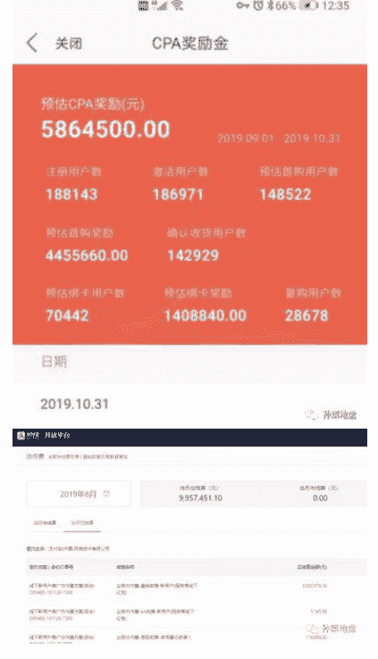

## (22赞)项目做的早，到底有啥优势？

嘿，我是家蒙

星球
公众号懒人找资源，懒人专属群分享
(22赞)项目做的早，到底有啥优势？

嘿，我是家蒙

星球的文章，图片总有问题。如果图片还是看不了，麻烦多一步，飞书可以看：

知乎好物这个项目快两年了，中间开培训班我也开了差不多8期，一直不敢来涛哥宝地分享，斗胆来露个脸。

这不，最近又要开一期新的训练营，每次开都会重新面对一次「新人状...([超链接：https://i11ahb7ycj.feishu.cn/docs/docxndGA3QbuwqGN...])

评论区：

杨涛：感谢分享，已加精华，

家蒙：[GoForIt][GoForIt][GoForIt]

喵了个喵：图片挂了

横眉冷对秋波：久仰大名

家蒙：还真是，我去弄弄

家蒙：图片修复了

家蒙：图片已修复

莫杰金：图片还是看不了

公众号懒人找资源，懒人专属群内部分享

公众号

懒人找资源

懒人专属群

微信:lazhelper

## (31赞)员工搞副业，老板应该支持还是反对？

#网络赚钱

公众号懒人找资源，懒人专属群分享

(31赞)员工搞副业，老板应该支持还是反对？

#网络赚钱经历# #新媒体从业经历# 杨涛的大佬的星球叫 平民创业手册，我自己也是从平民创业来的，很多平民创业也是从搞副业开始的，所有我觉得自己这篇文章还比较应景，所有来这里分享下。

在正式进入员工搞副业这话题前，先说说在互联网公司，最常见的三类人。首先大部分老板在创业前，往往都是第三类人（会做副业，更相信自己的人），但老板创业后，希望员工都能成为第二类人（...

评论区：

+   - Moni：大佬写的真是太好了
+   - 宋大刀：感谢牟老师分享~
+   - 家蒙：牟老师来了
+   - 牟长青：[拥抱]
+   - 无匠心，不设计：[强][强][强]

## (36赞)朋友们好，我来啦，就是涛哥刚刚说的那个场观十几万的

公众号懒人找资源，懒人专属群分享

(36赞)朋友们好，我来啦，就是涛哥刚刚说的那个场观十几万的大V。

哈哈哈哈哈哈，意不意外，惊不惊喜。en，我除了每天写口水文，我还搞直播。（因为上学原因，我只有周末有时间开播。）

先做个自我介绍。宋大刀，目前大四在读，喜欢暗折腾，没啥实力，靠运气在网上赚了些钱。性格活泼，喜欢和同频人交朋友。

偶得上天垂怜，直播了近百场，有一次直播两个小时半小时，就十万加场观了。

播了近百场直播，有幸获得一个为没有在视频号直播过的朋友分享直播经验的机会，我整理了比较详细的内容，我把完成内容都放飞书里了。（很适合新人）

最后感谢涛哥，感谢生财有术给机会，感谢小鱼和栀杞的帮助，感谢大家的时间。

最后说一句，相比于别人夸我美，我更希望听见别人说我有才华。哈哈哈哈哈哈，我加油~（超链接： https://xzdwvwmmea.feishu.cn/docs/doccnGE8eIduKKH5...）

# 评论区：

曹以凡：原来是大刀，哈哈

曹以凡：感谢大刀分享，真的值得拿来系统模仿，写得很全面，不愧为几十万加场观的大V[强]

宋大刀
十万加场观
今年年初的小目标达成啦~🤩🤩🤩

公众号懒人找资源，懒人专属群内部分享

微信:lazyhelper

## (13赞)最近将近一个月时间，算是大部分花费在“备战旺季上”

公众号懒人找资源，懒人专属群分享

(13赞)最近将近一个月时间，算是大部分花费在“备战旺季上”。

在10月中旬左右，和 @Oline @Ace 聊完“备战旺季到底在备什么”，同段时间请教@颜过 颜老板这个问题后，我得出了自己的结论。

+   1. 备货。根据往年数据，12月份订单量大约是其他时候的3倍，11月则差异不大。

2.优化链接。针对圣诞节、情人节等大型节日，适当地调整A+、套图及文案。
3.准备明年开年计划。新的市场及审美需求会逐步出现，在旺季的时候能够看出一些端倪，需要多观察市场，规划明年计划，并落地执行。
4.准备旺季应急方案。旺季店铺安全、链接安全等，都需要注意，做好安全储备，以及事故应对方案。

这三周我的大部分时间主要放在备货上面。

在分析销售及成本数据后，我发现通过物流的优化，可以降低10%-20%的成本。之前因为现金流及产品稳定性原因，一直采用的是“美森快船-空运-快递”的组合方式。
目前自己的产品稳定性增强，外加新测试出来的潜力产品，我决定加大备货量，通过“美森-普船”的组合方式，降低成本。当然，这需要把控好亚马逊仓库产品入仓量及压货资金流，旺季三倍仓储费，能省则省。

由于我的产品大部分是组合产品，需要工厂发货过来之后，再放到国内仓库进行组装，因而在国内仓又需要周转1周左右，如果把控得不到位，国内需要压2周的货。不过有一说一，组合产品的的确是能降低竞争压力，所謂“麻煩有麻煩的道理”。好在我找到了一个靠谱的阿姨，在我在外出差的这一周，仓库、产品方面，我都交由阿姨打理，目前都做得很好。

10月尾这周，每天都在仓库做货。10月28号我去了越广州见姐姐，祝贺乔迁。29号回深圳后继续做货、发货，中途优化了产品选品表，大致规划了明年木制品的产品线方向。一直到上周，合作工厂告知此前设计的产品已制作完成，可以出货，11月6号，也就是上周五，飞往浙江进行验货。

因为是木制品，外加第一次合作的工厂，那么我的要求会是全检加验厂。事情总是出乎意料的，产品瑕疵、包装、货期都间问题，于是周五只能验厂外加推出产品优化细节后离开。

原本预计此次来浙江，差不多规划1周时间，工作安排为：木制品产品全检、硅胶合作工厂验厂、拓展硅胶工厂、义乌线下市场产品选品、杭州朋友约见。
是的，之前让我感到迷惑的硅胶工厂，我决定亲自去看看到底是个什么情况。原本以为是个犹豫我的中间商，一看还真是个有点小规模的工厂，只是说价格方面没有那么便宜吧，整体竟觉得还行。所谓见面三分情，好过陌生人线上交流。

原定的行程，这一周变成了：深圳-台州-余姚-普陀山-杭州-横店-台州-杭州-深圳

每天六点多七点起床，八点出门，行程莫名很紧凑😄。

不过去了趟普陀山，跟着导游拜了普济寺，我表示心满意足。毕竟我们大华都说了，普陀山烧香拜佛求发财很灵验，我感觉我离暴富不远了，哈哈！

在横店呆了一天半，早上从杭州出发，去了秦王宫、清明上河图、广州香港街，以及第二天屏岩洞府爬山。横店因为去的时间算是淡季，也没有啥拍照的需求，所以整体感觉一般。倒是在广州香港街，感受了一把“我在横店当群演”，导演身份的员工带着我们转了一圈、看了一圈、拍了一圈，体验值拉满。像清明上河图景区，淡季的时候太没有烟火气了，很多店都不开，大街上冷冷清清，就显得很不清明上河☹ 还是推荐旺季的时候去，人多一些，热热闹闹的。至于明清宫苑，因为我去过故宫，所以没去。

在杭州的时候本来规划的是见见大学同学、老友们，也算是时间不对，我是周一周二在杭州，大家都处于备战双十一/工作状态，要么约不上，要么时间太紧凑、距离太远，没敢联系说自己来杭。

朋友在4S店，因而杭州的安排则演变成了看车、聚餐、逛宜家。期间遇着@大树，从义乌过来杭州一起吃了个饭，感觉还是很开心的。见见老友，闲聊瞎逛，啊，这七天我都快习惯这种漂泊即视感了！如果不是为了回深圳备货，还真是会愿意再呆完这个周末。张园、冰山、黑鲨、青口、秀儿、枸杞、小涛、许哥、Ashin……太多想念的朋友了

说回这次出差主线：看工厂

至此，选品、设计、供应链、物流、运营、VI，全部走过一遍了，泪目......

看工厂的目的，第一个是线下见面，加深感情；第二是检验工厂是否符合公司标准；第三是商业合作，建立长久的合作关系，能够在产品质量把控或者资金流上给予一定支持；第四则是一些特别的需求，比如质检验货、催出货，寻找新品推荐等等。

不同类型的工厂，其行事风格及工厂组织不一样。它跟产品对应的资金和团队要求正相关。

比如家电工厂及注塑厂这种，一般比较成规模，在对接上处理比较快，比较直接。而木制品工厂，手工制品，大多为小作坊，工人水平一般，可能秋收农忙就走了，导致货期不稳定，对应职业素养不高，但好处是不需要开模打版费用，价格相对低。遇到比较配合度比较高的工厂，能帮忙把事情做得很好。

不过无论是哪种，都一句话一直串在其中：人情世故。

和工厂交涉，我是真不擅长……越来越觉得，创业真的不是每个人都适合的，和性格太有关系了，我这种狗性格，用朋友的话来说，就是“适合外企高管，有高精尖同事配合，否则会非常累”。啥意思呢，就是要求高、要的多，贪心。此外，我还发现了性格和谈判上的致命缺陷，我太咄咄逼人了，不会给人台阶下。

自打上次做完“个人使用说明书”后，我开始留意自己的性格特点，发现有的地方和我

想象中的截然不同。对比起来，在做MBTI测试的时候，很多项我选择的是“我想想要成为的”，而不是“我就是那样的”。举个例子，我很喜欢“说走就走，没有计划的旅行”，但事实上，通过此行我发现，我是必须提前做好出行计划，否则如果当日无所事事、浪费掉时间的话，整个人会处于焦虑到暴躁状态”。于是我开始做了个文档，像《人潮涌动》中刘德华的扮演者一样，拿小本本记录自己发现的性格特点。及时复盘，对于缺点提高注意力，尽量避免再次出现产生坏影响。

我和海舟说: 我真是越来越觉得我可能不适合创业了。海舟回，没有人天生适合的，刚开始的时候我们也都是傻懵的，经历过就好啦，后面有经验了，就能做好了。

涛哥的文章里经常出现一句话: 创业路上一定能加效，加戏就自我消耗了。这让我想到一个故事，好像是在西风的公众号上看到的。

如果，你前面有一座金山，你在跑过去的路上摔倒了，你会原地坐下大哭喊疼吗？你会拉着旁边的人抱怨吗？不会的，你会赶紧站起来，然后继续往前跑。

这就是所谓目标感。有了目标后，不会给自己加戏的。

那如果是在寻找金山的路上呢？

有的瞎找，瞎逛，金山可能就在下一步路，但自己不知道。这种人就相当于在赌。

有的人拥有技术，会做地形监测分析，有的人有资金，会有工具、有团队一起寻找。

那当你所剩无几，放弃工作后，用所有的盘缠拿来寻找金山，你是否会迷茫？前路不定，口袋空空。

很多人会选择副业稳定收入后，也就是找到了金山后，再离职。其实跨境电商行业，是很难在公司上班，自己再偷摸开个店的，各位老板们对员工开展副业的接受程度很低。这好像是电商行业的特点。

有的人是找到了自己想走的路，坚信前方有金山，因而毅然决然的往前走，这样的人，最终也能找到金山。

我终归只是个普通人，平凡的不能再平凡，认清了，反而心态更沉稳了。

所有的选择都是做给自己的，不是给别人看的。自己赢才是真的赢。

好像，又扯远了。

最后分享一下我最近的一些新成长/感受吧。
#1
社会分工，要敢于把事情放权交给其他伙伴做，专注在自己擅长的方向上，算好容错率即可。正如产品国内仓货损一样，目前产品已经相对稳定，也有可以信任的包货阿姨姐姐们，可以做好SOP和操作手册，然后全权交给阿姨处理，我做好选单备货，适当进行产品抽检即可。如果不放心，可以在销售数据上，把产品亏损率/退货率增加1到2个点进行利润预估，及时进行周/月度退货及杂货数据分析优化。
#2
上下游合作伙伴，要能在实际情况中调整预期，并给予调整解决方案。“贵有贵的道理”，贵一定事儿少，便宜一定麻烦多，不能太贪心，前期要做好心里预期建设，把产品标准底线没设好。

# #3
创业半年，终于感受到一些员工和老板之间的分工和心态差异。创始人需要对公司走向规划负责，需要把控全局。因为需要对公司及员工负责，因而其压力更大，无时不处在焦虑之中。这便要求创始人的情绪稳定能力，对应需要更冷静、更慢一点，不急不躁，看远几分，稳步前行的同时抓住一切看得见的机会。
而员工不同。在社会分工上，需要员工承担对应的工作责任和业绩指标。在对应的岗位中，尽可能做得又快又好。因为后方有兜底及把控方向的人，所以在“性价比”上，应当发挥极致。具体表现，在作为销售岗位，需要更具狼性，尽快拿下客户，完成更大更多的订单，获得更多销售额更多利润，打开市场。如果能够为老板分忧，比如洞悉现金流回款等事项，或者有更宽的视野远见，比如在做短期业绩的同时，能够为公司打造长期的品牌影响力，那么这样的员工，一定是让老板们欣喜若狂的。
这也是为什么，老板们如果每天忙焦头烂额，日日夜夜加班，反而不对。老板们大部分时间应当放在找资源（包括人才）盘活资源，找项目上、规划项目上，而员工应当在社会分工岗位上转起来，为公司创造现金流活血。
好的员工难求，若是遇到这种能为公司创造大价值的员工，有洞见的老板一定是舍得分钱将其留下的。
所以打工人呢，做好自己的分内事，做好复盘，向内求、自我提升。如果发现被老板坑了，及时修正。这只是信息不对称导致的结果罢了，正如同老板也会被员工坑，双方可以互相似化，也应当及时优化。
真正的千里马，不缺伯乐。

# #4
社会，无论是教育还是工作，大多都是选拔。正如哈佛，在学生选拔上，倾向于选分数高的天赋选手，以及家里有钱的家庭选拔，因为根据历年的数据提示，这二者的成功率最高。成功带来的成功者的资金资助，以及好口碑的生源。
归于训练营的玩法，包括培训，其实也是在选拔。无论是价格，还是技术，都在选拔更合适、更容易在这个行业成功、更容易出结果成绩的人。于此，才能有更好的口碑，形成正循环。

# #5
我们总是想证明一些东西，比如我去过哪里，做过什么，得到过什么。地点，荣誉，金钱，价值……

# #6
所谓保修政策，是产品制造后，根据产品预设了的生命周期。比如桌子，出售的是这个产品实体，以及对应的使用服务周期。使用周期根据产品来的，原材料和加工工艺必定是有生命周期的，和人一样。不同的材质周期不同。当然，对应的售价也是依据此而定。如果产品在这个周期内损坏，则进行免费维修，比如产品预估能使用5年，算上使用耗损，则到2到3年保质期。如果刚买来1个月就非人为损坏的坏了，那么可以判定是产品有问题，那么应当提供免费更换服务。

# 评论区：

杨涛：有个叫康若薇的圈友，我觉得你们有交集，

# # (58赞)一份迟来的见面礼，分享几个悄悄赚钱的自媒体IP商业

公众号懒人找资源，懒人专属群分享

(58赞)一份迟来的见面礼，分享几个悄悄赚钱的自媒体IP商业案例

在涛哥星球潜水很久了，一直没怎么发文，花爷本身是做商业自媒体IP的，主营的业务也围绕着商业认知和个人IP的打造展开，平时看的账号比较多，这次就来跟大家分享几个只有几万粉，但是能够变现上百万的自媒体IP商业案例。

当然，为了不得罪人，所有的案例中的名字，我都会去掉一个字用X代替。

正文开始：

花爷对自媒体IP的理解，可能和很多先涨粉再变现的...

# 评论区：

+ - maarten：感谢分享
- 杨涛：哥哥，图好像挂了，
- 花爷梦吃换酒钱：更新了。。。
- 李诚Sonic：感谢分享 尤其钉子和木板的比喻很贴切
- 詩農Hope：自媒体卖书可有好的建议，拜谢[抱拳][抱拳][抱拳]
- 吕狮狮：超棒，感谢。

公众号懒人找资源

# # (17赞)勤劳仍能致富，家电清洗，年轻人入局的最好时刻

我
公众号懒人找资源，懒人专属群分享
(17赞)勤劳仍能致富，家电清洗，年轻人入局的最好时刻

我的自媒体开山文章“我是怎样用一部手机，把家政店开到全国的。”发布至今，为我的微信增加了 一千七百多个看好家政行业的前景，渴望在蓝海期加入赛道的好友，他们中大多是年纪不到三十。但在和他们的沟通中，很多Mik

创业首先面对的问题是有否有足够的启动资金、是否有足够的信心和经验，而后是否具备面对...(超链接： https://t.zsxq.com/7JqvFAq )

公众号懒人找资源，懒人专属群内部分享

微信:lazyhelper

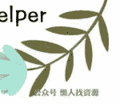

# # 提问：涛哥，怎么做到对谁都温和有教养，脾

公众号懒人找资源，懒人专属群分享
提问：涛哥，怎么做到对谁都温和有教养，脾气很好。能照顾好所有人。
有些人和谁相处都很好。最起码面上不得罪。周到而圆润。不伤和气。
特别更能容忍愚昧的人，这种人缘会好，会得到大多数人尊重。
普通人发脾气是为了维护自己？不懂得巧妙的维护？或者就是不喜欢？
有些人有号召力影响力，也是有包容之心。
普通人容易被讨厌的人和事影响心情。内心承载力不够而发火。
回答：
感谢提问，
兼容能力本质上就是同理心，要想在这方面足够优秀，首先要做的就是提升自己的认知，见识，格局，
送你一句话，已识乾坤大，犹怜草木青，
重点在于，已识，见过足够多的伟大，卑微，耀眼，灰暗，阳春白雪，下里巴人，和光同尘，蝇营狗苟，还能够雅俗共赏，不卑不亢，

公众号懒人找资源

想清楚，事实上，受过高等教育的人，或者自以为认知层次很高的人，高级知识分子，普遍存在一个问题，就是喜欢替别人决定一些事情，当普通人提出，自己并不需要被谁代表，被谁决定的时候，他们会认为普通人只是看不到自己想要看到的风景而已，

这就是所谓的救世主心态，放下这个心态，是不存在所谓容忍愚昧，得罪啥的，维护啥的，做一个观察者，划重点，观察者，品一下，

（我文青病又犯了，有没有哥们记得当年星际争霸里头有个兵种叫做Obsver，没有攻击力，但是武重要，不可或缺，就是这个道理，当年我看到这个兵种，就悟到很多道理，观察，是顶级技能，越能沉浸在这里头，越能获取巨量的快感和资讯），

再说两个吧，

+ 1，就是看设定，不加戏，对方的信息设定不用去过度解读，他说的参数，就是这个问题的设定，设定，
+ 2，如果牵扯到双方或者三方，注定是，同一个事，A和你描述一个情况，B的嘴里说出来可能是完全相反的另一件情况，

想明白了，就不太会过度解读一些信息，不过度解读，也就不会去加戏，不会去骚操作了，就不会郁闷了，

情商，是出厂设置，别啥都往这里靠，大家说的情商，其实是沟通技巧，交际套路，是可以训练的，好好练，但是一句话送你，最顶级的沟通是让自己舒服，然后尽量让别人舒服，

嗯嗯，加油，

公众号懒人找资源，懒人专属群内部分享

微信:lazyhelper

# # 提问：提问涛哥：

1、最近在实习，但是实
公众号懒人找资源，懒人专属群分享
提问：提问涛哥：

+ 1、最近在实习，但是实习的内容更多感觉在打杂，做得很烦躁，但是也知道打杂是实习必不可少的一环，如何提升自己做打杂的事情的耐心？
2、因为hr和上家实习公司的hr认识，上家公司对我的评价很好，但是我自已也不知道好在哪里，所以搞的这家公司看得出来对我的期待特别高，但是反而给我造成了很大的压力，如何改善这种情况，如何管理上司们对我的期待值？
3、还是接着上条问题，因为打杂+对方对我期待高所一下布置了很多任务量一天布置大概好好像要3天才能完成的量，如何沟通才能减小对方的预期加上布置一个合适的量给我，同时又能提升自己，让对方更愿意把更难做的事情交给我？也就是如何才能向上管理？涛哥有什么课程或者书推荐吗？
4、最近想做很多事情，考证，想试几个小项目，又或者发扬兴趣爱好做一个斜杠青年，但发现打杂的实习占了太多的时间，该不该辞职？

今天提了离职，对方又以后期可以从0到1跟1个项目把我挽留回来了，但是我自己又觉得后悔每天任务做不完还得带回家做。
其实感觉主要就是一个期待值太高，对方给我布置很多任务，也害怕自己做事情达不到对方的期待。
因为之前在一家有名的营销咨询公司待过，所以对方认为我很有这方面经验，但其
上一份实习也没有多少学到这些东西，但是说自己没有经验又怕辜负对方的期待也怕被开除（有这方面阴影），这种情况应该怎么办呀？

+ 5、工作结束后怎样调整状态好去做其他的事情？如何判断一个事情的重要程度？
6、感觉上班不是很适合自己，但是又觉得上班是必经之路，如何开始自己的一个小的创业项目？灵感从哪里来？到哪里拜师？
7、如何拆解一个项目？有没有什么书或者案例推荐呀～之前一直想拆但是发现无从下手，不知道怎么开始，之前有拆一个ted演讲是因为看了一个ted框架的视频。
8、如何提升自己的逻辑思维能カ？是该多看书还是应该多练习？
9、怎样从0开始创业/做副业？还没有工作就开始做自己的副业有必要吗？如何提高自己的执行力和对钱的渴望？感觉自己有很多动力，表现出来给别人也挺上进，但是有时候行动上还是有些欠缺特别是没有人督促的时候，有动力的时候就是别人看得到得时候。
10、如何从0到1开始打造自己的个人品牌？

十万个为什么来了…………涛哥挑着回答就行 最主要还是关于管理领导的期待和与领
导间的沟通问题～

回答：

感谢提问，

第一个问题，

你是既要且要对吧，要么就用你大学积累的关系，去创业公司，直接可以负责一个项
目，或者跟一些项目，要么就好好实习，当做纯历练，打杂是好事，以后上轨道了，
很难有机会让你在基层看着公司机器的小螺丝是怎么运作的，多打杂，你现在的心
态，就是你未来基层员工的心态，多和同事聊天，多观察，多学习，我觉得这块的收
获可以让你在很久以后都能反刍出味道，你最终肯定是要管理岗的，

第二个问题，

压力是好事，人们常常自绝于江湖，立一些高难flag来逼自己做出超水平的发挥，期
待值是一种自我调节的系统，如果你能完成，就说明不用调整，如果你完不成，几次
之后就自动降下来了，

第三个问题，

先好好做，高效其实就是一种高难，重复是持续的根本，与其想一些幺蛾子向上管理
这些情绪上的，不如向内管理，是什么让人对我有这样的误解，这样好么，为什么，
我是否自视过高，有了这样的外显，

第四个问题，

斜杠青年没有错，这是个通才香过专才的时代，该不该辞职，我认为是这段日子还要
持续多久（两个月？）），辞职是一定的，毕竟是实习，过渡一下，我认为你的目标，
就是让自己配得上这份期待，然后就走吧，你的设定是营销小天才，那就在这家公司
补上你之前没有学到的东西吧，考证和小项目放后置一下，慢就是快，给自己设定一
个时间吧，两个月，点亮了这个副本，再去下一个，多线不合适现在的你，心乱，一
定导致动作变形，

第五个问题，

人每天的意志力总量是恒定的，用完之后想让自己再读点啥，做点啥，都不太容易，
所以，状态这块我认为是意志力的滋养和修炼，比如你现在感觉劳动了一天，意志力
已经耗尽，那么，太好了，这时候，你要是能多奋战的每一小时，都极大补强了你的
意志力储备，这东西会在整个人生中都给你很大的帮助，

判断重要程度先不急，先把事儿做好，在过程中你会逐渐分清楚轻重缓急，难而正
确，重要但不紧急，这样的细节，

先上班，给自己定时间，比如半年后一定开始创业，你一定要在脑海里和实际行动上丢掉几个项目，然后再开始，这样会笃定的多，等待一个画面感非常强的契机，和找男朋友一样的，上头的时候别做决定，

灵感从观察来，生财即我师，

第六个问题，

拆解一个项目你就记得一句话，“像素级拆解”，意思就是从你接触到这个项目直到你拆完，每一个细节，比如点击了一个广告，加了谁，拉你进了什么群，怎么宣讲，怎么转化，低转高，日常维护，海报，视频，推文……等能形成一个即插即用的sop，就算拆完了，具体如评论区第一张图，这种图我做过五百张，然后脑海里会形成自动反应，对任何常见项目，拆个八九不离十，

第七个问题，

这个分两点，一个是生活的智慧，一个是刻意练习，当然，看书和练习同步啊，流程是，看书，掌握知识点，横向迁移，学以致用，一开始不要好高，一周能熟练运用一个模型就好了，

第八个问题，

不要把副业和主业分那么清楚，你把它们当做收入结构的不同组成部分就行了，在年轻的时候树立一个适合自己的收入结构观，挺有意义，

执行力，对钱的渴望，这个我还是建议你使用模型，比如进度条，全年预期收入100万，现在Q3过去了，完成度多少，针对这个完成度，执行力是会自动调整的，

第九个问题，

持续输出吧，有计划，有规模的输出，怎么说呢，水到渠成，如果你日更了，并且保持个人精进，个人IP就能很快的树立起来，在这个过程中，发现自己真正的擅长和喜欢，然后逐渐会有规划和定位，而如果始终停留在想，也不是不可以，所谓几年磨一剑，但明显不适合你的性格，你是那种非常需要正反馈和自我实现的类型，所以我建议你尽量日更，但求输出，不问东西的那种日更，

加油，

微信:lazyhelper

# # (12赞)【红忠哥普法问答】公司的行为是否侵犯您肖像权，或侵

公众号懒人找资源，懒人专属群分享

(12赞)【红忠哥普法问答】公司的行为是否侵犯您肖像权，或侵犯知识产权？

朋友提问：

耿律师，打扰了，咨询您一个肖像权问题。

朋友之前与一家公司签订了劳务合同，前期是新媒体运营方向后期转做短#视频博主。离职后公司发布了几条广告，其中用了朋友之前在这家公司时的视频片段，但是在未经朋友允许的情况下发布，这个算侵犯肖像权吗？

目前公司几个帐号还挂着朋友的肖像，还在发之前的作品，接着广告。能让那公司下架视频撤下肖像吗？

红忠哥团队解答：

您好，根据您在问题中提供的信息资料，我们经过认真、仔细研究讨论，并进行相关法律及案例检索。

现将讨论情况与研究成果向您报告并提出法律建议如下：

一、基本案情：

信息1、您此前与一家公司签订了劳务合同/劳动合同（注原话是劳务合同），前期是新媒体运营方向，后期转做短视频博主。

信息2、您离职后，公司发布了几条广告，其中用了您之前在这家公司时的视频片段，且未经您允许。

信息3、目前公司几个账号还挂着您的肖像，还在发布您之前的作品，并且利用作品接广告。

# 二、基本诉求：

诉求1、公司的行为是否侵犯您肖像权，或侵犯知识产权？

诉求2、可以通过什么办法让公司下架视频、撤下肖像？

# 三、其他类似案例常见诉求：

员工入职或离职时需要对自己设计的作品或者文章注意什么法律风险？

# 四、法律建议：

第一，首先您应明确与公司签署的协议类型，是劳务合同还是劳动合同。

合同性质的不同将直接影响到侵权认定的成立与否以及如何维权的问题。

（一）如您签署的是劳务合同：

您与公司之间就创造的成果/作品（鉴于您工作的特殊性，还包括您在职期间所拍摄的个人照片）是可以通过合同约定的形式来确认成果/作品/照片/的归属问题和使用权的。

（1）假如公司在合同中与您约定了您在职期间录制的视频/作品/照片等的所有知识产权归属于公司，而且您向公司出具了使用授权书，那么这种情况下公司应不属于侵权的；

可能您无法在法律层面要求公司下架视频、撤下肖像。

这种情况建议您主动与公司协商解决，可以请求公司支付一定的金额来作为您离职后公司继续使用的补偿。

（2）假如公司在合同中并未与您约定在职期间录制的视频的所有知识产权归属于公司，且您并未通过授权的方式将在职期间录制的视频/肖像授予公司使用，在您离职后，公司仍将视频/肖像用作商业用途，例如承接广告，此时您可以与公司协商或委托我们发律师函或起诉制止公司的侵权行为，要求其下架视频、撤下肖像。

（二）如您签署的是劳动合同：

您与公司之间就创造的成果 / 作品，没有通过合同约定的形式来确认成果的归属问题和使用问题。

（1）一般情况下，则可能认定为属于一般职务作品，著作权归属于您，但公司仍然享有优先使用权。

在您离职后的两年内，公司在合理范围内可以优先使用，无须征得您的同意与许可，也无须支付报酬。

（2）而如果是特殊职务作品，作者只享有署名权。

具体到本案，若您利用公司提供的资金、设备或者资料制作视频的，则该视频可能属于特殊职务作品，视频的著作权归公司所有。

但若公司使用视频时侵犯您的署名权的，如存在将不属于创作者的个人或企业署名为视频的创作者的情况，您可以此要求公司停止侵权，可以委托律师发律师函或起诉。

综上，您作为从事互联网新媒体行业的人员需要注意以下这几个方面的风险防范。

（1）入职时需关注劳动合同 / 劳务合同 / 合作协议中是否有约定知识产权归属、违约金条款、离职竞业限制、保密协议等条款，对于一些于己不利的条款，及时向公司提出并协商修改，防止以后产生不必要的法律纠纷。

为谨慎起见，可以委托律师进行审核把关。

（2）还应注意，有些公司要求员工同时签订劳动合同与经济合作协议，有可能是为了让员工不仅受到劳动合同约束，按时上下班打卡，而且受到“天价违约金条款”的约束，防止员工跳槽。

遇到这种情况一定要谨慎查阅条款，否则日后您可能在离职后受到不公正待遇，或因违约金过高不敢离职，或离职后遭受巨额赔偿。

（3）在离职时您仍要考虑此前是否约定工作期限、高昂违约金、竞业限制或者知识产权方面的问题，对您在职期间创造的作品、文章的权利归属，以及肖像权使用问题，积极与 company进行沟通，尽量解除或者终止对公司的授权，防止离职后公司继续使用员工肖像、作品、文章等。

综上，以上分析仅为根据您的陈述及所提供资料形成的初步建议，不作为本团队的专业意见及办案结果的承诺，希望上述回复对您有用。

## (26赞)我刘杰又出来了，自媒体行业时间呆长了，就总爱抛头露

公众号懒人找资源，懒人专属群分享

(26赞)我刘杰又出来了，自媒体行业时间呆长了，就总爱抛头露面，但是吧，大家都知道我是做家政行业的，我又不是很想谈家政的事情，所以，我突发奇想，不如跟大家分享一下我这两年所见所闻吧，以证我一直在说在做的“所有传统行业都值得重做一遍”的理念。

所以，第一期来了，“黄牛是如何通过云店的方式，零成本掳看着星巴克的大旗，月入十万”

正文链接: (超链接: https://oz408lwooz.feishu.cn/docs/doccnPVzpN7VZGoA...)

评论区:

小宝: 星巴克却做不好配送环节，那代购店怎么做到配送呢？

刘杰: 代购店就是跑腿配送，和其他的正常咖啡店配送一致；

星巴克要求的是，客户即使点了冷热各两杯，在运输途中，也不能串温。

公众号懒人找资源，懒人专属群内部分享

## (20赞)扫码点餐，操作15天，一天1200笔，身边百万级的

公众号懒人找资源，懒人专属群分享

# (20赞)扫码点餐，操作15天，一天1200笔，身边百万级的机会

自从蚂蚁被叫停上市这个节点之后，整个创业环境发生了重大的变化，很多企业爆雷，身边的挺多朋友的业务也有一定程度的下滑，另外流量见顶，流量被割裂，业务降地的变化也是及其快，很多人还是蛮焦虑的，但是无论外部怎么变化，需求是不变的，所以回归商业本质，围绕着某个特定需求做一个产品进行服务的机会一直在

回到我自己所操作的拉新业务，其实c端拉新有时候对新团队不太友好，因为政策会进行一定的变更，其实解决方案就是针对于b端业务进行拓展，再增加cps相关的收益，政策不会多变，也有稳定收益养住新团队，再回到一个需求有一个产品进行服务，

那就是帮助餐饮商家接入扫码点餐系统，服务于本地中小餐饮商家，赚取cpa费用，交易流水费用，服务费用，系统年费，将是我们身边不小的机会

今天我就通过以下几个点来讲述，扫码点餐为什么是我们身边不小的机会

+   1、围绕本地需求进行服务从不过时，回归本质
+   2、餐饮竞争转向精细化竞争，2b服务机会加大
+   3、扫码点餐的整个链条的利益点在哪
+   4、扫码点餐对待商家的价值在哪里
+   5、扫码点餐的收益点是什么以及怎么参与

## 1、围绕本地需求进行服务从不过时

任何时候，围绕本地需求做业务都不会过时，在一个城市内本地需求有很多，每个需求都是百万千万级的机会，例如：招聘、房产等，之前我写了区域互联网的几篇文章，国家贫困县拼车业务如何做到年入百万？三线城市千万级机会，城市招聘网人才网都是深挖本地需求在当地做出比较好的成绩，其实好的业务就在身边；

当服务需求的时候，尽量选取高净值用户，且金钱流入的地方，且可以站在巨人肩膀上的需求，对于小城市来讲，金钱流入的地方绝大部分在于房产、车子以及生意性投资，生意投资挺大一部分在于开设门店；

能开一个小门店已经进行了一定的筛选，相对来讲高净值比率比较高，然后扫码点餐其实也是微信与支付宝的支付入口的抢夺，大量补贴会出现；

## 2、餐饮竞争转向精细化竞争，2b服务机会变大

当一个市场转向精细化竞争的时候，随着精细化程度的加深，2b服务的机会也会不断加大，行业越成熟、越大、竞争越激烈，2b服务的机会也会变大；

+   1、对于政府来讲扩大内需、刺激消费，作为促进经济发展的重要手段，餐饮消费在整体消费的比例是很大的，所以整个市场是巨大的，另外餐饮市场已经进入到精细化运营的竞争，符合2b市场；
+   2、餐饮的三高一金（高房租、高人力、高原材料与低毛利）导致餐饮经营困难，通过数字化手段可以进行降本增效，降本方面扫码点餐可以减少人力，通过扫码点餐的菜单报表可以提前预判原材料消耗，降低浪费；增效方面，数字渠道的服务商也越来越多，抖音团购、美团、大众点评，都在帮助餐饮商家获取更多的数字化的订单；
+   3、餐饮商家的倒闭率相对来说比较高，也就是说会出现一批一批新生的商家，这就预示着后来者一直有机会，然后通过市场，也会留下一批优质的商家，我们可以不断进行服务。

## 3、扫码点餐整个链条的利益点在哪里？

扫码点餐的链条是：支付宝、微信—开发点餐系统的支付宝微信服务商-拓展服务商-业务员-门店，

最顶部支付宝、微信，会经常性的发放消费红包促进消费者使用，发放支付佣金以及拓展给服务商，促进去跑门店以及运维门店，

开发点餐系统的服务商会收取一定的系统费用以及交易分成，来进行开发迭代，

拓展服务商进行拓展门店、维护门店、帮助商家做营销，获得拓展门店的cpa收益200一家；扫码点餐支付奖励，也就是每天支付一笔会有定向奖励，一笔5毛左右；交易分佣，每一笔佣金会获取千分之几的分佣；商家续费分佣；商家营销需求分佣，也就是帮助商家做引流、做社群、做私域流量等服务性收费；

门店端，门店第一年免设备费，第二年进行支付程序费用，以及交易分佣，也就说商家第一年只需要支付千分之38%的订单收益即可接入免费扫码点餐这个系统

## 04

+   4、对餐饮商家的价值是在降本增效

纸质菜单流程繁琐，服务员不仅要快速记下消费者的菜品还需要快速送往后厨，而且在高峰期容易混乱，需要增加服务员，并且记账比较麻烦，更新菜单每一次都需要支付一笔不菲的费用，每天营业额不好进行统计，不清楚自己店铺的详细数据，所以说传统菜单的商家痛点还是挺多的

+   1、详细清楚自己店铺的数据，知道哪个菜品好卖，哪些菜品在哪些时间点更喜欢，可以优化菜单，不断提升自己店铺的经营效率，然后也可以提前进行菜品的准备降低原材料的消耗；

2、客人通过扫码点餐，节省一定人力成本，减少了开支；
3、提升了店铺形象，整个店铺科技感很强。

其实整个价值还有很多，而且餐饮商家对扫码点餐的接受度也特别强

## 06

## 5、扫码点餐收益模型以及怎么操作

这是我们跟一些合作方测试门店数据，截取了一部分数据新加入不到一个周扫码点餐的门店，一个30-70笔左右的小型门店一天可以带来20-50左右的分润，这是比较基础的收益

也就说一个人在自己所在的城市跑个30家左右的餐饮门店，单个人每个月具有挺稳定的收益，一个团队的话，可以拓展更多的商家，然后积累一定商家之后，可以赚取其他的增值性服务，把一个地区的商家维护好，话说话来，看这篇文章的应该是做c端拉新的居多，大家都深受c端拉新政策变更而痛苦，通过b端巩固团队实力，通过c端博取最大收益

具体怎么做，想自己独立操作的可以自己扫码点餐服务商，整个环节自己全面把控，申请的路径特别多

评论区：

小宝：都是找新开的餐饮店谈合作咯？商家会不会担心资金结算问题？
孙策：支付宝秒到账
小宝：用户扫码点餐的时候可以选择微信或支付宝付款吧？
孙策：可以

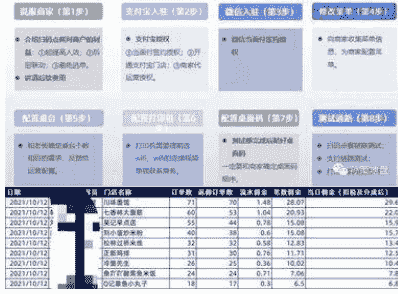

| 日期 | 门店 | 订单数 | 退款订单数 | 流水费率 | 客量分润 | 当日佣金（扣除部分提成） |
| :--- | :--- | :--- | :--- | :--- | :--- | :--- |
| 2021/10/1 | 新记菜馆 | 71 | 79 | 1.40 | 28.21 | 20.0 |
| 2021/10/1 | 仁义楼大酒楼 | 60 | 53 | 1.04 | 20.93 | 22.9 |
| 2021/10/1 | 金冠早点店 | 55 | 44 | 0.78 | 15.08 | 15.9 |
| 2021/10/1 | 老地方串串 | 49 | 39 | 0.6 | 15.08 | 15.7 |
| 2021/10/1 | 肥牛过桥米线 | 32 | 32 | 0.97 | 12.83 | 13.4 |
| 2021/10/1 | 正泰面馆 | 31 | 30 | 0.74 | 11.73 | 12.5 |
| 2021/10/1 | 千客来小吃 | 34 | 23 | 0.38 | 10.52 | 12.1 |
| 2021/10/1 | 好再来美食家宴 | 24 | 24 | 0.71 | 7.66 | 7.8 |
| 2021/10/1 | 2记鲁面小丸子 | 18 | 17 | 0.36 | 6.51 | 6.8 |

从 2021-10-01 10:28 到 2021-10-07 10:28

# 交易数据

+   营业收入 交易笔数 笔单价
¥ 10492.0 1438 ¥ 7.3

+   就餐人数 退款金额 退款笔数
1438 ¥ 0 0

# 结算方式

+   线上支付 支付宝 微信
1438 笔 1438 笔 0 笔
¥ 10492.0 ¥ 10492.0 ¥ 0

+   线下支付 刷卡 现金
0 笔 0 笔 0 笔
¥ 0 ¥ 0 ¥ 0

系统 日期 顾客名 门店名称 订单数 实收金额 笔单价 笔数 占比
未售 2021/10/14 陈思芳 茶品屋 42
2021/10/14 张晓琴 椰香竹楼鲜椰奶 55
2021/10/14 杨丽仪 奶茶 33
2021/10/14 陈慧怡 伊犁牛蒡面 37 54 1.24 20.4 21.3
2021/10/14 杨丽仪 白萝卜 51 51 1.05 20.3 21.3
2021/10/14 张阳 列小薯炒米粉 48 48 0.77 19.3 20.0
2021/10/14 陈升波 北巷牛杂粥 46 46 0.74 19.3 20.0
2021/10/14 杨丽仪 小香芋米纸 39 39 0.97 13.4 14.4
2021/10/14 张阳 松桃过林米饭 35 34 0.71 13.6 14.3
2021/10/14 王秀容 衢州烤全鱼 38 35 0.78 12.9 13.7
2021/10/14 张晓琴 O2O番茄丸子 31 28 0.52 11.1 11.6
2021/10/14 陈升波 鸭头鸭翅卤味 29 29 0.52 10.7 11.2
2021/10/14 张丽骏 鲜味鸡卷 24 24 0.55 9.6 10.2
2021/10/14 刘正钰 刘记早点店 32 25 0.49 9.2 9.7
2021/10/14 张晨 老李煮粉牛肉宽粉 19 19 0.58 7.6 8.2
2021/10/14 张阳 红耳丝子面 18 18 0.75 6.4 7.2
2021/10/14 黄丽蝶 可可奶茶 16 16 0.34 6.4 6.8
2021/10/14 陈海梅 海仔虾鱼酱蒸米饭 20 20 0.55 5.9 6.5

## 提问：涛哥您好，

我是一名技术人员，在以
公众号懒人找资源，懒人专属群分享
提问：涛哥您好，
我是一名技术人员，在以前的工作中一般都是有话直说。现在逐步转型管理岗，与人的沟通中，会发现沟通中经常理解不了对方想表达的真正含义，我也总说不到点子上。比如：在跨部门沟通中，遇到强势的同事，就会紧张不自在。对方抛给我一个问
题，我无法理解他提出这件事背后的真正意图，是想解决问题还是在指责我？

综上，我想向您请教的问题是：
在沟通中，怎样能够更好地理解对方未表达出来的意思（画外音）呢？
我有没有办法提升自己的理解能力和沟通表达能力。
非常感谢在百忙之中的解答！

回答：
感谢提问，
第一个问题啊，技术部门对需求是需要有足够清晰的了解的，还想着画外音，这样很
够呛啊，讲几句，
1，不要加戏，不要过度解读，就事论事，你带上了情绪，反而不太能get到点上，
2，平视这个世界的勇气，这里有讲究的，运气运气，气顺了，运就来了，你要念头
通达，不然道心不稳，影响效率和升迁，

3, 想清楚, 诉求一致原则, 你们的共同诉求就是把这个事情干漂亮, 这个前提下, 对方是不会给你使绊子的, 放轻松,

4, 再想明白, 好为师, 是每个人都有的强属性, 你只要态度没问题, 就多问, 问清楚, 有时候还会有非常正向的效果,

5, 抓几个关键, 想做么, 在做么, 能做么, 什么时候做到, 做到什么程度, 需要什么人协作, 为什么这样做, 怎么做, 想不清楚, 可以聊清楚,

6, 当然了, 有些场景, 思维方式不一样, 比如这个需求是硬性的 (比如月底上线), 或者对方是领导 (比如增长), 那么对方就是结果导向, 而你往往是过程导向, 这时候就要切换思维, 表述这个结果能不能搞, 不能搞的话, 还缺什么环节, 需要什么资源,

7, 当然了, 还有一种情况, 对方也搞不明白具体要怎么弄 (技术部门先天的苦), 只是提出了诉求, 这时候就要好好碰商了,

8, 总之, 这世界上没有开会解决不了的事儿, 如果有, 就开两次,

9, 养成用纸笔的习惯, 一边聊事情, 一边写, 写完之后给对方确认下, 这样的态度往往会让人感到信任, 感到靠谱,

# 第二个问题啊, 太大了, 我简单说几点职场沟通,

1, 想明白, 对人对事不一样, 人更重要, 你可以对事讲效率, 但, 对人应该讲究效果, 即本次沟通是否有效, 有结果,

2, 都说站在别人的角度想问题, 听完完整再提出自己的意见或者困惑, 这样会是更为有效的交流,

3, 真正从心底接纳对方, 是你的战友, 同伴, 你的所作所为所思所想, 才会发自内心的真诚, 这是一切顺畅沟通的基础,

4, 态度, 表情管理, 这块可以有套路, 向人们表示你确实在乎, 只有让人们了解到你有Sc很多在乎, 他们才会在乎你对这个事情有多少细节需要了解,

5, 拿出一点时间听别人说, 不要急于下结论, 站在别人的角度, 用自己的话复述别人的意思, 会是很好一个表现, 不仅有利于你听, 你理解, 还有助于对方确认自己的阐述有没有很清晰,

6, 真正的高效沟通, 是能够为对方着想, 能够了解对方的意向, 又能够理清背后的真实意图, 从而可以极致坦率, 共同探讨的方法, 需要从各种细节上多磨练,

7, 对领导的话, 套路还是得人心的, 就好比我爱你, 也需要方式方法的, 品品,

8, 算了，我秀一个，比如，你已经很优秀，很努力了，但是也要有水平的说出来，举例哦，

a, 对比法则，我司销量同比去年环比增长72%，我们的品牌市场占有率超过了竞品13个百分点，

b, 大数原则，你上个月做了3万块，这个月做了3万九，能怎么说呢，嗯嗯，我们部门业绩比上月增长了30%，能理解么，这就是大数原则，再比如，一个销售，卖了9台机床，销售额3000万，这时候致辞，不应该说卖9台，应该说给公司创造3000万营收，是吧，再比如一个营销活动，有什么指标啊，销售额、客户数量、转化率...哪个优秀，就突出哪个嘛，

c, 一些有助于理解但不建议的套路，比如，行业排名第二，就说数一数二，部门人员经常犯错，就说未有重大流失，某个项目实在不太行，又不得不<|start|>续，就说还有巨大上升空间，提高了80%，就说接近两倍......理解意思就行，看对谁，该话还是要油的，都是艺术，

9, 最后，有心往这块发展的话，可以去看看《》，《》，《》，《》，这三本先，看完嘎我推荐其他的，

先说那么多咯，欢迎追问，(超链接：领导梯队)(超链接：奈飞文化手册)(超链接：13+1体系)(超链接：沟通的方法)

评论区：

+   - 小宝：都是找新开的餐饮店谈合作咯？商家会不会担心资金结算问题？
- 孙策：支付宝秒到账
- 小宝：用户扫码点餐的时候可以选择微信或支付宝付款吧？
- 孙策：可以

公众号懒人找资源，懒人专属群内部分享

微信:lazyhelper

公众号懒人找资源，懒人专属群分享

## 提问：涛哥好，我是本地某律师事务所，我所

提问：涛哥好，我是本地某律师事务所，我所负责的是企业客户的法律顾问和债权债务（就是追债或者不想还钱的官司）当然还有一些劳动关系的纠纷，另外也可以考虑离婚诉讼（大标的，设计财产的）这些类案件。

目前我们主要是做建筑类行业，我发现这个行业现在竞争非常激烈。

律师也是要有案源才能挣钱的。

我们目前最主要的是两个方式获取，

第一， 电话销售部门，针对行业目标客户去电推销。

第二， 业务员主动陌拜。但是效果不好，竞争白热化。

我负责的这个主要是商业类，我个人认为这些方法大家都在用，内卷化严重。效果差。并且目前我们的目标客户主要是房地产建筑类上下游企业。这个行业大家都想做。可想而知僧多肉少。

我想如果获取案源如果继续用传统的方式不是一个好办法，因为地产业的遇冷也想寻找备选目标行业。

回答：

姐，早，近悦远来，我随便说几点，

+   1. 我们要想清楚，案源在哪里，是不是可以去跨经侦，跨刑侦，跨劳动局，房管局，或者跨个几次，把各个科室的人认识下，以后好发展业务，
+   2. 各种法律相关问答网站上，你会看到很多豆腐块飘来飘去，我个人是建议全部付费挂着，基本是按年收费，但是一单回本的，不贵，然后积极点，也把各种问答网站全部占满，
+   3. 争取认识一下本地的黄牛头子，我指的是案源这块的黄牛，直接谈分成，他们真心是最大的案源库，
+   4. 一个健康的律所，流量构成应该有大比例的转介绍，也就是你们的老客户维护方面，可以尝试发发力，平时发一些法律小常识，温和一些，不要提，对方有朋友遇到问题，是一定会给你介绍的，是吧，俗话说得好，每个人的微信里头，一定要有个律师，有个交警，有个警察，有个医生，客情维护这块值得花大力气去做，

公众号懒人找资源

+   5.善用你的上级以及同事，跨领域转介绍，是一件很常见的事情，术业有专攻嘛，但是一般律师往往忽略了这点，要把旗插起来，每周固定请一个或者不同领域的律师吃饭，积累一年下来，明年你一定有相当数量的转介绍，当然了，分成要谈好，也表明会给他们转介绍，

+   6.律协，律协，律协需要你，至于你能做什么，挺多的，司法考试？律师社群？律师猎头？当你占住了某一个生态位，你能获取的红利是难以想象的，

+   7.被动是最好的主动，和你说一个很简单的事儿，5118，知乎，得到之类的，上头有大量你领域的经典问题，你先用软件，把问题收集好，花十天全部回答完善，带上你的律所名，最好能有联系方式，然后做一个大量的群发，这块的长尾效应是很强的，如果你有心长期做这个行业，今天就要开始布局了，对于普通人来说，专业与否取决于声量大小，而且这些问答做好，等于你的弹药库，可以长期不同花式的大量复用，实现边际效益最大化，

+   8.李叔凡，潘娜，刘晓嘉，龙飞，兰兰…她们的问题很专业么？你想要做，很难么？除了像张律，罗翔这种，实在仿不来，我觉得你是时候开始做短视频了，具体认真看一下这个链接，这甚至是进攻，这是防御，流量载体确实在变化了，现在开始，还来得及，

+   9.本地的seo确实要开始做了，西安房产纠纷，西安劳动仲裁，西安离婚…等相关问题，你可以精确到区，用5118应该可以爬出来几万个词，你找个人批量帮你做到第一页吧，这样包年差不多在5万块钱能搞定，被动被加的客户的转化尤是高，非常建议做，

+   10.总之，既然开源，心理要有预算，找到靠谱的人，省事，能成事，

加油，（超链接：论述员的自我修养，—暨短视频生存指南。）

## 评论区：

小宝：都是找新开的餐饮店谈合作咯？商家会不会担心资金结算问题？

孙策：支付宝秒到账

小宝：用户扫码点餐的时候可以选择微信或支付宝付款吧？

孙策：可以

## (64赞)江湖早闻涛哥大名，一直没敢跟涛哥链接，才发现涛哥有

(64赞)江湖早闻涛哥大名，一直没敢跟涛哥链接，才发现涛哥有个星球，赶紧进来。小女子汐崎川华，先分享一个我的创业经历，献丑啦~~

你好，我是老钱，一名洗衣行业创业者，奉行低成本创业。在洗衣行业摸爬滚打一年，我赚到了200W，今大复盘一下我的创业全流程。希望能够给到你们一些启发。

前言：我在美团、点评、口碑等线上共有180多家洗衣店，月流水四十几万，利润在60%多，但并不是传统的社区洗衣店，而是这行这几年快速发展的新模式：快递上门取送包邮+中央洗衣中心洗涤。（超链接：我一年开了180家互联网洗衣店，赚了200万）

## 评论区：

- 杨涛：高手在民间啊，叹为观止；
- 老钱：谢谢涛哥【抱拳】【抱拳】【抱拳】
- 张小建：高手在民间，厉害厉害！【强】【强】【强】方便加个V信认识一下吗？
- Maybe：可以了解一下吗？加不上你了
- 宝哥：可以了解城市合伙人吗？加你微信没通过
- Lee007：感谢分享，很受启发
- 师飞：哈哈哈 真不错
- 55号。：老哥方便加个微信不

## (22赞)家电清洗真的赚钱吗？怎么操作的?真的是长期稳定生意

公众号懒人找资源，懒人专属群分享

(22赞)家电清洗真的赚钱吗？怎么操作的?真的是长期稳定生意吗?
我以四年的家电清洗行业创业经历 写了这篇文章
欢迎圈友指点 《以家电清洗生意为例，聊聊草根如何创业，做长久生意》，可复制
链接后用石墨文档 App 或小程序打开(超链接：以家电清洗生意为例，聊聊草根如何创业，做长久生意)

评论区：

刘杰：今天安安来我公司，我们聊了很多，超级踏实的创业者。[抱拳]

洁出人士家电清洗 安*：[呲牙]谢谢 我也在今天下午的聊天中 收获满满呀 非常感谢

杨涛：嗯嗯，有客户终身价值的概念，不仅可以做大做强，还可以做长做久，

凌祥曦：請問如何規避安全風險？比如高空安装空調外機的危险。觸電的危险。

洁出人士家电清洗 安*：家电清洗是没有清洗外机的 都是在室内哈 然后也有给员工
买商业险

凌祥曦：謝謝回復！to B的多嗎？清洗中餐廚房和西餐廚房差異極大，有嘗試這種業務嗎？

洁出人士家电清洗 安*：我们是toc哈

公众号懒人找资源，懒人专属群部分享

微信:lazyhelper

## 提问：涛哥，你好，在生财通过多种渠道认识

公众号懒人找资源。懒人专属群分享

提问：涛哥，你好，在生财通过多种渠道认识了你，有幸加了你的微信，默默围观了你的朋友圈和视频号很久，很羡慕你每天能坚持运动，同时还能做好工作管理和知识输出等各项工作。

【目前现状】说实话，我现在的问题就是感觉自己的时间管理做的很差，内心想自我提升但是缺乏动力。我是一在互联网公司工作，做了4年的前端开发，现阶段工作只能说是温不火，没有什么大的挑战和薪资机会。因为项目原因下班时间不固定，大多数数晚比较晚，回到家都很疲惫，只想躺着休息，经常一拿起手机一刷就是几个小时，一两点钟才睡，整个非常不健康，也不能运动，但是看到生财有那么多朋友都通过努力找到了自己的副业机会或提升方向，很羡慕但也焦虑感，觉得自己不能再这样下去了，想赚快钱就要行动，现在给自己定了每晚至少学习1小时的目标，但还是很难开始行动。

【我的问题】综上，我想向您请教的问题是：

+   1、怎么样改变现在这种混乱的生活作息呢？
2、如何找到自己的长期目标呢？感觉自己现阶段动力不足和目标不明确有关系
3、长期来看，培养哪些能力对人生的改变是巨大的呢？

非常感谢涛哥在百忙之中的解答🙏

回答：

感谢提问，

第一个问题，

每一个辗转反侧的夜，都是对粲贼无为那白天的我喊，------尼古拉·涛，

改变作息最好的方式就是「睡眠，饮食，运动」，大道至简，任何花哨的套路都是基于这三点演化出来的，然后试因通过操作来增强一些信念罢了，来，我们嘀咕嘀咕，

其实呀，心理上，早睡这事儿，属于想不想的问题，而不是能不能的问题，是有人拿刀逼你玩手机了？

但生理上难入睡，是存在的，我说一句，「睡意稍纵即逝」，的那种微妙的体感，不知道和在座有没共鸣吗，建设的话，

+   1，什么睡前泡脚，红酒，牛奶啥的，都没啥用，褪黑素是真有用，（建议选贵的）

2，床上用品要舍得花钱，你真是太苛刻了，床陪伴了你三分之一的生命，你每年竟然只花几千块在这上面，其实很多人可能根本没花几千块，选最棒的床垫，最好的四件套，听话，这是提升幸福感的最佳投资，

3，你需要一个超棒的枕头，这为为什么单独说呢，因为这个太难了，而且因人而异，我今年换了五个枕头了，郑禄普，睡眠博士，慕思，然后出差酒店都买了两次枕头，暂时没有非常好的推荐，但nin深信，枕头就是枕脖子，大家有好的推荐记得告诉我呀，

4，另，深蓝/紫色床单，完全不透光的窗帘，对深度睡眠挺有好处的，

心理上的睡着，我是建议你多想想，

1，想通晚睡是一种错觉，貌似时间多出来的错觉，其实，每天睡眠时长基本是一样的，你10点睡，5点起来，和2点睡，9点起来，时长是一样的，哪怕你玩游戏，我也不管你，但事实上，早点起来玩游戏，有一种莫名的成就感，

2，任何电子产品不带进卧室，前两天会非常难受，第三天开始就会感觉很好，这时候记得，别戒戒，戒戒太痛苦了，

3，你回忆一下，我们是不是第二天有重要事情，都能早睡早起，如果是，那为什么不好好活着？

4，冥想可以尝试，亲测有效，

再然后，几个老司机的 ### 小偏方，

偏方1，调整生物钟最好的方式是，歇着睡不着都红着快天亮了，就别睡了，洗洗，吃顿元气满满的早餐，然后正常工作，中午有因意也拍住，然后晚上回家，早早洗洗睡，第二天早上定个六点，

1，自己究竟想要什么？写下来，长期目标、短期目标，都行，先将你的目标全部写下来，写在纸上，贴出来，然后每月补充一波，慢慢的你自己会非常的清晰和坚定，

2，关于这块，我有一个概念，叫做，「画面感」，画面感分为两个方面，

A，进度条，几个几号，要实现什么目标，要做到什么程度，有个进度条，完成度是多少，比如曹家豪今年计划赚100万，目前9月份了，才510多万，那完成度就是51%，这就是具象化的画面感，

B，拼图，你要实现这个目标，需要谁协作，帮忙，需要什么技能，需要多少钱，多长时间的投入，怎么做...等等，这些元素，每一个都是你画面感的拼图，你必须很明确，

3，任何没有写下来的目标，都是自嗨而已，就好比任何脑暴和会议，如果没有具象化的结论，也就是做什么，什么时候做，谁来做，怎么做...这些，就都是无效劳动，

4，时间分配的话，基本上，可贪心算法，努力确保时刻都在做最重要的事，应急，救火这些免不了，但基本上，to do list配上轻重缓急四个字，能指导大部分行为，再次推荐微软的那款app，「todo」，

5，不逃避问题，因为问题不会自己消失，优先找出你的硬伤所在，最硬的那个，影响你达成重要目标的瓶颈或障碍是什么，无论它是内在的还是外在的，集中精力干掉这个点，然后一路畅通，

6，效率，你没有时间做完所有的事情，但是你可以做最重要的事情，碎片化的时间做事常有挫败感，重要的事情，一定要用整段时间来做，不行的话，就创造出来大块的时间，

7，气势和惯性，成功是有惯性的，不断的小成功能汇聚出巨大的气势，

8，有句话，完美的身材来自于每天一个仰卧撑，嗯，先开始，然后第二天两个，同理，每天学一个小技巧，看一页书，背一个单词，然后递增，这是很伟大的成就，毕竟，你真有一头牛，对吧，

9，理解你现在的状态太正常了，95%的人都是这样的，学习和自律都是反人性的，但是这两者都是对抗熵增的上选，人们之所以拉开差距，本质上就是在这两件事情上的主观能动性，你如果做到了，你就是那5%的高质量人类，

10，我一直认为，意志力的总量是恒定的，每天就那么多，干了这个事儿，就没法干另一件需要消耗意志的事情，比如你今天完成了一个很牛逼的事情，大脑就会告诉你（内啡肽？有点忘记了），告诉你别干了，该去玩儿了，但是这东西很有意思，你每次超越了自己的极限，你的意志总量就会微弱的上涨一些，玄幻吧，这就是修行，这里可以运用一下施压的技巧，比如适当骗自己，告诉自己我还行，

11, 有时侯我们几乎无所不能，咱不是没有自制力，而是缺少一个契约，或者是 flag，<|message|>, 毕竟，如果你知道要去哪里，全世界都会给你添堵，

12, 如果确实是个弱鸡，需要满足这时候自绝于江湖，就是一个很好的办法，在所有人面前，把话说满了，就没有退路了，另外，刚才说的金钱大法也很用，把钱交出来，给身边的挚爱亲朋，然后完成了契约，就可以拿回来，如果没有完成，就钱没了，当然，也可以和别人赌个大的，就好比我朋友嗯那18000天的flag，这完全没有退路啊，就好比我现在就看着有韭菜和我赌日更，嗯嗯，领会意思，

13, 定契约的时间，我建议你第一次尝试最好是十天，太短了没有成就感，然后二十一天，然后两个月，基本上你就可以养成一个很好的习惯了，

14, 接下来，是奖励，这里其实是很差的，当你完成一个对自己的承诺，然后想给自己奖励的时候，突然间会发现索然无味，不给自己兑现了，这是人间真实（有木有），但是其实对大脑是不友好的，一定要给自己兑现当时承诺的奖励，这样机能上会更好的执行下一次契约，

15, 真正的喜好和擅长，往往就在这样的一个个契约中，逐渐被找到，那种喜悦，无以伦比，你説呢？

## 第三个问题，

长期来看，写作，演讲，沟通，表达，交际，思考，分析，总结，逻辑，演绎（抽象，横向迁移）...等这些能力都能对人生有着巨大的提升，

多说两句，在这个时代技能的差距是可以量化并且可以通过持续的训练快速缩短的，

普通人之所以常常被劝退的第一个误区，就是所谓的“一年万时定律”，醒醒，那些大 是需要肌肉记忆和肢体协调的技能才需要，比如乐器，球类，且，并不是每个技能一定要登峰造极才能够得到你的，一套均衡且能够相互 Baby 的技能树，在这个时代显得更为有用，

第二个误区是什么呢，就是不知道如何分辨这个技能的基本面大不大，就是应用场景广不广，且，有复利，比如，做电商某平台，你努力学习了某一项顶尖技能，确实牛逼，但是局限性就太强了，在这个平台做一辈子？是的，你也可以横向发展，去了解业态，去深挖底层逻辑，但，总而言之，同样的时间，这样技能投入产出比是略低的，

所以，建议选择复制高的，可终身复用，且每用一次，就变强一点的技能来投入时间，同时在学习，阅读，处理事务和与人沟通交流学习中，持续提升认知，

先说那么多，评论区等各位老师再给你支撑招，show出绝话，

## 评论区：

刘杰：今天安安来我公司，我们聊了很多，超级踏实的创业者。[抱拳]

洁出人士家电清洗 安*：[呐牙]谢谢 我也在今天下午的聊天中收获满满呀 非常感谢 🙏

杨涛：嗯嗯，有客户终身价值的概念，不仅可以做大做强，还可以做长做久，

凌祥曦：請問如何规避安全風險？比如高空安裝空調外機的危险。觸電的危险。

洁出人士家电清洗 安*：家电清洗是没有清洗外机的 都是在室内哈 然后也有给员工买商业险

凌祥曦：謝謝回復！ to B的多嗎？清洗中餐廚房和西餐廚房差異極大，有嘗試這種業務嗎？

洁出人士家电清洗 安*：我们是toc哈

公众号懒人找资源，懒人专属群内部分享

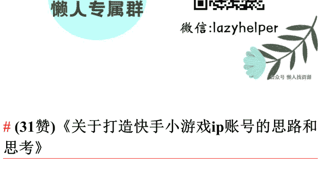

## (31赞)《关于打造快手小游戏ip账号的思路和思考》

我

公众号懒人找资源，懒人专属群分享

(31赞)《关于打造快手小游戏ip账号的思路和思考》

我是拱辛，愿你深读

本篇文章先从快手小游戏背景现状切入，之后分析快手小游戏项目是什么与怎么赚钱的

然后从真实案例出发分析快手小游戏IP的重要性与打造三种IP思路，最后总结了自己对后续做这个项目打造IP的思考。

本文一共3000字，预计阅读6分钟。

## 一、快手小游戏项目现状

## 1、作为主副业皆可

小游戏领域确实是一个小领域，但是变现能力真的不容忽视。...

## 评论区：

球球.丁邱洁Jane*：好棒。

田先生：[强]

拱卒：谢谢[玫瑰]

拱卒：[抱拳]

公众号懒人找资源，懒人专属群内部分享

## (17赞)如何组建抖音直播带货团队？面试了300+ 主播，做

公众号懒人找资源，懒人专属群分享

(17赞)如何组建抖音直播带货团队？面试了300+ 主播，做了7亿+GMV后，我的3点感悟

如何打造一个专业的直播带货团队？

我自己做了7亿+GMV，面试过300+主播，同时也走访过10多个年GMV过亿的朋友公司。

总结出来的团队结构如下：

下面，展开讲这三点：

+   1. 专业的直播团队结构怎样设计
2. 不同岗位如何做到专业化面试
3. 不同岗位如何设计考核与激励

## 1. 专业的直播团队结构怎样设计...

公众号懒人找资源，懒人专属群内部分享

## (129赞)6.1-7.15部分内容整理，

近期很多朋友说

公众号懒人找资源，懒人专属群分享

(129赞)6.1-7.15部分内容整理，

近期很多朋友说翻内容很累，我就弄了个合集，整理了之前一些心得体会和问答，10万余字，大约要占用你20分钟，如果有多条能够触动在座老板们，那就是极好，

混圈大法——做自己的王，

平民版人生复利修行手册1.0版，

演员的自我修养——平民短视频生存指南，

流量的尽头是卖货——平民卖货生存指南，
一直创业一直爽——新流量三观，
细节中的魔鬼和秀儿——平民销讲转化宝典，
挑选了部分近期朋友的聊天问答记录，头像脱敏，发出啦，绩诸位，
第一季，创业灵魂三问等，两万余字，
第二季，顶级沟通技巧等，两万余字，
第三季，高效获取信息等，两万余字，
微信生态中细致运营的一百条tips。
多多交流，一起精进，(超链接：
https://xws30qr76.eu.feishu.cn/docs/doccnHVmkvDz78sZ...)(超链接：
https://xws30qr76.eu.feishu.cn/docs/doccnckJM s9YW0K...)(超链接：
https://xws30qr76.eu.feishu.cn/docs/doccniv3Vy4zxF5Ag...)(超链接：
https://xws30qr76.eu.feishu.cn/docs/doccnC0bneUlqHoy...)(超链接：
https://xws30qr76.eu.feishu.cn/docs/doccn i9apr dzgVOF...)(超链接：
https://xws30qr76.eu.feishu.cn/docs/doccnlkG93k3fCuS...)(超链接：
https://xws30qr76.eu.feishu.cn/docs/doccnHJKUBYNMS8M...)(超链接：
https://xws30qr76.eu.feishu.cn/docs/doccnFgQIRRkdGCM...)(超链接：
https://xws30qr76.eu.feishu.cn/docs/doccnQWxgSokhs84...)(超链接：
https://xws30qr76.eu.feishu.cn/docs/doccnppxksxpWWA v...)
评论区：
温馨妮：给力。
古哥：赞！
Rhl：涛哥牛
米斗：给力喊！
zwj：涛哥是神
喵了个喵：涛哥牛逼，希望一直能更新合集！
微笑：涛哥yyds
宏杰：感谢涛哥的时间[玫瑰]

## (56赞)Hello，大家好，我是一位90后小姐姐
王燕楠Na

公众号懒人找资源，懒人专属群分享

(56赞)Hello，大家好，我是一位90后小姐姐王燕楠Nancy，今天是个感谢贴，有幸认识涛哥非常开心，有幸得到涛哥的鼓励认可和指导更荣幸，涛哥说，最好的回报就是按照亦仁大大经常说的，真诚，利他，多分享。所以今天我来了！

本篇分享将详细记录如何在人生迷茫时期绝处逢生发现这个项目并且在6个月之内开到4家店，累计会员1000+，实现月 Lee 4万元的保姆式教程，单店投入成本超低。

《谁说实体一定困难，半年内连开四家店，店店盈利的一些心得》，可复制链接后用墨墨文档 App 或小程序打开(超链接：谁说实体一定困难，半年内连开四家店，店店盈利的一些心得)

评论区：

+   听德调瓶：太强了【强】【强】【强】
杨涛：感谢分享，已加精华，
周池春：求加微信～
美少女就是奢子*_*：受益匪浅
田先生：也想做一个，楠姐求指点[抱拳]
王燕楠Nancy：18739889151可以加我
小德：太强了[感谢]
前段时间也想到过这个项目，没想到找了一下发现有挺多的了。

公众号懒人找资源，懒人专属群内部分享

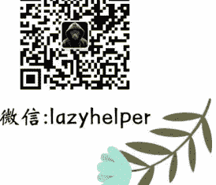

## (68赞)Moni 实体行业的从零到一

先做个简单的自我介绍：

公众号懒人找资源，懒人专属群分享

我是 Moni，94 年，毕业于新西兰奥克兰大学，科班学的是“财务管理”。临近毕业时取得“ACCA”资格证书，正因如此有幸被纽约一家投资公司纳入羽翼进入实习。

公司的主营业务是：私募基金，孵化并购 IPO。

2017 年正式决定在上海扎根，至今也有了一些小成绩，目前是：上海医疗美容投资管理有限公司的创始人，旗下有 14 家整形医院，1 家综合门诊，2 家中医医院和全国 7 家皮肤管理服务中心。

我的优势是实体商业模式端的调整和从 0 到 1 的能力。

然后在对接金融业务和行业整合上有自己的见解。

以下会按照在金融私营学习和孵化项目的路程分成四个篇幅做分享
（1）金融技能——期货
（2）小试牛刀——头牛的价值
（3）深刻认识——二手车产业化
（4）孵化自己——美业

期货江湖初体验，9 个月 100 万（人生第一桶金）

期货这个东西是博弈游戏，1 个人赚取 999 个人的钱，这话不假。你赚的是别人亏的。我很幸运，2010 年还是小白的我在跟着小组的两位师兄到郑州交易所开启我的期货生涯，因为我团队的关系，当时开户后直接就有了进入场内交易的资格。

本金设定是：两万人民币，（师兄说如果亏损过这个数字，这辈子都不要再碰，因为 2 万块钱都不会止损的投机者没有天赋。）

市场手法基本是抄单、波段、隔夜、三五日短、套期保值，我当时用的手法是一种高频的操作手法：抄单

优点是：在交易规则制定完善和遵守的情况下很难出现大幅度的亏损；
缺点是：由于高频操作所产生的高额手续费，入不敷出。

基于手续费、品种、和对行业的理解，我做的品种是：白糖、豆粕、后期上螺纹钢后主要做螺纹钢。

原因是“产品活跃度”和预算有限，给自己设定的是前期“豆粕”一手单开，打平手续费之后换“白糖”，不过“白糖”最妖，高手也最多。但是当时想的是自己机会也会大一些，稳定盈利后跟“螺纹钢”切换着来做，看哪边的行情好，当天就要主做，留一个备选。

大趋势判断靠基本面，技术手法是一个点止损。每一笔单子进场不冲就出。及时止损，就算有盈利也跟我无关。

所以我的盘面看的永远是：月周期判断大趋势，然后是“天”“小时”盘，但根据“一分钟”趋势和“盘口”入场。指标只用 MACD。

### 【顺势而为 逆势而上】开启盈利模式

其实学习期货的前三个月异常痛苦，因为“枯燥、乏味和没有安全感”也看不到任何希望。

关于“期货市场技术分析”这本书我应该从开始学看了无数遍。这里还是强烈推荐的，入门教材。每天除了 4 个小时的做盘时间外，基本都画 K 线图。当然这个方法并不推荐，因为没用。只是当时蠢，又加上内心急于求成。所以硬是画完整包 A4 纸。

一直到第四个月，大师兄带我做盘，从进场点的“盘口”分析到如何找到“安全的支撑位”，最后是我判断“关键进场点”——基本是所有人都会抢进场的位置。

然后第五个月开始稳定盈利-顺势而为，逆势而上，盘整期做记录，等蓄势。

从 1 手单一开，到 50 手单一开。每天胜率稳定 90%以上。基本每天抛开手续费盈利都在 2 万人民币左右。加上量做起来之后期货公司的返佣。大概 9 个月离开的时候账户从固定 2 万的成本已经有了 100 多万出头的积蓄。

当时选择“抄单”是因为我的性格比较能够驾驭这种手法。加上我在场内做盘，速度上比场外有优势。再者身边能在这个行业里面赚到钱的多是这种手法。如：骐子、初级抄单、乔帮主和我两位师兄，所以直接就放弃了其他手法。觉得还是看着前辈铺出来的路走下去最稳。所以其他手法就不多说了。

“负尽千金罪，炼就不死心”应该也是如此了。那段时间我的生活基本如同僧侣一般，作息规律，戒骄戒躁，清心而安，独自求白，已求获得内心最大的平静。同时坚持每日收盘后锻炼和团队交流，睡前复盘，反复确定第二天的趋势和交易规则。

其实期货总结就三点：规则、规则、规则；没有第四点。

小试牛刀--10 块钱 15 串的牛肉串（8 个月 15 家店）

有了期货的成绩后，回到公司，就被调配到“孵化”组。老大觉得我的性格和年纪还是应该多有一些历练。本身“孵化”就是投资想法和投资人。也正好符合我的成长阶段。在选择行业上，根据家庭背景和我比较臭美的性格，帮我选了“食品”“美业”两个行业。后期也自己判断过项目投资和跟进，成功率 15%左右。也有了一些对行业和商业模式上的新认知。

因为从进入实习到转正基本没有过一天休息，所以在 2013 年的时候准备回家休息半年，结果刚回家就被闺蜜拉着做点事。她家里养了很多牛，不想只是卖牛肉怎么办？那就分部位价值化，分部位产品化，分部位行业化。

根据我的行业经验和我擅长的，选定“餐饮行业”。

云南市场上有一种极具特色的牛肉烧烤叫做“昭通小肉串”单串量少，刺激多买。只按 10 块钱起卖，不按串数出售。很受欢迎。既然已经有了样板市场，那就抄吧。

当时云南市场上的牛肉分部位价格是：

牛肉：30-34 元一斤
尾巴：40 元一斤
大骨头：5 块钱一个，如果买肋条送骨头
牛油是：14 一斤

我们分为大肉串和小肉串
大肉串：竹签 1 分一根、人工串一串 3 分钱、5 克净肉 2 毛、3 克肉 4 分
不连房租调味的成本是：2 毛 8 分一串的成本

小肉串以此类推的成本是 2 毛一串
后期加上成本是：大肉串 4 毛 5 分一串、小肉串 3 毛 8 分一串

说干就说干

### 一、选址决定成功的第一步

第一家店就要爆，找的是云南大学门口的 46 平方铺子。转让费花了 28 万，我没觉得这个算是成本，反而当作投资。因为在大学门口本身就一铺难求。别说还有升值空间。碳烤架在门口摆，里面除两个冰柜外可以放 5 张四方形矮桌

### 二、既然做的是餐饮，“口味”一定是决定胜负的关键。

配方是我花 6 万块买的，之前找配方很曲折，基本吃遍了云南最具特色的烧烤和特色小吃。最后是在县城里面找到的，因为口味确实很好，生意超级好。

### 三、标准化是新店异军突起的决胜关键

之前看过很多做得好的烧烤连锁，但是我觉得都都没有特点，仅仅只是叫“烧烤”而已。我们产品的特色是：主打牛肉产业、一口一串、产品单一、极具地方特色，解决完标准化后具备可复制性。

当然标准化定制挣扎了我很久，原因是从业人员素质偏低，前期全部手工作业，想要实现从重量到穿串手法，竹签留长一致都花费了很大的功夫。

再来就是酱料标准化 and 烤制标准化。然后服装统一、商标 logo，装修等等大概花了两个月的时间。

虽然辛苦但很值得，第一家店开业第一天就爆了。

我做生意算是那种特别放松开的，叫师傅烤了一堆肉串，我就站在店门口送给路人吃。每个人两三串。吃过的 基本 90%成交，还有一些看到我发肉串的，直接给我说“先来 10 串”这是当时我听过最美妙的声音。

还有我觉得大众为霸王餐是为了我这个项目量身定做。1000 份霸王餐的放量。每个人送 10 串，转化率达到 85%。

### 四、牛肉部分位才能价值化

我做烧烤小肉串用的部位是，前期量不大的时候是：背脊肉、黄瓜条、辣椒条，三个部位。后期因为量大没办法，西冷和后腿都上了。但是也出现了一些口感上的问题。

记得开到 5 家店的时候，除了自己养殖的，基本昆明市场上的这几个部位都被我们家收完了。最后解决方案是找到国内养殖产业大户“伊赛”合作。然后我们又单独把背肌肉提出來做了云南特色产品现炒“麻辣牛肉干”。无添加。根据前一天的定制量第二天现炒和发货。

最后再把穿肉串和做麻辣牛肉干剔除下来的碎肉做成午餐“红烧牛肉饭”。好吃爆了。

### 五、搭建中央厨房 系统化管理开始招商加盟

在开业前就预想过自己做系统化、标准化，所以还算顺利。建立中央厨房中控系统只是为了更加高效和更快速的做产品研发和扩张，招商。

### 六、一头牛产生的价值，一头牛完成产业孵化

基本前几步完成 Kaiser 后接下来的细分就顺畅了，牛角做成梳子、牛肉分部位除了“烧烤，牛肉干、牛肉饭”外，还做了后腿肉健身餐、牛肉和更精细的部分开了一家牛肉火锅店。牛皮部分做成手工包，但是这一点上最后是跟丽江的一个手工坊达成合作，团队逐渐成熟后，拓展能力算是逐渐蓄满头角，不必事事躬亲，这也算是我挺自豪的一个点。

复盘笔记做了很多，简言之：这个项目做的我很是纠结，但是充满成就感。尤其是开到第三家店面的时候因为初具品牌效应，加上很多朋友都知道是我在做这个项目，纷纷各地过来给我捧场和转发朋友圈。还有投资公司来跟我谈投资的事情，老大对我也很认可。

一些小感悟如下：

- 一、品牌名字确实很重要，品牌必须强势，明确，浓缩，信息量大，行为意志力最强，对消费者的决策影响力最大，我们名家品牌名字：嘿嘿，来一把吧。
- 二、产品-简单粗暴，完成部分价值化，品牌连接性很强，可以直接按照产业化来走。
- 三、标准化-餐饮业最难解决和必须解决的，任何没有 sop 的运营管理都是耍流氓。
- 四、店面选址-我觉得这是最重要的，没有流量的店面不管你有再好的产品都带不动，除非靠耗费精力和时间来完成酒香不怕巷子深这个过程。
- 五、不要想着死守店面赚卖串的钱，要在市场对品牌认识最高的时候招商加盟，后期赚产业的钱和供应链的钱。不然低门槛的项目会引来更多的竞争对手。
- 六、单一化产品运营，可以获得市场的快速记忆和认可。后期可以再赚钱的品类，比如蔬菜和其他肉类。
- 七、盈利，因为选址和产品上前期下死工夫，所以开业就基本每天盈利，平均毛利在 8000 左右，后期加盟费我们化分了区域，一家店不算酱料和肉串的话，加盟费是 3 万一家店。直营店 5 家，后期 10 家都是加盟店，但是基本昆明市场也就饱和了，可以考虑全国招商。
- 八、项目弊端：烧烤属于餐饮业的小众产品，除了大学城门口的店铺，其他店铺基本都是晚上 7 点以后才会生意渐起。然后门槛低，所以不产业化基本周期也不长，后期进入白热化的竞争也在所难免。

二手车产业一体化。

接下来再帮公司投资了几个孵化项目后，发现时下谈论最多的是二手车行业，各二手车平台雏形渐出，都开始崭露头角，然后在 2015 年的时候就跨出“孵化轮”项目，直接进入朋友公司帮他打造二手车产业一体化。

做二手车不是一件容易的事情，没有背景依托，更没有强大背书做支撑。同时也没有任何所谓的启动资金，真正的白手起家。凭的是对行业的钻研、喜爱和执着。

二手车是一个非标产品，没办法量产，关键不是有钱就可以买到合适价格的车子，愁买愁卖还存在飞单。有很多事故车的评估也非一朝一夕就可以摸索出来。所以，建立个人体系的专业信用制度是打开破局的关键。

以之确保行业价格准确信息
以之确保收车专业评估
以之确保卖车诚信保证
以之确保售后无忧

筑巢引凤------个体驯化开始

我是在这个阶段进入的，但是因为朋友的个人品牌影响力打造的特别好，所以我做起来真的很容易。不止一次，顾客想收高端二手车的时候，先把车全款打入他的账户里，再让他找匹配的车辆，我们从中赚差价。

揽一下二手车不好做一些点：

- 一、40万以内的车不赚钱，各大平台竞争激烈多是这个价位。
- 二、40万以上的车赚钱，但是资金压力大，同时还有“事故车、泡水车、改装车等等各种问题。
- 三、成本巨大，并不是再资金垫资过大和周转上，还有人员成本，场地成本。
- 四、二手车属于非标产品，愁买愁卖，资金少难做起来，但是有资金没人脉也很難买到车。

基于以上问题，我们当时想出来的解决方案是：“筑巢引凤”

- 一、没资金有资源的，以单方垫资收车的高佣金分成比例，吸收一批有能力 goose的各方人脉。既打开自己的际资源，又满足大家都在顶项目，不投入零风险，高佣金做小老板的心态。
- 二、有资金的没资源的，按照比例出资收车，净利润按照出资比例分成。
- 三、没有资金也没有资源但是想做事的，无底薪，先学专业知识在做专业卖买，我方全款垫资，提供所有完整培训和高比例佣金。

这样一整套体系下来，几次出单之后各方的能动性都可以调转起来。基本我们就是打造一个良好的收车卖车服务商担保商，引得各方资源共享。同时因为高佣金和高资源搭配，顾客质量提升很快，基本高端车的架势就做出来了。而且留下的销售因为只拿佣金没有底薪，所以业务能力都非常的强悍。

打造产业链做垂直引流-两年 8 家高端洗美店

虽然资源共享解决了很多问题，但是不够垂直，也不够精准，所以接着就打造了汽车美容养护中心店，来做垂直引流。

全部精准定位在流量商圈停车层，以服务和标准化做车辆洗美养护。

起步就是精品洗美，把顾客当成一懂车专业人士，没有任何服务闭环和偷工减料。精细化打造强势口碑获得高端顾客对品牌的认可。

中控系统-二手车金融切入突破盈利闭环

最后在资源和风控建立出来的中控系统上，抓着顾客资源直接切入二手车金融贷款服务业务，使得整个产业链逐渐有一定的规模效应和先发优势，实现一条业务链多端获益。

这个项目下来，我算是对打造“个人 IP“的有了一些初步的理解。

一、 个人品牌-因为口碑建立已经在南京市场出圈，所以在后期作业的时候顾客都会形成一种“因为我信任你的人和你的专业，所以你做的产业都是有质量保证的“这点特别强大。
二、 坚信口碑的力量，我们大约 30%以上的客户是客户转介绍的。
三、 后期的垂直引流店-高端洗美中心，首先是定位明确，以高端车为主，开高端车的人不会在意那 290 起步的洗车费，开低端车的人一但经历过一次服务，就算日后不来，也会在心里做比较。而且我们每一家洗美店都全部实现盈利。
四、 中控和风控系统的建立，客服化运营，微信号服务端、宣传资料都跟上，让顾客在寻求“二手车买卖、汽车美容、汽车金融上都能第一时间想到我们。
五、 后期准备南京超跑俱乐部和二手奢侈品。形成一个以“高端二手”为核心的循环流。
六、 如果被验证了利润足够，那么起盘时候可以不计成本，洗美店因为地段的原因基本每家店 4-5 个月就可以全部收回成本，二手车和二手车金融方面因为以“人”和“资源”为本来做辅助性调动，所以成本可以做到忽略不计，剩下的就都是利润了，这时候，只考虑选址扩张就好了。

“美业”

一晃，年春节过完，看了很多书，想想 24 岁了，是时候找个喜欢的行业一直做下去了，在投资公司做了几年，经手的投资案例也有一些积累，乱花渐欲迷人眼，从哪个行业切入呢。

结合前辈们的意见和建议，所以最后决定“美业"”，一个几乎没有天花板的领域，话不多说，去了上海，以前来都是工作，现在来是创业，心态上有很大的起伏。

就仰望星空，也需要脚踏实地
不了解市场的时候就去打工好了

当时去了上海一家日式管理皮肤管理店，做了大概三个月的美容师完善了手法、产品、仪器和服务流程的全新认识，然后又跳槽去了一家主打科技护肤的皮肤管理做了3个月店长，系统梳理了一遍管理、销售、人员调配和摸清了大众点评的玩法。

然后再做店长的时侯基本摸清了一个美容院和医疗美容机构开单和转化的套路。其次是对上海市场整形机构的梳理和摸底。觉得差不多了就准备辞职开自己的店了。

开业之前去系统的学习了中医全套理论知识和皮肤与性病的课程，原因是我这个人凡是喜欢追根问底，不接受一切没有原理的结果，但是在日式皮肤管理店的时候，我发现日本很多东西都源自中国，所以想要系统的学习。

其次就是我觉得目前的皮肤管理也好，美容综合店也罢，都是一群被品牌方牵着走的人。销售就是以“人情’来做切入点，很多逻辑是不通的。觉得自己创业开的店，必须是“服务至上，专业护肤”以解决顾客根本问题为主。

通过学习认识了一群医疗行业的大咖

我当时报的全套课程学费一共交了8万块，是上海特别有名的医院开设的培训班，是为了促进在职医务人员专业开办的班，而我在新西兰读书的时候副科读的是“药学”“所以勉强可以报名。最后不知道是否因为培训费用太高，尴尬开班就我一个学生，哈哈哈~

所以当时是一群主任医师和副主任医师对我一对一教学，学的我好酸爽。加上我是那种相信笨鸟先飞，笨就勤奋点的人，所以老师们都很喜欢我。而且这一趟学习让我收获满满，不止是从专业知识上，更重要的是我在医疗方面的人际圈有突破。后期也形成了我品牌中的重要背书。

第一家属于自己的美容院

第一家店：租金成本1.9万一个月，找的是商住两用的公寓写字楼，环境很好，170个平方，软装是我的强项，之前在帮爸爸一个朋友做连锁酒店的时候，找了一群国内顶尖的室内设计师和软装设计师。经历了大概一年的折磨，也算对这个有一定的认识。所以加上产品投入、房租、基本的服务配置和仪器，大众的开户等等一共50万不到。

视觉是吸引顾客的第一步

在 17 年的时候从大众点评上引流还很好做的，当时看多了大众上商家千篇一律的风格后决定结合我们店问题肌肤和中式的特点，做了一套“国潮”风。并且在做完大众点评提供的霸王餐加上推广通后，渐渐销量就起来了，也没有刷和找代运营公司。

通过医美单迅速收回成本

皮肤管理基本被我做成了一个引流店，通过朋友圈和顾客面对面的交流，先解决他们皮肤问题，在解决他们心里问题，最后引流到整形医院做整形。当然这一点跟专业度有关。所以基本开起来大概 6 个月我的成本就全部收回了。尝到甜头之后就开始认真的研究医美。而现在就医美医院来说，虽然开业数量有所增加，但是倒闭潮也如期而至。整理了一些问题，发现 3.5 是整形医院的平均寿命。

### 一、 开一家整形医院对我来说现实吗？

咨询过很多业内人士做了一个测算，开一家医院办理下所有的手续到能正常营业的时间基本是：1.2 年，这期间房租需要你付，办证期间的员工工资需要支付，装修折旧计算在内，日常所需需要你付。好不容易熬到资质齐全可以营业，广告费和渠道铺设等等都是一笔不小的支出成本、除此之外，开业后不断推广费用，但是人工成本就够呛。好的医生要不要请？那么工资高。不好的医生要不要用？但是风险高。

### 二、过多资本介入，把一个技术型的定制项目，变成高复制的批量产品

不可否认，医美就近几年的增长数据上看，确实是个“香饽饽”，貌似目前互联网巨头都已经纷纷涉足医美行业，除去：新氧医美、更美、悦美、等互联网医美平台，阿里、美团、百度等等都在医美行业中不断角力。还有很多野鸡投资公司，想在医美行业赚热钱，快钱。

开业潮的不断增加和投资方不懂市场投机的心里导致的是：所有医疗美容一个德行，项目雷同，仪器差不多，装修风格和服务项目大流。但又缺乏市场积累。一个医生身兼多项技能，加上飞刀。见到个顾客都是一刀切，流水化作业。无视审美、无视定制化、无视特点化。

好像市场上走一圈，所有咨询的诹术基本一样，动过刀子但是又缺乏医学经验的小白都可以面诊顾客。开口无非就是“眼综合来一个，鼻子可以做做”，整出来一堆的网红脸，脸盲分不清。

### 三、医美贷撤消又倒下的一波医美企业

应该是从 2019 年开始国家逐步取消医美贷款，过去零首付整形不复存在，使得专靠贷款拉客的企业难以跟上专业化的服务质量。加上项目雷同导致价格战打死自己。获客艰难，但是成本不降反增。

### 四、打击医美黑色产业链

通过招募女孩从事服务行业，又鼓励整形变美，然后叠整形后打工偿还。这条黑色产业链的打击，基本是在重组整顿的又一条获客失败。

## 五、政府显微镜下的监管依然展开

这个案从生活美容机构开展的医疗美容项目开始，再到医疗美容用劣质产品替代正品等问题的屡现不鲜。政府从 2019 年开始突击式检查，从医务人员资质、驻点、设备、产品、环境、医院相关人员核查上着力开展。使之前本身就存在质量失衡和钻空子的医院难经整顿风波。

## 六、获客方式不明确

是服务渠道还是服务顾客？当然本质都是“技术水平”

说白了就是做直客还是做渠道？大多数基本都是两边抓、两边都塌。

其实这个问题跟很多大咖聊过。一开始都觉得渠道好做，因为直接投资源大，不是谁都能像“华美美莱”形成全国连锁规模效应的，那是时间和趋势下的产物，过了这个村没这个店。

但是渠道存在很大的风险在于：前期开发的合作分成问题，大家都在做渠道，都在开发有限的资源，渠道是不会忠诚的。

其次在于对渠道的知识培训和企业归属基本很难达成一致。一个为利，一个利和名都想要。怎么平衡？怎么把控？

## 七、转化

其实对于医美行业获客成本是非常高的，而且存在的尴尬点很多，够垂直的利润不高，不够垂直的难以转化，在展示专业能力的同时，还要梳理顾客观念。

## 八、医生等级和专项专长

对于一家专业的医疗美容机构，能正式经营真的只是开始。对于你能否活下去还两说。其实在行业里有一个很好玩的现象，做眼部手术好的多是女医生，做鼻子手术好的多是男医生。这本就说明了一个问题即使是医生的科班出身也需要技术专攻。因此来减少对于售后所面临的问题。试想一下下一个只做眼部手术的医生都不敢保证每一台手术技术上的完美，那么做多项技术的医生是否会有手感上的差异？

突破—以培训的方式快速吸粉，建立渠道网

当时自己整理了一些资料，是我觉得我可突破的点：

## 一、任何医疗美容机构的咨询千篇一律，顾客多做几个项目比咨询还懂

## 二、美容院难以实现顾客从护理到整形的转化

## 三、整形背定会成为一种时尚

基于以上三点，制定了一整套的裂变模式，就是帮助其他美容院转化：

我当时的培训课程叫做“看脸”，分为：

基础班-9 节课，学费是 2200

进阶班-6 节课，学费是 3600

高阶班-2 节课，学费是 6600

招生开始时有一个小技巧，就是会员制

第一、一万块钱可以学全套课程，并且可以通过招生获得分成，并且设置了一级和二级制度。

第二、会员顾客转化整形推送的顾客可以获得分成，并且转介绍也有分成。是因为这个模式，做的突破。基本裂变了到 2019 年中旬，我已经有 2000 多个学员，每天通过学员看脸的顾客达到了 40 人次，这个时候我就开始收取看脸咨询费用，同样对学员有分成。

手上了顾客量之后就开始找不错的医疗美容机构准备入股了，当时我的一家整形医院已经在上海有 7 家分院了。同时也是做渠道的医院。几轮洽谈之后，基本就一拍即合了。其实以我当时手上的顾客量自己也可以开医院，但是不敢，因为医疗行业水太深，我觉得自己年龄放在这里，再有能力，资历不够。

然后到了 2020 年的疫情期间，是重创也是机遇，倒闭潮开始的时候，我去找了以前的投资公司帮我引进了外围助力，到目前为止收购的即将倒闭的医院已经有 14 家。完成了从低端皮肤管理项目服务引流到医美转化的整条业务链。

【复盘】做任何一个行业脚踏实地最重要，不专业的诊断全是要流靓，尤其是技术服务领域。其实现我觉得能到现在快要 27 岁的年纪，有了一家自己喜欢的公司，做着自己喜欢的事业很幸福，市场瞬息万变，企业核心竞争力和商业模式就是顺应市场，做好基础的时候寻找裂变和模式上的突破。其实现我觉得在一无所有的时候，自己就是最大的成本，你对自己下赌注有多狠？你就能多成功。我就觉得我是自己唯一的成本，活着就能起来。

我是一个一直在做“实体”的人，从“孵化”别人的项目到“孵化”自己的项目。对于实体从 0 到 1 和模式裂变也有一些自己的见解。希望可以跟各位交流学习。谢谢你们看完，文笔不好，敬请见谅。

如有正在从事: 医美和实体行业的都可以一起探讨。微信: QQ0226syc

#我是如何赚到第一个100万#第一桶金

# 评论区:

杨涛: 感谢分享, 已加精华,

Moni: [可怜][可怜][可怜]

橙子: 真的好棒, 散发能量的小太阳[太阳]

Moni: 橙子也在了 嘿嘿

小巳: 优秀

橙汁: 优秀的moni小姐姐

吴大白: moni优秀!

Moni: 铁托来了 我一直在追随大白的脚步

公众号懒人找资源, 懒人专属群内部分享

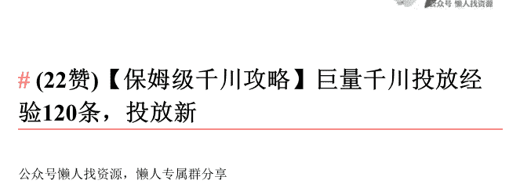

## (22赞)【保姆级千川攻略】巨量千川投放经验120条, 投放新

公众号懒人找资源, 懒人专属群分享

(22赞)【保姆级千川攻略】巨量千川投放经验120条, 投放新手必看!

写在前面

上一篇200条金句反馈比较强烈，有很多粉丝给老赵留言，让老赵分享一些干川的投放经验。今天老赵就给大家分享120条巨量干川的投放经验，内容大部分来自于孤狼和尹晨的分享，老赵也结合了一些自己的投放经验做了一些补充，希望给刚入门干川投放的小伙伴一些帮助。如果有粉丝想继续提问，可以在老赵营销笔记后留言给老赵。如果问题很多，老赵之后会再...

# 评论区：

梁靠谱：ZGNB
赵鑫：哈哈哈，又见面了
球球丁邱洁Jane*：也是生财圈友吗？欢迎来投放专场聊聊哦~ 
赵鑫：哈投放专场？
杨涛：感谢分享，已加精华！
球球丁邱洁Jane*：云上夜话，投放专场
无名建筑：ZGNB
赵鑫：感谢

公众号懒人找资源，懒人专属群内部分享

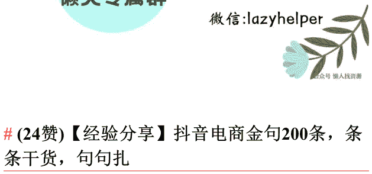

## (24赞)【经验分享】抖音电商金句200条，条条干货，句句扎心

公众号懒人找资源，懒人专属群分享

(24赞)【经验分享】抖音电商金句200条，条条干货，句句扎心！

今天给大家分享300+条抖音电商的经验，来自于尹晨和黑牛的干货分享，老赵也结合了一些自己的经验做了一些解析，就不再重新造轮子了，希望给正在做抖音电商的小伙伴一些帮助。内容比较散，看懂一句是一句，一句就可能帮你省很多钱。废话不多说，直接上干货。

1）有些品类已经是红海市场，但是其中也存在一些蓝海赛道。比如服装品类是红海赛道，但是内衣赛道依然是蓝...

公众号懒人找资源，懒人专属群内部分享

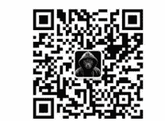

微信:lazyhelper

## 提问：和郑韩交流，

他提到一句话“定价即

公众号懒人找资源，懒人专属群分享

提问：和郑韩交流，

他提到一句话“定价即经营”，

涛哥涛哥，咋理解这句话呢

回答：

感谢提问，这题有N个解，我随口说几个场景，

1，这不，首先加深一下对“钱少事多”，这件事的理解，这四个字是精华，为啥呢，钱给的少，事一定多，给钱越多的甲方，越听话，于是，定价显得尤为重要，当然，也要结合自己当前所处的阶段，去找到那个平衡点，避免动作变形，

2，比如，定价能够阻止新进入者，当一个领域你已经拿下了top，这时候你用你对行业的理解，定一个略低的价格去卡点，后来者介入的成本大到不可接受，或者说远大于他未来可能的收益，就行了，这点你认真思考就能看到身边的很多例子，这时候的他们，看似牺牲了一部分利润，其实，占了更大的市场份额，让消费者更爽，让竞争者更绝望，

3，给员工定价，尤其是高价值员工，什么意思呢，断绝他单飞的可能性，你用高薪，荣誉，归属感，日常福利，排场，机制...等养成他的习惯，留在公司，比自己出去干赚更多，以及，既然在公司已经那么舒服了，有后台的感觉多好，何必去创业那么苦，这也是定价的艺术，

4，定价在某些时候，也代表着创业的过程，一般来说，先优化流量结构，然后优化利润，然后优化成本，

我给你描述一下，在创业初期，销量给自己带来的不一定是收益，更多的是信心，这时候，只需要优化流量结构，确保跑平，或者略亏（战略性亏损虽然臃肿，但确实存在），能起量就行，

然后开始优化利润，因为销量能换来更好的市场话语权，和一些品牌力，这时候适当追逐利润，就合适了，

然后，优化成本，以追逐更大的利润，数量决定价格是放之四海而皆准的道理，你有了量，供应链上的每一个环节都能量下来几毛钱，就是一笔巨大的财富，没量的时侯，单独做高利润，压榨厂家而降低成本，所得没有任何意义，

5，当然，也要看具体情况，比如，你卖个饺子，在工地旁，学生街，在步行街，在商场，在机场，在酒店，完全不同的人群，决定了不同的定价策略，而定价又决定了所有的细节，比如，饺子汤用高汤，还是白水，馅用五花肉还是和牛，碗用大白瓷碗还是镀金边的珐琅碗，是细水长流做熟，还是从败回来头客的杀生，是薄利多销，还是厚利少量......中间玄机，先定价，后经营，

6，价格拍打法，我也给你举两个例子，很多行业，比如医美吧，当年我给一家公司做顾问的时候，我让他们在一本精美的套餐介绍上，除常规的六个套餐以外，另外加了两个贵的离谱的套餐，后来她们的成交率高轻松了许多，考量的细节就多了，

比如，有些人只选贵的不选对的，因为面子，

比如，有些人不懂医美，但坚信用价格来判断结果的好坏就是正确，

比如，有人因为看到后头还有两个那么好的套餐，于是折中选了原来最贵的那个，

比如......本身成交就是赚钱，不成交也促进转化，是不是很可以？

能理解么，不能理解的话，想想星巴克，矿泉水25，咖啡28，矿泉水的定价是用来干嘛的，卖了赚到，不卖也促进转化吧，

不扯了，有空面谈，

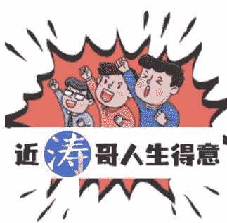

## (45赞)做知乎好物遇到品牌邀约，该如何谈判？

大家好，我
公众号懒人找资源，懒人专属群分享
(45赞)做知乎好物遇到品牌邀约，该如何谈判？

大家好，我是曹家豪。

我和身边的朋友做知乎好物已经有一段时间，随着自身的专业知识积累，以及账号基础权重的提升，做到一定程度，多多少少会遇到一些品牌的合作邀请。

由于大家从来没有这样的经验，第一次遇到品牌合作的邀约通常会很慌张，不知道该如何去谈判。具体来说就是不知道该如何谈一个让自己满意价格的同时，敲定一个难度并不大的工作量。

慌，是没经验，怕自己把谈判谈崩...

# 评论区：

布鲁斯船长："目前做单纯的却乎好物还是很吃力，以后只会越来越难做"这句话会给很多人泼上一盆冷水[微笑]

花天卓：我觉得啥都不好做，越来     越卷，竞争越来越大，给很多人泼上冷水也不是不好，让很多人冷静一下，少数人才有更多机会，

江大虾：世上本有路，走到的人多了，路就没了

钱南：来，

zwj：曹老师有微信吗

家蒙：9908556[抱拳]

公众号懒人找资源，懒人专属群内部分享

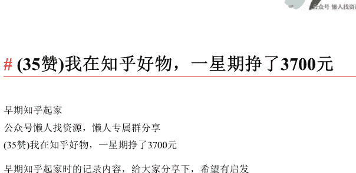

## (35赞)我在知乎好物，一星期挣了3700元

早期知乎起家
公众号懒人找资源，懒人专属群分享
(35赞)我在知乎好物，一星期挣了3700元

早期知乎起家时的记录内容，给大家分享下，希望有启发

背景介绍术，一步一步，怎么做心法，有技巧，还有思路一句话环节点其他大佬的链接

【全文6000字，精细阅读，要10分钟】

## 一、背景介绍

早期接触到这个项目的时候，是疫情爆发的高峰期，刚过完年，也不能上班，也不能出门，没事做找找副业，挣点零花钱。

目前我在知乎好物推荐上，每天花费2个小时写作，做...

# 评论区:

亚马逊森林：做过好物，也出过单，最后放弃，原因是自己在逛知乎的时候，如果看到带货回答，真是十分反感，不知道有没有同样的球友

江海·同城相亲&自侠*：有段时间我们也陷入自我怀疑。看有些带货文章，我想说你跨马自已用过吗？说的头头是道。干这个话我还要给自己做心里建设。后来我想通了，我就是分享我的理解和建议。

我朋友觉得一个姑娘还不错，想追，问我怎么看？我能怎么办，我帮他先验货吗？我建议你先聊聊看呗。

云豪私人号：还是分情况吧 那种很明显的带货文章基本上不会去翻 直接下一个 有写的 not 错的文章 感觉适合自己的我也会去买下来体验一下

公众号懒人找资源，懒人专属群内部分享

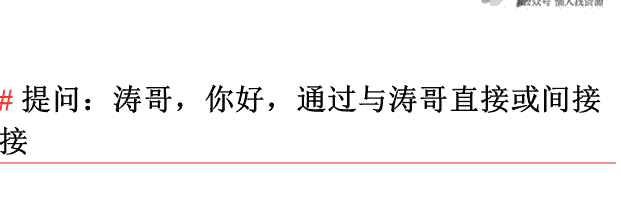

## 提问：涛哥，你好，通过与涛哥直接或间接接

公众号懒人找资源，懒人专属群分享

提问：涛哥，你好，通过与涛哥直接或间接接触这么久以来，一直对涛哥的时间管理、知识储备等是个迷，所以今天特意来咨询下涛哥，以求解决下这个疑问。

1.【时间管理】涛哥是如何在这么短的时间内(一天24个小时除去休息的时间和正常处理工作的时间)跟那么多人聊天(并且都是有质量的回复)。

问: 每天是如何分配处理这些时间? 并且时刻都能保持这么好的精力?

2.【知识储备】涛哥是如何面对各种稀奇古怪的问题都能对答如流(这得多大的知识储备和阅历)。

问: 在过去这些年有哪些人或事是让自己有过顿悟瞬间的? 是否有自己的“话术”库以便随时查阅?

3.【千人千面(这是褒义词)】涛哥是如何做到千人千面(类似于大数据似的高情商)去解决每个人不疑问惑与问题。

问: 涛哥的每一个回答都能快速抓住提问人的心 piè，这种植情商是刻意锻炼的还是先天养成的?

感谢涛哥回答。

回答:

感谢提问，

第一个问题，

+   1, 睡眠时间这是体质问题，张朝阳，雷军，还有大量的创始人基本上睡眠都是4-5个小时，圈友里头大黄，十胖，小善，安信，三笙他们十几个左右吧，也基本是这个时间，
+   2, 运动，生命在于运动这句话不会错的，你知道的，我几乎擅长所有的运动，然后也擅长铁，日常健身，这是我保持精力充沛的根本，当然了，还有不足的地方，还在改进中，
+   3, 饮食，很多人可能会忽略这一点，早餐一定要尽可能的好，且饱，其他尽量吧，身不由己的时候多，元素补充方面，安利的全系列产品安排，加上白藜芦醇，番茄红素，蛋白粉，
+   4, 时间分配的话，基本上，用你们行业的术语，叫贪心算法，努力确保时刻都在做最重要的事，应急，救火这些免不了，但是基本面上，to do list配合轻重缓急四个字，能指导大部分行为，
+   5, 配备助理，我10年前就有这个意识，问自己，你每天有多少时间用在了琐碎上，你的产能是最宝贵的啊，一个好的助理是让你质变的不二法门，
6, 团队也一样，管理大方向上不说，太复杂，简单来说，如果一件事情你带队，能打一百Bull，宁愿你褪放出来，他只要打七十分就够了，把这个叫做守城，你是攻城锤，你要去攻城，
7, 工具上，这点你比我更擅长，我是微软的todo，flomo，飞书，wps，百度网盘，不说多好用吧，把碎片信息，云办公，云存储，闪念，共享这几个点实现了就好了，幕布已经被我的撰写习惯给淘汰了，
8, 硬件上，手机和笔记本，一定用最好的，最大内存的（还是要习惯清理），这真是谁用谁知道啊，这也是产出比最高的投资了，
9, 日常生活需要比价的场景，需要纠结的消费越来越少，无形中给了你更多的时间让你去做自己想做的事呢，
10, 甲方管理，生意上吧，与甲方的关系中，“钱少事多”，这四个字是精华，为啥呢，钱给的少，事一定多，给钱越多的甲方，越听话，于是，这个服务，就是这个价，爱谁谁，不需要浪费大量的时间在扯皮中，浪费在低净值客户上，很惊喜的发现，反而事越干越高效，越来越顺利，而不是为了生计，什么客户都接，什么生意都做那时候的各种动作变形，
11, 亲密关系管理，这个只可意会了，
12, 钱确实能换来加速度和更多的时间，更稳定的动作，这个，细节，

第二个问题，

1, 我比大多数人幸运，我不只有固定的人生导师，好几个，也愿意带我，毫无保留，外加时不时客串的各路好友，给我巨大的启发，和知识面的拓展，
2, 年龄在这里，创业十六年，经历过太多行业吧，有个很有力量的说法，我是互联网创业者，如若承诺看得起，我是一个创业者，
2, 年龄在这里，创业十六年，经历过太多行业吧，有个很有力量的说法，我是互联网创业者，如若承诺看得起，我是一个创业者，
3, 顿悟的话，经常有，就是从前台到幕后，经常会有闪光时刻，也许是坑，也许是神操作，走位，都能给我很深的体会，我不觉得我聪明，但是善与总结应该是真的，
4, 话术库没有，但是思维模型（方法论）有，这个很少人会刻意去总结，但是ISC你悟出一个模型，你未来思考就会有即成的路径，很有意思，举例，比如，盒子，桥，守望者，种子...
5, 用模型指导数据库吧，整个流程想象有一个盒子，盒子的一头，是信息的输入，然后模型（方法论）来处理（套），然后盒子的另一头正常输出，我的输出还不一定稳定，但是也是好事，偶尔会有惊吓的，自嘲的表现，

第三个问题，

+   1, 情商这东西, 应该是出厂设置, 是无法刻意训练的, 参考智商?
2, 大概率和原生家庭, 地缘文化, 和所处环境有关, 所以, 多和智慧的人面谈, 别宅家, 这是提升的二法门, 毕竟, 前两者几乎已无法改变,
3, 如果可以训练的, 那一定是沟通技巧, 场景适配, 这也是知识面+发心吧,
4, 最后, 自我实现那块吧, 顶级的情商, 其实不是让所有人都舒服, 而是, 让别人舒服的同时, 自己更舒服, 这块练的是, 胸怀

好啊,

# 评论区:

亚马逊森林: 做过好物, 也出过单, 最后放弃, 原因是我自己在逛知乎的时候, 如果看到带货回答, 真是十分反感, 不知有没有同样的球友

江海·同城相亲&自傲*: 有段时间我也陷入自我怀疑。看些带货文章, 我想说你踏马自己用过么? 说的头头是道的。干这个话我还要给自己做心里建设。后来我想通了, 我就是分享我的理解和建议。

我朋友觉得一个姑娘还不错, 想追, 问我怎么看? 我能怎么办, 我帮他先验货吗? 我建议你先聊聊看呗。

云豪私人号: 还是分情况吧 那种很明显的带货文章基本上不会去翻 直接下一个 有写的不错的文章 感觉适合自己的我也会去买下来体验一下

公众号懒人找资源 懒人专属群内部分享

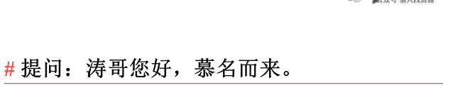

## 提问：涛哥您好，慕名而来。

公众号懒人找资源，懒人专属群分享
提问：涛哥您好，慕名而来。

之前在微信有跟您初步的聊过，不过我表达的不太特别清楚。

说实话，我的问题就是我现在卡在了一个发现不了具体问题从而有针对性提高的一个阶段。

先自聊一下，我是一个码字7年的撰稿人。

目前离职在家自由职业。

全平台小博主，全靠写点东西七七八八做起来的。

小红书知识博主，目前粉丝大概8w；

b站佛系更新粉丝目前在2.5w； 知乎8k粉，微博4.5w粉。

豆瓣和简书粉丝小几千，就略略了。

因为我个人不太会用自媒体平台变现，说实话，这几个平台真正实现变现的仅仅小红书和知乎，b站也因为没时间接广以及广告价格较低，我没有接单。

我是近三年三月oid离职的，之前是新媒体公司的内容主编，有三年的主编经验，写过一些百万+爆款文章。

所以离职后，我就利用我的经验做了知识付费，开设了写作课。每隔一个月开一次课，收入大概6~8w，我自己写作+接广收入大概在2w+，所以一个月收入平均下来在6w左右。

同时我开设了付费读书社群，目前人数在40个，仅在朋友圈宣传过，报名通道我放在了公众号菜单栏，总体来说宣传力度不大，目前是付费进群，进群99元，到月续费99，这中间我会给予成员们做读书博主以及读书、写读书笔记的经验。

每月有三名成员会得到正版书籍奖励，以此激励。

再有就是，我此前时间开设了知星星球，作为写点讳提高社群，活跃度也比较低。

我目前的问题：

+   1□对于课程只能一期一期授课变现有些迷茫，不知道写作课程是否长久。
2□读书社群我想做大做精，但是目前看来知道的人太少，活跃度不够。
3□知识星球也遇到了读书社群一样的问题。
4□我个人还想知道有没有其他变现方式，目前课程被溢，有危机感。
5□我到底应该更侧重于哪一方面？b站短视频还是小红书？还是开发课程？不过我也

意识到流量到位才有生源，相辅相成。希望能得到一些指导。感谢。
回答：
感谢提问，
你是高手，我就顺着意识流往下说哦，首先我们把你的核心要素分成两个，
一，产品，
二，流量，

+   1. 写作成能力相关的传道授业解惑，一定长久，长长久久，
2. 产品上根据你的描述，我们没定你的内容很棒，交付很好，
3. 然你可以在模式上做一些拓展，比如，课程，咨询，陪伴式训练营，打卡，共读，问答，知识点精讲，好文赏析......
4. 产品形式的话最好是课程+资料+星球+社群，我换个说，
5. 课《小鹅通，有赞》，抖音的学浪，也可去试试，+资料（大量素材+你的一部分知识结构框架，知识点，也就是what的部分，why+how的部分在课里头，）为什么要资料呢，你应该听说，知识付费界的引流五字真言，2020年引流10亿人次，叫做，"加我领资料"，
6. 知识星球（用作内容沉淀，以及满足学员的表达欲，给予归属感，且星球收费比较温和，可以考虑星球收费给予课程交付这样的模式），比较不伤粉，且方便做裂变，一带一，我的星球一个老客最起码给我带来一个新客，很多星球都能达到这个标准，
7. 社群，比如微信群和QQ群，QQ群你稍微了解下，禁言功能其实是一项神器，不用也没关系，微信群是双刃剑，一直以来有微信群毁星球的说法，一旦问答，或者日常互动，移到了微信群，星球就会凉凉，最理想的打法是"力往一处使"，讲清楚，问问题去星球，这样单位时间内的产出，可以被一群人看到，加了百倍杠杆，
8. 另外，任何赛道，再牛逼的传授，基本符合721定律，也就是7成的人碌碌无为，2成的人不上不下，1成的人原地起飞。哪怕生财有术，作为趣蔻，也只能通过陪伴，略微提高成功率，所以就怕有不同的声音，也就是黑子，喷子，你一小姐姐，容易心态不稳，
9. 课程被盗版是必经之路，如果没有盗版，你做得也太差了，第一次被盗版，是标志着这你这个ip真正树立起来的里程碑之一，

10. 硬要课程防盗的话，核心逻辑是，你防止不了被盗，于是只能增加盗版的成本，目前，钉钉的录播课（满布水印），或者视频号等平台的直播课，会让盗版的成本变得巨高，且你的学员体验很好，但对方盗版后几乎无法转卖，

11. 知识星球的冷清，可能只是你的错觉，因为我的认知里，星球大抵上分两种，共建型的星球，和强ip型的星球，你这种星球，可能只需要一个声音，就比如其他几个像你这样的ip，和我说，很多圈友和他反应，不希望在主信息流上看到别人的帖子，

12. 当然了，如果你想做共建型的星球，也不是不可以，参考生财有术这样的打法，设计机制，让你的拔尖学员，努力输出，以战养战，越输出越强大，就是我怕你累得慌，忙不过来，

13. 你说读书群不活跃，是不是用微信读书，然后每天发一个100字的读书笔记图片？如果不活跃，无非是机制不taok，晓之以理（规则），诱之以利（奖金），动之以情（鸡汤），迫之以贬（淘汰），

15. 比如，设立奖池，一半收入拿出来，奖金平分，比如，淘汰机制，仅有2次请假机会，比如，煨鸡汤，自律，时间管理，目标管理啥的，比如，讲清楚，你1份笔记，是可以换到同群里头100人的笔记呢，这样100个人帮你读透这本书呢，比如，你自己每天开一个直播呀，

16. 开始讲一下流量，你现在有的是内容，且品质远行，那么，我是你的话，我会把一份内容，变成多种形态，然后去完成一个全网分发，这里头的考量是，单位时间内 的效能最大化，是吧，

17. 具体怎么弄呢，你1个单位时间内，产出了这篇内容，然后你只发到公众号，或者小红书，over，效能有限，那这样呢，你有了这篇内容，把这篇内容做成了，金句卡片，图片，知识点，短视频，问答，然后同时发布在全网排名前十的所有图文平台和视频平台，这样是不是投入时间最舒服一倍，但是杠杆加10倍了呢，

18. 你需要一个栏目栏目名，和一个作者名，而且辨识度，如果作者名很普通，栏目名就一定要差异化，醒目，上口，好输入，好传播，

19. 然后，做一套全网同名的打法，理解下，必须让你的栏目名或者作者名，在搜索，百度，神马，360被搜索时候起码有几万或者十万个结果，（你可以搜索嚣左罗，或者你认识的牛逼教学作的玩家，有助于理解），
具体你可以再看这三个帖子，

很多细节在里面，然后我们再讨论，加油，（超链接： https://t.zsxq.com/JAUrVVb）(超链接： https://t.zsxq.com/MbmmM3F)

## 评论区：

亚马逊森林：做过好物，也出过单，最后放弃，原因是自己在违知乎的时候，如果看到带货回答，真是十分反感，不知有没有同样的球友

江涛·同城相亲&自恢*：有段时间我也陷入自我怀疑。看一些带货文章，我想说你跨马自己用过吗？说的头头是道的。干这个活我还要给自己做心里建设。后来我想通了，我就是分享我的理解和建议。

我朋友觉得一个姑娘还不错，想追，问我怎么看？我能怎么办，我帮他先验货吗？我建议你先聊聊看呗。

云豪私人号：还是分情况吧 那种很明显的带货文章基本上不会去翻 直接下一个 有写的不错的文章 感觉适合自己的我也会去买下来体验一下

公众号懒人找资源，懒人专属群内部分享

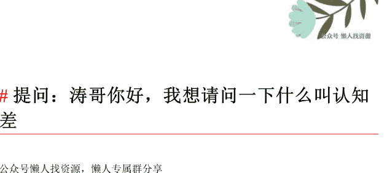

## 提问：涛哥你好，我想请问一下什么叫认知差

公众号懒人找资源，懒人专属群分享

提问：涛哥你好，我想请问一下什么叫认知差，跟信息差有什么区别。

我经常看到这两个词，不太能区分其中的差别。

比如信息差赚钱我理解就是，我知道一个渠道你不知道，你需要这个渠道，我介绍给你、我赚差价。

但是什么叫认知差赚钱呢？

回答：
感谢提问，

信息差你说的大概是对的，但你问什么是认知差？

认知差就是，特么不转不是中国人，特么奶奶觉得出你要穿秋裤了，特么明天马化腾生日，

理解了么，你们都没有错，

爷爷转发到家族群，他是爱国的，他的发心，行为，都没有错，所以，不孝有三，长辈群里群谣为大，

奶奶是真的觉得冷，但是她不知道你那么健壮，她用她的体感，来觉得出你也是同样的冷，然后逼你穿秋裤，

大姑很爱漂亮，尤其是微信头像天天换，然后听说明天是马化腾生日，转发5个群微信头像会变成金色框，她就转了，爱美不是错哦，错的是爱得瑟的你，

对了，还有一个著名的图片，面对面的两个人都看着同一个数字，一个人说6，另一个人说9，他们都没有错，

这就是认知差，还有没有，有，接下来比较难懂，我尽量白话，

知识结构差异，主要就是三观，三观是啥啊，人生观，价值观，世界观，三观和原生家庭，地域文化，所处环境和人群紧密相关，所以，人就这样因认知而分了圈层，这还是没有对错的。

一个清华博士优雅的开了个社群，赚了一千万，一个土鳖老板，在家乡因为会喝酒，会来事儿，吧啦生意场，也赚了一千万，他们俩并不会看不起对方，

土老板很尊重读书人，这年头我回老家，还有人喊我秀才呢，而博士也不会看不起土老板，因为他认识到了，知道龙有龙门，蛇有蛇道，

接下来讲的，是信息差导致的认知差，信息在传递中，会带着人们主观的情绪和判断，信息在被获取时既存在来源的差别，而信息源又分干净与否，且，信息的差值是人们认知的来源，所以，信息差，将逐渐导致认知差，这样讲清楚么，看你们还不重视信息检索能力和甄别能力，那我还是举例吧，

中医中药，你想毁掉一个群，就去群里整中医，因为在可被获取的信息源里头，中医好，和中医不好，这两种信息体量，是打成动态平手的，所以对抗就存在了，这就是认知差，

认知差的两个圈层，如果面临对抗，在一定程度上，几乎还可以交流，而在深度话题上则难以继续探讨，相互否定的认知是根本相斥的，

好，我们来讲认知差赚钱，在一个机会，一个行情，一个平台，一个趋势，一个现象，一个热点，一个玩法…刚刚兴起，或者还没有兴起的时候，仅有一小部分人能敏锐的借助于他们对底层逻辑的理解和认知和前瞻，迅速抓住机会，而这时候，大众还处于茫然的状态，对这些有可能的好利，理解还很模糊，这就是认知差，

于是，借风口起飞，也算，传道授业解惑，赚一波，也算，先吃红利，占山头，也算…又要举例是吧，域名这波算不算，淘宝这波算不算，公众号占名数字算不算，知识付费算不算，短视频，直播算不算……好，再给你个你来判断对不对的，如果说看好跨境是因为疫情下死了印度，于是我大中华的第二产业成为了全球第一，年产值远超全球其他国家之总和，所以我们看好跨境，这样成不？

嗯嗯，干吧，很多时候，赚钱就是把你的常识卖给别人，仅此而已，而所谓常识，就是那10亿人，不知道的常识，over.

## 评论区：

亚马逊森林：做过好物，也出过单，最后放弃，原因是自己在逛知乎的时候，如果看到带货回答，真是十分反感，不知有没有同样的球友

江海-同城相亲&自俄*：有段时间我也陷入自我怀疑。看有些带货文章，我想说你踏马自己用过吗？说的头头是道。干这个话我还要给自己做心里建设。后来我想通了，我就是分享我的理解和建议。

我朋友觉得一个姑娘还不错，想追，问我怎么看？我能怎么办，我帮他先验货吗？我建议你先聊聊看呗。

云豪私人号：还是分情况吧 那种很明显的带货文章基本上不会去翻 直接下一个 有写的 不错的文章 感觉适合自己的我也会去买下来体验一下

## 提问：涛哥你好，我是你的忠实女粉丝。

公众号懒人找资源，懒人专属群分享

提问：涛哥你好，我是你的忠实女粉丝。

最近比较困扰我的是我的直属上司，因为我在 widers of ?? family? 家外企，属于互联网行业，上司人在国外，我们每天都要视频会议一对一聊半个小时，聊工作进展和遇到的问题等等。

刚来这家公司，头三个月天天视频问题不大，也确实遇到很多问题需要这样沟通了。但是 一直视频到现在8个月了，时间长了我干脆都不看视频了，用其他页面遮住视频会议的画面。我甚至很反感他跟我说的各种工作上的注意事项，他的观点和认为好的做事方式。他管理得太细致了，要安排我做事情的优先级，让我先做什么，在做什么。哪些地方不要花费太多心思和时间，事情做到什么地步就可以收尾了，诸如此类的事情。

我也有四五年工作经验，并非应届生，管理太细让我感觉太过了，过犹不及，有点喘不过气。

另外他说的有些东西我不同同，碍于他是我的领导，我也不常发表自己的意见。如果是你，你会怎么处理这种情况，如何调整自己，如何让事情转向利于自己的方向，如何让自己获得更多的话语权。

回答：

感谢提问，我严肃点，你别怪我呀，

我先和你说一个故事，

去年年底，我见了一个圈友，他和我吐槽，公司年终奖说好20万，结果只发了18万，很不爽，

当时我和他干了一杯，我问他，我说，平心而论，如果老板只给你发15万，你会撇桌子走人么，他想了想，沉默了10秒，说，不会，

于是我又和他干了一杯，我问他，我说，平心而论，如果老板只给你发10万，你会撇桌子走人么，他想了想，很明显的感觉到了情绪的波动，沉默了20秒，说，不会，

嗯嗯，我没有再往下问，

职场上，无非两点，

+   1, 钱有没有到位，
2, 心委不委屈，

两点都很满足，那么这是一份多么好的工作呀，如果没有，钱到位，挺好的，

再来，某种意义上，用时间、劳动和尊重，换取工资，这难道就是上班的全部意义么？是的，

受委屈，感觉到尊严被侵犯，不爽，这是很自我的 一种表现，

受委屈，可是有劳有所获，钱一分没少，所以没关系，这是正确的处理方式，

我们要学会思考，这件事对自己的意义是什么，工作对你的意义如果就是钱，那么钱到手了，它的意思就实现了，

如果告诉我，你去工作，主要意义是尊重，我会很诧异，

好了，人间真实完事了，瑟瑟发抖拍榨粉的小涛，说两句心里话，

如果这个上司不是对你有意思，而且他的工作能力像你表达的这种水平，那么我觉得你和他开诚布公谈一次就可以了，这里有三种可能需要你考虑，

+   1，你维持现状，努力做好工作，表现出你已经不需要他操心的事实，等他不再这样面面俱到，然后你考虑下这条的可能性，

+   2，你很有诚意的，很有准备的找他谈了，表达出你已经对手头工作很适应了，希望上司给你更多自主权，好，然后，你的上司被激怒了，感觉权威受到了侵犯，从此开始给你穿小鞋，或者说考察评之类的在对手上，使你难，嗯嗯，你看看这种可能性大不大，

+   3，你开诚布公谈了一下，你的上司很欣慰，觉得自己带出来的兵，有担当，挺好的，于是除了大事交代，其他就不会这样事无巨细的安排了，皆大欢喜，

然后这三条，你衡量下，最坏可能性，能接受，你就谈，不能接受，就忍着吧，当修行，

加油呀，等你消息。

## 评论区：

亚马逊森林：做过好物，也出过单，最后放弃，原因是自己在逛知乎的时候，如果看到带货回答，真是十分反感，不知有没有同样的球友

江海-同城相亲&白领*：有段时间我也陷入自我怀疑。看有些带货文章，我想说你踏马自己用过么？说的头头是道的。干这个活我还要给自己做心里建设。后来我想通了，我就是分享我的理解和建议。

我朋友觉得一个姐妹还不错，想追，问我怎么看？我能怎么办，我帮他先验货吗？我建议你先聊聊看吧。

云寡私人号：还是分情况吧 那种很明显的带货文章基本上不会去翻 直接下一个 有写的 not 错的文章 感觉适合自己的我也会去买下来体验一下

## (36赞)《知乎回答排名拉升技术实战SOP》

前情概要

公众号懒人找资源，懒人专属群分享

(36赞)《知乎回答排名拉升技术实战SOP》

前情概要

我是拱卒，愿你深读

在一年多的时间里，从0开始孵化了十余个知乎IP，一年变现100W+，并且都是垂直领域IP账号。

我深知一篇文章影响很多人，如果有失误，那是多么的不负责任与误人子弟。

因此，每当我下笔，我都怀敬畏之心，要求自己必有干货，提供给他人价值。

基于深入研究知乎的算法机制，并通过大量的实践去检验自己的理论。

我相信我有能力解读知乎回...

评论区：

+   丹枫：真棒
拱卒：谢谢蒋哥
田先生：先赞后看！
拱卒：谢谢

拱卒：谢谢
大龙猫：感谢分享，落地经验！

公众号懒人找资源，懒人专属群内部分享

## 提问：涛哥好，从最早生财有术，到后来视频

公众号懒人找资源，懒人专属群分享

提问：涛哥好，从最早生财有术，到后来视频号，一直在关注你，后来也很荣幸加了你的微信，很喜欢你这个人，一张口就让人很舒服，先表达一下对你的敬重。

有个问题困扰很久了，我们是一个30人团队，招人一直是我和合伙人亲自上的。

前几天外出学习，遇到一位跟我们情况类似的同行朋友（朋友团约36人）跟我说，必须要有一个HR，好给自己腾出时间来做更多事情。

我之前也问过几位牛人，答案不一样，有说必须要有，有说小团队没必要最好你自己上。

我们现在的情况是，人都是我们亲自招的，一年有不少于三分之一时间在招人这件事上。

这样做的好处是 目前看我们亲手选的人战斗力还是不错的，三观也比较一致；缺点也很明显，占işleri我们大量时间。

对于HR我觉得，最主要的我还是信不过，到头来可能我还是要复试一遍。

到底要不要，小马过河的问题又来了。

辛苦了涛哥，感谢您。

回答：

感谢提问，

+   1, 我不知道大哥你体量如何哈, 想来啥说讲几句, 语言如有冒犯别介意,
2, 以我的经验来看, 创业公司, 30人就是一个分界线了, 往上就不能说是小团队了,
3, 招到优秀的人才是ceo的第一工程, 而招一个hr是ceo迈出的第一步,
4, 除了实际(delay)上专业人做专业之事外（不仅专业, hr的渠道比你多）, 这件事请对ceo来说也是意义非凡, 单位时间产出问题,
5, 根据业务重点, 把你需要什么样的人才, 告诉hr, 然后和他一起描绘一下为什么, 他要对这个人有画面感,
6, 然后你弄一个jd的模板, 然后和他一起合计着把差异化给写进去, 你表述内容, 他能理解之后, 用他的语言翻译过去jd上,
7, 把团队和岗位的引入之处, 清晰的表述出来, 不隐瞒, 不夸大, 对大家都好,
8, 可以和你一起, 用问对的形式, 把使命, 愿景, 价值观, 组织架构, 激励机制, 考核, 成长机制, kpi, 战略重点, 战术细节等清晰的传达给hr,
9, 期间, 这个hr还需要深入群众, 收集各种感受, 体会, 正反两面都要, 这样他对公司文化有更深的理解, 才能招到更对的人,
10, 他必须主动出击, 多年的关系网, 和对渠道的理解, 这是他最大的价值,
11, 如果合适, 往hrbp方向培养,
12, 人才就是一切. 至于你说的, 你还需要复试, 这是肯定的, 但是起码省下了你2/3的时间, 链条是, 通过交互, 你信任hr, hr筛掉的, 大概率不是你要的, 如果这点达成一致, 这事就是正确,
13, 顶级的hr的另一个重要功能是机制上的优化. 先进而专业的理念, 在完全融入公司后, 可以开始参与进行机制迭代, 最好是一月迭代, 通过改进, 调动团队要性和活力,

14，一个HR可以帮你，
关注员工飞的高不高，
换心员工飞得六不六，
关心员工飞得累不累，
你现阶段可能只关注需要/重视到他这点：判断谁能和大家一起飞。

15，讲真，很大一块一定是员工关系，团队氛围和凝聚力，不虚，你体会会就知道对绩效的提升，很简单如果你感觉到现在年终发个奖金，都没头绪，钱没花在刀刃上，有这种感觉，就说明要来一个了，

16，我是意识流说一些，没有顺序，具体推荐你四本书，1，13+1体系，2，奈飞文化手册，3，领导梯队，4，信任论，按顺序，

谨祝，网运昌隆，

## 评论区：

丹枫：真棒
拱卒：谢谢涛哥
田先生：先赞后看！
拱卒：谢谢
拱卒：谢谢
大龙猫：感谢分享，落地经验！

公众号懒人找资源，懒人专属群内部分享

## (59赞)大半夜的，涛哥发来一条暖心的消息 又让我学到了，明明

公众号懒人找资源，懒人专属群分享
(59赞)大半夜的，涛哥发来一条暖心的消息又让我学到了，明明是在帮我，还要作出一副让我来帮他的架势，这种顶级的同理心，真让人佩服至极，要不然大家都捧涛哥，这就是魅力啊。

所以，借涛哥这个宝地，给大家分享我当初是如何在知乎问题引流的一个复盘，详见

文章里复盘了我当初在知乎如何通过输出螃蟹知识来获取精准客户的玩法，现在在个人IP的说法很热，我今天回过头来看，其实我这就是一个打造个人品牌的过程，一个螃蟹IP，通过输出真情实感和专业价值，来给我们的目标用户解决了信任问题。

这里面我认为最重要的是要有真诚 dike他的价值,se， ..., 发心正了，我们才会把我们的产品和服务打磨好，才会在文章中把我们的理念传给我们的目标用户，让他们感受到我们的真诚和用心，这样吸引过来的客户，显然更有价值。

试想一下，如果你抱着坑人的心态，接不住知乎的流量，只会被流量吞噬。大家都知道知乎上精很多，我在17年玩知乎，到现在还活跃，很多老客户还在追随我，大家应该知道我的品控应该还是不错的。

文章是第一次信任，产品是第二次信任，如此就有了复购、转介绍，整个闭环就通了。

价值观对了，这就会体现在你说的每一句话里，做 的每一件事里，写的每一个知乎回答里。这个说起来可能有点玄学，但这个确实很重要。

举一个例子，今年四月份我受邀去知乎总部分享我的案例，当时线下认识的都是百万级别的巨V，不是大V，是巨V，我的数量连别人的零头都不到。我就想了，知乎这么多创作者，那么多比我厉害优秀的，为什么偏偏是我可以去分享呢？我想，也许我无意中做对了什么事吧。

我能去知乎总部分享，其实也很简单，是一个知乎大V帮我搭线，邓他为什么帮我搭线，很简单，他从朋友那里吃过我的螃蟹，觉得不错，要到我的联系方式后，持续找我买，帮我转介绍，最后直接帮我分销，在这个过程中我们慢慢处理成了朋友。

所以，当有了合适的机会的时候，他帮我推荐了我，才有了我后续去知乎总部分享的机会。

试想，当他第一次买我螃蟹的时候，如果我坑了他，想着占点他的小便宜，他当时心里一定默默地骂句傻逼好商，我们就不能产生交集，更别说后续地帮忙搭线了。

所以我一直和别人说，坚持正确的价值观，发心正，未来就会有各种各样的 小惊喜在等着你。

刘润在公众号提到，如果只能留一篇契约，一定是商业道德，诚实、真诚、利他，而这是提高工作效率的最好方式。

以涛哥文章中常提到的一句话做总结：诚实是最好的策略，不诚实是非常耗能的行为，诚实对应的iment是善良。涛哥诚不欺我。

一些粗浅的分享，希望能对你有些帮助，祝大家都富得流油！（超链接：如何用知乎获取精准客户+？我是这样做的）

## 评论区：

唐葫芦：bhpx147

唐葫芦：加的朋友请备注“涛哥”，蟹蟹

茅矛：哈哈哈，忽然发现我在弄的项目门槛太高了[坏笑]又耗时，还不怎么赚钱～

[傲慢]

唐葫芦：老师您总是那么优秀 又那么谦虚

李言殊：抓住蟹哥😂，涛哥情商这块拿捏的死死的👀👀

唐葫芦：哈哈 你也在 跟涛哥学习啊

阿普：低情商：你可以来我星球发文章；

高情商：我今日没空写内容，你来帮我撑场子。

又学到一招了。[强]

唐葫芦：跟著涛哥学习

## (65赞)《研究了 100+ 赚钱高手，我发现，他们都有一个

公众号懒人找资源，懒人专属群分享

(65赞)《研究了 100+ 赚钱高手，我发现，他们都有一个赚钱兵器库>>

你有没有这种经历——
同样一件事，
有人看过就完了，
有人却能找到需求，做出产品，获取流量，获得收入。

因为后者有 1 个「赚钱兵器库」，遇到任何事情 ——

随时调用，快速匹配，实践验证，改进创新，赚到钱。

掌握方法，你也拥有自己的「赚钱兵器库」。

## 为什么高手赚钱很厉害？

4 年前，我跳出程序员圈子，接触其他领域，认识了一些赚钱高手。

我发现：他们遇到任何事情，都能很快拓展到「如何赚钱」上，而且不是那种夸夸其谈，而是真正的从需求到产品，从流量到变现，都想的很清楚。

我以前很疑惑，觉得是高手比较聪明，天赋异禀，所以厉害。

但 4 年时间过去，我发现，自己也具有了这种能力。

我才明白，这并不是所谓「聪明」，而是长期刻意练习，养成的思维习惯。

在我们普通人看来，赚钱案例太多，而且各不相同，没有规律。

但其实，如果你认真分析，就会发现，所有案例都包含 4 点 ——

- 需求：什么类型事情能赚钱？为什么？怎么做？
- 流量：获取流量的方式有哪些？为什么？怎么做？
- 营销：如何营销产品，能更易卖出去？为什么？怎么做？
- 变现：不同类型的产品，该如何赚钱？为什么？怎么做？

如果你看到成功案例，将这 4 个角度的方法/思路，总结成一个「清单」。

以后遇到新问题，你就能从清单里，找到对应的解决方案，根据场景/用户/需求 灵活变通，做出和自己能力、资源匹配的产品，就能predict更大概率成功。

因为一切创新都是旧元素的组合，你的清单是根据成功案例总结，所以里面的方法/思路，都经过验证，你参考这些内容，等于站在巨人肩膀上，成功可能性就更大。

这个清单，就是高手的「赚钱兵器库」。

高手面对新事物，能很快做出有效行动，就是因为「赚钱兵器库」强大。他们看过大量的案例，当遇到新东西，他就知道 ——

- “这个事情有用户需求，之前 XX 做过，可以在 XX 平台，做成 XX 形式”
- “这个事情可以用 XX 方式引流，套用 XX 的思路”
- “这个事情可以从 XX 角度做营销，模仿 XX 的文案”
- “这个事情可以通过 XX 变现，可以联系他合作”

当你有了「赚钱兵器库」，你就不是孤军奋战，遇到问题，找到相应的「兵器」，改进模仿，马上实践。如果不行，换另一个「兵器」，快速迭代。借用前人智慧，提高成功概率。

今天就来分享一下，我们该如何分析成功案例，把结果归入某个「清单」，建立自己的「赚钱兵器库」。

为了方便描述，文章用「产品」指代一切你看到的成功案例：课程、公众号、服务、训练营、社群、微商、抖音、淘宝、网站、工具、APP……等。

每个赚钱案例，都能通过以下 4 个角度，3 个问题，总结出相应的清单。

## 一、需求

### 1 what？（这个产品满足了用户什么需求？）

一个赚钱的产品，一定满足了用户某个需求，或者说，帮用户解决了某个问题。

所以，我们需要思考——产品满足了什么用户需求？

比如发财有术星球，满足的需求是，方便用户查看赚钱案例、学习赚钱方法、提升赚钱思维、对接资源等。

比如我的《21堂信息搜集课》，满足的需求是：帮助用户快速搜集信息，并从信息中挖掘用户需求，找到赚钱思路等。

这步，我们积累用户“需求”清单。

当你的用户需求清单足够丰富，再遇到其他抱怨、或者问题时，你就可以对照一下：“这个事情和 XX 类似，或者，XX 就是利用这个需求赚，我能不能也试着做个产品？”。

因为这个需求被验证过有效，你根据自己的场景、用户在这基础上扩展，就不是瞎猫抓耗子，成功率就更大。

如果你对清单内容足够熟悉，遇到新事物，就能做到自动联想，而不用专门去对照，所谓“无他，手熟尔”。

### 需求清单整理步骤——

可以从产品介绍、宣传文案中，找到产品是如何描述的。

这个描述，就是产品满足的用户需求。

当然，有的产品需求不是很明显，需要自己总结一下。

总结原则：方便自己调阅，所以，用自己熟悉的方式记录就好。

### 2 why？（用户为什么会有这个需求？）

搞清楚产品满足的用户需求后，我们还需要继续思考——

为什么人们会有这个需求？

任何用户需求，都逃不过马斯洛需求金字塔——

第一层次：生理上的需要
食物、水、空气、性欲、健康……

第二层次：安全上的需要
保险、健康、理财……

第三层次：社交需要
友情、爱情、合作、社群……

第四层次：尊重的需求
成就、地位、名声、晋升、信心……

第五层次：自我实现的需求
道德、创造力、自觉性、问题解决能力、公正度、接受现实能力。

一个产品，可能涉及到多个层次，并没有特别严格的界限划分。

比如生财有术，帮助用户提升赚钱思维，就是获得成就，属于第四层级。

大家在这里能找到兴趣一致的朋友，互相交流，就是社交需求，属于第三层级。

我的《21堂信息搜集术》，就是帮助用户提升能力，获得成就，属于第四层级。

搞清楚需求背后的底层原理，我们就更容易做到触类旁通，举一反三。

因为产品在变，人性不变。

掌握不变的东西，就能以不变应万变。

比如，你分析了 ABC 3 个案例，虽然他们满足的用户需求不同，但底层需求都在第四层级，就说明，这 3 个案例有共通之处，找出这个共通之处，以后你如果也做第四层级的产品，即使用户需求与这 3 个案例不同，也能参考这个底层的共同之处，帮自己拓展思路。

### 3 how to？（如何将需求做成产品？）

搞清楚产品满足的用户需求，以及需求背后的原理，我们继续看。

作者是如何将这个需求，做成产品，呈现给用户的。

具体有 2 点——

- （1）产品在什么平台，用什么形式呈现的？

公众号、淘宝店、网站、微博？

微信群、知识星球、付费课程？

APP、小程序、独立站？

训练营、书籍、线下培训？

以及，为什么用这个平台，这种形式，而不用其他平台，其他形式。

如果分析过程中，你发现，另一个平台其实更适合这个产品，或者你更擅长另一个平台，那你就可以直接模仿，到另一个平台复制，大概率能成功。

这步也可以记录下来，以后如果遇到类似需求，就知道该在什么平台、用什么形式开发产品。

- （2）产品有什么功能？

这里就要根据产品形态，具体分析。

比如——

- 一个爆火的公众号：选题类型，文章结构等。
- 淘宝店：店铺类型，商品类型、价格、描述等。
- 知识星球：定位、内容结构、运营方式等。
- 课程：定位、课程大纲、目标用户等。
- 等等……

以及，为什么用这个选题、定位、大纲。

这步也可以记录下来，以后如果遇到类似需求，就知道该从什么角度、方式开发产品。

积累「需求清单」，能增加你对赚钱的「敏感性」，因为你大脑里有足够的「清单」，遇到任何事情，大脑就好像一束激光，快速扫一遍清单，发现有相似的案例，就即将验证过的方法/思路/模式，套到当前事情上，分析对比，得出结论。

## 二、流量

### 1 what？（产品流量从哪里来？）

产品做好，让用户看到，才有可能进行下一步。

所以，我们需要分析，这个产品的用户群体是哪些？他的流量怎么来的，也就是他用什么方式让用户看到自己的产品。

- 1 个产品，你积累 1 种引流方式。
- 2 个产品，你积累 2 种引流方式。
- 3 个产品，你积累 3 种引流方式。
- ……
- N 个产品，你积累 N 种引流方式。

以后如果你做产品，就能参考这个引流清单，看看哪个和自己的产品相似，可以模仿，套用，成功的概率就更大。

如何知道产品的流量获取方式？

### （1）搜索：

在百度、谷歌、微信等各大平台搜索产品名字，会看到一些相关信息，然后从中分析，看它是靠内容营销，还是 SEO，还是投广告。

### （2）试用产品：

有些产品，是靠自身增长机制，这个需要你自己试用一下才知道。

比如，老带新、裂变，分享朋友圈等。

### （3）看行业拆解：

如果产品比较火，必然有自媒体写复盘、拆解的文章，查看这个，就更省力。

### 2 why？（为什么选择这种流量获取方式？）

上一步，找出产品的流量获取方式后，还需要分析，他为什么使用这种方式。

比如，产品用内容营销，为什么选择这种方式？为什么不选择其他方式。

他投广告，为什么选择这个平台，而不选其他平台？

积累多了，你就清楚，哪类产品，适合用哪种方式引流。

如果你发现某个产品，用了一种不常见的引流方式，效果特别好。

你就可以多留意，看其他产品是否也能复制，如果能，那就是认知差，你就能靠这个增加优势。

### 3 how to？（具体是如何操作的？）

内容营销是怎么写的？

SEO 是怎么做的？

广告是投什么平台，用什么卖点？

如何裂变？

积累“流量清单”，如果以后做产品，就能从中找到关联度最大的方法，模仿、改进，效果也不会差。

## 三、营销

### 1 what？（产品如何做营销？）

一个产品有价值，和让用户感知到产品价值，是完全不同的 2 件事。

因此，我们需要看一下，它是如何做到对产品做营销的。

从什么角度定位，用什么卖点，写什么文案，讲了哪些故事等等。

还是那句话，产品在变，人性不变。

我们积累不同类型产品的营销方式，总结出他们对不同「效果」的描述。如果自己做产品，从中找到相似高度的案例，就能复制、模仿，套用到我们的产品上。

这步是积累「营销清单」。

### 2 why?（产品为什么用这种营销方式？）

比如，这个产品为什么从这个角度出发，用这个文案，我明明觉得这句话太low，但为什么他会用，而且效果这么好。

当你分析清楚产品营销方式背后的原理，就更容易做到触类旁通，举一反三。

你会发现，有些产品，明明品类都不一样，但却用了同一种营销方式，因为他们满足的用户底层需求一致（第一点的马斯洛需求金字塔），所以营销原理相同，只是在产品层面的文案，有一些差异。

等你做产品营销时，也可以根据这个清单，找到类型相似的产，模仿复制，做微创新，就更容易成功。

《》里说过，要永远相信客观世界。这件事情能成功，就说明它是袖的。我们要研究他为什么对，而不是根据自己的已有认知，去排斥，怀疑，甚至讥刺。

阻碍赚钱的，不是无知，是傲慢。

### 3 how to（无）

营销是个动词，所以讨论「what」的时候，就是在讨论「how」，比如——
营销方式是什么 = 如何做营销，
因此这里无需重新分析。

积累「营销清单」，锻炼你的「用户视角」，你会慢慢知道，一个事情，从什么角度说，用户会更喜欢。
用什么语言，用户会更容易接受。
讲什么故事，传播度会更大。
以后你做产品，就更容易被用户喜欢。

## 四、变现

### 1 what?（产品如何变现？）

产品的最终目的，一定是赚钱。

但不同形态的产品，变现的方式不同。

可能是卖流量，也就是接广告。
或者提供付费内容服务/社群。
或者是付费使用高级功能。

积累不同类型产品的「变现清单」，以后如果自己做，找到相似的产品，模仿就行。

### 2 why（为什么用这种变现方式？）？

我们还需要继续追问？

为什么这个产品采用这种方式变现？
这种方法的优势是什么？为什么不用其他方式？
为什么定这个价格？能不能用其他价格？

了解为什么，能更好地触类旁通，灵活运用。

### 3 how to（无）？

变现是个动词，所以讨论「what」的时候，就是在讨论「how」，因此这里无需重复分析。

积累「变现清单」，锻炼你的「商业思维」——

- 什么事情能赚钱？
- 怎么赚钱？
- 赚多少钱？
- 为什么这么赚钱？

以后自己做产品，就选最适合自己的变现方式。

当我们积累了大量「需求」「流量」「营销」「实现」清单，建立起自己的「赚钱兵器库」后，以后无论遇到什么需求、案例、产品，别人还在想「能不能做」的时候，你已经在大概里「实战演练」过一次了——

- “这个事情有用户需求，之前 XX 做过，可以在 XX 平台，做成 XX 形式”
- “这个事情可以用 XX 方式引流，套用 XX 的思路”
- “这个事情可以从 XX 角度做营销，模仿 XX 的文案”
- “这个事情可以通过 XX 变现，可以联系他合作”

那你自然就比别人，更有优势。

所以，如果我们按照这个方法，每天认真分析一个案例，3 个月，赚钱思维必然会得到极大提升。

很多同学都听过这句话：你永远赚不到自己认知之外的钱。

这点亦仁也说过：认知上的最大竞争，其实是信息输入量的竞争。

原因很简单：你输入的信息越多，你看待问题的视角会更多元，分析问题也会更有深度，也就具备了洞察力。

这其实和上面讲的，从4个角度积累赚钱兵器库，也是异曲同工。

果然，高手的思维，都是那么相似~

如果有启发，欢迎加我微信交流：mingbai62。(超链接：原则)

评论区：

Mr.li：完全是实在在的方法论，学到了[抱拳]。我也是一枚程序员[呲牙]

米斗：很棒[玫瑰][玫瑰]

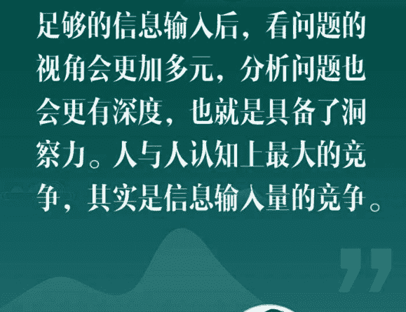

## (19赞)大家好，你们的醒醒又来了，也可叫我醒哥或醒子。是涛

公众号懒人找资源，懒人专属群分享

(19赞)大家好，你们的醒醒又来了，也可叫我醒哥或醒子。是涛哥的生生世世粉♡

目前自由职业半年，开发「盖洛普课程」中（盖洛普体系是帮人发现优势，找到人生驱动力因子的工具〇我用过的天赋测试工具里，这一个最准！）

今天给大家分享我在生财有术做推广带货的复盘，总计150多人、总榜第6，初阶预约群800人左右，转化率19%↓18天团队盈利5万左右

- ○ 复盘：频请移步飞书查看：
↪醒醒分享：生财有术418推广150+人，榜单第6，普通人也可复制的带货模式

- ○ 我滴微信：rabbit_xing7。践行涛哥的信念，如果我有什么能帮助大家的地方，欢迎大家来找我。(超链接：我用过的天赋测试工具里，这一个最准！)(超链接：https://dlsottkamc.feishu.cn/docs/doccnWdoFNlgEkGA...)

评论区：

樱木：醒醒厉害了，感谢分享📢当初看榜单，我还在想，醒醒是谁呀，分销这么厉害，结果我都不知道是谁太尴尬了。😂

Lissa Tam：太棒了

醒醒同学🐾：现在不尴尬了，我们认识了哈哈哈

## 醒醒同学 ✨ : ♥

## 我的推广主要思路：3轮筛选，不断从群里找到更精准的用户

## 第一轮筛选：

我找了 40 多位进入生财有术的朋友，同步发布朋友圈，邀请感兴趣的朋友加入私约群。

## 第二轮筛选：

每天分享生财有术的内容，提前预热 418 最佳活动，从群里选出有明显意愿加入的朋友，单独拉准预约群

## 第三轮筛选：

准时的群报名的，邀请加入生财小分队

## 整个推广 sop，概括为以下步骤

- 「准备第1步」分析自己手上的资源，设置目标群配置
- 「准备第2步」准备期合适物料，拉联系推广名单，确认后续名单
- 「宣传第1步」拉到约的预热群群
- 「运营第1步」群内每天分享生财有术的内容，提前预热418活动
- 「运营第2步」根据数据调整策略，不断输出后的服务价值和进程汇报，让大家看到过程，增加信任感
- 「运营第3步」同时邀请 418报名支付费用

公众号懒人找资源，懒人专属群内部分享

# 公众号
懒人找资源
懒人专属群

微信:lazyhelper

## (37赞)大家好呀，我是梁靠谱，感谢星系有涛爸，我要一直保住

公众号懒人找资源，懒人专属群分享
(37赞)大家好呀，我是梁靠谱，感谢星系有涛爸，我要一直保住我的弟位。

我的本职工作是三甲医院主治医师，象牙塔里的博士，互联网上的小学生。今天打包了分享我的个人经历和心得，两篇读万卷书、行万里路里的机会。

第一篇是帮朋友操盘众筹旅游，其中关于公域流量、私域流量、个人影响力、转化、成交的操作思路

第二篇是我在上个月休了年假，出行12天，赚了10万块钱，这里面的逻辑和动作

如果有任何方面需要寻求我的帮助，可以这里找我vx: nizuikaopu，涛爸的粉丝记得加备注，给点特权。

下周我会运营课程群发售，单场六位数的业绩怎么做，可以来围观，比心 爱心（超链接：年假12天赚10万）

评论区：

醒醒同学 ✨：普天同爱谱

咖啡：知道你俩为啥互相爱来爱去的了，因为都好优秀[强]

玲儿呐呐当：一字一句的读完了。内心的佩服油然而升

公众号懒人找资源，懒人专属群内部分享

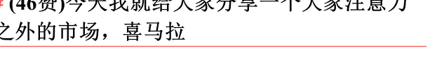

## (46赞)今天我就给大家分享一个大家注意力之外的市场，喜马拉

公众号懒人找资源，懒人专属群分享

(46赞)今天我就给大家分享一个大家注意力之外的市场，喜马拉雅FM音频项目，是怎么从0到1做到70万粉丝且单日专辑总销售额过万的，主播900谷是我合伙人

我从这五个角度来讲述

- 1. 音频内容的生产成本低复制力强等特点让我们选择进入音频这个行业
- 2. 蓝海思维确定了睡眠类目中自然声音的录制
- 3. 初始的粉丝通过个人IP投放与公众号流量投放从0做到1万粉丝
- 4. 通过私域流量管理从1万做到10万粉丝
- 5. 加强粉丝力与内容力从10万成功做到70万

## 一、音频内容的生产成本低复制力强等特点让我们选择进入音频这个行业

1. 在做一个产品之前我首先考虑的是可复制性，是否可以一个人熟练后，可以迅速批量化放大。因为整个公众号以及短视频领域对团队成员的素质要求较高，音频的录制成本低且对原创性的要求没有那么高。
因此，我选择了更小众的音频产品。

2. 查理·芒格讲过：事情要反过来想，在多数人从一个市场转向一个新的市场时，第一个市场就可能成为新的流量互注地，因此我再考虑视觉文字、情绪短视频被两个秉遗占住的时候，可能音频是一个新的流量互注地，于是我决定音频这个方向来做。

## 二、蓝海思维确定了睡眠类目中自然声音的录制

音频类目中，有声读物（小说、历史、人文、财经）、音乐节目、相声几大类都需要相对专业的技能，因此我就开始借鉴淘宝的蓝海冷门词思维，关键词倍数=日搜索人气/在线产品数>=0.5，产品商城点击占比在40%以内，1000<=每日搜索人气<=10000，一般都是在这个维度思考。

因此通过淘宝蓝海词思维放在喜马拉雅上，分析得知，睡眠类目中的轻音乐都是很好的产品，但是考虑到自己团队的上手程度、版权问题。
最后决定把大自然中的声音作为产品的重点。

## 三、初始的粉丝的积累我做了这几个事情，0到1万

个人IP的塑造
1. 因难且真实录制场景让听众产生情感的共鸣。
在塑造这个人ip的时候，强调专业、可信、真实、独家声源。
因此单单声音是不够的，我在录制的时候，会把现场录制的图片记录好，定期进行图片的分享，强调夜录声音的困难，让用户产生情感上的共鸣。

这样就算录的声音有瑕疵，对听众来讲，他们也会产生感动。

## 2. 个人主页与专业调性进行整套的UI强化。

设计有个个人标识的专辑封面，优化个人主页背景图和个人介绍，人物塑造要以真实为主，主页背景图用真实的录音照片。

## 流量的投放

### 1. 同类主播批量化在声音首发评论区是截流的最好方法。

之前看过一篇文章，讲的是当你学会与同行批量化偷人，你就是大神。

所以知道我的用户是想入眠的一批人，我的用户是存在于各大主播的关注栏里，并且铁粉总会看评论区，且喜马拉雅评论区的内容特别少。

所以我的第一步的内容是找到主播，每个主播发声音或者是专辑的时候，我用心在各个主播的评论区评论。

当一个用户在自己关注的主播经常性的看到我的评论，会产生好奇，会点点看，因此我的内容就会持续性的产生曝光。

### 2. 海量小号对同类型主播精准粉丝区进行粉丝私信轰炸。

喜马拉雅的主播粉丝区是公开的，生成声音海报进行投放，多少小号进行每个主播的粉丝私信，只要把声音海报文字设计的有诱惑力，绝大多数人都会进去看的，因为粉丝足够精准，转化率会发现比你预想的高很多。

### 3. 自然声音卡片的进行线下投放。

我把声音设计成一张卡片，卡片的内容就是自然声音助眠，给一些做瑜伽门店的朋友、还有茶室的朋友做卡片的投放，我一直推崇门店卡片换资源的投放，你会发现流量成本特别低。

用到我的方法，任何人从0-10000粉丝的积累还是很快的，而且投入成本也是不大的，这样也可以适用于公众号各种粉丝的积累

## 四、1万-10万，粉丝的增加我做了这几个事情

在1万到10万粉这个事情上，其实种粉积累的足够了，要对私域流量对内容对搜索进行一定高要求的管理了。

### 搜索优化专辑名称

在自己垂直领域中gpt要求学会触及垂直领域之外的流量。

最初我这趟想霸占睡眠相关的关键词，在所有的专辑里尽量强调睡眠的相关关键词，但优化后的效果还是不满意。

于是我跳出睡眠的圈子，把专辑中大自然提取出来，主打自然声音，然后我把所有的专辑进行自然声音的优化，这样自己的专辑名称播放量又到了一个新层次。

### 私域流量的管理

+ 1. 找出1000个铁杆粉丝是构建私域流量的重中之重

凯文凯利讲过：你只需要1000个铁杆粉丝。

因此我在构建私域流量的时侯明白，只需要找出最核心的那部分粉丝即可。

我的核心粉丝在哪？我综合思考了几个维度，发现评论区、私信区、公众号的关注区是我重度粉丝的聚集地。

因为只有特别喜欢我的，才会再去另一个工具重新关注我，评论区私信区也是真爱粉的聚集地。

利用这几个维度，我筛选出200多位重度粉丝，虽然不多但是对我来说，够了。

+ 2. 提升铁杆粉丝的分享裂变能力是下一阶段增长的引擎

赠人玫瑰手有余香，找出200位粉丝，我送了200个粉丝1人1张录我自然声音的光盘外加1套精美的风铃，然后把他们拉到微信群里。

我每次在声音录制的时候会在群里分享我的足迹，然后制作声音的过程，声音的半成品都会在群里分享，每次声音首发都会在群里，然后告诉粉丝们，帮忙进行分享，然后有喜欢同样声音的朋友可以去推荐关注“声谷”。

就这样，声音的分享提升了近300%，这就是铁杆的力量。

## 五、10万-40万粉丝我做了这几个事情。

超过10万粉丝，在喜马拉雅算是一个垂直领域的中等播主了，这时候就该思考自己的优势到底在哪里，哪些维度源源高于别的声音主播。

后来我总结出两大核心优势点：内容力、粉丝力，这是我未来到100万粉丝的运营重心。

### 提升内容力

与声音领域的大V进行联合发布专辑是内容裂变有效方式

粉丝可以裂变，其实我认为内容也可以裂变的，联合大V进行内容共创是我认为的一种裂变手段。

于是我想创造一个平台上没有的音频产品，最后联合了中国颂钵网创办人、音疗从业20年的杨老师一起推出了《体声疗愈 冥想音乐》付费专辑，就是体声与自然声音结合进行的专辑，这样在双方粉丝的努力下，专辑一天销售收入在4000-5000左右。

### 提升粉丝力

无上限制的加强私域流量的投入增强粘性与分享力

孔子延续几千年，是因为塑造了老师这个角色。

因此怎么提升更粘性的手段是成为一个小老师，教他们一定的技能，因为老师的话，没有哪几个学生是不信的。

这样我就开始进行声音免费声音录制课程的培训，每个周都会定期培训，然后分享自己在哪些地方会遇到好的声音。

通过这样，我会粉丝的粘性又迎来一个新的提升，我的私域铁杆人数也不断增强，分享力也不断增强，评论数也不断增强。

就通过上述手段，经一段时间坚持，粉丝也顺利达到70万，也成为2019喜马拉雅年度音乐类10佳主播，2020年百大主播，进入音乐销量排行榜前三。

几个专辑总收入也每天接近过万，版权授权等一系列的收入其实真正意义上已经可以养活一个小团队

我认为呢，其实真的选择很重要，在年轻时期，如果长远理想是做成一件为人生留下浓墨重彩的事情，那就加入创业公司或者是创业吧，换个方式，换个角度也许就是海阔天空，毕竟我们年轻人的征途应该是征途大海。

## 音乐付费榜

田艺苞：古典音乐很雅吗
田艺苞

刘雪枫：精讲古典音乐 100首 | 经典老歌提升...
刘雪枫_音乐之友

行星钵音疗愈全集|深度催眠 冥想放松 全身心深...
声谷

## 声谷

喜马认证：平台签约主播

更多介绍 >

74
关注
72.8 万
粉丝
342 小时
收听时长

发消息

打赏榜
打赏榜位请点击 >

XIMI图
3大权益 >

+ - 主页
- 作品
- 动态

## 专辑 15

更多 >

清晨大自然白噪音 好听 超治愈
深呼吸 感受大自然的美妙 体隐疲惫的身心
11万次 83

深夜里的声音 | 置身户外 5分钟入睡
专为睡眠紧要的户外自然声音专辑
24万次 43

水果爆压 | 让耳朵惊喜的声音
总有一件水果最是的果 也总有一个声音让你脑放松
28:46 12

## 声音 459

更多 >

河边古树上...（夏）8点半
2天前

## # (23赞)大家好，我是醒醒，可以叫我醒哥或醒子。是涛哥的生生

公众号懒人找资源，懒人专属群分享

(23赞)大家好，我是醒醒，可以叫我醒哥或醒子。是涛哥的生生世世粉[害羞]

目前自由职业半年，开发「盖洛普课程」中（盖洛普体系是帮人发现优势，找到人生驱动力因子的工具👌我用过的天赋测试工具里，这个最准！）

我平时不怎么混社群、之前也没有自己的产品，所以创业之前几乎没有IP势能，但这不妨碍我们链接更牛的人。

今天给大家分享，4小时卖掉100本生日日历的经历，这个经历让我开始被一些人认识。我想表达的是：如果不是一个很适应曝光的人，可以通过做一些事情，以小见大，让大家看到我们的价值👇

+ ○ 复盘，请移步飞书查看：
+ ○ 我滴微信：rabbit_xing7。践行涛哥的信念，如果我有什么能够帮助大家的地方，欢迎大家来找我。（超链接：我用过的天赋测试工具里，这个最准！）（超链接：https://dlsottkamc.feishu.cn/docs/doccnmkz05bMxY8...）

## 评论区：

闫小林：醒姐，飞书没开放权限

醒醒同学 ✨ : 😊作开

闫小林 : 飞书右上角有个分享按钮，把链接分享处下面的开关打开就行了

醒醒同学 ✨ : 好滴好滴，谢谢小林

梁靠谱 : 今天谱子也爱醒妈

明白（晚上9点半醒觉）: 谱姐满天飞

梁靠谱 : 明白老爹永远相随！

醒醒同学 ✨ : ♥

公众号懒人找资源，懒人专属群内部分享

## # (35赞)大家好，我是电商安信，目前主要在做店群，有100+

公众号懒人找资源，懒人专属群分享

(35赞)大家好，我是电商安信，目前主要在做店群，有100+淘宝店，收益尚可，涛哥的圈友中也有一些在实操店群。

所以今天就和大家分享一下淘宝店群从零到一的实操环节，我尽可能细致的讲一下从数据分析到选品，从上架到优化的一些细节，小白也能看懂，希望能给同在路上的朋友们一些启发，话不多说，我们开始。

知识星球排版不方便，所以请移步飞书观看

有任何问题，可以加我anxin395，评论区见(超链接： https://u19xbryjp1.feishu.cn/docs/docnJpFqI8KBeaL...)

## # (63赞)我是如何赚到第一个100万

大家好，我是钱南！

公众号懒人找资源，懒人专属群分享

(63赞)我是如何赚到第一个100万

大家好，我是钱南！

98年的我是一个刚毕业一年多的互联网创业者，本篇将会给大家分享我是如何通过一年时间，裸辞后利用抖音+社群赚到人生的第一桶金。希望把自己赚到第一个100万的经验和方法分享给大家，也同时为涛哥的星球【平民创业手册】提供自己的一些价值，给大家带来一些启发和帮助。

涛哥，是我的贵人。

一直靠跟着我前行，流水不争先，争的是潺潺不绝。

听很多创业者说人生...

评论区:

+ 段总哈哈哈
徐立群：给安徽老乡点赞 后浪滔天 颇害~
闫小林：南哥牛逼
David：看着这么熟悉之前分享过，👍
花天卓：刷第三遍，点赞
钱南：花花一直一直支持😊
钱南：一起牛逼，小林😊
钱南：别的星球分享过~

公众号懒人找资源，懒人专属群内部分享

微信:lazyhelper

## # (24赞)大家好，我是大刀，分享一下之前我写的一篇小白链接大

公众号懒人找资源，懒人专属群分享

(24赞)大家好，我是电商安信，目前主要在做店群，有100+淘宝店...
(24赞)大家好，我是大刀，分享一下之前我写的一篇小白链接大佬的方法。方法仅供参考，希望大家能有收获。

(超链接：小白如何通过视频号直播链接200位生财大佬？)

评论区：
☑：已加
宋大刀：感谢~

公众号懒人找资源，懒人专属群内部分享

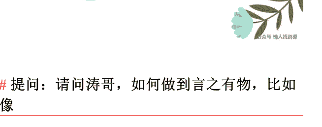

## # 提问：请问涛哥，如何做到言之有物，比如像

公众号懒人找资源，懒人专属群分享

提问：请问涛哥，如何做到言之有物，比如像您一样，直播时说每句话都能让人深省。

想让自己说的、写的作品对人有意义，亦或给人当头棒喝的感觉。

言之有物，汉语成语，拼音是yán zhī yǒu wù，意思是指文章或讲话内容具体而充实。出自《周易·家人》。
回答：
感谢提问，

昨天说了，大概是这六点，

+ - 受众分析，
- 目标清晰，
- 逻辑明确，
- 举例典型，
- 用词得体，
- 扣住追问，

我展开说一下可能会有助于理解，

想要言之有物，其根本是言之有用，

首先我们要想清楚，你这次对话，或者作品，是写给谁看的，适应度高不高，他们有什么特点，是在什么场景下接受这个信息，怎么能让他们更好的理解和接受？是吧，你去一个学院里来给大学生做演讲，和你在互联网会上做报告，讲同一个话题，肯定是用不同的表达方式和逻辑，这就是受众分析，

在发布对话或者内容创作之前，我们要不断的压榨自己，问自己这次的文章想要阐述一个什么话题，有什么意义，想要达到什么样的效果，目标，目标是什么，你的诉求和受众的诉求必须是高度一致的，这样的话就不会自己歪自己的楼（写作者猬猬远了的情况很正常），你看啊，你做一次官方品宣推文，和给代理商做培训，和内部团队研讨，同样都是针对你的产品去讲，但是目的不一样，所以重点背定不一样，这就是主题清晰，同样的，日常生活中，就是闲聊，你认真回想，你的每句话都有目的，就算是讨好，搞笑也都是一样的，这就是主题/目标清晰，

我们的对话和行文中，尽量讲究一个逻辑明确，主谓宾，起因经过结果，论点论据，是什么，是谁，在哪里，什么时候，到底怎么做，为什么这么做，一二三四...这些都是不同的套路，对吧，不同的表达模式，有着不同的逻辑构成，熟练以后，你讲话特有味道，别人会轻易的把你和那些讲开头讲了5分钟，或者是讲完依旧云里雾里的玩家区分开来，而且特别提效，

举例典型，就是横向迁移能力，即，把一个理念给你身边的小笨蛋朋友听，讲到他听懂为止，我给你举个例子，比如，最近很火的内卷，可以用电影院的前排观众站起来，后排不得不站起来，来解释，比如，很经典的囚徒困境，你可以用乡村的小路塌了，你不修我不修，都想别人先去修，或者用三个和尚没水喝，来解释，一个事情，

如果你能用很土很朴实的生活例子去解释，或者大白话说到你的小茶苯朋友都能听懂，就算及格了，如果你能用三个以上案例去解释同一个道理，就算大成了，言之有物，有用，壁谤，

用词得体，ROI，CPS，KPI，OKR，这些词好不好？有些时候这些词比大白话还更有助理解，中英夹杂行不行？行，确实有些语境加点英文更流畅和明白，抓住，私域，下沉，降维，这些黑话装不装？不会会屡应？看情况，看和谁说，一切对话和内容，都是有目的的，体面，让对方爽，就是得体了，

抓住追问，是什么意思呢，字面意思，这点还有一个应用场景就是日常追问自己，我们获取的知识将不断得到刷新，但是我们的底层能力，诸如学习，沟通，分析，思考，将伴随我们整个人生，每每进步一些，就有一些实在的功效，所以，日常追问自己，是能促进去充实著，言之有物的，

最后，像今天这样，又可以轻松六点概括（抽象能力），又可以展开讲上千字（大白话的力量），值得大家和我一起反复训练。

## 评论区：

☑：已加

宋大刀：感谢~

公众号懒人找资源，懒人专属群内部分享

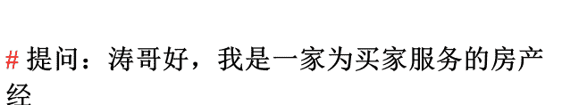

## #提问：涛哥好，我是一家为买家服务的房地产经

公众号懒人找资源，懒人专属群分享

提问：涛哥好，我是一家为买家服务的房产经纪公司，拥有专业的购房经验，擅长根据买家的资产负债情况，进行房产配置规划、融贷、破限购（含法拍）、落户、选筹、谈判、贷款等一条龙服务。

## 问题1：如何进行短视频冷启动

痛点1：内容：纯知识分享，点赞关注少，增长慢。

痛点2：房产号，内容同质化严重，差异化打造很难，对自身的定位不清晰。

痛点3：规划人设不清晰，关于打造视频号方向、方法很多，我们也在不断试，总感觉是找不到准方向

## 问题2：短视频变现路径模式问题

痛点1：卖什么产品？之前做二手房，是我擅长的，但非常个性化，成交链路长、周期长，如果扩大规模，那么人员跟进和服务细节把控都会存在问题，创始人长期处于救火一线。

想尝试试一些的产品，从房产课程、轻咨询、社群以及二手房来切入是否合适，但这些并非我原来擅长的领域。

痛点2：如何设计一套线上课程、线下活动沙龙、培训，线下招商的可复制标准化流程；

痛点3：房产更换频率很低，如何持续吸引客户参与；

## 问题3：短视频矩阵主播成长与人员招聘问题

痛点1：我是<|start|>否合适做主播，有什么方法路径，可以让主播镜头表现力提高？

痛点2：短视频相关的人才招聘的时候，用什么工具或者标准方法来筛选（或者什么关键点来判断是否是真材实料）。

痛点3：短视频从0-1，不同的阶段，会有什么不同的考核方式和侧重点来激励？日常管理是如何进行？

## 回答：

感谢提问，首先，内容去哪里找？

+ 1, 找被验证过的爆款问题，数据说话，不自嗨，不自我设限，

首先是5118，5个W，一个H，

接下来是知乎之类的，你把全网最热问题全部down下来，

接下来就是全网短视频，就是之前已经被验证过的，赞数超过多少的，全都要，直接变成脚本，一天做三百个，

还有一个大家不知道的，是去全网各大知识app找，比如得到锦囊，最多人在意的问题，

不设限是什么意思呢，就是避免陷入小巷思维，就是你看有些同行的内容你会困惑，会不解，说，就这？不过如此，但是你要记得再普通知识点，也有14亿人不知道，这点不要自设限，干就对了，

## 2，差异化去脚本中找，从表现力中找，

内容是一样的没错，但是你要记得，脚本是脚本，文案是文案，从标题开始，例如，这四类房型千万不能卖，开发商的卖点，买房者的痛点，这几种房型谁买谁悔婚，最省钱的还贷方法，年轻人的第一套房，到底要怎么买，你还相信买房跑不了赢通胀么，这些年交过的智商税，

表现力你可以通过，标题，背景，视觉锤，字幕，排版来做差异化，比如开头，响指，帽子，过程中各种细节，bgm，字幕，结尾有辨识度的求赞求加，比如，加上涛哥做朋友，科学买房不用愁，

## 3，关于定位嘛，我觉得，先完成再完美，执行中完善，有感觉了后，开始做定位，这是拍着拍出来的，一知半解前冲，好过一开始瞎定位，然后一直停留在定位，

你拍个几十个之后，开始开始走高端线路，知识树，完整的知识体系，房贷，房产税，购房资格，商住房，装修问题，社保公积金问题，

高端视频，我把它定义成有后期的视频，就是，配上解说，入口，实地拍摄，然后你可以新增考察型栏目，找豪宅，直接实拍，

进化的是过程，搜拍，读稿，到实地，加解说，你可以去房子里头拍，边走边拍，脚本是固定的，你只要拍出高手的感觉，

## 4，分发，全网分发，不要太在意视频号还是抖音，其实短视频平台有二十多个，长视频平台也是，而且你有没有发现，百度搜索一定带视频，一鱼多吃，视频号只是很小很小的一个渠道，图文和短视频平台拉满，

7, 你说你要做一手房，可以啊，产品方向的话，我是建议社群，不建议做课，课的话放后面去，你没做过课永远不知道做课有多难，多伤人品，社群比较温和，不伤粉，

训练营的话，你接信用卡使用方法会不会交付感更高一些，

知识星球吧，别拉群了，拉群的话力气量分散了，而且很容易不可控，

留钩子，钩到哪里呢，1个收费入口，多个载体，什么意思呢，就是一个粉丝最好承载在私人号，朋友圈，视频号，公众号，抖音等，

公众号上面做接口，接入所有相关的查询入口，

以终为始的话，你这种形态到最后是什么呢，全球最大的买卖经纪人、全领域服务，置业咨询-全方位定制服务-终身服务-地域不限，覆盖豪宅，旅游，海外，投资，一切高端生活方式，

资源你只要有就行了，有间就转给同行，cps有没有都无所谓，后期要有，装可以这样装，我给你示范一下，

专业化置业咨询，联合顶级投行、数据机构、专家学者进行严格审核评估，为投资者提供专业、中立的海内外置业咨询服务和解决方案，

终身式服务，配套专业lvl服务，确保投资者的私密性，提供持续性售后服务，包括房产的再销售，

打破地域限制，掌握全球范围内的产品和买家资源，大范围精准匹配，

全生活方式定制服务，除房产外，满足稀缺资源的定制，提供设计、装修、名校、医疗、拍卖品、豪车、私飞、游艇等高端生活方式的服务，

不是让你真做，而是体现你实力的一部分，

咨询的话，不要轻易询了，直接重答询，有问就回答就好了，快问快答，我给你画的饼是模具放米的游戏，愿景是极限一换一，就是被你服务过的人，最起码给你带来一个新增，就就可以了，

大力出奇迹，今天是7月9号，你7月15号一定要有三百个脚本，8月1号要发出去三百个视频，留好钩子，

等你好消息，

评论区：

已加

宋大刀：感谢~

# (76赞)养猫2年赚35万，介绍一个少有人知但性价比超高的副业

公众号懒人找资源，懒人专属群分享

(76赞)养猫2年赚35万，介绍一个少有人知但性价比超高的副业。（其实现在做到第三年已经远不止这个数了，但是这篇文章是一年前写的所以我保留了当时的数额）

大家好，我是Cecilia。相信生财的伙伴们也有不少养猫的，但是宠物猫繁育这个行业对于大多数人比较陌生。虽然不像做互联网的大佬们随随便便就百万起，但它可以一边躺着一边撸（猫）就把钱赚到手。希望今天的分享能够为大家打开一个新维度吧。

## 0）课前思考

先请大家思考一个看似不搭边的问题：为什么欧洲人整天懒洋洋的，比如法国，一年到头要工作和休假的时间比工作时间还多，但是大部分欧洲国家人民的日子过得还不错，工作时间那么短居然还有全民高福利？

反观中日韩，哪怕是美国，普遍都是假期少、工作强度高，大部分人在忙忙碌碌的讨生活，但大部分日子过得还不如欧洲人？

原因就在“产业选择上”。欧洲国家的优势产业往往是“高附加值、低发展度”的产业，这两个词怎么解释呢？比如机械制造、精密仪器、奢侈品、畜牧业等等，这些行业百年品牌很多，就是因为这些产业的优势是需要实打实的时间积累的，每一年踩的坑都算数，新兴国家很难只凭资本的投入就弯道超车，这就是“低发展度”。对应的“高附加值”就是长期的优势积累下产生的品牌效应，比如说丹麦的牛奶，瑞士的钟表，意大利的奢侈品。。。。所以欧洲人就可以每天工作5小时还能享受高福利，反正别人想追平咱们没有几代人搞不定，我们跑赢的着着怎么呢？

所以中日韩，哪怕是美国，相对于欧洲都是后发国家，在欧洲的优势产业上落后几百年根本没法追，所以就只能选择IT、互联网这种大家差不多同一时间起跑的“高附加值、高发展度”的行业，这样还有弯道超车的可能。你看芬兰的诺基亚就是这样被干翻的。然而这样的代价就是产业里的所有人公司都处于激烈的竞争中，你不996的话就会被新入局者超车。

现在我从西半球把话题扯回来：养猫这个行业，就属于“高附加值、低发展度”的行业，实打实要耗时间，但是产品却可以有高溢价。下面毫无保留地给大家分享我在这个行业的全 部收获。

## 1）从单纯养宠到赚5万建立猫舍

2018年的时候，我买了第一只猫，最开始我只是单纯地想只猫做宠物，但是在选猫的过程中，发现市场上的宠物猫价格差距极大，有几百块的，有十几万的，同样是猫妈妈生的，为啥价格能相差几百倍呢？

于是我10年战略市场的职业病发作，开始进行行业调研，挖掘市场机会。我看了很多数据，加了很多猫贩，揽了很多猫舍，把宠物猫的市场详细调研了一番，得出了一个结论：这个行业有钱景！于是我的目标从养宠变成了繁育。当时我已经交了2000定了 一只幼猫，但是考虑到幼猫还要至少10个月之后才能配怀孕，我果断舍弃了定金，换了个卖家，又花4000买了一只成年矮脚母猫“屁屁”。

事实证明我用金钱换时间的决策是正确的，我在闲鱼上找了公猫给屁屁借配，2个月后“屁屁”第一窝生了4只成活3只，一只矮脚长毛卖了22000，一只长腿长毛卖了3500，最后一只矮脚短毛母猫自留。这第一笔投资成本4000，收益25500+一只种母，猫粮猫砂成本可以忽略不计，两个月的时间，ROI超过了600%。

当然，这么高的收益主要是由于我预判准了当时的流行花色“银白”和流行品种“矮脚”，这只猫也是一只“英雄母亲”，1年多产 生了超过10万的收入。但这个不代表我繁育的平均水平，我也有买到“废柴公猫（不会配）”和“蛇蝎母猫（吃掉孩子）”的经历。

随着我的繁育知识的精进和花色规律的研究深入，我养猫的收益逐渐变得稳定。大概统计了一下，养猫第一年我只有一只母猫1只公猫，生了大约20只小猫，根据花色和品种，贵的可卖到2W+，便宜的也可以2000+出手，总体收入大概在12万左右。第二年，我扩大了规模，有5只母猫，2只公猫，其中有自己繁育出来的也有外购的，因为像尿屁这种高产又高质的“英雄母亲”可遇不可求，所以第二年我的收益在20万左右。

2年35万这个数字比起那些“百万副业”并不吸引人，但是养猫的成本比起收益来说，可算是非常省心钱了：

吃喝拉撒方面，我家目前9只成年猫（还有十几只奶猫在吃奶可忽略不计）每年预计消耗大约8000RMB的猫粮（我们用的中端粮，如果想省成本可以更低），猫砂每年2500RMB（我们用的比较贵的豆腐砂，如果用膨润土的话会更便宜）。

空间方面，做猫舍不用像养宠物猫那样无微不至地“伺候”猫主子了，我们把猫分笼分层养，一个8平米左右的空间就可以养下20只猫问题不大，每天白天散养放风，晚上就回笼过夜。这一行不需要通勤，所以猫圈里甚至在远郊区县租下便宜整栋房子全职养猫的，我认识的一个小帅gay在杭州租了400平的别墅养猫，做了四五年，现在稳定一年200-300w的收入，今年在特斯拉的基础上又买了保时捷（而他居然是一个大学刚毕业没多久且原生家庭剩下要替父还债的孩子）...

在精力方面，猫少的时候还是要自己来伺候，每天花10分钟加水加粮铲屎就可以。猫多了之后我们就让保洁阿姨帮忙了，反正都要打扫房子，顺带手再铲个屎喂个粮，多不了多少钱，一年下来人工成本折算就按4000元算好了。当然如果足够勤奋的话也可以省掉这笔钱，不过我们还是宁愿用这个时间躺在沙发上多Timi会儿。

今年我的计划是，不要再进一步扩大规模，而且要对母猫进行优胜劣汰，培育或外购更多“英雄母亲”，目标是“10母2公”，目标是稳定收入达到70万，努力做到够百万。

赚钱的行业看起来都挺简单，但是做起来肯定磕磕绊绊，为了给大家省掉尽可能多的“入行学费”，下面进行干货部分：怎样才能做好养猫这个副业？

### 2）以猫生财的5大要素

- a.善于运用数据思维发现行业趋势

要不要进入一个新行业主要取决于这个行业是否处于上升趋势，有上升趋势的行业才会给新入局者留足空间。

我在买猫之前做市场调研的时候查找了很多行业研究报告，发现宠物猫的市场总容量虽然没有宠物狗的市场大，但是猫市场的增长速度比狗市场要快很多。再加上都市养狗门槛越来越高，年轻人单身独居比例越来越大，养猫所花费的精力远低于养狗的精力等等这些佐证，我认为宠物猫市场趋势的上升绝非偶然，而且是一个长期趋势。

### b. 预测品种, 花色

猫有上百个品种，处于流行周期的品种动辄几万，不在流行周期的品种可能三百块都没人买。我是怎样在第一只猫就选到了“英雄母亲”尿屁呢？还是有赖于我的线上调研。当时我在微博上发现了一个成名已久的宠物网红博主“郭斯特”，他有两只猫，一只银白矮脚“懵冬”，和一只布偶。微博上的流行趋势往往会对应市场热点，于是我瞄上了矮脚和布偶两种猫。

又因为当时布偶已经处于大流行的风口，动辄三五万十几万，盛极必衰，我预测离下坡路不远了；但是矮脚刚刚借助郭斯特的力量进入大众视野，虽然“懵冬”一炮而红，但是当时大多数人依然不知道这个品种，更没有多少人繁育，于是这个“已经经过市场验证会红，但还没有大规模爆发的品种——矮脚，被我锁定了。而且我有意去繁育和“懵冬”一样的银白花色，于是拿下了银色的“尿屁”。

在用矮脚顺利赚到回报之后，我又调研发现了下一个可能的流行趋势：赛尔凯克羊毛猫和德文猫，因为羊毛猫几乎不掉毛，长得像洋娃娃，而且可以和现有的矮脚配种，所以我选择了羊毛猫。目前看来，羊毛猫和德文猫确实流行起来了，价格趋势一直在上行。

## 3）做好定位；2C还是2B？高端还是低端？

虽然猫繁育这个行业现在还不大，但是生态已经很丰富了。

首先从渠道上来说，有直接卖给终端客户的2C的，还有直接对接猫贩子2B的，（解释一下猫贩子，相对于是猫圈的中介，一手对接猫繁育人，一手对接终端客户，中间倒一手赚差价），一般来说终端价比渠道价翻倍的样子。再从档次上来说，有做协会认证的血统猫繁育的，所有种猫都是五代祖宗可查，甚至获奖的，一只卖十几万几十万的都有；也有在自家里繁育，不带证书但保证品相，一只卖几千上万的中端猫舍（我）；也有在农村租一个大厂房养上百只种猫，等猫贩上门整窝收购的，平均一只一二百。还有我刚才提到的猫贩子，我的合作伙伴，一个没读过书的东北大哥，光靠在微博上做猫贩子一年收入200W+（他算是猫贩子里面的头部玩家）。

地进行“工业化生产”，所以我选择做中端猫舍。

## 4）繁育和医疗知识技能积累。

要想赚的多，除了选对品种花色外，最要保证的是“成活率”，我经历过一窝6只全死的惨痛经历，还经历过养到40多天忽然热血豆腐般迅速断气的奇葩场景，也曾看到猫砂盆里流产的几个小肉球呜得直哭。不过经过这两年的历练、不吹牛的说，我现在已经是半个兽医了。家里吸氧机、雾化机、保温箱、各种药品一应俱全，我也可以熟练地给猫打针，“望闻问切”诊断一些小病。

同时，我也花了很多时间研究猫的繁育知识，比如说，每个品种的猫不同协会认可的优秀品相标准，比如说，我想要得到某个花色的猫，应该什么样的猫来配等。这些知识看似专业，但是只要认真学习，勤于实践，大部分还是可以攻克的。

给大家举两个例子：

如果让母猫自然生产，有的母猫会遇到难产，一尸数命，或者母猫经验不足不知道如何护理新生儿，很可能死掉一半甚至全军覆没。没有技能经验的人只能站在边上看着惨剧发生。但是有经验的就知道如何给难产母猫打催产针，如何接生小猫，如何给小猫剥脐带衣、甩出羊水，如何用负压球清理口鼻，如何按摩保温，如何做母猫啊不母猫的产后护理等等。

有了繁育和医疗知识技能，当别人只能用赌博的心态繁育一般几百、偶尔上千的猫的价格时，你可以把你的猫控制在每窝都能出产几只上万的猫的水准。当别人生一窝挂一半，并且需要长期受“因天”的可能性的时候，你可以以最大可能性让小猫活下来长大。这不但可以数倍的提升利润率，而且也是对于生命的尊重和敬畏。

## 5）做好运营和销售

最后一点就是“运营”了，这个和互联网运营一个原理，分为引流、转化、复购&转介绍三个阶段。生财的朋友应该看这一段最轻松无障碍。

- a. 引流。这个环节无非是通过微博、闲鱼、朋友圈、微信群来做，一般来说要抓住各种机会会大量的同行和猫贩，因为这一行不是标品，所以大家之间的竞争有限，同行之间都愿意互相建立联系扩充采购和销售渠道。

不过这个行业完全是“颜值经济”，引流效果的好坏96.78%取决于你照片和视频的拍摄质量，所以在拍摄技巧和拍摄设备上是不能懒惰的。

- b. 转化。就是销售的过程，这里面无论是2B还是2C，最关键的一点是你的“温度”和“专业度”。猫是活物，现在虐猫的新闻层出不穷，包括很多猫舍对待猫非常粗暴残忍，只有一个对小动物充满爱心的人才会让别人觉得买你的猫很安心，不会背负良心负疚，这是“温度”。而“专业度”就是你能解答客户关于养猫的各种疑问，并且有能力确保猫...

的健康，交给客户手上不会出问题。

在这里，朋友圈就是转化的最大利器了，养猫日常，养猫小知识，猫粮档次，以及家长逗的视频等等都可以让朋友圈显得专业且有温度。成交就是信任的累积，别别人看了你的朋友圈，也许没有当天就找到你成交，但是你在他心目中的信任值是一定增加了的。

c. 复购&转介绍。这里要分C端和B端来介绍。如果卖给了C端，复购和转介绍主要来自于我专业的售后指导和医疗指导，别人才觉得我的猫没问题，人也专业，才会放心复购或者介绍想买猫的朋友给我。如果卖给了B端，那么售后是不需要的，主要看你的猫的质量，是否健康，花色是否和照片一致，这也是信任的累积，当你成为B端眼中最靠谱的猫舍，那么采购需求就会源源不断。

## 6）养猫带给我的收获

做猫舍的2年，我从0开始了解并参与一个陌生的行业，并且卖出了行业内前10%的价格（90%的繁育人都卖不到万元以上）我收获的知识提升主要有以下3点：

- 1、 在低门槛的行业赚钱还挺容易的，因为从业者大多都是“也也不会别的所以只能干这个”的群体，所以但凡动点脑子就很容易做到前列。这大概叫“降维打击”吧。
- 2、 低发展度高附加值的行业还挺适合做副业的，因为这种行业不会占据人们太多的精力，主要是依靠产生资料在时间轴上自动生产，竞争也不激烈。很多现在网上流行的副业，实际上需要人们投入大量的精力才能够做好，很可能主业也将被耽误了。
- 3、 无论看上去多么简单的行业，不一定要付出多大精力，但一定要有主动学习和积累经验的意识，因为这种行业全靠细节之处解决问题的能力，才能够在利润率和成功率上远胜他人。

## 最后，给后来入坑者的建议

如果你也打算挑选猫舍作为副业之一的话，我作为过来人有以下3点建议：

- 1、 从最小MVP开始尝试。

我有一些猫友，上来就打高端局，一出手就花几十万买一堆带证得奖的种猫，可往往协会的比赛标准和大众审美是有差距的，如果上家不去指导那就会被坑很惨（实际上这样的上家很多）。在这里我建议大家先调研好流行趋势，从小规模开始买，完成一轮最小MVP模型看看可行性再说。

- 2、 找有专业度的卖家带路。

与其前期蒙眼趟坑，不如找一个人品靠谱的有专业度，有市场判断力的上家，因为你的上家要给你大量的技术支持甚至培训，所以你的第一个上家决定了你的起点。比如你找到水平前50%的上家，那么你的起点就是70%；如果你找到水平前10%的上家，你的起点可能就在20%。这一行业主要靠的就是时间经验的积累，一个好老师会让你 的这个积累过程至少缩短一半。

- 3、主动学习繁育知识，兽医知识。

医生为什么那么难培养，动辄要学习十几年？因为人命关天，实战的机会太稀缺了。但是猫就不一样了，只要有心学习，勤于练习，给猫打针配药接生都会学得很快。我可以给你一些我验证过得比较好的学习渠道。

补充说明：加我好友的小伙伴好满润，很多都是看了这篇文章觉得养猫能赚头脑一热要立马撸起袖子开搞的~爱宠若结但是，我要给大家个休止符！

# 1，繁育都实在“玩命”，猫猫生孩子真的不是像大家想象的那么简单，一胎就能自己生了，为了护理早产儿我四天四夜几乎没合眼，喝羊水的宝雪露要持续雾化每隔两小时下一次胃管，得了乳腺炎的妈妈需要不停热敷散炎等等等等，这些都是文中没有提到的“贼麻烦”，可能是我文章描述的吃肉太简单太美好给了大家造成了误导。所以请大家谨慎慎重繁育这件事，倘若只是一时冲动，没有足够的心理准备和学习的耐心，真的不要贸目跟风。 also 不要觉得自己看一看百度抖音就是猫界华佗了，所有行业都一样，能拿出来讲的东西都是皮毛，核心竞争实力是不会外传的，只能你自己付出现代价和学费去摸索去学，（跟对上家他可能教会你）

# 2，我在文中提到入行第一大坑就是遇到不负责任的上家（卖你猫的人），据我两年来 的观察，毫不夸张地说，国内的猫繁育人（包括淘宝上随处可见的家里两只猫随便生一生 的那种）90%不懂猫毛色遗传规律，不懂医护知识，甚至连颜色级别都分不清，刚才不少小伙伴加我之后跟我说 我准备在闲鱼/微信/58上买xxx猫 很便宜准备试试繁育，我问他们“品相怎么样”就懵了，再问是个猫贩子还是猫舍还是家庭繁殖姐，又懵了。这种情况的客户，卖猫的见了会很开心的，因为这就是一颗猫社の韭菜啊！再者，你如果遇到文中提到的那90%上家，你真的要靠自己越所其坑。多看看文中最后的避坑指南哦。

# 3，猫好不好，虽然和价格没有绝对性关系，但是单纯看价格买猫，百分之一万会下场惨烈。猫脚从300-300000都有，你不做好前期调研，不多聊几个猫舍猫贩子，不多看看协会的品相标准，不多到拉拉贴吧被坑掉被养的帖子，就真敢下手啊？文章里我也写了我买第一只猫之前做的事情，大家不要只看成果，最重要的其实是之前那些铺垫啊。

bb懒懒的又讲了这么多，就是非常非常不希望大家因为我的一篇帖子就冲动得不加思索地买了很多猫，只看到文中写的赚钱了，忽略了文中提到的那些前期调研和繁育过程中坑坷，以为完全躺赚，到头来发现，一堆崽子不说，活下来的还只能送亲戚....

虽然我可以悠悠你们养猫很赚钱都来买我猫吧，但是那样违背了我的价值观，我还是 一万遍提醒大家要谨慎。

最后的最后，猫圈里也是有行规的，核心技术只传下家，不传旁人，这个做生意的大 家应该都能理解，所以有小伙伴加我问一些比较关乎于竞争壁垒的问题抱歉我不能 全盘托出，这里先跟大家say sorry。不过如果有幸我成了你的上家，那么我自信的 说，我的责任心和售后都不会让你失望的。

最后谢谢大家能读到这里，感谢生财有术。养猫副业交流
VX: celiagissing912

## 评论区:

杨涛：看了三遍，世事洞明皆学问啊，

CC：哈哈哈哈哈哈哈哈谢谢涛哥

小小杨：完了完了,是心动的感觉！

昕爸乐：心动了咋办

刘容：牛逼

画说：看了两遍，想去兽医那个地方还是算了，过不去的坎儿[捂脸]

二月三十：这个写作水平也非常牛啊，写的太好了

Nomore：程序员副业养猫有优势吗？

00:45

8048a1c7

## 我的猫房

8048a1c7 ch01

对不起我偷懒截了个监控图...太晚了不想去猫房拍照啦

录像回放

云端录像

## 我的拿破仑矮脚种公

我的拿破仑种公还是冬天好看哇啊啊啊啊啊，夏天已秃

## 我的“尿尿”英雄母亲

我第一只2.2万卖的猫。“慢头”同款银白拿破仑矮脚（请忽略嘴上吃罐头留下的黄渍）

四只蓝猫矮脚 两公两母 无病无癖 健康胖虎 打包2700

低端猫舍都会超低价打包批发

三只金吉拉 两公一母 健康胖虎 打包2800

四只...侏弟弟 无病无癖 健康胖虎 打包5500

## 中端猫舍平平无奇的朋友圈

07月

目前已有1矮脚弟弟排队、2长腿妹妹排队、1矮脚性别不限排队....

转自“板朋友圈：转给这个大可爱，...”

小李子里面的鸡肝还是鸭肝，看起来也太好吃了 🥰

支持一下李子崽

嗨嗨嗨

郑永 这件，中美之争，我最担心，生

再把视频拿出来发一发，自证一下颜值。不卖照骗，后代小...

我和我妈妈心中的猫 Sey 了家顶配组合，马上要生了，肚子不小，有钱的赶紧冲鸭...

马爸爸给我造成的债咋降

## 详情

我们猫舍自主繁育的高地立耳妹妹朝阳第一次参加比赛，成绩很不错，10环进9环，在上海这么藏龙卧虎的地方仅满足了

小猫家长带白子画参赛，成绩也很不错，辛苦大家啦，以后再接再厉吧 🥰

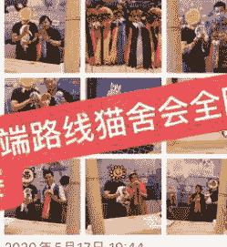

高端路线猫舍会全国追赛

2020 年 5 月 17 日 19:44

评论

## 上一窝，一只两万块向你走来

2020年5月10日 22:06

跌倒了就再爬起来 🥺

赞  评论
7 11

上一窝风口上的花色。金白拿破仑矮脚

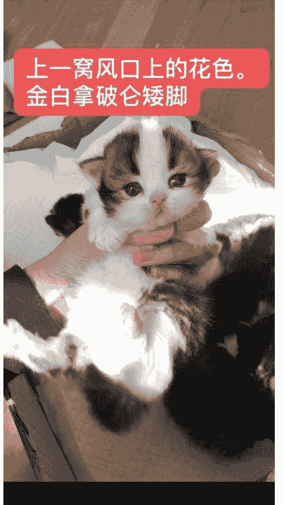

## 提问：涛哥您好，最早在生财CP认识的您，

公众号懒人找资源，懒人专属群分享

提问：涛哥您好，最早在生财CP认识的您，看了您的发言和回答后，属实是生财第一男人and情商天花板的男人，真心钦佩！

公众号懒人找资源

我有个想法，希望得到您的指点。

就是我想做一个价值投资的陪伴营（社群形式），对，不是训练营，也不是卖课（会有一些课程的输出），而是陪伴。

这个想法在去年就有了，因为我发现绝大多数人买入一只股票的理由是“ 我觉得它好”、“我觉得它能涨”，或者是“我亲戚/朋友/同事跟我说的”、“某个大V说的”，很少有经过自己分析的，有逻辑支撑的，所以我做这件事的目的，是今后再拿到一只股票，或者再有别人推荐股票时，知道从哪儿下手分析，该看哪些数据和指标、去哪儿看这些指标、指标背后的原理等，从而形成自己的逻辑判断。而至于分析的结果和能不能赚到钱，和时间的积累、认知水平和运气都有关系。但掌握了方法，有了逻辑支撑，一定可以提高赚钱的概率。

市面上大多数财务商教交付的往往是一门课程或社群，但问题是学员在学习的过程中可能赚到钱了，一旦脱离了平台，可能又回到韭菜的行列。所以我的想法是带着大家一起学习、找数据、看年报、分析财务指标等，会把一些公司行业的分析框架梳理出来，群友自己找数据填充内容，思考、判断，最后真正地掌握一套分析体系，争取每年分析30-50家公司，我把这个过程叫做陪伴。

再说到我的情况：

去年2月在知乎上写过一套面向小白的财务分析文章，反馈还可以，不少会计专业的小伙伴都在看，但比较入门，只限于小白；

去年7月在抖音上分享简单的股票常识，包括选股技巧、排雷技巧、财务分析技巧等，积累了几万粉丝。

也就是我想把这些碎片化的内容形成一套系统的框架，并陪伴大家一起学习下去。

但是我能解决的，只是从0到入门的问题。

目前存在的问题是：

- 我不是金融专业出身，专业度不够
一个人的精力非常有限
前期的用户信任问题
缺乏社群运营的经验

因为最近在北京见面会认识了不少圈友，所以我想找一些志同道合的圈友一起来做这件事，像您说的，解决了最基本信任问题。

综上，我想向您请教的是：

- 1， 我这个想法是不是天马行空？能否可行？
2， 如果找圈友共同完成的话，有什么要注意的？（有点像找合伙人）
3， 您对这件事的风险判断？

4，您对这件事情有哪些建议？（比如前期是否应该收费等？）

真心感谢您的指点。

回答：

感谢提问，

- 1, 收费是肯定要收费的，不然肯定不持久，
- 2, 除非你能从其他渠道赚到钱，比如开户CPA+CPS，
- 3, 陪伴这个事情隶属于“行为改变”的一种，你想身体力行，带动大家一起做一件事情，想法是很好的，而且很多人都在这样干，即，“行为改变付费”，
- 4, 如果收费不高，建议先干起来，然后干的过程中让他们体验到价值和自我提升，然后让他们裂变传播，这个过程我把它称作“极限一换一”，也就是一个人最少帮你拉一个人，从而实现棋盘放米理论，
- 5, 如果找圈友的话，你只需要确定两个事情，他能坚持多久，他能得到什么，
- 6, 这两点拆开讲，就是学习，分析，并且发群，这是反人性的，能坚持一个月以上的我盲猜不会超过10%，我很少猜错，
- 7, 他能得到什么，影响力，利润，自我实现等，
- 8, 信息差<认知差<资源差，你现状就是你和小白的信息差拉满，然后你的认知领先一点点，然后有一定的资源，你品质，你要打的点我觉得是信息搬运加润色的这点优势，
- 9, 人们在立志的时候，总是充满了激情和对自己的信心，这是你一张很漂亮的海报就能拉到不少人的根本，想想海报怎么做好吧，
- 10, 最后，前面九条是顺着你的自嗨往下说的，这个事情，我认为不可行，理由我选好听的说几条，
第一是，kol不可控，而且在那么需要权威的一个领域，没有kol无法推进，
第二是，学习反人性，积极性无法持久，十几天后群就很冷了，
第三是，对大家共同想要拿到的结果不确定，不可量化，不可进度化，
第四是，奖励制度无法执行，我表现好你要给我多少钱？钱都收了，不跟着做，违规，你是能踢我？
第五是，大锅饭，就当你的整理框架很牛逼，套路好，很快就会出现白嫖党，
第六是，算了，不说了，刺人的。

往上拉，第8条好好想想，钱藏在那边，

[奋斗]祝亮哥发财，

评论区：

杨涛：看了三遍，世事洞明皆学问呀，
CC：哈哈哈啥啥啥哈哈哈哈谢涛哥
小小杨：完了完了是心动的感觉！
听爸爸乐：心动了怎么办
刘容：牛逼
画说：看了两遍，想到兽医那个地方还是算了，过不去的坎儿[捂脸]
二月三十：这个写作业水平也非常牛呀，写的太好了
Nomore：程序员副业养猫有优势吗？

公众号懒人找资源，懒人专属群内部分享

## 公众号
懒人找资源
懒人专属群

微信:lazyhelper

## (48赞)感谢涛哥给的平台。这几天看到很多圈友在讨论副业选择

公众号懒人找资源，懒人专属群分享

(48赞)感谢涛哥给的平台。这几天看到很多圈友在讨论副业选择 职场选择 之类的话题，我把之前学员找我做完咨询后的复盘放上来（已得到她的授权），希望能对大家有帮助。

咨询主要解决了几个问题，

- 1、她的职业方向选择
2、她的副业方向选择

为了方便阅读，我把石墨链接放上来：

《小白如何在生财甄选适合自己的赚钱项目》，可复制链接后用石墨文档 App 或小程序打开

职场问题是人生中非常重要的问题，每个人的职场生涯贯穿约40多年，而残酷的现实是，后30年的发展几乎大概率取决于你前十年的铺垫，所谓的“从头再来”的成功率对于普通打工人来说是非常低的。所以职场问题需从一开始就重视起来，如果你的认知不高，多去问一些前辈，而在信息获取过程中，也需要考虑到样本的多样性，独立创业者，高级打工人，合伙人等等，各自的视角和认知其实会由于角色和经历的不同而有偏差，那么你需要丰富样本量，交叉验证信息，结合自己的情况去判断大家给你的建议。

话不多说，大家先看文。再贴一个昨天回答小伙伴职场问题的文字，有同样问题的朋友可以自行取用~

vx: 13811868492

信息爆炸，加好友请主动发自我介绍，加了不说话的会删(超链接: 小白如何在生财甄选适合自己的赚钱项目)

评论区：

- 杨涛：感谢分享，已加精华，挺适合圈友的，[奋斗]
CC：好快
德朋：谢谢分享！很受用
Jay：逻辑清晰！点赞！
花天卓：感谢分享。
米斗：感谢[爱心]

感谢涛哥点名。既然涛哥都打了我很严厉的预防针了[心碎]，那我就不要假装温柔了。下面的话可能会有点扎心（玻璃心预警），扛得住且觉得有点道理的话，可以再聊～

## 【目前我看到的6个问题】

1，没有向内求索，而是倾向于向外归因。据你所说两次离职皆是因为“没有成长”，“店铺运营效果不好”，首先我们明确一个问题，想要获得个人成长，虽然有时可以借助外力的拉扯，但核心驱动力绝对是需要由内而发的。你若“足够想要”成长，在互联网时代，学习外卖运营知识的方法有一百种，买书，看视频，加知识星球，买课，拆解 9999+店铺玩法，甚至有人光看外卖大 V 的抖音视频都能学以致用把店运营好。这里任何一种方法，你但凡每天花一小时去做，及时总结复盘实践，坚持三个月，外卖运营能力绝对会上一个台阶。可从你的描述看来，你并没有坚持主动学习，反而怪公司没有拉扯你。改变一下心态，从被动到主动，会有更大的收获。

2，对自己的身份不明确，对公司有不切实际的幻想。残酷的说，当你拿了工资的那一刻，你就应该为公司创造相应的价值，公司养员工不是让员工来学习的，而是让员工来干活的（除了校招管培生），而对于一个不会主动学习进步的人，他对公司的贡献自然不会高，这就会形成一个死循环：越没能力的，越对现状不满，越会以为是公司的问题，越想去大公司，大公司越看不上这样的人。所以摆正自己的位置，员工应该是一个付出者，而不是索取者，把自己打造成一个对公司有价值的人，好公司才会抢着要你。

3，跳槽频繁，误以为机会永远在下一个公司。职场新人前五年是试错期，大公司招聘对五年内的跳槽频繁有一定的包容度，但不会无限包容，多一次跳槽，在 hr 眼里就是多一分不稳定因素，他是有考核指标的，跳槽过于频繁对于你的面试成功率会有影响。其次，永远在跳槽，就意味着在任何一段经历中都无法沉淀下来成长，对于你自身也是非常危险的。建议稳定下来，主动学习，做出优秀的工作成果后再跳。不然你的跳槽大概率都是无效跳槽原地踏步。

4，对于草根，乱世才能出头，盛世太平就根本轮不到你表现，甚至连入局机会都没有。对于学历劣势，背景不强的人，逆袭的机会大多存在于管理混乱 刚刚打开局面 玩法都是野路子同事资历同样平平的公司中，切莫把格局放在今天工作开不开心这种扯淡事儿上，倘若你能利用你同事们对工作的怠慢，潜心修炼，便非常容易鹤立鸡群被领导看到，从而获得职级待遇上的提升。而你这种资历，倘若连草包同事都打不过，你觉得就算让你空降到大公司，你能在精英同事中活几集？所以其实，你更应该在新手村吃多点经验再出去和高级玩家打。

5，能够意识到自己的问题，想要进步，已经强过了很大一部分人。如果执行力再高一点就更好了，定能干出一番事业。加油💪

6，涛哥说的没错，你应该去找个职业规划，得到上可能有 99 的，我也是人力资源部认证的职业规划师，会贵一些，不过目前我觉得你的问题比较简单，得到应该就可以解决。我老公是做外卖产业的，也有收学徒，免费的，但需要你付出劳动力，且是淘汰制，若有定力和毅力也可以联系我。

vx：13811868492

## (28赞)✔ 真正的短板，是不用硬补的✘，浅谈盖洛普教练课程的

公众号懒人找资源，懒人专属群分享

(28赞 ✔ 真正的短板，是不用硬补的✘，浅谈盖洛普教练课程的优势视角。

大家好，我是励志想帮涛哥“科学算命”的醒醒。哈哈哈。皮一下，很开心！～

之前有好些圈友问过我盖洛普这个小众的优势测评工具，我想或许还有其他圈友感兴趣，所以今天想和大家分享一下关于优势和短板的看法。

上周刚刚参加完盖洛普优势教练认证课程，收获非常非常大，参加这个课程的主要是 HR、高管或个人教练，一般都是冲着能搭建更合适的团队，想知道如何...

评论区：

杨涛：更早更全面的认识自己，
确实是优势，
挺好挺好，微信留一个呗，[奋斗]

醒醒同学 ✧：哈哈哈哈，谢谢我涛哥，哈哈哈哈。

我滴微信是：rabbit_xing7

涛哥星球潮朋友，有优势类问题都阔以发耒来，如果我懂的话，会很喜欢回答滴

目标就是，帮涛哥科学算命哈哈

橙与陈说：这个书哪里有卖？

北欧小土著：最好的补短板的方式，是了解真正的自己后，用最擅长的那一部分去打通自己不擅长的部分。学习了！

醒醒同学 🐾：是问盖洛普方向的书吗？我是去上的线下课。

网上有本书叫：盖洛普优势识别器，大概150元左右，会送你一个测试码，能够测前五项。

如果要测全部34项排序，需要在官网购买测试码（380元），或者找认证的教练帮你买，可能可以便宜点

醒醒同学 🐾：是滴，这个体系里是有这样的概念的，我学习后也很喜欢。需要一点时间去悟嘿嘿

Immortal：这个盖普洛测试，打折版吗...

醒醒同学 🐾：官网都是一样的价格~木有打折哈哈哈

公众号懒人找资源，懒人专属群内部分享

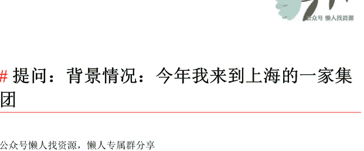

## 提问：背景情况：今年我来到上海的一家集团

公众号懒人找资源，懒人专属群分享

提问：背景情况：今年我来到上海的一家集团公司 集团公司下面有很多子公司 我在一个新的今年集团刚成立的一家新公司团队 这个新任的女子是新子公司的负责人 一开始老板也没想到我们新成立的部门可以完成这么大的业绩（4月初 我和另外一位

同事出了很大的业绩 差不多我这压出了8 另外一位(2) 给她的薪任职一开始就打出了 一副好牌 但后来她这个人是看人下菜。

我这个人平时不强势比较好说话那种 她就对我使职场PUA那套 因为我手里的大客户比较多 生怕我后我抢了她风头 有点一开始就压你的意思！

到后来 我自已复盘觉得内心愤怒委屈 做出了业绩的同时她反而另外两个男的比对 我重视（出去学习或者见高层 都不带我）我的业绩在她那轻飘飘一句话好带过

目前我内心的状态：钱是赚到了 但内心不开心 不知道怎么做 想请教下涛哥？

# 回答：

感谢提问，

我们先做个设定啊，就是，大反派的坏，和你受到的委屈都是真的，

某种意义上，用时间、劳动和尊严，换取工资，这难道就是上班的全部意义么？是的，

受委屈，感觉到尊严被侵犯，不爽，这是很自我的一种表现，

受委屈，不受重视，可是劳有所获，钱一分没少，所以没关系，这是正确的处理方式，

我们要学会思考，这件事对自己的意义是什么，工作对你的意义如果就是钱，那么钱到手了，它的意思就实现了，

如果你告诉我，你去工作，主要的意义是尊严，我会很讶异，

所以静下来问自己，在某个人生阶段，我们在乎的是什么？捉重要的，

那么就不对抗了？拜托，你是集团公司啊，你比我更知道制度的有趣之处，等机会吧，毕业竟，谁也阻止不了你，继续奋斗，进取，表现自己，

且，相信我，一定会有人看在眼里，

# 评论区：

杨涛：更早更全面的认识自己，
确实是优势，
挺好挺好，微信留一个呗，[奋斗]

醒醒同学 🐱：哈哈哈哈哈，谢谢我涛哥，哈哈哈哈。

我微信是：rabbit_xing7

涛哥星球潮朋友，有优势类问题都阔以发耒来，如果我懂的话，会很喜欢回答滴

目标就是，帮助哥哥科学算命哈哈

橙与陈说：这个书哪里有卖？

北欧小土著：最好的补短板的方式，是了解真正的自己后，用最擅长的那一部分去打通自己不擅长的部分。学习了！

醒醒同学 🐾：是问盖洛普方向的书吗？我是去上的线下课。

网上有本书叫：盖洛普优势识别器，大概150元左右，会送你一个测试码，能够测前五项。

如果要测全部34项排序，需要在官网购买测试码（380元），或者找认证的教练帮你买，可能可以便宜直点

醒醒同学 🐾：是滴，这个体系里是有这样的概念的，我学习后也很喜欢。需要一点时间去悟嘿嘿

Immortal：这个盖普测验，打折版吗...

醒醒同学 🐾：官网都是同样的价格~木有打折哈哈哈哈

公众号懒人找资源，懒人专属群内部分享

## 提问：哈啾，涛哥，您好！

生财有术项目

公众号懒人找资源，懒人专属群分享

提问：哈啾，涛哥，您好！

生财有术项目库很多蛮好的项目，自己找了淘宝蓝海的项目跟着做。做了一段时间发现确实选品是个让人头疼的问题。

也看了很多生财里关于蓝海选品的文章，自己操作的时候就不是那么回事了。我自己总结的选品方法还是用参考一级类目，然后找二级类目三级类目词比较有效。但是效果也不算太好，可能3、5天选出几个蓝海数据的产品，而且还不一定能做。

当然了，蓝海产品也是一个相对概念，可能对于您来说月收货人数一、二千也是蓝海。对于我来说的话，最高销量500左右比较蓝。

每天8-10小时选品（当然了也不每天都坚持了8-10小时选品工作），一小时跑步。您说的，最终还是要拼体力。所以锻炼好身体。但是目前选品确实觉得比较痛苦。

因为您做过淘宝，也开过猫店，直接问您怎么选到蓝海产品肯定是要流程了。但是还是想请教下，如果是您做这个项目，您会怎么入手呢？

做到目前个人觉得选品绝对是一项长期可用的技能，无论淘宝，拼多多，亚马逊，还是小店，或者以后出现的什么电商平台。所以想在这方面得到您的指点。

最后，谢谢您的指导！

# 回答：

感谢提问，

我那些年选品的唯一思路是，找到销量高，有利润，然后没有淘客介入的，然后直接淘客干到第一，然后买店，同样打法占擂前五，掌握议价权，建立壁垒，也怕后来者眼红，他们会明白不划算，

至于你今天说的蓝海选品，在不违规的前提下，

我们先达成一致，就是选品高手和凡人，大家用的软件大同小异，对吧，

选品除了极少数的提前操作，比如预判了热点，大部分是用数据驱动的，这点对吧，

淘宝蓝海就是供小于求，且有利润的对吧，比如搜索人气一两千，收货人数几百，在线商品数才几百的，且没有天猫，更不用说猫超了，这是主线，蓝海法则1，对吧，

好，如果咱达成一致，那么再加上一个5118，齐活了，

都告诉别人5年多了，案例的话，我随便举举，应该能助你发散思维，

- 比如病，稍微冷门的病（尤其是皮肤，慢病，当年我的骄岛素保温杯吃了3年多红利），
然后中草药（貌似至今还不需要资质），
汽车后市场（特殊配件），
特殊材质工艺品/家装/家饰（比如我当年的发光中国结，琉璃摆件，挂件，布艺春联等N种，我在的时候都是第一），
渠道类（国外二线以上品牌初进中国市场），
趋势类（盛士忌市场大暖导致高手单洋酒杯具大火，比如江木喵子，樱木阳子？有点忘记了，特殊酒大火，比如当年的鞠祭，山崎，响三剑客？有点忘记了），
农业/工业/养殖业（生产工具/配件），
地方特色/特产（谁特么还没有点思乡之情），
热门类目冷门人群（比如宠物中的大型宠物周边，比如服装鞋帽中的大码），
微创新（比如某个热门需求你加了配件，举例，平安扣车挂件镰钴），
服务类（比如各种回收，黄金回收，礼品回收），
信息差（某些冷门资料打包卖，冷门软件代安装），
吊打老古董（比如大别墅雕塑，室内游泳池等考一举随地挂着就能卖的），
......等等，老多了，

例子是我瞎掰的，思路还是可以的，就是用需求当词根，前缀后缀加着找，具体我补一句，就是善用5118吧，从5118用需求词去逆推功能词/关键词，然后到淘宝数据工具上去应证，最后按黑色海法则1确定是否可以干，

加油，抖音蓝海也可以考虑下，

# 评论区：

杨涛：更早更全面的认识自己，
确实是优势，
挺好挺好，微信留一个吧，[奋斗]

醒醒同学✨：哈哈哈哈哈，谢谢我涛哥，哈哈哈哈。

我滴微信是：rabbit_xing7

涛哥是球满朋友，有优势类问题都阔以发粗来，如果我懂的话，会很喜欢回答滴

目标就是，帮涛哥科举算命哈哈

橙与陈浪：这个书哪里有卖？

北欧小土著：最好的补短板的方式，是了解真正的自己后，用最擅长的那一部分去打通自己不擅长的部分。学习了！

醒醒同学✨：是叫孟洛普方向的书吗？我是去上的线下课。

网上有本叫咋：盖洛普优势识别器，大概150元左右，会送你一个测试码，能够测前五项。

如果要测全部34项排序，需要在官网购买测试码（380元），或者找认证的教练帮你买，可能可以便宜点

醒醒同学✨：是滴，这个体系里是有这样的概念的，我学习后也很喜欢。需要一点时间去悟嘿嘿

Immortal：这个盖普洛测试，打折版吗...

醒醒同学 ☀：官网都是一样的价格~木有打折诶哈哈哈

## 提问：涛哥，有个问题想请教下。也一直困惑

公众号懒人找资源，懒人专属群分享

提问：涛哥，有个问题想请教下。也一直困惑我很久。

就是怎么样才算真正的读懂一本书？

换种说法是怎么才能把书籍的内容变成自己的？

我就算在看书的过程中有一些触动，但基本上看完就忘。也常常提炼不出重点。

是不是我读的书太少的原因。

还有读书笔记应不应该做？应该做的话是不是应该反复的去回顾？

回答：

感谢提问，

我直接说解法，

- 1, 你说有一些触动，但是基本看完就忘，简单，触动时就记下来，记录闪念是一个非常好的习惯，用flomo，一定要用啊。
- 2, 一本书，写至少20篇200字的读书笔记，用微信读书也行，用flomo也行，谁用谁知道，
- 3, 这样你不仅能读透，还能训练你的写作能力，一举两得，
- 4, 升级版是，拉个群，找到你的5个朋友和你一起读，每天读书笔记发群里，然后你就能够收获100篇读书笔记啦，还是5个不同视角，这样的话，还愁读不透？
- 5, 把书里头的内容变成自己的，这个最简单了，就是横向迁移的能力，即，把一个理念讲给你的小笼蛋朋友听，讲到他听懂为止，
- 6, 我给你举个例子，比如，最近很火的内卷，可以用电影院的前排观众站起来，来解释，比如，很经典的囚徒困境，你可以用乡下的小路堵了，你不修我不修，都想别人先去修，或者用三个和尚没水喝，来解释，
- 7, 这，就是横向迁移能力，也就是你看到一个事情，能用很土很朴实的生话例子去解释，或者大白话说到你的小笼蛋朋友都能够听懂，就算变成你自己的了，

加油，等你把你最牛逼的读书笔记一次性发这里，到时候给你一个栏目，叫做，4000字读完大部头，

## 评论区：

杨涛：更早更全面的认识自己，
确实是优势，
挺好挺好，微信留一个呗，[奋斗]

醒醒同学 🐣：哈哈哈哈哈，谢谢我涛哥，哈哈哈哈。

我滴微信是：rabbit_xing7

涛哥星球满朋友，有优势类问题都翻以发粗来，如果我懂的话，会很喜欢回答满

目标就是，帮助涛哥计算命中哈哈

橙与陈说：这个书哪里面卖？

北欧小土豆：最好的补短板的方式，是了解真正的自己后，用最擅长的那一部分去打通自己不擅长的部分。学习了！

醒醒同学 🐣：是问盖洛普方面的书吗？我是去上的线下课。

网上有本书叫：盖洛普优势识别器，大概150元左右，会送你一个测试码，能够测前五项。

如果要测全部34项排序，需要在官网购买测试码（380元），或者找认证的教练帮你买，可能可以便宜点

醒醒同学 🐣：是滴，这个体系里是有这样的概念的，我学习后也很喜欢。需要一点时间去悟嘿嘿

Immortal：这个盖洛普测试，打折版吗...

醒醒同学 🐣：官网都是一样的价格～木有打折哈哈哈哈

公众号懒人找资源，懒人专属群内部分享

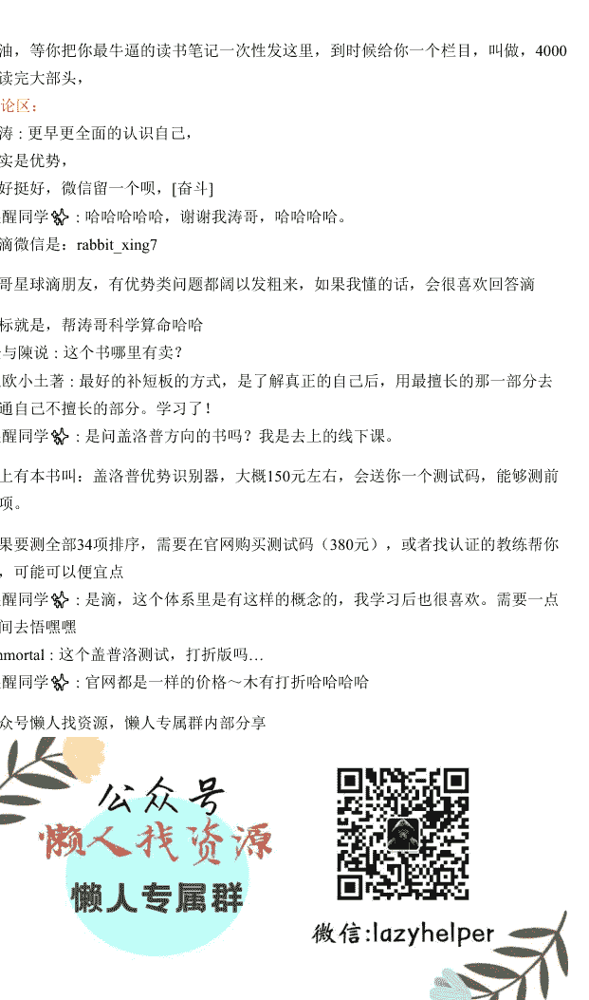

## 提问：涛哥晚上好，看了你很多回答，非常精彩！对我启发很大，还有你赠的《》这本书，已经读了3遍很受益！谢谢涛哥。

有一个问题通过思维模型 的原则去分析后还是有看不到的方面，来向涛哥请教，问题如下：

你怎么理解“长期主义”和“低效努力”这两个概念。

坚守长期主义总没错，这是我一直坚定的原则，但是看到很多小伙伴坚持一段时间后并没有取得突破。

甚至还在原地，这和坚持的长短有关系吗。

坚持多久做一件事情才会产生复利，在做这件事情期间如何规避风险不让自己跌入“低效努力”的陷阱里？

想听听你对这两个概念的理解，谢谢解答！（超链接： 好好思考）

回答：

感谢提问，

看书归看书，别中毒，

长期主义就不能暴富么，我想暴富啊，我常说，赚钱是最好的修行，我就是只想把赚钱当作毕生的修行，这算不算长期主义？

## 低效努力

低效努力就是，你问他十年后想要的理想生活的画面，他回答不出来的，他并没有方向，那么，

长期个der~?

## 评论区:

杨涛：更早更全面的认识自己，
确实是优势，
挺好挺好，微信留一个呗，[奋斗]

醒醒同学 ✧：哈哈哈哈哈，谢谢我涛哥，哈哈哈哈。
我滴微信是：rabbit_xing7

涛哥星球满朋友，有优势类问题都够以发粗来，如果我懂的话，会很喜欢回答满

目标就是，帮涛哥算法算命哈哈

橙与陈说：这个书哪里有卖？

北欧小土豆著：最好的补短板的方式，足了了解真正的自己后，用最擅长的那一部分去打通自己不擅长的部分。学习了！

醒醒同学 ✧：是问盖洛普方向的书吗？我是我去上的线下课。

网上有本书叫：盖洛普优势识别器，大概150元左右，会送你一个测试码，能够测前五项。

如果要测全部34项排序，需要在官网购买测试码（380元），或者找认证的教练帮你买，可能可以便宜点

醒醒同学 ✧：是滴，这个体系里是有这样的概念的，我学习后也很喜欢。需要一点时间去悟嘿嘿

Immortal：这个盖普洛测试，打折版吗...

醒醒同学 ✧：官网都是一样的价格~木有打折哈哈哈哈

## (55赞)零基础全职妈妈的社群团购创业之路

大家好，我是
公众号懒人找资源，懒人专属群分享
(55赞)零基础全职妈妈的社群团购创业之路

大家好，我是泳怡，一个94年的全职妈妈，今天想给大家分享一篇关于零基础全职妈妈通过经营自己的母婴团购社群，年销售额破120万，卖出了1台保时捷、2台奔驰，月入过万，还收获了几百个深耕当地有房有车的精准妈妈用户，身为互联网小白的我是如何冷启动做社群、突破个人瓶颈，又是怎么和客户相处成朋友知己呢？

在一众前辈的鼓励下，我决定把这一年的工作都做一个复盘。

目录：
...

## 评论区：

- 杨涛：写的真好，
- 泳怡：感谢潇哥的认可！太开心了
- 路：好多细节呀，
- 焜洁：优秀
- 奇卡：真的很用心，不成功都难，
- 泳怡：感谢你的评价！目前还没有算成功 继 续努力
- 张望：好棒呀，仔仔细细看完了
- 泳怡：感谢 🙏

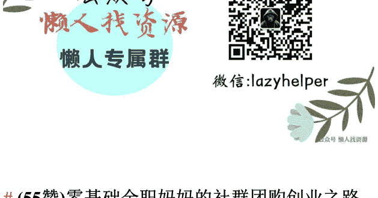

## 提问：涛神好

我看过你之前的分享，通过搞
公众号懒人找资源，懒人专属群分享

提问：涛神好
我看过你之前的分享，通过指定内容的批量产出。
以及低价的学生团队帮忙拍摄视频。
这样基本上做到了短视频的批量生产。
而且基本上是没有行业限制。

以前看你喊口号：手握流量，兴风作浪
我不知道是有多浪，现在我明白了，真的很浪。

实际上我也突然意识到了这个问题，就是通过我的努力，尝试，也做到了在好几个领域抖音号都能挣粉。也有一点点敲哑打聋的感觉。

但是我很迷茫。
通常一个领域，或者说一个项目，从起号，引流，销售，变现，需要时间周期。短的一个月，长了几个月。

我想起了那一批老站长，大部分80后吧，他们抓住了百度时代SEO的机会，做站，都是成千上万的站去做。流量也是滚滚而来。

我也学习了一点SEO入门，尝试过，发现流量太慢了。而且正反馈不足。所以没坚持
多久还是发现短视频流量猛。

第一个问题，如果短视频这块感觉轻松一些，该不该花精力在SEO上面。
第二个问题，面对无数的机会，有的已经开始盈利了，有的看起来非常诱人。但是手

里的事情其实已经比较多了。该怎么办？

举个例子吧。我一个朋友，开了一个彩票店，他有微信好友1万人，最近一天卖出去彩票多少赚钱，20万。他的好友是很久很久以前引流来的。那是三年前的方法了。已经过时了。他告诉我说，有流量就会暴富，让我试着看看足球粉丝。

我花了两周时间，学习批量生产足球抖音号。搞内容，做视频。

一个精彩瞬间，一个原创解说，两个方向。

一个新号第一晚上上传6个视频，16万播放量，我们计划着一天上传几十个视频。大力出奇迹。

果然奇迹发生了。第二天就封号。

再建号，再封。

再封。

封。

原创优质解说，配音，一开始不封，也有流量，能做起来。一放引流微信，凉凉。封号。

整个测试过程花了两周。

很心累。从不看球的外行，到找到突破口，搞定内容等环节，看edu希望，到浇灭凉水。

而实际上，这样的事情，在不断上演。有的业务成了，有的死了。

我总是在爆炸的信息中找到好看的项目。

然而其实手里业务随便一个个单条利润过万的项目做到理想状态，也能年入几百万，千万。

年龄焦虑29岁高龄：因此我不敢全力投入，我不敢赌，我比较怯，希望找到更多业务同时做，来博取胜率。

我还有一个不知道是不是偏激的想法：真正赚钱的业务是不困难的，甚至是简单的。因为我曾经经历狗屎运，非常快速和轻松赚到过千万。

第二个问题总结起来应该说：面对大量机会，如何抉择。

回答：

感谢提问，

1，这样，像你这样机会非常多的人，意味着产品/项目非常多，比如，你的圈子时常有着人会给你信息，而且大部分是不需要你投资的，等于是帮忙引流，卖多少赚多少，CPS类的，对吧，

2，做为一个福建人，我想说在项目/产品的选择上，要遵循一个原则，就是不要让自己有“归零”的可能性，理解我意思么，就是，永远在牌桌上，就是，有可能去喝茶的事儿，别碰，一点点可能， 都别碰，其他你可以尽情发挥，

3，与其说去抉择，不如说，去找到那个唯一函数，即，你那些做seo的朋友，他们掌握的是获客的方法，不论是医美，是房产，是信用卡，是招商加盟...找他们，都有办法，对吧，当你有了这样的核心生产工具，那么，其实无所谓项目是什么，

4，seo要不要做，要做的，它和短视频的区别有很多，讲两点

第一，精准度，普通来说，短视频获客如果综合得分是70分，那么搜索获客的综合得分就是100分，你品品，为什么是70分，因为在规则内，你只能用比搜索词更宽松一些的词去打短视频，且是被吸引，而搜索，是主动搜索，意思就差了老多了，对吧，还有，客单，转化率等因素，也弱于搜索，

第二，长尾，短视频爆了就爆了，需要你持续的做爆款，才会有源源不断的流量，而搜索这块不会，是反过来的，一开始洒了足够多的种子，结出的果实，会越来越香，源源不断，

5，谁说，短视频就不用seo了？

6，你说手头项目非常多，且盈利，要不要再加项目，我的建议是用新建事业部的方式，在不影响老业务的情况下，拉人出来，或者新招三俩个，先跑通第一个业务节点，

7，一知半解头往前冲，其实大部分时候结果是好于全部搞明白了，再开始入局的，

8，比如，开新事业部，搞两个月，盈利，且能算出来利润率，预估出来能不能放大，能放大多少，这是试错成本最低的方式，也不会后悔错过，（其实非常理解，你这种人秉，要不是看到别人有了结果，并且起来挺不错，你是不会心动的，不试试，会一直如鲠在喉，过阵子有后悔的可能性），

9，你说的赚钱逻辑是对的，本来就不难，如果很难，说明不正确，但，咽时刻反思，咱们赚到的钱，是不是用咱的技术赚到的，还是运气或机会，运气是不会始终眷顾同一个人的，

10，最珍贵的水永远不是钱，和机会，而是一个三五个人，能打硬仗的心腹班子，追逐机会和流量，总是需要你的高机动性，不断的对抗，好累的，如果有个核心团队，才能在真正机会来临的时候，承接住，这点你没体会过那种快感，是想不明白的，

11，总结，你都千万级了，投资如果不擅长，又有核心竞争力，想做业务，那么，谨记，多生>优生，试错成本可接受，就不断生，一直到有个项目露出了暴起的苗头，砍掉其他项目，all in，这也是最符合自然规律的策略，

评论区：
杨涛：写的真好。

泳怡：感谢涛哥的认可！太开心了
路：好多细节呀，
炬洁：优秀
奇卡：真的很用心，不成功都难，
泳怡：感谢你的评价！目前还没算成功 继续努力
张望：好棒呀，仔细看完了
泳怡：感谢🙏

公众号懒人找资源，懒人专属群内部分享

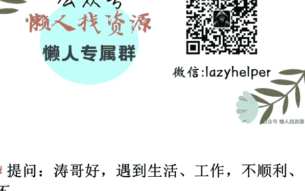

## 提问：涛哥好，遇到生活、工作，不顺利、不

公众号懒人找资源，懒人专属群分享

提问：涛哥好，遇到生活、工作，不顺利、不顺心，应该怎么去洗愁、发泄，快速走出来呢

回答：
感谢提问，
首先，作为一个成年人，情绪稳定是一种必须具备的基本能力，不仅为自己，也为了不让自己的情绪伤害到身边爱的人，也为了不传递自己的负能量，给到朋友，

我常提到，如果你没有期待，那么每一天，都是惊喜，这也是我想分享给你的，我的世界观，就是，得明白，每一个人的苦难是等量的，你能从苦难中获取到快乐和幸福，你就是幸运的，如果你认为，人生来就应该是幸福的，那么你会更加苦，因为你总能碰到各种烦恼，

这句是关键，你无法反驳，你认真回忆你过去的二十多年，你就会发现刚才说的，就是事实，人生下来就是为了迎接痛苦和烦恼，如果你想通了这点，你做任何事，你都会心安理得，因为你知道，你做这件事情有痛苦烦恼，你不做这件事情，另外的痛苦烦恼一定是一样的。

我分析了周围所有认识的人，不论圈层，分析了他们的生活，凡是我深刻理解过的人，我发现，每个人人生中都有几乎等量的痛苦和烦恼，每个人生活中，都会在各种场合，遇到苦难，感情上，生活上，家庭，工作，精神上扛不过的时候，几乎任何人都有，

我只是客观阐述这样一个概念，就是人的苦难肯定是没有尽头的，人要做的是在苦难中，你奋发，做自己能够做，应该做的事情，从而去获取幸福和快乐，这就是我的世界观，

至于你现在应该怎么做，如果我们刚才的描述，能得到你的认可，那么，你该做的就是心安理得，然后破而后立，为啥要去犹豫，发泄呢，这不是骗自己，同时又伤害了你的倾听者么，多大事儿咧？

未经人苦，莫劝人善，我懂，我不劝，我只想让你好，就提一嘴，最要不得的，是无能狂怒，要明白，其实干嘛愁呢，给你两天调整状态，然后回归生活，做出改变，因为不改变，一定不会更好，至于什么改变，从两个字开始，「提效」，

## 评论区：

- 杨涛：写的真好，
- 泳怡：感谢涛哥的认可！太开心了
- 路：好多细节呀，
- 熙洁：优秀
- 奇卡：真的很用心，不成功都难，
- 泳怡：感谢你的评价！目前还没算成功 继 续努力
- 张望：好棒呀，仔仔细细看完了
- 泳怡：谢谢🙏

## 提问：涛哥，你好。关于人际交往的问题向你

公众号懒人找资源，懒人专属群分享

提问：涛哥，你好。关于人际交往的问题向你请教。

我现在的情况：我跟老同学都不怎么联系了，来往还算密切的也就2、3个，然后一年到头都没有跟其他人有即使是微信的来往。工作上因为同事不多，所以也没有跟前同事有来往。

然后我发现，我渐渐地跟来往密切的那几个同学不知道怎么聊天。跟初次见面的人我更是找不到话题。感觉我现在已经渐渐失去了与人交往的能力。

而且我觉得这种状况太不好了，所以想请教涛哥：

1, 怎样跟认识的人有话可以讲，而不是两三句之后就冷场了？
2, 跟老朋友的关系怎么维系？
3, 我跟第一次见面的人谈话很容易尴尬，有办法克服吗？

这个问题困扰了我很久，给自己的答案一般都是主动一点，我对力感兴趣的话聊…可是依旧没有任何改变，今天又在惦记着这个问题，然后意识到可以向涛哥，虽然是个尴尬的问题。

回答：
感谢提问，
这个问题吧——并讨论。

1, 你先放空自己，我问你，你记得里，小学时候，班级运动会你会主动报名么，老师提问你会主动举手么，黑板报你会抢着去出么，春游时候你是不是最积极的那個，晚会和各种竞赛，你会认真参与么，再放到现在，同事聚餐，和公司团建，你会感到很激动兴奋么，还是宁愿宅家里一个假期，如果所有答案都是否，那么没关系，你性格如此，起码有一半的人都是这样，就比如我，全部选否，
2, 上面的问题直面本心，就好比一个苹果，有果肉，果皮，但是果核，才是我们的出厂设置，我们就是不善交际的人，但是目前好像大家对我的评价是互联网圈交际花、情商天花板，我平均每天要见2-5个圈友，这说明了什么，我的果皮和果肉，被我强行长出来了不同的花式，而咩咩，是同一个品种的果核，
3, 这说明了什么，都是可以以后天训练出来的，先说有话可讲，不冷场，这里头需要一个很重要的词，叫做，谈资，一个月内你基本能够掌握你能和你现在的朋友同事聊天的所有线索，比如，各种球类，品牌，车，互联网，电影，名人，中外时事，在这个时代，获取信息简直不要太容易，
4, 有了信息储备，这对内向的人来说是一件非常爽的事，当你体会到控场的快乐，你就会像上瘾一样，对各种不同信息如饥似渴，强化自己这张永不生锈的装甲，进而天使循环，越强大越快乐，越快乐越强大，

5，一句总结社交圈，花花轿子人抬人，当一个最佳傀儡机和捧哏，如果你实在懒，我还有一招更牛逼的暖场小贴士，就是倾听和附和，你要善于揣动他人的表达欲，一遍一遍重复对方的感觉，送上共情话，就够了，微笑着看着对方，附和，重复，顺着他话说，感受，

稍微和你举例，你试着想像，不管你和我聊到谁，不管他好还是坏，你是什么情绪，我就换着语调回复你一句，“唉，这人啊”，“哈，这人啊”，不管你和我们抱怨什么，感谢唧唧啥往事，我就换着语调回复你一句，“唉，生活嘛”，“嘿，生活啊”，

有没有感觉？这种固定套路就七八种，你熟悉了之后，不可能冷场的，

6，老朋友关系怎么维系？你总共就几个老朋友，假设每次吃饭4个人，人均2百，1年内你请你的3个老朋友分别吃2次，共6次，花费4.8K，太可怕了，4.8k竟然能和他们吃6次饭，加上他们回请，共计24次，听我劝，不仅老朋友，新朋友也是，有计划的请吃饭就对了，一定抢着买单，任何时候抢着买单，真心抢的那种，你的收益会大到你不敢想，没错，就这么简单，你看你身边谁做到了，他一定是万人迷，还会不断的认识新朋友，

7，赶场大可不必，这里也有一个贴士，就是你可能没有训练过自己的自我介绍吧，你认识新朋友的时候，也很少人一字一句，说自己的名字，说完报你可能会喊我哈，然后再清晰的介绍自己吧，设计一下吧，绕到炉火纯青，别不好意思，自我介绍一溜讲完，一次有力的握手，有烟递烟，没烟敬酒，良好的精神气，微笑直视对方双眼，对方会感觉你真重视他，马 پور会顺着你的介绍扯两句，而你的介绍当然是你训练过的，都是送菜给你吃呀，这不，他看到你那么正式，一定会礼貌的回复你一段关于他的自我介绍吧，然后你根据他的自我介绍，送菜给他吃呀，这不，一来一去，话匣子就打开了，

8，让自己有一样或者多样普遍的爱好，很多时候，你的朋友基本面，取决于你的爱好广泛程度，容我自夸一下，我几乎精通所有的球类，游戏，棋牌，娱乐…随便举例，球友，牌友，这感情啊，来得容易，来得有感觉，你还真别不信，就比如德扑社交你怎么听吧，是目前互联网圈普遍上无往不利的一招，

9，我怕我说多了，你再看看这两个帖子吧，
具体我们下次可以再聊，（超链接：https://t.zsxq.com/YjqieYB）(超链接：https://t.zsxq.com/Mv7Yvvv）

评论区：
杨涛：写的真好，
泳怡：感谢哥哥的认可！太开心了
路：好多细节呀，
姤洁：优秀

奇卡：真的很用心，不成功都难，
泳怡：感谢你的评价！目前还没算成功 继续努力
张望：好棒呀，仔细细看完了
泳怡：谢谢🙏

公众号懒人找资源，懒人专属群内部分享

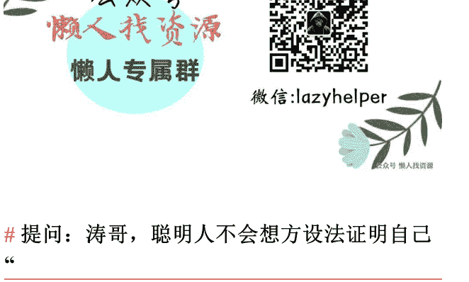

## 提问：涛哥，聪明人不会想方设法证明自己

> “

公众号懒人找资源，懒人专属群分享

提问：涛哥，聪明人不会想方设法证明自己“没错”，而是保持开放的心态。你身边的聪明人都有什么特质呢？能帮忙归纳总结下吗？

回答：

感谢提问，

等我下哈，我拿面镜子，

1. 有强烈的好奇心，且喜欢和有好奇心的人一起玩。有那种压抑不住的，对常识性事物/普通场景：深挖的欲望，

2. 集中力，高效的人未必聪明，但是聪明的人一定高效，聪明人都有着调动自己所有注意力集中在一件事上钻研的能力，

3, 高情商，他可以很高冷，但，只要他愿意，也可以针对不同场景做到，不强加于人，阳光积极健康对人，积极主动，自信，体谅他人，包容，赞美，善于倾听，从不抱怨，尊重所有人，从不批评，情绪控制，会记住别人名字（别小看这点），圆场，控场，救场，热场，

4, 可以话多，也可以话少，有着把一句话写成三千字的能力，也就是思维迁移能力，抽象能力，也有着还原本质的能力，针对面前的不同的对象，把一件事情用最合适的表达方法去阐述，以期高效消除对方和自己的信息差，

5, 左右互博，能拥抱环境的变化，拥抱身边人的多态和变化，甚至能自己拥抱自己的变化，摒弃自己之前的结论，（会让身边人很崩溃），觉得不久前的自己是傻逼，而且这种频率很高，

6, 只关注解决问题的方式方法，而不纠结问题本身，知道有些事情没有争论的意义，有些事情没有怀疑的价值，有立场，有态度，有是非，有对错，不服就干你，你对我就服气，只对事实和逻辑低头，

7, 比较少躁操作，比较少加戏，行为都符合生物学规律，即，甄操作耗能，加戏很致命，提效降本，这四个字贯穿于他们秉手投足的每一个行为，

8, 善于提问，且不耻下问，知道优越感是一种虚幻的错觉，而只有快速靠近真相才是目的，有时候会有一点冷血、无情的样子，但是别在意，他们不是故意的，

9, 信息甄别能力，在这个时代体现为，高效检索的能力，辨别干净的信息源，然后抽丝剥茧的能力，太重要了这点，从众生平等的消息海洋中，拉开差距，

10. 差不多了，回到你这里讲一下开放心态，也就是思维模型在高段位有闭环，却保持不断打破闭环的开放心态，吸收大量新知识，去芜存菁，迭代调整，以期适应时代，以及整个大环境的发展，不断重构自己的知识体系，逻辑框架，并在广度和深度上延伸，

好了，刚才说的拿镜子是开玩笑，但是真有这种人，生财就很多，在他们面前，我宛若智障，

评论区:

杨涛：写的真好，

泳怡：感谢哥哥的认可！太开心了

踏：好多细节呀，

焜洁：优秀

奇卡：真的很用心，不成功都难，

泳怡：谢谢你的评价！目前还没算成功 继续努力

张望：好棒呀，仔仔细细看完了

# Feynman路径积分 👑 👑

6-13 22:29 来自 HUAWEI Mate 40 ...

曾经有人采访乔布斯，问他喜欢什么样的人交往。

乔布斯答：我特别喜欢和聪明人交往，因为不用考虑他们的尊严。

采访者问：聪明人没有尊严吗？

乔布斯答：不，聪明人更关注自己的成长，时刻保持开放的心态，而不是捍卫面子，不是想方设法证明“我没错”。

公众号懒人找资源，懒人专属群内部分享

# (47赞)大家好，我是大刀，想来和大家分享一下大刀的非线性破圈成长经历，希望大家看完有收获，感谢涛哥提供平台。

(超链接：大三在校小姑娘，如何赚到自己的第一桶金20万？)

评论区：

守一：优秀的大刀妹子～

宋大刀：[爱心][爱心][爱心]

公众号懒人找资源，懒人专属群内部分享

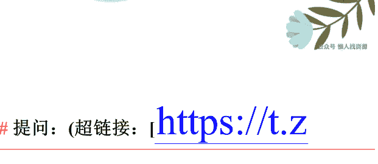

## 提问：（超链接：https://t.zsxq.com/nu7QJaQ）

公众号懒人找资源，懒人专属群分享

提问：（超链接：https://t.zsxq.com/nu7QJaQ）

回答：

感谢提问，

关于孤独，

首先，和寂寞不一样，孤独是可耻的，

没有人会care孤独的灵魂，焦点向内，是我要怎么对这个世界，无关世界怎么对我，要有这个觉悟，然后去找同类，应该是一个挟对的方向，也符合吸引力法则，

然后，别当刺猬，我很喜欢一句话：先相信，直到露出破绽，这是最省成本的一种吸引方式，不仅仅给了人机会，也给了自己一个不要错过在类似的机会，你不坦诚，却希望对方先赤裸，没有那么好的事，和爱情一样，找到同类，也是需要双向奔赴的，

关于快乐，

首先，是生理上，能让人分泌多巴胺的行为，这是有个阶梯式的阈值不断提高的，所以你放眼古今中外，那些自我了断的天才，惊才绝艳，然后其事实是一个阈值逐渐提高，然后始终找不到信仰/精神支柱，然后绝望的一个过程，

再看，现今社会，都说唯，美人，美食，美器，不可辜负，但是你看现在的顶级玩家，几乎尝试过所有人世的繁华，然后已经无法再分泌让他们快乐因子，于是他们开始尝试L交，*M，D品，D博，甚至晕N，以期获得刺激和快乐，这是普通人没有办法理解的，但是确实存在，

再有就是，也许从未被这个世界温柔以待吧，这是这样的，原生家庭，和少年时候的经历也可能成为一个人的心障，这里有人会说未经人苦，莫劝人善，但是我觉得这句话荒天下之大谬，本质上，是有对错的，你孤独，就是不对的，不好的，你不喜欢的状态，也就是，别用上一辈，和别人的错误，来惩罚自己，自然规律一定是对的，我不快乐，我就要去获取快乐，这个事情就是想通了就行，

可以的，还是那句话，付出温柔收获温柔，关键点在于，尽管不是每次都这样有回应，但是温柔不应该以这个状态为转移，如果某天我们变了，无关乎其他人怎么对你，都不就在有资格捡取那些最纯粹的快乐了，

也就是说，把得失心降到最低，只有好不求回报的付出善意，才有可能收获十倍善意和快乐，但凡带点功利，基本上就是颗粒无收了，这个叫做薄氏效应利他终无所获定律，

最后，快乐对于你，其实是有，有比如你刷刷，弹琴，K歌，玩手机，混群，都会有短暂的快乐，但是你想要的，肯定不是这些，来，就靠拢到我们最装置通的环节，自我实现，那么，往下，

关于存在的意义，是和快乐分不开的，就合在一起说，

这个比较难，有些人，终其一生，也找不到能让自己身上发着光的那件事，如果找不到，不要紧，可以换着很多方向去找存在的意义，比如为人妻，为人母，完美的家庭，稳定的事业，一帮靠谱的姐妹，但是有些人就说我不care，这些世俗意义上的成功，不认可，是内心深处的逃避，想要特立独行，这种现象就是真正的卢瑟，

一个年龄段，做一个年龄段的事，是合理的，比如小时候，妈妈说，别看动画片了，快读本书吧，考上大学你爱看多久看多久，好了，你考上大学了，这下你还看动画片么，也就是你儿时关于动画片的快乐，啪，没了.gif，所以，这个年龄段，有这个年龄段应得的快乐，接受自己是个普通人，不拔高，向下走，然后向内求，

好，我们继续，能不能尝试一下这样，被认可的快乐，比如，1个人认可你，得一分，999个人认可你，就得999分，人类本就是一种不断的需要用被认可去饲养的怪物，这是刻在血液深处的渴望，你可以给我举出大量不怕黑的大V，但是我告诉你，这是因为他们认定了黑色部分不得分，认可他们的人的基数才叫一个大，这也是一种存在的意义，

再有，就是把脑海里头的想要终极极面具象化，我们每隔多久，都会有想要的东西，都会浮现过我要这样那样的场景，你回忆一下，你实现么，如果没有，为什么感觉不到存在的意义呢，去拿到它们呀，

你最喜欢的领域，你已经是宇宙第一了，就没有进步的空间了？为毛不去精益求精，在某个领域做到最好，这不是很有意义的事请么，不深挖，是怂了？是怕摧翻自己曾经的成绩，被人说不过如此，这人纯粹是运气才做到这样的，看，这不是不行了么？

再从自我实现角度来讲，人，她一定是会有个对标的对象，或者说偶像，有远有近，往她们靠近，一起玩吧，哪怕靠近之后，觉得不过如此，或者崩坏，都没关系，这个过程，也是意义呀，

再来，假设现在，我们把快乐和满足量化，闺蜜给你一些，爱人给你一些，孩子给你一些，家庭给你一些，事业也给你一些，那么你每天，快乐加倍，也许就是这些细碎的缺失，让你感觉这方面缺失了。

最后，多喝热水，

# 评论区：

守一：优秀的大刀妹子~

朱大刀：[爱心][爱心][爱心]

## 提问：和涛哥的约定

涛哥怎么看（取法乎上

公众号懒人找资源，懒人专属群分享
提问：和涛哥的约定
涛哥怎么看（取法乎上）
回答：

感谢提问，取法乎上，仅得其中。

首先这句话有大量的经典都提到或是围绕过，传闻易经，孙子兵法，帝范，论语，春秋，都有，近代、当代典籍中也有很多大佬注释过，我最近一次听，是华杉老师的音频，

他们各有各的好和牛逼，但是在这里，「取法乎上，乃速亡之道」，何解？大概如下，

一，普通人立志高远，大概率就是被遥不可及的目标所带来的不确定，给整败了，正确的做法应该是去拿到「惯性」buff。什么意思呢，就是你先拿到一个小结果，然后再拿到触手可及的下一个小结果，这样就会像滚雪球一样，把你现有的成功不断放大成一个巨大的结果，

二，普通人创业，如果沿用大品牌，大公司那一套打法，虽然这些打法被验证过，但是如果咱们硬上，大概率会因为资金，团队，产品，这些软硬件上的先天不足，中道崩殂，而，稳扎稳打，还能够有机会保留不掉桌的资格。

三, 活着-->活下去-->活的更好, 应该是一个比较好的路径, 而不是单纯的取法乎上,

四, 你想要的鸡血还是要给的, 到我这时候, 变体是这样的, 「我们见过伟大, 怎能甘于平庸」, 还有过另外三句话,

+   1, 我们已经平庸到, 活着也成问题了么?
2, 作死和平庸, 并没有什么差别,
3, 平庸就是对我们最大的惩罚,

喜欢吗, 干了这碗,

评论区:

守一: 优秀的大刀妹子~

宋大刀: [爱心][爱心][爱心]

## (40赞)也说增长（第二季）

上回咱们定义了用户增长的开区间, 这次来说下产品增长, 然后接着去, 就直接讲细节, how to环节我擅长呀,

所谓产品增长, 首先要有个能满足人们某种需求的产品, 记住, 是真实需求, 不是伪需求, 怎么区别呢, 比如, 电动牙刷, 真(更干净), 伪(更方便), 咖啡馆, 真(空闲服务), 伪(喝咖啡), 电子烟, 真(装逼), 伪(顶瘾), 生日蛋糕, 真(好看好看), 伪(好吃), 名烟名酒名茶, 真(社交/送礼/待客), 伪(自用)......还有一万种, 评论区告诉我,

记住, 洞察真实需求不是一件容易的事情, 不要自己臆想用户的需求, 而你说要去取样? 市调? 抱歉, 取样是一门真正的艺术(下回开篇讲取样), 取样不足, 取样偏差, 将会如影随形, 让产品陷入虚幻的自嗨和陡内高潮, 更重要的是, 其实用户也不知道自己要什么,

伪需求能不能打, 能, 通过包装和渲染(所谓的微创新), 教育用户(教育成本高), 无知的用户会为此买单, 但是此类产品很快就会泯然众人甚至消亡,

真实的需求会有一个唯一的，明确的，可量化，能追逐的点可以打，也就是能凝练出一个指标，比如，日活，比如，用户时长，比如，购买频次，拿用户时长举例，很多 人觉得讲用户时长很low，克制，但是平民嘛，没啥不可以聊的，拿微信来讲，这个app很好，确实很好，但是真正绑住你的，是你在 decade app上的关系链，和无数场景，而不是这个app本身，

那么产品增长，就出来了，就是找到这个需求点，唯一函数，然后产生出更多需求和场景，这是一个由供＜需，到供一需的一个过程，记住，这是一个无限制游戏，供永远＜需，但无限接近，刚刚好，

那你就会问什么叫供＞需，微信上很难表达，耳朵能许的案例是牛奶倒入多瑙河，为啥倒呢，不能送降价，因为送/降价会影响需求，据说卡宴之前每年烧掉很多衣服，也不降价，广州每年大量品牌的临期化妆品送掉，也不专柜打折卖...但这要把它们划入产品增长上的供＞需有点尴尬，

再举例，比如医美，比如教育，大量的伪需求涌现，然后生态就乱了，获客成本就高了，拿线上教育举例，学科课，然后开始，思维课，编程课，声乐课，兴趣课......说 是打主需求以外的长尾需求，

那么实际上呢，连最大的真实需求，提分，学科，都已经供＞需了，何况花式作死的伪需求，初期的噱头过后，用户会冷静，市场会给你几个耳光，然后生态位的排列，就出来了，

# 评论区：

可达鸭：是不是要往一个高度垂直的产品或者行业去研究发展

杨涛：看实力来选择，蛋糕大分得人多，蛋糕小分得人少，成功概率差不多，又大又少的，要么门槛高，要么转瞬即逝，

二两：编程课的核心需求是提高工薪，我们现在的编程训练营也在球摩其他需求，这样看来，是不是都是伪需求？比如提高工作效率、未来必备技能之类的？求教

杨涛：提效降本是人类行为的顶级需求。

## (49赞)「也说增长」，

「所有的哀叹，抱怨，愤怒，都来自于对增长的无能」，这应该是大家最关心的话题了吧。我陆续写写吧，尝试把这事情说透；

增长其实包括很多，用户增长、产品增长、团队增长，运营增长，个人增长，模式增长、渠道增长、营销增长…每个点拉出来，都能再分出好多点，再细分的每个点，都能讲一个晚上。

这篇是序章，之后，我会尝试用不同的碎片，和大家一起构建一个平民版的增长球体，那么，开始。

首先，用户增长，为了好记（强行对称），我当初把它分为两个方向，「人流」和「留人」，用户增长，有且仅有这两个点，

“人流”，就是所谓的引流（更多曝光），拉新（获取新用户），之类的，包括获客，激活注册/填表/加好友等求增量的行为，

“留人”，就是所谓留存，包括，付费，复购，裂变/转介绍，分销/代理等基于存量的价值最大化利用的行为，

功利的说，就是，找到你要的人他们在哪儿，让他们来，让他们留下，让他们消费，让他说好，让他们信任，让他们带来人，

# 评论区：

醒醒同学 ✿：更多曝光思考

知识星球的作业区，早写的人，早号召朋友点赞，排在榜首，也是提高曝光的方式。之前一直对有的朋友总是第一个写作业，求赞不理解，现在看来是曝光

醒醒同学 ✿：留人思考

任何一个人群聚集的地方，不断展示自己能提供什么，需要有什么条件才能拿到

社群里，就可以以通过这个方式来留人，比如打卡，作业，回答问题等等，对应不同的福利

公众号懒人找资源，懒人专属群内部分享

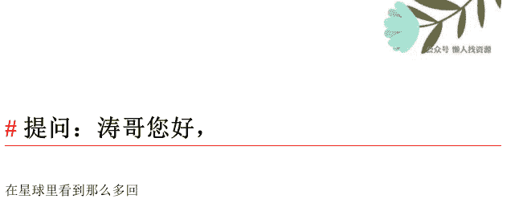

## 提问：涛哥您好，

在星球里看到那么多回
公众号懒人找资源，懒人专属群分享
提问：涛哥您好，

在星球里看到那么多回答，觉得这里的环境非常友好，所以也想把我的疑惑公开探讨一下。。

我一直觉得困难情景只有当事人最清楚且能找到破局之路，所以大部分问题都是靠自己思考并解决，偶尔的重大决策会寻求一些同频且相关的朋友咨询一下，参考他们的意见和看法。

目前我在做这样一件事情，是阴差阳错负责的一个企业游学项目，我认为您有着惊人的洞察和深刻的洞察，所以来请教一下您的看法和关于如何做得更好的建议。

# 项目背景：

我有幸结识了一家郑州三百多人亚马逊公司的创始人老板，几次一起睡的程中（住在一个宾馆里的房间），他说有跟同行业的人交流的需求。

经过各方面的发展与磨合，我现在以自己的社交关系和信用背书，做了个10人内的小圈子游学，基本上是一些非常厉害的跨境电商创业者，以亚马逊卖货/讲课模式为主，有十多年的行业老鸟，也有刚入行的职场新锐。

每个人缴纳5.6K，于八月在郑州的那家大公司进行交流，这个其实是仿照的深圳ANKER的游学，费用6K；广州视源股份的游学，费用1.2W，我仅对这两个案例有所耳闻。

# 准备工作：

我于四月份就收齐费用了，五六月是在做商务伴手礼和一份行业知识手册（亚马逊选品），其中花了相当多的时间精力也不少钱去整合资源和沟通。

目前分工是我负责人和钱，大公司老板负责游学内容和项目安排，整体上的策划书和游学组织都已经简在按上，我这边的内容基本按部就班完成，他那边是节后抽出时间正式处理。

我在这方面没有任何经验，只是顺水推舟，觉得这个事情可行就做了，同时自己也交了5.6K作为游学项目费用，只是觉得这个很有价值的事情，但是没有想着把它做成一个有利润的东西，因为凡事商业化似乎有耗费更多的心力与精力，我目前的主要时间还是安排在卖货这块，包括选品做货跟工厂交流，还有产品运营等上面，也不太想在这个项目后续上放太多事情。

# 疑惑与需求

我也不知道这个项目和手册具体会做如何，只是花了这么多时间且牵扯到不少人进来，所以特别想把这个事情做好，但是主动权不在我手上，主要是大公司老板来负责游学内容安排，以及市场承包这块我暂时没得法的路子去做。

目前身边一部分人对此表示支持，也有人不太好，整体上我自己是默默做事，把能想到都做了，但是没办法预估潜在风险。

满了一千字，更多内容放在截图里面了，望海涵。

跪谢(3)

回答：

感谢提问，

首先批评一下，哎唷老伙计了，还那么客气，这样的处事风格，怎么能把游学这么优秀的事情做大，

然后我们来看问题，

第一个问题，这个肯定是非法印刷物啊，想删别想就是，

字体就不谈了，“字由”里头有全套免费字体，

这个规定太多了，复杂了，我给你挑重点的说吧，无准印证的（非书号），标价的，盈利的，咋吧是附赠，印多次的，没有标注“内部资料，免费交流的”，带*刊，报*等字样的，等等，

但是有没有事，没人揪你就没事，有揪你，你这体量，就是罚一千块，（还有一个小技巧，如果实在在怕，实在在怂，就是每页右上角贴两个小字，广告，这样可以解释为公司广告册，可别罚几百就够了），

第二个问题，你这个角色怎么转变呐，这个我分开讲讲，

先和你说个故事，平行宇宙里有个帅哥叫家蒙，篮球打得很好，有一天，他突然想做一个生意，toCEO的高端人脉服务，就是你是这个CEO，你给他五万块钱，他能让你认识五千个牛逼的CEO，然后这生意看起来靠谱啊，然后他收了五千个人，拉了个群，然后让他们彼此认识，嗯，然后赚了两亿多，

故事讲完，粗糙，但是理是这个理，品品，

然后基于你现在的角色，有上中下三策，都能赚钱，

下策，工具人，没有什么议价权。

也就是说你现在这样，内容等无法把控，等于个个是你的甲方，他们有需要（学什么），你去给他们解决问题需要（找到人分享），同时你的人脉是共享的，手头核心资源也少，很多事情要过一手中转，无法拍板。//你的话，可以不断重复这次的行为，看能不能引起质变，也就是你突然有了大靠山，且稳定，

中策，同行+工具人，有一定议价权，

有了结果，比如有了一个中等品牌，但是有过现象级案例，比如父亲节你爆过单品，或者某个打法穿透了圈层等，比如不销的GMV，（这部分资源型的你可借助，很有可能被操掩于），且你热情勾兑，比如工具方，平台方，你是解决问题的人，大家有事喜欢找你帮忙，对接，同行日常和你和善，付费意愿也有，但骨子里还是觉得就那样。//你的话，在下策的基础上，不断提升影响力吧，那种有公信力的，能加杠杆的影响力，

上策，头部同行+平台方，有议价权，

据住了某个核心资源，可以是户，可以是品牌，可以是平台（官方），等顶级资源，自有品牌，案例，流水，然后你可以组建平台，让玩家抱团，切实落地解决问题，也就是，确实能提供价值，且你可控。//你的话，在中下的基础上，还需更敏锐（需求），前瞻（业态），勇敢（持续主动勾兑顶层），善良（那种业内都夸你的公信力）吧，

总结，获取资源是一个撬动的，滚雪球的过程，比如以上所说的资源，当你有了其中一个顶级，就可以通过商务手段，撬动其他顶级资源，松散绑定-->提供价值-->紧密无间，

第三个问题，我觉得就是提前收集问题最好了，方式很多，你都懂，

但是这里说一个词，“提不如选”，意思就是，你发表单收集问题，这样会显得非标且不可控，操作难度大，一定是反过来的，你通过你的专业，提出六个选项，并结合手中现有资源，确定能接把控，然后发给这些来游学的入选，最想学的是哪几个，这样不仅专业，还有仪式感，易操作，可控，

再提一次，要让你的池子里，完全分布商家，物流方，供应链，官方/平台方，第三方服务商，货方..以及莫可名状方，这样逐渐就接近借助打力的最高境界了，

加油，良辰美，不急，路还长，

评论区：

糖醋同学✨：更多嘻光思考

知识星球的作业区，早写的人，早号召朋友点赞，排在榜首，也是提高曝光的方式。之前一直对有的朋友总是第一个写作业，求赞不理解，现在看来是曝光

醒醒同学 🐾：留人思考

任何一个人群聚集的地方，不断展示自己能提供什么，需要有什么条件才能拿到

社群里，就可以通过这个方式来留人，比如打卡，作业，回答问题等等，对应不同的福利

比如，我请专业朋友协助整理了一份亚马逊蓝海产品方法论手册准备打印，里面包含的内容基本都活得作者的授权，也有我自己写的以及官方出版的行业薪酬调查报告和选品方法论手册。

疑问点01：在这份纸质手册（非卖品，一千份，圈内赠送）里面，有没有什么是字体，版权，印刷，政策等方面的风险？

疑问点02：在这个游学项目里，我的角色只是个引导者，那么我可以再做哪些事情，把这个我认为有价值的项目做得更好？

疑问点03：关于参与人员，大部分是对我非常认可且支持也有金钱往来的朋友，大家也都有去大公司游学的需求，因此如何才能更好地满足大家的期望？

以上三点是我一直在想但没有太大头绪的事情，还请涛哥指点。

# 提问：杨老师您好！我是来自某985高校的

公众号懒人找资源，懒人专属群分享
提问：杨老师您好！我是来自某985高校的一名大三学生，之前加入了生财觉得您的分享非常有启迪性，但一直觉得您应该会很忙，不会有空回答我这种小透明的问题。但看到您和明白老师的聊天、抱着侥幸的心理，觉得或许您会有空看一看我的问题呢。并且现阶段我的困惑也实在不知该向谁询问了，就鼓起勇气添加了您，如果可以，还请您有空时能看一看我的问题，给一点建议，真的谢谢老师了！！宽泛而言，我现在对整个人未来的人生大方向有一些迷茫，想请问一下老师的建议。具体而言，我有五个小问题：①请问老师看了我的描述觉得我的认知有哪些误区吗？②-⑤在描述后。

我现在在成绩较好，按照往年惯例，有很大机会可以保研到清华读直博（没有硕士名额）。但是我考虑了一下自己的人生规划，觉得自己喜好的更宽阔的人生，希望通过阅读等方法尽可能多地了解这个世界，而读博尤其是工科博士，会在一个领域进行深耕，专注于很细小地东西，加上现阶段各高校指标，会没有时间和精力去了解这个世界的更宽阔的方面，所以我觉得自己并不适合读博，所以，现在我的规划是要读硕士，并在硕士期间实习，通过尝试多份实习来找到自己喜欢的方向。我觉得自己现在关于尝试方向的想法很受限，能想到的岗位大多是技术类尤其是算法岗。但我觉得自己追求的最终职业状态是：用自己丰富的知识，输出内容，来产生价值（从而可以达到：在日常处于自己理想的生活状态—可以探索世界的奥秘的同时，又能为他人带来价值从而获得一定的金钱报酬。我认为就个人特质来说，我好奇心

很强，很热爱学习新东西，也有较强的学习能力，共情力也比较强从而享受帮助别人的感觉，并且近来在与同学的聊天中也能为他们所处的困境提供一些建议并得到他们的肯定，从而觉得自己也是有一定能力的。但是目前没有或者说不敢花足够的时间和精力去尝试大面积学习"和课程无关"的内容与练习输出，大概是因为觉得不确定性太大了，觉得自己至少要在社会上有一个能够获得一笔收入的岗位。我自认为和同学相比不是一个盲目追求赚很多钱的人，但是我觉得自己需要足够的金钱来买一套房子容纳自己、支持自己去其他地方游历见识更大的世界和更多人产生意想不到的联系）

（后续问题因字数限制截成图片了。。）

回答：

感谢提问，

害，这个提问功能的提醒实在不明显，才看到，嗯嗯，首先你都加了我了，应该直接和我微信联系呀（平视这个世界的自信和勇气），如果这点都做不到，你又要怎样去实现你说的结交更多志趣相投，互相启发的朋友呢，

然后，感觉你好像小看自己了，工科生阅读和总结（抽象剥茧）能力应该更强才对，我觉得你要的完全可以同时实现（我全都要），而且你的同学中有挺多这样的案例，他们也在生财，

咱试试吧，咱先把关键词抓出来，
学业/专业（读博/读硕），能力（写作/其他），诉求（赚钱/破圈/交友），

你的理想人生终极目标，有画面了：主体知识体系完整-->输出价值-->经济稳定-->破圈交友-->解读世界-->持续获取知识反馈主体-->持续输出价值-->实现这样一个天使循环，

然后我们来拆，

首先是学业这块，读博还是读硕按你的设定，只是你假设中，也许时间不够用，不足以支撑其他目标进度条的前进，所以，你先确定下，是否时间真的不够用？

然后是技能部分，你的学习能力（信息甄别）能力，我想应该能在技能这块快速提升，

这方面理想中你需要掌握的是，能变现，能复用的能力，

比如写作，这里的写作除去内容方向，你还要掌握排版，套路文，以及励志鸡汤类的通用写法，（认真脸），

演讲和交际，终身可复用，能最大限度的给你学历加成，

随着硬件的发展，内容/流量的载体在迁移，甚至觉得你应该掌握拍出/剪出好视频的能力，

播客了解一下，（今晚下一个小宇宙听一听，也许超合适你，另军突起），

副业，那些需要机动性很强，一直追逐流量的，和平台对抗的，我觉得你的话就不要碰了，兼几个公司技术顾问试试看，有加成的，（某些时候，按捺住自己深研究和拆解事物底层逻辑和意义的冲动，赚钱东西经不起深挖的，有时候就是求一个快），

你还没出社会，可能对清华博士这个头衔的分量没有清晰的认知，我可以告诉你，很强大，就业也不说，创业，自媒体等方向，很占便宜，

另，你也许没想到的几个点我提一下，社会地位，成就父母家人的虚荣心，择偶和未来家庭地位（娘家）...等等，这些很现实的，普通，普通，别钻牛角尖，

破圈这个对于你来说，完全没问题，给自己定计划（这你最擅长），路径是这样的，阅读某人旧文（公号微博社群等各种可见渠道）--->甄别此人是否真的的是你的目标--->尝试链接（放心理，很少人会拒绝一个冉冉升起的大佬发来的善意）---->每周抽一天见一个朋友吧（我平均每天见2个人以上），另，线下活动多参加，目的性强一些没关系的，

这里多说一条，有印象吧，周星驰和马云的对话栏目，为啥他俩能坐在一起聊天呢，因为他们是各自领域的王，所以有一席之地，所以，你理解了这个，也许更能利用自己的优势吧，

以上是客观分析，主观上，如果是我，我会选择好好读书，把读博当作终极目标的第一步，过程我能收获的，全都当做额外福利来看待，西瓜有了，其他都会有的，

另外，我多说一句，当你拿到博士学位的那一刻，当前金融政策下，你可以在国内大半部分城市直接拥有一套房子，抑或是孩子的择校权，外加百万现金，（比如某双百计划，某颗计划），关于人才落户的政策，你现在了解还算早，但是我告诉你，没问题的，别为经济发愁，

加油，等你起飞，以后抱你大腿。

## 评论区：

醒醒同学✨：更多曝光思考

知识星球的作业区，早写的人，早号召朋友点赞，排在榜首，也是提高曝光的方式。
之前一直对有的朋友总是第一个写作业，求赞不理解，现在看起来是曝光

醒醒同学✨：留人思考

任何一个人群聚集的地方，不断展示自己能提供什么，需要有什么条件才拿到

社群里，就可以通过这个方式来留人，比如打卡，作业，回答问题等等，对应不同的福利

但是目前感觉这种描述有些宽泛，不像技术类的岗位都有直接对口的技术要求与需求情况。我理想的结构和岗位在我的认知里只能通过写作来实现？但是对现状没什么织定的我来说，写作不爱合作可以提供基本保证的基本事业。至少在初期只能作为副业。所以我现在想的就是先找一个可以带来一定收益，又可以给我提供稳定的空闲时间（比如周末）的职位，让这空闲时间可以用来写作。学习的历程并不生产工作，我对于提供的方法是否有没有适合自己的获得收益的方法：

- ①请问老师您觉得我这种想法可行吗，有哪些可以改进之处？
②请问老师如果不这样可能有会有哪些障碍也会影响我理想的职业状态呢？

为了达成这一目标，我目前在做的就是在学习课程的同时，准者参加夏季营来保研，然后大三基础课学习，发现，我也读多余的事情的时间读其余内容，更不爱提出。
④我认为现在自己太好奇于急需而没有学习的了，对于自己真正想做很长时间发散毫无次也没有什么投入，原因我认为就是上面提到的大家都是因为觉得不确定性太大了，觉得自己至少要在社会上有一个能够够得一份收入的岗位。所以所做的一切都要最大程度保证这个基本岗位。但我又隐隐觉得哪里不对太小。感觉自己的战略方向出现了问题。 请问老师您看待这种状态呢？

分析我的第一直想去崔伦的一大原因是希望在每个平台上遇到许多的意想不到：人或机会。我感觉这几年周围的人，唯一的进行交流、相互提高情绪密度高的人，我很希望能够结缘一些长期的朋友，而且我也希望成为一个有人带来并且相信自己有这方面的潜力，这是我追求的生活状态。虽然说我也可以享受独处，但总觉得独处时成长的机会太少了。独处时适合提升专业技能，例如去望人知，重塑方向等，我人员的方式就只有读了。去年偶然间遇到一个很优秀的人，发生了一些事后，自己对于认识发展的观念发生了改变。因此改变了一些行为，并重新思考了人生规划。那次的事情让我更加想结交一些能让我“破圈”的好友。这也是我去北师大的一大原因：其实对于现在保研，我没有足够的时间来重新规划的大量精华，甚至每次时间会新帖子，我就会立刻报各没有等到真的有的时候才了解再进入。一方面是我觉得我未必可能合理地将这种急切不重要的事情填满从而一直接没有时间。另一方面我更看重的是这个圈子可能带来的各种意想不到的人际上的机遇、举手以破圈的可能性。
⑤我很希望自己不知道我该凭借什么？短期经历总觉得高、志趣相似、能够互补的朋友。虽然我自目前无法提供什么价值，但是我觉得自己是个潜力股。那请问老师我觉得我有什么办法来找到那些会给我提供破圈可能性的好友呢？在现阶段可能实力不足的前提下，我又能提供什么来外从而让他们愿意与我产生联系呢？

真的谢谢老师了！！

## 提问：涛哥，你好。我是一名90后，影视、

提问：涛哥，你好。我是一名90后，影视、摄影行业的从业者。入行5年多～

我现在遇到了几个问题，想了很久但是还有点疑惑，所以想请教您一下。

1、目前公司的一些情况和变化，和我的专业方向、职业规划目标出现偏差了，我该不该跳槽呢？如果跳槽，我需要怎么去思考和选择？

2、我的副业是一名商务制片。（主要是视频）
目前是自已和各类供应商组建团队合作，您觉得这样的合作可以持续下去吗？

3、由于是副业，现在的单都是朋友介绍的多，也不太敢声张。收入还行。
（由于自己以前也不重视个人品牌建设，也不太懂运营。所以，在网上接单的渠道也不太熟悉，由于单量不够稳定。也不敢全职做这个。）
所以想问下涛哥，接下来如果想发展，应该怎么做才好。

4、想尝试输出，想破个局。但自身知识不够，不够聪明，也不知道该说些什么好。

a、目前比较感恩和焦虑。也没有什么好的办法，自身能力不足。

所以，现在每天都看着书学习看课程，主要学习的方向有产品、商业、广告创意分析（专业）、职场。

目前的一些情况。

- 1、工作情况：

- a、主业：

- 1、某中小品牌方的视觉总监（偏视频方向）（100来人）

- 2、工作内容：

主要负责该品牌全渠道的视频把控控制。

包括一些信息流投放，电商视频制作，直播、小红书渠道的视频支持等

以及电商详情页的平面拍摄模板。

制作的话：主要是外部对接比较多，简单的公司内化。

- b、副业：

主要工作流程就是：接单—商务合同——对接甲方，选择合适的供应商——成品质量把控——交付

平时的話，主要是在线上完成。拍摄、谈判等，也会去到现场。

- 3、公司的情況：

- 1、现在公司的品类是ok的。也刚拿到了B轮融资。不过产品单价高，业绩并不好。所以，公司这大半年在拓展渠道，多品战略（上一年是单sku）。

- 2、对于内容品牌和视觉的建设不重视。这些是需要花钱的，而且需要长期才能看到收益。所以，目前也很少给预算做～我们的内容部和品牌部的同事基本全部离职了。

2、现在重心都在新品研发和各种投放项目上，所以，对内容精致等他并不在意。重点全放在文字营销上。（有可能是资金问题，成本控制）存即合理吧。

3、我如果想继续做下去，基本就是只能迎合公司的战略目标。和我的一些专业发展方向是不太符合的。（视觉专业）
不过我也挺想学习更多营销知识(好像有点矛盾)
回答：
感谢提问，
好的，向行业大哥致敬，我们也算是同行，我其中一个主业，就是你现在的副业，我说几句，还请多多指导，
1，你公司那帮并不算错，中期转到产品驱动，挺好的，至于价格体系这块设定和你部门并没有多大关系，但是你的创作，是可以给客户单位加成的，
2，有些时候，品宣（比如小红书），可能对量的需求>质，
3，和你说一个逻辑，比如你现在这个品牌联系了某头部主播，主播可能开口第一句话问你，你小红书种草了多少篇，没有两千篇，可能这个主播给你的门槛就高了，同理各种活动，
4，然后你现在闲着没事做，工资照拿，大把时间学习和发展副业，这无可厚非呀，分内事情，有任务照样给他做好好的，不就得了，未必是坏事，（感觉与专业发展不符？错觉），
5，副业这块，你要做的第一件事情，就是去了解业态，把腰部以上的，比如西安等等闲（我好喜欢）之类的，挨个找下他们家，装作是客户，去问报价，问服务，问一切，这块你问个十家吧，问到自己感觉自己了解为止，
6，然后你现在和客户谈单子是怎么谈的，发一堆样片，然后配个报价单，简单讲解？不对的，我见过你们行业的很多好公司，一见面，样片（多类目），服务，正式版的报价函，里头清楚明细的项目，还有海报，全部都很精致，这块可以称作为硬件，你必须做到精致，无懈可击，且一月一迭代，
7，要记住一点，牛逼传媒公司和草根传媒公司的区别，往往就是方案的区别，人家交出来的方案，虽然也是用样机做的，但是就是高端大气上档次，各种心理战，而且快，这方面一定要加强啊，
8，服务准，也记住一点，很多传媒公司，就扛住一到两个品牌方，就活得很滋润了，这也是你的方向，抓大户，

9，在我16年讨好甲方的生涯中总结出一句四字真言，“钱少事多”，是的，钱少一定事多，谨记，

10、抓平台级的机会，比如去年，淘宝改算法，头图视频有加权，我那半年接了几万个视频的拍摄，单个10-30秒，我成本大概在60，报价120-360不等，关系户拿走利润的70%，赚得不多，但是流水线制作，实在太轻松了，

11、关于你说的精致，我认为你作为行业老鸟，一定不要忘掉精致这个词，这样说吧，你认为的60分，也许就是普通人眼中的100分了，能和你坐在一张饭桌上吃饭的同行朋友，他们的审美都是伪需求，你真正要服务的是你们圈之外的人，

12、关于你说的输出，是时候了，先去看看我那篇《演员的自我修养》，（保姆级），作为一个视觉专业深耕多年的人，怎么能在新媒体领域淹没出一点知名度呢，

总结一下，你已经做得很好了，起码比我好，（人家都说我是资深设计总监，只监不设），现阶段的方向，无非两个词，开源（拓宽你的流量来源），专精（优化你能展现给每一道视线的每一个细节），

加油~

## 评论区：

醒醒同学 🌸：更多曝光思考

知识星球的作业区，早写的人，早号召朋友点赞，排在榜首，也是提高曝光的方式。之前一直对有的朋友总是第一个写作业，求赞不理解，现在看来是曝光

醒醒同学 🌸：留人思考

任何一个人群聚集的地方，不断展示自己能提供什么，需要有什么条件才能拿到

社群里，就可以以通过这个方式来留人，比如打卡，作业，回答问题等等，对应不同的福利

## 提问：涛哥你好，我想请教下关于职业规划和

公众号懒人找资源，懒人专属群分享

提问：涛哥你好，我想请教下关于职业规划和选择的问题，如何找到自己喜欢或沉淀的行业和岗位呢？

背景：我是从传统工务2年多建筑行业转行到互联网运营岗，目前转行快3年，抱着在创业型小公司能学到更多，于是转行后选择公司都是小公司。

也因当时对筛选公司没有概念，先后经历了3家小公司：

第一家为K12在线教育公司担任运营策划岗，后面因团队内斗，主管给了很多业务上的建议，一直处于迷茫，我做出案例后便离开；

第二家公司为营销培训公司，担任用户增长岗位，做过公众号撰写、知乎引流、活动裂变等工作内容，后因业务和人员发生很大调整，上级离职，我做出案例后离开；

第三家公司为知识付费小公司，担任运营主管，当时奔着老牌IP过去，抱着能近距离学到更多东西，后面发现老板处处压，不会管理，不信任，营造氛围很压抑，自己招聘3名同事也相继离职，同时工作很压抑，最后自己选择离职。

矛盾：发现转行后，自己做的决策一直不是很好，总只是抱着能在这家公司好好沉淀下去，抱着偏理想主义，结果后面都选择离开，这也让我很难沉淀出自己的技能，这也让我对创业公司有了新的认知。

## 问题：

- ①转行后都在教育和知识付费行业，不知道自己在其他行业是否更擅长，比如电商行业，针对我的情况，该如何找到自己更擅长的行业和岗位呢？涛哥有行业推荐吗？
- ②如何提高决策质量，有哪些维度或方面去调查或找到，更靠谱的公司/团队呢？
- ③做互联网运营岗，涛哥你认为最好的出路是什么呢？如何依靠这个技能点，找到自己可以长时间吃饭的本领呢？

涛哥你经历比较丰富，希望能不吝赐教，谢谢涛哥。

## 回答：

感谢提问，

你很厉害，但是这三个离职的原因，在咱家这里说可以，在外头可不能这样说，

然后，你有没有深思过自己创业的可能性，如果做好准备的话，就去创业吧，如果自觉不具备，那么找一个，能镇得住你的老板，应该会有挺好的发展，因为你有给我猛将兄的既视感，

然后，我们先来聊一下运营，我认为的创业公司中的运营职责有，

- 1, 打杂，承上启下，多方出气筒，
2, 负责让产品，pv 负责让产品，后端服务各环节运转流畅，从而具备承接流量的能力，
3, 找到流量，拉高转化，提升客单，做好复用（转介绍/裂变），

接着，你问行业，基本上所有的行业都已经离不开互联网了，而最大需求的，无非就是流量生意，大类的话，教育，医疗，保险，房产，汽车，家装，培训，加盟，餐饮，医美，大健康，批发，零售（电商微商）...。

你要选择的话，我是这样建议的，选择能够快速触及到核心资源的岗位，最好是有之前的人脉关系或者资源铺垫，这样是最快的，五年轻运营老鸟啦，应该直奔主题，

至于你问除了运营岗，还有没有其他好岗位，我觉得运营是最低门槛，同时又是魔鬼，最难，且最重要的一岗位，你可以理解为负责稳定增长，注意了，是稳定，增长，

长时吃饭的本事的话，那就是你要有一个核心生产工具，要么你是一个伟大的投手，比如SEM能力极强，要么你有很强的获取免费流量的能力，或者你可以打造一个转化率超速同行的销售团队......等，具备这些核心能力的运营都很不死，

如何找到牛逼的公司，我个人认为通过混圈子会比较好，现在人才是稀缺的，是极度稀缺的，是极度极度极度极度稀缺的，你如果圈子混得好，那么不说大厂的内推，就拿创业公司来说吧，现在都是介绍入职1万/2万的红包，这种事情比比皆是，而且通过介绍，知根知底，快速高效，

行业的选择的话，完全看你对这个行业的兴趣以及期待，什么叫兴趣呢？兴趣就是你起码不要排斥，比如说，现在叫你去做男性保健品，非常好做，也属于大健康这个大家庭，但是你连一个朋友圈都没办法很体面的发出去，这就是抗拒，什么叫期待呢？就是你假如在5年后你在这个行业，你会是怎么样，有面子，就 OK，是期待，

总结，五年轻鸟啦，你要记住，从人复利来讲，当你离开了这个行业，那么你这几年的沉淀就一朝化为乌有，等于是要从头来过，就比如说，你现在在K12教育，你肯定认识了非常多流量贩子，当一个公司需要买量的时候，你只要知道要去哪里开户，找谁，还要花多少，现在你要离开这个行业了，你这些资源就没用了，So， 深入且加油呀~

## 评论区：

醒醒同学✨：更多曙光思考

知识星球的作业区，早写的人、早号召朋友点赞，排在榜首，也是提高曝光的方式。之前一直对有的朋友总是第一个作业，求赞不理解，现在看来是曝光

醒醒同学✨：留人思考

任何一个人群聚集的地方，不断展示自己能提供什么，需要有什么条件才能拿到社群里，就可以通过这个方式来留人，比如打卡，作业、回答问题等等，对应不同的福利

## (78赞)创业成功者常见的三小属性，

跑完步，随手记，仅适用于初级阶段，

第一种创业属性，是聪明（双商），就像小时候那些平时看不出来认真，但是考试次次很好的那些同学，这类人创业，敏锐，节奏感好，踩点准，很多时候，他可以一边打游戏，一边四处旅游，一边把钱赚了。

第二种创业属性，异常勤奋，这样的人，敢吃苦，这个敢字，一言难尽，就是那种为了实现目标，放弃娱乐，甚至没去生活，声色犬马，花花世界，寂寞如风，常常彼身，在最美好的年纪选择和键盘硬刚的那种魄力和毅力，

第三种创业属性，家境不错，这样的人的底子能承受几次甚至多次的试错，并且能够及时用钞能力摆正方向，或者直接大力度出奇迹，机会嘛，很多时候不就是碰着碰着就碰上了，碰上了，放弃其他，all in一个，再说了，这部分人，资源人脉会差么？

是吧，头脑好，能吃苦，有资源，有一种你就有更大的几率成为社会之栋梁，能拥有更多资源，你是哪一种，如果哪种都不是，能不能选择成为之一？

另外还有个小感悟，创业一开始拼体力，中期更要拼脑力，最后又会回到拼体力，这是绕不过去的，

所以，一个强大的体魄是很重要的，放长远，请早睡，请运动，

### 评论区：

布鲁斯船长：向涛哥学习，晚上入睡时间正在慢慢后移，已经到凌晨两点了，加油[愉快]

杨晨，杨晨：涛哥感觉在凌晨三点到五点之间瞌睡[偷笑]

布鲁斯船长：铁人涛哥[啸牙]

江大虾：五点睡，九点半起

横眉冷对秋波：创业也好，赚钱也罢，都要有个好身体，想要身体好，饮食和运动需要两手都要抓、不知道怎么抓，我就躲对了[啸牙]

德明：这是身体力行的早。验证早睡

心理咨询师 - 根源：涛哥说的早睡

是不是接近早上才睡的意思？

杨涛：是指年轻人要早睡，

年轻人身体不好的自知要有所

公众号懒人找资源，懒人专属群内部分享

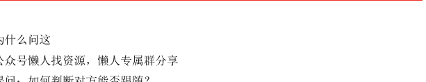

## 提问：如何判断对方能否跟随？

为什么问这

公众号懒人找资源，懒人专属群分享

提问：如何判断对方能否跟随？

为什么问这个问题，因为我现在在公司里遇到了信任危机。我现在是一家小公司的职业经理人，公司从成立半年没有搞起来，后来我作为第一个入职的员工，慢慢把业务做起来了，后面的技术，商务，业务都是我招的也是我手把手教他们的。一年多的时间，现在公司5个人。
公司股东A（51%），B（49%）C（B的另一家公司副总经理，B的心腹）
我是A招来的。C一直想让我离开，经常插手我公司的事务。
上个月我忍无可忍，我对A说：你要不要成立一家自己100%股权的公司，你单干我就跟你干。现在这个公司没法干活了！
去年因一个项目我想接而A不想接，我们彼此有了些隔阂，那个项目能够在市里有很大的影响力，也能辐射很多客户，那时候开始我觉得A没格局。
A的精力都在自己的公司，花在我现在这个公司的精力非常少。A自己公司的业务很多绕不开B。我看A对我们这个行业不够坚定，我看他也不想单干，的话我还应该重新注册一个公司只是安抚我。因为我不是B的人，B会给A很多资源，A也会踏资我，我还有必要跟随A吗？？
我觉得现在这个平台，我继续做下去也是可以，积累自己的客户自己的渠道，以后呢？也有很多人找我，我现在很苦恼
回答：
感谢提问，
你这个问题非常有代表性，我从刺激到温柔和你讨论下，
首先我真的做不到感同身受，因为如果换做C来和我说，那我听到的将会是另一个完全不同的版本，换做A和B来说，他们为什么不ALLIN，也肯定有他们的理由，
接下来我们来确定一个词，叫做“贡献度”，就是这个词都不要提起，人们总是下意识的强调自己分内事的重要性，而忽略了同事，渠道，资源方，信息方等角色他们手头事的难度，
然后，位子决定眼界，真做过老板，也就是单干，才知道很多事情的难度，才发现有些事自己搞不定，格局大小，可能只是当前最佳解的选择而已，
再来，是你优秀的业务能力，如果我是你，我会给自己一个月时间，沉住气，与人为善，刻意精进，然后三手准备，
第一，我建议真正沉浸到从获客到成交，落袋为安以及后续交付的每一个环节，去寻找自己是否有哪些环节是搞不定的，有没有哪些资源是高端资源，一定要依靠别人，
第二，这个月ABC都会看到你的变化，如果圆满过渡到共赢，那是皆大欢喜，如果不能，也许我们能觉察一些原因，比如，之前a为什么不带着你单飞，无非是两种，
1，这钱，他看不上，2，这人，他没把握，
经过这个月，你应该能发现到底是为啥，A也许能发现，原来你才是那个核心人员

第三，都说，事有不得，反求诸己，如果经过这一个月的内观，发现好多事，比如，原来咱们自己也有一个原原因，比如，太急了，小丑竟是我自己，A好暖，没替他想到这个，原来这事儿不简单，但C确实是个混蛋，

这时候，你心里有底了，再考虑下一步，嗯嗯，谋定而动！

### 评论区：

布鲁斯船长：向涛哥学习，晚上入睡时间正在慢慢后移，已经到凌晨两点了，加油[愉快]

杨晨，杨晨：：涛哥感觉在凌晨三点到五点之间瞌睡[偷笑]

布鲁斯船长：铁人涛哥[呲牙]

江大虾：五点睡，九点半起

横眉冷对秋波：创业也好，赚钱也罢，都要有个好身体，想要身体好，饮食和运动需要两手都要抓，不知道怎么抓，我就敢对了[呲牙]

德明：这是身体力行的早。验证早睡

心理諮詢師-根源：涛哥说的早睡

是不是接近早上才睡的意思？

杨涛：是指年轻人要早睡，
年轻人身体不好的自知要有。

公众号懒人找资源，懒人专属群内部分享

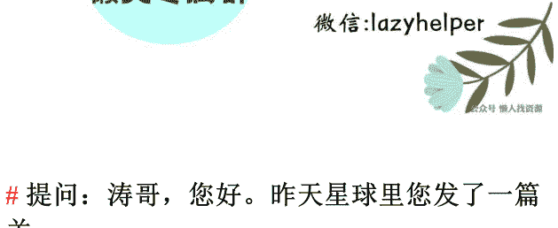

## 提问：涛哥，您好。昨天星球里您发了一篇关

公众号懒人找资源，懒人专属群分享

提问：涛哥，您好。昨天星球里您发了一篇关于威鱼培训的文案，说藏着镰刀的。

我的问题是：

+   1..怎么分辨这种培训课程？带镰刀的一般有什么特征？
2.作为像我这种分辨能力不强的人，应该怎么去选择去学习，尽量少掉坑？

我的思考：

+   1.市面上大部分培训课程文案，都跟上面的例子差不多
2.我之前是怎么选课程的？

首先项目看着逻辑讲得通，然后有比如收入啊，评价啊等等的截图，再看课程目录，感觉是那回事。最后就报了。能力差经验少，真的没法分辨他说的是真是假。

谢谢涛哥的时间和经验！

回答：

感谢提问，
我从心态转变和实操两方面说说。

首先，我没说哪.crypto课程不好，还夸它行文结构，嗯嗯，正题，心态上我们要有主动被割的觉悟，市场上课程确实多而杂，难分辨，搞得风气不好，但是，希望你冷静下来想想，我尝试举两个例子，

+   1, 发现大部分人哔嗒的是，如果他那么厉害害，那为啥还要出来教人做，为啥不自己做，巴拉巴拉的，我的理解是，世上可能有两种角色，一种叫教练，一种叫运动员，再厉害的球员，他也需要一个教练，然后打累了，可能也去做教练了，不用奇怪，一个未来的好运动员要做的，只是用他的认知和运气，去发现一个好教练罢了，
2, 大部分人哔嗒的是，谁谁谁又在割韭菜了，其实呀，想一下下，如果没有传道授业解惑的人，那么我们要如何获取知识呢？

如果一个人能有那么多人为他付费，他本身就不简单，而且他的圈子肯定也不简单，
韭菜721定律永远适用，总有人盆满钵满，总有人一无所获，（韭菜721定律，即7成学员两手空空，2成学员收获满满，1成学员原地起飞，）

然后，是实操方面，

+   1, 看内容，你都已经临近付费边缘了，那么你对这个领域，是有着最起码的理解，结合你的理解，看对方的推文，大部分好的导师，一般不鼓吹，不煽动焦虑，不过度承诺，

比如字里行间，在矫动你的中年焦虑，宝妈焦虑，副业焦虑之类的，一般得多想想，

比如字里行间，承诺你能几天时间就如何，一个月就能如何，瞅着有买了他课，直上人生巅峰的既视感的，也多想想，

2，看背书，很多课哄的，都有花式头衔的各种大佬站台背书，但是其实你很多都不认识，花花轿子人抬人，这个无可厚非，抱团营销也是很好的策略，

这方面，我的好课分辨原则是，有行业或者相关行业，五年以前就成名的大佬，且这个大佬你本身熟悉且尊重，那么，就无脑买，因为一个是这些稳健的大佬不会轻易给人站台，另一个是，就算是大佬走眼，你就算当为信仰买单，踏实，

3，最短信任链，也就说你从哪个朋友这里知道的，你直接问他，靠谱不，你如果信任一个人，就信任他给你推的课，这是决策成本最低的，一直信下去，直到有一天，你发现，哎，这个朋友审美/认知不咋地呀，然后换一个，

嗯嗯，祝一切好，加油哈~

### 评论区：

布鲁斯船长：向涛哥学习，晚上入睡时间正在慢慢后移，已经到凌晨两点了，加油[愉快]

杨晨，杨晨，：涛哥感觉在凌晨三点到五点之间睡觉[偷笑]

布鲁斯船长：铁人涛哥[呲牙]

江大軒：五点睡，九点半起

横眉冷对秋波：创业也好，赚钱也罢，都要有个好身体，想要身体好，饮食和运动需要两手都要抓，不知道怎么抓，找我我就对了[呲牙]

德明：这是身体力行的早。验证早睡

心理諮詢師 - 根源：涛哥说的早睡

是不是接近晚上才睡的意思？

杨涛：是指年轻人要早睡，年轻人人身不好自知要否有。

## 提问：这篇提问方式不对，但我没有删除，我

公众号懒人找资源，懒人专属群分享

提问：这篇提问方式不对，但我没有删除，我用另一个号重新发在了提问板块，再次提醒下，使用星球的“去提问”功能，我都会在48小时内尽量回复，不然很有可能延迟没看到，然后导致错误的 小误会。

回答：

这是一个我能轻松写三万字的话题，在吃到你请的排川之前，我简单写写，

首先你的第一个问题，问的根本不是创业，我得先给平民创业立个意，所谓创业，不是买卖，不是淘宝开个店，不是兼职副业，普通人创业的本质，就是一个不断整合并优化手头现有资源。像滚雪球一样，把这些资源不断放大，并在这个过程中创造价值，获取利益，从而维持这个雪球不断壮大，直至实现某个社会意义的过程，这个社会意义可以是你在哪某领域，服务过多少客户，可以是你有了多少人知道的品牌，也可以是你有了多少人的稳定团队，并且持续或即将持续多少年，

要具备什么要素呢。

首先，是努力，这是最基本，最不重要的因素，甚至不值得一提，但是，我来给你一个量化的标准，就是最起码要比同行更努力，持续的，不受意志发展好坏影响的努力。

然后，身体素质要好，创业就是一个拼体力，然后拼脑力，然后最后回归到拼体力的一个流程，琐碎多，压力大，身体素质不行很难走得更远，先帝创业未半而中道...

然后，心理素质要好，这里

+   1 如果敌，大部分时候，普通人创业是一个用节奏感不断追逐时间窗口的游戏，优柔寡断的人，是不配拥有机会的，没有一颗勇敢的心去担当，去扛板，运气是不会反复眷顾你的，
2 是刚毅，曲高和定和寡，随着你的发展，理解你的人越来越少，你的时间也越来越少，孤单如风，常伴吾身，江湖是复杂的，你受到的外界影响一定是越来越大的，做得不好被众人不笑，做得太好众人眼红，总之，你逃不过非议，躲不过孤单，

然后，你要有相关沉淀，不论是技能思维，资源人脉，信息资讯等方面沉淀都要有，经常听到关于专才和通才的讨论，不要有错觉，那是针对职场，普通人创业者必须是一专多能型人才，一个强大的攻城锤，用来安身立命，广博的知识面和信息甄别能力，数据分析能力，对业态的洞察，一些前瞻...老多了，这些技能用来“降本提效”，结合起来，才有可能活着，

有了这些几个你就可以尝试创业第一步了，然后你想做得好，还需要有使命感，价值观念要正，有愿景、克制、忍耐、激情、创造性，发散思维，沟通能力强，共情的能力，视野，格局，有没有发现我没有提管理，因为普通人创业者，能够拥有一个好团队，是几乎不可能的，而一个有着三五核心，其余人员变动频繁，却能动态平衡，战斗力稳中有增的团队，应该是最明智的选择，因为，这样对创业者的管理能力要求最低，

总结一下，自身综合素质（双商）+一技之长（流量强，产品强）+获取信息的能力（接近真相），我真拍床不住啊，over，Ps. 全程提投资本，因为普通人没钱，打法不一样，

然后第二个问题是我怎么看？

我认为呀，创业是超级玛丽和神庙逃亡的结合体，

为什么是超级玛丽，因为创业需要不断的吃到不同的蘑菇，需要变大，变强，需要不断的跳跃，预判危险，不断cplusplus各种boss..

为什么要加上神庙逃亡，因为，创业，没有尽头，

（本写到这里尾巴，通稿最高，想了想，再解释一下，创业到了中期，你就停不下来了，团队，业态，客户，资本会逼着你向前，直到你的公司，完成它的历史使命，然后从属于它的生态位上，退下来，渐渐，留下，或不留痕迹）...

评论区：

布鲁斯船长：向涛哥学习，晚上入睡时间正在慢慢后移，已经到凌晨两点了，加油[愉快]

杨晨，杨晨，：涛哥感觉在凌晨三点到五点之间睡觉[偷笑]

布鲁斯船长：铁人涛哥[嘻牙]

江大虾：五点睡，九点半起

横眉冷对秋波：创业也好，赚钱也罢，都要有个好身体，想要身体好，饮食和运动需要两手都要抓，不知道怎么抓，我就就对了[嘻牙]

德朋：这是身体力行的早。验证早睡

心理諮詢師-根源：涛哥说的早睡

是不是接近早上才睡的意思？

杨涛：是指年轻人要早睡，
年轻人身体不好的自知要有，

刘杰 昨天23:40 阅读人数 169

# 问杨涛

经常会被问到，什么样的人适合创业，又或一个个人如何判定自己适不适合创业，我不知道该如何答。

一如现在很多社群都在讲怎么赚钱？各种各样的副业、项目、套利…对于很多小白来讲，也许缺的不是项目，而是如何判断一个项目是否适合自己操作的思考方法。

我见过很多兴致勃勃要大干一场的 人，也见过不少干了没多久就中途因各种原因放弃的人。

涛哥是怎么看待创业这件事？

## (57赞)如何成为一个优秀的标题党，

刚和助理一起整理资讯

公众号懒人找资源，懒人专属群分享

(57赞)如何成为一个优秀的标题党，

刚和助理一起整理资料，翻出了多年以前的一个文档，再看觉得依然有用，标题这东西，好坏差异大，和打开率息息相关，有两种用法，

+   1. 引流选手，你可以好好用，黑猫白猫，数据说话，
2. 个人ip选手，慎重用，毕竞你的内容决定你的读者画像，但，再有心理洁癖的选手，好好看看，里头应该还是有很多点能击中你，

(超链接： https://xws30qr76u.feishu.cn/docs/docenWDCTP6DOxc9...)

评论区：

三林：卧槽 一出就是这么厚重的资料

Mr 刘：赞，所有的标题几乎都涵盖到了

张小染：niubi了涛哥，几年前的文档依然非常好用

明白（晚9点半睡觉）：收藏，举一反三

巴氏：傻瓜手册啊，拿来就能用啊

公众号懒人找资源，懒人专属群内部分享

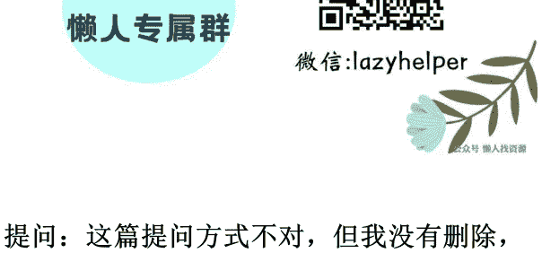

## 提问：这篇提问方式不对，但我没有删除，我

公众号懒人找资源, 懒人专属群分享

提问：这篇提问方式不对，但我没有删除，我用另一个号从新发在了提问板块，再次提醒下，使用星球的“去提问”功能，我都会在48小时内尽量回复，不然很有可能延迟没看到，然后导致啼笑皆非的小误会，

回答：

最近的问复很多都是关于副业的，希望大家冷静，不要被所谓副业焦虑感感染，接受自己是一个普通人的事实，未尝不是一种大智慧和勇气，

我大概说一下副业成功的概率吧，在没有天分，技能沉淀和积累的前提下，比如写作，男帅女美，能说会道，之类的天赋，投入时间精力去做副业的人，最终能和主业收入持平的，20%左右，也就是等于啃盐活，副业远超主业，直上巅峰的千分之四（原话好像是马爸爸，我忘了），剩下的那80%，都是摔了夫人又折兵，

好，（客观和主观，我还是拎清楚比较好），那我开始讲副业和你的问题，

技术要的，这是安身立命的根本，我们很功利的说，你的技术也是你吸引粉丝，引起共情的一个很重要因素，人们更喜欢看到一个技术大牛还有时间做副业，副业也很成功，而不是一个被行业淘汰的卢瑟，然后瞎鼓捣一些东西，虽然有点成绩，但是说服力不强，

平衡主业和副业请看下文，嗯，今天星球不能分享链接，辛苦你去->（看星球精华里头的主业和副业），

然后我再补充一句，你搞副业藏不住的，原本就不是很有信心的主业，可能会雪上加霜，职场，不纯粹，不善良，可能会给你带来一些麻烦，

在你没有提高自己的分辨能力，信息甄别能力的时候，不要相信市面上大部分的副业教程和讲座，都是割你的，这里秀秀中一篇我觉得很锋利的镰刀，（对课的内容我没上过，不评价，只是写得好是让你们学习和了解套路的，不是让你们报），

么自己不做呢，诸如此类的杠精吧，

嗯嗯，感谢提问，祝一切顺利，

害，再说一句吧，副业，明白么，副业就是兼职的变体，和创业是两件事，测算下试错成本，多看案例，多总结，能有一份自洽的流程，干就得了，别搞那么高尚，（超链接：“空手套白狼”，我在闲鱼倒货赚躺318万，全款买房！你越看不起的东西，往往越暴利！）

评论区：

+   三林：卧槽 一出就是这么厚重的资料

+   Mr 刘：赞，所有的标题几乎都涵盖到了

+   张小柴：niubi了涛哥，几年前的文档依然非常好用

+   明白（晚9点半准宽）：收藏，举一反三

+   巴氏：傻瓜手册啊，拿来就能用啊

# 详情

毅鸣
7小时前 阅读人数 476

#问杨涛

涛哥好，我先做下自我介绍：

我网名叫毅鸣，92年生人，是一名程序员，一名在深圳工作了6年的Java程序员，也是一名不甘于只做程序员的程序员。因为程序员大部分都是吃青春饭的，对于我们普通程序员来说（没有好的学历、没有特别扎实的技术功底），想要突破这个瓶颈进入大厂或者说走技术路线一条道走到黑，真的 desaparición难上加难，加之程序员35岁的宿命，焦虑感与日俱增。

因而，因为自己比较会搜索资源，因而前两年做了个公众号，做的是各类资源分享的号（其中涉

及版权问题），后面没在维护，虽然吸粉几万人，加到微信上的也有上万好友，但是这些人，非常杂，大都只是伸手党，不好变现，也没有打造好个人IP，用户粘性不强。在做这号期间，虽然也赚了点钱，但收获更大的是学习了很多关于自媒体、关于社群运营、公众号运营、写作等方面的知识。

这两年为了提升自己的认知，也加入了一些付费社群，如曹大的星球、生财有术、淘客公园等，有些也都续费好几期了，虽然在里面没做什么输出，但也学到非常多，特别是开拓了自己各方面的视野和见识。可以说比起其他的程序员来，我算是跳出了那种典型的程序员思维，可以看到一些除了程序本身的点上了，能比他们考虑的更多一些，能看到的更远一些，也算是这几年的收获吧。

因为看的多了，考虑的多了，也经常会有一些自己的想法，也一直在尝试一些小项目，但是做着做着就会发现，很难平衡工作（主业）与副业，也很难平衡家庭与副业之间的关系。很多项目，做着做着就会心力憔悴，因为投入的时间往往非常有限，哪怕是很不错的项目，刚起步没有足够多的时间投入，往往会不疾而终。为什么明明知道需要多投入时间，而又不去投入呢？因为程序

员的工作，任任需要加班，住公司也基本上处于饱和状态，从早上8点去上班一直到晚上8-9点钟回到家，一天80%的精力基本上都投入在了工作上，我知道晚上8-9点能到家还算好的，不少程序员可能回到家已是10点后了。所以一天下来，能自己安排的时间就只剩下晚上到家至睡觉前的那2-3个小时。加上小孩出生后，晚上仅有的那2小时，也基本上投入到了家庭，故而很多想法都无法开展。

最近又捡起之前的一个公众号来写了，现在想的是既然自己有很多想法想去做的而又做不了，我何不把那些想法写成文字分享出来呢，当然了，这些想法也不完全是凭空自己臆想出来的，而是在网上看到很多案例后根据自己的理解重新组织文字输出的，目标是一年输出100个副业案例（主要是提供想法和思路），希望对有些人有所启发，不过刚开始做，也时常怀疑自己，这类型的号是否值得去写，涨粉这么慢，阅读量这么低，是否还有坚持的必要。

综上，故而有几个问题想咨询涛哥，万盼回复，不胜感激~

+   1、在有限的时间内，值得花更多的精力去提升技术吗？还是应该花些精力提升除技术外的知识，找到合适的副业以解程序员35岁之宿命？如何平衡主业与副业之间的关系？（我考虑的是做程序员，哪怕是月薪达到50k，一年的收入也不过60万，除掉吃喝及日常开销外，所剩无几…….)

2、关于副业案例的公众号，是否值得去写？

3、结合我现在这情况，希望涛哥能给我一点建议。

感谢~

分享赚 ¥ 93.00

等你评论，等你“一鸣惊人”

公众号懒人找资源，懒人专属群内部分享

公众号
懒人找资源
懒人专属群

微信:lazyhelper

## 提问：涛哥你好，我的提问分主业和副业两部

公众号懒人找资源、懒人专属群分享

提问：涛哥你好，我的提问分主业和副业两部分，占の方涛哥时间会比较长，感恩。

主业：我从事7年知识产权，主要是商标规划、申请、转让到疑难案件的确权。

### 【目前主业面临的现状】

+   1、行业大环境：头部化发展，商标申请这方面已经被互联网碾压，阿里、腾讯、天眼查、华为都在做商标注册，自带流量入口，而且补贴扶持，和之前社区团购一样，我们类似菜农。互联网的介入，提高了效率，把一对一咨询服务的非标品变成了标品。目前单阿里的注册量就占据整个行业的12%。
+   2、目前我们的申请量是全市TOP7，但是量也并不大，份额除互联网公司外，还被北京有天优势（商标局旁边、自称有商标局关系）等其他一线城市瓜分；我们在绍兴，3线。目前年净利润在30-50万之间。
+   3、行业壁垒很低，很多其实是一个人就能上手，红到发紫。我传统小机构还能在一个小的生态圈存在，我思考了下主要是凭专业服务好了原存量好客户，新客拓展目前是大瓶颈。

### 【目前做的好 的同行】

目前同行相对比较好的方式（除互联网公司外）

+   1、服务同行：公众号引流，聚集同行，最后服务同行。因为商标代理业务，基本都是几个人就可以做的小机构，甚至很多是个j ，那么接单，技术端直接外包给他们。

拓展业务线：比如同时做注册公司、代理记账、企业荣誉、科技项目申报（比如高新技术企业）两个优势：第1，一条龙服务，企业省心，增加客户黏度。你想啊，我财务都在你那，就放一起了。第2，相当于捆绑销售，增加了利润。

面临的现状是：拓展的业务基本都是本地化业务，本地存量其实更多已聚集在老牌公司手里了。投入产出比方面

### 【提问环节】

从涛哥的视角，帮我分析下，接下来何去何从？确实迷茫了。

副业方面：
因为主业是一对一的咨询，交付成本很高，天花板比较低，所以想找一个能指数级增长，边际交付成本较低，且未来3-5年可持续的新赛道。然后，发现互联网玩法很多，都在囤头发财，自己思维僵化，一时不知道怎么入手，焦虑。于是新开了一公众号，打算做日常的输出。在没有任何擅长领域的情况下，方向暂时定在自媒体：方向为金违约、职业规划、职场管理沟通，这是拍摄镜头选定的方向，请问涛哥，有没有一种数据化的工具或方式，来找行业的热力指数？

回答：
感谢提问，非常形象化的问题，

从08年到现在，我也经历了代注册从1800到1500到1200到900到现在600。也许这是商标人最后的倔强，（你们成好好像是300对不对，）有些问题是无解的，就像每年都有几个行业彻底消失，

从外人角度来看，我还是有一些建议的，

首先，鼓舞一下，年商标注册总数还是环比健康增长的，对吧，那么，商标持有人，不管个人还是企业，我们都认定这个商标是商务，然后，我说几句，

商标从无到有应该会经历商标取名，商标设计，商标吉祥等好多环节，你应该头上有很多相关的服务商，我觉得这里每一个利润都比哈哈哈做商标注册来得高，CPS走起吧，

你能否注册一堆的商标当投资，等R了以后，然后卖给那些做电商，需要R标的人呢，日常你少吃一顿烧烤就是一个商标标，放一年多，起码能卖八千一万呢，

居间的商标买卖，是有利可图的，你这些年上手商标你都有跟踪么，做成库，然后供需双方你都认识，用你的职业经验去定价，供方多积累，或者有戏再和供方谈，场景1，新客户，直接问，急不急，要不买一个吧，你一定干过这事儿，可能没有计划过怎么占据一边，（我指你手上的热门类目商标足够多，）

需要商标的人，都是商家，代注册韩的，不比你蓝，但只要是个商家，就一定缺钱，据我所知，有很多集成的货款平台，手续费能到(不可说)%。你无需担心你接触不到银行资源，你只要找到一个平台方，接入一下就好了，然后给商家提供货款服务，风控和放款都是平台方打电话，你要做的只是用你已经建立起来的信任，说，涛哥，你注册一下这个，利息低、额度高，好了，资料我自己填，但你拿，我还得请你吃饭，感恩戴德，以后商标都在你这里买，（然后这中间，包括涉税方面有很多不可说业务，利润更高），

总结就是，需要商标的客户，他有什么，他又要什么，满足他！

（题外话，去短视频平台等平台多搜索商标相关的词，你可能会有捡多惊喜，尤其是看到广告，深挖一下），

副业，看到你那又是指数级，又是可持续的，有点担心微臣做不到，

选方向的话，热门指数我并不建议，对新手来说，主要是深刻挖掘自身优势，然后躬身入局，大盘看了再定，没咋用，因为，蛋糕大，分的人多，蛋糕小、分的少，胜出几率，是差不多的，

然后硬要说的话，数据工具太多了，短视频工具，抖查查，蝉妈妈，B站，有火枪云，各种行业分析平台，清博，易观，然后搜索这边，5118简单好用，各种指数工具，然后知乎相关的，但是其实完全人肉都可以了，比如你打开抖音，点KEEP发布，输入个名字，你都能看到行业热度排行，嗯嗯，我觉得你还是选一个离钱很近的事儿，直接先赚到钱，

好啦，祝你一切顺利�呼~_^再次感谢你的提问。

### 评论区：

三林：卧槽一出手就是这么厚重的资料

Mr 刘：赞，所有的标题几乎都涵盖到了

张小柴：niubi了涛哥，几年前的文档依然非常好用

明白（晚9点半睡觉）：收藏，举一反三

巴氏：傻瓜手册啊，拿来就能用啊

公众号懒人找资源，懒人专属群内部分享

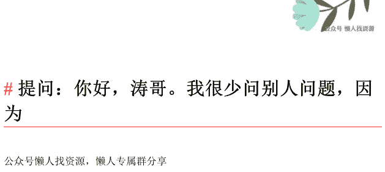

## 提问：你好，涛哥。我很少问别人问题，因为

公众号懒人找资源，懒人专属群分享

提问：你好，涛哥。我很少问别人问题，因为我觉得我不会提问，或者说问了没有价值别人也不回复。然后反复我就不过问了。我想问你一下大家总说看透事物的本质，底层价值，向内探究什么的，这个底层逻辑都是些什么，能讲解吗？

回答：
例行开场，感谢提问，每个好问题都将得到我的认真回复，

首先，我纠正一下，这种能力不玄乎，确实存在，而且通过刻意练习可以实现，

我尝试给你举例子，比如，今天我去看了一场电影，那么可能会发生以下训练，

大部分的商场，有没有发现电影院一般都在顶楼，为啥，因为看电影是一种目的性很强的行为，也是你的诉求，但是商场的诉求和你的不一样，它的诉求是让你多逛，然后你就有机会多买，那如果电影院放在一楼，你看完就走了，那么商场人流量就少了，

也可以这样解释，一楼是旺铺，店租贵，顶楼便宜，电影院要便宜的，旺铺要给大品牌，

然后你逛商场还会发现电梯的螺旋设计，你上了二楼是不能马上上三楼的，你一定要走一段路过去，这不，流量又有了，

你还会发现，lv等奢侈品排的长长的队伍，店里只有几个人，为啥，因为它每个店规定只能放几个人，不然影响了尊贵的客人的购买体验，排队还能吸引那些带着女友的土豪，嘿嘿，

然后，你还可以继续想，lv的品牌价值里头，有多少是由这些买不起的人决定的呢，我认识，但是我买不起，然后我就会对那些拥有lv的小姐姐投去羡慕的目光，在这时候，她买这个包的价值，就体现出来了，这满足是有钱人最深层次的需求，并愿为此不计成本的付出代价，

是吧，这就是刻意训练，而得出的本质就是：流量至上，资源配置，浏览深度，转化，体验，从众，自我的实现，

对吧，这就是你要的那种思维模型的底层逻辑，我尝试养成这样一种本能，那么你的日常生活中的每一个细节，都能得到结果并加成到你的认知中，

加油，也期待其他圈友参与，[奋斗]

### 评论区：

三林：卧槽 一出手就是这么厚重的资料

Mr 刘：赞，所有的标题几乎都涵盖到了

张小紫：niubi了涛哥，几年前的文件依然非常好用

明白（晚9点半睡觉）：收藏，举一反三

巴氏：蓦瓜手冊啊，拿来就能用啊

## (84赞)彷徨人生的顶级技巧，学会提问，

古希腊的内容沉淀

公众号懒人找资源，懒人专属群分享

(84赞)彷徨人生的顶级技巧，学会提问，

古希腊的内容沉淀形式多数是问答体，中国历史上，叫问对，一问一答即成文，

苏格拉底，柏拉图、理想国，论语也是，这是最初探讨智慧的方式，

现代社会的科研和商业行业为过程中，每一个事后被证明优秀的解决方案，很多时候都是起自于一个精妙的问题，

所以，我认为学会 region 出一个好问题是每个个体必须掌握的顶级技能，

那么提问有什么技巧吗，我说两句，

那如果润一下，加上，你的产品属性细节特点是什么？你的用户画像怎么样？你曾经做过怎样的尝试，有没有效果？你想要拿到什么结果？……等等很多，当然你要举一反三，而不是照搬以上这种提问方式，

那么经过这个润色之后，就变成了：

涛哥我是卖房的，楼盘偏高端，我试过虎嗅停车场发传单，高端商场做广告，效果并不是很好，我想请问有什么比较好的方式让我获客更容易？

嗯嗯，这就是一个好问题的雏形，

当然了，还不够好，但是你可以先试试用以下的几个词武装自己，「what，who，where，when，why，how」，「做什么，去哪儿做，谁来做，什么时候做，怎么做，为什么这么做」，这样，多思考你就能问出很多优秀的问题，同样适用于开会，作报告，总结，以及日常请教和沟通中，

好的，要不，咱们就尝尝先使用一下向我提问的功能，然后前10名好问题，我会给出500字以上的回复，并且放出来让大家参与讨论，来啰~

### 评论区：

家蒙：有类似感受，遇到无厘头提问会很头疼
兔八哥：提问也是一门技术啊，提问前先想一想，捋一捋思路，组织一下语言，突出重点，不然被提问者也很难以回答问题，两者不在一个点上，就无法更深层次的交流。
花天卓：在这里也看到你啦。刚才还看了你的视频号呢，圈子真小[偷笑][偷笑]
随心：提问是个技术活，还在学习，不敢轻易同
家蒙：感谢🙏，视频号要做起来

## 提问：星球名是“平民创业手册”。好奇问涛

公众号懒人找资源，懒人专属群分享

提问：星球名是“平民创业手册”。好奇问涛哥：

+   （1）你定义的“平民”是什么？哪些特点让“平民”区别于“非平民”？
（2）每个人都有自己独特的内在资源和外部资源，只有时间是对所有人平等的。对“平民”来说，最容易忽略的资源是什么？最容易过度消耗的资源是什么？

（3）不谈解决方案，只提问题：“平民”最容易在哪些地方，存在思维或心理上的局限？

回答：

要是有所有圈友都像你这样发问题出来讨论，我可老开心了，感谢提问，

然后发现是一道送命题，小白你可太坏了，

我定义的平民是包括我在内的99.6%的普通人，指出生不大富大贵，没有天赋异禀（智商/外形），的普通人，

然后我定义的非平民是指平民pro版本，以下区别都可以通过可以持续刻意训练去实现，如下：即不耍，不躺平，积极生活，勇于争夺资源，拥有一定的学习能力，且持续，有一定的发散思维，即横向迁移能力，擅于分析，思考，总结，有提高倾听的能力，无需提醒的自觉，自律，有抗拒及时满足的毅力，有设定目标的能力，能控制情绪，有条理，勇于逃离舒适圈，拥抱变化，与人打交道的能力，为他人着想的善良，根植于内心的道德，向内归因的能力，不逃避责任，肚量，不抱怨，不纠结于问题本身的意识，分得清轻，重，缓，急，对数据的敏感，再配以一定的洞察和前瞻，我就不过说了，看起来好像在夸你，

第二题之前说个题外话，拔高的说，普通人最容易忽略的就是自己和家人和朋友其实都是普通人，不要有不切实际的幻想和要求，不然容易失望，

第二和第三一起答，最容易忽略的就是时间的宝贵，最容易过度消耗的资源也是时间，对使用时间的差别将拉开整体人生的差距，

再强调一次，在这个时代技能的差距是可以量化并且可以通过持续的训练快速缩短的，

普通人之所以常被劝退的第一个误区，就是所谓的“一万小时定律”，醒醒，那些大是需要肌肉记忆和肢体协调的技能才需要，比如钢琴，语言，且，并不是每个技能一定要登峰造极才能够帮到你的，一套均衡且能够相互orphous的技能构，在这个时代显得更为有用，

第二个误区是什么呢，就是不知道如何分辨这个技能的基本面大不大，就是应用场景广不广，且，有复利，比如，做电商某平台，你努力学习了某一项投放技能，确实牛逼，但是局限性就太强了，在这个平台做一辈子？是的，你也可以横向发展，去了解业态，去深挖底层逻辑，但，总而言之，同样的时间，这样的技能投入产出比是略低的，

除了以上局限，

思维和心理上还有类似，

盲从权威（那可是大师啊，能骗你么，就你最聪明了），分不清真假（我朋友给我截图了他的股票账号，他有内部消息），

偏听偏信（我和你说啊，他那个老人厉害了，我亲身体会过），

缺乏干净的信息源和信息甄别能力（我搜过了，没错的，吃两片，硬一宿），

沉溺过去无法向前看（卧槽，要是再给我一次机会，我一定怎样怎样），

呃，我就不往下说了，看第一个问题展开就是，

圈友中有朋友可能有更多独特的洞察，欢迎给我们可爱的小白一点标本，

### 评论区：

家蒙：有类似感受，遇到无厘头提问会很头疼

兔八哥：提问也是一门技术啊，提问前先想一想，捋一捋思路，组织一下语言，突出重点，不然被提问者也很难以回答问题，两者不在一个点上，就无法更深层次的交流。

花天早：在这里也看到你啦，刚才还看了你的视频号呢，圈子真小[偷笑][偷笑]

随心：提问是个技术活，还在学习，不敢轻易问

家蒙：谢谢💕，视频号要做起来

公众号懒人找资源，懒人专属群内部分享

## (127赞)人见人爱，提高转化，接待之王，

[PAGE 199]

前几天一个挺厉
公众号懒人找我找资源，懒人专属群分享
(127赞我见人爱，提高转化，接待之王，

前几天一个挺厉害的微商小姑娘问我，如何日常接待一些朋友客户，宾主尽欢，提高转化，我写一些细节，给了回复如下，场景不同，大家看着套用，

姑娘，我们承诺，「真心换真心，花小钱，大记忆，特用心，你和别人不一样，跟着你果然可以学到东西」，等最着原则，

尝试在「迎来送往，衣食住行」，等多方面做好一些细节，以期提高转化率和满意度，

我们从她过来开始算，

1，订酒店，订票，
订票这个，问一嘴，能发个人信息给你，就帮忙定，如果拒绝，就不再提，如果有订酒店的需求，有绝招，打开闲鱼搜索深圳酒店代订或者直接输入北京喜来登之类的，你应该会发现很多超低价的五星，我五一在杭州住了7天五星，比如希尔顿，一天才490，广州我更熟，有些五星才400不到，然后你这样经常跑经常接待的人，起码大城市都加上一两个能代订酒店的土著，各方面都舒服，高档餐厅各种中餐西餐自助餐，都能超低折扣，面子里子都有了，还不用花多少钱，

2，接入送机车，
如果你自己不常去接，或者有时候到达时间很晚，
建议是，自己日常打车的时候，最好加几个你觉得长得帅又能唠嗑的司机的微信，日常混熟，可以用比滴滴更便宜的价格，安排一个看起来像你自己人的司机，带你接送各种代理，相信我，久了之后这个司机就像你的专属司机一样，还能把你这个人 Nm

（插播一条，永远后挂电话----如果对方也刚好不挂，你五秒后挂，挂电话的时候保持微笑，对方能感受到的，）

3，请客吃饭喝茶咖啡喝玩，
除了那些忌口，特殊爱好，之类的细节提前问清楚能让她们感受到你的用心，起码你经常接待的路段周边，要认识几家非常有调性的咖啡厅，茶馆，饭店，且，你要加上微信，这样每次都会为你保留最好的位置，对于咱们商务洽谈来说，私密空间是最需要的，点菜提前点好，有没有人需要吸烟，这些细节也都可以提前和你的接待点的人交代好，
甚至比如，买单时候提前交代别过来特么喊，女士，您的消费总额是多少多少，当然

如果特高端，你就交代要过来喊多少多少，之类你再想想，知道你们女生爱洗脚或者按摩，你最好会所也认识几家，

## 4，日常陪伴，

提前安排行程，多一个备选项，以及时间管理，这些准备是必要的，另外，你的包里头，最好放上湿纸巾，充电宝等女性可能日常会用到的东西，这个-*兜感*，比如，最好根据人数，有她人数除以二的充电宝，这年头，一个很有意思的现象，手机电量足，人不焦虑，她能静 Jamal 的听你说多久，如果是去你公司，最好浴桌旁，混两条三孔的充电线，

（插入一条我也做不太好的，就是倾听可能比传授更能做好转化，适度满足她们的表达欲，全程微笑，多夸奖，真好用，）

## 5，伴手礼，

咱们搞商務的就发送伴手礼，伴手礼在200左右区间可以买到非常优秀的产品了，遵循几个法则，花小钱，想起你、不贵，看起来贵，又新奇特，还能日常用上，每次用上，都会想起我们可爱的小姐姐，比如小米有品里头有一些产品，就很合适，如果要送贵的，各种大促，买那种超级折扣，然后日常搜索非常贵的韩国品牌，小电器啥的都行啊哈哈，逢年过节送礼也可以参考，

## 6，愉快告别，

尽量和她吃一顿饭，再让司机送她走，哪怕是早上，可能只是花费2小时的时间，但是却能让她感受到特别不一样，送走发微信，路上顺利咯，抬点算时间，给她发你是是否已经降落了的微信，再抬点问她是否已经到家，然后快去休息吧，

先这些，各位如果有一些牛逼的小技巧，帮忙补充下哈哈哈，

评论区：

Nomore：涛哥牛逼
Jay：涛哥会做人
兔八哥：细碎很多，记下来，要考的
张顺 | 诸达教育：学习了，这个值365！
小怪兽—玖玖：6666细致！
沐云丰：制黑板，划重点，要考的小细节！【强】
奶糖：OMG！！真的很周到和细节
涛哥高情商
白巧克力：收藏

## (152赞)微信/微商必备小妙招，

比如，你以为你每次发朋友圈会有几个人看到？理论上一个五千人的号，你发一条重要提醒，其实看到的人并不多，这时候呢，平时很少求赞的我们，可以发一条超级优秀而正式的朋友圈，然后求赞，抽奖一部手机或者是任何奖品，然后，你就接个求赞吧，认真的，让你所有的客户和潜在客户，都点赞吧，然后这绝对是值得的，因为，你之后，每次有重要信息要发布，就可以去这条朋友圈底部评论下，这样，你所所有的客户都能收到你的提醒啦，等于是部手机换来无数次推送的机会，当然了，省着用，

再来，比如说我拿10个小号同时加入一个付费的群，有点小高端，然后争取加上这些群友，不说日常的打配合，比如今天想做一个小贵的网课推广，那么我就用这十个号按时段发这个网课，对于这个群里的人来说就等于，你有10个好友从六点到八点都在你的朋友圈刷到这个网课，你想啊，当你看到你的好友都买了都推了，同时又对你貌似又有用，你基本上就会买了，不会有太多的思考，最起码，你在你朋友圈里看到连续十个人说有个大佬叫曹家蒙，喔怕你不认识，起码也认识了，会去搜一搜吧，这是一个很有意思的事情，同理可以在宝妈群，小区群，或者其他相对垂直画像一致的社群里适用，

再比方说，你是做高客单医美的，或者其他高端服务的，你想重点攻克某个客户，那么你可以去翻阅她的所有能看到的朋友圈，记下一些关键词，比如爱听什么歌、什么电影、吃什么、玩什么、什么运动、罗列爱好，做表，然后，你就发和她一样的歌（她用网易云你就用QQ嘞，哇塞推荐一首好歌超治愈），嗯嗯，领会意思，一样的爱好的一切，然后朋友圈仅对她可见，你很难想象这样定点杀的攻击力有多强，一个人对和自己一样爱好的兴趣的人，最起码，抗拒心理会小很多，（追女孩，讨好领导，嘿，都能用上，）

再比如，先不写了，你们敢赞赏我就敢写，毕竟我是曾经写过一百条微信用技巧的男人，回头我发上来，

### 评论区：

- 二两：这就有意思了
- 小玫瑰：这里好棒啊！
- 佩奇：涛神牛逼
- 快乐星球驾驶员 ♡：hhhhh
- Dreamland：太牛了涛哥
- 花天卓：想看后续[愉笑]
- 互牛黄文强：第一条非常厉害👍
- Vincent：这个真绝了，流量思维非常活跃，涛哥叫涛神[强]

公众号懒人找资源，懒人专属群内部分享

## (81赞)正确而高效的学习方式，

其实呀，学会怎么学习，比学习本身，更重要，我们必须有线性而具象化的场景，去确定自己是否掌握了这份内容，简单来说，

比如，你想要做一个事儿，你必须告诉自己，几月几号，我将通过这样的行为，必须拿到如此这般的结果，

目标，是必须完成的，而不是想要完成的，而我常用的三部曲是，

- A, 归类整理，（比如，想学某个领域的技能，先把圈内同领域相关内容都看一遍）
- B, 横向迁移，（然后，求同存异的整理出属于自己咀嚼后的一篇操作流程和注意事项）
- C, 学以致用，（最后，亲手实操，遇到问题，解决问题的，不懂就问，然后拿到第一个正反馈）

评论区：

沐 文@人生转化率：学习的学会，万变不离其宗，掌握方法，快速升级！

涛哥牛🐂！

Nomore：牛通

小玫瑰：学到了，宝藏涛哥，这该死的魅力。

轩羽❣️：简明扼要的实操方法，受益良多[得意]

公众号懒人找资源，懒人专属群分享

## (112赞)第一次创业如何启动？

很多朋友常常会来问我，涛哥，我有个朋友有个什么产品，非常牛逼，涛哥，我老家是产什么的，价格非常有优势，然后我要怎么开始啊，之类的话，你们是不是也经常遇到，

我今天简单说几句。

「增长就是商业的逆向工程」，

不管你有钱没钱，想要付费流量还是免费流量，我们一起来按以下几步走，

第一步，我们先打开5118，然后点开关键词，然后输入你要做的产品或者服务，

第二步，你会看到搜索结果有很多，导出excel，

第三步，保留几个主项目，搜索结果，点击单价，和移动日搜索量（现在pc几乎可以忽略），

第四步，按移动日搜索量排序（抓需求，别yy，数据是残忍而真实的），

第五步，反过去用手机尝试搜索这些关键词，

第六步，通过反复的，不同关键词的直观搜索，找到前几屏都被谁占据了，

第七步，把这些对手，记下来，找到他们放的钩子，比如说加盟电话，客服手机号，微信，

第八步，把这些手机，微信，再次输入搜索框，获得对方到底在哪些地方获客，

第九步，整理他们能透出的关键点，总结出规律，

第十步，干一样的事件，模仿他们，恶心他们，超越他们。

最后，请记住，99.9%的行业，不论产品还是服务，你的对手不会超过五家，不信的话，你现在随口说出5个洗衣机品牌？5个内衣品牌？5个牙科品牌？

嗯嗯，你只要找到你领域的这五家，模仿，跟跑，并尝试超越，就以咯，

噢嗯，做完以上行为，试错成本极低，在过程中，你就对业态有了基本的了解，是不是很值当？

### 评论区：

沐文@人生转化率：寻找，对标，模仿，超越！！！！！
涛哥牛🐂！！！！
大时：涛哥牛逼！
子裕：你不止战略，更有战术，涛神
小牛：抄超越
花天卓：拼到最后拼的是耐久力，敬畏同行，超越同行！
疏空：涛哥牛逼
ShawnLee：涛哥牛逼[强]
小投巴巴：涛哥好，第四步，在感兴趣的产品前什么样的数据（检索量、竞争对手或者其他重点）才适合？

## (46赞)你每小时值多少钱？

时间就是金钱，要赚钱，首先要学会用钱去换时间，你有限的产能啊，尽量不要用在琐碎上，这个非常难，尤其是创业初期，不管你是经济上还是心理上，你要迈过事必躬亲这个坎，都很难，但是一旦你迈过去，这就是质变，

也许你可以尝试和我一起做个事儿，就是买一个计时器，每天开工的时候就按下那个计时器，吃饭玩手机接电话，休闲娱乐，任何非工作的时候就按暂停，然后得到的结果，就是你的有效工作时间，这个习惯会残忍的让你直面你的低效的事实，助你尽快迈过那个坎，助你更快地想通，“轻、重、缓、急”这四字真言，

当某天你收工的时候，如果计时器的时间超过五个小时，那么恭喜你，会发财的！

### 评论区：

沐文@人生转化率：专注，专注，专注！
上班八小时，绝不是工作了八个小时，有效比时间更重要！
涛哥牛🐂！
白瑞：[强] 有效工作时间五个小时

之前尝试过更加精准的记录时间方法，吃睡觉的时间都计时。后来发现这条才是最简单，最有效的。

可以把时间分为两类：工作和学习

时间记录 App: Toggl（扶梯子）、iHour

航大：记录有效时间的好处在于提醒我们：自己是否拼尽全力了

公众号懒人找资源，懒人专属群内部分享

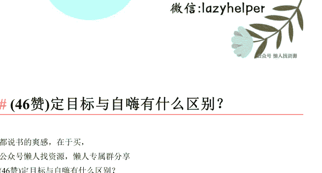

## (46赞)定目标与自嗨有什么区别？

都说的爽感，在于买，而不是读，人们在立flag的时候，总觉得自己是个巨人，仿佛立了flag，就等于实现了，

刚才啊，跟个姑娘吃饭，然后她巴拉巴拉说了一堆年目标啥的，然后我在想啊，嗯，她可能对目标有误解，

什么是目标呢，目标就是一定要做到的事，而不是想做的事，

你可能不知道大约只有3%的人拥有明确的目标，剩下的人呢，那都是自嗨哈~

如果你要定目标，记得写在纸上，记录下来，反复看，这样的话比没有记录自己的目标的人，你的成就将会高出八倍，（八倍这个数字来自Brian Tracy，全球顶级目标管理大师，）

评论区：

沐 文@人生态化率：做到的叫目标，没做到的就是口嗨...

涛哥牛❗

公众号懒人找资源，懒人专属群内部分享

## (31赞)这样发绩效，销量翻两倍，

老板们啊，时不时都会给员工发钱，但是呢，同样的钱，怎么能发出不一样的结果呢？其实呀，奖励和激励，是不一样的，平分的奖励，不如不发，

举个例子，

奖励是，10万块奖金，你平均分给你手下的10个人，那激励是什么呢？同样是10万块，

按照业绩第一名50,000、第二名20,000、第三名10,000、第四、第五，5000、剩下每人2000、

那这样的话，同时10万花掉，后者对团队带来的业绩提升，将会是前者的好几倍，灵活设置你的激励机制吧，这是相当有意思！

（必要时，结合同实际情况，适当加上未位淘汰/惩罚制度哦），

### 评论区：

沐 文@人生转化率：学到了，钱用的好，业绩才能翻倍！
涛哥牛🐮！！！

公众号懒人找资源，懒人专属群内部分享

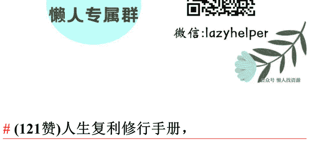

微信:laz yhelper

## (121赞)人生复利修行手册，

要如何确保个人/公司成长中的每一步，始终走在正确的路线上，把正确的事情做正确？

首先，成长路上，每一步，每一个选择，它不能是孤立的，必须像一个链条一样串起来、每一步，都算数，当下的行为或者决策，必须能对你的下一个决策或者行为有助力，所以，

超链接：https://xws30qr76u.feishu.cn/docs/docndckJMs9YW0K...

### 评论区：

沐 文@人生转化率：复利，在于每一天的“投资”！
向涛哥学习！！！

皇星：听涛说[好笑]
印石：听涛说
抬头看天·复利高，可终身复用的技能，才能持续赚钱
Harvey：向涛哥学习
尚游SANYO：果然人都是综合进步的，
技能，钱，人，影响力
建议个人开始进步的链条，先从其中一点开始
比如，一项赚钱的技能，以及不断的自我投资
当你做到一定程度，这个链条就开始起飞了
王海浪 | Apache：听涛说
从来没有以这样的视角去看待成长这个问题。
大神级的观点，醍醐灌顶。
封闭的小圈子太狭隘了，能进生财，能进涛哥的星球，今年最大的确定性幸福[玫瑰]
上善若水：听涛说。
芯洛：听涛说，个人表示每一篇都是刷新认知和启蒙的文章。

公众号懒人找资源，懒人专属群内部分享

## (80赞)混圈大法，做自己的王！

讨喜的人，他的人生边界到底有多宽？

人是在别人的帮助中，活下去的，最好要注意到这一点，个人努力是能有一些线性成长，

但是要实现跳跃性成长，就需要赶上时代的机遇，需要贵人相助，那么，要怎么实现呢？

超链接： https://xws30qr76u.feishu.cn/docs/doccnHVmkvDz78sZ...

### 评论区：

沐 文@人生转化率：最大的圈，其实就是自己~混好自己！[玫瑰]
涛哥牛！！
帅帅 学长～：发心利他 价值理他 真诚利他 涛哥厉害👍
K先森：真不错
倾心：深有触动强]
wendy 嗨：满满的干货[强]起到了警醒作用
横眉冷对秋波：腿翘着顶啊
艺术凝透凌云：浩哥，我今天又看了这一遍这个文章。然后又抓住了一些点。你里面讲的那个关于总行走心侨组，你有没有“模板”？嘿嘿
杨涛：你可以做一份我帮你改。

## (63赞)如何平衡主业和副业/兼职？

首先我们审题，并且剥离繁杂的个案，普适性的来聊聊，中年焦虑，宝妈焦虑，副业焦虑，哪来那么焦虑的哦？

超链接： https://xws30qr76u.feishu.cn/docs/doccnG19wFOX0QcG...

### 评论区：

沐 文@人生转化率：要聚焦，不能东一下，西一下~
涛哥牛💪！
wendy 嗨：我也意识到了，聚焦的确很重要，曾几何时，刚创业那会，搞了十三个小项目同时测试，那段时间内简直是精神分裂，最后收获了一个亏空的身体和N多白发之外，还有血淋淋的失败教训[皱眉]
55号。：涛哥好，关于主业副业的问题想恳请教一下；

我现在主业没有了上升空间（职位和薪资），每天感觉做的都是一些重复的事情，基本上都没有空间，也比较少机会学习到超出自身经验的东西，好处是收入也还算可以，但是满足不了我现在的开销，因为要结婚，又有了房贷，马上有车贷，如果只靠这个薪资，压力会非常大，但是涨薪基本上市不太可能了，工作又比较占时间，尝试了一些副业，都没有什么结果，由于精力问题，都没有办法很好的进展下去；现在每天都很纠结要怎么做，知道需要改变，但是不知道从哪里开始改变；

目前的想法：先工作到年底，把结婚了，然后离职创业。在这半年的过程中做一些适当的副业，但是刚刚上面也说了，精力确实分散不开。

所以现在每天都陷在极度焦虑当中，焦虑的状态已经影响了正常的工作。

麻烦涛哥能够给一些建议，感谢感谢🙏

鉴鑫：不买房不买车，立省百分百。心态稳后，聚焦主业，提高主业业绩以及延展主业涉及到的核心技能在其他场景的应用，一直做到有机会获取被动收入为止。

PS：看完你的问题，感觉你的刚需是花钱而不是赚钱...

公众号懒人找资源，懒人专属群内部分享

## (58赞)销售团队提升转化宝典，

除了人人都在说的专业，忍耐，自信，执行，学习，分析，观察，耐心，沟通，逻辑…这些基本的业务素质，想要做好转化，还需要有一些套路，我把它叫做“决战在专业之外”，

超链接： https://xws30qr76u.feishu.cn/docs/docenkG93k3fCuS...

### 评论区：

刘磊：沙发[呲牙]
低头赶路，抬头看天，
涛哥，牛！

wendy-萌：收获颇多，细节决定成败，是份不错的教材

橙与陳颈：TGNB

苏木一：涛哥，飞书文档中有几个图糊了，在Tips25 部分，涛哥抽时间可以更新一下噻[害羞]。

公众号懒人找资源，懒人专属群内部分享

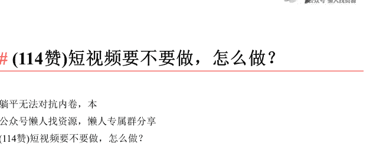

## (114赞)短视频要不要做，怎么做？

躺平无法对抗内卷，本质还是资源的争夺，

一直认为，硬件带来的趋势是真正的趋势，手机体验，通讯技术，各路APP的不断涌现和迭代，主导着生产工具和造血逻辑的演化和过度，在山和海的那一端，必将存在着巨大的流量和机会...

超链接： https://xws30qr76u.feishu.cn/docs/doccni3Vv4zxF5Ag...

### 评论区：

沐 文@人生转化率：不对吧，没有沙发~

我来了！涛哥牛🐂！！！

田先生：板発

尚游SANYO：一个字，高效！

wendy 嘞：这篇文章简直是干货满满，涛哥是个舍得分享的牛人[强][强]

闫知美：涛哥我也太喜欢你了吧！！！哈哈哈哈！！！

小小谷：太亏了！

张小枫：干[发呆]

糖果很咸：涛哥我也来了

公众号懒人找资源，懒人专属群内部分享

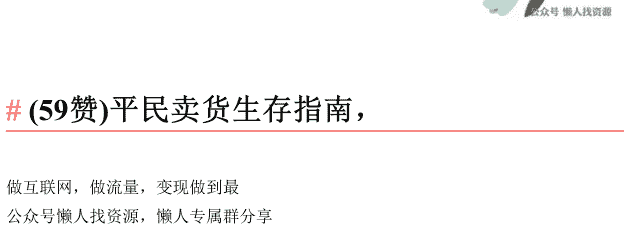

微信:lazyhelper

## (59赞)平民卖货生存指南，

做互联网，做流量，变现做到最后，九成九绕不过去的就是要碰货，也就是实体产品，不论什么形式，直接间接，都得碰，

今天我们从第一人称视角，聊一下卖货需要关注的几个重要元素：

超链接： https://xws30qr76u.feishu.cn/docs/doccnC0bneUIqHoy...

### 评论区：

心理谣谣师 - 根源：太可怕了

wendy峄：学习了，感谢分享

王冰冰：慈悲似我，笑嫣如花，是夜，
尘尽光开，照破山河万朵。

奶糖：太阔怕了[皱眉]

看完我的：卖货真不适合我，创业会计也是不适合我的

公众号懒人找资源，懒人专属群内部分享

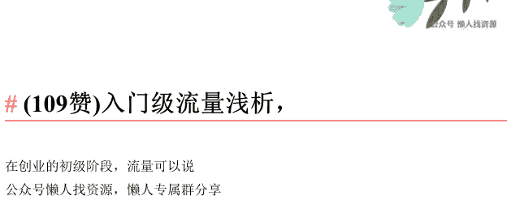

## (109赞)入门级流量浅析，

在创业的初级阶段，流量可以说是一切商业行为的根本，如何获取流量几乎是每个创业者避不开的话题，今天，我们就来好好聊一下，如何获取既便宜，又精准的流量，来，enjoy，

超链接： https://xws30qr76u.feishu.cn/docs/docqni9aprdzgVOF...

### 评论区：

小Q💐：沙发！！！

刘杰：先赞再看

大咪：一年前看不懂涛哥这篇文章，现在醍醐灌顶[捂脸]

小玫瑰：谢谢涛哥，对流量的理解灌顶醍醐可怜[偷笑]

王华荣：经典文章，读了好几次，每次都有不同感悟

淡淡的：现在看不懂，怎么能看懂

大咪：有对应的经历之后，再来看看

大灰狼树：这篇好经典，越读越有味道
