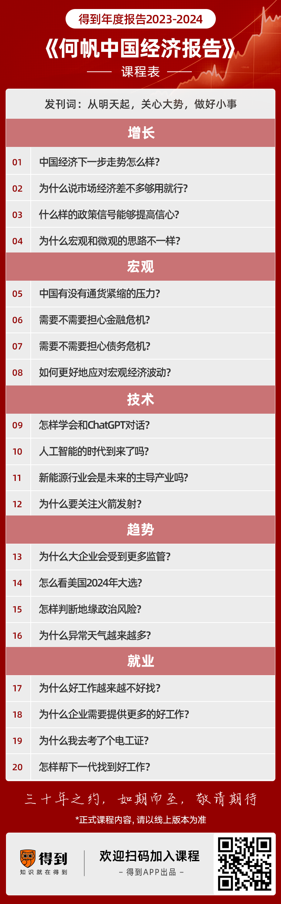

# 年度得到·何帆中国经济报告（2023-2024）

懒人专属群的群友们，大家好，这是小懒人给大家的《通才计划》更新的课程。

得到 199 RMB 的课程《[年度得到·何帆中国经济报告（2023-2024）](https://lazybook.fun/#/blog/group)》

已整理添加到专属群《通才计划》，几十份付费课程到咱们专属群 Q 群公告自取。

通才计划目录：[`lazybook.fun/#/data/13\_course`](https://lazybook.fun/#/data/13_course)

懒人手册：[`lazybook.fun/#/`](https://lazybook.fun/#/)

懒人专属群：[`lazybook.fun/#/blog/group`](https://lazybook.fun/#/blog/group)

专属群更新记录：[`lazybook.fun/#/blog/record2`](https://lazybook.fun/#/blog/record2)

## 目录

年度得到·何帆中国经济报告（2023-2024）  
 目录  
发刊词：从明天起，关心大势，做好小事  
 1.  
 2.  
 3.  
 4.  
01 中国经济下一步走势怎么样？  
 1\. 为什么在宏观问题上要有自己的独立判断？  
 2\. 怎样用“拼图法”判断宏观基本盘？  
 3\. 怎样用“和面法”调整宏观预期？  
 思考题  
02 为什么说市场经济差不多够用就行？  
 1\. 区分长期变量和短期变量很重要  
 2\. 确定先后次序很重要  
 3\. “差不多够用”生活哲学  
 思考题  
03 什么样的政策信号能够提高信心？  
 1\. 发信号的时候要放大招  
 2\. 怎样用扩张性的财政政策？  
 3\. 怎样用扩张性的货币政策？  
 思考题  
04 宏观波动如何影响微观决策？  
 1\. 宏观波动的四个阶段  
 2\. 不同阶段，有不同的策略  
 3\. 两个建议，帮你找到最佳策略  
 思考题  
05 中国有通货紧缩压力吗？  
 1\. 什么是通货紧缩，什么又是通货膨胀？  
 2\. 通货紧缩带来的风险  
 3\. 要不要担心出现通货膨胀？  
 思考题  
06 需要担心债务危机吗？  
 1\. 扩张性的财政政策就是政府大把大把花钱吗？  
 2\. 越贵的钱用得越多  
 3\. 中国会不会有债务危机？  
 思考题  
07 需要担心金融危机吗？  
 1\. 钱发多了，会有什么风险？  
 2\. 真的遇到了金融危机该怎么办？  
 思考题  
08 房地产市场到底怎么了？  
 1\. 观察历史的不同尺度  
 2\. 长时段看房地产的转型  
 3\. 中时段看房地产的博弈  
 4\. 短时段注意市场的超调  
 思考题  
09 我们是不是已经进入人工智能时代了？  
 1\. 人工智能的起起落落  
 2\. 人工智能的点线面应用  
 思考题  
10 怎样才能不被人工智能替代？  
 1\. 会被替代的不是工作，而是技能  
 2\. 对话人工智能、协助人工智能、超越人工智能  
 思考题  
11 新能源行业会成为下一个主导产业吗？  
 1\. 20 世纪的电  
 2\. 为什么光伏行业这么卷？  
 3\. 会不会卷出来一个新的主导产业？  
 思考题  
12 怎样判断火箭能不能上天？  
 1\. 一页纸一个亿  
 2\. 什么是火箭科学？  
 3\. 为什么要学马斯克？  
 4\. 为什么国家要支持民用航天？  
 思考题  
13 怎样看清地缘政治的底层逻辑？  
 1\. 地理是舞台，历史是脚本  
 2\. 最容易发生冲突的是熟悉的陌生人  
 3\. 民族国家建设是个漫长的过程  
 思考题  
14 中美关系会发生什么样的变化？  
 1\. 计算公式没变，但参数变了  
 2\. 中美关系的辅助线  
 思考题  
15 遇到气候变化，怎么换个思路去做事？  
 1\. 全球挑战，地方应对  
 2\. 创造新世界  
 3\. 多鼓励，少批评  
 思考题  
16 为什么会加强对互联网大企业的监管？  
 1\. 一场谷歌输掉的官司  
 2\. 算法经济中的三种反竞争行为  
 思考题  
17 就业形势有什么新变化？  
 1\. 就业形势变化的宏观原因  
 2\. 就业形势变化的微观原因  
 思考题  
18 为什么企业要创造更多的好工作？  
 1\. 效率工资理论  
 2\. 做减法，员工和老板都更爽  
 3\. 跟年轻一代怎么说话  
 思考题  
19 怎样教育我们的下一代？  
 1\. 第一个迷思：名校才能提供最好的教育  
 2\. 第二个迷思：最热门的专业就是最好的专业  
 3\. 第三个迷思：最稳定的工作就是最好的工作  
 4\. 两个建议  
 思考题  
20 我为什么要去考个电工证？  
 1\. 我考了一个电工证  
 2\. 终身学习要学习小的技能  
 3\. 最佳的名气水平是有点小的名气  
 4\. 小的生态位会是最好的生态位

* * *

# 发刊词：从明天起，关心大势，做好小事

懒人专属群的群友，你好啊，我是何帆，欢迎来到我的年度报告。

## 1.

让我来猜一猜。过去一年，对你来说，很可能是等待的一年，观望的一年。很多事情你想做，但又不知道该不该做。做生意的，在考虑要不要再做下去。越做越不好做，再做下去赔钱了怎么办？就算运气好，现在赚的不少，可谁又知道，明天会不会突然遇到巨大的风险？想买房的，不知道还要不要买。要是不买，辛辛苦苦攒下来的钱，又该怎么投呢？有工作的，在想要不要换一份工作。没工作的，在想要不要找一份工作。

有的时候，你觉得可能会有特别好的事情要发生，比如，疫情结束了，经济是不是要报复性反弹啊？结果，并没有发生。有时候，你又担心会有特别糟糕的事情发生，比如，会不会有金融危机、经济衰退，甚至战争啊？结果，也没有发生。往往是这样的：越是没有发生，你心里反而越慌，网络上又是各种耸人听闻的流言，搞得你心神不宁。

那让我告诉你，接下来一年可能是什么样子的。大概率，接下来一年会回归正常。注意，我并不是说，能回到一个最鼎盛的时期，每个行业都繁荣，每个人都乐观。但是，我们很可能已经闯过了最危险的关口。三年新冠疫情，我们熬过去了。很多行业经历了震荡，但现在都在学习适应新的游戏规则。是的，中美关系还很紧张，但彼此之间，大致已经知道对方的底牌，管控危机更有章法了。所以，

你要是能看清这些大势，就会知道，现在不用再犹豫不定了。你现在就可以考虑为未来做规划，现在该动手做事了。

## 2.

这个结论，是我在过去一年在实地调研中收集信息，像做拼图游戏一样，一点点拼出来的。这一年我去了内蒙古、山东、河南、安徽、江苏、浙江、广东、广西、湖南、贵州、重庆、四川、陕西、山西……我这可以算是报复性调研。

我把今年的调研主题定为

宏观

，因为宏观是这一年最热门，也是最重要的话题。凑巧的是，宏观经济学也是我长年研究的领域。算起来，我已经有将近 20 年的宏观政策研究经验了。但是，和宏观经济学惯常的研究方法不一样，我不只看统计数据，和同行交流，还会更多地去基层，看看宏观如何下到地面，接到地气，影响普通人的生活。

## 3.

今年的年度报告，我要首先带给你我对宏观形势的判断。

我看到，中国经济的基本盘并没有动摇。市场经济还在，基础设施还在，制造业的实力也还在。这么多年重视教育，年轻一代的实力可不算差。这还不算，更让我深受触动的是，咱们中国人还有一股子不甘心和不服气。就像爬山一样，我们已经爬了很久，终于能看到山顶了。距离山顶这么近，再想放弃，就会很不甘心。我们离山顶近到能看到那些先我们一步到达峰顶的人了。他们能上去，我们要是上不去，就会很不服气。在我看来，这股子不甘心和不服气的劲头，就是中国经济的火箭燃料。

如果基本盘还在，那中国经济遇到的问题就相当简单了。我们现在遇到的问题是总需求不足。对宏观经济学家来说，如果总供给出了问题，他们可能会直挠头，没有啥好办法，但遇到了总需求不足，他们的底气就足了，学的就是这个。总需求不足怎么办？用宏观政策刺激经济增长啊。政策要怎么出招？当然是要用组合拳，必要的时候要出大招。宏观经济说到底靠的是信心。信心看什么？看政策的信号。我看到的是，中国经济正枕戈待旦，只等冲锋号令。

讲完宏观形势，在今年的年度报告里，我还要向你报告技术进步对经济的影响。

没错，我们会讲到 AI。现在，大家都在谈论 AI，众说纷纭，听得你可能有点心慌。你会问，AI 会不会替代我的工作啊？甚至，在未来的某一天，AI 会不会替代人类啊？其实，这不是你现在需要关心的问题。1879 年，爱迪生发明了电灯，但过了 20 年，美国的家庭和企业里用上电的只有 3%，又过了 20 年，这个比例才急剧提高到一半左右。如果说 AI 就是未来的电，那我们现在大概还在昏昏暗暗的 1880 年，而不是到处亮灯的 1920 年。但你不要忽视了真正的电，我指的是新能源。从电动汽车到光伏组件，从发电到电网，这将是一个巨大的产业链。是的，这个行业现在还在苦苦奋战，群雄逐鹿，未知鹿死谁手，但是，这不重要，重要的是，未来这个行业是要成为主导产业的，这个行业是注定要改造地球的。所以，新技术革命的影响，可能远远超过我们的想象。在今年的年度报告里，我还选了火箭行业，这是为了让你感受一下看起来离你很远的高科技行业，其实离你很近，就在你的身边。

讲完技术进步，在今年的年度报告中，我还将为你指出四个未来要关注的重大趋势。

两个趋势和政治有关。2024 年又到了美国的大选年，这场大选比往年更闹腾。那么，我们该怎么去看门道呢？谁当下一任美国总统，又会对中美关系有什么影响呢？还有，俄乌战争，以及中东危机，再一次提醒我们去关注地缘政治。我做政策研究这么多年，攒了一些心得体会，想跟你分享。我会告诉你，如何把地缘政治当成算术题来解。除了这两个跟政治有关的趋势，我还要跟你分享一个和技术有关的趋势，那就是为什么政府会对科技巨头企业加强监管。了解了这个趋势，你会对未来的行业发展和经济格局有更多的洞察。最后一个趋势是气候变化。我们会讲到气候变化对经济带来的挑战，当然也有机遇。在这里，我还要再跟你预告一下，这些趋势将对未来有相当长期的影响，所以，它们都是我未来调研的主题，我还会在以后的年度报告中为你做进一步深入的解读。

## 4.

说了这么多，到最后还是要回到最重要的问题。你一定会问，那我该怎么办？

先别急，让我再帮你把宏观和微观的区别划出重点。

宏观和微观最大的差别就是：微观是自己决定的，宏观是要和别人一起决定的。

既然是大家一起决定的，宏观的最终结果就是“自我实现的预言”。  
也就是说，一个人相信的不是真理，所有人都相信的才是真理。你怎么看不重要，别人怎么看才重要。爱丽丝进入奇幻世界之后，发现所有的一切都不可思议。在宏观世界里，你也会发现很多不可思议的地方：在宏观世界里，同一件事物，你越相信它，它成功的概率就越大；你越不相信它，它成功的概率就越小。

之所以要强调这一点，是要告诉你，宏观不是微观的加总，你不能总是用微观的思路去解宏观的题目。而且，你一定要告诉自己，

个体的命运往往不取决于微观的努力，而是取决于宏观的趋势。

你可能会问，可是，我只是一个微观个体，我决定不了宏观啊。那麻烦不就来了？如果我决定不了宏观，又该怎么办呢？

你可以把宏观趋势想象成天气的变化，而微观主体是在田地里干活的农民。农民控制不了天气阴晴，但要学会“看天吃饭”。明天会不会下雨，是不是晴天，他们有一种本能的直觉。下雨多要排涝，下雨少要抗旱，不管天气怎样，他们都要找到应对的方法。在经济生活中也是一样的。那些有智慧的微观主体都会注意去看宏观趋势，但更会找到应对宏观趋势的办法。

如果说宏观趋势就是潮流，那我们应该是去赶潮流，还是反潮流呢？其实都不是。你有没有注意到游泳健将到大江大河里游水？想游到对岸，按照直线距离往前游，会正好迎着浪，反而更费力气。省力省时的办法是斜着游，顺着波浪，把阻力变成推力，同时还要盯着自己的目标，不断调整方向，一点点靠近。

通过做小事，不断做出小的调整，找准方向，就是微观主体应对宏观波动的最好经验。

在今年的年度报告里，我想告诉你，我采访了那么多微观主体之后，从他们那里都学到了什么。

我采访了做餐饮的小老板。他的创业经历很曲折，成功过，也失败过，干了一摊不行，那就另起一摊。如果你只看宏观，那他以前干失败的生意，都是宏观统计里活不下去的小微企业，但宏观数据是不对的。那些看似失败的“小生意人”又站起来了。当你把他们一生的奋斗连起来看，就能看到他们并不是失败者，而是成功者。他们白手起家，从无到有，买了房买了车，养活了家庭，创造了就业机会，改变了自己的人生。你看，做小事就像串珠子，能把你的一生串成美丽的项链。

我还采访了职业学校的老师。他们教的都是差生。在中国，只要学习成绩不好，就会被当成差生，于是，这些孩子就变得越来越没有自信，越来越厌恶学习。能教好学生其实并不难，难的是教这些所谓的差生。你只是一个普通老师，你改变不了教育体系，甚至改变不了教学大纲，那又能做什么呢？我采访的一个老师，对一个孩子说了一句话，这句话就改变了孩子的一生。他只是跟这个孩子说：“我看你挺能蹲的，能蹲下去，就能学好焊工。”这个孩子后来真的在焊工技能大赛里拿了第一名。你看，做小事就像点穴，拿捏得准，可以四两拨千斤。

所以，我最想告诉你的就是，当我们逐渐回归正常之后，你要用心去做的可能不是大事，而是小事。还记得你在饭桌上听过好多人吹牛皮，讲的都是宏伟目标，他们都说要改变中国、改造世界。那些人现在都去哪里了？大多数都消失得无影无踪了。他们当年看起来那么神气，那么光鲜，其实不过是因为大时代有大浪，他们都是大浪激起的泡沫。

不要去做泡沫，来和我一起做一块石头。不要去说大话，来和我一起踏踏实实地做好该做的小事。

天才诗人海子有一首非常有名的诗。“从明天起，做一个幸福的人”，“从明天起，关心粮食和蔬菜”。

我希望，从明天起，我们都来关心大势，做好小事，学习小的技能，享受小的快乐，攒够充足的底气，准备好迎接大的洪流。

  

* * *

# 01 中国经济下一步走势怎么样？

懒人专属群的群友，你好啊，我是何帆，欢迎来到我的年度报告。

今年的年度报告，既讲宏观，又讲趋势。我们先从宏观讲起。说到宏观，那第一个问题就是，中国的宏观经济到底怎么样了？下一步又会怎么样？每年，到了这个时候，很多研究机构，各大券商，都要推出自己的研究报告，有分析，也有预测。但你听完之后还是觉得不踏实。专家的观点很可能不一样，有的乐观，有的悲观，你不知道该站谁。再说了，那都是别人告诉你的现成的答案，不是你自己推导出来的，少了这个中间的推导过程，你还是没有解出这道题。

所以，这一讲，除了要告诉你结论，我还要跟你分享一个方法，帮你在遇到纷繁复杂的宏观问题时，学会做出自己的独立判断。

## 1\. 为什么在宏观问题上要有自己的独立判断？

先跟你说说我碰到的一件有意思的事。

有个搞房地产的企业家朋友约我喝茶，他说，想向我请教一下中国的宏观经济形势。我本来以为他要跟我抱怨中国经济有多糟糕，房地产的生意有多不好做。我还猜，他可能会问我，要不要转型啊，转到哪个行业更好啊。

结果，我猜错了。他问我的问题是，何老师，你觉得现在是不是一个重大的机会啊？

要是别的行业的企业家问我还有没有机会，我都不会觉得奇怪。可是，这位是搞房地产的啊，你也知道，现在房地产生意太不好做了，那他怎么还来问我有没有机会，而且还是重大机会呢？想啥呢？

我就问他，你先说说，怎么会有这样的想法呢？

他说，我们这个企业不是上市公司，不追求报表上的业绩，一直稳扎稳打，特别谨慎，但企业发展的速度可不慢。回头去看，就是因为把握住了几个重大的时机，而这几个时机都是在危机之后，别人都觉得很悲观的时候。比如，1997 年和 1998 年东亚金融危机，2003 年出了 SARS，2008 年遇到全球金融危机，都是经济状况不好，企业经营困难，弥漫着悲观预期，但转过年来，都是好行情。

他是商场上的老江湖，摸爬滚打几十年了。最近的状况让他产生了一种似曾相识的商业直觉：搞不好，又到了那种十年一遇的机会了。他说，要真是这样，那可就是我退休之前的最后一次机会了，错过就不再有了。可是，他又有点心里没底，所以找我商量。

你想不想知道我是怎么回答他的？你先想想，要是你，会怎么回答。到了这节课的结尾，咱们再对对答案。

为什么要跟你讲这个故事呢？这个故事能告诉你，有自己的独立判断是多么地重要。宏观问题没有标准答案，都是猜答案，而且，要猜别人心中的答案。你觉得经济前景好不好不重要，别人觉得经济前景好不好才重要，于是，这就变成了一种心理博弈，能猜透别人心思的才是赢家。也就是说，你要知道自己怎么想，还要知道别人怎么想，还要知道别人怎么想你怎么想，还要知道别人怎么想你怎么想别人怎么想……

你说，打住打住，这怎么猜得出来，太复杂了。

## 2\. 怎样用“拼图法”判断宏观基本盘？

其实，并不复杂。

宏观问题虽然没有标准答案，但都有参考答案。接下来，我来帮你找这个参考答案。怎么找呢？很简单，我们来给经济增长算一笔账。这就是你经常听到的“三驾马车”，也就是要看

消费

、

投资

和

净出口

这三个影响经济增长的变量。我把这叫做

“拼图法”

，也就是要像玩拼图游戏一样，把一块块拼图拼起来。一说到“三驾马车”，你就要明白，这是从总需求的角度去看 GDP。总需求的意思是说，最后是谁把我们生产的东西买走了，买走了之后干嘛用了。

好，我们一驾驾马车挨着看。第一驾马车是

消费

，这你很熟悉，生产出来的产品，手机也好，汽车也好，被消费者买走了。第二驾马车是投资，这是企业和政府的事，他们造机器、盖厂房、修公路，这都是投资，投资是为了以后能生产出更多的产品。投资的钱来自于储蓄，注意，宏观经济学里的储蓄不只是说你存在银行里的钱，事实上，只要你没有拿去消费，而是留下来等着以后消费，这部分钱都叫储蓄。第三驾马车是净出口，也就是出口减去进口，这计算的是来自国外的对本国产品的需求。

玩拼图游戏的时候你知道，窍门是先易后难，比如，先找边框上的拼图，再找中间的拼图。按照这样的思路，我再帮你简化一下。在这三驾马车里，净出口的影响并不大。中国是大国，所有的大国，比如美国、日本、印度，都有一个共同的特点，就是经济增长主要靠内需。三只有小国，尤其是对外开放程度很高的小国，比如新加坡、挪威、科威特，才主要靠外需。所以，结论有了：除非世界经济发生了特别好，或是特别差的消息，否则就不会对中国经济增长有太大的影响。

咱们主要还是看

内需

。内需又包括消费和投资。内需里消费所占的比例更高，粗略估算，消费占 GDP 的比例大约为 55%，比一半略多，投资的比例大约为 40%，比一半略少。消费的特点是比较稳定，在短期内，想要显著提高消费是不大可能的。大致来说，在 2010 年之后，消费的增长速度和 GDP 的增长速度大体相当，也就是说，消费只是跟着往前走，没有掉队，但也没有领头。你可能会说，不对，疫情过后，大家都不敢消费了，花钱更省了。是的，有这种现象，但我们稍后会讲到，消费终究会回归正常，保持和 GDP 增长大体相当的速度。

说到这里，那就只剩下

投资

这一驾马车了。这是最重要的一个变量。我们再把投资细分，最重要的又有三种投资，分别是制造业投资、房地产投资和基础设施投资。什么时候制造业投资的增长速度更快呢？有几种情况。比如，房子卖得好，房地产就会带动上下游的制造业。再比如，出口订单多，会拉动出口企业的投资。还有，技术进步的速度快就会掀起一波企业投资热潮。这个最后的影响因素是你特别需要关注的，因为 2023 年制造业投资总体来说不温不火，但高技术产业的投资速度明显快于一般的制造业企业。这是个信号。

你看，拼到最后，我们手上还有最后两块拼图：房地产投资和基础设施投资。房地产投资是拖后腿的，基础设施投资呢？要在前面拽。2024 年中国经济走势如何，就要看朝前拽的力量更大，还是拖后腿的力量更大。所以，当你去看那些让你眼花缭乱的宏观报告的时候，记住化繁为简，去找这两个关键变量，并不断地更新它们的动态。比如，我帮你查了，2023 年上半年，房地产投资同比下降 7.9%，基础设施投资同比增长 7.2%。前三季度的数字出来之后，你会看到，1-9 月，房地产开发投资同比下降 9.7%，基础设施投资同比增长 6.2%。这说明，总的来说，拖后腿的力量更大一些，但朝前拽的力量也在使劲。你看，拼图法就是这么容易。你要找的最重要的两块拼图就是房地产投资和基础设施投资。找到了它们，你就能猜对八九成。

那我们猜到了什么？有什么结论？结论就是：

中国经济并没有那么好，但也没有那么差。

这其实很容易理解。俗话说，病来如山倒，病去如抽丝。疫情三年，中国经济就如同生了一场大病。一觉醒来，大汗淋漓。现在呢？虽然病情已经过去了，但总觉得这里那里还不舒服，体能好像也没有以前那么好了。所以，想要完全康复，还得慢慢休养、好好锻炼。

## 3\. 怎样用“和面法”调整宏观预期？

问题来了，那为什么在 2023 年，尤其是 2023 年上半年，市场上有那么多的悲观情绪呢？这是因为，

宏观趋势的变化速度慢，但市场预期的变化速度快，这就很容易出现落差。

这个落差就像个跷跷板，一头高，一头低。

2023 年上半年，这个跷跷板是市场预期在上面，经济复苏在下面。什么意思呢？一开始，大家预期疫情过后，会出现报复性的反弹，所以，大家的期望很高。但经济复苏并没有达到预期，是的，人们是出门旅游了，但旅游支出比原来少了，原来要去新马泰，现在去趟淄博就挺心满意足了。是的，人们开始出去聚餐了，但点的菜少了，点的菜便宜了。看到这样的情况，大家就觉得失望了。

那到了下半年呢？这个跷跷板就变成经济复苏在上面，市场预期在下面了。也就是说，经济已经逐渐回暖，但市场上的悲观情绪还像浓雾一样没有散尽。后来，有的企业就会回过味来，原来市场有点过度悲观了。

好多企业挺过了过去三年的冲击，但到了 2023 年上半年突然挺不住了，开始陆续退出市场，但是，之后又有很多新企业加入进来。这就是市场调整的过程，肯定是比较痛苦，但该来的总会来的，而且该来的已经来了。

这对你有什么启发？启发是：

机会往往就在这种落差中。有了落差，就要调整，偏离了基本盘，迟早是要回来的。

所以，你就要学会不断地调整预期。我把这叫做

“和面法”

，水多了放面，面多了加水。

同样，乐观过头了，就要来点理智的悲观。悲观过头了，就要来点乐观。你看，这也是学习宏观经济学的好处，它能让你变得更加平和、冷静。

回到我们一开始说的故事，你可能想知道，我是怎么回答那位房地产企业家朋友的。我是这么跟他说的，现在就想找到十年不遇的好机会，那是没有的，但是你要是再等上十年，碰上二十年不遇的机会，倒是有可能的。所以，活得久更重要。

你可能会说，照这么说，是不是中国经济在近期内很难再恢复高速经济增长呢？

不，不是的。跟很多人的观点不一样，我觉得中国经济实现高速增长并不是一件很难的事。为什么呢？因为我们不必做到尽善尽美，只要能做到差不多够好就行。关于这个观点，我会在下一讲为你详细解释。

## 思考题

说到这里，我给你出一道思考题吧。回想一下你经历过的经济变化，或是市场行情变化，你还记得什么时候大家曾经过度乐观，什么时候大家曾经过度悲观吗？欢迎你在留言区留言，和大家分享。

好了，这一讲先讲到这里，我是何帆，咱们下一讲再见。

* * *

# 02 为什么说市场经济差不多够用就行？

懒人专属群的群友，你好啊，我是何帆，欢迎来到我的年度报告。

上一讲，我们说到如何用拼图法找到影响中国经济增长的最重要变量，也说到如何在市场预期和经济复苏的落差中寻找机会。在上一讲的最后，我们引出了一个问题：中国经济还能实现高速经济增长吗？这一讲，我们就来聊聊这个话题。

## 1\. 区分长期变量和短期变量很重要

你可能听到过一种说法，有人说，中国经济可能也就这样了，没法再恢复高速增长了。乍一看，好像是这么一回事。从 2012 年开始，中国经济的增长速度就跌到了 8%以下，之后，除了 2021 年，再也没有超过 8%。这几年，疫情对中国经济的冲击也很大，GDP 增长速度进一步下降，2020 年是 2.24%，2022 年是 3%。

觉得中国经济不可能再实现高速增长的人们经常会提到一些理由，比如，生育率下降、人口老龄化，那以后劳动人口数量就要减少，干活的人少了；再比如，中国经济要经历从制造业到服务业到产业结构转型，但从国际经验来看，以服务业为主的成熟经济体，经济增长速度很可能不如在工业化过程中的国家更高。

这些观点听起来很有道理。但要是仔细去看，就会发现他们答题的时候洋洋洒洒，写了很多，但实际上没有认真审题，跑题了。注意，他们说的都是长期变量，长期变量是干吗的？它们会影响到一国经济在十年、二十年，甚至更长一段时间里的潜在增长速度，但它们会影响到短期的经济增长，也就是某一年的 GDP 增长目标吗？不会的，长期变量对短期目标并无影响。

我来打个比方，就说跑马拉松吧。一个人 60 多岁的时候，和他 30 多岁的时候，跑出来的成绩肯定是不一样的。年纪大了，体能下降，成绩就没有年轻时候好。这是肯定的。但是，你下一场马拉松的成绩是由什么决定的？这跟年龄可没有关系。你不能说，我 11 月跑上海马拉松，成绩是四个小时，12 月跑深圳马拉松，成绩是五个小时，成绩不好，是因为年长了一个月。这么说是狡辩。那什么才是影响当下这场马拉松成绩的变量？当然是你有没有认真训练啊。所以，你看，区分长期变量和短期变量是非常重要的。

当我们关心中国能不能实现高速经济增长的时候，就和关心下一场马拉松能不能跑个好成绩是一样的，我们关心的都是短期变量。

那好，我们就从短期变量来分析。从短期来看，中国现在遇到的主要问题是总需求不足，也就是说，居民的消费意愿不足，企业的投资意愿不足，大家都在观望。这看起来好像会让人束手无策，其实是有现成的药方的。这不是什么疑难病症，而是常见病。市场经济都会遇到这样的问题：能把东西生产出来很容易，但想把它们都卖掉很难，也就是说，总需求经常会小于总供给，变成短板。为什么会出现这样的问题呢？归根结底，是因为人们有时候会过度乐观，有时候会过度悲观，过度乐观，就会出现经济过热，过度悲观，就会出现经济低迷。

怎么解决这个问题呢？归根到底，要让大家有信心，而信心来自于哪里？来自于宏观政策传递出来的信号。既然总需求不足是常见病，那对宏观经济学家来说，遇到这样的问题反而更有底气。那么多的历史经验、国际经验，都能帮我们找到方案。可以说，之所以会有宏观经济学，就是为了要解决总需求不足这个会周期性出现的问题。找到答案了吗？找到了。要是

用一句话总结，治疗总需求不足的方案很简单：用扩张性的财政和货币政策刺激经济增长就行。

到底怎么用扩张性的财政政策和货币政策呢？别着急，我们到下一讲会更详细地解读。但是，在讨论该怎么做的问题之前，让我们先讨论一下该不该做。

## 2\. 确定先后次序很重要

有一种观点认为，不应该采取宏观刺激政策，理由是这是治标的，不是治本的。那什么才是治本的？他们认为，应该是通过进一步的改革开放，建立更完善的市场经济制度。

中国的市场经济需要不需要完善呢？太需要了。比如说，有的地方政府还会搞保护主义；又比如说，有些领域可以让民间资本发挥更大的作用；再比如说，资本市场需要为居民提供更多、更好的投资机会。所以，从长远来看，完善市场经济制度，就能进一步释放经济活力。

这些观点我们都同意，但进一步朝前走，会有个岔路口，观点就有分歧了。在这个岔路口有两个选择，一个选择是先保增长，一个选择是先搞改革。问题来了，我们该怎么选呢？哪个先后次序更好呢？

你可能会问，既然增长和改革都很重要，为什么不能同时做呢？

因为至少在短期内，改革和增长是有冲突的。改革会带来阵痛，所以它不可能立竿见影地提高经济增长速度。在阵痛期，经济增长速度反而会下降。我们在刚开始改革的时候，改革的收益非常显著，比如农村改革在短短几年时间里就解决了粮食紧缺的状况。但越到后面，改革的成本越高，阵痛期可能会更长，那就要忍受更长时间的经济低迷。经济低迷的时间长了，人们的信心没了，再想发动增长就非常难了。所以，海外才会有一种唱空中国的声音，他们说中国的改革改不动了，经济增长就要结束了。

可是，过去四十多年的经验告诉我们，不是这样的。如果一定要等到一切条件都具备，才能发展经济，那中国经济奇迹压根就不会发生。一个最典型的例子就是在 20 世纪 80 年代出现的乡镇企业。乡镇企业既没有明晰的产权，也没有先进的技术和管理经验，它们很难从银行贷款，也很难招募高端人才。要是按照教科书上的经济学，乡镇企业就是个不应该出生的怪胎，但恰恰是这样的“四不像”，适应了当时的经济环境，居然能遍地开花、由小变大、异军突起。再后来呢？市场经济会进一步地演化，于是，新的物种，比如上市企业、跨国公司，就会逐渐替代原来的乡镇企业。

这说明市场经济是个有机体。它会从小变大，小的时候你看它可能挺丑的，长大了就好看了。它也有复原的能力，你看它像是生病了，萎靡不振，过不了几天就好了，又生龙活虎了。我们再想，既然它是个有机体，那它越长越大，自我修复的能力会更强呢，还是更弱呢？我觉得和以前相比，现在的中国经济更有韧性。我先不说中国经济的规模这么大，单凭惯性就能继续朝前走，我也不说中国已经有了一批能干的企业家，特别勤奋，特别会想办法，一条路走不通，就换另一条路，我只说我看到的一种更为隐形，但极为强大的力量，那就是中国人的一股子不甘心和不服气的劲头。要是到了最后，为山九仞，功亏一篑，这是我们没法接受的。预判中国经济前景的时候，你不能忽视这种最基本、最深厚的民意。

如果市场经济有自我进化和自我修复的能力，那是靠什么呢？靠的是经济增长。次序对了，也就是说，先稳定增长，再推进改革，保增长和搞改革这两件事都更容易。经济增长能推动改革。这是因为，改革总会让一部分人受益，一部分人受损，想要顺利推进改革，就得尽可能扩大受益者，减少受损者，而有了经济增长的红利，这事更容易做得到。那换个次序呢？要是先改革，再增长，很可能改革和增长都不成功。我们可能会遇到一个相当漫长的经济低迷期，士气就会低落，信心更难恢复。于是，原来在经济增长时期没有出现的问题，一个个都暴露出来了。越是想解决问题，问题反而越多，这就是次序颠倒惹出的麻烦。所以，理清轻重缓急很重要。增长容易，更轻，改革很难，更重，但增长很急，改革则缓。事缓则圆，欲速不达，这个道理到现在也没变。

## 3\. “差不多够用”生活哲学

所以，想要让中国经济保持高速增长，并不需要完美的市场经济，只要有一个差不多够用的市场经济就行。差不多够用？你会追问，到底多少算够用？60 分算及格，还是 80 分算及格？

要是拿一张卷子去考中国经济，那在改革开放之前，要到 60 分可能很不容易，到了 80 年代，能答出来 60 分，90 年代能答 80 分，到了现在，我给中国经济打 90 分。

你可能会问，既然都考了 90 分了，为什么不再努把力，考个 100 分呢？

以我这么多年当学生、教学生的经验，我可以告诉你，考 90 分比考 100 分更划算。当学生的都知道，从 60 分提高到 80 分，甚至 90 分并不难，但从 90 分提高到 100 分就太难了。考 90 分略有挑战，能逼着你好好学习，但又不会给你太大的压力，搞得你天天熬夜，精神紧张。学有余力，你还有时间去参加别的活动，做你想做的事情，生活更丰富多彩，技能更全面，人生也更丰富。把全部时间都拿来准备考 100 分，无意中束缚了自己。执着于考 100 分的学生进到社会之后经常会觉得更有挫败感，更脆弱。真实世界中可没有那么多能考 100 分的试卷。

这里面其实有一个生活哲学，我把它称为“差不多够用哲学”，也就是说，我们不用追求最优解，只要有相对满意的解就足够了。

我说的“差不多够好”哲学，既不是让我们降低标准，也不是让我们躺平不干，而是说，你要找好方向，选好次序，而且，更重要的是要相信成长的力量。只要是在成长，就有自我的变化，也有自我的修复。我们要学会的是如何去呵护这种成长的力量。这不仅需要智慧，而且需要耐心。

## 思考题

最后，我给你出一道思考题吧。你觉得自己是完美主义者，还是更习惯“差不多够好”就行？对你来说，那种生活哲学更有用？欢迎你在留言区留言，跟大家分享。

好了，这一讲就先讲到这里，我是何帆，咱们下一讲再见。

* * *

# 03 什么样的政策信号能够提高信心？

懒人专属群的群友，你好啊，我是何帆，欢迎回到我的年度报告。

上一讲，我们讲到保增长很重要。增长能推动改革。如果增长没有恢复，那就是因为人们缺乏信心。想要提振信心，就要靠政策信号。这一讲，我们来聊聊，用什么样的政策，才能够传递出信号，才能提振信心。

## 1\. 发信号的时候要放大招

我先来说说，为什么信心那么重要。所有的经济增长的故事，都只有一个主题词，那就是信心。宏观经济是个魔法世界，在这个世界里，想象出来的东西才是真实的。

一件事情是不是真的，要看大家相信不相信，如果大家都相信，它就是真的，如果大家不相信，它就不可能是真的。

为什么这么说呢？还是回到影响需求的两大块：

消费

和

投资

。居民什么时候愿意多消费？是当他们觉得经济预期更好，自己以后收入更多的时候。他们又是从哪里得到预期的？他们要看别人是怎么看的。企业什么时候愿意多投资？是当他们觉得经济预期更好，以后利润更多的时候。同样，他们也要看别的企业家怎么看，这才形成自己的预期的。

所以，想象一下，假如大家听到一个消息，说外星人要来给大家送礼物了，一人一大包，如果大家都相信这个传言，都觉得天上要掉下一笔横财，那居民就会增加消费，企业就会增加投资，总需求就增加了。需求增加，供给也跟着增加。企业就要雇佣更多的员工，于是，收入就会增加。收入增加了，消费就真的增加了。到最后，外星人来不来，其实并不重要。

再设想另一种情景，假如大家听到的消息是外星人要来抢钱，以后的收入会大大减少，那居民就要减少消费，企业就要减少投资，结果是需求下降，供给下降，收入下降，于是，大家的钱就真的少了，跟外星人来不来抢，其实也没有关系。

说到这里，你就明白了，宏观政策能刺激经济增长，并不单纯是因为政府增加了多少支出，而是政府的支出能引导市场预期，政府的政策是冲锋号令，大家要听到号令，才敢朝前冲。

既然是信号，就会遇到一个问题，发信号的时候，周围可能会有噪音，那怎样才能把信号明确无误地传递出去呢？

经济学专门研究过这个问题。这个理论叫信号传递。最后的结论是啥？很简单，在发信号的时候要放大招。不是有噪音吗？那就把你的音量调大。调到多大呢？调到最大，有多大音量，用多大音量。

你可能会说，没那个必要吧？我只要把音量调得比噪音更大不就行了？不行的，因为噪音也会提高音量。你越是迟疑，噪音的音量越大，你还是无法把信号传递出去。与其在那里跟噪音磨叽，不如一出手就震住它们。

所以，好的宏观政策一定是出手早、力度大、方向明确。比如，2008 年爆发了全球金融危机，中国立刻就出台了四万亿刺激政策，经济立刻出现了 V 型反弹。没有这个政策，2009 年我们就会陷入一场严重的经济危机。如果宏观政策的信号不明确，一脚刹车，一脚油门，甚至同时踩下刹车和油门，大家就会无所适从，政策的效果就要打折扣，付出更大的成本。

可是，有人会担心，要是放大招，不就把政策空间一下子用完了？其实，我们现在的政策空间还非常宽裕，而且，不要以为政策空间会越用越小，好的政策会带来更多的机会，政策空间反而会越用越多。

简单地说，当我们要刺激经济增长的时候，无非是用扩张性的财政政策和扩张性的货币政策。幸运的是，这两种政策的空间都很宽裕。

下面，我们挨个来说说。

## 2\. 怎样用扩张性的财政政策？

当经济低迷的时候，居民的消费意愿不强，企业的投资意愿不强，总需求不足，出现了一个缺口，这时候，就得有人挺身而出，增加支出，补上这个窟窿。这就是为什么政府要增加支出的原因。政府增加支出，从短期来看，增加了需求，拉动了经济增长，从长期来看，政府提供了更多的基础设施和公共服务，为未来的持续经济增长铺平了道路。

可是，有人会说，政府投了那么多钱，修铁路、公路、机场，该修的都修完了，哪儿还有政府投资的机会啊？

其实，需要政府投资的地方太多了。就说已经修好了的铁路、公路和机场吧，修好了之后，要不要保养维修呢？这几年，我们经常会听说有的城市下了暴雨，一下暴雨，道路就淹了，那地下管网要不要修呢？为什么暴雨多了？因为全球气候变化啊。那以后各种极端天气，甚至自然灾害都会更多，要不要未雨绸缪，先做好准备呢？还有，为了迎接新技术革命，也得准备好新的基础设施啊。AI 需要大数据，新能源需要发电、供电和输电环节都有更新，自动驾驶来了，城市规划和城市交通要不要更新呢？还有，老龄化社会来了，就要建更多的养老院吧，为了鼓励生育，是不是该多建托儿所呢？人民群众对精神文化的需求提高了，博物馆、歌剧院、体育场，这些设施够用吗？要是再出现一场像新冠这样的疫情，我们的公共医疗卫生体系能抗得住吗？

你看，明明有这么多的投资机会，为什么经常会有人说，政府没法再投资了呢？这是因为，有人担心政府会没钱，也就是说，他们担心政府花了钱，却挣不到足够多的钱，收入覆盖不了成本，赔了钱可怎么办？

要是想让政府赚钱，那其实很容易。举个例子，烟草专卖。由于这个行业很特殊，所以只有国家能干，独家生意，当然好赚钱。但是，政府会把大部分能赚钱的行业交给企业去做，这样经济才有活力。到最后，政府去做的都是企业不愿意做、不赚钱的事情。所以，政府赔钱是正常的，要是赚钱，反而是特殊情况。

表面上看起来赔钱，其实也不一定赔。举个例子，政府修了那么多高铁，要是指望卖票把投资成本收回来，那恐怕很难，但高铁改变了中国人的出行和生活方式，甚至改变了城市的布局，旅游、餐饮、娱乐、物流，都找到了新的机会，经济就繁荣了，税收就会增加，更重要的是，就业会增加，人们的收入会增加，老百姓更满意了，这才是政府的真正使命。算这个账，其实不亏。

但是，你会说，那收入都是以后才会有的，但政府的支出是现在就要拿出来的，支出大于收入，不够用，怎么办？在这种情况下，政府可以通过发债为公共支出融资。可是，要是发债，不是让政府的债务压力更重了吗？不一定，通过发债，反而会让政府的债务压力减轻，而且，发债还能带来更多的额外好处。关于这一点，我们在第六讲会详细解释。

## 3\. 怎样用扩张性的货币政策？

我们再来看看货币政策。要不要采取扩张性的货币政策，这个话题的争议更大。

有一种观点认为，扩张性货币政策没用。为什么这么说呢？他们认为，就算是央行采取了扩张性的货币政策，要是大家都不响应，居民不增加消费，企业不增加投资，经济还是刺激不起来，又发出去了那么多的钱，最后不就搞出通货膨胀了吗？

这种观点有没有道理呢？看起来是有道理的。比如说，央行把利率降低了，利率低了，贷款买房的成本就更低，可是，买房人看的可不只是贷款利率，他们更看重房价以后会不会涨。同样，利率低了，企业贷款的成本就更低，可是，企业家想不想投资，考虑的也不只是贷款利率，他们更看重以后有没有更多的市场机会。

但是，这种观点低估了货币政策的威力。就算居民和企业还坐在那里观望，货币政策也一样能刺激经济增长，也就是说，他们屁股都不用抬，好处就来了。

用经济学的术语来说，这个好处叫“资产负债表”的改善。如果你有住房贷款，利率下降，理论上讲，意味着你还贷的压力小了，那省下的钱就能用来消费。如果企业有贷款，利率下降，企业的还贷压力减少，省下的钱就能用来投资。我们说过，政府可以通过发债的方式为公共支出融资，利率下降，政府的利息支出就会减少，财政状况也能改善。

这还没完。如果利率下降，股票市场就会有一波上涨的行情。这是因为，企业的利息支出减少了，净利润就会增加。按照历史经验，如果利率下降 1%，股价会上涨 8%。股票价格上涨，上市公司的流动性就会更多，持有股票的家庭也会更有钱。当然了，利率下降，那些把钱存了定期，买了理财和货币基金的家庭会损失一部分利息收入，但要是算总账，整个居民部门的收入会净增 7-11 万亿左右。

那要是有一部分人把屁股抬了起来呢？让我们来猜猜他们是谁。他们一定是现金流最紧张的那部分企业，一有钱就要赶紧花出去，估计房地产企业、地方平台企业都会如此。他们这是被动地响应了央行的号召。

那剩下的人会不会抬屁股呢？这要看信号是否明确。

假如市场收到了政策信号，相信刺激政策有用，大家就会行动起来，于是，积极货币政策的效果更加显著。

所以，货币政策能发挥很大的作用。你可能听到过一种说法，说货币政策是大水漫灌，意思是说，货币政策没有办法做到精准导向，央行把钱发出去，这钱最后流到了哪里，央行也没法控制。这种说法是有道理的，但是，反过来看，你也可以说，幸亏货币政策是大水漫灌，水过地皮湿，多少总会有效果的。货币政策会以一种大水漫灌的方式，让所有跟钱沾上边的人都受到影响。家里有房贷的，还贷的压力更小。企业节省了利息支出，手头更加活泛。政府发行新债的成本也会降低，积极的货币政策还帮衬了积极的财政政策。

可是，有人就会问，要是这么搞，企业不就该盲目借钱、盲目投资，最后，银行的坏债不就越来越多了？这样搞，资产价格泡沫不就起来了？这样搞，人民币不就要贬值，资本就会外逃？要是出了这些问题，到最后不就该出现金融危机了吗？不会的，这些风险都是可控的。关于这个问题，我会在第七讲再向你详细解释。

## 思考题

讲到这里，就要结束了。我给你出一道思考题吧。在生活中总会遇到各种各样的需要发信号的时候，比如求职、求学、求婚，企业吸引顾客，吸引投资者，都需要发信号。那你有没有注意到在发信号的时候有“放大招”的做法？欢迎你在留言区留言，跟大家分享。

好了，这一讲先讲到这里，我是何帆，咱们下一讲再见。

* * *

# 04 宏观波动如何影响微观决策？

懒人专属群的群友，你好啊，我是何帆，欢迎回到我的年度报告。

上一讲，我们说到要用政策信号提振市场信心，我们也讲到，当前的财政政策和货币政策的空间都很宽裕，可以放心大胆地用。你可能会问，了解了这些宏观问题，对我的微观决策能有什么帮助呢？这一讲，我们来聊聊作为微观主体，知道不知道宏观逻辑会有什么样的差异。我们还要讲讲，知道了之后，在当下的经济环境里，你又该采取什么样的策略。

## 1\. 宏观波动的四个阶段

我先要告诉你，宏观经济总是处于波动之中。这种宏观波动的深层根源就在于人性，在于人类认知模式中的固有缺陷。当大多数人都过度乐观的时候，经济就会过热，当大多数人都过度悲观的时候，经济就会过冷。

那让我再把这种宏观波动的规律简单描述一下。大致来说，波动有四个阶段，先是复苏，再是高涨，然后是危机，再接着是衰退。复苏就是越来越多的人有了信心，这个阶段持续的时间相对较长，因为信心是一点点培养起来的。这种乐观的预期不断被强化，最终，人们会从理性的乐观转为盲目的亢奋，这个阶段持续的时间相对较短。人们越是亢奋，就越是害怕，市场情绪在一夜之间就可能会从过度乐观变成过度悲观。这就爆发了危机。历史上那么多次危机，一次又一次地证明，爆发危机的时候，导火索很可能只是一件小事，但那时候，市场已经变成了惊弓之鸟，风声鹤唳，草木皆兵。危机触底之后，会在底部徘徊，这就进入了衰退。衰退的过程持续时间相对也较长，因为悲观的情绪会不断扩散。

复苏、高涨、危机、衰退，就是这四个阶段。那我们当下正处于什么阶段呢？现在既不是过热，也不是危机，而是处于增长相对缓慢的时期。那拐点有没有出现呢？相信你顺着我前面几讲的思路，很容易就能找到答案。

## 2\. 不同阶段，有不同的策略

好，了解了宏观波动，你就要意识到，在不同的阶段要采取不同的策略。在管理企业，或是规划个人职业发展的时候，你可能会想，要是能找到一种什么时候都适用的最佳策略就好了。但是，

一旦你把宏观波动这个变量考虑进来，就会发现，没有一成不变的最佳策略，在不同的时期要采用不同的策略。

举个例子，你听说过 Just in time（  
JIT），又叫做准时生产方式。这是日本丰田公司的大野耐一想出来的一种管理创新思路。大野耐一的思路是，企业在生产计划和管理的时候要尽可能地把库存降到最低，这样才能最大限度地减少成本。Just  
in  
time 的口号是“只在需要的时候，按需要的量，生产所需的产品”。你不用在仓库里存放那么多的零部件，而是应该让零部件都在路上，一旦运到厂里，立刻安排生产。

这个策略很有洞见，也非常流行，但是，现在你就明白了，这是一种更适合在复苏阶段采取的企业管理策略。它假定经济系统中的相互依存关系是非常稳定的，而且各个环节的运转都非常良好，没有摩擦，也没有意外的冲击。

但是，在经济增长缓慢的时候，不确定性大大增加，相互依存关系也经常受到冲击，Just in  
time 就不一定好使。自然灾害会带来冲击，比如，泰国发了洪水，日本的汽车企业就要停工，因为零部件运不过去。地缘政治风险也会带来冲击，比如，很多企业要分散全球生产布局，不是出于提高效率的考虑，而是为了避免风险，而避免风险的代价就是在一定程度上牺牲了效率。所以，这个时候，企业要保持适当的冗余，冗余看起来多余，但它能提高系统的抗风险能力。这就好比在生活优越的时候，减肥有助于健康，但遇到灾害年，还要减肥，就麻烦了。留点脂肪，关键时刻能保命。

再举个例子，还有个策略。你听说过巴菲特的名言：“在别人贪婪的时候恐惧，在别人恐惧的时候贪婪。”他的意思是说，当别人都贪婪的时候，市场上就是非理性的繁荣，风险大大提高，随时可能出现崩盘。所以，你就要多长个心眼，上车之后，别再往车厢中间挤了，得朝车门靠，随时准备下车。那当别人都恐惧的时候呢？很多企业的价值就会被低估，这就是买入的最佳时机。我们

前面

讲过的那位搞房地产的朋友，就特别擅长这个策略。

巴菲特的策略很有洞见，也非常流行。但是，你再琢磨一下，这其实是一种更适合在高涨和危机时期采取的策略。在高涨时期，你提前退出，价格可能还会再涨一些，你少赚了，但却能避免崩盘的时候被套牢的巨大风险。在危机时期，你趁机买入，价格可能还会再跌，你又赔了些钱，但赔的钱早晚是能赚回来的。

到了经济增长缓慢的时候，这种策略其实也不太好使了。没有大的行情，也就没有短期内获益巨大的机会。你很难从别人的决策失误中赚钱，因为别人既不是贪婪，也不是恐惧，他们都在观望。那你该怎么办？

## 3\. 两个建议，帮你找到最佳策略

根据我观察到的现象，我给你两个建议，帮助你找到自己的最佳策略。

第一个建议是要有两个根据地。你得有一个老根据地，守住这块根据地，不要轻易放弃了原有的基础。

我来举一个例子。我去了内蒙古的包头，发现那里正如火如荼地发展新能源产业，光伏发电、风力发电，都在大干快上。包头有个区，叫石拐，算相对落后的，因为这里都是山区，没有太多平地，所以一直没有什么大项目。但是，就在这么偏僻的地方，来了一家专门生产风力发电的企业，这是来自广东省中山市的明阳风电集团，中国最大的民营风力发电机制造商，他们在石拐建立了一个庞大的生产基地，而且带动了上下游企业都来投资。

石拐为什么能吸引到明阳的投资？当然，当地干部非常努力。他们的那股子干劲丝毫不输给长三角、珠三角的干部，但是，我问他们，你们出去跑招商吗？他们坦率地告诉我，也出去跑，但效果并不好。想想也是啊，如果不是明阳自己想到大西北投资，而是石拐跑到广东招商引资，他们能把明阳说动心吗？应该很难。所以，石拐真正做对的事情，不是出去找机会，而是守住自己的根据地，做好应该做的准备，但一旦机会上门了，就绝对不让机会错过。

那机会真的能自己找上门吗？是的，以后这样的机会会越来越多。真正的机会很可能来自新技术革命这样的大的洪流。新技术归根到底是要找到应用场景的，应用场景越多，技术越能生根发芽。重大的技术创新会到处寻找应用场景，你可能发现，它会自动找上门。所以，基于这样的判断，我们最好的策略不是改行，放弃已有的阵地，而是坚守自己，同时准备迎接新的变化。

那为什么还要有第二根据地呢？因为只有一块根据地，你可能就没法腾挪，所以必须跳出去，找到一个新的发展空间。

想要开辟第二根据地，就要尽早谋划、提前布局，而且，比较适宜的办法是小批投入，先试试水再说。第一根据地和第二根据地之间的关系可能是互补，也可能是对冲。比如说吧，你是做国内业务的，有没有考虑到国际市场上看看？你是做出口生意的，有没有了解一下国内的市场？你在下游，有没有可能朝上游走走？线下的有没有可能走线上？线上的有没有可能走线下？你是个文科生，有没有兴趣学学数学？理科生是不是能搞搞艺术？你是做教培的，能教小孩子，还能不能教教老人？你是个律师，过去帮助企业兼并收购，是不是以后该准备帮企业破产重组了？有一天，当你把第一根据地和第二根据地连成一片，就会真正地舒一口气，原来星星之火，真的可以燎原。

说完了两个根据地，我再告诉你我的第二个建议。我建议你要学会适应放慢，也就是说，不仅要微调方向，还要微调速度。

不要怕慢，慢就是快，什么意思呢？谁先意识到经济放慢，谁在调整策略的时候就走得最快。别人的迟疑，正是你的机遇。这个变化的背后有一个底层逻辑，也就是说，一旦经济增速放缓，人们的收入会变，心态会变，于是，生活方式和消费方式就会跟着变。举个例子，过去，当父母的人热衷于养娃，而养娃其实就是鸡娃，总是想让自己的孩子门门考第一，天天拿奖状，长大一定要上北大清华。这其实是经济高速增长时期留下的焦虑后遗症。经济增速放慢了，以后，养娃的积极性会下降，养狗的积极性会提高。养宠物和养孩子的心态是大不一样的，宠物再怎么懒，再怎么笨，你都会觉得它们很萌。所以说，宠物行业是慢时代特有的产业。

同样，你还能发现，买西装的人少了，买休闲装的人多了；打卡式的景点旅游越来越少，休闲度假旅游越来越多；教人炒股，愿意听的人越来越少，可是教人看天上的云彩、识别树林中的蘑菇，说不定人气越来越高。这些变化都能告诉你，速成、捷径、高收益，这都是在高速增长时期最吸引人的；以后，陪伴、传统、安全，可能会在低速增长时期更抚慰人心。

你还会注意到，过去的快模式是不可继续的。比如说吧，房地产就是典型的快模式，高杠杆，高周转，就像跳舞的舞女穿上了有魔法的红舞鞋，只能一直跳下去，停不下来。但是，这样的模式终归是不可持续的，那么，在它们消失的地方，将出现更多新物种的生态位。比如，新开工的房屋面积减少了，那以前建的老旧房屋需不需要翻新？过去买房是为了坐等房价增值，现在等不来了，人们是不是将更关注家居生活的品质？买家具家电的人少了，买鲜花的人会不会更多？你看，快模式消失之后，就会给慢模式留出更多的发展机会。

## 思考题

说到这里，我要给你出一道思考题，请你也注意观察一下，在自己的身边，还出现了什么样的新的慢模式，它们又是怎么出现的，为什么会出现？欢迎你在留言区留言，跟大家分享。

好，这一讲就先讲到这里，我是何帆，咱们下一讲再见。

* * *

# 05 中国有通货紧缩压力吗？

懒人专属群的群友，你好啊，我是何帆，

欢迎回到我的年度报告。前面四讲，我们主要讲了对增长趋势的判断。从这一讲起，我们进入下一个模块，重点讲讲宏观政策。这个模块要回答的主要问题是：宏观经济刺激政策会不会带来巨大的风险？决策者又是怎么想的？哪些因素影响了宏观决策？了解了这些，你会对政策的动向有更多的体察。

好，这一讲，我们先从一个热议的话题讲起。这个话题就是，中国有没有通货紧缩压力？如果有，那我们又该怎么办？

## 1\. 什么是通货紧缩，什么又是通货膨胀？

我们需要先澄清一下通货膨胀和通货紧缩这两个概念。这两个概念很容易被误解，一个原因是中文翻译的误导。通货就是货币，那顾名思义，通货膨胀不就是钱发多了，通货紧缩不就是钱发少了。但是，在经济学上，当我们讲到通货膨胀的时候，指的是一般物价水平的上涨，而当我们讲到通货紧缩的时候，指的是一般物价水平的下跌。

有人会说，这不是一回事吗？钱发多了，过多的货币追逐过少的商品，最后的结果不就是物价上涨？还真不是这么一回事。货币发行和一般物价水平之间的关系并没有那么直接。这是因为，央行发出去的钱，和最终流到市场上的钱并不是一样多的。这就要看大家会不会有所响应。如果央行发出去的钱，被居民和企业都存起来了，那就不会出现过多的货币追逐过少的商品的故事，物价水平就起不来。

所以，我们关心通货膨胀和通货紧缩，并不是为了去检查央行发出去了多少钱，而是要去看决定一般物价水平变化的两个重要变量，也就是总供给和总需求。

简单地说，如果总供给小于总需求，一般物价水平会上涨，如果总供给大于总需求，一般物价水平会下降。但是，我们还要再进一步拆解一下。

为什么总供给会小于总需求，一个原因是总需求突然增加了，那这就是我们常说的通货膨胀，这意味着经济过热，所以物价上涨了。但是，还可能有另一个原因，也就是总供给突然减少了，这时候出现的是非典型的通货膨胀，这时候经济并不过热，但物价水平上涨了。这其实是经济停滞加上通货膨胀，或是简称滞胀。最有名的例子就是 20 世纪 70 年代油价飙升，引发了西方国家经济增长放缓，但同时物价水平却涨上去了。

再来看总供给大于总需求的时候。这也有两种原因，一种原因是总需求突然下降了，这意味着经济过冷，所以物价下跌。但是，另一种原因是总供给突然提高了，这时候物价也会下跌，但这是一种好事。比如说，技术进步了，劳动生产率大幅度提高，生产成本就下降了，物价跟着下降，但这时候大家不会担心通货紧缩，反而皆大欢喜。

总结一下，我们关心通货膨胀和通货紧缩，是要把它们当成一国经济的体温计来看的。通货膨胀来了，那就知道经济过热了。通货紧缩来了，那就知道经济过冷了。

## 2\. 通货紧缩带来的风险

好，那我们就用这个体温计来给中国经济做个体检。

当我们看一般物价水平变化的时候，主要是看两个宏观指标，一个是 CPI，也就是消费价格指数，一个是 PPI，也就是生产价格指数。这两个指标有什么变化呢？

我们来看国家统计局发布的数据。先说 CPI。全年数据还没出来，我们看上半年，全国 CPI 比上年同期上涨 0.7%。PPI  
表现就弱一些，照例看上半年，全国 PPI 比上年同期下降 3.1%。也就是说，消费领域价格小幅上涨，生产领域价格下降。说明中国经济情况怎么样呢？

这说明，我们现在并不用担心通货膨胀压力，但要小心通货紧缩压力。

你可能会说，那万一统计数据不准，低估了物价水平的上涨呢？好，我又帮你做了些实地调研。看中国的 CPI，过去一直有一个拇指法则，就是看猪肉价格的变化。这是因为，食品价格会影响一般物价的变化，而猪肉价格又直接影响到食品价格的变化。过去几轮 CPI 的上涨，都伴随着猪肉价格的上涨，有人把这种现象叫做“猪通胀”。

那么，猪肉价格涨了吗？没有。大约是在 2018 年  
8 月，非洲猪瘟传入中国，2019 年先后在北方和南方集中爆发。非洲猪瘟病毒传染性极强，而且还没有疫苗，猪一旦被感染，很快就会发病，几天之内就会死掉，存活率几乎为零。非洲猪瘟彻底打乱了猪肉价格的行情周期。以前的猪肉价格涨久必跌，跌久必涨。不必慌张，耐心等待就行。非洲猪瘟之后，猪肉价格的涨跌变得惊心动魄。2019 年曾经暴涨，2020 年暴跌，2021 年也是一路下跌，2022 年一度回涨，但到了 10 月份，咣当一下，猪肉价格猛地下跌。这一跌就是一年多，猪肉价格始终在低位徘徊。

养猪的农民告诉我，猪肉价格很难涨上去了。我问他们为啥，一个农民告诉我，因为房地产不行了。啥？这也能怪到房地产头上？那个农民说，当然啦，谁吃猪肉最多？是那些在工地上干体力活的。一天不吃肉，干活就没劲。别的都不行，只有猪肉管事。最受欢迎的是梅菜扣肉。他说你看看，现在工地上哪儿有人影啊。都没人了，猪肉也卖不动了。

你可能会说，物价下跌了有什么不好，我又不是养猪的，我是买猪肉的，物价下跌，像我这样的消费者不就能有更多的实惠了吗？

在微观经济里，物价下跌，消费者确实能得到更多的好处，但是，在宏观经济里却不是这样。宏观经济的主题词是信心，但是，没有人在通货紧缩的时候还有信心。企业家看到价格下跌，会担心生产得越多，赔得越多，于是，企业就会减少投资。消费者看到价格下跌，会想，再等等吧，以后价格可能还会更低，于是，消费就也减少了。投资和消费都减少了，那总需求就减少，总需求减少，收入就真的减少了。没有那么多的产出，就没有那么多的就业机会，于是，失业率上升。就这样，经济进入了螺旋型的下滑轨迹。

这还没完。如果你是个投资者，在通货紧缩时代，你会更无所适从。在通货膨胀时代，你知道要做投资，比如买房子、买股票。运气好的话，你就能跑赢通货膨胀。但到了通货紧缩时代，房价会跌，股价会跌，投资的风险更高。与其冒险投资，不如持有现金。问题在于，现金不会带来任何利息收入。有人跟你说，现金为王，可是，拿着现金，你根本体会不到当王，只会觉得自己心慌得很。

这还没完。一般来说，借钱的时候要有抵押品，而抵押品是按照市场价格估值的。通货紧缩的时候，抵押品价格下跌，不值钱了，能借到的钱就更少，而这正是最需要借钱的时候。这就是著名经济学家费雪所说的“债务通缩”。一旦进入债务通缩，就像陷入了沼泽地，很难再走出来。

总结一下，我们现在遇到的是通货紧缩压力，而不是通货膨胀压力，所以，应对的办法也很简单，那就是用宏观经济政策刺激经济增长，尽快走出通货紧缩的阴影。

## 3\. 要不要担心出现通货膨胀？

且慢，有人会说，可不要顾此失彼啊，用宏观政策刺激经济增长，万一用力过猛，又出现了通货膨胀，那该如何是好？

你别说，还真有人搞着搞着，搞出来通货膨胀。这一回，搞出通货膨胀的是美国。美国的通货膨胀已经达到 40 年来的最高水平。美国会搞出来通货膨胀，一点也不奇怪。很多经济学家，比如曾经当过哈佛大学校长、也当过美国财政部长的萨默斯就警告过，通货膨胀要起来啦。

要说美国通货膨胀的起因，那也看得很清楚，主要就是两个。一是财政刺激的力度太大。尤其是拜登上台后的 1.9 万亿财政刺激方案，大大超过了必要的程度。二是美联储收紧货币政策的速度太慢。本来通货膨胀苗头在 2021 年 3 月至 4 月就很明显了，美联储硬是拖了大半年才开始加息。

可是，大家猜到了开头，没有猜对结尾。

通胀起来了吗？起来了。

通胀严重吗？好像很严重。

可是，通货膨胀影响到了居民消费吗？没有。美国的实际消费支出已经比疫情之前的水平还高。再看收入分配的变化。要知道，2008 年金融危机之后的十年里，美国的收入分配是在持续恶化的。可是，通货膨胀来了之后，这个趋势有了逆转。低工资收入者的工资增速，比高工资收入者的工资增速要高，而且高很多。

这是居民部门，那再看看美国的企业。通货膨胀来了，价格上涨，于是，美国企业的利润也跟着大幅增加。2022 年，通胀最高的时候，美国企业的利润水平接近 2019 年的两倍。

还有，政府在这个过程中也受益了。原因也很简单，工资和利润增加了之后，要交的税也增加了。政府收了更多的税之后，政府债务的可持续性又回到了疫情之前的水平。

我们当然不是说美国经济没有问题，相反，美国经济的问题多了去了。我们也不是说美国经济能够一直保持这么坚挺的态势，你也不是没有看到，从繁荣到低迷，往往也就是一转眼的时间。但是，美国的案例告诉我们一个道理，通货膨胀就是经济复苏的副产品。也就是说，你想要让经济走向全面复苏吗，那一定会经历物价的上涨。没有通货膨胀，经济复苏是不完整的。

可是，万一出现了通货膨胀，会不会越搞越糟，最后变成恶性通货膨胀呢？

至少在中国不会出现这样的情况。要我说，中国出现恶性通货膨胀的概率几乎为零。我之所以敢下这个判断，是因为在通货膨胀这件事情上，我们有着深刻的历史记忆。远的教训在解放战争时期，国民党就是因为恶性通胀，经济垮掉了，民心垮掉了，政权也就垮掉了。近的教训在 1988 年，当时，有较低的计划价格，也有较高的市场价格，我们要搞“价格闯关”，其实就是让较低的计划价格去凑较高的市场价格，于是，通货膨胀一下子起来了，引起了部分百姓的恐慌。许多商品被抢购一空，经济秩序也受到了影响，甚至引发了一些民众对政府的不满，造出了更大的后患。

所以，你可以相信，在中国，通货膨胀不仅仅是个经济问题，还是个政治问题。如果真的出现了恶性通货膨胀的苗头，政府一定会不惜一切代价，把通货膨胀打压下去。

## 思考题

好，讲到这里，我给你出一道思考题吧。中国曾经经历过严重的通货紧缩，请你查查相关的资料，看看那是发生在什么时候，我们又能从中得到什么启发。欢迎你在留言区留言，跟大家分享。

好，这一讲就先讲到这里，我是何帆，咱们下一讲再见。

* * *

# 06 需要担心债务危机吗？

懒人专属群的群友，你好啊，我是何帆，欢迎回到我的年度报告。

上一讲，我们说到，中国经济遇到的主要矛盾是总需求不足引起的通货紧缩压力，而解决这个问题的办法就是用扩张性的财政政策和货币政策刺激经济增长。但是，一说到宏观刺激政策，就有不同的意见。比如，有人就会担心，要是用扩张性的财政政策，那会不会增加政府的债务压力呢？海外也一直有一种声音，总是预言中国早晚要爆发债务危机。真的是这样吗？这一讲，我们就来聊聊这个话题。

通过这个话题的讨论，你能学到，当分析宏观问题的时候，要把它拆开来看结构，再动态地看变化。

## 1\. 扩张性的财政政策就是政府大把大把花钱吗？

好，我们先来拆开看结构。说到扩张性的财政政策，你一定会认为，那就是政府大把大把地花钱了。其实，并不是这样。政府在花钱方面，不是一般地谨慎。我们都知道，政府扩大支出，一般来说，都是去搞基础设施投资了。

好，我们言归正传，就单说政府在基础设施方面的投资。既然政府想要投资基础设施，那这个钱不应该是政府出吗？也没有那么简单。我们来做拆解。基础设施投资的资金来源可以分为两大部分：一部分是政府出钱，另一部分是大家帮助政府出钱。政府出钱，有几种主要方式，比如可以通过政府的财政预算拨款，也可以发行专项债，还有一种方式是地方政府卖了土地，可以拿这部分土地出让的收入投资。那大家帮助政府出钱呢？这里面有城投公司、银行贷款，也有社会集资和利用外资。拆开来，我们再归拢一下。大致来说，政府自己出钱的比例占到 20%，大家帮着政府出钱的比例占到 80%，这才是大头。

那我们再来进一步拆解，接下来，我们单看政府出钱的部分。这里面也有新的变化。过去，地方政府更多依靠土地出让收入，现在土地卖不动了，所以专项债所占的比例逐渐提高。什么是专项债呢？就是地方政府为了搞建设，专门发行的债券。专项债的用途主要是有一定收益的公益性事业，也就是说，这些项目建成之后能收上来点钱，但收到的钱不多。你可能觉得，地方政府比以前更缺钱，那不是会抢着要发专项债吗？但事实上，每一年地方债额度都没用满，都有闲置。这是因为，中央制定的专项债的发放和使用管理规则非常严格，严到了地方政府不敢用、不能用的地步。

咱们再来进一步拆解，这一次要拆解的细项是一般公共预算资金，这是政府真金白银，从自己口袋里掏出来的钱。这里面也分地方政府出的钱和中央政府出的钱。当然，你能猜得到，地方政府提供的资金更多，那么，中央政府提供的资金有多少呢？事实上，中央政府通过一般公共预算安排用于基建的投资，占全部政府预算内基建资金的比例还不到 2%。

拆开来分析，你就能看到，虽然中国的基建规模庞大，但政府的投资支出，尤其是中央政府的投资支出并不高。为什么政府不愿意花钱呢？当然是因为担心赤字，有了赤字，就要发债借钱，而我们过去的经历是“既无内债，也无外债”，所以，这也情有可原。

## 2\. 越贵的钱用得越多

可是，没有基建投资，中国的经济增长就稳不住，所以，这就是个矛盾。政府特别想做事，但又特别不想花钱。那怎么办？这就催生出中国基建投资的一种独特模式：中央政府少花钱，地方政府多花钱。地方政府也不全是花自己的钱，它们会向银行借钱。借钱也不是自己借，而是成立平台公司，让平台公司去借。可是，这样一来，就带来一个问题，也就是在基建投资的各项资金来源里，越贵的钱用得越多。

怎么来分析这个问题呢？我们还是拆解，但拆完了之后要排个次序。我们把基建投资的各项资金来源，先按借钱的成本给排个次序。融资成本最低的是国债，因为国债的信用高，这是大家都想要的安全资产。排在国债后面的是专项债，一般来说，专项债都有政府的担保，所以融资成本也不高。再接下来就是融资平台，也就是各地的城投公司的银行贷款了。现在，监管部门管得越来越严，所以城投公司越来越难从银行贷到款了。那大量的基建投资，就要靠城投公司发行的公司债了。谁来买这些城投债呢？都是基金、信托公司、保险公司这些市场化的投资主体。人家干嘛要买城投债？当然是要图个收益，所以，城投债就必须提供更高的收益率，那融资成本自然就上去了。排完融资成本的次序，咱们再来按照资金来源所占的比例重新给它们排个次序。基建投资的各项资金来源里，谁占的比例更高呢？这个次序正好反过来，城投债最多，专项债次之，国债最少。这一对比，就很清楚了，这就是我们说的，越贵的钱用得越多。

这还没完。城投公司发债，主要是为了投资那些有公共属性的基础设施，也就是说，这些项目其实是不能提供正常的商业回报的，要不然，也不需要由政府投资，交给私人企业家干就行。可是，这样一来，买城投债的投资者就担心了，万一钱收不回来怎么办？为了让投资者放心，地方政府还必须为城投债提供隐形的担保。可是，当初之所以用融资平台，不就是想让地方政府站得更远，更超脱一些，不用背债吗？结果，结果，债务压力绕了一圈，又回到了地方政府手上。

这还没完。地方政府提供了隐形担保，就意味着可能要背上债。监管部门一看，这可不行，我得来管。于是，监管机构会采取更严厉的措施。监管越严，城投公司能融到的钱就越少，大家都去竞争，那资金成本又进一步上升。

这还没完。由于没有办法用比较低的成本融到足够的钱，那很多基础设施项目就没法建，于是，经济增长就会放缓。经济增长放缓，政府的财政状况又会进一步恶化，于是，地方政府就更难还债，金融风险也进一步加剧。

你看，这就是一个始料不及的结果：政府自己花的钱越少，债务压力越大，金融风险越高。

说到这里，你就明白了，

要说中国有债务问题，那问题不是出在债务太高，而是出在债务太绕。

绕来绕去，绕得不透明了，所以才引发了那么多的关注。

## 3\. 中国会不会有债务危机？

说到债务问题，各个国家其实都有，但问题的性质各不相同。我们还要学会用国际比较的方法去看债务问题。

美国的债务问题，最麻烦的是它有太多的外债。过去，这一招很好使。美国发债，各个国家都来买。美国国债的利率又很低，相当于大家都在给美国提供低息的优惠贷款。现在不一样了，美国总是喜欢把美元当成一种“金融武器”，今天制裁这个，明天冻结那个，别的国家就要考虑考虑，要不要减持美国国债了。

日本的债务问题，最麻烦的是积压下来，规模实在太大了。日本是发达国家里面债务余额占 GDP 的比例最高的国家，已经超过了 260%。那日本又是怎么欠了这么多的债呢？说来有意思，恰恰是因为日本当年太怕欠债。20 世纪 90 年代，进入“失去的十年”之后，日本就想通过扩张性的财政政策刺激经济增长，但每一次看见经济稍有起色，马上就停用了。但病还没好，药怎么能停呢，于是，日本经济又不行了，又得政府出手，花的钱比原来更多，欠的债就越来越多了。

欧洲的债务问题，最麻烦的是内部不团结。欧元区内部货币政策统一了，但各国的财政并不统一，遇到问题，各执一词。当年，希腊出现财政赤字，德国死活不肯出手救助，于是，本来是茶杯里的风暴，后来变成了一场金融海啸，一向以财政纪律严格著称的欧洲，居然爆发了债务危机。

虽然说都有债务问题，但至少从目前来看，没有哪个大国马上就会爆发债务危机。为什么大家都这么扛造呢？

咱们说了，一个国家的债务到底能不能持续，需要动态地去看。一般来说，我们会去看一个国家的债务余额占 GDP 的比例。中国的债务余额占 GDP 的比例大概有多高呢？看国债，占 GDP 的比例只有 20%，把中央政府和地方政府的债务加起来，占 GDP 的比例大概 50%左右。当然，你会说，那还有很多隐形的债务没有被统计进来。是的，经济学家也做了不少相关的测算，有的研究认为，算上隐形债务，中国的债务余额占 GDP 的比例大约为 70%，也有认为还会更高的。但多高才算太高？90%？100%？200%？虽然经济学家做了很多相关的研究，但仍然不知道警戒线到底在哪里。

这其实也容易理解。只要是比例，就有分子和分母。当人们讨论债务问题的时候，总是过多地关注分子，去看债务的规模究竟有多大。相形之下，人们容易忽视分母，也就是经济增长。这就忽视了动态问题的最关键要害。你想，分母也会变啊。分母是经济增长，那经济增长又是怎么变的，是债务增加了，带动了公共投资，而公共投资就能带动经济增长，所以，到最后，只要分母扩大，比例就会缩小。

归根到底，这是一场债务增长和经济增长的赛跑，只要经济增长能够跑赢债务增长，就不会爆发债务危机。

所以，经济增长最重要。

## 思考题

好，学到这里，你就知道了用一个比例来做动态分析，方法很简单，但常常能得到很深刻的结论。比如，法国经济学家皮凯蒂分析收入不平等的时候，就用了一个著名的比例，r/g，也就是资本的收益率比上经济增长率。资本赚钱的速度是 r，而劳动赚钱的速度大体相当于 g，r 大于 g，收入不平等就越来越严重。你同意他的观点吗？你还能再想出其他的用比例来做动态分析的例子吗？欢迎你在留言区留言，跟大家分享。

好，这一讲先讲到这里，我是何帆，咱们下一讲再见。

* * *

# 07 需要担心金融危机吗？

懒人专属群的群友，你好啊，我是何帆，欢迎来到我的年度报告。

上一讲，我们说到，不必过度担心债务风险，中国经济遇到的问题不是债务太多，而是债务太绕。这一讲，我们再讨论另一个和宏观政策有关的问题。有一种担心是，如果采用扩张性的货币政策，结果钱发得太多了，最后搞出来金融危机了，该怎么办？通过学习这一讲，你能明白，至少在当前情况下，我们不必担心金融危机。而且，学了这一讲，你还能明白，宏观政策不是从书本上来的，而是在实践中摸索出来的。

决策者经历过的坎坷，会给他们留下深刻的记忆，也会影响到下一步政策会朝哪里走。

这是你判断宏观政策走势的一条重要线索。

## 1\. 钱发多了，会有什么风险？

先说我们最常听到的一个担心。有人说，钱发多了，物价不就要上涨，不就有通货膨胀压力了？这种担心，我从刚开始学习经济学的时候就已经听到过，那已经是 30 多年前了。那时候，有的学者把央行发出去的钱叫做“笼中虎”，他们担心，这头老虎随时有可能跑出笼子，伤人性命。可是，这么多年过去了，老虎还是老老实实地趴在笼子里，还是没有出来。

我们来看看相关的数据，就会心里更有数。从 2000 年到 2022 年，货币供给的年均增长速度是超过了 14%。再看同一个时间段，GDP 的年均增长速度，算下来还不到 8.5%。乍一看，河水好像是漫过了堤坝。你想，要是堤坝的高度是 8 米，河流的水位十几米，那还不得引发洪灾？还真没有。过去 20 多年，中国的 CPI 平均增速只有 2%左右，通货膨胀根本就没有起来。

简单地说，这是因为虽然水很多，但大量的水渗漏下去，流到了地下。也就是说，钱发是发出去了，但又存起来了。无论是个人存款还是企业存款，增长速度都很快。个人存款为什么增长得快呢？因为未来的不确定性太多，大家心里没底，所以增加了很多预防性储蓄，也因为中国的金融体系不发达，居民省下钱来，也不知道该投资啥，所以只好存在银行里。那为什么企业存款的增长速度也这么快呢？因为很多企业，尤其是民营企业、中小企业很难从银行贷到款。可是，企业总要投资吧，那就只能靠自己积累了。这些年又是企业发展速度最快的时候，固定投资的增长速度很快，于是，越是要投钱，越得要攒钱。

所以，这个所谓的“笼中虎”问题，央行在过去 20 多年一直都在关注。这 20 多年，央行总是在跟不同时期的通货膨胀打交道，积累的经验也越来越丰富。要是有了通货膨胀的苗头，央行太知道该怎么办了。

你可能会说，只看 CPI，物价确实没涨，但要是看房价和股价呢？它们要是涨起来，那就厉害多了。你说的很有道理。房价和股价，在经济学里被称作资产价格。到现在为止，经济学家也没有形成一个定论，到底该不该管资产价格。管吧，管不住。不管吧，它老是惹麻烦。

那么，资产价格会上涨吗？房地产这个问题很重要，咱们下一讲单说。要是资产价格真的出现上涨，大概率是股价涨了，而不是房价涨了。

那要是股价上涨，可能是什么原因呢？要是股票价格上涨，大概率是因为投资者押宝新技术，形成了一波又一波投机狂潮。投资者天天在猜，谁是下一轮新技术革命的主角：是 5G 吗？好像不是。那是自动驾驶吗？至少到现在还不是。会是 VR 和 AR 吗？看着不太像。那是比特币吗？好像更不像。那一定是 AI 了。真的是 AI 吗？其实，大家谁也不知道。从历史经验来看，在新技术革命真正出现之前，都会有这样的投资狂潮，也会引起股价泡沫。铁路刚刚出来的时候，大家都去投资。最后，铁路真的铺成了，但投资铁路的人大多赔了钱。互联网刚刚出来的时候，大家都去投资，最后，互联网真的建成了，但投资 dot-  
com 的人赔了钱。

那要真的出现股票价格泡沫了呢？还是看过去的历史经验。离我们最近的一次股市泡沫是在 2015 年，股票先是暴涨，然后暴跌。这能给我们什么启发呢？坏消息是，央行很可能无法判断什么才是股票的合理价位，所以，再出现股价泡沫还是有可能的。好消息是，股票价格泡沫崩溃之后，央行就知道该稳定经济了。2015 年就是这样，虽然出现了股灾，但对实体经济的冲击并不大，有惊无险，度过了一场难关。

你可能还会说，咱不能只看国内的情况，咱还要再看看国际资本流动。如果央行采用扩张性的货币政策，把利率下调，那美国的利率高，中国的利率低，中美利差扩大，不会出现人民币贬值吗？其实，央行对人民币汇率的态度是非常清晰的。人民币适度贬值，央行不会担心，因为贬值能促进出口啊。人民币升值，央行也不会担心，因为升值有助于提高人民币资产的吸引力啊。如果说央行对汇率有什么担心，那它担心的是由于汇率波动引发的无序的国际资本流动。也就是说，如果升值太快，会引起热钱流入，如果贬值太快，有可能引发资本外逃。

不过，你也不需要有这个担心。经历了 1997-1998 年东亚金融危机，以及 2007-2008 年全球金融危机之后，各国政府都学会了一课：完全的资本账户自由化是有风险的，必须有适度的资本管制。资本管制是一道防火墙，能在一定程度上阻断无序的资本流动对本国经济的冲击。距离我们最近的一次资本外逃也是在 2015 年，那是在汇率改革之后，人民币贬值速度太快，才引发了资本外逃。从那之后，中国资本管制的防火墙明显加固了。

还有一种担心，害怕银行会出问题。银行是要通过贷款（利息）获得收益的，如果利率下调，银行赚的钱不就少了？这是有可能的。银行赚的钱是利差，也就是贷款利率和存款利率之差。要是贷款利率下调，存款利率也一样下调，两相抵消，对银行就没有影响。不过，一般来说，由于同行竞争的压力，银行想要下调存款利率会非常谨慎，但它们会比着下调贷款利率，所以，这样看来，银行的利差就会缩小，那赚的钱就少了。但是，这只是算小账，要知道，银行是个典型的顺周期行业，也就是说，宏观经济好转，银行的坏账就少，宏观经济恶化，银行的坏账就会增加。你说，银行应该算小账，还是算大账呢？

过去的历史经验也能给我们一些启发。在 20 世纪 90 年代，中国的银行体系遇到了极大挑战，那时候，四大国有商业银行都面临着资不抵债的压力，从技术上说，它们都应该破产。可是，这都是因为银行经营不善吗？并不完全是。总体来说，中国实行了那么大规模的改革，却没有遇到太大的经济和社会震荡，这有银行的功劳。银行在一定程度上承担了中国经济体制改革的代价。但是，这也赢得了宝贵的腾挪空间，等经济活力起来了，再集中精力解决银行的问题也不迟。这个

历史经验说明，明智的金融监管应该是逆周期的，也就是在经济低迷时期相对宽松，在经济繁荣时期相对严格。

## 2\. 真的遇到了金融危机该怎么办？

说到这里，还要再提醒你一下。有个坏消息，还是得告诉你。那就是不管我们怎么去防范，但只要有金融，那就有可能出现金融危机，而且，随着金融体系变得越来越复杂，出现金融危机的可能性也越来越大。

传统的金融模式相对简单，主要就是银行，而银行的业务就是一手拉存款，一手放贷款。理论上讲，银行尚可有充裕的时间具体客户具体分析，去做尽职调查，去看资产质量。但是，现在的银行不一样了。现在的银行要想获得资金，不完全依靠传统的存款，还可以从同业拆借，也就是从别的银行借钱，或是用回购业务，回购就是把债券，一般是国债先卖给交易对手，再在规定的时间买回来。这么借来借去多方便啊，所以，这些在银行之间的交易，规模越来越大，速度越来越快，以至于没有哪家银行能一笔一笔去核实，到底这笔交易可靠不可靠。你只能随大流，跟着朝前走。这就像行军的时候，要是有人停下来系鞋带，那队伍就乱套了。于是，大家都假定交易对手，以及交易对手的抵押品是没有问题的。那要是突然出事了呢？这就像就像电影院里有人喊“着火了”一样，瞬间就会出现踩踏。所以，一旦出现恐慌，金融危机就在所难免。

假如真的出现了金融危机，那又该怎么办呢？当然是要救市。理由很简单，如果不救，甚至救得晚了，那出了问题的银行就会把没有问题的银行拖下水，金融机构就会把企业拖下水，金融危机会蔓延成更严重的经济危机。所以，不仅要救，而且出手要快，力度要大，尽可能放大招，才能把金融危机的伤害最小化。

但是，这种救市政策经常会被人诟病。有人就会说，这些金融机构明明是惹出麻烦的熊孩子，为什么要去救他们？要救也可以，但能不能区分对待好孩子和熊孩子？

我们来设想一下，如果央行说，我救你们可以，但谁来找我，我就要把谁拉到黑名单里，结果会怎样呢？出了问题的金融机构就会犹豫。是的，向央行求援，能够得到帮助，但这就会让它在众目睽睽之下变成坏孩子，于是，大家都会躲它远远的，只有债主会纷纷上门讨债，问题就变得更糟糕，而央妈又不是无条件、无限度地帮它，那干吗要去求救呢？出于这样的考虑，出了问题的金融机构就不会求救，央行的救市计划就要落空。最后，纸里还是包不住火，出了问题的金融机构不仅无法自保，还会把更多的同行拖下水，金融危机会蔓延得更广。所以，你就能知道，为什么央行在遇到金融危机的时候，总要在第一时间果断出手。

总结一下，

物价上涨、资产价格泡沫和资本外逃，这些担心在目前情况下都是过虑。就算是真的爆发了金融危机，也不要慌，我们还是有办法尽可能把损失缩小。

## 思考题

好，讲到这里，我给你出一道思考题吧。我们说，银行是典型的顺周期行业，那么，请你想一想，有没有什么行业是逆周期的，也就是说，经济繁荣的时候它不一定生意好，经济低迷的时候它反而生意好？

这一讲就先讲到这里，我是何帆，咱们下一讲再见。

* * *

# 08 房地产市场到底怎么了？

懒人专属群的群友，你好啊，我是何帆，欢迎回到我的年度报告。

前两讲，我们说了财政政策和货币政策是如何起作用的，也讲到有哪些潜在风险需要关注。这一讲是宏观部分的最后一讲，我们来聊聊房地产。房地产市场的走势对中国经济影响很大，但这个市场扑朔迷离，我们怎么才能看得清楚呢？这一讲，我们来试试历史学家的方法。这种方法告诉我们，观察一个现象，要学会用不同的尺度。这很像在拍照的时候，要学会用不同的焦距，因为焦距决定了我们的视角。

## 1\. 观察历史的不同尺度

我要介绍的这种方法是法国历史学家布罗代尔提出来的。布罗代尔是年鉴学派的代表人物，对后来的历史学家影响很大。比如，现在非常流行的“大历史”，就是受到了布罗代尔的启发。布罗代尔经常说，从不同的尺度，看到的历史是不一样的。一种尺度是所谓的

长时段

，用长时段，能看到变化缓慢但影响深远的历史；另一种尺度可以称为

中尺度

，从中尺度看到的历史大致都是一种循环；最后才是

短尺度

，布罗代尔把它称为“事件史”，从这个尺度能看到的是，明天可能就和今天不一样，充满了变数。

当然，严格地讲，中国的房地产市场还是个新生事物，算来也就只有 30 多年的历史，还够不上布罗代尔所说的长时段。不过，我们可以稍微做一些调整。如果我们从整个城市化的过程去看，这就是长时段。从长时段，我们能看到转型。如果从房地产的调控政策去看，这是中时段。从中时段，我们能看到博弈。如果从市场的供给和需求来看，是短时段。从短时段，我们需要关注反转。

下面，我来一个一个解释。

## 2\. 长时段看房地产的转型

先说长时段。这要从整个城市化的进程去看房地产。从这个角度，我们可以把新增住房需求分成三个来源：人口增长、城市化和城市更新。也就是说，人多了要买房，人搬到城市了要买房，城里的老旧小区要改造拆迁，原来的居民就要买新的房子。

好，看人口增长，那趋势很明显，不如以前了。看城市化，中国已经走完一半，动能也不如以前了。所以，新入场的买房者越来越少了，买房的需求会越来越多地来自城市更新。

清华大学吴璟和徐曼迪老师做过一个研究，他们发现，到了 2010 年之后，城市更新就变成了新增住房需求的大头，能占到 80%左右。那要是再往后呢？按照他们的预测，到 2026-2030 年，每年新增住房需求大约只有 455 万套，跟现在的水平相比，大概会减少 50%。这说明，中国快速城市化阶段已经过去，大规模造城运动已经停止，支撑房地产市场的最重要力量开始转弱。

当然，这不是说房地产就要彻底熄火，但到了下半场，我们会遇到一个突出的矛盾，这就决定了房地产模式必须转型。这个突出的矛盾就是：房地产行业的旧模式是要把房子卖给城里人的，但城市化的新模式必须解决怎么把已经进城的一亿多农民工变成新市民的难题。

我们能感受到，这不是一件容易的事儿。虽然政府已经很努力了，但仍然障碍重重。

所以，

从长时段来看，我们就能看到，房地产作为主导产业的使命已经结束，以后要朝着基础产业的方向转型。

如果说上半场踢的是足球，那下半场就像改打乒乓球，上半场能踢赢的，到了下半场未必还能赢，连能不能上场都不一定。

## 3\. 中时段看房地产的博弈

说完长时段，咱们再来看看中时段。在人们的印象里，房价好像一直都在涨。其实，房地产市场已经经历了几次周期，有涨有跌。再仔细去看，每一轮周期都和政府出台的调控政策密切相关。

比如，我们来看看离得最近，大家记忆最深刻的两次。一次是 2008 年全球金融危机爆发之后，政府出台了四万亿刺激政策促进内需，其中  
“加快建设保障性安居工程”，就和房地产市场有关。后来为鼓励房地产发展，还专门出台了“国十三条”，也就是《国务院办公厅关于促进房地产市场健康发展的若干意见》。文件出来以后，市场预期也比较高。出于民生的考虑，政府又做了调控，这期间出台了限购、提高首付比例、提高贷款利率等各种政策，最后，到 2014 年，全国主要城市房价集体下跌。

2015 年又是一个拐点。为了改善居民住房环境，政府推出了棚户区改造货币化方案，简单地说，就是拆旧房盖新房的时候，给拆迁户的补偿不再是给一套房，而是直接发钱。央行推行了一个新的金融工具，叫 PSL，大名叫抵押补充贷款。PSL 的操作是央行借钱给国开行，国开行再把钱借给地方。一来，棚户区居民有换房需求，二来，他们有了补偿货币，也能去换购新房。但市场需求起来了，又一波房价上涨浪潮也来了，一二线城市的房价涨的尤为明显。政府又得调控。这次刹住车的是 2020 年政府颁布的“三道红线”，  
要求房地产企业不能有太多的预收款，收上来的预收款也不能乱用，银行的房贷额度也受到了额度限制。这几条政策，其实就是政府在房地产企业把自己累死之前，把比赛规则改了。

这么梳理下来，你大致也能感受到，房地产周期和政策调控有如此紧密的关系。政策调控要考虑市场，更要考虑民生，比如说，2016 年中央经济工作会议就定了调子，说“房子是用来住的，不是用来炒的”。

那什么决定了房地产周期？说到底，还是大家的信心博弈，也就是要看市场对政策的反应。就说这次，房地产企业遇到了前所未有的资金压力，但这仅仅是因为政府加强了监管吗？其实不是。政府加强监管，只是开了个头，后面的剧情发展就要看市场反应了。

一开始，只是个别房地产企业违约，接下来，就出现了一个负反馈循环。房地产企业手上没钱，就想着打折促销。可是，买房的人不领情，房价跌了，那谁还买啊。有的人是不想买，还有的是不敢买，受到疫情的影响，不少人担心以后挣不到那么多的钱，就不敢再轻易买房了。越是没人买，房地产企业的现金流就越紧张，于是，就出现了部分楼盘停工、烂尾的现象，大家一看，更不敢买了。

接下来，政府也进一步收紧了对预售基金的管理，也就是说，房地产企业得把更多的钱先存在政府那里，而且不到项目建完不许用。预售基金被冻结之后，大量房企出现巨大的现金流缺口。想从别的地方借钱，可是，其他的融资渠道，比如从海外发债，或是通过信托、私募债融资的渠道都被也关了，商业银行也上门讨债了，于是，房地产企业的现金流更加枯竭，最后，从流动性危机就变成了资不抵债。如果给房地产行业编制一张资产负债表，对当前的资产价值重新做一次评估，可能会发现行业的净资产已经降为负数。

在房地产市场的博弈中，上场的并不仅仅是房地产企业，还有房地产的上下游企业，还有金融机构，还有我们这些普通家庭。所以，当我们看房地产调控的时候，不应该只去看政府出了什么政策，还要再看看政策出台之后，市场有什么反应。

政策和市场的博弈，决定了最终的结果。

## 4\. 短时段注意市场的超调

在短时段，我们又该看什么？

短时段的干扰因素更多，所以才有各种各样的变数。我们在看电影的时候喜欢去找“反转”：坏人原来是好人，流浪汉原来是霸总，这看起来过瘾。在短时段，你也要去关注“反转”。这是因为，“反转”超过了市场预期，就有可能在短期内左右市场情绪。

想要找到“反转”，就要先找出原来的市场预期是啥。比如，当前情况下，政府出台了一系列稳定市场的政策，其中最重要的是提出了“三个不低于”。这“三个不低于”说的是各家银行自身房地产贷款增速不低于全行业平均的房地产贷款增速，对非国有房企的对公贷款增速不低于本行房地产增速，对非国有房企个人按揭增速不低于本行按揭增速。你看，政策意图非常明显。但是，市场的反应好像并不热烈。有人觉得，这个政策的执行会打折扣，因为商业银行也要关注贷款质量，不敢有太多的坏账，所以不会敞开向房地产企业贷款。

按照这个思路，市场的预期会是什么？市场会预判房价还会持续低迷。市场的预期可能是对的，但也可能不对。那如果市场预期猜错了，在什么地方有可能出现“反转”呢？有一种可能性，那就是需求回来了，但供给没有回来。需求回归正常比较容易。那些离场观望的人只是因为看到形势不明朗，担心出现意想不到的危机。既然最糟糕的阶段已经过去了，市场会逐渐稳定，所以，买房者还会回来的。

可是，供给不一定能回来。房地产企业都还处在躺平状态，既不想买地，也不想新开工盖房，能保交楼就谢天谢地了。过去，房地产企业房子盖的多，有大量的库存，但在上一轮周期里，房地产的库存也基本清光了。那又没有库存，又没有新房，供给跟不上需求，房价就有可能上涨，甚至在短期内猛涨。

注意，即使出现了这样的情况，它也只是个短暂的补涨，可是，这种“反转”很可能会影响市场预期，并对下一步的政策产生影响。所以，

调控政策并未结束，还会有更多的变数。

## 思考题

讲到这里，我给你出一道思考题吧。你能够想象一下，未来的房子会跟我们现在住的房子有什么不一样吗？欢迎在留言区留言，跟大家分享。

好，这一讲就先讲到这里，我是何帆，咱们下一讲再见。

* * *

# 09 我们是不是已经进入人工智能时代了？

懒人专属群的群友，你好啊，我是何帆，欢迎回到我的年度报告。

我们已经讲完了增长和宏观，从这一讲开始，课程进入技术和产业部分。不出意外的话，未来的主导产业应该是由技术进步推动的，所以，我们要特别关注技术的演进方向。接下来四讲，我们来看看三个各有特色的新技术：人工智能、新能源和航天。用这三个案例，我们来探讨一下产业发展的内在逻辑。

先说人工智能，这是这两年最受关注的技术进步，尤其是 ChatGPT 的出现，成了一个全民讨论的热点话题。人工智能这个学科是不是全面爆发了？我们是不是已经进入人工智能时代了？你会听到很多相关的讨论，有人支持，有人担忧，但大部分人都夸大了人工智能的影响。这一讲，我们就来聊聊真实的人工智能。

## 1\. 人工智能的起起落落

咱们先来说说人工智能这个学科的发展，它经历了几场起起落落，已经有差不多 70 年的历史了。1955 年，年轻的科学家约翰.麦卡锡（John  
McCarthy）向洛克菲勒研究所提出申请，要在达特茅斯学院举办一场夏季研讨会，召集顶尖的科学家们一起探讨一个新兴的领域。麦卡锡把这个新学科称为“artificial  
intelligence”，也就是“人工智能”。

从 1956 年到大约 70 年代初期，是人工智能的第一个黄金时代。有人去研究传感器，有人去研究算法，有人去研究机器人，一片欣欣向荣。但是，受制于当时的技术条件，人工智能的最初成果并不令人满意。比如，最早研制的机器人 SHAKEY，装备了电视摄像头，但传输数据和分析数据至少要用 15 分钟。这 15 分钟，SHAKEY 就跟个傻子一样，一动不动。到了 70 年代后期，美国和英国政府都撤出了对人工智能的研究资助，这个学科进入了第一个冬天。

到了 70 年代后期，出现了一个新的研究思路。有一批科学家心想，既然机器人还没有那么聪明，那就让人来帮帮忙呗。这种思路叫“专家系统”，也就是说，把专家的知识直接灌顶给机器人，让它们内力大增。

这个时期的代表作是麦卡锡和斯坦福医学院的教授们一起开发的 MYCIN 系统。这个系统能对血液感染患者进行诊断，并提出治疗方案，效果比人类医生提出的治疗方案还好。这给人工智能开发者很大的信心，也吸引了不少投资人，他们觉得 AI 终于可以找到商业应用场景了。

但一切没有那么顺利。比如格拉斯.莱纳特（Douglas Lenat）的 Cyc 项目，想打造出一个全知全能的人工智能，最后就失败了

其他的专家系统项目也遇到了阻力。很多知识是只可意会，不可言传的。再说了，教会徒弟，饿死师傅，所以很多专家也不愿意把知识拿出来分享。到了 80 年代晚期，人工智能再次陷入低潮。

90 年代初期，又出现了一个非常有创造性的新思路。这个思路是罗德尼.布鲁克斯（Rodney  
Brooks）提出的。布鲁克斯觉得人工智能的研究从一开始就走错了。在布鲁克斯看来，智能是在你和你所处的环境互动的时候才能产生的。支持他的这一派可以叫“行动派”。他们另辟蹊径，取得了非常惊艳的成果。

比如，我们现在家里用的扫地机器人，就是按照这种思路开发的。你别小看扫地机器人，它是人工智能领域的一个革命性创新。每家每户的布局都不一样，每家每户的家具布置也不一样，那怎么才能教会机器人扫地呢？你不可能事先输入关于每个房间的知识，那怎么办？很简单，让机器人“试错”。一开始，机器人肯定是要犯错的，就像没头苍蝇一样在房间里乱撞，但试得多了，它就有了经验，最后就能熟练、流畅地在任何一个房间里扫地。

不过，这个方法虽然精巧，但还是处理不了复杂的任务，还是有局限性。所以，人工智能又陷入了低潮。

我们现在经历的人工智能黄金时代，是在 21 世纪之后出现的。这次热潮跟人工智能的一个分支，也就是机器学习有关。在机器学习领域，又有一个分支独领风骚，那就是深度学习。

机器学习的历史并不短，从人工智能刚出现就有了这一研究思路。它借鉴的是神经网络的原理，也就是神经元与神经元相连，传递信息，执行命令。通过这样的方法，可以让机器在一次次的反复试验中自己摸索，找到最优策略。所谓深度学习，是说模型中用到的神经元更多，层次更复杂，相互联系更紧密。

这个领域进入公众视野的一个标志性事件是 2014 年 Google 花了 6.5 亿美元收购了英国的一家小公司 DeepMind。这个小公司当时没啥名气，就连行业内人士都没听说过，公司的规模很小，还不到 25 个人，而且还不务正业，他们研究的项目是怎么教机器打游戏。

但就是这家公司，开发出了 AlphaGo，打败了顶尖的人类围棋高手李世石。AlphaGo 只会下围棋，随后问世的 AlphaGo  
Zero 能举一反三，轻松拿下其他棋类或策略游戏。2018 年问世的 AlphaFold 开始“干正事”，可以帮助生物学家预测蛋白质的结构。我们现在都在谈论的 ChatGPT，用的方法还是深度学习。ChatGPT 的核心方法是大语言模型，这是深度学习的一个分支，底层逻辑还是一样的。

好，了解了这个发展的脉络，我们就能看出，

人工智能是波浪式前进的，后浪推前浪，不过，它远未达到终点，还只是“在水中央”。

除了机器学习，人工智能还有很多其他的分支，我们也不知道下一个轮到谁突然火爆。就算机器学习本身，也还需要进一步改进。比如，机器学习最让人头疼的一点就是，它是个黑箱，我们知道了答案，却不知道是怎么推导出来的。知其然，不知其所以然，所以，模型里如果有偏见、误导或歧视，都很难预防。

## 2\. 人工智能的点线面应用

好，说完了学科发展的历史，我们再来看看人工智能是怎么落地的。一项技术能否广泛应用，发挥重要的作用，不单纯看技术本身，还要看更多的经济、社会因素。如果去看历史，会发现一个规律：越是重大的技术进步，到它完全释放出潜能，需要的时间越长。这是因为，整个经济系统都要为适应这种新技术做出重大调整，新技术的影响面越广，需要的调整时间就越长。

为什么技术扩散会有这样的规律呢？因为

技术的应用会经历一个从点到线，再从线到面的迭代过程。

所谓

点应用

，就是说不改变原有的生产系统和生产过程，只在一个生产环节，用新技术替代旧技术。这样做的好处是阻力最小，最容易落地。

人工智能时代最先落地的也是点应用。比如，加拿大的第一家人工智能独角兽企业 Verafin 既不在温哥华，也不在蒙特利尔，而是诞生在偏僻的纽芬兰岛。为什么它能先行一步呢？不是因为它技术最先进，而是因为它找到了应用场景。这家企业专门利用人工智能帮助金融机构识别诈骗行为。这件事情金融机构一直在做，积累了大量的数据，但效果不够理想。Verafin 找到的这个应用场景，只动一发，不需要动全身，当然先摘到垂得最低的果实。我们现在能见到的成功的人工智能应用案例，大多是因为找到了现成的场景。不过，点应用也有其局限，点应用可以替代旧业务，但无法创造新业务。

从点应用到

线应用

，就需要做更多的动员。线应用，会把原来的业务过程做大的调整，那业务线上的各个环节都要跟着动。举个例子，多伦多大学的三位经济学家艾格拉瓦（Ajay  
Agrawal）、甘斯（Joshua Gans）和戈德法布（Avi  
Goldfarb）曾经提出过一个新颖的创意。他们设想，如果人工智能的预测能力很准，那像亚马逊这样的电商就不用像现在这样，等着顾客先在网上下单，然后再发货。商家可以预测出顾客的需求，直接把货寄给顾客，顾客觉得满意就把货留下，然后付款。这样一来，商家的销售、库存和物流管理都更加主动，能大大提高竞争力。亚马逊的确对这一创意很感兴趣，还注册了专利，但直到现在也没有真正实施。最大的障碍不是人工智能的预测能力不行，而是其他配套环节跟不上。比如，怎么安排退货？怎么训练客服？甚至，账该怎么做？这些环节都要跟着有变动。

比线应用更复杂的是

面应用

，也就是说，不是一家企业要变，而是整个行业都要变。这些变化盘根错节，一开始会很难推进，但一旦过了临界点，就会像摧枯拉朽一样迅速变化。医疗、保险、教育、科研，这些行业的未来形态都会大变样。

除了这些比较容易想到的行业，我们再来看一个行业。当你出差坐飞机的时候，会发现机场越盖越大，越盖越豪华。机场里能购物、吃饭、喝咖啡，甚至能 K 歌、住酒店。事实上，很多机场的收入中，来自非航空的租金收入已经占了一半左右。

那你有没有想过，为什么机场越盖越大？其实，这是因为航班越来越不靠谱。你不知道飞机能不能按时起飞，过安检到底要排多长的队。正是因为乘客在机场等待的时间更长，才有了机场消费的商业模式。假如人工智能的预测能力大大提高，可以更有效地帮你安排行程，让你到了机场，随到随起飞，那乘客就不用在机场耗这么久了。问题来了，那现在建的这些机场，以后不就过剩了？

总结一下，

人工智能的广泛应用还需要等一段时间，这不仅是因为技术还不够成熟，更是因为配套系统的改造需要较长的时间。

所以，你要关心的不是现在，而是虽然比较遥远，但早晚会到你身边的未来。你要担心的不是人工智能会改变你，而是要担心人工智能会不会改变你的周围。

## 思考题

好，那我再给你出一道思考题吧。你觉得谁会从人工智能这项新技术中最早获益，谁又会是最早的受损者？

好了，这一讲先讲到这里，我是何帆，咱们下一讲再见。

* * *

# 10 怎样才能不被人工智能替代？

懒人专属群的群友，你好啊，我是何帆，欢迎回到我的年度报告。

上一讲，我们说到人工智能。这个学科的发展一波三折，它在现实中的应用还将经过一段较长的时间。有了这段过渡时间，我们就可以从容地做好准备，去迎接未来的挑战。这一讲，我们来聊聊，该做什么准备，才能让自己，还有我们的下一代不会被人工智能替代？

## 1\. 会被替代的不是工作，而是技能

可能很多研究都告诉你了，说以后人类的工作会被人工智能替代。比如今年 6 月，麦肯锡就在一份报告里预测说，到 2045 年，将有 50% 工作被 AI  
接管。是不是还挺吓人的？

但我想告诉你的是，有多少工作会被替代，不仅要看技术因素，还要考虑人口的变化、社会的反应、组织的惯性、政策和法律的调整，等等因素。

我这么说，不是为了让你掉以轻心。人工智能对各个行业的影响是不均匀的，有的行业会首当其冲受到影响。

那么，问题来了，什么样的工作最容易受到人工智能的冲击呢？

其实，也很好判断，有三个标准，你来对照看看。

你的工作是不是需要天天盯着数字表格，填数、算数，根据数字做预测？  
你的工作是不是有个套路，比如说，你怎么跟客户沟通，怎么写报告，都是有固定格式的？  
你的工作是不是可重复的，是不是很少出现新的变化？

如果这三条标准都符合，那就要小心了。这些工作是最有可能被人工智能替代的。注意，这样的区分并不涉及职务的高低，有不少身居高位的管理工作，其实都是按照套路来做的，有很多看起来复杂的科研工作，其实也是重复性的脑力劳动，这些工作一样会被人工智能淘汰掉的。甚至，他们可能是第一批被淘汰掉的，因为和底层的劳动力相比，这些看似高端的劳动力价格更贵，淘汰掉他们更有利可图。

你可能会说，糟糕，我的工作中就有这样的事情：数字处理、套路、重复，我在工作中都能遇到。先别着急，我们每个人做的工作都不止是一个任务，而是包含了很多任务，每一个任务又对应着不同的技能。这时候，你就要学会把自己的工作流程梳理一下，看看哪些任务是更容易被人工智能替代，哪些是需要留下来让人做的。

也就是说，职业还在，但工作内容会变。枪炮出现了，战士这份职业也没有消失，只不过开枪的代替了射箭的。打字机出现了，秘书的工作并没有消失，但秘书的工作从手写变成了打字。同样，很多行业以后也可能经历类似的变化。

举个例子。医生这个行业是不会消失的。但是，在原来的职业培训中，医生要上医学院，记住各种各样的医学知识，到各个科室实习，积累临床经验，以后，人工智能可能在某些疾病的诊断方面比人类医生更准确，到那时候，医生这个职业的重点就不再是诊断，而是照料病人。有了人工智能的加持，医生能做的，护士可能也能做，但护士擅长做的，医生不一定能做得好，有一天，护士可能就不再是医生的助手，医生反而有可能成为护士的助手。

所以，

你要看的不是一份份工作，而是要把工作拆解之后，去看具体的任务和每一项任务所需要的技能，再看这些技能是不是容易被人工智能替代。

只要能避免那些大量使用会被人工智能替代的技能的工作，你就能松一口气。

## 2\. 对话人工智能、协助人工智能、超越人工智能

你可能会说，这样做，还只是被动地防守，人工智能时代来了，也有新的机会，我该如何主动出击，去寻找这些机会呢？你要学会对话人工智能、协助人工智能，最终超越人工智能。

第一件事是学会和人工智能对话。

谈一下我个人的感受。这一年，我养成了和 ChatGPT 交流的习惯。我发现，想让 ChatGPT 帮我写《变量》还是很难，但让它当个研究助理挺好用。我在用新技术方面其实是比较落后的，也没有想过要当个人工智能的专家，所以只是每天上手摸一把，找个感觉而已。不过，哪怕不是专家，哪怕只是混个手熟，也是有帮助的。最大的帮助就是我不再对新技术有陌生感了。我们对未知事物的恐惧，大多来自这种陌生感。

跟 ChatGPT 交流多了，你会发现一个小窍门。当你习惯了和人工智能交流之后，反而能提高与人沟通的效果。设想一下，你是和另外一个人交流，你说的话对方没有听懂，你可能心里就会犯嘀咕，他为什么心不在焉？是不是故意的？他是不是瞧不起我？你会越想越生气，但你越生气，对方越糊涂。如果是和人工智能交流呢？要是 ChatGPT 没有听懂，你会去找自己的原因，是不是我没表达清楚？我怎么才能换一种更好的表达方式？你想，要是把和人工智能交流的方法，迁移到和人沟通，那是不是就有助于减少误解，提高沟通效率了？

如果你逐渐适应和人工智能交流，就能再进一步，做第二个准备。你要准备好和人工智能共事。

两位管理咨询师达文波特和米勒（Thomas Davenport and Steven Miller）写了一本书（Working with AI，Real  
Stories of Human-Machine  
Collaboration），记录已经开始应用人工智能的企业案例。这些企业有像摩根斯坦利、DBS 这样的金融机构，时尚服装品牌 Stitch  
Fix，跨境电商 Shopee，甚至还包括北卡罗莱纳州威明顿（Wilmington）的警察局、新加坡陆地交通局这样的公共部门。看完这些案例，达文波特和米勒发现，企业在应用人工智能的时候不是想通过自动化替换掉人的工作，而是让机器和人合作，提高效率。有些案例中是机器做的多，人是辅助，有些案例中人做的多，机器是辅助，但启发是一样的，你要考虑在这样的团队里能不能有所贡献。

怎么适应这种新的团队呢？有几个问题你需要考虑：

你能不能让机器更好地运转？比如，硬件的维修，软件的维护，以后都是必须的工作。  
你能不能更好地理解机器的逻辑、机器的语言？  
你能不能重新设计工作流程？

思考完这几个问题，你可能还会困惑，那我需要去学计算机科学，补上自己的短板吗？其实，不是所有的人都需要去学计算机的。有一个思路，供你参考：你可以去找自己的处于劣势的优势。

让我举个例子解释一下。假设你喜欢艺术，你觉得自己有点艺术细胞，很善于在生活中发现美，但你也有劣势，你不是科班出身，没有打过扎实的基本功，连素描都画不好。在传统社会里，你想搞艺术，这条路就被堵死了。但现在有了  
AI  
画图软件，它可以弥补你的劣势，凭借自己对构图、光线的敏锐感觉，你也能画出厉害的作品。这就是借助技术，找到了处于劣势的优势。人工智能的出现，能有相同的作用。它能帮助更多有天分，但基础不扎实的人去做艺术、搞设计、写作、编程、创业，补上自己的短板，放大自己的优点，找到更广阔的创造空间。

所以，有没有热爱，有没有敏锐的感觉，会变得越来越重要。认识自己的潜能，才能做好应对人工智能时代的准备。

好，借助人工智能，你可以扬长避短，你也适应了新的规则，如鱼得水，能够在团队里做出更大的贡献，但这还不够，

你还要意识到人工智能的局限性，注意它可能存在的缺陷和偏见，这样才不会被带到沟里。

我们在前面一讲说到，机器学习最大的问题是知其然不知其所以然，没法倒推机器的分析逻辑。这可能就会带来问题，如果数据的样本有变动，或是算法里有缺陷，都会有意无意地带来歧视和偏见，如果我们在应用人工智能的时候没有察觉，就会陷入困境。比如，金融机构要预测借款人能不能还款的概率，假如它在模型中加入了地域变量，发现某个地方的人违约概率更高，于是，金融机构就减少对该地域贷款人的审批，这算不算一种歧视？再比如，保险公司发现身体胖的人得某些疾病的概率更高，于是，专门针对胖人收更高的保费，这又算不算一种歧视？

除了这些，还有一种更为普遍的对女性的忽视。英国记者卡罗琳.佩雷斯（Caroline Criado  
Perez）写过一本《看不见的女性》，书中提到，历史上的数据大多都是男性的，女性数据又系统性的缺失，这就导致很多规则、标准和设计都对女性不利。生活中常见的例子是男厕和女厕。女性上厕所的时间平均比男性更长，频次更多，但女厕所却不够用，门口总是排长队。医疗数据也会忽视女性。女性在心肌梗死后被误诊的可能性比男性高 50%。心脏起搏器也是根据男性数据设计的，对女性来说很可能太大了。训练人工智能的大数据也可能对女性有偏差。虽然女性讲话更清晰，但语音识别更容易识别出男性的讲话。如果用这样的语料去训练人工智能，它很可能会变得非常大男子主义，比如，厨房里有一位男性和女性，人工智能就可能会给男性推荐一款红酒，然后提醒女性该去洗碗了。

所以，技术变革提供了一次机会，让我们能够用新的视角去反思社会。看到过去长久以来被忽视、被误解的事物，就能给我们提供一次利用新技术进行改良的机会。

总之，遇到像人工智能这样的新技术浪潮，最好的应对方法并不只是去学习新技术，而是回到终身学习者最根本的使命，去认识自我、学会交流、反思社会，能够全面发展，才能应对未来铺天盖地而来的新技术革命。

## 思考题

说到这里，我们来一起讨论一个问题。每个人对人工智能的理解不一样，应对的态度也不一样。先知，走在时代前列，能预知发展的方向。带路党，唯恐技术的发展速度不快，希望技术进步能够加速。卢德派，工业革命初期有一批不满的工人，在一个叫卢德的工人带领下，起来捣毁机器。后来，反对技术进步的人就被称为卢德派，他们对技术的影响持悲观、负面的看法。梦游者，不知不觉地跟着进步朝前走，走到哪里都不知道。隐士，希望远离技术的喧嚣，他们要去寻找最后一块净土，不受技术的骚扰。先知、卢德派、梦游者和隐士，你是哪一种类型，你持什么样的立场？欢迎你在留言区留言，跟大家分享。

好，这一讲就先讲到这里，我是何帆，咱们下一讲再见。

参考阅读：

1\. Working with AI ，[`mitpress.mit.edu/9780262047241/working-with-ai/`](https://mitpress.mit.edu/9780262047241/working-with-ai/)

2\. 《生成式人工智能的经济潜力:下一个生产力前沿》[`www.baogaoting.com/info/459074`](https://www.baogaoting.com/info/459074)

* * *

# 11 新能源行业会成为下一个主导产业吗？

懒人专属群的群友，你好啊，我是何帆，欢迎回到我的年度报告。

前面两讲，咱们聊了人工智能的崛起以及它能带来的机会和挑战。有一种流行的说法是，人工智能就是 21 世纪的电。这个说法很形象，可是，等等，到了 21 世纪，电退出历史舞台了吗？在我看来，21 世纪，电不仅没有退出舞台，反而会重新登台，大放异彩。我指的是新能源带来的电力革命。这一讲，咱们就来聊聊 21 世纪的电。

## 1\. 20 世纪的电

在讲 21 世纪的电之前，我们先来回顾一下 20 世纪的电。电力革命开始于 19 世纪末，到 20 世纪初大行于世。我们都知道这场电力革命很牛，但它到底有多牛？

电力革命，既改变了生产，又改变了生活。电气化工厂改变了传统的工厂布局，传统的工厂，别的生产设备必须围绕着蒸汽机摆一圈，所以是一种中心-  
外围式的布局，电气化工厂只要接上电，机器设备放到哪里都行，是一种处处平等的布局，在这个基础上，才能摆得开流水线。有了流水线，才能催生大规模生产方式。这是对生产带来的深远影响。电灯、洗衣机、空调、彩电，这是和生活有关的。尤其是，家用电器极大地减少了家务劳动所花的时间，因此，妇女才能走出家庭，进入工作岗位，这是对社会生活带来的深远影响。

在电力革命出现的时候，重大创新几乎在同一时间涌现：电话、电报，差不多是同时出现的。汽车、火车、飞机、轮船，也是差不多同时出现的，甚至就连自行车也是同一时间出现的。可以说，我们熟悉的现代生活方式和工业生产方式，全都离不开电力革命，所以，美国经济学家戈登说过，电比电子计算机更重要，他的意思是说，电力革命极大地提高了劳动生产率，这是互联网革命所不能比拟的。

## 2\. 为什么光伏行业这么卷？

那 21 世纪的电和 20 世纪的电有什么不同呢？

20 世纪的电有个问题，就是严重依赖化石能源。很多人都知道化石能源，一是污染严重，二是不可持续，三是化石燃料，煤也好，石油也好，分布很不均匀，这就容易受制于人。这就是要发展新能源产业的背景。按照设想，新能源产业能够保护环境，更好地应对气候变化，还能减少地缘政治风险。越来越多的人意识到，新能源才是未来的方向。

但看得到是一回事，能不能做到是另一回事。欧美国家一直想发展新能源，但说的多，做的少，给人的感觉是，新能源只是一道选答题，不是必答题。既然是选答题，那自由发挥，谈谈感想就行，说到哪儿算哪儿。

后来，中国要做新能源，这一做，整个行业就卷起来了，卷到了什么程度呢？

2023 年，我去了包头。没想到，在短短几年时间里，包头后来居上，发展出了一个庞大的光伏产业。到 2023 年年底，包头的整个光伏产业的产值预计约为 2500 亿元，单晶硅和多晶硅的产量都已经占到全国产量的 40%。数字太抽象，我们来对比一下，就能看得更清楚。包头最大的企业是包钢。包钢在“一五”期间就开始兴建，要说没有包钢就没有包头，都不算夸张。可是，包钢干了将近 70 年，预计  
2023  
年全年营业收入也就接近一千亿。包头的光伏产业，差不多相当于在几年时间里又建了两个半包钢。这些看起来并不起眼的民营企业，又是在一个已经是红海的竞争惨烈的产业，它们怎么就能发展得这么快呢？

我讲其中一家企业的故事。这家企业叫弘元。弘元是一家在江苏成立的企业，原来不是做光伏的，而是专门为光伏企业提供加工设备的。它提供的设备叫金刚线切片机。2014 年，弘元推出国产的金刚线切片机，打破了国外厂商的垄断，而且把价格大大地拉低了。

这项技术改良恰好推动了光伏产业的一次洗牌。在光伏产业内，一直存在着单晶硅和多晶硅的路线之争。单晶硅比多晶硅具有更高的转换效率，但生产成本更贵。所以，有很长一段时间，多晶硅是光伏市场的主流。可是，有了弘元的技术改良，金刚线切片比原来便宜多了，再加上其他技术进步，单晶硅的优势就更突出，于是，一批专门做单晶硅的企业就兴起了。弘元正好就在这个技术路线的岔路口，赶上了就是机会。从 2019 年，弘元开始投身这股洪流，大举进军光伏单晶硅领域。

弘元进入单晶硅领域之后增速很快，而且它并不止步于此，还要上游下游一起开花。进入光伏产业之后，在短短四年时间里，弘元至少有 466 亿元的投建项目，从硅片到硅料，从电池片到组件，弘元都要参与。这次调研，我还了解到，不是弘元一家企业在快速扩张，而是行业内几乎所有的企业都在快速扩张。有一家企业叫通威，主要生产高纯晶硅和电池片，现在要进军组件。还有一家企业叫隆基绿能，在硅片和组件领域占据榜首，现在要加大在电池片环节的布局。还有，晶澳科技、TCL 中环、晶科能源、天合光能……，都在一体化的道路上推进。

快速扩张是因为能赚更多的钱吗？我的分析是，还真不是。光伏产业有个特点，因为发展的速度太快，所以上游下游很难步调一致，于是，如果一个环节成了短板，就会突然出现价格暴涨，产能建成之后又出现过剩，价格又会随之暴跌。以硅料为例，2022 年底，硅料价格还特别贵，一吨大概要卖 30 多万元，随后在两个月内暴跌 40%，然后一路朝下，击穿一吨 6 万元的底线。这一涨一跌，跟过山车似的。要是心脏不好，都不敢做光伏。遇到这种情况该怎么办？光伏产业的头部企业的思路是，打通上下游，上游的原材料价格跌了，下游的制造成本就低，这不就能中和一下吗？总不至于全产业一起死掉吧。所以说，这些光伏企业的快速扩张，与其说是为了赚钱，不如说是为了不赔钱。

但是，这样的结果是产业内的竞争会更加惨烈。产业内的企业会更加同质化，一切企业要在一切战场上与一切企业作战。在这个产业里，哪怕你已经做到了老大，一样可能惨遭淘汰。已经有了这样的前车之鉴：无锡尚德和江西赛维破产、汉能黯然退市，彷佛就在昨日。接下来，还会有更多的技术岔路口，走错一步就再难回头。接下来，投入的资金更大、需要的人才更稀缺、管理难度更大。所以，光伏产业的现状就是群雄逐鹿，未知鹿死谁手。我采访过的光伏企业都告诉我，行业即将洗牌，会淘汰掉一大批企业。显然，他们都认为被淘汰的将是隔壁那家企业。

你说，这不就是个囚徒困境吗？还真是。光伏企业越是拼，产业内的竞争就越惨烈。可是，宏观趋势并不在意微观命运。就在这样的激烈竞争中，产业的发展前景就被撑大了。硅料的价格下跌了，电池和组件的价格就下跌，发电成本更低，电站的利润更高，于是，电池和组件的需求更大，再带动硅料的需求更大。一轮一轮，波浪式前进。在国际舞台上，中国的光伏行业一直被围追堵截，却越战越勇，占据了国际产业链的绝对优势。不知不觉间，中国光伏行业各个产品的市场占有率都已位居世界第一。光伏组件占全球市场的 75%以上，电池片占 80%左右，硅片的市场占有率更是高达 95%以上。

## 3\. 会不会卷出来一个新的主导产业？

声明一下，说到光伏产业，我可不知道哪家企业是最终的赢家。还有，我的观察也不做为你的投资参考。这里面不是没有风险，投资要谨慎。可是，我们换一个角度思考一下，卷到最后，不管是哪家光伏企业胜出，最后这个行业会变成什么样子呢？

为什么要关心这个问题呢？因为我们要找中国经济未来的主导产业。

一个行业，要是规模大，发展速度快，这就是主导产业。它们有很强的拉动作用，能带动上下游，甚至整个中国经济发展得更快，走出一条新路。要是规模大，但发展速度慢，这就是基础产业。它们是国民经济的基石，不可动摇，但也不必追求过快的发展。要是规模小，但发展速度快，这就是所谓的风口。踩点踩准了，很快就能大赚一把，但很难做成国民级的大企业。要是规模小，发展速度慢，我把这叫做“占座行业”，它们看似小，但都是一个个生态位，缺了它们，经济的生态系统也无法良性运转。

基础行业、风口和占座行业常有，只有主导行业很难找。房地产和互联网，就是支撑了中国经济快速增长的主导产业。现在，房地产和互联网都已经进入了成熟发展期。

那中国经济有没有可能再出现新的主导产业呢？

我其实是没有答案的。但不妨先猜测一下。新能源行业有可能是一个潜在的候选者。我们来简单估算一下这个行业可能有多大规模。

第一块是新能源汽车。整个汽车制造业的年营业收入大概 10 万亿，假设再过五年，新能源汽车能占到一半，那每年新能源汽车的销售大概能有 5 万亿。

第二块是新能源发电。国家电网全年营业收入有 3 万多亿。从结构来看，全国耗电量中 60%是工业用电。假设以后工业用电能够有一半用新能源的话，那又有 1 万多亿。

第三块是光伏产业，现在的总产值已经达到了 1.4 万亿。

除了光伏，还有储能设备，还有更适合新能源发电的配送系统，还有上下游原材料的保供。这么算下来，我们大致能看到，可能用不了多久，新能源行业就是一个每年 7-10 万亿的生意。

我们再顺着去思考，这对未来的中国经济有什么影响。主导产业有不同的风格，比如在互联网产业，技术和商业模式很重要；如果未来新能源成为主导产业，那重心就会转移到产业链和基础设施，从能源到交通、通讯、城市规划、区位布局，都会发生重大的变化。找到这条主线，就能理顺思路，看未来，就能看得更清楚。

## 思考题

好，说到这里，我给你出一道思考题吧。如果新能源得到了广泛应用，你觉得未来的城市生活会跟现在有什么不一样？

好，这一讲就先说到这里，我是何帆，咱们下一讲再见。

* * *

# 12 怎样判断火箭能不能上天？

懒人专属群的群友，你好啊，我是何帆，欢迎回到我的年度报告。

前面三讲，咱们聊了人工智能和新能源，这两个行业的关注度都很高。这一讲，咱们来聊一个关注度没那么高的新兴行业：民用航天，也就是造火箭和卫星的民营企业。这个行业的现状很不起眼，大部分企业都是在 2014 年之后才创办的，还处于实验阶段，已经开始赚钱的少之又少。但这个行业谈起自己的未来，想象力就很丰富，特别有科幻色彩：星际旅行、太空采矿，甚至探索外星文明，都会被提到。这种巨大的反差会让我们有些困惑：我们怎么知道它到底靠不靠谱？

还不止是民用航天，随着新一轮技术革命离我们越来越近，会有更多类似的新兴行业，比如生物制药、量子计算、深海探索，等等，现状都不起眼，前景都很诱人。那我们怎么判断它们能不能走通呢？

## 1\. 一页纸一个亿

先请你设想一个场景。如果你是个投资人，有个创业团队来找你，说他们要造火箭，你会不会投他们？

在西安有个投资人，我们管他叫张总吧。张总就遇到了这种情况。有一天，几个年轻人来找他。这几个年轻人搞了个公司，想造火箭。他们来西安出差，本来是要和西安的同行交流，顺带着想约几个投资人聊聊，也就是抱着试试看的态度，所以 PPT 都没做，就拿了打印出来的四张 A4 纸，写了他们的背景、思路和工作计划，来找张总了。张总听完，说，我要投你们。那要投，总要有个估值的依据吧？可是，这是个初创企业，什么像样的财务数据都没有啊。张总说，要不这么着，四页纸，一页一个亿。那几个年轻人说，早知道我们多写几页了。张总笑了笑说，你们写得再多，还是这四个亿。

你可能会觉得，这也太儿戏了吧。我专门请教了张总，当时他是怎么想的。张总说，有三个点：第一，看他们有没有技术基础；第二，看他们有没有商业思路；第三，看政策会不会支持。有了这三点，就可以把复杂谜题变得简单易懂。下面，我就按照这三个要点，给你展开分析。

## 2\. 什么是火箭科学？

先说说造火箭的技术。

我们经常会听到一个词儿：火箭科学。人们用火箭科学来指代那些看起来特别高深、特别复杂的技术，其实，这是对航天的误解。

说起来，火箭科学原理没有那么难。怎么才能让火箭上天？这背后的基础科学是力学，要计算火箭的速度、飞行角度和运行轨道。造火箭用什么材料？以前的火箭会用钛合金、铝和锂的合金，还有碳纤维，但造价都很贵。埃隆.马斯克想了个办法，他用不锈钢造火箭，就是我们家里的浴缸、热水器，甚至是饭盒、勺子用的那种不锈钢。

火箭的燃料用什么？有的火箭用固体燃料，有的用液体燃料。液体燃料又分液氢、RP-1（一种煤油）、甲烷等。在国内的民营火箭公司当中，第一梯队的蓝箭公司，用的是液氧甲烷，这种燃料的推进力和燃烧效率较高，不会留下残余，更适合火箭回收利用。埃隆.马斯克的 SpaceX，贝佐斯的蓝色起源，都在研发液氧甲烷火箭。蓝箭是全球第一家实现液氧甲烷火箭成功入轨的公司。2023 年 7 月 12 日，他们发射了一枚朱雀遥二火箭，成功了。12 月 9 日，又发射了一枚朱雀遥三火箭，又成功了。液氧就是液体氧气，炼钢的时候会有一道吹液氧的工序，去除钢的杂质，生产化肥的时候也会用到液氧。医院里也用液氧，有时候需要让病人吸氧。甲烷你就更熟悉了，天然气的主要成分就是甲烷。小区的供暖、家用燃气炉会用到天然气，还有一些公交车、卡车用甲烷做燃料。

既然火箭科学也没有那么神秘，那造火箭怎么就那么难呢？因为造火箭是个系统工程，魔鬼在细节。任何一个环节稍有差错，就可能导致火箭发射失败。航天人常说，只有零分和一百分，只要扣掉一分，就变成零分了。一个最有名的案例就是 1986 年美国“挑战者号”航天飞机发射失败，升空 73 秒之后在空中解体爆炸，七名宇航员全部遇难。后来的调查发现，罪魁祸首是橡胶密封圈。由于发射当天天气寒冷，橡胶遇冷变硬，密封圈效果大打折扣，这才酿成大祸。

那我们再来追问一下。既然造火箭这么复杂，那我们怎么能知道，中国的民营企业能不能造出火箭呢？

答案也很简单。他们之所以能造出火箭，是因为站在前人的肩膀上。中国的航空科技最早是跟苏联学的，一开始是仿制，后来开始自力更生。这是个厚积薄发的过程，到了 20 世纪 90 年代，中国的工程师搞明白了液氧煤油发动机的设计，开始自己生产。航天特别强调国产化水平，经过这么多年的积累，建立了一个完整的供应链，自成体系。除了有技术，有供应链，还有人才的储备。尤其是进入 21 世纪之后，国家招募了大批航天人才，并且把他们都培养成了骨干。到民营航天开始发展的时候，很多人才从体制内转到体制外。在体制内的时候，他们培养了技能，而且锻炼出来严谨、勤奋、奉献的精神，到了体制外，又可以更好地利用灵活的市场机制，所以，中国的民用航天才发展得很快。

除了航天体制打下的基础，中国的民用航天还得益于整个工业体系的配套能力。生产火箭需要各种各样的零部件，火箭企业的供应商来自五湖四海，很多都是长三角、珠三角的民营企业，像西安这样的航天基地也有不少加工商。有些供应商知道自己在给火箭生产零部件，有的不知道，他们只知道看图纸，这些零部件跟以前做得不一样，这个甲方要求特别严格，特别难伺候。但是，能够把火箭的零部件做好，很多供应商的工艺水平也跟着提高了。

回到张总当初的判断。他跟我说，之所以会投这家民营航天企业，当然不是因为那 4 页 A4  
纸，而是因为基础条件具备了，只要是真正干事情的团队，最终一定是能干出来的。

## 3\. 为什么要学马斯克？

这些基础条件说明，中国的民营企业造火箭，在技术上是可行的。但既然是民营企业，造火箭还是要赚钱。我们又怎么知道，造出来的火箭最终能赚钱呢？

这得要感谢马斯克。在民用航天领域，经常能听到这么一句话：“摸着马斯克的石头过河”。马斯克已经蹚出了一条路，商业思路有了，大家跟着走就行了。

马斯克的故事几乎是家喻户晓。他从小就有航天梦，长大之后发了财，就想实现自己童年的梦想。一开始，他只是想当个赞助人，鼓动更多人跟他一起赞助 NASA，也就是美国宇航局。后来，马斯克觉得还不如自己来干。

NASA 干，还是马斯克干，这有很大的差别。差别在于，NASA 要做的事情是太空探索，这可以不计成本，但马斯克要干的是商业航天，那就必须计算成本，成本甚至变成了最重要的变量。为了降低成本，马斯克提出了一个大胆的想法，他要实现火箭的可回收。这个目标一旦确定，技术路径也就很清晰了。比如说，要想实现可回收，那就要用液体燃料。

你可能会说，为什么非要跟在别人的后面，怎么就不能自己开辟一条新路呢？事实上，做追随者是一种明智的策略选择。先行者会遇到很多未知因素，这就会增加“试错”的成本。追随者其实是在“搭便车”。

可能有的朋友会更喜欢马斯克那种天马行空、充满激情的风格。有人会问，中国的马斯克在哪儿呢？找了一圈，大家发现，在这个圈子里的中国企业家都不像马斯克，都很低调，这又是为什么呢？

这不仅仅是因为个人的性格，也跟不同企业所处的市场环境有关。美国的航天技术最发达，资本市场也最发达。在这个市场上，越高调，越能吸引大家的关注，赢得投资者的青睐。因为要做的是前无古人的事情，就要找到一个参照的坐标，于是，企业家的激情，能激发市场对企业的想象力。但在中国就不一样了，大家都在赶超，而且创业企业不止一家，一来来了很多家，所以，先活下来最重要。这些企业的目标也很讲实际，并不是什么星际旅行，而是聚焦在低太空轨道，先占一席之地。于是，更沉稳、更务实的企业更容易得到认可。不同的商业环境，就像不同的生态系统。同样是树，有的长在热带雨林里，有的长在亚寒带针叶林里，只有适应了所处的环境才能存活下来。

所以，我们能看到，前面有赶超的目标，提高了中国民用航天的成功概率。

有人跑在前面不可怕，这说明没有跑错路，怕就怕只有自己一个人，心里就会发毛，万一跑错方向，就要在无人地带迷路了。

## 4\. 为什么国家要支持民用航天？

好，有了技术可行性，商业模式也有了目标，那还要看政策环境。过去，航天一直是体制内的国家队在做，但是，从 2014 年开始，政府就一直在大力支持民用航天。那政府为什么要鼓励民营企业做这件事呢？

因为航天这个行业太特殊了。过去，航天做得最好的是苏联和美国。苏联解体之后，美国的航天技术一骑绝尘，走在最前面。别的西方国家想要发展航天，都会被美国劝退。也有一些国家对航天很上心，比如印度、韩国和朝鲜，但毕竟起点低，还是差了一大截。所以，大的格局是，美国第一，中国第二，别的国家都是第三梯队。

保住这个第二名，并力争缩小和第一名的差距，对中国来说变得越来越重要。别的不说，我们只举一个例子。虽然我们已经进入了互联网时代，但网络信号主要是由通信公司在地面建的基站传递的，这些基站主要建造在人口稠密的地方，稍微荒凉一些就没有信号了，所以，这样的互联网只覆盖了地球上的一小部分地方，只能主要用于人与人的互联。要想用互联网把地球都覆盖上，不仅人与人能互联，人与物、物与物也能互联，就要靠在太空投放大量的卫星，建立卫星互联网。太空的资源不是我们想象中那样无限的  
，卫星也不是想投就能投，先到先得，等不得了。

所以，火箭行业是个案例。

看一个新兴行业有没有前途，你需要一看它有没有技术基础，二看行业内有没有对未来商业模式的共识，三看政策是不是支持。学会看这三点，你也能准确地判断一个行业的前景。

## 思考题

好，我再给你出一道思考题吧。你小时候是不是科幻迷？有哪些科幻小说或是电影，激发了你对未来世界的想象？欢迎你在留言区留言，跟大家分享。

这一讲就先讲到这里，我是何帆，咱们下一讲再见。

* * *

# 13 怎样看清地缘政治的底层逻辑？

懒人专属群的群友，你好啊，我是何帆，欢迎回到我的年度报告。

我们已经讲完了增长、宏观和产业。从这一讲起，我们来聊聊趋势。这些趋势会出现在新闻里，也会出现在自媒体里，但经常都是热闹一阵，然后就没有下文了。接下来四讲，我们会换一个角度去看，我们要看的不是浪花，而是藏在浪花下面的洋流。我会分别为你介绍地缘政治、中美关系、气候变化和对大企业的监管这四个趋势，帮你看清它们的深层逻辑。

这一讲，我们先来说说地缘政治。从新闻上，你能看到最热闹的是俄乌战争、巴以冲突，仔细看，你还会注意到缅甸北部的冲突，非洲国家频繁发生军事政变，等等。乍看起来，这个世界越来越不靠谱了，各种意外事件都会发生，那么，地缘政治风险到底是怎么来的？

## 1\. 地理是舞台，历史是脚本

先说什么是地缘政治？它是一种观察世界的方法，它要把纷繁复杂的国际关系简化成一道算术题，也就是说，地缘政治会重视最基本的变量。地缘政治认为，地理是舞台，历史是脚本，地理和历史都会对国际政治带来深远影响。当然，人才是演员，演员在台上也可能忘记台词，或是即兴地加一段台词，但是，舞台不会变，剧本也大体变不了。看这些慢变量，反而看得出来更准。

举个例子。俄罗斯这个国家的前身可以追溯到十四世纪才逐渐兴起的莫斯科大公国。那个时候，它还是一个很小的国家，周围都是大国，西边有波兰，北边有瑞典，东边有蒙古。而且，俄罗斯就在一片平原上，没有高山，也没有大河，无险可守。相对来说，这个国家的统治者就很容易焦虑。后来，俄罗斯朝北扩张到北冰洋，朝东扩张到太平洋，朝南扩张到黑海，但朝西扩张最艰难。西边有一群欧洲国家，比俄罗斯发达不说，又都不把俄罗斯视为自己人，总觉得俄罗斯就是个异类。俄罗斯在西边的潜在对手最多，这边的国界线既漫长，又没有屏障，所以是它最脆弱、最敏感的地方，容易和周围的国家产生冲突和对抗。

那是不是所有的国家都在军事上偏向进攻型的呢？这也不一定。再来看一个例子。伊朗是个文明古国，过去叫波斯，直到 1935 年才改称伊朗。在历史上，伊朗的疆域也有变化，但核心的位置就在伊朗高原的中部，这里的地形很有特色。阿尔卑斯山脉和喜马拉雅山脉连成了一个山系，到了伊朗这里，群山分成南北两路，就像长出了一双臂膀，把伊朗环抱起来。在群山的中间，是一片荒漠。只有靠近山麓的地方才适合人居。从这个地形来看，伊朗易守难攻，敌人只能从几个狭窄的隘口攻进来。不过，伊朗要想打出去也很难，就算能打出去，也不一定守得住，还得随时准备撤回来。这种独特的地形，使得伊朗最关心的不是对外扩张，而是内部的稳定。伊朗是个多民族国家，除了波斯人，还有库尔德人、阿拉伯人、亚美尼亚人和亚述人等，宗教信仰也多种多样，这就给外部势力提供了从内部颠覆伊朗的机会，所以，伊朗才会对反对力量高度警惕，总觉得有外国势力背后作梗，因为伊朗知道，一旦后院起火，那就没有退路了。伊朗，可以说是一个军事上较为典型的防守型的国家。

举一反三，我们能看到，

地理和历史在很大程度上能决定一个国家、一个民族的性格。

比如说，阿巴拉契亚山脉从一开始就拦不住美国的殖民者向西扩张的野心。他们一定要越过阿巴拉契亚山脉，越过北美大草原，越过落基山脉，直到太平洋海岸，横穿北美大陆。美国历史学家特纳甚至认为，向西开拓国土是美国最有意义的历史事件，这个过程塑造了美国的国民性格，也影响到美国政治制度的演变。

## 2\. 最容易发生冲突的是熟悉的陌生人

好，我们了解了地理和历史在很大程度上会影响一个国家、一个民族的性格，那么，还要再追问一下，这么多国家和民族，又是怎么发生冲突的？

人们总是习惯把冲突或战争描述为外族入侵，有时候确实是这样的，比如欧洲人占了原住民在美洲的家园，但更容易发生冲突的其实是相邻的、相互熟悉的族群，我们可以称之为“熟悉的陌生人”，也就是说，虽然都将对方视为异族，但其实有很多相似之处。

比如，俄罗斯和乌克兰的相似之处就很多。包括泽连斯基在内，很多乌克兰人的俄语说得比乌克兰语还流利。俄罗斯人、乌克兰人和白俄罗斯人，其实都是古代罗斯部落的后裔。他们是同宗的。就算是巴以冲突中的双方，巴勒斯坦的阿拉伯人和以色列的犹太人，相似之处也很多。

既然有共同的历史、共同的经历，这怎么就不能称为彼此合作团结的基础呢？遗憾的是，这种对立经常是有意为之的，这和人性的根源有关。人是一种社会动物，一个人很难活下来，只有加入一个紧密团结的群体，共同对抗外部的挑战，这个群体生存下来的概率才会更高。但问题在于，什么人才能进入同一个群体，也就是说，谁才算是“我们”中的一员？这个界线是很模糊的，界线要是宽，乌克兰人和俄罗斯人都可以划归斯拉夫人这一支，要是窄，同样是俄罗斯人，住在莫斯科的和住在圣彼得堡的都会觉得跟对方不一样。我们是我们，他们是他们。

所以，这里的关键是，

必须要有“他们”，才能定义“我们”。

也就是说，当我们看到一个族群排外的时候，就要想到，排外只是一个手段，真实的目的是为了巩固内部的团结。通向团结的道路，中间要经过分裂这一站。人群与人群分开了，人们才能知道自己在“鄙视链”上的位置。举个例子，宗教当然可以让信徒们聚在一起，但宗教中往往又分了不同的宗派，在一些极端的情况下，宗派之间的敌意甚至超过了对异教徒的敌意，这同样是要把人分开，形成不同的小群体。于是，我们就会经常看到，熟悉的陌生人之间最容易发生冲突。

## 3\. 民族国家建设是个漫长的过程

了解了族群之间的冲突，我们再来想想，要是发生了冲突，最终又会是什么结果呢？

我们当然希望世界和平。著名学者平克写过一本书，叫《人性中的善良天使》，他说，从整个历史的演进来看，人类的暴力倾向比过去少多了，我们正生活在一个有史以来最为和平的年代。这当然是个好消息，不过，你也要看到，这个世界上有很多地方依然会处于动荡之中。民族国家的形成，总是要伴随着血与火的洗礼，也就是说，民族国家经常是打出来的。

很多国家还没有真正实现民族凝聚，那它们出现内部冲突、社会动荡，甚至内战的概率就会更大。

顺着这条线索，我们就可以把新闻上看到的非洲国家的军事政变、缅北冲突，甚至巴以冲突串起来。在这些案例中，重要的变量不是冲突的双方各自有什么立场，他们之间的差异是什么，真正重要的变量是看他们的国家能力有没有建设起来，比如，有没有高效的政府、集中的军队、有效的征税体系、能让民众都认同的意识形态，等等。

还有些国家在冲突的过程中会变得更加坚硬，民族国家的建设进程会明显加快。比如非洲国家，在外人看起来还是偏贫、落后、愚昧，但有些非洲国家，比如博玆瓦纳、安哥拉、埃塞俄比亚，甚至卢旺达，在经历了战乱动荡之后，都出现了快速经济增长，现代化的程度大大提高，今非昔比。

从历史经验来看，曾经发生过冲突的国家，再次发生冲突的概率显著提高。双方都不服气，不服就再来呗。比如说，虽然欧洲现在是最和平的地方之一，但历史上他们可没少打仗。英法争霸打了上百年；十七世纪的“三十年战争”席卷了大半个欧洲大陆，八百多万德国人死亡，占总人口的三分之一；第一次世界大战和第二次世界大战也都是从这里起源的。

那要是这么说，发生冲突的各方到什么时候才会消停下来？从表面上看，那不就是看发生冲突的双方是不是势均力敌，谁也灭不了谁，那就相互妥协，相安无事呗。但是，更关键的其实还是在一个国家的内部。这个国家有没有强大的对内凝聚力？国民是更加团结，还是更加撕裂？对内凝聚力下降的国家，会更担心外部风险，总觉得别人是威胁，于是，就会对外采用更强硬的姿态，但这反过来又会导致其外部关系更加紧张。相反，

对内凝聚力更强的国家，处理外部关系的时候也更加自信，进退自如，这又会使得外部环境进一步改善。

所以，说到底，还是国内政治决定了国际关系。

这一讲，你

学会了从地缘政治的角度去看天下大势。带着地图，带着历史书，去看国际政治，你就不再是去看热闹，而是会看出来门道。

## 思考题

好，我再给你出一道思考题吧。假如一个国家的四周都是海，那它更可能是一个进攻型国家，还是一个防守型国家？你可能会说，那不一定。好，那你觉得我们还要考虑什么其他的变量，才能看得更准？欢迎你在留言区留言，跟大家分享。

好，这一讲就先讲到这里，我是何帆，咱们下一讲再见。

* * *

# 14 中美关系会发生什么样的变化？

懒人专属群的群友，你好啊，我是何帆，欢迎回到我的年度报告。

上一讲，我们说到地缘政治，地缘政治的底层逻辑就是做简化，把纷繁复杂的国际关系约简到地理和历史这两个重要变量，地理是舞台，历史是脚本。这一讲，我们再学习一下，遇到看似简单的题目，如何去检查可能被忽视的隐藏变量。我们要讨论的这个问题很重要，是中美关系。说到中美关系，你常会听到一句话，说它好也好不到哪里，但差也差不到哪里。但是，真的是这样吗？我们审题的时候，有没有漏掉什么线索？

## 1\. 计算公式没变，但参数变了

当然，在这个时候预测中美关系的走势还有点太早。2024 年，美国又要开始总统大选，这会让中美关系更加扑朔迷离。拜登有没有可能连任？特朗普会不会东山再起？越来越多的美国选民对他俩都不满意，那会不会有别的政治黑马脱颖而出？选举中会讨论什么问题，哪些话题又会跟中国有关？一到这种时候，中美关系就会处于“测不准”状态，因为中国也好，美国也好，都既是预测者，又是局中人，一方对另一方的预判，会引起另一方的反应，这又会反过来，影响最初的判断。

既然“测不准”，是不是说中美关系会越变越糟糕呢？并不一定，朝坏的方向变和朝好的方向变都是有可能的。从历史上看，中美关系也有突然改善的时候，比如，在 20 世纪 60 年代末，谁又能想到过不了几年，到了 1972 年，中美就会建交？所以，我们要找的并不是唯一的答案，答案随时会变，但我们要找的是解题思路。

那么，可能会使中美关系发生变化的隐藏变量到底是什么？

如果把政治看作是一个从民意推导出政策的解题过程，那么，美国的选举制度就是一个极其繁琐，而且充满了错误的计算公式。注意，选举结果并不代表大多数选民的意见。如果真的按照一人一票去选，那美国的西海岸和东海岸各州选谁，谁就是美国总统，因为这里的人口更稠密啊。美国人口最多的州是加利福利亚，大概有 3900  
多万，和陕西省的人口差不多，美国人口最少的州是怀俄明州，人口 50  
多万，大约只有山东曹县的一半，这个差距太悬殊了。为了寻找政治上的平衡，美国才设计出了这样一套怪异的选举制度，但结果就是少数几个摇摆州的数万名选民，就能左右选举结果。

这数万名选民大概率会是更年长的一代、在二战之后出生的婴儿潮一代。对他们来说，有一段经历时难忘的，那就是美苏争霸的冷战年代，所以，当他们去看这个世界的时候，会不由自主地戴上一副冷战的眼镜。人只能理解自己能够理解的东西。对婴儿潮一代的美国人来说，他们能够理解的只是中国的意识形态和自己的不一样，于是，冷战思维就冒出来了。

这就能解释一个奇怪的现象，那就是很多美国人既不了解中国，也对中国不感兴趣，但说到中国，他们就要反对。美国人真正关心的还是国内的问题，比如，枪支管控、毒品、非法移民、种族歧视、性别歧视，都是让人头疼的事，意见分歧还很大，随便哪个问题拿出来讨论，都很容易导致友谊的小船说翻就翻。虽然不关心中国，也不想了解中国，但却把中国想象成假想敌，就是因为冷战思维在作祟。

不过，现在如此，不代表着以后也是这样。去看美国历史，你会注意到一个规律，那就是美国的社会思潮会像波浪一样起伏。不同的年代，人们关心的问题不一样，提出的解决思路也不一样。比如，  
19 世纪 90 年代，民粹主义就已经在美国达到了一个高潮，成立了自己的政党。可是，后来民粹主义说没就没了，因为当时民粹主义的主要支持者是农民，但美国的工业化速度很快，当农民的人没那么多了。

每一次社会思潮兴起，并不是所有的美国人都参与，总有支持的和反对的，但是，只要新的社会力量兴起，并且跨越了临界点，就能形成集体行动，掀起一轮浪潮。如今，2000 年以后出生的年轻人都陆续进入社会了，这一代年轻人的兴趣、视野、生活和工作方式和上一代人大不一样。比如说，在对待 TikTok 的态度上，上一代和年轻一代美国人就有很大的差异。总的来说，上一代美国人对中国的负面印象更多，年轻一代对中国的正面印象更多，但上一代还没有退出历史舞台，年轻一代的声音并未受到重视，不过，他们的崛起速度，可能会超过我们的想象。

在互联网时代成长起来的新一代人到底怎么想，会真正影响到中美关系的未来方向。

这就是计算公式没有变，但参数变了，所以，计算的结果就跟以前不一样了。

## 2\. 中美关系的辅助线

有时候，解题的思路是要做辅助线，也就是说，要从局外找到破局的方法。这一思路也适用于中美关系，跳出双边关系，反而能看到更多的机会。

为了破局，我们要先入局。现在的形势是这样的：美国出于冷战思维，把中国当做假想敌，想要遏制中国，但只有它一个是不够的，美国还要有盟友。最核心的盟友是所谓的“五眼联盟”（  
美国、英国、加拿大、澳大利亚和新西兰），再外围一圈的盟友是欧洲国家，然后再加上亚洲的日本和韩国。在美国的眼里，一边是这些志同道合的盟友，另一边还有几个被视为对手的国家：俄罗斯、朝鲜、伊朗和古巴。那剩下的国家呢？剩下来还有一百多个国家呢，他们怎么想？

他们都在冷眼旁观。他们对美国热衷于干的事情并不感兴趣，遏制中国、支持乌克兰或是插手巴以冲突，对他们来说都很遥远。这些国家有更重要的事情要做，首当其冲的就是发展经济。在某种程度上得益于美国对中国经济的脱钩政策，有些国家突然迎来了一轮外商投资的热潮，这种机会可不是天天都有的。那么，随着这些国家更多的加入全球产业链，他们和中国的关系会更疏远吗？其实并没有，只要他们进入全球供应链，就会发现，要么在上游，要么在下游，总会遇到来自中国的合作伙伴。和中国合作能更快的提升他们的产业基础和竞争力，那何乐而不为呢？

如果说只有这些并不想跳上美国战车，只是想在一旁闷声发大财的国家，那倒也罢了，更值得关注的是，有些地区可能会出现更多的地缘政治风险。一波未平，一波又起，俄乌战争还没结束，巴以冲突又来了，而且还在恶化。最近，控制着也门红海海域的胡塞武装居然敢跟美国叫板，频繁袭击商船，就连美国说要组建多国部队去护航，胡塞武装都不放在眼里。2024 年，这些地区的风险因素还会像涟漪一样继续向外扩散，长此以往，美国就会被牵扯精力、消耗资源，甚至深陷其中，不可自拔。

如果出现了这种情况，究其根源，我认为还是因为美国缺乏一个深谋远虑的的全球战略。这么说可能会跟你想的不一样。美国是最强大的国家，也不缺精英人士，像基辛格、布热津斯基，不都是公认的战略家吗？为什么说美国没有全球战略呢？

这和美国自身的特点和经历有关。现实主义政治在欧洲的影响更大，因为欧洲国家挨得太近，旁边的国家是敌是友，说变就变，所以就得多想几步棋，每一步都要小心翼翼。美国不一样，它不需要担心外敌入侵，军事实力又远超其他国家，所以犯错误的空间很大。于是，你就能看到，美国在很多时候外交政策非常鲁莽，那就要犯错误，但犯完错，他也并不以为然，所以，到了下一次还会再犯错。

看看第二次世界大战之后美国介入的几次战争，就会明白这一点。朝鲜战争，美国打错了，打错了就打错了呗。接下来，美国又打了越南战争，又打错了，而且错得更离谱。打伊拉克打错了，可是接下来又出兵阿富汗，最后又是以撤军黯然收场。

这会对美国有什么影响？影响很大。由于自己的相对实力下降，所以美国会想从一些局势紧张的地区撤出，但权力不允许有真空，一旦美国撤出，就会有各种本地势力开始行动。于是，这些地方的局势会更动荡。

美国在全球各个地区都有自己的利益，局势动荡就会影响到他的利益，那么，美国就要再次介入，但这时的局势比以前更复杂，美国处理起来会更加力不从心。

这对中美关系又有什么影响？这就是中美关系的辅助线，它在原来的题目之外提供了一种新的思路。

如果美国真的想遏制中国，就需要一个全面的战略布局。它必须想明白很多问题，比如，为了保住在国际上的带头大哥地位，需要在多大程度上放弃国内的经济利益，而美国民众肯不肯做出这样的牺牲？为了集中精力对付中国，美国就要确保其他地区不出意外，那就像我们刚刚谈到的这些地区动荡，又该怎么处理？还有，美国用什么样的办法才能劝说留在中间地带的国家加入，一起围堵中国？显然，美国并没有通盘考虑，也没有找到答案，那么，遏制中国的战略就会像一张渔网，四处漏风。美国会处于一种非常尴尬的顾此失彼的状态。

所以，

当我们去看中美关系的时候，不仅要盯住华盛顿，盯住总统选举，还要看得更远，看得更广。

有一些因素比华盛顿和 2024 年的总统选举更重要。随着年轻一代的成长，美国对中国的认知会发生变化。此起彼伏的地缘政治风险会在无形中挫败美国的遏制战略。只要我们能够管控好风险，不和美国正面发生巨大的冲突，那么，随着时间的推移，美国将会发现：第一，再怎么打压，也阻挡不了中国经济的崛起；第二，和中国合作，才能更顺利地解决很多全球性和区域性的问题。

## 思考题

好，我再给你布置一道思考题吧。美国是个大国，越南是个小国。美国二战时候的对手，比如德国和日本，都比与越南更强大，但为什么美国居然打不赢越南？这到底是什么原因，又能给我们带来什么样的启示？欢迎你在留言区留言，跟大家分享。

这一讲就先讲到这里，我是何帆，咱们下一讲再见。

* * *

# 15 遇到气候变化，怎么换个思路去做事？

懒人专属群的群友，你好啊，我是何帆，欢迎回到我的年度报告。

前两讲，我们讲到地缘政治和中美关系。这一讲，我们来聊聊另一个常在新闻中看到，也会在个人生活中感受到的趋势：气候变化。夏天高温、山火、大旱、台风、或是突降雨雪，这些异常天气越来越多，就像是在提醒我们，再不行动起来，就没有拯救地球的机会了。可是，你也能发现，气候变化这个话题，人们谈得多，做得少，而且谈得越多，争议越大。

这好像成了个无解的命题：没有说服，怎么能有行动呢？其实，把问题颠倒过来就有解了。我们在这一讲，就以气候变化为话题，结合我的思考，把我考察到的方案分享给你，咱们一起讨论一下怎样用行动去说服。事实证明，行动才最具有说服力。

## 1\. 全球挑战，地方应对

我们得先承认一个现实难题：人人都知道气候变化很重要，但就是很难行动起来。能想到的原因大概有这些：气候变化带来的灾难性后果是在未来，现在的人们考虑不了那么长久的事情；气候变化是个全球问题，这就会带来经济学上说的“公地的悲剧”，就像在一块公共的草地上放羊，谁都想让自己家的羊多吃草，公地就被羊啃光了。有些支持气候变化的活跃分子在说服别人的时候，会用居高临下的批评态度，他们的用意是好的，他们希望羞愧感能促使人们起来行动。

可是，这就把事情搞复杂了。想让所有人一起努力，从现在就开始努力，而且付出同样代价的努力，这就会变成不可能完成的任务（Mission  
Impossible）。再有理想的宏伟目标，要是没法落地，最终只能变成空想。

那咱们不妨换个思路。

咱们能不能从小事做起，从创造新世界做起，让人们做事的时候更有成就感？

先说一下怎么从小事做起。我们知道，每个地方的人在应对当地的气候变化时，都会有自己的经验。那我们能不能从这里开始，推广做小事的成功经验，让它们能发挥更大的作用？

比如说，海平面上升，这是气候变化带来的一个重大变化。这将会让有的小岛国家，比如马尔代夫、瑙鲁，沉入水下，无家可归。而且，这会影响到很多海边城市，比如美国的纽约、中国的上海，这里可往往是人口最集中、经济最发达的地区。那该怎么办？

荷兰人的经验就可以先用起来。应对海平面上升，这对荷兰人来说可不是什么新鲜事，他们祖祖辈辈都在干这件事。荷兰有 2/3 的人口生活在海平面以下，70%的 GDP 也是在海平面以下的地方创造的。

荷兰有非常复杂、非常先进的堤坝系统，他们建造的堤坝，不仅自己国家用，还被引进到了其它国家。荷兰的公司已经帮助威尼斯、新奥尔良、伦敦、和纽约建造了防风暴的大坝。气候变化来了，他们的生意也火了，荷兰把出口堤坝变成了一个特色。

当然，修堤坝的关键可不是修得越高越好，修堤坝最怕的是溃堤。千里之堤，毁于一穴。小事靠谱，才能成就大事。荷兰没少在这上面花功夫。他们的科学家研制出一种智慧土壤。这种土壤厉害在哪里？他们找到了一种细菌做为黏合剂。哪里有漏洞，细菌就能行动起来，堵上缝隙。于是，土壤就有了自我修复能力。

这个技术不仅可以用来修堤坝，也能拿来应对气候变化的其他挑战。比如我先想到能用的，就是固沙。撒哈拉沙漠在不断向周围扩散，如果把荷兰科学家找到的细菌土壤倾倒在沙漠上，就很容易把沙堆固定，起到了对抗沙漠化的作用。

## 2\. 创造新世界

说完怎么做小事，我们再来说说怎么创造新世界。

为了理解气候变化，你必须明白外部性的概念。经济学里讲的外部性是说，你的行为造成的结果不仅仅影响到你一个人，其他人也会受到影响。比如，我们出门开车，增加了尾气排放，就会对环境带来污染，这是负的外部性。不过，除了负的外部性，还有正的外部性。创新就会带来正的外部性。比如，有个发明家发明了灯，有了灯，晚上家里就亮，但是对别人也有好处，灯光从窗户里透出来，外面的行人也能借到光，看清道路。过去，我们在应对气候变化的时候，想的都是怎么减少负的外部性，但是，同样重要的是去找到足够多的正的外部性，来对抗负的外部性。

创新不仅能带来正的外部性，它还有一个好处，那就是不需要去劝说，它会自己长出来。需求是创新之母，有了市场需求，就能提供激励。经济学家经常会举一个例子，钻石没有用，但很值钱，水有用，但不值钱，经济学家说，这背后的原因就是稀缺。钻石稀缺，水不稀缺，所以钻石比水更贵。但是，以后水会变得越来越稀缺，稀缺之后价格就会更贵，而且，这就会激励大家想办法生产出来更多的水，那这就要有技术突破。

以色列就有这样的技术突破。以色列是个沙漠中的国家，对找水特别上心。以色列的海水淡化技术处于全球领先水平。那这个技术突破又是从哪儿来的？

这就要说回以色列建国后那会儿，当时从世界各地来了一批又一批的犹太人。有一位从苏联过来的犹太工程师，他曾经被流放到遥远的西伯利亚，被关进了一个劳动集中营。西伯利亚不怎么下雨，但人们要喝水，那怎么办呢？这个地方离北冰洋很近，所以人们就想了个办法。他们挖了个人工湖，夏天把海水放进去，冬天让海水结冰。结了冰之后，盐和水就分开了。就这样一次次冷却、融化、蒸发，最后得到了淡水。这个犹太工程师到了以色列，就借鉴了在西伯利亚的经验，在真空室里让海水结冰，从中分离出盐。后来，又有别的工程师在这个基础上找到了效果更好的海水淡化技术。

你可能会说，海水淡化，那造出来的淡水多贵啊，谁喝得起？别担心，这项技术已经在另外的领域找到了应用场景。每到冬天，欧洲的富人们都喜欢去阿尔卑斯山上滑雪。问题是，那里的冰川正在融化，没有雪了，那怎么办？这就要用到造雪机，人工造雪。以色列的这项技术就派上了用场。他们造出来的雪是特别适合滑雪的细雪。一个新的商业模式就这么诞生了。以后说不定真的可以卖雪给爱斯基摩人。你看，创新这件事，不仅不需要劝说，而且不需要你去指引方向。这世界上本没有路，创新的人多了，大家就知道该走哪条路了。

好，那创新需要啥？需要鼓励。种子的生命力再顽强，也需要有合适的环境。斯坦福大学经济学家魏安特（John  
Weyant）说，技术扩散的过程中很可能会进入一片“死亡之谷”，也就是说，在实验室里捣鼓出来新技术并不难，但从象牙塔到市场的丛林世界中间，会遇到巨大的挑战。尤其是有的技术虽然没有成熟到可以投放市场应用，但它已经有了新的创意，那别人就会拿去用了。这就很尴尬了：新技术既没有从专利费里赚到钱，也没有从市场应用赚到钱，开发者就没有积极性了。这也是一种市场失灵。

解决这个问题，可以通过政府的政策引导，比如碳价格提高之后，更多的环保项目就能快速落地；也可以通过政府的资金引导，比如通过提供税收优惠，或者是产业投资基金的办法加速技术的成长。

## 3\. 多鼓励，少批评

好，说完了创新，我们再来说说怎么争取更多人支持气候变化。

我有一次在波士顿的科学博物馆参观，听到一群志愿者在演讲。他们说，现在的孩子们对气候变化关注不够。证据是什么？他们拿出了一个图表，显示在饭桌上聊过气候变化的年轻人只有不到 50%。所以，他们说，大家要向瑞典的环保小卫士格蕾塔学习，让更多的人关注气候变化。

我不知道你会怎么看，但反正我是没有被说服。难道我吃个饭没有谈论气候变化，都成了个缺点？说到格蕾塔，像我这样的中国家长一定会摇头：该上学的时候不好好上学，没学到知识，长大之后靠什么保护环境、应对气候变化的挑战？

后来，我注意到，这种“你有罪”的宣传思路在西方很盛行。读历史多了，我就发现这种思维方式隔一阵子就会爆发一次。比如，美国南北战争之后，北方人想改造南方的“重建计划”，再比如，进步主义时期的禁酒运动。愿望都是美好的，但效果却适得其反。“重建计划”加深了南北矛盾，到现在，这还是美国社会的一道伤疤。禁酒运动最后不了了之，因为最后越禁私酒越多。

这种做法不成功，其实完全是在意料之中。养过孩子的人都知道，你跟孩子说，爹妈赚钱多么不容易，你还不好好学习，他是听不进去的。他会把这当成是一种批评，然后本能的就要抗拒。那什么时候他才会好好学习？当然是他自己有了兴趣、有了目标的时候，你不用管他，他自己就努力了。

多鼓励，少批评，就能让更多的人支持气候变化。这几年推广气候变化效果比较好的商家都是用的这个思路。比如，阿迪达斯推出了一款几乎完全用海洋塑料垃圾为原材料生产的环保鞋。巴塔哥尼亚的 R1 系列冲锋衣也是使用回收塑料瓶转化的再生聚酯纤维制作的。优衣库有个项目，叫 RE.UNIQLO 衣物新生工坊，你可以修补衣服，也可以创意改造，比如通过创意刺绣让旧衣物焕然一新。这都很受年轻人欢迎。

你可能会不以为然，穿一双鞋子就代表环保了？你别说，可能真是这样。人是善于角色扮演的，你把自己定位成什么角色，就会按照这个角色的设定去做事，别人也会根据你的角色设定来认识你，于是，这又增加了社会监督的压力。法国思想家拉罗什福科说过，要想成功，就要装作自己已经成功的样子。细想还真是这么个道理。自我暗示、自我鼓励，再加上别人的鼓励，通过发扬表扬与自我表扬的精神，能让我们更积极主动地为社会做贡献。

总结一下。

我们研究自然世界越深入，就越懂得一个道理：要敬畏大自然，顺应自然规律。同样，我们研究人性越深入，也应该明白一个道理，那就是要想做成事情，就要敬畏人性，顺应人性的规律。

这才是天人合一的境界。

## 思考题

讲到这里，我再给你出一道思考题。2023 年全球范围内有很多异常天气、灾害天气，哪一个给你留下了最深刻的印象？哪一个又是你亲身经历过的？欢迎你在留言区留言，跟大家分享。

好，这一讲就讲到这里。我是何帆，咱们下一讲再见。

* * *

# 16 为什么会加强对互联网大企业的监管？

懒人专属群的群友，你好啊，我是何帆，欢迎回到我的年度报告。

上一讲，我们讲到了气候变化，以及如何用具体而微的行动去应对气候变化。这一讲，咱们再来看看另一个趋势。咱们来聊聊，为什么政府会对互联网大企业加强监管，而互联网大企业又发生了什么新的变化。从这个趋势，我们还能看出整个经济系统发生的静悄悄的转变。

## 1\. 一场谷歌输掉的官司

咱们先从一个新闻说起。2023 年 12 月，搜索巨头谷歌在一场反垄断诉讼案中败诉。这场官司已经打了三年。你一定听说过，Google 和苹果会向使用自己的应用商店的程序开发商收取用户订阅费，而且收得还不便宜。比如说，谷歌在 Google  
Play Store 上向应用程序开发商收取 15%的用户订阅费，要是热门的应用程序，会收取最高 30%的费用。这是不是有点店大欺客的意思？有一家游戏公司 Epic  
Games 不服气，他们把自己的游戏《堡垒之夜》放在谷歌和苹果的应用商店上，但让用户直接向自己付费。谷歌和苹果发现之后当然不干，就把《堡垒之夜》下架了。2020 年，Epic  
Games 把谷歌和苹果这两个巨头告上了法庭，一场旷日持久的官司开始了。两年前，苹果胜诉，Epic Games 败诉。但是，Epic  
Games 并没有放弃，依然在坚持。2023 年 12 月 11 日，美国加州联邦陪审团最终判定，谷歌的 Google Play  
Store 通过反竞争行为故意行使垄断权力。谷歌败诉了。

这场官司在美国引起了极大的轰动。斯坦福大学法学教授马克·莱姆利（Mark  
Lemley）是这么评价的，他说，过去 20 多年，互联网从开放世界变成了带围墙的花园，这个判决就是在花园的墙上敲了个大洞。

你可能会说，这也不是什么了不起的胜利啊。苹果和谷歌的做法差不多，甚至比谷歌收钱收的更厉害，但不是胜诉了嘛？这是不是只能说明，谷歌不会打官司啊。也许，谷歌只是这一次运气不好。但是，这个案子的后面还有案子。在这场官司败诉之后，谷歌还遇到了更大的麻烦。来自美国 36 个州的总检察长和消费者已经向谷歌提起反垄断诉讼。不仅是美国，欧洲也一直盯着谷歌，还有日本也打算仿照欧盟出台相关法规，打击谷歌和苹果应用商店的垄断行为。

你可能会说，这里面都是法律细节，看不出来它是个趋势啊。接下来，我们就来聊聊在这一场官司的背后，能看出什么经济系统的什么重大变化。

## 2\. 算法经济中的三种反竞争行为

这个变化就是互联网变了。互联网刚刚问世的时候，大家都很乐观。互联网让信息自由流动，大大降低了搜寻信息的成本，于是，市场主体就变得更加平等了，尤其是原来处于劣势地位的小企业、弱势群体和落后地区，现在就有了更多的机会，竞争就会更为充分，而竞争能提高效率，推动创新。一个信息充分、竞争充分的市场，那不就是市场经济的理想状态吗？

后来，人们才发现，其实不是这样的。互联网是带来了好处，但它的力量越变越大，成了一头不服管的巨兽。最初期盼的理想状态的市场经济并没有实现，互联网时代出现了新的垄断。两位法学家，阿里尔•扎拉奇和莫里斯•斯图克写了一本书，中译本书名叫《算法的陷阱》。他们讲到，在算法驱动的经济中，大企业有可能找到各种各样的反竞争行为。接下来，我就逐一为你介绍。

第一种反竞争行为是共谋。

经济学的鼻祖亚当•斯密早就注意到商人喜欢串通在一起，他说，“做同一种生意的人极少相聚，除非为了共谋反对公众或抬高价格。”这是因为，靠竞争赚钱太难，靠共谋赚钱就容易多了。当然，政府会想方设法制止企业共谋。不过，要是在过去，发现企业共谋的证据相对容易。他们想要串通起来，总要一起开个会，吃个饭吧，那就容易搜集证据。但是，在算法经济中，想找到企业共谋的确凿证据，就没那么容易了。

比如说，航空公司推出了电子订票系统，看起来，这方便了乘客出行，但美国司法部发现，有几家航空公司在利用这个系统互相传递信息，操纵价格。司法部又是怎么发现的？因为各个航空公司放出来的最早订票日期和最晚订票日期是一模一样的，票价也是一样的。原来有的票价折扣，通通没有了。有了电子出票系统，各个行公司更容易看到对手的行为，所以，无形中使得他们更容易互相监督，达成共谋。

这其实还算比较容易发现的，有的共谋藏得更隐蔽。比如，同一行业的几家企业会请同一家 IT 公司帮他们开发定价算法，然后大家都用这种算法。如果是几个老板出面谈判，说不定还没法达成共谋，因为谁当老大，不一定谈得拢。现在呢，大家都听定价算法的。算法无形中成了他们中的老大。定价算法能制定出一套不允许竞争、大家一起瓜分利润的最佳策略，效果比人去谈判更好。但要是指责他们共谋，他们就会装出无辜的样子说，这不是我故意的，是算法算出来的。

算法经济带来的第二种反竞争行为是价格歧视。

传统上，一种产品或者是服务，必须对所有的顾客统一定价，否则顾客就会觉得不公平。想象一下，你走进一家咖啡馆，点了一杯拿铁，旁边一位顾客也点了一杯拿铁，但服务员却要收你三十元，只收别人二十元，理由是你还是单身，其他开销不多，可以用来喝咖啡的钱更宽裕。遇到这种情况，你会怎么想？又或者，你去住酒店，但酒店客满了，前台不让你住。到底是怎样一回事？因为你是个宅男，很少出门，这次住了，下一次不知道啥时候再来。所以，酒店决定把你的房间让给一位出差更多，更容易成为他们常客的人。遇到这种情况，你又会怎么想？

在线下的世界里，这些做法会让人觉得极为恼火，但同样的做法在线上每天都能遇得到，只是很难察觉而已。大企业掌握了顾客的海量数据，就能精准地知道顾客的需求和心里的保留价格，然后再根据顾客的潜在需求和保留价格实施精准营销。比如说，谁用的手机更贵，算法给出的报价可能就更贵；再比如说，算法看到一位华人家长，就会推断，他愿意在孩子培训方面花钱更多。纽约有个华人聚居区叫法拉盛，这里的人收入水平并不高，但考大学的线上辅导课程收费最贵。

价格歧视不仅会影响到消费者的福利，而且会形成一道壁垒，阻挡竞争对手，尤其是那些中小企业。大企业手中有海量数据，中小企业没有，所以，他们不能像大企业那样精准预测顾客需求，在市场上就会不断被边缘化。

到平台企业出现之后，价格歧视变得更微妙。平台企业天然就是双边市场，一边连着买货的消费者，一边连着卖货的商家，但这两边对市场提供的附加值是不对称的。举个生活中的例子。有的酒吧搞活动，会给女性顾客提供免费酒单，但却对男性顾客收费。这是因为，女性顾客来的多了，男性顾客才愿意来。所以，酒吧是在用收男性顾客的钱补贴女性顾客。同样，平台公司也是在向商家收费，补贴消费者，这样才能聚来人气。

可是，这样就会带来一个利益冲突。消费者信任平台，是为了得到客观、公正的对商家的评论，但是平台公司又会向商家收取费用，然后把他们推荐给消费者，那就会带来信息失真。亚马逊曾在用户不知情的情况下推出了一项服务，如果出版社给他们交了钱，出的书就会被推荐为“大众热门读物”，或者是“必将成为一部伟大的著作”。

第三种反竞争行为是围猎。

想象一下，在非洲大草原上，狮子、土狼和羚羊生活在一个生态系统中。狮子和狮子之间会有竞争，它们要争谁是狮子王，但它们也要合作，要一起捕猎。狮子和土狼之间也有竞争关系，但也有合作，土狼是不敢得罪狮子的。狮子和土狼最终的猎物都是羚羊。

再看看互联网世界，一样存在着这种既有竞争又有合作的关系。在扎拉奇和斯图克看来，超级平台就是狮子，依附于超级平台的程序开发商就是土狼，而消费者就是羚羊。超级平台负责制定游戏规则，决定谁是同道中人，谁会被提携，谁又会被踢出生态系统。

在谷歌的应用商店里，出现过两款应用程序，一款应用程序是免费的，能把你的手机点亮，变成手电筒，用起来非常方便。但是，这款应用程序一直在偷偷追踪用户的精准地理位置信息，还把这些数据打包卖给第三方机构，其中包括网络广告商。也就是说，它在偷你的信息，拿去卖钱。还有一款应用程序，可以帮助用户发现并且拦截那些背着用户干的数据追踪行为，不让不良程序侵犯用户的个人隐私。好，那你猜猜，谷歌会把谁踢出局？当然是那个帮忙拦截数据泄露的应用程序。

这就不像是狮子王应该干的事情了，这就会破坏经济生态系统的平衡。超级平台越大，用户对他们的依赖程度就越高，于是，超级平台就会不断自我壮大。应用程序的开发商也只能围着超级平台转。如果没有政府的干预，超级平台很容易产生一种冲动，要建立一个把对手拒之门外的封闭世界。比如，有的平台企业就曾经放言：“我们的数据只跟我们的合作方共享”。那到最后，非洲大草原就会变成狮子的私家花园，它们清楚地知道羚羊的准确位置，想逮一头就逮一头，如囊中取物。

为什么我们要密切的关注互联网大企业的动向，以及针对互联网大企业的监管政策呢？因为，至少到现在为止，还没有哪一种力量能使超级平台受到内在的制约。发展速度最快的那些新技术，比如人工智能、可穿戴设备，都会进一步巩固超级平台的地位。人工智能需要的算力越来越强、算法越来越复杂、数据越来越海量，都会让护城墙变得更高。无可穿戴设备能搜集到更多的数据，尤其是和个人健康有关的数据，并把更多的设备连接在一起，超级平台对我们个人生活的操控也会更加无孔不入。

你可能会说，就算平台变得更大，那也是他自己打拼出来的，难道大就是原罪吗？企业的规模大，本身并不是原罪，但是没有制衡的强大，很可能会变得失控。

## 思考题

好，讲到这里，我再给你出一道思考题吧。什么是你最看重的个人隐私，你又会怎样保护自己的个人隐私呢？欢迎你在留言区留言，跟大家分享。

好，这一讲就先讲到这里，我是何帆，咱们下一讲再见。

* * *

# 17 就业形势有什么新变化？

懒人专属群的群友，你好啊，我是何帆，欢迎回到我的年度报告。

从这一讲开始，我们进入年度报告的最后一部分。这一部分的主题是就业。我们会讲到就业形势有什么新的变化，企业该如何应对，我们个人该如何应对，我们的下一代又该如何应对。

这一讲，我们先来说说就业形势。就业形势到底发生了什么变化？有人可能会说，感觉现在好工作越来越少了，是这样吗？接下来我们就从宏观和微观两个视角，一个一个说。

## 1\. 就业形势变化的宏观原因

先说宏观。原来大家不是这样想的，原来人们觉得好工作挺多的。

那是因为，过去 45 年多时间，中国 GDP 平均年增速高达 9.1%，而发达国家整体 GDP 增长，在过去 14 年，这个数字是有 1.3%。

经济高速增长的结果是，好工作的供给增加了。对刚毕业的大学生来说，新兴的金融、地产、科研、教育行业提供了好工作。这些过去从来没有的新就业机会，吸纳了大量新增加的劳动力，而且提高了他们的收入水平。

你会说，好，我明白了，经济增长快，好工作就多，是这样吗？其实不完全如此。除了经济因素，还有一块重要变化，就是产业结构的转型。

在工业化阶段，制造业在中国经济中所占的比例最高，吸纳的劳动力数量最多。制造业进步速度很快，不再需要那么多工人了，这和农业进步之后，当农民的人更少是一个道理。与此同时，服务业在国民经济中所占的比例上升了，而服务业能吸纳更多的劳动力。

为了准备这一讲的内容，我在常州技师学院调研了比较长时间。学校老师告诉我，他们的就业形势还不错。这所学校每年大概毕业 1500-2000 名学生。他们的优势专业是电工、车工、铣工、焊工等机械类工种。学这些专业的学生不愁没有工作，每个人手上都拿着五六个，多的有十几个工作邀约。当然，也有一些专业相对不好找工作：中药专业就业门路不广；烹饪专业跳槽率很高；学设计和市场营销的，没有实战经验，学历又不高，缺乏竞争优势。也有学生自主创业，干什么的都有，有的去做光刻胶、PLC 编程、小程序预约回收，也有的去做剧本杀、美甲的，还有去做奶茶、炸串的。

只从这个案例来看，

就业形势发生变化的的一个可能原因，是因为教育结构和产业结构不匹配，大家都想上大学，可需要大学生的工作减少了，工厂需要熟练工人，可是愿意上职业技术学校的学生不多。

说到底，还是所学和所用不匹配。

从我调研的结果来看，制造业的工作确实有不少。我这些年参观了很多工厂，看了各个行业，明显感到工厂的环境改善了。很多车间里有空调，很安静，生产线基本上都自动化了，需要干的脏活和累活很少。工厂也更遵守到点准时下班的纪律，加班的话就要给员工发加班费，反倒是有的互联网大厂和金融机构的员工不得不加班，搞得身心疲惫。就说 IT 人才吧，制造业企业也抢着要，给的待遇还不错。还有，跟互联网企业、金融机构不一样，制造业企业不会到大城市的中心区，寸土寸金的地方扎堆，一般来说，他们会在二三线城市，那里的房价不贵，节奏不快，总体比较，生活质量可能更高。那么，解决方案是不是让年轻人都去工厂里找一份工作呢？

并不是这样。从宏观来看，从制造业到服务业其实是大势所趋。不管是从供给来看，还是从需求来看，这个趋势都是不可逆转的。从供给来看，技术进步的速度越快，生产自动化程度越高，制造业需要的劳动力越少。从需求的角度来看，居民消费支出中和物质需求相关的所占的比例越来越小，和精神需求相关的所占的比例越来越高。

所以，指望经济发展到了一定的阶段，从后工业化社会又退回到工业化社会，至少在我看来是不可思议的。我们需要的是更多、更有趣、更新奇、更自由、更多种多样、更优雅、更赏心悦目的服务业的工作。让更多的人创新，让更多的人创造，让更多的人创作。如果年轻人别无选择，只能去做他们不情愿的工作，他们失去的是青春，社会失去的是年轻人。

## 2\. 就业形势变化的微观原因

以上讲的是宏观方面的原因。接下来，我想再讲讲微观原因。从微观来看，我们需要把视线转向企业管理者这一端。

为了理解这一点，你需要明白劳动力市场和别的市场是不一样的。在别的市场上，价格能反映出和供求有关的信息。供给和需求自发地调节，最终找到市场的均衡点。但劳动力市场不一样。我们来模拟这么一种场景。假设，劳动力的价格下降了，原来月薪八千只能雇到本科生，现在博士不好找工作了，月薪八千他们也干。如果劳动力是一种普通的商品，那价格下降之后，需求就会提高，按理说，雇主应该雇佣更多的劳动力。但雇主不是这样想的，看到博士的工资和本科生一样，他可能就会想，糟糕，这是不是说明有一部分人收入在减少啊，那如果消费者收入真的在减少，企业还会雇佣更多的人，生产更多的产品吗？不会的，他们会减少对劳动力的雇佣。于是，这就陷入了一个恶性循环：工资越低，就业机会反而越少。

之所以会这样，是因为

企业主并不只是把工资视为反映劳动力市场供求关系的信号，而是把它当成了解读宏观经济的信号。

接下来，劳动力市场的第二个特点又会发挥作用。这个特点就是委托-  
代理机制。雇主是委托人，员工是代理人，委托人希望代理人不折不扣地执行自己的指令，但代理人的利益和委托人的利益并不一样，而且，委托人和代理人之间的信息是不对称的，代理人到底有多能干，有没有拼尽全力，只有他自己知道，委托人是不可能完全知道的，于是，这就会带来另一个问题，当工资下降之后，员工的积极性下降，劳动生产率可能比以前更低了。

而且，员工在意的还不止是工资，工资之外的福利待遇也很重要。雇主是不是真的尊重员工，有没有给员工创造舒心的工作环境，员工是能感受到的。经济低迷时期，企业都想降低成本，有的企业不仅会裁员、降低工资，还会想方设法延长劳动时间、提高劳动强度。

有时候，这些做法很隐蔽。比如，企业会说，员工可以在家办公。企业也乐意减少长期用工，改为招短工。在家办公看似很自由，但不知不觉，工作就会侵蚀休闲时间，个人生活和工作的边界不见了，员工一天 24 小时都要随时准备干活。

所以，当企业主拼命降低工资、延长劳动时间、提高劳动强度之后，员工自然而然会做出反应：他们会用脚投票，辞职不干。于是，员工的流失率越来越高。

这对企业和员工来说是个双输的结果。大量员工流失对企业是个坏消息。跳槽率高，企业就不得不从头培训新员工。新员工没干几天又跑了，企业又不得不培训新新员工。老员工少，新员工多，培训的难度更大。老员工带不了那么多新员工。工资支出看似减少了，但招聘和培训的成本提高了。

企业总想延长员工的工作时间，提高劳动强度，但效果很可能适得其反。员工想偷懒太容易了，延长劳动时间的结果无非是延长了摸鱼的时间。本来可以上班干完的活，可以拖到下班后再干。本来三个小时可以干完的活，可以拖到十个小时。很多企业看到了这一点，于是就想用各种办法加强管理，以为这样就能提高效率，但这些新增加的管理条例大多是自上而下的，是看着老板的眼色制定出来的，是为了让老板开心，不是为了让员工舒心。这样的管理条例不会考虑一线的实际情况，实施起来的结果反而是干扰了一线的工作。你能够想象在前线作战的士兵，每射出一颗子弹都要先经过内部流程的审批，每救出一个伤员都要报请几个相关主管开会审核？管得多了，一线的员工士气低落，效率反而更低。

对员工来说，这也是个糟糕的结果。员工跳槽多了，对自己的职业发展有弊无利。

我从 Boss 直聘那里了解到一组数据：一份工作坚持不到半年就跳槽的求职者中，70%的人工资低于同龄人的平均水平。换到第四份工作的时候，工资会明显下降，换到第八份工作之后，相较同龄人，工资会出现断崖式下降。要是你真的想跳槽，最佳的时机是一份工作坚持了三四年以后。这时候再跳槽，工资涨幅平均能达到 30%以上。

这就是我们所说的恶性循环：企业要降低工资、延长工作时间、提高劳动强度，于是，好工作变成了烂工作。员工会用脚投票，跳槽率上升。企业招进来的大多是没有经验、缺乏技能的新员工。新员工的劳动生产率更低，于是，企业更不愿意开出高工资，或是加大对员工的投资。它们会继续降低工资、延长工作时间、提高劳动强度，于是，人们眼里的好工作越来越少，烂工作越来越多。

好，总结一下，这一讲我们讨论了就业形势变化的原因，

宏观上讲，是我们正处于从制造业向服务业的转型，微观上看，是企业管理者陷入了恶性循环。

你肯定很关心，接下来该怎么办？这是我们接下来两讲的内容。

## 思考题

最后给你出一道思考题：你认为什么样的工作才算是好工作呢？欢迎你在留言区和大家分享。

这一讲就先讲到这里，我是何帆，咱们下一讲再见。

* * *

# 18 为什么企业要创造更多的好工作？

懒人专属群的群友，你好啊，我是何帆，欢迎回到我的年度报告。

上一讲，我们说到好工作越来越少，这一讲，我们接着讨论一下，遇到这种情况，又该怎么办。你可能马上就想知道，我该做些什么准备，比如，该去学什么技能，才能提高职场竞争力，找到一份好工作？别着急。这一讲，我们换个角度，从企业家的视角去看看，为什么企业需要创造出更多的好工作。

你可能会问，那不是老板的事吗，跟我有什么关系？这一讲就是要教你学会换位思考，这样，你才能看清楚什么才是好工作，什么又是好企业，去找工作的时候才能真正心中有数。

## 1\. 效率工资理论

一般的企业家听了，可能会摇头：别的企业都在压低工资，凭什么让我提高工资？如果我提高工资，成本就会上涨，就没有竞争力了。要是企业活不下去，员工也要下岗，谈什么提高工资啊。你说的没错，但是，企业可不是只能靠压榨员工获得利润的，有的时候，提高工资反而能让你的企业更有竞争力。

咱们来设想这样一个场景，假设一位企业家要雇一个秘书，市场上的行情，秘书的工资是月薪五千。他想降低成本，所以开出的工资是每月四千五。那能不能找到人呢？也许可以，可能有人愿意接受低于市场行情的工资。但这位企业家真招到了，心里恐怕并不踏实，他会觉得是不是这个员工有什么缺点，不然怎么会接受这么低的工资呢？员工心里很可能也不服气，什么老板吗，这么抠门，不值得为他卖命，能摸鱼就摸个鱼吧。

老板当然不想让员工摸鱼，所以会要求员工上下班打卡。可是，这也没有用啊，人来上班了，但是身在曹营心在汉，也许上班的时候都在上网购物，看直播，刷短视频呢。有的企业，会在员工电脑里装上监控软件，员工上什么网站自己都能知道。一样没用，仍然可以磨洋工，本来五分钟能回的邮件，能磨蹭一个小时。

这说明，监督员工是非常困难的，得让员工自己有积极性才行。怎么让员工有积极性呢？经济学里有个理论叫效率工资，讲的是老板要开出比市场行情略高的工资，以此换取员工的工作效率。老板开出的工资太低，员工不会有积极性，但开出的工资太高，效果也不一定好。员工的潜力是有限度的，不可能因为开两倍的工资，就能一人干两个人的活，开五倍的工资就能干五个人的活。最适宜的策略是比市场行情略高，如果高于市场行情 20%。这时候，员工会觉得老板人很好，这份工作来之不易，心里也有自豪感，于是，工作就更投入。

所以，

聪明的企业家会知道，市场行情是给竞争对手看的。

竞争对手怎么选，那就比他再慷慨大方一点点就赢了他。

## 2\. 做减法，员工和老板都更爽

那是不是只要给员工提高工资，企业就是好企业，老板就是好老板呢？

激励是必须的。企业想让员工更有积极性，就要提供激励。你可能经常听经济学家讲激励机制。那什么才是好的激励机制？这要因人、因工作的具体情况而定。流水线上的工人，适合发计件工资，销售员就要给提成；如果是高管，可以考虑给股权；但是警察和老师最好是发固定工资。总的来说，经济学家的建议可以归纳为两个字：给钱。给钱多，员工会好好干；给钱少，员工就会偷懒。

但是，金钱能激励的只是冰山露出水面的一角，还有更多的潜力藏在下面。如果给钱多，那看在钱的份上，员工会不讨厌这份工作，可是，给钱再多，也没有办法让他热爱这份工作。

除了金钱收入，员工还会考虑更多的因素。很多时候，非金钱的因素更重要。为什么员工会对工作不满意呢？老板和员工的想法并不一样。如果你去问企业老板，为什么你的员工要跳槽呢？大部分老板都说，因为他们嫌钱给得少。再去问离职的员工，大部分员工说，因为我们觉得没有受到尊重。

那为什么员工会觉得没有受到尊重？这很可能和企业家的作风，以及一家企业的内部文化有关。我见过有的企业专门留出一个电梯，供领导专用。我也听说过有的老板出差住酒店，手下要先过去试睡。还有的企业派系众多，互相倾轧，一天到晚就忙着窝里斗了。在这样的企业里，员工当然感受不到平等和尊重。甚至很多时候，员工会因为一个很简单的原因感到挫败，比如说，他们手头的工作经常会被打断。刚要去见一个客户，突然被叫回去填表；正在写程序，突然被叫去开会，“对齐一下”。这种打断让员工失去了掌控感，他们就会变得更消极。

想要激励员工，从我调研的视角看，那就是少管。有很多企业出现的问题都是管的太多。规章制度搞得太复杂，而且定这些制度不是为了让一线员工工作更顺畅，而是为了让管理层更方便。会开得太多，而且都是部门之间的协调会，这就很难追溯，决定了的事情到底怎么去执行了。上面管得太多，像直升飞机一样在头顶盘旋，下面的员工就无所适从，干脆躺平。管得太多，也跟我们人类的认知模式中有一个内在的缺陷有关，那就是

我们在找解决方案的时候，天然喜欢做加法，不容易想到做减法。

所以，在管理上，常常是少做比多做更难。有的时候，企业家出于形势所迫，放手不管，但无心插柳柳成荫，最后反而激发了员工的积极性。我的一位记者朋友雷默跟我说过一个故事。

有一家巴西的家族企业遇到了一场危机。当时，巴西的通货膨胀率高达 1000%。很多大企业纷纷倒闭，这家企业看起来也难以逃脱这样的命运，公司试了各种办法，但还是越亏越多。没有办法，老板只好找工人代表来商量。老板告诉工人，眼前只有两种选择：要么裁员，要么缩减工人的工资。工人们商量之后告诉老板，我们不同意裁员，我们可以接受缩减工资，但有三个条件：管理层的工资也要下调；企业的每一笔支出都要由管理层和工人代表共同签字；如果有一天企业赚了钱，要给工人多分。

管理层同意了。他们原本以为这不过是在非常时期的妥协策略，没想到，企业的面貌彻底改变。员工主动地承担额外的工作，有的当门卫，有的当保安，有的当厨师，为的是能给企业省一点钱就省一点。本来是早上八点上班，有一组工人七点就来了，却发现叉车司机没有到场，于是，这组工人个个学会了开叉车。奇迹发生了，两个月之后，这家企业居然扭亏为盈。管理层的胆子也大了，他们把工人分成不同的小组，给每个小组更多的主动权，工人来定工资、上班时间，甚至由工人决定生产什么产品。到最后，这家企业的老板很有感慨地说，我已经不知道自己雇佣了多少工人，生产什么产品，但有一件事我知道——我在赚钱。

## 3\. 跟年轻一代怎么说话

学会做减法，反而会让员工更满意，更积极主动。这一点在当下变得更加重要，因为年轻一代成长起来了。

我以前曾经说过，从 60 后到 80 后，都经历过经济高速增长。这一代人的奋斗动力是“贫穷动力”，也就是说，他们多少都有过物质贫乏的记忆，所以特别在意挣更多的钱，好买更大的房子、更好的车子。年轻一代的奋斗目标变了变成了“嗨动力”，也就是说，中国的温饱问题已经解决了，年轻一代更注重精神追求。他们要求平等、公开、透明，要求有表达自我的机会，什么事情都想自己做主，而且要求得有颜值、得好玩。什么事情让他们觉得嗨，他们就有动力，让他们觉得不嗨，他们就没有动力。

所以，年轻一代来了，管理企业的方法也要跟着变。过去我调研的时候，有的企业家特别喜欢把企业比作家，他们觉得好的企业就像是一个家庭，团团圆圆，和谐美满。他们喜欢跟员工讲，企业发展了，你们的机会才会更多，大家的劲儿要往一处使。说的是挺好，可惜年轻人不听了。在我现在接触的年轻人看来，企业并不是个家，而是旅馆。他今天进来，明天可能就走了，或者，更准确地说，年轻人把企业当作是个学校，有入学的那一天，就有毕业的那一天。毕业之后，外面还有更广阔的世界。

好，这一讲咱们说到，企业需要创造更多的好工作。这是因为，

企业面对的外部环境越来越复杂，内部的团队建设就会变得更有价值。

市场转脸就变样，阴晴不定，我们改变不了外部的市场环境，但可以改善身边的小环境。有了一支骁勇善战的队伍，到哪个战场上打仗，都有更大的胜算。

## 思考题

我再给你出一道思考题吧。你发现，职场上的 95 后，00 后跟以前有什么不一样的地方？又有哪些和上一代一样的地方？当然如果你就是 95 后，00  
后，也很欢迎你在留言区留言，跟大家分享。

好，这一讲就先讲到这里，我是何帆，咱们下一讲再见。

* * *

# 19 怎样教育我们的下一代？

懒人专属群的群友，你好啊，我是何帆，欢迎回到我的年度报告。

我们前面讲到的很多趋势，比如经济发展、人工智能，都会对孩子们的教育，以及他们未来要面对的职场前景有很大的影响。那么，我们该怎样帮他们做好准备呢？这一讲，我要帮你破除三个迷思，再给你两个建议。

## 1\. 第一个迷思：名校才能提供最好的教育

第一个迷思是，名校才能提供最好的教育。

我们先来说说教育经济学里面的一个最有名的研究。曾经担任过奥巴马总统经济顾问委员会主席的艾伦.克鲁格和他的合作者道尔，讨论了名校和普通学校的学生毕业之后会有什么样的差异。他们发现，平均来说，名校学生比普通学校的学生收入要高 7%。这个结论并不意外，名校学生总体来说能力更强，在职场上的表现当然更亮眼。但他们的研究中最有意思的结论是，如果真是好学生，上不上名校无所谓。他们专门去看了一类学生，这类学生考试成绩很优秀，也拿到了名校的录取通知书，不过他们没去名校，而是去了相对来说更普通的学校。比如，可以上哈佛的学生，去上了北卡罗莱纳州立大学，结果，这类学生的职场表现比上名校的学生还更优秀。

那为什么学生还都要挤破脑袋进名校呢？有一个原因是他们确实看到名校学生在找工作的时候更占优势。招聘的第一轮就是拼简历，毕业的学校没有名气，可能连面试的机会都不会有。但是，这是由于现在的招聘制度存在弊端。负责招聘的大多是人事部门，而真正要用人的是老板。这就带来一个风险规避的问题。

本来名校有匹配招聘单位岗位的学生，普通学校当然也有。人事部门不可能看每个人都看得很准，他可能会犯两种错误：把名校里不匹配岗位的学生招进来了，或者把普通学校里本来很合适的学生漏掉了。第一种错误对他来讲风险更低。他可以跟老板说，那没办法，我北大清华的学生都帮你招来了，还不好使，我就没办法了。但第二种错误的风险就太大了。老板会怀疑他到底有没有好的眼光。出于风险规避的考虑，人事部门就会宁可都去名校招，哪怕有不合适的。

但是，稍后我会讲到，如果你有主动性，是可以避开这道坎的。

即便是在毕业招聘的时候，名校生有一定的优势，但到了换工作的时候，这个优势就大打折扣了。换工作的时候，招聘者更看重的是你过去的业绩，而不是你当年高考考了多少分。同样，裁员的时候，单位也不会因为你是名校毕业的，就网开一面。所以，虽然名校有光环，但这个光环其实只能用一次。

所以，我的建议是：如果你能考进名校，那么，恭喜你，你证明了自己的实力。如果你进不了名校，那找到和自己匹配的学校最好。所谓和自己匹配，是说你可以稍微努把力，就能在学校里混到中等偏上的水平。

上什么学校并不决定人生的终点，它只是你人生过程中的一个打卡点而已。

## 2\. 第二个迷思：最热门的专业就是最好的专业

接下来，我来说说第二个迷思。第二个迷思是：最热门的专业就是最好的专业。

家长和老师经常会跟孩子们说，你们要想好将来干什么，找个好的专业。有人会告诉你，让孩子学金融、学计算机。有人告诉你，千万别学新闻，别学土木工程。很多家长对自己的孩子很失望，怎么他老大不小了，还没有找到人生的目标。

让我们面对一个现实：大部分孩子到了该上大学的时候，都没有找到人生的目标。这可不怪他们。他们有限的人生经历就是刷了十年题，你让他能刷出什么人生目标？那没有人生目标，选专业的时候要选错了该咋办？

专业很重要，但也没有那么重要。大部分人从事的工作和他当年学的专业都没啥关系。以后，人的一生可能要换好几种工作，不可能每个工作都是自己原来学过的专业。更不用说，未来的工作会超出我们的想象，你就是想学，现在也没有那个专业。有一些专业，比如说，会计和工程，毕业之后从事本专业工作的概率相对更高，但就算是这些工作，干到一定程度也会被提拔到管理岗位，还是换了专业。

现在看起来火爆的专业，以后未必吃香。这是因为，经济形势的变化太快，而教育存在滞后效应。看到现在有某个行业很吃香，所以决定去学那个专业，但光上大学就要读四年。四年之后，等毕业了，那个行业的黄金时期可能已经过去了，正好一脚踏空。

同样，觉得没有用的专业，很可能比想象中的更有用。有的人说，感觉新闻专业出来的不是很好找工作，到处采访还挺累的样子。

但是，学新闻不一定就要当记者啊，当记者也不一定就要干一辈子啊，每个专业都蕴含着很多独特的技能，比如，新闻能教你如何快速学习新知识，接触社会的不同层面，锻炼你的表达能力，这些都是职业发展中最核心的技能。

所以，我的建议是：允许孩子去试错。学错了专业还可以再换，没想明白可以主修、辅修，学两个专业。实在不知道选啥专业，就选最基础的专业。比如，与其去学人工智能，不如去学统计学；与其去学电商，不如去学哲学。

最基础的专业能锻炼你的最核心的技能。至于工作中要用到的知识，在工作中去学习，效果最好。

## 3\. 第三个迷思：最稳定的工作就是最好的工作

第三个迷思是：最稳定的工作就是最好的工作。

这两年，大家都在想，最好是能找到一份稳定的工作。可是，到底什么是稳定的工作？在体制内当公务员算不算稳定的工作呢？这可不一定。如果去看看过去的改革历史，你就会发现，政府机构也会经常调整。新的职能会增加，但有些旧的职能也会取消。而且，我们一向强调要精兵简政，每过一段时间，就会裁撤掉机构里的冗员。所以，公务员也不是铁饭碗。

如果不是进体制内，那进大公司呢？一度最红火的那些行业，房地产、互联网、金融，都招了大量员工，但这两年动静没有那么大了。所以，大企业也不一定靠得住。

上一代人的经验对下一代人并不适用。如果当父母的只知道给孩子出主意：考研吧，考公务员吧，那其实是束缚了孩子的手脚，挡住了孩子的视线。

年轻一代的成长周期比以前变得更长了。工业革命的时候，很多十来岁的孩子就已经进工厂了，所以，当时没有什么青春期一说。如今，孩子的成长不仅多了个青春期，还多了个“成年实习期”。越来越多的年轻人大学毕业之后会换好几份工作，中间可能再回学校读个书，折腾到三十岁，才会真正安顿下来。孔子说三十而立，这话不是随随便便说的。从大学毕业到真正安顿下来，这个实习期是在浪费时间吗？并不是。这是年轻人在学习真正有用的知识，也就是在真实世界里生存的知识。

还有个变化，就是很多职业的通道被打开了。过去只能上到半山腰，没法再往上走的职业，现在也能到达山顶了。举个例子，厨师这个职业以前最多到半山腰，能做到餐厅的大厨就到头了。现在不一样了，厨师可以自己创业，可以开米其林餐厅，也可以开连锁店。厨师也可以变成明星。网上最火的大 V 不是经济学家，而是美食博主，他们的影响力一下子被被放大了。

这对我们有什么启发？既然上山的路比以前多了，走哪条路并不重要，重要的是要走到山顶。也就是说，干哪一行并不重要，但无论做什么，都要做到行业里顶尖的水平。各行各业的精英会在山顶上相聚。比如三流演员能够见到一流演员的概率很小，但一流的化妆师能见到一流的演员的概率就很高，他们甚至能成为好朋友。三流企业家能见到一流企业家的概率也很小，但一流的教练就能见到一流的企业家，因为企业家也要有教练指导他们锻炼身体。

如果所有人都考研、考公务员，或是所有人都去互联网大厂、金融机构，那就像登山的时候，大家都走一条道，挤得水泄不通，不仅上不去，还容易出危险。可是，上山的路明明不止这一条。稍微拐个弯，就有另外一条上山的路，风景更好，到达山顶的时间更早。

所以，我的建议是：

把每一份工作都当成实习的机会，利用每一个平台，提高自己的能力，做好准备，有一天，你也可以做到不依附于任何一个平台，在旷野中也能自己生存。

## 4\. 两个建议

说完这三个迷思，我再给你提两个建议。

第一个建议是：让孩子尽早接触真实世界。如果家长把过多的精力放在让孩子刷题、考试、准备考名校，就忽视了对孩子一生成长真正重要的能力。就算孩子的成绩好，但如果不知道如何与人沟通交流，建立亲密关系，领导一个团队，就没有办法有成功的人生，甚至，有的孩子还会变得焦虑、抑郁、厌学。怎么让孩子接触真实的世界呢？可以让孩子学习做家务，承担自己的一份责任；让孩子干一份零工，体验一下劳动的辛苦；可以让孩子多和成年人平等地交流，给他找到一个人生导师，身边的榜样。这样，才能让孩子更加身心都健康。

第二个建议是：鸡娃不如鸡自己。你的阅历会影响到孩子的阅历，你的眼界决定了孩子的眼界。我们在前面说到，孩子可能没有人生目标，那是因为他没有机会接触到不同的行业，尤其是各个行业里面的成功者。你能不能给他提供这样的机会？如果你更优秀，更愿意了解新生事物，就能给孩子提供更多的机会。如果年轻人能够接触到行业内的高手，就会对行业的内部信息了解得更多，到时候他就会发现，不是所有的招聘都要通过投简历、过人力资源经理这一关。有了引路人，年轻人进入职场会更顺畅。

孩子在成长，父母一样在成长。在终身学习这件事情上，父母和孩子是同学关系。

## 思考题

如果你是父母，希望你能够和孩子一起听这堂课，听完一起讨论。孩子有什么心得，你有什么心得，欢迎在留言区留言，跟大家分享。

好，这一讲就先讲到这里，我是何帆，咱们下一讲再见。

* * *

# 20 我为什么要去考个电工证？

懒人专属群的群友，你好啊，我是何帆，欢迎回到我的年度报告。

这是最后一讲，我来跟你报告一下，我在 2023 年干的一件有意思的小事，然后再跟你聊聊，从这件小事，我又有什么感悟。

## 1\. 我考了一个电工证

我去考了一个电工证。这个主意是在 2022 年的时候就萌生的。当时，我跟和几位朋友聊天，朋友们一起挤兑我：说说看，你的预案准备是啥？我说，我得考虑，万一哪天当不了大学教授该怎么办，所以，我打算去考个电工证。

大家哄堂大笑，从那之后，朋友们一见到我就问，电工证考下来了吗？

说话算话，这个电工证我是非考不可了。

为了考这个电工证，我报名参加了常州技师学院的一个培训班，住在学生宿舍里，每天都要打卡上课，学了两个星期，又复习了一段时间，参加了考试。我的考试成绩是，理论 99 分，实操 100 分。我终于拿到了电工证。

当然，有电工证的朋友知道，这只是个上岗证。电工是个特殊工种，所以得持证上岗。有了电工证，才能干电工活儿，但这个证并不代表实战水平。电工也有初级、中级、高级、技师、高级技师，很多等级。我还只是个新手，还得继续向老师傅们学习，继续钻研。

不过，这段经历让我开了眼界，我有三个体会，跟你分享。

## 2\. 终身学习要学习小的技能

上学的时候，我们学的每一门功课都有自己的学科体系，老师会一步步领着我们走进知识的殿堂。我们要像盖楼一样，从打地基，到盖第一层楼，盖完一楼盖二楼，一砖一瓦，建起自己的知识体系。习惯了这样的学习方法，到了工作之后，很多人就会很困惑。真实世界中的知识是没有体系的，也没有教学大纲和教科书，没有大块大块的完整的学习时间，都是碎片化的时间，学到的好像都是碎片化的知识，有人就会说，这怎么叫学习呢？这一点儿也不系统。

可是，

如果你是个终身学习者，那就要在真实世界中学习；如果你在真实世界中学习，就要学会用碎片化的时间，掌握看起来零碎，但实际上很有用的小技能。

有时候，一个小技能就能让你脱颖而出。我举个例子。有一次，我和几位企业家朋友聚会，有个企业家带上了她办公室里的一位小姑娘。那天是大佬聚会，大家都没有带秘书，为什么她要带上这位小姑娘呢？她说，我们这个小姑娘有个绝活，用手机给领导拍照，效果比别人拍的都好。你会说，手机拍照，谁不会啊？不会的人太多了。不信你问问女生，很多女生会说，我男朋友就不会。很多企业家大佬也不会拍照，但发朋友圈，又很想有拿得出手的照片，所以，这个小姑娘就靠一个小技能赢得了领导的重视。见大佬的机会多了，这个小姑娘的见识、谈吐，就很不一样。

小技能也会让你的生活更丰富多彩。我去学个电工，看起来跟我的专业经济学研究毫不相干，但它能提高我的动手能力，这是脑力劳动者最需要的。修理电器需要专注，大脑就不会再想别的事，这也是一种休息。修的过程中会有一种心流的感觉，修完了会有一种成就感，家里电器出点小毛病，自己动手就能解决，不用再打电话求人，少了很多烦恼。我说以后不当教授了可以去当电工，那有点托大，但学了电工可以培养个人的兴趣爱好，这是可以有的。多学习一些小技能、培养一些小爱好，你的人生就会更加充实、有趣。

你不需要成为一个厨师，但应该学会做几道拿手的菜。你不需要成为书法家，但练练怎么签自己的名字，生活中能用得到的机会很多。你不需要成为天文学家，但应该学会看几个星座，就不会在浪漫的星空下面一脸茫然。如果你是个终身学习者，就要重视这些小技能。

## 3\. 最佳的名气水平是有点小的名气

我在常州技师学院考电工证的时候，顺便还在学校里做了些调研，我去采访了老师，也采访了学生。常州技师学院有个名人，叫宋彪，我来给你讲讲他的故事。

宋彪是常州技师学院最引以自豪的校友。2014 年，宋彪刚入学的时候，不过是一名再普通不过的学生，三年之后，他代表中国参加了在阿布扎比举行的第 44 届世界技能大赛。宋彪力压群雄，获得了工业机械装调项目的金牌，成为首位获得该荣誉的中国选手。更精彩的还在后面，宋彪还获得了所有项目的最高分，捧回了全场唯一的阿尔伯特.维达奖。你可以这样设想：这就相当于许海峰在 1984 年洛杉矶奥运会为中国拿到了第一枚奥运金牌。

宋彪夺冠，一鸣惊人，回国之后，他还受到了国务院原总理李克强的接见。宋彪得奖，让常州技师学院扬眉吐气，也让很多技校学生看到了希望：啊，原来还能这样！我还采访了宋彪的两位学弟，他们也在集训，准备先参加国内选拔，再去参加国际大赛。提起宋彪，他们都说，他是我们的引路人啊。

我在常州技师学院采访的时候发现，没有同学不知道宋彪，就连宿管阿姨和扫地阿姨都知道宋彪。但是，在常州技师学院外面的世界里，宋彪并不是明星。

这就让我思考一个问题：到底名气有多大才是最好的？你可能会说，那当然是名气越大越好。不是的，经济学不会这么思考问题。在经济学看来，什么事物都会有一个最佳水平，这是通过计算成本和收益找到的。在互联网时代，任何一个人，甚至任何一条狗，都有可能阴差阳错，在网络上突然火爆，享受自己的“五分钟名人”时刻。很多人梦想能红遍全网，这是一种错觉。名气是一种不能承受之重。这两年，我们经常看到，有的普通人突然在网上成名，但随后就遇到各种舆论压力，搞得身心疲惫。所以，就像人只穿自己合适的衣服一样，人也只能掌控合适的名气。

从宋彪的故事，我得出一个结论，最佳的名气水平就应该像他这样：身边的人尊敬甚至崇拜他，知道他的才华，认同他的目标，和他志同道合。再朝外扩展，周围的人可能听说过他，对他有好的印象。但是，再朝外走，有一道防火墙，屏蔽了来自外界的干扰，没有闲杂人等、没有流言蜚语。当我遇到宋彪的时候，他特别谦逊、好学，对学弟们呵护有加，他毕业了之后留校任教，是学生们最喜欢的老师之一。同时，他还是一名学生，在读大学，继续深造，跟我聊完，他又匆忙赶去上课了。生活紧张而又简单，充实而又平静。

很多人会在互联网时代迷失，忘记了身边的小世界。但是，

当外部的风险越来越多的时候，建立小的关系网络，就成了每个微观主体对抗宏观不确定性的生存策略。在小的关系网络里，更容易建立稳定的关系，找到自己的位置。

这就是宋彪给我的启发。

## 4\. 小的生态位会是最好的生态位

我之所以要把研究变成个体力活，每年都坚持去做田野调查，是因为中国经济中的很多变化从书本上看不到，甚至在统计数字里也看不到。到各处转转，到各处看看，能给我很多启发。

离开了常州技师学院之后，我马不停蹄，又去了重庆的江津，去看那里的青花椒种植和加工行业。在重庆江津，我还遇到一位做餐饮的朋友。我去做这些调研，就是像看看做小生意的，比如开餐馆的、收花椒的、种花椒的，加工花椒的，开民宿的，到底有没有受到宏观经济的影响。

影响当然有。就说这位做餐饮的朋友吧，他 12 岁跟着父亲学艺，15 岁出门闯荡江湖，算来在这个行当干了有二十来年。听完他的故事，我发现他在个人创业道路上的每一步都跟宏观趋势有共振。

他自己开店的时候，恰好赶上“八项规定”，  
以前的大酒楼倒了一批，才有了小餐厅的机会，有了厨师创业的机会。这位朋友手上有好几家餐馆，有主打中高档的，也有主打中低档的，他发现，中低档的生意更好做。他除了开餐馆，还帮着做婚礼堂，就是为婚礼提供一站式服务：婚纱、摄影、主持、酒席，全都包办。婚礼堂的利润率比餐饮高，但是，宏观也会影响到这个生意。要结婚办酒席的年轻人没有以前那么多。这个风口可能很快也要过去了。

听完他的故事，我忽然有一个感悟。像他这样的“小生意人”，颠覆了很多传统的商业理念。办企业，都希望做大，但做小生意的知道，自己可能没法做大，小而美、小而精更适合自己。做企业的都希望快速发展，但做小生意的知道，找好节奏更重要。赶上机会快跑几步，赶不上机会休息一阵。做企业的都想基业长青，可是，很多“小生意人”的创业都是旋生旋灭。搞一摊事没成功，倒闭了。没关系，再搞一摊。从宏观数据来看，他们很可能是失败者，但宏观数据是不对的。它无法告诉你，那些看似失败的“小生意人”又站起来了。当你把他们一生的奋斗连起来看，就能看到他们并不是失败者，而是成功者。他们白手起家，从无到有，买了房买了车，养活了家庭，创造了就业机会，改变了自己的人生。

经济增速调整，整个经济生态系统就会跟过去大不一样。过去，大家关注的都是大树，现在，小草可能长得更旺盛。小的生态位可能是更好的生态位。虽然资源有限，还要努力生长。“小生意人”才是中国经济里最生机勃勃的力量。

好，说到这里，可以总结一下，这就是我主张的“小事主义”。

做大事越来越难，但没关系，我们还可以做小事。学习小的技能、建立小的关系网络、做些力所能及的小事、享受小的快乐，同时，耐心地等待大的洪流。

一年过去了，新的一年又会到来。我就要背上行囊，继续上路为你寻找中国经济的小趋势、新变量。我会很快就回来，再向你报告我的所见所闻、所思所想。我们不见不散。

* * *