# 年度得到·香帅中国财富报告（2023-2024）

懒人专属群的群友们，大家好，这是小懒人给大家的《通才计划》更新的课程。

得到 129RMB 的课程《[年度得到·香帅中国财富报告（2023-2024）](https://lazybook.fun/#/blog/group)》

已整理添加到专属群《通才计划》，几十份付费课程到咱们专属群 Q 群公告自取。

通才计划目录：[`lazybook.fun/#/data/13\_course`](https://lazybook.fun/#/data/13_course)

懒人手册：[`lazybook.fun/#/`](https://lazybook.fun/#/)

懒人专属群：[`lazybook.fun/#/blog/group`](https://lazybook.fun/#/blog/group)

专属群更新记录：[`lazybook.fun/#/blog/record2`](https://lazybook.fun/#/blog/record2)

## 目录

年度得到·香帅中国财富报告（2023-2024）  
 目录  
欢迎词-2024，财富机会在哪里？  
2024 财富机会，看这里！  
 一、2023 年，和之前有哪些不同？  
 二、《香帅中国财富报告》今年打算怎么讲？  
 1\. 微利社会的含义  
 2\. 经济学回到古典时代：效用  
 3.《香帅中国财富报告》课程框架  
 三、同学提问  
01-导论：2024 年，预期怎么变？钱又从哪里来？  
 1.关键词：微利社会  
 2.微利社会 = 效用社会  
 3.未来机会就在“效用”中  
02-需求不足，消费市场还有机会吗？  
 1.总需求：仍然不足  
 2.消费结构：变化较大  
 延伸学习：  
03-旅游行业火爆，是短期虚热还是长期机会？  
 1.经济景气度未达预期，总需求上不去  
 2.行业业态老化，“流量”模式见顶  
 3.行业重新洗牌：从“消费主义”到“生命体验”  
中国家庭房产配置指南（上）  
 1\. 城市和区位  
 2\. 学区房  
 3\. 房地产税  
中国家庭房产配置指南（下）  
 1\. 未来房产预期收益  
 2\. 怎么判断自己家庭还该不该买房？  
 3\. 什么样的房产配置是最优的？  
04-经济下行，谁是黄金赛道？  
 04 | 经济下行，谁是黄金赛道？  
 1\. 日本十倍股是哪些？  
 2.下行大众赛道：有品质的简朴  
 3.高端小众赛道：有温度的精致  
05-押注爆款，是投机跟风还是理性选择？  
 1.2023 年爆款层出不穷，但转瞬即逝  
 2.短期爆款等于短期投机吗？  
 3.押注爆款和均匀下注，哪个策略更优？  
 4.国内环境让企业被迫采取爆款策略  
06-爆款经济学：制造爆款有公式吗？  
 1.速度与数量  
 2.创新原则  
 3.情感链接  
07-“人工智能”对我们到底意味着什么？  
 1.这次不一样：生产力的跃进  
 2.林间两条路  
 思考题  
08-生成式 AI 对谁冲击最严重，我该怎么办？  
 1.生成式 AI 对谁冲击最严重？  
 2.AI 协作能力  
09-AI 时代，会涌现出哪些新的岗位和机会？  
 1.技术进步影响劳动力市场的三种机制  
 2.容易出现新职业的两个领域  
 3.认识自己，才能做 AI 的主人  
10-2024 年，房价能止跌回升吗？  
 1.中国房价到底跌了多少？  
 2.2024 年，房价还会继续下跌吗？  
11-怎么避开风险大的房产项目？  
 1.问题房企暴雷的原因：现金流  
 2.怎么避雷？  
12-从阿那亚看房地产的瓷器时代  
 1.中国房地产进入“瓷器时代”  
 2.瓷器时代：从投资增值到消费保值  
 一句话，就是围绕房子居住体验的产品和服务兴起。  
 3.不可学和可学的  
13-制造业在数字服务业中进化  
 13 | 制造业在数字服务业中进化  
 1.向“微笑曲线”的两端移动  
 2.制造业供应链的升级  
 3.服务业&制造业  
14-中国的万店品牌为何成长这么快？可持续吗？  
 1.中国万店品牌，为何跑得这么快？  
 2.万店品牌的模式可持续吗？  
15-从交易到投资：2024 年资产配置新思考  
 1.基本面讨论  
 2.现实约束  
 3.解题思路  
 延伸学习  
16-2024，日本资产会持续表现强劲吗？  
 1.2012~2023：日本央行的努力  
 2.2024，日本资产吸引力如何？  
17-利率高企，美国国债是不是稳稳的幸福？  
 1.2024，美国国债走势如何？  
 2.美国国债的涨跌逻辑  
18-投资东南亚，是机遇还是陷阱？  
 1.东南亚资产的安全性  
 2.东南亚市场值得布局吗？  
19-2024 年，中国市场潜在的压力和期待？  
 1.2023 年的经济恢复力度如何？  
 2.2024 年经济恢复的抓手在哪里？  
 3.2024 年，有哪些利好？  
20-我们这代人的财富观，到底发生了什么变化？  
 20 | 我们这代人的财富观，到底发生了什么变化 ？  
 1.2023 家庭财富整体趋势  
 2.影响家庭财富的主要因素  
 3.预期和行为调整

* * *

# 欢迎词-2024，财富机会在哪里？

懒人专属群的群友！你好，欢迎来到《香帅中国财富报告》，我是香帅。

说起来，这已经是我陪伴你的第五年了。

从 2019 年开始，我每个岁末年初都会在得到发布一份《中国财富报告》，把我一整年对于前沿数据

和一线调研的结果向你汇报，希望帮助你回答这些大问题：

钱从哪里来？创业往哪去？职业选择怎么做？

城市怎么选？房子怎么买？资产怎么配置？

一晃过了 4 年，到今天看，这些问题依然扎心，但是似乎又有了些许变化，更精确的表达变成了——

钱到底从哪里来？还有创业机会吗？职业选择究竟该怎么做？房子还能买吗？

一连串的副词，“到底、还、究竟……”，都是面对巨大变局时的困惑。

过去这几年，我们从全球化到岛链化，从一穷二白到万元美金……你会发现，所有的外部条件都发生了变化，但更重要的是，社会价值观也在不知不觉中发生了改变，一个“后物质价值观”引领的“微利社会”正在浮现，经济、商业、价值创造的方式和路径都在变化中......  
所以，在今年的《香帅中国财富报告》中， 我会把这些观察、数据和分析一一讲给你。

比如，安全资产匮乏，国债是个好选择吗？新政策出台之后，房产怎么配置？黄金如何配置？数字时代，人和 AI 的协作能力有多重要？数字化服务业为其他行业提供了哪些新解法？到底什么是后物质价值观，什么是微利社会，这个利是利润吗，还是其他的利？2024 的机会和挑战又将来自哪里？为什么我会说未来所有的机会和风险，都在文件和报告里？

当然了，还有无数无数的问题。

11 月 1 日晚上 8 点，欢迎来得到直播间，我将回答你那些“和钱有关”的问题……当然，也邀请你一起加入到今年的《香帅中国财富报告》中。

* * *

# 2024 财富机会，看这里！

很高兴再一次回到得到的直播间，要和大家问声好。今天预约人数再创新高，我想这可能意味着今年一整年大家都很迷茫，过去几年我一直在做财富报告的追踪，可能也帮到了一部分同学。在今年的年尾，就来回答一下很多同学的疑问。

前段时间，脱不花和罗胖问我是不是今年不好讲？我说反而好讲，因为在九月底到十月初的时候我就意识到了这个问题。为什么呢？

我先简单说一下今天的 RoadMap：

第一，观念：2023-2024 与之前到底有什么不同？要做什么调整。

第二，行动：想明白不同以后就要调整，后面我会说清楚为什么要做这样的调整。

第三，问答环节，很多同学刚刚提到的问题都会一一讲到。

## 一、2023 年，和之前有哪些不同？

2023 年是个什么情况呢？

“反预期”和“认知滞后于行动”。

什么是反预期？去年年底至今年，我们普遍抱有经济的预期，希望时光能倒流，却最终不得不面对一个现实：时间是条单行道，我们回不到过去。

但有意思的地方也在这里，面对现实与预期的落差，我们身体其实更诚实，行动上已经做出了调整。一方面我们变得更保守消极，比如说，储蓄大幅增加，就连爱情话题也变得更现实，更讲“价值对等”。但另一方面，我们又更活在当下，去尝试那些之些“太贵”或者“没时间”去干的事，比如千金买一笑看演唱会，比如拎包就走的旅行……身体已经在当下，准备迎接明天，但思考和预期还在历史经验里，认知滞后于身体，所以一直在预期落空的纠结中。

我们在艰难环境中的情绪体现出巨大张力：一方面我们更现实，一方面我们更理想，一方面更节约，一方面更奢侈。

这一切意味着什么？首先，我们的所有预期都被打破了。其次，认知总是滞后于行动，我们的行动已经在为这个社会、这个时代做准备，但我们的思维尚未跟上。预期基于历史经验，你的身体更诚实。今年上半年，我自己也很纠结，每天都在期待政策，但最终，我发现这是一个认知上的滞后，我们的行动早就先于头脑开始了。

人的预期常常基于所谓的肌肉记忆，即基于历史经验而形成的预期，这种基于历史经验的预期与人的身体反应之间存在一些滞后，这种预期与身体反应之间的不一致，往往导致人们感到纠结和混乱，像是想躺却躺不下，想站却站不起来的困境。

我在今年的共潮生就说了我们要改预期，但是当时还不知道怎么改，下半年我一直在思考，落点在哪里？脑子里有一些模糊的想法，自己也在做，但是一直没找到一句话，一直到 10 月 13 日，我在杭州，我听了曾鸣老师的演讲，曾老师的身份远不止于阿里巴巴的首席战略官，他是这个时代对互联网和平台经济深入思考的学者之一。

当时 2017 年他在湖畔大学讲了一个看十年的战略大课，对于宏观预测，最重要的是回顾和验证，因为没有被证实的预测都是无效的。曾老师在 2017 年所作的许多判断非常准确，但因为去年疫情的原因，他计划的战略课程未能举行，延期到了今年。

那天我在下面听他说完看十年，想三年，干一年，回来以后我就落下了预期。比如看十年，这里有两重意思，第一是要问自己，每个人的十年都是不一样的，尤其是今天更要忽略一点点宏观的变化，首先内求，我要成为什么样的人？我要过什么样的人生？当我们时代贝塔很大的时候，我们只要随波逐流就可以了，但是今天我们要寻找到自己的阿尔法。其次，除了了解自己，还要考虑外部环境是否允许。这是一个必须要问清楚的问题。

想三年就是要倒推回来，我有一个指引方向的北斗星在那边，但是我要定一个里程碑，也就是我可以努力的目标，目标可以校正，我可以持续有落点，比如我要去火星，我要造火箭，造火箭的时候就要思考要解决空气动力学的问题，这个空气动力学就是干一年。为什么选择空气动力学，因为我是搞物理的，所以就是在当下的环境下我选择在有盈余，涨经验值的，在不断的干一年中，你可以校正你 10 年的那个目标。此后就是到了火星你会发现还有牛郎星、织女星。这件事想明白以后，我一下子豁然开朗。

所以我就知道了自己要干什么，我也知道了未来的财富报告究竟是干什么的，究竟对哪些人有用。

用我自己举例子，比如看十年，过去我也是借助了互联网巨大红利的尾声，拿到了自媒体的最后一波红利，拿到了线上教育的红利，做出了自己的公众号。虽然我拿到了红利，但是我也会问自己，这几个方向要不要持续做？这些是不是我的终极目标？都不是，这些都是工具、路径。

所以最后我要问我自己做什么事情最嗨，做什么事情最有正反馈？你会发现人会经常迷失在自己的目标里，我在镁光灯下也很嗨，但是那不是真正想要的。十年以后，我希望我被你们记住的是什么？是香帅年度财富报告？还是共潮生年度展望？不是的，我突然意识到这不是我最想要的，我希望的其实是我们最后的研究被记住。我们团队的惠璇博士说其实我们就是立言。

当我深入分析诸如瑞幸案例这样的事件时，我得出了“服务业工业化 2.0”这样的结论，我把中国这 20 年从工业化一直到服务业工业化，再到服务业工业化 2.0 这个路径彻底想通的时候，我会发现那个时候我是最嗨的时候，虽然赚钱的时候也嗨，但是想通事情的时候更嗨。所以我就问自己，我能不能干这件事？肯定可以，那么能不能谋生？也肯定可以谋生。所以这就是我的路径。

我们为了实现目标总是要组织很多资源，但资源不是越多越好，很多工具和路径没有高下之分，人生的厚度和广度之间有一个 trade  
off，广度重要，但是厚度更重要，我所有的广度都要为我的厚度而定。这只是我自己的例子。

我有一个好朋友，特别想做千亿级企业，他们的企业在两三年的时候已经做到了，马上要做上市。今年他跟我讨论一个问题，要不要做大规模？要不要去香港上市？因为大家都知道，香港上市折价很厉害。那还要不要做？要，还是要小步迭代，因为你知道这种不确定性多大，我们想要做成千亿级别的公司，就还是要不断前进，要看清我们的里程碑，然后再决定我们的当下一年做什么。

所以这个报告今年能干什么？就是为个人和企业提供一个视角，这个视角不仅包括宏观经济形势、产业变化和资产配置，还要提供一个看十年的宏观视角。其中包括产业变化，资产配置，还要提供想三年规划的案例和经验，以及干一年的动力。

有这样一张图，45°人生，想卷卷不动，想躺躺不平。所以这份报告就是给了我们这些内心有很强冲动去看十年、想三年、干一年的同学，给这些人提供一些给我们向上的拉力。

在回顾自己自 2019 年开始编撰财富报告的经历时，我不禁想起了一首诗，这首诗是加缪的：不要走在我前面，我可能不会跟随。不要走在我后面，我可能不会领路。请走在我身边，做我的朋友。

我常常感觉自己就像一个时刻处于 45 度角的人，处于一种永远在努力上升的状态。但正是因为你们的期待，你们让我感觉自己被一点点地往上拉。每年，这种期待和信任都促使我不断前行。这是我在得到的第 6 年，我做公众号第 8 年，在这期间，我清楚地看到了我们用户认知的提升，这绝非儿戏。我每年都怀着一种战战兢兢、如履薄冰的心态，生怕自己会落后。

在这里，再次感谢大家这么多年的支持，你们的期待，推动我往前走，也推动我想清楚自己的 10 年，3 年，1 年，到底要怎么干。我希望这个财富报告，不是香帅的财富报告，也不是得到的财富报告，而是你们的财富报告，是你们的朋友。也像当年罗胖讲的，是放在案头的书，是小小的行动指南。

## 二、《香帅中国财富报告》今年打算怎么讲？

今年主要有两点：

\- 观念，我们的预期变了，观念要有什么变化？

\- 行动，以岛链化为出发点，全链视角，底线思维创富，立足岛内链上发展。

## 1\. 微利社会的含义

我们先来说今年财富报告的主线，叫作微利社会，微小的微，利益的利。我当时提出这个主题词的时候，很多人都反对这个主题，告诉我要给大家灌一碗浓浓的鸡汤。但是我认为面对真实世界才是解题的最好办法。我们要看清约束条件，认识约束条件。

微利社会不是没有什么利益的社会，什么是微利社会？两层含义。一层是经济含义，另一层是社会含义。

（1）经济含义

大家都知道，国民经济我们从两位数走到了一位数，6%，是一个阶梯，回不到从前了。进入万元美金社会以后，大概有 1-2 个特别小的经济体，完成了万元美金社会以后还能保持 5%左右的增速。当然，外部环境，我们也要承认。全球化还有吗？当然有。但是我们去年也讲过，现在和原来的全球化已经不一样的，整个市场的大环境就不一样的。现在是岛链化，碎裂成几个，一个世界几层体系。原来是高位行走的暴利社会，平均两位数，比如我们这种行业就是 20%-30%，甚至 50%的涨幅。

（2）社会含义

人类发展就是 K 型分化的。2020 年 7 月，我们在得到直播间，第一次讲 K 型分化。今天大家可以很深的感受到这件事情。人类的发展就是分化，美国就是一个典型。你看今天美国一个很重要的社会问题，就是贫富分化。

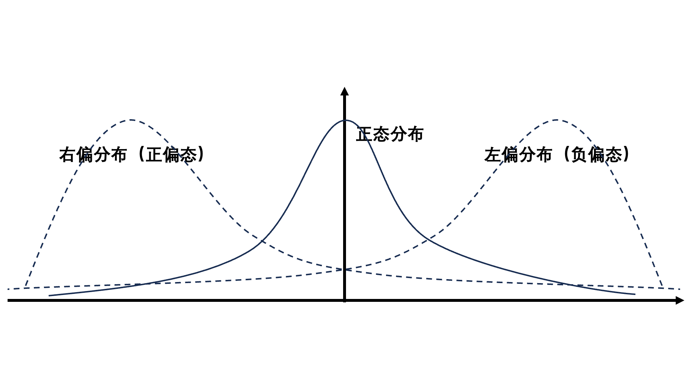

这里有一张图，我用数学概念来解释一下。中间的分布是正态分布，正态分布大家都知道，平均数和分位数是相等的，表明绝大部分的人财富都集中在平均数附近，有很差的也有很好的。但实际上，现实生活中是非常非常右偏的，绝大部分人达不到社会平均数。过去几百年、上千年的人类文明史就是这样的。当然，在很早期的时候，物质匮乏，你还看不出来。比如 80 年代的时候，一个城市里面最富有和最贫穷的人，差距没有那么大。但是到今天，越发展差距就越大。

过去我们总说房地产很赚钱，但是实际上，涨幅最好的 21 世纪的时候，前 20 年，中国的 GDP 增速是 10.1%，房地产平均回报率是 6.6%，房地产的增速是低于经济增长的，这是什么意思？也就是说，这个时期大多数人的回报率低于 10%，一线城市 13.7%。大部分人都是被平均的，这是右偏分布。但是当我们在高速增长的时候，就没有这个感知力。

未来 5 年、10 年，增速可能是 4，或者 4.5，但其实大部分人的回报率是低于 3 或 4 的。在课程中我们会跟大家讲，未来因为外部环境压力，政策会发生什么样的变化？普通老百姓的收入分配会发生很大的变化。未来很多人的平均收益率，很可能是在 0%左右的，这就是微利，不说 0%以下，但是就是非常小。

微利社会不意味着没有希望，这完全是两个概念。

## 2\. 经济学回到古典时代：效用

今年，我问自己，看 10 年，我想要成为一个什么样的人，这件事情我有一个特别深的感触。我认为今年是经济学回到古典时代，回到真正的经济学。

经济学一开始研究的是什么学问？是效用最大化。那天我和很多朋友聊天，发现这么多年，我们把 MAX UTILITY 就是效用最大化，一直当作 MAX  
WEALTH，就是利益最大化，我都有点忘记了效用是什么。但是其实效用这个词，在文献中，不仅包括你的财富，也包括你的成就感、你的闲暇时间，这些都是包含在内的。但是现在，我们自动把它转成公司价值、利润这些东西。为什么？原因有两点：第一个是因为在匮乏社会，你吃不饱穿不暖的时候，你肯定是要 WEALTH 最大化；第二点，在高增长的时候，你去 MAX  
WEALTH，效用有很多维度，但是财富可量化、可见，所以财富的重要性就上来了。

我们能感受到复杂和纠结多重发生，归因到一起。包括今天直播间的很多同学都可以问一下自己：是不是吃不饱穿不暖？还有很多同学问我，有两套房，要不要卖掉一套房买黄金。

今天这两件事同时发生，这两个逻辑同时发生在今天的中国：

第一，从匮缺社会进入丰腴社会，价值变迁，你没有那么想卷了。

真的你会发现 00 后整顿职场，本质上也有这种价值观的变化。像我和脱不花这一代人不卷都很难受，下一代他们不会那么卷的，我是比较相信的。

再比如年轻人为什么特种兵旅游？特种兵旅游是消费降级吗？如果真的是消费降级，就不要去旅游，你在家最省钱。这就是从物质价值观，转到后物质价值观。

比如，在 1w 和 5w 之间怎么选很难，但是如果是 1w 和 1.2w 的，很多人会为了 1w 放弃 1.2w 的位置，这有一个边际成本和边际衡量的问题。现在没有那么匮缺的时候，你入职了以后，价值观开始剧烈转向。

第二，经济增速放缓，更难卷出结果。

在高利润高增长的阶段，高利润的诱惑力和可得性是压倒性的，但是进入低增长阶段以后，即使你想卷，你卷的收益没有那么高，索性也就不卷。再一个生活也不是过不下去。所以微利社会对我来讲它的含义是效用社会，是从一个单一目标的利润最大化社会，成为了多元目标的效用最大化社会，这是我理解的微利，微利其实是效用的意思。

昨天我在厦门给大家分享一件事，

单一目标的利润最大化社会，成为多元目标的效用最大化社会。创造价值，不一定是创造利润，而是创造效用。

蔡钰老师之前讲过情绪价值，被很多人引用，这是不是效用？是。但是不仅限于这个。我觉得情绪某种意义上是更大众的。我举个例子，公益、成就感、很满足。我再举个例子，有没有大家被李健在阿那亚的演唱会刷屏？我当天就马上发微信给马寅，告诉他我特别喜欢今天的氛围。平演唱会是什么样的？舞美，灯光，很炫酷对吧。但是李健的演唱会是什么样的？浅吟低唱的感觉。

再比如霉霉的演唱会，全球开几十场很牛对吧，让霉霉一下子跨入十亿美元俱乐部了，这是一种效用。但是对比来看，李健也有李健的效用，不可复制。他希望李健的演唱会是从这里长出来的。马寅告诉我们，阿那亚社群希望有一点乌托邦的性质，更形而上的东西，我认为就是灵魂家园。

其实人的效用是非常多元的，情绪、安宁等等，这都是某种意义上的修行。大家都在卷情绪价值的时候，你是不是可以领先一步，去创造更美好、更多元的  
，你要相信效用如果是多元的话，那么你的价值创造的路径就可以是多元的。

## 3.《香帅中国财富报告》课程框架

下面我稍微给大家讲一下今年的课表。

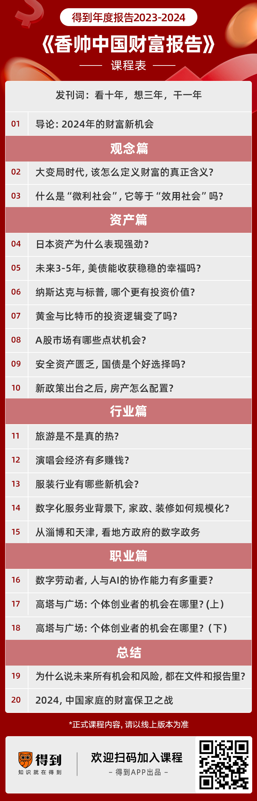

今年会涉及很多问题，比如旅游是不是很热？演唱会经济会不会赚钱？我特意访问了演唱会的主办方为你详细拆解。

再比如大家有没有听过张昕宇和梁鸿这两个人，他们散尽两千万的家财到全世界去旅行，结果赚了两个亿。他们告诉我，其实没有赚那么多钱，团队有一百多人，没有大家想的那么暴利，但是这里面的效用是很高的。不仅有团队，还有广告商，形成了很大的生态。

另外就是服务业，数字化服务业里面到底有什么新的机会？给职业市场带来什么新变化？更重要的是大家特别关心的，岛上创富的机会在哪里？全链视角是什么样的？

大家可以从今年的课表里面看到，今年的财富报告非常着重于讲全球资产，因为今年全球资产表现还是非常好的，我们不要只是在自己的窄框架里——A 股不挣钱，但是其实今年 A 股也有赚钱的。而且全球也有其他的市场在挣钱。所以我们在守富的过程中需要一个全链视角。这也是课程表中这样设置的原因。

## 三、同学提问

1、增发一万亿国债能不能提振经济？对股市有什么影响？对债券有什么影响？

第一句话是，目前影响有限，目前信号作用为主，对短期有一些托底作用，后续还要看央行。

首先要看这一万亿国债的目的是什么，比如过去房地产市场的重大变化，由于近年来房地产市场的下滑导致地方政府收入大幅减少，特别是卖地收入的锐减，这直接影响了地方政府的财政状况。但是即便没钱，政府很多支出还是在持续，地方政府现在面临财政困境，一些地方甚至出现了破产的风险。那怎么办？就是化债。

第二就是我们今天碰到了一个问题，就是需求不足。需求不足需要我们提高收入，提高收入是一个漫长的过程，所以中央政府想了一个更快的方法，花钱。

花钱有两种方法，第一种是居民花，第二种是政府花，现在就是让政府来花。而这个债券政府也给了规定花在哪里。花在这些地方以后就要扩大生产，雇人，然后大家有了收入就去买东西吃，拉动了小摊小贩，这是一个乘数效应。但是这一次的国债，乘数效应不大。

还有就是万亿国债不是一次性到位的，是未来的几年之内，所以实际的数目也并没有那么大。这就是为什么我们看最后还是 smart  
money，A 股最后也没有立刻就直线拉升。

至于会不会影响资金流动，总有人问 3000 点要不要入市，但是我想主要在于你能不能理解这里头的逻辑。

2、2024 年的基金会怎么样？

不知道，今年的财富报告直播中提到过，当我们今天说价值投资的时候，也是波段式的价值投资，原本我们是一个政策驱动的市场，而今天的市场是更政策驱动了么？是的。政策是稳定的么？不是。

所以去年我分享了，未来的政策是高峰期开车，一脚油门、一脚刹车，要持续关注。所以如果现在一个人能告诉你明年基金怎么样，那大概率是个骗子。所以为什么要持续关注政府工作会议，就是因为政策信号会持续影响市场的走向。央行、财政部的每一次政策变动，都会对市场造成影响。

3、现在卖了房子买黄金，行不行？

讲个故事，2008 年的时候，有一个人有两三千万的资产，当时这个人在南京买了 10-20 套房子，随后很快资产快速升值，到了 2013 年，这个人耐不住了，因为虽然房子涨了，但是拿的房租回报没有那些买股票的人多，随后就投入到了创业洪流中。最后到了 2018 年，当时连锁咖啡很火，这个人到北京来创业，投资了很多咖啡连锁店，这个过程中她卖掉了很多房子，再到后面的故事就是 2020 年，不断卖房子填咖啡店的坑，到了今年终于卖完了最后一套房子，回到原点。

所以今年太多人问房子的问题，我首先想说的是过去几年已经说得够多了，而今天，房子的逻辑没有变。之前我们给出的建议购房表格到现在一个字大概也是不用改的。

再看黄金，要不要买黄金完全是个体化的问题，但是如果你要是在县城里有房子，卖了买黄金我大概是支持的，但是如果你在北京海淀卖一套房子买黄金那大概不支持，但是如果你在海淀有 8 套房子，那也可以，所以对于不同的人来说，这个答案是不一样的。

所以一个 35-40 岁，有投资经验，手里有 2-3 套房子，在二线城市，这个时候问这个问题可能才是有价值的。这时候是在比较机会成本，也就是比较房子和黄金在手里的机会成本。黄金是保底思维，保证心灵的安全。黄金有两个功能，第一个是对抗波动，第二是抗通胀，所以黄金是保底的，但是不要有过高的收益率期望。黄金对抗波动得功能依旧在，但是抗通胀的能力已经被类似比特币等资产分润了很多，所以功能有所下降。

说白了，就是看你的机会成本有多高。

4、如何看未来三年的通胀趋势？美债收益率高企，会如何影响全球资产？

未来三年的通胀分两拨，美中不同。今天美国肯定在通胀，去年我们谈到美国通胀的时候，我们说美国进入了高通胀区间。美国保持一定的通胀对他们也是有好处的。很多人说美国今年的货币政策很紧，通胀还没有降下来，核心就是因为美国其实宏观货币政策并不紧，反而很松。如果要看货币政策，要看的是真实利率而不是名义利率。美国时至今日真实利率还是负的。而我们的利率基本在 4%以上，所以实际上是我们国家的货币政策很紧，美国才是宽松。财政政策美国也是很宽松。美国的通胀上升确实会对市场造成影响，所以他们不能让通胀保持在高水平上。我有些国外的朋友说，近年的生活压力确实在变大，但是还不至于压到不能呼吸的地步。所以美国的通胀大概率会软着陆。

而中国的通胀，一年之内都很难起来。除非货币政策上有一个巨大的转弯。但是从今年的中央金融工作会议来看，这个大转弯很难。但是具体还要看明年年初的会议基调如何。我们要看需求和供给哪个萎缩得更快。

5、全球资产过去一年的表现怎么样？未来的预期怎么样？

全球资产今年表现特别好，最好的就是美国股市，美国股市是有一点超预期，核心原因是美国的政策比想象的宽松。第二个就是今年 3 月份，ChatGPT 出来，发布了 4.0 版本，引发了大家对美国生产力新一轮的想象。每一轮的生产力都会带动一波股市。

除了美国，还有一个市场特别好，就是日元。日元资产今年表现得完美无缺。纳指和日经涨幅领先，意大利和中国台湾地区 17%和 13%，这都是比较强有力的。科技板块第二梯队是欧洲的国家，5 月以来有一些回调，但是全年来看都是在涨的。第三梯队包括巴西等，都有一点涨幅。

黄金一直在震荡区间，只要是市场发生剧烈波动的时候，就会这样。只要战争起来，就会涨。如果进入安宁，再跌也很难。

再一个就是美债，比如美债今年表现怎么样？收益率就是上涨的，因为收益率涨，美债的价格就会下跌。如果你买美债的话，持有一段时间，收益率就是涨的，你不要看它的价格。今年开始的时候，很多人布局美债，认为通胀会下来，下来以后美联储会降息，降息以后美债价格会上去，很多人认为美债的价格会上涨。所以你问，美债好不好？如果你做波段，博价格涨幅，作为风险资产来投资，美债不好。但是如果你把他作为安全资产来投资，美债好。

大宗商品，今年也是波动。整体来看，全球今年资本市场在牛市里面。

在课程里面，我挑选了几个全球资产，我认为对高认知的中产家庭比较友好的给大家分析。比如纳指，大家都说美元资产强，就问美元资产好还是日元资产好？这就是要讨论的问题了。美国到底是什么动力来驱动。不同的资产绝对数额不一样，你的资产配置就不一样。比如日元资产，我们会分析为什么日元资产今年这么强悍，我们也会分析日币未来怎么走，我要不要买日元资产。

今年 A 股虽然一塌糊涂，但是过去三年涨的股票也很多。所以这么大的一个市场，资金总要有地方去，存量资金也要有地方去，要知道股票型基金是不能空仓的，至少 70%的资金是要放在市场里面的，钱总要有地方去。资金是聪明的，总会去往那些有机会的地方。去年我们说能源安全、农业安全、国防安全之中，今年拆开看，股票市场这三个领域的涨幅也都较好。

有一个经济学家，说了一个特别好的话，我们总说熊和牛，其实没有熊和牛的差异，其实是结构熊，结构牛。熊身子上也有牛头牛尾，牛身子上也有熊头熊尾。明年想集中在点状的机会上讲透一些。

6、斯坦福学霸进入服装行业是浪费人才吗？

给大家说两个我今年最触动的点，第一个是前几天在广州，参加企业微信的会议，里面有很多大企业，当时有一个 CIO 做分享，然后企业微信的工作人员和我说这个人昨天直接就昏倒了，因为是一个小企业，只有 40 个人的厂，所以和很多大企业在一起很紧张，就是一个做数据线的，一年 4000 多万。他的分享就是说他用企业微信就是一个数字化的基座，小企业虽然没什么钱，但是也需要搞数字化转型。海尔、三一这些企业有很多钱去研发，但是这样的小企业就请不起 IT 自己做，所以就需要找一个好的基座，在上面直接使用现成的工具，利用小米加步枪来实现自己的数字化进程。但是这个 CIO 很不自信，觉得自己一点也不高大上，在这种场合将自己的精力非常谦卑，非常紧张，甚至吃不下饭，睡不着觉。我原本觉得数字化转型这个词很虚，但是那一刻，我觉得很实。此外在今年的共潮生里面我也分享过，很多数字化，其实在今天的中国之所以有机会，实际上是过去二十多年中国消费互联网平台发展的过程中，培养出了无数的数字劳动者。当时我和菜鸟的副总聊天，他说海外建仓的一大门槛就是那边没有太多的数字劳动力，很难掌握数字化工具。但是在国内，哪怕是初中毕业，一个长春的五十多岁的阿姨，都能把很多平台工具玩得团团转，和平台斗智斗勇。

数字劳动力的培养需要成本，而中国的数字劳动力是过去二十年发展中的冗余，这个构成了中国数字化非常重要的基石。更重要的一个点就在数字化的服务业。数字化服务业恰恰让是那些不用数字化的人也可以生活得很好。比如美团和大众点评，如果评分很高，那大概率是刷的。但是如果一家新店上线，有了差评以后很快评分就会下降，对自己会有伤害。有一个小姑娘开了个茶馆，她说我开茶馆就不依靠数字化平台生存，但是他虽然不用平台，但是研究平台的规则，她去经营私域，然后依靠人传人，只需要几百人就能撑起自己的生意。

能够以非数字化的方式生存下去的核心是因为我们已经是数字化消费者。我们的触点很广泛，我们有微信等数字化的基础设施。所以即便是非数字化的生态也是建构在数字化的基础设施之上的。

我们都在说中国制造如何突围，我今年深入研究了一下服装行业，我在里面看到了正是前面 20 年的整个服装来料、电商兴起等一系列的整合，才造就了现在的网红品牌的兴起。此外为什么现在预制菜赛道可以兴起？本质也是数字化的服务业倒逼着整个餐饮行业发生了变化，最后产生了新物种。

7、2024 年哪些行业、职业收入可观？

可能没有这样的职业和行业，你的想象力决定你的未来，要不然你已经在一个好岗位上，如果你现在在寻找，那就是看你的想象力。千万不要被岗位所束缚。比如我们之前觉得秘书、助理不是一个好词，但是名称根本不重要，未来的组织结构在变。比如 Mid  
Journey 只有 11 个人，你叫什么都可以，但是你担任的责任是很大的，所以后续就会有越来越多的年轻人进入到扁平化的小组织里面，你会发现自己是任何人。在小组织里面，你的专项技能、协调能力都很重要。所以你说哪个职业赚钱，我不知道。你要抓住未来的点在什么地方。

再次感谢大家，近年来大家对我的帮助很大，帮助我也一点点成长，不断前进，希望这些知识可以在未来能够真正替我们创造财富、创造价值。

* * *

# 01-导论：2024 年，预期怎么变？钱又从哪里来？

懒人专属群的群友！你好，欢迎来到《香帅中国财富报告》，我是香帅。

## 1.关键词：微利社会

2023 年中国经济恢复不及预期，很多人觉得出人意料。10 月份的时候，我把自己过去四年做的《香帅中国财富报告》系列和相关书稿重新读了一遍，这才发现，把每年的关键词连起来看，2019 到 2023 年的演化路径是很清晰的。

每一年的关键词就是在当年所展现出来的未来趋势。比如说：

（1）2019 年的关键词是高垂之果。

意思是经济增速开始放缓，随手可得的低垂之果已被采摘光了，剩下的是需要更多努力，爬到高处才能采摘的高垂之果。

（2）2020 年的关键词是 K 型分化。

意思是过去几十年科技和金融的马太效应让社会趋向于中间层消失。而疫情冲击下，这个分化加速显现。

（3）2021 年的关键词是向南而生。

强调的是中国经济重心在地理上将持续南移，而治理上将更加集中，所以未来的社会会更加强调规范、稳定、责任。

（4）2022 年的关键词叫岛链化。

意思是全球化被“共识碎片化、有限连接、博弈大于合作”的岛链化取代。

这几个判断，已经随着时间推移变得越来越显性化。

顺着这几个关键词，我们会发现，中国经济的内部动力和外部环境都已经沧海桑田。所以某种意义上，“疫情”其实是个烟雾弹，让我们将很多在逐渐发生的变化进行了错误的归因。疫情是加速了一些变化，但它不是根本原因。

我想明白这事也是在 2023 年中，当时在“共潮生·香帅年度财富展望”中说过两句话：

1.当时代发生结构性变化的时候，基于历史的预期就成了包袱。

2.未来，应该以 2023 年为新的基准。

这个演讲之后很多人微信我，说这两句话把这两年感受到的困惑和纠结给捅破了，但是他们也都问，你说要以 2023 为新基准，那这个基准到底是什么？

这个基准就是，

我给出的 2023 年关键词，微利社会。

你没有听错，微小的微，利润的利——微利社会。

其实定这个词的时候，我犹豫了几天，一方面确实没有找到更合适的词语替代，另一方面这个词好处是真实，对于调整预期，校正行为会比较有用。毕竟我们这前后几代人都习惯的那种增长模式，商业环境，都有了很大的改变，如果不把这种肌肉记忆摒除的话，最后反而可能吃亏。

但我心里的“微利社会”更多反映的是经济发展本身的规律，以及随之而来的社会价值观的变迁。而观念，其实是最终决定经济现象和商业模式的核心要素。  
所以，观念如果发生结构性变化，对于原有的经济范式和商业模式可能意味着挑战，但同时也可能孕育新机会。

## 2.微利社会 = 效用社会

我们先解释一下，到底什么是微利社会，以及为什么我并不觉得这是个“悲观”的词语。

微利社会这个词包括经济含义和社会含义。

首先我们看“微利社会”的经济含义，这个含义也告诉了我们关于未来的合理预期应该在什么范畴。

微利的经济含义可以从放缓和分化两个维度来分析。

第一个维度好理解。  
社会的平均投资回报是跟经济增速匹配的。经济增长放缓，社会的平均投资回报率必然下行。中国经济从两位数的高增长转入低于 5 的中低速增长，整个社会的平均利润当然从“暴利”转向“微利”。

第二个维度则和一个人类社会发展的残酷现实密切相关——经济发展和科技进步伴随的是社会财富的 K 型分化，更准确地说，是头小身子大的 K 型分化。这意味着，绝大部分人的财富、收入、回报率被极少数人“平均”了。换句话说，大部分人可能获得的利润其实低于社会的平均值的，所以更是微利。

之前我们也稍微推算过未来十年的经济增速，在 2019 年外部环境没有发生变化的时候，估算大概在 4.5%-5%左右。但过去 4 年的变化，让我们要把这个数字调低。以较为平稳乐观的情形做判断，3%-4%可能算合理。那这就意味着，大部分个体所能获得的回报率（增长率）会低于 3%。而部分行业、部分资产的回报率可能会更低。

所以，预期从暴利、厚利转向微利，这确实是一个需要调整的过程。

2023 年我的观察是，企业姿态已经调了很多——  
很多原来懒得做的项目，懒得花心血去拓展的小市场、小品类，都开始卷。有次饭桌上一个企业家说，“现在蚊子肉也是肉”，当时哄堂大笑，但是也明显都心有戚戚焉。但更有趣的地方在于，很多投资者尽管身体动了，心里没有动——还是想着“这是短期阶段性的，熬过这段时间就好了”。但实际情形就是，整体上全社会的投资回报已经在下行的通道里。

另外一方面，“微利社会”并不代表“没有希望，或者说悲观的社会”。因为它的社会含义是从利润社会到效用社会，而效用这个词透露了未来机会在哪里。

其实经济学是一门讨论怎么在约束条件下实现效用最优化的学问。而效用 Utility 是什么？这个词很抽象，但大体上可以理解成“满足”。  
作为正常人类，我们的满足（快乐）来自很多维度，包括财富、收入、兴趣、闲暇时间、爱、成就感，等等。对不对？收入和财富肯定是效用中最重要的两个维度，但它的边际效用，其实是随着收入和财富水平的上升而下降的。

但过去这些年，我们有意无意地把效用简化成了利润/财富，目标函数也从效用最大化直接变成了利润（财富）最大化。

这有两方面原因：一方面，在匮缺社会中，财富的重要性是压倒性的，毕竟吃不饱穿不暖很难谈到什么满足；另一方面，在高增长阶段，高利润的诱惑力和可得性也是压倒性的。

所以，对于大部分人来说，在从匮缺社会发展到丰裕社会的高增长阶段，“财富、利润、利益”的最大化基本可以等同于效用最大化。

但在今天的中国社会，两个逻辑同时发生了变化：经济增速放缓，即使“卷”也没有那么高的利润；同时社会也从匮缺进入丰裕，物质价值观逐渐转向后物质价值观，精神追求和多元化目标开始逐渐变得更为主流。

所以，不管是被动还是主动，中国社会正在从一个单一目标的利润最大化社会，成为多元目标的效用最大化社会。

## 3.未来机会就在“效用”中

听到这儿，你知道了在社会层面，“微利”可以理解为“效用最大化”取代“利润最大化”，我们就会发现，未来的机会其实也在这个转变里面。

不知道你注意到没有，在讨论效用社会的过程中，我用了一句话，

说今天的中国社会正在从物质价值观转向后物质价值观——其实今天中国经济中的短板、痛苦和机会都在这句话里面。

什么叫物质价值观？就是认为物质的、有形的、看得见摸得着的东西是好的，比如说高楼大厦、基础设施、制造业都是好的。

那什么是后物质价值观呢？就是觉得物质不是太大的问题，更重视那些非物质的感受，是否平等相处？是否重视我的意见？是否够酷？一句话，更重视自我价值的表达和表现。

很明显，我们区分一下代际就会发现很强的差异性，50 后、60 后是标准的物质价值观，70 后、80 后开始有变化，到 90 后逐渐转向后物质价值观，越往后的世代，后物质价值观越强。

这种代际价值观上的差异，就产生了一个很有意思的现象：

从我们政策决策面来说，仍然是 50 后~70 后担纲，所以物质价值观占主导；但是从市场角度看，消费和其他需求方的主力，已经逐渐转移到 80 后、90 后，甚至 00 后。这三个世代已经占据了中国 55%以上的人口，后物质价值观正在逐渐成为主流。

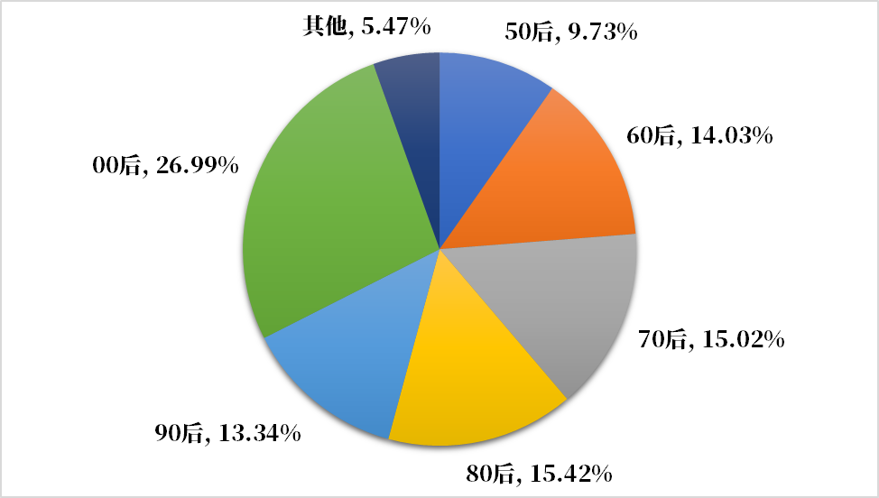

需求端的后物质价值观和供给端的物质价值观中间，其实是有条鸿沟的。

举个具体的例子，我们经常说要提高民众的文化生活水平，大家要多听音乐会。这个大家都没有疑问，但在物质价值观下，就倾向花更多钱在富丽堂皇的音乐大厅上。而后物质价值观下，就倾向于花更多钱在更好、更多元的乐队上。价值观决定了效用产生在不同的东西上。所以，随着后物质价值观人群越来越占据社会主流，我们就可能会看见“好音乐厅过剩好乐队稀缺”的现象。你看，既是短板，也是机会。

这种鸿沟在公共服务上是最明显的，但在其他市场上也或多或少有影响。比如说商品消费市场就是存量博弈，卷性价比会变得越来越激烈，但服务和体验消费还有上升空间。这样一看，2023 年市场上发生的很多现象都可以得到解释，比如说旅游热、演唱会热，比如大家天天念叨的“情绪价值”等等。而这些地方的细微变化，可能就是未来商业是否能创造利润的分野所在。

这也是为什么我会说，“微利社会=效用社会”这个判断本身就是未来的机会所在。接下来的 19 讲课程，我也会花较大的篇幅来跟你一起讨论，价值观变化、技术变化，到底会给我们带来些什么机会，又让我们暴露在哪些风险之下。

好，简单给你总结这一讲的内容：

1.  
2023 年之后中国经济的关键词是“微利社会”。微利社会意味着整个社会从暴利、厚利转向更低的利润水平；同时也意味着我们正从一个单一目标的利润最大化社会，成为多元目标的效用最大化社会。

2.  
效用最大化和利润最大化不同。它的背后是对物质不过度看重，但更重视自我实现的后物质价值观。中国 50-60 代物质价值观是主流，90-00 后人群后物质价值观开始占主流。

3\. 中国需求端的后物质价值观和供给端的物质价值观中间有条鸿沟，主要表现在公共服务，部分消费市场上，而这些都是未来企业增长和个人职业的好机会。

* * *

# 02-需求不足，消费市场还有机会吗？

懒人专属群的群友！你好，欢迎来到《香帅中国财富报告》，我是香帅。

从这一讲开始，我想花点时间聊聊消费市场。

大家现在最关心的应该就是

“2024 年，消费市场到底会不会起来”

，因为这个关系到企业 2024 年计划怎么做，家庭预算怎么安排，甚至通胀能否起来等很多问题。

所以，我们从这个问题开始。

在回答这个问题之前，我们先拆解一下消费问题。讨论消费有两个维度，一个是总量，即花钱多少的问题；一个是结构，即钱花在什么地方的问题。

对于宏观经济学家来说，总量重要，因为这关系到增长速度。但对于企业来说，总量和结构同样重要。尤其在总量不增长的情况下，结构变化意味着在不同行业，开发不同的产品，甚至采用不同的销售方式，对企业来说可能就是能否活下来、能不能活好的一个分界线。

我们分开看。

## 1.总需求：仍然不足

首先看总量，2024 年，消费市场的总量能否起来？这其实也是过去两年经济学家们讨论的焦点。一个可以看见的事实是大家现在消费热情不高，不太愿意花钱，宏观经济学家把这个叫作“总需求不足”。

现在总需求不足是共识，分歧在于：

（1）这种需求不足是疫情留下的“疤痕” ，还是政策缺失导致的下滑？

（2）总需求不足是会自己慢慢修复，还是需要下猛药去做逆周期调控？

对这个问题的判断非常重要。2023 年我和一些消费企业聊天，就发现他们对企业未来几年的规划，是逐步扩张还是加速收缩，或者是边走边看试探着来，就和在这个问题上的不同判断有很大关系。

这个问题大家看法并不统一。但从 2023 年前 10 个月的情况看，修复没有达到预期，而且距离还在扩大。这方面，张斌和郭凯在 CF40（金融 40 人论坛）有一个系列研究，把这个问题讲得很透彻，但比较偏技术，需要一定的宏观学术基础。我将两篇文章放在今天课程后面，感兴趣的同学可以去查看。如果你是做实际业务的读不懂也不太要紧，我简单给你梳理了一下。

逻辑不复杂。和投资比起来，消费的变化是相对平滑的。所以消费趋势要从长期来观察。张斌以 2012 年到 2019 年居民的实际消费做了个趋势线性外推——就是假定说，2024 年我们的消费习惯和前些年基本一致，没有什么断点，基于这个假设和数据得到了一个“趋势值”——然后用 2020 年到 2023 年实际的消费去和这个趋势值做比较，如果实际的消费大幅地偏离了这个趋势值，那一定意味着有什么问题发生了。2020-2022 年肯定是偏离趋势值的，因为有疫情。但 2023 年，疫情大流行结束了，应该“恢复原状”或者最起码偏离度要减小。

这事不难理解。你多年一直成绩稳定在前 5 名，中间生病缺课，掉到 30 名，后来病好了回来上课了，要是还继续下滑，这肯定就有问题了，对吧？

好了，那我们看今年的消费实际情况怎么样？2020 年的偏离值是 7.7%，2021 年缩小到 4.4%，2022 年偏离扩大到 11.8%。然后 2023 年呢？偏离达到 12.9%  
，比 2022 年的偏离值还大。这个数字听起来很奇怪，但挺符合我们实际的经济体感的，对不对。所以，消费会自己修复这事儿看起来不是很不靠谱。

换句话说，在没有强大外力介入的情况下，2024 年消费市场在总量上不能报以过高预期。如果政策的方向和力度出现波动的话，总量甚至有下行萎缩的风险。

## 2.消费结构：变化较大

好，说完了总量，咱们再来说结构。

2023 年前 10 个月，CPI（居民消费价格指数）与年初相比，累计上涨了 0.1%，但拆开看就会发现，其中商品消费价格下降了 0.8%，而服务消费价格上涨了 1.5%。

同样的，观察几大类消费过去十年的趋势偏离值，我们会发现更多信息。

统计局把居民消费分了几大类：食品、衣着、居住、交通/通信、医疗保健、教育文化娱乐服务，等等。以 2022 年为例，消费总量大概是 34.6 万亿，其中食品和居住是最大两类，分别是 10.6 万亿和 8.3 万亿的规模。

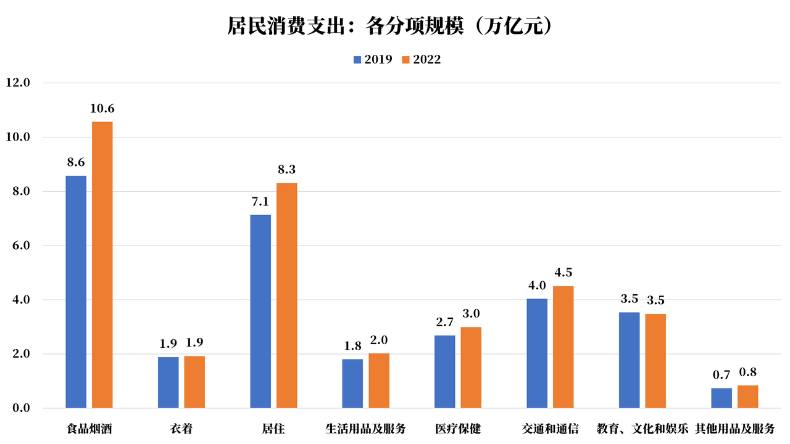  
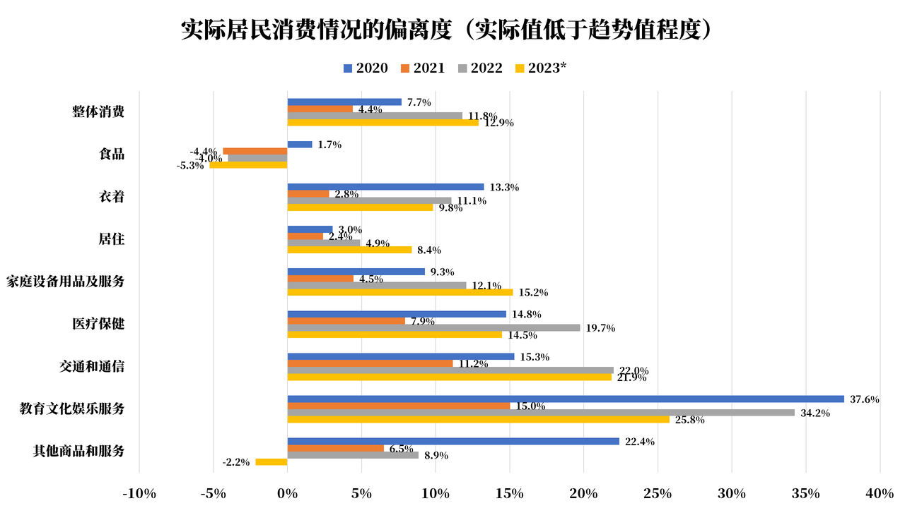

然后我们发现，这几大类消费在过去几年都低于疫情前的趋势值，但食品行业反而从 2021 年开始，持续的高于疫情前的趋势值，2023 年甚至高出趋势值 3.3%。这是由于农产品价格上涨，还是因为在食品上面消费升级，或者是因为消费降级大家更多去花钱在单价没有那么贵的食品上？真正的原因还需要做进一步的数据分析，但对那些疫情前一直处于“夕阳行业，下行赛道”的食品行业来说，可能会获得一个相对的缓冲期，甚至出现新增机会。

医疗保健、交通通讯、教育文化娱乐，这几个大类是疫情期间受到冲击最严重的。但好消息是，2023 年的趋势偏离值跟 2022 年相比都有一定程度的缩小，起码都缩小了 20%以上。衣着服装这个大类在 2023 年，也比 2022 年略有恢复，但是恢复速度就明显要弱很多。  
而且，这些大类消费在 2023 年的偏离值都是远远超过 2021 年的。我觉得，从这些数据里面，非常清晰地可以看出，“消费欲望倾向”产生了拐点。

这些数据说明了什么呢？

这些数据说明，2023 年消费市场发生的变化，绝不仅仅是因为疫情本身的影响，而是“消费欲望倾向”产生了拐点。

当然，好消息是，按照这个趋势，2024 年，这几个大类的消费市场应该还会缓慢的恢复，起码不会比 2023 年更差。

那么最拖累 2023 年消费的是哪些呢？

两个大类：居住 & 家庭设备用品及其服务

居住包括房租、装修、物业管理，还有自住房折算的租金等等。

家庭设备及其服务包括家具、家电、纺织品、日用品、美妆和家政服务等等。

居住这个大类 2023 年的趋势偏离值是 7.3%，和 2022 年的 4.1%相比，差不多翻了一倍。家庭设备及其服务在 2023 年的趋势偏离值是从 9.2%扩大到 11.3%  
。

你看，把数据拆解开之后，就很清晰了，2023 年消费市场的疲软，总需求上不来的核心原因就是，房地产行业持续失血。

房地产失血的时候，大家容易想到对投资有影响，但实际上对消费的影响也是巨大的，而且还是连锁反应。这里稍微多啰嗦下，我们市面上流行一句话，叫“一鲸落而万物生”，总觉得一个庞然大物倒下意味着给很多小生物腾出了生存空间。但实际的情形是，现代社会是个牵一发而动全身的反应堆，一鲸落而万物衰的场景倒更常见。

把消费结构拆解开之后，我们大体有个结论：

首先，房地产相关的消费市场，大概率是无法再回到趋势值上了。未来是一个激烈存量博弈的态势。

其次，即使出现政策宽松，很多商品消费很可能也回不到趋势增速上，但服务相关的消费可能会有一个更高速的增长期。哪些服务相关的行业，我们会在后面几讲中和大家继续讨论。

消费的结构变化除了服务消费上行、房地产拖累总量等趋势外，还有一个很有意思的变化，就是农村居民消费倾向相对更稳定。前段时间，我也听到有企业说 2023 年“下沉市场”相对比较好做。

看数据发现，“消费低迷”主要来自城镇居民。我在课程文稿里放了一张图，你在图上就会看得比较清楚：2020-2023 年期间，城镇居民的实际消费是大幅偏离趋势值的；而农村居民消费在 2021 和 2022 年甚至超过趋势值，2023 年偏离趋势值也只有 2.4%左右相对温和的水平。

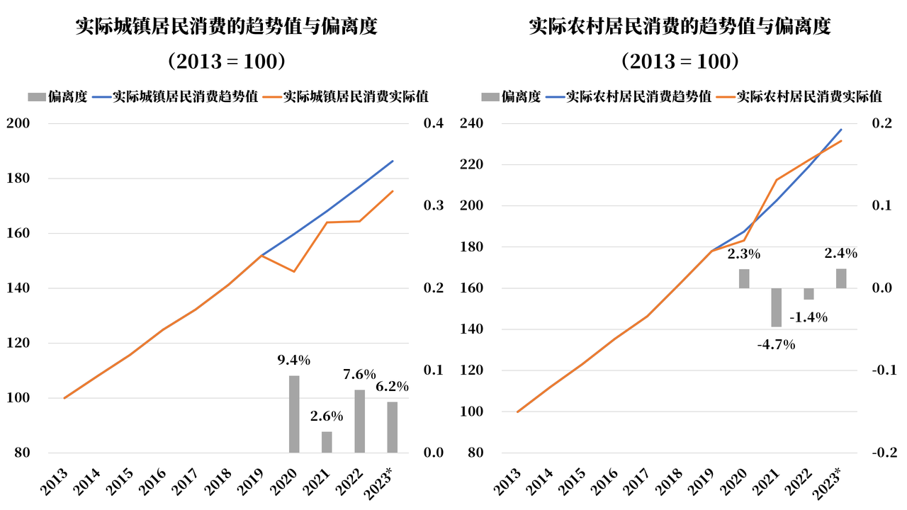

这个趋势会不会长期持续下去还需要观察。但短期内，比如只看 2024 这一年，我认为可能还会保持一段时间。

好，这是这一讲的内容，简单总结：

1\. “2024 年，消费市场到底会不会起来”这个问题，要从两个维度来回答：一个是总量，一个是结构。

2\. 从总量上看，总需求仍然不足已经达成共识，但这种不足是“疤痕”还是政策缺失依旧存在分歧。

3\. 从结构上看，居住和家庭设备用品及其服务，两大类对消费的拖累较大，但医疗保健、交通通讯、教育文化娱乐这几个大类的消费市场已经在恢复当中。

最后还有一个有意思的问题，想留给大家作为这一讲的思考题。2023 年拼多多股价节节高，曾一度超越了阿里的市值。你觉得这个股价变化和消费市场的结构性变化有关吗？你用过拼多多吗？你在哪个城市？欢迎你在留言区跟大家一起分享。

下一讲，我们会继续讨论消费市场上更加具体的变化。

## 延伸学习：

1.张斌：如何在短期内扩大消费

2.郭凯：当前推动消费回升的政策思考

* * *

# 03-旅游行业火爆，是短期虚热还是长期机会？

懒人专属群的群友！你好，欢迎来到《香帅中国财富报告》，我是香帅。

这一讲我们继续讨论消费市场。我们从 2023 年最火但也最复杂的旅游业开始聊起：

首先，2023 年旅游热，肯定没人有意见。从清明节到国庆节，各地出游热情高涨一直是媒体热点。A 股旅游板块前三季度营业收入同比上涨 45%，利润上涨 220%，恢复到了 2019 年同期的 90%以上。

但你要是说旅游真的热……很多数据又挺打脸。比如说股价。截至 2023 年 11 月 20 日，中证旅游指数下跌 32%，是 A 股跌幅最大的板块之一（沪深 300 指数都只跌了 8%）。而且出行意愿虽然强，但消费并不强：“五一”和“十一”假期出行人次分别是 2019 年同期的 119.1%和 104.1%；而人均消费却只有 2019 年同期的 84.1%和 97.5%。打个不恰当的比方，这就相当于捂着钱包在外面疯跑。

“捂着钱包疯跑”这个特征还会在旅游业的很多地方表现出来，比如，特种兵旅游、短途游，等等。另外，旅游热点变化也挺大，明显的趋势就是传统景点有点增长乏力，但不少三四五线小城突然蹿红。

我们把旅游业的整体现象总结起来就是：

1、表面繁荣大于实际增长；

2、旅游方式和旅游热点都在新旧更替当中。

2023 年年中的时候我就隐约觉得，旅游业这种数据/现象和我对整个消费市场的体感有点像，不能单一归因，似乎是很多因素结合下的产物。10 月份跟朋友聊天说到这个“纠结”，他用一句话总结了出来——  
消费减少是因为“总需求疲软”，表面繁荣是因为“补上前几年缺失的服务消费”，而方式和热点变化则是因为“消费价值观变迁”。

我一下子豁然开朗，总需求疲软，服务业补缺，消费价值观变迁。这就是整个 2023 年消费市场上的一个态势。

弄清楚了 2023 年消费业态背后的几个核心因素后，我们再来分析，哪些是长期，哪些是短期，哪些变化正在发生，可能就会对下面的消费市场的演化路径更有把握。还是以旅游业为例——

前面说到，旅游股在 2023 年就是一个打脸状态：一边业绩涨，一边股价跌。  
中证旅游指数下跌 32%，是 A 股跌幅最大的板块之一。30 多只股票里面只有三只大涨，其余都跌，跌幅最大的中国中免，股价腰斩都不止。

为什么？因为投资股票有一条经典逻辑——“买预期，卖事实”。

当前的业绩不重要，未来的预期才做数——2022 年年底两个月，即使机场景点空荡荡，但中证旅游指数上涨了 23.8%。为什么？因为大家都预期 2023 年旅游会大热。但是 2023 年之后，大家发现：经济景气度未达预期，总需求上不去。

## 1.经济景气度未达预期，总需求上不去

旅游作为“非必需消费”，需求弹性很大，其实更容易受到收入的影响。所谓需求弹性，就是市场需求对收入变动的敏感程度。比起米面粮油这些必需品，经济景气度对非必需消费影响更大。这个背景下，市场倾向于认为，旅游市场的回暖是因为之前服务业补缺消费，会是短期虚热，只要经济不上来，旅游业长期的业绩就没保证。所以“五一”“十一”预期一兑现，利好出尽，资金见好就收。

## 2.行业业态老化，“流量”模式见顶

这波行情现实不但把 2022 年底的涨幅吐干净，还补跌一波，直接跌回到 2019 年的水平。

这个补跌也是当下旅游业态的一个提醒：长期来看，依赖人流量的传统旅游业态已经遇到了天花板。

旅游板块股票主要分两种：一种是餐饮和旅行社，进入门槛低，大家都在同质化竞争，也没什么利润空间。

另一种是景区基础设施，资本投入巨大，又有票价管制，景区承载人流量也有限，没什么增长空间。在疫情之前，黄山旅游、张家界等老牌旅游景区，已经显露出颓势，营业收入多年徘徊不前了。

其实，不仅仅是旅游业，吃流量红利的消费业态，都遭遇了滑铁卢。

比如，前两年爆火的新消费品牌，钟薛高、拉面说、完美日记、花西子，很多都显露出疲态。在 2020 年的《香帅中国财富报告》中，我们就曾经讲过，新消费品牌依赖的主要是营销创意，“小红书感性种草，知乎理性背书，抖快直播带货，淘天承接流量”一套组合拳下来，新品牌可以弯道超车，快速切入市场。

而现在，流量红利见顶。一方面大家都学会了这套流量打法，效果自然削弱。另一方面，流量也更贵，而且伴随着经济下行，消费者变得更理性。消费主义盛行的时候，大家都不谈“性价比”，但 2023 年之后，  
性价比成了大众消费市场上最能引起传播裂变的点。

狄更斯的《双城记》里面有句脍炙人口的话，“这是一个最好的时代，这是一个最坏的时代”。这两年对这句话，我感受特别强烈。就是我们会发现，很多事情的两面性其实都特别强。就说旅游业吧，业态老化不是新闻，大概十年前就有讨论，但在经济的上行期，大家都吃红利，差异就不太看得出来，到下行期没红利了，个体能力上的差异就变得性命攸关了，所以，某种意义上，对于真正有产品能力和服务能力的企业来说，当下可能是逆天改命的机会。

## 3.行业重新洗牌：从“消费主义”到“生命体验”

行业开始重新洗牌。而社会消费价值观转变，会带来新的结构性机会。

这件事看中国中免和长白山、曲江文旅的对比就很明显。

中国中免的商业逻辑是利用垄断性免税牌照，获得价格优势，销售高利润率的高端产品。换句话说，中国中免是“卖货”逻辑——但现在情况变了，消费复苏不如预期，而且免税牌照逐渐放开，所以股价砸出深坑。

但再看旅游板块里涨 40%的长白山，涨 17%的曲江文旅都在干什么呢？

三个字： 卖“体验”。

更准确地说，就是将“观光旅游”转型成“生活/生存体验”。

之前的长白山景区，主要以观光游为主，登天池，打卡拍照，  
就可以结束行程，消费和复购欲望都低。现在长白山开始主打“温泉+冰雪”的强体验。景区本身有好的冰雪资源，少数民族特色文化。加上过去这些年在高端酒店  
、餐饮、娱乐等配套设施的投入——只要能设计好项目，让人能身处原始森林，远眺皑皑雪山，滑雪泡温泉，参与性、刺激性和体验感就都有了。

曲江文旅的主营业务是西安的“大唐不夜城”等景区。最近爆款频出，网红 IP 不倒翁小姐姐，演艺节目“盛唐密盒”，李白对唐诗送肉夹馍——也是这两年很流行的“全场景沉浸体验式旅游”。

从观光旅游到生命、生活体验，这是旅游行业在发生的变化。但更重要的是，折射出了中国代际消费价值观的变化。

往深层次去想，消费到底是什么？

在极度匮缺时代，消费是为了满足生存需要，饱暖，干净，安全。

进入后工业时代后，消费逐渐成为一个塑造自我、定义自我的过程。

这个变化非常有意思——原来消费是社会身份的附属：比如说两汉时期，只有贵族能穿鲜艳的丝绸，平民只允许穿暗色系的粗布麻衣，有钱都不行。工业革命之后，新兴的资产阶级拥有大量财富，亟需打破这个桎梏，所以消费开始成为塑造社会身份的元素：在百货商店这样的场合，大家只敬钞票不管身份，消费赋予了人们新的标签。

到 20 世纪 50、60 年代之后，这种趋势越来越强——“价值观”被消费塑造，而价值观又深刻地影响着消费市场。

还记得吗？之前在第一讲，我们说到，中国正在经历从物质价值观到后物质价值观的转变。所谓物质价值观，就是指经历过物质匮缺的人，更容易把经济需求和经济安全放到一个比较高的位置，强调物质拥有、社会声望和外在形象。而后物质价值观则相反，更强调自我表达与个人自由。

咱们对比 60 后和 90 后的典型旅游模式，你就会更直观地发现其中的区别：

60 后：报团，去景点，下车拍照上车睡觉，发朋友圈进行“展示”。

90 后：搜攻略，挑“酷”的地方，设计一路打卡、必吃、必玩项目，实时“分享”体验感受。

很明显，对 60 后来说，旅游更像是一种“奢侈品消费”，展示一张跟长城、东方明珠、黄山迎客松的合照，获得外在形象建设和社会认同。但 Z 世代不同，  
他们更追求个性化，兴趣是旅游的动因，他们更在乎“小圈子”里的认同，个体体验更重要。

从奢侈品消费到体验消费，从消费主义的秀场到对日常生活的抽离，从结果到过程，这是消费价值观的变迁。而这种变迁，对行业来说，意味着新陈代谢和洗牌机会。

老景区衰落，新玩法兴起，这个趋势在 2023 年体现很明显，像实景旅游、COSPLAY（角色扮演）旅拍，这些强体验的项目都在快速崛起。另外，很多小众城市出现旅游高增长——同程数据显示，“五一”假期里，国内三线及以下城市酒店预订量较 2019 年同期增长超过 150%，比一线城市高出 50 个百分点。在课程文稿最后我放了一张表，统计了 2023 年的热门城市表现，包括山东淄博、贵州榕江、广东江门、宁夏中卫等等。这些城市的旅游流量和收入都大幅超越了 2019 年同期。

这些城市有什么共同特点？

难以复制的爆点 + 深度的体验场景。比如淄博烧烤的烟火气，贵州榕江的足球激情，宁夏中卫的沙漠星空……这都是独特的体验。

围绕自己的独特优势，打造深度体验场景，再加上流量杠杆，就有可能成功。这条定律不仅仅适用于旅游行业，整个消费板块都面临着这样的结构性机会。关于如何打造爆点的问题，我会在第 5、6 讲，深入讲一讲爆款经济学。

好，以上就是这一讲的内容，简单总结一下：

1.2023 年的旅游业呈现出表面繁荣大于实际增长，旅游方式和热点新旧更替的特点，究其原因是因为总需求疲软，服务业补缺，消费价值观变迁。

2.社会消费价值观的变化主要是指从匮缺时代到丰裕时代，消费从为了满足生存需要、饱暖、干净、安全，逐渐成为塑造自我、定义自我的过程。

3.随着消费价值观从“消费主义”转向“生命体验”，不仅仅是旅游行业，很多行业都会迎来新的结构性机会。

【附件】

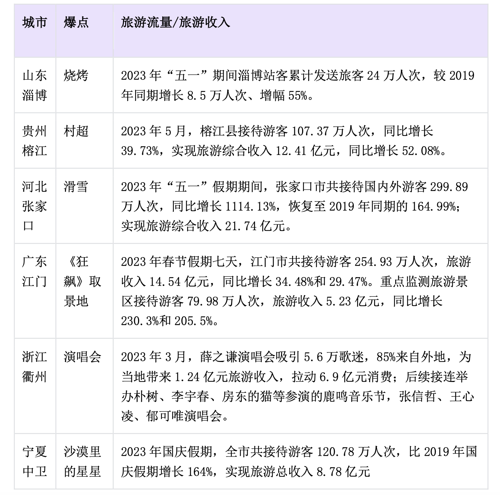  

* * *

# 中国家庭房产配置指南（上）

懒人专属群的群友！你好，欢迎来到《香帅中国财富报告》，我是香帅。

接下的两讲，是我今年特地为你准备的一个房地产特辑——2023 年房地产特别难，房价的波动也非常严重，很多家庭的资产水平受到严重的影响。引发了很多焦虑，所以很多同学在问，老师，你前几年讲的房地产的逻辑还成立吗？当然也有很多没有听过课程的同学还在问，到底买不买，到底卖不卖，学区房还行吗？房产配置多少才合适？

我稍微看了一下，从 2019 年到 2022 年，我们一共有 14 讲关于房地产的课程，涉及了怎么选择城市，怎么选择位置，怎么选择学区房，房产配置在什么水平更合适等等问题。我将这 14 讲课程中的关键点做了个简明扼要的梳理，然后做成了两讲加餐内容，希望能帮我们新同学更好的理解房产逻辑，做好决策；同时也希望帮老同学重温之前的内容，想想我们房产配置上还有什么可以提高修正的地方。

好，今天是第一讲。我们快速地回顾我们前面几年关于几个大问题的结论。比如说怎么选择城市和区位，学区房是否值得买，以及如何看待房产税的力度。

## 1\. 城市和区位

城市的逻辑是 2017 年 12 月的《香帅的北大金融学课》到 2019 年的《香帅中国财富报告》中强调的重点，其实原则很简单，就是三句话。

第一句话就是选大城市，低线城市有风险。

我曾经给中国城市房产的投资价值划分过 ABCD 四个等级。A 是值得投，B 是在没有其他更好投资选项的情况下值得投，C 是实在没有其他渠道才投，D 就完全不应该考虑。

A 类包括北京、上海、深圳、广州、杭州、成都、南京、苏州。

B 类包括重庆、天津、武汉、郑州、西安、长沙、青岛等 14 个城市。

C 类包括东莞、佛山等 18 个城市。

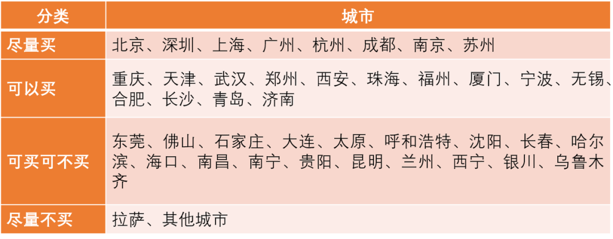

其他我就不一一列举了，我把这个详细的表格附在课程里，供你参考。到今天 ABCD 的分类都不用改变，但是 C 的可投性可能需要再下调。

第二句话就是选核心城区。

我印象很深，当时用燕郊做的案例。还讲过我一个好朋友，非常聪明的经济学家买在城郊，总是被我们取笑说，“并没有买到北京的房子，因为从房产价值的角度，海淀的北京和城郊的北京不是一个北京”。几年下来，这个逻辑是明显被加强了，核心城区和城郊的房价差距在持续扩大中。

在 2020 年初，疫情发生后，很多人担心大城市不安全，我特地加了一堂课，中心思想就是“大城市继续胜利”。再次强调，未来房价分化更加显著。大城市的抗风险能力要强很多，先不说医疗资源、社区管理这些，即使是消费和就业的恢复，大城市也显示出强得多的韧性。

第三句话就是人往高处走原则。

因为有很多同学来自低线城市，没法买 A 类城市。所以，当时我们给了一个原则叫作“人往高处走原则”  
，就是要在力所能及的范围内，去买更高线城市的房产，千万别反其道而行之。

## 2\. 学区房

说完城市和区域的问题，我们来看学区房。这个问题是在学区政策出台后提出的，很多家长焦虑还要不要买学区房，也是三句话的结论。

第一句话，学区房是全球现象，中国不特殊。

全球经验类似，如果房子周边有比较好的学校，房价就会上升。非但如此，只要周边学校学生成绩上升 1 个标准差，房价甚至会上升 0.26%-4%不等。而且，越是像伦敦、巴黎、温哥华这样的大城市，学区房的涨幅越大。

原因大同小异：

1）作为父母，总是希望给孩子更好的教育。有很多的研究资料表明，教育程度越高的父母，越重视子女的教育。房价贵富人多的区域，学校教育经费就充足，基础设施和师资水平就更好，这就吸引了更多人，导致房价更高，房产税更高，经费更足，进入正循环。反之，房价低的地方就会陷入恶性循环。

2）优质教育资源总是短缺的，供给相对于需求是稀缺的，有点溢价很正常。

第二句话，中国学区房溢价偏高，和教育供给有关。

在当时来看，学区房溢价最严重的就是深圳、北京和上海。而“教育资源供给不足”是学区房产生高溢价的根本原因。学校建设又是个非常复杂的事情，而中国大城市教育资源的供给增长，其实是跟不上城市人口增速的，而且优质供给更稀缺，这是学区房溢价更高的根源。溢价出现后，又助长了“套利”者进入市场，继续炒高学区房，导致我国学区房溢价明显高于全球水平。

第三句话，学位资源的分配改变，一定意义上会减少学区房的价值。

各城市学区政策改革，这个整体思路就是要打破教育资源在地理位置上的垄断，所以学区房溢价是从点溢价到片溢价，从买上限到买下限。这句话的意思是，以后的学区房不是以单个的学校为核心，而是取决于一片区域内，平均的教育资源水平。同时家长买学区房能保证的不是孩子能上最好的学校，而是为了避免让孩子去到差的学校。

这几条逻辑都没有变化。但有两个趋势需要放入考虑框架做微调，一个是人口趋势，出生率负增长，孩子越来越少。5-10 年就会出现比较大的缺口，如果大城市人口政策不调整，可能会对一般学区房造成影响；另一个就是高净值人群对孩子走国际线的倾向加强，这个因素很难量化，一是数量不好统计，另一方面也不知道国际学校办学政策会否发生变化。所以，这个因素要放到你的整体框架里，去做考量。

好，这是学区房的，还有一个就是房产税的问题。

## 3\. 房地产税

从 2021 年到 2022 年，大家都特别关心房地产税会不会收，什么时候收，如果收会不会对房价产生影响。我给你两个判断：

第一，房地产税不太可能很快大面积征收和高额度征收。

为什么呢？因为当时对房地产税能收到多少有个估计，范围大概是 3000 亿-10000 亿，和当时土地出让金 8.4 万亿比起来，占比很低。从全球来看，房地产税在国家财政收入中的占比都不高。就算收，也很难成为财政收入的支柱。

那为啥当时急着要推房地产税？是觉得房地产行业过热担心出现金融风险，房价过高担心影响民生，所以希望推房地产税，抑制房价，抑制房地产里面的投资、炒作行为。所以，整体上推房地产税是一个宏观调控动作，而不是财政税收的策略。

另外，我们收房地产税面临着较高的成本，其中征收成本，治理成本，和信用收缩成本都是问题。所以当时的判断是房地产税还是一个“小税种”。房地产税的推进不太可能采取暴风骤雨的方式。

在这个逻辑下，当时第二个判断就是房地产税对房价的长期价值影响不大。

但是，由于政府希望通过这个税收抑制当时“房产资本增值过快”的问题，所以给出了一个建议，持有多套房产的高净值家庭，未来需要更多的转向金融资产。

2023-2024 年，房地产税这事儿就不太能推得下去了。但我的担心是，一旦未来的财政收入更加紧张，同时房价稳定下来不再下滑，对于存量房是否还会征税以补充税源，这个风险并没有排除。所以多套房产高净值家庭仍然需要对这个问题加以密切关注。

好，这就是我们房地产特辑第一部分的内容。简单给你小结一下：

1.过去城市和区位的选择原则依然适合于现在

：1）要选大城市，低线城市有风险；2）要选核心城区；3）要在力所能及的范围内，去买更高线城市的房产，千万别反其道而行之。

2.学区房是全球现象，中国不特殊，而中国学区房溢价高，本质和教育供给有关，未来学位资源的分配改变，一定意义上会削减学区房的价值。

3.在学区房逻辑的基础上，还要考虑两个方面：一是人口趋势，孩子越来越少，大城市人口政策的调整可能会对一般学区房造成影响；另一个则是高净值人群对孩子走国际线发展的倾向，可能也会对学区房的价值造成影响。

4.未来假如财政收入更加紧张，同时房价稳定下来以后，对存量房征税是个大概率事件。所以，在这方面，多套房产高净值家庭需要继续密切关注。

好，以上就是这一讲的内容，我们下一讲再见。

* * *

# 中国家庭房产配置指南（下）

懒人专属群的群友！你好，欢迎来到《香帅中国财富报告》，我是香帅。

这里是今年特地为你准备的一个房地产特辑，我把 2019 年到 2022 年《香帅中国财富报告》当中，14 讲房地产的内容梳理之后，做成了两讲的内容。

上一讲我们回顾和总结了城市和区位选择，学区房是否值得买和房地产税的影响，这几个较为宏观的问题。这一讲我们来回顾总结更为微观具象的“房产配置策略”，主要包括未来房产的预期收益，判断自己家庭是否还需要买房，还有什么是更优的房产配置，等几个问题。

## 1\. 未来房产预期收益

到目前为止，中国居民家庭 70%以上的财富仍然是房产。在可见的将来，这个数字大概率不会有太大的变动。2023 年房产价值缩水的结果，就是整体居民财富下降，所以房产配置仍然是关系到每个家庭财富安全的核心要素。

既然是资产配置，那么首先要弄清楚房产作为一个资产的预期收益率。

所以，第一句话，2022 往后看 5 年，中国房产的年化收益很可能在 2%左右，一线城市房产大概维持在 5%左右，要不要买房取决于能否接受这样一个水平的年化收益率。

而从 2023 年往后看，2%和 5%这两个平均数能否达到，非常取决于逆周期政策的力度和外部环境的稳定性。外部环境不发生巨大变化加上坚定的逆周期政策，超过这个数字的概率比较大，反之就不确定性更高。

2022 年还有一句话的判断叫作

“2022 年之后，中国房产会持续剧烈分化，但有少数区域和城市的房产仍然是优质安全资产，但也有一些区域的房产有比较大的风险”

—— 这个判断持续，而且会加强。

另外，2022 年还提到了，次一线城市，重点提到了成都、杭州、苏州和南京这四个城市。认为这四个城市核心地段的房产估值有希望获得部分溢价，甚至取得和一线城市类似的回报率。关于这几个城市的一些内在特性，在今年的财富报告中，我还会做进一步的分析。

除了这几点外，2022 年还提到了买房的两个风险点：

第一， 即使是省会城市的房产，也需要和其他同等条件的城市房价做横向对比，避免买在高位。

原因比较简单，因为房地产行业最大的成本来自地价，而土地供应和当地政府的政策密切相关。如果政府之前供地过于密集，开发投资力度过大，有可能导致地区（或者部分区域）房价涨幅透支了未来。当时给的例子是郑州，当时郑东新区开发的力度非常大，后续的人口和产业未必跟得上。类似的城市还有不少，这些要根据当地债务情况做一些分析。

第二，因为人口迁徙流动的力度比数据显示的要更大，所以很多按照常住人口计算的“大城市”或“中型城市”，可能是实际的中型城市或小城市，房价存在高估的成分。

因此，买房时需要仔细考虑自己所在城市的“真实人口分布”。

补充一句，中国城市真实人口分布的表格在《香帅中国财富报告（2022-2023）》的第 4 讲。之后，我会把相关的表格放在今年财富报告的房地产相关课程里，供有需要的同学参考。

04 | 什么情况下应该提前还房贷？

## 2\. 怎么判断自己家庭还该不该买房？

首先要弄清楚，房产承担了居住的消费功能，而且在居民的地方福利、权利普遍和房产挂钩的情况下，城市房产还有一个“城市公共设施消费品载体”的功能。“首套房”中这部分的价值是比较凸显的。所以大城市的年轻人首套房上，不需要过多纠结。

所以下面主要是针对家庭希望投资第二套或者更多房产时候的逻辑。我给的一个词语叫，机会成本，也就是为了一个机会而放弃另一个机会的成本。

当时给了几个场景，很明显，对于不同的家庭来说，你买房的机会成本是不一样的。比如，对低线城市中老年家庭来说，在小县城买个有学校、能出租，而且能写自己名字的房子，尽管收益率可能是负的，但仍然可能是一个“次优选择”。而对二三线城市的中产家庭来说，在做买房决策的时候，跟着家庭网络、社会网络走，才是归宿。至于对一线城市部分精英家庭来说，挑选核心区域的房产，依然是一个较好的策略。因为在现金流条件允许的情况下，要在相对安全的优质资产上加杠杆。

很明显，对于不同城市、不同学历、不同认知的家庭来说，面临的机会成本完全不一样。比如说，同样是一线城市的精英家庭，户主有没有留学经历，自己孩子是否走国际线，夫妻双方是否在体制内工作，原生家庭背景如何......很多细节都会对机会成本造成巨大影响。现在房产的β时代过去了，但α还有，而寻找α从来都是更难也要求更高的事情。

## 3\. 什么样的房产配置是最优的？

这个判断其实挺清晰的。还是那句话，房产在中国家庭财富中平均占比 70%这个数字，我看不出未来有太大变化的可能。从宏观角度来说，房产价值萎缩会等于居民家庭财富萎缩，这就是个残忍的现实。而且实际上房产占家庭财富的比例，是随着财富绝对值升高而下降的。换句话说，真正的富人对房产的依赖度其实没有那么大。

2022 年的判断是，在这之后，房产已经过了让家庭财富暴涨的阶段，而是承担了储蓄、扛通胀，以及补充未来现金流缺口的功能。未来十年的家庭资产配置中，房产的比例也许会有小幅下降。

但整体上，对于中产家庭来说，房产占比 50%-80%都在合理范畴内。

当然，随着资产绝对数目的上升，这个比例要降下来。

另外，房产的组合，比如套数、房型大小、全球城市配置等，比房产配置比例要重要得多。尤其在对地区、房型、套数的把握上，要更关注流动性，以及现金流的持续性和稳定性。考虑房产怎么组合有几条逻辑：

1）加杠杆要加在资产端而不是负债端，因为自住房有很强的消费属性，在自住房上大力加杠杆，其实是消费上的“踮脚摸高”；

2）保证流动性很重要，避免租金收入减少，房贷开支增加，流动资金减少的情况出现；

3）在自住房上“梭哈”不算理性决策。

高净值家庭配置海外房产的话，要遵循专一的原则，就是专一于国际大都市的核心城区，或是出租市场相对规范、租金相对稳定和持续的地方。这个我身边有很多实际案例的，大城市的精英家庭，酷爱买房，一共 8 套房子，分布在全世界三大洲 6 个城市，听上去很美很浪漫，但这种选择在投资上非常不理性，收益率低不说，维护打理的成本远远比想象的高。

当然，“专一”这一原则也适用于国内房产的配置。

好，这就是我们房地产综述专题下半部分的内容。简单给你小结一下：

1\. 2023 年往后看，全国房产以及一线城市房产的年化收益率能否维持在 2%和 5%左右，取决于逆周期政策的力度和外部环境的稳定性。

2.大城市的年轻人在首套房上，不需要过多纠结。家庭如果希望投资第二套或者更多房产的，一定要考虑机会成本，对于不同城市、不同学历、不同认知的家庭来说，面临的机会成本完全不一样。

3.房产的组合，尤其对地区、房型、套数的把握上，要更关注流动性，以及现金流的持续性和稳定性。高净值家庭配置海外房产的话，要遵循专一的原则。

我们房地产综述专题的两讲到这里就结束了。希望这些内容对你有帮助。在今年的财富报告里，我还会针对 2023~2024 年的问题做一些具体分析，我们课程里见。

* * *

# 04-经济下行，谁是黄金赛道？

## 04 | 经济下行，谁是黄金赛道？

懒人专属群的群友！你好，欢迎来到《香帅中国财富报告》，我是香帅。

2023 年最重要的一个宏观现象就是低通胀。2023 年的 CPI 同比增速，一直徘徊在零附近，10 月甚至下探到-0.2%。物价涨不动，背后是需求疲软。

所以我们看到，A 股消费板块是哀鸿遍野。消费者服务（包括酒店、餐饮、休闲）下跌 38.3%，家庭与个人用品下跌 19.5%，零售业下跌 12%。

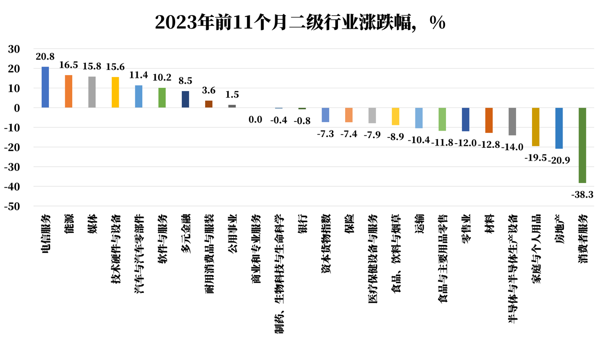

不少人感到困惑，未来，消费板块还有希望吗？消费品牌、消费厂家又该怎么办？

自己家的事看不明白，有时候可以看看邻居家曾经遇到过的事，没准有启发。

从 20 世纪 90 年代开始，日本的零通胀和家庭消费失速，整整三十年，股市低迷 20 年。

但是你能想到吗？从 1995 年到 2023 年 11 月，日本股市诞生了 109 只“十倍股”，其中 29 只分布在消费板块。

今天这一讲我们就来讨论一下，这些日本消费“十倍股”是如何摆脱地心引力，实现增长的。

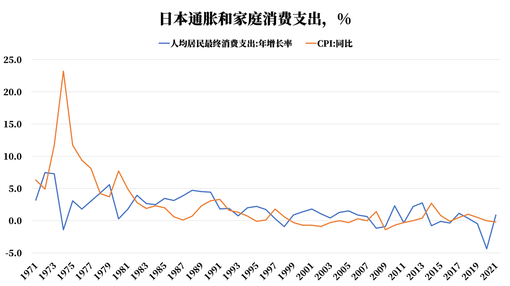  
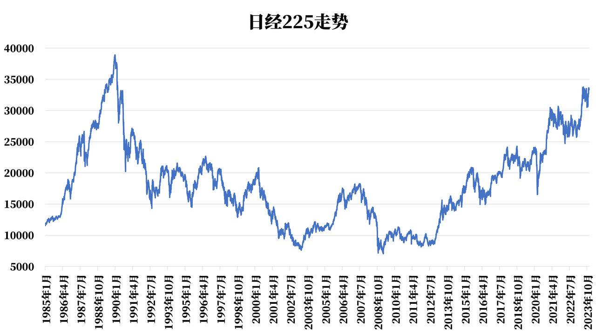

## 1\. 日本十倍股是哪些？

日本市场的“十倍股”和美国市场的“十倍股”，是两类不同性质的公司。

1995 年初至 2023 年底，美国股市诞生了 820 只“十倍股”，其中，1000 亿美元以上市值股票有 83 家，占 10%，其中包括亚马逊、苹果、英伟达、特斯拉、万事达卡、星巴克，这些横扫千军的全球赢家。发现了吗？

这些千亿市值股票的核心竞争力来自两个：全球市场和科技创新。

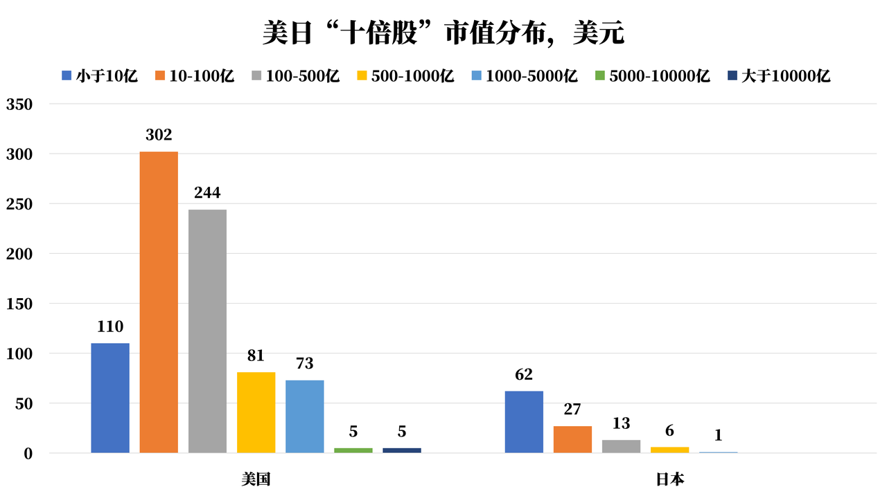

但是日本市场就不一样了。

日本股市的消费十倍股大多是小市值，57%的“十倍股”市值不足 10 亿美元，82%的股票市值不足 100 亿美元。这些企业也多是细分赛道的隐形冠军，比如专攻酱油的龟甲万，专做百元店的 Seria，专做跑鞋的亚瑟士，专做滑雪服的 GOLDWIN，还有专做渔具自行车的禧玛诺。

你看，日本既然没有来自全球市场和科技创新的竞争力，那就“挖掘小增量，深耕小赛道”，也是一个办法。

日本这些十倍股，还有一个有趣的特征，就是集中在两个方向：要么主打“高性价比”的大众消费，比如优衣库、Seria；要么主打高品质的小众消费，比如 GOLDWIN、亚瑟士、禧玛诺等，都是“小而美”的生意。

你看，林间两条路，背后的逻辑是我们第一讲提到的头小身子大的 K 型分化。

这种 K 型分化在消费领域就表现为泾渭分明的消费分层。

主流工业制成品需求疲软，而且工业生产能力充足，价格涨不起来；而高端小众产品和服务，供给有瓶颈，只要需求有所扩张，价格就可能涨起来，而且越高层次的消费品溢价会更高。

我给这个现象取了个名字，叫“分层通胀”，举个最简单的例子，滴滴打车上拼车、快车价格变动不大，但是专车价格明显上涨厉害。

这几年，中国消费市场也呈现出“分层通胀”，从 2022 年到 2023 年底，CPI 增速一直很低，但很多人还是感到手里的钱变“毛”了，为什么呢？

主流工业制成品和基础服务的价格的确没怎么涨，甚至是下跌的。根据发改委价格监测数据，彩电、空调、快递费的价格都下跌了 3%左右。

但高端小众产品和高人力资本服务的价格上涨幅度颇为显著，例如数码照相机价格上涨了 20.9%，医疗服务、教育培训价格都在涨，医事服务费上涨了 7%，运动类培训班价格涨了 11.1%。

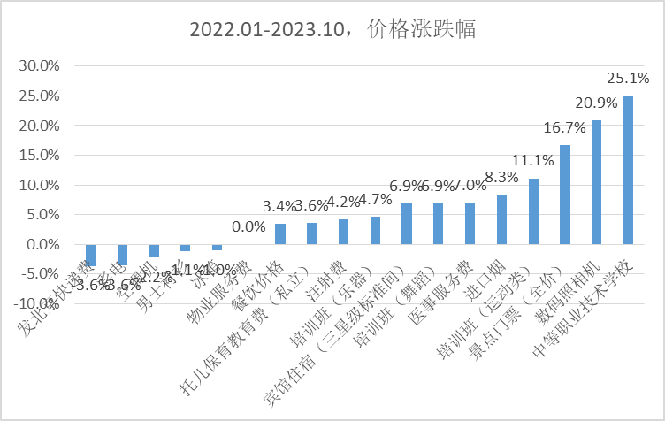

对企业而言，这种 K 型分化带来的消费分层和通胀分层，就意味着我们上面提到的两条路：

1.下行大众赛道，产品和品牌要做到“有品质的简朴”；

2.高端小众赛道，产品和品牌要做到“有温度的精致”；

我们接下来细讲。

## 2.下行大众赛道：有品质的简朴

先来看有品质的简朴。

在日本经济的停滞期里，首先发生的就是消费价值观的转变。“社会的、共享的、节制的”这种更东方的价值观开始占据上风，高性价比品牌崭露头角。

当然，不能一听见高性价比，就觉得是低价。实际上日本很多企业还维持了不错的高毛利。

比如，销售低价杂货的百元店 Seria，在里面用人民币五块钱左右的价格，可以买到日常生活所需的绝大多数日用品。这家公司就是我们前面讲到的典型的“十倍股”。但是神奇的是，Seria 的毛利率长期维持在 40%以上，这在零售业是极高的毛利率，像沃尔玛这种巨头，毛利率也只有 25%左右。

低价+高毛利率，这是怎么做到的呢？答案是高效的供应链管理。比如引进数字化工具，开发大量自有品产品等等。

还是回到“高性价比”这个词儿。现在的消费者都“见过世面”，仅仅“廉价”一个要素，难以打动他们，消费者所需要的是“有品质的简朴”。满足甚至引领消费者对品质的需求，企业才可以获得更大的增量空间。

优衣库董事长柳井正，把这个策略称之为“创造一个新市场”。

举个例子，优衣库的爆款——新式保暖内衣“HEAT TECH”，自 2003 年上市之后，每年销量都在上台阶，2011 年销量达到了恐怖的 1 亿件。

为什么 HEAT  
TECH 卖得这么好？因为它不再是“价格实惠的内衣”，它发明了一个新的市场竞争范畴——内衣的发热功能。而且还在持续增加新功能，比如抗菌、干爽、保湿等等。你看，抓住消费者的潜在需求，打造一个切合需求的爆款，就是打破增长瓶颈的最佳解药。

回看我们国内，“价低质优”这条道路已成为新的商业风尚，网易严选、京东京造以及名创优品都在拼这个赛道。还有拼多多，一直以“极致性价比”的形象占据着消费者的心智。11 月 29 日，拼多多市值首次超过阿里，就是这条道路成功的标志。

## 3.高端小众赛道：有温度的精致

说完了“有品质的简朴”，我们再来看日本的另一类公司，就是高端小众赛道上的——“有温度的精致”。

日本的“十倍股”中的 GOLDWIN、亚瑟士、禧玛诺，都是例子。大众对这些品牌未见得很熟悉，但对于滑雪、跑步、钓鱼、骑行的小圈子人群，这些品牌却是如雷贯耳。价格高昂根本不在话下：1000 元一双的跑鞋，5000 元一件的滑雪服，上万元的钓具……这些品牌就是专注于 K 型分化的上行赛道。

请注意，K 型分化不仅仅体现在社会层面，也可能表现在同一个人身上——消费者在大众商品上追求性价比，但还是希望寻求与大多数人不一样的独特体验和生活方式，也愿意为此支付溢价。

比如，最近几年，飞盘、露营、骑行、CityWalk 特别流行，这都是城市新中产人群的最爱，他们关注户外运动，喜欢研究各种运动用品，愿意为小众高端品牌付费。

那怎么做这种品牌和产品呢？说白了，就是要做到两个关键词，“有温度”和“精致感”。

所谓“有温度”，就是要和用户群体有深度的连接。比如，亚瑟士在跑友圈有众多粉丝，2021 年，亚瑟士在上海开了一家运动体验空间，常驻专业跑步顾问，配置专业跑姿分析设备及步态测试器，设有专业跑步课程，来强化品牌的专业形象，同时通过组织瑜伽、夜跑、骑行等活动，建立深度的用户关系。

因此，与过去几年的新消费品牌不同，高价值品牌不能依赖大水漫灌、快速铺开的流量打法，而是精准滴灌小圈子，再慢慢向大众渗透。

像 GOLDWIN、亚瑟士都几乎不依赖“大众化”的媒介资源和营销方式，而是通过赞助专业赛事、与世界顶级运动队及选手合作，强化自己在粉丝圈的声望。

那怎么做到“精致感”呢？

GOLDWIN、亚瑟士、禧玛诺都是大力投入研发，获得专业领域认可的技术实力。比如亚瑟士出品的某些跑鞋甚至能够得到美国足病学会 APMA 的认证标志，可以作为处方使用。

你看这样的品牌和产品，当然就有机会获得更高溢价的机会。

中国品牌是否也有这样的机会呢？我认为有。拥有科技基因 + 设计能力 + “连接小圈子”营销能力的品牌，很有可能成为这条赛道的赢家。

前段时间，一则消息上了热搜“国产羽绒服 7000 元”。虽然很难评判具体某款产品定价的合理性，但这确实代表了国货羽绒服崛起的趋势。五年前，高端羽绒服市场都是加拿大鹅、北面这些产品的天下。而现在，国产品牌也开始大量投入面料研发和设计，在几千、上万的价格区间占据一席之地。

后面的课程我还会讲到，经过这些年电商的洗礼，中国制造业产业链已经向微笑曲线两端延伸——前端研发创新，后端做品牌营销，都是高附加值的部分。现在中国厂家在这两块，普遍拥有很好的基础。

这些，无疑都是未来成长出“中国十倍百倍消费股”的最大土壤。

好，这一讲，我给你简单总结一下：

1\. 日本股市低迷 20 年诞生的“十倍股”，主要集中在：主打“高性价比”的大众消费和主打高品质的小众消费两个方向上，这背后的逻辑是 K 型分化。

2\. 不管是大众消费还是小众消费，都要迎合时代的价值观，大众消费产品要做到“有品质的简朴”，小众消费的产品要做到“有温度的精致”。这样才能在竞争中胜出。

3\. 对中国品牌来说，拥有科技基因 + 设计能力 + “连接小圈子”的营销能力，很有可能成为小众赛道的赢家。

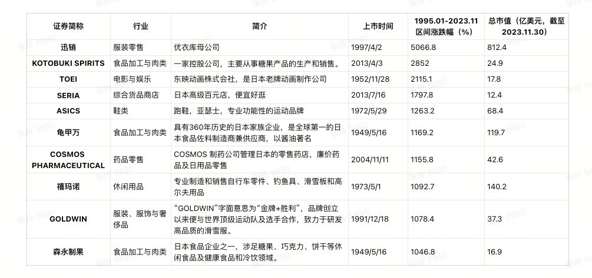  

* * *

# 05-押注爆款，是投机跟风还是理性选择？

懒人专属群的群友！你好，欢迎来到《香帅中国财富报告》，我是香帅。

## 1.2023 年爆款层出不穷，但转瞬即逝

2023 年经济环境整体偏冷，但在“出爆款”这件事情上，几乎是全年无休。

而且爆款发生在各个行业、领域，甚至城市。比如说：

游戏领域：11 月份是《完蛋！我被美女包围了》，前面还有《蛋仔》《逆水寒》； 汽车和手机：华为 Mate60，问界新 M7，一度都是一机、一车难求；  
饮料：光瑞幸就有酱香拿铁、马斯卡彭生酪拿铁，还有喜茶的 FENDI 喜悦黄、初恋瓜瓜甘露等等； 还有淄博、天津等城市，也都接二连三爆火出圈。

一方面是爆款不断，另一方面爆款来得快，去得更快。

比如说，11 月初，《完蛋！我被美女包围了！》有多火？还记得吗？抖音上同名话题的累计观看量高达 12 亿次。带动 A 股市场相关概念股一飞冲天，有的股票几个交易日就股价翻倍。但实际上这个热潮就持续了 4 周，4 周后，这个游戏的玩家就只剩下巅峰期的 1/5。在爆款市场上，“生如夏花，转瞬即逝”是常态：热度能维持一个月以上的都很罕见。

所以，这里面也引发了很多争议，比方说，在开发和营销产品时，究竟是应该“押注爆款”还是应该“均匀分配资源”？押注爆款是不是不够“长期主义”，过于投机？总之，对企业来说，押注一个短期的爆款是不是理性的选择呢？

## 2.短期爆款等于短期投机吗？

首先，我们看看做短期爆款是否等于短期主义。

我们这几代人都是长期主义的忠实拥趸。尤其在新产品、新品类的研发方面。上过商学院的同学应该都很熟悉一个理论，“创新扩散理论”，也叫钟形理论。这个理论是 1962 年美国学者埃弗雷特·罗杰斯提出来的。它的意思是说，对于新品牌/新产品，市场一开始都很谨慎。随着市场逐渐扩大，新事物会缓慢迎来它的早期大多数用户，然后慢慢地减速、衰落，所以会形成一个标准的钟形生命周期。

换句话说，新产品、新品牌“起来”就是很慢的。真正干起来，一个爆款可以管好多年呢。到了 20 世纪 90 年代以后，互联网时代来了，大家发现这个漫长的生命周期变短了。2014 年，美国有两个学者（拉里·唐斯和保罗·努恩斯）就对这个理论进行了修正。他们认为，互联网时代颠覆性的技术和产品，会在早期就快速地向市场渗透，赢得巨大市场，然后更快进入衰落期，所以形成一个尖峰状的钟形生命周期。

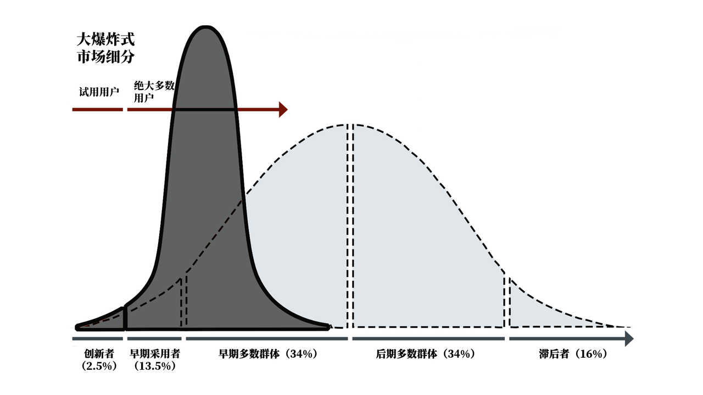

我把这两个图都画出来了，放在课程文稿里面，右边是标准钟形生命周期，左边是尖峰状钟形生命周期。对比一下我们就很清楚，后者生命周期变短，但好像爆发力更强。

原因在哪里？技术。技术让信息传播速度更快，触达人群更广，产品迭代更快，占领心智的时间更短。

这个逻辑在 2013 年移动互联网和社交媒体兴起之后，开始被不断加强。

这个逻辑到了中国市场之后，你会发现到了一个极致。尤其 2013 年以后，随着中国智能手机的深度普及，一个超过 10 亿人的庞大市场形成，所以任何一个产品，你相当于可以在极短时间内，以相对低的成本多次触达数亿人群。在人类的商业历史上，我们从来没有见过这样的产品爆发力。

稍微回想一下：

小米 14 一周销量破百万，这可能是之前那种老款手机一年的销量； 广东夫妇一场直播卖出 7 亿元，西安一个万达广场整年销售额刚到 7 亿；  
短剧《逃出大英博物馆》一周播放量超 2.9 亿，而当年《甄嬛传》在优酷一周播放量也才 1.5 亿； 还有曾引发数亿流量狂欢，游客比常住人口还多的城市淄博、榕江……

这样的例子，还可以举出很多很多。然后你会发现，一件衣服、一杯奶茶、一部手机、一个视频，或者一个人、一座城……如果我们将它们都视为产品的话，那么当下，

所有“产品”的生命周期都被压缩到了极短，而它们触达的市场却变得极宽。那个尖峰状的生命周期甚至变成了一根垂直的线条 ——时间薄如蝉翼，空间广袤无垠。

我们需要从更深的层面来理解这个问题：

人是一种信息生物，拥有的就是空间和时间两个维度。 按照谷歌 CEO 埃里克·施密特的说法，“人类文明伊始到 2003 年，我们创造了五艾字节的信息  
”现在呢？我们每天产生的数据量是 65 艾字节，相当于之前数千年信息量总和的 13 倍 ——这意味着什么呢？  
意味着我们面对的信息空间被无限扩张，而信息流动的速度在加快。就像《星际穿越》中一样，我们感受到的“时间”被压缩了，变短了。

在哲学的意义上，这就是时间的相对论：今天的技术条件下，所有生命面对的时间都变快了。再往深处想一层，品牌、影响力、价值……本质上都是人类的共识。而当时间变“短”的时候，共识构建和破裂的速度都会变快。

所以，你会发现，生如夏花，正是当下“爆款”的宿命：

你可以在极短的时间内触达更多用户，占领更大市场， 但也会更快地被遗忘。无论是谁，面对的都是一个更广阔，但也更稍纵即逝的市场。

如果这种哲学意义上的思考太抽象，我们也可以回到更具象的信息环境中来：

一个人的注意力是极其有限的，但现在信息的供给几乎是无穷的。

比如说，作为种草大本营，小红书的用户推荐一直被认为是相对真实克制的。但小红书一周光种草笔记就超过几十上百万篇——春风未过处，新草已遍野。这种信息环境中，人的记忆会比鱼还短，爆款一定会不断产生又不断消失。

所以，短期爆款现象，不是短期主义，而是信息技术发展和人类有限注意力的产物。

## 3.押注爆款和均匀下注，哪个策略更优？

那接下来的问题是，押注爆款，到底在经济上合算吗？很多人认为，在单个产品上下大赌注，风险有点大，因为没人能准确判断什么产品会流行。但是哈佛商学院的安妮塔·埃尔伯斯教授认为，即使在最具不确定性的娱乐行业，也必须采取这种押注爆款的“重磅策略”，即重金投入某个爆款产品的研发。因为只有这样，才能集结制作、营销、发行等各方面的最大努力，然后获得的预期回报会比在所有产品上平均用力要高。所以，她的判断是，“未来市场将由爆款占据主导，而市场份额分布不均的现象也可能会越发突出”，“一切行业皆有爆款”。

根据安妮塔的逻辑，我们做了个简单的模型，来计算“押注爆款”和“均匀下注”的策略哪个占优：

假设一家公司有 10 亿元资金，要决定是否采用爆款策略。

策略 1：非爆款策略，即资源平均分配。将 10 亿元的研发资金投在 100 个成本分别为 1000 万元的普通产品上。

策略 2：爆款策略，即资源向潜在爆款产品倾斜。将 9 亿元资金投在 9 个成本分别为 1 亿元的潜在爆款产品上，另外 1 亿元投在 10 个成本分别为 1000 万元的普通产品上。

根据现在整体市场项目回报平庸，但爆款获利极高的现象，我们假设普通产品的平均回报率是 5%；而爆款产品一旦成功，回报率将是 2000%。

但大家都知道，潜在爆款能否爆，依赖于各种外部因素，包括运气。

假设乐观情形下，9 个潜在爆款产品中有 2 个能跑出来；在普通情形下，9 个潜在爆款产品中有 1 个能跑出来；运气不好则颗粒无收。（运算过程我就略过去，在课程文稿里我附上了计算的表格，感兴趣的同学可以自己查看。）

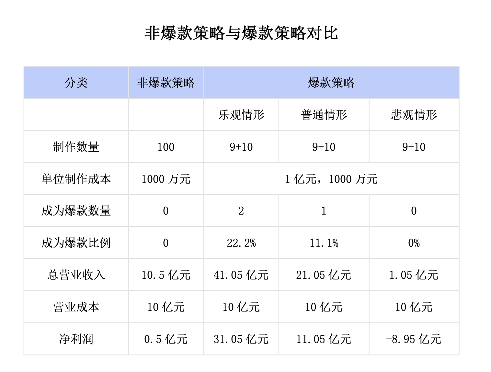

经过一个简单的计算，我们会发现：

非爆款策略的预期净利润是 5000 万元；

而爆款策略在乐观情形下，净利润是 31.05 亿元；在普通情形下，净利润是 11.05 亿元；悲观情形下，则是亏损 8.95 亿元。

如果三种情形出现的概率相同，那么爆款策略的预期净利润则为 11.05 亿，远远超过非爆款策略。

如果乐观情形出现概率只有 10%，普通情形 50%概率，悲观情形 40%概率，那么爆款策略预期利润为 5.05 亿元。

这是个最简化的计算。但确实能从中看出，为什么现在从电影、图书、游戏，到食品饮料、纺织服装，各个厂家/商家都下血本在爆款产品的研发制作上。

因为，技术变迁让我们的注意力变得更稀缺，也让市场爆发力变得更强，这种环境下，押注爆款是理性选择。

## 4.国内环境让企业被迫采取爆款策略

另外，当下中国市场上，还有两个因素，也会让企业被迫采取爆款策略。

第一，市场平均回报下降。

这几年经济大环境不及预期，很多市场都面临下行压力。普通产品的平均回报率下降。经济学告诉我们，人们在不稳定的下行市场中更倾向于冒险，因为反正中庸之道也未见得能收获稳稳的幸福，不如豪赌一把。所以，在市场整体萎缩的情况下，爆款策略可能更占优。

第二，从众心理。

人类都有从众心理。而且，面临的选择越多，我们越容易从众，因为信息过载容易导致我们更加无所适从。就像英国经济学家保罗·奥默罗德所说，“人们在面临大量选择时会改变自己的行为，更有可能复制和效仿他们信任判断的人。在这种模式中，某些东西开始流行不是因为它的客观品质，而是因为它已经流行了。”

娱乐市场监测机构 Luminate 做过一个统计：2022 年，各种流媒体上共有近 1.5 亿首歌曲，其中有 6710 万首播放量少于 10 次，3800 万首播放量为 0，这两者加起来数量占比达到了 66%；而前 3000 首最流行的歌曲，数量占比不到万分之二，流量占比却达到 24%  
。

你看，这就是典型的，它流行，是因为已经流行。这就是人性，而技术将人性的这个特点无限地放大了。

从社会进步、文化繁荣的角度，这未见得是令人兴奋的现象，但对于企业和个人来说，这确实是当下的现实约束条件。

每个人都可能在 15 分钟内出名，每个人都能出名 15 分钟。

也许，我们都需要一个 15 分钟。

下一讲，我们再继续来聊聊，怎么获得这 15 分钟。

好，以上就是这一讲的内容，我们来总结一下：

1.2023 年虽然经济环境整体偏冷，但是爆款层出不穷，不过要注意的是，爆款来得快，去得也快。

2.短期爆款并不等于短期投机，而是信息技术发展和人类有限注意力的产物。

3.我们对押注爆款和均匀下注这两个策略进行了计算，发现对于企业来说，压住爆款策略更优，是理性选择。尤其在当下的中国市场，平均回报下降、从众心理也推动企业去选择爆款策略。

* * *

# 06-爆款经济学：制造爆款有公式吗？

懒人专属群的群友！你好，欢迎来到《香帅中国财富报告》，我是香帅。

上一讲我们讲到， 在当前的技术背景和经济环境下，企业采取押注爆款的重磅策略更理性。

但押注爆款这个事情吧，有点玄学。经常就是想爆的爆不了，没想火的偏偏火了。比如说，小红书上一个博主无意间晒出奶奶窗台上晾双星球鞋的照片，引发怀旧热潮，结果刺激出了双星的复古爆款“窗台鞋”  
。

所以要承认，爆款策略，不是制造确定性事件，而是提高爆款成功的概率。

那怎么去提高打造爆款的概率呢？

不同的产品会有很不一样的路径，但我们可以试着用几个例子把背后的规律、原则总结出来。

## 1.速度与数量

我先从电影说起。不知道你们是不是注意到一件事情——2023 年几乎所有的热门电影获得曝光度都用到了一种方式，那就是传播短视频切片。以我自己为例，我没有完整看过一部电影，只是在网上看各种短视频切片和评论，就对 7、8 部电影的情节了解得七七八八，熟悉到能报出主演名字，知道故事梗概甚至能够想起经典桥段。

没错，

视频化、碎片化是 2023 年电影宣发最大的特征。

制作方将一部 2 小时的剧情片切割成 15 秒、30 秒、1 分钟的视频……进行大批量的投放，然后找潜在爆点，再跟进。比如年度热片《孤注一掷》，开始用男女主角做宣发的视频效果不好，直到一条反派角色王传君诈骗团伙喊洗脑口号（“想成功先发疯！不顾一切向钱冲！”）的视频火了，宣发团队意识到“爆款”机会来了，马上调整方向，将短视频营销重心放在了王传君身上。这样整个节奏就被带起来了，大量评论加上二次创作，电影一下子破了冰。

你想一下，它这个逻辑是有道理的。因为，我们被一部电影（作品）打动，经常是因为某个情节、某种情绪，甚至某种氛围，总之触动是点状的——  
但到底哪些点能取得最大的共识、共鸣，具有很大的随机性，而且这么长一部电影，你也很容易就把这个点错失过去。

那怎么办呢？一个思路是，不去赌一个爆点，而是把很多潜在爆点呈现出来，让市场去做检验，用大数去对抗随机性。然后一旦发现潜在爆点，马上快速迭代。

看起来像个新现象，但其实这个逻辑早就被使用在品牌产品上了。比如说希音（SHEIN），这个目前全球最大的跨境电商平台之一。  
他们采取的爆款策略就是非常灵活的“小单快返”—— 每种款式它们最开始只生产 100—200 件，先拿到市场去试。如果某个款式很受欢迎，它们再马上快速地响应需求。

这就是制造业说的“小单快返，柔性生产”。这种获得反馈，优化迭代的方式，其实和电影碎片化宣发很类似，

本质上就是用数量和速度对抗不确定性，提高爆款概率。

再想想，瑞幸、  
Manner、喜茶、蜜雪冰城......为什么这些连锁饮料品牌现在基本上都保持着每个月至少上 1~2 款新品的节奏。因为上新速度快意味着口味更多，迭代更快，出现爆款的概率才能更高。

好，这就是我们的第一条原则，用数量和速度对抗不确定性，提高爆款概率。

## 2.创新原则

接下来，我们看第二条，创新原则。

创新原则主要可以从三个方面下手，新市场、新产品和新产品特征。做好其中一点或者兼顾两点，都可能大幅度提高爆款的概率。

比如“得到”当年就是找到了一个细分新市场，然后以创新的产品形态杀出来的；优衣库的内衣爆款 HEAT TECH，一年卖一亿件，主打的就是“发热”这个功能。

更小的爆款，比如钟薛高的“厄瓜多尔粉钻”雪糕，就是产品特征创新，将稀有的粉色巧克力加在雪糕中，增加视觉味觉体验，同时制造话题。还有义乌一个企业用数码纺织打印机能把彩色墨水直接打印到十字绣上，就这么一个单品爆款，让企业半年内产值增长了 3 倍，利润增长了 2 倍。

不过，这其中有些爆款只是昙花一现，有些却可以在市场上持续火爆。

这其中的关键是什么呢？

我们发现有一条定律：产品创新的门槛越高，爆款的半衰期就越长。

其实，任何爆款出现，真正起决定作用的是产品本身。尤其现在情况是：供给端饱和、同质化竞争；需求端则总量萎缩，价值观多元化。所以没有“创新、创意”的产品，几乎没有立足之地。

著名经济学家熊彼特曾经提出过创新的 5 种方式。其中“开创新市场“和 “采用新产品（产品特征）” 是爆款产品经常使用的。这里面我觉得最极致的例子就是米哈游。

中国游戏界，米哈游是神迹般的存在，短短 10 年间崛起为跟网易、腾讯比肩的游戏三巨头。  
更神奇的是，他们只做二次元游戏，一出手就是全球精品爆款。2020 年《原神》上线当月就创造 2.45 亿美金流水，2023 年 4 月《崩坏：星穹铁道》火爆程度也不输《原神》。

米哈游打造爆款的方法论是什么呢？

就是用到了我们前面提到的三条原则当中的两条： “全新市场+ 创新产品”。

米哈游起步的时候，二次元甚至算不上一个“市场”，但这 10 年间快速扩张，现在全球的二次元内容市场已接近 2000 亿元的规模，中国市场则超过 600 亿元。

除了占据“二次元”这个新市场外，米哈游的产品也很独特，跨平台兼容的 3A 级游戏。这里我稍微解释一下，也就是那些高成本、高体量、高质量的游戏。因为成本高、难度大，中国的 3A 级游戏凤毛麟角。同时，跨平台兼容也很困难，你要保证不同语种、不同设备都可以玩，对技术和运营要求都很高，中国很少有游戏能做到。但米哈游的产品就是鱼和熊掌得兼。

《原神》这一款游戏，光研发就花了 3 年，耗资 7 亿元，然后高达 700 人的研发运维团队，保证电脑到智能手机、  
游戏主机，从 Windows 到 IOS、Android，跨平台无缝对接。

你看，米哈游打的 “全新市场+ 创新产品”的组合牌，让它成为了可遇不可求的顶流，所以可以持续爆款。

好，这就是我们的第二条，创新原则。

## 3.情感链接

接下来，我们看第三条：情感链接。

这里我敲一下黑板，

任何爆款，多少都是因为它击中了人群在特定的时间、空间里的特定情感需求，在人群中产生了链接和共振。

这句话在当今的消费市场，特别的实用。

而且你会发现，现在这种情感需求来源很多，比如：

回忆杀，很多爆款品就是主打复古，一代人的共同记忆等等； 小圈子归属感，比如车友、票友、跑友等等小群体；  
小确幸，就是不高的价格获得独特体验的那种“小小的奢侈”； 还有那种通过消费表达的“身份标签”，像汉服、二次元、赛博朋克等等。

现在，很多产品/服务都想通过各种方式来实现不同的情感链接。但不同类型的产品/服务，其实创造情感链接的方式很不一样：比如高价值产品最好要精准滴灌小圈子，再慢慢向大众渗透；但高性价比产品就更适宜通过触发大众情绪点，形成传播链条，然后快速铺开，快速迭代。

最后想提一句，2023 年市场上非常强调“情绪价值”。我一直觉得，情绪价值里面其实包含着两个不同的要素：一个是产品上的情感链接，一个是传播上的情绪触发。

这两件事是有重合的，没有情感链接的产品很难去触发受众的情绪，光有情绪触发而缺乏情感链接，即使“火爆”一下，但不会沉淀下来。爆款产品的根本还是在情感链接上。毕竟，伟大的产品应该首先满足人的情感需求，而不仅仅是提供功能性的好处。因为后者的竞争，已经过于拥挤。

好，以上就是这一我简单总结一下：

1.爆款策略存在不确定性，但可以寻找规律提 高爆款的概率。

2.可以用数量和速度对抗不确定性，提高爆款概率，但真正起决定作用的是产品本身，要创新，要增加情感链接。

3.产品创新的原则是：新市场、新产品、新产品特征，而且产品创新的门槛越高，爆款的半衰期就越长。

好，这就是这一讲的内容，我是香帅，我们下一讲再见。

Tips：熊彼特创新的 5 种方式

采用一种有革命性创新的新生产方法； 控制原材料或半制成品的一种新的供应来源； 开辟一个新市场； 采用一种新产品或者一种产品的新特征； 实现一种新的组织形式

* * *

# 07-“人工智能”对我们到底意味着什么？

懒人专属群的群友！你好，欢迎来到《香帅中国财富报告》，我是香帅。

接下来几讲，我们聊 AI，尤其是 AI 带来的职业冲击。

从普通人的角度来说，2023 年算真正意义上的人工智能元年。为什么这么说？因为从 3 月 ChatGPT4.0 发布之后，AI 开始从“别人家的技术”变成了“我自己的工具”。

## 1.这次不一样：生产力的跃进

这句话挺重要的。因为一个技术一旦成为“工具“，它对人类社会的影响就会开始加速。之前凯文·凯利说，互联网、移动互联网对人类的改变都发生在 15 年间。按照这个逻辑，接下来的 15 年，我们大概会经历从生活、工作方式、商业模式等方方面面的改变，而且这种改变很可能比之前的互联网变革更加剧烈。

实际上，人工智能不是什么新概念。大概就在 10 年前，2014 年前后，从硅谷到中国都有一波 AI 创业潮、投资潮，之后技术进步很快，AI 技术在商业领域被广泛应用，比如说人脸识别、语音识别、智能辅助驾驶、短视频算法推荐，背后都是人工智能技术。

所以，人工智能其实对我们生活的渗透已经很强。但为什么我开始会说，2023 年才算是真正意义上的人工智能元年呢？这次有啥不一样？

可能不少同学都知道，2014 年前后，那波 AI 浪潮属于“决策式 AI”。所谓决策式 AI 就是，根据海量大数据做分析，自动做出最优的决策。而 2023 年这波以大语言模型为标志的 AI 热潮，包括人脸替换、文本、代码、图像生成、  
AI 数字人、聊天机器人等等，都属于生成式 AI（AIGC)。它的逻辑是通过学习和理解大量的数据和信息，去生成新的内容。举个例子，你可以要求 Midjourney“生成一张莫奈风格的画”。Midjourney 的工作机制，就是学习大量真实图片的细节特征，然后去模仿，根据你的提示生成新的图像。

说到这里，你发现区别了吗？决策式 AI 和生成式 AI 的功能很不一样：

决策式 AI 主打的是提高效率。算法提高供需匹配、打车匹配、内容推送、购物推荐等；

生成式 AI 产生新的供给，生产新的图文、视频、游戏，甚至程序、小说等；

你千万不要小瞧“新的供给”这四个字。

从生产力的角度，所谓新的供给就意味着生产力的跃进。

新的生产力跃进有什么了不起的地方呢？我问你一个问题， “工业革命”  
和“互联网革命”，究竟哪一个对我们人类社会改变更大？年轻人很难回答这个问题，因为他们都不知道“前工业化时代”是什么样子。但是，如果你去问很多老派的官员甚至经济学家，很多对互联网企业颇有微词，认为它们“虚”，“抢了实体经济的饭碗”......

虽然这种观点我认为是有偏颇的，但可以理解的地方在于，互联网革命确实不像当年的工业革命，有肉眼可见的“生产力提高”，比如生产的冰箱多了，汽车多了，物质极大丰富了......

你不要认为这种认知很奇怪，美国也有不少经济学家认为，互联网时代并没有带来生产力的提高。

著名经济学家，西北大学的罗伯特·戈登教授的研究就发现：1920-1970 年，美国劳动生产率年均增长 2.82%；1970-2014 年，这个数字是 1.62%。

所以，戈登认为，互联网科技创新的意义小于电气化、汽车和无线通讯技术。他在《美国增长的起落》一书中，写道：“我们不吃计算机也不穿它们，也不开着去上班或者用来剪头发。我们仍然生活在像 20 世纪 50 年代那样摆着家电的住宅里……”

你看，戈登的判断标准，主要是看有没有带来“有形的、实质性的生产和生活改善”。

在某种意义上，戈登的观点有一定道理。

我们想想，过去几十年互联网带来的数字能力，确实降低了交易成本、更高效地匹配了供需关系。比如，打车平台更加方便快捷地匹配司机和乘客；在线教育可以让优秀教师的课程走向更多听众；互联网医疗可以让小县城的患者足不出户问诊北上广的优秀医生。

但有一个问题它没有解决，高人力资本服务方面，优质供给不足。而当下服务面临的最大瓶颈，是真正优秀的人太少，比如优秀的医生、教师、作者、设计师，生产力不足，所以这些优质服务的价格高昂。

而这波生成式 AI 浪潮，最具想象力的地方就是，它们可以极其高效地学习大量知识，以人类水平或者超过人类的水平生产新内容

：现在 AIGC 生成的新闻报道、广告文案、图片、PPT、编程.....都已经开始变得很常见。

这确实是挺让人震动的事情。就是我们之前认为，人类脑力牢不可破的很多领域，突然就面临被攻破的命运  
。而且这件事来得比想象的可能要快。为什么呢？因为 AI 和人类的学习模式完全不同：

人类是从 0 到 1 的学习，每代人都重新开始；

AI 是复利式学习，每一代都是上一代的迭代，是指数级增长。

所以，虽然现在的生成式 AI 也就是小学生到中学生的水平，真正要“替代”人力资本还有点距离，但很多人预测，以这个学习模式，只要算力和算料足够，10 年内生成式 AI 在很多领域都可能远超人类平均水平。

## 2.林间两条路

“远超人类平均水平”，这件事其实是有点让人出冷汗的。

我们组里的年轻教授们，最近都在用 ChatGPT 做文献综述，经常哀叹，感觉按照这个速度下去，自己未来工作难保。我想，搞设计的，搞文案策划的，搞药物研发的.....但凡内容、创意相关的工种，很多人都应该感受到了 AI 那种很强的侵入性。

这么说吧，10 年后，可能 AI 替代不了这些领域的顶尖人才，但是超过平均水平，应该是大概率事件。

你会发现，人类创造了一个可能比自己厉害得多的物种，我们自己这个物种，变得“没用”了。这件事情想起来，会让人感觉很荒凉。我们在进化之路上跋涉了百万年，作为个体我们努力学习上好大学找好工作，当职业人士，然后有一天，你发现这些努力都变得那么脆弱。  
更不要说，这个过程中可能还伴随着大量失业，生活、生存状态都成了新问题。

从 1982 年弗诺·文奇首次提出“技术奇点”开始，我们就意识到技术是加速的，但这次生成式 AI 的跨越式进步，让人类切实感受到了“奇点”的逼近。未来像个黑匣子，看不清。

这种不安，也是 2023 年 11 月底 Open AI 董事会风波震惊全球的原因。现在对 AI 技术研发主要有两派观点：

一种叫加速主义，

山姆·奥特曼就是代表，他们认为要无条件加速 AI 技术创新，进程越快，就越能以最小的代价走向更好的未来。

另一种叫对齐主义

，认为 AI 是一个能力强大但道德混沌的物种，在弄清它到底是什么之前，我们最好还是谨慎对待。这次 Open  
AI 政变中，要驱赶山姆·奥特曼的首席科学家伊利亚·苏茨克维，就是对齐主义这一派的。

现在看来，加速主义在 Open AI 占了上风。但是加速主义也有自己的理由。生成式 AI 技术的成熟也可能将人类社会领向一个更平等、更丰裕的社会。

为什么这么说呢？

过去 100 年，因为大规模的批量生产，工业品价格越来越低，包括汽车这种原来的昂贵物品都“飞入寻常百姓家”。现在我们吃的食品，开的车，和马斯克、巴菲特、扎克伯格也没啥区别。但很多高人力资本的高质量服务，由于供给有限，价格仍旧昂贵。

但是，随着 AI 技术的迭代，生成式 AI 很可能批量提供这些“优质服务”。而批量，则意味着这些服务的价格将快速下降，与当年工业品批量生产后一样，也会进入普通人的生活。

举个例子，英语私人家教，贵吧？  
一对一雅思培训，72 课时费用就 37000 元以上，但现在呢，已经有内嵌 AI 聊天机器人的语言学习 App 火爆全球。随着用户规模的上升、  
系统训练的边际成本将快速下降。不太远的将来，语言私教的收费就会快速下降。你也许不能拥有一个董宇辉，但拥有一个相当不错的“AI 辅导老师”应该不成问题。

这样的案例还会发生在很多领域，从私人医生到家庭教师，从健身教练到私人管家、厨师。AI 也许无法替代人类最顶尖的教师、律师、医生，但有希望为我们每一个人提供可负担的 80 分服务。

想到这儿，会不会也有点开心，工业社会带来了物质生活质量上的平权。 而这次，AI 让“服务”也得以大规模生产之后，也许，数字社会将带来另一次生活上的平权。

而这，可能是 AI 加速主义的美好前景。

好，我简单总结一下：

1.2023 年是真正意义上的人工智能元年，以 ChatGPT4.0 发布作为标志，AI 开始从“别人家的技术”变成了“我自己的工具”。

2.这一次生成式 AI 浪潮，最具有想象力的地方就是，它们可以极其高效地学习大量知识，以人类水平或者超过人类的水平生产新内容。这件事情的可怕之处在于，人类创造了一个可能比自己厉害得多的物种，而人类本身却变得“没用”了。

3.未来的黑匣子打开之后，究竟长什么样子，取决于当前的 AI 技术研发方向。目前有比较鲜明的两派观点一种叫加速主义，一种叫对齐主义。

## 思考题

好，说到这里的时候，我想给今天这一讲的课程留一个思考题，听完今天这一讲的内容之后，你是相信加速主义还是对齐主义，为什么呢？希望你能在留言区留下你的观点和思考，我们一起来看看，我们人类到底趋向于哪一种未来？

以上就是这一讲的内容，我是香帅，我们下一讲再见。

* * *

# 08-生成式 AI 对谁冲击最严重，我该怎么办？

懒人专属群的群友！你好，欢迎来到《香帅中国财富报告》，我是香帅。

上一讲讲到“人工智能”对我们到底意味什么？听完上一讲，你应该知道了这波以 ChatGPT 为代表的生成式 AI，将对职业市场带来巨大冲击。

这一讲我们接着聊聊，这波冲击谁受的影响最大，该怎么应对。

## 1.生成式 AI 对谁冲击最严重？

这波生成式 AI，已经脱离了低级趣味，它不仅仅是干那种简单的搜索资料、录入数据的工作，还能干“高级白领”的活儿，完成具有一定创意的工作。所以，我的观察是，冲击最大的是之前位于职业金字塔上层的高级打工人。

在 2019 年和 2022 年的财富报告中，我反复讲过，人工智能在很大程度上可以替代人类“可编码”的脑力劳动。如果你的工作很容易被计算机算法编码，即工作内容程序化、有明确任务目标、有海量数据储备，那么你就很可能遭受人工智能的“降维打击”。

所以，2023 年之前的人工智能，打击的主要是中等收入阶层，比如行政文员、秘书、低阶的会计、保险理赔师等。

但这一轮生成式 AI 革命，是让高技能劳动者也陷入危险之中。最近有篇论文就发现，越是高收入的职业，受 GPT 冲击程度越大。因为生成式人工智能让“可编码”的范畴被大大拓宽了。

研究发现，编程、阅读理解和写作这几种技能是最容易受到 GPT 冲击的。

我在课程文稿里放了一张图片，你可以点开看一下或者转发给你的朋友、孩子。在图上我们列了 11 种技能，按照受人工智能冲击大小排序，排在第一的是编程，ChatGPT 冲击的相关性高达 0.623，意思是，如果某个职业的编程技能重要性上升 10%，那么受 ChatGPT 冲击的程度就会上升 6.23%；其次是写作和阅读理解；最末尾的是科学思维，ChatGPT 冲击的相关性是-0.23，也就是说，如果某个职业对科学思维的依赖度很高，那么受 ChatGPT 冲击程度反而会下降。

如果你的职业主要依靠的技能是编程、阅读、写作，那么未来已来，职业生涯会遭遇很大风险。相反，如果你的工作主要依靠科学思维、批判性思考，那么职业生涯反而会更安全。

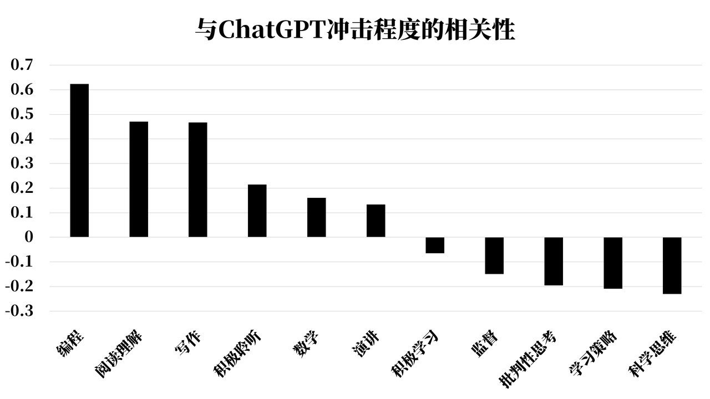

不可否认的事实是，这波生成式 AI 替代高级白领的浪潮已经开始了。

2023 年 8 月，美国华盛顿大学的学者发现，在 ChatGPT 发布后，零工平台 Upwork 上，从事写作或编辑类工作的自由职业者的数量和收入都呈现显著下跌的趋势。因为雇主们开始把写文案、翻译这类零活儿转包给了 ChatGPT。

这件事我们团队特别有体感，今年阅读英文论文的速度和数量明显大了，为啥？两个路径：

一是用 AI 工具快速翻译，虽然不算信达雅，但了解基本内容足够了。

二是用 ChatGPT 做文献搜索和文献综述，那更是又快又好。

目前看，效率提高个 10%-20%没有问题。如果加强这方面的训练，目测效率还可以提高 30%以上，比如让 AI 剪视频、出图片等。  
如果这是个普遍规律，意味着相同工作量大概可以减少 30%以上的人力。

美国普林斯顿大学的费尔顿教授及其合作者做了个最新研究，看 ChatGPT 这样的大语言模型到底对哪些职业造成的冲击最大。逻辑不复杂——  
一个职业所需技能与大语言模型技能点的相关度越高，则该职业受冲击程度越大。

猜猜哪些职业受冲击最大？

我在课程的文稿里给你放了一张表格，你可以把它存下来。

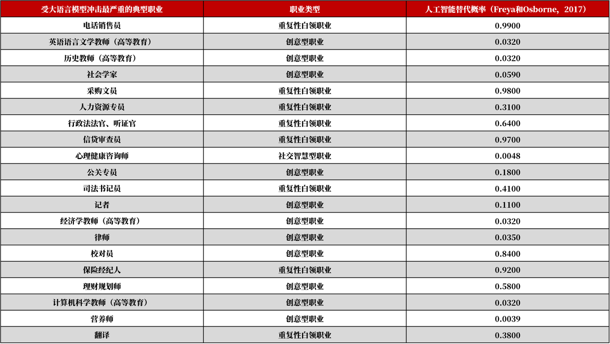

我看这张表，手心背心有点出汗：很多都是传统意义上的创意型职业、高薪职业，除了大学教师、记者外，还有心理健康咨询师、律师等。要知道，就在 2017 年牛津大学教授 Freya 和 Osborne 的研究中，这些都曾被认为是 AI 替代概率很低的职业，但现在也都陷入了很大的危险之中。

大学老师算是传统社会的金字塔尖职业吧，越老越值钱。但在费尔顿教授的研究中，英语语言文学、历史学、经济学等多个领域的高等教育教师，都位列受大语言模型冲击最严重的 10%职业。你仔细想想，这个逻辑是对的，因为 ChatGPT 的确可以帮忙承担很多教学任务——设计教学大纲、解说专业知识、为学生答疑，等等。

哈佛大学就已经推出了 AI 导师“CS50 机器人”，教计算机科学概论课。课程主讲教授马伦说：“我们希望通过 AI 实现 CS50 课程的一对一教学，并提供全天候的学习，以适应每个学生的进度。”

目前来说，研究型教授还算安全，但是那些专职从事教学的“lecture”（讲师——  
注意国外讲师和国内讲师不是一个概念，国外高校的讲师是专门从事教学而不从事研究的一个职位），明显这些岗位会萎缩。

## 2.AI 协作能力

我有好几位学生在 985、211 高校任教，所以我把文中表格发到微信群里之后，群里炸开了锅，纷纷表示要去练习车技，等失业之后就去送外卖、开滴滴。但是我告诫他们，无人驾驶、送货机器人......早在上一轮 AI 技术进步中就已经涌现出来啦，等不到他们学会，大概就没空间了。

但实际上，高级白领们也不必过于焦虑。因为技术成熟还需要一定时间。

自从 AI 绘画火了之后，设计师、画师被裁员的新闻就不绝于耳。比如说，广东一家中型外包游戏公司的原画团队，2023 年就裁员不少。

但实际上，完全由 AI 来画图并不现实。专业人士告诉我，目前生成式 AI 设计图的产出质量不高，100 张图只有 3 张能进入优秀设计师的法眼，能进入生产线的不足 1%  
。而要到商业化这一步，100 张图里起码要有 30 张可用的才行。这个差距一时半会还无法弥补。

而且，即使生成式 AI 效率大幅提升，优秀设计师仍然很难被替代，因为设计的核心能力是审美，仍然依赖于人类的主观判断。一个具有优秀的表达能力、审美能力和判断力的设计师不但不会被 AI 替代，反而能够成为 AI 的主人，利用 AI 来提高自己的生产力。

回顾过去的技术发展历史，一个技术从发明到批量化地替代人类劳动者，所需的时间远远超过我们的想象。

比如说，1858 年，世界上第一台洗衣机发明，很多洗衣女工开始担心失去工作。但实际上之后 50 年内，美国的洗衣女工数量都在不断上涨。为什么呢？技术不够成熟，而且也昂贵。一直到 20 世纪 20 年代，洗衣机开始普及，洗衣工的数量才开始下降。

当然，AI 技术进步的速度会更快，但替代人类劳动者的浪潮，并不仅仅是技术问题，还要经历人类社会组织结构和制度设计的变迁，这个过程要慢得多，可能需要 10 年，甚至更长时间。

而这就留给了人们适应未来，足够的准备时间。

怎么准备呢？一句话，提升 AI 协作能力。

刚才我讲到了很多高薪的职业都是受大语言模型冲击很大的职业，但我们换个角度来看那些受大语言模型冲击最大的职业，其实也是最有可能利用 AI 杠杆的职业。

比如说，使用 ChatGPT 之后，写作所用的时间可以减少 37%，同时产品质量可以提高 0.4 个标准差。

使用 Copilot，软件工程师的编码速度可以提高一倍。

至少在近期的未来，大多数人会发现，自己的工作是与数字工具（包括 AI 工具）互补、协作。这种 AI 协作能力，可能会成为决定未来职业发展的关键因素。美国杂志《大西洋月刊》甚至将其称为“本世纪最重要的职业技能”。

为什么呢？有更好的 AI 协作能力，意味着你能够更大限度地利用 AI 杠杆，放大你的优势。但是，不同的人使用 AI 工具的效果差异很大。对有的人来说，ChatGPT 只是一个蹩脚的搜索引擎，但有的人可以把 ChatGPT 训练成自己的高级助手。

同样是使用 Midjourney 生成画作，有的人用完就感觉它是人工智障，有的人却可以用它生成的作品，在艺术比赛中拿第一名。这其中的区别在于，你输入什么指令，如何跟它互动。

换句话说，AI 绘画呈现怎样的效果，取决于人怎么指挥它。

怎么指挥呢？两个必要条件：

1.懂得有系统化地提出好问题；

2.要对答案的优劣好坏有判断力；

这样你才能指挥 AI 不断修改和优化，得到比你单干更优秀的产出。

怎么才能系统化地提出好问题？怎么才能对答案优劣有判断力？居然回到了原点 —— 对本行业的深入理解和洞察。专业+思考力+洞察力是你能否成为 AI 主人的关键。

尼采说过，“一个人的智慧，就是他所提出的问题的深度。”

爱因斯坦也说过，“好的科学家解决问题，伟大的科学家定义问题。”

技术越发展，越是如此。

当然，除了专业和思考洞察能力外，你还需要很强的 AI 素养。所谓 AI 素养，就是你需要了解人工智能算法是如何工作的，如何支持和增强人类决策，并且了解人工智能可能存在的局限性和偏见。

所以，面对 AI，走近、拥抱、祛魅，是第一步。就像英伟达的黄仁勋说的，“AI 不会夺走你们的工作，使用 AI 的人会夺走你的工作。 ”

简单小结一下：

1.生成式 AI 对之前位于职业金字塔上层的高级打工人的冲击最大，因为生成式 AI 拓宽了“可编码”的范畴，职业所需技能与大语言模型技能点的相关度越高，则该职业受到的冲击程度越大。

2.最容易受到生成式 AI 冲击的是编程、阅读理解和写作这几种技能。

3.AI 协作能力会成为决定未来职业发展的关键因素，因为有更好的 AI 协作能力，意味着你能够更大限度地利用 AI 杠杆，放大你的优势。

好，以上就是这一讲的内容，我是香帅，我们下一讲再见。

* * *

# 09-AI 时代，会涌现出哪些新的岗位和机会？

懒人专属群的群友！你好，欢迎来到《香帅中国财富报告》，我是香帅。

上一讲我们聊到，这波生成式人工智能给高级白领带来了很大的冲击。但是我们都知道，每块乌云都镶着金边——  
从历史经验看，技术进步在消灭很多岗位的同时，也在创造新的就业机会和岗位。这一讲我们来看看，这波技术进步可能会在哪些方向创造新的就业机会和岗位。

## 1.技术进步影响劳动力市场的三种机制

首先我们得知道，技术进步是怎么影响劳动力市场的。

这就要说到麻省理工学院的一位应用经济学教授（卡梅尔·达龙·阿西莫格鲁）在 2019 年提出的一个理论。

他认为，技术进步对劳动力市场的影响，主要通过三种机制：分别是替代效应、生产力效应和复原效应。

我分别简单做一下解释：

一是替代效应，就是指技术进步代替了过去由人完成的工作任务，这是减少劳动力需求的；

二是生产力效应，是指技术进步提高了生产力，消费者购买力也上去了，市场规模大了，这个会增加劳动力需求；

还有一个叫复原效应，就是技术进步改变工作任务，创造新的就业岗位。比如说，1980 年代之前都是黑白照，要彩照得去找“着色师” 上色——  
现在这种岗位肯定没有了，但摄影相关的就业岗位其实是大大扩张的，数码相机出来以后，修图师、剪辑师、旅拍、婚纱摄影、婚礼录像.....各种新职业、新业态都在涌现。

所以，技术进步是为人类创造更多的机会，还是带来更多的失业，主要看这三个效应的力量对比。那么，怎么样的发展趋势才是更有利于人类获得更多就业机会的呢？所以要判断这波 AI 的技术进步对劳动力市场的冲击，主要是看这波 AI 进步带来的生产力效应和复原效应，是否高于替代效应。因为新的职业和岗位，主要会随着这两个效应产生。

## 2.容易出现新职业的两个领域

先看“生产力效应”。

今天正在听我这讲课程的你，不管是码农、公务员、老师，还是文案策划，或者工厂里的管理人员，大概率都属于“服务业”的劳动者。

但我们稍微想想，其实就 100 年前，咱们国家大部分人都在干农活；大概 40 年前，大部分人在工厂里——这些被统称为“生产性部门”，就是直接种庄稼，直接生产产品出来。

技术进步带来什么？1956 年，水稻亩产不足 100 公斤，现在呢？水稻亩产 800 公斤，同样一亩田，能养活的人口多了 8 倍。同样的，1990 年，中国汽车行业工人的人均年产值是 0.3274 辆，2022 年这个数字是 5.2664 辆  
，30 多年的时间，产出翻了 16 倍。

换句话说，随着技术进步，生产部门效率越来越高，用不了那么多劳动力，所以更多人进入了服务业。

但服务业也分不同种类，比如教育、医疗这些叫作“生产性服务业”，意思是提供这些服务的目标，是为了提高整个社会的生产能力。还有一部分，叫作“非生产性服务业”，提供旅游、娱乐......这些看上去“没用”的服务。

第 7 讲中，我说过，这波生成式 AI 会让写作、编程、设计等工作任务的效率大大提高——没错，“生产性服务业部门”的生产力会得到巨大提高。就像当年洗衣女工、钳工慢慢退出历史舞台一样，我们会看见，很多工作岗位会消失。

比如现在这种程序员，比如给领导写公关通稿的秘书.......我能想到的这种类型的绝大部分岗位，都面临减员的风险。那什么就业机会会长出来呢？

我敲一下黑板：那些看上去没用的东西。

我举个很有意思的小例子，最近网上有个甲骨文女孩火了。她学甲骨文——这几乎是最冷门的专业了，确实你也想不出学了四年甲骨文能拿来干啥，她考公务员各种折腾几年后，最后当了甲骨文博主，做科普短视频，不但养活自己，还带火了一波甲骨文热。我就看她视频，给我儿子讲甲骨文，还挺有意思的。

有啥用吗？实话实说。我想不出来。

但真的没有用吗？我觉得挺有“效用”。对，就是今年的财富报告第一讲里我们就在讲的，未来是一个效用社会。效用的意思就是满足，这个满足来自很多不同维度，金钱财富仅仅是其中一种。

没错，这波生成式 AI 将让“无用”登上历史舞台。

这也是效用社会的一个侧面：大多数人的工作将不再是生产物质财富，而是为他人提供“效用”。效用的维度会很广，我们 2019 年提出的爱美、怕死、孤独，都是。但未来会更多，比如好奇心、征服欲，或者什么也不为......你可以问一下自己，过去几十年中，你什么时候感到“满足”？

任何一个可以激发大众甚至小众“满足”的点，都有机会长出新的职业和岗位。

从统计数据上看，我们已经看到了这种苗头。

2000-2022 年，美国哪个细分职业的就业人数增速最快？你可能想象不到，是美甲师和足疗师。这两种职业，在过去 22 年内就业人数增长了接近 400%。

在美国，就业人数快速增长的职业还包括个人理财顾问、活动策划师、导演、教练、动物看护师等。这些职业都是为他人提供“效用”的岗位，需要社交智慧，需要提供情绪价值，也需要一点灵感，这些都是 AI 很难办到的。（我把 2000 年-2022 年美国就业人数增加最快的 20 个细分职业都放在了课程文稿里，你可以点开仔细看。）

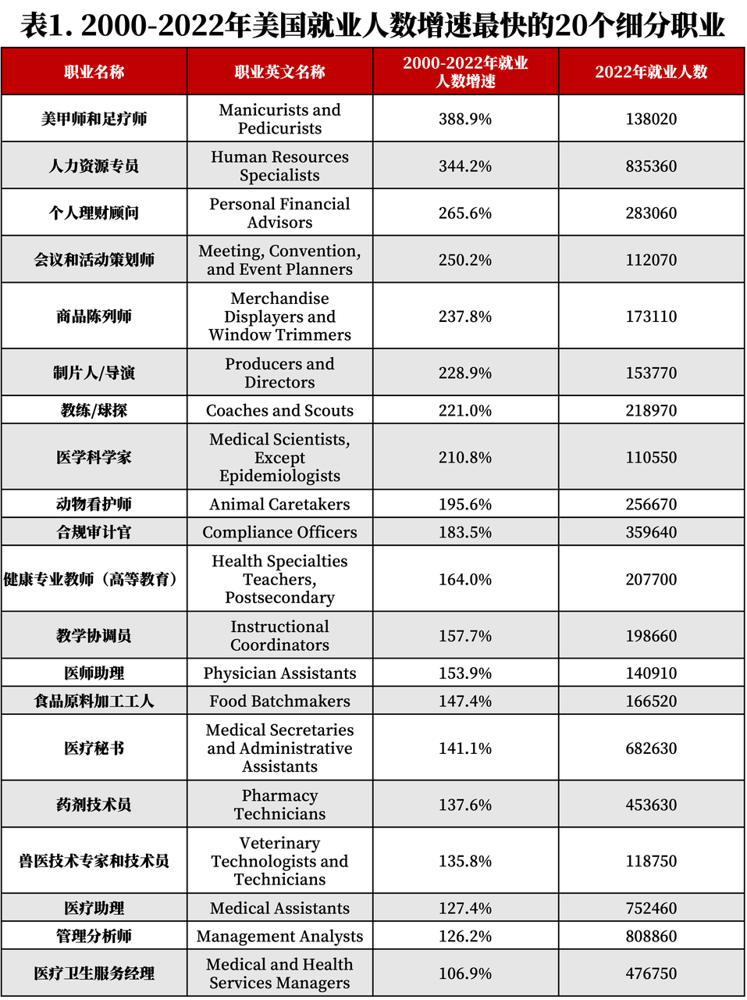

好，说完生产力效应，我们接着再看复原效应。这对于更多面临冲击要转行转型的人，可能更具有指导意义。前面我们讲到“摄影”这个领域虽然失去了一些岗位，但创造了更多和数码摄影相关的岗位。这不是孤例，电工、司机都是工业革命后的职业，程序员、网络直播也是最近几十年信息革命催生出的新职业。

这么说吧，1940 年的时候，当下我们从事的职业，超过 60%都不存在。

从 2015 年-2022 年的 7 年间，我们国家新增了 158 个职业，约占总职业数量的 10%。这 158 个职业，有 43 个（占比 27%）都是数字职业，也就是数字技术进步催生的新职业，比如人工智能工程技术人员、人工智能训练师、互联网营销师、农业数字化技术员等等。

此外，还有 77 个职业（占比 49%）属于“创造效用”的服务业职业，比如宴会定制服务师、虚拟现实产品设计师、彩灯艺术设计师、研学旅行指导师等等。（我同样把这 158 个职业的表格放在课程文稿里，供你参考）

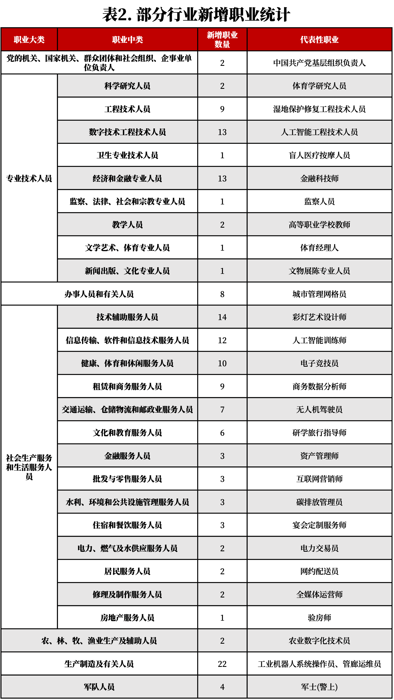

可以看到，在数字时代，新职业大致会出现在两个领域：

其一是数字技术的研发和应用；

其二则是“创造效用”的职业；

而且，创造效用这个方向会容纳更多的就业。

## 3.认识自己，才能做 AI 的主人

最后，我想讲个我亲身经历的故事。

就是前两个月，我跟两位网文作者聊天，她们告诉我，现在的网文写作都有“框架”，而且网上“素材”多，什么霸道总裁爱上我，恶毒女配白莲花，穿越古代立大功……哪个题材热，素材马上剪出来，甚至连洗稿都算是好的，有的就改个名字，然后塞到素材库里。所以她们的工作就是“选料”，然后裁剪裁剪，主要耗眼睛和耗手。

我马上明白了为啥现在推送的网文有时候感觉特别熟，因为都是流水线产品。那么这样的工作岗位，很快就会被 ChatGPT 干掉。网文写作者其实只是“以写作为生”的人群里的一个极小样本。

今天我们看到的大部分报告、文案、公关通稿，大多是素材的堆积；稍微高级点的，是结构化，提炼一些观点——类似小学时代语文课的“总结中心思想”；再高级点的，还加点文字堆砌的文采。但是，凡是有套路的，不管是学套路还是找套路，AI 肯定比我们快。

更进一步说，但凡有套路的“产出”，AI 大概率能比我们做得更好，效率更高。

所以我们会说，要抵抗 AI 的冲击，要有创造力。

但什么叫创造力呢？

我一直觉得这个词很重要，但不知道怎么表达，有天看到一句话“在成为你自己这件事情上，没人比得过你。”

有时候确实会觉得，人得相信造物的神奇。我们总会发现一些事情，自己特别擅长，因此容易兴奋，产生多巴胺，然后坚持，形成正反馈——我觉得，创造力大概是在这样的时刻才能被激发。

更重要的是，这种事情不一定要是现在大家定义的“有用” ——甲骨文可以，玩泥巴也可以。

从这个意义上来说，未来，AI 给我们带来的，也许是让更多人有“做自己”的机会。

但这件事情的前提是，你得回到苏格拉底所说的 ，“认识你自己”。

好，我简单给你总结一下：

1.技术进步主要通过替代效应、生产力效应和复原效应这三种机制影响劳动力市场，很多工作岗位会消失，但同时也会有很多全新的工作岗位出现。

2.在数字时代，新职业大致会出现在“数字技术的研发和应用”和“创造效用”两个领域，创造效用这个方向可能会容纳更多的就业。

3.在 AI 时代，但凡有套路的“产出”，AI 大概率能比我们做得更好，效率更高。所以创造力尤为宝贵，认识你自己，才有可能成为 AI 的主人。

好，这就是这一讲的内容，我是香帅，我们下一讲再见。

* * *

# 10-2024 年，房价能止跌回升吗？

懒人专属群的群友！你好，欢迎来到《香帅中国财富报告》，我是香帅。

这一讲开始讲房地产。前面的课程我们一直在讲 2024 年钱从哪里来，创富的路子。但只要讲到家庭财富，房子还是绕不开的话题。

讲个不算笑话的笑话。你看，A 股怎么跌，都有人编段子。你啥时候看见老百姓编楼市的段子？为啥？14 亿人中只有 2.2 亿人有股票，公募基金账户，9 成个人投资者的金额不到 10 万块钱，股市跌个 30%，也就是几万块的输赢。虽然肉疼，但不至于伤筋动骨。但房产呢？动辄几百万，一线城市甚至上千万，房价 10%的浮动，  
对一个家庭来说就是百万级的财富效应。

所以，2024 年，房价会回升吗？这对绝大部分中国家庭来说，不管是要买房的，还是想卖房的，都是灵魂拷问。

我先给自己的观察结论吧，但不作为投资建议：2024 年 3、4 季度后，房价普跌的势头有可能止住。

房地产市场将回到存量博弈，分化涨跌，供需相对平衡的状态。当然，这里有个前提，宏观政策没有 2023 年那么紧。政策要宽松到什么程度能止血，或者能有利于伤口愈合，我们在课程后面会讲到。

那，为什么我会得出这个结论？以及，哪些地方的房价能止跌，哪些地方房价可能还有调整空间，我们来一个个分析。

## 1.中国房价到底跌了多少？

2023 年，大家听到房价下跌 20%、30%的新闻比较多，也比较恐慌。我们就看 70 个大中城市的房价。

70 城房价高点是 2021 年 7 月，以这个时点算，新房价格下跌 3.3%，二手房房价下跌了 7.6%。但如果以 2020 年作为基期，70 城市同期新房上涨 2.9%  
，二手房价下跌了 3.9%。

换句话说，我们感知到的房价下跌主要发生在 2022 年和 2023 年，下跌主力是二手房，新房波动要小很多。

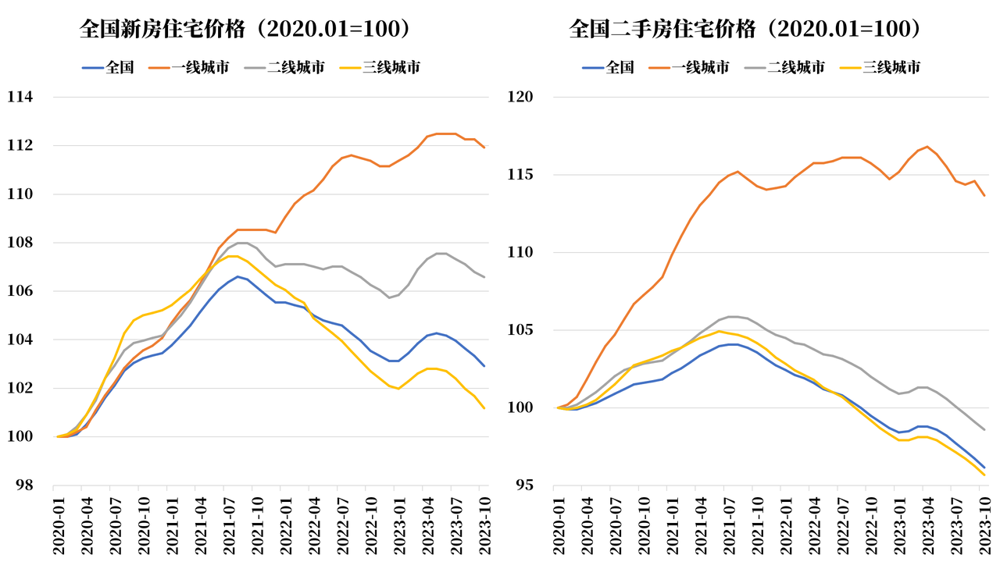

那二手房在不同城市的走势究竟如何呢？我们来看国家统计局的相关数据：

1.如果把 2020 年 1 月作为基期，房价按 100 来算的话，到 2023 年 10 月，一线城市的二手房价是 113.7，但二三线城市的房价分别跌到 98.6 和 95.7，回到了 2019 年左右的水平。

2.一线城市的房价调整相对比较晚，上海和广州从 2022 年底开始有调整，深圳和北京都是从 2023 年 3、4 月份才开始调整的，其中深圳调整幅度更猛。目前来看，和 2020 年比，三年下来，北京房价到了 120，上海是 115，深圳和广州分别是 110 左右。

3.在次一线城市中，南京基本回到 2020 年的水平，杭州 110 ；只有成都一枝独秀到了 125。

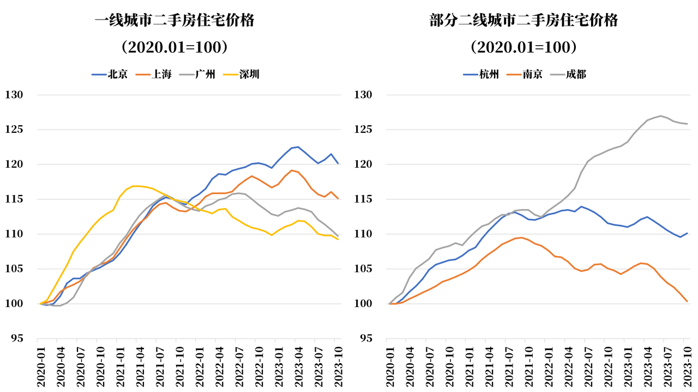

所以总结一下，我们目前说的房价下跌，主要集中在 2022 年和 2023 年。

如果以 2020 年为基准线，过去三年，一线城市的房价整体上涨了 10%左右，二线微跌了 1.4%，三线城市跌了 4.3%。

2022 年我们算过，前面 20 年，一线城市房价的涨幅超过 GDP 的增速，二三线城市房价跑不过 GDP 增速 。  
很明显，2022 年到 2023 年这个规律被打破了，因为这段时间 GDP 的复合增速 4.1%，但一线城市房价复合收益率是 2.02%（这里包括了新房），  
二三线都是负数。

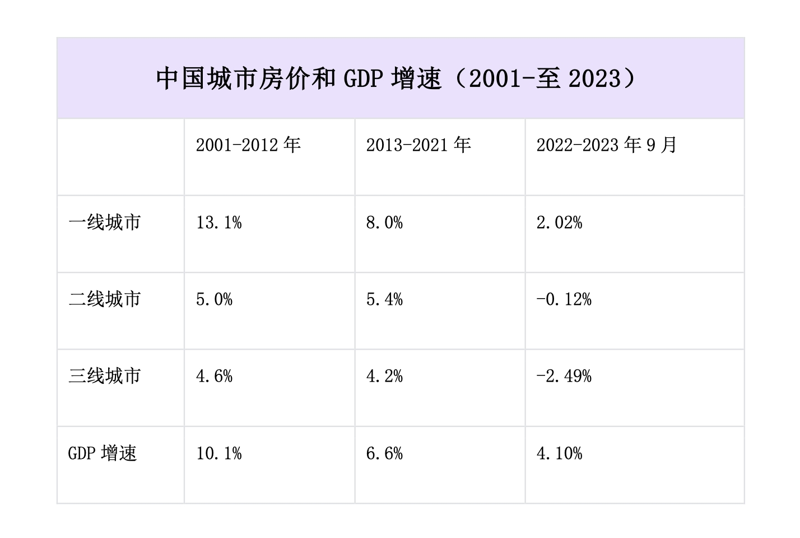

## 2.2024 年，房价还会继续下跌吗？

要判断未来房价走势，就得回答一个问题，为啥 2022-2023 年一线城市房价收益率高于 GDP 增速这个规律会被打破？

一个可能的解释，中国宏观经济和房地产之间的紧密关系已经不存在。很明显，到目前为止，没有任何证据能支持这个结论。

还记得我在去年的财富报告讲过的那句话吗？2023 年中国的经济增速，胜负手之一主要在房地产。

2023 年 12 月初著名宏观经济学家高善文博士有篇刷屏文章，开头是，“ 对房地产市场的认知、讨论和判断，决定了我们对明年经济和市场最关键的判断。”

没错，我认为，2024 年中国经济的胜负手之一，还是房地产。

房地产对中国经济的重要性，这里就不多说了，对投资、对地方政府的影响都是明牌。对消费的重要性其实也远被低估，这种影响有好几个渠道：

一是，今年财富报告第二讲里面谈到的“居住，家庭设备用品及其服务”相关消费，占据了中国消费的 29%。所以可以想见，房地产市场起不来，消费总量上不去。

二是，财富效应。家里本来是 1000 万资产，虽然是纸面财富，但一下子缩水两三百万.....“变穷了”这个认知就让人不敢花钱，这也是基本人性吧。

所以，截至 2023 年底，2024 年宏观经济如何和 2024 年房价如何，我认为，差不多是个等价命题，没有太多疑问。

那么，这两年房地产市场的下调表现是正常的吗？

应该说，和 GDP 的增速相比，房价和这两年整个经济的实际体感还是比较接近的。但从长期来说，这是合理水平么？或者缩小点范围问，一线、核心二线城市的房价调整，是否击穿了“房价泡沫”？

关于这个问题，高善文博士认为，目前的房地产市场，不管是投资额，还是对应的住宅销售面积，都已经明显低于它的长期合理中枢。

他用“房地产投资占整个 GDP 的比重”来对房地产市场的长期趋势做判断。用这个指标的逻辑是，它可以衡量投资、杠杆率对整个经济活动的影响，而且可以把人口、老龄化程度、城市化水平等各种因素考虑进去，方便做跨国、跨地区的比较。

然后他用东北和日本作为基准线，发现不管是东北“ 城市化基本结束，人口大量外迁”，还是日本“人口老龄化，人口总规模下降”  
的背景下，这个指标长期都稳定在 6.5%左右。

给定中国未来一段时间的人口和城市情况，高善文博士认为，这个指标的合理下限在 7%。而当下这个指标已经只有 6%出头，到 2024 年可能会跌破 6%，也就是远低于合理下限。

考虑到中国下一步城市进程仍然是向大城市（都市圈）集中，所以基本可以判断，从长期来看，一线和核心二线城市的房地产市场是超调的。

不过，长期来看房地产市场已经超调，这和房价短期内会不会继续跌，还是有区别的。短期内，一二线城市的房价还会不会持续下跌，主要取决于政策是否真的转向和市场消化存量房的速度。

先看政策转向了吗？

我的答案是，看上去是。2023 年，房地产真正开始松绑是在 7 月的中央政治局会议有了定调上的变化之后。紧接着就是各部委很多表态，其中比较有实际意义的是两条：

一是调整首付比例和下调二套房和存量房的房贷利率；

二是央行提出了“三个不低于”，就是要求给房产买卖双方都多提供贷款；

另外，市场还传闻有个救助 50 家房企的白名单，引起了很多关注。

看上去政策确实是转向了，对不对？但你仔细琢磨，调整首付比例，下调二套房和存量房贷的利率，都是“结构性滴灌”的做法，有点像哪里流血多就往哪里贴创口贴。

而给买房人和房地产公司都提供贷款的思路，截至 2023 年底，只停留在部委这个层面，要落实到各个银行，会面临很多实际问题，很难一时半会奏效。

至于救助房企白名单这件事，放谁不放谁，这种事责任太大，更大可能是高高挂起轻轻放下。

所以，截至 2023 年底，房地产行业上面的紧缩政策确实转向了，但并没有能快速扭转预期的重磅政策落地。

所以当下主要是一个什么状况，就是等市场自然愈合。但自然愈合需要时间，而且行业周期也是有惯性的。换句话说，如果政策保持目前的节奏和力度，在接下来的两三个季度内，房价下行可能还存在着一定的惯性。

那些之前价格调整少的城市，有可能会进入调整通道。怎么判断调整得多还是少？以 2020 年为基期，看同线城市的价格水平和平均调整水平  
，如果价格水平相当，而调整幅度明显低于同类城市，继续下调的概率就会比较大。

当然，如果政策短期内就有重大的调整，比如说大幅度全面降息，比如“三个不低于”的贷款政策被要求落实到具体银行，而且要追责到人，那么房价的趋势就可能更快地转向。

那为什么我会觉得到 2024 年下半年之后，房价这种大幅下调的趋势可能会止住呢？因为价格波动还是和市场的短期供给和需求更相关。因为有限价政策，中国房产市场一直存在新房和二手房价格倒挂的现象，所以这波价格调整也主要来自二手房。

从短期来看，需求端不会出现剧烈变化，如果市场上没有更多的新房供给，二手房价格就会逐渐稳定下来。

目前市场新房供给主要来自“保交楼”，到 2024 年二季度保交楼基本完成，短期内市场上不会有更多新房供给，楼市的供需两端会出现一个相对的均衡，价格也应该会稳定下来。

好，简单总结一下：

1.中国房价下跌主要发生在 2022 年和 2023 年，下跌主力是二手房，新房波动要小很多。

2.2024 年 3、4 季度后，房价普跌的势头有可能止住，因为价格波动和市场短期供给和需求更相关。房地产市场将逐渐回到存量博弈、分化涨跌、供需平衡的状态。

以上就是这一讲的内容，我是香帅，我们下一讲再见。

* * *

# 11-怎么避开风险大的房产项目？

懒人专属群的群友！你好，欢迎来到《香帅中国财富报告》，我是香帅。

不管什么时候，买房都是家庭资产配置最重要的决策。当前的市场环境下，很多项目都有风险。所以避开风险大的房产项目，还是很关键的。

2023 年 10 月，万科董事会主席郁亮说，当下中国房地产行业处在一个“撞墙期”，煎熬还在持续。什么是“撞墙”呢？跑马拉松的人都知道一个词叫“撞墙”，就是刚开始跑的时候是将身体里的糖转换成能量，但 30 公里之后，体内的糖消耗完了，就需要燃烧脂肪释放能量。而从糖转化到脂肪，这个中间会有 5~10 分钟的窗口期。在这段时间里，因为能量不够，马拉松选手就会出现肌肉抽筋、僵硬、体能下降、呼吸急促等现象。这就是“撞墙”。

在我看来，“撞墙期”的房地产行业，最容易引起连锁反应的就是暴雷。有一些房企、房地产项目为什么会暴雷？哪些房企和项目更容易暴雷？你又该如何避坑？

接下来，我们一个一个来讲。

## 1.问题房企暴雷的原因：现金流

我们把 2023 年出问题的房企和项目都看下来，发现暴雷原因就三个字：现金流。

而出现现金流危机，基本都是因为债务问题。金融学里有个专有名字，credit crunch (信贷紧缩危机），就是说企业越是碰到困难的时候，越容易被债权人追债，因为大家担心你还不上，然后导致现金流真的会枯竭。

从目前暴雷的项目看，容易引发现金流危机的主要在两个地方，企业公开债和地方债。我们分开来看：

第一个是企业公开债集中到期。所谓公开债，就是在公开市场上发行的标准化债券（包括短期融资券、中期票据、企业债、海外公司债等等）。

说白了，公开债就是面向大众发行。所以和私募债、银行贷款、非标贷款相比，公开债的信息透明度、标准化程度都要求更高。尤其在触及违约条款的时候，限制更多。

比如说不能归还利息也算违约；比如说要“连坐”，公司一张债券发生了违约，它发行的其他债券会因为“触发交叉违约”条款，会被提前要求支付本息等等。

金融市场上，有句话叫作不交易就没有坏事儿，反正有问题大家也不知道。但公开债是连续交易的。房地产行业下行，投资人的弦都绷得紧紧的，只要有一点风吹草动，立马开始挤提，打骨折也要卖掉，然后引起市场连锁反应，导致大家纷纷脱手——碧桂园的情况就是这样。

2023 年上半年，碧桂园亏损 400 多亿，账面本来就极其紧张。到了 9 月底，有 9 笔人民币债券到期，连本带息共计要还款 147 亿—— 市场已经是风声鹤唳。然后还有 2 笔美元债要还利息，差不多 1.6 亿人民币，结果到期没还上，算违约。债务压力的多米诺骨牌连着倒下。

除了碧桂园之外，之前蓝光、华夏幸福，也都是类似情况。

那第二个风险点呢？地方债。

你可能会奇怪，地方债跟房企风险有啥关系？

讲一个真实发生的案例：2023 年上半年，西南某城投公司被列为失信人，为啥？因为被一家地产公司给起诉了。

事情也不复杂。那家城投公司是当地的“城市基础设施建设和区域性城市综合运营商”，负责当地的一个大项目——多大呢？ 差不多 2 万亩，包括城市中央公园、景观绿化带、住宅、金融、文化、娱乐在内的 6 大功能区，这其中包含 650 万平方米的住宅、11 个小学、28 个幼儿园......预计开发资金高达千亿。

房企是这个项目的投资方之一，也是项目开发商。2020 年为了吃下这个“香饽饽“，这家房企向当地的城投公司支付了 3 亿的合作意向金。但是，这个项目从 2021 年开始到目前，因为楼市销售低迷，各方资金都越来越紧，项目推进越来越慢。于是，投资的房企就提出了终止这个项目合作，要把那 3 亿要回来。但是当地的城投公司只退还了 1.5 亿—— 最后这家房企向法院提起了诉讼。

前面提到的城投公司不是特例，根据我的观察，债务负担重是城投公司的普遍通病。原来增长快，不怕巨额债务、高额利息，只要地卖得动、房子卖得动，就跑得起来。现在市场不景气，不要说还债，连利息都付不出来。

这么看下来，我发现，经济实力偏弱，自身债务较重的城市，项目出险的概率会高很多。地方政府的历史包袱，容易成为项目烂尾、项目开发商受损的导火索。

总结下来，过去两年部分房企暴雷的现象，本质上是“债务”引发的现金流问题。企业自己的债务负担和项目所在的地方政府的债务负担，都可能引爆雷点。

那接下来，我们再看看，有没有办法可以避开这些雷区呢？

## 2.怎么避雷？

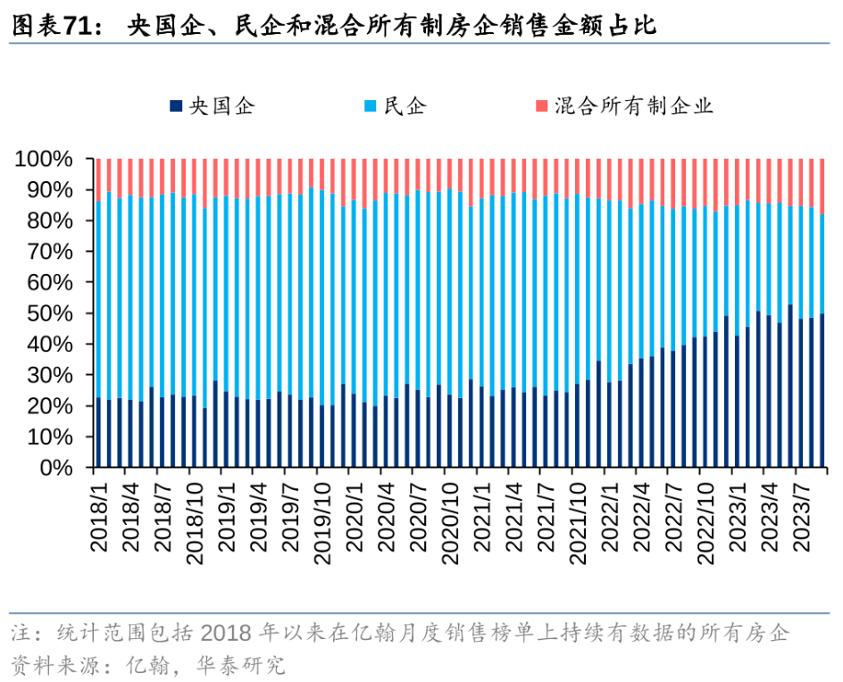

前面我们讲到，房地产这个“撞墙期”还没结束，指望销售回款明显好转还需要时间。所以，房企债务负担重，就很可能快速陷入出险的境地。从 2023 年前 3 季度的销售情况来看，央企和国企现在是各占 50%左右。而在 2018 年，这个数字是 80%。民营房企现金流的紧张程度，也可见一斑。所以，避雷的关键在于，我们得将那些现金流方面的优等生给挑出来。

怎么挑呢？上市的房企相对都是比较好的企业了，在这些企业中，我们再用四个指标进行筛选。

1.财务费用在经营指标中，占比合理的。财务费用占比营业收入，占比净利润太高，当然容易陷入债务困境。一般来说，财务费用占营业收入的比重不宜超过 20%，占净利润的比重不宜超过 100%。 所以，高于这些红线的，我们就给一个“红灯”；

2.整体负债率比较合理。资产负债率高于 80%，在当下这个撞墙期，我们也认为不够稳健，给一个红灯；

3.速动比率（也就是短期流动性）合理。速动比率，也就是企业速动资产与流动负债的比例 ，这个比例高于 100%，是比较理想的，表明企业可变现资产完全可以覆盖短期负债。在 50%~100%之间，也是尚可接受的。但是速动比率小于 50%，说明企业短期偿债能力比较弱，企业容易陷入流动性危机，同样给一个红灯。

4.我们前面看了三个负向指标，最后再给一个正向指标：利润要正增长，虽然稳健但是也要能赚钱。

在课程文稿里，我放了一张图方便你更直观地了解这四项指标。我们用四个圆圈分别代表四个指标，如果四个指标都没有红灯，就代表是债务和经营上都比较稳健的房企。这些房企的项目出险概率要低很多。方便时，你可以点开文稿查看，还是蛮有意思的。

好，那么按照这四项指标去筛选，哪些才是相对稳健的房企呢？我发现，截至 2023 年底，32 个头部房企中，只有 15 家在债务上是比较稳健的，其中民营房企有 3 家。

同时，我在文稿里还给出了一个表格，把分别达标 4 项、达标 3 项、达标 2 项和达标 1 项的企业也都列了出来。供你参考。另外，即使我们关注的项目不是上市企业，仍然可以找找资料数据，用这些指标帮自己做判断。

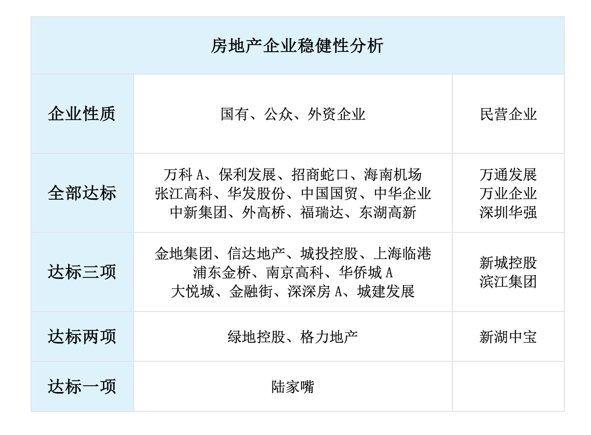

除了房企本身的现金流之外，还有两个指标也可以关注一下，作为避雷指南针：

第一是所在城市的债务风险。地方负债率太重的可以三思。当然这个指标本身跟当地经济状况密切相连，通常是三四线城市负债远高于一二线城市。另外，最近地方债兜底的政策倾向明显，所以我认为，这一条可以参考，不需要过多纠结。

第二就是房企的土地储备质量。土地储备是最大的抵押品，一个房企如果一二线的土地储备比例较高，相对出险概率也会较低，后期恢复速度也可能更快。

好，简单给你总结一下：

1.过去两年部分房企暴雷本质上是“债务”引发的现金流问题。债务问题导致的信贷紧缩危机是现金流危机的核心，其中主要是公开债和地方债的影响。

2.经济实力偏弱，自身债务较重的城市，项目出险的概率会高很多。地方政府的历史包袱，也容易成为项目受损的导火索。

3.在避雷方面，可以优先考虑那些财务费用占比较低、资产负债率处于合理范围内、速动比率较高、一二线城市土地储备比例较大的企业。

好，以上就是这一讲的内容，我是香帅，我们下一讲再见。

* * *

# 12-从阿那亚看房地产的瓷器时代

懒人专属群的群友！你好，欢迎来到《香帅中国财富报告》，我是香帅。

还记得第一讲我说，2023 年的关键词是“微利社会”吧？在这样一个社会里，项目从厚利转向微利，但是大家的满足感来源也更多——经济学上我们把这叫作“更多元的效用”。满足感来源多了，钱的来源也自然多了，所以，微利社会也意味着钱会从很多细微的地方来。

我有时候会觉得，之前讲了好多年的那些大词，什么“转向有质量的发展，精细化增长”终于要变成现实了——说实话，在能赚快钱大钱的时候，谁有精力像勤劳的小蜜蜂一样，去赚很多小钱呀。总是大钱没了，才开始精耕细作。

这个趋势同样发生在房地产行业。

## 1.中国房地产进入“瓷器时代”

2023 年，房地产行业的不景气我觉得不用多描述了。但是有个神盘很坚挺——得到的北京用户，我估计知道这个神盘的人很多。嗯，你没猜错，阿那亚。

2023 年，北戴河阿那亚销售几乎没有淡季，有些位置好的房子，想买还要竞争。房价更是涨了 5%左右。而且，阿那亚房价可不算便宜，2 万多一平米，它旁边不到 1 公里的孔雀城，售价 9000 元，难卖到焦头烂额。

但很有意思的地方在于，大部分知道“阿那亚”的人，脑子里出现的印象，大概率是阳光沙滩、孤独图书馆、戏剧节，是文艺青年的网红打卡点  
，是社区文化，甚至是有怀旧气息的食堂——但肯定不是一个卖房子的“楼盘”。

但阿那亚是个楼盘，学名叫“文旅盘” ，就是那种在风景优美、气候温暖，或者有特色的地方开发的，以休闲疗养为主的楼盘。

但你说阿那亚是个楼盘，确实又不是很贴切。严格说，它是一个社区运营服务商。

首先我们看运营服务占收入的比例。2023 年，阿那亚的运营服务收入超过 20 个亿，占营业收入的 50% 。  
这个数字有多特殊呢？做个对比：万科是 4%，融创 5%~6%之间，中国金茂在整个房产行业算是运营服务收入比例特别高的，大概 13%~14%。

但服务运营的收入占比并不能完全体现社区服务在阿那亚的重要性——要知道，阿那亚房价比周边贵了一倍多，这个溢价就是靠这个高服务占比支持的。很多业主就是冲着这个“社区”  
来购房做民宿投资的。

2023 年一个挺有意思的事情——但凡和房企高管聊天，几乎都会说到阿那亚。虽然阿那亚做得很好，但体量上也就是几十个亿的盘子，和动辄千亿的房企巨头比起来相差很远。那为什么大家都这么感兴趣呢？

根本原因是，大家在阿那亚身上看到了未来中国房地产行业的一些特征。其中最重要的特征就是，投资属性弱化、消费属性增强。

还记得吧？万科最早在 2014 年提出房地产行业从黄金到白银时代，然后从 2022 年开始进入黑铁时代。黄金白银黑铁，都是金属，不过从贵金属到贱金属而已。

而我觉得，2023 年之后，中国房地产行业进入了瓷器时代。瓷器是什么？瓷器，则要兼具功能性和审美性。从金属时代到瓷器时代，是中国房地产投资属性弱化，消费属性增强的写照。

## 2.瓷器时代：从投资增值到消费保值

这件事，其实很多开发商已经有很强的体感。

万科的郁亮说，“客户需求和城市发展的两个变化对我们（万科）而言，意味着开发经营服务并重。”

保利发展董事长刘平说，“行业回归了居住需求本原。”

听着像官方大词，但实实在在就是这个行业未来“钱从哪里来”的写照。而对于我们普通家庭来说，房产的功能，开始从投资增值转向消费保值。“消费属性变强”会给房地产市场带来很多变化。

## 一句话，就是围绕房子居住体验的产品和服务兴起。

比如说之前课程提到过“阳光溢价”。20 世纪 70 年代之后，美国房价的轨迹非常清晰，就是阳光地带崛起：房价大幅上涨的城市大多都位于温暖的、阳光充沛的地区，相反衰败的城市都阴冷，冬季气温很低。道理不复杂，人类用脚步丈量土地。经济水平越发达，自然会选择气候更好、更宜居的地方生活。所以气候会越来越成为人们选择房产的重要决定因素。

但“气候”只是宜居的一个维度。很多时候，宜居会更多地体现在居住体验上。

2023 年网上有个热帖，说一个 90 后插画师邵邵，花重金打理装饰租来的老洋房。为什么？因为“房子是租来的，但是生活不是”。其实类似的故事这两年越来越多，反应的就是新世代在消费价值观上的变化：  
“买房置业”的欲望腾出了一部分位置给“居住消费”。

有两个调研结果很有意思：一个是 58 安居客研究院的调研，  
发现 85 后青年买房的原因中为“房产升值”购房的占比，占比不到 10%（另外 46.7%是为了改善目前居住环境，20%是为了结婚，20%是为了子女教育。）

所以，房产商们也越来越重视“软性的因素”。现在大家卷房型设计、卷明卫、卷阳台……已经不是新闻。但说实话，这些“硬件设施”同质化程度高，卷出溢价的空间不大。相比起来，阿那亚的“社区服务、审美溢价”就更让人心动。

我一个好朋友就说，“我买阿那亚买的是社区、湿地、食堂和物业”。他跟我举例，父母 70 岁高龄，每年 6-9 月住那里，食堂解决一日三餐，物业帮着打理院子，一下子就放心下来。加上社区活动多，孩子去的时候被安排得满满的，他一下子就被解放出来......

这些事情听上去很琐碎，很不起眼。我听到时的第一反应是，这方面其他的房产商也都可以卷啊。比如海景区的房产打造“海上运动生活方式”，大型社区里面做马术训练、艺术馆这些“配套服务”，不是都可以吗？  
但是我跑了几趟阿那亚之后，觉得事情没有那么简单。

## 3.不可学和可学的

调性是个玄学。

阿那亚最早出圈是“文艺范”，这和创始人的调性如出一辙。

从孤独图书馆，到阿那亚礼堂，到沙丘美术馆，到戏剧节，LV 秀场，诗歌朗诵会，到李健的“像海一样”演唱会......阿那亚“爆款”频出的背后，处处透露着创始人马寅的审美和价值倾向。

比如说，“连锁餐饮”不算符合阿那亚的“调性”，但是问题来了，像 Shake  
Shack 这样的连锁汉堡店要引进吗？调性未必完全吻合，但能切实解决旺季用餐的问题，这个取舍怎么做？  
还有，很多产品都想在阿那亚礼堂里做活动，哪些产品能放，哪些又不行？李健、窦唯这些不可以复制粘贴的演唱会/文艺试验，哪些该试哪些不试……诸如此类的问题，都得马寅拍板。

稍不留神，那个“调性”就容易被弱化或者走形。

另一个朋友说，“我买阿那亚，买的是马寅的人力资本”。这句话半是玩笑半是顶真。为什么？因为个人色彩这么浓重的强运营，本身是铠甲也是软肋。它效率高，有创意，但也有偶然性，不太可能批量复制。这也是为什么马寅说，现在阿那亚就 6 个项目，处于不同的生命周期，自己的精力刚好可以覆盖它们。

所以，阿那亚不是什么可复制的商业模式或者模板。相较而言，它长出来背后的原因，可能更值得探索。

这个背后的原因是什么呢？马寅觉得，中国社会正在进入一个对简朴和丰盛都有需求的消费时代。

但简朴不是将就，而是有品质的简朴。同样的，丰盛不是奢侈，而是有节制的丰盛。

所以，他说，他对阿那亚所有产品和服务都用这个尺度去做标准。

他举了两个例子：一个是食堂，有段时间老有人投诉说牛肉面里的牛肉太少。怎么办？最后统一，每碗面给 4 片牛肉，但如果客人要求多给，就多给。  
试行一段时间后，发现要加肉的其实没有那么多，大家要的是一个“选择权”。  
还有一个是餐厅，暑假来的客群普遍消费高，餐厅就推各种高档海鲜，马寅说不行，一定要保持“丰简随君”。

怎么说呢，听上去都是特别鸡零狗碎的事情。但是仔细想想，这背后透露的是，这个企业对时代和对人群的理解，以及相应的“强运营”。对人群的理解是出发点，强运营是抓手，缺一不可。

换句话说，在阿那亚的溢价中，有很大部分来自“人力资本”。中国房地产行业，好像正在完成从钢筋水泥到血肉之躯的转变。因为不管是理解力还是强运营，靠的是人，是人的创造力，是人员的激励机制设计。

讲到这里，我突然想起了之前课程里讲到旅游行业的新现象，那种老自然景区衰落，而更有体验感、参与感的人文景区在涌现。课程里说到了 2023 年火爆的长白山和大唐不夜城。我记得当时就有人问，这些地方也会“生如夏花”转瞬即逝么？其实我给不出答案，到这里的时候，我知道我为什么给不出答案了。因为这些地方能否长红，也是一样的道理，任何能获得认同的强体验的背后，都是强创意、强落地和强管理的结合体，缺一不可。所以，这是一个和“人”有关的答案，很鸡汤的答案，但很真实，就是“看谁来做”  
。

其实瓷器，不也就是这样的吗？同样的胚土，不同的窑，不同的匠人，烧制出来的瓷器可以非常迥异。

好，简单给你总结一下：

1.微利社会的趋势同样发生在房地产行业，项目从厚利转向微利，房地产商也更注重精细化的增长。

2.中国房地产从金属时代进入瓷器时代，意味着房地产投资属性弱化，消费属性增强。这让围绕房子居住体验的产品和服务快速兴起。

3.阿那亚就是一个很典型的例子，但它并不是一个可以复制的商业模式和模板，相反，它透露出来的信息是，中国房地产行业，正在经历从钢筋水泥到血肉之躯的转变。

以上就是这一讲的内容，我是香帅，我们下一讲再见。

* * *

# 13-制造业在数字服务业中进化

## 13 | 制造业在数字服务业中进化

年度得到·香帅中国财富报告（2023-2024）  
←进入课程

懒人专属群的群友！你好，欢迎来到《香帅中国财富报告》，我是香帅。

2023 年，中国互联网巨头的格局发生了很多变化，其中 11 月拼多多市值一度超过阿里引起很大的震动。拼多多旗下的 TEMU 在海外市场上和一家叫希音（SHEIN）的公司拼到刺刀见红。市场最近传闻，希音可能以 600-900 亿美金的价格上市。如果这个消息成真，那么就意味着，希音将进入中国前 20 大市值的巨头行列。

希音的官方定义是“全球在线时尚和生活方式零售商”——  
我的理解是，我们可以把它看作是“线上的 ZARA”。只不过它的销售方式和渠道，不是通过星罗棋布的线下店，而是通过一个全球超过 2 亿月活用户的 App。

但今天这一讲，我们不是要讨论互联网巨头的格局变化，而是要讨论制造业。听到这儿，你可能会有疑问，如果要聊中国的制造业，那跟希音这家互联网公司的关联是什么？实际上，希音能够成为全球快时尚领域的成功典范，正是得益于中国制造业和互联网行业优势的叠加。而这其中，我认为，也蕴藏着中国制造业进化的思路和解法。

得到的同学应该都很熟悉“微笑曲线”这个词，在产业链中，前端的专利、技术和后端的品牌、服务的附加值高，而处于中间的制造环节附加值最低，中间环节凹陷，形成一个“微笑”的形状。改革开放之后的 30 年，中国制造业一直在这个“凹陷”里面，也就是附加值较低的制造环节。  
但是今天，这件事有了一些变化。而这些变化，是过去 20 年中国电商、社交媒体等数字平台所推动的。

这其中，我看到了一个有意思的现象—— 中国制造业在数字服务业中得到了进化。

## 1.向“微笑曲线”的两端移动

2023 年企业家普遍比较悲观，我碰到最乐观的两个男生都在服装行业创业。他们就是在服装制造业做“微笑曲线”的两端——设计和品牌。而且很有意思，两个都是海归名校学霸，都是学计算机的。

其中一个男生郑泽宇做的是一个 “基于 AI 技术的服装设计供应链平台”。这个项目就是淘宝网红店的“衍生品”。

2015-2016 年间，淘宝上兴起了大批网红品牌。网红品牌上新快，款式要多。大家在产品上差异不大，很拼款式细节。所以网红品牌都有自己的设计师团队，和我们平时想的不一样，快时尚设计师的工作不是天马行空地读图  
。他们最重要的工作之一是“选款”，就是读大量的流行款式图片，选出最可能热卖的款式，进行修改，然后再找面料、核价、确定工艺去实现。  
很明显，要提高选款能力，图片多、图片好、读图快是关键。这时候做人工智能的人就能帮上忙了，通过人工智能可以快速搜索、识别和整理图片，再“喂”给设计师，帮助他们提高选款的能力。

大概在 2017 年，当时最大的网红孵化商如涵旗下有几十个网红品牌，每个月需要上千个款，所以找到了做人工智能的郑泽宇，让他帮着做项目。然后项目慢慢演化成了现在的这个“知衣科技”的平台，已经服务了差不多 70%-80%的知名中国服装品牌。

这几年，中国服装品牌的设计能力，提升还是很快的。前一阵子，美国著名时尚女魔头安娜·温图尔到中国来参加了一场 VOGUE 时尚之力盛会，就是中国设计师专场。  
更重要的是，在快时尚领域，我们设计的速度已经形成了碾压的局面。举个小例子，从 2022 年 11 月到 2023 年 11 月，ZARA 和 H&M 分别在美国市场推出了 40,000 和 23,000 款新产品。而同一时期，希音推出了 150 万款产品——是 ZARA 的 37.5 倍，是 H&M 的 65.2 倍。

所以你想想还是蛮有意思的事情，从电商开始，借助 AI 等数字工具，中国服装业已经顺着产业链往上爬，开始在设计和品牌这两端去卷全球了。

这也就是为什么，中国服装制造业，听起来这么不性感的领域，仍然会吸引名校海归学霸的加入。他们其实有着很清晰的战略判断：

1.他们认为，中国现在具备做全球化品牌的能力。加入 WTO 后的 20 年，中国工厂在消费品的制造跟设计方面已经很牛，早已经不是代工厂。服装、饰品、美妆等很多生活品，很多欧美品牌都是中国工厂提供的设计。

2.未来十年，利用中国的生产力和供应链优势，创建全球化生活品牌将是重要的机遇之一。希音就是在快时尚领域的一个成功典范。

3.经过前面 20 年的消费互联网的拓荒之后，数字化正在向供应链深度渗透，所以现在他们这种计算机的背景创业，只有深入产业才有机会。

## 2.制造业供应链的升级

这是第一个观察，因为电商的推动，中国制造业开始往“微笑曲线”的两端快速迁移。这也带来了第二个相关的观察，

我们现在所说的“中国供应链”，其实不仅仅是生产制造，而是一个正在向创新设计和营销品牌渗透的全链条。

比如说，一谈到希音，很多人第一反应就是， “极致低价，7 天出货” ——这件事背后，其实就是高度敏捷和富有弹性的供应链。

这个高度敏捷和富有弹性包括两个方面：

1.各个工厂“小单快返，柔性生产”的能力。

2.行业间的协同能力。比如希音一年超 10 亿件出货量的背后，是成千上万的服装企业——面料、印染、拉链、纽扣、成衣......高度的专业化分工意味着供应链是分散的。从下单到拿货，一共 7-15 天，包括中间的生产、物流、跨境……供应链中间容不得一点点冗余和浪费  
。

希音是怎么做到的呢？它直接把上下游企业拉到自己的数字化系统，从需求预测、产品开发、下单、派单到生产，全程都在系统里实现闭环，完成快速的大规模协作。同时，又因为其处于整个产业供应链的枢纽节点，它会产生“外溢”，进而完成对整个产业链的改造。

这种变化不仅体现在服装制造业。像家用电器、建材等消费品，在工业时代，都是依赖经销商渠道铺货，信息反馈的链条很长，生产制造和营销设计之间相隔挺远；

而数字时代，电商兴起，营销链路缩短，生产就必须适应高频、小单、快返的节奏。同时，用户反馈也能更快地反映到产品设计环节，供应链各个环节之间是紧密联系、密切协作的。

所以你看，中国供应链，现在不仅仅是生产制造，而是一个正在向创新设计和营销品牌渗透的全链条。

## 3.服务业&制造业

通常情况下，我应该在最后讲讲，这讲课程对我们普通人的意义是什么。但我不想凹这个造型。我实实在在想表达的一个观点是——中国制造，尤其是消费品制造，在很大程度上，已经被过去 20 年无所不在的电商+社交媒体改造和重塑了一次。

我们追求的“制造业升级”，其实被消费互联网所推动，它的核心动力来自服务业的深度数字化。

然而，在传统的观念中，制造业和服务业的悲喜并不相通。

2004 年，著名经济学家、当时的美国经济顾问委员会主席格里高利·曼昆说，“（服务业和制造业）是很难区分的”。  
这个表述在美国引起了轩然大波。《纽约时报》的专栏文章激烈地批评他的观点，认为这是布什政府试图通过改变制造业定义，来掩饰制造业衰败的真相。

美国尚且如此，对于中国这样的传统制造大国来说，要让上一代人理解制造和服务的这种融合更为困难。过去十来年，中国经济增速的下滑和制造业增加值的下滑，是两条高度吻合的曲线。这种重合很容易推导出一个结论，即制造业比重的下滑是 GDP 增速放缓的罪魁祸首。所以直到今天，很多专家学者还在呼吁“应该阻止制造业比重继续下降。保增长、稳就业要稳制造业”。

但在我看来，数字经济的灵魂之一，就是虚实边界正在消融，制造和服务相互渗透。

在静态的二分世界里，我们习惯了零和博弈，平台是虚，制造为实。制造业要发展，平台就需要受限制。而在动态的现实世界中，我们看见的却是正和博弈，它们在各自的进化中不断接近。

所以，怎么才能确保中国制造业的优势地位呢？

我想，我们需要换一种思考问题的方式。

在我看来，在可见的数字化未来， 制造其实是“服务”的一部分，而正是数字服务业的广度和深度，决定了未来制造业的效率和质量。

好，简单总结一下：

1.中国消费品制造业正在从中间的低附加值生产环节，向高附加值的创新设计和品牌营销这两端发展。这和过去 20 年中国电商、社交媒体等数字平台的发展密切相关。

2.中国消费品制造已经被电商+社交媒体改造和重塑。这里头的核心动力并不来自制造业本身，而是来自服务业的深度数字化。

3.制造业与服务业正在相互渗透，二者之间的界限正在变得模糊。在未来，数字化服务业的广度和深度，才是决定制造业的效率和质量的关键。

以上就是这一讲的内容，我是香帅，我们下一讲再见。

* * *

# 14-中国的万店品牌为何成长这么快？可持续吗？

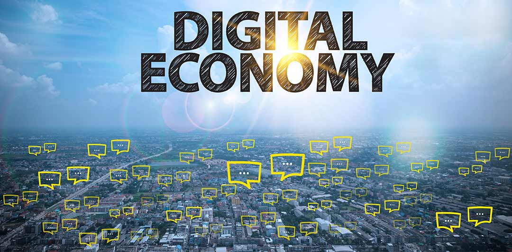

懒人专属群的群友！你好，欢迎来到《香帅中国财富报告》，我是香帅。

这几年中国餐饮连锁很红火。近 5 年内，万店品牌出来了一大波，从正新鸡排、蜜雪冰城到瑞幸、锅圈都已经突破了万店的规模。目前从全球来看，万店品牌大致分为两拨：

第一波是在 20 世纪 50、60 年代成立，90 年代左右实现万店的美国品牌，包括麦当劳、星巴克这些我们耳熟能详的品牌；

第二波是 2000 年左右成立，近 5 年突破万店的这些中国品牌。

美国的万店品牌，在踏上万店赛道后，由于规模效应，销售毛利率都持续上升。麦当劳的毛利率从 2004 年的 30%上升到 2018 年的 50%左右；星巴克的毛利率在近 20 年也提升了 10 个百分点。盈利能力的提升带动了股价表现。

过去 10 年，美国万店品牌的股价表现非常优异：麦当劳股价上涨 283.3%，达美乐比萨股价上涨 528.3%，远超同期标普 500 指数的上涨幅度 152.3%。

所以，我们很自然会问：

1.为什么中国万店品牌崛起的速度这么快？

2.这种模式可持续吗？

这一讲，我们就来回答这些问题。

## 1.中国万店品牌，为何跑得这么快？

第一波万店品牌，麦当劳、肯德基、星巴克是建立在工业化的基础之上。

所谓工业化，就是通过标准化生产流程，实行最广泛的分工，从而不断降低成本，快速扩张规模。

比如全球最大的万店品牌麦当劳，总结起来就是三条：标准化单店模型+特许经营+供应链管理。其中特许经营的本质不是卖品牌，收加盟费来割韭菜，而是通过完备的供应链，向加盟商提供标准化、高质量产品，实现加盟商和品牌的共赢。

因此，也有经济学家说，“在 21 世纪，供应链是一种更深层次的组织力量，谁统治了供应链，谁就统治了世界。”

在麦当劳的启发下，肯德基、汉堡王、必胜客、赛百味、沃尔玛超市、家得宝建材、CVS Health 药店……美国各行各业的集团企业，纷纷推出标准化的服务流程、  
供应链和经营管理模式，并陆续完成各自的千店、万店进程。

通过这场长达几十年的服务业的工业革命，那些原来“本地化、分散化”的小买卖，逐渐成为全球商业巨头。这就叫“服务业工业化”。

我国的新一代万店品牌，比如瑞幸咖啡、蜜雪冰城，也在学习这一套打法——标准化单店模型+特许经营+供应链管理。比如，瑞幸就和咖啡豆原产地签订长期合同，自建烘焙工厂；蜜雪冰城更是做到了核心材料全部自产，主要就是靠供应链赚钱，主营收入中，食材和包装材料销售收入的占比高达 80%以上。

但是，你会发现，与上一波美国的万店浪潮不同的是，近几年，中国万店品牌的扩张速度大大加快：麦当劳、肯德基、星巴克等品牌从创立到开出 1 万家店，普遍花费了三四十年的时间；而瑞幸从创立到开出 1 万家店，仅花费了 6 年。

中国万店品牌的扩张速度为什么可以这么快？核心在于，中国所有的万店品牌长在同一套公共的数字基础设施之上。

这套基础设施覆盖了品牌的全部生命周期：从选址到门店管理，到设备管理，到物流，到营销，到支付，到配送……

某种意义上，几乎所有品牌背后都是同一套标准化管理系统。比方说：

客流，来自各大 App、微信小程序，以及美团、饿了么等外卖平台；  
物流产业链，电商物流多年厮杀内卷出来的“产地仓直发+冷链干线+末端配送”模式；内部协作，使用钉钉、飞书、企业微信等数字工具；营销，使用抖音、小红书、微信等社交媒体，或者企业微信这种私域工具……

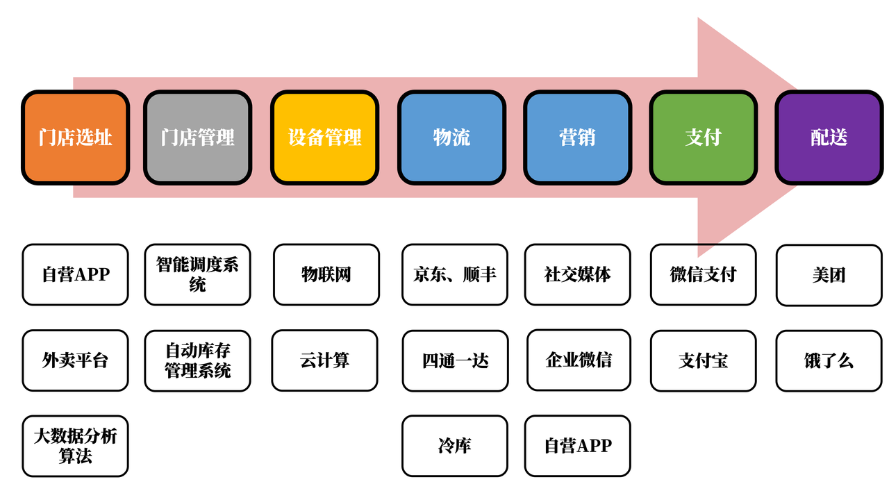

没错，相比半个世纪前的美国同行，中国万店品牌长在非常相似的数字土壤上，明显是“数字物种”。

2020 年，我在财富报告的第 19 讲中说过， 数字化的核心就是标准化——  
所以我们会发现，从蜜雪冰城到瑞幸、锅圈，都是高度极致标准化的产物，甚至他们的产品有时候都是“算法”而不是“食品”—— 这个在瑞幸身上是非常明显的。

瑞幸的新品研发完全数字驱动，虽然他们叫“瑞幸咖啡”，但在他们眼里看到的甚至不是咖啡这个品种，而是牛奶、椰浆、咖啡因、果汁等多个要素，通过不同比例排列组合出来的产品。数据显示哪个好卖，就围绕着谁做新的排列组合。当时有人开玩笑说，瑞幸和星巴克的区别在于，一个卖算法，一个卖咖啡。相较而言，卖算法的更容易复制粘贴，效率更高。

除了公用的数字基础设施之外，中国的万店品牌和美国同行的供应链也不一样。一个是公链，一个是卫星群。

比如说，麦当劳从 20 世纪 60 年代就开始有意识地带小弟，选择了很多小体量的供应商，不断地将自己的备餐人员输出到供应商，带动供应商成长，让它们按麦当劳的要求生产产品，可以说是形成了一个围绕麦当劳的卫星群。

但中国的万店品牌，成长在食品加工业高度发达的 2000 年之后，下游的消费品牌都在跟相似的头部供应商合作。比如瑞幸“酱香拿铁”这款饮品的厚奶供应商塞尚乳业，同时也给星巴克供货。

你看，和美国同行相比，我们会发现，中国万店品牌们的门槛更低，“长相”更加雷同，打法也更加相似。为什么？

因为刚才说了，数字土壤都是公共品，对所有市场玩家都是开放的，你能用，我也能用。谁用得更好，谁就可能在竞争中占领一时的优势。但这个领先优势随时可能被颠覆。

所以，我们首先看到的就是品牌产品的门槛降低，只有具备标准化潜力的食品（单品），才会快速被资本拿过来做实验。比如鸡排、火锅、拉面、拌面、咖啡、新中式点心等等，这些品类，都有机会掀起开店狂潮。

## 2.万店品牌的模式可持续吗？

这么听起来，现在在中国做万店品牌，好像比美国同行更容易一些。但是，它有自己的痛点。

这就是中国万店品牌的第二个特点，生命周期短。

不说别的，2021 年 3 月，正新鸡排门店大概是 2.5 万家，但是到了 2023 年底只剩下不到 1.2 万家店，会不会继续萎缩，还不知道。

瑞幸过去两年爆款迭出，财务数据上表现也很亮眼，发展速度可谓一骑绝尘，但最近咖啡赛道前所未有地热闹，这也给瑞幸带来了很大的竞争压力。

企查查数据显示，2022 年共有 31 起咖啡相关的融资事件，Seesaw Coffee、花田萃、比星咖啡、熊爪咖啡等一系列品牌都进入了快车道。

2023 年，库迪咖啡更是盯住瑞幸死磕，全面复制瑞幸模式，打出“瑞幸创始人 8.8 元请你喝咖啡”的标语，成立一年就开出 7000 家店，开店速度与瑞幸相比，“有过之而无不及”。所以，瑞幸的业绩能否保持，确实值得打问号。

所谓“成也萧何，败也萧何”，大概就是这个意思。

中国的数字能力和工业基础，让消费品牌能够实现快速扩张，但也能让后来者快速进入市场，有机会颠覆战局。

所以，可以想见的是，这个赛道上还会不断有新玩家涌现，我认为，接下来中国会一茬又一茬的出现万店品牌。

但是，大规模重复性开店的下一步，也有可能是大规模的关店潮。

现在其实很难评价这究竟是“好事”或者“坏事”。在商业世界里，没有那么多黑白对错。我只能说，中国的数字土壤，是一个适合商业“革命者”  
的土壤。当然，在注重现金流、利润率的投资者眼里，这个时期的万店品牌，未见得是像麦当劳、星巴克、达美乐比萨一样的理想投资标的。

好，简单总结一下：

1.在 20 世纪末，以麦当劳为代表的美国连锁品牌，通过标准化单店模型+特许经营+供应链管理来实现规模化扩张，成功实现了万店规模。

2.近年来，中国的连锁品牌，用更短的时间实现了万店规模。这种加速扩张的背后，是中国的数字土壤极大地提高了品牌的管理效率和市场扩张规模。

3.尽管数字土壤提供了快速崛起的机会，但因为它是公共品，谁能用得更好，谁就能在竞争中占领优势，当然，这种优势也随时可能被颠覆。

以上就是这一讲的内容，我是香帅，我们下一讲再见。

* * *

# 15-从交易到投资：2024 年资产配置新思考

懒人专属群的群友！你好，欢迎来到《香帅中国财富报告》，我是香帅。

讲财富，最后总是要回归到资产配置这里。 还记得第一讲里面说的吗？

1.当时代发生结构性变化的时候，基于历史的预期就成了包袱；

2.未来应该以 2023 年为新的基准；

所以今天这一讲，我们就来聊一下 2024 年的资产配置上，预期到底是什么。

## 1.基本面讨论

在谈未来的预期之前，我们先看一下之前的财富是怎么来的。2023 年，中国居民家庭到底有多少资产？我们团队大致匡算之后发现，金融资产在 240 万亿左右，  
房产 400~600 万亿左右。金融资产中，现金和存款大约占 130 万亿，其余的主要就是股票、基金等。

把财富拆开来看，也就知道了，我们居民家庭的名义财富要大幅增长，大概就只有几个途径：

房产价值攀升、股票价值攀升、收入飙升。

从 2000 年~2022 年，中国的平均 GDP 增速大概是 8.4%，城镇居民收入的平均增速是 9.8%。这一看就知道了，上一个 20 年，中国居民财富的上行，主要还是来自房产增值和收入增长。

在房地产行业上行期，我们不少人都能感知到，房产的增值是家庭财富的一个来源。

另外，那也是一个财富普涨的时期，平均 9.8%的城镇居民收入增速，这是什么概念？大约 7 年翻一番，20 年要翻五番。这还是平均数，也就是说，运气好点，努力点，关键点上不掉链子，20 年翻 10 倍、20 倍不是什么问题。

如果踩中了房地产、金融业和互联网等几个大行业风口，那么财富翻百倍、几百倍都是很有可能的事情。

前面，我提到了影响居民财富的几个维度，分别是房产、股票和收入。这些资产如果要上涨，还需要满足相应的条件。

比如：

大面积的房产价值飙升，需要城市化增长；

大面积的收入上涨，需要国家经济高速增长；

这两项就像过去几十年的中国一样；

大面积的股票价值飙升，需要企业或者部分行业的企业快速增长，就像过去几十年的美国。或者就像过去几年的美国、日本这样搞通胀。虽然说，温和通胀也有很多好处，但这属于更深一点的宏观话题，我们就不在这儿讨论了。

## 2.现实约束

好，现在我们已经搞清楚了，我们过去的财富是怎么来的。站在今天中国经济发展的这么一个阶段，应该进入了一个强力的经济转型的时期。

按照过往经济转型的逻辑，接下来的中国财富，应该呈现的趋势是：放缓的增量创造，加速的存量博弈。请注意，这句话的意思是，仍然有增量空间，但是财富的集中度可能上升。

比如说，按照我们今天 65%左右的城市化率，城市化还有 10%，甚至 20%的上行空间，但可能伴随的是大城市优势的进一步加强。当然，这也意味着拥有不同区域房产的人群，财富会发生转移。

再比如说，按照现代经济发展的规律，  
到我们国家今天这个阶段后，通常主要靠互联网、金融、教育、医疗、文化娱乐和公共服务，这些更多需要高人力资本的行业来驱动增长。在我看来，这句话至少有两重经济含义：

第一，不会再有大批量的需要巨额贷款融资，雇人砸个坑、盖个楼就能盈利的项目了。文绉绉地说，是未来融资需求会减弱；直白地说，是不缺资金。所以想维持高贷款利率是不现实的事情，就算利率下来都未必有融资的需求，何况利率还很高。日本就是很好的例子。

第二，高人力资本驱动盈利项目的意思是，以后一个项目、一个企业的成败，就是几个关键人物的创造力和执行力决定的。而这些创造力、执行力需要超高的溢价。我举个最简单的例子，最近东方甄选的事情闹得沸沸扬扬，我觉得现在的老百姓都已经深刻地认识到了，在东方甄选的估值当中，董宇辉就是一个关键人物。而他的这种人力是不可取代的，就是需要超高人力溢价的，所以董宇辉和其他小编中间的收入，本来就应该拉开差距。

所以，伴随着经济的发展，我认为，这种财富和收入的集中和转移不可避免，但完全可以通过好的政策进行调节。

比如说，大城市的购房，不再按照户口来，而且保持一个家庭只能买两套的政策  
，但是大幅度降低房贷利率，大幅度降低首套房和二套房的首付金额，让那些之前没房或者有一套房的普通家庭，能以更低的门槛获得这部分未来潜在的增值。

比如说，未尝不可以搞二次房改。北京大学的徐远教授曾经针对二次房改写过一个很长的报告，我把报告链接放在今天课程文稿的最后，感兴趣的同学可以自己去参考。徐远教授的核心观点就是在一线和核心二线大城市，给农民工和新市民大量的建造安居房，要让他们以较低成本获得大城市的房产并融入大城市，就像当年的城镇职工通过房改，获得第一波家庭资产一样。

再比如说，要允许超高收入的存在，用更高的税收，更多的低收入保障和各种社会福利补贴来进行调节，或者鼓励甚至刺激市场化的高端服务业，释放高收入和超高收入家庭的消费能力……

类似这样的思路还有很多，但逻辑只有一条：想尽办法先做大增量，因为增量创造的空间已经减弱了。然后用二次、三次分配的方式，让之前没有吃到或者少吃到增长蛋糕的群体，能够在未来的增长中间多分一块。

当然，这些方法都会有自己的“副作用”。但是世界上没有完美的政策，只有权衡的政策。 把蛋糕做大，才能考虑分配的问题。

刚才说的都是理论上希望能出现的趋势，但是房产、收入和股票这几个能产生大增量财富的方向，都碰到了比较大的变化和阻力。之前几年，从房价、利率，到各种高端服务业的发展，都有很大的抑制增量创造的因素，这就导致那些增量创造的预期被扭转了。

我的观察是，大概从 2023 年 8 月份以后，这些抑制增量创造的举措已经开始转向，但是预期的变化其实是一个缓慢的过程——

就像之前的预期变化其实经历了差不多 2 年时间，预期要转好，可能需要同等时间，或者需要更大的逆向调节力量。

好，经济逻辑就说到这里，我们再回到投资决策上来。

投资的底层框架不会变化：投资就是投增长，要把资本（人力和资金）放在自己认为最具有增长潜力的地方。但站在 2023 年年底这个节点上，大家在投资上的痛点很简单：旧的增长预期已经发生了变化，但新的增长预期现在正在建立的过程当中，确定性的趋势还在摸索中。

我记得，北京大学黄益平教授前几年说， “经济新旧交替的过程中，政策要避免新的还没起来的时候，旧的被破坏太快，因为破旧立新是痛苦的。”  
我猜，这句话的精髓应该是被中央感知到了。12 月 8 日，中央政治局会议提出要“先立后破”  
——破和立的先后顺序真的非常重要，要不然，大家就得承受很长时间的痛苦期。

面对当下不够清晰的局面，普通人到底该怎么办？尤其是过去 20 年稍微薄有积蓄，但又没丰厚到高枕无忧的中国家庭。

## 3.解题思路

我觉得就是两条吧。

第一条，多元化；

第二条，用交易逻辑来做资产配置；

先来说“多元化”，这个好理解，不把鸡蛋放在一个篮子里。调整自己家庭的资产配置比例，不让某个鸡蛋的占比太高，包括房产、股票，颗粒度甚至还可以细到单个房产、单个股票，千万不要让一个股票、一个房产在自己家庭里的配置比例太高。

但是要注意一点，“不把鸡蛋放一个篮子里”不等于“一个篮子放一个鸡蛋”。多元化的一个常见误区是“撒胡椒面”，每个碗里均匀撒一把。但我理解，多元化对中国家庭来讲，其实是一种保底策略，是将几个鸡蛋放在不同篮子里，避免同时撞碎的风险而已。

再来看“交易逻辑”，我认为这是一个试验迭代 +  
保持流动性的逻辑。当下能够观察到的很多资产的增长可能性，包括 2023 年表现优异的美国资产、日本资产，还有很多人在讨论的东南亚和印度的资产，当然也包括 A 股市场包括北交所在内的一些结构性机会。这些都和之前一二十年的大时代逻辑很不一样。

最大的变数就是我们从 2022 年开始讨论的，从全球化到岛链化。听上去是个抽象的大词，但伴随而来的就是贸易摩擦、地缘政治冲突、通胀和利率环境波动等等。这些听上去像是跟我们老百姓没关系，可是这些词对于金融资产来说就是，之前资产定价的贴现率中枢变了，而新的中枢现在没有人知道在哪里。定不了中枢，怎么定趋势？定不了趋势，当然谈不上下注趋势。

这种局面，是不是代表我们没有任何解题思路呢？也不是。我觉得过渡期，也有过渡期可以采取的策略。

我认为，在“趋势”方向确定之前，用“交易”逻辑代替“投资”逻辑，可能是一个中间过渡期的策略。不管是哪一类资产，都可能需要保持更高的流动性和相对短的持有期。

好，简单总结一下：

1.接下来的中国财富应该呈现的趋势是：放缓的增量创造，加速的存量博弈。财富和收入的集中和转移不可避免，但可以通过好的政策进行调节。

2.目前，这些方向并不明确，不管是全球环境还是国内政策，现在仍然处于一个调整变化期。所以，接下来的中国财富创造，可能是处于一个过渡的时期。

3.在过渡期，普通人的资产配置有两条解题思路：多元化和交易逻辑。多元化是为了保底，交易逻辑是为了保持更高的安全底线和流动性。

以上就是这一讲的内容，我是香帅，我们下一讲再见。

## 延伸学习

徐远 | 二次房改：未来 10 年中国增长新动力

* * *

# 16-2024，日本资产会持续表现强劲吗？

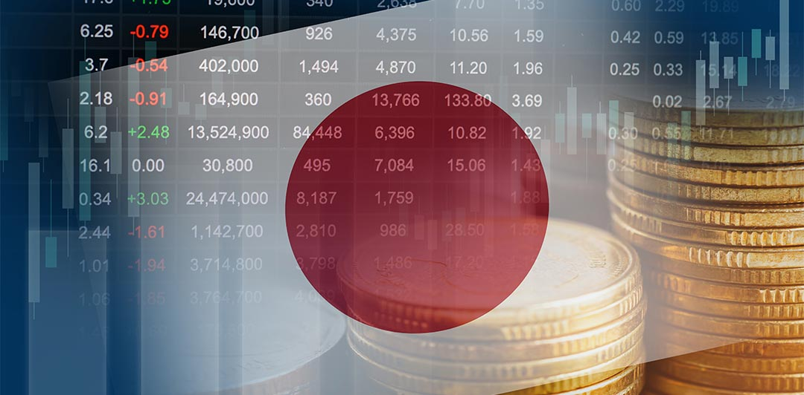

懒人专属群的群友！你好，欢迎来到《香帅中国财富报告》，我是香帅。

2023 年，全球资本市场“最靓的仔”是谁？在我看来，日本资产肯定能排到前三名。不管是 GDP 增速、股市表现，还是房地产市场的表现，都能论证这一点。我们一个一个来看：

2023 年前三季度，日本经济增速保持在 2.09%，CPI 也维持在 2.0%以上，都是近 9 年的高位。就业、消费、工资收入都表现非常强劲。

日经指数 2023 年涨幅 26.35%，突破 33853 点，创造了 1990 年 3 月以来的新高。尽管股市涨了这么多，但是一点泡沫化迹象都没有。因为这波上涨纯靠企业盈利改善驱动。涨了这么多之后，估值水平也就和 A 股相当，比美股差不多便宜了一半。所以海外资金还在持续进入日本市场。

东京 23 区新公寓平均售价首次突破一亿日元，创下了 1973 年以来的历史新高，比 20 世纪 90 年代泡沫期还要高出 65%。国际直接投资，也都在增长。

看到这些数据，其实你就不难理解，为什么这两年日本资产在全球机构心目中的地位直线上升了。

听到这儿，很多同学可能会觉得奇怪：之前我们不一直说，日本不行，日本是失去的 20 年？

今天这一讲，我们就来回答这个疑问，看看日本资产到底是怎么焕发新生的，以及判断一下，接下来日本资产是否还能保持强劲。

## 1.2012~2023：日本央行的努力

其实，和我们平时的印象不太一样，  
日本过去的通缩也不完全是因为“泡沫破灭”。真实的情况是，1992 年日本房地产泡沫后，中间曾经恢复过，但因为 1997 年亚洲金融危机的打击，日本又陷入通缩。

而当时，日本利率已经到 0。怎么办呢？当时，诺贝尔经济学奖得主克鲁格曼，还有后来当了美联储主席的伯南克，还有日本自己的经济学家伊藤隆敏……都跑过来给日本央行“开药方”。

药方很简单，就是日本央行应该去主动制造通胀预期。比如说当时日本通胀很低，只有 0.1%，日本政府就应该明确宣布，我的通胀目标是 2%或者 3%，然后再配套宽松政策，拼命放水，一直放到大家改变通缩预期，开始花钱为止。

听上去很不靠谱，对不对？但后来美国在 2008 年走出金融危机以及 2020 年的新冠疫情危机，欧洲花了 4 年走出欧债危机......用的都是这招。

逻辑不复杂，就是通过改变预期，从而改变行为，导致结果变化。

所谓通缩预期，就是大家悲观了，不花钱了。没人花钱，当然也就没人赚钱，没人赚钱，更没人花钱，如此循环下去，经济就日渐衰败。日本央行就是希望通过这么“不靠谱”的做法，让市场愿意花钱，去消费，去投资，然后开始有人赚钱，赚了钱，自然敢花，经济就会慢慢自然修复。

但是很可惜。当时的日本政府特别恐惧通胀，对宽松货币政策深有戒心。当时担任日本央行行长的速水优更是觉得这些家伙是疯了，央行的责任应该是控制通胀，怎么可能干这么离谱的事情。所以不但没采纳，而且还在 2000 年加息了，相当于给已经冻得奄奄一息的日本经济，又劈头浇了盆冷水。至此之后，日本经济才真的陷入了长达 10 多年的冰河期。

从 1998-2012 年，日本经济增长长期徘徊在 0 左右，失业率上升、收入下降、信贷萎缩。企业投资和盈利大幅下降。  
整整 15 年间，居民收入和消费支出的增速都是负数，长期处于收缩状态。政府部门也穷得一塌糊涂，15 年中有 9 年税收增速是负的。资产价格更是一蹶不振，日经指数平均年回报-3.1%，东京房价平均年增速-2.3%，光这两项，10 年下来基本都腰斩了。

实际上，我们对日本经济衰退的固有印象，包括低欲望社会、简朴、失去的多少年……基本是这个时期的体现。

可能是这十多年的痛苦教训太深刻了，2012 年安倍晋三再次上台担任日本首相后，  
就果断采取了“无限量宽松+通胀预期”的政策。尽管预期的扭转很艰难，但挡不住日本央行的决心，如果激进的货币政策不够，就更激进一点，一直到预期扭转为止。

在这样强力的政策之下，以 2013 年为拐点，日本经济开始走出长达 15 年的泥沼：从 2013 年到 2019 年，日本的平均经济增速回升到了 0.83%，比之前高了差不多一倍。相应的，企业的投资、利润，都有显著的回升。日本老百姓的财富也开始上涨。这个时期，日经指数年平均增速为 14.6%，东京房价开始走出下跌颓势，平均年增速 1.6%。也就是说，从 2013 到 2019 年，其实我们的隔壁在闷声发财，居民家庭财富是有显著上涨的。

而且，走出通缩还带来了一个后果：日本收入分配优化，贫富差距小。在通缩期，日本收入分配呈现恶化的倾向。你一想就知道了，就是任何经济的萧条一开始最先失业的是什么？是中低收入的阶层。所以，收入差距就会拉大。

但从 2013 年开始，整个社会的经济状况变得好转。日本的收入差距也开始趋于稳定，一直到 2019 年，日本前 1%的富有人群的收入占比一直稳定在 13%左右的水平  
。请注意，这是一个非常低的水平。要知道，同期的美国这个数字是 32% 。也就是说，跟美国比起来，日本社会的贫富差距小得多。

再接下来就是 2020 年，为了应对新冠疫情，欧美大放水。日本央行以百倍热情投入了这场放水：包括无限量购买国债，对市场进行万亿美元规模的注资，并启动了日本历史上最大规模的财政刺激计划，总额高达 9922 亿美元，占到日本 GDP 的 1/5。

即使在 2021 年欧美通胀起来，各国央行开始踩刹车之后，日本央行也丝毫没有改变超宽松政策的方向。他们目标很明确，就是要让日本借着这波力量的推举，进入到经济增长、就业旺盛、资产价格上升的正向螺旋里。

日本经济基本面的大幅好转，支持了日本经济增长预期的变化，也吸引了全球资金的涌入和资产价格的修复。

而这些变化，应该说日本央行推行的货币政策扮演了非常重要的角色。

## 2.2024，日本资产吸引力如何？

那接下来的 2024 年，日本资产是否还能保持这样强劲的势头呢？

目前来看，我认为，日本资产在几个方面仍然具有较大的吸引力。

第一，日元升值的预期

2024 年美国可能“从鹰转鸽”开始降息，所以日元兑美元有升值预期。

另外，过去 20 来年，日本央行的实践已经证明，日元汇率宽幅波动的上限就在 1 美元兑 150 日元左右。只要日元贬值超过这个幅度，央行就会果断干预。目前最新的美元兑日元汇率在 145 左右，处于这个波幅的上边缘。

第二，安全资产的考量

俄乌战争之后，货币多元化成了大机构和大资金的共同诉求。而前些年因为日本通缩和中国增长过于亮眼，日元资产一直在全球的资产配置里是被低配的。所以随着日本经济增长的预期扭转，寻找避险和分散化的资金很可能会把日本资产视为重要标的。

另外，日经指数和中国上证股指之间的相关性一直较低，也为那些中国资产的投资者提供了一个风险对冲的工具。

第三，日本资产的估值偏低

经过多年的经济低迷和边缘化，日本公司的估值一直偏低：日本东证指数成分股中，市净率小于 1 的公司差不多 40%，比其他市场高得多。

而现在，随着日本股市的重新抬头，以及日本当局也在力推证券市场的改革，去提高日本企业的价值和资本效率。所以市场越来越认可，日本企业的估值修复空间比较大。

另外，以三菱，三井等五大商社为代表的日本大企业，这些商社和美国创新增长型企业不同，它们占据着上游矿产金属、能源、资源等领域，一直以来都拥有极好的现金流。而且这些企业非常注重分红。这些特征在当下通胀起伏、政策博弈严重的市场环境中，很受青睐。

整体看下来，我认为，2024 年的日本资产，可能有调整，但整体上还处在一个上行的通道中。其实，归根结底还是上一讲里面说到的那句话，投资就是投增长，投增长的预期。只要日本经济基本面改善，增长持续的预期还在，日本资产的吸引力就会在。

好，简单总结一下：

1.以 2013 年为拐点，日本经济基本面实现大幅好转，主要是因为日本央行通过改变预期，从而改变行为，导致结果发生变化。

2.2024 年，日本资产仍然具有较大的吸引力，我认为主要原因是：日元的升值预期，安全资产考量以及日本资产的本身估值偏低。

3.投资就是投增长，投增长的预期。只要日本经济基本面改善，增长持续的预期还在，日本资产的吸引力就会在。

以上就是这一讲的内容，我是香帅，我们下一讲再见。

* * *

# 17-利率高企，美国国债是不是稳稳的幸福？

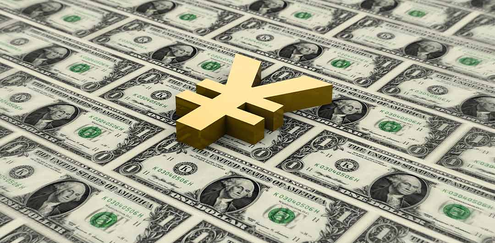

懒人专属群的群友！你好，欢迎来到《香帅中国财富报告》，我是香帅。

上一讲聊到了日本资产，这一讲我们看看美国资产。

先说一句，全球资产配置其实是风险分散的标配。全世界范围内，但凡大一点的资金，都会进行全球资产配置，一方面可以分散风险，另一方面有机会获得更高的收益。几百万上千万的资金，配置 A 股、国内房产以后，可以适当考虑分散风险，提高收益。

从全球的经验来看，随着家庭财富金额的上升，资产的配置也是逐步走向全球化的。而且，就像第 15 讲中聊到的，在新旧增长模式，新旧增长预期交替的过渡阶段，需要更重视多元化的配置。

在过去的 20 年当中，全球资产中，“美国资产”和“中国资产”一直是最受人瞩目的两个存在。两大经济体以各自擅长的路径和方式创造了巨大的财富。作为金融立国的国家，美国在金融资产上的创新能力、市场深度，确实比其他市场要成熟先进。所以，即使从纯粹学习的角度，美国资产也值得花费更大力气做研究。但是美国资产是个特别大的概念。所以需要花更多的时间。

这一讲呢，我们一起看看一个逻辑相对直接，而且可能在我所谓的“过渡期”有较好表现的资产，美国国债。

## 1.2024，美国国债走势如何？

和中国国债一样，美国国债就是美国政府发行的债券，背后的支持力量是美国国家信用。国家信用等级决定了债券的信用等级，你很难相信中国或者美国政府会违约，所以这些国债都被认为是安全资产。同样的，美国国债也有长期和短期之分，短的有 1 年期、3 年期，长的有 10 年期、30 年期等等。

投资国债的话，回报是来自哪里呢？这个问题在 2020 年《香帅中国财富报告》第 5 讲中，有过比较详细讨论。这里稍微再提几点：

1.票息，比如目前 10 年期美国国债票息率 4.50%。

2.利息再投资的收益率，这个部分占比不大，因为利息不多，但是如果资金量很大，最后还是很可观的。

3.债券的资本利得，也就是债券价格波动带来的收益。我刚才说美国国债可能会有比较好的回报，其实也就是判断美国国债的价格会上涨，带来较高的回报。

还记得 2020 年底的财富报告第 5 讲中，我们判断是，“目前中国国债的价格，很大的概率是上涨的”。这几年，确实很多人在中国国债上赚得盆满钵满，即使是 2022 到 2023 年这样的动荡期，国债投资也获得了稳稳的幸福。

那么 2023 年的财富报告，我们给出另一个判断，

我认为，在未来 2-3 年时间内，美国国债价格很可能上涨，相对保守的年化收益率有希望达到两位数。

## 2.美国国债的涨跌逻辑

接下来，我尽量用简单的逻辑跟你讨论一下，这个判断是怎么得到的。

和股票价格的千变万化不同，国债价格就是取决于利率水平。

简单粗暴地说，利率下行，国债价格就上涨，利率上行，国债价格就下跌。

比如说，2022 年，美国的国债价格是下跌的，为什么？因为美联储一直 在加息。

而接下来一段时间，美国的利率水平很可能将进入一个下调期，所以国债价格将有较大幅度的上涨。

为什么？我认为主要是两句话：

第一句，美国通胀已经大幅回落，本轮通胀很可能已经被驯服。

我在课程文稿里放了一张图——  
图上画了美国近期的通胀走势，里面有两个指标，CPI 和核心 CPI。不管看那个指标，过去几个月都是大幅下行。最新的数据，截至 2023 年 10 月，美国 CPI 只有 3.1%，从高点的 9%左右已经大幅下行 2/3。3.1%的通胀虽然不算低，但是早已经在美联储的容忍范围以内。而核心 CPI，也已经下行到 4%的水平。

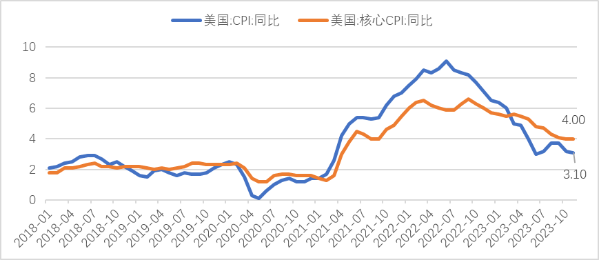

和 CPI 下行伴随的，是失业率的震荡上行。之前通胀高企的时候，美国失业率只有 3.4%-3.5%，最近几个月回升到 3.8%-3.9%。不久的将来，失业率很可能突破 4%。

我认为，随着失业率的上行，美国货币政策的重点，将从对抗通胀转向促进就业。这时候，紧缩性货币政策将让位于宽松性的货币政策。

这句话的意思是，随着通胀被驯服，美国经济指标有可能回落。美联储的货币政策的核心目标也将从控制通胀转向刺激经济。降息成为大概率事件。而利率下行，对应的是债券价格的上涨。

说到这里，可能会有同学说，现在美国经济表现还很好啊，没有衰退迹象啊。对的，目前并没有任何证据表明美国经济一定会衰退。这里又忍不住要感叹一句，美联储这几年操作啊，如果满分 100，我认为他们值得 120 分。但是有两个理由，告诉我们即使美国的经济不衰退，但是货币紧缩也基本结束，货币宽松即将开始。

第一，就是刚才说的，美国失业率已经有所回升，这是经济走向低迷的一个信号。虽然不一定是衰退，但是之前的过热无疑已经过去。至少，美联储不需要进一步紧缩。这一点，美联储的官员也已经公开声明了。

第二，目前美国的利率很高，对美国经济有很强的遏制作用。这种遏制作用，会逐步抑制美国经济的活力。目前美国的政策利率，也就是联邦基金利率在 5.25%-5.5%的区间内，目前在 5.3%左右，扣除通胀之后，实际利率在 2.2%左右。

对于目前的美国经济而言，这个利率是很高的。不仅是政策利率，不同期限的其他利率也很高，都是明显的正数。美国目前的经济，在我看来，其实撑不起一个明显为正的实际利率。

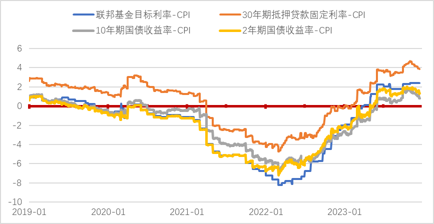

基于这两个理由，未来一段时间，美联储大概率是不会继续紧缩，而是会转向宽松。事实上，在最新结束的美联储议息会议上（12 月 13-14 号），美联储已经明显转向“鸽派”，明确说到经济已经开始放缓，而且 2024 年有降息的可能性。这种情况下，市场已经预期 2024 年降息 3 次甚至更多。在加息结束，降息将至的背景下，利率下行是大趋势。因此，我认为，此时投资美债，是个不错的选择。

好，说完了美债的投资机会，还有两个细节问题，我稍微补充说两句。

第一是国债也有不同的期限。

一般来说，期限比较长的国债回报率也较高。其中 20 年以上的国债，输赢都比较大，1-3 年的国债，期限较短，流动性较好，安全性更大。另外，还有加了 3 倍杠杆的长期国债 ETF，非常刺激，但是风险也大。

第二，刚才说的是美国国债，其实美国公司债 ETF 也是可以考虑的。

因为短期内，美国经济出现大规模违约的可能性不大。 所以，国债如果表现好，公司债也应该值得期待。

最后，要提示风险。就像我在今年的财富报告第 15 讲中强调的，现在全球都比较动荡，长期投资逻辑要非常谨慎，可能把投资逻辑换成交易逻辑会更安全点。在我看来，美债这种机会，也属于交易机会。

而交易本身就是很大风险的。比如美国政策是不是会波动？也是有可能的。如果美国通胀发生反复，发生出乎意料的回升，美联储的货币政策可能不得不收紧。这个预期只要一起来，债券的市场价格可能会显著地回调。现在这种过渡时期，任何风险都可能发生。所以，做投资也好，做交易也好，是要非常注意风险控制的。

最后，总结一下今天的课程：

1.根据我们的判断，本轮美国通胀已经被驯服，美联储的政策已经转向，加息已经结束，降息即将开始。

2.降息期间，美国国债价格会上涨，投资国债不仅有还本付息的收益，还有价格上涨的收益，总体收益会相当的可观。

3.投资美国国债，简单的办法是买国债 ETF，长期美债 ETF 的价格波动比短期高一些，但收益也有可能增加。

4.美国国债的风险，是美国通胀的反复，即相应的美联储货币政策的反复。

好，以上就是这一讲的内容，我是香帅，我们下一讲再见。

* * *

* * *

# 18-投资东南亚，是机遇还是陷阱？

懒人专属群的群友！你好，欢迎来到《香帅中国财富报告》，我是香帅。

前面两讲我们聊到日本资产和美国国债。这一讲我想跟你聊一下东南亚的资产和投资。 过去几年这个区域，因为不同的原因，被中国不同的群体所关注：

新加坡吸引了部分超高净值人群，2023 年新加坡投资基金方式的移民门槛从 250 万新币涨到 2500 万，涨了 10 倍。

越南、柬埔寨吸引不少制造业老板建厂，搞产业转移；

印尼、越南等人口密度大的地方，吸引了不少资本和创业者，想把电商、社交媒体、外卖出行等领域的中国模式复制到这些地方；

还有些中产或者中上产的家庭在考虑，要不要去越南、柬埔寨等地方买房——就像 20 年前买中国房产一样，是否又是一个逆天改命的机会。

大家关注东南亚的原因各异，但大背景其实就是两个：一是中美博弈，世界从全球化到岛链化；二是中国本身经济转型，GDP 增速放缓。大量的资本需要分散化，也需要找到新的增长点。

目前来看，东南亚这片区域最大的特征是，人口多，人口结构年轻，市场规模增长潜力大。11 个国家，6.6 亿人口，平均年龄只有 28.8 岁，中国的平均年龄是 38.8 岁。生育率也高，预计在 2050 年，东南亚人口能到 8 亿，估计能占到当时全球人口的 8.2%以上。而且，这么大的人口基数，现在的人均 GDP 才 5000 美金左右（其中 2.7 亿人口的印尼和 1 亿人口的越南，人均 GDP 都只有 4000 多美金），相当于十多年前的中国。

所以，咱们一直说，投资就是投增长，就是投增长预期和增长故事。 某种意义上，“复制中国奇迹”就是东南亚增长故事的一个核心元素。

## 1.东南亚资产的安全性

首先，我们来看一下，东南亚资产是否值得放入多元配置的篮子里。

从资产配置角度，主要还是房产和股票。

整体上，这次把数据看下来之后，我们发现东南亚房产市场比较乱。除了新加坡房价确实坚挺高企外，其余市场光是数据源都非常混乱。比如越南，不同源头拿到的胡志明市房价数据，价格能差到 50%，有的地方显示房价是暴跌的，有的地方显示房价是涨的，都有。先不谈真实房价，这种高度的信息不对称本身就是风险所在。

而且，越南的房市还算好的，其他地方的房价就更加乱了。

再看股市，2020 年-2021 年，越南股市曾经经历过一波牛市。但从 2022 年初以来，这波牛市已经全都跌回去了，跌幅已经高达 52.06% 。  
2023 年大部分东南亚国家股票指数都是负的，  
泰国、越南、菲律宾指数的表现其实比 A 股还要差。另外，东南亚股票市场的企业市值都偏小，整个东南亚股市，市值超过 100 亿美金的股票只有 53 只，这两年平均收益率-9.3%。

数据很多，不一一罗列了。

整体看下来，我觉得，从资产配置角度，除新加坡外的东南亚金融资产（包括房产）， 属于高波动、低回报的资产。

其实我一直认为，中产（精英）家庭在做资产配置时，需要避开新兴市场。前五六年，也就是“中国中产”概念和这群人的生活理念都非常流行的时候，我老家长沙的富裕人群中，曾有段时间很流行买马来西亚和泰国的别墅，  
当时也有人找过来，问我这个情况，那时候我说，我没怎么做过东南亚房产的研究。所以我不敢判断，这些资产是会升值还是贬值，但有一个理由就足够让我却步了，那就是信息不对称太大，安全系数太低。

## 2.东南亚市场值得布局吗？

既然东南亚资产的风险这么高，那么对我们普通人来说，东南亚市场还有入局机会吗？

我先表达我的观点，东南亚资产是不太好配置的资产，但东南亚市场是值得布局的市场。

过去几年，中国企业对东南亚的直接投资上升很快。

截至 2021 年，我们对东盟国家的投资，主要集中在制造业（占比 25%）、信息与通信业（占比 18%）、房地产业（占比 17%）、运输和储存业（9%）以及金融和保险业（8%）等等。

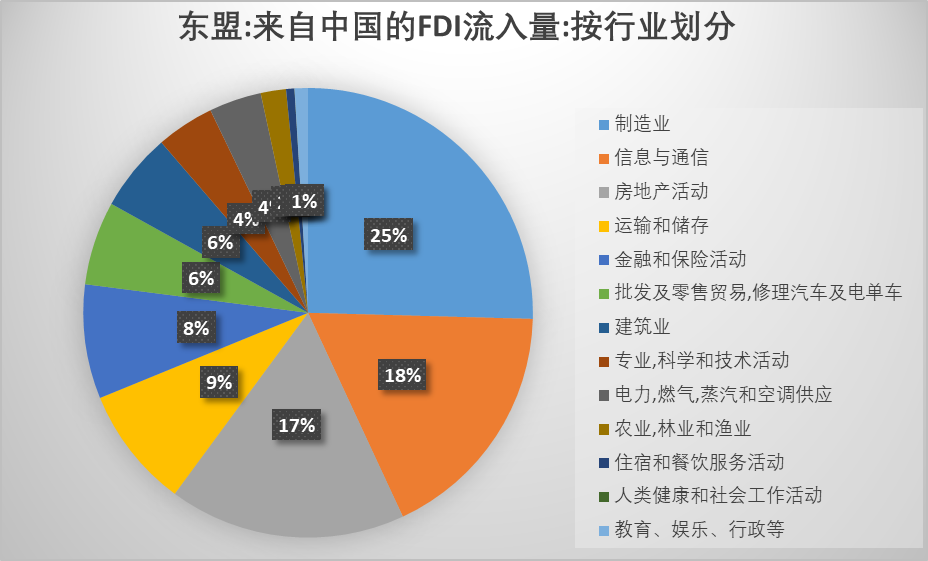

其中最大的两块分别是：制造业、信息与通信行业。我们一个一个说：

1.制造业投资主要是实现产业转移，为企业提供缓冲地带。

产业转移有经济成本考量：深圳现在人工成本月薪 5000，而越南大概是 2000，柬埔寨只需要 1000 ——  
包括纺织服装在内的中低端制造业，往越南、柬埔寨迁，肯定从成本上是合算的。其实，这种迁徙已经有好些年了。这部分产能的外迁，和海外订单的迁出，被施展老师称为“中国制造”的外溢，我觉得这个表达是蛮形象的。

但有些产业转移也有地缘政治考量，中美两国关系趋于紧张之后，东南亚充当了“中国制造的备份”。比如说，中国美的集团就加速推进“中国供全球+区域供区域”的模式，现在美的集团就以泰国为中心去覆盖东南亚市场。

再比如说，为了避开美国对中国家具 25%的关税，很多家具厂去东南亚开厂。当然，目前中国新能源车也虎视眈眈东南亚这个巨大的人口市场，希望像当年德国车厂和日本车厂吃下中国市场一样，抓紧布局东南亚。

所以，可能未来的局面会是：中国这个“世界工厂”被延展成“以中国为核心的世界工厂链”。尤其是纺织服装、消费电子、家具、新能源车等领域，会体现比较明显。

作为毗邻中国，具有人口优势的发展中地区，东南亚可能会是这个链上非常重要的一环。

所以，这是制造业做产业转移的一个缓冲地带。

2.另一块信息通信行业投资，我认为，主要打的是“复制中国”的算盘。

除新加坡之外，东南亚市场庞大的年轻消费人口、之前欠发达的商业体系和物流体系，都容易让人想起十几，甚至二十几年前的中国。

比如说，越南、印尼、马来西亚的网约车渗透率是 4%-5%左右，这三个地方人口共计 4.1 亿左右。所以滴滴已经赶着出海投了 Grab，目前覆盖了 400 多个东南亚城市。

再比如说，文莱、印度尼西亚、马来西亚、菲律宾、新加坡和泰国这东盟六国，拥有银行账户的人口不到一半，还没有怎么享受过金融服务。支付宝等企业都在这片蓝海市场拼命开拓数字金融服务，这也是有机会的。

比如说，东南亚的餐饮市场大概有千亿美金的规模，但是线上渗透率只有 10%，所以很多外卖平台也看准了这里。

现在实际上，电商是整个东南亚增速最快的市场。从 2015-2021 年，东南亚电商规模从 50 亿美金扩展到 1200 亿美金，年增速大概是 70%。直到 2023 年，也能保持 20%的增速。在类目上，也是一些中国的优势品类，美妆个护、鞋子箱包、服装配饰等等；在区域上，新加坡和马来西亚的跨境电商最火。

整体看下来，不管是市场规模，还是人口结构，复制中国奇迹这个故事是讲得通的。

但是，说实话，我觉得“复制中国”的难度可能比想象中要大很多。为什么？我认为主要有三大约束条件：

第一，地理环境和基础设施。

不说别的，拥有 2.7 亿人口的印尼是个岛国，物流成本要降到和中国同等水平，几乎就是不可能的事情。

第二，人文环境和宗教因素。

不知道你注意到一件事没有，东南亚 11 个国家，除了新加坡和越南深受儒家文化熏陶外，其余国家的人口都有很深的宗教背景。比如印尼是伊斯兰教，泰国佛教，菲律宾基督教，马来西亚是三教并立。

有个缺乏实证数据的观察，但凡受到儒家文化影响深的地方，劳动力素质都特别好，储蓄高，反正没有来世观，这辈子就得拼命努力、拼命存钱。相反，不少东南亚国家的宗教文化习俗是凌驾于工作效率之上的。  
而且这种文化上的影响，不是一朝一夕可以改变的，日子越久，影响越发明显。

第三，政治和营商环境。

东南亚是个很复杂的地区，各个国家都有很多历史文化政治上的问题。比如说印尼是著名的政治裙带关系，贪污受贿风气很严重。缅甸是军政府，政治极度动荡不安。还有些国家虽然华人占比很高，但一直有排华情绪。

这几年中美博弈，“中国威胁论”也经常会变成政治武器，所以对中国企业的各种限制性政策也经常出炉，像 2023 年，TikTok 在印尼发展综合性平台的计划就遭到很多挑战。印尼颁布的《31 号条例》，规定要  
“电商归电商，社交归社交”。这个条例，一是禁止社交媒体平台进行商品销售和交易活动，这就意味着，抖音这种打法就打不了了；二是要求印尼电商平台为从国外直接购买的商品设定 100 美元的最低价格，并且在印尼销售的进口商品需要符合白名单要求。

可以想见，这种限制在未来还会以各种面目出现，所以未来中国企业出海面临的可能会是一条荆棘之路。

好，简单总结一下这一讲的内容：

1.从资产配置角度，除新加坡外的东南亚金融资产（包括房产），  
属于高波动、低回报的资产，中产家庭资产配置需要审慎对待新兴市场，因为信息不对称太大，安全系数太低。

2.虽然不建议配置东南亚资产，但东南亚市场是值得企业去布局的，尤其在制造业、信息通信等行业具有较大的潜力。

3.在东南亚进行投资布局，对企业来讲是个不错的选择，但是可能要面临的困难比想象的要多。比如说，地理环境和基础设施，人文环境和宗教因素，以及政治和营商环境三个方面的约束，使得中国企业的出海之路可能会是一条荆棘之路。

好，以上就是这一讲的内容，我是香帅，我们下一讲再见。

* * *

# 19-2024 年，中国市场潜在的压力和期待？

懒人专属群的群友！你好，欢迎来到《香帅中国财富报告》，我是香帅。

前面几讲，我们聊了关于 2024 年几个全球资产的机会和潜在风险，这一讲，我们回到中国资产和中国市场，来看看，2024 年，有哪些潜在的压力和期待值得你关注。

这一讲更新的时候，还有 10 天左右，就是 2024 年了。经过了漫长的 2023 年，2024 年中国的经济基本面和资本市场，会不会有什么变化呢？

还是老规矩，先说我的判断，再讲逻辑。基于 2023 年 12 月 15 日之前的政策和数据，

我的判断是，2024 年经济体感仍然存在偏冷的可能，对应的资产可能也很难走出眼前一亮的行情。

## 1.2023 年的经济恢复力度如何？

然后咱们再来讲讲，这个判断是怎么得出来的。

要判断 2024 年的经济能否复苏，先要判断，造成 2023 年经济体感偏冷的原因是什么？这件事不要说我们普通老百姓，经济学家和政策面也都是各执一词。

我举个例子，大概在 10 月份的时候，证券时报做了个调研，征求来自政府、研究机构和知名高校的 61 名经济学家对当时货币政策的看法。

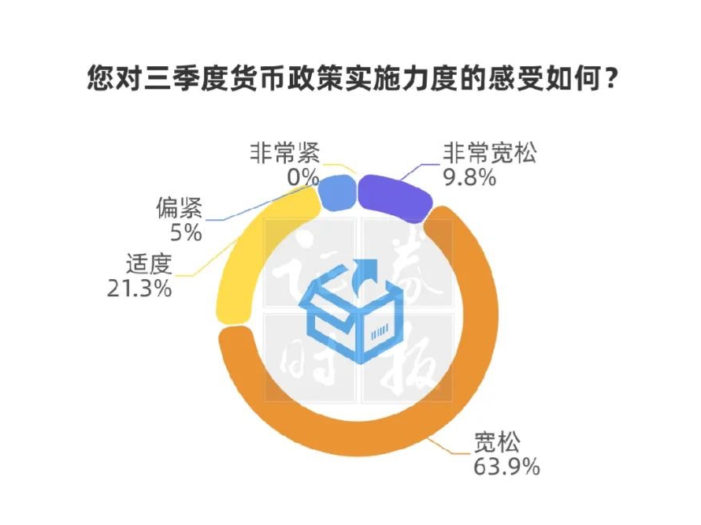

看到这个调研结果后，我们几个朋友大吃一惊，认为货币政策“宽松”和“非常宽松”的经济学家居然占到了 73.7%，另外还有 21.3%的人认为货币政策是“适度”的。也就是说，受访的 61 个经济学家中仅有 5 个人认为 2023 年货币政策“偏紧”  
。而实际情形是什么呢？

我们讲点基础的宏观经济学知识。

判断货币政策宽松与否有个非常简单但实用的指标，就是看实际利率水平，也就是名义利率水平减去通胀之后的利率水平。我们得到同学应该一听就明白，利率就是资金价格，实际利率水平就是实际的资金价格，资金价格高，无论如何不能说货币是宽松的。好，我们看一下 2023 年的实际利率水平。

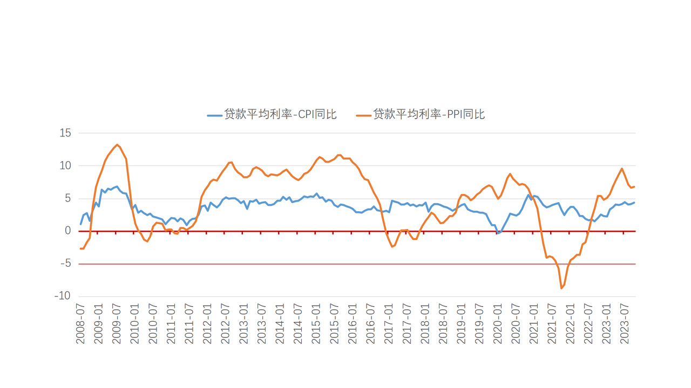

在文稿里我给了一张图，你可以看出，从 2022 年 7 月开始，中国的实际利率水平一直在上行的过程中，远超过前面 5、6 年的均值。

这么说吧，2023 年年中以来的利率水平，大约是 2016 年以来的最高位 。

另外，在宏观中有个指标叫作 GDP 平减指数，简单说，这是一个价格水平的宏观测量指标，它涉及所有商品和服务，计算基础比 CPI 更广泛。这个指数今年从 0.94%下降到-0.84%，下降了差不多 200 个基点，而央行今年在长端利率上降息  
20 个基点。所以，算下来，今年实际利率上升了 180 个基点，差不多 2 个百分点。

花费这么大力气做科普，其实就是为了得到一句话的结论：2023 年的货币政策非常紧，紧到足以控制经济过热的那种紧。

除了货币政策外，我们再来看看财政政策。

财政通常有四本账，一般公共预算，政府性基金预算，国有资本经营预算和社会保险基金预算，其中大头在前面两个。我也在文稿里放了一张图，你也可以清晰地看到，截至 11 月，2023 年一般公共预算和政府性基金预算两项加在一起，比 2022 年少了 4000 亿。

对，2023 年的财政政策也是紧缩的。

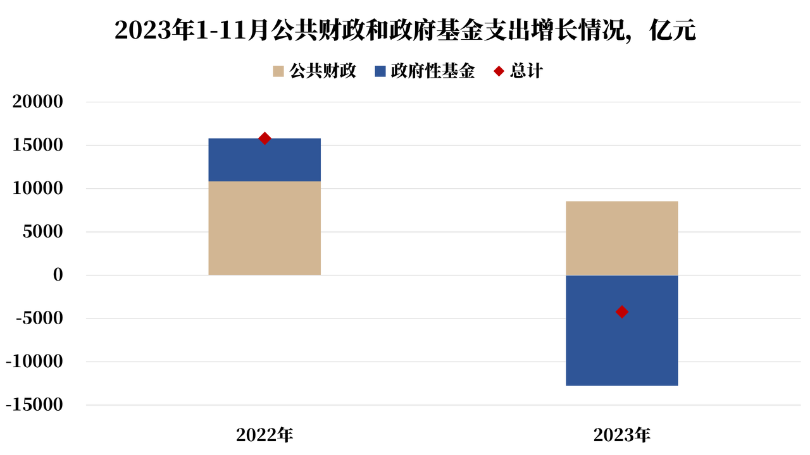

再看房地产，这个我觉得比较清晰，一直到 8 月之前，房地产政策都是紧缩的。

换句话说，2023 年几大宏观政策: 货币、财政、房地产，都是非常紧缩的。所以，算得上是一个强力的、紧缩的宏观政策组合。

## 2.2024 年经济恢复的抓手在哪里？

搞清楚了 2023 年的情况，我们再来看 2024 年。

我们都知道，经济无非就是，⻓期看供给，短期看需求，短期需求看政策。

这样说起来问题应该很好解决，既然是宏观政策太紧了，那把宏观政策放松了不就行了吗？但现实的约束总是比理论中、想象中的更多。

政策是个虚词，政策落地是要抓手的。比如说，房地产政策转向，“转向”是虚词，降低首付比例、放松限购、降低房贷利率，这些叫作“抓手”。同样的，财政政策宽松也是虚词，钱从哪里出来，放到哪些项目上，这才是“抓手”。没有抓手，政策的效果就很难预测。

还是一个个看。

房地产的紧缩是已经转向了， 但要想房地产基本面有实实在在的好转，需要房地产销售回升，拿地投资回升，这个不是一个月、两个月就能起来的，最少要 2 个季度。  
但到目前为止，实际利率没有下来，  
房地产企业的流动性危机也没有解除。所以，我认为，房地产行业的下行趋势在未来的两个季度内很难逆转。换句话说，中国经济想在 2024 年上半年靠房地产起来，挑战比较大。

再看财政。财政能否扩大赤字规模是挺大的疑问。毕竟我们是一个有着朴素的量入为出的思维模式的民族。另外，即使政府支出扩大，但是你也不知道能够投到什么项目上去，传统的基建项目，说实话已经比较饱和了，也没有盈利空间。在当下利率这么高的情况下再建，不说还本，很多项目能否还息，能否自我维系，都是大问题。目前来看，在财政规模上能讲增长故事的也就是城中村改造，但是城中村改造这么大一笔钱能从哪里来？现在也不是很清晰。

所以你看，最后压力全都给到了货币政策。实事求是地说，货币政策确实有较大的空间。但现在有两个约束：

第一是认知约束，就像我刚才给出的那张图。现在对货币是紧是松都没有共识，很难期待在短期内，这种共识能转向、重构。

第二是规模约束，因为超低通胀这么久，下行市场预期已经形成，扭转预期就需要一个超大的逆周期的动作，这个政策刺激规模具体要多大不好估算，但起码不能低于 2008 年，或者要以 2020 年以来的日本央行和美联储为参照。那么，这么大的规模呢，我觉得就比较难。

而现在这种普遍认为货币政策偏松的认知环境中，要这样做太需要孤注一掷的行动勇气，很难。

所以短期内，我们没法期待规模和认识这两个货币政策的约束被解除。所以，我相信，2024 年的货币政策会比 2023 年的宽松一些，但“滴灌”式的概率更大，很难达到“开闸放水”，可以扭转预期方向的力度。

政策工具的大箱子就这么多，所以我才会得出前面的判断：2024 年经济体感仍然存在偏冷的可能，低通胀的环境可能还要持续一段时间。

既然如此，那我们对应的资产呢？

股市主要还是看企业盈利，低通胀环境肯定不利于企业盈利，所以这一块的估值，我们不能报太多希望。

那国债呢？毕竟利率有下行空间，应该对国债资产形成利好。这个判断是对的，所以从这个意义上讲，持有中国国债的风险应该是很小的。但是如果从交易角度来说，我们知道，金融资产价格永远是前瞻的，中国的国债已经牛了很长时间了，尤其最近一个月，在-0.5%的 CPI 出炉后，10 年期国债价格已经涨到了 102.25 的位置，  
其实已经将我刚才讲到的利率下行的可能性反应得七七八八了。

换句话说，要是拿着国债当个理财产品，挺好，肯定稳妥。

中国政府不可能违约，利率也不可能再上行。但如果是希望获得更大收益，我觉得，中国国债的价格进一步大规模上行的空间已经不大了。

房地产不多说了，可以直接参考今年财富报告“房产篇”总共 5 讲课程内容。

还有很多同学希望我讲讲黄金，其实我们是在 2020 年，提出黄金是可以配置的这条思路。但是过去两年，我调整了一些关于黄金投资的思路，我认为黄金可以作为保底资产少量配置，但不适宜做大比例配置。相关内容，可以参考《香帅中国财富报告（2021-2022）》第 15 讲的内容。我把课程链接放在了文稿中，方便时，你可以点开查看。

15 | 博弈未来：比特币、美元和黄金

## 3.2024 年，有哪些利好？

好，最后我们来看看 2024 年，值得期待的亮点在哪里？

其实 2024 年还是有不少利好中国经济、中国资产的消息的。其中最大的利好莫过于，短期内全球各个主要央行的加息周期已经告一段落。

逻辑我在上一讲已经比较详细地讲解过，有需要的同学，可以再回过头去查看。

而这件事对中国的汇率市场和利率市场都是好消息。

一方面，这意味着因为欧美加息形成的资金外流压力骤减。另一方面，意味着由于担心对方加息造成过大利差，而不敢降息的担心可以放下了。

所以从这个意义上讲，外部环境已经为中国的货币政策打开了空间。

另外，2024 年人民币的汇率压力已经不大了。过去一年，人民币汇率是在一个贬值的空间里面。按照我们的进出口的情况来看，人民币汇率其实已经是被低估的。现在美元面临降息，有贬值压力，所以，只要我们这边利率下行，基本面稍微改善，我认为，汇率回稳就非常的有希望。

如果基本面每个维度都能有一些改善，能够让市场预期逐步回暖，那么就有可能慢慢从负向螺旋回到正向螺旋里面。

有时候我会觉得，现在，真的需要一点乐观主义精神。有时候，精神面貌也会改变预期。 希望大家的 2024 年能平稳顺利，有所斩获。

好，简单总结一下：

1.2023 年，货币政策、财政政策和房地产都是非常紧缩的，所以经济体感偏冷。

2.2024 年，经济恢复主要看货币政策，虽然货币政策还存在较大调整空间，但是由于受到认知和政策刺激规模两大约束，低通胀的环境可能还要持续一段时间。

3.考虑到短期内，全球各个主要央行的加息周期告一段落，对中国汇率和利率市场都是利好，市场预期有希望逐步回暖。

好，以上就是这一讲的内容，我是香帅，我们下一讲再见。

* * *

# 20-我们这代人的财富观，到底发生了什么变化？

## 20 | 我们这代人的财富观，到底发生了什么变化 ？

年度得到·香帅中国财富报告（2023-2024）  
←进入课程

懒人专属群的群友！你好，欢迎来到《香帅中国财富报告》，我是香帅。

这几天，我都在看我们历年财富调研的数据。得到的老同学都知道，我从 2020 年开始启动了一项长期的“财富能力调研”。每年一次，希望做一个长期的项目，陪伴大家一起回头看自己家庭在财富成长路上的足迹。

2023 年，我们如约启动了这个项目，截至 12 月 17 号，我们收到了接近 2 万份答卷，和往年相比，我们的用户人群变化不大——仍然是 30-45 岁的中青年占据主流（70%），平均年龄 38.6 岁；大部分生活在三线以上城市，大学学历占 93.6%，近 30%拥有硕士和博士学历，28%的人来自体制内。

所以，我们的用户应该是代表着中国市场上一群高认知、高财富水平的人。

但 2023 年参与调研的人群也有一个显著特征就是“女性参与度上升” 。

在 2020 年财富调研刚刚开始的时候，参与的男性和女性之比是 1.5:1，今年是 1.2:1，女性占比上升了差不多 5%。观念变化虽然是个慢变量，但水滴石穿，时间久了，也会显示出自己的力量。

## 1.2023 家庭财富整体趋势

好，说完我们整个人群之外，我先说一个整体感受，2023 年可能是过去 4 年来，变化最显著的一年。

2020 年~2022 年，尽管碰到疫情，我们用户的资产水平仍然在稳定上升。

但 2023 年是第一次出现较为明显的资产缩水：65.6%的用户出现不同程度的资产折损，相比 2022 年资产平均减少 36.8 万元，缩水比例平均是 6.23%。

我们的平均家庭总资产是 621 万（中位数则是 400 万），扣除包括房贷/车贷等负债之后的净资产是 534 万（中位数 275 万）。中国家庭负债率比较低，负债在总资产中的占比平均为 18.9%，远低于美国的 29.2%。请注意，这还是美国社会近 20 年来的最低数据。

听上去家庭负债率不是很高，但要注意的是，财富总额越低的家庭，负债率越高。比如说，位于后 10%的家庭，平均总资产 75 万，负债 45 万，负债率高达 60%  
。这样高的负债率背后，我认为大概率是房产价值缩水，房贷高企导致的结果。

我前面说到家庭资产几百万的平均数，可能有年轻人会觉得，我是不是太穷了。真的别着急，财富这个事确实是时间的朋友。20~29 岁年龄段的平均家庭资产是 253 万，之后一直到 59 岁，每隔 10 岁的代际，就有 50%~70%的上涨，50-59 岁这个年龄段的平均家庭财富是 819.8 万。

看着这些数字有点感慨，过去二三十年，确实是中国一个普遍的红利期，普通家庭只要跟时间做朋友，就会积累相当数额的财富。

接下来的时期，可能没有那么多的增量部分，所以对家庭财富来说，两手都得硬：一方面，现在的财富积累要珍惜，资产的保值、增值要放到一个更重的位置。

因为过去的财富增长和时间呈线性增长的关系，这个关系在 2023 第一次被打破，这个打破是暂时还是长期的，我们还需要观察。但未来，躺在时间的水面就能顺流而上，这种概率会降低。

另一方面，我们今年讲的“微利时代”，也就是很多碎小的赚钱机会也要珍惜。

## 2.影响家庭财富的主要因素

2023 年，对今年家庭财富影响最大的主要就是房地产市场的波动。调研数据显示，46.6%的用户房产价值出现 5%以上的缩水。其中，房产缩水比较严重的地区是兰州、泰安、南通、哈尔滨等。受损比较严重的价位是 100 万~500 万的区间。

当然，金融资产也呈现一定程度的缩水。  
但是和房产上中产受损的情况不一样，通常来说，投资体量偏小的股民，在金融市场上的受损比例反而更高。调研数据显示，金融资产 20 万左右的股民、基民的亏损率差不多达到 10%。而这部分人群在我们的调研中有个特征，就是他们的投资决策非常依赖“小道消息和社交媒体网红推荐”。

这个特征我希望再强调一次，这是第三年我们有同类型测试，每次结果都一样，即投资认知低，非常依赖小道消息的人群，普遍在金融资产上亏损是最严重的。而且学历高并不一定投资认知就高，很多硕士、博士也呈现出这样一个偏好。

上一讲，我也提到过，2024 年的金融资本市场仍然存在一定的不确定性，所以真的建议我们同学在投资上能更谨慎。毕竟，对投资的认知直接和金融资产的收益挂钩。

这里，我想再强调一下，投资认知这件事在未来会变得更加重要，因为房产普涨的时代过去，所以财富差距会更多地体现在金融资产上，而这一块的分化和认知有密切的关系。

## 3.预期和行为调整

好，说完了资产变化的情况，我们再来看一下，预期和行为的调整。在这一次的调研数据中，我觉得最大的变化，除了资产以外，预期和行为都有很大的调整。

第一是预期普遍放低。

接近一半的用户认为，2024 年的房地产价格还会有下降。这个数字也证明了我们前面的判断，就是未来两个季度，如果没有巨大的反转政策力量，房价还有下调空间。因为对任何一个家庭来说，房产都是极其重要的财富决策，很少有家庭会在下行预期中买房，不管是不是“刚需”。

同样的，之前几年，大约有 50%以上的人会认为“一旦有钱就增加投资”，这个比例今年下跌两成，超过 60%的人打算有钱就存起来。

和预期调整相关的是行为校正，这就要说到第二个变化：消费转向务实。

具体表现在服装、餐饮和旅游等领域，都有不同程度的预算下调。其中 43%的人下调了在服装上的预算，37%的人下调了在餐饮和旅游上的预算。

但这也有一个比较有意思的地方，和消费价值观的变化一致，打算增加消费预算的人，主要愿意增加旅游上的消费开支。从娱乐方式上看，也是一样，不花钱少花钱的娱乐项目，包括逛公园、city  
walk、骑行、追剧、徒步等，增长率都超 100%。但看电影、酒吧、KTV、密室逃脱，这些项目的下滑都超过 60%。和投资倾向的变化不同，消费倾向上的变化是相对缓慢的，当然变化之后要逆转也需要较长时间。  
所以，在我看来，可能 2024 年的消费还是会趋于一个比较保守的状态。

虽然今年的财富调研报告，能感受到大家的情绪是相对保守的。但说实话，中国人了不起的地方就是，在任何情况下都有极强的向上驱动力，真是那种“石头缝里开花”和“给一丁点阳光就灿烂”的类型，但凡有一点点机会就会拼命抓住。所以，即便预期较弱，我们仍然在数据里看到了两个非常强的向上趋势：

第一，大家仍然在追求向上的流动性。

起码在我们这个样本里，没有“躺平”这个选项。

超过 3 成的用户希望到其他高线城市寻找发展机会，这个比例在 30 岁以下的年轻人中更高，超过 40%。这个调研结果远超我的想象，所以也挺感慨，中国人永远勤劳，永远不想躺平，而且真的非常理性。哪里有好的增长机会，就会往哪个地方奔跑。

第二，大家对 AI 的态度是远超想象的积极，对 AI 的使用也远超想象的广泛。

在我们用户中，仅有 4%的人没听说过 AI 工具，而 65%的人都用过 AI 工具，其中 49%的人尝试过但不常用，16%的人经常用，还有 1%的人就在创造、设计和训练 AI 工具。

尤其是 19 岁以下的群体，没有用过 AI 工具的不到 10%，超过 50%的人经常使用 AI 工具。所以很显然，AI 工具对未来职场来说，就会像我们这一代人使用计算器、Office 软件一样，会成为职场通用品。

当然，目前 AI 的应用场景还比较初级和单一，大家主要还是用 AI 工具辅助写作、翻译、制作图片，还有跟 AI 机器人闲聊，还很少用 AI 工具从事更高阶的研发和管理工作。所以，现在开始接触学习 AI 的门槛也不是那么高。

另外，有个数据很有意思——  
300 万以上年收入的群体，有 25%的人经常使用 AI 工具，比低收入人群高出一倍，而且，收入越高的群体，越倾向于选择海外 AI 工具。所以，确实你会发现，截至目前，收入和认知仍然是正向的线性关系。这应该算个好消息吧。从某种意义上来说，AI 工具带来的认知革命，也正在为很多年轻的职场人提供逆天改命的机会。

最后，简单总结一下：

1.2023 年，受制于房地产所在区位、金融投资亏损等原因，不少用户资产缩水，缩水比例平均达到了 6.23%。

2.调研人群普遍调低了对于未来的消费、投资的预期，资产配置行为更为保守；在消费行为上，也更加务实。

3.大家对于地理位置、职业发展向上跃迁的脚步，并没有停止。对 AI 的拥抱非常积极，绝大多数人正在积极尝试、学习 AI 工作技能。

所以，看完所有数据后，我其实心情有点复杂，但真的也觉得，我们这个民族的韧性远超想象，我们永远在路上，不放弃在任何一个最微小的亮光处去找到机会。所以，也再次感谢所有加入课程的同学，参与调研的同学，也希望我们的陪伴能给你带来即使一点点的温度。

祝你 2024，有灿烂的前程，愿你有情人终成眷属。

愿你在尘世获得幸福。

我是香帅，我们未来再见。

* * *