# 年赚6-8位数的电子书写作秘密

扫描关注获得顶级新资讯

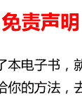

## 作者简介

李炳池，直接营销导师，顶级文案撰稿人，合赢岛创始人，《神笔文案》密训课主讲师，北京合赢道文化交流有限公司总裁。曾帮助超过 1700 多家中小型企业，创造了 27 亿的销售额。

畅销作品有《直接营销秘诀》、《营销跳板》、《信手拈来，一夜之间改变你的广告》、《营销策略精华集锦》、《广告文案公式集锦》、《终极文案撰写系统》、《年赚 6-8 位数电子书写作秘密》等。

他的个人网站 www.libingchi.com 是中国唯一一个揭露最真实，最赚钱的直接营销网站。而且，他的营销通讯 100% 免费，仅通过他的营销通讯就可以学到真正的营销秘诀。他也是国内 13 位知名培训师幕后的策划者。

他是一位实践家，一位默默辛勤耕耘的人。他愿意用余生去学习和实践，把最直接，最真实，最有效的营销秘诀公布于众。为中国的中小企业贡献一份力量！

#### 前言

亲爱的朋友：

### 新的商业机会终于来了！

在短短的两年时间，就诞生了许多百万，千万，亿万级别的人。

他们在干聊、荔枝微课、得到、喜马拉雅、知乎 live、分支答、豆瓣时间、小鹅通……等知识付费平台，举办讲座，咨询问答，销售书籍……很快赚到了人生的第一桶金！

他们经营的全部都是信息产品，这类人群就是抓住当今“内容付费”趋势的人，我把他们称作是新一代“信息企业家”！

你也完全可以像他们一样，成为信息企业家。

如果你不相信自己，觉得不可能……我告诉你一个简单的方法，只要你迈出第一步，你就可以顺势而行，梦想成真！

那就是……

### 从一本电子书开始

几乎所有成功的自媒体人都知道，没有什么产品能够比电子书（包含电子报告），更容易在网上创作或销售的了。

我说的电子书，不是你看到的大块头几百页的电子书，而是数十页、十几页，甚至几页的“指导类”电子书。比起数百页的书，电子书非常容易制作。

当你制作出电子书，你不仅可以引流、销售赚钱，还可以把电子书制作成音频、视频，制作成系列报告、网络课程等产品。

10 年前，李炳池就通过制作、销售电子书，报告......等信息产品，赚了上百万！

后来，我跟《卖家内参》李大庆总裁分享了信息产品的发
展，并给了他一些建议，如今他通过信息产品在短短的几个月就做到了数百万，今年有望突破千万。

在美国，像杰夫·保罗（Jeff Paul），杰夫·沃克（Jeff Walker），迈特·弗瑞（Matt Furey），马龙·桑德斯（Marlon Sanders），阿芒·莫林（Armand Morin），乔·维托（Vitale）......还有很多人。这些大师、大咖、大碗儿都是因为经营信息产品，而发家致富。

最让人羡慕的是，他们的工作自由，时间自由——想在家里工作就在家里，想去哪个城市就去哪个城市，想去海边工作就到海边，边旅游边工作。

李炳池也一样，想到哪里就到哪里......打开电脑，拿起手机就可以工作。

如果你也想从事这种事业，电子书就是你起步的一款完美产品。
有了你的电子书，你的后端产品非常容易实现。

### 为什么电子书是一款完美的产品？

你只要把电子书的优势，和网上销售的其他任何产品做对比，就能找到其中的原因：

几乎 100%的利润率——你的电子书是以 PDF 格式，或 TXT，或 word 等电子文件在网上销售，所以，每出售一本，你几乎没有任何成本。

没有印刷成本——如果你自费出版实体书的话，第一次印刷 3000 册，你的成本至少要 3 万元，甚至更多。

没有库存——它只是一个存储在服务器上的电子文件。不像实体书，占用你的房间！

更新简单快捷——你可以在任何时候修改错误，或增添内容——不用花一分钱。

没有运费，不会延迟发货——买家在线订购完毕，几分钟内就能得到它。

比实体书有更高的感知价值——电子书的篇幅通常几页或不到实体书的一半——然而，它们的售价却是实体书的2倍，3倍，甚至更高！

非常棒的引流产品——你可以制作电子书销售,也可以把电子书作为引流产品，吸引更多的粉丝关注你。

打造个人品牌的工具——通过写电子书能奠定你所在领域的专家地位。

你的爱好、兴趣或经验,都可以通过电子书变成有价值的产品。如何把这些价值转变现 金,在如今,是很容易的事情。

你想把握“知识付费”时代的商业机会吗？试试我的建议——用一本电子书起步吧。

### 电子书是一项真正的生意

也许,你觉得你不知道写什么；或者你认为你的想法不是那么好,不知道从哪里开始,或者你曾经写过但却没有赚到钱。然后,你放弃了！

不要忘记,这是 一门生意,是一份你值得投入的事业。遇到一点小困难,那都不算什么事儿。关键是,你的方法是否对？

为了写出并卖出电子书,你要遵循经过验证的方法,只要你按照我讲的方法去执行,你在30天内,甚至更短的时间内,就能开始赚钱。

我看过很多国外大师写的“指导类”电子书，也学习过他们的写作方法,并总结出了写作和销售电子书的有效方法和原则。

我即将告诉你的就是已被证实可行的办法,你只要按照这些步骤写作和销售即可。

**你写的越多，赚的就越多。** 经过几年后，你会发现几年前你写的电子书可能还在为你带来收入，就这么简单！

现在，如果你愿意学习，我就告诉你如何拥有像李炳池、李大庆、杰夫·保罗、杰夫·沃克……一样的自由事业。

### 启动你的生意

在《年赚 6-8 位数的电子书写作秘密》 5 天微课中，李炳池一步步教你如何创造和销售高利润的电子书。

### 在本课程中，你将学到：

- 电子书写作的 6 大原则。如果 你违背了，就不会给你带来收益。
- 如何写，写什么？（在你写电子书之前，你不要担心，因为你不必一开始就是专家，事实上，只要你拥有基本的写作能力，并且会使用互联网，你就已经具备了写电子书的资格。）
- 如何选择能够持续销售多年的电子书主题（选择主题是电子书写作中第一个也是最关键的一步。如果你的主题不对，无论你写得再好，或者你有多喜欢这个主题，也别指望它卖得好。）
- 鲜为人知的构建大纲的 4 种具体方法。（世界大师都在使用的 4 种方法，如果你不按照这种方法去写，你会走很多弯路。）
- 6 种收集与主题相关的素材，为你要撰写的电子书，获取有价值，受众觉得有用，会付费购买的信息。
- 撰写电子书的 7 个步骤（我的实战经验）
- 3 个编辑步骤，把繁杂的初稿，变成简洁的电子书（让你的电子书更易读，更有逻辑性。）
- 如何使用改编技术（改编不是让你直接抄袭、剽窃原文内容，而是用不同的词、句子来改写。改的方面可以是体裁、人称、结构、名词替换等。）
- 如何利用“附录”为你的电子书增加价值。（看似简单，却非常有效的提升价值法）
- 如何利用修订版或升级版，让你现有的电子书销量剧增。
- 销售电子书最容易的方法，让你每次的成交率至少在1%-10%，甚至更高。
- 一套全自动营销系统（自动收款，自动发货，24小时睡觉都可赚钱。哇，太棒了！）

自 2007 年以来，我就在使用这些方案和步骤，使用它们在网上赚钱。

实际上，如果你坚持使用这些步骤，或者说使用这套撰写电子书的写作公式，你就可以打造出你的信息王国——成为“信息企业家”。

如果缺乏正确的指引，你在写作的时候就会疑惑和混乱。例如，新人最容易犯的错误是选择一个自认为好的想法，但不去确定是否有市场需求。

本课程不仅教给你如何选择能够长盛不衰的主题，而且还会告诉你电子书的排版、内容、格式、怎样校对、推广、发行、如何设计一个醒目的封面,甚至如何避免电子出版中的致命错误等……让你掌握电子书写作和销售的整个流程。

当然，在课程中，还包括一些私密资料（超高价值，已值学费数倍）。我都会发给你，帮助你写一本能够赚钱的电子书。

### 但你必须迈出第一步！你必须写出你的第一本电子书。

当你完成你的电子书后，下一个重要的任务是营销。大多数新人不知道从哪里开始营销，或选择哪个渠道营销。

### 新型营销法

电子书营销必须符合当前趋势，与新趋势保持一致，营销中的游戏规则不断变化，本课程就是教你如何保持同步。

**最后提醒你：**本课程教给你的，不是一夜暴富方案；而是帮助你在“知识付费”时代，通过电子书写作，销售，成为一名真正的“信息企业家”。

只要你遵循这5天讲的内容（每晚40分钟），你就可以创作自己的电子书，在1个月内，甚至1周内，实现你的第一本电子书的成功销售。

## 第一课 电子书新趋势

各位总裁，大家晚上好，我是李炳池！

今天非常开心，也很激动，能够和大家在荔枝微课相聚。
感谢你对我的信任，谢谢你们！

老朋友都知道，在我所有的课程中，不管是线上还是线下课程，我都去掉了主持，和开课前的一些活动仪式——直接进入主题，目的就是为了节省大家的时间。

我在设计此课程的时候，力求简洁、有效。所以，这五天的课程非常紧凑，都是我10多年的写作经验。

毫不夸张地说,这次课程是目前国内唯一系统的讲解制作电子书的课程。完全符合当今的发展趋势,只只要你认真的听讲，做笔记，我相信在30天的时间，甚至更短的时间内就能写出你的电子书，而且赚到钱。

这次系列课程一共有5讲，采用语音+文字的方式，每节40分钟左右，每天晚上8点开始。课程永久保存，随时可以回听学习。另外，全部课程结束后，我会把所有课程的录音制作成文字版——电子书，你可以下载，多方位地学习。

在讲课期间，为了让各位总裁能够更好的学习，我依然邀请了素素老师作为嘉宾，对本次课程的重要信息做一些笔记。

还有我的助理 Bella,作为课程的管理员，万一出现负能量的人，发布负面信息，管理会员直接拉黑。我相信我们都是正能量的人,如果你对课程有什么不清楚的地方,或有什么问题，课后有10分钟的问题解答。

今晚是第一课——《电子书新趋势》，主要讲 3个方面：

- 1. 信息产品的发展趋势
- 2. 什么样的电子书才能赚大钱？
- 3. 永不能违背的 6大写作原则

在正式开课之前，我先做个简短的介绍。因为有刚刚进来的的总裁可能还不太了解我，不知道我是谁？

我叫李炳池，从1993年开始，从事摩托车生意，一直到底2001年，一共做了8年。虽然我是初中毕业生，作文考试从未及格过，但我觉得在广告文案方面，可能稍微有点天赋，特别喜欢琢磨一些能够打动人心的文字。在当时，所有摩托车

的销售文案，都由我亲自完成。不能说写的文案有多好，但对于当时的市场环境，已经能够起到效果。

为了能够进步，从2001年开始，我陆续向全球数十位顶级营销大师学习他们的成功之道。下面这张图是我向这些老师学习的照片。通过学习，让我知道直复营销的威力，学到了很多非常直接有效的营销秘诀。

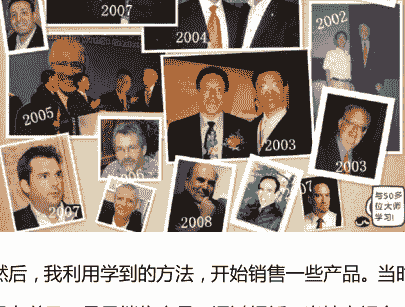

然后，我利用学到的方法，开始销售一些产品。当时互联网还没有普及，最早销售产品，通过报纸，当地电视台，杂志刊登广告，也使用过线下的邮寄目录和销售信的方式来销售。

随着时间的推移，边学习边实践，慢慢的开始在网上销售，逐渐开通了6个网站，全部用单页销售信销售产品。并使用邮箱和邮件列表，来获取顾客数据。

后来，我出了十多本营销和文案类书籍，每一本都是我亲自编辑，校对，排版，销售。通过那些书籍影响了一大批人。由于我的实战经验，很多客户来咨询我请求帮助，多年来，直接和间接帮助了上万家中小企业，创造了不菲的销售业绩。

关于我个人的背景，课程结束后你可以登录我的个人网站 libingchi.com 查看，或者在李炳池公众号微信 LBC333 ，回复“李炳池” 三个字，也可以了解。

### 1.信息产品的发展趋势

去年9月8日-9日，我举办了第一期“神笔文案”写作课程，参加后的总裁们都获得了巨大收获。第五期神笔文案5.0，将在今年的8月下旬开班。

我为什么不在前几年就开文案培训班，原因是时机不成熟，做生意最好的机会就是紧跟趋势。如今，人们都意识到文案的重要性，我们在网上销售产品98%都要依赖文案来完成。所以，我觉得文案培训课程，是非常好的一一切入点。当然，

我不是让你也从文案培训，你要根据你的产品或项目的性质，与时代同步发展。

同样的道理，为什么现在举办电子书写作课程？从去年到今年这短短两年多的时间，市场上出现了很多“知识付费”的平台，像得到、知乎、分答、荔枝微课，千聊等等....这说明了什么？为内容付费的时代来临。

虽然免费信息铺天盖地。但人们更愿意花钱购买更有价值的信息，或者为了节省自己搜寻的时间。你今天能够来参加《年赚6-8位数电子书写作秘密》课程，这就是为知识付费的一个例子。

如果你已经有自己的产品在销售，你不能单纯的去做广告推销，你需要依靠文章，报告，电子书，微课来教育和引导顾客购买。这才能长久，稳定，形成品牌。

无论什么行业，人们都有需要解决的问题，电子书的作用，就是提供给他们解决方案。

如果你正在选择项目，或者你想从事一份兼职的生意，那么建议你把握住“知识付费”时代的大趋势。

在本课程的销售信中，我提到“电子书是一项真正的生意”，你可以成为信息企业家，从电子书可以派生出很多的后端信息产品。比如，你把写好的电子书，可以做成音频、视频，还可以做成网络课程，或者线下课程等。

为什么要做成不同性质的产品呢？因为不同人的学习习惯和使用载体不同，有的人喜欢文字，有的人喜欢声音，有的人喜欢看视频，有的人喜欢现场体验。

所以，从一本电子书就可以衍生出很多信息产品。

什么是信息产品？就是基于内容出售的商品，包括电子书，电子报告，音频，视频，演讲，课程，咨询方案……等等。我们仅仅通过销售信息产品就可以发家致富。

为了能够让你对本次课程有更深的了解，看清当今的发展趋势，我们有必要一起来看几个数据。这个数据是来自艾媒咨询集团，它是全球领先移动互联网第三方数据挖掘与整合营销机构。

通过大数据分析，在 2016 年中国内容付费用户规模为 0.98 亿人，预计 2018 年用户规模将达到 2.92 亿人，近 3 倍的增长！

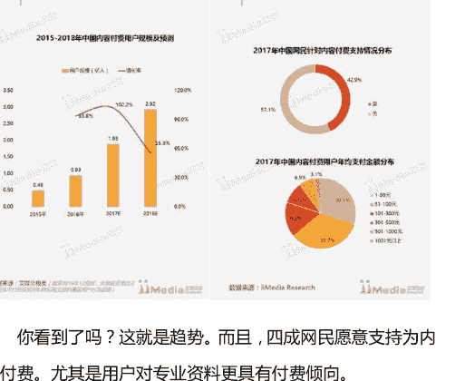

你看到了吗？这就是趋势。而且，四成网民愿意支持为内容付费。尤其是用户对专业资料更具有付费倾向。

未来的读者，所谓的 80 后、90 后，尤其是 00 后以后的读者，98%更倾向于数字内容，也就是未来读者。

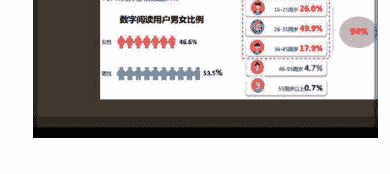

6月3日，我在北京参加了一个关于“知识付费”的论坛，根据数据统计，在中国为内容付费的产品销售很快将达到上百亿的规模，而且每年都在增长！

美国企业每年花费超过 3,500 亿美元购买内容。可以看到，我们增长的空间非常之大。那些先知先觉的人通过各种社交平台、知识付费平台赚了很多钱。

我身边最好的一个例子，就是《卖家内参》李大庆总裁，通过信息产品在短短的几个月就赚到了数百万。

现在，你正在听李炳池讲的电子书写作课程，也是活生生的案例。课程结束后，我再把课程制作成电子书，不仅可以销售，还可以为某个高价产品作为超值赠品。同时，我还可以录制成音频节目，在电台收费播出。

在你刚起步的时候，最好就是学会制作出你的电子书。

电子书长度没有硬性规定，根据你的主题来设定，通常是几页到几十页，也有特别的内容上百页。总的来讲，电子书的长度还没有传统书籍的一半多，销售价格却是传统书籍的10几倍，甚至上百倍等，销售利润非常可观。

它没有印刷成本，它不会占用多少空间，零运费，非常低的管理开销，几乎拥有100%的利润率。你可以销售电子书，也可以把它作为引流产品，吸引更多的粉丝关注你。

## 2、什么样的电子书才能赚大钱

电子书的主题几乎是无限的。你可以制作关于任何主题的电子书，但读者最愿意付费，愿意付高价的电子书，通常是“指导类”类型的。什么是指导类？就是根据人们的需求，或存在的、想要解决的一些问题，通过指导，给人们提供解决方案！不只是告诉人们是什么，还有告诉人们如何去做到。

我们订阅的公众号，以及网络上令人眼花缭乱的信息，今天被称为“内容”，触手可及。但这些大部分都是原始的数据、事实和信息。作为指导类作家，我们提供的信息不仅仅是事实本身，我们的使命是一步一步地教我们的读者，如何做一些他们想要做的事情，或者实现他们想要实现的心愿，或将自己改变成想成为的人。

例如，如何摆脱负债、找到伴侣、提升业绩、减肥、健身、如何克服恐惧症，如何解决不孕不育、如何训练狗、如何致富……或实现其他重要目标和梦想。都属于指导类范畴。

出售小说或叙事类非小说作品需要高水平的写作能力。
但是，对于指导类非小说来说，对这种能力要求有些不同，
这类体裁的文章强调的不是风格，而是准确性、实用性、清晰度和条理性。你可以清晰、有条理并且有趣地解释一件事吗？如果可以，那么你就可以成为一名指导类作家。

你觉得你的写作资历尚浅？没关系！请记住，客户对你的专业知识更感兴趣，而不是你的文学天赋。成为专家，并非意味着比世界上任何其他人更了解你的主题。你没有必要花费半个世纪来学习或获得博士学位，以换取撰写指导类信息产品的资格。

你刚开始写作，不需要成为你所在领域的顶尖专家。你只需要比90%的人更了解你的话题。别担心另外10%，因为他们根本不是你的目标市场。

我们这五天的课程讲的内容全部是关于“指导类”的电子书写作。

你不需要一开始就是某个领域的专家，你的爱好、兴趣或经验，都可以把它变成有价值的“指导类”信息产品。

有人曾经观察发现：“专家不一定比别人懂得更多；只是

他们能够将信息更好地组织起来。”

某人编写了一本伟大的科学类书，但他不一定就是伟大的科学家。只要你以合乎情理、合乎逻辑，易于理解的方式整理你的内容即可。任何一个有想法的人都可以写！任何人都可以把自己的想法变成文字，卖给那些想要读你文字的人。

我们所要做的就是根据市场的需求来确定主题。通过使用一些工具，你将知道什么是读者想要的，你在很短的时间内，就能获得你想要的信息。

我记得在微信还没有诞生之前，就有很多人开始写电子书，但是他们并没有赚到多少钱。原因是，他们没有意识到，电子书写作是一项生意。你需要写出满足人们需求的作品，还要掌握营销技巧，才能获得成功。

单纯写作只占电子书行业的 60%，而剩下的 40%则是电子书的营销。大多数失败的人是因为他们没有成为一个“电子书商人”，你的目标是写出一本迎合主题的电子书，赢得读者的心，他们才会愿意购买和下载。

记住，没有人会下载一本没有价值、与主题格格不入的书，即使它是免费的。如果这本书从买家的角度来看没有任何意义

那么它肯定卖不好。

## 人们买的不是电子书,而是解决方案,或消遣娱乐的内容。

或者更具体地说,他们寻找的是他们空闲时间的“最佳填充物”, 或者他们需要的“最佳答案”。

为了写出并卖出电子书,你所要做的就是遵循经过验证的方法,只要你按照我讲的方法去做,你在一个月的时间内就能开始赚钱。

自 2007 年以来,我就在使用这些验证过的步骤和方法,在网上赚钱。实际上如果你坚持使用这些步骤,或者说使用这套撰写电子书的写作公式,你就可以打造出你的电子书王国——最终,成为新一代的“信息企业家”

本课程按照先后顺序,一步一步的教给你。不仅会告诉你如何选择一个好主题,而且还会告诉你书的长度、排版、内容、格式、怎样校对、推广、发行、如何设计封面,甚至如何避免电子出版中的错误等。让你了解电子书写作和销售的整个过程。以保证你能够成功地销售第一本电子书！

撰写电子书就像我在《神笔文案》课程中讲到的一样,撰写销售文案有绝对不能违背的原则,如果违反,你的文案就不

会有吸引力。

## 同样，电子书写作，也有它的写作原则。如果违背就不会给你带来收益。

无论你写什么类型的主题，都要遵循以下 6 大重要原则。这 6 大写作原则是帮助你获得收益和建立在线电子书王国的专业的方法。

## 3、永不能违背的 6 大写作原则

不管通过那种渠道销售，我们首先要把自己的电子书写出来。无论是自己写，还是找人代写，一定要遵循电子书 6 大写作原则。

#### 第一个原则：高质量、高价值的内容

什么是高质量、高价值的内容？高质量是指不仅主题受欢迎，而且还包含你对主题的见解。

质量是通过研究实现的，如果你已经仔细地研究了这个主题，那么它将反映出质量。你的电子书必须回答读者可能对该主题的所有问题。为读者提供有意义的信息，使他能够从你的信息中获得知识。

请记住，读者需要的不是事实和数据，不是你告诉他做什么，而是你要教会他如何去做，一步步去实现。

如果你认真地为读者提供所有这些信息，它将反映出质量。
不管你擅长哪种体裁，高质量永远是电子书写作的精髓。

高价值的内容，是指你在研究中选择资料的来源。如果你选择的数据来自如书籍，期刊或专家意见等优越来源，那么你的电子书中将会有高价值的内容。相反,如果你只是从百科，或一些业余博客、微信上收集资料来编译，你的电子书就不会有高价值的内容。

#### 第二个原则：内容完整，注重细节

信息内容一定要完整，细节必须满足读者的需求，所以你必须从第一章开始就注重细节。

举例：假如你用讲故事的方式来写，你必须熟知每一个情节和人物。为了详尽地介绍故事情节，你要具备足够的背景知识，才能为读者展现跌宕起伏的故事。

细节决定读者对这本书的兴趣，你必须使读者产生不想停下来的感觉，甚至想一口气读完。但是你要
注意不要给予太多的、不相关的信息，这些非常容易脱离主题，使读者失去对这
本书的兴趣。

#### 第三个原则：长度合理

你写的电子书不是冗长的工具书，需要有5万或10万字以上。通常在网上销售的入门级电子书只有十几页或者二十多页，换句话说，大约有7000到10000字。

当然，你的电子书不能都是7000到10000字，如果字数太少可能不会对读者有吸引力，不足以提供所有细节。读者要求细节，他们想要物超所值。

实际上，你可以轻松地将该数字翻倍至大约15,000字。你可以在合理的时间内写出15,000字，稍一努力，就可以实现20,000字，这将增加电子书对潜在买家的吸引力。不过你的重点应该在高质量、高价值,而不仅仅是字数——内容是王。

如果你用了更少的字就足以将主题表达清楚,就没必要在字数上下功夫了。5000字能说明问题，就不要用6000字。

我写过的电子书，有的几页或者10多页，只要你的电子书能给读者带来价值,能够解决他们的问题，就是一本好的电子书。

#### 第四个原则：内容迎合主题，使读者满意

内容要迎合主题，只有读者满意，你才能持续有收益。你不只是给读者一个优质的产品，更是要兑现承诺。

如果读者正在寻找一本关于如何在 3 年内退休的电子书，你的书里只是谈论了很多关于 3 年内退休的事情 ,但是从没有说明具体如何做，也没有给出一个明确的计划，主题模糊，那么买家不会满意。

#### 第五个原则：为打造品牌写作

写电子书不仅仅是为了完成一本特定的书,你要通过电子书打造自己的品牌。

通过写书你的名气会越来越大,你在你的领域里就会占有 一席之地。一旦你发行了第一本电子书,读者就会期待下一本。如果你想把自己打造成信息企业家，时刻都要记住品牌两个 字。

比如，很多客户了解我，90%的人都是通过我的文章和书 籍才知道我的，从而我在小范围内也有了自己的品牌。

#### 第六个原则：把电子书当作生意

你必须将每一本电子书都视为一项生意,记住写作是你的事业。你不仅仅是一个作家,而且是一个商人。一旦把你的电子书作为商业资产,你就会用心去经营。只有你用心,你才能赚到钱。

只要你按照我所教给你的方法,一步步的去执行,你不仅工作越来越自由,你的品牌效应也会越来越大。你赚的钱也会越来越多......作为一个指导类作家你能赚多少钱——赚得多快——主要取决于你,你的天赋和你所做的努力。

到底如何来写,如何营销,后面的课程我会一步一步教给你。你。我们今晚的课程,你只要记住三点就够了：

**第一,信息产品已成为一个行业,现在是进入的最佳时机.**

**第二,你要把电子书写作当成一项生意,一份事业来对待.**

**第三,你要遵循电子书写作的6大原则.**

把“写作的6个重要原则”熟记在心。你可以写在你的笔记簿上,在你撰写任何电子书的时候,都要围绕这些原则来写。

下节课,我将教你“如何写,以及写什么？“

## 第二课 如何写，写什么？

各位总裁，大家晚上好，我是李炳池！

昨天我们学习了电子书写作的 6 大原则，以及知道了为内容付费是当今的趋势，并且，想要成为信息企业家，你必须把电子书写作当成一项事业来看待。

今晚是第二节课：如何写，写什么？

在你写电子书之前，你不要担心，因为你不必一开始就是专家。事实上，只要你拥有基本的写作能力，会使用互联网，你就已经具备了写电子书的资格。

甚至，你不用亲手撰写电子书，你可以雇用其他人帮你写。有些人喜欢自己写，有些则外包给其他人——将来有一天你会很忙，根本没有时间亲力亲为。

你的第一本书可能将花较长的时间才能问世，因为这是你的初次体验。但没关系，不要匆匆忙忙的急于完成它。有些人说你可以在 7 天或更短时间内写一本电子书，这对于一位非常有经验的作者来说是行得通的。但是对于初学者，花更多的时间来创作他们的第一本电子书是很正常的。

一开始你将需要稍长的时间，但实说，电子书是一门生意，你就把它当作是一个朝九晚五的工作，中间还有很多休息的时间。只要努力，你就能成为一个优秀的信息企业家。

如果你每天工作 8 小时，每周工作 40 小时，你能够以每小时 200 - 300 字的速度编写质量好的作品 那么每天写 2500 字左右对你来说一点都不难。7 天就是 17,500 字。持续写作，你的表达能力将会提高，你将能够每小时写出高质量的 400-500 个字。

如果你想慢慢写也没问题。每个人工作节奏不同，而且这是一个创造性的工作，如果你认为你可以每天至少写 1500 个高质量的字，这也很好。1500 字 x 7 天 = 每星期 10,500 个字，一个月 42,000 个字。

对于那些想要慢节奏的人来说，这并不错。这种方法同样适合那些兼职的人，或者想要从现有职业中慢慢过渡的人。所以对于那些抱怨没有时间的人，他们不应该再有任何借口。

无论你选择哪种方式，相信我，经过一段时间，随着你的创新能力的提高，你的时间安排将会发生变化。

那到底如何写，写什么呢？为了写好你的书，你需要做五
事件：

### 第一、确定主题

### 第二、研究该主题的可行性

### 第三、列出大纲

### 第四、找到与主题相关的专业素材

### 第五、编辑

我们从来看要做得第一件事：

### 第一、确定主题

你的第一本电子书至关重要。它必须有一个具体的、有针对性的主题，你可以围绕它制作一系列的电子书和信息产品。

#### 确定主题的两个核心

你选择的电子书主题必须做到两点：

- 1) 它必须针对一个特定的细分领域。
- 2.) 它必须是人们在网上搜索的主题。

什么是特定的细分领域？就是某个行业与技能或知识的
交汇点。 什么意思呢？我们看下面这张简单的图，说明了如何选择你的特定细分领域。

#### 一张简单的图，告诉你如何细分领域

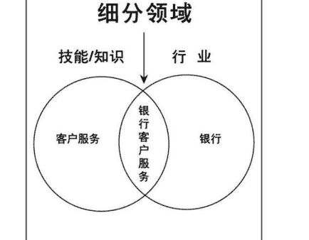

一个细分领域是行业和技能的交汇点

假设你是一个银行出纳员，你的行业就是银行业。出纳员每天都做什么？支票兑现、接受存款和贷款，以及处理提款服务等。你的技能就是客户服务。

因此，你的特定细分领域就是银行业的客户服务。你的电
子书主题可以是“银行出纳员的客户服务技巧”。

你可以根据这个图表来细分。再举个例子，假设你喜欢美容行业，美容行业里需要的技能或知识有什么？销售、管理、按摩服务、微整形……等等。

你的细分领域可以是美容业的按摩服务，或者美容业的销售，或者美容业的微整形或管理。你的电子书主题就可以是“美业按摩服务技巧”、“美业销售策略”、“美业微整形技术”、“美业管理系统”等等。

我们中的很多人找不到自己的方向。主要原因是没有对个人情况进行梳理——你要弄清楚你所知道的，和你热爱去做，去分享的事情。

一个人不管你如何努力，最终都还是在做自己喜欢的事情。如果你不喜欢，你会找各种借口不去做，即使你去做也肯定做不好。

你可能会说，我现在做的事情根本谈不上喜欢。可以确定的说，你现在做的事情是在自己能选择的范围里面最喜欢的，否则你不久就会放弃。

当你做自己喜欢，热爱的事情，你会全神贯注的去做，你
的目的会更明确，工作更加努力。

#### 如何找到自己最喜欢的细分领域

如何找到自己喜欢的细分领域，首先需要你做一个自我分析。下面是你应该问自己的 10 个问题。当你想到答案时，把它们写下来：

- • 我喜欢什么？
- • 我对什么感兴趣？
- • 我擅长什么？
- • 我有什么天赋？
- • 我受过什么教育？
- • 我了解什么？
- • 我有什么经验？
- • 我有什么成就？
- • 以上哪些方面竞争最小？
- • 以上哪些方面赚钱最多？

对于上述类别，你可以在索引卡上尽可能多地列出每个类别下的子项，每张卡一个类别。

比如：我喜欢什么？我喜欢写作；我喜欢打网球；我喜欢
骑自行车，我喜欢旅游......你可以列出很多子项。完成列表后，查看一遍，将任何看起来可能成为细分领域的卡片放在一边。

接下来，选出 5 个最感兴趣的类别，按优先顺序排列。

现在查看列表。有可能这些类别中的一两个是人们常常去花钱关注的东西。选择一个，你就已经找到了你的细分领域。

正如亚里斯多德所说，**“如果你的激情与人们的需求重合，那就是你的职业。”**

你的列表中，如果五个类别没有一个足够吸引你将其当作细分领域，该怎么办？从你的索引卡中再挑选最好的 5 个，重复该过程，直到发现你热爱的细分领域。

#### 选择主题的 3 个类别

- 1、撰写你感兴趣的

比如，我的兴趣之一是写作。这次电子书写作课程，在没写之前，我先做了调查。我给微信好友群发了一条信息，询问他们，如果我开发一个电子书写作课程，是否愿意参加？如果想参加的，请回复“需要”两字，然后，我在决定是否开班。

我根据反馈的人数来确定是否有市场。如果有 50 个人回馈需要，我就可以举办电子书写作课程。

24 小时后，我收到了 200 多人回复 “需要”。并且，还有 5 位朋友没有任何问题，直接微信 300 元过来。还有一位朋友，直接甩账 880 元。哇，让我好感动！他们对我特别的信任，而且懂得为价钱买单。

通过调查，说明了电子书写作是有市场的，于是才有了今天的课程。下面这张截图是我在 4 月份发在朋友圈做的调查。

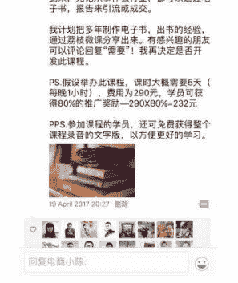

#### 关于你的个人爱好,你研究过自己的爱好吗？它里面隐藏的商机,可能会让你大吃一惊！

你认为有多少人喜欢骑自行车，徒步旅行，打网球，或摄影呢？

现在各大城市都有共享单车，每天上下班，出行，很多人都在骑。让我们以骑自行车为例。不一定说的是共享单车，你可以有自己的专用自行车。骑自行车是一件非常简单的事 情。坐在座位上，把脚放在踏板上，就能骑了。但是，就这么简单吗？不止于此。

你可以写如何骑自行车去野餐，去旅行......是否要穿越乡村小镇，穿过树林......等等？

有的人把他们的自行车放在汽车里，到达某个地方，然后骑车去探索另一个城镇。所以，你可以撰写旅行攻略，如何运输自行车，甚至如何选择自行车和汽车上的自行车架。

你可以扩大与自行车主题相关的信息，如：

- • 如何创办自行车俱乐部
- • 骑车越野
- • 高端自行车赛车
- • 骑车健身减肥法
- • 骑车旅行或度假训练技巧

写有关于你的业余爱好和娱乐的内容，你可以找到各种各样的主题，并获得一笔可观的收入。它也会让你对自己喜欢的事情，有新的认识和感受。

### 2、给旧内容，换上新形式

对我们撰写电子书有非常好的启发作用，可能要数杰克·坎菲尔德和马克·维克多·汉森的心灵鸡汤系列丛书了。他们通过励志故事，名言警句，重新定位，编辑，把它们发展成了心灵鸡汤，畅销全球。

你的电子书方向也可以是收集和改编散乱的信息，填补信息空白。比如，在国外，有很多人就是通过组织和改进信息，创作出一系列信息产品。

### 3、专家访谈

你发现人们有某种存在的问题，想要解决，但是不知道如何去做？你也不是太清楚，那么你就可以采访相关领域的专
家，把解决方案写成电子书，就可销售。或者把你与专家的对话做成电子书或录音。

在 2007 年，很多人们都不了解杰·亚伯拉罕，在我们推广他的课程时，为了让更多人了解杰·亚伯拉罕，我们把安东尼·罗宾和杰亚伯拉罕的访谈节目做成了电子书和宣传手册。做成电子书的好处起到两个作用，一个是帮助更多的企业老板学到了先进的营销知识。另一个好处是借用安东尼·罗宾的名气促进了杰亚伯拉罕的影响力。

在国外很多的营销文案专家，把类似的访谈节目，做成电子书，用于引流、销售，或者当成赠品增加附加价值。

在 2014 年，我跟凤凰含章出版社合作，推出《吸金广告》这本书，在还未上市之前，我就开始预售，并赠送价值巨大的盖瑞·亥尔伯特访谈录，是由米歇尔通过电话访谈盖瑞·亥尔伯特，主题是“如何增加回报率”。参加访谈的人都要缴纳一定的费用。在电话访谈结束后，他们把这次访谈制作成了 CD 出售，然后又制作成了电子书销售。你可以看到，通过一个访谈，可以连环销售。

后来这个电子书内容允许转载。然后我把它制作成了中文
电子书。在这个访谈中盖瑞给了非常独特的建议和方法。

如果没有看过这本电子书，那么在李炳池公众号微信：
**LBC333 回复：盖瑞访谈 四个字**，即可获得。

还有一种访谈方式，就是把重要的问题列出来后，面对面请教专家，然后把答案记录下来，制作成电子书。

有一个农场主，农场鼠患严重。他需要治理这些老鼠，但他不知道怎么做。他被这些老鼠搞得很烦恼。

他跟邻居和其他农民主交流，也没有找到解决方法。因此，这位农场主决定去拜访几个专家。他和几个高尔夫球场草坪养护护员进行了交流。这些人知道如何制止老鼠，如果预防这些鼠患。

这位农场主回到农场后，把学到的方法马上上去试验，发现效果非常好。然后，他把这些方法做成了一份报告，卖了上千份。他把一个自己没有答案的问题，变成了一个收入来源。

这位农场主的避免鼠患的主题，是一个长盛不衰的主题。长盛不衰意味着，人们会长期需要和该主题相关的信息。

你选择主题的时候，要考虑是不是它能够长盛不衰。

#### 长盛不衰的主题

一个主题可以长盛不衰，是因为它和几代受众持续相关。

例如，每个人都想知道如何明智地投资，但是因为新规定、新投资产品和不断变化的市场条件，投资建议也会不断变化。

投资成为一个长盛不衰的主题，原因有两点：每一代人都会对投资资产产生兴趣，因为投资方法总是不断变化，所以，你总有一些新内容可以写。要确定一个主题是否长盛不衰，你只需要其中的一个条件——不断有新的人群、不同群体的人或不同代的人需要这个信息，或不断有新的信息可以提供。

在 20 世纪 80 年代，就有人写书给想教孩子如何理财的父母。还有更多的书专门针对大学生、老年人、富人、收入有限的人等等。

现在，这些书很多都被不断重写，有些还是由原作者改写，因为人们仍然想知道如何明智地投资。

一个主题长盛不衰，意味着有源源不断的顾客，需要你的信息产品。同时也意味着，受众还需要有能够不断更新，紧跟时代发展的信息。你可以通过提供不断更新的电子书满足这些需求，增加你的收入。

比如，营销类，赚钱类就属于长盛不衰的主题，但营销类范围很广，我就细分出一个类别，专做销售信文案类，这样就能更好的切入目标市场。而且，也符合当今市场的需求。

下面是一张小图表，帮助你了解长盛不衰主题和非长盛不衰主题之间的区别。

| 长盛不衰 | 非长盛不衰 |
| --- | --- |
| 婚礼策划 | 汽车发动机设计 |
| 减肥 | 纳米技术 |
| 美容方法 | 基因工程 |
| 两性情感 | 视窗化 Basic 编程语言 |
| 买房 | 太空探索 |

显而易见，我们选择主题当然要选择长盛不衰的主题，能够在这个领域持久下去，从而打造一个细分市场的品牌出来。

所以，你要先确定一个主题，同时，还要研究该主题的可行性。

### 第二、研究该主题的可行性

我们前面提到过，确定主题有两个核心：1. 它必须针对

一个特定的细分领域；2. 它必须是人们在网上搜索的主题。

电子书是一项生意，你要确保你的电子书有市场，确定网上有人搜索与主题相关的信息，愿意为你的信息付费。这样才能赚到钱。

要做到这一点，你可以使用内部调查，就像我在微信好友，朋友圈调查电子书写作课程一样。

另外，我们使用关键词，搜索工具。你需要使用关键词来确定你的电子书是否有市场，人们是否对你的主题感兴趣，你只要使用选定的主题中最常用的 2-3 个词来搜索即可。

#### 你可以使用的关键词搜索工具有：

微信指数, 百度指数( http://index.baidu.com ), 360趋势（ http://trends.so.com ）, 或者谷歌关键词工具( http://adwords.google.com )。从国内来讲百度指数、微信指数优先，国际上可以使用谷歌关键词工具。

百度指数主要反映关键词在百度搜索引擎的搜索热度，即这个关键词的流行度。而微信指数主要是帮助大家了解基于微信本身的某个关键词的热度，基于在公众号、朋友圈中出现的词的频率，我们可以利用微信指数来了解某事、某人基于微信

平台到底有多火——微信指数用具体的数值来表现搜索词的流行程度。

通过微信指数可以了解某个关键词分别在 7 日、30 日、90 日的流行表现，通过其指数波动情况，我们甚至可以预判出某个关键词在未来近阶段的表现情况。

现在，我们假设你的主题是“家庭装修”。你第一本电子书是如何雇佣可以信任的装修公司。

你在当地已经确定人们想要这类信息。你与朋友、邻居、同事、客户打交道的经历告诉你，他们对你的主题感兴趣。知道他们都有过不好的家庭装修经历，这说明，这方面的市场需求很大。

但是，你所在城市以外的人，想要这些信息吗？最重要的是，他们会为之付费吗？这时候，就要用到关键词和搜索工具了。因为你只需要搜索一些关键词，来确定你的主题是否 存在 大的市场。

让我们来看一个例子。我在百度指数上分别作了 2 个关键词的搜索。分别是“装修”和“装修公司”。我以这 2 个

关键词开始，仅一分钟内你就会看到，和这些关键词相关的词也被搜索了。

百度指数会告诉你，在过去的一个月中，你的关键词一共被搜索了多少次，以及相关的关键词列表。然后，它还会显示这些相关的关键词的搜索次数。

关键词搜索结果显示，“装修”的整体搜索结果有 8991 条，移动搜索 6723 条，“装修公司”的搜索结果有 8495 条，移动搜索是 7309 条。（这些结果来自 7 月 11 日）。

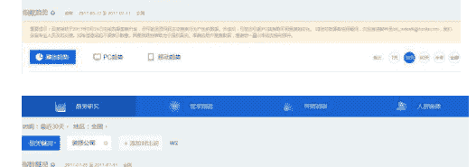

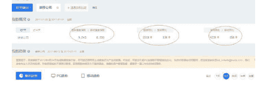

与之相关的关键词，搜索最多的是“装饰”，“客厅背景墙”。这点很重要，因为每个关键词搜索工具，都是在自己的数据库中进行的搜索。我建议在几个搜索工具中同时搜索，这样你就可以得出多种意见。得到搜索结果后，你就可以根据自己的经验进行分析了。

在微信指数中搜索“装修”7月11日指数显示7，872,604条，装修公司327,399条。

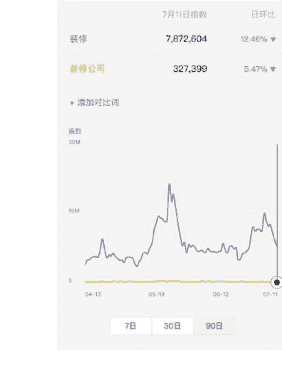

通过百度指数和微信指数数据的分析，你就可以确定你的主题是否可行。

现在，你知道人们正在寻找有关你的主题的信息,这很好，但这并不是全部。你需要确定,人们是否愿意为你的信息付费。

根据你在书店的经验，你看出了什么？如果书店有很多有关你主题的书，你就会知道人们愿意为这类信息付费。那么网上呢？

你的产品是电子书，所以你的市场在互联网上。其他销售和你类似主题的文章、报告、电子书、课程等的人，他们的收费是多少？

在百度，360，微信里搜索你的关键词，浏览一些竞价推广的网站。如果发现吸引你的文案或者网站，请收藏起来。

利用你发现的网站，了解什么样的信息正在被销售——以及价格是多少。当你发现其他人正在销售和你的主题一样的信息产品时，你就知道，你的电子书也有市场，你可以建立一个新的信息产品王国。

另一方面，如果互联网上没有一个个人销售和你的主题一样的信息产品，不要因为觉得没有竞争对手就开心。很可能，

没有人销售这类信息产品，是因为它没有足够的市场需求或人们不感兴趣。

例如，如果你打算写关于“XX”的主题，通过搜索关键词，如果你发现没有搜索量，或者很少只有几十个，那么请避免这个主题。让我们来看一个例子。

比如，你打算写一本关于减肥的书，我在 5 月 31 日查看了百度指数搜索量，它有 11432 次的搜索。7 月 11 日是 11656 次。在微信指数 6 月 14 日搜索“减肥”，有 9,951,027 条，搜索“减肥方法”有 432,942 条。7 月 11 日在微信指数搜索“减肥”有 12,059,622 条，“减肥方法”是 245,530 条。

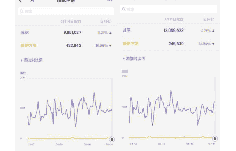

#### 那么你可以写这个主题吗？

我们从两方面分析，如果减肥这个主题有很多免费的资料、很多电子书、纸质书和课程，就说明市场可能相当饱和，你要尽量避免选择这样的主题。然而，如果你发现在减肥方面有很大的商机,关于减肥方面的书不多 ,也没有多少免费资料，那么你就可以选择这个主题了。

什么是 一个非常糟糕的主题？让我们假设你准备写一个主题------“外星人”通过搜索工具 发现每月有超过 651,840 次搜索，但是由于涉及很多专业知识，并且已经有 很多专家在做，所以你不应该选择这个主题。

另一个主题，如果你打算写 “营销文案” 这个主题，你会发现不管是百度还是微信还未被收录这个词，说明搜索量不大，很显然它目前不能够给你带来多少收益，所以你要暂时放弃这个主题。

一个好的主题是可以解决某个人或某群人的问题，群体中的人越多，你的读者就越多。也就是说，可以为许多饥饿的信息搜索者提供即时解决方案。

还有一种确定主题的方法就是去买家买书的地方！亚马

逊，京东，当当书店等地方，查看实际书籍，看销售，评论人数等。

总之，确立主题可以通过调研，也可以与你的同事，朋友，或者家人讨论。

**为了帮助你更好的确定你的主题，我列出了《10个受欢迎的主题》，你可以作为参考。在李炳池公众微信 LBC333，回复“主题”两字，即可阅读。**

当你把主题确定了后，就开始列大纲，大纲是你的写作路线图。

列大纲的方法有许多种，但对于写一本电子书来说，最常用的有4种，这4种也是很多大师们经常使用的方式。下一节课我会详细讲解如何列出你的大纲，以及如何围绕大纲寻找你需要的素材。

## 第三课 4 种最有效的大纲列举法

各位总裁，大家晚上好！我是李炳池！

我刚才有一个想法，为了帮助大家都能够学会电子书写作，我决定专门建立一个“年赚 6-8 位数电子书写作群”，大家可以在群里互相交流，头脑风暴，有问题可以提出来，一起解决。我也会不定期在群里分享一些有价值的内容。

不管你是学习电子书为了引流，还是想最终成为一位信息企业家，如果你想加入群，一会儿课程结束后，我会把群二维码，发到课堂里，你扫描加入即可。

上节课程讲到了如何确定你的主题，你把主题确定了后，就可以开始列大纲。我们这节课程包含两部分内容，第一部分是如何列大纲；第二部分是如何收集主题素材。我们先来学习第一部分：

### 如何列大纲

大纲是你写作的路线图，是你组织信息的结构图。有了大纲你才能去添加和组织信息。大纲包括两个元素，一个是目录，另一个是章节划分。

将电子书分成不同章节，就能制作出目录。通过目录，就能找到各类信息的位置。可以让读者者查找信息更方便，阅读更容易。

如果你的电子书就是为了解决一个问题，比较简单，没有那么多章节，那么你可以只写出你要讲解的内容是什么？然后用简短的段落，说明读者将会学到什么，也是可以的。

但是，根据我的经验，你的章节越多，你的电子书销售机会就会越多，因为买家在你的目录中就能看到更多的内容。读者希望在你的目录中就能看到更多价值——对他有帮助的信息。

随着你不断添加信息，你的电子书内容会变得更详细，你可以决定在你的大章节下，是否继续添加子部分——小章节。

如何来列举你的大纲？列举大纲的方式有很多种。但今天我们只讲大师们常用的 4 种方法。

## 4 种最有效的大纲列举法

现在，让我们看看列举大纲的 4 种具体方法，详细的来了解每个框架类型：

#### 1. 流程步骤式

流程步骤式是指导类书籍常用的方法。不管你的主题是设定目标，销售房子，还是修理家具，它们都遵循着可以被描述的不同步骤。

我的《神笔文案》课程的设计，就是按照流程步骤式来设计，每一节课都与前面的课程息息相关。都有一定顺序。参加过神笔文案课程的学员，手里拿的手册就能明白这种流程步骤式的布局。

本次课程《年赚 6-7 位数的电子书写作秘密》也是根据“流程步骤式”的方法设计的一——把撰写电子书分为 5 个课时，也就是 5 个系列步骤，来解释撰写和销售电子书的过程。

你可以看到，每个步骤都成为一个章节的标题。不管章节标题有多长，或多短。重要的是，一旦你将每个步骤确认为章节标题，你就必须把每一步骤作为独立的一章。

举例：本节课程的章节标题是：“4 种最有效的大纲列举法”，这是独立的一章。一共有 4 种方法，所以，你可以在章节下添加 4 个子部分：

- 1、流程步骤式
- 2、错误式
- 3、列表式
- 4、问答式

然后，根据每个子部分的标题，再进行详细说明。

#### 2、错误式

人们做事情，通常是为了获得快乐，或避免痛苦。围绕常见错误组织你的电子书，通常会很有吸引人，因为你在帮助人们避免因犯错带来的痛苦。

例如，杰·亚伯拉罕的一份报告的名字为《营销中常犯的20个错误》、我曾写过的报告，比如，像《网络营销中常犯的16个错误》，《撰写销售信常犯的11个错误》等。

这些错误没有任何特定顺序，组织这些信息最简单的方法，就是把每个错误以及它的预防方法按自己的章节编号排列。这样，人们就可以通过快速浏览目录，迅速找到对自己来说重要的信息。

#### 3、列表式

列表式大纲，对你想使用编号章节呈现的信息非常有用，但是，它也没有任何特定顺序。比如：哈维·麦凯写的书《超级销售 90 招》，定位大师杰克特劳特特写的《营销十要》，以及还有其他一些书，比如《1001 种留住顾客的方法》、《2239 个经验证的直复营销成功秘诀》等等。

虽然它们主要针对传统的纸质书籍。但是，你会发现，它对你编写电子书和其他信息产品也同样有帮助。

各章节，可以独立出现。也就是说，它更易撰写，因为你不用考虑各章节之间的逻辑顺序。读起来也更容易，因为你的读者可以根据自己的兴趣从任何一章开始阅读。

在你第一次关注我的公众微信 LBC333 时，告诉你回复“秘诀”两个字就能获得我的电子书《直接营销秘诀》，这本书就是用列表式的方式来写的。

去年我的合作导师《吸金广告》作者德鲁·埃里克·惠特曼出了一本书叫做《销售心理博弈指南——赢取订单、打动客户的 21 个心理脚本》，这本书的每个章节，不是按照顺序排列，你可以随意的翻阅从任何一张开始阅读。

使用列表式大纲，你可以写出能立刻吸引受众的标题。像《XXXX 的 30 种方法》或《XXXXX 的 25 种最常见的错误》，都特别吸引受众。当他们看到数字后，他们会自动开始思考这

些方法或要点是什么。

如果他们能想到的要点，没有你在章节标题中给出的多，他们就会去阅读，找出他们没想到的东西。甚至，即使他们能想到的要点比你多，他们也会去阅读，看自己想到的和你列举是 否一样。

其中一个很受欢迎的案例就是由史蒂芬·柯维写的《高效能人士的7个习惯》。这本书成了最畅销书籍，因为读者想知道这7个习惯是什么。

#### 4、问答式

问答式，就是问题和答案式大纲。对某个主题非常熟悉，有经验的人，常常使用这种方式。因为他们对这个主题非常熟悉，他经常谈论它，做它，甚至教它，他知道所有的常见问题。他只要列出这些问题，写出答案，就能得到一个问答式的电子书。

最近，我公布的电子书《不吐不快：文案撰稿人的89个问题》就采用了问答式撰写法。当你收到这本书后，你就能明白问答式的撰写方法，我列出了客户经常问到的问题，然后针对每个问题给出了解决方案。

这种类型的书的特征就是，首先列出问题，然后提供答案。

而且，为问答式电子书撰写销售文案，也非常简单。你只要列举其中人们迫切想知道的几个问题。然后，告诉读者，购买你的电子书，他就可以得到这些答案。

在你组织问答材料时，其中有一种很简单的方法，就是进行问卷调查。

问卷调查就是针对某一特定主题，调查人们有什么问题想要解决。列举问卷调查大纲时，你可以选出最近问到次数最多的，最常见的问题。然后，你研究并清晰地回答这些问题。

问卷调查的另一个好处就是，在你撰写这本电子书的同时，因为你提前做了问卷，等于是前期热身给了它做了宣传。

以上讲到的是 4 种撰写电子书大纲的方式。

**无论你采用哪一种，最重要的一点就是你要了解你的受众的问题是什么。然后根据这些问题列出你的大纲。**

在你刚开始列的时候，大纲标题不一定非常精炼，吸引人。列出大纲的主要目的是你有了框架，然后围绕这些纲领去写。

最后成稿之后，你还可以再润色，修改，让每一章节变得更有吸引力。

#### 你如何知道大纲是否完成？

去当当、亚马逊、或京东，或者到新华书店或图书馆，查找与你的信息产品相同主题的书籍。看看这本书的目录，当你看到一个被你忽略的主题信息时，请记在你随身携带的便签本上。之后，对比你的笔记和大纲，添加你认为应该包括但漏掉的任何主题信息或子章节。通过这个步骤，你就可以安心了，你知道自己已经做了“尽职调查”大纲。

列出你的大纲后，你就需要开始收集与主题相关的素材，为你要撰写的电子书，获取有价值，受众觉得有用，会付费购买的信息。

## 找到与主题相关的专业素材

你如果非常有经验，自己已经是你撰写这本电子书内容的专家，你可以直接创作。但是，大部分人一开始并不是专家，即使是专家也需要收集素材。

在你准备开始收集素材之前，你要尽快建立好你的 research 文件夹。

#### 建立研究文件夹

建立研究文件夹，目的有两个：一个是为了你现在的研究使用，另一个是为了你以后更新电子书时使用。

你可以把收集的材料分别放入不同的文件夹内（文件夹名称写上某个主题类别或章节）。

当你找到一些和你的主题相关的信息后，放入该文件夹。如果是实体书籍或杂志，你可以拍照或扫描，放入相应的文件夹中。

当你的系列文件夹制好后，你会发现，在之后的阅读过程中，你就能随时把遇到的好素材放到你的不同类型的文件夹中。建立文件夹，让你的内心更加重视你选定的主题。对这个主题你会更敏感，给予更多关注，并在潜意识中寻找有关这个主题的信息。

当你开始撰写电子书时，你会惊讶地发现，你已经准备好了几乎所有的材料。你在有意无意中复制、粘贴，并放入研究文件夹中的信息，可能会满足你完成电子书的大部分需要。

#### 6种主题素材的收集方法

下面我们来看看获得主题素材的 6 个方法。

##### 1、头脑风暴

头脑风暴是一种创造性的方法，为的是大家就某个问题畅所欲言，碰撞出好的想法和解决方案。

当你选择好主题，思考关键词，并创建大纲的时候，你就是在头脑风暴。头脑风暴可以在一群人之间进行，也可以你一个人进行。

现在，你要思考一下你选择的主体。哪些信息你知道？哪些信息你不知道，但是想去了解？

查看大纲的各个部分，把你知道的任何信息作笔记。在这个过程中，你可能会发现新的章节，甚至想到新的观点。

（在整理过程中，你可以自由地扩展或删减你的大纲。）

在你添加内容时，记下你想到的任何问题。因为这个问题可能正好也是你的读者关注的。在你做接下来的研究时，牢记这些问题。你甚至可以用语音记录下来，随后再转录成文字。

##### 2、去书店查询

去大型书店逛逛，如你当地的新华书店，你可以了解目前和你的主题相关的书籍的销售情况。尽可能多地阅读这些书。这些书中和你相同或不同的观点，可以让你知道在自己的电子书中要写哪些内容，以及写作方法。

阅读和你主题一样的其他书籍的目录，你可以知道你自己的大纲还缺少哪些重要信息。你可能还会发现，市场上大部分书籍都忽略了一个方面。这时候，你就可以将它加入自己的电子书中。

找同类书籍的另一个好去处，就是二手书店（不知道你所在地区是否有这种店）。旧书，已经停止印刷的书籍里，可能依然包含着对你有用的内容。它们还可以给你提供其他同行找不到的信息，因为他们可能想不到这个研究方法。

二手书通常也更便宜，如果你要买的二手书作者去世 50 年后，那么这本书的版权就已经过期。在大多数情况下，你就可以直接借用它，无需获得许可。但是我不是律师。不能给你提供法律建议。所以，使用这些材料前，请和律师确认一下。

想想其他作者使用的大纲，是否相同？是否有两三本使用了不同的方法？是否有大纲和你想使用的恰好相同？

看看别人的书，你可以从中找到灵感。以一种新的方式呈现你的信息，可以很好地吸引受众。

跟你的主题一样的同类书籍有多少？写作时间大概都是什么时候？书店有很多同类书籍是好事。这意味着，你的主题受欢迎，你的信息有巨大的市场。

如果你发现有些同类书籍已经被印刷了10多次，这也是好事。因为这说明，你选择的主題长盛不衰。

虽然这些书中的很多信息可能已完全过时，但是其中很多细节，和10多年前作者首次撰写时一样，在今天依然适用。他们的书籍之所以现在还在印刷，销售，是因为他们提供的基本信息依然有效。

你在书店，可以浏览一下杂志架。查看和你的主题相关的文章，并记住你在哪些杂志上找到的这些文章。保存这些有用的文章，要么购买杂志，要么记录文章的标题、作者、杂志名称和日期，方便你回家上网查询。

##### 3、上网查询

网上找找信息很简单，你可以使用不同的搜索引擎来搜索你列出的关键词，从网盘，博客，数据库网站，论坛……你可以从中收集到各种类型的信息。

网络是一个资源大杂烩，首先，你要明白，网上有一些信息是不准确的。你有责任去确认你收集到的信息的真假。看到的文章内容是否有作者名称或者联系方式，是否有资格认证等等。

当你发现一个你想引用的内容时，有的注明需要得到作者的许可。无论是否有作者的许可，你都需要遵守引用规则。你可以使用不同的引用风格，但基本上，你引用时，内容来源应该包括：作者的姓名，提供信息资源的网站或网址，或者书籍、杂志的名称。

你还可以利用网络找到很多社区，在这里，你可以找到一些和你的主题相关的最新信息。还可以找到你的主题领域的专家。

另外，有一个地方是信息的集中营，那就是淘宝。你可以根据你的关键词找到已经类似的资料，只需低价购买即可。

##### 4、去图书馆查询

在图书馆，你可以验证从网上收集的信息，查询更多的信息，并评估从书店收集的信息的价值。图书馆有书店没有的书。同时也是安静工作的一个好去处。

时间久的一些资源，在网上也查不到。你可以在图书馆找到绝版书籍，图书馆会保存一些网上没有的特殊资源。

在图书馆查询资料，最棒的一点是，你可以线上线下同时进行研究。许多图书馆都有无线网络，而且几乎所有的图书馆都有可以连接网络的电脑。所以，你可以在网上查询资料，然后在图书馆进行验证。

借阅你能找到的书籍，看别的作者是如何撰写同类书籍的。从他们的作品中借鉴新的信息和观点。

你也可以研究杂志文章。图书馆收藏有很多连续杂志，这样你就可以查看某些特定主题文章发布的频率。有些杂志可能有实体，有些可能只有电子版。所以，需要的话，你还可以查询该杂志的网站。

##### 5. 采访相关主题的专家

你可以从已经收集到的信息，开始搜寻专家。寻找书籍和文章的作者。你还可以考虑在政府机构、当地企业和报纸中寻找专家。

由于互联网，现在比以往更容易联系到这些专家。大多数都可以通过百度搜索他们的名字快速找到。

在许多情况下，他们的简介里包含微信号，微博，或者网站地址，有时还有电子邮件地址，电话等。找到联系方式，联系他们。并与他们谈论你知道的关于他们信息（例如，你阅读了他们最新发表的文章），并问他们是否会介意回答几个问题。

如何让专题专家分享他的专业知识，特别是没有报酬的时候？这比你想象的要容易很多。

许多专家渴望扬名，一些人喜欢谈论并分享他们所熟悉的知识。他们会接受你的访谈，希望获得免费宣传。

在联系专家之前，一定要提前预约。写下你想要了解的问题，如果不能面谈，也可以电话访问。如果专家特别忙，你可以通过电子邮件或微信联系他。

如果你发现专题专家希望通过电子邮件而不是电话采访，这便是你的幸运，因为他们的答案在某种意义上会成为你书籍的部分草稿。

如果专家同意，你应在 一个邮件里问到一到两个问题，而不是多个问题。当你在电子邮件里只提出一个问题时，专家的答案通常会更长更详细。将这些专家的答复，作为你对原始材料的备份文档。

##### 6. 借力外包

如果你觉得自己的时间有限，你可以考虑外包所有或部分你想要找的素材。

比如，我曾为一个培训师写书，我就请一个网络爱好者帮我在网上搜索一些信息，诸如新闻报道、数据统计、例子、图表等之类。大多数是常规工作，他也很容易做到，跟自己在网上搜索的差不多。通过外包常规网络素材，你可以腾出时间来进行更重要的写作。

在撰写电子书之前的研究，不只是收集事实和组织信息。研究让你有机会评估你的项目，扩展你的电子书框架，为未来的项目做准备。

当你把主题确定好以后，你也列出了一个详细、准确、全面的大纲。你也收集和积累了研究资料，现在是坐下来编写你的电子书的时候了。

下节课程，我们将详细讲解如何来撰写你的电子书。

在今天课程结束之前，我建议你能够重复多听 几遍前面讲到的课程，认真的做笔记，按照写作的步骤认真去做，你就能一步一步迈向成功！

有不清楚的问题，你也可以咨询你的推荐人。或者你可以加入我们的“年赚 6-8 位数电子书写作群”。加我个人微信：531111743 验证码请写“电子书”三个字,我会把你拉入群。

## 第四课 如何写出你的电子书

各位总裁，大家晚上好，我是李炳池。

我发现有的总裁已经开始行动了。也有 的总裁还在重复听。也有 的总裁不知道如何下手，心理很着急。切记，磨刀不误砍材工，凡事都怕认真二字，只要你真心想做某 一件事，全世界都会为你让路。

电子书是一项生意，就像盖房子，从根基到顶层，需要你把每一步都做对，做扎实。只要你脚踏实地的，按照我讲的步骤和流程，认真真正的去落实，你就可以撰写出大卖的电子书。

当你确定了主题，列出了大纲，并按照大纲收集和准备好了要写的素材之后，你就可以开始编写你的电子书了。今天我们讲第四课——如何写出你的电子书。

### 3 个必知的写作事项

在你写之前，你要记住以下三点：

### 1.回答读者的問題

你的电子书的主要目的是，回答读者的問題。你要提供他

我们所需要的知识，来满足他们的欲望。

一款信息产品之所以有市场，唯一原因是，人们想知道关于某个主题的更多信息。你不必提供所有答案，你不必把所有答案都写入一个信息产品里。但是，你必须提供你承诺过的信息。

这些信息不能只是问题的答案。你的电子书，还要激励读者采取行动。无论你的目标是目标设定、减肥，还是创业，你的电子书都可以回答相关问题，同时激发读者实现自己的愿望。

你的第一本电子书，未来的产品，是帮助读者实现个人目标，节省时间或金钱，赚钱或在某些方面提高生活水平等的一个工具。

### 2. 用电子书来提高你的声望

你要撰写一本电子书，不一定必须先成为行业专家。撰写你想要学习的主題，也是电子书的一个很好的来源。

比如，你对写电子书一片空白，但是你想学习，那么你就可以把通过学习到的方法和步骤流程，以及自己的感悟写出来，就可以制成电子书。

你还记得我们在第一课学习到的“电子书写作的 6 个重大原则”吗，第五个原则：为打造品牌写作。

撰写电子书可以帮助你成为行业专家。告诉读者他们不知道的东西，他们会把你当作专家。

成了行业专家，你就有更多机会发出自己的声音，给别人做演讲。这些演讲可以转录成书，当作信息产品销售。你可以做广播、网络课程，或者电视采访，让你进一步提升自己，并产生新的产品创意。

### 3. 使用通俗易懂，清晰、简洁的文字

在写作时，不要使用过多的专业术语，或深奥的词汇。你要让自己的文字简单易懂，清晰、简洁，就像说话那样撰写文章。

这种写作方法被称为谈话式写作，你可以随意组织你的句子。虽然不能完全不顾及语法，但是可以不那么严格遵守语法规则。

使用简单单词、短句和短段，将长篇文章合理组织成几部分，每个部分都有自己的小标题，让阅读起来更轻松。

简洁和简短不同。“简短”是指“短”。如果你想简短，你只需要删除文字到所需长度。“简洁”是指以尽可能少的语言表达完整意思。在好的写作中，我们要用尽可能少的话来传达信息——能用 3 个字表达清楚的绝不用 5 个字。

大致来说，就是不要使用深奥的词语和术语。如果使用，大部分读者通常不熟悉这类词语，这意味着着给自己的电子书里增加了绊脚石。

比如，你要写关于电脑方面的信息产品，你可能无法避免一些术语。在这种情况下，作为撰稿人，你的一个任务就是帮助读者熟悉与你的主题相关的术语。你需要介绍和解释在上下文中使用的相关术语。

处理术语的秘诀就在于，尽量少使用它们。

如果你必须使用术语和深奥词汇，你在术语前面使用读者能够明白的词，然后在括号中加入术语。这样既可以提醒读者有用的术语，还可以让读者轻松地理解你的文章。

如果你的主题需要使用很多专用术语，你需要做个术语表，作为附录。术语表还会增加你的电子书的权威性，成为你的电子书的特色。

前面课程我们提到，你可以雇佣其他写手帮你写电子书，在国外有很多这样的写手。我看到过很多大师的电子书，都是雇佣其他人帮他们编写。首先他们把主题确定后，或者列出大纲就教给了其他作者来完成这本电子书。

如果你能找到合适的撰稿人那很好，但是我建议刚开始写作时，最好由你自己来操作，你要有亲自走过这个流程的经验。

当你熟悉后，你就可以雇佣自由写手。在雇佣写手方面，我有几个建议，如果你想了解，请在李炳池公众号微信：LBC333，回复“撰稿人”三个字，即可阅读。

你可以看到，完成前面课程讲到的步骤，准备好所需素材，撰写电子书就容易得多。你只要把内容组织编辑在一起，就能创作出高利润的信息产品。

无论你使用插图、故事、例子、案例研究、照片、图表，还是表格、类比、比喻、比较——只要能使读者清楚你的主题，什么方式都可以采用。具体如何来写呢？

## 写作的 7 步实操流程

在写之前，你还需要做好两个准备：

第一，在一张空白纸上，或者打开一个空白 word，写下每一章的标题。在我撰写每一个章节时，我会记下我使用过的例子和资料来源。这给我提供了一个快速参考，对使用过的例子一目了然，不至于在几个章节后，又取出同样的例子当做新案例使用。

其次，你需要制作一个关键词列表，作为你的自定义词典（你独创或使用的关键词或短语）。如果你雇佣写手，一定要给他提供一份你准备的关键词列表。

你的主题可能要求你不断重复一些词——就像你在本课程中，不断看到的“电子书”这个词一样。关键词列表可以帮助你使电子书具有独创性，也避免不断地重复同一个关键词，使你的文章变得生硬和单调。

使用同义词替换，可以让文章变得不枯燥、反而有趣。每次引入一个新的关键词，你就有提到你的主题的不同方面，让用户有更多机会通过搜索关键词找到你。

例如，关于撰写电子书的关键词，将包括电子书、信息产品、信息企业家、大纲、信息营销、内容付费、知识付费……等等。

所有主要的关键呵都应该纳入你的电子书。读者在阅读你的书籍时，肯定想看到许多有关该主题的内容。所以，在你写电子书的时候，牢记这点。

具体的写作 7 步流程大致是这样的：

+   1. 在 word 第一页写上你的书名、作者

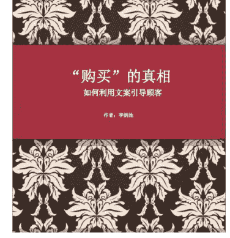

### 2.第二页写上版权声明

#### 版权声明

本电子书是季度姐按照投稿【年赚 6-8 位数的电子书写作秘密】的文章写版。版权归作者所有！未经作者书面许可，不得以任何形式复制、传播、或将本材料的任何部分，否則，追究法律责任！

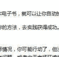

#### 免责声明

我不能保证你读了本电子书，就可以通过自己的赚到钱。

你一定可以通过你自己的方法，去尝试获得成功，我对不会营销这些，也不会为此负责。

我在这里说的只是情况，你可以行动了，但这有逆向的准确测试和实践，或者由于各种原因可能出现，市场环境的变化等等。最后，你可能根本不需要这些，还有可能根本不需要这些。

在你操作之前，请先了解这些，如果你在寻找一种一劳永逸的方法，非要把我们公布的信息都不是你需要的。

·版权所有，翻印必究·

### 3.把“目录”以黑体字置于大纲顶部。

#### 目录

#### 前言

+   1. 世界上收最厚的惊销顾问，怎样但仅仅向领导示范 …… 为客户完美提供以及终身客户的秘密 / 14
2. 值得作者索菲娅——和顾客保持联系，从而使他 们购买的更快 / 15
3. 理查德·韦森——获取更多新客户的 9 个行之有效 的方法 / 16
4. 为什么大多数企业却损失了数千元元的利润——怎 么做才能避免，并获得更多利润 / 18
5. 一个已经证明有强大吸引力的销售方法，让你立即抓 住潜在客户的注意力 / 19
6. 如何在公众广告中吸引眼球，立即抓住顾客的注意力 / 21
7. 在营销邮件中使用一个简单的行之有效的通道，绝对 提升你的销量 / 22

### 4.在目录页下面列出大纲。（前言根据需要随时增加或删 减。如果你只是一个简短的报告，比如只有 1 万字或者 5000 字，你的主题可能只讲述一个问题，不可能有那么多的章节， 那么大纲只需列出你在文章中讲述的一个核心要点,然后做一 个简短描述即可。你可以灵活运用。）

### 5.把大纲字体设置为黑色粗体或微软雅黑。大纲就是你的 章节标题（根据内容需要，可以在主章节下建立子部分，页码

在最后成书后添加）。

### 6.在新页面上再粘贴一份大纲（去掉目录两字）

### 7.撰写电子书就是在每个章节标题下方填写说明文本。

现在，从你收集的素材中，提炼出与每个章节相匹配的内容，不要管前后逻辑顺序，你只需要把与该章节信息相关的内容，复制粘贴到章节标题下面。

收集的素材不能只是某一本书或一本杂志里的内容，要多方面搜集，资料来源可以从网上，不同的书、杂志、报告、文献、专家访谈录等等地方。如何收集素材我们在第四课已经讲过。

接下来，就要使用改编技术。

### 改编校对技术

改编不是让你直接抄袭、剥窃原文内容，而是在不改变原有意思的情况下，用不同的词、句子来改写。改的方面可以是体裁、人称、结构、名词替换等。

简单的说就是“用你自己的话”来表达，比原文更清楚、更容易理解，更有逻辑性。

在改编之前，首先你要仔细阅读文本内容，深刻领会原文的意思。当你阅读几遍之后，你就会心中有数，知道哪个段落应该放在开头，哪段放在中间或结尾，按照前后逻辑顺序的方式来排列。

当你把顺序排好后，就可以改编了。在遣词造句、修辞手法以及篇章结构方面都要与原来的素材有一些区别，长句变短句，同义词替换，重命名，叙述顺序调整，人物、情节必用的增删，结构的变换，不同素材的段落重组合等。

在改的过程中你会有新的思路或想法，可以在句子或段落中加入你的想法。改编就像修改衣服，可以把上衣修改成背心，把长裤改成短裤。用自己的语言，通过叙述和描写，重新组织文章。

最后，你就会创作出符合章节标题的内容。

### 编辑校对

当你编写完成后，由于你对话题的熟悉程度，可能使你不能准确地表达自己的意思。最重要的是，可能会导致你一叶障目，不能全面地看待问题。

所以，你要找另外一个人校对，是最好的选择。如果你雇

倚别人撰稿，你可以自己校对。如果你自己撰稿，你就雇佣其他人为你校对。

请另一个人(甚至不止一个)来校对你的文稿的主要原因，是确保它的可读性。你的读者可能不会注意偶尔出现的错别字 ，但如果你的文字让他们感觉难以理解,他们就会停止阅读。

如果你不想找人校对，那么最好的方法就是使用“李炳池 24 小时法则”，我在“神笔文章”课程中讲到过，把完成的稿件放置至少 24 小时以上。你可以出去活动， 做其他与稿件无关的任何事情。24 小时后，你再回来校对。这样你就能跳出原来的固有思维中，从新的角度来审视。

校对文稿时，请完成三件事：

+   1. 检查错别字、语法和标点符号。
2. 检查可读性——你的信息是否言之有物，是否通顺？
3. 指出看起来似乎不合理或错误的地方。

在 word 里有个“拼写检查”功能，但是，它并不能检查出所有错误，比如说有歧义的说法。

另一个检查文章错误的方法是，从后往前校对。从书的结

尾开始，一步步往前修订。通过这种方法，你就可以检查出因为习惯问题而出现的错误。

任何让读者感到混乱或迷惑的东西，都会影响你的文稿的可读性。没有解答的问题也会影响可读性。在其他人为你校对文稿时，请他记下在文中没有找到答案的问题。如果这个问题和文章内容直接相关，那么这点非常重要。

你不能告诉读者你将在后面的章节中解答某个问题，但是后来却忘记解答了。同样，你不能向读者做出某个承诺，后来却忘记兑现承诺。

对那些并不是很重要的东西，你可以选择删除。你还可以改变措辞，在附录中附上更详细的信息。无论哪种方式，你的目标都是回答你在文稿中提到所有问题。

有的词使用的频率可能会高，如果太多也会影响电子书的可读性。比如，我们这次课程关于电子书，“电子书”这个词就无法避免，但是我在适当的地方，用其它词进行了代替，如“信息产品”。

当你发现经常使用同样的修饰词后，你手边的同义词典就派上了用场。比如，你经常使用“非常的”之类的修饰词，你

就可以找到很多同类形容词供你选择。

### 被大多数人忽略的电子书细节

当你把内容修改完后，接下来，你要考虑的主要方面有：

#### 书名

#### 封面

#### 正文字体、字号大小和行距

#### 章节和子章节标题设计

#### 页眉、页脚的内容和格式

#### 目录格式

#### 制作电子书的格式

#### 定价

我们先看下书名：

#### 书名

书名，就是书的标题。一个好的书名可以大大提升书的销量。书名就是你作品的营销广告语。

你可以使用一个完全原创的书名，或者模仿人们使用过的

书名。例如，“简单快速” 是书名中常用的词。所以如果你的书是关于烤蛋糕的，你的标题可以是“简单快速烘焙蛋糕”。

书名的主要目的是抓住读者的注意力，让他想得到这本书。带有情感色彩的书名比仅

对书籍内容的简单描述更有吸引力。戴尔·卡内基的《如何赢得朋友及影响他人》这本书销售了数千万册。如果他以“人际关系技巧”为书名，他能卖出那么多书吗？我 Wunsch 肯定不会。

有效书名吸引着推动我们行为的基本人类欲望。人人类行为的核心驱动因素，包括：归属感或爱的欲望、控制、安全、改变、认可、成就、成长、自豪、渴望、贡献等。

虽然书名字数不限，但通常，较短的书名比长的要好。原因很简单：标题越短，封面上的字体可以越大越粗，越醒目。如果你书名超过十个字，可以考虑将其分为两部分：标题和副标题。

在这样一个两部分的书名中，主标题通常用来抓住眼球，而副标题更有着重阐述好处。举个例子，几年前我写了一本书《信手拈来：一夜之间改变你的广告》。信手拈来是主书名，到底

是什么信手拈来？紧接着，副标题做个详细的说明，让读者明白说的是什么，看起来更加简洁、吸引人。

**写书名的方法有很多种，下面我给你一个《19个常用的书名模板》，你只要套用即可。详情你在李柄池公众微信 LBC333，回复“书名”两个字即可获得。**

#### 封面

任何电子书的封面都是一个重要的营销工具。虽然它是一个虚拟封面，但是这是读者首先注意到的地方。

你可以找专业的设计师设计封面，或是你自己做也可以。只要你觉得你能让它看起来有吸引力，更能促进销售。（如果你使用有版权 的图片，一定要得到作者许可。）

一个好看的封面、一个好的书名、简介，都将会为你的作品带来人气。尤其是在网上书店销售你的电子书。

下节课程我会讲到如何销售你的电子书，你可以通过亚马逊、当当书店，等网上书店平台注册申请登记，来销售你的电子书。你也可以在自己的网站，微店，公众微信等平台销售你的电子书。

如果你在网上书店销售电子书，你的封面就显得非常重要。当买家搜索特定的书名后，他们看到的是封面的缩略图。这个缩略图必须抓住读者的眼球，即使在小小的缩略图中，你设计的内容也必须清晰可见。

任何图像或文字必须足够大，必须具有足够的吸引力——鲜亮的颜色，令人惊叹的图像和抓住眼球的书名。

有些作者为了得到优秀的封面，不惜花重金请设计师设计封面。你也可以网上搜索“电子书封面制作”有很多在继续制作电子书封面的一些软件。

不管怎么做，确保封面独具特色。读者在搜索到对应类别后，首先看到的就是你的电子书封面。没有大胆的想象力和大量的尝试，你不可能在诸多竞争对手中脱颖而出。

如果你只在自己的客户数据库里销售电子书，想以最小成本设计封面，我建议你访问 http://www.wps.cn 使用 wps 的稻壳模板，他们有各种模板可供选择。

因为使用图片设计，可能需要一些你不具备的知识，或软件。所以，你也可以只用文本。通过不同的颜色、字体和特效，你同样可以设计出一个很好的封面！

再说一次，根据你的项目的性质，你可以有很多选择，甚至可以直接在 word 里进行设计。

封面如何设计我就不再这里详细讲解。如果你想了解封面设计注意的问题，可以在李炳池公众号LBC333，回复“封面”两字即可获得。

#### 正文字体、字号大小和行距

虽然有各种各样的字体可供选择，但有一点很重要，不要使用华丽的字体，会给读者带来阅读压力。一定要容易阅读。你选择的字体非常重要。在电子书中宋体是标准字体，但是你可以不局限于此。还有一些比较受欢迎的字体：黑体、微软雅黑、楷体等等，你需要根据自己的主题来选择。

正文内容字号建议不要小于五号字（10 磅），不要大于四号字（12 磅）。正文中的章节标题字号可以是二号字（20 磅），子标题部分可以是三号或小三号。

行距之间，我建议采用 1.25-1.75 倍行距，2 倍行距就太大了。页边距 25.8MM。这让页面边缘，行与行之间有很多空隙，不拥挤，阅读起来轻松，舒服。

#### 章节和子章节标题设计

章节标题，是每一章的标题；而子标题是一个章节内的粗体标题。章节标题和子标题有助于指导读者阅读材料，将整篇文章分成较短的片段，便于阅读。一般来说，你应该使用短句子、短段落和短章节。

在你犹豫是否将一个很长的篇章分成两章时，选择后者，因为读者喜欢短章节。许多读者想阅读完一章后，休息一会儿，他们不想花很长时间才能读完。

章节字体大小的选择比较自由，虽然 20 磅字体是一个很好的选择。不过，有时候也可以选择 28 磅。你可以自由设计，并选择自己最喜欢的。

从你的封面色彩中，选择一种颜色作为章节标题颜色也是不错的选择。但是如果这些颜色不能为你的书籍内容带来更多“感觉”，让它更美观。那么，你可以不选择这些颜色。

但总的来说，色调一致，可以让你的书看起来更专业。这并不意味着你不能使用同种颜色的不同色调，只要尽量保持同类色调就可以。

#### 页眉、页脚的内容和格式

你的页眉和页脚的作用是，提醒读者自己正在阅读的内容，并使页面显得更美观。页眉采用书名是常用的方法。

同样，你的页眉字体颜色可以从封面中选择。页脚则很简单，只用页码就可以，或者你可能添加更多的信息（比如作者的名字，你的公司名称，等等）。页脚信息尽量保持一行或两行，并且外观要尽可能简单，不要分散读者注意力。

#### 目录格式

目录中字体的颜色，也可以采用你在封面，或章节标题中采用的颜色。你可以混合使用，比如——“目录”这两个大字使用和标题一样的字体，下面具体章节标题，则采用和正文一样的字体。目录的行距，采用单倍行距，并加一个回车最好。如果你有副标题，可以采用缩进行式。再说一次，一定要清晰可读。

#### 制作电子书的格式

PDF 格式是最常用，大家都能接受的格式。或者你直接使用 WORD 格式也未尝不可。Word 转 PDF ,你直接使用 WPS 文档自带的 PDF 转换软件，打开你的 word 文件，点击左上角 PDF 图标就可以转换，很简单。

其它电子书的格式有很多，我不建议你使用。因为过于复杂，还需要下载不同的阅读软件，尤其是我们习惯在手机上阅读，所以非常不方便。

如果你的电子书放在了当当或亚马逊书店，他们有专门的电子书阅读软件。

还有一点要注意，假设你在 Word 文稿中建立了超链接。

仔细检查一遍，如果这些链接失效，你只要选中你想要链接的文本，点击“插入”，然后选择“超链接”，在对话框中选择指定的链接网址，超链接就会出现。当你的文稿转化为 PDF 后，这些超链接依然有效。

建立超链接的主要好处，就是引导读者阅读另一个文本内容——增加额外价值，或者引导读者，关注你的微信，或者你想让读者采取某些行动。

当然，你也可以像我一样，在电子书中释放一些诱饵文章，读者想要阅读，他只需关注我的公众号微信 LBC333，回复设置好的文字即可获得。这种方式，你不仅能给读者带来更多的价值，同时，你也获取了客户数据。你可以看到，在每一讲课程中，我都采用了这种方式。

#### 定价

你应该为自己的电子书定价多少钱呢？首先，你要问自己，你会为一本电子书付多少钱？9元？39元？99元？129元？290元？390元？还是更高？或者0元？

我曾经销售过的电子书价格有99的，有398的，也有上千的，为什么定这个价格？我是根据内容的专业性，和客户数据库的客户购买力来定的。

一本价格低廉的书将会让你失去利润，如果你因为任何理由选择了低价，最重要的是担心因高价吓跑客户，那你就赚不到钱。而超高定价也会损害你电子书销售，因为客户会自动忽视高价，所以定价必须是正确的。你的定价必须绝对有把握。

如何定价？你必须真正研究自己撰写的类型、面对的客户群体，以及市场上同类型信息产品的价格，根据这些数据，你可以设置自己书的价格。

**最后提醒：**把你的所有工作成果备份。一定要保证至少有两份拷贝文件。这将确保如果灾难降临——比如，你的电脑突然崩溃了——你仍然有原稿并且可以很快恢复。

当你把电子书制作好以后，下一步就是如何销售了。下节课程详细讲解如何营销你的电子书，让你赚到钱。

## 第五课 如何营销你的电子书

各位总裁，大家晚上好，我是李炳池！

今天是最后一节课——《如何营销你的电子书》。通过前面4课，只要你认真的按照步骤去做，你就能写出一本电子书。

我们制作电子书的目的，无论你是引流，还是销售，最重要的是如何让更多的读者看到你的销售信息，只有看到才可能阅读或购买。

电子书营销分两步：第一步是发布；第二步是推广。

### 第一步：电子书发布

你要把电子书发布到能够下载的平台上。

- 1. 发布到网上书店。 比如：在当当书店，亚马逊书店，你可以注册你的账户，在后台上传你的电子书，通过审核成功，你就可以销售你的电子书。只要读者购买支付，系统会自动把书籍发到他的后台账户，可以在线阅读或者通过阅读器阅读。

在我开始销售电子书的时候，亚马逊，当当书店还未开通电子书销售平台，如今我们可以在这两大平台上发布，把书名，封面，介绍页设计好，上传电子书，通过审核，就可以看到销售。

在两大平台上销售，他们会收取少量费用。但是，如果你的介绍有吸引力，就可以借助两大平台的流量。每天睡觉都能进账。

- 2、发布到付费阅读平台，像豆瓣时间、百度阅读、BookDNA 等。

BookDNA 是一家在线出版服务平台等。网址：http://www.bookdna.cn。你可以将你的作品提交给 BookDNA，同时选择要发布的第三方平台以及定价。稿件通过审核后，他们将与您签署出版合同。作品上线开售后，你可以直接获得作品销售收益。

还有一个平台叫做“树上微出版”，网址： http://www.shushang.com/ebook

经树上微出版技术转换，不同格式的电子书会第一时间发布到亚马逊电子书城、新华书店电子书城(九月网)、网易云阅读、科博(Kobo)、巴诺(Barnes & Noble)、Tx tr、Scribd、苹果书城等电子书阅读平台，增加作者收入，提高作者知名度。

还有其他一些商家开发的付费阅读平台。你在网上搜索就能找到。

上传到百度文库，豆丁等对外公开阅读的平台上，可以增加你的曝光度。

- 3、上传到网盘，邮箱附件，或者自己网站上（供下载）

最简单的办法，你可以把电子书存到微信或 QQ 的收藏夹，然后通过自己宣传引流，销售。等一会儿，我会详细讲解这种方式。

最早我是建立网站，然后通过提供免费文章，电子报告等信息，吸引潜在客户留下他们的 email,进入我的邮件列表数据库，订阅我的营销通讯。

当我要销售一本书的时候，我就会建立一个单页网页，单页网页实际上就是一封销售信，通过发邮件给订阅我的事通讯的顾客。有时候，我会使用序列邮件的方式，发送 3-5 封邮件后再推出单页网页销售。

如果这本书的价格比较低，或者销售给已经了解、信任我的人，那么就直接发送一封邮件，告诉他们推出了一个非常棒的产品。当然写邮件也是有方法的，你要塑造价值，引起他们的好奇心,然后他们想了解更多销售信息,就需要他们点击链接,进入设计好的单页网页。

在 2013 年,我开通了公众微信,通过公众微信来收集粉丝数据。因为微信沟通互动比邮件要及时快得多,所以后来销售书籍就直接通过公众微信来销售,把销售信写到图文信息里。

当你发布这封销售信的时候,原理跟通过邮件列表发送是一样的。当你有了自己的客户数据,你再销售产品就非常容易,只需要了解这些客户群体想要什么,然后写一封销售信发布出去,就可以收款。

在公众微信中的销售信,你可以在信的结尾放上支付二维码,客户直接扫码支付,然后加你个人微信,把你放在微信收藏夹的电子书转给他们即可。或者,让读者点击“阅读原文”进入微店支付。

- 4、自动发货系统

如果你的订单量大,想全自动化,顾客支付后,自动发货,那么你可以考虑使用自动发货的平台.根据我的经验有三种方式：

#### 1）建立自己的网站，绑定自动发货购物车

如何建立自己的网站，我就不在这里讲解。如果你要建立自己的网站，有一些需要注意的问题，你可以阅读我在李炳池网站 www.libingchi.com 上写的一篇文章“警惕！人们在网站上犯的最大错误”（文章链接：http://t.cn/RSkJ4L0）

建立自己的网站需要嫁接到能够自动支付，发货的平台。下面介绍两种被国际上网络营销人使用的自动营销平台：

##### A、网络营销魔力 网址： www.webmarketingmagic.com

在 webmarketingmagic，有 4 种服务供你选择——自动应答，新手版，基本版，和专业版。他们的服务提供了 50 多种支付方法（包括 PayPal），如果客户的信用卡被拒绝支付，它甚至可以为客户提供备用支付方案。

webmarketingmagic 还提供了广泛的广告追踪、线上和线下支持，无限量的电子邮件自动回复，不需要编程技能，有具体的功能帮助营销电子书。他们为客户提供了无限的带宽，保证了数据的安全传输。

他们还提供了 3.95 美元 30 天的试用服务。但是，他们只有英文版。如果您懂英文就可以使用。

另外，Go Daddy 公司有简体中文版。

##### B、Go Daddy 网址：www.godaddy.com

Go Daddy 中文版，有台湾、香港繁体版，新加坡中文简体版，国内目前还没有，但是我们可以厂家使用，登录速度挺快。

你无需使用 Go Daddy 的网站托管服务，就可以使用的自动支付发货的快速购物车。它们也有一些捆绑服务，你可以选择。或者，你也可以只选择它们的购物车服务，将它添加到你的网站。

作为一个独立的产品，Go Daddy 分别提供了经济版、豪华版和高级版。这 3 种版本的主要差异是，你可以提供的产品数量，空间大小，以及带宽。

Go Daddy 还提供了他们的购物车的分步设置向导。但是，他们不提供电子邮件自动回复。Go Daddy 有这个服务，但是没有直接绑定到购物车中。

访问 www.godaddy.com 网，在菜单栏上选择“线上营销”，就可以了解和使用。

我曾经在网站上跟阿里巴巴签约绑定支付宝付款，客户付款后，自动弹出网页给出下载链接。这也是自动发货的方式。

根据你的需要，你可以选择任何一种自动发货平台，然后把你的电子书上传到这些购物车，和你的网站绑定建立连接即可开始销售。

#### 2）在淘宝店自动销售

使用淘宝店铺平台的旺旺自动回复系统销售。首先，你需要有个淘宝店，在系统设置留言里输入你要下载的链接和密码（把电子书上传到百度网盘）。买家付款拍下后，系统会自动发送下载链接到买家的旺旺聊天窗口。买家直接打开下载就行。

#### 3）使用干聊或荔枝微课平台

我拿荔枝微课举例。荔枝微课平台虽然是一个课程平台，但是根据它的功能我们完全可以利用它来销售电子书。

它的收费听课功能就实现了自动化销售，比如：我在 4 月份第一次在荔枝微课开《下笔有钱》课程，虽然直播课程结束了，但课程可以长期保留在平台，只要有人购买，金额自动打入后台钱包，客户直接进入课堂教学，完全自动化。

通过这种过程，让我想到了不用建网站，把公众微信作为你的网站，把荔枝微课作为自动发货平台，就汽可以实现自动化销售电子书。当然，不仅只是电子书，你的语音，文字，视频都可以实现。

如何操作？很简单，根据我的体验，可以用两种方式：

A、按照正常荔枝微课开课一样，你可以把电子书分成系列课，用文字在后台一段一段发出，只要顾客支付，他就能看到你发布的内容，从而实现自动化；

B、你可以把电子书上传到网盘，然后在荔枝微课里开通此电子书的课程，设置好费用，并且在课堂里提前写好一段简短介绍，告诉此电子书下载的链接和密码，就可实现自动化销售了。

以上讲到的是第一步，发布你的电子书。但是，如果客户无法找到你的产品和服务，那么，即使是最好的产品和服务也卖不出去。

所以，接下来你必须对你的电子书进行推广。

### 第二步，电子书推广

营销电子书的方法有上百种，从长远考虑，你必须打造自己的品牌，获取自己的精准客户数据，粉丝越多，你今后销售就越容易。李炳池现在就是这么做的。如果你还没有自己的公众微信，强烈建议你赶快开通。公众微信的好处我就不多说了。

在你刚开始起步的时候，不要低估最基础的营销方法。

最基础的方法，就是提供与你主题相关的、有价值的免费信息，或电子书的免费试读版发布到网上。比如，百度知道，360问答，文库，论坛，博客上等，这样搜索引擎会抓取，读者在搜索时就会看到，从而为你带来知名度和流量。

如果你是网络营销新手，还不知道最基础的推广方法，你可以在李炳池公众微信：LBC333 回复“基础”两字，即可学习。

你在亚马逊，当当网申请发布电子书，本身这两大平台就拥有数量众多的读者，只要你把电子书的“介绍”写得吸引人，那么你每天将会有一定的销售额。

但是，销售电子书最有效的方式，是向你的公众号微信里的粉丝，或微信好友推送营销信息。因为他们比较了解你、信任你，所以回应率会比你发到陌生潜在群体高得多。根据经验来看，你向订阅用户发送电子书营销信息，可以得到 1%-10%，甚至更高的回应率。

这就是为什么，你最好的营销结果，是向自己的粉丝推广你的产品。

而转换率的高低，有你的销售文案质量决定，如何写好文案？这是另一个课题，我在荔枝微课举办的《下笔有钱》课程，分享了全球 6 位文案大师的写作思维和秘诀，你可以报名学习。

如果你想系统的学会，可以参加李炳池的《神笔文案》线下课程。如何参加？你可以加微信 531111743 咨询。

现在的问题是，如何引流让访客关注你的微信。

引流的方法也有很多，我先介绍两种：

#### 1. 请求转发

你刚起步时，还没有多少粉丝，你可以请求所有你认识的人，把你发布的有价值的信息，比如，文章，简短的电子报告，电子书的试读版，或者是连续几天的微课，或者一个月的免费会员服务。让他们帮你转发给他们的微信好友，来获得你的第一批潜在客户。

还有最快的一种，确定哪些公众微信有你需要的潜在客户，你可以付费给他们，请他们发布你的引流文章。你刚开始可能没有那么多预算，你不要找粉丝量上10万的大号，你可以找比较精准的，有上万的粉丝，或者浏览量上千的号，然后跟他们合作，这样费用少，而且精准度也高。

#### 2、 分销推广

我发现，现在利用荔枝微课，来推广自己的信息产品，是非常棒的选择。他们的支付系统，分销系统非常完善，可以实现自动化。

分销推广有两种方式：

第一种，凡是关注你的微信或者荔枝微课的粉丝，都可以参与分销推广；

第二种，给所有购买你的电子书的人（或参加你的课程的人），提供分销的机会。你可以在客户购买你的电子书后，追 加一条信息，邀请他做分销。

或者，直接把分销方法写入电子书。也可以在你的销售信中提示，他们购买此电子书就有分销的权利。

向客户提供分销机会的目的是，他们通常知道哪些人和自己兴趣相同。为他们提供一个赚钱机会，对他们来说是一个很好的激励，让他们向自己的朋友推荐你的电子书。

这种分销推广，实际上是一种病毒式营销，帮助你转介绍拉客户。举例：客户 A 推荐了 B，B 参加了你的课程，B 也可以去分销推广 C......以此类推，你客户数据就会越来越多。

比如，本课程提供了分销比例为 80%，只要你分享你的邀请码，或课程链接，有人报名你就能获得 80% 的分销提成。这么高的分销比例，就能激励更多人分销，形成病毒式传播。
如何分销？你可以登录李炳池直播间查看 http://t.cn/RS0bmRo，或者扫描下面二维码

另外，荔枝微课他们自己就有上百万的粉丝量，我们完全可以借用他们的数据为自己引流。

我们继续拿荔枝微课举例，在你第一次申请开课的时候，你可以举办纯文字或语音课程，课程可以设置为免费，或者低价收费（收费为了获取优质的潜在客户）。当课程人气超过20人，你的课程将会自动出现在荔枝微课对外公开的课程展示里，如果你的课程介绍吸引人，就会额外给你带来一定的粉丝量。

当你的直播间符合一定的要求（具体要求，需咨询荔枝微课客服），你就利用他们的粉丝量一起合作推广。

营销策略，在精不在多。先选择一种适合你的，狠狠的去执行。

## 通过升级版，赚钱更多利润

经过一段时间的销售，以及你与客户的交流，你可能会发现很多重要信息需要添加到你的电子书中。一些信息是全新的，有些信息则是对之前信息的一个补充。

使用此信息，来更新并发布你的电子书。一旦电子书更新完毕，你就可以适当提高价格，因为它有了新的内容。例如，原来的电子书 20 页，加入新内容后，它会增加到 30 页。你就可以把原来 69 元的价格，提高到 99 元，称之为**升级版**。

读者都想要一些新的东西。他们想要最新的信息，最新的版本。你一定要在封面上说明：“**升级版**”，或者 2.0 版本。在你的销售文案中，也要说明这是一个**升级版**。

我们在看电视剧的时候，你会发现第一季，第二季....等后续推出的升级版。无论任何时候，只要你的电子书内容有点过时，或者你要添加一些新内容，你都应该对自己的电子书采用同样的方法。

你可以在任何章节增加新信息。你也可以为你的电子书再增加一两个章节。

请记住，当你更新电子书的内容时，你也需要更新你的营销材料。利用这个机会，突出你的电子书的新特色，向读者展示购买新版本，他将得到哪些额外好处。

我们在第一课讲到过，**电子书是所有信息产品的基础，你通过电子书就可以开创你的事业。你不只是销售一本电子书，你可以把它转化成不同类型的产品，制作成音频，视频，网络课程，线下课程等等。**

最终，你在本领域的知名度会越来越高，你的个人品牌会越来越强大！

学习很重要，但是学后不用，再好的方法和策略也等于没用。

如果你想真正成为行业专家，你想像杰夫·保罗，杰夫·沃克，乔·维托，罗伯特·艾伦，李焕池，李大庆……等等这些人一样，每天工作4小时，轻松自由的赚钱，每年赚到百万，甚至上千万！你一定要把基础打好，先从你的第一本电子书产品开始，然后一步步的延伸，滚雪球式的，慢慢变得强大。

这是一份事业，你不能急躁，慢就是快，只要你不断的去做，你的影响力，能量会一天天增强，你的收入也会成正比的增长。

我非常相信一句话：一年得起要领，三年必有所成！现在互联网时代，如果你用心去做，很可能“一年得起要领，三月必有所成。”凡事都要脚踏实地的去做，很多人都被快速成功所误导，做事业不能急躁，功到才能成！

希望你听完这次课程后，能够写出自己的第一本电子书，如果你有任何关于电子书的问题，你可以在“年赚6-8位数电子书写作群”里留言，如果你还未加入群，你可以加微信 531111743，验证申请写上“电子书”三个字。我会拉你入群。

如果你想得到我的亲自辅导，我有一个《30 天信息企业家私人辅导计划》，帮助你一步一步、系统的成为真正的“信息企业家”。详情咨询微信：zixun8 ，验证申请填写：“咨询辅导计划”

为了帮助你少犯一些错误，最后，在送给你一个特别的礼物，避免你在写作和销售电子书时犯一些致命错误。这个礼物是一篇简短报告——《避免电子书发售的 10 大致命错误》，
你在李炳池公众号微信 LBC333 ，回复“致命错误”即可获得。

祝愿大家都能够写出大卖的电子书，让你睡觉都赚钱！希望你在“知识付费”时代，把握住这个商机机会，成为真正的信息企业家。

祝你成功!这次课程全部结束，再见，88！
