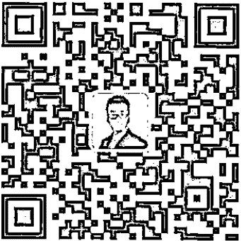
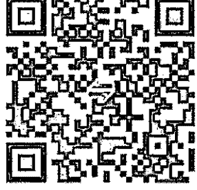

# 广告文案公式

扫描二维码，获取更多资讯

广告文案公式集锦 公众微信 LBC333

# 李炳池销售信导图
LBC SALES LETTER ROADMAP

引题

标题

副标题

子弹/客户评价
(可自选)

日期

问候语

起始段

解决方案

主体部分
证明
可信度
你的产品
(图解+子弹)
独特销售卖点

附加价值

提供折扣
给出理由

赠品

零风险保证

号召购买行动

结束语

附言 ( P.S.)

详细步骤介绍见本集锦第 50 节

# 前言

你有没有注意到，在过去的 100 年里，通过文案销售的艺术不断发展，并逐渐演变成一系列系统化的公式...经过一次次地测试和实践证明，这些公式可以成功地吸引客户，销售产品。

尤其是在我们现在这个年代，一个人的文字表达能力变得越来越重要。因为我们大部分的人际交往都是在不见面的状态下进行的，比如我们通过各种平台传递信息，微信，邮件，QQ，短信，网页文案等等，都离不开文字。

而要写出能够打动人心的文案，并且能够帮助我们销售产品的文案，还真的必须掌握 100 多年来流传下来的文案撰写公式。

世界上最顶级的文案大师们都在使用不同的文案撰写公式，而这些公式都包含在《广告文案撰写公式集锦》这本手册里。

不管你是创业者还是文案撰稿人，《广告文案撰写公式集锦》是你必须掌握的课题。

当你坐在桌前写文案，却发现不知道怎么开始写，不知道写什么才能把东西卖出去的时候，你可以打开这本手册，选择一个适合你的公式去尝试撰写。每个公式都将帮你彻底地弄清楚目前状况，激发你的灵感，满足你的愿望……让你撰写出能创造更多销量的好文案。

如果你是一位专职的文案撰稿人，一旦你的文案能创造销量，客户自然会一次次地雇佣你撰写。

随着经济形式的变化，顾客对自己辛苦赚来的钱，花得越来越谨慎，你需要始终牢记一个优秀的销售信，或网页文案中最有价值的部分就是要掌握不同的文案撰写公式。不管是为你自己，还是为客户，这些公式会引导你朝着正确的方向撰写出吸引力的销售文案。

让我们首先看看 3C 公式...

## 1、3C 公式：简洁明了，引人注意，真实可信

简洁明了——简单易懂——清楚说明你在卖什么。

假如你正在销售度假胜地，那么你在文案前几行应该讨论的就是你的度假胜地。不过，你还应该在文案中说明为什么这个度假胜地这么好。也许它有一种特殊的魅力，能够吸引新婚夫妇来此度蜜月。换句话说，找出所有去这个度假胜地的好处，在文案前几行指明。

引人注意——以最好的状态，讲述一个让人爱不释手的有趣故事——让你迫切地想获取更多信息，或购买产品——“这正是你一直在寻找的，能够解决我的问题东西！”

你可以加上在五年前来这里度蜜月的夫妇的证言，他们诉说自己五年之后是如何又回来重温当年的喜悦。这是一个非常有吸引力的故事。故地重游，让他们感到非常舒适，非常开心，因为他们当年在这里留下了很多美好的回忆。

更棒的是，之前的很多东西都还是原来的样子，更引发了他们的回忆。工作人员依旧记得他们喜欢吃什么，喜欢喝什么，给他们提供了非常优质的，专门针对他们的个人化的服务。

真实可信——不遮遮掩掩，或拖泥带水，解答所有问题，排除疑惑，明确说明需要多少钱。

增加一些精彩的故事，再利用知名媒体的评论增加故事的可信度。

比如，某知名媒体刚把这个经营 5 年的度假胜地评为“最佳蜜月胜地”。你这样顺便一提，就可以极大地增加你的可信度。

接下来，是米歇尔·福丁（一位经验非常丰富的撰稿人）发明的一些让反应率暴增的简单易行的方法。

## 2、简单易行的 5 个文案公式

米歇尔·福丁给出的一些建议如下：

在销售信中添加图片，剪贴画，照片以及其他符合标题的图表。

标题是吸引读者注意力，让他们想要继续阅读的关键，你必须以尽可能最好的方法吸引读者注意力。如果标题无法做到这点，那么，没有人会购买。

在正文加入几张照片，或图表。有些读者真的需要看到正在发挥效果的产品照片，或者你正在提供你销售的服务的照片。

在正文中利用箭头，插图编号，星标，以及任何有趣的小标记，把读者注意力吸引到要点上。

把标题拆分成短小的动态图形……就像幻灯片一样，标题被拆分成碎片，不停地一个接一个地出现，消失。把文案做成动态而非静态效果，这个方法在网页上尤其有效。

福丁还对在销售信中使用什么样的图片，给出了以下建议。遵循下面的指示，你的反应率和转化率将会大大增加，尤其是图片代表：

-   销售信的作者
-   正在销售的产品
-   没有该产品，顾客遭受的主要问题

代表了产品的最大好处

产品使用前后的结果

福丁指出，前两点对目标受众来说，更加重要。比如，如果你正在销售一款特殊的维他命，你想要针对的受众就是那些已经证明有健康意识，想要得到你销售的这款新维他命的所有好处的受众。

你甚至可以添加一位著名医生的照片，证明你所言属实。根据医生声誉价值和你的产品好处的价值高低对比，你可以决定先推广哪个……是医生还是产品好处。

对一些特殊的产品，图片能更好地说明问题，尤其是可以用一系列图片展示产品的使用过程，以及最终结果。可以表现产品或服务的图表或图片效果都非常好。

在图片下方加上说明，讲述图片上发生的故事。图片说明中，还可以增加一款产品好处，促使顾客做出购买决定。还可以考虑使用全景图片库。通过百度或者谷歌搜索全景图片库，你可以找到很多免费图片。

在撰写幽默型的销售文案时，使用漫画，效果就非常不错，因为人们总是能记住让他们发笑，或开心的事情，而且能更好地引导他们购买。找不到适合用来表达你的意思的漫画？你可以雇佣专业的漫画家为你画几张可以展示你的产品或图片的漫画。让顾客发笑。吸引顾客注意力。

福丁创作了自己的一套文案撰写公式，一共有 5 个。他说：“请一定要记住这 5 个文案撰写公式。”

### 1.UPWORDS 公式

UPWORDS: Universal picture words or relatable, descriptive sentences.意思是：通用的图片文字，或可以引发共鸣的描述性文字。

用人们能够轻松，快速地理解，并引发共鸣的文字在人们心里描述一幅画面，讲述一个故事或案例……

### 2.QUEST 公式

QUEST Q:ualify, Understand, Educate, Stimulate, and Transition.意思是：资格，理解，教育，激励，以及转变。

一步步引导读者，为他们提供做出购买决定所需要的所有信息。

### 3.FAB 公式

FAB: Features, Advantages, and Benefits. 意思是：特色，优势，好处。

特色指的是产品或服务中吸引人的特点。优势，指的是你的产品或服务比别人优越的地方。好处，指的是读者使用你的产品或服务，可以过上更好的生活，以及你的产品或服务能够提供的最终效果。

### 4.OATH 公式

OATH: Oblivious, Apathetic, Thinking, or Hurting. 意思是：没注意到，不感兴趣，考虑或受伤

在这里，你向读者指出一些他们之前可能没有注意到自己生活中缺少的东西，或者他们不知道有能够解决他们的问题的方法。当你提出解决方法后，读者就不会再注意不到，或者不感兴趣了。

他有了希望，用你提供的产品或服务，他的情况就会有很大好转。为了解决痛苦，顾客对你的解决方法的需求会越来越重要。

### 5.FORCEPS 公式

FORCEPS: Factual, Optical, Reversal, Credential, Evidential, Perceptual, and Social proof.意思是：事实、视觉、逆转、凭证、证据、知觉和社会认同。

在这里，你提供人们赞扬你的产品或服务的所有证据。证据可以是证言，图片，测试结果，官方文件，以及其他任何可以帮助你让顾客相信你的东西。

## 3、SELWAB 公式

SELWAB（Start Every Letter With A Benefit）意思是：任何销售信都要以好处开头。

目标是，从一开始就吸引住读者，不管是标题，还是销售信开始的几句话。诉说一个你知道目标顾客会非常感兴趣的好处。

告诉顾客你们刚研发出一款新型混合维生素，比市场上一般的维生素片营养更丰富。向关注健康的目标受众展示，你维生素 B 片含有 B 族维生素 100mg，或 100mcg，每天服用一片，能带给均衡的营养，而且能让人一天都精力充沛。你可以指出，和一般维生素含量低的维生素片相比，每天服用一片你的维生素，可以让人精力更充沛，传统的维生素片根本满足不了人体健康所需。

此外，如果顾客在特定时间段内订购两瓶维生素片，他们就可以免费获赠一瓶。不仅如此，还可以获得一张优惠券，在之后购买中都可以使用。

那些想要长期调理身体，保持身体健康的顾客，肯定会抓住机会，尝试这款新产品。这款产品的性能是，每种维生素含量更高。好处是可以让服用它的人，身体更健康。如果它真的和宣传效果一样，肯定会有回头客。

## 4、约翰·福德的自问自答撰写法

有的时候，即使你知道文案撰写公式，比如 AIDA——代表吸引注意 (attention)、引起兴趣(interest)、激发欲望(desire)和呼吁行动(action)——无论如何，你都找不到合适的具体方法。这快让你疯掉了，所以你真正需要的是一个指导你撰写文案的强有力的方法。

约翰·福德，一个有着丰富撰稿经验的著名文案撰稿人，开发了一系列自问自答的问题，通过这些问题，可以让你撰写出一篇不错的文案。然后，你再稍加修改润色即可。

所以，在你撰写短文案的时候，如果发现自己无从下笔，可以试着通过“约翰·福德的自问自答文案撰写法”回答下面这些问题，来撰写你的文案。

### 1、你的产品是目标顾客最需要的吗？

这个问题是指，你要了解你的市场，知道目标受众是谁，你的产品或服务是否正是他们眼前正需要的？

### 2、你的独特的“按钮”是什么？

在这里，你要开始撰写钩子了。你要透露一些信息，吸引读者注意力，让他们正襟危坐，决定继续获取更多信息。发挥创造力，用自己的语言去描述。多尝试几种方法，找到最能吸引潜在客户的方法。

### 3、你有没有用证据来支撑你的钩子？

用具体信息一个挨一个地去支撑你的钩子，为之建立牢固的的基础，让顾客相信他们所到的是真实的信息。这样，你在最后呼吁购买时，他们才会感到安全，可靠。还有一些信息可能不一定能支撑你的钩子，但是你可以把这些小花絮在设计版面时放在侧边栏，或文本框中。

### 4、你的文案是否“高速”？

保持你的文案生动，且至精至简。每个字都应该举足轻重，避免冗余，让你的文案活起来。顾客阅读文案的速度比阅读一般文章的速度都快，因为他们想知道你提供的产品或服务能给他们带来什么，他们想以最快的速度得到它。

### 5、你把“热身”部分剪去了吗？

确保你没有在引导部分使用太多文字。正如福德所说：“在文案开始的前 7 行，甚至更短，就应该提及你的关键点。”

### 6、你觉得催促不好，是吗？

不要太过礼貌，不要犯傻。幽默很好，成交才是最关键的，否则你就可能失去顾客，因为他们太忙了，没有时间听你废话。一旦引导被打断，顾客就会离开。钩子就会失效。

### 7、你是不是太关注自己了？

所有好文案都是直接和顾客交流，就好像你在和那个人对话一样。读者想知道这个销售信是只写给他，只为他解决问题。所以，要开门见山，直截了当。

### 8、你的文案大部分是聚焦在现在以及将来了吗？

过去的就过去了，你的文案应该向前看。你的这款产品或服务能给购买它的人带来什么？他们购买之后，一个星期后，生活能有多么好的改变？两周之后呢？一年之后呢？每个人都有美好的憧憬？给他美好的展望。

### 9、订购你的产品简单吗？是不是你的母亲也可以轻松订购？

也许顾客收到你的销售文案，里面有一个提议，如果他立即在线购买，就实际得到一个免费礼物。顾客立刻决定上网购买，获取礼物。这时，你的订购方式一定要简单，让顾客能够轻松下单。如果有可能最好在支付完成后，自动为客户弹出感谢购买的感谢信。

## 5、12步网络文案撰写公式

如果你创建了自己的网站，或者开通了微信公众号，或者开通了微店，有赞商城等，那么最主要的目的就是吸引顾客或者所吸引粉丝，然后赚到钱。如果你文案没有起到它应有的作用，你什么都得不到。利用图片，图形是非常棒的因素，能够吸引读者的眼球，但是要想成交，你必须立即提供有用的信息。

所以，要想成功，你的网站页面必须包含以下 3个要点：

1.你写的每一个字都应该是有关产品或服务的有价值的信息。

不要浪费时间说其他事情。所有内容都应该聚焦在顾客、产品或服务上，应该包含一切顾客做购买决定所需要的信息。

2.提供免费礼物，或免费订阅时事通讯，来建立你的数据库。

不要仅停留在吸引顾客进入你的网站。在网站上设计一个入口，让顾客留下他们的信息。可以是扫描二维码订阅你的微信，或者注册邮件列表获取免费报告，或其他一些对顾客来说，有价值的东西。通过这种方法，你就可以开始建立自己的客户数据库了。

3.要为购买你的产品或服务提供一套完整且有吸引力的流程。

确保你的文案简单明了，直截了当。在一个页面上，不要销售过多产品。所有内容都聚焦在一款你必须销售的产品上。让你的销售信聚焦在一款产品或服务上。

贾斯汀·舒尔茨，一位具有实战经验的文案撰稿人，开发了一套 12 步网页文案撰写公式，他说这个公式可以“轻轻松松让你你的销售额至少增长 27%。”他的公式基于心理学，以及人类行为学，还有他多年的直接反应广告，以及直邮邮件文案撰写经验。

下面是贾斯汀·舒尔茨的 12 步网页文案撰写公式：

标题——开门钩——产品性能以及好处——USP——信誉度——子弹头——价格，超划算——保证——不要立即下决定——奖励——你不会有任何损失——P.S. =钱

标题——承载你销售的东西中最重要的信息

开门钩——用“钩子”吸引顾客想要继续获取更多信息。

产品性能以及好处——在这里，你需要按照重要性，依次展示你的产品或服务的最大好处，以及重要性能。

USP——最大卖点，其他所有内容都基于此。

信誉度——你的销售基于通过测试，调查以及其他研究中提取的数据。

子弹头——让读者更容易看到你的产品或服务的每个好处以及性能。

价格，超划算——向顾客展示他购买这款产品是如何物超所值。

保证——30天内有任何不满意，可以获得全额退款。顾客知道自己不满意，可以全额退款，就会更容易成交。

不用立即做决定——你有 30 天的时间，来尝试看是否适合你。

奖励——12 小时内购买，你会免费得到一个礼物或报告。

你不会有任何损失——即使你退货，并获得全额退款，你也可以保留我们赠送给你的礼物。这样划算，你还怕什么！

P.S. ——对了，还有一件事——今天购买，你将获得免费参加如何在下个月赚 5000 美元的网络研讨会。

### 最终结果-赚到钱

舒尔茨还说，知道如何击中客户的痛点和欲望热键，可以让成交的可能最大化。虽然不能完全保证，但是，它的确可以增加你的优势。他还指出，如果你随便找几个网站看看，你会发现，99%的人甚至连我的公式中的一半热键都没有击中。这个公式会给你带来巨大优势！遵循这个公式吧！

## 6、10 个魔法标题公式

你的文案中最重要的部分就是标题。花点时间，把标题写好，接下来就顺理成章了。文案的前几行决定着整个文案的生死。因此，写好这部分非常关键，在这部分打动读者，吸引他们继续阅读下面的内容。

米格尔·阿尔瓦雷斯创作了一套自己的标题撰写公式系统。这些公式可以带你随心所欲撰写出自己想要的标题。他的建议是，下面列举的每种标题，你要至少写5个。这样，可以激发你的创造力，引导你思考如何用不同的方式展现你的产品或服务。

### 1.直接陈述式标题

a）世界上最奢华的酒店！

b）加入家庭计划，永久免费打电话！

### 2.问题式标题

a）你是不是厌倦了朝九晚五的工作方式？

b）你是不是经常在找钥匙上浪费时间？

### 3.“如何”标题

a）如何以其人之道还治其人之身，对付美国国税局？

b）如何只投资 25 美元，就能大赚一笔？

### 4.命令式标题

a） 在活动截止前立即购买吧，你可以获得 10%的折扣！

b） 点击这里注册，你就可以得到《如何在 10 个月内快速获得 100 万》的免费报告！

### 5.暗示好处式标题。

a） 吸引新顾客访问你的网站的 5 个方法。

b） 使用 XXX 面霜，30 天内让你看起来更年轻！

### 6.保证式标题

a） 如果你在用本产品的第一个月内没有赚到至少 2000 美元，我们保证全额退款！

b） Splice & Dice 神奇组件，保证为你节省 15 分钟准备早餐的时间！

### 7.巨大折扣式标题

a） 耳钉买两双送一双！

b） 今天买 6 本书，每本只需 1 美元（含手续费和运费），你就可以成为会员！

### 8.个人化式标题

a）劳瑞，如果你今天续签合同，我们保证接下来两年继续给你提供最低价！

b）罗伯特！这个一折子计划就是专门为你设计的，帮你在开业第一周就赚 5000 美元。

### 9. “理由式” 标题。

a）你应该使用” X 净水器 “净水系统的 5 大理由！

b）你必须立即戒烟的 10 大理由！完全和你想象的不一样！

### 10.短小精悍式标题。

a）“如果现在全部结束……。”

b）“结束了！”

## 7、吉尔伯特森的文案撰写公式

针对网页，博客，以及其他展示你的产品或服务的线上文案撰写，和印刷文案撰写有很多相同的必需因素。可能不同之处就在于文案的长度。

一般来说，印刷文案可以是 10-12 页的销售信，因为顾客可以坐在那里，闲暇时候，轻轻松松阅读。而在屏幕上，比如手机上，顾客一般会快速浏览前几段文字，如果你的销售信写得好，他们就会购买。

在这里，我们说的是目标市场，因为销售信读了一半就想要购买的顾客，通常是之前和销售者有过购买经验的。其他顾客则会继续阅读文案，思考自己是否立即购买，还是再等几天。

布雷特·吉尔伯特森说，在你每次撰写文案时需要问自己 5 个重要问题，这 5 个问题就是我经常使用的公式。

### 1.顾客是谁？

顾客就是你要写信给他们的那些人，就像写给某个个人的一封信。从文案的开头，你就要牢牢吸引顾客。要让顾客感觉到你的信是只为他们写的，只为解决他们面临的问题！

### 2.你希望他们做什么？

提前想想最终结果，为什么写这个文案是最重要的。你是不是在销售一款产品，希不希望顾客读完信后向你购买？或者那些之前购买过类似产品的客户，在销售信读完一半后，就直接购买？信件最后的内容，是给那些需要更多信息，才能说服购买的人，可能他们是第一次购买这种产品。

### 3.顾客的问题，需求，痛苦，或欲望是什么？

人们有很多问题，你为了销售产品，需要强调其中的一个问题。你在文案中，向顾客展示这款产品已经解决了某个问题的几个方面，或者更好的是，你的产品同时解决了几个问题。人们一直在寻找能够改变某种状况，解决他们生活中某种问题的方法。

### 4.你的产品或服务是如何解决他们的问题的？

在这部分，你可以给出很多关于产品性能的信息，但是千万不要过多。最好，能额外在文件中插入一个页面，或侧栏，来介绍产品的特别之处。上面只写能够解决客户问题的产品性能。因为，在正文中，过多的产品细节或特征会分散读者注意力，从而难以实现文案的主要目的。

### 5.解决这个问题的.Show？

#### 5.解决这个问题的？

在文案中，应该向顾客展示你的产品是如何解决他们的问题的，在整个文案撰写过程中，要时刻牢记顾客需求。所以，我们可以说一款新型维他命，如果每天服用，可以提供人体健康所需要的所有必需营养元素。这款产品的好处是，人们可以感觉更好，减轻压力，可以让工作时精力充沛，拥有更美好的婚姻，甚至可以让孩子取得更好地成绩。在文案中，要重点突出产品好处。

一定要运用这个公式。

确保你的文案始终以顾客为中心，并为其解决问题。不要一味地吹嘘你或你的公司。现在顾客还不怎么关心你是谁，你的公司是做什么的。如果你的产品为他们解决了问题，他们才会开始关心这些，因为他们想记住你，向你购买更多，或者以便日后遇到问题来找你。

## 8、“放之四海皆准”的 8 步公式

下面有一个非常厉害的小公式，任何时候，当你不知道怎么写文案的时候，你都可以用它。贾斯汀·布鲁克在写文案遇到问题时，都会用这个 8 步公式来解决。

### 步骤 1：标题——没有什么是比标题更重要

经常查看销售信或广告中的优秀标题，并把它们收集起来，是一个非常不错的主意。把不同的标题按照产品类别，以及标题类型进行分类，这样你就能在写标题时，轻松找到你需要的。

事实上，你可以做一个游戏，对你收集的每个标题，都尝试想出 5 个不同的标题。你永远也不能和别人用一模一样的标题，但是你可以改编它，把它改成你需要的，而不必直接使用别人的标题。你可以问自己两个问题：“这是什么？”“对我有什么用？”你的标题一定要简短，切中要点。

### 步骤 2：不要浪费他们的时间，要直击要点

直击要点，抓住读者的兴趣。把顾客试图解决的问题列举出来，然后在下一个部分，展示你的产品如何解决这些问题。

### 步骤 3：像和朋友一般轻松交谈

确保文案轻松，友好，就好像你正在和你最好的朋友谈话一样。把它想作只是一个朋友，而不是你的销售信要到达数千的顾客那里。

### 步骤 4：用你的产品为他们解决问题

一点一点地确切说明你的产品将会如何解决他们的问题。通过子弹头来强调、展示他们购买了你的产品后，生活会变得多美好。

下面是你的文案结尾应该包含的两个重要子弹头：

#### 赠送子弹头：

这是最后一次吸引顾客购买的好办法。在这里，你赠送一些和产品相关的有价值的东西。这可以让顾客放心，他们得到的东西绝对物超所值。这个子弹头放在其他子弹头后面。

#### 连环出击子弹头：

这是强调产品好处价值的一个非常棒的方法。那就是在好处后面回答“那又怎样”。比如，你可以说“我喜欢旅行摄影，通过它我可以赚很多钱（这样，我就可以住最好的宾馆，享受最美味的食物和服务）。”

注意：子弹头的第一个字和关键词都要加粗，而且永远不要使用句号。

### 步骤 5：你有什么证据

通过不同的形式使用证言，比如电子邮件截图，微信对话，视频，以及其他形式，都是成功展示证据的方法。在文案中，销售策略中，使用多少证言都不为过。

### 步骤 6:寻求成交

成交部分向顾客展示和购买其他相似，价格却更高的产品相比，购买你的产品或服务，能获得的巨大价值。同时，再加上一个保证，比如 30 天退款保证，或其他可以让顾客觉得购买你的产品他们绝对不会吃亏的附加价值。你还可以增加一些限时赠送的价值，过了某段时间，就不再提供。

### 步骤7：你要呼吁人们购买

这部分是压轴戏。在这部分，你要呼吁人们购买。告诉他们如何支付，如何轻松拿到产品，尤其是可以下载的信息产品。一旦支付，立即就会弹出下载链接。只要用鼠标轻点链接，点击“保存”，顾客就会拿到产品。

或者，如果你销售的是需要邮寄的产品，你可以给顾客两个选择：免费普通快递，或支付差价，选择第二天就可以送达的加急快递。

如果你不知道怎么呼吁人们购买，那么就学习不同的销售信，网页文案，以及其他一切诱惑你做出购买决定的销售信息。用同样的方法（不要直接照搬），你就会成交了。

### 步骤8：尽可能快速地总结一下

在这部分，快速地对前面提到所有的内容做一个简洁明了的总结。如果篇幅或时间有限，这是最后你最后一次提醒顾客你的产品好处，折扣或礼物的机会，最后再加一个能够促使顾客做出购买决定的理由。

## 9、卡尔顿的 9 步公式

### 1、确定顾客是谁？

这个信息来自调查，来自包含每个客户的信息数据，来自市场调研报告，和其他包含把产品销售给特定顾客群信息的材料。

### 2、问题是什么？这个问题对顾客的生意造成了多大的伤害？

在这里，根据你的产品或服务，分析是什么给顾客带来了这么多麻烦，向顾客展示他遭遇的问题。

### 3、他们在寻找什么方法，为什么之前的都拒绝了？

描述你为了最终找到最合适的解决方法，做出的所有尝试。包括之前做过的所有失败的测试，主要目的是告诉顾客不要浪费时间重蹈覆辙。

### 4、为何他们选择我们的产品作为解决方案？

在这部分，你要展示最终经过测试的结果，并说明这个结果超过了其他所有测试过的可能的解决方案，以及为什么其他可能的解决方案没有达到所需的标准。

### 5-描述产品的使用过程，包括他们是如何解决问题。

在这部分，你可以添加证言，测试调查，数据，以及任何能证明这款产品有效，甚至都能解决之前没有预料到的问题的最终结果。

### 6-顾客能把这款产品用于何处，以及如何使用？

证言用在这个地方效果会非常好，因为根据业务性质，以及问题本质，每个顾客会有具体的问题要解决。

### 7-结果是什么？他们得到的好处是什么？

在这里，你可以展示用了你的方案，顾客的企业发生了怎样的转变，并详细描述你的方案是如何一步步解决他们的问题的。

### 8-他们会把你的产品介绍给其他人吗，为什么？

再说一次，在此处使用证言和调查，强化你的解决方案的特征和好处，为什么效果非常棒。

### 9.要求顾客采取某种措施。

顾客已经清楚你所列举的所有事实，现在你需要要求顾客进一步做什么，给予他们指令，来达成你的目标。

## 10、詹姆斯·文森特 9 步公式

撰写网页销售信，为了成功促进反应率，你不能漏掉一些关键因素。詹姆斯·文森特（《12 个月从 0 到 100 万》作者），介绍了他在工作中常用的 9 步公式。

### 1.标题

标题由 3 部分因素组成：前标题，主标题，后标题。前标题用来吸引读者，让其忍不住想继续往下读；主标题提供巨大卖点或好处，激发读者产生兴趣；后标题清楚解释前两部分。

### 2.故事

讲述能够抓住读者情感的故事，引导他们了解你提供的能够解决故事中提到的问题的产品或服务。你在故事中提到的问题也是读者的问题——他们看到故事会联想到自己，把自己当作故事的主角。

### 3.信任度

在这部分，你需要给出证据，不管是数据，证言，报纸以及杂志评论，商业杂志特载，还是测试结果，等任何能够增加读者的信任的东西。如果你有专业知识，技术，以及证书，这些可以支撑你对产品或服务的提议，也可以作为证据呈现给读者。

### 4.好处

用子弹头表示好处，可以让读者一目了然，让每个子弹头都起到举足轻重的作用。

### 5.规格和性能

这一步，你可以给出更多产品或服务的技术细节，强化你之前提到的产品好处。

### 6.奖励

顾客在特定时间购买，还可以额外提供一些奖励，给顾客额外价值。可以是提供额外信息的免费报告，相关 VIP 俱乐部 3 个月的免费会员等。

### 7.塑造价值

通过展示产品如何能让顾客的生活更美好，更便捷，更安全，更幸福，让你的产品或服务的价格看起来合理，物超所值。说产品数量有限，或只在某段时间提供，是增加压力的一个好方法。告诉顾客产品在明天凌晨之前有某种折扣，或不再对外销售。确保让顾客知道如果他们不立即购买，会损失什么。

### 8.订购

详细指引顾客如何购买，还要让顾客的支付方式简单便捷。提供支付宝、微信支付等，同时也要保留准确的在线交易记录。

### 9.附言

在附言中，对之前的内容进行一个总结，最后一次呼吁购买或预定。

## 11、USP 公式

### 1.标题中一定要体现好处，文案开头几句要体现销售主张。

这可以吸引读者想更多地了解这对他们有什么好处，从而想要继续阅读。

### 2.向读者说明产品的独特性，把它和竞争对手的产品区分开。

这可以让你的产品或服务，在众多同类产品或服务中，脱颖而出，承诺可以用独特的方式解决顾客的问题。

### 3.你的独特主张必须能够推动销售，说服顾客转而向你购买。

而且，影响的受众要足够多，而不只是影响一小部分受众。

你可以学习一些非常经典的广告。并标出这些广告中有多少遵循了这 3 个特征。看得多了，读得多了，你就可以用这个公式创作自己的广告。

## 12、克莱顿·梅克皮斯公式

吸引他们的眼球：用标题吸引读者的注意力，促使他们继续阅读。

支撑标题：用有力的论点支撑你的标题，强化要点。

用好处诱惑他来读：让读者知道他们接下来会学到什么，以及如果他们继续阅读，你计划给他们哪些额外好处。

让他心潮澎湃：用富有创意，且充满感情的故事，激发读者的情感。

让他相信：一定要加上使用者的证言，科学测试的数据以及报告，或其他一切可以增加信任度的因素。

回到正题，言归正传：向读者展示这些好处如何可以帮到读者，并集中展示效果。

提出提议：再次强化标题好处，并加入其他辅助好处，向读者展示这款产品定价多么实惠。

减轻风险：你可以在这里加入保证，比如30天内全额退款。这让读者相信向你购买没有危险，因为他们如果对结果不满意，就可以看到全额退款。

总结：在这里，你再次重申关键信息，并呼吁购买。尽可能简化购买流程，让顾客能够轻松购买。他们可以通过填写线上订购表购买，或拨打免费电话购买。简单描述顾客使用你的产品或服务，和不立即购买你的产品或服务之间的差别。

增加有利条件：在这里，你可以加上一个奖励，如果 24 小时内购买就可以得到。或者如果购买第二件可以享受折扣。

增加紧急因素：增加一个时间限制，并给出为何有限期限的合理理由。可能过会就要通过某个法案，法案一旦通过，顾客就没有办法以这么低的价格购买到该产品了。顾客必须立即订购，才能享受折扣，或其他优惠。

## 13、AIDA 公式

A.I.D.A代表：吸引注意(attention)、引起兴趣(interest)、激发欲望(desire)和呼吁行动(action)

第一步，吸引注意，这是文案的开始。一个吸引人的标题，吸引读者放下手中的事情，集中注意力阅读你的文案。标题中的内容告诉读者，这正是他们一直以来都在寻找的东西，现在他们需要继续阅读，获取更多信息。此外，还需要有一个独特的钩子，把你的产品或服务和竞争对手区分开来。你的产品或服务一定要独特！

第二步，引起兴趣，给读者提供更多信息，并且给出更多有关产品或服务的细节作为回报。在这一步，你通过加入钩子来增强吸引力，减少失去读者的可能性。

在这一步，提供产品特征和好处，并把这两者区分开很重要。比如，冰箱的产品特征可能是，它的体积有 0.2 立方米，但是这个性能的好处是，内部存储空间更大，可以比以前存储更多食物。

第三步，激发欲望。在这一步，你开始引入情感因素，让读者开始喜欢上你的产品或服务。读者有一些无法摆脱的烦恼，比如，某种需求，欲望，绝望，缺少感，只有立即购买这种产品或服务，才能摆脱。一定要时刻让读者知道，你是为了读者才写的这篇文案，而不是为你自己。一定要聚焦读者。

最后一步，呼吁行动。呼吁读者需要采取的行动——购买你的产品或服务。在这一步，你一定要记得呼吁行动。向读者展示购买你的产品有多么轻松，给读者提供多种支付方式。让购买变得尽可能简单。如果购买流程繁琐，你很容易就会失去潜在客户。

下面是 AIDA 公式的一个实际应用示例。目标顾客为离职工作人员。

吸引注意：最近离职了，需要一份新简历？我可以帮你！

引起兴趣：如果已经有简历了，我可以以较低的费用帮你检查，并给你提供一些建议，为你节省费用，找到更合适的工作。当然，我也可以快速给你重新制作一份！（好处）

激发欲望：（好处）如果你在未来 24 小时介绍新顾客给我，一旦成交，你会获得更优惠的价格，甚至免费给你修改或撰写....

呼吁行动：请填写这个表格，并以附件的形式发给我，我会马上回复你。

使用这个简略公式，你就可以在初稿阶段就能撰写出一封成功的销售信。

## 14、引起读者购买的 51 个原因

为了销售你的产品或服务，你必须知道读者为什么购买。了解人们购买的原因，能够帮你写出真正优秀的文案，因为你可以把握读者的情绪。下面是可能引起读者购买的 51 个原因。你的文案可以一次击中其中任何一个或多个原因。

### 人们为什么购买

- 1. 为了赚更多钱——尽管钱买不来幸福
- 2. 为了更舒适，即使只是一点点
- 3. 为了赢得赞美——因为几乎所有人都喜欢被赞美
- 4. 增加快乐——工作，生活，一切事情
- 5. 拥有美丽的东西——因为美丽的东西可以荡涤灵魂
- 6. 避免受害——没有人愿意受害——没有人愿意一直依赖别人
- 7. 让工作更轻松——这是很多人不变的需求
- 8. 提高工作效率——因为人们知道时间非常宝贵
- 9. 与左邻右舍攀比——生活中，每个人都有左邻右舍
- 10.为了感觉富裕——少见，但是非常有效的购买理由
- 11.看起来更年轻——富有青春活力更让人喜欢，让人尊敬
- 12.为了更高效——高效能够节省时间
- 13.购买友谊——我不知道友谊还能购买，但通常可以
- 14.避免辛劳——因为没有人想太过劳累
- 15.远离或避免痛苦——抓住这点，很容易成交
- 16.保护自己的财产——因为那是他们辛辛苦苦才得到的
- 17.紧跟潮流——因为很少有人愿意落伍
- 18.避免麻烦——麻烦永远不讨人喜欢
- 19.获得机会——因为机会是通往美好事物的大门
- 20.表达爱——最高贵的购买理由之一
- 21.娱乐——因为娱乐通常让人开心
- 22.有条理——因为条理让生活更简单
- 23.安全感——因为安全感是人类的一个基本需求
- 24.保护能源——他们自己的，或他们的能源来源
- 25.被接纳——因为被接纳意味着安全，与爱
- 26.节约时间——因为他们知道时间比金钱更值钱
- 27.为了更健康，身材更好——对我来说是一个很容易成交的理由
- 28.吸引异性——永远不要低估爱的力量
- 29.保护家人——这是人的另一个基本需求
- 30.模仿他人——因为这个世界上有太多的偶像
- 31.维护声誉——因为他们的声誉是自己千辛万苦建立的
- 32.为了感觉更优越——这是为什么人们对象征地位的东西趋之若鹜
- 33.为了赶时髦——因为他们知道自己的朋友会注意到
- 34.找点刺激——因为人们想在单调乏味的生活中寻求一点刺激
- 35.更好地交流——因为他们希望自己能够被理解
- 36.为了保护环境——善因营销
- 37.满足某种冲动——大部分购买都是因为这个原因
- 38.省钱——14%的人购买都是为了省钱
- 39.更干净——因为不干净就可能不健康，不被人喜爱
- 40.更受欢迎——因为被接受总比不被接受好
- 41.为了满足好奇心——好奇害死猫，但是却促进了销售
- 42.满足食欲——因为挨饿不是一件好事
- 43.为了更有个性——因为我们每个人都是一个个体，都需要被肯定
- 44.逃离压力——这个还需要我解释吗？
- 45.为了更方便——因为简单让生活更轻松
- 46.为了增长见识——因为让人觉得自己浅薄，是一件恼人的事情
- 47.赠送他人——这是荡涤灵魂的又一个方式
- 48.为了更年轻——因为年轻意味着充满活力和朝气
- 49.追求爱好——因为只工作不玩耍，聪明孩子会变傻。
- 50.为后世留个遗产——这是永生的一个方式
- 51.为了避免痛苦——不管是精神上的，还是身体上的

## 15、吸引顾客的 29 种方法

最近，一位客户打电话问了我一个问题，这个问题我之前遇到过多次。

他说，他的总经理要求他撰写的广告文案要提高品牌知名度，树立形象。而他的主管却要求广告要吸引新的顾客进来。有没有什么方法可以在不破坏基本宣传理念的情况下，并能增加吸引新顾客的力度？

答案是肯定的。有一些已经证明有效的方法，可以用来增加任何广告文案吸引新顾客的威力，不管你的广告的主要目的是吸引新顾客，还是树立企业形象。下面是你可以使用 的 29 个方法：

- 1. 呼吁行动。告诉读者打电话，发邮件，关注微信，索取资料或下单。
- 2. 提供免费信息。比如，目录册，指导手册，报告等。
- 3. 描述你的手册或目录。谈谈它的独有特征，比如，精心挑选的图表，计划指导，安装技巧，或其他有用信息。
- 4. 展示你的手册或目录的图片。
- 5. 给你的手册或目录起一个暗示具有高价值的标题。“产品指导”比“目录册”更好。“计划指导”比“销售手册”更好。
- 6. 在文案的最后一段，加上你的地址，最下方附上你的 LOGO，字体要清晰，易读。（如果有优惠券，把地址和 LOGO 都加在上面）：
- 7.在广告中，加上免费电话。
- 8.免费电话用特大号字体显示。
- 9.在电话号码前加上一个小小的电话符号。并且写上一句话：“请拨打免费电话。”
- 10.设置一个热线电话。比如，销售过滤器，可以设置一个热线电话。顾客可以拨打这个热线电话下订单，或者获取更多产品信息。
- 11.使用优惠券。它会让你的反应率增加 25%-100%。
- 12.如果是线下宣传，广告刊登在纸质媒体上，优惠券要足够大，让读者有足够的空间填写自己的姓名和地址。
- 13.给优惠券添加一个标题，引导积极行动——“是的，我想节省 50%”
- 14.给读者多种反应方式——“我想看示范，” “我想得到销售顾问的电话，” “关注微信，给我附加一个免费指导。”
- 15.对于小广告（半页或更小），在广告周围加上加粗黑框。可以给人营造一种优惠券的感觉，从而增加反应率。
- 16.在小广告的最后，加上一句“要想获取更多信息，请马上关注微信：LBC333（你的微信号）。”
- 17.使用直接标题——直接承诺好处，或强调赠送免费信息——而不是拐弯抹角。
- 18.在标题中，可以提及免费赠送小册子，报告，选择指导等。
- 19.提供免费礼物。比如，与你产品相关联的物品，或者产品样品等。
- 20.提供免费咨询，分析，推荐，研究等。
- 21.谈论免费赠品的价值和好处。你越强调它的价值和好处，你的反应率越高。
- 22.在文案的副标题中强调免费赠品。如果没有更好的主意，你的副标题中也可以说“免费获取真相。”
- 23.在两页广告中，可以在文案两边的侧栏中，分别描述你的提议。
- 24.如果刊登在杂志上，确保你的杂志广告中包含读者服务热线。
- 25.使用文字或图形特意指引读者拨打读者服务热线。比如，用箭头指向免费电话，用文字说明“要获取更多信息，请拨打下面的读者服务热线”。
- 26.可以考虑使用多个读者服务热线。比如，如果读者想获取更多信息，可以拨打一个热线，如果想立即购买，可以拨打另一个热线。
- 27.在同时销售多个产品的整版广告中，对每个产品或特载文章，使用不同的读者服务热线。
- 28.测试不同的广告。跟踪记录每个广告吸引的新顾客数量。然后，只发行吸引新顾客数量最多的那些广告。
- 29.找出你吸引顾客最多的广告中的销售吸引力，关键好处，或主题。在之后的广告中，重点突出那个主题。

## 16、SEO 文案撰写 7 步公式

这是一个已经证明有效的 SEO 文案撰写方法，可以帮你撰写出以读者——你的潜在客户为核心的说服力极强的销售文案。最终结果：排名更高，吸引更多潜在客户。

1. 关键词搜索——确定你的网站上最终要优化哪些关键词。
2. 关键词选择——从第 1 步中确定的关键词列表中，选择一个我们撰写网页需要优化的关键词。这个关键词应该和该页面的文案主题密切相关。
3. 为读者呈现有说服力的文案——就应该这么想——暂时忘掉搜索引擎。你的初稿应该是你可以写出的，最有力，最自然的文案，100% 聚焦目标受众。
4. 给文案增加关键词——现在重新回到文案中，有选择的尽可能多地插入关键词——但是不要让文案读起来生硬，不自然。如果插入关键词，会破坏你的文案，那就不要加这个关键词。保持句子原样。

不要在意那些严格规定插入多少关键字，在哪里插入关键词，或者频率要多高。我强烈建议，在不影响文案威力的前提下，我们可以在标题……第一个句子……最后一个句子中插入关键词，当然，如果合适，也可以在段落中间插入关键词。
5. 撰写源代码——这个是网页代码部分。撰写源代码的步骤是：

标题标签（Title）：这是源代码中最重要的部分。标题标签是你的网站访问者在点击进入网页前，在他们的浏览器最上方看到的内容。字数保持在 10 个字左右最好，一般不超过 80 个字符。理想的标题标签应该以关键词开头。

比如，与其说“李炳池，直接营销导师”，不如说，“直接营销导师，李炳池”。

关键词标签（KeyWords）：在这个标签中插入网页关键词，以及其它任何相关的关键词。一般不超过 100 个字符。

描述标签（Description）：这是用户在搜索结果页中看到的内容——最多不要超过 200 个字符。
6.发布网页——吸引用户访问该网页……最重要的指标是，我们优化的关键词网页在搜索引擎上的排名。
7.监控并调整——不断跟踪网页排行……如果它的排行低于你的预期值（理想情况下，是该关键词中排行前 5），做出调整，查看是否能够让排行上升。

## 17、撰写标题的 38 种方式

在文思枯竭时，获得标题撰写灵感的最好方法，就是在坐下来查看你搜集的成功标题文档库。

下面是我从我的标题文档库中，选取的一些非常实用的标题集锦，该集锦根据类别组织，一目了然，非常方便使用。

### 1.在标题中提出一个问题
“管理者应具备哪些素质？”

### 2.关联时事
“外媒调查称 53%受访者认为中国经济存泡沫”

### 3.创造新术语
“新型‘极化油’磁性般吸附在机器零部件上，使用寿命延长 6 倍。”

### 4.对新产品使用“新”，“隆重推荐，”或“宣布”
“清华大学宣布研究成果 饿死癌细胞或成可”

### 5.给读者下一个命令——告诉他们采取某种行动
“试着烧一下这个优惠券”

### 6.引用数据
“谁听说过一棵植物上开了 17000 朵花？ ”

### 7.承诺提供有用信息
“在你购买房子时，如何避免犯这些大错误。”

### 8.强调提议
“现在你可以订阅目前最好的新书了——就像订阅杂志一样。”

### 9.讲故事
“当我在钢琴前坐下时，他们笑了……但是，当我开始演奏时……”

### 10.提建议
“你现在必须拥有的 5 支科技股。”

### 11.列好处
“管理 UNIX 数据中心——曾经很难，如今很容易。”

### 12.做对比
“如何解决废气排放问题——比传统文丘里洗涤器节省一半能源。”

### 13.使用能引发读者想象的文字
“为什么有的食物可以在你的胃里‘爆炸’。”

### 14.用证言
“虽然 AVBLEND 使用超过一百万英里，我们的产品也没有突发过凸轮轴故障。”

### 15.提供免费的特别报告，目录册，或小册子
“免费报告——揭露亿万富翁们是如何赚到第一桶金的秘密。”

### 16.简洁明了地直接陈述销售提议
“XX 护眼罩——电脑办公者首选”

### 17.唤起读者的好奇
“你必须拥有一支网络股。提示：一切并非你所想的那样！”

### 18.承诺揭露一个秘密
“揭露华尔街的秘密”

### 19.要具体
“在时速 60 英里时，这辆新型劳斯莱斯最大的噪音来自电子钟。”

### 20.针对特定类型的读者
“我们在寻找写儿童书籍的人。”

### 21.增加时间因素
“只需 3 分钟，就可以看到这篇经典报告。”

### 22.强调节约成本，折扣或价值
“现在，只要 69 元，你就可以获得价值 2999 元的超值营销通讯，价格简直低得难以置信！”

### 23.给读者提供一个好消息
“不管多大年纪，你都可以拥有更好的听力。”

### 24.提供另一种产品以及服务的替代品
“没时间上耶鲁？参加我们的在家进修课程吧”

### 25.提出挑战
“你的头皮能经住指甲测试吗？”

### 26.强调保证
“使用我们的软件，可以让网速提高 6 倍，否则退款。”

### 27.说明价格
“只要 2395 元——就可把苹果电脑带回家。”

### 28.制造一个看似矛盾的话题
“通过 ‘内部交易’ 获利——100%合法！ ”

### 29.提供读者在别处找不到的独家产品或服务
“想长期获得顶级商业资讯，唯有关注合赢岛。”

### 30.强调读者关心的问题
“为什么大部分小企业破产了——你该怎么做。”

### 31.听起来很疯狂……
“听起来很疯狂，R&D 这个小公司今天卖 2 美元的股票，在不远的将来，可能增长到高达 100 美元。”

### 32.做一个巨大承诺
“让你年轻 20 岁！ ”

### 33.展示购买你的产品的投资回报率
“雇佣到错的人，消耗的成本相当于你支付给他们薪水的 3 倍。”

### 34.使用 “理由式” 标题
“全国各大广告公司拍摄重要的广告时，更喜欢 Unilux 闪光灯的 7 大理由。”

### 35.回答有关你的产品或服务的重要问题
“在 geschehen X 之前，你应该问的 7 个问题……及其答案。”

### 36.强调你的赠品的价值
“免费获得——现在下单，你就可以免费获得价值 720 元的礼物。”

### 37.帮助读者达到一个目标
“现在你可以在 30 天内，就能制定出突破性的营销计划……不用花一分钱！”

### 38.做一个看似矛盾的承诺或陈述
“不用空调——让你的任何房间迅速降温！”

## 18、盖瑞·本茨文加的 5 步公式

在直接营销中，如果你的文案不遵循说服力的公式，它就不会有效……不管你多么有创造力。

在盖瑞·本茨文加的文案研讨会上，他教授了一个 AIDA 公式 的变体，被称为 “激励顾客的公式。” 这个公式中，一共有 5 个步骤，分别是：

### 步骤 1：吸引注意
推广活动要做的第一件事，就是必须引起潜在客户的注意。必须吸引潜在客户停下来，开始阅读你的信息，而不是关掉你的网页或者把你的邮件扔进垃圾桶。

你已经知道很多引发关注的方法，每天也能看到很多这些方法的应用。在电视、网络或杂志广告中，从软饮料，汽车，到饮食，健身方案等，也有一些商家通常用 “性” 来吸引关注。

你可以做个大胆地陈述……引用惊人的数字……提出能激发好奇心的问题……利用某些物件……或使用弹出框等。

### 步骤 2：确定问题或需求
很多产品都会满足潜在客户面临的一个需求或解决一个问题。

但是，潜在客户看到你的推广时，可能恰好正思考着这个问题对自已造成的困扰有多大？可能不是很大。

因此，你要做的第一件事，就是让潜在客户的注意力集中在你要强调的需求或问题上。只有这样，你才能和他们谈论解决方案。

比如，如果你正在销售一款经济实惠的办公电话系统，开始不要谈论你的系统，你可以说：“你是不是厌烦了高昂的长途话费？”

### 步骤 3：解决方案
一旦你把潜在客户的目光吸引到了问题上，下一步就是把你的产品，或服务定位为问题的解决方案。你的产品或者服务就是这个问题的解药。

### 步骤 4：证据
你说你的产品好，如何让我相信？，顾客心中会问：“为什么我要相信你？”

回答这个问题，你就要用证据说话。证据分两类。

第一类，树立可信度。让潜在客户相信你，你是一个有声望的公司或个人，值得信赖。比如：在医生的办公室墙上挂着著名医学院的毕业文凭，或者其他证书等，就是用证据增加可信度的一个例子。

第二类，和产品有关，让顾客相信，你的产品确如你所言。客户证言，之前的案例，评论，性能图，测试结果，都是这类证据。

### 步骤 5：行动
最后一步是呼吁行动。你的目标通常是吸引顾客做出反应，咨询，或下订单。

比如：“赶快点击这里，输入你的邮寄地址，你就能获得‘享有 30 天退款保证的，无任何风险’的 XX 产品。”

“马上回信，你就可以免费获得 XX 指导手册。”

我相信，在你原来的销售文案中，也肯定都遵循了激励顾客的公式……即使你以前从来没听说过这个公式。

这是因为你能够感觉到该如何销售，这种感觉指引着你根据激励顾客的步骤，组织自己的销售文案。

所以，如果你凭直觉就能够销售，那么 AIDA 公式，激励顾客的公式，或其他说服力公式有什么作用呢？

答案是：把公式摆在眼前，你可以更有意识地用正确的顺序，充分地使用这五个步骤……并确保没有遗漏任何一步，或有哪一步做的不充分……从而增加你撰写出制胜文案的几率。

## 19、选择赠品的 4 个要素

如果你了解直接营销，并且在网站 libingchi.com 看过我的营销通讯（公众微信号：LBC333），你就知道提供赠品能极大地增加反应率。

在选择赠品时，我们应该考虑 4 个最重要的要素：价值度，新颖度，相关度，以及吸引度。

### 1.价值度
一个好的赠品要么有较高的感知价值，或者有潜在客户无法确定的价值。最糟糕的赠品是潜在客户觉得价值很低的东西。

比如：一个著名的金融专家，发行了一系列最新的金融报告，对早期订购者，每个报告都附加有不同的赠品。

效果最好的赠品之一就是这位专家提供金融建议的视频。

效果最差的赠品之一就是提供一副印有这位专家照片的扑克牌。

为什么扑克牌不是很好的赠品？其中一个原因就是感知价值低。你用 2 元就可以在超市或文具店买到一副扑克牌。因此，这个扑克牌赠品的感知价值只有 2 元。

相反，视频的感知价值就比较高，因为这位专家是收费很高的投资顾问，这个视频的内容相当于免费进行 1 小时的“咨询”，平时光咨询 1 小时都要收上千元。所以，这个视频会让客户感知价值更高。

### 2.新颖度
如果我们能够提供顾客感兴趣的独家特别报告，是一个非常有效的赠品，因为它是独有的：顾客在别的地方找不到。

换句话说，提供畅销书作为订阅赠品，效果通常不好，因为这个赠品随处都能获得：如果赠品是畅销书，那读者已经拥有它的可能性非常大——即使读者还没有，他也可以在附近的任何书店买到，而不用订阅你的出版物。

美国《广告时代》杂志有一个订阅赠品做的非常成功，它的赠品是一个咖啡杯。当然，咖啡杯也是你 znam 可以随处都能买到的一个普通商品。

但是，巧妙的是：咖啡杯上的艺术图案就像《广告时代》的封面。每个咖啡杯都激光打印着一个标题，其中还有订阅者的姓名，比如“XX 荣获了《广告时代》广告天才奖。”

### 3.相关度
与销售的产品相关、互补或是顾客有欲望想要得到的值。这这种赠品通常能促进顾客快速购买。比如：“买电脑送电脑桌，买房子送家具，买洗衣机送洗衣粉，买咖啡机送咖啡豆，等等”。

### 4.吸引度
赠品的吸引度越高，对你的推广做出反应的潜在客户就越多。

我看到过一个提供海外资产保护的金融通讯。如果你订阅了他们的通讯，他们会为你开一个瑞士银行账户！

提供瑞士银行开户作为赠品，成功地满足了 4 个条件：

1.价值度。在瑞士银行开一个账户需要多少钱？我不知道，可能订阅者也不知道。但是潜在客户知道瑞士银行账户一般是有钱人才有的——因此，它的感知价值可能非常高。
2.新颖度。很多金融类时事通讯提供特别报告作为赠品。提供免费瑞士银行账户的做法非常新颖，独特。
3.相关度。提供免费瑞士银行账户和时事通讯的核心主张：帮助读者保护他们的海外资产，非常吻合。
4.吸引度。非常高。即使你没有很多资产要放到海外保护，有一点可以肯定：不经意间和邻居提及你的“瑞士银行账户”会让他们大吃一惊——给顾客带来无限的喜悦，满足了他们和别人不一样的需求。

## 20、创作故事的29个来源

在文案创作中，写个好故事，通常也是最难的工作之一。下面是故事来源一览表，可以激发你的情感，帮助你确定读者更感兴趣的话题，帮助你推广。

1. 产品故事：新型产品；现有产品改进；新模型；新配件；新选择；新应用。
2. 新闻故事：合资公司；企业并购；设立新的分部；设立新部门；其他公司新闻。同样，行业新闻，以及对行业大事和趋势的分析也可以。
3. 技巧故事：有关产品选择，安装，维护，修理，以及故障排除的技巧。
4. 方法故事：和技巧相似，不过说明得更加具体。比如：如何使用产品；如何设计系统；如何选择正确类型或模型。
5. 评论及报告故事：特殊事件报告，如商展，会议，销售会议，研讨会，展会，以及发布会等。
6. 案例故事：可以深入阐述，也可以简单提及，产品成功应用的故事，成功的服务等。
7. 人物故事：公司人事升迁，新雇员工，奖励，周年会，员工简介，客户简介，人们的兴趣故事（不一般的工作等。）
8.里程碑故事：比如，“实现第 1000 个产品订单”，“销售额达到 100 万”，“10 周年庆”，等。
9.销售故事：新顾客；投标成功；合同续约；满意客户的报告等。
10.调查和发展故事：新产品；新科技；新专利；技术奖；发明；创新，以及突破等。
11.出版物故事：新手册；新广告活动；技术文献；复印件；全新或更新的手册；其他最近出版文献的公告等。
12.解释类文章故事：产品如何使用；行业纵览；应用以及科技的背景信息。
13.客户故事：客户采访；照片；客户新闻以及客户介绍；转载客户撰写的使用产品或服务的美好体验，行业评价，应用反馈等；
14.经济新闻故事：季度，年度报告重点提要；经济分析；收益及股息新闻等。
15.附加说明的图故事：人物；设备；产品；事件等。
16.专栏故事：总裁的信；给编者的信；特约专栏；定期专项栏目，如“你问&我答”或“技术谈话。”
17.新闻稿故事；高管演讲；期刊文章；技术论文；公司研讨会，等等的摘录或精华版。
18.品质控制故事：品管圈；员工建议方案；新的质量保证方法；成功率；成功案例等。
19.生产故事：新方案；削减浪费，增加利用率的方法和系统。
20.制造故事：新科技；装备；原材料；成功的生产线；生产过程的详细解释等。
21.社区事务故事：募捐活动；特别活动；对艺术的支持；奖学金项目；社会责任项目；环境项目；员工和企业参与地方/区域/国家事件。
22.数据处理故事：新型计算机硬件和软件系统；数据处理效率改善，以及它对顾客的好处；新型数据处理应用程序；解释新型系统如何为客户服务。
23.海外活动故事：公司国际活动报告；设备，人员以及市场介绍等。
24.服务故事：服务设施背景；公司的杰出服务历史；为顾客提供的新服务；新热线；等等。
25.历史故事：有关公司，行业，产品，团队历史的文章。
26.人力资源故事：公司福利项目；宣布新的福利和培训，以及他们如何提高客户服务质量；解释公司的政策。
27.访谈故事：对公司重要员工，工程师，服务人员等的访谈；对客户、与供应商（说明你公司产品选用的材料质量）的访谈。
28.论坛故事：高级经理回答客户的抱怨和担忧；服务经理讨论客户需求；客户分享他们使用公司产品或服务的愉快体验。
29.嗉头故事：内容；小测验；谜语；游戏；卡通等。

## 21、向工程师销售的 6 个有效方法

通常向工程师群体销售产品难度会比较高。罗恩是一位化学工程师，他在撰写向工程师销售产品或服务的文案方面，有 10 年的经验。下面是他所知道的，向这类特殊群体销售的一些有效方法：

### 1.大多数情况下，工程师都看不起广告以及广告人。

工程师对广告，以及创作广告的人评价都比较低。

这对 B2B 营销人有什么启示呢？你要让文案内容翔实，专业，而不是巧言令色，或只为了推销。不要让你的文案听起来就像“广告。” 不要使用让手册或产品规格表一眼看上去就是“广告”的图表。工程师看一眼就会把它归为“垃圾”，而拒绝继续阅读。

工程师愿意相信自己没有被广告文案影响——他们是根据文案撰稿人不能理解的技术事实而做决定的。只要他们对我们的文案做出反应，并购买我们的产品，那就让他们相信这点。

### 2.工程师不喜欢“对一般的顾客的方法。”

工程师对直接的技术类文案，和创意类广告之间，哪个反应率更高，亦或是二者折衷的方法反应率更高？那些支持有创意的方法的人争辩道：“工程师首先是人，然后才是工程师。他也和其他人一样，会对有创意的巧妙方法做出反应。”

不幸的是，很多证据都证明结果正好相反。通过很多广告及邮件的测试，发现直接，低调，专业的方法带来的反应率，和很有创意的广告及邮件带来的反应率相当，甚至更高。一位客户通过针对工程师提供金融类书籍，分别对这两种方法进行了测试。直接，以好处为主的销售信，比“花哨”有创意的文案吸引力更大。罗恩一次次地看到了这种结果。

强调工程师们是学识渊博，技术专家，在寻找解决技术问题的方法，能引发工程师们的良好反应。硬销售通常只会让工程师们置若罔闻——尤其是那些没有事实做支撑的硬销售。

### 3.工程师做决定，更多基于理智，而不是情感。

很多有关广告的书籍以及文章都强调，成功的文案首先从情感上吸引顾客，其次才是理智。

但是对工程师受众来说，事实却正好相反。他们的购买决定是“经过谨慎考虑”的，而不是一时冲动。工程师们会仔细衡量事实，并做比较，他们会基于什么产品能最好地满足自己的需求而购买。

当然，在工程师们的购买决定中，也有一些情感因素。比如，对某个供应商的偏爱一般都是基于直觉，而非事实。但是在大多数情况下，工程师们购买一款新设备，如，音响、电脑或其他复杂的电子设备，通常都会比一般顾客更深入地分析它的性能，技术指标。

针对工程师的文案，不能过于肤浅。简洁明了非常关键。不要和对待一般顾客一样，通过伪装你销售的产品本质，来“引诱”工程师一类的顾客来阅读你的文案。相反，在文案开头就立即说明你的产品本质，以及它如何能满足工程师的需求。

### 4.工程师想知道的不只是好处，还有产品性能以及规格。

在针对一般顾客，好处就是一切，产品性能并不重要。但是，为了做出明智的购买决定，工程师需要知道你的产品性能——性能特性，效率评价，功率，技术规格。

在向 OEM(代工生产商)，系统集成商销售时，应该着重强调你的产品性能。

举例：某工程师购买半导体组件，为的是把它用在自己正在建造的设备上，而他这个设备的卖点不在该半导体组件的好处上。他已经知道该半导体组件的好处，他主要考虑的是，你的半导体组件在满足他所需要的规格，比如，电压，电流，抗阻能力等的前提下，是否能稳定地提供他必需的功能。

### 5.工程师们对专业术语并不反感——事实上，他们喜欢专业术语。

很多文案撰写专家告诉我们，不要使用专业术语，因为它会破坏文案的简洁性。

想把技术概念解释给普通受众，或高层管理时，这种说法当然正确。但是，在尝试吸引工程师，电脑专家或其他技术人员受众时，专业术语能对你的文案起到强化作用。

为什么专业术语有效呢？因为，它向受众显示，你是在用他的语言和他交流。在写直接反应文案时，你想让读者感受到你喜欢他，是吗？用他的语言和他交流，是不是正好实现了这个效果？

事实上，并不只有工程师们在进行专业交流时，有自己的“秘密语言”。所有领域的人，在公开场合下抨击行话，但私底下，他们也喜欢行话。比如，除了直接营销人，谁知道“nixie”是什么？为什么用这个术语呢，是不是想让我们的工作看起来独特，而且重要？

### 6.工程师们有自己的视觉语言。

工程师们交流时通常会使用什么视觉语言呢？图表、图形、表格、设计图、工程制图、数学符号和公式等。

为工程师们撰写文案时，你应该使用这些视觉语言，有两个原因：首先，工程师们喜欢这些语言，并且能看懂它们。其次，这些可视化语言立即告诉工程师“这是可靠的技术信息，而不是没有价值的广告。”

最好的视觉化语言是那些专门针对工程师受众而写的。电器工程师喜欢电路图。程序员喜欢流程图。系统分析师喜欢结构关系图。

学习目标顾客的视觉语言，让你的美术师在你的广告，邮件或手册中使用这些符号，以及图表。

## 22、写博客的 4 步公式

### 1）想一个标题

发挥创造力一个很棒的方法就是，收集标题，收集任何能让你发挥创造力撰写更好地标题的东西。

### 2）每次都使用同样的指导标准

比如，你可以规定字数不超过 600 字，在文案中使用 4 个左右的链接，文案中 5%-10%的文字需要是搜索引擎的关键字。

### 3）创建一个每次都可以使用模板

不要每次撰写文案时都浪费时间试图创建全新的框架。一个你熟悉的基础模板可以让你每次都一致。

### 4）添加一两张图片

图片类元素能吸引读者的眼睛，并且可以帮助你所说的内容在读者脑海里呈现出来。

## 23、1小时写出文案的7步公式

### 1.了解并直击目标受众

做调查，了解那些最有兴趣听你讲的受众。

### 2.使用能立即抓住读者注意力的标题

吸引读者注意力的一个非常棒的方法是，说明使用你的产品或服务的好处。

### 3.通过案例向读者展示它如何能帮到他们

此时，即使你什么都不说，也可以通过列举事实和结果来支持你的言论。

### 4.简单描述要点，可以帮你确保万无一失

一个很好的方法就是通过子弹头来展示你的一系列要点。

### 5.根据每个要点，扩展内容

用一两个句子来扩展每个要点，通过事实或证据来支持这个要点。

### 6.撰写并支持你的结论

告诉读者，你为什么撰写这个文章，给他们一个理由，并呼吁行动。

### 7.使用资源框

资源框用来向读者提供其他重要信息，比如获取更多信息的链接。
你也可以提供更多有关你，以及你的企业，以及如何联系你的信息。

## 24、撰写长文案的 8 步公式

1.收集信息，为客户提供一份有关企业，产品或服务的调查问卷。

2.对调查问卷进行分析之后，你可以询问更多该方面的问题，也可以开始研究该问题。在 word 中编辑你的初稿，这样你可以随心所欲重新调整你的信息。也可以保存完整链接。

3.对不同领域的调查过程中，你将学习到越来越多相关的产品信息，有助于你整理并润色自己的信息。你会发现更多方法来调查获取你需要的信息，包括采访和你的产品或服务相关的关键人员。

4.在调查过程中，你就可以开始组织信息，把他们撰写成为可以理解的文章，之后随着对更多问题的研究，不断完善。或者，你十分确信自己的受众是谁，那么就可以直接撰写针对他们的销售信。

5.在情感上影响读者。为他们提供解决问题的关键点，并向他们展示这个方案是怎样帮他们解决或避免问题的。

6.整理文案的各个部分，确保它们通顺流畅，衔接得当，确保读者不会感觉某个部分非常突兀。使用 AIDA 公式（吸引注意，引起兴趣，激发欲望，呼吁行动，）确保文案的流畅。

7.一切准备就绪后，你就可以进一步优化文案，使其更直接，更切中要点。文案完成后，大声朗读，看其是否通顺。如果觉得某些地方不通顺，及时修改。你需要的是一篇流畅，通顺的文案。尽量避免文章中有错别字。

8.然后，把文案给部分客户评审，如果需要，就不断调整，直到所有人都对最终的结果感到满意。

永远无法保证某个文案能完成它所需要做的一切，它可能会受到你无法控制的外界因素的影响，比如经济，销售产品或服务的时机，或其他很多因素。如果你确保你该做的都做了，那么，去测试市场，看结果如何。有时候，你需要对文案的某些部分重新调整，然后再去测试。这时候，顾客就像你的合作伙伴，在营销活动中，不断反馈给你结果。

## 25、撰写首页的 4 步公式

很多撰稿人都觉得文案的第一页是最令人头疼的，因为它需要有足够的内容来吸引读者继续阅读，但又不能太多，使得读者不想再继续阅读。

使用公式中的这些元素，来撰写你的第一页。

+ 1. 确定读者——知道谁会阅读这个文案，以及他们为什么需要阅读这个文案。
+ 2. 总结挑战——在此处展示你研究的方案是用来解决什么问题的。
+ 3. 总结方案——概述这个方案是如何被研发的，以及它解决问题的所有方式，包括之前不曾预料到的好处。
+ 4. 陈述目标——你的文案创作有个非常具体的理由——诱导顾客行动——不管是改变他们的观念，还是促使他们购买你的产品或服务。

重新阅读你的文案第一页，就好像你正在看一部电影预告片。想想一部电影预告片，如何在短短 30 秒内，吸引你，激发你的兴趣，使你立刻去观看整部影片的。预告片中预告了即将发生的事情，却欲言又止，设置了悬念。剪辑片让你在想，影片最终的结果可能是这样，也可能是那样……你不能确定……所以你一定要去电影院一探究竟！

## 26、在1小时撰写出完美的新闻稿

### 选择新闻稿的主题

为什么人们需要新闻稿？显然，有一些事情发生了，人们需要迅速了解它。这个事件就是新闻稿的主题，其他内容都为这个主题服务。

### 撰写标题

标题中的每个字都必须是和主题有关的重要信息。标题要简短，有说服力。

### 撰写新闻稿正文

新闻稿正文和你在媒体上每天看到的一般新闻文章相似。信息、事实、研究、验证和它使用的新闻公式，什么，什么时候，在哪里，为什么和怎么做。新闻稿的文案平铺直叙，没有华丽的语言或对事件的评论，不发表任何该事件是精彩，糟糕，消极还是积极等的观点。

在查看你的新闻稿是否合格时，请牢记新闻的基本规则：

你的新闻稿是用第三人称写的吗？

你的新闻稿是否在关注新闻，而不是销售东西？你的新闻稿永远不应该和广告或销售信一样！

你是不是添加了新闻稿的新闻联系人的姓名，邮箱地址，以及电话？

是否包含了至少 3 个你的网站链接？

有没有什么方法可以让你的新闻稿更有趣，更应时，或更独特？

你的新闻稿字数是多于 200 字，少于 500 字吗？

在新闻稿末尾，你有没有添加什么内容，表示它结束了？

你的标题是否简介，并切中要点？在不改变原意的情况下，是否还能更简洁？

在你的新闻稿正文中，是否包含了有关“谁，何事，何时，何地，如何，以及原因”的所有细节？

你有没有查看别人的新闻稿，确保你的新闻稿是正确的，且没有遗漏任何信息？

## 27、撰写新闻稿的7种方式

亚历山大·布朗，AKB 营销公司总裁，为我们提供了撰写新闻稿时应使用的7种方式，以确保它们得到阅读！

撰写新闻稿要确保从某个角度开始。比如，通过展示制造产品的新发展，可以让普通看似不普通。这个角度可以是产品性能，或好处，甚至可以二者兼具。

根据你的内容需求，下面可以选取其中任意一个。

### 1. “如何”类

人们经常学习如何做事，这就意味着，自学类写作也会非常受欢迎。如果你有独特的兴趣，并成为了该行业的一个专家，你可以考虑撰写一篇文章，上面写上其他资源链接，供读者查阅。

### 2.列表类

对你提供的列表做个简单介绍，然后用数字或子弹头一一列举。你也可以在标题上使用数字，来更好地吸引读者的眼球，比如“在1小时内，清理好你的房间。”

### 3. “偷换概念”

通过标题吸引读者，然后在文案中展示该产品或服务的缺点。比如“多摄入维他命C能治愈一般感冒吗？”然后，在文案中说明，身体只会吸收自己所需要的，而排斥其他的。因此，你可以服用2000毫克维他命C，但是你的身体一次只能吸收1000毫克。这样，你就浪费了那 1000 毫克的维他命 C。

### 4.是非之辩

你可以用一个有“是非之辩”的问题，然后提供一些支持以及反对标题中说法证明。比如，“在亚马逊河旅游，你应该携带价格不菲的单反相机吗？”支持者认为，你可以拍摄到最美的照片。反对者认为，小一点，便宜一点的相机也可以拍出不错的照片，而且拍摄起来速度也快，因为体积小的相机更容易携带。

### 5.访谈

比如，你有两种方法。许多访谈文章就像一个转录，给读者一种“倾听”的感觉，文章的语调也是采访式的。另一个方法，就是把访谈以传统文章，或专题报道呈现给读者。

### 6.趋势

人们总想更多地了解趋势，以及趋势背后是什么，这个趋势是如何开始的，以及跟随趋势的好处，甚至是坏处。

### 7.研究发现

这类型文章可以根据测试，调查，研究以及其他调查方法得到的结果，多一些分析。

## 28、撰写有效的点击付费广告

点击付费广告本质上是一个两方面的过程，首先使用搜索引擎能抓取到的关键词，然后，广告要有足够的吸引力，吸引读者阅读更多。你不仅需要吸引读者，而且还要吸引那些已经准备好要购买你销售的那类产品，或服务的高质量读者。他们应该有去你店铺购买产品，注册，或登记关注你销售的产品的兴趣。

点击付费广告的成功关键是点击率，要突出你的产品的不同之处，是因为它和别人的产品价值相同，却便宜很多，还是同等价格，质量更好，或种类更多。然后进行市场测试，看哪种效果更好，如果需要，及时调整。在标题，网址中使用这些文字，一定要确保没有错别字。

使用吸引眼球的文字，比如“折扣，免费，买二送一，”等一切可以让读者眼前一亮，想要继续查看对自己有何好处的文字。你的广告要针对特定的人群，并在文案中反映同样的关键词。

在撰写点击付费广告时应该牢记以下几点：

+ 1. 聚焦你的产品或服务中，最重要的好处，以及你的 USP。
  免运费，当天发货，多种选择，优质的客户服务，行业领先，折扣价，免费信息，不容易获得的产品，你赢得的奖项等。
+ 2. 陈述对顾客最重要的东西，以及你和竞争对手的不同之处，同时，在文案中重点突出好处。

如果你有创意，你在文案中可以添加不止一个好处（一个在标题处添加，另一个在描述中添加）。确保你在文案中强调的好处，也在着陆页中得到了突出显示。

+ 3.把你定位为顾客问题的解决者。

潜在客户输入某个问题，他的目的寻找该问题的答案。这个答案可以是某个具体服务，某款产品，或一条信息。思考你的潜在客户遇到的问题，以及你如何解决这些问题，然后想办法在95个，甚至更少的字数内陈述你最好的解决方案。加亮关键词，告诉顾客，你关心他们的问题，并利用你提供的产品或服务的好处，为他们解决问题。

+ 4.如果可能，在每条广告中至少提及一次关键词。

不一样的广告文案，会吸引购买周期中不同阶段的潜在客户，所以你必须分别测试。如果你还没有这么做过，请立即开始！创建两个广告，并保证其他条件相同，同时发布。检测它们的效果，淘汰点击率低的那条广告。然后，创建新广告，把它和上一轮的胜出者同时测试。

永远不要忽略你的主要目的——转化率，这样，你就可以创建有效的点击付费广告了。

## 29、吸引高质量顾客的4步公式

下面是营销策略实战网 www.ezinearticles.com 的创立者乔纳森·泰勒，撰写的吸引高质量潜在客户联系你的一个简单文案公式。

+ 1、吸引潜在客户的绝对关注
+ 2、内容要强调潜在客户遇到的问题或疑问
+ 3、解释该问题，并向读者展示如何解决它
+ 4、用证言，以及案例证明该方案
+ 5、告诉读者，一旦你的方案能为他解决问题，如果他联系你，他还能获得你提供的更多信息

## 30、丹·肯尼迪的 PAS 撰写公式

PAS——问题、煽动及解决。这个公式是我从丹·肯尼迪那里学来的，我在写短文案的时候，经常会使用这种公式。

如果你看过德鲁的《吸金广告》，你应该对“利用恐惧心理赚钱”这个原则不陌生。里面所例举的几个例子实际上都是按照 PAS 公式来描述。

这个公式的具体步骤如下：

首先你要陈述一个问题，并让顾客承认问题是存在的。然后你提出解决方案。

例如，每个家庭里，实际上藏有很多的细菌（你也同意你的家里应该有细菌，对吧）。

首先，提出问题：你的家是一个藏污纳垢之地，里面藏有数百种细菌。

接着，进行煽动：当孩子在厨房地板上爬来爬去、将塑料玩具塞进嘴里的时候，细菌正伺机感染他。

别笑！你知道一个细菌的细胞在 24 小时内就能分裂形成 800 多万个细胞吗？用肉眼无法看见的各种微生物能导致形形色色的疾病，包括从脚癣、各种皮肤病、链球菌性咽喉炎、肺结核、尿道感染以及其他许许多多的疾病。

然后，提出解决方案：来舒牌喷雾消毒剂，他它能杀死家里一般接触表面上 99.9%的细菌。每罐仅售 5 美元。

这个公式被广泛应用在消费用品上。

我还曾看到 “联邦快递” 做的一个广告：

包裹没有到达？（问题）

公司职员陷入困境（煽动）

我早该叫 “联邦快递公司” 来的！为什么搞得大家团团转？（解决）

简短三句话就清晰表达出了 PAS 这个公式的效果，并且做到了幽默、好记这两个特点。

你只要按照这个步骤根据你所销售的产品来设计即可。

## 31、10个鲜为人知的文案撰写公式

1、ACCA（Awareness, Comprehension, Conviction, Action）：知道，了解，相信，行动

和 AIDA 公式一样，这个公式强调对信息的全面掌握和理解，但不像 AIDA 公式那么强调激发欲望。这样听起来更真实，可靠。

2、AIDPPC（Attention, Interest, Description, Persuasion, Proof, Close）：引起注意，诱发兴趣，描述事实，竭力说服，给出证明，达成交易

这个公式和 AIDA 相似，是针对销售信撰写的。罗伯特·科利尔认为这个公式是任何销售信撰写都要遵循的正确顺序。

3、AAPPA（Attention, Advantage, Proof, Persuade, Action）：引起注意，展示好处，进行证明，竭力说服，呼吁行动

这是维克多·施瓦布提出的一条公式，它把引起注意放在第一位，然后是列出重要优势来展示好处，并进行证明，进一步说服读者把握这一优势，最后，呼吁成交，呼吁读者采取行动。

4、AIU（Attention, Interest, Urgency）：引起注意，诱发兴趣，紧迫限时。

这是一个在撰写短文案的一个优秀小公式，意思是，诱人的文字或图表引起注意，然后阅读里面的内容激发兴趣，最后，告诉读者这个产品很稀缺，数量有限，或者有时间限制等，呼吁读者立即采取行动。

5、PPPP（Picture, Promise, Prove, Push）图片，承诺，证明，推动

亨利·霍克（Henry Hoke）的这个公式主张首先通过诱人的图片，或图表，吸引读者的注意，然后承诺产品的功能如你所言，并证实这一点，最后，刺激读者采取行动。

6、SCH（Star-Chain-Hook）：明星-链-钩子

弗兰克·迪南（Frank Dignan）开创了这个公式，主张在撰写文案时，使用积极、乐观、聪明的、开朗、迷人的“明星”信息。然后，用一系列锁链支撑事实和好处，吸引读者从兴趣转为欲望。钩子是最后一步，勾住读者，说服他们采取行动，立即购买，或用某种方式联系供应商。

7、ABC（Attain, Bang, Create）：获取，重击，创造

获取，是指获取读者的注意力。用好处连环出击，并重点突出，证明它们，证实价值，最后，创造应采取的行动。这个公式是威廉·斯坦哈特（William Steinhardt）创立的。

8、The String of Pearls: 珍珠串

正如标题所言，把文案的各个精彩部分，以正确的顺序一环接一环，像故事情节一样串联起来。这个公式的精髓在于，把每个步骤（好比珍珠）串联一个通顺的长文案。

9、The Cluster of Diamonds: 钻石串

如果你把它看作一个钻石胸针，你可以把它看作由一串钻石连成的整体。每个钻石自身都很美，和其他钻石组成整个胸针。每个钻石都有自己的故事，都是文案兴趣点的一部分。因为每个钻石的本质相似，所以各个故事之间都有联系，从而连成了整个胸针。

### 10、The Fan Dancer: 扇舞舞者

它代表着（像扇子一样）每个要点的延伸，吸引读者想阅读更多关于产品，或服务的信息。每个要点都像一片扇叶，代表着整个信息的一部分。它要求读者阅读文案的剩余信息，众览全文，找到答案。比如：“如何撰写最畅销的儿童书籍，即使你之前从未写过……见48页。”

## 32、撰写精彩演讲稿的 5 步公式

一个杂乱无章，语无伦次的，无法给人深刻印象的演讲或报告，是最糟糕的。演讲必须有主题。然后需要和主题相关的要点，建立坚实基础。

如果你想获得，并保持听众的注意力，那么，请遵循下面的公式。这是克雷格·瓦伦丁（Craig Valentine）总结的 5 步公式——PARTS:

### P = Phrase 短句

记住永远以主题短句开始……一个能为整个演讲奠定基调的基础短语。演讲中的所有要点，都通过主题短句以某种方式组合在一起。主题短句要简短，直接。

### A = Anchor 沉锚

沉锚就是说明，类似于和基础短语相关的短故事。你可以使用的 3 个锚：

- 1. 奇闻轶事（故事）
- 2. 活动
- 3. 类比

关键点是让受众记住沉锚，这样他们就不会忘记和基本锚相关的要点。这就意味着，他们也不会忘记沉锚。

（李炳池注释：沉锚，心理学名词，指的是人们在对某人某事做出判断时，易受第一印象或第一信息支配，就像沉入海底的锚一样把人们的思想固定在某处。作为一种心理现象，沉锚效应普遍存在于生活的方方面面。第一印象和先入为主是其在社会生活中的表现形式。）

### R = Reflection 映像

这点可以通过问受众相关问题，然后，引发每个人根据以往的经验或推测猜想答案。让受众思考，如果他们使用你的产品或服务，他们的生活会变得多美好。

你可以在演讲的开头问“为什么你的企业年复一年都没有赚到100万？”这让受众开始思考自己为什么没有实现这样的目标。随着演讲继续，你可以问“你是不是害怕成功，担心你做不到？”在举完相关重要的例子时，你可以以再次问开头的问题结束演讲。这样做的目的是，受众现在对他们为什么实现不了目标的想法可能已经有所不同。

### T = Technique 方法

到这一步，你不仅想让受众思考，而且想让他们采取行动来实现目标。你必须给受众提供工具，帮助他们具体的看见自己的目标，而不只是空想。你可以简略说明，比如完美的工作，完美的日子，完美的妻子或丈夫。这可以更好地描画蓝图，让受众感觉到更真实。

### S = Sale 销售

从一开始，你的目标就是销售。这个时候说出你的销售信息。你可以说“现在，你已经写下了你梦想中完美工作的样子，你已经迈出了第一步......”

## 33、撰写说服力文案的 4 步公式

- 1. 只用已经证明的事实支撑你的文案。
- 2. 用最强烈的关键点再三强调产品好处，并列举其他好处，来提升产品价值。
- 3. 进入读者的内心世界，同意读者的主张。
- 4. 事实验 证，并注明来源和链接。

## 34、撰写科技产品手册的 6 个技巧

鉴于这些条件，你——作为一个撰写手册文案，编辑文案，审核文案，或为广告代理公司撰写文案，或自由文案撰稿人——如何尽最大可能撰写出最好的文案？

下面是你需要遵循的一些简单指导：

### 确定主题

你的手册主题是一个解决方案？一个系统？一个产品线？一款产品？一款产品的具体模型？某款产品的一个具体使用或应用方法？你为某款产品提供的支持服务？配饰？

### 确定内容

话题越细，越专注，具体，你的手册在有限的篇幅内就越有效。

提示：你的手册不一定要涵盖所有内容。你可以用其他销售信，对该产品的某个方面深入阐述。

比如，你可以谈论之前销售中满意的客户。你可以用产品规格表详细描述。有些营销人使用应用简介，重点描述某款具体应用或行业。还有一些营销人针对每个关键性能，撰写了不同的销售脚本，以便能比一般产品手册更加深入地进行技术讨论。

### 了解你的目标受众

你的销售信是写给工程师的，还是写给管理者的？前者可能对技术更感兴趣，后者可能对产品性能更感兴趣——他可能更想知道产品性能，服务，使用便捷性，可量测性，用户好处，或投资回报率。

如果你的销售信是写给工程师的，他们精通这门技术吗？或者，需要你带动他们吗？某个人是化学工程师，不意味着他就比你更了解工业刀、涡轮叶片、耐蚀金属球阀，或其他特定的专业知识。事实上，他们可能没有你了解。

因此，做出解释让大家都了解，比假设大家已经了解了，要好得多。我还没有听到过哪位工程师抱怨我的销售手册讲的太过清楚。

### 撰写手册时，内心一定要牢记目标

和《维多利亚的秘密》手册不同，《维多利亚的秘密》给出了读者购买所需的所有信息，而大多数科技产品手册也旨在销售，但希望读者自己决定购买。

你的手册的目标是不是说服潜在客户，你的科技设计比竞争对手更胜一筹？或者向读者展示你的价格更优惠，性能更多？或说明你的系统在 6 个月之内会为客户赚回成本？

给你的手册设立一个交流目标，在撰写手册时牢记于心。比如，如果你的目标是举办一次会议，在会议上向顾客销售你的咨询服务，那么你只需要用足够的内容说服顾客相信，这次会议值得他们花费时间听。说得再多就适得其反了。

每个手册都应该包含两样东西。它们分别是：1、你的潜在客户做购买决定时，需要以及想知道的你的产品相关信息。2、说服潜在客户相信你的产品是最好的选择——你的公司是最好的供应商所需的内容。

对一款工业产品，潜在客户想了解的可能包括重量，尺寸，能源需求，操作温度，以及是否有某些特定功能。

你想告诉他们的可能有：在基准测试中，你的系统和竞争对手的系统表现相比，有何优势（当然，前提是你赢家），或你的产品被行业出版物列为为“最佳产品”，或获得了某项贸易协会奖项，或是其类别中，最受欢迎的产品安装用户超过 10000 个。

### 给顾客一定选择性

广告代理公司写的广告有时威力太小，给读者提供的内容太少，而针对工程师的文案又犯了恰恰相反的错误，恨不得把所有相关的技术信息，产品特征都写到短短 4-5 页的宣传册中。

时刻牢记，你的潜在客户每天接收到的信息量，远远超过他能处理的信息量。他们要读的信息太多了，没有足够的时间全部阅读。根据加州大学伯克利分校信息管理与系统学院的研究，每年人類通过印刷媒体，电影，视频及音频，生产将近 15 亿兆的独特信息——大约平均每人（包括男女老少）要接受 250 兆新信息。

### 给顾客展示产品时，要有一定的选择性

文案撰稿人赫舍尔·戈登·刘易斯有个公式 E2 = 0。正如赫舍尔·戈登·刘易斯所说“当你试图强调所有内容时，你就什么也强调不了。”如果你手册中所有内容分量都一样，没有重点，那么最能说服潜在客户购买的关键信息就无法突出。

### 了解销售环境

销售工艺设备，化学制品，以及其他工业产品时，有 3 类情形。你必须知道你的产品属于哪种情形，然后才能有效地去营销。

第一种情形是，潜在客户没有意识到自己有你的产品能解决的问题。或者，虽然他意识到了，但觉得它并不紧急。在这种情况下，要想吸引潜在客户的注意力，你必须在销售手册中，强调潜在客户面临的问题及其严重性，然后把你的产品定位为问题解决者。

比如：大型计算机操作员意识不到某些操作可能会不小心损坏，或删除存在硬盘上的文件。而有个操作程序可以防止这种操作事故发生，那么你的销售手册就可以这么开始：“你知道吗？你的存储设备可能在你阅读这句话的瞬间，不小心清除掉你的重要文件。”这会给他们敲响警钟，引起他们的极大关注。

一旦读者意识到之前不曾意识到的问题，就会渴望找到解决方案，正好是你的操作程序提供的。 成功销售的可能性就被激发了。

第二个情形是，潜在客户意识到了你的产品强调的问题或需求，但是不相信你的产品是最好的解决方案。

比如：某化学制造商提醒污水处理厂，他们当前的活性炭床系统成本过高。

工厂管理者也相信这一点，但是不相信这个化学制造商的替代品——某过滤技术——是可靠的解决方法。销售信中加上实验室测试结果，并提供免费试用，可以消除顾客的疑虑，从而安心地使用你提供的新型过滤系统。

第三种情况是，潜在客户知道问题是什么，也相信你提供的那类产品能解决问题，但需要被说服你的产品是同类中最好的，比你的竞争对手提供的相似产品都好。

展示产品优越性的其中一个方法就是，列一个表格，对你和竞争对手的产品功能进行对比。如果你的产品性能比竞争对手的更齐全，这样的表格可以让你的产品看起来是最佳选择。

另外一个方法，是通过详细的说明，证明你的产品性能更优越。如果你的产品性能不能定量测量，你可以强调其他任何独特的功能，技术，或设计特色，在潜在客户心里制造一种你的产品优于他人的印象。

还有很多其他的文案撰写技巧，不管你的产品处于这三种情况中的哪一种，都可以帮你撰写更优秀的技术类产品手册：这也是为什么我过去 8 年里，我都一直致力于实践，研究文案撰写——就像工程师实践，研究他的专业一样。

但是，如果你遵循以上提到的基本要素，不做别的，我也可以向你保证，你的手册撰写一定会有所提升，你的销售代表，顾客一定会喜欢它。可能有一天，你还会收到之前很少听到的评论：“你知道吗，我阅读了你的手册，一点也不枯燥，正好提供了我想要的信息！”

## 35、撰写工业文案的 10 个技巧

下面是经过时间检验的 10 个技巧，可以帮你撰写更有效的工业类产品销售文案，在你的下一个广告，邮件，或目录册中使用这些技巧，你会收到如潮水般的回信。

### 在技术上一定要精确

技术方面的营销人，一般是销售系统去解决具体问题。这类文案一定要精确地表明，该产品可以做什么，不可以做什么。

要精确，意味着要真实。技术类产品的购买者通常都是最成熟老练的受众。他们精通技术，能看破你的一切夸大，隐瞒，或“善意的谎言”。

要精确，也意味着要详细。如，说一件设备“可以帮你完成最艰难的注射成型工作”，对技术人员来说，非常模糊且毫无意义，；但说这件设备“可以处理压力高达 12000 磅的注射成型工作”，看起来就很诚实的，具体的和有用。

让文案更具体的方法之一，就是使用具体术语，代替一般术语。

| 一般 | 具体 |
| --- | --- |
| 坏天气 | 雨雪天气 |
| 重 | 超过 15 吨 |
| 实验仪器 | 气相色谱仪 |
| 一些 | 12 个 |

就像袖子上的一点污渍会毁掉整件衣服，文案中的一个错误数据，就会毁掉整个推广活动的可信度——数据错误，说明你对该主题的知识的欠缺。如果工业采购者觉得你根本不懂自己说的东西，世界上任何说服力文案撰写技巧，都无法激励他购买。

### 核实数据

在技术类产品销售中，不需要做精确地市场调研。向几位学识渊博的工程师请教，你就可以快速掌握工业采购者需要什么样的技术产品。

但是，在你撰写有效的工业类产品销售文案，你需要以虔诚的心对待数字。

细想一下，如果我们把一款产品的价格 16.9 元，误写成了 169.5 元，错了一个小数点，会造成什么样的后果？没有销量。

在技术产品推广中，小数点出错，或者其他数字错误不容易被文案撰稿人发现，因为这类材料技术性太强。在经常消费的产品中，小数点错误，价格写成 169.5 元很容易被你我发现。

而作为文案撰稿人，对于反渗透过滤器的孔隙大小应该是 0.005 微米，还是 0.00005 微米，或 0.0005 微米？（甚至，我们中间有多少人知道什么是微米？），看一眼，只是知道这个数字。然而，对化学工程师来说，过滤器的孔隙大小，就和经常消费的产品的价格那么关键，明显。数字写错，你就无法成功销售。

所有工业类产品销售文案都应该反复核对，都应该由作者，广告主，以及技术人员再三核对。

### 要简明

工程师，管理人员都很忙。他们没有时间阅读放在他们桌子上的所有材料，所以，你的销售信一定要简洁明了，切中要点。

查看一些工业类产品的销售文案。这类销售信很少超过一页，你几乎看不到长达 4 页的工业类产品销售信。

简洁明了不是说在撰写文案时避免所有细节，只描述产品的大概，而是要每个字都举足轻重。避免冗余，长句子，冗长的短语，和其他占用空间，没有帮助的不良表达习惯。比如，在谈论雨的时候，不要说“水汽凝聚到一定程度时，形成水滴，水滴汇聚到一定规模后，降到地球表面”。直接说是大雨还是小雨，雨点有多大就行了。

### 要简洁

成功的工业类产品销售文案撰写关键在于，直截了当，简洁明了地解释复杂的概念和产品。避免过于复杂的叙述。文字要普通，简洁。在为污染控制设备产品线撰写手册初稿时，产品经理写道：

> “管道内侧环境必须保持一定的湿度，这点非常关键，也就是说，在设备运行时，不断保持管道内侧湿润，为的是避免管道内侧表面颗粒物堆积。”

下面是修改过的句子，让它更具可读性：

> “管道内侧必须不断保持湿润，避免颗粒物堆积。”

### 和顾客讨论他们的需求

刚才我们已经提到：在技术类产品销售中，不需要做精确地市场调研。向几位学识渊博的工程师请教，你就可以快速掌握工业采购者需要什么样的技术产品。

因为这类产品本身科技已经很高，你不能凭感觉，或直觉去选择卖点。购买厨房用具，或者加入某个俱乐部的好处是显而易见的，但一个门外汉怎么告诉别人，多级蒸馏系统哪些功能对顾客至关重要，哪些又微不足道？

通过和技术人员，以及营销人员谈论客户需要什么，你就会发现在文案中应该强调哪些性能，以及为什么这些性能吸引顾客。然后，运用你一般使用的说服力文案技巧，把这些性能变为“为什么他们要购买的”销售文案。变为能吸引潜在客户，增加信誉，吸引订单以及金钱的文案。

最近，我接到一个关于滤水系统的文案撰写任务，这个系统要销售给两个不同的市场：海洋行业，以及化学行业。通过和这两个领域的几个顾客的谈话中，我发现海洋行业的顾客只关心质量和价格，而化学行业的顾客认为“技术性能”最重要。他们想知道所有的详细规格，甚至包括抽水机，管道，风扇以及滤水器等。把这款产品销售给这两个不同的销售市场，需要两封完全不同的销售信……但是，如果我不问，我永远也不知道。

### 明白你的推广如何迎合购买过程

工业产品的销售可能需要很多冗长的步骤。有时候，你的邮件可以用来吸引潜在客户。或者，筛选高质量潜在客户。很多营销人用销售信、散发目录册，提醒顾客关注他们的产品，或回复顾客的问题。了解你的文案适合购买流程的哪个阶段，这样你撰写的文案才能吸引满意的反应率。

### 知道要释放多少信息

不同的顾客，对产品的技术信息需求水平不同。如果你要写给高层管理者，你的文案就要短小，精悍，多罗列好处。如果你要写给技术师，你的文案就要加入大量翔实的技术信息。

下面是写给工程师的“干法脱硫系统”(大型工业设备)的推广文案：

“出口管的既定平均二氧化硫排放速度为 0.410 磅/ 106 BTU(176 ng / J)。发射率都取决于在每次测试运行中，通过由奥萨特分析仪获得的烟气分析所决定。”

这样的描述会满足技术师的好奇心，他们想知道你的产品各项指标，而不只是你的产品是什么。但是，管理者则没有太多时间，或兴趣关注你的产品本质；他们想知道的是你的产品如何能帮他们省钱，改善他们的生产运作。关于这款干法脱硫系统，针对管理者应该更简单，更以销售为导向：

“这款干法脱硫系统，和传统清洁燃煤锅炉烟气的湿式除尘器更具有成本效益。和传统的湿泥相比，粉煤灰和化学废料可以被干粉轻松去除。用这个干法系统，锅炉能够干净，稳定地运转。”

### 不要忘记产品性能

通过各种方法，在文案中强调顾客好处。但是也不要忘记技术性能。在工业市场中，压力等级或是否采用了某些材料，往往意味着顾客是否购买。尽管这些性能在你看起来枯燥，或没有意义，但是对技术类顾客却非常重要。

我们应该列举一系列产品性能，以及这些性能给顾客提供的好处。然后，把这些好处写到销售信中。

产品性能和它们的好处通常以“原因和影响”的形式出现，比如：

“因为系统采用 L 波段频率，以及改善了的 MTI 雷达技术(活动目标显示)，它可以检测出小于传统 s 波段雷达检测目标 50 倍的目标物。

不需要任何机械系统或移动系统。也就是说，水汽清洁，比传统的抽水清洁需要的能源和空间都要少。

密封阀的几何形状，增大了它的威力。随着压力的增大，阀门的密封性能也在增大。”

### 用图表，表格，图解等来快速解释，以及总结技术信息

在标题，副标题以及正文中，加入强有力的“销售文案”；把乏味的“手册信息”加到图表，侧边栏，图形和插入框中。照片增加可信度，使用图纸帮助读者想象复杂的产品及其操作过程。

### 加入实例，来证明你的产品性能表现

工业采购者想要知道你的产品在实际应用中，有已经证明的效果。所以，要使用产品的成功案例——让顾客放心购买。

在直接营销中，通常一个简单的一行证言在促进产品销售中，胜过千言万语。但是工业产品购买者需要知道更多信息，典型实例告诉了他们问题是什么，这款产品如何解决它的，以及最终结果是什么，省了多少钱，生产运作得到了多大改善。

日立中央空调的一个广告中，用一段翔实，严谨的实例向读者展示了它的工作原理。

### 下面举个例子：

> “迈阿密医院（30000,sq. ft.）。燃气涡轮发电机和 450 吨日立供热机组相连，实现制热，制冷，与购买电，以及之前的的电动离心系统相比，每年可节省 360000 美元。”

实例法，是工业类产品文案撰稿人，和普通消费品文案撰稿人都认可的。毕竟，我们都知道，最好的广告，是顾客的口碑。

## 36、电子邮件被打开的 4U 公式

当潜在客户收到你的邮件后，他们会快速做决定，这个过程通常只有几秒时间，是打开，还是删除它，很大程度上取决于邮件标题。但是，现在顾客每天都会收到大量推广邮件，你怎么——用寥寥数语——说服忙碌的潜在客户你的信息值得他关注呢？

现在有 4U 公式来帮你！

“4U”（urgent, unique, ultra specific, useful）公式，代表紧迫感，独特性，超具体，实用性。

这个公式是迈克尔·马斯特最初发明的，用于撰写更有威力的标题，它尤其适用于电子邮件主题撰写。

根据这个公式，强有力的主题特征有：

### 紧迫感

紧迫感给读者一个理由，让他立即行动，而不是稍后再说。你可以在邮件标题中加入时间元素，制造一种紧迫感。比如“今年，在家轻松赚取 100000 元”，比“在家轻松赚取 100000 元”更有紧迫感。紧迫感还可以通过限时特惠提议实现，比如如果你在某个日期前购买，就可以看到获得某种折扣或奖品。

### 独特性

有威力的标题要么是透露一些读者没有听说过的东西，要么是以一种全新的方式表述读者已经听说过的东西。比如“为什么日本女人的

“皮肤都很好”是一款日本洗浴套装的推广邮件主题。这个和常见的标题“购买日本洗浴套装，为你节省10%”就有所不同。

#### 超具体

卡尔顿是撰写子弹头，也被称为“魔力子弹头”的高手，具体子弹头可以吸引读者进一步阅读，并购买产品。比如“永远不要在飞机上吃的东西”，“可以用后再付款”，“退税单归档的最佳时间”。在电子邮件标题中，就可以使用这样的魔力子弹头。

#### 实用性

强有力的标题通过提供好处，迎合读者的利己之心。在标题“滑雪&省钱邀请函”中，好处是省钱。

当你撰写自己的邮件标题时，问问自己，你的4U威力如何。评估每个类别强弱的分值范围为1-4级（1=弱，4=强）。

很少有主题在4个类别上都达到3-4级。但是，如果你的主题没有在至少3个类别中得到3-4，那么你的主题可能还不够强力——这时重写，可能会让你的标题变得更好。

人们通常会说某个标题不怎么样，可是反应率很好啊，这是一个常见的错误认识。你可以这么想：如果某个直接营销文案标题在标题不够强力的情况下，依然创造了很高的反应率，带来了利润，可以想象一下，如果它运用了4U秘诀，它能多赚多少钱。

一个软件营销人用标题“免费白皮书”这个标题，投放了一次非常成功的营销活动。这个标题利用了4U公式中的哪些呢？

紧迫性。标题中没有紧迫性，也没有时间限制的感觉。在 1-4 级中，4 最强，那么“免费白皮书”只能打 1。

独特性。并非所有软件营销人都提供免费白皮书，但是很多都提供。所以，在独特性方面，“免费白皮书”只能打 2。

超具体。“免费白皮书”这个标题还可以只说“免费礼物”。所以，我们给“免费白皮书”打 2，而不是 1。

实用性。我想读者可能想到白纸，对他有用处。另一方面，这种实用性是白纸本身所包含的信息，而不是通过标题透露出来的。并且，对于每天接收到很多营销信息的读者来说，他们真的需要一张“免费白皮书”吗？所以，这个标题打 2。我们可以说的具体一些，这样能提高标题的威力，比如“本免费白皮书将告诉你，如何通过电子书学习的方式，把培训成本降低高达 90%。”

我强烈建议你每次撰写标题时，都做这么一个评分。你还可以把这个公式用到线上，线下的其他文案中，包括，微信上使用的小时段，广告标题，信件抬头，网页标题，电子邮件标题，副标题，以及子弹头。

用 4U 公式为你的标题打分。然后，重写，能让你的标题中至少 2U，最好是 3 或 4U 评级至少提高 1 级。这个简单的方法，可能让你花非常少的精力，极大地提高你的文案阅读率，以及反应率。

## 37、撰写说服力文案的 8 步公式

有效文案的特征有哪些？为什么某些广告可以给人留下持久的印象，而某些广告平平无奇，带来的销量还不够支付成本？

几乎所有说服力文案都包含本文中描述的 8 个元素：

+   1. 吸引关注
2. 聚焦顾客
3. 强调好处
4. 与众不同
5. 证明实例
6. 建立信任
7. 塑造价值
8. 呼吁行动

并非在所有广告中这 8 种元素都占据同等比例。根据产品的不同，这 8 种元素中的一些会占据主导地位，另一些会占据次要地位。

我们以电话服务为例。如果你是中国移动，或中国联通，或中国电信，你已经很有名。因此，你在元素 5，以及元素 6（证明实例，建立信任）中有天然的强大优势。

然而，一个新的电话服务公司就没有以往的知名度。因此，这两个元素在他的文案中就不能占主导。相反，他们公司最强大的元素可能是元素 3（他们的服务能带给顾客的好处），或者是元素 4（优越的科技使他和同类服务区别开来，脱颖而出）。

每款产品或服务都有天然优势和劣势。强调优势，弱化劣势。但是，文案中这 8 种元素都要在一定程度上体现，否则你的广告效果会大大削弱。

下面，再详细讨论一下这 8 个元素，每个元素都会附加例子，便于你在自己的文案中实际操作。

### 1、吸引关注

如果一个广告没有成功吸引受众的注意力，它就完全失败了。除非你获取潜在客户的注意，否则他不会阅读你的文案。如果潜在客户不阅读你的文案，他就看不到你精心策划的说服信息。

吸引受众注意力的方式有很多。性，就是其中一个方式。你看看以性感，迷人的身体作为广告以及宣传片特色的产品数量，就知道所言不虚，包括，腹部训练，健康俱乐部，服饰，啤酒，软饮料，口香糖等。这种手段看起来似乎有些不正派，但是却十分有效。

同样，你可以在广告中使用视觉因素，吸引潜在客户关注。父母（几乎所有人）都会被婴儿，以及小孩子萌萌的照片所吸引。小狗和小猫也能打动我们的心。吸引人的视觉因素可以让你的广告被关注。

因为很多广告都模糊，笼统，你的广告具体一些，就能和其他广告区分开，引起受众的兴趣。下面是一封为牙医行业提供收债服务的销售信开头内容如下：

> “过去 2 年中，我们是如何做到为全国数千位牙医收回了超过 2000 万美元债务的”

亲爱的牙医：

这是真的。

仅在过去的 2 年里，IC 系统就为全国数千位牙医收回了超过 2000 万美元的债务。

这是 2000 万美元啊，那些牙医如果没有雇佣 IC 系统为他们催收拖欠款，他们可能永远收不回来这些钱。

吸引你的注意力的是文中的具体数字，2000 万美元。所有收债公司都承诺收债。但是，说你已经成功催收到了 2000 万美元，非常具体，可信，让人印象深刻。

如果说你的提议免费，低价或异常迷人，也是吸引受众注意力的一个有效方法。一份定期寿险的广告中写到 “现在……50 岁以上的纽约人，只需每周 1 美元，就 可以买到定期寿险。” 不仅 1 元牢牢地吸引住了你的眼球，而且标题中具体受众人群（50 岁以上的纽约人）也吸引了受众的关注。

你知道，在公开演讲中，大声讲话就可以获取关注。这个简单直接的方法在文案中也同样有效，尤其是在零售业的广告中。比如，一则广告，则用加粗大号字写着： “从今天开始，冬季时尚新款折上六折。” 没有华丽巧妙的语言，而是直接用顾客想省钱的心理激发他们的兴趣。

还有一个吸引潜在客户注意力的方法，就是提问一个令人揪心的问题，比如： “日本管理者身上，有哪些是中国管理者所没有的？” 你难道不想至少再读一读下一句，看答案是什么吗？

在文案中加入新闻，或宣布某个最新，或改进的消息，也是吸引注意力的一个证明有效的方法。比如： “这里有你从医疗机构，食品和药物管理局，制药公司，甚至医生那里，永远不会听到的惊人营养疗法和替代疗法……阿特金斯用30年研发的突破性补充剂……终于问世了！

传统的广告撰写方法——有创意，华丽的语言技巧……通常无法吸引潜在客户的关注，因为很多人阅读这类广告，要么无法理解广告究竟讲的什么，要么，理解了，但是不觉得它有趣（或者觉得有趣，但是无法促使他们继续阅读广告，或购买产品）。

一家医院，用一则广告推广其不用手术，就可以治愈肾结石的新设备(利用超声波粉碎石头)，它的标题是这样的：“石器时代的终结”

是不是很有创意？是。但是，作为以前患过肾结石的人，我可以告诉你，有肾结石一点也不好玩，很痛苦，这个标题就犯了一个错误。肾结石患者想知道他可以去这家当地医院，得到快速治疗，不用手术，不用住院，无痛治疗，永远摆脱肾结石的折磨。

因此，标题：“无痛治疗肾结石——不用手术！”

没有哗众取宠的语言，在这种话题中，针对这类受众，却更有效果。

### 2、聚焦顾客

撰写文案时，请你以潜在客户开头，而不要以你的产品开头。你的潜在客户首先是对他们自己感兴趣——他们的目标，他们的问题，他们的需求，他们的希望，他们的恐惧，他们的梦想，以及他们的渴望。你的产品或服务是次要的，你的产品或服务能否满足潜在客户的一个欲望或需求，或解决他们的一个问题的潜在能力，才是最重要的。

有效的文案直接针对具体受众，迎合他们的喜好，怪癖，行为，态度，需求，或要求。比如，某咨询公司的招聘手册的封面标题：

介绍一个独特的就业机会给你，今年全国只有几十个计算机专业人员能够得到这个机会……

这个标题很有效，因为它聚焦潜在客户（信息系统专业人士），他们只关心一件事（自己的事业），而不是咨询公司，大部分手册都过分强调自己的公司。

站在顾客的角度撰写——比如，不要说“我们的”，“我们的员工健康计划介绍”，而要说“最后，你可以省去巨额健康保险费用，不会被它搞垮你的企业。”

一家出版公司推广电子产品维修手册，针对受众是电子产品爱好者，以及想自己动手维修家里，以及办公室里的电子产品的人，它的广告文案就直接这对该种性格类型的潜在客户：

如果你有闲暇时间……又对电子产品，以及高科技产品着迷……喜欢自己动手修理家中出了问题的设备…

跟着我们最新版的电子器械修理手册，享受那种有趣，令人兴奋的探索，享受那段时光，享受完成一项工作的满足感，同时还可以省钱。而且，还享有 30 天零风险退款保证。

有一个方法可以帮你确保你的焦点在潜在客户身上，而不是你自己，或你的产品，或公司，那就是在文案中直接称呼潜在客户为“你”。

比如：

亲爱的院长：

你知道，如今在健康管理行业想多赚点钱非常困难……而卫生管理组织，以及其他机构还压榨你的利润，中饱私囊。

但是，你可能不知道卫生保健中心采用的一些反击方法……他们得到了自己应得的每一分钱。

这个文案成功地推广了一个新出版的刊物，因为它聚焦在潜在客户，以及他们的问题（通过自己的医疗保健企业赚钱）上，而不是出版物，编者，或出版物本身的特色或专栏——没有聚焦潜在客户的文案通常都会这么做，因为那些文案撰稿人不了 解自己的潜在客户。

如果你正在给五金商店管理者写文案，那么去参加金属加工贸易展，读一些他们的行业刊物；当面，或通过电话采访一些潜在客户。甚至可以陪销售人员拜访这些潜在客户。你越了解目标受众，你越能感觉到他们的思维方式，以及他们心中所想，这样，你的文案就越能有效地触及他们所关心 的东西。

### 3、强调好处

潜在客户可能对你的产品或服务的性能，以及好处都感兴趣，文案中只说产品性能远远不够。

事实上，几乎所有的成功文案都包含产品好处。对于外行的潜在客户来说，你的文案主要应集中于强调好处上，略微提及产品性能，告诉潜在客户你的产品能实现你的广告中提及的好处。

对于内行的潜在客户来说，你的文案中性能以及好处的比重应该一样，甚至应该更多地强调性能。但是，不管何时，产品性能都应该和它能带给受众的好处相关。顾客不仅想知道你的产品是什么，能做什么；他们更想知道它如何能帮他们达到自己想要的好处——比如，省钱，省时，赚钱，更开心，看起来更好，或能力更强。

在技术类产品文案中，清楚地解释产品性能，可以让产品好处更可信。不要只说某款产品有更大的容量；解释产品的什么性能使得它的容量上升。朗讯科技无线双模双待技术的一个文案如下：

“CDMA 极大提高了带宽使用率，让你的手机信号增强了 10 倍。使用宽带阻抗线电频率(RF)频谱传输(1.25 兆赫)，使 CDMA 在给定频率分配下，同时支持多达 60 个以上的通话。”

某计算机咨询公司策划了一个宣传册，指导企业信息系统管理者，如何聘用外部顾问，比招聘内部员工更具成本效益，从而达到节省开支的目的，它的具体内容是：

聘用我们的顾问师加入你的信息系统部门，你只需在他们为你工作时付费。不需要他们为你工作时，你就无需付费。此外，很多研究表明，雇佣一个新员工的成本是该员工年薪的 30%-60%，甚至更多。（仅猎头公司收取的费用，就可能占到基本工资的 30%）。通过我们的 EJR 系统聘请顾问，这些费用你全部可以省去。

一个使用电脑和激光打印机打印信头的软件包推广广告中，强调了它和传统打印机相比，轻松，便捷，节约成本的好处：

现在，你可以在打印成本上节省数千美元了。

律师事务所每天都被打印资料的各种不便所困扰，而且成本还很高。

现在，在不影响声誉的前提下，很多人都想办法削减成本，他们选 择了超前设计技术的“即时”桌面软件。

有了这款软件，无论你采用什么级别的纸张，都可以用激光打印完美文件，以及信笺。

这意味着，你再也不用受昂贵的传统打印机的折磨了——也不用花很大功夫把文件下载到打印机上了。

### 4、与众不同

如今和以前相比，有更多的产品以及服务供顾客选择。比如，顾客走进一家超市，可以选择超过 XX 不同品牌的麦片，XX 种不种同品牌的洗发水，XX 种不同口味和品牌饮料。

因此，要让我们的产品脱颖而出，说服顾客让他们知道我们的产品比竞争对手的好，你必须在文案中，把你的产品和竞争对手的区分开来。比如，Crispix 麦片，在广告中说自己的麦片“在牛奶中依然可以保持脆脆的口感”。宝氏提子麦片在广告中说，自己是唯一每盒中都有“两勺提子”的麦片。某饼干制造商在最近的一次广告宣传中推广每袋中有“100 片”的巧克力饼干。

如果你的产品在细分市场中非常独特，请在文案中体现这一点。比如，有关股市的时事通讯有很多。但是《IPO 洞察》宣称自己是唯一一个针对普通受众的 IPO 公报。（有很多其他的 IPO 信息服务，但是他们是针对专业投资者，以及理财者的。）在他们的订阅推广中，《IPO 洞察》说：

《IPO 洞察》唯一的独立研究和分析服务，旨在帮助选择 IPO 推荐的股票的个人投资者，获得高于平均水平的利润。

朗讯科技，AT&T 美国电话电报公司，和其他许多电信网络设备制造企业竞争。他们通过强调频率的测试稳定性，优于同行业其他公司，和竞争对手区分了开来。他们在宣传册中解释道：

5ESS-2000 是当今适用于无线系统最稳定的数字交换机之一。根据美国联邦通讯委员会（FCC）ARMIS 报告，5ESS-2000 数字交换机是美国网络中，出现故障最少的，超过了贝尔通信实验室可靠性水准 200%。5ESS-2000 安装数超过 2300，为 49 个国家超过 7.2 亿条网络线路提供服务。

### 5、证明实例

BOC 气体公司告诉顾客，他们销售的气缸内的气体混合物十分精确，标签上写的成分含量，就是气缸内的真实成分含量。他们通过解释自己的混合以及称量技术，让这点变得十分可信：

每种混合成分，都是通过在精准度 10mg，精准度为 95% 的高容量、高灵敏度的等臂平衡称上称量过后，装入气缸的。它的平衡精度是通过 NIST 记忆功能级别天平校准过的。精密电子天平，而且带有自动化填充系统，可以非常准确将混合物填满气缸。

证明实例的一个最强大的工具就是，展示你在该领域的成就，向顾客展示你的产品或服务能够成功的实现你承诺的好处，以及其他结果。创建给一个人良好印象的历史记录的方法，就是在文案中采用以往成功的实例，和故事。

满意客户的证言也是说服潜在客户相信你的一个方法。你还可以通过向潜在客户展示你的全部，或部分顾客列表，给他们留下深刻印象。

和顾客分享你们公司帮助个人或团队取得的任何成绩。比如，IC 系统，通过告知顾客他们仅在过去 2 年的时间里，就成功催收了 2000 万美元债务——给顾客留下深刻印象，让顾客相信他们的服务有效。

### 6、建立信任

除了你可以提供的好处，你销售的能提供这些好处的产品或服务，以及你取得的结果，潜在客户还会问一个问题“你是谁？”

就说服力而言，你的广告中的 3 个主体——潜在客户，产品，产品供应商（公司），这三个主体中，“公司”故事通常是最不重要的。潜在客户最感兴趣的是他自己，以及他的问题和需求，对你的产品或服务感兴趣，是因为他们把它看作是能解决自己的问题，或满足自己的需求的方法之一。潜在客户对你的公司感兴趣，是因为公司确保你能稳定地制造，交付，安装，他购买的产品，并为他提供相关服务。

然而，产品或服务的来源——公司——依然是影响顾客购买决策的一个因素。在个人电脑刚兴起的时候，IBM 是首选品牌——不是它以更低的价格提供更优越的性能，而是因为遇到什么问题，IBM 可以提供快速、可靠、有效的服务和支持。随着个人电脑日益普及，当地电脑分销商以及商店，可以提供更好的服务，IBM 的服务和支持的声誉越来越小，他们的个人电脑销量也就直线下降。

下面是一些案例，供应商在自己的推广文案中，使用了凭证，让顾客感觉向他们购买更安心，从而选择他们的产品，而不是其他供应商提供的相似的产品和服务：

我们保证提供最好的技术服务支持。我是英格索兰一名压缩机服务技术员，在过去的 20 年里，我亲自为 80 多家，超过 250 台压缩机服务。

在将近 100 年的时间里，BOC 气体公司独创的天然气技术，满足了客户的加工和生产需求。我们为全球 200 万客户，提供了超过 20000 种不同的气体和气体混合物——纯度高达 99.99999%。

Lion Technology 公司近 20 年来，我们一直全身心致力于培训管理者，工程师以及其他人有关环保合规的相关课题。自 1989 年起，我们公司就该话题，在全国举办了 1400 多场研讨会。

在保罗的 60 多本畅销书，包括《银牛》和《黄金交易》中，你会发现一些有关贵金属的基础研究。保罗扎实可靠的研究，以及在黄金股票的选择上，取得的空前绝后的成就，可能正是《纽约时代》将其评为“大宗商品研究的领头人物”的原因。

你可以在文案中列举的凭证有，企业成立时间，在该行业有多少年了，员工人数，年收入，有多少分部，销量，获得的专利和产品创新，获得的奖品，取得的表彰，出版物，专业协会会员身份，或参与过那些专业协会，批准证明，机构评级，独立调查结果，媒体报道，客户数量，以及内部资源(金融、技术和人力)。

### 7、塑造价值

仅说服读者你有一款优质的产品，或优越的服务还不够。你必须向他们展示你的提议的价值，远远超过你的价格。你可能有价格在 100 至 200 元质量最好的中号零件，但潜在客户花 100 元就可以买到别的品牌的同类产品，为什么要花 200 元向你购买呢？

较低的购置成本可能是一个不错的理由。尽管你的零件购买价格高，但是它性能好，稳定，从长远来看，可以给顾客公司节省的成本， 远远超过你和 X 品牌之间的价格差。

强调购置成本与购买成本的比较。购置成本不只是你购买这款产品时付出的价格。它还包括维护，修理，保养，翻新，运行，以及零件更换等成本。因此，一款产品的购买成本最低，购置成本可能并不是最低；而且往往可能是最高的！

比如：有几家公司都销售整形外科医生做骨移植手术时需要的人工骨替代品。一小盒够一次脊柱外科手术使用的人工骨替代品，价格大概是 500-800 美元。

缺乏远见的顾客可能觉得这个很贵，尤其是因为移植骨可以从病人身体的其他部分取得，根本不需要成本。

但真的不需要成本吗？从病人身上获取移植骨，需要增加 1 小时的手术时间。在手术室多待 1 小时，费用大概 1000 美元，所以，花 750 美元购买人工骨替代品，比在手术室多待 1 小时更划算。

还不止这些。通常，从病人身上获取骨骼，会引发一些问题，导致其需多住院 1 天。多住院 1 天，又需要 1000 美元。从病人身上获取骨骼，会引发感染，必须服用抗生素。

而且，取骨过程中会伴随疼痛；你觉得给病人增加额外痛苦，这个成本是多少？因此，一小瓶人工骨 750 美元，看起来可能很昂贵，但是和从患者身上取骨（表面上看起来似乎没有成本）相比，划算很多。

下面举个更简单的例子。你想给自己在家办公买台复印机。复印机 A 需要 900 元。复印机 B 需要 1200 元。这两台复印机的性能在本质上一样，这两个品牌也不分上下。它们的寿命预期都是可复印 120000

份文件。很多人可能说“除了价格，其他看起来都一样。因此，购买复印机A，可以节省300元。”复印机A把它的性能，和复印机B相比较，然后使用广告标题“复印机A和我们的竞争对手的复印机相比……”我们拥有他们拥有一切性能……但是，我们的价格便宜25%。”

但是，你是复印机B的文案撰稿人。你问他们，复印一份文件需要多少成本。他们每复印一份文件的成本是2分。你调查了复印机A，发现他们的墨盒比复印机B贵，每复印一份文件成本是4分。你现在就可以在广告中说，“我们可以比竞争对手为你节省一半成本。”

还有，做个简单的计算，你就会发现，如果复印机B每复印一份文件，比复印机A便宜2分，那么用这台复印机复印120000份文件，你就可以节省2400元。因此，复印机B为你节省的成本，是你多花300元购买它的8倍。这是你可以在文案中使用的一个额外的武器，告诉顾客，购买价格并不是做出购买决定的最终因素，复印机B能给顾客提供更高的整体价值。

如果你的产品前端购买价格略高，但是从长远看，可以为顾客省钱，那么，在文案中记得强调这一点。所有人都知道最便宜的东西都不是最好的选择。企业顾客通常都会关心购置成本。只有国有企业，基于密封投标以及竞价判断，才会依旧只关心最低价格。现在他们也在慢慢转变。

塑造价值的关键是让潜在客户相信，你帮他们赚的，或节省的钱，或提供的其他好处相比，你的价格简直是九牛一毛。

另一个塑造价值的方法就是，拿你的产品和比你贵，但是基本功能一样的产品做比较：

《Novell指南》包含800多页的指导手册，以及NetWare网络操作系统盘，通常只要89美元+6.50美元运费和手续费。这比按小时收取咨询费的NetWare网络操作系统顾问要便宜很多……然而，《Novell指南》可以年复一年，在任何你需要的时候，指导你管理自己的网络系统。

如果你 的产品有一段时间的使用期，大多数产品都这样，你可以通过用价格除以使用时间的方法，降低你的高价产品给人们带来的“标价冲击”。

比如，某人寿保险有一款保险，每年需缴纳200元，“给你所爱的人保护，每天才5角5分钱。”虽然这两个说法花的钱一样，但是后者更容易让人接受。

### 8、呼吁行动

文案的目的是引起变化——那就是，促使潜在客户改变他们原有的想法，态度，信仰，购买计划，品牌偏好，或立即购买。

要想引起这种改变，你的文案必须告知顾客如果他们对你说的感兴趣，应该采取哪些具体行动，如何利用你的提议，或至少如何获取更多信息。告诉他们关注微信，拨打免费电话，访问你的网站，进店购买，请求免费测评，等等。在文案中给出下一步具体要求潜在客户做什么，否则很少有人会采取行动。举例：

“爱莉克丝面膜片装产品，我只提供2015片，送完即止。36元/片，加运费包装费15元，共计：51元。全部有我为你来买单，你没有任何风险。你只需添加微信:alks88 输入验证信息，暗号：36，并告诉alks88,你的收货地址，姓名和电话即可，我们会在24小时内给你寄出。”

## 38、潜在客户转化为客户的 3 步骤

在线上把潜在客户转化为付费的客户要如何做呢？泰德·尼古拉斯通过使用邮件列表的方式，给出了最直接的 3 步：

- 1. 创作免费内容。
- 2. 提供免费内容。
- 3. 一旦他们接受了，你可以向他们销售付费产品——把潜在客户转化为付费客户

让我们一步一步详细说明：

### 步骤 1:创作免费内容

这是最简单的一步。只要把你的一些信息内容打包，作为赠品即可。

内容不必过长。重新阐述现有的文章，可以很好地帮你实现这个目标。因此，专门为线上转化推广制作一些特别报告作为赠品。通常提供的形式是可下载的 PDF 格式。

### 步骤 2: 提供免费内容

提供免费内容最常见的方法，是发邮件给你的现有客户列表。你也可以测试外部列表。如今，我们大部分营销人都开始使用公众微信来提供，其原理和邮件是一样的，我们只需变通即可。

把你的内容作为“免费特别报告”，以邮件的形式发给顾客。要想

得到免费报告，收到邮件的人，点击邮件中的链接即可浏览。

如果你 的内容是可下载的 PDF 文件，你可以设置一个订阅匣。顾客输入他的邮箱，就可以下载并打印 PDF 文件。

如果你 的内容是多页网页文件，同样可以设置一个订阅匣。顾客输入他的邮件地址，点击提交，网页就会跳转到报告页，顾客就可以自行浏览。（在网页报告中，植入一些着陆页链接，或跳转页，跳转到你的付费订阅产品上。在阅读你的线上免费报告时，很多读者可能都会点击这些链接，订购你的产品。）

不管用哪种方法，读者都必须留下他的邮箱地址，才能阅读免费报告，这是线上转化的关键。

还有其他一些通过线上转化活动吸引潜在客户的方法。有些出版商通过明信片获取了很大的成功。还有一些人使用横幅广告，或电子杂志中的线上广告的方法。

### 步骤3：把潜在客户转化为付费客户

现在有两件事情已经实现了。首先，我们获得了潜在客户的电子邮件地址，所以我们可以经常不用花费任何成本，随意向他们营销。

其次，我们知道潜在客户对我们的内容感兴趣，因为他至少索取了免费报告。

因为你的内容是免费的，所以我们根据这点还无法得出，他是否会付费获取更多相关话题的内容。但他是一个合格的潜在客户，因为：1、他对该话题的内容感兴趣；2、对线上营销有反应。

下一步就是给他发送一系列邮件，又称线上转化系列邮件，目的是把他从获取免费内容的订阅者，转化成为我们的付费内容的客户。

#### 规划线上转化系列邮件

发送系列邮件，根据长时间的经验发现，3-7封邮件效果最好。

有些营销人喜欢在每封邮件上都呼吁行动，达成交易。也就是说，这些邮件中，每封都有读者点击即可订购产品的链接。

有些营销人喜欢用前两封邮件建立良好的关系，塑造信息的价值，鼓励读者真正去阅读免费内容——有时甚至给他提供更多免费内容。这些邮件成为“接触”邮件，因为它们接触读者，却不呼吁他们购买。

而是在接下来的邮件中，呼吁购买；这类邮件称为“转化邮件”。在6封邮件系列中，第一封，或前两封邮件可以是免费接触邮件，剩下的作为转化邮件。

#### 设计线上反应方式

当读者点击你邮件中的链接时，你可以要么引导他去着陆页，要么引导他去交易页。着陆页有对你销售或提供的产品，有详细地描述。它在向潜在客户塑造产品价值方面，有很好的作用。

交易页的产品描述最少。它一般就是一个线上订购表。

有些营销人通常会在邮件中插入着陆页的链接，他们的理论是销售信越多，销量就越高。

还有一些营销人，则认为如果转化邮件比较长，并且插入许多销售信，那么就没有必要重复着陆页；因此他们只给潜在客户简短的交易页。

#### 撰写转化提议

线上转化最好的提议就是 30 天免费试用产品。如果你可以把网站设计为，顾客试用产品 30 天后，才扣除其信用卡中的费用，这是最好的选择。这样，你就可以真正为顾客提供免费试用，或 30 天免费订阅。

相对而言，如果他们提交订单，你就立即扣除他们信用卡中的费用，这就不是真正的 30 天免费试用；而是 30 天零风险试用。他们付费了，但是如果他们在 30 天内取消购买，就可以得到退款。

#### 规划线上转化系列邮件

在你的转化系列邮件发送的时间，数量，以及不同类型混合上（免费接触，以及线上转化），你可以进行不同的尝试。

一种典型的线上转化系列邮件可以是：

第 1 天——邮件#1，免费接触。感谢潜在客户订阅你的免费内容，再次强化它的价值。

第 2 天——邮件#2，免费接触。鼓励潜在客户阅读免费内容，强调它的价值。指出它包含的一些特别好的观点，方法，或策略。

第 4 天——邮件#3，线上转化。告诉潜在客户，接受你 30 天免费试用的产品，他就可以获得更多相关话题的内容。向他销售你的产品，

强调它的价值。

第 7 天——邮件#4。提醒潜在客户，拥有你的产品，接受你的免费试用提议。

第 14 天——邮件#5。告诉潜在客户，30 天免费试用活动就快截止了，再次向他销售你提供的內容，呼吁他立即采取行动。告诉他，一旦截止，就没有这个活动了。

#### 撰写线上转化系列邮件

撰写你的线上转化系列邮件，就和你撰写其他线上，线下销售你的产品的推广文案一样。使用同样的文案，內容以及结构。在导语中吸引读者的注意力……引起读者的兴趣……激发读者对你的产品欲望……呼吁行动。

一个关键不同点：在导语中，一定要告知他们，你写这封信，是为了回应他们之前索取的免费报告，或文章。这样做，有两种好处。

首先，他们可能会感觉更有义务阅读你的信息；毕竟，你是送给他们礼物。其次，如果他们喜欢你的免费礼物，会自动促使他们更易接受更多相同话题的内容——即使是需要付费购买。

#### 你应该尝试线上转化吗？

所有想在网上销售产品的人，都应该尝试线上转化系列邮件。只发送一封邮件，请求他们订阅，不会有什麽效果；人们一般不会在网上向陌生人购买。

但是，给他们提供免费文章或报告，他们就会接受你的提议。毕竟，

他们不会损失什么。

如果你为自己的产品找准目标受众，并且你赠送的免费内容价值高，那么就会有很多读者想要更多同样的内容，从而愿意接受该话题相关的 30 天免费试用的付费产品。

如果你的付费产品，价值高，大部分读者免费试用后，就不会取消订阅，你就可以成功地把免费内容索取者转化为付费客户——这也是正是你线上转化的目标。

## 39、撰写网络文案的 10 步公式

在网上做推广，要想成功，主要还是取决于文案。

下面是撰写网络文案使转化率最大化的 10 个步骤，其中一些因素线上线下都适用，不过大部分只适用网络文案：

### 1、尽早建立可信度

在网页第一页的标题上方，放 1-3 个优秀的证言。

### 2、获取潜在客户的数据

获取潜在客户数据有很多种方式。其中一个方法是，通过一个窗口提供免费报告，来获取潜在客户的邮箱或微信。

### 3、使用大量证言

证言对线上营销来说，甚至比线下营销更重要，因为人们时刻警惕着网络陷阱。最有效的一个方法就是：视频证言。你点击顾客头像，就可以观看他的视频证言。

### 4、使用大量子弹头

列出大量你的产品卖点，根据每个卖点撰写子弹头。顾客喜欢那种物超所值的感觉，所以，子弹头越多，效果越好。

### 5、通过标题唤起顾客好奇心

通过标题唤起顾客的好奇心，或者吸引读者的注意力，促使他不得不继续阅读。

### 6、使用对话文体风格

大多数企业的网站都只是冷冰冰的“信息”，没有情感。但是，着陆页是一个人写给另一个人的信。所以，让它看起来个人化一些。我的网站 www.libingchi.com 就是按照这种风格来设计的。

### 7、在导语中融入情感钩子

触动潜在客户的情感，带来的销售效果最好——尤其是当你正确把握潜在客户对你的产品的感觉，或你的产品如何立即解决他们面临的问题时。

### 8、解决读者问题

一旦你用富有感情的文案，勾起读者的兴趣，强化他们的问题，并说明你的产品能解决他们的问题，然后证明它。

### 9、反映时事，与时俱进

你的线上文案和当下时事，以及新闻联系越紧密，你的反应率越高。销售金融以及投资类信息，尤其如此。

### 10、强调退款保证

你的竞争对手都给出了强大的退款保证。你也不能没有。如果你的产品好，你的文案真实可信，那么你的退款率可能低至 1%。

### 11、提供赠品

线上顾客想得到免费礼物：免费书籍，免费报告，免费软件...等等。对你销售的每款产品，都请至少提供 1 个，最好是 2-3 个赠品。如何提供有效的赠品，请关注我的公众微信：LBC333，我将会推出一个关于如何提供有效赠品的报告。

## 40、4条腿的板凳公式

这个文案撰写方法（板凳）的4条腿分别是：

- 1. 信任
- 2. 好处或承诺
- 3. 想法
- 4. 以往的成就

信任，是促使读者购买你的产品或服务的一个非常重要的因素。这就意味着，你要不遗余力地证明你的产品或服务，的确能带给受众你在文案中承诺的好处。提供证言，科学测试结果，如果可能，提供名人，或著名机构的证言及测试。

好处或承诺，是指你的产品承诺能给顾客带来的好处背后的东西。是你给顾客提供的他们真正追求的东西——心理上的好处。

因此，如果你说这款新车是流线型设计，而且省油。那么，你真正打动他的是，和邻居相比，他有多么明智，选择了这么一款漂亮，又经济的车。如果他在接下来的24小时内购买，可以立省1000元，那么他可以吹嘘自己是怎么找到这么一个比邻居的便宜，又物超所值的汽车。

想法，指的是如何呈现好处以及信誉，使读者在看到一个能解决长期困扰他的问题的方法时，更加激动。读者可能被告知他多年的饮食习惯——含糖量过高——是导致他肥胖的原因之一。如果他遵循严格的蛋白质的饮食，他就可以安全地，轻松地减肥，而且还可以任意吃他喜欢吃的食物。因此，他不必再靠痛苦的节食，挨饿去减

肥，他可以吃多种多样，健康美味的食物……健康减肥。

以往的成就，是4条腿中的最后一条，做得好，可以完美地维持板凳的平衡。在这里，可以加上任何证明类的元素，比如数据，测试记录，证言等，说服顾客相信你的产品有效，可以解决他的问题或需求。

销售人员说你的产品是市场上最好的，这是一回事。通过和你的产品或服务没有利益关系的第三方，给出独立的证据证明你的产品是市场上最好的，能够极大地增加你的产品好处的可信度。

## 41、获取产品信息的 4 个步骤

如果你手头有一个产品的相关信息的汇总，那么，想撰写一篇好文案，非常容易。你只要选取最相关的信息，并用简明扼要的文字写出来就可以了。

但是有些文案撰稿人不愿意去挖掘信息，而是堆砌华丽的辞藻，用不切实际的语言凑字数。这些文字看起来很美，但是却无法产生销量，因为它没有传递有用信息。

下面是撰写有说服力的文案时，用来获取信息的 4 个步骤。

### 步骤#1:获取所有产品相关资料

- - 准备的或已发布过的广告
- 宣传册
- 产品说明书
- 软文
- 技术文件
- 演讲稿
- 音频或视频文件
- 竞争者的广告以及文案
- 生产以及营销计划

如果你为别人撰稿，那么通过研究这些资料，你应该能获取撰写文案所需的 80%的信息。然后，通过打电话询问等方式，获取剩余的 20%的信息。步骤#2-4 简述了撰稿人应该询问的有关产品，受众，以及文案目的的相关问题。

### 步骤 #2: 询问有关产品的问题。

性能及好处是什么？（列一个详尽的表格。）

哪个好处是最重要的？

这款产品和竞争对手的有何不同？（哪些性能是这款产品独有的？哪些性能是优于竞争对手的？）

如果你 的产品和竞争对手没有什么不同，那么有没有什么产品特征是你 可以强调，而竞争对手没有强调的。

你的产品和竞争对手竞争的是什么技术？

这款产品有哪些应用？

哪些行业可以使用这款产品？

这款产品能解决顾客的哪些问题？

这款产品在目标市场的位置如何？

产品效果怎么样？

这款产品可靠性如何？

效率如何？

哪些人购买过这款产品，他们的评价如何？

它的材质，尺寸以及造型如何？

生产商的发货速度如何？

生产商提供怎样的服务和支持？

这款产品有保证吗？

### 步骤 #3: 询问有关受众的问题

谁购买这款产品？（这款产品的销售市场是什么？）

顾客关心的问题主要有那些？（价格，发货速度，性能，可靠性，服务支持，品质）

顾客的性格特征是怎样的？
什么能激励顾客？
你的文案要应对多少影响购买的因素？

### 步骤#4：确定文案目的

这个目的可能是以下几个，也可能是一个：

- 吸引潜在客户
增加销量
回复顾客问题
筛选高质量潜在客户
传递产品信息
建立品牌认知度，以及喜爱度。
树立企业形象

在撰写文案之前，先研究产品——它的性能，好处，之前的表现，应用，以及市场。多挖掘一些事实，你一定会有所收获，细节往往会吸引顾客购买。

## 42、4P 公式

4 P（Promise, Picture, Proof, Push）：希望，蓝图，证明，推动

这是一个肯定能在心理和情感上打动受众的公式。

希望，告诉读者，某种行为在未来是无法避免的，除非某些事情改变。比如，告诉读者政府预算超支太多，如今背负了很重的债务，会击中读者恐惧和焦虑的情绪。因为，这意味着除非有些事情改变，否则退休金很快就会用完，人们就没钱养老了。这让人想到要一直工作到死，才能勉强生活。以下是能触动受众很多情感的一些词语：

信仰，情感，欲望，独一无二，实用，独特特征，紧急，情感，智力，恐惧，愤怒，贪婪，救赎，奉承，独有，内疚，摆脱，缓解，避免，保护，防止。在标题中用上面的任何一个词语表达你的承诺，都能立即吸引读者的注意力。

蓝图，利用文字为潜在客户描绘他采取某种行动，就可以实现的美好蓝图。这是用大量形容词，描绘的一个未来的画面。另一个描绘画面的方法，是使用已经验证的事实和数字，证明产品的性能和好处的真实性。

证明，也是通过测试结果，以及证言提供，说服读者接受，并购买你提供的产品或服务。证明可以让读者放心，相信他们购买这款产品或服务，是正确的选择。

推动，是呼吁顾客购买。你可以对前面的内容做个总结，呼吁顾客购买，甚至可以再多加一些好处，鼓励顾客立即购买。

## 43、使用 B.E.S.T. 内容营销战略

内容营销都应该满足这些 B.E.S.T标准：

>> B(Behavioral)，行为——有一个目标，驱使他们采取某些行动。

>> E（Essential），必不可少——提供潜在客户在生活，或工作取得成功所必须的信息。

>> S（Strategic），战略——内容营销应该是你的整个营销计划中必需的部分。

>> T（Targeted），切中目标——必须和你的潜在客户密切相关。

## 44、鲍勃·斯通文案撰写7步公式

鲍勃·斯通在为一款产品撰写文案时，首先会定义产品，明确核心业务。以潜在客户，而不是产品开头。在撰写文案时，你应该时刻牢记你的顾客。你的文案完全是关于你的顾客，以及他的问题，并迫切需要解决它。把产品好处和潜在客户的需求及欲望联系起来。

### 定义产品的6个步骤

- 1. 定义你的核心业务
- 2. 定义你销售的具体产品，产品线或系统
- 3. 确定对你的产品的需求有多少
- 4. 弄清楚顾客做决策的过程
- 5. 了解顾客为什么购买你销售的那类产品
- 6. 设计正确的产品包

这是好的市场营销和调查的一部分，你要找出你需要的所有信息，并把它传达给顾客。一旦你做完所有需要的调查，回答了上面的步骤，然后按照下面7步，你就可以撰写直击目标受众的文案了。

- 1. 在标题和第一段表明你最重要的好处。
- 2. 立即在你最重要的好处这基础上扩大论述范围。
- 3. 明确告诉读者他们将可以获得什么。
- 4. 通过论据和客户评论证明你的陈述。
- 5. 告诉读者如果他们不这么做将会失去什么。
- 6. 在结束时重新申明你最突出的好处。
- 7. 行动号召——马上行动！！

## 45、盖瑞·亥尔伯特文案撰写公式

盖瑞·亥尔伯特的写作风格，已经到了出神入化的地步，写作风格千变万化。面对不同的市场和产品，他会采用不同的写作方式。但是，总体上他都会遵循下面的这个公式：

- 1、说一些能引发关注的东西
- 2、告诉他们为什么他们应该对你说的东西感兴趣（详细阐述）
- 3、告诉他们为什么他们应该相信你说的都是真的
- 4、证明这是真的
- 5、分别列举并描述所有好处
- 6、告诉他们如何订购
- 7、告诉他们立即订购

## 46、亚里士多德公式

这个公式是我在 6 年前校对乔维托的《催眠写作》一书里看到的，乔通过自己的感受和经验，详细讲解了此公式的演变。下面让我们一起来看下这个公式：

- 1. 序言，一个震惊的声明或故事来吸引注意力。
- 2. 陈述，把你的听众或读者正有的问题列举出来。
- 3. 确认，你给这些问题提供解决方案。
- 4. 结束语，陈述实施这些解决方案的好处。

基于这个公式，乔·维托的销售写作都集中回答以下几个问题：

- 1. 你的开场白够吸引人吗？
- 2. 你陈述的问题是你的读者所关注的吗？
- 3. 你提供的解决方案能起作用吗？
- 4. 你让你的读者采取行动了吗？

这和经典的AIDA广告模式很相似：注意，兴趣，欲望，行动。简而言之，亚里士多德的模式可以简化成以下几点：

- 1. 问题
- 2. 承诺
- 3. 证明
- 4. 报价

让我们把每一步看仔细，看到底藏了什么秘密……

问题：你的文案标题，应该要能引起观众去关注他们自己现有的问
题。比如说，你想要卖能治疗脚刺的药，你应该这样写标题——“您
的脚有骨刺吗？”或者说你要卖一些减肥产品，你可以这样写——“想
要减肥吗？”

你要做的是，针对这些想要从你这买产品的人被困扰的问题和麻
烦，吸引他们的注意力。

同样，说自己是一个按摩专家，你的标题应该这样写“累了吧？想
要30分钟内立即放松整个身心吗？”

看到这里，你应该能明白了吧？这是第一步：关注问题。

承诺：一开始你已经吸引他们的注意力，现在讲述你的承诺。就以
“您的脚有骨刺吗？”为例，接下来应该这样写：“新研发的中药，
30天内药到病除！”

第二个关于减肥产品的话题应该这样开始：“无需节食，快速减重
的新型方法”

按摩师的例子可以这样开始：“我的双手已经治疗了 3500 个像你一
样的人，所以，我可以帮您！”

下一步也许你能猜到，就是说明你是怎样要去解决上述的问题。这
会继续让人有兴趣读下去。如果你是真的触到他们的痛处，你就是
用催眠写作的方式带他们进入“清醒的催眠状态”。

证明：接下来你需要证明。现在的社会充满怀疑，人们在网上看到
这样那样的荒诞和未经证明的抱怨，他们的防备加强了。这个证据
你可以给他们。可以是一张履约保证书，可以是一些推荐信，任何

只要你想到的能都让人们相信，你是诚信的。举一个例子：

“您的脚刺会在30天内会消失，否则全额退款。”
“已经有11500人已经摆脱了脚刺的困扰。”
“研究调查证明，通过尝试这种新方法，平均每人减了33磅。”
“我的按摩手法会让你如此放松，以至于你会睡着。”

就这样下去，你所要做的就是证明你的承诺。只有通过这样，才会有 效果。

报价：最后，你要问你想要的东西。比如，“如果您今天不治好您的脚刺，明天你将站在哪里呢？现在点击链接订购我们专门治疗这方面的药，只需19.95美元。”

如果你想要让人们报名参加你最新的活动，说吧。如果你想要他们买你的产品，说吧。人们都希望被人领导。除非你讲出来，并告诉他们价格，不然他们是不会行动的。

## 47、乔·维托催眠写作公式

让顾客停下脚步！
让其适当的注意到产品
在犹豫不决时让他融入你的广告

让顾客陷入其中：
承诺/利益/好奇/痛苦/快乐

建立渴望：情绪
图画或照片
讲述故事

说明理由：逻辑
解释/发展

对话：反对意见
心灵感应

证明：事实、数据、推荐

保证：风险逆转

行动：
为什么现在就要做？

提醒/结束：另附 PS——
痛苦/快乐/礼品

## 48、TARGET 公式

这个公式是 AIDA 形式的升级版。乔·维托将这个公式叫做 TARGET。

### T 代表 “Target”：瞄准目标客户

要想正确地投放你的广告，你必须找出你的潜在客户在哪里，他们的注意力会放在哪些地方，然后再投放你的广告。所以，你首先要知道你的目标客户在哪里，湮手里正好有你需要的客户，这样你找对鱼塘，再去这些地方投才是明智之举。如果哪里人多就在哪里投，就是在浪费时间和金钱。

### A 代表 “Attention”：引起注意

为了引起人们的注意，很多商家绞尽脑汁，用一个聪明或可爱的标题，来引起顾客的注意，而实际的内容与标题意思不一致，这种小把戏是最大的广告错误。虽然可以打开你的广告，但与你描述的不符，就是欺骗。你的目的是创造有效的标题，一些能够吸引对你的信息最感兴趣的人们的适当的注意的标题。就像广告传奇人物，卡普尔斯和奥格威已经验证的，标题的小小改变就能提高 19 到 50 倍的回应。

### R 代表 “Rouse”：唤醒情感

人们出于感性购买，而非理性。他们只是使用逻辑使他们的决定合理化。让你的广告文案充满感情，你会激励更多人购买你的产品。

举例：一个盲人在街角乞讨，他的脖子上挂着一个显示牌说 “我是
个瞎子。”但是并没有很多人往他面前的盆子放硬币，直到一个广告人将显示牌改写为“春天到了，但是我是个瞎子。”后者通过表达，世界是如此地美好，但一个盲人什么看不到，触动了人们的心弦。

一个在棒球运动场的热狗销售员，无法往前走，于是他喊道：“热狗来了”，但是人们没有理他，突然他灵机一动，喊道“注意芥子酱！”同样，后者的表述直入人们的心里，人们知道芥子酱可能会弄脏他们的衣服，因此他们会听，并采取行动。

情感呼吁可以移动大山。如果你想要增加你的业务，使用能够引起你的读者感情共鸣的词语。大家都跟你一样，真正关心的只有他自己。这也是生活中的一个事实。即使是最无私的给予，也是因为他们助人为乐使他们感觉非常好。

### G 代表 “Guarantee”：保证

人们现在对广告都是保持怀疑态度。人们需要知道自己不会被欺骗。所以，在广告中一定要有“零风险”保证。也就是说，将所有的风险都转移到你的头上，替代顾客承担所有的风险购买你的服务。清楚地说明一个保证，让任何人都没办法拒绝。

### E 代表 “Evidence”：提供证明

提供第三方证明，尤其是将你的满意的客户的见证作为证明，来证实你所说的都是事实，就能解除顾客的怀疑，从而相信你。

你可以收集和寻找使用过产品的客户，对你的产品或服务的赞扬。你得到的见证越多越好。然后将这些证言添加到你的广告当中。

### T 代表 “Tell”： 告知做什么

最后一步，就是告诉顾客要做什么，呼吁他们关注微信、打电话、拜访、或发邮件给你，或者订购等。具体地表达出来，比如“想要了解更多的细节，立刻给你打电话”或“通过电子邮件回复，我们立即给你发送整篇报告”或“你只要关注微信……”

直接，简单明了的告诉他们怎样做，否则他们不会采取任何行动。

## 49、杰·亚伯拉罕文案撰写公式

杰·亚伯拉罕在撰写销售文案的时候，通常采用下图左边框的 AIDA 公式，在撰写销售信等长篇广告文案时，使用右边框的 17 步公式。实际上，这 17 步公式是 AIDA 公式演变，等于更加细化。

|  |  |
|---|---|
| 注意 | 1. 上标——初步引起注意
2. 标题——吸引受众注意
3. 副标题
4. 问候语 |
| 兴趣 | 5. 引子——如果你……就……
6. 你的故事——可信度
7. 在这里阐述全文的主旨 |
| 欲望 | 8. 独特卖点
9. 呼吁
10. 好处，好处，好处
11. 子弹 |
| 行动 | 12. 奖金
13. 现在不要决定——你不能错失
14. 价格递减——证明
15. 风险逆转——保证
16. 达成交易——立刻购买
17. 附言 |

## 50、李炳池销售信撰写公式

在我撰写销售信的时候，经常采用在“李炳池销售信导图”里列出的 17 步公式。而对于短文案，会根据不同的产品和顾客群使用像本集锦里列出的不同公式。

总之，无论你是撰写短文案，还是长的销售信，你必须了解一个事实。不然，即使你写的是世界上最好的，最有说服力的销售文案，如果没有这个先决条件是不可能成功的。

这个先决条件是：你必须和读者的想法进行一次内心谈话。

换句话说，你必须进入客户的期望中。

对那些不想买车的人，销售一辆汽车给他是很难成功的。因为他不关心你的销售信写得有多么的好。

一旦你确定此人正准备想买一辆汽车，你的销售工作就可以开始了。你可以展示你的车为什么卖得这么好的原因和案例。但是如果你的读者不想买车，已经有了新车，或者这么多年从来都没有想过要买辆新车，你的理由和证据将无法施展。对于这个人，无论你的销售技能如何熟练都是毫无意义的。

写信给一个从来没有听说过这个问题的预期顾客，来买这个产品几乎是不可能的。

比如，可能有一种疾病已经威胁到 100 万人的生命。而且你为这种
疾病已经准备好精确的解药。但是可能成为你客户的人，他从来都没有听说过这种疾病，如果这种病不是新闻关注的焦点，那么你将永远不可能卖掉你的解药。

销售信起到的效果是因为他们准确地出现在正确的时间——当读者正在考虑买这个产品，正从你或你竞争者那里买某些类似的产品时。现在的问题不是你的读者是否会买，而是将从谁那里买。

如果你的销售信刚好出现在这个恰当的时间，如果你的销售信让读者从你这里买更方便，如果你为你的产品提供了一些真实的案例，如果价格是合适的，你就会得到销售这个产品的机会。

因此，为了成功，你需要找相关的、合适的线索——想要你正在销售的东西的那些人。然后，你才知道如何有针对性的创作你的广告文案。

下面是撰写销售信的 17 步公式，只要你按照这些步骤去写，你就比很多专业的撰稿人的撰写能力至少提升 2 倍。

这些步骤我用简洁的方式来表达，这样能够让你一目了然的知道其中的逻辑关系。

### 1、引题

在撰写销售信的时候，人们常常忽略掉一个重要事项，那就是引题。引题也被称作上标，有的时候也叫题眉。报纸的题眉就是报头，一般都在第一版的上端，横排报纸大多在上端偏左，竖排报纸大多在上端偏右，也有把报头放在上端正中的。

在销售信中，由于引题只有一句话，通常被放在销售信最顶端左边
的位置，看起来就像眉毛一样，所以也叫题眉。

引题有的时候是这样的：“玩公众微信的朋友们，请注意！”如果你正好有自己的公众微信，那么，这样的引题很快就可以吸引你的注意。

引题的目的，就是用短短的一句话，抓住读者最初的注意力。无论你的产品是什么，引题的效果都非常好。

如果你的产品是用来帮助人们学习如何弹吉他的，那么，引题就可以这么写：“想要学吉他的朋友们，注意了！”

如果你的产品是用来帮助人们减肥的，那么，引题就可以这样：“想轻松减肥的朋友们，注意了！”

如果你的产品是为那些患有多动症的孩子的父母准备的，那么，引题就可以是：“患有多动症的孩子的父母们，注意了！”

举例了这几个例子，我想你应该明白这其中的原则了。

你的目标，就是找到对你的文案感兴趣的主要潜在客户，并吸引他的注意。你用一个引题，实际上就是在说：“你属于这个群体吗？如果属于的话，那么，这篇文案就是为你而写的。请注意了！。”这便是引题的意义。

### 2、标题

标题是广告中的广告。它存在的目的，就是使读者产生继续阅读的欲望——具体一点来说，就是吸引他阅读下一句话。这是你的标题必须达到的目的。

调查研究显示，一般情况下，在人们第一眼看到你的文案的时候，你大概有两秒钟的时间来抓住他的注意力。而就在这两秒钟的时间之内，人们会决定出是否要继续往下阅读。在很多时候，他们都会点击按钮，离开文案页面。

因此，你一定要好好撰写自己的标题，这样才能真正吸引人们的注意力。人们经常可以看到，文案的标题用更大号的字体来写，有的时候还会换一种不同的颜色（最常用的颜色就是红色）。标题的确相当于广告中的一个广告，你需要花大量的时间来把它写好。

“广告”具体指什么呢？我的网站 www.libingchi.com 一般都是营销效果很好的网站。通常情况下，我把它叫做“销售信”网站，也就是说，这样 的网站是以一封销售信的形式撰写的，就像是在纸上撰写的销售信一样。通常都是用一页长长的、滚动的网页来撰写这样的销售信。

这是网络营销人的一个主要工具，因为事实证明，它也是最有效的一种工具。我把它称作广告，也把试图销售东西的电子邮件或公众微信称作广告，还把搜索引擎关键词广告也称作广告。无论你撰写的是什么样的文案，我们在这本书中所讨论的目标，都是广告。

我刚刚提及的每一项——电子邮件，公众微信，销售信，关键词搜索——它们都有标题，所以都适用这个原则，只不过实行起来或许各有不同罢了。不信的话，你可以比较一下自己在网络上看到过的所有销售信，你就会发现，它们都是遵循这个原则的。

### 3、副标题

有些人管这个部分的内容叫做小标题，但我认为那是不准确的，因为：在销售文案中，还有另一个部分是称作小标题的。我要把那个

小标题与这个位于标题下面的副标题区分开来。

这个副标题部分，通常都是用黑色加粗字体呈现，并且是与文案的其余部分区分开的。它处于文案标题与起始段落之间。

副标题的目的，就是加强标题内容的效果，同时也引起人们更多的好奇心。

### 4、问候语

如果可以，尽量使其个性化一点。比如，你的客户叫李华，你可以称呼：亲爱的李华！然而，如果你不想为了个性化而花费更多的钱，那么你也应当使你的信看起来个性化。

如果你可以用“亲爱的 XX 领导”，或其它你认为可以立即融入读者情感的问候语时，就不要用“亲爱的朋友”。

如果面对的受众多，那么用“亲爱的朋友”即可。不要太矫揉造作，除非你肯定顾客能看懂你的笑话。我使用过“亲爱的读者朋友”，但绝不会用“亲爱的读者迷”。记住：好的问候语可以带来好的效果。

### 5、导语

导语，我常称作为起始段，位于销售信主体内容开始的部分。这个部分是在“亲爱的朋友”这句称呼语之后的。它可以是一段话、两段话，也可以是几段话。

有的时候，它只由一句“如果，那么”所构成；有的时候，它就是一个故事，其目的就是说服你以某种特定的方式去思考。

起始段部分的内容，就是告诉读者，这篇销售信的受众定位是哪些人，以及他们通过阅读这篇文章可以获得什么。有一个经典的起始段是这么写的：

> “如果你正在减肥战斗中苦苦挣扎，如果你已经尝遍了所有的节食方法，如果你已经吃过了每一种减肥药，如果你已经尝试了各种锻炼项目、机器以及私人教练，而却依旧没能减掉体重的话，那么，你接下来将要阅读的文章，会是你等待一生的文章……”

以上列举的便是一个起始段。它是像我们讨论的那样吗？它确定了目标读者吗？它告诉了你，阅读这篇销售信将会得到什么了吗？很显然，它会告诉你如何减肥，即使你已经尝遍各种无效的减肥办法。它并没有说，“你之所以无法减肥成功，是因为你不能停止吃东西！”不过，那又是另一种不同的讨论了。关于如何撰写起始段更多内容，你可以查看： http://www.libingchi.com/detial.php?id=NTE=

### 6、主体文案

这是你的文案的主要部分，它组成了你的销售信的大部分内容。并且，它还包含了我们要列出的其它所有要素。你几乎可以把上面所提到的前四个部分看作是销售信的主要要素，把剩余的部分看作是文案的子要素。

在“李炳池销售信导图”中的主体部分就是你在主体文案中要做的事情。

### 7、小标题

小标题相当于文章的段落标题，可以把销售信的主要内容进行划分。我把它们称为文案的“救火分队”。

在汽车和大型红色消防车还没有发明的远古时期，就有这种救火分队。所谓“救火分队”，就是指一群人跑到河边或湖边和着火的建筑之间，形成一个队列。他们之间一臂距离间隔站开，来回用手递送着水桶，用这种方式来浇灭大火。

离水源最近的人会舀上来一桶水，并把它递给队列中与他相邻的那个人，然后依次递送下去，直到其到达着火的建筑上。接着离着火建筑最近的那个人，再把水桶递送回来，依次传递，再由离水源最近的人把水桶装满。那个时候，人们便是利用这种方式来灭火的。

小标题就像是你自己的救火水桶一样，在发挥它的作用。它们会引导着你的读者不断往下阅读文案的内容，从而了解文案的要点。

有三件事情，是潜在客户第一次阅读你的文案时绝对不会做的（请注意，说的是“第一次”；而你的文案的目标，就是要对此做出改变！）。

第一次，人们不会阅读任何内容；第一次，人们不会相信任何内容；第一次，人们不会采取任何行动。

而对于这三件事情的解释是很简单的。因为，第一次，他们根本就不会阅读你的销售信。

最初，他们只会瞥一眼你的标题，然后决定你的文案是否能够引起他们更多的注意。

如果你 的标题抓住了他们的注意力，那么，接下来他们会做三件事：“略读；滚动；细看”。他们会快速浏览一遍你的销售信，看看其中是否有他们感兴趣的东西。他们会快速浏览你的小标题，来获取你的故事的主旨。

他们一边快速浏览的时候，一边会用鼠标往下滚动你的信件，然后仔细阅读其中他们感兴趣的内容。如果你能在这个时候抓住他们的注意力，那么你便逆转了第一个他们不会做的事情。

记住，最开始的时候他们是不会阅读任何内容的。只有你用自己有力的标题和有说服性的小标题，在他们“略读，滚动和细看”的时候，抓住他们的注意力，他们才会回到你的销售信开头，重新开始认真阅读。

人们绝不会做的第二件事是：他们最初不会相信任何内容。而如今既然他们已经开始阅读了，那么，你文案的目的就变成了：消除他们的疑虑和不信任，讲述他们一直以来都想听到的故事。

我曾经和一个朋友谈论过操纵与说服之间的区别。对“操纵”的定义是：使用各种技巧，说服人们去做一些他们本来不想做的事情、一些他们不是特别感兴趣的事情。

而对“说服”的定义是：使用各种策略，说服人们去做他们最感兴趣的、最开始就想做的事情。

想想你自己在网上搜索某些东西的经历——比如一个广告文案课程。最开始的时候，你也会“略读，滚动和细看”一个网站，然后确定它是否对你有用。当你发现其中有一些你感兴趣的内容的时候，你才会停止浏览，从头开始阅读。

你想要得到的，是这个网站能够说服你：这个广告文案写作课程可以回答你的问题，并使你获得创造更多销售的能力。

同样，你的潜在客户也想要得到这个能力。这便是“操纵”与“说服”之间的区别。当你请人们做某些事情的时候，人们会产生恐惧
心理，然后拒绝你的提议。如果能克服他们的这种恐惧，那么，你就能吸引着他们去做下一件他们最初绝不会做的事情——绝不采取任何行动。

最开始的时候，他们是不会购买任何东西，但是，如果你克服了前两个障碍，那么，第三个难题也就迎刃而解了，你只要号召一下就可以了。因此，小标题，就是吸引人们不断阅读的“救火分队”。

### 8、建立关系

我所谓的建立关系，就是指要与客户之间建立亲密的关系。人们都喜欢三种人：第一种，喜欢和他们自己相像的人；第二种，喜欢那些是他们理想中的样子的人；第三种，喜欢那些与自己惺惺相惜的人。这些便是建立关系的关键所在。建立关系，就是建立一种友好的关系，使对方感到自己被理解、并且有价值。

这种融洽的关系能够证明：你了解读者的痛苦，明白他的难处，和你有共同的经历，可以与他们分享，从而证明你理解他们的痛苦。

史蒂芬·柯维在他的《高效能人士的七个习惯》一书中说过，其中一个习惯就是：首先努力去理解别人，然后才能被别人理解。

建立亲密关系就应该是这样的。我们不能用它来操控他人。虽然人们可以用它来达到操作他人的目的，但是我希望你不要这样做。

我们所讨论的所有这些技巧、心理策略，都是人类行为的强大的激励因素。我希望你能理解，当我告诉你‘我想请你承诺，只为了实现好的目标才使用它们’的时候，我是很认真的。因为，我们在撰写好的销售文案、有说服力的销售信的时候所使用的这些特别的策略，也可能被用来“操纵”他人去做一些他们并不感兴趣的事情。

我不会那样去使用这些策略，希望你也不会。建立关系是说服人们采取某种行为的强大策略，所以一定要慎用。

之后，我们会花一些时间，来讲建立关系的一些原则，以及你在建立它时可以使用的一些非常具体的策略，包括：你可以讲述的特定故事种类、以及你能在潜在客户的脑海中创建的某种心智结构——这个策略会使人们不知不觉地就站到你这一边来。

### 9、可信度

通常情况下你会看到，一封销售信都是以这样的一个小标题开始的，“我是谁，你为什么应该听我的？”这是营销人常用的一种经典小标题格式。它很有效。你必须在你的潜在客户之间建立可信度，这样才能降低他们本能的抵抗性。

人们都有恐惧心理。当他们在网上购物的时候，他们害怕向你提供他们的信用卡号码。同样，他们也害怕告诉你他们的电子邮件地址、以及其它联系信息等。他们害怕你欺骗他们。而克服这种恐惧的一个关键要素就是：建立信任度。

当人们开始阅读你的销售信的时候，他们第一个产生的问题就是：“我为什么要听这个人讲的东西？”而建立信任度便可以帮你回答这个问题。

### 10、子弹

子弹就是一个简短的句子，用来定义你的产品或者服务所提供的一个好处。通常情况下，子弹是不会揭露那个好处是如何产生的。什么意思？首先，它们之所以被称作子弹，是因为它们通常以短句的形式出现在销售信中。之所以用短句，是因为它们特别易于阅读。

它们周围有大量的空白空间。它们短小而有力，如果你使用得正确，那么，人们只需要快速地浏览你的子弹，便可以获取大量信息。

在我的《信手拈来，一夜之间改变你的广告》第十一章“如何创建神奇的子弹”中已有详细说明，现在我们先熟悉下这个步骤。

转换率很高（创造大量销售）的文案中通常都拥有大量的子弹。子弹是非常有力的销售工具，我要劝你多使用它们。正因为如此，我用了一整章来讲如何撰写子弹的内容。我觉得，撰写子弹是有一些特定的技巧，相信你会觉得它们很有用。

### 11、客户推荐

对于你的解决方案是否像你自己声称的那样有效，客户推荐便是来自于第三方的equivalent一个证明。这第三方指的就是那些了解情况的、可信的人。也就是说，这些人使用过你的产品或者服务，他们很喜欢它，并且愿意公开称赞它。

我们都看到过客户推荐。我们都看过别人在销售信中使用客户推荐。很可能我们中的大部分人现在都知道，在一封客户推荐信中只使用一个人的名字，不如使用全名加上职务和公司名称更有效。

要知道，如果我在自己的网站上贴一段这样的证言，“李炳池是我见过最棒的广告撰稿人之一，我在请李老师为我撰写文案之后，从来没有再找过其他任何人，”如果这句证言下面只注一个名字“刘某某”的话，那么它就不如使用“刘某某北京某某公司总裁”更有效。如果我们还能附上刘某某的网站地址，以及他的一些音频或视频的话，那就会更加有效。

为什么会这样呢？因为提供更全面的信息会让人觉得更可信。最可信的客户推荐就是用视频见证。当然了，不能雇人来冒充。到底是一位真正的客户通过视频进行真诚的推荐，还是一位雇佣的人进行推荐，我们是完全能够看出来的。因此，你要尽可能地把你的客户推荐做得令人相信。

除了视频之外，第二可信的推荐内容，就是使用一个人的真实照片——不要那种影棚拍摄的照片，而是要一张实景的、不做作的照片，再附上他的全名和网站地址，最好还能提供他的电话号码。大部分人都不太同意提供自己的这些信息，你一定要尊重大家的隐私权。

不过，我有一些客户曾经使用过附有电话号码的推荐信，实际上最后很少有人真的去拨打那个电话。而那些打电话的人，也只是为了确认是否真的有这样一个人，因此一般情况下这些通话也是非常短的。

使用为你写推荐信的客户的电话号码，真的可以提高那封推荐信的可信度。可信度提高了，销售信的其它大量要素也就随之改善了。推荐信提高了产品的可信度，从而加强了人们对它的信任，也就是说，人们卸下了自己的防备，这样一来，就更容易建立与客户之间的亲密关系，从而使大家在看到你的标题之前，就已经认可你了。你明白这些事情是如何交织到一起的吗？我就是这样来组织一封好的销售信的材料。

当然，如果你是刚开始起步的话，很可能没有任何的客户推荐。在这种情况下，你便可以引用一些名人名言，只要你不直接暗示大家某位名人亲自推荐你的产品就可以了。（当然，如果你能得到他们的推荐，那就太棒了！）

比如说，如果你有一款产品，是关于如何撰写优秀文案的，那么，你便可以在客户推荐栏中引用马克·吐温的这句名言：“只要利用合适的广告，小生意也可以做大。”

实际上这句话并没有特指你的产品，但是，它可以作为论据来支持你：“广告是很重要的，它可以使你的生意得到改善。”此外，这句话是马克·吐温说的！人们在读到这句话的时候会想，“马克·吐温是一个天才。这个人绝对不会乱说的！”

你也可以引用一些来自可信渠道的调查研究文章中的句子。如果你从电视新闻上的一个故事中得到了启发，那么，你便可以直接引用其中的话，只要你的引用是合理的。你不能偷窃别人的版权资料，但是，你可以引用一些权威人士的、对你的受众有说服力的句子。

### 12、塑造价值

从这个部分开始，你要谈论你的产品、服务或者解决方案对于用户而言，到底多有价值。你要强调自己所提供产品的价值，使其与产品的价格形成强烈的对比。例如：

如果你销售的是教人们如何节省至少1万元的所得税课程，那么，除了指出人们将要节省至少1万元这个事实之外，你还要提及，有些人将可以节省1万4千元，有些人甚至可以节省2万元——无论这些数字是多少都可以。

然后，你再说自己的课程价格仅500元，从而与它将为人们节省的1万元形成强烈的对比。真的，有谁不愿意用500元去换取1万元呢？杰·亚伯拉罕是这样来说明这个原则的：“如果我给您1美元作为回报，那么，您能否先给我两角五分呢？”这便是你要努力塑造你的价值。塑造价值有很多种方式，你可以阅读我的公众微信LBC333里的文章或者《信手拈来，一夜之间改变你的广告》。

### 13、赠品

使用赠品是增加产品附加值的重要策略之一。

我在销售产品时，测试过使用不同的赠品。最终发现，真正能够增加产品价值的赠品是与产品相关的、但却令人意想不到的礼物。

我希望你认真地思考下我刚才所说的话——赠品是令人意想不到的。

尤其是对那些不经常看到销售信、或者普通消费者而言，他们看到赠品之后，通常都会觉得很惊喜。

比如说，你正在销售一个减肥的产品——教大家如何在 30 天内减掉 15 公斤的减肥课程，你在销售信上告诉大家，你会指引着大家去完成这件非常伟大的事情：在一个月的时间内，减掉 15 公斤的体重。在销售信的底部，她们可以注意到，你向她们提供了一个赠品。是一本精美的减肥日记本，用它可以记录她们自己的减肥和进步过程。如果人们今天订购的话，就可以免费得到这个减肥日记本。这个日记本本身价值是 120 元的，而你要免费送给她们。

这个减肥日记本就是一个令人意想不到的赠品：既与你提供的产品有关系，又很有价值。这样一来，你所提供产品的价值就增加了。这就是一个好的赠品。

我曾犯过这样的错误：在自己的单页销售信中提供的赠品与销售的产品并没有什么关系，这样的话，根本就无法增加产品的价值。（除非你的赠品是人们熟悉的超值产品。我见过一个广告是：买房子送奔驰；买别墅送飞机。）

要把赠品看作是“额外的一度”。什么意思呢？就是说：要在标准气压下把水烧开，需要 100 度。在你烧到 99 度的时候，水是烧不开的。

当潜在客户在阅读你的销售信的时候，就相当于 是水烧到 99 度的情况。你需要找到一种方式来获得那额外的一度，从而把水烧开——即，达成这笔销售。

而你的赠品，就相当于那“额外的一度”，可以把犹豫的潜在客户转变为真正的客户。

### 14、零风险保证

我们都要经历这样一个完整的过程来吸引读者的注意力：通过一个案例说明我们拥有他的问题的解决方案——慢慢引导他们，与他们建立一种亲密的关系——建立可信度——向他们展示我们产品的 所有好处——向他们展示，我们的产品是如何对他人发挥作用的——告诉大家我们的产品将可能产生怎样的价值。

现在，我们要面临一个关键问题了：将我们的潜在客户可能感觉到的所有风险都转移到我们自己这里来。

零风险保证最简单的方式，就是告诉大家：你提供全额退款保证。这实际上就等于对客户说，“请尝试一下我们的产品吧。如果它对您没有用的话，我们就把钱退还给您。这样的话，您又有什么损失呢？”

当然了，还是有一些问题需要你来解决的。首先，人们已经太频繁听到“全额退款保证”这句话了，以至于人们都不把它当回事。由于使用过于频繁——几乎成了一种陈词滥调——这句话已经失去了它大部分的意义。

而你要做的，就是找到一种表达保证或者零风险保证的方式，让人们能够感觉到：你要把他们所承担的风险都转移到你自己的肩上来，他们自身不再需要承担任何的风险。

据我了解，弗兰克·科恩是第一个利用这种原则来销售电子书的人。他没有说，“订购我的电子书，您可以得到全额退款保证。” 而是说：

“请下载我的电子书阅读吧。如果您不喜欢它的话，就请发电子邮件给我，我会把您所支付的钱全部退还给您。我这样做是要承担一定风险的。我不能迫使您把电子书还给我。当您下载数字化的电子书之后，我并无法将它从您的电脑中拿回来。因此，您大可先订购我的电子书，然后要求退款，拷我丢至一边。不过我相信，您不会那样对我的。”

在这几句话中，弗兰克说得很明白，所有的风险真的都由他一个人承担。

潜在客户根本不需要承担任何的风险。的确，有一定比例的人会像弗兰克所说的那样，下载电子书之后，立即要求退款，但是，绝大部分人都不会那样做——大部分的人都还是很诚实的。

实际上，用那些语言来描述特定的情况，与承诺全额退款保证并无本质上的区别。它只不过是用更加生动的语言来证明：由销售者来承担所有风险，而非购买者。这便是零风险保证——要说得很清楚，是你一个人承担所有风险，无需购买者承担任何的风险。这样一来，阻碍销售完成的最大障碍之一就被你消除了。

### 15、号召行动

在这一 步，你要呈现出自己的产品，并告诉读者接下来要做什么。
你可以这样说：“好了，关于我所销售的东西，所有相关的细节都
在这里了。接下来您所需要做的就是：点击这个按钮，‘现在订购’，
或者‘现在订购你的产品’，或者‘立即下载这个产品’，或者‘立
刻进入’。

无论你的话是怎样说的，总之你主要表达的意思就是：“好了，现
在到了您购买的时间了。我已经把所有您应该购买的理由都跟您解
释过了，现在，您所需要做的，就是立刻采取行动。”

很奇怪的是，到了这个时候，大多数销售者通常会退缩、会犹豫起
来，而并非像他们所应该的那样，去促成这笔交易。

顺便说一下，在真实世界的销售中——即面对面的销售中，也是会
出现这样的情况。通常情况下，一位销售员与一位潜在客户相约，
花了大量的时间去销售，但是最后却不要求客户采取购买行动。

为了达成交易，你必须要求潜在客户采取购买行动。我保证，只要
你不主动去争取，你就一定会与这笔交易失之交臂。

### 16、结束语

当然，你肯定知道“此致…敬礼”，但是如果你想要一个更好，或
更符合你风格的话，试试下面的一些：

- 1.此致…敬礼
- 2.衷心的
- 3.诚悬的

- 4.美好的祝愿
- 5.最好的祝福
- 6.愿你事业成功
- 7.真诚的
- 8.忠实于你的
- 9.谢谢
- 10.祝福
- 11.尊敬你的
- 12.期待你的回音
- 13.祝你好运

### 17、附言（P.S.）

千万不要小看“附言”的作用。

我知道，网上的销售信经常会出现五个、六个、甚至十个附言。对此，你千万不要盲目跟风。因为，据我调查和研究的结果表明，使用一个或者三个附言，其效果是最好的。绝对不要再多了。

我通常都只使用一个附言。“附言”之所以很重要，是因为：最开始的时候，读者会略读、滚动和细看。他们会从顶部开始，一直用鼠标滚动到页面的底部。为什么呢？因为他们想要知道，“这个人
在销售什么？多少钱？”而这个问题的答案通常都会出现在接近文章底部的地方。

所以，他们通常都会用鼠标一直滚动到底部，而如果你所处的底部有一个很好、很合适的附言，那么，你就可以用一句话来重述自己的整个主题了。在这里，你可以将自己产品所提供的那些最大的好处总结一下，并向大家提供一个链接，使他们可以购买这个产品。

如果你可以记录人们都是从哪里开始“点击”购买的，那么你就会发现：通常情况下，人们都是看了你的“附言”之后，才决定“点击”购买的。因此，你的销售信上至少要有一个“附言”，这很重要。而且，你的附言要总结出你产品最主要的好处，并向人们提供一个购买链接。

这就是一封销售信所应该具备的非常简单的 17 个基本步骤。其他的专家们所总结的要素，或许比这个要多，或许比这个更少，也或许有不同的类别。但是，如果你咨询多个人的意见，并跟踪结果之后，我相信你会发现，你最终确定的要素清单，应该会与我所罗列的这 17 个步骤是非常类似的。

### 销售信的 17 个步骤总结

1.引题：对你文章的主要潜在客户进行定位，并抓住他们的注意力。

2.标题：“广告中的广告”；其目的是吸引读者继续往下阅读。

3.副标题：加强标题中所呈现的理念的作用，引起读者的好奇心。

4.问候语：称呼，开始与人建立第一印象的称谓。

5.导语（起始段）：告诉大家，这篇销售信是为谁准备的，以及阅读它可以从中获得什么。

6.主体文案：文案的大部分内容；它是由下面的所有要素组成的。

7.小标题：比标题更小的标题，其作用是：将销售的各个主要部分分

隔开来；小标题就相当于你的文案的“救火分队”。

8.建立关系：证明你了解读者的痛苦，知道他们的难处，用你与读者所拥有的一些相同的经历来证明。

9.可信度：回答读者对你的提议最抵触的一个问题，“我为什么要听这个人讲的呢？”

10.子弹：用很简洁的一句话，定义你的产品或者服务所提供的一个好处（但是不要透露那个好处是如何产生的！）。

11.客户推荐：由读者所了解和信任的第三方来证明，你的解决方案确实像你声称的那样有效。

12.塑造价值：强调你所提供的产品对于读者的价值，并将其高价值与低价格形成鲜明的对比。

13.赠品：与你提供的产品相关、但却令人们意想不到的礼物，可以提高你产品的价值——“额外的一度”。

14.零风险保证：消除完成订单的最大障碍（潜在客户都害怕你欺骗他们）。

15.号召行动：“号召人们订购”，告诉读者接下来要做什么。

16.结束语：表达一种礼貌，告知顾客你的介绍已经结束了。

17.附言：总结你的产品可以为读者带来的最重要的好处。

### 附：出卖我自己，帮你赚 MONEY！

嗨，你好，我是李炳池！

你没看错，我要卖我自己，每天 2 小时！！（我也不知道能否把自己卖出去，你买吗？哈！）

事情是这样的：昨天跟一位朋友聊起文案的重要性，我掐指一算，通过写销售文案卖产品已有 8 年多的时间，我不能说顶尖，但也有一定造诣吧！

### 文案到底有多重要？

它的重要性，我在以往的营销通讯里写过很多...不管是微信，网页，网店，竞价页，还是宣传册等等...文案的好与坏，强与弱，都深深的影响到你的收益。（不要忘记，一个好的推广，和一个差的推广，你花的时间、精力和成本是一样的。）

比如，你投资 10 万元推广一个产品，好的文案可能帮你带来 1000 个客户，而一般的文案只能带来 100 个客户，甚至更少。而你投入的金钱和时间是一样的。

所以，你的文案，不管是你自己写的，还是聘请专业的撰稿人帮你写的，你都需要再优化，做得更好。

盖瑞·亥尔伯特曾帮助一位产品已经大卖的客户，只修改了一个标题，销量比上个月多增加了 25%。

我曾帮助一家公司修改了一封销售信，让他们的转化率从 2%上升到 6%，足足翻了 3 倍。

文案的重要性，不言而喻！

这就是我为什么推出的大部分资料都与文案有关。

比如，最近推出的《吐露心声：世界上最好的广告文案撰写秘诀》、《广告文案公式集锦》等。很多朋友都愿意提前预定，因为他们发现这些资料都是无价之宝。他们只要使用其中的一个策略或一条公式就能迅速提升转化率。

### 感恩回馈，出卖我自己

为了感谢朋友们对我的信任，从 2016 年 1 月 1 日起，凡预定过资料的朋友，都有机会得到我的服务——我会每天拿出 2 小时的时间帮你修改、优化你的文案。（出卖我的时间。）

我通常撰写一封销售信收费是 5 万元，修改是 1 万元（详情见 www.libingchi.com 我的服务）。

而预定过资料，并支持我的朋友，我会给你一个特别的优惠，修改一篇文案你只需投资 500-1000 元，而不是 1 万元。（根据文字内容的长短和市场竞争情况而定。）

如果你想让你的文案更有吸引力，并且相信我能帮到你，你只需提前 3 天把文案发到我的邮箱 ask@libingchi.com, 并加微信: zixun8, 告知。我会根据你的文案给你一个合理的报价。

不仅帮你修改，而且我还会告诉你，你的文案哪里有问题，为什么这么修改，应该怎么写才能打动人心，吸引人们阅读，并促进行动。实际上，这等于你利用你的文案由我亲自辅导你！（私下辅导 1 小时，我的收费 5000 元，现在可是免费的啦）

这个价值有多大，你自己可以衡量。。

### 只接纳 100 人

由于每个人的时间都有限，我也毫不例外。文案修改服务我只能接受 100 人，或者说，在 2016 年我只能修改文案 100 篇（不介意土豪一次把我买断。）

如果报名数量达到，我会立即停止这项服务。

如果你暂时还没有文案修改，你也可以提前锁定名额，锁定费用为每篇 500 元（根据文案内容，多退少补），在 2016 年任何时间你都可以提前 3 天发来你的文案，帮你优化。

### 优化文案的要求

- 1、你写的文案已经成形，或者已经在其他媒介上刊登过。

- 2、你有精准的目标顾客群，这样文案投放的效果才会显现。（如果目标客户不准确，即使是再好的文案也不能带来收益。）

- 3、拒绝不切合实际，夸大功能，对人体造成伤害的产品文案。

注：修改，就是在你原有文案基础上优化，不是帮你重新撰写。撰写文案见“阅读原文”。

### 100%零风险保证

我帮你修改文案，你没有任何风险。不管任何原因，只要你看了我修改的文案，觉得不满意，请立即告诉我，我保证会全额退还给你。（当然，你也要保证我修改过的文案段落、句子等不会在其它媒介上使用。）

如果你想让我帮你，请提前 3 天发文案到邮箱 ask@libingchi.com, 并加我的私人微信：zixun8，告诉我。我看后，会立即回复你。

还记得，我帮一家公司修改销售信，转化率足足提升了 3 倍吗？（更多案例你可以浏览我的网站 www.libingchi.com）

无论你是否聘请我帮你修改，我想告诉你的是：你应该尽你所能改善广告文案的质量，你花的时间，精力和成本是一样的，但收益大不相同。

2016 年，你愿意买我吗？（买我，帮你赚 MONEY）

祝你好运！

真诚的，
李炳池
直接营销导师
合赢岛创始人
小微项目投资人

P.S. 文案修改服务我只能接受 100 人，或者说，在 2016 年我只能修改文案 100 篇（时间有限，精力有限。不介意土豪一次把我买断。）

如果报名数量达到，我会停止接受这项服务。

如果你暂时还没有文案修改，你也可以提前锁定名额，锁定费用为每篇 500 元（根据文案内容，多退少补），在 2016 年任何时间你都可以提前 3 天发来你的文案，帮你优化。

无论你最终是否选择我的服务，我都真诚地希望你能够获得巨大成功！

想买我，帮你赚 MONEY？马上加我的私人微信吧：zixun8

如想赶快锁定名额？那么，请……

微信扫一扫支付

锁定修改文案名额
¥500.00
