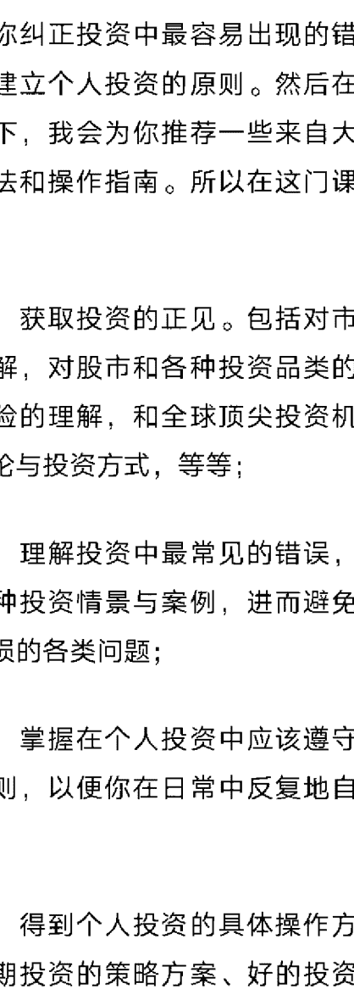
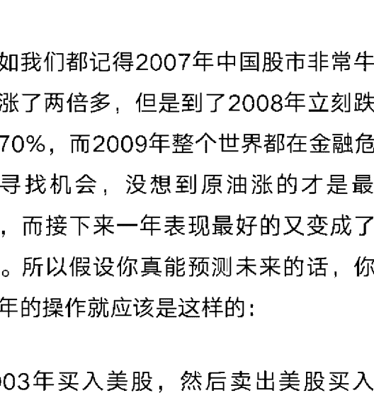
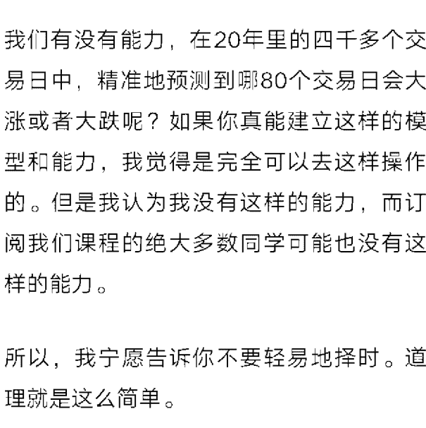
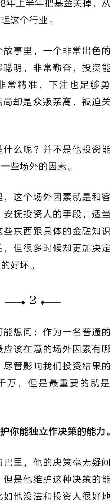
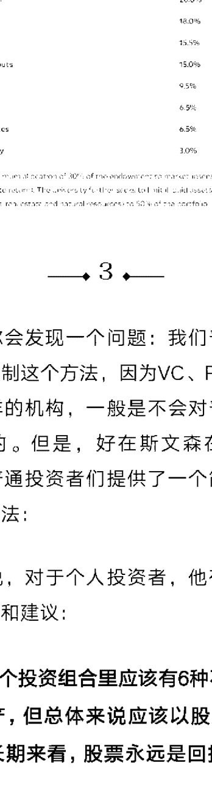

# 张潇雨个人投资课

## 发刊词 | 这一日，知识就是财富

发刊词 | 这一日，知识就是财富

你好，欢迎来到《张潇雨 • 个人投资课》。

我是张潇雨，一名商业研究者和对冲基金管理人。之前在得到App上我已经讲过一门《商业经典案例课》，现在我想为你讲述投资。

### —— 1 ——

投资当然是个范畴很大的话题，这门课我想说的，正如课程名称一样，是个人投资，也可是说是适用于普通投资者的投资。

什么是普通投资者？有两个最关键的标准：第一，投资不是你的全职工作，你还有其他事业和职业去做；第二，除了自己或者最照料到亲密的家人、朋友以外，你不管理其他外部人士的资金。

只要满足任意一点，这个课程就适合你。

自从进入现代社会，投资这件事就和世界上每一个成年人息息相关：

伟大的物理学家牛顿、经济学家凯恩斯、诺贝尔经济学奖得主丹尼尔·卡尼曼，他们都是积极的股票投资者，都需要管理好自己的投资来支持自己的学术研究与日常生活。

当然，众所周知，牛顿和凯恩斯虽然是学术泰斗，但是个人投资成绩并不太好，这说明，无论是谁，都需要把个人投资当作一项专门的能力来学习和练习。

而且，不管你有没有主动地购买股票和基金，哪怕你只是去银行存款，或者贷款买房，其实你都主动、被动地参与了投资的过程。

### —— 2 ——

什么叫“力气用错了地方”？就是你学习了半天投资，其实是把这件事本末倒置了。

举个例子。

### —— 3 ——

答案就是：“不作死，就不会死。”我们在局面大好的情况下，自己主动犯下的错误实在是太多了。

换句话说，我们缺少的不是高深的金融和投资知识，而是让自己绕开错误，避开大坑的能力。

### —— 4 ——

最后介绍一下自己和这门课的课程安排。

能够投资成功，让财富增值。不过我想说，这门课的目标，不仅仅是帮你赚钱这么简单。

说到底，对于绝大多数人来说，做好投资应该是获得幸福生活的一种工具和手段，而不是最终的目的。所以我真正希望的，不是帮助你成为专家或者大师，而是帮助你最正确、最轻松，也最有效率地把投资这件事做好——当你有了更好的生活保障，当你在过程中收获了知识和自信，当你能够照顾好自己最关心的人，你就可以更加心无旁骛地追寻自己的人生理想和意义了。这才是我们生活的真正目的。

欢迎你来加入我的课程，这会是你人生中最值得的一笔投资。

## 用户留言

## 02 | 普通投资者的劣势

张潇雨·个人投资课

02 | 普通投资者的劣势

你好，欢迎来到张潇雨的个人投资课。

熟悉投资的同学可能知道，这个世界上赚钱的方式有很多种。比如索罗斯擅长的是宏观交易；巴菲特和芒格是价值投资的宗师；詹姆斯·西蒙斯不但有以自己名字命名的数学定理，也是量化投资的先驱；而敢于抓住市场极端变化的华尔街“大空头”约翰·保尔森，他的流派叫做“事件驱动型投资”……

这些方法你不熟悉也没关系，这些都是个别专业投资人在做的事情。但提到这些专业投资人的时候，我们常有一个印象，就是他们消息灵通、智商很高、经验丰富……在我们看来，这就是业余投资者和专业投资者的主要差距吧。

但是，这真的是我们的劣势所在吗？

在我看来，聪明、消息灵通、经验丰富这些都只是表象，普通投资者比起专业人士的真正差距，是一些更不容易看到的东西。

上节课我们讲了普通投资者的优势，而对于投资来说，我们必须要全面地理解自己，才能找到最适合自己的投资方式。所以这节课，我们来说说普通投资者的劣势。

### ——▶ 1 ◀——

先举个例子。

2017年，有一篇著名的学术论文面世，题目叫做《一个世纪的趋势投资证据》（A Century of Evidence on Trend-Following Investing）。这篇论文带来了一个相当反直觉的结论，也提供了一个非常赚钱的操作，简单说就是：

+   我们同时住一个国家的股市，如果过去的这一个月，股市是上涨的，我们在下一个月就做多买入；如果过去这一个月，股市是下跌的，我们就做空卖出。

没了，就这么简单。

这个结论是怎么得出来的呢？

这篇论文的三位作者，都来自一个叫 AQR 资本的基金。这个基金可以说是职业投资机构中的翘楚。AQR 基金的创始人叫克里夫·阿斯内斯（Cliff Asness），是业界的传奇人物。

如果你了解一点金融史，一定听过尤金·法玛这个名字，就是发明了有效市场理论的著名金融学家，也是诺贝尔经济学奖的获得者。而这个阿斯内斯就是当年他在芝加哥大学最得意的学生，如今则是金融业的巨头之一。

阿斯内斯在读博士期间的学术研究就已经非常知名了。还没毕业，高盛就邀请他根据自己的研究成果单独成立一个交易部门。所以阿斯内斯先是在高盛做部门主管，后来才离开，创立了自己的 AQR 基金。

到如今，这个基金管理着2260亿美元的资产，比我们熟知的雷·达里奥的桥水基金还要大，是全世界最成功的对冲基金之一。可贵的是，AQR 内部非常鼓励发表研究成果和学术文章，而且质量非常高，很多都直接登在业界的顶级期刊上。我们上面提到的那篇论文就是其中之一。

在得出结论之前，AQR 做了大量复杂的测算，简单来说，这个研究的跨度从1880年到2016年，横跨了三个世纪，长达137年。而且对市场上去乎所有资产——67个大类，都进行了测算，包括29种商品（比如黄金、石油、小麦）、11个市场的股票指数、15个债券市场，还有12种外汇，研究也覆盖了全世界的主要国家的资本市场，可以说非常综合和全面了。

那么计算的结果是什么呢？简单说就是一句话：“涨就买，跌就卖”的投资方法，不但有效，而且效果极好——

在长达137年里，每年的超额回报有18%，即使扣除成本之后也高达11%；而且不但效果好，还在不同年代、不同资产类别、不同经济周期甚至在经济危机的时候都表现非常好——从1880年开始，它在每一个10年之内都是赚钱的。而且，在历史上十次大型的金融危机和股市里，有八次这个策略都表现非常出色，另外两次也没造成太大的亏损。

下图是这篇论文的统计数据图表。总之，这个方法相当灵验。

### ——▶ 2 ◀——

听到这里相信你一定在想了：如果我也能实现这样的操作，岂不是赚钱了？

那么，关键问题来了：AQR基金采取的“高低吸纳”的倚靠式策略，我们能复制吗？

答案是，比你想象的困难得多。原因就是，很多看起来能赚钱的方法，普通投资者由于各种条件限制很难做到。

+   比如，这个投资策略为了分散单一国家单一资产品种的风险，实际上是进行全球配置的，而且不只是投资股票，债券、大宗商品、外汇等等都有所涉及。

对于我们来说，有时候开海外个账户都挺困难，能在这么多国家同时跟踪这么多大类资产的价格走势，并不是一件容易的事。但这些对于一个专业的对冲基金来说，根本不算什么问题。

+   另外，由于不同国家的监管要求，做空一个国家的市场对于普通投资者来说也难以实现。

比如很多同学可能都看过一部叫《大空头》的电影，里面的主角们靠买入 CDS——也就是信用违约互换（Credit Default Swap），来做空美国房地产市场，获得了巨额利润。想象一下，如果你当时也眼光神准，一下看出了美国房地产市场的泡沫，有没有可能也靠这个赚到大钱呢？

并没有。因为 CDS 这种东西按照法律，是不能卖给个人投资者的。为了保证个人投资者的利益，法律规定，CDS这种复杂的金融衍生品，只有机构投资者才能买，个人投资者再有钱也是买不到的。

+   还有，虽然趋势投资这个策略相当朴素，但它要求我们月复一月、年复一年地执行。

这意味着，在市场真的开始下跌的时候，你要毫不犹豫地做空卖出，即使当时看起来明显是亏钱。对于专业的对冲基金来说，它们往往会利用编程和算法来进行操作，减少人为干扰因素。但对于我们普通投资者来说，这显然是不现实的。

+   不光上面说的这些，普通投资者的局限还不止于此。

有些同学可能已经在想：既然顶尖的专业投资者这么厉害，我们去买他们的基金不就好了？比如我没时间看论文，那就把钱交给AQR管好了。

这样可以吗？可惜不可以。

刚才我们提到了雷伊·达里奥（Ray Dalio）和他管理的著名的桥水基金，这只基金目前掌管着超过1500亿美元，旗下的产品常年回报在11%~15%的水准，而且业绩极为稳定：在2008年全球金融危机时回报是正的；2018年全球市场疲软的时候，桥水旗下的 Pure Alpha 基金在扣除费用之后的回报是完美的14.6%，成绩非常出色。你要是问我，我也想把钱交给这种水平的基金经理管理。

可是只有一个问题，桥水基金并不对我们这样的个人投资者开放。

在它的官网上你可以清楚地看到这么一句话：我们对客户的要求一般是，最少有50亿美元的可投资资产。并且，使用我们服务的费用一般在每年50万美元到475万美元不等。所以要想让达里奥管钱，门槛还是稍微软有点高的。

这背后也有它的原因：本来市场上能稳定提供超额回报的专业基金管理人员就极为稀少，这一点我们在后面的课程还会讲到。所以一旦真的出现一个常年都跑赢市场的人，所有的钱都会涌向他的基金，而这时候这个基金经理出于需求关系和管理上的方便，就更倾向于去拿大体量的资金，而不接受普通投资者的钱了。比如像达里奥...

而不接受普通投资者的钱了。比如像达里奥的桥水基金里面，就有我们国家的 中投基金和外汇管理局的钱。

### —— ♦ 3 ♦ ——

所以，这就是本节课我想告诉你的一个客观事实：

作为普通投资者，我们先不说自己在专业知识、行业经验、智力水平这些主观方面和大师们的差距，在很多客观方面，比如能使用的投资工具不多，信息渠道的不畅，甚至时间精力上的无法顾及，都使我们 可以采取的投资方法受到了很大的限制。

换句话说是这样的：

很多同学在想象投资这件事的时候，有一种感觉就是：我们需要的是掌握一些高深的知识、学习一些特别的技巧，或者有渠道获得一些不为人知的消息和工具……这样才能成功。但投资其实是非常反直觉的，我们做的事情越简单，越承认自己的局限和不足，越有平常心，就越容易取得成功。在后面的课程里，你会更加深刻地认识这个会让你真正赚到钱的逻辑。

回顾这两讲课程的逻辑，我们可以总结一下：

一方面，从优势的角度来讲，普通投资者可以“舍难求易”，可以使用最简单和朴素的投资工具来管理自己的财富，这是非常划算的。

另一方面，非职业的身份使得我们能接触到的资源本身就相对有限，再去花时间研究那些奇技淫巧的东西其实更是得不偿失。

所以对于普通的个人投资者来说，掌握一些最朴素的投资方法，避免那些最明显的投资错误，才是我们走向投资成功的正途。而接下来的课程，我就会一步步地告诉你这条路上，到底都有哪些陷阱。

下一讲我们正式进入课程的第一模块，一起探讨一下在“市场规律”这个方面，我们都会犯哪些错误。

> 投资是件非常反直觉的事，我们做的事情越简单，越承认自己的局限和不足，越有平常心，就越容易取得成功。

《张潇雨·个人投资课》
这一次，知识就是财富

张潇雨

你有没有接触过相对专业的同时又比较成功的投资者？你觉得他们成功的秘诀是什么？你可以向他们学习的地方在哪里？欢迎你留言分享。

张潇雨 · 个人投资课
这 一 次 ， 知 识 就 是 财 富
该文章刊登App所有，未经许可不得转载

前一篇
后一篇

用户留言

写留言

点击加载留言

## 03 | 多元分散：房子还会不会是表现最好的资产？

张潇雨 · 个人投资课

03 | 多元分散：房子还会…

你好，欢迎来到张潇雨的个人投资课。

我在发刊词里提到过，咱们的课程会从“市场规律”“投资工具”和“自我局限”三个维度讲解投资过程中最容易犯的错误。从这一讲开始，我们就正式进入第一模块“市场规律”，看看我们对市场的认知偏差是如何阻碍自己投资成功的。

### —— 1 ——

说到投资，其实每个人都有自己偏好的投资品种。有的人喜欢买股票，觉得炒股能挣钱；有的人喜欢买债券，不管是政府债还是公司债，觉得买起来比较踏实；还有一些人喜欢买期货、外汇这种波动很大的东西，觉得风险高，收益也会高；当然对于中国人甚至整个亚洲人民来说，最喜欢的还是买房。我遇到过很多人都和我说：你不用教我怎么做投资，我有钱买房就行了。

但是你有没有想过，我们这种投资偏好是怎么来的？

当然，这和每个人的性格、家庭情况都有关，但其中最重要一个原因是你可能没想到的，用四个字概括就是：年少记忆——也就是你在十几岁二十几岁，相对年轻的时候，对整个投资市场和各种投资资产品的印象和体验，它们很大部分构成了你的投资偏好。

我来举个例子。

如果你熟悉一点金融史就会知道，美国的80年代是股票市场历史上投资回报率非常好的一個黄金十年，结果在这10年里，美国家庭财产投资在股票上的比例却是下降的。而且之后的90年代，市场继续走强，走出了一个不错的大牛市，然而大家投资在股票市场上的资金继续减少——比例从60年代的40%，到80年代的25%，再到90年代只剩17%了。

而且不只是股票投资，就是股票型基金，美国家庭的投资比例也在持续减少，曾经超过70%的比例，到了90年代也只剩40%了。

在这个阶段，整个股票市场翻了三四倍，结果一大批投资者却把钱从股市上抽走了，完全没有分享到国家财富增长的结果。这到底是为什么呢？

答案就是：美国整个七十年代的经济实在太惨了。

在上世纪七十年代，由于越战升级，中东石油危机，国家不合理的福利政策导致财政赤字急剧扩大等等一系列原因，美国国内大幅通货膨胀，同时经济停滞，失业率也非常高。可想而知，这段时间内美国股市的表现非常惨淡：从1969年年末到1979年年末这整整十年时间，美国的道琼斯指数和标普500指数几乎纹丝不动，十年没有任何增长，算上通货膨胀甚至是亏损的。而且中间还有几次 safest 大跌，整个市场都处于一种担心受怕的状态。

你想想，如果你出生在60年代，二十岁左右的时候发现进投资股票谁倒霉，那么等你到了三四十岁的壮年期，家庭情况好了，收入也上来了，你会放心大胆地买股票么？

绝大部分人都不不会这么做，因为小时候的记忆实在是太深了。

但这样，显然带来了一个很惨痛的后果——非常多的普通投资者和勤勤恳恳的家庭错过了美国历史上最好的一段牛市。而钱都被敢于在熊市逆向投资的专业机构赚走了。

### —— 2 ——

说到这里，有些同学可能在想：所以你说的就是投资要大胆，要敢于冒风险吗？那我运气比较年，年轻的时候正好赶上国家经济繁荣发展，留下的都是美好的印象，家庭财富也随着整个环境水涨船高。所以我天性乐观，不会出现这样的问题。

但你有所不知，这种心态也许会导致更大的问题。

一个最好的例子就是80年代的日本。

在二战之后，日本大力发展制造业，从六七十年代开始，日本经济开始崛起，以索尼和丰田为代表的优秀企业把自己的产品卖到了全世界。到了80年代，日本经济达到顶峰，全国从企业到个人，都陷入了疯狂“买买买”的状态，最著名的是地产开发商三菱地所买美国洛克菲勒大厦，还在大厦的最上方挂上了日本国旗。

而且由于“广场协议”让日元大幅贬值，日元开始回流到国内市场，加上日本政府大幅降低息扩大贷款，造成国内一时间产生了大量的钱，而且都流向了证券市场和房地产市场。结果就是，东京市中心银座广场的地价达到了25万美元一平米——这可是在1989年。那个时候只要在东京或者大阪有房子的日本人，都可以说是千万富翁。

而当时拼命在买房的人都是谁呢？正是经历了六七十年代日本经济起飞，对未来无限乐观的那批人。他们在十几岁时赶上了好时候，到了三四十岁有了购买力，自然要投资房产，让财富增值。

但后来的故事我们都知道了：日本经济泡沫破裂，很多家庭倾家荡产，那些使用高额贷款买房的人瞬间负债累累，欠的钱可能一辈子都还不清。日本整个国家和民众也迎来了一个“失落的20年”。

所以，曾经的美国人，由于股市十年惨淡，再也不敢买股票，错过了之后的大牛市；而当年的日本人，由于国家经济迅猛发展，房价节节升高，结果无数人买在了最高点上，之后一路崩盘。

通过这两个故事，不知道你有没有想到了什么。

### —— 3 ——

说到这里就有一个问题了：说了半天，好像我们赶上经济形势好也不好，赶上经济形势好也不好，到底应该怎么办呢？

如果我们站在一个更高的视角，你就会发现解决方案。

比如，在七十年代，虽然经济很差，但由于布雷顿森林体系的瓦解，美国股市“失落的十年”，恰恰是黄金表现极其出色的十年。在70年代初，每盎司的金价在40美元左右，等到了70年代末，这个数字跳到了450美元以上——十年涨十倍，这个回报比过去十年京沪房价。

我们还可以说点更近的事情。在我们的印象里，日本经济这些年一直不怎么样，房价不温不火，甚至还有几年是往下跌的，互联网时代也没赶上，好像一片萧条的样子。但如果你去看日本从2008年到2018年的股市，以日经指数来计算的话，这十年来日本股市上涨了接近三倍之多，是全球表现最好的市场之一。对于日本民众来说，在这十年里，股票反而是个很好的投资选择了。

之所以讲这些，我们到底要说一件什么事呢？其实是一个被很多人忽视，但是非常简单的道理：要尽量忘掉你的投资偏好，多元配置你的投资组合。

这里的道理说起来不复杂：不管是哪类资产——股票、房子、债券、石油、黄金等等——都有表现很好的阶段，也有表现很差的时期。这是一个基本市场规律，就像经济自然会有周期，波动总会回归均值一样。

但是你可别忘记了一件事情——这所谓“阶段”和“时期”，可能一下就是十年、十五年甚至二十年。刚才我们提到的很多例子，跨度都是这个量级的。十年、二十年，对于整个市场只是个小的时间段，但对于我们每一个人来说，可能就是人生中最黄金的一段时光。

想象一下吧，如果你在自己人生最重要的20年，受过去经验的影响，错过了某类资产的大牛市，会是怎么样的体验呢？我过去十几年没有买房的同学应该有切身的感受。

所以，你很可能听说过“资产配置”这个概念——很多投资理财专家告诉你，分散投资目的是分散风险，不要把鸡蛋放在一个篮子里。但是我认为，分散投资、配置各种资产大类目的不是分散风险，更重要的是获取回报。

换句话说，因为市场很难预测，没人能准确说出接下来十年二十年投资什么最好，所以如果做足够的多元分散，你就可以提高自己押中宝的概率，不错过人生中重要的财富增值机会。而想要做到这样，最重要的就是：不要根据过去几年甚至十几年的经验，简单地认为接下来事情还会重复发生。因为市场总在变化，也许在下个周期，真正大涨的东西你想都想不到。

现在你应该明白，开头提到的“有钱就买房”犯了怎样的错误了吧。

到这里，相信你已经明白了这一讲的核心内容。不过个别同学可能会想：你说的十年、十五年太长了，我有没有可能知道接下来五年、七年、十年大概率会怎样？

十年、十五年太长了，我有没有可能知道接下来一两年什么东西涨的最快呢？

下图统计的是过去十五年里，你最熟悉的一些投资品种——包括中国房子、股市、美国股市、黄金、原油、债券，甚至存款和CPI指数——从2003年开始每一年里哪个品种涨的最多数。你不妨看看结果和你想的一样不一样。

这张图告诉我们，想要预测每一年表现最好的资产是有多么难。

比如我们都记得2007年中国股市非常牛，上涨了两倍多，但是到了2008年立刻跌了快70%，而2009年整个世界都在金融危机中寻找机会，没想到原油涨的才是最多的，而接下来一年表现最好的又变成了房子。所以假设你真能预测未来的话，你这些年的操作就应该是这样的：

2003年买入美股，然后卖出美股买入原油，之后杀入中国股市，08年迅速撤出换成债券，然后卖出股票买入原油，下一年再把原油换成房子，然后把房子再换成原油，然后再杀入美国股市，跌之前再换成债券，然后再买房……我想我应该不用再往下说了。

所以，不管是短期还是长期，能预知未来什么东西上涨最快都是非常难的。

- 1. 我们很容易因为自己过去的经历就对某一种资产有特殊偏好，这样很容易让你错过增长最快的资产品类。
- 2. 即使是短期，你也很难预测哪类资产会上涨比较快。
- 3. 所以作为投资者，不要对资产有明显的偏好，这不只是规避风险，更是抓住赚钱的机会。

> 分散投资、配置各种资产大类的目的,不是分散风险,更重要的是获取回报。

《张潇雨·个人投资课》
这一次，知识就是财富

张潇雨

你有没有明显的投资品种的偏好？这种偏好的来源是哪里，你觉得这种偏好有没有合理的地方和不合理的地方？

## 张潇雨·个人投资课
这一次，知识就是财富

## 04 | 择时陷阱：“低买高卖”可以实现么？

张潇雨 · 个人投资课

你好，欢迎来到《张潇雨·个人投资课》。我们继续来讲个人投资时最容易犯的错误。

这一讲我们的主题是：不要轻易择时。

所谓“择时”，英文叫做 Market Timing。名字听着可能有点学术，但实际上“择时”是我们最经常看到的一种投资行为。

比如，你感觉接下来经济形势不好，金融危机快要来了，于是你把股票纷纷卖掉，甚至开做做空市场。这就是一种择时。

所以你看，择时的本质是什么呢？择时的本质其实是对市场、对接下来各种资产的表现一个短期走势的预测。

我们在上一讲的时候已经提到了预测市场有多难，但这科好像要一下放弃的确很难，所以这一讲我们就更加具体地来讲讲择时的问题。

### —— 1 ——

我们先来看一个有趣的例子。

一般来说，我们对股市里牛市和熊市的想象都是这样的：牛市是价格一路上涨，歌舞升平；熊市就是价格一路下跌，凄凄惨惨。但实际上，这个感觉是错的。

比如就2008年来，那一年美国的次贷危机引起了全球性的金融危机，全球各个市场都在大跌。

但如果我们真的穿越历史去看，你会有 一个惊人的发现：2008年的美国股市很多天都是大幅上涨的——甚至，如果我们统计整个美国股市市场上百年的历史里，单日点数涨幅最高的十大交易日的话，十个里面2008年占了四个之多（截止到2018年末）——而且这个榜单里前两名都是2008年发生的。具体数字可以看下图。

Largest daily point gains
| Rank | Date | Close | Net Change | % Change |
| 1 | 2008-10-13 | 1,003.35 | +104.14 | +11.58 |
| 2 | 2008-10-28 | 940.51 | +91.59 | +10.79 |
| 3 | 2015-08-26 | 1,940.51 | +72.90 | +3.90 |
| 4 | 2018-03-26 | 2,658.55 | +70.29 | +2.72 |
| 5 | 2000-03-16 | 1,458.47 | +66.32 | +4.76 |
| 6 | 2001-01-03 | 1,347.56 | +64.29 | +5.01 |
| 7 | 2018-11-28 | 2,743.84 | +61.65 | +2.30 |
| 8 | 2008-09-30 | 1,166.36 | +59.97 | +5.42 |
| 9 | 2018-10-16 | 2809.92 | +59.13 | +2.15 |
| 10 | 2008-11-13 | 911.29 | +58.99 | +6.92 |

想象一下，2008年可是金融危机的顶峰。任何正常人，只要脑子没坏，真要择时的话那肯定是选择卖出阶段，离场暴风中心远点的。但真实情况是，那一年虽然形势严峻，但是救市措施也多。每次美国政府一推出救市措施，市场第二天就跳空高开，你想再杀回去都来不及了。

所以，如果你在恐慌下跌中卖出，那么你就错过了2008年几个巨大涨幅的交易日，最终你的回报比起整个指数来一定是差很多的。而且别说是散户了，那一年很多著名的基金都是这么绞杀大盘的。

那有的同学可能会想，不过是错过几个最好的交易日，代价有那么惨痛吗？

当然有。我们还是用数据说话。

之前有研究者统计了从1996年到2015年，长达20年里投资标普500指数的回报：

换句话说，在这20年超过4000个交易日里，你要是错过了其中1%的交易日，这20年就都白忙活了。

类似的规律在中国股票市场上也是一样的。还是1996—2015年这个时间段：

所以，我们可以看出，投资市场提供的回报在时间分布上是非常不均匀的。对于普通投资者来说，仅 仅根据你自己的感觉，或者说对市场情绪的认知来进行择时，你很有可能错过那些市场突然出现的回报非常好的时刻，最终大幅度低下自己的投资回报。

这就是所谓的“闪电理论”，说的是如果市场某一天突然大涨是个“幸福的闪电”的话，作为投资者，我们一定要保证在闪电劈下来的时候自己在场。

### —— 2 ——

可能有同学会想，预测单个交易日的大涨大跌确实太难了，那有没有可能成功预测较长时间段的趋势呢，比如能不能预测2008年的金融危机？

实际上想预测这件事情，最难的点在于，即使你知道金融危机会来到，你怎么知道它恰好会发生在2008年，而不是2007年或者2009年呢？

实际上，那一轮经济危机的预兆，在2005年就开始显现了。

整个2006年到2007年，市场上已经有不少声音说当时房地产市场的泡沫太大，会连累整个金融市场。但当时就是没什么人信。如果你看过电影《大空头》的话，里面主角之一的原型迈克尔·巴里（Michael Burry），其坚实从2005年就开始做空次级贷款了，结果是他锁了两年多，直到2007年才赚到钱，中间的过程遭受了无数质疑。

而在中国，2007年是一个疯狂的牛市，整个一年沪深300指数涨了160%多——想象一下，如果你判断稍微失败一点，在2007年就认为泡沫太大离开市场了，你整整一年就会看着市场上的所有人大家赚钱，连街道大妈都炒股成功，那个时候你还会对自己的预测有多坚定呢？

同样，如果你以为2009年经济危机才会来，你不仅会错过2008年接近腰斩的暴跌，还会错过2009年的大型反弹——那一年美国股市上涨了超过20%，而中国股市涨幅可是高达100%。

所以，如果没有非常专业的知识作保障，非常坚定的信念作支撑，仅是根据自己的感觉和简单的判断来择时的话，亏损简直是必然要发生的。

### —— 3 ——

我知道，听到这里肯定还会有同学不甘心，说如果我确实特别专业、能力很强，而且很愿意努力钻研呢，是不是也有可能培养出准确的择时能力？

当然，投资界没有绝对的不可能。但是我必须要负责任地告诉你，择时这件事情之难，连最厉害的投资家都可能得非常失败。

一个最好的例子，就是老虎基金的朱利安·罗伯逊（Julian Robertson）。

如今我们一说到股大师，最先想到的就是股神巴菲特。但早在80年代，整个投资界最耀眼的明星不止巴菲特一个，还有被称作“对冲基金教父”的罗伯逊。他旗下管理的就是曾经大名鼎鼎的老虎基金。这只基金的战绩如何呢？来着2000年3月，罗伯逊给投资者的股东信里，第一段是这么写的：

接近20年里年化回报率31.7%，你一定明白这是个什么概念。

然而很少有人知道，这封股东信，也是朱利安·罗伯逊发给投资人的最后一封信。因为在2000年5月，他就被迫关闭了老虎基金。

追涨科技公司，很多资金从传统经济流向了互联网领域，连传统的值股也受到很大冲击。比如老虎基金重仓持有的美国航空，12个月跌了接近一半。

等到了2000年2月底，老虎基金已经跌得不成样子。基金越跌，投资者也越拼命地撤资。结果仅仅一年多时间，老虎基金管理的资产就从巅峰的230亿美元狂跌到65亿美元。到了三月，罗伯逊彻底扛不住了，干脆决定关闭基金。

但最令人嗟叹的是，老虎基金是在2000年3月30日正式关闭的，20天前纳斯达克指数刚刚创下了历史新高。结果仅仅到了4月，整个市场就开始暴跌，一个月就跌了15%，接下来两年跌了快80%。

想想如果罗伯逊是在这个时候做空的，他的回报是难以想象的。

所以虽然他的判断是对的，但就是倒在了黎明之前。择时就是这么一件非常难的事情。

### 划重点

- 1. 对于股市来说，一年中最好的那些交易日分布非常不均匀，而且与牛市还是熊市无关，一旦错过它们，对于投资回报率来说就是致命的打击。所以短期来看，我们很难通过择时获得超额回报。
- 2. 准确判断牛市熊市的来临时间也很重要，且即使是像老虎基金这种战功赫赫的基金，也很难掌握择时这件事。
- 3. 避免轻易择时，避免押注短期的市场走势，我们就又能避免一种亏损，离投资成功更进一步。

> “闪电理论”：
如果市场某一天突然大涨是个“幸福的闪电”的话，作为投资者，我们一定要保证在闪电劈下来的时候自己在场。

《张潇雨·个人投资课》
这一次，知识就是财富

张潇雨

## 张潇雨·个人投资课
这一次，知识就是财富

## 用户留言

## 05 | 宏观迷信：自下而上的投资逻辑

张潇雨 · 个人投资课

你好，欢迎来到《张潇雨·个人投资课》。

你可能经常会在身边的投资者里看到这样一类人：他们热衷于关注宏观经济，每天花费很多精力看新闻、读媒体、研究国家政策、解读世界局势。然后他们会根据这些宏观信息，作出各种各样的投资决策。

说得夸张点，他们不但是投资者，还可以说是半个经济学家。

其实想想也有道理。我们平时投资的这些主要的资产，不管是股票、债券，还是房产，不可能不受宏观经济形势的影响。所以看起来，花多精力关注这些东西好像是理所当然的。

但有人却有不同意见。是谁呢？就是我们熟悉的股神巴菲特。

### —— 1 ——

1998年10月，巴菲特在佛罗里达大学的商学院进行演讲。演讲结束之后，他照例回答听众的提问，其中一个问题就是：您能不能谈一谈当前脆弱的经济形势和利率问题？您对将来的经济形势怎么看？

通投 投资者是不可知的，而什么东西是可知的呢？比如：

自己的投资期限有多长，应该如何针对性地配置自己的资产；

购买国内和国外指数基金的时候，哪家的费用和成本比较低；

如果自己在境外有一些存着的美元或者其他外币，如何更好地进行现金管理以提高一点收益

……

把精力花在这些事情上，反而对我们长期的投资回报是更有益处的。

### 划重点

- 1. 宏观经济很重要，但影响宏观经济的因素太多太复杂，即使是凯恩斯、席勒这样的大师，也没法依据宏观经济指标来赚钱。即使有人能赚到钱，可能也需要深厚的功力和独特的信息。

- 2. 与其把精力放在宏观经济这种重要但不可知的事情上，不如想得小一点，关注更可知的事，比如怎样完成一个资产配置方案，购买的产品有多大风险，等等。

> 与其把精力放在重要但不可知的事情上，比如宏观经济，不如想得小一点，比如怎么完成一个资产配置方案。

《张潇雨·个人投资课》
这一次，知识就是财富

张潇雨

你觉得宏观经济和券商的投资研究的关系是什么？你在实践中会得到什么启发？

## 张潇雨·个人投资课
这一次，知识就是财富

## 用户留言

## 06 | 风险度量：怎样真正地理解风险和亏损？

张潇雨·个人投资课

你好，欢迎来到《张潇雨 · 个人投资课》。

在2018年，有一件事情给我们留下了很深的印象，就是P2P 理财的全面崩塌。很多人把自己毕生的积蓄都投入到了 P2P 产品里，最后落得了一个血本无归的结局，非常令人惋惜。

对于这件事情，不知道你有没有想过：当初这些投资者为什么会去买 P2P 呢？

关于这个问题我问过很多人，典型的答案有这么几个：

“银行理财收益太低，又不懂得别的投资渠道，P2P 买起来很方便，于是就买了。”

“我的亲戚或者朋友买了很多，好像没事，推给我，于是也就买了。”

有一个非常经典的回答是这么说的：“很多中国的普通投资者有种奇怪的理念，做没投资一方面要保本不能有风险，另一方面又要高利息回报，并且短期还得见到线——这几个一相加，正好是 P2P 所体现的样子。”

确实，这些说法都沒错，在 P2P 这件事上，我们可以看到社会的问题、人性的弱点等等。但是这里面，有一个我认为最本质的问题，很多人没有看到，就是我们并没有理解什么是风险。

也正是因为对风险缺乏准确的认识，我们才会糊里糊涂地把钱亏掉。这一讲，我们就来试试说说这个话题。

### —— 1 ——

我相信“风险”这个词，订阅了这门课的同学没有没有听说过的。但你有没有发现，你好像很难准确给“风险”下一个定义。

发生了，我们应该怎么办。

换个角度说，我们在买入任何金融产品之前都可以问自己这么一个问题：

如果接下来它的价格跌了一半，我能理解到底发生了什么情况么？我有应对的方法么？如果回答不了这个问题，那这笔投资最好就不要做了。

举个例子。比如现在我可能想买中国的沪深300指数基金，那么在买入之前我就要回答两个问题：第一，如果它之后下跌50%，可能是什么情况导致的？第二是如果真的下跌50%，我应该怎么办？也许美国股市跌了一半之后我应该再多买一点儿，这也是一种应对方式。但只有我们能搞清楚这两个问题，才算是真正衡量了风险的结果。

有些同学可能好奇为什么是跌了一半，不是40%或者60%之类的数字。这里的“一半”，当然不是一个精确的说法，而是一个经验性的数字。

因为如果你去观察整个投资历史就会发现，某种资产在一定的时间内，没什么理由就跌掉40%、50%，是非常正常的，很常见。不管是股票、公司债券、房地产，还是各种理财产品、P2P……都屡见不鲜。

所以这种事发生到我们头上也非常正常。那么最重要的，就是不要抱侥幸心理，认为风险不会发生，而是在事前就做好最坏结果的打算。

### 划重点

- 1. 很多时候我们并不理解什么是风险，总以为亏损不会发生在自己身上，这是很危险的。
- 2. 量化风险是我们的本能，但风险并不能被量化。所以我的建议是：不要去衡量风险本身，去衡量风险爆发之后的结果。
- 3. 买入任何金融产品之前都问自己一个问题：如果接下来它的价格跌了一半，我能理解到底发生了什么情况么？我有应对的方法么？如果回答不了，这笔投资暂时就不要做了，直到你弄清楚这个问题。

> 买任何金融产品前，都先问自己一个问题：如果接下来它的价格跌了一半，我怎么办？如果回答不了这个问题，就先不要买。

《张潇雨·个人投资课》
这一次，知识就是财富

张潇雨

## 张潇雨·个人投资课
这一次，知识就是财富

## 用户留言

## 07丨海外配置：人人都可买下全球市场

张潇雨·个人投资课

你好，欢迎来到《张潇雨·个人投资课》。我们继续来讲投资路上的典型错误。

之前的课程里，我们提到过一个很重要的逻辑，那就是：由于我们很难预测在未来一段时间内，到底哪一个大类的资产会涨得最好，所以我们在投资的时候要尽量地多元分散，说白了就是大家常听到的“资产配置”的概念。

不过你要知道，资产的配置可不只是在资产品类这个维度上就做完了，在地理这个维度上也要进行。

对，我们今天要讲的就是“海外资产配置”这个话题。

面对这个话题，你脑子里可能会冒出两个问题：

在这一讲，我们就来仔细回答一下这两个问题。在解决了这两个疑问之后，相信你会对如何更好地打理自己的资产有更深刻的认识。

### ——1·——

我们先来说第一个问题：真的有必要去海外投资吗？

很多同学在思考这个问题的时候，都有一个很严密的逻辑，这个逻辑是这样的：

从长期看，任何资产，不管是股票，还是房子，都必然和一个国家的经济情况挂钩。国家经济发展速度快，那资产肯定升值，投资就会赚钱。反过来，你投资一个发展极为缓慢甚至倒退的国家，那能赚到钱吗？而中国，作为世界上最重要的国家之一，已经经历了几十年的快速发展，接下来的发展速度还会是超过世界上绝大多数的国家，这不是非常好的投资标的吗？为什么还要把钱投到美国、英国、日本、德国这些常年 GDP 增速在 2%~3% 水平的地方呢？

这个逻辑在一听并没有错，但实际上有很大的问题。投资的事情就是这样，如果你深想一步，就会发现事实和直觉往往很不一致。

著名的投资和研究机构先锋领航基金之前发表了一篇学术研究。他们算数了从1900年到2009年长达一百多里，16个主要国家的股票市场的涨幅和真实人均GDP增速的关系，最终得出一个结论——没有关系。也就是说，对于这些国家来说，股市回报和经济增长的速度没有什么直接关联。

这些国家包括美国、英国、德国、法国、瑞士、澳大利亚，等等等等。以下是这个研究成果的截图，你可以很清晰地看到这个结论。

不过，细心的同学可能发现了，这16个国家好像都是发达国家。

先锋领航基金也注意到了这个问题，于是他们把19个发展中国家的数据也加了进来，研究的区间是1988年到2009年。结论还是同样的——长达二十年的真实的人均GDP增长，和这个国家的股市回报相关性居然是零。

所以我们可以说，一个资产能不能升值，跟一个国家的经济增长并没有必然联系。

### ——2·——

这个结论确实很反直觉，那这背后的原因到底是什么呢？

一个很重要的原因当然是资产的价格。一个地方经济发展速度当然可以很快，但如果人们为这种快速发展的预期付出了过高的价格的话，那回报肯定不会太好。

举个例子，大家都觉得某个城市的发展前景不错，人口一直在增加，各类明星企业都争着进驻，之后甚至还要开亚运会、奥运会——但就是房价已经炒上天了。这个时候你去投资这个城市的房产的话，回报肯定是很有水分的，甚至可能亏损。

所以对于任何资产来说，不论基本面是好是坏，你为这个基本面付出的价格都是一个很重要的因素。

关于价格的话题我们之后的课程还会再说，这里还有另外一个可能更重要的原因。这个原因总结起来就是三个字：全球化。

由于全世界各个国家的经济联系越来越紧密，我们已经很难知道整体经济增长的利益会落到哪个具体国家了。

举个例子你就明白了。耐克这家公司你肯定听说过，比如它在福建、广东，甚至其他国家比如越南生产出一双鞋，这双鞋的价值就会实实在在计入当地的GDP。但是你别忘了，虽然价值记在了生产地，但鞋里面大部分的利润都被耐克，一家美国公司赚走了。

我们都知道，公司股价最终和公司的盈利能力是息息相关的，虽然新兴经济体增长快，但里面有很大一部分利润都被跨国公司拿走了。

这个世界的联系有多么紧密，可能超出你的想象。

所以，我们想象中的那种，新兴市场经济发展快，所以投资会赚得更多的印象，其实是不正确的。

这会导致一个什么问题呢？导致的问题就是：

虽然我们国家未来仍然会是世界上经济发展最强劲的国家之一，但这不意味着中国的股市、房市，各种投资品市场会持续上涨。换个角度说，我们当然还是有可能通过买股票买房子赚钱的，但是未来赚钱的难度可能会比过去几十年增大很多。

#### ——3·——

那接下来有同学可能想：这样的话，我中国美国一起投资行不行？毕竟这两个国家一定是未来的超级大国，企业利润来自全球各个地区，而且我们最熟悉。

这也并不是最好的解决方案。

为什么呢？我来给你出道题：我们都知道，在2008年经济危机之后全球股市总体上迎来了一个大牛市，那么你猜猜，在2015年、2016年和2017年这三年，全球哪个国家或地区的股市表现最好？为了去除汇率影响，我们都按美元计算。

答案是这样的：

听到这你会发现，这三年的排名毫无规律，而且并不是我们特别熟悉的国家或地区

律，而且并不是我们特别熟悉的国家或地区。但恰恰它们在某个阶段的表现就是很好。

别说我们专课程里的普通同学了，就是非常专业的投资者，也没有几个押中这些市场的。

实际上，这背后有个行为金融学的原因，叫做“本土偏好”。

比如，日本股市的整个市值，占全球总体市场的7%~8%左右，但是日本本地的投资者会把60%左右的资产配置在本土市场上。同样，美国股市的市值可以占到全球的一半，但美国投资者在本国股票上的配比更高，几乎有80%。中国的投资者就更不用说了。因为大家都熟悉本国的投资品种，投资起来更安心。

但相信你听到这里已经明白了，我们没法用简单的方法判断出一个国家的资产是不是会升值，所以只投资任何一个国家都是有点冒险的，在地理上进行资产的分散也很有必要。

——♦ 4 ♦——

那么，如果我们真的想投资全球市场，应该怎么办呢？

去海外购置自己看好的房产当然是个办法，但对于很多人来讲门槛还是比较高的。投资股市的话，总不能让我天天盯着丹麦、比利时、新加坡的股市吧？

实际上我要告诉你，投资全球市场的门槛和成本，比你想象的要低得多。只是很多人都不知道。

比如，买基金的话，你可以找到很多覆盖世界上主要股票市场，将主流国家一网打尽的基金：

像全球最大的资产管理公司贝莱德（BlackRock）就有这样一只基金叫“世界 ACWI 指数 ETF-iShares”（ACWI）；还有著名的先锋领航基金，也有这样的基金叫“世界全股市ETF”（Total World Stock ETF (VT)）。

在2019年年初这个时点，你只需要几十美元，就可以买入整个世界，成为一万多个最重要公司的股东，横跨三四百个行业，坐拥200个国家的分公司，让它们帮你赚钱。

当然，实现海外资产配置的方式还有很多种，你稍微做一些功课都能找到。我最想告诉你的是，不要以为这件事离我们很远，它对我们每个普通人都是很重要的。

### 划重点

+   1. 一个资产能不能升值，跟一个国家的经济增长没有必然联系，所以我们不能因为中国经济发展好就不投资海外。

2. 做海外资产配置时也不能只挑熟悉的，因为全球股市表现最好的国家和地区，很多我们都想不到。

3. 想要投资全球市场，其实有很多产品可以实现，很多主流大基金都能让我们坐拥全世界所有主要的股票市场。

> 投资全球市场一点也不难，只要几十美元，你就能成为全球一万多个最重要公司的股东，让它们帮你赚钱。

《张潇雨·个人投资课》
这一次，知识就是财富

张潇雨

## 张潇雨·个人投资课
这一次，知识就是财富

## 用户留言

## 08 | 第一模块问答：该何时卖出一只股票？

张潇雨 · 个人投资课

你好，欢迎来到《张潇雨 · 个人投资课》。

在第一模块中，我们重点分析的是从市场这个层面看，我们普通投资者比较容易进入哪些误区。我们从资产的长期回报率，谈到了犹豫的难度，也探讨了自上而下的投资、如何衡量风险，以及有没有必要在地理维度上进行多元分散。

在这个过程中有很多同学提出了各种问题，下面我来找几个比较典型的来回答。

### 一：何时该卖出？

在讲到“不要轻易择时”的时候，很多同学都提了一个类似的问题：

我觉得这个问题提得很好。市场里有句俗话叫“会买的是徒弟，会卖的是师傅”。如何把握卖出时机的确是个很难的事情，我也来说说我的看法。

这个问题比较重要，所以我们多花一点篇幅来比较。

之前在课程里我们反复提到过，要想投资成功，重要的是避免那些投资中常犯的错误。其实这就是芒格常说的“逆向思维”。

为了接近事情的真相，很多时候你得把事情反过来想。所以本着这种精神，我们如果想回答“什么时候才应该卖”，不如来想一想“什么时候不应该卖”。换句话说，有哪些错误的卖出理由呢？把主要的、错误的卖出理由排除掉，剩下的答案也许就很接近正确了。

我觉得有两个最常见的、错误的卖出理由：

错误理由一：仅仅因为你亏损了，所以我该卖出

很多时候你会看到大家在问这样的问题：我刚买了一个股票，或者买了一个什么基金，结果这一阵市场不好，它们的价格都跌了，我是不是应该卖掉出逃呢？

### 错误理由二：因为一个更高的价格跌了多少，所以我卖出。

### 所以一个好的卖出理由是什么呢？

一个好的卖出理由就是：你的买入理由不再成立了。

### 二：碰到“负面的闪电”怎么办？

我们之前的课程讲过一个“闪电理论”，说的是，如果我们错过了20年里上涨幅度最大的1%交易日，那么回报率就会变成惨不忍睹的负数。所以如果说市场大涨是一道幸福的闪电，重要的是保证我们在场。

1%最差的交易日，那么整体回报如何。

在下图里你会发现，如果能同时错过它们，比全程在场，回报的的确是要高一些的。也就是说很多同学的猜测是正确的。

那么这里问题就来了：

我们有没有能力，在20年里的四千多个交易日中，精准地预测到哪80个交易日会大涨或者大跌呢？如果你真能建立这样的模型和能力，我觉得是完全可以去这样操作的。但是我认为我没有这样的能力，而订阅我们课程的绝大多数同学可能也没有这样的能力。

所以，我宁愿告诉你不要轻易地择时。道理就是这么简单。

### 三：投资小白怎么办？

有一些同学说，我是一个完全的投资小白，没什么基础，也没什么资金怎么办？

我的回答是这样的：

不管在任何方面——投资、创业、工作、生活，我觉得最重要的一個品质之一，就是把自身看起来是劣势的地方，转化成某种优势。

比如你如果是个没有任何经验和基础的小白投资者，那么你至少会有这么两个优势：

+   1. 内容因图像模糊无法清晰识别
2. 内容因图像模糊无法清晰识别

所以，从现在开始学习投资，让自己犯一些错误，积累一些经验和教训，是件再好不过的事。

当然，我在之后的课程里也会给相对零基础的同学推荐一些学习方法和渠道，帮助大家更有效率地走过这个过程。

最后还要补充一点，由于主线课程的篇幅有限，我们每一讲课程能回答的问题也相对有限。但是我已经把很多还没能回答的问题记录下来了，在整个课程结束之后，我还会以各种形式——比如免费加餐的形式，来把大家提出的各种典型问题一一解答。

这就是这一讲的内容，下一讲我们会进入新模块“投资工具”的学习。

> 问：什么时候该把股票卖掉？
答：当你的买入理由不再成立的时候。

张潇雨·个人投资课
这一次，知识就是财富

## 09 | 指数基金：买到伟大公司的最好机会

张清雨 · 个人投资课

你好，欢迎来到《张清雨·个人投资课》。

每当说到投资或者理财的时候，你肯定会想到三个字：买股票。

的确，股票从长期来看是增长最好的一种资产，而且过去二十年，市场上的确诞生了一批创造了巨大价值的好公司。你身边肯定也有人因为买了腾讯、茅台、格力、亚马逊、苹果的股票赚了钱。但是，你肯定也见过买股票赔了不少钱的人。

那么问题来了：**我们到底应不应该买股票呢？**

我可以先告诉你我的答案：作为一名普通投资者，想要购买单独股票是非常困难的。

### —— 1 ——

以前我们说“买股票难”，往往说的是：金融知识很复杂、市场波动没规律、分析公司股票需要专业能力等等。但很多人忽略了一点：如果我们从宏观的、全局的视角来看买股票这件事的话，你会发现它的难点是在更高的维度上的。

自于表现最好的 1000 只股票。而这些股票的数量仅占所有上市公司数量的4%。

4%的公司提供了100%的回报，这意味着什么呢？这意味着，我们如果去买指数基金，其实不只是一种被动的投资，更像是主动地让自己能押中这些带来回报的好公司。

非常有能力的同学当然可以认为自己能够买中那4%，并且能扛过持有这些公司股票艰难的旅程，但对绝大多数人来说，投资的时候远离个股，分散性地投资指数，其实才是更理性的选择。

划重点

+   - 想挑中一只好股票是一件非常难、概率很低的事，上市公司里的烂公司要比好公司多得多；
- 即使是名气大的公司，也很难长时间保持竞争力；
- 哪怕是挑中了好公司，等到有好收益的那一天也是路途漫长。
- 所以，作为普通投资者，放弃挑选个股，选指数基金，是更明智的选择。

> 买指数基金，并不是一种被动的投资方式，而是主动地让自己押中能带来回报的好公司。

《张潇雨·个人投资课》
这一次，知识就是财富

张潇雨

## 张潇雨·个人投资课
这一次，知识就是财富

用户留言

## 10 | 安全边际：好公司不等于好股票

张清雨 · 个人投资课程

你好，欢迎来到《张清雨·个人投资课》。

上一课我们讲到了购买股票赚钱的难度有多大，这一讲我们继续来说说这件事。

如果你问我，在投资这件事上，我收到过最好的建议是什么，我觉得肯定有一条：要记住，好公司不等于好股票。

我是什么时候收到这个建议的呢？是我大学本科毕业，刚刚加入高盛做股票研究的时候。当时公司组织入职培训，来了一个已经在公司工作二十年的大老板。培训刚开始他就说：我其实没有什么特别神奇的建议给你们，想要做好这份工作其实只有两点：

第一，在这一行不管你做到什么职位，永远记得我们是为客户服务的；第二，做研究的时候一定要明白，好公司不等于好股票。

直到现在，我还非常清晰地记得这两个建议。尤其是“好公司不等于好股票”这一条，每过一阵我再回想起来，都会有更深刻的理解。

这一讲，我们就来说说这个话题。

### —— 1 ——

什么叫好公司不等于好股票？我们在做股票投资的时候，很容易陷入一个误区：认为一家好公司一定是个值得投资的对象。但实际上这是否不对的。

我们生活中往往是这么买股票的：你用到了一个好产品，对这个公司产生了好感；发现周围很多人都对它家的东西很好评，赞不绝口；看到这家公司创始人 的采访和报道，觉得人非常靠谱；读了一些对这家公司的分析，感觉它特别有前途，顺应了时代大趋势，等等。

所有这些点点滴滴的信息最终都汇聚成了一个结论——这家公司不错。那么显然应该买点它儿的股票。

但是，我们先不说上面这些分析和结论是否严谨，光是对一个问题的忽略就能让我们这笔投资失败，那就是——价格。

一家公司再好，如果你购买它的价格过高，也是很难赚到钱的。

什么算过高呢？我们一会儿就说。先来看个例子。

我们都知道，银行业在任何国家都是一个支柱型和垄断型产业，在我们国家更是。过去二十几年里银行都是整个国家最赚钱的行业之一。而其中的一个佼佼者就是招商银行。

招商银行的表现有多出色呢？从2007年到2017年，招行的年利润从150亿元增长到了700亿元，敲了4倍多，年化增长率有15%之多。同样，衡量银行的另外一个指标，每股净资产，招商银行同样增长了接近4倍。简而言之，在十年左右的时间里，招商银行通过不断的努力和发展，变成了一家更大更好的公司。

按理说，你要是买到这样一家优秀公司的股票，然后长期持有，应该能赚大钱了吧？可惜未必。

在2007年年末，市场大牛市尾声的时候，招行股价冲到了23.5元左右，但之后它的股价一路走低，最低居然跌到过5块多。直到接近十年之后，2017年7月，招行股价才又回到了24块钱的水准。

换句话说，如果你在2007年年末买了这样一家优秀公司的股票，恐怕要忍受长达十年的账面亏损，才可能迎来曙光。虽然过程中公司也会分红，但比起账面的浮亏来说不值一提，你很可能在黎明之前就倒在了半路上。

### —— 2 ——

说到这里，我们显然需要思考一个问题：价格因素这么重要，我们怎么判断它是高是低呢？

我要告诉你的是：其实大部分情况下，我们是不知道一只股票的价格是高还是低的。

听到这你的第一反应肯定是：你在开玩笑吧，不知道那怎么办啊？

司，长期应该会涨”这个买入理由要好得多。

而且，使用安全边际还能给你留下更充裕的犯错空间。

想象一下，如果你认为小米至少值500亿美元，你等到300亿美元买入了，但市场出人意料地又下跌了，小米只有250亿美元了——这个时候你的账面虽然亏损了一些，但心态仍然不会受到太大影响，甚至还想在这个便宜的价位多买一点儿。但如果你是500亿美元这个价位买入的，结果跌到了250亿美元呢？想想都觉得可怕。

换个角度，这个建议我们还可以这么使用：

我们之前的课程里，反复说过择股是很难的，是不适合普通人去做的。其中一个重要的原因就是，很多普通投资者只对公司有一些感性认识，比如觉得产品不错、口碑良好、管理层挺靠谱等等，但根本没有能力判断公司实际的价值，所以远离个股是很必要的。但如果你还是坚持想做一个选股型投资者的话，那么请记住“安全边际”这个概念。

不管你给这家公司估值多少，最好给你心目中的价格打个 5~6 折，再去考虑买这只股票，这是巴菲特等一众价值投资者多年摸爬滚打得出的经验。它听起来是如此简单，但会让你投资的成功率大大增加。

### 划重点

+   1. 好公司不等于好股票，买入时的价格是个必须要考虑的因素。

+   2. 如何判断公司的股价是不是过高，除非极端情况出现，否则我们很难判断。根据巴菲特的建议，我们最好给自己留出足够的安全边际，才更可能赚到钱。

> 请记住，好公司不等于好股票。

《张潇雨·个人投资课》
这一次，知识就是财富

张潇雨

## 张潇雨·个人投资课
这一次，知识就是财富

## 用户留言

## 11 | 抄底哲学：市场的不理性与买入时机

张清雨 · 个人投资课

你好，欢迎来到《张清雨 · 个人投资课》。

课程进行到现在，你会发现我们一直在反复强调一个理念：

通过买公司股票赚钱是一件非常难的事，比你想象的要难得多。因为好公司极其稀少，难以捕捉，即使捕捉到了，持有的过程也很艰辛；而且就算能判断公司的质地，如果没有价格意识和给公司估值估价的能力，还是有可能亏钱。

这一讲，我们要把这个理念再往前推进一步：即使你专业水平极高，既有定性衡量公司的能力，也有定量给股票估值估价的能力，结果依然可能很惨。因为市场的不理性程度，往往会出乎我们的意料。

—— 1 ——

信奉价值投资的同学，一定知道巴菲特那句经典的话——“要用五毛钱买价值一块钱的东西”，这里是我们讲过的 安全边际 的概念。

但我们之前没说的是，很多时候即使股价打了5折，也不意味着它就是安全的。如果你看来的价值20块钱的公司临时跌到了10块钱，而你买入了的话，接下來发生的，可能不是你期待的从10块钱到20块钱的“价值回归”，很可能是从10块钱继续跌到1块钱的“价值毁灭”。

你可能觉得这是天方夜谭，我们来看个非常经典的例子。

美国著名的投资机构美盛集团（Legg Mason Value Trust）有一个传奇的基金经理，叫做比尔·米勒（Bill Miller）。这位米勒先生有多传奇呢？他旗下管理的基金从1991年起，连续15年战胜标普500指数。你知道的巴菲特、索罗斯、彼得·林奇，他们连续战胜市场的时间跨度都没有比尔·米勒长。

结果，就在2008年的时候，传奇的比尔·米勒遇到了人生中最大的滑铁卢。

你应该还记得，2007年爆发的那场次贷危机里面，受伤最严重的就是银行这类金融机构，以及房利美、房地美这样的地产相关机构。

在这次大熊市里，比尔·米勒认为整个市场过度恐慌，导致价格下跌过多，所以他边跌边买、大跌大买，买入的全是类似贝尔斯登、美林证券、房地美、AIG、花旗银行……这些后来差点倒闭的企业。

通常我们印象里的大跌，一般就是跌个30%、40%，或者是“腰斩”，也就是说跌掉一半。但当时这个金融危机，很多银行股下跌的可不是这个量级。

比如在2007年，花旗的股价基本是五六十美元的水平。结果次贷危机的苗头一出，花旗的股价就在三个月里跌掉了一半。这个时候，很多人一看股价打了五个折，觉得这只股票已经跌到位了，开始缓慢买入。这里面就包括比尔·米勒。

后来花旗股价果然反弹了一些，但正当人们得意的时候，新一轮大跌开始了，花旗银行的股价再次腰斩，并且一路没有回头……

等到2009年3月，花旗的股价从五十多美元跌到了最低——1美元。是的，你没有听错，一家有百年历史、人人信赖的知名公司，在金融危机来的时候，股价可以跌去98%以上。

股价跌了98%有多可怕呢？一个数据最为直观：

股价下跌98%，等于股价下跌了50%之后，又跌掉了96%。换句话说，假设你对花旗银行这家公司很了解，觉得股价跌了50%之后是个很好的买入机会了，你的投资有可能会再损失96%——基本上等于血本无归。

所以，华尔街有一句经典谚语，叫做：Don’t catch a falling knife。中文翻译就是：不要接飞刀。意思就是，股票如果正在连续下跌的时候，如果你非要去捡便宜，结局可能就像接一把下落的刀一样，把自己割伤。

换个角度理解就是：不要幻想自己有抄底的能力。

而比尔·米勒的经历就告诉我们，即使是最有经验的价值投资者，在“接飞刀”这件事上也可能大错特错。

下面有两张图，你可以感受一下当时那个惊心动魄的时刻。一张是花旗银行的历史股价，另一张是比尔·米勒旗下基金的业绩表现。你在图中可以明显看到：这只基金的历史表现有多么好，又是如何在2008年“一夜回到解放前”的。

关键是，比尔·米勒绝不是个例，在华尔街，试图靠“抄底”来投资，最终导致“接飞刀失败”的案例比比皆是。

—— 2 ——

说到这里，有些同学可能想问：巴菲特这样的价值投资者也成功了啊，他们是怎么做到的呢？

其实答案也很简单：他们拥有一些我们普通投资者并不具备的，但十分重要的条件。

比如，很多同学可能都知道，巴菲特的投资帝国很大一部分是靠他旗下保险公司的浮存金运作的。

至每个月都亲自检查进展。几年之后，《布法罗晚报》终于把《布法罗信使快报》拖到破产。

结果快报破产后的第一年里，《布法罗晚报》就扭亏为盈，大赚1900万美元。巴菲特这笔投资在经历了漫长的浮亏之后，最终还是非常成功。

你想一想，通过投资能直接影响公司决策，纠正自己犯的错误，这种能力世界上 有几个人有呢？不但你我没有，事实证明比尔·米勒和很多其他专业投资者也一样没有。

### —— 3 ——

我相信，有些同学肯定还是不甘心。“接飞刀”是挺难的，但是跌下来的价格是实实在在的，我们真的就没有“捡便宜”的机会了吗？

别急，还是有的。简单说就是：接市场的飞刀，要比这个股的飞刀，容易得多。

什么意思？你看，刚才我们说的花旗银行这样的公司，在极端情况下可以跌掉80%、90%，甚至95%以上，个股其实都这样。但是，对于整个美股、A股、港股市场而言，你是很难见到这种极端的下跌的。

2008年这种几十年不遇的金融危机，标普指数也“仅仅”下跌了37%左右，1987年10月29日的美国“闪崩”也不过是一天下跌23%，之后又开始缓慢地回升了。我们国家的沪深300或者中证500，极端情况的跌幅也大概在50%这个量级。

所以我们还是多少能捕捉一点规律的。

对于一家公司来说，它的值当当然有可能迅速缩水，甚至最后破产倒闭，所以股价跌没并不是不可想象。但对于一个市场，你很难想象，代表中国经济，或者美国经济最重要的几百家公司，短期之内价值缩水80%，更别说95%了。因为一个市场，本质上是依靠整体的国力、人口、科技、生产力在作保证，而这些东西是不可能一夜之间消失的。

换句话说，如果哪天你真的发现美国股市狂跌90%，那可能一生中最重要发财的时刻就要来了。

### 划重点

+   1. 最好不要试图抄底，因为迎接你的很可能不是价值回升，而是血本无归。这是无数华尔街精英总结出的经验——不要“接飞刀”。
2. 即使是抄底，也尽量抄市场的底，而不是个股。

不要幻想自己有抄底的能力。

《张潇雨·个人投资课》
这一次，知识就是财富

张潇雨

## 张潇雨·个人投资课
这一次，知识就是财富

## 用户留言

## 12 | 主动管理：不要盲信专业光环

张潇雨 · 个人投资课

你好，欢迎来到《张潇雨 · 个人投资课》。

在之前的课程里，我们一直在说投资个股赚钱是很微小的一件事。作为一个普通投资者，一定不要过高地估计自己买股票的能力。

有些同学可能会想：我确实不具备专业的投资能力，但是总有人具备啊。我本来我也没打算自己炒股，只要把钱交给专业人士打理，比如购买股票型基金，不就可以了吗？

你看，世界上拥有那么多明星基金经理，什么巴菲特、达里奥、索罗斯、彼得·林奇、包括中国的邱国鹭、冯柳等等。我要是在买了他们的基金，不也能非常轻松地击败市场，投资成功么？

在这一讲里面，我就要告诉你：盲目相信专业人士、明显基金经理能给你带来高额的回报，是我们投资成功路上的又一个阻碍。

### — · 1 · —

在把这个问题讲清楚之前，我们先来明确一下“主动型基金”的概念。

所谓的主动型基金，就是通过各种人为的方法，如选股、择时、宏观分析、看技术图表分析等等，来试图击败市场，获得超额回报的基金。你平时看到的各种指数基金以外的股票基金、主题基金、行业基金，都属于这个范畴。

与它相对的概念就是被动型基金，这种基金追踪的是整个市场，没有任何人为因素干预，市场怎么就就是怎么样的。所以它们一般都以指数基金的形式存在，比如我们之前反复提到的沪深300指数基金、标普500指数基金，就都是这种类型，它们靠复制市场来取得整个市场的平均回报。

那么这里的问题显然就是：主动型基金到底能够战胜市场么？换句话说，我们费了那么多精力买了各种天花乱坠的基金产品，它们真的能够赢指数么？

我们先来看一个例子。

在2018年，标普指数官方进行了它每年都会做的一个统计：在过去的一年、三年、五年、十年、十五年里，美国股市里到底有多少主动型基金能够战胜市场。

总体结论就是：从10~15年的长期来看，92%左右的专业人士是无法赢过指数的；如果把统计年限放宽到3~5年，基本有85%的基金经理无法打败市场。

也就是说，在浩如烟海的几千只基金里挑出那个能给你挣钱的主动型基金，本身是个概率极低的事情。而且这个结论，基本在各个国家都是成立的。

### — · 2 · —

好了，你现在知道选出一只能给你挣钱的基金有多难了。有些同学可能还想问，是不是因为我们还不够专业呢？对有经验、懂金钱的专业人士来说是不是会好一些？

同样，我们还是用数据说话。

这个世界上有很多的大型机构，因为钱非常多，所以除了自己投资之外，也需要找专业基金经理来打理资产，比如一个国家或城市的养老基金，哈佛大学的校友捐赠基金等等。所以对于这些机构来说，它们的天职，或者说是最核心的工作内容，就是挑好的基金和基金经理给挑出来，然后放心地把自己旗下的钱交给这些基金来打理。换句话说，挑选基金的能力就是他们的核心竞争力。

那么他们干的怎么样呢？

美国有两位学者针对这个问题做了一个研究，他们选择了417只养老基金，研究了他们在1994年到2003年这十年里的8755个基金选择决定，最终发现，这八千多个决定，没给基金带来任何价值。

### — · 3 · —

当然，有些同学还可能不甘心，想：万一呢？万一我要把钱交给巴菲特或者彼得·林奇了呢？

所以也可以说，投给彼得·林奇的绝大部分钱，其实并没有击败市场。

所以我要说的就是：这个世界上的确有力非常出色的基金经理，但是等到我们能发掘他们的财富，可能已经晚了。

发现他们的时候，可能已经很晚了。

而那个时候受到基金规模、投资门槛、风格转移等等原因影响，我们想要从他们身上赚到超出市场平均水平的钱，也非常难了。而且由于投资这类基金还要付出额外的管理费和其他成本，跑输指数的可能性还更大一些。

### 划重点

- 1. 研究表明，无论是从三年、五年，还是更长的时间维度来看，大多数的主动型基金、专业人士都跑不赢大盘，而且大多数普通投资者选基金的方式——通过历史业绩选基金，根本行不通。
- 2. 不仅我们找不到好的基金经理，就连专业人士也很难找到，因为优秀的主动型基金经理实在太少了，而且就算你找到了彼得·林奇这样的狠角色，你发现他的时候很可能也已经晚了。

张潇雨

在挑选主动型基金这件事上，与其相信自己是能发现千里马的伯乐，不如放弃，买被动复制市场的基金，这是更明智的选择。

《张潇雨·个人投资课》
这一次，知识就是财富

## 张潇雨·个人投资课
这一次，知识就是财富

## 用户留言

## 13 | 交易成本：快速提高真实收益的最佳方法

张潇雨·个人投资课

你好，欢迎来到《张潇雨·个人投资课》。

一说起投资，我们通常想的都是收益的高低，毕竟大家都是为了来赚钱的。但其实我们往往会忽略一个事实：

我们获得的收益，一方面是投资带来的回报，但同时，我们在过程中还支付了很多费用和成本。这两个东西相减，才是我们实实在在赚到的钱。

换句话说，想要真正赚到钱，我们不但要考虑“开源”，也不能忘了“节流”。

有些同学可能想：这个道理我能明白。不过做投资，肯定是“开源”比“节流”更重要。钱都是挣出来的，不是省出来的啊。

但在个人投资这件事上，事实可能和你的直觉正好相反。

实际上，投资过程中的费用和成本，对我们的投资收益率的负面影响非常巨大。很多投资者就是因为买了费用过高的产品，或者忽视了投资中的很多隐性成本，最终导致自己的回报受损。在这一讲，我就来谈谈这个话题。

### —— 1 ——

既然要说成本和费用，我们就先说说我们投资的时候最常遇到的费用都有哪些。

对于普通投资者来说，最常见的投资方式就是购买各式各样的基金，那么一个典型的基金都会有哪些费用呢？

我找到了国内一个著名基金公司旗下基金的招募说明书，翻到了“基金费用概览”那一页。

十三、基金费用概览

你会看到，在我们买一个基金的时候，涉及的费用多达十项……从管理费到交易费，从托管费到账户维护费，这些钱，全都是羊毛出在羊身上，是靠我们每个买基金的人来支付的。

那么这些费用和成本加起来有多少呢？我们简单来计算一下。

拿这只基金来说，它的名称叫做“沪港深精选股票型基金”，一听就知道是投资股票的。这类基金一段费用比较高。比如这只基金，首先要收1.5%的管理费——管理费主要就是用来支付基金经理和团队的工资，租办公的费用，各种运营费等的。

而且，这个1.5%可不是一次性收取的，而是年年收——准确说是每天收，一年加起来是 你投资额的1.5%。只要你在里面一天，它就要收你一天的费用。

另外一个常见的费用是申购费，这是一个一次性的费用。这只基金的申购费是1.5%，也就是说，你买100块钱这个基金，那么买进去的一瞬间，基金公司就拿走了1块5。等于是基金一到账，你就剩98块5了。这个钱当然是被基金公司挣走了。

还有一个隐藏很深的费用叫做赎回费，所谓赎回费，就是如果你说我不想投资了，我要把钱拿出来，基金公司还要收你一笔钱。

所有这些我们提到和没提到的费用加起来有多少呢？拿这只基金来说，假设你持有的年限是3年左右，那么每年会付约3%左右的费用。

那么这里问题就来了：每年3%的费用到底高不高呢？好像看着也没多少啊？如果这么想，可就大错特错了。

我们来做个简单的计算你就明白了。假设本来你投资的这个基金，平均每年回报是10%，这个成绩相当不错了吧。但是由于你支付了各种五花八门的费用，最终你真正拿到的收益应该是7%。

假设我们一开始投资了100块钱，按照10%的每年回报，十年之后你的100块钱会变成259块钱，二十年之后你的100块钱会变成673块钱，分别翻了接近3倍和7倍。

但是经过基金公司的“雁过拔毛”，按照7%计算，你的100块钱会变成多少呢？十年之后是197块，二十年之后是387块。

这是一个什么概念？如果按照投资十年计算，你的利润被别人拿走了40%；如果按照二十年计算，你的利润被别人拿走了50%，高达一半多。

换句话说，仅仅仅因为这些看起来好像也没多少的费用，你辛辛苦苦赚钱投资二十年，最后一半的收益都奉献给基金公司和基金经理了。这听起来是不是有点可怕？

但没办法，投资的时候我们都更爱盯着那个收益率的数字，而往往忽略了节省成本的重要性。

而且，基金公司和各大财富管理机构都非常清楚地知道这里的门道，所以在刚才那页74页的基金招募说明书里，你得翻到第69页才会发现关于费用和成本的说明。

### —— 2 ——

那么为什么看起来每年只有一点点的成本，却会大幅改变我们的投资收益呢？其实原因也很简单，就是我们最熟悉的复利的作用。说白了，你第一年付出去的那2%、3%，看起来不起眼，之后如果复利滚动十年、二十年，结果也是很可观的。

对冲基金的典型费用结构是所谓的“2+20”，就是每年管理费是2%，如果赚到了钱，基金经理和你二八分，你拿80%，他拿20%。

在投资的时候，千万不要忽视节省成本。哪怕你每年只省掉一点点，对长期投资收益率的帮助也是很大的。

我们一个大概的参考。

当然，如果你关注美国市场，会发现现在美国最流行的指数，标普500指数基金的费用已经低到了令人发指的程度……例如先锋领航投资集团（Vanguard）的标普500指数基金（代码：VOO）每年的管理费只有神奇的0.02%，算上其他各种费用，一年的成本可能连0.05%都没有，比起我们国家的主流基金来说简直低太多了。

### —— 3 ——

相信你现在已经理解了“节流”比起“开源”来，重要性一点也不低这个道理。不过更有趣的是，“节流”的作用可能比你想象的还要多。

在之前的课程里，我们提到过一个逻辑：即使是专业的基金经理，打败市场也是很难的，与其在无数个主动型基金里大海捞针，还不如去投资被动型的指数基金，起码能获得平均回报。

但如果我们非要去买主动型基金，想让好的基金经理帮我们管钱，有没有什么方法可以预测哪个基金比较强？

业界大名鼎鼎的基金研究和评级机构晨星，对此做了一个小研究，在对全球资本市场做了各种统计和测算之后，他们发现，最好的预测指标，居然是基金的收费。他们发现，收费越少的基金，总体越容易成功。也就是说，你要是投资之前想着给自己省点钱，不但能节流，可能获得的收益也更高。

下面是研究报告的截图和链接，你可以看到这个有点令人惊讶的研究结论。

而且收费越低，表现越好这个现象，不只适用在股票型基金上，其他类似债券、平衡型基金，甚至国际基金都有这个规律。

当然晨星也说，这只是一个统计学上的相关性，基金收费低不代表就一定会带来好业绩。但毫无疑问，如果你在投资的过程中懂得节省费用，降低成本，你成功的可能性就会进一步提高。

### 划重点

- 1. 成本对投资收益的影响远比我们以为的大得多，哪怕你只在成本上节省一点点，长远来看也会大幅提高收益。在衡量费用的时候可以参考沪深300型指数基金的平均费用，0.8%~1%。
- 2. 有机构研究表明，主动型基金的费用和收益呈负相关性，所以在买主动型基金时要有意识地节约成本。

> 成本对投资收益的影响远比我们以为的大得多，哪怕你只在成本上节省一点点，长远来看也会大幅提高收益。

《张潇雨·个人投资课》
这一次，知识就是财富

张潇雨

张潇雨·个人投资课
这一次，知识就是财富

用户留言

## 14 | 第二模块问答：
不谈技术，最重要的投资心法是什么？

张潇雨・个人投资课

你好，这里是《张潇雨・个人投资课》。这一讲是我们第二模块的问答。

在第二模块里，我们主要讲到了对于投资工具的错误认知。比如果个股和选主动型基金有多难，比如价格与投资的关系，比如成本和费用对我们长期收益的影响等等。这个过程中有很多人提出很多很好的问题，接下来我就来回答一下。

开始之前我再重申一下，因为投资这件事真的不容易，而且又和实操特别相关，所以我非常鼓励大家提出各种自己的问题，我会在力所能及的范围内尽力解答。

著名物理学家费曼经常引用伟大的科幻小说家罗伯特·海因莱因的一句话，英文原文是：“When one teaches, two learn.” 也就是在教的过程中，老师和学生都会有收获。所以欢迎大家继续地和我互动和讨论问题。

当然，也希望你提出一些好问题，最好不要提那种用Google和百度就可以简单查到的问題。

### 那我先来回答一个被问到最多的问题：

我觉得这两个问题都很有代表性，而且我在这上面也有过一些教训，所以来说说我的观点。

每个人都要投资成功，如果你问我，先不说那些高深的技术细节，想要投资成功，如果有一个“心法”的话，那会是什么？我会说是两个字：诚实。

#### 想要投资成功，最重要的是保持诚实。

什么是诚实呢？我可以先来说说什么是 username 不诚实：

比如很多人认为自己有预测接下来市场涨跌的能力，通过看什么K线图、头肩顶、底背离等形态就能炒股成功大钱……这就是不诚实。因为如此初级的技术方法早已被证明是无效的，也被主流市场淘汰很久了，如果你非要使用，非幻想着有一种无脑赚快钱的方法，你就是对自己不诚实；

如果你要开个培训班别的别人一万八千块钱教别人做这件事，就是对别人不诚实。不诚实的人在市场上是走不远的。

同样，如果有些人告诉你，看股票的某些指标，比如市盈率、市净率、自由现金流、分析师估价等等，就能给股票或者公司估值了，这同样是一种不诚实。

为什么呢？因为如果一个公司的价值能如此简单就让你估出来了，那么股市每天的价格应该是一个静止的数字，没有丝毫的变化，或者每几个月公司发了财报才变一次，但事实显然不是这样的。

我们还可以用另外一个角度解释这件事。金融和投资市场，是一个聚集了无数聪明人的地方，这里有着相当多的人，接受了最顶级的教育，有着最优厚的待遇，每天在市场上摸爬滚打，核心的任务就是算出一个公司的价值到底是多少。结果呢，大家很少能达成一致，每个人都对一个公司值多少钱有着不同的看法。

举一个最近非常经典的例子——相信大多数同学都知道Uber这个公司，在美国时间2019年5月10号，Uber以45美元的发行价登陆交易所，对应的估值是800亿美 元左右。

最有意思的是，仅仅在几个月前，市场就放出风声来，说Uber这次上市价格可能非常可观，能达到1200亿美元。结果过了一阵，公司发现市场反映没那么火热，又决定把上市价格降到1000亿美元了。

又过了一阵另一家共享汽车公司Lyft上市之后表现不好，连连大跌，所以Uber只好把上市价格定在了800亿美元，转眼间1/3就没了。更好玩的是，Uber上市两天之后，股价最低已经跌到36块多了，公司估值只剩了600多亿美元。

600多亿和1200亿，差了多少？差的可不是一点半点吧。别忘了，这个估值可是全世界最聪明的 一帮专家，拿着公司最一手的信息，忙活了好几个月算出来的。你说他们算得准么？

再说一个小八卦。本次Uber上市的主要负责人是摩根士丹利，而摩根士丹利在Uber上市前期，以内部配售的方式给他们银行的高净值客户，也就是有钱的个人，一个以内部价买入Uber股份的机会，价格是48美元左右，而且还得锁定180天不能卖。

结果上市没两天，这帮人花48美元买的股票就变成了36美元，很多大客户非常生气。可以说摩根士丹利计算了半天，把自己的重要客户都坑了。

讲这个例子我是什么意思呢？我想要说的是，给公司估值，本身就是一个特别难的事。一方面它难在非常专业，涉及的知识很复杂，要考虑的因素特别多；另一方面它也难在，市场是个看不见、摸不着、脾气捉摸不定的巨大力量，可能股价一分钟一变，没有几天就差出很多来，你很难说谁估的就是对的。

#### 那么什么叫做诚实呢？就是你要先承认这件事特别难。

难的事情，不会才正常，弄错了才正常，不知道怎么办才正常。就像课程里我引用巴菲特说的：即使是自己持有 的公司，在大部分时间他也不知道是高估了还是低估了。

这，才是真正的诚实。

那么在课程里我为什么要讲这个东西呢？因为在前面的 一讲里我说了，买个股票赚钱是件非常难的事，不要轻易去做，即使去做，你不光要有定性研究的 能力，也要有定量研究的能力。

但是我知道，还会有一些同学不太甘心，还是想买股票。这个我也特别理解，我也有管不住自己手的时候。于是我再给你提醒一句，即使你能给公司估值，还是要给自己留出犯错的空间，也就是这个安全边际。这几讲连环提醒到了位，我觉得我才算对学习这门课的同学负责。

所以回到开头那个问题，普通投资者怎么给股票估值呢？我最诚实的建议说：最好不要买个股，不去给股票估值才是最好的。这件事就是很难的。当然，如果你非要迎难而上，我觉得也很正常，但你先要明白，自己进入的是一个困难模式的游戏。这样你才有 个正确的预期。这样就是对自己诚实。

而我呢，我也要对自己和对你诚实。我觉得，我并没有能力在如此短的篇幅内把你教成股票大师、估值大师，所以我也不会这么去做。如果你真想学习，市场上的资料浩如烟海，得到里有很多相关书籍，你其实都能找到。

话说到这里，后面那个问题就更好回答了：如果一直没等到安全边际怎么办？市场没有给你买入机会，错过了一拨，怎么办呢？

答案就是，那这个钱就不赚咯。

你想，你之所以要设置这个原则，比如安全边际的原则，就是为了在这种两难的时刻发挥作用，就是期待它能管住自己的手。市场没给你一个好价格，说呐这钱就不该你赚，这不是很正常吗？没有任何一个人能够赚尽市场上所有的钱，巴菲特不能，索罗斯不能，你我也都不能。

所以在和别人聊投资的时候，我总说一句话：市场是很公平的，有多少认知就能赚多少钱。否则，最后那些妄念一定会把你害得很惨。

关于这个问题，这就是我能给你的最诚实的答案。

### —— 2 ·——

有些同学也问了一个很犀利的问题：

这个说法挺有意思的。我觉得问题的关键在于，很多时候我们对同一个词的理解会有不同。

有所不同。

比如我认为择时和等待安全边际完全不是一个东西，因为择时搏的是市场波动的钱，而安全边际搏的是价值回归的钱。

择时的人，在寻找买入卖出时机的时候，脑子里想的是接下来市场或者股价的走向会按照TA的预期走；而以安全边际心态买入的人，是承认自己不知道接下来股价走向的，但TA知道价格肯定早晚会回归价值，至于什么时候不知道。

这里我又要引用芒格的一句话了，他说：预测一件事情会不会发生，永远比预测一件事情什么时候发生，要简单得多。你可以好好体会一下。

### —— ◆ 3 ◆ ——

最后再回答一个简单的问题：

我的回答是这样的：

我知道现在市面上很多人都在宣传定投指数基金的好处，我给爸妈的账户也在这么操作。定投指数基金是我倡导的一种“弱者思维”，不选股，基本不择时，降低投资成本和费用，长期坚持——这些都是挺好的选择。

但是我必须要说，即使你这么做了，未必代表你一定会赚到钱，因为市场上就没有保证能赚到钱的方法。即使是大家印象里很强势的美国标普500指数，也有好几年不上涨的时候。同样如果在大牛市，别一次性买入赚的钱肯定比你不断定投，持仓成本越来越高，要赚得多。如果你能接受这些，也许定投指数基金是一种适合你的方式。

这就是我们这一期问答的内容。我知道还有很多问题我还没来得及回答，之后的课程里我还会找各种机会和大家互动。谢谢你的提问，

我们接下来要进入第三模块的学习了。下一讲再见。

张潇雨 · 个人投资课

## 15 | 过度自信：投资赚到钱一定是好事吗？

张蒲雨·个人投资课

你好，欢迎来到《张蒲雨·个人投资课》。

在关注完市场规律和投资工具之后，我们来进入一个新的模块。在这个模块里，我们会更多地关注自己。这也是投资成功一个非常关键的因素。

在这一讲的开始，我先问你一个问题：你觉得做投资，是赚钱更好还是亏钱更好？

听到这个问题，你肯定蒙了，“这还用说吗？当然是赚钱好啊！”

那你有没有想过这么一种可能：在有些情况下，赚钱真的是个坏事。这也是本节课我想给你讲的：

对于投资者来说，很多时候赚钱都是很危险的，因为它可能在未来给我们带来更大的亏损。对待赚钱这件事，我们甚至比对待亏损还要小心。

—— 1 ——

我知道这个说法可能有点困惑。让我先来讲一个经典的故事，听完以后，你就明白我在说什么了。

2005年的夏天，对于跟踪天然气的交易员来说是个糟糕的季节。当时美国夏天的天气比以往凉爽很多，所以之前预备用于发电降温的天然气需求下降，库存积压。

要知道，天然气不比石油，它在常温下是气态的，远距离运输比较麻烦，所以价格很看本地需求的多少。这库存一积压，当地价格很快就下降下来了。

但你知道，天然气的总体需求还是稳定的，尤其一到冬天，大家都要取暖，需求回升，价格自然也要回升。

当时，一个叫布莱恩·亨特（Brian Hunter）的明星交易员就发现了这个机会。亨特是谁呢？他是对冲基金Amaranth的一个天然气期货交易员，之前在德意志银行也担任这个职位，帮助公司赚了很多钱，已经是个投资老鸟了。对他来说，很想在新公司立下一个新战功。

于是亨特开始大量买入价格非常便宜的天然气期权，而且他在研究了美国历史上气温和天然气价格的变动规律之后，买入了行权价格很高的期权——用通俗的话讲，就是他根据大量历史数据作出判断：天然气价格不仅会回升，而且还会大涨。如果真的大涨，他手里这些期权就要值钱了。

结果那年8月，幸运女神真的降临了。

有些同学可能还记得，2005年8月25号的晚上，美国发生了一次历史级的大台风：卡特里娜（Katrina）。当时台风席卷整个美国，很多地方受灾都非常严重，自然灾害也影响了天然气的生产。短短几个月时间天然气价格就翻了两倍多，加上使用了大量的杠杆，亨特的交易在本次波动中获得了巨额回报。

而亨特的这笔交易，也将整个基金的业绩扭亏为盈了，Amaranth基金那年的回报达到了15%。这么好的成绩又吸引了更多的资金，不夸张地说，亨特简直成了整个公司的救世主。

我们知道，华尔街是奖励分明的地方。那么当年亨特一个人拿到了多少奖金呢？一亿美金。那一年，他比很多我们熟悉的华尔街大佬挣钱都多得多，而当时的他只有32岁。

因为这笔交易，亨特成了公司最重要的明星人物。老板对他青睐有加，把别人管的钱抽出来都给他，还答应他的各种要求，比如远程办公，成立自己的团队，等等。总之福利待遇都是亨特说了算。

没过多久，到了2006年1月，老天又给了亨特一个赚钱的机会。

那年是个历史级别的寒冬，美国天然气的整体需求下降，带来的结果就是价格走低。当时亨特再次进行了判断：他认为下一个冬天不会再这么寒冷了，天然气需求会很旺盛，价格一定会回升。

于是他开始仿效之前的交易逻辑：做空短期天然气合约，做多远期天然气合约——也就是说他短期不看好天然气价格，但是认为长期价格会跌回来。

当然，他这时候已经不满足于小打小闹了，而是投入了巨资。亨特投资了多少钱呢？据说当时某个月纽约商品交易所里70%的天然气空仓都是亨特一个人的，他一天的盈亏上下来就能达到几千万美元。当然对于他来说，这点波动算不了什么。

那么亨特这次交易成功了吗？在2006年前几个月，亨特的交易完全正确，他又为公司赚了20亿美元——如果这个纪录保持，他一人可以拿走的奖金可能会达到3亿美元。如果这次再成功，亨特就不是一战成名，而是两战封神了。

然而到了8月，黑天鹅事件再次发生了。由于有新的大量资金流入做空天然气，之前亨特研究出来的规律突然失效，天然气期货合约的走势变成了短期走高而长期下降，这和亨特短期做空，长期做多的交易逻辑正好相反。结果他出现了巨额的亏损。

据说当时负责基金的市场负责人还在和投资者夸地说，那年他们可以盈利25%左右。结果没想到，饭吃完没两礼拜，整个90亿美元规模的基金，已经亏了30亿美元。

对于绝大多数交易员来讲，这时候最理性方式就是及时止损。于是老板和亨特通了话，商量处理对策。但是通话之后，亨特不但没有减仓止损，还说服老板又投了新的钱进去。结果一个月之后，整只基金的亏损到了60亿美元——直接陨没了70%。

这时候，再厉害的交易员也回天乏术了。基金只好关门大吉。亨特也从之前的华尔街明星，变成了载入历史的失败者。

—— 2 ——

故事讲完了，现在我们思考一下：亨特在这个案例里，到底犯了什么错误？

仔细一想你就会明白，亨特第一次赚了大钱的主要原因，是一个非常小概率的事件——台风。因为台风，天然气的价格才大涨。

但在亨特的心里，主要是因为他看对了，他很聪明，他是交易之神。这导致了什么结果呢？导致了他之后再次按照同样的逻辑进行了类似的操作，然而概率却没有站在他这一边。而这个时候，他的赌注比之前大得多，所以亏损的钱也是之前的好多倍。

这就是我们为什么说，很多时候亏钱也是一种幸事——如果你回首失败事件的时候，却把原因归结成了自己的能力，那么等待你的往往就是灾难。

其实在其他领域，这个道理是个常识。比如一个朋友和你吹牛说：有一天他喝了很多酒，甚至都有点神志不清了，但还是自己开车回了家。结果一点事没有啊——既没有出交通事故，也没有被交警抓到。这时候你会觉得他是个优秀的司机吗？你绝对不会这么认为。你肯定想：这个人不但犯了法，而且如果再继续这么干，早晚会有危险。

—— 3 ——

那听到这里你可能会问：那我们怎么避免这种问题呢？或者问题如果发生了，有什么补救措施呢？

当然有。我可以提供两个方法，一个事前使用，一个事后使用。

第一个事前使用的方法是，在进行投资之前，你可以把自己的投资逻辑记录下来。

不管是买股票，还是投资项目，你都可以列出你的四五条理由，以及背后的逻辑。这样等你的投资有了结果，你可以相对容易地看出是不是因为当时的判断正确赚到钱的，这会让你更好地认识自己的投资能力。

而且不管赚钱还是亏钱，这个习惯都能让你不断完善自己的认知体系和投资框架。长期来看你的赚钱概率就会慢慢提高了。

当然，要看一个长期决策和判断如何，衡量样本数量越多越好。为什么说巴菲特是股神？因为他投资已经六七十年，穿越了无数个周期，做对了无数正确的决策，我们才确信他的地位。对待他人是这样，对待自己也要一样。不要因为一两次的成功就沾沾自喜。

第二个事后采用的方法，是及时止损。

这里的止损，不是否说只要账户亏钱了就立刻卖出，那就变成了追涨杀跌的赌博游戏。这里说的止损是交易大师爱德华·索普的方法，他说：在我写下我交易的逻辑之后，我会放入一点钱，看看市场会不会验证我的逻辑。一旦我发现市场的表现和我预想的不一样，我就会先止损离场，给自己时间冷静下来，把问题想清楚再重新回去。这样虽然有时候会让我错过一些好的投资，但也能保证我不会犯下致命的错误，无法收场。

### 划重点
- 1. 我们都希望投资能赚钱，但在你赚钱的时候，一定要思考一个问题：我为什么能赚到这笔钱？是因为自己的能力，还是只因为运气？如果是因为运气的话，这一次投资决策就不能作为下一次投资的参考。
- 2. 如何避免过度自信？一个方法是把自己的投资逻辑记下来，以便事后根据结果对比分析，这个方法可以在投资之前用；还有一个事后用的是及时止损，想清楚了再回来。

> 赚钱的时候，一定要思考一个问题：我为什么能赚到这笔钱？是因为自己的能力，还是只因为运气？

《张满雨·个人投资课》
这一次，知识就是财富

# 张满雨

# 张满雨·个人投资课
这一次，知识就是财富

## 用户留言

## 16 | 反向复利：你能接受“慢慢变富”吗？

张涵雨 · 个人投资课

你好，欢迎来到《张涵雨 · 个人投资课》。

有一次Airbnb的CEO 布莱恩·切斯基（Brian Chesky）和亚马逊的CEO 贝佐斯坐下来聊天，两个人谈到了自己共同的偶像巴菲特。切斯基就问贝佐斯：你觉得巴菲特给过你最好的建议是什么？

贝佐斯说，有一次我问巴菲特：你的投资理念非常简单，而且你是世界上第二有钱的人……为什么大家不直截模仿你的做法？

巴菲特说：因为没有人愿意慢慢地变富。

我觉得，这是巴菲特说过的很多关于投资的至理名言里，对我们普通投资者最有意义的一句。所以这一讲，我们就来说说这种“不愿意慢慢变富”的心态，是怎么影响我们投资成功的。

### —— ♦ 1 ♦ ——

我先问你一个问题：

80多岁的巴菲特目前的身价有十八七百亿美元之多，是世界上最富有的几个人之一。
那么你可以猜想一下，巴菲特50岁之后挣到的钱，占他所有身价的百分之多少？

我想很多同学会猜30%、50%，甚至70%、80%，但实际的答案是：99.8%。

是的，巴菲特全部身价的99.8%，都是在他50岁之后累积的。

所以，当我们“感觉”巴菲特很有钱的时候，其实感觉到的是他人生后半程所累积的巨额财富——虽然年轻的巴菲特比起一个普通人也相当富有，但远远称不上世界顶级的富豪。

再看同样非常富有的马云，他是什么时候开始变得有钱的呢？截止到2019年，55岁的马云，90%的资产都是50岁以后挣得的。

很惊讶对吧？

这两个人的例子向我们展示了一个事实：一个个人财富累积的过程，很可能跟我们直觉想象的完全不一样，这并不是一个线性累积的过程。

无论是多大的富豪，不管是马云还是巴菲特，他们的巨额财富大部分都是人生中很后面的部分才累积到的，而这对我们普通投资者来说也是一样。这就是我们开头说的“慢慢变富”的含义。

而我们在投资这条路上，就要习惯自己需要慢慢变富这个事实。

### —— ♦ 2 ♦ ——

听到这，有很多同学可能会说：好的，我已经做好这个心理准备了，我可以接受慢慢变富，我可以等。

但是我想，这件事情可能没有表面说的那么容易。

举个例子。我们都知道华人界最顶级的投资家和企业家李嘉诚。李嘉诚先生旗下最著名的公司就是长江和记实业有限公司——有时候也简称为“长和集团”。这家公司在港交所上市的股票代码是：0001。

如果从1972年长和集团上市（当时的前身叫做“长江实业（集团）有限公司”）计算，截止到2018年3月李嘉诚先生宣布退休的时候，整个公司的市值在46年里翻了5000倍左右，绝对是商业史上的一个奇迹。

假设你现在穿越回1972年，告诉自己的父母或者更往上一些，如果有钱一定要买这家公司的股票，然后一直持有坚决不卖。如果你这么做的话，你现在能有多少 钱呢？

这里我当然就要考虑一件事情了，就是你当初有多少 钱来投资李嘉诚。别忘了，祖国是1978年正式改革开放的，1972年的时候，大多数家庭一年的收入可能只有几十块钱。假设你当时非常有胆量，拿出100块钱买了长和的股票，那么到了2018年，你的钱在翻了5000倍以后，就变成了——50万人民币。

对于很多人来说，50万人民币当然是一笔不小的数目。但它可能并不是能让你的生活水平发生天翻地覆变化的一笔钱。

换句话说，如果你想靠投资为生，没有足够的本金是不可能实现的。哪怕你眼光极好，投到了李嘉诚也没用。所以，不断在生活中积累本金也是“慢慢变富”很重要的一个方面。

### —— ♦ 3 ——

听到这里你可能会想，是啊，本金这么重要，通过工作来积累太慢了，通过投资积累不也一样吗？我可以去找一些好项目、好产品，一下回报很多倍，本金不就积累起来了么，然后再做长期投资也不迟。

如果你这样想，就走入了另外一个误区。

在生活中，我们确实总能看到有很多“短时间内翻了好几倍”的投资案例，但这背后一个很大的陷阱是：投资界没有免费的午餐。当你去博取高回报时，对应的一定是更大概率的亏损。

而亏损这个东西，在让我们变富这件事上，会带来巨大的负面影响。

不要觉得我们这里说的是一个简单的赔钱的问题，亏损带来的负面影响的本质，是它会带来另一个很可怕的现象：叫做“负复利”。

相信你肯定听过“复利”的概念。所谓的“负复利”——这里的“负”是“正负”的“负”——对你投资回报起到的作用正好相反。

我们可以用一道简单的数学题来说明这个道理：假设你是一个投资奇才，一年净赚了100%的回报，那么你下一年如果亏损多少，就会把所有挣的钱亏回去呢？答案我们都可以算得出来，只要50%。

同样，假如你某一年运气不好亏损了1/3，那么你想要“回本”，接下来的投资收益就得变成多少呢？50%以上。复利在赚钱的时候有正向，亏钱的时候就有倒向。

所以，你看到的那些短时间内翻了好几倍的投资，往往是小概率发挥了一次作用，但下一次结果如何就很难说了。

换句话说，博取短时间内不合理高回报的本质都是在和概率作对。我们都知道，和概率作对，一次两次可能侥幸成功，但时间稍长一点，就是个必然的结局。

所以当你真的发生了亏损的时候，你就会发现自己只有承担更多风险，去博取更高的回报，才能把之前的亏损补回来。而在这个过程中，你就承担了新的风险，可能就遇到新的亏损。然后如此恶性循环下去……别说慢慢变富了，最后把所有钱都赔出去也是有可能的。

而且，不要以为负复利只对这种大幅的亏损有作用，假如是相对小幅度的成本，都会对你长期的投资回报率有很大的影响。

比如，我们还可以算一道简单的数学题，如果你连续十年的投资收益是这样的：
第一年赚20%，第二年亏15%；第三年赚20%，第四年亏15%；第五年又赚20%，第六年再亏15%……以此类推。那么这十年下来你总共的投资回报有多少呢？

稍微计算一下就可以得出答案：10.4%。
十年总的回报10.4%，每年连1%都不到。算上通货膨胀的影响，实际上你不但没有赚到钱，还白白损失了十年的宝贵时间。

而且，假如你追逐高回报真的成功之后，还会有一个非常可怕的效应——如果你真的 一两年赚了几倍，甚至几十倍的钱，你就再也不甘心回到那种慢慢赚钱的状态了。

我们都知道心理学里的一个经典概念，叫做“锚定效应”。它说的是我们对某一个东西进行衡量和感知的时候，很容易被一些随机的数字影响你对它的判断。比如常见商品的打折信息，价签上段都会写着原价，然后划掉，再写上打折后的价格。这样消费者就更能感觉自己占了便宜。因为旧的价格起到了 一种“价值之锚”的作用。

这种效应在投资上也是一样的。如果你运气好，挣得了50%、100%甚至百分之几百的回报，再去看那些每年回报5%、8%、10%的投资，你会觉得非常无聊。所以你只有一个选择——再去押注那些高风险的，就似能带来巨大回报的东西。

### —— 4 ——

听到这里，你可能忍不住会想：普通人真的就没法参与那些高风险、高回报的投资了么？万一以后有这种机会，我们应该如何面对呢？

在这里我有两点建议：

第一，如果你做风险很高的投资，那么它带来的回报一定要足够高，潜在收益最好是几十倍、几百倍甚至几千倍，否则得不偿失；

第二，当我们去做高风险投资的时候，一定要做好亏损100%的准备。就像买彩票，我不是鼓励你去买彩票，我只是说，如果你的钱白花了也能接受，同时也不会用很多钱去赌，这就是一个比较好的心态。

### 划重点
- 1. 我们应该接受一个事实：通过投资致富其实是一个相对漫长 的过程。
- 2. 接受慢慢变富并不只是一个心态上的改变，最重要的是让我们认识到，负复利对我们的长期回报率会产生很大的影响。
- 3. 如果你真的想去参与高风险、高回报的项目，记住两点：第一，它带来的回报一定要足够高；第二，一定要做好亏损100%的准备。

> 当你去做高风险投资的时候，一定要做好亏损100%的准备。

《张潇雨·个人投资课》
这一次，知识就是财富

张潇雨

张潇雨·个人投资课
这一次，知识就是财富

## 用户留言

## 17 | 利益错位：如何对待别人的投资建议？

张潇雨 · 个人投资课

17 | 利益错位：如何对待别人。

你好，欢迎来到《张潇雨 · 个人投资课》。

在投资过程中我们常常喜欢做一件事情：咨询别人的建议。

比如遇到了一个比较懂投资的人，总喜欢要问问 TA 最近买了什么，接下来什么股票、什么资产可能表现好，或者关注市场上的各种观点，比如雷伊 · 达里奥最近怎么评价市场，索罗斯又给央行提什么建议了，等等。很多时候，我们的投资决策就往往是依据这些建议作出的。

但是你有没有想过，这些看似权威的建议，可能是造成我们亏损的原因？

### —— 1 ——

你可能觉得有点奇怪，但看似权威的建议也会出问题，因为里面会有一个“利益错位”的问题。

我们先来举个例子，看看什么是利益错位。

对公司和股票稍有研究的同学应该知道一个词，叫“分析师评级”。所谓分析师评级，就是华尔街以及国内的主要投行和券商，对一家长期跟踪的公司的股票，给出的投资建议。

常用的评级有：买入、持有、卖出、观察，等等。理解起来非常直白。看新闻的时候你也会读到这样的消息：高盛的互联网行业分析师某某，最近把亚马逊的股票评级从“持有”变成了“买入”。于是亚马逊股票应声上涨了几个百分点，等等。

这时你可能会觉得，分析师评级似乎去非常专业啊，应该靠得住吧？至少比我自己去研究靠谱吧？

### —— 2 ——

那为什么分析师要给那么多公司好的评级呢？

原因就是，股票分析师挣钱的方式，并不是你想象的那样，说白了就是，他们并不靠自己的评级结果挣钱。

### —— 3 ——

其实，不只在专业的分析师和投资机构之间，这种“利益错位”的现象，在我们自己的生活中也是无处不在的。

比如一个最典型的例子，就是我们都会碰到的银行理财顾问或者客户经理。

举个例子。假设你作为投资买了一个房子。但是由于市场前景不明，你在考虑是不是要卖出。这时候，你和一个懂一些买房投资的朋友聊起了天，你问 TA，我这个房子买得对吗？是不是应该卖掉呢？

所以，通过这些例子我们想说什么呢？

所以，通过这些例子我们想说什么？

我并不是说投资的任何建议都不能听了——毕竟这是我们反思、学习和进步的重要方式。我要说的是，不要简单地根据对方的建议就直接采取行动。

首先，你要判断对方与他的建议之间有没有利益关系，是什么利益关系；

另外，你还要考虑对方有没有出于感情等因素讨好你的可能。

以咱们的投资课为例，我不会因为给你建议而获得任何额外的收入，而且我只有服务你的目标，而没有讨好你的动力，所以从基本面上来讲，我的建议你可以参考。当然，这也不意味着我任何时候说的东西都是100%正确的，接下来还要你去收集更多、更全面的信息，来帮助自己作一个投资决策。

所以，下次银行理财经理再给你打电话推荐投资产品的时候，你也许应该既不立刻答应 TA，也不马上拒绝TA，而是去搜集关于这个产品以及产品背后的更多信息，然后再作一个综合的决定。

### 划重点

> 在听取任何人的投资建议之前，无论对方是专业人士还是亲朋好友，先思考一下你们的利益关系是否一致，对方的立场是否客观，然后去寻找你需要的信息，再作定夺。

在听取任何投资建议前 先思考一下，你们的利 益关系是否一致。

《张潇雨·个人投资课》
这一次，知识就是财富

张潇雨

你最常获取投资建议的来源是什么？
你觉得这个来源的优点和问题分别在哪儿？

## 用户留言

## 18 | 场外因素：决定成败的非技术原因

张萧雨・个人投资课

你好，欢迎来到《张萧雨・个人投资课》。

课程讲到现在，我们已经谈到了很多投资相关的知识——比如要降低投资成本，要足够的多元分散，不要轻易择时等等，这些都是很重要的。当我们学习投资的时候，最在意的、花最多精力学习也就是这些专业的“硬”知识。

但是我往往忽略一个事实：

### 很多时候决定我们投资结果成败的，反而是这些专业知识和技能之外的一些东西。

我把这样的东西称作。

“场外因素”这个词听着可能没那么熟悉，我用个比喻你就理解了。

假设有两支球队进行足球比赛，那么双方直接比拼的一定是技术水平、战术素养、机会把握能力、教练场上指导的水平……但实际上，还有很多其他赛场之外的因素可能对比赛结果或有影响——比如天气的影响、比如场地草坪条件、比如客场球队被安排到一个糟糕的酒店，导致前一天晚上休憩得不好，等等。

这些因素虽然和竞技无关，但是对比赛结果的影响可能很大。

—— 1 ・——

那么在投资这件事情上，场外因素会有多大的影响呢？我们看一个经典案例你就明白了。

在之前的课程中，我提到过迈克尔・巴里（Michael Burry）这个人。他是著名电影《大空头》的重要原型之一，由演过《蝇头侠》的著名演员克里斯蒂安・贝尔饰演。

在2007年，巴里由于成功预测了次贷危机的发生，在别人都亏损惨重的时候，他的基金在那一年狂赚167%，自己也获利超过1亿美元，可以说是一个传奇的故事。

但大多数人不知道的是，这个如今我们提起津津乐道的迈克尔・巴里，最终结局并不是那么理想。实际上，他虽然在2007年赚了很多钱，但他的基金在2008年上半年就被迫关闭了，根本没能坚持到次贷危机全面爆发，所以也没捞到最后那笔大钱。而基金关闭的原因很简单，就是他做不下去了。

—— 2 ・——

第一条，是维护你能够独立决策的能力。

公、老婆、父母、朋友……总会念叨一下你的投资到底是赔还是赚，总会拿你的成绩和别人比比。这个时候，能够管理他们的预期，能够和他们很好地沟通和理解，对你长期的投资计划就非常重要了。

在这一点上，同样在次贷危机中狂赚一笔的约翰·保尔森就比迈克尔·巴里做得好得多。

当时在和投资人沟通的时候，他没有渲染自己是在赌美国房地产崩盘，而是说自己的基金针对潜在的远期灾难进行了对冲，这样投资人的担心就小了很多。而等到市场真正崩盘的时候，他们坐等着收钱就可以了。

在这里我当然不是说要和你身边的人含糊其辞、隐瞒信息，但是投资本来就是一件需要独立思考，很多时候非常孤独的事情。所以，能够维护好你能独立决策的环境，对我们的长期成功的确是非常重要的。

这就是我要说的第一个重要的场外因素。

### 第二个因素叫做，要保持你场外赚钱的能力，也就是投资之外的收入。因为它能反过来帮助你的投资成绩。

想象一下，如果你的职业相当成功，工资水平不错，那么即使市场下跌，你的压力也不会特别大，甚至你还可以补仓。反过来，如果你只靠投资赚钱，遇到熊市你可能会非常难熬，甚至会被迫卖出你的投资，坐实亏损。

所以我总说一句话：**越不需要靠投资赚钱的人，越有可能靠投资赚钱。**其实就是这个道理。

总而言之，不管你觉得投资的专业知识有多么重要，那些场外因素都是不能忽略的。当你给自己的投资和决策创造了一个好的环境之后，你离投资成功就更近了一步。

> 当你给自己的投资和决策创造了一个好环境之后，你离投资成功就更近了一步。

《张潇雨·个人投资课》
这一次，知识就是财富

张潇雨

你觉得影响自己投资状态最大的“场外因素”有什么？你是怎么管理它们的？

## 张潇雨·个人投资课

这一次，知识就是财富

章一幕

## 用户留言

## 19 | 五大原则：投资很简单，但并不容易

张潇雨 · 个人投资课

19 | 五大原则：投资很简单。

你好，欢迎来到《张潇雨·个人投资课》。

这节课是我们第三模块的最后一讲。这一讲里，我想对前三模块做一个阶段性的回顾和总结，来说说投资这件事反直觉的地方到底在哪，以及面对这种很诡异的情况，我们普通投资者究竟该遵守哪些原则。相信你掌握了这几个原则之后，未来在投资路上会更加从容。

### —— 1 ◆ ——

每当有人问我投资到底好不好学的时候，我都会引用我很喜欢的，也是来自巴菲特的一句话，就是我们这一讲的标题：。（Investing is simple, but not easy.）

这句话在一听有点奇怪，“简单”和“容易”明明是一个意思。但是在投资上，你会发现这对近义词之间的鸿沟是巨大的。

那么它们的差别在哪呢？我们来举个例子。

我相信在过去的十多年来，每个同学都见过不少身边通过买房赚到钱，资产大幅升值的人；同时也见过很多炒股失败的人。你有没有想过一个问题：为什么在中国，买房发财的人要远远比买股票发财的人多得多呢？

你可能会想到各种原因：比如中国人口的城市化趋势，比如四万亿的政府投资，甚至中国人对房子的执念，等等。

这些理由当然都对，但都没有解答一个问题：其实股市和房市，这二十年总体都在上涨，虽然房子比股票涨的是多了一些，但是买房的人赚了那么多，买股票的人大多数都在亏损，反差太明显了。这是因为呢？

其实答案并不复杂。就是因为，买房子比买股票要简单得多，所以成功的人也要多得多。

这个说法可能有点反直觉，我们慢慢来说。

你应该还记得我们之前说过，选股是很 难的一件事。即使是上市公司，绝大部分都会消亡，活下来的也不一定能够翘冠指数。要想在整个市场里找到长期表现出色的好股票和好公司，基本等同于大海捞针。

但对于房子来说就没这个问题。我们都知道一句话：买房子最重要的三件事是，位置、位置、位置。你想，对于大部分人来说，判断一个城市里哪里是黄金地段，哪里位置不太好，基本是没有任何难度的常识，人人都能掌握。而且进一步说，哪怕你的判断真出现了偏差，最差的结果就是你买的房子的价格涨得比别人慢一些，不存在别人的房子翻了三倍，你的跌了50%这种可能性。

但在上涨的股市里，在别人赚钱的时候，你完全可能买到下线甚至破产的公司，然后亏掉很多钱。这是房产和股票的天然属性决定的，它就很不一样。所以我才说，投资房子比投资股票要简单很多。

这也正是投资非常反直觉的一点。一般说来，如果有一件事比较难，另一件事比较简单，去做那个难的事情回报通常会更大。然而在投资这件事上，你非要挑战难题，往往结果会很差。这就是我想跟你强调的：市场非常冷酷无情，它并不根据你做事情的难易程度来给予你回报。

市场非常冷酷无情，它并不根据你做事情的难易程度来给予你回报。

既然这样，作为资源有限、时间和精力也有限的普通投资者，我们应该选择难的事情去做，还是简单的呢？答案很明显，当然选简单的。

这个道理听上去很直接，但事实上，接受它、实践它、坚持它却非常不容易。

比如我相信，即使我们的课程再怎么说炒股很难成功，还会有同学想去试试；虽然我们说了要重视风险，还会有同学对打着高收益旗号的理财产品动心。

所以，和世界上很多事情一样，投资的原则就那几条，但是能做到的人却很少。因为绝大多数原则之所以有用，就是因为它是反人性的。要想坚持它们本身就是一个门槛。

这就是我们说的，投资很简单，但并不容易。

### —— 2 ◆ ——

那有些同学可能想问了：既然投资不易，坚持原则又需要强大的自律能力，我们以后应该怎么做呢？

我的答案是：比起依靠自己的自律能力，远离诱惑本身更重要得多。

我们还是来看个例子。

顺着刚才说的买房致富和买股票亏损来说，你有没有发现，通过买房捞到钱的人，其实相当一部分都是“被迫致富”，甚至我管他们叫：被迫致富。

“被迫致富”这个词听起来有点好笑，但仔细一想你就能明白。

比起其他金融资产，房子其实是一个价格最不透明、流动性也最差的东西。比如下股票，每天它的价格的信息都非常透明准确，而且实时更新，如果你想买或者卖的话，在手机软件上随手点一个键就能搞定。但是房子呢，不买卖的时候你也不知道这个房子具体值多少钱，只能感觉个大概，市场上的价格数据最多就作为参考；而且，买卖房子的过程也特别慢，股票一秒钟就能搞定，房子搞半年都很正常。

这带来了什么结果呢？其实这帮我们避免了很多犯错的机会。

你回忆一下，在过去二十年里，中国的房价其实也是在反复波动的。比如我们都应该有个印象，就是“房闹”。这些人就是因为买到房子没多久之后，发现开发商进行降价促销，感觉自己一下“损失”了好几十万，就去售楼处拉横幅“维权”了。

所以，其实中国的房价虽然一直上涨，但也不是一路顺风，中间也是上上下下的。但正是由 于房子的价格不透明，买卖不方便，大多数人面对这种波动的时候，反正也没有做什么，所以干脆也就算了。

比如，我们可能听说房价在降，但是没有一个软件，能让我们打开就实时追踪每一刻的房价价格吧，于是我们于是就懒得看了；同样，可能我们曾经也觉得，政策一出房价可能要跌，但想到卖房子那么麻烦，手续那么繁杂，干脆就观望了。结果这一犯懒，反而让很多人做到了长期持有，最终享受到了房产的大幅增值。

换个角度说，假设中国所有城市的商品房，每套房都有一个代码，就像股票代码似 的，然后每套房的价格都可以在手机里实时查看，一键就能买入，再一键就能卖出，你猜还有多少人能从过去的房产牛市里捞到钱？

所以你看，这就是一个典型的，因为远离了诱惑而投资成功的情况。由于房产很难快速买卖，也没法看见实时报价，所以大多数有房的人反而没有经受各种高抛低吸、追涨杀跌的诱惑，而保持了长期持有的状态，最终迎来了资产的大幅增值。

当然，这里的远离诱惑更多是客观条件，也就是房地产市场本身的特点带来的，那么我们主观上能不能远离诱惑呢？同样是可以的。

比如美国两位学者研究得出结论，登录股票账户越频繁的散户，回报就会越低，平均会比市场指数低1%~2%，长期下来会少赚一倍的钱。所以减少登录股票账户的频率，远离噪音和各种买卖的诱惑，会让你的长期收益更高。

这就像查理·芒格在总结巴菲特的成功经验的时候说：

### —— 3 ◆ ——

所以到这里，我们再来一起回顾一下之前讲过的重要 的投资原则：

+ 1. 我们很难预测未来一段时间内哪些国家、哪些资产会涨得最好，所以我们可以做的，就是让自己的投资组合尽量分散，覆盖各个投资市场和各个投资品类，保证足够的多元分散。
+ 2. 任何人，哪怕是专业人士想要长期地打败市场都是很 难的，尤其是当你发现一个好的基金经理的时候，很可能TA的业绩已经开始走下坡路了。所以与其把钱交给他们或者听信所谓专业人士的推荐，不如通过投资市场指数来获得平均回报，长期来看是更好的选择。至少可以被动投资为主，只有少量的钱进行主动投资。
+ 3. 在投资中对收益率影响巨大，而且也是最容易把控的就是投资的费用和成本，哪怕每年只省一点点，积累起来对我们的投资回报都有很大的加成。所以在操作的时候，我们要尽量降低成本。
+ 4. 任何人都难以预测短期的市场走向和运动规律，想靠预测市场迅速赚到大钱是不可能的，我们应该长线思考、保持恒心。
+ 5. 因为投资市场非常复杂，里面绝大部分的东西我们都没有能力弄懂。所以最终我们的底线应该是，不投资自己不懂的东西。

所以这五点总结下来就是：

。这是我们作为普通投资者可以恪守的最核心的准则。

当然，就像这节课的标题说到的：投资的道理非常简单，但能做到并不容易。

这世界上总有很多错误、很多诱惑、很多陷阱，试图把你从这种简单里拉出来，让你去做很多看起来有用、看起来很高级，但并没有好处的事情。作为普通投资者，我们应该接受自己的局限性，承认我们做不到的事情，同时也利用我们的各种优势，这样才能最终投资成功，真正地改变自己的生活。

### 划重点

投资的五大原则：多元分散、被动为主、降低成本、保持恒心、不懂不做。

投资的五大原则:多元分散、被动为主、降低成本、保持恒心、不懂不做。

《张潇雨·个人投资课》
这一次，知识就是财富

张潇雨

课程学习到这里，你对哪条原则的体会最深？自己的投资行为有哪些相应的改变？

张潇雨·个人投资课
这一次，知识就是财富

前一章

## 用户留言

## 20 | 第三模块问答：我学了一个金融学理论，可以用来投资吗？

张淑雨 · 个人投资课

你好，欢迎来到《张淑雨 · 个人投资课》。

这一讲又是问答和互动时间。我继续挑一些课程中典型的问题来回答。

### —— 1 ——

除了被动投资和以巴菲特为代表的价值投资以外，还有没有别的投资方式呢？比如行为金融学所指导的利用情绪波动来做投资，这种投资方法是不是比较可靠呢？

对于这个问题，我的回答是这样的：利用情绪波动来做投资，当然是可以赚钱的，而且能赚很多钱。但它也有个实际性的问题，具体问题是什么咱们稍后再说。

我们还是拿证据说话，看看利用行为金融学的思想赚钱是不是靠谱。

得到的同学可能对一个著名的学者很熟悉，那就是理查德·塞勒。塞勒是著名的行为经济学的奠基人之一，研究的主要范畴就是人作为一种无法完全保持理性的动物，在进行经济和金融方面选择的时候会有哪些有趣的现象。像著名的“禀赋效应”、“心理账户”都是他提出的概念。

在2017年，塞勒也获得了诺贝尔经济学奖，成为了这个领域里公认的权威。

很多人都知道塞勒是一个著名的学者，不过很少有人知道他其实还炒得一手好股票。当然，这里的“炒股票”是一个开玩笑的说法。

但有一件事实是真的：塞勒早在1993年就和著名的投资人拉泰尔·富勒成立了一个资产管理公司，名字就叫作“富勒和塞勒资产管理”（Fuller & Thaler Asset Management），本质上就是一个帮助别人管钱的基金。另外，这个基金还有一个高级顾问的名字你可能有点熟悉，就是同样获得诺贝尔奖的心理学家，也是畅销书《思考，快与慢》的作者，丹尼尔·卡尼曼。

这个基金的投资风格是什么呢？不错，就是利用投资学、行为金融学、心理学三者的交叉领域，通过利用人性的弱点来追向投资。

在公司官网上，他们对自己的投资策略有个简单清晰的描述：投资者是会犯错误 的，而我们寻找的就是这类错误。

本质上，有两种错误应该加以利用：对坏消息的过度反应，和对好消息的反应不足。总之，这个基金的核心策略正是塞勒和卡尼曼的专业所在——投资与人性的交叉点。

那你肯定想知道这个基金的成绩如何。答案是相当不错。

截止到2018年底，富勒和塞勒资产管理旗下的主基金规模接近50亿美元，过去20年连续跑赢指数。通过下图你会发现，它的收益曲线非常好看。50亿美元的管理规模，加上每年1%左右的管理费，塞勒和他的合伙人一年获得的营收至少有5000万美元，即使刨去各种成本，也比诺贝尔奖的奖金高多了。

好，现在我们已经知道以行为金融学为逻辑底层的投资策略是管用的了。但是问题是什么呢？

### 问题是，作为你自己，你到底有没有能力去应用这样的理论？或者说，你应用起来的话，是不是能赶上塞勒和卡尼曼的水准？

比如，我们知道市场通常会对坏消息过度反应，对好消息的反应不足……那么落实到实际的操作策略上应该怎么办呢？

我很快就能想出这样的问題，比如：

+ - 这种策略是应该用在个股上，还是整个市场大盘上？
- 这种策略是否只对股票这个资产有效，还是对各类资产都有效？
- 所谓的过度反应和反应不足，是以多长时间为期限的？一天、一个月、三个月、一年？
- 什么时候就算市场已经把信息全部消化了？你的卖出时点是怎么定的？
- 还有，要不要做海外的配置，来降低地理风险？
- ……

你发现，如果回答不了这些问题，……。

就像我总说，价值投资的理念听起来非常简单，但是每个人应用起来，长得都很不一样，效果也千差万别。全世界有几个巴菲特呢？所以作为普通投资者，我们要想一想自己有没有能力来真正地开发这样的投资策略，并且长期地执行下去。

当然，我知道即使我这么说，有些同学还是会不甘心，想自己开发一些投资策略来进行交易。正好，我可以来简单地谈一谈，如果真的想研发一个自己的投资和交易策略，流程大概是怎么样的，也给大家一些参考。

不过必须要说，对于这个问题我并不算是最顶尖的专家，不过我咨询了自己在世界顶级量化基金工作的一些朋友，所以不会有什么原则性的问题。

总体来说，如果你想要开发一个投资交易策略，大概的步骤有：提出假设，验证假设，参数优化，样本外检测，实盘交易这几个步骤，我一步一步来说。

### 提出假设

首先，就和写学术论文一样，你可能有一些关于交易的想法。随便举个例子，比如“如果一只股票本月的利好消息数量减去利空消息数量大于3的时候，下个月1号就买入，否则就持有或者卖出”。这当然是我臆造的一个例子，并不代表这种策略就是对的。但现在我们已经有一个假设了。

### 验证假设

然后呢，我们自然要验证这个假设对不对。假设我们先不谈国外，只说我们国家的A股。这个时候你显然就要去统计历史上各只股票爆出来的所有消息，按月统计它们是好是坏，然后验证你作的那个假设对还是不对。

这意味着，首先你要回溯足够长的历史，不然只看一两年是不行的；其次你要覆盖足够多的样本，不然只统计三五个股票没有任何意义，而且你还要能够精准地抓住市场上重要新闻和消息，并且把它区分开来。

### 参数优化

而在这个过程中，你可能会有一些新的发现，比如你发现这个方法对绝大多数行业都不管用，但是如果是房地产企业就特别管用；或者你发现利好消息减去利空消息大于5的时候，统计学意义才更显著；或者你发现自己抓取信息的来源有些问题，需要调整新闻和消息的源头。

总之，你会根据你的研发结果，不断调整你的策略参数细节，最后保证你这个历史回测确实是能赚钱的。这就是参数优化的一个过程。

### 样本外检测

当然，在这个过程中，有非常多的坑要注意。比如所谓的样本外数据检测。

这是什么意思呢？是这样的：假设我们现在的时间点是2019年中，那么你要保证你的策略经得起历史各种时间段的检验。比如你通过统计从1999年到2019年数据，得出了某种赚钱的投资策略。但是这个策略在1999—2009年管用，但是在2009—2019年不太管用，这就比较有问题了。

因为我们可以看到这样理解，假设现在时间是2009年，你并不知道未来十年会发生什么事，结果你的策略在之后十年都失效了，那么说明本身这个策略就是有问题的。

我见过很多人，比如会拿着在过去几年总结出来的一个规律，然后就开始沾沾自喜地模仿操作，最后亏了很多钱。为什么？除了回测的时间可能不够长之外，没有经过样本外的测试也是很大的一个缺陷。

陷。

### 实盘交易

当然，真正的样本外测试还是面向未来的，所以这也是为什么一个策略开发出来后，总要跑一段时间的模拟盘，接受市场的检验，才能真正启用的原因。

当然，我这里说的策略开发的流程和步骤已经是非常粗糙，大大简化的版本了。真实世界比这还要复杂得多。

所以我要说的是什么呢？我想要说的是，如果你真觉得自己有开发投资交易策略的能力，那么至少，你统计的样本要足够大，回测的时间要足够长，经得起样本外测试，还要避免类似于过拟合这样的陷阱，另外还得考虑交易成本、冲击成本这样的事情……最终你才能说，我可以按照这个方法来试一试。

如果你只是随便看了本书，甚至加入个什么群里随便学了点技术图形，就想用来赚大钱的话，那么失败就是一件注定的事了。

这就是这一讲我们主要回答的问题。

—— 2 ——

很多同学想让我谈谈数字货币或者加密币应不应该投资，比如比特币这样的资产。那我也来说两句。

首先摆明态度，我个人觉得从长期来看，比特币是有价值的，或者准确说是有可能产生巨大价值的，但是作为一个颠覆性的社会实验，它成功的概率天然就非常低。但一旦成功，就可能会改变很多事情，这和任何颠覆性的产品性质都是一样的。

另外，从2019年开始，你会慢慢发现很多聪明的钱——比如大学的捐赠基金，比如华尔街著名的资产管理公司，比如微软、亚马逊这样的企业，都在进军这个领域，甚至是直接购买相关的资产。这代表着它们逐渐开始认为，加密货币是有可能成为一个新的资产大类，所以配置一点，并且在过程中持续地了解和学习，是个挺好的方法。

当然，这件事成功的可能性仍然很低，所以不宜太过激进。

总体来说，我对我的客户是这么建议的：

根据你自身的情况，可以配置1%~3%的资产到加密货币这个资产大类上，而且最好大部分是比特币，而不是其他的一些东西。如果这部分钱在未来几年内彻底归零，毫无价值，那么对你的身价和生活都没有太大的影响；而如果比特币的伟大愿景有一天真的实现了，那么你也能不错过它带来的巨大回报。

所以，目前以我的认知水平和能力，我会把加密货币当成“保险”来投资，并做好这笔保费全部失去的准备。当然，随着日后我可能对这个领域的理解不断深入，我也许会更改自己的策略，到时候有机会再和你分享。

好了，这就是本期问答的全部内容。欢迎你在之后的课程里继续来和我互动交流。下一讲我们要进入第四模块的学习，我们下节课再见。

上一篇

## 用户留言

## 21 | 收益与回撤：搭建投资组合的关键要素

张潇雨·个人投资课

21 | 收益与回撤：搭建投资组合。

你好，欢迎来到《张潇雨·个人投资课》。这是我们第四模块的第一讲，从这一讲开始，我们来说点不一样的东西。

之前在课程里，我们的整体逻辑是在告诉你，如何在投资之路上避免那些最常见、最危险的错误。现在，主要的错误都讲完了，下一个关键的问题当然就是：接下来我们应该怎么做呢？

所以从这一讲开始，我会在之前课程内容的基础之上，告诉你如何进行投资。或者更准确地说：既然我们要多元分散，那么通过投资不同的资产种类，来构建一个适合自己的投资组合，就是我们的主要任务。

我们接下来的课程，就是给你讲清楚搭建投资组合的理论知识和实践方法。

### ——1·——

在动手之前，我们先来思考一个重要的问题：就像是我们完成工作需要 KPI 一样，我们应该围绕什么样的指标，来搭建自己的投资组合呢？我们投资组合的核心 KPI 应该是什麽呢？只有明确了这个东西，我们的工作才能更有针对性。

相信很多同学的第一反应是：收益率。

当然，收益率非常重要，我们做投资就是为了赚钱。但如果你仔细想想，收益率其实是一个静态概念——换句话说，我们衡量收益的时候都是这样的：先选取两个时间点，一个开始一个结束，然后直接计算它们之间的变化，得出来就是收益率了。

但是投资本身可不是静态的，想要从起点顺利走到终点，路程的风险程度是一个非常重要的考虑因素。

想象一下，假设你有一笔投资 5 年翻了一倍，回报相当不错，站在现在回头看，这当然是一笔不错的投资。但如果这 5 年时间里，你每天都要为这笔投资心跳加速、担惊受怕、晚上睡不着觉的话，这个钱赚起来也是太辛苦了，而且今后很难继续下去。

所以在实际中，我们不可能忽视波动的存在。

投资界有一个默认的共识：在获得同样收益的情况下，波动越小，说明你的投资水平越高；同样，在同样波动的情况下，你获得的收益越大，你的投资水平也就越高。

那么管理波动性对于我们普通投资者有什么意义呢？主要意义在于，你对自己投资波动控制得越好，你就越有可能把投资这件事长期地坚持下去。

否则如果路程太过起伏，很有可能你不是频繁反复地交易，落入择时的陷阱；就是受不了心态的波动，干脆中途放弃了。所以不管你的投资风格如何，波动性都是一个需要关注的东西。

不过之前我们也提到过，像“波动”、“风险”这样的词汇，其实都非常抽象，我们的大脑很难直观地理解。所以我告诉你一个非常直接的指标，可以用来当做我们构建投资组合的核心 KPI。管理好这个东西，就管理好了你的波动和风险。

这个指标就叫做：
Maximum Drawdown。

最大回撤是怎么定义的呢？其实很简单。

假设你的投资组合里一共有 100 块钱，后来这 100 块钱涨到 150 块了，但之后又跌成了 120 块。那么这个投资组合的最大回撤就是（150-120）/150=20%。换句话说，最大回撤测量的是，从你投资曾经到过的价值最高点开始，你的组合最多一共跌了多少。

这个指标的定义非常符合行为金融学的认知。作为人类的普通一员，我们都有所谓的“损失厌恶”的倾向，也就是，账面亏损带来的痛苦，要比账面盈利带来的快乐感受要强得多。而且你想，我们是怎么衡量自己有多少钱的呢？一定是我们曾经到过的最高值。比如你开始有100万身家，后来资产上涨到300万，但是后来又跌回到了200万——你一定不会觉得自己是赚了100万，反而会觉得是亏了100万。这就是人的普遍心态。

有很多学术研究显示，投资跌幅在20%以内，投资者通常可以接受；跌了20%～40%，人们会觉得损失惨重，如果跌掉40%～50%甚至更多的时候，大部分人的心理防线基本就被破了，这时候他们往往会选择割肉离场，把账面上的亏损变成真正的亏损。

所以对于普通投资者来说，构建一个投资组合的最终目的什么呢？就是在管理最大回撤的基础上，获得长期回报。

### ——2·——

理解了这个核心目的，我们下一步显然要弄清楚：最大回撤是怎么造成的呢？它的决定性因素是什么呢？

要回答这个问题，就要涉及到投资学术界的一个颠覆性研究成果了。

著名的投资大师、耶鲁捐赠基金的掌门大卫·斯文森说过，

资产配置我们都已经有所了解；市场择时在之前的课程里我们也讲过，其实就是选择时机来进行买卖；而产品选择（securities selection）的概念也很直白，这里的“产品”是一个统称，指的是就是市场上各种我们可以交易的东西，比如股票、债券、基金，等等。

所以你看，这个总结非常完善，我们投资的时候，要么就是在资产配置，要么就是在择时，要么就是在选择具体的投资标的的，不可能有其他情况了。

你觉得这三类行为，分别对我们投资回报的波动性，也就是收益率上上下下的波动幅度，有多少影响呢？

在1986年，三位著名学者（Gary P. Brinson, Randolph Hood, and Gilbert L. Beebower）发表了一篇叫做《投资组合业绩表现的决定因素》的论文。里面就得出了一个结论：投资组合回报的波动性，有93.6%都是由资产配置决定的。而市场择时和产品选择的贡献可以忽略不计。

当时这个结论就让整个投资界非常惊讶。

等到了1991年，另外三位学者（Brinson, Hood, and Brian D. Singer）对这项研究进行了后续的补充，在更换了一些研究对象和研究方法之后，他们得出的结论是：投资组合回报的波动性有91.5%是被资产配置决定的，其它各项因素可以忽略不计。

说白了就是再次肯定了之前的结论——资产配置在其中就是起决定性作用的，市场择时和产品选择都可以忽略不计。

这个结论听起来有点反直觉，但事实就是这样的。

比如，你可能觉得买了一个大牛股，肯定对投资收益率的波动幅度有影响啊，产品选择怎么会不重要呢。但一方面我们之前说过，大牛股的数量极其稀少，在统计学上的意义很小，和买彩票的概率差不了多；另一方面，哪怕是大牛股也是股票，在整个股市波动的时候，它会很大程度上跟随着市场一起波动，换句话说，大牛股在市场跌了30%的时候一样会跌这么多，甚至可能跌得更多。

我们来看一个简单的例子。

在《新全球资产配置白皮书》这篇文章里，徐杨老师进行了一个统计。他选取了美国从1980—1997年，1998—2015年市值最大的3000只股票，然后计算了这3000只股票在任意一个5年的投资周期之内，所经历的最大回撤。

结论就是：

1. 1980年至1997年，有58%的股票，跌幅曾经超过50%。只有6只股票，最大跌幅在10%以内。
2. 1998年至2015年更惨。由于这个时间段里美国经历了2次金融危机，有超过86%的股票的跌幅超过50%。只有2只股票最大跌幅在15%以内。

而且不只是股票，美国房地产业指数最大跌幅超过60%，就是被誉为低风险资产的美国十年期国债，也曾跌了超过20%。而且它们不仅跌幅大，涨回去的时间也很长。

下面是完整的统计图，也包括了中国股市的数据，其中上证综指和深证成指的最大回撤都超过了70%。

回撤都超过了70%。

| 标普500指数 | 01/1972 | 11/2007 | 02/2009 | 16 | -50.21% | 03/2012 | 37 |
| 美国国债产指数 | 01/1972 | 02/2007 | 02/2009 | 25 | -68.30% | 07/2012 | 41 |
| 美国10年期国债收益率 | 01/1972 | 07/1979 | 09/1981 | 27 | 20.92% | 07/1982 | 10 |
| 数据来源：Bloomberg；历史上标普500指数 |

| 上证指数 | 02/1992 | 03/1993 | 07/1994 | 15 | -70.42% | 04/1997 | 32 |
| 深证成指 | 02/1992 | 03/1993 | 07/1994 | 17 | -72.21% | 10/1996 | 27 |
| 恒生指数 | 02/1992 | 11/2007 | 02/2009 | 16 | -57.54% | 02/2015 | 73 |
| 数据来源：《公众号》新基金的历史数据 |

所以结论很简单：

从长期看，择时和选股选基金这种东西对组合波动，尤其是最大回撤的贡献很低。你的组合里有多少股票，有多少债券，有多少种相关性比较低的资产，才是最重要的。

另外说句题外话，你可能会在很多地方看到过类似于“投资组合的收益90%由资产配置决定”这样的论调，这是一个经典的错误，很多专业人士都把这个学术成果解读错了。下次碰到这样的说法，记得纠正对方，资产配置决定的是90%以上的收益波动幅度，而不是收益本身。

### —— 3 ——

所以说到这里，我们的结论已经很清晰了：

第一，我们构建一个投资组合的目的，是在管理最大回撤指标的情况下，获取长期收益；

第二，由于大类资产配置对最大回撤指标和组合的波动性具有决定性的影响，所以我们的主要工作应该集中在确定大类资产配置的方案上；

第三，在构建这个组合的时候，不要忘了我们之前课程提到的其他投资原则，也就是除了多元分散之外，还要：降低成本、被动为主、保持恒心、不懂不做。

这就是这节课的核心内容。

接下来的课程，我会给你介绍一些符合我们全部原则，经典大师级别的资产配置方法。

划重点

第一，我们构建一个投资组合的目的，是在管理最大回撤指标的情况下，获取长期收益；
第二，由于大类资产配置对最大回撤指标和组合的波动性具有决定性的影响，所以我们的主要工作应该集中在确定大类资产配置的方案上；
第三，在构建这个组合的时候，不要忘了我们之前课程提到的其他投资原则，也就是除了多元分散之外，还要：降低成本、被动为主、保持恒心、不懂不做。

> 构建投资组合的目的，是在管理最大回撤指标的情况下，获取长期收益。

《张潇雨·个人投资课》
这一次，知识就是财富

张潇雨

你自己做过的投资曾经最大回撤有多少？当时你的心态是怎么样的？

张潇雨·个人投资课
这一次，知识就是财富

上一篇

用户留言

点击加载留言

## 22 | 大类资产：投资组合中常见工具的分析

张潇雨 · 个人投资课

22 | 大类资产：投资组合中

你好，欢迎来到《张潇雨 · 个人投资课》。

在上一讲中，我们讲到了构建投资组合的核心目标：在管理最大回撤的基础上，获得长期回报。而完成这个目标的方法就是做好大类资产配置。接下来我给你介绍的几种大师推荐的资产配置方法，正是围绕着这个核心目标而设立的。

不过在此之前，我们还有一个重要任务需要完成。那就是要熟悉一下，在构建投资组合的过程中，可以使用的各个资产的属性是什么。

为什么这件事特别关键？因为很多人讲资产配置的时候，都会着重告诉你各个资产之间的比例怎么分配：比如股票是放40%还是50%，国债是20%还是30%，黄金到底要放多少，等等。这导致大部分人认为，这些数字本身是多多少是最重要的。

但其实，只有弄清楚这些资产本身的特点，这个数字比例的设计才是有意义的。

这个道理就像，如果把资产配置的过程比喻成做饭，我们首先得知道盐有多咸，醋有多酸，糖有多甜，才知道各种调料应该怎么搭配味道才合理。

所以这节课，我们就来讲一讲最常用的大类资产，其中包括股票、债券、黄金、大宗商品、房地产，以及它们的主要属性是什么。

### 股票

首先我们来谈谈股票。

关于股票在资产配置里的作用，你最需要知道的是什么呢？一句 话：

股票是长期收益最高的资产，当然也是波动，或者说最大回撤最高的资产之一。

换句话说，之所以要在我们的组合里放入股票，为的就是获取长期相对较高的收益率，当然也要以承受回撤为代价。

那么股票这个资产品类的长期收益率到底有多高呢？

我们用数字说话。下面的第一张图，来自瑞士信贷银行每年更新的《全球投资回报年鉴》2018版。在图中我们很容易看出，美国股票从1900—2017年的长期收益率是每年9.6%。

那么中国相应的数据是多少呢？我们都知道，中国资本市场的历史比美国短很多，超过一百年的数据是没有获得了，但是过去二十几年的数据还是可以统计的。

如果我们用代表整个A股市场所有公司的万得全A指数，然后从1994年底计算到2019年初，指数从380点左右增长到了3400点左右，算下来的年化收益率是——9.5%，和美股几乎一样。

所以你以后再看到类似“美国股市长牛，中国股市十年不涨”的新闻标题，就知道该不该信了。

其实不只是中国和美国，下面的第二张图，是全世界主要发达国家和发展中国家的长期股票收益率，你会发现它们基本都在8%以上。

所以我们基本可以认为，股市的长期收益率就在8%~10%的区间之内。

除了收益率，我们还要关注最大回撤。股票的最大回撤在什么水平呢？

总体来说，包括中国在内的各国股市在危机时刻的回撤都相当可怕，基本在40%~60%这个区间。所以仅仅投资股票这一类资产是非常危险的。想要更进一步了解细节的同学，可以看看下面的第三张图。

### 债券

那么要对冲股票的风险，我们应该向组合里加入什么资产呢？

一个最明显的答案就是债券（bonds）。

如果说股票在我们的组合里充当提高长期收益的“先锋部队”作用的话，债券就是用来“稳定大后方”的。当然，债券的种类非常多，我们这里主要指的是靠各国政府的长期国债。

在长期国债里，最重要的就是十年期国债，而美国十年期国债收益率被称为是全世界资产价格的定海神针。由美国国家政府信用背书，基本可以等同于市场上你可以找到的风险最小的资产了。

那么美国十年期国债的收益是多少呢？总体来说在2%~4%左右。

国债的波动不大，不过在非常极端的情况下，比如1979年的石油危机，美国十年期国债指数也在两年多累计回撤了20%。

当然，各国都有自己的国债和不同种类的债券。我们可以根据自己的偏好使用。它们 的本质大同小异，都是给组合提供比较稳定的收益

### 黄金

除了债券，还有一个很多人觉得能稳定组合的资产品类——黄金。

一提到黄金，大多数人都有这么一个印象，经济不好的时候就要买黄金，甚至有句话叫“乱世买黄金”，其实并不太准确。

下图显示的是过去四十几年里全球爆发主要战争的时候，金价的走势，你会发现战争对黄金价格的影响并不明显。

如果我们从金融危机的角度再看的话，黄金有时侯跌得不错，比如恶性通胀时期的美国；而另一些时候反而是跌的——比如2008年金危机，金价同样跌掉了30%之多，当时出乎了很多人的意料。

所以我们在投资组合里应该怎么理解黄金呢？

答案就是，我们只能按照概率去理解。总体来说，当比较严重的金融危机或者战争危机来临的时候，黄金可以起到一定的避险作用，但这并不意味着它在危机时价格一定会涨。

在之后的课程中你也会看到，不同投资大师对黄金的态度也是不同的。所以要不要在组合里加黄金，更多是偏好问题，而不是对与错。

### 大宗商品

和黄金情况有点类似的是另一个资产品类——大宗商品。

所谓的 大宗商品，包括了我们耳熟能详的石油、天然气、铜、铝、小麦、玉米、糖等等非常多的项，基本可以分为能源、金属和农产品三大类。

对于普通投资者来说，想要搞清楚每个品种具体有什么属性基本上是不可能了，但好在我们 可以简单地投资一揽子大宗商品——也就是所有品种都投一些，后面的课程我会介绍具体的方法。

大宗商品总体来说是对抗通胀不错的标的，长期价格也是上涨的。但也有大师不喜欢大宗商品，比如巴菲特。在他看来，任何不能产生现金流的东西都不能叫资产，只能叫筹码——因为你总是期望有人以更高的价格把你手上的东西买走。

所以和黄金一样，在组合里是否要放入大宗商品，也是一个偏好问题，没有绝对的对错。

那么黄金和大宗商品的长期回报和回撤如何呢？如果从1973年统计到2017年，黄金总体回报率在6.9%左右，而大宗商品是5%~6%之间，比债券高，比股票低。

这两种资产的波动和回撤比股票和债券都要高一些，黄金的最大回撤曾经超过60%，而大宗商品整体曾下跌超过80%。

所以就像我之前说过的，构建组合的时候保持资产的多元分散一定会平抑波动，但具体要放入哪些资产，并没有唯一的正确答案。

### 房地产

最后，我们要介绍一个大家都很关心的资产品类——房地产。不过我这里要介绍的房地产，可能和你想象的有点不同。

我们都知道，过去二十年里中国各地的房子都涨了很多倍，但从全球来看，房子这个品类长期的收益率是多少呢？

在2017年的一篇论文里，几位学者统计了全球主要发达国家房产的长期收益率，包含房子升值和房租收入。经过计算，不排除通胀因素的话，基本在8%~10%之间，这个收益和股票是比较相似的。

而从波动和回撤来说，房产和股票也很相近，房价会稍稍大一些。但总体来说，如果只看数字，有十几个发达国家的房产和股票长期风险收益都比较类似。我们不知道未来中国是不是也是这样的情况，但当我在进行全球资产配置的时候，这可以是一个参考。

提到投资房子，很多同学可能会想到一个障碍：股票可以一股、十股、一百股地买，投资房子可需要大笔的资金啊，如果没有足够的资金，我怎么在组合里配置房子？

这里我要给你介绍一种工具，叫做房地产信托投资基金（REITs）。

简单来说，股票型基金是把大家的钱聚集起来去买股票，而房地产信托投资基金，就是把大家的钱聚集起来去投资房产项目，出多少钱你就可以占有多大的份额。房地产信托投资基金在国外已经是非常成熟的投资品类了，在国内也逐渐开始流行起来。

那么除了降低了投资的门槛，房地产信托投资基金还有什么好处呢？

一个我很看重的好处就是足够分散。

你想，我们普通投资者哪怕有钱买房，能在一两个城市买两三套已经非常多了，但如果你投资REITs，它会持有各种地方不同种类的物业，这就相当于你在房地产上给自己做了一个多元分散的投资组合。而且我们一般只会买居住型房产，而REITs还会持有像购物中心、写字楼、酒店、厂房仓库等等我们很难投资的物业，可以获得更多元的回报，尤其是租金方面的收入。

说到租金，这又是REITs的另外一个优点了。由于房产投资的特殊性，很多国家的法律都规定，REITs每年盈余的90%要强制分红给投资者，并且还有税收上的优惠。也就是说，投资REITs还可以期待比较稳定的分红现金流。

REITs还有一个好处就是流动性强。

我们都知道，卖一套房快的话要两三月，慢的话一两年都有可能。但是房地产信托投资基金随时都可以买进卖出，就和买股票、基金一样。同样是流动性强，但REITs的涨跌和股票债券完全不相关，而我们构建投资组合的目的，不就是为了当一个资产大跌的时候，其他资产可能上涨么，所以，把和股票债券不完全相关的REITs放入组合里，也是很多聪明的投资人的选择。

好，这就是这节课的内容了。我们讲了股票、债券、黄金、大宗商品、房地产这几大类资产的属性，包括它们各自的收益率和最大回撤，希望你多温习几次，把这些属性深深记在心里，下节课开始我们就要正式介绍大师推荐的投资组合了。

### 划重点

各大类资产的收益率与最大回撤：

- 1. 股票的收益率：8%~10%，最大回撤：40%~60%；
- 2. 债券的收益率：2%~4%，历史最大回撤：20%；
- 3. 黄金的收益率：6.9%左右，历史最大回撤超过60%；
- 4. 大宗商品的收益率：5%~6%，历史最大回撤超过80%；
- 5. 房地产的收益率：8%~10%，最大回撤：40%~60%。

张潇雨
这几个资产大类里你最熟悉和最不熟悉的是哪些？在你的投资组合里都用上了哪些资产？

## 张潇雨·个人投资课
这一 次，知识就是财富

## 23 | 长期投资策略 1：永久组合

张潇雨・个人投资课

你好，欢迎来到《张潇雨・个人投资课》。

在之前的两节课里，我们先是搞清楚了构建投资组合的整体目标，然后了解了我们可以使用出的各种资产的特性，那么现在我们就可以学习一些“经典菜谱”了。接下来，我会给你介绍三个经典的资产配置方法。

如果先来总结一下，接下来的三讲所涉及的三种资产配置方法，是按照预期收益从低到高，预期波动程度从低到高，涉及的资产种类复杂程度也从低到高排列的，你可以理解成一系列逐步进阶的方法。

另外，虽然世界上没有绝对的资产配置方案，但这三个组合都是大师推荐，并经过长期的时间验证过的。所以从它们开始学习是个不错的选择。

这节课我们先说第一个，这个组合的名字叫做“永久组合”。

这个组合的发明人叫做哈利·布朗（Harry Browne），是非常著名的投资者。

他早在1970年代就开始思考一个问题：有没有一种投资策略，在任何经济环境下都能保护投资者，让大家获得安全、稳定、长期的回报，同时又非常简单、哪怕最不懂投资的人也能使用呢？

经过十几年的研究，在1987年出版的《为什么最周密的投资计划通常会失败》这本书里，布朗提出了一个叫做“永久组合”（The Permanent Portfolio）的资产配置方法，解答了这个问题。

### 组合构成

我们开宗明义，先来介绍一下这个组合是怎么构成的。

永久组合把要投资的资金分成了四等份：

如果对上一节课还有印象，应该一下就看出永久组合的精髓在哪里。

实际上，我们可以说永久组合是一个相当平衡的组合，甚至说“中庸”。它的整体思想就是，不追求高回报，但追求长期的稳定以及过程的顺利。

25%的股票类资产整体回报，25%的国债会带来稳定收益，而现金和黄金的部分，会在极端的市场环境下提供保护。

### 组合历史表现

听到这里你关心的肯定是，永久组合的历史表现怎么样啊？

要回答这个问题，我们先要确定一个合适的比较标准。这就好像你要评价一个投资中国股市的基金经理的成绩如何，那么对照的肯定是中国股市的整体回报，而不是标普500。

那么怎么衡量永久组合的表现呢？

接下来我们就比较一下，我们用25%的美国标普500指数基金，25%的美国十年国债指数基金，25%的黄金指数基金和25%的短期货币市场基金来实现永久组合的配置，计算1973年到2017年这45年的历史回报。得出的结果是这样的：

年化回报：8.15%；
最大回撤：12.42%；
夏普比率：0.50。

而相同周期内“60/40”组合的指标是：

年化回报：9.76%；
最大回撤：29.69%；
夏普比率：0.52。

### 成分选择

现在我们已经了解了永久组合的构成，以及它的历史表现情况，相信同学已经开始在思想或行动上跃跃欲试了。

那么，在操作前你可能会遇到一个问题：我知道了永久组合在构成比例上是股票、国债、现金、黄金四等分，可具体到每大类资产下，我该怎么选择具体的产品呢？现在，我就来告诉你怎么实现永久组合，把这张“菜谱”做成一道菜。

股票

如果你还记得我们前两讲的“不要轻易选股”，“要尽量降低成本”的原则，很自然就能得出一个答案——我们应该用市场上能找到的正规、可靠、低成本的指数基金来代替股票的部分。

债券

债券比较简单，我们一般用美国和中国的国债作为底层资产，由于有国家信用背书，这两种产品都是非常安全的。

黄金

至于黄金，我们有两种操作手段：一种当然是买入实体黄金，另一种更方便的方法是买入和黄金挂钩的基金。像安硕的黄金基金（IAU），道富的黄金基金（GLD），还有瑞士黄金基金（SGOL）都是不错的选择。

### 现金

至于现金，处理方法是最简单的。如果在国内，我们可以放入活期存款，或者买入期限比较短，比如3—6个月的货币基金；而如果是外币，可以买入各大基金公司提供的美国3个月短期债券基金，或者国债货币市场基金（参考代码：SHV、BIL、VGSH、SCHO 等等），这些都是比较安全的放置现金的方法，而且可以让你在需要的时候随时取用。

知道这些之后，理论上你就可以开始操作了。但是我还是想跟你强调一点：

我给你的方案就是一个“锚”，实际操作中，如果你学习了新的知识，有了新的想法，或者你对风险、收益有自己的需求，都可以进行调整。

### 调整方法

那么我们都能在哪些地方进行调整呢？主要有三个方面：

#### 第一，是具体成分的选择。

比如在选择中国的股票指数基金的时候，有的人喜欢沪深300指数，有的人喜欢中证500指数，有的人还希望加入香港恒生指数，甚至中概股指数，这些都是可以的，没有绝对的谁优谁劣，更多是自己的判断和偏好。

甚至有一些专业人士，比较喜欢加入行业型的指数基金，比如医疗行业指数基金、消费行业指数基金等等，当然前提是你有专业级的判断。对于普通投资者而言，我还是最推荐成本低廉的涵盖行业最广泛的指数基金。

#### 第二，是地理位置的选择。

之前在课程里我们也介绍过，我们其实很难判断一段时间
内哪些国家和地区的股市涨得更好，所以在投资的地理位置上保持多元分散也是有意义的。

在课程中，我们常用中国和美国的产品来举例，因为这是我们最了解的两个国家，但如果你对其他国家有投资偏好，也可以加进自己的选择。

比如很多基金经理喜欢投资所谓的新兴市场，因为这些地区的经济增长更快；或者有的人觉得在漫长的增长停滞之后，日本经济会迎来复苏，所以他们愿意配置一些日经225指数基金——这些都是可以操作的。但前提是，你愿意承担自己判断错误后果。

#### 最后，你还可以直接调整每个资产比例的大小。

比如永久组合是股票、国债、黄金和现金四等分的一个“中庸”的组合，但如果你希望长期回报更高，同时愿意接受多一些的波动，那么自然就可以少投资一点国债和现金，比如把它们加起来的比例降到30%，然后多放在股票上一些。当然如果你更保守，多放国债和现金也是可以的。总之，你可以根据自己的需求进行调整。

这就是永久组合，下一讲我们来讲一个新组合——全天候组合。

### 划重点

+ 1. 哈利·布朗提出的永久组合，构成是股票、国债、现金和黄金四等分。它的精髓不在于高回报，而是长期的稳定和过程的顺利。 2. 这个组合不代表权威，只是一个框架，在投资的地域、资产大类下具体产品的选择，甚至各类资产之间的比例上，你都可以根据自己的知识结构以及偏好进行调整。

张潇雨

> 永久组合能够实现你的长期投资目标么？你觉得自己还可以进行哪些调整？

## 张潇雨·个人投资课
这一次，知识就是财富

### 前一篇

## 用户留言

## 24 | 长期投资策略 2：全天候组合

张潇雨 · 个人投资课

你好，欢迎来到《张潇雨 · 个人投资课》。这次课我们来介绍第二种经典的资产配置组合——全天候组合。

通过上节课介绍的永久组合，你会发现，它试图解决的其实就是这样一个问题：有没有一种投资组合，在任何的经济环境下都有效，都能取得不错的收益？如果能找出这个问题答案，我们就可以达到一种相对轻松的、不焦虑的，但长期又能获得不错回报的投资状态了。

其实对于这个问题，世界上最大的对冲基金之一桥水基金的创始人雷伊·达里奥（Ray Dalio）在二十几年前就在思考了。他在自己那本著名的《原则》里说过，在他挣了很多钱之后，开始思考如何把财富传递给下一代的问题。

### 设计理念

我们来简要介绍一下全天候投资策略的设计理念：

| 经济增长升高 通胀攀升 | 经济增长升高 通胀降低 |
| 经济增长降低 通胀攀升 | 经济增长降低 通胀降低 |

### 组合构成

你看，其实这个思路和我们之前介绍的永久组合非常相像。只是达里奥使用了自己的理论逻辑和配置方法完成了这个目标。

+ 美国大盘股：18%；
美国小盘股：3%；
其他发达国家股票：6%；
新兴市场国家股票：3%；
十年期美国债券：15%；
三十年期美国债券：40%；
大宗商品：7.5%；
黄金：7.5%。

#### 1. 简化版全天候组合把30%的股票部分进行了细化。

#### 2. 比起永久组合，简化版的全天候组合增加了一个大宗商品类的资产。

#### 3. 如果我们从资产大类来看，全天候组合其实就是30%的股票、55%的政府债券、7.5%的黄金和7.5%的大宗商品。

### 组合历史表现

按照一个典型的简化版全天候组合，《全球资产配置》这本书给出了从1973—2013年的历史回报。具体来说，全天候组合的主要指标是：

年化回报：9.50%；
最大回撤：14.59%；
波动率：8.24%；
夏普比率：0.51。

当然，永久组合因为有25%现金的存在，波动和回撤都是最小的，但这也是用降低1%~1.5%左右的长期收益率换来的。所以总的来说，达利欧这个简化版的全天候组合表现不错。

### 成分选择

到这，全天候组合我们基本已经了解了，那么，我们可以选择哪些产品来实现这个组合呢？

我把相关产品的名称和代码列在了下面，可以作为参考。

+ 美国大盘股：
Schwab US Large-Cap (SCHX)
iShares Core S&P 500 (IVV)
Vanguard Mega Cap (MGK)
iShares S&P 100 (OEF)
美国小盘股：
The iShares Russell 2000 Growth ETF (IWO)
The Vanguard Small-Cap ETF (VB)
The iShares Core S&P Small-Cap ETF (IJR)
SDPR S&P 600 Small-Cap ETF (NYSEArca: SLV)

我简单地重申一下我们选产品的主要原则：

来自大基金公司，成本费用低廉，没有基金经理主动的干扰，只是被动地跟踪市场。

### 组合再平衡

构建好组合之后，有些同学可能会想到一个问题：

那么这里就有两个问题需要回答：第一，我们为什么要再平衡？第二，我们什么时候应该作再平衡？

好，这节课我们介绍了一种新的投资组合——全天候组合，它的构成、回报，以及如何搭建这个组合，最后我们还讲了如何给组合作再平衡。永久组合和全天候组合的核心思想都是对抗各种各样的经济环境。

下节课我们要讲一个新的组合策略，一个能支撑你开销的投资组合——斯文森组合。

全天候组合：
美国大盘股：18%；
美国小盘股：3%；
其他发达国家股票：6%；
新兴市场国家股票：3%；
十年期美国债券：15%；
三十年期美国债券：40%；
大宗商品：7.5%；
黄金：7.5%。

## 25│长期投资策略 3：斯文森组合

张萧雨·个人投资课

25│长期投资策略3:斯文森组合

你好，欢迎来到《张萧雨·个人投资课》。我们来介绍第三种经典的资产配置组合——斯文森组合。

### ——1•——

你可能经常听说一个投资理念，叫“用闲钱投资”。这个理念是有道理的，因为如果你必须在某个时点把投资组合兑换成现金，就意味着你躲怕在市场很差的时候也不得不退出，换个角度说你是在被迫歹时。如果这种状况发生，你的投资回报很可能会受到影响。

但在实际生活中，我们还是会遇到一些情况，比如我们希望用投资带来的收益支付一些日常生活出，就像每年拿出一部分钱来旅行，或者用投资的收益给退休后的自己养老等等。这都是很常见需求。那么这个时候，用一笔钱来做投资并且长期不动的策略就没那么适用了，那么我们应该怎么做呢？

在回答这个问题之前，我们先来思考一个貌似无关，但实际上很有意义的问题：世界上最顶级的私立大学，像哈佛、耶鲁、牛津、剑桥，它们日常运营的钱是从哪来的？

答案很直接：来自于校友的捐赠收入。

### ——2•——

说到大学捐赠基金的投资策略，就必须要提一个人的名字，他就是耶鲁大学捐赠基金的掌门人—大卫·斯文森。

斯文森从1985年开始掌管耶鲁捐赠基金，那时候基金的规模只有13亿美元。而三十多年之后，斯文森已经把这只基金的规模做到了280多亿美元，平均年回报达到了可观的12%。

### ——3•——

但现在你会发现一个问题：我们普通投资者没法复制这个方法，因为VC、PE、对冲基金这样的机构，一般都是不会对普通投资者开放的。但是，好在斯文森在他的书里，给普通投资者们提供了一个简化版的耶鲁投资法：

斯文森说，对于个人投资者，他有三个核心的原则和建议：

第一，一个投资组合里应该有6种不完全相同的资产，但总的来说应该以股票为主。因为从长期来看，股票永远是回报最高的选择；

选择；

第二，投资者应该按照自己设定的时间频率来给组合进行再平衡，一般来说一年一次就可以；

第三，市场很难战胜。所以相对个股，投资那些低成本的指数基金是很好的选择。

这三条原则是不是和我们课程一直主张的非常相似？斯文森根据这个思路，推荐了这样一个资产配置方法：

+ 美国大盘股：20%；
其他发达国家股票：20%；
新兴市场国家股票：10%；
三十年期美国债券：15%；
通胀保护债券：15%；
房地产信托基金：20%。

我们可以看出，这个组合比我们之前介绍的组合，要更偏重股票一点，整体分配给股票的部分达到了50%。

另外，斯文森也比较喜欢房地产信托基金（REITs）这个投资品种。我们前面说过，房地产信托长期收益和股票类似，所以这个组合虽然成分多一些，操作起来也复杂一些，但总体收益就要比之前介绍的两个组合要高一些，当然波动也更大。

我们还是用数据说话。从1973年到2013年这个区间，斯文森组合的关键指标上：

+ 年化回报：10.16%；
最大回撤：41.6%；
波动率：10.68%；
夏普比率：0.46。

可以看出，这个组合的表现和我们的预期还是比较一致的。同样，你也可以根据自己的偏好，把里面的产品成分进行替换。

比如通胀保护债券主要是和美国的通货膨胀率挂钩的，所以我们可以去掉，换成其他种类的债券。如果你在中国投资，美国大盘股也可以换成中国大盘股，比如沪深300这种没有人为因素干预的指数。

另外，以下是一些常见的REITs基金，有兴趣的同学可以去研究一下：

讲到这里，斯文森组合就讲完了，你对我们介绍的三种资产配置方法应该也有一个全景式的了解了。

### ——◆ 总结 ◆——

从永久组合到全天候组合，再到斯文森组合，我们讲了三种典型的投资组合，它们的收益逐渐增加，波动逐渐增大，涉及的资产品类复杂程度也是逐渐增高。

但无论是哪种投资策略，都不是定论，我们也一直在强调，资产配置这件事没有绝对的好坏，你完全可以针对自己的偏好进行调整，来适应自己的需求。

比如，如果你完全不在乎风险和回撤，你甚至可以采用巴菲特“资产配置”法，90%的美国标普500指数+10%的现金。作为一个股票的狂热拥
和全球经济的乐观主义者，巴菲特的资产配置就是几乎全仓股票——只是我们大部分普通人，确实没法做到如他那般洒脱和淡定罢了。

好了，三种经典的投资组合我们全部介绍完了。下节课我会给你讲一个新的投资策略，带你在投资上抄个近道。

张潇雨

你会给自己设立带有某种目的（比如旅游、留学、养老）的专项基金么？你是如何规划的？它们和你的核心投资组合的搭建方式有什么区别么？

## 张潇雨·个人投资课
这一次，知识就是财富

前一篇

## 用户留言

## 26 | 股票投资策略进阶：因子投资

张淼雨 · 个人投资课

你好，欢迎来到《张淼雨·个人投资课》。

这节课，我给你介绍一个现在国际上相当流行的投资策略，就是这些年非常火热的。

因子投资是个相当大的课题，几十年来有非常多的学术研究成果，想要全面地掌握，是要花工夫的。所以，覆盖所有因子投资的理论并不是我们这节课的重点，我的核心目的是，告诉你如今即使最普通的投资者想要做一些因子投资，也是非常方便的。如果并不满足于之前讲到的三寸投资组合的长期收益，想在不显著提高波动的前提下获取多一点的回报，这一点对你来说就很有价值。

不过话要说在前面，如果你决定采用因子投资策略，这就意味着你要多付出一些时间精力去研究和学习，在这个过程中，你也不免要经历一些预料不到的挫败，所以你对风险的承受力也要更强一些才行。

### —— 1 ——

首先，我们来解决一个最关键的问题：因子投资是什么？我们为什么要做因子投资？

所谓因子，就是用来解释股票涨跌和表现的各种原因的归纳。而因子投资，就是利用因子找到更好的投资产品的方法。

听上去有点抽象，这是什么意思呢？我给你举个例子你就明白了。

我们都听说过大盘股小盘股的概念，简单说，公司市值规模大的叫大盘股，规模小的叫小盘股。历史经验告诉我们，作为一个整体，小盘股的长期收益通常比大盘股更高，过程中的波动也更大，所以如果你偏爱投资小盘股，而且能经受波动的话，长期看，你就有可能获得超出市场平均水平的超额收益。

通过这个对比你就会发现，规模是影响股票表现的一个因素，所以“规模”这个东西，就变成了一个解释股票表现的“因子”。

所以你应该已经发现了，如果我们能发现更多影响股票表现的因素，也就是各个因子，我们就更容易选到好股票。这就是所谓的因子投资法。

实际上，学术界在二十几年前已经开始研究因子了。这个领域的泰斗级人物，就是我们之前也提到过的芝加哥大学教授，诺贝尔经济学奖获得者，发明了“有效市场理论”的尤金·法码。

经过一段时间的学术研究，他和同事弗兰奇提出了法码-弗兰奇的“三因子模型”。也就是说，他们认为股票的回报至少可以从三个角度来解释：市场因子（beta）、规模因子（SMB）和价值因子（HML）。

#### 说得具体一点就是：

+ 股票的回报至少可以分为三个部分，一个部分是市场的整体回报，也就是每只股票都会随大市上下波动带来的回报；
第二部分来源于规模，比如小公司的长期回报比大公司更好；
最后一个就是价值因子，说白了就是比较便宜的股票，长期收益比贵的股票好。

这里要提示一下，法码说的这三个因子只能解释股市的一部分表现，而不是所有。

上面是美国股市从 1928 年到 2007 年整整 80 年的时间里，法码-弗兰奇研究的三个因子和它们排列组合之后的历史表现。

### —— 2 ——

这个时候，一个想法自然地就诞生了：假设我们按照股神彼得·林奇或者巴菲特的方法，系统性地投资小盘股，或者估值比较便宜的股票，不就相当于“复制”了他们一部分的能力了吗？

### —— 3 ——

听到这里，你肯定想问，作为普通投资者，我们到底如何利用投资因子，来提高自己投资组合的整体回报呢？

其实非常简单。我们之前讲过的指数基金公司安硕、先锋等，旗下都有费率很低的因子投资指数基金。以下是最大的一 些，供你参考。

#### 国际主流因子投资基金列表（来源：etfdb.com）：

| Symbol | ETF Name | Asset Class | Total Assets ($MM) | YTD | Avg Volume | Previous Closing Price | 1-Day Change |
| VTV | Vanguard Value ETF | Equity | $45,324.01 | 7.79% | 2,772,043.0 | $105.58 | 0.2% |
| ... | ... | ... | ... | ... | ... | ... | ... |

另外，如果你对国内投资市场更感兴趣，已经有很多学术上和实践上的成果，证明因子投资对A股也是同样有效的。

比如过去的十几年来，国内的各大基金公司都推出了各种红利基金、价值基金、低波动基金等等相关的产品，它们的表现即使扣除费用之后比起大盘来仍会有 Eventually 超额收益，所以也是不错的投资对象。有兴趣的同学也可以去研究一下。

#### 那么，有些同学可能还有个问题：有效的因子这么多，我们应该去选择哪个呢？

这里我们就要说一说因子投资的风险了。

刚才我们已经说过，因子投资这件事是股票特有的，所以说，股票本身有的风险，它都会有。

而我们之所以要采用因子投资，本质上是想在股票市场平均回报的基础上，在不用主动选股的前提下，再多增加那么一点点的回报，这样长期下来也能多挣不少钱。但这里的问题是，就和大类资产的表现一样，因子的表现也有周期性和轮动性，换句话说，如果随随便看五年甚至十年，有可能某一类因子表现很好，但另一类就很差。如果你正好选到了比较差的因子，那么还不如直接投资最普通的指数基金呢。有一种偷鸡不成蚀把米的感觉。

从下图我们就能看出，从2001年到2007年，动量因子、价值因子、低波动因子和规模因子表现都不错，但是质量因子反而跑输大盘；而从2007年之后，质量因子开始表现不错，但是动量因子和价值因子就没那么好了。

那我们应该怎么办呢？还是回到课程反复讲过的大原则：分散。

之前我们说的是在资产种类上分散，那么在因子上我们也可以是分散的。比如你可以在投资组合股票的部分里持有3 ~ 4种因子，基本就能消除持有单一因子的风险了。

所以，这就是这一讲我想给你补充的一个进阶型的知识。如果你不太满足于获得市场平均回报，同时又接受自己没有巴菲特的选股能力的话，因子投资是一个值得考虑的选择。

当然，不管如何选，都不要忘记我们之前反复强调的投资原则：多元分散、被动为主、降低成本、保持恒心，不懂不做。然后坚持下去，等待投资走向成功。

张潇雨

你有没有购买过国内基金公司推出的各种因子相关的基金？效果怎么样呢？

## 张潇雨·个人投资课

前一篇

## 用户留言

## 27 | 定投指数基金1：投资中国股市能赚钱么？

张满雨 · 个人投资课

27 | 定投指数基金1: 投资...

你好，欢迎来到《张满雨·个人投资课》。

在接下来的两讲，我们再来学习一种符合我们课程倡导的投资原则，同时也比较适合普通人的投资方法，就是定投指数基金。

我相信很多同学在其他一些地方，也听说过定投指数基金这种投资方法——当然我们这里说的指数基金通常是股票型的指数基金。那么在讲述指数基金定投为什么有效，为什么适合普通人，以及具体的操作方法之前，我们必须要回答一个问题，或者说更正一个很重要的观念：中国股票指数值得投资么？

### —— 1 ——

我相信在很多同学的印象里，中国股市的表现很不尽人意，一说就是什么“十年不涨”。很多同学也会问，股票指数这么多年不涨，那我投资怎么可能赚到钱呢？

在我看来，这里有一个很大的误会。而这个误会的来源有点专业，那就是指数编制方法不同。当你理解了这里面的门道，才算对股票指数这个东西有了实际的了解。

什么是上证指数的编制缺陷呢？我们先来说说上证指数。

#### 缺陷一: 上证指数, 全名上海证券综合指数, 所以它天然就漏掉了在深圳证交所交易的那些股票。

随便举几个例子, 平安银行、万科、格力电器、五粮液……这些我们耳熟能详的上市公司, 全部都没有包含在上证指数里。实际上, 目前沪深两市上市公司大概是3600家左右, 上证指数里有1500多家, 数量占比42%, 而市值是30多万亿, 占60%左右, 怎么看都没有压倒性优势。

#### 缺陷二: 上证指数对于新发行的股票纳入期非常短。

一般新股上市之后, 第11个交易日就会计入指数。这样会造成什么样的问题呢？因为我们国家的股市非常喜欢炒新, 一般新股上来各种散户和机构会把价格推得非常高, 所以股票纳入指数之后估值也会严重偏高。所以随着这些股票价格回落, 就会拖累整个指数的表现。

#### 缺陷三: 上证指数采用的计算方法叫做全市值加权, 而不是流通市值加权。

它们的区别是什么呢？来举一个最典型的例子。比如2007年上市的中石油, 这个公司, 大部分股份由国家持有, 并不在市场上流通, 换句话说, 咱们能买卖的只是一小部分。但是上证指数会把整个公司的市值都计算进去, 不管你实际能买卖的有多少。

#### 缺陷四: 作为一个全市场指数, 也就是要包含在交易所所有上市公司的指数, 上证指数几乎是“只进不出”。

什么意思呢？比如我们熟悉的美国标普500指数, 反映的是美国最大最强的500家上市公司, 而这个名单可是根据时代不断更换的, 一个公司进来, 就要挤掉一个公司出去。所以这个指数可以一直保持优胜劣汰, 保证新陈代谢, 所以你买它相应的指数基金的时候, 等于也是买入了一个可以新陈代谢的系统。

我们从2005年股市低点开始统计, 计算到2019年一季度结束, 那么市场几个主流指数的涨幅是： 上证指数 200%+ 深证综指 280%+ 沪深300 320%+ 中证500 530%+

### —— 2 ——

说完这个指数失真的问题, 我们接下来很自然的问题就是：既然上证指数不行, 那我们应该选择什么样的指数基金购买呢？

要回答这个问题, 我们要来区分一组概念：宽基指数、行业指数和主题指数。

所谓宽基指数, 就是我们最常见、没有任何主观因素的、直接按照规则被动地复制市场表现的股票指数。 比如我们反复提到过的沪深300指数, 就是选取沪深上市市值最大的300家公司, 可以理解成大盘股；中证500指数, 就是中证公司开发的, 在剔除前300家市值最大的公司之后, 接下来的市值排名前500的公司, 也可以理解成中盘股；而创业板指数基本可以理解成小盘股指数。

和“宽基”这个概念相对的, 一般是所谓的行业指数。 比如所谓的消费行业指数、医药指数、军工指数或者养老指数。它们的构建逻辑就是在各个行业里按照一定标准来选取公司, 方便那些对某个行业有偏好的投资者来投资。

以我个人的意见, 我觉得如果你想要投资某个行业指数, 不妨先问自己一个问题：你对这个行业, 有没有超出平均水准的判断力呢？

内，比如两年、三年、五年内，会跑赢大盘呢？

如果你只是在媒体上看了一些消息，公众号上看了几篇文章，就对一个行业开始看好的话，我是不建议你投资行业指数基金的，宽基指数可能更适合你。

而如果你是某个行业的从业人员或者专家，又或者对某个行业观察和积累很深，那么投资行业指数会是不错的选择。对于我自己来讲，我觉得我对绝大多数行业都没有判断能力，所以投资宽基指数，获得市场平均回报就很知足了。

这个策略基金，和我们之前说到的“因子投资”基本是一回事。比如你会看到各大基金公司会推出这样的基金：

- 大成中证红利指数基金
- 景顺长城中证500低波动指数基金
- 申万菱信沪深300价值指数基金
- 嘉实基本面50指数基金

这些基金本质上就是在把“因子投资”的理念应用在中国股市上。可以看出，上面我们提到的几个基金，使用了红利因子、低波动因子、价值因子和质量因子的理念。

至于普通人要不要购买带有因子策略的基金，我觉得更多也是一个个人偏好的问题。因为不管你想购买什么因子，都要记住两点：

第一，就像我们之前课程说到的，因子也有轮动的现象，所以你买到的因子在一定时期内既有可能跑赢大盘，也有可能跑输大盘。

第二，每家基金公司构建因子策略基金的时候，采用的方式方法可能不同。比如大家对什么是“低波动”，或者什么是“价值”、“质量”的理解都不同，所以基金的表现也会不同。作为普通投资者，其实可判断的空间不大。

所以总体来说，我最推荐的还是投资最常见也最经典的宽基指数，至于行业指数和策略指数，可以作为你核心持仓的一种补充，在自己能理解和接受的范围内，做一些配置就可以了。当然，也不要忘记查看这些基金的费用和成本。

这就是本节课的主要内容。我们这节课主要讲的是指数构建的一些规则，尤其是大家最爱引用的上证指数的一些缺陷。在理解了这个缺陷之后，我们发现其实中国的股市指数还是值得投资的，而宽基指数就是个不错的选择。

下一节课，我们就来讲一讲选择指数基金的时候应该着重考察哪个方面，以及最重要的，以怎样的方式投资，可以提高我们长期的获胜概率。

张潇雨

你在投资各种指数基金的过程中有什么心得体会么？最想和同学们分享的是什么？

## 张潇雨·个人投资课

这一次，知识就是财富

上一篇

## 用户留言

## 28 | 定投指数基金2：指数基金的价值投资法

张淼雨 · 个人投资课

你好，欢迎来到《张淼雨·个人投资课》。这一讲我们来说一说投资指数基金的具体方法。

### —— 1 ——

在说方法之前，我们先来解答一个疑问。

很多同学都说，打开各大网站或者App搜索基金的时候，都会发现里面眼花缭乱，比如一个“中证500指数基金”，就有十几种不重样的。那么我们应该怎么选择呢？

其实这件事也不复杂。你可以把“沪深300”、“中证500”这样的指数理解成西瓜。西瓜么，味道都是差不多的，也不会只有一家能卖。所以，就像不同的西瓜摊都会卖西瓜一样，不同的基金公司都会开发针对同一个指数的指数基金产品，它们之间基本是大同小异的。

不过，一些细微的差别我们还是要注意，其中主要由三个：

#### 第一，成本和费用。

现在你应该已经明白一点点成本上的区别对我们的长期收益有多大的影响了，所以在挑选各家基金的时候，记得多看一眼成本。

#### 第二，资金规模。

也就是一个指数基金产品到底有多少资金买。比如“大成沪深300指数A”这只基金，你可以查到它的规模在20亿人民币左右，这就是比较大的一只基金。规模大，就不会受到各个资金赎回的影响，也不会轻易地被清盘，所以选择起来也更安心一些。一般来说，基金规模在两三亿以上是比较ok的。

#### 第三，跟踪误差。

说白了就是，各家基金公司在跟踪同一个指数，比如“沪深300”指数的时候，实际起来会有多少有一点差别。因为这涉及每天实际的交易买卖、跟踪频率等等。所以跟踪误差越小，说明基金的管理能力越强。不过对于非常流行的主要指数来说，各家基金公司的水平差距不会太大，可以放心购买。

### —— 2 ——

说回我这一讲的主题。我们为什么要“定投”指数基金呢？

### —— 3 ——

我知道，很多同学，包括我自己，都会思考一个问题，那就是：好了，我真的接受放弃选股、放弃择时、保持长期投资，踏踏实实定投宽基指数基金了，那么真的就没有什么可做的事情了么？有没有一些方法，既不复杂，同时还能提高一下我们的长期收益率呢？

同样，市净率（P/B）代表着公司市值和净资产的比率。所谓的净资产，也叫账面价值，基本可以理解为公司实际能变卖的资产值多少钱，或者说是总资产减去总负债。你可以理解成，有一天这个公司需要破产清算了，它拥有的东西还能卖多少钱。所以对于一个指数来说，它的市净率就是全体公司的市值比上它们总的净资产的比率。

那么如果我们知道了一个指数的这两个指标，可以怎样指导我们的投资呢？思路是这样的：

之前我们说“定投”的时候，说的是按时按量地来投资一个指数，比如不管市场高低，都每周投资1000块钱。但实际上我们可以这么做，在指数估值相对比较低的时候，你可以多投一点，比如1500块，在指数比较贵的时候，可以少投一点，比如五六百块。这样长期操作下来，相当于你在低位投的钱比在高位多一些，那么整体的收益率就能上去了。

那么我们怎么来判断指数在高位还是低位呢？可以看我们刚才介绍的，市盈率和市净率所处于的历史百分位是多少。

“历史百分位”这个概念挺有意思的，我来用个比喻：比如你现在28岁了，成年的时间是十年。这十年来，你每天都给自己量一次体重，记录下数据，这样你就有三千多个数据点了。然后我问你说，你今天比起之前算比较胖的时候还是比较瘦的时候呢？你就去称一下今天的体重，然后把这个数字和你十年积累的所有数据一比，发现你今天的体重比起历史20%的数据重，也就是你比历史80%的时候都要轻一些，那么你就可以说，自己目前是在相对比较瘦的时候。

这里的概念，就是我们说的历史百分位。

那么对应到指数基金投资上我们怎么做呢？比如我们可以设置一个数字，假设是30%吧。那么当你投资的时候，指数的P/E 或者P/B估值处于历史30%的百分位之下的话，你就加大投资力度，比如原来投资1000块，现在投资1500块，甚至2000块——这个数字主要看自己的能力和喜好；

同样，如果当前估值在历史百分位30%~70%之间，你就正常定投；而如果现在市场已经比较贵了，百分位是百分之七八十，那么你可以按照自己的喜好减少一定的金额，甚至在市场极端估值情况下，比如屡创市场新高的时候，也就是比历史数据的100%都高的时候，你可以分批卖出，及时地止盈。

这样长期积累下来，你的收益率就会有不小的提高。甚至遇到波动比较大的周期，平均每年收益提高4~5个百分点都是有可能的。

下图就有各种主流指数的估值百分位的数据，你可以参考。同样，这类数据在一些其他公众号，各指数的官网都能查到。

这就是这节课的主要内容。如果你能够按照这种“低位多买，高位少买，极端位置分批卖出”的方式长期自律地定投主流宽基指数基金的话，相信你的收益率会相当不错。

张潇雨
听完这节课，你可以制定一个自己的指数基金定投计划，在留言区跟大家分享。

## 张潇雨·个人投资课
这一次，知识就是财富

上一篇

## 用户留言

## 29 | 第四模块问答：盈利了之后，我们该做什么？

张潇雨 • 个人投资课

你好，欢迎来到《张潇雨 • 个人投资课》。这一讲是我们第四模块的问答。

在第四模块里，我们进入了具体资产配置和指数基金定投的讲解，可以说这几讲都是实操性比较强的，所以大家可以今后在慢慢的消化和理解中，边实战边学习，逐渐形成自己的框架和方法。只有这样，才能把投资长期坚持地做下去。

### —— 1 ——

在之前的指数基金定投的两讲课程里，由于篇幅所限，我们没有太深入地讲解“止盈”，也就是盈利了以后到底应该怎么卖出这个环节。正好有一些同学向问到了这个话题，所以我们就来谈谈在投资指数基金盈利之后，我们应该如何处理。

其实，定投指数基金的止盈，大原则说起来也很简单，就是四个字：分批卖出。

那么怎么分批卖出呢？

你应该还记得上节课我们讲到的“估值历史百分位”的概念。比如，中证500指数历史市盈率的中位数是33倍左右，那么我们大概可以认为，在25~40倍这个区间，市场的估值都是相对正常理性的。于是，你可以在市场低估的时候加大投入，在市场合理的时候坚定投资，结果慢慢等来了一个牛市……你就会跟着看中证500指数的市盈率变成了45倍、50倍、60倍……一路走高。

这个时候你肯定想，我到底要不要卖呢？之所以有这个纠结，是因为我们很难判断未来一段时间中市场的方向，所以有可能你没卖，但是牛市结束了，股价开始回落，你本来有的盈利又跌回去了；或者你卖出了，结果牛市才刚刚开始，你错过了后面更长更猛的涨幅。

那么这个时候可以怎么办呢？我们就可以采用分批卖出的方法——同样，我们可以给自己设立一个指标。

比如，中证500指数历史上三次大牛市，三次巅峰时刻对应的估值分别是88、91和83倍的市盈率（来源：《指数基金投资从入门到精通》），之后就开始一路下跌。所以我们大概可以知道，中证500指数到80倍P/E的时候，可能市场就相当不理性了，所以我们可以从比如60倍的时候开始卖出一些，然后随着市场的水涨船高，等65倍、70倍、75倍、80倍的时候继续分批卖出……

当然这个具体的数字和节奏你可以自己来把握，但这种止盈的原则是一致的。

所以你应该看出来了，所谓的分批卖出，正是承认我们没有能够预测股市的最高点和最低点，承认踩点非常难，所以采用一种相对“中庸”的方式来进行止盈。这样操作之后，我们就不会太纠结本来的盈利又跌回去了，也不会太纠结没等到后面的高点再卖，心态上会舒服很多。最终的盈利也会不错。

当然，分批卖出的指标不只是市盈率一种，也有人看P/B、看点位、看自己的目标收益，甚至看技术指标等等。另外，除了相对位置之外，也要看绝对数字。这些方法都有各自的道理，能找到适合自己的就好。

不过，在止盈之后我们接下来就要面对一个问题了。之前的课程我也说过，投资是一个无限游戏，除非你挣到的钱真的拿去花掉了，否则你还是要把它继续投回市场中，让复利继续奔跑。所以这里的问题就是，我们止盈了，把钱拿回来了，然后呢？

这里我再给你介绍一个方法。那就是滚动再投资。

这个方法的道理其实也很简单。说了就就是，你之前卖出之后，拿回来的钱其实就成了新的本金。那么这时候，你可以继续按照我们之前的逻辑，选择指数基金开始新一轮的定投。

当然，这个时候你的钱更多了，于是可以进行这两种选择：

#### 第一种是，对你原来卖出的那个指数进行加倍的定投。

这里说的“加倍”，指的是你的本金增多之后，每周或者每个月能投资的金额变多了，所以在量上可以增加。当然了，由于你之前刚刚止盈，这个指数的估值肯定不低，所以别忘了我们上一节课说的指数基金价值投资法，在市场偏高位的时候少买一些，然后在之后指数下跌的过程中坚决买入，等待下一轮牛市的来临。

#### 第二种选择，你可以去寻找一些新的指数投资。

比如有可能你投资中证500指数，盈利不错，市场估值也比较高，所以分批卖出了。但是与此同时，代表大盘股的沪深300或者中证100，估值并没有炒得那么高，还是相对理性的状态。那么这个时候你就可以把一部分本金，开始在这些指数上面定投，然后坚持有下去，也是一个不错的选择。

这就是我想向你介绍的关于投资止盈的方法。

当然还是要重申，这些方法不是绝对的真理，你永远可以在不断学习的基础之上，创造属于自己的玩法。

### —— 2 ——

这是我们回答的第一个问题。第二个问题是一个观念性的问题，我必须来要更正一下。

在学习资产配置，看到各个大类资产的回撤程度的时候，有很多同学都问到：

> 资产配置是不是把收益和波动幅度同时收敛了呢？或者，资产配置降低了回撤，但是也是同时降低了向上的弹性，可是老师说增加了收益率，这个怎么理解呢？

甚至还有同学说，我看这些资产最大回撤都差不多，是不是不用配置了？

其实，这个问题后面隐藏着的是一个金融学重要的理论，也就是马科维茨的现代投资组合理论。我不打算长篇大论地介绍这个已经被说过无数遍的理论了。我就用一句投资界经典的话来概括一下这个理论的意义，那就是：资产配置是投资的免费午餐。

什么是免费午餐呢？因为我们都知道，在投资领域里，波动和收益往往是成正比的。一个资产如果长期收益比较高，那么它的波动肯定比较大，比如股票；如果波动比较小呢，收益肯定就要差一些，你买的货币基金和银行存款都是这样。

所以在比较投资产品的时候，我们常会用到一个概念，就是单位波动下你能获得的收益有多少，比这个才有意义。有些学过金融学的同学可能知道，夏普比率就是衡量这个东西的。

那么有没有一个投资方法，可以在降低波动的同时，还能提高收益呢？没错，就是分散化投资，或者说是资产配置了。

马科维茨的现代投资组合理论发现，如果我们能找到相关性比较低的资产，进行多元配置，那么就可以在降低波动的同时提高收益，简短就是免费午餐。

这方面的例子已经有非常多，我就不一一列举了。总体来说，我们可以从数字上这么理解，比如我们有两个相关性很低的投资产品：

A 的期望收益是8%，波动率是12%；
B 的期望收益是15%，波动率是30%。

那么你把A和B组合起来，是有可能得到一个收益12%，波动率15%的投资组合的。换句话说，假设你给这个组合加上杠杆，让它的波动率达到到30%，它的预期收益是超过的15%的：

同样，如果你把A加上杠杆，让它的波动率到15%的水平，它的预期收益是到不了12%的。也就是说，把A和B组合起来，会得出一个比单独持有A或者B都更好的选择，这就是分散化投资的魅力。

至于你看到的资产品类的最大回撤，别忘了，它们可是发生在不同的时间和经济环境下的，我们之所以要多元分散，就是要在各种情况下都能降低风险，获取回报。

### —— 3 ——

最后来回答一个小问题，有些同学问，怎么看待外汇投资？外汇交易是不是也算在我们资产配置的方案里？

对于这个问题，首先我要说，我不是外汇交易的专家，或者更准确地说，我一次外汇交易都没有做过。所以我对这个问题的了解肯定是有限的。

不过有两件事情我是比较确定的。

#### 第一，外汇从来不是主流资产配置方案和资产管理公司选择的一个配置资产类。

资产管理公司选择的一个配置品种。

外汇交易更多的是 一种交易方式，并不是一种资产。因为你没法说你配置了一些美元——这是什么意思呢？难道你配置的美元是取出现金来放在家里的床下边么？肯定是不可能的。

当然，有些同学说我有门路，可以把钱配置到一些外汇交易基金里。这就又回到我们之前说的主动型基金的选择问题了。那么你要问自己就是，你真的懂那个你选择的基金么？它就一定能赚钱么？它的收费是高还是低呢？这些你都要去诚实地思考。

另外一件我比较确定的事是，外汇交易是非常难，非常不容易赚钱的。

我们课程之前说过炒股票很难，我可以告诉你，外汇投资甚至更难。

为什么这么说？道理很简单。你想，A股有3000多只股票，港股有一两千只股票，算上美股和其他海外股票可就更多了。在这些股票里，肯定多少有一些股票你是比其他人更熟悉的。比如一个美国基金经理再牛，他对五粮液的了解也未必比咱们深，所以这给了我们一些优势。

但是你想，外汇市场，标的极其有限，比如人民币和美元几乎只有一个汇率，而且它们价格的影响因素绝对是全球性的，变量极其多、极其复杂。全球的投资者获得了这么多信息和分析了这么多变量之后，能得出的就是这么几个标的价格。你想，作为一个散户，能在这种竞争下获得多大的优势呢？

再加上外汇投资天然容易使用杠杆，所以长期投资下来，在外汇上挣钱的散户，我是没有见到过。对于你来说，我觉得也是不要碰为妙。就像我们课程里一直强调的，舍难求易，和常识、概率与时间做朋友，才是普通投资者的赚钱法宝。

好了，这就是我们本讲的问答。

我知道还有很多同学的问题我们还没能覆盖到。在课程结束之后，我还会以各种形式和你互动，解答你投资过程中的疑问。也欢迎大家继续踊跃在文稿后面留言，并且和其他同学分享你的学习心得。

## 张潇雨·个人投资课

前一篇

## 用户留言

## 30 | 结束语：和常识、时间与概率站在一起

张潇雨 · 个人投资课

30 | 结束语：和常识、时间..

你好，欢迎来到《张潇雨·个人投资课》。这一讲是我们课程的结束语。

不知道这个个人投资课，你从头到尾学下来有什么感受。如果你的感觉是，学完之后觉得投资真的很累，真的很有风险，市场很强大，我们能掌控的事情其实很少的话，我觉得就达到目的了。

我一直在说，当你对市场，对投资这件事更有敬畏心之后，你赚钱的几率反而会提高很多。

不过在学习完课程，试着开始建立你的投资框架、投资体系和投资方法论之前，我还有最后一点 Ideas。把这个 Ideas 完成，我觉得我们的课程就非常完整了。

我讲课的时候，总有同学会问我：投资的确是非常复杂综合的事情，那么除了掌握金融、投资、财务知识之外，我们还应该学什么呢？

我相信很多同学这时会想起芒格所说的“多元思维模型”。在他的认知里，一个人想要做好投资，甚至想要过好生活，需要具备多学科的视角，用多元思维来理解这个世界。

比如他就提到过要有数学、工程学、生物学、物理学、统计学、历史学、心理学的视角，等。 他自己也被 人称为“长了两条腿的书架子”，难怪投资做得这么好。

在我看来，这些学科视角在帮助我们理解世界的时候都很有效，但是我觉得，有一个同样很重要的、对我们学习投资有巨大意义的学科视角，芒格没有提到。这门学科就是，语言学。

—— 1 ——

可能很多同学一听会觉得奇怪，做投资，和语言学有什么关系呢？其实还是有很大的关系。

当然，这里我不是要求你成为语言学的专家，我自己肯定也不是语言学的专家。我说的是，在学习投资的时候，你的脑子里一定要有一根弦，那就是：语言和文字是非常欺骗性的，容易产生模棱两可的理解。

而这种模糊性和欺骗性，很容易就把我们投资的旅程引入歧途。

来举个例子。

我见过很多散户投资者，甚至一部分专业投资人，在买股票的时候都喜欢大盘蓝筹股。那么你知道“蓝筹股”这个词是怎么来的么？

实际上蓝筹的英文是Blue Chips，来自于西方赌场。因为过去的赌场通常有三种筹码，白色、红色和蓝色。其中蓝色是最值钱的。久而久之，大家就使用“蓝筹股”来代指那些规模大的、发展稳定的、市场形象良好的、盈利高的大公司。

同样，我们还可以从另一个角度来看这件事。这里还有另外一个统计，是从1980年到2019年，每一个十年，全世界市值排名前十的公司。

—— 2 ——

当然这还没完。很多时候语言的这种欺骗性，对我们的伤害还不是最大的。因为错的东西，我们吃个几次可能就长记性了，以后躲开就是。更可怕的是那种，说法其实错对，也没想骗你，但表达出来非常模糊，很容易让 人误解的东西。

同样，别人怎么就叫恐惧了呢？是市场跌了20%就叫恐惧，还是跌了50%才叫恐惧？是一个月连续下跌叫恐惧，还是连跌三年叫恐惧？同样，每个人也有不同的标准。

继续再说贪婪，怎么就叫贪婪呢？是把全部身家拿去买股票叫贪婪，还是你敢买所有人都觉得要完蛋了的公司叫贪婪？这些还是很模糊。

所以，巴菲特老人家也经常吐槽大家过于追求咬文嚼字的习惯。比如他就说过，我不知道什么叫价值投资，因为所有投资都应该叫价值投资。一个投资没价值，你还要投资吗？

更有意思的是，很多时候你会发现，哪怕有些说法实际上毫无意义，人们也会选择去听取和相信。比如陈达老师在他写的那篇《如何做一个打脸无忧的股评》里就提到过，股评家们最爱用一些模棱两可的词来预测市场。

比如市场正在进行“估值修复”，是高变成都行。

还比如“市场情绪升温”，怎么就叫升温了呢？是资金多了，还是价格涨了，还是恐惧情绪升温大家都要逃了？还是怎么说都行。

还有什么“市场风险释放”，陈老师说：我就想问一问市场风险有憋着不释放的时候吗？市场风险不释放会怎么样？原地爆炸吗？简直有点好笑。

### —— ◆ 总结 ◆ ——

所以，在最后一节课里我为什么要说这些呢？

因为我知道，我的一门个人投资课，不可能把世间投资的道理都覆盖到，在课程结束之后，你肯定还要去各种其他地方继续学习、研究，不断提高自己的水平和认知——这是非常正确的。

但是你想，你不管学习什么投资知识，它的载体肯定都是语言和文字。这门课也不例外。而只要是语言，就 有它的局限，就有覆盖不到的情况，就有模糊性和欺骗性。

所以，
。尽信书不如无书，
时时刻刻保持独立思考，求真求实，相信理性，不依据感觉行事，不去相信和追求一劳永逸的必胜之法，而是和常识、概率以及时间站在一起，才是最最重要。如果真坚持这样做，生活不但会奖励给你财富，还会帮助你成为更好的自己。

好了，这就是我们课程的结束语。谢谢你，我们有缘再见。

如果你觉得这门课帮助了你，请把它分享给你的朋友，感谢你的分享。

投资里没有绝对真理，只有时刻保持独立思考、不去相信一劳永逸，永远和常识、概率、时间站在一起，这样才能获得超额回报。

张潇雨

最后，我有一个好消息要告诉你。课程虽然结束了，但是在6月6号，我打算做一场小型的线下活动，和同学们聊一聊投资中的困惑和问题。不过，这次活动的规模非常小，只有20个名额，因为我希望能够和每一位同学充分交流，所以，如果你有对投资的真问题想要和我交流，可以点击下方链接，填写相关信息并留言问题，我们会根据你的答复做筛选，入选的同学会有得到的工作人员联系你。

### “张潇雨的秘密下午茶”活动信息：

6月6日下午2:00-4:00

北京市朝阳区

（得到学分截图获取方式：我的-学习成就-学分-截图；毕业证截图获取方式：我的-学习成就-证书-选择《张潇雨·个人投资课》毕业证-保存）

报名截止时间：6月4日0点

