# 张潇雨商业经典案例201708-10

## 麦当劳｜不姓麦当劳的“麦当劳之父”

麦当劳｜不姓麦当劳的“麦…”

之前两周的专栏，我们系统梳理了一下美国零售业的历史。在这个过程中，我们把麦当劳和Costco超市做了一些比较，讲了关于商业和公司的“战略第一问”，也就是核心问题——你的核心客户是谁，你准备怎么从他们身上赚钱。相关的专栏文章我也附在了文稿的最后，你可以稍后点开查看。

麦当劳在世界商业领域的地位我就不过多强调了。它是全世界最成功的连锁餐饮店，还创造了非常独特的商业模式，而且，麦当劳在某种程度上也是代表了美国精神和美国梦的一家公司。所以这周，我们就顺着这个思路来讲讲麦当劳，讲一讲它的创业，它代表的美国精神，以及围绕着麦当劳的很多有意思的经济现象。

今天我们就先讲讲麦当劳的早期创业，以及它创业初期两种商业模式的比较。

### 麦当劳的早期创业

麦当劳早期的创业非常有趣，为了弄清楚这段历史，我不但看了很多资料，还看了一部描写麦当劳创始人电影，叫《大创业家》。这部电影把麦当劳早期创业的关键节点描述得很清楚，非常推荐你看看。

这部影片中最重要的故事，讲的不是麦当劳兄弟如何创办麦当劳，而是现在麦当劳官方承认的创始人雷·克罗克，也是这部电影的主角，是怎么把麦当劳实际的创办人麦当劳兄弟赶走，从而让麦当劳能有现在的成功的。这是怎么回事呢？我们就先来说说这段故事。

现在麦当劳连锁餐厅的原型，是由理查德·麦当劳和莫里斯·麦当劳，也就是麦当劳兄弟两个人创立的。最开始，它就是加州圣贝纳迪诺地区的一家小店。

麦当劳兄弟俩是上世纪四五十年代典型的美国小企业主，诚实待人、勤勤恳恳，在二战的阶段以及美国开始恢复经济秩序的时候，希望本分地建立一盘自己的小生意。在观察了许多行业之后，他们注意到了当时美国典型的汽车快餐店。所谓汽车餐厅，是美国在上世纪四五十年代小镇地区一种典型的业态，一般这种餐厅都开在一片大空场，顾客可以开着车过去，按一声喇叭就会有服务员过来帮你点餐，之后再把吃的拿过来，你可以在汽车里直接吃。

麦当劳兄弟发现，这种业态虽然很受大家欢迎，但是有一些明显的问题，比如：

- 服务质量很差，服务员经常送错餐。
后台厨房经常一团糟，顾客等待的时间很长。
这种餐厅比较低端，旁边经常会有香烟贩卖机、自动点唱机等等，会吸引来一些不良少年在附近游荡，所以客户群体并不好。

另外，汽车餐厅的运营成本很高，要雇很多人，顾客吃完以后餐具还经常丢失——要知道，后来一次性餐具的流行，正是当时的麦当劳推广开来的，就是为了解决这个问题。

麦当劳兄弟看到了这种情况，做了一个大胆的决定，也是一个非常富有企业家精神的决定——他们决定把自己的小餐厅关掉一阵，重新设计整个用餐流程。

于是，这两个人就在自家不远处的一片网球场上，带着粉笔和一帮人开始重新规划整个店面的服务流程。他们用了一天的时间，用粉笔按照厨房的实际大小画出了整个场地，然后在场地上开始模拟做汉堡和炸薯条的动作，看看怎么规划厨房才能达到最优化的配置。

最后他们修改了好几次，最终打造了早期使得麦当劳成功的经典服务流程。理查德·麦当劳说，从一开始他们的计划就是，把人们等餐的时间从30分钟缩短到30秒。这可以说是非常先进的理念了。

另外，麦当劳两兄弟还做了三点优化——

- 一是，把原来长长的有20多个产品的菜单精简到3个：汉堡、薯条和饮料，因为他们发现这些产品的销售占比超过了85%。后来汉堡、薯条和可口可乐也成了美国文化的经典符号。
二是，他们取消了送餐员，变为用户自己排队取餐，节省了大量人员费用；
三是，他们采用了一次性餐具，取消了香烟贩卖机一类没用的东西，营造出一种家庭气氛。就这样，麦当劳兄弟的餐厅成为了远近闻名的快餐厅，很多家庭会带着小孩来消费。

但是，这种平和美好的状态就要被一个人打破了。接下来出场的，就是后来被称为“麦当劳之父”的雷·克罗克——当然，他的姓并不是麦当劳。

克罗克这个人前半生只能说普普通通，到了50岁还是个公司的销售员，几次创业也都不太成功。但是他最大的优点大概就是从没放弃。到了52岁的时候，他在向各种餐厅推销一个多功能的奶昔搅拌机，生意也不是很多，最多每天卖一个两台。但有一天他接到了一个改变自己生命运的电话——一个在加州的叫麦当劳的小店居然一下订购了8台——也就是说，这个店要同时制作40杯奶昔，这对于当时的小型快餐店简直是不可想象的。所以，克罗克觉得必须得去看看。

于是克罗克驱车开往了加州，到麦当劳的餐厅之后，麦当劳兄弟很友善地接待了他，还给他展示了整个后厨。克罗克那一刻就知道，自己看到了一座金矿。

克罗克回去以后久久不能忘掉这家神奇的餐厅。于是他又回去找到麦当劳兄弟，就说了五个字：特许经营权。

如果你还记得我们之前的专栏《美国零售简史｜“地产公司”麦当劳》中说过，麦当劳目前的加盟店占整个公司的85%左右，这一一切的起源就是雷·克罗克。

不过一开始，本分的麦当劳兄弟并不想开加盟店，因为他们知道，加盟店很难控制品质，担心会坏了麦当劳的招牌。他们只是想本本分分地开个小店，邻里朋友都很喜欢，就足够了。结果，克罗克在那一刻终于发挥了他积累了三四十年的销售功力，说了这么一段经典的话，他说：

> “这么多年来我去过很多小镇。一般来说镇子上都有两个东西：一个教堂和一个法院。教堂的顶上一般有个十字架，而法院的顶上一般飘着美国国旗。十字架、国旗，国旗、十字架……它们是干什么的呢？它们有着自己的使命，就是把人们聚集起来，让他们可以在整个美国维护的价值观下面安居乐业。
> 
> 而当我看到麦当劳的金色拱门的时候，我觉得它和国旗以及十字架是一样的。它代表的并不只是‘这里有好吃的汉堡包’，而代表了国家、家庭、社区、一家人聚在一起享受一段好时光……在我心中，麦当劳有一天就是新一代的美国教堂——滋养人们的身体和灵魂，而它不只是周日营业，而是每周七天。如果你不想为自己扩张麦当劳，那就算为了你们的国家吧。”

麦当劳兄弟也因为这段话被打动，给了克罗克麦当劳的特许经营权。当然，这也为之后双方反目，埋下了很深的伏笔。

对于52岁的克罗克来说，这可能是他这辈子最好也是最后的一次机会了。所以为了这次创业，他赊着老婆抵押了自己的房子。拿到特许经营权之后，他就开始寻找合作伙伴。

一开始他定位的是想投资的富裕人群，但真合作起来发现，他们对开餐厅并不在意，只是想投资玩儿赚取回报，所以经营得都很差。于是，克罗克调转了方向，把合作目标定位在了那种能够吃苦耐劳，而且也想勤勤恳恳做点事情的小夫妻上——这些人某种程度上也是美国价值观的真正承载者。就这样，麦当劳加盟店的扩张方向终于有了。

当时麦当劳和加盟商的合作模式是这样的：加盟的人可以选择地方，然后麦当劳会帮助他进行贷款、建店，并且提供产品和各种标准。而麦当劳收取加盟店1.9%的销售额作为费用，其中0.5%要分给麦当劳兄弟二人。结果，这1.4%的资金远远没法支撑麦当劳的扩张。虽然餐厅越开越多，但是资金链越来越吃紧，克罗克的房子都快要被收走了。

到底怎么才能解决高成本和高扩张速度的矛盾呢？

这个时候，一个对克罗克非常重要的人走进了他的生命里，这个人就是哈里·索伯恩。他就是提出麦当劳应该是一家房地产公司的那个人。

在电影里，索伯恩说：你如果想建立一个帝国，怎么可能靠收取一个售价15美分的汉堡包的1.4%呢？麦当劳想要真正变大，最好的方式就是运作房地产。你应该先把地买下来或者长期租赁下来，经过麦当劳的运作之后转租给加盟商，这样你每月就有固定收入；另外，麦当劳还可以利用这块土地去银行抵押贷款继续买地，买完地之后可以继续贷款，继续买地，就这样循环往复，扩张的速度就非常快了。

### 麦当劳早期的两种商业模式

讲到这里，我们来简单比较一下麦当劳创业早期的两种商业模式：

第一种是，麦当劳和加盟方合作，帮助他们取得银行贷款，然后把店开起来。这个过程中，麦当劳是纯付出，没有任何收入进账。麦当劳真正开始收钱的时候，是这个店已经开起来，然后每个月收取1.4%的抽成。可以想象，对于一家新店，麦当劳真的想要“躺着挣钱”，需要等很久很久。

第二种，也就是现在的模式。其实是麦当劳先把一块地便宜地买下来或者长期租借下来——比如租三十年。麦当劳之所以可以这么做，是因为，那时候是美国快餐业刚刚兴起，可选的地方很多，而现在麦当劳当然是靠强势的品牌来这么做了。等拿到地或者长期租约之后，麦当劳再去寻找加盟方，帮他建店，然后把店面加一个差价租给他。另外，这块地或者长期租约本身，是可以去银行抵押贷款的。在这种模式下，麦当劳可以源源不断地获得新资金，并且在加盟店身上赚到比原来的1.4%远远更多的钱。

听到这里你应该发现，这个模式和现在麦当劳核心的商业模式已经非常像了。

但是到了这个时候，麦当劳兄弟已经对克罗克非常不满了。这种房地产的运作模式和全国扩张的计划，已经远远超出了他们成立麦当劳餐厅的初衷。然而，这时候克罗克拥有的麦当劳已经遍布17个州，而麦当劳兄弟拥有的还是那个最开始在加州圣贝纳迪诺的小店。

麦当劳兄弟知道，自己已经无法逆转局势，哪怕打官司，财力也敌不过克罗克。最后，他们无奈地要求克罗克以270万美金的价格把自己的小店和麦当劳的商标收购，这在1961年还是相当大的一笔钱的。

不过更加令人啼笑皆非的是，麦当劳兄弟当时要求，除了270万美金以外，还要克罗克给他们未来麦当劳每一年的利润的1%。结果，克罗克以新投资人不同意写在合同里为理由，和麦当劳兄弟说：“这样，我们握手为约，这部分钱我保证以后会给你 们，但是我们就不要写在合同里了。”结果麦当劳兄弟同意了。

然而最后的结果是，麦当劳兄弟和他们的后代再也没收到如今已经价值几十亿美金 的钱，而且由于没有人能证明这件事真的存在，他们连官司也没法打。

说到这里我突然想起来了耐克的故事，当时发明气垫技术的太空工程师弗兰克·鲁迪，在找到耐克CEO菲尔·奈特的时候，没有要太多现金，而是要求耐克每卖出一双气垫鞋，自己获得一小笔专利授权费。 所以，以后万一你也有了什么发明，觉得有可能会火的时候，记得可以少要点现金，采用更持久的方式让自己获利。想一想，这是不是也有点我们之前说的《黑天鹅》的“可选择权”的思想呢？

好了，这就是今天的专栏内容。我们讲了麦当劳早期的创业、比较了它经历的两种商业模式。你知道了麦当劳核心的加盟商模式不是麦当劳兄弟建立的，而是后来加入的雷·克罗克，而这位克罗克最终还成为了不姓麦当劳的“麦当劳之父”。

张满雨

相信听过今天的专栏之后，你再看见街上的麦当劳，会有不一样的感受。你身边有没有特别喜欢吃快餐的朋友呢，把这篇文章分享给他，告诉他麦当劳背后的故事，相信他会感兴趣。 同样，欢迎你到专栏后面留言，写下你的学习心得，和大家一起讨论。

《美国零售简史 | 地产公司‘麦当劳？’》 《美国零售简史 | 战略第一问：你的核心客户到底是谁？》

#### 麦当劳 | “奶昔错误”与理解用户

麦当劳 | “奶昔错误”与理...

今天我们继续来讲麦当劳。之前我们回顾了麦当劳早期的创业，以及麦当劳加盟经营的商业模式，今天我们再通过一个案例，从产品功能和定位的角度来说说麦当劳。

### Ⅰ “奶昔错误”的经典案例

这个案例是麦当劳非常经典的商业案例，曾经刊登在《哈佛商业评论》和《麻省理工斯隆商学院评论》上。作者是我们之前提过很多次的，《创新者的窘境》这本书的作者，哈佛商学院教授克雷顿·克里斯滕森。

说的是，麦当劳曾经在内部发起过一个项目，目标是增加店里奶昔的销量。大公司做这类项目的一般流程都是：先定义奶昔这个产品在市场的定位是什么，然后选出最可能购买奶昔的人群，之后组织一些典型客户来做各种调研和采访。

比如问一些问题：你更喜欢巧克力味道的呢，还是香草的呢？你希望它们更便宜但是要小杯一些么？等等。最终，调查人员会得出来一些结论，再反馈给生产部门改进奶昔。

这么一通折腾下来，麦当劳的奶昔在口味和性价比上越来越有进步，但是销量却没有什么增长。后来，麦当劳就请了哈佛商学院的克里斯滕森教授来继续研究这个项目，看看有没有一些其他的解决方案。

一开始，克里斯滕森的团队关注的主要也是产品。他们对产品做了很多研究，但也没得出什么新的结论。这时候，团队里面有一个研究人员决定忽略奶昔本身，直接去研究顾客。于是他每天坐在麦当劳里长达18个小时，观察都有那些人在什么时候买奶昔。

结果，他发现了一个有意思的事情：他所在的哪家麦当劳40%的奶昔都是早上卖出去的，而且买这些奶昔的顾客一般都是一个人，也不会搭配奶昔买其他别的东西，并且基本都是拿回车上喝。

克里斯滕森的团队觉得很奇怪，因为早上喝奶昔好像并不太符合大家对这种食物的印象。于是他们就开始采访这些买奶昔的顾客，问他们为什么要买奶昔。最终他们发现，这些顾客买奶昔的理由是这样的：

- 首先，他们都要开一段很长又无聊的车，一般是去公司上班或者去办事，所以想买个好吃的在路上打发时间；
其次，他们早上的时候虽然不饿，但一般等到10点至11点左右就会开始饿了，所以先提前垫垫肚子；
另外还有一个特点，就是这些人一般在吃东西的时候都有一些限制。比如一般他们着急去上班，没法等太久；穿着工作服，不能弄脏；再就是，大部分人因为要开车，最多只能空出一只手来。

观察到这些之后，克里斯滕森就提出了一个很经典的观点，他说，用户购买的并不是某种产品或者服务，其实他们做的是，“雇佣”你的产品或者服务，来完成他们面临的某种任务。

比如，在刚才那个麦当劳的奶昔例子里面，顾客最核心的任务其实是：在无聊的上班通勤的路途上，找点好吃好玩的东西来打发时间。而且，这个东西还得不受他们早上去上班那个场景的各种限制。

有了这个发现之后，研究人员就继续问这些顾客，还有哪些别的产品也能完成他们的这种“任务”？结果他们发现，奶昔居然是最佳选择——比如面包一类的东西，一般会很干，开车吃没什么意思。但如果加一些酱或者水的话，就很容易弄脏他们的衣服；像蛋糕或者甜甜圈这种东西，经常会把手指弄得很难黏；而类似于香蕉这种水果呢，一般两口就没了，所以达不到打发时间的作用。

而一杯奶昔，慢慢喝可以喝个20多分钟，也不用占用两只手，还不容易弄脏衣服，简直完美。至于奶昔很不健康，其实大家并不关心——因为这并不是顾客购买你的产品所想要完成的任务。

根据所有这些研究结果，克里斯滕森团队给了麦当劳三条反馈：

- 第一，他们可以考虑把奶昔弄得更浓稠一些，这样顾客可以喝更长的时间。
第二，可以考虑给奶昔里加入一些果粒之类的东西，这样会增加顾客在喝奶昔时候的乐趣。偶尔吸上来一个果粒，会给顾客一种惊喜感，也帮他们打发无聊的路途。

另外，既然这些人基本只买奶昔，而且早上都赶时间，麦当劳还可以优化他们的购买体验。比如推出专属的奶昔卡，在某个地方一刷就可以领到自己需要的奶昔，不用和其他顾客一起等着排队了。

结果这些措施推出之后，麦当劳的奶昔销量居然大幅提高了。

后来，克里斯滕森把研究人员在这个项目里面犯的错误叫做“奶昔错误”（milkshake mistake）。所谓“奶昔错误”有两个层面：

- 第一个层面是，人们往往会过于专注产品本身，而忘记去思考顾客购买或者“雇佣”一个产品，到底想要完成什么样的任务。
第二个层面是，企业往往只会按照最老套的思路去理解其目标市场。比如按照年龄、收入、性别、地理位置等划分客户群。但是在刚才那个案例里，奶昔的最重要顾客是一个人开车去上班的爱吃甜食的人群，这并不简单用年龄大小或者收入高低就能描述的。

### Ⅰ 执象而求，咫尺千里

吴伯凡老师在他的专栏《伯凡·日知录》里有一篇文章叫《不执象而求》，说的也是个非常类似的道理。他在文章里引用过一句话，叫：“执象而求，咫尺千里。”意思就是说，执着于表象，不看到事物的本质，就会导致相非常遥远。吴老师还引用了哈佛大学营销学教授来维特那句经典的话：

> “人们其实不想买一个1/4英寸的钻头。他们只想要一个1/4英寸的孔。”说的也是用户“雇佣一个产品”来完成自己的任务的道理。我可以再来补充一句管理学大师彼得·德鲁克的经典名言：
> 
> “消费者买的产品，在部分情况下，都不是那个公司认为它自己在卖的东西。”

所以，做完这个项目，克里斯滕森最后总结说：真正的理解客户不是机械地去做调研、问一些调查问题，简单得出一些结论就完了。重要的是真正带着同理心去观察你的客户，了解隐藏在他们行为后面真正的需求和渴望是什么，透过表象看到本质。这样才能真正做出好的产品。

由这个小案例，我们还可以做点延伸，或者说，从另一个角度复习一下我们之前讲过的概念。

之前在讲嗨程的一期专栏《价格战、稀缺资源与终局思维》里，我们提到过去嗨程的前CEO庄辰超提到过一个问题，他说：你有没有想过，为什么携程没有做出像Airbnb这样的业务？因为本质上携程觉得，“在线预订酒店”就是它主攻的市场。但“在线预订酒店”并不是人的最基本的需求。如果按照克里斯滕森说的，用户“雇佣”你的产品到底是为了完成什么别的任务——我们如果把这个需求抽象一下的话，其实这个需求是：人们不在家的时候需要有个地方住。当然，如果这个居住体验很有趣，能满足我旅行过程中的一些其他需求就更佳了。

所以Airbnb就把客户的需求又向底层推了一步——它说，你别住酒店了，住在别人家吧，又便宜又很有独特性。所以它直接开辟了一个价值几百亿美元的市场。

### —— 今日小结 ——

最后，我们可以给今天的内容做一点总结：

- 第一，我们通过一个麦当劳奶昔的案例，理解了一个概念，就是：用户之所以会购买你的产品，是因为它们想“雇佣”你的产品完成他们的某些任务。
第二，从这个角度说，我们要带着同理心去观察顾客，了解隐藏在他们行为后面真正的需求和渴望是什么。
最后，要用一种更本质的思维和视角审视你做的事情到底是什么。你满足的是用户什么需求？甚至，你在生活里做一件事情满足的是自己的什么本质需求？有没有一些更好的替代解决方案？能不能把一些不那么好的习惯，替换成一些更好的习惯，满足同样一种需求呢？

只有这样去发掘事物背后隐含的信息，我们才会对生活和商业有更本质的理解。

张潇雨

今天给你留一个思考题： 从麦当劳的 “奶昔错误” 中，你对生活中买到的产品是否有了新的认识？

欢迎点击右下角 “请朋友读”，分享给你的朋友，一起来讨论，还有没有什么产品，是用户想买到的并不是商家认为它自己在卖的东西呢？

欢迎在留言区写下你的答案，祝你学习愉快。

《伯凡·日知录》：《6.15 | 不执象而求》
《携程 | 价格战、稀缺资源与终局思维》

## 留言精选

#### 麦当劳 | “麦当劳旁边挨着肯德基”的博弈论原理

我们继续来说麦当劳。借着公司案例讲一些学科理论应该是我们专栏最主要的特色，比如我们之前讲过亚马逊的核心哲学“反熵”，PayPal的护城河理论“网络效应”等。相关文章的链接附在了文稿的最后，感兴趣的话，你可以打开查看。今天我们要借着麦当劳来说一说博弈论的重要知识。

很多人可能都有一个问题，或者说一个观察，就是：在一个城市里，麦当劳和肯德基往往是挨着的，这到底是为什么呢？

这里面的原因有很多，比如商圈的聚集效应，成本考虑、品牌营销的方便等等，不过这些我们先不深入，而是把这个现象做一点抽象。之前我们常说，商业最有意思的一点就是它非常综合，里面有经济学、有管理学、有金融知识、人际关系、思维方式等等，所以我们就借着“麦当劳边挨着肯德基”这个现象，来学习两个博弈论的相关概念：霍特林法则和纳什均衡。

### ｜“霍特林法则”

“霍特林法则”，是美国数理经济学家霍特林在1929年提出的一个理论。它说的是，在一个理性的市场里，有时候竞争者最好的方案就是把产品做到彼此都像。

在肯德基和麦当劳的这个例子里，就是说，麦当劳和肯德基在多重博弈之后——也就是相互的多次博弈和计算之后——会发现双方最佳的策略就是挨得很近。也就是说，在这位置这件事上，麦当劳和肯德基越像越好。

为什么是这样呢？我来举个例子。

现在你可以在脑子里想象一条从左到右的长长的横线，我们假设这条横线是1000米长的一条街道。现在在这个街道两头各有一家麦当劳和一家肯德基。麦当劳在左，肯德基在右，也就是说两家店的距离是1000米。

由于麦当劳和肯德基提供的产品和服务差不多，我们可以假设，顾客在这个案例里面唯一在意的就是距离，哪家比较近就去吃哪家。所以，按照现在街道两端一 LLC 的布局，这条街上左边500米的顾客都归麦当劳了，右边500米的顾客都归肯德基了。双方非常公平，相安无事。

### ｜“纳什均衡”

理解了这个理论之后，我们再来了解一下博弈论里面的一个经典概念，纳什均衡。

什么是纳什均衡呢？定义是说：纳什均衡是在一个博弈中，同一时间在每个参与者的策略，都是对其他参与人策略的最优响应。

### —— 今日延伸 ——

好了，这就是今天讲的两个博弈论里面的概念：霍特林法则和纳什均衡。不过最后我们还可以做一点点小的延伸：

后也是有博弈论基础的。

很多时候你会发现，我们大量的精力都花在互相猜来猜去的过程中了，而且猜完了你发现基本上也都是不对的，既浪费时间又消耗感情。

张潇雨

在学完今天的专栏之后，你对人与人的沟通是不是又有新的理解了呢？欢迎在留言区写下你的感悟。

你还可以问问你的朋友，看看他是否知道为什么肯德基和麦当劳总是挨得很近？如果他不知道，就请回来点个赞收藏吧，你还可以点击右下角“请朋友读”分享给他，告诉他这背后的博弈理论。

不知你有没有发现，得到App推出了倍速播放功能，你可以选择1倍速、1.25倍速、1.5倍速，甚至是2倍速，帮你进一步节省时间，提升学习效率。当然，如果你觉得语速太快，也可以放慢到0.7倍速回听。它唯一的缺点是，可能会减弱转述老师对内容语调、节奏、感情的处理。

有了新的学习工具，如果你想进一步提升学习效率，不妨试试吧。用倍速播放功能，还能锻炼你的注意力。祝你学习愉快。

《亚马逊｜贝佐斯真正的核心哲学——反熵》
《PayPal｜护城河理论之“网络效应”》

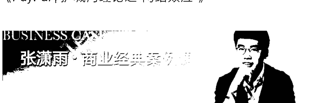

### 抢先放送｜一张图看清商业如何改变你我

《商业经典案例课》已经更新一个季度，为了感谢你的支持，我们准备了一个小小礼物。

图的主旨是“一张图看清商业如何改变你我”。目的是让你更加清晰的意识到商品和我们的关系：从什么时候我们开始依赖各种商品的？我们的生活是如何被它们一点点改变的？作为“得到”的一个商业专栏作者，我想把这些呈现给你。希望你们能通过这些总结，对商业有更直观的认识、更感兴趣、也能在日后的专栏学习中更有收获。

最后，这张图之后会挂在“得到”的首页上，但是今天要先放送给你。如果你喜欢，也可以把这张图分享给更多的人，让更多人知道我们的专栏，和我们一起体会商业的神奇魅力。

### 极简商品史——
一张图看清商业如何改变你我

1886
你可以喝到可口可乐
但经典的易拉罐装还要再等50年

1928
你可以看到米老鼠了

1932
你可以给孩子买一套乐高玩具
不过它们还不是塑料的

你可以带孩子去看电影《白雪公主与七个矮人》
你第一次可以买到动画周边产品

1943
你可以去宜家买一把椅子
因为这一年宜家公司在瑞典成立了

奥美广告公司诞生
从此你看到的广告进化到了一个新时代
1948

1952
你可以在美国犹他州吃到第一块肯德基
35年后的1987年，它来到中国

你可以吃到麦当劳的汉堡了
这要归功于雷·克洛克不顾始创人麦当劳兄弟的反对，坚持要多开新店
1954

你可以去美国的第一座迪士尼乐园玩
如果有机会，你还能见证乔布斯、比尔盖茨的出生

1962
你可以去沃尔玛买东西
按收入算，它现在还是世界最大的公司

1971
你可以去星巴克买咖啡豆
在星巴克喝咖啡还要再等16年

你可以买到苹果的股票了
如果持有到现在，你的股值可以翻450倍

1984
你可以买到第一台苹果的Mac电脑
但第一代Mac电脑是个失败，乔布斯因此被逐出了苹果

你会第一次听到耐克“Just Do It”的广告语
它后来成为了20世纪最经典的广告语之一，它的灵感其实来自一名囚犯
1988

1991
你打开电脑，会听到来自英特尔的“灯，等灯等灯”
据说它达到过每分钟就在地球上播放一次

你可以在亚马逊上买书
5年后，它的对手阿里巴巴就要赶上来了
1994

你可以去看第一部真正意义的3D动画片《玩具总动员》
如果喜欢，还可以买它的创造者皮克斯的股票

你可以买到亚马逊的股票
这一年Netflix也成立了，当时它只有DVD租赁业务，但未来你会看到它拍的《纸牌屋》
1997

1998
这一年改变你生活的不只有谷歌，两个叫马化腾和刘强东的年轻人也开始创业了

你可以用上第一代iPod
从此把1000首歌装进口袋

2002
你可以买到Netflix的股票
同年特斯拉成立，埃隆·马斯克开始了改变人类未来的科技行动

你可以淘宝买买买了
2003

2004
如果你是哈佛的在校生，你可以注册一个Facebook账户

你可以发出第一条Twitter，告诉全世界你在想什么
十几年之后，美国总统也是这么干的
2006

你可以拥有第一台iPhone
但你的朋友多半会嘲笑你，为什么买一个电池只能用一天，连“复制粘贴”的功能都没有的手机？

旅行时你可以住在别人家，尽管很少有人这么干
Airbnb成立了
2008

2010
你可以拥有第一台iPad

有个叫“微信”的应用闯入了你的生活，虽然还发不了语音

2013
你可以不带现金出门，用“微信支付”

你身边有很多人在用华为手机，因为它国产出货量第一
2015

## 麦当劳｜巨无霸汉堡背后的大公司创新

之前对于麦当劳，我们的着眼点都是比较宏观的，不管是商业模式、创业历史还是引申出来的商业理论、博弈论知识等等。今天我们换个角度说说麦当劳，从一个具体的产品出发，来看看这家公司的商业模式与影响力。这个产品就是：巨无霸。

### 被拒绝的产品发明

巨无霸汉堡你应该并不陌生。不过和你想象的可能不一样，巨无霸这个产品一开始并不在麦当劳的菜单上。它的发明者是麦当劳的一个特许加盟商，叫迈克尔·德里加蒂（Michael James Delligatti）。

德里加蒂是麦当劳最早的特许加盟商之一，从1957年开始就经营麦当劳了，主要的领地在宾夕法尼亚州的匹兹堡市。不过，等他发明出后来成为麦当劳象征的巨无霸，已经是10年后的1967年了。

当时德里加蒂发现，顾客们想吃到大一点的汉堡包。于是经过研发，他发明了巨无霸，里面的配料是：双层牛肉饼、洋葱碎、酸青瓜、生菜，还有巨无霸独特的酱料以及带着芝麻的面包。五十多年来，这个配方从未有变过。

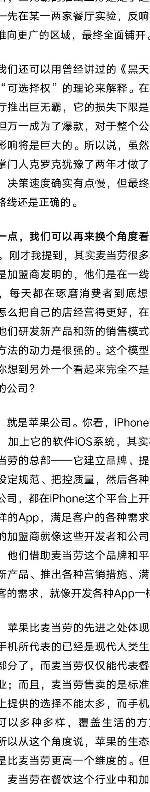

不过很有意思的是，一开始麦当劳并不接受推出巨无霸的想法。德里加蒂后来接受采访的时候说，虽然自己很看好巨无霸这个产品，但公司认为菜单上已有的汉堡、薯条和奶昔已经卖得好了，没有必要再加入新的选择了。

现在看来，这个想法显得非常可笑。但对于当时的麦当劳来说，加入任何一个新产品都是要冒一定风险的。因为标准化管理是麦当劳的核心竞争力，顾客走进每一家麦当劳，期待的是能买到一模一样，水准有保证的产品。但是增加新产品就意味着加盟店要买新的设备、重新更新制作流程和培训员工。

如果更新以后，标准化流程做不到，或者成本无法保持在比较低的水平，新产品再好吃、再受顾客欢迎也没有用。当时推出的时候，巨无霸定价是45美分，而麦当劳本来的汉堡定价是18美分，所以麦当劳害怕这会把顾客吓跑。

实际上不只是德里加蒂遇到了这个问题，麦当劳不少产品的发明其实都来自加盟商。而他们向麦当劳申请实验新产品的时候一开始基本都会遭到拒绝。比如你可能吃过的麦香鱼，其实是1961年俄亥州的特许经营商劳·格罗恩（Lou Groen）发明的。但是他找到大老板克罗克推出他新发明的麦香鱼的时候，克罗克的回答是：“不要，你不要总和我说一堆没用的废话了！我可不想让麦当劳的店里充斥着鱼的味道。”

我们说回到巨无霸，后来德里加蒂说，自己前后花了两年时间去说服麦当劳让自己推出巨无霸。最终在他的坚持之下，双方达成了一个妥协。麦当劳同意让他试着卖巨无霸，不过要求他必须使用麦当劳菜单上已有的材料，而且只能在他旗下的一家麦当劳进行这个实验。

最后的结果你也知道了，巨无霸在推出后大受欢迎，那家麦当劳的销量大涨。第二年，麦当劳就开始在全国以49美分的价格销售巨无霸。等到再过一年的1969年，巨无霸的销售额已经占到了麦当劳总销售额的接近20%。

### 大公司创新与开放系统

巨无霸的故事很有意思，不过我们可以从另外一个角度来看这个小的案例。我觉得，这个故事至少告诉了我们三件事：

- 第一是，大公司的创新总是很难的。比如，从外面看，我们觉得推出一个巨无霸汉堡没有什么难的，但是真正了解了你就会发现，推出一个新产品意味着很多事情。

比如顾客会不会喜欢，能不能收回成本；这个产品如果太成功了，会不会对公司已有的产品有所影响；推出新产品意味着加盟商要更新设备和培训员工，怎么保证他们能够接受，并且执行得很好；新产品对公司的品牌形象会不会有所稀释，等等。对于一个取得成功的大公司，这些都是要考虑的问题。

- 第二是，虽然创新难，但还是有一定应对方法。比如我们现在常说“快速试错，小步快跑”。虽然上世纪六十年代的时候还没有这种敏捷互联理论，但实际上你看，巨无霸的推出正好是走了这种路线——先在某一两家餐厅实验，反响好的话再推向更广的区域，最终全面铺开。

或者我们还可以用曾经讲过的《黑天鹅》里面“可选择权”的理论来解释。在一两个餐厅推出巨无霸，它的损失下限是可控的，但万一成为了爆款，对于整个公司的正面影响将是巨大的。所以说，虽然麦当劳的掌门人克罗克犹豫了两年才做了这个决定，决策速度确实有点慢，但最终的方向和路线还是正确的。

- 最后一点，我们可以再来换个角度看着这件事。刚才我提到，其实麦当劳很多新产品都是加盟商发明的，他们是在一线奋斗的人，每天都在琢磨消费者到底想吃什么，怎么把自己的店经营得更好，在此之上，他们研发新产品和新的销售模式或者营销方法的动力是很强的。这个模型有没有让你想到另外一个看起来完全不是一个领域的公司？

对了，就是苹果公司。你看，iPhone这个手机，加上它的软件iOS系统，其实相当于是麦当劳的总部——它建立品牌、提供平台、设定规范、把控质量，然后各种开发者和公司，都在iPhone这个平台上开发各种各样的App，满足客户的各种需求。麦当劳的加盟商就像这些开发者和公司在做的事，他们借助麦当劳这个品牌和平台，研发新产品、推出各种营销措施、满足各种顾客的需求，就像开发各种App一样。

当然，苹果比麦当劳的先进之处体现在：智能手机所代表的已经是现代人类生活的绝对大部分了，而麦当劳仅仅代表餐饮一个行业；而且，麦当劳卖的是标准化，菜单上提供的选择不能太多，而手机里的App可以多种多样，覆盖生活的方方面面。所以从这个角度说，苹果的生态系统显然是比麦当劳更高一个维度的。但无论如何，麦当劳在餐饮这个行业中和加盟商的关系，在某种程度上就是苹果和它的开发者的关系。

从这个角度，我们可以再做一点延伸。有没有觉得这种模式，也很像我们讲过的一家公司亚马逊呢？在《贝佐斯真正的核心哲学：反熵》那篇专栏里面我们说过，亚马逊最核心的哲学就是用流动和开放对抗熵的增加。

它们把各个事业部都都可以独立出来，并且让它们在市场上独立竞争。所以不管是电商业务、物流服务、影视娱乐还是亚马逊的AWS云服务，都彼此独立但又互相依存，形成了一个开放的生态系统。所以本质上，亚马逊的总部，和这些独立的事业部之间也有一种麦当劳的总部和它的加盟商的关系。从这个角度说，伟大的公司都是开放的。

当然，开放和开放还是有所不同的。比如，巴菲特的伯克希尔·哈撒韦公司，为什么能用25个员工就掌控了收入上百亿美金的公司呢？巴菲特这个“总部”和他掌管的公司的关系是什么呢？伯克希尔·哈撒韦的开放和苹果、亚马逊、麦当劳的开放又有什么不同呢？别急，以后我们会慢慢回答这些问题。

好了，这就是今天的内容。今天我从巨无霸这个产品的角度，来看了麦当劳的商业模式和影响力，讨论了大公司应该如何创新。

张潇雨

今天给你留一个小小的互动：如果你是麦当劳的经营者，你愿意把巨无霸加到你的菜单里吗，为什么？欢迎在留言区写下你的答案。

你也可以转发给你的朋友，问问他，如果他是巨无霸的发明者德里加蒂，又会用什么样的策略去说服麦当劳？感谢你的参与，相信在这一来一回的互动思考中，你会收获更多。

#### 麦当劳 | 一笔中国交易与麦当劳的未来

之前我们讲了麦当劳的创业历史、讲了商业模式、巨无霸的故事以及从麦当劳延伸出来的经济学和博弈论的知识，今天是关于麦当劳的最后一期，我们应该看看这家公司的未来了。某种程度上说，麦当劳代表了一种生活方式，而在当前消费升级、人们更追求绿色餐饮的环境下，这家公司的产品会往哪裡走呢？

落实到这讲的具体内容，我会给你讲讲今年麦当劳在中国的⼀次重大交易，它背后折射出的麦当劳在中国本土的失误、在全球面临的挑战，以及它是如何应对的。

### 在中国的重大交易

要想理解麦当劳现在的处境和它面临的未来，就先要从2017年1月发生的，麦当劳在中国进行的一次大交易讲起。

2017年1月9日，麦当劳宣布，和中信股份、中信资本以及凯雷投资集团达成战略合作，成立一家新公司。这家公司会以最高20.8亿美金的价金买下麦当劳中国内地及香港未来20年的特许经营权。也就是说，未来的麦当劳中国全部会变成特许经营模式，经营权属于这个新公司。

这里有一个背景是，虽然之前我们提到过，麦当劳在全球3万多家门店里超过80%都是加盟店，但是在中国麦当劳一直采用的主要是直营模式，超过七成的门店都是直营。因为对于中国这种发展中国家来说，直营的模式能更好地确保品牌建设和质量管理的稳定。但在这次交易之后，未来麦当劳中国都将变成麦当劳经典的特许经营模式，也就是加盟店的形式了。

在中国区的这个新公司里，麦当劳会占20%的股份，凯雷投资集团占28%，剩下的52%都属于中信。也就是说，中信在实质上变成了麦当劳中国的老板。目前麦当劳中国有超过2400家门店，按照新公司的规划，以在未来5年里中国市场要新开1500家店来计算，中信集团控股的麦当劳中国，将会掌控4000家麦当劳门店。

4000家是个什么概念呢？用麦当劳最成熟的美国市场来做个对比。麦当劳在美国有接近15000家门店，其中大约90%都是特许经营模式。但是，最大的加盟商经营的店数只有70家左右，前10名的经营商，平均每家拥有40家门店。

40比上4000，其中的差距非常明显。可想而知，中信52%的控股权，加上4000家门店的巨大体量，会让未来麦当劳在中国的‘话语权’被削弱很多。那么，麦当劳到底为什么要做这样一笔生意呢？本质上，是与这些年来麦当劳在中国本土的一些失误，以及在全球遇到的几个大的挑战有关。

### 麦当劳的失误

相信专栏的大部分读者在中国都能感受到这样一个现象，就是麦当劳虽然一直是全球快餐业的老⼤，但在中国却是落后于肯德基的。从数字上也能很明显地看出来，麦当劳在中国区有2000多家门店，而肯德基超过了5000家。

这里面最大的原因是，麦当劳在中国开放特许经营太晚了。肯德基从2000年左右就开放了加盟，而麦当劳晚了8年，直到2008年才开始。而且加盟麦当劳和肯德基的门槛本来就比较高，流动资产要200万以上；如果在好一点城市的好一点地段，算上前期投资可能要五六百万人民币。

所以麦当劳加盟商的推广一直很慢。时间累计下来，就比肯德基落后了很多。

麦当劳中国的另外一个失误是，在中国三、四线城市的布局落后了。在这次交易的时候，中信投资方的合伙人就说，麦当劳过去几年最大问题就是对三、四线城市的消费能力判断失误，以为它们对麦当劳的需求并没有很高，但实际上中国三、四线城市消费升级的趋势非常强。

所以这次在很多竞价投标的情况下，麦当劳最终选择和中信合作，很大一个考虑就是因为“中信拥有很好的政府资源，以及地产网络”，接下来能够进入更多的城市，开更多的店。

### 快餐行业的挑战

但实际上，麦当劳在中国落后还只能算“外患”，它面临的“内忧”更大。可以来看一组数字，在2013年到2015年中，麦当劳经历了一个业绩和股价的低谷。它曾经连续七个季度业绩下滑，收入在这两年里跌了10%，利润跌了19%。本质上，麦当劳在这几年面临的是整个传统快餐行业都在面临的挑战。这些挑战都有些什么呢？

首先，就是顾客的健康意识。相信你也能感觉到，如今不管是中国还是外国的消费者，对健康的意识可以说是前所未有的强烈。我们生活中会听到越来越多这样的关键词：跑步、健身、绿色、有机、自律，甚至消费升级……人们越来越意识到健康的生活方式的重要性，而这些都和麦当劳代表的“垃圾食品”的形象完全背道而驰。

之前在讲到零售的时候我们也提到，整个社会风潮的变化往往能带来很多新的商业机会。当然这句话的反面就是，它也会让更旧的一些产品和企业逐渐衰落。在这个角度上，麦当劳就是那个“老人”。

由此而引发的，就是麦当劳不再是年轻人心中引领潮流的那个餐饮公司了。以往麦当劳推出新品或者发售各种玩具的时候，都能引起消费者的追捧。但大家现在更喜欢的是星巴克、新元素，甚至是更小众的、更酷的一些餐饮品牌。

另外，移动互联网的发展也对麦当劳这样的快餐企业有着巨大的影响。你知道，麦当劳最核心的特质就是“快捷方便”，但不论你能把制作一个汉堡的时间缩短到多少，这比起拿起手机，动动手指数，直接把外卖叫到家里和办公室，仍然还是麻烦的。何况，当你点外卖的时候，选择几乎是无限的。

虽然麦当劳也有自己的“麦乐送”品牌，可以把麦当劳的产品送到你家。但它的规模比起美团、饿了么这样的大型平台，可以说忽略不计了。而如果麦当劳进驻了这些平台，它就被迫为了众多供应商中的一个。这对于麦当劳的品牌、个性、用餐体验甚至影响力来说，都会有很大的损害。

最后，除了线上外卖平台带来的压力，在线下也有越来越多的新业态在挑战麦当劳的霸主地位。比如现在层出不穷的便利店。在上海，整个城市有超过6000家便利店，但麦当劳只有200家左右。你只需要下楼走几个步，就能吃上便利店里的盒饭、包子、三明治、烤鸡和关东煮——这些东西比起已经吃腻了的汉堡来说，好像是更有趣也更健康的。而且它们也在不断地研发新品，每个季节都会推出新，来满足顾客变化的口味。

归根结底，就像马化腾说的那句话：对于麦当劳这样的传统快餐企业来说，它可能没有什么错，只是老了。

### 应对与未来

当然，作为一家价值千亿美金，创造过无数数据辉煌的公司，麦当劳是不会坐以待毙的。实际上，在2015年年初更换了新CEO之后，麦当劳逐渐进入了新一轮的业绩增长期。截止到2017年年中，麦当劳的股价和市值创新了新高。所以最后一部分，我们来看看麦当劳是如何应对的，这两年它都采取了哪些举措呢？

第一个就是出售直营店，把全球特许经营店的比重从80%左右提高到90%，甚至95%。刚才我们提到的中国区的交易就是这个指导思想的产物。而不仅是中国内地和香港，在中国台湾、日本、韩国这些地区，麦当劳都在进行类似的交易，把直营模式更多地转变为加盟，从而削减运营成本，加快决策速度，提高餐厅的增长和开店的速度。

第二，麦当劳开始丰富自己的产品种类。比如这两年来麦当劳在美国推出最成功的产品系列是“全日早餐”。也就是说你可以在全天吃到各种麦当劳的新早餐，比如特色麦香蛋松饼、蛋堡餐、热香饼等等。全日早餐最大的功能是，吸引了很多作息时间不规律的，在非早餐时段买早餐的顾客。结果这些在中午吃早餐的人，有超过一半还买了其他食物，这间接地提高了午餐的客单价，也就是每个顾客平均消费的金额。

另外，你还会发现麦当劳的一些汉堡产品开始使用新鲜的牛肉，而不是以前那种提前加工好的冷冻牛肉饼了，这为一部分对汉堡口感挑剔的顾客提供了更多选择；而且连巨无霸这种经典产品，现在都有了新的型号——现在在很多国家和地区你可以买到小巨无霸、巨无霸或者巨型巨无霸；此外，麦当劳还宣布在麦乐鸡里去掉所有防腐剂等等。所有这些举措，都是为了迎合消费者新的口味和要求。

第三，麦当劳在服务、营销和数字化上也做了很多尝试。

比如你现在走进麦当劳的店里，会看到越来越多的自动触屏点餐机、新的咖啡机。在美国，麦当劳还打破了传统，开始推广送餐到桌的服务，也就是你不用再站着等餐，而是像一般的餐厅那样去坐好，等服务员把你的吃的拿过来就好了。

麦当劳在2017年还有一个成功的营销活动，就是1美金软饮随便喝。所有的像可乐这样的软饮都是1美金，这种促销带来了很多销售的增长。另外为了吸引年轻顾客，已经十年没有过明星代言人的麦当劳中国，在2017年的6月，宣布吴亦凡正式成为新的代言人。

这一套组合拳打下来，麦当劳逐渐从低谷走了出来，进入了新一轮的增长期。

在理解了麦当劳目前的状况和对未来的规划之后，最终，我们来探讨一个问题。我认为，这也是对于麦当劳这家公司，关于未来最重要的问题。

对于麦当劳来说，减少直营店、增加更多强大的合作方、多尝试一些新的营销方法，比如1美金饮料的营销，或者是点餐的数字化移动化等等，都是非常好的举措，也一定能支撑未来几年麦当劳的发展。但一个公司长期的成败，最终还是要回到产品上。而在产品这个角度，麦当劳真正面临的问题是：

未来的麦当劳，到底是应该固守自己产品成功的那些方面，比如“便捷、快速、口味过得去、便宜”，还是应该变成一个不一样的麦当劳，比如“更加时髦、健康、绿色”呢？

要知道，如果选用新鲜的牛肉而不是冷冻好的，不仅成本要提高，加盟商的设备要升级，而且麦当劳平均出餐的时间要慢上整整一分钟。另外，新鲜食材如果处理不好，还有可能爆发大的食品安全问题。

要知道，如果麦当劳想要变得更加“绿色和健康”，它的竞争对手就不再是肯德基或者必胜客，而是在消费升级的领域里无数家更加精致的小餐饮品牌，它们的体量也许远不如麦当劳，但是论顾客的忠诚度，可能是远远领先的。

无论如何，这都是摆在麦当劳面前一道最大的难题。未来还有多少人需要麦当劳曾经代表的那种风格的食物和生活方式呢？还有多少人愿意用垃圾食品解决自己的饱腹问题呢？站在这个时点上，我们所有人都可以拭目以待。

张潇雨

关于这个问题答案，也欢迎你在留言区写下你的思考。

今天是周五，感谢你这一周的陪伴，我们下期再见。

## 周末互动｜金色拱门理论和巨无霸指数

欢迎来到《商业经典案例课》。我是张潇雨。

这期周末互动我要先讲一件事，有些只听音频的同学可能没注意到，我们在这周四晚上的时候发布了一期“抢先放送”的专栏，里面的内容是一张图，标题叫做《一张图看清商业如何改变你我》。我们的专栏已经过了一个季度了，所以这张图算是一个阶段性的总结。当然，对于专栏内容，在之后我们还会有更多的梳理和串联。如果你喜欢这张图，也欢迎你分享给更多的人，让大家一起加入我们的专栏。

这周我们讲的是麦当劳，可以先预告一下，下周我们会讲星巴克，加上再之后安排，算是我们对连锁零售和餐饮的一个整体梳理。相信你学完这一系列内容后，从此再去吃饭和喝咖啡，感觉会有点不同。关于麦当劳，其实可以讲的内容还很多，今天的互动我们来简单讲讲两个和麦当劳好玩儿的理论。我们点到为止，不做过多展开，听完有兴趣的话，你可以去做一点延伸的学习。

### Ⅰ “金色拱门理论”

第一个理论叫“金色拱门理论”，这里的金色拱门说的就是麦当劳那个大大的“M”形logo了。金色拱门算是半经济半社会学理论，提出者是托马斯·弗里德曼，提出的时间大概是20年前。托马斯·弗里德曼是一个著名的记者以及作家，得过三次普利策奖。他最有名的一本书应该是《世界是平的》。

“金色拱门理论”讲起来一点也不复杂，就是一句话：任何开设了麦当劳的两个国家，不会彼此打仗。因为弗里德曼认为，一个拥有麦当劳的社会，基本上等同于一个经济稳定、中产力量强盛的社会。人们对经济发展兴趣超过了意识形态，对消费的欲望超过了打仗，甚至可以说，人类会用巨无霸和薯条取代对战争的欲望。

本质上，这是弗里德曼对经济学里面“理性人”的一种期待，认为有麦当劳的两个国家不会开战，甚至再扩展一点，认为任何两个处在同一全球供应链上的国家不会彼此开战，是因为经济上的损失太高了。

当然，后来有个别的案例证明，这个理论并不是100%严谨的。不过“金色拱门理论”确实是一个概括得很好、有很深刻的洞察、常被媒体引用、又非常好记忆的理论。尤其是在这个地缘政治更加波动、全球化受到挑战的时代，观察“金色拱门理论”是否仍然成立，是一个很好的研究角度。

### Ⅰ “巨无霸指数”

另外一个关于麦当劳的很好玩的理论，你可能也听说过，叫“巨无霸指数”。

巨无霸汉堡你肯定不陌生了。这个所谓“巨无霸指数”，其实是1986年《经济学家》杂志推出一个非正式的经济学指标，之后每年都更新一次。虽然这个指标并不是一个官方学术的研究成果，但一经推出就非常受欢迎，慢慢就成了一个很经典的指标。

所以“巨无霸指数”到底是干什么的呢？它其实是通过不同国家和地区的巨无霸汉堡的价格，来衡量不同国家之间货币的汇率到底是被高估还是低估了。

这句话可能有点拗口，来举个例子。比如，假设巨无霸在美国的售价是5美元，而中国的巨无霸卖20人民币，也就是按照实际的人民币美元的汇率一除（比如是1:6.8），得出来的价格是3美元左右。那么根据“巨无霸指数”，它就认为人民币比美元低估了40%，也就是1-3/5=40%。就是这么简单。

或者换个角度算，美国的巨无霸售价是5美元，而中国是20人民币，所以巨无霸指数认为，美元和人民币的真实汇率应该是20/5=4:1，但实际上市场汇率是6.8:1，所以人民币被低估了40%。

听到这儿你可能发现，这个巨无霸指数里面，有一个最重要的假设，就是它认为：美国的巨无霸的售价和中国的巨无霸的售价应该是一样的。比如美国卖5美元，中国也应该卖5美元，但是根据当前汇率一计算，中国的巨无霸才卖3美元，所以人民币就被低估了，应该上涨。

这个假设，听起来好像有点简单粗暴。但是这里面其实蕴含了一个经典的经济学概念，叫做：购买力平价。英文是Purchasing Power Parity，经济学家一般简称为PPP。

购买力平价最初是在20世纪初，由瑞典经济学家卡塞尔提出来的。简单来说，购买力平价理论就是说，你之所以愿意买进美元，最终是因为美元可以在美国买到东西，如各种产品和服务。否则的话你肯定不想要美元了。那同样，你持有人民币，是因为你对它的期待是，它能买到对应的东西。所以，美元在美国能买东西，人民币在中国能买东西，于是美元和人民币的汇率，就应该是这两种货币在买一系列相同的东西的时候，实际购买力之比。

所以，经济学里面有个所谓“一篮子产品”的概念——其实就是各种常见商品的组合。假设我们设定了一篮子产品，里面包括大大小小各种生活必需品。然后在中国买这些东西需要1万人民币，而在美国需要2000美元，那么对于这篮子商品来说，人民币对美元的购买力平价就是5:1。这就是购买力平价的理论基础。

所以你看出来了，所谓的巨无霸指数，就是把那个“一篮子产品”，直接用巨无霸代替。因为巨无霸在很多国家都有，单价不高，算不上奢侈品，而麦当劳在各国产品和服务也是差不多的。所以《经济学家》就设计了这个巨无霸指数，作为对各国货币实际汇率到底是被高估还是被低估了一种指标。当然这个指数肯定有它不全面的地方，但它也是一个重要的参考。《经济学家》从1986年开始就每年更新这个指标，最新一次的更新是2017年1月。（文末附《经济学家》巨无霸指数链接）

关于“金色拱门理论”和“巨无霸指数”，可延伸的还有很多。如果你有兴趣，还可以继续去做一些研究。讲这两个经济学和社会学的理论，其实也是想说明麦当劳这家公司，在过去几十年全球化的浪潮里，扮演了多么重要的一个角色。这的确是一家非常伟大的公司，而且了解了它的创业史你也会感受到，如此伟大的公司，也是起源于一个小小的想法和创新，然后在之后的几十年里慢慢耕耘出来的。当然，麦当劳在未来几十年里还能不能延续这种辉煌，我想我们都会非常关注。

### ——• 本周留言精选 •——

#### 麦当劳 | 不姓麦当劳的“麦当劳之父”

今天的收获1.麦当劳的开始与星巴克的开始简直如出一辙，历史总是惊人的相似。2.经济学上“谁用的最好，就归谁”的规律在麦当劳这里出现了。3.麦当劳兄弟对知识和人性付了一笔不小的费用。4.麦当劳兄弟对于麦当劳的贡献相当于实验室开发出了新技术；而克罗克相当于把实验室技术工业化、把生产变成了工厂技术。5.克罗克推动麦当劳兄弟还是用的古老的一招：“让人们去造船，最重要的是激发他们对大海的渴望”。6.麦当劳兄弟的悲剧是他们跟不上社会发展节奏带来的必然结果，这里面又体现了查理·芒格先生说的“你想得到一样东西，最好的办法就是配得上他。”也许在查理老眼中“麦当劳兄弟还配不上后来的麦当劳”。7.选择大于努力，两种商业模式的选择，决定了企业的顶点。那么问题来了，为什么咱们中国出了不这样的企业或者说比它更优秀企业呢？

化，最后大规模复制。虽然麦当劳发展路也还是按照这个思想模式，但是发展的路径却很不同，甚至很巧合和特别。麦当劳是两按人接力的结果，一按人完成了快餐运营标准化，另一按人完成了快速扩大路标标准化，然后再整合，形成一套独特的商业模式。他们缺一都无法成就这个创新的商业模式。比较有趣的是他们虽然在打架，但是互补配合得刚刚好，完成了各自被赋予的商业使命。

看过麦当劳的创业电影，印象最深的是麦当劳兄弟在被收购后问了克罗克一个问题：“我们第一次就带你看了整个麦当劳店的工作模式和制作流程，你完全可以自己另开一家店复制就好了，为什么要求我们要特许经营权？”克罗克回答说：“相信你们带很多人参观过麦当劳的模式和流程，却不见有人做起来。最主要的原因是我看中了‘麦当劳’这个名字，它跟我的名字紧密关系，要是用克罗克作为名字，那别人们都会当它是骗子，所以当我看到麦当劳时就想一定要拥有它。”商业就是这么有意思，复制同样的商业模式及制作流程，要有好名字，还要有很多因素的结合才能造就一个人人都知道的商业帝国。

看过克罗克对麦当劳兄弟说的那段话：“我看过麦当劳金色的拱门，跟看见教会上面的十字架和法院上方飘扬的美国国旗的感觉是一样的，它象征着家人们朋友聚在一起，度过一段美好的时光……”我突然就联想到齐布斯在当年游说还在百事可乐任职的克劳力时说的那句经典名言：“你是想卖一类子糖水，还是想改变世界？”克罗克52岁了，才终于遇住一个机会把麦当劳变成了一个商业帝国，这份执着，这份韧劲，正迎合了《道德经》里说的那句话：“死而不亡则寿”，或者是另外一句话：“只要不下牌桌，就还有翻本的机会”。优秀的人都有一个执着的信念，一双善于发现的眼睛，还有一张会游的嘴。

看完真的不太相信这个雷·克罗克是个普通普通的销售员，他身上有非常典型的企业家特质：（1）有非常敏锐的商业嗅觉。有小店一次购买8个奶昔搅拌机，他愿意千里迢迢驾车过来亲自探访，光这一点就赢了大多数只想待在冰箱里的普通人。（2）天才的销售能力。他说过麦当劳兄弟的那段话，是作家和政治家才说得出的话啊！“想出海，最先做的不找木造船，而是激发其他人对大海的渴望。”（3）胆大而有野心。瞎着老婆抵押房子那真不是一般人干得出來的事，而且那种迅速扩张的打法像不像早期的贝佐斯？（4）听得进別人的建议。这一点真听起来容易做起来太难，人往往比自己想像的要顽固。但克罗克偏偏能细细听进去索伯恩“运作房地产”的建议。以上任何一点都没有到，麦当劳可能都没有今天的辉煌。克罗克遇到麦当劳兄弟，很幸运；麦当劳遇到克罗克，也很幸运。

#### 麦当劳 | “奶昔错误”与理解用户

[1] 现在很多健身软件都提供勋章，特别是悦跑圈还提供实物勋章的奇葩业务。这其实就抓住了大家使用App健身的目的，除了记录距离和时间，更多的是希望得到一块奖牌，能够挂在那里，能够发图晒照片。另一个健身App使用最多的功能就是修图，因为除了健身，发一张美图也是很多人健身背后的刚需。[2] 对Bose降噪耳机的购买，其实购买的不是好音质，而是一段安静的环境，让人们在乘坐飞机和高铁的时候，仍然可以集中精力工作。[3] 对“得到”的购买，其实并不是未来增加谈资，或者转发到朋友圈，而是雇佣一群大牛，对书本上曾沿及到或者隐藏在领域深处的热点问题和经典问题进行解答，让用户能够快速入门，并具备深入研究的可能。所以这也是为什么“得到”对于专栏的要求很高，同时也不期望通过标题党来吸引长期流量。

#### 麦当劳 | “麦当劳旁边挨着肯德基”的博弈论原理

雷特林法则很有意思，竞争趋同带来的成本节约。就像我们常说的行业老二跟老二基本是差不多的，你出来一个新业务，我也马上跟进，你搞出一个新技术我也马上加强研发，也可能是因为他们

我也马上加强研发，也可能是因为他们彼此把对方作为战略上的竞争对手。实质这样的好处是同一业务下的小公司有了弯道超车的机会，就像云说当年做C2C的淘宝，竞争对手根本没看上它，导致最后竞争对手根本跟不上看不着。

霍特林法则与纳什均衡在人与人之间的体现，突然想到父母与子女的关系是不是也很暗合这两 theories，我们常说子女像父母（性格上），是不是也是博弈上的一种结果体现，从另一个角度分析遗传，性格上的相似也应该是后天上的习得博弈平衡，由于亲情这一层面的关系，父母与子女不会是零和博弈，更贴切的表现应该是纳什均衡（双方会预判自己能想象的最优解和对方最可能接受的解），现在想象父母与子女关系某一致或或者事情的妥协不一定是当下的最优解，却是双方最有可能可以接受的最舒服状态。甚至包括我们最不喜欢的人，相处时间久了还是会受他的影响。

如果把人与人之间的关系比做市场关系，肯定不会是充分完全竞争市场，信息肯定不会完全对等，人与人性格多少会有一些习得性趋同，与你关系越近交往越多，相似的成分就会越多。也印证了那句话：物以类聚，人以群分。给我们的启示是想成为哪类人就向那类人靠近！

五商刚刚结束10讲博弈论，但是今天听又有了新的理解。所以博弈论都是建立在信息不对称上，掌握信息多的一方更有优势，博弈的前提是多搜集信息。十多年前去武汉，当时看到有麦当劳的地方必有肯德基。一直不理解原由，今天总算明白了。文中所分析的街道客流量均衡原理是建立在这两个品牌有较大雷同性的基础上。也就是说它势均力敌。

如果麦当劳和肯德基商量提价，共同提高产品定价10%，这也可以达成纳什均衡，对商家来说最优。但如果其中一方突然破坏约定，对另一品牌就会造成打击。产生坏的纳什均衡。我想所有品牌追求的都不是均衡的局面，都只是暂时的妥协。大胆创新才有打破均衡的机会，赢得先机。

沟通的本质是在于信息的交换，最好的结果是达成一种共识。但是由于人是趋利避害的，在沟通过程中都会尽可能为自己谋求最大化利益，所以都会有所保留，进而造成了信息的不对称，而信息的不对称的结果对于获取信息少的一方是不利的，在竞争中会处在被动、被牵制的感觉，为了填补竞争中不利局面，弱势一方如果理性的话，肯定会通过技术革新、营销手段升级、产品创新、更改战略来实现落后的局面；但同时也伴随着恶性竞争的不良局面：价格战、攻击对手、虚假广告等。竞争本身是一个双面镜，良性的会带来创新和进步，恶性的会带来资源浪费和利益损害。在一个理性的社会里，人的认知极大提高、资源极其丰富，这个时候“最优选择”方案是可能出现的，但现实社会这些假设因素都不存在，不然当年中国成立前的路也不会那么坎坷，柏拉图也不会写出《理想国》这本书。回到企业中去，一个刚刚创业的公司，人员比较少，劲可以往一处使，前提是因为大家得以相对充分的沟通，清楚彼此的共同利益和目标，但是当企业发展壮大以后，信息的传递不时丢失、被曲解、隐藏以及猜疑，这样每个人为了保持利益最大化，内部沟通也变得无法顺畅了，所以企业会有各种文化、价值观、制度、团队建设等措施，但是这个时候要想让企业能够更凝聚和前进，领导者是起决定作用的。回到生活中，人与人之间的信任、合作、交往、相处、相爱、理解都是源于沟通，所以一个大家都认为不错的人，一定是一个愿意充分沟通，进而做出相对最有效率（公平的本质）决定的。

#### 麦当劳 | 巨无霸汉堡背后的大公司创新

市场需求不以个人的意志为转移。一切都是市场说了算。在物质匮乏的时候，人们期待的是“有”，标准化汉堡满足了大众需求。标准化以后，人们会有差异化的需求，巨无霸就是差异化的体现。由于麦当劳是庞然大物，有标准化的管理，所以差异化不那么灵活，但总归还是满足客户需求的。汉堡有大小，可乐有大小杯子。是否卖巨无霸，就像在问，是不是会卖大杯可乐。当然都是需要！

把巨无霸加到现有的菜单里，是值得尝试一下的事情，这个创新还是沿用了麦当劳现有菜单上已有的材料，管理上也非常容易纳入麦当劳的标准化管理。这种创新属于克里斯汀森说的延续性创新，风险是相对比较小的。华为的任正非也表示过，要聚焦主航道，以延续性创新为主，允许小部分力量有边界地去颠覆性创新。巨无霸汉堡可以说是麦当劳的一款灵魂产品。发明者迈克尔·德里加希可以说是快餐行业的一个真正的创新者，还帮助公司推出了麦当劳的早餐服务。但令人遗憾的是德里加希没有因为发明这种巨无霸汉堡包得到任何酬劳或专利，如果麦当劳有一种激励创新的机制，或许会有更多感动我们的胃的产品让生活更加美味起来。

#### 麦当劳 | 一笔中国交易与麦当劳的未来

最初的时候顾客到餐厅等餐是麦当劳最新的想法，使得经营者减少了人力的投入，那么当时算不算一个吸引顾客的点呢？而现在取缔这一模式，是为了更好的顾客体验吗？是因为时代的变迁，那种排队的等餐的模式已经为人们熟知，而且厌倦了吧。能坐在餐位等餐更能迎合大众的胃口。打破常规，有的时候不舒服的点也能在一段时间内让你成为亮点，但别忘记后期的更新。

## 星巴克｜越来越像麦当劳的星巴克（上）

你好，这周我们要讲一家新的公司，可能也是你很熟悉的一家公司：星巴克。

提到星巴克，你可能脑子里会浮现出很多很多关键词来：浓香的咖啡、舒适的空间、独特的公司文化、非常有特色的logo等等。这些都是留在我们印象里的星巴克的经典形象。不过，今天我就带你抛开这些感性认识，回归到商业层面去看星巴克，然后你就会突然发现，它其实越来越像另外一家公司了，那就是我们之前讲过的麦当劳。

你可能有点疑惑——明明这两家公司看起来定位非常不同，怎么会彼此相像呢？今天和明天的两期专栏我们就从这个角度切入，来看看星巴克这家公司的历史和未来。

在说星巴克和麦当劳怎样变得越来越像之前，我们先来说说它们的不同。当然，不是从直观的层面上去，而是从商业分析的角度。

### ◆—— 不同之处 ——◆

#### 区别一：产品定位

这里说的产品定位，当然不是汉堡和可乐的区别，而是产品的主要特性上的。麦当劳作为一个快餐饮品牌，主打的其实是方便、快捷并且能够填饱肚子。所以对于麦当劳来说，标准化快就是最重要的生命线，至于店内是不是舒适、气氛是不是温馨，并不需要太多考虑。

而对于星巴克，它最主打的就是所谓“第三空间”的概念——这个概念是来自于社会学教授奥尔巴格的一本书《第三空间》（The Great Good Place）。他的理论说，人们需要有非正式的公众场所，可以在那儿聚会，把工作和家庭的忧虑暂放在一边，放松下来聊天。像德国的啤酒花园、英国的酒吧、法国和意大利的咖啡吧就是这样的存在。没有这样的场所，一个城市就没法培育出一种自由、开放、平等的人际关系，人们就只能被限制在自己的小圈子里。所以，一个“第三空间”对一座城市是特别重要的。

星巴克咖啡的董事长霍华德·舒尔茨正是意识到了“第三空间”的重要性，才真正把星巴克从一家提供咖啡和咖啡豆的公司，变成了一家提供服务和体验的公司。这一点我们以后的专栏会讲到。对于星巴克来说，店内充满咖啡的香气，舒适的环境和良好的咖啡享受体验才是最重要的，人们来到星巴克也不为了填饱肚子的。这是它和麦当劳定位的本质不同。

#### 区别二：商业模式

经过之前两周的学习你应该已经非常清楚了，麦当劳虽然最著名的是它的汉堡和可乐，但是它核心的商业模式是特许经营。所以，麦当劳的做法是，由总部出面收购物业，再转租给特许经营商赚取差价，同时还能收入和加盟商营业额挂钩的加盟费，而如果加盟商表现不佳，也可以随时把它们“扫地出门”。而星巴克的做法就传统很多，它大多数的物业都是单纯地租借开店。由于品牌优势，星巴克也可以拿到比较低的租金。所以开一个新店，不管是从时间上还是投资回报的周期上都会快很多，当然它就没法享受租金方面的收入和地产物业的升值了。

#### 区别三：开店策略

比起麦当劳，星巴克的开店策略其实更加激进——它一般喜欢用大量的商店侵略性地覆盖一个地区。比如在20世纪90年代，一家新开的星巴克门店抢走附近星巴克门店30%销售额的情况是很常见的。但是这样有什么好处呢？主要有三个：

+ 1. 密集开店可以把顾客更有效地分流，减少大家的排队时间，也有更多的空间和座位提供给消费者；
2. 星巴克的主要产品还是冲泡饮品，制作相对比较简单。所以一旦星巴克设立一个支持中心——可以理解成餐饮业的中央厨房，用来支撑各个门店的运营——那么每个支持中心覆盖的门店越多，固定费用也就被分摊得越多，所以成本也就越低；
3. 最后，密集地开店可以迅速加深消费者对星巴克的品牌印象。

所以你看，本质上这两家企业的定位就决定了它们整体策略的不同。如果你强调自己的空间属性，那么就需要开店又快又密集，分散客户流，否则就没有人来星巴克了；如果你主打方便快捷，那么产品的标准化和快速出餐才是最重要的，人们是来填饱肚子而不是享受生活的。但是，为什么么这两家公司越来越像了呢？

### ◆—— 相似之处 ——◆

#### 一、门店数量和资本市场表现

唔们之前说过，麦当劳真正开始开设分店的时候，是20世纪50年代中后期，雷·克洛克加入之后。而星巴克开始迅速地开设分店，是从1987年霍华德·舒尔茨回归开始的。所以从时间上来说，星巴克比麦当劳晚了30年。但是目前来看，麦当劳在全球有37000家左右的店，而星巴克是25000多家，并没有比麦当劳少太多。而且按照两家公司未来五年的扩张计划，到了2021-2022年，星巴克和麦当劳在全球的店数很可能非常接近——这也正是星巴克开店速度更快的結果。而到了那个时候，两家公司在资本市场的表现也会更加接近——现在星巴克的市值大概在八九百亿美金左右，而麦当劳是1200亿美金上下。

#### 二、产品和自身定位

某种意义上来说，星巴克和麦当劳已经成了直接的竞争对手。

高单店的销售额。

这些听起来是不是都背离了星巴克一贯的“第三空间”理念，而越来越像追求高效的麦当劳了呢？

其实，麦当劳和星巴克之所以越来越像，是因为它们面临的都是一个问题：在餐饮业不断变化的时候，一个辉煌过的大企业怎样才能继续增长？

后来，美国一名大学历史系教授 Bryant Simon 写了一本书叫《Everything but the coffee》（暂且没有正式的中文名翻译，大概可以翻译成《和咖啡无关的一切》），也是写星巴克的各种现象的一本书。书里面提到，20世纪90年代的时候，星巴克在美国的品牌定位还是一个“轻度奢侈品”，就像现在的中国一样，但是到了这几年，他引用了一篇研究报告里的一句话说——“很多人对于星巴克的认知和麦当劳已经没有什么两样了。”也许在未来的中国，类似的事情还会再发生一次。

无论如何，麦当劳和星巴克这两家公司已经看起来越来越像了。那这变化的背后到底是什么力量驱使的呢？星巴克面对消费者对它品牌认知发生的变化，有没有不甘心呢？明天我们就来回答这个问题。

最后，我们用一个小故事来结束今天的专栏，这是一个星巴克的现主席和董事长霍华德·舒尔茨在《将心注入》这本书里亲自讲过的故事，这个故事是星巴克成长为现在这个样子的关键一步：

在1981年的时候，霍华德·舒尔茨在一家瑞典公司负责厨房用品和家居产品在北美的销售。结果有一天，他注意到一个奇怪的现象：一个西雅图的小小零售商竟然订购了一大批的咖啡研磨机，有多少呢？比美国当时最大的百货公司梅西百货还要多。于是舒尔茨就去作了调查，发现这是一家叫星巴克的咖啡店，当时只有4家店铺。舒尔茨隐隐觉得这里面有些不寻常的东西，就和老婆说：“我得去看一家公司，去那儿实地考察一下。”正如大家知道的，后面的就是历史了。

还记得吗？我们上周讲过，当初雷·克罗克就是这么发现麦当劳的（文末附原文链接），可能这就是麦当劳和星巴克的缘分吧。

张潇雨

听完了这期内容，你可以回忆一下自己在麦当劳或者星巴克消费的经历，有什么和今天的内容相似或相悖的发现和感悟，可以在留言区写下来，跟大家一起交流。

麦当劳 | 不姓麦当劳的“麦当劳之父”

## 星巴克 | 越来越像麦当劳的星巴克（下）

星巴克 | 越来越像麦当劳的...

你好，今天我们继续来讲星巴克。

昨天我们提到了一件事情，就是星巴克和麦当劳这几年越来越像了。不管是在门店数、盈利能力、资本市场的表现，还是产品的定位和服务的人群方面，两家都开始进军对方的地盘，于是变得越来越相似。

在昨天内容的基础上我们稍稍做一点延伸。

实际上，这是商业领域经常发生的一种现象。你应该还记得我们之前讲过的亚马逊，这几年，它开了书店，还收购了Whole Foods全食超市，现在已经彻底进军线下的零售店，以及食材、生鲜配送的生意；而沃尔玛呢，在2016年9月以32亿美金的底价，收购了一家叫Jet.com的电商。这是一家试图和亚马逊竞争的电商公司，在上线几个月之后就拿到了包括阿里巴巴在内的3.5亿美元的融资。在收购之后，Jet.com的CEO马克·劳瑞（Marc Lore）也开始全面负责运营沃尔玛的电商业务。后来有一个经典评论说：亚马逊和沃尔玛其实在比拼的就是，看谁能在对方成为自己之前，先成为对方。

说到这里，你可能还想起了上周我们讲过的“霍特林法则”，也就是说在一个理性的市场里，有时候竞争者最好的方案就是把产品做得彼此都很像。

### ｜星巴克的现状

对于星巴克来说，这几年来它的日子并不算好过。过去几个季度，星巴克一直没能交出让人满意的财报，不管是营收还是利润都没能达到华尔街的预期，股价也一直波动。后来，星巴克干脆宣布，不再将预期目标写进财报了，省得大家总觉得公司达不到预期。

星巴克来说现在面临着几个问题：

- 首先，星巴克美国市场已经开始饱和，想开再多的店已经很难了。目前星巴克全球超过25000家门店里，有15000家都是在北美地区的，可以说市场已经覆盖得非常全面，换句话说，已经接近饱和了。
- 另外，限于咖啡这种品类和消费者的消费习惯，想在咖啡上让大家增加消费也是很难的。毕竟你再怎么营销和打折，也没法让一个人从每天喝两杯咖啡变成喝五杯咖啡。
- 作为一个连锁餐饮店，想要提高收入无非就是两个途径：或者提高单店的销售额，或者开更多的新店。这是一个最简单的乘法问题。所以，星巴克要想提高营收，解决方案也显得易见了：第一，既然没法让大家喝更多咖啡，那就进军食品业务吧；第二，既然北美开店已经饱和，那么就快些多在中国这种新兴的、潜力大的市场再多开些新店吧。

### ｜星巴克的两个大动作

- 1. 第一个大动作：进军食品品类

就是我们之前提到的，星巴克开始越来越重视食品这个品类。2015年的...这正是星巴克向食品领域进军的努力。

- 2. 第二个大的动作：收购股份

在2017年7月底，星巴克宣布和长期合作伙伴统一企业，也就是我们熟悉的，卖饮料和方便面的那个统一，达成了一项收购协议。星巴克会以13亿美元的现金，收购星巴克华东市场合资企业剩余的50%股份。也就是说，收购完成之后，上海、江苏和浙江这些地方大约1300家星巴克就全部完全归属星巴克。而算上华南、华北地区，中国内地的2800家门店全部成为星巴克直营。然后，星巴克的现任CEO凯文·约翰逊（Kevin Johnson）说，到2021年，星巴克在中国内地的目标是开5000家店。

### ｜星巴克和统一的背景

星巴克和统一的合作其实从好久之前就开始了。2002年开始，统一把星巴克引入内地，当时星巴克最看重的就是统一集团下面商超的连锁经验。当时统一集团在台湾可以说如日中天，旗下有商超、食品、物流、金融等等各个业务，和星巴克的联手从台湾开始再到内地，可以说是顺理成章。

### ｜霍华德·舒尔茨的卸任

相信听到这里，你应该理解这几年星巴克各种动作背后的商业逻辑了。但是，故事还没有完。

华的咖啡宫殿，面积巨大，里面围绕着咖啡主题设有许多设施。星巴克目前计划在全球开设10家左右的烘焙工坊，而上海就占了一个名额。在上海店的规划里，星巴克烘焙工坊面积有2700平方米之大，里面有咖啡吧、主题商店、餐厅以及一个大型、透明的咖啡烘焙场所。如果你走进去，就可以看到咖啡豆被送入一个高约10米的大铜炉里烘制，然后出来。而且你还可以选择不同的咖啡豆、选择不同的冲泡方式，还可以听咖啡大师讲解各种制作工艺。当然，烘焙工坊里面也有很多专属和限量的咖啡和食物。

本质上，在人们越来越把星巴克看成像“麦当劳”一样的快餐品牌的时候，舒尔茨领导的烘焙工坊团队，就是要扭转人们的这个印象。另外，星巴克还会大量地开设一种叫Reserve的甄选咖啡精品店。它比烘焙工厂要低一级，但是比一般的星巴克门店要高端不少。星巴克也希望在这种品牌结构的划分上面，做出更丰富的文章。这样才能保住星巴克在消费者心中的印象。

### Ⅰ 总结

不管是对于星巴克和麦当劳，在辉煌之后，都面临着继续保持增长，向股东呈现更好业绩的挑战。所以，星巴克开始进军食品品类，而麦当劳进军了咖啡领域，这都是不可避免的选择，这也让两家公司越来越像。同时，星巴克和麦当劳尽管采取了不同的策略，但是在中国以及各个潜力市场大举开店，这一点是非常相似的。但最终，伴随着餐饮业在全球的发展和变革，以及更加微妙的竞争形势，星巴克和麦当劳到底谁能胜出，将会是一个非常有趣的商业话题。

张潇雨

在你看来，麦当劳和星巴克谁会是最终的赢家呢？不如写在留言区，跟大家讨论一下。

## 星巴克｜第三空间与社区精神

你好，今天我们继续来讲星巴克。

在讨论完星巴克的整体战略和未来面对的挑战之后，我们回头来看看星巴克当初是怎么成功的。如果纵观星巴克的历史，让它真正从一个普通的咖啡店，变成一个文化现象和如此成功的品牌的最重要的转折点，就是霍华德·舒尔茨意识到了星巴克卖的并不是咖啡，而是服务和体验。后来，他借用了“第三空间”这个概念，完美地阐释了星巴克的这种哲学。今天我们就来讲讲“第三空间”这个理念，以及更重要的一——星巴克是怎样完美地执行自己这个理念的。

### ——“第三空间”的概念——

首先我们再来复习一下“第三空间”的定义。

我们之前说过：“第三空间”这个概念是来自于社会学教授奥登伯格的一本书《The Great Good Place》。书里面有个理论说，人们需要有非正式的公开场所，可以在那里聚会，把工作和家庭的忧虑暂时放在一边，放松下来聊聊天。像德国的啤酒花园、英国的酒吧、法国和意大利的咖啡吧都是这样的地方。没有这样的场所，一个城市就没法培育出一种自由、开放、平等的人际关系，人们就只能被限制在自己的小圈子里。所以，拥有“第三空间”对一座城市来说是特别重要的。

这里面你可以听出来，星巴克已经把自己的存在赋予了一种社会学的意义。不知道你是不是还记得，我们在讲到苹果的时候，里面有一期专栏叫《乔布斯的魔力演讲》（文末附原文链接）。文章里面我说，乔布斯是最善于给自己做的事情赋予更大意义的。比如他当年提到音乐播放器iPod的时候是这么说的：

> “iPod不只是一款音乐播放器，它还有着更大的意义。在当今的数字时代，音乐正发生革命性的变化，音乐在重新回到人们的生活里。这是一件非常美好的事，我们正在用自己的方式让世界变得更加美好。”

同样，舒尔茨也引用了奥登伯格的说法，他说：

> “在星巴克这个第三空间里，人们的关系是自由和平等的，没有职场的上下等级意识，也没有家庭里各种角色的束缚，人们可以把真正的自己释放出来。我觉得星巴克的使命就是：激发并且孕育人文精神。通过每一个顾客、每一杯咖啡，把每一个社区凝聚起来。”

### ——星巴克的践行——

星巴克是怎么贯彻“凝聚人群和打造社区”这个使命的呢？我们可以从两个方面来做个分析。

#### 一、店面的布局和设计

在写这篇专栏的时候，我刻意找了一家星巴克来写作。当时在写文章的时候，我还顺手拍了一张照片。

在这张照片里，你会发现星巴克的一个经典设计，那就是星巴克的“吧台”。如果你坐在这个“吧台”上，不但可以很容易地看到星巴克的咖啡师是怎么制作一杯饮料的，这些店员还会在闲的时候走过来和你聊聊天。我拍下这张照片的瞬间，就是这样一个店员和顾客闲聊的小小场景。

实际上，这就是星巴克店内设计和布局最强调的一点——尽一切可能促进人与人的交流，打造一个供大家社交和放松的社区。吧台的设计就是贯彻了这样的思想。

另外你还会发现，星巴克的桌椅布局也有自己的心思。比如座位之间的距离离得并不远，但是大多数座位你坐下的时候，旁边如果也坐着一个人你也不会感觉到太尴尬。而在其他的某些咖啡厅里，这些细节你是看不到的。

曾经有一篇很流行的文章叫做《为什么星巴克横着排队，麦当劳竖着排队？》。就像题目里讲到的，星巴克和麦当劳的排队方式，是很不一样的。

如果你想象一下自己去麦当劳排队的情境，一般都是竖着排队，然后伸长了脖子看上面的菜单，偶尔你还会看前面还有几个人。

但是在星巴克里，就不会有这样的情况。星巴克的队都是横向的，这样不但能节省店里的空间，而且还有几个很明显的好处：

- 1. 横向的队伍可以让你很清楚地看到墙上的商品菜单，不用担心视线被影响，顺便还能看一下展示柜里都在卖什么好吃的，或者星巴克又出了什么新的周边产品。这样，你在排队的时候就可以有事情打发时间，不会增加焦虑感。
- 2. 横向的吧台就像一个开放式低厨房。你可以看到咖啡师操作的各种过程，增加了一种仪式感和体验感。甚至你会有感觉，这杯饮料做得确实不容易，所以值这个价钱。这也是星巴克一直强调的咖啡文化。
- 3. 最后也是非常重要的一点，横着排队的时候，顾客与顾客之间就更容易互动起来。如果前后 的队伍，人与人之间是没法说话的，但是横着排队的方式就会促进交流——有时侯这些交流是显性的，比如你可以和其它顾客搭讪、聊聊天；有时侯交流是隐性的——比如你看到前面的点了一杯很有意思的东西，没准自己也想尝尝。

所以，这些都是星巴克为了打造一种凝聚人文精神的社区文化，所作出的各种细节上的努力。

反过来来看麦当劳，它的纵向排队也有它的道理：

首先，它帮助顾客比较快地作出决策。因为纵向排队的时候，你也没什么太多可以做的事情，所以“决定吃什么是最大的事了”。当你走到收银台前面，一般已经做好了消费决策。所以这就能够加快整个餐厅的流转速度。

另外，不知道你有没有注意，有的时候你在麦当劳或者肯德基吃饭，其实是要排两遍队的。因为一边是点餐，一边是等餐，或者说是取餐。刻意地分开点餐和取餐的顾客群，就以避免混乱，让麦当劳的服务人员移动起来更有效率，顾客的划分也更加清晰。

总之一句话概括，麦当劳的核心基因是“速度”，而星巴克核心基因是“社交”。所以营造一个轻松、舒服，又能和其他人自由、亲近的沟通环境，就是星巴克在整个店面布局设计上最重要的目标。

#### 二、产品设计

星巴克的整体产品结构你应该不陌生，其中有一个特点很鲜明的东西，就是星巴克给自己咖啡杯型的命名——也就是小杯、中杯、大杯这些命名。如果你去过星巴克，会发现我们有让人非常不习惯的产品命名方式——最小的杯型叫中杯，中间那个杯型反而叫大杯，最大的叫特大杯。而且，它们还有一套不太常规，其实是来自于意大利语的对应名称——Tall、Grande和Venti。后来很多次，网上都在很激烈地讨论这套命名方式有多么不科学，甚至有点做懵和讥笑。那么如果从我今天说的，星巴克的核心理念来解释的话，我们可以怎么看待这件事呢？

你可以想一下，在一个社区群体里——不论是虚拟的还是实际的群体——其中最重要的是什么呢？其实就是，有一套自己独特的语言。

可以随便举个生活中的例子，现在大家常常讨论的二次元群体，很多人都会对他们产生困惑，因为他们会使用一些独特的语言和词汇，外人听得可能云里雾里，但是内部沟通起来非常高效；另外如果你看足球的话，球迷群体里也會有自己的“黑话”，比如大家会管英超足球队切尔西叫做“车子”，——其实这是来自于粤语的发音，因为切尔西的粤语翻译叫“车路士”（汽车、走路、骑士），所以时间长了大家就把切尔西叫做车子了。如果你是切尔西球迷，提到球队的时候就可以说“我车”。这就是一种社区群体内的黑话和自我身份的标榜。

而星巴克想要利用的，就是这种语言的神秘力量。

比如那三个单词Tall、Grande 和 Venti，一旦你学会了，你就对星巴克代表的这种咖啡文化默默地开始认同了。而且下次去星巴克店里的时候你可以观察一下，星巴克的店员相互沟通你点的单的时候，一定说的是一长串英文，就像是黑帮的黑话一样。慢慢的，你就越来越熟悉自己喝的东西是什么，甚至慢慢开始提要求了，比如要用豆奶，低糖，多加巧克力酱或者不要奶油等等。随着你的要求越多，你对星巴克的认可度也越高，而你点的那杯饮料的名字也就越长。最终，它们就像一种契约，一种密语，大家一旦开始使用，就有一种归属感和仪式感，也能让每个人产生更强烈的群体认同。随着这些专有名词被大家熟知甚至变成流行语，品牌的效应一下就建立了起来，而可想而知，它产生的广告效果也是非常强的。

所以，上面我们提到的这一切：空间布局设计、内部动线的规划——也就是如何引导顾客排队、如何引导服务人员移动的路线更有效率等等，以及对产品命名上面的考虑，其实都是围绕着星巴克“社交”这个核心基因打造的。本质上，这也是星巴克品牌力量的强大，甚至说得更直白些，也是为什么我们愿意去买三四十块钱一杯的咖啡。打造一个品牌，其实就是应该超越产品本身，走到最深处的人性。星巴克在这一点上，又给了我们奉上了一个最经典的案例。

苹果｜乔布斯的魔力演讲

张潇雨

最后，请你回想一下，你在星巴克买咖啡的时候，有没有过和陌生人交流的经历，或者有没有过想交流的冲动呢？如果都没有的话，你去过的哪家店让你有过这样的感觉呢？欢迎在留言区写下来，和大家一起分享。

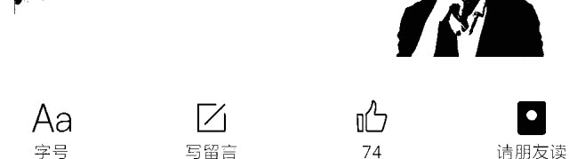

## 星巴克 | 伙伴文化

星巴克 | 伙伴文化

之前的一期专栏里，我们讲了星巴克的社区基因和人文精神，还深入地讲了“第三空间”这个概念。本质上，这些东西可以算是“星巴克是如何对待自己的顾客的”。今天我们换个角度来看看星巴克，那就是“星巴克是如何对待自己的员工的”。

其实，我常见到一种公司。这种公司在外面会打造出一种非常开放、友好，又特别爱戴消费者或者客户的样子，但对待公司内部的员工却是非常差的，甚至可以说是剥削。凡是这种公司，我都觉得很难长久地做下去。而且这种里外的不一致，慢慢也会污染自己的品牌。

相反，星巴克就是这方面的典范。可能你也知道，星巴克的企业文化不管是在餐饮领域，还是和任何行业相比，都是非常模范的。关于星巴克如何对待自己的员工，我觉得四个字就能概括：伙伴文化。

所谓伙伴，英文是partners，也是星巴克称呼自己员工的方式，当然也代表了星巴克对待员工的态度。你会发现，有一些公司员工之间会用一些奇怪的称呼来互相沟通。比如迪士尼乐园里面，所有工作人员都叫“演艺人员”，苹果专卖店里有一些店员叫“天才”——你可能去过“天才吧”修自己的电脑。同样，星巴克对员工的称呼方式是“伙伴”。这些其实都是企业文化非常强了一些公司，这些称呼也显示了它们独特的企业文化和公司氛围。

“伙伴”这个词也很好理解。其实说到底，就是平等和尊重。

### | 没有层级

首先，星巴克所有的同事，无论是店员还是店长，上到区域经理、营运总监甚至董事长舒尔茨本人，都互相称呼“伙伴”，没有层级之分。而且这种理念不只是停留在嘴上。

### | 感人细节

### | 福利待遇

### | 内部晋升机制

皮克斯 | 创意机器
Netflix | 把你当作“成年人”的独特文化

张潇雨
最后问你一个问题：你身边有没有一些员工被公司善待或者不善待的例子呢？如果有的话，欢迎你把这些经历写在留言区和大家一起分享，顺便也把这篇文章分享给你的朋友，让被善待的朋友更有自豪感，也让没被善待的朋友更清楚所在公司的状况。

## 星巴克｜奢侈的民主化与「伟大的均衡器」

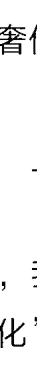

星巴克｜奢侈的民主化与「...」 ↓

之前的专栏里，我们讲了星巴克的历史、现状和未来，讲了它的核心理念“第三空间”，还讲了它独特的“伙伴文化”。今天我们借着星巴克再做一点延伸，来讲一些社会学的话题。

关于星巴克，我相信你听说过一种说法，就是总有人说：喝星巴克的人比较“装腔作势”，当然还有一些更直接的用词。你会发现一个现象，就是有一些特定品牌的产品，在被使用的时候都会有类似的说法。比如苹果的iPhone、星巴克的咖啡、无印良品的各种生活用品或者文具等等。你有没有想过，为什么会这样呢？

本质上，这和一个社会学的现象有关，就是“奢侈的民主化”。

### —— 奢侈的民主化 ——

今天，我来分三个方面，讲一讲“奢侈的民主化”这个概念。

#### 一、超越实用性的阶级属性

首先，有一件事情我们所有人都会承认。现代社会发展到今天，商品具有的已经不仅仅是实用性的功能了，它往往还承载了超越实用性的，划分人群和阶级的功能。所以当我们有时候觉得，喝星巴克的人装腔作势，或者用iPhone是一种“装”的行为，本质上其实是在说，TA的这种消费行为，是超越了TA自身所在的阶级的——当然这种阶级的判定也是有一些社会规范的。

也就是说，当人们觉得你明明属于某个阶级，但是又干了一些不符合这个阶级身份的事情的时候，就会产生一种“你在装”的情绪。

对于星巴克来讲，三四十块钱一杯的咖啡虽然绝对价值并不高，但是它背后象征的是 一种精致的、大都市的、中上层阶级的生活方式——而且，需要咖啡可能代表你的工作非常要紧，必须保持很好的精神状态。但是在中国，尤其是比如十年前的中国，拥有这样生活方式的人还是少数，所以在星巴克出没，拿着一杯三十块钱的拿铁，就成为了一种身份的象征。自然而然地，这种行为也会被人理解为某种炫耀或者是“装”了。

#### 二、商品的阶级属性是怎么来的

我们可以拿珠宝来举例子。

千百年来，珠宝都是一种很贵重 的产品，尤其是高档珠宝，很长一段时间以来都是少数贵族享有的。一般贵族独有的东西都有两个特点，第一是十分稀缺，获得或者维护的成本都很高；第二是除了美以外，通常都没有什么实用性的功能。毕竟贵族之所以是贵族，就是因为他们可以把时间、精力 和金钱花在一些看起来特别没用的事情上，这样才能彰显自己的身份和地位。

但是后来，人类历史经历了各种资产阶级革命和反封建的运动，贵族慢慢成了一个没落的阶层。而在贵族没落后，整个社会的思潮进入了一个要求人人平等、人人都可以自由享受各种商品的阶段。而对于普通老百姓来讲，大家很自然地就开始模仿贵族阶层的生活方式，并且也要求得到各种传统意义上的奢侈品。

所以，有了这种需求，以前只给极少数人服务的奢侈品制作工坊，就开始以大众相对能负担得起的成本，打造一些相对容易制作、能够量产的产品，好能赚取更多的利润。而这个过程就叫做“奢侈的民主化”。也是一个奢侈品走向更广阔消费者的过程。

#### 三、奢侈品制造商的核心策略

在这种指导思想下，奢侈品制造商的核心策略是什么呢？其实就是两点：

- 1. 靠各种手段维持自己的品牌形象地位，这样消费者才肯买单。比如，打造非常高端 的产品、花巨资请明星名流开代言、举办非常高端的发布会或者公关活动、在大城市的核心地段开设奢华的专卖店等等。这些行为其实都是为了维持自己高端 的形象地位的。
- 2. 在品牌形象建立之后，把自己主打产品的价位，放置到普通消费者能够勉强够到 的水平。比如，LV当然有价值不菲的高级包，但是几千或者一万多人民币也能买到LV的基本款。还比如，香奈儿（Chanel）最有名 的产品之一应该是几十万甚至上百万价格的高级定制的礼服，一般人是绝对买不起也不会有场合穿的，但是，你可以轻松买到香奈儿的香水和口红——因为几百块钱很多人完全可以负担。当然，这些量产产品的利润也是最高的。

最终，这些措施叠加起来，就造成了奢侈品的民主化。

### ｜奢侈的民主化有什么意义？

听到这儿，你可能觉得，自己好像被各大企业欺骗了啊。“奢侈的民主化”听起来只是一个努力从我们兜里掏钱的行为。别急，我们可以从第三个角度来理解这件事。

我们回到星巴克。刚才我们说，星巴克的咖啡某种程度上代表了一种阶级身份。这里面还隐藏着很有意思的一点，是什么呢？

你可以想象一个画面，比如世界首富比尔·盖茨，手里拿着一杯星巴克的咖啡，和朋友讨论着各种事情。这个画面应该一点也不突兀，是完全可以想象的吧？

这背后其实蕴含了一件事情，就是，星巴克之所以带 有一种明显的阶级符号象征，是因为不管是你我这样的普通人，还是世界首富这样的人，我们都可以喝星巴克，也很爱喝星巴克。从这个角度讲，我们是一样的，是一个“咖啡阶级”的。

我们还可以举个更极端的例子，就是iPhone。你想象一下，一个iPhone大概6000块钱左右，这个价格，大多数人真的想 要买，肯定是买得起的，而比如世界上最富有 的那些人，他们肯定也是买得起的。而且更重要的是，假如他们想出6万块钱，60万块钱，600万块钱，iPhone还是要卖6000块钱。

换句话说，iPhone——一个在实用程度、工艺水平、设计理念、技术含量上，都算作这个时代顶尖的一个东西，不管你是月薪3000的打工者，还是身价百亿美金的大企业家，都能买得起，而且买得到。仔细想想，这是一件多么伟大的事。

这就是“奢侈的民主化”或者说“消费的民主化”的一个重要的意义——让普通人，让更多的人用上更好的东西。

比如，滴滴和Uber就带来了某种奢侈的民主化。因为之前，只有非常少的人才能有自己的司机和专车，但是现在，你动动手指，花一个能够承受的价格，就能有自己的专属车辆。

之前有一期周末互动《潮流易逝，但风格永存》里面我们也讲过一个故事，是关于草坪的（文末附原文链接）。

在美国的中产阶级，很喜欢买个房子然后门口养个草坪，没事可以和孩子或者家里的狗在草坪上玩耍。但实际上在工业革命之前，草坪是贵族才有的东西，中产阶级是没有能力在家养草坪的。因为如果没有机械化的设备，完全靠人力维护一个草坪成本是非常高的，而且除了欣赏价值，草坪并没有任何实际用途。这就是我们刚才说到的，贵族彰显自己身份的一种方法。后来，这一整套生活方式被中产阶级学走了，于是他们也开始养草坪。而他们之所以可以这么做，就是因为有了像自动喷水器这样现代化的装置，现在维护草坪的成本已经大幅降低了。

说到这里你可能意识到，促使“奢侈的民主化”背后有一个很重要的力量，就是：科技。不管是几百美金的iPhone，还是几十块一杯的星巴克；不管是家里的草坪，还是专属的司机和专车，能让这些东西来到我们生活里的一个重要因素，就是科技。“科技让生活更加美好”这句话我们都很熟悉，但今天我们可以从社会学的意义上再理解一遍。

### —— 伟大的均衡器 ——

这里还可以做一点延伸。英文里有一个词叫“The Great Equalizer”，直接翻译过来可以叫做“伟大的均衡器”。其实也不难理解，比如刚才我们说的，“科技”就是一个伟大的均衡器，因为在科技面前我们人人是平等的。你用的是iPhone和巴菲特用的iPhone并没有什么差别，而你...

人人是平等的。你用的iPhone和巴菲特用的iPhone并没有什么区别，而你在互联网上看到的信息和英国女王看到的也没有什么区别。这就是“均衡器”的作用，它让人们更加平等。

为什么要说这个英文概念呢？因为除了科技之外，人类历史里还有另外一个、更加著名的“伟大的均衡器”，那就是：教育。

千百年来，教育承担的一个最重要的作用就是让人与人之间更加平等。我们传授给人类各种知识，让他们感知到自己的历史、创造出自己的未来；我们告诉人类，哪怕在金钱上大家贫富不同，但是每个人都可以精神强健地生活，去努力追求自己喜欢的人生；最重要的是，我们每时每刻教给所有人的，都是这个时代之内人类能够获得的最正确、最重要，也是最前沿的知识，毫无保留，让人们尽管出身不同，还是能去改变自己的命运。这就是教育作为一个“伟大的均衡器”的意义。

最终你会发现，这也正是“得到”在做的事情。

周末互动 | 潮流易逝，但风格永存

张潇雨

最后给你留一个思考题：除了星巴克、iPhone、教育之外，你还发现了哪些和奢侈的民主化与均衡器有关的现象？欢迎在留言区写下来和大家一起分享。

### ｜今日直播

今晚八点，我会在得到直播间做一个直播，主题就是“带你四步看懂一家公司”，帮你快速获取一家公司的商业精髓，并且把得到的洞察学以致用，辅助自己的工作、学习和生活。现在你就可以到App首页预约这次直播了，我们今晚八点直播见。

你也可以把下图分享给身边的朋友，邀请他一起来学习最简单实用的案例分析法。

## 直播回顾 | 带你四步看懂一家公司

张潇雨

今天，我在得到做了一场直播，主题是「带你四步看懂一家公司」。目的是把我分析公司、研究各个行业的方法直接告诉你。以下是这次直播的精华文字版，希望对你的商业学习有帮助。

我在拿到一家公司的时候是怎么分析它的？一共有四步。

### I 第一步：发现「不合理」之处

什么是发现「不合理」之处呢？就是看一看这家公司的基本情况，然后问自己：你觉得这家公司哪里最奇怪？

举个例子，亚马逊。

亚马逊这家公司非常大，现在应该是全世界排名前十的公司，业务也很多，而且资料也非常多。随便上Google、百度、维基百科上一搜，你就会发现，对于亚马逊，你有一个特别想知道的问题：为什么一家电商网站要做云服务呢？而且还做的特别早，2006年就推出了，逻辑呢？你还会发现，阿里巴巴也跟进了这个业务，就是阿里云。这里面一定有些门道。

- 1. 应该鼓励员工在内部创新。尤其是这种实验成本比较低，潜在回报又比较高的业务。
- 2. 如果你把内部需要用的服务暴露外部，意味着这个产品或者服务本身就要接受市场竞争了。在市场竞争的刺激之下，这些本来在内部用的服务可以不断焕发出新的活力，越做越好。

带着这个问题，你对如此庞大的一個商业帝国，就开始有了个着眼点了。如果你去研究亚马逊云服务的话，你会发现它一开始的故事是这样的：

当时在2003年左右，亚马逊早先研发的内部系统已经开始支撑不住公司的发展了。于是，整个公司的运转非常缓慢。所以，亚马逊团队就在内部开始着手解决这个问题。

后来他们花了两年时间，开发了AWS的雏形。做到中间的时候贝佐斯他们突然意识到：独立开发一套这样的系统实在不简单，而且这种服务不仅亚马逊需要，很多大大小小的公司都用得着。所以贝佐斯想，不如我们稍微多做一点工作，把AWS变成一个对外服务、甚至盈利的服务吧。后来在2006年，他们正式推出了AWS。

而且贝佐斯在做云服务的时候突然明确了两件事：

再往下挖，你就会发现，上面的第一种思维，其实贝佐斯是受一本叫《黑天鹅》的书的影响的。《黑天鹅》里面有个概念叫「可选择权」（Optionality），核心思想是：你在生活中，应该去做那种，风险有下限，回报取得的概率虽然比较低，但是一旦成功，这个回报是没上限的事。

接着挖，你会发现把内部产品放到外部，暴露在竞争之下的这个思维，和一个物理学的概念是很类似的，就是「熵」。甚至在1998年，贝佐斯在写股东信的时候就说到了一句话，他说我们要反熵。所谓反熵就是要把公司变成一个流动和开放的系统，不断和外界交换能量，不能封闭。所以内部服务外部化就是受这种思想指导的。

还有一个小故事：

塔吉特本来是亚马逊AWS云服务的十年的客户了，结果由于种种原因，它们决定离开AWS，建立自己的IT基础设施。结果亚马逊不仅没有阻拦，还花了接近两年时间，帮助塔吉特把所有的架构和数据迁移到自己的服务器上，这就是亚马逊的「拜客户教」精神。

我们从亚马逊云服务这个看起来很奇怪的东西出发，一路摸到了：亚马逊的核心业务模式、拜客户教的思想、黑天鹅的可选择权理论，物理学的概念「熵」这一大串东西。

这个思路简单概括一下，其实就是三个字——「反直觉」。反直觉的现象背后，往往蕴含着真理。

### I 第二步：找到边界

做完第一步你会发现，这里里面有个小缺陷：一个人的视角和视野毕竟是有限的。凭什么你想知道的东西，一定就是别人想知道的呢？另外，刚才我们说了「顺瓜摸藤」，但如果顺瓜摸到的藤太多，你就会失去焦点了。

所以非常重要是，你要给这个研究划清一个边界线。边界线怎么划？

我的方法非常简单：你去找两种人，一种是「小白」，也就是几乎完全不了解这家公司的人；一种是「专家」，比如就在这个产业里的人，像学者、教授，然后你分别问他们同一个问题——关于这家公司，你最想知道什么呢？能不能给我三个选项？

这里有两个小技巧：

- 1. 问开放式的问题，不要问封闭式的问题。
- 2. 加问一句：能不能给我三个选项？

这是干一件什么事呢，本质上是在给对方设定目标。

这样做有两个好处：首先，有了具体的数字对方就有了具体的目标，会认真想。其次，要对方给“三个选项”不是为了凑数，这个启发来自好莱坞。好莱坞的剧本界有一句话：要砍掉你的第一个想法甚至第二个想法，去写第三和第四个。因为我们第一个想起的东西会是最显而易见的，已经被大家说滥了的故事和想法，所以我们要深往下挖。所以给出三个选项，也是让对方能够挖掘一下自己确实想知道的问题是什么，这样他的反馈质量也会更高。

### I 第三步：费曼学习法

前面两点讲完，接下来就是研究了。但我不讲怎么查资料，那些可以在网上搜到，我讲讲应该拿什么方法指导研究和分析，以及最后拿什么标准来衡量研究是不是有效。这里要引入一个概念——费曼学习法。

费曼学习法来自物理学家理查德·费曼，是一个美籍犹太裔物理学家，1965年的诺贝尔物理奖得主。关于费曼有好几本传记，比如《费曼时间，费曼先生》，总体来说他是一个特别风趣幽默，一点也不死板的物理学家。

> （比如他有一句名言：Physics is like sex. Sure, it may give some practical results, but that's not why we do it.）

results, but that's not why we do it.)

费曼是一个在学习方面的天才，这个费曼学习法也是他在写自己自传的时候提到的。这个方法其实很简单，就是四个字：以教助学。说白了，费曼学习法的核心理念就是：如果有一个东西，你不能用很简单的语言把它给别人讲明白，那你就不是真正理解这个东西。

换句话说，在我们给别人讲东西的时候，我们会主动地找到一个东西的实质，然后给别人讲，而且讲的过程也是自己理清思路的过程。不知道你有没有经历过这样的过程，你的朋友跑来问你一个问题，但是当他自己把问题说完，或者说到一半的时候就想出了答案走了，留下一脸茫然的你。其实这就是不知不觉完成了一次费曼教学。

所以，我在写每一篇专栏，包括研究每一家公司的时候，内心一般都是在想：如果突然有个很久没联系的老同学，我们在咖啡厅遇上了：

TA可能会问我：645雨，你最近忙啥呢？

我：我最近写得到的专栏呢，《商业经典案例课》。

TA：这是讲什么的啊？各种公司吗？

我：对啊

TA：都讲什么公司？

我：比如麦当劳啊。

TA：麦当劳我也吃啊，这个怎么讲，你给我讲讲。

我：麦当劳有两个事情很有意思。一个是，创立麦当劳的虽然是麦当劳兄弟俩，但是真正让麦当劳现在这么牛的，是后来加入的雷·克罗克——不赶走麦当劳兄弟就没有麦当劳的今天；

另外一个是，你别看麦当劳卖的是汉堡薯条可乐什么的，其实它一大半收入和利润都是来自租金，可以说是半个地产公司了。

然后，我就会在脑子里，模拟把这两件事给对方讲清楚的过程。如果讲到一半我觉得对方很可能听不懂了，或者我讲不下去了，那我就继续去查资料，然后接着完善我的稿子——整个这个过程，就是一个典型的「费曼学习法」。

### ｜第四步：One More Thing

其实到前三步完成，你基本上就掌握了看懂一家公司的方法了。现在，我们再把这个研究往前推一步，跟你分享一下我写这个专栏的秘诀，也是我自己对这个专栏的要求，也是我对你们读完这一整年专栏的期望。

- 1）把好多家公司，看成一家公司（横向）

麦当劳最开始是汽车餐厅，他们的诞生跟汽车和电视非常有关。一方面，没有汽车可能就没有麦当劳；另一方面，麦当劳因为有电视这个媒介，让全国观众可以看到广告，就形成了麦当劳这个大品牌。所以你会发现，很多公司其实是一家公司，比如没有电视和汽车，很多公司是没有办法成为巨头的。

- 2）把一家公司，看成好多家公司

亚马逊最核心的理念，有一个天天低价是跟沃尔玛学习的，进军影视后，是跟Netflix学习的。他还有一个做太空探索的公司“蓝色起源”是跟Elon Musk学习的。

这一家公司身上有非常多家公司的影子。你能在这个维度上去体会一家公司，你就完成了一家公司真正的循环。

## 周末互动 | 是什么决定了公司对你“好不好”

周末互动 | 是什么决定了公...

你好，欢迎来到《商业经典案例课》。我是张浩雨。 又是一周的互动时间。

这周我们讲的是星巴克，关于星巴克最重要的一個核心理念就是他们的社交基因和社区文化。这种理念体现在方方面面，不仅是怎樣做咖啡、店面的设计、怎麼排队，甚至是对杯型的称呼，等等等等。当然，也体现在星巴克怎么对待自己的员工上。

不过，看完这周的专栏之后，很多同学在后台留言问：星巴克对员工确实是很好，但是我回顾了一下之前专栏，想起来，好像沃尔玛和亚马逊对员工没那么好啊？这是怎么回事？

所以今天的周末互动，我们就来回答一下这个问题。还是分三个方面讲。

### │ 第一方面：不同行业需要不同文化

我们可以一起来回忆一下之前讲过的几家公司的文化——

- 对员工比较“好”（一会儿会解释这个引号）的公司有：星巴克、Netflix、皮克斯等；
- 对员工比较“差”或者说“严苛”的公司有：沃尔玛、亚马逊和最早之前我们讲过的英特尔，尤其是在早期的時候。

你们发现一点规律没有？

沃尔玛和亚马逊都是零售行业，零售行业最大的特点就是——每一分钟都是钱。尤其是沃尔玛和亚马逊，都主打低价策略，所以对员工比较严苛、工资福利相对没那么好，就是很必要了。而且，这种必要性不只是为了省那麼一点点钱，更重要的是，把一种节俭和奋斗的文化，从上至地下地贯穿到整个企业里。这才是最重要的。而对于英特尔，它的产品更新迭代周期太快了，竞争非常激烈，所以自然员工也过得比较苦一点。

而我们再看皮克斯、Netflix、星巴克。实际比起零售行业，他们都是比较“软”的行业。比如皮克斯是个创意类公司，你把创意人才压榨得太狠，还不给他们宽松的创作环境的话，他们的作品是不会打动人心的；Netflix是科技+创意行业，道理类似；而星巴克呢，你想打造一个社区，想宣介咖啡文化、想感染你的消费者，你不可能对自己的员工太差，让他们每天带着怨气上班。

所以，这就是我想说的，不同行业由于特点不同属性不同，文化也是要不同的。

我们还可以另外一个角度来理解这个事情。如果非要用一句话总结的话，当然必须声明，这个不是物理定律，不是100%完全适用于任何情况的，但是如果比较精炼地总结一下的话：一般毛利比较高的行业福利会比较好，公司会比较“善待”你；而毛利低的，就会稍微差一些。

其实，这也好理解。产品毛利高，哪怕福利好一点，利润还是有得赚；要产品毛利低，那空间就不大了。你看，创意行业总体的毛利水平，包括星巴克的咖啡，肯定是要比零售行业高的。英特尔早期的時候，竞争激烈又没达到垄断，毛利并没有太高，所以那会儿员工也是比较惨的。当然后来它成当之无愧的行业老大之后，情况就非常不一样了。

### │ 第二方面：怎么定义“好”与“不好”

你看，其实在讲第一点的时候，我悄悄偷换了一个概念。我把公司对你“好”，等同于工资福利好了。这当然是很重要的一个方面，但是你肯定知道，工资福利只是衡量一份工作的一个方面，还有其他，比如：环境气氛、同事的水准、学习和晋升机会，甚至离家近不近等等等等，也都是非常重要的。

比如英特尔创业的时候，虽然特别苦特别虐，但是同事都非常强，而且顶头上司是神一样的神农·摩尔和鲍勃·诺伊斯。你要是个有野心的工程师，肯定也想在这样的地方工作。比如在亚马逊甚至阿里可能很辛苦，但是几年下来，你对电商的理解可能就是非常前沿了，虽然累点儿，但是也是值得的。而且，你还能追随杰夫·贝佐斯、马云或者山姆·沃顿这样的老板，这样的经历也是非常难得的。

所以，文化有的时候是个非常综合的东西。有时候只有身在其中才能体会。

### │ 第三方面：没有一定之规

最后一个方面也是我们反复强调过的一一商业的魅力就在于，它没有一定之规。没有固定的公式。不管什么样的文化，不管什么样的组织结构、培养体系、晋升方法，都可能有它适用的行业和公司。当一道题有很多种解法的时候，也是最有意思的時候。像沃尔玛、亚马逊、星巴克、Netflix、皮克斯和英特尔，他们都各有各的成功方法，这也是我们一定要用不同行业、不同公司的不同案例来反复讲一个话题的重要意义。

### —— 本周留言精选 ——

## 星巴克 | 越来越像麦当劳的星巴克（上）

论星巴克与麦当劳同质化有待商榷。星巴克与麦当劳的相同点都是在追求财务报表盈利、扩张发展更多业务。但从价格上麦当劳30多元可以解决吃喝，星巴克需要两倍价格，从打造环境来看，麦当劳适合快速午餐文化，星巴克环境舒服用更适合商务会谈；从品牌来看，星巴克核心是咖啡，咖啡文化背后有更多的结合点，但如果说汉堡，首先想到的是大家一起比赛谁吃的汉堡多，是咖啡+食物的星巴克与麦当劳食物+咖啡表明两者越来越相似，个人认为两者之间在品牌和环境上存在很大差异，一个是咖啡文化，一个是汉堡文化，这是原生态基因的差距。荣幸有机机会参与老老师课程讨论，浅见，请多多指教。

这符合前几期讲的“霍特林法则”吧，在竞争不很激烈的时候，大家的打法各有各的风格，而随着竞争压力的增高，所有人都会抛弃风格，选择最有效的打法。麦当劳的方法已经过了几十年的考验，是被检验过的有效打法，所以星巴克的打法就会与之高度趋同。

舒尔茨·霍华德的第二部自传《一路向前》中，谈到了星巴克面临的困境与压力，作为一家明星上市公司无时无刻备受华尔街分析师们的压力。面对这种情况下，唯有不断扩大门店规模，用持续增长的财报数字来迎合一些人的预期，才能维持大家对星巴克的信心与股价。很明显，单方面的发展会遇到“边际递减收益定律”的作用，所以只能将霍华德理想中的“第三空间”概念给弱化，把业务多元化才能有好的收益。那么就会不得不把手伸向快餐巨头麦当劳的强域，战斗就这么打响了。

麦当劳和星巴克在中国顾客心目中的定位不同，显然后是星巴克的档次要高些。服务上，星巴克更专业细致。星巴克会在咖啡杯上手写顾客的姓名，让顾客感受到，这杯咖啡是为他量身打造的，麦咖啡没有这项服务。其次麦咖啡的柜台前经常都没有服务人员，这个品类在麦当劳显得格格不入。就谈环境上，就国内星巴克和麦咖啡的室内装潢来说，虽然星巴克更好，精致而雅致。麦咖啡由于在麦当劳店内，虽然无法吸引更多的顾客在其-中，形成第三空间。品牌代表上，以国内的顾客认知状况，虽然手持一杯星巴克的人群会自我感觉良好，优于手持麦咖啡的人。这除了产品功能本身外，顾客形成购买很在意的要素。目前看两者就喝咖啡而言，不在一个竞争等量级上。

感觉现在很多餐饮都在趋同化，不论是麦当劳、星巴克、肯德基还是本土的德克士，从产品上，很多中餐也在卖汉堡、冰淇淋、咖啡。有一个麦凉皮的餐馆叫“绥家凉皮”，风格和麦当劳、肯德基很像，很多产品也趋同。还有就是想到了上周五的内容，一个企业能在一定时期成功，符合了当时的环境。那就能一直成功吗？有时想想曾经辉煌的公司，现在没落了，确实有些感伤，但我们必须接受。想到了，IBM、以前讲过的英特尔、微软、诺基亚，包括柯达。同时也回顾了“反噬”。突然感觉不断...

同时也回顾了“反噬”。突然感觉不断前行的力量，要想“不死”，就需一直前行。

今天的课让我明白，和你竞争的不仅只有眼前的对手。麦当劳主动出击，推出“麦咖啡”服务和“全日制”早餐服务。星巴克面对麦当劳的步步紧逼，推出了午餐服务和免下车服务。双方互相进击，互有防守。至于谁胜谁负，就交给市场吧。因为最终无论是谁胜出，受益的都是我们消费者。这也让我想起罗胖在跨年演讲中说过的一句话：“游戏行业的竞争往往不是游戏自己，而是娱乐行业、体育行业，或者传统电视行业。”

## 星巴克 | 越来越像麦当劳的星巴克（下）

首先星巴克代表的是咖啡这个品类，以及人们对第三空间的追求（就像人们会去茶馆喝茶）而麦当劳则代表的一种以汉堡可乐为代表的快餐品类。对于两者而言，前者更注重文化以及某种文化所代表的一个消费群体，而后者则有点像零售行业，对于消费者而言人们更加注重多、快、好、省。前者想实现增长，第一应该更加注重品牌文化，第二拓宽产品品类，以建立更多的消费场景（例如喜茶），使其重点建立在产品与文化的层面上来，而麦当劳则应该更加注重食品的健康上来，使其摆脱垃圾食品的形象。（中国的近几年的一个消费现象越来越多还是注重一个产品的实用性，而星巴克给人的感觉还是比较高端的，可能适应的人群比不了麦当劳那么多。）

我觉得两个品牌并没有达到一种你死我活的激烈状态，而他们现在所做的就是对的起用户和股东。更重要的是顺应这个时代对于餐饮业的趋势。今天的专栏让我想起了星巴克的一个动作，就是进驻意大利，作为意式咖啡的发源地，星巴克终于有勇气进驻，可想而知它对新市场的渴望。

麦当劳当年创业的亮点就是创造了餐饮业的标准品——汉堡、薯条、可乐；电商大行其道，得益于工业化流水线生产的标准商品，绕过中间环节，让利益给消费者。而星巴克的咖啡，则更偏重于第三空间的体验，是“一杯咖啡的香味飘过的整个空间，张老师讲零售的未来的时候提到过，体验式的线下生态不会消失。所以，我会给这两家公司更大胆的建议：麦当劳，首先自废武功，关闭餐厅，变成中央厨房+电商+零售窗口；中央厨房甚至可以变成移动形式，将送餐进行到底，重点突出“快”和“省”。建立超级麦当劳餐厅，重点塑造品牌文化和体验，这里的食材要多新鲜有多新鲜，有机健康。就好像当年雷·克罗克说服麦当劳兄弟一样，回归到麦当劳代表的美国文化，同时也树立新健康速食文化。星巴克，重在体验，咖啡早就是标品质了，但是星巴克依旧能够全球大规模扩张，说明这真的与咖啡无关。所以，两家公司中，麦当劳的想象空间更大，星巴克可能只需要更专注。变化反而是脆弱的，不变可能更加反脆弱。

老师，早上好啊！星巴克和麦当劳两家公司的发育虽然说越来越相似，但是我是觉得他们两个并不是真正的竞争对手，他们是可以一起发展得越来越好的。因为：这两个公司面对的主要客户和消费者不同，从而产品的定位也不同，服务和消费场景也不同。星巴克面对的是职业白领、小资人士，他们有自己的品位和要求，到星巴克消费多是个休闲或商务社交，对方便快捷的要求不太敏感，更多的是讲究质量质感；麦当劳面对的消费者多是家庭，消费者年龄跨度大，主要的消费场景是家庭聚会，party或是快捷解决饱腹问题，讲究经济实惠。所以，如果他们可以把握他们各自的客户的需求及变化趋势，结合当代互联网技术的发展和创新，在自己的某些细分领域建立自己的优势壁垒，并对此不断完善，就能取得各自的成功和发展。

我觉得还是星巴克赢面更大些。两个品牌相比较之下，星巴克给人的感觉高大上一些，而麦当劳就感觉更平民化一些。
对比两家公司的开展来说，星巴克现在搞的一些项目也比较符合他品牌的定位，而说到麦当劳，现在即使不是高端消费者也越来越关注食品的有机健康等指标，慢慢对所谓垃圾食品敬而远之，不知道对此消费趋势麦当劳会如何应对，应该会比较尴尬。因为星巴克不管是增加菜单可选的蛋糕小食的种类还是搞烘焙工坊之类，都无损星巴克在消费者中的品牌形象，但麦当劳如果没有了那些所谓垃圾快餐食品，麦当劳还是麦当劳吗？

## 星巴克 | 第三空间与社区精神

觉得这道理放在IKEA也是符合的。不单是一般的买家具，更是利用情境打造，让客户可以直接地感受到预期想要的家具画面。第二，增加吃饭的地方也是让大家更有家的感觉。这样不只是买家具，而是享受家的温暖。做点小补充，期待老师讲讲IKEA。

曾经在一家85度C的店里被暖到。本来只想买一杯饮料，店员说这个饮料搭配一个面包，整个算下来比单点饮料还要便宜一块钱，因为怕麻烦，并且怕找面包耽搁太久影响后面顾客，就说不必了，没想到店员微笑说没关系，三步并作两步，利落地到面包区拿到了面包，迅速帮我搞定了。小小的一件事情，没想到我现在还记得。

- [1]麦当劳为了快，很早就改变了点餐的流程，而肯德基改变为相应的流程非常滞后。即便是在首都机场的T3航站楼，肯德基仍然坚持传统的一个餐、取一个餐，再点下一个的方案，效率非常低，也非常不便。而北京南站位于2楼的麦当劳，由于使用点取分离，加上四台自助点餐机，就显得非常井然有序。
- [2]与星巴克相比，太平洋咖啡似乎更是一个舒适的环境，特别是提供了诸多插座，便于大家坐下来慢慢聊。但直观来看，太平洋咖啡的上座率和销售情况依然与星巴克有着差距。不过，这可能与太平洋咖啡的定位不同。此外，估计随着很多线下活动对场地需求，一些笃定的太平洋咖啡也是不错的选择。
- [3]努力回想在星巴克温馨的经历，并不太多，而不足服务的案例却有一些。这可能是经过的咖啡店客流量过大，以及人性中缺少怜悯所致。一个是国贸附近的星巴克，一个是昆明机场的星巴克，还有一个是T3出口的星巴克，在这里点东西总是给人一种匆忙匆忙的感觉，对于顾客提出的半糖、少冰的要求也经常忘记或者完全忽略。相比在一些不那么繁忙的星巴克店和周末清晨的那段时 间，往往能够体会到各家星巴克的布局与装 饰给人带来的舒适感。

给大家普及一个冷知识，星巴克故意把桌子设计成圆形就是为了降低人们的孤独感。

我在隔壁是伯凡老师的专栏里还看到一个词语——“星巴克教”，是因为星巴克员工对星巴克的归属感实在是太强了，看看几点：1.据说有星巴克员工中了彩票之后，与店里的同事分享，完全是把店里的人当做家人。2.一般人工工作都有“星期一综合征”，放到周一就不想去上班，但是星巴克员工服务顾客上瘾了，反而周末的时候会因为没事做而焦虑，他们有“周末综合征”。

## 星巴克 | 伙伴文化

善待公司的员工的典型，谷歌就是一家。十多年前就听说谷歌对员工的福利待遇以及各种对待员工的善待。比如，提供员工休息区免费的饮料和糕点，给员工留出20%的时间做自己想研发的项目，轻松自由的讨论文化等等。所以十几年后的谷歌可是越做越大，现在已经是全球最大的信息技术产业公司了。谷歌的专利也是层出不穷。比如，智能手机操作系统安卓就是谷歌公司开发的；搜索引擎更是不在话下；现今最热的人工智能，谷歌也是居于世界领导者的地位，还记得阿尔法狗和柯洁的AI-AlphaGo吗？这就是谷歌的人工智能典型杰作之一。目前谷歌不是还在全力研发他们的人工智能无人驾驶汽车么，也已经有很多突破性的进展。说到不善待员工还底线地剥削员工劳动力的公司，

工还没底线地剥削员工劳动力的公司，恐怕更是不能苛求。多数成立不久就跟这个世界说拜拜了。能撑下去的，要不是靠特殊政策照顾补贴支撑，要不是行业大背景特别好，一旦行业周期一过，较大可能就是他们熬不过行业的寒冬。

真正的企业文化是深入到血液里，执行于员工的一言一行中的，而不是那些文字口号。所以要想更好地了解一个公司的文化，最好的途径是去看看那些基层工作者。身在国企，形式主义盛行，资源浪费严重，办事效率低下，员工归属感极差。其实国企领导者，心里对公司的弊端清楚得很，然而有些事，不是我们想得那么简单。遇事少抱怨，多想想原因以及解决方法，现在已经强行训练自己这方面的能力了。少抱怨，多观察，多思考。

这种升级打怪的方式，让我想到《游戏改变世界》，通过游戏的方式上班，这大概是最好的工作。善待自己的员工，给予他们资源，相信他们，这是一家企业最难得的。还记得小时候接触最多的管理方式是通过规章制度，后来变成激励，现在成了赋能。激发人，让人们发自内心的劳动，才是最值得的劳动。被公司善待的例子很多。《和乔布斯一起领导苹果》里面讲到，乔布斯会亲自到产线跟员工讲谢谢。可见，最难得的善待，也许就是尊重。

## 星巴克 | 奢侈的民主化与“伟大的均衡器”

第一，福特汽车是一个，让普通人也能开上汽车。其次，制度，大到国家小到一个小小的组织，都是特权贵族奢侈的降级和民主化第三，云服务和人工智能如果再延伸一下，人类社会的不断前进，带来的就是奢侈的民主化。不论是教育，科学技术，先进的工具，医疗和制度建设，都是不断降级门槛、惠及更多的人。正如周其仁教授说的，人类每一次的进步，都是再一次找回人的尊严。奢侈的民主化就是不断地把人性光辉，普及下去。

城市化就是奢侈的民主化和均衡器，现代城市较为完善的各种基础设施，无论燃气、暖气，还是影院、体育场和医院，都为人们提供了更为舒适甚至在古人看来奢侈的生活方式。

我第一个想到的就是万维网了，this is for everyone。有这个目前最底层的“基础设施”，信息和链接的“奢侈民主化”才得以实现。会有越来越多的产品、服务以及协作在线化，更多的演化和变化会到来。还有就是现在各大公司会开放的算法、云计算一类的。希望这个世界越来越“奢侈民主化”，更加美好和平等。

## 消费零售总结篇Ⅰ从宝洁看快消行业的两大本质

这一个月专栏，我们的课程都围绕着一个大的领域在讲解，就是零售和消费。我们讲了零售业的历史，包括里面最有代表性的一些公司：沃尔玛、好市多，又延伸到麦当劳和星巴克这两家非常经典的连锁餐饮企业。相信这一个月的 时间，你对整个零售和消费行业是什么样子的应该有了一个基本的框架。

所以，接下来一周的时间，我想最后借用几家公司，把我们之前讲过的零售和消费行业的东西，做一个收尾和知识点的夯实。这周，我们会系统地来讲5家公司的案例，其中可能包括一些你并不那么熟悉的，但非常新颖、非常有象征意义的公司。在这一周的复习、呼应以及新的延伸过后，相信你对我们之前一整个季度讲过的各种行业趋势、公司战略、理论知识就很能记住 了。

今天和明天，我们的主题是：宝洁。宝洁可能是一家你曾经觉得很熟悉，但这两年面孔好像越来越模糊的公司。通过对宝洁的讲解，我们可以从另一角重温一下这些年里消费和零售领域，到都发生了什么。

提起宝洁，你的印象应该是那个日用消费品界最成功的公司。它创立于1837年，到现在都已经有180年的历史了。最开始，宝洁只是美国俄亥俄州辛辛那提市一家制作蜡烛的小作坊，而到了2016年，宝洁已经是一家年收入六七百亿美元，利润超过100亿美元，员工超过十万人的全球消费品巨头了。宝洁旗下的很多品牌你应该都听说过，比如：飘柔、潘婷、玉兰油、海飞丝、佳洁士、舒肤佳、帮宝适、汰渍、碧浪、吉列、Olay、SK-II 等等等等，这个单子可以列得非常长。

### Ⅰ 宝洁的艰难处境

然而过去的十几年里，宝洁的日子并不好过。

比如，从销售额上来说，宝洁在2008年的销售额是770亿美元，而2013年更是达到了840亿美元。而2016年，这个数字仅仅是650亿美元，相比2013年跌了23%。

从利润上来说，宝洁在2009年的利润还有134亿美元，而此后就上上下下，2015年的时候甚至跌到了70亿美元，只剩将近一半，直到2016-2017年，才开始回升到100亿美元以上的水平。

而对于股价，我在文稿里也附上了一张图。过去十年的时间里，可以用来衡量大盘走势的两个股票指数——道琼斯指数和标准普尔500指数，也就是我们通常见到的S&P500指数，分别上升了59%和62%，而宝洁的股价仅仅上升了29%，也就是说，宝洁的表现远远低于大盘。

而通过之前的专栏相信你也知道了，大公司在痛苦的转型期和动荡期的时候，都要做各种产品、营销、人员上的调整。宝洁在21世纪，光是CEO已经换了四任，高层管理人员更是流动非常频繁。所有的这些数据和现象，都显示着，这家曾经无比辉煌的消费品巨头，已经来到了公司180年历史的又一个关键时刻。

### Ⅰ 宝洁的成功之道

那究竟整个世界发生了什么变化，让宝洁这家公司如此挣扎呢？今天我们先来看 看，是哪些东西让宝洁这家公司如此成功的。

宝洁所在的行业，准确的名字叫做快消行业。全称就是“快速消费品”的意思。所谓快速消费品，指的是消费频次比较高、消耗比较快、单价通常比较低、需求比较广泛的商品，包括我们熟悉的洗发水、牙膏、洗衣粉、剃须刀等等都算作这类商品。与快消品对应的一般是耐用消费品，就是那种使用周期比较长，一次性投资较大的商品。比如家用电器、家具、汽车等等。

基于快消品消费频次高、单价低、需求广的特点，快消品在销售方面有三个很重要的特性：

- 1. 便利性。因为购买快消品投资很小，决策很轻，所以消费者一般就近购买就可以 了。
- 2. 视觉性。消费者在购买的时候，比较容易受环境，或者卖场气氛的影响。消费决策比较敏感。
- 3. 低忠诚性。消费者对于这种小产品，总体来说品牌忠诚度不高。甚至还会喜新厌旧，经常会主动更换品牌用一用。而且这类产品不像数码产品，可以不断升级新技术、附加各种功能，这类产品都比较同质化，所以消费者切换到其他品牌是很容易的。

最终，这几个特性就造成了快消品生意最重要的两个竞争模式：

- 1. 品牌营销。
  因为对于快消品，消费者决策轻、忠诚度低、购买也比较偏感性，所以商家会用各种广告和营销手段来轰炸消费者，让大家形成品牌印象，产生一定程度的品牌忠诚度，然后持续影响后续的二次三次购买。只有把自己的产品和品牌努力植入到消费者的大脑里，才可能有持续性的成功。
- 2. 销售渠道。
  因为快消品单价低，购买一般也是图个便利性，而且大部分人都会需要，所以建立广泛的销售网络非常关键。尤其是在地大物博的中国，从一线二线一直到四线五线城市，各地的商超、百货、便利店甚至街边小卖部，都是快消巨头最重要的合作伙伴。品牌和营销做得再好，也需要转化为实在在的销售和收入。

其实说得再简单一点，上面这些东西本质上说的是：首先，在那么多选择里，你得能让消费者想得起来你的产品；第二，想起来的时候，你得让他们买得到。快消品行业的本质，就是这么简单。

当然我们知道，越简单的道理，要做做好其实就越难。而上面我们提到的品牌营销和销售渠道，也是宝洁这家巨头公司曾经做得最好的地方。

### Ⅰ 宝洁的品牌营销

关于宝洁和快消巨头的营销，已经成了一门巨大的学问。如果你想去研究，会找到如烟如海的各种细节和案例。不过从大的层面总结，宝洁非常擅长的就是两个方面：

首先，为自己的品牌和产品找到最合适的概念和定位。

举个例子，如果要卖一块肥皂，宝洁给它命名成“象牙肥皂”，它会申请专利，然后聘请名牌大学的著名化学家，分析“象牙肥皂”的化学成分，再选择最有说服力和诱惑力的数据，说服消费者“象牙肥皂”是最好的——这一套营销方法，并不是什么宝洁最新的产品广告，而是宝洁在1879年推出“象牙肥皂”的时候琢磨出来的套路。这一套产品和营销理念，从创业最初期就在于宝洁的DNA里面了。

另外，宝洁也非常善于制造产品概念。比如，“飘柔”的柔顺、“海飞丝”的去屑、“潘婷”是营养，“沙宣”是专业美发……同时再利用广告宣传，不断强化它们的概念：比如“洗发护发一次完成，令头发飘逸柔顺”、“头屑去无踪，秀发更出众”等等等等。这些定位都突出了不同品牌的功效和特质。 而且，最终不管你买哪个品牌，它们都是宝洁旗下的。这也是多品牌战略的好处。

为自己的品牌和产品找到最合适的概念和定位之后，宝洁擅长做的另一件事情就是，用铺天盖地的常年广告投放策略，不断地触达客户的头脑和心智。

我们在之前的《从连锁小店到超市诞生》这篇专栏文章里提到过一个概念，就是：在20世纪40年代左右，电视和电视广告开始走进家庭了。电视这个新媒体的诞生，对大型企业打造全国性的品牌有很大的帮助。因为有了电视，广告可以触达到全国千千万万的家庭，这让宝洁这种公司可以打造全国性的大品牌。而全国性的品牌很适合大型超市销售，因为大型超市覆盖的地理范围广，消费者背景复杂，需求比较难预测。不像街边小商铺，可以非常本地化和定制化，所以这时候全国性的品牌能比较好地满足大家普遍的需求。而电视营销恰恰也是宝洁这几十年来最擅长做的一件事。

而且，宝洁的广告往往是常年无间断进行的。一般品牌都是在产品市场导入期或者销售旺季到来之前进行广告宣传，但是几乎每天我们都可以在电视上看到宝洁的产品在进行宣传。这也让消费者进一步对宝洁的产品产生了认同感，并且成为了宝洁固定的消费群体，为宝洁源源不断地贡献收入。

这就是宝洁在品牌营销上的实力，而让宝洁多年屹立不倒的还有一个重要的能力，就是它这么多年建立起来的销售渠道。这些渠道网络就像毛细血管一般，渗透到每一个消费者出现的地方。

### 丨宝洁的分销渠道

同样，宝洁的分销渠道体系，也是被很多人反复研究过的宏大议题了。我们还是来做一点最简单也是最关键的梳理：

首先，宝洁的分销体系的宽度和纵深都非常强。光是在内部，就分为分销商、批发商、主要零售商和大型连锁商等等结构，而且分销商也有 一级、二级、三级甚至更多。可以说，不管是家乐福、沃尔玛、大润发这种大型商超，还是三、四、五线城市的街边店，你都可以找到宝洁的产品，这正是宝洁整个销售渠道网络的能力所在。

另外，宝洁和销售商的联系非常紧密。之前我们说到，沃尔玛在和供应商配合上有着非常深度的合作。其实宝洁就是一个最典型的例子。宝洁在和沃尔玛的合作里，开发了很多先进的系统，比如持续补货系统、信息管理系统、客户关系系统、供应链预测系统等等。如果你 在沃尔玛拿走一瓶洗发水，POS收银系统就会把记录下来的交易数据，直接传到宝洁的后台系统之内。这样宝洁就可以非常实时地掌握各种数据，从而安排生产、促销、物流等等环节。

最终，这种既广，又深，而且链接得非常紧密的渠道网络，让宝洁旗下的各种品牌，铺天盖地地在每一个角落都能触达到消费者。这也让宝洁不管在全世界还是在中国，都取得了巨大的成功。就像我们说的，当你能让消费者每次需要买东西的时候都能想起你，还能找到你的时候，你想不成功都是很难的。

然而我们一开始就说，在过去的十几 年里，宝洁却陷入了一些麻烦。那么为什么这些让宝洁赖以成功的手段突然失灵了呢？在互联网时代，零售和消费行业的变化，是怎么瓦解宝洁曾经具有的这些优势的呢？我们在下期的专栏里，就来解答这个关键的问题。

> 《美国零售简史|从连锁小店到超市诞生》

张萧雨

今天给你留一个思考题：你身边用宝洁产品的人近些年是变多了还是变少了呢？在你看来这个变化的原因又是什么呢？欢迎把你的发现和分析写在留言区，和大家一起分享。

## 消费零售总结篇｜快消业传统竞争优势的失灵

上期的专栏我们提到，宝洁这个成立了180年的消费品公司，靠着在品牌营销上的高举高打，和销售渠道网络的复杂高效，建立了一个非常成功的巨头公司。我看到过一个评论说：

> “宝洁是工业时代‘大生产+大零售+大渠道+大品牌+大物流’的产物。它用最高效的配置了社会资源，最大限度地造福了社会。也正是大工业模式，决定了宝洁全国性渠道、全国性广告投放、接触全国消费者的做法。”

我觉得这个评价还是非常经典和到位的。在传统的零售时代，规模优势、大批量生产、打大众而不是小众的做法是最好的，宝洁也是这种方法的最杰出代表。

不过上期文章里我们也提到，在过去的十几年里，宝洁的日子并不好过。今天，我们就来详细说说这个问题，也借此来呼应一下我们之前关于消费和零售讲过的各种知识。

其实宝洁这些年处在动荡期的最重要原因，也正是因為它之前最大的优势开始失灵了一一就是品牌营销和销售渠道开始失灵了。换句话说，宝洁以及和它类似的大型快消公司的挣扎最终可以归结为三个原因：

- 1. 它们以往的营销策略，也就是触达消费者的方式开始瓦解了；
- 2. 它们以往拥有的品牌优势，开始逐渐消失了；
- 3. 这最终导致了宝洁这样的公司赖以生存的销售渠道网络开始崩溃。

接下来我们就来看看这三件事情都是怎么发生的。

### ｜触达消费者方式的变化

其实很多人没意识到，在互联网和电商时代来临之前，像沃尔玛、家乐福这种大型超市，以及屈臣氏这种专门店，除了是零售商以外，还扮演了一种“帮你开阔眼界”的角色。

很多消费者去这些地方不仅仅是买东西，还可以看看“又出了什么新的好货”。有些人会让自己尝尝鲜，换不同的产品用一下，就像我们之前讲过的，快速消费品的购买决策，一般都比较随意和感性。这个时候，产品在货架上的摆放位置、包装颜色、有没有优惠促销等等都是很重要的决定因素。这也是宝洁这样的公司最擅长的事情。

然而到了电商时代，消费者触达产品的方式一下子变多了。一个电商网站的货架理论上是无穷的，所以，以往大型快消公司的那套打法一下就不灵了。

另外，电视作为以往品牌营销的主要渠道，它的影响力也慢慢在下降。各种电商平台、小众的购物App、微信上的微商，还有各大视频网站娱乐节目等等——品牌可以做广告的地方越来越分散。作为大公司，以往倚好电视这个主要渠道，辅以一些杂志、平面等等地方就可以了；而现在，消费者会面对无数个屏幕、无数个入口。所以大公司那种高举高打的营销方式也不奏效了，它们再也不能像以前那样，靠把住电视这个大入口就能触达全国乃至全世界的消费者了。

我们之前讲过一篇刘强东的文章叫《第四次零售革命即将来临》，他在里面是这么分析的：

> “消费未来变化的其中一个趋势是场景多元化。指的是消费场景会越来越分散，企业和消费者的接触点将不再局限于在商场或者网站上面，而是无处不在。比如未来家里的智能冰箱可以自动识别鸡蛋、牛奶还剩多少，然后自动下单；大家可以对着电视剧中喜欢的服装搭配随手拍照，自动识别来源并实现购买；还能和虚拟助手聊聊天，让它帮自己给朋友买个生日礼物等等。未来我们会走进‘1到正无限’的时代，也就是一个人会面对无数多的屏、无数多的场景、无数多的入口。今天的流量中心会变得不重要，真正重要的是以客户为中心。
对于零售来说，未来一定是无界的——无处不在、无时不在。当购物的入口变得极其分散、多变时，固守单一平台的零售商会非常脆弱。”

这段话描述的恰恰就是在新的时代，宝洁这样的大公司面临的第一个问题，触达消费者方式的变化。

### ｜品牌优势的瓦解

你可能都不知道，1988年的时候，宝洁最先是以海飞丝洗发水作为进入中国市场的敲门砖的。当时一瓶300毫升的海飞丝洗发水定价是19元，而那会儿一名普通工人的月薪也就是100块钱左右。

到了20世纪90年代，宝洁旗下的飘柔、玉兰油、潘婷、舒肤佳、碧浪、汰渍等等品牌开始进入中国。那个时候，你经常可以看到在电视上看到宝洁各种产品的广告轮番播出。当时中国消费者可以选择的产品品牌很少，光是“国外的”这个标签就已经很有面子了。

但是到了互联网和智能手机的时代，剧烈的消费升级的大趋势，让全世界，尤其是中国人对宝洁旗下的各种大众品牌开始越来越不感冒。

现在，你可以在各种电商平台和App上找到各种小众品牌的推荐和购买渠道，可以在出国旅游或者出差的时候，随意买到又便宜质量又高的外国货。哪怕不出国，各大海淘网站、代购的朋友等等，都可以给你提供更有趣的商品选择；即使是一个偏远县城的年轻妈妈，也能够通过微博、微信、各种妈妈社区来了解各种母婴品牌，并且通过各种渠道下单。而对于这些人来说，飘柔、潘婷、舒肤佳曾经代表的那种高级、体面和新潮，早就不复存在了。

但是对于宝洁来说，转型确实也很艰难。

主要原因就是，作为一家年收入六七百亿美金的公司，把品牌做得过于小众过于垂直是没有太大意义的。宝洁的重点从来都是大众市场，也只能是大众市场，比如，一亿美金的收入，对于一个小品牌来说可能梦寐以求，但是对于宝洁这样的大家伙来说，基本上是不及格，是要被砍掉的品牌。

实际上从2014年开始，重回宝洁CEO职位的雷富礼（A.G. Lafley），就宣布在两年之内把宝洁旗下的200个品牌缩减到100个左右。其中被淘汰的主要就是过去三年销售增长率低于3%，年销售额低于1亿美金的非核心品牌。甚至还有宠物食品品牌爱慕斯（Lams）这样年销售额在10亿美金量级的。这样，宝洁才可以集中力量打造和营销那些贡献了大部分利润的核心品牌。

这就是宝洁在品牌方面遇到的困境。

### ｜销售渠道网络的崩溃

那么最终，在营销和品牌的双重变革之下，宝洁赖以生存，也最值得炫耀的销售渠道网络，也开始出问题了。

之前我们提到过，对于宝洁这样的大公司，像毛细血管一样遍布全球的销售网络，就是它们的命脉。最多的时候，宝洁有超过300个经销商，这些分了一级二级三级、金牌银牌铜牌的经销商，覆盖了从一线城市的大型商超，到四、五线城市的街边小卖部。它们也是宝洁触达每个人的最重要的法宝。

但是，当这些大公司的营销优势被削弱、品牌优势也被削弱的时候，一些现象就开始出现了：

比如，人们越来越多地在线上开始购物，线下的实体零售越来越冷清了。宝洁这样的 大公司不得不开始重视电商的业务。而且，由于电商越来越强势，大公司对它们的定位已经不是多一个销售渠道了，而是一个创新和品牌营销的大平台。

比如，以往大公司的打法是，从研发到铺货，可能要两三年的周期才进入中国。而现在，快消大企业已经和电商平台一起做新品上市策略、市场推广和执行方案了，一个新品两周之内就能触达消费者。比如在2017年4月，宝洁在聚划算平台上一口气发布了17款新产品，更不要说调动重点资源参加“双十一”、“6·18”这种电商节日了。

但是很显然，大公司的电商业务和传统渠道的业务，一定是对立的。线上吃掉了很多线下的生意，这让很多经销商都非常不满。我们之前在讲库克的时候也提到过，

满。我们之前在讲耐克的时候也提到过，耐克这几年在主推一个叫DTC的业务，全称是 “Direct-To-Consumer”，也就是“直接面对消费者”。里面包括常见的耐克线下直营店，还有耐克自己的电商等等。但这也是耐克犹豫了很久，下了很大的决心才开始做的，因为DTC实际上也触犯了耐克大大小小经销商的利益。

另外，由于宝洁旗下各个品牌的光环逐渐地褪去，很多本土品牌也开始涌现，不断挑战宝洁的地位。

比如，过去十几年里，不管是立白、纳爱斯、蓝月亮这种已经比较大的国产品牌，还是韩束、相宜本草这种后起之秀，都在全国市场里，尤其是三四线城市，给宝洁这种外国大企业带来了很大的冲击。对于本土品牌来说，他们在地方更能下沉、和经销商的关系也更好。

更重要的是，本来宝洁这种强势的外国品牌，对经销商的要求都是独家代理，也就是一旦你代理了汰渍洗衣粉，就不能代理其他竞争性的产品，比如立白了。这在宝洁之前强势的时候还可以做到，但随着本土品牌实力越来越强，外国大品牌产品利润越来越薄，比较“野路子”的本土经销商也开始挑战这些规则底线，开始代理不同的品牌。而宝洁和联合利华们也只能睁一只眼闭一只眼。

最终，所有这些因素叠加起来，让宝洁的整体业绩进入到了一个低谷。在这个由盛转衰的故事里，我们看到了过去十几年零售业的一系列变化：消费者越来越分散、传统销售渠道开始失灵、电商和海淘崛起、消费者的口味和观念也逐渐在升级。在这个整个过程里，自然有新的赢家和输家，而对于宝洁这样的公司，到底如何应对、怎样走出困境，不管成败，也都将成为商业史里面的一个经典案例。

周末互动 | 刘强东的终极零售观

张潇雨

对于宝洁这样的大公司，你对它的前景有什么看法呢？欢迎在留言区写下来，和大家一起分享。

## 消费零售总结篇 | DSC对巨头公司的冲击和瓦解

前两天的专栏里，我们讨论了宝洁这家公司的处境和未来。今天我们顺着这个思路，来看一家或许你并不太熟悉，但又非常重要的公司。

这家公司的名字叫Dollar Shave Club，就是“美金”、“剃须”、“俱乐部”这三个英文单词，我们就简称它为DSC吧。DSC的业务非常好理解，它是卖男士剃须刀的。

之所以要讲这家公司，首先是因为它在商业上的成功。DSC是2012年3月成立的。在创业四年之后，也就是2016年的7月，消费品巨头公司联合利华以10亿美金的价格收购了DSC。可以说对于一家非互联网的、实体品牌公司，用四年时间做到十亿美金的规模是非常厉害的。

当然，讲DSC还有一个更重要的原因——它的崛起实际上恰恰标志了新生代消费品牌对宝洁这样的巨头公司的冲击和瓦解。DSC这个案例，也和我们之前讲过的在零售和消费领域发生的大趋势非常契合，所以今天我们就来说讲DSC的故事。

### Ⅰ 行业背景介绍

在男士剃须刀领域，目前当之无愧的霸主还是吉列公司，市场份额在60%-70%左右。你可能猜到了，吉列也是宝洁旗下的公司，不过不是宝洁创立的品牌，而是收购来的。2005年1月，宝洁以57亿美金的巨资收购了吉列公司，我们熟悉的巴菲特老爹在这个交易里也大赚了16亿美金。

另外，联合利华作为宝洁最重要的竞争对手，相信你也不陌生。包括力士、多芬、奥妙、立顿红茶，以及这两年你可能听说过的BlueAir空气净化器，都是联合利华旗下的品牌。当然，如今它还有了男性剃须刀品牌DSC。

### Ⅰ DSC的业务模式

DSC成立之初，最主打的就是，每个月1美金就能享受剃须产品。这也是名字里“Dollar”美金这个词的来源。它们采用的是会员制，你可以以三种价格购买会员服务：入门级是每个月1美金，不过要额外加2美金运费，中等的是6美金，最高级的是9美金，后面两档服务都是免运费的。一旦入会，DSC每个月就会把你需要的剃须产品寄到你家里。

就是这么一个服务，在2016年被联合利华收购的时候，年销售额已经接近2亿美金了。

当然，对于价格我们必须要来做个对比。相比DSC平均五六美金一个月的服务，吉列这种大品牌，一个月的刀片成本要在15-20美金左右。如果你去好一点的理发店修面，价格可能会到四五十美金一次。

可以说，DSC的成功秘诀，又是很经典的“方便+便宜”的模式。

### Ⅰ DSC的病毒视频营销

在触达方式上，DSC就做到了极致。在2012年公司刚成立的时候，让DSC火起来的其实是它的创始人迈克尔·杜宾（Michael Dubin）花4500美金制作的一个病毒视频。当时这个视频广告在YouTube上一度被疯传，短短两天就给DSC带来了一万多个用户。里面有一些非常经典的营销语言，随便给你说一小段：

> 我是 Mike，DollarShaveClub.com的创始人。DollarShaveClub.com是什么呢？嗯，每个月只用1美金，我们就把高质量的剃须刀送到你家。是的！1美金！那刀片行不行啊？当然，我们的刀片简直棒极了。
……
每一把剃刀都是由不锈钢刀片、一？
你喜欢每月花20美金在买剃须刀上吗？告诉你，有19美金都交给了费德勒了！我也很会打网球好么。你以为你的剃须刀需要振动手柄、闪光灯和10层刀片吗？想想看，当年你的帅爷爷用一层刀片是怎么过来的？

这就是摘自视频里的一段话，可以说非常有戏剧性了。这里可以提一句，DSC的创始人杜宾，之前在纽约学了8年的即兴表演，所以颇有点喜剧功底。这个病毒视频里面的即兴表演，很深地打中了当时市场的一些痛点：

- 1. 他说，20美金里面19美金都交给了费德勒了。费德勒是谁呢？网球历史上最伟大男子运动员，可能没有之一，现在还在打球。当然，他也是吉列剃须刀的代言人。这里面杜宾其实是在说，宝洁的营销成本非常高，需要请代言人，还要在电视和各大媒体上投广告，所以你花的那20美金非常不值。而相反，DSC用一个Youtube病毒视频就把宣传这件事搞定了，所以它没有那些乱七八糟的额外成本。
- 2. 吉列剃须刀的产品实际上是被“过度研发”了。所谓过度研发，就是说，其实男人根本不需要那么复杂剃须刀，现有普通的刀片已经足够了。而吉列，就是过度研发了剃须刀，它在基本需求没有发生变化的情况下，靠着新技术的溢价以及广告营造出来的需求，仅仅增加了一把刀片就把剃须刀的价格提高了70%，轻而易举地赚回了研发费用。但这在DSC看来，就是彻头彻尾的浪费。换句话说，一般的剃须刀就足够好了，把价格降下来才最实在。
- 3. 最后，这种不用你出门，直接把剃须刀寄到你家的模式，毫无疑问也是对宝洁传统的商超零售渠道的颠覆。消费者可以直接触达品牌商，不需要通过层层的分销体系来买到产品了。

上面说的这三条，其实也正是一一映照了我们在讲解宝洁和整个零售以及消费行业的知识。可以说，Dollar Shave Club这种新品牌的崛起，也是这个零售新时代的最佳案例之一。

甚至我们可以这么说：
2004年，Facebook成立。这让人开始能轻易地把视频分享给他人，像病毒一样传播；
2005年，Youtube成立。这让视频的上传和播放变得异常的简单；
2006年，亚马逊推出了AWS云服务，这让小企业可以以非常便宜的价格建立自己的互联网服务；
几年之后，所有这些业务都走向了真正的成熟，一家叫Dollar Shave Club的公司利用了所有这些基础设施的服务，最终让自己在试图颠覆行业巨头的过程中，被行业的另一家巨头招入旗下。

张潇雨
以上就是今天的内容了。听过之后，你从DSC这家公司身上学到了什么呢？欢迎在留言区写下来，给自己今天的收获做个笔记。

## 消费零售总结篇 | 休闲快餐的崛起

在之前的专栏里，我们介绍了宝洁这些年的变化，以及联合利华对男性剃须刀公司 Dollar Shave Club 的收购。相信听完这三篇专栏之后，你对快消行业应该有了更多的了解。

今天这一篇专栏，我们就从快消行业跳到连锁餐饮业，在这个领域讨论两个新鲜的案例，同时，也来复习和呼应一下我们之前讲麦当劳和星巴克的时候涉及到知识。

之前讲麦当劳和星巴克的时候，你应该感受到了一个现象：餐饮业的变化速度是丝毫不比其他垂直消费领域慢的。而且由于要应对这种趋势，连星巴克和麦当劳的策略也越来越像了。那么对照着这两家老牌公司，我们今天来介绍两家相对新的公司。

这两家公司的崛起，就像 Dollar Shave Club 一样，非常典型地反映了整个连锁餐饮行业的变化趋势。

这两家公司就是：汉堡店 Shake Shack 和墨西哥卷饼店 Chipotle。这两家公司可以说是过去几年来餐饮业最重要的一个现象。

### Shake Shack基本情况

Shake Shack，两个单词一个表示奶昔，一个表示小屋，连在一起就是奶昔小屋的意思。

最初它其实就是纽约市中心公园里面的一个小餐车。后来没想到越做越受欢迎，在2004年的时候，创始人决定把它改造成一家店，再之后就开始连锁了。当然，Shake Shack 的创始人丹尼·梅尔并不是无名之辈，他在创立汉堡店前就是纽约著名的餐饮鬼才，旗下有好几家高档的米其林餐厅。不过程他从来没涉猎过中低端的连锁餐饮店业。

Shake Shack 的主打产品就是汉堡、薯条和奶昔——其实和麦当劳并没有什么分别。但 Shake Shack 家的奶昔经常被消费者评为美国最好喝的奶昔之一。

当然，Shake Shack 更红的产品是它的汉堡。如果用麦当劳做对比，Shake Shack 的汉堡简单总结就是：价格贵一倍，但是也好吃得多。

比如，Shake Shack 主打的牛肉汉堡，采用的是 100% 未用抗生素的安格斯牛肉，生菜则是有机蔬菜大棚出品，连冰淇淋和牛奶用的也是绿色有机食材。Shake Shack 里面最低端的汉堡和麦当劳的巨无霸价格类似，在 5 美金左右。稍微好一点的基本在 8-10 美金。所以整体来说，Shake Shack 平均一顿饭的价格要比麦当劳高一倍。

光看图可能会有点馋，如果你有机会去美国玩的话，我非常建议你去吃一吃。不只是这家汉堡店，我们接下来会介绍的几家新兴的餐饮企业也推荐你去试试，其中包括：Chipotle, Panera Bread 面包和 Blue Bottle 咖啡。我们一直在说，商业时时刻刻在塑造着我们的生活，听完专栏再去这些地方吃一吃，感觉会很不一样。

### Chipotle基本情况

Chipotle 是一家主打墨西哥风味的美国连锁店，成立于1993年。Chipotle 在墨西哥里是小辣椒的意思，代表了它的墨西哥风格。

Chipotle 的主要产品是墨西哥式的各种食物，比如墨西哥卷饼、饭等等。和 Shake Shack 类似，Chipotle 也非常主打健康的食材——新鲜、本地的牛肉、鸡肉、猪肉，各种有机蔬菜、豆类、米饭等等都是它们的重要原料。同样，我在文稿里面也配了图。你会发现它的半自助的服务方式和产品形态看起来有点像赛百味。当然，味道是完全不一样的。

### Shake Shack和Chipotle的经营状况

Shake Shack 和 Chipotle 都是上市公司——Shake Shack 是2004年成立，2015年上市；Chipotle 是1993年成立，2006年上市。现在两家公司的市值，Shake Shack 是 11 亿美金左右，Chipotle 是 100 亿美金左右。

从店数来看，到了 2016 年年底的时候，Shake Shack 在全球有 114 家店，而 Chipotle 有 2250 家。从年销售来看，Shake Shack 在 2016 年的收入是 2.7 亿美金左右，而 Chipotle 是 40 亿美金左右。

乍一看，这两家公司的规模，和麦当劳全球 36000 家店，240 亿美金的收入，1200 亿美金的市值是没法比的。不过听了这么久的专栏，相信你也明白，新兴品牌的崛起、大型公司的衰落往往都是非常迅速的事情。可以说在过去的十年里，Shake Shack 和 Chipotle 是快餐业里最具有上升势头和潮流风向的两家企业，也被麦当劳看做非常重要的竞争对手。

而且，业界还给它们所代表的这类公司专门起了个名字，叫 “fast casual”，翻译过来就是 “休闲快餐”。甚至有的时候干脆就叫 “慢快餐”。可以说，“休闲快餐” 的崛起，是过去几年来餐饮业最重要的一个现象。

### 休闲快餐的特点

所谓的 “fast casual 休闲快餐” 是什么呢？概括起来就是三点：强调健康、重视体验、引导潮流。

### 健康

刚才我们已经提到了，Shake Shack 主打的牛肉汉堡，采用的是 100% 未用抗生素的安格斯牛肉，生菜则是有机蔬菜大棚出品，连冰淇淋和牛奶用的也是绿色有机食材——其实这也是它们把自己和麦当劳隔离开的一种重要定位方法。

有一个小例子很有意思。

在 2013 年的时候，当时的美国第一夫人 米歇尔·奥巴马被拍到在路边吃 Shake Shack 的双层芝士汉堡，算是给它免费做了一次广告。因为米歇尔·奥巴马一直非常注重饮食健康和锻炼，而且在当时还曾经常给美国的中小学生推广健康午餐的计划，所以 Shake Shack 被看做是 “注重健康的第一夫人也吃的汉堡”，而彻底火了一把。

对于 Chipotle 也是类似。Chipotle 选择的食材都是有机食品，蔬菜由本地种植、肉类是牧场散养，整个生产过程环保可持续。餐厅 100% 的猪肉、80% 的鸡肉、85% 的牛肉都是纯天然食品，40% 的大豆是有机食物。这十年，美国人是非常吃这一套的。所以，不管是 Shake Shack，还是 Chipotle，大家提起来的感觉都是，健康——反正比麦当劳这种垃圾食品强多了。

不过我想提供另外一个角度看这个问题。

我觉得，Shake Shack和Chipotle虽然肯定比麦当劳、肯德基健康一些，但其实程度非常有限。你想，哪怕再用有机牛肉和蔬菜、再不添加什么抗生素，汉堡+薯条也不可能健康到哪里去也。同样，Chipotle虽然食材非常健康，但是处理方式经常也是炸的，或者放好多酱等等。所以，健康非常重要，但更重要的是——有一个健康的形象。很多时候消费者要的是一种心理安慰，而不是真的想吃多么绿色健康的东西。你需要的是帮TA降低一点负罪感。

### 体验

Shake Shack不管从餐厅氛围，还是产品印象上，都属于比较高端的范畴。公司请来了全球顶级设计师薛·博兰（Paula Scher）设计了现在这套以绿色和白色为主的视觉形象。另外，Shake Shack还会根据地域文化来呼应餐厅的设计，像是纽约布鲁克林店，就在一座有百年历史的红砖建筑里，用的都是可再生环保家具，小屋内部还有舒适的烧火炉。还有一些餐厅，一大半都是露天座位，营造出一种休闲清新的氛围。远远看，你不会觉得这是一家低端的快餐店。

### 引领潮流

最终，所有这些举措都转化成一个东西，就是，像Shake Shack、Chipotle，以及主打面包和三明治的企业 Panera Bread，成为了餐饮界真正引领潮流的公司。之前讲到麦当劳和星巴克的时候我们也说，当大部分人，尤其是年轻人觉得你不“酷”了时候，你就有很大的麻烦了。

### 总结：Shake Shack和Chipotle如何崛起

像Shake Shack和Chipotle这样的公司能够崛起，有这么几个要点：

- 1. 在正餐餐厅和麦当劳这种快餐之间，是有一个品牌认知和价位的空当的。有的人一顿饭可能二三十块钱就能搞定，有的人可能要吃100块。中间其实还有个五六十块的档位，是能吸引很多消费者的。
- 2. 都是先抓住年轻人群体。因为年轻的消费者处于尝鲜期，是比较爱尝试新事物的。而且一旦抓住他们，这些人在日后成长的过程中，还会源源不断地给你提供利润。你看不管是各行各业、老的品牌还是新的品牌，都非常希望取悦年轻人，道理就在这儿。
- 3. 还是回到商业的本质来。Shake Shack和Chipotle当然都很新潮和热闹，但是最终如果产品不好，大家也是不会买账的。这也是为什么我鼓励你找机会去尝尝这些公司的出发点。其实，Chipotle在2015年爆发过一次食品安全危机，之后股价大跌、关了几十家店、双CEO之一也被解雇。直到后来他们狠抓产品，才开始慢慢度过危机，恢复活力。

最后，让我们回到一开始。

刚才介绍两家公司的时候我们说，Shake Shack是2004年成立，2015年上市；Chipotle是1993年成立，2006年上市的。你看，哪怕是如此新潮流行的生意，都是要度过漫长的积累期，十几年才上市的。餐饮本来就是个慢生意，品牌要慢慢打响，壁垒要慢慢建立，但毁掉声誉可能就是一夜之间的事情。不过，这也是餐饮业的乐趣所在。

张潇雨

你身边有没有既关注健康又爱吃的吃货朋友呢？我今天讲的这两家餐厅应该很适合他们，你不妨把这篇文章分享给他，跟他一起探讨一下，对于食物，到底是真正的健康重要呢，还是食物能给人健康的感觉就可以呢？希望你把讨论的结果写在留言区，跟大家一起分享。

## 消费零售总结篇 | 颠覆星巴克的咖啡销售模式

今天是我们这周消费与零售系列专题的收尾。这周内容过后，我们对整个消费和零售的梳理就告一段落了。

今天，我们最后来讲两个非常有意思的公司。

你可以先思考一个问题：假设你现在想成立一家做咖啡的公司，目标是在星巴克处于绝对优势的地盘上再开辟出一个战场，那你会怎么做这家公司呢？

有两家公司，给出了非常好的思路。这两家公司叫做：Blue Bottle和绿山咖啡。

### Blue Bottle

Blue Bottle翻译过来就是“蓝色瓶子”的意思。它是2002年成立的，总部就在美国的加州。这个品牌也是很多硅谷科技大佬的最爱。

现在Blue Bottle在全世界有38家店，遍布在湾区、洛杉矶、纽约、华盛顿和东京。而且，这家公司也拿了风险投资的资金，到现在已经累计融资1.2亿美金了。

之前我们说，在一个品类里，有时候品牌之间是有一些定位空当的。比如汉堡连锁Shake Shack，就介于麦当劳和正餐餐厅之间。而Blue Bottle的定位也非常清晰，它比星巴克要高一个档次，是为了真正精品咖啡品质、不喜欢星巴克那种太商业化的大众咖啡的消费者服务的。

比如，Blue Bottle坚持这样一些做法：

- - 品质上乘的有机认证咖啡豆，采用传统种植方式，无农药残留。而且他们强调，只选用48小时之内烘焙的新鲜咖啡豆，不做批量快消式的产品，只走精品路线；
- - 非常注重纯正的咖啡文化，没有那些花哨的咖啡，甚至连大杯小杯都没有。有的是呢，只是各种专业的咖啡设备：意式的、手冲的、虹吸的、冰滴的等等，虹吸和冰滴也是咖啡的一种制作方式。而且，一杯咖啡需要等待15分钟才能做好，因为只有这样才能不牺牲咖啡的口感；
- - 店内是不提供Wi-Fi。他们希望你认真真喝完一杯咖啡，而且专注力就放在咖啡上。

这三点说完，相信你已经非常清楚Blue Bottle和星巴克定位的巨大不同了。

其实，Blue Bottle这个名字也有点渊源。实际上这个名字来源于1683年欧洲第一家咖啡店的店名，Blue Bottle起这个名字算是一种致敬。

当然，你可以想象，能做出这样一家咖啡馆的人一定是个咖啡狂人——没错，Blue Bottle的创始人詹姆斯·弗里曼（James Freeman）是一个极度追求咖啡质量的咖啡迷，他曾经做过10年的古典单簧管演奏师。每天清晨都会练习演奏，后来他把这种对艺术和古典音乐的执着和喜爱也带到了做咖啡的自我要求里。

另外，Blue Bottle另外一个特点就是门店都非常漂亮。弗里曼非常注重选址，所以Blue Bottle经常开在旧工厂、老仓库、歌剧院、艺术博物馆这种很有故事、很有格调的地方。每家店从诞生开始，自己就像是个艺术品。

比如，纽约布鲁克林的一家店的灵感来自法国作家普鲁斯特（Proust）的卧室；曼哈顿切尔西区一家店的灵感来自美国作曲家伯特·巴哈拉赫（Burt Bacharach）；东京的一家店是废弃的电器工厂改造的；旧金山市中心的一家新店，开在一座上世纪二十年代的红砖木结构的历史建筑里，原来是卫浴品牌科勒的水管仓库。这些地方的环境都被Blue Bottle改造得非常好。

本质上，Blue Bottle代表的就是反对星巴克的“流水线产品”，打造一种有“灵魂”的咖啡。虽然在店数上还远不能和星巴克匹敌，但是它代表的这种新的精品咖啡文化，毫无疑问已经给星巴克造成了冲击。如果有机会你去到有Blue Bottle的城市，不妨也去喝一杯试试看。

### 绿山咖啡

这家公司也非常具有传奇色彩，更是一个非常经典的商业案例。

先澄清一下，这个“绿山咖啡”和你可能听过的“蓝山咖啡”没有什么关系。蓝山咖啡指的是牙买加蓝山山脉地区出产的咖啡，是一种咖啡种类。而且只有海拔1800米以上的咖啡，才能叫蓝山咖啡。甚至也有更苛刻的咖啡迷认为，只有海拔2256米处种植的咖啡才能算蓝山咖啡。

而我们说的这家“绿山咖啡”呢，是一个公司的名字。最开始，绿山咖啡只是一家名不见经传的咖啡烘培公司，1981年在美国创立，一开始就在美国的一些度假胜地卖给游客零售咖啡赚钱。后来凭借一腔热情和比较清晰的战略，1993年，绿山销售额达到了1000万美金，分店开到了第九家。那一年绿山也在纳斯达克成功上市了。

不过，绿山咖啡那会儿的股价很低，而且最重要的是，上世纪九十年代完全是星巴克的天下。绿山的创始人鲍勃·斯蒂勒（Robert Stiller）其实心里非常不甘心。

现在，我们可以回到刚开始的问题了：如果你的目标是，在星巴克占有着非常大优势的咖啡市场里，再开辟出一个新的战场，那你会怎么做这家公司呢？——绿山公司就给了我们一个很好的答案。

我们可以先来说一下绿山咖啡的结局——在2015年的时候，绿山咖啡以139亿美

在2015年的時候，绿山咖啡以139亿美金的高价接受了收购，可以说是非常成功了。那么当时它是怎么做的呢？

绿山咖啡做了两件非常重要的事：

## 一、在目标用户的定位上做出了重要的差异化

当时星巴克在咖啡零售市场已经是龙头老大了，绿山的创始人鲍勃·斯蒂勒就说：为什么我们不能把咖啡卖给企业呢？

于是，斯蒂勒开始和一家公司合作，这家公司就是我们之前讲过的办公用品巨头史泰博。1997年的時候，绿山咖啡进入了史泰博北美600家办公用品超市，并且进入了邮购目录，通过这个渠道开始把咖啡卖到办公室里面。而且，很多企业都很喜欢安装这个系统，因为可以避免员工以“办公室咖啡太难喝”的理由溜到外面去，影响工作。后来企业的销售成为了绿山咖啡最重要的收入来源之一。

另外，由于在零售门店方面打不过星巴克，绿山在1998年直接“壮士断腕”，把旗下所有的零售店都关闭了。然后开始和渠道商合作，比如进驻便利店、美孚的加油站等等，实际上这些客户都是被星巴克这样的大牌咖啡商忽略的。

## 二、收购克里格

绿山公司做的第二件事，就是在1998年的時候抓住了⼀个千载难逢，后来又影响深远的机会。当时他们在和一家叫克里格的公司合作，后来直接把这家公司收购了。

克里格公司是做什么的呢？其实是咖啡机，以及搭配咖啡机卖的单杯冲泡咖啡。

当时克里格的创始人准确地抓住了⼀个痛点：“为什么一次必须冲一壶咖啡呢？大多数人每次只喝一杯啊。”所以他们发明了克里格咖啡机和K杯（单杯冲泡的咖啡包装）。

当你想喝咖啡的時候可以：第一步拿起一个胶囊式咖啡，也就是K杯；第二步按一个键，选半杯模式或者一杯模式；第三步就可以喝了，整个过程一般10到20秒钟就可以完成。你不需要浪费一壶咖啡，也不需要研磨咖啡豆、称重、清洗等等等等。直接把用户体验做到最佳。现在我们对这种胶囊咖啡机已经非常熟悉了，而在那个時候，这种体验是非常具有颠覆性的。

后来，绿山咖啡就把这个咖啡机卖到了超过1600万个美国企业和家庭里，到了2008年，绿山咖啡一年可以卖出10亿个“K杯”。而且，在这里绿山咖啡用到了一个非常经典的商业模式，就是所谓的“剃须刀+刀片”模式。就像吉列公司一样，剃须刀的刀架利润并不高，但是真正赚钱的是你每个月都需要消耗的刀片。同样，绿山的克里格咖啡机利润也不高，但是一旦用了他们的咖啡机，就只能用他们的K杯产品了。

当然，如果绿山的创新仅仅到这一步，就不值得拿出来单讲了。在这个“剃须刀+刀片”模式之上，它们又做出了⼀点创新，就是——把自己的克里格咖啡机打造成了一个开放的平台，就像苹果的应用商店App Store一样——任何其他厂商，只要愿意交6.4美分一杯的授权费，就都可以使用K杯的专利包装，在绿山的咖啡机上使用。

这个非常开放性的政策一启动，各种咖啡甚至茶的品牌就大量地涌入了。到后来，绿山的K杯已经和几十个品牌合作，一起售卖超过200种咖啡、茶和可可饮料了。可以说，在星巴克占据了咖啡零售业的绝对老大地位之后，绿山咖啡在产品差异化定位、渠道的突破和商业模式创新方面都做得非常到位，最终也成为了一家价值超过百亿美金的非常成功的公司。

张潇雨

Blue Bottle和绿山咖啡这两家公司讲完之后，我们关于消费和零售的整个系列就都结束了。当然，后面我们还会有很多消费品牌类的公司要讲，不过切入的角度会非常不一样。所以，今天你不妨试着给之前讲过的消费零售行业做个总结，写在留言区。

下周，我们就要开启一个新专题了，那就是奢侈品行业。这个系列不仅有很多经典的商业案例，还有很多历史和人文的知识。我们下期再见。

## 周末互动｜如何在商业新闻里巩固案例课？

周末互动｜如何在商业新闻...

你好，欢迎来到《商业经典案例课》。我是张潇雨。又到了周末互动的时间了。

今天的周末互动我们稍微换形式。

截止到现在，我们专栏的更新已经超过100篇了，而且你会发现越到后面越有意思。因为我们可以把很多公司，甚至不同行业看着很不相关的公司和案例放在一起分析，这样学习起来会非常有效率。今天，我就以另外一种形式来帮你巩固一下之前我们学过的东西。

在专栏里我们一直说，《商业经典案例课》的一个重要使命是帮助你理解商业世界，帮助你理解我们身边的公司。所以今天，我挑选了四条新闻，新闻里面都是我们之前讲过的公司——我的目的是，如果你之前一直跟踪了我们的专栏，那么看到这些新闻的时候，你是不是能够一下理解这些公司为什么这么做呢？是不是一下就能够看懂了呢？如果还没有学习完，也不用着急，可以带着这些问题去看我们的专栏，看完之后你就会发现，你现在已经有能够读懂商业新闻的能力了。

以下就是我为你挑选的四条新闻，分别涉及到到公司是麦当劳、耐克、苹果和宝洁，每条新闻之后我都给你留了一个小思考题，你可以借此复习一下这几家公司的相关知识。

## ｜新闻一：麦当劳和恒大地产达成合作协议

8月14日，麦当劳中国与恒大地产签署了长期战略合作协议。根据协议规定，恒大将为麦当劳今后在全国范围内的店铺选址优先提供服务，双方将发挥互补作用，实现共赢。

值得注意的是，这些区域刚好是麦当劳准备发力的新目的地。在过去的二十多年间，麦当劳虽然已经在全国范围内开设了大约2500家餐厅，但大部分都集中在一二线城市；在三四线以及更偏远的地区，麦当劳的渗透率并不算很高。

思考题：我们之前讲过麦当劳目前面临的一些困境和问题，也讲了中国区麦当劳的一些新动向。所以看完这条新闻之后，你能理解麦当劳为什么和恒大合作了吗？

## ｜新闻二：Nike和周冬雨合作拍摄广告

NikeWomen官方微博在7月25日发了一支由周冬雨出演的广告片《心在野一点》，用了全景VR技术拍摄，配合预告片和一系列动态海报。这个4分半钟的广告片以周冬雨的第一人称独白进行，以其运动生活为主题，讲了她从十年前综体育、6000人海选试镜、一路走到金马影后的心路历程。

通过女性视角描述她们在尝试运动时如何“建立信心”，是耐克惯用的营销思路。2015年推出的全球广告战役《better for it》，记录了各种女性在刚开始运动时的不适到最终坚持克服的过程，落地中国时则找了王珞丹、足球运动员李佳悦等人拍摄。

思考题：这条新闻说的是Nike在和影视明星进行一些合作，推广它们的品牌。那么Nike为什么要这么做呢？和它目前面临的挑战和未来的计划有什么关系呢？你可以结合我们之前的专栏想一想。

## ｜新闻三：苹果投资10亿美元做内容，但是比起它的对手来，差得还是有点儿远

来自《纽约时报》的报道：接下来的12个月，苹果将要为原创内容花费10亿美元。它们已经在洛杉矶组建了一支新的团队，购买和制作更多的影视内容。不过，原创内容十分烧钱——一集喜剧的制作成本大概在200万美元，常规的戏剧在500万美元，而像《权力的游戏》这种大制作，一集的成本则超过了1000万美元。所以，大型科技公司花在内容上的预算越来越高。像Netflix在前几年推出热播剧《纸牌屋》和《女子监狱》的时候，它们一年花在制作原创和购买节目上的资金是20亿美元，而到了2017年，这个数字已经上升到70亿美元。而亚马逊在原创内容上的投入也逼近50亿美元了。

思考题：所以，这些大科技公司为什么都去做内容了呢？Netflix和亚马逊做内容的原因有什么相同和不同呢？你也可以结合之前专栏想一想。

## ｜新闻四：宝洁上个财务季度业绩不错

根据《华尔街日报》的报道，宝洁刚刚公布了上个财务季度的业绩表现。在2016年的最后三个月，宝洁的总销售额为169亿美元。财报期内，宝洁五大品类（美妆、男士护理、健康护理、织料与家居护理、婴儿女性与家庭护理）在之前的下滑之后，均开始恢复正增长。

宝洁业务的增长主要来自包括中国在内的新兴市场的贡献。财报期内，美国等成熟市场的销售增长约为1%，而新兴市场则为5%。

有机销售的增长，一部分是业务瘦身带来的结果。宝洁在过去两年中剥离了近100个销售额小于1亿美元的品牌，将资源聚焦在更多“大品牌”上。与此同时，随着美国经济的好转与中国市场发生的“消费升级”，宝洁也开始将更多精力投在高端产品上。

思考题：这条新闻应该不难理解，我们之前刚刚讲过宝洁。所以宝洁针对自己的转型做了哪些努力呢？它们为什么要这么做呢？学习完我们零售和消费的系列专题，相信你能够得出一些结论。

以上就是今天提供给你的四条新闻。如果你想知道更为细致的答案，其实这些新闻很容易都能搜到，而且媒体在报道的时候也会有一些自己的分析，所以不难找到答案。我也非常鼓励你在留言区写下自己的分析。

我想呈现的是两点：第一，《商业经典案例课》的一个使命，就是让你能读懂这些东西，这是我非常致力于做到的；第二，我也鼓励你学会致用，把学到的知识带到生活里去反复体会和琢磨，这样的效果会是最好的。

我们下期刊修品专题再见。

### —— 本周留言精选 ——

## 消费零售总结篇｜从宝洁看快消行业的两大本质

今天听老师分享宝洁对产品的营销布局，让我不禁想到了曾经的诺基亚海上战略。正如宝洁就是日用快消品的代名词，诺基亚也曾经代表着手机的产品品类。而iPhone代表的智能手机打败了诺基亚至关重要的是来自于“生态系统”，iPhone不是一款产品，而是一个平台。App Store和多样的配件的创新源源不断。苹果在专注于拳头产品的同时，又能通过升级商和配件厂商触及各个细分市场的需求。宝洁面临的挑战想必是来自于“路径依赖”，一直以来依赖于多品牌营销策略，而在越来越细分和个性化的日用快消品行业中，宝洁的成长拉锯太长。另外在新的社交媒体的活跃度也不够，所以宝洁的影响力越来越低了。

很简单，宝洁是传统营销时代下的产物，用的是sP理论，也就是在定位确定之后，在4P上追求营销投资回报率（ROI）的最大化。实际上，我们已经进入了数字营销时代，在这个时代最成功的公司，本质上做的都是同一件事：增加人和人之间交流的带宽。由于带宽不断增加、各种产品和服务可以做到越来越个性化，所以既然我们不可能一开始确定了品牌定位，就不能一成不变。而是要根据环境的改变，根据市场和消费者的反馈信息，做系统性的调整，以修正品牌定位的偏离，消除不确定性。这就是宝洁目前急需改变的方向。

因为互联网的发展，个性化需求得以满足

因为互联网的发展，个性化需求得以满足，现在日用快消品的个性化消费增长对宝洁这样的传统日用快消品公司还是有很明显的影响。另外，互联网正在深刻改变人们的生活方式，类似谷歌的精准营销，大大削弱了宝洁铺天盖地的电视广告抓取注意力、营销其品牌的能力。传统的营销、销售渠道的优势正在减弱。

宝洁的最大优势除了品牌效应，更多的是独特的分销渠道和铺天盖地的广告宣传！说白了，营销模式主要就是线下实体店，然而互联网的冲击无疑是最大的，品牌效应的稀释，以及更多的80后、90后以及新一代的互联网“居民”会优先考虑网上购物，更多品牌的逊择重要的是朋友圈之间的口碑宣传。需要更加多元化和个性化的产品服务。使用产品的习惯更多是各种的“晒”。纵观身边的朋友圈，还是会有大量的宝洁产品的用户，如果没有系统的了解，甚至不知道那就是宝洁公司的产品，而是一个独立的品牌。不可否认，它的产品用户的基数还是会存在的，只是必须针对性做出改变，以最快的速度适应消费者口味，这样才会提高营业额。

最近八至十年，这些快销品只用了某个品牌，比较少关注这部分市场的变化。分析变化的原因，可能因为：一、人们的注意力从电视转到了移动端，特别是城市居民，宝洁的广告营销策略在这个时代，优势不明显了，而在广大的农村市场，国产品牌使用的更多一些，比如立白等；二、人们越来越注重个性化的消费，之前只要是产品功能满足、安全、品质保证就会有人购买，现在在这些基础的需求差异化不明显的情况下，更关注个性化的需要了，在这方面一个老品牌的吸引力，与新的品牌相比，有一定的劣势；三、购买的便利性，网上购买，送货到家，大型连锁超市的业绩都受影响了，更何况快消品的生产厂家。包括微商的出现，利用关系营销，再加上产品的个性化宣传，吸引人们消费；还有直销企业，无处不在的代理服务人员，增加了与客户的粘度；四、宝洁的多品牌营销策略，让他的品牌占据了消费者的头脑，而不是这家公司，在销售中，但单产品还是很难以人产生感...才能够更好地互动起来。

## 消费零售总结篇 | 快消业传统竞争优势的失灵

在上世纪八九十年代，宝洁是成功的，市场份额占有量很大。我还记得，初来深圳时，有一次跟同学走在路上，同学指着一辆大型货车，外面写着P&G，告诉我：这里面装的都是宝洁公司的产品。当时对这个P&G标志的公司，内心是充满赞叹和崇拜的。当时网络还没有兴起，中国经济也刚刚兴起，个人也刚刚从贫穷慢慢开始有了点钱，个性化需求还没有像现在这样旺盛，宝洁多品牌，全年不断请明星在电视做广告，全国性渠道，无疑是成功的。宝洁是工业时代“大生产+大零售+大渠道+大品牌+大物流”的产物。它用最高效率配置了社会资源，最大限度地造福了社会。也正是大工业模式，决定了宝洁全国性渠道、全国性广告投放、接触全国消费者的做法。但随着经济的发展，人们兜里的钱也越来越多，个性化需求也越来越高，宝洁还是歌手`

对宝洁的前景我觉得有三点：1. 跟紧技术革新的潮流，在线上开始多推广告，用创意广告或是与火热的网红合作，之前与《奇葩说4》的合作就是一次不错的尝试。2. 更加尊重消费者的意愿，去生产消费者喜欢的产品，甚至一些已经严重过气品牌要大刀阔斧地削减。3. 在营销上更注意对人的关怀，传递创新概念去吸引下一代的消费者。

对宝洁不能再熟了，我再给加三点，第一经销渠道管理失控，省级代理的高额资金运作，高库存的虚假销售已经到了无法去除反客为主的地步。第二，过度依赖KA卖场，没有真正做到渠道下沉，产品再没有特色，你占据农村市场的50%以上，一样能屹立不倒。给你纠错和调整的时间，二三十年前的优秀的线下农村模式没有持续，并且没有顺势建立自己的县级梯头堡，不敢于放掉总经销。通路精耕来源于宝洁而又流逝于宝洁。第三，宝洁引以为傲的管道生，太多没有实战只懂理论的高校毕业生充斥核心岗位，只会左手英文报，右手星巴克，后背双肩包，脚旁行李箱的人，基本上就是靠品牌力度的压货和买堆头，靠嘴头和笔头能在血海的快消世界打赢才是奇怪！

假如我是宝洁的首席执行官，我会怎么做？当然这只是我的一种有趣的代入。1. 首先我确实砍掉经营不好的产品线。2. 其次我会选择接纳互联网，接纳线下，让科技和线下结合。同时招募一名对零售电商非常有未来觅见并且富有经验的副总裁。3. 将产品分为三类品牌，分别主打大众市场、中端市场和高 Not sure ...

在无边无际的蓝海上，当然是宝洁这种巨无霸航母独占绝对的优势，并且还能海阔天空三位一体做战。可是在一片红海里，像宝洁这样一艘大船就难以招架了。小船灵活、不斯迭代、不断演变、狼群式攻击。可是大船掉个头都难啊！就像“龙陶海渊避野狈、虎落平阳被犬欺”。所以，我觉得像宝洁这种大公司如果像海尔一样拆分成一个个小事业群会怎么样呢？

今天的课后作业，我在问自己，如果我是宝洁的管理者，我要怎么做？当然，我的格局和思路都来自于商业史专栏，功力还差得太远。1. 做一条利润水平较高的低端产品线，主打三线城市以下市场，才有地... 6. 宝洁的企业形象一直不清晰，这方面需要下功夫。

## 消费零售总结篇 | DSC对巨头公司的冲击和瓦解

今天的课程给我的启发非常的大：1. DSC对消费者需求和产品本质的深刻理解和注重起源很像！2. 而它所采用的营销方式完全契合了它的产品定位，既充分利用了新的宣传方式，把营销成本降到了最低，又体现了明显的差异化，几乎完美得无懈可击。3. 最后这种“会员制”跟好事多和亚马逊很像，成功地复制到了快消领域。

1. 借势。一个公司不需要什么都自己做，什么都自己做的话，太笨了，而且成本高，代价大。要学会利用已有的基础设施，比如当今，人工智能就是一个很好的基础设施，这与前朝的积木式创新不谋而合；2. 商业是活的。人工智能火，没必要非得去做算法、写程序，围绕人工智能的配套设施也是很好的入口。

人工智能的配套设施也是很好的入口。比如英伟达配套人工智能的GPU；3.商业不是一蹴而就的。人工智能的兴起，也是前期移动互联留下的大量数据以及机器学习相结合的结果，这是非人所料的。成功是运气，失败归自身。

今日收获：1.积木式创新，运用好已经成熟的基础设施。2.方向创新，寻找到客户端的本质需求。3.适应新环境才能获得新生。4.之所以是联合利华收购DSC而不是宝洁。又一次体现了既得利益集团对整体发展的影响。

创新很多时候不是从0到1，而是在原本大家熟悉的基础上增加一点新颖的东西，或者全都是大家熟悉的拼凑起来，如iphone手机一样。故胜行业巨头现在很流行的打法就是在他们没有注意到的小地方（边缘战场）发力，等被注意的时候，已经有了稳定的生存能力。不过，最后可能还是难逃被巨头收购或者资本价格战打死的命运。期待snap最后的结局如何。

我的感受就是，剃须刀这种东西，都可以成为一种服务。可requirements在未来，一家公司对于服务是有多重要，说不定哪天，服务将是每一家公司都要做好的事情，就像互联网一样，慢慢地成为每个人的刚需。

## 消费零售总结篇 | 休闲快餐的崛起

其实我认为“真正的健康”和“给人健康的感觉（体验）”都很重要，只是在企业不同阶段有不同意义。真正的健康是企业发展百年老店的基础，而好的体验是一种信任和潮流的方式和基础。昨天刚好听到薛兆丰老师关于人与人之间增加信任课程的内容，我想太适合放在今天这边来解释下这个问题了。人和人之间增加信任有三种方式：重复交易（信任起源于重逢）、第三方背书（中间商和推荐人）以及增加附加成本信号。其中增加附加成本信号正与今天说到的“感觉很健康”这种体验一致。需求第三定律——将东西运到远方去定律：“每当一个产品要加上一个更高的附加值以后，那就有某些品质更好的商品，才配得上这个附加值”。倒过来，人们会根据一件产品配置的附加值的的高低来判断这件产品质量的高低。如果你提供的产品质量有问题，人们一旦发现，你配置了更高的附加值，造成

很多时候消费者要的是一种心理安慰，而不是真的想吃多么绿色健康的东西。你需要的是降低一点负罪感，很经典的消费者心理。这对营销是个很好的启发，我们应该通过现象看到本质，线性思维从表面看好像是消费者要吃更健康的食品，其实是要为消费者找一个享受美食的理由。

我就是个吃货！我认为食品本身的健康以及给人健康的感觉，两者是相辅相成，缺一不可的。还想补充一点，就是不仅要让消费者感受到健康，还要让他们真正理解什么样的才可以被称为健康。现在的大部分食品行业，消费者期望什么，生产者就迎合什么，但是生产者提供的只是字面上符合消费者期望的产品，而实质上究竟怎样，实在不敢恭维。更糟糕的是，大多数消费者并没有能力去分辨实质内容。随着生活水平的提高，追求健康食品、健康饮料是顺理成章的需求。不过，什么是“健康食品”，消费者的期望往往是盲目的，或者说不求甚解的人云亦云。比 download

对于食物，到底是真正的健康更重要呢，还是食物能给人健康的感觉就可以呢？这个问题类似于股票投资，到底是其内在价值更重要，还是投资者认为它价值更重要？对于人而言，真正的健康更重要。基于这一点，对于餐饮行业而言，让人相信食物健康很重要。食物不健康，只要能让人们相信它健康，也能打健康食品的招牌。但道德感强的公司，会尽力做到感觉和实际的一致。

## 消费零售总结篇 | 颠覆星巴克的咖啡销售模式

[1]在现有的市场中寻找一个空当，是品牌立足的关键。现有的热门企业关注到的都是明显的市场份额，例如麦当劳和星巴克面对的就是过往路过的消费者，他们希望的是让消费者在去往办公室的路上停下脚步，来买杯咖啡或者早餐继续前行。但绿山咖啡则选择了空当，也就是人们在企业开始工作之后，如何能够享受到更好的咖啡，从而打开了市场。[2]“平台+产品”的模式适合进一步扩张自己的领土。App Store就是最典型的案例，此外很多大公司也都致力于对平台的构建，对各领域“基础设...”

通过对宝洁的没落以及DSC对吉列、Shack Shack和Chipotle等休闲快餐对麦当劳、Blue Bottle和绿山对星巴克的颠覆的分析，可以看出消费零售领域的变革趋势。总结起来大概有以下三点：一是消费升级导致产品差异化、同质产品一家独大的时代已经过去了。市场几乎可以无限细分，只要有个性化需求就会有一个满足此需求的单一市场。二是简化销售渠道，产品直达消费者。三是互联网营销取代传统营销，获得更加精准的效果。但我觉得，零售领域“多快好省”的基本框架和内涵演绎是不会变的，仍然是产品、渠道、营销等各要素的“排列组合”，以更好地满足不断变化的顾客需求。

其实在定位的时候就已经是卡位了，卡的就是竞争对手。定位包括对心智、品类、对手、自身以及市场的考量。Bule bottle就是抢占一个比星巴克更有品位的的心智，品类也做到了咖啡豆质量更好。绿山咖啡直接取消线下零售店，在渠道上发力，和公司以及加油站合作，后期收购咖啡机等是在产业链价值上进一步拓展。

非常有启发的零售市场课程，从多快好省的概括性总结，沃尔玛“最低价格”、亚马逊的飞轮和拜客户教，再到麦当劳、星巴克的垄断，再到宝洁的真正挑战，认识到曾引领成功的因素品牌定位和渠道优势，会随着消费升级和环境剧烈变化（互联网崛起），瞬间转为不利。最大的学习点是：从垄断到遇见，伟大的公司都是开放的。只有足够的开放，才能接受并拥抱新事物，才能不断地创新；否则在固步自封的基础上，等待game over。于事如此，于人也一样。最后，也给予了希望，就算在剧烈竞争的时代和市场，并被算计算断，只要足够思考并坚持实践，我们总能找到差异化的竞争优势，从而脱颖而出。谢谢张潇雨老师，也感谢得到平台，并期待薛老师的下一讲：奢侈品。

# 奢侈的逻辑 | 权贵期的奢侈品

最近的专栏文章我们一直在探讨同一个系列，那就是消费与零售领域。接下来，我们会从这个系列延伸出去，开启一个很有意思的新系列。这个新系列既和消费与零售有关，但又不完全一样，那就是：奢侈品行业。我把这个系列命名为：奢侈的逻辑。

在整个系列里面，我想和你一起探索关于奢侈品行业的五个最关键的问题：

- 1. 奢侈品的诞生和来源是什么？历史是怎样的？
- 2. 奢侈品的定义和特质是什么？它在人类历史和商业史里承担着什么样的意义？
- 3. 奢侈品行业这些年最重要的变化是什么？
- 4. 奢侈品行业独特的销售、营销、设计、品牌理念有哪些？
- 5. 有哪些品牌是在“反奢侈”的？奢侈品行业的未来会去向何处？

当然，在“奢侈的逻辑”这个系列里，我们会讲到这个行业里最重要的一些公司，比如：路易·威登、爱马仕、香奈儿、迪奥、Jimmy Choo，也会有一些并不能算奢侈品，但在这个主题非常相关的品牌，比如无印良品、Zara、优衣库；当然，我们还会讲到一些非常重要的设计师，比如：原研哉、深泽直人、川久保玲、三宅一生等等。

所以，这个系列会是商业和人文结合非常紧密的一个系列——借用乔布斯在2010年第一代iPad的发布会上，结尾时说的那句名言：接下来我们要站在商业和人文的十字路口上了。那么，我也希望这个系列的内容能给你在商业上和商业之外都带来很多收获。

今天和明天，我们会集中来讨论前面提到的第一个问题，也就是关于奢侈品的诞生历程。

## ｜奢侈品发展的五个状态

为了给你一个清晰的认知，我们先来梳理一下整个奢侈品行业发展的基本框架。简单来说，奢侈品的发展从诞生开始到现在，基本经历了五种状态：

- 权贵化。在这个时期，奢侈品基本是给权贵使用的；
- 民主化。奢侈品开始渐渐走向了更广泛的大众；
- 全球化。为了追求更多的利润，奢侈品公司把东西卖到全世界就是一种再自然不过的选择。在这个阶段，日本的奢侈品业是个很好的代表；
- 集团化。这基本是一个零散的奢侈品品牌逐渐聚集起来，走向寡头垄断的过程。最有代表性的就是大家熟知的LV品牌的母公司LVMH；
- 资本化。在集团化和全球化的过程中，资本的介入又起到了不可忽视的作用。

不过这里要说明一下，这五种状态并不是按照严格的时间顺序进行的，更多的是反复和循环。我们接下来的讲述，也会在这些状态和不同的公司里穿插。

## ｜奢侈品的诞生与金字塔

其实仔细一想，奢侈品这个概念，可以追溯到非常早的人类历史。早到什么程度？古埃及的金字塔。金字塔跟名牌包包有什么关系？怎么能算作是奢侈品呢？

金字塔大家都很熟悉了，我们在这儿再简单介绍两句。埃及金字塔基本是公元前2600年以前开始建造的，一共有超过100座，大部分都在开罗的沙漠里。

首先，金字塔的作用其实是墓地，本质上就是古埃及国王，也就是法老的陵墓。之所以要建造金字塔，就是因为古埃及人对神的信仰非常虔诚，他们相信一个重要的概念，就是：人是有“来世”的，人生只不过是一个短暂的停留，死后才是永久的享受。所以，古埃及人活着的时候就非常诚心诚意地为死后做准备。

所以，只要是有钱的埃及人，都要忙着给自己准备坟墓，而且要用各种东西去装饰坟墓，这样死后才能继续享受好日子。金字塔就是这种行为达到极致的产物。比如最有名的胡夫金字塔——它相当于一座40多层的摩天大厦。据说有10万人烈日曝晒和监工的皮鞭下劳动，用了十年的时间修筑石道和地下墓穴，又用了20年时间才砌成塔身。整个工程历时30多年。里面还有各种各样的壁画、模型、珍贵的艺术品等等。

根据以上的介绍，你再从奢侈品的角度去思考，你就会发现金字塔上有两个奢侈品具有的重要特质：

- 它是服务于一小部分人群的。金字塔基本就是法老、法老的妻妾、大祭司等等这些人才能拥有的；
- 它有相对复杂的工艺。所谓“奢侈”，一部分的含义就是复杂的、繁琐的、额外的、精细的。

这两个特点，正是奢侈品非常本质的两个特点。所以说，奢侈品的发展是从古埃及的金字塔开始的。关于奢侈品的其他特点，以后我们还会做更多的篇。

## ｜奢侈品的诞生与路易十四

刚刚我们说的是关于奢侈品非常早期的诞生，关于奢侈这两个字，还有一个人对它的定义有着非常大的贡献，那就是法国波旁王朝的国王，执政72年，被称为“太阳王”的路易十四。（路易十四的生卒年份是1638-1715）。

路易十四的功绩和作为，有非常多的史料记载，有兴趣的同学可以去翻一翻。同样，我们还是从“奢侈品”的角度来看看路易十四这个人。

如今大家一提到奢侈品行业还有时尚行业，想起来的第一个国家基本就是法国。这是为什么呢？其实最源头的原 因就是路易十四。某种程度上来说，路易十四是当今奢侈品行业和时尚行业的鼻祖人。

比如，路易十四时期的法国男装，基本就奠定了现代男装的主要造型。像你肯定很熟悉的西服三件套，就 可以追溯到十七世纪后半叶的路易十四时代。因为路易十四非常爱穿各种好看的衣服，所以慢慢就发展出来了比较长的外套，当时叫“垮斯特科尔”——是用天鹅绒或者是织锦缎做成的，无领、收腰、下摆阔，前 面还有一排用金、银、珠宝等贵重材料做的纽扣；然后，里面是一件用华美织锦缎做 的“贝斯特”，贝斯特是什么？其实就是“马甲”的前身，马甲的英文“vest”也是这么来的；然后下面呢，要搭配象征贵族身份的“克尤洛特（Culotte）”，也就是半截裤+紧身长袜裤。后来这种三件套的穿衣服方式就慢慢演变成西装了。

路易十四还有一个发明，你肯定非常熟悉，就是高跟鞋。

因为路易十四是个矮个子，身高大约只有一米五四，所以爱美的他对自己身高很不满意，就要求做鞋的工匠在给他做鞋的时候，在脚跟的地方垫上很厚的跟，这也就是现代意义上的高跟鞋。

不过关于高跟鞋的发明还有一个说法，就是：最开始高跟鞋的出现，是因为路易十四宫廷里的宫女晚上经常偷偷翻出墙去参加舞会，为 了限制这些不太守规矩的宫女，路易十四就让鞋匠设计一种行动不方便的鞋。于是鞋匠就给鞋跟加高。这样不但行动不方便，踩地板的时候也会有声 音。

没想到几个月之后，这些宫女开始习惯高跟鞋了，走起来健步如飞。而且她们不但习惯了走路，还学会了穿着高跟鞋跳舞。另外，她们发现高跟鞋对拉伸腿型有好处，所以就穿着这些鞋子继续出逃，参加贵族们的舞会。最终高跟鞋也在上流社会里流行了起来。

高跟鞋的故事很有意思，但同时，我们能在里面看出奢侈品的另外两个重要特质：

奢侈品往往有材料的稀缺性。比如外衣一定是天鹅绒或者织缎锦的，王冠上往往要镶钻石等等。这个就像工艺的复杂性一样，是奢侈品成立的一个物质上的基础；

奢侈品是处于社会审美秩序顶端的一种东西，它基本是由社会上层定义的。比如说，两米长的天鹅绒长外衣可能在当时并不好看，但是路易十四喜欢，慢慢就成了经典；还有，高跟鞋一开始也是非常奇怪的，但是上流社会接受了，整个社会也就慢慢接受了。所以如果说得学术一点，审美有一种自上而下的秩序性，也就是由很小的一部分群体决定的。

## 总结

奢侈品的发展从诞生到现在基本经历了五个状态，分别是权贵化、民主化、全球化、集团化和资本化。当然，这五个状态不是按时间顺序依次发生的，而是不断地循环往复。

关于奢侈品的诞生，一方面最早可以追溯到古埃及的金字塔，另一方面，法国波旁王朝的国王路易十四也对奢侈品的发展起到了至关重要的作用，甚至可以说是当今奢侈品行业和时尚行业的奠基人了。

从奢侈品的起源里我们可以总结出奢侈品的四个本质特点，分别是：只服务于小部分人群、工艺复杂、材料稀缺和审美自上而下。

接下来我们还会不断地扩充和调整关于奢侈品的定义——其实可以说，奢侈品含义本身的变化，基本就是这个行业演变的历史了。

张潇雨

那么下期专栏我们会讲什么呢？其实你会发现，奢侈品在大部分情况下都是为权贵、贵族、上流社会服务的。但时间一长，这必然会产生一些社会问题，就像当年陈胜吴广起义的时候说的那句：王侯将相，宁有种乎？下期专栏我们就来看看，上层阶级在过于奢侈之后，产生的问题和后果。今天你也可以趁下一期还没上线，猜想一下具体会出现什么问题，在留言区写下来跟其他同学一起讨论，我们明天再见。

# 奢侈的逻辑 | 奢侈品的第一次民主化

上期专栏我们提到，奢侈品这个东西从人类历史非常久远的时候起就有了。不管是原始人部落首领佩戴的各种装饰，还是灿烂的埃及金字塔，或者是我们现在日常就能见到的西服、高跟鞋，都是奢侈品这个范畴的一部分。穿插在具体的事件中间，我们总结了关于奢侈品的一些重要的特性，先来复习一下：

奢侈品有一定的物质基础，比如材料的稀缺性和工艺的复杂性。就好像是路易十四的衣服上会镶钻石，爱马仕在鳄鱼皮包一样；

奢侈品是服务相对一小部分人群的。这是它的天然定义使得——如果人人都能用，就不叫奢侈品了；

奢侈品是处于社会审美秩序顶端的一种东西，它基本上是由社会上层定义的。比如说，两米长的天鹅绒长外衣可能在当时并不好看，但是路易十四喜欢，慢慢就成为了经典；还有，高跟鞋一开始也是非常奇怪的，但是上流社会接受了，整个社会也就慢慢接受了。所以某种程度上来说，奢侈和流行是由很小的一部分群体决定的。

然而，奢侈品从权贵独享的阶段，逐渐走到了另外一个阶段，就是我们之前提到过的“奢侈的民主化”的阶段，准确地说应该是第一次的民主化。

## ｜把奢侈品从宫廷里赶出来的法国大革命

我们历史上都知道，法国大革命在1789年爆发。这次革命最重要的意义就是，旧有的贵族和宗教特权的统治被推翻，资产阶级登上了历史舞台。大文豪巴尔扎克对法国大革命曾经有一个经典的比喻，他说这是一场丝绒与羊毛之间的斗争，因为前者是贵族的奢华象征，后者则代表资产阶级的低调克制。

## ｜第一次工业革命

我们都知道，第一次工业革命是18世纪从英国发起的，它最重要一个标志就是蒸汽机的使用，而且最先应用的就是纺织业。所以，服装业在这个阶段被改变非常多。

- 1. 奢侈品的一个重要意义在于区分阶级，并且建立一种社交价值。我的衣服有蕾丝，所以我是上层阶级；我穿的是法拉利，所以我加入超跑俱乐部，都是这个道理；
- 2. 人们都是非常乐于模仿自己上一个或者几个阶层的生活方式的。蓬巴杜夫人推广蕾丝，贵族就会模仿着穿，等到工业革命了，普通人又模仿贵族，给自己的衣服加上各种蕾丝。

## 总结

- 1. 奢侈品的权贵特性和民主化。之后你会发现，这两种状态基本上就是反复出现，相互替代，不断循环的；
- 2. 我们发现了奢侈品的另外一些核心定义和特性，比如可以区分阶级，还能给稍微低阶级的人提供一个模仿的途径。

张潇雨

这两天的专栏里，为了让你有比较深的体会，我们穿插着历史事件和奢侈品发展的细节讲了一些奢侈品的本质。在明天

# 星巴克 | 奢侈的民主化与 | 伟大的均衡酱

# 张潇雨

这几天的专栏里，为了让你有比较深的体会，我们穿插着历史事件和奢侈品发展的细节讲了一些奢侈品的本质。在明天的专栏里，我们会给奢侈品做一个真正的定义和总结。到时候，你会对奢侈品整个行业的逻辑都有一个比较清晰的把握。希望你把今天的收获以及自己对奢侈品行业的不同思考写在留言区，跟我和大家一起分享，我们明天再见。

# 用户留言

# 奢侈的逻辑 | 炫耀性消费与“有闲阶级”理论

在前两天的专栏里，我们讲到了奢侈品历史上最核心的两种状态：为权威服务，以及民主化。你会发现，虽然技术不断地把比较稀缺的东西推向大众，但是人们总是希望找到新的东西来标榜自己的身份和地位——既然旧的东西不能彰显我的优越感了，我就去寻找新的——这也是一种永恒的人性。可以说，整个奢侈品行业就是在这个底层逻辑上不断向前发展的。

今天的专栏，我们来做一个整体的总结，把奢侈品的核心定义明确下来，并且我要介绍一本在奢侈品历史上非常重要的著作——凡勃伦（Thorstein B. Veblen）的《有闲阶级论》（The Theory of the Leisure Class）。在学习完今天的专栏之后，你应该就可以建立起一个理解奢侈品行业的一个非常稳固的框架了。之后我们讲到任何公司、品牌、商业模式、营销方法等，你都可以非常快速地理解和掌握。

## I 大资本家崛起

上次我们说，第一次工业革命让很多以前只能是贵族享有的东西民主化了，那么在这次技术革命之后，奢侈品行业是怎么变化的呢？

首先可以明确的是，第一次工业革命之后，宫廷的统治在欧洲基本上被推翻了。各个国家基本上开始进入资本主义阶段。这个阶段发生的一个最明显的变化是——工业革命让很多发明家和企业家开始变得非常富有，或者说，技术革命催生了一批新的名门望族。

比如我随便说几个你可能听说过的名字：卡内基、洛克菲勒、摩根家族、范德比尔特、古根海姆。这些都是随着工业革命的发展，涌现出来的大资本家和大的财富家族。这时候，有趣的事情就发生了——这些名门望族，开始替代过去宫廷和贵族的角色，成为了引领奢侈品和时尚潮流的人物。

我们拿范德比尔特家族举个例子。范德比尔特是一个从荷兰起家的，著名的航运、铁路、金融巨头。曾经有一个风靡一时的电脑游戏《铁路大亨》，那就是以范德比尔特为原型的。范德比尔特有多有钱呢？他1877年去世的时候，留下了1.05亿美金将的财产。这是当时美国GDP的1/87。

所以，掌握着巨额财富的范德比尔特家族就开始做很多奢侈的事情。比如兴建超级豪宅——范德比尔特家族曾经在纽约曼哈顿的第51号到第59号大街之间建了十几幢豪华大厦，其中，57号大街上的一幢大厦有137个房间，是当时美国城市最大的大厦。同时，他们还建了十几个奢华度假别墅。唯一防断更微信：699250

另外，光造豪宅可不够。范德比尔特家族还时不时地举办极度奢华的舞会。每次舞会的成本都要超过25万美元，有时候一场舞会用的玫瑰花价值就超过一万美元。别忘了这可是100多年前的价格。

当然，不管是在豪宅里还是在舞会上，这些名门望族都要穿上华丽的衣服、在家里放上昂贵的欧洲古董、使用各种穿着制服的仆人。同时，他们也出资兴建公共设施比如图书馆、大学等等，总之，一定要彰显自己的社会和财富地位。你会发现，这些行为和之前的王公贵族做的事情没有太多分别。

工业革命创造的新兴的中产阶级，也非常乐于去仿效这样的生活方式，比如也跟着买路易·威登的旅行箱，或者参加各种舞会等等。这样就能获得一种和贵族处在同一个阶层的想象。

## I 炫耀性消费与“有闲阶级”理论

后来，美国经济学家凡勃伦在1899年出版了一本经典的著作，叫做《有闲阶级论》。在这本书里，凡勃伦提出了一个概念，叫做“炫耀性消费”（Conspicuous Consumption）。

他认为，要获得并持久地保持一种荣耀感，光有钱是不行的，你还得证明自己有钱。而炫耀性消费就是给自己的财富开的证明。所以，炫耀性消费的主要目的不是商品本身，而是用这种消费把自己跟别人，更确切的说是穷人，区别开。

相信在现代，你对“炫耀性消费”这个概念已经完全不陌生了。实际上这个词就是来自于100多年前的凡勃伦。后来，经济学家们就把这种能够达成炫耀性消费目的的商品就叫做“凡勃伦商品”。

凡勃伦商品包含两种功能：一种是商品实际的使用功能，另一种就是炫耀性的功能。而且，炫耀性消费的功能由价格决定，价格越高，炫耀性消费的效用就越高，凡勃伦商品在市场上就越受欢迎。所以，“凡勃伦商品”在经济学里是个异类，因为它是价格越高需求越多，和经济学里经常提到的“理性人”是相违背的。

在这本书里，凡勃伦提出的另一个很精彩的概念就是“有闲阶级”——指的是拥有充足资财，可以不用从事生产劳动，生活以休闲和娱乐为主的阶层。

比如，在原始社会里，男人通过狩猎和掠夺来显示才能，并通过猎物和女人等战利品来获得荣誉。为了荣誉，男人根本看不上不吃不喝去做那些卑微、琐碎、默默无闻的差事儿，都争着抢着去做能带来荣誉和地位的行当。在野蛮时代初期，这些行当包括做头领、当战士、从事体育活动和主持社典仪式等等。这些职业的共同特征就是不从事实质性的生产劳动，这些人便形成了第一批所谓的有闲阶级（leisure class）。

凡勃伦特强调，懒惰和游手好闲本身并不构成有闲阶级，关键是要靠其他方式来获取财富。举个例子，对于部落头领来说，他们可以利用职权，攫用、占有部落的财产供个人消费，或者从别的部落抢来女人，作为自己的妻子或者附属品。这就是所谓的“其他方式”，而不是勤勤恳恳的劳动。

所以，所谓有闲阶级的产生有两个必要前提：

- 第一，掠夺和剥削是必不可少的一部分——比如对应到原始部落里就是战争和狩猎；
- 第二，人们的温饱问题已经得到了基本保证，相当一部分成员可以不用从事实质性的生产劳动了。否则的话不可能有“闲人”的存在。

所以，我就形成了一个逻辑的闭环——在一个社会里，有一帮人不需直接从事生产劳动，靠掠夺和剥削就可以致富。然后，为了证明自己的财富，他们就通过“炫耀性消费”来进行比赛——当然消费的很大一部分就是奢侈品了。而一旦你证明比别人钱多，就会带来很大的满足感和自豪感。同时，生活在下面阶层的人对有闲阶级垂涎三尺，千方百计往上爬，希望能够挤进这个阶层。

## I 奢侈品的五大特性

到这里，我们终于能给奢侈品做一个比较完整的总结了。结合这三天的专栏，我们知道，奢侈品应该有这样一些特性：

物质属性——稀缺、复杂。首先，奢侈品要有一定的物质属性的基础，比如材料的稀缺性和工艺的复杂性。就象是路易十四的衣服上会镶钻石，爱马仕有鳄鱼皮包一样。这是奢侈品实物层面的意义；

炫耀性。除了实际功能以外，奢侈品还要具有炫耀性的功能。它应该是一种阶层的标签，一种自身生活方式的显示。如果没有这层意义，奢侈品就不能叫奢侈品，而只是比较精美的商品或者物品；

社交性。因为有炫耀性，所以奢侈品也具有社交性。拥有同一种或者类似种类的商品的人，可以天然地建立起一个圈层，完成社交的功能；

自上而下性。奢侈品是处于社会审美秩序顶端的一种东西，它是由社会上层定义的。某种程度上说，奢侈与流行没有绝对的好坏对冲，而更更多是一种权力秩序和话语霸权；

可模仿性。奢侈品存在的主要意义在于，人们都是非常乐于模仿比自己更高阶层的人的生活方式的。没有这个人性上的支撑，奢侈品也无法存在。

张潇雨
我们到这里就把奢侈品的整个逻辑摸得比较清楚了。在后面的专栏里，你会发现这一套逻辑会反复出现，以不同形式和各种产生作用，但万变不离其宗。从明天开始，我们进入具体的公司。第一家要讲的，自然是奢侈行业第一品牌路易·威登了。关于路易·威登，你最想

# 张潇雨

我们到这里就把奢侈品的整个逻辑摸得比较清楚了。在后面的专栏里，你会发现这一套逻辑会反复出现，以不同形式和样貌产生作用，但万变不离其宗。从明天开始，我们进入具体的公司。第一家要讲的，自然是奢侈行业第一品牌路易·威登了。关于路易·威登，你最想知道什么呢？欢迎写在留言区跟我分享，我们明天再见。

## 奢侈的逻辑 | LV的崛起：工艺革新与旅行精神

奢侈的逻辑 | LV的崛起：...

在之前的三篇专栏里，我们系统地介绍了理解奢侈品行业的框架，掌握了这个框架之后，你接下来对各种案例的理解就会非常准确了。所以今天，我们就开始讲解一些具体的公司。第一家要讲的，当仁不让就是奢侈行业的第一品牌路易·威登，也就是大家熟悉的LV。

熟悉一点奢侈品行业的同学可能知道，路易·威登或者说LV其实只是个品牌，它真正的载体是奢侈品集团LVMH。这也是目前全世界最大，也最重要奢侈品公司。而且LVMH集团本身的变迁几乎就是奢侈品行业变迁本身。所以，我们先从LV最早的诞生讲起，然后会讲到，这个品牌是如何变成如今奢侈品行业最重要的品牌之一，并且形成了LVMH这么一个巨型的集团企业的。

### 路易·威登第一家店的诞生

我们现在熟悉的LV，是在1854年创立的。它的创立者就是路易·威登。当然，他一开始只是个木匠家庭出身的穷小子。

当时，路易·威登的父亲经营着一家木工作坊，受父亲熏陶，他从小就学会了木材的加工方法。不过虽然出身普通，但是路易·威登心中的好奇心是不输给任何人的。很小的时候，他就萌生了去外面看看的想法。于是，14岁的时候，路易·威登决定离开家，去往400公里外的巴黎。要知道，那可是一个没有汽车火车的年代，路易·威登也没有什么钱，所以遇到饭店或马圈他就会停下来，靠着打工挣点路费。最后，这400公里他走了一年时间，终于来到了巴黎。

为了在巴黎填饱肚子，路易·威登找了一家箱包店打工。也正是这第一份工作彻底改变了他人生。

当时巴黎的箱包店不光卖包，还有各种其他服务，比如其中一个工作就是帮助王公贵族打包旅行的行李。这个工作现在听起来可能有点匪夷所思，但在当时是非常必要的。因为那时候的贵妇日常穿着非常复杂，比如有束腹内衣、蓬蓬裙，有丝绸等等各种面料，还有大小不一、应用场合不同的衣服，所以出门旅游的时候打包非常麻烦。

虽然这个服务对于箱包店来说只是个附加服务，但是路易·威登做得非常认真，整理过的行李井然有序，衣服也不会被弄皱或者弄坏。结果，他的这门手艺很快就在整个巴黎的上流社会圈传开了。

后来，这个消息传到了皇宫里，当时拿破仑三世的乌捷妮皇后非常看重他的才能，决定认命他为御用摺工，直接留在了宫里专门负责皇后的行李。之后，路易·威登越做越好，乌捷妮皇后主动提出來资助路易·威登开家店。

于是，1854年，33岁的路易·威登，在离开家19年之后，有了一家以自己名字命名的箱包店。可以说，从家乡的村庄到巴黎皇宫，从木匠的孩子到御用摺工，从给人打工到自己开店，路易·威登19年的路就是这么一步一步自己走出来的。

当然，如果路易·威登只满足于拥有一家小店，我们就没有如此伟大的一个品牌了。

那么路易·威登当时做了什么呢？想要把握路易·威登这个品牌的精髓，一定要知道 LV诞生之初的两个重要的特质：工艺革新和旅行精神。

### LV核心理念一：工艺革新

当时的1854年，在英国兴起的第一次工业革命在法国已经基本完成了，整个社会都在大举发展资本主义，民众开始热衷于消费。而且，蒸汽革命带来了火车，这是个很新鲜很高级的东西，所以当时法国贵族最热衷的就是坐火车旅游。

但是，当时旧的旅行箱非常不适合带上火车，因为那个时候大多数箱子都是圆顶的，主要是为了让雨水可以更容易地落下去。但这种圆顶的旅行箱非常难携带，互相没法摞在一起。

路易·威登非常敏锐地发现了这一点，于是他利用自己的手艺，做出了世界上第一个平顶箱。而且，路易·威登还看准了王公贵族的炫耀需求和消费能力，做箱子的时候使用了上等的木材，还用了各种装饰加防水材料。这就是LV著名的，奠定了公司历史的——平顶白杨木行李箱，既结实又美观。

这款旅行箱一经推出就有口皆碑，迅速在法国的上流社会成为了贵族出行旅游的首选。不到十年，“LV路易·威登”出品就传遍了欧洲王室。后来就连俄国王储、西班牙国王等等都向他订购行李箱。

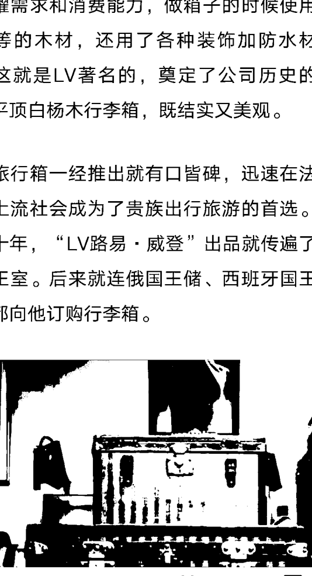

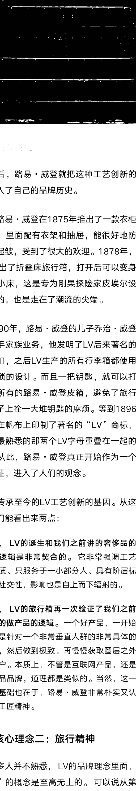

在这之后，路易·威登就把这种工艺创新的基因融入了自己的品牌历史。

比如，路易·威登在1875年推出了一款衣柜旅行箱，里面配有衣架和抽屉，能很好地防止衣物起皱，受到了很大的欢迎。1878年，LV又推出了折叠床旅行箱，打开后可以变身为一个小床，这是专为刚果探险家皮埃尔设计制作的，也是走在了潮流的尖端。

到了1890年，路易·威登的儿子乔治·威登开始接手家族业务，他发明了LV后来著名的特殊锁扣，之后LV生产的所有行李箱都使用了这款锁的设计。而且一把钥匙，就可以打开客户所有的路易·威登皮箱，避免了旅行者在裤子上拴一大堆钥匙的麻烦。等到1896年，他在帆布上印制了著名的“LV”商标，就是你最熟悉的那两个LV字母重叠在一起的设计。从此，路易·威登真正开始作为一个品牌象征，进入了人们的观念。

这就是传承至今的LV工艺创新的基因。从这里，我们能看出两点：

首先，LV的诞生和我们之前讲的奢侈品的整体逻辑是非常契合的。它非常强调工艺和材质、只服务于一小部分人、具有阶层标签和社交性，影响也是自上而下辐射的。

另外，LV的旅行箱再一次验证了我们之前讲过的做产品的逻辑。一个好产品，一开始一定是针对于一个非常垂直人群的非常具体的需求，然后做到极致。再慢慢获取圈层之外的用户。本质上，不管是互联网产品，还是奢侈品品牌，道理都是类似的。当然，这一...
切的基础也在于，路易·威登非常朴实又认真
的工匠精神。

### LV核心理念二：旅行精神

可能很多人并不熟悉，LV的品牌理念里面，“旅行”的概念是至高无上的。可以说从第一款平顶木箱开始，LV就在围绕着“旅行”这两个字打造自己的整个产品哲学。

甚至有人说，LV的发展史就是交通工具的变革史。其实一点也不夸张。举个例子：

刚才我们介绍的1858年的平顶旅行箱，是给马车和火车时代设计的；
到了1901年，LV推出了长方形“Steamer Bag”，为的是满足旅行者乘坐蒸汽船的需求；
到了1924年，LV设计出了Keepall多用途包，像枕头一样，成为了长条枕形现代箱包的鼻祖。这种包可以适配乘汽车出行的短途乘客，箱包比较轻巧，而且一个包满足多种功能；
而1931年，路易·威登的孙子又设计出了各种舱房行李箱、餐具箱以及LV Speedy Bag，为的是搭乘飞机的乘客可以按照不同需求携带自己的行李。

LV有一个定制服务，宗旨是尽可能满足客人的各种要求，这个服务已经延续了150年。

但是，为了彻底奉行品牌的“旅行精神”，
LV的这项服务至今还在坚持一个原则，就是不定制任何不能带出去旅行的东西。如果你要定制网球拍、高尔夫球具，甚至扑克牌、
筷子、麻将，只要能携带，都没问题，但是像放在家里的家具这种不能带出去的，就不行。

现在你还能看到LV的很多广告和宣传，都和旅行相关。等你下次再看到的时候，一定会想起刚才咱俩说的LV的“旅行DNA”。

从1854年创立开始，到20世纪二三十年代，LV经历了一个不断创新、越来越受欢迎的发展期，不过，接下来它就要迎来一个低谷了。而在它低谷的时候，另外一些新品牌开始崭露头角，给奢侈品行业和时装行业带来了一股新的风潮。明天的专栏，我们就来讲讲这段时期以及它带给我们的启示。

张潇雨

今天给你留一个课后思考题：LV给你的最初印象是什么样的？学习了这两天的专栏之后，你对LV的看法发生了哪些变化，产生了哪些新的感悟呢？可以在留言区写下来，和大家一起分享。

## 用户留言

强
1.从路易威登早年经历看，就知道能成就一番大事业的人真不是一般人，有好奇心、能吃苦、有毅力、对手艺极度重视、会复制自己的影响力、体察人性等等。
2.路易威登家族几代人对“品牌”的认识和维护，也是着实让我叹为观止，始终守住“旅行”这一标签不越界，真的非常难。一般目光短浅的人可能就是哪个生意好做就做哪个。
08-24 08:14:33

LuminaryX
近期看完《腾讯传》发现，通过做出好产品而获得伟大成功的品牌和公司的商业逻辑是如出一辙的。路易·威登采用上乘的材料做箱子、将圆顶箱改为平顶箱便于携带、用一把钥匙开所有锁让用户更方便等等想法，如同腾讯在QQ邮箱中首创“发送状态查询”功能、在《穿越火线》中未将韩国效果逼真的子弹射出动画引进，而转变为更符合中国玩家的节奏快、鲜明的“弹道设计”等等。抛开所有表象上的不同，他们只是在认真地做好产品，也就是潇雨老师说的“工匠精神”。用吴晓波老师的一句话总结一下今天的感悟-“在相当长的时间里，中国互联网企业家往往阐谈趋势、战略、时代责任，却从来没有人以‘产品经理’的姿态，对产品本身进行如此专注和颠覆性的阐述。”
08-24 09:06:32

猜猜
LV给的最初印象是一个名贵的奢侈品牌，最早是看到一些气质比较不俗、看上去很雍容华贵的人士携带和使用，后来是随处可见，而且很多明显的仿品开始“烂大街”了。
看了今天的专栏内容，感觉奢侈品的奢侈有它的道理和内涵，它的承载里有创作者的精神、价值观、做事方式、追求、个人工艺和能量等的呈现和分享。每一件产品都是这样的吧，如同苹果手机蕴含有乔布斯的灵魂。
08-24 10:57:29

一溜小跑
LV诞生之初的定位就很明确，服务于上流社会的旅行，所以发展出两个重要特质：工艺革新和旅行精神。
早期LV是典型的产品驱动，旅行箱强调工艺和材质，针对直接需求把产品做到极致，通过服务上层社会一小部分人，获得口碑，然后扩展到圈层之外。
LV的历史告诉我们，把一门手艺练到极致有多重要。比如说整理行李，一般水平是钟点工，较高水平是非仆，做到极致就是LV。
08-24 09:04:11

Ho1iu Y.
对奢侈品的了解并不多。这次专栏给了我一个很好的切入口，可以更轻松地了解奢侈品。
今天的专栏让我感觉，LV太懂得顺应时代的趋势和潮流了。从火车到蒸汽船，他的设计制造，就是根据贵族的生活方式量身定做。而那批人也是当时最有消费潜力的人，他们需要彰显自己的社会地位。就有點像今天中国的中产阶级。
08-24 08:36:09

Gary WANG
LV给我的最初印象就是山寨，小的时候不懂什么是奢侈品，就看到大家都拿着那色颜色和标志的包，有一天有人告诉那是LV，我就觉得很不屑。后来一个时尚的老师告诉了我LV人在旅途的DNA，我的观念有所改观，通过这几天的学习，我突然感觉LV的确是奢侈品行业里当之无愧的老大哥，对这个牌子的影响越来越好，虽然还是买不起，哈哈
08-25 00:46:05

吟游的鱼
LV给你的最初印象是什么样的？
高端、上档次。
学习了这两天的专栏之后，你对LV的看法发生了哪些变化，产生了哪些新的感悟呢？
具有工匠精神的路易·威登创造了这样的世界知名品牌LV。并且每个时期，品牌继承人都能把该品牌根据时代变迁，不断发扬光大。到现在不管是权贵还是平民，其知名度之高是普通品牌难以企及的。
08-24 18:36:36

小小
大品牌背后都有一个灵魂人物，他／她们具有引领时代的能力，品牌就是其精神的物质载体。LV的创始人路易·威登是一名具有工匠精神，善于把握时代特征的开拓者。奢侈品，深入了解后，让我脱离了仅仅看奢侈二字，还看到了品牌背后的灵魂人物的人格魅力以及他们的传奇故事。能创造世界品牌本来就是一个传奇。
08-24 16:34:25

Leanne
我还记得第一次买奢侈品包包，那时

## 奢侈的逻辑 | Dior对奢侈品行业的两大贡献

上篇专栏我们讲了路易·威登，从1854年诞生，到20世纪二三十年代的辉煌，时光匆匆往前走，路易·威登逐渐陷入了一个低谷期。

这里要给你一个说明。从19世纪中期的诞生，到20世纪七八十年代，路易·威登和我们现在看到的样子，或者和我们惯常的印象是非常不同的。在这100多年的时间里，路易·威登，包括其他一些同时期创立的奢侈品牌，比如爱马仕、卡地亚等等，基本还是保持在一个相对“小而美”的状态，既没有大肆的广告营销，也没有太走入大众，更谈不上是什么奢侈品集团。说一个小数字你就理解了——从1854年成立，到1977年这120年的时间，路易·威登在全世界只有两家店。

这里面当然有几重的原因：
首先，第二次世界大战对所有奢侈品牌都是一个重大的打击，LV也不例外。当时的威登家族被战争冲击得四分五裂，还有几名家族成员加入了法军，正面抗击德国。可想而知，路易·威登家族的生意受到了很大影响。
另外，LV在这段时间里，内部管理也处在一个低谷。继继承人亨利·路易和克劳迪·路易，一个擅长销售一个擅长生产，但都不是创意和新人才能。所以如果你有机会去法国的路易·威登博物馆看，会发现战后到七十年代这段时间里，LV的展品很少。某种程度上来说，这段时间的LV，很像是失去创始人沃尔特·迪士尼之后，混乱了好一阵子的迪士尼公司。

### Dior的创立

迪奥的创立史也是个非常励志的故事。创始人克里斯汀·迪奥在1905年出生在法国，他并不是服装设计出身，大学是在巴黎政治学院学的政治学。但迪奥对艺术的热情一直很高。

### Dior贡献之一：专利授权

当然，在时装风尚上面的成功仅仅是一个方面。更重要的是，迪奥在美国扎根之后，为奢侈品和高级别时装行业的商业模式贡献了两个重要的想法。

### Dior贡献之二：Miss Dior

在“专利授权”模式之外，迪奥还给奢侈品行业贡献了一个商业模式。

裕阶级的；品牌的成衣和包等等，可以卖给中产阶级；而香水、配饰等等一系列价格相对较低的单品，可以卖给中产偏下的大众们。

这种经典的金字塔结构，可以让一个品牌在商业上非常稳固，这样大家就能一起做大做强。

当然，这种对人群阶级的分类界限并不是严格的。但是从一门生意的架构来看，现在的奢侈品和时尚行业的确就是这样。

### 总结

在这里，我们可以回到前三篇专栏搭建的框架里，来做一点呼应。我们在迪奥的案例里可以看出这么几点：
第一，技术的革新的确再次让奢侈品民主化了。比如之前的香水调制起来非常困难，经常要大量的人工采摘花朵等等。但是化学工业水平提高之后，原来只属于贵族的香水也可以被工业化了，所以中产阶级也可以开始使用了。
第二，“专利授权”模式就是我们讲过的，凡勃伦商品的另一类功能——符号化、社交圈层化。关于“凡勃伦商品”，我们前两天讲过，简单来说就是能够达成炫耀性消费目的的商品。很多时候，人们只是在消费那个logo，而至于手套、围巾、眼镜的具体质量如何，其实并不重要。
最后，从一个企业的角度来看，打造一个金字塔形的产品和利润体系也是很重要的。高级定制的产品虽然单价高，但总量总是有限的，而且万一一两个系列没有做好，品牌就会陷入很大的麻烦。香水和唇膏这种产品，虽然单价不高，但可以大规模地售卖，为企业带来利润。当然，这也是因为人性所致，毕竟我们每个人都在盯着更理想的生活方式模仿。

所以，在路易·威登遇到困难的时候，以迪奥为首的一批新品牌崭露头角，开始在奢侈品界和时尚界取得自己的地位。然而，这种日子随着时代的变化，和一些关键人物的出现也快要结束了。下周的专栏里，我们就来讲讲奢侈品行业变化最为激烈的一段历史，在这段历史之后，我们现在所熟知的奢侈品和时尚行业就真正形成了。

张潇雨

好，这周的主要内容就结束了。在这一周讲到的奢侈的逻辑里，你印象最深刻的事件、特点或者现象是什么？欢迎在留言区写下来跟大家一起分享，我们明天周末互动再见。

## 周末互动丨我们该以怎样的心态面对奢侈品的大众化？

本周开始，我们进入了奢侈品行业的专题。在接下来的专栏里，你会看到一个徐徐展开、不断向前奢侈品行业的演变史。在这个系列结束之后，我希望你能够对整个奢侈品行业和我们现在所处在的时代有一个更深的感发的反思。

今天的周末互动，我想沿着之前的专栏讲一段关于路易·威登的小历史。

### LV的经典Monogram

我们之前说，老路易·威登去世之后，其儿子乔治·威登接过了LV的大旗。这是一个非常争气的儿子，LV历史上很多著名的专利都是他发明的。

在1886年的時候，乔治·威登做出了一個奢侈品行業里经久不衰的经典设计，就是所谓的LV的Monogram。当时为了纪念老路易·威登，他用深棕色作为底色，设计了一个由圆圈包围的四叶花卉，加上四角星、凹面菱形，以及重叠在一起的LV两个字母——也就是父亲的名字——组成了一个独一无二的Monogram图案组合。从那之后的一个多世纪，这个经典图案就一直流传了下来。

这个图案在设计上的确经典，但是它还有一个重要的含义。

### 奢侈品的品牌化

其实我们讲了一整周的奢侈品历史和LV的历史，有一件事情你可能没注意——哪怕是那时深受王室和上流阶层欢迎的平白杨木行李箱，其实也是一个朴素的箱子，并没有所谓的商标和品牌。也就是说，那会儿老路易·威登虽然在亲自打造他的产品，但是真正有“路易·威登”或者是“LV”这个品牌，其实要从这个Monogram的图案开始。

如果我们翻看历史会发现，1886年这个图案被设计出来以后，公司在1887年把它注册成了专利，到了1905年才注册成为品牌。可以说，LV开启了奢侈品品牌化和全球化的新的时代，从此奢侈品行业从开始的手工作坊，迈向了一个以“品牌”为核心，以“广告营销”为主要宣传手段的现代化企业，也逐渐变成了闻名世界的现代符号。

不过，后来这个经典变成了一种“俗滥”，这是为什么呢？因为这个图案被用得太多了，而而且LV的最低端的一些包也在用，比如Neverfull（“永远装不满”）系列——这个包很大，又是帆布而不是皮的，基本上几千块就能买一个。所以当Monogram这个图案被广泛地用在这些低端系列的时候，大家就逐渐地生出了一种“鄙视LV包”，“鄙视这个图案或者logo”的心态。相信你也能感受到。

### 凡勃伦商品的普通化

如果你学习了这一周的专栏，就会意识到，这整个过程，其实就是一个“凡勃伦商品”变成普通商品的过程——之前我们说，所谓的“凡勃伦商品”就是能达到炫耀性消费目的的商品。

凡勃伦商品包含两种功能：一种是商品实际的使用功能，另外一种就是炫耀性的功能。所以，当一个包上有很明显的LV大logo的时候，在十年前它可能是一种炫耀，在十年后可能就被鄙视了。因为随着某个奢侈品或者奢侈品牌的流行，它的炫耀功能就不复存在了。

而且你会发现，很多品牌都经历了这样一个演变，比如星巴克、耐克、苹果、无印良品，甚至Zara和优衣库。但是这是否意味着，我们就不应该买这些东西呢？

就像我在曾经的一期周末互动《潮流易逝，但风格永存》里说过的，我认为更好的消费态度，是让消费品和商品回到它的意义本身，而更少地去关注它的炫耀性意义。

要注意，这里我并不是说不能买好的东西来犒赏自己、让自己开心——比如我工作累了，或者专栏写累了，也会奖励自己出去旅游，或者去好的餐厅吃一顿，或者买个喜欢品牌的新款。但是在这个过程中，我想的并不是买到了这些东西如何发朋友圈炫耀或者说给人听，而是真的觉得这些商品和体验是美好的，是我很需要的。当你有了这个心态之后，就会出现自己的物质欲望会回到一个比较本源的状态，你也不会轻易地被商家忽悠了。

其实这个道理，放在学习和知识上也是一样的。我记得我看过一个让人印象很深的说法：判断你是不是对一个知识真的有兴趣有热情，你可以问自己：如果学完这个东西，你完全不能和别人讲，不能告诉别人，你还会去学它吗？这个问题后来我就问过自己很多次。

最终我想，这还是那个道理——每个人都有不安全感，都对自己在人群里的位置有疑惑，所以人都会倾向于用外物来理解自己、定义自己。但是，我们消费了什么，从来不能决定我们是谁。如果真的有能决定我们是谁的东西，那也一定是我们创造了什么。

> 《周末互动丨潮流易逝，但风格永存》

### —— 本周留言精选 ——

### 奢侈的谬辑｜权力期的奢侈品

看过金字塔的研究，据说建造者是自由农民，而不是奴隶，换句话，奴隶是造不出精品的奢侈品的，只有心是自由的人才能。

对于上层阶级在过于奢侈之后，产生的問題和后果，莫泊桑1884年的短篇小说《项链》所关于奢侈品的思考让人印象深刻。小說的内容大致是：小公务员的妻子子玛蒂尔德为参加一次晚会，向朋友借了一串钻石项链，来炫耀自己的美丽。不料，项链在回家途中不慎丢失。她只得借钱买了新项链还给朋友。为了偿还债务，她节衣缩食，为别人打短工，整整劳苦了十年。最后，得知所借的项链原是一串假钻石项链。在上层阶级追求和炫耀奢侈品的社会里，“净化与贬低并存，美丽与丑陋同在”，但很多人追求奢侈品牌，以为只要拥有奢侈品就意味着你拥有了上流的生活。到底我们怎么来理解和看待奢侈品和上流的关系呢？奢侈品在人类历史和商业史里承担着什么样的意义？应该是下一讲的主要内容吧。

草垛起初也是贵族才能享有的，完全手工管理，成本非常高。工业革命之后，草垛才走入欧美寻常百姓家。（4）艺术也是如此，有钱人才能消费得起，如今绘画已经开始走进写字楼办展览。

今天讲了奢侈化，自上而下，明天应该讲民主化。——一点其他思考：1. 今天的奢侈品还有层次化，不同层次的人有不同的奢侈品，奢侈品在某种意义上也是一种身份名片。2. 张老师提出“反奢侈”，我想最直观的就是学校里的校服了，这就是强制的“反奢侈”。3. iPhone是属于“奢侈”还是“反奢侈”？我认为二者皆有。利用和其他手机的差异化，让消费者有面子，是前者；利用批量的统一的生产，明显与草根用一样的手机，这是后者。

## 奢侈的逻辑 | 奢侈品的第一次民主化

以前一致以好坏的眼光来看待历史，然而现在不会了，历史都是由好到坏，再由坏到好，反复循环的过程，一环扣一环。另外，在历史中看到更多的是人性不可迁，多数繁荣的社会都是尊重人性的，相反，则蔑视人性。现在常说顺势而为，今天看到了顺性而为。

在技能、认知上成为精英难度大，但通过买奢侈品是最快接近精英的，但奢侈品背后的故事及代表的文化精神才是奢侈品本质的，并不是买奢侈品就能达到的。

推荐电影《Marie Antoinette》，中文译名《绝代娇后》，正是讲说了法国大革命前路易十六与玛丽王后的故事。

奢侈品的民主化，主要有两个原因，一是社会思想的转变，一是技术的进步。人权宣言，极大地解放了老百姓的思想，大家认识到，上流社会的享受，自己其实也配拥有。但是，需要钱。可是，技术的进步，彻底给了普通民众享受奢侈品的机会。成本降低很多，有很多人消费得起。即便不能直接消费，也可以仿制，这在一定程度上，又让奢侈品的知名度，传播度更广。看看历史，其实，好好像都是这种规律，比如，汽车、电脑和手机，如果不是思想的转变和技术的进步，根本不可能进入普通家庭。

奢侈品行业跟社会的发展与变革有密切关系。如果延伸一下，不仅仅是奢侈品，包括当时的意大利文艺复兴，到17-18世纪艺术中心转向法国，后来的转向纽约。很多事物的转变，其实跟社会风潮和技术密不可分。可是从微观来看，一个社会大环境怎么变，也很影响到企业个体。就像马云说的，不是实体经济不行了，是你的实体经济不行了。

## 奢侈的逻辑 | 炫耀性消费与“有闲阶级”理论

奢侈品，说究工艺、材料的稀缺，对功能本身反而看不重，甚至无用就是炫耀的一种。奢侈品服务于一小部分人群，制造优越感，显示优越性。奢侈品牌的做法，就是告诉你，有了这个，你在人群中就是稀有动物，是优越的上层人民。优越是建立在欲望之上的，日本的低欲望也就导致了炫耀性需求没有了。关于炫耀，今天有种感触，炫耀符合人性，人性趋利避害，炫耀能真实现有效地表达优越，而种群内部的其他人，也当真承认这种优越，不得不感慨人类其实是想象的动物。

- 网络世界中的很多虚拟头衔就是实体世界向虚拟世界的转移。例如微博和QQ中的各种头衔和等级，事实上并没有太多的差异，但仍然还是吸引了诸多人群去追求。其炫耀价值远高于使用价值。
- 心理的膨胀和炫耀的需求依然非常明显。在很多非奥迪车的车尾部都贴有奥迪quattro的尾标，其实很多车主都并不非常了解这个车标的全时四驱的技术含义。我判断，大家愿意贴上这个标志实际上是满足心理上的一种安慰，一种炫耀。
- 从产品设计的角度来说，一定在外观方面有自己的特点。让别人一眼就能识别出你使用这个产品的特殊性。例如iPhone手机的Home键，记得当时iPhone刚出的时候，只要瞥一眼手机的正面，就可以用上判断出你用的是不是iPhone。所以我在深圳出差的时候，在很多手机店都看到了外表与iPhone相同，但里面装着Android系统的手机。估计这种产品出现的目的就是为了满足很多人的炫耀需求。

说起“凡勃伦效应”就是一种炫耀性消费的行为，那朋友圈的晒娃，也算是一种炫耀吧。只不过自己的孩子，自己投入了时间和精力，都会觉得自己的孩子最聪明最可爱！这也适用于“凡勃伦效应”。关于LV，我更想知道它是如何区分正品和A货的？除了做工和材料外，有没有更高超的防伪标志呢？貌似LV公司也不会对山寨品牌赶尽杀绝，宁肯这也算...

“既然旧的东西不能彰显我的优越感了，我就去寻找新的——这也是一种永恒的人性。” 昨天特欧栏目分享到朋友圈后，有位朋友问，“奢侈平民化”后，那奢侈品还是奢侈品吗？我的回复也是会有新的奢侈品出现的。就如同美一样，会有不同的层级和个人认可标准和追求，从古至今以后也都是这样吧。有些人会比较停留在外化的物品上，有些人则追求一种更内化和精神领域方面相关的事物。即便大家追求的也有可能是...

## 奢侈的逻辑 | LV的崛起：工艺革新与旅行精神

最初的印象就是奢侈品，有钱人的象征。任何一个品牌都要经历一个从小到大的蜕变过程。学习了这堂课，明白了LV长久的坚持。变的是消费者的需求，不变的是秉持工艺革新和旅行理念的精神，看得见的是产品，看不见的是专注的力量。

大品牌背后都有一个灵魂人物，他们具有引领时代的能力，品牌就是其精神的物质载体。LV的创始人路易·威登是一名具有工匠精神，善于把握时代特色的开拓者。奢侈品，深入了解后，让我脱离了仅仅看着奢侈二字，还看到了品牌背后的灵魂人物的人格魅力和他们的传奇故事。能够造就...

最初对LV的印象不大好，在当地用LV的都是有钱没文化的，所以LV给我的感觉就是土豪爆款。今天在听完文章之后，我实在是佩服LV敏锐的洞察力。做产品...

看完LV的故事，最有触动的一点：百年品牌在刚起步的时候还是因为质量上乘，解决用户需求；做好产品的底层逻辑是一致的。

LV的品牌发展有两个重要因素，第一，好产品关注客户需求，专注产品品质，开始时一定是针对一个非常垂直人群的具体需求（即满足皇室旅行需求），然后做到极致。再慢慢撷取圈层之外的用户，在自上而下影响其他消费者。第二，产品创新，LV在每...

与其说旅行精神，不如说LV抓住了人们的炫耀心理，自然选择那些能够拿出去展现 在他人面前的东西。

## 奢侈的逻辑 | Dior对奢侈品行业的两大贡献

印象最深刻的是LV创始人平步青云的故事，而起点只是为客人打包行李的工作。其一，专业技能精益求精，获得垂直细分客户认可；其二，笼络了细分客户后，找到了客户需求的切入口，将客户体验做到极致。有多少年轻人，其中也包括年轻时的我，眼高手低地与第一份工作相处，耐不住“路漫漫之乏味”的考验，最后妥协了自己的梦想！

奢侈品在下沉渠道和定位。换个角度说，也可以理解为中国的购买力在上升。比如化妆品的四大天王，原来开柜对渠道非常挑剔，并且不着急开柜。现在不一样，主动寻找好的购物中心，并且由原来百货公司承担柜台费用变为现在的自行承担。

印象最深刻的是炫耀性消费。炫耀这个词在我印象中属于贬意大于褒义的，炫耀总是让人联想起肤浅、土豪等等词语，但是这周的课程中，我突然意识到，炫耀是没有那么贬意的，炫耀是人本能中的一种，不管是开始的贵族还是后来的富有商人阶层，炫耀是能力达到一定程度之后的一种本能，人是需要这种独特的与众不同来彰显自己的优秀和能力的，恰如“人往高处走”的含义。前段时间“我的前半生”热播，里面精英女唐晶的家当便是圣罗兰等等大牌加身，出行坐骑BMW，很容易便辨别出其身处的社会阶层——精英阶层，这种与众不同中已经彰显了她优秀的赚钱能力。炫耀的含义在我的理解中已经变得没有那么贬义，只是人性的一个特质罢了，人用的不适合了是贬义，用的合适了是中性！

伟大的均衡器，脑海中冒出了这个词。虽然阶层上升非常困难，但我能够和上一阶层或几层的人用同样的品牌，买不起几十万的高定，我可以买几百的香水啊，都是Dior啊。“每个人都在盯着更理想的生活方式模仿”，奢侈然后民主化，上流社会不断地创造新的奢侈，以把他们和其下阶层的人民区分开，这是一条无止境的路，让我想起张潇雨老师的那句话——“你可以努力去创造一些东西、去努力了解自己真正想要的是什么，然后明白，是你创造了什么东西定义了你是谁，而不是你消费了什么东西定义了你是谁。” 去创造，然后形成自己的风格，变得更自由的同时，你本身就是奢侈品。

## 奢侈的逻辑 | 奢侈品行业的功臣——日本

上周的专栏，我们从理解奢侈品的整个逻辑，走到了LV和迪奥的诞生。我们的基本时间线是这样的：1854年LV创立，一直到20世纪的二三十年代经历了一个成长期。而之后的二战对奢侈品行业整体是个打击，再加上家族没有很好的继承人，LV从20世纪40年代到70年代末期经历了一个低谷，反而是二战之后成立的迪奥，靠着大胆的设计和创新的商业模式开始崭露头角。

然而当时我也提到过，不管LV、迪奥，还是爱马仕、Gucci、Prada、BVL GARI，它们当时的形态和现在奢侈品行业这种寡头垄断、大集团式的格局，是非常不一样的。那个时候各个品牌基本都是各自为战，主要还是以“小而美”的形态存在着。

然而，我们来看看现在LVMH一个集团，是一个什么状态。

如果找来LVMH的2016年年报，会看到这样的数字：

目前，LVMH集团旗下有70个品牌，你可能听说过的有：LV、迪奥、芬迪、Celine、娇兰、豪雅、BVL GARI、酩悦香槟，还有美妆连锁丝芙兰等等。包括了时装、皮具、钟表、珠宝、香水、美妆、葡萄酒和烈酒等等一系列产品。LVMH在2016年销售额超过了400亿美元，市值在1000亿美元左右，全球的员工超过13万人。

毫无疑问已经是一个巨型的奢侈品航母了。

所以，从小而美的品牌，到奢侈品航母，这过去的三十几年里整个行业发生了什么呢？未来又会去向哪里呢？在了解完整奢侈品的诞生历史之后，我们本周就来回答这个问题。

### I 日本的快速发展

这一段奢侈品行业的历史，要先从政治和经济的维度讲起。再说得精确一点，要从日本在20世纪80年代的经济腾飞及至泡沫的那段历史讲起。因为不夸张地说，现在奢侈品行业有这样的格局，一大半可能就是日本人的“功劳”。

我们先来说说上世纪七八十年代的日本发生了什么。

如果用一句话总结，日本战后的经济史就是：靠发展制造业与出口业而繁荣发展，然后因为货币宽松制造了泡沫，最后因为泡沫破碎而陷入了死寂。

当时，日本在战后大力发展制造业，推动石油作为发电能源，生产纺织品、家电、汽车等产品，出口的同时也拉升了国内的生活水平。1964年还举办了奥运会，于是政府进行了大量的基础建设设施建设。到了1970年为止，日本已经跃升为世界第二大经济体，国民生活水平非常高，当时私家车、彩色电视等等都已经开始走入百姓的家庭了。

当时最具有代表性的应该是丰田汽车。当时丰田在欧美大获成功，买日本车一度成为了美国的风尚。结果日货横行给美国制造业带来了很大的冲击，砸日本车成了美国汽车工人的常态。那时候，美国的大量工厂倒闭，失业人口增加，犯罪率不断升高。治安不好的社区房价大幅下跌，资本也开始外流。整个美国对日本是一个巨大的贸易逆差——美国每年要从日本进口非常大量的东西。

所以为了遏制当时日本的疯狂出口，著名的“广场协议”诞生了。当时在美国的主导下，世界五大经济强国，其中包括美国、日本、德国、英国和法国，这五个国家的财政大臣和央行行长在纽约广场饭店达成了一个协议，就是后来的“广场协议”。在这个协议里，五个国家发表了共同声明，宣布介入汇率市场。然后他们开始在国际外汇市场大量抛售美元，市场上的投资者也跟随着抛售美元，结果就导致了美元的大幅度贬值，其他四国对美元的汇率迅速升值，日元兑美元汇率在一年间从240:1飙升至120:1，直接涨了一倍。

这个协议的直接结果就是：日本企业在海外收到的美元和外币一下就不值钱了。

所以为了减少损失，日本的资本开始转到国内市场，然后加上日本政府大幅降息，扩大了对企业的贷款，结果造成国内市场一时间产生了大量投机性的钱，市场上管这种钱叫热钱。结果这些热钱无处可去，最终全部涌入了证券市场和房地产市场，日本由此迈入了泡沫经济，在八十年代末进入顶峰。

当时由于日元大幅升值，日本人全部陷入了疯狂“买买买”的状态，因为拿着非常值钱的日元在海外买东西实在太便宜了。从大公司到个人都是这样。

比如当时最著名的例子就是日本人去纽约买洛克菲勒大楼的故事。当时有人和日本最大的商业地产开发商三菱地所的社长，也就是CEO，开玩笑说：什么时候把纽约的洛克菲勒大楼买下来吧，那可是美国最高的大楼啊。结果一年之后，三菱真的宣布花2000亿日元买下了洛克菲勒大楼，还在大楼的最高处插上了日本国旗。有一种“我们二战虽然输了，但在经济上要占领你美国”的心态。

当时的美国杂志还报道过这么一个故事：有一个日本企业高管去澳洲的一个小岛上度假。这个小岛上有各种家族宾馆。结果他在一个宾馆入住的时候，不太满意前台的服务态度，回房间后直接给公司打了个电话，建议把这家宾馆买下来。结果日本股市也非常不理性，在买了这个宾馆之后，这家公司的股价一路狂涨，这个高管反而成了大功臣。结果其他日本公司也冲到这个岛上开始买宾馆，结果价格越越高。

后来日本经济泡沫破裂，企业为了回笼资金又开始卖出这些宾馆，有一个当时价格2亿美金的宾馆，卖出的时候是600万美元。

### I 日本对奢侈品行业的助推

当然，在这个疯狂的时期，日本人购买奢侈品可以说是更加疯狂的。

一方面经济腾飞，货币大量印发，所以大批的富裕阶层和中产阶层开始崛起，他们是非常向往奢华的生活的。而且日本国土有限，所以靠买大家豪来炫富既不现实，也不够高级。而欧美这种奢侈的生活方式正是大家希望模仿的。另一方面奢侈品的手工制作方式和日本的工匠精神不谋而合，这也一下激发了日本人的文化认同感。

当时，日本本土的奢侈品需求极强。面对这如此巨大的需求，LV很快便开始行动。1978年3月，LV东京专卖店在东京的5家百货公司开幕。

当时为了取悦日本顾客，LV在商业模式和价格上都做了在当时颇为大胆的举动。比如控制LV的产品在日本的售价不高于巴黎的1.4倍，同时极力宣扬LV的历史传统和工匠手艺。要知道，当时大部分消费者之前只能通过代理或者代购买LV，价格一般都是原价的3倍以上。这样一来，LV的产品好像变得划算了起来。

所以当时日本人买奢侈品到底有多疯狂呢？我们直接拿一些数字来说明一下。

1977年，LV的全年收入是1200万美元，而1978年，从3月LV在日本开店开始，到这一年结束，LV光在日本的营业额就达到了580万美元，相当于上一2年全球收入的一半。两年之后这个数字又翻了一倍。

后来，有一系列关于日本人拥有奢侈品的数据，非常令人惊讶。比如：

在日本，大概40%的人拥有一个LV的商品。如果将群体缩小到女性，这个数字是92%；

还有，日本女性里有90%拥有Gucci，超过58%有Prada，超过51%有Chanel；

到了2005年的时候，仅日本一个国家就贡献了爱马仕30%的销售额、LV 40%的销售额以及全球奢侈品市场41%的销售额。

而且，日本市场是不会萎缩的。比如金融危机期间，日本的奢侈品消费者占全球总数的50%。

我们刚才说，奢侈品行业有现在的格局，一大半是受日本市场的影响，可以说毫不夸张。原因有两点：

首先，在LV开店大获成功之后，众多奢侈品品牌全部在日本百货公司开设专柜，都获得了巨大的成功，让品牌迅速成长起来；

另外，日本人的疯狂第一次让这些奢侈品品牌意识到了新兴市场的巨大潜力。因为以前的奢侈品品牌主要还是提供给欧美的富裕人群，但是日本的崛起让它们意识到，把自己的产品卖到全世界才是最正确的策略。这也为之后奢侈品品牌的全球化和资本化的大格局，打下了重要的基础。

### I 延伸与总结

人类不理性起来，状况都是非常类似的。
不知道你有没有这种感觉，就是日本发生过的历史，让人似曾相识。比如经济大发展、承办奥运会、货币政策宽松导致热钱增多、资本流入股市和楼市造成泡沫，等等。当然，经济学是一个非常复杂的科学，绝对不是我们总结几个关键字就能证明什么的。但是，人类不理性起来，状况都是非常类似的。

当时的日本社会被消费之风统治着。

比如当时，男生追女生的最重要因素除了帅就是钱——这不是我下的结论，而是日本自己的杂志做出统计后得出的结果。日本杂志《週刊女性》在1987年年末，刊登了当时社会上票选女孩子最期待男朋友送的圣诞礼物排行榜，蒂凡尼的心形钻坠、卡地亚的三连环戒指和东京赤坂王子酒店的法国料理高居榜首。结果这些东西就成了日本泡沫时代男生必备的圣诞礼物，一个平安夜下来要花两三万人民币。而且，当时请女生吃饭，一顿一两千块很正常，送个小礼物也要几千。后来日本人把这个称为“恋爱资本主义”，因为当时各种媒体上都是介绍如何通过买东西来赢得恋爱对象的欢心的，不知道这种社会风气，对我们有没有一些警醒的作用呢？

张潇雨

学习过今天的内容，你对日本的买买买行为有什么想法和感悟呢？欢迎在留言区写下来，与大家一起分享。

## 奢侈的逻辑 | LV的雷卡米尔时代

之前我们提到，LV从成立的1854年，到100多年后的1977年，都处在一个“小而美”的阶段。直到1977年，LV一共也只有两家店，利润也不过是100多万美元。

但是从1977年开始，随着一个人的入主，这个情况要开始改变了。上期专栏我们讲到了奢侈品品牌的国际化，其中的代表性事件就是1978年LV在东京开设了专卖店。当年LV在东京的销售达到了580万美元，占到整个公司销售的接近三分之一。等又过了两年，日本店贡献的销售额已经超过一半了。在这之后，LV就进入了一个十年的快速发展期。所有这一切，都和一个LV的新领导者有关，他就是亨利·雷卡米尔（Henry Racamier）。

其实，这个雷卡米尔也不是外人，他就是路易·威登家族第三代的女婿。

当年，面对LV的低迷，家族的女家长蕾妮·威登（Renee Vuitton）在1977年指定雷卡米尔接手家族事务，这时候雷卡米尔已经65岁了。不过他的工作完成得非常出色——从1977年接手到1989年雷卡米尔逐渐退位，LV完成了从2家店到77家店的扩张，利润也从100多万美元提高到超过2000万美元。可以说这12年也是LV奠定了自身品牌的重要基础，为之后的腾飞做好了铺垫。今天的专栏我们就来讲述这段历史以及给我们带来的启示。

### —— 雷卡米尔的两大改造 ——

### 一、渠道整合

当时，雷卡米尔在认真研究了奢侈品行业之后发现，在整个商业链条里，零售商以及拥有特许经营权的经销商其实拿走了利润的最大头，品牌的利润反而不高。

日本就是个很好的例子——在LV去东京开店之前，LV在日本的售卖主要采用的就是特许经营权的方式，日本的零售商或者中间商会按照定好的不太高的价格先批发LV的货，然后在日本当地加价售卖。有时候售价可以是进价的三四倍，非常夸张。

所以，雷卡米尔做出了一个决定，他开始“垂直整合”LV的品牌——踢走中间商，开设直营店。东京的店就是一个经典的例子。如今我们在大街上经常能看到各种奢侈品品牌的门店，这一一切的起源就是雷卡米尔当年的举措。

在踢走中间商之后，短短几年，路易·威登的利润就上升到了可怕的40%，而之前只有10%-15%。

### 二、多元化的资本运作

在这个阶段里，LV做出了几笔经典的收购。

1986年，LV收购了凯歌香槟，开始有了高端酒类的业务

另外，凯歌集团下面还有一个资产，就是纪梵希的香水业务，在这次收购里也归了LV。这里要说明一下，纪梵希的香水和美容产品与纪梵希时装公司有联盟关系，但它是独立运作的——这在奢侈品行业里也是个常见的现象。

1988年，LV收购了纪梵希的时装业务

借由对凯歌香槟的收购，两年后的1988年，LV又以4500万美元——当时的天价——收购了纪梵希的时装业务，从此有了高级女装部门。

最重要的一笔交易：路易·威登和酩悦-轩尼诗的合并

当然，这其中最重要的一笔交易，就是路易·威登和酩悦-轩尼诗公司的合并。这次合并，也使得LVMH这个当今巨无霸的奢侈品集团展现了它的雏形。

其实LVMH的名字就是来自此次合并。LV自然代表的是路易·威登，而MH就是“Moet酩悦”和“Hennessy轩尼诗”的缩写，其实酩悦-轩尼诗也是合并而来的。这次合并之后，它们就组成了一个更大的奢侈品集团LVMH。

当时两家公司合并的主要原因是这样的：对于LV来说，它们一方面希望能扩大自己的商业版图，进军更多的奢侈品品类，不只停留在箱包上面；另一方面，由于日本人的购买力实在有点恐怖，每一年都有把LV买空的感觉，所以为了分散风险，LV也希望能让自己的收入来源更多元化。

而对于酩悦-轩尼诗来说，当时他们受到各种资本的介入，家族持股越来越少，对自己的控制力非常担心，甚至有被恶意收购的危险。所以与其被未知的投资者收购甚至被政府控制，还不如自己主动寻找盟友。

这里另外要提一句——对于家族企业，尤其是非常强调历史传承的奢侈品家族企业来说，你会发现有一个永恒的魔咒：对于奢侈品来说，历史的悠久和连续非常重要，但是这些生意想要传承下去其实是非常不容易的。因为作为家族后代，很可能衣食无忧，又处在一个很懂得享受的行业，所以后代的斗争志往往不足，或者对商业本身兴趣不高，更想去做文学、艺术甚至哲学的东西。而老牌奢侈品家族一般都很大，每代人人数都不少，这样也会带来各种利益的纷争。这个时候，就会有所谓的外部或外资本开始觊觎这个家族品牌，甚至一举把品牌收购，把家族里的人赶出企业。在我们之后的专栏里，你会反复看到这个现象的发生。甚至可以说，正是这种现象造成了如今奢侈品行业的格局。

于是，LV和MH找到了彼此。在1987年，两家公司在雷卡米尔的撮合下合并，形成了LVMH集团。

酩悦-轩尼诗的总裁阿兰·舍瓦利耶（Alain Chevalier）出任集团总裁，LV总裁亨利·雷卡米尔（Henry Recamier）出任集团战略委员会主席，这两个人作为集团下属子公司的原公司位置不变。相当于合并的集团有了两个领头人。在两家公司合并后，两个创始家族合计持有新公司35%的股份和50%以上的投票权。

到这里，我们现在熟知的LVMH集团已经初步成型了。雷卡米尔正是靠渠道的整合和多元化的资本运作，把LV这个百年品牌慢慢带出了低谷。

### —— 如何平衡商业与艺术 ——

这里，我们可以稍微做一点扩展。

在我看来，雷卡米尔取得成功的一个很大的原因是什么呢？其实是，他并不是一个手艺人或者艺术家，而是一个商人。

如果你还记得我们之前讲的迪士尼，你会发现这里的故事非常类似。

一开始，都有一个伟大的艺术家开创了一家公司。比如沃尔特·迪士尼和路易·威登；

然后，因为他们的工匠精神以及对产品的热爱与执着，这家公司慢慢被他们带上了巅峰——迪士尼的《白雪公主》和LV的平顶旅行箱都是绝佳的例子；

然而在他们去世之后，由于家族里面有这种开创性的人越来越少，所以品牌越来越中规中矩，没什么创新。慢慢就陷入低谷——迪士尼和路易·威登都长达几十年的作品真空期；

在低谷中，就难免有各种利益的斗争——当年的迪士尼家族内部缠斗了二三十年；路易·威登有一些，奢侈生意没那么大，也没有上市之后引入的外部投资人干涉，但品牌内部一直也有各种不同的声音；

然后，他们会找来一个力挽狂澜的CEO，利用一系列手段把企业带出低谷，比如迪士尼的迈克尔·埃斯纳或者LV的亨利·雷卡米尔——或者更准确地说，这些企业活了下来，是因为他们都找到了这样的角色，而没能找到的公司已经消失在我们的视野了。

而且你会发现，这个力挽狂澜的CEO往往是偏重于商业背景的，不管是埃斯纳还是雷卡米尔，都是以商业思维为主导，但对所在行业也有一定了解。比如埃斯纳，在加入迪士尼之前是好莱坞派拉蒙影业的高管，而雷卡米尔本身就是路易·威登的家族成员，但他们本质上还是个商人，而不是艺术家。

所以，在任何与创意、设计、时尚、娱乐的行业，如何平衡商业与艺术是一个永恒的话题。

的话题。

其实这个逻辑在很多行业和很多时期内都会出现，比如在互联网时代，我们曾经也讲到过一个现象叫做“成人监管”，本质上就是产品或者技术出身的创始人，到底需不需要一个商业方面的CEO。你看，在奢侈品行业和娱乐行业，这个逻辑也是一样的。

## ——♦ LV与MH合并之后 ♦——

我们说回来。在LV和MH合并之后，事情其实并没有想象得那么顺利。

两家在实际业务运作里毕竟还是独立的，也没有太多业务的整合和协同。而且，酩悦-轩尼诗的创始人家族属于贵族，路易·威登家族则是平民出身——你应该还记得他的出身就是个小木匠。所以，这两家在心理和文化上也不太相容。据说，两家企业的老大经常为类似于信纸应该用什么颜色或者材质的问题吵得不可开交。

另外，双方对未来的发展方向也有很多分歧。有一件事就能说明问题。酩悦-轩尼诗一方主要的业务是酒类，当时为了扩大在海外市场的销售，舍瓦利耶让LVMH与英国的啤酒制造商健力士（Guinness）签订了合作协议，而且还互相持股。但是这让雷卡米尔很不高兴，因为他觉得LVMH的未来应该是服装和皮具产品，而不是卖酒。于是，这两方开始出现了矛盾和纠纷。

合并仅仅一年之后，两边的矛盾就有点不可调和了。这时候，雷卡米尔率先采取了行动。

在1988年的春天，他给一个叫做伯纳德·阿诺特（Bernard Arnault）的人打了个电话，邀请他投资LVMH，然后希望和他联盟，排挤掉酩悦-轩尼诗一方的舍瓦利耶。没想到，这成为了奢侈品行业历史上转折性的一笔，也是一个引狼入室的经典商业案例。明天的专栏，我们就来说说这段历史。

+   迪士尼｜装了内容引擎的赚钱机器
迪士尼｜天时地利埃斯纳
迪士尼｜买买买帝国
迪士尼｜被“成年人监管”的CEO

## 奢侈的逻辑 | 奢侈品行业的阿诺特时代

在上篇专栏里，我们提到了从1977年开始，路易·威登家族第三代的女婿雷卡米尔带领LV进入了一个新阶段。他通过对渠道的垂直整合，以及利用资本把LV的业务多元化，让路易·威登箱包企业变成了LVMH奢侈品集团。

然而，LV和MH的合并并不顺利，两家的领导人思路不同，导致了各自冲突。这时候，雷卡米尔给一个叫伯纳德·阿诺特的人打了个电话寻求帮助，然而没有想到，这个电话彻底改变了整个奢侈品行业的 历史和格局。

我们今天就来谈谈这段“引狼入室”的故事，说一说阿诺特是怎么巧取豪夺了整个LVMH集团，摇身一变成为第一奢侈品集团的企业老大的。

## ｜阿诺特的个人经历

1949年，伯纳德·阿诺特（Bernard Arnault）出生在法国一个工业家庭，他的父亲经营着家族的建筑公司，母亲是一个钢琴家。大学毕业之后，他很快就展现了商业的头脑和天赋，在29岁的时候就接管了家族的企业。

## ｜阿诺特步步为营的收购计划

## ｜阿诺特时代的开启

## ｜阿诺特的收购套路

+   - Debt，债务。你可能急需一笔钱，所以来拍卖行拍卖；
- Divorce，离婚。家庭不和睦，所以要分家产了。

Divorce，离婚。家庭不和睦，所以要分家产了；

Death，死亡。可能是家族的关键人物去世了，需要继承或者把艺术品换成现金。

无论如何，这些事发生的时候，就会有阿诺特这样的人在旁边等待出手了。

然后，在品牌困难的时候，阿诺特就会出手帮助它渡过难关。一开始阿诺特还会比较尊重整个创始人家族，把很多品牌家族成员都留在公司里。但是一旦时间长了，阿诺特嫌他们碍事了，就会想方设法把他们排挤出去，自己独占整个品牌。这个故事在LVMH集团里反复地上演。

比如著名的女装品牌Celine就是这样，当时，Celine公司无人继承，所以创始人维皮娜（Vipiana）夫妇开始寻找买家，后来找到了阿诺特。在收购的时候，阿诺特承诺保留维皮娜夫妇所谓在“创意方面”的决定权。但是合同签下来的三个月之后，他们就发现自己上当了。阿诺特在Celine安排了新的管理层，剥夺了他们的权力，最终把两夫妇扫地出门。后来理查德·维皮娜非常气愤地和阿诺特说：“早知道你会把我们从公司赶出去，就算出双倍的价钱，我们也不会把公司卖给你。”但是当然，此时再说这个话为时已晚，资本永远是非常无情的。

在成功接管了LVMH之后，阿诺特终于可以开始打造他心目中一直计划的奢侈品帝国了。他后来都采取了哪些手段和措施，让LVMH不断发展壮大到今天呢？下一期专栏，我们就来讲讲阿诺特入主LVMH集团后的历史。

张潇雨

听了今天的专栏，你对阿诺特这种看似不太厚道的收购扩张方式，有什么看法呢？欢迎写在留言区跟大家一起分享。我们明天再见。

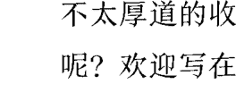

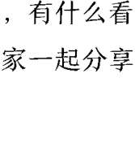

## 奢侈的逻辑｜天才设计师与奢侈品集团新纪元

上一次我们讲到了LV的前掌门人雷卡米尔引狼入室，想要和阿诺特结盟，但是反而被他收购了LVMH集团，最终自己也被赶出了公司。而这时候，阿诺特终于开始打造自己的奢侈品帝国了。今天我们就讲讲他上任之后重要的一些细节。

## ——奢侈品公司的新玩法——

在上周第一期的专栏里，我们说到了奢侈品行业的三个趋势：全球化、集团化和资本化。可以说引领这个风潮的就是入主了LVMH的阿诺特了。

上任之后，阿诺特就开始了他对LVMH集团的改造。

首先，持续地在全世界开店是必须的。

我们之前提到过一个数据，从1854年成立到1977年，LV还只有两家店，到到了1989年，经过雷卡米尔和阿诺特的努力，这个数字变成成了130家。1992年，LV在北京的王府饭店开设了中国第一家门店。而到了2017年，LV已经登陆了超过70个国家，全球的门店数已经有4000家之多。

另外，阿诺特当然还会施展他最擅长的收购法宝。

从我们之前讲过的1987年收购Celine开始，LVMH一路进行了超过60笔收购。这些收购套路都是类似的：或者利用经济周期或品牌业务处于低谷的契机，或者利用被收购品牌家族矛盾，然后针对性地设计资本结构，最后独占这个品牌。

所以，这20多年，阿诺特彻底改变了奢侈品行业的游戏规则。从某种程度上来说，奢侈品行业现在更多的变成成了资本的游戏。集团化、全球化、资本化，这就是阿诺特定下来的奢侈品公司的新玩法。

另外，这些只是阿诺特改变行业规则的一招，对于如何发展壮大LVMH，他还有一些精妙的手段。

## ——三大营销手段——

我们之前讲过“奢侈的民主化”这个逻辑，其实很多人说，这只是一种美化的说法罢了。因为所谓“奢侈的民主化”，其实就是大的资本集团需要扩张，需要更多的利润，所以要把奢侈品卖给更广大的人群。

阿诺特也深知这里面的门道。所以，他在营销上下了一些狠功夫。

## 一、拼命营造品牌的传奇性

之前我们说过，LV品牌的一个核心是“旅行精神”。所以在营造品牌传奇性的时候，LVMH就尽可能地把旅行和历史放在一起。

比如LVMH发起并且赞助了古董车拉力赛，包括1993年在马来西亚举办的“古董车赤道之旅”，营造一种厚重的历史感；

另外，LV从很早开始就是美洲杯帆船赛的主要赞助人，这项比赛起源于19世纪中叶，有超过150年的历史了，阿诺特主动加强了和他们的合作。

另外，他们还邀请记者参观LV在巴黎的手工作坊，帮他们宣传LV行李箱制作的传奇过程，等等等等。

## 二、狂做广告

到现在，你可能对奢侈品牌无处不在的广告已经很难以为常了。但你可能不知道的是，奢侈品牌从商世以来，很长一段时间是不做广告的，甚至他们会觉得，推销奢侈品和时尚是一种忌讳，会降低品牌的格调。但是到了20世纪90年代，整个奢侈品行业在几大品牌的带动下，全面拥抱了广告。

## 三、跟明星合作

另外，90年代的奢侈品行业还有一个变化，就是开始和名人们合作——没错，这个风潮也是从那个时候开始的。

一个标志性的事件应该是1990年的奥斯卡颁奖典礼。其实在之前，明星们一般都是自己打理造型，而且也没有那么多预算来为一次活动买一件几千甚至上万美元的衣服，毕竟他们出席的场合太多了。

结果那次奥斯卡，阿玛尼让好几个明星穿上了自己设计的服装，还让自己旗下的造型师帮助他们打理了整体的造型。结果比起那些没用专业造型师的明星，阿玛尼赞助了的明星在奥斯卡上大放异彩。后来时尚杂志评论说“这是一届属于阿玛尼的奥斯卡”。

这一次事件让奢侈品界和时尚界意识到，让明星穿上自己的衣服拿上自己的包，是效果最好、花钱最少的广告。从此以后，奢侈品和时尚行业找明星代言、和明星合作就成了一种标配。而且效果往往非常好。

比如，在麦当娜穿着Gucci的宝蓝色衬衫和黑色天鹅绒紧身裤出席MTV颁奖礼之后的几天，全球各地要买这身搭配的人就挤爆了Gucci。

另外1995的时候，戴安娜王妃被拍到拿了一只迪奥的手袋，结果这个包就被大家称为“戴妃包”。那一年光靠卖这一款包，迪奥全年的营业额就增长了20%。

所以你现在会看到各种的“明星同款”，其实来源就是这个。回想一下我们之前说过的，人类总是希望模仿比自己阶层高的人的消费习惯和生活方式，“明星同款”毫无疑问再次证明了这一点。

## ——改变LV的设计师——

当然，除了在营销上做文章，阿诺特还做出了另外一个改变了整个LV面貌的事情。就是在1997年，请来了当时只有35岁，来自纽约的设计师马克·雅各布（Marc Jacobs），来担任LV的艺术总监。这次人事任命，对于LV这个品牌走上巅峰简直起了决定性的作用。

当时的背景是这样。在雅各布加入之前，LV是一个只有箱包产品线的传统法国品牌。尽管当时它们店铺很多，而且在全球比如日本市场非常受欢迎，但是从品牌形象上来看，LV设计保守、品牌老化，已经和“酷”或者“潮流”没什么关系了。所以，马克·雅各布带着一个重要的使命而来，就是彻底更新LV的形象。

在之后的16年里，马克·雅各布一手把LV打造成了全世界最成功的奢侈品和时尚品牌。总结下来，他做了这么三件事：

## 一、彻底扩大LV的业务范围，让LV不只卖箱包皮具

1998年秋冬时装周上，马克·雅各布发布了他的第一个女装成衣系列。这个系列的女装风格极简，迅速得到了时尚媒体和评论人的各种好评。要知道在这之前，LV是没有成衣业务也也就是说服装业务的。而雅各布来了之后，不但要画设计草图，还要组织设计团队，争取集团的支持性资源等等。

后来在采访里，雅各布说了这么一则有意思的事，他说：当时刚进来的时候他面临的最大挑战反而不是开创什么新产品线或者做多么前卫的设计，而是LV的产能跟不上。

他说，很长一段时间，在开完发布会之后，有某些款式的衣服要在6个月之后人们才能买到，这对品牌的商业化肯定是十分不利的。当时看到这段采访我也有点想笑，因为这和手机行业实在是太类似了。做事情的过程中总是会有非常具体的问题要解决。

当然，雅各布带领他的团队最终还是解决了困境。从此，LV从一个箱包皮具公司，变成了一个具有箱包、时装、配饰、香水等等产品线的综合性时尚集团。

## 二、巩固了LV的优势品类——“包”

因为雅各布开创了女装这个成衣线，所以LV逐步变成了一家时尚公司。其实女装线并不太赚钱，因为一件一两万的外衣并不是谁都能买得起的，所以客户群有限。但它有一个重要的作用，就是能让包卖得更好。

之前我们提到迪奥的时候，讲到过类似的逻辑。奢侈品集团里面有一个金字塔似的产品结构，最高端产品卖给最高端的客户，利润可以不多，但是要带动下面利润高、大家消费得起的品类。

这里面的情况就是这样。一件LV的衣服价格不低，而且利用率并没有那么高，还容易磨损等等，但是包的利用率可以很高，而且用的时间比衣服也长得多，相比之下划算很多，所以买包的人就会更多。

而且，刚才我们说，奢侈品品牌包括LV，已经利用各种手段，比如让明星代言、突出品牌历史来让这个牌子更加“高级”了，所以会有更多人喜欢购买那个logo。雅各布也非常懂得这种消费者心理，于是他推出了几千块就能买到的LV帆布手袋。一下就让非常多的人都消费得起LV了。

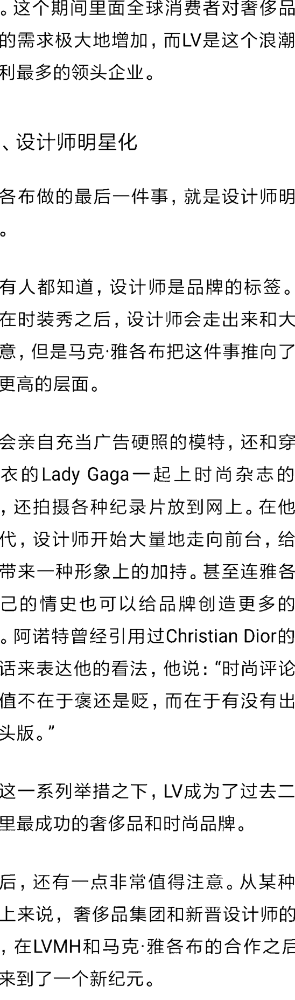

这项策略非常成功。过去十几年里，LV的销售贡献基本能占到整个LVMH集团整体的一半，而LV里面大部分的销售也是来自手袋及皮具的。如果进一步细分，帆布手袋很长时间能占到超过1/3。

后来有专家说，雅各布让LV跟上了这个时代，他所就任的16年是LV最重要的一段时期。这个期间里面全球消费者对奢侈品手袋的需求极大地增加，而LV是这个浪潮中获利最多的领头企业。

## 三、设计师明星化

雅各布做的最后 一件事，就是设计师明星化。

所有人都知道，设计师是品牌的标签。以往在时装秀之后，设计师会走出来和大家致意，但是马克·雅各布把这件事推向了一个更高的层面。

他会亲自充当广告硬照的模特，还和穿着内衣的Lady Gaga一起上时尚杂志的封面，还拍摄各种纪录片放到网上。在他的时代，设计师开始大量地走向前台，给品牌带来一种形象上的加持。甚至连雅各布自己的情史也可以给品牌创造更多的话题。阿诺特曾经引用过Christian Dior的一句话来表达他的看法，他说：“时尚评论的价值不在于褒还是贬，而在于有没有出现在头版。”

在这一系列举措之下，LV成为了过去二十年里最成功的奢侈品和时尚品牌。

最后，还有一点非常值得注意。从某种程度上来说，奢侈品集团和新晋设计师的关系，在LVMH和马克·雅各布的合作之后，也来到了一个新纪元。

之前雅各布是有自己的时装品牌Marc Jacobs的，而LVMH为了请他来，直接注资他的品牌，把雅各布的人和公司全部划到整个集团内部，就像是一种收编。所以现在，奢侈品集团经常做的一件事就是，趁一些年轻设计师还没能站稳脚跟，就投资他们或者把他们招致旗下，让他们担任集团下面某个品牌的艺术总监，最终再慢慢收编。听到这里，你有没有一些联想呢？

好了，这就是今天的内容。下期专栏，我们来介绍一个LVMH的收购案例，顺便讲解一些收购相关的知识。之所以要讲这个案例，不只是因为它的另一半参与者，也就是爱马仕太过有名，也是因为这是帝国制造者阿诺特为数不多的失败。

张潇雨

听完了今天的专栏，跟昨天相比，你对阿诺特的看法有没有什么改变呢？欢迎把你的想法写在留言区，跟大家一起分享，我们明天再见。

另外，为了帮你更全面地洞察商业，我为你推荐了一个书单，这些书在得到App里都可以听到，推荐你点下方的图片看看。

## 奢侈的逻辑 | 爱马仕收购战与“股权掉期”

奢侈的逻辑 | 爱马仕收购战...

近两周的专栏里，我们从奢侈品行业的诞生历史开始，探讨了奢侈品的定义、奢侈品行业的逻辑，又顺着LV的品牌历史，一路走到LVMH集团的成立和飞跃。

如果总结一下，奢侈品行业过去三十年的发展速度，可能超过了之前的三千年。这里面有经济、政治、艺术等等多方面的原因，当然也离不开LVMH如今的掌门人伯纳德·阿诺特的作用。

之前我们反复提过，在阿诺特领导下的LVMH，靠着大举收购奠定了现在奢侈品行业第一霸主的地位。但是，在LVMH的历史里，也有两次很重要的收购方面的失败。今天我们就先来说说第一个，并且借这个收购失败的案例，给你介绍一些基本的金融知识。

此次收购失败的案例，就是LVMH和爱马仕之间的一次精彩的收购战。这次收购战从2008年开始到2011年基本结束，蔓延了长达三年的时间，而且相信以阿诺特的性格，未来某一天还会卷土重来。我们来看看看当时发生了什么。

## I “一股清流” 爱马仕

首先简单地介绍一下爱马仕。

爱马仕（Hermès）在1837年由蒂埃里·爱马仕先生（Thierry Hermès）创立于法国巴黎，比LV还要早17年。爱马仕早年以制造高级马具起家，这从它们经典的马车logo上也能看出来。后来，爱马仕慢慢发展成了一个综合的奢侈品企业，其中爱马仕的包是最著名产品，像传奇的“铂金包”和“凯莉包”都在时尚界历史里有很特殊的位置。这家公司我们之后的专栏还会有篇幅提到，到时候我们会讲解爱马仕的更多细节。

关于爱马仕，有一个概念你要非常清楚。如果用个流行词汇概括的话，其实就是四个字：一股清流。爱马仕在当今的奢侈品界有着非常特殊的位置，在很多专业人士包括我自己的心里，它和LV、迪奥、Prada、Burberry等等这些品牌是完全不同的。

如果你读完了我们之前的专栏就会感觉到，如今的奢侈品行业已经变成大集团的资本游戏和营销游戏。奢侈品企业们为了扩张、为了更多的利润，会制造出各种概念和噱头，利用各种金融手段把小品牌纳入旗下，然后改造。这种手法本质上已经让奢侈品变得越来越像商品，而不是艺术品了。

但是在这股大潮里，爱马仕是那个独善其身的品牌：

+   直到现在，成立了180年的爱马仕还是由家族持股，至今已经走过了六代人——这是非常不容易的。
爱马仕不过度扩张，不强调利润，坚持在法国手工生产，不像很多其他品牌那样，在落后的国家设立工厂。
爱马仕在环保方面，比如怎样合理地使用动物皮等，也有更多比其他更多奢侈品品牌更高的要求。
爱马仕从不鼓吹奢华的生活作风，也不会做各种自眩神迷的广告，而是一直坚持自己成立以来高雅、克制的品牌理念。

这种风格在当今的奢侈品行业绝对算是“一股清流”了。所以，也正因为爱马仕如此特别，阿诺特一直非常想把他收编进LVMH。

## I 阿诺特的秘密出击

实际上，LVMH与爱马仕的渊源可以追溯到上世纪80年代。

当时酩悦·轩尼诗集团的舍瓦利耶买过爱马仕15%的股份，所以后来它和LV合并之后，股份自然就归了LVMH集团。不过后来爱马仕因为要上市，去找阿诺特要求买回股权。当时阿诺特忙于重组LVMH，还顾不上爱马仕，所以在1993年，LVMH就同意了爱马仕的要求，把股份卖了回去。不过等到这个世纪初开始，阿诺特突然又发现了爱马仕的好，所以又开始秘密收购爱马仕的股份。

这里，要补充两个重要的背景知识：

第一，爱马仕是上市公司，但是整个爱马仕家族仍然占有超过70%的股份。有意思的是，这70%多的股份分散在爱马仕家族200多位成员的手里，没有一个单一继承人持股超过5%。

第二，当我们收购一家公司股份的时候，不管是哪个国家的哪个证券交易所，在你买到一定数量的时候都是要求披露的。这个线一般是划在5%。也就是说，如果你买一个公司的股份，买个1%-2%，是不用告诉任何人你买了这些股票的；但是一旦过线，比如买到5%，就要公开发布你买了这家公司股票的信息，这也是股票的透明性原则。当然，每个国家的具体法律规定不同，有时侯比5%更高一些。但在爱马仕这个案例里，这条线是5%。

所以大概从2001年开始，阿诺特就成立了公司，开始秘密地收购公开市场上爱马仕的股份，等到了2008年，他的手里有4.92%的爱马仕股份。这个时候，因为低于5%，他是不用向任何人公开自己的持股情况的。

然后在2008年下半年，阿诺特利用了一个金融的招数。他和三家投资银行签订了一个叫做“股权掉期”的协议，协议的对象就是爱马仕的股票。这三份协议总共涉及的爱马仕的股份有17.1%。

那么什么是“股权掉期”，这份协议是什么意思呢？

> “股权掉期”的英文叫 “equity swap” 。 “swap” 这个词的直译其实是 “交换”。 “Swap掉期” 是金融界一个个术语，在当今的金融世界已经是非常常用的一个工具。

“股权掉期”，其实说白了就是：LVMH集团和三家投行签了个三个赌约。内容十分简单：如果赌约到期的时候，爱马仕的股票价格达到了某个价位，LVMH就把投行手里的股票买下来；如果没到这个价位，它就不买了，但是要付个手续费。

大家心里可以有一个底，就是金融确实术语非常多，有时候听起来云山雾罩的，但其实根本原理其实都并不复杂。下期的专栏里，我们还会讲到股权掉期（equity swap）之外的另外一种掉期一信用违约掉期（credit default swap），简称CDS。这东西就是导致2008年金融海啸的罪魁祸首。

所以本质上，这里的swap是一个“权利”。就是我花点小钱，也就是手续费，和你购买一个权利，这个权利可以确保我在未来的某一天，能够以某个提前约定的价格来买到我想买的股票。

说回爱马仕的交易。当时阿诺特设置的这个“股权掉期”，还有一个绝妙的作用，就是它实际上利用了一个法律漏洞——如果你直接买爱马仕的股票，超过了5%就要公布给大众，但是用这种设计出来的金融产品买爱马仕的股票就不用披露，而是得到这个合约真正执行那一天才需要披露。这就给了阿诺特暗中布局的时间和机会。

结果到了2010年10月22日，这三笔合约有两笔到期，LVMH一下就买到了980万股爱马仕的股票；两天之后的10月24日，第三笔合约也到期，LVMH又吃进了300万股。仅仅三天时间，LVMH就买到了爱马仕17.1%的股份，这时候他立刻向法国证监会进行了披露。不过加上之前就有的4.92%的爱马仕股份，LVMH手里的股票已经有22.02%了。

刚才我们说到，爱马仕家族虽然一共有超过70%的爱马仕股份，但是这些股份分散在爱马仕家族200多位成员的手里，没有一个人持股超过5%。所以LVMH22%的持股让整个爱马仕非常紧张。

当时，爱马仕的家族成员完全是措手不及。后来报道中有一个细节很有意思：当时爱马仕的一个家族成员雷诺德正开着车去看橄榄球赛，居然听到车里的电台播报：LVMH的阿诺特已经收购爱马仕超过20%的股权，结果车上所有的人都惊呆了。

还有一个细节也很有意思：爱马仕的曾孙女朱莉是在10月23日上午得知的LVMH准备恶意收购爱马仕的消息。当时她还在罗氏柴尔德银行工作，而且她已经在这家投资银行工作了12年了。但罗氏柴尔德银行正好是三个帮助阿诺特收购爱马仕的银行之一。结果朱莉得知这个消息之后，立刻辞了职。

辞了职。

## Ⅰ 爱马仕的反击

当然，爱马仕不可能坐以待毙。他们针对这次恶意收购展开了反击。

首先是利用法律的武器。

爱马仕集团受到恶意收购之后，向巴黎检察院递交了诉状，控告LVMH通过“内幕交易”、“合谋”和“操纵股价”等非常规手段增持爱马仕12%的股份。并且要求LVMH把已经获得的股份脱手。法律手段也算是一种金融集团或者企业之间开战的常规手段了。

另外在12月3日早晨，大概50个爱马仕家族的成员在极为秘密的情况下在巴黎开了一个会。只有一小部分家族成员预先知道会议的具体地点，大家都被告知先到附近的一个律师事务所集中，然后再乘车前往。举行会议的房间事先进行了防窃听处理，会议现场没有留下任何纪要，连参会成员也被要求在进入房间之前交出自己的手机。

在那次会上，参会的爱马仕家族成员一致同意将公司50.2%的股份通过一种严格的股权托管方式进行锁定。

按照这个计划，这50.2%的股份在没有得到75%以上比例的家族成员同意的情况下，禁止向外出售。另外，整个家族的股份里还留了一小部分没有锁进去，目的是为了给家族成员一定的减持套现空间，但一旦家族成员出售这部分股份，家族的股权托管基金将享有优先的购买权。这个安排就保证了，即便之后人们打算出售公司股权，要想达到75%以上的家族成员同意也至少需要几十年的时间，因为已经有50位家族成员的股权被锁定了，如果要说服他们卖掉，也只能等他们死后去说服这些股权的继承人了。而在这个时期之内，爱马仕会一直处于家族成员的控制之下。

而到了2013年，在经过一系列的联邦调查、诉讼和反诉之后，LVMH和爱马仕最终达成了和解协议。结局是，LVMH赔偿爱马仕800万欧元，并在未来5年内不能购买后者任何股份，法院判定LVMH集团将已持有的爱马仕23%的股份降低至8%。也就是说，一贯战无不胜的阿诺特也经历了他收购历史上为数不多的失败。但谁又能保证之后他不会再卷土重来呢？

在今天的专栏里，我们介绍了阿诺特收购爱马仕的这个案例。其中有两个金融方面的知识，我们在下周的专栏里会给大家做进一步的讲解。第一个就是CDS信用违约掉期，我们会利用2008年金融危机的案例来讲解和巩固一下关于“掉期”这个金融产品的概念；另外，我们也会花点时间来解释一下公司遇到恶意收购的时候常规采用的手段都有哪些，如果你对之前万科和宝能的收购与反收购大战有印象，那也会是我们讲解的重要案例之一。

张潇雨

阿诺特这次收购的失败又给你带来了哪些启示呢？欢迎在留言区写下来，和大家一起分享。

## 周末互动｜该说商业“无情”还是“无意”？

周末互动｜该说商业“无情”还是“无意”？

你好，欢迎来到《商业经典案例课》。我是张雨雷。又到了周末互动的时间了。

本周我们继续了奢侈品行业的专题，经过两天的讲述，相信你对这个行业整个的发展历史和当前的格局应该有了更多的认识。尤其是过去的这二十年时间，以阿诺特领导的LVMH集团开始大肆整合各种奢侈品和时尚品牌，把之前这个行业里手工作坊式的、家族制的、强调历史传承的品牌，带到了批量的、流水线化的、依靠职业经理人的新阶段。

我看到很多同学都对阿诺特这种做法做出了自己的评价，我举两个典型的例子：

从阿诺特这里，我感受到了资本的残酷，也明白了眼光是多么的重要。如果没有阿诺特的无情收购，那么就不会有如此庞大的LV体系坐在这里面前。我还记得扎克伯格的收购策略，我由衷地敬佩扎克伯格的眼光，能想到未来的几十步，那时候如果扎克伯格不收购那些企业，也许他的帝国走不到今天。所以LV收购案让我明白，现实是残酷的，但是不经历这一步，又怎么会见彩虹。更何况如果阿诺特不用这种手段，保不齐别人也会用这种手段来获取这个者待侍。

读昨天的专栏，阿诺特的形象是一个不讲信用的强盗；读今天的专栏，阿诺特的形象是一个商业天才；他把LV奢侈品牌推向了大众，消费者因用了LV，从而自身体得到了身分认同，而阿诺特从中获得了大量销售额，双赢的策略。不管是明星同款，品牌的传染性，还是狂奇广告，阿诺特都非常善于把人性转化成商业价值。他绝对是一个伟大的商人，顺应了人性，也顺应了历史潮流。在听这篇文章的时候，就已经在暗暗欣赏他了。

这里我想来做个总结，其实我觉得大家说的是一个道理：商业是无情的。

对这里的“无情”当然要做个说明，我觉得它既不是褒义词，也不是贬义词。《道德经》里有一句很著名的話：

> 天地不仁，以万物为刍狗。

说的就是，天地间的道理论、真理，是“不仁”的，它并没有某种善恶或者偏好或者取向，而只是按照自己本来的规律运行。换句话说，世界既不是善意的，也不是恶意的，它是无意的。这里的“无情”我觉得和《道德经》里的这层意思非常类似。

### 举例1-阿诺特

比如你想一下，阿诺特为什么能够成功收购这么多品牌？包括后台也有同学问：难道大家都知道阿诺特这种激进的、不讲任何情理的做法事风格，不会离它远一点儿吗？为什么还要上他的当？

### 举例2-共享单车“坟场”

之前我看到一则报道，说的是现在很多城市里面都有共享单车的“坟场”。就是在一大片场地,上,停着非常多辆报废的共享单车，非常壮观，也让人啼笑皆非。

后来我的朋友也看到了这个报道，他问我：你怎么看这件事？我說，这简直是注定要发生的。逃都逃不掉。

为什么这么说呢？之前我们在讲风险投资（VC）行业的时候提到过一个词叫FOMO，全称是 fear of missing out，意思就是“害怕错过”。当时我们说：

一只风投基金的回报，也就是业绩几乎只由投资最成功的那么两家公司决定。也说，如果你投资了100家公司，很可能有两家表现非常好，变成了Facebook或者Airbnb，那还有七八家还可以，中等规模，或者被大公司收购了，剩下90家可能都死掉了，也就是亏钱了。但最重要的是，你要投到那一两家最好的公司。

这就是我说的，商业是无情的。所以，阿诺特是对是错，对奢侈品行业的功过如何，只能留待后人评说了。

当然，我们说“商业无情”，重点是在强调要理解商业运行的独特的规则，而不能以普通生活里面的道德和善恶去衡量它。这样我们才能更好地理解这些公司的各种行为。但是，这绝不意味着作为社会的一员，企业不应该承担它有的责任。而恰恰相反，正因为商业无情，我们才更应该从

相反，正因为商业无情，我们才更应该从人性和提高整个社会福利的角度去引导商业、创造价值。这才是更正确的做法企业的方法。

最后，我再多说几句。

最近，吴军老师在他的专栏里也在谈奢侈品，而且用了7封来信的篇幅，从奢侈品的诞生、民主化、聊到了奢侈品定价和传奇故事，在其中一封来信中，吴军老师，谈到了奢侈品的销售秘诀。我读了之后呢，很有启发，而且刚好是咱们专栏的补充。征得吴军老师的同意，我把这封来信的链接贴在了下面的推荐阅读里，推荐你看一看。

第303封信 | 奢侈品的光泽(5)：奢侈品的销售秘诀
苹果 | 风险投资的历史与哲学

## ——▶ 本周留言精选 ◀——

## 奢侈的逻辑 | 奢侈品行业的功臣——日本

通过学习今天的专栏，我发现日本现在的崇尚自然简约的生活方式是因为曾经这样奢侈过，物质得到极大满足以后开始追求精神上的需求。都是按照马洛斯需求来的，商业的发展过程就是人性的表现。

买买买的背后，是炫耀性消费成为了一种刚需，把爱情与舍得花钱挂钩，用一种变相追迫的攀比，激发年轻人的消费欲。年轻人毕竟存款有限，这样就会背上沉重的债务，而良好的金融设计让借钱变得很容易，这样一个金融业务的闭环就玩得转。感觉就是，有钱很多时候是一种感觉，存款不决定消费，能掌控多少钱才决定消费。借来的钱像是‘自己的钱’，这一认知上的偏差的形成，让泡沫被吹越越大，资本的不理性，消费者的狂欢，危机愈加明显乃至爆发是必然的结局。

我在想，人或许就是需要有所追求的，不管是什么样的追求。追求奢侈品也是一种追求，何况日本具备消费它们的基础和条件。制作精良、工艺精湛的奢侈品的品质和体验有保障，或许‘回不去了’，不再愿意去消费非奢侈品，除非不具备条件消费它们，或是有了别的追求和理念作为取代和转移。追求的背后是欲望，追求真知、追求梦想、追求美好、追求爱情、追求自我实现、追求平淡淡淡的幸福生活……各种各样的追求，因为有欲望似乎才‘活’人，有一种存在的表达和释放？

放眼周围，喜欢奢侈品的女生自然数不过来了。按照我对她们的观察，可以提取一些共性。有些女生，手挎一个抢眼的包包，当别人无意地摩擦到她的包包，或者当没处安放包包只得委身于椅脚边时，她脸上有一种难以掩盖的无奈和心疼；有些女生，买了一大堆奢侈品自然很开心，当开心与周围人分享，全身心浸泡在大家羡慕的眼神里，这样的满足感溢于言表；还有一些女生，才是奢侈品的真爱，不会在商家的货架前乱了阵脚，了解自身需求，享受着低调的奢华。在我眼里，奢侈品的可得性与购买力息息相关，而与奢侈品的相处，则与内魅力境界密不可分。

## 奢侈的逻辑 | LV的雷卡米尔时代

雷卡米尔的渠道整合和多元化资本运动开启了路易·威登的国际化，这应该就是与时俱进，开拓创新吧。由此翻开了新的发展篇章，真是英雄造时势！路易·威登的起家靠的是创业者的工匠精神，而雷卡米尔则处于低谷的家族事业注入了商业思维则带来新鲜血液。创业容易守业难，不但要剋制内忧，还要提防外患，真是商场如战场。

## 奢侈的逻辑 | 奢侈品行业的阿诺特时代

2003年-2009年，哈桑是美国先灵葆雅制药公司的CEO，由他和他的团队主导了先灵葆雅与美国默沙东制药的合并。而且是十分复杂的所谓逆向合并。这样做的好处就是为了保证合并之后的企业能够继续维持对一项新进上市的重要药物的代理销售权，并最终完成“使命”。2010年，在离开默沙东之后，他进入博士伦公司，做董事长。当时，博士伦已经被投资公司华平收购。然后，就是2013年博士伦被售价85.7亿美元出售给了加拿大凡利亚药国国际 (Valeant Pharmaceutical International)。然后，哈桑离开了。现在，他到了华平投资干活。一路走来，哈桑的表现就是进公司，做价，找下家，出售。其本人肯定是收益颇丰的。然而，被出售的公司里却有大批普通员工因为岗位重复利用等原因不得不离职。或许，从运行层面上，这些操作是有利于行业发展的，但是对原来所在的公司，真的是件好事吗？

跟着老师学习奢侈品的历史有一段时间了，今天在阿诺特这里聚焦了。从我自己学习的第一手感受而言，阿诺特就是一个了不起的商人，因为他理解了商业的本质。也许他所表现出来的那些行为举措是被世人所诟病的，但是从结果上来看：他才真正将奢侈品行业带入了现代商业的轨道并稳定运行。凡是自己经营过几个企业的人都了解一种感受：商业的运营其实有它自己内在的生命力，有很多时候这种生命力跟我们的人性是冲突的，而作为运营者，你最好顺应它而违逆人性。就好似很多杰出的艺术家经常说的：“它就在那里，只是通过我的眼睛和手把它展示出来而已。”敬阿诺特，了不起的商人，历史会给他正确的评价的。

我在阿诺特故事里看到他：1.强烈的饥饿感。2.清晰的愿景。3.具体的行动策划。这三点对任何一家企业和个人来说都是非常重要的。

看似不厚道的扩张方式可以屡试不爽，并不是因为不厚道而成功，而是之前所谓承诺只是给经营不善的待收购公司的一针安慰剂，之所以能够达成收购，可能这对当时的被收购公司来说是最好的选择。

联想到了王皇后为了压制萧淑妃而将武则天接回宫中的另一段引狼入室史。我想对阿诺特的评价跟武则天一样都是褒贬不一的，尽管手段不厚道，但毕竟都缔造了一个改变历史的辉煌时代。是好人坏人不要紧，重要的是在身处 vase  the  conditions and environment changes choose and how in the fate of the flood to grasp the opportunity etc. these are worth our research analysis. 商业真像人生的浓缩，精华都是“说不准”。

## 奢侈的逻辑｜天才设计师与奢侈品集团新纪元

用现在 的眼光看过去，用未来的眼光看现在，就是要找到真正的变量和不变的东西，以至于让我们从繁盛和演绎中找到做更少的事和更重要的事直至成事的道理。

一个常胜将军在己方士兵眼里就是战神，在敌方士兵眼中就是恶魔。

格局的区别，雷卡米尔能保证LV活下去，但是阿诺特才是真正可以缔造商业帝国的人。只能感叹，商业的残酷，永远不能掉以轻心，随时有比你厉害的人在等着你的漏洞。就绪艺术品投资会有3D（死亡Death、离婚Divorce、负债Debt）原则一样，好东西同样都会被人觊觎。也是好东西应得的吧！

昨天的课程里边感受到阿诺特是个冷酷无情，嗜血成性的商业大鲨，今天的课感受到他确实是一位商业奇才，能够把LV这么一个逐渐淡出的品牌，通过“品牌传奇、狂打广告、倚靠明星、捧设计师”四位一体的战略起死回生、雄霸全球，阿诺特个人的努力和远见确实功不可没。令人感叹的是：艺术仅仅是艺术，但是艺术要商业化、全球化，没有一个商业奇才为了个人利益去强力驱动，是根本无法去完成全球布局，实现营销奇迹的。

## 奢侈的逻辑｜爱马仕收购战与“股权掉期”

爱马仕家族对LVHM恶意收购事件两点印象深刻：1.爱马仕家族成员的理念清晰，深知家族团结，保持家族绝对控股权这事维护爱马仕一股清流的信念、独善其身的品牌，是爱马仕长期发展的秘诀；2.法国的法律体系及社会对契约的遵守如果缺乏契约精神，即使爱马仕家族成员签署共同进退协议，部分成员依然可以私自向LVHM转让股份；根据合同法，只有LVHM不知道禁止转让股份的内部协议存在，就有机会以善意第三人身份要求受让股权，这样可是破坏爱马仕家族内部协议。然而这未发生，爱马仕家族成员具有可敬的契约精神，未看到无所不用其极的恶意并购行为，LVHM也是守规矩的。

为爱马仕家族点赞，“一股清流”让人感觉是一股暖流，这篇文章分析漏洞，分析漏洞的漏洞太有意思了，让人警醒，值得一读，更值得思考！大爱！今天还听了王煜全的“前哨问答”，孙正义在这方面做得好，现摘录如下：“一是重视，孙正义说iPhone是明治维新时的火枪；二是建立信任，熟悉对方的商业规则并让对方相信自己会遵守，时间长了就会信用；三是布局，让对方相信你买了他的业务后会发扬光大。”

这让我想起了“周知”里讲的，万科如何对付“野蛮人”——恶意收购的资本。其实这是成熟的企业或者说是家族企业面对传统恶意收购的反击和抵制。之前LVMH不够成熟的金融操作模式和偏传统的经营策略无法抵挡商业化，大资本的侵蚀和恶意收购。爱马仕这种70%股权在家族手中，而且<5%是这次没有被迅速收购的前提条件。后期的股权管控锁定都是建立在此基础上，包括留一部分股权在手可以方便套现，优先购买权。其实这是一个家族企业保证“血统纯正”的经典范例。不过现在我们在面对资本市场既要拥抱又要防备，尤其是当我们面对资本市场恶意收购时，需要留一手。

收购与反收购，需要反应迅速，除了在被收购之前就严格控制持股之外，在被恶意收购后立马用最有效的方式来挽回。毕竟，经营一个大公司，很重要的内容是规避风险。

## 奢侈品与金融 | 什么是“掉期”？

在前两周的专栏里，我们借着路易·威登也就LV的发展历程，系统地梳理了一下奢侈品行业的整个历史和driver。这1周，我们会借由奢侈品行业的一些案例做一些金融知识上的延伸。然后从下周开始，我们会介绍一个反奢侈和反消费的品牌——无印良品。接下来的两周内容听完之后，你应该对消费品这个行业有一个非常清晰的理解框架了。

上周五的时候我们介绍了一个案例，是LVMH收购爱马仕失败的一个经典案例。在里面我们提到了两个比较重要的知识点，一个是“掉期”（swap）这个金融产品的特性；第二个是公司遇到恶意收购时候的应对方法。在这周的专栏里，我们把这两个知识点给你做一个更深入的讲解，为我们之后讲金融和华尔街的案例做一点铺垫。

今天我们就先来说说“掉期”（swap）这个金融产品的相关知识。

### | 信用违约掉期

上期专栏我们讲到，LVMH的阿诺特用“股权掉期”（equity swap）偷偷地准备收购爱马仕。这个“股权掉期”的本质就是：LVMH集团和三家投行签了三个赌约。内容十分简单：如果赌约到期的时候，爱马仕的股价价格达到了某个价位，LVMH就把投行手里的股票买下来；如果没到这个价位，它就不买了，但是要付个手续费。

所以本质上，swap就是一个“权利”。我花点小钱——也就是手续费——向对方购买一个权利，这个权利可以确保我在未来的某一天，能够以某个提前约好的价格买到我想买的东西。在这个案例里，这个“东西”就是爱马仕的股票。

上周我们提到过，还有一种掉期产品叫信用违约掉期。再弄懂了这个产品，你对掉期的理解会更深一些，接下来我们就介绍一下信用违约掉期。

信用违约掉期，英文是 Credit Default Swap，缩写是CDS。如果你对2008年的金融危机有印象，CDS就是导致整个金融市场崩溃的一个主要产品。

### | 世界上第一笔信用违约掉期交易

在上个世纪80年代的时候，美国的埃克森石油公司，有一艘运输原油的大型轮船发生了泄漏事件，结果导致了公司的财务危机。这时候，它们向当时一直合作，关系很好的摩根大通银行寻求48亿美元的贷款来救急。

### | “掉期”产品的三大特性

- 一、交易双方对交易对象的看法不同
- 二、管理风险
- 三、可以无限生长

### | 总结

- 1. 交易双方对交易对象未来的看法不同。有人看好，想买，有人看坏，想卖，在这种情况下交易才会发生；
- 2. 能帮交易者管理风险。

张潇雨

## 奢侈品与金融 | CDS与金融危机（上）

上周我们讲了一个概念叫“股权掉期”，是一种金融工具。忘记了的同学可以点击文末的链接，复习一下。昨天我们又介绍了“掉期”的另一种，叫信用违约掉期，简称CDS，还讲解了世界上第一个CDS是怎么被设计出来的，错过的同学可以看看昨天的文章。后来我们说，CDS是造成2008年全球金融危机一个非常直接的原因。

当然，2008年全球金融危机是一个非常复杂的案例，CDS这个金融产品在其中起到了很重要的作用，但是我们都知道，任何大的错误和灾难，都是无数因素复杂地交织在一起之后产生的。所以今天和明天，我们就借着金融危机这个案例，来研究学习一下当时金融危机发生时的一系列因素。同时我们也会讲解一些非常关键的金融知识和概念。之后，在咱们讲到华尔街专题的时候，我们还会再来复习以及延伸，帮你完善整个框架。

今天，我会为你讲解四个金融相关的概念，明天我会再讲四个。把这八个概念串联起来之后，你就会对2008年的金融危机，美国金融和证券市场的基本特征，以及金融的基本概念有所了解了。

### 一、次级贷款（Subprime Loan）

你可能知道，2008年金融危机的别名也叫“次贷”危机。这里的“次贷”就是“次级贷款”的意思。

所谓的次级贷款（subprime loan）其实不难理解。大家都知道美国是个信用社会，所以在贷款的时候会根据信用分数来划分级别，一般就是高、中、低三级。最高级就是那些信用好、收入稳定可靠、自己偿债情况非常合理的优良客户；而最低级就叫“次级”，就是那些收入证明缺失，或者负债很重，或者过去有过各种违约记录的，最难贷到款的人。而中级也就是介于两者之间的。

2008年的金融危机的一个重要爆发原因，就是银行和各种金融机构把太多的钱借给了信用级别最低的这个群体，最终他们还不上这些钱，引发了一系列的连锁反应。

### 二、可调整利率贷款（ARM，Adjustable Rate Mortgage）

那你可能要问了，为什么要借钱给这些人呢，难道金融机构不知道风险么？本质上，还是因为贪婪。

当时的情况是这样的：
差不多从2000年的互联网泡沫破灭开始，美国经济开始走弱。所以美国的政府机构美联储为了提振经济、降低失业率，就开始多次降息。本来泡沫之后股票就处于低迷期，而利息再降下来之后，像债券这种产品的收益率也不高了，所以大家手里的钱就没有什么地方投了，结果就转向了低迷很久的房地产。

所以从2000年到2006年这一段时间里，美国的房价开始猛涨。能贷到款的优质人群基本上都贷款买房了，但是市场里还是有很多钱，又没有什么好的投资对象。这时候，大家就开始盯上了次级市场里面的这些用户。而且美国政府这个时候也在给放贷款的金融机构施加压力，希望他们可以放宽贷款的标准，能发放更多的贷款给那些低收入的、信用不好的人群，让他们也能买房，这样能够刺激经济。而对于贷款的这些金融机构来说，反正有钱挣总是好的，于是那段时间里，它们就发放了大量的次级贷款。

而且，为了把贷款的门槛降低，美国这些机构也是尽其脑汁。比如当时有个著名的可调整利率贷款（Adjustable Rate Mortgage），简称ARM，也就是我们今天要介绍的第二个概念。

这个概念什么意思呢？我之前说过，金融行业里面有大量的术语和名词，不是这个行业里的人经常听得云山雾罩的，但大部分东西的原理其实都不复杂。

比如这个可调整利率贷款ARM，其意思就是说：为了照顾你穷，当你借贷款买房的时候，前几年先给你一个很低的利率，比如1%~2%，让你少点点利息；等过了三年或者五年甚至七年，利率再一下涨上去，比如一下跳到8%或者10%。这样有一种引诱次级人群来贷款的效果。

我们在这里可能觉得这个是自欺欺人，但在当时市场很热的时候，大家是不在意这些细节的，赶快借钱买房才是最重要的事。

当然，这些向外贷款的金融机构也有一些设计。在开始几年贷款利率低，可以吸引更多的人来借钱买房；等到过了几年，利率一下涨上去了，有一些人还不了钱了，违约了，那么贷款公司只要收回这个作为抵押品的房子然后卖掉，就能弥补损失了。甚至还能赚钱。究其原因，还是因为那个时候市场一片大好，谁也没有想到美国的房地产市场后来能够跌掉一半。

现在回忆起来，那是一个疯狂的时代。想象一下，一个拿着很低工资、勉强过活的人，上午走进房贷公司，不需要提供什么担保，下午就可以获得贷款买房。甚至还能0首付。这是非常可怕的。

### 三、资产证券化

所谓的资产证券化，就是把资产变成证券，然后进行交易。这是什么意思呢？
比如在刚才贷款买房的例子里，金融机构借给一个人一笔贷款，假设借了100万美金，20年还清，最后连本带利息要120万美金。这时候，相等于这个金融机构就有一个资产，这个资产就是这笔120万美金的债权。

你知道，人都是非常会图快挣钱的。比如这120万美金是挺好，但是都是收上来得20年以后了，所以这个金融机构就想，有没有可能马上把这笔钱收上来呢？

这个时候，它就可以做一个“资产证券化”的处理。比如，它直接把这笔120万美金做成一个产品，以108万美金的价格出售。这个时候，就有人可能想买这个产品了——因为明显这里面有个差价，也就是投资收益可以赚，只要这笔钱最后能收上来，自己就赚了。

所以，这笔债权就变成了一种证券，或者说是金融产品，可以进行交易和买卖了。

在这笔买卖中，贷款机构很开心，因为它直接拿到了108万美金的现金，而且一这个人未来违约了，还不起钱了，和自己一点关系也没有了，因为风险已经转嫁出去了；而买这个产品的人呢，本来钱也要做投资，正好可以投在这里获得收益，虽然有风险，但是可以承担。

所以在这里，我们可以看出资产证券化的本质是什么：它就是把一些有未来潜在收益的资产，或者说未来能够带来现金流的东西——比如房贷、学生贷款、商铺厂房的租金收入，甚至专利或者图书版权的收入——打一个包，瞬间变成一个可以现钞的、能随随便便交易买卖的东西。而在这个过程中，风险是不断流转的。简单粗暴点说，这就是一个不断“甩锅”的过程，最后到谁手上爆炸了，那谁就要承担后果。所以在这个交易市场的形成过程中，大家都会根据自己的情况给这个资产打包价，为自己负责，最后就形成一个所谓的市场价格。

另外你可能觉得，买这个产品的人听起来风险有点大啊。其实，在真正打包和包装的过程中，被打包的资产常常是各种各样东西非常复杂的组合，到最后大家都只能用非常复杂的数学公式才能计算这个资产包的价值了，并不像一个人单纯借贷款那么直观。所以不夸张地说，很多时候金融市场上市流动的很多金融产品，连买卖双方自己也不能完全确定到底是什么东西。

### 四、信用评级机构

金融市场里有一种机构叫做信用评级机构，最有代表性的就是美国的三大评级机构：穆迪、标准普尔和惠誉。

所谓评级机构，可以简单理解成给各种资产来打分的机构。他们设立了一整套给各种资产打分的算法和系统，来评估政府、公司以及各种机构各种产品的偿债能力和偿债意愿，也就是风险有多大。评级机构是一个金融市场的基础设施，帮助投资者和资产之间形成一个很好的参考，促进一种比较公平的价格。所以，评级机构最重要的就是公信力。

一般来说，评级机构的打分分为很多级。最高级就是AAA，比如美国国债就是类似

最高级就是AAA，比如美国国债就是类似的评级，评到这种级别，意思就是风险非常低，几乎没有违约风险。再往下，还有AA、A、BBB、BB、B，一直到C。

但是在这次金融危机里，美国的三大评级机构的影响非常不光彩。因为它们给很多本质上风险非常高，甚至在市场里被称为“垃圾”的产品打出了AAA的评级。究其原因，还是因为当你在江湖上行走的时候，难免不受他人的影响。所以对很多事也是睁一只眼闭一只眼了。而且评级机构这么多，你不做别人就会做，这样你不但得罪人，还失去了客户。所以最终，大家明明都知道这样做不对，但考虑到里面的利益关系，最后还是把一些很糗糕的产品伪装成了AAA评级，最终导致了整个系统的崩溃。

另外还有一个小的背景。之所以评级机构在整个链条里非常重要，是因为很多大型的，尤其是国有的金融机构，在政府监管规定下是必须有多少比例的钱是配置在评级三A这种风险比较低的产品上面的。比如那些退休基金、政府基金、保险基金等等都有这种要求。所以你要真是直接把这些次级贷款拿出去，可能连BBB的评级都没有，就没法卖给这些钱又多，审核又没那么严格的金主了。所以玩家们就要把评级机构也拉下水，一起把这个金融游戏玩下去。

但是，评级机构再不作为，也不能直接把风险这么高的次级贷款打一个AAA的评级。这时候，聪明的银行家们就入场了，他们使用了一系列复杂的手段，把这些垃圾包装成了黄金，最终导致了市场的崩盘。

那么下期的专栏里，我们就来介绍两个在这次金融危机里面起到关键作用的产品，CDO和CDS，以及另外两个重要的金融学概念。

奢侈的逻辑｜爱马仕收购战与“股权掉期”

张潇雨

听完了今天的专栏，你可以问问身边非金融领域的朋友，知不知道什么叫次级贷款、可调整利率贷款、资产证券化，以及信用评级机构是怎么回事呢？如果不知道的话，可以把这篇文章分享给他，一起学习一些金融知识。

# 奢侈品与金融 | CDS与金融危机（下）

昨天我们讲了金融学的四个重要概念，今天要讲另外四个。然后，我会把整个2008年金融危机的发生过程做成一个串联，算作两天金融危机小专题的一个收尾。

上期专栏我们说到了次级贷款的定义，还有金融市场很喜欢做的一件事情就是把资产证券化，然后进行各种交易买卖，以及评级机构可以根据自己的方式给各种证券化的资产来打分评级。

上次我们说，在2008年这次金融危机中，很多本来是风险很高的金融产品，却被金融机构评成了三A级。而且我们也说，评级机构再配合，也不能直接把风险这么高的次级贷款产品打一个AAA的评级啊。

所以这时候，银行家们的“聪明才智”就要发挥作用了。今天我们就来看看，他们到底设计出来了一个什么样的产品，让评级机构打了高评级之后，卖给了各种各样的投资者。

## 一、担保债务凭证（Collateralized Debt Obligation，简称CDO）

CDO（担保债务凭证）其实很早就有了，但是在这次次贷危机的时候被做到极致。

所谓CDO，其实是各种不同类别、不同评级的产品打成的产品包，而CDO指的就是这种产品包。本质上，它的做法是这样的：

一般的资质优良的贷款，违约率可能在5%甚至更低，而次级贷款，违约率可能在30%，风险会高一些。所以愿意买这种产品的人肯定很少。那要怎么包装次级贷款产品呢？

## 二、信用违约掉期（Credit Default Swap，CDS）

有了CDO，可以说万事俱备只欠东风了。为了证明这些华而不实败絮其中的CDO确实可以买，华尔街还要给它再上一层复杂的保险，那就是我们之前介绍过的信用违约掉期，CDS。

CDS的作用主要是用来把风险转移。比如，你现在手持一个CDO产品，觉得心里有点慌，害怕最终这些钱还不上。这时候你可以给自己上个保险，拉来一个第三方，然后固定地每一段时间付它一笔保费，如果这个CDO违约了，这个第三方就得把CDO没还上的钱赔给你。当然如果没有事发生，它就白赚一笔保费。

## 三、杠杆

所谓杠杆，其实基本等于借钱来放大自己的收益。比如：

你现在有100块钱本金，买了一个理财产品，一年以后赚了10块钱，收益就是10%。但是你觉得这样太慢了，于是你去借了900块钱，利息是1%。一年以后，按照收益10%计算，连同之前100块钱本金，你现在手里就有1100块钱了。这时候，你可以把你欠的钱连本带息909块钱还掉，还可以剩下191块钱。也就是，相比本金100元，本来你不借钱，收益是10%，但是借钱以后，这个收益就被放大成了91%。这个过程就是所谓的利用“杠杆”。本质上我们买房的时候贷款，也是加了杠杆。

到现在，所有的因素已经完备—次级贷款被包装成金光闪闪的CDO，加上无限制加的杠杆，以及虎视眈眈的CDS，只要美国房地产市场开始出现违约，就可以出现连锁式的崩溃。

到了2006年，这个循环终于开始启动了。

首先到了2006年的下半年，很多次级贷款的低利率期到期了。也就是我们之前提过的，次级贷款开始几年的利率优惠期截止了，贷款的人面临着高额的月供，于是，第一批因为无力偿还贷款而被没收房产的贷款者出现了。

接下来，贷款机构需要把没收的房产放到市场上去卖掉来覆盖损失。于是市面上出现了大量需要卖掉的房子，结果供给一多，房价就开始下跌。

## 四、无追索权

这时候我们要介绍的最后一个概念要出场了，就是无追索权。

所谓的无追索权就是说，如果贷款人无力偿还贷款的话，机构除了能没收抵押的房产以外，是不能收缴他的其他个人财产的。

这个机制看起来非常人性化，但是有一个巨大的漏洞。

比如你之前贷款100万买房（假设没有首付），还款期5年，每年还20万。两年过去了，你还了40万，还剩60万没有还。但是现在房价跌到50万美元了，而且看起来还要继续跌。所以在无追索权的情况下，很多人就干脆放弃房子，不去偿还贷款了。因为用60万买一个价值50万而且可能还会跌的东西就太不划算了，而且本来很多这样贷款买房的人也是信用记录不太好的人，他们也无所谓。

结果，这又导致了贷款公司新一轮的坏账。于是，这些房子也被收缴然后放到市场上销售，结果供应进一步增加，房价进一步下跌。于是第三波的坏账产生……最终，这形成了一个恶性循环。

你应该还记得，CDO的本质就是把这些次级贷款给打包成了金融产品，结果大量的违约导致大量的CDS需要赔付，再加上杠杆效应，很多大型的金融机构都因为CDO和CDS大型亏损，甚至破产。国家不得不出手救助。你听说过的AIG保险、贝尔斯登投资银行、美林证券等等都曾因为这样的浪潮几乎覆灭。最终，这一连串的反应就变成了2008年开始的全球性的金融危机。

张潇雨

相信听完今天的内容会有一个感觉：整件事情很荒谬。明明看上去是风险那么高，那么不理性的事，可是在我们眼中那么理性的金融机构却在做，而且不是一家两家，而是整个金融市场都在这样做。前面我们也说过，这是人性造成的。那么在你看来，是什么让这些人不可避免地同时做出荒谬的行为呢？类似的盲目跟风在投资界等等其他领域是不是也发生过呢？

# 奢侈品与金融 | Gucci的惊天收购战

这周我们的主题是由奢侈品行业延伸出来的金融知识。为什么这么设计最近的内容，相信专栏学到这里你也发现了，奢侈品行业本身与资本以及金融就离得很近。

那么今天和明天两天，我就继续借奢侈品行业的案例来讲解一些金融知识，学习完这个案例，你也会对整个奢侈品行业的大格局有所了解。

今天我们要讲的，就是1999年开始的，LVMH和开云集团（Kering Group）对Gucci的收购战。借此次收购战，我们来讲解一下，一家公司通常都会使用哪些手段对抗恶意收购。

这个收购里面有三个主角，LVMH你应该已经很熟悉了，我们先来讲解另外两个主角，Gucci和开云集团。

## | Gucci的发展历程

Gucci这个品牌你可能不陌生，这也是世界上最著名的奢侈品和时装品牌之一。Gucci是1921年在意大利佛罗伦萨创办的，现在旗下有时装、皮具、皮鞋、手表、香水、家居用品等各等产品，也是一个综合性的时尚品牌。

## | 奢侈品行业的大格局

Gucci的故事暂到这里。我们的另外一个主角要出场了，就是开云集团的创始人弗朗索瓦·皮诺（François Pinault）。

在这里，我们正好可以介绍一下如今奢侈品行业的大格局。

在经过一轮资本化和集团化的过程之后，奢侈品行业基本呈现一个三足鼎立的态势：

第一名LVMH的领先幅度比较大，现在市值在1000亿美元上下。

## | 收购大战打响

到了1999年，一触即发的Gucci收购大战终于要开始了。

- 一、LVMH集团的进攻
1999年1月5日，LVMH以一股55.84美元的价格迅速买入Gucci集团的股票，持股比例超过5%。这时候就达到向证监会备案的要求了。

- 二、Gucci的反击
这时候，球已经踢到了Gucci这边。他们也非常聪明，首先将了LVMH一军，要求LVMH以要约收购（tender offer）的方式收购Gucci的全部股份。

然后，LVMH又发现Gucci被安排到了两个市场上——阿姆斯特丹交易所和纽交所，这就要求Gucci公司的任何决议都必须同时符合两个市场的规定。他们以为找到了Gucci的软肋，转而在美国提起诉讼。结果后来发现纽交所有这样一条规定——在纽交所上市的外国公司，可以利用自己国家的规则保护自己不被恶意收购。这下LVMH算是彻底没脾气了。

但是，这么多年漫长的诉讼和反收购也把Gucci折腾得够呛。他们知道，只有一个一劳永逸的办法，就是引入第三方投资者，彻底击退LVMH。

## 丨开云集团渔翁得利

皮诺的PPR集团，也就是开云集团的前身，正是等来了这么一个千载难逢的机会。对于皮诺来说，他一下就知道自己要干什么了，那就是全力打赢这场Gucci的收购战，把自己打造成LVMH那样的奢侈品集团。

于是1999年，PPR以战略投资者的名义和Gucci签订了协议，由Gucci向PPR增发3900万股新股，并允许其今后再收购Gucci10%的股票，这样PPR最终持股比例可超过50%。LVMH只能最后搏，把这份协议连同PPR一并追加起诉。这个官司一直打到荷兰最高法院，最后的结论也非常有意思，法院最终判定，Gucci发行新股应该有股东大会决议的授权，这不就是当年巴林基金临走之前留下的那份股东大会的决议么，法院的最终判决正中Gucci的下怀。

所以最终，在严密的反恶意收购机制的保护下，在收购品牌上屡战无不胜的LVMH最终没有拿下Gucci。最后，由荷兰法院出面协调，三方达成一致意见，由PPR按约定价格全数收购LVMH所持的Gucci股份，长达5年的官司终告了结。最初的原被告双方谁也没赢，却让第三者完胜收场，PPR以总价格88亿美元并购了Gucci。不过LVMH的阿诺特虽然收购失败，但是通过卖出Gucci的股票赚了6亿美元。而皮诺从收购Gucci开始，借这个势头又收购了一众奢侈品品牌，最终打造出了开云这个全球最大的奢侈品集团之一。

今天我们讲了LVMH和开云集团对Gucci的收购战，明天我会为你进一步剖析反恶意收购机制，让你有更深层次的了解。

奢侈的逻辑｜爱马仕收购战与“股权掉期”

张潇雨

听完今天的课程，相信你会有一个感觉，那就是当年巴林基金卖掉Gucci前留下的那份股东大会决议实在是太机智了，在你看来，企业该不该多做一些未雨绸缪的准备呢？

# 奢侈品与金融 | 如何应对恶意收购

昨天的专栏里我们介绍了一次非常精彩的金融攻防战，也就是21世纪初，LVMH和开云集团争夺Gucci的一场收购战。这次收购从LVMH发起，最终以开云集团胜出而告终。今天的专栏，我想借此延伸，为你讲解一点关于恶意收购，以及公司常见的防范恶意收购的手段。这也是商业和金融领域最基础的一块知识点。

## I | 恶意收购的定义

恶意收购也叫敌意收购，英文是 hostile takeover。

顾名思义，恶意收购是和传统或者善意收购对应的。传统的收购一般是：买家先联系被收购企业的管理层和董事会，告诉他们自己收购的意愿。然后管理层和董事会会讨论，如果接受这个收购，就会把交易细节告诉给所有被收购企业的股东，然后由股东一起来决定是否接受这个交易。

但是恶意收购就不是这个流程了。在我们之前的案例里你也看到，恶意收购一般是不联系管理层，甚至刻意要偷偷进行的。一般的流程就是，收购方以各种手段慢慢收集目标的股票，等到了达到一定比例之后，就在市场上公开发一个收购要约（tender offer），里面的内容类似於：我要以30块钱每股的价格，收购公司40%的股份，有效期为2个月，等等。

当然，这样做的坏处除了不得人心以外，还往往比善意的收购要更贵。因为善意收购一般已经是董事会和管理层批准的了，他们会充当一个“劝说者”的角色，告诉大大小小的股东为什么应该同意这个收购，股东也更容易被说服。要是非善意地直接发一个收购要约，没有管理层的支持，往往收购方就得用钱砸小股东了，这时候收购的成本也会抬高不少。

恶意收购的方式并不复杂，上面讨论的这个流程基本就是最典型的了。其实总结一下，无非就是两大思路：

- 第一种：直接大量收购公司股票，甚至全盘100%收购，占据话语权；
- 第二种：收购一定量的股票，获取一定的话语权，然后影响董事会和其他股东，再慢慢把董事会和管理层换成自己的人，最终达到控制公司的目的。

所以，恶意收购的方法万变不离其宗。精彩的是，防范恶意收购有各种有意思的机制。接下来我就介绍六种最经典的方法。

## I | 防范恶意收购的六招

### 一、毒丸计划
它有一个正式名称叫“股权摊薄反收购措施”，不过华尔街还是习惯叫昵称。

“毒丸”计划是美国著名并购律师马丁·利普顿（Martin Lipton）在1982年发明的，后来就成为了一种经典的反收购思路，后来也被各种美国精英律师们尽心尽力地完善和进化，产生了很多变种。不过最终核心的理念都是一个：当恶意收购方来收购自己的公司的股票的时候，公司就有权力以各种方式发行股票。稀释了收购方持有的股数，收购的成本一下就被抬高了。

### 二、驱鲨条款

### 三、黄金降落伞

### 四、白衣骑士

### 五、焦土策略（Scorched Policy）

这样。当时时代和华纳已经谈得差不多了，结果半路杀出来一个派拉蒙，开出了非常丰厚的条件想要收购时代公司。结果时代当时的策略就是放弃兼并华纳，直接举债收购华纳。当时时代比较小，而华纳很大，所以时代公司转眼就背负了巨额债务，派拉蒙就吞不下时代了。最终也就不了了之，时代还是和华纳合并了。

### 六、帕克曼防御

这里的“帕克曼”其实是英文翻译过来的，原文是pac-man，是一个经典的街机游戏“吃豆人”，老一点的玩家可能会有印象。这个手段其实就是，被收购公司直接反过来收购这个恶意收购的公司——你不是想把我吃掉么，我现在直接收购你。

历史上最经典的“帕克曼防御”的案例就是大众和保时捷之间的收购案。当时的情况是，2005年保时捷就开始对大众发动攻势，到了2009年年底，保时捷持有的大众股票已经超过了50%。结果天有不测风云，当时到来的金融危机让保时捷现金流告急，收购一下子没法完成了，结果大众利用机会反客为主，在2009年的時候出资49亿美元获得了保时捷49.9%的股权，最终这笔交易在2014年8月完成。

不过，保时捷和大众绵延的长达80年的豪门恩怨远不止这么简单，关于这个案例还有很多的细节，我们在之后的专栏里还会进行讲解。

张潇雨

今天我们讲了六种反恶意收购的手段，分别是毒丸计划、驱鲨剂条款、黄金降落伞、白衣骑士、焦土策略和帕克曼防御。这些策略从名字到案例都很有趣，你可以讲给身边的朋友听，或者直接把这篇有意思的文章分享给他。我们明天周末互动见。

# 周末互动 | 怕什么真理无穷，进一寸有一寸的欢喜

周末互动 | 怕什么真理无穷...

你好，欢迎来到商业经典案例课。我是张满雨。又是本周的周末互动时间。

这周我们借着奢侈品行业这个专题讲解了一些金融知识。作为这个专栏的读者，你应该知道我们在全年的安排里是有的一个大章节要讲金融相关的知识和人物的。

不过非常诚实地说，金融领域的确是一个非常有意思，但也并不好懂的领域。拿我自己来说，我在毕业之后的第一份工作就是和金融相关的，但是我的本科并不是学这个专业的。所以毫不夸张地说，我花了大半年时间才慢慢弄懂那些很拗口的金融名词，而又过了两三年时间才逐渐理解和消化金融学的思维方式。当然，学会了这种思维方式之后，受益也是非常久远的。现在离我最开始接触金融已经过了十年，但我觉得自己在生活中仍然经常用金融的方式理解这个世界，理解事物运行的规律。

当然我必须要说，金融学的思维方式非常有趣，但是它也只是很多种思维方式的一种，并没有必要神化它。比如隔壁薛老师教的经济学也是一种思维方式、宁向东老师教授的管理学又是一种思维方式。它们都有各自非常重要的作用。如今这个时代的好处就是，你想要学习这些东西，就一定能找到学习的途径，就像“得到”提供给大家的一样。

当然，这里面对我的挑战，是怎么样用浅显易懂、深入浅出的方式把这些知识给你讲明白。因为金融的确非常复杂。比如这周我们讲到的收购腾、CDS和金融危机等等，里面稍微深入下去都有更多的细节和知识，甚至包括法律的知识等等，所以我也做了一定的简化，大家有兴趣的话可以去挖掘更多的东西。也请大家耐性等待我们金融专题的来临。

另外我还得说，看多了金融的东西，你会发现里面的门道太多了。很多时候这种思维方式也有些危险，因为做金融太容易通过各种方法获得超额的收益，比勤勉打工做事要快速得多。所以这里面诱惑也是很大的。如果你是一个懂金融的人，利用金融工具跟眼就能撬动很大的资本。比如我来举个例子：

假设我现在有100万可以投资，于是我去买了十年期的国债，收益是5%。国债这种产品非常稳定，风险极低，但是有一天我觉得，5%回报不够，想要更高一点的回报。

这时候我找到了小王，我和他说：我用这100万国债作为抵押，你给我90万现金，到时候我还你钱的时候再给你3%的收益。小王一想，这笔买卖稳赚不赔啊，成交。

然后，我拿着90万现金又去买了这个国债，然后找到小李说：我用这90万国债作为抵押，你给我80万现金，到时候我还你钱的时候再给你3%的收益。小李一想，这笔买卖稳赚不赔啊，成交。

然后，我拿着80万现金还要去买国债，然后找到小张说：我用这80万国债作为抵押，你给我70万现金，到时候我还你钱的时候再给你3%的收益。小张也同意了。

然后这个循环周而复始，我一遍一遍地去找人用抵押国债的方法借钱。到最后手里换回来10万现金，然后买了国债。这时候我手里有多少国债呢？

应该是：100+90+80+70+60.....+10 = 550万的国债。这些国债年收益率是5%，所以一年之后回报是550 x 5% = 27.5万。

然后，我还钱的时候还要给对方承诺的3%的回报，这部分本金之外的利息是13.5万。

所以最后，我靠着金融手法，用100万的本金，带来了27.5-13.5=14万的收益。本来非常低风险的5%的国债，被我玩成了14%的回报，而且在整个过程里，都是别人借给我钱，我的钱都没借出过，可以说风险是很低的。

听了本周内容的同学，应该知道我在这里给大家从另外一个角度复习了一下“杠杆”的概念。通过借钱，也就是增加杠杆，我们可以把收益反复放大。实际上，这个操作在金融市场里有直接对应的名词，叫做：债券正回购。

当然，监管机构也知道，这种反复抵押反复融资，对市场是一种很大的风险。所以它会出台一些政策，比如反复质押不能超过5次之类的。因为人性总是贪婪的，所以这就是为什么每个国家都要有金融监管机构。然后，各类金融机构和投资者就会试图绕过这些规定，或者利用一些法律的漏洞，来达到自己的目的，就像阿诺特试图偷偷收购Gucci和爱马仕一样。然后，几方就在这些规则下反复博弈，最终形成了一个市场。

当然，真实的世界比我们专栏里介绍的情况要复杂得多，就像我们之前说过的，有时候人类发明或者设计出一个产品来，它后续的发展和变化有时候他们也无法控制了。也许人工智能也是这样一个东西。

好了，这就是本周的周末互动。专栏进行三分之一，前面还有很多知识在等着我们。虽然商业和金融的学习不是一朝一夕的事，但就像胡适说的：“怕什么真理无穷，进一寸有一寸的欢喜。”

### —— 本周留言精选 ——

### 奢侈品与金融 | 什么是“掉期”？

大空头，想到凯恩斯的那句“市场能够维持不合理的时间总比你能维持持有负债能力的時間长。”尽管最后他们对了，但他们经受的痛苦程度并没有减少。

1.摩根大通的CDS那个案例的操作方法，请问它和保险和再保险有什么区别呢？埃克森石油公司相当于被保险人，欧洲复兴银行相当于保险人，摩根大通相当于保险受益人；当埃森克石油公司无力还贷，由风险购买者欧洲复兴银行负责还款，摩根大通作为受益人获得赔偿。2.或者把这当做一个付费担保，约定借款人埃森克石油公司承担第一还款责任；如果无力偿还，由欧洲复兴银行向抵押人摩根大通还款；作为对价，埃森克石油公司支付一笔费用给欧洲复兴银行。请大家指点。另外，个人理解，SWAP突出特点是约定未来的交易，即在现在做一个交易，未来再做一个交易，如果时间差异进行权利和义务的互换或交换；并且双方还可以附加更复杂的约定，比如标的是石油、外汇、利息、买卖的权利（期权）；从这个意思上看，SWAP的内涵精彩，可搭建的结构丰丰富，可搭建的结构空间非常大。

个人思考，金融危机的本质就是放弃了经济学上的价格歧视，这里的歧视就是个人的信用，再加上人的不理性，没房子的冬想买房子，却不考虑自己真实的还款能力（惊不得有数据显示50%以上的美国人没有应急的500美元）；贫穷的银行经理想改变命运赚钱，却不考虑自己到底在提供什么价值；有些玩钱的人梦想着一夜暴富，却不考虑投资的本质是低买高卖；反正就是各种泡沫各种不理性，有点像前几年的P2P，还有股市，都是浮躁的情绪，最后都是一场空；唯有真正经过自己思考的知识才能抵御经济危机，像巴菲特常说的：“别人贪婪时我恐惧”，接受一流的思想越来越多发现一流的思想都是相通的。可以举一反三是通识，感谢满老师和得到团队可以让我们这些普通人可以付出极少的成本看清事物的本质，抵御今后人生当中的“经济危机”。

您今天说到金融危机，我想到了一个词——杠杆，借助梯子你可以爬到更高的地方摘取最好的果实，但有一个前提是你的支点足够坚挺。但如果人在泥潭中支起高梯，他爬不上高点只会深陷其中，金融行业工具没有善恶好坏之分，只是在钱与钱的碰撞中，人性总是那么脆弱。

金融危机是经济领域的一个必然环节。如果经济领域有四季的话，金融危机就是天气恶劣的冬季。凡事必有成本。金融危机不过是把前几个经济周期发展时期的潜在负面影响调换了一下时间，集中爆发而已。举一个庸俗且恰当的例子。人或者大多数动物，除了嗜食之外还需要排泄。我把金融危机看作经济的排泄……

需要排泄。我把金融危机看作经济的排泄。

## 奢侈品与金融 | CDS与金融危机（上）

人性是由动机和意图控制的，而人生却是意义感和快乐决定的，什么样的选择都是由其内在的逻辑串起来的，小到一个人的直觉、情绪、理性之间的关系和作用的组织方式处理调顺，大到社会发展进程所建立的基础和发展的脉络运行方式，无一不是透着人性的矛盾和外部刺激所作的选择特征。看不到这个底层的循环模式所产生的边界，我们就会陷入混乱循环而不自知。期待满雨老师讲讲人生意义在直觉、情绪、理性层面的认知和操作以及把它们串起来审视的技术。

我记得在《光荣与梦想》这本书上看到过，美国有一个时期，空前的繁荣，那个时候，只要有人生产东西，就会有来自买，那个时候在美国，无论你做什么生意都能够赚钱。所以银行也就拼命地贷款，想着这些钱贷出去是可以还回来的，所以只要有人愿意借钱，那么银行（信贷机构）就愿意贷款，甚至是外面的流浪汉只要填一张表，就能贷到款了，于是就出现了次贷危机。

研究次贷是一件很有趣的事情，但涉及到比较复杂的金融知识，需要对政治背景、经济背景（周期）以及制度背景，当然还有相关的金融机构有一定了解才能有较深入的了解，另外从贷款者、次贷的原始贷款机构、代理商或者中介、投行等证券化产品设计发行机构、政府、美联储等角度、出发点、利益以及观察点出发也许会看的更立体。要研究透是一个艰苦而漫长过程，但迷雾过后会是不一样的晴天，不一样的喜悦。努力接着学习中。

通过对金融知识细致分析也让我对风险买卖有了更深的理解，很多人说金融背后是贪婪，但是我还是认为一起存在即是合理，也让我想起《黑天鹅》理论中的一个说法，就是对于不确定的东西我们应该尽可能把自己暴露好的一方面。房地产泡沫就是一个典型的黑天鹅，在市场一片大好的时候谁能想到，原本一个暴利的市场会突然倒塌，对于投机者所获得的回报在与此产生的风险相比这一切简直微乎其微。所以利益当时的時候我们要考虑的不是我们能赚多少，而是利益背后的风险与危机，我想如果去分析当时房地产市场的需求，对比一套房子所能产生的实际价值与它本身的价格应该不难判断泡沫的出现，但是事实并非如此，可能在利益面前所有的人都是疯狂的。

其实2008年的金融危机其中还有一点，政府为了刺激经济，由金融机构发放的房贷所造成的不良资产或者拖欠的资金会做剥离，而剥离出来的部分都由政府买单。结果就像雪球一样越来越大，直到政府也接不下，然后就任其发展，爆发金融危机。

## 奢侈品与金融 | CDS与金融危机（下）

有本书叫《从众心理》，大家似乎被贪婪推上了飞轮效应的列车，后面的看客明知道有风险也抵挡不住诱惑，一挨按下上车一挨按下车，上车时战战兢兢，下车时看到跌起来的钱包，上车时的紧张就又埋起来，大家都在赌自己不是最后一个接盘的人。

人性有多疯狂，牛顿说得好：“我可以计算出天体运行的轨迹，却根本无法预测人性的疯狂。”

两天八个概念，最终为我们复盘了金融史上最骇人听闻的次贷危机。让我突然想到了勒庞的《乌合之众》，在那个整个市场都被CDO和CDS粉饰的非理性的时间段上，即使是再聪明再理性的金融家们也战胜不了人性的贪婪，最终成了一个失去意志与判断能力的群体，我想也许是这次剧发<|start|>生的重要原因吧！给后人的除了思考和反思，更多的是遗憾和唏嘘。

## 奢侈品与金融 | Gucci的惊天收购战

实体企业一旦达到一定的体量，非常有必要精研资本市场的游戏规则，一方面可以登临资本市场而及早准备，另一方面可未雨绸缪地防范恶意收购等市场风险。收购与反收购是资本市场永恒的看点和兴奋点。在LVMH对GUCCI的收购案中，除了资本实力的因素以外，对相关规则的设计和运用，也是影响收购成败的重要原因。当然，衡量一次收购是否成功，更需要观察的是收购完成后长期整合效果。

## 奢侈品与金融 | 如何应对恶意收购

商业世界最具有火药味的场景，大概非收购与反收购莫属。《孙子兵法》上讲应该先立于不败之地再求胜，所以事先制定一定的防御机制是必要的。但从老师讲的几种防御方法看，大多杀敌一千自损八百。最终拼的还是实力，在实力雄厚的大资本面前，任何防御手段都显得苍白无力。比如Google6.66亿美元收购DeepMind，Facebook7.35亿美元收购instagram，更别说160亿美元收购whatsapp，估计除了合作，也没有什么更好的选择。

要想应对恶意收购，我想到一个终极的办法：那就是不要上市。就像“老干妈”陶华碧老妈妈不差钱、不贷款、不融资、不上市，要想打他的主意除非灭她的门，否则根本就没门。只要拿了人家的钱，不管是银行贷款还是各种市场的融资，就意味着我只有一百块钱的本钱，但是要想干一百万的大事儿。既然是拿人家的钱办自己的事儿，自然就会被别人所限制，那就不怪资本市场有鲨鱼、有恶狼、有大象。因为这个时候本质上我不是在挣自己该挣的钱，而是在帮别人挣钱的时候替自己多挣点钱以外的东西，比如威望、影响、名声、地位等等，甚至有可能是为了满足我的征服欲或“自我价值的实现”。用别人的钱为自己办事，还不希望被别人控制，天下没有这种两全其美的好事。

有恶意收购，就有反恶意收购，就像有侵略，就有反侵略。这六种方法，可以综合运用。比如，在一开始，就做好预防，从股份上，实在不行，还可以引入白衣骑士，让自己卖个好价钱。对于执行恶意收购的人来说，可能也没办法，他们想善意收购，但是，收购不到，所以，只好提高成本，搞恶意收购。其实，处于双方的位置，大家都是为了利益，于是，就斗智斗勇。不过，相对而言，一个名声好的人，他有影响力，他去收购别人，别人更有可能买账。

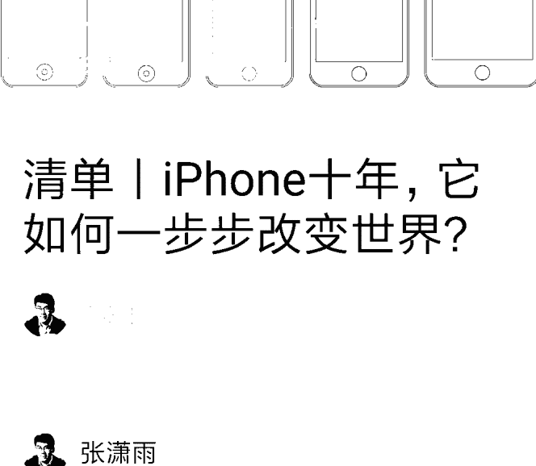

## 清单 | iPhone十年，它如何一步步改变世界？

张潇雨

北京时间13号凌晨，苹果将举行2017年秋季发布会。

在发布会之前，我做了这份清单作为加餐，想给你讲讲iPhone这款传奇产品的诞生与发展历程。相信你看完这份清单后再去看发布会以及相关新闻的话，一定会有和他人不一样的感受。

## ——► iPhone如何改变世界 ◄——

+   1. 2007年1月9日，在旧金山的莫斯康展览中心，乔布斯向整个世界介绍了苹果公司的最新研究成果——iPhone。这也是苹果有史以来最精彩的一次发布会。从那以后，iPhone不仅改变了整个世界，乔布斯也顺便改变了科技公司发布会的样子。

+   2. 有意思的是，演示当日的iPhone其实还是个半成品。当时的iPhone内存只有128Mb，iOS系统也很不成熟。所以，演示功能的时候经常花样死机。工程师团队准备了很多个iPhone，让乔布斯轮着使用。

+   3. 2007年6月29日，iPhone手机正式发布。当时的售价是4G版499美元，8G版599美元。上市后，当时微软的CEO鲍尔默说：“iPhone想进占市场根本没戏，也许它们能挣点小钱，但每年卖出的13亿台手机中，大部分依然会搭载微软的系统。”

+   4. 乔布斯要求对开发iPhone的过程极度保密，所以几百名工程师和设计师每周工作80多个小时，也不能对家属透露半个字。后来，苹果高级工程师安迪·格里格诺说：“iPhone这个项目毁掉了不少婚姻。”

+   5. iPhone在2008年的7月11日迎来了第一个重大飞跃——苹果公司发布了App Store应用商店。App Store是苹果打造生态的重要一环，推出至今，为全球开发者带来了超过700亿元的收入。

+   6. 2010年6月8日，传奇的iPhone4诞生了，这是乔布斯去世前亲自发布的最后一款手机。一块960*640分辨率的视网膜屏幕、极致快速的A4处理器和双面玻璃的经典设计，给所有人打开了一道新世界的大门。这一代iPhone让“智能手机”这个真正开始普及，就像iPhone4的广告语说的：“再一次，改变一切”。

+   7. 2011年11月11日，iPhone4s里面加入了一项新功能——Siri。掐指一算，我们调戏Siri的时间已经超过5年了。

+   8. 2014年9月推出的iPhone6系列，从这一刻开始，苹果终于有了“大屏手机”。屏幕从4.0英寸直接跳到了4.7英寸和5.5英寸，而iPhone的命名里，也开始有了个Plus。

+   9. 2017年的第一季度，iPhone以13%的市场占有率，拿走了市场上83%的利润总额。正因为iPhone这种恐怖的盈利能力，苹果公司成为了市值超过8000亿美金的世界第一公司。

+   10. 不知不觉，十年就这么过去了。看看iPhone诞生后手机都长什么样，你就能明白iPhone是如何改变了世界。你准备好迎接新的iPhone了么？

## 用户留言

提交留言可与专栏作者互动

## 无印良品｜核心理念与两大突破

本周我们要开讲一个新的公司：无印良品。

之前的三周时间，我们从奢侈品最早的诞生开始，一路讲到了奢侈品的民主化、集团化和全球化，又顺着这个行业的收购战讲了一些金融概念。相信你现在对奢侈品品牌和行业的整个格局都应该有了更深的认识。

而你应该还记得，在近现代的奢侈品历史里，日本这个国家给奢侈品行业做了相当大的贡献——在上世纪七八十年代的泡沫经济时期，他们依靠日本的经济腾飞、日元的强势以及消费观念的升级，靠“买买买”几乎撑起了整个奢侈品产业。当时我们举过这么一组数字：

在日本，大概40%的人拥有一个LV。如果将群体缩小到女性，这个数字是92%。

另外，日本女性里有90%拥有Gucci、超过58%有Prada、超过51%有Chanel。

到了2005年的时候，仅日本一个国家就贡献了爱马仕30%的销售额，LV 40%的销售额以及全球奢侈品市场41%销售额。

## —— 无印良品的时代背景 ——

### 一、石油危机

首先，在1978年，世界发生了第二次石油危机。当时伊朗国内局势动荡。从1978年年底至1979年3月初，伊朗停止输出石油60天，导致石油市场每天短缺石油500万桶，差不多占到当时世界总消费量的1/10，于是那个时候全球的经济形势都开始动荡。虽然日本仍然处于经济发展期，但是一部分消费者的心态也有所变化，开始追求性价比比较高的产品，而不是一味地追求品牌。

### 二、零售商自有品牌

由于之前整个社会的品牌热潮刺激和鼓励了品牌商在日本社会的发展，所以这导致了一个显著的结果就是，受欢迎的品牌商越来越受到热捧，于是它们在与零售商的合作里面——比如百货、超市等等——开始越来越占据优势，零售商的处境开始变得艰难。所以，很多零售商开始开发自有品牌，来缓解和进驻品牌商谈判的压力。

## —— 无印良品的核心理念 ——

刚才我们说，“无印良品”就是“没有品牌的好东西”。实际上，西武集团在打造整个无印良品品牌的时候，最初的切入点听起来非常简单，就是“有道理的便宜”。

## ｜无印良品的两大突破

于是 architecture，在1980年的12月，无印良品带着这种理念走向了市场。一开始它销售的产品很少，只有40种，其中9种是生活用品，31种是食品。尽管产品种类不多，但是我们现在看，无印良品有两个非常大胆的突破。

突破一：去品牌化

无印良品开创了一个先河，就是去品牌化。

突破二：定位于生活方式

上世纪八十年代之前的传统品牌，讲的都是品类化。麦当劳就是汉堡套餐，苹果就是电脑，LV就是箱包。但是无印良品上来就做了两类完全不同的东西——生活用品和食物。当然现在你知道，无印良品还有电器、衣服，甚至还开始做酒Factory。一个品牌能够覆盖这么多品类，还能做到有影响力，这是很不常见的。某种程度上说，这正是企业核心理念、核心价值观带来的一种力量。

> “过去几年我一直在思考无印良品应该做什么？1980年代，当时的日本社会充斥着大牌崇拜，而我们决定生产反潮流商品。当时我们预测，10个人中大概只有1个人能理解无印良品的理念。但我们并没有像其他公司那样，试图用市场营销去吸引剩下的9个人，而是就围绕这1个人，生产出满足他不同需求的多样化产品。就这样几十年下来，无印良品不再只是青山地区创业人士喜爱的小众产品，顾客的增加反映出消费者的成熟，因为只有‘不知道自己要什么’的人才会去追逐品牌。现代社会面临环境问题、全球化的问题。而无印良品成为这批成熟消费者自然而然的选择。”

## ｜无印良品的哲学

我觉得更能代表无印良品哲学的是另一个词，也是无印良品企业的一个宣传语，叫：刚刚好就好。

有两个无印良品早期推出的产品很能说明公司的这种理念。

一个是香菇片，就是我们吃的香菇。

当时，大部分摆放在超市里的香菇，都是事先在生产过程中挑选出来的形状大小都很相似的香菇，然后用袋子包装得很精美拿去售卖。但是无印良品的香菇，包装非常简单，而且形状大小不一，看起来并没有那么好看。但是无印良品说，人们为了美观而挑选香菇，但是最后在烹饪的过程中却要把香菇切碎，而切碎的香菇还是香菇。所以，香菇的形状并不重要，省略了挑选的这道工序，去掉那些繁杂的包装，无印良品的香菇片就能便宜下来，而且减少了浪费，对环境也更友好。所以当时的香菇片一下成为了爆款。

另一款产品是无印良品早期推出的著名的鲑鱼罐头。当时的设计师田中一光给这个罐头写了一个非常经典的广告词，叫做——鲑鱼的全身都是鲑鱼。因为当时日本的鲑鱼罐头都是只用最好部位的鱼腹，鱼头和鱼尾这种边角的地方都要扔掉，而无印良品推出的鲑鱼罐头会把一整条鱼作为原料，没有浪费，也不会因此向消费者收取更高的价格。所以这些产品的设计和打造，都体现了无印良品“刚刚好就好”的哲学——既要满足消费者的需求，也不过度包装和浪费。在“物美”和“价廉”中寻求一个最佳的平衡。

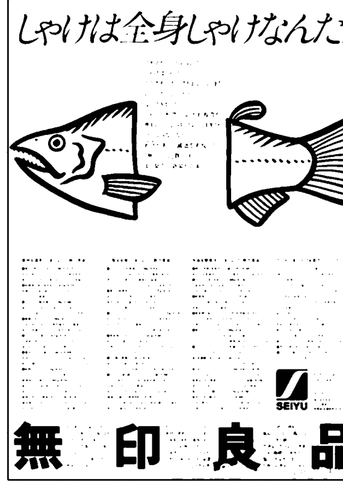

不过，如果你是无印良品的消费者，可能會有一個小疑問，就是好像這個品牌在中國的售價並不算太便宜，這是怎麼回事呢？無印良品的考量到底如何呢？我們下一篇文章的專欄，就會來講這個問題。

周末互动｜我们该以怎样的心态面对奢侈品的大众化？

张潇雨

今天你不妨在留言区写下你对于无印良品的印象和感觉，看看和我们今天讲的还有什么不一样。

## 无印良品 | 为何日本的大众品牌能卖给中国的中产阶级？

今天我们继续来讲无印良品。

昨天我们提到了无印良品最重要的核心理念——“有道理的便宜”和“刚刚好就好”。这种定位理念也让无印良品成立三十年以来取得了很大的成功。

如果你去过日本，你会发现无印良品在那边的定位就像是优衣库一样，是个平价的大众品牌。但你会发现，中国售卖的无印良品好像很难称之为“便宜”。所以，一边是平价品，一边代表了消费升级的中高端生活方式；一边是个国民品牌，从家庭主妇到白领都是主要消费者，另一边购买的却是年轻的中产阶级。

为什么会有两个无印良品呢？难道是因为外国品牌欺负中国人不懂行，利用了信息不对称？今天我们就来讲讲这个问题。

## 丨为什么中国的无印良品不便宜？

原因一：物流和供应链

相信你也知道，包括无印良品在内的很多国际品牌，很大一部分的产品其实都是“中国制造”。但是由于一些法律法规方面的限制，加上实际操作的问题，现在无印良品的物流过程是：中国生产的产品没法直接运送到店铺里，而是先要从工厂运到日本，然后再返回到中国来。这其中，关税、物流和供应链成本都不是最优解，最终就体现在了售价里。

另外，之前无印良品的CEO金井政明还说过：中国店铺相对比较少，订货量就比较少，如果以后能发展得像日本那样有几百家店铺，公司就能有新的调整和布局，那么时候价格就可以降下来了。所以，这里也有一个“规模效应”的问题。

原因二：选址

在日本，你会发现无印良品有许多种不同的业态。最常见的除了和在中国比较相似的，设立在购物中心里面的店铺，无印良品在日本还有街边店，以及一个独栋的房子里的独立店等等。甚至，曾为了满足上班族和学生，它还有地铁站内的 小店，比如文具一类的东西，万一上班上学缺了什么可以及时补充。另外在便利店里面，无印良品还有自己的柜台，包括在台湾的7-11里面，无印良品也有这样的货架设置。

## 丨无印良品的民主化

但是，随着国内各种品牌的不断兴起，无印良品也遇到了它的挑战。

## 丨外国品牌收智商税？

其实，无印良品中日价格不同背后的原因并不难理解，但是真正促使我写出这篇文章的是这么一个原因：当我用这个问题去向我的朋友和一些社交网络上的陌生人调研的时候，绝大多数人的回答都是：“因为信息不对称，所以无印良品可以向我们收智商税。反正很多外国品牌都是这么干的”。

张潇雨

今天我不打算给你留思考题，我希望你能把这篇文章分享给身边的人，让更多的人放下成见，用一个更理性、客观的视角去看待商业问题。我们明天再见。

## 无印良品｜深泽直人与「无意识设计」

我们继续讲无印良品。

之前在讲解这家公司的时候我们说过，无印良品这家公司有一个很重要的特点，就是它没有以产品品类作为切入点来划分消费者，而是以设计和理念来切入的，这是一种很勇敢的企业哲学。另外，提到无印良品这个品牌的时候，我们总会想起来的也是它非常有特色的产品和设计，所以今天的案例课，我们就来讲一讲无印良品的一个重要的设计师深泽直人，和其著名的设计理念“无意识设计”。在学完这节课之后，你应该会对无印良品的设计为什么如此受喜欢，有一个初步的理解了。

## ｜深泽直人

深泽直人（Naoto Fukasawa）1956年出生，毕业于东京多摩艺术大学的产品设计系艺术与3D设计专业。后来他离开日本到了美国，在旧金山加入了一个只有15个人的小办公室“ID two”，这就是后来大名鼎鼎的设计工作室“IDEO”的前身。

后来他回到日本，协助组建了“IDEO”在日本的分部。在2001年8月的时候，无印良品的第一代设计师田中一光先生叫来了两名设计师，希望他们能够接棒他的工作，成为公司的艺术顾问。这两个人就是后来把无印良品的理念发扬光大的著名设计师原研哉和深泽直人。 nickel后面仅仅过了一周，田中一光先生就去世了。

## ｜无意识设计

想要理解深泽直人的“无意识设计”，我们得从他经典的作品看起。

作品一：用拉线控制的壁挂式CD播放器

这是无印良品著名的壁挂式CD播放器，也是代表深泽直人“无意识设计”的一个最典型的产品。这个产品最有代表性的是两个地方：

第一，我们小时候都有一种记忆，就是用拉线来控制电灯。拉一下灯亮起来，再拉一下灯就灭掉——这个交互体验所有人都懂。而深泽直人正是利用了这一点，为无印良品设计了这款拉线的CD机。

所以，哪怕从来没有见过这款产品的消费者，也不需要任何使用说明书，都能知道只要拉一下这根线，音乐就会播放起来。这就是一种“无意识”的设计，它不需要消费者再去额外学习什么，而是调动起最自然的，隐藏在消费者心底里的经验，来实现产品的作用。

第二点更加奇妙。如果你回忆一下拉线电灯的感觉——你一拉线，灯光就洒下来，充满整个房间；想睡觉的时候，再一拉灯，房间又重归安静和黑暗。这种人和外界交互的美妙的感觉，和普通的按键开关是非常不一样的。年龄稍大的同学可能还有一种记忆，就是小时候的拉线电风扇——一拉线，风扇就开始转，徐徐的凉风就扑面而来，这也是拉线这个动作带给我们的经验和记忆。

而这款CD机，当你拉下这根线的时候，CD就会开始转动，而音乐就会跟着而来，然后充满整个空间。就好像是突然吹起来的凉风，或者是洒满屋子的灯光一样。深泽直人正是利用了人的这种“通感”，一下把这款CD机和很多其他的物品关联在了一起，制造出了一种特别的体验。而这一切都是毫无刻意、自然而然就发生的。所以这款产品也成为了他设计生涯的一个经典。

后来，深泽直人把他的这种理念逐渐概括成了“无意识设计”，英文是Without Thought。从字面意思上就能看出，这种设计希望使用者不要“想太多”。深泽直人自己也说：“简洁的东西可以有效地缓解人和产品操作界面的隔阂，让人们使用产品成为享受功能的过程，而简洁的更高境界是舍弃说明书，凭借直觉就可以实现产品功能，这也是‘无意识设计’追求的更高境界。”

作品二：电饭煲

在这个作品中，你可以看到深泽直人在进行设计的时候的思考过程。

这个电饭煲造型非常柔和，白色，也很好看，并且贯彻了无印良品“没有logo”的理念。但这个电饭煲最大的亮点在于它的盖子上面的一个小的支架，这里可以放一个饭勺。

后来深泽直人解释说，他会反复观察“行为中的不连续”——就这个盛饭的过程，人们一般都是左手拿着碗，右手拿着饭勺，然后打开电饭煲的盖子，把米饭盛入碗里，再用拿着饭勺的右手关上盖子。由于饭勺上会有米粒，而日本的主妇往往又不想随随便放在桌子上弄脏桌面，这时候整个盛饭的连续行为就停顿了。所以观察到这一 点之后，深泽直人就把电饭煲的盖子上加了个小支架——而任何人看到这个设计都会会心一笑，然后把饭勺放上去。这又是“无意识设计”的一个经典。

## ｜可供性

在了解了“无意识设计”的含义之后，我们再来看一个能帮助我们更进一步理解它的新概念。叫做：可供性（affordance）。

其实这个词也是后来造出来的，它的发明者是20世纪最重要的认知心理学家之一詹姆斯·吉布森（James J. Gibson）。这个词是afford（提供、给予、承担）的名词形式，在这里的意思是指，这个环境可以提供给动物和人类某种属性，无论是好还是坏的。

当然，定义有点拗口。我们来通过几个例子解释一下。

例一：和牛奶盒形状完全相符的栏杆扶手

先想象一下，你手里有一个方形的牛奶盒，此时你正在找地方搁这个牛奶盒。然后恰好，你的目光停留在了手边的栏杆扶手上，而这个栏杆扶手的形状和牛奶盒恰好完全匹配，在这一瞬间，你就像是被一个磁铁吸引过去一样，把这个牛奶盒放了上去。这就是环境对我们意识和身体的影响，也是这个栏杆创造的一种“可供性”。说得简单一点，就是那个栏杆的状态自然而然创造出了一个把牛奶盒放上去的机会和需求，所以造成这样的结果，几乎就是注定的。

需求，所以造成这样的结果，几乎就是注定的了。

深泽直人是怎么利用这种“可供性”来实施他的设计的呢？

## 例二：伞

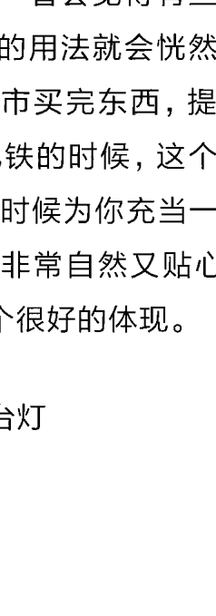

这把伞其实没有太多特别之处，唯一的小区别就是在伞柄弯曲的地方有一个小凹槽。这个设计你可能乍一看会觉得有些奇怪，但是一旦看到人们的用法就会恍然大悟了。当你在雨天去超市买完东西，提着袋子去乘公交车或者地铁的时候，这个凹槽刚好可以在你站着的时候为你充当一个挂钩的角色。这个设计非常自然又贴心，也是“无意识设计”的一个很好的体现。

## 例三：深泽直人设计的台灯

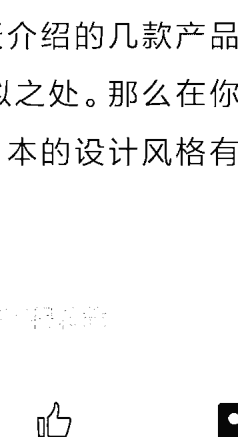

深泽直人在台灯下面设计了一个托盘。因为有这个托盘的设计，用户几乎一定会把类似于钥匙、手表、钱包一类的东西放在这里。

想象一下，当你拿出钥匙开门回家，顺手把钥匙放在这个托盘里，然后轻轻一拨，打开灯的开关，房间亮了；而离开的时候，直接拿起钱包和钥匙，顺手把灯一关，就可以离开了。一切都非常自然顺畅，不需要动任何脑筋。所谓无意识的设计，其实也是通过设计师故意地设置，让用户在几乎在没有觉察的情况下就被满足和被愉悦。这也是深泽直人一直探索的设计理念。同样，也是为什么无印良品的产品可以打动那么多人的一个重要的原因。

深泽直人后来説：

> “在日本，物与环境之间的关系比物体本身更重要，物体是一种和谐的一部分，我开始停止构想仅仅是有趣的外形设计，而去考虑物体之间的关系……而当人与物、环境达到完美的和谐的时候，就是找到了一种意识的核心。”

我觉得这也是商业之美的另一种体现，用设计来传达一种理念，给人以亲近又温暖的感觉，并且以此打动人心。如果有机会，你也可以去找来更多深泽直人的作品看看，相信看过之后，你对设计、文化以及商业哲学方面都会有更深的体会了。

张潇雨

听完今天的专栏之后，不知道你有没有意识到，乔布斯的设计理念，或者说苹果的设计，跟咱们今天介绍的几款产品看上去好像有一些相似之处。那么在你看来，苹果的设计和日本的设计风格有什么相关性呢？

## 无印良品｜不许加班

无印良品｜不许加班

之前三天的专栏里，我们讲到了无印良品的诞生，它在中国和日本不同的定位，以及无印良品的一个重要的设计师深泽直人。今天的专栏，我们稍微就进无印良品的内部，看看它们的一个著名管理方法，以及这个方法里面蕴含的一个重要理论。

## ｜晚上6点半之前必须下班

无印良品的这个管理方法也不复杂，就叫：晚上6点半之前必须下班。

这个管理法，是无印良品最著名的一任CEO松井忠三在他的那本著作为《解密无印良品》里面写到的。他说：

无印良品在法国、意大利、西班牙也开设了门店，开店前，松井忠三自己去过几个国家实地考察。他发现，欧洲人的工作方式和节奏和日本人特别不同。

## ｜帕金森定律

## ｜帕金森定律的三个启示

## 三、工具影响思维

最后一个启示听起来有点玄乎，但我亲测过确实很有效——这也是万维钢老师文章里提到过的一一它是说，人的思考方式有时候是会被工具反过来影响的。

比如你用粗的马克笔和白板笔的时候，思考的线条就会比你用圆珠笔的时候要粗。也就是说如果你非常需要掌控大局，不拘小节的时候，你应该使用粗的马克笔去白板上画。我自己的体会是，有时候我回答别人问题的时候，用手机回答一般篇幅就会短不少，用电脑的时候就会话更多。可能也是类似的道理。

所以我一直认为，克制的东西可能才最有生命力。最后，我就用大建筑师 Frank Lloyd Wright 说的一句话来结束今天的专栏。他说：

The human race built most nobly when limitations were greatest.

人类最好的建筑都是在条件限制最多的情况下建造出来的。

张潇雨

你身边有没有深受加班、工作繁重困扰的朋友呢？不妨把这篇文章分享给他，然后叫他出来一起吃一顿时间很长的饭，喝喝酒，聊聊天，他会感谢你的。

## 无印良品｜网易严选：中国版MUJI？

无印良品｜网易严选：中国版。

今天是讲无印良品的最后一期，我们来做点延伸，讲讲目前号称是“中国的无印良品”的一一网易严选。

一般来说，我们商业经典案例课在选择公司和案例的时候不会轻易选择太新的品牌，因为如果商业模式还没完全验证，或者至少阶段性验证的话，轻易去分析很可能也可能会偏颇，误导读者和听众。不过“网易严选”这个品牌从2016年以来发展非常迅速，而且模式也值得拿出来说说。所以今天我们就介绍一下网易严选，也许两三年后再回头看，会有不一样的体会和收获。

今天的专栏我会分为三个部分来讲。第一部分先说说网易严选的背景和现状，然后是它在商业模式上的做法，最后是我觉得它要进一步发展下去，需要解决的一些问题。

## —— 背景和现状 ——

这个品牌所名字就能知道，是网易孵化出来的一个新的电商品牌。关于网易严选的诞生，有三点值得记住：

## 一、网易严选的核心在于“选”

它像是一个买手，自己不参与设计和生产，平台上的所有产品都是自己严格挑选而来，而不是自己开发的。

但是这是和一般常见的买手店也不同。比如时尚品牌的买手店连卡佛（Lane Crawford），会挑各种大大小小品牌的新产品放到店里售卖，所以在连卡佛的店里你会看到LV的衣服、香奈儿的首饰、巴黎世家的包等，当然还有各种小众品牌；但是网易严选的模式是，上面的产品不论类别、不论厂商、所有都“贴”的是网易严选的品牌。

这种做法的学名是ODM（Original Design Manufacturer）——制造商负责产品设计，品牌商提出修改意见，并进行品控、采购和销售。制造商最后拥有自主知识产权，但是商标是品牌商的。

所以在网易严选的首页你可以看到，它的各种产品都是打着“某某某品牌制造商”的旗号，比如行李箱是新秀丽制造商，被子是无印良品制造商等等。

## 二、从线上到线下

和无印良品不同的是，网易严选是从电商出发，逐步走一个线上到线下的过程。这也是网易这个公司天然的优势所带来的必然路径。而无印良品一开始就是地面起家，门店是主要入口，线上只是辅助渠道。

不过最近你可能也看到新闻说，无印良品和网易严选在中国都做出了同一个决策：开酒店。网易已经和亚朵酒店集团合作在杭州开了家每晚要1199元的酒店，而无印良品的首家酒店2018年也会在深圳亮相。

总体来说，电商在时间和效率方面占优，线下门店在场景和体验方面占优。之前在讲到零售行业的时候我们也说，未来零售的边界会越来越模糊，线上线下会深度融合。而网易严选和无印良品正走在这样的路上。但究竟哪条路径更行得通，是个值得观察的问题。

## 三、诞生时机与无印良品相似

我们之前的专栏说过，无印良品的诞生，正是切中了日本大热的泡沫经济开始走向尾声，人们对消费主义和品牌崇拜开始反思。在那个阶段，大宗的家庭购买开始转向更多的个人消费，比如一些小家电产品开始受到欢迎，类似于餐饮业这种服务业也兴起了。人们更加重视身体的健康和精神的充实；另外这个时候，由于贫富差距拉大，不同阶层人的消费习惯也开始分化。于是标榜着“没有logo”、“有道理的便宜”的无印良品一推出就开始大热。

而对于当今的中国，类似的情况也在出现。经济的增速开始变缓、商品过剩、一部分人开始远离品牌崇拜，开始选择更具性价比的消费方式，而网易严选也在这个时候脱颖而出，成为了品质精选电商的代表。而它官方的口号正是“好的生活，没那么贵”。

## —— 商业模式 ——

我们用之前在零售专题反复提到过的“多、快、好、省”这四要素再来看看网易严选。

“多”

之前的专栏我们也提到过，在如今这个商品大爆炸的时代，数量绝对的“多”已经早就不是零售商们追求的目标了。这里的“多”变成了一种在精选的前提下提供给消费者更全面的选择。而所谓的“严选”正是切中了这个点。

而且可以很明显看出，网易之所以使用ODM模式，就在于它的野心不仅仅在于做一个平台，而是也要做一个品牌，然后把自己的审美理念和生活哲学推广开来，所以就像拥有700多个品类的无印良品一样，网易严选也从一开始就覆盖了家居、服装、电器、厨具、食品甚至母婴品类，完全就是走的无印良品路线。

“快”

作为一个本质上的电商，这点反而是网易严选最不需要担心的。中国庞大的电商基础设施已经保证了它服务的底线。

“好”

这是网易可以做很多文章的地方。就像我们刚才才说的，网易目前很多产品打的都是“和高端品牌同一个制造商”的卖点，希望能营造一种质量相近，但是价格往往只有一半甚至更低的感觉。当然，要想产品真正有长期的口碑，仅仅是代工厂或者制造商一致还不足够，这一点我们一会儿也会讲到。

“省”

这应该也是严选的最大特色了。目前网易严选受到欢迎的最大原因，就是在消费者可以以无印良品三分之一到一半的价格，买到看起来和无印良品非常类似的商品。当然，能做到这一点，网易也有几个优势：

+ 1. 渠道的效率。和淘宝或者京东这种平台不同，入选网易严选本身就是一种保证，就像是Costco每类产品只有两三个品牌选择一样。所以，在精选电商平台上，由于有渠道的天然背书，广告营销费用也会减少很多。另外由于竞争的产品很少——很多品类甚至只有一款选择——厂商不需要像淘宝的直播车那样，额外付钱来获取用户。所以综合算下来，整个渠道费用可以比传统电商低上一半。 2. 采购的效率。之前我们也说过这个逻辑——在零售业的发展历史里，有一个提高效率的方法无数次出现，就是靠集中采购来压低价格。不管是最开始的小连锁店，还是后来的大型超市、还是把SKU从十万降到5000的Costco，都利用了这种规模效应降低成本。而网易严选显然也想通过集中SKU的订购，来尽可能地压低供应商的价格，从而把实惠让给消费者，也提高自己的毛利率。 3. 发展潜能大。这还只是单纯的采购模式，从小米生态企业这些年的实践来看，如果网易严选可以向上游挖掘得更深，通过投资控股、联合研发、共享知识产权的方式，还有可能开发出更有竞争力的爆款产品。这未来对品牌的促进作用可能更大的。

## —— 面临的挑战 ——

## 一、产品质量

我曾经看到过一个评论，说网易严选对公众最大的误导，就是以为同一个工厂或者加工商，就能生产出质量类似的产品来。

其实中间的设计、机器、品控等等很多环节其实都对产品最终质量有很大的影响。一个最简单的例子就是：富士康除了苹果之外也给很多其他手机代工，但为什么iPhone的质量跟其他手机不一样呢？（虽然有时候连iPhone的质量也不稳定）

现在网上经常有人发文说在网易严选买的锅把手又裂了，或者说袜头根本不舒服等等。如果不能保证产品质量，那么任何生意都是做不起来的。

## 二、以后的设计和创新能力

的确，ODM的方式是最符合严选目前的需求的。但是如果想要打造一个长久的品牌，自己的核心设计能力是不可能完全放在供应商手中的，掌握自己的爆款IP才是获得持续性利润的关键。而网易严选，或者说国内任何一个设计品牌能不能解决这个问题，都还需要继续观察。

## 三、能否实现野心

就像我们之前所说的，以网易的野心，它绝对不会满足于做一个简单的小众品牌或者是电商平台，而是希望通过覆盖更多的生活场景，把自身的品牌理念和生活美学渗透到大众的生活里。

然而，无印良品做到这样，是通过接近四十年的不停努力，和几代设计师，尤其是像原研哉和深泽直人这样的大师不断地努力之后，才慢慢变得可能。而以模仿各个高端品牌起家的网易严选，能最终找到自己的灵魂么？

张潇雨

今天咱们讲了网易严选，你用过网易严选吗？或者身边的朋友用过网易严选吗？有什么体验和感受呢？欢迎在留言区把你对网易严选的看法写下来，为咱们专栏做个补充。

## 周末互动 | 苹果公司的5个设计小故事

大家好，欢迎来到商业经典案例课。我是张淑雨。又是本周的周末互动时间。

这周我们讲的是无印良品，我发现，其中关于设计的那一篇专栏大家回复特别踊跃。因为你可能也感受到了，虽然苹果和无印良品是两家领域完全不同的企业，但是它们底层的设计语言是有相通的地方的。尤其是乔布斯受日本禅宗文化的影响确实很深，他很长时间也师从日本的禅宗大师乙川弘文（Kobun Otogawa）。乙川弘文和乔布斯的关系非常好，他也是乔布斯和他太太举行婚礼的时候的主持人。

这周，苹果刚刚发布了新一代的iPhone，其中有一款划时代的产品叫iPhone X。趁着这个机会，我想把之前专栏里没讲到的一些，关于苹果的设计方面的故事给你讲一讲。如果你看了发布会或者重播，会知道这次发布会的一开场，播放了一段乔布斯的原声，内容非常让人感动。今天这个小小的周末互动，也算是我们专栏对乔布斯的一点纪念。

下面，是我总结的5个关于苹果公司设计的小故事：

## 1. 小牛犊的出生

乔布斯很早就对于“直觉性”这个东西很有感触。
小时候有一次，他的爸爸保罗·乔布斯带他去参观奶牛场，他正好看到了一只小牛犊的出生。他发现小牛只用几分钟就能挣扎着站起来。保罗·乔布斯说，你看这种能力是它与生俱来的，而不是后天学习的。
所以，后来乔布斯认为好的设计也应该是这样，能让人不看说明书就能使用。后来有一次他在朋友家，发现朋友的小孩子在没人教的情况下就自顾自玩起了iPad。那一刻他觉得，自己的设计真的成功了。

## 2. 来自厨具的灵感

在设计第一个爆款产品Apple II的时候，当时大部分电脑配的都是那种笨重的灰色金属电脑箱。乔布斯完全不想要这样的设计，一直在想应该怎么弄。后来有一次逛百货商店的时候，他从一个厨艺公司（Cuisinart）的食品加工机上找到了灵感。后来Apple II机箱的样子就很轻很光滑。从此以后乔布斯就经常用厨房用具来找灵感。

## 3. 找不到的米黄色

乔布斯在设计Apple II的时候，想给机箱找一种米黄色。你可能知道，有一家著名的色彩咨询公司叫潘通（Pantone），1963年成立。现在它每年都会评选年度流行色，而且很多著名的消费品公司，包括奢侈品公司都会找他们做颜色方面的咨询。
潘通公司的颜色种类，多到有多夸张呢？潘通公司米黄色这个种类，就有2000多种。但是更夸张的是，这2000多种乔布斯没有一种看上的。当时他差点儿自己创造一种全新的颜色，还好被同事制止了。

## 4. 有提手的电脑

在设计第一代iMac的时候（这时候差不多是乔布斯刚刚重返苹果的时候），乔布斯和当时负责工业设计的乔纳森·艾弗（Jonathan Ive）一起合作。
艾弗给iMac的外壳设计了一个电脑上很少出现的内嵌的提手。他当时的理由是这样的，他说：“那个年代大家对科技都不太敢冒，甚至有点恐惧。当你害怕一个东西的时候，你就不会去摸它。比如我就看到我妈妈是不敢碰电脑的。所以我就想，如果它上面有个提手，就能让人和电脑发展出一种新的关系。它是很亲近的，是在哪里可以被触摸的。”
很神奇的是，刚才我说的这么一大段话，乔布斯当时不需要任何解释就理解了。这也让艾弗对他佩服有加。另外，制造这种内嵌的提手对于工业设计来讲挑战很大，而且也 său成本，但是乔布斯立刻就通过了。

## 5. 乔布斯的挚爱设计

乔布斯一生比较喜爱的产品有：博朗的剃须刀和三宅一生设计的衣服一对，他那身经典行头是：三宅一生的黑色上衣、李维斯牛仔裤和New Balance新百伦的跑鞋。
另外，他自己年轻时候开保时捷928。在设计表金塔电脑的时候，他还和团队成员到停车场去看这辆车，说：“这种不随着时间流逝而过时的设计，就是我追求的效果。”

其实在这周的专栏，以及今天的互动里，我想做到一件事，就是帮你引起一点对商业里面设计的兴趣。我觉得iPhone还有一点非常伟大的是：它的流行让全世界的人都开始了解设计、关注设计、重视设计，某种程度上来说这就是一种审美教育。所以，在商业中发现好的设计，理解设计师的思想和用心，也是学习商业不可或缺的一种体验。希望你在未来的生活中，能锻烁出一双在商业中发现美的眼睛。

### —— 本周留言精选 ——

## 无印良品 | 网易严选：中國版MUJI？

我就是一个深度严粉，去年买了一个学区房，准备装修搬过去住，装修期间就天天刷严选的APP。那感觉简直了，根本停不下来。之前买过无印的很多东西，发现严选上的很多东西和无印产品体验神似，结果几乎家里的装修风格，家居用品，甚至连现在吃零食，特别是严选的茶我就是喜欢，现在最喜欢的是那85元的龙井，性价比确实好，我喜欢严选的理念。我个人是个金融行业职业投资者，总是在想，网易这部分业务如果能独立出来分拆上市我真愿意投资，至少我认为世竟有严选和没有严选会有点不一样。如果深度营销，推广面很大，对世界影响会更大。

业对于品牌的扩散，很多中小企业高质量产品会不断被埋没。

## 无印良品｜不许加班

格鲁夫要求每个员工每天额外工作两小时，但没有任何报酬。可能科技公司的加班文化就是从那个时候开始的。这是专栏第一个商业案例里说的，也是当今加班文化兴起的开始。在此之前多是制造业里的加班，那时往往还是需要同自己的上级关系者才能被安排到加班，那时候许多人还是想各种办法争着要加班。去过日本多次，每次都发现，即使到了晚上十点，天桥下书摊前都有许多穿着西装、打着领带、拿着公文包的上班族，在看着书看电脑或是聊天，就是不愿回家也不敢回家。在这样一个加班文化盛行的国家，松井忠三能够推行不加班文化，真是难能可贵。我自己对加班的看法是：从注重加班文化（或不加班文化）过渡到重视员工的自我驱动。优秀的人一起工作，自然是高效。

人类最伟大的建筑都是在条件限制最多的情况下建造的，我无比赞同这句话。佛罗伦萨的最伟大的建筑，圣母百花大教堂。在最初建造圣母百花大教堂的100多年间，它一直是一个“烂尾楼”，因为最初设计的穹顶建造难度非常大。文艺复兴时期的人们非常崇拜古罗马时期的建筑（罗马万神殿），又非常想把这个穹顶盖上。于是这个事情就落在了布鲁内莱斯基身上。为什么说穹顶建造难度非常大呢？其一，直径太大，其二，水泥技术经过1000多年的中世纪失传了。当时的佛罗伦萨人又非常鄙视法国人的哥特式建筑。那布鲁内莱斯基是怎么解决的呢？简单来说就是，先用肋条把圆形的穹顶轮廓搭起来，再用轻材料把内部填上，让穹顶拥有哥特式的骨架和罗马式的外形。在这里我想说正因为佛罗伦萨人看不上法国人的哥特式，水泥技术的失传，又因为布鲁内莱斯基不是专业的建筑师，才会让这个金句完成了文艺复兴时期最伟大的建筑！

“帕金森定律”不自觉地让我联想起拖延症，因为凡涉及到时间管理方面的信息，拖延症都是一个不得不提到的“障碍”吧。时间本身是不可管理的，我们能做的只有规律时间，不仅自自身的精力生物钟与大自然的节律保持一致。与此同时，我们还要与其他人的时间保持协调。不然当一个人自身节奏良好的时候，而他的生物钟与大部分人的生物钟不协调时，那么他会失去与关系中人的链接。而人不能脱离关系而活，所以时间管理的内核应当是我与自然、我与其他人的链接的风向标。

编剧编剧本也是一样的，必须限制大背景、大环境，聚焦于某一个历史时期、某一座城市、人物年龄、人物具体工作、人物特定成长经历。这样才能写出好的剧本。若是没有限制，任凭编剧天马行空地想象的话，写出来的剧本一定不能投拍。

## 无印良品｜深泽直人与“无意识设计”

苹果和无印都有一个深层次的审美同构：禅。这种“少即是多（less is more）”的理念，看似“缺少”反而给予了消费者更多参与其中的空间，因为意识不会被“有”所固 定，想象力和情感才会有更多的时间停留在产品上，就像着名的断臂维纳斯雕像一样，“有之以为利，无之以为用。”

听完今天的课，结合课后的思考题，主要感觉有两点：一是“无意识设计”并非真正的无意识，而是设计师的有意识造就了设计的无意识，创造出了“少就是多”的简约效果。好的产品是易学好用，对用户友好的，它不需要复杂冗长的说明书，仿佛产品本身能够和用户进行无声的交流。二是，设计理念分为两个层次，即满足需求与创造需求，后者是更高的层次。通过用心、巧妙的设计来满足用户尚未发现的需求，就是创造需求的过程。以上两点，我们在无印良品的产品和苹果产品上都能够观察到。

[1]感觉无印良品这些细节的设计，更多 的就是一种让人处在抱持状态的设计。无论在做什么，都会让你体验到一种舒适，这种周到细致的感觉体现的不是一个时间点，而是一个时间片。应该说，这种从产品理念进行切入的做法，有着很强的渗透性。特别是当你体会到设计师的用心之处后，仿佛想把身边所有的商品都换成他家的。所以一旦理念扎根，则可引发一系列的购买。当然，一旦理念不被认同，则就是全盘的否定。[2]苹果和无印良品都是在追求一种简洁，将不必要的东西一点一点剔除掉，但又不增加对用户的负担。就像iPhone最初去掉机械键盘，以及新iPhone彻底放弃Home键。看似是暴力地替用户选择，实际上应该是其背后深入研究的结 果。[3]随着人与各类设备的交互次数越来越多，如何真正洞察人的需求，让大家在使用过程中体会到细节中的舒适的设计，会最终得到大家的好评。但是这种设计往往极易被抄袭，很难支撑快速打开市场，获得较大利润。

深泽直人一直都是我很喜欢的设计大师。产品的存在是因为人，而人的无意识状态远远多于有意识。今天，信息爆炸， 如果凡事都需要有意为之，恐怕早已累垮。更多的时候，我们是凭借经验和本能做事，如果本能可以成事，不生烦恼，那就是多么美妙的体验。喜欢那个电饭煲，自己经常遇到饭粒无处安放的情况，然而并没有什么留心思考过。设计师在生活中需要有旁观视角。

日本工业设计成功地将东、西方法审美理念融为一体，形成优雅的艺术风格，日本那些精致的产品简约设计背后的文化基因和日本人的国民性。核心内容：日本的八个审美意识一素、假、并、气、间、微、秒、破，以及背后反映的日本文化。无印良品是注重纯朴、简洁、环保、以人为本等理念，在包装与产品设计上皆无品牌标志。而苹果公司核心原则：注重用户体验，“一切以用户为核心，打造满足用户需求的产品”。具体操作：不追求森价、拒绝垃圾产品、及时放巷低劣的技术和产品、不迷信市场调研、引导而不是追随用户、及时纠错。两个相关点：简洁，注重用户体验，故深深地打动客户，成为风潮。

## 无印良品｜为何日本的大众品牌能卖给中国的中产阶级？

说一下自己的看法，可能不太成熟。除去老师说的那些原因之外，在国内的无印良品东西不便宜，自己觉得还有一个原因，那就是收入的问题。用货币等价这个原理来看一下，一样的商品比如一根自动铅笔，在日本卖84日元，合成人 民币假如此汇率简略到6，那么人民币就是接近5元。一个月平均四五千的工资水平就会觉得买个5块钱的自动笔就不便宜，而国内1元的自动笔也用得得心应手。而在日本的话，基本20万日元工资，买个84日元的自动铅笔就不占那么大比重了，相对来说就便宜了很多。

学了经济学就知道，想收智商税，不可能。市场的价，看上去，是商家定的，实际上，是所有消费者定的。你价格定得再高，没有人买，也是白搭。而价格高，依然有人买，说明确实有人需要，而且愿意支付价格。只是说，需求和供给，如果价 格低，需求就多，价格高，需求就少。情结可以有，但是，不解决问题，而且，也看不清问题。有的时候，价格高，不一定是劣势。因为，有一部分人，希望价格高，他们不在乎价格高。价格高，才能显示出他们的富有。

商业世界要避免简单逻辑归因。你以为的，并不是你以为的。刚开始我以为无印良品其实仅仅是利用信息不对称将其商品卖得更贵。现实生活里面，我们经常看见很多外国品牌在国内和国外的售价是不一样的。刚开始会觉得这是收取智商税，但是是看完这篇文章之后让我恍然大悟，商家其实也有自己的苦衷，并不是他们想卖得那么贵，而是现实让他们不得不卖得这么贵。如今很多服装品牌在 线上线下价差是非常大的，过去不懂这里面的原因总会觉得，唉，你看着这些实体店总是坑害商低的人。后来才渐渐明白，其实并不是他们想卖得那么贵，而是他们所承受的成本让他们不得不卖得那么贵。学习商业让我对很多社会现象有了更清晰的看法，不过话说回来，现在实体零售真的不太做做 了，不 仅要忍受着各种各样的成本，还要在道

仅要忍受着各种各样的成本，还要在道德上倍受“奸商”之类的谴责。

我们总是容易戴“有色眼镜”看待别人，很大一个原因是我们“以为”别人是怎样的。比如一个小心眼的人，会觉得别人也小心眼，对方跟他开玩笑，却以为是跟他对着干。多想想总是好的，可我们却总是“想太多”。我们随意评论别人，最后导致争吵，很大的原因是我们不知道别人的状况，我们觉得别人应该怎样。最后引用一句话：当你想要批评别人的时候，要记住，这世上并不是所有人都有你拥有的那些优势——《了不起的盖茨比》。

## 无印良品 | 核心理念与两大突破

无印良品的生活哲学让我想到法国人的生活哲学，简单优雅。虽然身在名牌大国的源头，但一般法国人都能穿出自己的味道。

今天“无印良品”的文章清晰地折射了：什么是企业的使命，及使命的重要性。无印良品的使命就是：怎么给消费者提供“有道理的便宜”的物品？围绕这个使命，企业可以开展各种业务组合，食品、酒店、生活用品等等，并为之永远奋斗。

别人追求品牌，我来做无印；别人用部分鲑鱼为产品，我的鲑鱼全是鲑鱼；别人的香菇大小均匀选汰，我的香菇消弥形态以片全用。人弃我取，或者撤去附加值，更关注商品本身价值效用，这不是范蠡、陶朱公的经商之道吗？

无印良品这个品牌，原意解释起来就是无品牌的好东西。虽然他家原来是提议无品牌这个想法，力图做出物美价廉的东西，却无心插柳形成了自身品牌。这个品牌诞生于两个背景之下，一是1978年年底石油紧张，导致人们消费观念的变化，开始追求性价比高的商品；二是品牌的影响很大，许多零售商开始建立自有品牌，用来对抗供应商和提高自己的效益。这个品牌有一个核心价值，叫做有道理的便宜。那时候他们提出了一个口号，叫做刚刚好就好。就拿鲑鱼罐头来说，一般的罐头都是只用鲑鱼的鱼腹，却浪费了鱼头和鱼尾，而无印良品却恰恰注重不过度包装和浪费，利用了一整条鲑鱼来做罐头。再说对无印良品的印象吧，去过也就一两次，当时还不知道它有多大牌，只是觉得它家东西给我一个整洁舒服的印象，这点我很喜欢。

因为工作关系，曾经在1998年与无印良品有过一些接触。据我所知，无印良品在早期很强调物品的安全与天然属性。早期的无印良品中有从山东农村妇女手工编织的玉米皮手袋，也有基础聚丙烯纤维编织的购物袋。无论哪一种，都坚决不用化学染色剂，所以，无印良品的包装袋都是天然的土黄色、本白色等。还有原木做的专为特氟龙锅使用的锅铲等等。

## 【案例总结】关于苹果公司伟大之处的清单

张满雨

这周苹果的发布会引起了大家的广泛关注，所以我顺便整理了一个关于苹果公司和乔布斯的清单，几乎都是专栏里讲过的内容。毕竟关于苹果的内容也讲完很久了，这个清单算是帮你做个复习。

之后我也会不定期地为你总结一下讲过比较久了的公司和系列，你可以收藏这篇文章，方便以后复习。

## —— 苹果清单 ——

- 1. 一家富可敌国的伟大公司
苹果公司由乔布斯于1976年4月1日创立，如今市值已突破8000亿美元。什么概念？如果把苹果公司比作一个经济体，它的市值位居全球第18，超过全球100多个国家的GDP，比荷兰、瑞士这两个小型发达国家都高。

- 2. 没有乔布斯，就没有现在的苹果
这绝不是一句空话。乔布斯创立了苹果，使它诞生；又在公司低谷之时，将它带出逆境。举个例子，如果不是当年乔布斯砍掉苹果90%的产品线，决定只做四款产品，那么现在，苹果公司可能还在卖打印机和服务器。

- 3. 没有乔布斯，就没有现在的产品发布会
作为一个营销高手，乔布斯在麦金塔电脑的发布上，做了一系列匪夷所思的设计。那次发布会非常成功，一夜之间乔布斯仿佛成为了这世界上最有魔力的人，几乎所有人都在期待麦金塔电脑的问世。这给后来所有的技术产品设立了一个发布会标杆——一个有魔力的创始人演讲+产品的盛大揭幕。

- 4. 苹果将个人电脑带给普通大众
现在，电脑已成为日常生活和办公的必备。普通大众能上用上个人电脑，第一个要感谢的人，就是乔布斯。在苹果二代电脑以前，电脑就是电路板，买回去之后自己要组装、编程，只有极客才知道怎么用。而苹果二代把电脑变成了一套完整的设备，这才第一次让电脑对普通人产生价值。

- 5. 乔布斯帮我们用上了鼠标
我们现在非常熟悉的图标、文件夹的鼠标点击方式，跟苹果有关，而且是来自于乔布斯的一次抄袭。当时，电脑系统都是大黑屏，你只能用各种文字命令操控，直到施乐研发中心开发出了图形交互技术。而正是乔布斯把这项技术“拿来”应用到了第一款Mac电脑上，推向了大众。

- 6. 苹果让科技变得很酷
从苹果的iPod开始，科技产品才变成了一个很酷的东西。在那之前，所有电子产品都黑漆漆的，看上去很廉价，而iPod的出现打破了这个局面：大胆的滚轮转盘设计；从机身到耳机、电源、连接线，全部是高级、纯净的白色；没有开关键；三步之内可以找到任意一首歌。从此科技变得很酷。

- 7. 苹果开启了音乐的数字版权时代
在乔布斯看来，大多数人下载盗版都是不得已的，只要有好用的正版购买渠道，他们都不会用盗版，而当时的正版唱片确实只能整张买，不支持单曲。乔布斯利用他天才的谈判技巧，成功说服了包括索尼唱片公司在内的五大唱片公司在iTunes上卖歌曲，彻底改变了音乐行业。

- 8. 传奇，并非完美
乔布斯曾经也是一个很差的CEO。因为脾气坏，被自己亲自找来的人赶出了自己创立的公司——苹果；因为完全不懂优先级是什么，一个9-12个月就能推出的产品愣是做了三年；因为不懂控制成本，一款客户预期价位为2500-3000美金的电脑，结果要卖9000美金。这都是乔布斯经历过的失败。

- 9. 成于固执，死于固执
固执，或者说是偏执，成就了乔布斯；然而也正是这个特点，让他早早离开了我们。乔布斯的癌症其实是一种治愈率非常高的病，可他几乎从来没有好好配合过治疗，但他也做了一些事情，比如严格素食，摄入大量的胡萝卜汁和果汁，希望能以此击退癌细胞；比如针灸疗法、草药疗法；还比如请灵媒。即使这些疗法在癌症面前很荒诞，但他就是相信自己所相信的。

- 10. “只有那些疯狂到认为他们可以改变世界的人，才能真正改变世界。”
有人会问，iPhone的开创性到底体现在哪？看看iPhone推出后这十年手机都长什么样子，你就明白了。

用户留言

Moran
分享一下乔帮主一直激励自己的话：只有爱你所做的，你才能成就伟大的事情。如果你没找到自己所爱的，继续找，别停下来。就象所有与你内心有关的事情，当你找到时你会知道的。
09-17 08:46:23

李可
只有那些疯狂到认为自己可以改变世界的人，才可以真的改变世界。如果连自己都认为你自己不行，谁还会觉得你行呢？
09-17 08:21:57

林奕杰
苹果公司确实是一个伟大的公司，我们的生活因乔布斯而改变，个人电脑的普及，鼠标的应用，都让我们在工具的使用上得到了提升，iPhone这款产品更是伟大的产品，不断在改变我们的生活，10年前从未预见出门可以什么都不带，只要带个手机就可以搞定吃住行，还能买买买。
09-17 09:28:19

秋风迎
苹果，伟大的公司，十年来智能手机的样子基本于篇一律，大同小异，一个大大地待机时黑黑的屏幕加上一些有差异的按键就成了智能手机，苹果的手机出现带动了一大批新兴智能手机企业的崛起，国内的小米、vivo、oppo、魅族等，而老牌劲旅华为、三星等在智能手机行业都取得巨大成功；伟大的乔布斯，重视用户的体验，简洁方便的设计，苹果手机使用起来非常方便舒适；如文所述，乔布斯改变了整个电脑和手机市场，电脑和手机已成为人们生活中不可缺少的一部分；乔布斯是个天才，天才比较往往固执，正因为他们的固执已见，正因为他们对自己的特别独立想法固执的追求，成就了伟大的公司和个人。
09-17 08:47:35

眯眼看世界
你是愿意卖一颗子糖水，还是和我一起改变世界。
09-17 08:24:11

以上留言由作者筛选显示

## 爱马仕 | 起源与传承（上）

爱马仕 | 起源与传承（上）

本周的内容，是我们奢侈品系列专题的最后一站，我们来讲一讲这个行业皇冠上的明珠——爱马仕。

之前在讲LVMH对爱马仕的恶意收购战的时候，我们稍微提过爱马仕这个品牌，当时我对它的形容是“一股清流”。当时很多同学也因为那篇专栏对爱马仕家族和这个品牌产生了很好感。的确，在整个奢侈品行业变天的十几年来，爱马仕好像在商业与艺术之间取得了最好的平衡，也被称为“奢侈品中的奢侈品”。所以这一周，我们就来讲讲这家神奇的公司。

今天和明天的两期专栏里，我们先来说一说爱马仕的诞生和现状，以及它传奇的六代家族传人。

### | 爱马仕的起源

如果你对爱马仕的logo有印象，应该记得爱马仕这个品牌和马车有关。没错，这个品牌的传奇故事，就是起源于一个小小的马具店。

爱马仕的创始人叫蒂耶里·爱马仕（Thierry Hermès），出生在1801年。他的父亲在镇上经营一家小酒馆。

在19世纪初，汽车还没有被发明出来，马匹还是主要的交通工具。不过，那时候马脖子上戴的项圈都很硬，结果马在拉车的时候脖子就容易被擦伤，不过没什么人在乎牲畜的感受。

但是，这件事情被一个少年看在了眼里。他对马的感情很深，所以在十三岁的时候，在马具店打工的蒂耶里·爱马仕就做出了皮革给马保护皮肤。而且，为了让马戴得舒服，他耗费了大量的时间和心血，一丝不苟地开发出了一代又一代的马的项圈。

当时的巴黎弥漫着华贵之风，马不但是交通工具，也是上流社会的社交符号和炫富手段。所以专门生产高级马鞍和马具用品的工坊就非常流行，马具匠人也是非常流行的职业。他们给有钱人家的马车做各种华丽的装饰，或者替贵族们把族徽雕刻在马具上。而在这些人里，蒂耶里·爱马仕不仅手艺最高，而且态度也最认真，逐渐他的名号开始响彻巴黎。到了1837年，他36岁的时候，蒂耶里自立门户，开设了名字叫做“爱马仕”的高级马具专卖店。大到马鞍，小到驱蝇鞭——就是给马赶苍蝇虫子的用具——还有马车上面的各种精致配件，应有尽有。由于工艺精湛，蒂耶里的店很快得到了大批挑剔的贵族客人的认可。

在那个年代，爱马仕店里的匠人们就像艺术家一样，对每件产品都精雕细刻，也留下了许多传世之作。到了1867年，巴黎举办了当时最大规模的世博会，结果爱马仕的马具一举获得奖项，名声开始向国外传播。如今我们提到爱马仕这个品牌，都会对它的工艺赞不绝口，甚至要远远超出其他奢侈品牌。这种对工艺的追求就可以追溯到创始人爱马仕先生。

之前我们提到，爱马仕在当今的整个奢侈品行业里和奢侈品大品牌里都是一个非常特殊的存在。这种特殊最重要，就是它家族的传承。

### | 创始人之后的俩代传人

实际上爱马仕在创立的这180年里，一共经历了六代传人。现在运营整个爱马仕的就是家族的第五和第六代成员。而且更加难得的是，六代人里面，每一代的家族成员和领头人，都对这个品牌做出了不可磨灭的贡献，不断把爱马仕推向巅峰。而且家族成员也一直非常团结。

查尔斯·爱马仕

1879年爱马仕先生去世，他的儿子查尔斯·爱马仕立刻继承了他的衣钵。他把总店搬到了巴黎著名的福宝街24号。这个地址是巴黎最豪华的地方，不远处的55号就是总统府爱丽舍宫。凭借近水楼台的位置，爱马仕在皇家和贵族的圈子里的生意也越做越大。到了1900年，巴黎又一次承办了规模前所未有的世博会，此时的爱马仕达到了第一个顶峰，整个欧洲的王室，甚至包括越南、暹罗、巴西、俄罗斯、日本的王室都向他们订购产品。

后来，1906年，西班牙国王阿方索十三世在婚礼当天遭遇刺杀。一颗炸弹在御用马车之前突然爆炸，但还好，国王和王后幸免逃生了。不过，王室的马具损坏很严重，于是西班牙皇家马厩将维修国王马具的工作交给了爱马仕的皮具工坊。从此，爱马仕真正地成为了一个国际化的品牌。

到了第三代家族传人手里，爱马仕又有了新的突破。其实，当时整个品牌面临着巨大的危机，因为20世纪初，汽车工业开始蓬勃发展，如果你有印象的话，福特公司划时代的T型车就是1908年推出的。于是，马车开始逐渐被汽车取代，马具用品的需求也逐渐萎缩。

埃米尔·爱马仕

查尔斯·爱马仕有两个儿子，名字叫阿道夫和埃米尔。一开始公司是由阿道夫掌舵，但是他不愿意放弃让家族享誉国际的马具业务，最终他把公司交给了自己的兄弟埃米尔。爱马仕迎来了历史上又一个传奇般的人物。

于是，埃米尔领导爱马仕开始转型。他做了两个非常重要决定。

- 一、为女士打造皮包
1914年第一次世界大战爆发，战争让女性开始走出家庭。于是埃米尔决定为她们打造产品。于是，他把爱马仕的工艺从马具延伸到了皮具上。用针缝合皮料，连接处用蜡融化，这样手感会更柔软，然后用加热器和熨斗固定，再用拉链开合。这让爱马仕做出的包的手感和造型都大大超越了其他品牌的产品。从此，爱马仕从一个马具品牌，延伸到了皮具和时尚领域。

- 二、坚守手艺
埃米尔并没有盲目跟随不断推进的工业革命和汽车革命。他反而认为，想要与机器对抗，最重要的是坚持精雕细琢的手工艺，这样才能真正突显产品的稀缺和珍贵。

到了1951年，埃米尔因病去世。他生前有四个子女，但都没有接任爱马仕的CEO。那个接任埃米尔的第四代CEO是谁呢？其实是他的女婿之一，罗伯特·杜马斯（Rober Dumas）。

从这里开始，爱马仕的CEO就再也没有姓“爱马仕”的了，而是进入了“杜马斯”时代。然而最令人称道的是，接下来的三代外人CEO，不但没有争权夺利，试图把品牌据为己有，还继续把爱马仕再次推向了高峰。这一切也是后来爱马仕家族抗LVMH和阿诺特的恶意收购，打下了非常坚实的基础。

在下期的专栏里，我们就来讲一讲爱马仕的后面一代传人的故事。

张潇雨

业来做。前几周我们讲过很多与之相反的例子，家族内部矛盾加上外部施压，很多家族企业已经不是家族企业了。这些例子你还记得吗？建议你把记得的在留言区写下来，唤醒一下即将沉睡的记忆，顺便给自己做个复习。

最后，给你说一个好消息，万维钢老师的专栏《万维钢·精英日课》的第二季今天正式上线了。从今天开始，我们又可以每天获得英文世界的最新知识了，我个人表示非常激动，也推荐还没发现的同学赶紧去看看。

（点击下图可以查看《精英日课》第二季的发刊词）

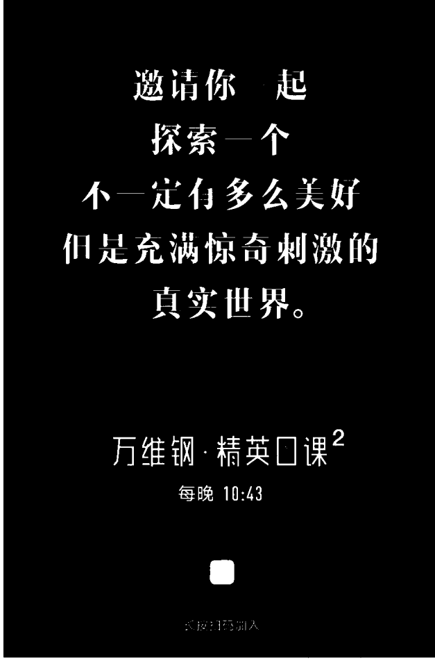

## 爱马仕｜起源与传承（下）

爱马仕｜起源与传承（下）

我们继续来讲奢侈品行业皇冠上的明珠：爱马仕。

昨天我们说到，爱马仕最伟大的一点所在就是，品牌在经过180年和六代传人之后仍然屹立不倒。而且如果回顾一下历史，每一代传人都为爱马仕做出了不可磨灭的贡献。创始人亨利耶里和他的儿子查尔斯自然不用多说，第三代传人埃米尔更是通过对手工艺的追求，以及把制作马具的技术迁移到给女士打造皮具上，奠定了整个品牌的基础。那今天的专栏，我们就来讲述爱马仕再后面一代传人做出的伟大贡献。

### ｜罗伯特·杜马斯与他的丝巾时代

1951年，传奇的埃米尔·爱马仕因病去世。接替他的是他的女婿之一罗伯特·杜马斯（Robert Dumas）。结果，他这个CEO一做就是27年。

之前我们说到，埃米尔对爱马仕品牌有着奠基性的贡献。他把公司的业务从马具扩展到了皮具，并且在创新方面——比如对拉链的使用上——也做得非常出色。而罗伯特·杜马斯也完全继承了这种精神，开始了他的时代。

在这个时期里，罗伯特·杜马斯开启了爱马仕的一系列产品线。包括更多种类的皮具、珠宝、男士领带、香水等等。但他最被大家熟知的贡献，还是对爱马仕的传奇产品——爱马仕丝巾的发扬光大。

爱马仕最早推出丝巾是1937年，当时杜马斯就建议公司在赛马用的丝绸制品之外，再生产一些丝巾和领带。杜马斯不仅可以作为商人管理公司，而且自己也是个设计师。他本人亲自设计过几款爱马仕的丝巾。到了他执掌爱马仕的时候，杜马斯就把丝巾作为了公司最重要的一条产品线。

我们之前在奢侈品系列专题里讲过一个逻辑——大型奢侈品品牌如今采用的都是金字塔形的产品结构：

- 最顶端的高级定制产品，是卖给上流社会和富裕阶级的。这一部分虽然利润注定不高，甚至要赔钱，但是绝对不可或缺，因为这样才能维持品牌的高端形象；
而品牌的高级成衣或者皮具、包等等，可以卖给目光永远向上流社会盯着的中产阶级，他们是品牌客户群中的中坚力量；
而香水、配饰等等一系列价格相对较低的单品，可以卖给中产，以及中产偏下的大众。

这部分产品有两个主要的功能：第一是，这种产品虽然单价低，但是可以“走量”，所以贡献的利润也不少。毕竟几万块钱一身的衣服能够消费的人少，但是几百块的香水和唇膏买得起的就很多了；第二，这种低价的产品可以慢慢培养品牌的忠诚度，等到你消费能力提高的时候，自然就会开始买同一个品牌更贵的产品了。十几年前，苹果的iPod、iPhone和Mac电脑之间的关系也是这样的。

所以，爱马仕的丝巾不知不觉就充当了这个“入门产品”的角色。

但是爱马仕的品牌经营能力绝对是业内的超一流水平。因为，爱马仕的丝巾虽单价真不高，平均就在400-500美元左右，人民币就是3000多元——这比起动辄十万的铂金包来说可要亲民多了——但是，爱马仕的丝巾不仅没有让人感觉是便宜货，还有一种艺术品的感觉。

如今，各种明星名流都是它的忠实拥趸。1955年，摩纳哥王妃格雷丝·凯利用爱马仕丝巾来固定受伤骨折的胳膊，堪称史上最伟大又不经意的广告；英国女王从30岁开始佩戴爱马仕丝巾，一直戴到了90岁，可以说是最长情的客户了。这些都是爱马仕品牌魅力的最好证明。

### ｜爱马仕丝巾中的工匠精神

之前我们说，爱马仕哪怕经过这么多多代家族成员更迭，仍然保持了对工艺的极致要求，而且拒绝流水线化的工厂生产。这在如今的奢侈品行业里是非常难得的。我们可以来看看，这一点在爱马仕的丝巾上是怎么反映出来的。

- 1. 设计
假设有一天你去爱马仕的店里，想要一条爱马仕丝巾的“经典款”，那么店员可能会非常为难。因为每年，爱马仕会和成衣一样，发布春夏和秋冬两个系列的丝巾，这么多年累积下来，爱马仕已经拥有太多的经典图案和系列，很难说出哪个是最经典的了。

爱马仕的丝巾制作流程是这样的。首先，公司有三四十位固定的合作设计师和艺术家，然后，每年的丝绸技术创意指导还会面试上百位“潜力股”艺术家，最终选出50个左右负责新一季的丝巾设计，然后在开始销售后根据销量来支付版税。

对于艺术家的创作，爱马仕不但不会干涉，还有预算来帮助艺术家去世界旅行，获取灵感。不管是蛮荒出没的非洲，奇幻湿热的亚马逊雨林，还是大西洋的海底深处，只要能带来灵感就可以。

于是你可以看到，爱马仕丝巾上的图案有：美国原住民画家安东尼·查波夫(Antoine Tzapoff)勾画的十九世纪蒙大拿平原上高乃依族印第安人的画像，让大家勿忘历史；也有插画家爱丽丝·雪莉(Alice Shirley)画出的世界上最大最长的珊瑚礁群，号召人们更重视生态平衡；还有艺术家洛伊克·杜比根(Loïc Dubigeon)的生命之树——灵感来源于印度拉贾斯坦邦西北部的壁画，它是生命和永恒的象征。这些设计，都已经远远超出了简单的日用品范畴，而像是一块块艺术品。

- 2. 配色与上色
然后，艺术家的设计稿一出，工匠们就需要调制配色了。爱马仕的丝巾以颜色繁多著称，这些颜色是怎么来的呢？

首先，爱马仕的匠人们会数认设计稿上有多少种颜色，然后从自家多达75000种色彩的色彩库里对比提取。如果没有最接近设计稿的配色，他们会花时间重新调制，确保每一个颜色都和艺术家的设计稿一致。

致。

你可能想知道，这多达75000种的色彩是从哪儿来的？秘密就在染色原料和配方。爱马仕会专门派人去印度、墨西哥、澳大利亚、南非等等世界各个地方，寻找你可能想都想不到的颜色来源。比如某种建筑的外墙、某种植物的根茎、特定种类矿石的颜色等等。然后把它们研成粉末，再通过调配产生出不同的颜色来。光红色可能就会有上百种。而这些五彩斑斓的颜色，最终都会服务于合作设计师和艺术家的设计方案。

由于每张设计稿上色彩众多，很多时候色彩都要单独制版。所以光调色这个流程，就需要至少500到1000小时。

然后是上色环节。每条爱马仕丝巾平均包含30-45种色彩，而每一种色彩印染后，少则需要几个小时，多则需要一周来晾干，然后才能印染第二种颜色。等到几十种色彩都染完，几个月又过去了。

上色完成之后，还需要人工裁边、清洗、蒸汽、晾干，以及卷边。光是卷边这么一个小小工序，熟练的工匠每天也就只能完成六七条。

## 3. 编织工艺

还有一个促成爱马仕丝巾成为经典的因素。就是它的编织工艺。

以马具起家的爱马仕对编织的理解非常深入，爱马仕的丝巾采用了斜纹编织法，表面还经过一道独特工艺，像是覆盖了一层膜。所以，在触摸手感上，爱马仕的丝巾更加硬一些，不易起褶，立体感强。这带来了一个好处，就是佩戴打结的方法千变万化，用法多种多样。所以大家可以自由发挥自己的时尚创意。如果你看时尚明星们的戴法，彼此都不太相同，这也给爱马仕丝巾带来了更多应用的场景。

而经过所有这些工序之后，没有达到爱马仕标准的丝巾，会被撤下生产线然后烧毁。通过检验的丝巾就会被精心折叠包装好运往巴黎总部，然后运往世界各地，续写它的神奇。

## 爱马仕丝巾VS. iPhone

在这里，我想把爱马仕的丝巾和iPhone做个比较。这两个都是非常伟大的产品，而且有一些有趣的共同点：

- 极致。它们对工艺和设计的要求都非常极致，而且很多时候已经从日常用品或者工业品站到了艺术品的范畴。这让人们对拥有它会产生很大的动力。
- 低价。对于它的美学和工艺价值来说，它们的价格也是可以接受的。400美元的爱马仕丝巾和900美元的iPhone，虽然绝对不能说是廉价，但很多人还是买得起的。这让它们成为“爆款”品类成为了可能。而且我们之前说过一个逻辑，iPhone的伟大之处在于，科技的发展使得手机变得“民主化”了，不管你和比尔·盖茨的身价相差多少，但你们能买到的世界上最好的手机都是一样的。同理，你和比尔·盖茨能买到的世界上最好的丝巾也是一样的，这也是爱马仕的伟大之处。当然，作为微软的前CEO和一个科技宅男，比尔·盖茨未必会用iPhone和丝巾，不过道理你都懂。
- 多元。它们的应用场景也很多元。手机就不用说了，丝巾的佩戴方法也有很多种，甚至还有人把它当衣服穿。这也让人们使用它的乐趣大大增加了。

作为爱马仕第四代领头人的罗伯特·杜马斯27年的贡献当然不止丝巾这一件事。但是在他的带领下，爱马仕承接了埃米尔的精神，又稳步地把公司的产品线扩张到各个品类，使得爱马仕真正成为了一个综合性的奢侈品品牌。

不过，如果你觉得在这个动荡的时代，能做27年的CEO是一个奇迹的话，那么爱马仕马上就要迎来一个更神奇的CEO了。他就是爱马仕家族的第五代领头人，执掌爱马仕品牌长达28年的让·路易·杜马斯（Jean-Louis Dumas）。明天的专栏，我们就来讲讲这一段历史。

张潇雨

今天我们主要从爱马仕的丝巾入手讲了一下爱马仕，下次你送礼物没主意的时候可以考虑一下它。你身边有喜欢爱马仕丝巾的朋友吗？如果有的话，不妨把这篇文章分享给他，帮他多知道一些自己喜欢的商品。

## 爱马仕 | 坚守中的大胆创新

爱马仕 | 坚守中的大胆创新

我们继续来讲传奇的奢侈品公司：爱马仕。

前两天的专栏听完，加上之前我们讲过的 LVMH 和爱马仕的收购战，你应该能感觉到爱马仕这家公司在整个行业里的的确是个“异类”。在我看来，从商业这个角度，爱马仕的特别之处可以追溯源到下面三点：

第一，不论行业怎么发展和变迁，爱马仕都坚守了对质量和手工艺的追求，和对流水线生产的拒绝。

第二，爱马仕的每一任的领头人 CEO 都为品牌做出了不可磨灭的贡献。而且非常神奇的是，它们的 CEO 经常一做就是二十几年，而且往往既是很好的企业家，又有很高的艺术造诣和眼光。

最后，爱马仕家族虽然经过了180年和6代的传人，但是家族关系仍然非常紧密，凝聚力十足。这和我们常听到的很多公司家族内部的矛盾与纠纷相比简直就是“一股清流”。

所以接下来三天的专栏，我们就从这三个方面来拆解一下爱马仕整个品牌和家族的成功之处。一起来看看他们到底做了什么，能在这个行业里保持如此的不同。

今天，我们就从家族的第五代传人让·路易·杜马斯（Jean-Louis Dumas）说起。由于爱马仕家族的杜马斯太多，下面我们就简称为路易。

### 路易对手艺的坚守

让·路易·杜马斯在1938年出生。1978年，四十岁正值当打之年的他，从父亲罗伯特·杜马斯的手里接过了爱马仕的帅印。实际上之前我们说过，路易在爱马仕的执掌时间有28年，具体说是从1978年到2006年。这时候你可以回忆一下我们在讲 LVMH 集团时候的时间线——

1977年，路易·威登家族第三代的女婿雷卡米尔成为 LV 的新 CEO。他通过对渠道的垂直整合，以及利用资本把 LV 的业务多元化，让路易·威登箱包企业变成 LVMH 奢侈品集团。

1988年，雷卡米尔给一个叫伯纳德·阿诺特的人打了个电话寻求帮助，然而没想到这是一次狼入室。阿诺特最终让雷卡米尔出局，自己开始执掌 LVMH 集团，并且开始了他对整个行业的收购和整合。

1998年，阿诺特请来的马克·雅各布已经开始了他的第一个系列。

2006年，LVMH 达到了一个巅峰。

2008年，LVMH 开始秘密收购爱马仕的股份。

换句话说，让路易·杜马斯执掌爱马仕的这段时间——从1978年到2006年——也是奢侈品行业发展最快、变化最大、最为动荡不安的时期。而他做了什么呢？

他的决定就是，不管别人如何变化，爱马仕都要保持自己的手工工艺、不盲目扩张，保持只服务一小部分人群的特色。

### 坚守中的大胆创新

不过，路易虽然坚守了爱马仕对质量和手工艺的品牌节奏，但他并不是一个保守的 CEO。相反，他也做出了很多当时非常大胆的创新。

### 难得的稳中求进

现在我们回头看，在这个阶段里，不管是 LV，还是爱马仕，做的都是三件事：重塑品牌、扩张品类和国际化。可以说抓住了这一波浪潮，做对了这三件事，品牌就能迈上新的台阶，然后长足地发展，但是如果错过了，可能就是被收购甚至破产倒闭的下场。

## 1.2.6 CHANGE IN THE NUMBER OF EXCLUSIVE RETAIL STORES

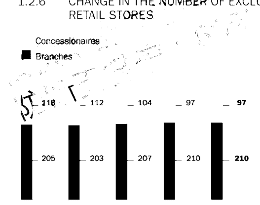

但同时，虽然门店增长并不快速，但爱马仕的销售额可是稳扎稳打地一直增长。下图里你可以看到，爱马仕集团在过去的十年里，年销售额从16.25亿欧元增长到52.02亿欧元，超过了原来的三倍。年复合增长率是非常可观的14%。而营业利润更是从4.15亿欧元增长到16.97亿欧元，超过了原来的四倍。

## 1.2.4 CHANGES IN CONSOLIDATED REVENUE

In millions of euros

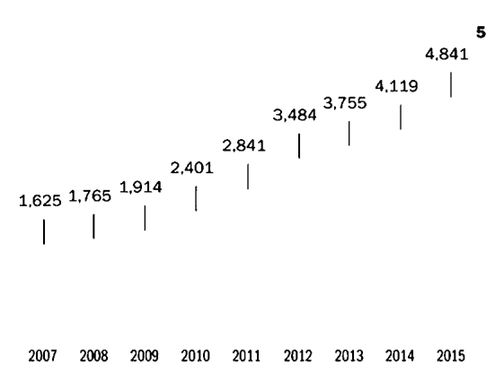

## 1.2.5 CHANGE IN RECURRING OPERATING INCOME

In millions of euros

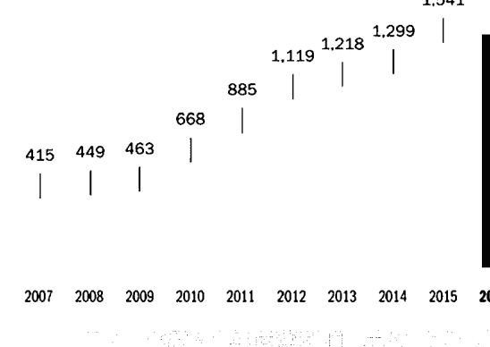

稳扎稳打的爱马仕，成就了如今“奢侈品中的奢侈品”和“最后的奢侈品”这样的美名。不过，想要有这种名声，光有稳定的经营策略显然是不够的，伟大的产品和优秀的人才才是基础。所以明天的专栏，我们就讲一讲爱马仕的传奇产品——铂金（Birkin）包，以及爱马仕家族是怎么培养家族传人的故事。

张潇雨

今天给你留一个思考题：听完今天的专栏你会发现，对比LV和爱马仕，虽然一个激进一个稳扎稳打，但毕竟如今看来，他们都在奢侈品行业占据了自己的一席之地。对于这两种截然不同的打法，你有什么看法呢？

## 爱马仕 | 全世界最贵的包

爱马仕 | 全世界最贵的包

今天我们继续来讲爱马仕。

前几天的专栏我们说到，爱马仕在奢侈品行业里非常特殊，其中很重要的一点就是它的CEO。他们不但能做很久一有两人任都做了接近30年的时间一一而且他们往往在商业能力和艺术造诣上都非常出众。

某种程度上来说，这也是爱马仕这家公司的独到之处。因为我相信，这世界上一定还有比爱马仕更加小众、更加要求极致工艺、更加私密的品牌，但它们往往在商业上没法取得太大的成功；反过来，很多大奢侈品集团的年收入和利润都比爱马仕高，但是只有爱马仕，有那种“奢侈品中的奢侈品”的地位。在商业和艺术中取得完美的平衡，正是这个品牌最让人钦佩的地方。

我们之前的专栏把爱马仕的产品和苹果的产品做过比较，我想它们的确是有相通之处的。同样，爱马仕最著名的领导者让·路易·杜马斯和苹果的乔布斯，也有相通之处。比如他们都对自己的品牌有着巨大的骄傲，也对产品有很好的直觉。就象今天我们要讲的爱马仕铂金包的故事。

### 传奇铂金包的来历

很多人可能对爱马仕铂金包的故事都不陌生。这是爱马仕所有产品线里最著名的产品，皇冠上的明珠。

这里面的“铂金”二字和包的材质无关，其实是个音译，来自于著名的女歌手和时尚偶像Jane Birkin，简·铂金。当时在1983年的时候，简·铂金正坐飞机从巴黎飞往伦敦，结果她不小心碰翻了自己的包，里面爱马仕的笔记本掉出了出来，纸张散落了一地。于是铂金不好意思地抱怨说，自己的旅行包实在没法装进这么多东西，有点麻烦。这时候，坐在她旁边的人帮她把东西捡起来说：“看来你需要一个大一点的，而且有内袋的包。”结果简·铂金说：“要是爱马仕出了这么一款包，我肯定会买的~”

令人没想到的是，简·铂金旁边坐着的这个人，就是接管爱马仕已经五年的CEO让·路易·杜马斯。他开始问铂金希望这个包是什么样子。等到下了飞机的时候，让·路易·杜马斯的手里已经多了一张草图。

1984年，铂金包问世。如今这款包已经是世界上最著名的一个包了。这个包比之前爱马仕经典的“凯莉包”稍大，更加休闲实

传给了家族成员埃克塞尔·杜马斯。爱马仕就是靠着这种客观、合理又人性化的权力传递体系，保证了他们“奢侈品行业第一家族”的地位。

当然，企业精神的传承和人性化的继承方式固然非常重要，但这些是“软”的东西。而一个企业想要基业长青，还必须在组织结构、股权激励方式、管理架构等等“硬”的方面有非常合理的设置。这样软硬结合，才能打造出传承一代又一代的家族品牌。所以明天关于爱马仕的最后一期专栏，我们就一起来看看爱马仕的企业管理与股权架构是怎样保证它能够180年屹立不倒的。

张潇雨

听完今天的专栏，爱马仕家族选贤举能的继承方式有没有让你联想到现代或是古代的一些类似案例呢？欢迎在留言区写下来，和大家一起分享。我们明天再见。

## 爱马仕｜股权结构与管理架构

今天是关于爱马仕这家公司的最后一期。

相信这一周的内容听下来你也已经发现，关于爱马仕这个企业和品牌，最核心的两个字就是：家族。

不管是它经典的丝巾和铂金包产品，还是它的商业成功或者人文精神，都离不开整个爱马仕家族跨越6代人、长达180年的传承和努力。我们之前讲到了爱马仕培养家族继承人的理念，今天的最后一期内 容，我们就说说在整个公司架构设计上，爱马仕是怎么做 的。

### 爱马仕的股权结构

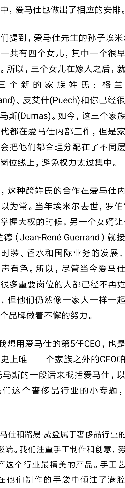

上市公司有一个好处，就是股权结构都是披露在年报里的。上面是来自爱马仕2016财年年报的股权结构图。在这里你可以  :

一个叫做H51的实体控制了整个爱马仕集 团52.6%的股份和62.7%的投票权。

如果你还记得我们之前讲过的LVMH对爱 马仕实行恶意收购的案例，那么你应该已 经猜到了，这个H51就是在2010年年底到 2011年，爱马仕为了对抗LVMH的恶意收 购而联手组成的控股公司。我们可以简单 地回顾和复习一下当时的情况：

当时是2010年的10月，LVMH的阿诺特通 过股权掉期这个产品，三天就吃进了爱马 仕17.1%的股票，再加上之前就有的 4.92%，当时LVMH手里一下有了22.02%的 爱马仕股票。

另外，爱马仕家族虽然加起来一共有超过70%的爱马仕股份，但是这些股份分散在 爱马仕家族200多位成员的手里，没有一 个人持股超过5%。所以LVMH的22%从法 律上来说已经是单一最大股东了，如果他 们找其他小股东各个击破，一点一点收购 更多股份的话，很难说爱马仕这个“最后的 奢侈品”会不会也归属于LVMH集团。

当时爱马仕的家族成员的确是措手不及。 不过很快他们就展开了反击。在12月的一 天，大约50名爱马仕家族的成员在巴黎开 了一个极为秘密的会议，这个会事先只有 一小部分家族成员知道具体地点，会议现 场没有留下任何纪要，连参会成员也被要 求在进入房间之前交出自己的手机。

在那次会上，参会的爱马仕家族成员一致 同意将公司50.2%的股份通过一种严格的 股权托管方式进行锁定。最终形成的就是 这个H51控股公司。它的名字也很理解， 就是爱马仕的H+51%股份的意思。随着时 间的变化，这50.2%的股份到2016年年底 变成了52.6%。按照规定，这部分股票在未 来的20年内部都不允许出售。

我们之前说，爱马仕这个品牌一个很大的 特点就是CEO的任期都非常长。其中罗伯 特·杜马斯和让·路易·杜马斯各做了27年和 28年的CEO。而现任的CEO，也是家族的 第六代传人埃克塞尔·杜马斯，上任的时候 也只有44岁。再做20年也没问题。这种 时间框架的设置可以让爱马仕再一次做出 长期的决策和安排，保持爱马仕独特的品 牌魅力。这也是爱马仕成功的更重要秘诀。

另外，为了保持一定的灵活性，那次会议 给家族成员保留了一定的减持套现空间， 也就是还有12.5%的股份没有放入H51这 个实体里。不过，爱马仕还设计了一个“优 先购买权”，也就是说如果这部分股票被卖 出的话，家族的股权托管基金享有优先购 买权。

所以在图里你可以看到，经过那场收购 战，整个爱马仕家族控制的股份已经达到 了65.1%，投票权达到了74.8%。而LVMH 的阿诺特家族的持股现在只有8.5%，投票 权是基本无足轻重的5.2%。

### 爱马仕的管理架构

在让·路易·杜马斯 Retail 爱马仕的时候，他设 计了一个巧妙的双层管理结构。

第一层管理结构——埃米尔·爱马仕有限责任公司

第一个结构实体是埃米尔·爱马仕有限责任 公司（Emile Hermès SARL），也是以爱马 仕先生的孙子命名。这个结构实体侧重 于所有权，在2016年年报的第242页里你 可以看到，这个实体的权力作用有五项：

+ 1. 指派和免除执行主席也就是CEO这个职 位的权力；
2. 制定公司的战略；
3. 负责公司运营和投资方面预算的审批；
4. 处理公司股权和利润方面的事宜；
5. 处理公司收购、贷款等重大的财务事 宜。

简言之，这个法律实体就是在公司的所有 权、财务权和大的战略方向方面负责把控 和一票否决的实体。

我们再来发掘一下年报，看看什么样的人 能够进入到这个实体里。在245页有这样 一段话——

只有下面两类人，可以进入到埃米尔·爱 马仕有限责任公司：

+ 1. 埃米尔·爱马仕和他的夫人朱莉·霍兰德 的后代；
2. 他们的配偶。

然后，这个配偶的权力也是有限的。如果 离婚，这些股份可以被持有，但没有投票 权。最后，规定它还要补充上一句，所有这 个实体的成员必须把自己的股份存在家 族的账户里。这就是埃米尔·爱马仕有限 责任公司这个实体。

第二层管理结构——爱马仕国际

另一个实体叫做爱马仕国际（Hermes International），负责日常的管理和对外的 合作等等。

目前这个实体的11名董事会成员中，非家 族成员占据了四个席位。而就像我们刚才 提到的，包括爱马仕国际的CEO等重要 职位在内，还有它代表的一些重要功能， 都是要经过埃米尔·爱马仕有限责任公司审 批的。这就牢牢保证了爱马仕家族的控制 权。

另外，为了保证家族成员内部的权力不要 过于集中，爱马仕也做出了相应的安排。

之前我们提到，爱马仕先生的孙子埃米尔· 爱马仕一共有四个女儿，其中一个很早就 去世了。所以，三个女儿在婚姻之后，就引 入了三个新的家族姓氏：格兰德 (Guerrand)、皮艾什(Puech)和你已经很熟 悉的杜马斯(Dumas)。如今，这三个家族的 很多后代都在爱马仕内部工作，但是家族 的执委会把他们都合理分配在了不同层级 的不同岗位线上，避免权力太过集中。

实际上，这种跨姓氏的合作在爱马仕内部 已经习以为常。当年埃米尔去世，罗伯特· 杜马斯掌握大权的时候，另一个女婿让·热 内·格兰德（Jean-René Guerrand）就接过 了高级时装、香水和国际业务的发展，搞 得也有声有色。所以，尽管如今爱马仕企 业里的很多重要岗位的人都已经不再姓爱 马仕了，但他们仍然像一家人们一起为 延长这个品牌做着不懈的努力。

最后，我想用爱马仕的第5任CEO，也是爱 马仕历史上唯一一个家族之外的CEO帕特 里克·托马斯的一段话来概括爱马仕，以及 总结我们这个奢侈品行业的小专题，他 说：

> “爱马仕和路易·威登属于奢侈品行业的两个极端。我们注重手工制作和创意，努力 生产这个行业最精美 的产品。手工艺匠 们在他们制作的手袋中倾注了满腔感情。而顾客购买这样一个手袋时，他们同 时买到的还有爱马仕的一些价值观。爱 马仕六代人以来，都由同一个家族管理， 这给这家公司赋予了其他企业所不具备 的一些东西。我们与路易·威登的斗争与 经济无关，它是一场文化之战。我们试图 去做美妙的东西，而且我们的经济收益 也不错。我们必须保护这种最珍贵的东西。”

张满雨

到此为止，本周对爱马仕的解读就告一 段落了。爱马仕给你印象最深刻的理念、 事件或者瞬间是什么呢？欢迎在留言区 写下来，给这周的爱马仕学习做个总结。

# 周末互动｜奢侈品的营销法门

你好，欢迎来到商业经典案例课。我是张满雨。又是周末互动时间。

这周我们讲解的是爱马仕，借由这个公司给奢侈品行业的系列专题收尾，我觉得再合适不过了。相信这一个多月的专题学习完毕之后，你对这个行业也有了更深入的了解。那么今天的周末互动，我就最后讲一些之前没讲到的小知识，作为我们这个专题最后的补充。

1. 制造稀缺性永远是奢侈品营销的不二法门。

之前我们在讲奢侈品的定义和特质的时候就说过，奢侈品天生就是服务于一小部分人群的，而且必然有相对复杂的工艺。这些都是造成奢侈品稀缺性的原因。包括之前讲到爱马仕的铂金包的时候我们也提到过，铂金包也经常使用一些珍贵的鳄鱼皮、鸵鸟皮和蟒蛇皮等作为原材料。

这里我们说的是其实是产品本身的稀缺度。不过从商业的角度讲，其实奢侈品品牌是很“有动力”去保持这种稀缺性的。比如对于爱马仕而言，我们想一想，对于一家有财力、有技术、有文化、运行了180年的公司来说，如果它真的想要培养更多的工匠、寻找到更多更好的原材料，其实是做不到的。但是，如果真的提高了铂金包的产量，反而想要的人就没有那么多了。就像法拉利年产量刻意保持在6000-7000辆一样，奢侈品品牌都懂得利用稀缺保持品牌价值的秘诀。

> 爱马仕内部还有一句经典的话叫做：“当一种产品卖得太好的时候，我们就会停止生产它。”

2. 稀缺性再次加强了用户对产品的欲望。

另外这种稀缺性还造成了一种效应。就是，它加强了顾客的等待时间。所有人去买法拉利和铂金包的时候本身就带着一种心理预期，那就是，“我没法马上拿到，我需要等待”。但是这种等待实际上在心理方面再次加强了人们对这个产品的欲望。

3. 奢侈品要懂得和非目标用户沟通。

### —— 本周留言精选 ——

## 爱马仕｜股权结构与管理架构

家族的巨大力量。无论是受计划生育政策影响的国内家族，还是传统的欧洲家族，似乎都在当今的这个市场环境中失去了发挥效能的机会。回顾很多老字号和品牌的发展，都是家族中几代人的共同努力所打造的。这种合力是来自于经济力量、社会力量和政治力量之外一种独特的、持续时间很长的力量，应该给予足够的重视。特别是现有的一些企业，也应该得到更好的帮助和保护。但从另一个层面来说，这种家族力量的产生也有着很多运气成分，很多大家族的衰落也都是因为利益分配、性格不合等原因导致，因此只有少部分幸运的家族能够真正借家族之力发展起来。

## 爱马仕｜全世界最贵的包

是血统，然后才是其他。而爱马仕最重要的是能力，在选择和培养继承人方面更客观更合理。

一次看似偶然的事件造就了传奇的铂金包，其实品味过后不难感受到CEO杜马斯一直秉持为用户着想的理念，所以有了两个人的交流、沟通，才有了下飞机时杜马斯手里就有了铂金包的草图。家族企业能历经180年、6代掌门人，并且还在不断发展壮大，这不仅源于家族对后代子孙的开放式培养，更源于一种企业管理和制度的建立，期待明天的內容。

账本思考题：让我想到近期《罗马帝国兴亡史》里，让罗马帝国一度达到顶峰的“五贤帝，通过类似中国禅让制的禅让制，以养子的方式选择贤能并且在此期间不断地审核。而最后一位贤帝由于自己丧子之痛，所以还是将王位传给其他儿子，接下来罗马帝国就迎来了混乱，就像禹一样。家族成员严格考核继任公司，通过较性层面的考核、基层磨炼、轮岗从事其他公司工作等等，选择可靠继承人。

## 爱马仕 | 坚守中的大胆创新

### 入

首先活下来，活下来才有话语权。爱马仕的偏执，是因为它活下来了，且活得很好，才被人称赞。这让我得出第一个推论，不做同行都在做的事，你就需要有更好的解决方法，不盲目扩张不等于不扩张。阅读专栏的过程中，让我景慕爱马仕的做法，鄙视LVMH，这种带有主观好恶的判断需要克制。从价格区间来看，买不起十几万的爱马仕，大几千的轻奢也是刚需，只不过品牌定位不一样，不需要做优劣评判，要看合适与否。也就是说，偏执需要成本，你的才华要配得上自己的骄傲。

两种打法就像“魔兽争霸”游戏中的两种战术，攀科技出高级兵种和开分矿人海战术。二者都在特定的时间段有着自己的较软期和优势期。LVMH的人海战术，将奢侈品大众化，追求的是数量优势积累起的巨大利润。爱马仕的科技流依然秉承着自身的奢侈血统，靠着高端人群的巨大消费能力获取利润。二者在理念上又有共同之处，产品涉及高中低全品类。所以二者各有优势，关键看谁能够顺应市场潮流，跟上经济发展节奏。

我认为LV和爱马仕经营方式上的不同恰恰符合掌舵人的特点，一个是纯商业运作，一个是家族传承。由于两种运作手法蕴含的感情不同，对于品牌的打造方式便形成了现代与传统的差别、快与慢的差别。市场是多面性的，企业规模越大所面对的市场复杂性越多，LV最后是否能站稳，还要看萧墙之内。

爱马仕的发展需要更长的时间，不过，它现在的成就，强大的品牌力，也是值得的。这让爱马仕，跟别的奢侈品区分开来。当人们听到奢侈品中的艺术品时... 短期来看，爱马仕好象没赚到大钱，吃亏了，但是，长期来看，他们赚了。因为，爱马仕也好，其他品牌也好，都想长期做生意，所以，爱马仕积累的品牌价值，就能带来源源不断的收入。到最后，别人是会以爱马仕为荣的。因为，只有爱马仕才不会像便宜货，而其他的都是一流水线生产出来的。

完全从人性出发会让人贪得无厌，完全从理性出发会错过变化发展的可能而变得保守，真正的核心优势和竞争力量是探索出来和坚守出来的。价值观不同，选择的方法论也会不同。从想要什么到能干什么，到干好什么是一个进化的法门。

有点像我国的北派创业者和南派创业者，北派的作风是先铺量， chiếm 份额；南派是先做精，再铺量，早期的摩拜和ofo就是很好的例子。

我感觉，如果社会趋势的不断变化就像高速行驶的列车的话，LV是找准时机跳上车头，不断变更设计理念和改善品牌形象，保证自己跟上时代的节奏感。然而，爱马仕就静静地在列车的中转站的沃土上，等待着列车停靠在旁边，因为它知道列车开得越快，列车上的乘客就会向往慢节奏的体验，而当人们想要一个充满不随时代变化、慢节奏和美好艺术体验的地方时，他们会在爱马仕找到他们心中“向往”的地方。

## 爱马仕 | 丝巾时代

今天看到爱马仕在对于设计方面的重视和努力后，内心还是为之触动的。愿意充分尊重和支持艺术家的创作产生本身就是一种投资，而爱马仕的这种投资却是带着浓厚的人文关怀和时代创新精神的。说人文关怀是因为它让艺术家多了一种生活保障，让更多好的艺术不断涌现，人类文明不断延续；谈到时代创新是因为艺术家的创造力，继1980年美国《拜杜法案》颁布后，社会的科研科技创新呈现了惊人的速度，而对于崇尚自由的更多个人艺术家，企业对于专利和艺术的支持，是他们在现实中得到创新的巨大推动力，而一旦好的艺术在商业世界中充分释放彰显和产业化释放后，商业的人性温度会得到极大的提升，企业和艺术家的利益都得到了最大的满足。人的一生，很多时候的意义在于这一辈子做了什么让大家记住的事情，我想无论是杜马斯还是艺术家们，都在追求着这一点吧。

满老老师，好。今日专栏的主角：爱马仕丝巾，它是如何制作的？我找了很长时间，她说的最简洁，分享给大家。自1937年诞生以来，爱马仕丝巾的制作工艺就从未改变过。“这种手艺是有代价的，这代价就是时间。因为从设计图稿到丝巾完工，需要长达两年的时间！”“爱马仕女士丝绸系列创意总监Bali Barret女士对我们说。设计，天才第一步。Bali每周星期里有两天半的时间会与设计师在一起，“我们拥有合作多年的忠诚设计师，同时我也总在寻找一些新手。”当设计师头脑中产生了创意，就先跑来与Bali讨论，经过修改，最后才拿来与Pierre-Alexis Dumas先生及其表姐Pascale Mussard女士开会。模型一旦确定，即被原样送至里昂的爱马仕作坊进行生产。制版，细节决定传承。位于里昂郊外的Gandit图版雕刻公司，爱马仕集团旗下，承担了爱马仕丝巾的制版工作。制版的第一步就是对图样的各种颜色进行分解，这个步骤叫铸版。铸版时，制版师会坐在有灯光的桌子前，将一块透明纸贴到模型上，然后用中国油墨在透明纸上原样地描画出每种相同颜色的细节。一种颜色就是一张透明纸。如果一条丝巾有40种不同颜色，那就需要描画40张透明纸。但复杂的图样也有可能花去2200个小时。蚂蚁般细慢的工作，却有着关键的意义，因为，完美的制版必然取决于完美的描画。为了尽可能精确地描画图样，制版师们仍旧沿用古老的方法，使用的是毛笔和中国油墨。描画结束后，透明纸便被送进专门车间刻成刻板。平均每条丝巾需要30个刻板，最多时也达到过40个。刻板制成后即被送至AS制版室以储备颜色及拓印。着色，上帝的手指游弋。雍容绮... 豪华、复杂、浓重、强烈的颜色是爱马仕丝巾最具特色的代表元素。在用来配色彩的‘颜料厨房’里，到处都是平底锅、刮铲、搅拌器以及称秤。爱马仕的工艺师通过对水、天然树脂和色素进行精巧配量，在40种母颜色基础上发展出74000种有区别的色调。缎毛红、纤细黑、极光蓝、中性灰、信风蓝、甲苯黄....每种色调都有对应编号。整个过程繁复冗长，完全超出世人的想象。颜料全都配好后，注入相应的刻板，就开始印花了。印花，丝巾的灵魂。150米长的印花台桌，看起来简直就是保龄球道！印花原理很简单：先是白色斜纹的丝绸布匹在印花机上滚动展开，然后各个刻板被相继压印上去，每压一次就是一种颜色。丝巾的图案随着刻板的压印逐渐显现出来。然后作坊的几个主管检查每种颜色是否压印到位，是否有墨污出现。压印方巾的边缘即宣告完成。然后把丝巾挂在台桌上晾几小时，等待晾干后用蒸汽炉来定色，清洗掉树胶的残印，放置在地毯上用热空气烘干。最后的工作是手工裁剪师用手工来裁剪和卷边，这个工序平均每条丝巾要花45分钟。通过设计、制版、着色、印花、裁剪卷边和包装，最后运送到各地专卖店，丝巾就呈现在购买者的面前了。

奢侈品中的机械表曾经还只是生活普通用品，直到石英表的出现，让机械表由生活用品‘被迫’向奢侈品迁移，不再仅仅作为...

活用品“被迫”向奢侈品迁移，不再仅仅作为一个功能性的商品。它高昂的价格背后也不仅仅是用材的珍贵、艺术的审美素养和精雕细琢的工匠精神，机械表的价格梯度似乎还暗示着社会阶级的梯度，一旦这个审美和价格的进阶门槛设立，无疑让机械表在某种程度上成为了一种特有的文化符号。当文化符号广为人知时，才由特有的“阶级器”向民主的“均衡器”过度，它开始自上而下地设立产品梯度，从高端款到基础款，以此来让顾客实现产品民族化获得身份认同、趋向同质的一个通道，也给自己培养顾客消费升级做基础。ps：爱马仕的颜色识别能力高于大众，就像女性对口红的色号识别能力高于男友……

我很喜欢佩戴丝巾，可能也是因为这个原因，朋友们也会经常送丝巾做礼物。于是，我就有了很多丝巾。它们都是我的心头好，因此没有进行过比较。但是今年搬家的时候，把所有的丝巾披肩放在了一起打包，一个一个放在箱子里面，慢慢就发现了差别。LV、CUCCI、Chanel、Fendi、Kenzo等的丝巾也很好看，但是放在一起，还是爱马仕的丝巾最突出，最有味道。当时不明原因，现在看来，就是满雨老师讲的：设计、工艺上的差别吧。经典之路在于细节，那些消费者可能并不了解的细节，在长期的接触过程中，焕发了光彩，让人明白其中的不同和价值，然后，成为品牌的忠实客户。也许，这就是爱马仕的魅力所在。

## 爱马仕 | 从马具到女士皮包

看到爱马仕的名字，突然想到很多外国品牌翻译成中文，名字都非常好，使用的汉字能够比较传神地传达出品牌是做什么的，卖什么的，而且文字听上去比较优雅，不落俗套，也非常好记，听上去就觉得是一个比较好的品牌。翻译会用到音译和意译，有些品牌的英文发音类似于汉字，有些是传达的意思。接触多了，感觉看到国外品牌在价值告知上做得比较，能够做到当地化、本土化。反观国内的很多品牌翻译成英文，真的很尴尬，既没有特色，也不好记。而且很多品牌直接用汉语拼音，试想一个外国人怎么知道这个品牌是关于什么的，卖什么。从营销的角度而言，国外的很多品牌在价值告知上做得确实比较好。对于一个品牌来说，好记、体现品牌特点的名字，利用人的无意识的意义连接，达到品牌传播的目的，真的是事半功倍的效果。研究品牌的名字，探讨背后传播的规律，这是一个非常好的商业题目。品牌需要一个好的名字，个人也是一样。如何让他人更容易记住自己，在人群中具有可识别性。

外姓人CEO如此认真地经营爱马仕的品牌，使其不断发展长大，让我一下子想起了携程四君子的故事。真是君子和而不同，和时代无关，在于人的品德和格局……埃米尔给我的印象极其深刻，在遥远的一百多年前能够成功洞察女性用户的需求并懂得打造产品稀缺性和珍贵性，赢得用户信赖和良好的用户体验，让今天的我真心佩服和感叹。一个180年的品牌能够发展得这么好，与其说是在不断传承企业文化，不如说在世代发扬人性中那些美好的品质。

我觉得家族里面的传世家学很重要，但要让外人能够不占为己有，肯定有在制度上的设计。例如：家族信托的签订和履行。可能会有，如果外部姓氏的持股超过多少时，要喊停，或是哪些钱就是外部姓氏的亲戚也都不能领取，至少要掌握在自家家族的手里，肯定有一堆约束条件和启用条件，而这些条件肯定也筛选了外部姓氏的婚配者。家学+制度的互相配合，维持了稳定的经营掌控权，这有点像是帝王的哲学了。

原来“爱马仕”真是由“爱马之仕”创立的，且“爱马仕”与法语发音Hermes完美契合。在我所知的范围内，这是比“席梦思”还要精彩的翻译啊。真的是有情怀、有故事的品牌。

家族企业也像王朝更替，需要代代都有才人出。爱马仕的幸运之处就在于每一代人都对品牌做出了不可磨灭的贡献，尤其是埃米尔·爱马仕在马车衰落，汽车崛起的时代所作的两个决定，可以说是撑起了爱马仕的未来。在大工业化时代，坚守手工工艺，简直就是逆潮流而动，能做出如此决定，可以说是高瞻远瞩。也说明奢侈品行业相对于大众消费潮流始终不变的本质，通过产品稀缺和珍贵来彰显身份。

## 苹果II | 理解苹果的三个关键认知

我们最近结束了两个系列专题的学习——消费和零售专题以及奢侈品专题。在进入下一个阶段之前，我想用一周的时间来把我们之前讲过的一家公司做一点延伸。这家公司就是：苹果。

想再花一点时间来讲苹果，主要有两个重要原因：

第一是，关于苹果，我觉得有些很重要的話还没有说。

虽然之前我们已经花了两周时间来梳理了这家公司，但由于苹果这家公司可解说的資訊非常多，所以之前我们关注的更多的是它的历史，和它做到的事情。但是关于这家公司底层的一些逻辑，以及它的未来，我们并没有涉及到太多。思前想后，我觉得这部分内容会非常有价值，如果不讲出来，我觉得对于这个专栏和作为这个专栏的用户你来说，是一个损失。

第二点是，我也想借此再次传播一个我在专栏里经常强调的概念：很多时候我们对身边的东西似乎很熟悉，比如我们专栏里各家公司的案例就是这样——没人会说自己不知道苹果、迪士尼、壳克或者无印良品，但这种“熟悉”很多时候都是非常浅显和浮在表面的。即使对这些熟悉能详的名字，我们的认知往往也是不准确的，或者说是片面的。

### 一、后发制人

苹果真正擅长的不是开创一个新东西，而是把一个已经存在的東西做好、做对。换句话说，苹果最擅长的是“后发制人”。

我们来看看历史上都发生了什么。

### iPod

你还记得我们之前讲过的iPod吧，当时第一代iPod一出场就惊艳整个科技界。滚轮式的操作、非常好看的机身设计、大容量的内存加上白色的耳机线，都是革命性的新设计。

### 二、黑科技的产品化

苹果的厉害之处不在于它有多少“黑科技”，而是它能把“黑科技”无缝融入到日常生活场景中，完美地产品化，然后引领整个用户行为习惯的改变。

通的消费者都能享受到。其实，这也正是苹果公司的核心理念。

### 三、其他人做不了

最后一个认知，说起来更简单。就是：这世界上有些革命性的事情只能苹果来做，其他人做不了。

这句话乍一听可能有点玄乎，我来详细解释一下。

比如，你可能还记得，当年iOS系统有一次大的改版，就是所谓的从拟物化到扁平化的设计语言的改变，把设计当中的高光、阴影、纹理等等都去掉了，变成了一个纯平面的设计。

当时这套设计方案出来的时候引来了巨大的争议甚至是嘲讽，大家都觉得扁平化太难看了。但是苹果好像就要一意孤行地推广。但现在是什么结果呢？全世界的人机交互和平面设计全部都扁平化了，甚至如果你回头去看前几代iOS拟物化的设计，会觉得特别土。

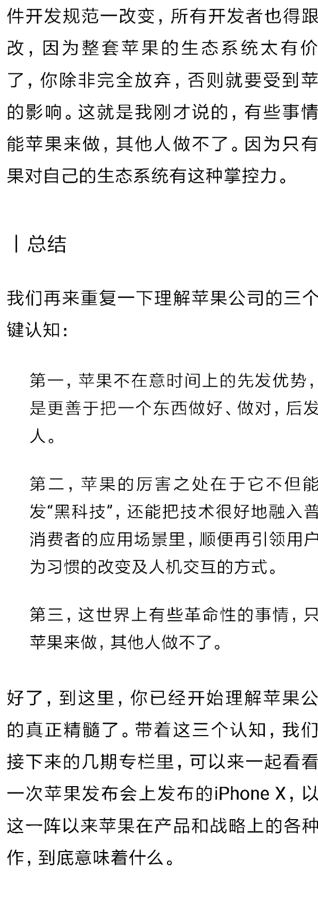

那么，你可以想象一下，如果是安卓系统，或者是某个国内的厂商当时要推行这种设计上的改革的话，不但要承受舆论压力，而且实际操作上也是不可行的一一因为安卓系统太分散了，每个厂商都有自己的改版，而且机型也完全不统一，所以哪怕你想改，也不会有人用。

而苹果为什么能做这件事？还记得我们之前说的“高度控制”理论么？这就是因为，苹果对自己的手机、操作系统都是高度控制的，机型有几台自己说了算、操作系统早晚你都得升级，不接受也得接受，甚至软件开发规范一改变，所有开发者也得跟着改，因为整套苹果的生态系统太有价值了，你除非完全放弃，否则就要受到苹果的影响。这就是我刚才说的，有些事情只能苹果来做，其他人做不了。因为只有苹果对自己的生态系统有这种掌控力。

## ｜总结

我们再来重复一下理解苹果公司的三个关键认知：

- 第一，苹果不在意时间上的先发优势，而是更善于把一个东西做好、做对，后发制人。
第二，苹果的厉害之处在于它不但能开发“黑科技”，还能把技术很好地融入普通消费者的应用场景里，顺便再引导用户行为习惯的改变及人机交互的方式。
第三，这世界上有些革命性的事情，只能苹果来做，其他人做不了。

好了，到这里，你已经开始理解苹果公司的真正精髓了。带着这三个认知，我们在接下来的几期专栏里，可以一起来看看这一次苹果发布会上发布的iPhone X，以及这一阵以来苹果在产品和战略上的各种动作，到底意味着什么。

迪士尼 | 高度控制与VR技术伦理学
苹果 | iPod：主动出击
苹果 | iPhone：改变一切

张潇雨

今天给你留一个互动题：你还记得你在第一次用苹果产品，或者用其他品牌的电子产品的时候，有什么特别让你惊喜的瞬间吗？欢迎在留言区写下来，和其他同学交换体验。我们明天再见。

## 用户留言

## 苹果II | iPhone X的Face ID有什么意义？

我们继续来讲苹果。

从今天开始，我们的任务就是带着上期专栏里提到的对苹果三个关键的认知，来透过表象分析一下苹果的新产品到底意义何在。

首先，让我来复习一下之前提到的这三个关键认知：

- 第一，苹果一向不在意时间上的先发优势，而是更善于把一个东西做好、做对，后发制人。
第二，苹果的厉害之处在于它不但能开发出“黑科技”，还能把技术很好地融入普通消费者的应用场景里，顺便再引领用户行为习惯的改变及人机交互的基础方式。
第三，这世界上有些革命性的事情，只能苹果来做，其他人做不了。

那么，就让我们直入主题，来看看9月中旬苹果发布会发布的关注度最高的产品：iPhone X。

## | Face ID是什么

和很多人的观点不同，我认为iPhone X是真正的划时代的产品。可以说苹果在iPhone发明十年之后再次拿出了预示着未来的产品。关于iPhone X的各种意义，我们之后会一点点分析，今天我们先来看第一个点，也是iPhone X非常令人瞩目的一个功能：Face ID。

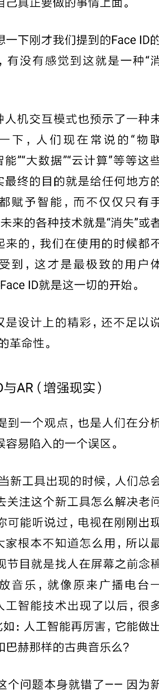

## | Face ID有什么意义

## | Face ID与AR（增强现实）

## | 用三个关键认知总结Face ID

星、微软等等一些厂商早已经推出了打着类似旗号的“人脸识别”或者是“虹膜识别”功能了。再一次，苹果说，你们做得都不对，还是我来告诉你们这件事应该怎么做吧。

第二，苹果的厉害之处在于它不但能开发出“黑科技”，还能把技术很好地融入普通消费者的应用场景里，顺便再引领用户行为习惯的改变及人机交互的基础方式。

刚才我们说到了，Face ID的解锁方式是前所未有的，也是一种全新的 人机交互方式。苹果一旦开始使用这种技术，就意味着未来几十亿台设备——不管是iPhone还是它的模仿者——会迅速铺到每个终端消费者那里去，然后影响几十亿人与机器交互的方式。包括这次推出的那个动态表情 Animoji的应用，本质上也是趣味地来教育消费者习惯这种把自己的脸和表情投射在手机上的方式。所以最终，苹果也会带领大家进入一个新的 人机交互的时代。

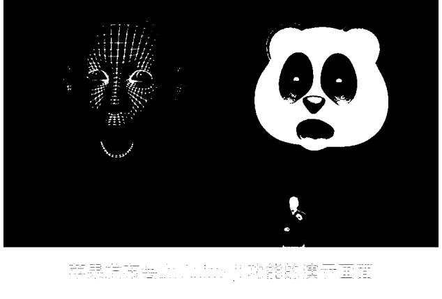

最后，这世上有些革命性的事情，只能苹果来做，其他人做不了。

基于之前的所有阐述，相信这一点已经无须赘述。

无印良品 | 深泽直人与「无意识设计」

张潇雨

听完了今天的内容，你对刚发布不久的 iPhone X的看法有没有什么变化呢？欢迎在留言区写下来，和大家一起分享。

## 苹果II | 苹果的未来：最大的AR公司

我们继续来讲苹果。

昨天的专栏，我们分析了iPhone X的Face ID功能。在文章里我下了一个结论说：苹果的未来，就是世界上最大的AR公司。

这是一个很大胆的结论。当然这也不是我的独家结论。实际上现在业内很多真正的专业人士都这样认为，包括CEO库克自己也说，苹果未来会花非常多的精力来研究AR。今天的专栏，我想接着昨天对iPhone X的分析，来谈一谈这个划时代的新产品对苹果在AR方面的布局有着颇为影响。

### 全面屏

先来说说这次iPhone X大家讨论非常多的点：全面屏。

全面屏这个词从2017年开始就异常火热，类似的一个词叫做“屏占比”，也就是屏幕占据整个前面面板面积的比例。

### 拍摄功能

在写专栏之前，我读到了一篇很好的文章，名字叫做《iPhone X正式告诉我们，手机和相机开始分道扬镳》，作者是荆慢慢，链接我也附在了最后。这篇文章提出了一个非常重要的观点，那就是：从iPhone X开始，手机的摄像头像不再是单反相机的一种低端的替代品。从前的情形是，手机可以做到的，相机一定做得更好；而现在是，手机能做到的，相机已经做不到了。

### 苹果为什么选择AR?

最后，我们来想想一个看似显而易见但又非常重要的问题，那就是：在VR和AR这两项技术之间，苹果为什么如此坚定地选择了AR呢？

在里面进行各种活动，比如一个游戏世界就是这样。而AR是augmented reality，增强现实。它是利用技术叠加在真实世界中，把现实“增强”，从而产生更新更好的体验。

然而，VR有一个巨大的问题——这时候，正好可以复习一下我们之前的一篇专栏，《迪士尼｜高度控制与VR技术伦理学》。里面我们讲到过一件事就是：如果非常先进的VR技术真的实现，那么意味着我们把自己感官的大部分功能就都交出去了。VR营造了一个完全虚拟的世界，所以它就控制了你的视觉、听觉、触觉，也许有一天还有嗅觉和味觉。这种过高的浸入感实际上是很有可能有成瘾性的。

或者换个角度说，比如在社交这件事上，AR的方式可能是帮助大家在沟通交流的时候更好地相互理解，或者能看到共同的画面、信息等等，但是VR可能就让我们在虚拟世界见面了，所以它实际上阻断了人与人的真正沟通。这其实和苹果以及乔布斯一直倡导的人文精神是相违背的。因为乔布斯一直认为，好的工具都应该是解放和发展人性的。

所以，苹果变成一家AR公司，帮助人类更好地与彼此交流、创造出更多的作品、探索自身与环境的关系，正是这种人文精神的传承。这也是苹果，真正伟大的地方之一。

迪士尼｜高度控制与VR技术伦理学

张潇雨

这三天我们都讲了iPhone X，听完这些内容之后，你想买iPhoneX吗？你可以在下方投票，我们一起做一个预售情况的小调研。

## 苹果II | AirPods到底是什么？

我们继续来讲苹果。

前面的三篇专栏听完，相信你已经非常理解苹果的未来为什么会是一家AR公司了。苹果的iPhone X这款时代表的产品可以说承载了整个公司未来的规划。那今天的专栏，我们可以把这个论断再往前推进一步——苹果给自己设计的未来，不仅仅是一个AR公司，更是一个全平台全感官的AR公司。

为什么叫做全平台全感官呢？我们来看看到苹果之前发布的一款产品就知道了。这就是苹果的无线耳机：AirPods。

一开始, AirPods经历过一段严重缺货的时期。如今，这款耳机已经推出一年左右，产能终于爬升上来了。在更多人用上了这款无线耳机的时候，我们来看看AirPods的真正意义是什么。

### AirPods基本情况

无线耳机相信大家都不陌生，AirPods就是苹果推出的无线耳机，外观其实有些像苹果之前官方的耳机，也是白色的。由于是在苹果的生态系统里，所以AirPods和iPhone以及苹果系产品的配合是天衣无缝的。比如：

AirPods上没有任何按钮。如果你打开音乐的App，戴上耳机之后，就以实现自动播放；如果摘下其中一个，就会自己停止播放，再戴回去的话，音乐就会继续了。就像魔法一样。

当外界都在分析这款耳机的音质、价格还有外观如何的时候，真正懂苹果的人，会发现这款耳机三个非常重要的特点：

- 第一，这款耳机是和iPhone 7以及iPhone 7S一起发布的。你还记得那一代iPhone在外观上最大的突破是什么吗？没错，就是取消了所有人都熟悉的3.5mm的耳机孔。
第二，这款耳机自带一块叫做W1的芯片。这是苹果自己研发的第一块无线芯片。
最后，除去那些玄妙的触控操作以外，AirPods还有一个重要的功能：轻敲两下耳机，就可以帮助出苹果的智能助手Siri。

### AirPods的意义——新的计算平台

这三个特点到底意味着什么呢？我们不卖关子直接来说结论。这三件事情预示着，AirPods远远不只是一个好用的无线耳机那么简单。AirPods真正的使命是，为苹果开启iPhone之外的一个全新的计算平台。

为什么这么说呢？

首先，关于取消大家非常习惯使用的3.5mm的耳机孔，很多人都在吐槽说不方便，还有不少人发泄各种不满。但是，历史总是惊人的相似，想想苹果曾经淘汰的东西：软盘、光驱、网线接口、可拆卸的电池，手机上大SIM卡变成了小的Nano-SIM卡等等等等。每一次苹果做出这样引领行业规范的举动，都会受到很多质疑。但最终呢？所有人都会走到苹果的轨道上来。在这一点上我总说，大众永远是落后而且健忘的。

这一次的耳机孔也是这样。其实取消这个耳机孔，无非是苹果非常直白地说出了：无线耳机才是未来。换句话说，不管你想不想适应，以后早晚你都得适应。还记得我们之前提到的理解苹果的关键认知么？苹果总是能把非常先进的技术应用在消费级的产品里，而且还能引领用户行为习惯的改变和人机交互的基础方式，而且这种事往往只能由苹果来做。AirPods再一次印证了这一点。

那么，AirPods到底想引领用户什么样的行为习惯呢？其实答案就蕴含在刚才我们说的第三点那里：轻敲两下耳机，就可以呼叫出智能助手Siri。这其实就是苹果给自己设计的未来。

想把这件事说清楚，我们应该先回答一个问题：为什么Siri推出了这么多年之后，用的人仍然不多呢？

我猜答案无非是下面这么几个：

- 第一，语音识别不准，导致交互起来非常费劲。这一点相信很多人都有感触。
第二，智能程度不够，比如Siri还是比较难理解上下文，以及一些习惯用语、缩略语等等，尤其在中文上更是修不忍睹。
第三，使用起来有点尴尬。虽然现在说“Hey, Siri”就能启动，但是每次也有点麻烦。另外很多人也应该有这种经验，在公众场合对着手机话筒说话是很难自然的，甚至有点尴尬。

这三个原因，让Siri没法被大众广泛地接受。

随着苹果的语音和人工智能技术的发展，我们相信第一和第二条最终都会解决，而现在，AirPods这个产品来解决第三条了。

当你戴上AirPods的时候，就不用把手机拿在手上，而且随时轻轻敲两下耳机，就可以对Siri发号施令了。这和我们人与人之间的交互方式已经很接近了。想象一下如果你有一个办公室助理，你需要让TA安排一个会议、订一张机票，其实现交互也是类似的，现在我们可以让Siri做类似的事情。

我们可以把这个逻辑再往前推一步。刚才我们提到，AirPods搭载了苹果研发的W1芯片，实际上这款芯片解决了非常多蓝牙无线耳机固有的问题：过流噪声、低功耗、更精准地捕捉语音等等。如果这款芯片有一天成了更先进的处理器，然后AirPods开始有了自己的App，可以配合Siri实现更多独立的、复杂的功能，这个“轻轻双击”的动作就不再是一个要耍的操作了，而会变成一个越来越独立于iPhone手机和Mac电脑之外的新计算平台。这一切的开端都是AirPods。

如果我们把AirPods和苹果这几年的另外一个新产品Apple Watch来对比，就会发现一些端倪。随着iPhone X苹果刚刚推出了新一代Apple Watch Series 3。这一代的Apple Watch，已经引入了网络支持，内置e-SIM卡，还搭载了W1芯片的升级版W2，这一序列升级直接导致了三个变化：

- 第一，Apple Watch可以脱离手机直接打电话了；
第二，Apple Watch可以直接和AirPods连接，在户外没有手机的情况下也能听歌、运动等等；
第三，新的处理器让Apple Watch上的Siri运行得更好。

听到这里，不知道你有没有恍然大悟：苹果真正的野心，就是在iPhone——手机，和Mac——电脑之外，再开辟两个独立的计算平台——也就是未来你的手腕上和耳朵里，都会有苹果的存在。

另外你还记得我们之前提到过的苹果的智能家居设备HomePod么。所以这些东西，搭配上Siri和各种人工智能的技术，就是苹果眼中的，全平台全感官，无处不在的智能未来了。

从另外一个角度讲，我甚至慢慢地相信，苹果已经开始着手杀死自己最明星的、带来利润也最多的产品，iPhone了。未来的智能会无处不在，所以以手机为中心的科技生活，早晚有一天要被取代。不管是人工智能，还是AR，还是语音交互等等这些概念，最终都是要为人来服务的。不论是手机、手表还是耳机，工具的在存在形式并不重要，真正重要的是，作为这个世界上最重要的科技公司，苹果在这种进化里面，一定要占有一席之地。而亲手杀死iPhone可能就是那个答案。

而且，千万别怀疑苹果是否有魄力这么做——2007年，苹果最如日中天的产品正是 iPod，它每年给公司贡献的收入接近一半，而也是那一年，苹果推出了那个叫 iPhone 的手机。

张潇雨

在你看来，苹果会杀死 iPhone 吗？

# 用户留言

字号

写留言

88

请朋友读

## 苹果II | 公司的组织结构

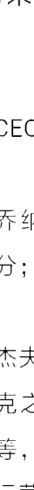

今天是我们本周讲苹果的最后一期。

在前四天的文章之后，相信你已经对苹果这家公司有了更进一步的理解。那今天这篇专栏，我们就从苹果具体的产品和业务跳出来，来看看另一个大家关注不多，但又很重要的话题——苹果公司的组织结构。

### 苹果公司的职能型组织结构

总的来说，苹果现在的整体架构是这样的：

CEO是蒂姆·库克，负责管理整个公司；

乔纳森·艾弗，掌管整个关于设计的部分；

杰夫·威廉姆斯（Jeff Williams）做的是库克之前的工作——负责运营、供应链等等，他也同时是公司的COO，也就是首席运营官；

### 索尼的产品部门型组织结构

对于苹果这样的组织结构，我们之前在《苹果：结尾与终章》那篇专栏里提到一件小事。当时的故事是这样的：

### 职能型组织结构的优缺点

职能型组织结构也有自己的优缺点。

优点：相对减少了部门之间的利益纠纷，让大家可以更好地合作

### 乔布斯的贡献

怪的要求开发出来的。比如光是麦金塔电脑就有几十个版本，而且每个版本都有各种编号，比如有的叫1400，有的叫9600，总之没人看得懂。乔布斯最后只能问：我要是我想给我朋友买一款的话，到底应该选哪个呢？结果没人答得清楚。而且那会儿苹果居然还卖打印机和服务器。

后来乔布斯终于受够了，在一次产品会上大家又讨论起产品线的事，结果乔布斯拿起一根记号笔，走到白板前面，画了一根横线一根竖线，形成了一个一个2x2的方格。然后他在横向上写了“台式”和“便携”，在纵向写了“消费级”和“专业级”。然后他说，虽然我们是个有一万名出色员工的伟大公司，但是如果我们精力过于分散，是不会做出好产品的。苹果的工作，就是做四个伟大的产品，这里一个格一个。当场所有人鸦雀无声。

后来，苹果在乔布斯的领导下砍掉了90%的产品线。整个公司也在乔布斯画的这每一个方格里都拿出了非常出色的产品，赢得了世人的称赞。从乔布斯回归，到他正式成为CEO这段时间里，苹果的股价翻了八倍多，可以说是起死回生。而我没有讲到，当时除了调整产品线之外，乔布斯还做了一件事，就是把整个公司从以产品为中心的结构，调整成了以职能为中心的结构。

二十年过去了，我们仍然在受益于他的智慧。

《苹果｜王者归来》
《苹果｜结尾与终章》

张潇雨

不知道你有没有发现，我们今天讲的苹果的这种全公司整体负责，不单独对每个产品进行结算的管理方式，和之前我们讲过亚马逊的，把每个业务都尽量独立出去，接受市场的检验和竞争，是非常不同的。这是为什么呢？专栏讲到这里，你应该有了一点自己的见解。请在留言区写下你的答案，和其他同学一起交流。

# 用户留言

## 周末互动｜乔布斯真正的作品是苹果公司

周末互动｜乔布斯真正的作… ↓

你好，欢迎来到商业经典案例课。我是张潇雨。

这周的周末互动之前，先祝所有《商业经典案例课》的读者和听众们国庆快乐。这次国庆要放8天长假，希望大家能玩得开心。不过国庆期间专栏是不会停止更新的，也欢迎大家随时来专栏看看。

这周我们又讲了苹果。在开始今天的内容之前，请允许我先感谢两个人，在研究苹果的过程中他们很多分析和观点都对我很有帮助。

一位是 Ben Thompson（Ben Thompson），他是一个在业内非常著名的科技行业的分析师，现在是独立运营，就像“得到”的作者一样也有自己的专栏，有兴趣的同学可以去看看；

另外是 李如一 老师和他的播客节目《一天世界》，这个节目也经常讲到苹果；

另外，著名的科技博主 Marco Arment 和 John Gruber 也很值得看看。

总有一些同学问我写作的资料来源是什么，以后有好的资源我还会给大家推荐。

这次的互动我想来说说两件小事。当然都和我们这周专栏的内容有关。

### 1. 关于Face ID的诞生

在苹果开完发布会的两周左右时间里，很多信息源——包括主流媒体、和苹果走得比较近的科技博主，还有代工厂的工人等等，都证实了一件事，那就是此次iPhone X上的Face ID其实并不是之前传说中的，因为指纹Touch ID没法做在屏幕下面，技术达不到，所以选择了一种技术替代品。而其实是两年多前苹果已经开始布局研发的新技术了。所以Face ID的使命可能比我们想象的还要多一些。我觉得是值得期待的。

### 2. 关于对苹果的不同意见

我发现很多同学这周的留言都提出了很多对苹果新产品的不同意见。我觉得这很好，因为讨论一定是有正方反方观点的，只要是有自己的思考和分析，其实结论本身并不重要，毕竟没有人是预言家，分析的过程本身才是最重要的。

另外如果你熟悉我做这个专栏的风格也能发现，在评论里我是经常会放出一些不同意见，甚至直接指出我错误的。比如上次周末互动的时候我就把iPhone X念错了。以后希望大家还能来监督我的专栏，这个专栏的质量当然也会因为你们的参与变得更好。

不过有不少同学表达的一个观点我并不是很赞同，这里可以单独拿出来讨论一下。我觉得也有益于我们对苹果的理解。很多同学说：

这次真的不看好苹果的产品，就拿iPhone X来说，那个“刘海”太难看了。我觉得要是乔布斯还活着的话，一定不允许这个“刘海”存在。

我觉得，这个论断有两个很重要的问题：

第一，没法证伪。

这种判断本身没法证伪，也就是不可验证的，全然是我们的一种猜测。所以用这种证据来支持自己看好或者不看好一家公司或者一个产品，其实对我们进行商业分析并没有太大帮助。我这么说吧：

不知道你还记不记得iPhone 4曾经有一个“天线门”事件。iPhone 4可以说是苹果非常经典的一个设计了，不过当时候发布之后就立刻爆出一个缺陷：当用户用两只手拿住手机的金属边框的时候，整个手机的信号就会非常差，甚至完全无法工作了。这件事情当时闹得非常大。

好了，那我们是不是也可以说，“天线门”这么巨大的、超级影响用户体验的事，要是乔布斯在肯定就不会发生呢？但是别忘了，当时乔布斯确实还在呢。

那我们再来说一个反例。相信你还记得，乔布斯在生前说过一句话，他说手机屏幕最佳的尺寸就是3.5寸，更大的屏幕非常蠢。也是因为这个理念，苹果直到第6代才推出了真正意义上的大屏手机，比起三星、华为等厂商要晚得多。可是现在你觉得全世界的用户还能用回3.5寸的屏幕吗？显然已经不可能了。

### —— 本周留言精选 ——

### 苹果II｜理解苹果的三个关键认知

的。苹果公司有较低试错成本，一旦技术可行，满足需要，苹果就大规模进入。这个不是MVP，反倒是趁势明朗，条件成熟后迅速进入，抢占市场，利用自己品牌，技术集成，消费者需求把握上的优势，牢牢把握市场，利润最大化。苹果在运营上真是自成风格，做法也比较独特。

之前一直是安卓用户，用的第一款苹果产品是iPad mini4，最惊艳的地方是iOS系统干净，里面的App尊重人性，不像安卓，强制推送。既然今天上到该专栏的意思，我来说说自己的体会吧：1. 以前观察企业，大多从盈利、产品等角度出发，如今会回归于生活，来思考公司的价值。我总觉得那些一心想赚钱的公司很难持久；真正从用户生活出发，一心为用户着想的公司，成功会在不经意间发生；另外，相比于以前好强的事业心，如今考虑更多的是，如何让自己活得更好；2. 一直以为盈利能力，是评价一家公司好坏与否的标准之一。然而，没想到的是，在这里遇到了亚马逊。聰明的人跟随趋势，有智慧的人努力去寻找那些不变的东西。见斯每年轻时殿东的信，太有智慧。另外，如今做选择时，时间维度变长URLException 3. 如今出 去逛商场、吃肯德基，会留意商店的摆设，员工的服务，商店的运行效率等等，看来是有点走火入魔了；4. 以前看到关于搞炫酷的黑科技，如今考虑更多的是如何将科技更好地融入于生活，从而更好地丰富人的生活。

有一点小小的延伸：1.关于后发制人。当时Siri整合到苹果之前，安卓已经有相似的语音功能，但是却没有Siri那么智能。2 关于黑科技。iPhone X上的AR功能，拥有建模能力可能实现的功能。被苹果应用到了手机上，期待未来软件能跟上。3. 关于其他人做不了的。当时的手机都能换电池，苹果先做到了不换电池。还有从iPhone 7开始把耳机孔砍掉的例子。包括未来去掉SIM卡的可能。如果没有苹果，没有乔布斯，没有他们设计的手电电脑，互联网时代不知道会晚多少年到来。

### 苹果II | iPhone X的Face ID有什么意义？

应该说手机和任何我们所见的电子产品都是人类实现某些想法的工具，这些想法包括了解世界和了解自身。了解自己就需要大量的数据，在数字化的过程中，以Face ID为代表的增强显示技术无疑是最为巧妙的方式之一。因为Face ID除了以录入面部数据作为安全解锁，更重要的是结合语音增强技术可以将人类的情绪实现数字化，可以说为人工智能理解人类理解生命真正打开了大门，届时结合仿真皮肤和毛发技术距离制造出复制人也指日可待。第二，增强现实技术 + 实时3D建模 + 物理引擎 + 运动控制引擎 + 先进演进算法等这几个核心技术的叠加，很快就能制造出能够代替人类完成绝大多数任务的超级机器人。最后当我一个普通人将这些技术能设想和分解未来的那一天，我就知道不管这是否可期的结果，但一定是人类躲不过统不开关的情景。

看了老师的文章，才明白iPhone X的售价是在其自己的合理价格区间内。看了老师的文章，才明白Face ID背后的意义这么大。想熬夜看发布会，一觉睡过去了。不过，读了这两篇和苹果10相关的文章后，我才发现就算看了发布会也没有太大意义。这让我回到那个观点：学习的目可能不在于让自己变得多厉害，而是脱敏思考。唯一使自己欣慰的就是，不会随大流地寒颤，心中有一个清晰的认识：苹果这样做，一定有它的道理，毕竟它是世界上最伟大的公司，背后站着的是最顶尖的脑袋。摆脱愚昧，从承认自己愚昧开始。

拿起手机毫无卡顿的开始顺畅阅读的画面，让我脑子里瞬间想到了纸质书本的隽落。随着物品极大丰富，居住空间又相对有限，科技或许会完全消灭纸质书本，还有家庭书架的存在，再也不会有都敬君的香炉书房，不会有钱钟书老先生的数本读书笔记，而是海量电子书和印象笔记这样的科技工具。

人机交互最吸引人的应 该是《钢铁侠》里托尼和智能系统贾维斯之间的交互，“机器的概念消失了，可以正常进行对话，智能系统连接了你身边的每一个可连接的物件，前段时间天猫也推出了“天猫精灵”（尽管技术还差很远），这些人类的想象正推动着科技创新的尝试，现在google、苹果还在研究对眼球动作的移动捕捉，甚至希望有天能通过眼球来进行人机交互。如果真能实现，那打游戏时你就可以说“看我用眼神杀死你”。以前指纹解锁已经“消失”了我手动输入密码的动作，Face ID会进一步消除我们达到使用目的之间的阻碍。这个小的改变最直观的是无形当中提高了时间效率，更别说是未来新交互体验的一颗信号弹。

昨天看到张老师讲iPhone X的时候，就觉得其实现这款手机功能不能像以前的机型一样卖出过千万台对于苹果来说不是最重要的，重要的是采集中用户体验优化后迭代机型的设计，因为将AI和AR无缝融入到消费者生活里靠实验室数据是不行的。必须要受众也做到先入为主，培养无意识直觉营销也是苹果的强项。它除了是一家科技公司还是一家4A广告公司。

### 苹果II | 苹果的未来：最大的AR公司

今天还了解到了AR和VR的区别，以及苹果的人文精神。苹果坚定地选择AR技术，这也是与乔布斯的人文精神相关的。工具的使用是为了解放和发展人性。AR和VR不同的是，AR是增强现实，将虚拟的物件投射的现实中，刺激你的感官。VR是虚拟现实，给人模拟一个完全虚拟的环境，代替你的感官。VR技术明显与乔布斯的观念相违背，所以苹果选择了AR技术。这也辅助推动了全面屏技术。或者说，全面屏技术也是人文精神的体现，即弱化工具体对人的影响。

突然想到隔壁专栏王煜全老师提到过MR(混合现实)的概念，如果MR技术发展到可以时时做到景象的动态追踪，也就是将现实的东西虚化建模到手机终端上，并可以交流每时每刻的场景，那对于人类的协作会更加高效，比如说可以在远程进行MR的前线指导，在危机情况下专家可以远程教学，非常具体化。例如：高速公路爆胎的临场处理，或是受伤时的医疗机构线上即时交流等等。我想如果苹果能把AR技术更强大地扩展到MR上，会是一个非常大的里程碑。补充：(1)AR增强现实：把虚拟的东西叠加到现实世界。MR混合现实：把现实的东西叠加到虚拟世界。VR虚拟现：其实就是线上游戏。你看到的东西都是假的。AR比较容易，现在连游戏都有了，例如：pokemon go。MR的难点：首先，要先把现实的东西虚拟化，用摄像头发捉画面，只不过是二维的，再透过计算做3D时建模。(2)苹果的增强现实平台已经在打造，且可以和UNITY3D开发工具兼容。苹果在AR产业游戏的地位会受很强。(3)这次的iPhone X发布的亮点其实不是无线充电技术，最大的亮点是搭配ARKit(增强现实软件平台)的“硬 件解决方案”，也就是“人像光效”的深度摄像头，用来理 解人脸的深度，做出3D建模的景深效果。这是一个非常了不起的技术。未来会更广泛地应用在混合现实领域里面的高度协作上。

苹果这次发布会后我听到的普遍声音就是不看好，什么8没有创新，10太难看了，刘海太难看了，苹果要走下坡路等等。这种声音似乎很耳熟，乔布斯去世后一直就在耳边流传，我也曾经是这里的一员，总希望看到一个巨头的倒下，貌似会有很多的快感。这次我通过一些观察判断，当你拿到10的真机的时候你还是会被它震撼到，也肯定会很好的销量。现在大部分人还没有感受真机，所以需要一个释放的过程。虽然我也没有拿到，所以这是我的一个判断。接触“得到”以来，想得到了很多改变，要学会独立思考。要尽量和大部分人持有相反的态度，并且努力找到支持自己的证据，来说服自己。这个过程很享受，因为你会成长，你会看到大部分人看不到的东西。相信世界上拥有这种能力的人永远都是少数。谢谢“得到”，谢谢张老师。

虚拟就会让人上瘾，就像游戏，而且，会让人脱离现实。但是增强，就是一种好方法，它让人能更好地认知现实，从而活得更好。不过，人类既要虚拟的现实，因为，可以暂时离开乏味的现实，也需要增强的现实，因为，要解决信息不对称的

增强的现实，因为，要解决信息不对称的问题。这两种，都会活得好。只是，目前虚拟现实这一块，已经做得非常好了，苹果不太可能进入，他们找到增强现实这一块，是一种好思路。不过，在短期内，很难爆发，因为，即使是增强了现实，也不一定是刚需。

## 苹果II | AirPods到底是什么？

iPhone，也就是现在的智能手机，一定会消失。当新的显示技术突破后，手上的这块大屏幕也就没有存在的必要了。目前的手机承担着个人智能设备的网关和计算中心的任务，当计算任务向云端移动更多，交互分散到智能穿戴设备上，iPhone剩下的功能就可以做得更小，放入其他设备中。当然“得到”也不再是今天这个形态了。

苹果亲手杀死iPhone进入到下一个计算平台是必然的趋势：首先，手机作为一个传递信息的智能产品最终会被新的产品替代；其次，杀死iPod的魄力让我们相信苹果不会站在iPhone的利润里裹足不前；最后，因为有些事情只有苹果可以做，所以这个“杀手”一定是它自己。

每一次进步中带来最大阻力的往往不是我们想象的外在因素，而是之前所取得的优势或者成功，从intel作为处理器到苹果推出iPhone取代iPod，每一家创新型的成长公司都会面临这一问题，不同的是有的公司会毫不犹豫地站在趋势这边。

## 结论

苹果是会杀死iPhone的，随着技术发展可穿戴产品越来越好，佩戴越来越方便，可交互技术，大数据采集，语音识别越来越准确，有可能一个姿势，智能穿戴设备就会识别佩戴者的意图。智能穿戴设备通过多个维度让人们提高效率，人们通过智能穿戴设备解放双手，那块玻璃的作用越来越小，最后就会消失了。

苹果是一家不断“自我迭代”的公司。看到最新的Apple Watch Series 3广告，可以由衷地感觉到iPod在手腕上的重生。16年前iPod推出时，最脍炙人口的广告语就是“1000 songs in your pocket”（一千首歌放在口袋里）。现在Apple Watch S3 + Apple Music + Air Pods = “4000000 songs on your wrist”（四百万首歌戴在手腕上）。所以，苹果真正专注的是人性化的电脑产品，不论是放在口袋里作为音乐播放器，放在桌上用的笔记本电脑，拿在手上作为电话，还是戴在手腕上或是放在耳朵里。

## 苹果II | 公司的组织结构

亚马逊走的是低价路线，从卖标准化的书籍起家，各种内部外部的服务也相对标准化，容易分拆服务，拼的是性价比。苹果卖的是独一无二的用户体验，对外高度控制，对内从软件到硬件的全局优化支持这种用户体验。苹果的服务一旦分拆，光比拼性价比，那就是以自己的短处拼人家的长处，而且组织架构也不支持这种业务类型。

职能式的架构本质上是一种官僚体制，这种体制千万不能过大，层级最好不要多于三层，否则其复杂度带来的缺点将掩盖其优点。如果一个企业无可避免地变大了怎么办呢？那就是诸侯制，分而治之。但是每个诸侯内部又是一套小的官僚体制。人类文明早期政治体制多是封建诸侯制，大约也是这个原因。因为当时的技术、通讯、交通手段无法支持一个较大的官僚体系去管理一片较大的疆域。

我觉得苹果是在打造自己产品领域的最好最领先，凭借自身的优异基因和卓越文化，以单个的卓越产品取胜；亚马逊是以“亚马逊丛林”般的生态平台为导向，追求物产、物件等的丰富，遵循“物种的自然选择和演化”规则，以丰沃繁多的优良产品和服务取胜。对了，满雨老师，除了职能型和产品型组织结构，我觉得还有客户型组织结构，就是不同部门负责专属的客户，产品有不同，也有接近和类似的，甚至还有一样的，职能框架也是差不多的，类似一个公司里的“小公司”一样。

我认为亚马逊和苹果提供的服务类型不同。就像我们刚才提到的通用电气，它现在旗下有几十家业务完全不同的公司。通用能源、通用航空、通用金融、通用医疗、通用照明、通用交通、通用资本，这些业务跨度非常大，远不如iPad和iPhone之间的协同度。《亚马逊》终极野心——万税帝国》中，AWS服务、FBA、Marketplace业务、收购Whole Foods全食超市，以及接下来可预见的影音服务。亚马逊的终极野心是：向所有的网上活动“收税”。既然是这样，那么亚马逊就有理由发展出更多的业务部门，分别接受市场的竞争。

亚马逊追求的是飞轮效应，跟苹果公司不一样。苹果其实一直在升级自己的产品，任何公司都几乎只有这一条路，除了老干妈等一些少数派。苹果这样的高科技公司，对于科技的发展必须非常敏感，不然，就容易被别人超越。乔布斯一心想做出好产品来，他总在强调简洁，所以，公司也没有太多的层级，大家交流非常方便，协同效应非常好。而像亚马逊，产品很多很杂，从a到z，如果也需要全公司来协作，那是不可能的。商业模式不同，决定了职能也不同。

## Airbnb | 成功了的最烂的想法

最近我们刚刚结束了一个奢侈品行业的专题分析，还为苹果公司做了一周的特别讲解，接下来，我们要进入一个新的小专题了——硅谷与创业。

我们之前对科技行业的分析基本上以大公司为主，接下来一个多月的时间里，我会带你分析和解读一些好的创业公司，以及我眼中的硅谷创业方法论和创业文化。

我在开设得到专栏之前主要的工作其实就是创业，自己也花费了很多的精力和时间来思考创业这件事情。所以可以说这个系列小专题也是我个人很喜欢、投入了很多精力，也非常同身受的一部分内容，希望你在这个专题之后能够有所收获。

这一周的专栏，我们就从硅谷这几年的一个明星创业公司开始讲起，这家公司就是：Airbnb。

Airbnb这家公司在硅谷有着非常特殊地位，原因不仅是它引领了这几年最火的“共享经济”，很多人创业的时候说最多的就是“我要做某个领域的Airbnb”；同时，它也是一个关于创业方法论、硅谷文化和企业家精神的传奇载体。今天，我们就先从Airbnb的创业历史讲起。在这段历史中，你也会看到关于创业的最真实的经历。

## 什么是Airbnb?

Airbnb诞生于2007年。在我们的印象里它好像还很新，但事实上，它从诞生到现在已经超过十年了。

Airbnb有三个联合创始人，布莱恩·切斯基（Brian Chesky）、乔·歌比亚（Joe Gebbia）和负责技术的纳森·布里查兹克（Nathan Blecharczyk）。

和很多明星创业公司不一样的是，Airbnb的主要创始人并不是斯坦福大学的MBA或者天才工程师，而都是设计师出身，毕业于罗德岛设计学院（Rhode Island School of Design）。所以后来Airbnb也激励了很多非商科或者非计算机专业背景的人出来创业。

另一方面，Airbnb的故事可能和很多创业故事一样。比如，一开始几个人并不知道自己要干嘛。当时切斯基找了一份与设计相关的正经工作，但是大学同学歌比亚一直劝他一起去旧金山创业，做点自己的事情。在歌比亚的软磨硬泡之下，切斯基最终下定决心辞职，而当时他身上只有1000美元。

即使在2007年的旧金山，1000美元也是干不了什么的。到了旧金山，切斯基发现，随便找个房子，房租都要1200美元。更别说住酒店了。恰巧他们当时还赶上了一个国际设计大会要在旧金山召开，由于参会人数太多，导致附近的宾馆酒店早已被预订一空了。

结果就是这个契机，让歌比亚想到了这么一个主意：既然世界各地的设计师都要来旧金山开会，他们肯定都需要找住的地方。所以，如果专门给大家会参会人员提供“床位+早餐”的服务会怎样呢？

于是，歌比亚就给切斯基发了一封邮件，当时他们谁也没想到，后来这封邮件会改变世界。上面是这么说的：

> Brian，我想到了一个赚钱点的方法——把我们住的地方打造成一个“床位+早餐”的小旅馆。也就是说，我们可以给参加4天全球设计大会的设计师们解决饮食和住宿问题，为他们提供无线网络、小型办公座椅、充气床席和早餐。——Joe

在这封邮件里，你可以看到一个创业公司最真实的一种状态：
- 第一，他们并没有一上来就说要改变世界，而是要解决一个非常具体的问题；
- 第二，这个问题是他们自己感同身受的；
- 第三，他们的动机也很简单，不是要发多大的财，就是想赚点钱活下去。

这几点其实非常重要，你可以慢慢体会。不过不用着急，在之后的专栏里，我们还会反复讲到创业的想法、创业的动机以及创业的方法等等相关的知识，到时候我们会再来复习Airbnb。

另外，关于Airbnb还有一句不得不记住的话，我觉得也是形容Airbnb最准确的一句话，在硅谷非常流行，人们说：Airbnb是他们见过的最后居然真成功了的最烂的想法。

是啊，谁能想象只是把自己家的床租给开会的人这样一个项目，也能变成价值超过300亿美金、开启了一个互联网时代的伟大公司呢。

不过，当时他们连床其实都没有，只有三个充气床，只能凑合着用了。于是三个人把这个项目命名为“Airbed and breakfast”——直接翻译就是“充气床+早餐”，当时上线的网站也是airbedandbreakfast.com。这就是Airbnb名称的真正来源，两个b分别代表的是bed——床和breakfast——早餐。

## Airbnb正式开张

刚才我们说，很多成功创业者的共同点是：他们一开始也并不知道自己要干嘛。现在，这三个人终于知道自己要干什么了，然后他们就遇到了成功创业者的第二个共性——决定要做的这件事根本没有一炮而红，中途几次差点坚持不下去。

当时在那个设计师大会期间，Airbnb终于算是正式开张了。他们依靠这次活动获得了多少用户呢？三个。没错，伟大的Airbnb第一次开张获得的客户只有三个。

再之后，Airbnb锲而不舍地开启了它在各种大型会议上推广的伟大旅程——这里“伟大”的意思其实就是失败……

比如，在2008年的音乐盛典“西南偏南”大会期间——这个大会也是当年让Twitter一炮而红的那个大会——Airbnb又推出了充气床服务。结果在整个大会期间，他们一共锁定了2个客户，其中一个还是切斯基本人。不能不说是奇葩了。

之后，他们又在2008年丹佛的DNC大会上实验了一次。这一次他们决定不只要提供服务，还要让尽可能多的媒体对Airbnb进行报道，然后通过曝光来获得更多的房东和租客。而且他们几个发现，当年丹佛的DNC大会会有8万人参加，但是丹佛这个地方只有27000个房间可以预订。这可能是一个巨大的机会。

于是Airbnb的几个创始人立刻联系了CNN和纽约时报，告诉他们Airbnb是什么东西，希望寻求报道。结果他们回复说：“不可能，没人愿意睡在别人的床上的。”他们还联系了当地的新闻报纸媒体，也直接被忽视了。

最后几个人才只能联系了一些当地的小博客去写Airbnb，结果有一些人在Google上搜DNC大会的时候看到了这些信息，最后终于有了80个人通过当时的Airbnb预订了。是的，80个，当时他们几个人都非常激动。

## Airbnb创立初期的收获

不过，通过这几次实验。Airbnb的几个创始人收获了两个小启示：
- 1. 用户喜欢Airbnb。
他们发现，虽然使用的人并不多，但是真正用了Airbnb服务的人都很喜欢。其中用户最喜欢的部分是，一般来讲，在真实世界里人们是很笨很难快地了解一个人的，和朋友建立一段爱情都要花几年时间，但是通过让陌生人到你家和你一起吃住的方式，几天时间就能建立起一段深厚的友谊。
比如，最开始那三个用户中有一位后来还邀请了他们参加他的婚礼，还有一个人因为那次旅行改变了人生的整个职业发展方向。这些都是和Airbnb有关的。
- 2. 创业没有法则可言。
他们发现了一个小诀窍——创业没有什么法则可言。比如，Airbnb的网站“发布”了好几次。第一次发布并没有什么人关注，只弄来3个客户。然后他们又发布了一次，还是没有什么人理。后来在“西南偏南”大会上，他们又把Airbnb的网站“重新发布”了一次。

他们又把Airbnb的网站“重磅发布”了一遍，结果有一个客户想通过Airbnb在伦敦找房住，不过他并不是为了参加某个会议。

于是几个创始人就想：我们为什么非要只在会议期间为会议提供这种服务呢？而且为什么一定要让用户睡充气床，而不是真正的床呢？最终他们决定取消这两个限制，让用户可以在任何时候预订真正有床的房间。最后，这也成为了Airbnb业务的最终形态。

从2007年开始到2008年年末的这段时间，Airbnb的三个创始人可以说历经了各种辛酸，公司几度都要破产。切斯基后来接受采访的时候说，其实他们一度都放弃了这个想法。

不过有一年圣诞节他回家，他的父母问切斯基在做什么工作，他不想说自己失业了，就说：“我现在是一个正在创业的企业家。”在那个时候他突然发现，创业者和失业者最大的区别其实只是心态。只要你还没放弃，那么创业就不能叫做失败。

于是他如实地把当时已经基本放弃了的“充气床+早餐”的项目和父母说了。他和父母说完，并且再一次深入思考了这个创业想法之后，也和其他人沟通了这个项目，几个人最终决定把这个事业继续下去。

好在，曙光就在前面。

Airbnb的三位创始人就要遇到他们生命中最重要的贵人，也就是硅谷第一孵化器Y Combinator，简称YC了。可以说YC在Airbnb成功的路上扮演了功不可没的角色，而Airbnb也反过来成就了YC这个硅谷第一孵化器。在下期的专栏里，我们就来讲讲这段历史。

张潇雨

关于硅谷与创业，你最想了解什么呢？欢迎把你的问题写在留言区，或许可以给我之后的写作带来一些启发。

## Airbnb | 永远死不了的蟑螂

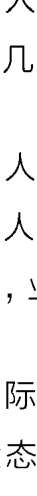

上期专栏我们说到了Airbnb的早期创业历史。我相信很多同学应该感受到了，Airbnb好像是个异类。因为它打破了很多我们对创业这件事情的认知。比如：
- 很多人说，创业团队要互补，但是Airbnb几个创始人都是学设计专业的，连懂商业的人都没有；
- 很多人说创业者要做自己领域的专家，但是这几个人根本不懂酒店业；
- 还有人说创业想法和行业很重要，但是这几个人开始创业的时候连自己要干嘛都不知道，业务还是后来慢慢改的。

但实际上慢慢你会发现，这才是创业的真实状态。而且我们之前就说过，商业不像数学和经典物理学，有足够初始条件就能得出最终结果；面对商业，我们可以做的是不断还原真相，接近真相，最终提高我们对商业的理解和成功的概率。这也是这个创业小专题我想达到的效果。

上次我们说到Airbnb成立前两年境况都非常惨，但还是他就就要遇到自己创业生涯最大的贵人，硅谷第一创业孵化器Y Combinator，也就是我们常说的YC了。

不过，让他们能坚持到遇上YC的，仍然是他们自己。而且一会儿你就会看到，正是Airbnb几个人近乎执着的坚持，才给他们带来了一线生机。

有两段小历史非常经典地反映了Airbnb的这种坚持。

### 真正牛的创业想法

其实三个创始人也一直怀疑这个“充气床+早餐”的业务能不能做大，但还是想坚持一下。不过，他们连续好几个月都是每个月只有200美元的收入——其中还有一些是切斯基自己住的——而且用户数也没有什么增长。所以为了交房租，他们还做过一个帮助人找室友的应用，唯一的目的就是想先赚钱来付房租，再一边做Airbnb，同时想想有没有什么更好的创业点子。

后来布莱恩·切斯基接受采访的时候，对于这段经历说了一段很重要的話，他说，在这段经历里他学到了一点，那就是：伟大的创业想法一开始起步来都是很慢的。

当时他们说做找室友的应用，所有人都觉得挺好；但是一说Airbnb呢，绝大多数人都觉得太不靠谱了，但最终结果却是一个看起来非常不合理想法竟然做成了。

而切斯基也说：如果你的创业想法真正牛的话，你足以大胆和别人分享，因为真正的好想法，比起那些听起来不错但实际做不成想法，最大的不同就是，一开始几乎没人能听懂，也不会属于抄袭你的想法。而这个想法只有你自己知道，它是对的，一定是能做成的。

### 打不死的小强

这个故事更加经典，现在已经是硅谷最令人津津乐道的创业故事之一了。这个故事就是Airbnb的创始人卖麦片的故事。

当时的丹佛DNC大会，虽然他们收获了80个用户，但是会议结束之后马上就没有客户预订了。他们只能继续勉强运营，找投资也找不到来，基本靠着信用卡的债务日子。

结果有一天，他们几乎已经弹尽粮绝了，于是是在一个夜里几个人想，既然“充气床+早餐”的业务做不起来，要不直接卖早餐试试吧。当时是2008年，总统奥巴马和副总统麦凯恩正在寻求连任，所以几个人萌发了卖总统主题麦片的想法。

他们找到了一个罗德岛设计学院（RISD）的校友，这位同学有一个印刷店，希望他能帮助印一万个麦片盒子。结果这个同学说，“我先给你免费印500个，你卖出去就分成给我。”于是切斯基和歌比亚灵机一动说，就把这些盒子叫“限量收藏版”吧。于是他们把这些盒子编号上，然后走访了旧金山各家超市寻找最便宜的麦片。最后，他们找到了1000盒1美元的麦片，拉回家，自己把麦片装进盒子里，然后卖40美元一盒。

后来切斯基回忆的时候说，当时他一边卖麦片一边想，扎克伯格可没靠着卖麦片来启动Facebook啊。这可能不是个好兆头。

最终，这些麦片被一些记者发现了，随着媒体传播，他们的麦片居然反响不错，卖掉了八九成。终于，他们把信用卡算还清了。不过因为缺钱少粮，过去的一年里切斯基已经瘦了快20斤，而之后他们也靠吃剩下没卖出去的麦凯恩麦片继续过日子。

2008年11月的一个晚上，切斯基、歌比亚和朋友吃了一个饭。朋友劝他们赶紧申请创业孵化器YC试试。一开始他们还有点抗拒，但是朋友说：你们都快饿死了，赶紧去找YC试试吧。

于是，他们获得了面见YC的保罗·格拉姆（Paul Graham）的机会。保罗·格拉姆绝对是无可争议的硅谷“创业教父”，他的很多思想都非常直接地影响了现在硅谷的创业公司。关于保罗·格拉姆和YC，之后我们也会有专门的时间和篇幅来介绍。

在和YC面试之前，歌比亚要拿两盒奥巴马和麦凯恩麦片放在包里，但另两个人拦住了他。

面试的过程可以说非常不顺利。当时保罗·格拉姆听完他们几个的想法，第一个问题就是：

> “人们真的会住在其他人的床上吗？为什么？他们脑子有问题吗？”

保罗·格拉姆显然不是搞不清楚状况的菜鸟投资人，他对创业以市场、客户都非常了解，所以Airbnb的三个也无法反驳他。

10分钟过后面试结束了，当三个人准备离开的时候，歌比亚拿出了麦片包装盒送给了保罗格拉姆。他之前没有听另外两个人的劝阻，偷偷拿了两盒麦片。当时格拉姆就有点尴尬，以为是他们送给自己的奇怪的礼物。但是三位创始人说，这是他们自己卖的麦片的包装盒。然后他们就把奥巴马和麦凯恩麦片的故事讲给了格拉姆听。

结果格拉姆沉思了一会儿说：“嗯，你们三位有点像蟑螂。永远死不了。”

结果在回家的路上，他们就接到了格拉姆的电话，他说：既然你们能说服人们用40美元购买一个价值4美元的麦片包装盒，你们就有可能说服人们睡在别人的床上。于是，2万美金占6%的股份，YC和Airbnb终于找到了改变一生的彼此。

### YC带来的启示

后来三位创始人都反复说过，在YC里面，Airbnb获得了两个最重要的建议：
- 1. YC的格拉姆告诉他们说：作为一个初创产品，有100个非常非常爱你的用户，要远远好过有10000个觉得你还不错的用户。这个咱们专栏之前提到过。
- 2. 创业不要总想着四面撒网，很多时候要做那些看起来“笨”的事情。

这两个原则，已成为了硅谷现在初创公司最坚定的信仰。明天的专栏里，我们会详细分析围绕这两句话的各种案例。

在这两个原则的指导下，Airbnb也做了两件终于让他们早期的业务开始腾飞的事情：
- 1. 让用户喜欢上Airbnb。

他们最早期的用户都在纽约，所以他们每周都会在硅谷和纽约之间穿梭，去见每一个房东，和他们聊天，倾听他们的想法；然后自己也会在每个房东那里体验，写下关于这个房子的第一个评论。

就是这样，他们让很多刚开始把房子挂在Airbnb网站上的房东对Airbnb非常满意，这样带动了房东之间的口碑。格拉姆后来

这样带动了房东之间的口碑。格拉姆后来回忆说，YC的习惯是每周二晚上所有入选公司的创始人要一起吃饭，那时候他就发现，Airbnb的几个创始人老是拿着行李来，不是刚刚从纽约飞回来，就是马上要走了。

## 2. 提供专业拍照服务。

当时YC几个合伙人都和他们说，互联网创业最容易走进的一个误区就是，觉得在电脑前写代码就能解决一切问题了。但实际上很多业务最核心的关键其实是回到事情本身，做到那些看起来不起眼，也没法大规模复制，但真正有用的东西。

结果他们在和纽约房东的聊天中发现，其实真正影响用户对一个房间的选择再简单不过了，就是照片拍的好不好看。

当时很多在Airbnb上招租的房东根本不懂怎么把房间好的一面展示出来，这让远在世界另一头的人们隔着屏幕很难下手预订。切斯基也觉得很能理解，不过他后来说：“一般网站的做法是给用户群发邮件，教会他们如何去拍照，并给他们评估打分。但是我们没这么干。”

Airbnb的做法看起来低效但实际效果非常好。当时，两个设计师出身的创始人花了5000美元租了一台专业照相机，开始为纽约每个出租的房间拍照。结果很快纽约的订房量上涨了两三倍，月底时Airbnb在当地的收入整整增加了一倍。

这一做法很快被复制到了巴黎、伦敦、迈阿密等等其他地方。到了2010年，Airbnb开启了一个保持至今的习俗，就是免费给房东提供出租房间的专业拍照服务。如果你是Airbnb的房东，就可以在网上预约他们官方合作的摄影师帮你拍照。这个看起来最不起眼、一点也不聪明，而且还劳心劳力的措施，恰恰是Airbnb早期最重要的转折点。

找对了路子的Airbnb成长得多快呢？2010年1月的时候，Airbnb总预订量还只有10万个晚上，但是到了年底这个数字就变成了80万，一年实现了800%的增长。从那以后，Airbnb从一个小作坊式的初创企业，正式成了一个全球性的网络服务，如今已经有接近200个国家都接入了他们的服务。他们也成为一个价值超过300亿美元的明星公司，而这一切都起源于一段跌宕起伏的创业历史。

Airbnb的创业故事我们终于讲完了，从下期专栏开始，我们会结合Airbnb的创业史来讲解一些关于创业的重要的方法论。欢迎你继续来学习。

张潇雨

我们今天讲到了Airbnb的三位创始人为了把Airbnb做下去，可以说是熬过了非常艰苦的日子，创始人瘦了20斤，卖麦片还信用卡，靠没卖完的麦片填饱肚子，你如何看待这些努力创业付出的辛苦呢？你认为值得吗？欢迎在留言区写下你的想法，和大家一起交流，我们明天再见。

另外，十一期间我在得到App上了一个精品课，主题是“如何洞悉商业背后的真相”，内容出自咱们专栏，所以我不建议你购买这个课程。但是，如果你喜欢这个专栏，欢迎你把这个精品课分享给身边的朋友，让更多人感受到商业的魅力。

## Airbnb | “我是如何错过 Airbnb的”

今天的专栏，我们在讲述方式上会有点创新。且听我慢慢道来。

之前说到Airbnb的时候，我提到过硅谷一句流行的调侃： Airbnb是他们见过的最后居然真成功了的最烂的想法。

当时我说，这句话其实揭示了一些关于创业的本质，不管理在创业的想法上，还是创业的方法论上都是。而且我经常被问到的问题就是，这个创业想法行不行呢？或者是投资人最看重创业公司什么呢？今天我们就来详细讲讲这块内容。

我们今天讲解的材料也非常有趣。可以说是我们能拿到最真最一手的案例了。

在2013年的时候，一个叫弗雷德·威尔森的投资人写了一篇博客，讲了讲他是如何错过Airbnb的。这个弗雷德·威尔森可不是无名之辈，他是当今科技界最顶级的风险投资人之一，也是联合广场投资基金的合伙人，同时他还有一个著名的习惯，就是每天在自己的博客写一篇文章分享自己的思考，几乎风雨无阻。总之，如果你创业能被弗雷德·威尔森投资，绝对是一件非常值得自豪的事。

一会儿我们会讲到威尔森这篇博客里面的核心内容。

这篇博客写出来之后，YC的保罗·格拉姆觉得非常有趣，于是征求了大家同意之后，他也公开了自己当年和弗雷德·威尔森讨论Airbnb的一系列邮件。

这一系列邮件本来只是顶级投资人之间最保密也最真实的谈话，但格拉姆和威尔森却毫无保留地公开了出来。今天的专栏，我就给你翻译一下他们当时的邮件对话，然后在关键的地方来些分析和讲解。相信这也是了解创业和融资的最真实的第一手案例。

这一系列邮件前后有15封左右，每封信都不长，但是非常有料。主要涉及的就是威尔森、格拉姆和Airbnb的创始人三个方面。接下来我会给你做一个详细解读。

### 第一封邮件，2009年1月23日上午11:42，由格拉姆写给威尔森：

我们最近孵化的一批公司里有一个叫Airbnb的公司正在纽约见用户——纽约是他们现在最大的市场。如果你有空，我推荐你见见他们。

这里补充一句，收件人威尔森的基金总部正好在纽约。

虽然我觉得他们做得不错，但我一直还是想把他们介绍给天使投资人，而不是风险投资基金。不过我转念一想，觉得应该对你更有信心一点儿。我觉得你肯定会喜欢和他们见面的，记得一定要问问他们是怎么卖麦片来维持自己的生活的。

我觉得他们可以做到和Ebay一样大。而这个团队就是做这件事的最佳人选。

以上就是格拉姆写给威尔森的一段话。显然，这是已经投资了Airbnb的种子投资人格拉姆，来帮助他们寻求下一轮融资的一封介绍邮件。短短几句话里，我们其实就能看出这么几个重要的知识点：

第一，当时在美国的风投市场里，阶段还是分得比较清楚的。

格拉姆的YC像是种子投资，起到一个孵化器的角色；之后有一些一般的天使投资人，可以来进行大额一点的投资；再之后才是投资基金，也就是威尔森的联合广场基金。

总体来说，在早期，个人天使投资人比起机构来说有这么几个优势：

- 决策快。因为基本就是一个人说了算，不像基金要走一个流程；
- 要求低。由于投资非常早期，所以整体来讲对业务要求没有那么高，很多时候觉得人不错一拍脑袋就行了；
- 更投入。好的个人投资人会更加亲近地帮助自己投资公司的创始人，因为他们管理方面的事务不会有正规基金那么多。

所以这也是为什么格拉姆会说他更倾向于把Airbnb这个看起来业务有点太超前的公司优先介绍给个人天使投资人的原因。

不过这几年，不管是在美国还是中国，个人天使投资和机构天使投资的分野也越来越模糊。机构们为了抢到好的项目都纷纷绥往上游走，尤其是在中国，机构反而成了天使投资的主力。这也显示出了这个领域竞争的激烈。

然后，为了让威尔森迅速对Airbnb建立起一个认知，格拉姆说Airbnb可以变成Ebay那么大。显然这里的比喻是在说明Airbnb和Ebay都是一个线上交易平台，只不过一个针对的是商品，一个针对的是住宿。我想当时格拉姆也没有想到，几年后大家就开始纷纷比喻自己是某个领域的Airbnb了。

另外，格拉姆也提到了公司创始人卖麦片的故事，而且他最后一句话也很有趣。他没有说这个团队非常棒，而说的是“这个团队是做这件事的最佳人选”（And this team is the right one to do it）。

实际上，这就是投资人经常说的，公司的创始人和自己要做的这个业务应该非常匹配。比如滴滴之所以能被程维做起来，很大程度上是因为程维在阿里的运营以及地推的经验，极大地帮助了滴滴早期的推广。所以有的时候能力强固然重要，但适合也是非常重要的。我们的确很难想象如果朱布斯去做亚马逊结果会是如何。

Airbnb的切斯基感谢了格拉姆的介绍，格拉姆迅速给Airbnb的几位创始人写了这么一封邮件：

目前这个阶段，机构投资你们的可能性不大。不过如果有任何基金能理解你们在做什么的话，那就是弗雷德·威尔森了。他是我见过的最冲在一线努力的投资人之一。

另外，他喜欢在决定之前观察一下等待被投资的公司。所以如果他看起来有点犹豫的话，别太放在心上。

这封邮件不长，但也非常有趣。

首先你可以看到，格拉姆的确是一个很好的创业者的伙伴。

他上来就证明了目前这个阶段Airbnb被投资基金青睐的可能性并不大，给几个创始人建立一个正确的预期。最后，他还不忘了给他们提个醒说，威尔森有观察一下被投资公司的习惯，所以让他们保持耐心。这说明格拉姆不但了解自己行业里的特点，还非常懂得让创业者保持好的心情和心态。

中间的一段话也很有意思。格拉姆说威尔森是他见过的最冲在一线努力的投资人之一。实际上这里的英文原文是“He is the least suburban-golf-playing VC I know.”直接翻译过来的意思其实是：他是我见过的最少去郊区打高尔夫的VC了。

实际上这也是格拉姆对威尔森非常高的评价，因为的确有很多大的合伙人在把钱弄来之后，就把具体的工作交给手下的小兵了。但是威尔森作为行业内资深也最成功的投资人之一，仍然冲在一线，自己看很多项目，这是非常难得的。这里要插一句，威尔森是1961年出生，即使在2009年也已经48岁了，可以说是功成名就，也不用来为钱工作了。

努力的人自然会获得更多机会。就像格拉姆说的，本来他都不想把这个项目推荐给VC的，但是他很欣赏威尔森，就还是推荐了。虽然威尔森这次没有抓住这个机会，但好的项目总会来。

想象一下，如果你能在Airbnb如此早期的時候投到它，赚到几千倍的回报是完全没有问题的。这就是每家VC都在期待的那个“一辈子一次的项目”。

接下来，格拉姆和威尔森就要进行具体业务层面的探讨了。明天的专栏我们继续来把这一系列的邮件解读完，同时，我也会为你分析一，威尔森为什么会看走眼，以及创业想法到底重不重要这个千古难题。

张潇雨

通过格拉姆给威尔森和Airbnb创始人发的邮件我们可以看出，格拉姆不只是创业者的好伙伴，还是沟通的高手。你从他的邮件中学到了什么呢？欢迎在留言区写下你的收获，和大家一起交流，我们明天见。

用的平顶木制旅行箱开始的。在一个创业公司的早期，专注有限的资源把产品做好，然后创造好的口碑和黏性，才有继续发展壮大的机会。就像滴滴一点一点获取那些司机一样。

第二，之所以要下“笨”功夫也是因为，任何新生事物其实都是只有一小部分人才能接受的。所以你很难期待自己做出一个产品来，然后一堆用户就跑来用了，如果真的是这样的话反而可能说明你的东西创新不足。

所以，这种线下的、面对面的、人与人直接的交流也是非常重要的。只有这样你才能触达用户，赢得他们的信任，或者至少让他们做出尝试。所以“笨”事情看起来笨，但是非常必要。

最后，很多人们害怕去做“笨”事情可能还是怕性价比不高，或者无法坚持。但实际上你会发现，很多“笨”功夫其实坚持起来的话不但效果很好，而且可以持续很久。

如果你是滴滴的CEO，可能会觉得给司机一个一个安装客户端太麻烦了，做一两个月可能就做不下去了，但实际上滴滴做了好几年。同样，Facebook很长一段时间只是给美国的大学的学生提供服务，而且其中一个重要的“笨”功夫就是为每所学校创建课程表，这样学生们就会觉得Facebook的网站像家一样。本来技术出身的扎克伯格以为他们很快就能走出校园了，结果最后Facebook也坚持了几年才真正把着眼点放在整个社会上。而在这之前，它已经是冉冉升起的明星创业公司了。

所以，这些原因就是做这种看起来费力不讨好的笨事情的必要性。很多时候我们都期待在创业中有一些点石成金的妙手，能让我们迅速达到目标。但更多的情况下是，没有什么秘诀，扎扎实实地把事情做到位才是最重要的。

## PayPal | 神秘武器——“增长黑客”

张潇雨

我们今天只讲了一个核心观点——创业要从笨事情做起。难道只有创业要做笨事情吗？你还想到了哪些笨就是聪明，甚至说慢就是快的事情呢？欢迎在留言区写下来，和大家一起分享。

另外，十一期间我在得到App上线了一个精品课，主题是“如何洞悉商业背后的真相”。内容出自咱们专栏，所以我不建议你购买这个课程，但是，如果你喜欢这个专栏，欢迎把这个精品课分享给身边的朋友，让更多人感受到商业的魅力。

## Airbnb | 创业要从笨事情做起

今天我们借着Airbnb来讲一个关于创业的重要观念，这个观念不仅现在在硅谷已经成为大家公认的法则，我自己在创业过程中也有非常深刻的体会，希望通过这篇文章给你讲清楚。

其实这个观念和法则说起来也并不复杂，就是我们在标题里提到的：创业要从“笨”事情做起。

这句话第一次被正式提出出来，是YC的创始人保罗·格拉姆在2013年写过的一篇文章。

顺便提一句，保罗·格拉姆是一个非常著名的写作者，他的博客有非常多关于创业的经典文章，其中很多篇已经成为硅谷创业者的“圣经”了。

我们今天见到的这篇文章也不例外，它的标题叫做《Do things that don’t scale》，我在2015年自己翻译了这篇文章，后来这篇文章也被很多媒体转载过。

### 笨事情 Vs. 增长黑客

还记得我们在讲PayPal这家公司的时候提到过一个概念叫做“增长黑客”吗？当时我们说：增长黑客的主要理念就是利用一些非常规的、低成本的手段——有时候是技术层面的、有时候是运营层面——来迅速地获取客户。简单点说就是要出奇制胜，花最少的钱办最大的事。

当时我们恰恰举了一个Airbnb的例子。说的是：当年Airbnb网站搭建起来以后，最缺的是租房子的用户。他们做了很多尝试都不太管用，后来他们琢磨，美国人民一般租房子都去哪儿呢？是一个叫做Craigslist的网站，其实就是美国的58同城。在Craigslist上，每天都有上千万的用户发布各种分类信息，其中一个大类就是寻找在其他人家里借宿的机会。

于是，Airbnb没有在Craigslist上打广告，而是灵机一动，开发了一个小插件，能让房主在Airbnb发布房屋出租的信息之后，一键点击就自动发布在Craigslist上，让想要租房的人看见。这样房主们只需要做一个动作，就可以在两个平台上发布信息。

而且关键的是，Craigslist其实并没有提供自己网站的开放接口，Airbnb的工程师实际上是利用了系统的漏洞才做到了这一点。虽然Craigslist后来修复了漏洞，但是Airbnb已经获取了大量用户。这是一个典型的技术驱动的“增长黑客”案例。

而这里我们说的“笨”事情，其实现和“增长黑客”的精神恰恰相反。

### 案例一：Airbnb

比如我们这里讲的Airbnb。真正让它业务腾飞的并不是多么好用的网站和写得优美的代码，而是两个创始人每周背着租来的相机飞到纽约，去每一个房东家给他们的屋子拍照。这听起来太不“酷”了，完全不像我们想象的互联网高科技公司做的事情。但却是最管用的。

### 案例二：携程

在讲携程的一篇文章里，我们提到过携程早期带来业务飞跃的一个最成功的推广方式，就是在机场免费发放的蓝色携程会员卡。

### 案例三：滴滴

在做“笨”事情方面，我觉得最经典的例子是早期的滴滴。

### 笨事情的本质

从滴滴这个案例里，我们可以看出做“笨”事情的一些真正本质：

第一，我们之前说过很多次，大多数的创业都是首先发生在垂直细分领域的，然后再慢慢扩张。

## Airbnb | 创业想法重不重要？

昨天我们谈到了弗雷德·威尔森和保罗·格拉姆关于投资Airbnb的一系列邮件，今天我们来分析下半部分。接下来两方终于要辩论一些业务方面的问题了。

在收到了Airbnb的项目推荐之后，威尔森显然回去和同事讨论了一下，这时候他们还没有见过Airbnb的三个创始人，不过他先给格拉姆发了一封邮件。

### 威尔森给格拉姆发邮件说：

谢谢。我们几个合伙人之间对“充气床”这个概念有点意见不统一。明天我们会在自己的每周例会上再进行一轮讨论，然后给你一点反馈。

这段话简洁明了，没有什么太多要分析的。不过你可以看出威尔森给对方的回复非常职业：

首先说明了现在的实际情况——他们意见不统一所以还需要讨论；其次给出了时间的预期——明天就会回复你。这些都是很好的沟通习惯。

### 格拉姆几小时后给威尔森回信：

我推荐你们在见到创始人之后再讨论，这样比较好。我们一开始也对他们这个方向有诸多疑虑，但是见过这几个人之后这些疑虑就消失了。

### 威尔森回复说：

我们仍然对他们做的事情有很大怀疑，不过肯定会和他们见一面的。

你看，一旦别人形成了某种认知，推翻他这个想法从来都是很勉强。很多时候越聪明越有自信的人，越难被说服。

### 接下来的一轮邮件很有意思：

### 格拉姆先写道：

方向是会变化的。基本上每家大创业公司在5年后都会说：不管你信不信，但当时我们是做这个东西起家的。对我来说，他们能在纽约脚踏实地获取用户、理解用户就是非常好的了。当然他们还有其他地方做得也很好。

### 威尔森回复的是：

有意思。我们两个比较年轻的合伙人对这个想法非常感兴趣，但是三个“老家伙”确实看不懂。

这两封邮件其实说出了一些关于创业和融资的本质。

本质一：方向是会变的。
1. Twitter
2. Instagram
3. PayPal
4. 美团

本质二：真正伟大的想法往往是很有争议的。

解这个业务”不知道有没有让你想起马化腾的那句：你可能没什么错，你只是老了。

后来格拉姆和威尔森还通了一系列邮件，不过最精华的内容我已经在这两天的专栏里解读完了。剩下的一些内容我会在明天的周末互动里做一些延伸。

最后，让我用威尔森博客文章里面最后的一段话来结束这一周的专栏。

之前我们提到过，威尔森特地写了一篇文章，来反思他是怎么错过Airbnb的，包括他还在文章里提到，现在联合广场基金的办公室里还放着一个奥巴马图案的麦片盒子，就是为了提醒他们不要再犯类似的错误——他在最后一段写道：

> “对于Airbnb我们犯了一个所有投资者都会犯的经典的错误。我们太关注他们那个时候正在做什么，而没有想太多他们曾经做到了什么、本可以做什么以及未来有可能做到什么了。我们很多时候比起其他的投资人更早地看到了一个公司未来的可能性，对此我们非常骄傲，但我们也并不是每次都是对的。虽然我们很喜欢Airbnb的团队，但我们还是错过了他们。这是一个很大的错误。那个麦片的盒子也会提醒我们，以后不要再犯相同的错误了。”

张潇雨

从Airbnb以及三位创始人身上你学到了什么呢？欢迎在留言区把你的收获写下来，为这周的学习做个总结。

## 周末互动 | 企业家天生就是要被误解的

你好，欢迎来到商业经典案例课，我是张潇雨。

这次的周末互动应该叫假期互动了，大家应该还沉浸在国庆休假。不过专栏不能停，我们要把威尔森和格拉姆的关于Airbnb的邮件系列讲完。

在进行了几轮通信之后，威尔森开始有点犹豫要不要投资Airbnb了。

这时候格拉姆写道：

他们有解释过他们长期的目标是做成旅游住宿的eBay么？感觉这能做很大。现在的酒店业就像70年代的航空业一样，还没明白怎么提高自己的入住率呢。

这里，格拉姆又用了两个很好的比喻。

首先他再次强调Airbnb的远期目标是住宿业的eBay，或者说淘宝。当然现在Airbnb比eBay已经大很多了。

另外他还把酒店业比作20世纪70年代的航空业，再次体现了格拉姆在行业的横向研究和积累非常深。

### —— 本周留言精选 ——

## Airbnb | 创业想法重不重要？

感谢张潇雨老师一周对Airbnb的解读，自己也在网上找了相关的材料，对Airbnb初创团队有了更深的认识。里德·霍夫曼（Reid Hoffman LinkedIn联合创始人）对布莱恩·切斯基有一段对话。在这段对话里，除了我们这周专栏提到的一些事情，我发现布莱恩·切斯基还是一个理性乐观的人。

万遍，不如走出一步，实践一遍。还有邮件里提到的投资界的经典的错误，你可能没有什么错，你只是老了。人随着年龄增大，头脑反应慢了半拍，总免不了会经历这个那个错误，何况说神巴菲特呢。
它给我的启示是：走出去，多学习，还有多跳出来固有的角色，不要陷入个人的情绪中，多想想这件事情在别人身上，别 人会怎么做，我有多大的成本可以去尝试这件事，人生有时候就是一念之间的 事，相对与历史长河滚滚，一辈子也就是一瞬间。最后再次感谢老师的分享。

问答想法可以变，但是，目标不要变来变 去。比如，不要今天想赚钱，明天又想做公益，后天又想搞娱乐。不过，有一个创业的想法，可以不用变，那就是，帮用户解决一个具体的问题，比如，微信解决社交问题，支付宝解决支付问题，淘宝解决购物问题。解决的问题，越多有人需求，价值也越大。错过投资机会是很正常的 事，巴菲特说，他只把握自己看得懂的机会，所以，看不懂，即使错过，也不用太后悔。唯一该做的，就是精进自己的能力，争取看懂更多的行业。

如今，对“商业的本质是生活”有了更新的认识，我总觉得那些创业成功的人大多 是生活中的高手，平平淡淡的生活，在常人看起来是平淡，但是有些人却把平淡盾出了花儿来。记得吴军老师说过，一流的项目在三流人手里会做成二流，甚至三流；然而三流的项目在一流人手中却能做成二流，甚至一流。无所谓创业点子的新奇，相较创业点子，更多的是人；相比天才级的智商，更多的是情商的变通；相比风口的追赶，更多的是坚定不移；相比投机取巧的便捷，更多的是下笨功夫的稳扎稳打。我始终认为那些一心想成功，一心想挣钱的，最终大都会失败。相反，那些一开始就以改善人们生活，让人们生活更美好的，成功都会在不经意间与他相遇。从今天起，做一个爱生活，会生活的人。

跟随潘雨老师一起拜读了airbnb的创业经历，感觉最重要的是创始人那颗强烈的创业之心：当时切斯基有一份工作，在歌比亚的不断劝说之下，放弃工作一起创业；然后就是创业中的坚持和调整：最初创业灵感是从身边机会做起,满足协会人员的住宿需求，于是有了充气床垫加早餐的项目，在推广中，不断提升，从一个顾客、三个顾客到80个顾客, 是精准确营销的效果。创业过程不可以一帆风顺，airbnb也是如此，为了生活，他们还卖起了燕麦片，也正是这种超强的生存能力，在后来面见格拉姆时才获得可贵的投资机会。回头再次品读时仍然感觉任何人都不是随随便便的成功的，这里面有他们的梦想、坚持、智慧与脚踏实地的行动。

## Airbnb | “我是如何错过Airbnb的”

[1] 创业成功不是无路可走的被迫选择，而是厚积薄发 的必然过程。应该说，看到这些创业公司初期的故事，以及创始人自身的特點，可以发现：从概率的角度来看，创业者自身的素养都要与创业的这个领域很好的匹配，甚至是充分发挥了自身的长处，从而克服在创业过程中的困难。那种能力一般，仅凭主意就成功的公司，是小概率事件。
[2] 文字中透露坦诚。在邮件中，格拉姆明确的给出了投资的可能性不大的信号，而不是一段模糊不清，让人猜测的双关语。应该说，在国内的很多场合，如何读懂对方的话语，往往要耗费巨大的精力。特别是在一件事情上遇到困难和阻碍的时候，对方不那么明确的拒绝，让人总是很难痊。
[3] 给出建议。针对一件事，能给出的自己的建议、分析和判断，往往对当事人有着巨大的帮助。信件中，格拉姆给出了自己的建议，以及对方可能的判断，让当事人有了一定的心理预期，以便更准确的做出自己的分析和决策。这种建议的珍贵性甚至比仅仅是婉拒更有意义。

格拉姆的信：1、充分了解。对投资者和被投资者都充分了解。2、客观看善意。没有言过其实的语言，只有在充分了解双方基础上 的客观建议。比如提醒Airbnb要有耐心。3、亮点突出。对Airbnb的介绍突出团队，买麦片就是他们的团队精神案例；对威尔森的介绍则是了解一线的投资人。这不就是靠谱的媒人吗？

格拉姆是个高手，他不仅了解自己同行朋友的性格，也很了解他们做事的风格。同时他对自己投资的项目也十分了解，了解他们目前所处的位置，团队优势，以及未来前景。他在帮助自己的投资项目寻求下一轮的时候，即客观看诚且目标远大，Airbnb遇到这样的投资人，真 是他们的幸运。

Airbnb在当时的模式属于对未来趋势的一个判断：通过互联网的基础设施可以将闲置（利用率低）的存量资源盘活分享。但在人性上，对未来（或未知）的判断往往不会认为会如此“简单”，而更愿意相信未来的形态应该是“复杂”的，因为人们的一个普遍认知是：“如果如此简单早被人做了”或“这么简单谁都可以做，没有竞争优势”，所以大多的创业者都会去想：‘我做什么 是别人没有的’，却很少去想“我做什么会比别人做得更好（更适合）”。这就不仅要对外在的环境有精确洞察，还要对内在能耐进行识别，我们说创业者适配某事情，是在一定时空内解决顾客需求的方式更为恰当和漂亮，对未来的判断也不局限于“认知”，还有对“认知”的坚持。

生意没有坏坏，只有是否能否把生意做好的 人。正如在airbnb 的案例中获得的一个关键认知，专业摄影图片对推广出租屋的致胜作用，设计专业出身的创始人即是最佳人选。把bnb 这种传统生意注入现代人文精神，变成年轻人喜欢的住宿方式，也只有文青才能想得出来。同时创造出了新的用户群体和服务提供商群体，这是共享经济的本质。在构建服务撮合平台的初期，人工撮合是必须的，积累到一定的量级后，自动撮合才能发生，进而进入爆发期。最初的困难时期，只有打不死的小强才能生存下来。当我们事后复盘它的成功，似乎一切都是那么理所当然。但格拉姆却在之前看到了这一切。当我们开始创业的时候，最需要的是格拉姆这样的人点拨一下，会更接近成功。

## Airbnb | 创业要从笨事情做起

读了今天的文章，有感于“笨”方法为自己找到了出路。点石成金之手那是神迹，往往少之又少。但笨方法似乎是屡起笨，真真正实做却行之有效的方法。最大的问题是往往被聪明人忽视。所以坚持到最后的集大成者不是太多。

“真正的矜贵，是心中明白自己该去救济他人时，就勇敢去做，而不会过多考虑他人是否会因此而感恩，更不会因他人的回报而改变初衷。”

说到“笨”功夫，我想起当年伊布斯回到苹果，从“普通”的位置做起，后来凭借自己的实力当回CEO。还有那些每天重复实验的科学家和研究员。但是我还想到了自己“坚持”学习，马徐俊老师说学习是一种“复利”，好像有点鸡汤，我当时听的有点不以为然。细想一下，就像学语言或技能。你接触的每个信息，都会“点亮”你大脑的神经元，当你“点亮”所有的神经元，他们发出的光就比平常的光更闪更亮，也许就是这样的“复利”吧。我们又“笨”又慢，每天只“点亮”一些神经元，可能最终需要“点亮”几百万、几十亿或更多。但，这就是我们“轮子”运转的开始。

笨与聪明是主观的，一般衡量标准是你做这件事情是否漂亮？是否效率高？但是90%的人忽略了“时间”这个因素。拉长时间很多事情看起来笨，实际上是聪明。90%只是假设有一个1%的概率成功的病毒营销，假设带来10万人；而认为99%成功概率的事情，假设一天带来100人。算一个结果：1000与99，拉长时间线，你认为谁是聪明呢？结果偏见下，一旦有人踏成功了，大多数人都会认为这样做就是对的！然而这不一定适用，所以快与慢，聪明与笨是相对的

老师好，今天的部分让我感触良多，记得当时推广公司的一款手机客户端APP应用，公司在IT界算上前三，获知推广APP的时候，妾当初觉得是件很容易的事情。于是就发动朋友圈推广、在客户微信群发安装二维码推广，但是，进展没有想想象中那么快，负责的200家客户中，一周的安装量才不到20个。后来分析问题。
想当中那么快，负责的200家客户中，一周的安装量才不到20个。后来分析问题，一是，50%的客户不看微信群，二是，20%的客户有意愿安装，但是只有10%的客户坚持注册安装成功，三是，剩下的30%看到信息的却是置之不理。后来发现我们的捷径行不通，于是我们就用扫街式的笨办法拜访客户，亲自动手帮客户安装，虽然累，但是进展迅速。扫街过程中还发现APP的一些bug，也是及时反馈给了总部，最后，我们用了两周的时间把全省的客户安装、培训完毕。最慢的就是最快的，最笨的就是最管用的。

## Airbnb | 永远死不了的蟑螂

马云曾说过，今天很苦，明天很苦，后天很美好，但是很多人都死在明天晚上。是一家活到了后天的公司。创业不容易，但是收获不仅仅是别人看到的成果。一切努力都有收获，都是值得的。

我认为没有什么值不值得，有些事做了才知道结果，可能短期来说并没有什么意义，但长期也许在不经意间就会帮到你：那个穷途末路的麦片盒最终成为了通往成功的钥匙，而在此之前这只是一个和Airbnb毫无关系的生存小买卖。创业者的心里清楚他们就是人类商业文明新边疆探索的前哨部队，他们正在做史无前例的事情。

坚持是1，没有坚持成功就无从谈起，就如阿甘。机遇是0，机遇的大小决定0的多少，抓住一次机遇0添在1后面，抓不住0添在1的前面，而最终达成的结果决定小数点的位置，这个结果应该跟个人能力有关！

爱彼迎(airbnb)和亿客行(Expedia)两家差不多同时开始入华，两家不约而同把先起个中文名作为入华的第一步，然而他们两家怪异的中文名并没有比他们本名好，相较于谷歌，微软，这两个名字即难记，又没办法反应公司的业务。同在旅游行业中，评论网站猫途鹰(TripAdvisor)名字就要好得多，没有追求英文谐音，但是一眼看上去就能想起他们猫头鹰的logo，并且“途”字又体现了公司的业务。不过回归本质，没有中文名字在中国也能做好生意比如IBM，SAP，EMC，Vmware，adobe等

## Airbnb | 成功了的最烂的想法

看完这期内容感觉创业往往没有大家想的那么高大上，一上来就想着改变世界，都已经有了整盘战略。而真实得情况可能更像airbnb那样，创业只萌生于一个具体的小问题，没有什么战略，也不知道以后会怎样，只想着赚点钱活下去而已。在别人眼中，可能是一个听起来十分愚蠢的想法，有时候可能自己也会这么想。但是竟然一直坚持下去，还慢慢看到了曙光。我最想知道的是创业公司一开始什么都没有的情况下，遇到问题是怎样解决，怎样思考的。毕竟一开始并没有什么资源。

今天看了小雨老师介绍的airbnb，让我想到了还有一个叫作couchsurfing的非盈利组织网站，中译作沙发冲浪。surf指的是在网络上快速、连续搜寻资料，并不是指一般的冲浪，surf a couch 是指在网页中搜寻会员，以提供沙发给游客过夜。当有会员来你的城市时你可以接待他们住你家，以此达到既省钱又能进行文化交流的目的。如不能提供住宿，你还可以选择「出去喝一杯」，即做免费导游带他们逛你的城市。只是因为没有收费的商业交换行为，所以发生安全问题会比较麻烦，这个网站是2003年创立的，比airbnb早了4年，因为没有收费，所以当然卫生品质都没有特别要求，我使用了一次去法国的南特和巴黎，的确可以迅速与陌生人透过住宿的方式建立起快速且可持续的的友谊，因为沙发冲浪更是为旅游诉求，交换文化为宗旨的。

创业在于解决一个困难，一个实际问题，而第一个发现这个困难并且动手解决的人就是创业者。最初的解决方式可能很烂，但是 dứt 一边前进一边迭代，就能越走越好。创业的初期，不被理解，用户很少，但是只要解决了用户困难，就能持续带来新客户。创始人要相信自己，自己的创新可以解决实际问题，坚持下去就是胜利。

读完今天的专栏，似乎不用听下一回我都能够体会到其中的心酸。是的，很多创业项目都是从解决一个具体的问题入手，以养家糊口为动机，而不是一开始就“让天下没有难做的生意”。然而初创公司要培育客户需要一个漫长的过程，很多公司还没有等到曙光初现就身先士卒了。试想一下如果马云在那段时间没有得到孙正义的及时投资，也就没有现在的马云了，而是后来出现的张云李云。勇气坚持固然非常重要，但是有足够的资金能够活下去直到市场爆发才显得尤为重要。

## Uber | 为Uber而生的卡拉尼克

Uber | 为Uber而生的卡拉尼克...

你好，欢迎来到商业经典案例课。这周开始我们要讲一家新的公司：Uber。

关于Uber这家公司想必你并不陌生。在我看来，如果你想找出一家能承载“硅谷创业公司”这几个字带来的所有想象的公司，Uber应该就是最好的代表了。

在它成立的短短七八年时间里，Uber这家公司身上的关键词已经包含了：天才的想法、对行业的巨大的颠覆、巨额的融资、争议性极强的创始人、政府的打压、大量的法律诉讼、商业机密的争夺、董事会投资人和CEO的决裂，甚至性骚扰和文化的指摘等等等等。

我记得著名的科技媒体《连线》曾经给Uber写过一篇深度报道，开头的一段话我印象就很深，它说：如果好莱坞有一天难免要给Uber这家公司和它的CEO特拉维斯·卡拉尼克 (Travis Kalanick) 拍一部电影的话，编剧们可能要花费很多精力把真实真正发生的事淡化一些，才能显得剧本比较可信。Uber目前仍然是世界上估值最高的非上市公司，《连线》的这句话正是 durumunda Uber这家令人目眩神迷的公司的最好总结。

另外，这句话还有一点说得非常对。Uber这家公司能有今天，一个最具有决定性的因素就是他的创始人 特拉维斯·卡拉尼克。

熟悉咱们专栏的同学知道，我们一贯是反对把一个公司的成败简单归因于一个人身上的，不管这个人看起来有多天才或者多重要。这一点即使对乔布斯这样的CEO也不例外。但是当我真正了解了卡拉尼克的历史和故事之后，我才深深地感觉到，可能从来没有一家公司的命运和它创始人的性格绑定得如此之深。所以接下来的两天专栏，我就先讲讲卡拉尼克这个人，他在创立Uber之前是谁，以及Uber是怎么被创造出来的。

### 1. 早年的特拉维斯·卡拉尼克

卡拉尼克1977年出生在旧金山的一个中产阶级家庭。他是个天生的运动员，好胜心强，很擅长田径比赛，尤其是跑步。

不过由于学习成绩不错而且常得偏瘦，他小时候遭到了高年级同学的欺负。后来，不堪骚扰的卡拉尼克对自己发誓说再也不会被欺负，而这种对强权的反抗后来也成为了他一生的命题。

年轻的卡拉尼克也展现出了商业头脑。他曾经为一个刀具公司挨家挨户地敲门推销刀具，后来还和一个朋友创建了一个公司，做的是考试培训。不过，真正改变他一生的公司，是他在1998年创立的一家公司叫Scour。

### 2. 创立公司Scour

当时卡拉尼克是加州大学洛杉矶分校的一名计算机专业的学生，然而不安分的他再次受到了内心的召唤，和几个朋友创立了这家叫做Scour的公司。

Scour的业务也很简单，就是个点对点的文件交换服务公司。当时最广泛的用途就是在1998-2000年，互联网刚开始大规模兴起的时候，让用户之间可以快速地传输音乐和电影。

当时初出茅庐的卡拉尼克凭借自己的聪敏和口才，拉来了自己人生第一笔风险投资。且主要的投资人还非常有来头，是现在全世界最大的经纪机构CAA的创始人麦克尔·奥维茨。

奥维茨这个人也非常传奇，是好莱坞的风云人物，旗下有许多超级大牌的电影、电视和体育明星，曾经过还做过迪士尼的二把手。不过在风险投资这件事上，奥维茨却算不上什么太专业的人。他把好莱坞那种强硬和浮夸的做法，也带入了自己的投资。

比如，他坚持要占卡拉尼克这家公司51%的股权，后来卡拉尼克想找其他投资人的时候，他还威胁要去法院告卡拉尼克和他的公司——这些都是典型的好莱坞巨头公司欺压弱小客户的方法。

这些并不光彩的东西在年轻的卡拉尼克心里，都埋下了一些日后注定会生根发芽的种子。

不过，卡拉尼克的公司还面临着一个更大的问题。

你可能还记得我们在讲风险投资行业历史的时候提到过一个人，叫做肖恩·帕克。他也是Facebook的创始人扎克伯格早期一个重要导师。他曾经开发过一个叫Napster的音乐应用，就是让用户可以点对点传输音乐文件的应用。结果迅速做到几千万用户之后，帕克的公司接到了大量来自音乐行业的诉讼，让他不得不关掉了公司。

同样的故事也发生在卡拉尼克的Scour身上。在积累了几百万用户之后，Scour已经开始大量地被用来传输盗版电影文件了。结果，公司不可避免地收到了当时好莱坞所有主流娱乐公司和工作室的诉讼。这一场联合诉讼索赔的金额是2500亿美元。

一瞬间，卡拉尼克成为了整个娱乐业的公敌，他又一次地被放在了一个弱势、反抗强权的角色位置上。

但是双方的力量太过悬殊。这一次，连他自己的投资人也不愿意帮他了。奥维茨自己就是好莱坞圈内人，他是不可能冒着得罪各种大客户的风险来支持这么一个小小的公司的。

最后为了免除天价的诉讼赔偿要求，卡拉尼克只能给公司申请破产保护。而据说奥维茨还私下派人威胁他说，不允许他发表任何损害奥维茨名声的言论。

### 3. 创立公司Red Swoosh

卡拉尼克很快就回来了。他又开始创业，而且这次创业的主题非常有趣——利用之前Scour的用户间点对点通讯技术，成立了一家专注服务于企业的软件公司，名字叫Red Swoosh。业务是能让娱乐公司可以很便捷且便宜地把大型的视频文件传输到网上。

某种程度上来说，这是卡拉尼克的一种复仇，因为这个业务相当于把之前所有诉讼过他的企业，变成了自己的客户。如果打不过他们，至少要从他们身上捞钱。这就是卡拉尼克在创立了第一家公司之后学到的重要一课。

卡拉尼克学到的另外一课，应该就是为了生存可以不择手段。

Red Swoosh的业务起步并不太理想——公司成立不久之后，互联网带宽的价格就开始迅速下降，越来越多的企业和个人可以负担得起大容量的传输网络了；另外，21世纪初互联网泡沫的破裂，也让很多公司对于线上视频这种非常赚钱的项目望而却步——毕竟那个时候还是DVD统治的时代，别忘了我们之前讲过的Netflix就是在这个阶段快速发展的。

所以，公司很快就遇到了无法存活下去的困难。而卡拉尼克那种为了生存可以无视规则的特性开始慢慢显现。

比如，在资金困难的时候，他曾经挪用了员工工资里面税金的部分——这部分资金本来是企业应该提前扣下然后交给美国国税局的。尽管他的各种朋友都警告卡拉尼克这样显然是违法的，但他还是把这笔钱挪用了出来，然后重新投入到了公司里。

另外为了节省成本，卡拉尼克还一度把整个公司迁往泰国，通过那边比较低的生活成本来节省开支。同时他还宣称这是一次很好的团队建设的机会，但本质上是，公司太穷了。

后来，就在公司最以为继的时候，卡拉尼克凭借自己的才 Lois 和好运拉来了一个新的投资人，马克·库班。

库班也是硅谷一名传奇的创业者和投资人，如果你看NBA的话，他还是著名的达拉斯小牛队的老板。

在获得了库班的投资之后，卡拉尼克重整旗鼓，重新组建了团队，签下了几个重要的大客户。最终在2007年，他以2300万美金的价格把公司卖给了自己最大的竞争对手。这笔交易也让他成为了百万富翁。

后来卡拉尼克在回忆这段历史的时候说道：

> “那六年确实太难了。当你处在黑暗的时候，你看到什么事情都只会想，这个对我的公司有什么帮助么？尤其是当你已经麻烦过所有的朋友，向所有可能的人求助之后，最终你剩下的只有孤独。所以，最终你会发现，只有活下去才是最重要的。”

### 4. 为Uber而生

后来，卡拉尼克把这种无视规则的生存和扩张本能全然地带到了Uber。

随便数数这些年来Uber惹出来的争议吧：

- 为了节省成本把Uber司机算作合同工而不是员工；
在车祸导致一个6岁小女孩去世之后完全撇清责任，宣称和Uber无关；
鼓励自己的员工在竞争对手的平台上大规模下单然后取消，干扰他们的正常运营；
在美国桑迪飓风受灾的时刻提高车辆的价格；
Uber高管在私下表示，应该拨出百万美金以上的预算组建一个记者及科学家团队，专门调查那些批评Uber的人的私生活，然后予以打击和公布；

最重磅的是2017年2月19日，前Uber工程师苏珊·福勒在离开Uber一年后发布了一篇震惊业界的博客文章《回顾在Uber非常非常奇怪的一年》，揭示了在Uber内部不仅泛滥，甚至还受到鼓励的性别歧视文化，还有Uber高管对自己性骚扰的内幕。这篇文章也直接导致了卡拉尼克的下台。

后来，连卡拉尼克的投资人库班也说：

> “特拉维斯最强的撒能力就是哪怕需要撞穿一堵墙也要达成自己的目标。特拉维斯最大的缺点也是哪怕撞墙都要达成目标。这是对手最恰当的形容了。”

而在我看来，卡拉尼克早期一个好朋友和商业伙伴索提拉的总结更加精准，他说：

> “看看卡拉尼克之前的创业经历吧——点对点的信息传输服务、激进的业务扩张还有应付大规模诉讼的经验——某种程度上来说，他就是为Uber而生的。”

张潇雨

欢迎把你的收获写在留言区和大家一起分享，明天我们继续讲Uber是如何诞生的。

# Uber | 与执法者的周旋

在昨天的专栏里，我们讲到了Uber的创始人特拉维斯·卡拉尼克在创立Uber之前的故事。可以说，之前两次跌宕起伏的创业经历，对于卡拉尼克创立Uber以及带领Uber都有着非常深远的意义。在此次专栏里，我们就来讲讲Uber创立这段精彩的历史。

## 一、灵光一现的辩论

Uber的灵感起源于2009年，这个主意来自卡拉尼克的朋友加雷特·坎普（Garret Camp），后来他也成了Uber的联合创始人。由于在旧金山打车非常困难，体验也很差，所以他开始琢磨能不能开发一个手机应用来随时叫车。

不过，很长一段时间Uber更像是一个私人小玩具：用户主要是坎普和卡拉尼克自己和他们的朋友，叫的车也都是私人豪华专车，和我们现在理解的Uber或者滴滴完全不同。

另外，在Red Swoosh之后卡拉尼克也不太想全职创业，所以Uber有一年左右的时间都是业余运营的。坎普曾经劝卡拉尼克全职管理Uber，结果卡拉尼克拒绝了他。因为他觉得这个东西简直是太小众了。

到了2010年，Uber的名字还叫UberCab，Cab也就是出租车的意思。那时候的UberCab仍然是个玩具，开发都是外包的，bug很多，有时候经常把一堆车跑到旧金山同一个地点去，现象颇为壮观。

## 二、与执法者的周旋

就是从那个时候开始，卡拉尼克真正意识到了Uber的潜力。他拿回了Uber CEO的位置，然后把这家还很弱小的创业公司定位成了替代甚至要覆盖整个出租车行业的选择。

### 1. 与政府斡旋

2003年，卡拉尼克在快30岁的时候填写过一份竞选加州州长的登记表，而且还注册了一个网站，把自己定位成了一个独立候选人。不过那时候他还在忙于创业，并没有完整参与过一次竞选活动。不过这种政治方面的敏感度，为他打造一家全世界最成功，也最具有争议的公司埋下了伏笔。

> “我突然意识到，Uber的车越多，Uber的服务也就越好。那么Uber的司机也就能够赚越多的钱，服务成本下降，乘客也会更开心。最终，Uber可以用非常便宜的价格提供原来只有高端人群才能享受的服务。我突然觉得......这个东西可以变得很大。”

### 2. 与苹果对抗

不仅仅仅是政府，卡拉尼克同样敢和全世界最大的公司周旋和对抗。这家公司就是苹果。

码，让审查App的人员看不出Uber做了手脚。但是一旦出了苹果在加州总部的周边，这段代码就会被启用了。

最后这马脚还是被苹果发现了。

后来据卡拉尼克的身边人说，那次会面里库克的语气非常严厉。他告诉卡拉尼克说如果这种违规行为不立刻停止的话，Uber 的应用就会永远被踢出苹果商店。这当然是卡拉尼克不能接受的。最终，他只好同意了苹果的要求。

但即使最终和苹果和解，这件事再次证明了卡拉尼克的人生准则：为了达到目的，蔑视规则和常理没什么，除非自己被抓住或者被逼迫。他无视过交通和安全法规，打压过顽固的竞争对手、钻过法律的漏洞和灰色区域。同时，这也帮Uber进入了接近一百个国家，估值超过700亿美元。可以说，他塑造了一个新的交通业。

当然，这些鲁莽而冲动的行为，最终也让卡拉尼克被自己的公司和股东赶出了公司。有时候我也会想，他有一天会不会像乔布斯那样王者归来。

PayPal | 护城河理论之“网络效应”

张潇雨

对于卡拉尼克这种近乎粗暴，为达目的不择手段的创业方式，你有什么看法？欢迎写在留言区和大家一起分享。明天开始，我们会讲一些跟Uber有关的商业理论知识，我们明天再见。

# 用户留言

## Uber | 为什么Uber在中国打不过滴滴？

Uber | 为什么Uber在中国打...

之前两天的专栏，我们讲了卡拉尼克和Uber的历史。那么接下来的几天，我们开始讲一些偏商业理论的知识。内容会比较硬，你可以慢慢消化。

之前在讲PayPal的时候我们提到过一个词叫做“网络效应”，当时我们还说，巴菲特认为的企业的四个护城河，其中之一就是网络效应。而网络效应也是互联网公司最爱自我标榜的一个特质。很多公司和产品，包括PayPal、Facebook、Airbnb、Uber、淘宝、微信、微博都是有网络效应的好公司。

但是今天的专栏我想把这个概念做一点延伸。如果说通俗一点那就是，网络效应也是有高级和低级之分的；说得直白点儿就是，网络效应也有三六九等。像Airbnb和Uber的网络效应，其实就非常不一样。Airbnb的网络效应要比Uber高级得多。

或者我们换个角度说，为什么成立时间差不多的Aribnb和Uber，一个最终达成阶段性垄断，视野内没有太强有力的竞争对手，而另一个在全球四面受敌，即使融资上百亿美元也没能把竞争对手击敗呢？这篇专栏我就从一个角度来分析一下这个问题。

## | 网络效应的高与低

我们先来简单复习一下“网络效应”的定义：

“如果有一种产品或者服务，它随着用户人数的增加，自己本身的价值也会提高，那么这个产品或者服务就叫做‘网络效应’。”

如果你细细阅读这句话，你会发现，Airbnb和Uber的网络效应是不一样的。

Airbnb本质上是一个住宿业务，或者我们可以把它看成一个酒店业务。用户在寻找酒店住宿的时候，天然就是要跨越地区。Airbnb的网络效应体现为：越多的房东加入到Airbnb里，就可以让全世界使用Airbnb的租房者都有更多的选择。

反过来，更多的租房者加入到Airbnb之后，也能够给全球Airbnb的房东带来更多潜在的收入。所以当一个上海的年轻人要去一个伦敦房东的房子住的时候，Airbnb不但一下获得了两个很好的用户，他还给所有在Airbnb这个网络里面的人带来了未来的福利。

甚至布莱恩·切斯基自己也说过，很多Airbnb的租客回到自己的家后，可能就摇身一变成为房东了。这种连买家卖家都能随时切换的网络效应肯定非常高。这也是Airbnb的厉害之处。

反过来 Embark... 反过来 看Uber。Uber当然也有网络效应——更多司机的加入，会带来叫车方便性的提高；而更多用户的加入，也会给司机们带来更多收入。

但是，这种互惠互利只是局部的，一般就以城市为单位。换句话说，Uber每开拓一个新城市，带来的福利基本上是停留在这个城市内部了，对其他城市或者国家没有太大的影响。所以对于Uber来说，它就要非常快速又很辛苦地一个地方一个地方地扩张。这也是为什么，滴滴能在幅员辽阔的中国做起来，而Uber很难真正把它打败的原因。

同样，如果我们来看微博或者PayPal。它们拥有的也是类似于Airbnb这种网络。每多一个个人使用微博，用户们可看的内容、可关注的对象就多了一个；每多一个人使用PayPal，资金转账的起点和终点就多了一个选择。这种变化是指数级的。

你可以想象对于微博或者Airbnb来说，它们形成的 是全球连起来的一张大网；而对于Uber，它更像 是很多个独立的小岛，岛的内部联系非常紧密，但是岛与岛之间关系并不大。

所以，我把Airbnb拥有的这种网络效应叫做“全局网络效应”。因为它是全局的。当然就像我反复强调的，商业不是物理， 很多名词并不是标准和通用的。这里的“全局网络效应”是我自己发明的词， 主要还是为了帮助你来理解。

## | “全局网络效应”的高壁垒

我们继续把这个问题往前推一步。本质上，不管是Airbnb、Uber，还是淘宝、亚马逊，其实都 可以归类为“在线交易市场”，英文的专业名词叫online marketplace。

所谓的在线交易市场就是我们常说的“平台”，一般上 表面上有供需双方进行交易，而平台本身并不自己持有商品。比如Airbnb或者淘宝，主要的收入来源是撮合买卖双方的中介费用，但自己不买卖商品。这就是所谓的在线交易市场。

所以这里，我们可以拿出之前讲过的一个案例来做一点回顾以及新的分析。你应该还记得我们讲过的亚马逊的“飞轮效应”吧，当时我们是这么说的：

所以，Prime业务、Marketplace和AWS， 成就了亚马逊的商业秘诀：飞轮效应。简单说这个路径就是：商品越多，客户选择就越多；客户选择越多，购买会员服务的就越多；购买会员的越多，大家消费的频次和额度就越多；消费的频次和额度越多，亚马逊对供应商压价就越多；亚马逊压价越多，客户的获利就越多……这个飞轮不断旋转，也成就了二十年蒸蒸日上 的亚马逊帝国。

这里我们可以把亚马逊上面的供应商和普通的买家也就是用户看成供需双方——这两方和提供服务的司机，以及需要乘车的乘客没有本质区别。

亚马逊为什么能有某种“飞轮效应”？本质上就 是因为它的网络效应是“全局”的。而致使这个“全局”发生的最重要原因就是Prime会员服务。只要你买了会员服务，那么就能享受几乎亚马逊的所有业务，不管是购买东西免运费、两小时送达，还是在视频和音乐平台上收看收听大量免费的娱乐内容，或者免费阅读书籍、杂志，甚至玩游戏看游戏视频，都让会员能够全面享受海量的供应商带来的海量产品。

所以，用户越多，供应商就越有动力来一因为电商也是打破城市和物理限制的，理论上在亚洲的买家也可以买到亚马逊美国的东西，就更不用说AWS云服务这种虚拟服务了——而反过来，供应商越多，用户选择也就越多。这样整个飞轮就真正地转了起来。这就是“全局网络效应”的威力。

再换个比喻的话，Uber拥有的是加法的网络效应，而Airbnb和亚马逊拥有的是乘法的网络效应。

所以，这里我们可以解释一下，“网络效应”，尤其是“全局网络效应”为什么能称之为“壁垒”。想象一下，Uber在美国旧金山和硅谷地区如火如荼发展，无数的司机和用户加入，但这对大洋彼岸的中国其实没有任何影响，所以滴滴、快的，包括印度的Ola等等这些公司都可以迅速发展起来，和Uber打一场全球战役。但是对于Airbnb来讲，一旦它的网络开始形成，竞争对手就很难提供和它覆盖范围类似的服务了，所以也很难建立起自己的网络效应。所以从这个角度说，Airbnb的护城河是要比Uber更坚固的。

## | 网络效应给我们的启示

想一想，对于Uber来说，它可以迅速做大、在无数个城市快速复制、用钱砸来供需两端，也就是司机和乘客，但这意味着别人也能这么做；反过来，Airbnb起步非常艰难，很难撬动资本来获得火箭式的增长，创始人们一开始还得亲自去给房东的家里拍照。而它在城市的扩张也比Uber更复杂，毕竞住宿比 起交通还是个复杂得多的事情，每个国家和城市的风土人情也不同。但这样建立起来的企业，“壁垒”也是非常高的，因为其他人也要经历这样一个过程才能有自己的发展，但大多数人其实都是急功近利的。

所以，很多时候，“慢”本身就是一种壁垒。不管是创业公司还是我们自己，很多时候快速行动固然重要，但是“高筑墙，广积粮，缓称王”的生活哲学可能更加值得我们学习。

张潇雨

在你看来，还有哪些公司是有网络效应的公司呢？这些公司的网络效应是高级的，还是低级的呢？欢迎把你的分析写在留言区和大家一起探讨，我们明天再见。

## Uber｜烧钱能给创业公司带来什么

Uber｜烧钱能给创业公司带...

提起Uber这家公司，很多人第一印象应该都是，这是一家在烧钱方面做得很夸张的公司。或者换个角度说，Uber是历史上累积融资最多的创业公司，股权加债券融资早早就超过了100亿美元，所以，在拿钱换资源和空间这件事情上，Uber也是一个非常有经验和特色的公司。

这期的专栏，我们就谈谈当创业公司在烧钱的时候，到底是在拿钱买什么东西，以及什么是真正理性的烧钱。

今天我们要引入三个新的概念：CAC、LTV和PBP，这三个词分别对应的意思是：客户获取成本（Customer Acquisition Cost）、客户终身价值（Life Time Value）和成本回收期（Payback Period）。

## 一、CAC——客户获取成本（Customer Acquisition Cost）

客户获取成本（CAC）——你获取一个新用户需要花多少钱。

比如你花了1万块钱投放了一个电视广告，带来了1000个新用户，那么这个渠道的用户获取成本就是10块钱。

同样，你在另一个渠道上做宣传，用5000块钱带来了200个新用户，那么这个渠道的用户获取成本就是25块钱。显然比第一个渠道要贵一些。

总的来说，一个企业总的CAC应该是它市场相关的总花费除以带来的总用户的增长——如果计算得细致的话，总花费还要包括相关人员的工资甚至场地租金等。

当然，如果你是一个好的CEO或者CMO——首席营销官的话，应该懂得怎么根据数字去调整企业的发展策略。

不过，即使是CAC这个简单的概念，也有容易让人忽视的盲点。

- 1. 区分自然增长和营销增长

一个企业的用户增长应该分为两类，一类是自然增长，一类是靠营销带来的。所以在计算CAC的时候，最好能把这两类用户增长区分开。否则的数据肯不会准确。

所以，理论上一个企业最低的CAC可以为零。当然现实中这不可能发生，不过确实有一些产品是可以做到非常低的。

比如微信，它为什么这么厉害？想象一下当初你是怎么用上这个App的——大多数人不是听到别人主动宣传，就是因为自己的朋友或者家人开始用了，然后自己自然也就开始用。在这个过程中，所有的传播和用户的获取都是自发的，腾讯投入的成本并不高。所以微信的CAC比起它的体量来说是很低的。

Uber在早期也是利用了这一点。比如在早期的时候，为了鼓励乘客，Uber在科技人群集密的旧金山给当地活动提供免费乘车服务，然后努力使每次乘车体验做到极致。这样就会引发口碑传播。

> 卡拉尼克说过：“早期的Uber靠的就是传统的口口相传，人们在办公室的饮水机旁，在餐厅结账时，和在朋友参加聚会时，都在说‘你们有人打 Uber回家么？’然后别人就会问：Uber是什么？于是他就会拿出手 机，打开我们的App，神奇地叫一车——我们95%的乘客都从别的Uber乘客那里听到Uber的。”

听到这里你应该发现这就是我们之前讲过的‘网络效应’和‘口碑效应’了，本质上这两个特质之所以好，是因为它们能让CAC变得很低。

- 2. 用户留存率

有很多营销渠道，可能瞬间能带来很多新用户，但是这些用户来了以后很快就走了，所以很难给企业贡献价值。所以有些渠道CAC虽然低，但是也要避免投入过多的资源去赚。就是这个道理。

## 二、LTV——客户终身价值（Life Time Value）

客户终身价值——一个用户从第一天开始使用你的服务，到他离开你的那一天，一共能给你贡献多少利润——这里的利润一般用毛利计算，而不是收入。

还是来举个例子。比如对于Airbnb来讲，它应该怎么计算客户终身价值呢？

- 首先，它应该知道平均一个用户一个月使用Airbnb的次数是多少；
- 然后，它要知道用户每次会花多少钱，也就是客单价；
- 最后，还要乘以每笔交易的毛利率。

对于Airbnb来说，由于它是一个交易平台，自己并不持有房屋，所以毛利率基本就是每次收的预订手续费。这时候，用客单价x每个月使用频次x毛利率，就得出平均每个用户一个月给Airbnb贡献了多少毛利。

下一步是计算平均一个用户在Airbnb这个服务上停留多少个月。这个计算方法一般是用1除以每个月用户的流失率。比如Airbnb一个月流失10%的客户，那么相当于平均每个客户在Airbnb会待上十个月。

最后：每次客单价 x 每个月使用频次 x 毛利率 x（1/月度流失率），就能计算出一个用户的LTV了。

当然看到这里你肯定发现了，客户终身价值的计算是有很多细节在里面的。

比如对于Airbnb来说，不同季节、不同地区、不同人群的预订频率，客单价以及流失率可能都非常不一样，所以作为一家公司，数据收集和分析肯定做得越细，预测也就越准确。

到这里，我们终于可以说一说烧钱的本质了。那就是，当你的客户终身价值大于客户获取成本的时候，你烧的钱才有意义；如果你你的客户终身价值小于客户获取成本，那么你越烧钱亏得就越多。这句话的通俗版本也可以这么说：如果烧10块钱带来了一个用户，但是他总共只能给公司贡献8块钱利润的话，这个钱烧得就有點不理性了。

这个道理其实非常简单，但是真正创业的时候很少有人能做到。

## 三、PBP——成本回收期（Payback Period）

对于一个企业来说，毋怕客户终身价值大于客户获取成本，也可能会出问题。

成本回收期——你为一个用户投入的成本，能在多久收回来。

假设你获取一个用户的成本是100块钱，六个月就能收回成本和三年才收回成本，在现金流方面的压力肯定是完全不一样的。因为LTV是客户“终身”价值，所以计算跨度甚至有时候是5-10年，这时候，现金流的周转就显得特别重要了。

最终你会发现，所有生意的本质都离不开CAC、LTV和PBP这三个概念，把这三个指标弄清楚，一家企业的运转就会八九不离十。

这里还可以说两个指标，这两个指标一般是硅谷在看相对成熟一点的，或者说应该开始考虑盈亏的科技企业会参考的两个指标：

- 1. 客户终身价值最好是客户获取成本的三倍以上，生意才比较健康；
- 2. 成本回收期最好在12个月之内，现金流周转和融资压力才比较适中。

当然这两个数字并没有太精确的计算依据，一般是投资人和业内人士很多年经验总结出来的，供你参考。

## ｜Uber烧那么多钱，获得了什么？

首先，和所有企业一样，Uber烧钱必然是期待客户终身价值大于客户获取成本的。

由于Uber从来没公布过相关的数据，所以我们无法得知实际情况到底是怎样的。但如果我是卡拉尼克，一定会从一开始就和投资人说：你看，我只要不断烧钱扩张，总能从这些用户和司机身上把钱赚回来的。毕竟出行是刚需，而且出行未来还能横向扩展到各种业务，利润总会来，重要的是先扩张规模，把竞争对手掐死在摇篮里。这个逻辑大家都都熟悉了。

另外，之前我们说到，Uber和Airbnb这类公司都能归类为‘在线交易平台’。而对于交易平台其实有一个最大的问题，那就是先有鸡还是先有蛋？如果你想做这方面的创业，这也是每个投资人都会问你的问题

创业，这也是每个投资者都会问你的问题。所谓的先有鸡还是先有蛋，就是一个平台上一定有买家卖家，供给和需求两方，那么作为一个初创企业，资源有限的话，你应该优先获取哪一边？

对于这个问题，我试着提供一个观点，就是：在最早期的時候，应该先抓供给端的存量，然后等慢慢发展到了一定量，平台上有一定匹配单数之后，应该把钱优先烧向“变心指数”比较低的一方。

还是拿Uber来举例子。Uber最开始在美国启动的时候，卡拉尼克最先做的事情是：给10个高级轿车司机打了推销电话，按小时给他们付费，让他们试用Uber打车平台，最后3位司机最终同意试用。

这背后其实有一个道理，那就是：专车服务其实在美国存在了很久，而且基本也是出租车和专属司机服务中间的那个档次，所以很多美国中产阶级都用过这个服务。这个时候，只要你能把已经在开专车的人拉到自己的平台上，然后把价格和体验做好，不少用户就会来了。毕竟谁会拒绝性价比高的东西呢？这是抓供给端的存量。

之后，等到平台有了一定的规模，每天能完成一定单数了，如果你融到资，就可以考虑把钱烧向“变心指数”低的那一方——不论是供给方还是需求方。这里面的道理也很简单，当你把“不容易变心”的人吸引到你的平台之后，你的护城河自然就建立起来了。

这大概是解决创业最早期的“先有鸡还是先有蛋”的一个可能的路径。然后，作为一个初创企业，你就可以真正地去抓一抓你的LTV、CAC和PBP了。

张潇雨

本周除了卡拉尼克的创业历程、Uber的诞生之外，我们还讲了几个概念，其中包括网络效应、变心指数、客单价和频次、服务的标准化程度和需求的紧急程度，以及今天的客户获取成本、客户终身价值和成本回收期，其中哪个概念给你的启发最大呢？欢迎在留言区写下来和大家一起分享。

# Uber | 用于分析交易平台的三组概念

Uber | 用于分析交易平台的…

前面的专栏里，我们讲解了在线交易市场里面“全局网络效应”这个概念。这期专栏里，我们再来讲三组概念，来帮助你更好地理解交易市场的属性和维度。

## 一、服务的标准化程度和复杂程度&需求的紧急程度

为了理解这组概念，我们可以学乔布斯当年改革苹果产品线的时候，在白纸上画一个十字坐标轴。横轴的最右边是紧急程度最高，左边是完全不紧急；纵轴最上而是服务的复杂程度很高，标准化程度很低，最下面是标准化程度非常高。我们可以看，这四个空格里面都有那些典型的服务呢？

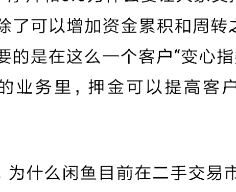

可以先来归类一下我们熟悉的Uber和Airbnb。

### Uber

对于Uber，它提供的服务是叫车服务，或者我们看得更本质一点，其实是A点到B点的运输服务。所以这个服务的标准化程度是非常高的，不同司机提供的A到B的运输服务可以说没有本质差距，而且司机之间技能的差距也不大。如果你用过叫车软件就能感受到，你是几乎不太会在意来的司机是谁的，因为你需要的这个服务很标准化。

而对于另一个维度，交通服务一般都是相对紧急的。所以Uber本质上就是一个“标准化而紧急”服务的交易市场。

### Airbnb

对于Airbnb，它和Uber就有本质的不同了。它提供的是住宿服务，一般这种服务都是不太紧急的。想出差或者旅游的人一般都会提前规划好行程。

而对于产品来说，住宿或者酒店之间的差异要比交通服务大得多。相信每个人都有旅行之前反复比较各种酒店、旅馆、民宿，最后选择一个最称心的这样的体验。所以Airbnb本质上是一个“复杂而不紧急”服务的交易市场。

所以，想象一下白纸上的四个象限，也就是四个空格。Uber应该是在最右下角，而Airbnb应该在很左上角，它们正好是相对的。

### 二者的区别

我们可以来给这两类服务做一些补充，比如Uber这种“标准化而紧急”的服务还有哪些？最典型的应该是快递。因为Uber是人的物流，那么快递就是物的物流。它们的基础属性是很类似的。

外卖行业通常也可以算是这个范畴，因为虽然餐厅提供食物多种多样，但是你吃一个汉堡还是吃一碗面条没有太过本质的差别，决策成本并不高。所以外卖也可以算作标准化。

对于Airbnb这种“复杂不紧急”的业务还有很多，比如摄影拍照、美容美发、甚至心理咨询，都可以算作此类。

你会发现，复杂不紧急的业务，最重要的护城河其实是品牌、信任和习惯。如果你用惯了一个理发师、一个心理咨询师、一个Airbnb这样的平台，其实你的更换愿是很少的。而对于“标准化而紧急”的服务，你想要的就是效率和低价，或者说就是性价比。因为不管坐车还是快递，以最低的成本把东西安全送达才是最重要的。

刚才我们说的是用户端，也就是需求端。从供给端的角度来讲——比如Uber的司机和Airbnb的房东也是这样。对于司机来说，他提供的服务非常标准化，响应需要非常及时；而Airbnb的房东更重要的是把自己的房子弄得有特色一些，吸引更多人来，响应需求也不需要那么紧急。

## 二、变心指数

实际上这就引入了另一个很有意思的概念。也是我们今天要讲的第二个概念。国内有一些VC把它称作“撬指指数”，我更愿意把它叫做“变心指数”。

什么是变心指数呢？简单来说就是一个平台上面的供需两方，愿意离开这个平台，去寻找一些替代解决方案的意思。一开始使用某家企业的业务，后来由于各种原因改用别的了，这不就是个“变心”的过程么。所以我把它叫做变心指数。

我们还是可以来举一些例子：

比如对于Uber和滴滴来说，相信很多人都在2014-2015年的还是时候都对一个画面非常熟悉：一个出租司机师傅同时开着三个手机，一台滴滴、一台快的、一台Uber。哪里发来的订单好，哪里给的补贴多，他们就抢单。

在这个场景里面，司机的“变心指数”是非常高的。这已经不是变心了，这简直是脚踏几只船。本质上来说，司机们会根据具体的情况不断优化自己的选择。而相对来说，需求方，也就是乘客，相对是不太容易变心的。他们往往习惯用上一个应用就一直用下去了，除非发生什么大事。

不过这种用户的“不容易变心”也是相对的，由于Uber提供的是比较标准化的、不复杂的服务，所以它对用户的锁定也相对没那么容易。

Airbnb就是个很好的对比。对于Airbnb来说，不管是需求方还是供给方，也就是不管房东还是旅客，它们的“变心指数”都很低。

一方面来说，Airbnb上面更多的是非专业的个人租客，让他们在多个平台上发布各种信息其实是有点麻烦的，只要Airbnb能提供不错的服务和收入，他就没有必要更换。

同样对于用户来说，如果在不同的目的地要通过不同的App和服务来住宿进行各种对比，其实也不算什么很好的体验。再加上Airbnb上面还有很多别的地方根本没有的特色产品——毕竟每个人家都是很不一样的一所——所以用户也不会轻易“变心”。那么Airbnb也就产生了更高的用户粘性，并不需要像Uber和滴滴那样砸那么多钱，就能产生非常高的壁垒。

## 三、客单价和频次

不用我解释你就能想到，Uber和外卖都是频次高单价低的服务，而Airbnb是频次低单价相对高的服务。当然还有很多频次更低单价更高的服务，比如买卖房子的中介。

所以最终，我们得到了三组概念来分析一家交易平台。服务的标准化程度和需求的紧急程度、供需双方的“变心指数”以及客单价和频次。之后再去分析一家企业的时候，这几个维度会帮助我们更好地理解这家企业。比如，现在你就能回答这么几个问题了：

第一，摩拜和ofo为什么要让大家交押金？因为除了可以增加资金累积和周转之外，更重要的是在这么一个客户“变心指数”比较高的业务里，押金可以提高客户的粘性。

第二，为什么闲鱼目前在二手交易市场里一家独大？因为它和Airbnb在很多维度上都都很相似：有全局网络效应、供需双方变心指数低，一旦用上而且能满足需求就不想换了，还有品牌和信任的保障——这一点Airbnb花了很多年建立，而闲鱼背靠阿里巴巴。

第三，为什么一键叫车活了，民宿共享也活了，但是那么多打着共享经济和O2O旗号的公司都死了呢？它们的客单价和频次如何？客户忠诚度怎么样？服务的复杂性有没有导致难以规模化呢？这些你都可以去思考。

张潇雨

我们之前讲过Netflix，现在你可以回过头来想想：Netflix为什么要做自制内容，而且模式是交了一笔固定的会员费就能收看几乎所有节目呢？

# 周末互动 | “不要以为全世界都是美国”

大家好，欢迎来到《商业经典案例课》。我是张潇雨。

这一周我们讲的是Uber这家公司，而下一周我们还会跟着Uber来讲解更多的概念，干货非常多。所以这周的周末互动，我想稍微跳出点商业的范畴，讲一个社会学范畴的事情。当然也和我们这周的交通主题有点关系。

我之前听过一个小笑话，是这么说的：“像在沙特阿拉伯，交通警察的眼睛都需要注意非常好。毕竟沙特的女性在公开场合必须要戴面纱，不能露出脸，那警察查驾照的时候，需要通过眼睛就判断出这个人不对。”

当时看到这个小段子的时候其实没太在意，也没细想，就去干别的事了。直到前几天我看到一则新闻说:作为世界上唯一一个禁止妇女开车的国家，沙特阿拉伯王室最近正式解除了这一项政策。从2018年6月开始，沙特的女性可以开始驾驶汽车了。

当时读到这则新闻的时候，我就特别感慨。那就是，很多我们习以为常的东西，其实在另外一些地方还是需要争取的权利。

这则消息一出，很多汽车厂商也非常兴奋。毕竟沙特是海湾地区最大的汽车市场，整个潜在消费群体接近1000万人。在开放女性驾驶的权利之后，沙特阿拉伯的年汽车销量肯定要大幅提高。

这个消息出来的时候在Twitter上面被转发最多的是一个福特的平面广告。上面没有文字，只有一对在后视镜里面漂亮的眼睛，而整个图看起来又很像阿拉伯妇女戴头巾的标志性形象。随后福特写道：欢迎来到驾驶座上。

那你可能想问，在这个看起来非常不合理的禁令之前，沙特的女性是怎么出行的呢？这就是我们这周讲到的公司——Uber的功劳了。

之前媒体报道过，和很多国家不一样，沙特阿拉伯80%的Uber订单来自女性用户。这个比例是非常高的。在Uber之前，很多有职业的沙特女性必须要花钱雇男司机开车，或者让男性亲属开车。而看到这个现象之后，Uber在2014年进入了沙特阿拉伯，然后大大降低了沙特妇女出行的交通成本。

这又让我想起了Uber的另外一个故事。

卡拉尼克曾经亲自在公司里面带一个团队，叫做国际增长期务组。你可能想不到，这个团队的主要业务是在一些欠发达地区帮助更多的人使用Uber。比如信号可能不太好的印度、非洲，司机和乘客可以在Uber内部发短信来交流接送地点，这样就比使用流量快很多。还有，有时候会有一些女性安全事件，甚至是强奸案，所以Uber推出了人脸识别功能，这样可能把各种潜在的不法分子排除在外。

> “我们做产品的时候经常被提醒，不要以为全世界都是美国。”

就像我们刚才说的，很多我们习以为常的东西，其实在另外一些地方还是需要争取的权利。而商业往往是促进这种权利发生、促进更多对社会有益的变革发生的一种工具和手段。无论什么时候，都不要忘了企业对人类社会的这种责任，我觉得这才是商业存在的一个最大的意义吧。

### —— 本周留言精选 ——

# Uber | 为Uber而生的卡拉尼克

卡拉尼克的人生和创业经验，使他相信只有生存下去才是最重要的信念，而不择手段活下去就是活下去的方法。我的思考，我们通常看到的和思考的都是高大上的创业姿路和经营哲学。这与不择手段是截然相反的价值观。可是为什么这两种截然相反的价值观都会被推崇，而它们确实在现实中发挥出了极大的影响力？不择手段，确实可以快速获得收益，当然也必然伴随严重后果，Uber就是证明。但是我发现Uber身上存在两种完全相反的价值观，它们互相支持，又互相伤害。一个充满争议的企业和CEO，看似伟大，又看似卑劣。然而，高大上的形象和企业文化，与不择手段只为生存，是每个人，每个企业都会或多或少进行思考和践行。只是程度不同罢了。它们两者都是生存发展的内在动力，企业家需要驾驭两者不同比例，以维护动态的平衡。卡拉尼克看起来只是缺少经营艺术。

# Uber | 与执法者的周旋

商场如战场，当你公司生命有危险时，你会采取什么样的措施？采取能够拯救公司的方法都是合理的。

对于“卡拉尼克有天不会像乔布斯那样王者归来”的二点看法。1.从他的外部结构看：Uber存在一支直接对卡拉尼克汇报的高管团队，外人称之为A-team。这是卡拉尼克自己组建的小圈子。-----

始人的御林铁骑。但由于公司自身文化的原因现在这支A-team已经解体，要么离职，要么被炒。所以，卡拉尼克想回来，不容易。2.从他自身状态看：伊布斯当年因“不会管理”而被苹果董事会放逐。离开苹果公司后，他带着苹果时期未完成创意的，创建了另一个电脑公司NeXT，结果产品一塌糊涂，这让伊布斯意识到什么是真正为用户服务产品。而在皮克斯(Pixar)带领团队过过程中，乔布斯学会了管理。十二年之后回到苹果时，乔布斯只是“顾问”的身份，但这十二年的学习已经让他成为了合格的管理者。 随着与董事会的相互信任的重建，乔布斯才得以重回CEO岗位。对比当年重新归来苹果的乔布斯，卡拉尼克更像个初入天宫的孙悟空，没有经过九十九八十一难历练，所以要重回Uber，短时间内或许难以实现。

大象进了瓷器店，总要砸坏点东西。很多看似合理的规则，往往是隐形的围墙，保护既得利益者。有些人 that's 不顾一切地冲破这一切，挺好的。毕竟他也在付出代价。他们挑战旧世界，然后与旧世界融合，改变一切。旧世界被慢慢改变，新世界悄然出现。这也让我想到另一个问题，随着时代的发展，旧有的法规与道德是否还适应新的时代？是否需要有人去打破，去创造？政府是否有动力去推动法规的迭代？社会是否足够快地对新事物有适应力？若无，旧规则的束缚就显得不合适。卡拉尼克只不过是在时代的前沿拉着我们，而非一个破坏者。

卡拉尼克为达目的，不择手段，他有没有伤害到别人？比如伤害别人的身体，伤害别人的财产？好像没有。他跟政府周旋，只是对政府的

断有威胁，可是，对于司机和乘客都有好处。他跟苹果的冲突，好像也没有特别大的伤害。总的来说，他应该损害了一些人的利益，所以，会被赶出公司。他太嚣张了，所以，自食其果。他重新定义了出行，可以说给社会带来了巨大价值。不过，出来混，迟早是要还的。任何人，如果毫不在顾忌，最终也会伤害到自己。

# Uber | 为什么Uber在中国打不过滴滴？

Airbnb以及Uber在开始的时候绝对不知道什么高级的网络效应、低级的网络效应，因此这些创业者先别想太多，先做了再说，总会有答案的。Uber现在的网络效应虽然低级，但是别忘了时间（变化）的力量。说不定几年后，又有新的玩法呢？谈谈谈完今天专栏的感觉吧：快速行动，我的理解是追赶趋势，不是说在风口上，猪都能飞起来嘛；慢是寻找千百年来不变的东西，稳扎稳打。快慢之分，无所谓高级低级，但我更喜欢的是沉淀之后破茧而出。

互联网货款“P2P”业务突然兴起之时，各种“XX贷”变得满网都是。一个网页，一个资金托管，大笔的“利率排名”，一家“P2P”就算是开起来了。很快，很简单，也显而易见属于最低级的网络效应：竞争对手太多、技术非常简单，最大的巨无霸与新入行的菜鸟并没有本质区别。正如张满雨老师所说，积累，在两种网络模式前面体现得淋漓尽致。任何短期内可复制的“机会”都隐藏着天花板，只给了先发优势的抢跑者稍纵即逝的机会。

张老师所说的全球网络效应和区域网络效应的区别我觉得并不是本质上Uber和Airbnb有什么区别，它们都是平台公司。张老师说Airbnb起步比较辛苦，但是这个世界不缺乏肯辛苦做事的人。个人认为之所以这两个公司目前前景区别很大，跟其所处不同行业的壁垒有很大关系，如果没有城市地方的限制我相信Uber现在跟Airbnb不会有大的区别，而行业区域性的管制是这种区别的根本原因。所以，一个人的成功不仅要靠他个人的努力，还要考虑所处的形势。

这篇专栏把我心头萦绕已久的问题给解答了，有一种自己思索很久但一直雾里看花的感觉，读完本文之后又有烟消雾散的感觉！起步艰难的事情，做成之后获得的壁垒越高；但起步太难的事情也不太容易走过第一个阶段。毕竟成功需要的是资本、市场、时机、技术、创业者多方面同时满足才能发生其颠覆的。Airbnb是幸运的，得到了天时地利人和，才能走到今天。同时也告诉我们，不要做太“正确”的事情，因为如果太显而易见，那这个机会其实已经不是机会了。乘法效应和加法效应很形象地比喻了Airbnb和Uber两家伟大公司的模式。Airbnb需要的是“慢”，一直稳扎稳打，把一件事情做到最深。Uber和滴滴需要的是“快”，攻城掠寨，占据市场，再切到相关行业，比如从出租车到私家车，到专车，到小巴，再到共享单车。谢谢老师今天醍醐灌顶的分享！

今天张老师的文章把我心底关于共享网络的疑问解决了，突然间有种任督二脉打通的感觉。之前还在疑惑摩拜和ofo之争何时了，咋能盈 利，是否会走滴滴和快滴合并之路。现在理解了，单车共享是具有区域性的，对用户而言西安单车发展得如何其实与北京单车发展情况关系不大。这种区域性网络共享竞争门槛低，互相厮杀的场面一定会有，共存将是常态吧。通过今天的课程，结合我们各自的领域，就能清楚判断什么是有好的网络共享模式。

# Uber | 用于分析交易平台的三组概念

网飞自制剧可以灵活地选择题材和风格，在竞争中形成差异化，吸引到有自己专属类型的剧迷，这样的选择在成本上应该也是有优势的；采用会员制单独从一部剧收费，降低了消费者的决策难度。网飞既可以找到自己喜爱的剧集类型，又能低成本地切换和尝试其他类型的内容，这样的体验应该会极大地提高会员的忠诚度。

变心指数可以换一种理解属于可转换成本，可转换成本也是护城河理论之一，具有网络效应和高转换成本双重护城河的企业更容易诞生伟大企业。企业如何增加客户转换成本，就是让客户在企业上投入更多时间和金钱成本，这其实也就是经济学沉没成本，你投入沉没成本越高那么你放弃不用这个企业成本越高。

Most skilled( 非标准化 )， Less skilled ( 标准化 )， Low Urgency ( 不紧急 )， Urgency ( 紧急 )。这些坐标轴可以分析公司所处行业的竞争是红海还是蓝海，同时对于个人选择行业有很好的分析作用。文中Uber和Airbnb两家公司，现在两家公司都给你offer，你来选择去哪家，用上面的坐标轴分析，虽然Uber所处行业是红海竞争，可替代性很高，顾客和司机的变心指数都很高，有其他商家提供更低价格，且服务都是标准化时，Uber的竞争力就在下降。反之Airbnb的竞争壁垒是品牌，顾客的忠诚度高，是行业的独角兽。就目前两家公司发展来看，个人想法是Airbnb的优势大于Uber，以后两家公司业务拓展其他领域带来新的影响不计算。这个对于个人的行业选择是有帮助的。 还有就是创业的项目选择，同样是分析行业举例民宿和快递，你拥有100万，是去大理开一个装修复饰特殊的民宿还是选择一个二三线城市承包一个区域的快递业务。运用上面的坐标轴分析，就目前的发展，民宿会带来更稳定的收益，市场波动较小，容易形成稳定的顾客，而快递所面临的竞争更加激烈，且顾客不稳定，所以如果我创业会选择名宿而非快递。分析的结果不一定对，但通过学习商业史专栏给了我们很多的思考问题和解决问题的思路，长期打磨，会形成自己的见识和认知提升。

问答内容今天的内容干货满满。“变心指数”有点像我们以前经常聊到的“用户粘性”。而“变心指数”，大概是那些通过价格或壁垒不高的因素留住用户的服务。就好像贝斯说的那句：客户一般都是很忠诚的，直至其他人提供了更好的服务。今天的三组概念，印证了那句话：“你的每一次犹豫，可能只是别人的基本套路。”可 见，保持“无知”的学习心态是多么重要。

# Uber | 烧钱能给创业公司带来什么

今天最大的收获是把CAC、LTV和PVP联系起来看。之前工作中涉及到获客的时候，只是一味地要求降低CAC。虽然在账面上用户增长不少，但是其实大部分用户是无法提供高LTV的，我想这也是很多公司过于于用户增长压力下急功近利的表现

公司迫于用户增长压力下急功近利的表现。另外，在企业架构中，CAC由市场营销部负责，LTV由CRM部门负责，难免各自为政，还是需要更好的协调和统筹考虑才能使得更好。

今年罗胖在跨年演讲上说了中国的“人口红利”已经过去，他拿自己打了一个比喻。“小时候，父亲在我兜里放上一把枣，然后就扔在院子里不管了，我就吃兜里的枣。每个枣，我都是咬了头上一点，就扔了，因为总感觉兜里还有很多。可是，总有吃完的时候啊，吃完了怎么办？那就是去地上把吃了一点的枣，捡起来再吃一遍。”很多互联网企业早期获取用户成本非常低，也就是CAC很低，于是拼命扩张获取用户是接下来统一的行为。“人口红利”消失后，深耕用户价值又成为接下来的动作，也就是挖掘LTV的价值。在这个过程中成本回收期越短，企业就越容易存活成长，成本回收期越长，企业存活越艰难。

CAC、LTV、PBP这三个角度也可以看待我们自身的学习成长：成长知识获取成本，所学习知识的终身价值和知识的可应用期。1.成长知识获取成本。我们在获取某个知识点所需要投入的成本，包括金钱和时间，例如要学习英文你可以在学校花几年的时间按正常学费交付学习，你也可以花更多钱在相对较短时间高密度学习。只是要识别不同的学习路径输入知识量的正常增量和“特别增量”，以及“知识留存率”（学了就忘还是能很快记住）。2.所学习知识的终身价值。知识的迭代和学习是影响终身的，它们构建了我们理解世界的角度，但从功用性层面来看，有些知识的能量往往也有大小之分。例如张老师的商业课内在知识能量是非常大的，或说“知识毛利”高。只有高能量的知识才会巨大的影响人生。3.知识的回收期。许多知识我们在选择输入自身的时候，需要考虑它对我们的影响有多大、有多久，但这种影响却又是很难量化的，也是复杂的，但从知识本身角度看，有些知识经不起时空验证，有些知识穿透力又不深，但有些知识受用一辈子，特别是智慧层面的文化经典，都会帮助我们构建高级的思维模式。创业也需要“烧钱”，对自我的学习成长也是如此，需要一点耐心，当还不够好的时候，就加大供给端的输入，再考虑输出：不患无位，患所以立！

# Uber | 我与司机的行为经济学实验

Uber | 我与司机的行为经济...

你好，欢迎来到商业经典案例课。我们这周要把关于Uber的一些知识点讲完，然后做一些延伸，为我们下周讲和创业孵化器YC相关的创业专题做一些铺垫。

上周的专栏里我们讲了Uber的历史和它的商业模式，今天我们来看看Uber做得非常出色，但也有一些争议的另一个地方，那就是Uber运营自己司机的方式，或者我们也可以说，是Uber的行为经济学实验。

在Uber成长过程中面临的各种问题里面，司机的流失率一直是他们最头疼的问题之一。尤其是他们的一个主要竞争对手Lyft，一直以温和的形象和对用户友好的态度著称，这和Uber的形象基本是相反的。所以很多司机用过Uber之后都会逐渐离开。

当然，本质上这个问题根源在于Uber和司机的利益也是种程度上就是冲突的。对于司机来说，用户的叫车需求一旦稳定下来，通常就不会有大的波动，所以他们自然希望司机群体越稀缺越好，这样才能保证自己的收入；但是对于Uber来说，他们希望消除司机的短缺问题，因为只有保证所有顾客都能非常快速便捷地用车，自己的生意才能越做越大。

所以在2016年年初，Uber组建了一个多达100人的团队。这个团队里面有工程师、数据专家和社会学家，唯一的目的是就是研究怎么才能降低司机的流失率，以及鼓励他们延长自己的驾驶时间。后来，这个团队研发出了一系列基于行为经济学、心理学甚至电子游戏技巧来运营司机的手段。

## 1. 给司机发广告

Uber开始在App里面通过推送信息的方式，引导司机到Uber更希望他们去的地方——这些地方往往是比较缺少闲置司机的地区。

在这个过程中，Uber发现了一个有意思的现象：如果使用女性角色，用女性的语气或者声音提出类似需求的话，就会有更多的司机响应。毕竟大部分司机都是男性。

Uber的一个前员工翰·帕克（John P. Parker）接受采访的时候就说过，当时他冒充的角色劳拉（Laura），他会使用劳拉这个角色和Uber司机说：“Hey，前面有个地方的音乐会要散场了，你应该往那边开一开。”很多时候都很有用。

## 2. 签约奖金门槛

发广告绝对不是Uber使用的唯一的运营司机的方法。

公司的数科学家发现，只要司机完成25单之后，他们的流失率就会大幅下降。这个数据上的洞察非常类似于当年Facebook使用的一个内部关键指标：当年他们的数据团队发现，一个用户注册Facebook之后，只要他在10天内完成7个好友的添加，这个用户就不容易流失。所以这个“10天加7个好友”就成为了Facebook内部运营的一个最核心的指标，这个目标动作他们一路坚持到了10亿用户。而对于Uber，这个指标就是“让司机接满25单”。

## 3. 目标效应激励

不过，即使设立了签约奖金门槛，还是有很多司机在拿到签约奖金之前就离开Uber了。后来，一些城市的Uber管理人员开始尝试一种最简单的鼓励，那就是他们会发信息给司机说：“恭喜你任务就快完成一半了！”

这就是心理学上另一个经典的研究成果：目标效应。

心理学家和游戏设计师早就明白，让用户设立一个具体目标，会激发他们完成任务的积极性。就像是打游戏练级一样。而行为经济学家也发现了一个现象，就是类似于出租车司机这种可以自己决定每天工作时长的人，一般会为自己制定一个决定工作时间的目标——比如赚到100美元，然后就收工。就像马拉松选手努力将自己的时间控制在四个小时或三个小时以内一样。

Uber就利用了这一点：很多司机都提到过，在自己准备下班的时候，Uber就会跳出来一个提示框说：你还差20美元今天就达到300美元了，要不要继续？而且那个“Yes”的选项已经被提前选好了。

更有意思的是，每个司机看到的金额也是不一样的——对于你来说可能是300美元，对于另外一个开得没有那么多的人，Uber会说：还有10美元就能超过昨天100美元的收入了。甚至有的时候，Uber还会把司机之间横向比较，就像是那个著名的文案“你已经击败了98%的人”一样。

## 4. 提前派遣

Uber的竞争对手Lyft也有类似的功能，做法就是在这一单结束之前，就把下一单的需求和目的地派遣过来，这样你就真的“停不下来”了。另外，这种“提前派遣”也能缩短司机每单的间隔，收入更高，还能缩短乘客的等待时间，对大家都不错。除了有些司机会抱怨“连上厕所的时间都没了”。

有意思的是，硅谷最善于使用这个小技巧的公司其实是一—Netflix。因为Netflix很早之前就上线了一个功能—可以在用户看的某个电影或者剧即将结束的时候，提前开始加载下一集，这样用户无需等待，可以不间断地看下去了。英文里甚至也有一个类似于我们常说的“刷剧”的概念，叫做binging。这股风潮就是Netflix带起来的。

## 5. 损失厌恶

当然，Uber运用的最娴熟的心理学和行为经济学技巧还是“损失厌恶”—当人们面对等额的收益或者损失的时候，往往对损失反应更大。

比如，你捡到100块钱的快乐，会远远比不上 lost 了100块钱带来的难受。或者假设你在10块钱的价位买了一只股票，过一Managers涨到了12块钱你会很高兴，但是如果它涨到了15块钱，又跌回到了13块钱，你反而会觉得亏了。这个现象就是“损失厌恶”。

这里顺便插一句。如果你对这方面的研究感兴趣，我可以推荐几本入门读物：比如查理·芒格的《人类误辞心理学》的演讲，还有他很推荐的西奥迪尼的《影响力》，庞德斯通的《无价》，以及这几年非常火的丹尼尔·卡尼曼的《思考快与慢》。

话说回来，Uber是怎么利用这个规律的呢？Uber的做法是：在引导司机去到某个地点或者鼓励他们在高峰期出车的时候，他们说的不“如果这么做你能多赚多少钱”，而是“如果不这么做你会少赚多少钱。”

实际上2013年Lyft也做过一个类似的实验。他们选出了两组司机，然后公司和一组司机说，如果你把工作时间从比较清闲的时段——比如周二上午，转移到比较繁忙的时段——比如周五晚上的话，每个小时可以多赚15美元。同时他们和另一组人说，如果你坚持要在星期二出车，你会少赚很多钱。结果他们就发现，后一种方法对于提高司机在高峰期出车方面有更好的促进效果。

不过有意思的是，Lyft最终没有采用这种看起来有些操纵自家用户的方法。而Uber显然没有这方面的道德压力。他的发言人说：“我们是会向司机提供叫车频繁地区的信息，或者鼓励他们延长工作时间。但任何一名司机都可以一键收工，收工不收工还是完全由他们自己说了算的。”

实际上，在产品里加入行为经济学和心理学的技巧，早就目前科技公司和各种大型商业公司的标配了。在之前的专栏我们也提到过一个最简单的道理，只要是涉及钱最多的地方，那么对掏钱的人的研究...

涉及钱最多的地方，那么对掏钱的人的研究也是最多也最深入的。

比如，超市可能会反复研究怎么引导顾客的行走路线才能让他们买更多的东西，亚马逊的推荐系统——“你可能也喜欢xxx”已经是业界的标杆了，迪士尼希望你能在它的乐园里获得最大的沉浸感、LV会引导你多多的买包。

但是，作为一个消费者，清醒地去做消费的决策，不被大公司的心理学小技巧控制，是非常重要的。某种程度上来说，这也是在商业世界自由穿行必备的条件吧。

张潇雨

作为消费者，你是否有过类似被卖家操纵的经历呢？遇到这种情况的时候，你对商家的态度是否会发生一些转变呢？欢迎把你的感受在留言区写下来，和大家一起分享。

## Uber｜创始人与投资人的对决

在之前的几期专栏里，我们讲到了Uber这家公司和它的创始人卡拉尼克。但是你很可能已经知道了，如今卡拉尼克已经不是Uber的CEO了，他已经在2017年6月的时候辞职，退出了所有具体业务的管理，仅仅保留了董事会的席位。

而在这个过程里，卡拉尼克和Uber的大股东标杆资本（Benchmark Capital）的争斗也是非常精彩的。在这期专栏里，我们就借这个案例，再来讲一讲投资人和创业公司创始人的关系。

### ｜标杆资本

在硅谷，没人不知道标杆资本。它在1995年成立，到现在已经有22年的历史了，而且是全世界最顶尖的投资基金之一。不夸张地说，所有创业公司都可以拿到的投资为荣。标杆资本的业绩也非常出色。

### ｜标杆资本与Uber的历史

标杆资本对Uber的投资最早是在2011年2月，当时它们以投资后估值6000万美元的价格投资了Uber1100万美元，占股18.3%，这是Uber的A轮融资。经过后面很多轮追加投资和稀释之后，现在标杆资本占比如Uber的股份大概是13%，有20%的投票权。

### ｜风险投资人与公司创始人的关系

实际上在硅谷，我们时常可见到创始人被投资人驱逐出公司的情形，最著名的就是苹果的乔布斯，以及Twitter的杰克·多西。有意思的是，这两个人后来都回来了。

- 这里面有两个重点：

第一，从整个硅谷的形势看，创业者群体比投资人群体整体更强势。

规模，或者被大公司收购了，剩下90家可能都死掉，也就是亏钱了。但最重要的是，你要投到那一两家最好的公司。

我们之前也提到过这个概念，但是现在一个最鲜活的案例就来了。

刚才我们说，从2007年到2017年，标杆资本作为业界最成功的风险投资基金，十年里面投资的公司加起来价值有760亿美元——这里面有十几家上市公司，还有二十几个并购。但是Uber现在估值是多少呢？690亿美元，而且在公司各种问题解决了之后，可能还会上涨。所以，投到了一家Uber这样的公司，真的就相当于干了十年的活了。

刚才我们说，Uber是标杆资本这家传奇基金捕获的一条大鱼。其实更正确的说法可能是，这是他们等待了一辈子的那条真正的大鱼。

所以，在这种状态下，董事会以及投资人和创始人决裂就真的没法避免了。因为里面牵涉的利益过大了。

我们可以简单算一笔账：按照当前的估值，目前标杆资本13%的Uber股份价值90亿美元左右，即使打个折，减去各种成本，按照80亿美元算也差不多了。这里面按照协议，有30%的分红是可以给标杆资本的合伙人的，也就是24亿美元。而六个合伙人，每个人分到的就是4亿美元。毫无疑问，作为一个风险投资人，一辈子投到这么一个项目真的是足够了。

所以，日后我们无论看到关于Uber内斗的任何新闻，都要记住这一点：投资人和创业者很多时候是利益绑定的，但真到了有了纷争的那一天，如果涉及的利益足够大，大家撕破脸也是在所不惜的。这可能就是人性吧。

苹果 | 风险投资的历史与哲学

张潇雨

关于创业者和投资人之间的关系，你有什么自己的看法呢？欢迎写在留言区跟大家一起分享，我们明天再见。

## Uber | 共享出行行业的大格局

在讲解了Uber这家公司的各种历史和商业模式之后，接下来的两期专栏来提升一个维度——看一看目前共享出行整个行业的格局是怎么样的，以及这个行业里一个不可忽视的巨大玩家：孙正义的风险投资公司——软银。

2017年10月，《华尔街日报》报道：

之前商讨了几个月的软银投资Uber的交易终于是基本成型——软银会向Uber投资10亿~12.5亿美元，估值是上一轮融资时的690亿美元左右。另外，软银还会联合一些私募基金和投资集团，以折扣价从Uber的投资人以及员工手里收购公司大概14%~17%的股份，价值可能有90亿美元之多。在这笔交易之后，软银很可能成为Uber的单一最大股东。

这是一次非常受业界瞩目的投资，因为这次投资有两个非常重大的意义：

第一，这基本预示了卡拉尼克的出局，同时也就意味着投资人以及股东的胜利。在这轮投资中，一些主要股东包括员工，可以套现一部分手里的股票；而且，软银对投资提出了一个前提条件，那就是限制卡拉尼克的权力，甚至不允许他回归。这笔交易之后，Uber也注定要走上盈利和上市的道路。目前新CEO的计划是最晚2021年Uber上市。

软银投资Uber的第二个意义可能更重要。在这笔巨额交易之后，孙正义的软银几乎已经是全球所有主要共享乘车和共享出行领域玩家的股东了。

### | 孙正义在全球出行行业的豪赌

我们先来稍微梳理一下，全球主要的共享出行公司有哪些。

Uber

虽然目前Uber公司麻烦缠身，但仍然是世界上第一大共享乘车的公司，估值仍然在700亿美元左右，比滴滴要高。

另外，Uber目前在北美最大的一个竞争对手是Lyft，这家公司在Uber出了各种丑闻之后发展很快，最新一轮拿了6亿美元的融资，估值在75亿美金左右。实际上孙正义之前也考虑过如果投不进Uber的话就投资Lyft，当然最终还是选择了Uber。

滴滴

在2017年4月底的时候，滴滴宣布公司完成55亿美元的一轮新融资，其中软银领投的金额是50亿美元左右，占了绝大部分。

虽然滴滴没有公布现在具体的股权结构，但是这轮融资之后，软银肯定也是滴滴的前几大股东了。可以说，在全世界最大的两个市场——中国和美国——软银都拿到了重要的话语权。

Ola

中美之外，另一个不可忽视的市场是印度。

目前印度最大的打车软件叫Ola，而且市场份额超过了60%，比Uber大很多。而软银从2014年就已经开始持续地投资Ola了。

在2014年软银就给Ola投资了2.1亿美元，2017年2月，又联合印度本地的投资集团RNT资本追加投资了3.3亿美元。更可怕的是，在2017年10月初，软银联合腾讯以及RNT，给Ola投了一轮20亿美元的巨额资金。所以软银在印度出市场的地位也毋庸置疑了。

这里听到腾讯你有没有心里一惊？

首先，你肯定知道，腾讯也是滴滴的大股东；另外，相信很多人知道软银是因为当年孙正义投资马云的一段渊源。实际上孙正义和腾讯、阿里的关系都很好，在资本层面也有很多合作。

某种程度上来说，共享出行可能是一个标志性的领域，它标志着未来超级差陂的大公司和大集团，对人类未来的影响可能非常之大。这个话题是我在这个专栏里想讨论的重要议题之一，以后有机会我们继续说。

Grab

印度之外，东南亚还有一个体量很大的打车应用，叫做Grab。

Grab是2012年成立的，总部在新加坡。当然，这里自然也少不了软银的身影。2017年7月，软银联合滴滴出行和丰田汽车，给Grab也投资了20亿美元，占股超过30%。你可以看到，这笔投资完成之后，整个亚洲版图基本都是软银的囊中之物了。

99

当搞定了美国和大部分的亚洲地区之后，孙正义又把目光投向了巴西。巴西目前最大的打车应用叫99，是2013年成立的。猜猜目前它拿到的最大的两笔融资来自谁？2017年1月，滴滴给99投了一亿美金，四个多月之后，软银又给99投了一亿美金。那么，现在巴西的出行市场也是孙正义的了。

到这里，你应该完全感受到了软银在全球出行市场的整体布局。美国、巴西，大部分亚洲地区，再算上Uber基本占主导地位的欧洲，应该说，软银和孙正义在对整个交通出行行业做一场豪赌。

### | 孙正义的战略

我们回头看软银最后投进Uber的这个交易，也非常有意思。

虽然Uber在全球最大，但是我们也说过，由于它模式本身的限制，Uber是很像Airbnb那样形成全球垄断的。所以，软银先从周边的公司下手：滴滴、Ola、Grab、99等等，最后在Uber和Lyft两个公司里面二选一。

本质上，在2017年7月联合滴滴用20亿美元投资了新加坡的Grab之后，软银其实就发出了一信号给Uber说：虽然你现在最大，但是我可以保证的是，只要你不和我一起玩，我就保证这场战争能一直打下去。中国、亚洲、南美洲这些地方都是我的了，在美国我还能投资Lyft——虽然它现在体量只是75亿美元左右，但是只要我想，给它个二三十亿美元完全不在话下。加上你现在内忧外困，美国市场最终结局怎么样真的不好说。所以，软银一招一出，最终Uber的股东们也不得不就范了。

实际上这就是这篇文章想探讨的一些东西。

从一个层面说，孙正义的这种打法绝对不能说是一个简单的“有钱任性”，而是有一些“农村包围城市”的战略思想在里面；另外就像刚才我们说到的，软银、阿里、腾讯、Elon Musk的特斯拉，包括从谷歌剥离出来的无人车公司Waymo和Lyft前一阵形成的联盟——很可能未来人类的整个地面交通和出行就是由这几个公司来决定的了。

听到这里你可能想问，孙正义到底为什么这么做呢？

实际上，这个问题的答案从前一阵软银超级大一个动作上就能看出来。这个动作就是软银成立了一个巨型的基金，管理资金规模达到了恐怖的1000亿美元。在下期专栏里，我就來解读一下，孙正义和这1000亿美元的基金到底想做些什么，以及为什么这关乎了我们每个人的未来。

## Uber | 一只基金的巨大布局

Uber | 一只基金的巨大布局

昨天我们讲到了软银对共享用车和出行行业的全面布局，而这个动作背后其实是孙正义和整个软银的一个巨大野心。而这个野心，在2017年孙正义成立的一只新基金里面就可以完全看到。这只基金就是软银的Vision Fund，中文可以翻译成 软银愿景基金。

这只基金，有两个不寻常的地方。当时在消息发布的时候，很多业内人士也是非常惊讶。

### | 软银愿景基金的资金规模

这只基金的规模实在是太大了。

之前在融资的时候，市场放出风声来说，这会是一只史无前例的风险投资基金，会达到1000亿美元的规模。当时看到消息的我也觉得不太可能。但最后公布的结果是 930亿美元，跟1000亿几乎没有区别了。

1000亿美元是什么概念？或者为什么我之前对这个“1000亿美元的VC基金”有所怀疑呢？其实道理也非常简单。如此大的基金规模，最大的难题不是别的，是怎么找到那么多好公司去投资呢？你想，如果是一家风险投资基金，哪怕每个公司都投资一亿美元，那也要投1000个才行，哪怕每个投十亿美元，都要投资一百个。世界上哪有这么多创业公司接得住这些钱？

### | 软银愿景基金的资源来源构成

这只基金的资金来源构成也是史无前例的。我们稍微微看一下细节。

- 1. 投资基金的基础概念

趁这个机会也正好可以介绍一下关于投资基金的基础概念。这些概念对于我们以后理解各种金融相关的知识也是非常有帮助的。

LP与GP

假设你想弄一只投资基金 肯定就要去募资。募资的对象有很多种，不过一般都是找大的金主，比如：大的保险公司，大的企业，甚至于国家的钱，等等。这些金主给你投资之后，就叫你的 LP，是英文“limited partner”的缩写，中文叫“有限合伙人”。

而你和你的团队，比如其他的合伙人，叫做GP，是“general partner”的缩写，中文是“普通合伙人”。

- 2. 软银愿景基金的构成有什么不同

首先，这只基金如果达成1000亿美元的额度之后，整个的配比会是：外部投资者出资280亿美元的股权，软银自己也出资280亿美元的股权，而剩下440亿美元是债权。

以孙正义光管理费的收入就已经相当惊人了。

简单算一下，一般投资人，融了个十亿美 元的基金就要奔走相告，敲锣打鼓了，但 是孙正义这只基金每年收到的管理费就是 十亿美元的级别......可以说这真的是史无前 例的一只基金。而孙正义坚持五五分成 的出资，也证明了这应该是他人生中最大一 次，也是最后一次的豪赌。

### | 软银愿景基金的目标

最后，我们可以来简单谈谈这只基金的投 资主题和目标，或者说得直接点儿：孙正 义融了这么一大笔钱，把后半生的名誉都 赌了进去，他到底想要干嘛？

愿景基金的官方网站这么说：

愿景基金会在整个科技领域的一系列行 业里保持活跃，这些行业包括但是不限 于：物联网、人工智能、机器人、移动应 用和计算、电信和沟通基础设施、生物智 能等等。

实际上，这个列表显示出了孙正义的真正 看法，那就是在未来，这些领域一定会出 现千亿甚至万亿级美元的公司，而超级巨 头型企业在未来一定会垄断这些超级行 业。

我们随便列举一下愿景基金目前投资过的 一些公司吧。

之前说的 共享乘车行业 的主要玩家，全部 被软银投资了。想象一下，未来这个行业 只要往电动车方向发展、往无人驾驶方向 发展、往动态城市规划方向发展，不管人 类未来被如何塑造，孙正义都不会错过， 因为他已经是这个行业最大的领头人。

之前 谷歌卖出的机器人公司 Boston Dynamics ，也是被孙正义买下来的。如果 你之前没有看过这家公司机器人的演示视 频，不妨上网搜一搜，你会惊讶现在的各 种机器人的技术已经进化到什么程度了。 实际上，之前在巴塞罗那世界移动通讯大 会上，孙正义就预言人工智能的奇点在 2018年至2019年就会到来。还说30年内 机器人的数量就会超过人类，到时候甚至 连鞋子都会变得比人类聪明。

另外，愿景基金还领投了一家叫做 Roivant Sciences 的公司，整体金额达到了11亿美 元。Roivant是一家控股公司，旗下有几十 家生物医药企业，研究的最都是最先进的生 物技术，而且还在扩张。Roivant前一阵刚 成立了一家新的子公司，叫Datavant。这 家公司要用人工智能变革生物制药，加速 药品的发现、开发、商业化流程等等。

还有，愿景基金还投资了机器人公 司 Plenty 和农业公司 Brain Corp 。这里面 Plenty是用传感器和大数据技术帮助农场 提高产量的，而Brain Corp希望成为自动 机器人领域的标准操作系统，就像安卓在 智能手机行业的地位一样。

听到这儿，我想你应该非常清楚孙正义和 他的愿景基金的真正野心所在了。如此一 只架构特别的基金、如此大的投资额度、 如此激进的行业和公司目标，我们或许真 的可以期待一下，未来这只基金到底能给 整个人类带来怎样的变化。

张潇雨

对于孙正义和软银的巨大布局，你有什 么看法或疑问呢？欢迎写在留言区，和大 家讨论。我们明天再见。

# 用户留言

# Uber | 电梯演讲的三个技巧

这两周我们顺着Uber这家公司讲解了不少和互联网、创业、共享经济以及投资相关的知识。今天是关于Uber的最后一期了，我们就来讲点轻松但是又非常实用的话题，也为下周我们进入创业孵化器Y Combinator这家公司打点基础。

今天我们就讲一个小话题：电梯演讲。或者说，怎样能一句话给别人——不管是朋友、合作伙伴还是投资人——介绍清楚你做的营运是什么。

有这么一个传说：如果你在苹果工作，有一天在电梯里发现自己站在乔布斯旁边，但是又不能给他说清楚你对公司的贡献是什么的话，你可能就会被解雇掉。

虽然我觉得这应该是个谣传，但是我相信，不管是创业，还是工作的时候，和他人沟通，学会到这个技巧都是非常有帮助的。

所谓的电梯演讲，或者叫30秒演讲，或者叫一句话演讲，有三个非常通用的方法，第一个叫做“输入——输出”句式，第二个叫做二维定位法，第三个叫做写新闻稿。

## | 技巧一：“输入——输出”句式

这个“输入——输出”的说法，应该借用了计算机的术语。意思就是说，在向人介绍你做的东西的时候，可以使用一种固定的句式：如果输入一句话，（输入），就能获得一个什么结果（输出）。

这个句式就数Uber使用得最好。

卡拉尼克在早期和别人描述Uber的时候，说的就是：你只要按下一个键，就会有 一辆车来接你。这个感觉可以说非常活泼和神奇了。

然后你还可以在这个句式上做各种加工，比如：你只要按下一个键，就会有 一辆奔驰车在5分钟之内来接你，而且你付的钱要比之前坐类似的车便宜 一半多。实际上这个句子添加了更多的细节，所以它不仅能吸引客户，还能吸引投资人的注意力——因为他们一定好奇你是怎么做到的，而且此时这个模式就能想象出这应该是很大的一盘生意。

我在前几年看过一个对Facebook的CEO扎克伯格的采访。那個时候Facebook已经不小了，不过刚刚准备上市，还有很多人不了解。主持正好问他，怎么给还没听说过Facebook的人描述一下Facebook是做什么的？

当时我的耳朵就支起来了……而且我心里想了很多答案，比如：全世界最大的社交网站、全世界最大的实名制网络，等等。结果扎克伯格说了一句话我直至现在印象还很深，他说：

> "Facebook就是一个你输入某个人的名字，然后就能得到各种和TA相关的信息的东西。"

你看，这里就隐含了我们刚才说的“输入——输出”的句式。他并没有说什麽社交网站，也没说实名制不实名制，而是用了最简单但也最动态的描述：你输入一个人名，就能获得各种关于TA的信息。

而且，这里还非常精彩地做到了 一 件事，那就是避免了所谓的“知识的诅咒”（curse of knowledge）。

什麽是“知识的诅咒”呢？简单说就是：当我们知道了某种知识之后，就想象不到没有这种知识的人是怎么想的了。

在这里，扎克伯格避免说“社交网站”，其实就是对这个现象的深刻理解，或者说是他背后公关团队工作做得非常到位。

你想，Facebook那时候远远没有现在大，但是也有上亿用户了。所以那个时候没有Facebook账号，或者根本没听说过Facebook的人，很可能是在使用互联网方面并不太爱追新潮，甚至有点落后的用户。所以这个时候，如果扎克伯格和他们说“社交网站”这种我们听起来已经习惯以为常的词，这个人群是未能能理解的。使用“输入——输出”的句式就会非常清晰地给到对方一个预期，然后让对方有好奇心去尝试。

这就是我们今天介绍的第一个技巧——“输入——输出”的句式。

## | 技巧二：二维定位法

所谓的“二维定位法”，其实来自于《定位》那本书。名词可能有点拗口，但是在生活中你经常会听到类似的表达。

为什么我要把这期专栏放在Airbnb和Uber之后讲呢？其实就是因为，在这两个公司出现之后，你发现好多人 都 开始说：我要做某个领域的 Uber，或者某个领域的 Airbnb了。

实际上这就是利用了“二维定位”方法的第一条：找到一个大家非常熟悉的产品对标。在刚才我们说的例子里，对标的就是Uber和Airbnb。

这里面的好处也显而易见。本质上，对标就是一种类比。很多時候 一句话说不清怎麽 的事，用被人腦子裏已经存储了的概念来解释，表达效率就会高得多。经常看“得到”的同学可能还知道一个词叫做“心理账户”。说的也是类似的现象。

但是，既然叫“二维定位法”，那么说明这个方法还有第二条。而且你会发现，这一條是大家经常常丢掉的一 条。那就是：在找到一个大家非常熟悉的产品对标之后，要说出你做的事情和它的区别是什么。

比如我经常听人阐述他们的创业想法的时候就说，我们要做xxx行业的Uber或者xxx行业的Airbnb。然后就开始说自己准备怎么做、找什么样的客户、现在都有什么样的资源等等。每当这个時候我都会觉得这个创业者可能对自己商业模式的理解还不足够深。

学习了这两周的专栏你应该明白，即使是Uber和Airbnb看着这么相似的两家公司，也是非常不一样的。比如你的业务有没有“全网网络效应”？Uber是一键下单模式，Airbnb是反复浏览和比较完再下单的模式，你要做的是哪一种？等等。

用类比是很好的，但是任何比喻和类比都只是比喻和类比而已，它一定不是100%准确的。所以把自己做的事情和自己类比的东西的区别描述清楚，反而更加关键。

我们可以把刚才的那个说法稍微修改一下：

我所做的是xxx行业的Uber。不过比起Uber来说，我们的服务不需要那么紧急，而且频次略低。我们的客单价比Uber肯定要高一些，而且上下游也很少散，所以做一个交易平台还是很需要 的。

这么说来是不是比刚才就清楚多了？这样投资人也会明白，你是真的做足了功课才来的。这時候，他反而愿意给你更多的时间让你聊聊自己想做的事情。

## | 技巧三：写新闻发言稿

最后一个技巧，是我从亚马逊公司那里学来的，然后我又把它做了一点发展。而且这个技巧已经超过了简单的“电梯演讲”的范畴了，可以在各个层面。

这个技巧是亚马逊的团队经常使用的。在开发一个产品之前，他们先会写一个东西，不是说明文档或者内部报告，而是这个产品的新闻发言稿。也就是说，在一个产品还没做出来的时候，他们就开始写上 线时候的新闻稿了。

你会发现，这种方式不但能帮助你弄清楚自己到底要开发哪些功能、优先级是什么，还可以帮你很好地描述自己要做的事情，因为新闻发言稿不能太过冗长，又要把话说清楚，而且受众基本都是第一次听说你这个东西。所以在做一件事情之前给它写一个新闻发言稿，是一个很好的方式。

后来我看过另外一篇文 章，把这个技巧做了一点延伸。

在描述自己做的东西的时候，你可以想象一个场景：你的用户给你写了一封感谢信。甚至都不需要感谢信，就是一个感谢的微博或者朋友圈——想象一下，你的某个用户用了你的东西，或者接受了你的帮助，然后TA非常感谢你，于是写了一条朋友圈来夸赞你的服务，TA会怎么说呢？

一般都会是这样的：哎呀我本来有这么一个很急的需求，后来几经周折找到了这么一个服务，然后我只需要干xxx这些事，就把这个事情搞定了。它给我带来了怎样怎样的价值。实在是太感谢啦！

实际上，这个框架就能帮你理清楚你要做的事情是什么，其中肯定会包括：客户有什么非常场景化的需求？你的服务提供了哪些帮助？具体的服务流程和操作方式是什么？带给了客户什么价值？甚至你们之前能建立什么样的情感？等等。只需要想想你可能会给别人的产品怎么写感谢信，然后反过来用在自己身上，你的思路也就参与会更清晰一些。

张潇雨

今天我们讲了三个电梯演讲的技巧：“输入——输出”句式、二维定位法，还有写新闻稿。你使用过这三个技巧吗？或者见到过什么人、什么公司用过这三种技巧吗？欢迎把你的经历写下来和大家分享。

## 周末互动｜孙正义每年能看2000本书？

你好，欢迎来到《商业经典案例课》的周末互动，我是张满雨。

这周我们顺着Uber讲了一些共享出行行业的知识，以及孙正义和他的软银新基金。

很巧，我刚看到两条新闻，第一条是Uber的董事苏顿说软银和Uber的投资快要尘埃落定了。第二条更加可怕一点，根据科技媒体Recode报道，孙正义觉得一只千亿美金的基金还不够，还要组建第二只，据说已经撰上日程了。

这周很多人在后台留言问在哪里能看到关于孙正义的更多资料，所有这些问题，我都建议大家善用Google。我们现在拥有人类有史以来最伟大的信息搜索工具，千万不要浪费，你想知道的信息网上几乎都能找到。

另外我可以推荐一本书，名字叫做《孙正义：未来的机遇在哪里》，作者是井上笃夫。这本书介绍了不少孙正义从青少年时期到成立软银、投资阿

### 1. 考起风波

很多人可能都不知道，孙正义是加州大学伯克利分校的毕业生。当时孙正义在高中暑假去美国短期留学，被加州那种自由、民主的风气所吸引，所以4个月短期留学觉得不过瘾，回日本就直接退学了。

### 2. 入籍趣事

另外一个故事和孙正义的太太大野优美有关，孙正义也是在美国求学的时候和太太认识的。

不过，作为一个正统的商业专栏，我们鸡汤也不能乱喝。比知有同学问我说，据说孙正义每年能看2000本书，这是真的么？

实际上是这样的——孙正义在23岁左右的时候患了肝病，被迫需要住院和休养两年，其间什么事都干不了。于是他只能看书，据说两年看了三四千本书，当然很多也就是随便翻一翻。人生仅此一次，之后再也没有了。不过据说当时他根据这几千本书里的信息，列出了几十个他未来想从事的行业和领域，最终选择了IT的方向。可以说也是不幸中的万幸了。

这就是我们本周的周末互动。希望孙正义的小故事你听得还开心。接下来是我们创业专题的最后两周时间，我会给大家带来更多的关于创业理论方面的干货。欢迎大家到时候收听和阅读。

### —— 本周留言精选 ——

### Uber｜电梯演讲的三个技巧

刘润老师的《5分钟商学院》里讲，电梯...相互信任...

## Uber | 一只基金的巨大布局

我担心软银的钱不够烧。第一，软银整体投资变现的时间跨度要比普通的时间长。第二，投资人涉及的机构和人员过多，不容易控制，利益冲突一旦爆发，也是灾难性的。第三，体量的庞大，其自身的内耗也是庞大的。如果拿软银的1000亿和达摩院的1000亿来比较，软银是多点布控，达摩院是单点布控，我个人比较看好达摩院。软银的1000亿，全部投资下去，有盈利的，有亏损的，最后的结果概率最大的可能性就是亏损的要远远大于盈利的，最后投资人利益分配，其实还是收支平衡，可能还会有亏损，因为它自己有内耗。布局大的像地球。资金不管如何流动，还是在自己的手里流动。把这1000亿拆开成10个投资机构，独立起来可能要比一家独大要好。个人猜想，还望老师批评。

五五分的豪赌，也难怪可能是孙正义倾其一生的赌注，刚去查了截至美东时间18日阿里市值4541.47亿美 元、苹果8249.90亿美 元、谷歌6938.08亿美 元，可想1000亿美 元是多大的规模，对于那些新兴科技公司，这是一种利好。

1.国家。国家每年会对科技、人文、科技等等等付一定的科研费，以此来激励和推动各个领域的创新，而这些“创新”会在历史的进程中显现出优劣汰，而国家机器也能选择最优越的前端技术来投入国家建设，这种先期培育不仅只是和各个领域的前景建立联系，而且能保持自身有持续的内生动能。2.企业（投资者）。投资者（投资基金）也是如此，也许无法断言未来的具体样态，却可以把握未来的可能性方向，提前参与虽然具有不确定性的风险，但只要有一个坐标设立有效，就会获得巨大回报，就好像哥伦布当时发现新大陆不是自己的目的地，而是美洲，却也让西班牙成为了第一个占群者，不论孙正义的“愿景基金”，还是马云的“达摩院”，都是在对未来新大陆的探索起航。3.自我。我们在自我学习的成长也是这样，也许当下都不知所学知识会有什么用，但也许在我们学习的知识群中，某些知识在未来可能会成为我们人生的拐点，获得难以想象的反馈，就像乔布斯当时学了书写字体的设计、禅学等，却给他未来的截开了一个新的世界。永远保持好奇，才会探知，永远保持谦卑，才能容纳。乙期让我想起老子的智慧“衣养万物而不为主，可名为小，万物归焉而不为主，可名为大”，先培养自身的内生动力，看似弱小，但它们就像你发出 的千军万马，有一天会反而归之，带来的是一个世界。

我觉得软银的布局逻辑非常清晰，那就是把人养起来，把人养好，因为目前和不久的将来社会组成的基础仍然是以人为主。农业、物联网、智能、机器人、基建、计算都是解决人类衣食住行外加活的更好的方面。在看准了未来发展方向之后，努力布局，争取取得先发优势，之后将优势转变为领导地位。如此之大的基金规模可以做一些其他公司无法做到的事情，比如never miss out。将概率算好之后就能稳赚不赔，因为资本够大，玩得起，不会计较一城一池之得失，从以前的谋一城谋一时转变为谋全局谋万世。如果愿景资金发展良好的话，可能会促使其他资本整合之后与其竞争。

## Uber | 共享出行业界的大格局

听过李善友老师讲过孙正义时光机模型的投资理念，不得不感叹孙正义是个神一般 的存在。他先后投资的雅虎、阿里巴巴、沃达丰，都取得了巨大的成功。现今又投资ARM和共享出行领域的垄断公司，让我不得不思考自己未来在共享出行领域可以做些什么。

软银是个太可怕的家伙，套现阿里，卖出spercell给腾讯，全部控股ARM未来物联网的万物互联离不开芯片，现在出行垄断，再加上埃隆·马斯克的电动 车、地下车、hylooper、火星计划，真是全方面的控制 人类，真是应了赫拉利的中所说，控制机器的神人，操控被机器所控的人类！

如果说苹果是未来最大的AR公司，那软银系是不是就是全球最大AI公司集群了，两者都有强大的软件和硬件科技实力，以及数惊人的用户和数据。

打车反馈的信息是很大的数据，智能的分析师的工作购物生活多方面信息这种智能化数据对网还还是有很多帮助。

## Uber | 创始人与投资人的对决

徐小平老师在旁边的创业精品课中开过一个玩笑，“年轻的时候我们不懂爱情，创业的时候我们不懂股权”，可是读完今 天专栏，我又觉得“存活”才是最重要的。我们在讲携程的时候有一篇专栏《栅子酒店的小型史诗》。2017年2月25日，华住酒店集团和美国凯雷投资集团等投资人签署了股权收购协议，以36.5亿 人民币的价格全资收购了桔子水晶酒店集团100%的股权。吴海也在那篇充满感情的文章里表达了，自己在桔子酒店的发展历史中的角色是一个代...”，后面内容延续。

张老师您好，今日的话题我想起一句 话“不是我们的感情牢不可破只是背叛的代价不够充 分。”老板与员工，创始人与投资人之间的关系很复杂，既是利益共同体有是利益的矛盾体，我期望亦师亦友的伙伴关系，但也要做好周全的理性准备，做好利益与权利的划分，亲兄弟明算账。

我在之前的留言中已经说过，卡兰尼克回不来了。有道是一代人有一代人的使命，在企业的生命周期中特别明显。创业者、经营者、改革者、守护者，一个企业家需要在不同的阶段充当不同的角色。当与资本结束后，逐利变成双方唯一共识，个人的情怀与信任性都放下了。创业者与投资 者之间应当是清晰的利益合作体，如果创业者心怀远大目标，在初期就不要轻易放弃控股权。一旦失去话语，除非投资人觉得你是不可替代的，否则一旦产生利益冲突，就只能靠股权说话了。就Uber来讲，对卡兰尼克来说，继续横冲直撞，开疆拓土，打败竞争对手，乐此不疲；而对于资本来讲，则到了收获的季节，所以稳定压倒一切，政治上正确是保证Uber稳定估值的前提。从谋略论的角度看，很难讲煤料且间不是资本在后面做手脚。吴老师几天前讲到合伙人互撕说，为了 一百万不到至于撕破脸，可以为了一 个就至于了，诱惑实在太大了。所以，创业者和投资人相处，内心要保持冷静理性，hooks...。

投资人一般会锦上添花，但是雪中送炭的少，就像Airbnb，有一段 时间都没有新的投资进来，靠着开始的投资人的追投活了下去。创业者在公司没有盈利的时候节 省一些不必要的花费，能有一定的资金余量，活下来的可能性更大。

## Uber | 我与司机的行为经济学实验

昨天看博文，财富自由的核心有三：关系、健康、自由。不再为赚钱而出卖自己 的时间。由此想 到：明自自己的目标与需 求最重要。假设个人工作单价是40元/小 时，则在购买一件物品时思考，自己是否愿意花10小时时间购买一件400元物品；也可以思考自己今天的活动是否提升了工作单价。相对理 性，更自由，更幸福！

[1] 隔壁万维凯老师的专栏也介绍过这种目标机制设立，利用类似游戏完成任务的方式来激励司机拉更多的单子，鼓励他们主动移动来平衡各个区域的车辆供应。可以说，任何一个存在 人机交互界面的系统都应该适当地域入这种机制；在一定程度上提高效率。[2] 与商家对抗的

一定程度上提高效率。[2] 与商家对抗的办法。比如为了免邮费，经常会无端地购买更多的产品，浪费自己更多的时间。因此我就加入了京东会员和亚马逊的Prime，从此购买东西再也不会为了凑邮费而烦恼。同时，在买书的时候，会把要买，但并不着急拿到的书加入到京东的购物车。因为京东会过一段时间后，为了促进购买经常降价一两块钱。当然不知道这个降价是专门针对个体，还是整体客户。此时，打开亚马逊和当当两个客户端，稍微比较一下，即可在合适的时候利用不同商家的价格差和优惠组合出最优的购买方案。[3] 要培养从多个维度和角度观察问题的方法。就象隔壁刘润老师常说，每个事情背后都有其商业逻辑。当我们在超市、实体店、网上买东西的时候，不妨多想一想超市的每周促销机制、优衣库的阶段降价机制、共享单车的用车集图标机制等，通过自己去捕捉这些细节，从而在与学到的知识理论结合，将会有更深的体验。

超市里面的试吃，利用互惠原理，吃了买的可能性更大。看完《影响力》后就尽量谨慎一点，不过觉得还是难以避免。最近诺贝尔经济学奖给了泰勒，他的书助推，里面也有很多利用心理学等小技巧改变人的行为的例子。当然了，这样做的初心是好的，比如提供健康食品，让健康食品更加便利地被学生吃到。泰勒自己也称这种方式是温柔的专制主义方案。不管初心如何，这种做法在美国争议巨大。仔细想一想这种事情也挺恐怖的。个体很难去应对科学家精心设计的局，即使说这样做有益处，可是难免还是担心。在Uber这个案例中，利用技巧操纵司机。站在司机的立场，司机被引导工作，更加顺从他人意志。即使对于消费者有利，可是是司机自己愿意的吗？商业竞争到最后肯定会归结会对人性操控的竞争。消费者行为学，心理学这方面研究比较多。《魔鬼经济学》里面讲，人对刺激做出反应。作为一个人，我们远没有自己认为的那样独立自由。个人觉得这些套路难以避免。商业上使用太多了，根本没有精力分辨。作为一个个体，只能是知道套路的存在，然后尽量少地涉入其中。

自我评价我还算理性消费者，每次都是目标明确购物，但一走一过看见打折的性价比高的商品也会出手。在产品里加入行为经济学和心理学是商家必杀技，Uber的推送有效信息、签约奖金门槛、目标效应激励、提前派遣、损失厌恶等等，都有效解决了司机的流失率和提高司机的收入，这也是老师讲的创业要干很多“杂”的事情，认真研究平台上的多角色的需求和心理，然后一步一个脚印地研究、解决，创业没有捷径，有的就是踏实地干。

## YC | 如何从失败走到成功

从这周开始，我们要开始讲一家新的公司——Y Combinator。接下来我们都会简称它为YC。

YC这家公司可能有的同学还不太熟悉，它是硅谷最伟大的创业孵化器，或者，我自己宁愿称它为，这是硅谷唯一一家孵化器。YC这家公司，不仅孵化出了很多成功的公司，更重要的是，它把当今最重要的一些创业理念随着自己十几年的发展推广到了全世界。毫不夸张地说，如今硅谷已经成为创业必备常识的一大部分的理念，都是从YC开始的。

这家公司的创始人保罗·格拉姆（Paul Graham）也是对我个人影响最大的四五个企业家之一。所以在接下来，我希望能把这家企业和它从成立以来所有的理念精髓分享给你。相信不管你想不想创业，这些都是不可错过的人生真知。

按照老规矩，我们先来讲讲YC创立的故事。

### | 保罗·格拉姆的特别经历

Y Combinator成立于2005年。我们之后会慢慢提到YC很多神奇的地方，但其中一个最重要的是：YC自己起家的故事，和它反复教给创业者们的理念非常一致。所以，这是一家非常“知行合一”的公司，这也是我非常敬佩的一点。

比如，YC反复告诉创业者的一点是，伟大、改变世界的企业都是从解决很小的问题诞生的。所以，先不用想那么远，迅速地推出你的产品，聆听用户的反馈然后不断改进才是最重要的。而YC的成立就是这样一段历史。

我们可以先来看看YC的创始人保罗·格拉姆的故事。

保罗·格拉姆是1964年生人，很多人都知道他有一本文集叫《黑客与画家》。就像这本书的书名说的那样，格拉姆成为硅谷最有影响力的投资人之前走过的路非常特别。

他从高中毕业开始就很喜欢编程，不过他也很喜欢很多东西，比如写小说。不过很多人都不知道，格拉姆本科的专业是哲学，他先是在康奈尔大学读了一个哲学学位，但是觉得哲学很难理解。于是研究生和博士又去了哈佛大学读计算机，主攻人工智能方向，但是进展也不太顺利。结果博士毕业之后，格拉姆的选择又一次让人匪夷所思。他决定去罗德岛设计学院学习绘画，这也是后来这本《黑客与画家》文集里面“画家”的来源，因为格拉姆真的学过画画。

而且有意思的是，在二十多年后，YC投资的最成功的一家企业Airbnb的几个创始人，也是从罗德岛设计学院这所学校走出来的。

### | 在YC之前的成功与失败

在离开罗德岛设计学院以后，格拉姆又来到了意大利，在佛罗伦萨美术学院深造，佛罗伦萨美术学院是世界四大美术学院之一。不过，在那个时代做艺术都是很艰难的。这段时间的格拉姆非常贫穷，经常入不敷出。花光积蓄之后，他只能暂时放弃了当画家的梦想，先想办法解决自己的生活问题。

于是他开始以自由职业者的身份给一些公司打工，使用的是自然是自己计算机方面的技能。不过很快他就对这种给人打工的生活厌倦了，开始有了自己创业的想法。

他找来了自己哈佛大学的同学罗伯特·莫里斯。这个莫里斯也不是等闲之辈，不过是比较坎坷的那种。他一开始在康奈尔大学计算机专业学习，但是工作中的一个小瑕疵让他意外写出来了一个影响巨大的病毒程序——莫里斯蠕虫病毒。这个病毒可以无限制地不断自我复制，当时导致当地一大片地区的网络全都瘫痪了，结果莫里斯因为这件事被康奈尔退学。还好后来哈佛大学又接受了他。

格拉姆创业的第一个想法是，给艺术画廊提供一种软件服务，相当于给他们的艺术品做一个在线商店。这个公司叫做Artix。格拉姆自己是计算机工程师出身，还有不错的艺术功底。这个产品听起来很像是适合他这个背景的人做的东西。但结果，Artix这个项目一败涂地。

最大的问题不是别的，而是他们做的事情哪怕再好用，对客户都没有任何意义。

实际上，画廊行业是天然离互联网最远的行业——他们不希望自己的东西被随意什么人都能看到，而是希望精心培养固定的客户群；他们也没有动力让很多人知道自己有某件作品，因为这个行业就是物以稀为贵；格拉姆说，他们当年找画廊当客户的时候，很多画廊连电脑都没有，更别提开什么在线商店了。

结果，Artix不出意料地完全失败了。后来格拉姆还把这段经历写成了一篇著名的文章，叫做《为什么聪明人也会有很蠢的创业想法》，这篇文章之后我们在讲解创业想法的时候还会给你详细解读。而且，这段经历还给了后来的YC打下了一个重要的基础，也是YC在硅谷推广开来的一个重要的创业口号，叫做：

> “Make something people want”—做人们想要的东西。

这句话非常简单朴实，但往往也是我们最容易忽略的东西。

后来这句 “Make something people want”非常著名，YC直接把它做成了T恤发放给入选的公司。如果有机会你去硅谷，看到穿这件T恤的人，你就一定知道他是来自YC的了。

但是，这个失败的项目给了格拉姆和莫里斯灵感。他们逐渐把“帮助画廊打造在线商店”的业务，调整成了“做一套软件来让想在网上开店的人自己就能开出店来”。这就是1996年推出的ViaWeb。

结果经过这次挑战他们开始有了客户，其中还包括《滚石》这样的知名媒体。虽然后来创业的过程也是非常艰险，但是经过不断的努力和好运气的帮忙，在1998年，雅虎以5000万美元的价格收购了ViaWeb，它也变成了后来的雅虎商店。

我们在之前的专栏就反复讲过，很多时候创业者一开始并不知道自己想干什么，只是想解决一个小的问题。甚至，在这个案例里，如此聪明的格拉姆和莫里斯一开始解决的都是一个错误的问题——但这些都没关系，很多好的想法就是在不断地试错和前进中诞生的。没有Artix就不会有ViaWeb，没有ViaWeb也不会有后来的YC——保罗·格拉姆的故事又一次地验证了这一点。

### | 杰西卡·利文斯顿与保罗·格拉姆的相遇

不过，YC诞生的大功臣不只是格拉姆一个人，还有一个关键角色不可忽略，就是YC的另一个合伙人，后来也成为了格拉姆妻子的 杰西卡·利文斯顿（Jessica Livingston）。

很多人可能都知道保罗·格拉姆对YC的意义，但很少人知道，没有杰西卡·利文斯顿，YC绝对不会成为YC。在业内，大家从来叫利文斯顿“杰西卡”，而不是“保罗的妻子”。

在2005年的这个时候，利文斯顿在一家投资银行工作，但是她一点也不喜欢那个工作。有一天晚上，她去参加一个派对，但是到了她时候本来约好一起去的朋友临时来不了了，对利文斯顿来说那个派对就全是陌生人了。本来她想立刻走掉，不过最后还是决定留下来看看。

在这个派对上，她遇到了改变自己人生轨迹的那个——保罗·格拉姆。他们特别聊得来，于是就开始约会。

而且受到格拉姆鼓励，利文斯顿对创业圈逐渐有了兴趣。所以她开始做一个小的项目——就是写一本书。这本书的内容就是采访那些成功的企业创始人，后来就成了《创业者访谈》（《Founders at Work》）。这本书里面有不少我们介绍过的公司的创始人，包括苹果的乔兹尼亚克、PayPal的马夫琴等 等。结果，这本书也让利文斯顿萌发了创业的想法。

### | YC的创立

有一天，在格拉姆和利文斯顿散步的时候，他们终于萌生了一个想法。当时格拉姆正好在哈佛大学本科生的一个计算机社团做了一次创业讲座，他发现很多年轻人对创业很感兴趣，而且他们面临的问题、拥有的困惑、需要的帮助都是差不多的。结果走着走着，他们就决定做一家自己的公司好了，可以批量地孵化和投资各种初创企业。

格拉姆投资10万美元，还拉上了做ViaWeb时候的两个合伙人莫里斯和后来加入的布莱克韦尔，再加上利文斯顿。四个人20万美元，YC就这么成立了。

这个组合搭配非常合适：三位男创始人都有技术背景，自己也创过业，非常懂得创业的门道以及能够很好地洞察技术趋势；而利文斯顿是一个非常善于判断人的性格和风格的高手——在YC成立的很长一段时间里，利文斯顿都有一票否决权的。也就是说哪怕其他三个合伙人再喜欢某个团队或者某个创业想法，如果利文斯顿觉得创始人的性格不适合创业，甚至可能人品有问题的话，她也可以一票否决。而反过来，哪怕创业想法再烂，但如果创始人很不错，YC也会考虑投资——我们之前讲过的Airbnb的故事就是一个例子。

实际上，这恰恰反映了投资的规律。投资越是早期，想法本身就越不重要，而人就越重要。可以说格拉姆和利文斯顿的配合，也为YC后来的成功打下了基础。

### | YC为何能成功？

我们可以回过头来再看看YC的成功是怎么发生的。

刚才我们说，如果没有失败的Artix，就不会有后来卖给雅虎的ViaWeb。的确就是这样。而且如果没有ViaWeb，也不会有后来YC的另外两个合伙人，莫里斯和布莱克韦尔。

另外，YC能够成功的很大一个原因其实是，格拉姆在创立之前就是个“网红”。这里的“网红”当然是一种开玩笑的说法，意思其实是说，在2005年创立YC之前，格拉姆就非常喜欢在网上分享他的思想了。他的个人博客在硅谷流传非常之广，里面的思想也影响了几代创业者。而这些文章也给YC带来了最早期的几批创始人“用户”。而这些都要拜格拉姆早年的艺术和文学功底所赐。可以说没有早年看起来那些弯路，也就不会有如此成功的YC。

而对于杰西卡·利文斯顿来说，她走入这个圈子的方式也非常细微和具体。在对于创投圈非常感兴趣之后，她做的事情不是立刻要改变世界——而是先从一个小小的项目开始——写一本书。而这本书也为她未来的事业奠定了重要的基础。

YC里面，还有一句著名的格言叫做：Dream big, but start small。翻译成中文就是：梦想要大，但是起步可以很小。而改变了硅谷的YC，正是这样一个故事。

张潇雨

今天我们讲到了YC是怎样被创建起来的，不过光解读了几个创始人还不够，YC的成功当然和它的盈利模式以及运营方式是非常相关的。明天我们就从运作模式的角度，来讲一讲YC为什么可以如此成功。

## YC | 为什么YC的成功无法复制

昨天我们讲到了YC重要的两个创始人，保罗·格拉姆和杰西卡·利文斯顿夫妇。不过，虽然他们都是非常聪明的人，也对自己即将要做的事情有很大的热情，但这其实并没有回答一个最关键的问题：

自从Y Combinator成为世界上最成功的创业孵化器之后，全世界，包括中国的非常多的聪明人都想复制他们的成功。然而到了现在，没有一家在规模、成果和影响力上可以和YC相提并论，甚至连接近的都没有。所以，YC的秘诀到底是什么？为什么它的成功很难被复制？

在这里，我想引用硅谷非常著名的投资人，畅销作者《从零到一》的作者彼得·蒂尔的一段话，他说：

> “所有伟大的商业的基础，其实都是企业家发现了一个秘密。这个秘密别人是没有发现的。一个伟大的公司就像一个想要改变世界的密谋，当你把这个密谋分享出去的时候，听到的人会变成你的同谋。”

这句话非常经典，有机会我们再详细解读。不过在YC身上，这句话是一个完美的例证。我认为YC之所以如此的成功，就是因为他们发现了一个所有人都没看明白的秘密，那就是：YC其实并不是什么创业孵化器，它本质上，是一所大学。

### | YC的基本运作模式

YC的基本模式是这样的：

筛选

每年的夏天和冬天，YC会招募两批创业者来加入它们。2005年的第一批只有八家公司，也就是八组创始人入选一当时申请的公司是237家，录取率大约是3%。等到了巅峰时期的2015年-2017年，每个批次的申请者可以超过5000，而入选的公司一般在100上左右。录取率也就是2%左右。

而哈佛商学院公布的2017级MBA的申请人数是10351人，录取了928个。录取率是9%。可以说，进入YC的难度比进入哈佛商学院MBA还要高。

加入

等到入选YC之后，每一家入选的的公司都会获得12万美元的种子基金，而YC会得到他们创建公司的7%的股份。当然这个“12万美元7%”的结构在历史上一直在变，最早这笔钱是每个创始人给6000美元，基本就相当于是在硅谷的生活费了。后来涨到了2万美元，现在变成了12万美元。

另外，一旦入选YC，他们的要求是公司创始人团队必须搬来硅谷生活三个月，不能例外。不过，和非常多的所谓孵化器不同，YC并不要求入选的公司坐在办公，也 不提供任何场地。

每周二晚上固定的集体晚餐

在前三个月，YC会举办两种最主要活动。一个就是YC著名的项目一一周二的集体晚餐。

他们会请来业界最知名的企业家和创业者来和大家聊天或者做讲座一一Facebook的扎克伯格、著名投资人彼得·蒂尔、《创业维基》的作者本·霍洛维茨、领英的创始人，PayPal帮成员里德·霍夫曼，都曾经是周二晚餐的座上宾。而且很长一段时间的周二晚餐，就是保罗·格拉姆和杰西卡·利文斯顿两个人自己在家下厨请大家吃饭。

Office Hour

前三个月的另一项活动就是office hour。所谓office hour可以翻译成“面对导师时间”。其实就是每个公司的创始人都可以随时预约YC的十几个合伙人的时间，和他们讨论各种问题，包括一一公司方向、产品细节、营销方案、法律法务方面的事情等等等等。YC也是通过这两种形式和旗下的公司交流和互动的。

演示日

等到三个月之后，YC会举办一场目前在硅谷非常有影响力的“演示日”（Demo Day）活动。

这一天，硅谷最重要的投资人都会来到现场，看这一批YC的公司换上台，每人用5分钟的时间介绍自己的公司是什么，以及这三个月的进展。其中相当一部分公司当场就会获得著名投资机构的投资，而很多其他公司也可以继续打造自己的产品，直到获得下一轮的融资。在这个过程中，YC一直会帮助他们一一你应该还记得保罗·格拉姆是怎么给投资人推荐屡败屡战的Airbnb的。

### | YC这所大学

我们来重新梳理一遍YC是怎么做的：

+   第一，每年夏天和冬天招人，大家要靠写申请材料和面试来申请进入YC。这就和大家要通过考试和写申请才能进入学校一样；
第二，去上学的话，你肯定要搬到大学所在的城市，但是住在那里倒是你的自由。YC要求你必须搬来硅谷，但是不要求大家共用办公；
第三，在学校期间，你会上课、学校会请来客座讲师。如果你是研究生或博士生，还要定期找你的教授汇报学习情况和学术进度，以免自己研究的东西跑偏。而YC有自己的周二晚餐和Office Hour；
第四，等到毕业的时候，你或者要参加考试，或者要参加论文答辩。而且这还远远不是终点，你还会经历各种找工作的面试流程，运气好的话可以去到很好的公司工作。而YC在“演示日”之前会和你一起反复地练习，来帮你拿到融资，从YC毕业。

现在听起来，YC是不是有点像个大学？不错，所有拷贝YC模式的人，都以为他们是孵化器、是投资机构、是共享的办公室，但实际上，他们是一所大学。

### | YC为什么要做一所大学

当然，现在你肯定想问，YC为什么要这么做呢？或者说，为什么只有这么做，这个模式才能成功呢？为什么不能就当一个普通的投资公司呢？YC到底发现了什么秘密呢？

我想，这里 Risik 里有三个非常重要的洞察：

1.虽然创业是个非常漫长、非常艰苦、成功率很低的事情，但是大部分人失败的原因都是非常基本和共通的，而且这些错误往往就发生在最早期的時候。

我们可以拿真的大学举个例子。

比如，即使你考上了哈佛大学或者清华大学，也没人能保证你在剩下的人生里一定能取得巨大的成就。但是，哈佛和清华可以帮助你学习那些最基本也最重要的东西，比如如何快速学习、如何做深入的研究、如何写作、如何沟通、如何处理人与人之间的关系，甚至如何锻炼身体保持精力……而到了社会上，你可以利用这些基本技能去追求你想做的事，不去犯任何低级的错误。而YC起到的也是类似的功能。

和环境，但是它的品牌才是最有力量的。所以，YC要非常严格地筛选人进入，但是一旦进来就会不加保留地帮助他们，还要创造各种机会来让“同学们”之间互相帮助。当你形成了一种联盟之后，YC就成了一个品牌，于是之后所有好的创业者都会愿意来YC试试，体验一下。

你还记得我们说过的投资的“幂法则”么？或者说你还记得投资机构最怕的就是错过好公司和好创业者么？YC这么做，就是要让自己成为一个好的创业者无法错过的地方——想象一下你是某一年最好的一个高中毕业生，你在申请的时候一定愿意给哈佛、斯坦福或者普林斯顿投申请试试，哪怕最终不去，你也要做这件事。

何况在早期投资界，YC没有对手，他自己就是哈佛+斯坦福+普林斯顿。

所以，YC创造了一个相互信任、彼此融洽的温馨的集体，也就创造了一个最优秀创业者不愿意错过的品牌。这也是为什么很长一段时间，格拉姆和利文斯顿就像两个家长一样，每周二都要给入选公司的孩子们做晚餐。

甚至，连Y Combinator这个名字都是来源于一个函数，保罗·格拉姆说当初起这么一个晦涩的名字就是希望，未来大家谈到YC的时候就像是“说起一个暗号”一样。

### 3.走量模式

回到最本质的商业模式层面的原因。刚才我提到了一组数字，是“12万美元7%”，熟悉风险投资模式的同学可能敏锐地感受到了，这个数字和典型的天使投资的金额和股权占比不太吻合。

12万美元实在是不多，目前主流的天使投资是50万到100万美元；而7%的占比和天使投资一般要求的10%至20%相比也是比较少的。所以，如果用直白一点的方式说，YC这个模式就是要走量的。如果你能用很便宜的价格批量地投资一批公司，你就不需要他们每个都成为Airbnb那么大才能赚钱，而是只要能长大一些，有后几轮的“接盘侠”自己就能挣到钱了。

所以公平地说，YC至今也没孵化出来像Facebook或者Google这样获得巨大成功的公司，但这也足以让他们的投资回报非常高了。

当然你可能想问，作为创业者我为什么要接受YC这种条款呢？那就是因为，YC传授给你的经验真的很有用，而且在全世界他们都是一个受人喜欢和爱戴的品牌。而一旦某一批公司里出现一个非常成功的，就能给YC带来巨大的回报。

这就像一所顶级大学，它当然会收你的学费，而且像哈佛、耶鲁这样的学校学费还不低——但是这些比起它们可能带给你的未来的收益，可以说不值一提了。而万一某几批学生里面出了非常成功的企业家或者金融家，他们都会返回去给学校捐款。所以现在哈佛、耶鲁这样的学校，累积校友捐款都已经有二三百亿美元了，而每年收的那一点儿学费相比来说微不足道。这就是他们非常相通的商业模式。

当然，YC也赶上了非常好的时机。在2005年成立意味着两三年之后它们就迎来了iPhone带来的移动互联网浪潮，所以投资成功也有时代潮流使然。但是我觉得，YC真正成功的原因，就在于它真的很长时间把自己当成了一所学校，真正的目的不是要赚取多少投资回报，而是为世界培养出更好的企业家，提高整个人类社会的福利。而在这个过程里，他们也获得了自己应有的回报。

张潇雨

如果你是一名创业者的话，你会报名加入YC这样的孵化器吗？为什么呢？

## YC | 如何获得好的创业想法

今天，我们要来说一个关于创业最重要的主题——怎么才能找到好的创业想法？我相信，不管你是不是想要创业，这个问题都会在某个瞬间在你的脑海里出现。而且，这好象也是所有人关于创业最想解答的一个问题：到底做点什么业务才靠谱。

对于这个问题，YC的创始人保罗·格拉姆有一篇非常非常经典的、我读过不下十遍，每次读都常常看到新的文章，题目就叫做《如何获得创业想法》。这是一篇超过万字的超长文章，可以说一次性地，而且非常好地解答了这个问题。今天，我们就围绕这篇文章的核心观点，加上我自己自身的经验和经历，来说说这个话题。

今天这篇专栏文章会稍微有点长，会涉及很多判断性的、观点性的内容，那么怎么才能最好地利用这篇文章呢？我希望你除了听一听、读一读之外，在未来的某个契机——比如自己突然有了一个想法的时侯，或者一个朋友找你聊TA的想法，寻求你意见的时候，甚至已经开始做一个东西的时候，都能找出这篇文章来再看一看。相信到时候，你会有非常不同的理解。

总之，我希望这一篇专栏是一篇能够跨时间、常看常新的经典创业参考指南。不论你什么时候打开、数几次打开，都能有所收获。我想这也是我感谢你订阅我的专栏的最好的方式。

### 1.做人们想要的东西

关于创业想法，保罗·格拉姆说他十几年前见过了这么多创业公司，发现大家最常犯的错误就是：做的东西没有人需要。

如果你还记得我们昨天讲过的Artix的故事就会明白，为什么YC的口号是“Make something people want”——当时保罗·格拉姆结合自己的工程和艺术背景，做了一个让画廊老板能把艺术品放在网上的服务，但是没想到，艺术圈对互联网的这种东西根本不感冒，甚至很多人连电脑都不会用。最终这个公司失败了。所以，创业最重要的就是，做那种真的有人需要的东西。

### 2.“为什么没有人做这个？”

在生活中怎么发现自己需要什么呢？一个很好的方法是，问问你自己，在生活中或者工作中，有没有一个时刻突然想流到：“为什么没有人做过这个东西？如果有人把这个东西做出来了，我肯定掏钱买”。

### 3.质疑理所当然

### 4.你的想法需要多少人认可？

### 5.潜在的大市场

### 6.你是不是对的人？

# 6.你是不是对的人？

那么又来了一个问题：怎么保证你自己内心的感觉就是靠谱的呢？

保罗·格拉姆说了一句非常经典的话，他说：关于这件事，答案又残酷又有趣——如果你人是靠谱的，那你的直觉也不会差到哪里去。换句话说，如果你处在一个快速变化的领域的 forefront，当你预感有什么东西值得一做的话，很可能你就是对的。

这听上去已经有点“玄学”的范畴了。很多年前我看到这段话的时候也觉得不可思议，但如今我已经非常相信了。

实际上，保罗·格拉姆说的是这么一个道理：任何好想法都不是一拍脑袋、一蹴而就的，灵感和直觉实际上建立在反复的、大量的练习之上。处在某个领域的前沿并不是说你就必须得是推动领域发展的那个人。你同样可以是处在前沿的用户。这其实并不难。

比如扎克伯格是一个工程师，天天和电脑做伴。所以Facebook对他来说就是一个很自然的想法。但是假如你在2004年间一个40岁左右的中年人愿不愿意半公开地把自己的个人生活发到互联网上去，他很可能会觉得你疯了。但扎克伯格早就活在了网上，做一个网站对他来讲也不是难事，所以Facebook这个东西就是水到渠成的。

实际上，如果你仔细想想，成为一个领域里比较前沿的人真的不难。

举一个非常小的例子，假设从现在开始你就花一年的时间，认真研究如何在国外做体检最划算最靠谱，相信一年之后你就是这个领域最懂的人之一了，而在这个过程中你很可能就会发现很好的创业想法，而且那个时候你的想法多半非常靠谱，哪怕一开始方向不完全对也能慢慢调整。

想想，一家创业公司很可能会花费你8-10年的时间，为你今后十年甚至二十年的人生，花掉一年时间做准备，完全是可以接受的。甚至你都不需要是全职。所以，格拉姆曾经引用了《禅与摩托车维修艺术》里面的一句话：“想要画出完美的作品么？先让自己变得完美，然后随心去画。”

这就是关于好创业想法的第六句话：想要想出好的创业想法，就要先变成能想出好想法的那个人。

# 7.麻烦就是壁垒

当然，在整个思考的过程中，我们还是要和自己的人性做斗争的。保罗·格拉姆说，思考创业想法的时候，一定要记得关闭两个大脑的“过滤器”。一个叫做“乏味过滤器”，一个叫做“厌恶过滤器”。

这两个词是翻译过来的，可能有点不直观。其实说起来非常简单，那就是：在评估一个创业想法的时候，我们往往会被这个想法里面非常乏味、琐碎、讨厌的部分吓到，所以就不愿意做了。

每个人都想轻轻松松创业，写点漂亮的代码，甚至直接找个CTO搞定，然后上传服务器，等着收钱。但现实生活中这种事是不存在的。

所以，很多时候我们都会因为自己的情绪和不理性否定了很多想法。而在思考创业想法的过程中，最重要的衡量标准只有一个，就是有没有人真的需要。而其他东西都是你应该克服的。这就是关于好创业想法的第七句话：不要害怕乏味和麻烦，它们才是创业的真正壁垒。

# 8.竞争对手不重要

最后，我们可以来谈谈竞争。

很多人考虑创业的最后一个顾虑就是竞争了。你可能经常会有这样的感觉，好像有一个很好的想法，但是下一个念头就是：这个东西已经有人做过了，我已经来迟了。其实真不是这样，别被自己这种想法吓住。

实际上，进入一个“拥挤的市场”才说明你找对了地方，毕竟世界上哪有那么多天才的人，能发现全世界几十亿人都没想过的东西？如果你看一看商业史，或者跟着这个专栏继续走下去的话就会发现，那些真正有巨大影响力的企业都不是第一个做那件事情的。

Google不是第一个搜索引擎，Facebook不是第一个社交网络，Uber不是第一个共享乘车软件，美团不是第一个团购网站。

# 总结

这就是我今天给你的，关于创业想法的八条最重要的真知。就...如果能做到这样的话，我想这个专栏就真的物有所值了。

- 1. 想做大家需要的东西，可以从自己最熟悉的甚至是自己就需要的东西下手；
- 2. 在生活中多观察那些“为什么没有人做这个”时刻；
- 3. 学会质疑生活中那些看起来理所当然的东西；
- 4. 一个太多人认可的创业想法，可能是禁不起推敲的；
- 5. 一开始的受众小没关系，但要把自己放在一个潜在的大市场中；
- 6. 想要想出好的创业想法，就要先变成能想出好想法的那个人；
- 7. 不要害怕乏味和麻烦，它们才是创业的真正壁垒；
- 8. 竞争一点都不重要，懂得自己在做什么，才是制胜的关键。

# YC ｜ 招人的三个标准

在创业过程中，最重要一个环节就是招聘了。几乎我见过的所有顶级的企业家和投资人，都非常强调创业公司早期招聘的重要性。包括雷军创办小米的时候，花了超过一年时间来组建最初的合伙人团队，这也成为了业界津津乐道的故事。

而有过创业经验的我自己也深深地赞同这一点，创业公司的招聘实在太重要了，有时候一个对的人能给一家公司带来本质的飞跃。就像当年王兴的千嘉伟，或者马云的蔡崇信。所以今天，我们就来讲讲创业公司的招聘话题。

今天所讲的内容，来自YC和一些顶级的硅谷投资人的很多文章、演讲和书的精华，另外，我也加上了自己的一些理解。这篇文章我会以创业者或者说CEO的视角来讲述，不过我相信，不管你是某一天自己创业需要招人，还是想加入一家很有前途的创业公司，甚至是下一次去一家大公司应聘，都能在AED专栏里找到最适合自己的学习角度。

接下来，我们就花两天时间，从三个方面谈一谈创业公司的招聘。分别是：招人标准、面试流程和创业公司面试的几个最重要的原则。今天我们先来说说招人标准。

## 1. 驱动力

对于早期的创业公司来讲，第一个招人的标准就应该是驱动力。

实际上这个问题不管是在硅谷，还是在我创业的时候经常都有辩论。很多创业者都会问：到底是能力重要还是态度重要？这里的“态度”应该非常接近我们说的“驱动力”。

后来，互联网界慢慢达成了一种一致，那就是对于创业公司来说，态度的的重要性要远远大于能力。或者说，驱动力才是最重要的品质。

所谓驱动力，就是自我驱使的能力——那种迎着困难，依靠自己的能力，不用别人敦促，去达成目标的一种能力。

## 2. 好奇心

好奇心是一个很广阔的概念，我觉得它可以近似等同于，一个人是不是愿意不断精进自己在做的一件事情，或者不断精进自己有的一门手艺。

有好奇心的人，总会和自己职业、技能的领域最前沿的信息保持同步，他们会不断地去读、去看、去想，自己所做的事情还有什么优化的空间。而且他们这么做不是因为不得已这么做，而是他们喜欢这么做。同样，好奇心也是培养不来的一个品质，或者说得准确点，好奇心也是创业公司没有时间和精力去培养的一个品质。

## 3. 品德操守

人品道德其实很难一下看出来，但最终你会发现，这其实是创业时候最重要品质。不管是你招聘还是应聘，最终你做的开不开心，和你一起工作的人的品德操守如何几乎都是最决定性的因素。但是毕竟日久才能见人心，这一点也需要时间慢慢发现。

> 这世界上永远有两种人，一种如荒火，停留之处寸草不生，自豪蒙人，自毁毁他。一种如瑞雪，所过之处，水滋土肥，鸟语花香。

希望你能永远都和后一种人一起工作。这就是我们今天的专栏，下期里，我们会把关于创业公司招聘的下半部分讲完，干货比今天还要多。大家敬请期待。

# YC | 面试的五个重要原则

在上一期专栏里，我们讲到了创业公司早期招聘的几个标准：驱动力、好奇心、品德操守。可能你也感受到了，其实初创公司招人需要衡量的东西，和很成熟的大公司确实很不一样。虽然专业技能这种“硬”东西很重要，但是能让一个创业公司存活下去的往往是那些“软”性关于人的品质。这一点在我们讲过的很多公司里面都能体现。

讲完招人的标准，我们这期专栏讲一讲后面的两个部分：面试流程和几个最重要的原则。

## I | 招人之前要做什么准备？

YC的保罗·格拉姆说过，十几年年来他见到的创业公司最常犯的招聘方面的错误其实是：当你招聘的时候，其实你根本不知道自己想要什么样的人。

我曾经总结过，创业公司的招聘有两个最有意思的矛盾：

- 1. 当你想招一个人，尤其是早期比较重要的人的时候，TA肯定在某个方面是比你要更专业的，否则你也不需要TA了。但是由于你在那个领域并不专业，所以很难判断出某个人是不是在TA那个领域真得干得很 好，还是只是虚有其表。
- 2. 越是弱小的创业公司，越需要非常好的人来加入，一起把公司做得做大。但反过来，越好的人选择就越多，对机会也越挑剔，所以越难加入那些弱小的公司。

## I | 该为面试做什么准备？

马克·安德森还提到过他见过的创业公司里，在面试流程这个环节经常被人忽视的一个问题——虽然每个人都口口声声说招聘重要，但是却从来不优化自己的招聘流程。

## I | 面试的五个重要原则

这五个原则，是我从硅谷的最重要的几个投资人的文章、斯坦福的创业课和我自己个人的经验总结出来的。希望未来有一天你在创立一家企业，或者管理团队的时候，能想到它们。

原则一：多花时间

很多人说创业的第一年要花一半时间招聘，我觉得这个数字一点都不夸张。如果你知道自己要做什么业务了，找到好的人是非常非常重要。

原则二：慢慢招人

原则三：快速开人

这两个原则可以组成硅谷关于招聘最著名的一个口号了，叫做：Hire slow and fire fast。说白了就是：慢慢招人，但快速开人。

原则四：好的面试更像是一次聊天对话，而不是一问一答

原则五：相信你的直觉

为很可能你感知到的问题，在以后就会显露出来。

我们两天关于创业招聘的文章就结束了。其实这两天的专栏更像是聚焦在“道”上，因为讲“术”方面的东西已经太多了。虽然可能并不是每一条都能立刻理解，但是假如你有一天创业，或者加入一家创业公司，甚至是帮朋友的创业公司出主意的时候，欢迎你再翻出来看看，相信到时候你又会有更深刻的理解了。

张潇雨

这两天的文章对你招聘或者应聘有什么帮助和启发吗？

# 周末互动丨怎么才算创业？

你好，欢迎来到《商业经典案例课》，我是张潇雨。

关于YC和创业的专题我们已经进行了一周，接下来的-一周我们还会继续。在这期的周末互动里，我就来回答一位同学的问题。

他说：“张老师，你讲的这些我都明白了。但是，我就想开一个小店，或者开一个餐厅，这叫不叫创业呢？”

我觉得这个问题特别好。它恰恰反映了我们说过的，在商业里各种概念其实都并非是严格定义的，而是动态变化的。当然在这里我们就不再强调这个了，而是真正来回答一下这个问题：当我们说“创业”的时候我们在说什么？或者说，做什么样的企业叫创业呢？

我们可以先来说说“什么东西不叫‘创业’”，或者说，创业的非必要条件是什么。 首先，是不是做的互联网行业不决定你是不是在创业——现能在能源、医疗、生物科技、食品甚至农业等领域开始出现非常前尖端的创业公司，所以是不是互联网好像没关系。 另外，拿没拿到风险投资似乎也没有什么关系，很多很大的企业都是在没有VC投资的情况下做起来的——比如麦当劳，你能创始人雷·克罗克不是一个伟大的创业者么？ 所以，这些似乎都不算对于“创业”这个词的精准定义。

这周我们一直在讲保罗·格拉姆Paul Graham，在这个问题上，他恰恰又写过一篇经典文章。我也组织朋友翻译过这篇很长但很好的文章。文章的题目就说出了创业的本质，叫做《创业=增长》。 如果用我的话说，创业最重要的特性就是：你是不是被要求把这个公司的体量做得非常巨大。如果是的话，那么你就是在创业；如果不是的话，或者你自己可以决定是不是的话，你就不算是我们现在主流认为的那种“创业”。

想象一下，开一家餐厅和做Google这么一家公司有什么区别？ 假设你开一家餐厅，那么你的顾客群体一定是相对有限的，比如就是餐厅附近的写字楼和家庭，最多是慕名而来吃你东西的一些其他远一点的顾客。你如果在上海开一家餐厅，注定是不需要考虑到纽约的餐厅、巴黎的餐厅、东京的餐厅的竞争的。 但是，如果你想做的是Google，你就必须考虑到，这个世界上不会有1000个搜索引擎，很可能只有三五个，而且第一名的体量要远远大于后面几个。这个时候，你面对的竞争和用户是完全不一样的。换句话说，你除了做大，没有其他出路。而如果你做餐厅的话，你当然可以选择麦当劳模式，开无数家连锁，这样你也要面对很多很多竞争和不同的客户了；而更可能的是，你并没有一种本质的压力，让你必须把公司做大，你有的可选。你既可以选开一家，也可以开个三五家，但你不需要开4万家。

# YC | 面试的五个重要原则

昨天潇雨老师的课主要阐述的是招聘对象应该具备的最重要的三个特质，今天侧重于怎么招到这样的人，果然干货满满。我分享一下自己的几点心得，有些是前人的智慧。第一，评判人才的四大板块，一般认知能力、职位相关能力、领导经验和谷歌范。谷歌范包括上进心和扛负、团队精神、服务精神、倾听及沟通能力、行动力、效率、人际交往技巧、创造力及品行等特质。第二，会就近期发生的大事，要求面试人员进行总结，如有何看法、如何从错误中总结经验、思想如何走向成熟……用来寻找学习型员工。第三，面试员工的五个问题—-是一你打算在公司干几年？二是几年后你想成为什么样的人？如对自己职位或能力的要求。三是你经历过哪些出乎意料的事情？四是你怎么支付大学学费的？五是在你学校期间，觉得最能体现自己能力和价值的事情是什么？在这件事情上，你遇到的最大困难和挑战是什么？你是如何克服和处理的？第四，招到合适的人之后，会和员工签订一份协议，告诉他你是帮助他成为他想成为的那个人，用协议在他松懈的时候提醒他。另外，告诉员工，他是投资人，他要对自己负责，领着微薄的薪水，但是加倍付出去是对他自己的成长负责，并非是被老板压榨。 创业之前要想清楚，你有做好拼命的准备吗？还有随时没命的可能性，生产出的产品没人问津。你和你的合伙人的分工是否合理？股权怎么分配？创业初期的招人尤为重要，要以公司愿景、能力兴趣、个人商业职场道德为准则来招人，马虎不得。

# YC | 招人的三个标准

今天得到：招人应当选，有“自我驱动力、好奇心和品德操守”这些品质和品格的，“能力”次之。1.之前，吴伯凡老师用华为为例，讲解了“雇佣品质，培养能力”的方法。今天明白了，驱动力和好奇心是招人品质的首选。还有就是找“giver给予者”，避免“taker索取者”；2.隔壁宁向东老师在讲企业文化，举了美国西南航空：格外注重选人，选取符合自己文化的人，也选同事们看着顺眼的人。“物以类聚，人以群分”。好品质群聚，西南航空在美国航空业，遭遇911后的航空寒冬中，依然保持盈利。

应聘过也为公司招聘过，应聘时会提前做准备，也比较喜欢和面试官聊天，不同面试官给人感觉也不一样，有温和型，有吓唬人型。好在兵来将挡也不为惧，坦诚相待积极争取就好。大道至简，基本上大部分面试官都是喜欢坦诚的人，除了技术性比较强，或者要术专业学背景的，坦诚为主动的人在大部分其他岗位求职中都很容易脱颖而出。说说招聘，曾经一段时间也负责过公司的招聘，我喜欢给应聘的人说说公司前景，如果他能很好理解，并能接着我的话来说，那基本可理解对相关行业有所了解并有积极主动的驱动力，这是软性的标准，不太喜欢问题板化的题目(这些面试上其实一眼都可是看出来的)，碰到聊得来的可以聊很久。面试的每一个求职者，都会让他明白公司未来的前景，他来了可以学到什么，建立他人与公司的联结。面试过很多人，有很多后来成了朋友，甚至还被反招聘。遵循简单的方式，弄清该公司要招什么样的能力的人，来面试的人想得到什么，然后再有能力，就这样就刷去一大半人。招聘双方都忌讳自我拔高，每个人都有过人之处。至于能否跟态势，技术性偏高更注重能力，初步岗位看重态度，像售后、行政，至于高层职位越稀有，自然两者都看中。招聘像金字塔，每个人都要有自己的塔基，越到上层人越少，也要懂得为自己搭梯子，更要注意自身能力经验的积累！

态度比能力重要，让我想起今年四月份从阿斯利康中国区老大升至阿斯利康全球副总裁、国际业务和中国总裁的王磊，堪称励志和传奇的职业历程。从涉足外游到医药领域，加入罗氏，跨度很大，但王磊用“会”“我能”一路大杀而落。当面试官问他会不会用电脑，他没有犹豫地回答“会”，其实他根本没有摸过电脑，但是他可以在面试后不眠不休地学习。当总裁让他设计罗氏中国的奖励制度时，没有任何HR背景的王磊说：“我能”；当总裁让他负责经销商的应收账款，没有任何财务商务背景的王磊还说：“我能”。他虽于是医药的门外汉，但是他有挑战的雄心，在罗氏16年，从总经理助理做起，操盘除了肿瘤事业部之外的几乎所有罗氏产品的市场部门，还曾在瑞士总部负责过两年肝炎市场全球策略的制定执行。着实让我这些科班出身的业内人士汗颜。

这世界上永远有两种人，一种如果火，停留之处草不生，自哀哀人，自毁毁他。一种如果兽，所过之处，水滋土肥，鸟语花香。真的不能更同意了，我记得我以前实习的时候一个领导跟我们说过，“只要你们成为我团队的人，我会尽最大的努力把你们培养好，给你们争取最好的资源，因为你们好了就证明了我的好，假若有一天我手下的人都升职了，有什么理由不让我升职？”虽然听起来有点目的性，但是我想到道理是一样的，我还碰到过一个领导，虽然她带我只有半年，对于每一个下属，都是用心和爱去培养，引导，把自己之前所学所感分享给我们。她一直说，人活着一定要有爱，哪怕在职场，因为我们活着总有除了赚钱以外的意义，感恩！

一起工作的人才是公司最大的资产。不一样的人会产生不一样的环境。不一样的环境生长出来的生物是不一样的。干旱时沙漠是无法生长出水仙花的，就像《你学不会的海底捞》里所说的。你会了他所有的技巧，甚至比他做得更好。但是你没有那样的环境，还是没有结果；“橘生于淮南则为橘，生于淮北则为枳”，企业创业阶段招人，就是在打造生态环境。

# YC | 如何获得好的创业想法

想成为某个行业懂的人，就要在那个行业待上一段长时间，了解那个行业人们需要的东西和没人去做的事情，这就是机会。

太多人的想法只是一种合理性而并非真正的需要和想要的事实，这是两者最大的区别，不要把想法当成事实，而是深入观察体验生活当中静态、动态、状态的关系、作用、变化与生长方式的场景，需要与对应指标给我们的反馈，才是一个比较靠谱的主意。

有一种自创的训练方法就是体验、分析、记录和反馈。近年来，大型综合购物体的关门潮比较明显，特别是餐饮业的关门态势更是一波接着另一波。有时候很好奇，为什么一些创业餐饮小店开了不到半年就倒闭了。因此在自己找馆子的时候，都会特意到这些新开小店体验一下，注意观察他的设计风格、点餐流程、服务用语、菜品特点等细节，然后尝试分析这家店是不是可以持久地开下去。有时候还会书写一些笔记，并打上时间戳，用于隔一段时间对比。如果有条件，还可以与同去过这家店的人交流沟通，看一看自己分析的角度是否全面，自己的体验是否有普遍性。在隔一段时间后，如果有机会可以再次观察和分析，看看自己最初的判断是不是正确，特别是一些小店倒闭了，也可以在微信公众号或微博查一查，看看别人分析其倒闭的原因是不是与自己的一致，从而来提高自己观察事物、分析 and 总结问题的能力。

今天的知识很实用，我也从另一个角度来汇报下，以下八句古谚全出自《道德经》：1.“圣人无常心，以百姓心为心”。圣人不以自己为中心，是以百姓心作为自己的准则。做时代需要的事情，但是善举于做又取决于创业者能否真的“感同身受”，自己也迫切希望解决某问题，这样对市场的感知才会更为确切。2.“众人熙熙如享太牢，如春登台，我独异乎人而贵食母”。大多数人在自己的舒适习惯区如同吃着美味，或临春风，不愿改变，只要少数人与众不同，这不是因为特立独行而是因为看见了本质，所以很少有人做。3.“玄德深矣，远矣，与物反矣，然后及至大顺”。质疑理所当然，许多“本来如此”都是被习惯或先入为主意意识掩盖的，从更深刻和长远来观察，它甚至是与现在所相反的，拔乱反正才有大顺。4.“上士闻道勤而行之，中士闻道若存若亡，下士闻道大笑之，不笑不足以为道”。敏锐聪慧的人听闻一个道理会去实践，但大多数人的思想是摇摆不定的，“晚于千条路，白天走老路”，还有人不愿意接受改变可能存在短期阵痛。5.“执大象，天下往”。把握时代呈现的精神和趋势，这才是大众追随的信号，“潜于市场”是一个时代必然会彰显的机会。6.“我无为而民自化，我好静而民自正”。先成为对的人，我们对待事物观念和心态才会被所对的，建立正面的思维，正面的经济，正面的表达方式利于在困境中不去在意欲望的情绪，让良好思维成为习惯和信念。7.“受国之垢是谓社稷主，受国不祥是为天下王”。能承担一国的病垢和责任才能是一国之主，创业者也要学会面对创业的困境，“芝麻”与“灰霾”都会成为降低认知心理壁垒。8.“以其不争，故天下莫能与其争”。“不争”不是去除了对手，而是不要因此产生不良情绪，老子言：“善战者不怒”。不良的情绪会影响我们的认知、判断和决策。

罗胖看到这个清单肯定会把它放到“得到”的平台上，这是个人看到的有关如何创业最好的八句话总结。这不仅对创业有帮助，对于每个人在工作当中如何不断创新，提高自己的竞争力，其实也是很有收获的。永远以公司和客户为出发点；永远认识到自己的无知，不断质疑探索，观察那些别人还没有意识到的问题和机会。在这些问题里不断琢磨，提高自己的竞争堡垒，让自己成为一个很难被替代的人。不怕麻烦，培养自己的思考能力和综合能力，快速行动，找到自己的核心竞争力。培养核心竞争力的过程越繁琐越麻烦，竞争力就越强。

# YC | 为什么YC的成功无法复制

我觉得人生最大的成功无外乎做自己喜欢的事顺便便把钱赚了！YC的成功提示大家要真诚地去对待身边的每一个人，特别是你的员工，因为当他能从你的身上学到有价值东西的时候，他能贡献的价值也会更高，同时这些价值会形成无形的链条伴随他的终生，甚至会给你企业带来深远的影响！所以请把自己的能力有价值地输送出去，而这个有价值的前提是在一定门槛的基础上的…..

今天的专栏让我想到了一个句话，“给一个新人最好的待遇，就是让他和最优秀的...”

新人最好的待遇，就是让他和最优秀的人在一起”。我想这一条无论在学校、创业孵化器，还是公司里都是相同的。

非常好的切入点：不仅是一家公司，同时是一所学校！当做好了学校可以做到的和学校不能做到的，这个公司不成功很难！我做酒店也是做培训平台，业务并不需要太多的培训，而是教所有人慢慢学会找到一条链接的路，和人物链接，更重要的是和自己链接，找到自己，做好自己！这样，管理就是顺带的事情。

今天的课让我想到一个核心的概念，就是你在创造价值的时候，你自身就必然提升价值。换个通俗的说法就是，你在追逐为人们服务，让人们过得更好的时候，人们一定也会让你满载而归。我想这也可能是那些学习YC的人并不想这样做，最终才没能成功的原因吧。商人的本质肯定不是为了服务，而是为了追逐利润，为了有利润，才想着怎么搞好服务，而如果反过来，不去追逐利润，只考虑如何把人给服务好，利润反而会如影随形，辩证的思想啊！

说到大学，让我想到马云办的湖畔。不一样的是：YC是让想创业的人申请、入学学习，到最后Demo融资；而湖畔则较多是让成功的企业者进阶，从技巧纯熟的“术”者，升级到融会贯通的“道”者。商业经典案例课，带我们学习案例、了解商业。但六月初老师谈一系列《研究商业的原则》，我们能理解商业成功背后的原因复杂，若象物理那样穷尽答案，恐落入归因谬误的陷阱。所以了解商业经典有何用意呢？答案就是“学习失败”。查理·芒格曾说：“要是我知道我会死在哪个地方，我就不去那里。”同样的，格拉姆和利文斯顿也了解，虽然创业成功的原因很复杂，但初期失败的原因往往很类似，只要能避免这些“坑”、能活着走出YC，就不至于栽在基础的问题上。除了遇上最好的时机，他们也明白了这个道理，有时候正面进攻不容易，从反面想，一切就清楚了！

## YC | 如何从失败走到成功

Dream Big, Start Small.Dream,不是做梦的梦，是梦想的梦。首先要有一个梦想，而且这个梦想要有足够的细节，要自洽，至少在高层概念模型上要形成闭环。要至少能够让自己心驰神往，不能自己。Start point,是一个精心选择的自己认为可以撬动梦想的支点，不是随意地盲动。接下来，才是能力和运气。前进途中要不断地更新，重复着这几个步骤。

Dream big, but start small.Make things people want.这两句话对创业的人有着启示，但过程中还有很多细节处理。大梦想从小事着手，阿里巴巴如此，解决小商户的买与卖，马云在自己家中给18位创始人，描述自己的愿景，真正能相信的不多。孙正义刚成立软银时，给仅有的两位员工描述未来的愿景时，说要做几万亿日元的生意，当即员工便辞职了，而孙正义的梦想起始于自己病榻上读的两千本书，进而随机用不同词汇组合创造出的生意。有一个难点在于，很多生意都很小，但需要判断未来有多大的市场，而在这个过程中能保证项目不夭折才有做大的希望。Uber 解决的也是一个小事，花更少的钱在最短的时间内叫到更豪华的车；Airbnb，让住宿变成更了解当地风土人情的一种方式。模仿Uber和Airbnb的企业很多，都没有成功，能拥有天时地利人和去做事情，更容易做成，需要一些运气，和对趋势的判断。

从Airbnb到Uber再到YC，连续三家公司给人印象很深两个字：闯和创。跌跌撞撞在一片混沌中，硬生生无中生有成一个个传奇。想起《说秦汉》文末对刘邦的评价，一路向西，向西，最后建立了大汉王朝。这样的成长很励志，不很遥远地亲切也温暖。想要的，做起来，在路上，方向也许会变，结果也未知，而所得总大于预期。

格拉姆时期学习的例子和乔布斯学习字体的例子很像，一开始都觉得没什么用的东西最后成了创新的源泉。

## 用户留言

## YC | 关于如何融资的六大要点（上）

YC | 关于如何融资的六大要点...

你好，欢迎来到新一 Zhou 的商业经典案例课。

上周的专栏我们介绍了Y Combinator，你可以叫它公司，也可以叫投资机构，还可以叫孵化器或者加速器，甚至如果听完了我们上周的专栏文章，管它叫大学也可以。另外，我们还顺着YC讲解了一些最基本的创业理论。这一周，我们继续来讲创业话题。希望在这两周的内容之后，你能对创业这件事情建立一些最正确的概念。

今天和明天，我会讲另一个大家非常关注的话题：如何融资。和上周三的那篇《如何获得好的创业想法》一样，我希望这两天的内容也成为一个可以一直不过时的参考指南。未来如果你有融资的想法，可以打开这两篇文章参考看看。

### 尽早获得第一个offer

对于一次成功的早期融资，我们先来说最关键的一件事，那就是：在融资的时候最重要的是就先拿到第一个投资意向书——英文叫term sheet。之后专栏我们会更详细地解释term sheet是个什么东西，现在你基本可以把它理解成工作offer。

### 白纸黑字的投资协议才算数

刚才我们讲的是，想要尽早获得第一个offer，规划好流程和优先级是很重要的。那么下一个要点是：只要投资人没有一个书面的要投资你的文件，那么他们说的任何话都不算数。

### 营造集中的竞争环境

今天我们一直在强调“先拿到一个offer再说”，读到这里你应该开始明白为什么了。本质上，在融资的时候一定要创造一个“竞争环境”，也就是说，你应该把所有融资安排在相对集中的一個时间段里，然后获得第一个offer，这样你就掌握主动权了。因为如果其他人不跟进，你就可以接受这个offer，而如果其他投资者想要跟进的话，你在价格和条款方面的谈判空间就大很多了。

部合伙人在下周一和你见面了；之前投资人要求的各种苛刻条款，在你拿到其他人 offer 的时候突然自动就消失了。这其实也是商业的一种本质，所有的合作和竞争都是动态发展变化的。

这就是关于融资的第三个要点：创造一个集中的竞争环境。

关于如何融资的上半期内容就讲到这里，相信你对融资这件事应该有了一些新的认知。剩下的几个要点，我们会在明天的专栏里讲解。

张潇雨

开始我就说，融资的过程跟面试找工作很像，今天的内容给了你什么面试上的启发呢？欢迎在留言区写下来，给其他同学提供新的视角，我们明天再见。
