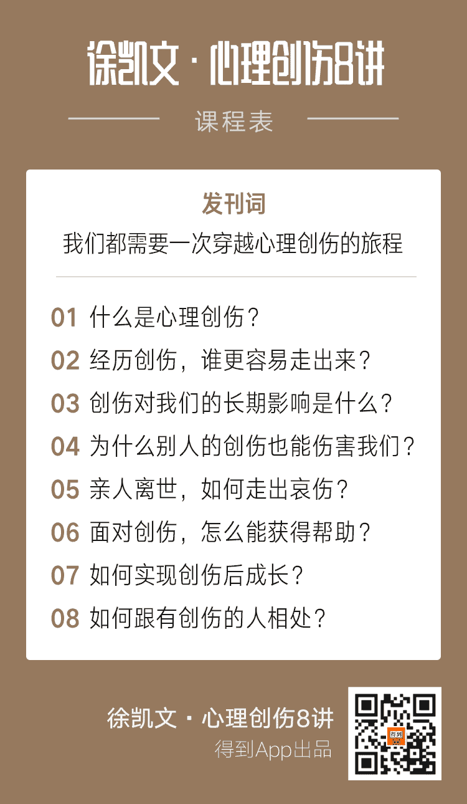
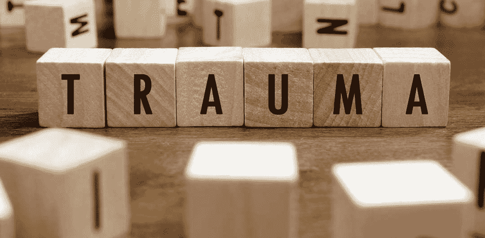
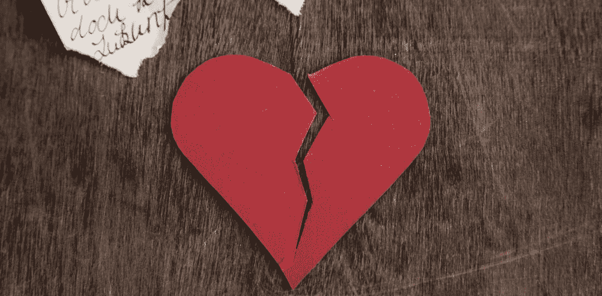
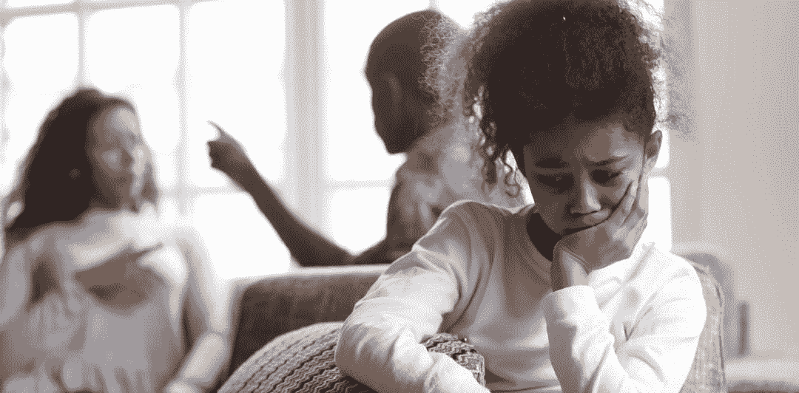
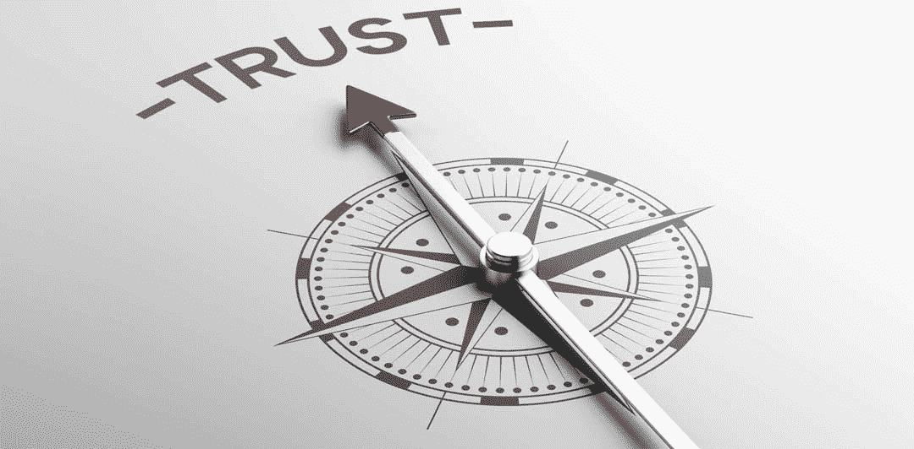
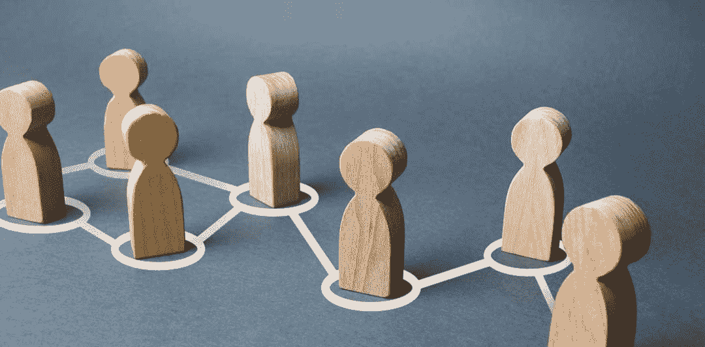

# 徐凯文心理创伤 8 讲（公众号懒人找资源）.md


# 介绍

本电子书由公众号*懒人找资源*根据网上公开信息爬取，仅在*懒人专属群*内测试分享。

所有内容版权归得到 app 所有，未经允许，不得转载。

# 发刊词：我们都需要一次穿越心理创伤的旅程

徐凯文

2020-03-11

发刊词：我们都需要一次穿越心理创伤的旅程

懒人专属群的群友，你好，欢迎来到徐凯文的心理创伤课。

我担任精神科医生和心理咨询师已经二十多年了，作为一个既受过医学训练，又受过心理咨询训练的专业人士，如果你问我对人影响最大、最值得被关注的心理问题是什么？我的答案是心理创伤。

因为这些年来，不管来访者是因为什么心理问题找到我，只要建立了良好的咨询关系、深入下去，几乎都会触碰到心理创伤。

人在经历心理创伤之后，会自觉或者不自觉地用各种方式应对，渐渐就会导致性格的改变。有些改变是中性的，比如有的人容易自恋，有的人爱表演。有些改变是灾难性的，比如主流理论认为，有反社会人格的人，都有过严重的创伤经历。还有一些时候，创伤甚至会在家族里代代相传，打孩子的人，在小的时候往往也被自己的家长身体虐待过。

## 心理创伤的影响为什么这么大

心理创伤为什么有这么强大的影响呢？我认为有三个原因。

首先，心理创伤非常普遍。一个人无论多幸运，即使一生都平平安安，没有发生过意外，也会遇到亲朋好友去世这样的心理创伤事件。

其次，人有适应能力。一朝被蛇咬十年怕井绳就是这种适应能力的体现。这导致我们会在无意识中选择自己能接受的、不太影响日常生活的方式，跟创伤共存。

最后，心理创伤如果处理不好，会成为心里一直无法愈合的伤口。在遇到某些事情的时候，过去创伤带来的痛苦感受，会更猛烈地被唤起，引发其他问题。

心理创伤的范围这么广、影响这么大，但与庞大需求相对的，是目前心理健康领域能够提供帮助的专业人士数量远远不够。我常常在想，那些受了伤，但没有来求助心理咨询师的人，他们还好吗？所以，我想做一门心理创伤的课程，让更多的人受益。

## 了解知识能帮助更多人

为什么我对这门课能帮助更多的人有自信呢？也有三个原因。

首先，在经历心理创伤之后，有的人能够走出来，有的人不能。这两类人的区别，我们通过长期大量的临床观察，已经找到了。其中最重要的因素，是社会支持系统。也就是说，如果一个人在经历创伤之后，他的家人、朋友能够陪伴他、听他倾诉，他自己走出来的可能性就会显著提高。

汶川地震之后，我跟踪十个失独家庭整整十年的时间。对于失独这样严重的心理创伤，尽管没有得到有效而系统的心理治疗，绝大多数失独的父母还是走出了创伤，其根本原因除了灾后的保护性政策，就在于他们周围的亲朋好友持续的支持和关爱。所以掌握了这个知识，理解了社会支持系统的重要性，是能够帮助大多数人的。

其次，了解知识本身就有治愈的功效。经历创伤之后，每个人都会经历强烈的恐惧和痛苦。这些负面感受，会在一个月左右的时间里逐渐消失。但很多人因为不知道这个过程，而放弃了战斗，甚至做了傻事。如果他们能够知道这些心理创伤知识，就能够挺住。挺过一个月的生理恢复期，情况就会逐步好转。

最后，经历创伤事件不能选择，但应对方式可以选择。苹果公司创伤人乔布斯在出生之后，曾经连续两次被抛弃。从心理学角度来说，这使得他非常缺乏基本的安全感和对他人的信任。

对安全感的极度缺乏，体现在人际关系上，就是乔布斯和自己恋人、朋友、同事的关系都很糟糕。他甚至被自己一手创立的苹果公司的董事会集体投票，赶了出来。但我们也看到，对安全感的极度缺乏让乔布斯有更强的掌控一切的需要。获得这种掌控感的方式有两种，一是极致的完美，另一个是自我封闭。而这两点恰恰是苹果手机作为一个产品的核心特征。

创伤给人的影响没有正面、负面之分，它只是引发了我们心理上的偏好，而偏好会带来不同的结果。所以，我们可以从创伤性的事件中获得收益，让它成为人生的财富、力量的资源，而不是任由创伤打击我们。

## 为什么由我来讲

那么，为什么这门课由我来讲呢？我来介绍一下自己。

我在北京大学工作，教书，也负责学生心理危机干预相关的工作。

我也是精神科医生，接受过五年的医学教育。

我还是心理咨询师，曾参与处理富士康自杀传染、汶川地震等重大危机事件的心理救援和心理创伤治疗。

角色虽然很多，但这些工作有一个共同的主题，那就是心理创伤。20 年前在北大，我第一次开始接受创伤治疗的培训。14 年前，我第一次治疗典型的复杂性创伤所致的多重人格障碍病人。13 年前，我第一次走进监狱，开始对监狱服刑人员进行心理创伤研究和反社会人格障碍的心理矫治。12 年前在四川，我第一次投身于大型灾难的心理救援。10 年前在北大，我第一次开设《心理创伤治疗》的研究生课程。5 年前在北大，我第一次开设《灾难心理学》课程。

这些年来的研究和实践，让我有信心讲好这门心理创伤课。那么，我打算怎么讲呢？我想回答 8 个最重要的问题。

1、什么是心理创伤？

2、经历创伤，谁更容易走出来？

3、创伤对我们的长期影响是什么？

4、为什么别人的创伤也能伤害我们？

5、亲人离世，如何走出哀伤？

6、面对创伤，怎么能获得帮助？

7、如何实现创伤后成长？

8、如何跟有创伤的人相处？

每个人都会遇到创伤性事件，它会对我们产生什么影响，取决于我们的认知和选择。

现在，我正式邀请你进入这门课程，一起正视创伤、理解创伤、跨越创伤。

我们课程里见。

  


用户留言

*    

春季摇曳的柳树 **22 赞**

```
 很幸运早起就刷到了罗辑思维的推送。推文中描述的心理创伤后的表现，彻夜失眠，情绪暴躁，驾车超速等等我都在经历。 的确，我是有心理创伤的人，也是个很难走出来的人，深知问题，也努力过，听武志红老师的心理课程，读心理疏导读本，记日记抒发情绪，看电影排解创伤，考证看书转移注意力，找朋友倾诉等等一系列我都试过，可是效果见微，甚至越走越偏，我很焦躁于我现在的状态，也没办法对陌生人倾诉自己的经历。 还好得到遇到了这门课，打算认真听完徐老师讲解，努力争正视创伤，转移创伤，积极面对生活。 
2020-03-07 
```

作者回复

```
明白道理是容易的，发生改变确实不容易。我想你还是可以去找一位比较有经验的心理咨询师。可能需要一个比较长期的咨询。
2020-03-07
```

*    

阿张 **10 赞**

```
 16 年前父亲心梗突然去世，一年头顶头发就白了，到现在也依然不能触碰，此刻也是一边打字眼泪也是一边流，这创伤刻在心上，至死不得治吧…… 
2020-03-07 
```

作者回复

```
你的泪水，是因为他老人家还活在你心里。
2020-03-07
```

*    

☀棉棉☀ **68 赞**

```
 看到有课程，关于心理学的，立刻就入了。我觉得我曾经是有巨大的创伤的，上大学的选修课开始选择心理学。工作后去学心理学相关的课，这些年也一直关注心理学领域。 曾经我有巨大的抱怨，有不甘，有委屈，大概有三年的时间，每天夜里都是哭着入睡，白天仍然正常快乐上班。也是那段日子想明白了好多事情。我是拥有自己人生选择权的，那样的日子我不想再过了，换个角度重新看待世界。 现在感觉自己的伤已经慢慢消失了，能够越来越平静的看待很多事物。也愿意用积极的心态去影响曾经和自己一样迷茫彷徨的人。而且也相信，生活一定会越来越美好。 
2020-03-07 
```

*    

Annabel 彭健晖 **46 赞**

```
 打不死我的必使我强大， 我要把我的创伤变成我的盔甲。 
2020-03-07 
```

*    

苗发田 **42 赞**

```
 每个人或多或少都有创伤。就拿我来说，我 2009 年初 4 岁的孩子因为意外离我而去，不到一年，我父亲又离开了我们，次年我哥因意外差点救不回来，在年，我母亲摔伤差点残疾。连续三年我生不如死，爱人每天以泪洗面，而我作为家庭的支柱强颜欢笑，硬是挺过来了。 现在，我们的孩子已经 8 岁了，母亲也很健康，每天欢声笑语。此时的我是很幸福。 回首那黑暗的几年，哪些苦难的事情让我懂得更加珍惜眼前人，眼前的事，让我更加懂得了爱的真正含义。 
2020-03-07 
```

*    

紫薇 **35 赞**

```
 你不是一座孤岛，你所承受的创伤，也许，我们也曾遇到。不会渴求你马上坚强，但请相信，明天会更好。 
2020-03-07 
```

*    

文思夏洛 **31 赞**

```
 “走过黑暗的那段没有人拉我一把，是我自己把自己拉出深渊。没有那个人的话，我就做自己美好的那个人吧”——中島美嘉 
2020-03-07 
```

*    

西西里的小七 **28 赞**

```
 太鸡冻了！一看到推荐，我几乎是不假思索闭着眼下单的！明天打算啥事都不做就好好听这个课😔 
2020-03-07 
```

*    

绝非偶然 **25 赞**

```
 标题太美啦！我们都需要一次穿越心理创伤的旅程，读着发刊词，心理都隐隐感觉创伤有点跃跃欲试的感觉，好似在期待着这一次的旅程~期待晚上和老师的第一次“面基”！ 
2020-03-07 
```

*    

刘溜溜 **21 赞**

```
 我一直不觉得我有什么心理创伤，至少没有很大的创伤。不过之前参加一些学习的时候，我曾经见过有很多经历过创伤的人，他们一旦谈及那些事情，就会变得异常脆弱，甚至是濒临崩溃。他们觉得自己在过着正常的生活，可是那些创伤依旧还在，只是被隐藏罢了。 或许，我自己也有着什么被隐藏着的创伤，只是现在还没被揭开罢了。无论如何，我希望能学习这方面的知识，不仅是为自己，更是在身边的人遇到这样难过的事情时，我能够帮助他们。在经历创伤以及创伤被看见的时候，身边人的支持是多么重要。 
2020-03-07 
```

*    

爱丽娜 **13 赞**

```
 今天一口气儿，就不知不觉把 8 节课听完了，只想跟徐凯文老师说一声: 谢谢您！您的工作有意义。❤ 徐老师用很节制的，一字千金的风格分享了一些故事，给出了用来强大心理的实用工具。闭着眼睛仔细品，已经觉得很有效，感受到了徐老师的心跳。👍 
2020-03-07 
```

*    

边靖 AUX **11 赞**

```
 很幸运，到目前为止的人生中还没有经历过大的心理创伤，但是心理创伤总会发生的。给自己留一份心理保险。提前学习收获认知储备 
2020-03-07 
```

*    

亚男 **10 赞**

```
 每个人都在不同时期的心理问题，如何解决看自身应对，不是谁都有心理学方面的知识的，看到课程赶紧买下来。 
2020-03-07 
```

*    

奇问小顽童 **10 赞**

```
 看到创伤就不自觉的想到自己的创伤。而这些创伤给自己的影响最大的就是在现实中无法和朋友好好交流，总是自己一个人。包括在家和父母也无法好好交流。现在需要好好调理一下了 
2020-03-07 
```

*    

佛山宏想 **9 赞**

```
 经历过创业的失败，至今仍受影响。不是每个人都能做到英雄归来，仍然希望老师的课程能为遭遇过重大创伤的人带来改变。谢谢老师，与受伤者共勉！ 
2020-03-07 
```

*    

面包 **9 赞**

```
 前 50 购买！心理学我的爱！ 
2020-03-07 
```

*   

小马过河 **8 赞**

```
 发刊词都不用看就下单了，因为这是面对真实社会的真实挑战，心理建设与身体健康同等重要。 
2020-03-07 
```

*   

墙上的向日葵 **8 赞**

```
 一秒下单 
2020-03-07 
```

*    

李建 96814466 **7 赞**

```
 身边有些朋友遇到过心理创伤的情况，不知道如何去安慰他们，希望能学到相关的知识 
2020-03-07 
```

*   

静花水月 **7 赞**

```
 这个太及时了，这个时刻，这种情况，每个人都需要学学，减压神器。 
2020-03-07 
```

*   以上留言由 作者 筛选显示
    



# 01 什么是心理创伤？

徐凯文

2020-03-11

01 什么是心理创伤？

懒人专属群的群友，你好，欢迎来到徐凯文的心理创伤课。

我担任精神科医生和心理咨询师已经二十多年了。如果你问我，对人影响最大、最值得被关注的心理问题是什么？我会说是心理创伤。

因为这些年来，不管来访者是因为什么心理问题找到我，只要我们能够建立良好、深入的咨询关系，走进他的内心世界，基本上都会触碰到心理创伤。也就是说，绝大多数人在成长过程中会经历一些创伤事件，这些事件对我们的一生都会有影响。

那么，什么是心理创伤呢？

我比较愿意采纳 DSM-4 美国精神疾病诊断与分类标准中的定义。这个定义包括两个方面：一是这个人要经历一件危及生死的严重事件，二是他要表现出一些典型的、不受理性控制的症状。如果这些症状在一个月左右的时间里不能自行缓解，就会发展出创伤后应激障碍，也就是我们常说的 PTSD。

接下来，我就围绕这两个方面，讲解心理创伤是怎么出现、怎么影响我们的。之后，我会从神经生物学的角度，讲解心理创伤的底层逻辑。

## 经历危及生死的负面事件

理解心理创伤，第一个关键点是，一个人要经历一件危及生死的负面事件。

比如说，亲人正常的生老病死，就是出现概率最高、每个人绝对会经历的负面事件。

再比如，大的自然性灾祸，像地震、海啸，是在一定时间、一定范围内，大面积的人同时经历的负面事件。

还有一些极端的小概率负面事件，比如强奸、家庭暴力、凶杀、车祸、白发人送黑发人等等。这些事情在人群中有一定概率出现，但不见得每个人都会经历。

**需要提醒你注意的是，我们说危及生死的负面事件，针对的都是普通人的正常经验。**  
比如，对大部分人来说，失恋肯定算负面事件，但没严重到危及生死的程度。如果一个人失恋到活不下去，想要自杀，算不算创伤呢？

我的答案是，不算。在心理学上，我们一般认为，失恋是一个扳机点，唤起了过去的、隐藏的创伤。一个人因为失去了亲密关系，就觉得活不下去，并不是失恋本身造成了创伤，而是他可能原来就有原生家庭的创伤，比如父母离异、被寄养、被抛弃的经历。现在他被分手、被放弃的经历，唤起了他过去的创伤记忆，唤起了他过去所有的痛苦感受，所以他才会自残、自杀。

## 出现不受控制的典型症状

理解心理创伤，第二个关键点，是在经历严重的负面事件之后，人会表现出一些不受控制的典型症状，比如高度警觉、回避、闪回和解离。

这些症状具体有什么表现呢？我来给你讲个真实案例。

几年前，我作为医生和心理咨询师，参与过一起案件的审理。案情很简单，女孩报警说被性侵了，但男生说自己是被冤枉的。到底谁说的才是真话呢？我就跟这位女孩见了一面。

我观察到她有一些特别的表现。比如说，她整个人看起来非常恐惧，防备心非常强。在心理学上，我们把这种症状叫作高度警觉。

她告诉我，虽然知道不是所有异性都会伤害自己，但她还是克制不住地认为，只有跟异性保持距离，才能感觉安全一点。这是一种典型的回避行为。

她还告诉我说，当时她被性侵的画面，会时不时地、克制不住地在脑海里重现，这让她感到非常痛苦。而这正是心理学上所说的闪回。

当我在跟她交流、评估的过程中，她会不自觉地出现走神、一下子不知道在干什么的情况。她还告诉我，她在被伤害的过程中，感觉自己的自我会飘出来，在身体外面看整个被侵犯的过程。这是人类发展出减轻自己痛苦体验的神奇能力，我们把它叫作解离。

到这里，心理创伤的四个典型症状，在她身上都出现了。在我看来，这些症状是不受人的理性控制的，如果她想冤枉这个男孩的话，是装不出这些症状的。

在交流之外，我也用一些心理量表，对她进行了测评。测评的结果表现出，她有严重的 PTSD 的症状。

心理测评的结果证实了我的判断，所以我给出的专家意见是，她确实有被强迫进行性关系的经历。

为什么我这么肯定呢？因为即便是像我这样受过多年训练的专业人士，在经历创伤后，也会出现不受理性控制的症状。

汶川地震时，我第一时间去灾区，做灾后的救援工作。在 5 月底回到北京时，站在学校门口等红绿灯。北大西门是游客拍照的热门地点，一年 365 天，每天都有人在那里拍照留影，这是一个我非常熟悉的情景。但是那天我在等红灯的时候，脑子里充满的是一片片废墟的画面、灾民们失去亲人悲痛的表情，而眼前阳光灿烂、蓝天白云，游人们高高兴兴地拍照，这让我有一种非常不真实的感觉，就像眼前蒙了一层毛玻璃。我觉得我是在看电影，而不是在亲身经历。

这个症状，跟前面案例里女孩不自觉地走神，表现是类似的，就是心理学说的解离症状。当时，我意识到自己虽然没有亲身经历地震，但因为我们有共情能力，看到同胞们经历痛苦，自己也会感到痛苦、也会受到创伤。这种情况，叫作替代创伤，我们会在第四讲展开讲解。

理解了这两个关键点之后，我们就可以说，如果一个人经历了危及生死的负面事件，又表现出了不受理性控制的典型症状，我们就认为，他经历了心理创伤。对百分之七十的人来说，这些症状会在一个月内自行缓解，不同的人稍有提前或滞后。如果超过一个月，症状还没有自行缓解，就会被诊断为创伤后应激障碍，临床上经常用这个词来描述心理创伤无法自愈带来的问题。

## 心理创伤的神经生物学逻辑

那么，为什么心理创伤会带来这些不受控制的症状呢？其实心理创伤不是单纯的精神层面的问题，它是有神经生物学底层逻辑的。我们对心理创伤进行的治疗，就建立在这个逻辑上。这是关于心理创伤，你需要知道的第三点。

大脑的各个部分是相互联系、相互影响的，总司令部就是我们的大脑皮层，它可以很好地控制和调节我们的感知觉、情绪、感受和记忆。

**当我们经历了严重的心理创伤之后，大脑各部分的连接就会受到阻碍，信息加工过程随之停滞。大脑就会像短路了一样，无法正常工作，出现功能的紊乱。**

当我们的理性认知不能控制感知觉的时候，感知觉出现的改变，也就是创伤的画面，会在眼前反复出现。人就会出现我们前面提到的闪回症状。

我们的丘脑、下丘脑受到影响，所以当我们回想起创伤事件的时候，会感觉喘不过气来、心痛。

我们的杏仁核受到影响，所以我们会出现强烈的负面情绪，影响我们的认知和行为。为了控制这些崩溃的情绪，我们甚至会出现强烈的反应，比如抑郁或者自我伤害的行为。

因为痛苦的记忆储存在海马体当中，它不断地被唤起，让我们克制不住地去回忆那个经历生死的过程，因此我们出现了想要抹去但抹去不了的痛苦记忆。

所有这些改变都会使我们经历强烈的痛苦，让我们对自己的认知发生消极的改变，比如我们会感到绝望、无助和自我否定。

至此，心理创伤对我们的身心产生了巨大的冲击。而这一切，都是因为整个信息加工过程受阻，就像电脑出现死机的状态。所以，在经历心理创伤之后，就要通过自我调节或者心理治疗，让大脑重启，恢复到正常状态中。那么，为什么有的人自我调节有效，能够自己走出来，有的人不能呢？下一讲，我们就来回答这个问题。

## 总结

心理创伤是对人影响最大、最值得被关注心理问题之一。

如果一个人经历了危及生死的负面事件，又表现出了不受理性控制的闪回、解离等典型症状，我们就认为，他经历了心理创伤。

这些症状背后的神经生物学机制，是创伤阻碍了大脑各部分的连接，让信息加工过程停滞。

思考题：

据你观察，生活中还有哪些像失恋这样，容易被误认为创伤的事件？

欢迎留言，与我交流。


用户留言

*    

Sencer **41 赞**

```
 今日思考，在内心还处于萌萌哒的成长期的时候，还有什么比失去父母和老师对自己的信任更让人痛苦的呢？小孩子总喜欢问问题，当他的问题总是得不到回应的时候，心里面就会产生疏离感，认为父母不爱自己了。这种疏离感会给幼小的心灵中带来很大的冲击，因为不知道自我调节，做父母的也没有这方面的经验，也往往会忽视孩子们的这种心理反思，就给孩子的心理蒙上了孤僻的阴影。 随着年龄的增大，遇到类似于这样的情况，人们都会用熟悉的防御系统来保护自己，结果是性格越来越孤僻，直至后来与别人交流都成为问题。 
2020-03-07 
```

作者回复

```
在与父母关系上，我们需要和深思一个问题，父母是不爱我们，还是不会爱我们。爱自己的孩子是本能，但有爱的心，未必有爱的能力，尤其是当他们的父母也不会爱他们的时候。
2020-03-07
```

*    

Xin **49 赞**

```
 老师好，我是生物专业，也修过病理学与生理学，在此从生理方面分享一点点不成熟的小小知识 先分享一个小故事：我在去参观美国 911 纪念馆的时候，一位妻子谈到，大意是“我现在听不得电话声，因为那是丈夫打给我的最后一个电话说他爱我和孩子”，纪念馆里通过在展厅棚顶循环播放各种录音来展示每种不同角色的人（母亲、儿子、妻子、丈夫等）的 PTSD；包括很多消防员都谈到出警的铃声对他们来说都是对那次灾难的再次回忆 1\. 心理创伤在生物领域属于应激（Stress）：包括心理应激（psychological stress）和躯体应激（physical stress） 2\. 适度应激有利于机体的对抗或回避能力。而应激过度，可诱发或者加重身体和精神疾病，对机体造成伤害。 3\. 应激源（stressor）包括 1）外环境因素：物理伤害、化学毒害；2）内环境因素：贫血、休克、酸浆紊乱；3）心理因素：工作压力，不良的人机关系，突发事件如离婚、丧偶等等； 4\. （本条带有专业知识，不过多介绍了）应激反应的生理机制主要是 1）神经内分泌反应(Neuroendocrine responses)：蓝斑-交感-肾上腺髓质系统等等等等 2）基因、细胞水平的应激反应(Gene and celluar response) ：各种基因通路 3）功能代谢整体水平的应激反应 ( Functional and metabolic response) ：身体中的各种系统 
2020-03-07 
```

*    

吉林雀园 **32 赞**

```
 我只看了一眼标题就订阅了，作为常年被“创伤后遗症”影响的人，真的很期待这门课。我在童年和成年后，都遭遇过心理创伤，并且持续时间很长，为了疗愈自己，我自学过一些心理课程，感觉对自己帮助很大，但却不能彻底自愈自己。我第一次知道那种情况叫“闪回”，在一个人独处的时候，我总经历这种“闪回”，然后会不自觉地脱口而出地喊“妈妈”“不是这样”，这真的给我造成很大的困扰，有时候不小心被别人听见，我就会感觉很羞愧，越感觉羞愧，这种“闪回”越频繁。期待能在这门课中学到对自己有帮助的知识。 
2020-03-07 
```

*    

新疆～林染 **21 赞**

```
 一个人经历过颠覆行的负面事件，且他的行为不受理性控制，则为心理创伤。 据你观察，生活中还有哪些像失恋这样，容易被误认为创伤的事件？ 1，重大考试失误。绝大多数人对于学习这件事情没有经过完整清晰的思考和定义，一旦重大考试失误，就会受到一定程度的影响，觉得自己一辈子都过不好了，实际上两者并不存在直接必然关系。 2，被自己很在意的人贬低出丑。差强人意时，觉得很尴尬。 
2020-03-07 
```

*    

行者 **13 赞**

```
 之前就听徐老师的心理动力学与危机干预的课程，当时就觉得非常实用和接地气，这次又了解了神经生物学角度的分析，对于一个心理学学生来说，这无疑是最好的知识拓展！ 
2020-03-07 
```

*    

Eros **9 赞**

```
 说到心理创伤 其实我有一个关于您的疑问 对于了解心理创伤原理 知道他是怎么回事的您 哪天触动了心理创伤 一股难以抑制的悲伤涌上心头 您是以理性来说服自己 还是如引导洪流那样通过释放来缓解？ 我也有心理创伤 有时候我会以理性来宽慰自己 但是实际效果不如释放找人倾诉 甚至诉诸于暴力解决更有效 
2020-03-07 
```

*    

将梦想放进背包里 **8 赞**

```
 据你观察，生活中还有哪些像失恋这样，容易被误认为创伤的事件？ 高考失利，这个事件也容易被误认为创伤，但是高考失利本身不是创伤，只是会联想到自己以后就找不到工作了，身边的父母，亲戚以及朋友会怎么看我而焦虑，高考失败就相当于人生失败了，这一系列联想，以及社会舆论压力，放大了高考对人生的重要性，最终甚至导致有的孩子放弃自己的生命。 
2020-03-07 
```

*   以上留言由 作者 筛选显示
    


# 02 经历创伤，谁更容易走出来？

徐凯文

2020-03-11

02 经历创伤，谁更容易走出来？

懒人专属群的群友，你好，欢迎来到徐凯文的心理创伤课。

上一讲，我们谈到，在严重的外部事件，也就是我们说的创伤性事件发生之后，几乎所有人都会出现高度警觉、闪回、回避、解离等反应。这就是说，他们经历了心理创伤。在这之后，大部分人会在一个月里自己走出来，逐步恢复正常生活。

还有一小部分人很长时间都走不出来。很多当事人无法用语言表达创伤对他们的影响，他们只是时时感到出现与现实状况不符的强烈负面情绪，如焦虑、害怕、愤怒、羞耻、负罪感，或者觉得麻木、空虚，甚至会在无意识中重演创伤性经历，慢慢发展出了心理障碍。

那么，极端的情况下，会发生什么呢？

我曾经有过这样的一个来访者。我在跟他做咨询的时候，咨询室的门被误打开，一个人闯了进来。对普通人来说，这种情况并不特殊，但我发现我的来访者突然像被定住了一样，我叫她的名字，她没有反应。五六分钟之后，她突然哇地哭了出来，像个七八岁的孩子一样，哭着说妈妈我要回家。为什么会定住呢？

这个来访者有几段不同的创伤经历，这让她发展出了几个截然不同的子人格，有婴儿、有七八岁的孩子、有成年人，这些子人格的性格、行为甚至笔迹都完全不同。门突然被打开的场景，重演了她七八岁时被侵犯的经历，所以她表现出来的就是那个七八岁孩子的子人格。

为什么经历同样的心理创伤事件，会有不同的结局呢？这一讲，我们就来回答这个问题。

## 心理创伤可以自愈

首先，如果一个人在经历创伤之后走了出来，恢复了正常的生活，他其实是自愈了。为什么这么说呢？

我们打一个比方，感冒后身体发烧这个症状是有意义的。感冒了为什么会发烧？这是我们的免疫系统与外来的病毒开展战斗的副产物。一个人能发烧，恰恰说明他的免疫力在积极工作，在保护自己。如果一个人被感冒病毒攻击了，却没有发烧，说明他的免疫力很弱。从这个角度讲，发热是好事情，不是坏事情。

同理，经历严重的负面事件之后，出现高度警觉、解离等症状也是好事情，说明我们的身体在进行自我修复，修复完成了，人就自愈了。如果一直没有表现出症状，反而可能是无法自愈的危险信号。

我曾为一个企业的驻外人员做过创伤咨询。当时，他们团队在国外被反政府武装绑架，囚禁了很久才被解救回国。我刚见到他们的时候，大部分人都出现了恐惧、情绪低落、高度警觉等症状。但其中有一个人很奇怪，他看起来非常镇定，主动表示不需要接受心理援助。

可是几个月后，当时那些出现了典型的创伤症状、接受辅导的同事，已经基本痊愈。这个人的生活却出了问题，原来关系融洽的夫妻正在闹离婚。

为什么会这样子呢？原来这个人是团队的领导，在被囚禁期间，他积极抚慰大家的情绪，被解救之后，又很快恢复了工作。当时，同事们都感慨，他的心理素质真好。

其实问题就出在“没事”上。当时没表现出症状，是因为他用过于强大的理智压抑了自己的心理反应，没能开启自我修复的流程，自然最终也就没能自愈。被绑架的经历严重影响到了他的心理健康，最终通过夫妻关系这个渠道爆发了出来。

## 自愈的人获得了更多的支持

不过，我们也发现，一小部分人即使表现出了症状，调动起了自己的修复系统，但最终还是无法自愈。这又是为什么呢？那些自愈的人做对了什么？这就是我想跟你分享的第二点内容，哪些资源能够帮助我们走出创伤？

在临床上，我们观察到，自愈的人获得了更多的支持。这些支持分为两类，一是外部的社会支持系统，二是自我的心理支持，我们分别来看。

自愈的人往往能够很快找到人去分享自己的感受、表达自己的痛苦。这一次次讲述的过程，就是逐渐脱敏、从创伤里走出来的过程。

这些倾听者都是谁呢？有的人家庭比较幸福，可以跟家人倾诉。有的人交游广阔，可以通过跟朋友聊天来纾解。你可能从电视上看到过，四川人民在地震棚里打麻将的新闻。当时你可能只是觉得他们心真大，但在我看来，麻将在灾后的心理重建工作中，发挥了很大的作用。因为一个人是玩不了麻将的。积极一些的人得主动组局，让更多的人参与进来。打麻将的同时又要聊天，聊着聊着，大家的心情就都好了。

用专业的术语，我们说这些人有良好的社会支持系统。社会支持系统，就是那些能够给我们提供精神或者物质帮助的人的集合。所以说，在经历心理创伤的时候，幸福的家庭、良好的社会关系都是我们宝贵的财富，能帮助我们扛过这段艰难的日子。

还有一些人，他们的内心非常强大，不需要外部支持，也能自愈。这里的强大，是说他们有能力，用让自己舒服的方式，排解掉创伤带来的负面情绪。比如，有的人艺术修养很深，他可以通过写作、绘画等方式，抒发情绪。有的人天生乐观，做一些让自己开心的事情，比如睡觉、泡澡、K 歌，就慢慢调节过来了。

前面讲的这些，都是促进自愈的有利条件。只要具备一个，就对我们走出创伤有很大帮助。

没能走出创伤的人，除了缺乏自愈的有利条件，还有两种可能。一种是心理创伤事件太严重、刺激太强烈，导致大脑的功能彻底受损，所以无法自愈。另一种是虽然这一次经历的心理创伤没有那么严重，但他可能有更深层的心理问题，比如上一讲我们提到的，一个人失恋了就要自杀，其实失恋只是扳机点，唤起的是更久远的、既往的、原生家庭的伤害。这个时候，他们就需要接受专业人士的帮助。

## 专业干预的优势

我想跟你分享的第三点，就是专业干预的优势。专业人士会先确认来访者难以痊愈的原因，是有陈旧性创伤需要处理，是大脑功能受损，还是没有良好的社会支持系统等等。原因找到，就可以有针对性地、系统地提供解决方案。

对那些只是没有良好社会支持系统的来访者，我们有一个标准的两步法流程。

**首先，我们会修复他的感受。**

如果一个人，他在过去的心理创伤经历中被羞辱、被攻击、被否定、被威胁生命，心理咨询师就要让他在咨询的关系中，被接纳、被肯定、被重建安全感。在这样好的环境中，他自然就可以恢复自己的安全感、自尊。

**其次，我们会修复、调整和启动他的社会支持系统。**

我们的社会支持系统，是在和其他人相处的过程中，逐步建立起来的。如果一个人的社会支持系统出了问题，很可能是他跟别人相处的方式有问题。所以心理咨询师就要跟来访者探讨，帮助他建立健康的人际交往模式。让他在离开咨询关系之后，也能有一个让他安全、自尊的环境。一般情况下，一旦来访者拥有了稳定的亲密关系，就不再需要心理咨询师的帮助，他生活中重要的他人就可以给他长期、有效、稳定的支持和帮助。

很多年前，我有一个女性来访者，她有严重的乱伦经历，事情过去了十几年，一直没有得到疗愈，甚至严重到出现连续的自杀行为。我当时能给她的治疗时间只有两个月。这对于心理创伤治疗来说，实在太短了。她这种情况，我觉得至少需要一年时间。

既然治疗时间不够，我就决定在对创伤进行治疗之外，再做一件事情，去改善她离开咨询关系以后的环境。在跟她讨论、获得同意之后，我跟她的先生谈了她曾经有过的乱伦经历。

其实，当时我走了一步险棋。这件事情对任何人来说，都是很大的冲击。我不能保证她先生知道了之后，一定会接受她、更加爱护她。所以我也做好了准备，如果社会支持系统这条路走不通，我就会选择唤起来访者自己的力量，帮助她自己走出来。

幸运的是，在这位先生了解了之后，他立刻就明白了，为什么自己的妻子一直对发生夫妻关系很抗拒。这些年来，因为一直不理解妻子的这种反应，也影响了他们的夫妻感情。但在知道这件事情之后，她的丈夫变得特别理解自己的妻子。他明白两个人的关系有问题，是因为来自妻子原生家庭的创伤，这让他更愿意去理解、支持和疼爱自己的妻子。

后来，在丈夫的理解和支持下，这位来访者就慢慢走了出来。治疗十年之后，来访者联系我，告诉我她现在生活得很快乐，跟丈夫的婚姻也变得越来越好。

## 总结

一个人在经历创伤之后走了出来，症状消失了，他就是自愈了。

这样的人是大多数，大约占到 70%。他们普遍有好的社会支持系统和强大的自我心理支持。

创伤不能自愈，就要寻求专业人士的帮助。专业人士会找到原因，提供系统性的解决方案。

徐凯文

思考题：

对于负面情绪，你是如何疏导的？

欢迎留言，与我交流。


用户留言

*    

Super Tank **89 赞**

```
 老师好，关于负面情绪的疏导，曾看过一篇文章介绍源自于辩证行为疗法（DBT）的“四步情绪管理法”，于我而言，亲测有效： 【1】观察并描述自己的情绪(Observe and Describe Emotions)。毕竟只有认清了情绪，才谈得上管理它。 可以先给自己的情绪找到归类，比如：常见的负面情绪大概可以归纳为下面的五大类：抑郁/难过，焦虑/紧张，反感/恶心，生气/愤怒，内疚/羞耻。先想清楚，自己的情绪是哪一种呢？ 然后用数字来标注情绪的强烈程度。比如说从 0-100，我给我自己打多少分？这一步的主要作用，是判断和了解自己当下的状态。 【2】然后，停止手头一切行动(STOP) 换言之，当下无论在做什么，想去做什么，或者已经做了什么，都不重要，停止一切手头的行动，在这一瞬间定格。情绪止损。 【3】核查事实、对情绪进行检查(Check the Facts) 并在这一步骤要问自己两个问题：第一，我的情绪和现实情况相符吗？也就是，如果同样的事情发生在另一个人身上，他们也会有同样的情绪吗？ 第二个要问自己的问题是：我的情绪强烈度和现实情况相符吗？也就是，面对同样的情况，其他人会有一样强烈的情绪吗？ 每每核查，我都会觉得自己确实有点小题大做了。 【4】和自己的负面情绪做反方向行为(Opposite Action) 这会很有助于我从情绪中出来，并迅速切换到反思状态——下一次，我要如何做才能避免这类的事情再次发生？ 以上方法步骤，供各位同学参考，也请老师指教，谢谢。 
2020-03-07 
```

*   

Annabel 彭健晖 **41 赞**

```
 负面情绪疏导： 1，画个小妆，折腾一下头发，整理一下衣橱，搭配一下衣服。 2，看看电影，电视剧， 3，出门去运动，跑步，爬山。 4，找朋友聊天，找妈妈聊天。 
2020-03-07 
```

*   

林特特 **34 赞**

```
 关于负面情绪，我是怎么疏导的？ 1\. 写一张开心礼品单 找个时间，刻意记录下，5—50000 元，能让自己开心的礼物、单品都是些什么。 不高兴时，看一看这不高兴值多少钱，花多少钱能摆平自己，去下单吧。 2.找到自己的社会支持系统 一定要有几个绝对信任的朋友，绝对站在你这边。你的一颗痘，在他/她眼里都是福多了溢出来凝结住的显性特征。 3.看过去的日记 看三年前的今天在做什么。 五年前呢？ 十年前呢？ 那时的烦恼多么不值一提啊，此刻的，三年五年十年后也一样。 4.用过来人的口吻用艺术人生的方式说一遍现在正在发生的事 站在时间长河的中央，将眼前当作过往，角度不同，自动治愈。 5.拿一张白纸，如果有十个烦恼，就写下十个，然后找烦恼之间的逻辑关系，极有可能发现，所谓十个烦恼源头只有一个，那就去解决那一个就 OK 了。 6.不完美才是人生，凭什么什么好都被你占了呢？ 每当不忿、失落、怀疑、自卑，我都对自己说，你已经是幸运儿。 有时，这句话要连着重复一百遍。 
2020-03-09 
```

*   

吴佩师 **27 赞**

```
 😃第一个步骤，我有一个奖励清单，我遇到负面情绪的话，我会在奖励清单里面挑，1~2 个来奖励自己。首先选择的就是吃火锅。 😃我的第 2 个步骤是约朋友一起玩。我挺喜欢跟朋友倾诉自己的经历。 😃第 3 个步骤的话是把这让我引起负面的事情写出来，我会在网上搜这了解这个原因，有没有其他人有类似的经历，别人是怎么走出来的。 
2020-03-07 
```

*    

新疆～林染 **22 赞**

```
 对于负面情绪，我是如何疏导的？ 一，感受，扫描自己的身体，感受到有时胸口闷着一口气，或者是脑子充血，或是全身冰凉，就这样感受身边的感受。 二，照顾情绪，先拿笔记录下来自己的情绪，比如难受，为什么难受，尽可能详细。 三，停顿。什么都不做放空自己。 四，做喜欢的事。告诉自己，自己是因为热爱而活，锻炼，读书，听歌。 五，记录。一套完整的记录。 
2020-03-07 
```

*    

周子生 **15 赞**

```
 以前没有勇气面对的问题，早晚会给你憋出一个更大的问题，也许这就是修行，你早晚要面对你的每一个问题。 假设这次你侥幸逃脱了，那换一个时间空间，它会再次轮回到你的身边，如果你还是不面对，它就会在你内心越变越大，直到哪一次轮回，你开始面对了，问题才可能发生逆转，只不过，越往后，逆转也就越困难。 “放下屠刀，立地成佛”，也许就是在说这个道理，我们永远不要逃避，要及时面对自己的内心，看看那里藏着什么，然后把它们一点一点扫出来。 
2020-03-07 
```

*    

Erin 聿 **14 赞**

```
 原来，有时自己无意中的拖延是为了给自己大脑时间去疗愈。谢谢您，让我看到了那时的自己的需求。同时，我现在越来越重视社会支持系统了，不会像以前那样自闭。在跟别人互动的过程中看到别人，也让别人看到自己。 
2020-03-07 
```

*    

小东 **9 赞**

```
 我会通过运动去排解我的负面情绪，或者散步让自己静下来好好反思自己 
2020-03-07 
```

*    

冬日阳光 **7 赞**

```
 我使用心情笔记来疏导自己。 心情笔记的内容包括：记录、分析、反思、列出行动计划。 记录，是将详细描述这件事情的经过； 分析，是分析自己的感受属于哪种负面情绪； 反思，努力反思自己为什么会有这种情绪，该用什么方法消除这种不良情绪； 列出行动计划，用 smart 法则，制定一个可行的行动计划。 
2020-03-07 
```

*    

银雪 **6 赞**

```
 曾国藩他认为自己有很多毛病，于是就每天在日记里面反思自己的这些问题，每天写完日记后会把它寄回家中，现在看来他这个方法其实也是自我疗愈的过程。 
2020-03-07 
```

*    

村儿里种地的 **4 赞**

```
 说到社会支持系统，我特别有体会 一个人的时候特别容易负向的胡思乱想 要是与人连接，跟别人一起玩耍，聊天、听讲座，出游 也能走出阴暗 除此之外，还得自我心里建设 梁宁说，自卑的反面是成就感。 多做自己喜欢的事，悦己更易恢复和加强 
2020-03-08 
```

*    

半支烟 **4 赞**

```
 电子游戏曾经在很长一段时间中是我自己疏导负面情绪的主要方法。我上学的时候小伙伴们都或多或少的玩过电子游戏，而且由于那个年代大多数家长并不赞成孩子们玩游戏，因为很多媒体会以“电子海洛因”给电子游戏定性。不过这因为这种不理解反而能够让一起玩游戏的小伙伴们形成了更强的凝聚力。而游戏其实更多的是作为一个载体来为我们这些玩游戏的小伙伴提供“社会支持”。 不过随着年龄的长大，和游戏方式的改变，游戏越来越难以提供社会支持，而更多的是一种让自己陷入“忙碌”的逃避手段。尤其是现在的游戏，以吸引注意力为主，而所谓的社交属性也更多的是以“竞技”为主，游戏中“合作”的因素越来越少。“宅”文化的产生可能也有着这样的因素。 前些年在机缘巧合中我有了读书的兴趣，通过读书让我对世界有了更多的理解，尤其是一些心理学和行为学方面的书籍，让我对人性有了更多的了解。而且我也掌握了一种新的排解负面情绪的方法，也就是通过理解自己负面情绪的主要来源，也就是通过感受而不是情绪来理解负面情绪，比如很多情况下“愤怒”的情绪是来源于感受到了“伤害”而产生的，于是我就可以思考我受伤的感受是如何产生的，这样就可以进一步进行沟通或者自我反思。而这种排解方式就是来源于《非暴力沟通》这本书。 当然方法还是因人而异，希望大家也能找到属于自己的更加合适的排解方法。但是也要主要不要因为想要快速排解负面情绪而沉迷于方法本身。 
2020-03-07 
```

*    

中武妖 **1 赞**

```
 徐凯文老师，对于我来讲负面情绪是去锻炼，在山上锻炼有一个很大的好处，就是大家可以在一起放下一切的聊天。很多人都说这样的聊天大家没有负担，可以找自己同频的人聊天，不必担心言多必失，不用担心别人的面子，大家在一起乐乐呵呵一切都过去了。有很多人也都说过为什么要上山锻炼的原因，就是可以放下很多事情，让自己全心全意的投入到一件事情中。其实人就是需要这样放下的过程，如果没有这些放下的过程，很多人就会产生想法，有想法还没有办法的时候，就会产生精神上的自虐，认为自己不行，自己是累赘，自己的废物。毕竟人需要自己强大才能应对各种各样的情绪，就好比那个应对绑架的领导，为了能够让大家保持冷静，自己就承担了所有的压力，可是这本身就是一种强大，只是后续对于压力排解的方向出现了问题。如果能够用理性来释放压力，自然就可以从新振作起来。所以面对压力有的人会锻炼，有的人会和朋友聊天，有的人会去打游戏，反正压力是需要释放的，只要释放的方向是对的，人自然就可以获得更美好的生活。 
2020-03-09 
```

*    

81 年的毛豆 **赞**

```
 出现负面情绪，我一般会评估得失，先把产生负面情绪的事件作为沉没成本，再想想如果继续受负面情绪影响会额外付出多大代价。 其实在思考这些问题的时候，注意力就被转移了，避免了钻牛角尖，想不开，负面情绪也就消解了。 
2020-03-11 
```

*   以上留言由 作者 筛选显示
    



# 03 创伤对我们的长期影响是什么？

徐凯文

2020-03-11

03 创伤对我们的长期影响是什么？

懒人专属群的群友，你好，欢迎来到徐凯文的心理创伤课。

这一讲，我们讨论心理创伤对我们的长期影响。这种长期影响，是塑造我们的心理模式和行为模式的重要力量之一。

我们每一个人都会经历一种甚至几种创伤性的事件。对绝大多数人来说，那些不由自主的恐惧、警觉、闪回、解离等症状会逐渐消失，我们可以说，他们在生理上是走出来了。创伤性事件的短期影响到此为止。

但是对很多人来说，如果心理创伤没有处理好，就会导致心理创伤的长期影响，以这种或那种方式塑造了我们的心理模式和行为模式。在意识层面，我们甚至不会意识到那个创伤并没有离开，但是突然它就会显现。

## 对亲密关系的影响

我先讲一个我的来访者的故事。

她是一个各方面条件都非常优秀的女孩子，但就是没办法谈恋爱，所以来找我求助。经过一段时间的咨询之后，这个女孩开始变得自信了一点，向外界表达出希望恋爱的意愿。因为她各方面条件很好，所以就有很多男孩子来追求她。

在接下来的两三个月里，她接触了七八个男生。每次的恋爱模式几乎一模一样。在刚开始恋爱的第一周，对方非常喜欢她，非常热情甚至疯狂地去追求她。这是一个短暂的甜蜜期。接下来她就开始告诉我，这个男生有这样或那样的缺点，让她感到难以忍受。到了第三周，对方就会提出分手。

她感到最无法接受的就是这一点，明明一开始两个人海誓山盟，怎么没过几周对方就突然变心？她甚至感到自己再也不会被人爱了。

于是，我们就交流了她和男朋友最近的一次争吵。那天，他们两个人和朋友一起玩牌，玩的过程中，女孩变得越来越沮丧、生气。她的这种情绪都写在了脸上，朋友们觉得气氛很糟糕，就都借故离开了。

我问她，玩牌的时候，你因为什么感到这么生气？她说，男朋友在玩牌的时候，明显没有故意输给她，这就说明对方不爱自己。因此，她感到非常沮丧，甚至有些愤怒。

当朋友们离开以后，她男朋友不知道做错了什么，就试图去安慰她。但是，她不听任何解释，一直在哭，从晚上八点哭到凌晨四点。她男朋友做什么都无济于事，最后终于崩溃，提出了分手。

我就和女孩讨论，为什么会有这么强的情绪，要哭那么久。最后我们发现，这种产生了分歧和失望以后，就长时间地哭、指责和抱怨对方，正是父母出现问题后，她妈妈的处理方式。她知道这种方式很糟糕，最终也导致了她父母离婚，但是她从小到大，并没有学到其他处理亲密关系的好方式。

而且，她母亲对父亲的不信任，也影响到了她。所以，她会放大所有两性间不安全的信息，就好像她男朋友没有故意输牌给她，是因为不爱她。

实际上，这个女孩也不希望自己这样下去，但她不知道该怎么做。我就跟她讨论，下一次再感到对方不爱自己的时候，能不能哭得稍微短一些。然后告诉自己，也许现在自己对亲密关系的判断是不准确的。再接下来，是不是可以尝试，用一些新的方式去解决问题。比如说，坦诚地告诉对方自己的感受，提出明确的对对方的期待。

我也邀请了她男朋友加入咨询，帮助他理解，在他们的恋爱关系中发生了什么。此后，他们的亲密关系就一直延续了下去。

从这个案例里，我们清晰地看到了心理创伤的长期影响。就这个女孩而言，这种长期影响，集中在亲密关系和自我认知这些方面。这是因为女孩过去在原生家庭里遭受的创伤和影响，一直没有得到处理。她本人都没有意识到，父母之间不和谐的相处模式，对自己造成了影响。而这种影响，最终在她的亲密关系中表现了出来，影响了她的人际交往。

## 对安全感的影响

心理创伤的长期影响不仅集中在亲密关系和自我认知方面，另外一个常见的方面就是安全感。

我再讲一个我的来访者的故事。

这位来访者是男性，家里姊妹三个，他排行老二。当年因为计划生育，他被送到了乡下抚养，直到上学年龄才回到父母身边。这些年来，他努力地学习、拼命地工作，获得了很多成就。因为只有优秀的成绩，才能让他感觉到自己有一点点价值和安全感。

在理智上，他能够理解父母做出把他送回老家的决定，但在情感上，他怎么也说服不了自己，他不能理解，自己为什么会被抛弃。他的解释是，自己是不值得被疼爱的，是没有价值的。这种安全感的丧失，也因此引发了其他方面的问题，导致了严重的抑郁。

为什么安全感的丧失会导致严重的问题？  
在我看来，爱是一种感受和体验。父母和孩子的血缘关系是基础，而情感是在日常生活中一点一滴培养起来的。孩子遇到问题、困难、危险之后，亲身经历和体验到父母在尽最大的努力帮助自己，甚至感受到父母愿意牺牲一切去爱和帮助自己。无论发生什么，父母都不会抛弃自己，这是我们面对这个世界的底气和根本的安全感。因为我们感受到自己被无条件的关爱，所以我们相信自己是有价值的，进而相信在父母之外，也会有其他人爱自己。

## 最终的决定权在你

经过我刚才的讲述，你可能会得出一个结论，说心理创伤对人的长期影响是非常负面的。这个认识是不对的。

比如说，一个人坐船出了事故，差点溺死。后来这个人的一生一直都回避接近水面，不坐船，甚至不看水上的体育项目节目。我们说，这形成了一个行为模式的偏好，但是这个行为模式偏好无所谓好坏。

我再给你举一个极端的例子：乔布斯主导下的苹果系统。

你知道，苹果手机是不能打开后盖的。这一点在当时其实挺奇怪的。在苹果之前，所有手机的后盖都可以打开更换电池。乔布斯非常坚持这种封闭的设计。苹果系统非常封闭，这种封闭可以使苹果手机的安全性更好，但是也更被生产商而不是消费者所控制。

我认为，乔布斯的这种偏好，和他早年的经历有着很大的关系。乔布斯是一个德国白人和叙利亚人的私生子，他的外公不允许自己的女儿和一个叙利亚人结婚。所以他一出生，就被他的父母抛弃了。

他的母亲将他送往福利院的时候，希望孩子能够被一个天主教背景、受过大学教育的白人家庭抚养。他一开始被一个符合这些条件的医生家庭领养，但是不知道什么原因，没过几个月，他再次被抛弃，回到了福利院。这之后，他才被他的工人阶层的养父母收养。

从心理学角度来说，连续两次被抛弃的经历，使得乔布斯非常缺乏基本的安全感和对他人的信任。因为早期抚养者对被照料的婴幼儿的无条件的关注和爱，是我们产生对这个世界的安全感和对他人基本信任的基础。

对安全感的极度缺乏，体现在人际关系上，就是乔布斯和自己恋人、朋友、私生女的关系都很糟糕。他甚至被自己一手创立的苹果公司的董事会集体投票，赶了出来。

对乔布斯来说，对安全感的极度缺乏让乔布斯有更强的掌控一切的需要。获得这种掌控感的方式有两种，一是极致的完美，另一个是自我封闭。而这两点恰恰是苹果手机作为一个产品的核心特征。

就像我们前面说的那样，创伤给人的影响没有正面、负面之分，它只是引发了我们心理上的偏好，而偏好会带来不同的结果。

美剧《犯罪心理》里有一个情节很有意思。一个罪犯对警察辩解，你不能怪我犯罪。所有小时候受过虐待的人，以后都会变成连环杀手，我小时候受过虐待，所以我变成了连环杀手。警察回应得特别好。警察说：“不，只有一些人长大后变成了连环杀手……还有一些人长大后变成了抓他们的人。”

就像荣格说的那样，我们看待事情的方式，而非事情本身，决定了一切。创伤会给我们带来长期影响，塑造我们成为什么样子，但这些影响最终会带来哪些结果，是由我们自己决定的。

## 总结

创伤性事件会给人带来长期的影响。

这些影响会形成我们特定的心理偏好和行为偏好，这些偏好没有正面、负面之分。

但是，创伤如果处理不好，或者合并了童年的创伤，就会出现心理问题。

徐凯文

思考题：

据你观察，还有哪些创伤塑造我们的典型场景？

欢迎留言，与我交流。


用户留言

*    

伪装 **46 赞**

```
 与恶龙搏斗，有人为了变强成为了恶龙，有人为了解脱成为了屠龙者。 你如何看待一样事物，决定了你选择如何去对待它，你如何选择决定了它对你的影响，而不是它对你的影响决定了你如何选择。 
2020-03-07 
```

*    

nana **29 赞**

```
 这个课程光看一个标题就买了，就像我昨天看一本书，前面兴致勃勃看了大半小时，而一句“原生家庭给孩子带来的影响有多大”却使我立刻就退出后台。有些人确实有很好的自愈方式，可以成为别人的开心果，可以自嘲可以风趣，但看到负面的东西会逃避，说明了心理创伤这个东西，即使自愈了，还是存在的。 所以“认识了生活的真相后依然热爱它”其实是一句残忍的话，是伪装强大者的自我安慰。 愿每一个小可怜都被疗愈～ 
2020-03-07 
```

*    

冯杰 **21 赞**

```
 我就特别喜欢心理学，可以了解自己和他人想法和行为背后的心理，乔布斯因为自己的“心理”而设计了独特的苹果手机，苹果手机就是乔布斯的内心投射，企业是企业主的内心投射，产品是产品经理内心投射，如何看待外在人和物，也是自己内心的投射 
2020-03-07 
```

*    

Eric **17 赞**

```
 有些不良行为习惯受到童年原生家庭影响会根深蒂固，想要一下子改变很困难。改变一个坏习惯和养成一个好习惯类似，不要一开始就定太高的目标，把门槛降到最低，让自己先勇敢跨出第一步。 
2020-03-07 
```

*    

magnolia **13 赞**

```
 徐老师给第一个女孩的解决建议特别好，每次只需要比之前改善一点点。另外他的男朋友愿意参与进来也很重要，有一个能理解她并愿意帮助她的人给她提供了一个好的支持。方法正确，遇到愿意帮她的人，是个幸运的女孩！ 
2020-03-07 
```

*    

朵朵云 **5 赞**

```
 来自原生家庭的创伤可以在一定程度上被预防，但如何做父母这一课的重要性依然被严重低估。 
2020-03-08 
```

*   以上留言由 作者 筛选显示
    



# 04 为什么别人的创伤也能伤害我们？

徐凯文

2020-03-11

04 为什么别人的创伤也能伤害我们？

懒人专属群的群友，你好，欢迎来到徐凯文的心理创伤课。

上一讲，我们讲了心理创伤以各种不同的形式来影响我们的工作和生活。掌握了这些基本知识之后，你可能会去观察自己或者身边的人，也可能会发现，有的人明明没有经历严重的负性事件，但还是表现出了创伤相关的症状，这是为什么呢？别人受的创伤会不会对我们有影响？这一讲，我们就来回答这些问题。

## 什么是替代创伤

2020 年初，新型冠状病毒肺炎疫情席卷全国。我接到了很多在一线的医护人员、记者和志愿者寻求帮助的电话。他们本身可能不是疫情直接的受害者，但是他们在经历了帮助病人治疗过程中的种种事件以后，也经常会感到非常悲痛。

这种情况，我们把它称为替代创伤。替代创伤，就是说在大型灾难性事件中，自己并没有亲身经历创伤事件，但目睹、听说、阅读到别人的创伤经历，也会给我们的心理造成伤害。

汶川地震的时候，我从灾区回到北京，有央视的两个记者采访我。一个是编导，一个是摄影记者。在采访过程中，他们当着我的面发生了冲突。摄影记者不断地攻击他的同事，最后甚至把同事赶了出去。我当时有点儿尴尬，心想摄影记者怎么脾气那么大，没想到他突然问我，徐老师，一会儿我能跟你谈一下吗？

他的这句话，让我一下子明白了。我就问他，你是不是刚从汶川前线回来。他说，是的。他告诉我，地震发生的时候他正好带着全套摄像设备在成都，于是他立即和部队下到最危险的地方。

他告诉说，他知道自己在用镜头记录下这段历史。他也确实记录了很多非常、非常悲惨的画面。他在灾区没日没夜工作的那两周，他还吃得下睡得着，基本没什么问题。但是，当他被替换下来，回到北京以后，就出现了严重的睡眠障碍。他一闭上眼睛，就会看到那些可怕的画面。他的脾气也变得特别暴躁，一点点小的事情，就会跟别人起冲突，而实际上他原本是一个性格很温和的人。

这位记者表现出来的，就是典型的替代创伤。为什么我们没有经历创伤事件，同样会心理受伤呢？因为我们有一种高级的、几乎只有人类才有的能力，你也可以说是一种基本的人性，那就是共情。

共情的意思是，我们可以站在别人的立场上去看问题，我们也能够体会到别人的感受和体验。所以有的时候，即使我们自己没有亲身经历痛苦，只是看到别人经受痛苦，也同样会出现类似的心理创伤。在突发的灾难下，这种情况就变得尤为突出，因为在自然面前，人的力量是渺小的。我们想要帮助，却做不到，这种内疚、挫败甚至愤怒，会更加严重。

## 如何避免替代创伤

在生活中，消防员、急诊科医生、危机干预者、心理救援人员、记者都容易受到替代创伤的影响。因为他们往往是在援助的第一线，也非常想要帮助他人。但如果不知道如何科学地自我保护的话，也更容易因此受到替代创伤。

汶川地震的时候，我去新华社给从前线回来的记者做心理辅导。我建议他们最近不要开车，容易有危险。因为替代创伤会让人出现跟创伤一样的症状。比如我们之前提到的解离。轻微一点的解离会表现为突然走神、不知道自己在干什么。如果有解离的症状还开车的话，可能人在不知不觉中就超速了，或者不能及时觉察路况上的危险。

其实避免替代创伤，有这么几个基本原则。

首先我们要知道，只有照顾好自己，才能够更好地帮助别人。因此作为救援者，我们要让自己处在一个身心健康的状态中，管理好自己的睡眠、休息、进食。不能让自己的身体超负荷工作，否则就很容易因为替代创伤造成耗竭。

其次，要激活自己的社会支持系统，你要从自己的亲朋好友那里获得支持和安慰。和他们保持联系，和他们倾诉你一天中遇到的挫败和压力。这是我们及时调节心情，疏解负面情绪的有效途径。如果你担心自己所经历的，会对家人产生影响的话，可以去寻求专业的心理帮助，这可能也是处理自己替代创伤的更有效的方式。

最后，我们要知道安心首先要安身，所以救援的工作要着力于现实问题的解决，然后才是心理干预。我们还要知道，人的能力是有限的，我们要接受自己能力有限的事实，更多地依靠团队去应对灾难和危机，接受自己只能尽自己最大努力去做一些事情。

替代创伤是如此普遍，所以我觉得没有在一线的普通民众，也需要做好自我保护。我们要知道，我们处理负面信息和情绪的能力是有限的。长期处于这种负面情绪中，也会让我们焦虑、恐慌。因此，在这样的一些灾难性事件中，注意隔离、回避掉这些负面信息对自己的影响，比如放下甚至关掉你的手机，让自己接触一些更积极、正面的情绪，从而更好地去工作和应对灾难，是普通人更理性的选择。

## 什么是代际创伤

除了替代创伤，还有一种被别人的创伤影响的方式，我们把它叫作代际创伤。

我曾经有一个来访者，是初二女生。父母带她来找我，因为她突然不愿意上学了。我跟她咨询的时候，她告诉我，自己从外地来北京上学，第一天办完手续以后，中午一家三口在学校食堂吃饭。吃着吃着她吃不下了，结果她父亲非常生气，把她踹倒在地。众目睽睽之下，发生了这件事情之后，这个女孩就拒绝上学了。她告诉我，她父亲经常打她，完全不顾她的感受。

听完之后，我就和她父亲谈。我问了他一个问题，问完他一下就哭了。我说，你可不可以跟我说一下，你小时候的经历？听到这个问题的那一刻，他突然明白，自己小时候被父亲毒打时，那种痛恨伤害自己的父亲的感受，恐怕就是他女儿现在的感受。他小时候有多恨父亲，现在女儿就有多恨自己。

他说，其实打完孩子之后他也后悔，但是那一刻他就是无法控制。他还为自己辩解说，小时候父亲是拿着铁锹往死里打的，现在我只是踹了我女儿一脚。  
**他的这两种感受非常典型，他既感受到上一辈的问题行为给自己造成了伤害，但在很大程度上又认可和延续了这种行为。我们把这种心理现象，叫作对攻击者认同。也就是通过这种心理机制，受害者在长大之后，变成了攻击者。上一辈的心理创伤，以某种形式流传到了下一代身上。**

创伤在一个家族里代代相传，这就是代际创伤。

当这位父亲认识到自己在重复上一辈的行为时，当他感同身受到自己的行为对女儿身心造成伤害时，当他通过和心理咨询师的交流，学习到了教育孩子并不只有身体攻击、身体虐待，还有更好的方式，比如情感交流、以身示范时，他就会停下自己这样的行为，不再对上一辈伤害自己的行为以合理化的解释，而替代以新的观念，比如身体攻击和虐待孩子是错误的，不应该让孩子经历自己曾经的痛苦。

我又把这个女孩叫了过来，我把我们一起讨论达成的共识和他们父女分享，我们还达成了一个行为协议，就是当父亲又克制不住要打孩子的时候，女儿可以告诉他，你看爸爸，你又在做违反我们协议、伤害我的事情了，你应该停下来。如果你控制不好自己的情绪的话，可以到另外一个房间去自己待着，时间会让你的情绪平复。他们父女两人按照这样的方式，此后很好地解决了这个代际创伤的问题。

有些人能够意识到原生家庭对自己造成了影响，也在影响自己的孩子。我发现有很多来访者，他们改变的动力来自他们希望自己深爱的孩子，绝对不要经历自己曾经历过的痛苦。

## 总结

通过替代创伤和代际创伤这两种形式，别人的创伤也会影响我们。

避免替代创伤，就要注意提醒自己，我们的能力是有限的，照顾好自己，才能去帮助别人。

避免代际创伤，关键在于意识到自己身处代际创伤链条，并有意识地去阻断它。

徐凯文

思考题：

在生活中，你有哪些避免替代创伤，做好自我保护的小技巧？

欢迎留言，与我交流。


用户留言

*    

吴佩师 **36 赞**

```
 😊在现有条件下尽可能地享受生活。认真地为自己也为家人做一顿美食，投入地看一部好片子，全神贯注地读一本好小说，听一阵古典音乐，欣赏一幅好画，与家人的倾心交流等🤗 
2020-03-07 
```

*    

伪装 **23 赞**

```
 这次新冠肺炎疫情中，我有那么几天时间，几乎不能看新闻，尤其是不能看那些有关医护人员的新闻，但是又忍不住看，一看就会忍不住落泪。 我以为这可能是我的同理心太强了，学了这节课我觉得可能这里面也有替代创伤的成分。 
2020-03-07 
```

*    

重庆 Franklin **14 赞**

```
 共情能力，让我们体验到别人的痛苦。 能力有限，能帮助就帮助，帮不了就回避，积极生活 
2020-03-07 
```

*    

1522115 海洋 **11 赞**

```
 给自己一个合理的解释 ，然后转移注意力去做别的事。最好是强度较高的运动。 
2020-03-07 
```

*    

山寨的老张 **3 赞**

```
 听了这一课，我觉得，意识到外在创伤的存在然后正视这个问题，就是个很好的规避小技巧。 
2020-03-08 
```

*    

Mr.King **赞**

```
 很心疼那个被父亲打的孩子，虽然父亲已经意识到了自己的问题，但是却无法找到有效的办法来阻止，当时父亲也是何等的无助！课听到现在，真正的是越发觉得掌握一些发现并解决心理创伤的技巧是多么的重要！这门课，很值得！已经把全部内容分享给朋友了！ 
2020-03-10 
```

*   以上留言由 作者 筛选显示
    


# 05 亲人离世，如何走出哀伤？

徐凯文

2020-03-11

05 亲人离世，如何走出哀伤？

懒人专属群的群友，你好，欢迎来到徐凯文的心理创伤课。

前面几讲，我们都把心理创伤当作一个客观现象、一个发生在别人身上的事情去讨论，去了解它的规律。实际上，一个人无论多幸运，即使一生都平平安安，没有发生过意外，也会遇到亲朋好友去世这样的心理创伤事件。对于这样的心理创伤，我们称之为哀伤。所以这一讲，我们就来讨论如何走出哀伤。

如果遭遇创伤，我觉得你需要弄明白三件事：你要知道该不该把你内心的痛苦说出来。如果你想说出来，你要知道该怎么说。你还要知道，应该在什么时候停止哀伤。这一讲，我们就围绕这三点来讲。

## 第一件事

第一件事，是遇到创伤之后，该不该把自己内心的痛苦说出来？

在遭遇创伤，特别是亲人离世这样的创伤之后，每个人都要经历两个阶段：否认期和面对期。在挚爱亲朋离开我们的时候，我们的心理防御机制会在第一时间起作用，表现出来，就是人显得麻木、没有情绪，不愿意面对甚至否认死亡的发生。

在这段否认期里，你可能不愿意接受亲人离去的现实、不想跟别人表达内心的痛苦，甚至只想一个人待着。这些都是正常的哀伤反应。因为这样的心理创伤实在太痛苦，我们很难一下子就能有勇气去面对。所以你可以允许自己回避，因为这个时候你能做的，就是什么都不做。

你一定还记得 MH370 事件。2014 年，马来西亚航空公司一架载有 239 名乘客的飞机失联。10 个月后，马来西亚政府确认航班失事，机上所有乘客罹难。在事件发生后的数年内，还有很多乘客的家属都拒绝承认自己的亲人罹难，拒绝表达哀伤。因为他们害怕，如果哭出来，就相当于接受亲人已经离开的事实。好像自己不哭、不放弃，自己所爱的人还有可能回来。他们的期盼是美好的，但也正是这种期盼，让他们困在原地，使他们的生活不能更好地继续下去。

而面对期开始的标志，就是你要准备好说出来。这里的说出来，有两种情况。

一种是情感的宣泄，比如在亲人离世之后，你可以在自己信任的亲朋好友的陪伴下，好好地哭一场，把你想说而没有机会对逝去的亲人说的话表达出来。而帮助你的人，只需要静静地陪伴，也许给你一个温暖的怀抱，让你可以在一小段时间当中，哭得像一个孩子一样。这个时候你不需要坚强，面对就是坚强。

另一种情况，是坦然地面对痛苦的事实。逝去的亲人不再是谈话的雷区，你可以比较平心静气地谈论他。是的，当你谈及逝去亲人的时候，你还会感到哀伤和痛苦，这种哀伤和痛苦是因为他依然活在你心中。

## 第二件事

不论选择充分地宣泄情感，还是坦然地面对，都是在完成这个表达的过程。但有一些情况下，我们表达内心痛苦的过程，会出现问题，对自己和他人造成伤害。所以你要明白的第二件事，就是如果想要倾诉和表达，你该怎么做。

因为对很多人来说，创伤带来的痛苦的情绪，不能找到合适的途径去表达。在心理学上，我们把它叫作歪曲的哀伤。

歪曲的哀伤，有两种主要的形式，一种是哀伤向内，一种是哀伤向外，我们分别来讲。

当哀伤的情绪指向外的时候，会表现为愤怒。我处理过一个大学生自缢的案例。这个同学原来就有比较严重的抑郁症，也因此休学在家。寒假的时候，他没有通知学校，也没有告诉父母，自己回到学校，在宿舍里自缢身亡。事发之后，他的朋友们非常愤怒，联合起来去找学校要说法。朋友们愤怒的理由是，学校是知道他患有抑郁症的，为什么他还可以在寒假期间，回到没有其他人待的宿舍里，有机会自缢身亡？但问题是，学校并不知道他回到宿舍了呀。

其实，朋友们的这种愤怒，并不是真正意义上的愤怒，他们的愤怒，听起来似乎也不太有道理。这种愤怒是把自己失去朋友的哀伤，以愤怒和攻击的形式表现了出来。

我把他们组织在一起，鼓励大家把对死者的怀念和不舍充分地表达出来。当他们的哀伤被接纳、他们的怀念被倾诉、他们的不舍被充分表达以后，他们的愤怒也就自然而然地平息了。所以，不要把这种愤怒看作蛮不讲理，我们只是实在不愿意接受，那个我们所深爱的人离去的事实罢了。

指向内的哀伤，常常以内疚的方式表达出来。

几年前，一家公司的职员们一起去做团建，结果在去的路上出了车祸，有一个人去世了。这件事情给同事们造成了很大的影响。在我给他们做团体心理干预的时候，很多人都表示，问题在自己身上。有人说，如果不是我提议去做团建，他就不会死。有人说，如果不是我把团建的时间选在那天，他也不会死。有人说，如果我们没有坐车，而是自己开车去做团建，他也不会死。甚至有人说，我其实有过一闪念，要不我们不去吧。如果当时说出来，这个团建不做了，他也不会死。

我们理性地去看这些表达强烈内疚感的想法，实际上，又有谁能预料到，团建会有这样的后果呢？我们常说，明天和意外不知道哪一个先来。这些强烈的内疚感，都是哀伤的另外一种表达形式。在这个时候，不应该去跟这些沉浸在哀伤中的人讲道理，简单地告诉他们这都不是你的错。我们要做的就是鼓励、引导他们充分表达自己的哀伤和痛苦。比如说，可以举行一个缅怀、追悼的仪式，追悼会本身就是让我们有机会去处理自己的哀伤。

但也有极端的情况，有时这个离去的人，确实是因为某人的失误而死，那这就不仅仅是表达内疚或者哀伤的情绪可以解决的了。他需要面对自己所犯的错误甚至于罪行，接受应有的惩罚，负应该负起的责任。然后，去治疗这件事情对他本人造成的创伤，来减轻痛苦，开始新的生活。

还有的人，因为太不善于表达情绪，痛苦就会以身体的方式表达出来。比如，他的亲人是因为心脏病去世的，他也会出现心绞痛的症状。遇到这类情况的时候，先要确定这些不适的症状是心理因素还是身体因素所致。如果通过医学检查，他的身体本身是健康的，我们就要帮助他，让他把哀伤表达出来。比如，我可能会问他，如果你的心脏会说话，它想要说什么？

## 第三件事

走出创伤要明白的第三件事，是决定自己什么时候去结束自己的哀伤。

对亲人突然离世的人来说，哀伤的情绪是我们和他们连接的重要方式，有的人会觉得，如果我不哀伤了、不痛苦了，就意味着遗忘和背叛。

Facebook 的首席运营官谢丽尔·桑德伯格就讲过这样一段经历。丈夫意外去世四个月之后的一天，她跟朋友去参加聚会。聚会上，都是从小跟她一起长大的朋友，一个朋友把她拉到舞池一起跳舞，大概跳了一分钟，她本来感觉不错，但随后就在舞池里哭了。一开始，她不知道是为什么，以为是自己在思念丈夫。后来她发现，原来在这一分钟里，她很快乐，紧接着她立刻为自己的快乐产生了罪恶感。

其实，创伤是人生命的一部分，但它一定不是全部。我们生活中总还有光、有幸福、有喜悦，而每个人都值得拥有这些美好。所以无论经历怎样的丧失，我们都要投入新的生活。这也是那个离去了的我们所爱的人，对我们的期待。

所以，人类的智慧在于，我们有葬礼的习俗，给哀伤定下了一个期限。比如说在中国文化当中，我们要过“七”。要在头七下葬，在七七四十九天的时候，就要结束这个哀伤。在这四十九天当中，你可以和需要尽情地表达自己的哀伤，为你所爱的人去做你能做的一切。而当第四十九天到来的时候，你应该抹掉眼泪，开始新的生活，因为这正是那个离去的爱你的人真正的心愿。

## 总结

遇到创伤之后，我们会经历否认期和面对期。

在否认期，我们可以宣泄自己的哀伤与痛苦。

在面对期，我们要注意，不要将内心的痛苦以内疚、愤怒的形式表现出来。

最重要的是，我们要给自己的痛苦设定一个期限，当期限到来的时候，带着勇气开始新的生活。

徐凯文

思考题：

如果你曾经历创伤，哪些方法帮助你更好地走了出来？

欢迎留言，与我交流。


用户留言

*    

新疆～林染 **52 赞**

```
 小时候，父母没有好好的陪伴过我，我也总是一个孤零零的一个人，没有亲密伙伴，不相信不信任他人，总感觉自己的内心是一个人孤零零坐在地上哭。 然后就给小时候的自己写信，亲爱的自己，你看，你现在不是能够体会到什么是爱了嘛，你看身边也有很多要好的朋友……久而久之，自己也就不那么孤单。 
2020-03-07 
```

*    

何甜 **32 赞**

```
 我的应对方式，就是把他们身上让我尊敬的特质和精神融入到自己身上，让他们在我“身体”里共生。经历了那段亲人接连离世的日子，哀伤过后，我拥有了更大的力量，有了要让自己的生命更有意义的勇气，做出了人生重大抉择，走上了成为自己的道路 
2020-03-07 
```

*    

相遇 **15 赞**

```
 我的做法是，在遇到事件时，想一想逝去亲人他曾告诉我的话，以此做我行事的动力，用他对我的言语和爱来温暖我，陪伴我，支持我，鼓励我。并对亲人的亲密家人投注更多的用心与力所能及的爱。当然，在这些之前，是有过某一刻的彻底大哭和允许悲伤的。 
2020-03-07 
```

*    

张苍龙 **12 赞**

```
 面对即坚强。残酷的现实总能彰显个体的脆弱与无助，除了面对，别无他法。 痛定思痛过后，才知道过去是过去，未来还有未来。只求逝者安息，时光不忘。 
2020-03-07 
```

*    

我是谁，我要去何方 **6 赞**

```
 遇到创伤之后，最重要的是让情绪流动起来，不要去压抑它，找到可以倾诉的对象，让这份“死能量”被看见、被接纳，进而转化为“生能量”。 请相信：“所有的爱都不会失去，因为已经永驻你心。” 
2020-03-10 
```

*    

Lotus **4 赞**

```
 对我来说比较有用的办法是换一个环境去旅行，一定要去有阳光，有大海，充满活力的热带！人可能还是比较有动物性，强烈的阳光和热带能够一扫阴霾。一年前我经历至亲离世的时候，最终让我走出来的就是去到陌生的国度，参加一些有规定路线的出游活动。当时我去了泰国和日本，每天人会自动被逼着去和当地人沟通寻找吃的，也会被逼着按照艺术节的路线出发参观。专机过程中还路过的赌场，消费购物也是不错的方法。后来在日本的经历让我发现学习一门新的语言，和当地人沟通也许会非常有意思。意识到有想做的事情让我发现，与过去好几个月什么都不想做相比，我似乎已经走出悲伤。分享给大家，希望有帮助。 
2020-03-09 
```

*    

Erin 聿 **1 赞**

```
 看文章时我意识到一件事：在学习这些方法时，不能强迫别人甚至自己去做理性认为“正确”的事。让自己的情绪放一放~感受自己的情绪……生而为人，不需要对自己太苛刻。 
2020-03-10 
```

*   以上留言由 作者 筛选显示
    



# 06 面对创伤，怎么能获得帮助？

徐凯文

2020-03-11

06 面对创伤，怎么能获得帮助？

懒人专属群的群友，你好，欢迎来到徐凯文的心理创伤课。

上一讲，我们讲了遭遇创伤性事件之后，该怎样自我帮助。绝大多数人，是可以通过自己的力量，慢慢从创伤中走出来的。也会有 10%到 30%的人，尽管也很努力，但没能通过自己的力量走出来，因此会出现各种心理障碍，最常见的是创伤后应激障碍，也可能表现为抑郁障碍或其他形式的心理障碍。这个时候，就要去求助专业人士。

## 三类专业人士

那么，在心理健康领域中，谁是专业人士呢？

在我国，主要有三类情况。一类是在医疗机构工作的精神科医师。精神科医师侧重通过药物来干预大脑的活动，实现对感知觉、思维、情绪、意志和行为的调节。所以，他们是依据《精神卫生法》，唯一具有处方权和诊断权，可以对病人进行诊断，运用药物和其他治疗手段来进行治疗的专业人士。

在医疗机构中工作的，还有另外一类专业人士，被称为心理治疗师。他们不是医生，但受过系统的心理治疗的训练，主要通过心理治疗的理论和方法来帮助病人。

第三类专业人士是心理咨询师。心理咨询师是心理学背景的专业人士，他们受到过不同程度的心理学，特别是临床心理学和咨询心理学的训练，主要通过心理学的理论和方法来帮助来访者。他们不是医生，没有处方权，也没有诊断权。

如果一个人一直不能走出来，我建议首先去寻求精神科医生的帮助，因为他可以给出一个合法的、科学的诊断，看来访者是否已经到了需要治疗或咨询的程度。然后，来访者可以在接受精神科医生药物治疗的同时，去接受心理治疗或者心理咨询，处理深层的心理创伤。

我们把精神科医生、心理治疗师和心理咨询师统称为心理健康的专业人士。如果要形容心理健康专业人士和来访者的关系的话，我觉得心理健康工作者更像一根拐棍儿，来访者自己的力量不够的时候，在一段时间内要靠拐棍儿的帮助才能继续往前走。心理健康工作者也像是黑暗中的一盏灯，帮助来访者照亮自己和前行的道路，也就是帮助他更好地理解自己的痛苦及其原因，然后扶着他一点一点，从内心的黑暗和痛苦中走出来。但最终，来访者要抛开拐棍儿，自己继续自己的人生。

## 改变的决定权在受到创伤的人

那么，专业人士究竟是怎么帮助来访者的呢？我觉得主要有三个方面，我们分别来看。

首先，要不要改变，真正的决定权不在别人，而在那个受到创伤的人。

我们知道，心理创伤意味着一个人经历了一件严重的外部事件，给他造成生命威胁、性的威胁、巨大的恐惧等等精神压力。

有的时候，因为事件太严重，带来的冲击太大、太痛苦，所以有的人宁可带着稍微轻微一点儿的回避创伤事件的痛苦生活，而不是去面对它。我们每个人都应该尊重这种看似不够有勇气的回避。因为他们可能经历了令人难以想象的、令人崩溃的心理创伤。

我曾经有一个来访者，他就经历过难以想象的心理创伤。我们花了整整一年的时间，为开始面对和处理这个创伤做准备。在这一年当中，我们建立了非常好的、信任的咨询关系。来访者也能够很好地调节自己的情绪，他决定开始面对过去的创伤。但是，当我们开始去回忆和面对他在童年期所经历的苦难的时候，我发现他还是痛苦得浑身发抖。我和他讨论后，他决定先停下来。

在这之后，我们就改变了治疗的策略。我们不再一定要去除掉童年的心理创伤本身，而是帮助来访者更好地在现实生活中，也就是他的学业、事业、亲密关系上获得更多的成长。这有点儿像医学治疗中的保守治疗，实际上这样做了之后，他后来恢复得也很好。

## 调动一个人自身的力量

其次，专业人士做的，是去调动一个人自身的心理资源，去发现被他忽视的自身的力量。

如果你问我，心理创伤的治疗和其他心理疾病的治疗，最大的差别在哪儿？我的答案是稳定化。

你可以把治疗心理创伤的过程理解为做手术，要把他的病灶，也就是这个心理创伤给摘除。做手术之前需要打麻药，这样病人才能够耐受得住手术本身的创伤。心理创伤的治疗也是如此，因为贸然的创伤暴露，会造成对来访者的二次伤害。所以必须要先教会来访者怎样去应对面对创伤时候的痛苦体验，他才有勇气和力量去直面创伤。这种应对的方法，叫作稳定化。

我曾经接待过一个来访者，他因为意外事件差点丧命，这段创伤经历让他失去了安全感，甚至对自己的生命都失去了掌控力。

我在治疗中和他讨论，在你过去的人生中，有过什么样的经历，让你感觉到自己是安全的、有力量的？他说，我知道自己是一个非常优秀的人，所以我对自己的生命有更好的掌控力。他对自己有这样的判断是不是够了呢？其实是不够的。因为我们还需要去唤醒让他得出这种结论的经验。

所以我问他，你过去经历了什么，让你这样看待自己？

他告诉我，在高考前，因为要准备特长生的考试，有一段时间没复习文化课，又紧接着参加了全市的模拟考试。考试成绩还没出来，数学老师就把他叫进了办公室，问他，你这次考得怎么样？他说，这次没复习，觉得考得一般。他老师说，你知道吗，你这次考了全市第一名，物理、化学都考了满分，偏偏数学就差两分，我平时跟你关系这么好，为什么就数学没满分，你是不是故意的？

来访者告诉我，他的数学老师一边在满含笑意地责怪他，一边用胳膊肘捅他。我问来访者，那一刻你是什么样的感受？他说，我当时觉得我的老师是多么欣赏我、喜欢我、神话我，他觉得我想考多少分就能考多少分，我这么长时间没刷题，居然还能考全市第一，所以我知道我是一个非常优秀的人。

当来访者在跟我讲这段经历之前，处在一个非常崩溃、神情非常紧张的状态中，但是当我唤起他过去美好的记忆时，他就开始像换了一个人一样，显得非常自信。这个过程，就是在给来访者打麻药，而这个麻药，就是过去美好的记忆。我们要用这个美好的感受和记忆，去替代他被创伤时恐惧的、失控的记忆。如果这个步骤，没有这样一种积极情绪的替代和中和，不管我们怎么说不要害怕已经过去的创伤，也不会有效果。

反过来说，我们每个人现在好好地活着，这就证明我们有足够多的资源和力量去继续我们更美好的人生。心理专业人士做的，就是激发出这些自身本来就具有的力量。

## 疗愈需要时间

最后，任何改变和疗愈，都需要一段时间。这个过程的长短，取决于病情严重的程度、来访者自身的力量、来访者和专业人士合作的默契程度。

在治疗心理创伤的时候，除了心理咨询，必要的时候，我们还会使用药物。药物的作用，在于帮助我们缓解心理创伤带来的痛苦。它可以帮助来访者睡好觉，也可以帮助来访者调节自己焦虑、抑郁的情绪，以及随之带来的生理症状，比如说出汗、手脚发麻。

不同类型的药物，起效时间会有很大的差异。一般来说，镇静、催眠的药物对睡眠的帮助是立竿见影的，当天就有效。而改善焦虑情绪需要更多一点的时间，对抑郁情绪的改进至少需要一周到三周的时间，才会起到比较明显的效果。因为只有药物浓度在我们体内达到相当的程度之后，它才会起到明显的改变。

心理治疗也是如此，而且实际上心理治疗需要更长的时间。因为心理创伤对人最大的影响之一，是让我们与他人的关系发生变化，变得难以相信他人。

## 总结

到这里，心理健康领域的三类专业人士、这些专业人士帮助来访者的过程就介绍完了。

这个过程，需要来访者下定决心去改变。

专业人士对来访者的帮助，是去调动他自身的心理资源，去发现被他忽视的自身的力量。

而且，这个改变需要双方的互动、需要一定的时间。

## 一个小叮嘱

如果你在寻找适合的咨询师，不妨把信任感当作一个参考指标。如果你能够信任对方，愿意把自己托付出去，就有很大可能在他的帮助下走出来。如果你始终不能信任他的话，可以考虑换一个咨询师。当然，信任感的建立需要时间，不是三两天就能准确判断的。

徐凯文

思考题：

关于调动自身隐藏的力量，你有哪些经验可以分享？

欢迎留言，与我交流。


用户留言

*    

用户 21127685 **5 赞**

```
 许老师，精神科医生有诊断权，如果一位即将毕业的大学生被医生诊断出如强迫症，然后可能会在医院留下强迫症的诊断记录，强迫症属于神经官能症，然后可能会对他考公检法，买保险等产生影响，是不是说有了心理问题尽量不要找精神科医生? 
2020-03-08 
```

作者回复

```
强迫症的诊断不会进档案的，可以放心，精神疾病的诊断原则上也不会进答案。这段时间我们都有强迫洗手，不也挺好的。本质上，症状都是对环境的应对。
2020-03-08
```

*    

伪装 **33 赞**

```
 关于调动自身隐藏的力量，你有哪些经验可以分享？ 每当我和老婆吵架时，如果我的脑海里想起和她在一起的美好经历时，我们之间的冲突很快会消解，如果回忆起的是那些不愉快，吵架能持续到天明。。。 偶尔有一次，我发现，这些回忆也不是随机出现的，很可能与另外的一些事情有关，后来我尝试不开口，先回忆点好的记忆，果然会减少。 但是同时我也发现，争吵越剧烈越频繁，能记起的美好就越少，美好的东西其实是会被磨损的。。。。 
2020-03-07 
```

*    

伪装 **19 赞**

```
 看到保守治疗，我觉得对待心理创伤，最好的手段不是压制，根除，或者遗忘抛弃，而是共生，当然是在觉知的前提下，用积极的态度来与之碰撞摩擦，让自己的心理变得有更强大的韧性和承受力。 心理创伤即便愈合，那道看不见的伤疤依旧还在，触碰到的时候，你依旧会有感觉，解决办法套用王立铭老师在癌症课里的一句话：从一次治疗到终生管理。 
2020-03-07 
```

*    

吴佩师 **17 赞**

```
 我会设立很多小目标，通过一次次完成小目标，激发自己内心的那种力量感。 
2020-03-07 
```

*    

Eric **16 赞**

```
 在寻求了专业人士帮助的基础上，另一半一起参与进去也很重要，毕竟亲密关系是长期陪伴，能承担起专业人士不在场之后的支持工作。 
2020-03-07 
```

*    

吉喆-上海 3 期 **12 赞**

```
 “过去美好的记忆，是心理治疗的麻药。”太有启示了。 之前只听到过 “没有能力修复别人的伤口之前，就不要揭开别人的伤疤。”现在可以再加一条，“没有打麻药之前，”了。 我会好好实践，陪伴在身边在乎的人需要陪伴的那个时间的。 
2020-03-07 
```

*    

bobo **11 赞**

```
 阅读可以唤醒自己神秘力量，看到故事主人公或者传记人物面对挑战、面对挫折，自我疗愈、再次奋发重新面对人生，感觉自己也被疗愈了 
2020-03-07 
```

*    

1043D **4 赞**

```
 这么多年来我都在自我治愈，找各类心理学书籍和课程学习，再对照自己从小到大所经历的种种，以及自己做出的各类行为，我的态度，我的心理变化，有时候真的好累，但是没停歇过，我期望更好更深的了解认识自己，我一直都希望自己有一天能够活得积极乐观，生活有目标有热情，我期望一个这样的自己。 
2020-03-07 
```

*    

迈克 **3 赞**

```
 听到其中故事的考试和数学老师的那一段，我莫名地哭了，哭得很动情，仿佛看到很感同身受的电影一般，这是我第一次觉得心理触动竟然真的让身体有了反应，十分好奇，感谢老师的讲述，此篇获益匪浅。 
2020-03-08 
```

*    

阿杰 **2 赞**

```
 我是如何调动隐藏的力量： 1、比如会看些电影，里面的人物调动自己很多感触。 2、与亲人交流，侧面的了解自己的过去，以及相关的人事物。 3、做自己喜欢的事情，比如我踢足球。 4、写很多日记，这些都不给别人看，里面想写什么就写什么。 
2020-03-09 
```

*    

依晨 **1 赞**

```
 人们在不同的环境会承担不同的角色，往往是在工作中有一种表现，在生活中又是另外一种表现，我们不能通过生活或者工作去调节情绪，还是要自己积极的去面对。 
2020-03-07 
```

*   以上留言由 作者 筛选显示
    


# 07 如何实现创伤后成长？

徐凯文

2020-03-11

07 如何实现创伤后成长？

懒人专属群的群友，你好，欢迎来到徐凯文的心理创伤课。

我们此前谈过，人的一生很难避免经历创伤。创伤会教给我们很多东西。它令我们成长、成熟，令我们进取、创造，令我们更加懂得生命的价值和意义。实际上，人类社会中伟大的思想、文化，很多都孕育在创伤的经历中。拿我们熟悉的文学和艺术领域来说，如果没有家族的衰败，曹雪芹未必能写出《红楼梦》。如果没有因罪下狱，司马迁大概不会写出《史记》。如果没有颠沛流离，梵高或许不会成为天才的画家。

这些伟大的作品，从创伤中成长出来，成了宝贵的财富。但是，你不要以为从创伤中成长离自己很远，其实普通人即使没有做出那么大的成绩，也有可能完成自我成长。因为只要一个人在经历创伤之后，对自己、他人、世界的看法和意义产生重大的变化，更加深刻地理解到生命的价值和意义所在，甚至引起行为、生活方式的改变，以新的姿态投入生活当中。在我看来，就是成长。

## 成长是多方向的

我给你举个例子。汶川地震之后，我跟踪十个失独家庭十年的时间，其中有一个失独家庭，让我印象非常深刻。

这对夫妻在地震中失去了自己的孩子。虽然他们努力地想再次怀孕，但几次试管婴儿都没有成功。最后他们决定放弃这个想法，转去办养猪场，继续他们的人生。经历了多次失败之后，他们终于成功了。养猪场办得很好，也赚了不少钱。

但是，当他们经济条件明显改善之后，妻子喜欢上了打麻将，实际也输了不少钱。我去访问这对夫妻的时候，专门问她丈夫，你知道你老婆输了不少钱吗？这个非常老实、憨厚的四川男人对我说，我知道啊，但没关系，老婆开心就好。钱可以再赚回来，只要人在，都没啥。如果钱赚不到了，那就过苦一点的日子，只要人在，一切都好。

在汶川地震当中，整个四川和四川人都给我这样的印象。我还记得地震发生不久，我们去到重灾区，在一个镇子上，房子塌了一大半，居民都住在帐篷里，有一个茶馆还勉强有一半的屋子可以用。镇上的居民们就到这个茶馆里喝茶，一块钱一杯的绿茶，一杯喝一天。这种平和、乐观的文化，大概也是四川人民战胜地震创伤的重要原因。

前面的这对夫妻，他们在遭遇自己最爱的孩子离世这样残酷的创伤之后，并没有沉浸在痛苦和抱怨当中，也没有觉得自己受到的创伤要得到别人的怜悯和帮助，而是积极地去开始一个从来没做过的事情：办养猪场。因为经验不足，他们也失败了多次，但他们不断地在挫败中积累经验，最后办成了。

这段经历，很符合我们印象中“成长”的概念。但我想说，真正的成长不是只有这一个方向。这位妻子因为经过了创伤的历程，更愿意照顾好自己，做一些喜欢做的事情。虽然浪费钱似乎不太好，但是开心就好。而她的丈夫呢，就像很多经过四川地震的人一样，看到身边的人比金钱更为重要。所以他们的金钱观、价值观也发生了更加有力量的、积极而平和的改变。这些，都是创伤后的成长。

## 对生命的反思

我们前面讲到，亲人离世是每个人都会经历的创伤。对于这种创伤，学会对生命的反思和提问，是实现成长的一个有效途径。因为人一旦开始思考，就有可能改变。

说到这里，我想分享一段自己创伤后成长的经历。  
去年，我的一位堂妹因为癌症去世了。在她去世前，我回家见她最后一面。当时病房里有很多人，大部分是我们的长辈。我看到一屋子头发斑白的老人心里想，我们不管怎样都还有明天，而躺在病床上最年轻的堂妹，她如此渴望生命，却再也没有明天了。我从事心理学的研究和实践已经二十多年了，但这么近地面对死亡，还是给我带来了很大的冲击和思考。

我此前提出大学生中存在“空心病”，是因为我经常被来求助的同学问：人生的价值和意义是什么？人为什么要活着？当我们面对死亡的时候，答案似乎变得更加清晰起来。人生最可贵的东西，是我们还拥有的生命和时间。也许你富甲天下，但如果在你的生命银行里，你的时间已经屈指可数，那你所拥有的一切，又有多少价值？我们拥有的生命和时间，让我们可以去感受这个世界，可以去自由地思考和创造，可以和自己爱的人在一起，爱他们也被爱。所以，当我们此时此刻，知道自己还拥有今天和明天的时候，这本身就是最可珍惜、最有意义和价值的。我想，汶川的那一对失独夫妻，大概也是这样想的吧。

## 跨越原生家庭创伤

另一种出现频率很高的创伤，是来自原生家庭的创伤。我观察到，原生家庭不太幸福的人，在遇到问题的时候，容易把问题归结到原生家庭当中。极端的情况就变成了父母皆祸害。

对于这种创伤，我的第一个建议是不再把自己放到弱者、受害者的位置上。

很多有原生家庭创伤的人，会不自觉地把自己放到受害者的位置上。他们会觉得，因为父母从小不关心我、不爱我，所以我的性格不好、不会跟别人相处、生活不幸福，这些都是父母的错。但问题是，又有几个原生家庭是完美而幸福的呢？有谁生来就会做一个一百分的父母？

我们前面讲，心理创伤的治疗，强调每个人都有自己选择的权力。受伤的人可以选择用过去的创伤来解释现在一切的不顺利，也可以选择不再把自己放到弱者的位置上，选择自己照顾自己、自己爱自己、自己对自己负责。

对于那些陷在原生家庭创伤中的人来说，我认为他们对父母的抱怨，是怨恨而不是恨。怨恨是因为渴望得到爱而没有获得。每个人都渴望得到爱，这是人的本能。而这种爱，是无条件的、不管发生什么、不管什么时候都会在的爱。

如果一个人没有得到这种爱，可能是因为他的父母不知道怎么爱他，也没有从上一辈那里学会怎么爱自己的孩子，甚至学会的恰恰是伤害孩子的方式。

我常告诉我的来访者，如果你的父母是那种不会爱甚至会伤害的父母，而你总希望他们能够变成你理想的父母，这件事有很大的可能性是无法实现的。所以我的第二个建议是，不要把让自己变得更好这个目标，建立在别人，哪怕是父母改变的基础上。如果父母的行为模式确实有问题，而且无法改变，可以跟他们保持距离。

在临床上我观察到，不管一个人经历了什么类型的创伤，如果他能再次感觉到自己被无条件地信任和爱，都会对实现创伤后成长有很大的帮助。

所以我的最后一个建议，就是在生活中重新寻找那个会爱你的人，去新建或者重建美好的亲密关系。这个人可能是你的伴侣，也可能是你的孩子。

当你为了建立亲密关系而努力的时候，可能会遇到挫败，因为你也没有从父母那里学会如何与人相处，不知道如何赢得好的亲密关系。你甚至可能不知道，你的原生家庭把你变成了一个也许挺难相处的人。那个时候你可能会觉得，再也不会有人爱自己了。别放弃，这个时候你可以试着去寻求专业的心理咨询帮助。

## 总结

所谓创伤后成长，是一个人在经历创伤之后，更加深刻地理解到生命的价值和意义所在，甚至引起行为、生活方式的改变。

面对亲人离世的创伤，学会对生命的反思和提问，是实现成长的有效途径。

面对来自原生家庭的创伤，不把自己放到受害者的位置上、不把自己的改变建立在别人先改变的基础上，都对实现成长很有帮助。

对所有人来说，新建或者重建美好的亲密关系，都是实现创伤后成长的有效方法。

徐凯文

思考题：

对你来说，人生的意义在于什么呢？

欢迎留言，与我交流。


用户留言

*    

陈阳浩 **38 赞**

```
 作家毕淑敏在某大学讲座的时候，有学生问了个“终极问题”： 毕老师，生命的意义是什么？ 毕淑敏先生的回答是： 「人生本无意义，意义是活出来的罢？」 （大意如此） 我也认同毕先生的说法。意义是活出来的。 人际关系是是痛苦的根源，也是幸福的源泉。 
2020-03-07 
```

*    

Super Tank **32 赞**

```
 “人们不仅仅以个人的身份生活，而是不知不觉地与他的时代和同时代的人同呼吸，共命运” 于我而言，托马斯·曼在《魔山》中写下的这句话，就是人生的意义。 
2020-03-07 
```

*    

伪装 **27 赞**

```
 对你来说，人生的意义在于什么呢？ 没有孩子之前，我的确不知道人生还有意义，甚至连做更好的自己都没有兴趣。 有了孩子以后，我觉得我的人生意义出现了，为了孩子，我也要做更好的自己。 
2020-03-07 
```

*    

银雪 **15 赞**

```
 这段时间因为疫情然后呆在家里没出门，每天都熬夜熬得很晚，然后第二天本来很困但又睡不着，无聊的时候也会想生命的意义是什么。当前两天晚上心脏突然不舒服，有点心慌，躺在床上想如果我明天醒不来了怎么办？当时心中一下就对死亡产生畏惧了，回顾自己还有很多事情没来得及做。想要知道生命的意义是什么，当面对死亡的时候就清楚了。 
2020-03-07 
```

*    

阿正 **11 赞**

```
 我的人生意义是体验。 去体验生活中遇到的每件事，好事坏事都可以，经历过这些事情在心中留下的记忆是最珍贵的。 记得有句话说得很好:你看过的书，走过的路，爱过的人会穿过你的灵魂，成为你的一部分 
2020-03-07 
```

*    

magnolia **11 赞**

```
 感谢这个时候听到这门课程！真的有许多启发，让我看到，生活中原来看似很难的问题，似乎可以试着去解决一些了。人生的意义，在我看来，第一个要紧的是如何真正喜欢上自己，接纳自己，是你每天能开心生活的前提；第二是如何不断的让自己成为一个通透的人，能够看清身边的事物，基于当前的限制做出选择；第三是如何以不同的方式能够帮到别人，对方感到开心，而你往这个账户里面的储蓄越多，你自己获得的快乐和成长可能更多。 
2020-03-07 
```

*    

星星 **11 赞**

```
 人生的意义在于生命里的每分每秒！改变不了原生家庭，但是可以改变自己。自己又是孩子的原生家庭 
2020-03-07 
```

*    

牧野长白 **8 赞**

```
 世上只有一种英雄主义，就是在认清生活真相之后依然热爱生活。 ——罗曼罗兰 在苦难的道路上，我们都不孤单，众人皆与我同行。一息尚存，就要重拾成为自己人生英雄的勇气 
2020-03-07 
```

*    

卡路里杀手 **5 赞**

```
 人生的意义就是好好享受每一天，多花精力和时间认真对待爱你和你爱的亲人，朋友，这些重要的人。 
2020-03-07 
```

*    

1522115 海洋 **4 赞**

```
 人生的意义 ，就是开心的过好自己的每一天。 
2020-03-07 
```

*    

陌白 **3 赞**

```
 生命的意义在于成为自己。 
2020-03-07 
```

*    

成铭 **2 赞**

```
 我觉得人生的意义是“爱”。了解爱，懂得爱，表达爱，接受爱；爱自己，爱家人，爱亲朋，爱国家，爱苍生。 
2020-03-08 
```

*    

啊琳要越狱 **2 赞**

```
 我在非常难过的 2015 年 去尝试了油画 ，画室的环境很慢 有古典乐的一些功劳 
2020-03-07 
```

*    

刘靖 **2 赞**

```
 人生的意义是有尊严的活着 
2020-03-07 
```

*    

金晨之 **1 赞**

```
 成长对我而言，可能在于即便不赞同别人，也能站在他们的角度去理解，去试着给最适合他们的帮助。我的父母和其实已经给了我很多积极的影响，每次在我陷入低谷时我都能迸发出顽强的生命力去抵抗那份压抑，不让自己陷入习得性无助。但是难以避免的，也会有不少童年时留下的创伤。我知道父母不可能全部承认，不可能一个一个地道歉修正过去给我的伤害，所以需要建立新的关系，在现在和未来用积极的方式去替代。 我已经长大，知道所有人都有自己的局限性，所以不能妄想父母是完美的、能给我无限无条件的爱，那种期望只有神能满足，但这个世界中神又不像活生生的父母那样被看见被触碰，连存在都难被证明。 所以接受父母的不完美，是我能做的。我想着他们被曾经被还是孩子的我像上帝一样崇拜着，却不免搞砸很多事，手足无措难以抑制自己的负面情绪，用了自己知道的最好方式去爱结果还是不如意，作为大人却无法表达自己需要帮助的需求，或者觉得被孩子安慰太丢人。但是没关系啊，我们是一家人，我们的爱是相互的、流动的，它永不止息❤ 
2020-03-10 
```

*    

沉静 **1 赞**

```
 人生意义，就是帮助更多需要帮助的人，让别人更加爱自己，而不是恨自己。改变别人很难。 首先：自己要活成乐观自信，别人无意间就会被你影响到，从而调整自己。 
2020-03-07 
```

*    

孙晓，摇啊摇~ **赞**

```
 创伤不要建立在别人改变的基础上，而且新建好的亲密关系。 人生的意义，没有认真思考过。 今天周末醒来躺在床上听老师的课程，很特别的感觉。 今天不再普通！ 
2020-03-07 
```

*    

夜华 **赞**

```
 我是强者，所以一切改变是从我做起。 
2020-03-07 
```

*   以上留言由 作者 筛选显示
    



# 08 如何跟有创伤的人相处？

徐凯文

2020-03-11

08 如何跟有创伤的人相处？

懒人专属群的群友，你好，欢迎来到徐凯文的心理创伤课。

前面三讲，我们从心理创伤当事人的角度出发，讨论了如何面对创伤、如何与心理健康工作者合作，以及如何跨越创伤。这一讲，我们换一个角度，看看如果你身边的人遭遇了心理创伤，你可以做什么？

虽然每个人的心理状态和心理创伤的严重程度各不相同，但跟他们相处的时候，还是有一些总的原则可以遵循。我选择了三个与创伤当事人相处的典型情景，把这些原则出成了选择题，接下来，我们就一起看看，你能答对几道？

## 第一题

一天前，你的朋友刚经历了严重的创伤事件，你第一时间来到他的身边。这个时候你该：A 什么也不说，下碗面给他吃，或者默默地陪着他。B 告诉他，我知道你很难过。

在现实生活中，这两种做法大概都有人选择。但在这种情况下，选 A，给予朋友陪伴和照顾，可能是更适合的方式。为什么呢？我来讲两个真实的故事。

2002 年，北大山鹰社的成员去希夏邦玛峰登山。一共去了十个人，分成 AB 两组，每组各五个人。A 组先出发，B 组稍后。A 组出发之后遭遇了雪崩，五位同学全部遇难了。因为雪山环境条件恶劣，如果把遗体运下来，可能会导致二次伤亡，于是这五位同学就长眠在雪山中了。他们的父母也没有条件去现场看他们的遗体，只能在北京举行哀悼仪式。当时，有一些医生去帮助这些伤心的父母。

让我印象深刻的，是一个遇难同学的父亲非常悲痛，一个医生去安慰他。这位医生使用了常见的共情的会谈技术，对老父亲说：“我想，你儿子去世了，你现在一定很难过吧。”令人意外的是，这位父亲听完以后非常愤怒。他说，我这么优秀的儿子走了，连遗体都见不到，你还问得出我是不是很难过？

其实医生是想安慰他，但安慰的结果反而让他感到对方是站着说话不腰疼。他为什么愤怒？因为他觉得没有人能理解他当时的痛苦。如果有人说自己能理解，他的感受可能是：你能理解什么，你的孩子也这样走了吗？

第二件事情发生在 2008 年，地震发生后，5 月 19 日我到了绵阳市中心医院。当时，医院一楼的大厅里住满了抢救过的、没人照顾的伤员。这些伤员有的骨折了下不了床，有的被压坏了膀胱不能小便，基本都没有生活自理能力。而他们的亲人要不就亡故了，要不就失散了联系不上，他们只能自己躺在医院的大厅里。地震过后，医生和护士的人手远远不够，照顾他们的就是绵阳市一些十三四岁的中学生。我跟中学生们交流，他们来做志愿者，就是陪着这些伤员，给他们喂水喂饭、帮他们倒尿盆。其实，这就是这些刚刚经历了生死的伤员最需要得到的帮助。想一想，在这个时候，你是需要来给你做心理上的疏导，还是需要吃饱饭、正常上厕所呢？

所以我们说，当创伤刚刚发生的急性期，安心首先要安身。因为人在刚经历生死创伤之后，会感到恐惧不安，从而出现心理上的退行，变得像一个小孩子一样，没法自我照顾。因此，这个时候，照顾和陪伴比心理的安慰更重要。作为朋友，我们不用急着去问他们心里的感受，甚至不用问他们是不是想吃饭喝水。我们只需要扮演好照顾孩子的父母的角色，去无条件地陪伴和支持，照顾好他们的一日三餐、正常起居，让他们感到安全。

## 第二题

在创伤发生的一个月内，你的朋友出现一些典型的创伤症状，比如高度警觉、解离、闪回、做噩梦，他问你：“我现在这个样子是不是疯了？我是不是再也不会好了？”你应该说：A 没事，别多想。B 你的情况是正常的反应。

你已经学习了前七讲，我相信你会比较坚定地选择 B，把心理创伤的相关知识，给朋友做一个全面的介绍。也就是说，在这个阶段，我们需要扮演老师的角色，对他进行心理健康教育。而所谓的心理健康教育，就是让他了解发生了什么事情，为什么会出现这些症状，症状会不会自行改善和消失。

我曾经给一个班级的高二学生做过心理干预。他们班一起去春游，途中出了车祸，车失控撞进了一个建筑物。坐在车头的人都去世了，坐在车中部的人受了重伤，坐在车尾的人没事。这些幸存下来的学生，当他们身体上的创伤控制住了之后，他们发现，自己的脑子坏掉了，看不进去书，记忆力急速下降，直接带来的就是学习成绩的影响。这让他们感到非常焦虑和恐惧，因为就要考大学了。

其实他们的记忆力没有受损，经历创伤事件后出现的解离症状，也就是短期内的注意力涣散，让他们无法把关注点放在自己需要学习、记忆的内容上。而这种记忆的涣散，随着时间的流逝，是可以改善的。了解到这些知识之后，这些同学就稳定了下来，学习成绩也有了回升。你看，我们心理咨询师也就是这样工作的，学习了这门课，下次遇到这类问题，你就能从专业角度，分析朋友的创伤症状，有的时候，了解本身就有治愈的功效。

## 第三题

你的朋友迟迟走不出创伤，甚至出现了一些极端的行为，比如说他想要自杀。你会对他说：A 别做傻事啊。B 你打算怎么自杀？

我想，绝大部分人都会选 A。但如果你的朋友已经在创伤里沉溺了很久，选 B 才是正确的。你要在保证对方人身安全的前提下，判断他是不是需要尽快寻求专业人士的帮助。

如果他对怎么自杀毫无想法，只是说自己想死。其实只是换了一种听起来极端的方法，来表达自己内心的痛苦，宣泄自己的情绪。作为朋友，你只需要扮演好第一题里父母的角色，陪伴他、照顾他。你可能要问，就算我的朋友只是在宣泄情绪，万一我这么问，真让他想自杀了怎么办？放心，如果一个人并不想自杀，他是不会因为你问了这个问题，就想结束生命的。

真正想自杀的人，往往已经考虑过了实施的方法。所以一旦他能够回答自己要怎么自杀，你就要立刻保证他的人身安全。在保证人身安全之后，你就要带他去接受专业人士的帮助。

一个想自杀的人，对去医院、看医生这种建议，是非常抗拒的。但我们前面讲过，心理治疗特别依赖来访者的配合。所以，你不太适合强行带他去医院，更适合告诉他，你建议他去看心理医生并不是因为你觉得他不正常，而是因为他经历了难以想象的痛苦，这些事情给他造成的损害，让他没法正常地生活和工作。这样的情况，发生在任何人身上，都会有同样的困扰和痛苦，都需要专业的帮助。心理创伤治疗，可以帮助他减轻痛苦，从噩梦的阴影中走出来。

**在选择求助对象的时候，我还是推荐先去医院的精神科。**  
精神科医生会给你的朋友一个合法的、科学的诊断。而且，如果一个人严重到了要自杀的程度，往往需要服用药物，精神科医生是唯一具有处方权的专业人士。

如果你的朋友在吃药的同时，还需要接受心理咨询的帮助。我建议可以请精神科医生做推荐。如果你想帮朋友寻找其他心理咨询师，可以重点关注咨询师的教育和从业经历。一是要看咨询师有没有医学教育背景，二是看咨询师有没有接受过心理创伤的专业培训。

## 总结

如果身边的人经历创伤，你在不同的阶段要扮演不同的角色。

在创伤刚发生的时候，你要扮演父母的角色，去照顾他的饮食起居。

在创伤发生的一个月内，你要扮演老师的角色，让他了解发生了什么。

如果朋友迟迟走不出创伤，就要保证他的人身安全，尽快让他接受专业人士的帮助。

好，到这里课程就结束了。对于心理创伤，如果你还想了解更多，欢迎在知识城邦与我交流。

徐凯文

思考题：

据你观察，当朋友经历创伤，我们还可能陷入哪些典型的应对误区？

欢迎留言，与我交流。


用户留言

*    

古檀 **57 赞**

```
 一个通宵把八节课听完了，当朋友创伤，我们陷入应对误区，我不太记得了，但当我心理创伤的时候，我遇到亲人朋友给的应对不太舒服的有以下三点： 1.当一个人心里不舒服的时候，父母会说，哎呀，你这样子下去，父母会很担心的。这个说法有点道德绑架，只会让人更加压抑情绪，对减轻创伤没帮助。 2.朋友在安慰自己的同时，时不时提起旧事，让创伤者容易回忆痛苦造成二次伤害。 3.有人说，时间会冲淡一切，这可不是，时间只是让你习惯了创伤，要改变，创伤者需要尽早面对事实，做什么都好，找些其他事情分散注意力，度过艰难时期。 
2020-03-07 
```

*    

Annabel 彭健晖 **45 赞**

```
 看过一个视频， 一个小宝宝，发脾气，靠在门边，哭，踢打，闹。 爸爸一直在宝宝身边，看着它哭， 几分钟后，宝宝哭累了， 伸手去抱爸爸，爸爸一把抱住宝宝，宝宝安静了下来。 没有一句话。 
2020-03-07 
```

*    

文静·柯里昂 **31 赞**

```
 3 个问题，对我而言非常容易，不是夸自己，而是一下子就有了切身感受。 很多情况下，别瞎操心，因为自己根本就不能真正体会到对方的伤痛，很容易帮倒忙，费力不讨好，什么共情啊理解啊，都要慎之又慎用，还有沟通话术，别刺激，别评价，别对比，别说着扯到自己或者其他人身上，最稳妥办法，就是像仆人一样，陪着她身边，包揽一切她的事物，对方不是瞎子傻子，你做了什么都在人家眼里看着，而不是一张嘴说了什么。 
2020-03-07 
```

*    

张涛 **15 赞**

```
 有些人以为跟朋友说自己类似的经历会有用，其实每个人的心理和社会支持系统都不一样，自己战胜创伤的经验不仅无法缓解朋友的创伤应急反应，还有可能造成朋友跟你疏离、应急反应症状加重等情况，所以，根据不同的情况，严格按照徐老师的应对方法就很有效，谢谢徐老师。 
2020-03-07 
```

*    

达隆·德服 **15 赞**

```
 我有心灵创伤经历的朋友交流的时候最大的误区是，没有倾听和看到对方，而是以为的用自己的经验或猜测“帮助”对方分析以便于快速的要到所谓的万能答案。 面对心灵创伤最重要的是可以让心在创伤上停留一会，当我们敢于面对创伤的时候，恐惧就慢慢消失了，放恐惧消失的时候，答案自然就浮现了。 我很庆幸有个对于我来说非常重要的的人，在她那里我可以安心的接受自己的一切，然后成长。 
2020-03-07 
```

*    

依晨 **13 赞**

```
 一口气把这门课就学完了，唯一一个能一以贯之学完的课程，我们在面对创伤的时候，解决的办法决定了是否奏效，有时是语言，有时是一个拥抱，有时可能就是一杯水。 
2020-03-07 
```

*    

螃蟹大领导 **9 赞**

```
 当十分想要倾诉的时候，我们可能会急于共情。比如我说：我经历了……，朋友立刻接上说：唉，我也曾经……，或者说：唉，如果是我，我可能会……。其实，我内心深处当然希望有个人能够深刻的理解自己，但这太难了，大多数时候，能有个人一直听我说就很好了。我觉得，如果很幸运的能感觉到自己被深刻的理解，可能并不在于对方说了些什么，而是在一些无声处。 
2020-03-07 
```

*    

青草悠悠 **8 赞**

```
 每个人都会有创伤吧！或多或少，或大或小。创伤的位置不同，创面的大小不同，伤口愈合的快慢不同，留下的疤痕显性程度不同。同样的创面不同的人免疫系统自我调节不同，最后留下来的印痕不同。无论表面上愈合的怎么好，那个疤痕都不能被揭开甚至被看见，因为总有盈盈的血在哪里！ 前天夜半买了老师的课，昨天一天一气听完，原本以为就是听着有感触，可是晚上听老师的直播，那种感觉隐隐伤仿佛痛，就着老师那神情语气情感和成一气，随着老师的神情在伤的轻波里慢动，好像这痛一直在，这伤如影随形。折服于老师那种理解万众的爱，愿徐老师永远用爱的共情疗慰每一颗有伤的心！感恩能看徐老师直播听徐老师的课！ 
2020-03-08 
```

*    

田大大小小亮 **7 赞**

```
 对于心理创伤，不管是自己的还是别人的，首先得做到:多关心但不瞎操心。 关心是共情，是倾听之后的理解，是做出帮助之前的一大套行动方案。 而操心，它可能只是站在一边的指手画脚，可能只是将别人的伤痛内化成自己的伤痛，可能只是会带来恶劣后果的援手。 面对心理创伤，营造社会支持的环境，寻求专业的帮助，然后拥抱时间，美好的未来就会到来。 
2020-03-07 
```

*    

银雪 **6 赞**

```
 当朋友在倾诉自己心理创伤的时候，我们最容易陷入一种让他们别直面创伤的误区。 我以前也有过这种经历，有个女性朋友找我说她失恋了，她很难过不知道自己哪错了，我作为个直男，告诉她你那么优秀，好的多的是，重新找一个不就得了。 最后她又一次给我强调了这个话题，结果我再一次的用差不多的方式去回她。然后她就没在我面前说过这件事情了 
2020-03-07 
```

*   以上留言由 作者 筛选显示
    

