# 徐子东重读鲁迅-更新中（公众号懒人找资源）.md

**\# 文档介绍**

本文档由 **公众号懒人找资源** 整理分享，仅供懒人群群友阅读学习。

请于下载后 24 小时内删除。

请到**看理想**app 里付费支持正版。

若有侵权,请告知删除。

# 许子东：重读鲁迅，就是重读我们自己

（公众号懒人找资源，懒人专属群分享）

各位听众朋友，大家好，我是许子东。趁着《重读鲁迅》音频转到看理想之际，我会对这个节目做一些修订、补充。上次重读是 2018 年，转眼三年过去了，这三年里中国、世界，包括我所生活的地方，都发生了巨大的变化。但有一点是不变的，就是鲁迅在我们心目中的价值和意义。

#### 《重读鲁迅（增订版）》与原版的不同

这个修订版的《重读鲁迅》，第一，因为时势的变化，因为我自己心境的变化，我可能会在某些集的《重读鲁迅》后面加上我最新的读后感，包括一些学术上的分析，也是与时俱进吧。当然日后把音频要写成书，那是更艰巨的工作，一点一点，尽力而为。

第二，我会在稍后的时间增加阅读几篇，最重要的是鲁迅早期的文言文章《摩罗诗力说》。影响鲁迅一生的一些基本的文艺和政治观点，其实在《摩罗诗力说》里早已形成。

比方说，文学应该是纯文学的，它跟个人、国家的存亡，都没有太大的关系。它的效用比不上数学，比不上格言，赚钱比不上工商，功名也不如炒股票。同时期的周作人也说过："能移人情，文责以尽。他有所益。客而已。"所以我们后来要重读鲁迅，要回顾鲁迅战斗的一生，千万不能忘记他的最基本的文艺观。

鲁迅在《摩罗诗力说》里评论拜伦："苟奴隶立其前，必衷悲而疾视，衷悲所以哀其不幸，疾视所以怒其不争。"你看后来很多鲁迅的研究者形容、概括鲁迅对民众、对国人的启蒙态度，最精炼的这个总结就是"哀其不幸，怒其不争"，比方说祥林嫂、闰土、阿 Q 等等，其实鲁迅在他最早的文章里已经夫子自道。

除了《摩罗诗力说》，我还会至少选读一两篇《故事新编》。我个人不认为《故事新编》的艺术价值高于《呐喊》《彷徨》，但作为鲁迅为数不多的小说创作，仍然不可忽视。尤其《故事新编》在 20 世纪中国文学史上后来引发了一种历史小说的新类型，影响深远。

第三，除了加补充与增读新的篇章以外，我还想再借这个机会强调一下我重读鲁迅的宗旨。虽然阅读鲁迅早已超出了中国现代文学研究的范围，鲁迅是 20 世纪中国最重要的人物之一，鲁迅的文学和思想就跟孔子、庄子、屈原、杜甫一样，已经是中国人、中国文化的宝贵遗产，但是我的重读鲁迅，主要还是尽一个现代文学研究者的本分。如同鲁迅理解的藤野先生对他的期望，"小而言之，是为中国，大而言之，是为学术"。

最近我的同行，北大中文系前主任温儒敏教授出书，书名就引鲁迅《摩罗诗力说》之言----"为精神界之战士者安在"。面对鲁迅 100 多年前的问句，"今索诸中国，为精神界之战士者安在？"，我是深深地感到惭愧和不安。

#### 为什么要重读鲁迅？

作为一个现代文学研究者，我想重读鲁迅的理由很明显，就像研究英国文学，要读莎士比亚；研究俄罗斯文学，要看托尔斯泰一样。事实上我们这个学科的很多学者 leading  
scholar（泰斗），都可以说是鲁迅研究专家，从唐弢、夏济安、李欧梵，到钱理群、王富仁、王德威等等，也正是他们的研究成果，使我一直犹豫，不敢开始自己的"鲁迅研究"。

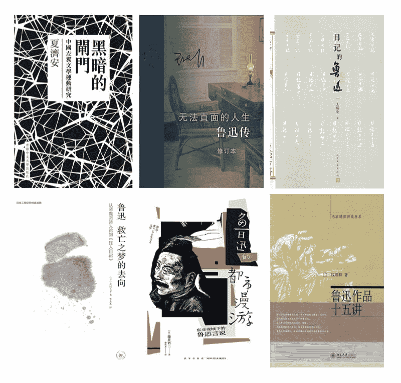

鲁迅研究专著

除了现代文学研究的目的以外，我的重读鲁迅，还有一些更加个人的或者说属于普通人的理由。在我少年读书的时候，只有两个人的书可以系统地阅读，一个是《毛泽东选集》，一个是《鲁迅全集》。其实最早读的是单行本，一系列的，比方说手头有本《华盖集》，1973 年出版的，定价是 0.33 元。

那个时候正是我长身体、学知识、三观初步形成的时候，相信不仅是我。生活在 20 世纪后 50 年的很多中国人都会受到这两个人、这两套书的影响，有的可能受到影响还不知道。前者先不谈，后者鲁迅说实话，他不仅是我的研究对象，还是我的启蒙老师，是我青少年时期最重要的一位老师。虽然他不认识我。

#### "素读"鲁迅

有一年在北大客座，我请阿城一起讲课。阿城提出了一个读书方法，说这样读书就不会越读越多。因为我们一般人觉得读书开阔眼界，因此想读更多的书，就会读书越来越多。阿城说，不会，读书可以越读越少，但要"素读"。这个"素"不是快速的速，而是朴素的素。什么意思呢？就是读书的时候脑子里一张白纸，没有杂念，先不要批判，全盘接受。如果是经典，这样"素读"以后终身受用。而他举的自己的例子就是毛选和鲁迅。

其实我读鲁迅的时候不算素读，当时已经下乡在种田，见过各种政治风云，生在社会底层，切身体会鲁迅所谓"一要生存，二要温饱，三要发展"的秩序。简单说，我当时已经不是一张白纸，正因为如此，当年初读鲁迅，我发现他在五个大问题上敲打了我年轻的世界观。哪五个问题？古今、中外、上下、男女，以及个人与世界。

后来务农、做公、读书、出国，每个人生阶段，我都会再读，或者说回想起鲁迅的话。当然我的想法难免会有变化，多了一些疑惑，甚至批判。所以今天再重读鲁迅，我其实也是在回顾、检讨自己过去若干年来的心路历程。

我突然想到，如果我不是一个那么特殊的人，我不是天才，也不变态，那些和我命运相同，有着类似或不同经历的朋友们，大家也都曾经读过鲁迅，今天重读，是否也都在回顾过去那一部分生命呢？

其实任何年纪的人只要识字，且对中国的人和事有兴趣，就可读鲁迅。而且不同年龄会读到不同的鲁迅，旁人无法替代。鲁迅虽然去世了，可是他其实一直生活在我们中间。我听钱理群说，他在北大讲课，同学们喜欢看鲁迅痛骂资本家的乏走狗。

#### 我们怎样重读鲁迅？

我们在重读鲁迅的过程当中，会引用很多鲁迅研究的成果，从瞿秋白到毛泽东；从李长之到李平心；从陈涌到王富仁。听众朋友不要听到这些人名就感到很闷，我会一一向你们仔细解释；如果他们的观点真的十分重要，我一定讲得很清楚。另一方面，同行学者们也不要怪我现在讲得太浅，出书的时候，我会把很多学术的话语照样补回。

已经有这么多研究成果在，那我们应该怎么重读鲁迅？可以选择的方法有三：

第一是以作家生平为线索，好像传记，一步一步地研究他的思想变化过程；第二是以研究课题为中心，就像写一本专著，讨论各种各样的问题，鲁迅的世界观、鲁迅与进化论、鲁迅与尼采等等；第三就是直接读作品，系统地读作品，作家生平跟有关的理论课题，都放在阅读作品的过程当中。

显然我会用第三个方法，而且老老实实，连阅读的次序都不是我决定的，而是依照权威的人民文学出版社的《鲁迅全集》的排序。比方说，一开始第一卷先是《坟》，后是《热风》，然后是《呐喊》等等，这叫老老实实地素读。

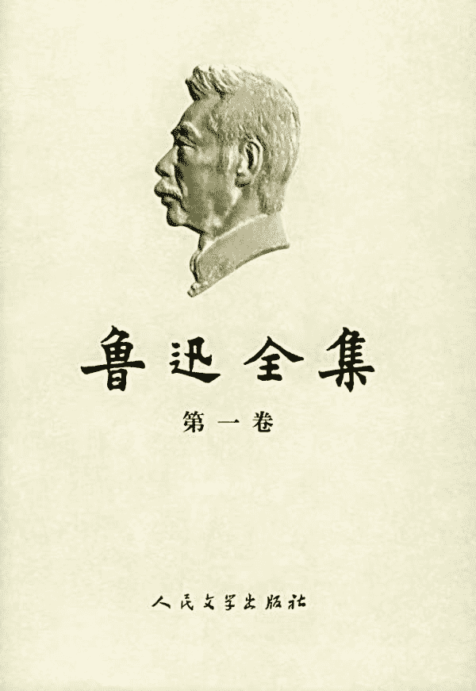

唯一官方出版的《鲁迅全集》

在重读的过程当中，他人的研究，我们要参考。一些坊间对鲁迅的或明或暗的批评，我们也不会回避。比方说批评他对京剧武术中医的偏见，或者说他亲日本等等。更有一些有关鲁迅的悬念疑团，比方说他跟朱安的无性婚姻，他跟周作人失和是否跟羽太信子有关。还有比方说他为什么要和林语堂、顾颉刚那些人吵架，还有他跟许广平的曲折爱情，或者为什么特别欣赏萧红等等，我们也都会尽可能地在作品内外探讨。

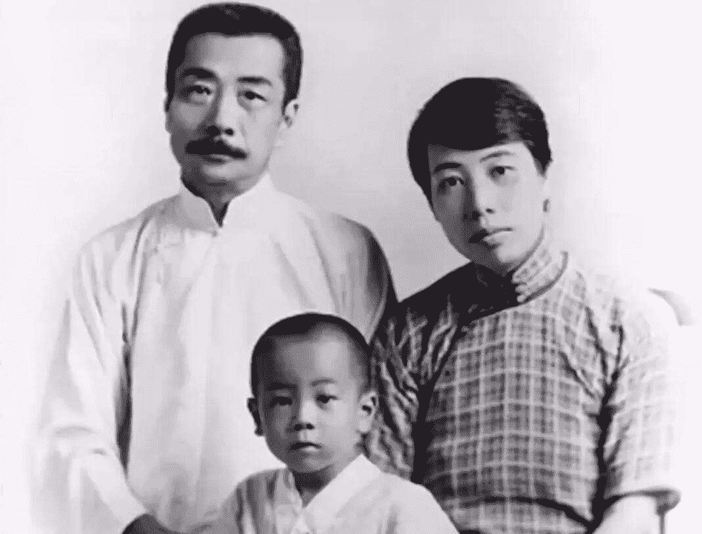

鲁迅、许广平与儿子海婴

在我每周三集的重读过程当中，非常希望各位朋友给我提供新的资料，新的疑问和新的见解，希望你们参与到我们的重读的过程当中。

#### 重读鲁迅，也是在重读我们自己

北大教授陈平原说过："病症是鲁迅看得准，药方是胡适开得好。"此言，我深以为然。

更重要的是，重读鲁迅，也是在重读我们自己。看看过去若干年，从认识鲁迅开始，我们的思想有了哪些变化，有了哪些坚持？或者自以为变化，其实是在坚持；或者自以为坚持，其实已在变化。

重要的话说两遍：要理解女人和男人可以读张爱玲；要理解中国人，你一定要读鲁迅。

下集再见。

# 1\. 女人的身上，压着“节烈”的鬼丨《我之节烈观》1

（公众号懒人找资源，懒人专属群分享）

今天是第一集，我们要读《鲁迅全集》第一卷收录的第一篇白话文章《我之节烈观》。其实在《坟》里边还收入了四篇文言文章，我们以后再读。

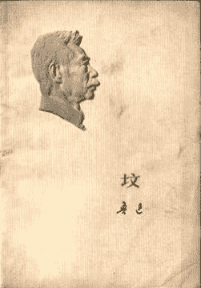

《坟》，人民文学出版社

#### 《我之节烈观》的主题：女人的身体

《我之节烈观》最早发表在 1918 年 8 月《新青年》月刊第五卷第二号。大家看日期，这是五四运动前夕。

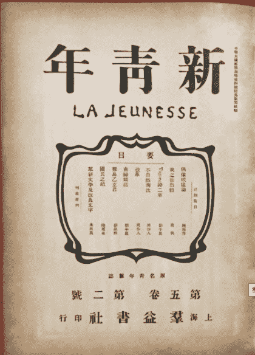

《新青年》月刊第五卷第二号

《新青年》众所周知是五四运动这个时期，中国最革命、最先锋的期刊，说是中国现代文化最早的灯塔也不过分。鲁迅作为这个五四新文化运动的大师，在这么重要的期刊上发表长文，却不是谈论国际民生、社会政治，或者中国前途、人类命运。相反，他讨论的是什么呢？是女人的身体，女人怎么管理自己的身体。

这到底怎么回事？不是说要懂得女人男人，应该看张爱玲，要懂得中国人才看鲁迅吗？怎么《鲁迅全集》一上来，《重读鲁迅》一开始，主题也是女人的身体？

今天女人当然也要管理自己的身体，化妆、打扮、整容甚至变性；还有每天跟谁相处，怎么相处，发生什么关系……所有这些对身体的管理，不仅出于自己的意愿，有时候也有意无意地在依照某种社会道德、流行风尚，甚至政治观念。

鲁迅《我之节烈观》里所要讨论的是两种比较特殊的、极端的、女人管理自己身体的方法：一个叫"节"，一个叫"烈"。

#### 鲁迅为什么要写《我之节烈观》？

为什么第一次在《新青年》上刊长文，就要讨论节烈的话题呢？

鲁迅这样解释，"世道浇漓、人心日下、国将不国"，原来这个当时社会上有这样的感慨。那有什么办法？据说，鲁迅说当时有三种拯救方法：

第一种就是康有为讲的"虚君共和"，我们现在知道那叫"君主立宪"，保留皇帝。可是陈独秀他们就把他驳斥了。

第二种是灵学派人士要请"孟圣矣乎"，就是要请孟子的灵魂来通国策，求仙来救国。不要开玩笑，古代君主到泰山祭天地、拜神灵那是国家大事。可是到了民国，钱玄同、刘半农这些新青年的人就把他批成胡说。

所以虚君不成、灵学不灵，第三个方法就是叫"道德救国"，也就是说要表彰节烈。由此看来，鲁迅这篇文章虽讲女性身体，原来还是重论国家大事。

#### 何为"节""烈"？

论说文立论很重要。既然讲是节烈，那首先要下个定义，啥叫"节"，啥叫"烈"？

原来这两个字女人专用。我们今天男人也用，说一个人没有气节，或者说他晚节不保，指的都是政治立场，或者是文化态度等等。对女人就直接是指她的身体了。还有个"烈"字很有意思，其实男女通用。刘胡兰、赵一曼，我们叫她女烈士，而不叫她烈女。所以女性主义文学批评就说，你看看，我们社会当中这个男性中心主义的习惯到处存在。简单地说，"节烈"在男是指思想、立场。在女就专指身体、贞操。

我在香港大学里讲课，问同学什么是"节女"？七嘴八舌、乱猜一通以后总还有人猜中。但是"烈女"就是毫无概念。鲁迅的定义是，大概"节"就是丈夫死了，绝不再嫁，也不私奔；丈夫死得越早，家里越穷，她"节"得越好。我知道一些更极端的例子，明清戏曲当中，有些女的被许配到夫家，还没过门，男人就死了，家里就劝她再嫁，其实也等于出嫁。可那女的就是不肯，说我已经是某家人了，你再也不要给我找别的男人了，甚至毁容明志。

关于"烈"，鲁迅说了，"烈"有两种，一种是不管已经嫁还是没有嫁，丈夫死了就跟着自尽，其实是殉葬；另外一种就是有人来强暴、侮辱，这时候你就要赶快自杀，而且死得越惨、越苦，就越好、越受表扬。万一抵抗来不及，受了污染再自杀，那就免不了被议论。鲁迅说，也许道德家宽容，给你一个"烈"字，文人就不愿意帮你作传了。鲁迅的原话："总而言之，女子死了丈夫，便守着或者死掉；遇了强暴便死掉；将这类人物称赞一下，世道人心变好，中国便得救了，大意如此。"

#### 《我之节烈观》的逻辑批判

对于这么一个节烈救国论，鲁迅先生这篇文章用了非常严谨的逻辑批判，一、二、三。

第一，首先的疑问是，不节烈的女子怎么害了国家了？刀兵、贼盗、水旱、饥荒，哪一条由不节烈引起的啊？政界、军界、学界、商界种种黑暗全是男人，并没有不节烈的女子在内。还有那些拜龙神、迎大王、乱砍森林、不修水利等等，所有这些社会乱象，哪一个是不节烈女人所为？这是鲁迅提的第一个疑问。

第二，为什么救世的责任全在女子呢？男女平等，义务略同，即便有责任大家分担，对不对？男人们怎么不发挥你们的美德呢？

第三，再次的疑问，表彰节烈以后有什么效果呢？

鲁迅又将女子分成三类。一，已守节，受了表扬，很好。二，不节烈，羞杀还不必谈了。但第三种怎么办呢？万一这个女的立志极高，很想做节妇、烈妇，可是丈夫长寿，天下太平，那她怎么办？"只好饮恨吞声，做一世次等的人物。"

请注意，鲁迅这一大段里边这个一二三层疑问，再分一二三类，逻辑清楚、层次分明、事实俱在、道理正确。可是全部不如这最后一句，万一丈夫长寿来得好笑、有力、切中要害。

原因是什么？原因是前面这些，你是站在节烈救国论的对面跟她批判，可是万一丈夫长寿呢？却是从你节烈救国论自身的逻辑出发，引出了一个荒谬的结论----  
好啊好啊，忠于爱情很高尚，老公身体一直很好，怎么办，我想节都没机会节了！烈女当然更伟大了，可是没什么人来强暴，那叫我怎么证明自己伟大？

这个时候我们发现了一把匕首强过三轮大刀，一声嘲笑超过三轮雄辩。

我们以后可以看到鲁迅的散文风格为什么后来会逐步转变，可是一开始鲁迅是打阵地战的。将来我们知道他会打匕首、打奇袭、打埋伏，但是一开始鲁讯是阵地战。

#### 节烈论的荒谬性

将中国女子分成已节烈、不节烈和更大多数无从节烈，想不节烈而不得，鲁迅引出了文章里的一个重要观点，就是说节烈是否道德。鲁迅的原话是这样说："道德这事必须普遍，人人应做，人人能行，又于自他两利，才有存在的价值。"我把这句话再念一遍："道德这事必须普遍，人人应做，人人能行，又于自他两利，才有存在的价值。"这个观点十分重要。

原来道德有最高最低之分。人不怕苦，很好。人不怕死----  
假如你是战士、是英雄，很伟大；可是要是你是普通人呢？要是我就是开车，我知道前面这个车迎头开过来，那司机可能是不怕死，你说我还敢不敢开车？爱情也是，忠于爱情，只爱一个人很高尚，但是如果爱上第二个人就得自杀，那不就有点可怕？

其实讲到这里，节烈论的这个荒谬性已见，鲁迅已经写得非常精彩，可是鲁迅还没完，写文章的计划还没完。他就说，问问这些多妻主义的男的，你们有资格表彰节烈妇女吗？真理一律平等，既然平等，男女就有一律应守的契约，男子绝不能将自己不守的事情向女子特别要求。一百年过去了，《新青年》上这种追求平等的声音，即使今天听来，还是叫我们每个人值得自省。

在疑问解答后，鲁迅又进一步分析节烈观的历史渊源，到底怎么来的呢？这个厉害了。

原来古代的社会女子多作为男子的物品，或杀或吃都无不可。男人死后，喜欢的宝贝、日用的兵器一同殉葬。女的也是这样，就一起埋了。后来，殉葬风气改了，就变成守节。哦哦，原来啊，守节并不是爱情、感恩、为了家庭，而是一种殉葬的遗风。

鲁迅说从汉到唐，并没有鼓吹节烈。这倒是事实。我偶然参与《见字如面》，读过唐代的离婚协议，原来唐代男的标准的离婚协议，除了分财产以外，还鼓励女的，或者祝福她再找别的男的另建家庭。

我们后来人讲的是"饿死事小，失节事大"，是宋儒说的，所以其实是国家民族越来越弱，国民将到了被征服的时候，守节昌盛了，烈女从此重要了。"自己是被征服的国民"，这个是鲁迅的原话，"没有力量保护，没有勇气反抗了，只好别出心裁，鼓吹女人自杀"。

讲这个话的时候，使我想起了我听过的一个很叫人难过的故事。抗日时期，日军在长江上偷了一条船，船上把老父亲、丈夫、小孩什么全绑起来，然后就轮奸他们的媳妇。日本兵走后，那些媳妇就爬着用刀割开了那些捆人的绳索，可接下来全船的男人却用眼睛逼着看着这个女子跳入长江。

我很希望这个煽情的故事是虚构的，可是被征服的国民没有力量保护，没有力量反抗，却来鼓吹烈女。这不是好像我们看过的一个什么电影吗？以后再说。

#### 批判节烈的战士，自己也是悲剧制造者

鲁迅的文章还没有完。他说节烈难吗？很难。节烈苦吗？很苦。节妇终归要活着，精神上的残酷，姑且不论。怎么能不论呢？写到这个地方。我不知道鲁迅有没有想过，当时已经跟他结婚十几年，可是实际上一直分居的朱安。

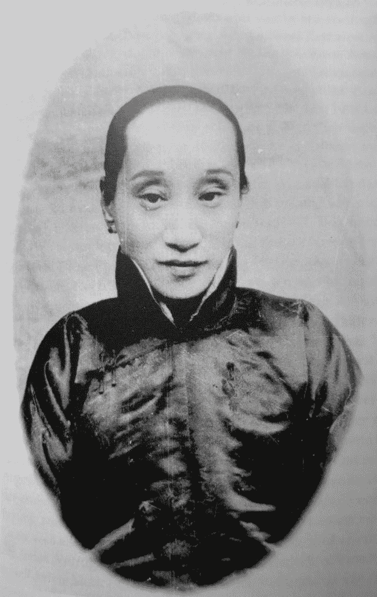

朱安，鲁迅原配妻子

朱安在他面前，虽然他们很少真的在一起，但那是法定的妻子。朱安在他面前不就是一个对着活人的节妇吗？而且这种事情是他自己一手造成。这个问题我们下集再讨论。

鲁迅说，不节烈便不苦吗？答曰也很苦，因为社会上排斥这些女人。

所以到文章的最后，鲁迅有段总结："我依据以上的事实跟理由，要断定节烈这是极难、极苦、不愿身受、不利自他、无益社会国家，于人生又毫无意义的行为，现在已经失了存在的生命的价值。"所以，他说节烈女子，已牺牲的要开个追悼大会。

"我们追悼了过去的人，还要发愿，要自己和别人都纯洁聪明、勇猛向上，要除去虚伪的脸谱，要除去世上害己害人的昏迷和强暴；我们追悼了过去的人，还要发愿要除去于人生毫无意义的痛苦，要除去制造并赏玩别人痛苦的昏迷和强暴，我们还要发愿要人类都受正当的幸福。"

这三段排比式的文字几乎有点像标语口号，这是鲁迅早期的文风，这是《新青年》上振臂高呼、启蒙救世。我们看到了一个就道德问题发表愤怒声音的、战士一样的鲁迅，虽然这战士自己也是悲剧的制造者。

下集，我们要详细讨论鲁迅为什么会一开始就谈论这个有关女人身体的严肃话题。

#### 下集预告

《我之节烈观》

出自《坟》

# 2\. 鲁迅为何要谈女子的贞节问题？丨《我之节烈观》2

（公众号懒人找资源，懒人专属群分享）

（音频"下集继续"后，有许子东最新补充内容）

重读鲁迅，我是许子东，今天是第二集。

我们说过，重读鲁迅，我们要原原本本、按部就班，按照人民文学出版社《鲁迅全集》编的次序，第一卷一开始就是论文散文集《坟》。

这个"坟"就是坟墓的"坟"。大家到底大家，敢于起这么一个名字，给自己的一本书。这个《坟》里边"坟"的意思就是"把我的生命的一部分埋葬掉"，收录了作家 1907 年到 1925 年所做的文章，一共 23 篇。我们上次读的《我之节烈观》是里边的第五篇，前面四篇都是文言。

《人的历史》是研究黑格尔种族发生学，《科学史教篇》是讨论犹罗巴（欧洲/西方）的学术发展，《文化偏至论》讨论中国文化传统。其中最有名的一篇叫《摩罗诗力说》，讲欧洲浪漫主义诗人，拜伦、普希金、裴多菲等等，最典型地体现了鲁迅早期的文艺思想，可以说是诗言志。照说呢，我们重读鲁迅，应该从《摩罗诗力说》读起，只是有声书很难读，所以我们暂且略过，以后再说。

那几篇文言的文章都是（鲁迅）二十几岁在日本写的，发表在日本的《河南》月刊上。等到了《我之节烈观》这篇白话文的文章那已经是五四前夕，1918 年。

#### 为何鲁迅要在《新青年》讲女子的节烈问题？

我们上次都说过了，鲁迅被认为是五四运动的代表人物。五四新文化运动，五四的精神，几个要点，反礼教、启蒙大众，相信德先生、赛先生、进化论，最后的成果是白话文取代文言文，这些也都是鲁迅的重要成就。因为鲁迅反礼教、启蒙大众、进化论、白话文取代文言，这都是鲁迅的贡献。

但是为什么鲁迅在当时最重要的思想阵地《新青年》发表的第一篇长文，不谈经济，不论政治，也不讲法律，不讲哲学，却讨论女人的身体，女子贞操节烈观？

这个问题从学术层面来讲，美国学者林毓生早就指出过，说五四一代的大师号称彻底反传统，其实无意识当中在延续儒家传统。什么传统呢？就是希望用思想文化来解决社会政治问题。

既然是要从人心的角度救国，那么首先关注女子节烈问题，这个就是当时道德的一个大问题。注意啊，这个是男人把女人的身体当作国家大事来关注。保守派既然是以道德礼教为工具，那么革命派当然也要从道德问题上寻求突破。

可是在学术层面以外，我在想，这事还能不能在更加世俗的、更加常识的层面上来解释呢？或者说鲁迅选择这么一个问题来介入五四新文化运动，跟他个人的经历、家庭生活、世俗环境或者身体情况有没有什么关系呢？

在精神上来讲，毫无疑问鲁迅是一个超人。我们以后一步一步会更加看到他对中国社会、对中国人、对中国问题的观察、理解、体会之深刻，可以说至今都很难有人超越，甚至是有人企及。所以鲁迅看问题是超人，如果不是这样，我们大概都不会花几十集的时间来重读他的作品。

可是问题是除了在精神层面以外、在思想层面以外，在日常生活，作为一个人，鲁迅是不是也是个超人呢？或者说他是一个平常人呢？

日本汉学家竹内好说，鲁迅的阅历，毋宁说是平凡的，他在宣统元年到民国十六年的二十年间，做过政府的小职员跟学校教师，以后作为一个市民居住在上海，直到死去。

除了从光绪二十八年到宣统元年，这不到八年的时间去日本留学以外，就再也没有出过一次国，国内的旅行也屈指可数。所以竹内好说，他没有郭沫若那样的革命家的生活，也没有胡适那样的外交官的生活。中国现代的文学家阅历普遍比日本作家远为复杂，而他是少数例外中的一个。

换言之，鲁迅的经历就是读书、教书、写书，非常简单。

那么他的经济情况呢？说实在话，也不富也不穷。

早年在教育部做小官，蔡元培请他去的。最早是六十块，后来到两百多块；后来鲁迅出了名以后，到厦门、广州教书，月薪都有三百四百，当时民国这样的收入按一般标准来讲是不错了。

当然鲁迅买书多、活动多，这个钱对他来说也不是很多；晚年呢，他一部分靠稿费，一部分是……好像还有一个虚职吧，蔡元培给他每个月三百块钱。可是，我们看到他抽不起好的烟，他为了稿费常常还跟北新书局的老板李小峰交涉，他常常看电影，可是到最后病重的时候都不舍得住院。所以经济上鲁迅是个平常人。

那么鲁迅的政治地位呢？

鲁迅活着的时候，既不是高官也没有坐过牢，他没有参加过哪个党，更不会像茅盾那样参与最早的建党活动等等。鲁迅始终是一个同盟者。

用我们今天常人的标准来看，你说长相吧，鲁迅也不像超人，个子不高，中等偏瘦。据说鲁迅去世的时候才七十几斤重。他的标志是很粗硬的头发和他的胡须，我们以后会讨论他的胡须。

他的家庭背景，我们知道，早年丧父，母亲启蒙，旧式婚姻，中年以后才找到新潮爱人，所有这些都是那个时代的常见形态。很多现代作家胡适、郁达夫、茅盾、老舍等等都是少年丧父，其中不少人第一次的婚姻都是旧式婚姻。

总而言之，经历、经济、政治、家庭，我们在鲁迅身上都没有（看到）什么超人的迹象、超人的表现。

#### 苦闷的第一次婚姻

如果一定要在现实层面、生活层面，寻找鲁迅有什么特别深刻、特别郁闷的原因，也许我们可以再仔细考察一下他的第一次婚姻。

鲁迅原名周树人，1881 年出生，1893 年他的祖父周福清因为贿赂科举考官获罪。他的父亲周凤仪一病不起，三年后去世。到了 17 岁，鲁迅因为不能忍受乡间邻居的流言，那个时候有些人说他偷母亲的首饰，周树人就离开绍兴到南京读书。1902 年，21 岁的周树人考取公费到日本留学，先在东京弘文学院，后到仙台学医。所有这些故事，研究者重复太多了，我尽量简略了。

话说 1906 年，25 岁的周树人突然接到家里电报，"母病速归"。儿子赶回去了，发现原来是母亲替他策划的婚礼。当然这个婚事早就决定了，好像是在他在杭州的时候。

鲁迅，就是周树人，我们现在叫他，那时候鲁迅还没出现。周树人去日本就是一个逃避，可是母亲的爱是无法逃避的，反对也没用，他当时提了几个条件：要读书啦、要放脚啦，结果回答是脚已经裹小了，没办法了，书再读也晚了。现在，据说绍兴周家老宅，为了纪念鲁迅，也为了旅游，重建了婚礼场面。据说掀开头巾那一刻呢，新郎，还有他妈妈都呆掉了。

所谓"女大三"，朱安那年已经 28 了，实在不能再拖了。大家想想在那个年代，一个女的到 28 早就订婚了，一直没有成亲。这么大的经济压力。

周作人后来写回忆录，周作人没有参加这个婚礼，但是他没有记载鲁迅有什么抗议。

最近有一个叫陈光中的研究者，写了一本叫《走读鲁迅》，他里边说无人知晓周树人和他妻子如何在楼上那间新房里度过新婚之夜，但我们只知道好像第二还是第三天，他就搬去跟妈妈一起住，第四天离开家乡前往日本。之后十几二十年，其实是一辈子。据说他们始终没有同房。

人们问起，鲁迅说，那不是我的妻子，那是我妈妈的媳妇。

当然他们是合法夫妻，后来也常常同院居住。究竟是否同房，后来的研究者也没有办法据实考证，但是鲁迅从 1912 年开始一直记日记，每天都写，不加形容词，根据事实（来写）。他晚年的日记，据说"洗脚"这个词也被很多人拿来做特别的考证，这个我们以后再说。但早期还的确没有洗脚的记载。

我去北京鲁迅博物馆看过保存的完好的西三条鲁迅故居。鲁迅在北京的故居有好几个，只有这个是保存完好，而且周围邻居都拆了。就是那个后院有两株枣树的那个房子。

我看到鲁迅住的这个叫"老虎尾巴"，他的房间门出去是一个小的厅，左边是妈妈的房间，右边是朱安的房间。据说他跟朱安的房间中间常常放一个竹箱，还是竹篮。竹箱吧，打开的时候（那边的盖），里边是干净的衣服，那边是要洗的衣服，这就是他们中间的交流。

如果有些评论者他们的说法是属实的话，那么我们看到周树人，一个男人从 25 岁结婚到 40 多岁以后认识许广平，当然之前也可能有一些其他的女学生，但是也已经是在许广平那个阶段的之前了。周树人，或者鲁迅的确是个超人！在这一点上看，的确是个超人。

如果是常人，比如郁达夫，他一个人生活，就在《沉沦》里边，小说里描写的又是自慰、偷窥、听到人家做爱、到风月场中写爱情诗啊什么的！当然了，这也是小说过分突出男人的性苦闷！为了时代的需要。

后来在北京郁达夫跟鲁迅是好朋友，也只有他，在回忆文章里这样记载说，问一个来访的学生，说起了鲁迅，他说鲁迅虽在冬天也不穿棉裤，是抑制性欲的意思。他和他的旧式的夫人不要好。这个是郁达夫在一篇文章叫《回忆鲁迅》里边记载，虽然它是引他人之嫌的，但这也是郁达夫的一个观照角度。

现代作家里碰到旧式婚姻的，远远不止鲁迅一个人。都是听从母亲的旨意。很多人就跟郁达夫一样了，虽然不爱，但是出于可怜常常回家，结果呢就有了儿女。怎么说吧，既然不能让女人做一个幸福的妻子，至少给她一个做母亲的权利吧？

王晓明在传记中引用了俞芳的记载，说：鲁迅曾向他母亲抱怨，抱怨她这个朱安呐，说（和）她谈不来，谈话没味道，有时还要自作聪明，讲一个日本的吃的东西，她明明没见过，她说她吃过。

我觉得啊，这可能就是朱安在想办法改善关系，奉承鲁迅，这对夫妻之间的问题，恐怕绝不只是没有共同语言！

鲁迅逃避的方法就是两地分居，他回国后住杭州、绍兴，住宿舍。在北京一直住在绍兴会馆，后来到八道湾、西三条，也都是分房居住。

鲁迅是学过医的人，知道禁欲对人生有什么影响。他自己后来写道，因为不得已而过着独身生活者，则无论男女，精神上常不免发生变化，可能会总觉得世事都无味，人物都可憎。

可是鲁迅他就这样生活过来的。

鲁迅和朱安的关系，第一是有着超人的原则性，作家忠于自己的爱的标准，我没有爱就没有性，不肯妥协；第二，作家又忠实于礼教传统，为母亲牺牲，这是一种超人的承担；第三，这又是一个超人的意志，这个意志力非常强，对于自己身体，对于自己的日常的欲望，更重要的是，这个超人他能够在一己身心苦难之忍耐中领悟到了世人普遍的道德困境，难怪他的第一篇文章叫《我之节烈观》。

#### "我以我血荐轩辕"究竟含义何在？

鲁迅有首非常有名的诗：

"灵台无计逃神矢，风雨如磐暗故园。寄意寒星荃不察，我以我血荐轩辕。"

这是 1903 年在东京弘文学院，这个鲁迅送了一张剪了辫子的照片给朋友许寿裳。诗就题在照片后面，1936 年才由许寿裳发表，鲁迅在 31 年把它重抄过，但从来没解释有什么意思。

我看了一下网上对这首诗的解释是说，哎呀我怎么也不能从心中割舍游子对祖国的眷恋，我们的祖国在风雨飘摇的浓重黑暗中，我把希望寄托于民众，可是民众没有醒来，他们对我的希望不理解，所以我要把我的鲜血敬献给我的国家，誓为中华民族的解放而牺牲。

可是我最近看到了另外一个解读，他说这首诗写的是周树人对母亲安排的婚姻的不满和服从。具体来说，这个"神台无计逃神矢"，就是母亲好像丘比特乱放箭了，乱点鸳鸯，我逃不了。

第二句就是家乡还是很黑暗的。第三句是跟一般的解释一样，我的心我的心情我的希望，人们不理解。那第四句，"我以我血荐轩辕"呢，他是说：唉呀我没办法，我以我自己的生命，以我的血肉来报效我神圣的祖先以及伟大的传统。

当然朋友们我更倾向于把它读成爱国诗。但是这个另外这种解读很可能是蔑污的，大家笑一笑，仅作参考，我们下期继续。

#### 最新补充

各位，前面两期我们读了鲁迅最早在《新青年》发表的文章《我之节烈观》，我有两点补充。第一，我们要充分注意文体的变化。鲁迅早期的文章是论说文，比较长，讲究学理，注重逻辑，跟他后来的这种短小精悍、一刀见血的杂文文体，区别非常明显。但是也有相通的地方，就是刻薄的幽默，说丈夫身体太好，所以这个女子想守节也没有办法，这是鲁迅一贯的风格。

第二，鲁迅早期的对传统道德的批判非常值得我们注意。相比之下，30 年代巴金的《家》，觉民也是正面人物之一，他听说鸣凤因为喜爱三弟觉慧，同时不愿做礼教会长的妾，结果是投湖自杀。觉民就不无称赞地说，看不出鸣凤倒是一个烈性的女子。这个烈性的女子，对比鲁迅早期的时候《我之节烈观》，我们可以看到新青年们无意当中的传统道德观念，或者也可以说是男性中心主义的思维逻辑。

另一个例子是抗日的文学的名篇《荷花淀》，游击组长水生要上前线了，嘱咐恩爱的妻子很多事情，比如"你要不断进步，识字，生产""什么事也不要落在别人后面"等等。但是叮嘱的最重要的最后的一句话是，"不要叫敌人汉奸捉活的。捉住了要和他拼命"。

这时女人流着眼泪答应了，"不要叫敌人汉奸捉活的"就是说宁死不屈，被捕事小，失节事大，这是非常朴素的价值观，后来文学史都非常称赞。而且它也不是水生妻子一个人的信念，小说写一群村中妇女曾经被鬼子在湖面上追击，大家都明白，"假如敌人追上了，就跳到水里去死吧"。这有没有可能也是革命战争年代的烈女呢？

巴金和孙犁的小说都是现代文学的名篇，和鲁迅的《我之节烈观》对照阅读，非常有意思。

#### 下集预告

《我们现在怎样做父亲》、《娜拉走后怎样》

出自《坟》

# 3\. 人在时代的转换中究竟要何去何从？丨《我们现在怎样做父亲》《娜拉走后怎样》

（音频"下集继续"后，有许子东最新补充内容）

重读鲁迅，我是许子东，今天是第三集。

我们今天争取要读两篇文章，一篇叫《我们现在怎样做父亲》，另外一篇叫《娜拉走后怎样》。尤其是后一篇，非常有名的。

#### 如何做一个新时代的"人"？

如果说这个《我之节烈观》，批判多多少少是从鲁迅自己的亲"身""体"会，亲"身""体"会出发，刻骨铭心，那么这篇怎么做父亲的文章，纯粹超出他个人经验，明显的是作为一个五四启蒙的理论家的姿态来说。道理很简单，现实当中完全跟妻子不同房的人怎么可能做父亲？

在另外一篇散文《随感录二十五》里边，鲁迅说，中国的男人可以分两种：

其一是孩子之父，其一是"人"之父。第一种只会生，不会教，还带点嫖男的气息。第二种是生了孩子，还要想怎样教育，才能使这生下来的孩子，将来成一个完全的人。

《我们现在怎样做父亲》一文，讲的就是在一个时代转换当中，应该怎么做人，应该如何教育。这个时候的鲁迅其实就是"超人"，他自己身陷不幸的婚姻，一时也难为人父，却要（做天下，至少中国无数男人，）替天下无数男人操心，提醒他们怎么做父亲。顺便说一句，多年以后鲁迅真的自己做父亲，却是一次意外，避孕失败造成的。

"我现在心以为然的道理，极其简单"，鲁迅说，"一，要保存生命；二，要延续这生命；三，要发展这生命（就是进化）"。显然这一时期鲁迅非常相信进化论。

"食欲是保存自己，保存现在生命的事；性欲是保存后裔，保存永久生命的事。"所以呢，在鲁迅看来，食色对己既不是罪，对儿女也算不上恩，（这是）非常开放非常现代的一个观念，父子间没有什么恩。

鲁迅这个说法，对于强调孝道的中国传统道德构成了非常大的挑战。鲁迅建议用爱来代替恩，然后说，"凡是不爱己的人，实在欠缺做父亲的资格"，这又是一重人道主义的挑战，爱己才能爱人。

这种现在的观念来说，就是人为自己，保卫自己权利的这种叫消极自由，他至少跟人要救别人的积极自由是一样的重要。

不过就在这篇文章里边有一段话，鲁迅重复了两遍，后来著名的鲁迅研究者夏济安又重点地引用这段话。这段话却不是一个消极自由，而是一个为他人牺牲的积极自由或者说献身。我把这段话读一遍："自己背着因袭的重担，肩住了黑暗的闸门，放他们到宽阔光明的地方去；此后幸福的度日，合理的做人。"这个"他们"是指年轻一代，孩儿们。

夏济安讲了这么一个故事，说隋炀帝的时候，李世民召集各路好汉造反，结果事情败露，只好逃走。隋兵用了一个铁闸门，把他关住。这时候就有一位侠客用身体把铁闸挡住，让好汉们都逃走，自己反被这个铁闸压死了。

夏济安就引用鲁迅的话，说"从觉醒的人开手，各自解放了自己的孩子。自己背着因袭的重担，肩住了黑暗的闸门，放他们到宽阔光明的地方去；此后幸福的度日，合理的做人"。

夏济安，评论家

夏济安论述鲁迅，说鲁迅的核心意象，鲁迅一生创作的最重要的意象就是"黑暗的闸门"。他说鲁迅觉得他要做的事情就是扛住这个"黑暗的闸门"，让年轻人让新一代去到一个光明的世界，而他知道自己是要被压死的。而这个闸门是什么呢？在夏济安看来，一个是中国传统文化，第二就是鲁迅内心的悲观主义。因为鲁迅身上背着这两个东西使他走不远，但是他愿意让年轻人走。所以鲁迅是这么一个悲剧的英雄。

夏济安的这些观点、这段评论，对后来的很多人的鲁迅研究都有很大的影响。从这个角度看，我们前面讲过的鲁迅跟朱安的婚姻，以及他这种非常残酷的忍受方法，其实也就是所谓"因袭的重担"当中，"黑暗的闸门"里边的一个环节而已。

#### 出走的娜拉与中国现代女性的解放

在《我们现在怎样做父亲》之后，另一篇早期的鲁迅有名的散文，就叫《娜拉走后怎样》，这篇文章原来就是 1923 年 12 月 26 号，鲁迅在北京女子高等师范学院一个文艺会上面的一个公开演讲，他最早也是发表在这个学校的一个文艺会刊上面。

关于这篇文章，我特别注意其中的两句话。第一句就是大家很熟悉的，就是讲娜拉出走以后，怎么无路可走。第二句，讲的是，"不但女人常作男人的傀儡"，"男人也常作女人的傀儡"。但这第二句话，很少有人注意，所以我特别要讲。

娜拉是易卜生的一个话剧（的女主人公），讲一个女的不愿意在富裕的家庭里，只是当一个有钱丈夫的花瓶，所以，毅然决然地离开很温暖的、很舒服的家，推开大门离家出走，出走的那一幕是全剧的高潮，也是结尾，通常是全场起立掌声。

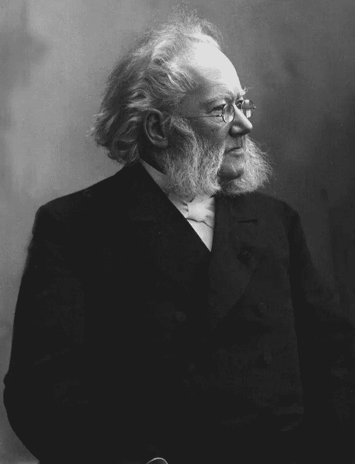

易卜生，挪威戏剧家，代表作《培尔\*金特》《玩偶之家》

胡适，还有很多现代作家，或者是翻译，或者是改编，或者是写评论，介绍易卜生这个戏，这个戏是在中国五四是起了很大的作用，成为当时女性解放的一个标志性的作品。

100 年以后，我们现在常常听到有人说，宁可在宝马里哭，不在自行车上笑，甚至于有的人就千方百计希望嫁个有钱人，这个想做娜拉而不得，更不要说出走。所以有时候想想这 100 年哪些地方进步了，哪些地方退步了，我们也不知道。

但是鲁迅的第一段话要相比他几年前，比方说他在《我之节烈观》里边呼吁的那样的口气，是有了很大的变化。我们刚刚记得他在《我之节烈观》里边很长的文章，最后要自己大声呼吁，"要自己和别人都纯洁聪明、勇猛向上，要人类都受正当的幸福！"，还在另外的《热风》、《随感录》里边说要"个人的自大"等等。

某种程度上，娜拉勇敢地离家出走，女性反对她的丈夫，冲破她的家庭，这正是五四初期鲁迅他们的呼吁的回声。可是仅仅三四年功夫，鲁迅对中国、对于很多事情的看法出现了变化。这个变化，他比同时代的其他人更早、更敏锐，或者我们将来也可以来分析，其实他也没有变化，只是最早他是采取了呐喊的姿态，而接下来他陷入了一种彷徨。

对于娜拉出走，这个等于是五四女性解放第一波浪潮，鲁迅这篇文章等于是泼了一盆冷水。鲁迅说，娜拉走后会怎么样呢，"但从事理上推想起来，娜拉或者也实在只有两条路：不是堕落，就是回来"。这句话非常出名的，当时是对着一群追求新学的女大学生讲的。

我们可想而知，在当时在北京读女子高等师范学校的这些学生，有的可能家里就不赞成她读书，她为了读书可能就是自己跑出来的，有的可能就是跟着她喜欢的男人私奔出来的。我们后来看到丁玲、萧红都是这样，所以下面坐着一群已经出走的娜拉。

鲁迅说，出来只有两条路，"不是堕落，就是回来"。为什么呢？在鲁迅看来，女人从家庭、男人牢笼里出走是一个梦，可是"人生最痛苦的是梦醒了以后无路可以走。做梦的人是幸福的；倘没有看出可走的路，最要紧的是不要去惊醒他"。大家想想这句话，其实有点残酷，"不要惊醒他"，细思极恐。

但鲁迅还是惊醒了下面的大学生，鲁迅并没有跟她们说，你们出走得好，你们只要出走，你们将来就会有玫瑰色的前途。就像冰心描写的这样，鲁迅的意思是"假使寻不出路，我们所要的倒是梦"。一方面鲁迅承认找不到路的情况下，梦是宝贵的。另一方面，鲁迅偏偏要点醒各位女大学生的梦。"梦是好的；否则，钱是要紧的。"鲁迅是这样说的。

#### 鲁迅为何关注"娜拉出走"的问题？

其实关于娜拉出走以后的几种情况，很多作家后来都写了。鲁迅自己的《伤逝》就是写一个比较有钱人家的女儿子君，跟着一个书生涓生同居，男的失业，两个人太穷，最后子君就回家了，好像是病死。这个悲剧吧，这就是"回来"。

而另一种"堕落"，故事很多，比方说曹禺的《日出》，我们都记得陈白露当年也是纯真浪漫，嫁给诗人，做过明星、歌女等等，最后变成交际花。大酒店，日出之前吞药自杀。所以《娜拉出走以后》这一篇文章里的两句话，无意当中勾画了之后几十年，甚至一直到今天都是很多现当代中国文学的主题。

当然了也不尽然，女作家的情况就复杂一点。比如丁玲写的《莎菲女士》，她也算离家了，但是也没堕落，也没回家，还是继续出走。张爱玲《倾城之恋》，这个女主角不肯作节妇，这个客观上，白流苏就是听了鲁迅的《我之节烈观》的话，她出走香港浅水湾，结果呢她居然还有点小光明！

但话说回来，也许这些故事又应了鲁迅所说的，找不到出路，继续做梦吗？

经济不是悲剧的唯一原因，鲁迅说"在经济方面得到自由，就不是傀儡了吗？在现在的社会里，不但女人常做男人的傀儡，就是男人和男人，女人和女人也相互做傀儡，男人也常做女人的傀儡"。

这番话我们恐怕要联系一下鲁迅，在起草或者修改这篇文章的具体环境才能更加明白。

我们知道鲁迅跟朱安成婚以后，大部分时间两个人不生活在一个地方，鲁迅或者在日本或者在杭州、绍兴住宿舍，后来到北京一直住绍兴会馆，按今天的说法两个人是 long  
distance。所以这种情况下，两个人名正言顺，不必同居。

后来 1919 年，鲁迅、周作人他们有了一点钱，在北京八道湾买了四合院。这个地方我去过，终于接母亲、朱安，还有周作人一家、羽太信子等等很多人一起住。但这个时候就算一起住，他是个大家庭，人口众多，所以鲁迅跟朱安，个人有自己的房间，平常也不必终日相对，他们总能找出理由不在一起。

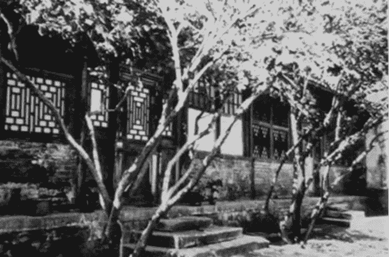

八道湾胡同 11 号

可是，在 1923 年 7 月，就在鲁迅《娜拉出走以后》这篇文章前几个月，因为一个特殊事件，这个特殊事件我们以后再说，周氏兄弟失和。

鲁迅携母亲、妻子被迫搬出八道湾，到了一个叫砖塔胡同，比较差、比较破的一个房子，在那里一共住了九个月。有人统计了这个九个月 300 天，其中有 130 天左右，鲁迅的母亲又回去八道湾了。

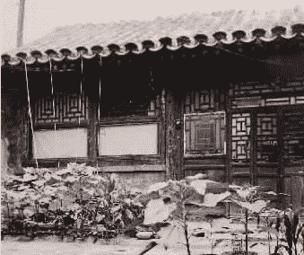

砖塔胡同 61 号院

那这 130 天，换句话说，在一个狭小的砖塔胡同，鲁迅就要和朱安面对面独自相对，这是他一生仅有的一段时期。而《娜拉走后怎样》，这篇文章就写在这个时期。

我们现在理解这个文章里这句，"男人也常作女人的傀儡"。大家脑补一下，什么写作动力、什么生活处境、什么样的精神和身体的关系？

所以就在这篇文章的最后，鲁迅说，"群众，尤其是中国的，永远是戏剧的看客。中国太难改变了，即使搬动一张桌子，改装一个火炉，几乎也要血，而且即使有了血，也未必一定能搬动"。

下期继续。

#### 最新补充

这一期我只想补充一句，请大家特别注意著名论文《娜拉出走以后》的写作环境。

当时鲁迅已经跟周作人闹翻，搬出八道湾，但还没有搬入后来买的"我家的后院有两棵树"的那个房子，也就是现在在北京鲁迅博物馆做故居样板的房子。这段时间他租了砖塔胡同，其中有 100 多天他母亲也不在，鲁迅必须跟朱安单独相对，这是鲁迅婚后第一次跟朱安单独一起生活。

所以这一时期的鲁迅的文章特别注重讨论女性问题，经济独立、怎么追求自由等等，请大家设想鲁迅当时的写作环境。

另外这一时期鲁迅的日记里边也有出现濯足（洗脚）的记载，有好事者专门去研究统计，说这个鲁迅日记里记载洗脚会不会和性生活有关？

有人统计鲁迅的日记一共是 24 年，很完备，1912 年到 1936 年，其实总共 25 年，1922 年的日记遗失了，专家统计说是一共写到濯足是 80 次，就是说平均每年 3.3 次，但是 1923、1924 年都是 5 次，比较频繁的是 1928、1929 年，各有 8 次。

我看看这个记载，我是看不出有什么特别的意义，到底濯足代表什么？我是完全不清楚的，在这里补充一下。

#### 下集预告

散文《未有天才之前》、《说胡须》、《从胡须说到牙齿》、《论雷峰塔的倒掉》、《再论雷峰塔的倒掉》

出自《坟》

# 4\. 做天才的土壤，不做破坏的奴才 丨《未有天才之前》《说胡须》等

（公众号懒人找资源，懒人专属群分享）

重读鲁迅，我是许子东，今天是第四集。今天我们要多读几篇文章。

#### 《未有天才之前》：等待天才出现，不如先做天才的土壤

在散文集《坟》里排在《娜拉走后怎样》后面的也是一篇演讲，是 1924 年 1 月 17 号鲁迅在北师大附中的演讲，题目叫《未有天才之前》。大意是回应当时文艺界要求天才的产生，出现的一个盛大的呼声。

我还记得少年时初次看到这篇文章，心想那时的人们真是有眼无珠，这鲁迅就站在你们前面，你们还在抱怨中国怎么没有天才。这哪像今天啊？遍地都是大师，叫的人、听的人都不难为情的。

像我这样（人轻言微，啊不，）人微言轻，偶然也被人很严肃地称作大师，我一时洋洋得意啊，不过仔细一想，我不只是大，而且还老呢，我就是老师啊！名副其实。不过今天还是有呼唤天才诞生的声音，不是说有说法叫"有高原没高峰"吗？也许人都站在高原上，海拔大家都很高，高峰就不大明显了。

鲁迅却没有回答"什么是天才"，以及"中国当时有没有天才"，或者"谁是天才"这样的问题。

鲁迅把话题巧妙一转，说："天才并不是自生自长在深林荒野里的怪物，是由可以使天才生长的民众产生，长育出来的，所以没有这种民众，就没有天才。"所以我想，鲁迅说在要求天才产生之前，应该先要求可以使天才生长的民众。

这话在今天旁观者听来啊，也可理解为鲁迅在委婉地怪听众：是不是你们不认识天才啊？当然鲁迅原意不是要责怪群众，他也真心不以天才自居。我们知道以后有人提名鲁迅应该获诺贝尔文学奖，鲁迅还真心实意地推却了。

在演讲里鲁迅借题发挥，批评了当时的一些文艺潮流，他觉得这些现象在扼杀天才，甚至是损坏土壤。他批评什么呢？一个是整理国故，第二个是崇拜创作。当然前者就是批评胡适了，后者是讽刺创造社。平心来说，胡适的整理国故其实是有道理的，创造社早期也是有功劳的。而鲁迅的话也是对的。

鲁迅说文艺批评，他说："恶意的批评家在嫩苗的地上驰马，那当然是十分快意的事；然而遭殃的都是嫩苗----  
平常的苗和天才的苗。"所以鲁迅号召青年人，与其等待天才出现，不如先做天才的泥土。

这番话当时是对青年学生讲的，有点泼冷水，又给了一点希望。以后我们在别处会看到鲁迅自己都承认，他没有完全讲出他的真话。

#### 《说胡须》《从胡须说到牙齿》：胡须是身体的自由还是爱国的标志？

在《坟》这部散文集里啊，有两个话题很有意思，鲁迅连续地分别为这两个话题写两篇文章，一个话题就是胡须，鲁迅自己以及别人的胡须；第二个话题是杭州的雷峰塔，一论二论。为什么同一个话题连续写文章，而且它看上去只是身边的小事，或者说是跟自己也不大相关的事情？

我们来看看这个胡须。第一篇文章题目就叫《说胡须》，还挺郑重其事。

鲁迅讲他自己的胡子常常要剪，"于是寻出镜子，剪刀，动手就剪，其目的是在使它和上唇的上缘平齐，成一个隶书的一字"，就是说这个把胡子在上唇上剪成平的一字。

我们现在可以看一下鲁迅的一些标准像。这胡子是浓浓的，头发是硬硬的，这个胡子是个平的。今天这已经成为了鲁迅的人设了，鲁迅的形象，他的胡子就是这样。但原来啊，鲁迅青少年时也留过向上翘起的胡子，这个是要用一些特别的胶油修饰的。留那个胡子的时候呢，鲁迅就被人批评，说你怎么学日本人的样子，你身体又矮小，胡子又这样。据说这是一位国粹家兼爱国者的指责。

少年时候的鲁迅觉得很冤枉，说我身体本来就这么高，这也不是我人为的，爹妈给的呗。胡子虽然跟很多日本人相同，可日本人也是学了德国人哪，这个并非日本的国粹，你想想，德国的威廉皇帝，这个胡子往上翘。但是辩解也没有用，而且的确修饰胡子的胶油在中国很难买，鲁迅后来就放弃了胡子上翘了。

那胡子一不上翘，稍微长长一点，他就会下垂。这个下垂最开始就在两边下垂。当然有些人修得好，上唇的胡子不去剪，下面的胡子往下那就形成了像齐白石、丰子恺这样的风度了。结果又招来改革家的责难，所以最后鲁迅就放弃了，他就剪平，就是刚才说的，使它"既不上翘，也难拖下，如一个隶书的一字"。

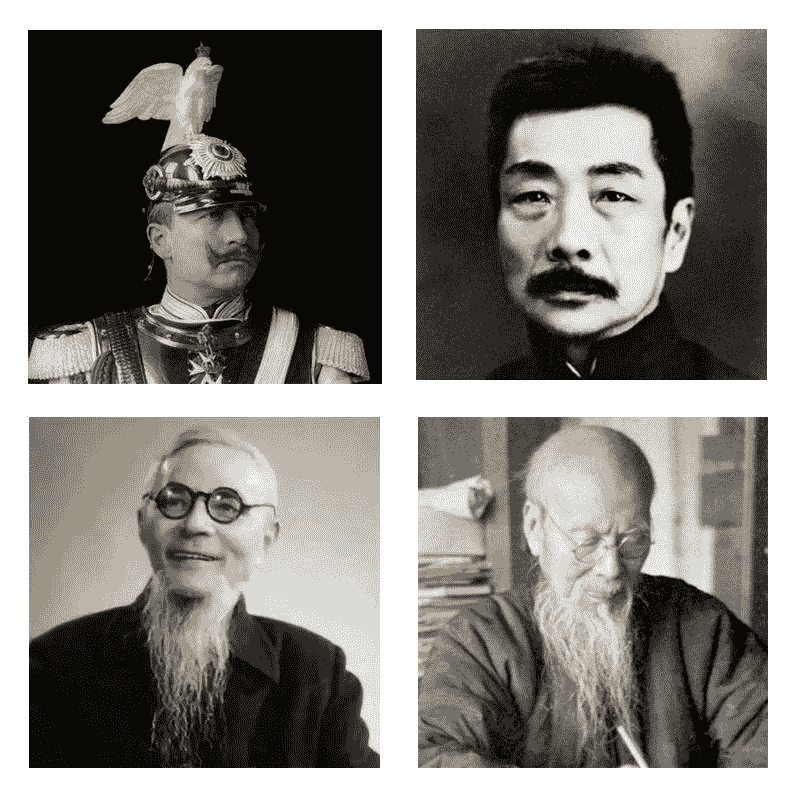

左上：威廉二世 右上：鲁迅

左下：丰子恺 右下：齐白石

这胡须的样子值得写文章吗？

原来胡子一上翘，他就被指责成假装日本人。鲁迅后来研究文化，发现中国古代其实有很多这样的石刻画像，像北魏到唐的佛教的造像，胡子也都上翘，结果当时的人就说，这是日本人伪造的放在这里的。

鲁迅就嘲笑说，日本人为了自己的胡子上翘，还在中国的深山老林里去买很多伪造的佛像，也太辛苦了吧！所以讲起来，这个胡子上翘，中国古代也历来有之，还不完全是日本文化。而拖下来呢，其实鲁迅考证是蒙古人带来的样式。这个蒙古人，中国人是从不当做外人的，其实他们也是征服者、侵略者，这个问题我们以后再谈。

鲁迅也因为这个上翘的胡子，从日本回国途中呢，路上有一个人跟他说话就称赞他，说，嘿你这个日本人中文说得真好！鲁迅辩解都没有用，我是中国人啊。显然人们对胡须的样式，有很多爱国主义的联想。

这些联想深深伤了鲁迅的民族自尊心。因此鲁迅说："凡对于以真话为笑话的，以笑话为真话的，以笑话为笑话的，只有一个方法：就是不说话。"因此他说："于是我从此不说话。"

因为胡须样式的刺激，鲁迅自省说，"因为我实在比先前似乎油滑得多了"。

可是没想到隔了一年，到 1925 年 10 月，鲁迅又写了一篇《从胡须说到牙齿》。为什么呢？因为有一个北大教授说鲁迅从胡须说起，一直说下去，将来就要说到屁股。

那时候鲁迅的文风，已经非常曲折又刻薄了。他说照此逻辑，"遥想土耳其革命后，撕去女人的面幕，是多么下等的事？呜呼，她们已将嘴巴露出，将来一定要光着屁股走路了"。

鲁迅接下来说："虽然有人数我为'无病呻吟'党之一，但我以为自家有病自家知，旁人大概是不很能够明白底细的。倘没有病，谁来呻吟？如果竟要呻吟，那就已经有了呻吟病了，无法医治。"

这段话非常诡辩，也巧妙，一方面重新定义了"无病呻吟"，不可能。另外一方面，他有点咬文嚼字，但是的确把问题讲深了一层。还是跟身体的这个零部件有关，鲁迅借机就辟谣，报上说他参加游行被打落了两颗门牙，其实这个牙齿是在别的情况下掉的。

最后鲁迅又回到了胡须，他这个胡须是没完没了的。鲁迅这样说：

"本来，也可以无须说下去了，然而连胡须样式都不自由，也是我平生的一件感愤，要时时想到的。胡须的有无，式样，长短，我以为除了直接受着影响的人以外，是毫无容喙的权利和义务的，而有些人们偏要越俎代谋，说些无聊的废话，这真和女子非梳头不可的教育，'奇装异服者'要抓进警厅去办罪的政治一样离奇。"

鲁迅在这种地方天真了，奇装异服被抓一点都不离奇啊！

我儿童时代，上世纪 60 年代中，我亲眼见到上海最热闹的南京路市中心，一群激愤爱国的中学生，测量路人，尤其是女人的裤脚管的尺寸，如果尺寸不合，规格太小了，马上当场众目睽睽拿剪刀"唰"地由下往上剪上去，这非常"性感"（sexy）。大家想像一下，从小腿往上，"嚓"剪上去，连警察都不需要。

鲁迅恐怕也忘了，当年俄国彼得大帝曾经要贵族不留胡须，他们不肯，最后怎么办？好吧，你们留胡须吧，另外交胡须税。

虽然我非常同意鲁迅在这两篇文章里，他是要批判的一个人的怎么处置身体的一个部位，跟那种爱国、卖国的不必要的联想。  
但是反过来平心想想，我们今天要是看到照片上的鲁迅，他的胡子是往上翘的，或者他的胡子两边往下垂的，像那个张佩纶，你们去看张爱玲的祖父的照片，那个胡子是两边往下垂的，我们能习惯吗？

原来这"隶书的一字"，现在是鲁迅形象的标志。

#### 《论雷峰塔的倒掉》《再论雷峰塔的倒掉》：什么是破坏式的奴才？

还有一个话题也是连续两篇文章。

《论雷峰塔的倒掉》发表于 1924 年 11 月 17 号《语丝》月刊第一期，这个很重要，《语丝》月刊的第一期。《语丝》是 20 年代中期的一个文学社团，创办人是鲁迅、周作人、林语堂等等，一批散文家。当时它是一个比较不那么有政治立场的、一个文化姿态也比较中立的一个社团。

鲁迅在它的第一期上发表的这篇《论雷峰塔的倒掉》，真的没有什么谈政治社会批判的东西，主要是对白蛇传的传说有些议论，说法海多管闲事，人家"白蛇自迷许仙，许仙自娶妖怪，和别人有什么相干呢"。

其实这篇文章，风花雪月，还弄错地方，把这个至今还在的保俶塔跟当时倒掉的雷峰塔混为一谈了，好在是散文了，没关系。

但是几个月后，发表在语丝第 15 期上的《再论雷峰塔的倒掉》，话题就严肃了。这就显示了《语丝》至少在鲁迅笔下，从冲淡闲适起，渐渐地还是有愤世嫉俗。

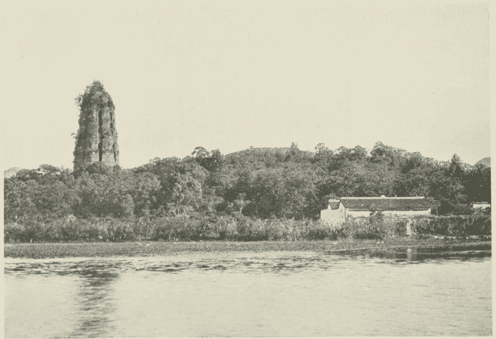

雷峰塔旧影

这个第二篇的这个雷峰塔的文章，起因是胡也频，当时有一个化名（崇轩先生）在《京报》副刊的一个通信，他说："杭州雷峰塔之所以倒掉，是因为乡下人迷信那塔砖放在自己的家中，凡事都必平安，如意，逢凶化吉，于是这个也挖，那个也挖，挖之久久，便倒了。"

鲁迅于是就有了联想了，就这么一则来信，引发了他这篇文章。他先批了一通中国人的"十景病"，因为有人感慨，雷峰塔倒了以后，西湖十景就少了一景，鲁迅说为什么一定要十景呢？

随后鲁迅就随手一句议论，就给悲剧、喜剧下来的定义了："悲剧将人生有价值的东西毁灭给人看，喜剧将那无价值的撕破给人看。"这短短两句话，概括了很多我们写论文里边的学术八股。

（鲁迅）再接着联想到外寇入侵，破坏中国的这些风景，中国人就在瓦砾上修补老例，修补老例怎么办？"再来翻县志，就看见每一次兵燹之后，所添上的是许多烈妇烈女的氏名。看近来的兵祸，怕又要大举表彰节烈了罢。许多男人们都哪里去了？"

原来鲁迅这个是一贯的想法，国破山河，名胜被毁，男人们做什么？重建一个塔，弄一些这种烈妇烈女的名字。这个时候鲁迅的文风，刀锋四起，充满发散性的批判。

不过文章最后终于又回到了雷峰塔。原来鲁迅要讲的最重要的话，说像雷峰塔倒掉或者龙门石窟被拆，"但其毁坏的原因，则非如革除者的志在扫除，也非如寇盗的志在掠夺或单是破坏，仅因目前极小的自利,也肯对于完整的大物暗暗的加一个创伤"，鲁迅称之为这是"一种奴才式的破坏，结果也只能留下一片瓦砾，与建设无关"。

我觉得鲁迅这段话很重要，它概括了我们伟大的文物、我们祖宗的遗产通常就是被这三种力量破坏的：第一是革命，后来真的发生过；第二是侵略；第三是什么？最普遍的就是老百姓，自家老百姓贪小利自盗。

我现在还听说长城，古长城的砖，现在被很多当地人偷走卖钱。这个卖钱比雷峰塔供在家里更坏，因为供在家里还是出于信仰，现在卖钱是牟利。这是与时俱进，非常糟糕。难怪中华大地，山西、河南（等地），地面上可见的实物古迹那么少。

在象征层面上，鲁迅说："岂但乡下人之于雷峰塔,日日偷挖中华民国的柱石的奴才们，现在正不知有多少！"记住，这些挖国家墙角的人，皆是奴才。

鲁迅特别在文章最后说明："含有借此据为己有的朕兆者是盗寇，含有借此占些目前的小便宜的朕兆者是奴才，无论在前面打的是怎样鲜明好看的旗子。"哪些人是盗寇，哪些人是奴才？值得我们深思。

顺便插一句啊，这个雷峰塔现在其实已经修复了。你到杭州去看那这个西湖十景，金光灿灿，焕然一新，香火通明，游客众多。相比之下，叫人感慨的是，隋朝建的六和塔（始建于北宋）倒没有多少人去，不知道鲁迅看到了会不会再写一篇三论雷峰塔。下集再见。

#### 下期预告

散文《春末闲谈》，出自《坟》

# 5\. 从一只细腰蜂到人类困境的哲学思考 ｜《春末闲谈》

（公众号懒人找资源，懒人专属群分享）

（音频"下集继续"后，有许子东最新补充内容）

重读鲁迅，今天是第五集。我们今天要读一篇散文。

在我心目当中，这是鲁迅最好的散文之一，也是中国现代文学史上最出色的散文之一。而且这篇散文还不大有名，很多人可能都不知道有这么一篇文章。

#### 细腰蜂与小青虫：一则看似温馨的故事

散文，可以谈自然风景，可以讲科学道理，可以引经据典谈古代文学，或者科幻一下未来的世界。当然散文还可以联系历史、批判现实，或者不仅批判现实，当然这个是上世纪 20 年代的军阀混战的现实。散文还可以上升到哲学层面，讨论人性的变化、人类的古今。所有这些不同层面的内容，大自然、科学、古典文学、历史、现实、哲学，散文都可以涉及。

但有没有读过一篇散文----  
这么多不同层面，这么多复杂内容，通通贯穿在一篇散文里，在一篇一两千字的散文里。这可能吗？这可行吗？而且这篇散文的题目还非常轻描淡写，叫《春末闲谈》。

我们现在正好是春天，所以我们来读读这个《春末闲谈》。

文章第一句说："北京正是春末，也许我过于性急之故罢，觉着夏意了，于是突然记起故乡的细腰蜂。那时候大约是盛夏，青蝇密集在凉棚索子上，铁黑色的细腰蜂就在桑树间或墙角的蛛网左近往来飞行，有时衔一支小青虫去了，有时拉一个蜘蛛。青虫或蜘蛛先是抵抗着不肯去，但终于乏力，被衔着腾空而去了，坐了飞机似的。"

这个第一段文字讲的是一个小小自然景观，就是讲一种细腰蜂，这个细腰蜂昆虫学上属于这个膜翅目，泥蜂科。这种青蜂无缘无故会把人家小青虫或者蜘蛛拉走。它把人家拉去干什么？免费坐飞机啊？原来是为了繁殖后代。

鲁迅很有诗意地告诉我们，《诗经》当中有一句叫"螟蛉有子，蜾蠃负之"。这个螟蛉，就是指小青虫。蜾蠃，就是细腰蜂。

这个美好的传说是这样的，说这个细腰蜂把坐直升飞机来的小青虫放进它的窠里，封起来，然后自己在外面日日夜夜地敲打，好像嘴里念念有词，说"像我像我"。经过大概七七四十九天，打开窠，那青虫就变成了一只细腰蜂了。

螟蛉有子 蜾蠃负之

这个描写自然界物种转化的美丽故事，还不仅是出于《诗经》。汉代郑玄注："青蜂取桑虫之子，负持而去，煦妪养之。"这个"煦"大概就是温暖恩惠的意思。"妪"，是古代对妇女的一个通称，"煦""妪"加在一起当然就是母亲对儿女的态度了。

后来扬雄在《法言\*学行》当中说他好像还听到了细腰蜂说"类我！类我！"，"久则肖之矣"。这个不是说谎话千遍重复就是真理，而是说祝愿重复千遍就有了小细腰蜂，多么浪漫温馨的故事。

所以鲁迅说他小时候见到树林里两个虫子一拉一拒，他就好像看到了这个慈母教女，满怀好意。

#### 被"赛先生"戳碎的童话故事

写到这里，《春末闲谈》好像真是一个奇特自然景观，加上一个美丽文学典故，很符合《春末闲谈》这么一个篇名。

但作家笔锋一转，说："但究竟是夷人可恶，偏要讲什么科学。科学虽然给我们许多惊奇，但也搅坏了我们许多好梦。自从法国的昆虫学大家发勃耳（Fabre）仔细观察之后，给幼蜂做食料的事可就证实了。"原来这个小青虫跑去那里，不是它变成小蜜蜂，而是给小蜜蜂繁殖做养料。

鲁迅接着说："而且，这细腰蜂不但是普通的凶手，还是一种很残忍的凶手，又是一个学识技术都极高明的解剖学家。她知道青虫的神经构造和作用，用了神奇的毒针，向那运动神经球上只一螫，它便麻痹为不死不活状态，这才在它身上生下蜂卵，封入窠中。青虫因为不死不活，所以不动，但也因为不活不死，所以不烂，直到她的子女孵化出来的时候，这食料还和被捕当日一样的新鲜。"

忽然之间自然界的慈母变成了残忍的凶手。美丽文学故事变成了物竞天择进化论的一个冷酷案例。

其实关于这个细腰蜂和小青虫的故事，中国古人也早有科学解释，比方说六朝人陶弘景。他在注《本草》的时候就指出过，说："今一种黑色细腰，衔泥于壁及器物边作房，生子如粟置其中；乃捕草上青蜘蛛十余置其中，仍塞口，以俟其子大而为粮也。"就等他的儿子大了以后做粮食。

后来宋代也有文人有相似的观察，简单说，就是把青虫放在窠里，用来帮助他们繁殖下一代。

有意思了，鲁迅明明也看到了这些中国古代科学，鲁迅的文章也说："我记得有几个考据家曾经立过异说，以为她其实自能生卵；其捉青虫，乃是填在窠里，给孵化出来的幼蜂做食料的。"

可是鲁迅偏偏不引古人的考据，而要用法国科学家的最新研究，这里面大概就有五四时代强调外来的赛先生这么一个目的，或者残忍凶手用神奇毒针这么一个方法，更有戏剧感、更有画面感。

#### 从一根毒针到社会对个人的禁锢

为了引申出自然、科学与文学以外的《春末闲谈》，作者接下来要谈什么呢？

鲁迅说："三年前，我遇见神经过敏的俄国的 E 君。"E 君就是爱罗先珂，我们知道爱罗先珂是一个双目失明的俄国诗人、童话作家，曾经在中国流亡，鲁迅很喜欢他的作品，也翻译过他不少作品。

鲁迅接着说："有一天他忽然发愁道，不知道将来的科学家，是否不至于发明一种奇妙的药品，将这注射在谁的身上，则这人即甘心永远去做服役和战争的机器了？"

鲁迅虽然装着跟爱罗先珂一起发愁的模样，心里却在想："殊不知我国的圣君，贤臣，圣贤，圣贤之徒，却早已有过这一种黄金世界的理想了。不是'唯辟作福，唯辟作威，唯辟玉食'么？不是'君子劳心，小人劳力'么？不是'治于人者食人，治人者食于人'么？"

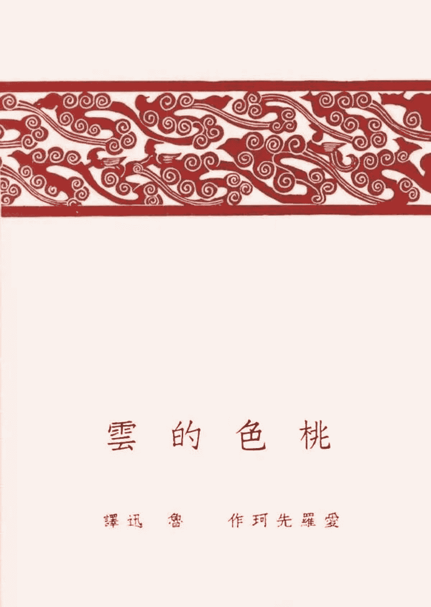

《桃色的云》

爱罗先珂 著 鲁迅 译

这三段儒家经典，我们都知道作威作福今天普遍是一个负面词汇。原来最早在《尚书》里边，说的就是皇上跟诸侯可以作福、作威、玉食。那"君子劳心，小人劳力"，这个是《左传》里边的说法，当时说这个是先王之志。我们熟悉的《孟子\*滕文公上》那就是指出："劳心者治人，劳力者治于人。"

动脑子的管理人，不动脑子的被管理（脑力劳动的人，统治人；体力劳动的人，被人统治）。当然了我自己今天觉得孔子、孟子的学说是非常伟大，应该继承。但是其中有些观念，尤其是关于这个阶级、这个社会秩序这些观念，鲁迅敏锐地指出了这些观念的荒谬之处。所以今天要继承国粹的时候，如果连这些观念也继承下来，那是要好好反省的。

所以鲁迅说："可惜理论虽已卓然，而终于没有发明十全的好方法。要服从作威就须不活，要贡献玉食就须不死；要被治就须不活，要供养治人者又须不死。人类升为万物之灵，自然是可贺的，但没有了细腰蜂的毒针。"怎么办呢？或者说为什么呢？

鲁迅说原来人类社会需要的毒针，"实在比细腰蜂所做的要难得多。她于青虫，只须不动，所以在运动神经球上一螫，即告成功。而我们的工作，却求其能运动，无知觉，该在知觉神经中枢，加以完全的麻醉的。但知觉一失，运动也随之失却主宰，不能贡献玉食。"这样怎么服务上等人呢？

"就现在而言，"鲁迅说的现在就是 20 年代中期，北伐之前的中国，"窃以为除了遗老的圣经贤传法（这是讲保守派或者学衡派），学者的进研究室主义（这个讽刺胡适的整理国故），文学家和茶摊老板的莫谈国事律（指北洋军阀之下，开茶馆的和文人都以莫谈国事为原则；把开茶馆跟文人相提并论，这个非常有意思，这都算公共空间吧），教育家的勿视勿听勿言勿动论之外"等等，除了这几种方法以外，鲁迅认为还没有更好、更完全的类似于"毒针"的方法。

我们看到鲁迅的这个散文四面挑战、刀锋犀利。一段话分别讽刺了旧学圣贤、胡适主张、茶馆禁令、教育封闭。

然后鲁迅说，"礼失而求诸野"，意思是这个军阀统治没方法，建议引进外国手段。外国手段怎么办呢？治之之道，第一是禁止集合，就是不要人聚在一起；其次要防说话。

在历数禁集合、禁言论等方法的有效和困难以后，这时候鲁迅就责怪造物主了，"一恨其没有永远分清'治者'与'被治者'；二恨其不给治者生一枝细腰蜂那样的毒针；三恨其不将被治者造得即使砍去了藏着的思想中枢的脑袋而还能动作  
\----服役。"

这个三恨之后，鲁迅的散文就发展到科幻层面了，他说："假使没有了头颅，却还能做服役和战争的机械，世上的情形就何等地醒目呵！这时再不必用什么制帽勋章来表明阔人和窄人了，只要一看头之有无，便知道主奴，官民，上下，贵贱的区别。'刑天'没有了能想的头，却还活着，'以乳为目，以脐为口'，陶潜先生又有诗道：'刑天舞干戚，猛志固常在。'连这位貌似旷达的老隐士也这么说，可见无头也仍会有猛志。"

鲁迅这篇文章的最后一笔是："阔人的天下一时总怕难得太平的了。"

附带联想，没有头还活着（的现象），至今没见过，但换头术倒已经有人在实验了。真的是科学的大突破，真的有人可以继续用别人的身体活下去，毕竟比细腰蜂的针更厉害啊。

再说一遍，这篇看似闲谈的散文，是从大自然小昆虫说起，从文学传统到科学研究，再到社会批判、历史研究，再到人类困境的哲学思考。

这就是鲁迅，这只是一篇散文，这只是鲁迅在 1925 年春末的某一天的闲谈。下期继续。

#### 最新补充

各位，《春末闲谈》这篇文章我补充几句。

第一，《坟》在我看来其实是鲁迅最重要的散文集，这是他编的第一部散文集。在艺术性方面，可能后来《野草》会更精致，但是在表现鲁迅思想方面，《坟》是最重要的。所以这也是我为什么要按照人民文学出版社的官方次序重读鲁迅，一上来就读《坟》。

第二，《春末闲谈》又是《坟》里边最重要的散文之一。而且这篇散文的知名度还不够高，很多同行关于鲁迅的研究成果累累，但是专门讨论此文的研究，据我所见，不是很多，所以我要特别推荐。

第三，鲁迅在这个文章里边批评军阀统治。其治民之道关键就是两条，一个就是限聚令，禁止集会，因为几个人以上聚集就有可能闹事。二是防说话，就是不可以乱说话。鲁迅说了，造物主应该给统治者一只细蜂腰的毒针，（这样统治者就可以）让人没了脑袋，身体还能好好地工作，简而言之是要听话。

不知道这个文章什么时候能收入比方说大学中文系的教材，因为这篇文章真是既美丽又残酷，一道华丽的风景长满了细腰蜂。

#### 下期预告

《灯下漫笔》，出自《坟》

# 6\. “宁为太平犬”是比生逢乱世更为悲哀的事情 ｜《灯下漫笔》

（音频"下集继续"后，有许子东最新补充内容）

重读鲁迅，今天是第六集。

在《春末闲谈》之后，我们要阅读一篇看上去更轻松的散文，题目叫《灯下漫笔》。

#### 一个教人欢欢喜喜做起奴隶的时代

这也是 1925 年鲁迅发表在《莽原》周刊上的文章，这篇文章其实比较有名，因为其中有两句话脍炙人口。不过我却觉得这篇文章里有个故事更加重要，值得我们细细咀嚼、细细回味。

"就是袁世凯想做皇帝的那一年，"鲁迅说，因为财政困难，中国银行跟交通银行停止兑现纸票，就是不能够用纸钱去换银子，但是政府说钱还可以照样用。

在这种情况下你就会知道，商家不大欢迎这样的纸币。常常去买东西的时候，他也不能说不能用纸币，因为法令说是可以用的。但是他就说找不到零钱，没法再找给你们等等。所以大家都不收中交票，也就是中银跟交通银行的纸票。

鲁迅说："我还记得那时我怀中还有三四十元的中交票，可是忽而变了一个穷人，几乎要绝食，很有些恐慌。"我估计这些都是有点夸大的。在恐慌之下，鲁迅便打听这些钱能不能折换成现银。

居然可以折换，"有了行市了：六折几"。

鲁迅说："我非常高兴，赶紧去卖了一半。后来又涨到七折了，我更非常高兴，全去换了现银，沉垫垫地坠在怀中，似乎这就是我的性命的斤两。倘在平时，钱铺子如果少给我一个铜元，我是决不答应的。"

接下来就是鲁迅的感想："但我当一包现银塞在怀中，沉垫垫地觉得安心，喜欢的时候，却突然起了另一思想，就是：我们极容易变成奴隶，而且变了之后，还万分喜欢。"为什么呢？

设想一下，假如我原来有一百块钱，就算要少掉一块的话，我也是绝对不肯的。现在突然变成 70 块，我还那么开心，像捡了宝贝一样。这个道理、这个处境其实我们人人都懂，但为什么会这样？为什么这就变成奴隶了呢？

让我们看看鲁迅的推理是怎么样的。他说："假如有一种暴力，'将人不当人'，不但不当人，还不及牛马，不算什么东西；待到人们羡慕牛马，发生'乱离人，不及太平犬'的叹息的时候，然后给与他略等于牛马的价格，有如元朝定律，打死别人的奴隶，赔一头牛，则人们便要心悦诚服，恭颂太平的盛世。为什么呢？因为他虽不算人，究竟已等于牛马了。"

"宁为太平犬，莫作乱离人。"这是元代一个叫施慧的人写在《幽闺记》这首诗里面的。那么打死奴隶要赔头牛，也确实可以在成吉思汗的法令中找到依据。这个在多桑写的《多桑蒙古史》里面就有这样的引证。

鲁迅其实是用了一连串的概念转换，或者甚至说是偷换概念。"哎！这个人觉得做牛马也不错了。"所以鲁迅的结论是，"但实际上，中国人向来就没有争到过"人"的价格，至多不过是奴隶，到现在还如此，然而下于奴隶的时候，确实数见不鲜的。中国的百姓是中立的，战时连自己也不知道属于那一面，但又属于无论那一面。强盗来了，就属于官，当然该被杀掠；官兵既到，该是自家人了罢，但仍然要被杀掠，仿佛又属于强盗似的……假使真有谁能够替他们决定，定下什么奴隶规则来，自然就'皇恩浩荡'了"。

鲁迅历数古来乱世，五胡十六国，黄巢，五代，张献忠等等，碰到这样的乱世，鲁迅说：

"百姓就希望来一个另外的主子，较为顾及他们的奴隶规则的，无论仍旧，或者新颁，总之是有一种规则，使他们可上奴隶的轨道……用成语来说，就叫作'天下太平'。

任凭你爱排场的学者们怎样铺张，修史时候设些什么'汉族发祥时代''汉族发达时代''汉族中兴时代'的好题目，好意诚然是可感的，但措辞太绕湾子了。有更其直捷了当的说法在这里----

一，想做奴隶而不得的时代；

二，暂时做稳了奴隶的时代。"

最后两句就是我前面说的鲁迅这篇文章里最脍炙人口的两句话，是对中国历史的一种让人印象深刻的，当然也非常极端的概括。

我现在还记得，少年的时候初次读到鲁迅这两句话，我十分震惊。而且我后来也常常怀疑、反思，是不是鲁迅真的太过激了。当然现在重读，我可以在这里加两个注解：

第一，鲁迅讲的是万恶的旧社会。他老人家从来没见过新社会，这个非常明显不必多说了。

第二，鲁迅是在形容比喻的意义上使用"奴隶"这个词汇，而不是讨论史学意义上的真正的这个奴隶。

#### 鲁迅所指的"奴隶"究竟是什么样的？

在历史研究的范畴里面，无论是查维基百科或者百度，奴隶都是奴隶主的财产。这是一个特定的人类社会的发展过程，这些奴隶是没有自己的人格、自由以及权利的，可以（被）买卖，并且还要无报酬地工作。

人类历史上，很多文明古国很辉煌，但是它们都建立在奴隶制度的基石上。古希腊、古埃及、古罗马、古巴比伦，一直到南北战争之前的美国南部，以及十八、十九世纪英法等国在世界各地的殖民地，都有合法的奴隶存在。据说毛里塔尼亚是最后废除奴隶制的地方，但至今仍有百分之十到百分之二十的人口是奴隶。

近代的奴隶很多是债奴，不像古代的奴隶很多是打败仗的军人或罪犯，现在很多奴隶都是欠了债，甚至逼婚、人口贩卖等等。

显然这些奴隶与鲁迅讲的原来有一百块，因为银行停止兑换，现在变成只有七十块的人，不是一回事情。

不是一回事情吗？两者里面没有相通的地方吗？

中国历史上有没有马克思所说的奴隶社会，史学界一直有争论。按照人类历史发展的三个阶段（奴隶社会、封建社会和资本主义社会）的理论（也叫唯物史观）来说，有一些学者认为中国在战国前是奴隶制，因为很多是战俘。

但也有一派，史学界叫无奴学派。无奴学派认为这些战俘只是用来做人祭的，不是当作奴隶来杀的。从殷墟墓葬的结构来看，奴隶人口也只占当时的百分之三，而平民有百分之八十几，这跟古希腊、罗马的情况都不一样。

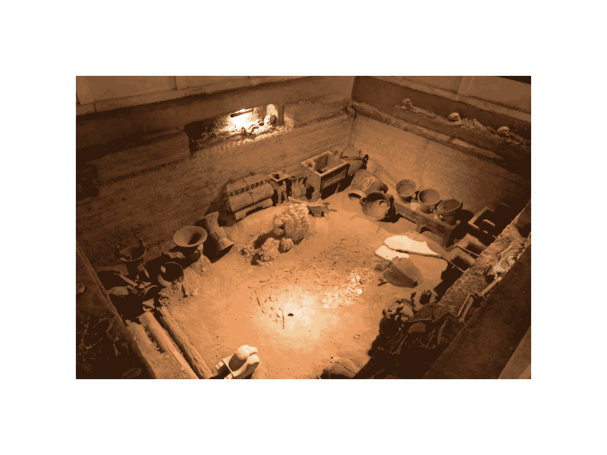

殷墟妇好墓，墓室边缘有殉葬奴隶

当然有奴学派就研究得更详细了。它细分出"官奴""私属"等，还有个说法叫"胥靡"，大概意思是用绳子牵着强迫劳动，这个说法其实在汉代之前就有了。汉代的时候有法令，奴隶要是跟良民打架，把良民打伤了，这个奴隶就要被处死，这个法律是不平等的。  
古巴比伦的法律更是说，如果良民要帮助奴隶逃跑，良民也要被处死。

宋代一度是禁绝私属奴隶的，但是到了元代就又恢复了。明朝到了中后期，蓄奴成风。有趣的是，到了满清的时候，八旗子弟都认为自己是爱新觉罗家的家奴，所以自称奴隶还是一种光荣，一种资格啊！

香港是最晚在 1923 年才通过《家庭女役则例》，意思是正式地废除家庭里面的婢女。所以，在家里不能自己养婢女，必须是雇受薪女佣。

但不管怎样，鲁迅说身上原来有一百块钱，又分明有去黑市兑换现银的自由，显然不是历史学上讲的奴隶。但有一点是相似的，就是你拥有的东西没有保障，可以无缘无故地被剥夺。

你的钱不是因为炒股、借贷或者在路上丢失不见了，而是因为一个跟你毫不相关的法令、政策，你的钱就没有了。这跟奴隶没有自己的人格、自由和权利，有没有相通的地方呢？

我们花这么多篇幅来讨论奴隶的定义，是因为"奴隶"和"奴才"这两个概念的区别是鲁迅思想的一个核心，也是我们理解为什么鲁迅努力要批判阿 Q 精神和国民性的一个关键。这个课题我们以后会多次碰到。

简而言之，历史学、社会学意义上的奴隶，是没有人身自由，必须无报酬劳动的人。可是在文学、心理学意义上的奴隶，他们已获得的劳动报酬，不管是金钱还是房子，或者说话的权利等等，都可以随时被剥夺。

#### 谁是"奴隶"？谁又是"奴才"？

但鲁迅关心的还不是我们极容易变成奴隶。鲁迅着重要讨论的，是为什么"变了以后，还万分喜欢"。以后我们会讨论小说《阿 Q 正传》（其实鲁迅那时候已经写完这篇小说了），就是为什么这个主人公不仅极容易被欺负，而且在被欺负以后，还可以觉得安慰和高兴。

鲁迅对这个问题的关注是持续的，而且是有发展的。到了上世纪三十年代的《南腔北调集》里，他发展了他的观点，他说："一个活人，当然是总想活下去的，就是真正老牌的奴隶，也还在打熬着要活下去。然而自己明知道是奴隶，打熬着，并且不平着，挣扎着，一面'意图'挣脱以至实行挣脱的，即使暂时失败，还是套上了镣铐罢，他却不过是单单的奴隶。如果从奴隶生活中寻出'美'来，赞叹，抚摩，陶醉，那可简直是万劫不复的奴才了，他使自己和别人永远安住于这生活。"

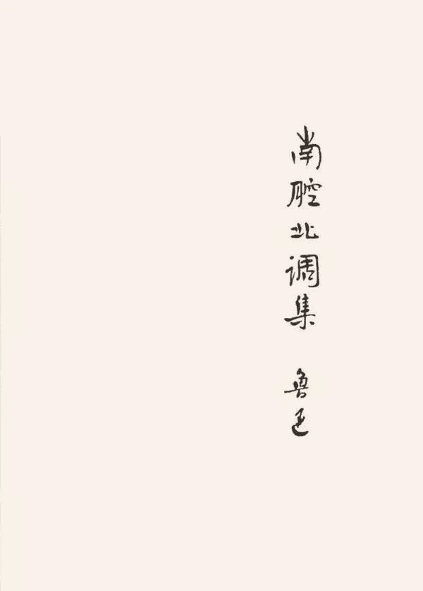

《南腔北调集》

我在手机上查翻译，"奴才"和"奴隶"的英文都是"slave"，它不知道中文里边这两个概念、这两个词的差别之大，差别之重要。

刚才说过，在清朝，有些汉人官员，他对着皇上，也自称奴才，其实这个奴才是一种套近乎，是一种资格。所以后来乾隆，据说他不满意，很多汉人都这么自称奴才，所以就命令他（们），以后上奏一律称臣。真的，在历史上，奴才是你们想做就有的做的吗？

可是在 1925 年，鲁迅说中国历史不外乎"想做奴隶而不得的时代"或"暂时做稳了奴隶的时代"。提出这么悲观的概括的时候，鲁迅在激奋之余，他还是把希望押在文章的中间。他说：

"自然，也不满于现在的，但是，无须反顾，因为前面还有道路在。而创造这中国历史上未曾有过的第三样时代，则是现在的青年的使命！"

我们下期继续。

#### 最新补充

这集读的《灯下漫笔》，是鲁迅的名篇，引用率非常高的，也是我重读鲁迅的一个重点。

文中涉及的主奴关系，之后我们还要反复讨论。有兴趣的朋友可以参考我的一篇论文，题目叫《"奴隶"、"奴才"与"奴隶性"----  
重读〈阿 Q 正传〉》。这篇论文大概一两万字，发表在由上海华东师大主办的《现代中文学刊》上，这也是 CSSCI 核心刊物，二零一九年第五期。当然，这篇论文会比我们的节目更详细，更学术，更严谨一点。

我想特别提醒大家注意的是，鲁迅感兴趣的不仅仅是奴隶的生态，也不仅仅是奴才的心态。我们开玩笑说，奴才是奴隶中的人才，是奴隶中的 VIP，也包括身为主子，或者是向往成为主子的那种心态。

所以主奴关系，它是一体两面的。不要笑话别人，鲁迅先生就是让我们每个人都可以看看自己。当然我也有一次宣读了论文以后，也有朋友下来就摇着头叹气说："讲得都对，可是摆脱不了，还不如不看吧。"也就是说继续装睡。

我也不知道哪个办法更好，但我总觉得，看清楚自己总比觉得做奴才真的幸福，或者比真的觉得自己是主人、是主子要好一些吧。大家都有选择的余地。

#### 下期预告

《论睁了眼看》，出自《坟》

# 7\. “瞒”与“骗”的桎梏 ｜《论睁了眼看》

今天是重读鲁迅第七集。

我想先借这个机会，好好谢谢各位听众。既然你们已经听我的节目了，上了"贼船"，大家就要好好参与。具体来说怎么参与呢？就是发表意见。希望各位能够留下评论。

#### 与作品对话就是与鲁迅对话

对于有心的人，比如鲁迅研究者，（从）他们（的评论里）就会直接看到当代人怎么看鲁迅。他们会对鲁迅的观点、思想、态度发表意见，这就构成了一个有生命的鲁迅的作品。

接受美学有个说法，"作品只是琴谱，演奏才是文学"，所以作品是要读才有生命。所以我有信心，我们重读鲁迅，即便讲的话有偏颇，鲁迅在天上也不会生气。你们有回音，不光是为了我，也是直接在跟鲁迅对话。

前两集我们读了两篇文章，题目看上去都很轻松，分别叫《春末闲谈》和《灯下漫笔》。看似风花雪月，文人雅兴，其实份量很重，令人压抑。《春末闲谈》讲的是小青虫怎么被细腰蜂扎毒针，然后"不死不活"地帮人家繁殖儿女；《灯下漫笔》是讲鲁迅自己因为钱币贬值去换银子，然后鲁迅自己觉得他很容易做奴隶，而且做了以后还十分欢喜。

"奴隶"这个词，我们上一集还专门做了一些考证调查。显然今天它不是一个网络上的流行语，但在鲁迅那里，它是很多文章的关键词。

我们不妨想想《国歌》歌词的第一句是什么,"起来！不愿做奴隶的人们"，歌词第一句讲的就是奴隶。再想想《国际歌》的歌词，"起来！饥寒交迫的奴隶。起来！全世界受苦的人"，第一句歌词又是在说奴隶。大家想想看，《国歌》《国际歌》的第一句歌词都出现了如此相同的关键词"奴隶"，另外一个相同的词都是"起来"，就是要唤醒。这大概证明苦难中国走向马克思主义革命道路，真的不是偶然的。而毛泽东主席说他和鲁迅的心是相通的，这也不是偶然的。

后人称鲁迅不仅是伟大的文学家，而且是伟大的思想家、伟大的革命家，这不是夸张的。

当然，鲁迅首先还是文学家。他的进化论思想，他的革命激情，都必须通过他的文学来体现。我们重读鲁迅已经读到第七集了，还没有读到一篇专门讨论文学的文章。其实《摩罗诗力说》是专论欧洲文学的，而且也表达了作家自己的文艺观、世界观、人生观，但我们以后再读。

今天，我们一起来读一篇也收在散文集《坟》里的文章。在《灯下漫笔》之后不久写的，是专门讨论文学的，题目叫《论睁了眼看》。

#### 鲁迅论文人自欺欺人的"瘾"

《论睁了眼看》这篇文章的立论是：

"中国的文人，对于人生，----至少是对于社会现象，向来就多没有正视的勇气。我们的圣贤，本来早已教人'非礼勿视'的了；而这'礼'又非常之严，不但'正视'，连'平视''斜视'也不许。现在青年的精神未可知，在体质，却大半还是弯腰曲背，低眉顺眼，表示着老牌的老成的子弟，驯良的百姓，----至于说对外却有大力量，乃是近一月来的新说，还不知道究竟是如何。"

但为什么文人青年不能正视问题呢？鲁迅说：

"先既不敢，后便不能，再后，就自然不视，不见了。"

请大家注意这个前后的逻辑关系：先是不敢，后是不能，然后就不见了。

我曾经跟王蒙讨论过"信服"这两个字。比方说我们相信一个理论、相信一个学说、相信一个思想，这时的"信服"给人的感觉是看上去像是一个字。但也可以是分成两个字来看，那就是先相信，再服从。但有没有可能，我跟王蒙议论，是先服从  
\----因为没力反抗----然后才表示自己相信，这样的感觉就好一点。

还有一种情况是信而不服，也就是我相信但是我不服从，我要忠诚挑战，当然这种忠诚挑战的结局常常不好。还有一种可能是服而不信，因为无法反抗，所以身体服从、行为服从，但是思想、灵魂并不信。

在鲁迅看来，这个逻辑次序是先不敢，恐惧、害怕；后不能，失去了反抗能力；再后面，就不看见了，就回避问题、自我欺骗。

鲁迅接下去说：

"然而由本身的矛盾或社会的缺陷所生的苦痛，虽不正视，却要身受的。文人究竟是敏感人物，从他们的作品上看来，有些人确也早已感到不满，可是一到快要显露缺陷的危机一朆之际，他们总即刻连说'并无其事'，同时便闭上了眼睛。这闭着的眼睛便看见一切圆满，当前的苦痛不过是'天之将降大任于是人也，必先苦其心志，劳其筋骨，饿其体肤，空乏其身，行拂乱其所为。'于是无问题，无缺陷，无不平，也就无解决，无改革，无反抗。因为凡事总要'团圆'，正无须我们焦躁；放心喝茶，睡觉大吉。再说费话，就有'不合时宜'之咎，免不了要受大学教授的纠正了。呸！"

整个一大段，鲁迅讲的是上世纪二十年代军阀混战时期的中国。当时的社会相当混乱，民不聊生。鲁迅就批评当时的文人："万事闭眼睛，聊以自欺，而且欺人，那方法是：瞒和骗。"

熟悉文艺理论，熟悉鲁迅文艺思想的人都知道，"瞒"与"骗"是两个非常重要的负面概念。"瞒"主要是对人民，"骗"有时候是对自己。

但是鲁迅讲的"瞒"与"骗"具体是什么意思呢？我们还得看看他举的例子。鲁迅举了一些古典文学方面的例子，比如才子佳人"私订终身"，传为美谈，可实际上这不容于天下。那怎么办呢？鲁迅说，明末就有些作家来编些才子佳人奉旨成婚之类的美好结局。

鲁迅又说："《红楼梦》中的小悲剧，是社会上常有的事，作者又是比较的敢于实写的，而那结果也并不坏。"这是鲁迅对曹雪芹的称赞。但在鲁迅看来，续作者高鹗，自欺欺人的瘾太大了。"定须闭眼胡说一通而后快。"看来鲁迅对后四十回是不满意的。他又引了一个叫赫克尔的英国人的说法。

"赫克尔（E．Haeckel）说过：'人和人之差，有时比类人猿和原人之差还远。'我们将《红楼梦》的续作者和原作者一比较，就会承认这话大概是确实的。"鲁迅这个说法真是尖刻。

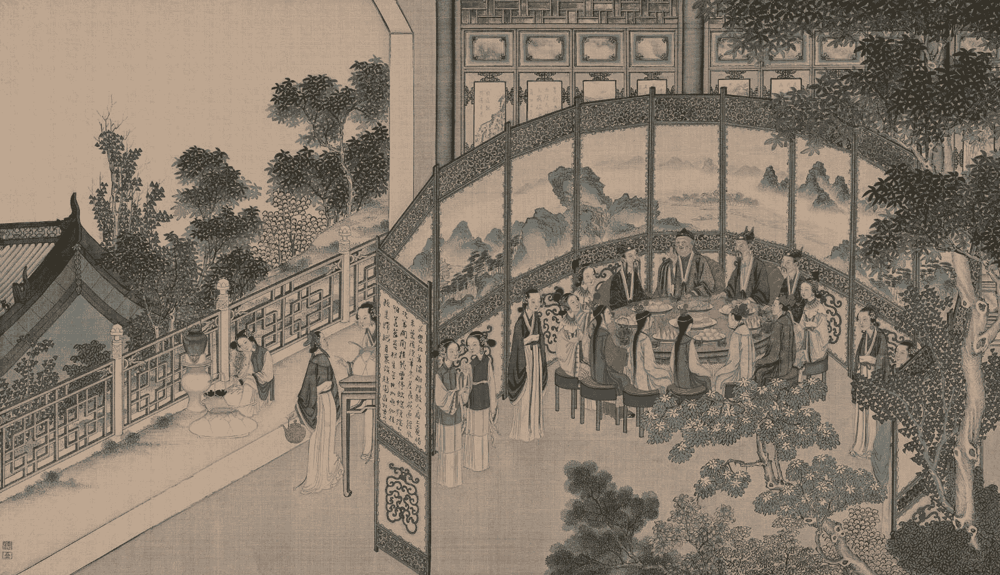

《红楼梦》绘本

前段时间，白先勇到我教课的香港岭南大学做讲座，讲他在《红楼梦》各个版本里最欣赏的是程乙本。他还相信后四十回最初也是曹雪芹所写，高鹗、程伟元只是收集整理。

白先勇是在进行作家跟作家的对话，因为白先勇是现在在世的作家中，风格最接近《红楼梦》的一位。所以他对《红楼梦》的看法怎么说都是有价值的。当然在红学界白先勇这个说法属于少数。相比之下像鲁迅这样用类人猿跟猿人来比较高鹗与曹雪芹，也实在是太刻薄了。

#### 重读文艺作品中的"瞒"与"骗"

鲁迅把一系列中国古典文本的改造都解释成了文人的"瞒"与"骗"。

比如他举了例子，元朝有个刘信，他把三岁的痴儿丢进火盆来祈求祸福的预兆，《元典章》里有明文记载这个故事。可是到了杂剧《小张屠焚儿救母》，就把它变成他是为了帮母亲延命而把小孩投进火盆，最后母亲救活了儿子也不死了，这美化了一些其实非常丑恶的民俗。

还有一些更加有名的事情，因为谁人都知道，当时的文人就没法乱改编了，那就搞一些另外的，在鲁迅讲起来，就是骗局。比方说岳飞被奸臣所害，那小说《说岳全传》怎么办呢？

说岳飞原来是大鹏转世，秦桧是黑龙转世。秦桧害死岳飞，皆因报前世这个大鹏曾经啄伤黑龙的旧恩怨。再比方说关羽失败令人惋惜，所以《三国演义》就说他死后显圣成神等等。

仔细想想，鲁迅讲的这些事情，这些中国传统故事的演变其实不完全是文人的"瞒"和"骗"，它也有历代国人的集体心理需求。当然，这中间也夹杂着历代官员的统治需求，尤其是民间文学。所以这种文本故事的改造，其实是文人跟大众共同创造的。鲁迅举的文学的例子，引出的却是关于国民性的结论。

鲁迅说："中国人的不敢正视各方面，用瞒和骗，造出奇妙的逃路来，而自以为正路。在这路上，就证明着国民性的怯弱，懒惰，而又巧滑。一天一天的满足着，即一天一天的堕落着，但却又觉得日见其光荣。"

紧接着，鲁迅讲了一段极有预见性的话，我读到这段话，就不由自主地会想起前几年看过的一个电影。鲁迅是这样说的：

"在事实上，亡国一次，即添加几个殉难的忠臣，后来每不想光复旧物，而只去赞美那几个忠臣；遭劫一次，即造成一群不辱的烈女，事过之后，也每每不思惩凶，自卫，却只顾歌咏那一群烈女。"

各位朋友，张艺谋是我非常钦佩的导演，他早期的《红高粱》《秋菊打官司》，后期的《归来》，包括北京奥运会开幕式的某些片段，都给我留下非常深的印象。

严歌苓更是我私人的朋友，她的小说戏剧性强，大多都能改编成电影。但也正因为导演、编剧都是中国文艺界一流人才，《金陵十三钗》才让人看了以后诸多反思。

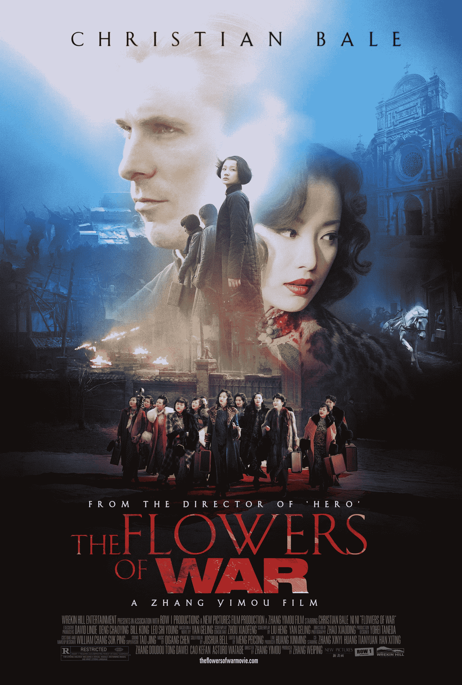

电影《金陵十三钗》

我知道在那部电影前同样题材已经有《拉贝日记》，讲一个德国纳粹党人居然在南京大屠杀期间好心救了不少中国人；又有陆川探索片《南京南京》，试图理解日本士兵的人性，在国际上获奖，但在国内有争议；张艺谋再拍同一热门题材，他就想先等等两年，看看潮流风向，避开撞车可能，这是第一个考虑。第二个，他也总结了前两部片子太重史实，或者是"美化"敌方人性这些教训。结果证明张艺谋的片子果然好看，一大群秦淮河美女，还有外国明星，主打国际市场，票房大卖。

我在电影院里看也觉得挺好看，但是看的时候就想到了莫泊桑的《羊脂球》。大家要知道，除了《项链》，《羊脂球》是莫泊桑非常有名的一个短篇。对于那些平常看不起妓女，紧要关头，又要靠妓女牺牲来帮助大家渡过难关，莫泊桑的角度是批判的。

这跟我们在《金陵十三钗》最后看到的一班爱国妓女身携武器代替女学生去参加明知是危险的日本人的盛典，这催人泪下又是歌颂的态度，是很不一样的。

我们不禁要想，假如在这个庆典上，秦淮河歌女被集体奸污，那是不是妓女被奸污，就好过女学生被欺负呢？如果她们带着武器舍生反抗，最后成为鲁迅说的烈女，那歌颂这样的烈女，又是一种怎样的对南京的纪念呢？

鲁迅怎么好像早就看了这个电影，早就看到了电影院里中国观众几十年后仍在歌咏那一班烈女？

张导和严歌苓的电影其实很好，我在电影院里看到片尾音乐声起，几乎流泪。但我的问题是：为什么国人宁可不看更接近史实的《拉贝日记》，或者不看更有人性深度的《南京南京》，而喜欢陶醉在对一群美丽烈女的赞叹惋惜声音之中？

鲁迅的结论是："文艺是国民精神所发的火光，同时也是引导国民精神的前途的灯火。中国人向来因为不敢正视人生，只好瞒和骗，由此也生出瞒和骗的文艺来，由这文艺，更令中国人更深地陷入瞒和骗的大泽中，甚而至于已经自己不觉得。"

话是说得重一些，但还是应该听一下。

鲁迅最后的希望是："没有冲破一切传统思想和手法的闯将，中国是不会有真的新文艺的。"

下一集我们会读一篇更有争议的文章。《论"费厄泼赖"应该缓行》，该不该痛打落水狗。

#### 延伸阅读

《〈鲁迅全集〉的国有化》（作者：宋强）

《我和鲁迅研究》（作者：王富仁）

# 8\. “落水狗”究竟要不要“痛打”？｜《论“费厄泼赖”应该缓行》

（音频"下集再见"后，有许子东最新补充内容）

今天是重读鲁迅第八集。

#### 所谓"费厄泼赖"指的是什么？

到今天为止，前面读过的七八篇散文，我基本上都是站在比较同情、比较接近、比较偏爱鲁迅的立场上展开我的重读。大致上我比较同意他的观点。当然这也是我的想象，如果真在那个时代，说不定什么时候已经得罪了鲁迅先生，也不是没有可能。

但是我今天要读的这篇文章，是一篇大家十分熟悉的文章，却又是一篇令我有点持不同意见的文章。

在我儿时，即"十年浩劫"期间，外国的、古代的文化名人，基本上都被打倒了，但鲁迅还是正确的。那个时候显示鲁迅一贯正确的证据主要有两个：

一是鲁迅曾经批判"四条汉子"，指的是周扬、夏衍、田汉、阳翰笙，三十年代的所谓"反动文艺路线"。

这个事情很复杂，大概在节目的五十集以后，我们会有专门的篇幅来讨论发生在 1936 年的"两个口号"之争，以及"两个口号"之争对以后几十年中国文艺界的深远影响。

另外一个证据就是我们今天要读的这篇文章，它的篇名叫《论"费厄泼赖"应该缓行》，名字有点绕口，更简单的概括就是"痛打落水狗"。

什么叫"费厄泼赖"呢？就是英文的 fair  
play（平等游戏），故意翻成一个比较绕口的（叫法），而且中间还加了一个泼妇的"泼"，赖皮的"赖"，把一个非常美好的词，"平等游戏"这么一个概念变成了这个样子。

这个词当初也不是鲁迅翻译的，林语堂在 1925 年 12 月 14 号的《语丝》第五十期上发表文章，提倡"费厄泼赖"，林语堂主张："且对于失败者不应再施攻击，因为我们所攻击的在于思想非在人，以今日之段祺瑞、章士钊为例，我们便不应再攻击其个人。"段祺瑞是军阀，章士钊是当时的教育部长，和鲁迅是死对头。

周作人当时也有类似的意见，他说："打'落水狗'，吾乡方言，即'打死老虎'之意，也是不大好的事。"

鲁迅的文章写在 1925 年底，我们迟一些，有一些读《热风》的文章，还有包括《呐喊》的文章，又会回到五四初期。现在我们读的其实已经是二十年代中期的，所以各位要有一个时间概念。

1925 年这个时间节点是非常重要的。政治上讲它是北伐的前夕，在文坛上《语丝》杂志蜜月的早期过去了，周氏兄弟、林语堂等人思想上开始分裂。

#### 鲁迅是如何论述"痛打落水狗"的？

鲁迅这篇《论"费厄泼赖"应该缓行》，首先在写法上跟他之前我们读的文章很不一样，因为之前鲁迅写文章的一个格式是题目轻描淡写，引出一个很小的事情，一个小虫、"我"去银行换钱等等，然后引到一个非常沉重的话题。

可这次鲁迅一反这种他习惯的散文的写法，故意使用了一个像学术论文这样的一个结构，题目就叫"论"，然后有"一 解题"，之后有"二、三、四"一直到"八  
结末"。都不讲内容，光这个论文的格式在鲁迅的各种散文中已经是非常罕见的。所以我们今天也要正襟危坐，一本正经地阅读此文。

"一 解题"

一言以蔽之："不过说是'落水狗'未始不可打，或者简直应该打而已。"

"二 论'落水狗'有三种，大都在可打之列"

虽然是行文格式啊，实际上鲁迅还是在尝试二十年代中期在中国刚刚出现的一种幽默文体。这个背景是受了这个英文的 essay（小品文）的影响。梁遇春写《"春朝"一刻值千金》，其实就是讲早上睡懒觉的好处，可是他一本正经讲出很多理由，歪理正说。

这个文风后来延续到林语堂写过一篇叫《论西装》，貌似非常严肃严谨，讲了很多西装的坏处。其实我们知道林语堂生活当中很喜欢穿西装，梁遇春也未见得真的睡懒觉。更有名的例子是梁实秋后来写《雅舍小品》，很多篇目貌似正经，其实调侃。

鲁迅这篇《论"费厄泼赖"应该缓行》，有点微妙，有点 subtle（微妙的）。它形式上好像有点故作正经，开玩笑。但是，写着写着，鲁迅写认真了。

比方第二段，他还是有点幽默，比方他讲打死老虎，这个是"装怯作勇，颇含滑稽，虽然不免有卑怯之嫌，却怯得令人可爱"。这些都有点开玩笑。

然后他又把"落水狗"分成三类，第一种自己失足，第二种别人打落，第三种是被"我"这个主体亲自打落。鲁迅说前两种情况，如果去打这样的"落水狗"，过于无聊，甚至"竟近于卑怯"。而第三种是"我"把它打下去的狗，那就应该打。原因是什么？因为"况且狗是能浮水的，一定仍要爬到岸上……但后来性情还是如此。"鲁迅又说："总之，倘是咬人之狗，我觉得都在可打之列，无论它在岸上或在水中。"

仅此一段，我们觉得鲁迅的文章虽然漂亮，但逻辑不大通。为什么不大通呢？因为他前面还在讲，打不打"落水狗"，是跟狗处在什么位置上有关系。换句话说，你跟狗的争斗是不是处在一个平等的前提上，讲的是手段。但是他讲到实质问题了，不管你什么样的狗，只要你咬人，我不管在岸上水上，我都应该打。这个前面是区分狗落水的原因，后面是强调狗的本性。但尽管逻辑不大通，鲁迅还是把它讲得很有趣，鲁迅的这个写文章的本领啊，我们以后要一再地学习。

"三 论叭儿狗尤非打落水里，又从而打之不可"

这段显然是借题发挥，这跟整个文章的主题其实没关系。这是鲁迅借机在骂"帮闲文人"。为什么？因为叭儿狗呢，在鲁迅看来，被阔人、太监、太太、小姐们所钟爱，今天来讲就是宠物，所以特别讨厌。

这个鲁迅对叭儿狗的讨厌是有阶级性的，所以他认为这种狗如果掉到水里，他不妨重新打之。当然鲁迅自己也知道："以上是顺便说及的话，似乎和本题没有大关系。"

"四 论不'打落水狗'是误人子弟的"

从这集开始，文章呢就从幽默转向讽刺了。这个研究中国现代散文研究鲁迅散文的人要非常注意，幽默跟讽刺是有重要区别的。我们以后会详细讨论。拣最简单的说法：幽默是诉诸于理性智力，它本身没有功利目的；讽刺呢，却是带了感情，饱含愤怒，它是有目标的。

开始的时候鲁迅是幽默，提到了"费厄泼赖"、死老虎、叭儿狗。但是到了"误人子弟"这一段，第四节开始，鲁讯说："总之，落水狗的是否该打，第一是在看它爬上岸了之后的态度。""狗性总不大会改变的"，即使可怜，也会害人。接下来鲁迅用了一个比方说："便是霍乱病菌，虽然生殖得快，那性格却何等地老实。然而医生是决不肯放过它的。"

Fair  
play，原来我们知道英文的这个体育用语，再推广至社会生活、党派斗争。体育这个东西，最早等于是军事训练。在希腊的时候，这个奥林匹克精神很多都是练身体、打仗。

英国开始强调球类比赛，它从这个田径类的这个比赛转到一个娱乐性的球类比赛，强调的是社会规则。这当然我们也可以说是资本主义理想的社会规则，它的前提是双方都是人，或者说双方都是狗、双方都是马，或者双方都是男的或者女的等等。

竞赛要遵守相同的规则，如果对方是敌人，他要把你害死，像鲁迅说的那样把狗比作霍乱病菌，那就不是 play 了，更谈不上 fair 了，那是你死我活。矛盾性质转变了，文章主题也转变了。

鲁迅马上把袁世凯杀革命党、秋瑾被人告密，还有鲁迅的同乡王金发被枪决，王金发其实这个人是历史上很有争论的，但总而言之鲁迅觉得他当时就是革命不彻底，最后被人整掉了。他说这些情况是"落水狗"爬上岸来再咬人，就是敌人貌似被打败了，结果反扑再害了革命党。这样推论下去，"落水狗"那就是狂犬病了，所以必须毁灭。

"五 论塌台人物不当与'落水狗'相提并论"

所谓"塌台人物"大概就是落马的人，就是已经失势的人物。鲁迅故意给读者制造阅读障碍，每一个小节的标题都特别长，而且绕口。他说："'犯而不校'是恕道，'以眼还眼以牙还牙'是直道。中国最多的却是枉道：不打落水狗，反被狗咬了。但是，这其实是老实人自己讨苦吃。""俗话说，'忠厚是无用的别名'。"

鲁迅的这种通俗的语言啊，使我们想起他为什么会比章太炎要成功太多了。章太炎也是革命家，学问也非常好，这个对中国也很有抱负，可是章太炎的文章没几个人读得懂。鲁迅，你看他用"忠厚是无用的别名"，然后鲁迅又继续认真地沙盘推演不打"落水狗"的各种理由跟各种后果，其结果是老实人不打落水狗，自讨苦吃。这是一句连农民都听得懂的话。

后来，我觉得毛泽东在文风上，在有些地方发展了鲁迅的这种文风。

"六 论现在还不能一味'费厄'"

鲁迅其实日文、德文都好，他的平常翻译的理论是主张直译的。这次特别故意音译，一味"费厄""费厄"，这个其实是有点暗示西洋观念硬搬到中国，效果可笑。他说："仁人们或者要问：那么，我们竟不要'费厄泼赖'么？我可以立即回答：当然是要的，然而尚早。"

原来鲁迅的意思是，fair play 是好的，只是中国国情特殊，时候未到。

这种"满心'婆理'而满口'公理'的绅士们的名言"，"在现今的中国，也还不能救助好人，甚至于反而保护坏人"。鲁迅没有说明怎么区分好人与坏人，或者要由谁来区分好人与坏人。你自以为是好人，是否就可以痛打坏人了呢？即便对方已掉在水中。

"七 论'即以其人之道还治其人之身'"

这一节讲的是信中医的看中医，信西药的吃西药。求仁得仁，大家都不要怨。"费厄泼赖"有流弊，可以变成弱点，被恶势力占便宜。

写到这个地方，鲁迅突然就实名批评陈西滢在《现代评论》上参与北师大学潮的报道，直批北洋军政府教育部的司长和部长。二十年代中期的鲁迅因为许广平等人的关系，参与了北师大的学潮，对于鲁迅的政治态度产生了很大的影响。所以文章写到这里，就写到了很实际的事情，实名指控了，所以读者也就搞不清楚是怎么回事。

"八 结末"

就是结论。"但我敢断言，反改革者对于改革者的毒害，向来就并未放松过，手段的厉害也已经无以复加了。只有改革者却还在睡梦里，总是吃亏，因而中国也总是没有改革，自此以后，是应该改换些态度和方法的。"

#### 被痛打的究竟是"落水狗"还是"落水人"？

总之，在我今天读来，"痛打落水狗"是斗争哲学。关键在这个文学比喻之中，人与狗是不同的，他们不在同一个游戏规则当中，只要没有同一个游戏规则，这个斗争总会走向你死我活，长远来说是没完没了。

作为斗争策略，鲁迅的"痛打落水狗"当然是对的，因为如果狗的天性都是要咬人的话。但是作为人类的生存规则，这个情况就会比较复杂一点。

其实人跟人怎么打架，自古以来就是一个原始课题，每个历史阶段都有一些规律。你不要说野蛮的活埋俘虏、满门抄斩、基本上双方是对等手段。最简单的说，两个人在路上桥上打架，拳脚相向，路人旁观或者劝阻，不算大事。但其中一人如果突然拿出刀或者枪，那性质就变了。

为什么？因为手段不平等了，武器不平等了；又或者输了的人，我今天打不过你，但我明天半夜我跑到你家里，把你幼儿老母都杀了，那就差不多是恐怖主义了。在这个打架当中，假如有一方掉到河里去怎么办？我想，假如你也跳下去继续搏斗，那基本上还是合理的，因为他也在水中。但假如有一方完全不会游水，那你另外一方在岸上使用某些器具继续痛打，这个打架的目的不就是为了证明自己强大吗？痛打落水人，这是强大吗？

当然，如果对方不是人，是要杀的敌人，或者鲁迅说的，是狗，是霍乱病菌，那又是另外一回事了。

几十年以后，很多年轻热血的中学生他们押着那些已经弯腰低头的老头、教授、专家、高干，一面拳打脚踢，一面呼喊"痛打落水狗"的口号。关键他们就是假定对方不是人。据说那个时候有人在狱中抗议体罚酷刑太厉害，抗议的时候得到的回答是："喂，你知道'犯人'的'犯'是什么偏旁吗？犬字边！"

所以鲁迅这篇文章被人误读，被人利用，被人曲解的机会也就比其他文章更多。

我们下集再见。

#### 补充内容

关于"痛打落水狗"这篇文章，我从少年时初读鲁迅到现在重读，一是钦佩鲁迅先生的精神情怀，二是欣赏他作品的艺术成就，三是我也同意大部分鲁迅的观点----  
说大部分就是说也有例外，《论"费厄泼赖"应该缓刑》就是一个例外。

我一直有点疑问。这个文章在"文革"当中被广泛引用，造反派就宣传阶级斗争要不讲情面，要痛打落水狗，打倒走资派剥削阶级，再踩上一只脚叫他们永世不得翻身等等，但这并不是我对作品有保留的主要原因。当然，也不是因为后来我家女儿养了狗，因此受到宠物文化的这个影响，这个不相干。

鲁迅先生讲的痛打落水狗，这个狗其实就是敌人，鲁迅认为这个如果是它自己掉到水里或者被别人打下去的狗，你再追打是近乎无聊或者是卑怯。但如果是你自己把它打下去的，这个那就应该追打，"宜将剩勇追穷寇，不可沽名学霸王"。所以这个把对手称之为狗，就是强调我们不是同类，是敌人或者说是坏人。

我以前也一直不赞成把人称之为好人坏人，我觉得这是把事情简单化给自己一个道德高地。但是近来呢很有意思，听到钱理群教授说希望好人们联合起来，因为坏人们已经联合起来了，我倒很理解他说这个话的这个心情和语境，我在反省我对于坏人或者说落水狗的看法是不是在改变？

想想现实生活中有没有这样的人----  
你要是突然听到他因为车祸或者新冠，突然出事了或者死了，你暗暗地心里高兴，有没有？我承认我有。虽然与此同时我会谴责自己的这个暗暗高兴。

理性地分析，落水狗也好敌人也好，他有三个事情值得我们注意。第一，他为了他的利益，他个人、集团、阶级，或者是他的族群的利益，跟你作对。第二，他的信仰，他的理念在你看来是错误的、危险的，甚至是反动的。第三，他为了他的利益和他的信念可以不择手段。

你如果落水了，就是说失去了平等竞争的条件，他一定不会"费厄泼赖"，也就是 fair  
play，他一定置你于死地。所以冷静看，第三点才是我跟我们跟这个落水狗和敌人不同的地方，才是他真正错的地方。如果我们也是为了取得胜利，可以不择手段，那么我们跟他，我们跟落水狗，或者和我们跟狗跟敌人的差别会不会缩小呢？

我知道我这些都是书生之见，现实当中人家损害你限制你的自由也好，生命也好，你反抗还讲什么 fair  
play？中文翻译非常关键，那我们从来不认为斗争抗争、反抗革命是一种 play。从结果的发展看，白起活埋四十万赵兵，有助于秦统一天下，虽然理性地说这是人类发展阶段的一个野蛮过程。

当然我们也要注意，鲁迅讲"费厄泼赖"应该缓行啊，他没说永远不行，只是中国当时还在残酷斗争阶段，所以不能讲宽恕讲平等。也不知道这个阶段过去了没有，我也没有结论。这些困惑只是读了鲁迅这篇文章的读后感。

#### 下集预告

《写在〈坟〉后面》，出自《坟》

# 9\. 真诚地承认自己的不真诚 ｜ 《写在<坟>后面》

（公众号懒人找资源，懒人专属群分享）

（音频"下集我们开始读《热风》"后，有许子东最新补充内容）

今天是重读鲁迅第九集。

#### 鲁迅思想转变的六个时期

在鲁迅逝世之前，1935 年有位评论家叫李长之写了一本叫《鲁迅批判》的书，由北新书局发行。这大概是最早的"鲁迅研究"的专著。在这本书中，李长之将鲁迅的精神进展分为六个时期。

日本的汉学家竹内好，后来专门详细介绍李长之的这个分期，这个分期有意思。

第一个时期，是鲁迅从 1 岁到 37 岁，也就是 1881 年到 1917 年。我们知道这个阶段是清末民初，政治波澜很多。李长之说这是鲁迅的成长和准备时期。中间的经历我们就不重复了，书香门第、家道中落、留学东洋、弃医从文、回国教书、教育部小官，然后埋头抄古书等等。

第二个时期，是鲁迅从 38 岁到 44 岁，也就是 1918 到 1924 年。这个时期，李长之称鲁迅是"精神界的战士"。我们之前七八集读的散文大部分都写于这个时期。

第三个时期，很妙，是鲁迅从 45 岁到 46 岁，也就是 1925 到 1926 年。这个时间鲁迅受了北京"三\*一八"事件的刺激，他也跟许广平来往。据说北洋军阀当时列了一个五十个"过激教授"的名单，就是一些不听话的、有不同政见的教授名单，其中鲁迅也在这个名单上。

李长之就问鲁迅说怎么办，鲁迅当时就说："装死。"结果鲁迅也没装死，很快他就去了厦门，然后去了广州等等。

那是他第四个时期，46 岁到 47 岁。李长之后面的分期都很短，说明鲁迅在 1924 年以后一两年，他的生活状况，他的精神状况，他的作品的形态都会有重大的变化。

他到厦门大学、中山大学的时候叫做"鼻来我走"。我以后跟大家解释为什么叫"鼻来我走"，就是顾颉刚一来他就要离开。这也是鲁迅相当悲哀愤怒的一个时期，当然他跟许广平正式同居也是这个时期。

第五个时期是鲁迅从 47 岁到 51 岁，也就是 1927 年到 1931 年。这个时期鲁迅是同时跟几个方面论战，我们以后要详细讨论。李长之的说法是鲁迅的精神进展达到顶点，是鲁迅思想最健康的时期。

第六个时期就是 1931 年到 1935 年，到作者写这本书的时候，当时因为鲁迅还活着。鲁迅还活着，所以能写一本书叫《鲁迅批判》；今天要是写本书叫《鲁迅批判》恐怕不是哗众取宠，就是没有人出版。

李长之说鲁迅这个阶段是精神困乏时期，"现在却不知道这是一个衰歇的结束呢，还是一个更新的酝酿。"李长之眼光其实非常准。今天我们都知道，这个时期是鲁迅跟左联，同时也是跟各方面势力作斗争。

研究鲁迅生平的人很多，类似的书也很多，但李长之的这本书是比较早的，很有趣。照这个分期，我们以前几次读的散文，《春末闲谈》、《灯下漫笔》、《论睁了眼看》等，都是"精神界战士装死不成"的作品。

把这些散文收集起来出书，鲁迅把书的名字叫做《坟》。当然如果今天出书，你说你的这个著作名字叫《坟》，出版社就说这是大忌，到时候在书店里也不知道放到哪里，不知道应该放到哪个柜台去。

鲁迅还特地写了一篇文章叫《写在<坟>后面》。这就是我们今天要细读的文章。这是一篇很动感情、坦露真心的文章。

#### 一篇向读者流露真情的"墓志铭"

鲁迅说他编辑旧文时，"但不知怎地忽有淡淡的哀愁来袭击我的心，我似乎有些后悔印行我的杂文了。"

为什么鲁迅说后悔了呢？

鲁迅说："这不过是我的生活中的一点陈迹。如果我的过往，也可以算作生活，那么，也就可以说，我也曾工作过了。但我并无喷泉一般的思想，伟大华美的文章，既没有主义要宣传，也不想发起一种什么运动。"

"主义""运动"我们后来都很熟悉，可鲁迅当时都否认。

"不过我曾经尝得，失望无论大小，是一种苦味"。

"人生多苦辛，而人们有时却极容易得到安慰，又何必惜一点笔墨，给多尝些孤独的悲哀呢？"

鲁迅的意思就是说人就是有一点文字也是一种补偿，那他就写一点。我们今天再读鲁迅，也是为了避免或者说是咀嚼这种孤独的悲哀。亏得鲁迅把这些杂文收集起来。

他客气地说："其间自然也有为卖钱而作的，这回就都混在一处。我的生命的一部分，就这样地用去了，也就是做了这样的工作。然而我至今终于不明白我一向是在做什么。比方做土工的罢，做着做着，而不明白是在筑台呢还在掘坑。所知道的是即使是筑台，也无非要将自己从那上面跌下来或者显示老死；倘是掘坑，那就当然不过是埋掉自己。总之：逝去，逝去，一切一切，和光阴一同早逝去，在逝去，要逝去了。----不过如此，但也为我所十分甘愿的。"

读到这里，我也不禁有点感慨，我们到他的《坟》里，其实是某种"精神盗墓"。

我在这里说实在话有很多事情要做。我为什么要读鲁迅的旧文呢？我在做什么？为什么呢？好像也是在做土工、筑台或者挖坑。我的生命光阴有限，就消逝在这样的阅读当中，而我自己又是十分甘愿的。

把生命的一部分掩起来，叫《坟》，对自己，是珍惜，而对别人，鲁迅说："还有愿使偏爱我的文字的主顾得到一点喜欢；憎恶我的文字的东西得到一点呕吐"，刚一抒情就马上露出刀锋。鲁迅很自信，他相信他的敌人也会读他的文字。他晚年也说过，活着，既为他所爱的人，更为他所恨的人。

在散文集《坟》里面，他特别推荐的是最早的《摩罗诗力说》和后面的《论"费厄泼赖"应该缓行》，他说："因为这虽然不是我的血所写，却是见了我的同辈和比我年幼的青年们的血而写的。"

如果记得李长之的分期，这时的鲁迅既是精神界的战士、舆论界的领袖，又有十分脆弱敏感，乃至时时被悲观黑影环绕的心理世界。按照评论家夏济安的说法，他严厉的外表下掩盖着敏感的神经，最硬的骨头里跳动着一颗温柔的心。

接下去我们会读到一段罕见的，鲁迅直接对他的读者的心里话。

"偏爱我的作品的读者，有时批评说，我的文字是说真话的。这其实是过誉，那原因就因为他偏爱。我自然不想太欺骗人，但也未尝将心里的话照样说尽，大约只要看得可以交卷就算完。我的确时时解剖别人，然而更多的是更无情面地解剖我自己，发表一点，酷爱温暖的人物已经觉得冷酷了，如果全露出我的血肉来，末路正不知要到怎样。"

这段对读者的心里话，包括两个意思。第一，我没有对你们全说我心里的话。作家各有自己的方式来显示他们的真诚，我们知道巴金的真诚就是坦露心扉，我要写我真实的血和泪；郁达夫的真诚就是不避丑恶，我在写我真实的堕落与性苦闷。鲁迅的真实就是告诉读者，我没有完全真实，我并不完全真诚。

为什么呢？鲁迅说是因为自己心里太黑暗。他说有时想全露出他的血肉，周围人一定全吓跑了，留下来的牛鬼蛇神才算他的真朋友（"我有时也想就此驱除旁人，到那时还不唾弃我的，即使是枭蛇鬼怪，也是我的朋友，这才真是我的朋友。"）。他说他曾经这样想过，但他现在说不。鲁迅说："那原因就是我还想生活，在这社会里。""我就怕我未熟的果实偏偏毒死了偏爱我果实的人"，怕于读者有害。

下面这段话也是很多人引用，鲁迅说：

"有人以为我信笔写来，直抒胸臆，其实是不尽然的，我的顾忌并不少。我自己早知道毕竟不是什么战士了，而且也不能算前驱，就有这么多的顾忌和回忆。还记得三四年前，有一个学生来买我的书，从衣袋里掏出钱来放在我手里，那钱上还带着体温。这体温便烙印了我的心，至今要写文字时，还常使我怕毒害了这类的青年，迟疑不敢下笔。我毫无顾忌地说话的日子，恐怕要未必有了罢。"

#### 是醒着还是昏睡：鲁迅的矛盾抉择

在给许广平的一封情书里，鲁迅表达过相同的坦白，他说：

"我所说的话，常与所想的不同。至于何以如此，则我已在《呐喊》的序上说过：不愿将自己的思想,传染给别人。何以不愿，则因为我的思想太黑暗，而自己终不能确知是否正确之故。"

这是《两地书》里的内容。《两地书》里的这个情书，我以前想，当情书抄没什么参考价值，拿来研究鲁迅思想却非常重要。到底是给女朋友写的信，比文章表达了多一层的意思。《写在<坟>后面》说了两层意思，一是我没有完全说心里话，二是因为心里太黑暗怕影响读者。但是其实还有三，"自己终不能确知是否正确"。

鲁迅预想哪些话青年人该听或者不该听，预想哪些思想对他们来说太黑暗，这都是站在超人的立场，都是一种启蒙的姿态。只有大人对小孩才会顾忌说哪些东西该听，哪些东西不该知道。但更深的问题是，这个超人、这个大人、这个清醒的"世人皆醉我独醒"的人，他也无法确信自己心中的黑暗是否确实是黑暗。

夏济安说鲁迅想扛起黑暗的闸门，放孩子们去光明之处。这个闸门呢，在夏济安理解就是中国传统文学和文化，以及他自身不安的内心。这悲剧就在于鲁迅自认为背负这么重的苦魂，内心却不能肯定。他不能肯定的是，绝望之于虚妄，正与希望相同。

所以紧接着上面与读者交心，他又说："但也偶尔想，其实倒还是毫无顾忌地说话，对得起这样的青年。但至今也还没有决心这样做。"

我不知道鲁迅终其一生有没有这样做，有没有毫无顾忌地说话。似乎他后来战士的责任重，为了让敌人不舒服，他说："我毫无顾忌地说话的日子，恐怕要未必有了罢。"

所以竹内好说鲁迅本质上是个矛盾。

正像革命家孙文被认为是混沌体一样，文学家鲁迅也是一个混沌体。给自己前半生的生命做了一个"坟"，再写上这么一篇墓志铭，自己却正苦于一方面以要使"所谓正人君子也者之流多不舒服几天"作为战斗目标，来为自己的论战性文字寻找理由。"但自己却正苦于背了这些古老的鬼魂，摆脱不开，时常感到一种使人气闷的沉重。"

倒是李泽厚八十多岁了，最近在美国还写了一篇长文，叫《关于"伦理学总览表"的说明(2018)》，对中国文化的一些核心概念有非常精到的读解。但李泽厚特别欣赏鲁迅的自我矛盾，他说："鲁迅一直在提倡启蒙中超越启蒙，质询生存的意义，又仍然在超越启蒙中提倡启蒙，奋力与黑暗抗争，亦狂亦狷，此即中道，这才是现代中国人的修身。"

在这个意义上，《坟》也是一座纪念碑，上面刻着这样的字：我的真诚，就在于我承认，我不够真诚。

下集我们开始读《热风》。

#### 补充内容

《写在〈坟〉后面》其实有两层意思。一是鲁迅自我解剖，他对读者承认，我并没有对你们说出全部的真话。这个自白很惊人，因为同时代的作家大部分都宣称自己真诚，恨不得把心掏给读者。

鲁迅偏偏说还有所保留，"发表一点，酷爱温暖的人物已经觉得冷酷了，如果全露出我的血肉来，末路正不知要到怎样。"说明他既是考虑后果，不想从消极方面影响青年，同时也是自省，承认自己处在矛盾当中。

鲁迅内心深处，其实他说他也不知中国的前途，不知道人类的命运是否正在或者是否必然走向光明，我们现在知道吗？所以这一层自我解剖马上又上升到第二层，那就是对五四启蒙运动的历史反省。你要唤醒铁屋里睡觉的人，但你是否确定你自己一定就醒着，或者醒着一定就比昏睡或者装睡更好吗？

最近看到作家阿城有篇文章说："鲁迅要改变国民性，也就是要改变中国世俗性格的一部分。他最后的绝望和孤独，就在于以为靠读书人的思想，可以改造得了，其实，非常难做到，悲剧也在这里。"这个问题我们以后还会详细讨论，鲁迅未必不知道是悲剧，但是"天行健，君子自强不息"，他还是继续他的使命。

在某种意义上鲁迅是成功的，鲁迅也是失败的。正因为他的成功和他的失败，我们今天才更需要重读鲁迅。

#### 下集预告

《题记》《随感录三十五》，出自《热风》

# 10\. 反感“国粹”，是一种矫枉过正吗？ ｜ 《热风·题记》《随感录三十五》

（公众号懒人找资源，懒人专属群分享）

（音频"下集再见"后，有许子东最新补充内容）

重读鲁迅，我是许子东。今天是第十集。

#### 《热风\*题记》：批判应与时弊共生共灭

在读完散文集《坟》之后，我们要回头去读鲁迅早期的另一本散文集----《热风》。

这个阅读次序是严格依照人民文学出版社《鲁迅全集》的编排，因为《坟》当中收录了鲁迅在 1907 年的几篇古文文章，所以排在最前面。

我们重点读的《春末闲谈》《灯下漫笔》等文章，其实都是 1925 年才写的，1925 年是鲁迅散文创作的一个高峰期。而《热风》收集的则是鲁迅早期的散文，从 1918 年到 1924 年，一共四十一篇，而《题记》却也是 1925 年底写的。

我自己最早读鲁迅就是读《热风》。

首先我们不能错过的，是这个集子的《题记》，很短，但不容错过。在《题记》里，鲁迅简略交代了当年在《新青年》上做短评的背景。他说："记得当时的《新青年》是正在四面受敌之中，我所对付的不过一小部分"。

随着"五四"低潮，时过境迁，新文化运动已分化，鲁迅说："所以我的应时的浅薄的文字，也应该置之不顾，一任其消灭的；但几个朋友却以为现状和那时并没有大两样，也还可以存留，给我编辑起来了。这正是我所悲哀的。"

为什么悲哀呢？鲁迅接下去说："我以为凡对于时弊的攻击，文字须与时弊同时灭亡，因为这正如白血轮之酿成疮疖一般，倘非自身也被排除，则当它的生命的存留中，也即证明着病菌尚在。"

这段话用更浅白的意思来说，就是说我的批判文章要是我批判的东西没了，我这个文章也就不用保留。反过来说我这个批判文章要是还有价值保留，就说明我所批判的东西还在。

这段话叫人非常感触，我们马上想到在今天重读鲁迅，《春末闲谈》讲细腰蜂的毒针叫小青虫不死不活，我就想起我们现在看的那些"娱乐至死"的节目，整天什么"宫心计""去哪里"啊，会不会也导致大脑的"不死不活"；还有像《灯下漫笔》，鲁迅说自己换钱成了奴隶而十分欢喜，我们今天辛辛苦苦地供楼做了房奴，好像也十分快乐；又或者鲁迅早就剧透了《金陵十三钗》，为什么我们今天千百万同胞要重新讴歌一群秦淮河的烈女等。

原来这一方面说明鲁迅的文字伟大，有洞察力，有穿越感；那同时是不是也说明这些"时弊"、"病菌"，那些问题也都还在呢？

我的同学兼同行王晓明，在他的《无法直面的人生--  
鲁迅传》序言里有段话："鲁迅屡次说，他希望自己的文字能够尽早被人遗忘；在一封给青年朋友的信中，他更说，倘若有谁以他为是，他就会觉得悲哀。他辞世已经五十年了（指该书初版时），他生活的这块土地上，却还有人与他共鸣，以他为是，他若死而有知，又会作何感想呢？

地球已经跨入了二十世纪九十年代，世界上各个地区的人类生活，都在发生巨大的变化，新的危机取代旧的危机，新的蓝图取代旧的蓝图。可是，就在这样的时刻，依然有人  
\----绝不仅仅是个别人----对鲁迅这样一位半个世纪之前的'绝望的抗战'者发生强烈的兴趣，甚至愿意引他为同道和先驱，这又是怎样可悲悯的事情！"

悲怜也好，庆幸也好，我们还是要重读鲁迅发表在 1918 年五四运动之前的《随感录》，看看早年的鲁迅。虽然他当时已经不那么年轻，但是从作家的角度来说，这是早期的鲁迅，十分可爱。

#### 《随感录三十五》："国粹"还有保存的必要吗？

《随感录三十五》讲的是保存国粹。

原来，在前清末年，讲"保存国粹"有不同含义：革命志士说保存国粹，那就是要反清复明；官员老爷说要保存国粹，那就是叫留学生不要剪辫子。

到了民国，上面两个问题就没有了。那什么叫国粹呢？鲁迅说："照字面看来，必是一国独有，他国所无的事物了。换一句话，便是特别的东西。但特别未必定是好，何以应该保存？"

接下来鲁迅打了一个非常刻薄的比方："譬如一个人，脸上长了一个瘤，额上肿出一颗疮，的确是与众不同，显出他特别的样子，可以算他的'粹'。然而据我看来，还不如将这'粹'割去了，同别人一样的好。"

为什么要把国粹比作脸上额头的瘤疮呢？鲁迅列了几个理由：

第一，"倘说：中国的国粹，特别而且好；又何以现在糟到如此情形，新派摇头，旧派也叹气"。这里说的"现在"是 1918 年，当时中国的国情，所有人都不满意，诅咒现状。因为诅咒现状，所以对传统也不满。

第二，"倘说：这便是不能保存国粹的缘故，开了海禁的缘故，所以必须保存"。意思就是说，现在不好是因为没有好好地保存祖宗留下来的东西，现在的坏，这是外国人的侵略。但鲁迅就说："但海禁未开之前，全国都是'国粹'，理应好了；何以春秋战国五胡十六国闹个不休，古人也都叹气。"

第三，"倘说：这是不学成汤文武周公的缘故；何以真正成汤文武周公时代，也先有桀纣暴虐，后有殷顽作乱；后来仍旧弄出春秋战国五胡十六国闹个不休，古人也都叹气"。意思就是说，并不是因为传统好但是后人继承得不好。

在我看来，后面这两段鲁迅是有点偏激了。民国初年的社会混乱，当然不全是因为外国人侵略。我们知道，清廷又专制又腐败，这是主要的内因。但是倒推上去到"春秋战国五胡十六国闹个不休"，当然中国历史数千年，改朝换代有很多黑暗，但是应该说有些也是人类历史发展阶段的限制。

同样的时期我们看看世界史，罗马帝国、欧洲中世纪、蒙古、帖木儿帝国，还有什么奥斯曼帝国等，那都是各有各的悲惨。

中国还曾经是世界上非常闻名的地方，鲁迅抄了这么多古书，用古文写《中国小说史略》，他当然知道中国传统文化的价值。所以在这篇《随感录》里老是重复这一句"春秋战国五胡十六国闹个不休"，那显然是《新青年》1918 年时期激进的反传统的姿态。除了文字的效果以外，整个姿态上也有些矫枉过正。

问题是，在后人看来，这个矫枉是必须过正呢？还是矫枉也不应该过正呢？

肯定"五四"的人认为，你看中国历来有皇帝、有专制、有顺民，从来如此。"五四"突破就突破在问"从来如此，便对吗？"。喊出这一声"便对吗？"石破天惊，从此中国有希望重生。所以矫枉必须过正，过正也值得。

而怀疑"五四"的人，却认为世界上鲜有一个民族要以否定自己的文化传统为光荣。"五四"激进主义打破了中国传统的伦理次序，导致了后来一系列不断的革命，教训惨重，所以矫枉也不该过正。

有趣的是，持这种观点的人，在政治光谱上既有海外极右的反对派，也有国内很左的国学派，有一个很奇特的统一战线。

还有问题就是，现在的"国学热"，它也是某种矫枉，它会不会也要过正？

鲁迅说："我有一位朋友说得好：'要我们保存国粹，也须国粹能保存我们。'"

所以鲁迅这篇短文的结论是："保存我们，的确是第一义。只要问他有无保存我们的力量，不管他是否国粹。"意思是说，只要对我们的今天、我们的社会、我们的民众、我们的国家有好处的，那不管它是"国粹"或者是外来的，它都是好的。

前面引用过王晓明的一段感慨，说鲁迅逝世五十多年了，人们还在跟他的激愤言论产生共鸣，说明药还是华老栓的药，病还是阿 Q 的病。

转眼时间又过去了二十多年，我偶然看到一个书榜，头名获奖的书就叫《国粹》。这个匆匆忙忙一看，我也还没记得作者的名字，好像是有"南有余秋雨，北有某某某（王充闾）"这样的说法，大家很容易查得到。

书我也没看不敢乱评，只是联想到鲁迅当年"是不是矫枉过正"这个问题，觉得鲁迅把国粹比作人脸上长个瘤，额头长个疮，这太可笑，"新青年"太不自量力。

国粹，不管它是正面肯定还是负面批判，它哪里是瘤，哪里是疮？国粹是肌肉、是骨头、是颈椎、是血液。

1918 年的鲁迅是激进，但也天真，天真得可爱。我们知道到了 1925 年，鲁迅就不那么天真了，要是鲁迅活到现在，他也许会对国粹的持久生命力刮目相看。

#### 重新认识"国粹"的真正含义

说实话，表面上的国粹，外国人比中国人还要看重，还要喜欢。

我记得我在美国读书时，美国同学一听说我从中国来，就问我会不会功夫，李小龙，或者是 play（玩）麻将。事实上中国现在唯一一位在科学方面获诺贝尔奖的专家，研究成果还真跟中草药有点关系。

我们都知道鲁迅对京剧、武术、中医等都有很多偏见跟反对意见。这些偏见、反对现在其实是一律无效的。所以，虽然鲁迅对男人扮女人这种审美传统有精到的分析，后来的学者，比方陈平原他们对武侠英雄的崇拜其实显示民众的怯懦心理也有研究，但这都是学术界的研究，对于民众和市场的影响不大。

哈佛大学有个教授叫韩南，曾经写文章讨论过 1895 年上海《申报》的一次小说征文比赛。这个征文是由一个叫傅兰雅的英国传教士发起的，虽然这些小说被称为"史上最早的中国现代小说"，好像有二十几篇，后来都被这位传教士带回美国了，到很晚才在图书馆被发现。

但是小说竞赛的题目很有意思，它的主题就是要批判中国的三个东西：鸦片、缠足和科举。

鸦片其实原产小亚细亚，从唐到明在中国都是贡品，清代才普及到民间，禁也禁不了。所以这算不算国粹呢？

缠足，北宋起，原来就是缠个"纤直"，并不弯的；从元代开始往小处发展；明代更要求要缠到弯弓，"足形弓弯""三寸金莲"，这真是"国粹"；

至于科举制，从唐代到清代，其实是世界历史上罕见的一种官员选拔制度和社会上升阶梯，对英国后来的文官制度都有很大影响。

你看，把鸦片、缠足、科举三者都并列为国粹，恰恰说明了这个问题的复杂性。但是，另外还有些更深层次的"国粹"。有些东西从来都有，便对吗？或者问"便对吗？"也不可以。

比如说鲁迅一直要分析的，"奴隶"跟"奴才"的异同，这些"国粹"，可能再过若干年我们还得再读鲁迅。

下集再见。

#### 补充内容

在前面几期节目里，我们按照人民文学出版社《鲁迅全集》的排序，先读了《坟》当中几篇重要的散文，《我之节烈观》《春末闲谈》《灯下漫笔》等，这些篇目都是鲁迅全部作品当中的精华。《坟》的题记更见出鲁迅难得动情，他坦白承认说全部真话之难。

从这一集起，我们要读鲁迅作品的另一个极致，也就是《热风》。时间上我们要回到《新青年》早期，这就使我想起最近断断续续看了几期电视剧《觉醒年代》。

不瞒各位说，戏中几个主角的表演超过我的期待。一是陈独秀，我记得李泽厚先生在他的《中国现代思想史论》里就为陈独秀打抱不平，说国民党一边后来捧胡适，共产党却在踩陈独秀。因为他的右倾机会主义路线，以至于这个在五四时期最重要的叱咤风云的人物，今天几乎被青年人忘却。

《觉醒年代》重新突出陈独秀，虽然在私生活方面有些美化，但总体上比较接近历史语境。另外辜鸿铭，还包括这些曾经的反面人物，也都没有简单化处理。相比之下，另一个重要人物胡适的形象却有些暗贬，给人感觉是回到五十年代批判胡适的时候。

至于电视剧里的鲁迅形象，对做鲁迅研究的人来说，当然我也不能说我是在做鲁迅研究，我的重读鲁迅只是个人的读后感，但是对鲁迅的读者来说，电视剧里的鲁迅距离太远，我们没法评论。

当时的周氏兄弟，他们只是配角，遵命帮忙，并不是"五四"的主将。但是几十年以后，或者是一百年以后，文学家实在是比政治家或者所谓学者专家对这个社会的影响要更为深远。

鲁迅的这段文字，我们需要重抄一遍：

"我以为凡对于时弊的攻击，文字须与时弊同时灭亡，因为这正如白血轮之酿成疮疖一般，倘非自身也被排除，则当它的生命的存留中，也即证明着病菌尚在。"

鲁迅是学医的，他用他的专业术语告诉我们，药还管用说明病还在。这段话可以从两方面去理解，一是尽管百年来中国巨变，从巴黎和会被列强欺负，到今天世界第二经济体，"犯我中华，虽远必诛"，国事民情不可同日而语。

但与此同时，"官本位"的现象，各种社会弊病，还有欺软怕硬自欺欺人的国民性表现，依然处处可见。所以一个世纪过去了，鲁迅的话好像就在讲今天的事情。所以药还管用，说明病症还在。

但另一方面，我们也可以重新认识这种对于时弊的攻击。这貌似不够艺术，很多人惋惜鲁迅没写长篇小说；好像也不够学术，为什么不多写几本《中国小说史略》呢？

但是事实证明，文学家学者的批判时弊，是完全有可能超越一时一地的时弊，而具有长久的文学和学术价值。

恩格斯有一本书叫《反杜林论》，当时就是批判一个叫杜林的人，跟他论争。你们说现在谁还知道谁是杜林？可是这本书却是不朽的。我曾经以这个例子来鼓励我的一个同行，因为他在犹豫为了现在的题目要不要跟人论争，意思说怕耽误了他做学问的长久大计。

我以《反杜林论》来跟他说，实际上不看现在，你很难看未来，只有看清现在，才同时可能看到过去跟未来，我这个话也是跟我学术圈的朋友共勉。

#### 下集预告

《随感录三十八》，出自《热风》

# 11\. “独异”与“庸众”对抗的困局 ｜ 《随感录三十八》

（公众号懒人找资源，懒人专属群分享）

（音频"下集继续"后，有许子东最新补充内容）

重读鲁迅，我是许子东。今天是第十一集。

我们要专心阅读一篇鲁迅的短文《随感录三十八》，发表在 1918 年 11 月 15 日《新青年》第五卷第五号。我在之前的节目里说过，我最早读鲁迅就是读《热风》，最早迷上鲁迅就是因为这篇文章。

#### 鲁迅为何要称赞"个人的自大"？

文章第一句说："中国人向来有点自大。──只可惜没有'个人的自大'，都是'合群的爱国的自大'。这便是文化竞争失败之后，不能再见振拔改进的原因。"

如果要较真，这段开宗明义的立论，我有一点同意，有一点不同意。

在我过去几十年的生活经验里，我至少已经看到了两次中国人群体的自大。一次是在上世纪六十到七十年代，当时我在江西插队，生产队里的人们都认为中国是世界上最强大的国家，以至于聊天当中，我跟他们说苏联的地方比中国大，美国的经济比中国强，他们差点把我当反动分子抓起来，幸亏有个下放干部拿出世界地图才把我救出来。

当然不久以后，改革开放，中国人就不那么自大，甚至一度很丧气很激愤。八十年代跟五四是很相似的，于是奋力改革进入新时期。

鲁迅接下去说："'个人的自大'，就是独异，是对庸众宣战。除精神病学上的夸大狂外，这种自大的人，大抵有几分天才，──照  
Nordau  
等说，也可说就是几分狂气，他们必定自己觉得思想见识高出庸众之上，又为庸众所不懂，所以愤世疾俗，渐渐变成厌世家，或'国民之敌'。但一切新思想，多从他们出来，政治上宗教上道德上的改革，也从他们发端。所以多有这'个人的自大'的国民，真是多福气！多幸运！"

请记住这是鲁迅早期的文章。这里面讲的"庸众""自大""幸运"，都不像他后来的散文里边那样是讽刺的话。在 1918 年的《新青年》里，这些都是正面的概念，而且加上了感叹号。

我至今还记得，读到了先生这段话，当年所受到的冲击跟震撼。因为在我从小受的教育里，"个人"是一个比较负面的词，"个人"如果说要有什么价值，那就要把"个人"投入"集体"、"个人"服从"组织"、"个人"融入"群众"。

在"个人"与"群众"这一对概念中，当然是"群众"正确，"个人"如果再加上"主义"那就更惨了，像是一个罪名了。就像"自由"单独看，已经有点可疑，加上"主义"这个问题就更大了。

怎么鲁迅居然说个人是"独异"呢？你仔细想想看，"独异"也有问题。"独"就是孤独，"异"让我马上想到奇装异服，这个是也要被剪掉的。可鲁迅说一切新思想多从这些"个人"而来，政治、宗教、道德、改革也由他们推动。这是我从小到大听到的对"个人"两个字的最大程度的赞美。

我一直认为读书跟认识人一样，第一面的印象很重要。如果有能让你一接触一见面就震动、就振奋、就难忘、就感动的文字、画面、声音，那都是不应该被轻易否定或者忘却的。当然以后阅历多了，看书多了，当初那一瞬间的印象、那一刹那的感动，也许慢慢就会被自己怀疑反思。这种怀疑反思也跟当初的震动与印象一样重要，但是千万不要轻易否定自己的哪怕是幼稚的最初印象。

对人亦是，对书亦是。

#### "庸众"对于"个人"的压迫

后来我读书多一点我才知道，"人"的发现、个性的解放是五四的时代声音，还不仅是鲁迅，周作人郁达夫也都有过更清晰的表达。

即使到了三十年代，即便有的作家真心诚意要批评个人主义，比方说老舍的《骆驼祥子》。小说前半段描写了祥子的工作态度、生活理想，简单说就是一个男人要努力做事、光明正大、追求自己的幸福。

这其实是把一种个人主义的人生观作为一种底层英雄来歌颂，这样才可以理解小说最后说"个人主义陌路鬼"的时候，其实是对个人主义被社会压迫的遭遇的无限惋惜。

回头想才明白鲁迅为什么在五四的时候，在五四前夕会说"所以多有这'个人的自大'的国民，真是多福气！多幸运！"还连用两个感叹号。鲁迅后来是不会这样写文章的。

除了"个人"，文中还有一个概念是"庸众"，就是平庸的群众，这也让我惊讶。

个人与群众，当然群众正确，群众是真正的英雄，而我们自己则往往是幼稚可笑的。瞧瞧，面对群众连领袖都这么谦虚，那何况我们这些普通的人，我们能变成群众的一份子，就是天大的荣幸。

可是你要具体来看，鲁迅讲的"庸众"是谁？那就是华老栓、孔乙己、《示众》里边的看客、阿 Q、小 D 和他的乡亲们。哀其不幸，怒其不争。这些人放在一起看，那不就是"庸众"吗？

我们以后会读《呐喊》自序，知道鲁迅创作的出发点，是假定很多人在一间黑房子里面睡死过去，没有门可以离开，但只有他醒着而且还在犹豫要不要开个窗叫醒大家。这时候这些睡着的众人不就是"庸众"吗？但是后来"庸众"这个概念，也很少使用了，被另一个叫"大众"的概念代替。

"大众"这个词是日语汉字，输入中国的时候本来是中性词，并不具有天然的正面意义。在文化意义上，"大众"与"精英"相对，它也是一个被教育、被唤醒的对象。

但在政治概念上，"大众"当然就有多数的意思，渐渐就变成"群众"，"群众"这个概念又悄悄地和"领导"跟"官员"相对而言。真正使得"群众"这个词变成了天然正义的，是把"群众"跟"人民"结合起来，变成了一个新的词叫"民众"。

所以，"个人"与"民众"，这个语境就完全不同了。有的因为领导人民的"官员"自然也是"人民"的一部分，所以这个"人民"从"庸众"到"大众"、"群众"再到"民众"，这个"民众"当然就是"群众"加"领导"了。

"四众"演化史也就是世纪革命路。我其实在别的文章里，对这些话语概念，"三众四民"，"三众"就是大众、群众、民众，"四民"就是国民、公民、人民、网民，我有较系统地来梳理，有心的读者可以自己查找一下。

#### 我们为什么今天要重读《随感录三十八》？

我们还是要回到鲁迅的《随感录》。

鲁迅后来写小说，有一个"个人对众人"的模式。比方说《狂人日记》，比方说《示众》《阿 Q 正传》。你看《狂人日记》就是以"个人"为中心，一个人被很多的人包围着、观看着；《示众》是以众人为焦点，讲众人怎么去看一个人；《阿 Q 正传》是两者兼顾。

鲁迅在《随感录三十八》里虽然开宗明义称赞"个人的自大"，但大部分的文章却是在批判"合群的自大"、"爱国的自大"，鲁迅写到这些概念都是打引号的。那什么是"合群的自大"、"爱国的自大"呢？

鲁迅说："是党同伐异，是对少数的天才宣战。"

"他们自己毫无特别才能，可以夸示于人，所以把这国拿来做个影子；他们把国里的习惯制度抬得很高，赞美的了不得；他们的国粹，既然这样有荣光，他们自然也有荣光了！倘若遇见攻击，他们也不必自去应战，因为这种蹲在影子里张目摇舌的人，数目极多，只须用  
mob的长技，一阵乱噪，便可制胜。"

大家想想，"蹲在影子里张目摇舌"，这好像在讲网络的情况，精确传神。

鲁迅接着说："胜了，我是一群中的人，自然也胜了；若败了时，一群中有许多人，未必是我受亏；大凡聚众滋事时，多具这种心理，也就是他们的心理。他们举动，看似猛烈，其实却很卑怯。至于所生结果，则复古，尊王，扶清灭洋等等，已领教得多了。所以多有这'合群的爱国的自大'的国民，真是可哀，真是不幸！"

我真是建议大家应该把鲁迅的这段文字打在网上，天天提醒各位，包括我也要提醒自己。什么时候我也会这样，合群地躲在影子里，跟在后面点赞或者是 dislike（表达不喜欢）。又不需要出名字，赢了输了怎么都不吃亏。

不要小看鲁迅这一百年前的批判。鲁迅是一面镜子，就在"大众""群众""民众"的概念演变历史当中，鲁迅对中国的影响潜移默化。想想今天我们为什么不说"朝阳人民"，而说"吃瓜群众"呢？

下面鲁迅更进一步将这些"爱国的自大家"的意见，"爱国的自大"他给加一个"家"字，总结成了若干条。这个总结太精彩了，我不能说"放之四海而皆准"，但"放之五湖而皆准"，我们可以持久地做参考。

"甲云：'中国地大物博，开化最早；道德天下第一。'这是完全自负。

乙云：'外国物质文明虽高，中国精神文明更好。'

丙云：'外国的东西，中国都已有过；某种科学，即某子所说的云云'，这两种都是'古今中外派'的支流；依据张之洞的格言，以'中学为体西学为用'的人物。

丁云：'外国也有叫化子，----（或云）也有草舍、----娼妓、----臭虫。'这是消极的反抗。"

我至今还记得那是七十年代中期，我初读鲁迅这篇文章。读完以后正好身边有一张省级的报纸，一看报纸上的标题、言论、态度、语气，基本上跟鲁迅概括的差不多。

"中国地大物博"，"精神文明更好"，"外国的东西我早有了"，"外国也有叫花子、茅房、娼妓、臭虫"。

这些多年来重复的话，其实也没有错。但我真的佩服鲁迅当年总结得好。读了这篇《随感录》以后，我对自己说，我要读《鲁迅全集》。

下集继续。

#### 补充内容

《随感录三十八》涉及两个极重要的问题：第一个是"爱国的自大"，第二个是个人主义。详细讨论的话几本书都不够。但看清楚这两个问题，中国的事情也明白大半。

人之爱国和人之爱家、人之爱子、人之爱父、人之爱己一样，那本是天性，是不可剥夺的权利。我们想想看，足球裁判大部分和比赛队伍国籍不同，为什么？假定人人爱国，所以裁判不要偏帮。如果为了爱国做出巨大牺牲，比方说战场上，当然是英雄，但是我们现在更多的看到是在看台上挥舞国旗，其实是比较容易的。当然了，假如一直"死忠"于国足，也要带着一些不怕被虐的牺牲精神，这是例外。

现在"爱国战狼"最多的主要是"键盘侠"。鲁迅百年之前就帮他们准备了一套基本武器，我们之前也读了：第一地大物博、第二精神文明、第三中国早有、第四外国也有坏东西。主要的还不是这四种基本武器，而是躲在多数和群众的大旗下爱国的表现。

所以鲁迅说："所以多有这'合群的爱国的自大'的国民，真是可哀，真是不幸！"

什么时候能在现实当中或至少在网络上，坚持做一个少数，做一个独立的个人，这就牵涉到更重大的问题。鲁迅之所以为"个人的自大"辩护，第一是因为他是期望有冲破世俗礼教的先锋的。事实上后来中国文化中国社会的变革，真的是靠了五四新青年一班先锋开路。第二也是从理论上学理上强调个人主义的价值。不仅要有忧国救民的积极自由，也要有"躲进小楼成一统"的消极自由。

北大教授钱理群一生著作几十本，可惜大家就记住他一句话："精致的利己主义者。"其实他批评的原话是"绝对的精致的利己主义者"，"绝对"两个字被人省略了。

钱理群最近还专门出来解释说"个人主义"和"利己主义"是两回事，前者是合理的有进步意义的，后者绝对地只追求个人利益，没有原则，这才是要批判的。可我觉得，这句话之所以这么流行成为名言，也因为批判利己主义，在中国它有几十年的理论惯性。而且，还躲在群体大伞下的爱国键盘侠，你说他其实是不是也是利己主义者呢？而且还不一定精致。

#### 下集预告

《随感录四十》《随感录四十二》《随感录五十四》，出自《热风》

# 12\. 我们要将什么留给“子孙的时代”？｜ 《随感录四十》《随感录四十二》等

（音频"我们下集继续"后，有许子东最新补充内容）

重读鲁迅，我是许子东。今天是第十二集。

就在五四运动发生的这一年，也就是鲁迅刚刚发表《狂人日记》等小说以后不久，1919 年，他在《新青年》上发表了二十七篇短文。开始就是以《随感录》为标题再加一个编号，比方说我们上次读的《随感录三十八》，赞扬"个人的自大"。但后来从第五十六篇开始，每篇都有一个小标题。

#### 一首爱情小诗中"真声音"

我们来先读一下《随感录四十》。

"有一首诗，从一位不相识的少年寄来，却对于我有意义。"

下面鲁迅全文抄录了这首散文诗，诗的标题是《爱情》。

"我是一个可怜的中国人。爱情！我不知道你是什么。

我有父母，教我育我，待我很好；我待他们，也还不差。我有兄弟姊妹，幼时共我玩耍，长来同我切磋，待我很好；我待他们，也还不差。但是没有人曾经'爱'过我，我也不曾'爱'过他。

我年十九，父母给我讨老婆。于今数年，我们两个，也还和睦。可是这婚姻，是全凭别人主张，别人撮合：把他们一日戏言，当我们百年的盟约。仿佛两个牲口听着主人的命令：'咄，你们好好的住在一块儿罢！'

爱情！可怜我不知道你是什么！"

这就诗的全文，抄录完这首诗以后，鲁迅说："诗的好歹，意思的深浅，姑且勿论；但我说，这是血的蒸气，醒过来的人的真声音。"

首先鲁迅没有因为他自己喜欢，就说这首诗怎么了不得。关于诗的艺术价值，鲁迅用"姑且勿论"避开不谈。但  
"这是血的蒸气，醒过来的人的真声音"，这都是鲁迅很少使用的称赞。鲁迅的评论一向比较偏于严苛，为什么呢？道理很简单，这首诗触动了鲁迅自己的神经。

1919 年一月，就在发表《我之节烈观》后不久，鲁迅还独自住在北京的绍兴会馆。从 1906 年回乡结婚后，鲁迅一直在日本、在杭州、在绍兴、在北京的会馆过独身生活，已经十三年。这一年夏天，他要和周作人一起买八道湾较大的四合院，接母亲和朱安来同住。

"爱情是什么东西？我也不知道。中国的男女大抵一对或一群----一男多女----的住着，不知道有谁知道。

但从前没有听到苦闷的叫声。即使苦闷，一叫便错；少的老的，一齐摇头，一齐痛骂。"

的确，文学史上一直只分析叙述郁达夫在五四时期描写性苦闷和爱情的苦闷，却忽视了鲁迅在这里所书写的爱情的苦闷。

"然而无爱情结婚的恶结果，却连续不断的进行。形式上的夫妇，既然都全不相关，少的另去姘人宿娼，老的再来买妾：麻痹了良心，各有妙法。所以直到现在，不成问题。但也曾造出一个'妒'字，略表他们曾经苦心经营的痕迹。"

其实这直到现在还是问题，我有认识不认识的很多偶像人物和一些商人官员，因为要顾及公众形象和社会影响，所以要扮演幸福家庭，美满爱情。某种程度上也是麻痹了良心，麻痹了身体，也是各有妙法，而且也不能有"苦闷的叫声"。万一有"苦闷的叫声"，弄不好一方揭发一方贪腐，或者一方突然被交通事故，这在现实当中其实一百年以后情况还存在。

回到一百年前，鲁迅说："可是东方发白，人类向各民族所要的是'人'，----自然也是'人之子'----  
我们所有的是单是人之子，是儿媳妇与儿媳之夫，不能献出于人类之前。"鲁迅这里所谓的"人"，强调的是个人的尊严与爱情的权利。

"人之子"当然就是尽伦理责任遵从传统孝道。鲁迅在自己家里，他面对母亲说过朱安是她的儿媳妇，鲁迅自己成了"儿媳之夫"，所以"不能献出于人类之前"。意思是鲁迅自己觉得可以忍受，可是这个"儿媳之夫"的身份，不能光明正大地来面对现代人类的道德秩序。

当然现代的秩序也包括了若干西方来的价值观。对鲁迅来说，开始是拜伦、尼采、弗洛伊德，后来也有马克思。

"可是魔鬼手上，终有漏光的处所，掩不住光明：人之子醒了；他知道了人类间应有爱情；知道了从前一班少的老的所犯的罪恶；于是起了苦闷，张口发出这叫声。"

其实也有解决办法，按照过去的方法，麻痹了良心安抚了身体，好像很多老的少的各有妙法。可偏偏鲁迅在爱情问题上特别较劲，在道德观念上非常认真，于是就有了他难言的苦闷，难言到要借这么一首读者的小诗来发泄。

#### "礼物"最后还给了送"礼"的人

鲁迅从 1912 年开始记日记一直到晚年去世，中间只有一次提及朱安，那是 1914 年十一月二十八号。"下午得妇来书，二十二日从丁家弄朱宅发，颇谬。"就是颇为荒谬的意思。不知道这个"颇谬"是指来信内容还是来信方式，不清楚。几十年的夫妻，日记只有一次记载，这也是颇为荒谬。我们知道鲁迅跟许广平，包括跟许钦文的妹妹她们都通信很多的了。

周作人后来在《知堂回想录》里回忆说，鲁迅是新婚时才发现"新人极为矮小，颇有发育不全的样子"，因此周作人说是做媒的亲戚在成心欺骗。但我想外貌绝不是唯一的障碍。鲁迅终生好友许寿裳记载，鲁迅对他说，"这是母亲给我的一件礼物，我只能好好地供养它。爱情，是我所不知道的。"

可是这礼物是一个人，鲁迅不会不知道她所面临承担的道德困境，在《随感录四十》里他十分清醒。

"但在女性一方面，本来也没有罪，现在是做了旧习惯的牺牲。我们既然自觉着人类的道德，良心上不肯犯他们少的老的的罪，又不能责备异性，也只好陪着做一世牺牲，完结了四千年的旧账。"

把自己这一生的憋屈牺牲，都算在四千年文明的账上，难怪这个时期的《狂人日记》喊出了"礼教吃人"的控诉。

我的重读鲁迅要几次提到鲁迅跟朱安的关系，不是对作家私生活有兴趣，而是看到鲁迅这个思想精神上的"超人"，的确有一个身躯肉体上的"超人"紧密相关，这是以前很多严肃的鲁迅研究有意无意所回避的。

让我把《随感录四十》读完：

"做一世牺牲，是万分可怕的事；但血液究竟干净，声音究竟醒而且真。

我们能够大叫，是黄莺便黄莺般叫；是鸱鸮（这是《诗经》里讲的一个动物）便鸱鸮般叫。我们不必学那才从私窝子（这"私窝子"是指私娼住的地方）里跨出脚，便说'中国道德第一'的人的声音。

我们还要叫出没有爱的悲哀，叫出无所可爱的悲哀。……我们要叫到旧账勾消的时候。

旧账如何勾消？我说，'完全解放了我们的孩子！'"

这个时期的鲁迅文风比较激昂。刚刚写东西，属于他创作的青春期。我们说过，鲁迅在自己身上诊断出中国社会的病，极其精准，当然他的药方只寄托于进化论有些空泛，而且说到底他最终也没有做一世的牺牲。

而朱安在鲁迅 1926 年南下以后，她就一直陪着鲁迅的母亲住在北平西三条。鲁迅去世的时候还在家里设了灵堂，并且将鲁迅全部的版权授权给许广平处理。据说朱安的遗愿是葬在鲁迅的墓旁，当然没有实现，她最后是葬在鲁迅母亲的墓旁。"礼物"最后还给了送"礼"的人。

#### 压抑了现在，便也压抑了未来

其实这就是我们以后要读的《狂人日记》的全部的内容了。

第一，礼教吃人；第二，家里人也吃人；第三，男人吃女人；第四，女人帮助男人们吃人；第五，主人公我自己，也在吃人。

这样一位在身体上极度压抑，精神上寻求宣泄的超人，当时对中国社会的批判自然犀利刻薄，甚至是偏激过火。

《随感录四十二》讲到有英国教会医生称中国人为"土人"。鲁迅说："他们以此称中国人，原不免有侮辱的意思；但我们现在，却除承受这个名号以外，实是别无方法。因为这类是非，都凭事实，并非单用口舌可以争得的。试看中国的社会里，吃人，劫掠，残杀，人身卖买，生殖器崇拜，灵学，一夫多妻，凡有所谓国粹，没一件不与蛮人的文化（？）恰合。拖大辫，吸鸦片，也正与土人的奇形怪状的编发及吃印度麻一样。至于缠足，更要算在土人的装饰法中，第一等的新发明了。"

鲁迅愤慨地说："世上有如此不知肉体上的苦痛的女人，以及如此以残酷为乐，丑恶为美的男子，真是奇事怪事。"

《随感录五十四》说："中国社会上的状态，简直是将几十世纪缩在一时：自油松片以至电灯，自独轮车以至飞机，自镖枪以至机关炮，自不许'妄谈法理'以至护法，自'食肉寝皮'的吃人思想以至人道主义，自迎尸拜蛇以至美育代宗教，都摩肩挨背的存在。"

佩服啊，这又是一段极精准、极形象、极有远见的中国国情报告。

这里所谓的"妄谈法理"，就是指袁世凯称帝以后，当时的革命党以《中华民国临时约法》为根据，试图从宪法的角度去约束袁世凯独裁专制，袁世凯就不许他们"妄谈法理"，这个"妄谈"不是说内容好不好，而是你们的位置根本就不该谈。

后来袁世凯索性下令废除这个《临时约法》，解散国会。直到了 1916 年六月六号袁世凯去世，局势才有所改变。《新青年》就是那一年的九月出版的，当时叫《青年杂志》，蔡元培后来又回到北大当校长。

我在想要是袁世凯身体好多活几年，五四运动也不知道要推迟几年了。而所谓的"护法"指的是 1917 年七月到 1918 年四月孙中山领导的恢复国会的运动。

当然，换个角度看，几个世纪的现象压缩在一个时期，这也说明中国进步快，有后劲优势来弯道超越。今天我们照样可以看到这样的现象，煤油灯和 LED，马车和高铁卫星，菜刀和航母，404 和 5G，拜蛇迎神和莫奈画展，《步步惊心》和《重读鲁迅》，各种各样的文化并置，也是"摩肩挨背"的存在。

封建传统、资本主义、社会主义，什么主义都在；前现代、现代、后现代，什么代都在同一代，怎么办呢？还是引用鲁迅在《随感录五十七》中的话，千万不要做"现在的屠杀者"。

鲁迅说："做了人类想成仙；生在地上要上天；明明是现代人，吸着现在的空气，却偏要勒派朽腐的名教，僵死的语言，侮蔑尽现在，这都是'现在的屠杀者'。杀了'现在'，也便杀了'将来'。----将来是子孙的时代。"

我们下集继续。

#### 补充内容

我们重读《随感录四十》，就再次看到了朱安对鲁迅的影响。

这种影响不是说朱安说的话、朱安的行动会直接影响鲁迅的创作，而是朱安的存在。这一个你努力不去看，但它毕竟存在的无性的婚姻，这么一个妈妈的媳妇对鲁迅生态心态无所不在的影响。

这种影响就使得鲁迅早期很多机会用文章议论中国妇女问题，在认识许广平以后，这样的文章就少了。另一方面还间接影响到鲁迅的创作，影响到鲁迅的心理，如何正视自己内心的矛盾，肩负黑暗闸门又无法反抗，又要委屈屈辱无奈，同时又要自责歉疚。

我甚至怀疑像《祝福》里面我对祥林嫂之死的负罪感，这当然可以解释成知识分子启蒙不力而自责。但潜意识里是不是也有读书的男人无力解救不幸女子的歉疚呢？

《随感录四十二》提到缠足，有一个细节我可以补充。

当年鲁迅听从母命，从日本回绍兴成亲，据说初见新娘走出轿子仍未露面，先跌下一只太大的鞋子。

因为鲁迅曾经要求女人放脚，但朱安不肯，所以结婚的时候就临时穿上了装了填充物的比较大的绣花鞋，不料鞋子比人先见到新郎官，何等悲剧。都说男女之间一见钟情，第一面印象很重要，鲁迅见朱安第一面的印象，竟是一只掉出轿子的鞋子。

#### 下集预告

《随感录四十一》《随感录四十八》《随感录五十六》《随感录五十九》《随感录六十一》《随感录六十六》，出自《热风》

# 13\. 面对“非我族类”，切莫“恨恨而上网”｜ 《随感录五十六》《随感录六十六》等

（音频"下集继续"后，有许子东最新补充内容）

重读鲁迅，我是许子东。今天是第十三集。

从下一集起我们要开始读鲁迅的小说，所以今天还是要继续读《热风》里的《随感录》系列文章。《随感录》每篇都很短，真的很像今天的微博或者微信公众号。

#### 外来的新事物：是"禽兽"还是"圣山"？

我们先读《随感录五十六》，题目叫《来了》。

《来了》是一个非常有意思的题目，一个非常重要的微妙的概括。什么叫"来了"呢？鲁迅说："近来时常听得人说，'过激主义来了'；报纸上也时常写着，'过激主义来了'。"

人民文学出版社的《鲁迅全集》在这里对"过激主义"有注解："日本媒体对布尔什维主义的贬性译称，当时中国一些人也沿用这个词。""布尔什维克"是俄文"多数派"的音译，相对的概念就是"孟什维克"，也就是少数党。这都是缘起于 1903 年俄国社会民主工党第二次代表大会。

总是害怕"过激主义来了"，但当时国人却并不知道什么是"过激主义"。所以在鲁迅看来，怕的其实是打了引号的"来了"，而并非什么"主义"。

在我看来，中国人对于外来的东西通常是：

第一，害怕；第二，崇拜；第三，改造、消化。

在另一篇文章《论照相之类》中，鲁迅回忆他儿时，也就是 19 世纪末的时候，绍兴城里那时候的老百姓传说洋鬼子喜欢挖人眼睛。他们说有个洋人家的女佣，还见过一坛盐水浸泡的眼珠，小鲫鱼似的层层叠起，做法像中国人腌白菜一样。还有说法说洋鬼子喜欢挖人的心肝熬油来点灯等等。这些清末人们对外来事物的无知，导致当时国人都害怕照相，说是闪光灯一亮一照相，人的"威光"元气就会被拿走。

仅仅一百多年，风水轮流转。现在全球风行的手机电话，大部分都是在中国由农民工组装的，再过若干年雄安崛起，手机芯片大概也都是中国制造的。真是一百年河东一百年河西。

但是，百年河东百年河西，中国人对外国事物"来了"的恐惧或者戒心却始终存在。否则为什么要叫外"来"势力呢？所谓"外'来'势力"，天生有贬义的意思在里面。

鲁迅在《随感录四十八》里说：

"中国人对于异族，历来只有两样称呼：一样是禽兽，一样是圣上。从没有称他朋友，说他也同我们一样的。"

这就是为什么某种东西"来了"，我们不是惊恐害怕，便是一窝蜂地崇拜。这里讲国人视外国人为禽兽比较容易理解，否则为什么要叫"鬼子"。香港殖民统治这么多年，很多人还"留恋"英国统治，但至今仍然叫人家"鬼佬""鬼婆"，口气还挺亲切的。

语言背后的集体无意识，就是"非我族类，其心必异"。

但为什么除了叫"禽兽"就要叫"圣上"呢？

这原因是在于鲁迅一直耿耿于怀，中国过去千年大半的历史是被异族统治的，鲁迅认为这是造成中国民族性的一个非常重要的原则。

鲁迅去世前几个月写给一个朋友的信中还在反省，他说"日本国民性，的确很好；但最大的天惠，是未受蒙古之侵入"。日本国民性好不好是另外一回事，但显然鲁迅是将异族统治作为中国国民性的成因之一，而且是一个重要成因。

因为身为人民的一分子，眼看身边左右邻里众人，明明都知道事情的对错，知道是非，却因为害怕威权，而服从一个从心底里瞧不上的，或者觉得是错的个人或者团体，而且表面上大家都没有怨言，你说时间久了这个人要怎么活下去呢？

其实世界各民族服从强权的情况到处存在，要不然人类历史上哪会有那么多帝国？但是，这么大面积的这么多人口数量的一种服从，长时期服从于异族统治，好像就是印度和中国是比较突出的现象。

所以这样的一个集体压抑下，就会需要"见狼显羊相，见羊显狼相"的这种国民性格，这个问题当然比较复杂了，我们以后还有很多机会来详细的讨论。

先说国人，看到外来思想"来了"，要么恐惧，要么崇拜。这倒是我几十年来常见到的一种现象，比方说 1976 年以前所有的外国理论都是坏的，除了名义上的马克思主义。

我最近整理自己的旧书，便找到一本自己当年读过的《反杜林论》。里边是黑红条杠、感言笔记，写得密密麻麻。说实在话我这一辈子再没有这样认真地做过笔记，当年学习态度是认真。

八十年代以后别的不讲，我周围的学界文坛，对于外来的思潮，一浪接一浪，也都是一窝蜂地崇拜，每次来的思潮就好像都要更新观念。更新观念，人的观念哪有那么容易更新呢？而且还是要全盘更新，改造世界观成了瘾，先是存在主义、系统论、本体论，然后就是海德格尔、哈贝马斯，再后面就个个谈后现代、后殖民，众人皆说现代性。

我还记得有一次开笔会，一个评论家很认真地说："萨特说得对，他人就是地狱"。旁边有人就拍拍他的肩说："完全同意、完全同意。"然后又有数人围拢过来，都频频点头："就是就是，他人就是地狱。"

我是亲眼见到了这一幕，心想他们互相之间一定不是地狱了吧，这么有同感。

在一浪接一浪的西方思潮冲击下，在不是"禽兽"便是"崇拜"之后，鲁迅就预料到下一步了，那将会怎么样呢？

"换几句话，便是学了外国本领，保存中国旧习。本领要新，思想要旧。"

这是鲁迅百年前的预言呐！

说句题外话，这句话让我想到了据说是王朔的名言，不过我也不知道是不是他说的。说女孩子最好是"上海生、普通话、新思想、旧道德"，说出了很多男人的白日梦。这是开玩笑，只怕到时候自己碰到的都是"旧思想、新道德"。

#### 对"来了"的恐慌：怕的是思想还是暴力？

在《来了》这一文章中，《来了》是《随感录五十六》的题目，鲁迅说：

"我们中国人，决不能被洋货的什么主义引动，有抹杀他扑灭他的力量。"

"军国民主义么"，什么叫军国民主义？当年是叫做军国主义的，就是这样的叫法，因为这个时候军国主义还没失败。"我们何尝会同别人打仗；无抵抗主义么，我们却是主战参战的；自由主义么，我们连发表思想都要犯罪"，请记住，发表思想都要犯罪，这是讲民国初年。"讲几句话也为难；人道主义么，我们人身还可以买卖呢。"我们早就禁止了贩卖人口了，顺便说一下，前几年开始已经禁止死囚器官买卖了。

不管怎么样，鲁迅的意思就是说："所以无论什么主义，全扰乱不了中国；从古到今的扰乱，也不听说因为什么主义。"

这句话就要引发我们的思考了。事实是这样的吗？我们比鲁迅有机会多观察了八十年，从一九三几年到现在，鲁迅说的对不对呢？中国后来发生的事情，是因为引进了什么"主义"，还是因为中国本身的问题、本身的命运呢？值得思考。

在鲁迅看来，中国人怕的不是来了什么，而是"来了"：

"来的如果是主义，主义达了还会罢；倘若单是'来了'，他便来不完，来不尽，来的怎样也不可知。"

鲁迅举了革命时期小县城里人们莫名其妙逃难的一个例子：

"可见大家都单怕'来了'，同我一样。那时还只有'多数主义'，没有'过激主义'哩。"《鲁迅全集》在这里特别注明，这个"多数主义"不是指布尔什维克。

既然不清楚是什么主义，那为什么害怕"来了"呢？

鲁迅在另一篇《随感录五十九》中解释：

"中国历史的整数里面，实在没有什么思想主义在内。这整数只是两种物质，----是刀与火，'来了'便是他的总名。

火从北来便逃向南，刀从前来便退向后，一大堆流水帐簿，只有这一个模型。倘嫌'来了'的名称不很庄严，'刀与火'也触目，我们也可以别想花样，奉献一个谥法，称作'圣武'，便好看了。"

鲁迅的意思就是说，中国人原来从来都不是怕思想，而是怕暴力。

鲁迅说："看看别国，抗拒这'来了'的便是有主义的人民。他们因为所信的主义，牺牲了别的一切，用骨肉碰钝了锋刃，血液浇灭了烟焰。在刀光火色衰微中，看出一种薄明的天色，便是新世纪的曙光。"

好浪漫啊，看来鲁迅是对欧洲近代文明有一些美好的幻想，或者是对中国也提出了一种希望，这些人民是有主义的，所以他们又是不怕牺牲的。这是在五四高潮时候才有的浪漫信心。

鲁迅接着说："曙光在头上，不抬起头，便永远只能看见物质的闪光。"

"物质的闪光"，有意思、有远见。当然我也知道鲁迅讲的"物质"不是今天的意思，但还是觉得值得思考。

再进一步说下去，在暴政下的臣民，在"刀与火"、在"圣武"之下逃来逃去的民众，如果不反抗会怎么样呢？

鲁迅认为："暴君治下的臣民，大抵比暴君更暴；暴君的暴政，时常还不能餍足暴君治下的臣民的欲望。"

这倒不只是中国国民性了。鲁迅举例说："大事件则如巡抚想放耶稣，众人却要求将他钉上十字架。"

鲁迅在《随感录》里继续说："暴君的臣民，只愿暴政暴在他人的头上，他却看着高兴，拿'残酷'做娱乐，拿'他人的苦'做赏玩，做慰安。"

为什么呢？这使我想起，鲁迅在另外一篇文章《论照相之类》里说过的一段很精辟的话。

鲁迅说："就是凡是人主，也容易变成奴隶，因为他一面既承认可做主人，一面就当然承认可做奴隶。"这话也可以反过来解释：做奴隶的也极想有机会做别人的主人，所以看着别人落难也是一种安慰。找不到别人，实在不行就找自己的女人，找自己的小孩。

今天的读者听了或者会问，鲁迅对国家、对社会、对民众，甚至对自己怎么这么多不满呢？鲁迅在《随感录六十一》中回答了：

"多有不自满的人的种族，永远前进，永远有希望。

多有只知责人不知反省的人的种族，祸哉祸哉！"

这篇《随感录》的名字就叫《不满》。

#### 《随感录》系列文章对今日青年的启迪

在《随感录六十二》中，鲁迅的话更值得今天的青年思考了。

"我们更不要借了'天下无公理，无人道'这些话，遮盖自暴自弃的行为，自称'恨人'，一副恨恨而死的脸孔，其实并不恨恨而死。"

我加一句，现在通常是"恨恨而上网"。

鲁迅知道："凡中国人说一句话，做一件事，倘与传来的积习有若干抵触，须一个斤斗便告成功，才有立足的处所；而且被恭维得烙铁一般热。否则免不了标新立异的罪名，不许说话；或者竟成了大逆不道，为天地所不容。"成功的例子我想到了《三体》，不成功的例子我想到某位副教授的一个据说是号称诺贝尔级的研究，现在完全听不到。

鲁迅在《随感录四十一》中认为，这种不是捧杀就是打杀的社会环境造成的结果是：

"所以现在的中国，社会上毫无改革，学术上没有发明，美术上也没有创作；至于多人继续的研究，前仆后继的探险，那更不必提了。国人的事业，大抵是专谋时式的成功的经营，以及对于一切的冷笑。"

"专谋时式的成功的经营"说得真好，这是在现实当中；"对于一切的冷笑"，也说得好，这是在网络上。

即便如此激愤，1917 年的鲁迅还是对青年人充满希望。

鲁迅这样说："所以我时常害怕，愿中国青年都摆脱冷气，只是向上走，不必听自暴自弃者流的话。能做事的做事，能发声的发声。有一分热，发一分光，就令萤火一般，也可以在黑暗里发一点光，不必等候炬火。"

在最后一篇《随感录六十六》里，鲁迅像战士一样发出自己的声音：

"生命的路是进步的，总是沿着无限的精神三角形的斜面向上走，什么都阻止他不得。"

"什么是路？就是从没路的地方践踏出来的，从只有荆棘的地方开辟出来的。"

"以前早有路了，以后也该永远有路。"

"我想，他的话也不错。"

下集继续。

#### 补充内容

这一集中至少有一个金句值得我们反复回味反省。

《随感录四十八》中鲁迅说："中国人对于异族，历来只有两样称呼：一样是禽兽，一样是圣上。从没有称他朋友，说他也同我们一样的。"

晚清官人怎么怕洋人呢？李博元、吴趼人在他们的谴责小说里都有生动的描述。陈平原在研究这些小说的时候，曾经试图列出一个循环的公式，就是老百姓怕地主，商人怕官府，官府怕洋人，那么这个圆圈循环要成立的话，洋人还得怕中国的老百姓，这个又太抬举洋人了。

我是生在红旗下，长在新社会，但是也亲身感受过国人对洋人，特别是欧美日本人那种态度的转换。五十年代到七十年代，帝国主义是纸老虎，不仅是宣传，而且深入人心。

我记得插队的时候跟农民说起苏联面积比中国大，他们都惊讶了，说到美国经济比中国强，我几乎要被批判了。还好有个南昌下放干部拿了一张世界地图告诉大家："你们看！苏联真的比中国大。"当然了，我们马上说明以前这些地方都是我们成吉思汗打下的，农民们才半信半疑。

当然七十年代末之后，那个时候我们当然都真诚觉得我们有责任解救世界上三分之二水深火热的民众。但等到了七十年代末国门一打开的时候，我记得我们那个时候看中国乒乓球队访问加拿大还是美国的纪录片，不要说农民了，我们知青都吃了一惊，是我们解救他们吗？他们的生活是这样的啊。

所以有一段时间朝圣是谈不上，崇洋是相当普遍。我们落后了，落后要挨打，这个是国民的共识。所以留学、出国、引进西方科技，甚至普世价值文化，这个是八十年代的潮流。

这中间又不知道从什么时候开始，中间有些年我在香港教书不接地气，突然有一天发现美帝又是敌人了，我们又要解救世界人民，尤其是新冠一来，要解救各国人民在水深火热之中。

当然了，百年中国跟世界列强的关系演变，这是鲁迅时代完全无法想象的。但是国人心态的变化规律，却是鲁迅早就预料到的。

为什么呢？古代中国是以天下自居，周围西戎、北狄、南蛮、东夷，所以文化优越感跟帝国实力融为一体，所以自然而然，自上而下看异族，而且相信"非我族类，其心必异"。

但是历史上的汉族，这个代表天意的汉族又偏偏多次被异族打败，被蛮夷统治，所以又要磕头，留辫子，做奴才。是不是这样的历史经验，对于形成我们那种非鬼即圣的那种观念，是一种集体无意识的心理基础，于是又牵涉到鲁迅作品的一个核心课题  
\----主奴关系。非主即奴，对这些人是主，对另一些人是奴。

记得一度，有些上海的女孩以嫁外国人为荣，可这"外国人"是专指欧美人，如果是嫁了一个日本人，你也说你嫁了一个外国人，弄堂里的大妈阿姨就觉得你们是骗她们了，至于菲律宾、土耳其、埃及那也是外国？甭提了。

所以自卑崇洋的另一面，一体两面就是自尊和扁视人家，独独缺乏鲁迅所说的平等。所以在这个意义上，中外之间的主奴关系，心理上的主奴关系，尊卑次序，其实也跟官本位的文化心理有关。

就像猴子在树上，他们说往上看都是屁股，往下看都是笑脸。好吧，总有平位平等的吧？不，人们总结的经验说左右看都是耳目，在中外关系上我们左右看，我们能看到什么呢？

#### 下集预告

《呐喊\*自序》，出自《呐喊》

# 14\. 是否毁坏“铁屋”，去唤醒沉睡的人们？｜《呐喊·自序》

（音频"下期再见"后，有许子东最新补充内容）

重读鲁迅，我是许子东。今天是第十四集。

今天这一集起，我们终于开始要读大家熟悉的鲁迅小说。不过在读发表了一百周年的《狂人日记》之前，我们先要读一篇非常重要的文章，也是几乎所有研究鲁迅的学者都必须引用的一篇文章，那就是《呐喊\*自序》。

#### 从个人的屈辱到民族的悲愤

"我在年青时候也曾经做过许多梦，后来大半忘却了，但自己也并不以为可惜。所谓回忆者，虽说可以使人欢欣，有时也不免使人寂寞，使精神的丝缕还牵着已逝的寂寞的时光，又有什么意味呢，而我偏苦于不能全忘却，这不能全忘的一部分，到现在便成了《呐喊》的来由。"

这一小段《呐喊\*自序》开始的一段文字，已经出现了几个关键词。

第一个概念首先是"梦"，在文艺理论上阐释了梦和创作的关系。

鲁迅后来译过厨川白村的一本书，叫《苦闷的象征》，就是受了弗洛伊德文艺观的影响，认为文艺就是压抑在人们无意识当中的白日梦的象征与宣泄。所以说在文艺理论方面，鲁迅说他没有完全忘却的梦，而积压到潜意识中的梦就成了他的小说。

第二个概念就是"忘却"、"回忆"和"记忆"。

这是一组互相关联的概念，也说明创作跟个人精神历程的曲折关系。

第三个概念就是"寂寞"。

时光的消逝，很有一点消沉的意味。《呐喊》编选的时候已经是 1923 年，"五四"已经在退潮期，作者已经不像几年前那样在《新青年》上发表《随感录》系列的文章，或者是发表一篇篇小说时那么激愤，而更多了一些失望和伤感。当然强调已经消失的时光不能全忘等等，也说明作家很清楚这些作品的历史价值。

下面有几段文字，作家要从自己的少年时代讲起，其实就是回顾他少年和青年时代曾经做过一些什么样的梦，而这些梦与现实的关系，以及这些梦怎么样变成了他的创作。

"我有四年多，曾经常常，----几乎是每天，出入于质铺和药店里，年纪可是忘却了，总之是药店的柜台正和我一样高，质铺的是比我高一倍，我从一倍高的柜台外送上衣服或首饰去，在侮蔑里接了钱，再到一样高的柜台上给我久病的父亲去买药。回家之后，又须忙别的事了，因为开方的医生是最有名的，以此所用的药引也奇特：冬天的芦根，经霜三年的甘蔗，蟋蟀要原对的，结子的平地木，……多不是容易办到的东西。然而我的父亲终于日重一日的亡故了。"

在这段文字里，鲁迅用了最简洁、最形象的意象和细节：柜台的高度、在侮辱当中接了钱、奇特的药引、原对的蟋蟀等等。他用这些意象和细节概括他的童年家境，以及背后的国家命运，这些正是他小说的大背景。

我们在"重读鲁迅"的第二集和第三集讲过一些鲁迅早年生平，但主要是为了探讨他跟朱安的婚姻对他"超人"性格和早期论文的关系影响。

在这篇《呐喊\*自序》里，我们却可以看到作家自己怎么理解他的家庭童年背景，对他创作的决定性的影响。这种影响简而言之就是个人的屈辱感是怎么转化为民族和文学的悲愤的。

#### 从捉"原对"的蟋蟀到"幻灯片事件"

根据周树人祖父周福清的家训《恒训》，周家其实从明万历年间，大概 1573 年到 1619 年，万历年间以来两三百年已是"合有田万馀亩，当铺十馀所"的望族大户。就是说三百年来，周家是一个大户，直到咸丰年间，大概 1861 年，李秀成占领绍兴，才导致了家道的中落。

到了鲁迅小时候，他说："听人说在我幼小时候，家里还有四、五十亩水田，很不愁生计。"要是那时候划成分，他就显然是地主了。可见周家也是十九世纪中期开始没落，家运国运是合拍的。

鲁迅的祖父周福清是个进士，正七品朝廷命官。他的官运不怎么样，曾经在江西金溪县做过三年县官，后来得罪了上司就丢了官，改任内阁中书。周作人后来说他祖父在京里做官虽然不用家里的钱，但也没有什么钱寄回来。

要真的是一直这么清苦倒也罢了，可事有凑巧，1893 年鲁迅的曾祖父去世，他祖父回浙江奔丧，之后就闲住无所事事。那一年光绪要为慈禧六十岁寿辰多开一次考试。浙江的正主考叫殷如璋，和周福清是同科进士。所以这个时候就有亲友托周福清去行贿，希望买通关节让家里的年轻人考个举人。

具体的过程好像也很戏剧化，我们可以脑补一下。考官坐船，周福清差人送去一封信，里面有考生五个人的名单，还有银票一万两。今天看来这个手法是比较粗糙了一点。

殷考官拆信以后，就把送信人扣下，连信和银票一起交苏州府，也不知道是殷某真的廉洁，还是周祖父方法有问题。更大的背景里，我们也可以看到清廷腐败至此，科举仍然讲究秩序，比今天某些省查高考舞弊还严。

怎么个严法呢？一路上报上去，丁忧内阁中书周福清，著即行革职。

周作人在《鲁迅的青年时代》里边有这样的描绘，说当时的一个知府想要含糊了事，就说犯人素有神经病，照例可以免罪，可是这个介孚公，就是鲁迅的祖父，本人却不答应，在公堂上振振有词说他并不是精神病，还说某科某人，他们都通了关节中了举人，这不算什么事情。

《鲁迅传》的作者朱正查证，说周作人虽然把知府的名字搞错，但是他祖父这样的申辩确有其事。这个人真是神经病，神经病不承认自己有神经病。最后层层上报，一路都有官员有心减刑，光绪帝却亲自判秋后处斩，以严法纪，这个叫"斩监候"。

后来当然没有在秋后处斩，没有被划到名字，就等于是死缓变无期。可鲁迅这个不认自己是"神经病"的祖父，叫我想到张爱玲的那个清流祖父张佩纶，这 DNA 的遗传真是有什么相通之处。

鲁迅的父亲周凤仪，他本来也是个读书人，但只考了个秀才。祖父一出事，他就也生病了。

有一个非常有意思的细节，我告诉大家，也是周作人的回忆。他在《鲁迅的故家》里面说，说他父亲这么没有用，也生病，这么一个秀才，你知道他三十多岁就去世了。没想到在家里他还跟亲人一起面有忧色，谈论国事。

大约是甲午冬秋之交，左宝贵战死之后，他说："我现在有四个儿子，将来可以一个派到西洋去，一个派到东洋去做学问。"现在想起来真是好笑，老爸已经是斩监侯的命，儿子却还操着太和殿的心。

就是这个想派儿子分别去西洋东洋救国的短命秀才，他不知道，因为他的病，两位现代文豪当时就一直在百草园里为他抓蟋蟀，因为要"原对"，要原配。

翻开石头，这个蟋蟀，也是"夫妻本是同林鸟"，但大难临头各奔东西，一出来两个蟋蟀就左右分头逃，周氏兄弟就分头去抓。我们脑补一下，大家想想看，两个文豪小时候分头抓蟋蟀。当然了，我们的疑问同时也有了，就算当时在一起，怎么知道这两只蟋蟀就是原配呢？

这鲁迅在《呐喊\*自序》里强调药铺当铺柜台的高度，就是要强调他幼年心里刻下的屈辱感。

"有谁从小康人家而坠入困顿的么，我以为在这途路中，大概可以看见世人的真面目。"

其实大部分中国现代作家都有这样的家庭背景，胡适、郁达夫、茅盾等等。如果不是小康人家，子女根本读不起书也无从写作，但如果是在乱世还可以一路发达，子女当然也看不到人情世故，也就无从写作。

怎么让小康人家家道中落的？那都是父亲早逝，这是现代作家的共同处境。在象征意义上，中国当时不也正是从小康社会走向衰落困顿吗？在这途中，我们也看见了世界各国的真面目。

在家乡走投无路，带着屈辱感，鲁迅才进了洋学堂学生物化学，之后考了公费到日本弘文学院，然后就是出现了这个有名的仙台的弃医从文的幻灯片事件。

鲁迅在《呐喊》自序里这样回忆：

"有一回，我竟在画片上忽然会见我久违的许多中国人了，一个绑在中间，许多站在左右，一样是强壮的体格，而显出麻木的神情。据解说，则绑着的是替俄国做了军事上的侦探，正要被日军砍下头颅来示众，而围着的便是来赏鉴这示众的盛举的人们。"

后来好像有日本学者查，说找不到当年这个仙台那里的幻灯片。重要的，其实重要的不是鲁迅当年看到什么，而是"我便觉得医学并非一件紧要事，凡是愚弱的国民，即使体格如何健全，如何茁壮，也只能做毫无意义的示众的材料和看客，病死多少是不必以为不幸的。所以我们的第一要著，是在改变他们的精神，而善于改变精神的是，我那时以为当然要推文艺，于是想提倡文艺运动了。"

我听说留美的学者薛勇批评鲁迅，说"病死多少是不必以为不幸的"这个说法是违反人道。当然这个批评角度很新颖，不过我觉得是脱离了上下语境，鲁迅强调的是身体健康跟精神健全的关系。

怎么改变国民精神？鲁迅最后那句"我那时以为"，显然留点余地，世界各国从古代走向现代，中间多有一些大思想家，讲哲学、攻法律、谈经济。而从文学入手，用文化来解决社会政治问题，按林毓生的说法，貌似反传统其实还是儒家精神。

#### 为何创作《呐喊》：从鲁迅与钱玄同的对话说起

在《呐喊\*自序》里，鲁迅简略回顾了他弃医从文以后的最初阶段，和周作人许寿裳一起编《域外小说集》只卖出二十本，编一本杂志叫《新生》还没有成功。

那个阶段的鲁迅其实是个热血愤青，他还专门去听章太炎的课，不是为了学习"小学"（中国传统语文学），而是崇拜章太炎革命。

但是这些文学努力都是失败的。回国以后，鲁迅曾经在杭州师范教生理卫生课，他跟学生讲生殖器系统；目睹了辛亥革命成果如烟似云；因为他的好朋友许寿裳介绍而认识了蔡元培，到了教育部任职；在袁世凯称帝的时候，为了装作不问政治，就埋头抄古碑。所以那时的鲁迅深感寂寞，他自己概括说：

"只是我自己的寂寞是不可不驱除的，因为这于我太痛苦。我于是用了种种法，来麻醉自己的灵魂，使我沉入于国民中，使我回到古代去，后来也亲历或旁观过几样更寂寞更悲哀的事，都为我所不愿追怀，甘心使他们和我的脑一同消灭在泥土里的，但我的麻醉法却也似乎已经奏了功，再没有青年时候的慷慨激昂的意思了。"

但是有一天来了个朋友叫钱玄同，到绍兴会馆找他，看到他的那些抄的古碑，说：

"'你钞了这些有什么用？'有一夜，他翻着我那古碑的钞本，发了研究的质问了。

'没有什么用。'

'那么，你钞他是什么意思呢？'

'没有什么意思。'"

在这么短的一篇重要的自序里，使用带引号的直接对话这很不寻常，而且讲的就是"没有什么用""没有什么意思"。我不知道这个"没有用"是指为了学术还是为了国家，假如为了学术一直抄下去，也许要"钞"出王国维陈寅恪，但是要是为国家这样抄下去，真没什么用。

所以钱玄同劝他：

"'我想，你可以做点文章……'"

这就是点题。那鲁迅又有疑问了：

"'假如一间铁屋子，是绝无窗户而万难破毁的，里面有许多熟睡的人们，不久都要闷死了，然而是从昏睡入死灭，并不感到就死的悲哀。现在你大嚷起来，惊起了较为清醒的几个人，使这不幸的少数者来受无可挽救的临终的苦楚，你倒以为对得起他们么？'"

钱玄同怎么回答？钱玄同的回答就是后来鲁迅从事创作的基本理由：

"'然而几个人既然起来，你不能说决没有毁坏这铁屋的希望。'"

"于是我终于答应他也做文章了，这便是最初的一篇《狂人日记》。从此以后，便一发而不可收。"

哈佛的李欧梵教授写了整本英文书，书名就是《铁屋中的呐喊》。在铁屋中唤醒沉睡者的意象，后来贯穿了鲁迅全部的创作，也影响了整个二十世纪中国文学的创作。今天再回头看这个故事，至少会有四种不同的读法：

第一，民国识字人口最多两成，读新文学的更加只有总人口的百分之几，可是就是占百分之几的新文学人口通过文学教育革命后来改变了中国。可以说鲁迅开了窗，后来毛泽东邓小平开了门，中国和百年前比经济体量世界第二，大不相同。

第二，看看现在大部分的人在家里看电视，在手机看直播，在微博上关心某些话题，满脑子都是"物质的闪光"。是不是大部分人仍然换一个态度，还是在睡觉呢？不仅在文化的意义上，甚至在政治的层面上，鲁迅的工作远远没有完成，启蒙尚未成功，同志仍需努力。

第三，为什么众人皆醉只有你醒？你有什么权利来判断谁在昏睡谁在清醒？你以为你是谁？你是孔子的先知，内圣外王、顶层设计吗？还是选出来的民意代表？康德说过，人与人在智力财产等各方面的差别再大，也不能大到一个人决定另一个人命运的地步，这是一人一票制的哲学基础。

人们怎么知道只有你是清醒的？夏志清后来概括"五四"一代是 obsession with China ，"为国痴迷"，谁知道你这"为国痴迷"不是另外一种昏迷呢？

还有第四种读法。如果大家都这么清醒地昏睡，这么自觉地被操控，这么快乐地娱乐至死，这么幸福地沉浸梦乡，这不应了另一句犬儒的金句：你永远叫不醒一个装睡的人。

下期再见。

#### 补充内容

鲁迅散文集《坟》的基调是深沉的，尤其是《写在〈坟〉后面》那篇文章，悲凉动人。他的散文集《热风》却是激愤勇猛，热血沸腾的。

鲁迅的小说集《呐喊》和《热风》是同一个时期，它本来也应该是激愤勇猛的，《呐喊》自序写得比《狂人日记》等小说晚几年，所以就又有一点回首热血，走向深沉的感觉，所以《呐喊\*自序》几乎是所有鲁迅研究都不能绕开的一个文献。

其中特别地用一段直接对话记录了钱玄同和鲁迅的交流，这个在现代文学史上有重要意义。但同样的意思，其实在 1902 年梁启超的小说《新中国未来记》里已经出现了。

小说的两个主人公，未来中国的领袖黄克强和他的好朋友李去病从欧洲回国，经过西伯利亚，坐火车，路上有一段关于中国未来前途的很长的对话辩论。

"李君说：'哥哥，你看现在中国还算得个中国人的中国吗？我中国的前途，那里还有复见天日之望么？"

黄君道：'可不是吗！但天下事是人力做得来的。我想但是用人力可以弄坏的东西，一定还用人力可以弄好转来(至理)。但是我们十年来读些书是干甚么呢？(青年读书之君想想)'"看理想的朋友们想想。

"'难道跟着那些江湖名士，讲几句激昂慷慨的口头话，拿着无可奈何四个字，就算个议论的结束吗？（青年读书之君想想）。'"

所以这里黄君的意思是，责任再大有四万万人分担就不吃力了。国人多数还在睡梦里边，所以我们要尽自己的力量去做，做得一分是一分，安见中国的前途就一定不能拯救呢？

可见"五四"不是从天而降，鲁迅也不是凭空产生，"五四"时代的鲁迅和晚清小说革命有很复杂的继承和挑战的关系，这个我们以后会详细讨论。

#### 下集预告

《狂人日记》，出自《呐喊》

# 15\. 是英雄般的“狂人”，还是人群中的“病人”？｜《狂人日记》1

（音频"下期继续"后，有许子东最新补充内容）

重读鲁迅，我是许子东。今天是第十五集。

从今天开始，我们终于要读鲁迅的小说了，第一篇当然就是《狂人日记》。

#### 重新"素读"鲁迅的《狂人日记》

我们要试验一下这个讲座一开始说过的"素读"的概念。就是说我们先不理任何其他的评论，假设忘掉已经看过的所有的教材分析、鉴赏、研究等，直接接触作品文本。

为什么这么做呢？

说实在话，收听这个节目的人一定早就读过《狂人日记》，可能大学或者中学的时候就已经不可避免地看过听过有关这部小说的各种评论。

换言之，如果这篇小说是个礼物，那么大家之前收到礼物时它就已经是一大堆包装。装了盒子，装了一层层的纸，甚至装进了箱子也说不定。

能不能假定我们只是单纯读这个小说，简单听一个故事，想象你就是 1918 年《新青年》的一位读者在杂志上翻到这个作品，作者的名字从来没听说过，叫鲁迅。

我的个人经验是，在评论一些已经有很多评论的，或者被很多理论分析包围的，或者引起很多文坛争议的作品时，我都会先用一个简单"素读"法，读的方法就是：每一章的情节用一句话来概括，然后把所有的人物列一张表，梳理他们互相之间的关系。在情节单和人物表之后，再思考作品到底有什么意义。

我们现在也用"情节单"的简单方法，来"素读"一下《狂人日记》。

开始是一段文言文的引言：

"某君昆仲,今隐其名。皆余昔日在中学时良友"。

我就不照读原文了，大家可以看文本。大概就是说，有一对兄弟都是作者的朋友，哥哥说弟弟一度生毛病，现在病已经好了又去做官了，但是这里留下了两本病中的日记，作者可以看看。

作者回家一看，知道朋友生的病叫迫害狂，语无伦次，里面很多荒唐的话，而且没有日月，字体不一。所以他现在抄出来"以供医家研究"。书名则是生病的人自己病好以后起的。

这些文言文当然就和当年杂志上的其他文章一样，应当是不引人注目的。

当然这段引言很有作用，它有三个作用：第一个意思就是让文言的读者看白话之前先有个过渡；第二个意思是用文言文的是正常人，用白话的就是痴狂神经病，有点反讽的效果；第三个意思当然就非常有深意了，最后这个主人公病好以后又去做官了，结尾的意义是要等小说读完以后，大家才明白。

"一

今天晚上，很好的月光。

我不见他，已是三十多年；今天见了，精神分外爽快。才知道以前的三十多年，全是发昏；然而须十分小心。不然，那赵家的狗，何以看我两眼呢？

我怕得有理。"

这段就有点语无伦次。"我不见他"是用了第一人称，而"他"是指一个人还是指月亮呢？不太清楚。然后，赵家的狗看着他更加不大合理。所以这一上来给读者一个非常的陌生感，不知道是怎么回事。

第二节概括起来，就是赵贵翁等七八个人，包括小孩，都在交头接耳地议论"我"，村里其他的人都在看"我"。为什么？"我"说"只有廿年以前，把古久先生的陈年流水簿子，踹了一脚"，就结了仇。

第三节说这些围观"我"的人，"他们----  
也有给知县打枷过的，也有给绅士掌过嘴的，也有衙役占了他妻子的，也有老子娘被债主逼死的"，可他们还对"我"这么凶，所以"我"就被弄回家关在书房里不让出去。

这时候"我"听说，狼子村有人在吃恶人的心肝，"我"查了查历史，原来这个历史上每一页写着"仁义道德"字缝里却都是两个字，"吃人"。（  
"我翻开历史一查，这历史没有年代，歪歪斜斜的每叶上都写着'仁义道德'几个字。我横竖睡不着，仔细看了半夜，才从字缝里看出字来，满本都写着两个字是'吃人'！"）

大哥找了医生来为"我"看病，"我"觉得他们都是想吃"我"。

第五节，《本草纲目》里边也写了"人肉可以煎吃"。大哥也说"易子而食""食肉寝皮"这些史上的一些吃人典故，讲得头头是道。

第六节很短。

"黑漆漆的，不知是日是夜。赵家的狗又叫起来了。

狮子似的凶心，兔子的怯弱，狐狸的狡猾，……"

第七节，大哥不敢杀"我"，但是他们要逼"我"自杀他们来吃死肉，"海乙那"就是吃死肉的。

第八节，有一个二十来岁的年轻人来对着"我"笑，他说："不是荒年，怎么会吃人。""我"觉得他是同伙。然后年轻人说这些事情是"这是从来如此"。  
"我"就说："从来如此，便对么？"

第九节，周围这些人"自己想吃人，又怕被别人吃了，都用疑心极深的眼光，面面相觑。""他们可是父子兄弟夫妇朋友师生仇敌和各不相识的人，都结成一伙"，都想吃"我"。

第十节，"我"劝大哥人应该进化，不该吃人。哥哥又跟我讲了很多吃人的例子，什么"易牙蒸子"一直讲到徐锡林。我说："你们可以改了，从真心改起！要晓得将来容不得吃人的人，活在世上。"

第十一节，"我"怀疑妹妹也被吃了，以前还有人割了肉给生病的父母吃才算好人。

第十二节，"我"可能无意当中也吃了妹妹的肉。

第十三节，"没有吃过人的孩子，或者还有？救救孩子……"

这个就是最简单的每一节一句话的概括。大概就把小说的基本情况（总结了下来）。其实小说的重点是前面几段，就是众人围观主人公发疯，后面就加重他的病况，不断地怀疑被吃，然后用了很多历史典故。

#### "狂人"究竟是不是"病人"？

鲁迅写小说靠的是四种兵器：象征、写实、讽刺和抒情。小说一般是写实加象征，偶然需要的时候加上第三项。

什么叫写实？就是故事、细节、人物。

什么叫象征？就是符号、意象、隐喻。

而写实加象征的小说又有偏重。有一类是偏重写实，非常注重细节、人物和故事。但是写实的情节背后可以读出一些象征的意义，比方说《孔乙己》《祝福》和《肥皂》等。

另外一些是以象征为主，通篇都是意象、符号和隐喻。比方说《狂人日记》《示众》和《药》。当然《药》结尾还有抒情，这个我们以后再说。

所以《狂人日记》是象征加写实的典型。但是后来的评论，还有很多很多的教学参考材料，都只看小说的象征而不看小说的写实，直奔反礼教主题，忽略了作品为什么要写一个精神病的具体的过程。

我自己觉得，好的文学意象，它应该是高度的写实，同时又有隐约的象征。

《狂人日记》里边有好几层的意义结构，所以这个小说看上去简单其实复杂。但是每一层结构都必须从写实、象征两个层面分别来解读。

比如第一个意义结构，"疾病与正常"，把前面十三行的提要连贯起来，就是一个精神病人的病情实录，完全都是症状的实录：语无伦次逻辑混乱，充满了幻想幻觉，包括小孩也要害他，医生家人都要害他，而这都是他想出来的。

鲁迅学过医，他在《我怎么做起小说来》这篇文章里说："大约所仰仗的全在先前看过的百来篇外国作品和一点医学上的知识。"

我顺便说一下，世界上有个统计说，作家在成为作家之前所做的职业，最多的并不是中文系读文学，或者文学系读文学，比例最多的是记者跟医生，这个道理就让大家去琢磨。

"狂人"的形象，作为被迫害狂的精神病人，他的所有的病症，临床病症的细节都非常真实。作家的祖父是一个不肯（说自己）得精神病的人，可是鲁迅第一篇小说的男主人公是真的有些神经病。

千万不能忽略写实的这一面。记住，因为只有在写实意义上主人公是真的病了，那么在象征意义上这个社会才真的是病了。只有确定主人公病了，那么在故事层面上，村里的人、家人、医生等他们就都是好人正常人。

只有突出了那些要害"我"的人是好人正常人，他们都是遵照了传统礼教来关心爱护生病的"我"，这才构成了象征意义上整个社会是有病了，而这个病是常人看不出来的。

就像今天在这个世界上，我常常在课堂上问同学们，有什么事情是大家都在做，而你觉得不对，你不想做的。他们有的说不想买房子，有的说是不想结婚。其实这些大家都在做的事情，也可能是病啊。

说轻一点，房奴、娱乐至死；说重一点，就是放弃独立思想。但可惜，还真是要有神经病的人才能够点穿，才能够揭露。因为当你一这么说，你们大家都做的，是我不需要的，大家就会都当你是神经病。

我再说一遍，只有主人公真的是神经病，才能证明他周围的人正常，只有证明他周围的人正常甚至是善良的，比如柳妈劝祥林嫂捐门槛当然是善良出于好意，这个社会跟礼教才真的是有病。

所以后来的教材评论，略过了"狂人"的精神病的写实，直呼他是战士，踹了古久先生的账簿并看出几千年历史吃人，这样直奔主题，这个小说就变成了我前几集读的《随感录》了。

《随感录》里是直接批判节烈观，直接批判暴君暴民等。当然那些也是鲁迅的意思，但那就不是小说艺术了。我们想想看，同样的话在《随感录》里说，跟在《狂人日记》里说，哪个影响更大？

话在《狂人日记》里影响深远得多，这就是小说的力量。

而小说就是切忌直、直言、直白、说教。我个人甚至认为小说里说"古久先生的陈年流水簿子"作为一个象征符号都有点太直露了，你不用讲"古久先生"，就说"陈年流水簿子"就行了，看一看上下文大家都知道在讲什么。

还有后面查出历史书里边的"仁义道德""吃人"等等，"历史"两个字都不必提，在我看来说书里边看出就可以了。

当然，这个是新文学的第一篇小说，后来也有文学史家查出来女作家陈衡哲的小说《一日》，1917 年发表，是早于《狂人日记》的。

当然了，即便属实，这也无损于《狂人日记》的历史地位。

#### 理解"狂人"，要将他置于"人群"之中

在"疾病与正常"这个意义结构以外，《狂人日记》的第二个意义结构，也是后来在鲁迅小说里反复出现的意义结构，就是"个人与群体"，这个也需要从写实跟象征两个层面来阅读。

我们读《随感录三十八》，知道鲁迅在"五四"的时候就称颂"'个人的自大'，就是独异，是对庸众宣战。""但一切新思想，多从他们出来，政治上宗教上道德上的改革，也从他们发端。"

从《狂人日记》开始，鲁迅的小说里就常常有这么一个模式。北大教授、评论家钱理群总结说这个模式叫做"看与被看"，是一种情节结构模式。简单地说，就是一群人围着一个人。我们可以仔细想想，如果要把鲁迅的小说变成连环画，最基本的画面就是一群人围着中间一个人。

鲁迅后来有篇小说叫《示众》，《示众》没什么故事，就是一群人围着一个犯人，这个犯人是什么样的人也不重要。

《祝福》里祥林嫂就是那"一个人"，她整天跟人家讲她的悲惨故事，"我真傻，我真傻"，最后听得人也渐渐麻木了，变成了一种消遣，这听的人就等于是一圈人，包括小说的叙述者"我"在内。

《药》这篇小说里无论是被杀掉的烈士，还是后来拿馒头的生病的华小栓，他们都是被周围的很多人或者是仇恨或者是关照。

这种个人跟群体对立的模式，我们注意到一点，在一开始，在《狂人日记》的时候，鲁迅是让个人占据主角位置的。换句话说，在先驱者和群众之间，它的焦点是放在个人上的。但是到后来，鲁迅就越来越多地倾向于分析吃瓜群众了，中间这个人反而不那么重要了。

在写实层面上，"狂人"是病人是弱者，应该等待解救。而在象征层面的"狂人"当然就是英雄是个强者，要解救大众，救救孩子。"疯子"跟"狂人"在英文里都是同一个词叫 madman，可是 madman 在中文里可以变成"疯子"，也可以变成"狂人"，中文的"疯子"跟"狂人"是有非常重要的差别的。

古代有"狂人"的说法，"我本楚狂人，凤歌笑孔丘"。

今天我们平常要是来介绍一个朋友，说他是有点"狂"，和说他是个"疯子"，完全是两个不同的意思。所以就是这个"疯"跟"狂"意思的差别构成了小说主题上的非常重要的核心。

所以我们事后来看，《狂人日记》是鲁迅创作的一个总纲，也是二十世纪中文小说的一个总的内容提要。当然回过头来另外一篇作品《阿 Q 正传》，是既写了这一个人，又写了周围一圈人，是比例用得最平均，象征与写实的分量用得最平衡的，当然我们迟一些还会读。但我们今天时间来不及了，《狂人日记》还没有读完。

下集继续。

#### 补充内容

关于《狂人日记》，可以补充的内容太多，我们一步一步来。

先谈文章开始的文言文引言，引言讲到狂人病好以后就去候补做官了，这说明当时只有傻子才不想做官。

今天正好刷微博朋友圈，看到陈平原和杨早有个对话，是关于陈平原的新书《文学如何教育》的。这个对话是摘选，标题是《今天人们对官位的迷信是非常不正常的》。

文中说他对今天中国过分地强调家境以及家族的优越性不以为然，对中国人对官员的迷信和对官位的迷信特别不以为然。陈平原说在他读书的时代并不是这个样子的，我们经常说大官是好人或者是坏人，而今天已经没有好坏了，只有大官。

陈平原做过北大中文系主任，我也做过同样的官，是在一个比较小的学校。所有人都问这官是一个什么级别，所有人都迷信官位，陈平原说这个状态非常可怕。他还引用了孙中山在广州岭南大学的一个题词（广州岭南大学也是我现在执教的岭南大学的前身），题词说："学生们要做大事，不要当大官"。我想学生当然应该点头了，因为孙中山是民国大总统。

我当然理解和同情陈平原教授的愤慨和忧虑，他真的是"五四"学人，"五四"学人的特点就是比较天真。

也许，我也不确定，也许中国人迷信崇拜官本位是正常的。现在很多青年学者很有才华，都在赶时髦学"新左"，接近官方的理论，也是正常的。《狂人日记》的主角不也只是一段时间不正常吗？

在鲁迅之前，我们看到晚清四大名著都在批评官本位的中国社会，老百姓被官员欺压，就算"老残"要为老百姓喊冤也还要靠更大的官来支持。五四作家觉得清朝亡了，"官天下"也许一去不复返了。

但鲁迅下笔还是谨慎的，所以狂人也就狂了一阵子最后又去做官了。这是什么意思呢？我们下期继续。

#### 下集预告

《狂人日记》，出自《呐喊》

# 16\. 从字缝中看出“吃人”与“被吃”的命运 ｜《狂人日记》2

（音频"我们下集继续"后，有许子东最新补充内容）

重读鲁迅，我是许子东。今天是第十六集。

接着上一集的话题我们继续讲《狂人日记》。没办法，这个小说篇幅不长，但意思复杂，影响深远，我们只能多花点时间。而且读这篇小说要钻到几层不同的意义结构里边，时间久了，自己也傻掉了。

关于《狂人日记》的评论成千上万，我只能坚持讲自己的看法，希望自己不要"疯掉"。

#### 《狂人日记》：一部微缩的"吃人"史

上一集我们讲到写实、象征、讽刺、抒情，也就是鲁迅创作的四个主要兵器，或者说是方法，或者说是技巧。

讽刺与抒情其实更多是体现在他的散文创作里，而写实与象征就是他每篇小说的两个基本元素。《狂人日记》虽然是象征符号引人注目，但是细心的读者切切不可忽略作品里的写实层面。

我们上次从写实和象征的不同层面解读了小说中的两个意义结构，第一个是"疾病"与"正常"，第二个是"个人"与"群体"。

今天我们还是要用同样的方法，再解读《狂人日记》的另一个可能是更重要更引人注目的意义结构，就是"吃人"与"被吃"。

我们很容易看到，在写实层面，就是细节、人物与故事的层面，主人公一直在担心自己被吃掉，尤其是后半部分，他就老担心人家会吃他。因为恐惧，主人公打听罗列了一系列中国历史上各种吃人的传统跟案例。

但是，在象征层面，符号、意象和隐喻这个层面上，我们看到主人公其实描写的是精神上的"吃人"，被歧视、被冷眼、被隔离、被关心，同时也是被监视。

小说中的"吃人"的意象非常丰富，可以从不同的角度去切入。主人公看着周围的人担心自己肉体被切割，同时周围的人也担心主人公身体有病。这种担心形成了对主人公精神的折磨。

后来，残雪的小说《山上的小屋》就发扬光大了《狂人日记》的思路。那部小说我印象很深，女主角的抽屉老被家人整理，里边藏的树叶小虫都被人丢掉，母亲望着她的脖子，她的脖子就会起红的肿块，父亲的眼睛在窗户缝里闪烁等等。可以看出无微不至的人伦和社会的关爱，有时也是一种"吃人"。

《狂人日记》当中"吃人"的象征意义很容易被后人理解，但是写实依据在作品里也得到反复强调，好像是作家有意要提醒读者。作品里边直接写"吃人"，肉体上"吃人"的细节和历史，我数了一数一共居然有九处。

第一，昨天街上那个女人眼看着"我"却在骂小孩"我要咬你几口才出气！"。这是咬人。

第二，狼子村一个大恶人被打死了，"几个人便挖出他的心肝来，用油煎炒了吃"。小说里边这是讲隔壁村里的事情。

第三，李时珍编的《本草纲目》上，"明明写着人肉可以煎吃"。

讲起李时珍我想起一个笑话。据说"文革"中间有个副总理叫吴桂贤，她当时在管理国家的体育卫生等等。结果在一次接见外宾的时候，有人提起了李时珍的《本草纲目》，这个副总理就说："啊，是啊，是写得很好，李时珍同志今天来了没有？"当然了也不知道是真是假，反正想到这么一个笑话。

第四，大哥对"我"讲书时亲口说过可以"易子而食"。好像这个典故是宋将对楚将说："围城的时候，我们在里面'易子而食'，互相交换儿子来吃。"总算还人道，不吃自己的儿子。

第五，大哥"又一回偶然议论起一个不好的人，他便说不但该杀，还当'食肉寝皮'"。这是《左传》里边的故事，晋国有个叫州绰的人，对齐庄公说，某些人像禽兽一样坏，那我怎么办呢？我可以吃他的肉，而且睡在他的皮上面，当然这个皮得剥下来，以表示刻骨的仇恨。

第六，主人公怀疑吃他的人是要他自杀，然后他们会吃死肉。所以说他们像"海乙那"一样，"海乙那"就是非洲的一种动物，比狼要小但是很凶残。我记得有一个卡通片叫 The  
Lion King，中文名是《狮子王》，里面的反面形象就是"海乙那"。

第七，小说的第八节里面说，我问一个二十多岁的人："'吃人的事，对么？'他仍然笑着说，'不是荒年，怎么会吃人。'"所以这个话的意思就是假如是荒年，吃人是难免的。

第八，在小说里的第十节里"我"的抗议说："易牙蒸了他儿子，给桀纣吃"，"从易牙的儿子，一直吃到徐锡林"。

易牙的故事倒也是真的，也不能说真的反正是史书上《管子》记载的。据说易牙是齐桓公的一个宠臣，做菜做得非常好。有一天齐桓公说："哎呀，我什么好吃的都吃过了，就是清蒸婴儿没吃过。"易牙一听就把自己儿子给蒸了，献给齐桓公。

小说中的"暴君"指的是桀纣，其实这两个人（夏桀、商纣）分别是夏朝和商朝最后的君王，跟易牙根本不在一个时代。所以小说里的狂人说："易牙蒸了他儿子，给桀纣吃。"如果不是鲁迅搞错的话，我想大概就是为了凸显狂人在惊恐之下胡言乱语。至于徐锡林（麟）则是我们知道的近代的事情，他是反清英雄，死了以后心肝被安徽巡抚恩铭的卫队挖出来炒着吃，因为他要去刺杀恩铭。

第九，在第十一节里，"大哥说爷娘生病，做儿子的须割下一片肉来，煮熟了请他吃"。

这篇小说我读过很多次，今天也是第一次做这样详细的统计。整个短篇一共只有十三段，居然提到了九次"吃人"的实例，说明"吃人"在这部小说里它不只是一个象征，它真的就是像有很多历史的事实。

#### 从人的肉体一路"吃"到人的精神

美国汉学家葛浩文，一位翻译莫言作品很出名的汉学家，曾经到我教书的香港岭南大学来做过一个关于"吃人"文化的讲座。他归纳人类文明史上的"吃人"有那么四五种。

第一种就是为了生存。

好像世界各国文献都有记载，就是一个人快饿死的时候，他就要吃已经死掉的其他人，那么这就是所谓"荒年吃人"。不要说远古了，就是在 70 年代，据说有一架飞机在南美迫降死了不少人，但有些人活着，他们没有东西吃生存不下去，那他们可不可以吃旁边死掉的其他的乘客来维持生存呢？这个事情当时跟事后都有人道主义的争论。

第二种吃人就是泄愤。

也就是刚才讲到的吃敌人身体的一部分。小说中所提到的第五个以及第八个例子，关于"食肉寝皮""徐锡林"等，有不少民族有这样的情况。关于吃敌人身体的一部分，有一个比较近的例子，就是我们编入教材的一篇散文，歌颂志愿军的这篇《谁是最可爱的人》里面有一个细节，就是把敌人的耳朵都咬下来，这当然是革命行为，但是里边其实也包含了吃一部分敌人身体的这么一种我也不知道这是传统还是什么。

第三种，据说是传统上我们比较特有的，就是那种道德上被称赞的"吃人"。

比方说很有名的晋文公重耳，他逃难的时候，介子推割了自己腿上的肉，这个是忠君爱国的。类似的史书上还有很多记载，就是为了孝敬父母把自己的孩子给煮了。

第四种，也是最荒唐的，那就是为了营养，为了美味，甚至为了整容，比方说胎盘人奶等等。

吴组缃的小说《官官的补品》还有李碧华的小说《饺子》里都有这样的内容。情节当然是虚构的，但是也有真实的报道，现在说有一些人奶的生产链还包含色情内容等等。总之这种是为了美味为了营养也去吃人的一部分，更不要讲吃胎盘，这个是悠久传统。

所以在 1918 年八月二十日，也就是在《狂人日记》发表以后不久，鲁迅在给好友许寿裳的信里说："《狂人日记》实为拙作，又有白话诗署'唐俟'者，亦仆所为。前曾言中国根柢全在道教，此说近颇广行。以此读史，有多种问题可以迎刃而解。后以偶阅《通鉴》，乃悟中国人尚是食人民族，因成此篇。此种发见，关系亦甚大，而知者尚寥寥也。"

看来鲁迅写作的时候，"吃人"还真的不只是一个比喻，象征的一个符号，还不只是精神上"吃人"。

夏志清在评《三国演义》的时候也注意到，曾经有个细节是刘备到一个人家里去，主人因为没东西好招待他，就把家里的妻子煮来给他吃。也许说这是《三国》写的不好的地方，但是我想大概是实录当时确有这样的一个民情，"直面惨淡的人生"。

后来真正提出"礼教吃人"口号的是吴虞。吴虞的《吃人与礼教》这篇文章，发表在《新青年》第六卷第六号上，也举出了不少中国历史上记载的真实的"吃人"的例子。

比方说《后汉书*臧洪传》里说臧洪打仗守城，也是"杀其爱妾，以食兵将"。《新唐书*忠义传》里说张巡守睢阳，也是杀妻来奖励军士，据说吃完了围城中的妇人，接着吃男、妇、老、少。人家幼儿、妇幼是"唯女子与小人难养也"，据说现在有解读说这是在关心妇女儿童，没想到他先从妇女儿童吃起，一共吃了两三万人，但愿史书是夸张吧。

但是古人把杀妾杀妇女给战士吃，当做一种紧急战争状态，不知道为什么，我就突然想起《无极》当中，张柏芝，她好像也是扮演一个宫中的妾，在屋顶上脱衣激励士兵的场面，我不知道这中间有没有点联系。

虽然"吃人"这个意象在小说背后有很多写实依据，但我还是更倾向于它的象征意义，就是精神的"吃人"。如果对这个意象有疑问，我们以后会读一个作品叫《祝福》，本质上它就是《狂人日记》的一个注解。张爱玲的《金锁记》也可以看作是《狂人日记》另外一个注解。

#### 救救孩子：穿越百年的警告之声

《狂人日记》发表以后，并没有像我们以为的马上引起轰动，作家茅盾----当时不叫茅盾，叫沈雁冰----曾经在《读〈呐喊〉》这篇文章里回忆说：

"那时《新青年》方在提倡'文学革命'，方在无情地猛攻中国的传统思想，在一般社会看来，那一百多面的一本《新青年》几乎是无句不狂，有字皆怪的，所以可怪的《狂人日记》夹在里面，便也不见得怎样怪，而曾未能邀国粹家之一斥。前无古人的文艺作品《狂人日记》于是遂悄悄地闪了过去，不曾在'文坛'上掀起了显著的风波。"

也有评论说，《狂人日记》在当时甚至还不如郁达夫的《沉沦》或者汪静之的《蕙的风》那样令青年人一时振奋激动。当然了，后来在文学史上拉开一点时间，《狂人日记》的历史意义是大家是公认的。鲁迅自己也不客气，说《狂人日记》是显示了文学革命的实际。

我们在上一集说过，这是鲁迅全部小说的一个总纲，甚至是二十世纪中国文学的一个总目录。出现这种情况当然是跟作品本身的伟大，还有新文学运动的成功有关。

但近来现在也有学者，比方说陈平原他们的分析认为，"五四"新文学的成功不仅是文学上的成功，还和现代教育制度非常有关。新文学跟现代的大学中学教育是同步发展的。《狂人日记》这样的作品，它培养了很多读者，而且读者接下去有他们的学生。

我们以前说过，民国时候文学人口很少，尤其是新文学人口更少，但是----它们在整个中国人口里边占的比例就百分之几----  
我们要看到在大学中学教育里，一百年来几乎大部分的学生老师都读过鲁迅，对不对？所以像《狂人日记》这样比较难读的作品，相当程度上它首先是通过课堂代代相传成为一种启蒙的教材。

转眼也是一百年了，现在想想一百年过去中国有多少变化呢，又有多少没变的呢，我们现在是不是还要"救救孩子"呢？

我不知道，我们尽力吧。

为了纪念《狂人日记》发表一百周年，我看到一篇文章很有意思，文章列举了"吃人"制度的原则和方法，我抄在下面。我当然不一定完全同意，只是给大家做个参考。文章是这样说的：

一、"吃人"是进入遗传基因的；

二、"吃人"是一种文明史，在中国至少有四千年历史；

三、"吃人"是一种共犯机制，从来是集体行为，所有人都是"吃人"的人；

四、吃人是一种国家意识形态；

五、吃人被赋予合法性，吃人的人是永远要给被"吃"的人戴上这样的名义：恶人、病人、罪人、犯人，使得民间、官方、医学、道德、报复的"吃人"行为，有所依据；

六、吃人受到阶级、年龄和性别的限制，诸如赵家人，他指的是赵贵翁他们，可以在吃人方面享有特权跟优越位置；

七、吃人不受荒年影响，是一种常态；

八、吃人具有计划性和严密性，通常要加上陷阱，让被吃者思考和陷入到一种自己需要被吃的幻觉当中。我们以后读《药》，会更加找到例证。甚至是让被吃者陷入罗网，逼他自杀；

九、吃人是有分工的；

十、吃人的方法是多样的；

十一、吃人是一个产业链，从赵家的人，到赵家的狗，都参与了吃人的过程。

这么看来《狂人日记》还算不错，"我"没有自愿被吃，而且最后病好了也投降了，又去候补做官了。这是小说的第一部分，也是鲁迅在新文学第一篇小说里发出的失败的警告。

我们下集继续。

### 补充内容

我们以后会反复验证二十世纪中国文学的主要人物形象，最重要最成功的人物形象，一是知识分子，二是农民，三是官员干部。前两点以前讲的比较多，第三个本人最近谈的稍微多一点。

这三种形象同框的最基本形态，也就是三种人物的最基本关系模式，最简单地概括就是"士见官害民"。当然还有其他的模式，民救官害士等等之类，还有很多其他的模式形态，最多的就是"士见官害民"。

这里的"见"可以是发现与同情，也可以是旁观与无能为力，甚至是冷漠与投井下石。这里的"害"有时候也可以是救，或者本意是救结果是害等等。我们以后会一再看到这种"士见官害民"模式的不同变形。

鲁迅就写了好几种，《狂人日记》是第一种，这个士就是狂人，他在哪里看到官害民呢？小说写"他们"，就是指那些围观他也迫害他的村民等，说："他们----  
也有给知县打枷过的，也有给绅士掌过嘴的，也有衙役占了他妻子的，也有老子娘被债主逼死的。"

可是这些民众街坊，被官府害得"他们那时候的脸色，全没有昨天这么怕，也没有这么凶。"这也包括小孩，包括狂人的家人。也就是说士发现了官在害民，民却不这么觉得，反而热衷于为官迫害士。

为什么叫迫害？因为士"发疯"了。

为什么发疯？什么叫发疯？因为士看见了官在害民。

在这个时候士，也就是狂人明白了，单单像李伯元和老残那样去抗议去打倒官是不够的。因为被害的民不觉得自己被害，而是明天也想着做害民的官。鲁迅这一代的士于是就在想，怎么才能拯救这种官民共通的病症呢？

我们下节继续。

#### 下集预告

《药》，出自《呐喊》

# 17\. 沾血的馒头：吞下被愚弄的恶果｜《药》

（音频"下集继续"后，有许子东最新补充内容）

重读鲁迅，我是许子东。今天是第十七期。

我们要读一篇大家都早已读过的名篇《药》。可是我们重读的方式与感受可能会和以前不同，原因很简单，现在是新时期，新时期有新时期的"药"。

鲁迅小说的题目很有意思，大概可以分为两类。一种是内容概括点题，比方说《狂人日记》、《肥皂》、《示众》、《伤逝》和《孔乙己》等等；另一类是反讽，比方说《祝福》、《药》。

其实《药》这个题目，它又点题又反讽。

我们在之前的节目中说过，鲁迅小说通常有写实与象征两个阅读层面，偶然再加一点抒情或讽刺。《药》和《阿 Q 正传》都是写实与象征占同样比重，所以小说里的"药"既是故事情节的中心与关键的道具，又是象征意义的核心与关键的符号。而且《药》的结尾还有一点抒情，这确实是鲁迅小说里技巧比较复杂的一部作品。

#### 重新"素读"《药》的故事

我们还是要先忘掉读过的评论，忘掉情节后面的象征意义，先老老实实来看这个写实的故事，尤其是细节。

小说的第一节，"秋天的后半夜，月亮下去了，太阳还没有出，只剩下一片乌蓝的天。"当然这些句子你也都可以读出象征的意思，但是我们先把它当作纯粹的写实。"华老栓忽然坐起身，擦着火柴，点上遍身油腻的灯盏，茶馆的两间屋子里，便弥漫了青白的光。"想想家里的灯盏是遍身油腻的，这也可以说明主人公的身份跟境遇了。"'小栓的爹，你就去么？'是一个老女人的声音。里边的小屋子里，也发出一阵咳嗽。"就是生病的儿子在咳嗽。所以，短短几句话华家的背景就全交代了。

"华大妈在枕头底下掏了半天，掏出一包洋钱。"这里的"洋钱"就是银元，因为据考证银元最早也是外国流入的，直到清朝以后中国才自己铸造，所以民间就沿用旧称称之为"洋钱"。因为银元沉重，所以是"一包"。

"老栓听得儿子不再说话，料他安心睡了；便出了门，走到街上。街上黑沉沉的一无所有，只有一条灰白的路，看得分明。"这句话之所以厉害，在于这一句到处都是又有写实又有象征，鲁迅早期小说就这么纯熟。在这样的后半夜或者是天还没亮的一大早，家里有病人的穷人家  
\----其实是开个小茶馆，也不能说完全的穷人，但总归还是底层的人----他带了一包钱出去做什么呢？

小说就是描绘细节，没有介绍故事。

"没有多久，又见几个兵，在那边走动；衣服前后的一个大白圆圈，远地里也看得清楚"，当然指的就是清兵的衣服了。"走过前面的，并且看出号衣上暗红色的镶边。----一阵脚步声响，一眨眼，已经拥过了一大簇人。那三三两两的人，也忽然合作一堆，潮一般向前赶；将到丁字街口，便突然立住，簇成一个半圆。"

这是在描写整个杀人行刑的场面，可是在华老栓眼里只是一堆隐隐绰绰的混乱。当然它是拂晓前的街景的写实，也是主人公混乱的心情感受，之后"轰"的一声，人群退散。

"'喂！一手交钱，一手交货！'一个浑身黑色的人，站在老栓面前，眼光正像两把刀，刺得老栓缩小了一半。那人一只大手，向他摊着；一只手却撮着一个鲜红的馒头，那红的还是一点一点的往下滴。

老栓慌忙摸出洋钱，抖抖的想交给他，却又不敢去接他的东西。那人便焦急起来，嚷道，'怕什么？怎的不拿！'老栓还踌躇着；黑的人便抢过灯笼，一把扯下纸罩，裹了馒头，塞与老栓；一手抓过洋钱，捏一捏，转身去了。嘴里哼着说，'这老东西……'"

今天重读这一段我才注意到，这单人血馒头治病的交易早就谈好了。但直到临交易时买药的老头其实还是犹豫的，与其说是怀疑，更可能是害怕。结果是执法的卖方强行完成了交易，一手交钱一手交货。这跟天下很多权力机构的违法生意一样，受骗的民众一方面是受骗，另外一方面也是被胁迫。

小说的第二节，老栓回到了自己经营的小茶馆，然后在华大妈的安排下，让小栓吃药，"吃下去罢，----病便好了。""小栓撮起这黑东西"，因为这个馒头被血煮过以后就变成黑的了，"看了一会，似乎拿着自己的性命一般"，当然这个黑还有一层意思就是在刑场上拿犯人的东西卖钱又是黑生意，也是一个一字双关。

说小栓  
"说不出的奇怪"，也是讲所有读者的心情，"十分小心的拗开了，焦皮里面窜出一道白气"，这就是热气而已，说成白气就神神叨叨的。"白气散了，是两半个白面的馒头。----不多工夫，已经全在肚里了，却全忘了什么味。"

所有被愚弄的人们吃下恶果，以为是补品，都是不多一会儿已经全在肚子里了，却会忘掉是什么味道。

那么吃药以后有用吗？

小说第三节故意吊读者胃口不讲了，转而插上一段茶馆里的日常气氛的描写。前面两段气氛阴森诡异，第三段嘻嘻哈哈喧哗热闹，有一个花白胡子，还有一个驼背的五少爷跟老栓在那聊天问候，又进来一个满脸横肉的康大叔说："吃了么？好了么？老栓，就是运气了你！你运气，要不是我信息灵……"

原来他是这单生意中间交易的经纪人，也是他大大咧咧的嘴，才第一次出现了"人血馒头"和"痨病"这两个关键词。然后茶馆里的众人围着这位康大叔，听他吹嘘杀人的故事，原来这个被杀的就是夏四奶奶的儿子。

"这小东西不要命！""夏三爷真是乖角儿，要是他不先告官，连他满门抄斩。现在怎样？银子！"显然是夏三爷告密才导致夏家的小儿子被人抓了杀头，这是亲属告密。

另外在康大叔的叙述里面，还有一个红眼睛阿义，他曾经到牢里去想敲死囚犯竹杠，夏家孩子却还对他宣传说："这大清的天下是我们大家的。"这句话是转述的，所以他转述的时候是这样的："他说：这大清的天下是我们大家的。你想：这是人话么？"是啊，同样的话很多年后还不能随便说呢。"这大清的天下是我们大家的"被认为不是人话，说到这里，失望的阿义就打了犯人，茶馆里在后边坐着的一个二十多岁的人，花白胡子的人，壁角的驼背等，大家听到这件事都十分高兴。

更精彩的对话是下面。

康大叔说："'他这贱骨头打不怕，还要说可怜可怜哩。'

花白胡子的人说，'打了这种东西，有什么可怜呢？'

康大叔显出看他不上的样子，冷笑着说，'你没有听清我的话；看他神气，是说阿义可怜哩！'

听着的人的眼光，忽然有些板滞。""板滞"就是停滞下来，呆板得话也停顿了。

这本来是在批判暴政下的暴民，一个战士被奴才打，战士说奴才可怜，周围一班奴隶在拍手，听到这句话，眼光也呆滞下来了。说明即便是奴隶般的看客，在更高的道德境界面前，也会犹豫害怕吗？真的吗？不，他们不会害怕，他们只是停顿了一瞬间，马上又哈哈大笑，一起断定夏家孩子发疯了。

小说第四节，时间就跳到了第二年的清明，应该是前三节时间的半年之后。华大妈跟夏家奶奶碰巧一起到坟地，为他们的儿孙烧纸花。小栓怎么病死，老栓夫妇怎么伤心，茶馆众人又怎么议论，通通在这里一笔省略掉了。小说着重描写的却是夏瑜坟上有一圈红白的花。

小说里是这样写的："花也不很多，圆圆的排成一个圈，不很精神，倒也整齐。""那老女人又走近几步，细看了一遍，自言自语的说，'这没有根，不像自己开的。----这地方有谁来呢？孩子不会来玩；----亲戚本家早不来了。----这是怎么一回事呢？'"

是啊，这怎么一回事呢？

本来按照前一节茶馆众人的态度，鲁迅相信庸众看客们是绝不会来这坟地献花的，他们根本就没觉得牺牲的人是英雄。而且鲁迅的意思是，英雄们你们也应该明白，你们的牺牲是出于你们的理想你们的信念，你们可以为人献身，但是你们没法期望你们自以为为之献身的人们会记得你，会怀念你，会为你的理想的奋斗而做一些什么。没希望的，他们更大的可能是在茶馆里哄笑，包括驼背的、花白胡子的、二十几岁的，甚至他们的后代，也许就在这坟地上盖起什么高尔夫球场之类的，谁知道。

可是，鲁迅在《<呐喊>自序》中说：

"在我自己，本以为现在是已经并非一个切迫而不能已于言的人了，但或者也还未能忘怀于当日自己的寂寞的悲哀罢，所以有时候仍不免呐喊几声，聊以慰藉那在寂寞里奔驰的猛士，使他不惮于前驱。""但既然是呐喊，则当然须听将令的了，所以我往往不恤用了曲笔，在《药》的瑜儿的坟上平空添上一个花环。"

我们就可以明白，本来在坟上大概也就是一片荒草。而这个花环是鲁迅为了听从五四的将令----  
我理解这个将令就是《新青年》当中举大旗的陈独秀胡适，最多还有李大钊。可是"文革"当中石一歌的评论说这个将令就是毛泽东，这就是不同的解释。但不管怎么样，鲁迅是为了听从将令，而平白、凭空加上去的。

加上花环以后，烈士的奶奶大声说，一边流泪一边说：

"'瑜儿，他们都冤枉了你，你还是忘不了，伤心不过，今天特意显点灵，要我知道么？'他四面一看，只见一只乌鸦，站在一株没有叶的树上，便接着说，'我知道了。----瑜儿，可怜他们坑了你，他们将来总有报应，天都知道；你闭了眼睛就是了。----你如果真在这里，听到我的话，----便教这乌鸦飞上你的坟顶，给我看罢。

微风早经停息了；枯草支支直立，有如铜丝。一丝发抖的声音，在空气中愈颤愈细，细到没有，周围便都是死一般静。两人站在枯草丛里，仰面看那乌鸦；那乌鸦也在笔直的树枝间，缩着头，铁铸一般站着。"

虽然鲁迅承认这是凭空添上花环，但是对鲁迅小说颇有苛刻评论的夏志清却认为我们刚才读的这最后一幕是现代中国文学的一个高峰。这里不仅有写实，有象征，还有鲁迅小说中罕见的抒情。

#### 时至今日，"人血馒头"的悲剧还在继续吗？

《药》也可以用鲁迅小说的三个意义结构来解读。

关于"疾病与正常"的模式我们可以看到，在写实层面，华家父母的确找药救小栓的"病"，茶馆众人也嘲笑夏瑜发疯有"病"；在象征层面上，使用人血馒头的无知才是大众的"病"，忘掉和漠视为他们献身的先烈，这是更悲、更正常的历史的"病"。所以"疾病与正常"不仅戏剧性对立，而且彼此相通，互相转化。

如果从"个人与群体"的角度看，表面上众人想救小栓并嘲笑夏瑜，这都是个人对群体的关系。

在"'吃人'跟'被吃'"的关系当中，康大叔参与"吃人"，茶馆众人旁观"吃人"是比较明显的。吊诡的是，小栓吃馒头其实要吃人血，这无知的吃人者同时也是被吃的人。

所以《药》的多重意义结构后来在现代文学当中也是反复出现，至今还在。

石一歌的《鲁迅传》是这样评论这个"人血馒头"的："造成华老栓悲剧的根源就是资产阶级领导的旧民主主义革命的不彻底性，他们不敢发动广大人民群众彻底地反帝反封建。"

那好，1949 年过去了，1966 年过去了，广大人民群众彻底发动起来了，那么到底后来还有没有"人血馒头"呢？

我把自己的疑问发到微博上去，当然要定义什么叫"人血馒头"。有三个条件：第一是不幸事件的血的后果或者是前面牺牲者付出的代价；第二当然是现在的人要花很多钱才能获得；第三是对老百姓是无用的而且有害的。

网友回答得最多的，当然就是毒酒、毒奶粉、苏丹红、地沟油、喂避孕药的鱼、打抗生素的家禽，还有甚至是拐卖人家的女儿、放高利贷的等等。这些"人血馒头"都是盗用革命成果，最极端的例子是有人说花了四百万去乌克兰接受胚胎干细胞治疗，说是可以返老还童但据说又有生命危险，这些都是比较明显的"人血馒头"。

比较有争议的情况是某人得了怪病，某地有了灾难，或者碰到了一个戏剧性的凶杀，这时候某些"大 V"自媒体甚至公媒体就拼命炒作、抓眼球、争流量。有人说，这是不是一种"康大叔式"的卖"人血馒头"呢？还是说是正常地起到了媒体监督社会的职责呢？

这个时候关键我们要看媒体报道的效果，到底是在澄清事实揭露黑暗，还是在赚人眼泪舆情调控？换言之，血混合馒头到底能不能起到"药"的作用，才是全部问题的关键。

当然我们也可以再追问，要真的人血能够治病，蘸着馒头，是否符合人道主义？

还有一些联想就更有创造性了。有的人说传媒人，现在有的传媒的名字是当年烈士的鲜血为之奋斗，为了民众的言论自由，如果今天这样的传媒不讲真话、虚假消息、娱乐至死，那不也是"人血馒头"吗？

我倒是比较实际地想到《药》中的这两块坟地，这些地将来在城市边上会不会又被改造成高尔夫球场或者豪宅等，然后再高价卖给民众，民众辛辛苦苦地又重新做房奴，这算不算也是一种"人血馒头"呢？这好像有点扯远了，我们停住。

下集继续！

#### 补充内容

关于鲁迅的短篇《药》我们已经说了很多，但是可以补充的想法还是很多。

我个人觉得《狂人日记》是鲁迅所有创作的一个提纲，而《药》可以看作是中国现代文学的总的题目。因为从"五四"开始，甚至从晚清开始，"中国故事"有什么共同点呢？就是作家们都觉得中国社会出了毛病，而且希望他们的作品能够救助这些毛病，推动社会进步和中国改革。所以这些作品也可以都被视为救命医病的"药"。

虽然我们看到，病症是鲁迅看得准，药方是胡适开得好，但是总体来说，忧国忧民的现代文学的总题目，在二十世纪上半期就是《药》，下半期也许可以用余华的小说《活着》做标题，那是后话，暂且不提。

另外还有一点很重要，我在这里先提一下，晚清四大名著，最有成就的李伯元、吴趼人、曾朴、刘鄂，这些小说他们的主要人物都是官员、官场，基本的故事模式我概括叫"士见官欺民"。

这五个字包括了三种最重要的文学对象。"士"就是知识分子，"官"就是官府，"民"主要是农民。但是在晚清小说里，这个"民"他比较笼统，凡是被官府欺负的都是"民"，其中也包括地主，也有小市民，都算是"民"。

到了"五四"以后，我们注意到一个非常重要的变化，从鲁迅开始，官员他不再成为小说的主角了。当然这个变化的原因非常复杂，我们以后有机会慢慢再讨论。比方在《药》里边，指挥屠杀革命党的清代的官员并不出场，他是一个隐形存在，而隐形存在的官府跟反抗官府的革命党之间，它不是像晚清小说写的那样简单的一个官民对立，而是仔细分析下存在着五个不同的层次。

第一，是隐形的但无所不在的官府暴力。

第二，是具体执行官府命令的爪牙康大叔。

第三，是茶馆里那些冷漠的看戏的看客们。

第四，是华老栓一家，他们是受害者但自己不知道。

第五，是造反的烈士夏瑜。

只是《药》一个短篇，鲁迅不仅批判了官府，歌颂了革命党，重点更在于华老栓等麻木受害者以及更可怕的无形中也是帮凶的看客们。所以大家想，社会矛盾从黑白分明正邪对立，一下子转到了有四五个不同的层次。

当然，要正视和解决这样的社会问题，这个矛盾就更加复杂，更加混乱了。当然我们知道后面又有一个历史阶段，《药》当中的五种人又被简化成黑白分明正邪对立。结果如何呢？我们以后再讨论。

#### 下集预告

《一件小事》，出自《呐喊》

# 18\. 百年之后，这件“小事”仍在回响｜《一件小事》

（音频"我们下集继续"后，有许子东最新补充内容）

重读鲁迅，我是许子东。今天是第十八集。

我们要读鲁迅在《呐喊》中一篇非常短的短篇，大概是最短的短篇小说，题目为《一件小事》。

说实话，这篇作品在中国现代文学史上恐怕真的是"一件小事"。但是如果放在中国现代社会史以及革命史中却绝不是一件小事，甚至可以说是一件很大的事。所以我们要仔细来读一下。

#### 文学史中的"小事"，社会史中的"大事"

小说的第一人称主人公"我"很像作家鲁迅自己。

"我从乡下跑到京城里，一转眼已经六年了。其间耳闻目睹的所谓国家大事，算起来也很不少；但在我心里，却不留什么痕迹，倘要我寻出这些事的影响来说，便只是增长了我的坏脾气，----老实说，便是教我一天比一天看不起人。"

这就是说，民国初年"五四"前夕，埋头抄古书的周树人看世事越来越失望，看人心越来越灰心，颇有一点愤世嫉俗与怨天尤人。

"但有一件小事，却于我有意义，将我从坏脾气里拖开，使我至今忘记不得。"

是什么事能使对社会又激愤又犬儒，对人性又害怕又失望的"我"----大概就是鲁迅----产生这么大的正能量的影响呢？

"这是民国六年的冬天"，民国六年就是 1917 年，算起来正是俄国十月革命的时候。主人公当时显然不知道这件事，那时也没有微信，而且从实际的文献中看，鲁迅对十月革命的消息当时也没什么反应。

"大北风刮得正猛，我因为生计关系，不得不一早在路上走。一路几乎遇不见人，好容易才雇定了一辆人力车，教他拉到 S 门去。不一会，北风小了，路上浮尘早已刮净，剩下一条洁白的大道来，车夫也跑得更快。刚近 S 门，忽而车把上带着一个人，慢慢地倒了。"

人力车我们也叫黄包车，中国现代作家很多人都喜欢写人力车夫，是因为这些作家的人道主义看不得别人受苦。但是，因为这是交通工具，你只要坐车他就会在你眼前跑得浑身是汗，所以尽管看不下去但又需要乘坐。所以胡适、郁达夫、老舍等都专门有作品写人力车夫。

鲁迅在小说里接着写，拉着"我"的人力车夫在路边带倒一个人，"跌倒的是一个女人，花白头发，衣服都很破烂。"

"伊从马路边上突然向车前横截过来；车夫已经让开道，但伊的破棉背心没有上扣，微风吹着，向外展开，所以终于兜着车把。幸而车夫早有点停步，否则伊定要栽一个大筋斗，跌到头破血出了。"

文中提到的"伊"是苏州话里的第三人称，意思就是"她" ，"为伊消得人憔悴"，写作伊犁的"伊"。第二人称是"侬"，"侬"就是"你"。

所以，乘客是一个旁观者，细节看得非常清楚，小小意外看来应该不是车夫的错，当然也不大像今天流行的碰瓷。

"伊伏在地上；车夫便也立住脚。我料定这老女人并没有伤，又没有别人看见，便很怪他多事，要自己惹出是非，也误了我的路。

我便对他说，'没有什么的。走你的罢。'

车夫毫不理会，----或者并没有听到，----却放下车子，扶那老女人慢慢起来，搀着臂膊立定，问伊说：

'您怎么啦？'

'我摔坏了。'"

"我想"，小说的主人公"我"在想：

"我眼见你慢慢倒地，怎么会摔坏呢，装腔作势罢了，这真可憎恶。车夫多事，也正是自讨苦吃，现在你自己想法去。

车夫听了这老女人的话，却毫不踌躇，仍然搀着伊的臂膊，便一步一步的向前走。我有些诧异，忙看前面，是一所巡警分驻所，大风之后，外面也不见人。这车夫扶着那老女人，便正是向那大门走去。"

接下来的一段就是小说的文眼：

"我这时突然感到一种异样的感觉，觉得他满身灰尘的后影，刹时高大了，而且愈走愈大，须仰视才见。而且他对于我，渐渐的又几乎变成一种威压，甚而至于要榨出皮袍下面藏着的'小'来。"

#### 今天，这件"小事"仍在上演

这是一个发生在民国初年旧社会的故事，同样的故事我们也十分熟悉。

我们今天不坐人力车，但会骑自行车开小汽车，甚至快步走路，一旦碰到或者是撞到带到路边老人，他也是慢慢倒下去。我们的第一反应大概也和鲁迅小说中的"我"一样，料他没有伤又没有别人看见，就继续赶路。摔坏了？怎么可能？

假如我们也像车夫一样先不问谁的对错，而先问："你可能伤了，那我先送你到医院或者警署去。"那结果大概就像南京著名的彭宇一样。

据 2007 年 9 月 7 号《成都日报》报道----当然，那时候全中国的媒体都在报道这同一个消息----  
骑自行的青年彭宇，因为他搀扶一位摔倒的老太到医院去，最后被告上法庭。南京市鼓楼区法院一审判决，说彭宇自称是第一个下车的人，从常理分析，他与老太太相撞的可能性比较大，因此裁定彭宇赔偿原告百分之四十的损失，要十日内付四万五千八百七十六元。判决书说如果不是彭宇撞的，那么他完全不用送老太去医院，可以自行离开，而他没有自行离开，行为显然与情理相悖。

各位，我们再一次见证了鲁迅作品的当代性。鲁迅可能是虚构了一个故事，但是完整地再现在一百年之后我们的新时代，天知道还会再现多少年。亚里士多德曾经有一个非常重要的理论说，历史就是记载已经发生的事，诗是描写可能发生的事，因此诗比历史更有哲理。

按照南京鼓楼区法院的判决逻辑，小说《一件小事》中如果说老太太她不是被人力车撞倒的，而且也可能没有大伤，但是车夫的行为显然与情理相悖，因此如果要有什么罚款损失，车夫要赔偿百分之四十。

可是为什么鲁迅笔下的主人公，要突然向这位车夫表示钦佩甚至仰视呢？而且鲁迅写道：

"巡警走近我说，'你自己雇车罢，他不能拉你了。'

我没有思索的从外套袋里抓出一大把铜元，交给巡警，说，'请你给他……'

这真是自愿赔偿百分之四十的损失，或者是来弥补车夫的损失。

我们在鲁迅的生平跟他的创作当中看，这是在很早的时候鲁迅笔下第一次这么明显地出现劳工崇拜，而这不是唯一的一次，没有多久以后在《晨报》副刊他发表了一篇叫《无题》的杂文。鲁迅写他去一家店里买巧克力三明治：

"我买定了八盒这'黄枚朱古律三文治'，付过钱，将他们装入衣袋里。不幸而我的眼光忽然横溢了"，也就是眼光往旁边看，"于是看见那公司的伙计正揸开了五个指头，罩住了我所未买的别的一切'黄枚朱古律三文治'。

这明明是给我的一个侮辱！"

我在香港给汽车加油的时候，加油的人常常在我的车前放一根铁杆，意思是说我没付钱就不能开走。我每次看到的时候都觉得铁杆是一个侮辱。鲁迅接着说道：

"然而，其实，我可不应该以为这是一个侮辱，因为我不能保证他如不罩住，也可以在纷乱中永远不被偷，也不能证明我决不是一个偷儿，也不能自己保证我在过去现在以至未来决没有偷窃的事。"

讲到这里，我突然想起鲁迅当年离开家乡读书的时候，别人对他的攻击。

"但我在那时不高兴了，装出虚伪的笑容，拍着这伙计的肩头说：

'不必的，我决不至于多拿一个……'

他说：'那里那里……'赶紧掣回手去，于是惭愧了。这很出我意外，----我预料他一定要强辩，----于是我也惭愧了。"

鲁迅在散文最后一段说道:

"夜间独坐在一间屋子里，离开人们至少也有一丈多远了。吃着分剩的'黄枚朱古律三文治'；看几叶托尔斯泰的书，渐渐觉得我的周围，又远远地包着人类的希望。"

鲁迅在别的地方，他的晚年的时候说过一句非常有名的话：

"我向来是不惮以最坏的恶意来推测中国人的。"

也就是说，当"我"看到中国人的行为"我"就总是往坏的方面想，所以他对慢慢倒地的老女人充满怀疑。店员伸出五个手指罩住没买的巧克力三明治，他也觉得是侮辱。

可是在《一件小事》里，车夫的朴实使他看到自己的渺小。在《无题》中，店员的惭愧也使他惭愧起来，进而还能感到人类的希望。

从刻薄到鸡汤，正是如鲁迅一贯的信念，即创作总根植于爱。虽然他的作品表面上看来充满仇恨。

#### 鲁迅对于底层的"温情"与"仰视"

我们在前面提到，很多现代作家喜欢写人力车夫，但是写法是不一样的。

胡适他虽然同情车夫，但是最后还是要叫人家拉到内务部西，因为在他看来，如果你不坐车夫的车，但同时你还觉得人家辛苦的话，那你就更加对不起人家，这是一种理性的经济学概念上的同情；郁达夫的《薄奠》中，主人公没有去唤醒车夫去革命造反，但他一腔同情是在做什么呢？他就在车夫死后送一辆纸的黄包车，因为他知道车夫生前最大的理想就是拥有自己的黄包车，这是一种浪漫主义的同情；《骆驼祥子》我们知道是以车夫为主角的，写的是车夫自强自立，个人主义奋斗的理想，以及怎么被社会压迫而失败。

可是《一件小事》其实不只写车夫，车夫是劳工阶级，是普罗大众的象征。

研究鲁迅世界观转变的学者们可以从里边看到鲁迅一贯同情社会底层跟劳工阶级，而且不仅是同情，甚至是仰视。这种朴素的劳工崇拜发展到三十年代，就变成进步作家觉得"我"一定要替无产阶级代言。如果不能解救大众，"我"身为知识分子就有一种原罪，就没有尽到责任。当然这里边也受到十二月党人贵族革命、托尔斯泰喜欢向农奴忏悔的这些影响。

再进一步，既然"我"有责任要救大众，而"我"没有尽到责任，那"我"就有罪有错，"我"就要仰视大众。发展到四十年代就变成，既然救不了大众，你就必须为大众服务。甚至到六十年代，你就必须向劳工请罪，请求宽恕"我"的罪。再回到八十年代，知识分子跟大众的距离又重新拉开，知识分子又重新想启蒙，但另一方面，知识分子的原罪或者劳工崇拜却始终存在。这中间有一个非常复杂的，历时一个世纪的思想史的变化。

有趣的是，搀着老太去警署的彭宇和去医院的车夫，他们却始终被认为是有悖常理的。大概在北洋军阀下的警察也会对车夫说："要不是你撞的，你为什么扶她来？你看，你扶她来就说明……"

鲁迅承认过，他没有说出全部的真话，因为怕影响青年。他激烈批判所有中国人，但是除了青年人跟劳工阶级。他说他写文章的时候想着买书的青年，因为铜钱放在胸前，那钱还带着体温。

在这篇小说里，他看到车夫要仰视。对此夏志清有么一段批评，他说：

"鲁迅违背自己的良知，故意希望下等阶级和年轻的一代会更好，更不自私。""他自己造成的温情主义使他不够资格跻身于世界名讽刺家----从贺拉斯、本\*琼森到赫胥黎  
\----之列。这些名家对于老幼贫富一视同仁，对所有的罪恶均予攻击。鲁迅特别注意显而易见的传统恶习，但却纵容、甚至后来主动地鼓励粗暴和非理性势力的猖獗。"

这是一个很复杂同时影响很深远的问题，我并不完全同意夏志清的评论。但是，想想他的意见，鲁迅是不是"对于老幼贫富一视同仁，对所有的罪恶均予以攻击？"是不是对青年人与劳工阶级多一些温情主义？而这种有目的的温情主义是否会影响作品的艺术性？

显而易见，鲁迅最早的劳工崇拜不是"一件小事"，这个问题我也没有结论，请大家一起思考。

我们下集继续。

#### 补充内容

关于《一件小事》我只补一句话，在《狂人日记》中我们看到，为官府所害的民众最坏的情况就是转过来帮助权贵礼教一起迫害觉醒的知识分子，也就是一起迫害"狂人"。或者像《药》里的茶馆看客们在"莫谈国事"的标语下，照样嘲笑在狱中的造反者，以为自己很聪明。这种状态我们可以想想，在哪里看得见。

第二种情况，中间的状态是这些被迫害者，他们被官府被社会压迫得很辛苦，但是也变得很麻木。其中的典型就是闰土还有祥林嫂，而且他们不知道自己为什么辛苦。

但也有第三种情况，这些底层的工农内心善良，有时比知识分子更单纯更勇敢。其中的榜样就是《一件小事》，《一件小事》里的这种工农形象，我们以后会讲这是鲁迅的一种底层崇拜。

"他"当然还是知识分子眼中的工农，但这是一种希望还是一种幻觉呢？我自己大部分的人生都在学校教书，但是也做过几年普通农民和钢铁工人，在这个过程中，我一直在思考《一件小事》所提出的问题，至今也没有具体答案。

#### 下集预告

《故乡》，出自《呐喊》

# 19\. 抬头一看， 那 “豆腐西施”早已变了模样｜《故乡》

（公众号懒人找资源，懒人专属群分享）

（音频"我们下期继续"后，有许子东最新补充内容）

重读鲁迅，我是许子东，今天是第十九集。我们要读鲁迅另外一篇非常有名的小说《故乡》。

名篇其实是很难读的。因为大家知道，这些篇目中学课本就有，考试都考了很多次  
。但是名篇之所以是名篇总有它的道理，所以每次读都有不同的感受。讲到读，最近我看钱理群的一本书，他赞成鲁迅的作品一定要读，他说：

"通过朗读来进入情境，来捕捉感觉，产生感悟。这样的阅读是接近鲁迅内心世界的一个最好的通道。"他还举例子说："鲁迅自己非常重视朗诵，鲁迅说：'我做完之后，总要看两遍，自己觉得拗口的，就增删几个字，一定要它读得顺口'。"

换句话说鲁迅自己写完东西自己都要读一遍，所以我们的"重读"，真的是在重"读"。

#### 关于"故乡"的观念变迁史

不过这次读《故乡》之前，我第一个就想到，不知道为什么，我就想到要填表格。在中国填表不仅要填出生地，还要填籍贯。

我这里岔开一句，填表是有很多学问的，我本来不懂"政治面貌"，我就在想"政治面貌"就是什么党吧，那我这是无党派啊，我就填了个"无党派"。后来他们说："错错错，'无党派'是一个资格，你最多只能填群众。"

还有籍贯也是如此，不能只填城市的，你一定要填到什么省什么县，最好还有什么镇，那才像一个籍贯。我是填"浙江天台"，其实我十几岁才去过那里，从小根本不在那里，那只是我父亲的出生地。

而且中国的城市历史短，在六七十年代的时候，大部分城里人你问他的父母亲，他们一定就在乡下。我不知道现在该怎么办，现在"90 后""00 后"的父母都是在城里出生。那你的籍贯是什么？上海静安？北京朝阳？我不知道怎么填。

Anyway，总之在我们心目当中，每个人要有一个故乡，而这个故乡总应该是乡下。不要说别的，就说香港人过年的时候，都要问"几时返乡下？  
"就是说你什么时候回乡下？你哪怕到广州到上海，他都是说"乡下"。

这个故乡不仅是一个饮食习惯、方言腔调，也不仅是一个逢年过节要回去的地方，更广义地说，故乡就是人们心底的一个精神家园。一个在大城市或者是异国他乡奋斗的人们，可以有归属可以怀念的一个梦。

周作人写过一篇散文，叫《故乡的野菜》。开篇第一句就非常有挑战性，他说："我的故乡不止一个，凡我住过的地方都是故乡。""我在浙东住过十几年，南京东京都住过六年，这都是我的故乡。现在住在北京，于是北京就成了我的家乡了。"

我们一听就知道这句话为什么有挑战性。第一是因为我们一般人都只会说我一个故乡，也就是我出生生长的地方是故乡。如果这个故乡----我刚才讲了----  
如果是农村的话那就更加纯净。以后你生活在哪里，爱上什么地方，我们会说这是我的第二故乡。周作人说他的故乡好多个，听上去很没良心。

更重要的是他把南京东京相提并论。我们要是在政治上上纲上线，就会说："嗨嗨，后来呀，做汉奸呐早有伏笔呀！"这是他早期的散文。

但实际上客观地来说，这篇文章是写于"五四"时期，周作人当时是鼓吹新村文化，有点早期社会主义的理想，社会主义的观念，在淡化国家的概念，其实当时是一个很前卫的概念。

所以后来这篇文章《故乡的野菜》全文讲的是什么？讲的是浙东的荠菜最好吃，哪里的荠菜都不如他家乡的荠菜，就完全解构了开篇说的"故乡不止一个"。所以在周作人那里，"故乡"的意义不在脑子里而是在胃里。

#### 朝思暮想的故乡，还回得去么？

在鲁迅的小说里，主人公"我"是怎么描写他的故乡呢？

鲁迅早期小说中的"我"，有时候纯粹是一个角色，一个叙事角度。比方说，《孔乙己》里边的那个年轻人，比方说《伤逝》里边的涓生，或者某种意义上《狂人日记》里面的精神病患者。

但还有一些作品，这个"我"高度接近作家本人，用我们学术的语言来说，就是隐形作者。比方说《故乡》，比方说《在酒楼上》，还有《祝福》《一件小事》等等。

小说第一句写道："我冒了严寒，回到相隔二千余里，别了二十余年的故乡去。"看看这两千余里，就是从北京到绍兴；二十多年，就是十几岁到将近四十岁了。

"时候既然是深冬；渐近故乡时，天色又阴晦了，冷风吹进船舱中，呜呜的响，从蓬隙向外一望，苍黄的天底下，远近横着几个萧索的荒村，没有一些活气。我的心禁不住悲凉起来了。

啊，这不是我二十年来时时记得的故乡？"

你看这一段的开场里显然的是，第一，主人公二十年来在城里时时牵挂他的故乡；第二，当然心中想的是故乡的美丽。

"我这次是专为了别他而来的。"跟故乡告别，要卖房子了。

"永别了熟识的老屋，而且远离了熟识的故乡，搬家到我在谋食的异地去。"

这个地方鲁迅有点讲自己的故事了，因为我们都知道他的确是在北京八道湾买了栋房子，这栋房子好像是四千还是四千五百大洋，具体的数字大家可以查一下。鲁迅在教育部做官，他付了主要的钱，大概两千多，然后自己又借了一部分。但是钱不够所以就把绍兴的祖宅卖了，居然也卖了一千，说明祖宅其实是很不错的房子。

因为祖宅大家有份，所以理论上八道湾的房子周作人也有投入。我们知道后来兄弟反目，这四合院基本上就是两日本姐妹，羽太信子跟她妹妹，也就是周作人周建人的老婆，成了他们的天下。

但是不管怎么样，到绍兴把老家的房子卖掉，把母亲跟一班家里人全部接到北京，心情是不好的。"我的母亲很高兴，但也藏着许多凄凉的神情"。小说里是这么写的。

交代了搬家的事情以后，又说起有一个家里以前的雇工----闰土要来看他。

"这时候，我的脑里忽然闪出一幅神异的图画来；深蓝的天空中挂着一轮金黄的圆月，下面是海边的沙地，都种着一望无际的碧绿的西瓜。其间有一个十一二岁的少年，项带银圈，手捏一柄钢叉，向一匹猹尽力的刺去，那猹却将身一扭，反从他的胯下逃走了。"

这神异的画面，不仅主人公"我"不会忘却，鲁迅小说的无数读者也都不会忘却，因为画面跟小说里的乡村现实反差太大了。原来这才是主人公二十年来心心念念记挂的故乡。当年，闰土跟他的父亲来帮工一个月，这两个十来岁的少年就成了好朋友，一起（讲）到雪地捕鸟、海边守西瓜、刺动物、找贝壳还有看到会跳的鱼等等。

一讲起闰土，主人公说："我这儿时的记忆，忽而全都闪电般似的苏生过来，似乎看到了我的美丽的故乡了。"

但这只是似乎，然而他眼前看到的是什么？"我吃了一吓，赶忙抬起头，却见一个凸颧骨，薄嘴唇，五十岁上下的女人站在我面前，两手搭在髀间，没有系裙，张着两脚，正像一个画图仪器里细脚伶仃的圆规。"

被作家细笔描绘的人物，就是儿时斜对面豆腐店里边的杨二嫂，人称"豆腐西施"。当年曾经有些颜值，也带动生意，可是现在面目全非了。而且她还以为"我"是在外面做官，很阔，她说："你现在有三房姨太太；出门便是八抬的大轿，还说不阔？吓，什么都瞒不过我。"所以就拼命想在"我"的住宅搬迁之际来占些便宜，找些东西。

这就是"我"的故乡吗？主人公是有点晕的。但是更大的反差跟失望，是在再次看到闰土的时候。

"他身材增加了一倍；先前的紫色圆脸，已经变成灰黄，而且加上了很深的皱纹"，"他头上是一顶破毡帽，身上只一件极薄的棉衣，浑身瑟索着；手里提着一个纸包和一支长烟管，那手也不是我记得的红活圆实的手，却又粗又笨而且开裂，像是松树皮了。"

不用说，主人公当然知道，在这个浑身瑟缩的中年男人的外表后面是他的艰辛生活："多子，饥荒，苛税，兵，匪，官，绅，都苦得他像一个木偶人了。"这是小说里最简单的一句概括。

但比木偶人外表更让主人公震动的是闰土"他站住了，脸上现出欢喜和凄凉的神情；动着嘴唇，却没有作声。他的态度终于恭敬起来了，分明的叫道：

'老爷！……'

我似乎打了一个寒噤；我就知道，我们之间已经隔了一层可悲的厚障壁了。我也说不出话。"

这是中国现代文学当中极为重要的一幕。客观上这是在描写无可奈何的阶级分化隔膜，主观上却是知识分子主人公再也回不到他心中的故乡，再也回不到他朝思暮想的乡土中国。

#### 在城乡变迁中回望乡土文学的先声

九十年代，我参加过一个评论家评选十部最佳当代小说（的活动），我记得其中除了王安忆的《长恨歌》以外，最多我们再算上半部贾平凹的《废都》，其他大部分的作品，张承志、余华、韩少功、张炜、莫言等等，全都是写农村的。所以有一个现实，就是虽然我们的作家从现代到当代大部分都住在城里，可是乡土与故乡好像是中国文学的一个基调。

从社会的角度来看，最近三十年中国经济起飞的重要推动力就是农民工进城。在大城市打拼的人们，不管你是刚来北漂为生存奋斗，或者已经买了房子准备把全家都搬来，甚至也像小说里的主人公一样到故乡去把根挖掉，可是人们的心里，在内心深处却总有一个故乡。每个人都可能有自己的闰土似的朋友，都在深蓝天空金黄圆月下，有一个神奇的童年。

家乡的老房子可能衰败了，旁边也可能有可笑的"豆腐西施"。这些在城里的人一部分从来就没打算在城里长住过，他们辛苦打拼的目的就是为了有朝一日能带一笔钱回故乡，在那里买房开店办实业，在父母乡亲面前争一口气。

但也有一些人，还行，混得不错，习惯城里的生活就不打算再回家乡了，把家里的人都接来，小孩也生在这里。但是心里边也还是隐隐约约有一个故乡，只是在你过年的时候回去看看，结果就像鲁迅小说的主人公一样，你会发现你回不去了，"我也说不出话"。

作家们只是感觉比较敏锐，我们常人现在的困境，他们在一百年前已经写出来了。后来很多城里人以故乡为梦，梦醒了以后无路可走。很多作家就重复这样的故事。

张承志有个短篇，讲北京知青回城以后觉得城里生活枯燥，所以就怀念自己下乡的草原生活，特别是其中一个美丽少女。终于有一天抽空回到内蒙草原，却看见那个少女早已嫁人，而且生活在一个非常粗糙的环境里，主人公梦醒了，寻找乡土的梦也破了。

鲁迅回乡一次，《故乡》却开启了中国现当代文学的一个潮流，那就叫乡土文学。

后来文学史上回顾乡土文学，其实有三种类型，第一种就是像以《故乡》为代表的，另外还有比方说许钦文与蹇先艾等作家的作品，大部分都是写在城里的文人回想他的家乡，但回去以后又失望。有一点怀旧又有一点批判。

当然，第二种乡土文学就是以沈从文为代表，他们是美化歌颂乡村，批判城市文明。在沈从文的笔下乡下的妓女也比城里的太太要道德。《柏子》写乡下的人的性交易都写得非常美好；沈从文还有一部小说《丈夫》，也是一个种地的老公把在城里  
\----其实也不算城，就是在小镇的河边----做船妓的老婆抢回去，我们也不知道她回去以后会不会一直待在乡村。

第三种乡土文学发展更多，其实是一种本土文学，香港作家比方说舒巷城他写《鲤鱼门的雾》，写一个打工仔二十年后重回他生活过的筲箕湾，见到曾经生活的地方心中无限惆怅。

台湾后来的乡土文学是有更多的变化，王祯和的《嫁妆一牛车》、陈映真的《夜行货车》、黄春明的《莎哟娜啦再见》，都是写男人守护不了家乡以及女人，所以眼看着自己的家乡自己的女人被人抢走。既惋惜故乡沉沦又强调本土要自强。

当然，这种乡土文学跟鲁迅的《故乡》已经很不一样，但失去了"精神上的故乡，失去了心理家园"这么一个主题，确实有相通之处。

《故乡》中的"我"回去一次，知道无论现实层面还是精神上，故乡是回不去了。但最后还是给自己给读者留了一点希望：

"我在朦胧中，眼前展开一片海边碧绿的沙地来，上面深蓝的天空中挂着一轮金黄的圆月。我想：希望是本无所谓有，无所谓无的。这正如地上的路；其实地上本没有路，走的人多了，也便成了路。"

我们下期继续。

#### 补充内容

关于《故乡》，我们其实也可以从"士见官欺民"这个三角关系模式去考察。

"士"就主人公，大约接近作家自己。"民"就是闰土，是我儿时的玩伴，现在就叫"我"老爷了。这个样子就像木偶一样凄苦孤寂。"官"在《故乡》里是隐形的，不过作品也把他直接点出来了，说是压迫闰土的一切："多子，饥荒，苛税，兵，匪，官，绅，都苦得他像一个木偶人了。"

重要的是只有"我"这个"士"才发现闰土已经变成了木偶人，只有知识分子才发现了"民"在官府之下的这种苦况，貌似是良民其实是奴隶。而这个"民"，也就是闰土的形象，属于善良麻木的典型。他既没有像阿 Q 那样自己被欺再欺负别人，或者像狂人的邻居们，像《药》里的茶馆中众看客们那样。

《故乡》中的主人公和闰土之间的关系，是知识分子与农民之间最密切的，也最令人心酸的一种关系。

#### 下集预告

《阿 Q 正传》，出自《呐喊》

# 20\. 热剌剌的两巴掌：阿 Q 与他的精神胜利法｜《阿 Q 正传》1

重读鲁迅，我是许子东。今天是第二十集。

我们要读鲁迅先生的代表作，也就是中国现代文学的经典作品----《阿 Q 正传》。

#### 极具文学分量的连载"搞笑"故事

在"重读鲁迅"的发刊词中我们说过，重读鲁迅在某种程度上就是重读我们自己，看我们自己过去几十年里思想历程的"变"与"不变"。有些地方我自以为不变其实已经变了，而有的时候我们自以为变了其实并没有改变。

这个感想在今天以及下一集的重读鲁迅里会尤其灵验。也就是说，每次阅读《阿 Q 正传》都像在重新解剖我自己。其实我也不能代表任何人，就只是说我自己吧。

《阿 Q 正传》是 1921 年 12 月 4 号到 1922 年 2 月 12 号在北京一个《晨报》副刊上连载，是鲁迅的学生也是朋友孙伏园的约稿。一开始是发表在报纸的"开心话"专栏，顾名思义就是一个讽刺幽默，或者用今天的说法是个搞笑的专栏。我们看这篇小说的前面两章也的确比较搞笑。

"搞笑"这个词在广东话里其实有时候是称赞的意思，我一度不大明白。我看到学期末的学生给我们上课打评语，有的学生说我的课很"搞笑"。我很不高兴，这算是什么呢，是批评我吗？后来一问，原来这算是一个夸奖，那意思就是说是幽默。

但是《阿 Q 正传》写着写着就不大搞笑了。编辑孙伏园看了，立刻明白了小说的分量，所以就转去了文艺版。我们今天回头看，这是一个报纸连载小说的特例。

后来通行的连载法是边写边创作，参考读者反应然后再发展剧情，慢慢才会决定哪个人物、人物的故事发展、人物的生死、或者跟谁恋爱等。现代文学中最典型的例子就是张恨水的《啼笑因缘》，它是通俗文学的一个经典。

这种边写边看反应的一种连载模式，其实是作家、编者、读者的一种共创模式。它在文化工业生产的这个链条上影响非常深远。

后来在香港，有些电视连续剧里的演员都不知道自己下两个星期到底还是"生"是"死"。我记得那时有一个剧，因为我有认识的人在 TVB 工作，别人就托我向朋友打听，张家辉再过两个星期到底会不会"死"，结果我的朋友居然还真的去化妆间问了张家辉，张家辉说他也不知道。

为什么呢？因为编剧还没决定剧本。为什么不决定？因为市场调查还没出来，师奶、观众的集体趣味还没有统计出来，这是一种连载法。

当然还有另外一种连载法，就是假如编辑看到你的"开心话"不太搞笑了，或者你掉粉丝了，得罪了这些外面的粉丝与粉丝文化，编辑就会干脆来通知作者赶快多加一些搞笑吧，多写写"小鲜肉"吧！

也就是说一百年以后，现在的期刊、电视台、报纸反过来会制约作家的创作。相比之下《阿 Q 正传》的连载历史是十分特别的，它是报纸为作家让路，版面为作品服务。

《阿 Q 正传》里阿 Q 这个名字有几个解释，我们直接根据字面念作"阿""Q"肯定不符合鲁迅的原意。鲁迅在小说前言里解释了，他应该叫阿 Quei（"他活着的时候，人都叫他阿 Quei"）。但是他这个"Quei"呢，因为也不知道阿 Q 是不是中秋节出生，所以不能写作桂花的"桂"；也不知道他是否有哥哥叫"阿富"，所以也不能叫宝贵的"贵"。所以就用拼音的第一个字母"Q"来代替这个拼音的 Quei，这当然也是为了"开心话"所讲的废话。

周作人另外有解释说鲁迅本来就是要用这个"Q"，因为他讲国民性，写麻木的被人杀了头也没表情的"吃瓜群众"的脸。所以就是那么个圆圆的脸没有五官，但是有一条辫子，代表了当年汉人的耻辱。

一张空白的脸拖着一根辫子，这倒也不是全没道理。因为所谓精神胜利法的核心就是失败者、奴隶怎么处置自己的屈辱感。所以辫子就代表这个屈辱感，没有五官的脸代表各种无奈的处理方法。

这就是"阿 Q 正传"。

#### "情"与"理"的纠葛：何谓精神胜利法？

要学习精神胜利法，必须要有一个基本的生理与心理的基础。这个基础简单说就是"情理不分"。

我顺便说一下，很多人觉得精神胜利法是要抛弃的要批判的，但是也有人觉得它也有它的好处，比如"好死不如赖活""小不忍则乱大谋"等。甚至有人说因为有精神胜利法所以我们的民族自杀率低；我们被异族侵略了中华文化还照样可以发展等等。

我们先不去讲精神胜利法的价值判断，不去讲它究竟是好还是不好，我们先就这么分析，它有一个生理和心理基础，就是"情理不分"。我说的"情理不分"是一个中性概念，不一定是褒义的，也不一定是贬义的。

情理如果分得很清楚，比方说你的妈妈贪腐了，没人知道你也要自己去举报。这不是有点冷血吗？但是如果家人犯罪你都可以理解，甚至还帮忙，那就有点情理不分了。

听说有一个测验法，各位可以想想在你生活当中有没有一个对你很坏的人，可你却觉得他实际上不是一个坏人，甚至是有才能、有成就的一个人。如果你想到你真的能找到这么一个人，虽然对你很坏，但你客观来讲不觉得他是坏，那你就是一个情理分明的人；如果你闭着眼睛想来想去找不到，那你也有点情理不分。

当然这个问题很复杂了，很多人从心理学社会学角度做过各种各样的研究，甚至在文艺上也有研究。在欧洲很多人都觉得北方人比较重理性讲逻辑，所以德国那些地方哲学音乐比较发达；南方人情理不分就比较浪漫，擅长绘画做菜。有的人说这是气候环境的关系，也有人说是新教天主教的分别等等。

我个人的经验来说，的确在法国意大利，比较容易"精神胜利法"，比较容易得到共鸣，不知道有没有关系，罗曼\*罗兰对这篇小说还特别欣赏。

如果讲国民性的话，中国倒是从北到南没有特别明显的区别，都曾经长时期地被异族统治，当然南方被统治的情况就更多，因为还被北方人统治。大家都要在奴隶的屈辱当中寻找奴才的光荣，也都要"儒道互补"，既想着"格物致知，修齐治平"，又懂得"退一步海阔天空"。

鲁迅早年留日，日本又很受德国与北欧文化精神的影响，我觉得这跟鲁迅特别批判阿 Q 式的国民性有一定关系。

#### "半瓶水"不见了：精神胜利法的三个层次

精神胜利法说起来至少有三个层次。

第一就是变换一个思考的角度，这是"理"；以求得心理感情的快乐，这就是"情"。

最经典的例子是"这里只有半瓶水了"，或者"哎，这里还有半瓶水"。你看同一个事实，不同的角度，半瓶各表。前者对自己要求比较高、压力比较大，后者显然可以安慰自己、生活得比较开心；前面一种思考会促进工业科学发展、直面惨淡人生、严厉批判社会，后者说不定是宗教艺术的温床、想象美好人生、陶醉自己心灵；前者比较像鲁迅散文当中的观点，后者比较像鲁迅小说中的人物。

当然这个层次基本上我们人人都会，这只是精神胜利法的一个入门，一个基础。

小说中阿 Q 一出场就已经进入了精神胜利法的第二个层次了。这个层次的要点是什么？记住，就是虚构事实，再转换角度，以求心理快感。

小说里举了这么几个例子："阿 Q 没有家，住在未庄的土谷祠里；也没有固定的职业，只给人家做短工（介乎于雇农和无产者之间），割麦便割麦，舂米便舂米，撑船便撑船。"旁人就说："阿 Q 真能做！"

按照《毛选》第一卷中《中国社会各阶级的分析》的说法，阿 Q 就属于农村中的革命的力量，是最应该依靠的群众。可是在当时阿 Q 是不知道自己这个弱势穷人的身份是光荣的，因为他和别人一吵架，"就瞪起眼睛道：'我们先前  
\----比你阔多了！'"阿 Q 觉得阔才是光荣。

如果他祖上真的是很阔，那么这句话就是刚才讲的精神胜利法的第一个层次，就是强调"还有半瓶水"。你当然可以悔恨当年很阔但为什么现在没落了，也可以自豪地说："我们今天虽然不行，但是当年很阔。"

但如果，也是可能性更大的如果，这先前很阔只是假想幻想，那就是精神胜利法的第二个层次，就是虚构事实、转换角度、心理安慰。我们知道这种精神胜利法最常见最有名的模式就是：

"阿 Q 在形式上打败了，被人揪住黄辫子，在壁上碰了四五个响头，闲人这才心满意足的得胜的走了，阿 Q 站了一刻，心里想：'我总算被儿子打了，现在的世界真不像样……'于是也心满意足的得胜的走了。"

"儿子打老子"的经典片段与"半瓶各表"的故事看上去似乎是两回事，前者是荒谬的自我安慰，后者是人之常情，但实际上两者有相通之处的，关键是"另外的半瓶水"是怎么少的？

如果是自己或者家人喝了，或者是不小心打翻了，那余下来想"我只有半瓶了"，或者说"我还有半瓶，也幸亏还有半瓶"，这都是对后面我需要水的一种消极或者积极的态度，也许我是在爬山过沙漠，对不对？那我就说："我怎么只有半瓶？"或者说："啊我还有半瓶！"

但问题是，假如这半瓶水是别人碰翻的或者是被人抢走的，那接下来的所谓"只有"、"还有"，其实就是一个怎么处理屈辱感的问题。这不单是考虑水够不够，而是一个你怎么样来安顿自己，怎么样来咽下这口气的问题。

你被人抢了只有半瓶了，怎么办？是抢回来要赔偿，不能忍气吞声，还是算了，打不过人家，人家也没把你的水全部拿走嘛，算啦，别吵啦，就算自己不小心碰翻，就算我刚才喝掉了，好不好？换一条路，躲开这群人吧，这些人算什么，强盗！这是儿子抢老子！屈辱感，半瓶水的屈辱感，就这样自己吞下去了。

我们日常生活当中，很多时候很多事情都是靠最后面这种态度，也就是在第二个层次的精神胜利法来维持的。我不知道各位是怎么样的，至少我是这样。

一个节目、一个课程、一篇文章、一个计划，突然没了，很失望。但后来又有了，只是少了一半差了一半，只有一半了。还好有一半，继续做吧！运气不好也还有一半呐。是啊，是运气不好，天才也会碰到蠢蛋，现在这个世界真不像话。就这么想想，于是也"心满意足的得胜的走了"。

我们还要进入第三个层次。

精神胜利法的第三个层次，也是虚构事实，也是变换思考角度寻求心理快感与安慰。但不同之处在于，这种虚构是以自虐的方式产生的，就是一个难度比较高的一个层次了。

小说里写"阿 Q 心满意足的得胜的走了，他觉得他是第一个能够自轻自贱的人"，愉快地喝酒赌钱，居然还赢了一回。但是赢钱以后糊里糊涂又跟人打架，打完以后发现自己的钱不见了。

"很白很亮的一堆洋钱！而且是他的----现在不见了！说是算被儿子拿去了罢，总还是忽忽不乐；说自己是虫豸吧，也还是忽忽不乐；他这回才有些感到失败的苦痛了。"

这在小说里是第一次。"但他立刻转败为胜了"，阿 Q 是怎么做的呢？

"他擎起右手，用力的在自己脸上连打了两个嘴巴，热剌剌的有些痛；打完之后，便心平气和起来，似乎打的是自己，被打的是别一个自己，不久也就仿佛是自己打了别个一般，----虽然还有些热剌剌，----心满意足的得胜的躺下了。"

这就是精神胜利法的第三个境界了。

各位读者，你们有没有到过这个境界？我向大家承认，我有过，而且不止一次。

详情，下集继续。

# 21\. 自我“胜利”的背后，是无处安放的屈辱感｜《阿 Q 正传》2

（公众号懒人找资源，懒人专属群分享）

（音频"下集继续"后，有许子东最新补充内容）

重读鲁迅，我是许子东。

今天是第二十一集，我们继续读《阿 Q 正传》。

#### 隐藏在阶级、民族性与人性中的弱点

在上一集中我们讲到了精神胜利法有三个层次。

第一个层次就是"半瓶水"，"只有半瓶水"或者说"还好还有半瓶水"，还有半瓶水的这个角度也就比较会多一些心理安慰的作用；

第二个层次就是"儿子打老子"，虚构一个事实转换思路，以求心理安慰；

第三个层次就是自己打自己耳光，假定自己的脸是别人的，然后用自虐的方式虚构事实，当然这是虚构，因为脸明明是自己的。但是不管怎么样，也是在转换思路，求心理安慰。

说实话我自己也采取过第三种方式，用自虐的方法虚构事实，为了某种目的。比方说以前不想上学，早上起来有点不舒服，然后就说："哎呀，我病了！"我妈妈就拿来体温计，这时候我真是盼望自己有发烧。

要是体温温度不够，还把它倒过来在桌上敲一下，或者喝口热水来量体温，自己骗自己，用这种自虐的方式自己骗自己。后来有时候做工人，去看医生想要病假，量血压的时候我心里就在祈祷："高一点，高一点。"这不是自虐吗？当然我这种情况跟阿 Q 的第三境界相比还有些差距。

关于精神胜利法是有不同的界定的。不同的界定也就是对于《阿 Q 正传》的不同主题的不同解说。一种说法是阶级固化，阶级固化当中的弱者生存策略；第二种说法是这是我们民族的集体无意识；第三种说法说这是普世价值，是普遍的人性弱点。

按照第一种说法，只要阶级分化严重、阶级矛盾突出，这个社会缺乏必要的上升阶梯和减压气阀，"阿 Q 们"的屈辱感就始终会存在。鲁迅自己在《阿 Q 正传》的俄文版序里面提出说中国过去人分十等，自己的手还看不起自己的脚（"将人们分为十等"，"使手对于足也不免视为下等的异类"）。所以为什么阿 Q 老是要精神胜利呢？就是因为他老受气，老被人看不起，所以他只能用看不起别人来寻求心理安慰。所以有种概括得非常好的说法叫"欺软怕硬，自欺欺人"，这是第一种解说。

第二种说法认为这是中国的民族性。这其实也是鲁迅的说法，但是区别在于那就不只限于弱势群体了。有钱人、当官的甚至权力在握的人也需要"阿 Q 精神"才能生存下去。

鲁迅所认为的国人，过去数千年是在不合理的统治下幸福生活的。做不稳奴隶的时代，做稳了奴隶的时代，做了奴隶又想上升为奴才，想做主人其实就是要做奴才。这种国民性在鲁迅看来，是因为过去上千年大部分时间被异族统治所造成的一个现象。当然我们今天也有很多人认为中国文化的生命力非常顽强，就算有再多的异族统治最后还是我们中华文化胜利。

怎么看待国民性是一个问题，但是把"阿 Q 精神"跟国民性联系起来，这是第二种解说。

第三种说法认为这不是中国人的问题，而是全世界的人都有这样的情况，欺软怕硬，自欺欺人，这是普遍人性的弱点。所以南欧的人特别容易理解，拉美的人也是，只要是信天主教的讲西班牙语的人，都是非常相通的。罗曼\*罗兰认为讽刺写实的作品是世界性的，法国大革命的时候也有"阿 Q"

"我永远忘不了阿 Q 那副苦恼的面孔"，这是罗曼\*罗兰的说法。

非常有意思的是，我在不同大学上课，问学生这篇小说的主题到底是什么，各地的学生居然回答是不一样的。

比方说在美国讲这部作品，我在 UCLA 的大部分学生说这是阶级固化秩序当中的弱者生存之道；可是在上海北京大部分学生说这是国民性；在香港，学生认为这就是普遍人性。

而且很多同学认为阿 Q 精神有它的好处。我们讲过自杀率低，中国人所谓的"没有过不去的坎"以及"好死不如赖活"，还有"看看那日本人的樱花，很漂亮，但一下就都没了！中国人喜欢什么呢？咱们喜欢梅花！"

当然除了精神胜利法以外，《阿 Q 正传》还有一个非常重要的内容，就是他天不怕地不怕地造反，但稍稍一听到前面的人一旦是强的他就忍不住跪下去。所以在某种程度上这又是一个关于中国革命的预言。

#### 《阿 Q 正传》的核心：如何安顿自己的"屈辱感"

我最近重读，深深感到"屈辱感"是《阿 Q 正传》的核心。

人，尤其是失败者，必须处理安顿自己的屈辱感，否则就活不下去。所以即便是成功者，比如皇上、高官、富商、军阀，你别看他今天成功，明天可能就失败，他对一些人和事上是强者，但是在另外一些人和事情上他可能就需要妥协。

所以成功者也会失败，因此他也会有屈辱感，也需要各种处理安顿屈辱感的方法，否则的话他要自杀。所以避免自杀的方法就是要寻求安慰。

如果我们再回顾鲁迅的童年，回顾他的身世，我们可以说鲁迅其实从小被迫要跟屈辱感打交道。与少年周树人一样高的药铺柜台，比他身体高一倍的当铺柜台，这都铭刻着他少年的屈辱感。

据说他当初去读洋学校也是因为乡间有人造谣，传他偷窃家中财物，辟谣都没法辟。所以他就忍辱，也是赌气，就离开了家乡。后来在仙台学医，成绩好像是中等，一百六十几个人里边六十几名吧，但即便是这样日本学生还歧视他，说是老师照顾他等等。所以他的弃医从文是不是完全是因为爱国的原因，我们也值得考证。

弃医从文以后，鲁迅兄弟俩编书，虽然二人后来都是文坛巨匠，可是当初编这本书才卖出二十本。鲁迅之后做教育部小官员，抄抄古碑收入还不错，可是这"我以我血荐轩辕"的志气不能得到施展。再加上夫人，鲁迅是见还是不见呢？把夫人叫做"遗产"，也都是屈辱。

鲁迅自己是半个超人半个阿 Q。超人的任务就是"要画出这样沉默的国民的灵魂来"。鲁迅在俄文译本里说："我们究竟还是未经革新的古国的人民，所以也还是各不相通，并且连自己的手也几乎不懂自己的足，我虽然竭力想摸索人们的魂灵，但时时总自憾有些隔膜"。

鲁迅所说的与他隔膜的精神胜利法，我看得是一点都不隔膜。日常生活当中"儿子打老子"或者"自打嘴巴"之类的事当然是少见了，但是有很多细节是惊人相似的。比方说：

第一，"我们先前----比你阔得多啦！"只要去翻翻报纸，多少言论都是这样的一个声音。

第二，阿 Q 被赵太爷打了嘴巴以后出了名，阿 Q 起初愤愤不平说："我总算被儿子打了，现在的世界真不像样……"，可是忽然想到赵太爷的威风，现在赵太爷是他的儿子，所以渐渐又得意起来。阿 Q 觉得赵太爷还是高人一等。

我见过一些文人知识分子，他们倒霉被批判，批判本来是没有道理的，可是他们或者是旁人常常公开或者悄悄地说："唉呀这个批判其实来自于高层啊，某某某什么什么……"好像这样一来，批判他的人高人一等，被批判者也光荣一些。这是什么样的一种安慰屈辱感的方法啊！

第三，被强者欺负也就罢了，尤其不能容忍同属弱势集团的来欺负，比方说王胡与小 D。王胡和他比赛吃虱子，抢风头，根本也是个屌丝，在阿 Q 记忆中这是他生平第一次受屈辱。所以后来我见过很多文人平反之后，没有向元凶追究责任，反而非常纠结于当初迫害过自己的同行同僚与同事。

还有一种情况，也是更为常见的事，就是受尽种种侮辱，但总有一个方法可以挽回自尊，那就是摸小尼姑的脸。这例子太多了，受了几十年的冤屈磨难，偶尔得志却不报旧仇，反而向更弱者施行同样手段。

除了精神胜利法的三种解读，也就是在写弱者、写国民性、写普遍人性之外，《阿 Q 正传》更是一个有关二十世纪中国革命的预言。在写实层面上鲁迅写的是辛亥革命的故事，但是在客观上也就是象征层面上却预言了后来几十年的事情。

写实层面上，阿 Q 到处受欺负，后来又因为向吴妈求爱有伤风化，在村庄里陷入了困境。

我看过一部描写一位诺贝尔奖得主的好莱坞的电影，名叫 A Beautiful  
Mind（《美丽心灵》），男主角第一次在酒吧里对女主角一见钟情，第一句话说的就是："我在想怎么跟你上床。"为什么同样一句话，诺贝尔奖得主说就是浪漫，阿 Q 讲就是无耻呢？

这个问题我们先不讨论。反正我们都知道这个世界有些事情是可以做但不能说的，还有些事情是有些人可以做但有些人不能做。

#### 阿 Q 参与"革命"的真正原因是什么？

阿 Q 求爱失败，他不仅被下了隔离令，而且没人找他干活了，连生计都成了问题。这时候没办法，他就到城里去，居然过了一阵回来变神气了，带了一些城里的衣服，很吃香，有很多人买，很有一点资本主义转型的样子了。后来余华的《兄弟》写的就是世纪末的"阿 Q 们"的发达史。

可惜的是阿 Q 货物不多，而且偷来转行不成，正当走投无路之际，革命来了，城里出事，举人下乡避难。

阿 Q 这时想："'革命也好罢，'阿 Q 想，'革这伙妈妈的命，太可恶！太可恨！……便是我，也要投降革命党了。'"

这说明阿 Q 革命的第一个理由是泄愤，是屈辱感的宣泄。果然，他一自命造反，连赵老爷也怯怯地叫他"老 Q"了。

接下来，就是阿 Q 对革命的想象了。这里我要读鲁迅的原文：

"造反？有趣，……来了一阵白盔白甲的革命党，都拿着板刀，钢鞭，炸弹，洋炮，三尖两刃刀，钩镰枪"，什么都混在一起，"走过土谷祠，叫道，'阿 Q  
!同去同去!'于是一同去。……"

这个就是革命党把他招去了。

"这时未庄的一伙鸟男女才好笑哩，跪下叫道，'阿 Q，饶命！'谁听他！第一个该死的是小 D 和赵太爷，还有秀才，还有假洋鬼子，……留几条么？王胡本来还可留，但也不要了。……"

注意到没有？他第一个要报仇的是比他地位更低的弱者，其次是这个压迫他的老爷。

"东西，……直走进去打开箱子来：元宝，洋钱，洋纱衫，……秀才娘子的一张宁式床先搬到土谷祠，此外便摆了钱家的桌椅，----或者也就用赵家的罢。自己是不动手的了，叫小 D 来搬，要搬得快，搬得不快打嘴巴。……"

阿 Q 已经在想着怎么做指挥下面的奴隶了，想做主人了。还有更进一步的想象：

"赵司晨的妹子真丑。邹七嫂的女儿过几年再说。假洋鬼子的老婆会和没有辫子的男人睡觉，吓，不是好东西！秀才的老婆是眼胞上有疤的。……吴妈长久不见了，不知道在那里，----可惜脚太大。"

这篇小说写于 1921 年。

1966 年，冲进书记、教授、专家、明星家里抄家的红卫兵们，如果读到了鲁迅在五十年前写的这些阿 Q 的想象，他们会怎么想呢？他们也会想象革命大军的前进，那个时候有多少战斗兵团野战军还有司令部，其实就是几个几十个学生凑起来。他们想象自己要打的与最恨的首先是什么？同班同学小 D 和校长领导赵太爷。打哪个饶哪个？想想都过瘾。这不就是平时屈辱感给憋的嘛？

再想象一下财宝，说实在话，红卫兵抄家最初阶段贪财的还不多，以后要是再来一次，那真是……我们哪怕想想，脑补一下《人民的民义》当中有一个贪官，家里有很多钱，这个数钱的场面满足了多少电视机前的我们"革命群众"的理想啊！所以一定要"叫小 D 来搬"，屌丝和草根迫害屌丝就更厉害。当然最重要的还是女人，谁真丑、谁要等几年、谁跟没辫子的男人睡觉不行、谁脸上有疤还有谁的脚太大等等。

总而言之阿 Q 革命的动因：一是泄愤复仇宣泄屈辱感，二是夺人财宝和女人自己享受。

革命有两种，一种叫"平民革命"，一种叫"贫民革命"。听上去一样，但前面是"平等"的"平"，后面是"贫困"的"贫"。平等的那种革命就是法国大革命追求自由平等；贫民革命就是打土豪、分田地、抢东西以及睡地主老婆。阿 Q 是第二种。

我还记得陈丹燕曾经采访过上海的老黄包车夫，说那个时候被外国人欺负。外国人坐在上面，要左转右转也不讲话，就拿手杖往拉车的人的左肩或者右肩敲敲，拉车的人心里也很不开心。

陈丹燕问那个车夫说："那当时你怎么想，是不是将来要打倒他们，或者是要追求平等？"老车夫讲："我当时想的，我一定要改变命运，我以后一定要坐在车上，我可以敲敲别人！"

梁启超在二十世纪初写过一本《新中国未来记》，一开始就写 1962 年新中国庆祝政府维新五十周年。他当然不知道 1962 年中国正是三年自然灾害。梁启超的小说开始一章还是在争论，两个博士争论是走君主立宪，还是走革命道路。

到第四回以后就写不下去了，因为没有办法想象中国未来的事情。可是鲁迅他没有梁启超的未来远景，他只是虚构一个乡下的阿 Q，他睡在一个土谷祠里的造反的想象，却无意当中，给今后几十年的中国革命做了精彩的预言。

总体来说，阿 Q 还是一个奴隶，在革命当中他想做主人。其实，这样的主人也是奴才，对下是主人，对上便是奴才，今天是主人，明天可能就是奴才。

阿 Q 是不幸的，糊里糊涂被人枪毙，最后还没唱出一句豪言壮语，圆圈都没画圆，吴妈看戏都没看到。

但阿 Q 也是幸运的，他来不及做成一个革命党的奴才，否则他的革命成功了，做了主人了，想想他会怎么对他的同志，他会怎么样对他的上司，他会怎么对他的敌人。

才去世不久的王富仁说，《呐喊》是中国革命的一面镜子，说得真好。虽然我和他对"革命"和"镜子"的理解都不太一样。

下集继续。

#### 补充内容

《阿 Q 正传》我要花三集时间来讲，这当然是鲁迅最重要的一部作品，虽然讲了很多了，但我还是可以做点补充。我想介绍大家作家毕飞宇对《阿 Q 正传》的一个解读。

毕飞宇主张一种叫倒读法，大概是这么说的：

阿 Q 为什么被杀头？因为他被指控，被怀疑做了革命党造反抢劫。其实他的革命只是做梦与抢劫，只是帮小偷做接应。

但他为什么要帮人偷窃呢？那是因为他在村庄里过不下去失业了，大家都不愿意雇用他。他本来做得很好，大家都夸他很做得是强劳力，但是他为什么会失业呢？原因是他犯了生活作风问题，向吴妈求爱，直截了当说要跟人困觉，最少这也是性骚扰。

那他为什么突然会犯生活作风错误，也就是性骚扰呢？是因为他那天听了小尼姑说了一句话，叫"断子绝孙的阿 Q"。这"断子绝孙"四字触动了阿 Q 的上下神经，属于自我一路连着本我的这条神经。

阿 Q 怎么会突然去摸小尼姑的头皮呢？他之前没有犯这样的错误呀。那是因为他被力量比他弱的人打败了，比如咬虱子也比不过王胡。

毕飞宇注意到小说前两章《优胜记略》与《续优胜记略》有重要和微妙的差别。《优胜记略》里都是跟村里的闲人打，打败了喊一声"儿子打老子"也就释怀了。《续优胜记略》的对手却是小 D 与王胡，还有阿 Q 一贯看不起的假洋鬼子，怎么能打不过这样的对手呢？这才使阿 Q  
\----现在时髦的说法就是向下超越----只好在莫小尼姑的头皮以求心理平衡。

说到这里我们就想起《灯下漫笔》鲁迅分析过的"奴隶"概念。后来到三十年代，鲁迅对奴隶与奴才的关系就分析得更加透彻了。简而言之，就是你要成为奴才，就是成为奴隶中的人才，VIP。

第一，你要在奴隶生活当中找到快乐，也就是"儿子打老子"之类的想象。

第二，你要在被人欺的时候，或者是之后，还能欺负别人，就是被王胡打以及摸小尼姑的头。

第三，虽然做别人的奴才，但自己也要有奴才，或者至少渴望有奴才。所以在阿 Q 的梦中我们记得，阿 Q 要指挥小 D 帮他搬大床。

显而易见，《阿 Q 正传》是鲁迅研究主奴关系的一个重要实验基地，所以我们读了以后，也不妨当做镜子照照自己。

# 22\. 从国民性到精神困境：关于“阿 Q”的批评史｜《阿 Q 正传》3

（音频"我们下集继续读鲁迅的其他小说"后，有许子东最新补充内容）

重读鲁迅，我许子东，今天是第二十二集。

#### 说不尽的《阿 Q 正传》

前面两期我们读了鲁迅最有名的小说《阿 Q 正传》。

文学评论界有一句名言叫"说不尽的莎士比亚"。我们现代文学评论界可以把它改成"说不尽的阿 Q"。《阿 Q 正传》自 1922 年连载完成以后，就一直引发各种各样的评论。在某种意义上，《阿 Q 正传》的评论史就是二十世纪中国文学批评史。

不过这些评论在以后的几十上百年，不一定都在丰富或者深化我们对《阿 Q 正传》的认识和了解。有时候，它也反过来在记录我们的文学评论曾经怎么样的迷失和混乱。所以，我今天特别要在这里再花一集的时间讨论《阿 Q 正传》的评论史，尤其是五十年代那个时期。

在前几集中我们谈到，阿 Q 精神至少可以有三种解读方向：第一个方向是弱势群体在阶级压迫下的生存策略；第二个方向是中国国民性的写实与象征；第三种方向就是某种普世价值，普遍人性当中的弱点。

其实前两种解读是有相通之处的，都是"欺软怕硬，自欺欺人"。在上一集里我又补充了另外一种解读的可能，就是把《阿 Q 正传》看作是对中国二十世纪革命的一个预言。没想到，我的话也跟某些人的评论不谋而合，但是又完全相反。

在五十年代最初，夏志清用英文写作《中国现代小说史》。他认为"《阿 Q 正传》轰动中国文坛，主要是因为中国读者在阿 Q 身上发现中华民族的病态。""阿 Q 就只好生活在自我欺骗的世界里，任人侮辱，每遇到不如意的事，他就自我打气，在失败面前装出一副自命不凡的样子。在中国读者心目中，这么一种性格，是对国家近百年来屡受列强欺侮的惨状的一大讽刺。"

夏志清反复强调"中国读者的观感"，而且还认为"这个故事的主人翁非但代表一种民族的弊病，也代表一种正义感和觉醒，是近代中国文学作品中最关心的一点。"

附带说一下，夏志清的《中国现代小说史》是很多人一起翻译的。翻译的主持人是刘绍铭，而鲁迅这一章却是由另外一位鲁迅研究专家李欧梵翻译的。

在钱理群、温儒敏、吴福辉主编的《中国现代文学三十年》里专门有一节来讨论阿 Q 的接受史。

书中提到从二十年代到四十年代，阿 Q 主要被看作是"中国人品性的结晶"，这是茅盾的说法。阿 Q"是中国精神文明的化身"，精神文明建设就是阿 Q 建设。这一章其实是钱理群执笔的，因为钱理群是鲁迅研究的专家。对于阿 Q，钱理群是持比较严厉的批评态度的，他说这种精神胜利法是中华民族觉醒与振兴的最严重的思想阻力。所以鲁迅的《阿 Q 正传》是对我们民族的自我批判。

但是在五十与七十年代，那时候人们其实是强调阿 Q 的革命性的。

我们以前说过有位评论家叫陈涌，他说阿 Q 在土谷祠里的梦----  
这个梦就是怎么打击谁、怎么抢财产、怎么分女人等等----"它虽然混杂着农民的原始的报复性，但它终究认识了革命是暴力"，"毫不犹豫地要把地主的私有财产变成农民的私有财产"。

这概括得很好，从"地主的私有财产变成农民的私有财产"，持有人不同，但私有财产不变，所以这本质上是农民的革命思想。他还认为小说后半部"鲁迅是'从被压迫的农民的观点'对资产阶级领导的辛亥革命进行了深刻的批判。"这听上去有点像《湖南农民运动考察报告》里边关于阿 Q 的调查，我们稍后会继续讨论。

到了八十年代，我们以前也说过，汪晖等人就倾向于讨论阿 Q 精神的人类学内涵，认为"阿 Q 作为一个'个体生命'的存在，几乎面临人的一切生存困境"，包括生活、性爱、死亡等等。所以，他们就引用恩格斯的话说：

"他们既然对物质上的解放感到绝望，就去追求精神上的解放来代替，就去追寻思想上的安慰，以摆脱完全绝望的处境。"

当然，把阿 Q 精神称之为"思想上的解放"，这有点在理论上太拔高了。不过以这样的说法来看，精神胜利法就是无可非议的，就像人的生存困境，是永远不能摆脱的。

所以简单地概括，阿 Q 这个文学人物诞生以来，在二十到四十年代他是国民性的代表；在五十到七十年代，他是革命的农民；八十年代以后，他是存在主义的生存困境。

所以，阿 Q 在某种程度上也变成了一个魔术篮子，大家喜欢放进去什么，他就可以拿出来什么。

#### 阿 Q 是一个"典型的农民"吗？

我自己最关心的，是百年"阿 Q 评论史"当中两个特殊的阶段。一是二十年代后期，那时鲁迅受到后期创造社与太阳社一班激进作家的批评，包括蒋光慈、钱杏邨、冯乃超、李初梨等等，他们都是从日本回来的年轻的共产党人。

鲁迅在广州的时候曾经想跟创造社合作，但是后来后期创造社不愿意，他们说鲁迅过时了，证据就是阿 Q 时代过时了。其中最有名的是钱杏邨的一篇文章，题目叫《死去了的阿 Q 时代》。文章是这样说：

"阿 Q 是不能放在五四时代的，也不能放在五卅时代的，更不能放在现在（1928 年）的大革命的时代的。现在的中国农民第一是不像阿 Q 时代的幼稚，他们大都有了很严密的组织，而且对于政治也有了相当的认识；第二是中国农民的革命性已经充分的表现了出来，他们反抗地主，参加革命"，"决没有像阿 Q 那样屈服于豪绅的精神；第三是中国的农民知识已不像阿 Q 时代农民的单弱，他们不是莫名其妙的阿 Q 式的蠢动，他们是有意义的，有目的的，不是泄愤的，而是一种政治的斗争了。"

各位要是觉得钱先生对中国农民的评价有点幼稚的话，那就要看你是从哪个角度来看了。我十几岁下乡插队的时候，一方面我看到农民也是被愚弄，"自欺欺人，欺软怕硬"。但是如果你问问他是单干好还是集体化好之类的根本性的大问题，农民比城里的干部哪怕是高级干部都要清醒多了，可惜他们掌握不了自己的命运。

"阿 Q 评论史"上更有一个神奇的时代，那就是五十年代。我的导师钱谷融教授在 50 年代中期写了一篇非常有名的文章叫《论文学是人学》，是一篇四五万字的长篇论文，在中国当代文学思潮史上有重要的地位和影响。可是文章里却有一大段专门讨论当时有关《阿 Q 正传》的争论非常有意思，所以一定要读给各位听。

"关于阿 Q 的典型性问题，已经争论了好几十年了，但是直到现在（1957 年）大家的意见仍很分歧。何其芳同志一语中的地道出了这个问题的症结所在：'困难和矛盾主要在这里：阿 Q 是一个农民，但阿 Q 精神却是一个消极的可耻的现象。'许多理论家都想来解释这个矛盾，结果却都失败了。

难道这真是一个不可克服的困难，无法解决的矛盾吗?"

"为什么农民身上就不会有或者不能有消极的可耻的现象呢?是谁做过这样的规定的?你无论从实际生活中，或者从马列主义经典著作中，都找不到这种根据。"

"解放初期，不是就有许多人认为：说阿 Q 是一个农民，是一种农民的典型，是对我们勤劳英勇的农民的侮辱吗?"

讲起农民的典型，我从小就知道，农民的典型就是站在男的炼钢工人跟男的解放军战士当中那个剪了短发挺起胸脯的年轻女人。当然后来我长大了，知道平常田里干活的还是男人多。

那为什么典型农民是女的呢？没办法，因为工农兵形象也要男女搭配。否则怎么办，工人老大哥是女人？军人是女人？所以今天回过头来，广场上纪念碑上的农民大部分就是剪短发的女人，是为了服务男性中心主义的审美和政治习惯。

当然，跟这样的农民形象比，阿 Q 怎么能算农民的典型呢？

一说到典型，就会提到我们前三十年中国文学与文化界的阶级与政治的定型概念。我记得八十年代上海作协开会，那时候有一个小说家叫高晓声，写的农民叫李顺大和陈奂生（《李顺大造屋》与《陈奂生上城》）。他们都是勤劳一生盖不起房，最后也有点靠阿 Q 精神寻找快乐，比如陈奂生进城没见过沙发等等，诸如此类这样的细节描写。

所以当时有评论家就说高晓声写得好，写出了五六十年代以来中国农民的典型。没想到高晓声马上用非常浓重的大概是常州方言吧，激烈地否定说："不不不我不知道什么是中国农民的典型，我写的李顺大也好陈奂生也好，他们都只是我生活当中我认识的个别的农民。"我当然学得不像啊，我只是形容他的说法。好像这么一推他就安全了。他们看到典型啊，躲着吧！

钱先生的文章就继续分析：

"针对这种指责，理论家赶快声明说：阿 Q 只是个落后农民的典型，并不是一般农民的典型(幸喜没有人肯自居于落后农民之列，不然，恐怕也会要有人出来抗议的)。同时，又特别强调阿 Q 的革命性，以期使他虽然有着那么多的缺点，终于还能配得上他光荣的农民身分。"

"但把阿 Q 说成是落后农民的典型，问题依旧并没有解决。落后农民毕竟还是个农民，而且，他的落后决不是天生的，正是因为有了阿 Q 精神，才使他成为一个落后农民的。

那么，他身上的阿 Q 精神，究竟是怎样产生的呢？"

当时评论家又提了很多解决方案，比如说冯雪峰说阿 Q 与阿 Q 精神是两回事，阿 Q 主义是封建统治阶级的东西，寄居在阿 Q 身上。冯雪峰这还是鲁迅生前最相信的共产党人，在五十年代提出了这样的理论。

另外还有李希凡，他是毛泽东表扬过的一个大胆批判胡适的年轻人，他说鲁迅写阿 Q 精神目的，就是要控诉封建统治阶级怎么样在阿 Q 身上造成了这种精神病态。

所以用今天的话简单说，就是冯雪峰认为阿 Q 精神是一种病，这个病本来是属于"赵家有钱人"，可是传染给了穷人阿 Q。李希凡的说法就是鲁迅是为了揭露为什么有钱人要把这种病传染给我们穷人阿 Q。

当时担任中国社会科学院文学研究所所长的何其芳也参加了讨论。他倒不大同意冯雪峰李希凡的"病毒移植论"。但是他说精神胜利法是不同阶级的人都可以有的。这话又被李希凡批判了，说何其芳这是超阶级的人性论。当时参加讨论的还有罗大冈、钱学照等人，他们认为既然是典型就必然体现阶级性。

#### 卷入理论太极之中的阿 Q

各位，你们听到这里是不是有点头晕了？什么落后农民、统治阶级病毒、典型、积极性等等。如果各位听了这些政治术语还没有头晕的话，我再给大家读一段石一歌在文革后期出版的《鲁迅传》。

石一歌，其实是指十一个人。我认识其中的一两个人，具体人名我们暂时这里先不说了。

石一歌的《鲁迅传》怎么说呢？

"《阿 Q 正传》正是通过对资产阶级革命的不彻底性和妥协性的批判，揭示出了一个历史的结论：资产阶级再也不能领导中国革命了。"

这个观点跟我有相近的地方。原来它跟我的共同看法就是《阿 Q 正传》是写二十世纪中国革命的。区别只是，我认为《阿 Q 正传》写的是贫民革命的特点，而石一歌认为《阿 Q 正传》是在批判资产阶级。

这是文化大革命当中的鲁迅研究。

为什么这么多人围着阿 Q，舞起那么多的理论的太极呢？

我们前面说了，《阿 Q 正传》的评论史其实也就是当代中国的文学批评史。里边种种评论----各位不要笑----今天都不过时，仍然在影响制约着我们文艺的发展。

有人在作品里写了一个奇葩的贪腐官员，评论家会说我们的干部是这样的吗？电视里有了大学生、姐弟恋或者是非异性恋，评论官会说这是我们九零后青年的主流吗？小说里如果写了一个人或者一家人在十年动乱当中发疯变傻，评论家会说这种情况在六七亿中国人民当中到底有几个，到底是不是典型？

假如鲁迅当年也碰到这样的追问：你写的阿 Q 在哪里呢？你找出一个真正的阿 Q 来给我们看看！我想鲁迅看着眼前这个阿 Q，一定也哑口无言了。

我们下集继续读鲁迅的其他小说。

#### 补充内容

在第二十二集，也就是读《阿 Q 正传》的第三集后面，我又觉得有一点意见可以和各位听众朋友还有鲁迅研究者讨论。

因为石一歌写作小组是文革期间唯一可以存在的"学术研究"，所以一直就被后来的人们所蔑视或者批评。我前面也引用了他们的一个观点说《阿 Q 正传》是批判资产阶级革命的不彻底性和妥协性。这个观点乍一看的确有点奇怪，但仔细想想也不能"因人废言"。

换一个角度看，这个看法主要是指阿 Q 在小说结尾的时候被审判。有几个穿长衫的人，他们一面批评阿 Q 不应该跪下说他是奴隶性，另外一方面他们在审判的过程和结果上也没有去帮助被冤枉的阿 Q。

所以我们会说"士见官欺民"这一个总概括。原来，这些长衫人也是"士"。在我看来，鲁迅笔下知识分子，也就是这个"士"至少有三种。

第一种就是为民反官，比如狂人是最典型的例子。

第二种就是见民受苦，但无力拯救，因此就自责。《故乡》里的男主角，还有《祝福》里的"我"等等。

当然我们不要忽略还有第三种。就像鲁迅在另外一篇有名的散文《聪明人和傻子和奴才》所写的聪明人，他们也看到官欺民，他们也感慨民众麻木，可是这些"士"袖手旁观，或者犬儒，甚至成为帮凶。

在《阿 Q 正传》里，这种"士"就是长衫文人，在现实当中，鲁迅批判的就是陈西滢等等"现代评论派"的文人，批判地放在历史语境里看，究竟批判得对不对再说。这至少说明鲁迅他从来不认为"官民士"的三角关系中"士"是永远正确永远正义的一方，或者说没有哪一方是永远的正确，是绝对的正义。

#### 下集预告

《祝福》，出自《彷徨》

# 23\. 祥林嫂之死，究竟是谁的责任？｜《祝福》

（音频"下集继续"后，有许子东最新补充内容）

重读鲁迅，我是许子东。今天是第二十三集。

今天我们要讨论的话题是----"我"对祥林嫂之死有没有责任？

#### 祥林嫂的悲剧，是意外还是常态？

《阿 Q 正传》是鲁迅最有名的小说，祥林嫂的故事是鲁迅笔下最完整的一个故事，中学生都熟悉这个故事。以前按毛泽东的说法，中国农民是被神权、政权、族权三条绳索捆绑。但农村的妇女像祥林嫂这样的，她还要加上一个夫权，所以是四条绳索：神权、政权、族权、夫权。

当然我们也可以用这个理论来解读今天的新农村。神权是基本上崩溃了；族权也非常淡薄了，祠堂等没什么用了；政权当然现在大于一切了，村长也是政权嘛；但夫权呢在不在呢？应该还在吧，当然没有像以前那么强有力了。

《狂人日记》写"礼教吃人"是一个象征，而且也是写真的肉体被吃。但是如果要找一个精神吃人的案例，那祥林嫂是最好的一个注解了。

我们都关注到柳妈捐门槛的建议，还有村民乡邻对祥林嫂的麻木的态度。那么鲁四老爷到底起了多大作用呢？还有小说里边的"我"有没有责任呢？我们等一下就要讨论这个问题。

我在香港岭南大学上课的时候总要把祥林嫂的故事跟另外两篇同样描写中国女人不幸的故事放在一起，一个是许地山的《商人妇》，另外一篇更有名是沈从文《萧萧》。

这三部作品里边的女主人公有一个共同的命运，就是都不自愿地有了不止一个男人，然后写她们要怎么活下去。今天的青年要想象一下，有了不止一个男人以后要再活下去，这是一个女人的大难题，在很长很长的历史阶段里。

《商人妇》里第一个丈夫年轻时候到南洋去谋生了，一去十年。妇人等了十年最后追到南洋，发现老公已经有另外女人了，而且还不容得她来发火生气，他们就设计把女主角卖到印度，做了一个商人的第六个老婆。

虽然说是"商人妇"，命运也比祥林嫂好不了多少。我们都记得祥林死了，祥林嫂逃出来做工，之后婆家又把她弄回去卖给贺老六，总而言之，她身不由己两个老公，同时都有了一个孩子。

但以后的命运就不同了，商人妇的老公死后她千辛万苦带着小孩独立生活，信了教、上了学、有了文化，居然后来还能教书。小说结尾是商人妇又回新加坡，想回去看看自己当初的丈夫到底要做什么。

小说里边当然也有个知识分子叙事者，他听了那个女人的故事之后说：

"'呀！你的命运实在苦！'

她听了反笑着对我说：'先生啊，人间一切的事情本来没有什么苦乐的分别：你造作时是苦，希望时是乐；临事时是苦，回想时是乐。'"

祥林嫂前半生跟商人妇一样，家里两个老公都死了，都拖了一个小孩，但之后我们知道祥林嫂的阿毛被狼叼走了，祥林嫂没文化，做工也不如以前了。她也信了她的教，信了什么呢？就是柳妈说，在地狱里有两个男人要抢她。这讲起来也是一个儒家的贞洁伦理跟某一种佛教的地狱轮回吧。

把鲁迅跟许地山这两篇相近题材的小说放在一起读，怎么说呢？我问同学们说哪一个更真实呢？那到底是商人妇的奋斗更太幸运了，还是说祥林嫂碰到的事情太巧合太悲惨了？你看看她死了年轻的老公祥林，婆婆又把她卖，贺老六又死于伤寒，小孩又被狼叼走，所有这些事情发生在一个人身上。

萧萧是个童养媳，十几岁嫁了一个几岁的小男孩，结果萧萧这小女孩，在野地里被一个叫花狗的男工诱奸。"诱奸"有点像法律名词了，其实真的情况谁知道？到底是偷情还是强奸？总之什么情况都可能发生。

萧萧的丈夫很小，他也算一个男人吧，后来也的确是。所以萧萧也是一个不情愿地有了两个男人的情况。而且祥林嫂虽然被抢，商人妇虽然被骗，可她们第二个男人还是婚姻啊，虽然是不大合理的婚姻。萧萧的第二个男人花狗却是不正当男女关系，名副其实的"野合"。在鲁迅的回忆录里，她连做她爸爸的药引的资格都没有。在湘西的乡俗里，她要么沉潭，要么卖出去，如果卖出去，她就可能有第三个男人了。

可是，在沈从文笔下妙得很，一时没卖出去，结果就生了个儿子，她就留下来了。后来还跟小丈夫完婚，生下的儿子管长大了以后的小丈夫叫"大叔"，总之是一个比较不那么悲惨的结局。我记得我第一次读的时候松了一口气，因为我们读的时候都是带着被鲁迅训练出来的阅读期待，看这样的一个悲惨的故事，想一定又是"礼教吃人"。没想到沈从文写的结局十分温馨。

当然仔细想想，假如当时有买主呢？假如生的不是儿子呢？而且萧萧后来居然还为自己的儿子再去找童养媳。这貌似温馨的结局啊，其实也是悲剧的底色！

所以将《祝福》、《商人妇》、《萧萧》放在一起读，香港大学生的反应是说："作为读者，我宁可读《萧萧》；作为主人公，那我宁可做商人妇；但作为作家，我大概就会写《祝福》。"这是很有意思的一个选择。

我们很难说哪个版本更真实，每个作家的写作目的都不一样。但是从人物的命运看，祥林嫂惨就惨在第一她失了儿子，这女人失儿子是一件大的事情；第二她比另外两个女的更有信仰，本来儿子被狼吃了是一个非常罕见的意外，只有通俗小说才会渲染这种罕见意外的悲惨，如果是文艺小说，一般是很难来描写这种非常罕见的事情，它有点猎奇的很奇怪的那种情节。

我们知道叔本华的悲剧理论，他说：第一种悲剧，是有坏人；第二种悲剧，是出了意外，车祸、癌症之类；第三种悲剧，是最难写的悲剧，就是不同人物在不同位置上的必然冲突。我常常开玩笑说，前两种就是通俗文学，后一种才是文艺小说。

所以《祝福》里边，狼叼走阿毛这么一个很煽情的情节完全没有实写，反过来写得比较详细的是祥林嫂对这件事情的反复哭诉。小说里甚至不惜篇幅在不同的地方，让祥林嫂全文讲述她的故事，后来又一再地重复。这是什么意思？这就是把第二种写意外的这种悲剧，写成了第三种更普遍更深刻的日常的悲剧。

这就是鲁迅厉害的地方。明明这个小说是一个意外，可是他把它写成一个常态。

今天我们如果说某人像祥林嫂，那不是说她死了两个丈夫，或者是儿子被狼叼，不是的。而是指什么？就是指一个人他反复地哭诉自己的灾难。灾难也是真的，但是他讲多了，人们就会麻木，被人取笑。我记得印象最深的就是中国知识分子，七八十年代以后，刚有机会出国，碰人就反复地讲"文革"的故事。所以有比较清醒的朋友就说别多讲，再讲下去就像祥林嫂了。

我再说一遍，这真是鲁迅的艺术技巧。他明写失去儿子的第二种意外悲剧，可是实际上写的，是这种反复哭诉却没人同情的第三种普遍的悲剧。至于这个没人同情那是一石二鸟，既写主人公自己的疯癫的状态，但更批判人们的同情心非常有限。受苦的人要别人同情，始终是没有用的。

#### 旧道德与窥视欲的迫害

这本来是一篇非常熟悉的小说，可是我这次重读还是有新的感触。

第一个感触就是关于柳妈。我以前记得柳妈提建议好像是出于好心，因为小说里有那么一句话：

"然而柳妈是善女人，吃素，不杀生的，只肯洗器皿。"洗器皿这事情事关祝福祭祀，后来鲁家不让祥林嫂做，祥林嫂在旁边就是叹气：

"'唉唉，我真傻，'祥林嫂看了天空，叹息着，独语似的说。

'祥林嫂，你又来了。'柳妈不耐烦的看着她的脸，说。'我问你：你额角上的伤疤，不就是那时撞坏的么？'

'唔唔。'她含胡的回答。

'我问你：你那时怎么后来竟依了呢？'

'我么？……'

'你呀。我想：这总是你自己愿意了，不然……'

'阿阿，你不知道他力气多么大呀。'

'我不信。我不信你这么大的力气，真会拗他不过。你后来一定是自己肯了，倒推说他力气大。'

'阿阿，你……你倒自己试试看。'她笑了。

柳妈打皱的脸也笑起来，使她蹙缩得像一个核桃，干枯的小眼睛一看祥林嫂的额角，又钉住她的眼。祥林嫂似乎很局促了，立刻敛了笑容，旋转眼光，自去看雪花。"

这一段，我现在看得非常清楚了，这就是决定祥林嫂命运的一个关键时刻。柳妈这个所谓"善女人"，就是信佛的女人，其实是很有兴趣去探听好奇别人的性生活的，潜意识里当然是她对自己生活欲望压抑的补偿。所以祥林嫂讲到她跟贺老六的初次，开始她还笑着感慨对方力气大，还说"你倒自己试试看"。其实这个话就给了柳妈一个脑补的机会，柳妈也笑了。

但之后她干枯的小眼睛一直盯着祥林嫂，接下来的所谓什么到阴间去，两个死鬼的男人还要争，阎罗大王只能把你锯开来之类的恐怖警告，还有去土地庙里捐门槛的建议便直接导致了祥林嫂后来的悲剧。所以柳妈探听他人私生活，后来这段探听的话又成了街谈巷议，成了一种舆论压力。信佛的女人不一定就是善女人啊，跟《金锁记》的七巧一样，性压抑啊，还要害别人。

为了讨论鲁四老爷对祥林嫂之死要负多大责任，有两个海外的汉学大师，捷克的普实克和美国的夏志清，在六十年代曾经有长篇的论文争论，发表在英文的《通报》上。

普实克说，《祝福》中罪魁祸首是女主角的雇主，所以（是）孔教道德伦理的保守拥护者、可尊敬的鲁四老爷。而夏志清认为祥林嫂第二次来鲁镇的时候，整天念念不断的是儿子的死，而不是第二个丈夫的死。所以如果鲁迅真是要批判鲁四老爷，他为什么要让一只狼来咬死孩子，而不是让他直接死于地主老爷的压迫？这不变成白毛女了吗？

根据普实克的说法，正是鲁四老爷剥削她，使她成为被社会遗弃的人，在她心灵中注入那种荒谬的罪恶感，而把她逼至疯狂，剥夺了她的生计，并把她赶上街头，使她饥饿而死，还挖苦她，对她的死发表议论。

而夏志清认为，根本不能说鲁四老爷剥削了祥林嫂。他说，如果不是被婆家强行卖掉，鲁家的工作其实是不错的。真正的打击，是第二次来了以后，主人不让她祭祀做帮手。夏志清说，以传统的标准来看，鲁四婶相当慈善，鲁四叔婶都很迷信，但四叔比他太太更迷信。

我这次重读《祝福》却觉得鲁家叔婶两人其实有分工。鲁四老爷管道德管政治，所以他一开始就不赞成雇佣寡妇。可鲁四婶就是管经济、管民生的，她首先考虑这个女工能不能做，有没有效率。所以（祥林嫂）第二次来的时候，四叔因为找不到女工，所以他道德就对经济有点让步。但是他有底线，有基本原则，就是说平常干活可以，祭祀不能碰。

所以最后的关键，除了这个他的宗教的压力以外，还有一条是生产力逐渐丧失，最后四婶也觉得"祥林嫂怎么这样了？倒不如那时不留她"。相比之下，我们想想萧萧之所以在她的婆家有较好的结局，重要原因还因为她是有生产力。她有生孩子的生产力，还有操劳家务主持家庭的生产力。

#### 那么，"我"要为祥林嫂的死负责吗？

小说里有不少的笔墨写"我"----  
一个短暂回乡的知识分子，他是整个故事的一个旁观者、叙事者，但是他也在祥林嫂人生命运的最后时刻起到了一个他人起不到的作用，扮演了一个他人无法扮演的角色。举个不恰当的比方，有点像一个走投无路的信徒碰到了一个牧师。

我们知道祥林嫂是有自己的三观的，不仅有，而且颇坚定颇执着。

祥林嫂的三观第一是一女不侍二夫，所以捆绑在贺老六家，曾拼命挣扎，之后便觉得自己不干净。

所以后来她这么在乎鲁家让不让她祭祀，就是为了想摆脱或者证实她自己的罪人的身份，没想到捐门槛赎罪也没有用。失节事大，饿死事小，这当然就是宋儒的影响了。

祥林嫂的三观的第二条，她作为母亲她有责任，这是本能的责任。不用上升到"母爱""母亲节"这些普世价值来讲。我们知道连动物都会保护下一代，没有保护好阿毛，是她一生都在忏悔的罪过。

祥林嫂可能只知道她自己作为母亲没有尽到妇德，其实潜意识里仍然是儒家文化的基因。这是什么基因？就是人的生命要靠子孙后代血脉延续。唯一的儿子被狼叼走，这说得难听就是死了以后什么都没有了。你知道中国人临终前，按照钱穆的说法，都不需要神父牧师，只需要子孙在面前。到另外一个世界的时候，是要有自己的血脉延续下去。

祥林嫂的三观之三，死了以后那是一个什么世界呢？阎罗大王要锯她当然可怕，但其实祥林嫂更害怕的是----

"那么，死掉的一家的人，都能见面的？"

我以前一直以为这"一家人"指的是那两个男人，但实际上再想想，还有那被狼叼走的阿毛。面对那两个男人，祥林嫂其实是没有什么愧疚，任他们责怪宰割，反正祥林嫂心里觉得我也不欠你。

但是阿毛被狼叼走以后会变成什么样呢？在另外一个世界，他会是一个什么样的死魂灵呢？怎么见面呢？所以在这个祥林嫂认为最有权威能解答她死后问题的这个知识分子给出模棱两可的含糊不清的答话之后，祥林嫂第二天就死了，带着生前的屈辱，带着对另一个世界的恐惧。

主人公能说什么呢？即使他是一个"五四"新派的知识分子。仔细想想，祥林嫂的信仰危机正是鲁迅所面对的"黑暗的闸门"。

第一，"宋儒"吃人应该打倒；

第二，母爱神圣，只有服从，必须忏悔；

第三，未知生，焉知死。未来的世界是什么？说不清。"绝望之为虚妄，正与希望相同！"面对祥林嫂的提问，鲁迅就像面对他自己心中的深刻的矛盾，就像面对黑暗闸门，又要反抗，又要承担，所以鲁迅说"我也说不清"，这不也是大实话吗？

下集继续。

#### 补充内容

关于《祝福》我有两点补充，都很重要。

第一是历来的鲁迅研究中，关于祥林嫂的悲剧都是在强调说她是被"四条绳索"所迫害。这里是按照毛泽东在《湖南农民运动考察报告》中的说法，"四条绳索"就是指政权、族权、神权、夫权。

其中政权当然就是指官府。关于族权，在大部分的文学作品中也把祠堂，也就是乡村的族权描写成靠近官府，或者至少是被地主操控的。而神权原意说的就是土地庙等封建迷信，在小说里说的则是柳妈的劝告中老百姓的愚昧信仰。当然，封建迷信就是统治阶级压迫民众的工具。夫权当然也是建立在旧政权的基础之上，我们知道新中国刚成立的时候，最初的法律变化就是新的婚姻法。

所以简单来说，"四条绳索"其实都是代表了赵家人、官府、地主以及权贵阶级，也就是我们一再说到的"官欺民"，也就是说，是社会背景欺压了祥林嫂。

"士"，即知识分子，他所扮演的角色就是发现社会环境对祥林嫂的欺压，对弱者穷苦大众的欺压。没错，知识分子看到了祥林嫂这样的弱者、民众被社会欺压，但知识分子本身也没有能力来救祥林嫂，这一点非常重要。

我们可以反复想，这篇小说完全可以从鲁四老爷或者从祥林嫂的角度讲。那为什么要有一个新派的知识分子回乡过年，来目睹来讲述关于祥林嫂的故事呢？

这里比较复杂的是，第一"我"是鲁四老爷的亲戚，是权贵、"赵家人"的利益相关者。第二"我"没有能够很好回答祥林嫂最后提出来的问题，也就是"家里人死了以后会怎么样"。由于"我"犹犹豫豫答非所问，虽然"我"在回顾祥林嫂的全部故事的时候充满同情，但是却没有援救，所以有一种自我的歉疚。这是士看见社会不公却救不了大众时的自责内疚。

所以《祝福》是这样一种叙事模式，也是在后来的整个现当代文学里一直存在的一种故事模式。

毛泽东写《湖南农民运动考察报告》的时候很年轻，等于这是青年人所写的关于政权、族权、神权、夫权的理论，很深刻，影响非常大。但是后来也有一些很认真的文学作品对这些理论有一些补充修正，甚至是质疑。

比如我们知道在八十年代非常重要的一部长篇小说，被人称为"当代四大名著"之一的《白鹿原》。我们看到《白鹿原》的主角白嘉轩他所代表的族权，不仅仅是压迫农民的官府的工具，白嘉轩有时候也跟政权保持距离，他是一个部分独立于政权之外的道德权力中心。

更妙的是他还有重要的神权。神权在这部小说里不只是土地庙灶神爷等这种封建迷信，还有一个理想化人物，叫朱先生的所办的学堂。其实在我们今天的说法来看，这是由知识信仰系统所组成的神权，我有另外一篇文章专门谈这个问题。

所以《白鹿原》里所描写的或者说有突破的，就是其中农村的政权、族权与神权所出现的某种三权分立，这不是一般意义上的三权分立。所以我们今天用这个角度来看，祥林嫂的悲剧也值得我们重新来思考。

另外一点我就提一下，祥林嫂之所以活不下去，就是因为柳妈跟她说你有了两个男人所以一女不侍二夫，这样的道德信念摧毁了她。

最近余华有部小说叫做《文城》，把地主写得很苦很善良，把土匪写得蛮不讲理，都是非常简单化的人物，谈不上什么突破。可是这部小说有一个新意，新意就是在讨论一女二夫的可能性以及不可能性，耐人寻味。

当然这是题外话，我们讲鲁迅的时候岔开一点，去看看余华对于祥林嫂的悲剧有什么跨世纪的回应。

#### 下集预告

《肥皂》，出自《彷徨》

# 24\. 虚伪的道学与潜意识中的人欲｜《肥皂》

（公众号懒人找资源，懒人专属群分享）

（音频"下集继续"后，有许子东最新补充内容）

重读鲁迅，我是许子东。

今天是第二十四集，我们要读一篇比较有争议的小说，题目叫做《肥皂》。

#### 夏志清与《中国现代小说史》

日本汉学家竹内好在写于 1944 年的《鲁迅》那本书里----我们之前说过那本书是非常重要的一本鲁迅研究专著----把《肥皂》归做是有讽刺但完全失败的一类作品。

美国汉学家夏志清在他的《中国现代小说史》里却称赞《肥皂》"是一篇很精彩的讽刺小说，完全扬弃了伤感和疑虑。""就写作技巧来看，《肥皂》是鲁迅最成功的作品。"

最近我们在香港岭南大学开了一个关于夏济安与夏志清学术成就的圆桌会议，刘绍铭、李欧梵、王德威、王安忆等学者作家都有参加发言。

主持会议的刘绍铭教授特别要我讲讲夏志清的这本《中国现代小说史》，我也做了一点功课。结果发现夏志清的这部小说史除了史观与政治立场跟中国大陆的几十上百种文学史明显不同外，书中在"鲁郭茅巴老曹"之外又增加了沈从文、张爱玲、钱钟书有关的内容，这是大家都看到的贡献。

此外，夏志清的文风也非常有意思，他非常敢于用很刻薄的话来评论现代作家。比方说，他指出鲁迅的"《故事新编》的浅薄与凌乱，显示出一个杰出的（虽然路子狭小的）小说家可悲的没落。"

关于郭沫若，夏志清指出"民国以来所有公认为头号作家之间，郭沫若作品传世的希望最微。到后来，大家只会记得，他不过是在他那个时代一个多姿多彩的人物，领导过许多文学与政治的活动而已。"

还有我记得当初看的时候很不满意，因为他评郁达夫说："我们有时候觉得，尽管他坦白，他也有些装腔作势。"夏志清还指出说"巴金是这十年间（指三十年代）最流行又最多产的作家之一，但是却不是最重要中间的一位。"最极端的批评是在讲丁玲时说"丁玲是属于黄庐隐这一类早期女作家群，她们连一段规矩的中文也写不出来"，紧接着他还补充一句说"我对丁玲的讥笑并不是出于恶意的。"

同样的批评在其他文学史家笔下，比如钱理群、吴福辉、温儒敏的《中国现代文学三十年》，他们会说郁达夫"显得不够深刻"，郭沫若的《女神》"远非成熟之作"，《故事新编》是"'试验性'的作品"。

我们通常写文章都是会用到"虽然但是"、"另一方面"、"比较而言"、"或者"、"也许"等等表达方式。说实在话，假如我以后可能要来写当代小说史之类的话，我哪敢用夏志清这种笔法。不过当然他这种笔法一针见血也令人印象深刻，要学好像也很难。

夏志清除了尖刻的批评外还有一个特点就是大胆称赞，尤其是他敢于用"最"字。他说："就写作技巧来看，《肥皂》是鲁迅最成功的作品"；他说"茅盾无疑仍是现代中国最伟大的共产作家"；说老舍的"《骆驼祥子》是中日战争前夕写的，可以说是到那时为止的最佳现代中国长篇小说"；说沈从文是"中国现代文学中一个最杰出的、想象力最丰富的作家"；说张爱玲"可能是五四运动以来最有才华的中国作家，尤其是《金锁记》"，夏志清说《金锁记》是"据我看来，这是中国从古以来最伟大的中篇小说。""从古以来"乍一听吓一跳，但后来仔细一想古代没什么中篇小说，所以这样说也不怎么过分；夏志清说《围城》"是中国近代文学中最有趣和最用心经营的小说，可能亦是最伟大的一部。"

我看到其他文学史一般非常少用"最"字，而通常会用"堪称"、"足以代表"、"高峰"之类的形容词。当然我们也可以说用"最"字是一个文学史家的承当。你用这个字，你就必须有深入的文本阅读的基础，有一定一以贯之的文学上的价值观。

#### 男性的无意识：理解《肥皂》的关键

我们现在来看看夏志清他依据什么理由来断言《肥皂》从写作技巧来看是鲁迅最成功的作品。

鲁迅的小说有故事内容，但是很少按照情节、秩序、顺序来讲，比方说《狂人日记》是一个精神病患者的思路，自然跳跃凌乱没有完整的情节。而《药》前面两段倒是写华老栓买人血馒头让儿子吃，但第三段就跳开去写茶馆里众人闲谈了，第四段索性是半年以后两个老人上坟。《祝福》的故事是最完整的，但是小说一开始先交代结局，后来用片段的形式，或详或略地连贯起祥林嫂的一生。

我们看得很清楚，《肥皂》是一个前有因后有果的故事。顺便说一下什么叫故事，故事就是把一堆不相干的事情用一个因果关系连起来，这就是故事。比方说有人在地上扔一个香蕉皮这不是故事，另外一个人滑倒了这也不是故事，但你把这两件事情连起来就是故事。

《肥皂》的故事就是一个中年读书人，在街上看到一个少女陪祖母讨饭，这个中年人就买了块肥皂回家送给老婆。你看这是两件不同的事情，但这两件事情当中有没有因果关系呢？这就是小说的关键了。

小说的次序不是按这两个故事来讲的，小说的次序是男主人公回家送肥皂给老婆，之后这个男人就要儿子去查一句英文，因为他买肥皂的时候被人用这句英文给骂了。

然后他一路在家里就一直在骂"新文化"、女学生，好半天才断断续续地说出之前在街上见到女乞丐，有人议论说"别看这乞丐脏，咯吱咯吱洗一洗，好的哩"（  
"还有两个光棍，竟肆无忌惮的说：'阿发，你不要看得这货色脏。你只要去买两块肥皂来，咯支咯支遍身洗一洗，好得很哩！'"）的事情。最后还有他一些道学的朋友跑来，大家又一次地笑谈脑补女乞丐洗澡。四铭太太很愤怒，但是小说结尾写她第二天还是用了老公的肥皂。

小说开篇关于肥皂的描写说：

"他好容易曲曲折折的汇出手来，手里就有一个小小的长方包，葵绿色的，一径递给四太太。她刚接到手，就闻到一阵似橄榄非橄榄的说不清的香味，还看见葵绿色的纸包上有一个金光灿烂的印子和许多细簇簇的花纹。秀儿即刻跳过来要抢着看，四太太赶忙推开她。

'上了街？……'她一面看，一面问。

'唔唔。'他看着她手里的纸包，说。

于是这葵绿色的纸包被打开了，里面还有一层很薄的纸，也是葵绿色，揭开薄纸，才露出那东西的本身来，光滑坚致，也是葵绿色，上面还有细簇簇的花纹，而薄纸原来却是米色的，似橄榄非橄榄的说不清的香味也来得更浓了。"

读这段文字有两点特别要注意。

第一，字数之多在鲁迅笔下非常罕见。这一整段打开包装描写肥皂的文字有两百多字，相比之下，鲁迅在《阿 Q 正传》里《优胜记略》一节写阿 Q"儿子打老子"的部分只有上百字，连同精神胜利法的升级版自打嘴巴那段一共也不到二百字，居然还不如一块肥皂详细。

第二，"于是这葵绿色的纸包被打开了，里面还有一层很薄的纸，也是葵绿色，揭开薄纸，才露出那东西的本身来，光滑坚致，也是葵绿色，上面还有细簇簇的花纹，而薄纸原来却是米色的，似橄榄非橄榄的说不清的香味也来得更浓了。"

这些文字是来自于哪个人物的视觉感官呢？是四铭先生？是秀儿？是四铭太太？还是小说叙事者？或是隐形作者？甚至是作家自己的感官视觉？

小说的叙述和四铭先生绕了很多圈子，我们读者评论者在一旁看得非常清楚。

这篇小说最关键的地方就是当四铭先生花钱买香皂时，他知不知道自己实际上是受了女乞丐"咯吱咯吱"的刺激。假如四铭先生的"超我"，也就是理性，知道他的"本我"，也就是欲望被压抑在潜意识层面，那么脑补女乞丐洗澡，肮脏与白净就形成了一个反差。而且孝女的身份又增加了禁忌的快感，甚至脏衣服也是另类的"制服诱惑"。

那么接下来就有两种可能，第一种就是像郁达夫那样相信、自信天理之中便有人欲，相信人的欲望是自然的，是人性的一部分。所以虽然苦痛羞耻，仍然去听人野合，在风月场写诗，还是买下这块肥皂但是回家大概不好意思拿出来。

另外一种可能就是像鲁迅在《随感录四十》里所描写的那样，那些人"才从私窝子里跨出脚，便说：'中国道德第一。'"也就是说，一面坚持没有爱情的礼教婚姻，一面"少的另去姘人宿娼，老的再来买妾"。这叫传统，知行二元互不矛盾。

前一种是用天理证实人欲----"五四"新潮，而后一种是用天理包庇人欲----传统方法。

#### 《肥皂》究竟是成功的还是失败的？

但是假如买肥皂时四铭先生并没有想到这与女乞丐的关系，也就是说他的理性"超我"并不知道他的潜意识和无意识等，也就是说刚才讲的脑补、禁忌的快感、制服诱惑等他完全不知道，那么这时候他买肥皂回家至少可以对自己说是真心爱护太太。

那么这时候他的社会议论，骂女学生骂"新文化"，会不会都是在讲真话呢？或者至少是出于他既有的观念呢？他没有发现他的这些观念、脾气、态度，其实是跟"咯吱咯吱"有关系的。

从这个角度来阅读《肥皂》，是不是更有意思？

说到这里我发现，竹内好与夏志清其实讲得都有道理。

竹内好所说的，是小说有讽刺但归于失败。如果这篇小说只是为了揭露道学家虚伪，就像刚才沙盘推演中第一种可能里的第二种情况，四铭先生买肥皂时就已经知道自己在意淫女乞丐洗澡，那么最真实最可能的现实情况大概是他根本就不买肥皂了，多花一点钱直接去"私窝子"了，然后问心无愧地痛骂新文化欣赏旧礼教，也不亏心。

如果作品只是这样来讽刺四铭先生道（学）家虚伪，那这个讽刺的确不是很深刻。一个知道自己是伪君子的人，不是战士就是坏人。鲁迅写的只能是后者，所以讽刺坏人意义不大。

但如果是刚才推演的第二种情况，一个不知道自己是伪君子的人，也就是男主角道学上的"超我"不知道自己的性幻想，所以用肥皂来转移，在表面上体现夫妇之爱，还要用社会议论来掩盖自己内心的羞耻，连掩盖都不知道自己在掩盖。

这样就如夏志清所说的："故事的主人翁是一个满口仁义道德的现代道学家，这类人物也是近代小说家时常讽刺的对象，但在鲁迅的笔下，他变成了一个世界性的伪君子。"

换言之，四铭先生他既是特例更是普通人。如同小说中的肥皂一样，它既是西洋文明新潮的象征，也就是一块不仅令男人，也令女人，也令作家在无意识当中动心的葵绿色。唉，无意识当中的葵绿色，我忍不住要把这段再读一遍，因为这在鲁迅笔下是太罕见了：

"于是这葵绿色的纸包被打开了，里面还有一层很薄的纸，也是葵绿色，揭开薄纸，才露出那东西的本身来，光滑坚致，也是葵绿色，上面还有细簇簇的花纹，而薄纸原来却是米色的，似橄榄非橄榄的说不清的香味也来得更浓了。"

下集继续。

#### 补充内容

关于《肥皂》，我建议各位可以读施蛰存的名篇《梅雨之夕》。那是一篇更明显的自己否认自己潜意识或者说不知道自己潜意识的男人花心故事。

我其实没有特别要补充的，只是很想把鲁迅小说中打开肥皂的这段文字再读一遍。鲁迅的这篇作品是不适合于进入中小学教材的，进了教材老师也不能认真细读。

#### 下集预告

《伤逝》，出自《彷徨》

# 25\. 涓生子君的爱情悲剧，究竟是谁的过错？｜《伤逝》

（音频"下一集，我们要读鲁迅的《在酒楼上》和《孤独者》"后，有许子东最新补充内容）

重读鲁迅，我是许子东。今天是第二十五集。

我们今天要读鲁迅的短篇小说《伤逝》。

#### 《伤逝》中的一种基本恋爱"模式"

我年轻时候初读鲁迅，对《伤逝》印象非常深。现在想起来原因很简单，因为我在年轻要恋爱拍拖的时候，《伤逝》是鲁迅笔下唯一的一篇爱情小说。当然后来也有研究者说小说不是写男女爱情，这样的研究真让人扫兴，我们以后再说。

不仅如此，在二十世纪六十年代，在那也是人类历史上史无前例的特殊年代里，《伤逝》也是那个年代年轻人可以读到的差不多是唯一的一篇讲恋爱的小说。"物以稀为贵"，所以这篇小说就成了恋爱教科书。

今天再回首，这篇小说不仅影响了我们对文学的趣味与看法，不仅影响了我们对社会、对世界、对人生的"三观"，而且还直接影响到我们谈恋爱追女生的具体行为方式，这样的小说在文学史上非常罕见。

那么在小说《伤逝》里，男女主人公谈恋爱的方式又是怎样的呢？我们今天归纳一下，这是一个恋爱模式，当初是要好好学习的。

男主角涓生在一个会馆里租了一间偏僻的破屋，寂静空虚。他的工作是一个文员，显然是没车没房。

"子君不在我这破屋里时，我什么也看不见。在百无聊赖中，随手抓过一本书来，科学也好，文学也好，横竖什么都一样；看下去，看下去，忽而自己觉得，已经翻了十多页了，但是毫不记得书上所说的事。"

我在这里插一句，"无聊"是那个时期鲁迅非常喜欢用的一个词。在《在酒楼上》与《孤独者》里重复了很多次。

看到这一段我已经很有共鸣，很受鼓舞了。因为我年轻的时候读书，不管是在图书馆里或者在校园的凳子上，什么都看不进去的情况是常有的，翻了十几页不知道在讲什么。脑子里在想什么？在想某个女生或者什么都没想。但看到《伤逝》，我心里就想原来不只是我这样，鲁迅小说里的主人公而且看上去还挺像鲁迅的这么一个人也这样。

后来我读了郁达夫的《春风沉醉的晚上》。小说主人公跟涓生一样是一个穷极潦倒的男文青，租了一个没窗的阁楼整天看书，就是不知道在看啥。没想到他就是因为整天看书的时候这个看书的样子，使得邻屋的女工对他产生了好感，开始跟他说话，然后还一起买东西吃。这真的是"书中自有颜如玉"，哪怕你看不进什么东西，重要的是"看"书这个行为。当然那都讲的是几十上百年以前的事情，今天可能不大管用。

涓生书是看不进去，耳朵却分外灵。他在听有没有子君的脚步声。

"蓦然，她的鞋声近来了，一步响于一步，迎出去时，却已经走过紫藤棚下，脸上带着微笑的酒窝。"

小说里并没有交代两个人最初是怎么认识的，也没有记载这两个人拍拖的时候是怎么出去散步看电影吃饭之类的内容，他们所有的恋爱过程好像都在涓生的破屋里。那他们在破屋里做什么呢？也不做什么。

"默默地相视片时之后，破屋里便渐渐充满了我的语声，谈家庭专制，谈打破旧习惯，谈男女平等，谈伊孛生，谈泰戈尔，谈雪莱……。她总是微笑点头，两眼里弥漫着稚气的好奇的光泽。"

这就是小说《伤逝》教给我们这一代人的最基本的恋爱模式。这个模式有两个特点：第一是男的说女的听；第二是男的主要讲文学谈文化，什么伊孛生、泰戈尔、雪莱等，基本上是在上外国文学课。

讲到这种恋爱方式，我在"三人行"节目的朋友文涛曾经很"刻薄"地总结，说当今世界男追女三样武器第一就是晒身体，就是小鲜肉练肌肉等；第二是用钱砸，LV、TIFFANY，再进一步奥迪 TT 或是联名房票簿等，总之是用钱砸上去。

当然，大学生与文学青年一般身体弱晒不出来，这也是历史传统。书生为什么会身体弱？这在中国文化里有很复杂的原因，我们以后再说。此外他们也没钱可砸，怎么办？那就要靠第三样兵器，就是所谓的"高尚文雅"的兵器  
\----文化洗脑。

这听上去有点刻薄，但话糙理不糙。我们年轻时代没想那么多，也没有那么开阔灵活的爱情观，但都懂得拍拖在一开始要谈文化。莫扎特、海明威、莫奈、陀思妥耶夫斯基等这都是必备话题。现在想起来，这些都是小说《伤逝》教会的。

"'我是我自己的，他们谁也没有干涉我的权利！'

这是我们交际了半年，又谈起她在这里的胞叔和在家的父亲时，她默想了一会之后，分明地，坚决地，沉静地说了出来的话。"

涓生当然很开心，他不仅是因为恋爱成功，而且"这几句话很震动了我的灵魂。此后许多天还在耳中发响，而且说不出的狂喜，知道中国女性，并不如厌世家所说那样的无法可施，在不远的将来，便要看见辉煌的曙色的。"

这些话讲起来就有点奇怪了。假如我们跟一个北京人或香港人或美国人拍拖成功了、kiss 了，你会说"北京人有救"、"香港人有希望"、"美国女性看见辉煌的曙光"之类的话吗？

显然涓生在这个破屋里不只是在谈恋爱，作家安排男主角同时在做三件事情：

第一是一个男青年追求一个女青年；

第二是一个男老师在给女学生上课；

第三是一个男性文人试图唤醒被礼教束缚的中国女性，或在更广义的象征层面上是由男人所代表的知识分子，试图唤醒由女性所代表的沉睡的弱势的大众。

这就是五四爱情小说的一个基本模式。我们看到二三十年代很多爱情小说几乎都贯穿这个模式，包括郁达夫的《春风沉醉的晚上》、叶圣陶的《倪焕之》、柔石的《二月》、巴金的《家》（特别是觉慧与鸣凤的那部分）等作品。

小说中男的都是才子，女的则比较弱势，恋爱像讲课，目的在拯救。当然女的要"玉洁冰清"，"玉洁"就是作者使得她相貌好看值得被救，而"冰清"当然就是说得救得了，内心善良。当然，这样的男教女的爱情故事结果常常不顺利，甚至还会导致悲剧。

在文学史的角度上看，《伤逝》这一类的五四爱情小说，第一是爱情小说，第二是教育小说，第三是启蒙小说。大部分时候是男的做启蒙者女的被启蒙，直到后来女作家丁玲张爱玲她们的出现，才挑战颠覆了这样的爱情教育启蒙的小说模式。

#### 诺言与现实之间的艰难抉择

我们看到子君说要自己决定命运，她就离家出走和涓生同居。注意这是同居不是婚姻。我年轻时读到这里非常佩服，因为在我学习与拍拖的时候，这叫不正当男女关系。那时男女青年走在一起，弄堂与向阳院的大妈们是要侧目的，而在跳舞的地方，男女生在一起稍微靠拢，纠察队员就会上来敲敲肩膀。

所以当我看到涓生子君被邻居窥探，"照例是那鲇鱼须的老东西的脸又紧贴在脏的窗玻璃上了，连鼻尖都挤成一个小平面；到外院，照例又是明晃晃的玻璃窗里的那小东西的脸，加厚的雪花膏"，也就是小说中那些很形象的周围人的羡慕嫉妒恨，读到这里我是一点都不意外，一百年前还敢同居，五十年前也想都别想！

但是邻居不仅仅是在窥探，闲言碎语转变成了社会压力。好不容易涓生子君在吉兆胡同找到了一个简单住所，但不久涓生就被局里辞退了。此时这一对爱情当中的男女还没有马上退怯，经济成了问题，涓生就准备写作。他准备登广告，打算靠自己翻译卖文为生。

"'说做，就做罢！来开一条新的路！'

我立刻转身向了书案，推开盛香油的瓶子和醋碟"。

请大家注意这个细节，这个动作极有象征性。这说明当时的文学工作与爱情理想，是必须推开代表日常生活的香油瓶子和醋碟的。

同居以后的子君好像一直在操心油盐酱醋以及油鸡小狗。两个人的关系在生活的压力下渐渐冷却下来。涓生常常跑到通俗图书馆，一边看书一边反省，"这才觉得大半年来，只为了爱，----盲目的爱，----而将别的人生的要义全盘疏忽了。第一，便是生活。人必生活着，爱才有所附丽。"

所以涓生说："我要明告她，但我还没有敢。"虽然他不说，但女人很快就感觉到了。男人后来也承认说："因为我已经不爱你了！"

我还记得最初读到这里，自己也陷入了深深的困惑之中。假如你有了同样的心情，比如说一个男人到底应该是坚持曾经的诺言，做到"其言必信，其行必果，已诺必诚"（这是司马迁在《史记》中写侠客的文字，同时也是千百年来古今中外对于男子汉的道德标准）呢？还是应该直面惨淡的自己的人生，真实地表达自己的看法呢？但是这样一表达，你就把难题丢给了你所爱的人。

Keep your promise or tell the truth? This is a question.

直到现在我还想不出答案，人生最好不要面对这样的选择。

接下来便是小说中最感人的一幕。

某日，涓生回家，房东说："'今天子君的父亲来到这里，将她接回去了。'"

"我不信；但是屋子里是异样的寂寞和空虚。我遍看各处，寻觅子君；只见几件破旧而黯淡的家具，都显得极其清疏，在证明着它们毫无隐匿一人一物的能力。我转念寻信或她留下的字迹，也没有；只是盐和干辣椒，面粉，半株白菜，却聚集在一处了，旁边还有几十枚铜元。这是我们两人生活材料的全副，现在她就郑重地将这留给我一个人，在不言中，教我借此去维持较久的生活。"

读完小说里的这个场面，我久久难忘，一切尽在不言中。

子君回家以后，不知道是什么样的原因，她后来就死了。涓生当然内疚自责，肠子都悔青了，只坐卧在"广大的空虚"里，一任这"死的寂静"侵蚀着"我"的灵魂。

"我将在孽风和毒焰中拥抱子君，乞她宽容，或者使她快意……。"

"我要将真实深深地藏在心的创伤中，默默地前行，用遗忘和说谎做我的前导……。"

#### 究竟是谁要为这爱情的悲剧负责？

我们应当怎么看这篇小说呢？究竟谁应对涓生子君的爱情悲剧负责呢？对于这个问题，我们看到至少有四种不同的读法。

第一种是两个人都有错。年轻人不够成熟，单纯恋爱至上当然不可能成功。人生在世，说实话大部分时候都在走现实主义路线，如果人想留一点空间，哪怕百分之一二的空间来追求浪漫，在最重要的事情上任性一点有时候都很难。小说的结局其实是娜拉出走以后的第一种结局，也就是回家，也就是悲剧。当然我们也知道，这时鲁迅与许广平的真实故事却是浪漫而又成功的，中间也经过非常多的波折。

第二种是两个人都没错，只是社会压力太大，这一对青年男女无法抵抗。所以引申下去的结论就是，单独的个性解放是不可能的，按马克思的说法就是只有解放全人类才能最后解放自己。所以涓生大概以后就要参加革命了，这是中国大陆教科书的一种主流的解读方法。而爱情，单纯爱情上的个性解放道路，此路不通。

第三种是认为主要是子君的错。你看她同居以后就变庸俗，双方就缺乏共同语言，似乎之前的欧洲文学课都白上了。这说明妇女解放的道路非常漫长困难，这是第三种解读法。

第四种是认为主要是涓生的错。这是男方的错，还不仅是所谓"负心汉"的问题。而是男方把人唤醒并许诺自由，可是一遇困难就承受不了。如果我们按照前面所讲的爱情教育启蒙的思路来看，这不就是开了窗但是找不到门吗？你叫醒了你爱的人但是你救不了她，这是一个"铁屋"的比喻。所以在某种意义上，这是鲁迅对"五四"启蒙思潮的一个活生生的反省。如果说"五四"是一场革命，鲁迅对这场革命的贡献最大，但他也最早怀疑这场革命究竟能不能成功。

下一集，我们要读鲁迅的《在酒楼上》和《孤独者》。

#### 补充内容

小说《伤逝》在鲁迅的创作中有几个例外。

第一是这篇小说是鲁迅唯一的一篇写爱情的小说。第二是小说《伤逝》在收入小说集《彷徨》之前没有单独发表过，这也是一个例外。

《伤逝》的写作背景非常特别，当时鲁迅与周作人闹翻之后搬出了八道弯的四合院，临时租了砖塔胡同，那里的房子比较狭小。鲁迅当时曾经问过朱安要不要分开，或者继续留在八道湾住，因为他母亲也住在八道湾，而且八道湾的房子主要还是鲁迅买的。朱安不愿意，所以朱安跟他就一起住在砖塔胡同。

八道湾的房子我后来去过，我去看的时候已经住了四十家北京的地震棚。这房子本来是要拆迁的，后来据说周作人有个老佣人还住在那里，他给政协写信，说这不仅是周作人的故居也是鲁迅的故居，所以到现在都还没拆掉。我去的时候有个膀爷出来，以为我们来调查要拆房子。

鲁迅离开八道湾之后就到了砖塔胡同，这是他与朱安近距离密切相处的一个阶段，可他偏偏在这个时候写《伤逝》，大家可以想想看，这是一个非常特别的情况。

周作人晚年回忆说《伤逝》其实不是写男女爱情，而是写兄弟之情，写的是他与鲁迅。香港中文大学也有教授专门做这方面的研究，这也是一种说法，也是学术自由，我们也不能完全否认。鲁迅唯一的一篇爱情小说，还要说是兄弟之情……

而且鲁迅写《伤逝》的时候，也正是他开始与许广平恋爱的时候，当然真正同居大概要到两年以后，也就是他们到了广州上海以后了。小说里是爱情悲剧，但是鲁迅和许广平的恋爱在现实当中虽然很艰难，但最后还是成功了。

#### 下集预告

《在酒楼上》《孤独者》，出自《彷徨》

# 26\. 两次鲁迅与鲁迅之间的对话｜《在酒楼上》《孤独者》

（公众号懒人找资源，懒人专属群分享）

（音频"下集再见"后，有许子东最新补充内容）

重读鲁迅，我是许子东。今天是第二十六集。

#### 对话之一：在酒楼上，假如鲁迅碰到了鲁迅

到现在为止，除《狂人日记》有一些作家自己的声音外，在鲁迅其他作品中我们看到的都是作家在俯视不幸的底层人，也就是我们看到阿 Q、祥林嫂、华老栓、孔乙己，还有涓生子君等等。我们还没有读到一篇小说是作家描写自己的。

郁达夫曾经引用法国作家法朗士的说法，说"一切文学作品都是作家的自叙传"。当然，在广义上以及象征意义上，《阿 Q 正传》里也有作家的自我解剖，《祝福》中还有"我"作为旁证，涓生在《伤逝》里有没有"我"的自省呢？甚至我们说过四铭先生打开葵绿色香皂的过程也是。

我最近出版了一本书叫做《许子东现代文学课》，里面有这么一段话："弗洛伊德厉害的地方，是告诉我们，决定我们生命的最重要的力量，可能是我们自己不知道的。文学厉害的地方，是可能知道作品主人公自己不知道的东西。而文学评论厉害的地方，就是可能知道作家自己不知道的东西。"这是三个"不知道"。

但是今天我们就要读一篇鲁迅描写自己的作品了，还不是一篇，一读就是两篇。这两篇作品都是鲁迅最直接拷问自己的小说。当然我们还是可以继续怀疑下去，作家是不是知道自己呢？

第一篇就是《在酒楼上》。

小说里有两个人物，一个是偶然回乡又对家乡不大满意的"我"，百无聊赖，到昔日也就是以前常去的一个酒楼一石居坐坐。去酒楼的路上以及到了酒楼之后，周围的气氛都非常凄凉，当然窗外也可以看见几株老梅和山茶树开花，"赫赫的在雪中明得如火，愤怒而且傲慢"。我们可以读成主人公自我性格的一种写照。

但是主人公又说："觉得北方固不是我的旧乡，但南来又只能算一个客子，无论那边的干雪怎样纷飞，这里的柔雪又怎样的依恋，于我都没有什么关系了。"

鲁迅用北方的雪与南方的雪之间的对比，来说明他两面都找不到故乡。

"我"正在孤独清静地喝酒的时候，在酒楼楼梯上咯吱咯吱上来一个人，碰巧是"我"昔日的同窗与同事，叫吕纬甫。这个吕纬甫"也还是乱蓬蓬的须发；苍白的长方脸，然而衰瘦了。精神很沉静，或者却是颓唐。"请注意，"沉静"与"颓唐"通常是有不同意义的，可是在吕纬甫的外貌上这两个词同时存在。

"又浓又黑的眉毛底下的眼睛也失了精采"，总之好像是失去了往日学生时代的锐气。吕纬甫对自己的形容是很有名的，他说自己就像一只小虫，像一只蝇子，"但是飞了一个小圈子，便又回来停在原地点，便以为这实在很可笑，也可怜。"飞了一圈回到原地，不知道为什么，我们不仅可以用它来想象自己，甚至也可以用来想象时代。

记得少年时我初读《在酒楼上》，觉得这两个人中"我"是一个比较进步的，坚持进步立场的主人公，是在批判已经退步了的昔日同学。因为很多辅导材料会告诉我们这是五四退潮期，鲁迅看到很多人不前进退步了等等。

这一方面是因为我们都习惯了鲁迅在其他小说里  
"我"的视角常常是俯视批评其他人物的，这是一种叙事模式。另外一个原因，也是在作品里很明显的，吕纬甫外貌颓唐无精打采而且还重新去教那些"之乎者也"的这种旧学，当年这都是他们反对过的东西现在又来做，对此最常见的评论就是说这是写革命屡遭挫折以后萎靡不振的现象。

可是我现在不知道为什么，重新读过后却有不同的感受。我发现小说里的"我"固然是鲁迅，可吕纬甫好像也是鲁迅。所以我今天这一节的题目就是鲁迅碰到鲁迅。

吕纬甫回乡，他不像"我"那样愤怒傲慢----刚才我们讲到"雪地里的山茶花"的这种形象以及"我"来了以后就想走的心情----  
他却是遵照母亲的吩咐为多年前死去的弟弟迁坟。其实是因为有水快要进到他的坟地里，但是挖出来棺木后发现，里面其实已经没有遗体了。

可是吕纬甫还是"用棉花裹了些他先前身体所在的地方的泥土，包起来，装在新棺材里，迁到我父亲埋着的坟地上，在他坟旁埋掉了。"大家看这个迁坟，里边遗体没了只是迁一些泥土。

另一件事情是吕纬甫的母亲托他要送两朵剪绒花给他们原来在乡下住的一个邻居的女儿----  
阿顺。这就引起了一番儿时的记忆，大概也是鲁迅与闰土一般的这种语境。结果他回来一看发现阿顺已死，剪绒花就送给了阿顺的妹妹。阿顺的妹妹长得很不像姐姐，小说描写她长得像鬼似的。

所以在酒楼上老友重聚，讲这些最近做的事情，听上去确实百无聊赖。"百无聊赖"，我们之前说过是鲁迅在那个时期非常喜欢用的一个词汇。

这里甚至有评论就附会，说阿顺代表新思潮，加很多糖的荞麦不大好吃，说明青年接受新思想不消化。所以他把花送给她妹妹，体现了当时青年人放弃新思潮。所以我觉得这些评论要是吕纬甫听了也是会大吃一惊。

酒楼上这两个久别重逢的昔日战友，"我"是愤世嫉俗便回乡，回乡后却觉得死气沉沉，固然是一个革命的姿态，而吕纬甫为弟弟迁坟给邻居送花，虽是日常琐事，但是也在尽一种道义责任。到底谁能批判谁，谁能否定谁呢？

最近在看一些同行的书，很是"英雄所见略同"。夏志清说："鲁迅的意图也显然是把他的朋友描写成一个失去意志的没落者，与旧社会妥协。然而，在实际的故事里，吕纬甫虽然很落魄，他的仁孝也代表了传统人生的一些优点。鲁迅虽然在理智上反对传统，在心理上对于这种古老生活仍然很眷恋。对鲁迅来说，《在酒楼上》是他自己彷徨无着的衷心自白"。

而钱理群也认为"我"与吕纬甫是鲁迅灵魂中的两个自我。说得再形象些，就是我刚才所说的鲁迅碰到鲁迅。而钱理群所写的书的名字就叫《与鲁迅相遇》，在我看来就是鲁迅遇到了鲁迅。

#### 对话之二：鲁迅是如何剖析鲁迅的？

这种作家把自己一分为二，互相解剖互相审判的情况，在鲁迅另外一篇小说《孤独者》里走到了更深的艺术与哲理的层面。

小说里也是一个"我"，在描写与他的一个朋友魏连殳的前后交往经过。魏连殳的相貌基本上就像鲁迅对着镜子一样，文中说"原来他是一个短小瘦削的人，长方脸，蓬松的头发和浓黑的须眉占了一脸的小半，只见两眼在黑气里发光。"

魏连殳是个怪人，是那个小地方唯一的读书人。他与"我"相识是因为一次丧礼，他的祖母故去了，族里有很多关于下葬的礼节规矩。当时大家都怕外面读了洋书的魏连殳回来不肯遵照传统礼节，还事先想很多计策怎么来对付他。结果魏连殳回来神色不动，答应说："都可以的。"

于是一切照旧礼进行，大家又是拜又是哭，魏连殳一点眼泪都没流。只是到了丧礼完了大家要散了的时候，"忽然，他流下泪来了，接着就失声，立刻又变成长嚎，像一匹受伤的狼，当深夜在旷野中嗥叫，惨伤里夹杂着愤怒和悲哀。"

这场丧礼的前半部分使我想起了鲁迅当年从日本回来参加他自己婚礼的时候。大概也是大家怕他不从，他却回来以后说"都可以的"。只是第二天就搬出了新居以后再也没有同房，我不知道，除非有什么新的考证。鲁迅没有哭，但他的压抑却转到了这篇小说里。隔了十几二十年以后他才让魏连殳替他发出了这种惨叫。

钱理群在北大给研究生讲课与同学一起分析，说"我"与魏连殳前后有三次论争。

第一次是关于人的天性。魏连殳认为孩子本性是好的，后天里的环境才使他变坏；可是"我"认为人本性的根苗就是坏的，无法改造。这是归于人性的。其实我们知道在日本的时候，鲁迅所思考的三个问题。第一个问题就什么是理想的人性，后面才是中国的国民性缺少什么，是什么原因。所以关于人性到底是怎么样的，这是鲁迅所有创作的一个最基本的问号的出发点。

第二次是关于孤独。小说里的"我"觉得魏连殳的孤独是他自己造成的，是可以改变的，魏连殳却觉得这是他继承了祖母的命运。

第三次争论就更大了，就是关于活着的理由。为什么活着呢？魏连殳先是为了信仰，次是为了亲人，最后竟为了他的敌人。

#### 为了消灭敌人，便要成为敌人？

我们在读了鲁迅的很多文章后发现这也是鲁迅的自白。鲁迅在《写在〈坟〉后面》就说他写文章是为了欢喜他的青年，也为了气气他的敌人。直到 1936 年去世之前他还在重复着这样的人生观。

所以鲁迅比起王国维、章太炎、梁启超来讲更加激进西化，但比起胡适陈独秀他们来说，又更加怀疑更加自我矛盾。他是一个不断批判社会的同时又不断批判自己的人。

在《孤独者》这篇小说里，"我"和魏连殳的一系列争论都可以看出是鲁迅假想的一种自我对话，因为他在怀疑自己这样做对不对。

但是这里有一个情节是最让人惊讶的，就是小说里的这位魏连殳最后居然去做了军阀某个师长的顾问，变成了一个大家前呼后拥的手里很有权力的"魏大人"了。

所以当"我"最后去参加魏连殳的葬礼时，"我"精细地描写着棺木里的死者竟然是"一条土黄的军裤穿上了，嵌着很宽的红条，其次穿上去的是军衣，金闪闪的肩章，也不知道是什么品级，那里来的品级。到入棺，连殳很不妥帖地躺着，脚边放一双黄皮鞋，腰边放一柄纸糊的指挥刀，骨瘦如柴的灰黑的脸旁，是一顶金边的军帽。"

按照钱理群的解释，魏连殳作杜师长的顾问，有权有势，这样就可以用"以毒攻毒"的方式来报仇。他利用自己掌握的权力给压迫者以压迫，给侮辱者以侮辱，以其人之道还治其人之身。于是这些敌人都纷纷要向他磕头。这就是活着的第三个境界  
\----为了敌人而活，自己去做一个敌人。

那这是鲁迅的一部分吗？鲁迅极端的情况下，他在《两地书》里也和许广平说："为生存和报复起见, 我便什么事都敢做。"

愤世嫉俗路见不平的作家，偶然也是会幻想手中有权的。我记得张爱玲有篇文章，讲她见到警察在路边欺负路人。张爱玲就想她要是主席夫人，就可以管管这些警察张爱玲就想她要是主席夫人，就可以管管这些警察。。这篇文章是受到一些批评的。

说实在话，我在现实生活中看到有些事情实在是太糟糕，香港的学校也是，社会上也是。我有时候就在想"要是我有权的话"……想想而已，难道你去做师长的顾问吗？

写《孤独者》的时候，当然，新文学作家也有郭沫若在做北伐军总政治部副主任，茅盾做过国民党中宣部长秘书。那鲁迅就是什么事情都肯做都敢做的吗？我不信，我想也就是想想而已吧。如果真要赌气试一下，我觉得他也是借了魏连殳之身，而且魏连殳很快就死了。真不知道假如鲁迅活到四十年代五十年代以后会怎样。

这两篇鲁迅遇见自己的小说在结尾有一个相似之处，都是告别一部分自己又坚持另一部分自己。《在酒楼上》这一篇里当两个人一同走出店门的时候：

"我们一同走出店门，他所住的旅馆和我的方向正相反，就在门口分别了。我独自向着自己的旅馆走，寒风和雪片扑在脸上，倒觉得很爽快。见天色已是黄昏，和屋宇和街道都织在密雪的纯白而不定的罗网里。"这是离开酒楼时"我"看到的雪景。

而在《孤独者》里，结尾是在魏连殳的葬礼以后：

"我快步走着，仿佛要从一种沉重的东西中冲出，但是不能够。耳朵中有什么挣扎着，久之，久之，终于挣扎出来了，隐约像是长嗥，像一匹受伤的狼，当深夜在旷野中嗥叫，惨伤里夹杂着愤怒和悲哀。

我的心地就轻松起来，坦然地在潮湿的石路上走，月光底下。"

下集再见。

#### 补充内容

《在酒楼上》是鲁迅遇到鲁迅。一方面是"五四"高潮退却之后略有失败感但锐气仍在的"我"，对于昔日战友吕纬甫今天的颓唐既批评又同情。但另一方面，"我"又何尝不是在吕纬甫对传统礼教重新认同的无奈姿态面前也有所感悟反省呢？我这个句子比较长。

现在电视剧《觉醒年代》在重讲"五四"的故事，最大的特点就是在反复强调陈独秀李大钊一代青年的激烈反传统，其实只是一时的手段策略，并非真正要去切断传统文化命脉，所以辜鸿铭刘思培他们都不是反面形象。

这当然是今天重新打扮"历史小女孩"的政治文化需求，但是也说明过去百年对"五四"在反传统上的强调有些片面。所以今天我们读《在酒楼上》可以读到吕纬甫无奈地搬迁母坟，其实是一种很值得尊敬的文化姿态，"我"对于故乡的雪景也有了更加复杂的心情。

魏连殳则是一个更复杂的人物，这也是鲁迅更深刻的一次自我解剖。魏连殳本来相信孩子的天性是好的，他自己喜欢孤独一人，认为活着就是第一为了信仰，第二为了亲人，甚至为了敌人。这几点其实都是鲁迅的"夫子之道"，都是在讲他自己。

更有意思的是，我们之前说过，"五四"以后的小说不大写官。一旦写，要么就写爪牙帮凶，要么做官就是知识分子的堕落，狂人的病好了就又去做官了。比方说魏连殳，小说里很大的篇幅都强调他做了军阀师长的顾问，死的时候都有军衣、军裤、肩章、军帽等。

讲到底，中国古人说的"士"，就是知识分子，也可以是"仕"。"学而优则仕"，书读得好就做官了。这个传统到五十年代以后，我们看到江姐许云峰这样的新一代干部与革命者，其实都是从知识分子追求进步一路发展过来的，看过《觉醒年代》也都会知道。

所以《孤独者》无意当中留下了"五四"文学时期对于"士"与"仕"的一种想象关系，当然这在鲁迅小说里也还是一个例外。究其一生，鲁迅始终是一个士，也就是一个知识分子，而没有真正考虑仕途，这也是鲁迅与郭沫若茅盾等人很不相同的一个地方。

现代作家和鲁迅关系比较好的，同时也在努力躲开官场的还有巴金。不过吊诡得很，二十世纪小说里的官场就是如此的重要，信奉无政府主义的巴金最后成为了党和国家领导人，成为了全国政协副主席。

#### 下集预告

《影的告别》，出自《野草》

# 27\. 一首悲观绝望所谱写的诀别诗｜《影的告别》

（音频"我们下集继续"后，有许子东最新补充内容）

重读鲁迅，我是许子东。今天是第二十七集。

从今天开始，我们大概要花四五期的时间细读《野草》中的几篇文章。

#### "形影"从"不离"到"分道扬镳"

《野草》一共收录了鲁迅 1924 年到 1926 年的散文诗共二十三篇。同一时期鲁迅也写了《彷徨》中较后期的几篇小说，也写了我们之前最早读的一些最经典的杂文包括《春末闲谈》与《灯下漫笔》等。

其实我们以后就会知道，这是鲁迅创作的一个非常痛苦的黄金时期，是他思想上比较绝望悲观却又是最可能有深度的一个时期。外在环境是他卷入了北京女师大学潮，与现代评论派论战，目睹了"三一八"惨案还有后来的"四一二"清党等事件。而在他自己的个人生活方面，他是离开了北京到了南方，后来又跟许广平在一起。可以说社会环境与个人生活都产生了巨变。

在文学史上常有这样的现象，就是作家最痛苦绝望的时候很可能也就是最有艺术成就的时候。说实在话不要讲作家，就是普通人一生当中遇到破产、失恋、精神大危机的时候，也许也是你一生当中思想感情最丰富的时候。虽然我们有时候不要这种丰富，但是作家没办法，你不管要不要都得要。

我们看到在小说中，鲁迅就跟他的吕纬甫魏连殳告别，可是在他的散文诗集《野草》里却没那么容易告别。一般认为《野草》是鲁迅最难读最难懂的作品，所以我们更加要细读，要素读。

哪怕一下子得不到清晰的看法也没关系，因为文学本身是多义性的，可以有多种不同的解读空间，何况这还是《野草》。

比方散文诗《影的告别》，他在讲什么呢？

"人睡到不知道时候的时候，就会有影来告别，说出那些话----

有我所不乐意的在天堂里，我不愿去； 有我所不乐意的在地狱里，我不愿去； 有我所不乐意的在你们将来的黄金世界里，我不愿去。

然而你就是我所不乐意的。

朋友，我不想跟随你了，我不愿住。

我不愿意！

呜乎呜乎，我不愿意，我不如彷徨于无地。"

这就是《影的告别》的第一段，全篇作品贯穿着一个"我"（也就是这个影子）和"你"（大概就是这个影子的实体）之间的对话。整个对话的背景前提就是我们的语言常规，就是所谓的"形影不离"。可是鲁迅偏偏要影子要离开形体，而且离开的时候还要讲一大堆话。

首先我们先要假定这些"影子"是什么？"你"又是什么？"形体"又是什么？他们之间的关系怎么会从"不离"走到要告别呢？

我还是要引用北大教授钱理群的观点，他在细读了《影的告别》以后说"你"（也就是形）和"我"（也就是影）是一个共同体。"你"是作为群体的存在，按照社会规范的常规常态，而"影"却是一个个体的存在，是社会规范的反抗者。（"我认为这里讲的"形"有两个特点：一是群体的存在，二是按照社会规范的常态去生活的。我们大多数人都是这样，按照常态、常规作为一个群体存在。而"影"相反，也有两个特点：一是为个体的存在，二是现行社会规范的反叛者，是异端"）。

大家设想一下，"你"是一个社会群体，而"我"是一个个体，个体要向群体告别，从这个假定出发，第一段个体就对群体说："我有四个'不乐意'"。哪四个"不乐意"？我们刚才讲到第一个是天堂，第二个是地狱，第三个就是"你们将来的黄金世界"，群体所有的共同理想，也就是"你们"集体的梦。第四个就是群体，"我"也不喜欢。

所以"我"这个个体要脱离群体，"异端"反抗常规，"战士"挑战世俗，我们以前讲过就是个人的"独异"挑战庸众。这是一种读法，这当然也符合鲁迅小说中常有的模式。

但是其中有一句"在你们将来的黄金世界里"这一句，"你们"又与"你"有区别，这就有点不大通。假如"你"是群体的话，那为什么还要有一个"你们"呢？

#### "形"与"影"：鲁迅对鲁迅的拷问

与钱理群教授的解释不一样，一般的教学参考书，比如查百度百科说这影子是指什么呢？影子是一个"新我"，人也就是形体是一个"旧我"。换句话说，  
"新我"要向"旧我"告别。

这些条目其实也是建立在很多研究者研究的基础之上。董小玉、贾焕亭和张洁宇（张洁宇我认识，她是北京人民大学的教师）她们的看法就是用"新我""旧我"来解释。这样你就可以看出第一段的"新我"有四个不乐意，那意思是不是"旧我"就都乐意呢？这没有说。所以"新我"反抗"旧我"，就是要离开要告别。

这些读解都可以自圆其说。我第一次读是很多年前了，我记得我第一次的印象就是影和形都是鲁迅。"影"是指鲁迅的思想，或者说是他的某一种精神倾向与心理幽灵。而"你"也就是人形，就是作为人的现实当中的鲁迅，就是生活、实践与战斗当中的鲁迅，也就是一个思想对着一个身体。因此，这第一段的全篇就可以看作是鲁迅对自己现状的批判。

所以这个影子有三个特点。

第一就是"影"非常有原则，他自视甚高看得很透。所以天堂地狱他都不屑，重要的是他还不屑"你们将来的黄金世界"，就是"你"在现实当中肉身在参与的这些运动、所追求的政治社会理想，"我"不 care（在乎），你们的共同奋斗与美好未来，鲁迅的思想是不 care 的。

我觉得"黄金世界"是不带有讽刺意味的，不是专指胡适那派的指点江山，否则可以把"你"和"你们"解读成鲁迅以外的他人，比方说胡适派。但我看到没有人这样来解释，他们都强调影子与形的这种同构关系，所以在我看来这就是两个鲁迅。

鲁迅自己是参与在建设"黄金世界"的工程当中的，因此他的思想在批评他的人身说"然而你就是我所不乐意的"。所以这样来看第一段就是鲁迅对自己所处的世界、对未来的想象及工作目标的怀疑与批判，是鲁迅的思想不乐意他自己的工作。

这工作包括我们以前所讲的听从将令的呐喊；  
包括给铁屋子开窗，明明知道没有门还要开窗；包括对青年的温情却不全部讲真话；包括激烈批判礼教而自己却坚守着旧式婚姻；包括自己支持女学生们造反而同时他又在北洋官僚制度里拿着高薪。

简而言之，这是一个悲观、怀疑、虚无与绝望的鲁迅，在拷问同一个呐喊、热情、奋斗和妥协的鲁迅。

但是这个悲观、怀疑的鲁迅，就能那么肯定"'黑暗与虚无'乃是'实有'"吗？

鲁迅在一九二五年三月十八日给许广平的信中说：

"我的作品，太黑暗了，因为我只觉得惟'黑暗与虚无'乃是'实有'，却偏要向这些作绝望的抗战，所以很多着偏激的声音。其实这或者是年龄和经历的关系，也许未必一定的确的，因为我终于不能证实：惟黑暗与虚无乃是实有。"

这段话有点绕口。简单来讲就是说你们讲的那些光明的、奋斗的、可能的、希望的、正能量的，我不相信，我怀疑。但是你要说世界一定是黑暗的一定是虚无的话，我也没法证明。

鲁迅因此就有了第二段:

"我不过一个影，要别你而沉没在黑暗里了。"

这里的黑暗，它的象征意义应该跟鲁迅平常在信里说的"黑暗与虚无"，在其他散文里说的"肩住了黑暗的闸门"，是同一个意思。

夏济安高度赞扬鲁迅肩住黑暗闸门的一生，并认为黑暗的闸门就是由两个因素组成的，一是传统文化重担，二是鲁迅内心的悲观主义。  
所以《影的告别》虽然像是梦话，却是悲观主义的，是一种自行告别，或者说鲁迅启动了某种自我驱鬼的仪式。

但是这个影子，也就是说鲁迅的思想或者一部分思想，也就是深层的幽灵部分，他如果和鲁迅的身体、工作与生活分开，还能独立存在吗？鲁迅的"幽灵"或者说钱理群所说的"个体"，再或者说其他学者所说的"新我"，他到底要去哪里，还要跟"你"告别？

散文诗在这里一连用了四个"然而"：

"然而黑暗又会吞并我，然而光明又会使我消失。

然而我不愿彷徨于明暗之间，我不如在黑暗里沉没。

然而我终于彷徨于明暗之间，我不知道是黄昏还是黎明。"

各位啊，这段值得咀嚼啊，太精彩了！

我一直认为好的意象它必须是又写实又象征的。我常常举张爱玲《第一炉香》里的一个例子，女主角听到一个花花公子跟她说他只能给她快乐，不能跟她结婚（"'薇龙，我不能答应你结婚，我也不能答应你爱，我只能答应你快乐'"）。她想抓住他的衣服，想看这个男人的眼睛，不是说眼睛是心灵的窗户么。可是当时男人戴着墨镜，所以我们的女主角看不见男人的眼睛，只看见墨镜里自己缩小的身影。

这就是一个写实的细节，同时又充满了象征。这意味着女人看不到男人的真心，只看到了自己可怜的处境。对着墨镜看，当然就是反射。

#### 不见容于黑暗，亦不见容于光明

鲁迅关于影子的描写不仅异曲同工，而且内涵更为深广。我们想想看日常经验中，黑夜里是黑蒙蒙的，影子当然就没了，就被并吞了。阳光太亮，大白天谁还看得到什么影子呢？

如果说影子是悲观主义，影子一旦与鲁迅入世的肉身分离，当然他很容易被黑暗闸门打倒，被黑暗吞没，或者被光明吞没。他讲的黑暗压倒，就是牺牲殉葬了，或者就像王国维那样殉葬，就是被黑暗压倒了。但是"然而光明又会使我消失"，这是什么意思呢？

鲁迅真是厉害，光明的前景当然也容不得悲观主义。而且鲁迅早就对他革命以后自己的命运有过预言了。他曾经说如果有天旧社会崩溃了，他将有一天要穿着红背心在上海扫马路（"倘当崩溃之际，竟尚幸存，当乞红背心扫上海马路耳"）。这是 1934 年鲁迅在给曹聚仁的信里说的，革命成功了以后就穿着红背心在上海街上扫马路。

鲁迅太清楚了，像他这样一个骨子里崇尚个人"独异"的精神界的战士，在伟大群众运动胜利以后，他会有一个什么样的待遇与处境。所以后来在左联成立大会上致辞，他特别提醒革命家说你们为了工农劳苦大众，但你不要期望劳苦大众将来会怎么感谢及回报你。

所以后来 1957 年七月七日，有人问要是鲁迅今天还活着他会怎么样？很著名的答复就是说鲁迅要么在牢里继续写他的，要么一句话也不说。这不就和鲁迅自己说的"然而光明又会使我消失"是一个意思吗？太厉害了。

关键是明知如此，鲁迅后来并没有停止为了这样的可能吞没他的光明而奋斗。

这四个"然而"也是四个选择：一是被黑暗吞没；二是在光明中消失；三是彷徨于明暗之间，还不如被黑暗消失；四是终于仍然彷徨在明暗之间。

也就是说，鲁迅的思想解释起来就是一面批判自己既呐喊又妥协；另一方面又无法将深刻的悲观主义坚持到底。他知道退无路进亦惨，彷徨还不如退，但终于还是彷徨，这就是他整个后半生的写照。

影子决定离你而去独自远行，但仿佛不知黄昏还是黎明。也就是说不知道形势以后是更亮还是更暗。

"呜乎呜乎，倘若黄昏，黑夜自然会来沉没我"，就像王国维一样。

"否则我要被白天消失，如果现是黎明"，大概就像陈寅恪那样。

"朋友，时候近了。

我将向黑暗里彷徨于无地。

你还想我的赠品。我能献你甚么呢？"

鲁迅能告别他的悲观主义，又问这幽灵有什么预言建议，有什么锦囊妙计将来在"穿红背心扫马路"的时候可以用，影子却说：

"无已，则仍是黑暗和虚空而已。但是，我愿意只是黑暗，或者会消失于你的白天；我愿意只是虚空，决不占你的心地。"

也就是说，影子希望"我"的这种悲观主义，将来不会影响"你"，也就鲁迅自己。"我"自己的这种悲观主义不会影响"我"的工作和使命。当然，被我这样一说就诗意大减，"我"在《野草》里的这种黑暗的心理不再干扰"我"的工作。

"我愿意这样，朋友----

我独自远行，不但没有你，并且再没有别的影在黑暗里。只有我被黑暗沉没，那世界全属于我自己。"

再一次做牺牲品，还是那"黑暗的闸门"的意思。告别礼物虽然高尚，驱鬼仪式虽然虔诚，但事实上影子后来一直伴随着鲁迅。"影子"第一代表原则代表自尊；第二是处境困难；第三是赶不走。鲁迅没办法，只好把痛苦的自己审判自己的梦写出来，同时又提醒青年人不要看，"青年不宜"。

我在想，我们自己是否也有一个在批判自己的影子？

我自己的影子也有很多不乐意，比现实当中的我更清醒更坚决，影子也会对我们不满。影子在社会上它也可能要被黑暗吞没，也可能被白天消灭，所以大概只能藏在心底作为人生的底线。

归根结底，人，摆脱不了自己的影子。

我们下集继续。

#### 补充内容

一般学术界的共识，是散文集《野草》代表了鲁迅创作的最高水平，《影的告别》又是《野草》中的代表作之一，所以值得我们反复朗读，细细品味。

鲁迅的《影的告别》使我想到了史铁生的一部长篇小说，叫做《我的丁一之旅》。丁一就是一个人的肉身，他七情六欲都有。"我"是寄居在丁一身上的灵魂，丁一会死但我不会。表面上"我"和丁一像是灵肉的对话，而且灵肉常常冲突。比方说丁一上街就盯着女孩子看，我就要提醒他："喂，注意注意！态度！风度！"

丁一这个肉身可是不像《影的告别》里的人形的。《影的告别》里的人形又走向天堂又面对地狱，又追求黄金世界等，而丁一是一个比较平凡、普通、世俗的肉身，从小就对基本的肉体需求感兴趣（性趣）。"我"则有点弗洛伊德"超我"的意思，常常出来管教丁一，而丁一一次一次的艳遇，从纯真的初恋到堕落，最后达到了小说高潮，出现了"三人行"的行为艺术。"我"都在忘乎所以的丁一身边时时提醒，刻刻反省，常常令丁一出戏。

这里顺便提一下，史铁生此书与鲁迅《影的告别》，主题很不相同，手法构思却不无相通之处，核心都是一个人的自我对话，值得大家参考。

#### 下集预告

《求乞者》《复仇》《复仇（其二）》《风筝》，出自《野草》

# 28\. 那些将被遗忘的错误，还能等到一声抱歉吗？｜《复仇（其二）》《风筝》等

（公众号懒人找资源，懒人专属群分享）

（编辑语：音频"我们下集继续"后，有许子东最新补充内容。十分抱歉，本期节目由于录制时间较早，音频内容若有模糊之处还请参考文稿。）

重读鲁迅，今天是第二十八期。

我这两天连续看了几篇《野草》的文章或者说散文诗。《野草》一书真的篇篇都是好文章，就好像一下子进到了博物馆或者花园，左顾右盼，不知该评哪一篇好。

#### 鲁迅对于"看客"与"求乞者"的思考

以《复仇》为题的文章有两篇，第一篇讲两个裸男立于荒原，有很多路人来围观。这两个男人竟然不动，也不拥抱，也不互相杀戮，密密层层的路人们终于渐渐走散了，渐渐失了兴趣。这显然是鲁迅小说常见的主题  
\----批评看客。

另外一篇《复仇（其二）》，鲁迅是在重写《马太福音》当中耶稣被钉上十字架同时有众人围观的基督教故事。以前我们不大注意为什么鲁迅要专门把耶稣的故事重写一遍，但文章重点却是从悲悯"人之子"转到去玩味钉杀"人之子"的众人的身上，重点不在一个人，而是在众人身上。

同样是众人围观个人，鲁迅认为：

"钉杀了'人之子'的人们的身上，比钉杀了'神之子'的尤其血污，血腥。"

说实话我觉得鲁迅研究界对《复仇（其二）》重视的不够。我们看鲁迅的一生，他明知大众没法唤醒，明知唤醒之后自己也没好结果，可是自己宿命般地要在自己深深怀疑的道路上前行，这的确有点被钉十字架的味道。

还有一篇《求乞者》我读完以后非常有同感，相比之下《复仇（其二）》我只能是仰视敬佩，很难产生真的同感。

《求乞者》里，"我"在一个剥落的高墙下的灰土路上行走，前后有两个孩子来求乞要饭，样子都不是很悲戚，或者是因为态度，或者因为手势，所以散文当中的我就拒绝布施。"我"就"给与烦腻，疑心，憎恶"。

接下来，"我"就在想假如"我"也要求乞，该用什么样的声调跟手势呢？等于是人家来向"我"要饭，"我"不理人家，但接下来"我"就在想假如是自己要饭呢？想来想去还是"用无所为和沉默求乞"，也就是到时候不做什么，也不发声音。当然这样不发声音的求乞最后得到的只有虚无，所以"灰土，灰土"。

我们这种"凡夫俗子"（现在讲我自己）日常生活当中钉上十字架或者被围观的机会是不多的，不过我仔细想想也不是完全没有，但讲到求乞确实比较常见，甚至自己也在所难免。

我所说的不是比方说在深圳罗湖火车站常常看到一些体型很惨、故事很惨的求乞者，我亲眼见过有的肢体非常畸形，还有一个母亲在垃圾桶边上掏食物给一个一两岁的孩子吃。我当时实在是看不下去，就打破惯例也丢一些钱。但后来我才发现垃圾桶里吃的东西，就是这个母亲刚刚放下去的，原来这整个是一场话剧表演，这种就叫做专业求乞团队，多看几下就会磨碎、麻木我们正常的同情心。

但是我不是要讲这种求乞，我要讲的是另外一种网络上的求乞。前些日子 NBA 总决赛，我在香港没有买频道，但要看最后几场就没有办法，因为很多网站直播都有版权限制。最后我只好看某个直播，但这直播有点让人受不了，为什么呢？因为都有一些不懂球的但是穿着暴露的女主播在旁边乱评球，而且不断求人送什么"金杯"、"游艇"、"豪华车"之类的东西，实际上在我看来那就是讨饭，也就是"数码求乞"。

当然我们也不用那么清高去说别人，我们平常去 interview，去见工求职、申请研究项目，或是找关系托人办事，这好像也是高级求乞。我有个不好的习惯，平常跟人聊天的时候对方地位再高名气再大我也无所谓，但万一有事要求人的话我整个心态气氛就不对了。所以我基本上就是一个看不起求乞者，自己也极不愿做求乞者的人。因此我看了鲁迅的《求乞者》一文深有同感，现实生活当中有些事对我来说，要我求人家的话我真是太难了，何必呢？

当然鲁迅的求乞和布施都更有一些象征意义，比方说"我"不肯布施不是说不懂鸡汤，而是说付出也是一种责任，求乞更多是指奴才主人关系。

#### 少年往事的背后，是心碎的大人世界

我们今天重点去读的是一篇叫《风筝》的文章。《风筝》是一篇常常入选中学教材的文章，我不知道小学会不会读，但网上一查是一大堆的标准答案参考教案。我读这篇文章却有自己的一番感受，忍不住要为各位分享。

"北京的冬季，地上还有积雪，灰黑色的秃树枝丫叉于晴朗的天空中，而远处有一二风筝浮动，在我是一种惊异和悲哀。"

为什么"我"会惊异呢？因为文章中第一人称的"我"马上回想到故乡早春的风筝时节的景象。

"倘听到沙沙的风轮声，仰头便能看见一个淡墨色的蟹风筝或嫩蓝色的蜈蚣风筝。""但此时地上的杨柳已经发芽，早的山桃也多吐蕾，和孩子们的天上的点缀相照应，打成一片春日的温和。"这是多么美好的儿童回忆。

"但我是向来不爱放风筝的，不但不爱，并且嫌恶他，因为我以为这是没出息孩子所做的玩艺。"这里我要说明的是，我们现在如果说"以为"，那就一定是说错的东西，但是在鲁迅所在的时候就不是这样的，"以为"与"认为"是差不多的意思，但是"以为"稍稍有点保留。

"我"不喜欢放风筝，但"我"的弟弟"他那时大概十岁内外罢，多病，瘦得不堪，然而最喜欢风筝，自己买不起，我又不许放，他只得张着小嘴，呆看着空中出神。"

读到这里我便明白中小学为什么要选这篇文章了。这篇文章的大半篇幅真的可以作为少儿读物来阅读。我还记得有人问我张爱玲的什么作品可以选入中学教材，我想了半天觉得小说好像都很难选，个别散文比方说《夜营的喇叭》也许还可以做心灵鸡汤，但最后还是有反转。莫言得奖以后，又有人来问我他的什么作品是最适合的教材。真是难为莫言，我还是建议选早期的《透明的红萝卜》，至少表面上看比较没有那种野合、血腥，或者往酒里撒尿之类的"儿童不宜"的细节，虽然其实《透明的红萝卜》最后也是写少年的性觉醒。

回到《风筝》这篇文章里来。有一天"我"发现多日不见弟弟，便找到后园，在一个杂物间也就是"在尘封的什物堆中发见了他"，"他向着大方凳，坐在小凳上；便很惊惶地站了起来，失了色瑟缩着。大方凳旁靠着一个胡蝶风筝的竹骨，还没有糊上纸，凳上是一对做眼睛用的小风轮，正用红纸条装饰着，将要完工了。我在破获秘密的满足中，又很愤怒他的瞒了我的眼睛，这样苦心孤诣地来偷做没出息孩子的玩艺，我即刻伸手折断了胡蝶的一只翅骨，又将风轮掷在地下，踏扁了。（这个哥哥真是。）论长幼，论力气，他是都敌不过我的，我当然得到完全的胜利，于是傲然走出，留他绝望地站在小屋里。后来他怎样，我不知道，也没有留心。"

"我"对这段往事的回溯方式其实已经包括了多年之后忏悔的角度，否则我大可以渲染杂物间的脏乱、不利身体、容易着火，或者家里什么人会觉得紧张等等。任何对过去的叙述都是现在时的，"我"肯这样叙述是因为到了中年以后看到了外国的儿童教育书籍，书中说"游戏是儿童最正当的行为，玩具是儿童的天使。于是二十年来毫不忆及的幼小时候对于精神的虐杀的这一幕，忽地在眼前展开，而我的心也仿佛同时变了铅块，很重很重地堕下去了。"

我注意到这里主张儿童游戏的理论，还是来自外国书的。鲁迅原意大概是在这里要强调一下哥哥管教弟弟的方法，其实就是不许玩物丧志，这是传统儒家的观念。

其实今天在很多场合，我作为大学老师不断地被人问到一个问题，就是儿童教育到底应该追求快乐还是鼓励刻苦？关于教学模式，有一种叫作"虎妈"的教学模式在美国很受重视。而我的回答跟鲁迅当年一样，充满了矛盾和自私虚伪。我说如果是一般人我就劝他们追求快乐，如果是自己的小孩那我鼓励刻苦。

#### 被"忘却"的记忆，被"忘却"的忏悔

但不管怎么样，《风筝》里的哥哥知道自己错了，那他要怎么办呢？再买风筝一同放，一起奔波？可是两个人都早已有了胡子，时光一去不复返了。

"我也知道还有一个补过的方法的：去讨他的宽恕，等他说，'我可是毫不怪你呵。'"也就是弟弟说"哥哥，我可以放下这件事。"

于是"有一回，我们会面的时候，是脸上都已添刻了很多'生'的辛苦的条纹，而我的心很沉重。我们渐渐谈起儿时的旧事来，我便叙述到这一节，自说少年时代的胡涂。'我可是毫不怪你呵。'我想，他要是说了，我即刻便受了宽恕，我的心从此也宽松了罢。

'有过这样的事么？'他惊异地笑着说，就像旁听着别人的故事一样。他什么也不记得了。

全然忘却，毫无怨恨，又有什么宽恕之可言呢？无怨的恕，说谎罢了。

我还能希求什么呢？我的心只得沉重着。"

所以《风筝》这篇文章大部分篇幅是一个青少年故事，但一个结局却穿越成了成人的思维。前面是彩色的破碎的风筝，结尾是沉重的坠落，"四面又明明是严冬，正给我非常的寒微和冷气。"

这篇《风筝》让我想到什么呢？

第一是人都是会犯错的，不仅是一个人，一个团体、一个民族、一个国家都会犯错，有的错在犯的时候就知道了，没办法还是要做下去，有的错则是当时不知道不理解，看问题的角度立场不一样，但事后平心静气想想，那就是错。虽然是可以解释的有理由的错，但归根结底那就是错。

第二是有了错就应该承认、忏悔。承认与忏悔不只是为了当初的受害人，更是为了犯错误的"自己"与"我们"。只有一次次改正错误，错才不会累积成罪孽。有的人为了遮盖一个小错，就不断地犯更大的错。

这种情况非常常见，我小时候也犯过同样的错误。

我无意中打碎了一盆月季花，为了不让我爸爸发现，我就把这个碎盆与花一起塞到阳台外面的水沟里，等我爸爸发现的时候，月季花已经枯死了。我爸把我叫过来说："儿子，花盆是两毛钱，那株花是两块钱。"

鲁迅写《风筝》，讲的是哥哥后来想忏悔。但我们假想，假如哥弟见面谈起旧事，弟弟讲到了后院小杂物，而哥哥还在那里惊讶地说："有过这样的事情吗？"那又是一个怎样的故事画面呢？

第三是今天有些错不敢承认不愿忏悔，其实心里也念念不忘，耿耿于怀，只是假装忘却而已，同时希望去磨时间耗时间，希望时间久了当初的受害者也能像《风筝》里的弟弟一样惊讶地笑着说："有过这样的事么？"

所以作为课文，我们可以把《风筝》当作很好的教材来读。让时间磨平伤痕，让岁月忘却集体记忆，这是多么美好的光明伟大的事。但是问题是先不说这是不是可能的，即使真的忘了，哥哥就能放下心里的石头，再没有忏悔的责任了吗？

这里是两种情况，第一种是一直想等着受害人忘却也就不用道歉了，这是一种希望。第二种是真的等到受害人忘却了，就再也无从忏悔了，其实是更深的良心上的痛苦。

我们下集继续。

#### 补充内容

这一集中的《复仇(其二)》写的是耶稣，既歌颂耶稣的献身精神是肩负黑暗闸门的鲁迅的夫子之道，更批判围观的看客，甚至认为"钉杀了'人之子'的人们的身上，比钉杀了'神之子'的尤其血污，血腥。"也就是说没有同情心的只顾看热闹的看客，比追杀耶稣的罗马军队更可恶。而一贯的鲁迅研究是故意忽略鲁迅写耶稣的这篇文章的。

我看过不少文革当中群众批斗会的照片，有一些是批斗当时党和国家领导人的，这些领导人已经花白头发，被红卫兵揪住低着头。其实这些领导人一生工作有无错失姑且不论，只是照片里看到他们被挂牌揪斗场面颇惨。

但鲁迅的意思是下面狂欢的群众其实更有罪责。朋友们，你们能理解这句话的意思吗？今天网络上不时也有"批斗大会"，有些人和事也会受到不公正的甚至偏颇错误的批判。这时是不是下面狂欢辱骂的"跟帖"们才是更重要的罪人呢？因为那些权威的批判，恐怕也正是为了满足"跟帖"们的欲望和狂欢才出现的，这个问题值得思考。

《风筝》是篇广为人知的散文，内容看上去也更接地气，更有人情味。兄长觉得曾经为了一件小事对不起弟弟，多年后道歉弟弟却忘了。这篇文章细思极恐，《风筝》也可以是在说很大的事情，一段时期内人们觉得记忆负荷太重，最好大家快点忘了。殊不知遗忘了也就失去了忏悔改过的机会，长久而论，历史总是会记忆的。

俗话说能用钱解决的事就不是大事。联想开去，能够道歉忏悔的错误，终究还不是无可救药的错误，以为忘记了，并失去了道歉和忏悔的机会，那才是真正无可挽回的错误。

#### 下集预告

《希望》《雪》《死火》《狗的驳诘》《颓败线的颤动》，出自《野草》。

# 29\. 绝望之为虚妄，正与希望相同｜《希望》《颓败线的颤动》等

（音频"下集继续"后，有许子东最新补充内容）

重读鲁迅，我是许子东。

今天是第二十九集，我们继续来读《野草》。

我说过，《野草》是比较难读的，但是这也是鲁迅创作的一个高峰，虽然是他情绪上的一个低潮，但却是鲁迅艺术上的一个高峰，所以我们一定要仔细地读《野草》。

我希望我和听众不要单向交流，所以希望你们能多写反馈意见，说"好"可以，我当然欢迎，批评也可以，意见亦是更好的。我之所以喜欢上课，就是因为我能看到我的学生，他打瞌睡也好，当然我不大支持。总之我希望你们多点反馈。

#### 《希望》：鲁迅如何鼓励消沉的青年人？

我们先读一篇名为《希望》的文章，这篇文章原来发表在 1925 年一月十九日的《语丝》周刊上。鲁迅在《野草》英文译本的《序》当中说"又因为惊异于青年之消沉，作《希望》"。换句话说鲁迅是想劝劝青年不要那么消沉。

简单来说这是鲁迅鼓励青年人的正能量作品，我们今天特别应该拿来宣扬。按照后来文学概论上的定义，文学有三大功能，分别是认识功能、教育功能、审美功能。《希望》应该就是以教育功能为主，可是鲁迅还是没能把它写成一篇说教文章。

文章开头第一句：

"我的心分外地寂寞。

然而我的心很平安：没有爱憎，没有哀乐，也没有颜色和声音。"

我们知道换一个语境"平安"也会是"正能量"，说明是和谐社会。可是在鲁迅笔下一个青年人或者任何年龄段的人心里"平安"，却不是好事。

"我大概老了。我的头发已经苍白，不是很明白的事么？我的手颤抖着，不是很明白的事么？那么，我的魂灵的手一定也颤抖着，头发也一定苍白了。"

鲁迅接下来就开始"忆往昔峥嵘岁月稠"，讲"恰同学少年，风华正茂；书生意气、挥斥方遒。指点江山，激扬文字，粪土当年万户侯。"

"这以前，我的心也曾充满过血腥的歌声：血和铁，火焰和毒，恢复和报仇。而忽而这些都空虚了，但有时故意地填以没奈何的自欺的希望。希望，希望，用这希望的盾，抗拒那空虚中的暗夜的袭来，虽然盾后面也依然是空虚中的暗夜。然而就是如此，陆续地耗尽了我的青春。"

其实鲁迅真正意义上对自己与世界充满希望的时期，是他在日本的时候。

早期在日本（大概是 1903 年到 1906 年期间），鲁迅在文章《斯巴达之魂》中强调重视科学。复旦教授郜元宝有篇文章叫《为天地立心》，根据他的研究，"我以我血荐轩辕"的时期，是鲁迅思想发生大转变的一个时期。

鲁迅离开仙台后又写了非常重要的一篇文章，叫做《摩罗诗力说》。文中的关键词逐渐由中国、国民、科学等而转为人心、精神、"本心"、"白心"等等。换句话说就是从群体转向个体，从躯体转向人心。鲁迅在那个时期确立了个人本位的救国使命。

鲁迅在《文化偏至论》中说："必以己为中枢，亦以己为终极"，也就是以己为造物主。这句话很重要，也就是说个性解放与个人自由，在他看来即是人生起点也是终极目标，所以他反抗一切对个体自由的压抑，这也是鲁迅一生所贯穿的，任何东西只要压抑了个体自由，那它就是错的。

所以日本学者增田涉有一个说法是，"在鲁迅的著作和日常生活中有一个中心词,就是'奴隶'"。鲁迅的人生观就是主张人不要做奴隶，人们觉得很舒服的状况，在鲁迅看来却觉得是在做奴隶。鲁迅的人生观就像他后来与许广平所说的：

"其实，我的意见原也不容易了然，因为其中本有着许多矛盾，教我自己说，或者是'人道主义'与'个人的无治主义'的两种思想的消长起伏罢。"

这里提到两种思想，一种就是人道主义，第二种是个人的无治。所以，鲁迅说："所以我忽而爱人，忽而憎人；做事的时候，有时确为别人，有时却为自己玩玩"。

因为充满这样的自我矛盾，鲁迅毫不讳言地说他是在"用这希望的盾，抗拒那空虚中的暗夜的袭来"。所以，我们都知道他从日本回国以后有十年的时间就抄抄古碑耗尽青春。等到写《野草》的时候，他问自己："然而现在何以如此寂寞？难道连身外的青春也都逝去，世上的青年也多衰老了么？"

大家想想看，鲁迅在创作《野草》的时候所感到的失望空虚，是在他已经成为"狂人"，成为文艺界主将以后所感到的一种空虚，这与之前他完全没有出名时的那种精神状态应该说是很不一样。但是鲁迅还是在怀疑他这篇文章的"中心点"，也就是希望。

我们觉得希望是什么呢？希望就是"明天会更好"，对不对？可是鲁迅不这么看，鲁迅在文章中引用了匈牙利诗人裴多菲的一首诗：

"希望是甚么？是娼妓：

她对谁都蛊惑，将一切都献给；

待你牺牲了极多的宝贝----

你的青春----她就弃掉你。"

这首诗非常厉害，把希望比作性工作者。

这能说明鲁迅对他早年的信念失望了吗？我觉得鲁迅一生都没有放弃他所谓的人道主义和个人无治主义这两个底线，虽然他后期的状况有点复杂微妙。如果说"五四"的青年把当时热情引入的西方学说直接当作中国的希望，那鲁迅所用的裴多菲的这个比喻就有用了：你们把那么多西方的学说引进来，要觉得这都是希望的话，我告诉你们，这些都是娼妓，是性工作者。性工作者是什么特点呢？就是"What  
you want, what you get."也就是你想要什么她就给你什么，但她不是真心的。

任何希望进入中国，都会进入染缸发生质变。鲁迅及时看到了这一点，这是他的深刻，也是他的不幸。

如果说胡适、陈独秀或者郭沫若等都觉得"五四"是胜利了，而鲁迅，在这胜利中起着巨大贡献的鲁迅，本人却是对此充满了疑虑。他说：

"桀骜英勇如 Petofi，也终于对了暗夜止步，回顾着茫茫的东方了。他说：

绝望之为虚妄，正与希望相同。"

"绝望之为虚妄，正与希望相同。"这句话的出处，是裴多菲 1847 年七月十七日写给友人的一封信。裴多菲说他在旅途当中看到一匹样子很怪的马，觉得害怕，结果它倒跑得很好。所以他就说："你看你对世界没有希望，你绝望吧，是你觉得希望在骗人，但绝望也不一定就可靠。"

所以这句话后来被看作是鲁迅《野草》的核心概念与主题。这个主题用白话来说就是我没办法证明希望不是虚妄，虽然它们很可能是"性工作者的矫揉性感"，但我也没办法证明绝望不是一个虚妄。

这句话鲁迅重复了两遍，算是他在《野草》中给青年人最大的正能量的鼓励了。

#### 美丽的悲观：《野草》中的意象

《野草》中其他的很多意象也都充满了这种看上去美丽的悲观。

比如《雪》，文章写南方江南和北国的雪景千姿百态，孩子们堆砌的雪人很漂亮，不过两天以后，雪人终于独自坐着了。

"晴天又来消释他的皮肤，寒夜又使他结一层冰，化作不透明的水晶模样；连续的晴天又使他成为不知道算什么，而嘴上的胭脂也褪尽了。"孩子们也不找他玩了，这不就是鲁迅在写自己作为一个偶像所出现的尴尬处境吗？

还有一篇文章叫做《死火》，也是很奇异的想象。"我"在梦中进了冰山，在冰谷中找到了"死火"。这"死火"当然是一个悖论，如果把它留在冰谷它就会被寒冷冻死，如果带它出冰谷它就要烧完，这可怎么办呐。

《狗的驳诘》是另外一篇更短的文章，是在写一条狗骂人，怎么骂人呢？

"'不敢，愧不如人呢。'"

"'我惭愧：我终于还不知道分别铜和银；还不知道分别布和绸；还不知道分别官和民；还不知道分别主和奴；还不知道……'"

这狗骂起人来真是尖刻，使得主人公"我"羞愧逃走。原来人类优于动物，就是因为人会最大最快地分别官和民，主和奴。今天是不是人类在这方面又有了新的进步，"与时俱进"？这是鲁迅一贯的批判。

#### 老妇人的身影，是鲁迅最深的委屈与愤怒

我特别想读一篇叫《颓败线的颤动》的文章。这是一篇奇文，可以让我想到很多日常见到的人和事。

"我梦见自己在做梦。"

绝了，梦见自己做梦，梦中梦。讲起来，《潜行空间》（即《盗梦空间》）几乎就是盗窃了。

"在光明中，在破榻上，在初不相识的披毛的强悍的肉块底下，有瘦弱渺小的身躯，为饥饿，苦痛，惊异，羞辱，欢欣而颤动。"

这是在很含蓄地描写一个妓女的工作场景。接下来天亮之后，有两个女孩喊妈，叫肚饿，妈妈就说："我们今天有吃的了。"这里请注意"今天"这两个字。

接下来还是"我"的梦。隔了很多年之后，一对年轻夫妇还有他们的小孩在责骂驱赶一个老妇人：

"'我们没有脸见人，就只因为你，'男人气忿地说。'你还以为养大了她，其实正是害苦了她，倒不如小时候饿死的好！'"这里"她"指的是老妇人的女儿。

女的也说：

"'使我委屈一世的就是你！'"

接下来有一连串责骂，还有小孩用树叶挥舞，像钢刀一样。

"那垂老的女人口角正在痉挛，登时一怔，接着便都平静，不多时候，她冷静地，骨立的石像似的站起来了。她开开板门，迈步在深夜中走出，遗弃了背后一切的冷骂和毒笑。

她在深夜中尽走，一直走到无边的荒野；四面都是荒野，头上只有高天，并无一个虫鸟飞过。她赤身露体地，石像似的站在荒野的中央，于一刹那间照见过往的一切：饥饿，苦痛，惊异，羞辱，欢欣，于是发抖；害苦，委屈，带累，于是痉挛；杀，于是平静。……又于一刹那间将一切并合：眷念与决绝，爱抚与复仇，养育与歼除，祝福与咒诅……。她于是举两手尽量向天，口唇间漏出人与兽的，非人间所有，所以无词的言语。

当她说出无词的言语时，她那伟大如石像，然而已经荒废的，颓败的身躯的全面都颤动了。"

这段文字的视觉效果远超过罗丹的雕塑《老妇人》。我们记得，那老妇人是一个衰老的半裸的老妓女的形象：胸部下垂干瘪，低着头。我们可以想象假如《日出》中有金子般的心的翠喜，日后要被她的儿女唾弃的话，大概也是这种场面。但我们都知道，这些都不能跟鲁迅的《颓败线的颤动》相比。

"她于是抬起眼睛向着天空，并无词的言语也沉默尽绝，惟有颤动，辐射若太阳光，使空中的波涛立刻回旋，如遭飓风，汹涌奔腾于无边的荒野。"

这画面中凝聚了鲁迅自己多深的委屈与愤怒啊！多少他曾经帮过的人，他曾经经历过的事情，他曾经相信的希望，最后把他唾弃、把他欺骗、把他责骂。当然最后我们发现那只是一个梦。

"我梦中还用尽平生之力，要将这十分沉重的手移开。"

下期继续。

#### 补充内容

关于《野草》里的《希望》，鲁迅自己声明是正能量，"又因为惊异于青年之消沉，作《希望》"。但鲁迅心中的希望也就是抵抗虚无与黑暗的盾牌。现在在"躺平时代"大家更应该多读《希望》。

《颓败线的颤动》写得让人非常震惊。一个老妓女被自己的子女所唾骂，推开广去，一个老人被自己培养的人所背叛，这哪里是梦啊？

#### 下集预告

《立论》，出自《野草》

# 30\. 说了真话，为何却招来一顿合力的痛打？｜《立论》

（音频"下集继续"后，有许子东最新补充内容）

重读鲁迅，我是许子东。今天是第三十集。

#### 何为真实？何为真诚？

我们今天要读《野草》中的《立论》，这是我最喜欢的鲁迅散文之一。我上课教现代文学，"五四"时期的散文一共没选几篇，其中包括周作人的《故乡的野菜》、梁遇春的《"春朝"一刻值千金》、梁实秋的《男人》与《女人》等。鲁迅的散文我就只选这一篇，也就是《立论》。要是能多选几篇我还会选《灯下漫笔》、《论人言可畏》、《死》等，这些文章我们以后都会读。

但是我选《立论》不仅是为了文学，也是为了和同学们一起谈谈做人处事的一些最基本的问题。说实在话，其中涉及的一些关键问题我自己到现在都还没搞清楚，所以就是和大家一起讨论。

《立论》这篇文章是"故事套故事"。说是在课堂上，老师在回答学生问题的时候讲了一个故事，他说：

"一家人家生了一个男孩，合家高兴透顶了。满月的时候，抱出来给客人看，----大概自然是想得一点好兆头。"

"一个说：'这孩子将来要发财的。'他于是得到一番感谢。"

"一个说：这孩子将来要做官的。他于是收回几句恭维。"

"一个说：'这孩子将来是要死的。'他于是得到一顿大家合力的痛打。"

这里老师的结论是："说要死的必然，说富贵的许谎。但说谎的得好报，说必然的遭打。你……"

那要怎么办呢？

其实鲁迅在这里悄悄偷换概念。"说要死的必然"，是指以后必然会发生的事情，是客观事实，或者说是真理。但是真理跟真诚不是一回事情，说出事实和真理有时需要真诚与勇气，但真诚地说话并不必然表达事实与真理，有时候是说话人相信自己说的话，他自己相信了就可以了。比方说一个教徒在祷告，相信上帝，他很真诚，但他在旁边的人看来未见得是在说真理和真实，但这不妨碍这位教徒是在很真实地说话。

回到小孩满月这个时候，人们主要是一种祝愿。这是一个礼节，礼节最主要就是真诚，而不是说真实。说升官发财的人如果他是真心祝愿的话那无可厚非。每年过年我们都听到  
"恭喜发财，新春快乐"，你总不见得会去说："哎，你这一年总会不快乐，你这一年不一定发财。"虽然这些都是事实，但是何苦呢？你就真诚就行了啊。你说小孩会死这虽然是事实，但是因为人人知道，所以也是废话。你随便每天碰到任何一个人你都说："哎，你会死的，你会死的"，那人家怎么办，对不对？也不能说你说的不对。所以用这种方法这样说真话的人被打也不冤枉。

鲁迅在一篇题为《新秋杂识（三）》的文章里说，花其实也是植物的生殖器。仔细想想，花也是植物的生殖器，这是科学常识。但是各位听众，你们在情人节或者生日的时候送花给朋友或恋人，千万不要补一句说："来！送给你一个生殖器，给你送一堆生殖器。"虽然你说的是真理，但是你想想看会有后果呢？

#### 鲁迅的疑问：究竟如何讲"真话"？

鲁迅偷换概念，将世俗礼节层面的真诚，与科学政治层面的真实和真理混为一谈，却巧妙地带出了三个极严肃的问题：

一、什么是真话？

二、人在什么情况下应该或者不应该说真话？

三、为什么说真话的受罚，说谎的有奖？

第一个问题刚才已经讲了，真诚地说话，自己相信自己所说的是非常重要的。第二是说出事实与真理，一般说来，前者是后者的基础。但有些场合，对小孩、对教徒、对恋爱当中的人、对于世俗社交礼仪来说，只有真诚就好了。

所以在真话的两个层面，真诚与真实中，鲁迅其实非常看重前者。他在《破恶声论》当中说："伪士当去，迷信可存，今日之急也。"这很有意思，"伪士"是鲁迅后来一直所批判的，也就是那些虚假的人。"迷信"在这里倒是一个正面，它不是坏的讲"封建迷信"，而是指痴迷信仰的意思。所以他认为，一个人对一个观念信仰痴迷，这个是可以有的。"伪士"是他一生憎恨的，尤其是为官方说假话的知识分子，他认为这是比一般的国民性坏的，也就是更糟糕的一种事情。

鲁迅一直认为中国国民性的毛病在于普遍的虚伪，由普遍虚伪带出的第二个问题就更复杂了，也就是我们平常什么时候说真话，特别是让人不舒服的那种话。比方说你有一个 roommate，室友买了件新衣服或者剪了新发型，你假如觉得好看那你就说真话无妨。因为这既是事实（就是你觉得好看），又是真诚（前面事实就是好看，而真诚就是你觉得好看，也代表了你对这个人的好感）。如果你讨厌这个人的话，也许你也不说呢。

但如果是这种情况：你觉得不好看所以你告诉她事实（这其实是你的一个感受），你很真诚但她可能就不开心。你不告诉她你的感受甚至骗她说好看，这就不真诚，她可能开心但是又违反了事实，这怎么办呢？这种事情我们天天碰到、常常碰到、月月碰到。

我个人认为是有两个标准让你觉得会不会说真话：

第一是跟你关系越好你就越应该说真话。你觉得所谓真话就是说出你觉得的事实，当然这样你对和你关系好的人是真诚。如果关系越淡，那就越不容易说真话，你只要顺着那跟你不相关的人，他的头发好看不好看衣服怎么样跟你有什么关系？这时候你其实是客观上寻找对你最有利的方式说话，就是你最不会得罪人的方式去说话。

所以这讲深一层就是是从利益出发呢？还是从原则出发？说真话是一个原则，不讲真话其实都是为获得某种利益。就像碰到过年的时候人们说"发财发财"，这都是一种人际关系润滑油，少受损失。按我们古人的说法就是"义和利"，我们对亲人就要讲真话。当然话说回来，关系再密切即便亲人之间，你能全说真话吗？不妨大家试试看，千万别试太多。

最亲密的人之间、子女跟父母之间、男女夫妻之间你要是什么事情都按照"只要这是科学"的原则，他送你花你就说"你为什么送我生殖器？"你看看你会怎么样？所以这里边还是有些规律的。我个人觉得社会性的缺点可以说，生理性的短处少说。你可以说  
"哎呀，这条裤子你穿太长了！"但你千万别说："你呀腿太短了！"这是同样的一个事情。

所以，一方面真话的程度与关系远近成比例。而另外一方面还有一个重要的，也是我要特别讲的，就是说真话这跟专业程度也是成比例的，或者说这是一个更重要的标准。这是什么意思呢？打个比方，今天如果有人在饭桌上问我这座山好看还是那座山好看，这个图画好看还是那个图画好看，我会比较轻松地即兴回答，或者我察言观色看看语境和对象，看看怎么说话得体，能获益还少受害，那我就怎么说话，这就叫逢场作戏。

但是如果问的是鲁迅哪篇文章比较重要，或者鲁迅跟梁实秋的争论谁对谁错，那即便坐着的人与我关系有亲有疏，我还是要很客观地说出我的看法，我不能随便地说或者再去察言观色。为什么？因为这是我的专业。人对自己的专业尤其应该说真话。

#### 讲一句真话，为何会如此危险复杂？

这就回到鲁迅刚才讲的，假如客人当中有医生，他看到小孩脸色不好，他就不应该只是"恭喜发财"而应该提出建议。当然了这种建议也要委婉，比方说你看到你同事朋友脸色不好，你要真心关心的话，那你也应该让他多注意休息，或者去诊所，而不会说"你看上去快死了"，那可不行。

从专业道德角度讲，一个医生、律师、教授，或者国家统计人员，因为利益考量而不说出他看到的真实，也许一时可以使病人、客户、学生或领导高兴快乐，但长远的后果会非常非常坏。

我这里有一个智能体温表的故事。故事说某人脾气不好，量体温，体温一不合心意就会把体温表给摔掉。久而久之体温表就学聪明了，它不仅测量体温也测量他的心情。他想逃课的时候就给他温度升高，想泡妞的时候给他温度降低，主人就非常喜欢。我们大家想想看，假如我们的同事、朋友、下属也跟这种体温表一样，那最终结果是怎么样的呢？

但问题的复杂性就在于专业考量又不是一个方面的问题，比方说医生他除了诊断病情，像癌症第几期等等，有时还要兼顾病人的心理健康与承受能力。

鲁迅不是说他不全部说出真话是怕影响青年吗？这好像有点超越了文学家的天职，加入了政治家的考量。更极端的例子是，我们可以说将军向上级向大众汇报战况是职责，但有时候他为了鼓舞士气而谎报隐瞒一部分军情，是不是也是将军的责任呢？很多时候我们的智慧不够或能力有限，所以看不到事实和真理。但有些时候大家其实是很清楚这是怎么一回事的，不是看不到，而是没人说、没法说。

我参加过一些会议，会上有些话有些事其实大家都不怎么相信。你想说真话吗？你只要看看旁边前后左右，张三李四平常都是多么聪明的人，人家为什么不说，人家是傻瓜吗？总有道理，要你着什么急？

这就回到了鲁迅这篇文章提出的最尖锐的问题----  
为什么说真话明明对社会有好处却要受罚，为什么说谎明明害了社会但反而有奖？假如这个聪明的体温表这时候听到了，他就会说："报告许老师！我知道，因为我报了真实体温我就会被摔掉。"

为什么？

我讲课的时候讲过一个真实的事情。我考华东师大研究生的时候，有一次去拜访许杰先生。他是位老作家，是二十年代文学研究会的老作家，原华东师大中文系主任。那时他还住在一个平房里。在他家门口，我看到里面出来一个"老人"，六七十岁，头发蓬乱，衣服破旧而且不合身。更让我印象深刻的是他出门的时候，"咔嚓"一声往地上吐了很浓的一口痰，用脚把它擦掉，然后慢吞吞地走了。

我很奇怪，就在想许杰教授是大作家，怎么会有这样的客人？我进去之后就问起了刚才那人。许先生说那人是五十年代的旧学生，一些过去的学生中的一位。在反右的时候他站出来为老师说话，说老师不是右派，举的例子就是《立论》。

后来这位学生也被划成了右派，流放青海劳改，中间又坐牢结婚离婚，折腾几十年。现在----现在是指当时八十年代初----  
平反改正了，他当时就找许先生想调回江浙，他其实才四五十岁，却已经老成这样子。许先生说他看到后很难过。

前两年华东师大中文系成立校友会，我和当时的上海新闻出版局局长孙颙就被推为杰出校友来发言。发言中我也讲了许先生这位学生的事情，我说他也是我们中文系的杰出校友。

下集继续。

#### 补充内容

关于《立论》我讲过很多次，这里没有更多要补充的，而且补充也补充不完。时代发展了，国家富强了，但我们应该更加发扬党的三大优良传统之一，也就是批评与自我批评。这里重复一遍吧，说真话是要付出代价的，但一个惩罚说真话的社会会付出更大的代价。

#### 下集预告

《过客》《题辞》《失掉的好地狱》《墓碣文》《这样的战士》《死后》，出自《野草》

# 31\. 路的前面，是野花还是坟地？｜《过客》《题辞》等

（音频"我们下集继续"后，有许子东最新补充内容）

重读鲁迅，我是许子东。今天是第三十一集。

#### 一出简单而又复杂的独幕剧

今天节目一开始，我就要再次引用日本汉学家竹内好的话，他说：

"在鲁迅的作品中，我很看重《野草》。以为作为解释鲁迅的参考资料，再没有比《野草》更恰当的了。它集约地表现着鲁迅，而且充当着作品与杂文之间的桥梁。"

我同意竹内好的说法，也就是说读鲁迅就一定要读《野草》。而且我认为读《野草》就一定要读《过客》。有意思的是，《过客》这篇文章既不是散文诗也不是杂文，而是鲁迅笔下唯一的一个剧本，一个十分简单而又相当复杂的独幕剧。

"时:

或一日的黄昏。

地:

或一处。

人:

老翁----约七十岁，白须发，黑长袍。

女孩----约十岁，紫发，乌眼珠，白地黑方格长衫。"

我们可以注意到衣服都是黑白。

"过客----约三四十岁，状态困顿倔强，眼光阴沉，黑须，乱发，黑色短衣裤皆破碎，赤足著破鞋，胁下挂一个口袋，支着等身的竹杖。"

我们很容易发现，过客的外貌又一次是鲁迅的自画像，而且三个人都是黑衣服，只有女孩子衣服上有点白格子，这样的戏里舞美倒是容易做了。那么布景呢？

"东，是几株杂树和瓦砾；西，是荒凉破败的丛葬；其间有一条似路非路的痕迹。一间小土屋向这痕迹开着一扇门；门侧有一段枯树根。"

布景也非常简单，显然象征意义大于实际的剧情，实际上说白了也没什么剧情。这过客是个乞丐，过路讨杯水，老翁就问了三个问题：

"你是怎么称呼的？"（就是说你是谁。）

"那么，你是从那里来的呢？"

"那么，我可以问你到那里去么？"

各位"文青"，各位大学生，我们都知道这是三个经典的哲学问题。起源就是"认识你自己"。"认识你自己"相传是古希腊七贤之一也就是斯巴达的喀隆（Chilon，又译为"奇伦"）所说的，也有人说这是苏格拉底说的。鲁迅很可能是在尼采的《道德的谱系》一书里得到大概相近的意思。尼采指出说我们不明白自己，我们搞不清楚自己，离每个人最远的就是他自己（"我们无可避免跟自己保持陌生，我们不明白自己，我们搞不清楚自己，我们的永恒判词是：'离每个人最远的，就是他自己。'"）。所以过客对这三个问题的回答是同一个：

"自然可以。----但是，我不知道。从我还能记得的时候起，我就在这么走，要走到一个地方去，这地方就在前面。"

过客或者说鲁迅的这个回答十分重要。这个回答表达了支配作家一生的使命感，或者说他内在的绝对命令，那就是"走"。可以形成对照的就是几十年以后成为更有名经典的贝克特的《等待戈多》，那是"等"，后来高行健的《车站》那也是"等"。可鲁迅是"走"，走的方向是"前面"，目的地其实不清楚，但在"前面"。

这里象征意义上的时间的"前面"，很清晰地是向着明天向着未来。但写实意义上的空间的"前面"，却是不确定的。过客问老翁和女孩"前面"是什么，老翁说：

"前面？前面，是坟。"

当然这又是写实的，老翁年纪大了，他的前面就是坟，就是从空间暗暗地转为时间概念。可是女孩却说：

"不，不，不的。那里有许多许多野百合，野蔷薇，我常常去玩，去看他们的。"

因为是女孩所说，这个时间概念又悄悄转回为空间的图景。 而这过客同时看见了时间与空间，他明白野百合野蔷薇可以就是坟地。所以他继续问：

"老丈，走完了那坟地之后呢？"

这次老翁不知道了，女孩也不知道了。老翁说：

"我单知道南边；北边；东边，你来的路。那是我最熟悉的地方，也许倒是于你们最好的地方。"也就是说他别的方向都知道，就西边不知道。中国人从来对西方都感觉有点神秘也有点恐惧。西方价值观总是有点搞不清楚。所以老翁劝过客不妨走回头路，因为往前走往西走的话，就不知道走向哪里了。（"你莫怪我多嘴，据我看来你已经这么劳顿了，还不如回转去，因为你前去也料不定可能走完。"）

#### 我只得走！我还是走好罢……

这不知道是在讲过客还是讲中国。

下面是过客讲的一段话，解释他为什么不走回头路，既是在讲他，也是在讲中国：

"料不定可能走完？……（沉思，忽然惊起，）那不行！我只得走。回到那里去，就没一处没有名目，没一处没有地主，没一处没有驱逐和牢笼，没一处没有皮面的笑容，没一处没有眶外的眼泪。我憎恨他们，我不回转去！"

这里讲了很多东西，"名目"指的是各种话语的压迫，"地主"指的是经济的鸿沟，"驱逐"和"牢笼"指的是暴力镇压，"皮面的笑容"当然指的是人情以及社会的虚伪，"眶外的眼泪"当然是指平民的痛苦。所以因为这些社会的不公平，过客说他怎么也会不回去。

态度是坚决的，思路是线性的，没有循环曲线或者绕弯的迹象，要么前进，要么回去。回去就是那充满了欺骗、撕缠、暴力、虚伪和痛苦的地方，或者说时代。所以他只得走，而且前面的声音叫他走。

"但是，那前面的声音叫我走。"

这时老翁说："我知道。"

过客问："你知道？你知道那声音么？"

这是独幕剧中的一个转折点。原来这个老翁也曾听到过前面的声音，也曾想听从时代的召唤，这样一来过客就不是独一无二的了。

过客所走的道路，原来也不只是单向线性发展，而有可能是循环绕圈，就像吕纬甫所说的，小虫飞了一圈又回到原点。老翁可能就是以后的他，女孩可能就是从前的他。在这个转折处，本来和过客一样感受的读者观众就一下子超脱了出来，同时看到了戏里的三个人以及他们的前世今生，以及他们的过去未来，以及他们的相互关系。

但鲁迅毕竟是鲁迅，他要切断他和老翁与女孩的循环关系，因为我说过他是过客。过客仍要向前面走，不管前面是坟地还是野蔷薇野百合。过客流了很多血，需要补充，但又不愿意去喝别人的血。这隐喻的就是不愿别人和大众为他牺牲，所以只能靠喝水来补血。

过客的脚受了伤，女孩给他一块布包扎，这当然代表一种爱。但他也不敢随便接受，他觉得爱了什么人，也要看到对方死才放心，这是一种很残酷的爱。这个地方稍微有点不大容易理解。鲁迅曾在写给许广平的信中这样说：

"同我有关的活着,我倒不放心,死了,我就安心了。这意思也在《过客》中说过。"这话是什么意思？不是说要人家给他陪葬，最美好的理解就是说他死了都还要对自己所爱的人不放心，这要爱的人死了才放心，这当然是个极端的比喻。

过客坚决要走，也不肯休息，为了拿不拿女孩送的布条又折腾了一会，最后答应要把那布带走，要把它挂在野百合野蔷薇上。这就是说获得的爱也要回报给青年人的梦吧。

太阳已经下山，过客告别说：

"多谢你们。祝你们平安。(徘徊，沉思，忽然吃惊，)然而我不能！我只得走。我还是走好罢……。(即刻昂了头，奋然向西走去。)"

好像这徘徊沉思代表某种犹豫，让这过客差点动摇不走了。"我只得走，我还是走好罢"，又好像无可奈何，使命在压抑人性，天理在压抑人欲，虽然这使命与天理正是鼓吹人性、解放人欲的。

#### 无法被埋葬的苦闷与荒谬

其实人生就是几十年，很多东西都是转瞬即逝的。回想起来这些，常常会想这有意义吗？也许就是需要一些使命感来驱动人生。至于走向哪里，有什么目的，也不那么重要，走的过程就是一切。

所以读到这里，我觉得鲁迅是在讲我们每个人自己的心理。后来《等待戈多》所写的是人生的荒诞与世界的荒诞，是人只会等。而鲁迅也描写了一个荒诞的世界，但是他在前行。这大概就是上世纪二十年代，西方现代主义与中国现代文学的关键区别。西方现代主义强调的是人性和世界本质上的荒诞，而中国现代文学强调要战胜这种世界的和人性的荒诞。

我钦佩过客这种"走"的过程，但我也在怀疑他所走的前面。其实也不是怀疑，因为我们已经都走到了坟地的后面，我们看见了那里不是野百合野蔷薇，我们还是在走----  
我现在不是在讲独幕剧，讲的是我们----我们还在走，前面也是坟，上面也长着百合蔷薇。

这百合蔷薇的意象使我想起了《野草》的《题辞》，那是 1927 年七月才写的。那是非常有名的话，鲁迅说：

"当我沉默着的时候，我觉得充实；我将开口，同时感到空虚。"

这句话很深刻，我个人的经验却很肤浅。我的体会是我年轻的时候很难发表文章，当时觉得自己有很多思想观点要表达。可是现在我有很多约稿甚至还被催稿，我参与的节目甚至有几十万上百万的受众，可是我却不知道该说什么，而且也不知道能说什么。

"生命的泥委弃在地面上，不生乔木，只生野草，这是我的罪过。"鲁迅客气地说他不是树不是花而是草，那我们"重读鲁迅"就是野草下面的泥吧。

"野草，根本不深，花叶不美，然而吸取露，吸取水，吸取陈死人的血和肉，各各夺取它的生存。当生存时，还是将糟践踏，将遭删刈，直至于死亡朽腐。

但我坦然，欣然。我将大笑，我将歌唱。"

各位细心的读者听众，你们应该已经注意到了，鲁迅在文章里常常提及死亡。

在《野草》里，影子会被黑暗吞没或被白天消灭；《求乞者》里只有虚无，自己要求乞的时候什么都拿不到；《复仇（其二）》是主人公被钉上十字架；《希望》中的"我"要肉搏这空虚中的暗夜；《雪》中的雪人在晴天中慢慢融化；《死火》，无论是离开山谷或者是留下，总归不是冰冻就是烧完；在梦中，连狗都振振有词看不起"我"；还有一篇文章叫《失掉的好地狱》；另外一篇叫《墓碣文》，就是墓碑上面的文字，说有一游魂化为长蛇，口有毒牙但不吃人，就吃自己的身体，也就是说自己吃自己的身体，自己吃自己；《颓败线的颤动》中还有《这样的战士》里主人公都在荒原上愤怒老衰；《淡淡的血痕中》中又写了几片废墟跟几个荒坟；《过客》里是一直走过去，而前面是坟地。

还有《野草》中最精彩的有一篇索性叫《死后》，想象"我"死了以后还有知觉，任人摆布，身体死了，感觉还在。"我觉得在快意中要哭出来。这大概是我死后第一次的哭"，非常非常残酷的一种想象。

当我们把这一连串的文章题目和关键词连贯起来，我们看到《野草》好像是二十年代中期鲁迅为自己的精神世界所办的一场虚拟葬礼。他大概想把种种悲观、怀疑、矛盾、苦闷埋藏起来，点一把火，呼叫几声，从此告别影子，迎接新生命。

有些事后来真的是新的，比如他跟许广平的关系；有些斗争也是新的，比如后来他跟创造社、梁实秋以及左联的关系。

但是《野草》中的苦闷是埋葬不了的，贯穿了鲁迅的一生。

我们下集继续。

#### 补充内容

关于《过客》这篇文章，我感觉非常惊讶，因为这篇解读在两三年前就写出了现在的心情。在新冠疫情期间，整整一年多还不知道什么时候出头，闷在家里如同坐牢，常常想到死的现实的可能性。这时候就在想，生命只剩下这些，为什么还要看书写文章呢？到底有谁在看，有谁在读我的书呢  
？因此也就更理解了《过客》这篇文章。

我们都只是过客，走向哪里？为了什么？不知道。

但是没有选择，继续走吧，过客。

#### 下集预告

《狗*猫*鼠》，出自《朝花夕拾》

# 32\. 屋顶上的猫，笔战中的人｜《狗·猫·鼠》

（音频"我们下集继续读《朝花夕拾》"后，有许子东最新补充内容）

重读鲁迅，我是许子东。从一开始到现在，今天已经三十二期了。

我们严格遵照人民文学出版社出版的《鲁迅全集》的编排次序，先读了《坟》与《热风》，其中有散文、论文与杂文。接着我们又读了《呐喊》与《彷徨》当中的小说，又刚刚读完散文诗集《野草》。尤其是《野草》，十分激愤、沉重、忧郁、压抑，说实在话，也使我们阅读鲁迅的人都感到十分激愤、沉重、忧郁、压抑。

钱理群有本《与鲁迅相遇》，书的封面上写着："人在春风得意，自我感觉良好的时候，大概是很难接近鲁迅的，人倒霉了，陷入了生命的困境，充满了困惑，甚至感到绝望，这时就接近鲁迅了。"

我是理解钱理群先生说这个话的背后原因的。我当然不想说你们读者都是因为陷入了困境才来阅读鲁迅。我只可以反省我自己，为什么在中国进入新时代的时候重读鲁迅。

不管怎样，之前读鲁迅的文章与小说，感到激愤、沉重、压抑、忧郁是肯定的。所以从今天开始我们要 take a  
break，缓一缓神，变一变气氛，读几篇不那么激愤沉重的鲁迅作品，那就是《朝花夕拾》。

#### 《朝花夕拾》：嘈杂人生中的一抹暖色

毫无疑问，《朝花夕拾》是鲁迅全部作品当中罕见的暖色。他自己在 1927 年所写的《小引》中说：

"我常想在纷扰中寻出一点闲静来，然而委实不容易。"

确实不容易，写《朝花夕拾》这十来篇旧散文的时候，正是鲁迅逃离多事的北京，在厦门大学又孤独烦恼，到了广州虽然和许广平在一起，但他们还有许寿裳三人租了三间房间，基本上就是租给别人看的。但很快我们知道，国民党蒋介石一派"四一二"在上海开始  
"清党"，中国内地史称"四一二大屠杀"，国共分裂。北伐的形势就算当时局外人看不明白，鲁迅也马上辞了广州中山大学文学院院长的职务。

当然鲁迅辞职离开广州中山大学，也有人说是因为顾颉刚来了，"鼻来我走"。因为鲁迅那时候很恨顾颉刚，就叫他"红鼻"，也就是"鼻来我走"。在此之前，鲁迅因为北师大的风潮也跟杨绛的姑母杨荫榆激烈对抗，同时他又与现代评论派的陈源，也就是陈西滢，陷入了笔战。

当然也有人说，鲁迅原来在女师大对学潮并不那么感兴趣。他卷得那么深是因为和许广平的关系。而他为什么那么讨厌顾颉刚呢？也是因为陈源在文章里批评鲁迅的《中国小说史略》抄袭了日本学者盐谷温的《支那文学概论讲话》，而且鲁迅最后知道陈源根本不懂，可能就是听顾颉刚说的，所以这也是另外一个诱因吧。

我们前面在读《立论》的时候说过，说真话批评人其实是有些潜规则的，就是说可以改的社会因素，是可以去批评的；不可改的生理因素就少说话。我们举个例子，哪怕你说一个好朋友，说他穿这条裤子不好看是可以的，但不能说他腿太短腿太粗等等。文人学者间批评大家思想不同没关系，但不能贬低对方的学术能力，这是很大的忌讳。所以说一个文人抄袭比骂他糊涂更严重。

你别看鲁迅忧国忧民，愤世嫉俗，写文章常常看不起文人学者，骂人家"正人君子"等等，实际上鲁迅作为学者自尊心极强。顾颉刚的女儿后来的回忆，鲁迅听说是顾颉刚跟陈源讲起了盐谷温的书，所以他就非常讨厌顾颉刚。

盐谷温的书后来译成了中文，学术界很多人也都看到了，原来说鲁迅的《中国小说史略》抄袭是冤枉的。但是鲁迅骂顾颉刚是以生理缺点作外号，称他"红鼻"，说"鼻来我走"，这其实也有点越界。

总而言之，鲁迅写《朝花夕拾》的这段时间，人不断地搬地方，国家局势又非常令人烦恼，身边琐事也都非常烦。在这种内外交困的处境下，他居然还写出了一连串温馨清新的《朝花夕拾》，这真是鲁迅说的"委实不容易"啊。

#### 字里行间，一个略显偏激身影

《朝花夕拾》里第一篇叫《狗*猫*鼠》。

我在大概十几年前，为了参加一个散文的学术研讨会----记得是在苏州，那次也是我第一次认识余光中先生----  
我写了一篇论文来讨论当代华文散文中的动物意象，其中就谈到了《狗*猫*鼠》。当然现在重读感受有些不同。

鲁迅写《狗*猫*鼠》的时候----这是《朝花夕拾》的第一篇----  
他还停留在跟现代评论派吵架骂战的恶劣心情中。所以讲动物的文章，他说也要小心或者不能"得罪了名人或名教授"，甚至于得罪了"'负有指导青年责任的前辈'之流"，更是危险之极等等。

因为当时徐志摩在 1926 年二月三号，曾经试图调停鲁迅与陈源的笔战，就称双方都是"负有指导青年责任的前辈"。鲁迅的笔战里刻薄是出了名的，鲁迅的一个重要战法或者说战技，就是他能够把常人所用的正面词汇非常巧妙地污名化。比方说"负有指导青年责任的前辈"，这本是一个推崇的话，一个很好的正面概念，可是鲁迅加一个引号再加一个"之流"，这下好了，这个称呼就给人负面印象，大家以后就不敢用，用了以后就是骂人了。

所以有时候太重的字，你以为是恭维其实是骂人。

我在的这所学校最近有一位老师为了推荐另外一位老师的功劳，就说他的学术功绩光芒四射。我就不读原文了，也许他本人是好意，可是旁人听了以后觉得好像是在骂人。

在与现代评论派论战的过程当中，鲁迅把一系列本来正面的概念标签，弄成了令人可疑或者是负面的符号。比方说"特殊知识阶级"这个词是哪里来的呢？胡适他们希望 1925 年的国民会议能够确立《中华民国宪法》，说留学生作为"特殊知识阶级"应该为之尽力。这本来是好意，就是留学生回来对中国的国家政治建设应该起一个特殊的作用。实际上，你看中国现代史上从孙中山到周恩来、邓小平，到鲁迅、胡适，留学生对中国社会的变化贡献巨大，所以说他们是"特殊知识阶级"。本来胡适他们是好的意思，可是鲁迅一加引号，后来就变成一个讽刺的概念了。

这个说法的命运有点像今天所说的"公知"。公共知识分子本来应该受人尊重，余英时说中国士大夫要感时忧国才能做知识分子，否则读书再多，不问天下事就是"专业人士"。而且在我看来知识本来就是公共的，你怎么来做一个私人知识分子呢？可能吗？可是不知道从什么时候开始，公共知识分子就被缩写成"公知"，再加上引号就变成骂人的话了。

所以在那个时候这真是从鲁迅开始的，说"正人君子"。正人君子本来是一个很好的很好的词，我们谁都想做。我记得有一次我有一些学界的私友，王德威、李欧梵、刘再复等等到我在香港的家。后来我们吃饭的时候，刘再复夸王德威说他德才兼备。我女儿当时在读小学，在旁边听了以后就侧过脸奶声奶气地说："又有德又有才那不就是君子吗？"我们满桌的人听得都笑了，因为这是她在香港小学所受的传统教育。

可是在二十年代，鲁迅笔下的"正人君子"与" 文人学士"，还有"  
公理"与"公允"等，那都是给胡适一派戴的帽子。所以很长一段时间，一直到解放后这些词汇恐怕都摆脱不了被嘲讽的意味。所以在文字技巧上，鲁迅是真的厉害；在意识形态上，其实这是鲁迅的偏激。

#### 从未停止的自省与战斗

无论如何，《狗*猫*鼠》是一篇议论动物与回忆童年的文章。鲁迅在文章的前半部份还一直没有忘却，还要含沙射影。

"现在说起我仇猫的原因来，自己觉得是理由充足，而且光明正大的。一，它的性情就和别的猛兽不同，凡捕食雀鼠，总不肯一口咬死，定要尽情玩弄，放走，又捉住，捉住，又放走，直待自己玩厌了，这才吃下去，颇与人们的幸灾乐祸，慢慢地折磨弱者的坏脾气相同。"

这显然不仅是在讲猫了，而是在批判主人折磨奴隶的手段，包括奴才也会折磨奴隶。我们记得阿 Q 就念念不忘要折磨小 D 跟尼姑。

"二，它不是和狮虎同族的么？可是有这么一副媚态！但这也许是限于天分之故罢，假使它的身材比现在大十倍，那就真不知道它所取的是怎么一种态度。"

我们在前几集也议论过，阿 Q 要是做了高层领导，还真不知道怎样对付其他奴隶。除了折磨对手以及一副媚态外，鲁迅又说了他仇猫的第三个原因，那个原因是比较简单的：

"要说得可靠一点，或者倒不如说不过因为它们配合时候的嗥叫，手续竟有这么繁重，闹得别人心烦，尤其是夜间要看书，睡觉的时候。当这些时候，我便要用长竹竿去攻击它们。"

各位脑补一下，鲁迅先生拿着长竹竿伸出窗外，或者走出门口，驱赶屋顶或者阳台上或者天井里在做爱而且叫唤的家猫野猫。这个形象可比老是笔战或者刻薄骂人的鲁迅可爱多了。

为什么鲁迅夜间独自看书，特别讨厌猫的叫春呢？我们不必从多年已婚以及独居的超人似的私生活或者是人之常情去猜想。我记得鲁迅三十年代写了篇文章批评当时年轻的张春桥，因为张春桥写的关于猫儿叫春的诗歌。其实鲁迅批评张春桥，是因为张春桥当时写文章苛刻地批评萧军的《八月的乡村》，而不仅仅是因为他写猫儿叫春。

但是鲁迅在文章里说，终于他，也就是"我"静下心来，更进一步不讲现在，鲁迅又发现"我的仇猫却远在能够说出这些理由之前"。

原来他在十岁左右的时候，鲁迅非常喜欢家里的隐鼠，隐鼠是一种比较小的老鼠。他说偷吃东西的是一般的老鼠，隐鼠是一种很小的老鼠，十分可爱。

顺便说一下，我留心过很多现当代作家，大部分作家笔下的猫和老鼠都十分可爱。冰心说她最怕小猫睡着呼吸的声音了；郑振铎说因为家里养的猫去世了他自我忏悔；席慕蓉还写了一篇文章叫《猫缘》，文章里的女孩因为爱猫而爱人，婚前就向男朋友或者老公说："第一，我爱听你的声音，你的标准国语。第二，因为你爱猫，我想，一个那么爱猫的男生，一定有一颗良善的心。"还好鲁迅没有看到席慕蓉的"心灵鸡汤"，否则不知道他会怎么讽刺了。

当然了有爱猫的，也有爱老鼠的。最极端的冰心风格的传承者，就是台湾的散文家琦君，她有一篇散文我都不会忘掉，讲半夜在酒店醒来看到老鼠在偷吃巧克力，她不敢动，然后悄悄地对老鼠说哎，不用怕不用怕，慢慢吃啊，我们要互相相信对方。

鲁迅喜欢隐鼠却是因为他看了一幅年画，叫《老鼠娶亲》。上面画着老鼠的新郎、新娘、陪客，嘉宾全都是尖腮细腿，但样子像读书人，还穿着红衫绿裤。（"别的一张'老鼠成亲'却可爱，自新郎新妇以至傧相，宾客，执事，没有一个不是尖腮细腿，像煞读书人的，但穿的都是红衫绿裤。"）

鲁迅说他小时候想象隐鼠的婚礼，大概就是这样的吧。鲁迅说现在是粗俗了，街上看到人类的迎娶仪仗，只不过当作性交的广告，但那个时候整夜不睡，就等着隐鼠办喜事。（"现在是粗俗了，在路上遇见人类的迎娶仪仗，也不过当作性交的广告看，不甚留心；但那时的想看'老鼠成亲'的仪式，却极其神往，即使像海昌蒋氏似的连拜三夜，怕也未必会看得心烦。"）

当然，隐鼠的婚礼最后也没看成，隐鼠被蛇追杀的血腥场面，倒是没法避免。

在《狗*猫*鼠》这篇文章最后的部分，鲁迅童心大发，详细描绘了他有只隐鼠，是怎么跟他做了朋友，整天会爬在他身上也不害怕，又吃菜渣又舔吃砚墨，变成了他儿时的宠物。但不久以后这只隐鼠不见了，长妈妈  
\----就是带鲁迅的那个女工----说隐鼠是被猫吃了。所以从此鲁迅非常仇恨猫。不过故事的结尾反转：

"但许多天之后，也许是已经经过了大半年，我竟偶然得到一个意外的消息：那隐鼠其实并非被猫所害，倒是它缘着长妈妈的腿要爬上去，被她一脚踏死了。"

错怪了猫，然而"我"和猫的感情却终于没有融和，这是鲁迅文章的结尾。

鲁迅其实一生有不少这样的事例，为了一个可能是小事或者误会而去仇恨一个人或者一班人，后来发现其实弄错了是误会。比如什么"杨树达"君的来袭，以为高长虹要抢许广平，认为顾颉刚说他剽窃所以仇恨，"鼻来我走"……还有很多更大的论战，与学衡派、与现代评论派、与梁实秋，后来与创造社和太阳社，与"第三种人"，与周扬等等。很多事情起因偶然误会很小，但是火气很大，与人奋斗其乐无穷。一方面鲁迅时常反省，发现误会马上忏悔，如《风筝》与《狗*猫*鼠》；另外一方面他还是战斗，讨厌顾颉刚，讨厌陈西滢，讥讽梁实秋，攻击施蛰存。在《狗*猫*鼠》的篇尾，鲁迅说：

"我大概也总可望成为所谓'指导青年'的'前辈'的罢，但现下也还未决心实践，正在研究而且推敲。"

我们下集继续读《朝花夕拾》 。

#### 补充内容

从这集开始，我们终于要读鲁迅作品里的暖色也就是《朝花夕拾》了。

我曾去深圳南山书城，里面很豪华巨大，还有麦家、余秋雨和金庸等人的专柜，可是找不到鲁迅全集。鲁迅的书里面只有《呐喊》、《彷徨》还有《朝花夕拾》。不管怎样，说明《朝花夕拾》确实还在影响中国的青少年。

《狗*猫*鼠》写得真好，不仅是写动物，更主要是作家对自己心情的解剖。现在有些研究鲁迅的人满嘴都是生硬夸张的貌似很学术的概念，一点都看不到人情生气，很难想象这样的研究家怎么能读懂鲁迅。当然这只是感想，我忍不住抒发一下。

另外鲁迅当年不喜欢猫，还好是当年。上海八十年代有个作家叫曹冠龙，曾经写过一篇小说叫《猫》。小说讲的是那个年代有人不小心弄伤还是弄死了一只猫，就把它丢在垃圾桶，结果就成了现行反革命，命运比猫还要惨。读者听了不要奇怪，这些事情我是亲身见过。

#### 下集预告

《我的父亲》，出自《朝花夕拾》

# 33\. 一件哀伤的往事，一次精神的“弑父”｜《父亲的病》

（公众号懒人找资源，懒人专属群分享）

（音频"下期继续"后，有许子东最新补充内容）

重读鲁迅，我是许子东，今天是第三十三集。

#### 二十年代鲁迅创作的四套笔法

从上一集开始我们读《朝花夕拾》。我们看到这本回忆童年、少年、青年往事的散文集，它的写作时间是 1926 年。我个人认为二十年代中期是鲁迅一生创作最重要的一个时期，他同时展开了或者说运用了四套笔法。哪四套笔法？

第一是小说集《彷徨》体现了"五四"低潮以后知识分子艰难地上下求索，尤其是其中《伤逝》与《孤独者》那几篇；

第二是在编选散文集《坟》与《热风》以及以后我们要读的《华盖集》里，鲁迅以笔为枪，批判现实，锋芒毕露，百年后读来依然是击中中国人与事之间的顽症死穴；

第三是在他的散文诗《野草》里，鲁迅忍不住要透露宣泄自己内心深处的深刻的悲观主义，隐约地显示自己潜意识里那些怀疑的幽灵；

第四就是《朝花夕拾》，在《朝花夕拾》里鲁迅企图回顾自己少年的纯真、青涩和美梦，最简单的说法就是他那时与许广平来往，离开北京，经过厦门广州再到上海的时期。

这四种笔法之中至少有三个鲁迅：一个是战斗的激愤的鲁迅，一个是忧郁悲观的鲁迅，还有一个温馨纯真的鲁迅。三个鲁迅当然是统一的，但我更愿意看到他们其中的不同。

#### 从个人的回忆到命运的预言

上一次我们讲到，写《朝花夕拾》的时候，鲁迅其实一开始还摆脱不了他在现实中笔战的烦躁与气愤。所以明明是写《狗*猫*鼠》，前半段却一直在和陈西滢徐志摩他们作战，骂他们是"正人君子"与"文人学士"等等。此外还有文章《二十四孝图》里也是冷嘲热讽。

但等到真正静下心来回忆往事的时候，鲁迅的文风笔法就开始转变了，火气渐退，童心复苏。尤其是《从百草园到三味书屋》，脍炙人口。因为是写小孩教育，文风又非常纯净，所以多年来是中学教材的首选。

而我自己最喜欢的是《父亲的病》以及《藤野先生》这两篇。我们今天先读《父亲的病》。

在我看来《父亲的病》不仅仅是篇散文，而且几乎是一篇小说，不仅是一个个人的回忆录，更可以看作一个民族与国家的预言。

我从读《狂人日记》开始就一再强调，鲁迅的作品至少可以读两遍。第一遍，要把它作为一个写实的故事读，第二遍，要把它当作一个象征的预言读。《父亲的病》也是这样。

《父亲的病》非常有意思，我们仔细去读全篇，其中很少写到父亲到底生了什么病，以及病因、病源、生病细节、症状等，就那么两三句提到，有一句就是：

"父亲的水肿是逐日利害，将要不能起床。"

整篇文章前面大半部分里，提到父亲的病的只有这一句。那么其他的篇幅在写什么呢？在写怎么找医生、怎么开药方、怎么没疗效、怎么再找医生、怎么再没医效，还找很多奇怪的药引。另外一个提到父亲的病的地方，就是等他父亲快病故的时候又说：

"父亲的喘气颇长久，连我也听得很吃力。"这也就是说他气透不过来，不能安静地、没有痛苦地死去。

有意思吧，我们看看。一篇文章，题目叫《父亲的病》，通篇几乎不写父亲的病而是讲什么呢？是讲怎么医治父亲的病。众人，就包括医生、家人、写文章的主人公自己等等，医治父亲的病但是无效。这又是一种点题的方式，它隐含的意思就是说父亲其实不是死在他的病上，而是死在人们的错误的无效的医疗过程当中。

你想想这是一个什么象征意义？"病"，归根结底不是死在这个"病"上，而是死在"医"上，也就是医疗上。

文章一开篇整整一页四百多字，还讲了一个医生的故事，传奇一般。说有位名医出诊很贵，一般是多少多少钱（"他出诊原来是一元四角"），但是特别情况下居然要一百块。大家知道当时是银元，一个人城里的生活费五到十块就可以了，这位医生居然要一百块，那就不知道现在是等于多少，可能有几千上万块。

他看病但是却误诊了，被他看过的这位病人第二天死了。病家不动声色，第二天又请医生去。虽然不动声色，但医生知道这是在怪他误诊，所以他用开药方的纸写了一张支票，赔一百块钱。那家死了亲人的也没有明说，只是说这药方好像不大灵，于是医生再多写一百块，赔两百块。这倒是处理医患矛盾的非常文明的一种方法。故事非常传奇，说明这位医生医术出问题，医疗费又贵，但是还颇有手腕维护尊严。

讲完这个很传奇的故事，整整一两页鲁迅才切入正题。因为父亲的病也是这位"名医"看的，与他整整周旋了两年。诊金也是那么贵，药也是那么玄秘，都是"玄药"。药引，"起码是芦根，须到河边去掘；一到经霜三年的甘蔗"，这个甘蔗要放三年。

鲁迅说："我虽然并不了然，但也十分佩服，知道凡有灵药，一定是很不容易得到的，求仙的人，甚至于还要拼了性命，跑进深山里去采呢。"

我们知道，对于一个最后被发现是欺骗的东西来说，当初人们越虔诚就说明这个东西的欺骗力越大。一种医术是这样，一种理论也是这样。所以越是相信人们对这个东西的虔诚、信仰、甚至崇拜，在某种意义上就更加说明这种医术、这个救国方案、这一种理论实际上是非常有祸害的。

寻找稀奇古怪的药引的过程，在当时正是孝子显示真心诚意的过程。可两年以后父亲的病越来越重，那医生怎么说呢？他非常诚恳地说：

"我所有的学问，都用尽了。这里还有一位陈莲河先生，本领比我高，我荐他来看一看，我可以写一封信。"

这个态度，再对应前面传奇故事里的用药方开支票，真是同时显示了这个"名医"的气度与无耻，这气度真是气度啊，专业人士。今天说实在话，医生如果说是看不好病，是从不肯承认自己学问差的。  
在香港我们也找医生写推荐信，那不是他承认学问不好而是说："OK，你在我这个外科看没有用，我转你到神经科，你在普通科看不好，我转你到另外一个眼鼻喉科。"但也绝不会说自己不行。

所以鲁迅在这篇文章里讲这个医生的态度"极其诚恳"，这真是"极其诚恳"的一种反讽。可这些话为什么不早说呢？他真的尽了力吗？还是先赚钱而且赚够了？当医生这样说话的时候，鲁迅就说："这一天似乎大家都有些不欢，仍然由我恭敬地送他上轿。进来时，看见父亲的脸色很异样。"

虽然刚才这个医生还说："可是，病是不要紧的，不过经他的手，可以格外好得快……"

但父亲显然不大相信了，因为看了两年的病吃了两年的药，不就是水肿吗？可是现在床都起不了，毫无效果。

而且鲁迅说："他因为看了两年，毫无效验，脸又太熟了，未免有些难以为情，所以等到危急的时候，便荐一个生手自代，和自己完全脱了干系。"

上一次这"名医"还是一赔就赔两百块，这一次干脆看不好了以后就另荐他人。我读到这里觉得有点玄乎，因为在文学史上常常有这样的事情，作家无意当中会提前写出自己后来的命运。

我举个例子，就是《骆驼祥子》。祥子有一度生活不错了，在曹先生家里拉包月，他觉得他被虎妞骗了一下，所以他已经摆脱了她，自己很好地生活了。结果某一天虎妞又来找他，我们知道她肚子里塞了一个枕头。但祥子不知道是枕头，以为她是怀孕了，祥子就想不通不知道该怎么办。小说就描写他在北京的护城河边上苦闷了半天，想离开又不舍得北京，觉得自己的一切都在北京。

那段风景，我读《骆驼祥子》里的那段风景，就想起作家后来在 1966 年八月二十四号，在太平湖边上犹豫逗留了十几个小时以后，最后自尽。这个过程当中，老舍到底在想什么？

鲁迅自己最后的医生是日本人须藤，也是因为多年看病，可能也是脸太熟了，鲁迅不好意思再换别的医生，虽然别人劝他换西洋医生或者是出国去看病。最后几十年以后人们看了片子觉得当时是误诊，否则的话鲁迅至少不会那个时候去世。

鲁迅和他父亲完全不同的人生啊，竟有什么地方莫名其妙地命运相似。

#### 鲁迅对于药引的"借题发挥"

陈莲河医生的诊金也贵，药引更加奇特。

"最平常的是'蟋蟀一对'，旁注小字道:'要原配，即本在一窠中者。'"鲁迅评论说："似乎昆虫也要贞节，续弦或再醮，连做药资格也丧失了。"

这次"重读鲁迅"我们一开始就去读《我之节烈观》，知道鲁迅先生在这里是又借题发挥，在批判礼教中中医之迂腐，同时也在批判中国贞操观念的骇人。当然这个方法还是既写实又象征，就像《父亲的病》整篇文章的题目结构一样。

"但这差使在我并不为难，走进百草园，十对也容易得，将它们用线一缚，活活地掷入沸汤中完事。"这就是节烈殉葬的"下场"。我们在另一集里脑补过这个画面：两只蟋蟀可能是幸福夫妻也可能苟且偷情是第三者，石头搬起，各自东西逃命。鲁迅和周作人这两位未来的大文豪分头捉奸，这也算某种"捉奸捉双"。

当然，鲁迅这么详细记载的药引，还有平地木等其他罕见的药用植物中最奇特的一种药叫败鼓皮丸。

什么是败鼓皮丸呢？就是用人家打破了的旧鼓皮来做的。那为什么旧鼓皮可以治水肿呢？原来是完全与汉字名称有关，因为水肿另外一个说法叫"鼓胀"。好，这个病叫"鼓胀"，那就用打破了的鼓皮来克伏。鲁迅这时候马上发挥说：

"清朝的刚毅因为憎恨'洋鬼子'，预备打他们。练了些兵称作'虎神营'"为什么呢？"取虎能食羊，神能伏鬼的意思，也就是这道理。"

"鼓胀"是形容水肿表面的症状啊，如果旧鼓皮都能医，这个医在今天来看太荒谬了。你是"洋"鬼子，我就用"虎"神来克，那么算命先生就可以做军队将领了。这种事情现在有没有呢？我也真的很难说。当然了，旧鼓皮是没有用的。

"'我这样用药还会不大见效，'  
有一回陈莲河先生又说，'我想，可以请人看一看，可有什么冤愆(qiān)……。医能医病，不能医命，对不对?自然，这也许是前世的事……。"  
意思是说，这个病人是有什么前世冤孽的。

这真是医术不行，不向科学发展反向命理学推进。"医能医病，不能医命"，这是陈莲河医生推脱责任。晚清统治集团甚至爱国人士，都可以同样的逻辑来解释他们一连串的失败。即使后来的人们假如面对没法改变的局势，怎么办？一切交由历史吧！无可奈何的安慰！

#### 一次悲情的精神"弑父"

如果我们把《父亲的病》看作是晚清中国的一个预言象征，那整篇文章就是在写：第一是祖先曾经是阔气的，可到了这个时候就败了病了；第二是真正的病不在身体，而在于各种各样错误的、欺骗的、荒唐的药方。换句话说，病不在中国，不在传统，而在名为拯救实为危害的晚清以来的各种救国方案；第三是"我"作为父亲的下一代，对于父亲的病有没有责任呢？

这个问题有点复杂，我们看到父亲临死前很痛苦，"我"也就是少年鲁迅，看到父亲喘气痛苦，"我有时竟至于电光一闪似的想道:'还是快一点喘完了罢……。'"  
这就是今天的所谓安乐死的想法，但"我"又"立刻觉得这思想就不该，就是犯了罪；但同时又觉得这思想实在是正当的，我很爱我的父亲。"

如果这里的这个"父亲"不仅是指他的父亲，这个"父亲"还指传统中国的话，那么鲁迅看见传统礼教在那里痛苦挣扎，你一方面想盼他消亡然后更生，但心里又充满犯罪感；另一方面又觉得自己在文化上打倒这个"父亲"是一个正当的工作，甚至也是一种爱。

恰巧我把所有写实的故事都在象征层面上阅读一遍，从这个角度看，这篇文章的结尾就更精彩。这个结尾原来大家都记得，父亲快断气了，少年鲁迅等亲人在床边大喊大叫，吵得父亲没法安静去世，鲁迅觉得是自己的错。但是这个回忆不准确，周作人后来在回忆录里说他父亲去世时，家里人并没有像鲁迅描写的那样哭喊大叫。

我比较倾向于鲁迅的回忆录是比较虚构的，因为周作人晚年没有必要再重新编造一个情节。但问题是鲁迅为什么要虚构这个情节？他要凸显什么呢？他是在凸显传统文化，也就是我们中国的人伦礼节违反科学人道？还是说他在戏剧性地展现一个场面，就是父亲在痛苦的死亡过程当中，一个儿子的责任？

"父亲！！！父亲！！！"

这是鲁迅在文章里喊叫的声音，加了三个感叹号，而且用了"父亲"，是书面语，我不知道绍兴当地的话会不会用这样文雅的话来叫父亲。一般口语应该叫"爸爸"之类。

"他已经平静下去的脸，忽然紧张了，将眼微微一睁，仿佛有一些苦痛。"

"父亲！！！"又是三个感叹号。

"'什么呢？……不要嚷。……不……。'他低低地说，又较急地喘着气，好一会，这才复了原状，平静下去了。

'父亲！！！'我还叫他，一直到他咽了气。"

在我看来，这是一个小说情节，一个文化上的"弑父者"，合理的说法是这就是"杀掉"父亲的这样的一个人的内疚与忏悔。我怕我意思说得不清楚，我再解说一下。如果我们将"父亲"打上引号，"父亲"象征晚清中国，显然这个"父亲"已经无法延续祖上的辉煌，现在已经这么衰弱病重，但是真正置他于死地的不是他的水肿鼓胀，而是各种各样的荒谬错误，包括外国的欺负。那么这些趁火打劫之人的欺负，导致他最后走向衰亡。

而在这个过程当中"我"在做什么呢？"我"在呐喊，三个感叹号的呐喊，加速了他的衰亡，加重了他的痛苦。为此，"我"这个新时代的主将，"我"知道"我"做的事情是出于爱他，是正当的；但"我"又感受到自己与"父亲"、与旧时代、与传统中国的血肉联系，有意无意地为之自责，甚至是负罪。

"我现在还听到那时的自己的这声音，每听到时，就觉得这却是我对于父亲的最大的错处。"

下期继续。

#### 补充内容

鲁迅一生没有很正式地写过详细的自传，所以他的自传早年部分大都在《朝花夕拾》里。《我的父亲》就是其中一篇抒情、怀旧、写家事的散文，又可以读成一篇象征、隐喻、写国事的散文。

我一再强调鲁迅的文字小说与散文常常有写实象征的两个层次，而且结合得天衣无缝。在艺术技巧上，鲁迅非常值得我们后人学习。狂喊着父亲，使得老人不能平静离开这个世界，鲁迅大概率是虚构了这个情节，用于反省"五四"青年当年对传统的激进反叛。

近年像《觉醒年代》等电视剧已经在强调"五四"反传统只是策略。其中表现刘师培与辜鸿铭的----我老怕读错，我常常读成辜铭鸿----  
也有进步之处，这些对历史的重新打扮当然有现实的理由。我更看到有年轻学者重新梳理明以后的中国思想文化发展，避开异族统治不谈，说中国思想界已经有逐步向下超越的趋势，向下超越，也就是有向社会主义自然发展的趋势。在我看来，这个话语是向下，目的是向上。

不知道鲁迅看到这些"国学复兴"又会有什么感想？不仅叫喊不让"父亲"平静死，还要超越再让"祖宗"重新活。

#### 下集预告

《藤野先生》，出自《朝花夕拾》

# 34\. 为了国家还是为了学术，这是一个问题｜《藤野先生》

（音频"我们下期继续讨论"后，有许子东最新补充内容）

重读鲁迅，我是许子东。今天是第三十四集。今天我们要读《朝花夕拾》中另一篇重要的文章《藤野先生》。

《朝花夕拾》当中有不少美文，但我觉得最重要的文章是《父亲的病》与《藤野先生》。写实层面，前者讲的是中医如何误人，从此决心学习西医救国，而后者讲的是学医也无法救国，所以要弃医从文。但在象征层面上，前者是告别国学，因为他们救病无方，而后者讲的是西洋科技也救不了中国。

《藤野先生》这篇文章触及了一个非常重要的课题，不仅对我们重读鲁迅一生是关键课题，而且对我们回顾"五四"百年而言这也是一个核心课题。所以今天这一集"重读鲁迅"，这个最重要的课题我们无法避免。

#### 刻骨铭心的留日往事

《藤野先生》先写东京上野樱花灿烂，"清国留学生"太多，这个情况百年后照旧。我近期去了京都的风景点八坂神社、清水寺附近，看到一群群穿和服的青年男女在照相，仔细一听讲的全是国语或者是广东话。

所以鲁迅到仙台学医，据说他是第一个去仙台学医的中国人，不知是否确切，也有一种说法是鲁迅当时是为了避开其他的留学生而选择去仙台。有人甚至以此推论鲁迅是否爱国、是否是"精日"份子等等，我以为这个推理有点无聊。当然鲁迅与日本的特殊关系，我想留待阅读鲁迅晚年散文的时候另作讨论。

鲁迅也承认，他到了仙台是叫做"物以稀为贵"。当地华人少，学校不收学费还兼管食宿。之后便是看见很多陌生的先生，听到很多新鲜的讲义。

"最初是骨学。其时进来的是一个黑瘦的先生，八字须，戴着眼镜，挟着一叠大大小小的书。一将书放在讲台上，便用了缓慢而很有顿挫的声调，向学生介绍自己道：'我就是叫作藤野严九郎的……'"

这挟着一包书走进课堂啊，是我每年做的事情。

这位藤野先生是日本福井县人，1896 年爱知县医学专门学校毕业后留校任教，1901 年转到仙台医专做讲师，三年后升教授，1915 年回乡自己开诊所。鲁迅逝世以后他还写过一篇文章题目是《谨忆周树人君》。

藤野的课是讲解剖学在日本的历史，据说参考书中还有一些中译本，鲁迅说可见日本接受西学并不比中国早。（"他们的翻译和研究新的医学，并不比中国早。"）但当时日本整个国家的发展比中国领先了很多。

有一天藤野把鲁迅叫去，要看他上课做的笔记与抄的讲义。两三天后还给他，讲义上有很多红笔的改动与添加。我不可能想象我要把学生的笔记拿来改，这样的的老师真是太难得。鲁迅说他当时不太用功，也体会不了老师一片苦心，事后回忆当然有些后悔。鲁迅记得不少细节，总之藤野对他很关心，也对中国文化里的一些事情，比方说女人裹脚、怎么敬重鬼神等等很感兴趣。

不料同级的日本学生，他们后来看到鲁迅讲义里有藤野先生的改动，他们就写匿名信指控藤野先生是泄题作弊。鲁迅把这个事情告知藤野先生和一些较熟悉的朋友，后来流言是消灭了，但是鲁迅感受到的屈辱是可以想象的。我不止一次说过，鲁迅从小的时候卖首饰、拿药、离乡出走，这一系列的屈辱过程对鲁迅来说是一个人生的推动力，这一次也不例外。

我们上次还说过，就在写《朝花夕拾》前不久他的《中国小说史略》又被陈西滢（实际是顾颉刚等人）怀疑是抄袭日本盐谷温的有关书籍，这种流言根本无法辩白。所以鲁迅那几年就一直在骂现代评论派，"鼻来我走"。

其实，大概也不是鲁迅这一生有特别多的被人冤枉的事情发生，而是鲁迅对这类事情感受特别强烈，特别铭心刻骨。周作人后来在《鲁迅的青年时代》一书中详细地列出了鲁迅在仙台的成绩单，藤野教的解剖是五十九点三分，比其他学科比方说生理、德语、化学、组织、伦理、物理等都真的要低一点。鲁迅的总分是一百四十二人当中第六十八名，成绩最好的一门课是伦理课八十三分。

鲁迅在《藤野先生》里说："中国是弱国，所以中国人当然是低能儿，分数在六十分以上，便不是自己的能力了：也无怪他们疑惑。"

我们注意到鲁迅这时和郁达夫他们很像，一有个人的委屈就马上联系国家命运，这是中国人在日本的特别现象。当然郁达夫是因为追不到女生，在日本女人不理他。而鲁迅是因为中等成绩还被人怀疑作弊，这大概也是鲁迅后来一直忘不了藤野先生的一个原因吧。

接下来鲁迅在文章里又讲述了一遍著名的"课堂看幻灯片"的事情。日俄战争中华人替德国人做侦探，结果被日本人枪毙，旁边有很多华人麻木地观看。不过文章里加了一个细节，就是课堂上日本学生一边看一边喊"万岁"，"这种欢呼，是每看一片都有的，但在我，这一声却特别听得刺耳"。

再接下来就是我们知道的，鲁迅在《呐喊》前言里讲过的他弃医从文的转折。  
当鲁迅把他不学医的决定告诉藤野先生时，文章里说"他的脸色仿佛有些悲哀，似乎想说话，但竟没有说。"鲁迅又讲了几句安慰的话，比方说将来再去学生物学等等。藤野只送了一张照片给鲁迅。但后来他们也没有再通信，鲁迅觉得自己状况无聊，没有什么可以汇报。

从藤野先生的角度看这个学生是一去再无消息，当然他后来也知道鲁迅成为中国最有名的作家。

#### 小而言之是为中国，大而言之是为学术

"但不知怎地，我总还时时记起他，在我所认为我师的之中，他是最使我感激，给我鼓励的一个。有时我常常想：他的对于我的热心的希望，不倦的教诲，小而言之，是为中国，就是希望中国有新的医学；大而言之，是为学术，就是希望新的医学传到中国去。他的性格，在我的眼里和心里是伟大的，虽然他的姓名并不为许多人所知道。"

就是这一句"小而言之，是为中国"，"大而言之，是为学术"，就是我前面所说的，这句话触及了重读鲁迅以及重读现代文学史的时候我们面临的一个重大的关键课题。

我小时候读到这个地方我觉得藤野先生把次序弄反了，那鲁迅为什么要把它弄反而秩序重塑呢？为什么我会觉得弄反？因为我当时觉得应该"小而言之，为学术；大而言之，为国家"，这是我一贯"正确的三观"。我想这位日本学者糊涂，以为学术比国家更重要。但想想又不对，鲁迅如果觉得这个次序有问题，只是藤野先生三观糊涂，但是从上下文语境看，鲁迅对藤野先生的学问与人生态度都十分欣赏敬重，甚至认为是他老师当中他最感谢的一位，我们知道鲁迅的老师里还有章太炎呐。

显然，鲁迅对藤野先生"小而言之，是为中国"，"大而言之，是为学术"的次序，在我看来是认同多于怀疑，欣赏多于批评。甚至我们可以说这也是当时甚至以后鲁迅自己的价值观呢？鲁迅终其一生，是小而言之为国家，大而言之为学术呢，还是反过来小而言之为学术，大而言之为国家呢？

各位注意，这个问题太重要了，绝对不是文字游戏。

在很多时候或者说大部分时候，鲁迅写文章是为了中国、为了学术或者说为了文学，是基本统一、方向一致的。他的小说描写国人哀其不幸，怒其不争，"揭露病苦，引起疗救的注意"。  
当然，他既是为了文学也是为了救国，貌似不必"小而言之"、"大而言之"来做什么分别。但是也总有一些时候，两者是有差异有矛盾的。

我们回到《〈呐喊〉自序》，再看鲁迅关于小说《药》结尾的著名讨论：

"但既然是呐喊，则当然须听将令的了，所以我往往不恤用了曲笔，在《药》的瑜儿的坟上平空添上一个花环，因为那时的主将是不主张消极的。至于自己，却也并不愿将自以为苦的寂寞，再来传染给也如我那年青时候似的正做着好梦的青年。"

"这样说来，我的小说和艺术的距离之远，也就可想而知了"。

这段话非常重要。也就是说本来按照小说中的剧情逻辑与人物性格发展，瑜儿的坟上是不会有这么一个纪念花环的。烈士为大众奋斗去世了，除非革命成功，否则的话没有人会记得来纪念他，或者说敢于纪念他。这个花环，也就是这个光明尾巴是勉强加上去的。

为什么？一是为了政治局势需要，听从"五四"的将令。二是不愿将自己内心的寂寞去打破青年人的好梦。但鲁迅承认这么两个因素一考虑以后，又加了这个花环后，小说就和艺术拉开距离了。也就是说为了启蒙救国这样的民族国家的使命需要，就部分牺牲了艺术与学术的尊严和纯洁。

#### 如何看待"孰大孰小"的迷思？

所以，回到《藤野先生》结尾的内容："小而言之，是为中国"，"大而言之，是为学术"。人们完全可以从不同角度来评论《药》的结尾。 有哪几种评论？

第一种看法说鲁迅在这里恰恰就是小而言之为了艺术，大而言之为了国家。"听从将令"，为了青年的好梦而隐藏自心的苦闷，这正是鲁迅伟大的地方。所以鲁迅首先是思想家、革命家，然后才是文学家，或者说他从事文学的目的就是为了中国的思想与社会革命，也就是改造国民性。中国内地的主流学术界就从这个角度高度赞扬鲁迅的感时忧国。也就是说，在紧要关头，你的学术你的文学要为了国家而让步。

第二种看法指出《药》中这样的结尾的确是为了救亡效果而部分牺牲艺术使命。但这些人认为鲁迅包括其他的同时代作家，他们不应该小而言之为了文学，大而言之为了国家。比方说夏志清在《中国现代小说史》里，他一面称赞鲁迅：

"在他的最佳小说中，他只探病而不诊治，这是由于他对小说艺术的极高崇敬，使他只把赤裸裸的现实表达出来而不掺杂己见。"

但有时候他特别是指鲁迅后期的杂文，说：

"鲁迅违背自己的良知，故意希望下等阶级和年轻一代会更好，更不自私。他对青年的维护使他成为青年的偶像。"

"他自己造成的温情主义使他不够资格跻身于世界名讽刺家----从贺瑞斯、本琼生到赫胥黎----之列。这些名家对于老幼贫富一视同仁，对所有的罪恶均予攻击。"

在另外一篇题为《现代中国文学感时忧国的精神》的文章里，夏志清更将鲁迅为救国责任而损伤艺术使命的情况扩展成"五四"一代作家的普遍困境：

"现代的中国作家，不像杜思妥也夫斯基、康拉德、托尔斯泰，和托马斯•  
曼那样，热切地去探索现代文明的病源，但他们非常关怀中国的问题，无情地刻画国内的黑暗和腐败。"

"表面看来，他们同样注视人的精神病貌。但（这里指陀思妥耶夫斯基以后的这些现代西方现代作家）美、英、法、德和部分苏联作家，把国家的病态，拟为现代世界的病态；而中国的作家，则视中国的困境，为独特的现象，不能和他国相提并论。他们与现代西方作家当然也有统一的感慨，不是失望的叹息，便是厌恶的流露，但中国作家的展望，从不逾越中国的范畴"。

所以夏志清观点的原文，英文叫 obsession with  
China，后来刘绍铭他们将其译成"感时忧国"，大大帮助了夏志清的观点在中国大陆得到认可。其实原意中的 obsession 是有点批评的意思，也就是指"国家痴迷"。实际上，我也的确注意到这个现象，因为中国作家讨论任何人性问题，都首先把它作为中国问题来探讨。当然夏志清的批评也是仅供参考，因为他这种直接把鲁迅和陀思妥耶夫斯基他们相比的这种评论方法，也是多少有点简单化。

第三种看法指出，是的，鲁迅是给小说一个光明的尾巴，也就是加上一个花环。鲁迅自己心目当中和藤野先生是一样的，他其实在骨子里相信应该小而言之为国家，大而言之为学术。因为学术与艺术联系着全人类与人性。

所以鲁迅反复强调那只是"听从将令"，而不是他的艺术本能，那只是照顾青年人的梦，而不是他在《野草》中所体现的自己的内心。所以在心底里、在骨子里鲁迅确实对小说艺术有极高尊重，救亡、启蒙、论战、左倾等等归根结底是在"小而言之"的范围内，否则为什么他在《〈呐喊〉自序》中要特别强调他的小说和艺术距离之远呢？

第四种看法那就是说，鲁迅对小说艺术有极高尊重，但他对救国使命也有极高责任感。他一生就在"小而言之"与"大而言之"的矛盾当中挣扎。在他去世以后，这个难题又留给了无数鲁迅的接班人。好像很多中国作家，他们都要在"中国"与  
"作家"这两个名词之间不断做"大而言之"与"小而言之"的艰难选择。

我们下期继续讨论。

#### 补充内容

鲁迅在《藤野先生》中写道："小而言之，是为中国"，"大而言之，是为学术"。这牵涉到一个很大很大的问题，所以我们要再三细读。

我们仔细读原文，鲁迅是这样写的："有时我常常想：他的对于我的热心的希望，不倦的教诲，小而言之，是为中国，就是希望中国有新的医学；大而言之，是为学术，就是希望新的医学传到中国去。他的性格，在我眼里和心里是伟大的，虽然他的姓名并不为许多人所知道。"重看这段原文，说明几个问题。

第一是整体来说这是鲁迅对藤野先生想法的一个猜测，既不是藤野说的也不是鲁迅自己的观点。第二是鲁迅认为藤野先生的性格，当然也包括刚才这个想法是伟大的。第三是关键，"小而言之，是为中国"，"大而言之，是为学术"，是藤野对鲁迅的希望。至于藤野先生自己是不是小而言之为日本，大而言之为学术呢？我们并不知道。

所以说来有点绕口，这是鲁迅想象中的藤野先生对学生鲁迅的希望，却在无意中道出了中国知识分子的百年困境。这个困境就是，你是为了中国还是为了学术？这里的学术可以是文学，可以是艺术，可以是科学。

为了中国还是为了学术，this is still a question，这仍然是个问题。

#### 下集预告

在接下来的两集节目中，许老师将就"周氏兄弟失和"这一鲁迅研究中的悬案展开讨论，欢迎收听。

# 35\. 鲁迅与周作人：两幅风格迥异的肖像｜“周氏兄弟失和”事件 1

重读鲁迅，我是许子东。今天是第三十五集。

在读完《坟》与《热风》中的早期散文，《呐喊》与《彷徨》中的小说，还有著名的散文诗集《野草》以及《朝花夕拾》后，我们终于要讨论一个鲁迅研究中不能回避的难题悬案，那就是周氏兄弟的关系。

#### 不同之一：周氏兄弟的肖像速写

鲁迅博物馆前馆长，现任中国人民大学文学院院长孙郁先生写过一本专著，书名就是《鲁迅与周作人》。孙先生在书中认为，在鲁迅的私人生活当中有两件事情对他一生影响巨大，第一就是他与朱安不幸的婚姻，我们讨论了很多次，第二就是周氏兄弟的失和。

第一件事情是我们"重读鲁迅"的一条重要线索，从一开始我们就强调鲁迅作为一个精神界战士的身体因素，作为超人的形而下处境。对于后者，这尤其是令世人困惑、疑虑与好奇了将近一个世纪的周氏兄弟失和的悬案，鲁迅研究界其实一直有不同的处理。

钱理群有两本北大演讲录，第一本就叫做《话说周氏兄弟》，山东画报出版社 1998 年出版，但是书中主要讨论的是周氏兄弟的思想差异，以及对中国现代文学文化的深远影响。第二本书叫做《与鲁迅相遇》，我们已经引用过好多次他的观点，这本书是由北京三联书店在 2003 年出版，重点也是分析鲁迅的思想发展与心路历程。两本书都几乎没有专门来讨论周氏兄弟失和的细节与背景。

在孙郁的专著还有我比较推荐的朱正的《鲁迅传》中，倒是都有专章专节讨论 1923 年七月的兄弟断交，主要就是引用当事人的简短回忆以及他们的不回忆，还有几位亲近朋友的说法。看得出孙郁和朱正的书是在避免做过多的猜想。反正你看了他们的描述以后，知道事情严重但原因不详。所以我们说这是中国现代文学史上一个著名的悬案。

当然近年也有一些比较更侧重史料的鲁迅传记，比如陈光中的《走读鲁迅》。陈光中对周氏兄弟断交的细节有了更多描绘与猜测，或者是我们现在所说的脑补。网络上更有一些流言、小报似的匿名文章，使得我们普通读者不知道是越来越多的机会接近真相，还是有越来越多的可能掉进了泥潭。不管怎样，这也是我"重读鲁迅"无法避开的一个话题。

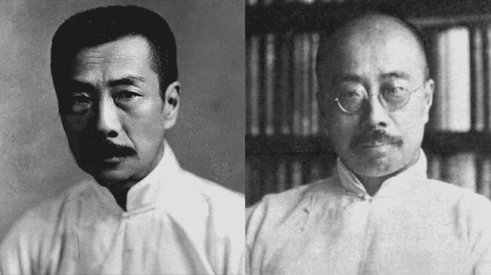

图左：鲁迅 图右：周作人

孙郁的《鲁迅与周作人》很有意思，一开始就比较了两个人的外貌长相，不仅是照片，他引用的是鲁迅好友许寿裳的描述：

"鲁迅的身材并不见高，额角开展，颧骨微高，双目澄清如水精，其光炯炯而带着幽郁，一望而知为悲悯善感的人。两臂矫健，时时屏气曲举（就是鲁迅喜欢把手臂啊这么弯过来），自己用手抚摩着（用手抚摸自己的手臂）；脚步轻快而有力，一望而知为神经质的人。"

"他的观察很锐敏而周到，仿佛快镜似的使外物不能遁形。因之，他的机智也特别丰富，文章上固然随处可见，谈吐上尤其层出不穷。这种谈锋，真可谓一针见血，使听者感到痛快，有一种涩而甘，辣而腴的味道……"

这是与鲁迅关系非常接近的朋友对鲁迅外表与行为的描写。我是第一次才知道，鲁迅原来他不仅文章犀利啊，他的谈锋也非常犀利，说话也非常犀利。这当然不是简单的写实照片，这个加入了许寿裳的情谊。

我们可以对比一下鲁迅的很多照片。萧南所选编的《在家和尚周作人》（四川文艺出版社 1995 年出版）有这么两段对周作人的外貌描写很有意思：

"他戴着近视眼镜，衣着讲究，言语不多，但又好像有点'架子'似的。"

这是一个人的看法。另外一个人说：

"我没有想到，他是这样清癯的一个人，戴着高度近视眼镜，头顶上的毛发稀稀的，除了上唇一小撮髭须之外好像还有半脸的胡子渣儿，脸色是苍白的，说起话来有气无力的，而且是绍兴官话。"

我听说周作人讲课很闷，这大概也是跟他说起话来"有气无力"有关系。

孙郁对两个人文风的概括是这样的：

"鲁迅给人的印象，抑郁、沉静、肃杀；周作人则沉稳、平和、散淡。"

从前面那些照片以及对他们面相的分析看，再加上我自己也就是我们到现在为止所读的他们的文章来看，我觉得鲁迅是犀利、尖锐与刻薄这没话说，既忧郁又冲动，我觉得鲁迅是有冲动的一面。而周作人呢，读他的文章真的是平和、冲淡、含蓄、渊博。

大概因为胡子的关系，我们"重读鲁迅"也发现鲁迅也很重视胡子这个细节，但周作人的胡子看上去就有点像日本人。明明是亲兄弟，却使人有这样截然不同的印象。

#### 不同之二：周氏兄弟的文艺理念

当然重要的不是他们长相不同，而是他们在中国二十世纪文学文化发展中的地位。鲁迅是"五四"新文学的主将，他的主要贡献是创作，首先是小说其次是散文。周作人也是"五四"新文学的主将，但他的贡献主要是理论，其次是散文。

我们讲了很多从《狂人日记》开始鲁迅所代表的新文学的"实绩"，这"实绩"其实是他自己的话。但我们必须补充的是，周作人的《人的文学》这一篇文章在新文学史上至少可以和胡适的《文学改良刍议》相比较，是一样重要的。

对于今天中国的年轻人来说，讲到周作人，恐怕我们首先想到的是他与日本的关系，他是"汉奸"。但就是在教育部官方指定的教材《中国现代文学三十年》当中，也还是充分肯定了周作人是"五四"时期最有影响力的理论先导者与批评家。《中国现代文学三十年》这本书里这样说：

"周作人最突出的贡献，是以'人的文学'来概括新文学的内容"，"周作人要求新文学必须以人道主义为本，观察、研究、分析社会'人生诸问题'"，"在周作人这里，新文学所本的人道主义具体指个人主义的'人间本位主义'"。

周作人与过去文论的一大区别，就是他强调人的、人性的灵肉两个层面不可偏废，不能是存天理灭人欲，也不能是纵人欲灭天理。周作人还提倡一个概念叫"平民文学"。看上去周作人是在提倡文学的人道主义、平民文学、同情弱者等等，但与此同时周作人文论上非常重要的一点就是他反对"为……而……"，反对文艺变成伦理的工具或变成一种说教。

所以如果说鲁迅的书名《呐喊》可以用来概括形容"五四"新文学战斗、入世、启蒙、救亡的那条主线的话，那么周作人的书名《自己的园地》就可以用来概括象征"五四"新文学中坚持作家精神独立，不肯做宣传工具的另一条主线。在"五四"新文学中这两条主线是搅合在一起，互相矛盾但又互相融合。这两兄弟大概当时也没意识到他们这种异中之同、同中之异的文学主张，就引领着后来一个世纪的潮流、文坛与思潮变化。我们开玩笑地说，"两条路线"之争竟然来自于同一家庭的两兄弟。

所以他们当年怎么合作，怎么并肩战斗，后来又怎么突然决裂老死不相往来，各自为文暗暗赏识或者悄悄讥讽，这实在是一桩令人着迷的悬案。

#### 郁达夫对于周氏兄弟的评价

郁达夫在《中国新文学大系\*散文二集》中有这么一段对周氏兄弟的形容（我们讲的"大系"是第一套大系，这跟后面的几套是很不一样的），郁达夫说：

"鲁迅的文体简练得像一把匕首，能以寸铁杀人，一刀见血"，"与此相反，周作人的文体，又来得舒徐自在，信笔所至，初看似乎散漫支离，过于繁琐！但仔细一读，却觉得他的漫谈，句句含有分量，一篇之中，少一句就不对，一句之中，易一字也不可"，"近几年来，一变而为枯涩苍老，炉火纯青，归入古雅遒劲的一途了"。郁达夫这个评论是写于 1935 年。

"两人文章里的幽默味，也各有不同的色彩；鲁迅的是辛辣干脆，全近讽刺，周作人的是湛然和蔼，出诸反语。"在郁达夫笔下，这么有条理的评论文章也是不太多的。

郁达夫进一步讲到了两个人思想上的异同："他们的笃信科学，赞成进化论，热爱人类，有志改革社会，是弟兄一致的；而所主张的手段，却又各不相同。鲁迅是一味急进，宁为玉碎的，周作人则酷爱和平，想以人类爱来推进社会，用不流血的革命来实现他的理想。

周作人头脑比鲁迅冷静，行动比鲁迅夷犹，遭了三一八的打击以后，他知道空喊革命，多负牺牲，是无益的，所以就走进了十字街头的塔，在那里放散红绿的灯光，悠闲地，但也不息地负起了他的使命；他以为思想上的改革，基本的工作当然还是要做的，红的绿的灯光的放送，便是给路人的指示；可是到了夜半清闲，行人稀少的当儿，自己赏玩赏玩这灯光的色彩，玄想玄想那天上的星辰，装聋作哑，喝一口苦茶以润润喉舌，倒也是于世无损，于己有益的玩意儿。"

这些话说的是周作人，其实多少也是郁达夫在退出左联隐居杭州，躲避斗争醉心山水之后的夫子之道。  
放在历史长河当中看，郁达夫倒是在日本人的催逼下后来就冤死于南洋，死在日本宪兵的刀下。而周作人的"苦茶"很快也喝不成了，"十字街头"马上成了战场。郁达夫这段说得实在太好了，我忍不住多摘抄几句。郁达夫又说：

"鲁迅的性喜疑人----这是他自己说的话----  
所看到的都是社会或人性的黑暗面，故而语多刻薄，发出来的尽是诛心之论；这与其说他的天性使然，还不如说是环境造成的来得恰对"。我们"重读鲁迅"中已经多次印证了这个印象。鲁迅刻薄、怀疑、看人性的黑暗，按郁达夫的说法这不是他天性，这是环境的作用。

说到这里我不禁要停一停插一句。是的，他不全是天性使然，当然不完全是天性不是 DNA 的原因，我们看不出鲁迅的父亲祖父有给他传递刻薄、愤世的性格，鲁迅和他小四岁的弟弟就完全是两种性格。可是你说是环境使然的话，那太多的人跟鲁迅在同一个环境里，为什么就只有一个鲁迅呢？怎么来说这个悖论呢？我是在读丹纳与勃兰戴斯这些人的文学理论与文学史的时候，一直没有解决的一个困惑。

回到郁达夫对鲁迅的评论：

"因为他受青年受学者受社会的暗箭，实在受得太多了，伤弓之鸟惊曲木，岂不是当然的事情么？在鲁迅的刻薄的表皮上，人只见到他的一张冷冰冰的青脸，可是皮下一层，在那里潮涌发酵的，却正是一腔沸血，一股激情"。

我们知道，郁达夫向来是以浪漫颓废出名，没有人觉得他有深刻的思想。我们刚才读的这几段文字就可以见出郁达夫对鲁迅的认识，远在后来许多鲁迅研究专家之上。他对周氏兄弟的这一番比较真的可以帮助我们回顾鲁迅和周作人当时在文化界的影响。但是他还是不能帮助我们解释，这两位文坛主将为什么会在长期的亲情与友谊之后，突然几乎一夜之间就断绝来往。

郁达夫的《中国新文学大系\*散文二集》的导论写于二十世纪三十年代中期，这时周氏兄弟失和断交已经十几年了。显然，兄弟失和也并没有影响到他们各自在文坛以及在历史上的地位。但实际上有没有影响呢？

如果周氏兄弟一直在文化战线上并肩合作，就像他们早期一样，我们设想，那鲁迅后来会不会担任左联名义上的领袖，而且到了后来委屈不满？周作人会不会坚持不离开北平，最后成为日本人的工具、成为日本人的文化官员呢？

哎，历史真的很难这样来假设。不管怎样，关于周氏兄弟吵架的事情，郁达夫倒也的确说过他很大胆的猜想。

他的猜想我们留到下期继续解读。

#### 下集预告

在下一集节目中，许老师将就"周氏兄弟失和"事件的具体经过，以及可能造成失和的原因展开讨论，欢迎收听。

# 36\. 两位文豪一生闭口不谈的往事｜“周氏兄弟失和”事件 2

（公众号懒人找资源，懒人专属群分享）

（音频"我们下期继续"后，有许子东最新补充内容）

重读鲁迅，我许子东。今天是第三十六集。

我们沿着上一集的话题继续讨论鲁迅与周作人的关系，尤其是他们失和的过程。

#### "其乐融融"的一家人

鲁迅大周作人四岁，两位作家后来都有一些童年的回忆，没有说他们小时候有什么特别不合，反而有很多温馨的童趣故事。我们记得《风筝》中描写过哥哥对弟弟放风筝的摧残，可能是一种虚构。假如有事实的影子，其实更多的还是忏悔与情谊。

1902 年鲁迅到日本留学，四年后也就是 1906 年周作人也去了日本，当然是哥哥的关系。周作人到日本时鲁迅已经从仙台退学弃医从文，所以两个人在东京是一起住。如果说早期的鲁迅是一个"愤青"，忧郁的"愤青"，周作人在日本倒是生活愉快，他连续六年都没有回国，后来写回忆文章对日本到处都是留恋。

我们再对比一下，别的不说，周作人到日本来的那一年，鲁迅正好就回绍兴结婚。他的婚姻情况我们都说过，他第四天就逃走，以后据说再也没有与朱安同房。可是同一时期周作人却爱上了帮他们兄弟二人做饭的出身贫苦的羽太信子。如果单单看背景不看后面的故事发展，羽太信子几乎像"阿信"一样，当然这个"阿信"太不简单了。三年以后也就是 1909 年，周作人就和羽太信子结婚。

这个时期周氏兄弟二人的文学事业其实是比较失败的。《域外小说集》卖出去很少，弟弟一结婚，鲁迅没办法就只能回国谋职。鲁迅在给许寿裳的信里说：

"你回国很好，我也只好回国去。因为起孟将结婚，从此费用增多，我不能不去谋事，庶几有所资助。"

其实，鲁迅当时曾经还打算在日本再做一段时间研究的，他回国就为了弟弟为了家庭，显然这是一个非常顾家的大哥。这里"家"的概念也不仅仅是他与朱安两个人，还包括他母亲、包括周作人周建人以及鲁迅的弟媳们、以及他们的儿子女儿。所以人称鲁迅"大先生"，"大先生"就是那个时候这样叫的。

"大先生"这段时间和羽太信子的关系没有什么特别的记载，后来当然有一些非正式的传言不足为凭。有证据的，就是鲁迅回国教书到教育部做官后，他常常给周作人寄信，有时候也寄给羽太信子的家人，他们兄弟间两三天就有书信来往。

周作人后来回国以后到北大教书是 1917 年，兄弟又同住补树书屋，艰苦奋斗。直到 1919 年七月，鲁迅花了三千五百块买八道湾十一号三进的四合院。我们以前说过这是鲁迅一生住过的最阔气的房子，好像其中两千块是他在教育部做佥事的储蓄，因为佥事每个月好像有三百块，这在当时是很高的高薪。

那么，其中有一千块是卖了绍兴老家的房子，老家的房子能卖一千块还是不错的。余下来的数字就是借来的钱。好像也有说法是花了四千多，反正在当时是很贵的，而其中大部分都是"大先生"鲁迅的钱。但理论上因为绍兴的老宅家里谁都有份，所以周作人讲起来他也是八道湾的业主之一。

所以"五四"初期，周氏兄弟是住在一起事业也在一起。当时有些文章署名是鲁迅但可能是周作人写的。《中国小说史略》是原来北大有位叫马幼渔（马裕藻）的教授请周作人讲的，而周作人不知道怎么忙不过来，就推荐他哥哥，所以《中国小说史略》其实是这样出来的。

在公众领域我们看到哥哥写《狂人日记》弟弟写《人的文学》，在私人世界里鲁迅把母亲、朱安、周作人周建人两家以及他们的日本老婆与小孩都接来八道湾。周建人的夫人竟是羽太信子的妹妹，叫做羽太芳子。这真是亲上加亲，其乐融融。

#### 从八道湾到砖塔胡同

1923 年七月十四日，鲁迅日记记载，

"是夜始改在自室吃饭，自具一肴，此可记也。"

也就是说原来他们是一个大家庭，后面是一起在一个大的房间吃饭的。不知道那天下午发生了什么事情，晚上开始鲁迅就一个人在自己房间里吃饭了。看上去好像就是他一个人，还是与朱安和他母亲一起这个不太清楚。从上下文看，好像就是他一个人。

五天以后也就是 1923 年七月十九日上午，周作人把一封绝交信交给了鲁迅，信是这样写的：

"鲁迅先生：

我昨天才知道，----但过去的事不必再说了。我不是基督徒，却幸而尚能担受得起，也不想责谁，----大家都是可怜的人间。我以前的蔷薇的梦原来都是虚幻的，现在所见的或者才是真的人生。我想订正我的思想，重新入新的生活。以后请不要再到后边院子里来，没有别的话。愿你安心，自重。

七月十八日，作人。"

这封信里我注意到几点：

第一是"鲁迅先生"，周作人称呼哥哥突然用了这么正式的笔名，有点特别；

第二是事情可能是五天前发生的，也可能是很久以前，但五天前有了变化；

第三是这件事情对周作人有巨大的打击，以至于要用宗教的境界来承受，而且打碎了他过去的梦，改变了他的思想与人生道路。想想看，这是什么样的事情是需要宗教，打碎梦还改变人生道路？

第四是"你不要再到后院来了"，因为在八道湾鲁迅其实也是照顾他们，让他们住在后面最好的那个房子，鲁迅他们反而住在前面。"你不要再到后院来了"，就是说我还有我的家人不想再看到你。言下之意是你犯了错我们不追究了，或者不想再见你了，但是还要愿你安心自重。

在猜测到底发生什么事情之前我们先来看看当时的事态发展。

当天鲁迅日记记载：

"上午启孟自持信来，后邀欲问之，不至。"

就是说信是弟弟自己拿过来的。当时大家没有问，不知道信上写的什么。  
之后鲁迅看了信以后就叫佣人再叫弟弟来问，他弟弟也没有来，哥哥也没有再去找。朱正在《鲁迅传》里说：

"他（周作人）是'昨天才知道'的。也就是说在昨天之前他并不知道鲁迅有什么不自重的、他无法容忍的事情。在鲁迅这方面呢，就在收到这绝交书的时候也不明白是怎么回事，想要问个消楚。假知他真做了什么不自重的事情，他还好意思邀作人来问吗？"

我觉得朱正有点倾向于鲁迅这一边的立场，推论只对了一半。但是不是还有另外一种可能，也就是说鲁迅可能知道信中讲的是什么事情，但是他恐怕其中有误会误解，或者是需要做一些解释澄清，甚至有没有可能是某种道歉，可是对方居然连解释、问询、更不要讲道歉的机会都不给。这就说明要么不是误会误解，要么这个误会误解是解不开的。所以鲁迅之后再没有试图再叫弟弟来问了。

七月十九日以后鲁迅再没有找他弟弟，他决定马上搬出八道湾。

鲁迅的作家朋友许钦文和他的妹妹许羡苏----许羡苏在那个阶段跟鲁迅家包括许广平关系都很密切，我们别的时候会再讲----  
许钦文的妹妹许羡苏帮忙找到了北京砖塔胡同六十一号，是一栋比较小的房子。那也是许羡苏的同学俞芬带着两个小妹妹的住处，她有几间房间空着就让鲁迅暂住。因为他急急地，家里不能呆，要出来。

鲁迅就问朱安说："你是不是还住在八道湾？或者是回绍兴老家？"言下之意周作人只是不要见到鲁迅，但并没有对朱安或者其他人有什么同样的驱赶行为。但朱安表示她不愿意一个人住在八道湾，她还是要跟鲁迅住在一起，或者是跟母亲住在一起。所以不到两个礼拜，从七月十九日做了决定，到八月二日他们就一起搬到砖塔胡同。

我们以前讲过这座房子，以前鲁迅虽然结婚，但是他大部分的时间都是与家人也就是很多人在一起，很少与朱安独自相对。可是就在砖塔胡同的那一段日子，因为他母亲有很多时间还住在周作人那里，所以那是他第一次单独面对他的夫人。《娜拉走后怎样》那些稿子，感慨"不但女人常作男人的傀儡"，"男人也常作女人的傀儡"等一系列郁闷的文章都是在砖塔胡同写的。

当然砖塔胡同非久留之地，鲁迅马上到处找房子。替他想想冤枉啊，八道湾大院绝大部分是他的钱，为什么现在突然就要归了弟弟？

到了十月底，经过了两个多月，他们找到了阜成门内西三条的一座房子，就是现在的鲁迅博物馆，八百块成交。装修以后，到了 1924 年五月搬进新居。  
搬进新居以后鲁迅曾经回八道湾取书，却和周作人夫妇爆发了一场有记载的面对面的肢体冲突。

1924 年六月十一日，鲁迅日记记载：

"下午往八道湾宅取书及什器，比进西厢，启孟及其妻突出骂詈殴打，又以电话招重久及张凤举、徐耀辰来，其妻向之述我罪状，多秽语，凡捏造未圆处，则启孟救正之，然终取书、器而出。"

我们想象一下这个场面。鲁迅是回去拿书的，周作人夫妇出来打骂，还打电话把羽太信子的弟弟还有两位他们大概认为是知情的北大教授叫来，向他们诉说鲁迅的罪状，羽太信子说不完整的周作人再补充。

那时是兄弟断交已经大半年之后了，可能也是这一时期两兄弟的第一次见面，却给我们理解兄弟失和的谜团也多了一些不同的观察。

仅就七月十九日周作人交信鲁迅随即搬走这么一个情况看，好像兄弟间对这件"事"有点默契。貌似鲁迅这边有什么错，周作人无法承受但也不追究，鲁迅就默默离开。这一离开，默默离开，就好像默认了什么事情。你看看你买的大宅，你支持的大家庭，你创建的家业为什么说走就走了呢？为什么什么都不说呢？这当然是常理的推断。

可是在大半年后的取书的冲突当中，鲁迅明言周作人夫妇是骂人，而且是羽太信子在那里诉说"罪状"，言下之意则是"罪状"当然就不是事实。最低限度，即便是讲同一个事情也是完全不同的表述。如果说上一次鲁迅的走是一记闷棍，这一次取书只是一通发泄，说明鲁迅并没有认错，至少不会承认周作人夫妻所诉说的那些"罪状"。

这场取书打闹，许寿裳后来有详细的记载。他说周作人用书丢过去，把书作为武器，这对两位文人的一生事业是多么吊诡的讽刺。两位教授来了以后，鲁迅说这是家事不需要外宾费心。然后许寿裳说鲁迅毕竟是伟大的，他受了很多污蔑委屈但对于作人和信子的事情日记上一字不提。鲁迅去世以后，许寿裳是第一个接触鲁迅这么多年的日记的人，他看到他在日记里从来没讲这件事情。

周作人他后来做汉奸坐牢，空下来就写了很多关于鲁迅的回忆录，有的事很有价值，可是独独对这件事情一直避而不谈，而且还特别要标明他的日记在 1923 年七月十七号的这天，也就是他知道那件事情的当天，说是用剪刀剪去了里边所写的十个左右的字。意思是说周作人当天是写下了十个左右的字，但事后他把这些字剪掉了。

各位听众可以用猜密码的方式填补一下这十个左右的方块字到底写的什么，这个可比《金瓶梅》删节本、贾平凹《废都》删节本更有考证想象的空间。

周作人说别人怎么评一概不管，只是纠正许寿裳的说法，这两位教授不是外宾，意思是他们是知情的。最后他就同意许寿裳的一句话，说鲁迅本人在他生前没有一个字发表是鲁迅的伟大处，这句话说对了。大家想想这是一个什么情况？就是说他在这个地方他同意许寿裳的说法，就是鲁迅伟大，这件事情再也没有说了。

唉！为什么呢？为什么八道湾断交这么重要的事情鲁迅生前没有一个字发表呢？我们知道鲁迅生前有很多与人不愉快的事情他会反复地讲，究竟 1923 年七月十四日或者之前发生了什么事情？

#### 兄弟二人究竟为何反目？

对此，八十年来有各种各样的猜测。概括起来，一是经济，二是调戏，三是听窗，四是窥浴。所以大部分的猜测都跟人伦、性还有尊严有关。

经济说，就是怪羽太信子持家乱花钱，很多人是这样的说法，包括弟弟周建人后来也有这样的抱怨。我觉得这个原因如果有它也不是突发的，可能是一个长期的积累，但不至于某一天说："哎，你乱花钱，从此我跟你绝交！"不太合理。

调戏说，这完全没有实证。我们前面说过，1909 年以来周作人和羽太信子结婚以后鲁迅一直在经济上支援他们，甚至还寄钱到羽太的父母家人那里去，大家相处真像一家人。

所以我们前面讲过郁达夫有个说法，郁达夫就说：

"据凤举他们的判断"，也就是在场两位北大教授的判断，你看他们的判断他们自己不说了叫郁达夫来说，"以为他们兄弟间的不睦，完全是两人的误解。周作人氏的那位日本夫人，甚至说鲁迅对她有失敬之处"。这是郁达夫的一个说法，就是说这里他讲的兄弟不和其实是一个误解，而这个误解的原因是那位日本夫人说鲁迅对她有失敬之处。所以误解这个东西如果不及时解开就会越结越深，尤其牵涉到性，尤其牵涉到自尊心极强的文人。

到底怎么失敬呢？研究者陈光中专门到了八道湾旧宅----这地方我也去过，前些年很残破，住了三十九家人家不知道近况怎么样----  
据陈光中现场考证，周作人夫妻住在后院，门口有很多花草，根本无法靠近听窗，而且查证了浴室的位置也认为浴室是不可能的，因为浴室外面正是工人、女佣、小孩常常进出的通道。

这"实地考察"我不知道有多大程度上靠谱。在我看来比较更值得参考的是鲁迅的儿子周海婴的说法。周海婴说：

"我以为，父亲与周作人在东京求学的那个年代，日本的习俗，一般家庭沐浴，男子女子进进出出，相互都不回避。"也就是说，我们中国传统道德观念中的所谓男女大防，在日本并不那么在乎。

"据上所述，再联系当时周氏兄弟同住一院，相互出入对方的住处原是寻常事，在这种情况之下，偶有所见什么还值得大惊小怪吗?"退一步说，若父亲存心要窥视，也毋需踏在花草杂陈的窗台外吧?

说的也有道理。我想起郁达夫在《沉沦》里描写主人公偷窥房东女儿洗澡，女儿撒娇般地投诉，她父亲却在旁边哈哈大笑，这大概也是同一个道理吧。

不过同一件事情，不同的时间就会有不同的感受，就会产生不同的反应。

唉，说实在话，我其实并不真正关心这件事情的原因，我更感兴趣的是两个人一生不谈这件事情。这么严重的一件事情大家都不谈，这是一种默契，也是一种互相尊敬。

我们下期继续。

#### 补充内容

关于周氏兄弟失和其实我非常好奇，但是抱歉没有更新的资料补充，我还是感到好奇与敬佩。好奇的原因当然是想想什么事情能造成这么严重的后果呢？敬佩是因为两个文人如此默契，终生闭口不谈，人前背后都不谈，在我看来这是君子之约。

另外文学界、史学界历来有两个共识是没有争议的，第一是周作人是汉奸，第二是周作人对"五四"文学有贡献，所以各种文学史都会提到周作人的作品。最近我在网上看到某省审查教科书的一个结论，列出洪子诚的《中国当代文学史》是严重错误，因为其中列了周作人的一篇文章。这真是文学政治批评达到了 1966 年以后的新高峰。顺便一提，历史记载。

#### 相关阅读

《今天仍在受凌辱的伟大逝者----鲁迅》 作者：章培恒

#### 下集预告

《题记》《青年必读书》，出自《华盖集》

《估〈学衡〉》《"以震其艰深"》《所谓"国学"》《不懂的音译》，出自《热风》

《答"兼示"》，出自《准风月谈》

《在现代中国的孔夫子》，出自《且介亭杂文二集》

# 37\. 究竟是要多读中国书，还是多读外国书？｜《青年必读书》

（音频"我们下集继续"后，有许子东最新补充内容）

重读鲁迅，我是许子东。今天是第三十七集。

我在有一集的听众留言里看到有位听众说，《野草》的《影的告别》是"重读鲁迅"以来听得难度最大的一集。我很高兴，这是知音。我读得也很累，有他这句话我觉得累也值得了。

我们终于读完了《野草》与《朝花夕拾》，当然没有完全读完，只是暂时读完。按照人民文学出版社《鲁迅全集》的排序，接下来应该是读鲁迅后期的短篇小说集《故事新编》。但《故事新编》其实是在 1936 年也就是鲁迅去世那年才出版的，所以很准确地说这是鲁迅晚期的作品。我想把它先放一放，等到后面讲鲁迅晚年创作的时候说。

#### 鲁迅杂文风格的确立与成熟

从今天开始我们要读《鲁迅全集》第三卷当中的《华盖集》、《华盖集续编》、以及《而已集》等这几个集子，其中收录了鲁迅在 1925 年到 1927 年间大部分杂文，可以说是鲁迅风格杂文体正式确立的一个关键时期。我们一开始读的《坟》时间跨度比较大，文体也比较杂，有文言文的论文，又有抒情散文、早期的杂文等等。《热风》是部随笔集，文体有点像今天报纸上那些篇幅固定的专栏。鲁迅大量地写作杂文其实就是二十年代中期以后。所以《华盖集\*题记》里鲁迅说：

"整理了这一年"，也就是 1925 年，"所写的杂感，竟比收在《热风》里的整四年中所写的还要多。"从数量上我们可以看出鲁迅杂文在这个时期就成型了。也是在《华盖集\*题记》里，鲁迅解释了他为什么写这么多杂文，

"也有人劝我不要做这样的短评。那好意，我是很感激的，而且也并非不知道创作之可贵。"这其实是非常常见的对鲁迅的一种批评，或者说是一种善意的劝告。就是说您应该多写小说，最好写长篇留诸于世。鲁迅当时已经非常有名了，为什么要陷入一场又一场论战、一篇又一篇时评呢？鲁迅就自问自答：

"然而要做这样的东西的时候，恐怕也还要做这样的东西，我以为如果艺术之宫里有这么麻烦的禁令，倒不如不进去；还是站在沙漠上，看看飞沙走石，乐则大笑，悲则大叫，愤则大骂，即使被沙砾打得遍身粗糙，头破血流，而时时抚摩自己的凝血，觉得若有花纹，也未必不及跟着中国的文士们去陪莎士比亚吃黄油面包之有趣。"

鲁迅在这个阶就是跟现代评论派过不去。这里讲的"莎士比亚的文士"又是在影射陈西滢、徐志摩。鲁迅讲老鼠是要骂他们，现在讲自己文章的集子也要影射他们。当然，鲁迅说徐志摩他们崇拜莎士比亚，其实他后来在翻译上花的时间也不少。他翻了很多苏俄与东欧北欧的作品，而且我们后来看到《鲁迅全集》中篇幅最大的其实就是不大受好评的鲁迅的翻译，这个我们以后再讨论。

所以作家和我们常人其实是一样的，他是做眼前不得不做的事情。你其实很难预知哪些重要哪些伟大。我的老师钱谷融教授说过一句话，他说人总自以为在做自己想做的事情，其实人总是在做自己不得不做的事情。在某种意义上，鲁迅也是这样。鲁迅说：

"然而只恨我的眼界小，单是中国，这一年"，这指的 1925 年，"的大事件也可以算是很多的了，我竟往往没有论及，似乎无所感触。"

听上去是有点微博"大 V"的责任感。

"我早就很希望中国的青年站出来，对于中国的社会，文明，都毫无忌惮地加以批评"。

"现在是一年的尽头的深夜，深得这夜将尽了，我的生命，至少是一部分的生命，已经耗费在写这些无聊的东西中，而我所获得的，乃是我自己的灵魂的荒凉和粗糙。"

读鲁迅这几句话我特别有感触。不知道为什么我的"重读鲁迅"不也是耗尽至少一部分的生命吗？别的没什么可比性，至少我读的时候也总是半夜。这其实没有什么象征意义，就是怕有噪音。

#### 读中国书还是外国书，为何变成一个问题？

今天我们要读一篇对我青少年时代影响很大的短文，严格说它不是一篇短文，是 1921 年《京报副刊》的一个叫《青年必读书》的栏目。在《青年必读书》一栏中----  
当然这个栏目是很多人写的----很多的名人学者就列了很长很长的书单。胡适也有列很长的书单，梁启超也有列，是很有名的。

唯独鲁迅就短短两行，他说：

"从来没有留心过，

所以现在说不出。"

但并不到此为止，下面有附注一栏，鲁迅在那里说：

"但我要趁这机会，略说自己的经验，以供若干读者的参考----

我看中国书时，总觉得就沉静下去，与实人生离开；读外国书----但除了印度----时，往往就与人生接触，想做点事。

中国书虽有劝人入世的话，也多是僵尸的乐观；外国书即使是颓唐和厌世的，但却是活人的颓唐和厌世。

我以为要少----或者竟不----看中国书，多看外国书。

少看中国书，其结果不过不能作文而已。 但现在的青年最要紧的是'行'，不是'言'。只要是活人，不能作文算什么大不了的事。"

第一次读到这篇文章的时候，我是个在文革当中不用读书的中学生，也没有细细体会鲁迅的意思。就觉得鲁迅说少看中国书，太好了太好了。因为那时我很怕古文，尤其是没有标点的古文，外国书至少还是现代文。

我父亲那时虽然被当作什么学术权威在检讨反省，却对我的欢欣鼓舞很不为然。他说："你这个傻瓜啊，你知道鲁迅先生自己读了多少古书才能这样说话吗？你去翻翻《中国小说史略》。"我一翻，哇！文言的，功夫太深了！

鲁迅在 1922 年写过一篇《估〈学衡〉》，《学衡》就是梅光迪吴宓等人在二十年代初办的杂志，打的旗号是维护传统国学，批评"五四"新文化。今天回头看，其实学衡派也有它的历史价值与文化贡献。有趣的是鲁迅批判《学衡》，不是说你太守旧了，而是说《学衡》杂志当中有很多文言的语病硬伤，甚至题目不通。所以鲁迅说，

"总之，诸公掊击新文化而张皇旧学问，倘不自相矛盾，倒也不失其为一种主张。可惜的是于旧学并无门径，并主张也还不配。倘使字句未通的人也算是国粹的知己，则国粹更要惭惶煞人！"

意思说你们来骂新文化，可你们自己的旧学文章都写不通，难为情啊。

还有一篇文章叫《"以震其艰深"》，也是找了国学家文章当中的病句。鲁迅说："否则，如此'国学'，虽不艰深，却是恶作，真是'一读之欲呕'，再读之必呕矣。"

所以鲁迅批判旧学的武器就是更好的国学。这一点，鲁迅是比他的战友，《新青年》当中的战友胡适、李大钊、钱玄同、陈独秀等人都更有力量。因为他的国学比他这批战友要好。所以我父亲说得对啊，他说你不读这么多的古书怎么有底气批判当中各种各样或真或假的"国学家"呢？

#### 鲁迅为何要严厉批判"国学"？

但问题来了，为什么鲁迅明明自己在国学里获益良多，却要劝当时的年轻人少读甚至不读中国书呢？

我想第一是他看不惯当时商人在借国学赚钱。 在一篇叫《所谓"国学"》的文章里鲁迅说：

"遗老有钱，或者也不过聊以自娱罢了，而商人便大吹大擂的借此获利。还有茶商盐贩，本来是不齿于'士类'的，现在也趁着新旧纷扰的时候，借刻书为名，想挨进遗老遗少的'士林'里去。"这里的"士类"就是士农工商的"士"，也就是读书人。

我真是非常佩服，我又一次发现鲁迅百年前的评论，就是在批评今天的现实。现在所谓的"国学复兴"，神州大地到处都是。美容院里摆着"中华养生秘方大全"，灵修班里有新时代的女经讲座等等，真是一点都没变！

在附弄风雅的"国学热"中，鲁迅说：

"然而巧妙的商人可也决不肯放过学生们的钱的，便用坏纸恶墨别印什么'菁华'什么'大全'之类来搜括。""至于这些'国学'书的校勘"，"然而错字叠出，破句连篇(用的并不是新式圈点)，简直是拿少年来开玩笑。这是他们之所谓'国学'。"

想想看，现在所谓的"国学复兴"，有多少是跟半夜卖的什么中药是一样的道理？我还听说一些人把年轻人骗出正规的学校，从小就让你读四书五经，所以要把你当作"大才"来培养，专门还有这种机构，我自己都参加过一些这种研讨会，不是以前叫"江湖郎中"吗？现在就是"江湖国学"啊！

鲁迅不仅看不起讲"国学"，而且还看不起十里洋场"卿卿我我""蝴蝶鸳鸯"的文人。说这些人"从没有人称这些文章（？）为国学，他们自己也并不以'国学家'自命的。现在不知何以，忽而奇想天开，也学了盐贩茶商，要凭空挨进'国学家'的队里去了。"

对有学问的国学家鲁迅其实是十分尊重的。在一篇叫《不懂的音译》里边，他说："中国有一部《流沙坠简》，印了将有十年了。要谈国学，那才可以算一种研究国学的书。开首有一篇长序，是王国维先生做的，要谈国学，他才可以算一个研究国学的人物。"

你看，骨子里啊鲁迅是尊敬真正的国学的。

多年后，在三十年代的笔战论战中，《现代》杂志的主编施蛰存----我以后还会讲这个事情----  
在一次论战当中引用了鲁迅在《青年必读书》中的话，施蛰存说："少看中国书，其结果不过不能作文而已，可见是承认了要能作文，就该多看中国书。"

鲁迅在一个叫《答"兼示"》这么一篇文章里说，

"是施先生忽略了时候和环境。他说一条的那几句的时候，正是许多人大叫要作白话文，也非读古书不可之际，所以那几句是针对他们而发的"。

鲁迅的意思就是《青年必读书》这篇文章不是放之四海、隔着时空都准的。他比较激烈的反传统观点是有特定的特殊的时候与环境。除了反对假国学骗人赚钱，他还希望青年人不要埋头故纸堆，最好能够直面惨淡的人生，发出现代的声音。

说实话一个社会不管哪个时期，要是人人都像鲁迅所说那样少看不看中国书，只看外国书，当然是不行的，也是不可能的。但没有人像鲁迅那样站出来反潮流敲警钟，那也是不行的。鲁迅一方面自己抄古碑读旧书，另一方面他批判国故，劝青年人不要埋头国学。说到底，鲁迅为什么要这么激烈批判传统国学呢？

这个问题，我也是好多次想要讨论的，可以分两个层次讲。

第一，新文化的精神就是要"重新估定一切价值"，这是周作人的原话，也是五四一代文人的共同信念（周作人在《复古与反动》一文中对胡适这一概括给以很高评价，他说："新文化的精神是什么？据胡适之先生的解说，是评判的态度，是重新估定一切价值。"）。在这个意义上，鲁迅的《估〈学衡〉》、批伪国学，和胡适顾颉刚他们的"整理国故"并不冲突。

第二，鲁迅其实并不讨厌孔夫子。按照汉学家林毓生的说法，鲁迅毕生以思想文化为武器来解决社会政治问题，这一种基本的思路与精神其实正是儒家文化的核心。鲁迅晚年写过一篇题为《在现代中国的孔夫子》的文章，你读那篇文章就知道鲁迅不是反孔夫子，而是在警惕在现代中国特定政治文化条件下简单复活的、被人为鼓吹的国学。

我们下集继续。

#### 补充内容

关于《青年必读书》这篇文章，上次重读我强调了鲁迅为什么说少看不看中国书，是一时地激进地批判传统，是一种策略，实际上他自己读了很多中国古书。这次重读我们可以讨论一下鲁迅为什么主张多读外国书。

鲁迅说读外国书，"往往就与人生接触，想做点事"，"外国书即使是颓唐和厌世的，但却是活人的颓唐和厌世"。这在今天有些人看来不就是提倡全盘西化吗？外国书马克思的读读就好了……

其它的冷静回顾一想，会不会有这么一种可能，除了当初的反传统策略以外，一般情况下我们读中国书，尤其是"五四"那个时代，古人早就替我们选好了经史子集、四书五经？《史记》、《汉书》、唐诗、宋词、《庄子》、《文选》等等，你"全盘接受"都来不及了。

但是读外国书，大致上中国人读的话必须通过中间有人来过滤、选择、介绍。第一，如果你不是外文非常精通的话，读大部分外国书也要靠翻译，翻译与介绍也都是要参考当代人的眼光选择，比如西方中世纪的大量经典宗教内容，我们就看得很少。

我们所说的外国书，除了古希腊的内容，主要是文艺复兴以后的名著经典，特别是十九世纪浪漫主义思潮的作品，其中都贯穿着近代人道主义的精神，都受到法国启蒙运动的影响。所以严格说来，外国书与中国书中间有个时间差。这就是为什么外国书让人常常觉得"往往就与人生接触，想做点事"，这是不是也是一个现实的原因呢？世上风景先看地图，现在是网上搜索，世上万物也要靠人推荐。所以无论读古今中外什么文学，先看一两本可靠的文学史总是必要的。

#### 下集预告

《忽然想到（一至四）》《通讯》《论辩的魂灵》，出自《华盖集》

# 38\. 从“忽然想到”的小事，洞见国人精神的变化｜《忽然想到（一至四）》《论辩的魂灵》等

（公众号懒人找资源，懒人专属群分享）

（音频"我们下集继续"后，有许子东最新补充内容）

重读鲁迅，我是许子东。今天是第三十八集。

我们要读鲁迅 1925 年一月到六月刊在《京报副刊》上的一系列短文，题目叫《忽然想到》。《忽然想到》形式上有点像不定期的专栏，鲁迅一共写了十一篇，后来都收在《华盖集》里，合并成四篇，题目还是叫做《忽然想到》。

我之前说过，鲁迅作品的精华最著名的就是《呐喊》与《彷徨》里的小说，另外《野草》与《朝花夕拾》现在在新华书店还能买到，大概是作为教材的缘故。但我觉得鲁迅的散文包括杂文的重要性，是一点都不在他的小说与抒情散文之下的。

我自己这次重读鲁迅重点就是他的杂文，尤其是一些不大令人注意的短文，比如说我们今天要读的《忽然想到（一至四）》中的文章。

#### "忽然想到"的，绝不是简单小事

《忽然想到》是一小段一小段的，刚才说了，它的第一段里面就有一段妙文："康圣人主张跪拜，以为'否则要此膝何用'。"

我子东孤陋寡闻，不知道康有为有此"高论"。联想到近年国人常常集体下跪，比方说有一个教人们速成英文的李阳居然在操场上也能忽悠几百上千的学生集体下跪。我看了录像，真是十分感慨甚至有些愤怒。怎么中国人就这么容易下跪呢？

但是其实鲁迅有点冤枉康有为，是鲁迅"断章取义"，我查了出处，康有为的原话是："中国民不拜天，又不拜孔子，留此膝何为？"康有为的意思是说人应该拜天拜孔子，但是他也没说拜天子皇帝，也没说拜老师长官，所以康有为还是有原则的。当然西方人下跪就是求婚，单膝下跪。有意思，这世界上的事情有的是不准站立，有的是不准下跪。

闲话少叙，回到鲁迅的《忽然想到（一至四）》。

鲁迅说："走时的腿的动作，固然不易于看得分明，但忘记了坐在椅上时候的膝的曲直，则不可谓非圣人之疏于格物也。"这里鲁迅就嘲笑康有为，膝盖弯你自己总知道的吧。

然后鲁迅说："身中间脖颈最细，古人则于此斫之"，就是古人在脖子上砍头，"臀肉最肥，古人则于此打之"，瞧瞧我们古人"其格物都比康圣人精到"，所以"后人之爱不忍释，实非无因"。

鲁迅的意思是说人们继承的"国粹"就知道砍头颈、砍脖子、打屁股，似乎刑法还是"国粹"的好。砍脖子、打屁股，如此杀人、打人还是相对人道的，对不对？其实全世界都这样。

《忽然想到（一至四）》的第二篇话题好像忽然更轻松了一点，讲的是外国书本的印刷会长留空白页。你看看鲁迅第一段讲的是康有为下跪孔子，第二段则是讲书的装潢，说："上下的天地头也很宽"，这样的设计是鲁迅比较喜欢的。

鲁迅批评"而近来中国的排印的新书则大抵没有副页，天地头又都很短，想要写上一点意见或别的什么，也无地可容"。

鲁迅的书大概都不是借的，所以可以在书上划杠写眉批。我们以前说过，鲁迅一个月四百块收入的时候，两百块自用，一百块寄母亲及朱安，还有一百块就用来买书。当然现在假如我们还能找到被鲁迅"破坏"过的书，价值就更高了。

鲁迅继续批评说："翻开书来，满本是密密层层的黑字；加以油臭扑鼻，使人发生一种压迫和窘促之感，不特很少'读书之乐'，且觉得仿佛人生已没有'余裕'，'不留余地'了"。

我之所以读这一段闲暇文字，是因为我在这里颇有同感。  
最近理想国出版了我的一本书，叫做《许子东现代文学课》。别的不说，书里印得"天地较宽"，这一点我是喜欢的，当然我也趁机做下广告。

但鲁迅讲书本印刷，其实意思是在说书外。

"或者也许以这样的为质朴罢，但质朴是开始的'陋'，精力弥满，不惜物力的。现在的却是复归于陋，而质朴的精神已失，所以只能算窳败，算堕落，也就是常谈之所谓'因陋就简'。在这样'不留余地'空气的围绕里，人们的精神大抵要被挤小的。"这个"窳"字有点怪，我查了才读得出来。上面是一个穴宝盖头，下面是并排两个瓜的字念 yǔ。

说的太好了！读鲁迅的快感就在这些地方。同样的感受你已经有了很久，但就不知道怎么表达，可是鲁迅漫不经心地就替你说了。

"因陋就简"这个词现在已经变成正面赞词，因为有一个艰苦朴素的语境。可是鲁迅的意思是说青年人简陋，因为一切刚起步，所以没关系，可老了还是简陋的话就是"不留余地"了，这种"不留余地"就是"人们的精神大抵要被挤小的"。

我由此联想到，不仅是书的排版，你写字、读书、生活空间也不能"不留余地"。有人说要那么大的房子做什么？我听某位教授说，人睡着之后在他的房间里都是一样的，我说实在话是怎么都到不了这个境界的。我没有别的奢望，我的奢望是我的沙发可以悬空放，沙发的后面是空的。

以前当我有这种奢望的时候，我总是自我批判，觉得这是资产阶级思想作怪。现在才明白鲁迅说得对，"不留余地"，人会被挤小。

鲁迅进一步说，外国的一些学术文艺书，夹杂闲话或笑谈，增加活气。而其中国译本就尽删去，把书中添加的这种幽默的、开玩笑的话全部删掉，只留下干巴巴的学理。（"外国的平易地讲述学术文艺的书，往往夹杂些闲话或笑谈，使文章增添活气，读者感到格外的兴趣，不易于疲倦。但中国的有些译本，却将这些删去，单留下艰难的讲学语，使他复近于教科书。"）

接下来他说："这正如折花者，除尽枝叶，单留花朵，折花固然是折花，然而花枝的活气却灭尽了。人们到了失去余裕心，或不自觉地满抱了不留余地心时，这民族的将来恐怕就可虑。"

到这里我们发现，鲁迅所讲的仍然不是小事，而是大的图景。百年过去了，书还是这样印，虽然现在多了视频音频等不同的读书方法。读了前面鲁迅的文字，我对自己近年来从事学术文艺的方法转变多了一点信心。

#### 所谓"中庸"，一块权力的遮羞布

在《忽然想到（一至四）》之后，《华盖集》还收录了两篇差不多同一时期的文章，一篇题为《通讯》，另外一篇叫做《论辩的魂灵》。

《通讯》一文中，北大哲学系教授徐炳昶说中国人的惰性深，"第一就是听天任命，第二就是中庸"。

这话乍一看很有道理，因为都是说中国人的特点是"中庸"，即便是今天我们在自己的环境中相当不满的时候，我们大部分情况下是在做什么呢？还不就是听天任命，美其名曰"看着历史怎么发展吧"，然后说"我们是不出头的随大流的"，什么事情都还是走"中庸之道"。

"中庸"的确是中国人的特点吗？鲁迅说不是的。他说：

"先生的信上说：惰性表现的形式不一，而最普通的，第一就是听天任命，第二就是中庸。我以为这两种态度的根柢，怕不可仅以惰性了之，其实乃是卑怯。遇见强者，不敢反抗，便以'中庸'这些话来粉饰，聊以自慰。所以中国人倘有权力，看见别人奈何他不得，或者有'多数'  
作他护符的时候，多是凶残横恣，宛然一个暴君，做事并不中庸；待到满口'中庸'时，乃是势力已失，早非'中庸'不可的时候了。一到全败，则又有'命运'来做话柄，纵为奴隶，也处之泰然，但又无往而不合于圣道。这些现象，实在可以使中国人败亡，无论有没有外敌。"

这是一篇公开发表的私人信件。 鲁迅把国人处事为人的规律概括为三个阶段、三个层次。

第一个阶段是一个人有权力，权力不受监控，别人对你没办法。这时的权力是哪里来的呢？可能是靠武力、靠暴力。在一个村庄、一堆小孩里可能你的力气最大。总而言之，一旦一个人有权力就会横行霸道，做事并不"中庸"，这是鲁迅的说法。

第二个阶段是一个人权力不大了，失去势力了，做事情有掣肘。这时就说："唉，我要做事情讲原则、我有分寸留余地，来讲"中庸"了。"所以"中庸"是力量不够的表现。

第三个阶段是完全失败的阶段。打不过，到那时候老百姓就说："唉呀，怎么办呢！倒霉啊、晦气啊、命不好啊、灾星啊……"而知识分子说得好听，就把它归纳成是"历史的曲折发展"，"唉呀！现在没办法，交给历史吧！将来历史会做公正的评价的！"老百姓说实在话就说"倒霉"、"运气不好"、"今天不利出行"等。

鲁迅提出的这三个处世为人的阶段说得准不准呢？大家都可以有自己的感受与判断。

前两天我碰到一件很小的琐事，我和一个朋友一起去办事，在深圳某一大楼前面，停车场让我们进来但没停车位，于是他就先上去了。保安很凶，但他凶也没用，我塞了一百块钱，因为我身边没有零钱，结果马上就有位了。

后来那个朋友下来，听说这件事之后就很生气，跑去不知道怎样把保安训了一顿，还讨价还价一番最后竟然把钱给拿回来了。车开走的时候，我们看见那个保安一脸的沮丧晦气。我在想，保安开始很凶的时候，大概就是他有权的时候。他被我朋友训斥的时候，大概就是讨价还价比较"中庸"的时候。最后他失败了，所以就是他怪运气不好的时候。那么我这位朋友他大概还在有权的第一阶段。我和他说，保安也不容易，而他说："哼！歪风不可姑息！"

#### 揭穿骂战之中的诡辩逻辑

鲁迅的国人处事三阶段究竟靠不靠谱，大家自己判断。但是鲁迅在另外一篇叫做《论辩的魂灵》的文章当中，列出了国人论辩的常用逻辑，也确实是今天在网上都可以看到的一种现象，必须抄录几条。

"洋奴会说洋话。你主张读洋书，就是洋奴，人格破产了！受人格破产的洋奴崇拜的洋书，其价值从可知矣！"这样就把西方价值观给排除了。

"你说中国不好。你是外国人么？为什么不到外国去？可惜外国人看你不起……。"

第三段是最精彩的，比较长，大家有点思想准备。

"你说甲生疮。甲是中国人，你就是说中国人生疮了。既然中国人生疮，你是中国人，就是你也生疮了。你既然也生疮，你就和甲一样。而你只说甲生疮，则竟无自知之明，你的话还有什么价值？倘你没有生疮，是说诳也。卖国贼是说诳的，所以你是卖国贼。我骂卖国贼，所以我是爱国者。爱国者的话是最有价值的，所以我的话是不错的，我的话既然不错，你就是卖国贼无疑了！"

大家是不是有点绕晕了？鲁迅所讲的这一段的论辩逻辑，我们要稍微分析一下把它列下来，大家可以做好功课，努力学习。

第一个层次，我们简单说就是说某人生病，因为某人是中国人，所以你就等于说中国人有病，这个是从个人推广到国族的一个逻辑。

第二个层次，中国人有病，你是中国人，那你也有病，这是从国族又推回到个人。

第三个层次，你有病所以你说的话没有价值。

第四个层次，你没有病？那你在说谎，这是新的指控。

第五个层次，卖国贼说谎，你也说谎，所以你是卖国贼。这个推理太厉害了，等于说强奸犯是有性欲的，你也有性欲所以你也是强奸犯，诸如此类的逻辑。

第六个层次，我骂卖国贼，说明我是爱国者。这一条逻辑今天真是太有用了，大家自己去看看，你是卖国贼，为什么骂你卖国贼？因为我可以证明我是爱国者。

第七个层次，爱国者的话是有价值的，所以我的话是不错的。

第八个层次，我的话固然不错，那你就肯定是卖国贼，话又兜回来了。

唉！鲁迅总结的这些论辩常用逻辑，我们今天要好好学习、常常操练、时时培训、天天发扬。

还有一段说："你自以为是'人'，我却以为非也。我是畜类，现在我就叫你爹爹。你既然是畜类的爹爹，当然也就是畜类了。"这就是论辩逻辑的另一个境界了。

我们下集继续。

#### 补充内容

我们实在不得不佩服，鲁迅在一百年前就把今天很多网友在网上的"战略""战术"都概括了。

第一，你说一个中国人有病，那就是等于说中国有病。

第二，中国人有病，你也有病。

第三，有病就是"脑残"，而且"阴阳怪气"。我常常怀疑凭"阴阳怪气"这四个字可能可以领津贴。

第四，你说好话你就是虚伪、说谎、"高级黑"。你说坏话你就是"跪舔"、"美狗"、"公知"。

第五，严重一点你就是"卖国贼"、"汉奸"，骂你卖国贼说明我爱国。

所以鲁迅早就概括了这些诡辩术。鲁迅当时只是"忽然想到"，可是我们今天看一看，这是"深思熟虑"、"出口成章"。同样的话要是拿掉鲁迅的名字，就可能要被人围攻。这也说明鲁迅的名字对中国的过去、现在、未来多么重要。

这一集中，我还特别想读一次《通讯》中的一段话提醒大家的注意。鲁迅说："大约国民如此，是决不会有好的政府的；好的政府，或者反而容易倒。也不会有好议员的；现在常有人骂议员，说他们收贿，无特操，趋炎附势，自私自利，但大多数的国民，岂非正是如此的吗？这类的议员，其实确是国民的代表。"

这段话为什么重要呢？因为它可以来补充，民国初年的时候为什么鲁迅会对官场与政府这么失望。鲁迅也不只是批评政府，他是在试图回答一个问题：到底是有这样的百姓才有这样的政府，还是有这样的政府才有这样的百姓？

#### 下集预告

《忽然想到（五至六）》，出自《华盖集》

# 39\. 所谓“死相”：身体虽已躺平，但内心绝不认命｜《忽然想到（五至六）》

（音频"下集继续"后，有许子东最新补充内容）

重读鲁迅，我是许子东。今天是第三十九集。

#### 鲁迅文章的两种读法

今天我们继续读《忽然想到》系列文章。

上一次在读《忽然想到（一至四）》的时候，我看到了鲁迅的《论辩的魂灵》，其实我以前没读过，其中有一番很怪的逻辑真的就像在总结今天网上"脑子进水"的人们，实在好玩就忍不住就岔开了。

但我今天还是回到《忽然想到》系列文章中来。

《忽然想到》总共有十一段，在我看来每段当中都有"金句"，这些"金句"并不是按照一定的逻辑系统呈现的。这些闪光的句子牵涉到专制、冷嘲、生存、发展、羊与兽、回忆的价值、弱者如何辩诬、自杀、自家相杀与为异族所杀等不同的话题。

鲁迅的这类散文我们有两种读法：

第一种是比较常见的论文的读法，就是按一个主题把鲁迅在不同杂文里讲到的相关论点放在一起。比方说鲁迅讨论奴才与奴隶，那我们就把他讲的各种各样关于奴隶的观点整理起来。

第二种其实是更加原生态的读法，就是顺着鲁迅作品的思路。鲁迅的文章不是叫做《忽然想到》吗？他的文章是意识流的，跳来跳去的，根据每天的事情在变化的，所以我们也这样顺着他的思路去读，迟一些再来整理他的思路。

我想了一下决定用第二种方法。为什么？比方说《忽然想到》这十一篇，我们就来看看鲁迅的《忽然想到》系列文章里鲁迅到底是怎么左避右闪、左右突击，或者说自我辩驳，或者说自由发挥等等。

After all，我们是"重读鲁迅"，而不是"再论鲁迅"，至少现在不是。

#### "专制"之下的一副冷漠面孔

《忽然想到》第五篇中有一段话常常被人引用，其实鲁迅是引用别人的话。他说："约翰弥耳说：专制使人们变成冷嘲。"

"约翰弥耳"现在通常翻译成叫约翰\*穆勒，他在 1806 年出生，1873 年去世。  
严复翻译过他不少名著，包括《逻辑体系》与《论自由》等等。鲁迅引用了他的话"专制使人们变成冷嘲"后接下去说：

"我们却天下太平，连冷嘲也没有。我想：暴君的专制使人们变成冷嘲，愚民的专制使人们变成死相。"

那什么是"死相"呢？鲁迅在这同一篇文章里，就是以自己为例子，做了一个非常详细的注解。鲁迅说他小时候，"长辈的训诲，于我是这样的有力，所以我也很遵从读书人家的家教。屏息低头，毫不敢轻举妄动。两眼下视黄泉，看天就是傲慢，满脸装出死相，说笑就是放肆。"

我把这几句再读一下，大家脑补一下这个场面。

前面有父亲或教书先生在给他讲"四书五经"，这个小孩儿十来岁，"两眼下视黄泉，看天就是傲慢"，也就是不能往上看，只能往下看。"满脸装出死相"，装出来的死相，对我们来说大概是很严肃的，"说笑就是放肆"。

接下来还是鲁迅自己的话：

"我自然以为极应该的，但有时心里也发生一点反抗。心的反抗，那个时候还不算什么犯罪，似乎诛心之律，倒不及现在之严。"也就是说鲁迅小的时候还是清末，心里想想，思想犯罪还不算犯罪。

这一整段自我描写里有一点特别值得我注意，就是"装出死相"。鲁迅的意思是说脸上有"死相"的人心里没死，是装死。"装"是一个贬义词，大家知道这个词，OK，笑话我不说了。

"装"是一个贬义词，但"装死"却不见得。我们知道"装死"比"真死"要好，对不对？现在有一句话叫你永远无法叫醒一个装睡的人。"装睡"与"装死"有什么关系呢？其中大有可以讨论的余地，暂且不谈。

由鲁迅对"死相"的描写看，中国古代的传统专制可以分为两种。第一种就是鲁迅所说的暴君的专制，人们不能反抗但还可以说笑，因此大家就变成冷嘲，这叫做暴君的专制。

第二种叫做愚民的专制。我想"暴君"和"愚民"很容易看出区别，"暴君"就是我看到你们对我表示不满，我就把你们杀了，因此老百姓不敢表示不满，但是他们说笑话，说笑话不算不满，所以可以有冷嘲。愚民的专制是暴君看出说笑话是一种不满，所以要教你们，要给你们洗脑。

鲁迅说："我自然是知道的，先前是老人们的世界，现在是少年们的世界了；竟不料治世的人们虽异，而其禁止说笑也则同。那么，我的死相也还得装下去，装下去，'死而后已'，岂不痛哉！

我于是又恨我生得太迟一点。何不早二十年，赶上那大人还准说笑的时候？真是'我生不辰'，正当可诅咒的时候，活在可诅咒的地方了。"

再说一遍，鲁迅这些文章发表于 1925 年四月的《京报副刊》。他所谓的"先前"与"现在"，自然也就是讲清末与北伐之前军阀统治的地方和时代。

鲁迅在这里特别强调一条是在他小的时候还能说笑，到了北伐就是北洋军阀统治下，甚至其实已经到了民国初年的时候，好了，说笑也不可以，所以要装死相。原来老百姓可以开开玩笑，嘲讽竟是这么重要，它代表了两种专制的关键区别，是暴君与愚民统治的分野所在。那么会想到，哪一种更好呢？

我们站在皇家管理的角度来看看，再站在清廷的角度和北洋军阀的角度看看，你说到底是冷嘲热讽，发泄对社会的不满好呢？还是愚民----  
这里愚民是指"愚昧"的"愚"，不要理解成"娱乐"的"娱"，"愚民"----造成千千万万群体的死相好呢？

究竟是冷嘲热讽一片，大家在开玩笑好呢？还是所有人看上去很严肃，其实都是装出的死相好呢？这事情不好说。

但更重要的，是愚民造成的死相按鲁迅的说法，心其实仍然没死，所以说死相是装出来的。装出来的，这点太重要了。

再进一步说，再成功的专制，我们不妨可以想想历史上名声最好的专制，比如说"康乾盛世"等等，那时候很多不同级别的官员，很多参加考试的秀才举人，甚至很多老百姓，他们脸上的死相真的是死相吗？会不会是真的死了呢？

我所说的真的就是第一种可能，也就是真的死了，心里根本就没有根，死相不是装出来的，就是真死了。他们真的从心底热爱"康乾"，热爱"大人"，热爱当时的专制，所以也就不再是死相。我们可以说他是真心诚意、自觉自愿、发自肺腑、流在血液中的死相。

这是不是中国过去传统专制的最高境界呢？

#### 在这可诅咒的地方，击退可诅咒的时代

我承认我以前没有注意到鲁迅在《忽然想到》系列文章中这一段关于不同专制社会的不同特点的言论。仔细想想真是非常精彩。

第一种暴君专制导致民众冷嘲，第二种愚民专制造成民众死相，其中哪一种更好呢？显然鲁迅是生活在第一种专制社会当中，所以我们还能读到他的冷嘲热讽，所以中国还有鲁迅。不过鲁迅觉得任何专制都是不好的。

他在《忽然想到》第五篇结尾的一段说：

"世上如果还有真要活下去的人们，就先该敢说，敢笑，敢哭，敢怒，敢骂，敢打，在这可诅咒的地方击退了可诅咒的时代！"

这段话最后是一个感叹号，鲁迅文章里感叹号是非常罕见的。这就说明，鲁迅对于各种各样的专制，不管你是给冷嘲也好死相也好，或由衷热爱也好，鲁迅都是反抗的。

鲁迅相信，不管什么样的专制，因为人民要活下去这是第一重要的事情，所以不管什么样的专制都应该打掉。

再说一遍，"敢说，敢笑，敢哭，敢怒，敢骂，敢打"，我们不禁会说，鲁迅是不是太浪漫了？鲁迅所盼望争取的世界，我们正在享受。

下集继续。

#### 补充内容

第三十九集中我们读的还是《忽然想到》系列文章，又触及了一个极深刻的问题，为什么暴君的专制使人们变成冷嘲，愚民的专制使人们变成死相？

我在"二十世纪中国小说"里反复提出这个问题，为什么晚清四大名著----  
李伯元《官场现形记》、吴趼人《二十年目睹之怪现状》、曾朴《孽海花》、刘鹗《老残游记》----这些小说的主人公都是官员，小说的主要内容是官员官府如何欺压百姓，而士大夫比如老残有时候站出来批判反抗，有时候就在小说里消失了，像李伯元一样作为小说家批判官府。

照理说，晚清到"五四"是时代的大进步，我们都说，新民主主义革命，中国发生了意义重大的文化与政治革命。"五四"以后几乎一直到延安，中国小说反而很少直接批判官府官场，除《华威先生》和茅盾早期的小说等少数例外，我们再也不能看到小说里有多少官员形象，无论正派还是反派。

说得再清楚一点，为什么"五四"以后的作家反而不像晚清小说里那么直接批判官员、直接揭露"官本位"的中国社会特征？有几个可能的回答：

第一是军阀国民党管得更紧。

第二是新官未必好，所以换了人上去可能也糟糕，"官""民"共享国民性，也就是上一集中我们读过的那段话，国民如此，那糟糕的议员恰恰就是他们的代表。

第三是暴君专制的恐惧压迫，与愚民专制，就是从娱乐与谎言中间到底有什么区别，使得大家要看。

当然，还有第四个很明显的原因，租界没有了。租界曾经是批判清廷的作家的一个保护伞。

最后，文章又提到"死相"的概念，什么叫"死相"呢？死的只是相，心未死。按今天的说法，躺平的只是身体，心里并不认命。

#### 下集预告

《忽然想到（五至六）》《忽然想到（七至九）》《忽然想到（十至十一）》，出自《华盖集》

# 40\. 凶兽一样的羊，羊一样的凶兽｜《忽然想到（七至九）》等

（音频"我们下集继续"后，有许子东最新补充内容）

#### "一要生存，二要温饱，三要发展"

重读鲁迅，我是许子东。今天是第四十集。

上一集节目中我们读了《忽然想到》系列文章中关于"冷嘲"与"死相"的一段文字。我们最后发现，鲁迅对于各种各样不同的专制都是持批判的态度，他还号召我们"敢说，敢笑，敢哭，敢怒，敢骂，敢打"。

我们知道，鲁迅的文章是以批判为主，他唾弃、怀疑、批判各种东西。但是鲁迅自己的三观中，到底认为什么东西是好的呢？换句话说，我们用简单的、小孩的说法来说，鲁迅说这个坏那个坏，那什么是好的呢？

鲁迅有一段话我印象非常深，这也是他一直的一个奋斗目标。他说：

"我们目下的当务之急，是：一要生存，二要温饱，三要发展。苟有阻碍这前途者，无论是古是今，是人是鬼，是《三坟》《五典》，百宋千元，天球河图，金人玉佛，祖传丸散，秘制膏丹，全都踏倒他。"

这个"一要生存，二要温饱，三要发展"的价值观看来不是鲁迅"忽然想到"的，虽然是出现在《忽然想到》系列的散文里，其实这是鲁迅早期到中期一贯的思想。我们刚才说鲁迅批判传统，痛恨现实，怀疑西方，但是鲁迅他四面作战的信念还是来自于对中国人与中国事的现实焦虑，所以他说明这叫做"当务之急"，而没有说这是他的"终极理想"。

鲁迅的"终极理想"是什么呢？天下大同？世界和平？永恒的爱？其实鲁迅很少谈及。

我小的时候读到鲁迅的这段文字也是印象非常深刻，原因是这好像就在讲我当时的生活目标。那时我十几岁，想想这个"一要生存"是最重要的，人道主义至上，鲁迅并不提倡这个人就要为那个人牺牲。

据说鲁迅早年在日本，他是什么时候发现自己做不了革命家的呢？就是他觉得自己不能像一些政治家那样，明明知道自己的战友、自己的下属在外面冒着生命危险随时可能牺牲，自己却仍然坐在这里谈笑风生、运筹帷幄。这是"政治家"的境界，鲁迅觉得他学不了。所以鲁迅是学医学文，他始终把人的生命与个人价值看得很高。所以，"生存第一"，个人如此，国家亦然。但是，是不是可以为了生存什么都可以做呢？不是的，鲁迅后来也有解释。

第二，温饱。这就说明生存真的只是底线，吃饭穿衣都是算进一步的要求了。我读这段文字的时候是在江西插队，每个月开始国家发十块钱的知青补贴，后来生产队里种地，一年辛苦劳动，一年啊！最后分到口粮以外还有七十多块钱。

《沙家浜》里有句台词，刁德一劝沙奶奶要招出新四军的伤病员，有一句话就说："刁德一我保你从此不缺米和柴！"

我小时候在上海完全不懂这句台词，这其实是汪曾祺写的，我完全不懂他的意思，什么"米和柴"是有什么意思呢？下乡以后才知道，这真是人生最重要的东西。为了吃饭，当时是稻谷，要到一个水车转的地方去把稻谷打成米，自然你有了米你还不能吃，还要到山上去砍树来烧。这时我就理解了鲁迅讲的"温饱"。

至于第三个发展，是一个比较抽象的概念，在我看来倒是和小平同志"英雄所见略同"，发展是硬道理。

鲁迅在生存、温饱、发展的三观后排除了很多伪国学的所谓"灵丹妙药"的，其实都是江湖骗子的东西。他后来有一段很著名的解释说：

"我之所谓生存，并不是苟活；所谓温饱，并不是奢侈；所谓发展，也不是放纵"，"有敢来阻碍这三事者，无论是谁，我们都反抗他，扑灭他！"

我们今天特别要提醒的就是温饱不是奢侈，发展不是放纵。还是鲁迅的一句话，"有敢来阻碍这三事者，无论是谁，我们都反抗他，扑灭他！"

#### 狼一样的羊，羊一样的狼

既然是题为《忽然想到》，所以文章思路是跳跃的。在《忽然想到》第七篇就忽然讲到有一个叫武者君的人，告诉鲁迅说他在大道上发现了两样东西，凶兽和羊，我们常常说狼和羊。

鲁迅说："但我以为这不过发见了一部分，因为大道上的东西还没有这样简单，还得附加一句，是：凶兽样的羊，羊样的凶兽。"

或者我们说得再通俗一点的，鲁迅的意思是，你在路上看到的，是羊一样的狼和狼一样的羊。显然这是鲁迅先生一生感兴趣的一个话题，他一直耿耿于怀的一个研究对象，就是所谓奴隶和奴才的区别，或者说是奴才与主人的一体两面。

"他们是羊，同时也是凶兽；但遇见比他更凶的凶兽时便现羊样，遇见比他更弱的羊时便现凶兽样。"

这个观察，鲁迅其实早在阿 Q 身上就已经有过深入的解剖。在《忽然想到》系列的杂文里，鲁迅却给我们找了一个令人惊讶的例子：学生。我们知道，学生一直是鲁迅支持的对象，学生也是我们心中自诩的对象  
\----学生就是我们。

可是鲁迅说："我还记得第一次五四以后，军警们很客气地只用枪托，乱打那手无寸铁的教员和学生，威武到很像一队铁骑在苗田上驰骋；学生们则惊叫奔避，正如遇见虎狼的羊群。"

很值得同情是吧！军警像铁骑，学生像庄稼田。可是接下来鲁迅笔锋一转：

"但是，当学生们成了大群，袭击他们的敌人时，不是遇见孩子也要推他摔几个觔斗么？在学校里，不是还唾骂敌人的儿子，使他非逃回家去不可么？这和古代暴君的灭族的意见，有什么区分！"

二十世纪的中国充满变化，除了鲁迅，我没有见过任何一个别的现代作家能够这么精辟、这么传神地预见二十世纪中国后来的人和事。

鲁迅说："可惜中国人但对于羊显凶兽相，而对于凶兽则显羊相，所以即使显着凶兽相，也还是卑怯的国民。"

我们以前说过，病症是鲁迅看得准，药方是胡适开得好。鲁迅对于羊兽一体的国民病症也开了他的药方。

他说："我想，要中国得救，也不必添什么东西进去，只要青年们将这两种性质的古传用法，反过来一用就够了：对手如凶兽时就如凶兽，对手如羊时就如羊！"

鲁迅这个药方管用吗？各位听众，大家可以反省一下。

#### 明明是被欺负的人，却想要洗刷罪名？

鲁迅的《忽然想到》系列文章中金句太多，没法割舍，恐怕这集都未必读得完。在《忽然想到》第九篇中鲁迅说：

"记得有人说过，回忆多的人们是没出息的了，因为他眷念从前，难望再有勇猛的进取；但也有说回忆是最为可喜的。"

唉，这是一个非常好的话题，可惜这篇文章里鲁迅并没有对回忆这个问题深究下去，反而淡淡放过，转而用一封信，人家批评《阿 Q 正传》，鲁迅作自我辩护。所以这也是一个很明显的例子，《忽然想到》系列的这种文体有时候不容易凝聚思想焦点。

但有的时候，鲁迅很明确的一个观点，随后会跟上若干个例子。比方说，上一集我们讲"愚民专制造成死相"，由于鲁迅对死相的具体描写是自我描写，这就很有助于我们对文章主要观点的多方位思索，甚至引发联想。

在《忽然想到》第十篇里，我们又看到了这种写作模式。这一次的关键词是"辩诬"。

文章第一句说："无论是谁，只要站在'辩诬'的地位的，无论辩白与否，都已经是屈辱。更何况受了实际的大损害之后，还得来辩诬。"

什么叫辩诬？辩诬就是有人说你做了错事，衣服穿错、说话不妥当、sex 有问题、工作有毛病，甚至你的长相举止，不管怎么样，你与什么人的照片被贴在什么地方，总之是你错了。

这时你很自然必须马上来帮自己辩护，说我这个话没错、衣服没错、我的 sex、我工作没错……

鲁迅说，只要你辩诬，不管你能否洗刷自己，你就已经是屈辱了。

辩诬的经验，可能我们今天大家都有，下次再讲这番道理。但是鲁迅讲的却是一个比较大的事情。他讲的"辩诬"是什么呢？

"我们的市民被上海租界的英国巡捕击杀了，我们并不还击，却先来赶紧洗刷牺牲者的罪名。说道我们并非'赤化'，因为没有受别国的煽动"，用我们今天的说法就是"我不是外来势力捣乱"，"说道我们并非'暴徒'，因为都是空手，没有兵器的。"

鲁迅看不明白了。他说：

"而独有中国人，则市民被杀之后，还要皇皇然辩诬，张着含冤的眼睛，向世界搜求公道。"

我们都知道，"五卅"惨案，这先是一个日商内外棉纱厂里的日本职员枪杀工人顾正红，顾正红也是地下党员，接着引发了大型的市民示威。在虞洽卿路，也就是现在是西藏中路，上海的市中心，英国巡捕在租界开枪伤亡市民数十人。这是中国现代史上的一个重要转折点。

如果说"五四"运动是取得了一个表面上的胜利的话，那么"五卅"就彻底暴露了民国社会的半殖民地性质。

但是鲁迅的关注点是与众不同的，他看到的是什么？他看到的是国人明明被欺负，可第一反应却是在那里洗刷自己的罪名。

辩诬其实也是鲁迅自己的一生要做的事情，也是我们每个人常常在做的事情。

我们下集继续。

#### 补充内容

这一集有一句鲁迅的名言，"一要生存，二要温饱，三要发展"。

这很容易令人联想到现在的说法，就是中国人民先是站起来了，然后富起来了，现在要强起来。同一个意思反过来的讲法就是，之前是在解决挨打的问题，后来解决挨饿的问题，现在要解决挨骂的问题。只是如何解决挨骂的问题？是"强起来"，打得、吓得人家不敢骂呢？还是自我改良，不断进步，也就不在乎人家骂不骂了呢？

我们还是重温一下鲁迅的话，"我之所谓生存，并不是苟活；所谓温饱，并不是奢侈；所谓发展，也不是放纵"。

这集还提到一个非常重要的概念，就是路人"羊兽为一体"，既是羊又是狼，这也是极精辟的说法。不妨想想我们自己，什么时候是羊，什么时候也是狼呢？

#### 下集预告

《忽然想到（十至十一）》，出自《华盖集》

# 41\. “辩诬”：贯穿鲁迅一生的关键词｜《忽然想到（十至十一）》

（音频"我们下集继续"后，有许子东最新补充内容）

#### 无论辩白与否，都已是屈辱

重读鲁迅，我是许子东。今天是第四十一集。

我们上一集讲到，鲁迅在《忽然想到》系列文章里提出一个重要概念叫"辩诬"。我们说这其实是鲁迅一生都要对付的一个问题。

为什么这么说呢？

我们记得，鲁迅当年为什么要离开老家，不读科举，要去南京的洋学堂？就是因为在他的家乡，他被流言所困。有人说他帮家里做事的时候偷了家里的珠宝。这辩都无法辨起，所以鲁迅非常屈辱。

后来到了仙台，我们都知道其实鲁迅的成绩是中等，可就被日本学生等其他人怀疑他分数其实不好，是得了藤野先生的特别关照。我们都记得鲁迅在《藤野先生》里说，所以他拼命找熟悉的老师同学辩白，可是没有用。

所以这就是鲁迅这句非常有名的话的意思：一旦你去辩了，你就已经是屈辱了。（"无论是谁，只要站在'辩诬'的地位的，无论辩白与否，都已经是屈辱。"）

再举一个例子，比方说我们都知道兄弟失和之后，鲁迅一辈子保持沉默。鲁迅不会不知道，他这么保持沉默，人们就一直会在怀疑他对羽太信子有做什么事情，而鲁迅放弃了"辩诬"。而且最绝妙的是周作人  
\----鲁迅是很早去世了----到了 1967 年"文化大革命"被人斗得一塌糊涂，这个时候周作人也不说这些事情。

所以，我们可以说鲁迅一生都在与屈辱感作斗争。因此，他也一直在研究人性与屈辱感的关系，而在这个研究当中"辩诬"成为了一个关键词。

那回头看看我们自己，是不是在自己生活的道路上，也有着大大小小各种"辩诬"的故事呢？

最普通的例子，我前两天吃了一个交通罚单，想来想去，我没有错。但是你是交钱呢？还是准备上法庭来辩呢？不管是冤枉的或者事出有因，你要知道，洗白自己要费多大的力气，洗刷你的"罪名"。顺便说一下香港的交通罚单上，用英文翻译成中文，真的就是在说你犯了罪。停车停在路边，会说这是你的罪行。

洗刷自己的过程充满屈辱。我还记得我小时候，小学三四年级，班上一些同学恶作剧，还把我跟一个姓唐的女生推在一起。其实我和那个女生话都没怎么说过，他们就传得有声有色，所以我到小学最后一两年，十一二岁的人，就不断地向我的朋友们澄清，说我从来没有喜欢过这个同学，凡是不相信我的就不能做我的朋友。我现在回想起来，这不也是一种"辩诬"吗？虽然其实现在回头看，我需要辩什么呢？

前不久我还见到，我们有一个同事，有人把他与别的女生的照片放到公共媒体上，他第一反应就焦急地辩白说，我们是简单的师生关系，是清白的！同样的事情发生在一个丹麦的老师身上，他的反应就是 It's  
not your business！关你们什么事？

#### "辩诬"时的两种反抗姿态

我在 1989 年六月的《读书》杂志上发表过一篇文章，比较了两部六十年代中国革命题材的作品，一部是老鬼所写的《血色黄昏》，一部是郑念所写的《上海生与死》。

在这篇文章里，我专门讨论了----我当时没读过鲁迅的文章，但是实际上我讨论的就是----鲁迅所讲的"辩诬"这件事情。

《血色黄昏》的男主角是一个七十年代主动下乡到内蒙建设兵团的北京学生，不知道为什么他被同学与领导指控当时所有的一个罪名，所以小说的大半部分都贯穿了男主角老鬼，也就是写他自己，他其实是有名的《青春之歌》的作者杨沫的儿子，所以母亲与儿子都是很有名的小说家。

他反反复复地写检查、写交待，向领导、向同学交心坦白，目的就是要证明自己没有错。为此要反反复复向伟大领袖请罪忏悔等等。

与《血色黄昏》形成鲜明对照的就是郑念的《上海生与死》。

郑念是受西洋教育长大的一位知识女性。她跟随她任职外国石油公司高层的丈夫住在上海。1966 年被抄家、被批判的时候，她倒有意思，也不辩诬，反而举着《宪法》叫红卫兵不能碰她家里的明代花瓶，说你们这是违法的。当然花瓶还是被摔了。

她的这种抗议方式比起老鬼的辩诬洗刷，当然是更天真、更可笑，也没有什么作用。但事后反思，这两部小说的主人公分别代表了人受到迫害的时候，两种反抗的姿态。

一种是"我没错，请相信我，我是善良的，我是无罪，我是清白的，你看你理解，我是清白的。"另外一种是"你说我有错，你说我有罪，拿出证据来，你要是不能证明，那你就是犯错，你就是犯罪。"

鲁迅早在几十年前就已经尖锐指出，前一种是"辩诬"的，也就是洗刷自己罪名的姿态。"五卅"运动以后，我们的上海市民说，我们不是赤化，我们没有武器，我们不造反，那为什么你英国巡捕开枪？当你这么一"辩诬"就已经是屈辱。因为你已经在向对方的暴力、权力与道德屈服。

这种事情真是很难，很多情况下你就像是儿女求父亲，或者是职员求老板，或者是下层求上级"请你原谅"、"请你谅解"、"请你宽容"、"理解万岁"！这里的"理解万岁"其实是令人心酸的口号。

当然，后一种抗争，也就是郑念式的抗争，必须双方有共同的法律基础，这不是一个"臣民"、"家庭"的伦理关系，也不是一个"你死我活"的阶级斗争关系，而是一个公民关系的情况下才可以说："你说我有什么问题，拿出证据来，否则就是你的错。"

鲁迅在《忽然想到》第十篇里清醒地指出，寄希望于西方文明，也是虚妄的。

鲁迅说："公道和武力合为一体的文明，世界上本未出现，那萌芽或者只在几个先驱者和几群被迫压民族的脑中。但是，当自己有了力量的时候，却往往离而为二了。"也就是脑中的幻想。

这就什么意思？什么事公理强权合一？公理强权合一就是最理想状态，就是我们中国古代讲的不仅要以力服人，还要以德服人。而且在鲁迅看来，有力的人是不讲德的，有德的人是没有力的。所以公理强权合一是不可能的。

那么，什么时候是有可能的呢？那就是伟大的先驱者，比如说卢梭、伏尔泰、革命党、鲁迅、还有就是弱小民族的一种期盼。

"五卅"以后，鲁迅看到了英国法国很多作家同情中国民众的言论和姿态，鲁迅也认为："所以我觉得英国人的品性，我们可学的地方还多着"。"如果我们永远只有公道，就得永远着力于辩诬，终身空忙碌"。也就是说鲁迅看来没有力量的话，讲理也没有用。

在我看来，这是鲁迅与甘地关键的不同。这两个"民族魂"也标志了近代中国与印度的不同道路。甘地是主张不抵抗，主张讲理的，鲁迅认为讲理是没有用的，更主张抵抗、抗争、实力。

鲁迅说他看过一篇社论："大意说，一国当衰弊之际，总有两种意见不同的人。一是民气论者，侧重国民的气概，一是民力论者，专重国民的实力。前者多则国家终亦渐弱，后者多则将强。我想，这是很不错的；而且我们应该时时记得的。"

这句话提醒我们注意，第一是鲁迅在某种意义上也有点民族主义，他以国富民强来作为他的奋斗目标；第二是鲁迅是轻"民气"重"民力"。中国的社会发展其实一直是有这样的两个分歧的，到底是"民气"重要还是"民力"重要？不同的时间段其实是各有不同的侧重点。但鲁迅觉得"民力"比"民气"更重要。

鲁迅说："可惜中国历来就独多民气论者，到现在还如此。如果长此不改，'再而衰，三而竭'，将来会连辩诬的精力也没有了。"所以我们前面讲过，中国人一定要学会"辩诬"，你不学也不行。比如门口交通罚单就来了。

#### 鲁迅对于青年之未来的浪漫想象

也是在这篇《忽然想到》第十篇里，鲁迅一本正经地为民族国家的前途提出了具体的设计方案。鲁迅说：

"因此，中国青年负担的烦重，就数倍于别国的青年了。因为我们的古人将心力大抵用到玄虚漂渺平稳圆滑上去了，便将艰难切实的事情留下，都待后人来补做"。

所以我们现在的人"要一人兼做两三人，四五人，十百人的工作，现在可正到了试练的时候了。对手又是坚强的英人，正是他山的好石"，鲁迅倒也没说把他们全杀了，只是说可以用来借鉴的好石头。"大可以借此来磨练。假定现今觉悟的青年的平均年龄为二十，又假定照中国人易于衰老的计算，至少也还可以共同抗拒，改革，奋斗三十年。不够，就再一代，二代……"

不知道各位听众怎么想，我读到这里不得不佩服鲁迅先生的萌啊！可爱啊！认真啊！中国的青年，二十岁，奋斗三十年。

毛泽东后来有段非常有名的话："世界是你们的，也是我们的，但是归根结底是你们的。你们青年人朝气蓬勃，正在兴旺时期，好像早晨八九点钟的太阳。希望寄托在你们身上。"

我们知道，这段话曾经激励鼓舞了不止一代的中国青年。他们想着、念着这句话，到荒山野岭、边疆去吃苦，使得中国的青年对自己对社会充满信心。没想到在毛泽东之前，鲁迅对中国青年人期望更高。刚才读到二十岁起奋斗三十年，每个人要顶两三个四五个甚至十百个人。这篇文章是 1925 年写的，三十年后正好接上"世界是你们的"的五十年代中期。

但鲁迅不只是这么乐观、浪漫、遥想将来。就在这篇文章里，鲁迅在对青年人的浪漫前景这样设计的时候，他清醒地指出会危害到青年人前景的三种危机。是哪三种危机呢？

"一是日夜偏注于表面的宣传，鄙弃他事；二是对同类太操切，稍有不合，便呼之为国贼，为洋奴；三是有许多巧人，反利用机会，来猎取自己目前的利益。"

三面镜子，大家照照镜子看是否出现在鲁迅所说的三种危机之中。用今天的话来转述，你是不是只重宣传，不重不做其他事情，整天上网？你是不是稍有不合就骂别人国贼洋奴啊？还有，你是不是精致的利己主义者？

#### 这究竟是民族矛盾，还是阶级矛盾？

《忽然想到》第十一篇还有一个话题非常容易引起争论。

鲁迅说："上海的英国捕头残杀市民之后，我们就大惊愤"，"然而中国有枪阶级的焚掠平民，屠杀平民，却向来不很有人抗议。"

于是鲁迅引出了一个非常严肃的问题：自家相杀与为异族所杀，差异何在？

"譬如一个人，自己打自己的嘴巴，心平气和，被别人打了，就非常气忿。"

这稍稍有点偷换概念，但是可以看出，在民族矛盾和阶级矛盾两者之间，鲁迅更关心阶级矛盾，而且他觉得中国总是有人借民族危机掩盖国内矛盾。

鲁迅虚构了一段对话说：

"甲：'喂，乙先生！你怎么趁我忙乱的时候，又将我的东西拿走了？现在拿出来，还我罢！'

乙：'我们要一致对外！这样危急时候，你还只记得自己的东西么？亡国奴！'"

这样的事情我们看到过没有？我们个人的利益、我们要打的疫苗、我们要吃的药、我们要正常获得的工作机会等等，我们的很多东西，应该属于我们的东西被剥夺了。

当我们抗议的时候，人家和我们说："一致对外，你看看现在南海是怎么样？亡国奴！"

从这个角度看，鲁迅又不能说是一个狭义的民族主义者。难怪到他晚年要他放弃"民族革命战争中的大众文学"这个口号，转为一致对外的"国防文学"的旗帜，鲁迅是满心不情愿。当然这件事情是我们以后会讨论。但看起来这与鲁迅一贯的思想感情倾向是有关的。

我们下集继续。

#### 补充内容

这一集鲁迅讲到一个重要概念叫"辩诬"。

我最近看到有一些网民，不知道是哪一类性质的网民，他们找出某某人十年十几年前的某一段言论，用今天的当然也不一定就准确的概念批判。某人就马上辩驳，可是这一辩驳就好像出问题了。

虽然言论是此一时彼一时，从不同的角度也可以有不同的理解。但无论如何你一"辩诬"，就处在受审判的立场上，失去的何止是言论自由，更可能是公民权利。

关于这个问题，我在 1989 年六月的《读书》杂志上发过一篇文章，到今天为止觉得还是对的，不后悔。

《忽然想到》第十一篇里讲的情况今天是不是还会发生呢？我们也可以注意一下。比方说小偷偷你东西，你刚刚要对小偷反抗，他突然说："现在一致对外，这样危机的时刻，你还只顾着自己的东西，亡国奴！"

#### 下集预告

《这个与那个》《杂感》《导师》，出自《华盖集》

《答有恒先生》，出自《而已集》

# 42\. 与青年人时时站在一起的鲁迅 ｜《这个与那个》《导师》等

（公众号懒人找资源，懒人专属群分享）

重读鲁迅，我是许子东。今天是第四十二集。

#### 一个难以斩断的历史循环

我们要读鲁迅的一篇题为《这个与那个》的文章，同时还会牵涉同时期的其他一些散文。我们要集中讨论鲁迅的一个矛盾的状态，也就是说他一方面不愿意做青年导师，但另一方面他又很认真地在做青年导师。

二十年代中期，鲁迅的很多散文其实好像都是为青年而写，对着青年说话，研究青年人的选择与命运。鲁迅对"见狼显羊相，见羊显狼相"的国民性弱点深恶痛绝，所以他在 1925 年五月的《莽原》发表的一篇题为《杂感》的文章中说：

"勇者愤怒，抽刃向更强者；怯者愤怒，却抽刃向更弱者。不可救药的民族中，一定有许多英雄，专向孩子们瞪眼。这些孱（can）头们！"

当鲁迅在骂这些没用的人是 coward（懦夫）的时候，他其实更担心的是遗传，说，

"孩子们在瞪眼中长大了，又向别的孩子们瞪眼"。

我们不禁要联想一下，现在的孩子们，九零后、零零后或者更小的，是否也会在瞪眼中长大呢？会不会再向别的孩子们瞪眼呢？

鲁迅觉得他站在一个历史转折点上，是有责任来切断这种历史循环的。因此他也觉得对青年、对孩子有特殊的责任。在给向培良等人  
\----这些都是他的学生辈----的一封信里鲁迅说：

"但不幸我竟力不从心，因为我自己也正站在歧路上，----或者，说得较有希望些：站在十字路口。站在歧路上是几乎难于举足，站在十字路口，是可走的道路很多。我自己，是什么也不怕的，生命是我自己的东西"。

注意那时候鲁迅从来没有觉得他的生命会属于某一个更高的阶级或者团体之类。

"所以我不妨大步走去，向着我自以为可以走去的路；即使前面是深渊，荆棘，峡谷，火坑，都由我自己负责。"挺像朱镕基在记者招待会的气势。

注意下一段："然而向青年说话可就难了，如果盲人瞎马，引人危途，我就该得谋杀许多人命的罪孽。"

从这段话里我们可以看出，鲁迅他自己已经意识到当时他对青年的影响巨大。隐隐中已经感觉到自己在现代思想史上的特殊地位，当时很多人嘲笑他也好，正面恭维他也好，说他是思想界的领袖。

"所以，我终于还不想劝青年一同走我所走的路。"

鲁迅自己在走什么路呢？我们在他同期的《野草》当中看到过，那些比较晦暗的描绘，黑夜不愿去、光明不愿去，中间的彷徨又不行等等。但是对青年来说鲁迅给他们的设计就是我们以前讲过的，"一要生存，二要温饱，三要发展"。

#### 一位青年人的导师所面临的艰难抉择

鲁迅另外有一篇文章题目就叫做《导师》。

鲁迅一方面明确拒绝了"导师"的帽子，他常常还用"青年导师"来嘲笑现代评论派。但实际上，鲁迅在我看来是时时地肩负着导师的责任。你看看，在《青年必读书》里前面第一句是"从来没有留心过，所以现在说不出"，后来第二句就提出了很多惊世骇俗的意见，比如少读中国书甚至不读。

《导师》一文中鲁迅说：

"要前进的青年们大抵想寻求一个导师。然而我敢说：他们将永远寻不到。寻不到倒是运气；自知的谢不敏，自许的果真识路么？ "

鲁迅认为，那些自以为给青年指路的不是"老态"就是"圆稳"，或者是"说佛法的和尚"和"卖仙药的道士"，鲁迅说和他们随便谈谈就行了。那青年怎么办呢？只有"自己"可靠。有的青年说只有"自己"可靠，鲁迅又上来煞风景说"自己"也未必可靠。为什么呢？

"我们都不大有记性。这也无怪，人生苦痛的事太多了，尤其是在中国。"

看到这句我要插一段，鲁迅这一代乃至今天中国海外知识界，其实都有把中国问题特殊化的倾向。是不是必然呢？很多事情是不是特别是中国问题呢？它的利弊如何？我们以后有机会一定要讨论一下。

回到鲁迅的文章。"记性好的，大概都被厚重的苦痛压死了；只有记性坏的，适者生存，还能欣然活着。"

所以，"今是昨非"、"口是心非"，自己也不可靠。

"或者还是知道自己之不甚可靠者，倒较为可靠罢。"

鲁迅这是在绕圈子，说这些话的时候是在掏心窝子，其实正是在掏心窝子给青年人做老师，就是老师告诉你们没有什么人是可靠的，甚至你自己也不可靠。

当然这是一个悖论，学生在前面点头，但你相信老师的这句话吗？你要是不相信的话，那就是说你还相信有导师可以依靠；你要相信他这句话----什么人都靠不住----  
的话，那至少你相信了眼前这句话。所以怎么样这都是一个悖论。

鲁迅一再说："青年又何须寻那挂着金字招牌的导师呢？"

当然，鲁迅对青年其实是非常非常的总体关怀着："但青年又何能一概而论？有醒着的，有睡着的，有昏着的，有躺着的，有玩着的，此外还多。但是，自然也有要前进的。"

我对鲁迅的这种状况非常感兴趣，也就是"又要推却导师之称，又力尽导师之责"的矛盾。

小而言之，这是跟他在二十年代中期在北京女子师范大学上课，接下来卷入学潮，又跟和学生许广平恋爱有关。大而言之，这还是因为他肩上的启蒙使命与他内心的悲观主义，发生了必然的冲突。

《导师》一文写在 1925 年的五月，当然后来中国的情况变化太快，两年多以后鲁迅就不是那样的想法了。在目睹"国共分裂"后，鲁迅在 1927 年所写的《答有恒先生》这篇文章里就对自己、对青年的状况，以及对自己的导师责任产生了极大的失望与后悔。在这篇写于 1927 年的文章里，鲁迅是这样说的：

"一，我的一种妄想破灭了。我至今为止，时时有一种乐观，以为压迫，杀戮青年的，大概是老人。这种老人渐渐死去，中国总可比较地有生气。现在我知道不然了，杀戮青年的，似乎倒大概是青年"。

"二，我发见了我自己是一个……。是什么呢？我一时定不出名目来。我曾经说过：中国历来是排着吃人的筵宴，有吃的，有被吃的。被吃的也曾吃人，正吃的也会被吃。但我现在发见了，我自己也帮助着排筵宴。"

这话是怎么说呢？鲁迅就问给他写信的有恒先生，有恒先生其实是来问鲁迅为什么最近没有写文章，这是鲁迅回的信，鲁迅说，

"先生，你是看我的作品的，我现在发一个问题：看了之后，使你麻木，还是使你清楚；使你昏沉，还是使你活泼？"

各位听众读者你们觉得呢？我也正想问你们，"重读鲁迅"以后你们是更麻木了还是更清醒了？更昏沉了还是更活泼了？

到底怎么样好？鲁迅的意思是，如果我让你更清楚更活泼了，其实反害了你们。他说酒席上有一种活鲜的醉虾，吃的时候越活蹦乱跳吃客越满意。（"中国的筵席上有一种'醉虾'，虾越鲜活，吃的人便越高兴，越畅快"。）

鲁迅说："我就是做这醉虾的帮手，弄清了老实而不幸的青年的脑子和弄敏了他的感觉，使他万一遭灾时来尝加倍的苦痛"。当然这是两年以后大革命当中他的沉痛反省。

#### 鲁迅对于青年人的宽容与鼓励

我们今天要读的《这个与那个》写于 1925 年。那时鲁迅还很认真地在做老师。他在这篇文章里对青年提出了很多明确、具体、正面的期望。鲁迅对青年的期望之前我们都听过，比如"二十岁开始奋斗，三十年之内……"等等，但毕竟太过浪漫与空泛。

文章的第一节题为"读经与读史"。大概的意思是讲，读经、崇拜古典名著，膝盖也不必软下去，更应该读史。读历史就可以知道现实与未来。鲁迅用了一个通俗的比方，我一看就记住了，他说：

"所以倘有谁要预知令夫人后日的丰姿，也只要看丈母。"

我有个亲戚的女儿考芭蕾舞学校，一开始印象很好。后来考官约见了她已经发胖了的母亲，最后就没有录取。所以见了美女也要看看她母亲，了解现实也要读历史。

第二节题为"捧与挖"。这里鲁迅的说法也很有名：国人遇见令自己不安的人物，一是压，二是捧。大概我们对韩寒、余秀华方法依旧。但捧了以后，后果其实危险。

鲁迅又引用了一个大概是出于《笑林广记》的故事，很好玩。说一个知县过生日，知县属老鼠，下面官员便送了一只金老鼠，不想第二年知县说他的贱内属牛，大家呆了，就不敢再捧了，谁知道再下一年知县的姨太太会不会属象呢？当然没有人属象啦。今天粉丝们捧明星偶像，是不是有类似的现象呢？大家自己想想。

鲁迅说北方的一些河道，旁边堤坝筑得比房子还高，但是就不肯去挖一下河道。关于"捧"与"挖"的关系，鲁迅说得有点绕，让我们琢磨一下。象征意义上，大概就是说，青年新星不要享受被捧，事业还是要往深处开掘。

第三节题为"最先与最后"。鲁迅讲了自己在学校运动会的观感，他说：

"竞走的时候，大抵是最快的三四个人一到决胜点，其余的便松懈了，有几个还至于失了跑完豫定的圈数的勇气，中途挤入看客的群集中；或者佯为跌倒，使红十字队用担架将他抬走。假若偶有虽然落后，却尽跑，尽跑的人，大家就嗤笑他。大概是因为他太不聪明，'不耻最后'的缘故罢。"

从运动会的见闻，鲁迅产生了他的联想。

"所以中国一向就少有失败的英雄，少有韧性的反抗，少有敢单身鏖战的武人，少有敢抚哭叛徒的吊客；见胜兆则纷纷聚集，见败兆则纷纷逃亡。"

遇到外敌， "'土崩瓦解'这四个字，真是形容得有自知之明"。

鲁迅引申感慨的这些情况有没有改善呢？今天在中国，会不会也是王者一大堆人跟着，失败的人纷纷被抛弃呢？我不敢说，但是至少鲁迅所说的竞走比赛的情况，我想现在是有很大不同的。奥林匹克精神一百年后潜移默化，渐渐改变了国人的很多观念，至少在竞技场上光荣失败，"不耻最后"。"不耻最后"是韩非子所说的话，是有道理的。当然也有例外，国足就是一个例外。

文章第四节题为"流产与断种"，主要批评社会上对青年起步、新生力量的苛求，必须一起步就成功，否则就一棒打死。鲁迅说："则我以为流产究竟比不生产还有望，因为这已经明明白白地证明着能够生产的了"。

所有这些话在我们听来，这真是还是一个好老师，对青年学生充满鼓励，充满希望，十分宽容，满怀期待。

鲁迅万万没料到，就在他写完文章以后不久，话音未落，他热爱的青年们竟要倒在血泊中。

我们下集继续。

#### 下集预告

《记念刘和珍君》，出自《华盖集续编》

# 43\. 血色之中，真的猛士将更愤然前行！｜《记念刘和珍君》

（本集音频结束后，有许子东最新补充内容）

"中华民国十五年三月二十五日，就是国立北京女子师范大学为十八日在段祺瑞执政府前遇害的刘和珍杨德群两君开追悼会的那一天，我独在礼堂外徘徊，遇见程君，前来问我道，'先生可曾为刘和珍写了一点什么没有？'我说'没有'。她就正告我，'先生还是写一点罢；刘和珍生前就很爱看先生的文章。'"

这是鲁迅最著名的散文，《记念刘和珍君》里的第一段。

#### 不在沉默中爆发，就在沉默中灭亡

重读鲁迅，我是许子东。今天是第四十三集。

今天我想尽量少做评论，多读鲁迅先生的原文，实际上甚至读原文就够了。

鲁迅想起当时大家生活艰难，刘和珍这个学生却预定了全年的《莽原》，所以另外一个同学说："刘和珍生前就很爱看先生的文章。"鲁迅在追悼会场外独自徘徊，想到若有在天之灵，他必须写点记念文字。

"可是我实在无话可说。我只觉得所住的并非人间。四十多个青年的血，洋溢在我的周围，使我艰于呼吸视听，那里还能有什么言语？长歌当哭，是必须在痛定之后的。而此后几个所谓学者文人的阴险的论调，尤使我觉得悲哀。我已经出离愤怒了。我将深味这非人间的浓黑的悲凉；以我的最大哀痛显示于非人间，使它们快意于我的苦痛，就将这作为后死者的菲薄的祭品，奉献于逝者的灵前。"

接下来是第二段。鲁迅写了一句话，后人却也可以用这句话来形容鲁迅自己的一生。

"真的猛士，勇于直面惨淡的人生，敢于正视淋漓的鲜血。"

后来研究者王晓明为鲁迅写传，书名就是引用了"直面惨淡的人生"（《无法直面的人生》王晓明 著）。

下面是第三段：

"在四十余被害的青年之中，刘和珍君是我的学生。学生云者，我向来这样想，这样说，现在却觉得有些踌躇了，我应该对她奉献我的悲哀与尊敬。她不是"苟活到现在的我"的学生，是为了中国而死的中国的青年。"

鲁迅回顾了初次知道刘和珍名字，是在杨荫榆校长开除六个北京女子师范大学学生自治会成员的时候，其中也有许广平，也有刘和珍。鲁迅以为这么勇敢的女生一定锋芒毕露，可是后来她来听课，发现刘和珍态度温和，常常微笑。

下面是第四段：

"我在十八日早晨，才知道上午有群众向执政府请愿的事；下午便得到噩耗，说卫队居然开枪，死伤至数百人，而刘和珍君即在遇害者之列。但我对于这些传说，竟至于颇为怀疑。我向来是不惮以最坏的恶意，来推测中国人的，然而我还不料，也不信竟会下劣凶残到这地步。况且始终微笑着的和蔼的刘和珍君，更何至于无端在府门前喋血呢？

然而即日证明是事实了，作证的便是她自己的尸骸。还有一具，是杨德群君的。而且又证明着这不但是杀害，简直是虐杀，因为身体上还有棍棒的伤痕。

但段政府就有令，说她们是'暴徒'！

但接着就有流言，说她们是受人利用的。

惨象，已使我目不忍视了；流言，尤使我耳不忍闻。我还有什么话可说呢？我懂得衰亡民族之所以默无声息的缘由了。沉默呵，沉默呵！不在沉默中爆发，就在沉默中灭亡。"

#### "三\*一八"惨案：一场喋血府门的悲剧

"三\*一八"惨案的历史背景，是 1926 年国民党国民军与奉系军阀开战。三月十二日，日本驱逐舰在大沽口掩护奉军，之后日本又纠集英、美、法等八国对中国提出最后通牒。出于爱国热情，1926 年三月十八日，北京各界民族两万多人召开示威大会抗议列强，并在会后游行。

在现场全程参与的朱自清在惨案五天后，写了一篇《执政府大屠杀记》，是非常宝贵的第一手记载。朱自清说：

"我先说游行队。我自天安门出发后，曾将游行队从头至尾看了一回。全数约二千人；工人有两队，至多五十人，广东外交代表团一队，约十余人；国民党北京特别市党部一队，约二三十人；留日归国学生团一队，约二十人，其余便多是北京的学生了，内有女学生三队。拿木棍的并不多，而且都是学生，不过十余人；工人拿木棍的，我不曾见。木棍约三尺长，一端削尖了，上贴书有口号的纸，做成旗帜的样子。至于'有铁钉的木棍'我却不曾见！"

朱自清和清华的队伍走在一起，来到了执政府前。关于段祺瑞的执政府大厦我查了一下，就是指在张自忠路三号，原名铁狮子胡同，曾经是和亲王府与和敬公主府等，也曾经是清陆军部和海军部旧址。

1912 年，袁世凯任中华民国临时大总统，总统府与国务院就设在这里。段祺瑞是 1924 年被北洋军阀推为中华民国临时执政，这里就变成了执政府，所以这里是"一堆历史"啊！后来这里也做过岗村宁次的华北驻屯军司令部，国民党北平警备司令部，现在是中国人民大学清史研究所。

话说朱自清等几千学生和群众到达执政府前，据说当时守备十分松懈，枪上面没有刺刀。游行的群众还有一些看热闹的人都很多，甚至有人爬上石狮子照相，你们想象这个情景吧。游行队伍正不知道下一步该怎么办，犹豫不决是散了还是怎么样，忽然间，毫无警告，就听到枪声。

朱自清说他们马上趴下，开始以为是空枪，但是身体后面压上来的人有血滴下来，一阵枪声稍歇，他们马上爬起来逃走，过了五分钟又是一排枪，而且有警笛指挥，好像有长官在指方向。

朱自清说，趴在他身上的人不知是谁，身上滴的血全是那个人的。"我确实逃了"，朱自清说。后来报道说现场"哭声振天"，这是完全不确实的。反而很安静，吓到、吓坏了。学生群众稍聚即散，可能有少数木棍抵抗，但总体上说是四散逃命。反过来军阀那边倒是还有手枪队，像行刑一般。

朱自清详细记述了他们从同伴身体上，从路旁马粪堆紧张惊险地逃走的细节：

"我真不中用，出了门口，一面走，一面只是喘息！后面有两个女学生，有一个我真佩服她；她还能微笑着对她的同伴说：'他们也是中国人哪！'这令我惭愧了！"

朱自清还记录了现场不仅是枪杀，还有枪托甚至木棍打死人，卫队还剥人衣服，不分男女，事后政府又悄悄掩埋尸体。

本来许广平也可能是要和刘和珍在一起的，许广平后来写过《鲁迅回忆录》，说：

"我还记得'三\*一八'那天清早，我把手头抄完的《小说旧闻钞》送到鲁迅先生寓处去。我知道鲁迅的脾气，是要用最短的时间做好预定的工作的，在大队集合前还有些许时间，所以就赶着给他送去。放下了抄稿，连忙转身要走。

鲁迅问我：'为什么这样匆促？'我说：'要去请愿！'鲁迅听了以后就说：'请愿请愿，天天请愿，我还有些东西等着要抄呢。'那明明是先生挽留的话，学生不能执拗，于是我只得在故居的南屋里抄起来。"

就这样，阴差阳错地抄书，捡回一条命。如果当天许广平也成了烈士，我真不知道鲁迅的后半生，他最后十年又会发生什么样的变化。

"写着写着，到十点多的时候，就有人来报讯，说铁狮子胡同段执政命令军警关起两扇铁门拿机关枪向群众扫射，死伤多少还不知道。我立刻放下笔，跑回学校。

第二天，我们同甘苦、共患难的斗士刘和珍和杨德群活生生地被打成僵死的尸体，鲜血淋漓地被抬了回来。"

#### 写给不应被忘却的牺牲者们

我们继续再读鲁迅的文章：

"但是，我还有要说的话。

我没有亲见；听说，她，刘和珍君，那时是欣然前往的。自然，请愿而已，稍有人心者，谁也不会料到有这样的罗网。但竟在执政府前中弹了，从背部入，斜穿心肺，已是致命的创伤，只是没有便死。同去的张静淑君想扶起她，中了四弹，其一是手枪，立仆；同去的杨德群君又想去扶起她，也被击，弹从左肩入，穿胸偏右出，也立仆。但她还能坐起来，一个兵在她头部及胸部猛击两棍，于是死掉了。

始终微笑的和蔼的刘和珍君确是死掉了，这是真的，有她自己的尸骸为证。"

"时间永是流驶，街市依旧太平，有限的几个生命，在中国是不算什么的"。"人类的血战前行的历史，正如煤的形成，当时用大量的木材，结果却只是一小块，但请愿是不在其中的，更何况是徒手。"

鲁迅说：

"然而既然有了血痕了，当然不觉要扩大。至少，也当浸渍了亲族；师友，爱人的心，纵使时光流驶，洗成绯红，也会在微漠的悲哀中永存微笑的和蔼的旧影。"

这篇文章写得太好了，我放弃评论。再读最后一段：

"我已经说过：我向来是不惮以最坏的恶意来推测中国人的。但这回却很有几点出于我的意外。一是当局者竟会这样地凶残，一是流言家竟至如此之下劣，一是中国的女性临难竟能如是之从容。"

"苟活者在淡红的血色中，会依稀看见微茫的希望；真的猛士，将更奋然而前行。

呜呼，我说不出话，但以此记念刘和珍君！"

我们今天重读鲁迅这篇文章，就会想到我们今天做任何事情，做任何选择，说任何话，我们不仅仅是在为我们眼前的利益，在考虑我们目前的处境，在计划我们自己的将来，我们总不该忘却一百年来为了共和国牺牲的人们。想想他们当初是为了什么而奋斗牺牲，多少人为了我们的今天献出了他们的生命，包括刘和珍君。

"三\*一八"惨案发生后，段祺瑞先是通缉李大钊等五人，罪名是"共党率暴徒闯袭国务院"，不久又列出五十人的通缉名单，鲁迅排在第二十一位。鲁迅先避到日本山本医院，后避德国医院和法国医院。

不过，"三一八"惨案二十二天以后段祺瑞就被国民军推翻。所以枪杀学生的"三一八"惨案，在历史上马上毫无争议，有了定论。

可惜刘和珍君牺牲时仅二十二岁，是北京女子师范大学英文系学生。

#### 补充内容

《记念刘和珍君》这篇文章太著名也太沉重，很难评论。"五四"不仅是中国现代史的起点，也是中国人参与政治方式的一个转折点。这种转折，简单说就是从太和殿转到天安门广场，物理上距离很近，历史上距离遥远。

以前的专制政体，大臣也可以向皇上提一些不同的意见建议，甚至一些批评。大臣这样的建议或者批评就叫"谏"，极大的勇气趴在地上，手举着帖子，冒着极大的风险，当然这建议被采纳的机会其实也很低，反过来大臣弄不好就会被赐死，所以叫"死谏"，舍命来提这个建议，"皇上啊！不行啊！"。除此以外，上下官员，更不要说一般的士农工商普通百姓，是没有别的方法来影响改变朝廷的政治方针策略的。当然了，明的暗的造反也是另一种方法，但那就更加曲折，更加不知成效机会了。

1919 年五月四日，一群穿着长衫的北大学生----其实大部分也都是富家子弟----  
摇旗呐喊走到天安门广场，然后火烧赵家楼，这可是从来没有过的广场形式的公民参与。结果还局部成功了，当然背后有士农工商甚至官方某些集团的支持。从此以后，我们看到广场变成为比太和殿更加重要的公民参政的方式。

太和殿当然后来就演变成会议厅与大会堂，但总跟广场是不同的。在议会道路走不通时，广场就出现了。一旦广场集会游行变成公民参政方式，其主力或先锋就常常是学生，尤其是大学生，尤其是北京大学的学生。

近年来，也不止近年来，多年来都有我的学生来问我对学生运动的看法，我看着他/她们，红扑扑毛茸茸的稚气的脸，流着热情的汗水，我却不知道说什么好。我自己是没有见过刘和珍君参加的"三*一八"事件，也没见过"一*二九"学生运动，我间接地通过广播电视，见过"八一八"检阅红卫兵，后来又有 1976 年的"四五"事件，还有等等。

这些学生参与的政治事件当然性质是很不相同，不可一概而论，但也总有一点点共同点。第一是很多学生天真幼稚，充满自以为正确的理想。第二是学生运动如果有实际成效，通常要和整个社会形势，尤其是高层的政治变革有关。第三是说实话大部分的学生运动都是先锋也是棋子，常常要牺牲也常常被人利用，用完即弃，所以大部分都是悲剧。我再说一遍，学生运动相似的只是形式外表，性质是很不一样的，不可同日而语。

我再强调一下，许广平那天本来是要和刘和珍君一起去抗议游行的，因为鲁迅的劝阻，叫她抄文章才没有去，可以说是捡回一条命。

鲁迅为什么劝阻呢？我们今天回头看，一方面是鲁迅对这种抗议形式的成效也不以为然，可能没什么用。另一方面毕竟事关自己的家人，但也正因为如此，许广平同学们的牺牲就更令鲁迅先生痛心。这里有一种无法言传的，怎么来说，就是很隐隐的歉疚感，对刘和珍君，对所有无辜的年轻的牺牲者。

#### 下集预告

《我还不能"带住"》《记"发薪"》，出自《华盖集续编》

《〈阿 Q 正传〉的成因》，出自《华盖集续编的续编》

# 44\. 做一匹讲原则的“孺子牛”｜《我还不能“带住”》《〈阿 Q 正传〉的成因》等

（音频"我们下集继续"后，有许子东最新补充内容）

重读鲁迅，我是许子东。今天是第四十四集。

我们今天要读不止一篇作品，要读几篇，对鲁迅在 20 年代中期，也就是 1927 年以前的思想创作与个人心情状况略作小结。因为我们很快就要和鲁迅一起进入一个革命的大时代。

#### 一场无休无止的笔战

鲁迅在 1925 与 1926 年的所写的《华盖集》、《华盖集续编》以及稍后的《而已集》中，我们发现他的很多文章都是在打笔仗，而且主要是和现代评论派的陈西滢吵架。鲁迅当时主要的敌人还有北京女子师范大学的杨荫榆校长与北洋军阀教育总长章士钊。

鲁迅喜欢借用别人嘲讽他的话，某籍某系、读书养气、青年导师之类，反反复复地引用，缠住对方不放。在我，一个几十年后的现代文学研究者兼"鲁粉"读来，也觉得这类文章太多太密集，有点重复。不禁想到当时事后很多人的意见，就认为鲁迅花在笔战上的精力时间是否值得？是否有点浪费了他的天才？

1926 年的 1 月 30 日，《晨报》副刊全部篇幅刊登了徐志摩与陈西滢两个人的文章，一篇叫做《关于下面一束通信告读者们》，另外一篇叫做《闲话的闲话之闲话引出来的几封信》。有人说这等于是一个攻击周树人的专号。其实鲁迅对陈西滢的"闲话"不知道讥笑过多少次，《朝花夕拾》里也会叱一下。但是这样一吵文坛很热闹，报刊的编辑大概心中暗喜，但挑起事端毕竟不道义，而且吵得有些细枝末节、意气用事。

所以 2 月 3 日的《晨报》副刊就以《结束闲话、结束废话！》为题，刊登了李四光和徐志摩的通信。李四光当时担任国立京师图书馆的副馆长，鲁迅有一次顺带嘲笑说他有五百元的高薪，和梁启超一起把经费都用完了。其实李四光觉得有点冤枉，就在给徐志摩的信中发牢骚。他说：

"鲁迅先生我绝对没有意见，但是我想他一定有他的天才，也许有他特别的兴趣。任我不懂文学的人妄评一句，东方文学家的风味，他似格外的充足，所以他拿起笔来，总要写到露骨到底，才尽他的兴会，弄到人家无故受累，他也管不着。"

徐志摩的回信说："'大学的教授们'，'负有指导青年重责的前辈'，是不该这样'混斗'的。"所以，"让我们对着混斗的双方猛喝一声。带住！"

徐志摩出来这么做看上去是调停，其实当时还是站在陈西滢那边。记住，那时徐志摩也不到三十岁。

于是就有了鲁迅另一篇有名的文章，题为《我还不能"带住"》。鲁迅的笔也是非常厉害的，我读一段：

"他们的什么'闲话……闲话'问题，本与我没有什么鸟相干，'带住'也好，放开也好，拉拢也好，自然大可以随便玩把戏"。"现在我还没有怎样开口呢，怎么忽然又要'带住'了？"

我读这几段吵架的文字，就是为了给大家回顾、复制当时文坛相争的气氛。一来是感慨，都是天才，鲁迅、李四光、徐志摩一时竟如此意气用事，文人相轻，而且在我看来这也不是什么原则问题。二来是羡慕，那才是中国现代文学的一个黄金时期，文人之间可以无所顾忌地批评吵架，而不必担心政治背景、人事潜规则或党派利益，之后到了三十年代情况就不一样了，且"骂"且珍惜吧！可惜他们当时不知道。三是当然我们还要分析这些看似意气用事的文人相争，后面有没有更复杂的文化政治。

就在这篇《我还不能"带住"》中，鲁迅说：

"我自己也知道，在中国，我的笔要算较为尖刻的，说话有时也不留情面。但我又知道人们怎样地用了公理正义的美名，正人君子的徽号，温良敦厚的假脸，流言公论的武器，吞吐曲折的文字，行私利己，使无刀无笔的弱者不得喘息。"

现在看鲁迅在二十年代中期的这一系列笔战，大致有三个原因：

第一是因为具体的社会人事纠纷。鲁迅在北京女子师范大学学潮当中支持包括许广平、刘和珍在内的学生们，反对校长杨荫榆以及背后的教育总长章士钊。这件事在当时闹得很大，鲁迅有很多文章反反复复在讲这件事情。

第二是鲁迅与陈西滢现代评论派的笔墨之战。陈西滢也玩笔头，讲一些闲话幽默，但是刺激了鲁迅，当然这背后有没有说出来的原因，我们以前说过是因为陈西滢转述了顾颉刚的怀疑，说鲁迅的《中国小说史略》涉嫌抄袭日本人盐谷温的著作。  
这是一种说不清楚的侮辱，鲁迅一直想发泄。

当然，"三\*一八"惨案后，陈西滢还责怪民意领袖没有阻止学生请愿，所以也应该对悲剧负责，这种言论令鲁迅更加愤怒。但前面鲁迅这段"在中国，我的笔要算较为尖刻的"的自白，鲁迅更愿意把他其实是多层次的愤怒，人事的，对学术上的侮辱的，都归结到对"公理正义"、"正人君子"、"温良敦厚"、"流言公论"这种胡适派、英美派自由主义知识分子的不满。换句话说，鲁迅觉得他是在替"无刀无笔的弱者"说话。

#### 假如回到 1926 年，遇到鲁迅先生……

在《华盖集续编》中有篇题为《记"发薪"》的文章，详详细细地描写了鲁迅自己到教育部领薪水的过程，其中又有一番表白：

"近来有几个心怀叵测的名人间接忠告我，说我去年作文，专和几个人闹意见，不再论及文学艺术，天下国家．是可惜的。殊不知我近来倒是明白了，身历其境的小事，尚且参不透，说不清，更何况那些高尚伟大，不甚了然的事业？我现在只能说说较为切己的私事，至于冠冕堂皇如所谓'公理'之类，就让公理专家去消遣罢。"

这段话颇有一点现代人讲"公知"的意思。那些劝他减少笔战，潜心创作的人是否真的心怀叵测？我其实也不知道。

鲁迅生性多疑，既是长处也是弱点。我实话实说，近来重读他一系列反反复复讥讽现代评论派的文章，我在想，假如我也有某种穿越能力，somehow，回到 1926 年，能够有机会见到鲁迅先生，我会对他说什么？

我想，凭心说（也算是"心怀叵测"），我也会劝大先生不用花那么多精力时间去骂陈西滢。他不是您的对手，他就是女作家凌叔华的老公，后来长期供职联合国教科文组织。陈西滢对中国现代文学与文化后来的发展影响不大，破坏力也远不如大先生您即将要认识、要打交道的另外一些人。您晚年与那些人的论战，那才有远见，那才重要呢！

您知道吗，被您顺带嘲笑的李四光，后来是位大地质学家。徐志摩不久坐飞机就摔死了。被您痛骂的那位杨荫榆校长，她是中国较早留洋回国任职教育界的女性，她的侄女杨绛后来嫁了一个才子钱钟书。不知道您要是读了《围城》的话，天知道该怎么评论。

可是那位杨校长后来去了江南，最后是被侵华的日本人枪杀的。而您一直反对的那位教育总长章士钊，您更想不到了，后来成了他湖南老乡毛泽东的统战对象。章士钊的养女章含之，是外交部长乔冠华的妻子，是毛泽东的英文老师。顺便说一下，毛主席后来对您的评价，您还没听说吧？

当然了，不管怎么样，我们今天也得感谢陈西滢、杨荫榆、章士钊等人，至少他们刺激了鲁迅写了这么多文章。假如鲁迅当时真的就在写《杨贵妃》----他和郁达夫说他要写关于杨贵妃的长篇  
\----我觉得总比反复骂陈西滢更让我们后人期待。

当然穿越是不可能的，人总在特定时间与特定历史制约下，做他不得不做的事情。

#### 一只"疲惫"的孺子牛

以为鲁迅在北伐前就一心替"无刀无笔的弱者"说话，所以就觉得他也是左派革命党，那是误解了。在《〈阿 Q 正传〉的成因》这篇文章里，鲁迅告诉了我们，他有着怎样的自知之明：

"我常常说，我的文章不是涌出来的，是挤出来的。"

"譬如一匹疲牛罢，明知不堪大用的了，但废物何妨利用呢，所以张家要我耕一弓地，可以的；李家要我挨一转磨，也可以的；赵家要我在他店前站一刻，在我背上帖出广告道：敝店备有肥牛，出售上等消毒滋养牛乳。我虽然深知道自己是怎么瘦，又是公的，并没有乳，然而想到他们为张罗生意起见，情有可原，只要出售的不是毒药，也就不说什么了。"

鲁迅这里以牛自喻不是第一次了，我们都知道他最有名的诗："横眉冷对千夫指，俯首甘为孺子牛。"虽然也有冷门的专家考证说"孺子牛"所指的就是周海婴，是鲁迅要做儿子的牛，但一般我们的理解讲的是做人民大众的牛，却原来至少在 1926 年，鲁迅认为自己是一匹可为张家、李家、赵家服务的疲牛。

大概到北大授课并编写《中国小说史略》，算是为张家耕一弓地；在《新青年》上听从将令发表《狂人日记》、《药》，而且还在《药》的结尾添上一个花圈，成为"五四"新文学主将，这大概是为李家挨了一转磨；后来到左联成立大会上发言，这大概就是老公牛为乳牛站台、做广告的某种预言。当然日后我们知道有三鹿奶粉事件，那是另外一回事了。

其实鲁迅说自己是疲牛，当时也还被人骂、被人嘲讽，梁实秋说牛又可以为张家，又可以为李家，这就是讽刺鲁迅又在教育部做官，又可能为某党等等。鲁迅的"疲牛"其实是有自己的原则的，他这段自白是非常重要的，我一定要读一下。

文章前面讲做牛，后面说道：

"但倘若用得我太苦，是不行的，我还要自己觅草吃，要喘气的工夫；要专指我为某家的牛，将我关在他的牛牢内，也不行的，我有时也许还要给别家挨几转磨。如果连肉都要出卖，那自然更不行，理由自明，无须细说。倘遇到上述的三不行，我就跑，或者索性躺在荒山里。"

各位，重复一下，鲁迅做孺子牛有"三不行"原则：

第一，不能用得我太苦，不怕苦、不怕死是不行的；

第二，不能专属某一家，要把一切都献给这一家，关进牛牢是不行的；

第三，当然也不能卖肉，卖肉是不行的。

所有有志于追寻鲁迅的后人们，有志于"俯首甘为孺子牛"的青年们，有志于为中国的今天和未来献身的人们，记住大先生的"三不行"原则。

虽然很难，但要记住。

我们下集继续。

#### 补充内容

这一集我没有要补充的，只是要再重复鲁迅做孺子牛的三不行原则，这也是我的原则。

一不能用得我太苦了，不能叫我一不怕苦、二不怕死。

二不能专属某一家，不能一心一意只听谁的话。

三当然不能卖肉、不能卖身。

鲁迅先生有远见！

#### 下集预告

《厦门通信》《厦门通信（二）》，出自《华盖集续编的续编》

《革命时代的文学》，出自《而已集》

# 45\. 战歌与挽歌：我们需要什么样的文学？｜《厦门通信》《革命时代的文学》等

（音频内容结束后，有许子东最新补充内容。由于节目录制时间较早，若有模糊之处还请参考文稿阅读，为此给您造成的不便，我们十分抱歉。）

重读鲁迅,我是许子东。今天是第四十五集。

#### 即便是文豪，也会有琐碎的无奈

1926 年八月二十六日，鲁迅离开北京到厦门大学任文科学长，是林语堂的推荐。表面上是为了逃避北洋军阀的迫害，实际上是为了许广平。不过他们事实上是到了广州以后才秘密同居的，到了上海以后才公开关系。

《华盖集续编的续编》中收了鲁迅先生的两封《厦门通信》，分别是写给许广平和李小峰，也就是北新书局的老板的。信中鲁迅或是承认对大自然风光无感，或者是抱怨校内人事斗争的繁琐复杂。对于后者我深有同感，我现在在香港的岭南大学教书也碰到类似的情况，将来有机会一定写出来，恐怕会像《围城》一样的令人难看难堪。

总之一句话，鲁迅说：

"不过安静了，倒是什么也不想写"。

这是指他到了厦门的心情。这么看来，在北京的种种文坛的争斗，的确是刺激鲁迅写作的一种外在条件。

因为一些说不清楚的人事纠纷，没几个月鲁迅又到了广州中山大学任教，也是高薪，每换一个学校薪水都加一点，也是担任文学系主任兼教务主任。当时许广平在广州，所以他们一起租了房子。不过为了掩人耳目，一共租了三间房子，其中有一间是给他老朋友许寿裳的。

当年鲁迅与许广平的关系，其实是一直很艰难的，很大的压力，拖了很久的时间。实际上住在一起，但名义上都还算是学生助手，说她是住在楼上的。这件事情最后是以最通俗的方式解决的，就是到了上海以后许广平怀孕了，鲁迅没办法，这时候就去禀报在北平的母亲。母亲倒是同意，鲁迅和朱安最后也没有离婚。

鲁迅在北京的时候，与胡适这一派的"研究系"吵得很厉害，所以他在给许广平的信中曾经设想，到广州以后，"第二是与创造社联合起来，造一条战线，更向旧社会进攻，我再勉力写些文字。"

这是鲁迅去广州前的一个打算，当然这是从文艺斗争大局出发的一个设想。可是，政治理想有时候就是没有个人感觉那么可靠。我们都知道，鲁迅其实很不喜欢"创造社"的同仁，说他们都有一张"创造脸"，除了郁达夫以外。后来到了三十年代，鲁迅就索性称他们为"才子加流氓"了。

另外一个因素是他去广州的时候，郭沫若已经随北伐军出征，年纪轻轻担任北伐军政治部副主任，差点被火箭提拔为蒋介石的身边的文胆。所以，"创造社"要跟鲁迅联合，因为创造社从前期发展到后期的变化，在他们内部也被一批年轻人否决了。所以一两年以后我们就会看到，鲁迅同时被"研究系"与"创造社"左右两面围攻。

当然，鲁迅并不知道后来发生的事情。他一到广州，先是在教书与写作之间犹豫，然后到处演讲。当然我们知道 1927 年四月十二日，国民党右派在上海"清党"，这是国民党的说法，现在内地的说法是"四\*一二"大屠杀。

这时广州也出现了"清洗"共产党的情况，很多学生被捕。所以鲁迅也非常愤怒，就马上从中大辞职。辞职的原因里，当然有一些是因为时局的巨变，但我们事后也看到，有一些是人事的原因。

我们之前也讲过，顾颉刚受聘中大，鲁迅就说"鼻来我走"。鼻子，"红鼻"，是他私下给顾颉刚起的外号，"鼻来我走"。今天看来，这是一代文豪，可是当时的处境，其实也是非常琐碎、无奈。

#### 枪杆与笔杆，孰轻孰重？

1927 年四月八日，大概是在国民党右派所谓的"清党"之前大约两个礼拜，鲁迅在黄埔军校作了题为《革命时代的文学》的演讲，对革命与文学的关系，以及今后几十年、近百年的中国文学的发展做了一个极有远见，又充满矛盾的分析和预言。这是我们今天重点要读的一篇文章。

鲁迅首先说：

"文学文学，是最不中用的，没有力量的人讲的；有实力的人并不开口，就杀人，被压迫的人讲几句话，写几个字，就要被杀；即使幸而不被杀，但天天呐喊，叫苦，鸣不平，而有实力的人仍然压迫，虐待，杀戮，没方法对付他们，这文学于人们又有什么益处呢？"

这段话当然是在特定的时空背景下，时间上也就是"四*一二"的前夕，"三*一八"之后，腥风血雨。另外空间上也很有意思，这篇讲话的场合、语境在哪里？在黄埔军校。

想象一下台下的听众，可能有不少人后来就会参加五次反围剿、台儿庄战役或淮海战役等等。鲁迅这时候来讲"我们的文学"，当然他们大家是来崇拜鲁迅，来听他讲，但鲁迅说"我们的文学"没有用，没有你们的枪杆子有用。

鲁迅继续用动物做比方，他说：

"鹰的捕雀，不声不响的是鹰，吱吱叫喊的是雀；猫的捕鼠，不声不响的是猫，吱吱叫喊的是老鼠；结果，还是只会开口的被不开口的吃掉。"

说的也有道理，但也只是一半的道理，一时的现象。对着一班军官武夫这样讲，我想那些军人也很受用。

但换一个语境鲁迅当然也可以说，或者我们也可以看到，《战争与和平》可能比除了库图佐夫以外任何一个俄军将领都更加重要，这里说的是《战争与和平》的作者托尔斯泰。拉开距离看，我们会记得多少君王将领？但我们却记得那么多的作家。

当然，争论枪杆子有用还是笔杆子有意义，理论上没有意义。鲁迅讲的更加实际，因为他是在革命根据地广州。他说，

"但在这革命地方的文学家，恐怕总喜欢说文学和革命是大有关系的，例如可以用这来宣传，鼓吹，煽动，促进革命和完成革命。"

这种"革命地方的文学家"对文学与革命关系的期待，后来在 1942 年的延安得到了大力的重生，在中国就成为了生命力持久的主旋律。

"宣传，鼓吹，煽动，促进和完成革命"，这不正是我们革命文艺工作者的使命和工作重心吗？但鲁迅提出了异议：

"不过我想，这样的文章是无力的，因为好的文艺作品，向来多是不受别人命令，不顾利害，自然而然地从心中流露的东西；如果先挂起一个题目，做起文章来，那又何异于八股，在文学中并无价值，更说不到能否感动人了。"

鲁迅这些话说得太好了，太有远见了，几乎把后来几十年中国革命文学的基本问题都提前预告了。

鲁迅之所以为鲁迅，主要不是因为他一直与别人吵架笔战，或者是因为他取得这种论战中的胜利；主要也不是因为他勤恳努力，做了很多翻译，帮助年轻人。在我看来，鲁迅之所以为鲁迅，就是因为他能写出一流的小说，而且他对于文学与政治的关系，理解得那么透彻，表达得那么清楚，目光远大。或者说，他对革命充满热忱，但是他对文学有非常非常高的，纯粹的信仰。鲁迅接着说：

"为革命起见，要有'革命人'，'革命文学'倒无须急急，革命人做出东西来，才是革命文学。"

说实在话，这一段我是有稍稍保留疑惑的。一位作家与人品之间是否统一，是不是你是革命的人，那你就一定能写出好的文学作品？我非常表示保留。

比方说巴尔扎克，文学史上很有名的例子，法国作家巴尔扎克在政治上是个保皇党，他不赞成法国革命。可是他的作品非常现实主义地表现了法国革命的实际情况。

所以，鲁迅也不是神。我们虽然重读鲁迅，但我们从头到尾有一个宗旨，各位听众，我们从来不必把鲁迅的话当作句句是真理。如果我们怀疑、困惑，甚至某种意义上批评鲁迅，那也很正常，这也正是鲁迅精神的一部分。

#### 大革命时代是如何影响文学创作的？

关于大革命对文学的影响，鲁迅接下来有一个"三阶段论"，这才是精彩啊！

"（一）大革命之前，所有的文学，大抵是对于种种社会状态，觉得不平，觉得痛苦，就叫苦，鸣不平"。

这话大抵不错，或者说文学史上大部分好作品都属于"叫苦，鸣不平"的。因为人类社会大部分时间都是在革命之前，在酝酿革命之中，即使革命之后，说实话也是有人在期盼新的革命。

鲁迅也补充了几句说："有些民族因为叫苦无用，连苦也不叫了，他们便成为沉默的民族，渐渐更加衰颓下去，埃及，阿拉伯，波斯，印度就都没有什么声音了！"

当然了，事实上我们看到阿拉伯、波斯这些民族也是以另一种方式发声，鲁迅恐怕也看不到。比方说萨义德的东方主义理论就是反抗西方观念的一种声音，当然他是在西方发出来的。现在有旅美的一些学者说鲁迅也受了东方主义观点影响，老是用西方标准来批评中国，这有没有道理呢？大家可以思考一下。

"（二）到了大革命的时代，文学没有了，没有声音了，因为大家受革命潮流的鼓荡，大家由呼喊而转入行动，大家忙着革命，没有闲空谈文学了。"

说实在话，抗战以后的文学真的就是这样。

"还有一层，是那时民生凋敝，一心寻面包吃尚且来不及，那里有心思谈文学呢？"

后来国共内战的时候就是这个样子。所以鲁迅说：

"大革命时代忙得很，同时又穷得很，这一部分人和那一部分人斗争，非先行变换现代社会底状态不可，没有时间也没有心思做文章；所以大革命时代的文学便只好暂归沉寂了。"

这很有意思，今天我们回头看四十年代，包括六、七十代，是中国二十世纪文学中一些比较沉寂的时代，鲁迅早就预料到了。

但是鲁迅三段预言中最精彩的部分就是第三段，他说：

"等到大革命成功后，社会底状态缓和了，大家底生活有余裕了，这时候就又产生文学。这时候底文学有二：一种文学是赞扬革命，称颂革命。"

我们要知道五十年代的"三红一创"：《红岩》、《红日》、《红旗谱》、《创业史》还有《青春之歌》等等，所谓的主流就是赞扬革命，称颂革命。但鲁迅又说：

"另有一种文学是吊旧社会的灭亡----挽歌----  
也是革命后会有的文学。有些的人以为这是'反革命的文学'，我想，倒也无须加以这么大的罪名。革命虽然进行，但社会上旧人物还很多，决不能一时变成新人物，他们的脑中满藏着旧思想旧东西；环境渐变，影响到他们自身的一切，于是回想旧时的舒服，便对于旧社会眷念不已，恋恋不舍，因而讲出很古的话，陈旧的话，形成这样的文学。这种文学都是悲哀的调子，表示他心里不舒服，一方面看见新的建设胜利了，一方面看见旧的制度灭亡了，所以唱起挽歌来。但是怀旧，唱挽歌，就表示已经革命了，如果没有革命，旧人物正得势，是不会唱挽歌的。"

鲁迅这段预言，一是肯定革命必行，二是正视革命残酷，三是幻想革命以后会宽容。今天读起来，真是又天真又深刻。

其中天真在于，鲁迅居然相信大革命以后还会允许有人唱挽歌，留恋旧社会，还能怀旧，表示他们的恋恋不舍和心里的不舒服。我们都知道，后来从 1949 年到 1978 年前 30 年的社会现实。相比之下，鲁迅的这番想象确实太过幼稚了，鲁迅经历过以前的革命，可没见过后面的革命。

但我们为什么又说鲁迅深刻呢？想想古代一些伟大的作品，《红楼梦》、张载的散文，不都是在社会动荡之后的怀旧与恋恋不舍吗？现代的莫言的《红高粱》，不也在怀念昔日父辈的匪气吗？台湾白先勇的《台北人》，人们恰恰就评他是"挽歌"。还有这些年逐渐走红的张爱玲的小说，那也是对不仅是旧社会，是对晚清的一种既批判又留恋的怀旧型的作品。

张爱玲、白先勇等他们显然不是称颂革命，但能够流行与深入人心，在某种意义上，这正是鲁迅所说的证明革命真正成功了。按鲁迅的原话说，

"但是怀旧，唱挽歌，就代表已经革命了，如果没有革命，旧人物正得势，是不会唱挽歌的。"

原来，怀旧、挽歌也还是革命的成果，与革命文学并不必然矛盾。

有什么用呢？鲁迅说，

"一首诗吓不走孙传芳，一炮就把孙传芳轰走了。自然也有人以为文学于革命是有伟力的，但我个人总觉得怀疑，文学总是一种余裕的产物，可以表示一民族的文化，倒是真的。"

一炮可能改变一个政权。可是"表示一民族的文化"是不是更重要呢？

我们下集会读鲁迅讨论香港的文章。

#### 补充内容

这一集鲁迅提到的挽歌----在革命之后除了战歌还可能有挽歌----这一观点非常深刻。否则李后主、《红楼梦》、张爱玲等这样的作品，怎么还能留在文学史上呢？

经商的有钱的，有钱就是成功了；从政的，掌权就是胜利了，在文学上呢？文学上的成功，原来并不是因为钱也不因为权，人类文明的发展之所以能够持续，幸亏有了这些多元的不同的价值评判体系。

#### 下集预告

《无声的中国》，出自《三闲集》

《老调子已经唱完》，出自《集外集拾遗》《略谈香港》

《谈"激烈"》《再谈香港》，出自《而已集》

# 46\. 鲁迅与香港：站在香港新文学史的起点｜《无声的中国》《略谈香港》等

（音频"下集继续"后，有许子东最新补充内容）

重读鲁迅，我是许子东。今天是第四十六集。

哎，应该说是已经第四十六集了，我们还在读《鲁迅全集》的第三、四卷，还在读鲁迅 1927 年的文章。

你们会发现，我从一开始就是在读鲁迅二十年代中期的文章。我们一直在读的鲁迅文章，最早是写于 1919 年，到最后现在的还是 1927 年。我们还有最后十年还没读，还有鲁迅的很多重要文章、思想转变要讨论。

所以从现在开始，我们要稍有选择，选择较重要的文章重读啊，不能像前面那样顺时代一篇一篇地读，像《忽然想到》我们就那么细细地读了好几集。说细其实从来不够细，我都记着的，最早的《摩罗诗力说》还没读，《故事新编》还要补。因为我们读鲁迅，想想鲁迅这短短一生啊，活得多累。我们自觉自愿，无怨无悔，跟他一直累。脑子正常、心地善良的人，想想中国的人和事，能不累吗？

#### 两场讲演，标志着香港新文学史的起点

到广州前后，鲁迅有不少文章提到香港，我因为在香港教书多年，现在节目也在香港录，所以决定专门录一期讲鲁迅与香港。

鲁迅在 1927 年的二月十八日和十九日，连续两个晚上在香港青年会讲演。其中十八日的演讲题目叫做《无声的中国》，后来收在鲁迅的第四本杂文集《三闲集》，是文集的第一篇，也就是人文社《鲁迅全集》第四卷的第一篇。另外一篇是十九日的演讲，题为《老调子已经唱完》，鲁迅生前没有收入集子，后来许广平把它收入了《集外集拾遗》。

关于鲁迅他的这两次演讲，他自己轻描淡写，他说：

"本年一月间我曾去过一回香港，因为跌伤的脚还未全好，不能到街上去闲走，演说一了，匆匆便归，印象淡薄得很，也早已忘却了香港了。"

鲁迅后来有一篇文章叫做《略谈香港》，是 1927 年 8 月 13 日在《语丝》上发表的。这里说的一月是鲁迅记错了，应该是二月。在香港的新文学史上，鲁迅虽然这么淡淡地一提过，在香港新文学史上这两个演讲却是重要事件。这是因为北京、上海从 1917 年开始提倡白话文，1923 年全国的学校就推广白话文。而这一时期，香港依然全部用英文和文言文教学，日常生活当然是讲粤语。

因此，鲁迅的演讲，当时有很多年轻的听众听，后来的人就把它看作是香港白话文学最早的发端。因为当时一些最早的香港新文学作家，比方说侣伦，他们当时就是鲁迅讲演的听众。

侣伦后来所写的《穷巷》，被认为是香港早期最重要的新文学作品。其实他们当时也听不懂鲁迅的绍兴官话，现场是全靠许广平的粤语翻译。但后来这些作家，纷纷到上海施蛰存主编的《现代》杂志投稿。

抗战之后，其实大部分的中国重要作家都到了香港，郭沫若、茅盾、张天翼、萧红等等。香港一度因为战争的关系成了中国的临时文化中心，甚至 1949 年以后的文艺斗争最早也是在有言论自由的香港而演练抄袭的。郭沫若最早批判沈从文的文章都是在香港发表的，在《大众文艺丛刊》上。

不过，这些都是鲁迅不知道的。不管怎样，鲁迅的两场演讲成为了香港新文学史的起点，比大陆内地晚了十年，但不管怎么样是一个重要的起点。

后一个关键转折，是四十年代初，胡适介绍许地山到港大做中文系主任，就代表了香港白话文学被官方承认。

说到这里，我不禁在想，鲁迅这两场演讲，对香港文学产生如此重大的影响，到底是因为鲁迅重要呢，还是这两个讲座重要呢？

#### 异族统治下的民族文化矛盾

鲁迅在《略谈香港》这一篇文章里讲到他在船上遇到了一个船员，船员认识鲁迅，然后就警告鲁迅说万一碰到人家要谋杀捕拿该怎么应付等等。鲁迅就说：

"我虽然觉得可笑，但我从真心里十分感谢他的好心。"

另外，鲁迅后来还----因为鲁迅一共前后去过香港三次，都是路过----  
又被人家查行李，他又写了很长的文章。对于港英当局沿用清代名称的文字，压迫华人，然后培养出很多有奴性的华人，鲁迅一直非常敏感。

我们以前说过，在民族矛盾与阶级矛盾之间，鲁迅一直是比较注重阶级矛盾的，但是到了香港，鲁迅对异族统治这个问题非常非常关心。他举了两个例子，一个是鲁迅"在香港时遇见一位某君，是受了高等教育的人。他自述曾因受屈，向英官申辩，英官无话可说了，但他还是输。那最末是得到严厉的训斥，道：'总之是你错的：因为我说你错!'"

港英当局在 1984 年中英谈判后积极推进所谓的"民主化"，但我也有机会上过交通法庭，戴着假发的法官对不会英语的老百姓的态度，好像和鲁迅的描写差别不大。

但比较有意思的是，香港老百姓他基本上也不造反，香港的"阿 Q"们也没有参加革命的机会，他们最后就在金庸的《鹿鼎记》里幻想成为一个很幸运的"阿 Q"。其实要回头讲历史，香港很长一段时间半山以上是不准华人居住的，唯一的例外是宋美龄。

而鲁迅举的另一个例子，故事更反讽。鲁迅说："带着书籍的人也困难，因为一不小心，会被指为'危险文件'的。这'危险'的界说，我不知其详。总之一有嫌疑，便麻烦了。"

在另一篇题为《谈"激烈"》的文章里，鲁迅也记载了一件事情："事情是一个广州执信学校的学生，路过（！）香港，'在尖沙嘴码头，被一五七号华差截搜行李，在其木杠（谨案：箱也）之内，搜获激烈文字书籍七本。计开：执信学校印行之《宣传大纲》六本，又《侵夺中国史》一本'。"这里的"华差"就是指华人警官。

鲁迅后来在《再谈香港》里就更详细地记述他自己被人家抄书、抄行李的经历。原来那个时候对书籍的管理，中国内地比香港还更宽松。某些书大陆可看，香港不可以看，免得破坏香港"安定团结"。

但是更有意思的是，鲁迅在《略谈香港》这篇文章里抄录了一段当时的港督金文泰的一篇演说词。因为那时候有不少前清的遗老，在大陆待不下去，不舒服，就跑去香港，蛮多的。所以鲁迅开始以为金文泰大概也是这么一个守旧的旧文人，一查原来是一个外国人，是一个英国人起了这么一个中国名字，而且他的演讲词还是用粤语，也就是用广东话讲的。所以鲁迅深感兴趣，就把演说词在他的文章里全文摘录。

这是一个茶会，这个茶会的宗旨是提高中文专业。原来金总督讲了三个理由，我试试看能不能用广东话读一段：

"（第一）系中国人要顾全自己祖国学问呀，香港地方，华人居民，最占多数，香港大学学生，华人子弟，亦系至多，如果在呢间大学，徒然侧重外国科学文字，对于中国历代相传嘅大道宏经，反转当作等闲，视为无足轻重嘅学业，岂唔系一件大憾事吗，（第二）系中国人应该整理国故呀，中国事物文章，原本有极可宝贵嘅价值"。

"近年中国学者，对于(整理国故)嘅声调已经越唱越高，香港地方，同中国大陆相离，仅仅隔一衣带水"这个英国人的这个比方啊，"一衣带水"的"水"就是深圳罗湖的河，"所以为中国发扬国光计，呢一科更不能不办，(第三)就系令中国道德学问，普及世界呀"。

这里大概的意思就是外国人通汉学，中国人通外国的学问都太少，所以港大的华文学系很重要，为中国学问与世界打算，这一科不能不办。

本人虽然在华东师大与 UCLA 拿了两个硕士，但最后的哲学博士学位还就是在港大中文系拿的。所以金文泰支持的这个学科和我有切身利益。你们知道我读了金总督的话之后，有什么具体感受吗？你们肯定猜不到。

第一是我真想我们现在的校方领导，还有香港大学教育资助委员会 UGC 的高官，好好听听金总督百年前的声音。现在特区 UGC 管理层只请海外汉学家来评审香港各个大学中文系的学术成果。

不管你是研究《左传》或是讨论青铜器，这些外国专家的意见都是"哎，为什么不用英文写？哎，为什么不在西方杂志上发表？这样不够国际化！"因此评分就低。你们是什么？你们是地区国家的认可，这是研究最低的一级，在北大或台大或中研院出的书，抵不过在新西兰的西方杂志上发表的一篇短文。

哎！100 年后，我发现历史真是倒退啊，真还不如金文泰的时候。当然，也可能倒过来讲，这是因为有人惧怕中国实力，因此也连带害怕中文影响力。

第二是我想今天在中国主张"国学复兴"的人们，大概也很欣赏金总督的观点。比方说："中国道德学问，普及世界呀"。这句话从一个洋人口中说出来，就像春晚上有外国留学生说相声一样，"特震国威"，"特棒"。平心说，金文泰还认真学粤语，也是一番苦心，他说的话抽掉时空背景，也不是没有道理。我不刚才说了吗？为什么要 UGC 官员怎么这么崇洋呢？也应该学习。

当然我知道鲁迅当时十分反感，因为他觉得"五四"反传统，洋人反而崇拜中国礼教，居心叵测，不知道是不是因为"非我族类，其心必异"的缘故。而且金总督还鼓吹"整理国故"，"整理国故"不就胡适这一派的主张吗？所以是有遥相呼应。

其实说到底这有必然性，因为胡适这一派留英留美，他们对中国传统文化本来一直是比较温和的态度，而且这种态度跟西方汉学界的主流价值观也比较吻合。但是这一呼应使鲁迅非常生气，鲁迅觉得，在"五四"以后中国文学文化的发展主流大潮里，香港是一个潮流之外的孤岛、堡垒。

#### "手口异国"：一个无声的难题

鲁迅说："现在，浙江、陕西，都在打仗，那里的人民哭着呢还是笑着呢，我们不知道。香港似乎很太平，住在这里的中国人，舒服呢还是不舒服呢，别人也不知道。"

鲁迅后来在《无声的中国》的演讲当中，他非常有策略。他没有提他与胡适这一派的分歧，反而刻意地表彰"胡适之先生所提倡的'文学革命'"。鲁迅的重点是针对香港"手口异国"，就是文言和粤语非常分割的语言环境，重点讲的是为什么要推广白话文。

白话文推广在中国其他地方已经是完成的了，但是在香港，说实在话一直到今天为止，"手口异国"的现象还是存在，不能"我手写我口"，自然就难以发声。所以就引伸出来无声的中国，无声的香港，推断出需要文学革命。

《无声的中国》一文之外，《老调子已经唱完》这篇文章就更多地强调了文学、文化上的反传统，也就是鲁迅怀疑中国是不是有所谓的"特殊国情"。他说的"特殊国情"，第一就是没记性，老调子可以重复，刚刚产生的全民反省的这种悲剧，没过多少年好像就忘了；第二是政局多变，国家灭亡。鲁迅的意思是说改朝换代都不换礼教思想，宋元明清一笔账写下来，外来人最后又重用中国的礼教。

所以鲁迅特别警告不要相信洋人对中国老调子的称赞："所以他们愈赞美，我们中国将来的苦痛要愈深的！"

我很理解鲁迅的用意。谁说鲁迅也是东方主义？在香港两天，大先生对民族问题非常敏感。简单地说，鲁迅觉得香港要跟中国大陆走在同一个发展方向上----  
反传统、要自由、求发展。

我个人的体会，到了香港，初次来就发现这是一个没有经过"五四"洗礼的华人社会。比如这里保留了清代的官名，政务司、督查办公等等。很多路名都是不规则的汉语翻译，比如 Waterloo  
Road 翻译为窝打老道，不叫滑铁卢道，还有一个银行叫渣打银行。还有新界乡俗到现在还是传丁不传女，半山的洋人最喜欢明清家具等等。

这些没有经过激烈反传统、没有规范的国语运动，好不好呢？很难说，但弊病很明显，比如我刚才讲到"传丁不传女"等等。但随着我们对"五四"以及以后中国的革命，文学、文化革命有越来越多的反省反思，我们发现大概香港在保留中国传统文化上是保留得最好的地区。

在这个意义上也许我们又会庆幸，鲁迅只是匆匆忙忙来了香港几次而已啊。但另一方面，我又听出版社的负责人说，香港通俗文学风行，但是统计数字显示，在香港印行次数最多的文学书，发行最多的文学书，不是金庸，不是张爱玲，不是倪匡、亦舒等等，居然就是鲁迅。为什么呢？

下集继续。

#### 补充内容

鲁迅在香港做的演讲是很有名的，我告诉你们，前些年我每次出入香港，被人一查书就想到鲁迅的文章，那时是不能把中国内地的书带到香港。

我要补充的，都是近来的一些思考，比方说最近秦晖有篇文章，他说学术应该和权势保持距离，但不是和现实保持距离。我大致上同意他这个说法。你们看我的"重读鲁迅"，有很多时时在映照着现实，你看这一集讲香港的内容尤其是。

我不知道我这样算不算正规的鲁迅研究，没有详细的考证，没有宏大的理论，我基本上只是记录自己重读杂感以后的"杂感"，也许这个可以做书名：《重读杂感以后的杂感》。有什么关系呢？鲁迅自己也很喜欢"杂感"，这也是向大先生学习。

我想讲的另一点是，最近香港书展已经推迟两次，叫我去讲座，我的两个讲座一个是关于张爱玲的，另外一个就是关于鲁迅的。《大公报》在报道讲座以后专门打电话来问我现在的人们读鲁迅有什么现实意义？

我想了想，就说鲁迅是中国知识分子的代表，如果只找一个就是他了，多找几个你们还可以有别的选择。为什么鲁迅是代表呢？我说是因为他独立思考，坚持理想，不屈从权贵。

大部分知识分子能否做到这一点，我怀疑，但是大部分的知识分子想做这一点，我不怀疑。所以我引用毛泽东的话，说鲁迅就是没有丝毫的奴颜和媚骨，而这个正是殖民地、半殖民地人们最可宝贵的品质，恰恰是在讲香港问题，鲁迅当年对香港的很多人做洋奴表示了他的愤慨。

你说鲁迅一生有没有思想上的变化起伏呢？变化我不知道，但是起伏肯定有。后期比较偏向左倾，后期偏向左倾以后的思想艺术是不是就必然高于中期，也就是二十年代呢？倒也未必。

我们以后还会看到鲁迅最后的若干年"横站"，很辛苦。但他的思想转变就像我刚才说的，他是独立思考，是出于理想，不是出于利益，不是屈从权贵。所以这样的中国知识分子的代表，其实也是传统读书人的骨气。

#### 下集预告

《魏晋风度及文章与药及酒之关系》，出自《而已集》

# 47\. 贯古穿今：从一篇讲演看鲁迅的历史观｜《魏晋风度及文章与药及酒之关系》

（公众号懒人找资源，懒人专属群分享）

（音频"下一集，我们继续重读鲁迅的'感时忧国'后，有许子东最新补充内容）

重读鲁迅，我是许子东。今天是第四十七集。

节目一开始，我们先回答上一集结尾提出的问题：鲁迅来香港总共才那么几天，影响有限，那为什么香港历来印行最多的文学书，居然不是金庸、倪匡、亦舒或张爱玲、李碧华等，而是鲁迅呢？

其实这个原因很简单，就是因为教育制度。鲁迅的文章是香港大中小学教材的内容。现在这个时代尤其是商业社会，本来一般人谈文学，一是因为作品，二是因为文学史，三是因为教材。现在倒过来，教材是最重要的原因。

我主持过白先勇的一个讲演，来了几百上千的中学生，作家很开心。但是后来发现他们都只读过一篇《暮然回首》，因为白先生的这篇文章是香港中学考大学的会考题目。

#### 鲁迅为何要做这样一篇讲演？

言归正传，我们今天要读鲁迅另一篇非常著名的文章，叫《魏晋风度及文章与药及酒之关系》，名字很长，以长标题而著称。

这篇文章也是一个讲座，我觉得到后来这是一个规律，作家出名以前是先写文章后发表，出了名以后是先讲课与讲演，然后变成文章发表，是真正的"我手记我口"。但是之后我们会看得更清楚，鲁迅后十年的文章基本上是两类，一类是演讲录音变成了文章，另一类是"打笔仗"，与人家争论的一些文章。

前一类的文章更好，"我手记我口"，由演讲变成了文章恰恰是鲁迅晚年文章的精华，这一篇《魏晋风度及文章与药及酒之关系》就是这样。但我们为了不绕口，下面就简称为《魏晋风度》。

这是 1927 年七月二十三日与二十六日，在国民党政府广州市教育局主办的一场广州夏季学术演讲会上的演讲，这应该算是鲁迅比较学术性的一个演讲。记录稿是最初是在《广州民国日报》上分了六天连载，后来改定稿就在《北新》的半月刊上面发表，这篇文章本身也是很多学者研究的文章。

但是这个讲演时间很吊诡，我们看它是 1927 年的七月，国民党的"四\*一二清党"之后，这个阶段鲁迅对时局非常失望，朱正的《鲁迅传》写到这一章时的题目就叫《"被血吓得目瞪口呆"》。当时鲁迅已经决定要离开广州，但一直还没有成行。

这一年的四月鲁迅编定了《野草》，五月为《朝花夕拾》写了小引。当时也有谣言说鲁迅去了汉口，因为那时汉口汪精卫的国民党和在南京与上海的蒋介石还是分裂中，所以这个谣言也把鲁迅置于一个危险的境地，等于说鲁迅在与南京政府敌对。

其实当时郭沫若倒是真的写文章声讨蒋介石，还参加了南昌的武装起义，然后流亡日本。研究者们很奇怪，这样一个时候，鲁迅却还有心思做学术讲座，讲公元三世纪的中国文人们到底怎么喝酒、怎么吃药，很多人想不明白。

鲁迅自己有个解释，他在七月份给朋友章廷谦的信中说，

"现在我已答应了这里市教育局的夏期学术讲演，须八月才能动身了。此举无非游戏，因为这是鼻辈们所不乐闻的。以几点钟之讲话而出风头，使鼻辈们又睡不着几夜，这是我的大获利生意。"这里的"鼻"就是指顾颉刚。

鲁迅做这个讲座就是为了气气顾颉刚？这是真的吗？我有点怀疑。林语堂有个说法，他在一篇英文文章里说，讲座的邀请是国民党当局的政治试探，所以鲁迅讲一些古代人的事情，也是一种巧妙的应付。

鲁迅后来在另外一封在 1928 年写给陈子英的信中说：

"弟在广州之谈魏晋事，盖实有慨而言。'志大才疏'，哀北海之终不免也。"这里的北海就是指孔融，他和何晏、王弼、嵇康等都是被曹操等人杀掉的魏晋名士。

所以这么说来，鲁迅在 1927 年国事大乱之际，到政府办的演讲会讲《魏晋风度及文章与药及酒之关系》，多少也是在借古讽今。

我读《魏晋风度》这篇文章，这篇长文，第一个感受就是学问可以做得通透，表述不妨明白简单。周作人曾经用"简单味"和"涩味"两个标准来要求好的散文与美文。鲁迅的这篇学术演讲，却也达到了这个境界。简单的是文字表述，复杂的是学问思想，两者竟不矛盾。我个人喜欢黄仁宇的《万历十五年》与朱光潜的《西方美学史》，我喜欢他们那种又简单又复杂的学术研究，这是非常叫我佩服的，心向往之。

#### "历史上的曹操不是小说里的曹操"

讲魏晋当然从曹操起，鲁迅很明确地说，历史上的曹操不是小说里的曹操，

"其实，曹操是一个很有本事的人，至少是一个英雄"。

这点倒是和后来毛泽东的看法是一致的，所以到了五十年代郭沫若特地写了一部戏剧，叫做《蔡文姬》，用"文姬归汉"的故事呼应毛泽东要为曹操翻案的心思。

但为什么历史上曹操的名声不好呢？鲁迅的解释也很简单清楚，是因为朝代短。

"因为年代长了，做史的是本朝人，当然恭维本朝的人物，年代短了，做史的是别朝人，便很自由地贬斥其异朝的人物。"

鲁迅就三言两语把复杂的历史规律，写历史的规律，讲得连小学生都可以明白。我们都知道国民党政府的夏季演讲班里都是些什么样的听众，所以你得讲得浅。

如此看来，一个君王要长期执政，也不一定是为了"贪腐"久一些，说不定就是为了保护自己的名声。我想，既然皇上这么看重自己的历史地位，那就一上任就早点派人写历史不就好了吗？就像埃及的法老，一即位就挖山洞建坟墓，执政越久，活得越久，他的墓就越深，装饰就越多。图坦卡蒙只活了二十六岁，所以他的墓是很小的。不过，只有他的墓没有被破坏。

中国的君王要靠后一个朝代写历史，靠不住。这也反过来说明中国文化传统里历史有它的独特地位，皇帝天不怕地不怕，却怕历史在事后清算他

在进入正式的内容之前，鲁迅先按学术规矩说明材料的来源，而且还说明他与刘师培的讲义错开了重点，他讲到的我少讲一点，他没讲的我多讲一点。（"我今天所讲，倘若刘先生书里已详的，我就略一点；反之，刘先生所略的，我就较详一点。"）

鲁迅先从政治统治需求的角度解释为什么曹操文风清峻、简约严明而且通脱，也就是废除固执的意思。他称赞曹操用人原则："不忠不孝不要紧，只要有才便可以。"

不大恰当的比方，这有点像是"不管白猫黑猫，抓到老鼠就是好猫"。是不是这样，我们不知道，如果确实是这样的话，曹操真乃一代枭雄。

时至今天领导提拔下属，到底是看他是否对自己忠诚，还是看这个人有没有才能？是所谓的"任人唯亲"，还是"任人唯贤"呢？这是一个检验政治清明与否的重要标志，有时候是最重要的标志。

当然，理想是一回事，现实是另一回事。我曾经在一个节目里讲过，我印象很深的，有一次饭局桌上都是企业老总与局级干部。讲到这个问题，干部们"政治正确"，都说当然提拔有才的，脸上就笑一笑。

老总们比较无所顾忌，说先看那个人是否对自己忠心。还有一位语出惊人地说必定不能提拔最有才能的，因为你升他了他也不感恩，他觉得他能干所以必定提拔他，所以你要提拔那些不受重视的人，他才会感谢你，才会成为你的人。桌上众人竟然纷纷点头，我当时看了以后非常心寒，想想曹操，但愿桌上那些老总不是说真话吧。但事实上，曹操没有说真话。

曹操的儿子曹丕，"于通脱之外，更加上华丽"。

鲁迅认为，"用近代的文学眼光来看，曹丕的一个时代可说是'文学的自觉时代'，或如近代所说是为艺术而艺术(Art for Art's  
Sake)的一派"。鲁迅在这里还引用了英文。

这与我以前的文学史知识是相吻合的。曹丕的《典论》首次区分"文"与"章"，"文"就是公文，是 document 与 article 的意思，"章"才是 literature 的意思，"文"是指内容，"章"是指怎么写。这是中国最早的独立的文学观念。曹丕在清峻、通脱之外，又加上了华丽、壮大，这便是魏晋文风的标志。

曹丕的弟弟更有才，我们知道曹植不像曹丕那么崇尚文学，鲁迅认为这不是他的真心话，因为曹植的文才更好，所以贬低文学故作谦虚，这就好像鲁迅在黄埔军校演讲，对着一批武夫军官拼命讲文学无用，是一个道理。

曹操曹丕以外还有"建安七子"。孔融，陈琳，王粲，徐干，阮瑀，应玚，刘桢七人叫做"建安七子"，他们文风不仅华丽，而且慷慨、悲凉、激昂。（"曹操曹丕以外，还有下面的七个人：孔融，陈琳，王粲，徐傒，阮瑀，应玚，刘桢，都很能做文章，后来称为'建安七子'"。"华丽即曹丕所主张，慷慨就因当天下大乱之际，亲戚朋友死于乱者特多，于是为文就不免带着悲凉，激昂和'慷慨'了"。）

其中最有名的是孔融，专门喜欢和曹操捣乱。孔融名气很大，写文章讽刺曹操父子。

"比方操破袁氏兄弟，曹丕把袁熙的妻甄氏拿来，归了自己，孔融就写信给曹操，说当初武王伐纣，将妲己给了周公了。操问他的出典，他说，以今例古，大概那时就是这样的。"

大家仔细咀嚼一下，这是挺精彩但也挺恶劣的讽刺，等于是你听人说，某朝某代最有钱的人，不管个人人品怎么样都可以做皇帝。你问他这是哪里的出典，他说："你看看特朗普。"

曹操见孔融屡屡反对自己，便以不孝的罪名杀了孔融。（"曹操见他屡屡反对自己，后来借故把他杀了。他杀孔融的罪状大概是不孝。"）我们刚才还在说曹操的用人原则是人不忠不孝没关系，可是你看，一旦反对自己的话就不行。

曹操啊，终究还是曹操。

#### 鲁迅是如何看待魏晋文化的？

单看文章，鲁迅的讲述非常平静，也看不出他在偏帮曹操或孔融。

接下来，鲁迅花了很多篇幅来讲一个叫何晏的人，还讲了这位名士的很多特别的地方。比方说他的脸很白，好像搽了粉，喜欢空谈，研究《老子》、《易经》、又是一个最重要的吃药的祖师。

鲁迅这篇文章的题目是由四个关键词，然后加上了两个"与"和"及"这么串起来的。我们前面讲了"魏晋风度"和"文章"这两个关键词，现在来讲第三个，也就是"药"。

这个"药"很具体，药名叫做五石散，

"五石散的基本，大概是五样药：石钟乳，石硫黄，白石英，紫石英，赤石脂；另外怕还配点别样的药。"

看来鲁迅显然是有考证的。五石散有毒，但"人吃了能转弱为强"。我不知道这补身体的"转弱为强"是伟哥的那种转弱为强呢？还是真的让身体可以健强呢？鲁迅也没交代。

但他说明："那时五石散的流毒就同清末的鸦片的流毒差不多，看吃药与否以分阔气与否的。"这是当时形成的风气。

听起来有点像会上瘾的毒品，我在论张爱玲的《金锁记》时讨论过鸦片有几种功能，第一种是常规的治病，第二种当然就是麻醉自我上瘾，但还有第三种就是摆阔。原来在于吃得起鸦片，就说明你是富贵阶级。在这个意义上，今天很多人用名牌的包、名牌的什么东西也是一种吸毒般的"上瘾"，目的也是为了摆阔。

五石散在近代也是富人与文人的标志。但吃了以后，药性显现，叫做"散发"，"散发"的时候不能休息，必须走路。所以鲁迅说，六朝诗人，常常是"至城东行散"，后来的人不理解，以为他们是散步，其实是药性发作。而且散发的时候全身发烧又发冷，不能多穿衣服，还要用冷水浇身。

（"比方我们看六朝人的诗，有云：'至城东行散'，就是此意。后来做诗的人不知其故，以为"行散"即步行之意，所以不服药也以'行散'二字入诗，这是很笑话的。"

"走了之后，全身发烧，发烧之后又发冷"。但吃药后的发冷刚刚要相反：衣少，冷食，以冷水浇身。"）

所以阔人名士之中流行五石散，那个时代就会流行宽衣，不着鞋袜穿拖鞋。而且因为皮肤容易破，就流行穿旧衣服，甚至因为不洗还多虱子。

（"吃了散之后，衣服要脱掉，用冷水浇身"。"一班名人都吃药，穿的衣都宽大，于是不吃药的也跟着名人，把衣服宽大起来了！"

"还有，吃药之后，因皮肤易于磨破，穿鞋也不方便，故不穿鞋袜而穿屐。"

"更因皮肤易破，不能穿新的而宜于穿旧的，衣服便不能常洗。因不洗，便多虱。"）

鲁迅的这段叙述非常有意思，不仅形象有趣，而且告诉我们，一些所谓的时尚风气，比如旧衣服与不修边幅等其实都是生理需要，因为吃药吸毒，魏晋如此，现在又何尝不是这样呢？

这里不仅是在讲文化史、讲意识，这更是展示了一种很有意义的研究角度，比起一般单讲魏晋玄学与道教影响，鲁迅侧重这种具体的吃药与生理反应等，从另一个侧面带出更深刻的历史语境。

当然这些名士后来大都被司马懿杀了，因为他们属于曹操一系的人，罪名也是不孝。吃五石散的风气据说流传到唐以后，后来就失传了。

魏末又有一个群体叫做"竹林七贤"，代表人物是阮籍和嵇康。嵇康也服药，阮籍只喝酒，所以他们后来的命运就不一样。

"竹林七贤"在鲁迅笔下，都是不守礼教、不修边幅的形象。说刘伶不穿衣服见客，刘伶说："天地是我的房屋，房屋就是我的衣服，你们为什么进我的裤子中来？"这是很有名的一个例子。

阮籍据说写文章上下古今什么都否定，名声大，怕闯祸，就多饮酒少说话。喝了酒以后，讲话讲错了也可以得到人的原谅。司马懿曾经要和阮籍结亲，这个阮籍一醉就醉了两个月，这件事情就被耽误了。可见他们与政界高层的关系也是挺密切的。

（"只要看有一次司马懿求和阮籍结亲，而阮籍一醉就是两个月，没有提出的机会，就可以知道了。"）

鲁迅觉得阮籍与嵇康的文章都好。嵇康更反传统，连孔子的理论也挑战。比方说我们都知道，孔子说"学而时习之，不亦说乎"，嵇康却说一个人如果可以不做事还有饭吃的话，他才不喜欢读书呢！（"人是并不好学的，假如一个人可以不做事而又有饭吃，就随便闲游不喜欢读书了，所以现在人之好学，是由于习惯和不得已。"）

这听上去有点像后来英国经验主义哲学的观点。到底是不是这样呢？我们可以想想假如你的钱用不完，你还会不会读书呢？

等到嵇康写文章说"非汤武而薄周孔"的时候，司马懿就把他杀了，罪名也是不孝。当然，因为司马懿自己是篡位的，所以不忠这样的罪名是拿不出手的。也有人劝司马懿要杀阮籍，但是阮籍喝酒多，时事论得少，所以就没事。

#### 鲁迅贯穿古今的历史观

鲁迅讲到这里，"魏晋风度"、"文章"、"药"、"酒"四个关键词就连起来了，这时候就引出了鲁迅的史观。

"魏晋时代，崇尚礼教的看来似乎很不错，而实在是毁坏礼教，不信礼教的。表面上毁坏礼教者，实则倒是承认礼教，太相信礼教。"

这段话是什么意思呢？这段话的意思就是说，鲁迅认为曹操司马懿以不孝的名义来杀人，他们自己又何尝是孝子呢？他们的这种做法，就是世界上的人利用礼教害人的这种做法，"于是老实人以为如此利用，亵渎了礼教，不平之极，无计可施，激而变成不谈礼教，不信礼教，甚至于反对礼教。----但其实不过是态度，至于他们的本心，恐怕倒是相信礼教，当作宝贝，比曹操司马懿们要迂执得多。"

这里的证据之一，是鲁迅说阮籍他就不让儿子像他这样放浪形骸。这是鲁迅这篇文章的关键点。这就是说鲁迅认为阮籍、嵇康这些人貌似放浪形骸，不守礼教，反对礼教，其实是真正忠于礼教。他们只是看不惯礼教被人利用，所以故作反叛状。更简单地说，看似叛逆，实则忠诚；看似放荡，实则道德。

"但又于此可见魏晋的破坏礼教者，实在是相信礼教到固执之极的。"

那么"五四"反礼教的人呢？我们不禁要作此联想。

林毓生不是也说过，鲁迅等人的"以思想文化救国"，其实正是儒家文化的传统精华。那么鲁迅在《魏晋风度》一文中，是不是有意无意也有夫子之道的成分呢？也就是说，对于中华传统文化而言，鲁迅貌似破坏反叛，其实是忠贞到固执至极！

这里我们打一个问号，先不要下结论。

下一集，我们继续重读鲁迅的"感时忧国"。

#### 补充内容

这一集我们所读的，是鲁迅非常有名的一篇文章，《魏晋风度及文章与药及酒之关系》，这个题目比较长。

这里特别注意大家提醒两点，第一个就是时间点。这个演讲是 1927 年七月二十三日与二十六日，鲁迅到广州教育局主办的广州学术演讲会，在那里的一个演讲。所以这个时间点要是我们想一想，它不仅是在"四\*一二"大屠杀之后，也是七月十五日汪精卫决定宁汉合流之后。所以这颇能显示文人在北伐期间的敏感时刻的困难处境。

第二需要注意的是，这是由演讲写成的论文，所以问题非常复杂，但是它的文体现在叫述学文体，述学文体却通透明朗，这是我非常羡慕也想追求的一个境界。

我个人觉得，学术文章写得非常艰涩，问题也非常深，固然是好，讲得浅白，论题清楚，也不错。现在常见那种故作艰深，写到编辑读者都看不明白，其实讲穿了观点颇简单，这种实在要不得，说得难听就是骗骗人。当然最好的还是像鲁迅这样，学术话题很复杂，述学文体通透，这是要有学术上的自信才能写这样的文章。

我又想到鲁迅论六朝诗中的形散，就是走路的"散"，原来是药性发作，十分有启发。我们研究鲁迅，只考虑作家的精神世界，从来不想想他的精神世界与他的肉体有什么关系。他不到一米六的身材，临终的时候只有七十多斤，据他最后的日本医生说，鲁迅很小的时候牙齿就坏了，一生就没有"美食"的概念。

这些零零碎碎很具体的生理原因和作家的精神状态又有什么影响关系呢？我觉得也可以做一些研究。因为现在据说鲁迅的每一个字上面都爬着好几个学者。

#### 下集预告

《小杂感》，出自《而已集》

# 48\. 荒诞与深刻：鲁迅的“金句集锦”｜《小杂感》

（音频内容结束后，有许子东最新补充内容）

重读鲁迅，我是许子东。今天是第四十八集。

#### 一篇鲁迅的"金句集锦"

上集节目，我们读了《魏晋风度及文章与药及酒之关系》，虽然也还不是正式的学术论文，但是在鲁迅的散文杂文集里，应该算是比较有学术气味的长文了。在《而已集》中，紧随着《魏晋风度及文章与药及酒之关系》这样学术的讲稿的，便是一篇叫《小杂感》的文章。

《小杂感》全文都是由一句句的句子拼贴而成的，文体极为自由。按今天的说法，就是一连串金句集锦，却和《魏晋风度及文章与药及酒之关系》形成文体上的巨大反差与对照。我在香港岭南大学教散文，如果只选一篇鲁迅的文章，我就选《立论》，如果多选几篇就必有《小杂感》，因为这代表了鲁迅特有的文体。

《小杂感》金句太多，俯首就是。

"约翰穆勒说：专制使人们变成冷嘲。

而他竟不知道共和使人们变成沉默。"

这段我们之前讨论过，专制和愚民的区别。

"要上战场，莫如做军医；要革命，莫如走后方；要杀人，莫如刽子手。既英雄，又稳当。"

补充一下鲁迅的这个说法，做军医的话，如果像白求恩这样当然也有危险，杀人做刽子手，那我们可以参见沈从文的《新与旧》那部小说。

"与名流学者谈，对于他之所讲，当装作偶有不懂之处。太不懂被看轻，太懂了被厌恶。偶有不懂之处，彼此最为合宜。"

以前做研究生的时候就已经记下这段教导了，后来做老师，觉得还依然管用，刻薄但是真实。不仅师生之间，名人、群众之间，朋友之间，甚至男女之间，有时都是这样。不能显得太不懂，也不能显得太懂。

"阔的聪明人种种譬如昨日死。

不阔的傻子种种实在昨日死。"

这句话解释一下，"以前种种譬如昨日死，以后种种譬如今日生。"这是曾国藩的原话。1927 年 8 月 18 号，汪精卫的武汉政府和蒋介石北伐军总部，合流反共，这叫"宁汉合流"。汉口的《民国日报》的社论，里面这么说："以前种种譬如昨日死，以后种种譬如今日生。"意思是说汪精卫跟蒋介石，不要计较之前的分歧，以后携手。当然我们都知道，最后也没有携手。鲁迅这个话一方面是讽刺汪蒋合流，另外一方面是感慨穷人、弱者，总归是最吃亏的一方。

在鲁迅的笔下，记住，"傻子"是一个正面的概念。鲁迅的《野草》里边有篇有名的文章，叫《聪明人和傻子和奴才》，说奴才老是抱怨自己生活很惨，到处逢人抱怨，聪明人听了以后就表示深刻的同情，但就劝奴才说："唉呀，总会好起来的，总会好起来的。"奴才听了以后觉得安慰。

后来，他又向傻子去诉苦，傻子一听就发火："啊？住的地方不给你开窗，闷死了！"跑过去就帮奴才砸了一个窗洞。奴才慌了，叫了一群奴才把傻子赶走。赶走后，跟主人说："你看他给我搞了那么个窗洞。"主人说："嗯，表扬，很好！傻子是不好，赶走了，很好！"奴才听了表扬很高兴，聪明人在旁边也很高兴："你看，将来会好的吧。"

所以这故事是非常耐人寻味的。我们值得注意的是，这里的主人公是"奴才"而不是"奴隶",这一字之差很重要。我们在重读鲁迅的过程当中，已经重复过好几次，奴才比奴隶少了什么东西呢？就是少了傻子的这个成分。或者说奴隶如果很开心，而且还想做人主，那就是奴才。

在鲁迅看来，现代评论派留英美的这些"正人君子"们，就是他的故事里的聪明人。他们老是在劝奴隶，不要做傻子，要做奴才。当然了，这个语言用来解释胡适这一派的历史作用未必精准。不放在更广泛、更抽象的时空语境里，是很有象征意义的。

聪明人，奴才，傻子，我们是什么呢？

"曾经阔气的要复古，正在阔气的要保持现状，未曾阔气的要革新。

大抵如是。大抵！"

这一段三段式，放在几乎任何时空下都"大抵如是"的。

不信我们就可以看看今天。今天谁主张复古啊？怀念三十年代旧上海，或者是遥想复兴国学，回忆康乾盛世的是什么人呢？正在阔气的是什么人呢？那些进入四百、五百强的老总，或者是疫苗公司的那些晒包的儿媳妇等等是正在阔气的。未曾阔气的什么人呢？整天做键盘侠的人。所以这个社会，谁想回到过去，谁想保持稳定，谁想不断地变革呢？我们可以从他现在的利益里可以看得出来。

"他们之所谓复古，是回到他们所记得的若干年前，并非虞夏商周。"

鲁迅讲的"他们"，可能是林琴南、章士钊这些人，也可能是指当时要恢复帝制的袁世凯，张勋等政客。当然现在想"复古"的人就更复杂一点了。假如我们有办法做一个匿名的民意调查，假如我们可以复古，假如我们可以穿越，假如可以回，回到什么时候去呢？民众心里来想想看，回袁世凯那个时候？桐城派？三十年代上海？或者回到《朝霞》的年代。知道《朝霞》吗？1976 年上海出的那个时期的唯一一本文学期刊，我还想研究，《朝霞》的年代。

继续读，鲁迅说，

"女人的天性中有母性，有女儿性；无妻性。

妻性是逼成的，只是母性和女儿性的混合。"

鲁迅的这种《小杂感》跳跃得实在太快了，一下子来到了女性主义的问题了。母性、女儿性、妻性，太复杂了，我身为男性的就不好说话了，且不议。

最近有一家报纸为了宣传我的新书，访问，叫我讲了一通 metoo 运动。我表达了自己意见以后，还小心谨慎，拿着稿子反复改来改去。

"自称盗贼的无须防，得其反倒是好人；自称正人君子的必须防，得其反则是盗贼。"

鲁迅这时候的"正人君子"都是特指的，就是陈西滢、徐志摩、顾颉刚，包括胡适等人。当然了，事实证明他们都不是盗贼。胡适到死都没有说鲁迅不好。在五十年代，他重新看到鲁迅在三十年代给朋友写的信，抱怨奴隶、总管等等，胡适还颇以为鲁迅为同志。盗贼当然那个时候就有了，后来也就一直是盗贼，比如《让子弹飞》。

#### 人类的悲欢并不相通，我只觉得他们吵闹

"楼下一个男人病得要死，那间壁的一家唱着留声机；对面是弄孩子。楼上有两人狂笑；还有打牌声。河中的船上有女人哭着她死去的母亲。

人类的悲欢并不相通，我只觉得他们吵闹。"

鲁迅这一段《小杂感》，把穆时英后来有名的小说叫《上海的狐步舞》的场面都概括了。穆时英这篇小说是被认为中国最早的意识流小说。在小说里边有一个场景，就是电梯到了这一层看到一个什么场面，到了另外一层又是一个不同的场面，再一层又是一个不同的场面。比较有意思的是，当穆时英  
\----穆时英是被认为上海"新感觉派"非常 bourgeois 的这样的一个作家----  
他对上海反而是一个批判的角度，对于刚才看到的这个图景。反而鲁迅却说，"不通啊，我只是觉得他们吵闹。"

真的吗？我想，作家把这些画面并置在一起，就是一种人性相通的努力吧。关于人性跟文学，我们以后讲鲁迅跟梁实秋吵架的时候，再详细地分析。

继续读：

"革命，反革命，不革命。

革命的被杀于反革命的。反革命的被杀于革命的。不革命的或当作革命的而被杀于反革命的，或当作反革命的而被杀于革命的，或并不当作什么而被杀于革命的或反革命的。

革命，革革命，革革革命，革革……"

这是鲁迅对后来二十世纪中国的革命的一个总预言。具体例证太多了，我就不一一列举了。

"人感到寂寞时，会创作；一感到干净时，即无创作，他已经一无所爱。

创作总根于爱。

杨朱无书。

创作虽说抒写自己的心，但总愿意有人看。

创作是有社会性的。

但有时只要有一个人看便满足：好友，爱人。"

《小杂感》就是这样。刚刚在预言革命，突然来了一段创作论。其实鲁迅的著作，很少这么直接讲爱，这次是个例外。"拔一毛而利天下，不为也"的杨朱当然就不会创作了。

鲁迅的这段话，其实是替很多看似颓废、消沉、悲观、甚至绝望的创作辩护。比方说鲁迅承认他自己在《野草》当中，他也是非常悲观绝望。郁达夫的作品一直被人非议为颓废，而鲁迅我们说过他在创造社系统，只和郁达夫成为好朋友。因为在鲁迅看来，假如真的完全颓废、绝望、心如死灰，那就不会有颓废、绝望、心如死灰的作品了。

鲁迅最后一句也很重要，一个人看便满足了。假如作品有一个人真正欣赏，其实就会有多人欣赏的，加以时间，坚持自己的道路，坚持自己的看法，不管多少人，有没有人关心在乎。

我现在有些朋友，到了一定年龄以后，名利全放开了，就觉得这一辈子还有一些什么东西没写出来。而且他们觉得他要不写的话，别人都不会这么去写。所以，他们就不管能不能发表、出版，也不管别人会怎么看，写下自己真心想说的话，真心要说的东西，别人没法说的东西。所以也正是这个原因，所以在这个时候，有时候我们看到一些年纪很大的作家、评论家，有些作品我们要求就会也有点高，就是因为如果你再是以一种像职业一样的写作，或者用一些技巧之类的，人们就会觉得惋惜了：唉呀，时日无多啊，何必再用技巧，何必再求销量呢？

当然话说回来，我这个重读鲁迅还是希望多一点听众的啊！哈哈哈！

"人往往憎和尚，憎尼姑，憎回教徒，憎耶教徒，而不憎道士。

懂得此理者，懂得中国大半。"

每次读到这一句，我便有些自卑了。因为我们读鲁迅，因为鲁迅懂中国的人和事。好了，现在鲁迅说了懂了这句话就懂中国的大半，我们怎么办？我们怎么来理解鲁迅这句话？

鲁迅认为中国人讨厌和尚、尼姑、回教徒、基督教徒，这说明中国骨子里不是一个宗教国家。我记得范文澜，他的《中国通史简编》有很多缺陷，但是，还是非常严肃的一部中国通史。他里边有一个观点我印象很深，他说为什么在唐代，明明连皇帝也相信佛教，老百姓也相信，中国到处山水多是佛庙，可是中国就是没有成为一个佛教国家，而不像日本，不像东南亚的国家。他说就是因为儒教跟佛教，在教义上，根本性是有抵触的。

反过来说，中国人呢，你知道烧香拜佛他行，但是他不能够接受佛家的一个轮回的一个道理。为什么？就是说下一世我会变成一只猫，我妈妈会变成一只狗。这些，中国老百姓从心里从骨子里接受不了这样的轮回说。所以，相比之下只有道教，它一方面可以吃药成仙、采阴补阳等等养生。另外一方面，它跟儒家学说是天然互补，什么"穷则独善其身，达则兼济天下"。如果你修齐治平不行，那我们还有一句叫"退一步海阔天空"。

旁观者，像史密斯说过，所有的中国人都是儒教徒，就如同所有的英国人都是撒克逊人一样。但儒家影响社会上层，庶民，又是跟道教----  
道教，其实是跟儒家冲突最少的准宗教。

当然了，我们也是尽量在尝试理解鲁迅这句话，因为在这个尝试当中，我们还是没有懂得中国大半，一小半都没有。

《小杂感》的最后一段，

"一见短袖子，立刻想到白臂膊，立刻想到全裸体，立刻想到生殖器，立刻想到性交，立刻想到杂交，立刻想到私生子。

中国人的想像惟在这一层能够如此跃进。"

这一段倒是懂了。因为扪心自问，也有体会。大概礼教发达，民族，所谓集体无意识里边，就是性压抑的成分多。所以积淀下来，联想速度就丰富，这也是某种文化积淀吧。

所以，常常看电影啊，我就注意到国人的容易嘴巴半张半闭。我以前还不相信。有一年来了几位内地的同行学者，他们开完会呢要去看那个未删减版的《色戒》，专门坐了出租车出去看。看到梁朝伟、汤唯床戏的部分，我因为看过了，所以回头特地去关心电影院。果然，回头一看，大部分的观众嘴巴是半张半闭。

这样攻击我们中国人民的鲁迅，是否应该受批判呢？

好，下一集，我们就会读《醉眼中的朦胧》，看看鲁迅怎么样被年轻一代革命作家所围攻。

#### 补充内容

《小杂感》不得了，题目小，内容大，金句不断。

我印象最深的几句，第一个是"人往往憎和尚，憎尼姑，憎回教徒，憎耶教徒，而不憎道士。懂得此理者，懂得中国大半。"

我也想尝试去理解，想走一个捷径来理解中国的"大半"，至今还是不成功。我很好奇地看了一些评论与参考文章，有的说是因为和尚富而道士穷，也有的说道教最少教条戒律，又渗透国民性的中庸冷漠等等，想想也没有什么太大道理，还是存疑。不懂不能装懂，各位朋友都可以自己思考。

另外鲁迅还有一句金句："女人的天性中有母性，有女儿性；无妻性。妻性是逼成的，只是母性和女儿性的混合。"

我想女儿性和母性，有时候是一个两面，是互相重叠。至于妻性，我这样说吧，最近重读张爱玲的作品，实在对她的审母情结非常感兴趣，什么叫审母情结呢？

简单说，大部分的现代文学里，父亲常常是要被他们抗议，要批判的，但是母亲都是歌颂的。从《金锁记》开始，张爱玲就写这种对母爱作一种反省。比方说她关爱等于控制，比方说她要索取感恩，甚至母女是同行，在性方面有竞争等等，有兴趣的朋友可以去读张爱玲的一些文章。

讲到母性和女儿性这个问题，其实我们回过头想，在《私语》里张爱玲的母亲就是想做一个快活的女人，所以她对母亲的责任很放松，潇洒，走就走。可是到了后来，到了上海回来和女儿一起住的时候，甚至后来到了香港，这时她身上的女人的快乐和母亲的责任就冲突了，大概在四十多岁的时候。

因此，你看到她对女儿的"言传身教"是互相矛盾的，言传就要非常保守，身教的话，她妈妈交了十来个男朋友，弄得女儿跟她正好相反。女儿是写小说非常开放，可是爱情方面非常传统，一旦陷进去无法自拔。

所以鲁迅讲的母性和女儿性的混合，以至于女儿最后来审判母性，女儿性太强调，其实是对母性的一种渴望或者说欠缺，这个问题越讲越复杂，我们停下来，因为这更多的是张爱玲的问题。张爱玲之后，我们知道王安忆、铁凝都是一类解剖母爱的作家。

《小杂感》当然还有一段非常有名的，把我们看得头晕的内容：

"革命，反革命，不革命。

革命的被杀于反革命的。反革命的被杀于革命的。不革命的或被当作革命的而被杀于反革命的，或当作反革命的而被杀于革命的，或并不当作什么而被杀于革命的或反革命的。

革命，革革命，革革革命，革革……"

当然，你也可以说这是一个寓言，听上去像开玩笑，其实是精辟概括。

我这两年重读二十世纪的上百部有定评的著名小说，发现这些小说都在写中国的故事，而中国故事的核心关键词就是革命。好了，革命的核心问题又是什么呢？就是阶级关系的调整与变化。

#### 下集预告

《醉眼中的朦胧》，出自《三闲集》

# 49\. 面对青年一代“围攻”的鲁迅｜《“醉眼”中的朦胧》《我的态度气量和年纪》

（公众号懒人找资源，懒人专属群分享）

重读鲁迅，我是许子东。今天是第四十九集。

#### 定居上海的最后十年

1927 年 9 月 27 日，鲁迅和许广平登上了太古公司山东号客轮，在香港、汕头停靠了两次，10 月 3 日，也就是六七天以后到达上海。

鲁迅在上海度过了他生命中最后十年，一开始是周建人帮忙在宝山路景云里找了住房，这样鲁迅就终于和许广平同居了。后来在 1935 年给萧军的一封信里，他是这样说，

"我们是相识十多年，同居七八年了，但何年何月何日是开始同居的呢，我可已经忘记了，只记得确是已经同居了而已。"

最后十年，鲁迅不做官也不教书，成了靠稿费版税生活的专业作家。不过，鲁迅运气好，开始的四年还获得了南京大学院聘任，叫"特约著作员"，又是许寿裳推荐，蔡元培拍板。每个月三百块，职务是虚的，收入是实的，算是一笔外快。但是鲁迅大部分时间主要是笔耕，稿费。

鲁迅在上海搬了几次家，都是租的里弄公寓。所以鲁迅最后在上海也没有买房子。他在北京有一个房子，是他母亲与朱安住着。

1929 年，周海婴出世了。鲁迅写诗：

"无情未必真豪杰，怜子如何不丈夫？"

鲁迅去看了母亲，他与许广平的整个关系也就公开了。

二十年代前期，也就是"五四"初期，文坛上吵吵闹闹的，现在回头看主要也就四个流派：

第一是胡适、陈源，徐志摩等人的"现代评论派"，后来变成叫"新月派"，大部分成员是英美留学回来，以学者与诗人为主；

第二是"创造社"，郭沫若、郁达夫、成仿吾是留日归来的主要成员。但是"创造社"有前后期之分，1926 年"创造社"改组，从原来提倡"为艺术的艺术"走向"为革命的艺术"，所以"创造社"前后期是很不一样的。

第三是鲁迅、周作人、林语堂等很多人参加的《语丝》杂志。但我们知道 1923 年周氏兄弟就失和了，鲁迅与林语堂开始是朋友，厦门大学的工作就是林语堂推荐的，但后来两个人也吵翻了。《语丝》这一派的人比较复杂，其实也不大像一个流派，但最主要的是鲁迅，总之鲁迅在就是一个文坛的力量。从 1923 到 1927 年，这是鲁迅写作极其旺盛的时期，他好像一直在和"现代评论派"吵架。

当然，人数最多的文坛流派是"文学研究会"，但"文学研究会"成员复杂，他们除了提倡  
"为人生而艺术"以外很少卷入具体的文坛人事纷争。只有茅盾早年和"创造社"的文人相轻，叶圣陶、郑振铎、王统照、许地山、老舍等人很少介入意气用事的文坛论争。

#### 一场始料未及的猛烈批判

之前我们说过，鲁迅因为几年来一直和陈西滢、徐志摩他们"研究系"笔战。在到广州之前，鲁迅还想和郭沫若等"创造社"同仁合作，成立新的战线。结果郭沫若参加北伐去了所以没有成功。

但万万没想到，鲁迅到了上海以后仅仅三个月，突然遭到了来自后期"创造社"和"太阳社"年轻一代革命作家的猛力批判。这批判最早是在 1928 年 1 月，创造社的一个叫做《文化批判》的新杂志上，刊登了冯乃超的一篇题为《艺术与社会生活》的论文。

你看那个时候的文章还真不搞"标题党"，文章都是起的正正规规的名字。文章里这样写鲁迅，说：

"鲁迅这位老先生----若许我用文学的表现----  
是常从幽暗的酒家的楼头，醉眼陶然地眺望窗外的人生。世人称许他的好处，只是圆熟的手法一点，然而，他不常追怀过去的昔日，追悼没落的封建情绪，结局他反映的只是社会变革期中的落伍者的悲衰，无聊赖地跟他弟弟说几句人道主义的美丽的话语，隐遁主义！好在他不效  
L. ToLstoy 变作卑污的说教人。"文中的"不常"，我觉得是常常的意思，不是不常。

当然冯乃超也不止批评鲁迅一个人，他把叶圣陶叫"中华民国一个最典型的厌世家"，说他讨厌这个世界，说郁达夫"对于社会的态度与上述两人没有差别"，说张资平只写"小资产阶级的无聊的叹息和虚伪的两性生活"，"没落到反动的阵营里去"。冯乃超评论的作家里只有一个人好，就是郭沫若，他说"我们若要寻一个实有反抗精神的作家，就是郭沫若。"

我们已经读过鲁迅的很多激愤抗议的散文，包括《野草》里的绝望抗争。现在居然冒出一派作家说鲁迅是"隐遁主义"、"  
封建情绪"、"落伍者的悲哀"，可以想象鲁迅是怎样地吃惊，因为鲁迅是进化论者，一直是他批评别人落伍，现在人家说鲁迅"对不起，你 out 了"，而且这种批判还不只是个人感想，后面紧跟着一派所谓新派阵营，而且是有理论、有策略。

《文化批判》第二期发表了李初梨的一篇文章题为《怎样地建设革命文学》的文章，必须读一下，非常重要。先说一下，李初梨他后来是中联部副部长。

"我以为一个作家，不管他是第一第二……第百第千阶级的人，他都可以参加无产阶级文学运动；不过我们先要审察他们的动机。看他是'为文学而革命'，还是'为革命而文学'"。

这很有意思，我们一直在讲"为艺术的人生"和"为人生的艺术"，李初梨提出的是问"为文学而革命"，还是"为革命而文学"。李初梨的意思就是说，这两者当中，"为革命而文学"是好的，"为文学而革命"那是错误的，或者是坏的。他说：

"如果是为了保持自己的文学地位，或者抱了个为发达中国文学的宏愿而来，那么，请他开倒车，去讲'趣味文学'"。

就是说，你要为了文学来参加革命的话，走吧走吧走吧。好，假如你是"为革命而文学"的话，他说，

"假若他真是'为革命而文学'的一个，他就应该干干净净地把从来所有的一切布尔乔亚意德沃罗基（意识形态）完全克服，牢牢地把握着无产阶级的世界观----  
战斗的唯物论，唯物的辩证法"。"所以我们的作品，不是像甘人君所说的，是什么血，是什么泪，而是机关枪，迫击炮。"

李初梨先生当时刚留日归来，他是后期创造社的主要成员。他的文章里就这样追问，

"鲁迅究竟是第几阶级的人，他写的又是第几阶级的文学？他所曾诚实地发表过的，又是第几阶级的人民的痛苦？"

#### 鲁迅应战中的游疑与怨愤

鲁迅有点懵，过了几个月，打破了沉默，写了一篇应战文章。

"然而各种刊物，无论措辞怎样不同，都有一个共通之点，就是：有些朦胧。这朦胧的发祥地，由我看来，----虽然是冯乃超的所谓'醉眼陶然'----  
也还在那有人爱，也有人憎的官僚和军阀。"

鲁迅的意思是你们文章写得朦胧，还是因为官僚和军阀。

"和他们已有瓜葛，或想有瓜葛的，笔下便往往笑迷迷，向大家表示和气，然而有远见，梦中又害怕铁锤和镰刀，因此也不敢分明恭维现在的主子，于是在这里留着一点朦胧。"

这应该是讲与官方、与政府当局关系比较多的"现代评论派"。

"和他们瓜葛已断，或则并无瓜葛，走向大众去的，本可以毫无顾忌地说话了，但笔下即使雄纠纠，对大家显英雄，会忘却了他们的指挥刀的傻子是究竟不多的，这里也就留着一点朦胧。"

这句话有点 tricky，有点微妙。这里是讲后期"创造社"他们一方面显英雄，一方面仍然不敢忘却军阀官僚的指挥刀，大概是这个意思，他不会说革命作家也要听从他自己背后的指挥刀，鲁迅当时还没有看到这一层。

"于是想要朦胧而终于透漏色彩的，想显色彩而终于不免朦胧的，便都在同地同时出现了。"

说句实在话，我们看了鲁迅这么多文章，这篇文章中的这一段真是有些朦胧。可以看出，在应付"研究系"的胡适这一派，鲁迅是非常尖刻，非常有力的。可是面对这一批年轻革命作家的攻击，鲁迅的态度好像有点犹豫，有点吃不准，他的回答也比较朦胧。

他绝不像以前讽刺陈西滢等"正人君子"们那么坚定、有自信、有气势。大概这是老作家碰到新问题，也可能是因为这个攻击来自他一贯相信的青年人，新派的青年人。所以，鲁迅在回答的时候很策略，他把攻击他的两派相提并论。

其实我们今天看李初梨的阶级分类批评一点都不朦胧，而是太过简单，后来重复了几十年，我们都非常熟悉这个逻辑。你写什么，先看看你是什么阶级的，你是"为革命而文学"，还是为"文学而革命"呢？

你看看，李初梨当时已经是这个逻辑了。但是等到这篇论辩文章展开以后，鲁迅也开始理清了他的逻辑。鲁迅说"

"其实朦胧也不关怎样紧要"，"然而革命者决不怕批判自己"，"我并不希望做文章的人去直接行动，我知道做文章的人是大概只能做文章的"。

鲁迅这是在回答"你到底属于第几阶级"的问题。

鲁迅批判了"创造社"的迅速转向，他说，

"或者因为看准了将来的天下，是劳动者的天下，跑过去了；或者因为倘帮强者，宁帮弱者，跑过去了；或者两样都有，错综地作用着，跑过去了。也可以说，或者因为恐怖，或者因为良心。"

鲁迅就分析"创造社"----大家记住，这是二十年代后期最早的革命派----  
认为这些革命派基本上是两个动机，一个就是相信将来革命会成功，所以参加；第二个是道义的原因。鸡蛋和墙我总是帮鸡蛋。鲁迅说可能是两个都有，换句话来说就是要么是因为恐怖，要么是因为良心。但鲁迅这里提了一个极严肃的问题，

"倘若难于'保障最后的胜利'，你去不去呢？"

鲁迅这个问号，当时是出于怀疑后期"创造社"有些投机革命，其实也是对所有革命者的一个严肃提问。当然，回到具体的历史语境，像成仿吾、李初梨、冯乃超这些年轻人，他们虽然有些幼稚浪漫，充满幻想，但他们的"左倾"甚至极左应该不是投机。丁玲、卞之琳这些人冒着艰辛危险跑去延安，也不是因为有人能保障最后的胜利，而是因为他们觉得眼前的社会太黑暗，我们必须要反抗。

如果没有最后的胜利，你去不去呢？这是鲁迅的审查方式。这与李初梨他们审查人的动机成分不同，鲁迅其实更多地还是自我审查、自己怀疑自己。

同一篇文章里，鲁迅又对成仿吾对他的批评进行回应。成仿吾说鲁迅是"闲暇，闲暇，第三个闲暇"，所以后来鲁迅有本书就叫《三闲集》。成仿吾他们说鲁迅"代表着有闲的资产阶级"，因为鲁迅那个时候也不做官，也不教书，做专业作家了，所以被他们批成是"代表着有闲的资产阶级，或者是睡在鼓里的小资产阶级"，阶级论在这个时候已经非常简单粗暴地出现了，鲁迅当然是不满的。

文章最后，对于李初梨的由"艺术的武器"到"武器的艺术"，鲁迅也表示了质疑，他说这个"艺术的武器"没有用吧，那"武器的艺术"现在在谁手里呢？也就是谁有枪呢？你说笔没用，那有枪呢，那你有枪吗？那难道没有暴力就没有文学了吗？

（"现在创造派的革命文学家和无产阶级作家虽然不得已而玩着'艺术的武器'，而有着'武器的艺术'的非革命武学家也玩起这玩意儿来了"，"那么，这一种最高的艺术----'武器的艺术'现在究竟落在谁的手里了呢？"）

当然了，鲁迅在回答这些问题的时候自己也充满了问号。总而言之，年轻革命派的这一轮批评来得非常突然。清醒如鲁迅，也一时有点头晕。

原来这些批评不是个人行为，是后期"创造社"、"太阳社"从日本回来以后有组织发动的。他们否定了"创造社"与鲁迅联合的建议，认为现在就应该提倡无产阶级文学。李初梨在《文化批判》的第四号又刊文，《请看我们中国的 Don  
Quixote 的乱舞》，说鲁迅是堂吉柯德，文章的结论是：

"鲁迅，对于布鲁乔亚是一个最良的代言人，对于普罗列塔利亚是一个最恶的煽动家。"

也就是说，鲁迅对资产阶级是一个好的代理人，对无产阶级是一个最坏的煽动家，这口气比"红卫兵"的大字报早了大概四十年。成仿吾在文章当中也给鲁迅起了个外号叫"堂鲁迅"。潘梓年，潘汉年堂兄，后来是《新华日报》第一任社长的中共第一报人当时也化名写了篇文章：

"鲁迅那篇，不敬得很，态度太不兴了。我们从他先后的论战上看来，不能不说他的量气太窄了。最先（据所知）他和西滢战，继和长虹战，我们一方面觉得正直是在他这面，一方面又觉得辞锋太有点尖酸刻薄，现在又和创造社战，辞锋仍是尖酸，正直却不一定落在他这面"。"但那种口吻，适足表出'老头子'的确不行吧了。"

潘梓年这篇文章，引来了鲁迅另外一篇有名的文章，叫《我的态度气量和年纪》。原来和鲁迅笔战啊，讲政治观点、文艺见解、社会态度、人生价值等等，吵得再凶也没关系，唯独两件事不该碰也不能碰。其实说的也不单是对鲁迅，对一般人也是不行的。

第一是什么呢？前面讲为什么鲁迅这么恨陈西滢，除了"正人君子"、"公理"、"学者"叫鲁迅讨厌以外，另外一个说不出的理由，就是陈西滢听了顾颉刚的传言，说《中国小说史略》抄袭盐谷温的著作。鲁迅虽然自己常常推却学者的帽子，可是骨子里他还是个学者，抄袭这种事情不能乱讲。这就好像说一个男人"不行"，这实在不能忍受。

第二是鲁迅年龄比"五四"的同仁要大，而且又相信进化论，相信新青年。今天却是从一个青年人的口里说他"老头子"不行了，这是何等的侮辱！年轻人不会觉察，可是鲁迅的答辩文章里  
"老头子"、"老"、"小头子"等等讲了十几次，在一篇文章里讲了十几次！

"至于我是'老头子'，却的确是我的不行。"

记得那时候鲁迅刚与许广平同居不久。

"我的确生过病，这回弱水这一位"小头子"对于这一节没有话说"。

然后又提到了托尔斯泰、克罗颇特庚、马克斯等等。

"因为我一个而抹杀一切'老头子'，大约是不算公允的"。

"但我以为'老头子'如此，是不足虑的，他总比青年先死"。

隔了上百年啊，我们今天还能体会到鲁迅写这些文章的那种特别的怨气吧。

关于鲁迅受到围攻和他怎么回应，我们下期继续。

#### 下集预告

《"硬译"与"文学的阶级性"》，出自《二心集》

《我的态度气量和年纪》，出自《三闲集》

# 50\. 鲁迅与梁实秋：一场共识多于分歧的笔战｜《“硬译”与“文学的阶级性”》等

（音频"我们下集继续"后，有许子东最新补充内容）

重读鲁迅，我是许子东。今天是第五十集。

#### 青年作家对于鲁迅的轮番"批判"

上一集讲到，1927 年鲁迅从广州回到上海后不久，就突然遭到了后期"创造社"、"太阳社"一班留日归来的年轻作家有组织的批判围攻。他们先说他"醉眼陶然"、"隐遁主义"，后来批评鲁迅是"为文学而革命"，而不是"为革命而文学"，怀疑鲁迅的阶级属性，之后更有人说这"老头子"不行了。我们上次说到，说鲁迅抄袭和叫他老头子，是触痛鲁迅神经底线的事情。鲁迅就回击，在一篇文章里重复了十几遍"老头子"、"小头子"，是真的有火气了。

但就在这个时候，另外一个批判又接踵而来，还是同一个方向的，《创造月刊》第二卷第一期有一篇署名为"杜荃"的文章。文章题目叫做《文艺战线上的封建余孽》，副标题是《批评鲁迅的<我的态度气量和年纪>》。

"鲁迅先生的时代性和阶级性，就此完全决定了。

他是资本主义以前的一个封建余孽。

资本主义对于社会主义是反革命，封建余孽对于社会主义是二重的反革命。

鲁迅是二重的反革命的人物。

以前说鲁迅是新旧过渡期的游移分子，说他是人道主义者，这是完全错了。

他是一位不得志的 Fascist（法西斯谛）!"

这是对鲁迅最严重的一次政治批判。之前没有过，之后也没有过。至于杜荃是谁呢？就是当时流亡日本的郭沫若。

二十年后，也就是 1948 年，郭沫若也写文章批评沈从文是"反动文人"，结果学生就把郭沫若的文章第二年贴成大字报，贴在北大校园里。沈从文因此就要自杀，后来没有成功，被救回来。可是在二十年代末，郭沫若的"二重的反革命"、"法西斯谛"的帽子，其实还不如"老头子"与抄袭更伤人。因为那时候的文坛，还没有真正的政治斗争。

隔了几个月，鲁迅在被郭沫若说成"二重的反革命"几个月后，才在与梁实秋论战的时候顺便提了一下郭沫若（刊登在创造月刊上）的《东京通信》，鲁迅说"封建余孽"也不是"猩猩"。

（"在这样的社会里，有封建余孽出风头，是十分可能的，但封建余孽就是猩猩，确实任何'唯物史观'上都没有说明，也找不出牙齿色黄，即有害于无产阶级革命的论据。"）

后来在出版书信集《两地书》的时候，鲁迅加了一句原来信中没有的话：

"在上海，创造社中人一面宣传我怎样有钱，喝酒，一面又用《东京通信》诬栽我有杀戮青年的主张，这简直是要谋害我的生命，住不得了。"

可见，鲁迅私下还是非常生气的。而且这一派青年用了时髦的马克思主义理论，鲁迅也不熟悉，所以这个阶段也促使他读马克思。鲁迅说，

"我有一件事要感谢创造社的，是他们"挤"我看了几种科学底文艺论"，"并且因此译了一本蒲力汗诺夫的《艺术论》，以救正我----还因我而及于别人----  
的只信进化论的偏颇。"

以前一般的鲁迅生平研究，都认为这是鲁迅思想的一个转折点。说实在话，我持怀疑态度，我认为鲁迅的思想一生并无大的转变，以后我们再讨论。

当时批判鲁迅的年轻作家，除后期"创造社"以外还有一个团体叫"太阳社"。"太阳社"在 1928 年初刚刚成立，主要作家有蒋光慈、钱杏邨、洪灵菲、杨邨人等。

钱杏邨在《太阳月刊》1928 年第 3 月号的上写了一篇题为《死去了的阿 Q 时代》的文章，非常有代表性，代表了当时相当一部分人对鲁迅的看法。文章指出：

"他的大部分创作的时代是早已过去了，而且遥远了。"其实这时《阿 Q 正传》发表还不到十年。

"他的创作的时代背景，时代地位，把他和李伯元、刘铁云并论倒是很相宜的，他的创作的时代决不是五四运动以后的"，"自然，他没有超越时代：不但不曾超越时代，而且没有抓住时代；不但没有抓住时代，而且不曾追随时代。"  
李伯元、刘铁云就是《官场现形记》和《老残游记》的作者。

我们在"重读鲁迅"中已经不止一次看到，鲁迅的话放在一百年以后，针对今天的社会现实、网络现状都是非常非常灵验的。可是钱杏邨的这个理论，说鲁迅过时了。当然钱杏邨这个理论一百年来我们也是非常熟悉的。钱杏邨又说：

"现在的中国农民第一是不像阿 Q 时代的幼稚，他们大都有了严密的组织，而且对于政治有了相当的认识；第二是中国农民的革命性已经充分地表现了出来"，"第三是中国的农民知识已不像阿 Q 时代的单弱"。

我们今天看得明白，这不是文学批评错误的问题，这是对中国社会的误解。

鲁迅当然不仅不同意"创造社"、"太阳社"对中国社会的分析，而且还看不惯这些革命党一定要讲最后的胜利，就好像是付了多少钱，终得多少利，那就和人寿保险公司一样啊！鲁迅说：

"但不是正因为黑暗，正因为没有出路，所以要革命的么？倘必须前面贴着'光明'和'出路'的包票，这才雄赳赳地去革命，那就不但不是革命者，简直连投机家都不如了。虽是投机，成败之数也不能预卜的。"

这段话会使我们想起《过客》，鲁迅相信的文学也好，革命也好，都是非功利的，不是为了必然得到什么。鲁迅强调的是过程，而不是成果，不能为了目的，更不能为了目的不择手段。

#### 一次因翻译而起的笔战

不过，就在鲁迅和年轻的革命作家们论战的 1928、29 年，突然，留美归来的梁实秋在 1929 年 9 月出版的《新月》第二卷第六、七号合刊上，发表了题为《论鲁迅先生的"硬译"》和《文学是有阶级性的吗？》的两篇文章。

这就使得鲁迅在同一个时期，一个短时期内处于左右夹攻，两面受敌的境地。这个时期发生的这些事情，以及这些事情发生的时间，对鲁迅后十年的选择，甚至是整个中国现代文学潮流的发展都有了深远的影响。

梁实秋后来是莎士比亚专家，他的《雅舍小品》等这些散文非常出名。但是他在 1929 年《新月》杂志上批评鲁迅"硬译"的时候，还是一个刚从美国回来不久的二十六岁青年，受了白璧德的"人文主义"的影响，对郁达夫等二十年代的浪漫主义也很不满意。

梁实秋的文章是从陈西滢所写的《论翻译》说起，陈西滢说"死译"比"曲译"要好些。（"西滢先生说：'死译的病虽然不亚于曲译，可是流弊比较的少，因为死译最多不过令人看不懂，曲译却愈看得懂愈糟。'"）

梁实秋觉得"死译"很糟糕，所以就以鲁迅翻译的卢那卡尔斯基的文艺理论（《艺术论》）为例。鲁迅有这么一段翻译：

"这意义，不仅在说，凡观念形态，是从现实社会受了那惟一可能的材料，而这现实社会的实际形态，则支配着即被组织在它里面的思想，或观念者的直观而已，在这观念者不能离去一定的社会底兴味这一层意义上，观念形态也便是现实社会的所产。"

梁实秋可能也是故意挑的，他就故意这样特别批评鲁迅的翻译生硬，他说：

"因为我们人人知道鲁迅先生的小说和杂感的文笔是何等的简练流利，没有人能说鲁迅先生的文笔不济，但是他的译却离'死译'不远了"。

"读这样的书，就如同看地图一般，要伸着手出来寻找句法的线索位置。"

"我们硬着头皮看下去了，但是无所得。"

所以，如果我们脱离具体的历史语境天真地回头看，是一位年轻学者敢于对文坛大家直率批评，而且说出了大家的意见。因为我们大家都知道，鲁迅的各种文学工作，小说、散文、杂感、日记都比他的翻译受到更多的好评。在那个时候居然还可以这样批评，今天这样的批评已经不大可能了。

抽象讨论只是书生之见，回到历史当中我们就要看到具体背景了。暗讽抄袭固然恶劣，可是明言"死译"也是一种对于学术能力的质疑。  
鲁迅当时便觉得恼火，"研究系"喝了洋墨水回来又来攻击他。

所以，一方面是左翼的政治批判激发了他赶时髦硬着头皮翻译了几本马克思观点的文艺理论，当然鲁迅大概不是直接从德文译的，可能也是从日文转译过来。一方面，右派的学术攻击又刺激他，所以鲁迅就写了一篇很有名的文章，叫《"硬译"与"文学的阶级性"》。这篇文章的后半部分，鲁迅其实还是两面作战的，他嘲笑道：

"假如在'人性'的'艺术之宫'  
(这须从成仿吾先生处租来暂用)里，向南面摆两把虎皮交椅，请梁实秋钱杏邨两位先生并排坐下，一个右执'新月'，一个左执'太阳'，那情形可真是'劳资'媲美了。"

鲁迅用这么形象的比方，这一边是"新月"，一边是"太阳"；这一边是左派，一边是右派，鲁迅当时被他们同时攻击。但整个文章的重点，大部分就是批梁实秋的。为什么呢？我们等一下分析。

鲁迅在文章第一节里这样说：

"第一，梁先生自以为'硬着头皮看下去'了，但究竟硬了没有，是否能够，还是一个问题。以硬自居了，而实则其软如棉，正是新月社的一种特色。"

大家可以看到，这是典型的鲁迅战法，偷换概念，充满暗示，刻薄嘲讽，说"硬着头皮"，鲁迅把它变成了"你硬不硬？你其实很软"。

第二，他质疑梁实秋能否代表全中国的最优秀的读者，因为梁实秋是以精英自居。（"第二，梁先生虽自来代表一切中国人了，但究竟是否全国中的最优秀者，也是一个问题。"）

"但于我最觉得有兴味的，是上节所引的梁先生的文字里，有两处都用着一个'我们'，颇有些'多数'和'集团'气味了。"

这样，鲁迅就把梁实秋的批评文章上升到一个文坛流派的之争。  
"信、达、雅"三条，鲁迅最看重的是"信"，即忠实原作，所以鲁迅也还是要帮自己翻译的深奥做辩护，但同时又嘲弄"新月派"上面的一些浅薄的文字。

但比对于翻译理论的讨论更重要的，是鲁迅在这篇文章里对于"文学阶级性"这个问题和梁实秋展开的论争，这也是为什么我们说这篇文章在现代文学史上有重大影响。

"梁先生首先以为无产者文学理论的错误，是'在把阶级的束缚加在文学上面'，因为一个资本家和一个劳动者，有不同的地方，但还有相同的地方，'他们的人性（这两字原本有套圈）并没有两样'，例如都有喜怒哀乐，都有恋爱（但所'说的是恋爱的本身，不是恋爱的方式'），'文学就是表现这最基本的人性的艺术'"。

这是梁实秋的观点，下面是鲁迅的回答，这段回答是很出名的：

"文学不借人，也无以表示'性'，一用人，而且还在阶级社会里，即断不能免掉所属的阶级性，无需加以'束缚'，实乃出于必然。自然，'喜怒哀乐，人之情也'，然而穷人决无开交易所折本的懊恼，煤油大王那会知道北京检煤渣老婆子身受的酸辛，饥区的灾民，大约总不去种兰花，像阔人的老太爷一样，贾府上的焦大，也不爱林妹妹的。"

这段话后来在课堂上、文学批评中常常用。我也在香港问学生他们的看法，你们到底是支持梁实秋的"人性论"，还是赞成鲁迅的讲的"阶级论"？在香港，大概三分之二是赞成梁实秋的理论，三分之一是支持鲁迅的观点。如果在北京问，会不会倒过来我就不知道了。其实在我看来，有些分歧是意气用事，各执一端。

#### 论战之下，共识多于分歧

鲁迅后来在左联刊物《萌芽月刊》的第一期上，有一篇文章叫做《新月社批评家的任务》，将梁实秋、徐志摩等都归入胡适派。

其实，我们看朱正的《鲁迅传》细细分析，梁实秋当时是反对思想统一的，是批判国民党的官方文艺政策的。梁实秋认为：

"思想这件东西，我以为是不能统一的，也是不必统一的"。"一个暴君可以用武力和金钱使得有思想的人不能发表他的思想，封书铺、封报馆、检查信件，甚而至于加以'反动'的罪名，枪毙，杀头，夷九族！但是他的思想本身是无法可以扑灭，并且愈遭阻碍将来流传的愈快愈远。"

可见，梁实秋在坚持思想独立，反抗国民党的意识形态管制的方面，和鲁迅没有分歧。至少梁实秋和鲁迅关于翻译的论争，比起鲁迅和李初梨"划阶级看文学"的文章，其实是更少一些实质的对立的。真正比较厉害地批判鲁迅的，是李初梨的"阶级论"。甚至：

"其次，梁先生说作者的阶级，和作品无关。托尔斯泰出身贵族，而同情于贫民，然而并不主张阶级斗争；马克斯并非无产阶级中的人物"，"所以估量文学，当看作品本身，不能连累到作者的阶级和身分"。

梁实秋的这段论述恰恰是帮鲁迅辩护。因为鲁迅不是刚刚被戴上了"二重的反革命"、"不得志的法西斯谛"，被怀疑他的阶级出身吗？梁实秋这段话，我们后人看得清清楚楚，正是在帮鲁迅做辩护。文学的阶级性、人性，这是永远可以值得讨论的。

梁实秋与鲁迅的论战，从"硬译"起伤了自尊心，意气用事。但两个人在基本的文学观上，他们的基础大于分歧。

但问题是，为什么两面作战的鲁迅，当时却轻轻放过了郭沫若等人的炮火？他心里也知道这些炮火杀伤性很大，可是他几个月都没有正面去回应郭沫若他们的那种攻击，但是他却严厉地反击了梁实秋他们的"书生谬见"呢？

这中间到底发生了什么事情，使得鲁迅在二十年代末三十年代初，看上去做出了一个非常关键的转变呢？

我们下期继续。

#### 补充内容

这一集里我们提到"杜荃"批判鲁迅是"不得志的法西斯谛"，这是非常有名的一个批评。这里要做一点资料补充。

在 50 年代出版的《鲁迅全集》的"官方注释"里----  
所谓"官方注释"就是人民文学出版社的注释，为什么说它是官方注释，因为后来我才知道其他出版社不可以做他们自己的注释----  
一般出现笔名就会有一个括弧，放上真名，但是有关"杜荃"的这篇文章没有放真名。

到了 1981 年又要重新出版《鲁迅全集》的时候，人民文学出版社的编辑陈早春做了十分详细严谨的考证，证明"杜荃"就是郭沫若的笔名，但是要不要在注释中列出郭沫若的名字呢？陈早春专门就此事向上级部门打报告请示，获得了周扬和胡乔木的批准，周扬还为此事征求了李一氓的意见，李一氓是后期"创造社"的成员，一度也是中联部副部长，所以这个名字加上去了。

但差不多也是这个时间，再更早一点，也是 20 年代的激进的革命作家冯乃超，有一次去看望郭沫若，就问起有关"杜荃"的文章的事，郭沫若的回答是：

"我不记得了。"

#### 下集预告

《俄文译本〈阿 Q 正传〉序及著者自叙传略》，出自《集外集》

《文艺与革命》、《通信》，出自《三闲集》。

# 51\. 鲁迅所遗憾的，是人心之间的隔膜｜《俄文译本〈阿 Q 正传〉序及著者自叙传略》等

重读鲁迅，我是许子东。今天是第五十一集。

#### 鲁迅的世界观是否发生了变化？

现在我们跟着鲁迅到了 1930 年，这一年被认为是中国现代文学的一个转折点。一般的鲁迅研究都认为，鲁迅的世界观，是因为 20 年代后期的革命文学论争，所以促使鲁迅读了马克思的书，思想走向左倾。鲁迅的世界观从相信进化论，转而相信阶级论。

我可以和各位听众说，这次重读鲁迅，我有一个相当重要的收获，就是对鲁迅思想转变的定论产生了怀疑。我个人觉得，鲁迅的世界观和文艺观，一生都没有发生根本性的变化。

鲁迅的世界观从来都是阶级论，从来都是关心阶级矛盾多过民族矛盾，从来都是关注社会不平等、人与人的剥削、压迫、控制、服从，也从来都同情弱者，具体说，就是鲁迅同情穷人与青年。所有这一切，一生都没有大的变化。

而鲁迅的文艺观，从来都是认为文学虽然可以，或者甚至是必然为政治、为革命所用，但是文学与革命是两回事。文学可为革命服务，不代表文学就是革命。文学在革命之外还有很多其他的功能、作用和价值。

而革命，可以依靠文学，但如同我们前面所讲的那篇鲁迅在黄埔军校所演讲的文章（《革命时代的文学》）那样，革命自有规律，革命大部分的力量也不是依靠文学。

要理解鲁迅一生世界观有没有根本性的改变，1925 年，《阿 Q 正传》俄文译本的序言是一个很重要的参考材料。

众所周知，阿 Q 是写国民性的，鲁迅也自问：

"我是否真能够写出一个现代的我们国人的魂灵来。"

鲁迅有意无意，在这里承担了一个画出国人魂灵的重任。但在俄文译本的序文中，鲁迅首先提到的，国人灵魂的背景，就是社会等级。

鲁迅说：

"别人我不得而知，在我自己，总仿佛觉得我们人人之间各有一道高墙，将各个分离，使大家的心无从相印。这就是我们古代的聪明人，即所谓圣贤，将人们分为十等，说是高下各不相同。其名目现在虽然不用了，但那鬼魂却依然存在，并且，变本加厉，连一个人的身体也有了等差，使手对于足也不免视为下等的异类。造化生人，已经非常巧妙，使一个人不会感到别人的肉体上的痛苦了，我们的圣人和圣人之徒却又补了造化之缺，并且使人们不再会感到别人的精神上的痛苦。"

这一段非常重要，鲁迅在这里等于讲了好几个意思。

我们看得清楚，一个关键点是中国古代把人分成了很多等级，现在名义上是没有了，实际上鬼魂还在。人无形当中的等级甚至变本加厉。

第二个关键点，鲁迅说，人，大自然产生的生理意义上的人，我们是感觉不到别人的痛苦的。比方说一把刀划到你哥哥的手上，physically 在肉体上你的手并不会痛。当然，假如我们看到你哥哥的或者你姐姐在切菜的时候切到手指，你当然也会很不舒服，但那不是直接的手的痛，是一个感官上的感应。

但鲁迅说因为我们中国文化的很多级别的造就，"人上人"、"人下人"等等，所以使得人们对于别人，尤其是和自己不是一个"等级"的人的痛苦、精神上的感应也削弱了。

#### 阿 Q 身后，是一场复杂的斗争

用这么一段话来解释《阿 Q 正传》看上去好像有点离题，但实际上这对理解鲁迅思想至关重要。我们知道，鲁迅在阿 Q 身上看到了阶级压迫，但是鲁迅的阶级论与后来尤其是 30 年代、40 年代，或者到 50 年代、60 年代更不谈了，其中越来越简化的阶级斗争，有两个重大差别。

各位注意，这段比较重要了。有哪两个差别呢？

因为后来的阶级论把各种社会矛盾、人伦关系的冲突，都简化为社会只有两、三种人，穷人对富人，无产阶级对资产阶级，农民对地主。如果放不进这个二元对立的框架，比如小资产阶级，那怎么办？那就把它放在旁边，至于民族资产阶级呢，说它有二重性等等。

鲁迅笔下在阿 Q 背景下的阶级压迫关系，确实一层一层很多级。而且几乎每个人都处在既压迫欺负他人，又被他人欺负控制，也就是鲁迅讲的所谓"羊兽一体"的处境。简单地说，鲁迅虽然写被侮辱、被损害者，但鲁迅写的是被侮辱者同时也在损害别人的情况，这是鲁迅的与众不同。

鲁迅反复强调国民性所谓的"欺软怕硬"。阿 Q 当然是被赵老太爷欺负，被假洋鬼子欺负，打不过王胡，最差甚至也弄不过小 D。但阿 Q 照样欺负吴妈，去捏小尼姑的脸，在想象当中阿 Q 是要想他是睡或者不睡假洋鬼子的老婆，还要指使小 D 帮他搬大床，说不搬好就打他等等。

我们之前提到过一个段子，说猴子在树上，往上看都是屁股，往下看都是笑脸，左右都是耳目。阿 Q 在阶级社会权力结构中也是上下左右都要看的一份子。后来事实证明了，一旦阿 Q 革命、掌权了  
\----不是事实证明，我们可以想象----阿 Q 革命成功，掌权了，会出现什么样的情况？

所以鲁迅不仅仅分析穷富对立与强弱上下关系，而且看到了普通国民在阶级关系上的多重性，就是我刚才讲的被侮辱者也欺负他人的情况，这是鲁迅阶级论与一般的左派阶级分析的区别之一。

第二个区别更重要。

一般阶级斗争论，顾名思义强调的是斗争，强调的是仇恨。当然仇恨也是鲁迅的出发点，《三闲集》里有一篇文章叫做《文艺与革命》，其中鲁迅明言说："斗争呢，我倒以为是对的。人被压迫了，为什么不斗争？"在另外一篇题为《铲共大观》的文章里，鲁迅也说："不是正因为黑暗，正因为没有出路，所以要革命的么？"

所以鲁迅一直关心奴隶与奴才的异同，"同"就是被压迫，那么"异"是什么？"异"就是奴才自得其乐，而且还欺负别人。

在《阿 Q 正传》俄文译本的序言中，鲁迅却特别强调国民灵魂的沉默，互相之间的不相通，连自己的手都看不起自己的脚的情况。人不能感受他人肉体和精神的苦闷，在这个层面上，我发现鲁迅强调的不仅是人与人之间的仇恨，更遗憾人与人之间的隔膜，不通。

吴妈不会理解阿 Q 的苦闷，阿 Q 也绝不懂得尼姑的心情，百姓去看人游街杀头，兴高采烈，或者表情麻木。反过来，民众要斗争什么地主的时候，也都不会把对方当作人看，"犯人"、"犯人"，用的是反犬偏旁。人与人之间的这种隔膜不相通，这到底是中国人的特性，还是人类普遍的弱点？

鲁迅回答了一半，另一半让我们自己再思考。

想一想，欧洲中世纪很多群众不是也非常积极地要用火烧死异教徒，或者是在砍头的场面前看得津津有味吗，或者这只是情绪激昂吗？所以这些应该和国民性无关了吧？

人要感受一个与自己不同的人的痛苦，这不就是需要人道主义吗？或者，除了宗教的原因以外，在这个地方，鲁迅强调这种人心之隔膜，其实和梁实秋他们所讲的"文学写人性"，是不是其实是相通的？

#### 一以贯之的文艺观

当然了，相比世界观貌似的转变，鲁迅文艺观的一贯坚持就更明显一点。他在《〈呐喊〉自序》里早说过，他是为了"听从将令"，所以在《药》的结尾加上光明的小花圈，其实小说的艺术性是受到损害的。

鲁迅早就知道文学为启蒙服务是要付些代价的，在《文艺与革命》当中的一段话，最形象生动地说明了鲁迅关于文艺与政治的关系。鲁迅说：

"但我以为一切文艺固是宣传，而一切宣传却并非全是文艺，这正如一切花皆有色（我将白也算作色），而凡颜色未必都是花一样。革命之所以于口号，标语，布告，电报，教科书……之外，要用文艺者，就因为它是文艺。"

"花与颜色"，说得太清楚了，以后很多人，很多中国人在文艺与政治的关系上脑子都转晕了，只要想想鲁迅的"花与颜色"就清楚了。关键点在于文学与革命是两回事，文学可以为革命所用，但它还有其他的用，有其他的价值。

回想起李初梨批评鲁迅说他不是"为革命而文学"，而是"为文学而革命"。如果说鲁迅为了忠实艺术、是为了要做好作家才来启蒙救世，那也太夸张鲁迅的艺术信仰了。夏志清他们还专门批评鲁迅对艺术不够虔诚，说他批判人性，却优待穷人和青年。

鲁迅其实很清醒，他的"亲革命"的世界观有时是损害他的艺术的。在《三闲集》里的一封通信（《通信（并 Y 来信）》）里，鲁迅说，

"我总以为下等人胜于上等人，青年胜于老头子，所以从前并未将我的笔尖的血，洒到他们身上去。我也知道一有利害关系的时候，他们往往也就和上等人老头子差不多了"，鲁迅虽然优待穷人和青年，可他知道他们一有问题都是差不多的，"然而这是在这样的社会组织之下，势所必至的事。对于他们，攻击的人又正多，我何必再来助人下石呢，所以我所揭发的黑暗是只有一方面的，本意实在并不在欺蒙阅读的青年。"

不过话说回来，《阿 Q 正传》里的阿 Q 就是个青年，阿 Q 也是穷人，可是鲁迅在他笔下对阿 Q 并不留情。所以鲁迅优待青年、优待穷人，我看只是在少数，特别是在杂文当中。

鲁迅最好的小说是一视同仁的，为了社会正义偏帮青年和穷人。鲁迅也知道这样的偏帮某种程度上会损害艺术。如果说 1930 年鲁迅的思想有转变，那可以说之前是比较帮青年，相信进化论，后来更帮穷人，也就是所谓无产阶级。

不过就是连这点转变我也在怀疑，你们想想，在小说《一件小事》中，鲁迅早早地就偏帮穷人了。后来到了 30 年代写《为了忘却的纪念》，照样是对像柔石这样的青年的牺牲特别痛心。

再回到李初梨"为文学而革命"或"为革命而文学"的批判。大家不要觉得绕，因为这些问题真是太重要了，我是做文学批评的，没办法，这些都是关键问题。

《俄文译本〈阿 Q 正传〉序及著者自叙传略》里说，如果强调人受压迫、剥削、控制、凌辱，强调人与人的仇恨，如果这就是鲁迅所理解的革命动力的话，那么鲁迅同样看重人的不通。

人在受压迫欺负，遭羞辱要辩诬的时候，他们不会感到别人的精神上的痛苦，这不就是更加偏重于呼唤人的沟通吗？这不就是鲁迅所说的创作总根植于爱吗？所以在这种推理之下，"为文学而革命"或"为革命而文学"，在鲁迅那里其实就相当于是"为了爱而揭露恨"或者"为了恨而描写爱"。

这种矛盾关系也是贯穿鲁迅一生的，而不会在 1930 年突然发生变化。

那么参与"左联"以后，鲁迅的文章究竟又和以前有什么不同？

我们下期继续。

#### 下集预告

《文学的阶级性》

《中国无产阶级革命文学和前驱的血》

《黑暗中国的文艺界现状》

《上海文艺之一瞥》

《流氓的变迁》

《现今新文学的概观》

以上篇目出自《三闲集》

# 52\. 三线作战：鲁迅的无产阶级革命文学论｜《黑暗中国的文艺界的现状》等

（音频"我们下集继续"后，有许子东最新补充内容）

重读鲁迅，我是许子东。今年是第五十二集。

上一集，我们着重讲了"鲁迅的世界观在 20 年代末有没有转变"这个问题，这是一个学术界争论很久的大问题。当然这样的问题在音频节目里讲，多多少少有点沉重。

当然了，重读鲁迅，就是严肃的。

#### 找寻跨越阶级的相通之处

在这一集的节目里，我们要看看鲁迅在 1930 年参与了"左联"，即中国左翼作家联盟的活动以后，他的文风观念有什么样的变化。

简而言之，鲁迅 30 年代以后的文风有三方面的特点。第一就是他开始讲文坛上的阶级斗争和无产阶级革命文学；第二，鲁迅继续批判"新月派"；第三，鲁迅也没有忘记不断讽刺后期"创造社"和"太阳社"这些年轻的革命作家。

我们上次讲过那篇有名的题为《"硬译"与"文学的阶级性"》的文章，鲁迅把它放在文集《二心集》的第一篇，《二心集》则是鲁迅 1930、1931 年的杂文结集。这篇文章里有几段话，后来被人引用很多次。

（"文学不借人，也无以表示'性'，一用人，而且还在阶级社会里，即断不能免掉所属的阶级性，无需加以'束缚'，实乃出于必然。自然，'喜怒哀乐，人之情也'，然而穷人决无开交易所折本的懊恼，煤油大王那会知道北京检煤渣老婆子身受的酸辛，饥区的灾民，大约总不去种兰花，像阔人的老太爷一样，贾府上的焦大，也不爱林妹妹的。"）

鲁迅笔锋犀利，比喻、象征一向非常生动与精辟。比方说我们以前讲过鲁迅用"细腰蜂给青虫打了一针"来形容洗脑麻痹，比如说"走的人多了就有路"，或者说"铁屋中的呐喊"等等。但是，其中关于人性、阶级性的这几段比方，其实不是完全没有可商榷之处。

中国的穷人现在有不少人有炒 A 股折本的烦恼，李嘉诚、马云等资本大王可能也知道退休老人们的生活困境，但帮不帮忙自然是另外一回事，汶川的灾民不种兰花这大概是事实，可是今天的"焦大"真的不爱"林妹妹"？今天的"网民"、"屌丝"，包括保安、很多农民工很苦地在桥底下等待每天有人来找他们工作，但不管自身处境如何，好像美学趣味还颇一致，都喜欢范冰冰、杨幂那一类的"网红脸"。

总之，不同阶级、不同阶层的人，好像仍然会在文艺当中找到他们之间的相通之处。有时候，阶级身份差距越大，居然相通之处就更加叫人吃惊。我有时候在理发店看见洗头妹半张着嘴，痴痴地盯着电视屏幕上的《宫心计》，看得非常入迷。我真不知道这是人心的相通呢，还是不通？

如果全无相通之处，那正是鲁迅在《阿 Q 正传》的俄文译本的序言中所感慨的，我们的国民性当中，人性冷漠。可见，在创作当中，鲁迅是寻找不同阶级的人之间的相通之处。

在我看来，鲁迅和梁实秋之争，部分就是因为派别与政治立场，就人性、文艺观、世界观而论，要深究下去的话，其实分歧并不是那么大，或者这些分歧至少没有走到你死我活的要阶级斗争的地步，更严重的分歧倒是在如何看待大众和大众与文艺的关系上。

"大众"这个词当然我们古代就有，但现代的用法是从日语汉字重新进入中国的。这个词进来的时候是一个中性概念，当这个词与"精英"相对的时候，有时候还有点贬义。20、30 年代开始介绍大众文艺的时候，其实有三种不同的看法。

简单地说，第一种是鲁迅那样的"铁屋呐喊"，少数精英有责任唤醒沉睡的大众，这就叫做启蒙；第二种是瞿秋白关于文艺大众化的观点，他认为知识分子用欧化的语言唤醒大众是无力的，大众的无产阶级是最高明的，知识分子应该向大众学习，我们知道 1942 年以后这也是意识形态的主流方向；第三是梁实秋的观点，梁实秋说得很妙，他说好的作品永远是少数人的专利，大多数人和最高级的文学永远是无缘的，意思是说即便有一天很多人会读《红楼梦》，但是能够理解《红楼梦》精髓的恐怕还总是少数。

这个问题展开讨论的话篇幅就长了，暂且打住。各位可以自己按照逻辑推演一下，你支持哪一派呢？在香港的课堂上我做过调查，支持第一派和第三派的人数是比较多的，也就是鲁迅的观点和梁实秋的观点各有支持者。至于你到底是支持精英启蒙大众，还是知识分子被大众改造，还是已经永远是少数，大家可以有自己的看法。

#### 鲁迅是如何讨论文坛阶级斗争的？

鲁迅在给李恺良的一封信中说：

"我对于唯物史观是门外汉，不能说什么。"

这句话当然是鲁迅谦逊的话，但也不完全是客气。在 20 年代最后几年，也就是 1928 年、1929 年，我们之前说过鲁迅被后期"创造社"和"太阳社"的年轻作家们轮番批判，一时有些摸不着头脑，尤其还有郭沫若也在里边批判他。

鲁迅当时的反击也比较犹疑，文风也有点朦胧，为什么呢？因为这是来自青年人的批判，而且是用了唯物主义的理论，这在当时是非常时髦的理论，强调阶级斗争。虽然进化论和阶级压迫从来都是鲁迅关注的重点，可是鲁迅突然就想到，哎，难道我过时了吗？我真的不够"革命"了吗？

就在鲁迅被两面夹攻的时候，我们说过，没过多久，这些批判鲁迅的年轻革命作家突然停止了批判。冯乃超、夏衍、钱杏邨等几位作家还主动向鲁迅赔礼道歉，并请求鲁迅参加 1930 年马上要成立的中国左翼作家联盟，请他来做他们的领袖。如果各位想详细知道中间的历史背景，可以去看一些比较可靠的史书，比方说朱正的《鲁迅传》等等，关于这些内幕我在这里就不多讲了。

另一方面，梁实秋与"新月派"却还在拼命攻击鲁迅的翻译和文艺观，他们是又反国民党，又批"左联"，没有什么文坛斗争的统战策略。所以，鲁迅在被两面夹攻的情况下，有一派人突然要和解，鲁迅当然是欢迎的了。即使是从自尊心的角度来讲，也是人之常情。

后来鲁迅还去了"左联"的成立大会，也讲了话，提醒革命作家要有韧性，要正视社会、革命的艰苦，要扩大战线等等。  
这篇鲁迅在左联成立大会上的讲话也很有名（《对于左翼作家联盟的意见》，收录于《二心集》）。

在这个时期，或者说从这之后，鲁迅也接连写了几篇专论文坛阶级斗争的文章，很多政治词汇，其中一篇题为《中国无产阶级革命文学和前驱的血》。

这篇文章是因为对柔石等青年作家牺牲表达了一种愤怒和哀悼。鲁迅说，

"我们现在以十分的哀悼和铭记，纪念我们的战死者，也就是要牢记中国无产阶级革命文学的历史的第一页，是同志的鲜血所记录，永远在显示敌人的卑劣的凶暴和启示我们的不断的斗争。"

"无产阶级文学"这个概念，我们今天也比较少抽象地讨论。所以读者一听就想，哎呀，鲁迅在 30 年代初就已经这么革命，其实是更早。郁达夫早在 1924 年北伐前就已经在讨论文坛上的阶级斗争，呼吁表现无产阶级文学。

鲁迅对柔石事件的震惊，就和他前几年对刘和珍君的纪念一样，心情是非常沉重，但是措辞有些不同。这两个事件发生以后，鲁迅都必须要躲避。这件事情对他是构成了很大刺激的。

还有一篇文章叫做《黑暗中国的文艺界的现状》，文章的副标题是"为美国《新群众》作"。其实这篇文章只是交给史沫特莱，当时的一位美国友人带出去，想把文章翻译成英文发表，但其实最后没有在美国发表。在这篇文章里鲁迅说：

"现在，在中国，无产阶级的革命的文艺运动，其实就是惟一的文艺运动"，"现在来抵制左翼文艺的，只有诬蔑，压迫，囚禁和杀戮；来和左翼作家对立的，也只有流氓，侦探，走狗，刽子手了"。

如果我们脱开历史语境看，鲁迅所描绘的 30 年代只有左翼文坛的图景，至少是不那么全面的，也很简单，比如当时的创作主流"巴老曹"他们都不是左联成员，而施蛰存等"第三种人"、《现代》杂志，他们也不能说是流氓走狗。

但是放回到具体的历史语境，我又很理解鲁迅的阶级义愤，因为当时的政府官方运用公权力，禁期刊、禁书籍，书面用红字都不可以，书店老板都要换上自己人严格审查，更有甚者，左翼作家会被抓、被枪毙。当然了，我们迟一些过两集会讨论胡也频、柔石他们的遇害，不完全是因为文学的缘故。

但不管怎么样，国民党官方高压管制文学，比北洋军阀更严厉，这是促使鲁迅"左倾"的一个非常重要的原因。

不过，虽然满怀热情，鲁迅对无产阶级文学还是想象多于实践。他说：

"所可惜的，是左翼作家之中，还没有农工出身的作家。"

地位导致缺乏教育，而且还汉字也太难学了，好像言下之意是一定要工人、农民写才是无产阶级文学。我长大的时代，包括我自己，我有做过农民，也做过工人。我也看到，哪里一定工人农民写出来的，就必定是无产阶级文学呢？

究竟什么才是无产阶级文学呢？

我们现在看到弱势群体、农民工可能更喜欢看快乐大本营之类的节目，"超男"、"快女"就是无产阶级文艺吗？无产阶级文学是否一定比资本主义历史时期的作品，比方说雨果的《悲惨世界》，或者封建主义时期的《红楼梦》，要更好吗？

这些都是问题，我们今天都可以提出这些问题。但是鲁迅在 1930 年初，由于当时全球范围的左倾思潮的影响，好像也有点激情多于思考，愤怒盖过理智。从另一个角度说，鲁迅的意识也只是批评一些激进的、空喊"无产阶级文学"口号的小资产阶级作家。

史沫特莱在著作《中国的战歌》里记录过鲁迅的一番讲话，有年轻朋友要鲁迅做"普罗作家"，"普罗作家"即无产阶级作家。鲁迅说这十分幼稚可笑。鲁迅不相信中国的青年知识分子，也没有经验过工人农民的生活，不相信没有经过他们的希望和痛苦就能产生"普罗文学"。

（"我现在被人请求出来领导无产阶级文学运动，我的几位年轻的朋友还坚持要我做一个无产阶级作家。我要是真装作一个无产阶级作家，那就幼稚可笑了，我的根子是植在农村中、农民中以及学者的生活中。我也不相信中国的知识分子的青年，没有对工人、农民的生活、希望和痛苦的体验，就能创作出无产阶级的文学……"）

我顺带说一句，今天的很多作家经历过工人、农民的生活、希望和痛苦，或者本身就是工人、农民，但写出来的作品是不是就算无产阶级文学呢？这还是一个值得讨论的问题。所以在那个时代，鲁迅对"普罗文学"的想象是天真浪漫的，但鲁迅对当时年轻的左翼文学的批评，却是现实、深刻的。

当然，鲁迅这些关于文坛阶级斗争的言论，和他批判"新月派"其实是同步配合的。那篇《"硬译"与"文学的阶级性"》据说在左联内部受到极高的评价。  
冯雪峰，他当时也是左联的负责人之一，也是鲁迅的好朋友，他说在当时主张无产阶级的阶级文学，这是一篇最辉煌的论文，说鲁迅用马克思列宁主义的火煮自己的肉。

这当然是冯雪峰后来的回忆了，但"煮自己的肉"，这是不是也是一种自我改造？在我看来，鲁迅的肉是太老了，哪里是一些外来翻译的理论能够煮熟的呢？今天看来，鲁迅的无产阶级革命文学论态度真诚，理论生硬。一则是因为他骨头硬，硬气，我们以后还会看到；二来是说鲁迅在这方面的理论也有些生硬之处。

#### 对"流氓"的批判：笔战仍未结束

当然，鲁迅对"新月派"的讽刺攻击，那是更有力量的。比方说，他在一篇题为《新月社批评家的任务》的文章中说：

"新月社中的批评家，是很憎恶嘲骂的，但只嘲骂一种人，是做嘲骂文章者。新月社中的批评家，是很以不满于现状的人为然的，但只不满于一种现状，是现在竟有不满于现状者。"

最妙的是鲁迅的这句话：

"现在新月社的批评家这样尽力地维持来治安，所要的却不过是'思想自由'，想想而已，绝不实现的思想。"这是对思想自由的最有趣的一个定义了。

我们在前面说过，鲁迅在 30 年代初除了抽象支持无产阶级革命文学，继续批判梁实秋与"新月派"以外，他仍然没有真正原谅过前几年批判过他的"创造社"革命派。

在《三闲集》中一篇题为《现今的新文学的概观》的文章里，鲁迅点名批评郭沫若的短篇小说《一只手》。鲁迅对"创造社"革命党的一个关键词，或是说批判词，就是"流氓"。

鲁迅在那个时期写了好几篇文章，一篇叫做《流氓的变迁》，从司马迁"儒以文乱法，而侠以武犯禁"的武侠精神的最早出处说起，认为这里的"乱"和"犯"绝不是"叛"，不过闹小乱子而已。

## 鲁迅说，水浒也是不反天子，一受招安就替国家打别的强盗去，终于是奴才。（"一部《水浒》，说得很分明：因为不反对天子，所以大军一到，便受招安，替国家打别的强盗

不"替天行道"的强盗去了。终于是奴才。"）而这种古来的侠气，到了清代以后就只成为保安、保镖了，再发展下去就是法制外维持富人秩序的流氓，并且成为文艺书的主角。

在另外一篇更加有名的文章《上海文艺之一瞥》里，鲁迅用冷静嘲讽的口吻叙述海派才子小说的渊源，并联系到电影中的流氓英雄：

"作为'好人'的英雄，也都是油头滑脑的，和一些住惯了上海，晓得怎样'拆梢'，'揩油'，'吊膀子'的滑头少年一样。看了之后，令人觉得现在倘要做英雄，做好人，也必须是流氓。"

不知道为什么，读到这一段，我不知不觉联想到周润发等人的形象，比如《英雄本色》等等。流氓成为英雄，再加上佳人的叙述后来当然被"五四"文学所打断，但又转化成了郭沫若、张资平等人的"创造社"文学。你们看，鲁迅故意不提郁达夫，是在保护他的朋友。

鲁迅批评创造社，当然不是因为他们像周润发，而是激烈得快、平和得快，甚至于也颓废得快：

"无论古今，凡是没有一定的理论，或主张的变化并无线索可寻，而随时拿了各种各派的理论来作武器的人，都可以称之为流氓。"

看到这里我们才明白，鲁迅所批判的"才子加流氓"到底在讲什么人。鲁迅这段话也可以使我们想到今天很多什么武器都可以拿来用的所谓"学者"们。

我们下集继续。

#### 补充内容

这一集主要是在回顾鲁迅在 30 年代初三条战线同时作战的情况。

鲁迅一方面提倡文坛上的阶级斗争和"无产阶级文学"的概念，其实当时是有点生硬的，比郁达夫好一些，同时又反对"新月派"，也讽刺后期"创造社"那些激进的革命党，涉及理论问题比较多，我们下集继续。

#### 下集预告

《"民族主义文学"的任务和运命》，出自《二心集》

# 53\. 驳“民族主义文学”：一场鲁迅完胜的笔战｜《“民族主义文学”的任务和运命》等

（公众号懒人找资源，懒人专属群分享）

（音频"下集继续"后，有许子东最新补充内容）

重读鲁迅，我是许子东。今天是第五十三集。

原定六十期的节目现在看来好像不一定能完成，说不定到时候要延长几期。

#### 六次论争：三十年代的文艺思潮

哈佛大学李欧梵教授执笔的《剑桥中国现代史》（《剑桥中国史》第 13 卷《剑桥中华民国史（下）》的第九章文学部分）有一章是关于 30 年代中国文学的，他将这个时期的文艺思潮变化，总结为一共六次的文艺论争。

第一次是 20 年代末的革命文学论争，就是后期"创造社"、"太阳社"批判鲁迅、茅盾、叶圣陶等主流作家。

第二次是 1930 年前后梁实秋、"新月派"对鲁迅的关于翻译、关于文学的阶级性的论争等。

第三次是关于"民族主义文学"的论争，也就是王平陵等接近国民党的文人，对鲁迅及"左联"的论争。

第四次是关于"文学大众化"的问题，瞿秋白和茅盾展开了论争。

第五次是关于"第三种人"的论证，施蛰存等在《现代》杂志周围的文人与鲁迅和左联的论争。

第六次是关于"两个口号"之争，名义上是"国防文学对民族革命战争中的大众文学"，实际上是左联当中的周扬、郭沫若等和鲁迅、冯雪峰等人的论争。

实际上，鲁迅最后的六、七年在上海的战斗岁月就一直伴随着这六个文艺论争。

我们前几集已经讨论了前两次了，今天就讲讲第三次，有关民族主义文学的论争。

#### 鲁迅为何批判"民族主义文学"？

鲁迅这篇文章题为《"民族主义文学"的任务和运命》，最初发表在 1931 年 10 月 23 日上海《文学导报》的第一卷六、七期合刊上。我特别读出这个日子，因为你们看这个日子  
\----1931 年 10 月 23 日----恰恰是在"九\*一八"之后。

在这个国难当头的日子，照理说，谈论民族主义应该是最热门、最得民心、最有号召力的话题。为什么鲁迅偏偏在这个时候要花很长的篇幅来批判所谓"民族主义文学"呢？

"民族主义文学"作为一个文学运动，是 1930 年 6 月由国民党官员潘公展、朱应鹏、傅彦长，还有王平陵等一些接近国民党的文人策划。据施蛰存后来的说法也并不是国民党中宣部倡导，后台可能是蓝衣社。

这一派的刊物有《前锋周刊》、《前锋月刊》，核心口号是"以民族意识代替阶级意识"。也就是说，在文学创作当中要首先强调的，不是穷人富人的斗争、工农与官府的矛盾，或新与旧、城与乡的冲突，而是什么呢？就是中国人对外国人之间的冲突。这也是国民党政府从 1927 年到 1949 年二十二年执政期间，有意识地策划、组织的最大规模的一次文学运动。

鲁迅的文章，一上来又用了关键词"流氓"，他说：

"殖民政策是一定保护，养育流氓的。从帝国主义的眼睛看来，惟有他们是最要紧的奴才，有用的鹰犬"，"所以，这流氓，是殖民地上的洋大人的宠儿，----不，宠犬，其地位虽在主人之下，但总在别的被统治者之上的。"

第一段里，鲁迅不仅立刻上纲上线贴上标签，而且把主张"民族意识"的文学说成是帝国主义的奴才，一下子抽掉了对方的政治道德基础。当然，鲁迅这段话其实是泛泛而论，他所谓的"宠犬"  
\----宠物狗在这里"躺枪"了----  
他说的"宠犬"，"虽然所标的口号，种种不同，艺术至上主义呀，国粹主义呀，民族主义呀，为人类的艺术呀，但这仅如巡警手里拿着前膛枪或后膛枪，来福枪，毛瑟枪的不同，那终极的目的却只一个：就是打死反帝国主义即反政府，亦即'反革命'，或仅有些不平的人民。"

请注意，这里"反革命"一词是打了引号的，是既说明当时国民党政府把反对他们的人也称之为"反革命"，所以"反革命罪"由来已久，也说明鲁迅并不认为那些反政府的人真的是"反革命"。

我还特别注意到，这里使用了"人民"这个词，是在鲁迅笔下比较少用的，而不再使用"人们"、"百姓"、"大众"的概念，说明鲁迅当时的话语系统有点微妙的变化。

"那些宠犬派文学之中，锣鼓敲得最起劲的，是所谓'民族主义文学'"，"而且大抵没有流氓的剽悍，不过是飘飘荡荡的流尸。"

#### 鲁迅对"民族主义文学"的具体批判

客观来说，这也是骂人文章。但马上鲁迅就要拿对方作品中的具体句子来说事了。鲁迅引用了一篇国民党军队讨伐阎锡山、冯玉祥战场上的一篇实地文学，今天的说法叫做军事题材、战地文学。那段文学是这样说的：

"每天晚上站在那闪烁的群星之下，手里执着马枪，耳中听着虫鸣，四周飞动着无数的蚊子，那样都使人想到法国'客军'在菲洲沙漠里与阿剌伯人争斗流血的生活。"

这来自于一个名为黄震遐的人，他的作品《陇海线上》。鲁迅非常敏锐地看出了这段战地文字的"政治不正确"。明明是中国军队打中国军队，却要把自己想象成是欧洲殖民军在打阿拉伯人。  
鲁迅说：

"仅仅这一节，大一点，则说明了中国军阀为什么做了帝国主义的爪牙，来毒害屠杀中国的人民，那是因为他们自己以为是'法国的客军'的缘故；小一点，就说明中国的'民族主义文学家'根本上只同外国主子休戚相关，为什么倒称'民族主义'，来朦混读者，那是因为他们自己觉得有时好像腊丁民族，条顿民族了的缘故。"

这虽然还是上纲上线，但是，想想内战当中的军人把自己想象成欧洲远征军，这被鲁迅抓住辫子也是活该了。

鲁迅又继续引了一些"民族主义文学"作品的段落，有一首诗是写成吉思汗的孙子征服欧洲的，读一下，很好玩。

"但我们且看这黄色军的威猛和恶辣罢----

…………

恐怖呀，煎着尸体的沸油；

可怕呀，遍地的腐骸如何凶丑；

死神捉着白姑娘拚命地搂；

美人螓首变成狞猛的髑髅；

野兽般的生番在故宫里蛮争恶斗；

十字军战士的脸上充满了哀愁；

千年的棺材泄出它凶秽的恶臭；

铁蹄践着断骨，骆驼的鸣声变成怪吼；

上帝已逃，魔鬼扬起了火鞭复仇；

黄祸来了！黄祸来了！

亚细亚勇士们张大吃人的血口。"

你别说，还有点押韵。鲁迅在其他文章里其实也提到过，中国人把成吉思汗作为光荣的祖先是实在可笑，因为蒙古人进攻匈牙利在前，征服中国在后。所以大概匈牙利人倒过来可以说"我们的成吉思汗打到了你们中国"的。而在这首诗里讲"黄祸"攻击欧洲，鲁迅说，

"这一张'亚细亚勇士们张大'的'吃人的血口'，我们的诗人却是对着'斡罗斯'，就是现在无产者专政的第一个国度"。

所以鲁迅马上指出，

"拔都死了；在亚细亚的黄人中，现在可以拟为那时的蒙古的只有一个日本。"

原来你在替日本打欧洲，你是什么民族主义？日本人西征，先在东北咬一口？大概日本人也把中国人看作非洲的阿剌伯人了吧。（"日本人'张大吃人的血口'，吞了东三省了。莫非他们因为未受傅彦长先生的熏陶，不知'团结的力量'之重要，竟将中国的'勇士们'也看成菲洲的阿剌伯人了吗？！"）

鲁迅的讽刺是什么意思呢？是说这"扬我国威"，"扬我亚洲之威"的民族主义文学，其实恐怕正在为帝国主义开路。对于当时的苏联，鲁迅还是有点好感的，不过晚年他拒绝苏方去那里养病的邀请，可能也是听说了一些斯大林的国内政策。

鲁迅倒不厌其烦，又引了一些"民族主义"的诗句，再给大家读一下。

有一首邵冠华的，叫《醒起来罢同胞》。

"同胞，醒起来罢，

踢开了弱者的心，

踢开了弱者的脑。

看，看，看，

看同胞们的血喷出来了，

看同胞们的肉割开来了，

看同胞们的尸体挂起来了。"

在我看来，这是《女神》的句式风格，鲁迅说：

"这些诗里很明显的是作者都知道没有武器，所以只好用'肉体'，用'纯爱的精灵'，用'尸体'"。"那么，惟一的路也实在只有一个死了。"

另外一首诗叫徐之津的《伟大的死》这样写：

"天在啸，

地在震，

人在冲，兽在吼，

宇宙间的一切在咆哮，

朋友哟，

准备着我们的头颅去给敌人砍掉。"

鲁迅说诗人写写也就这么算了，战士要真的是这样那就完了。（  
"一群是发扬踔厉，一群是慷慨悲歌，写写固然无妨，但倘若真要这样，却未免太不懂得'民族主义文学'的精义了，然而，却也尽了'民族主义文学'的任务。"）

在鲁迅所参与的 30 年代各次文艺论争中，只有这一次对"民族主义文学"的批判，当时一片叫好，文学史上也没有任何争论。

由国民党组织的文学运动，因为没有作家、作品的支持，没有评论家有力的、讲得通的道理支撑，所以不堪一击，不像前后两次和左派的论争，还有和梁实秋、"新月派"，以及和"第三种人"的辩论，那些论争在文学史上都留下一些争议，有人事的争议，也有观点的争议。

而鲁迅对于"民族主义文学"，很简单，"完胜"！

当然了，我专门花一集来讲民族主义文学的问题，也是想说明，鲁迅即便是在"九\*一八"之后，还是把阶级矛盾看得比民族矛盾更重要。以后我们在讨论"两个口号"的论争的时候，会进一步观察这个问题。

下集继续。

#### 补充内容

本集讨论的，是鲁迅和国民党系的"民族主义文学"的论争，这是 30 年代鲁迅参与的各种笔战当中打得最轻松的一仗，也就是说，在 30 年代初的文坛，当时当政的国民党宣传系统是最薄弱的力量，要在文坛上打倒他们非常容易，有意思。

#### 下集预告

《为了忘却的记念》，出自《南腔北调集》

# 54\. 无法沉静的悲愤：鲁迅、柔石与“左联五烈士”事件｜《为了忘却的记念》

重读鲁迅，我是许子东。今天是第五十四集。

我们在上几集引用过鲁迅在 30 年代初发表的一些关于文坛阶级斗争和无产阶级文学的言论。在我看来，一方面是因为他参与"左联"并成为名义上的领袖，但另一方面也是因为当时鲁迅受到 1931 年"左联五烈士牺牲事件"的刺激影响，我们今天着重讲后者。

#### 从明日书店到东方饭店

1931 年 1 月 17 日，柔石等人在上海东方饭店被捕，之后被迅速枪杀。东方饭店就是今天的上海市工人文化宫。

这件事情不仅当时直接牵涉到鲁迅，还刺激、影响了晚年的鲁迅更深地卷入了文坛的政治斗争，而且这件事情还和我父亲的两个朋友，许杰与戴邦定有关，间接地也影响到我父亲后来的生活。当然这也就更间接地和我  
\----许子东的童年生活有了关联。所以今天这一集我要专门谈谈这些直接、间接的关系。

鲁迅最后一次见到"左联"的青年作家柔石，是 1931 年的 1 月 15 日。这个日子鲁迅后来在《为了忘却的记念》一文中里记成是 1 月 16 日，但其实是 1 月 15 日。当时有一个书店叫做明日书店，想出版鲁迅的译著，之前他们想请鲁迅吃饭、约稿但没有成功。我们看鲁迅在 1 月 10 日的日记中记载说：

"晚明日书店招饮于都益处，不赴。"也就是不去的意思。

柔石当时在帮明日书店编期刊，书店的创始人是许杰、戴邦定，他们两个人就托柔石去鲁迅家里约稿并且商量计版税的方法。鲁迅大概是答应了，就把一份与北新书局订下的合同交给柔石，之后柔石就匆匆走了。

明日书店是许杰、戴邦定等人在 1928 年创办的一个左翼书店，店址在上海的大连湾路，后来迁到了书店、妓院聚集的四马路，也就是今天的福州路。

关于许杰，我在自己的各种文章里都反复讲过，他是 20 年代文学研究会的作家，浙江天台人。我的家乡也是浙江天台，所以许杰先生和我父亲是同乡朋友，不过不是亲戚关系，天台有两门许姓，一个在清溪镇，一个在水南村，许杰先生是清溪人，我家祖辈则在水南。

戴邦定 1924 年的时候在上海大学读书，那时候我父亲也在上海大学读书，但我不知道那时他们是不是认识。戴邦定 1925 年加入了共产党，后来他到杭州、台州、黄岩等地教书，从事革命活动。1929 年以后到上海当过中学校长，解放以后在华东师大历史系当教授，说起来和我也是隔了很远的校友了。

但这些经历我其实是最近才从"百度百科"查出来的。我从小一直听父亲说起有个人叫戴介民，好像和"东方饭店案件"是有一些牵连的，但我一直不知道戴介民就是戴邦定，就是和许杰先生一起创办明日书店的人。而柔石被捕的时候，身上带着鲁迅的出版合同，就是因为明日书店的邀稿而来，当然这件事和戴介民、许杰以及我父亲的关系，我这里先按下不表。

#### "左联五烈士牺牲事件"始末

现代文学史上记载了国民党屠杀左联五位作家，是事实，但又不是全部事实。柔石、白莽（笔名殷夫）、冯铿、胡也频、李伟森（原名李求实），这五位参加左联的作家是在当时一场尖锐、激烈、复杂的政治斗争当中被捕、牺牲的。

就在柔石等人被捕的十天之前，1931 年 1 月 7 日----记住啊，这个日子很重要----  
1 月 7 日在共产国际驻中国代表团团长米夫的主持下，中共六届四中全会在上海静安区武定路修德坊 6 号秘密召开。武定路离我后来读书的培进中学，是在康定路、常德路中间大概只有十几分钟的距离，我真是想不到武定路曾经开过这么重要的会议。

为什么重要呢？六届四中全会推举王明成为中共领袖，当时在场的六届中委罗章龙后来回忆，说会议首先是国际代表做报告批判右倾路线，要成立布尔什维克化的中央机构。

选举的时候米夫就提名王明、博古，当然会场上有很多人不满，嘘声四起。史文彬等 26 个人就抗议说选举不合手续，因此会议决裂，部分代表退席。但是王明和博古在六届四中全会上还是增补为中央委员，他们之前都还不是，王明还进了政治局。

王明正式成为中共的总书记是在 1931 年的 6 月，在工人领袖向忠发被捕枪决以后，当时是中央政治局选举出来的，但是这一年的 9 月王明就去了苏联，当了中共代表团团长。在国内，博古后来还有周恩来是负责中央的实际工作。但是，从 1931 年 1 月 7 日的武定路的六届四中全会起，王明他已经是中共中央实际上的总负责人，直到 1935 年遵义会议选出张闻天。

就是在这么一个具有重大意义的六届四中全会之后，当天退席的罗章龙、史文彬等 26 人就联名写信给米夫，抗议会议非法，要求宣布选举结果作废。三天之后，也就是 1931 年 1 月 10 日，米夫就找了这些党内的反对派在上海静安寺路附近，也就是现在的南京西路又开了一个所谓的"花园会议"，结果会议再次失败，米夫等三位共产国际代表怒气冲冲地离开，说罗章龙、史文彬、何孟雄、林育南、李求实等 26 人反对四中全会领导，就是反革命，就是叛徒、特务。

当时中共负责特科的顾顺章，他以安全为理由要代表们留下，但是反对派的代表们迅速离去，然后他们组织了"中共中央非常委员会"，简称"非委"，文艺界也有"中国革命文艺联盟"，简称"革文联"，成员有李求实、柔石、胡也频、殷夫等。这些都是见诸于党史、现代史上的公开材料，大家可以核对。

就在"非委"、"革文联"与米夫决裂的一个星期之后，党内的反对派在三马路（也就是今天的广东路）和西藏路口的东方饭店租房举行扩大会议。不料这个会场早就被英租界工部局的巡捕和当时中国政府的便衣警探包围了，当场抓了 29 个人，第二天又抓了 12 个人，这显然是有人告密。

所以，罗章龙后来在《上海东方饭店会议前后》这篇文章里说，一个可能性是顾顺章----因为我们知道顾顺章，我们后来说他是叛变----  
他打电话给工部局。顾顺章是六届的中央委员，长期负责特科，一般的说法是他在 1931 年 4 月也就是"东方饭店事件"三个月以后被捕，然后他招供，也就是背叛，造成了中共非常巨大的损失，偏偏顾顺章逃掉，逃掉以后又密谋建立什么"新共产党"，最后他是被蒋介石处死的。

当然还有另一个说法，"东方饭店事件"是被一个从莫斯科回来的叫唐瑜的人告密，而唐瑜是王明的朋友。总之，这就变成了"左联五烈士惨案"。

#### 一场迟到的营救

鲁迅听到柔石被捕的消息，就想起一份有他名字的合同还在柔石身上，就觉得危险，躲进了一家公寓花园，前后 40 天。外界当时误以为鲁迅也出事了，事实上，柔石狱中的信也说警方拼命追查大先生的地址。

你们想想看，要是鲁迅被他们查出来也参与中共会议，还是高层的会议，国民党里的有些人就会非常开心。但是他们查地址的这种水平，说实在话技术含量太低了。

鲁迅在这个时期也冒着危险去找过蔡元培，希望救人。作家郑振铎、陈望道，他们去找邵力子转托上海市长张群。另一边像沈从文就去求胡适帮忙，一心要救胡也频。胡适嘴里说无法援助，但实际上还是写信给蔡元培。所有这些文人政客的活动其实都发生在 1931 年的 2 月，却不知道柔石等人早在十几天前就在龙华被枪毙了。可叹这些年轻作家死后还被六届四中王明的中央定性为反党叛徒，直到十几年以后，1945 年六届七中在延安开的会上才被追认为烈士。

我的父亲，60 年代中期因为是医院院长，成为所谓的反动学术权威而被审查，其中就有一个专案组特别来打听明日书店和东方饭店的事情，反复问他几十年前是不是曾经和戴介民、许杰等什么人一起吃饭。

我那时候小啊，很小，但是老听我父亲说起，说他一头雾水，几十年前和谁一起吃过饭是实在想不起来了。但是，疲劳审问，我父亲说造反派态度是很好的但就不让你睡觉。父亲有时就想，谁跟谁吃饭随你们说吧。

这时，我哥哥的一个朋友叫王荣德到我家来看我父亲，是我们家的好朋友。他说伯伯千万不能，记不清的事情，千万不能随便做证明，个人事小，事关历史事大。

无奈，家父有一段时间，整天要回忆和许杰、戴介民吃了多少次饭，有没有去明日书店等等。我呢，一个小屁孩，一个小儿童，当时居然早早就听说了发生在东方饭店的这样的事情。当然他的意思我是也不明白。

父亲说的戴介民，原来就是明日书店的戴邦定，这是我这次为"重读鲁迅"查资料才发现的。戴介民在 1973 年抗不住，含冤去世，后来才获平反。

#### 不曾被忘却的记念

鲁迅是在两年后，也就是 1933 年 1 月才写了著名的文章，《为了忘却的记念》。记住，他在听到柔石等人遇难的消息是一个深夜，他独自站在一个堆满杂物的院子里，

"人们都睡觉了，连我的女人和孩子。我沉重的感到我失掉了很好的朋友，中国失掉了很好的青年，我在悲愤中沉静下去了"。

然后这篇文章里就有了"忍看朋辈成新鬼，怒向刀丛觅小诗"这样的名句。

鲁迅的文章从初识柔石讲起，说：

"他的家乡，是台州的宁海，这只要一看他那台州式的硬气就知道，而且颇有点迂"。说实在话，我觉得我父亲也是有点硬气，而且有点迂，没想到今天网友们说我在"三人行"里也是比较 stubborn，不知道是不是台州人读了书都这样。

鲁迅说柔石："他相信人们是好的。我有时谈到人会怎样的骗人，怎样的卖友，怎样的吮血，他就前额亮晶晶的，惊疑地圆睁了近视的眼睛，抗议道，'会这样的么？----不至于此罢？……'"

鲁迅还记载，柔石上街，都不敢和女性朋友走在一起。

"无论从旧道德，从新道德，只要是损己利人的，他就挑选上，自己背起来。"

这段称赞，显示鲁迅的道德观其实无论新旧自有其道德标准。

鲁迅感慨，柔石替明日书店约稿，那一天，"竟就是我和他相见的末一回，竟就是我们的永诀。"

"不是年青的为年老的写记念，而在这三十年中，却使我目睹许多青年的血，层层淤积起来，将我埋得不能呼吸，我只能用这样的笔墨，写几句文章，算是从泥土中挖一个小孔，自己延口残喘，这是怎样的世界呢。夜正长，路也正长，我不如忘却，不说的好罢。但我知道，即使不是我，将来总会有记起他们，再说他们的时候的。……"

是的，总会有记起他们、再说他们的时候。比方说，我们今天做的事情。

#### 下集预告

《论"第三种人"》《又论"第三种人"》，出自《南腔北调集》

# 55\. “第三种人”：超越阶级的艺术，真的存在吗？｜《论“第三种人”》《又论“第三种人”》

（音频"我们下集继续"后，有许子东最新补充内容）

重读鲁迅，我是许子东。今天是第五十五集。

我们今天主要读两篇文章，第一篇文章题为《论"第三种人"》，原载于 1932 年上海《现代》第二卷第一期，还有一篇文章题为《又论"第三种人"》是 1933 年 7 月 1 号《文学》第一卷（第一号）。

#### 谁是最吃苦的"第三种人"？

《现代》和《文学》都是 30 年代最重要的文学期刊，大概相当于 20 年代的《小说月报  
》等。尤其是施蛰存主编的《现代》杂志因为编辑的倾向，一直与"第三种人"这个帽子划不清界限，所以后来也被人称之为 30 年代的"现代派"。

这个"现代派"不是讲西方的现代主义，也不是讲现代文学，而是特指围绕着《现代》杂志的主要成员，施蛰存、穆时英、刘呐鸥、叶灵凤、戴望舒、李金发等人，也称之为"新感觉派"。

但是鲁迅批判"第三种人"的文章也发表在《现代》上，这说明《现代》杂志当时其实是中立开放，并不只是一个圈子的同人刊物。

我在之前说过，在 30 年代有六次文艺论争，批判"民族主义文学"的论争是其中的第三次，而关于"第三种人"的论争是其中第五次论争。六次文艺论争中除了第四次论争是瞿秋白、茅盾在争论文艺大众化的问题外，其余五次次次都有鲁迅，而且每次都是主角。但鲁迅是否次次获胜呢？

第一次关于革命文学的论争，最后是对手主动求和，其实是"统战"。最后一次论争----我们之后还要讨论----  
也就是"两个口号"之争是难分胜负。而关于"第三种人"的这一次论争，当时看是鲁迅一方获胜，但事后反思，则未必。

最早引发这场论争的，是一个叫胡秋原的文人，这个人后来去了台湾，变成了一个著名的"统派"文人。他在 30 年代应该是很年轻的，在批判"民族主义文学"的时候，胡秋原和鲁迅好像是在同一战线上，但是敌人一致不代表武器相同。胡秋原批国民党支持的"民族主义文学"是"法西斯蒂文学"，是"最丑陋的警犬"。接下去他说，

"中国自汉以来的儒教一尊主义，欧洲中世纪之绝对教权主义，结果都造成文化之停滞与黑暗。文学与艺术，至死也是自由的，民主的"。

"将艺术堕落到一种政治的留声机，那是艺术的叛徒。艺术家虽然不是神圣，然而也决不是叭耳狗。以不三不四的理论，来强奸文学，是对艺术尊严不可恕的冒渎。"

这些话都来自一篇题为《阿狗文艺论》的文章，《文化评论》创刊号（1931 年 12 月 15 日）。针对"民族主义文艺运动宣言"----"民族主义文艺运动宣言"认为整个文艺运动当中缺乏中心意识，也就是要主张有中心意识  
\----胡秋原说：

"用一种中心意识独裁文坛，结果只有奴才奉命执笔而已。"

这些话原来都是在批判官方的"民族主义文学"。但是，怎么说呢，好像也可以拿来批判左联的"为政治服务"。胡秋原又写了一篇题为《勿侵略文艺》的文章，也发表在《文化评论》上，他说：

"我并非否定民族文艺，同时，我更没有否定普罗文艺"。"我并不能主张只准某种艺术存在而排斥其他艺术，因为我是一个自由人。"

所以，胡秋原不仅批"民族主义文学"，也在批评钱杏邨他们的"左派"理论。"自由人"的招牌一打，冯雪峰他们就代表"左联"的立场认为：

"胡秋原曾以'自由人'的立场。反对民族主义文学的名义，暗暗地实行了反普罗革命文学的任务"。

这时候又有一个叫苏汶的作家（笔名叫杜衡），在《现代》第一卷第三期上也加入了笔战。他原话是这样说的：

"在'知识阶级的自由人'和'不自由的、有党派的'阶级争着文坛霸权的时候，最吃苦的却是这第三种人"。这是"第三种人"的最早出处，这里的"第三种人"指的就是作家。

但是苏汶使用这个概念其实策略是不大成功的，因为"第三种人"这个概念后来在鲁迅等很多人笔下反复出现，一般都是泛指一些在两派争论当中左右为难的文人。

两派之中一派肯定就是左派，即"左联"，另外一派有时候是国民党的"民族主义文学"，有时候是"新月派"、梁实秋等等，总之是右派。

简单地说，一边是左边，一边是右边，"第三种人"就是想在中间的。公开表示左右为难的是胡秋原、苏汶、施蛰存、戴望舒等等，但还有很多是不公开表示的。

后来我们知道，50 年代的现代文学史就把作家分成三类：革命作家、进步作家、反动作家。其实很多"进步作家"当时可能也都是想做忠实于自己艺术，不做"留声机"，不做艺术叛徒的所谓"第三种人"，但是他们很快就发现他们不可能做，或者说不可以做。

#### 鲁迅是如何评价"第三种人"的？

鲁迅的《论"第三种人"》，他的核心论点就是说----不可能。做"第三种人"是不可能的。鲁迅说：

"然而文艺据说至少有一部分是超出于阶级斗争之外的，为将来的，就是'第三种人'所抱住的真的，永久的文艺"。

"其实，这'第三种人'的'搁笔'"  
\----就是"第三种人"说你们吵得太厉害，我们写不下去----"原因并不在左翼批评的严酷。真实原因的所在，是在做不成这样的"第三种人"。

"生在有阶级的社会里而要做超阶级的作家，生在战斗的时代而要离开战斗而独立，生在现在而要做给与将来的作品，这样的人，实在也是一个心造的幻影，在现实世界上是没有的。要做这样的人，恰如用自己的手拔着头发，要离开地球一样，他离不开，焦躁着"。

"所以虽是'第三种人'，却还是一定超不出阶级的。"

以上这些鲁迅的观点某种意义上也讲得通。

这些观点是说现在的各种时髦的后现代理论，虽然已经不知道是什么阶级了，但都强调文学受意识形态场域的操控运作，语言是被阶级利益、民族身份，甚至家族 DNA 或集体无意识制约等等。

但是，第一，每个阶级都有无数不同的思想，很难说谁是代表、谁是领导、谁是主流，而且不会是一个阶级只有一个利益、一个代表、一种文学。第二，摆脱不了阶级和是否主动从阶级性出发又是两回事。

在上世纪 30 年代，那是 20 世纪全球左倾思潮占主流的两个历史时期之一----另外一个历史时期就是 60 年代"越战"后----  
鲁迅当时受到了好友瞿秋白的影响，但他其实也不知道"无产阶级文学"应该怎么写。在这些问题上我们迟了近百年，也还没有更高明的理论，还是不要苛求鲁迅。

反对"第三种人"的论争，其真正的后果是"左联"向广大中间立场的作家们发出了呼吁和信号：要么革命，要么反动，没有中间道路可走。

当然，在《论"第三种人"》这篇文章里，鲁迅只是讲了做"第三种人"的不可能，但没有说可不可以。鲁迅还特别强调了"左翼"也需要同路人，鲁迅说：

"左翼作家并不是从天上掉下来的神兵，或国外杀进来的仇敌，他不但要那同走几步的"同路人"，还要招致那站在路旁看看的看客也一同前进。"

只是，假如看客不前进，依然观望怎么办呢？

在另一篇题为《又论"第三种人"》的文章当中，鲁迅回答了戴望舒的忧虑。

戴望舒说法国文坛他们也有"第三种人"，像纪德这样的作家，他说他仍然可以忠实于自己的艺术，而中国的革命作家却愚蠢到指这种人都是资产阶级的帮闲者。

鲁迅不同意戴望舒这个说法，鲁迅就为左翼辩护，说，

"左翼理论家无论如何'愚蒙'，还不至于不明白'为艺术的艺术'在发生时，是对于一种社会的成规的革命"。意思是早期的"为艺术的艺术"是好的，左翼对于"'忠实于自己的艺术的作者'，却并未视同一律"。

而鲁迅特别指出中国的"第三种人"复杂得很。

"所谓'第三种人'，原意只是说：站在甲乙对立或相斗之外的人。但在实际上，是不能有的。人体有胖和瘦，在理论上，是该能有不胖不瘦的第三种人的，然而事实上却并没有，一加比较，非近于胖，就近于瘦。文艺上的'第三种人'也一样，即使好像不偏不倚罢，其实是总有些偏向的"。"左翼理论家是有着加以分析的任务的"。

这使我想起以前鲁迅写过篇文章评论李守常，也就是评论李大钊。鲁迅说"白者嫌其已赤，赤者嫌其太白"，就是说在文坛的争论当中，常常有一个情况就是左派嫌你太右，右派嫌你太左，所以连"第三种人"也做不了。当然在那个时候，这句话的意思也就是说，你或左或右没有中间道路可走，不靠左就靠右。

当然，还要有人来分析，分析谁呢？就是像冯雪峰他们帮鲁迅分析。冯雪峰当时当然是坚定的"左派"，他没想到他在 50 年代再被人批成是"右派"，当然后来又平反。

所以，关于"第三种人"，鲁迅和"左联"的理论是有其道理的。但实际的效果却是批评了施蛰存、胡秋原、苏汶等人，也警告了更多的比方说像"巴老曹"那样的进步作家。文坛的激烈斗争，非左即右，没有简单地忠实于自己艺术的中庸道路。

被批成"第三种人"的苏汶当时说了这么一段话，他说："因为做了忠实的左翼作家之后，他便会觉得与其作而不左，倒还不如左而不作"。

意思就是说，写东西要是不左的话，那我还是左了但我不写作，这话当时其实是不符合事实的。因为当时的"左联"有很多作品，萧军、萧红、沙汀、艾芜、张天翼、吴组缃等等，这些作家的作品都是左翼文学的丰硕成果。

但是如果是放到 50 年代以后看，很多左翼的作家在 50 年代以后，比如巴金、茅盾、叶圣陶、张天翼，还有曹禺等等反而作品到后来就少了。所以"左而不作"，这是后来的事情。

#### "剖开的西瓜"：文坛笔战中的辱骂恫吓

有一点我们要看得清楚，就是"第三种人"的论争态度还是比较平和的。据说论战文章发表之前都交给对方先看过。鲁迅有一封给周扬的信，他在里面还特别警告说，

"辱骂和恐吓决不是战斗"。

当时有一位左派的诗人取笑对方的姓氏，而且还写了这样的诗句，他说

"当心，你的脑袋一下就要变做剖开的西瓜！"

鲁迅说，不好，这样的写法呢，他说，

"自然，中国历来的文坛上，常见的是诬陷，造谣，恐吓，辱骂，翻一翻大部的历史，就往往可以遇见这样的文章，直到现在，还在应用，而且更加厉害。"

所以鲁迅非常反对这种恐吓辱骂的倾向。我想鲁迅他所说的"现在"，讲的是 30 年代，他都没看到 60 年代的大字报，他也没看到今天的网络上的"愤青"的骂人的话。

但鲁迅也未见得能够完全避免。

后来鲁迅不满意施蛰存。你想施蛰存他编《现代》的时候很了不起，二三十岁，编成了 30 年代最重要的一本杂志。而且当时据说他们对西方现代主义的那些东西介绍得非常快，法国出来的隔两个月已经登在中国的杂志《现代》上刊登出来了。

但是施蛰存说有一次他提倡青年人要多读《庄子》、《文选》，意思是多读古文才能写好现代文。鲁迅很不满，因此鲁迅改了杜牧的一首诗来送给施蛰存。我记得这首诗叫"十年一觉文坛梦，赢得洋场恶少名"。

本来杜牧所写的是"十年一觉扬州梦，赢得青楼薄幸名"，当然这非常尖刻。这算不算辱骂呢？大家自己的判断。

据后来鲁迅在一封私下给朋友的信件中说，他其实不是反对《庄子》、《文选》，他是觉得施蛰存啊，你看他的文章，哪有一点《庄子》、《文选》气？其实他是看不起，觉得施蛰存的古文不够好。

施先生后来在华东师大做教授，他带的学生都是古典文学的，而且常变，这一届是带魏碑，下一届是教唐诗等等，前不久去世的上海古籍书店的总编赵昌平就是施蛰存晚年的学生。

我也在华东师大读过研究生，那个时候向施先生请教问题，施先生就说"现代文学的问题不要来问我"，可见他是生气的。但是在民国的时候，很多人一般都觉得鲁迅捧过的人红了，鲁迅骂过的人也红了，很多人就是因为鲁迅的打油诗，才知道有一个人叫施蛰存。

我们下集继续。

#### 补充内容

这一集的补充，就是从重抄上次讲的一段话，"自我抄袭"。

有一点我们要看得清楚，就是第三种人的论争，一开始态度是比较平和的。据说论战文章发表之前都会给对方先看过。鲁迅有一封给周扬的信，他在里面还特别警告说，

"辱骂和恐吓决不是战斗"。

当时有一位左派的诗人他取笑对方的姓氏，而且还写了这样的句子，他说

"当心，你的脑袋一下就要变做剖开的西瓜！"

鲁迅说，不好，你这样的写法，他说，

"自然，中国历来的文坛上，常见的是诬陷，造谣，恐吓，辱骂，翻一翻大部的历史，就往往可以遇见这样的文章，直到现在，还在应用，而且更加厉害。"

所以鲁迅非常反对这种恐吓辱骂的倾向。我想鲁迅他所说的"现在"，讲的是 30 年代，他是没有看到 60 年代的大字报，他也没有看到今天网络里面"愤青"骂人的那些话。

脑袋一下子变作剖开的西瓜……

#### 下集预告

《偶成》，出自《南腔北调集》

# 56．被侮辱与被伤害的人，是如何侮辱伤害别人的？｜《偶成》《漫与》等

（音频"我们下集继续"后，有许子东最新补充内容）

重读鲁迅，我是许子东。今天是第五十六集。

今天，我们要读一篇发表在 1933 年 10 月 15 日的《申报月刊》上的短文，叫《偶成》。这不是一篇特别有名的文章。

30 年代的鲁迅，除了介入前后五次的文坛论争，写了很多笔战文章以外，其实还是有一些著名的杂文的，比方说《小品文的危机》《"京派"与"海派"》等等。可是，我偏偏要读这篇篇幅不长的《偶成》，"偶然写成"。

为什么呢？

#### "我们极容易变成奴隶"

我这次比较系统地几乎是按照时序一篇一篇来"重读鲁迅"，有几个收获：

第一，当然是看到了无处不在的"金句"，发现鲁迅讲的很多话 100 年来仍然切中社会疾病。我们说过，这既是社会的不幸，因为鲁迅说过如果病好了，药方早就更应该丢了，但也是中国的大幸，正因为有了鲁迅的思想陪伴我们，使我们面对各种新的社会文化变化，不会忘却"五四"的初心。

第二，在学术研究的层面，我对鲁迅的世界观在 30 年代有没有转变这一问题产生了疑问。

第三，我发现"奴隶"和"奴才"这两个关键词贯穿鲁迅的全部创作，是"大先生"一直在思考的问题。

第四，我发现鲁迅在真诚与说谎的问题上严酷地自省自责，使我对他在艺术信仰与启蒙使命的内在矛盾，有了更多、更新的认识。

我今天要重读或再读《偶成》，主要就是讲讲上面的第三个收获，也就是说在鲁迅笔下，"奴隶"与"奴才"到底有什么不同。其实这个题目我们在过去 50 多集的"重读鲁迅"当中已经一再涉及，但是我想把它做一个简单的回顾与梳理。

首先是关于"奴隶"的定义，在鲁迅写于 1925 年的《灯下漫笔》里，我们都记得鲁迅著名的中国历史观，他说历史就是两个时期：

"一，想做奴隶而不得的时代；

二，暂时做稳了奴隶的时代。"

鲁迅解释说，

"但实际上，中国人向来就没有争到过'人'的价格，至多不过是奴隶，到现在还如此，然而下于奴隶的时候，却是数见不鲜的。"

我们大概可以从几个方面来理解鲁迅所说的"奴隶"。

第一，鲁迅显然不是在用社会学的，关于奴隶社会的定义来使用"奴隶"的概念。不管史学界关于中国有没有奴隶社会这个问题怎么争论，不管用封建社会来概括中国自周到清的社会性质是不是可行，而鲁迅的所谓"奴隶"更多是一种形容，是文学家、革命家而不是历史学家、社会学家的术语。

第二，鲁迅所谓的"奴隶"是一种身份、一种资格、一种社会生存状态。这个地方有点像《国歌》《国际歌》第一句的意思，"饥寒交迫的人们"。"奴隶"是被动的、被赋予的，不是自己要来的。

第三，鲁迅认为"奴隶"的标志就是"没有人的价格"，实际上就是没有人的资格和权利了，这里其实已经渗透了人文主义的价值观。但鲁迅认为"奴隶"并不是最坏的，更坏的是想做"奴隶"而不得，就是说老百姓找不到主子，随时可以被任何人杀掉。

第四，具体来说鲁迅是以自身的经历来给"奴隶"定义的，就是自己作为一个人的权利可以随便被剥夺。最有名的例子就是他在《灯下漫笔》里说的，袁世凯想做皇帝的那一年，中国银行、交通银行的法币突然不让兑换，钱就不算钱了，这就等于说人无缘无故地失去了自己的东西。

虽然之后说可以兑换了，但是换了以后就少了一半的钱。鲁迅和大家都兴高采烈地去兑换，当一包现银塞在怀里沉甸甸的觉得安心喜欢的时候，却突然起了另一思想，就是："我们极容易变成奴隶，而且变了之后，还万分喜欢。"

"极容易变成奴隶"，就是说人固有的，如果我们书生气一点的说法就是法律规定的权利，生存权利、生育权利、财产权利、信仰权利、居住权利、言论权利等等可以随时被剥夺。这就是"奴隶"资格，这是被赋予的，如果剥夺得不彻底，还给你一点，这"奴隶"就万分喜欢了。这也是"奴隶"的另一个境界。

其实这就跟我们下面要讨论的"奴才"，是有点重合的境界。

有意思的是，鲁迅很少批评"奴隶"。鲁迅大部分时候是同情的，因为"奴隶"是被动的，生下来就是，或者是被社会制造出来，所以"奴隶"本身并没有错，但对于"奴才"就不一样了。这"奴才"与"奴隶"的区别，在鲁迅笔下是一个取之不尽，用之不竭的题材，是他一生关注的课题。

#### 从自我的屈辱到国民的屈辱

那我们现在来看看，在鲁迅笔下，"奴才"与"奴隶"到底有什么重要的区别?

第一，"奴才"是一个能够自得其乐、寻找幸福，甚至赞叹、陶醉"奴隶"生活的"奴隶"。简单地说，就是一个很高兴的"奴隶"。在 1933 年 10 月 15 日的《申报月刊》中那篇著名的文章《漫与》里，鲁迅有段话十分重要，我们以前好像也引用过，不厌其烦，这里再说一次：

"一个活人，当然是总想活下去的，就是真正老牌的奴隶，也还在打熬着要活下去。然而自己明知道是奴隶，打熬着，并且不平着，挣扎着，一面'意图'挣脱以至实行挣脱的，即使暂时失败，还是套上了镣铐罢，他却不过是单单的奴隶。如果从奴隶生活中寻出"美"来，赞叹，抚摩，陶醉，那可简直是万劫不复的奴才了！他使自己和别人永远安住于这生活。就因为奴群中有这一点差别，所以使社会有平安和不安的差别，而在文学上，就分明的显现了麻醉的和战斗的的不同。"

当然，我们现在银行是要平安的好，"不安"银行那是不行的，但是在鲁迅的那个时代，他觉得"奴才"就是求平安的，"奴隶"是制造不安的。

鲁迅把"奴才"与"奴隶"的区别说成是奴群中的差别。所以当时鲁迅他们还有其他作家编的丛书就有"奴隶丛书"，有"奴隶社"。"奴隶丛书"收了一些很有名的作品，比方说萧红的《生死场》、萧军的《八月的乡村》等等，当然了我们很难想象那个时候会有人办"奴才丛书"，或者是"奴才社"。

"奴隶"、"奴才"，说到底都是在非常复杂的社会阶层权力关系网中，受欺负、压迫。奴隶是要挣扎的，奴才是赞叹的，他们的心理动机其实都是如何忍受、克服屈辱感。

这也是我这次重读鲁迅特别注意的一点，鲁迅在女人面前是超人，可是他在"众人"面前非常非常脆弱，他被流言，家乡的流言逼迫了就离开了绍兴，后来又被同学当中的流言困扰了就从仙台退学。

而且鲁迅深深地感到一旦有别人污蔑他，一辩诬就已经是屈辱了。那你不辩诬呢？沉默也是屈辱。所以怎么克服、怎么应对屈辱，鲁迅是从自己身上推衍到国民性格身上。

当然了，一个常人常见、常用的解脱屈辱的方法就是精神胜利法，我们知道，也就是自欺欺人。但，有"阿 Q 心理"的不一定就是"奴才"，"奴才"大概必须具有"阿 Q 心理"。所以，能不能自欺欺人，这是一个比较表面的区别。

第二，因为鲁迅并不是用很简单的机械的唯物史观，去看待被侮辱和被损害者，他并不是把社会简单地分成"奴隶主"、"奴隶"，或者是古希腊的"平民"与"奴隶"，或者是中国古代的"地主"与"农民"的概念，或者是现代的"资产阶级"、"无产阶级"，他是后来有一点这样用，但是也弄得很生硬。

简单地说，鲁迅看到的不只是某一个阶级压迫另一个阶级而把另一个阶级的人都叫做"奴隶"，他也看不清楚所谓两个阶级、几个集团之间的明确界限。

所以，有朋友跑来告诉他说在路上看见两种人，一种是羊，另一种是兽。鲁迅说不是，你再看清楚，他们就是一种，他们又是羊又是兽，他们见了羊就是像狼一样，见了狼，就是像羊一样。

所以在作品里，你看鲁迅写受了欺负的阿 Q 再去欺负小尼姑，在杂文里，鲁迅说学生被警察镇压，就像马队驰骋在苗田上，"但是，当学生们成了大群，袭击他们的敌人时，不是遇见孩子也要推他摔几个觔斗么？在学校里，不是还唾骂敌人的儿子，使他非逃回家去不可么？"后来很多学生都是这样做的。甚至再想多一点，今天社会处境很低下的"屌丝"们，在网上可能骂人骂得更凶。

所以我的概括是，一般的文学是描写被侮辱与被损害者。鲁迅写什么呢？是写被侮辱者怎么损害他人。

当然，这里鲁迅在中期与晚期略有变化，20 年代中期还有他的所有的作品，鲁迅都是把"羊兽一体"视为国民性。晚期他更强调"奴隶"反抗的合理性，把欺软怕硬更多是归作"奴才"的特点。

第三，有一个地方鲁迅特别敏感，可以看出他是批判"奴才"，同情"奴隶"的一个界限。那就是，有没有帮主人去打别的强盗？

因为被侮辱者也损害别人，他有可能是一种自我心理调节、情绪转移、能量发泄，比如阿 Q 碰小尼姑这种。所以这种基本上是一个个人心理防卫机制的病态延伸。但他也可以是为了社会实力向主人邀功，或者由"奴才"向"人主"转化。

我们举过《聪明人和傻子和奴才》的例子，当傻子听了奴才抱怨生活苦难，要帮忙开窗的时候，奴才就唤其他的奴才一起将傻子----其实这个傻子也等于是奴隶了----  
赶走，然后获得了主人的嘉奖和聪明人的祝贺。这个故事非常戏剧性地显示了奴才身份，怎么可以在特定情况下转换为主人的帮凶。

上几集我们还说过，一向被认为是造反英雄的水浒好汉，在鲁迅看来，他们"因为不反对天子，所以大军一到，便受招安，替国家打别的强盗----  
不'替天行道'的强盗去了。终于是奴才。"帮主人镇压别的奴隶。在鲁迅看来，这是"奴才"的最重要的标志。

我们从积极的意义上来说，说明"奴才们"在社会上，他有他的上升阶梯。当然，在消极的意义上，我们也可以说几乎任何一级的贵族，其实也都是"奴才"。

清代的时候其实只有满人才能自称是"奴才"，"奴才"是一种资格，后来很多汉人的官员也自称"奴才"，乾隆烦死了说不可以，以后一律称臣。所以我们看电视剧里说"奴才！跪下！"这"奴才"就是表示忠心耿耿，只要是以忠诚而不是才能来用人的时候，"奴才"是不断会生产出来的。

在《坟》里有一篇《论照相之类》的文章里，鲁迅早就引用过一位德国心理学家李普斯的话，说：

"凡是人主，也容易变成奴隶，因为他一面既承认可做主人，一面就当然承认可做奴隶，所以威力一坠，就死心塌地，俯首帖耳于新主人之前了。"

这种所谓"俯首帖耳"效忠新主人的奴隶，其实就更接近于鲁迅所说的"奴才"了。

#### "他只知道人们无异于猪狗"

我们前面总结了鲁迅笔下"奴才"的三个特点----  
自欺欺人、羊兽一体、甘做帮凶。可是，我们不是要读他的《偶成》这篇文章吗？鲁迅在《偶成》这篇文章里有什么新的见解吗？

有。他提出了一个关于"奴才"、"奴隶"的新观点，应该是大家以前很少注意的观点。鲁迅在文章里抄了 1933 年 9 月 20 日《申报》上的一个地方新闻，有土匪绑架没拿到钱，当众就给肉票实施酷刑：

"法以布条遍贴背上，另用生漆涂敷，俟其稍干，将布之一端，连皮揭起，则痛彻心肺，哀号呼救，惨不忍闻。"

鲁迅的议论是，"'酷刑'的发明和改良者，倒是虎吏和暴君"，"奴隶们受惯了'酷刑'的教育，他只知道对人应该用酷刑。"

"但是，对于酷刑的效果的意见，主人和奴隶们是不一样的。主人及其帮闲们，多是智识者，他能推测，知道酷刑施之于敌对，能够给与怎样的痛苦，所以他会精心结撰，进步起来。"

意思就是说，这些主人知道这刑法非常厉害，所以可以杀一儆百。

"奴才们却一定是愚人，他不能'推己及人'，更不能推想一下，就'感同身受'。只要他有权，会采用成法自然也难说，然而他的主意，是没有智识者所测度的那么惨厉的。  
"成法就是指现有的法。

鲁迅在这里举了一个例子，绥拉菲莫维支的小说，《铁流》。这部小说我看过，是非常难读的一部小说。小说里，"写农民杀掉了一个贵人的小女儿，那母亲哭得很凄惨，他却诧异道，哭什么呢，我们死掉多少小孩子，一点也没哭过。他不是残酷，他一向不知道人命会这么宝贵，他觉得奇怪了。"

"奴隶们受惯了猪狗的待遇，他只知道人们无异于猪狗。"

鲁迅到底是在说统治阶级善用酷刑效果操控人心，还是说奴隶们从来没有享受过人的待遇，所以造反起来也不把敌人当人？鲁迅在这里到底是强调革命必然的残酷性，  
还是感慨手不知脚冷，脚也不在乎手流血，穷人造反以后的特有的残酷性？

最后，在这种用残酷手段造反的问题上，奴才与奴隶又有没有分别呢？

我们下集继续。

#### 补充内容

这一集主要的部分，我其实在不同的场合都反复讲过。

鲁迅笔下有两个关键词，一个是"奴隶"，一个是"奴才"。剖析这两个关键词的区别，是鲁迅反反复复要做的工作。

但是鲁迅关于《铁流》的这段评论，"奴隶们受惯了猪狗的待遇，他只知道人们无异于猪狗。"因此鲁迅在作品里看到，好像"奴隶"是造反非常暴力。这就有点值得思考，有点奇怪，因为一般来说鲁迅是同情"奴隶"们的。

那么，怎么来看待"奴隶"造反更加暴力这么一个现象呢？是因为被欺者欺人有时候更残酷，还是因为"奴隶"的反抗被统治阶级妖魔化了呢？这值得我们做一些深入的思考。

从现象上来看，的确有可能是底层民众造反的时候，有时采取的手段不亚于统治阶级，也就是报复的时候的具体手段，鲁迅提醒我们注意到这一点。

#### 下集预告

《前记》《逃的辩护》《不通两种》《从讽刺到幽默》《从幽默到正经》，出自《伪自由书》

《小品文的危机》，出自《南腔北调集》

# 57\. 鲁迅的“专栏”：从讽刺到幽默，从幽默到正经｜《伪自由书·前记》《小品文的危机》

（音频内容结束后，有许子东最新补充内容）

重读鲁迅，我是许子东。今天是第五十七集。

鲁迅 30 年代的写作以杂文为主，收在不同的集子里，比方说之前讨论革命文学论争的主要是收录在《三闲集》，是鲁迅写于 1927、1929 年的文章，后来还有《二心集》，是鲁迅写于 1930、1931 年的文章，之后又有《南腔北调集》，是写于 1932、1933 年写的 51 篇杂文。

#### 《伪自由书》：鲁迅专栏写作的集结

我们今天要读鲁迅一个叫做《伪自由书》的集子，里面收录了 1933 年 1 月到 5 月写的 43 篇杂文。

我们注意到，本来之前都是"集"，《三闲集》、《二心集》、《南腔北调集》，更早的还有《华盖集》，都是以"集"来作书名，为什么这次要叫做《伪自由书》呢？

原来这部杂文集很特别，当初也叫"集"，1933 年北新书局出版的时候叫《不三不四集》，之后就被政府查禁了。1936 年联华书局又以《不三不四集》印过一版，但是叫《伪自由书》。其实是事出有因的，因为那几十篇文章都是发表在《申报\*自由谈》上。这大概是鲁迅一生中最系统的、最出名的一个专栏。

我们知道，民国时期最有影响力的报纸，一个是上海《申报》，一个是上海《新闻报》，那时的印刷工业中心都是在上海。《申报》是 1872 年英商在上海创办的，后来是史量才做老板，1949 年停刊。

我小时候如果家里人要把什么东西用报纸包一下，他们就会说："寻张'新'报纸包包。"我那时候不懂，明明是找旧报纸，为什么讲"新"报纸啊？原来是听错了。沪语里的"《申报》纸"读出来是"'新'报纸"。

《申报\*自由谈》当然有名，我们都知道，还有一个原因就是稿费。据说民国时期文人写稿，稿费最高的有两位，一位是张恨水，在《新闻报》连载他的小说《啼笑因缘》，这是中国现代通俗文学的一部经典，后来拍成中国最早的彩色电影，到近些年还不断地在被改编成电影、电视剧。

和《啼笑因缘》稿费一样高的，就是鲁迅为《申报\*自由谈》所写的专栏。据说每千字是 10 块大洋，也有人说是 20 块大洋，也有人说更多。当然了不一定准确，有待考证。

我前不久把上课讲稿的录音文字凑成了一本书，结果也引来了"专家"来"考证"资料，找出一些标点的遗漏、书名的补充什么的。我之前也见过李欧梵、王德威他们的书也被人很系统地搜集资料，"勘误"。我心想，这是一个待遇啊，说明他们有"学术权威性"。没想到自己一不小心也被人重视了。

当然了，他们说对的地方，比如有书名可添加或者标点多了少了，非常感谢。说的不对，以为我讲故事，其实是我是有更直接的一手材料，别人不知道。当然，提出问题也十分感谢。我前一阵还和李陀有个对谈讲目前的学界、文坛只有文学表扬，没有文学批评。我们说得振振有词，但是，叶公好龙，等到自己碰到了，难道就不行吗？还是感谢，还是感谢。这又是题外话，打住。

#### 给寂寞者以呐喊

鲁迅在《申报\*自由谈》开专栏写稿，为什么值得重视呢？这说明鲁迅啊，真正的思想家从来不忽视大众传媒。鲁迅的专栏和张恨水的通俗小说稿费一样高，非常有意思。

当然，这事的起因还是因为郁达夫，在《伪自由书》的前记里，鲁迅详述了自己为什么要为《申报*自由谈》撰稿，有点像今天如果有"学术权威"上电视，也要做番解释。原来，因为《申报*自由谈》的编辑换成了一个叫黎烈文的翻译家，黎烈文约郁达夫写稿，郁达夫就拉鲁迅开专栏。

鲁迅回顾了他和郁达夫的关系，说他自己一向讨厌"创造社"的人，而就郁达夫是例外，因为郁达夫"脸上也看不出那么一种创造气"，意思大概就是说他不那么骄傲，没有那么盛气凌人，或是理论多变。我们之前说过鲁迅用"才子+流氓"来形容"创造社"、郭沫若等人。

但我想，郁达夫的约稿只是诱因，关键还是在 1933 年，鲁迅觉得他有必要用化名在最大的公众平台，也就是市民报纸中发声。用今天的说法，《申报\*自由谈》就是鲁迅的"微博"，鲁迅的"微信公众号"。鲁迅说：

"这些短评，有的由于个人的感触，有的则出于时事的刺戟，但意思都极平常，说话也往往很晦涩，我知道《自由谈》并非同人杂志，'自由'更当然不过是一句反话，我决不想在这上面去驰骋的。我之所以投稿，一是为了朋友的交情，一则在给寂寞者以呐喊，也还是由于自己的老脾气。然而我的坏处，是在论时事不留面子，砭锢弊常取类型，而后者尤与时宜不合。"

为什么我要摘抄这段文字呢？就是因为鲁迅这段自白，对于我们现在读书人用公众平台发声，等于是一个提前的、非常有远见的声明与警告。警告什么呢？

第一，《自由谈》不自由。舞台越大，自由越少，所以必须曲里拐弯，笔法隐晦，在很多废话里加一两句有价值的。

第二，不是同人杂志，不是一个专业的阵地，所以有时候无法深入。所以鲁迅说"意思极其平常"也并不完全是自谦。在我读来，比起《坟》、《热风》、《华盖集》，《申报\*自由谈》里的专栏文章真的谈不上太深刻，但是，受众广，看的人多。而且现在我们要找出那些报纸的话，旁边有很多广告，我不想去讲具体是什么广告了，但是反正到了大众平台，就由不得你了。

第三，尽管不自由，曲里拐弯，尽管有时候不够深刻，但在关键地方鲁迅说他仍然"老脾气"，仍然坚持本色论时事，不留面子，"砭锢弊常取类型"。不合时宜也没有办法，谁叫他是鲁迅呢？

所以在中国的报业史上，在中国的传媒史上，鲁迅在《申报\*自由谈》上的专栏自有它特殊的意义。

我们先看第一个特点,《自由谈》不自由。那么，怎么在平衡木上跳舞，在铁笼子里耍贱呢？鲁迅的老方法就是讽刺，而且他的讽刺在《自由谈》里发挥到了新的境界。

有一篇文章叫《逃的辩护》，讲学生请愿。

"我们还记得，自前年冬天以来，学生是怎么闹的，有的要南来，有的要北上，南来北上，都不给开车。待到到得首都，顿首请愿，却不料'为反动派所利用'，许多头都恰巧'碰'在刺刀和枪柄上，有的竟'自行失足落水'而死了。

验尸之后，报告书上说道，'身上五色'。我实在不懂。"

很多头恰巧"碰"到刺刀和枪柄上，这是描述学生运动被镇压的最有讽刺性的一段文字，这里的首都指的是南京。

还有更精彩的。

在《不通两种》一文中，鲁迅引用了《大晚报》上一篇关于乡民被警察镇压（《乡民二度兴波作浪》）的报道。这则报道是这样说的：

"陈友亮见官方军警中，有携手枪之刘金发，竟欲夺刘之手枪，当被子弹出膛，饮弹而毙，警察队亦开空枪一排，乡民始后退。……"

这话有点拗口，鲁迅"咬文嚼字"了哈。

"'军警'上面不必加上'官方'二字之类的费话，这里也且不说。最古怪的是子弹竟被写得好像活物，会自己飞出膛来似的。但因此而累得下文的'亦'字不通了。必须将上文改作'当被击毙'，才妥。"

唉，鲁迅先生啊，太书生气啦！其实不必改，整段报道主语就是乡民陈友亮，陈被子弹击中，饮弹而毙。

全文最关键的就是"当被子弹出膛"，死者是"被子弹出膛"。现在"被"作为网民流行语，不是在哪一年一度还成为热门词汇吗？"被"自杀、"被"赌博、"被"嫖妓、"被"结婚、"被"除名等等。原来这个"被"在当时的报纸上已经出现、使用，而鲁迅早就把他批读出来了。

"被子弹出膛"，到底是《申报》，虽然在 1949 年以后就停刊了，可是媒体的"光荣传统"，这个"被"字延续至今。

#### 鲁迅与中国散文传统的精神

1933 年，鲁迅在《现代》杂志上发表过一篇文章，题为《小品文的危机》，后来收录在《南腔北调集》里。鲁迅主张小品文的生存，就是挣扎和战斗。他说：

"'小摆设'当然不会有大发展。到五四运动的时候，才又来了一个展开，散文小品的成功，几乎在小说戏曲和诗歌之上。这之中，自然含着挣扎和战斗，但因为常常取法于英国的随笔（Essay），所以也带一点幽默和雍容；写法也有漂亮和缜密的，这是为了对于旧文学的示威，在表示旧文学之自以为特长者，白话文学也并非做不到。以后的路，本来明明是更分明的挣扎和战斗。"

"生存的小品文，必须是匕首，是投枪，能和读者一同杀出一条生存的血路的东西；但自然，它也能给人愉快和休息，然而这并不是'小摆设'，更不能抚慰和麻痹，它给人的愉快和休息是修养，是劳作和战斗之前的准备。"

这是鲁迅对于现代散文，尤其是杂文小品的希望。

可是后来，中国散文的发展未必都像鲁迅所指的这个方向。我们研究后来中国散文的发展趋势，发现鲁迅这种像匕首一样的传统似乎独此一家，罕见后人。反而是给人愉快幽默文风，也就是梁实秋、林语堂的这种风格在发扬，在今天内地、港台的报纸、专栏都是蔚然成风。当然了，冰心、朱自清那种温柔敦厚的，讲家庭亲情的散文更因为中小学教材的催化，占据了今天专栏的主流版面。

那是不是鲁迅的散文就不传了呢？不是。

一个鲁迅过世了，学习鲁迅的作家也不太成功，但是鲁迅的精神、笔法、文风却渗透在中国当代文化的发展当中。

我们举个例子，"吃瓜群众"、"朝阳群众"，这是从正面意义上揭发、检举的"群众"概念，加上了"吃瓜"这两个字，就是在批评麻木的看客，这中间不就是鲁迅精神无形的存在吗？我们刚才讲了一个"被"字的用法，鲁迅点出来"被子弹出膛"，原来出处在这里。

鲁迅在《申报\*自由谈》里还有专文谈从讽刺到幽默（《从讽刺到幽默》）。其实对于这个问题我自己也写过文章，我自己的理解是，讽刺是有目的的、带感情的，有明显的批判对象，而幽默是没有功利的，是主要诉诸理性的，也没有特定的批判目标。我常常以方成的漫画《武大郎开店》和华君武的《决心》（以戒烟为题材）这两部漫画来说明两者的区别。

《武大郎开店》所讽刺的，是老板个子矮，所有的店员也必须矮。外行领导内行，这是必然的结果。现在在很多学校、很多地方都会看到，为什么一个地方的一个单位、一个学校的一把手，要找一个有思想、有胸襟的人呢？就是因为这样才能够容纳更多出色的人才，否则就是"武大郎开店"。

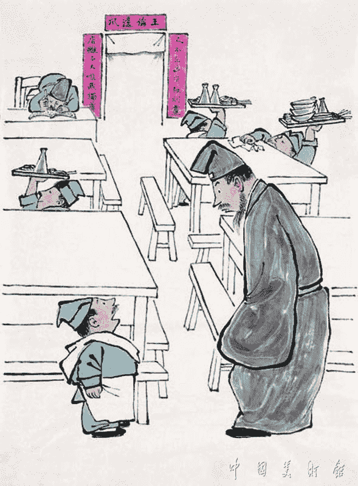

《武大郎开店》｜ 方成 绘

华君武关于戒烟的漫画是讲什么呢？他画一个人从三楼往窗外扔烟斗，扔了以后就后悔，急急地跑下楼去把烟斗接过来，这是边戒烟边后悔的情况，讲的是普通人性，他没有特别和批判的意思，就是笑一笑。

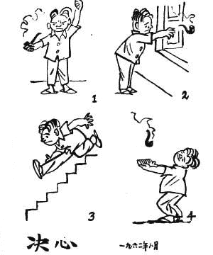

四联漫画《决心》｜ 华君武 绘

但是，鲁迅对于 30 年代文坛的幽默风却有不同的解释，他说，

"枢纽是在这里：他所讽刺的是社会，社会不变，这讽刺就跟着存在。"

"然而社会讽刺家究竟是危险的"，"但倘不死绝，肚子里总还有半口闷气，要借着笑的幌子，哈哈的吐他出来。笑笑既不至于得罪别人，现在的法律上也尚无国民必须哭丧着脸的规定，并非'非法'，盖可断言的。

我想：这便是去年以来，文字上流行了'幽默'的原因，但其中单是'为笑笑而笑笑'的自然也不少。"

所以，简而言之，鲁迅认为幽默是什么？幽默是人们不能讽刺了，所以只好幽默。

鲁迅还写了一篇《从幽默到正经》。鲁迅又预言了：

"而况我实在恐怕法律上不久也就要有规定国民必须哭丧着脸的明文了。"

为什么？鲁迅说东北沦陷以后，有人搜索失地原因，结果发现其中一个原因就是青年人爱玩乐学跳舞。"你看，因为青年人爱玩乐学跳舞就丢了东北东三省"。（"笑笑，原也不能算'非法'的。但不幸东省沦陷，举国骚然，爱国之士竭力搜索失地的原因，结果发见了其一是在青年的爱玩乐，学跳舞。"）

所以发展下去，娱乐和笑不可以了，幽默也不可以了。唉呀，不知道这是在讲什么时候，等到一个社会饭桌上连段子都不可以讲，这是怎么一个前景呢？

关于《伪自由书》，我们下集还会继续重读。

下集，我们会讨论鲁迅和胡适的一个争论。

#### 补充内容

鲁迅写《申报\*自由谈》专栏，我们不知道可以怎么设想，假如鲁迅在今天，他会是埋头书斋，只做研究或者写长篇呢？还是也会写专栏、"微博"、"微信公众号"等等？

我觉得鲁迅在写作的态度上好像两者不矛盾，你看当年《申报》销量第二，鲁迅是在很大众化的报纸上开专栏，开专栏的意思是你在一个版面上看，你会看到鲁迅的文章旁边很可能就是"花边新闻"，是哪一个美女或者是有一个什么绯闻，甚至旁边还可能有广告，有一些你想不通的广告。

当然，这些文章单独读来，我个人还是觉得不如鲁迅早期、中期的文章，也就是收在《热风》、《坟》这里边的那些散文。你们看到我重读鲁迅，在《春末闲谈》、《灯下漫笔》这些文章里我花的时间更多。但是，《申报\*自由谈》也还是时有精彩之处。

比方说，鲁迅注意到报上有篇报道讲乡民被警察镇压，题为《乡民二度兴波作浪》，注意文中这个"被"字。文章里说，有个人叫陈友亮，见官方军警中有些手枪，刘金发，也就是警察里有个人叫刘金发，拿了手枪。

"竟欲夺刘之手枪"，就是说姓陈的想抢警察的手枪，"当被子弹出膛，饮弹而毙，警察队亦开空枪一排，乡民始后退"。鲁迅抄出来的主要的精彩句，就是"当被子弹出膛"了，实际的情况就是子弹出膛打到了姓陈的这个人，不管打得有没有道理，总归是子弹去打一个人，把它读成"被子弹出膛"，怪不得后来有"被"躲猫猫类的网络流行语，原来是"抄袭"30 年代的报纸。

#### 下集预告

《王道诗话》《"光明所到......"》《出卖灵魂的秘诀》，出自《伪自由书》

# 58\. 鲁迅、瞿秋白、胡适：一场因专栏而起的风波｜《王道诗话》等

（音频内容结束后，有许子东最新补充内容）

重读鲁迅，我是许子东。今天是第五十八集。

#### 瞿秋白与鲁迅的"专栏"

我们上集已经开始讨论鲁迅在《申报\*自由谈》的专栏文章了。原来这 43 篇短文里，有 12 篇不是鲁迅写的，因为 1933 年瞿秋白在上海，那个时候有些文章据说是根据鲁迅的意见写的，也有的是和鲁迅交换了意见以后写的，鲁迅对这些文章有一些字句上的改动，请人誊抄以后同意用自己的笔名"何家干"或者"干"在报上发表。后来也收入鲁迅的集子。

这个时期，瞿秋白已经不在共产党中央的最高领导层，但仍然是过问文艺界工作的，他和鲁迅建立了很好很深的友谊。我们知道，后来他去了江西苏区，长征的时候本来要随红军一起走的，但是不知道为什么就被拒绝了，之后就留在苏区被捕，被国民党枪杀。

鲁迅听到消息以后，十分悲痛。鲁迅在去世前，他晚年最后的阶段亲自操心瞿秋白文集《海上述林》的出版，那是后话。

话说，瞿秋白为什么要替鲁迅写《申报\*自由谈》呢？

当然一个可能是因为专栏文章定时限时，鲁迅一忙可能一时交不了稿。另一个可能是瞿秋白从党的文艺领导的角度，高度重视最畅销报纸，也就是公众平台的影响。同时他也借用了鲁迅的名义，发表了对文坛和时事的看法。

30 年代"左联"成立的时候，其实那个时候负责中央工作的是中宣部长李立三，名义上的领袖是向忠发。李立三，据研究者考证，他专门约见过鲁迅一次，他希望鲁迅发出公开的声明，支持所谓的"立三路线"，也就是革命可以在一个省或几个省首先取得胜利。

本来马克思的道理是讲，共产国际、共产主义运动要全世界一起胜利，后来列宁发展成可以在一国或数国首先胜利。当时李立三他们就说，一省或数省首先胜利，党史上称之为"立三路线"，当然，后来说这是"左倾机会主义路线"。

鲁迅没有同意李立三的建议，鲁迅认为应该长期韧性战斗，发表公开声明意义不大。显然鲁迅对瞿秋白态度很不一样，他不仅把他看作是政治人物，而且真的当作自己的朋友。

而瞿秋白写文章也比较模仿鲁迅的笔法。有研究者，比如朱正他们说，虽然模仿，但瞿秋白和鲁迅的文章差别还是很明显的。相比之下，瞿秋白的文章更加政治化，不仅批判国民党，也批判国际英美势力如李顿调查团等，甚至他也批评孙中山写的"三民主义"的言论，什么"迎头赶上"等等。

更重要的是我今天要讨论的就是瞿秋白写的这篇文章，直接批评、点名批评胡适，形成了鲁迅与胡适之间的一场争论。

#### "何家干"对"胡博士"的尖锐批评

1933 年 3 月 6 号《申报\*自由谈》上有一篇作者署名为"干"的文章，题目叫做《王道诗话》，是瞿秋白执笔的。文中说：

"胡博士到长沙去演讲一次，何将军就送了五千元程仪。"

"何将军"就是指何键，这是湖南的地方军事长官，杨开慧就是被何键下令枪毙的，枪毙之前他说只要杨开慧声明和毛泽东离婚，就可以不杀她，杨开慧不愿意。

瞿秋白这里说，胡适到长沙演讲一次，何键送了五千元程仪（注：指路费）。我们刚才讲过了，这个时候银元很值钱，五千元是非常高的。然后他说：

"最近（今年二月二十一日）《字林西报》登载胡博士的谈话说：

'任何一个政府都应当有保护自己而镇压那些危害自己的运动的权利，固然，政治犯也和其他罪犯一样，应当得着法律的保障和合法的审判……'"

瞿秋白在《王道诗话》里就批评说：

"中国的帮忙文人，总有这一套秘诀，说什么王道，仁政。"

"诗曰：

文化班头博士衔，人权抛却说王权。

朝廷自古多屠戮，此理今凭实验传。"

"实验"是讽刺胡适的实证主义。

我们要回顾一下，在 20 年代，鲁迅虽然一直和陈西滢、梁实秋笔战，而且谁都知道"现代评论派"、"新月派"的后面就是鲁迅昔日的战友，《新青年》的战友胡适。但是直接点名指责胡适的文章，在鲁迅笔下还是十分罕见的。

这篇《王道诗话》，其实是有非常具体的历史背景，就 1933 年的 1 月 30 日，中国民权保障同盟北平分会成立了，胡适是主席。成立的第二天，胡适等人就去视察北平的监狱，了解政治犯处境，看看是不是触犯人权等等。

这件事情得到了军事长官张学良的同意。胡适等人在监狱里还和犯人用英语交谈，我不知道他们为什么要英语交谈。之后，胡适他们就提了一些温和的改良环境的建议。

不料，2 月 5 号的《燕京新闻》（英文报纸）却刊出了一篇措辞非常激烈的，描写监狱酷刑的控诉书。因此，张学良的助手就去质问胡适，说你们怎么来参观一下，最后把我们监狱里说得这么坏？胡适接受访问的时候说：

"一个政府要存在，自然不能不制裁一切推翻政府或反抗政府的行动。"

这是胡适的原话，但这句话登到报纸上的时候被改了。我不知道怎么改的，是英文翻译的问题呢，还是记录的问题呢？被改成了刚才瞿秋白用鲁迅名义写的，也就是文里章说的：

"任何一个政府都应当有保护自己，而镇压那些危害自己运动的权利"。

两句话看上去差不多，其实有一个很大的差别，一个是"我不能不制裁"，另外一个是"我有镇压的权利"，看上去内容一致字面上有重要出入。

因为这篇文章，3 月 3 号民权保障同盟临时全国执行委员会开会，开除胡适。资料上显示，好像蔡元培、林语堂等等都帮胡适辩护，但鲁迅是站在支持开除的那一边的。

鲁迅自己还写了一篇题为《"光明所到……"》的文章。文章引用了胡适的说法：

"监狱的情形，他（胡适博士----干注）说，是不能满意的，但是，虽然他们很自由的（哦，很自由的----  
干注）诉说待遇的恶劣侮辱，然而关于严刑拷打，他们却连一点儿暗示也没有。……"

所以鲁迅是在讽刺胡适用英语和犯人交谈，也在讽刺胡适在别的地方的一个题辞，那个题辞是这样写的："'公开检举，是打倒黑暗政治的唯一武器，光明所到，黑暗自消。'（原无新式标点，这是我僭加的  
\----干注。）"

鲁迅就在讽刺胡适访问监狱，他说，你（胡适）算是一个"光明"，你"光明一去，黑暗又来"了。

这看上去是一个关于监狱访问的一篇文字报道，或者说是有一些字句的误解，其实我们今天看得很清楚，这是"五四"两位最重要的知识分子，在"革命"与"改良"两条中国的道路上的根本不同的选择。

当时的鲁迅，受瞿秋白的影响，后来写《鲁迅传》的朱正查了胡适的日记，说何键给胡适的路费不是 5000 块，是 400 块。他说瞿秋白这些细节不知道怎么会弄错，这个细节有关系吗？我也不知道。

更严重的指控是在另一篇《申报\*自由谈》的文章力，文章题目很厉害，叫做《出卖灵魂的秘诀》，也是瞿秋白写的，也是针对胡适。文章这样说：

"据博士说：'日本军阀在中国暴行所造成之仇恨，到今日已颇难消除'，'而日本决不能用暴力征服中国'（见报载胡适之的最近谈话，下同）。这是值得忧虑的：难道真的没有方法征服中国么？不，法子是有的。"九世之仇，百年之友，均在觉悟不觉悟之关系头上，'──'日本只有一个方法可以征服中国，即悬崖勒马，彻底停止侵略中国，反过来征服中国民族的心。'"

接下来是瞿秋白的批判，

"这据说是'征服中国的唯一方法'"。"胡适博士不愧为日本帝国主义的军师。但是，从中国小百姓方面说来，这却是出卖灵魂的唯一秘诀"。"如果日本陛下大发慈悲，居然采用胡博士的条陈，那么，所谓'忠孝仁爱信义和平'的中国固有文化，就可以恢复：──因为日本不用暴力而用软功的王道，中国民族就不至于再生仇恨，因为没有仇恨，自然更不抵抗，因为更不抵抗，自然就更和平，更忠孝……中国的肉体固然买到了，中国的灵魂也被征服了。"

"因此，胡博士准备出席太平洋会议，再去'忠告'一次他的日本朋友：征服中国并不是没有法子的，请接受我们出卖的灵魂罢"。

这是瞿秋白在《申报\*自由谈》上以鲁迅的笔名发表的批判胡适的文章。

当然，我们知道，胡适是不是真的要向日本出卖中国人的灵魂呢？胡适后来从 1938 年起担任过四年国民党政府驻美大使，在美国加拿大一共做了两百多场演出。说服美国人民：

中国抗战牺牲极大，但是绝不投降。

第二，美国如果援助中国，这是符合美国人民的利益的。

所以日本报纸当时报道说，胡适不恰当地利用其外交职责，谋划要唤起民众对日本的仇恨，并将美国拖入对日本的战争。这就从反面说明胡适实际上抗日有功。当然，这都是在瞿秋白、鲁迅都去世以后，他们不知道。

但是，为什么胡适在 1933 年要说日本"只有一个方法可以征服中国"，"征服中国民族的心"呢？为什么瞿秋白又据此就判断胡适"不愧为日本帝国主义的军师"呢？

其实笔战关键还是在怎样读文章、怎样"断章取义"、怎样以笔为枪达到我方政治的目的。你们仔细再重读胡适文章的全篇，他的主要论点就是说日本人绝不能用暴力征服中国。

胡适是这样推论的，从现实看，日本占了东三省之后中国没有屈服，从未来看，就算日本侵略华北深入长江流域内地，中国民族也不会屈服。"中国民族的排日仇日的心理只有一日深似一日，一天高似一天。"

这是胡适的原话，等于是预见了后来抗战的发展。胡适还讲得更过分，他说就算中国战败，"接受了一种耻辱的城下之盟了，----我们还可以断言：那也只是中国人的血与肉的暂时屈伏，那也绝不能够减低一丝一毫中国人排日仇日的心理，也绝不会使中日两国关系有一分一寸的改善！因为中国的民族精神在这种血的洗礼之下只有一天一天的增长强大的"。

胡适这篇文章的题目叫做《日本人应该醒醒了！》，他这篇文章假定的读者是日本的民间人士、日本国民，所以他的意思就是说，打中国是打不赢的，你要征服中国民族靠暴力那是没有用的，所谓征服中国民族的心，实际胡适的意思就是说你不能打仗，只有人民与人民之间交朋友。

你说瞿秋白是真看不明白，误解了胡适的意思呢，还是说胡适的确措辞不当，这里就造成了一次文化斗争的机会呢？相比之下，我觉得鲁迅自己写的《"光明所到……"》这篇文章，那就是从头到尾的隐晦的讽刺。

#### 论战风波的尾声……

瞿秋白模仿鲁迅所作的《王道诗篇》和《出卖灵魂的秘诀》，那就是正面批判了，火力全开，缺乏控制，抓人眼球，也有些误解。我们今天都看得很清楚，鲁迅和胡适是"五四"、"新文化"最重要的两位人物。不管怎么样，偶然过招也是值得记录的。

我们常说中国的事情，病症是鲁迅看得准，药方是胡适开的好。

胡适直接评论鲁迅的文章是不多的。1936 年 11 月 18 号，这时候鲁迅刚刚去世一个月，有一位女作家，她是出了名的反鲁迅的女作家苏雪林，给胡适写了封长信，称鲁迅为"刻毒残酷的刀笔吏，阴险无比、人格卑污又无耻的小人"。

那胡适怎么回信呢？胡适说："凡论一人，总须持平"，"鲁迅自有他的长处，如他早年的文学作品，如他的小说史研究，皆是上等工作。"

20 年后的 50 年代，中国内地有个文艺运动在批判胡适。这个时候胡适却在台北读到了鲁迅写给胡风的信，信里抱怨周扬等人是"奴隶总管"，好像有鞭子在后面抽他似的。胡适那时候看到这封信就说，唉，鲁迅若不死啊，他也会如何如何……

具体你们感兴趣的话，可以去看看夏济安的书，也就是《黑暗的闸门》的第三章，这是一篇非常重要的鲁迅研究文章，中间还谈到了"两个口号"的论争。

关于鲁迅最后几年的困境和心情，我们下几集继续讨论。

#### 补充内容

这一集我们读了几篇瞿秋白以鲁迅的笔名所写的《申报\*自由谈》专栏文章，以"何家干"、"干"等等笔名发布的。

我们的目的一方面是想区分、辨别瞿秋白和鲁迅不同的文风，瞿秋白是比较直接的战斗，鲁迅是比较曲折的讽刺。另一方面，这里至少有两篇文章是瞿秋白以鲁迅的名义批评胡适，因此颇是重要。

我们知道，胡适、鲁迅在《新青年》时代开始是战友，"五四精神"这两位贡献最大。

现在电视剧《觉醒年代》里突出陈独秀，这是对的，应该的。我记得以前李泽厚还专门讲过，他在《中国现代思想史论》中还特别为陈独秀抱不平，就是因为陈独秀是国民党要把他作为敌人，共产党也把他抛弃掉。

陈独秀到晚年其实对自己一生的理论很有反省，在早期他也很有功劳，《觉醒年代》中当然陈独秀就成了正面的形象。但是陈独秀的贡献主要是"建党"和"五四"的革命战斗方向，以思想遗产，以对 20 世纪中国文化的贡献来说，胡适和鲁迅算是前两位的人物，或者次序可以倒过来。

我们知道，鲁迅对胡适这一派以及陈西滢等等"现代评论派"的文人曾经很不满，常常讽刺，但是鲁迅和胡适直接论战还是非常罕见的情况。鲁迅到香港演说的文章，《无声的中国》里还特别正面肯定胡适主张白话文的贡献。所以这两篇瞿秋白用鲁迅名义写的批判胡适的文章，在文学史上应该很重要，尤其是批判的分量很重，几乎把胡适骂为"汉奸"。

当然了，回到 30 年代的语境，那个时候鲁迅对瞿秋白更加信任，对胡适诸多不满，因为胡适和蒋介石的政府关系暧昧。但是我们具体分析文章，包括译文的这些措辞，好像中间又有很多歧义，不少误解。

所以我们重读鲁迅，重读瞿秋白，也重读胡适在访问监狱和对日本人喊话的文章，回顾三个大师文章交锋之间的火花、烟雾，不管今天你是持什么立场、什么态度，这个都是很有历史价值的文本细读的功夫，所以这也是我们名副其实的重读鲁迅。

#### 下集预告

《最艺术的国家》《天上地下》，出自《伪自由书》

《前记》《华德保粹优劣论》《华德焚书异同论》《智识过剩》《"吃白相饭"》《"揩油"》《爬和撞》，出自《准风月谈》

# 59\. “风月”里的感时忧国，“风月”里的众生之相｜《最艺术的国家》《“吃白相饭”》等

（公众号懒人找资源，懒人专属群分享）

（音频内容结束后，有许子东最新补充内容）

重读鲁迅，我是许子东。今天是第五十九集。

原定六十期，我们肯定要超过了，虽然我其实应该快点去进入到计划当中的最后几集，但是这两天看鲁迅在《申报\*自由谈》上的专栏文章，还是流连忘返。就好像在走在百草园里，到处是奇花异草，不忍匆匆离去，所以再读几篇。

#### 风花雪月？没有那么容易！

《申报\*自由谈》上的化名文章除了《伪自由书》以外，还收入在了 1933 年下半年的文集《准风月谈》中。书名自然都是反讽，"自由谈"就是没自由，所以叫做"伪自由"。"谈风月"，在当时其实是"自由谈"编者的呼吁："吁请海内文豪，从兹多谈风月"。

既然你鲁迅在这里投稿，拿着高稿费，那当然你们说"风月"就"风月"。但是他自己也知道，他的"风月"按他自己的说法，他说同样风月，意思可以是"月白风清，如此良夜何？"但是也可以是"月黑杀人夜，风高放火天。"所以鲁迅说，"多谈风月"，"莫谈国事"。

可是，"'漫谈国事'倒并不要紧，只是要'漫'，发出去的箭石，不要正中了有些人物的鼻梁"。其实多少年以后我们再想想，风花雪月也不那么容易。难免要讲到风太大，月不明。如果风太大或太小，月很多时间又不明，那怎么办呢？鲁迅的办法就是发表的时候，被你们删节就要用笔名，等到出书的时候就尽量要恢复。

在《准风月谈》的《前记》里，他这么说：

"日本的刊物，也有禁忌，但被删之处，是留着空白，或加虚线，使读者能够知道的。中国的检查官却不许留空白，必须接起来，于是读者就看不见检查删削的痕迹，一切含胡和恍忽之点，都归在作者身上了。这一种办法，是比日本大有进步的，我现在提出来，以存中国文网史上极有价值的故实。"

这里有个词叫"文网史"，这个概念有意思，今天的人们大概以为就是"文章上网的历史"的意思吧。

#### 闲笔之下的"大问题"

《申报\*自由谈》都是专栏短文，每次篇幅固定。为吸引读者，内容有时候不是很深，又要讲得很隐晦，这真的很像今天的微博与微信公众号。我们再来看看鲁迅怎么写他的专栏。

其中有一篇文章叫做《最艺术的国家》，也是瞿秋白执笔的。

文章第一段模仿鲁迅的口气讽刺梅兰芳男人扮女人，虽然前面讲的是"男人扮女人是中国的艺术"，但是文章里的内容却是讲一件国家大事，也就是 1933 年 3 月 24 日，国民党政府宪法草案起草委员会拟定了一个关于"国民大会组织"的草案。这是太大的事情了！

原来这个"制宪草案"里的第三条规定，"中华民国之国民，年满二十岁者，有选举代表权，年满三十岁经考试及格者，有被选举代表权"。

也就是说，要被选成国民代表，不仅有年龄限制，还要通过一个考试。不知道考试考什么，是考三民主义？还是四书五经等等？。当然，瞿秋白的文章就是要批判这个考试，但是他怎么批判呢？有意思得很。他用的又是"风花雪月"的笔法。他说：

"照文法而论，这样的国民大会的选举人，应称为'选举人者'，而被选举人，应称为'被选之举人'"。

这里巧妙的地方，就是把"选举人"这个现代的名词改为"选""举人"，就是说"选"是作为动词。这就是讽刺"被选举人"要考试的话不就是在选"举人"吗？而"被选举人"，应称为"被选之举人"。

文章就认为，这是一种装扮，"因此，他们得扮成宪政国家的选举的人和被选举人"。

所谓"宪政"就是孙中山在《建国大纲》里所讲的"军政"、"训政"、"宪政"三个时期。30 年代虽然提了"宪政"这个概念，实际上我们知道，直到很晚以后的台湾蒋经国时期，才废"军政"、"训政"进入"宪政"。

所以这篇文章是从男人扮女人，讲到"选""举人"，"跑题跑不停"。

当时的中国国情，鲁迅在《申报\*自由谈》专栏中常有涉及。每次讲起来不讲大的道理，用一两个小的、现成的例子，简单又传神。

比方说，有一篇叫做《天上地下》的文章，鲁迅就抄了两段报纸新闻，

一段是"'日内除飞机往匪区轰炸外，无战事，三四两队，七日晨迄申，更番成队飞宜黄以西崇仁以南掷百二十磅弹两三百枚，凡匪足资屏蔽处炸毁几平，使匪无从休养。……'（五月十日《申报》南昌专电）"

这里就是说，国民党派到江西去的飞机，带的炸弹都是 120 磅一个，一丢两三百个。

另一段，也是差不多当天的报纸："'今晨六时，敌机炸蓟县，死民十余，又密云今遭敌轰四次，每次二架，投弹盈百，损害正详查中。……'（同日《大晚报》北平电）"

这就叫做"并置"。两篇报道都是在讲飞机炸地下，分别来自《申报》与《大晚报》。这篇也是瞿秋白写的，他说："应了这运会而生的，是上海小学生的买飞机，和北平小学生的挖地洞。"

鲁迅闭目一想，"假如炸进去慢，炸进来快，两种飞机遇着了，又怎么办呢？"

这个就是讽刺"先安内，后攘外"的当时国民党的政策，也从背后勾画了鲁迅最后生活的 30 年代，中国大的现实背景。当然，这个更大的背景，是资本主义经济危机和德国法西斯的崛起。

《申报\*自由谈》在 1933 年的 7 月，其实那个时候德国的国家社会主义工人党刚刚崛起，刚刚要获得政权。鲁迅非常敏感，连写两篇文章讨论德国的事情，其中一篇叫做《华德保粹优劣论》。鲁迅说

"希特拉先生不许德国境内有别的党"。因此，有一首歌叫做《跳蚤歌》，这原来是歌德的《浮士德》中一首政治讽刺诗，是由俄罗斯作曲家穆索尔斯基谱曲的，鲁迅说这首歌在德国被禁止了。德国禁《跳蚤歌》，与此同时，北平社会局查禁什么？女人养雄犬！

"……查雌女雄犬相处，非仅有碍健康，更易发生无耻秽闻，揆之我国礼义之邦，亦为习俗所不许，谨特通令严禁，除门犬猎犬外，凡妇女带养之雄犬，斩之无赦，以为取缔。"

大家想想看，禁《跳蚤歌》与不许女人养公狗，这两者有什么关系呢？鲁迅说：

"两国的立脚点，是都在'国粹'的，但中华的气魄却较为宏大，因为德国不过大家不能唱那一出歌而已，而中华则不但'雌女'难以蓄犬，连'雄犬'也将砍头。这影响于叭儿狗，是很大的。由保存自己的本能，和应时势之需要，它必将变成'门犬猎犬'模样。"

我们都知道，说到背后鲁迅还是在骂那些"文人走狗"。我们是知道的，鲁迅从很早开始就不喜欢狗，对猫也没什么好感。当然了，在这里他说女人不能养狗这件事情的荒唐，而且为被砍头的"雄犬"鸣不平，总算也替养狗人士出了一口气。

紧接着，在比较了对待跳蚤和狗的态度之后，鲁迅又写了一篇关于烧书的文章，题目叫做《华德焚书异同论》。

"德国的希特拉先生们一烧书，中国和日本的论者们都比之于秦始皇。然而秦始皇实在冤枉得很，他的吃亏是在二世而亡，一班帮闲们都替新主子去讲他的坏话了。"

鲁迅说："不错，秦始皇烧过书，烧书是为了统一思想。但他没有烧掉农书和医书"，秦朝好像"也看不见轻贱女人的痕迹"。所以鲁迅对秦始皇的态度，跟后来毛泽东的看法是有相通之处的。

"希特拉先生们却不同了，他所烧的首先是'非德国思想'的书，没有容纳客卿的魄力；其次是关于性的书"，这样烧书的后果很坏，所以鲁迅觉得希特勒还不如秦始皇。

然后，鲁迅又批评了阿拉伯人烧亚历山大港的图书馆。其实在历史上我们知道，亚历山大港的藏书在公元前几十年已经被当时的罗马人焚烧了，但据说七世纪阿拉伯人也烧过。

鲁迅特别指出这种烧书的理论，就是说如果这些书籍讲的道理和宗教经典一样，那既然已经有经典了，其他书就不用留了，如果不同那就是异端，就更不该留了。所以这个逻辑，是希特勒先生们的嫡派祖师！

鲁迅谈论"希特拉先生们"，那时希特勒大部分的坏事都还没开始做，但鲁迅早有预见，一切专制力量好像都仇恨知识。鲁迅在《申报\*自由谈》专栏里也早就预料到了，有篇文章叫《智识过剩》，说 30 年代资本主义经济危机：

"美国因为棉花贱，所以在铲棉田了。中国却应当铲智识。这是西洋传来的妙法。

西洋人是能干的，五六年前，德国就嚷着大学生太多了，一些政治家和教育家，大声疾呼的劝告青年不要进大学。现在德国是不但劝告，而且实行铲除智识了"。

"中国不是也嚷着文法科的大学生过剩吗？"

"刷，刷，刷，把大多数的智识青年刷回'民间'去"。

鲁迅神预言啊，当时说中国的文法科大学生太多，其实指的是 1933 年 5 月国民党政府教育部有一个命令，要各大学限制招收文法科学生人数，限制的理由是说：

"吾国数千年来尚文积习，相沿既深，求学者因以是为趋向，而文法等科又设备较简，办学者亦往往避难就易，遂致侧重人文，忽视生产，形成人才过剩与缺乏之矛盾现象。"

看起来，"重理轻文"在 30 年代已经有了。

#### 风月笔法之下的众生相

除了用"风月笔法"谈论国家大事以外，鲁迅在《申报\*自由谈》专栏里最精彩的文字，当然还是一贯的对社会众生相的批判。有一篇文章很好玩，题目叫做《"吃白相饭"》，最初发表于 1933 年 6 月 29 日。鲁迅说：

"要将上海的所谓'白相'，改作普通话，只好是'玩耍'；至于'吃白相饭'，那恐怕还是用文言译作'不务正业，游荡为生'，对于外乡人可以比较的明白些。"

可是，鲁迅对于一些上海男人说自己或者女人说自己丈夫是"吃白相饭"感到很不可思议，这怎么能拿来做一个职业呢？然后鲁迅就分析这个"吃白相饭"是怎么做的呢？

"第一段是欺骗。见贪人就用利诱，见孤愤的就装同情，见倒霉的则装慷慨，但见慷慨的却又会装悲苦，结果是席卷了对手的东西。"

这值得再读一遍啊！大家想想看"四见四装"，你贪的我就利诱，你孤愤的我就同情，你倒霉的我就装着慷慨，你慷慨了我就装着扮苦。我们每个人可以反省一下，也替别人检讨一下，这些手法人还会不会采用呢？

"第二段是威压。如果欺骗无效，或者被人看穿了，就脸孔一翻，化为威吓，或者说人无礼，或者诬人不端，或者赖人欠钱，或者并不说什么缘故，而这也谓之'讲道理'，结果还是席卷了对手的东西。"

第三段那是什么？溜走！这以上两段方法不成功，就走！居然有这样的人，以这样的事情作为职业，大家也不为奇（"有这样的职业，明明白白，然而人们是不以为奇的。"）。  
但，鲁迅写的有意思的地方是：

"但'吃白相饭'朋友倒自有其可敬的地方，因为他还直直落落的告诉人们说，'吃白相饭的！'"

大家见没见过一些人啊，是实际上也是"吃白相饭"，也是用刚才的欺骗、威吓甚至溜走来"吃白相饭"，可是面目却要装成另外一个模样："哥们儿！两肋插刀！不怕牺牲！我永远替你着想！"，这也是"吃白相饭"。

这使我想起，张爱玲 50 年代去美国以后想用英文写小说，其中有一部小说中文名字翻译过来就叫做《上海游闲人》，翻得好听的说法是陈冠中把小说翻译做《上海闲人》。我其实没读过那篇英文小说的原文，我不知道"上海闲人"跟"白相人"有没有关系，这是一个联想。

这个"白相人"其实鲁迅在另一篇文章里讲得就更加具体了，那就是一个比较粗糙的、业余的"吃白相饭"，就是《"揩油"》，讲占小便宜。鲁迅认为：

"'揩油'，是说明着奴才的品行全部的。"

我们知道，鲁迅喜欢讲奴才、奴隶这些事。鲁迅不是说"揩油"、"吃白相饭"都是统治者毒害人民或帮凶等等，鲁迅是从弱势群体的处境分析。

在另外一篇叫做《爬和撞》的文章里，鲁迅是这样说：

"不但穷人，奴隶也是要爬的，有了爬得上的机会，连奴隶也会觉得自己是神仙，天下自然太平了。"但是爬上的是机会很少，"大多数人却还只是爬，认定自己的冤家并不在上面，而只在旁边  
\----是那些一同在爬的人。"

鲁迅的这个说法很精彩。在爬上的过程当中，不是欺压他的人是他的敌人，而是旁边和他竞争的人是他的冤家。那一同在爬的人，也就是说，他不怪上面猴子的屁股，他只怪旁边的猴子是耳目。

生活当中，我们有多少事情，我们对于上面欺负我们的人没话说，但是对于身边的人捣乱，我们非常气愤。仔细想想，是不是也是在"爬"呢？

"他们大都忍耐着一切，两脚两手都着地，一步步的挨上去又挤下来，挤下来又挨上去，没有休止的。

然而爬的人太多，爬得上的太少，失望也会渐渐的侵蚀善良的人心，至少，也会发生跪着的革命。"

我觉得这几个字可以圈重点号："跪着的革命"。

"于是爬之外，又发明了撞。"

在鲁迅看来，"吃白相饭"、"揩油"等等奴才手段那就是"撞"，"撞"就是不守规则的"爬"。"爬"上去的机会越少，愿意"撞"的人也就越多。

唉呀，想想是不是这样呢？

下集继续。

#### 补充内容

重读鲁迅，鲁迅的话听上去总像是今天说的，我不知道该补充什么，我就重新强调几个关键词。

"吁请海内文豪，从兹多谈风月"，这是当时报纸的编辑对作家的要求，"多谈风月"，"莫谈国事"。如果要删节就要删得看不见，鲁迅说这是"中国文网史上极有价值的故实"，殊不知与时俱进，后来更好的删节是作家自我删节，自己去删效果更佳。鲁迅后来也说过这是自己先抽掉几块骨头。

瞿秋白所写的"选举人"，因为要考试，所以就等于是"选""举人"。据说古代考中举人以后，你犯法就不用打屁股了。作为现代汉语的"被选举人"，那就是成为"被人家选出来的举人"，这个文字游戏非常妙。

我看到最近台湾方面公开国民党几十年来的各种政治文件，其中有关于陈延年的材料。原来陈延年在厦门和鲁迅见过面，当时陈延年是党的领导人之一，鲁迅说他可是我的"老仁侄"，因为鲁迅和陈独秀熟悉，陈延年就是他的侄子了。

陈延年对鲁迅也有一个政治定位。在党内认为鲁迅是"自由人"，就是知识分子，按照现在的注解，但不是一般的"自由人"，而是彻底反封建的"自由人"，因此要团结。那是早期的一个党内对鲁迅的政治定位。大家详细可以看今年（2021 年）8 月 30 号的《北京日报》，专门有文章提到这个事情。（《鲁迅眼里的陈延年----"他可是我的'老仁侄'啊"》）

另外，这一集里面还讲到鲁迅对早期德国专制政权的警惕，当时德国还没有开始对外打仗，只是一个专制政权，鲁迅就意识到这种政权的危险性。所以"希特拉先生们"反对各种知识，敌视  
各种知识，所以鲁迅当时就觉得不只是一国之内政，最终会危及世界。

#### 下集预告

《"滑稽"例解》《由聋而哑》《新秋杂识》，出自《准风月谈》

《序言》《"京派"与"海派"》《北人与南人》，出自《花边文学》

# 60\. 从“士、官、商”到地域文化：鲁迅眼中的南北之争｜《“京派”与“海派”》《北人与南人》等

（音频内容结束后，有许子东最新补充内容。由于录制时间较早，音频若有模糊之处还请参考文稿，感谢您的理解。）

重读鲁迅，我是许子东。今天是第六十集。

今天我们主要读鲁迅在《花边文学》里的两篇文章，也就是《"京派"与"海派"》与《北人与南人》这两篇非常非常精彩的文章。  
当然，我们都知道，这个时期鲁迅在《申报\*自由谈》还有其他报纸上，发表了很多化名的杂文。

#### 现实往往比想象更荒诞

上次我们讲到了"雌女不能养雄狗"的北平社会局的禁令，说实在话，我讲完以后还是觉得很好笑，免不了这几天见到朋友又讲起这个事情。没想到鲁迅自己也是这样，《华德保粹优劣论》这篇文章是发表于 1933 年的 7 月 2 日，三个月之后，鲁迅自己在另外一篇叫《"滑稽"例解》的文章里，又再一次地引用了"凡妇女带养之雄犬，斩之无赦，以为取缔！"这个奇闻。估计鲁迅大概也对女人不能养公狗的这个说法印象太深。

《"滑稽"例解》这篇文章也是发表在《申报\*自由谈》上，鲁迅说：

"法人善于机锋，俄人善于讽刺，英美人善于幽默。"

"这危险，就因为中国向来不大有幽默。只是滑稽是有的，但这和幽默还隔着一大段"。"这'狸猫换太子'的关键，是在历来的自以为正经的言论和事实，大抵滑稽者多，人们看惯，渐渐以为平常，便将油滑之类，误认为滑稽了。"

所以"雌女雄狗"的禁令所反映的，是现实比文学更荒诞，这哪里是滑稽作家所能凭空写的出来的？其实，这也不能说是这些保守的人的想象力的问题，因为我也看过中国古代的一些所谓的"画"，这一类的画，画面上真的也有这些有钱人家的太太、丫鬟跟动物在一起的这种画面。但是，这到了民国的时候拿来做一个政府的法令，太好笑了。

不过我也联想到当代作家，也是看到了网络、现实有时候比文学更加奇幻荒诞，所以搞得作家不知怎么办，余华写的《第七天》就是来表达这种和鲁迅当时一样的感慨。

还有一篇文章值得一读，鲁迅化名"洛文"写了一篇文章叫做《由聋而哑》。这可以看出那个时候作家，现代与当代作家有时候想象力是相通的。鲁迅是这样说的：

"医生告诉我们：有许多哑子，是并非喉舌不能说话的，只因为从小就耳朵聋，听不见大人的言语，无可师法，就以为谁也不过张着口呜呜哑哑，他自然也只好呜呜哑哑了。"

鲁迅喜欢讲医学、讲科学，但目的都不是在医学与科学。所以，鲁迅从因为听不见所以不能说话说起：

"所以勃兰兑斯叹丹麦文学的衰微时，曾经说：文学的创作，几乎完全死灭了。人间的或社会的无论怎样的问题，都不能提起感兴，或则除在新闻和杂志之外，绝不能惹起一点论争。"布兰代斯是一位非常有名的理论家，他写过《十九世纪文学主流》。他是我年轻的时候非常崇拜的一位理论家。

我倒觉得，这好像也是蛮熟悉的现象。

"我们看不见强烈的独创的创作。于是精神上的'聋'，那结果，就也招致了'哑'来。"

鲁迅说这几句话可以移来批评中国的文艺界，所以这个现象不能全归于压迫者的压迫了，"五四"运动的启蒙运动者与后来的反对者都应该分负责任。

鲁迅的意思大概是说没有太好的翻译，听不到、看不到好东西，自己就说不出好话。 所以鲁迅讲的这句话，其实今天都完全合用。他说：

"文章的形式虽然比较的整齐起来，但战斗的精神却较前有退无进。"

李泽厚后来比较 80 年代与 90 年代学术发展的时候，也说过类似这样的话，学术是进步了，思想是退后了。而且大家塞住耳朵那就听不到东西，或者听来的全是那些超女、娱乐、抖音的，那说出来当然也就是"呜呜哑哑"了。

碰巧我偶然看到蒋方舟的一条微博，她说："我问我妈，我最近说话声音越来越响了，是不是因为越来越自信，气场越来越强了？"她妈妈说："只是因为你听力下降了。"

我觉得这很有意思，这跟鲁迅所讲的真的是有呼应。鲁迅说的是听不了，所以说不了，蒋方舟说的是你说话太累、太大声，是因为你的听力下降，你听不到别人的声音了，所以呢你自己其实就是气虚了。

鲁迅在谈文说艺的时候加一点科学常识，有时候效果非常奇特。我们记得一些有名的例子，比方说细腰蜂给青虫打麻醉针，用来形容洗脑。统治者要是有这样的武器能够让人家的脑子里把什么全部忘掉，或者是不动脑子，那这也太理想了。

刚才那篇《由聋而哑》的文章里聋和哑的关系，这本来是医学常识，却引申出文化上的接收与创造的关系，引申出政治宣传和倾听民意的这种关系。  
另外有一篇更好笑，题目叫做《新秋杂识（三）》，也是鲁迅的一篇杂文。

明明是讲秋天感怀，"迎秋，悲秋，哀秋，责秋"，鲁迅说有一位女作家，冰莹女士，她还要大家早上忘掉科学，尽情地享受自然的美景。（"冰莹女士的佳作告诉我们：'晨是学科学的，但在这一刹那，完全忘掉了他的志趣，存在他脑海中的只有一个尽量地享受自然美景的目的。……'这也是一种福气。"）

可是鲁迅说，"科学我学的很浅，只读过一本生物学教科书。但是，它那些教训：花是植物的生殖机关呀，虫鸣鸟啭，是在求偶呀之类，就完全忘不掉了。"

这太煞风景了，是一段很有名的鲁迅式的恶作剧。但背后也说明了，语言学和文化中很多的基本概念，也就是我们讲的所谓"符号"、"概念"、"话语"，"词汇"其实都是约定俗成的，它的意义必须由上下文语境来决定。

这种反省里就包括了对"真实"、"真理"、"真诚"不同的定义。我们都知道，你不能碰到什么事情都来讲真实、真理的。你情人节给女朋友送花，你说，哎我送你一捆生殖器，虽然你说的是科学道理，但是欠揍啊。

#### 鲁迅杂文与专栏的"花边"

在《伪自由书》与《准风月谈》两部杂文集之后，鲁迅编了一本《花边文学》，其中收录了鲁迅从 1934 年 1 月到 11 月的杂文 61 篇。为什么叫"花边"呢？鲁迅就是在嘲笑他的专栏文章在报纸上发表的时候，有一圈花边圈住。同时"花边"还是银元的意思，那意思就是说他也是为了稿费写作。有没有这个因素呢？我不知道。

鲁迅青年与中年的时候在教育部做官，收入非常稳定，后来教了几年书。在 1927 年以后，换句话说，在他大概 40 多岁以后就做全职文人了。做全职文人，当然也有经济上的考虑，但是我想他的专栏主要不是"为稻粱谋"。

假如那几年不写那么多杂文，鲁迅可以做些什么创作呢？

这个问题是很多人提过的，我们也永远不会有答案。我们还是珍惜鲁迅这份独特的遗产吧。至少到目前为止，鲁迅的这种写法、这种文体后无来者。

在《花边文学》的《序言》中，鲁迅再次提到了审查制度对文章的影响。鲁迅后期的文章一直在跟审查制度做斗争。他说：

"我曾经和几个朋友闲谈。一个朋友说：现在的文章，是不会有骨气的了，譬如向一种日报上的副刊去投稿罢，副刊编辑先抽去几根骨头，总编辑又抽去几根骨头，检查官又抽去几根骨头，剩下来还有什么呢？我说：我是自己先抽去了几根骨头的，否则，连'剩下来'的也不剩。所以，那时发表出来的文字，有被抽四次的可能。"

在诉说前后一共抽了四次"骨头"以后，鲁迅说，

"因此除了官准的有骨气的文章之外，读者也只能看看没有骨气的文章。"刚才所说的"呜呜哑哑"的《由聋变哑》等等。

鲁迅说："我生于清朝，原是奴隶出身，不同二十五岁以内的青年，一生下来就是中华民国的主子，然而他们不经世故，偶尔'忘其所以'也就大碰其钉子。 "

所以鲁迅他一面说自己被删的文章，他说被删的文章不多是因为他没骨气、有技巧；但另一方面又说"凡是我寄文稿的，只寄开初的一两期还不妨，假使接连不断，它就总归活不久。"就是说，经常发表鲁迅文章的这些期刊，到后面就会出问题。所以，鲁迅说：

"于是从今年起，我就不大做这样的短文，因为对于同人，是回避他背后的闷棍，对于自己，是不愿做开路的呆子，对于刊物，是希望它尽可能的长生。"

当然，我们听鲁迅的这些自嘲，我们都知道，鲁迅后来杂文一点也没少写，而且他非常有名地被毛泽东称为："鲁迅的骨头是最硬的。"

#### 是"京派"？还是"海派"？

鲁迅的短文，有几篇文字很短但意思很深，比起同样题目的长篇大论还更有深度。我印象非常深的，就是我今天重点读的两篇，《"京派"与"海派"》与《北人与南人》。

30 年代文坛上有"京派"与"海派"之争，当时的"京派"，指的是住在北方的沈从文、萧乾、曹禺、老舍等这些作家与他们的风格，"海派"主要是指"新感觉派"，就是施蛰存、刘呐鸥、苏汶、穆时英等等。像巴金、鲁迅他们虽然住在上海，但不会被认为是典型的"海派"。

如果把文坛风气的纷争再往上推到 20 年代，那么"文学研究会"就比较接近"京派"，创作社就比较更像"海派"。"京派"就注重文学与学问、人格、道德的关系。"海派"就强调文学与灵感、天才、自我的混合。那么，这种或隐或显的"京派"、"海派"的文化风格的分野，其实一直延续到今天，而且也很难说得清楚、说个究竟。

但是鲁迅却能够透过现象看本质。在他看来，"京派"、"海派"表面上是两种风格流派，但是背后的差异是有根源的。

什么根源呢？请注意下面这段文字，鲁迅写得非常的精炼，而且有对仗。鲁迅说：

"北京是明清的帝都，上海乃各国之租界，帝都多官，租界多商，所以文人之在京者近官，没海者近商，近官者在使官得名，近商者在使商获利，而自己也赖以糊口。要而言之，不过'京派'是官的帮闲，'海派'则是商的帮忙而已。但从官得食者其情状隐"，就是说靠官拿好处的样子不那么难看，"对外尚能傲然，从商得食者其情状显，到处难于掩饰"，就是拿钱的那些人吃相比较难看。所以，"于是忘其所以者，遂据以有清浊之分"。大家忘掉了背后的官与商，其实大家都是有后台的，在肯定忘掉了这个分别以后，鲁迅说："而官之鄙商，固亦中国旧习，就更使'海派'在'京派'的眼中跌落了。"

鲁迅这段分析非常非常透彻。因为一般来说，"京派"与"海派"中"京派"有一些道德上的先天优势，"海派"呢？我们日常生活当中都会说："这个人'海派'"，那是在说什么？用钱大手大脚，很虚荣。"京派"呢就是讲文化的、穿长衫的，海派式就要倾向于西洋的。听上去呢，"京派"总有一点道德上的优势。

但鲁迅这篇文章，第一是我觉得这篇文章是可以收入教材的。现在教材里把鲁迅的作品抽掉，可是像这样的文章就应该直接放进高中的教材。从句式、文法、措辞来看，这是白话文、文言结合的最好的范例；

第二是鲁迅同时清醒地指出了"京派"、"海派"在经济政治上的根源，而且不加褒贬。真的，只有鲁迅这样在北京做官写文章，又在上海"卖文"的人才看得更清楚。

第三是鲁迅非常清晰地点出了"京派"看不起"海派"的理由，你以为是有"清浊之分"，其实只是大家拿好处的"或暗或显"，就这样的一个道理。

京派近官，海派近商。讲的是文学、文化与政治、经济的关系。但是，其实我们今天大家都同时要跟官、商打交道，而且说到底，官和商的关系怎么组合，就关乎我们国家民族命运。

但接下来，鲁迅更有一篇《北人与南人》，非常精彩，是把焦点从社会政治背景转向了更复杂的地域文化心理上。

"北人的卑视南人，已经是一种传统。这也并非因为风俗习惯的不同，我想，那大原因，是在历来的侵入者多从北方来，先征服中国之北部，又携了北人南征，所以南人在北人的眼中，也是被征服者。"

鲁迅以魏晋南北朝的一些古籍作为例子，来论证古来北方人如何就看不起南方人。 尤其到了元代，鲁迅说，

"至于元，人民截然分为四等，一蒙古人，二色目人，三汉人即北人，第四等才是南人，因为他是最后投降的一伙。"

唉！最后投降应该是最有骨气的表现，但是，你眼光转到新朝代，征服者他们开创新时代了，所以南方的人呐，"为奴隶的资格因此就最浅，因为浅，所以班次就最下，谁都不妨加以卑视了。到清朝，又重理了这一篇账，至今还流衍着余波，如果此后的历史是不再回旋的，那真不独是南人的如天之福。"

鲁迅所说的，是民国的时候首都在南京，而且后来的北伐也是从南方打到北方去的。但是其实并不如此，北方还是有优越感，不相信的话你看看现在春晚就知道了，我们现实问题这里不多议论。

原来在鲁迅看来，北人传统上看不起南人，是因为自己比较早就做了奴隶，就看不起新的奴隶。这个批评非常尖锐深刻。而且反过来我们也可以这样看，当外国文化、经济的势力入侵的时候，南人比较早做奴隶，秩序就反转了，调过来，以自己所谓的"洋气"看不起其他的内地人。

鲁迅在《阿 Q 正传》俄文版的序言里说的一个关键问题就是，这个民族总有一部分人理直气壮地看不起另一部分人，其实是人心不相通。鲁迅这样比较"北人"和"南人"，鲁迅的概括是这样：

"据我所见，北人的优点是厚重，南人的优点是机灵。但厚重之弊也愚，机灵之弊也狡"。所以，顾炎武说过，"北方人是'饱食终日，无所用心'，南方人什么'群居终日，言不及义'"。

鲁迅更进一步地非常罕见地引用了相术的说法，说："北人南相，南人北相者贵。我看这并不是妄语。北人南相者，是厚重而又机灵，南人北相者，不消说是机灵而又能厚重"。

唉，说得真有道理啊。想想之前的"三人行"，文涛是河北人，却长得很机灵，文道是香港人，却圆头圆脑颇有北相，看来都是贵人相啊！就剩下鄙人，长来长去就是江南人，而且总在海边城市生活，上海、香港、洛杉矶，唉呀没有福气，没办法了！

下集继续。

#### 补充内容

鲁迅论"南人"与"北人"，或者说"近商"或者"近官"，分析得是极其精辟，解释了很多问题。

一般说来，学界、文化圈里"京派"是比较有优越感的，"海派"更多一些贬义。这种情况在某种意义上也说明，在中国"官"与"商"此消彼长之间的一些规律，非常耐人琢磨，耐人寻味。

#### 下集预告

《论"人言可畏"》，出自《且介亭杂文二集》

# 61\. 鲁迅评阮玲玉之死：死何足惜，只是怕人言可畏 ｜《论“人言可畏”》

（音频内容结束后，有许子东最新补充内容）

重读鲁迅，我是许子东。今天是第六十一集。

#### 专栏短文里，是中国社会的众生相

我们今天这一集的题目"标题党"了，叫"鲁迅与女明星"，其实就是在讲鲁迅怎么评论阮玲玉之死。

我们打开今天中国内地的门户网站，主要页面上有四大块。

第一大块是国内外大事。某城有了恐袭，某地有了大地震，或者领导人出访，或者领导人视察幼儿园等等。事件和人物，哪个放在前面报道取决于什么事件、什么人物或是什么历史时期。

第二大块是社会热点新闻。"单车男"反杀"宝马哥"是不是正当防卫，某某大学副教授杀妻藏尸办公室等等。鲁迅之前也引用过绑匪行刑、公开虐待肉票等等事件。说句实话，一般来说这类新闻越血腥，越牵涉家庭伦理，越显示贫富、中外矛盾，就越轰动。

第三大块是娱乐消息。比如女性走光、大牌逃税、名角婚变等等。这类"风花雪月"曾经在过去几十年的正式的报纸上是上不了头版的，甚至末版也不能进的。而今的门户网站很像民国时期的报纸，也就是"庄部"与"谐部"并存，常常是看着一个领导人设宴的消息，一不小心手一抖，旁边就会点到某个小鲜肉的颜值或绯闻什么的。用后现代批评术语来讲，这叫做 juxtaposition，"并置"，不同性质的东西同时出现在一起，这是后现代文化的一个特点。

当然了，我们知道还有第四大块，那就是各种专门消息：有买汽车的、有体育比赛的、有卫生健康的，当然还有文艺副刊，也就是鲁迅所写的这种专栏。但是鲁迅所写的专栏，却不安于只是写专栏。

《伪自由书》中的 43 篇，《准风月谈》中的 64 篇，还有《花边文学》里的 61 篇，这些格式非常齐整的短文的客观效果，就是钱理群他们所说的这些专栏合起来就是中国社会的众生相，而在作家主观上也不是真正的风花雪月。鲁迅的专栏文章其实就是之前所提到的四大块里各种消息的浓缩混合，既有家国大事，又有社会热点，也有文艺视角，当然也有偶然的明星故事。

在《且介亭杂文》的《序言》里，鲁迅讲过他写这些专栏的目的，他说：

"况且现在是多么切迫的时候，作者的任务，是在对于有害的事物，立刻给以反响或抗争，是感应的神经，是攻守的手足。潜心于他的鸿篇巨制，为未来的文化设想，固然是很好的，但为现在抗争，却也正是为现在和未来的战斗的作者。因为失掉了现在，也就没有了未来。"

其实鲁迅这段话是很有名，解释了鲁迅写专栏的这种家国情怀，也就是忧国忧民，也就是 Obsession with China 的说法。

今天我们回头看，鲁迅这个选择到底对不对？他有没有"国家痴迷"，值不值？

我说实在话，感觉很矛盾。一方面，比起《花边文学》里的这些杂文集，我想假如鲁迅那个时候真的能写部长篇小说----鲁迅和郁达夫提过他想写杨贵妃----  
但如果真的是写了一部长篇的《故事新编》的话，我不知道。我们以后还会谈到《故事新编》。

而且，我们自己站在新时代，我们自己是要潜心于鸿篇巨作为了将来，还是参与今天眼前的"自由谈"？唉，这也是一个令人两难的选择。

鲁迅的杂文虽然浓缩社会众生相，但还是以国家大事、社会热点和读书笔记为主，最少见的就是娱乐新闻了。鲁迅有几次讲过梅兰芳，讽刺国人欣赏男扮女相的审美传统，他也惋惜梅派艺术越来越雅，越来越出口、外销而渐渐失去了民间的生命力。这当然是鲁迅的一家之见了。

所以这种谈娱乐最后也不单单是谈娱乐，正因为如此，我们特别要讨论鲁迅这篇讲女明星的文章了。

#### 新闻记者需要为阮玲玉的死负责吗？

鲁迅与阮玲玉的名字一度是被人一起提起的。

因为老年人和我说，民国时期的上海有两个人的葬礼是最轰动的，看的人与街上送殡的人是最多的。哪两个人？一个是自杀而且是有绯闻缠身的女明星阮玲玉，一个就是不久以后被盖上了写有"民族魂"旗帜的思想家、文学家鲁迅。

当然，我也没有专门的考证，这也是听家里的长辈说的，假如有资料的专家发现我的说法又有问题了，这可以出来帮忙纠错。

不过鲁迅专门为阮玲玉之死写了文章，是真的事情。这篇文章发表在 1935 年 5 月 20 日的《太白》半月刊，第二卷第五期上，笔名叫赵令仪。这篇文章后来大家都知道，文章收进了人民文学出版社《鲁迅全集》第六卷，题目叫做《论"人言可畏"》。

"'人言可畏'是电影明星阮玲玉自杀之后，发见于她的遗书中的话。这哄动一时的事件，经过了一通空论，已经渐渐冷落了，只要《玲玉香消记》一停演，就如去年的艾霞自杀事件一样，完全烟消火灭。她们的死，不过像在无边的人海里添了几粒盐，虽然使扯淡的嘴巴们觉得有些味道，但不久也还是淡，淡，淡。"

有人说是流言绯闻害死了阮玲玉，但也有人出来否认，说阮玲玉的死是与新闻记者毫无关系的。

接下来就是鲁迅所发的议论，为了今天认真的传媒人，或者形形色色的"网络调控工作者"，还有很多的八卦狗仔队，我必须摘抄下大先生这段原文。

"所以阮玲玉的死，和新闻记者是毫无关系的。

这都可以算是真实话。然而----也不尽然。

现在的报章之不能像个报章，是真的；评论的不能逞心而谈，失了威力，也是真的，明眼人决不会过分的责备新闻记者。但是，新闻的威力其实是并未全盘坠地的，它对甲无损，对乙却会有伤；对强者它是弱者，但对更弱者它却还是强者，所以有时虽然吞声忍气，有时仍可以耀武扬威。于是阮玲玉之流，就成了发扬余威的好材料了，因为她颇有名，却无力。"

记住这些话。我前一阵听到 metoo 的时候就也想到了这个事情。这个社会上最容易成为靶子的就是"颇有名，却无力"的人。

"小市民总爱听人们的丑闻，尤其是有些熟识的人的丑闻。上海的街头巷尾的老虔婆"，这些老太婆在上海的弄堂口，后来就变成"向阳院"、"里弄侦察队"、"吃瓜群众"这种我们都很熟悉的称呼。这是也有一套传统的。

"一知道近邻的阿二嫂家有野男人出入，津津乐道，但如果对她讲甘肃的谁在偷汉，新疆的谁在再嫁，她就不要听了。"这到这里我要插一句，现在的网络就改变了一切，王宝强的老婆、中国女生在东京被杀等等，远在天边，近在眼前。科技不同了，道理还是一样的。

"阮玲玉正在现身银幕，是一个大家认识的人，因此她更是给报章凑热闹的好材料，至少也可以增加一点销场。"

所以鲁迅认为，"那么，大概就知道阮玲玉的以为'人言可畏'，是真的，或人的以为她的自杀，和新闻记事有关，也是真的。"

前面所提到的，鲁迅说今日报纸不能像个报纸，但受了压迫却还能压迫别人的精辟分析，其实是和我们以前所讲过的，鲁迅一贯关注的这种"被侮辱者如何损害他人"的道理，是相通的。这就是被王胡、小 D 等欺负的阿 Q，只能用手去摸小尼姑的头。小尼姑大概就算是未庄的女明星吧。

《阿 Q 正传》是 20 年代初的作品，《论"人言可畏"》是写于 1935 年，也就是在鲁迅死之前的一年。所以我说过，在怎么看待这个社会当中的阶级压迫、人性堕落以及大家都在人伦、权力关系网当中挣扎上，鲁迅的这个世界观，他的这个基本看法一生没有根本性的转变。

#### 一场传媒与民众互相配合的狂欢

《论"人言可畏"》的重要性，不仅在于鲁迅专门讨论了传媒欺软怕硬的社会角色，更有对普通民众是怎么参与配合这种传媒的"欺软怕硬工程"也做了深入的分析。鲁迅是这样说的：

"读者看了这些，有的想：  
'我虽然没有阮玲玉那么漂亮，却比她正经'；有的想：'我虽然不及阮玲玉的有本领，却比她出身高'；连自杀了之后，也还可以给人想：'我虽然没有阮玲玉的技艺，却比她有勇气，因为我没有自杀'。化几个铜元就发见了自己的优胜，那当然是很上算的。但靠演艺为生的人，一遇到公众发生了上述的前两种的感想，她就够走到末路了。"

这就是说，有名而无力的明星们看上去是高于民众的强者，但也是一直供人娱乐的戏子。大部分民众平时是弱势群体，但是他们也可以有意无意地与传媒"共谋"，共同地欺软怕硬。谁没有受气的时候呢？都需要一种精神转移吧。

为了避免笼统地泛论传媒的罪责，鲁迅更进一步指出，所谓"报道纪实"其实都可以在工部局、公安局找到资料，问题是传媒是如何加油加酱的。

在鲁迅看来，写男人的报道还是比较老实的，那个时候"小鲜肉"之类不大流行。写女人不是"徐娘半老，风韵犹存"，就是"豆蔻年华，玲珑可爱"，女孩离家就是"小姑独宿，不惯无郎"，村妇再嫁就是"奇淫不减武则天"。

当然，今天这种"油盐酱醋"早就与时俱进了，现在进入了更加粗鲁直接的层面。"50 岁的某某某素颜惨不忍睹"、"60 岁的女星貌似整容失败"，或者"某某明星红毯掉内衣，还镇定自若走完全程"等等，字句不同，道理还是一样。

所以鲁迅再次重申：

"然而，先前已经说过，现在的报章的失了力量，却也是真的，不过我以为还没有到达如记者先生所自谦，竟至一钱不值，毫无责任的时候。因为它对于更弱者如阮玲玉一流人，也还有左右她命运的若干力量的，这也就是说，它还能为恶，自然也还能善。"

我想，这是讲传媒，但又何尝不是在讲教师、做生意的人、大大小小的公务员、我们很多家长，讲一切每天被人欺负但又有可能面对更弱者的人呢？

你"还能为恶，自然也还能善"。鲁迅此言不是讲给我们大家听的吗？

关于女明星阮玲玉，其实鲁迅没有几句议论，对她的相貌衣着更是一字不提。最后鲁迅说他不想为她自杀辩护：

"至于阮玲玉的自杀，我并不想为她辩护。我是不赞成自杀，自己也不豫备自杀的。但我的不豫备自杀，不是不屑，却因为不能"。"然而我想，自杀其实是不很容易，决没有我们不豫备自杀的人们所藐视的那么轻而易举的。倘有谁以为容易么，那么，你倒试试看！"

写这篇文章的时候，鲁迅的生命只剩下了最后 17 个月。

我们下集继续。

#### 补充内容

这一集里，鲁迅谈阮玲玉、明星悲剧和传媒社会责任，非常切合实际。没想到鲁迅居然对当时的明星有关注。鲁迅也没想到，他去世的时候，他和阮玲玉是得到的是同样规模的大众的关注。

这里面的关键词我想强调一下，像阮玲玉这样的被大众"唾弃"的明星，或者说她也是某种人物，知名人士，她的特征是两条，"颇有名，却无力"。

"颇有名"，也就是说阮玲玉可以引起或转移大众的兴趣，满足一种集体无意识的情绪宣泄。当然了有时候也需要一些引导，时髦的说法叫做要有人能及时"带节奏"。"却无力"，后三个字同样重要，或者说更重要，这个道理不需要我多讲了。

所以，如果有人发现自己"颇有名，却无力"，那就要检点、反省、警惕了。为什么"颇有名，却无力"，或者说明明无力怎么可以有名，或者说有名了怎么还是无力呢？

#### 下集预告

《致杨霁云（34 年 12 月 18 日）》《致萧军、萧红（35 年 4 月 23 日）》《致胡风（35 年 9 月 12 日）》，出自人民文学出版社版《鲁迅全集》第十三卷

# 62\. 来自战友的“鞭打”：鲁迅与“左联”的解散｜《致萧军、萧红》《致胡风》等

（音频内容结束后，有许子东最新补充内容）

重读鲁迅，我是许子东。今天是第六十二集。

各位，我们今天要读鲁迅晚年所写的几篇非常重要的论战文章。鲁迅这一生"与人奋斗，其乐无穷"，但这次是他一生中最后一次卷进文艺论争之中。

#### 被迫"横站"的鲁迅与"战友们"的暗箭

我们简单回顾一下，20 年代末到 30 年代中期，中国文学界至少有六次文学论争，鲁迅卷入了其中的五次，而且都是主角。

第一次论争是 20 年代末，鲁迅和后期"创造社"、"太阳社"，是鲁迅与年轻的革命作家的论争，后来是以这些革命作家认错、求和结束。

第二次论争是 20 年代末 30 年代初，鲁迅和梁实秋之间关于翻译和文学阶级性的论争，当然梁实秋背后还有"新月派"。当时在气势上鲁迅是占了上风，但是文学究竟是表现人性？还是表现阶级性？这样的理论问题，一直到今天其实我们还是可以讨论的，人们可以从不同的角度坚持不同的观点。当时年轻的留学归来的梁实秋，经过那一次的论争之后也没有像有些人那样就一蹶不振。后来他一生翻译莎士比亚，他中后期的散文《雅舍小品》在五十年代以后是中国现当代散文当中的精品、经典，销量在全世界范围内都是非常大的。

第三次论争是鲁迅、冯雪峰和"左联"作家批判国民党文人，也就是王平陵、黄震遐这些人所代表的所谓的"民族主义文学"。这场论争的结果呢我们之前讲过，鲁迅他们一方完胜。

第四次论争是瞿秋白与茅盾之间关于"文学大众化"的争论，这次鲁迅没有参与。

第五次论争是鲁迅和"左联"批判"第三种人"，也就是施蛰存、胡秋原、苏汶等人，当然看上去也是"左联"一方明显获胜。

我们今天要讲的是最后一次论争发生在 1936 年，历史上称之为"两个口号"之争。

这一次却不能说是鲁迅明显获胜，但也不能简单地说是哪一方胜、哪一方负。这次的"两个口号"之争，在文坛派别与人事上的影响，比前面几次更为复杂深远，对鲁迅先生晚年的心情与身体来讲，也是消耗最大的一次论争。

如果说鲁迅在"五四"以后近 20 年里，一直在与人笔战当中锻炼自己的文风，铸造自己的思想，那么这最后一次论争在我看来就是最困难、最有苦难言的一次笔战。原因是什么呢？这最后一次笔战，离文艺、离思想关系比较远，离政治、离人事关系比较近，而后者其实不是鲁迅所长。

鲁迅一生与人笔战，其乐无穷。但这都是纸上的战斗，桌面上的较量，如果转到桌底下的游戏与纸笔以外的论战上，鲁迅就不一定那么胜券在握了。

鲁迅在《花边文学》一书的序言里说起过，"花边文学"这个概念原来是用来贬低他的一个称呼：

"这一个名称，是和我在同一营垒里的青年战友，换掉姓名挂在暗箭上射给我的。"

这里所谓的"同一营垒中的青年战友"，指的就是"左联"的一位叫做廖沫沙的成员。廖沫沙到了 60 年代是北京市委的统战部长，参加了一个当时受批判的"三家村"，很有名。

但是在他年轻的时候，廖沫沙他写的文章就弄得鲁迅很不开心。详细情况讲出来非常琐碎，都是一些文字上的误解，但是至少对鲁迅不尊重。对于这些误会，鲁迅是不大会忘却的。

还有一件听上去也是很小的事情。有一个人化名"绍伯"，在《大晚报》副刊上也是在调侃鲁迅"器量狭小"等等。鲁迅认为"绍伯"就是田汉。田汉后来被鲁迅称之为"四条汉子"之一，其余三人是周扬、夏衍、阳翰笙。当然我们都知道，田汉还是国歌的作词者，他是"创造社"的作家。

鲁迅说：

"但倘有同一营垒中人，化了装从背后给我一刀，则我的对于他的憎恨和鄙视，是在明显的敌人之上的。"

"例如绍伯之流，我至今还不明白他是什么意思。为了防后方，我就得横站，不能正对敌人，而且瞻前顾后，格外费力。身体不好，倒是年龄关系，和他们不相干，不过我有时确也愤慨，觉得枉费许多气力，用在正经事上，成绩可以好得多。"所谓"横站"就是指"横过来站"，打仗的时候面对着敌方，但因为害怕后面有人也会攻击你，所以不能正对着敌方，得"横过来站"，"横站"这个词后来很有名。

这是鲁迅给他的一位私人朋友杨霁云的一封信，他在信中是这样来讲"绍伯"的事情的。

这件事情到了 1935 年，在他给萧军、萧红写信的时候，鲁迅把这件事情的愤怒进一步放大。鲁迅这样说，

"敌人不足惧，最令人寒心而且灰心的，是友军中的从背后来的暗箭；受伤之后，同一营垒中的快意的笑脸。因此，倘受了伤，就得躲入深林，自己舐干，扎好，给谁也不知道。"

这段描写叫人觉得有点可怜。"受伤"，"舐干伤口"，看来鲁迅之所以愤怒就决不仅仅是因为廖沫沙、"绍伯"这些当时的年轻人的文字批评了，应该还有一些"给谁也不知道"的难言的苦衷了。

当年的笔战里，鲁迅就与 20 年代中期创作《坟》、《热风》等作品的时期有点不一样了。那个时候，鲁迅没有那么明确的所谓"同一营垒"的意识，作家就是孤身一人，他在《野草》里都描写过：伤口也可以舔舔，周围很多人他都很不满意，文学家的痛苦愤怒，他是一个人的，不必考虑那么多"阵营"、"战友"，所以也不需要躲起来舔伤并且"给谁也不知道"。

"营垒"、"战友"、"阵线"、"敌我"，"防后方"、"横站"等等。这些都是打仗用词，军事用语或者说政治权术。

鲁迅骨子里还是位文人。所以他在战斗、"横站"就特别痛苦。

#### "你看这是怎样的苦境？"

在很有名的一封信，也就是 1935 年 9 月 15 号鲁迅给胡风的一封复信里，鲁迅把他自己在"左联"的处境写得非常明显。鲁迅是这样说的：

"以我自己而论，总觉得缚了一条铁索，有一个工头在背后用鞭子打我，无论我怎样起劲的做，也是打，而我回头去问自己的错处时，他却拱手客气的说，我做得好极了，他和我感情好极了，今天天气哈哈哈……。真常常令我手足无措。我不敢对别人说关于我们的话，对于外国人，我避而不谈，不得已时，就撒谎。你看这是怎样的苦境？"

后来很多研究现代文学的学者，他们就一直要仔细研究鲁迅这封信里所说的"工头"到底是指谁？是不是讲周扬、夏衍等人？当时胡风、冯雪峰，还有丁玲等人都是和鲁迅关系比较密切的。

说实话我并不是很关心这些文艺派别的斗争，我更注意的是鲁迅当时的心态。鲁迅一直敏感于所谓"奴隶"的受压迫和"奴才"的忍让麻木。现在居然有"工头"在他身后抽鞭子，他却什么都不能说，还要为这个事情向外国人撒谎。套用鲁迅的原话，"你看这是怎样的苦境"？

我们之前也说过，夏济安后来有篇文章题目叫做《可疑的领导权：鲁迅与左联的解散》，其中引述了胡适的话。胡适说他很晚才看到了鲁迅给胡风的这封信，他就认为，"你们在台北若找得到《鲁迅书简》，可以看看鲁迅给胡风的第四封信，就可以知道鲁迅若不死，也会斫头的！"

#### 关于解散"左联"的解纷

鲁迅当时并不知道，就在他抱怨"营垒"里"横站"的苦境的时候，1935 年下半年，共产国际第七次代表大会在莫斯科决定，由中国作家组成的"左联"应该解散。这是当时参加会议的中共的名义上的领导王明还有领导成员康生他们的意见。王明就委托萧三写了封信，还是通过鲁迅转给周扬等人的。

鲁迅是在 1936 年 1 月 19 日收到了萧三的莫斯科来信的。鲁迅看到信以后觉得很突然，无法接受。但在鲁迅把信转给周扬、夏衍以后，周扬、夏衍他们就决定要执行王明代表的中央的指示。

这是因为，对于这样的争论其实有一个根本性的不同，周扬他们真的是"战士"，他们是服从组织命令的。对于战士来说，"军令如山倒"，服从上面的命令是天职。可是对鲁迅来说，他要是自己的思想没想通，他就执行不了这个命令。

所以，这件事后来茅盾有很详细的回忆，夏衍他们说左联要解散，要成立一个新的文化界的抗日统战组织。那么，这个组织门槛就比较低了，只要抗日就可以参加，因为"左联"是要革命才可以参加。那对很多的"第三种人"来说，我们之前讲过，他们只要不参加革命就不能进入"左联"。可是"抗日"这个门槛就是意味着只要你是中国人就都可以参加。

但是，要成立文化界抗日组织的事情，还是要征求鲁迅的意见，因为鲁迅是"左联"名义上的领袖，他是旗帜，在外界看来"左联"就是鲁迅的。但是茅盾回忆，当时夏衍他们说鲁迅不肯见他们。

这是茅盾的原话，很有意思。就是说，实际负责人夏衍等人，鲁迅他不肯见他们。我们刚才讲过，鲁迅在给胡风的信里说就是他们在背后抽他鞭子，所以"笑嘻嘻"。鲁迅其实心里是很不开心的，所以不肯见他们，因此叫茅盾转达。

茅盾晚年写了一套很有名的书，题为《我走过的道路》。当然，我在其他的一些地方也看到----我关心过茅盾的生平，研究过他的作品----  
他有些回忆，有些不回忆，有的回忆多，有的回忆少，我们只能参考。

如果说茅盾的回忆是真实的，那就非常形象地描绘了当时文艺界的尴尬，就是指示来自于莫斯科，夏衍他们要执行，但要听民意领袖鲁迅的意见，鲁迅不愿意见他们是因为鲁迅还在生气，抱怨他们是"工头"、"奴隶总管"等等。这些都是文学史上做了很多研究的，基本上今天都是有定论的、公开的情况。

茅盾在那个时候是各方都不得罪的人。夏衍就让郑振铎陪着来找茅盾，郑振铎是"文学研究会"的一位作家，找他来陪着是因为他的身份是比较中间色彩。

所以夏衍让郑振铎陪着来找茅盾，茅盾就向鲁迅转达了。累不累？在今天直接发个微信就好了嘛！茅盾转达了夏衍、萧三他们的意见，其实也就是上级的意见。茅盾说他也是同意这个意见的。

但是鲁迅不赞成。鲁迅说，"左联"是左翼作家的一面旗帜，旗一倒等于向敌人宣布失败。大家想想，鲁迅要将自己的阵地转到所谓的"营垒"，参加组织，是多么不容易的一件事情。因为鲁迅是一直不相信这些组织的，他非常强调个人战斗，而且他不大会妥协。

鲁迅就是这样的一个人，他是不会 compromise 的。

所以，现在他好不容易将阵地转到这里，结果革命没几年突然说要解散，鲁迅不同意。那么鲁迅不同意怎么办？茅盾就又向郑振铎、夏衍他们去解释。

茅盾说他们觉得鲁迅的意见也有道理。夏衍说没关系，不用担心"左联"散了新的组织就会不在我们领导下的问题，夏衍的原话是，"我们这些人都在新组织里面，这就是核心。"

意思是说，你放心吧，统战，这没关系的。茅盾就带着夏衍他们的话，再去见了鲁迅，转达了夏衍他们的意思。回忆录里这一段很精彩。

鲁迅听到"我们这些人都在新组织里面，这就是核心"，鲁迅就笑了，他说："对他们这般人，我早已不信任了。"这话是对茅盾说的。所以这件事情的结果就还是谈不拢。

实际上的负责同志，与名义上的旗帜人物在要不要解散"左联"这个问题上僵持不下，茅盾来来去去跑了好几回无功而返。看上去茅盾始终是一个传话人，不过，我再三说这是几十年后他的回忆。

而鲁迅当时的印象，他自己和他的朋友说：

"内幕如何，我不得而知，指挥的或云是茅与郑。"也就是鲁迅认为茅盾就是指挥的。"我真觉得不是巧人，在中国是很难存活的。"你看，这说明鲁迅对处在中间的茅盾，也是有误解的。

唉，这件事情接下来该怎么发展呢？"两个口号"的论争，最后导致什么结果呢？这是鲁迅生命的最后一章。

我们下集分解。

#### 补充内容

从这一集起，我们会接连两集讲 1936 年的"两个口号"之争，这是 30 年代最重要的一次文艺论争，其影响一直贯穿到 40 年代的延安，50 年代的中国文坛，60 年代的文艺政治斗争，甚至到 80 年代。

所以，这段文学史多年来是现代文学研究界一个有争议的话题，一个大家都有点感兴趣，但是又有点保留的一个领域。今天来看，原因就是这次论争牵涉到鲁迅阵营或者说鲁迅精神传统，与周扬等 30 年代"左翼"文化领导层之间的复杂关系。

但是，历史总是在那里的，时间久了，总会有可以平心静气讨论的时候。

我们下集继续。

#### 下集预告

《答徐懋庸并关于抗日统一战线问题》，出自杂文集《且介亭杂文末编》

# 63\. “两个口号”之争：“国防文学”与“民族革命战争的大众文学”｜ 《答徐懋庸并关于抗日统一战线问题》

（音频内容结束后，有许子东最新补充内容）

重读鲁迅，我是许子东。今天是第六十三集。

#### 何为"两个口号"？

在上一集节目里，我们讲到了 1935 年底与 1936 年初，共产国际指令"上海中国左翼作家联盟"解散，夏衍等负责人就通过茅盾再三询问鲁迅的意见。鲁迅不同意，这件事情就陷入了僵局。

周扬等人那时候就重组了一个新的文艺家统一战线组织，叫"文艺家协会"。鲁迅就明确表示决定不加入。就在这个时候，1936 年 4 月 25 日，冯雪峰从陕北回到上海。

我们知道，冯雪峰在"左联"创立的时期，他也是和夏衍他们一样，是非常重要的人物，是瞿秋白之外最被鲁迅信任的人。之后冯雪峰就离开了上海，非常难得地他参加了红军的两万五千里长征，后来他又从陕北重回上海。

冯雪峰后来有份回忆材料，记述了他到上海以后到鲁迅家里去，鲁迅当时正好不在，他在鲁迅家里休息了一会儿，鲁迅回来了之后见面的第一句话说："这两年我给他摆布的可以！"这个"他"就指的是"左联"的另外一些人。

冯雪峰说这句话以及鲁迅在说这句话的时候的表情，他永远都记得。之后，冯雪峰就讲述了长征、陕北、红军等等话题，鲁迅又讲了上海的情况。冯雪峰说他记得的就是两句话，第一句是鲁迅说："我成了破坏国家大计的人了"。另外一句就是"我真想休息休息"。

我们知道，1936 年是鲁迅生命的最后一年，他在年初是有得大病的，后来去世就是在 10 月份。所以 4 月 25 日就是在鲁迅去世前半年。我们要看清楚这个时间的点。

所谓"破坏大计"就是指鲁迅不加入新的"文艺家协会"，"文艺家协会"试图统战各方面的文艺人士，包括"鸳鸯蝴蝶派"。组织的口号是"国防文学"，顾名思义就是一切为了抗日，民族矛盾变成主要矛盾，所有同意抗日的文学家都是应该团结的力量。

在鲁迅看来，我想他大概想起了几年前被他和"左联"所骂倒的，国民党所提倡的"民族主义文学"。现在是"国防文学"，那时候是"民族主义文学"，讲的都是不要讲阶级界限，讲的都是民族矛盾。

鲁迅认为"国防文学"这个概念阶级界限模糊。他和茅盾说："国防文学这个口号，我们可以用，国民党也可以用。"

与"国防文学"针锋相对的是胡风在鲁迅的家里见到冯雪峰以后所提出的一个新口号，"民族革命战争的大众文学"。据朱正的《鲁迅传》记录，这个口号表面上是胡风提出来的，实际上是冯雪峰建议的，而且是陕北带来的意思，鲁迅也是同意的。

我们今天客观地来说，作为口号，当然"国防文学"这个口号更容易记住，更有煽动力，更简单。"民族革命战争的大众文学"，作为一个口号有点长，有点绕口，而且它涉及了几个主要的概念，"民族"、"革命"、"大众"等等。

但重要的是口号谁提出来的。"国防文学"体现的是共产国际的意思，是抗日的需求，因为这个时候共产党要和国民党再次合作，有这样一个大的历史背景。我们知道，西安事变很快就要发生了，而提出与主张"国防文学"的这一批年轻的职业革命者，我上次说过，他们就像军人一样，上级的命令就是他们的全部的灵魂上的行动准则。

"民族革命战争的大众文学"，体现了"左联"一贯的反抗社会黑暗的思想。口号本身强调了眼前的抗日战争就是民族战争，又兼顾了"革命"与"大众"等这些关键词，虽然绕口，但从内容上来讲是面面俱到。更重要的是，提出这个口号的人是比较坚持革命原则的，在我们今天看来的是比较 stubborn 的、比较理想主义的一些人，比如胡风、冯雪峰，还包括晚年的鲁迅。

更简单的说法是，前者是策略调整，后者是原则坚守。用今天的术语说，前者是"与时俱进"，后者是"不忘初心"。

#### "两个口号"究竟从何而来？

最有趣的是王明，王明后来在《中共五十年》中说："事实上这两个口号都是根据中共中央文件提出的。"

王明说周扬本人在 1936 年初提出"国防文学"这个口号的依据，是 1935 年 8 月 1 日为进一步发展抗日民族统一战线而发表的中共中央和中华苏维共和国中央政府《为抗日救国告全国同胞书》，历史上称作《八一宣言》。其实也就是说，是共产党提出的要不打内战全面抗日，其中宣布了要组织"全中国统一的国防政府"和"全中国统一的抗日联军"的口号。（"周扬以及中国共产党左翼作家联盟党团中的其他一些人，1936 年初提出'国防文学'口号的根据，是 1935 年 8 月 1 日为进一步发展抗日民族统一战线而发表的中共中央和中华苏维埃共和国中央政府《为抗日救国告全体同胞书》（《八一宣言》）。其中宣布了组织'全中国统一的国防政府'和'全中国统一的抗日联军'的口号。"）

而鲁迅等人在 1936 年 5 月所提出的"民族革命战争的大众文学"这个口号所依据的，是中共中央 1931 年 9 月 19 日因日军占领沈阳而发布的宣言。宣言提出了要武装民族进行抗日的民族革命战争这个口号。"民族革命战争"是 1931 年中共中央提出来的。（"鲁迅等人于 1936 年 5 月提出'民族革命战争的大众文学'的口号时，所依据的是中共中央 1931 年 9 月 19 日因日军 9 月 18 日侵占沈阳而发表的宣言。宣言提出了武装民众进行抗日的民族革命战争的口号。"）

所以王明说："周扬和鲁迅据以提出各自的文艺界抗日统一战线口号的上述两个中共中央文件，都是由王明撰写的；其中的两个口号，也都是由王明提出的。"

至于事实是不是这样，还要有关专家再去考证。不过，事后跑出来领功说两面的道理都是我的，红白通吃，有点无耻。

其实看时间的话我们就清楚了，《八一宣言》是发表于 1936 年，是为了国共合作一起抗日的最新需要。一个政治集团的口号总是在变化的，是为了自身和为了自己的利益，其实这很正常。

可惜一个文人的转弯就没那么快，文人提出一个理想不是为了利益、局势、形势的变化，他更多的是出于信念、信仰，甚至根植于某些生命的理念。

鲁迅好不容易有了一些我们所说的"阵营"、"敌我"、"横站"、"战线"之类的这种战斗意识，突然又转向了，要搞统战了，要用自己前几年刚刚批判过的口号了。我们说过，"国防文学"和"民族主义文学"在字面上非常相似。所以文人或者说是文人气深重的革命者一下子适应不了。

毛泽东后来说，鲁迅不仅是伟大的文学家，而且是伟大的思想家和伟大的革命家。但是从那"两个口号"之争的情况看，我觉得鲁迅确实是伟大的思想家，伟大的革命家，但归根结底他是一位伟大的文学家。

就在"两个口号"之争剑拔弩张之际，鲁迅的身体状况急剧恶化。

在 1936 年 6 月 5 日之后，鲁迅病得停了他的日记。他的日记连续 25 年没有中断过，可是在这一年 6 月份停了 25 天。就在这个时候，他收到了中国"托派"的一个组织人陈其昌的信。至于"托派"，从他们的理论来讲，因为"托派"支持全世界的阶级革命，所以他们欣赏鲁迅，反对"国防文学"，批评共产党的政策转向，认为这是机会主义。这就等于是有点被敌人利用了。

冯雪峰就代替鲁迅先生作答，将"民族革命战争的大众文学"这个口号与"托派"划清界限。这个时期，鲁迅的文章其实不止一篇是冯雪峰代笔的。胡风有一次对鲁迅说："雪峰模仿周先生的语气倒很像……"鲁迅淡淡笑一笑说："我看一点都不像"。  
我们之前说过模仿鲁迅文风比较像的，是瞿秋白。当然了，胡风的回忆是不是完全准确，也很难说。

#### 鲁迅晚年最重要的一篇文章

鲁迅晚年最重要的一篇文章题目叫做《答徐懋庸并关于抗日统一战线问题》，这也是鲁迅一生之中较为特别的一篇论战文章。徐懋庸的名字也因为这篇文章永远地钉在中国现代文学史于中国现代思想史上。

徐懋庸当时其实是一个二十几岁的年轻人，他就模仿鲁迅的文风写杂文，当时鲁迅还给他的杂文集写过序。就是这个年轻人，担任了"左联"的书记，做过"左联"的宣传部长，也是新创办的"文艺家协会"的理事。1936 年 8 月 2 日，他给鲁迅写了一封信，信里直接批评鲁迅。他是这样说的：

"在目前，我总觉得先生最近半年来的言行，是无意地助长着恶劣的倾向的。"

当然，"言行"、"恶劣倾向"等等都是很不客气的说法。徐懋庸在信中直言，"民族革命战争的大众文学"，这样的口号是错误的，是危害联合阵线的，他还说，把它作为统一战线的总口号是不对的。

除了批评鲁迅先生的言行，批判鲁迅支持的口号是错误的以外，徐懋庸还很尖锐地责骂鲁迅身边的一些人，比方说胡风是"性情之诈"，黄源是"行为之谄"，说巴金是"中国的'安那其'的行为，则更卑劣"。

"先生可与此辈为伍，而不屑与多数人合作，此理我实不解。"

"我觉得不看事而只看人，是最近半年来先生的错误的根由。"

读了这封信，鲁迅当然就是火不打一处来，这是他提拔的一位年轻人，居然现在这样跑出来和他说话，语言嚣张，态度不逊。后来词典上在徐懋庸的生平里面都说他写这封信是骄横。而且，还因为他这封信不仅是他个人的骄横，这封信还代表了"左联"其他的一些实际领导的观点。所以在鲁迅看来是来自于自己"营垒"的，迄今为止最严重的一次攻击。

《答徐懋庸并关于抗日统一战线问题》这篇文章过万字，罕见地把徐的来信放在前面，通常鲁迅写辩论文章都是把人家的文章放在后面的。这封回信我们现在知道，也是冯雪峰代拟的初稿。但鲁迅花了四天的时间做了大量的修改、增补。在我看来，即便如此，这还是一篇在鲁迅笔下是非典型的鲁迅文章，鲁迅以前从来没有发表过这样格式文风的文章。

这篇文章与鲁迅一贯的文风有什么不同呢？

第一，这篇文章里有大段的政治宣言。因为徐懋庸质疑鲁迅支持的口号危害统一战线，鲁迅在文中加了重点号，直接声明自己的立场。鲁迅这样说：

"首先是我对于抗日的统一战线的态度"。"然而中国目前的革命的政党向全国人民所提出的抗日统一战线的政策，我是看见的，我是拥护的，我无条件地加入这战线，那理由就因为我不但是一个作家，而且是一个中国人，所以这政策在我是认为非常正确的。"

"其次，我对于文艺界统一战线的态度。我赞成一切文学家，任何派别的文学家在抗日的口号之下统一起来的主张。"

你看，鲁迅大原则上他就不反对统一战线了，这里是有一个政治正确的问题。

第二，这是一种正面的政治表态。各位，在我们读了 60 多集的"重读鲁迅"里，这会是第一次也是最后一次读到这样的政治表态。

第三，这篇文章里的批判不再运用鲁迅常用的这种讽刺、讥笑、拐弯抹角骂人等策略，而是直接的、正面的、从政治上、人格上指责。鲁迅对前文提到的被攻击的人是这样说的：

"但我有一个要求：希望巴金，黄源，胡风诸先生不要学徐懋庸的样"。"在国难当头的现在，白天里讲些冠冕堂皇的话，暗夜里进行一些离间，挑拨，分裂的勾当的，不就正是这些人么？"

"那种表面上扮着'革命'的面孔，而轻易诬陷别人为'内奸'，为'反革命'，为'托派'，以至为'汉奸'者，大半不是正路人；因为他们巧妙地格杀革命的民族的力量，不顾革命的大众的利益，而只借革命以营私，老实说，我甚至怀疑过他们是否系敌人所派遣。"

我说过了，这样的一种批判，也就是"你反对革命所以你是反革命"的逻辑，我们后面在其他地方、在其他人身上看得太多了，在以前批判鲁迅的文章里我们也看到过，没想到鲁迅在这里用了这么一种方法（批判回去）。

当然了，我们可以说，鲁迅的这种怀疑指责没有什么政治力量。徐懋庸后来去了延安，1949 年以后还是武汉大学的党委书记，所以他也并没有被鲁迅一骂就在政治上抬不起头，被怀疑成"内奸"、"汉奸"、"敌人派遣"等等。但是鲁迅这样的文风真是以前没见过。

还有一段，我们再看看：

"徐懋庸说不能提出这样的口号，是胡说！"

"说不能对一般或各派作家提这样的口号，也是胡说！"

"但这不是抗日统一战线的标准，徐懋庸说我'说这应该作为统一战线的总口号'，更是胡说！"

撇开内容不谈，这三个"胡说"句式，三个感叹号，我觉得这大概是冯雪峰的文笔。鲁迅在重病之中尽力修改仍然力不从心，这是我的猜测。

当然了，还有更重要的一点，就是这篇文章里有些地方讲得非常有策略，甚至有些地方不符合事实。但是这个写法很策略，很顾及政治正确，顾及统一战线，这在鲁迅笔下是很罕见的。比方说关于"民族革命战争的大众文学"，他是这样说的：

"我先得说，前者这口号不是胡风提的，胡风做过一篇文章是事实，但那是我请他做的"。

其实，事实上口号确实是冯雪峰让胡风提的，鲁迅这里跑出来承担责任是背书，是保护胡风和冯雪峰。记住，这篇文章是冯雪峰起草的。这口号，鲁迅说"是几个人大家经过一番商议的，茅盾先生就是参加商议的一个"。后来史料考证，茅盾其实没有参与，看茅盾的回忆录你也可以看到。

还有，鲁迅在这篇文章里边说："郭沫若先生远在日本，被侦探监视着，连去信商问也不方便。"你看，这又是统战的笔法了，鲁迅平时有事哪会找郭沫若商量，这么有政治策略？

这篇文章里有三个地方提到郭沫若，另外一个地方是引用了郭沫若的一些话。还有一个地方是这样说的："例如我和茅盾，郭沫若两位，或相识，或未尝一面，或未冲突，或曾用笔墨相讥，但大战斗却都为着同一的目标，决不日夜记着个人的恩怨。"不过，现在也无法考证了，这段话到底是鲁迅的本意呢，还是冯雪峰的统战的策略呢？

但不管怎么样，在一篇文章里三次提到郭沫若，这实际上背后就已经是有国防文学的统一战线的这种叙事策略了。我不知道，是鲁迅到了晚年有突然有这样的"觉悟"了？还是说这篇文章是他人代笔？

当然，文章很多重心段落是对"民族革命战争的大众文学"这个口号的理论坚持，这应该是鲁迅大半年以至大半生的一贯的理念。我们以前说过，鲁迅从来觉得阶级问题比民族矛盾更严重，而且他认为中国的国民性，这种所谓很多级别的压迫关系，本来就和数千年、近千年大部分时间中国人被异族统治有关。

也就是说，革命战争与民族战争是密不可分的，而文章里对"国防文学"也做了一些比较宽容的理解与定义。

整篇文章公平地说写得很有气势，逻辑分明，局部地方也非常有文采，比方说其中很有名的一段：

"到得那里，却见驶来了一辆汽车，从中跳出四条汉子：田汉，周起应，还有另两个，一律洋服，态度轩昂"。

这段话到了后来就被人反复引用，也就是所谓的"四条汉子"的出处。这好像就是典型的鲁迅文风了。可惜不管这篇文章怎么样，怎么非典型，这个时候鲁迅只有最后三个月的生命了。

下一集。我们会讨论鲁迅的一篇文章，《死》。

#### 补充内容

这一集我们回顾了一个非常重要的文学史事件，在鲁迅回答徐懋庸的长篇文章后面，是 1936 年关于"两个口号"的争论。

这一段文学史、文学上的论争，在现代文学研究领域一度是禁区，不便讨论。有关史实我在之前的录音里已经尽量客观介绍，相关的内容我也写了单篇的论文发表，并且收录在我近期出版的《重读 20 世纪中国小说》中。

这里可以重复强调的还是之前讲过的一句话，两个口号、两个派别之争，"国防文学"是策略调整，"民族革命战争的大众文学"是原则坚守，周扬等左翼运动领导是"与时俱进"，鲁迅和他的朋友们则是"不忘初心"。可见，这个"与时俱进"与"不忘初心"，有时也可能有些矛盾，放在历史长河之中也并不能判断谁对谁错，各有自己的逻辑依据和历史必然性。

#### 下集预告

《死》，出自《且介亭杂文杂文末编》

# 64\. 真诚的尾声：面对渐渐迫近的死亡，鲁迅在想什么？｜《死》

（音频内容结束后，有许子东最新补充内容）

（公众号懒人找资源，懒人专属群分享）

重读鲁迅，我是许子东。今天是第六十四集。

#### 鲁迅最后的"真心话"

今天我们要读鲁迅在 1936 年 9 月 5 日写的一篇文章，这篇文章的题目叫做《死》。

这文章发表在鲁迅去世前的一个月多一点。在 1936 年 9 月 20 日的《中流》半月刊上，第一卷第二期。也就是说其实是鲁迅去世前一个月还不到一天，距鲁迅写作这篇文章的时间是一个月多一点。

钱理群的北大演讲录之二《与鲁迅相遇》，是北京三联 2003 年出版的，一共九讲，其中的第一讲就是从鲁迅生命的最后一章 1936 年讲起，着重引用了《死》这篇散文。

我在香港岭南大学上现代文学选修课，在一门侧重三、四十年代的选修课里，关于鲁迅的散文我选了四、五篇，其中也包括这一篇《死》。

我们都知道《论语》说"人之将死，其言也善"。鲁迅的散文从来都是真心话，充满善意，虽然他自己承认说没有完全说出他的真心话，但是这一篇《死》中鲁迅也是"人之将死"，人们当然想知道，面对不可知的、令人恐惧的未来世界，鲁迅先生在想什么？他在想说什么？

文章一开始讲的却是一位德国版画家珂勒惠支，这是鲁迅很喜欢的一位版画家。法国的罗曼\*罗兰曾经说："珂勒惠支的作品是现代德国最伟大的诗歌，它照出了穷人和平民的困苦和悲痛。"

鲁迅曾经把这位德国女版画家的作品中，其中一部题为《牺牲》的作品发表在《北斗》期刊上（《北斗》是"左联"的一个期刊），以表示对柔石等作家的无言的纪念。

珂勒惠支说她后来的创作是抛不开"死"这个观念，这句话引起了鲁迅的同感。鲁迅说：

"但回忆十余年前，对于死却还没有感到这么深切。大约我们的生死久已被人们随意处置，认为无足重轻，所以自己也看得随随便便，不像欧洲人那样的认真了。有些外国人说，中国人最怕死。这其实是不确的，----但自然，每不免模模胡胡的死掉则有之。"

1936 年初，鲁迅病重，当时以为不行了，所以中间我们知道 3 月还有 6 月都有两次大病与抢救。所以到 9 月写这篇《死》的时候，好像是有点死过一次了这种感觉。

虽然大先生只有一个多月的宝贵生命了，可是讲起那个完全不可知的未来，鲁迅先生却是语气非常轻松，他讲中国人对死的态度好像和作家本人是没有关系的一个哲学文化命题。

钱穆有个理论，世界上任何一个民族，自古以来都有个大问题要面对，就是人死了以后会怎么样？会去哪里？这不仅是每个个人的问题，也是每个民族、每个文化的问题。

世界上大部分的国家，在历史发展的某个阶段，甚至到今天都会成为宗教国家。换句话说，都会信奉一神教：犹太教，天主教、新教、东正教、伊斯兰教、佛教等等。其实，这些宗教都是在解决"人死了以后会怎么样"的这么一个终极问题。

钱穆认为，中国人也不例外。但中国人临终之时却并不一定要神父、牧师在床边才能安心地进入另外的世界。而是最好全家数代，包括在远方的儿孙都在床边，这样才能安心闭眼。可见中国人信仰生命还是在死后延续，但不是靠灵魂、上帝、真主等等，而是"自力更生"，靠人们自己的血脉、种族、子孙、后代。

所以历来都有"不孝有三，无后为大"。这不仅仅是个养老的问题，主要还关乎死了以后，我的一路血脉去了哪里的严肃的使命。

在这么一个大背景下，身为中国现代最重要的思想家、文学家，鲁迅是怎么看待死亡的呢？鲁迅是怎么想象人死了以后的另外一个世界的呢？在这个问题上，鲁迅关注的仍然不是全人类，主要还是中国人，而且是不同阶级的中国人。

#### 不同阶级的人是如何想象来生的？

"谁都知道，我们中国人是相信有鬼（近时或谓之'灵魂'）的，既有鬼，则死掉之后，虽然已不是人，却还不失为鬼，总还不算是一无所有。不过设想中的做鬼的久暂，却因其人的生前的贫富而不同。"

这就是鲁迅，貌似人到了最后时日，谈论生死问题，却仍然不无幽默地展开他的中国社会各阶级分析。

鲁迅先讲穷人，弱势群体、劳工阶级，"穷人们是大抵以为死后就去轮回的，根源出于佛教"。鲁迅的意思就是说穷人容易信佛，期待来生重新投胎。为什么呢？"佛教所说的轮回，当然手续繁重，并不这么简单，但穷人往往无学，所以不明白。这就是使死罪犯人绑赴法场时，大叫'二十年后又是一条好汉'，面无惧色，的原因"。原因就是刚才说的，轮回到另外一个好的地方去了。

据说，911 撞纽约大楼的本\*拉登组织成员，也是相信他们撞了大楼以后就可以去真主安排的地方，每个男人有七个女人相伴。有意思的是，这个一男七女的梦想和韦小宝是异曲同工的。金庸晚年想把韦小宝的故事里的女性角色改少一点，读者们、粉丝们还不同意。

人类最大的奥秘就在于，几千年来，从来没有人从那个世界回来，告诉我们那是怎么回事。人越接近终点，越想知道终点，它是一个什么样的新的起点？

鲁迅继续替穷人着想，他说，

"况且相传鬼的衣服，是和临终时一样的"。

所以就是因为人类有这个想法，古墓就变成了人类文明的宝库，因为都想把最好的东西带到另外一个世界里去。，

"穷人无好衣裳，做了鬼也决不怎么体面，实在远不如立刻投胎，化为赤条条的婴儿的上算。"

鲁迅说其实小孩生出来之后也从来没见过他们穿什么衣服，对不对？  
所以，看来一轮回就重新开始了，有新的起跑线了。（"我们曾见谁家生了小孩，胎里就穿着叫化子或是游泳家的衣服的么？从来没有。这就好，从新来过。"）

"也许有人要问，既然相信轮回，那就说不定来生会堕入更穷苦的景况，或者简直是畜生道，更加可怕了。但我看他们是并不这样想的，他们确信自己并未造出该入畜生道的罪孽，他们从来没有能堕畜生道的地位，权势和金钱。"

原来穷人喜欢轮回是因为他们知道，要是这一次做了坏事，下一次轮回就做小虫、做猪狗等等。我这一世那么清白，我那么穷、那么苦，所以我轮回怕什么？这是借了讲鬼轮回，鲁迅又在骂这些有地位权势和金钱的人。但是也不全是骂，鲁迅接下来就替他们分析了。鲁迅说：

"然而有着地位，权势和金钱的人，却又并不觉得该堕畜生道；他们倒一面化为居士，准备成佛，一面自然也主张读经复古，兼做圣贤。"

这是事实，直到今天我们看到有钱的商人都很信菩萨，同时很愿意复兴国学，手腕上常常带着一圈很大粒的佛珠。鲁迅接着说：

"他们像活着时候的超出人理一样，自以为死后也超出了轮回的。"也就是说，反正我活着的时候可以特别精彩，为什么我死了还要轮回？

鲁迅继续关心大多数不十分穷又不能算富的小市民、小资产阶级。他们是怎么想象、安排死后的事情呢？

"至于小有金钱的人，则虽然也不觉得该受轮回，但此外也别无雄才大略，只豫备安心做鬼。所以年纪一到五十上下，就给自己寻葬地，合寿材，又烧纸锭，先在冥中存储，生下子孙，每年可吃羹饭。这实在比做人还享福。假使我现在已经是鬼，在阳间又有好子孙，那么，又何必零星卖稿，或向北新书局去算账呢，只要很闲适的躺在楠木或阴沉木的棺材里，逢年逢节，就自有一桌盛馔和一堆国币摆在眼前了，岂不快哉！"

"向北新书局算账"是说鲁迅和北新书局好像一直有版税纠纷的事情。要是今天的话，还会有人烧纸的房子、汽车、甚至纸的三陪小姐。中产阶级做鬼的生活水平，与时俱进。

真是鲁迅啊，其实已经到了生命的终点，重病在身，从死神手边挣脱回来几个月，却还是一贯幽默，而且不无讽刺地分析中国社会各阶级的来世梦想。

"就大体而言，除极富贵者和冥律无关外，大抵穷人利于立即投胎，小康者利于长久做鬼。小康者的甘心做鬼，是因为鬼的生活（这两字大有语病，但我想不出适当的名词来），就是他还未过厌的人的生活的连续。"

真是茅塞顿开。原来，做鬼，就是人生的延续。其实仔细想想，中国人很少想象和描绘天堂，想来想去就是做鬼的生活素质不要低于目前的小康水平。这真是一种多么现实、世俗、脚踏实地的、充满人情味的终极人生关怀。

#### 死后的世界究竟是什么样的？

在想象了轮回和做鬼的来世以后，鲁迅回到了他自己的理念上。

"有一批人是随随便便，就是临终也恐怕不大想到的，我向来正是这随便党里的一个。三十年前学医的时候，曾经研究过灵魂的有无，结果是不知道；又研究过死亡是否苦痛，结果是不一律，后来也不再深究，忘记了。"

也就是说，从科学的角度来说，鲁迅无法想象人死了以后究竟还有什么。

鲁迅说，"从去年起，每当病后休养，躺在藤躺椅上"，就没有闲去想做鬼和轮回之类的事情，  
"每不免想到体力恢复后应该动手的事情"，都是现实的事情，"做什么文章，翻译或印行什么书籍。想定之后，就结束道：就是这样罢----但要赶快做。"

"这'要赶快做'的想头，是为先前所没有的，就因为在不知不觉中，记得了自己的年龄。却从来没有直接的想到'死'。"

"直到今年的大病，这才分明的引起关于死的豫想来。"

所以，鲁迅虽然激烈反传统，但诚如林毓生教授所言，骨子里仍是儒家精神。"未知生，焉知死"，"子不语怪力乱神"。生命的驱动力就是"要赶快做"，直到 1936 年初患大病。

除了日本医生以外，另请的一个美国医生也断言，鲁迅的肺病已经无法医治。

"我并不怎么介意于他的宣告，但也受了些影响，日夜躺着，无力谈话，无力看书。"

这其实并不是事实，钱理群他们专门罗列过鲁迅最后一年所做的事情与写的文章，包括我们上次讨论的由冯雪峰起草的《答徐懋庸并关于抗日统一战线问题》这些文章，后面那么多复杂的人事关系纠纷，鲁迅其实操碎了心。

但鲁迅说，"连报纸也拿不动，又未曾炼到'心如古井'，就只好想，而从此竟有时要想到'死'了。不过所想的也并非'二十年后又是一条好汉'，或者怎样久住在楠木棺材里之类，而是临终之前的琐事。在这时候，我才确信，我是到底相信人死无鬼的。我只想到过写遗嘱"。

而鲁迅在遗嘱里说了什么呢？这些遗嘱又有什么背后的意思呢？这些遗嘱又说明了鲁迅对自己的一生有着怎么样的坚持、反悔和总结呢？

我们下集继续。

#### 补充内容

《死》是鲁迅最杰出的散文之一，写于大先生离世前一个多月。人在走到人生最后阶段之时刻，说的话是最诚恳的遗愿、遗言。在想象另外一个世界的时候，我们看到鲁迅依然幽默地展开阶级分析。

最近看到一句话，说人生没有彩排，每天都在直播，可是直播自己一步步走走进最后阶段，这是一种怎样的心情，怎样的境界？又偶然见到一句台词，说人在世上时间不长，应该尽量使用着有限的时光。问题是你怎么使用，是尽量取得快乐？还是尽量去完成使命？

像鲁迅这样有使命感的人，最后有限的时光还是照样坚持自己的工作，一直工作到最后时刻，这是一种乐观的悲情。自己的世界没了，整个世界照常运作。当然我们也可以说这是伟大作家的特权，像鲁迅这样的生命，他不只是短暂的肉体，更是长存的精神。

#### 下集预告

在下一集节目中，许子东老师将围绕鲁迅晚年的健康状况与遗嘱展开讨论。

# 65\. 医者眼中的大先生：鲁迅晚年的健康状况

（音频内容结束后，有许子东最新补充内容）

重读鲁迅，我是许子东。

今天是第六十五集，如果一切正常，这应该是倒数第二集。

上一集我们读了鲁迅晚年的散文《死》，看到鲁迅在生命的最后关头一面焦心忧虑，与徐懋庸等"左联"文人论争"两个口号"，另一方面却貌似悠闲、幽默地去谈论人们关于所去往另一个世界的各种想象：穷人要轮回，富人要学佛求仙，中产阶级要准备怎么样过好"鬼"的生活等等。

《死》的最后一段才是鲁迅先生的遗嘱，这个我们先按下不表，迟些再讨论。

#### 鲁迅与须藤五百三

最后几年给鲁迅看病的，主要是日本医生须藤五百三。

鲁迅是在 1936 年 10 月 19 号去世的，须藤医生有一篇文章题为《医学者所见的鲁迅先生》，发表在上海的杂志《作家》追悼号上，这是在 1936 年 11 月 15 号，就是鲁迅先生去世不到一个月的时候发表在《作家》第二卷第二号。但是，发表在《作家》杂志之前，这篇文章的日文原稿是发表于 1936 年 10 月 23 号的《上海日报》。

近年来又有一位日本学者，我之前还遇到过的北冈正子考证，认为这篇文章最初的日文稿是发表在昭和 11 年，也就是在 1936 年的 10 月 20、21、22 日分上、中、下三回在《上海日报》上刊载，日本现在还有保存当年的《上海日报》。

我没有看到原件，如果属实的话，那么须藤先生的文章就是发表在鲁迅先生去世的第二天，写得这么快？应该是事先已经写了的。

须藤五百三的父亲是杂货商，他的几位堂兄都曾经在上海经商。1893 年，须藤考入日本第三高等中学校医学院，四年以后毕业。他曾经加入日本陆军驻扎朝鲜并在 1918 年退役，当时是中校军衔，之后就到上海开医院，那家医院也有一两百人吧，规模不小，据说是通过内山完造认识鲁迅的。

鲁迅在这之前看过很多的日本医生，有十几二十位，但看得最久的就是最后的须藤医生。须藤医院距离鲁迅的住处只有 2.4 公里，据说是往返比较方便。

在这篇文章里须藤医生说他和鲁迅相识有五年了。1936 年 3 月 2 日先生气喘严重以后，他担任了主治医生。其实另外也有人统计，最后的三年，鲁迅请须藤医生看病一共 150 次以上。虽然只是晚年的医生，须藤医生对鲁迅一生的健康状况都有比我们更多的认识。

#### 须藤笔下的鲁迅

须藤医生说鲁迅从七、八岁开始牙齿就坏了，因为牙痛睡不着，还被父母斥责说这点疼痛都无法忍受简直是无用。（"自七八岁起牙就不好，因龋齿之故，夜难成寐，给两亲添难  
,又间或被叱责不以为苦。"）我马上想起小时候我妈妈说的一句话，"牙痛不是病，痛死没人问"。虽然我妈妈说给我的时候是同情的口吻，但的确令人无奈。

而且鲁迅小时候在绍兴没有牙医，最多就是拔牙的这种庸医。其他的情况，牙一痛就是要求神问卜烧香之类的。所以鲁迅的蛀牙恶化，牙根腐坏，到了二十二、三岁的时候大部分的牙齿已经缺损了，二十七岁的时候就装了假牙。不要小看一个牙，由于牙病导致了胃扩张、肠迟缓，以及其他消化器官均受影响。

这都是日本医生须藤的叙述，不是我的说法。所以这位日本医生说，鲁迅到死的时候食量只有常人的一半。

鲁迅说他一生从来不知道饥饿和美味为何物。这倒有点可信，我们重读鲁迅那么多文章，很少见到先生讲起美食的快乐。在鲁迅笔下"筵席"是要推翻的，吃得最多的是人，讲到"醉虾"等等那是用来形容唤醒了却没得救的青年等等。

饮食影响了肠胃，营养不良导致"筋肉薄弱"，鲁迅去世的时候体重不到 40 公斤。（"于是，这消化机能的衰退引起营养不良，结果造成筋肉薄弱。自己知道之时，净体重从未超过 40 公斤。"）这其实并不是像现在，今天这样暴瘦的人，可能是因为癌症什么的，可鲁迅是因为肺病，照理说不会瘦到这个地步。

须藤医生说由于先生天生体质特异的缘故，不管是起草原稿或读书研究，常常都是在夜间进行，已成为他的生活习惯。（"先生有特殊的天分，起草原稿、读书研究常在夜间进行，成常规之后，加之筋肉薄弱、神经过劳等，变成所谓灾难之轮，酿成讨厌的结核性体质。"）

看到这里我有点忏悔，这也是我的生活习惯。比方说我们录"重读鲁迅"几乎都是半夜凌晨。当然我这并不是因为体质，只是因为身处闹市只有晚上比较安静，"心远地自偏"是做不到的。

"加之筋肉薄弱、神经过劳等，变成所谓灾难之轮，酿成讨厌的结核性体质"。"结核性体质"这个词我就不懂了，是指过敏的体质呢，还是指有肺结核呢？我先抄下来再说。

须藤先生说鲁迅从小孩子时期就承受种种痛苦，最痛苦的就是牙痛，鲁迅说只有紧张思考一些问题，才能稍稍减轻牙痛。就这样，紧张思考以后，一个思想家就诞生了！（当然，这句话是我讲的。）

须藤先生甚至认为鲁迅在仙台弃医从文也是牙痛的结果。青年鲁迅常常发烧，据说他常常口含体温表，同时又感到一个人对自己的体温太敏感不好，对自己的处境，对自己的身体知道的太多，就成"醉虾"了。不过他后来爱护儿子海婴，却还是常用体温表的。

还有一些关于鲁迅身体方面的事情，只有医生会告诉我们。比方说先生打针从不皱眉，吃药再苦也无怨言。（"先生病中即使皮下注射、静脉注射也毫无不快的表情，多么苦的药也听不到他的抱怨  
。"）鲁迅看来是一位比较能够忍受苦痛的人。

鲁迅觉得，一个人就算永远拥有生命也有做不完的事情，所以在有限之生命中多做点事。这就牵涉到人生观，说明鲁迅会跟医生会谈起。鲁迅说照 X 光之类的反而使人不安，自己也很少问自己的肺部、肠胃的状况。

说到这里我又要插句话。我有时候觉得自己很荒唐，我心脏的哪一根血管出了什么问题我都不太清楚，可是我对张爱玲什么时候转到什么地方写了什么作品，包括鲁迅在什么时候写的、哪篇文章到底是谁写的或者是几号发表什么的，我都搞得很清楚。这个是不是有点奇怪呢？后来想想，也不奇怪。你看看鲁迅，"两个口号"争得这么激烈，他自己的肺部、肠胃他不问。

讲到生病死亡等，鲁迅的态度一直悠然。须藤医生问他最痛苦的是什么，他就淡淡地说胸部有一点点疼痛罢了，仿佛是说他人的事情。（"呼吸困难时，问他感觉哪里最痛苦  
,先生说只是有点胸闷 ,完全一副普通人的样子。"）

这些病痛讲得这么轻描淡写，那么先生到底在想什么呢？须藤说：

"今后国民将朝怎样的方向发展，是先生研究的大题目。先生和我还常常议论中华民国是否适合科学研究。"我们今天会不会也这样想这些问题呢？

"先生是记忆力显著的人，每每感叹肠胃健康的人饱食终日贪图安逸，反而使脑机能减退。体质孱弱的自己却有了记忆力的长进，这一点倒是值得平常注意的。"看来记忆惊人、思维敏捷就是因为肠胃不好不想多吃，所以脑子就特别灵，在我看来，这是不是也是"精神胜利法"？

#### 一份被改写的医疗报告

鲁迅的健康状况在 1936 年 1 月开始恶化。他在 1 月 3 日的日记就说"肩及胁均大痛"，第二天就去了须藤的医院。3 月 2 日下午突然气喘，须藤医生就过来打针。鲁迅在日记里连续几天都有记载，3 月 8 日说"须藤先生来诊，云已渐愈"。可是到了 5 月 8 日起日记里每天都有发低烧的记载。

按《鲁迅传》作者朱正的说法，须藤的医道也不见得高明，只是因为往来久了产生了友谊和信任。之前周建人曾经告知鲁迅，须藤是由日本退役军人组成的"乌龙会"的副会长。鲁迅说大概没关系。

5 月，史沫特莱这位美国友人要介绍熟识的肺病专家给鲁迅，鲁迅开始也不同意。直到 31 号病情很严重的时候，冯雪峰看不过去就找了茅盾，由茅盾做翻译打电话给史沫特莱，就请来了一位邓恩医生。

鲁迅在《死》里讲到了须藤和这位美国医生的事情：

"直到今年的大病，这才分明的引起关于死的豫想来。原先是仍如每次的生病一样，一任着日本的 S 医师的诊治的。他虽不是肺病专家，然而年纪大，经验多，从习医的时期说，是我的前辈，又及熟识，肯说话"。

"大约实在是日子太久，病象太险了的缘故罢，几个朋友暗自协商定局，请了美国的 D 医师来诊察了。他是在上海的唯一的欧洲的肺病专家，经过打诊，听诊之后，虽然誉我为最能抵抗疾病的典型的中国人，然而也宣告了我的就要灭亡；并且说，倘是欧洲人，则在五年前已经死掉"。

"D 医师的诊断却实在是极准确的，后来我照了一张用 X 光透视的胸像，所见的景象，竟大抵和他的诊断相同。"

这么悲惨的情况下，有人说病是没法治了，但鲁迅还能够在文章里用幽默的笔墨书写，真是一代伟人。

关于同一次的诊断，周建人后来在 1949 年的《人民日报》上发过一篇文章，题为《鲁迅的病疑被须藤医生所耽误》，其中是这样记载的：

"鲁迅病重时，也曾经看过肺病专门医生。据那医生说：病已严重，但还可医治。第一步需急把肋膜里的积水抽去，如果延迟，必不治。问须藤医生时，回答说，肋膜里并无积水。过了约莫一个月的时间，须藤又说确有积水，才开始抽水。"

那么，在 5 月底之前，鲁迅的病到底是怎么医治、怎么诊断的呢？鲁迅自己在 5 月 15 日致曹靖华的信里说："日前无力，今日看医生，云是胃病，大约服药七八天，就要好起来了。"也就是说，五月份的时候医生说鲁迅是是胃病，吃药七八天。

5 月 23 日，鲁迅又写信给赵家璧说："发热已近十日，不能外出；今日医生开始调查热型，那么，可见连什么病也还未断定。何时能好，此刻更无从说起了。"你看，5 月份的时候连发烧的原因都搞不清楚。我们必须时刻记得，这段时间正是鲁迅在为"两个口号"之争操碎心思的时间。

北大教授严家炎先生，他是中国现代文学研究的专家，他在 2003 年的《中华读书报》上刊文，题为《鲁迅的死与须藤先生无关吗》。文中说，须藤先生在鲁迅死后应治丧委员会的要求写了一份医疗报告，而这份医疗报告有可疑的地方。

须藤医生说他是 1936 年 3 月开始为鲁迅抽肋膜积水，但按照多方面资料显示，包括我们上面所提到的鲁迅的自述、周建人的文章、鲁迅的书信等等，都显示实际上是在美国医生诊断和照 X 光片之后，即 1936 年 6 月才开始抽积水。

严家炎教授仔细翻查鲁迅的日记与书信，8 月 27 日鲁迅给曹靖华写信说已抽去三次，倒推时间，上两次抽水应该是 6 月 23 日、6 月 15 日。但是在鲁迅 3 月的日记里完全没有抽水的记录。而且鲁迅每次看须藤医生都有日记记载，看病以后还有很多其他的活动，如见作家、谈天、谈话等等，完全不像是抽了肋膜积水的情况。

后来的人就要对须藤医生的诚信产生怀疑了。医不好病也许有客观原因，但是你改动医疗报告推卸责任，这就好像有点有违医德了。

1984 年 2 月 22 号，上海鲁迅博物馆将馆藏的鲁迅 X 光胸片请了 23 位医学专家研究，读片以后的结论是：

"根据病史摘录及 1936 年 6 月 15 日后前位 X 线胸片，一致诊断为：

（1）慢性支气管炎，严重肺气肿，肺大皮包 ；

（2）二肺上中部慢性肺结核病。

（3）右侧结核性渗出性胸膜炎。

根据逝世前 26 小时的病情记录，大家一致认为鲁迅先生死于上述疾病基础上发生的左侧自发性气胸。"

这个结论从医学上来讲就证明了须藤先生是误诊。如果是死于肺结核，那就是自然死亡，如果是自发性气胸，那其实是可以抢救的。

1936 年 10 月 18 日凌晨，鲁迅自发性气胸发作，如果当时立即抽气、减压，有可能转危为安。唉，世界上有那么多的如果，却就是没有这一个如果。如果鲁迅被抢救回来了，如果鲁迅一直活到了 1949 年以后……

#### "民族魂"：一代文豪的尾声

鲁迅逝世后，停灵上海万国殡仪馆，连续三天，瞻仰遗容的人流不断。

23 日下午，鲁迅被安葬在上海万国公墓。自发送葬的有七、八千人，灵柩上覆盖着白底黑字的旗子，上有沈钧儒书"民族魂"三字。

1937 年，在万国公墓的鲁迅墓前新建了一座高 71 厘米的梯形水泥墓碑，上面有陶瓷雕像，写有"鲁迅先生之墓"。这六个字是周海婴写的。抗战期间，公墓无人看管，墓碑轻微损坏，由内山完造出资修复。1939 年，鲁迅墓遭严重损坏。

1946 年，纪念先生逝世十周年，许广平设计了新的墓碑，周恩来和许广平在墓前各种一棵柏树。墓碑后来几次修建，刻上了周建人所写的"鲁迅先生之墓"。1952 年，在上海虹口公园建了新墓。1956 年，也就是鲁迅逝世 20 周年的时候，由国务院决定迁墓，毛泽东为新墓穴题"鲁迅先生之墓"，原墓地还保留。但是 1966 年，原墓地被拆毁、填平，改作工业废品堆积场地。

最早在写"鲁迅先生之墓"的时候，周海婴六岁，当然那是许广平打了底稿，儿子反复练习后写成的。

鲁迅在《死》一文里，有遗嘱七条，其中第五条说：

"孩子长大倘无才能，可寻点小事情过活，万不可去做空头文学家或美术家。"

记得小时候我父亲常跟我讲起这句话，不知道什么意思。而周海婴呢，果然没有做空头文学家或美术家，他一生就是做鲁迅的儿子。

下集是最后一集，我们要讲鲁迅的遗嘱和鲁迅的遗产。

#### 补充内容

这一集我可以补充的是，在我的《重读 20 世纪中国小说》这本书里，有一章就是从鲁迅 1936 年的一篇日记讲起，来讨论非常有历史意义的 30 年代的"两个口号"之争，也论及鲁迅晚年的病情医治。

须藤五百三医师到底有没有误诊的责任，我自然不敢有肯定的结论，所以罗列出很多同时代人的疑惑、问号。从后人的很多医学判断来说，似乎鲁迅可以活得更久一点。当然了，如果鲁迅真的活到抗战结束或者 1949 年以后，鲁迅会如何写作，怎样处事，也都是颇可以令人想象或者令人难以想象的历史文化场景。

#### 下集预告

在下一集节目中，许子东老师将就鲁迅在《死》一文中所提及的遗嘱，以及鲁迅的精神遗产展开讨论。

# 66\. 他看到了万变中的不变：鲁迅的遗嘱与鲁迅的遗产

（公众号懒人找资源，懒人专属群分享）

重读鲁迅，我是许子东。

今天是第六十六集。正常情况下也是最后一集，当然以后可能会有一些补遗。

#### 让他们怨恨去，我也一个都不宽恕

鲁迅没有正式的遗嘱，在他的散文《死》里大部分的篇幅是用幽默的笔调戏说鬼的生活，分析穷人、富人、中产阶级各自对另一个世界的想象，最后才谈到自己 1936 年的病况。

讲到五、六月病情危急，除须藤医生外还请了美国的肺病专家问诊，这才觉得死亡真的有可能临近。所以鲁迅的遗嘱估计大部分是之前零星写的，一共有七条。

"一，不得因为丧事，收受任何人的一文钱。----但老朋友的，不在此例。

二，赶快收敛，埋掉，拉倒。"

看上去鲁迅是要土葬，也不知道 50 年代迁坟的时候会不会损坏了棺木。

"三，不要做任何关于纪念的事情。"

这当然是明知道不可能的，通常只有非常有名的人才会这样吩咐，真的穷人百姓想纪念也纪念不成，中等以上的人更是非常在乎自己走了以后的排场。所以遗嘱写不要纪念的人，通常纪念的人是最多的，比方说鲁迅，比方说周恩来等等。

"四，忘记我，管自己生活。----倘不，那就真是胡涂虫。"

这像是鲁迅对许广平所说的话，鲁迅应该不会叫周海婴忘记他吧。但是没办法先生太伟大了，许广平后来一生都是鲁迅夫人，当然我们知道实际上还有一位夫人。周海婴一辈子的职业，我们等一下再说。

"五，孩子长大，倘无才能，可寻点小事情过活，万不可去做空头文学家或美术家。"

周海婴后来做什么也由不得他自己决定了，他就一直做鲁迅的儿子。

"六，别人应许给你的事物，不可当真。

七，损着别人的牙眼，却反对报复，主张宽容的人，万勿和他接近。"

这最后两段像是给家里人的嘱咐，又像是鲁迅一生坚持的人生哲学，也就是怀疑和战斗。他对他人甚至对人性是怀疑的，对社会黑暗永远是战斗。所以只有这两条可以视为鲁迅留给他的读者们的遗嘱。

鲁迅说，"只还记得在发热时，又曾想到欧洲人临死时，往往有一种仪式，是请别人宽恕，自己也宽恕了别人。我的怨敌可谓多矣，倘有新式的人问起我来，怎么回答呢？我想了一想，决定的是：让他们怨恨去，我也一个都不宽恕。"

"人之将死，其言也善。"在鲁迅这里就是这样的一个表达方式。 这是一个由文字构成的临终仪式，至少可以从三方面去理解：

第一，鲁迅至死都坚持他的现实使命，启蒙战斗。

按钱理群的归纳，鲁迅的敌人一共有四类。第一类是国家掌权者、统治者，从北洋军阀到国民党当局。二是"亲英美"的知识分子集团，从 20 年代"现代评论派"成员，到后来"新月派"、梁实秋、胡适以及林语堂等等。三是上海滩上各种无聊文人。四是 1936 年的时候他主要的怨敌，以周扬为代表的上海"左联"领导人。

在我看来第三类其实并不重要，或者说第三类就是第四类"创造社"、"太阳社"的年轻的、激进的，同时虚伪做作的革命文人，他们之间是有联系的。"我的怨敌可谓多矣"，其实就是这三类。鲁迅到死都没有放弃跟他们的作战，所以他至死都不愿意宽恕他的敌人。鲁迅这样的姿态是一贯的，在 20 年代中期，鲁迅写文章也一再强调说他写文章不仅为了他的朋友，更主要还是为了让他的敌人不高兴。

第二，至死坚持战斗姿态说明鲁迅临终之时也没有后悔自己这一生。

这一生把很多的时间放在斗争上，不管这样度过一生在别人眼里有多少可以遗憾或者质疑的地方，鲁迅自己好像是无怨无悔。他没有一个晚年的或者临终的什么转变，或者是彻底的反省等等，而是一往无前，义无反顾，这是对他的人生价值的坚持。

鲁迅这种不信宗教的，直面惨淡人生的态度，其实也是一种广义的宗教姿态。对 20 世纪以及以后中国人的精神命运产生了巨大的影响。其实，在中国自己的文化脉络中，鲁迅有意无意更接近于格物致知、修齐治平的儒家传统，而很少有退一步海阔天空的道家策略，或者说色即是空，空即是色般的佛学境界。

鲁迅在《野草》中描写过，耶稣受难还被世人唾骂，这篇文章是颇有"夫子之道"的意味。但鲁迅钦佩的是耶稣的献身精神，感触的是圣人不被民众理解。最后的遗嘱显示，鲁迅并不接受基督教的基本教义，也不相信面对社会黑暗可实行宽恕之道。所以作为中国的"民族魂"，鲁迅和印度甘地的不抵抗主义，形成了鲜明的对照。

据说，须藤医生有次与鲁迅闲聊，说日本武士有个传统，因为担心自己生命危险，所以每年修改一次遗嘱，他问鲁迅有没有类似的打算。鲁迅说他要说的都在他的文章里。是的，在某种意义上，我们"重读鲁迅"60 多集啊，都在读鲁迅的"遗嘱"。后人不孝，我们不知怎样才能继承鲁迅的遗产。

#### 一流的文学成就，一贯的精神财富

鲁迅的遗产，第一是当然就是他十几篇一流的小说和一部分主要是 20 年代中期所写的一流散文。

这些作品不仅是中国现代文学的最高成就，也是世界文学中的一流作品。在鲁迅充满矛盾的各种言论各种文章当中，这些作品代表了鲁迅最深刻、最有价值的精神成果。

第二是鲁迅的遗产是一种贯穿始终的精神，这种精神就是不放弃抗争社会不公正，始终批判不公正的根源，也就是国民性或者说是人性当中的奴性。  
我这次重读特别注意的就是鲁迅对于"奴隶"和"奴才"的区别，这是他一生关注的焦点，也是我这次重读鲁迅的一个重点。

第三是鲁迅的身体是有病的，精神上是一个超人，十分孤独，极其特别。可是最让我们费解的是，偏偏这么病弱、特殊、孤独的一个人，却有着最多的精神上的共鸣者与追随者。虽然实际上谁也无法真正地追随，他却有着最多的让中国知识分子感到精神共鸣的地方。

虽然我们明知和他不同，但是为什么我们会与鲁迅共鸣？我在"重读鲁迅"一开始的时候就说过，我小时候受到鲁迅的影响几乎是偶然的、被迫的，因为那时候只有两个人的书可以读，鲁迅和毛泽东。

我也很庆幸可以素读这两个人的书。我以前从来没有研究鲁迅的胆量，这次不知道怎么样，就冒险一试。错误、疏漏也肯定很多，而且《摩罗诗力说》等早期的文章，《中国小说史略》这样的学术著作，《故事新编》等晚期的小说都还没有来得及重读。希望以后可以补遗。

但是就在这浅陋的、匆匆的六十集重读里，我已多次惊讶于刚才的问题，那就是鲁迅的精神世界那么独特，怎么就会容纳体现了 20 世纪中国知识分子最普遍的精神矛盾呢？

#### 知识分子精神矛盾的缩影

这种精神矛盾太复杂了，我们必须得分开好几层来简单概括。

第一就是"小而言之，是为中国"，"大而言之，是为学术"。

《藤野先生》里的这句话我一直以为是搞错了次序，但想想这么重大的问题鲁迅应该不会忽视。其实这是他纠结、挣扎、痛苦一生的问题，用李泽厚的话来说就是"启蒙还是救亡"，这是中国现代文学的一个基本矛盾。

举个最简单的例子，鲁迅在《〈呐喊〉自序》中说，他在《药》的结尾给烈士夏瑜的坟上凭空添上一个花环。为什么说是凭空呢？就是在鲁迅小说的逻辑中，卖人血馒头的"康大叔"们，买人血馒头的"华小栓"、"华老栓"们，在茶楼里聊天看戏的"吃瓜群众"们谁也不会再记得有人为他们牺牲，谁也不可能，即使有心也没胆给烈士的坟上去送个花圈。

时隔多少年，疫苗之类的"人血馒头"，有人查了，大家愤怒了，但不久又淡忘了。接下来还可能有多少类似疫苗这样的"人血馒头"呢？不知道。所以在鲁迅的想象中，夏瑜的坟头本来不会有花圈的。长"野草"吧，说不定将来就变高尔夫球场了。

但是鲁迅为了听从当时的"将令"，也就是《新青年》的陈独秀、胡适他们希望用文学唤醒民众，改造中国的"将令"，鲁迅加上了花圈，这就是为了国家。但鲁迅一面加，一面又清醒意识到这花圈本来是没有的，所以要特别说明一下，而且就此来说明小说的艺术性受了影响，这是为了学术。

哪一个重要呢？鲁迅没有明说，我想他就愿意显示其间的矛盾吧。或者说，他明知学术更重要，但目前先为国家。至少这是作为个人理解的愿意献身的救亡。启蒙重要，但先救亡。

鲁迅最后十年随着国难深重、民族危机，他的文章越来越向后者倾斜，到冯雪峰起草《答徐懋庸并关于抗日统一战线问题》等这些文章的时候，索性宣言赞成统一战线，主要就是因为我是中国人，这等于是说"小而言之，为了学术"，"大而言之，为了中国"了。但其实这个矛盾始终困扰鲁迅，也困扰无数其他中国的知识分子。

夏志清把这种为了国家而损害艺术批评为 Obsession with  
China，意思是国家痴迷，但他的《中国现代小说史》翻译成中文以后，这个概念就被译成"感时忧国"或者"忧国忧民"，就自然地成了正面的概念，很有意思。这也是鲁迅的遗产怎样被人继承和改造的一个很好的例子。

第二，鲁迅的矛盾还体现在他真实地忏悔他自己没有完全地说真话。

我不禁要想，鲁迅到底有哪些话没有说呢？鲁迅在批判他的敌人，那些当权者、自由派、革命党人时其实都在说真话，很少保留。真正有话保留不说的是对青年和劳工等弱势群体。

鲁迅有时很清楚，青年人也会吃人，学生被镇压时可怜，成群迫害他人时是一样残酷的。但鲁迅为了寄托他的希望，他就较多赞美青年。鲁迅也明知弱势劳工，一有机会也会损害更弱者，想想阿 Q 对小尼姑，但为了救亡与革命需要，从《一件小事》开始到 30 年代支持无产阶级文学，鲁迅都特别照顾歌颂劳工等弱势群体。

鲁迅的痛苦就在于他很清醒，他不会被自己编的故事自欺欺人。后人看不通，看不透。所以后来被劳工改造的知识分子，就缺乏了那种穿红背心在上海扫街的思想准备。鲁迅在 20 年代中期就说过，革命成功了，他大概就穿着红背心在上海扫街。

所以在这一层面上，鲁迅真诚地表现了他自己的不真实，这其实是第一层矛盾的延伸。

第三层也是自然延伸。相关的，那知识分子怎样面对工农大众呢？你以唤醒铁屋中沉睡的大众为一生使命，还是对世人皆醉我独醒的状态有所怀疑反省呢？或者是，对能否唤醒大众感到根本悲观呢？

鲁迅提的问题，也是我们今天的问题。

鲁迅一生的工作，也就是我们今天的使命。

这就是为什么，"重读鲁迅"六十多集以后我的感受还是读不完的鲁迅，说不完的鲁迅。100 年了，所有人都在关心中国的变化，唯有鲁迅看到了中国的不变。

谢谢各位听众支持。有空我们再见。

